# 医学机器学习入门指南

*Series Editors:*

`Christopher Yang`

*`Drexel University, USA`*

**`RECENTLY PUBLISHED TITLES`**

For more information about this series, please visit: [`www.routledge.com/Chapman—HallCRC-Healthcare-Informatics-Series/book-series/HEALTHINF`](https://www.routledge.com/Chapman—HallCRC-Healthcare-Informatics-Series/book-series/HEALTHINF)

Reasonable efforts have been made to publish reliable data and information, but the author and publisher cannot assume responsibility for the validity of all materials or the consequences of their use. The authors and publishers have attempted to trace the copyright holders of all materials reproduced in this publication and apologize to copyright holders if permission to publish in this form has not been obtained. If any copyrighted material has not been acknowledged, please write and let us know so we may rectify it in any future reprint.

Except as permitted under U.S. Copyright Law, no part of this book may be reprinted, reproduced, transmitted, or utilized in any form by any electronic, mechanical, or other means, now known or hereafter invented, including photocopying, microfilming, and recording, or in any information storage or retrieval system, without written permission from the publishers.

For permission to photocopy or use material electronically from this work, access [`www.copyright.com`](http://www.copyright.com) or contact the Copyright Clearance Center, Inc. (CCC), 222 Rosewood Drive, Danvers, MA 01923, 978-750-8400. For works that are not available on CCC, please contact mpkbookspermissions@tandf.co.uk

*Trademark notice*: Product or corporate names may be trademarks or registered trademarks and are used only for identification and explanation without intent to infringe.

bibliographical references and index.

by `codeMantra`

*With love and affection to my mother and father, whose loving spirit sustains me still*

`- Ayman El-Baz`

*To my late loving parents, immediate family, and children*

`- Jasjit S. Suri`

## Preface

THIS BOOK COVERS THE STATE-OF-THE-ART TECHNIQUES OF MACHINE learning and their applications in the medical field. Computer-aided diagnosis (CAD) systems have played an important role in the diagnosis of several diseases in the past decade, e.g., cancer detection, resulting in developing several successful systems. However, the robustness of these systems does not meet the requirements of real-world diagnostic situations and still requires significant improvement. The rapid progress in the development of machine learning algorithms makes it promising to have machines in the near future that are capable of completely performing tasks that currently cannot be completed without human aid, especially in the medical field. For example, the application of Convolutional Neural Network (CNN) methods in biomedical image analysis has recently resulted in the development of some CAD systems that aim towards the automatic early detection of several diseases. This will be covered in the book. Among the topics discussed in the book are CNNs with different activation functions for small- to medium-size biomedical datasets, detection of abnormal activities stemming from cognitive decline, thermal dose modeling for thermal ablative cancer treatments, dermatological machine learning clinical decision support system, artificial intelligence-powered ultrasound for diagnosis, practical challenges with possible solutions for machine learning in medical imaging, epilepsy diagnosis from structural MRI, Alzheimer’s disease diagnosis, classification of left ventricular hypertrophy, and intelligent medical language understanding.

In summary, the main aim of this book is to help advance scientific research within the broad field of machine learning in the medical field. The book focuses on major trends and challenges in this area, and it presents work aimed to identify new techniques and their use in biomedical analysis.

`Ayman El-Baz`

`Jasjit S. Suri`

## Acknowledgements

THE COMPLETION OF THIS BOOK COULD NOT HAVE BEEN POSSIBLE without the participation and assistance of so many people whose names may not all be enumerated. Their contributions are sincerely appreciated and gratefully acknowledged. However, the editors would like to express their deep appreciation and indebtedness particularly to `Dr. Ali H. Mahmoud` and `Hisham Abdeltwab` for their endless support.

`Ayman El-Baz`

`Jasjit S. Suri`


`Ayman El-Baz` is a Distinguished Professor at the University of Louisville, Kentucky, United States, and the University of Louisville at AlAlamein International University (UofL-AIU), New Alamein City, Egypt. Dr. El-Baz earned his BSc and MSc degrees in electrical engineering in 1997 and 2001, respectively. He earned his PhD in electrical engineering from the University of Louisville in 2006. Dr. El-Baz was named as a Fellow for Coulter, AIMBE, and NAI for his contributions to the field of biomedical translational research. Dr. El-Baz has almost two decades of hands-on experience in the fields of bio-imaging modeling and non-invasive computer-assisted diagnosis systems. He has authored or coauthored more than 700 technical articles (168 journals, 44 books, 91 book chapters, 256 refereed-conference papers, 196 abstracts, and 36 US patents and Disclosures).

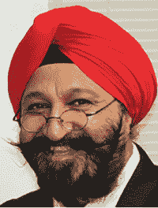

`Jasjit S. Suri` is an innovator, scientist, visionary, industrialist, and an internationally known world leader in biomedical engineering. Dr. Suri has spent over 25 years in the field of biomedical engineering/devices and its management. He received his PhD from the University of Washington, Seattle, and his Business Management Sciences degree from Weatherhead, Case Western Reserve University, Cleveland, Ohio. Dr. Suri was crowned with the President’s Gold medal in 1980 and made a Fellow of the American Institute of Medical and Biological Engineering for his outstanding contributions. In 2018, he was awarded the Marquis Life Time Achievement Award for his outstanding contributions and dedication to medical imaging and its management.

`Nabila Abraham`

Ryerson Multimedia Research Laboratory

Electrical, Computer, and Biomedical Engineering

Ryerson University

Toronto, Canada

当人们想到医疗领域的机器学习和人工智能时，最直观的想法是它们在放射学中的应用，用于通过胸部 X 光片/计算机断层扫描来诊断病理，以及在皮肤科中利用皮肤图像诊断病理。这些都是合理的应用，因为我们期望通过观察大量正常和病理图像，机器/神经网络能够辨识出定义每种病理的关键特征，并利用这些特征在未见图像中预测病理。上述应用也是首选，因为在这些领域已经取得了显著进展。例如，2019 年 5 月，Google 开发了一个深度学习算法用于通过计算机断层扫描检测肺癌。该深度学习模型的 ROC 曲线下面积达到 94.4%，并且在诊断时超越了六位放射科医生，同时将假阳性率降低了 11%，假阴性率降低了 5% \[1\]。

通常，麻醉学不与机器学习相关联，因为在该领域中，利用图像来检测病理的作用要远小于其他医疗领域。然而，机器学习远不止图像分析而已。机器学习涉及一个系统，该系统能够在不被明确编程的情况下完成任务，而是基于算法、统计模型、回归和/或模式识别。此外，机器学习系统能够从经验中学习并改进。这些经验通常通过数据获得，数据可能包括表格数据或像素化数据。在麻醉学中，有大量的表格数据。这些数据可能是个体病例数据，包含包括性别、年龄、身高、体重、用药、过敏、心率、呼吸率、血压和体温等变量。这些变量，特别是那些被监测且可变化的变量，如生命体征，可以与另一个感兴趣的变量（如低血压）结合，提供给机器学习模型。在有足够信息的情况下，机器学习模型可以分析数据，以建立依赖变量与自变量之间的关联。在创建此类回归模型后，神经网络可以在新的病例/数据上进行预测，基于其从训练数据中建立的关联。随着神经网络接收到更多数据，它会持续更新变量之间的关联。因此，该模型在没有用户实现任何显式算法或暴力机制的情况下，预测独立变量，并且从经验中学习和改进。上述理论例子提供了机器学习如何在麻醉学中应用的部分基础信息。本章后续将提供麻醉学中机器学习实际应用的具体案例。

麻醉学领域的自动化并不新鲜。最早记录的自动化实施之一是 1950 年 Bickford 的努力 \[2\]。Bickford 发现脑电位的累计值与麻醉药物抑制中枢神经系统的程度之间存在关系。基于此信息，Bickford 设计了一种装置，用于自动维持麻醉。自 1950 年以来，新的变量和变量组合被识别出来，这些变量更准确地对应麻醉的深度。将这些信息整合到机器中，促使食品与药品管理局批准了 Sedasys 计算机辅助个性化镇静 \[3\]。该机器的设计是为了将丙泊酚输送至患者，并通过脉搏血氧饱和度、心电图以及患者对听觉和触觉刺激的反应等监测患者状况 \[4\]。其使用局限性：仅适用于轻度至中度镇静，仅适用于结肠镜或食管胃十二指肠镜检查 \[5\]；然而，Sedasys 机器是自动化和算法使用在协助麻醉师方面的一个很好例子。

总体而言，麻醉学中开发的大部分自动化都需要程序员输入算法，以便机器执行任务。算法的识别是仍然高度依赖于人类。此外，随着新信息的出现，由人类更新算法，这通常耗时，导致实施延迟。这可以与机器学习相比，在机器学习中，神经网络识别算法并随着新数据的提供而持续更新。

在过去几年中，已实施了多种机器学习应用，包括术前、术中和术后应用。

### 1.2.1 低血压


有两项研究涉及低血压在麻醉诱导后的预测。Hatib 及其同事利用依赖变量——高保真动脉压波形，预测低血压在实际发生前 \[6\]。训练数据包括 545,959 分钟的动脉波形记录和 25,461 例低血压发作。验证数据包括 33,326 分钟的动脉波形记录和 1,923 例低血压发作。虽然表面上看起来只分析了一个依赖变量，但实际上从动脉压波形中选取了超过 3,000 个单独特征，每个特征均参与分析以生成接收机器特征曲线（ROC）。随后，选择了 51 个特征，其 ROC 曲线下的面积（AUC）大于 0.85。这 51 个特征及其倒数、平方项以及组合，总共生成了超过 260 万个变量。模型随后计算这些变量与低血压之间的线性和非线性关系。最终，模型使用了 3,022 个单独特征，并在预测低血压发作 15 分钟前时，敏感性、特异性和 AUC 分别为 88%、87% 和 0.95；在预测 5 分钟前时，这些值分别提升至 92%、92% 和 0.97。此外，Kendale 及其同事实施了机器学习以预测术后低血压 \[7\]。然而，该研究的依赖变量还包括人口学特征、术前用药、既往疾病、诱导药物以及术中生命体征等。比较了八种监督分类算法（逻辑回归、支持向量机、naïve Bayes、K 最近邻、线性判别分析、随机森林、神经网络和梯度提升机）的表现。梯度提升表现最佳，最终模型的 AUC 为 0.77。梯度提升的优异表现与数据类型相符，因为它擅长处理类别失衡。最后，比较了依赖变量在预测术后低血压中的重要性。前五重要的变量为：平均动脉压、年龄、BMI、平均峰值吸气压和最高的异氟醚浓度。此外，模型还发现利福西汀和双膦酸盐类药物具有高重要性，这可能是出人意料的。预测低血压是一项非常困难的任务，如果机器学习和人工智能继续按上述两项研究的进展发展，麻醉师将更少被突发情况惊讶到，从而能够更快、更有效地提供治疗，甚至在某些情况下提供预防性治疗。

### 1.2.2 缺氧

-   [另一项研究](https://wiki.example.org/feynmans_learning_method)利用梯度提升机器学习模型预测手术期间的低氧血症 \[8\]。所包含的特征/变量有患者人口学信息（如 BMI）、血压、呼吸频率、O₂流量、药物、SpO₂以及手术开始后的时间。机器学习系统用于初步风险预测和实时低氧血症预测。在这两种情况下，麻醉师与机器学习系统的结合显著提高了 AUC，统计学上显著（*P* < 0.0001）。手术前及手术期间可用的大量数据表明，机器学习可以为临床医生提供支持系统，帮助预测危及生命的情况，并在发生前加以预防。

### 1.2.3 Depth of Anesthesia

在手术过程中监测麻醉深度对于患者安全和舒适至关重要。过高的麻醉深度可能导致恢复时间延长、低血压和重要器官血流减少；相反，过低的麻醉深度可能导致创伤后应激反应。Saadeh 及其同事设计了一种基于 EEG 的机器学习处理器，用于估计麻醉深度 \[9\]。从 EEG 中提取了六个特征（光频边界频率、β比值以及四个光能带），并将其用于机器学习系统中，将麻醉深度分类为深、中、浅或清醒。测试期间，系统在分类麻醉深度方面实现了 92.2%的准确率，再次凸显了机器学习在手术室的优势。

### 1.2.4 Mortality Prediction

预测死亡率往往被视为超越人力的任务。在临床实践中，已发展出风险评分系统，如美国麻醉医师学会体格评估分级（ASA Physical Status Classification）或手术阿帕格评分（surgical Apgar score），用于量化风险。但这些评分存在局限性：ASA 分级主观性强，且评分间存在较高的 inter-rater 变异性；手术阿帕格评分虽能快速预测术后风险，但因仅包含三个特征/变量，其快速性也是一大缺陷。Lee 及其同事开发了一种深度神经网络，利用手术结束时的 45 个特征/变量以及术前美国麻醉医师学会（ASA）体格评估分级信息，预测术后住院死亡率 \[10\]。该深度神经网络的 AUC 为 0.91，高于单独使用手术阿帕格评分（AUC=0.58）或 ASA 评分（AUC=0.84）。尽管麻醉领域机器学习的应用研究滞后于其他医疗领域，但上述研究表明，机器学习对麻醉医师和患者均具有巨大的潜在益处。

## 5.1 Introduction

In artificial intelligence, neural networks have been in and out of popularity since the 1940s, but in the last decade, deep learning with artificial neural networks has been a game-changer in many engineering application areas \[1,2\] and in basic science \[3, 4, 5\]. Deep learners, such as Convolutional Neural Networks (CNNs), have consistently obtained state-of-the-art results in many computer vision tasks such as image classification \[1,6\], object detection \[7\], face recognition \[8\], and machine translation \[9\]. CNNs also have been proven to be more accurate than humans in many recognition tasks, including recognizing traffic signs \[10\], faces \[11,12\], handwritten digits \[10,13\], and the 1,000 classes of the ImageNet dataset \[14,15\].

Since activation functions play a critical role in the training dynamics and task performance of deep neural networks, the development of more efficient and better-performing activation functions has been the focus of a large number of researchers. Until recently, the sigmoid and hyperbolic tangent were among the most widely used activation functions in neural networks. Although the hyperbolic tangent has the advantage of having a derivative that is steeper than the sigmoid function, they both suffer from the vanishing gradient problem and do a poor job training at deep neural networks, in part because gradients rapidly decrease as the modulus of the input goes to infinity. There is increasing evidence, however, that other nonlinearities improve the performance of neural networks. Glorot et al. \[16\], for example, demonstrated the superiority of Rectified Linear Units (ReLU) to train deep networks. ReLU is an activation function that is equal to the identity function when the input is positive but zero when it is negative \[17\]. Even though this function is not differentiable, it nonetheless enabled AlexNet to win the ImageNet competition in 2012 \[1\].

Due to the success of ReLU and the fact that this activation is fast, effective, and simple to evaluate, many researchers in deep learning began to explore the properties of other rectifying nonlinearities. For example, Leaky ReLU, proposed by Mass \[18\], is an activation function that, like ReLU, is equivalent to the identity function for positive values but has a hyperparameter `α` > 0 for negative inputs. This hyperparameter guarantees that the gradient of the activating function is never zero, thereby making it less likely that the optimization process will get stuck in local minima. Another advantage of Leaky ReLU is that it alleviates problems caused by hard zero activations of ReLU, which can produce cases where a unit never activates, significantly slowing training when networks have excessive constant zero gradients. Another rectifying nonlinearity is Exponential Linear Units (ELU), proposed by Clevert et al. \[19\], which is similar to Leaky ReLU but exponentially decreases to the limit point `α` as the input goes to minus infinity, thereby always producing a positive gradient. However, unlike Leaky ReLU, ELU saturates on its left side. The Scaled Exponential Linear Unit (SELU), proposed by Klambauer et al. \[20\], was also developed to mitigate the vanishing gradient problem. SELU is the same as ELU but multiplied by the constant `λ` > 1 to preserve the mean and the variance of the input features.

进入`/path/to/xxx`目录，找到`xxx.json`。

在表达式`cvar = avar + bvar`中，加法运算符（`+`）将`avar`与`bvar`相加，得到它们的和`cvar`

在`List.of(arg0, arg1, arg2)`中，`List`接口的工厂方法`of()`接受一系列的元素，返回包含它们的只读列表。

之后我们这样调用`cmd`命令：`cmd arg0 arg1 arg2`。

```
if (condVar > someVal) {console.log("xxx")}
```

$$\frac{dy_{i}}{dx_{i}} = \operatorname{}f\prime\left( x_{i} \right) = \left\{ \begin{array}{l} {a\exp\left( x_{i} \right), x_{i} < 0} \\ 1, x_{i} \geq 0 \end{array} \right.$$  

## 5.2.4 SELU

Scaled Exponential Linear Unit (SELU) \[20\] is defined as  

$$y_{i} = \operatorname{}f\left( x_{i} \right) = \left\{ \begin{array}{l} {sa\left( {\exp x_{i} - 1} \right), x_{i} < 0} \\ {sx_{i}, x_{i} \geq 0} \end{array} \right.$$  

where both `a` and `s` are real numbers (`a` = 1.6733 and `s` = 1.0507 here; these are the same values used in Ref. \[20\] and were selected to map a random variable of null mean and unit variance in a random variable with null mean and unit variance).

Note that SELU is basically the same as ELU but is multiplied by the additional scaled parameter `s` to prevent the gradient from vanishing or exploding. The gradient of SELU is given by  

$$\frac{dy_{i}}{dx_{i}} = \operatorname{}f\prime\left( x_{i} \right) = \left\{ \begin{array}{l} {sa\exp\left( x_{i} \right), x_{i} < 0} \\ {s, x_{i} \geq 0} \end{array} \right.$$  

## 5.2.5 PReLU

Parametric ReLU (PreLU) \[14\] is defined as  

$$y_{i} = f\left( x_{i} \right) = \left\{ \begin{array}{l} {a_{c}x_{i}, x_{i} < 0} \\ {x_{i}, x_{i} \geq 0} \end{array} \right.$$  

where `a[c]` includes real numbers that are different for every channel of the input. PreLU is the same as Leaky ReLU except that the parameters `a[c]` are learnable.

The gradients of PReLU are  

$$\frac{dy_{i}}{dx_{i}} = f\prime\left( x_{i} \right) = \left\{ \begin{array}{l} {a_{c}, x_{i} < 0} \\ {1, x_{i} \geq 0} \end{array} \right.\text{and}\frac{dy_{i}}{da_{c}} = \left\{ \begin{array}{l} {x_{i}, x_{i} < 0} \\ {0, x_{i} \geq 0} \end{array} \right.$$  

Note that the slopes of the left-hand sides are all initialized to 0.  

## 5.2.6 SReLU

S-Shaped ReLU (SReLU) \[30\] is composed of three piecewise linear functions that are expressed by four learnable parameters, thus  

$y_{i} = \operatorname{}f\left( x_{i} \right) = \left\{ \begin{array}{l} {t^{l} + a^{l}\left( {x_{i} - t^{l}} \right), x_{i} < t^{l}} \\ {x_{i}, t^{l} \leq x_{i} \leq t^{r}} \\ {t^{r} + a^{r}\left( {x_{i} - t^{r}} \right), x_{i} > t^{r}} \end{array} \right.$,  


where `t`^(*l*), `t`^(*r*), `a`^(*l*) and `a`^(*r*) are the four learnable real number parameters (initialized as `a`^(*l*) = 0, `t`^(*l*) = 0, and `t`^(*r*) = `maxInput`, where `maxInput` is a hyperparameter). SReLU’s rather large number of parameters results in high representation power.

The gradients of SReLU are given by  

$\frac{dy_{i}}{dx_{i}} = f\prime\left( x_{i} \right) = \left\{ \begin{matrix} {a^{l}, x_{i} < t^{l}} \\ {1, t^{l} \leq x_{i} \leq t^{r}} \\ {a^{r}, x_{i} > t^{r}} \end{matrix} \right.$,   

$$\frac{dy_{i}}{da^{l}} = \left\{ \begin{matrix} {x_{i} - t^{l}, x_{i} < t^{l}} \\ {0, x_{i} \geq t^{l}} \end{matrix} \right.,\text{and}$$  

$\frac{dy_{i}}{dt^{l}} = \left\{ \begin{matrix} {1 - a^{l}, x_{i} < t^{l}} \\ {0, x_{i} \geq t^{l}} \end{matrix} \right..$  

## 5.2.7 APLU

Adaptive Piecewise Linear Unit (APLU) \[21\] is defined as  

$$y_{i} = \operatorname{}ReLU\left( x_{i} \right) + \sum_{c = 1}^{n}a_{c}\max\left( {0, - x_{i} + b_{c}} \right)$$  

where `a`[c] and `b`[c] are real numbers, each different for each channel of the input. `APLU` is a linear piecewise function able to approximate, as noted in the Introduction, any continuous function on a compact set.

The gradient of APLU is given by the sum of the gradients of ReLU and of the functions contained in the sum. With respect to the parameters, `a`[c] and `b`[c], the gradients are  

$$\frac{df\left( {x,a} \right)}{da_{c}} = \left\{ \begin{matrix} {- x + b_{c}, x < b_{c}} \\ {0, x \geq b_{c}} \end{matrix}\text{and}\frac{df\left( {x,a} \right)}{db_{c}} = \left\{ \begin{matrix} {- a_{c}, x < b_{c}} \\ {0, x \geq b_{c}} \end{matrix} \right.}$$  

In this study, the parameters `a`[c] were initialized to 0, while the points were randomly initialized. Added was a 0.001 `L`² -penalty on the norm of the parameters `a`[c]. Thus, another term was included in the loss function, which is defined as  

$$L^{reg} = \sum_{c = 1}^{n}\left| a_{c} \right|^{2}L^{reg} = \sum_{c = 1}^{n}\left| a_{c} \right|^{2}$$  

A relative learning rate was also added to these parameters: `maxInput` times the smallest used for the rest of the network. Thus, if `λ` is the global learning rate, the learning rate `λ`^(\*) of the parameters `a`[c] would be  

$\lambda^{\text{\*}} = \frac{\\lambda}{maxInput}\\lambda^{\\text{\*}} = \\frac{\\lambda}{maxInput}.$  

## 5.2.8 MeLU

To understand the Mexican ReLU (MeLU) \[25\], let `ϕ`^(*a*, *λ*)(*x*)= max (*λ*−|*x*−*a*|,0) be a “Mexican hat type” function, where `a` and `λ` are real numbers. When |*x*−*a*| > *λ*, the function `ϕ`^(*a*, *λ*)(*x*) is null but constantly increases with a derivative of 1 and between *a* and *a*−*λ* and decreases with a derivative of −1 between *a* and *a* + *λ*.

The aforementioned functions serve as the building blocks of MeLU, which is defined as  

$$y_{i} = \\text{MeLU}\\left( x_{i} \\right) = \\text{PReLU}^{c\_{0}}\\left( x_{i} \\right) + \\sum_{j = 1}^{k - 1}c_{j}\\phi^{a\_{j},\\lambda\_{j}}\\left( x_{i} \\right),$$  

where `k` is the number of learnable parameters for each channel (one parameter for PReLU and `k`−1 parameters for the coefficients in the sum of the Mexican hat functions; `k` = 4, 8 here), `c`[j] are the learnable parameters, `c`[0] is the vector of parameters in PReLU, and `a`[j] and `λ`[j] are both fixed and chosen recursively.

Initially, the parameter `maxInput` is set. The first Mexican hat function has its maximum in 2 ⋅ `maxInput` and is equal to zero in 0 and 4 ⋅ `maxInput`. The next two functions are chosen to be zero outside the interval \[0, 2 ⋅ `maxInput`\] and \[2 ⋅ `maxInput`, 4 ⋅ `maxInput`\], with the requirement being that they have their maximum in `maxInput` and 3 ⋅ `maxInput` (Table 5.1).

TABLE 5.1 Fixed Parameters of MeLU with `maxInput` = 256  

| `j` || **1** || **2** || **3** || **4** || **5** || **6** || **7** |

| --- | --- | --- | --- | --- | --- | --- | --- |

| `a`[j] || 512 || 256 || 768 || 128 || 384 || 640 || 896 |

| --- | --- | --- | --- | --- | --- | --- | --- |

| `λ`[j] || 512 || 256 || 256 || 128 || 128 || 128 || 128 |

Since Mexican hat functions are continuous and piecewise differentiable, so is MeLU. If all the `c[i]` learnable parameters are initialized to zero, MeLU coincides with ReLU, a property that is helpful in transfer learning when the network is pretrained with ReLU (in which case MeLU can simply be substituted; of course, MeLU can also be substituted for networks trained with Leaky ReLU and PReLU). Another important property derives from the fact that the Mexican hat functions are a Hilbert basis on a compact set with the `L²` norm; thus, they can approximate every function in `L²([0, 1, 024])` as `k` goes to infinity.

MeLU is similar to SReLU and APLU in having multiple learnable parameters, but this number is larger in APLU. MeLU is also similar to APLU in that it can approximate the same set of piecewise linear functions equal to identity when `x` is large enough, but how this is done is different for each function. Given the right choice of the parameters, APLU can be equal to any piecewise linear function because the points of nondifferentiability are learnable, but MeLU is more efficient because it can represent every piecewise linear function by exploiting only the joint optimization of the weight matrix and the biases. Moreover, the gradients of the two activations with respect to the learnable parameters are different. The optimization of a neural network depends in large part on two factors: the output of every hidden layer and the gradient of that output with respect to the parameters.

Unlike APLU, MeLU changes the activation where it is needed, making optimization easier. The difference between the basis functions of MeLU and APLU is illustrated in Figure 5.2. Moreover, as noted in Section 5.2.7, the coefficients in APLU must be regularized with an `L²` penalty and benefits from a low learning rate; MeLU does not need any regularization.

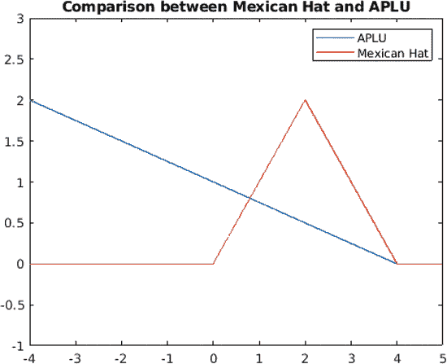

FIGURE 5.2 Partial derivatives of MeLU and APLU.

In this study, the learnable parameters in MeLU are initialized to zero, so the activation starts off as ReLU, thereby exploiting all the nice properties of ReLU at the beginning.

### 5.2.9 GaLU

Gaussian ReLU (GaLU), proposed here, is based on MeLU and possesses the same desirable properties. To define GaLU, let `ϕg(x) = max(λ - |x - a|, 0) + min(|x - a - 2λ| - λ, 0)` be a Gaussian type function, where `a` and `λ` are real numbers. In Figure 5.3, a standard Gaussian wavelet function is compared with a Gaussian type with `a = 1`, `λ = 1`.

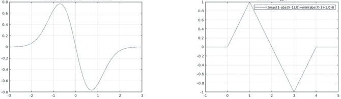

FIGURE 5.3 Gaussian wavelet (a) and our Gaussian type (b).

GaLU is defined, similarly to MeLU, as

$y_{i} = \text{GaLU}(x_{i}) = \text{PReLU}^{c_{0}}(x_{i}) + \sum_{j = 1}^{k - 1}c_{j}\phi_{g}^{a_{j},\\lambda_{j}}(x_{i}).$

As shown in Ref. \[31\], piecewise linear odd functions constructed of many linear pieces approximate nonlinear functions better than ReLU does. The rationale behind GaLU is to add more linear pieces than is the case with MeLU.

Like MeLU, GaLU has a set of fixed parameters (see Table 5.2 where the fixed parameters of GaLU and MeLU with `maxInput = 1` are compared).

TABLE 5.2 Comparison of the Fixed parameters of GaLU and MeLU with `maxInput = 1`

|  || `j` || **1** || **2** || **3** || **4** || **5** || **6** || **7** |

| --- | --- | --- | --- | --- | --- | --- | --- |

| MeLU || `a[j]λ[j]` || 22 || 11 || 31 || 0.50.5 || 1.50.5 || 2.50.5 || 3.50.5 |

| --- | --- | --- | --- | --- | --- | --- | --- |

| GaLU || `a[j]λ[j]` || 11 || 0.50.5 || 2.50.5 || 0.250.25 || 1.250.25 || 2.250.25 || 3.250.25 |

## 5.3 Experimental Results


GaLU, the novel activation function proposed here, is tested on the CNNs detailed in Section 5.2 across 13 publicly available biomedical datasets. Details of the datasets are summarized in Table 5.3. The 13 datasets are the following:

TABLE 5.3 Descriptive Summary of the Datasets: The Number of Classes (#C) and the Number of Samples (#S)

| **Dataset** || **#C** || **#S** || **URL for Download** |

| --- | --- | --- | --- |

| CH || 5 || 327 || [`ome.grc.nia.nih.gov/iicbu2008/hela/index.html#cho`](http://ome.grc.nia.nih.gov) |

| --- | --- | --- | --- |

| HE || 10 || 862 || [`ome.grc.nia.nih.gov/iicbu2008/hela/index.html`](http://ome.grc.nia.nih.gov) |

| --- | --- | --- | --- |

| LO || 10 || 502 || [`locate.imb.uq.edu.au/downloads.shtml`](http://locate.imb.uq.edu.au) |

| --- | --- | --- | --- |

| TR || 11 || 553 || [`locate.imb.uq.edu.au/downloads.shtml`](http://locate.imb.uq.edu.au) |

| --- | --- | --- | --- |

| RN || 10 || 200 || [`ome.grc.nia.nih.gov/iicbu2008/rnai/index.html`](http://ome.grc.nia.nih.gov) |

| --- | --- | --- | --- |

| TB || 7 || 970 || [`ome.grc.nia.nih.gov/iicbu2008`](https://ome.grc.nia.nih.gov) |

| --- | --- | --- | --- |

| LY || 3 || 375 || [`ome.grc.nia.nih.gov/iicbu2008`](https://ome.grc.nia.nih.gov) |

| --- | --- | --- | --- |

| MA || 4 || 237 || [`ome.grc.nia.nih.gov/iicbu2008`](https://ome.grc.nia.nih.gov) |

| --- | --- | --- | --- |

| LG || 2 || 265 || [`ome.grc.nia.nih.gov/iicbu2008`](https://ome.grc.nia.nih.gov) |

| --- | --- | --- | --- |

| LA || 4 || 529 || [`ome.grc.nia.nih.gov/iicbu2008`](https://ome.grc.nia.nih.gov) |

| --- | --- | --- | --- |

| CO || 8 || 5,000 || [`zenodo.org/record/53169#.WaXjW8hJaUm`](https://zenodo.org) |

| --- | --- | --- | --- |

| BGR || 3 || 300 || [`zenodo.org/record/834910#.Wp1bQ-jOWUl`](https://zenodo.org) |

| --- | --- | --- | --- |

| LAR || 3 || 1,320 || [`zenodo.org/record/1003200#.WdeQcnBx0nQ`](https://zenodo.org) |

1. CH: the CHINESE HAMSTER OVARY CELLS dataset \[32\];

2. HE: the 2D HELA dataset \[32\];

3. LO: the Locate Endogenous dataset \[33\];

4. TR: the LOCATE TRANSFECTED dataset \[33\];

5. RN: the FLY CELL dataset \[34\];

6. MA: Muscle aging \[34\], a dataset that includes images of *C. elegans* muscles at four ages;

7. TB: Terminal bulb aging \[34\] dataset of images of *C. elegans* terminal bulb at seven ages;

8. LY: Lymphoma dataset \[34\];

9. LG: Liver gender \[34\], a dataset of liver tissue sections from 6-month male and female mice on a caloric restriction diet, the two classes representing the gender of the mice;

10. LA: Liver aging \[34\], a dataset of liver tissue sections from female mice on an ad libitum diet;

11. CO: histological images of human colorectal cancer \[35\];

12. BGR: breast grading carcinoma \[36\];

13. LAR: Laryngeal dataset \[37\].

Unless specified, the protocol used on the above datasets is five-fold cross-validation, and the Wilcoxon signed rank test \[38\] was used to validate the experiments.

在 Table 5.4 Table 5.5 Table 5.6 中，分别报告了考虑 Vgg16、ResNet50 和 DenseNet201 的不同激活函数的性能。加粗文本表示在我们测试的所有模型中，该分类器表现最佳。所有网络均使用批量大小 (BS) 为 30，学习率 (LR) 为 0.0001，训练 30 个时代。这些设置是为了减少计算时间。在 Ref. \[1,2\] 中，对两个轴进行随机反射，并对两个轴各自进行两次随机缩放，缩放因子均匀采样于参考文献。因此，新图像的纵向和横向比例相应调整。

TABLE 5.4 使用 ResNet 获得的性能

|  || **Activation** || **CH** || **HE** || **LO** || **TR** || **RN** || **TB** || **LY** || **MA** || **LG** || **LA** || **CO** || **BG** || **LAR** || **Avg** |

| --- | --- | --- | --- | --- | --- | --- | --- | --- | --- | --- | --- | --- | --- | --- | --- |

| Resnet50*MaxInput* = 1 || MeLU (*k* = 8) || 92.92 || 86.40 || 91.80 || 82.91 || 25.50 || 56.29 || 67.47 || 76.25 || 91.00 || 82.48 || 94.82 || 89.67 || 88.79 || 78.94 |

| --- | --- | --- | --- | --- | --- | --- | --- | --- | --- | --- | --- | --- | --- | --- | --- |

|  || Leaky ReLu || 89.23 || 87.09 || 92.80 || 84.18 || 34.00 || 57.11 || 70.93 || 79.17 || 93.67 || 82.48 || 95.66 || 90.33 || 87.27 || 80.30 |

|  || ELU || 90.15 || 86.74 || 94.00 || 85.82 || 48.00 || 60.82 || 65.33 || 85.00 || 96.00 || 90.10 || 95.14 || 89.33 || 89.92 || 82.79 |

|  || MeLU (*k* = 4) || 91.08 || 85.35 || 92.80 || 84.91 || 27.50 || 55.36 || 68.53 || 77.08 || 90.00 || 79.43 || 95.34 || 89.33 || 87.20 || 78.76 |

|  || PReLU || 92.00 || 85.35 || 91.40 || 81.64 || 33.50 || 57.11 || 68.80 || 76.25 || 88.33 || 82.10 || 95.68 || 88.67 || 89.55 || 79.26 |

|  || SReLU || 91.38 || 85.58 || 92.60 || 83.27 || 30.00 || 55.88 || 69.33 || 75.00 || 88.00 || 82.10 || 95.66 || 89.00 || 89.47 || 79.02 |

|  || APLU || 92.31 || 87.09 || 93.20 || 80.91 || 25.00 || 54.12 || 67.20 || 76.67 || 93.00 || 82.67 || 95.46 || 90.33 || 88.86 || 78.98 |

|  || ReLu || 93.54 || 89.88 || 95.60 || 90.00 || 55.00 || 58.45 || **77.87** || 90.00 || 93.00 || 85.14 || 94.92 || 88.67 || 87.05 || 84.54 |

|  || SmallGaLU || 92.31 || 87.91 || 93.20 || 91.09 || 52.00 || 60.00 || 72.53 || 90.00 || 95.33 || 87.43 || 95.38 || 87.67 || 88.79 || 84.12 |

|  || GaLU || 92.92 || 88.37 || 92.20 || 90.36 || 41.50 || 57.84 || 73.60 || 89.17 || 92.67 || 88.76 || 94.90 || 90.33 || 90.00 || 83.27 |

|  || ENS || **95.38** || 89.53 || 97.00 || 89.82 || **59.00** || 62.78 || 76.53 || 86.67 || 96.00 || 91.43 || **96.60** || **91.00** || 89.92 || 86.28 |

|  || ENS\_G || 93.54 || **90.70** || **97.20** || **92.73** || 56.00 || **63.92** || 77.60 || **90.83** || **90.83** || **91.43** || 96.42 || 90.00 || **90.00** || **86.67** |

| Resnet50*MaxInput* = 255 || MeLU (*k* = 8) || 94.46 || 89.30 || 94.20 || 92.18 || 54.00 || 61.86 || 75.73 || 89.17 || 97.00 || 88.57 || 95.60 || 87.67 || 88.71 || 85.26 |

|  || MeLU (*k* = 4) || 92.92 || 90.23 || 95.00 || 91.82 || 57.00 || 59.79 || 78.40 || 87.50 || 97.33 || 85.14 || 95.72 || 89.33 || 88.26 || 85.26 |

|  || SReLU || 92.31 || 89.42 || 93.00 || 90.73 || 56.50 || 59.69 || 73.33 || 91.67 || **98.33** || **88.95** || 95.52 || **89.67** || 87.88 || 85.15 |

|  || APLU || **95.08** || 89.19 || 93.60 || 90.73 || 47.50 || 56.91 || 75.20 || 89.17 || 97.33 || 87.05 || 95.68 || **89.67** || 89.47 || 84.35 |

|  || ReLu || 93.54 || 89.88 || 95.60 || 90.00 || 55.00 || 58.45 || 77.87 || 90.00 || 93.00 || 85.14 || 94.92 || 88.67 || 87.05 || 84.54 |

|  || SmallGaLU || 93.54 || 87.79 || 95.60 || 89.82 || 55.00 || 63.09 || 76.00 || 90.42 || 95.00 || 85.33 || 95.08 || **89.67** || **89.77** || 85.08 |

|  || GaLU || 92.92 || 87.21 || 92.00 || 91.27 || 47.50 || 60.10 || 74.13 || 87.92 || 96.00 || 86.86 || 95.56 || 89.33 || 87.73 || 83.73 |

|  || ENS || 93.85 || **91.28** || **96.20** || 93.27 || 59.00 || 63.30 || 77.60 || 91.67 || 98.00 || 87.43 || 96.30 || 89.00 || 89.17 || 86.62 |

|  || ENS\_G || **95.08** || **91.28** || **96.20** || **94.18** || **63.00** || **64.85** || **78.67** || **92.50** || 97.67 || **87.62** || **96.54** || **89.67** || **89.77** || **87.46** |

| eENS ||  || 94.77 || **91.40** || **97.00** || 92.91 || 60.00 || 64.74 || 77.87 || 88.75 || **98.00** || 90.10 || 96.50 || **90.00** || 89.77 || 87.06 |

| eENS\_G ||  || **95.08** || 91.28 || 96.80 || **93.45** || **62.50** || **65.26** || **78.93** || **91.67** || 96.67 || **90.48** || **96.60** || 89.33 || **89.85** || **87.53** |

| ENS\_MeLU ||  || **94.46** || **90.93** || **97.00** || 93.45 || 57.50 || 63.92 || 78.40 || 90.00 || **97.67** || 87.62 || 96.18 || **90.00** || 89.32 || 86.65 |

| ENS\_MG ||  || **94.46** || **90.93** || 96.60 || **94.55** || **58.50** || **64.23** || **79.47** || **92.92** || 96.33 || **88.38** || **96.44** || 89.33 || **90.30** || **87.11** |

TABLE 5.5 使用 Vgg16 获得的性能

|  || **Activation** || **CH** || **HE** || **LO** || **TR** || **RN** || **TB** || **LY** || **MA** || **LG** || **LA** || **CO** || **BG** || **LAR** || **Avg** |

| --- | --- | --- | --- | --- | --- | --- | --- | --- | --- | --- | --- | --- | --- | --- | --- |

| Vgg16*MaxInput* = 1 || MeLU (*k* = 8) || **99.69** || 92.09 || 98.00 || 92.91 || 59.00 || 60.93 || 78.67 || 87.92 || 86.67 || 93.14 || 95.20 || 89.67 || 90.53 || 86.49 |

| --- | --- | --- | --- | --- | --- | --- | --- | --- | --- | --- | --- | --- | --- | --- | --- |

|  || Leaky ReLu || 99.08 || 91.98 || 98.00 || 93.45 || 66.50 || 61.13 || 80.00 || 92.08 || **86.67** || 91.81 || 95.62 || 91.33 || 88.94 || 87.43 |


|  | **Activation** | **CH** | **HE** | **LO** | **TR** | **RN** | **TB** | **LY** | **MA** | **LG** | **LA** | **CO** | **BG** | **LAR** | **Avg** |
| --- | --- | --- | --- | --- | --- | --- | --- | --- | --- | --- | --- | --- | --- | --- | --- |
|  | `ELU` | 98.77 | 93.95 | 97.00 | 92.36 | 56.00 | 59.69 | 81.60 | 90.83 | 78.33 | 85.90 | 95.78 | 93.00 | 93.00 | 85.66 |
|  | `MeLU (k = 4)` | 99.38 | 91.16 | 97.60 | 92.73 | 64.50 | 62.37 | 81.07 | 89.58 | 86.00 | 89.71 | 95.82 | 89.67 | 93.18 | 87.13 |
|  | `PReLU` | 99.08 | 90.47 | 97.80 | 94.55 | 64.00 | 60.00 | 81.33 | **92.92** | 78.33 | 91.05 | 95.80 | 92.67 | 90.38 | 86.79 |
|  | `SReLU` | 99.08 | 91.16 | 97.00 | 93.64 | 65.50 | 60.62 | 82.67 | 90.00 | 79.33 | 93.33 | 96.10 | 94.00 | 92.58 | 87.30 |
|  | `APLU` | 99.08 | 92.33 | 97.60 | 91.82 | 63.50 | 62.27 | 77.33 | 90.00 | 82.00 | 92.38 | 96.00 | 91.33 | 90.98 | 86.66 |
|  | `ReLu` | **99.69** | 93.60 | 98.20 | 93.27 | 69.50 | 61.44 | 80.80 | 85.00 | 85.33 | 88.57 | 95.50 | 93.00 | 91.44 | 87.33 |
|  | `SmallGaLU` | 98.46 | 91.63 | 97.80 | 91.35 | 64.50 | 59.79 | 80.53 | 89.58 | 77.33 | 92.76 | 95.70 | 91.67 | 91.97 | 86.39 |
|  | `GaLU` | 98.46 | 94.07 | 97.40 | 92.36 | 65.00 | 59.07 | 81.07 | 92.08 | 75.67 | 93.71 | 95.68 | 88.67 | 91.74 | 86.53 |
|  | `ENS` | 99.38 | 93.84 | 98.40 | **95.64** | 68.00 | **65.67** | 85.07 | 92.08 | 85.00 | 96.38 | 96.74 | 94.33 | 92.65 | 89.47 |
|  | `ENS_G` | **99.69** | **94.65** | **99.00** | 95.45 | **72.00** | 64.95 | **86.93** | 92.50 | 83.33 | **97.14** | 96.72 | **94.67** | **92.65** | **89.97** |
| `Vgg16 MaxInput = 255` | `MeLU (k = 8)` | **99.69** | 92.09 | 97.40 | 93.09 | 59.50 | 60.82 | 80.53 | 88.75 | 80.33 | 88.57 | 95.94 | 90.33 | 88.33 | 85.79 |
|  | `MeLU (k = 4)` | 99.38 | 91.98 | 98.60 | 92.55 | 66.50 | 59.59 | 84.53 | 91.67 | **88.00** | 94.86 | 95.46 | 93.00 | **93.03** | 88.39 |
|  | `SReLU` | 98.77 | 93.14 | 97.00 | 92.18 | 65.00 | 62.47 | 77.60 | 89.58 | 76.00 | 96.00 | 95.84 | 94.33 | 89.85 | 86.75 |
|  | `APLU` | 98.77 | 92.91 | 97.40 | 93.09 | 63.00 | 57.32 | 82.67 | 90.42 | 77.00 | 90.67 | 94.90 | 93.00 | 91.21 | 86.33 |
|  | `ReLu` | **99.69** | 93.60 | 98.20 | 93.27 | 69.50 | 61.44 | 80.80 | 85.00 | 85.33 | 88.57 | 95.50 | 93.00 | 91.44 | 87.33 |
|  | `SmallGaLU` | 99.38 | 92.91 | 97.00 | 92.73 | 50.50 | 62.16 | 78.40 | 90.42 | 73.00 | 94.48 | 95.32 | 92.00 | 90.98 | 85.32 |
|  | `GaLU` | 98.77 | 92.91 | 97.60 | 93.09 | 66.50 | 59.48 | 83.47 | 90.83 | 95.00 | 85.52 | 95.96 | 91.67 | 93.41 | 88.01 |
|  | `ENS` | 99.38 | 93.84 | 98.80 | 95.27 | 68.50 | 64.23 | 84.53 | 92.50 | 81.33 | **96.57** | 96.66 | 95.00 | 92.20 | 89.13 |
|  | `ENS_G` | 99.38 | **94.88** | 98.80 | 95.64 | 70.50 | **65.88** | 85.87 | 93.75 | 81.67 | **96.38** | **96.70** | **95.67** | 92.80 | **89.84** |
| `eENS` |  | 99.38 | 94.07 | 98.80 | **95.64** | 69.00 | **65.88** | 85.87 | **93.33** | 82.67 | 96.57 | **96.88** | **95.33** | **92.50** | 89.68 |
| `eENS_G` |  | **99.69** | 94.65 | **99.00** | 95.27 | **71.00** | 65.57 | **86.93** | 92.92 | **83.33** | **97.71** | 96.82 | 95.00 | 92.42 | **90.02** |
| `ENS_MeLU` |  | **99.69** | 93.72 | 98.80 | **95.09** | 71.00 | 63.61 | **86.93** | 91.25 | **85.33** | 95.24 | 96.48 | 93.00 | 92.95 | 89.46 |
| `ENS_MG` |  | **99.69** | **94.88** | **99.00** | **95.09** | **72.50** | **64.12** | 86.40 | **92.92** | 84.67 | **96.57** | **96.68** | **95.00** | **93.48** | **90.07** |

**TABLE 5.6 Performance Obtained Using DenseNet**

|  | **Activation** | **CH** | **HE** | **LO** | **TR** | **RN** | **TB** | **LY** | **MA** | **LG** | **LA** | **CO** | **BG** | **LAR** | **Avg** |
| --- | --- | --- | --- | --- | --- | --- | --- | --- | --- | --- | --- | --- | --- | --- | --- |
| `DenseNet MaxInput = 1` | `MeLU (k = 8)` | 93.23 | 93.02 | 96.60 | 95.27 | 55.00 | 60.82 | 80.53 | 90.00 | 85.67 | 84.38 | 95.60 | 88.67 | 90.00 | 85.29 |
|  | `Leaky ReLu` | 92.92 | 92.44 | 95.80 | 93.45 | 50.50 | 62.58 | 75.47 | 89.17 | 81.33 | 76.38 | 95.48 | 91.33 | 90.98 | 83.67 |
|  | `ELU` | 78.77 | 79.07 | 91.80 | 91.64 | 34.00 | 39.07 | 63.73 | 72.50 | **97.00** | 84.95 | 89.34 | 81.67 | 82.27 | 75.83 |
|  | `MeLU (k = 4)` | 89.85 | 91.05 | 96.00 | 94.18 | 52.50 | 62.99 | 79.73 | 89.58 | 81.00 | 77.52 | 95.52 | 89.33 | 90.98 | 83.86 |
|  | `PReLU` | 93.85 | 92.44 | 96.40 | 92.18 | 58.00 | 61.03 | 80.27 | 89.58 | 77.00 | 81.90 | 95.80 | 87.67 | 90.15 | 84.32 |
|  | `SReLU` | 93.85 | 89.88 | 97.00 | 94.91 | 63.50 | 65.15 | 79.47 | 92.08 | 78.67 | 87.24 | 95.95 | 90.00 | 90.68 | 86.02 |
|  | `APLU` | 93.54 | 92.44 | 97.00 | 92.73 | 54.50 | 60.82 | 78.13 | 90.83 | 79.33 | 85.14 | 95.00 | 88.67 | 92.12 | 84.63 |
|  | `ReLu` | 96.92 | 91.63 | 95.80 | 93.82 | 59.00 | 59.18 | 82.93 | 87.92 | 87.33 | 73.71 | 94.90 | 86.00 | 91.21 | 84.64 |
|  | `SmallGaLU` | 90.77 | 92.21 | 96.20 | 92.91 | 51.00 | 61.03 | 75.47 | 86.67 | 81.00 | 81.71 | 95.00 | 87.33 | 90.83 | 83.24 |
|  | `GaLU` | 88.00 | 92.44 | 96.40 | 92.18 | 49.50 | 60.00 | 75.73 | 91.25 | 80.33 | 84.38 | 96.00 | 89.33 | 90.98 | 83.57 |
|  | `ENS` | **96.62** | 94.65 | **98.20** | 96.18 | **71.00** | 67.01 | 87.73 | 93.33 | 86.33 | 91.81 | 96.52 | 92.33 | 92.27 | 89.53 |
|  | `ENS_G` | **96.92** | **95.12** | 98.00 | **96.55** | 69.50 | **67.73** | **88.53** | 93.33 | 86.33 | **91.81** | **96.56** | **92.33** | **92.58** | **89.63** |
| `DenseNet MaxInput = 255` | `MeLU (k = 8)` | 93.85 | 90.23 | 96.60 | 93.45 | 41.50 | 62.16 | 80.53 | 87.08 | 81.67 | 78.67 | 95.72 | 89.00 | 91.59 | 83.23 |
|  | `MeLU (k = 4)` | 91.08 | 90.47 | 96.00 | 94.73 | 55.00 | 61.03 | 75.73 | 89.17 | 81.33 | 80.95 | 95.40 | 90.67 | 88.79 | 83.87 |
|  | `SReLU` | 92.31 | 89.88 | 96.40 | 93.45 | 54.00 | 65.36 | 77.33 | 89.17 | **85.00** | 75.81 | 90.20 | 88.67 | 92.05 | 83.81 |
|  | `APLU` | 95.69 | 93.26 | 97.20 | 95.09 | 48.00 | 60.93 | 77.60 | 91.25 | 70.33 | 87.62 | 95.20 | 89.67 | 91.74 | 84.12 |
|  | `ReLu` | 96.92 | 91.63 | 95.80 | 93.82 | 59.00 | 59.18 | 82.93 | 87.92 | 87.33 | 73.71 | 94.90 | 86.00 | 91.21 | 84.64 |
|  | `SmallGaLU` | 92.92 | 91.51 | 97.20 | 94.18 | 54.00 | 61.44 | 77.07 | 89.58 | 84.33 | 85.14 | 95.40 | 89.33 | 91.44 | 84.88 |
|  | `GaLU` | 94.66 | 90.93 | 96.40 | 94.91 | 52.00 | 62.27 | 73.87 | 90.00 | 77.33 | 78.10 | 95.40 | 88.00 | 90.83 | 83.43 |
|  | `ENS` | **97.85** | 94.53 | 98.20 | 96.73 | **67.50** | 66.08 | **84.80** | 90.83 | 82.33 | 87.62 | **96.06** | 92.00 | 92.80 | 88.25 |
|  | `ENS_G` | **97.85** | **95.12** | **98.60** | **96.91** | **67.50** | **66.49** | 84.53 | 90.83 | 82.67 | **88.57** | **96.06** | 91.67 | **92.95** | **88.44** |
| `eENS` |  | **97.23** | **95.12** | **98.40** | **96.91** | **72.50** | **68.45** | **88.80** | **92.08** | **85.33** | **91.24** | 96.60 | **92.00** | 92.35 | **89.77** |
| `eENS_G` |  | **97.23** | **95.12** | **98.40** | **96.91** | 70.50 | 67.53 | 86.93 | **92.08** | 85.00 | 90.86 | **96.62** | 91.33 | **92.65** | 89.32 |
| `ENS_MeLU` |  | **97.54** | 94.53 | 98.00 | 96.36 | **66.50** | **66.08** | 85.07 | 90.42 | **85.67** | 86.67 | 96.54 | 91.00 | 91.97 | 88.18 |

Several ensembles are reported in Tables 5.4 and 5.5:

1. `ENS`, sum rule of all methods, except `smallGaLU` and `GaLU`, with a given `MaxInput` of a given `CNN`;
2. `eENS`, sum rule of all methods, except `smallGaLU` and `GaLU`, of a given `CNN`.
3. `ENS_G`, sum rule of all methods with a given `MaxInput` of a given `CNN`;
4. `eENS_G`, sum rule of all methods of a given `CNN`.
5. `ENS_MeLU`, sum rule of all methods based on `MeLU` with `ReLu`.
6. `ENS_MG`, sum rule of all methods based on `MeLU`, `smallGaLU`, and `GaLU` with `ReLu`.


In Table 5.7, the performance on some datasets obtained by choosing optimal values for `BS` and `LR` are reported for ReLU. It will be noted that with `BS` and `LR` optimized for ReLU, the performance of ENS is higher than that obtained of ReLU. Results in Table 5.7 are similar to those in Table 5.4, Table 5.5, Table 5.6.

**TABLE 5.7 Performance with Optimized BS and LR**

|  | **Activation** | **CH** | **LA** |  | **MA** |
| --- | --- | --- | --- | --- | --- |
| Resnet50 | MeLU (`k` = 8) | 98.15 | 98.48 | Vgg16 | 90.42 |
| `MaxInput=255` | MeLU (`k` = 4) | 98.15 | 98.67 | `MaxInput=255` | 87.08 |
| `BS=10` | SReLU | 99.08 | 96.00 | `BS=50` | 88.33 |
| `LR=0.001` | APLU | 98.46 | 98.48 | `LR=0.0001` | **93.75** |
|  | ReLu | 97.23 | 96.57 |  | 92.08 |
|  | SmallGaLU | 97.54 | 93.90 |  | 90.00 |
|  | GaLU | **99.38** | 96.38 |  | 88.75 |
|  | ENS | **99.38** | **99.05** |  | **93.75** |
|  | ENS_G | **99.38** | 98.67 |  | 93.33 |
|  | ENS_MeLU | **99.38** | **99.05** |  | 91.67 |
|  | ENS_MG | 99.08 | 98.86 |  | 93.33 |

- MeLU 在所有 CNN 中获得最佳平均性能；
- ENS_MeLU 在所有三个 CNN 拓扑结构上优于 ReLu，但 ENS_MG 在所有三个 CNN 拓扑结构上优于 ENS_MeLU；
- 在不同拓扑结构中表现不同；在 ResNet50 和 DenseNet201 中，`MaxInput=1,255` 时存在明显的性能差异，而在 Vgg16 中，使用 `MaxInput=1,255` 时性能相似。
- 此外，通过优化 ReLU 的 `BS` 和 `LR`，也得出相同结论：ENS 和 ENS_G 优于其他激活函数，包括 ReLU。

## 5.4 Conclusion

本章介绍了通过修改三个著名预训练网络（Vgg16、ResNet50、DenseNet201）的激活函数来生成 CNN 组合的性能评估。报告了 8 种激活函数（包括新提出的 GaLU）在 13 个挑战性数据集上的表现。最有趣的结果是：在三个 CNN 拓扑结构中，所提议的组合均显著优于单个 CNN 以及基于标准 ReLu 的组合。

实验表明，由仅在激活函数上不同的多个 CNN 组成的组合优于使用九种不同激活函数的单个 CNN 的结果。实验还表明，没有任何一种激活函数在 13 个数据集上始终优于其他所有激活函数。特别是，MeLU 在文献中与其他激活函数竞争激烈。MeLU 似乎在 `k` = 4 时表现最佳，尤其是在 VGG16 上。请注意，我们仅在 `k` = 4、8 上测试了 MeLU，也就是说我们没有在测试集上选择 `k` 的最佳参数。

未来工作，我们计划生成更大的 CNN 组合，以评估单个 CNN 的性能能够通过不同激活函数提升多大。涉及 CNN 组合的研究面临的难点在于所需的巨大计算速度和内存资源。

## Acknowledgment

我们感谢 NVIDIA 公司为本研究提供 Titan X 硬件捐赠（“NVIDIA Hardware Donation Grant”）。

## Bibliography

1. [\[1\]](#C12_chapter5.xhtml#rref5_1) A. Krizhevsky, I. Sutskever, and G. E. Hinton, ImageNet classification with deep convolutional neural networks, in *Advances in Neural Information Processing Systems*, F. Pereira, C. J. C. Burges, L. Bottou, and K. Q. Weinberger, Eds. Red Hook, NY: Curran Associates, Inc., 2012, pp. 1097–1105.

2. [\[2\]](#C12_chapter5.xhtml#rref5_2) A. Y. Hannun et al., Deep speech: scaling up end-to-end speech recognition, *ArXiv*, vol. abs/1412.5567, 2014.

3. [\[3\]](#C12_chapter5.xhtml#rref5_3) P. Di Lena, K. Nagata, and P. Baldi, Deep architectures for protein contact map prediction, *Bioinformatics*, vol. 28, no. 19, pp. 2449–2457, 2012.

4. [\[4\]](#C12_chapter5.xhtml#rref5_4) A. Lusci, G. Pollastri, and P. Baldi, Deep architectures and deep learning in chemoinformatics: the prediction of aqueous solubility for drug-like molecules, *Journal of Chemical Information and Modeling*, vol. 53, no. 7, pp. 1563–1575, 2013.

5. [\[5\]](#C12_chapter5.xhtml#rref5_5) P. Baldi, P. Sadowski, and D. Whiteson, Searching for exotic particles in high-energy physics with deep learning, *Nature Communications*, vol. 5, no. 1, p. 4308, 2014.

6. [\[6\]](#C12_chapter5.xhtml#rref5_6) K. He, X. Zhang, S. Ren, and J. Sun, Deep residual learning for image recognition, *2016 IEEE Conference on Computer Vision and Pattern Recognition (CVPR)*, pp. 770–778, 2015.

7. [\[7\]](#C12_chapter5.xhtml#rref5_7) S. Ren, K. He, R. B. Girshick, and J. Sun, Faster R-CNN: towards real-time object detection with region proposal networks, *IEEE Transactions on Pattern Analysis and Machine Intelligence*, vol. 39, pp. 1137–1149, 2015.

8. [\[8\]](#C12_chapter5.xhtml#rref5_8) F. Schroff, D. Kalenichenko, and J. Philbin, FaceNet: a unified embedding for face recognition and clustering, *2015 IEEE Conference on Computer Vision and Pattern Recognition (CVPR)*, pp. 815–823, 2015.

9. [\[9\]](#C12_chapter5.xhtml#rref5_9) D. Bahdanau, K. Cho, and Y. Bengio, Neural machine translation by jointly learning to align and translate, *CoRR*, vol. abs/1409.0473, 2014.

10. [\[10\]](#C12_chapter5.xhtml#rref5_10) D. C. Ciresan, U. Meier, and J. Schmidhuber, Multi-column deep neural networks for image classification, *2012 IEEE Conference on Computer Vision and Pattern Recognition*, pp. 3642–3649, 2012.

11. [\[11\]](#C12_chapter5.xhtml#rref5_11) Y. Sun, X. Wang, and X. Tang, Deep learning face representation by joint identification-verification, presented at the NIPS, Montreal, 2014.

12. [\[12\]](#C12_chapter5.xhtml#rref5_12) Y. Taigman, M. Yang, M. A. Ranzato, M. Yang, and L. Wolf, DeepFace: closing the gap to human-level performance in face verification, *2014 IEEE Conference on Computer Vision and Pattern Recognition*, pp. 1701–1708, 2014.

13. [\[13\]](#C12_chapter5.xhtml#rref5_13) L. Wan, M. D. Zeiler, S. Zhang, Y. LeCun, and R. Fergus, Regularization of neural networks using dropconnect, in *ICML*, 2013.

14. [\[14\]](#C12_chapter5.xhtml#rref5_14) K. He, X. Zhang, S. Ren, and J. Sun, Delving deep into rectifiers: surpassing human-level performance on imagenet classification, *2015 IEEE International Conference on Computer Vision (ICCV)*, pp. 1026–1034, 2015.

15. [\[15\]](#C12_chapter5.xhtml#rref5_15) O. Russakovsky et al., ImageNet large scale visual recognition challenge, ARXIV:1409.0575, 2014.

16. [\[16\]](#C12_chapter5.xhtml#rref5_16) X. Glorot, A. Bordes, and Y. Bengio, Deep sparse rectifier neural networks, in *AISTATS*, 2011.

17. [\[17\]](#C12_chapter5.xhtml#rref5_17) V. Nair and G. E. Hinton, Rectified Linear Units Improve Restricted Boltzmann Machines, *Presented at the 27 th International Conference on Machine Learning*, Haifa, Israel, 2010.

18. [\[18\]](#C12_chapter5.xhtml#rref5_18) A. L. Maas, Rectifier nonlinearities improve neural network acoustic models, 2013.

19. [\[19\]](#C12_chapter5.xhtml#rref5_19) D.-A. Clevert, T. Unterthiner, and S. Hochreiter, Fast and accurate deep network learning by exponential linear units (ELUs), *CoRR*, vol. abs/1511.07289, 2015.

20. [\[20\]](#C12_chapter5.xhtml#rref5_20) G. Klambauer, T. Unterthiner, A. Mayr, and S. Hochreiter, Self-normalizing neural networks, *Presented at the 31st Conference on Neural Information Processing Systems (NIPS 2017)*, Long Beach, CA, 2017.

21. [\[21\]](#C12_chapter5.xhtml#rref5_21) F. Agostinelli, M. D. Hoffman, P. J. Sadowski, and P. Baldi, Learning Activation Functions to Improve Deep Neural Networks, *CoRR*, vol. abs/1412.6830, 2014.

22. [\[22\]](#C12_chapter5.xhtml#rref5_22) S. Scardapane, S. V. Vaerenbergh, and A. Uncini, Kafnets: kernel-based non-parametric activation functions for neural networks, *Neural Networks: The Official Journal of the International Neural Network Society*, vol. 110, pp. 19–32, 2017.

23. [\[23\]](#C12_chapter5.xhtml#rref5_23) F. Manessi and A. Rozza, Learning Combinations of Activation Functions, *2018 24th International Conference on Pattern Recognition (ICPR)*, pp. 61–66, 2018.

24. [\[24\]](#C12_chapter5.xhtml#rref5_24) P. Ramachandran, B. Zoph, and Q. V. Le, Searching for Activation Functions, *ArXiv*, vol. abs/1710.05941, 2017.

25. [\[25\]](#C12_chapter5.xhtml#rref5_25) G. Maguolo, L. Nanni, and S. Ghidoni, Ensemble of convolutional neural networks trained with different activation functions, Cornell University, *[arXiv.org](http://arXiv.org)*, 2019.

26. [\[26\]](#C12_chapter5.xhtml#rref5_26) K. Simonyan and A. Zisserman, Very deep convolutional networks for large-scale image recognition, Cornell University, *arXiv:1409.1556v6*, 2014.

27. [\[27\]](#C12_chapter5.xhtml#rref5_27) K. He, X. Zhang, S. Ren, and J. Sun, Deep residual learning for image recognition, Presented at the 2016 IEEE Conference on Computer Vision and Pattern Recognition (CVPR), Las Vegas, NV, 2016.


28. G. Huang, Z. Liu, L. Van Der Maaten, and K. Q. Weinberger, Densely connected convolutional networks, `CVPR`, vol. 1, no. 2, p. 3, 2017.

29. B. Geraldo Junior, S. V. da Rocha, M. Gattass, A. C. Silva, and A. C. de Paiva, A mass classification using spatial diversity approaches in mammography images for false positive reduction, `Expert System with Applications`, vol. 40, no. 18, pp. 7534–7543, 2013.

30. X. Jin, C. Xu, J. Feng, Y. Wei, J. Xiong, and S. Yan, Deep learning with S-shaped rectified linear activation units, `Presented at the Proceedings of the Thirtieth AAAI Conference on Artificial Intelligence`, Phoenix, AZ, 2016.

31. A. Nicolae, PLU: the piecewise linear unit activation function, `ArXiv`, vol. abs/1809.09534, 2018.

32. M. V. Boland and R. F. Murphy, A neural network classifier capable of recognizing the patterns of all major subcellular structures in fluorescence microscope images of HeLa cells, `BioInformatics`, vol. 17, no. 12, pp. 1213–223, 2001.

33. N. Hamilton, R. Pantelic, K. Hanson, and R. D. Teasdale, Fast automated cell phenotype classification, `BMC Bioinformatics`, pp. 8–110, 2007.

34. L. Shamir, N. V. Orlov, D. M. Eckley, and I. Goldberg, IICBU 2008: a proposed benchmark suite for biological image analysis, `Medical & Biological Engineering & Computing`, vol. 46, no. 9, pp. 943–947, 2008.

35. J. N. Kather et al., Multi-class texture analysis in colorectal cancer histology, `Scientific Reports`, vol. 6, p. 27988, 2016.

36. K. Dimitropoulos, P. Barmpoutis, C. Zioga, A. Kamas, K. Patsiaoura, and N. Grammalidis, Grading of invasive breast carcinoma through Grassmannian VLAD encoding, `PLoS One`, vol. 12, pp. 1–18, 2017.

37. S. Moccia et al., Confident texture-based laryngeal tissue classification for early stage diagnosis support, `Journal of Medical Imaging (Bellingham)`, vol. 4, no. 3, p. 34502, 2017.

38. J. Demšar, Statistical comparisons of classifiers over multiple data sets, `Journal of Machine Learning Research`, vol. 7, pp. 1–30, 2006.

# CHAPTER 6

## Analysis of Structural MRI Data for Epilepsy Diagnosis Using Machine Learning Techniques

Seyedmohammad Shams  

and Esmaeil Davoodi-Bojd

Henry Ford Health System

Detroit, Michigan

Hamid Soltanian-Zadeh

Henry Ford Health System

Detroit, Michigan

University of Tehran

Tehran, Iran

## Contents

### 6.1 Introduction

### 6.2 Lateralization Indices/Features Extracted from Structural MRI

#### 6.2.1 Study Population

#### 6.2.2 MRI Acquisition

#### 6.2.3 Image Processing

#### 6.2.4 Feature Analysis and Classification

#### 6.2.5 Summary of Machine Learning for mTLE Lateralization

### 6.3 Results

#### 6.3.1 Study I: Hippocampal Study – FLAIR Intensity, Texture Analysis, and Volumetry

#### 6.3.2 Study II: Hippocampal and Amygdalar Study – FLAIR Intensity and Volumetry

#### 6.3.3 Study III: DTI-Based Response-Driven Modeling

#### 6.3.4 Study IV: Texture Features Extracted from Whole Brain MRI

#### 6.3.5 Study V: Multi-Structural Vomuletric Features

### 6.4 Discussion

### 6.5 Conclusion

## References

## 6.1 Introduction

Epilepsy, characterized by spontaneous and recurrent seizures, is one of the major neurological disorders affecting 0.5%–2% of the population, and based on the World Health organization’s report, more than three million Americans suffer from it `\[1,2\]`. According to the new classification identified by the International League Against Epilepsy (ILAE), seizures can be categorized into generalized and focal epileptic seizures `\[3\]`. Of those, focal epilepsy is more common than generalized `\[4\]`. It has been shown that epilepsy with focal seizures in the temporal lobe, which is termed temporal lobe epilepsy (TLE), is the most probable one with local seizures, and about 60% of all adult and adolescent epileptic patients suffer from this type of focal epilepsy. The mesial temporal lobe epilepsy (mTLE) with hippocampal sclerosis, identified by ILAE due to its prevalence, is the most common and intractable TLE `\[5,6\]` and more often refractory to medical treatment in adults.

A drug-resistant patient who fails more than two optimal trials of antiepileptics and has at least one seizure per month is considered a candidate for epilepsy surgery. In this case, a resection surgery can be an efficacious option and will be performed if an epileptic focus is localized with confidence `\[7,8\]`. Obviously, the success of surgical treatment in these cases is thoroughly dependent on the localization/lateralization accuracy provided by imaging, electrocortical, and neuropsychological testing. Congruent EEG, seizure semiology, and imaging studies in determining epileptogenic mesial temporal lobe can sufficiently satisfy the requirement of a successful epilepsy resective surgery, while in the presence of incongruent lateralization, patients may undergo intracranial electrode implantation, which has a major medical risk and financial cost `\[9\]`.

Hence, the determination of the primary origin of a patient’s seizure by advanced structural imaging techniques is one of the active areas in epilepsy research, due to its noninvasive nature. Among abnormality syndromes, mesial temporal sclerosis (MTS) is the best predictor of mTLE `\[10, 11, 12\]`. Several structural imaging modalities have been utilized to diagnose MTS and reduce the error and uncertainty in the lateralization of mTLE, as the most operated form of epilepsy. In this direction, the following neuroimaging modalities have been widely used for determining structural features that are well-suited to distinguish patients with right and left mTLE as well as patients with unilateral and bilateral abnormality: anatomical magnetic resonance imaging (T1-weighted MRI), fluid-attenuated inversion recovery (FLAIR), and diffusion tensor imaging (DTI) `\[13\]`.

-   [海马硬化 (HS)](https://wiki.example.org/feynmans_learning_method) 是在难治性 `temporal lobe epilepsy (TLE)` 患者中最常见的病理改变，已被认可至少 190 `stras` `\[14,15\]`。海马硬化指的是海马不同亚区（如 `CA1`、`CA4`）出现严重的神经元丢失和胶质增生 `\[16\]`。在中颞叶 `TLE` (`mTLE`) 中，`HS` 的发生率报告为 56%，并被广泛用作判断受影响侧别（侧向化）的首要特征 `\[17, 18, 19\]`。`HS` 在 `MRI` 上可通过 `T1` 加权成像的体积减少、`T2` 加权成像的高信号以及 `FLAIR` 信号强度改变来表现。

-   虽然上述结构改变在高达 70% 的病例中被报道，但在部分病例中这些改变难以检测，或仅凭这些改变判断的侧别不足以确保手术成功 `\[20,21\]`。因此，研究者在定量分析中加入了相邻结构（如杏仁核）的改变，以增强分类。为了记录除海马和杏仁核外的 `mTLE` 相关结构改变，已开展多项研究，并报道了灰质和白质中多种异常 `\[20\]`。其中，内嗅回、前颞叶皮层、丘脑、背内侧束、体积束及胼胝体的异常是众所周知的。

-   普遍认为神经元丢失和胶质增生会导致组织中自由水增加。因此，`FLAIR`（弥散加权成像）作为测量组织自由水的技术，被视为研究神经元胶质及局灶性癫痫（尤其是中颞叶 `TLE` 患者）的标准手段。然而，许多研究表明 `FLAIR` 在 `mTLE` 患者的侧向化判断上灵敏度不足，需要结合其他影像特征才能获得满意结果。

-   由于部分研究报告指出，病理证实的海马硬化患者在 `T1` 加权和 `FLAIR MRI` 上并未表现出明显异常 `\[21\]`，因此有迫切需求采用其他影像技术。为此，已证明基于 `DTI`（弥散张量成像）的纤维追踪可以在解剖学 `MRI` 显示任何异常之前，检测到脑组织的微结构改变。`DTI` 在研究因癫痫灶导致的神经元丢失以及因广泛放电而影响的外侧脑结构异常方面具有特定作用。

-   在下面的章节中，我们将描述五项近期研究，这些研究利用上述 `MRI` 模态提供了一套有效的特征，可用于机器学习方法来诊断癫痫。

## 6.2 Lateralization Indices/Features Extracted from Structural MRI

-   侧向化研究的核心假设是：通过优化 `mTLE` 的侧向化，利用一套最佳影像特征和侧向化分类模型，可以在 `iEEG`（即阶段 II）阶段减少对颅内电生理检查的需求。为了侧向化 `mTLE`，`MRI` 已被广泛用于提取多种有效特征，以在 vivo 检测 `MTS` `\[22\]`。`MTS` 由海马组织中的神经元丢失、胶质/硬化、颗粒细胞分散以及 `mossy` 纤维萌芽等特征定义 `\[23\]`。基于 `T1` 加权图像的海马体积减少以及 `T2` 加权和 `FLAIR MRI` 中信号强度升高是目前用于量化 `MTS` 的主要特征 `\[17,24, 25, 26, 27, 28, 29\]`。这些特征能够在高达 70% 的病例中成功侧向化癫痫起源，但在 15%–30% 的确认单侧 `mTLE` 患者中，未见显著的海马不对称，即报告了细微或甚至没有不对称迹象 `\[8,17,30\]`。在这些情况下，可能需要额外的结构特征来提供足够的确定性来声明侧别。

-   第二类 `MRI` 特征是通过纹理分析评估的。纹理特征提供组织中信号强度模式的信息，也已用于阿尔茨海默病、多发性硬化和精神分裂症等心理疾病中 `\[31\]`。这些信号模式及其相对于海马和其他感兴趣区域的组织学改变的变化，已被用作检测海马硬化以及局灶性皮层发育不全的补充特征 `\[32, 33, 34\]`。在 `Ref. \[31\]` 中，从 `FLAIR` 图像中提取的海马体体积均值、标准差以及小波纹理特征被用于侧向化。作者训练了一种基于上述特征右左比值的线性分类器，以建立侧别。结果显示，75% 的病例中，`FLAIR` 强度的均值和标准差成功侧向化了癫痫发起部位。同时，纹理特征和海马体积特征的侧向化成功率分别为 64% 和 75%。


虽然海马纹理分析是 MTS 诊断的图像分析工具，但从海马提取的特征变异导致侧别不确定，尤其是在 EEG 侧别不一致的情况下。当海马影像缺乏不对称时，邻近结构（如杏仁核）的特征被提出并研究为替代方案。许多研究表明，在海马完整的 mTLE 患者中，杏仁核硬化（AS）在一部分患者中存在 \[35\]。由于杏仁核体积小且缺乏结构区分，基于 MRI 判断杏仁核萎缩（即杏仁核硬化）是一项挑战性任务 \[35,36\]。在 Ref. \[37\] 中，提出使用 FLAIR 信号强度的均值和标准差作为补充特征，以提高 mTLE 患者的侧别准确率。

一些研究表明，提到的结构措施——`T1-weighted`、`FLAIR`——并未确定几位 mTLE 患者的癫痫侧性，或在双侧癫痫中对其进行了误分类，而颅内电图（`icEEG`）明确显示这些患者的癫痫侧性为单侧。例如，Aghakhani 等人 \[38\] 报告称，`icEEG` 检查发现 73%（1,026 例，共 1,403 例）的患者被归类为双侧 mTLE，但其癫痫侧性为单侧。这些证据促使众多研究团队探索替代的非侵入性神经影像模态，如 `DTI`，以检测和量化癫痫相关的神经微结构改变，从而提高癫痫患者的侧化水平 \[20,39\]。

有人假设，mTLE 发作焦点处的硬化或萎缩会导致该区域白质纤维束的改变，这些改变可通过白质纤维束造影（tractography）来检测 \[40\]。例如，一些研究显示，mTLE 患者的默认模式网络（`DMN`）区域的连接性会下降 \[41, 42, 43\]。`DTI` 技术测量大脑中分子扩散的分散性和方向性，可在结构性 MRI 模态尚未显示相关改变之前，就更早地检测到癫痫相关的微结构异常 \[44, 45, 46, 47\]。

## 6.2.1 Study Population

下列研究在 Henry Ford Health System（`HFHS`）进行，并经机构审查委员会（`IRB`）批准。所有影像数据在处理前均已按照 `IRB` 批准的协议进行去标识化。参与这些研究的患者均被诊断为 mTLE，包括双侧和单侧病例。为确定研究条件，患者接受了标准检查流程，包括住院颅内视频电子 EEG、MRI、神经生理检查以及颅内苯巴比妥试验。

双侧病例是从进入 II 期研究的患者中筛选出来的，且通过 `icEEG` 确认双侧性。单侧病例是从接受颞中部结构切除术且结果为 `Engel` 类 I 的患者中筛选，`Engel` 分类定义见 \[10\]。

若患者缺少三种影像模态——`T1-weighted`、`FLAIR` 和 `DTI`——则在后续比较研究中被排除。此外，还有部分患者因影像伪影水平较高或分辨率不足而被排除。例如，`FreeSurfer` 的可接受分割结果是本章所综述研究的入组标准 \[48\]。

本章所用的大多数病例在手术切除后实现了 `Engel` 类 Ia 结果（超过 92%），时间跨度为 1996–2014 年，手术在 Henry Ford 医院进行 \[10\]。所有分析病例的手术方式包括杏仁核海马切除术（`amygdalohippocampectomy`）和下颞极部切除术（`inferior temporopolar topectomy`）。约 49% 的单侧病例在术前进行了额外的电极皮层图（`eECoG`），原因是非侵入性手段难以确定癫痫侧性。

需注意的一点是，切除组织（尤其是海马）被用于定性评估海马萎缩，并研究 MRI 特征（如 `T1-weighted` 图像上的海马体体积丢失）与 `FLAIR` 图像上的高信号之间与神经放射科医师确认的海马萎缩（HS）之间的相关性。许多报告指出，在 `T1-weighted` 和 `FLAIR` 影像上均未见异常的情况下，仍有约 30% 的病理证实的 HS 患者，因此 `HS-P`（海马萎缩阳性）和 `HS-N`（海马萎缩阴性）均被纳入研究。

一些影像特征的改变（如 `FLAIR` 强度、扩散异方性和体积特征）可能源自自然生理变异。因此，研究可使用可靠的对照组——即无癫痫的健康个体——来考虑这种自然变异。为此，在所选研究中，健康对照组被用于构建控制组。

## 6.2.2 MRI Acquisition

每位患者的 MRI 检查包括：前后位 `T1-weighted`（采用 `IRSPGR` 协议）和前后位 `T2-weighted`（采用 `FLAIR` 协议）。扫描在 1.5T 或 3.0T MRI 系统（`Signa`，`GE`，Milwaukee，美国）上完成。1.5T 扫描仪的 `T1-weighted` 参数为 `TR/TI/TE = 7.6/1.7/500 ms`，倾斜角 20°，像素大小 0.781 × 0.781 × 2.0 mm³；`FLAIR` 参数为 `TR/TI/TE = 10,002/2,200/119 ms`，倾斜角 90°，像素大小 0.781 × 0.781 × 3.0 mm³。3.0T 扫描仪的 `T1-weighted` 参数为 `TR/TI/TE = 10.4/4.5/ 300 ms`，倾斜角 15°，像素大小 0.39 × 0.39 × 2.00 mm³；`FLAIR` 参数为 `TR/TI/TE = 9,002/2,250/124 ms`，倾斜角 90°，像素大小 0.39 × 0.39 × 3.00 mm³。`DTI` 图像（`b-value` 为 1,000 s/mm²）在 25 个扩散方向上采集，并附带一组 null 图像（`b-value` 为 0 s/mm²），使用回波平行成像（EPI）取得，参数为 `TR/TI/TE = 10,000/0/76 ms`，倾斜角 90°，像素大小 1.96 × 1.96 × 2.6 mm³。

## 6.2.3 Image Processing

结构性 MRI 分析的第一步是对区域进行分割，以便后续进行量化和特征提取。

建立机器学习算法用于 mTLE 侧位，进行了一次回顾性比较评估。在此过程中，选择在脑叶切除术后未出现癫痫的患者进行此类研究，以建立和测试单一特征或多个特征用于侧位判断。虽然多种机器学习算法被用于自动识别癫痫侧的自动化识别，但本章所呈现的研究中使用的算法总结在 [`Table 6.1`]。为说明，特征分析使用的方法与分类方法一并总结。我们也简要描述了患者类别、人群类型和成像模态在 [`Table 6.1`]。

TABLE 6.1 本章综述研究的摘要

| **研究** | **成像集** | **研究人群** | **特征集** | **机器学习算法** | **结果** |
| :--- | :--- | :--- | :--- | :--- | :--- |
| Jafari et al. \[31\] | 1. `T1` 加权 MRI<br>2. `FLAIR`（1.5T 扫描仪） | 1. 右侧癫痫：16 例<br>2. 左侧癫痫：20 例<br>3. 对照组：25 例 | 1. 海马 `FLAIR` 强度的均值和标准差<br>2. 小波能量比<br>3. 海马体积 | 线性判别分析（LDA） | 不确定区域的准确率 → 无不确定区域的准确率<br>1. 75% → 98%<br>2. 64% → 94%<br>3. 75% → 83% |
| Jafari et al. \[37\] | 1. `T1` 加权 MRI<br>2. `FLAIR` 1.5T & 3T 扫描仪 | 1. 右侧癫痫：26 例<br>2. 左侧癫痫：43 例<br>3. 对照组：46 例 | 1. 海马 `FLAIR` 强度的均值和标准差<br>2. 杏仁核 `FLAIR` 强度的均值和标准差<br>3. 海马体积<br>4. 杏仁核体积 | 线性判别分析（LDA） | 不确定区域的准确率 → 无不确定区域的准确率<br>1. 70% → 87%<br>2. 29% → 78%<br>3. 67% → 75% |
| Nazem-Zadeh et al. \[20\] | 1. `T1` 加权 MRI<br>2. `FLAIR` 1.5T & 3T 扫描仪<br>3. `DTI` | 1. 右侧癫痫：11 例<br>2. 左侧癫痫：13 例<br>3. 双侧：7 例<br>4. 对照组：23 例 | FA 在：<br>1. 胼胝体亚区<br>2. 胼胝体亚区<br>3. 锥体亚区 | 多类逻辑模型，采用逐一排除方式 | 模型 1：R vs. L<br>1. 100% 准确率：FA 在胼胝体<br>2. 100% 准确率：FA 在胼胝体和胼胝体<br>Model 2：U vs. L<br>100% 准确率：FA 在胼胝体和胼胝体<br>Model 2：R vs. L vs. B<br>100% 准确率：FA 在胼胝体和胼胝体 |
| Sahebzamani et al. \[58\] | 1. `T1` 加权 MRI<br>2. `FLAIR`（3T 扫描仪）<br>3. `T2` 加权图像<br>4. 质子密度 | 1. 单侧癫痫：5 例<br>2. 左侧癫痫：5 例<br>3. 对照组：7 例 | 从 `FLAIR` 和 `T1` 加权图像中提取的第一阶和第二阶纹理特征集合：全脑和海马 | 支持向量机（SVM）逐一排除方式：癫痫 vs. 无癫痫 | 使用 `FLAIR` 纹理特征的白质 94% 准确率，使用 `T2` 纹理特征的海马 82.3% 准确率 |
| Mahmoudi et al. \[61\] | 1. 68 例单侧癫痫患者<br>2. 2–46 例对照患者 | 53 个体积特征，使用 `T1` 图像对 53 个区域进行分割 | **特征选择**：包装算法和爬山策略<br>**分类**：逻辑回归（LR）和支持向量机（SVM） | 选取特征：正常化的海马、杏仁核和下丘体体积<br>LR & L-1-O：98.5% 所有患者<br>LR & 五折交叉验证：92.6% 所有患者 | |

## 6.3 结果

### 6.3.1 研究 I：海马研究 – FLAIR 强度、纹理分析和体积测量

在研究 I 中，从两侧海马的分割组织中提取了三组特征：`FLAIR` 强度的均值和标准差、小波能量特征以及海马体积特征。本研究中，对每组特征训练线性判别面/平面作为分类器，分类准确率定义为正确分类的主体数与总主体数的比值。考虑到判别面两侧的不确定边界，对每组特征分别计算了两种准确率。不确定边界位于判别面 0.25 标准差（SD）处并与判别面平行。

本研究考察并分别报告了七种特征组合的准确率：(1) 海马 `FLAIR` 强度的均值，(2) 海马 `FLAIR` 强度的标准差，(3) 海马 `FLAIR` 强度的均值和标准差，(4) 两个小波签名使用 db4（*`E1`*，*`E2`*），(5) 两个小波签名使用 db6（*`E1`*，*`E2`*），(6) 两个小波签名使用 db8（*`E1`*，*`E2`*），以及 (7) 海马体积（右/左）。均值和标准差（SD）的海马 `FLAIR` 信号强度组合提供了最准确的分类器，当把在不确定边界内的正确分类主体视为误分类时，准确率为 75%；当把它们视为正确分类时，准确率为 98%。考虑到不确定边界，准确率为 72%（58%）如果仅使用海马 `FLAIR` 信号强度的标准差（SD）进行分类（Figure 5 in Ref. \[31\] 显示了相应的散点图）。我们在 Figure 6.3a 生成了一个散点图，展示了海马 `FLAIR` 强度均值和标准差比值的组合，使用了比 Ref. \[31\] 更完整的数据集。进一步检查发现，海马 `FLAIR` 强度的均值比和标准差比在右侧、左侧和对照组之间有所不同，P 值分别小于 4.0×10^(−6)和 10^(−12)。


FIGURE 6.3 (a): Scatter plot of the mean and standard deviation (SD) ratios of hippocampal FLAIR intensities using data of nonepileptic subjects (shown by C), right mTLE patients (shown by R), and left mTLE patients (shown by L). (b): Scatter plot of the normalized right and left hippocampal volumes using data of nonepileptic subjects (shown by C), right mTLE patients (shown by R), and left mTLE patients (shown by L).

基于海马体体积分析的分类结果为 75% 精度，这与使用标准差和均值比的精度相似。当把处于不确定边界的正确分类主体视为正确分类时，使用体积特征的精度提升至 83%，而使用标准差和均值比的精度提升至 98%。对应使用归一化右、左海马体体积（RHV 和 LHV）的线性散点图在 [Figure 6.3b] 中呈现，图中的判别线由 RHV = LHV 指定。

### 6.3.2 Study II: Hippocampal and Amygdalar Study – FLAIR Intensity and Volumetry

由于在 mTLE 患者中，海马体和杏仁核的体积改变及 `FLAIR` 强度改变常常并存，本研究考察了杏仁核 `FLAIR` 强度的均值和标准差，以评估左右脑侧化的致病侧别，同时结合海马体的相应指标。基于 `FLAIR` 的侧化采用线性判别分析，利用右、左 mTLE 的杏仁核和海马体 `FLAIR` 特征构建了两个线性分类器。

在第一步中，发现使用两种不同的扫描仪（3 T 与 1.5 T）对对照受试者的杏仁核 `FLAIR` 特征没有显著差异。结果还表明，基于杏仁核 `FLAIR` 强度比值（均值和标准差比）的线性分类器能够正确侧化 78% 的病例，而仅有 29% 的病例位于不确定区域之外。基于海马体 `FLAIR` 强度特征的线性分类器能够在 87% 的病例中正确侧化致病侧，而在把不确定区内的正确分类主体视为误分类（不确定组）时，准确率为 70%。如预期，海马体与杏仁核 `FLAIR` 均值比值之间存在显著相关性（*P* < 10^(−18)）。此外，使用海马体和杏仁核 `FLAIR` 均值比值进行分类，74% 的患者左右侧化结果相同。有趣的是，有 4 例（6%）在基于海马体均值比值的不确定区内，却可通过杏仁核均值比值正确侧化，这表明两者提供了互补信息。

基于海马体体积特征的侧化精度为 75%，在考虑不确定区后下降至 67%；而仅凭杏仁核体积特征的侧化准确率约为 29%。

### 6.3.3 Study III: DTI-Based Response-Driven Modeling

在 Ref. \[20\]，利用 15 个子区的 FA（左、右前下、上、后下、胼胝体前角、上前体、前中体、后中体、体部、后体、前体、左、右侧腹体）提取的 FA 差异进行了左右、左、双侧 mTLE 之间的所有配对显著性检验。结果显示：

1. 对照受试者与右侧 mTLE 患者在所有胼胝体子区、左右上回回副区以及腹体脚之间的 FA 均有显著差异
2. 右、左 mTLE 患者在胼胝体前角、上前体、后体、右后下回回和上回回副区的 FA 存在显著差异
3. 对照受试者与左侧 mTLE 患者在胼胝体体部的 FA 存在显著差异
4. 右侧和双侧 mTLE 患者在前体、中体以及体部的 FA 存在显著差异

利用胼胝体、回回回、腹体脚子区的 FA 构建了三个模型，以区分单侧与双侧病例并确定单侧 mTLE 的致病侧。模型 1（检测单侧 mTLE 致病侧）采用胼胝体子区 FA 的多类 Logistic 回归分类器，准确率为 100%，偏差为 7.3。若在模型中加入胼胝体 FA，偏差下降至 0.7。模型 2（区分单侧与双侧）通过整合胼胝体与回回回 FA 实现 100% 精度。该整合也在模型 3（右 mTLE vs. 左 mTLE vs. 双侧 mTLE vs. 对照）中实现了 100% 精度。即使将回回回特征减少至两个（左、右后下回回）也能保持 100% 精度。

### 6.3.4 Study IV: Texture Features Extracted from Whole Brain MRI

从 `T1` 加权、`FLAIR`、`T2` 加权和弥散加权图像中提取了海马、白质和灰质的第一阶和第二阶纹理特征。分割采用两种方法：Gram–Schmidt 与统一（unified）。对整体大脑经统一分割后，三步特征选择过程筛选出四个特征：`FLAIR` 图像在三个方向（d1、d2、d3）上的白质对比度，以及 d2 方向白质的平均和值。使用这四个特征训练的 SVM 分类器在区分 mTLE 患者与对照组时达到 94% 精度。对整体大脑经 Gram–Schmidt 分割后，三步特征选择过程筛选出三个灰质相似性特征（d1、d2、d3），相应的 SVM 分类器精度为 82.3%。

对于统一分割，从分割后的海马中提取第一、二阶纹理特征并进行特征选择，得到两个特征：灰质在 `T2` 加权图像上两个方向（d1、d2）的聚类倾向。这两个特征在区分 mTLE 患者与对照组时实现 82.3% 精度，而采用 Gram–Schmidt 分割的海马则实现 76.4% 精度。

### 6.3.5 Study V: Multi-Structural Volumetric Features


本研究从使用 FreeSurfer [48] 中的结果表明，提取自海马、杏仁核和下丘脑的体积特征在使用 Logistic 回归和 SVM 进行侧化时提供了最高精度。同时，将腹状核作为第四个体积特征加入后，LR 方法的精度未提升，而 SVM 的精度下降。

研究结构的体积特征的绝对值（均值和标准差），发现这些特征既不能用于**侧化**，也不能用于**左/右侧化**，无论是**海马萎缩（HS-P）**患者还是**非海马萎缩（HS-N）**患者。相反，由 **Eq. (6.3)** 计算得到的**归一化体积特征**在**海马**上显示出**HS-P**组内左右侧患者之间**不存在重叠**。因此，**海马萎缩**的归一化体积特征能够在 **HS-P** 患者中**100%** 精确地侧化 **mTLE**。然而，**归一化体积特征**并未能够**完全区分 HS-N** 组内的左右侧患者。

总体而言，研究各结构萎缩与**癫痫侧性**之间的关系的结果表明，**归一化体积特征**——包括**海马**、**杏仁核**和**丘脑**——**单独**无法**唯一确定**癫痫侧性的**侧**。

在 **Ref. 61** 中，基于多结构体积特征的 **mTLE** 侧位化采用了 **Eq. (6.4)** 中简化的 **logistic probability function**。68 名患者的参数估计和位置结果如 **Figure 6.4a** 所示。判别阈值被设定为 **logistic probability function** 等于 **0.5**：

$${Pr\left\lbrack L \middle| \operatorname\left\lbrack {f_{1},\operatorname{}f_{2},\operatorname{}f_{3}} \right\rbrack \right\rbrack = \frac{e^{\beta_{0}^{L} + \beta_{1}^{L}f_{1} + \beta_{2}^{L}f_{2} + \beta_{3}^{L}f_{3}}}{1 + e^{\beta_{0}^{L} + \beta_{1}^{L}f_{1} + \beta_{2}^{L}f_{2} + \beta_{3}^{L}f_{3}}} = 0.5}\mspace{54mu}\operatorname{(6.5)}$$

这导致在三维特征空间中出现一个**平面**，即 `β_0^L + β_1^L f_1 + β_2^L f_2 + β_3^L f_3 = 0`。该平面可以在二维特征空间中投影，例如 **海马–杏仁核** 和 **海马–丘脑** 空间。 **Figure 6.4b** 展示了三维特征空间中左、右 **TLE** 患者的散点图以及决策平面。为了更好地说明，决策平面在对应的二维特征空间中投影，分别在 **Figure 6.4c** 和 **d**。

![FIGURE 6.4 Illustration of logistic regression of multi-structural volumetric features for mTLE lateralization. (a): Left lateralization probability based on Eq. (6.4) for all mTLE cases (left mTLE cases shown by blue rectangles and right mTLE by red triangles). (b): Scatter plot of the mTLE patients in the three-dimensional feature space defined by the volumetric features of hippocampus, amygdala, and thalamus. Since the decision plane is parallel to the view angle, it is seen as a line. (c and d): Decision plane projected onto the two-dimensional feature spaces defined by the volumetric features of the hippocampus and amygdala, and hippocampus and thalamus, respectively.](img/fig6_4.jpg)

FIGURE 6.4 Illustration of logistic regression of multi-structural volumetric features for mTLE lateralization. (a): Left lateralization probability based on Eq. (6.4) for all mTLE cases (left mTLE cases shown by blue rectangles and right mTLE by red triangles). (b): Scatter plot of the mTLE patients in the three-dimensional feature space defined by the volumetric features of hippocampus, amygdala, and thalamus. Since the decision plane is parallel to the view angle, it is seen as a line. (c and d): Decision plane projected onto the two-dimensional feature spaces defined by the volumetric features of the hippocampus and amygdala, and hippocampus and thalamus, respectively.

## 6.4 Discussion

在本章中，我们回顾了旨在**开发结构生物标志物**以**侧化 mTLE** 的研究。其目标是通过**提取、选择和修改结构性和纹理特征**，来**诊断癫痫**或**侧位化 mTLE 患者**。

在 **Study I** 中，采用**线性判别器**利用 **FLAIR** 和**体积特征**区分**右侧**与**左侧** mTLE。海马的 **FLAIR 均值信号强度** 和 **标准差** 组合能够**有效**区分 mTLE 患者的**侧向**（**准确率 98%**），而**海马体积特征**仅能达到 **83%** 的准确率。该准确率是在**不存在双侧患者**且**未考虑对照组**的情况下获得的。当使用对照组来确定不确定的边界时，准确率下降至 **75%**（详情请参见 **Table 6.1**）。基于本研究提供的证据，我们得出结论：**海马 FLAIR 强度的不对称性（均值和标准差）** 可能为**海马萎缩（HS）**及**癫痫侧向**提供**额外生物标志物**，除了**海马体积不对称**之外。

除了海马的均值和标准差外，本研究还提取了 **四种传统纹理特征**（**共现矩阵、运行长度矩阵、绝对梯度、直方图**）来研究 **FLAIR 强度** 的纹理特征。由 **Eq. (6.1)** 定义的**小波变换能量特征**能够以 **94%** 的准确率正确分类**单侧海马萎缩**为**右侧**和**左侧** mTLE，这表明**小波基特征提取**具备用于 mTLE 侧位化的能力。关于本研究可能引发的三个问题：(1) **样本量小**（36 名患者，20 左侧、16 右侧），(2) **未将双侧病例作为额外类别**，(3) **依赖于分割准确性**。

在 **Study II** [37]，当**海马萎缩不存在**时，采用**杏仁核 FLAIR 强度特征**进行侧位化。仅使用杏仁核特征时，**侧向**的**准确率仅为 29%**；而使用**海马**的类似特征则可达到 **70%** 的准确率。值得注意的是，**22%** 的**无法**以**信心**侧位化的**海马 FLAIR** 案例，能够**信心**地使用**杏仁核 FLAIR** 特征进行侧位化，这可能是**以往报告** [64] 的有力证据。此外，结果表明**自动化杏仁核分割**足以满足本研究需求，所有**错误侧位**的患者均落在**不确定边界**内。由于本研究使用的数据来自不同扫描仪（1.5T 和 3T），若**未校正 FLAIR 图像的强度不均匀**，扫描仪差异可能会影响结果。

与 **Study I** 类似，本研究**未考虑双侧病例**，因为重点在于**Engel Ia 结果**的患者。这意味着**前一研究缺乏双侧类别**的局限性仍未得到解决，而另外两项局限性已得到适当处理。该研究的另一局限性是**未探讨与 mTLE 相关的杏仁核体积变化**。

- [综合研究](https://wiki.example.org/feynmans_learning_method)表明，在因 mTLE 而受影响的白质结构（cingulum、fornix 和 corpus callosum）中，FA 表现出相对于非癫痫患者的单侧和双侧 mTL 的独特模式。结果显示，fornix、cingulum 和 corpus callosum 的亚区 FA 可在所有单侧 mTLE 案例中确定癫痫侧别。此外，海马的体积和 FLAIR 强度变化表明，尽管这些特征有助于侧别定位，但无法区分单侧与双侧 mTLE 案例。

数据采用单台扫描仪收集，这明显降低了不良的变异性，并提供了稳定的分类结果。然而，拟议模型在多扫描仪/多中心研究中的适用性仍需验证。此外，尤其是双侧组的受试者样本量较小，可视为本研究的局限性。

Study IV 比较了基于统一分割和 Gram–Schmidt 方法获得的分割结果，对 mTLE 患者与对照组的准确性进行了评估。结果表明，统一分割法得到的区域纹理特征比 Gram–Schmidt 方法更具歧视性。它们成功在三维纹理特征中检测出 mTLE 案例，并且整体脑纹理特征优于海马纹理特征。

在本章最后讨论的研究 [61] 中，发现三个神经解剖区域的标准化体积最适合 mTLE 侧别定位。该研究表明，海马和杏仁核的标准化体积组合在 mTLE 侧别定位中实现了 94.1% 的准确率。若不整合杏仁核体积特征，仅用海马体积特征即可达到 82.4% 的准确率。此外，加入丘脑体积特征后，mTLE 侧别定位的准确率提升至 98.5%。

上述所有研究的训练阶段使用的患者均被诊断为 mTLE，因此拟议的机器学习模型适用于 mTLE 患者。它们可能不适用于其他类型的癫痫，例如额外时区癫痫。此外，拟议特征和分类模型的性能应在侧别、新皮层 TLE 患者中进一步研究。

## 6.5 Conclusion

本文所用的特征可归为四类：(1) 体积特征，包括研究 I–V 中使用的单一和多结构体积；(2) 第一阶和第二阶纹理特征，用于 Study IV；(3) DTI 特征，用于 Study III；(4) FLAIR 强度特征，包括研究 I–III 中的单一和多结构特征。我们描述了这些特征在药物难治性 mTLE 患者侧别定位中的作用。

Ref. [37,61] 中提出的多结构方法在降低患者成本和风险的同时，提供了高可靠性的癫痫侧别预测。基于这些结果，可以得出结论：结合 Ref. [37] 中的 FLAIR 强度特征以及 Ref. [61] 中提出的三结构成像生物标志物，可能进一步提升侧别准确率。然而，这些方法尚未在双侧癫痫的情形下得到验证。为纳入双侧病例，未来工作可采用类似 Ref. [20] 的方法进行扩展。

## References

1. D. Hirtz, D. J. Thurman, K. Gwinn-Hardy, M. Mohamed, A. R. Chaudhuri, and R. Zalutsky, “How common are the ‘common’ neurologic disorders?,” *Neurology*, vol. 68, no. 5, pp. 326–337, Jan. 2007.
2. G. S. Bell, A. Neligan, and J. W. Sander, “An unknown quantity – The worldwide prevalence of epilepsy,” *Epilepsia*, vol. 55, no. 7, pp. 958–962, 2014.
3. A. T. Berg, et al., “Revised terminology and concepts for organization of seizures and epilepsies: Report of the ILAE Commission on Classification and Terminology, 2005–2009,” *Epilepsia*, vol. 51, no. 4, pp. 676–685, 2010.
4. A. M. Harriott and W. O. Tatum, *Electroclinical Syndromes: Adolescent Onset*, Swaiman's Pediatric Neurology, 6th ed.: Elsevier Inc., 2017.
5. R. D. G. Blair, “Temporal lobe epilepsy semiology,” *Epilepsy Res. Treat.*, vol. 2012, pp. 1–10, 2012.
6. J. A. Hill and N. Venna, *Human Herpesvirus 6 and the Nervous System*, 1st ed., vol. 123: Elsevier B.V., 2014.
7. F. J. Rugg-Gunn, et al., “Diffusion tensor imaging in refractory epilepsy,” *Lancet*, vol. 359, no. 9319, pp. 1748–1751, 2002.
8. R. P. Carne, et al., “MRI-negative PET-positive temporal lobe epilepsy: A distinct surgically remediable syndrome,” *Brain*, vol. 127, no. 10, pp. 2276–2285, 2004.
9. J. C. Bulacio, et al., “Long-term seizure outcome after resective surgery in patients evaluated with intracranial electrodes,” *Epilepsia*, vol. 53, no. 10, pp. 1722–1730, 2012.
10. Engel J Jr, Van Ness PC, Rasmussen T, et al. Outcome with respect to epileptic seizures. In: Engel J Jr, editor. *Surgical Treatment of the Epilepsies*. 2nd ed. New York: Raven Press; 1993:609–622.
11. E. Achten, P. Boon, T. Van De Kerckhove, J. Caemaert, J. De Reuck, and M. Kunnen, “Value of single-voxel proton MR spectroscopy in temporal lobe epilepsy,” *Am. J. Neuroradiol.*, vol. 18, no. 6, pp. 1131–1139, 1997.
12. J. De Tisi, et al., “The long-term outcome of adult epilepsy surgery, patterns of seizure remission, and relapse: A cohort study,” *Lancet*, vol. 378, no. 9800, pp. 1388–1395, 2011.
13. G. D. Cascino, “Neuroimaging in partial epilepsy: Structural magnetic resonance imaging,” *J. Epilepsy*, vol. 11, no. 3, pp. 121–129, 1998.
14. M. Thom, “Review: Hippocampal sclerosis in epilepsy: A neuropathology review,” *Neuropathol. Appl. Neurobiol.*, vol. 40, no. 5, pp. 520–543, 2014.
15. M. Thom, “Hippocampal sclerosis: Progress since sommer,” *Brain Pathol.*, vol. 19, no. 4, pp. 565–572, 2009.
16. I. Blümcke, et al., “International consensus classification of hippocampal sclerosis in temporal lobe epilepsy: A Task Force report from the ILAE Commission on Diagnostic Methods,” *Epilepsia*, vol. 54, no. 7, pp. 1315–1329, 2013.


17. G. D. Jackson, R. I. Kuzniecky, and G. D. Cascino, “Hippocampal sclerosis without detectable hippocampal atrophy,” *Neurology*, vol. 44, no. 1, pp. 42–42, Jan. 1994.

18. I. Blümcke, M. T. Mrcpath, and D. Wiestler, “Blümcke, Mrcpath, Wiestler\_Ammon’s Horn Sclerosis A Maldevelopmental Disorder Associated with Temporal Lobe Epilepsy.pdf,” vol. 1, 2002.

19. I. Blümcke, R. Coras, H. Miyata, and C. Özkara, “Defining clinico-neuropathological subtypes of mesial temporal lobe epilepsy with hippocampal sclerosis,” *Brain Pathol.*, vol. 22, no. 3, pp. 402–411, 2012.

20. M. R. Nazem-Zadeh, et al., “DTI-based response-driven modeling of mTLE laterality,” *NeuroImage Clin.*, vol. 11, pp. 694–706, 2016.

21. P. F. Yang, et al., “Long-term epilepsy surgery outcomes in patients with PET-positive, MRI-negative temporal lobe epilepsy,” *Epilepsy Behav.*, vol. 41, no. 2014, pp. 91–97, 2014.

22. S. Treit, et al., “Regional hippocampal diffusion abnormalities associated with subfield-specific pathology in temporal lobe epilepsy,” *Epilepsia Open*, no. August, pp. 544–554, 2019.

23. M. Mishto, et al., “Immunoproteasome expression is induced in mesial temporal lobe epilepsy,” *Biochem. Biophys. Res. Commun.*, vol. 408, no. 1, pp. 65–70, 2011.

24. R. S. Briellmann, R. M. Kalnins, S. F. Berkovic, and G. D. Jackson, “Hippocampal pathology in refractory temporal lobe epilepsy,” *Neurology*, vol. 58, no. 2, pp. 265–271, Jan. 2002.

25. F. Cendes, et al., “MRI of amygdala and hippocampus in temporal lobe epilepsy,” *J. Comput. Assist. Tomogr.*, vol. 17, no. 2, pp. 206–210, 1993.

26. C. R. Jack, et al., “Temporal lobe seizures: Lateralization with MR volume measurements of the hippocampal formation,” *Radiology*, vol. 175, no. 2, pp. 423–429, May 1990.

27. C. R. Jack, “Hippocampal T2 relaxometry in epilepsy: Past, present, and future,” *AJNR. Am. J. Neuroradiol.*, vol. 17, no. 10, pp. 1811–1814, 1996.

28. C. R. Jack, et al., “Mesial temporal sclerosis: Diagnosis with fluid-attenuated inversion-recovery versus spin-echo MR imaging,” *Radiology*, vol. 199, no. 2, pp. 367–373, May 1996.

29. J. H. Kim, R. D. Tien, G. J. Felsberg, A. K. Osumi, and N. Lee, “MR measurements of the hippocampus for lateralization of temporal lobe epilepsy: Value of measurements of the body vs the whole structure,” *Am. J. Roentgenol.*, vol. 163, no. 6, pp. 1453–1457, 1994.

30. W. Van Paesschen, “Quantitative MRI of mesial temporal structures in temporal lobe epilepsy,” *Epilepsia*, vol. 38, no. SUPPL. 10, pp. 3–12, 1997.

31. K. Jafari-Khouzani, K. Elisevich, S. Patel, B. Smith, and H. Soltanian-Zadeh, “FLAIR signal and texture analysis for lateralizing mesial temporal lobe epilepsy,” *Neuroimage*, vol. 49, no. 2, pp. 1559–1571, 2010.

32. L. Bonilha, et al., “Texture analysis of hippocampal sclerosis,” *Epilepsia*, vol. 44, no. 12, pp. 1546–1550, Dec. 2003.

33. S. B. Antel, et al., “Automated detection of focal cortical dysplasia lesions using computational models of their MRI characteristics and texture analysis,” *Neuroimage*, vol. 19, no. 4, pp. 1748–1759, Aug. 2003.

34. A. Bernasconi, et al., “Texture analysis and morphological processing of magnetic resonance imaging assist detection of focal cortical dysplasia in extra-temporal partial epilepsy,” *Ann. Neurol.*, vol. 49, no. 6, pp. 770–775, Jun. 2001.

35. L. A. Miller, R. S. McLachlan, M. S. Bouwer, L. P. Hudson, and D. G. Munoz, “Amygdalar sclerosis: Preoperative indicators and outcome after temporal lobectomy,” *J. Neurol. Neurosurg. Psychiatry*, vol. 57, no. 9, pp. 1099–1105, 1994.

36. L. P. Hudson, D. G. Munoz, L. Miller, R. S. McLachlan, J. P. Girvin, and W. T. Blume, “Amygdaloid sclerosis in temporal lobe epilepsy,” *Ann. Neurol.*, vol. 33, no. 6, pp. 622–631, Jun. 1993.

37. K. Jafari-Khouzani, K. Elisevich, V. S. Wasade, and H. Soltanian-Zadeh, “Contribution of quantitative amygdalar MR FLAIR signal analysis for lateralization of mesial temporal lobe epilepsy,” *J. Neuroimag.*, vol. 28, no. 6, pp. 666–675, 2018.

38. Y. Aghakhani, X. Liu, N. Jette, and S. Wiebe, “Epilepsy surgery in patients with bilateral temporal lobe seizures: A systematic review,” *Epilepsia*, vol. 55, no. 12, pp. 1892–1901, Dec. 2014.

39. J. Zhang, et al., “Identifying the affected hemisphere with a multimodal approach in MRI-positive or negative, unilateral or bilateral temporal lobe epilepsy,” *Neuropsychiatr. Dis. Treat.*, vol. 10, pp. 71–80, 2014.

40. C. Scanlon, S. G. Mueller, I. Cheong, M. Hartig, M. W. Weiner, and K. D. Laxer, “Grey and white matter abnormalities in temporal lobe epilepsy with and without mesial temporal sclerosis,” *J. Neurol.*, vol. 260, no. 9, pp. 2320–2329, 2013.

41. S. Chiang and Z. Haneef, “Graph theory findings in the pathophysiology of temporal lobe epilepsy,” *Clin. Neurophysiol.*, vol. 125, no. 7, pp. 1295–1305, Jul. 2014.

42. M. N. DeSalvo, L. Douw, N. Tanaka, C. Reinsberger, and S. M. Stufflebeam, “Altered structural connectome in temporal lobe epilepsy,” *Radiology*, vol. 270, no. 3, pp. 842–848, Nov. 2013.

43. M. J. Vaessen, et al., “White matter network abnormalities are associated with cognitive decline in chronic epilepsy,” *Cereb. Cortex*, vol. 22, no. 9, pp. 2139–2147, Oct. 2011.

44. M. Liu, Z. Chen, C. Beaulieu, and D. W. Gross, “Disrupted anatomic white matter network in left mesial temporal lobe epilepsy,” *Epilepsia*, vol. 55, no. 5, pp. 674–682, May 2014.

45. A. Hufnagel, et al., “Brain diffusion after single seizures,” *Epilepsia*, vol. 44, no. 1, pp. 54–63, Jan. 2003.

46. Y. Nakasu, S. Nakasu, S. Morikawa, S. Uemura, T. Inubushi, and J. Handa, “Diffusion-weighted MR in experimental sustained seizures elicited with kainic acid,” *Am. J. Neuroradiol.*, vol. 16, no. 6, pp. 1185–1192, 1995.

47. M. B. Parekh, P. R. Carney, H. Sepulveda, W. Norman, M. King, and T. H. Mareci, “Early MR diffusion and relaxation changes in the parahippocampal gyrus precede the onset of spontaneous seizures in an animal model of chronic limbic epilepsy,” *Exp. Neurol.*, vol. 224, no. 1, pp. 258–270, Jul. 2010.

48. B. Fischl, et al., “Whole brain segmentation: Automated labeling of neuroanatomical structures in the human brain,” *Neuron*, vol. 33, no. 3, pp. 341–355, 2002.

49. A. Criminisi, P. Perez, and K. Toyama, “Region filling and object removal by exemplar-based image inpainting,” *IEEE Trans. Image Process.*, vol. 13, no. 9, pp. 1200–1212, 2004.

50. B. E. Swartz, U. Tomiyasu, A. V Delgado-Escueta, M. Mandelkern, and A. Khonsari, “Neuroimaging in temporal lobe epilepsy: Test sensitivity and relationships to pathology and postoperative outcome,” *Epilepsia*, vol. 33, no. 4, pp. 624–634, Jul. 1992.

51. C. Guerreiro, et al., “Clinical patterns of patients with temporal lobe epilepsy and pure amygdalar atrophy,” *Epilepsia*, vol. 40, no. 4, pp. 453–461, Apr. 1999.

52. M.-R. Nazem-Zadeh, C. H. Chapman, T. L. Lawrence, C. I. Tsien, and Y. Cao, “Radiation therapy effects on white matter fiber tracts of the limbic circuit,” *Med. Phys.*, vol. 39, no. 9, pp. 5603–5613, Sep. 2012.

53. M.-R. Nazem-Zadeh, et al., “Segmentation of corpus callosum using diffusion tensor imaging: Validation in patients with glioblastoma,” *BMC Med. Imaging*, vol. 12, no. 1, p. 10, 2012.

54. D. Böhning, “Multinomial logistic regression algorithm,” *Ann. Inst. Stat. Math.*, vol. 44, no. 1, pp. 197–200, 1992.

55. H. Soltanian-Zadeh, D. J. Peck, J. P. Windham, and T. Mikkelsen, “Brain tumor segmentation and characterization by pattern analysis of multispectral NMR images,” *NMR Biomed.*, vol. 11, no. 4–5, pp. 201–208, 1998.

56. J. Ashburner and K. J. Friston, “Unified segmentation,” *Neuroimage*, vol. 26, no. 3, pp. 839–851, 2005.


57. 57. B. Patenaude, S. M. Smith, D. N. Kennedy, and M. Jenkinson, “A Bayesian model of shape and appearance for subcortical brain segmentation,” *Neuroimage*, vol. 56, no. 3, pp. 907–922, Jun. 2011.

58. 58. G. Sahebzamani, M. Saffar, and H. Soltanian-Zadeh, “Machine learning based analysis of structural MRI for epilepsy diagnosis,” in *2019 4th International Conference on Pattern Recognition and Image Analysis (IPRIA)*, 2019, pp. 58–63.

59. 59. E. Ben Othmen, M. Sayadi, and F. Fniaech, “3D gray level co-occurrence matrices for volumetric texture classification,” in *3rd International Conference on Systems and Control*, 2013, pp. 833–837.

60. 60. I. Kononenko, “Estimating attributes: Analysis and extensions of RELIEF,” *Lect. Notes Comput. Sci. (including Subser. Lect. Notes Artif. Intell. Lect. Notes Bioinformatics)*, vol. 784 LNCS, pp. 171–182, 1994.

61. 61. F. Mahmoudi, et al., “Data mining MR image features of select structures for lateralization of mesial temporal lobe epilepsy,” *PLoS One*, vol. 13, no. 8, pp. 1–19, 2018.

62. 62. R. Kohavi and G. H. John, “Wrappers for feature subset selection,” *Artif. Intell.*, vol. 97, no. 1–2, pp. 273–324, Dec. 1997.

63. 63. S. Shalev-Shwartz, Y. Singer, N. Srebro, and A. Cotter, “Pegasos: Primal estimated sub-gradient solver for SVM,” *Math. Program.*, vol. 127, no. 1, pp. 3–30, 2011.

64. 64. H. G. Wieser, “Mesial temporal lobe epilepsy versus amygdalar epilepsy: Late seizure recurrence after initially amygdalotomy and regained seizure control following hippocampectomy,” *Epileptic Disord.*, vol. 2, no. 3, pp. 141–152, Oct. 2000.

# CHAPTER 7

Artificial Intelligence-Powered Ultrasound for Diagnosis and Improving Clinical Workflow

Zeynettin Akkus

Mayo Clinic

Rochester, Minnesota

## Contents

7.1 Introduction

7.1.1 Ultrasound Imaging

7.1.2 Deep Learning

7.1.3 AI-Powered US in Radiology

7.1.4 AI-Powered US in Cardiology

7.2 Discussion and Outlook

References

## 7.1 Introduction

Artificial intelligence (AI) could be considered as a system that has the ability to observe its environment and takes actions to maximize the success of achieving its goals. Some examples of such a system that has the ability of sensing, reasoning, engaging, and learning are computer vision for understanding digital images, natural language processing for interaction between human and computer languages, voice recognition for recognition and translation of spoken languages, robotics and motion, planning and organization, and knowledge capture. Machine learning (ML) is a subsection of AI that covers the ability of a system to learn about data using supervised or unsupervised statistical and ML methods such as regression, support vector machines, decision trees, and neural networks. Deep learning (DL), which is a subclass of ML, learns a sequential chain of pivotal features from images that maximizes the success of learning process with its self-learning ability. This is different from statistical ML algorithms that require handcrafted feature selection [1] (Figure 7.1). In this chapter, we will start with a brief background on ultrasound imaging and DL and will continue with a summary of the advances in ultrasound (US) powered with AI. These advances could potentially allow evaluating US data objectively, improving clinical workflow, and cutting healthcare costs. Subsequently, we present currently available AI-powered US applications in radiology and cardiology, go into challenges of current AI applications, and present our view on future trends in US powered with AI.

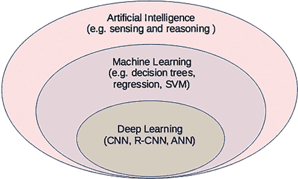

FIGURE 7.1 The context of artificial intelligence, machine learning, and deep learning.

### 7.1.1 Ultrasound Imaging

US imaging has been commonly used in routine clinical practice for diagnosis and visualization of internal organs (e.g. liver, kidney, and heart) and superficial structures (e.g. thyroid, breast, carotid artery, and muscles). An US transducer uses a piezoelectric material that converts electrical energy to mechanical movement, which transmits and receives sound waves with frequencies higher than human hearing. It generates US waves and transmits into the tissue and listens to receive the reflected sound wave (echo). The reflected echo signal is recorded in order to construct an image of the interrogated region. The sound waves travel through a soft tissue medium with approximately 1,540 m/s. The time of flight between the transmitted and received sound waves is used to locate objects and construct an image of the probed area. US has several advantages compared to magnetic resonance (MR), computed tomography (CT), and positron emission tomography (PET) imaging modalities. US is unharmful as it does not use destructive ionizing radiations like X-ray, CT, and PET. It is considerably lower in cost, handy for point-of-care (POCUS) applications, and provides actual real-time imaging. Since it is handy, it can be carried to a patient’s bedside for examining patients and monitoring changes over time. The disadvantages of US include operator dependability and being incapable of examining body areas that contain gas and bones.

Diverse image types are formed by using US (Figure 7.2). The most common types used in clinics are:

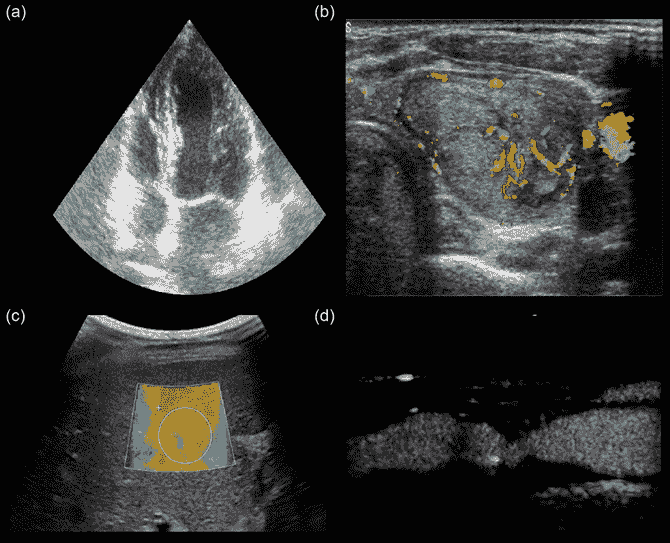

FIGURE 7.2 Sample US images showing different US modes. (a) A B-mode image of a heart: An apical four chamber view. (b) A color Doppler image of a thyroid nodule. (c) A Shear Wave Elastography map of a liver. (d) A CEUS image of a carotid artery.

* **B-mode ultrasound:** It is also called as brightness mode (B-mode) and is the most well-known US image. An US beam is scanned across a tissue to construct a 2D cross-section image of the tissue.
* **M-mode ultrasound:** Motion mode (M-mode) is used to examine motion over time. For example, it provides a single scan line of the heart and all of the reflectors along this line are shown along the time axis to measure the temporal resolution of the cardiac structures.

#### 多普勒超声波

当波源和观测者相对移动时，波的频率会发生变化，这称为多普勒效应。超声波探头（观测者）以特定频率向组织传递超声波。从移动物体（如血管内的红细胞）反射回来的超声波返回探头时会出现频率偏移。该频率偏移用于估计移动物体的速度。在血流中，记录相对于探头向前和向后运动的红细胞速度，以构建多普勒图像。超声信息叠加在 B-模式解剖图像上，用于显示血流的彩色多普勒图像。

#### 超声波剪切弹性成像（SWE）

该技术提供组织横截面的 2D 刚度图。使用超声探头产生的声辐射力在感兴趣组织内诱导推力，并产生剪切波。组织的刚度可通过剪切波在介质中传播的速度来测量。因此，SWE 能够表征人体各部位的机械和弹性特性，并可潜在用于肝脏、骨骼肌肉、甲状腺和乳腺成像。

#### 对比增强超声（CEUS）

CEUS 是一种功能成像技术，它抑制解剖细节但可视化血流信息。它利用 US 对比剂（脂质包覆气泡）的非线性响应。通常，相同介质中连续的两个 US 信号被传播，其回声响应相减以获得对比信号。由于组织产生线性回声响应，减法会抵消组织信号，仅保留气泡非线性响应的差分信号。该成像技术用于检查心腔腔体、评估颈动脉狭窄以及评估前列腺和肝脏灌注。它有助于检测组织灌注异常并增强组织边界的可见性。

## 7.1.2 Deep Learning

模仿生物神经元的人工神经网络（ANN）用于为输入信号创建表示，包含许多连续层，这些层从输入信号中学习特征层次结构。ANN 与图形处理单元（GPU）处理能力的进步，使得能够同时处理复杂的深度学习（DL）模型得以实现。DL 模型可以使用数千或数百万样本进行训练，以提高对数据变异的鲁棒性。DL 模型的表征能力极强，能够为任意信号变异创建表示。深度学习在图像分类和分割应用中的最新成就使其在数据科学社区中极为流行。传统机器学习方法使用从数据中手工提取的特征，并通过可分解的管道进行处理，这使得每个组件都可解释。另一方面，它们对数据变异的概括性和鲁棒性较差。与 DL 模型相比，我们在牺牲可解释性的同时，换取了鲁棒性和更大的概括能力，从而产生复杂且抽象的特征。

最先进的 DL 模型已被开发用于多种任务，如计算机视觉中的目标检测和分割、语音识别以及基因型/表型预测。模型类型包括卷积神经网络（CNNs）[2]、深度玻尔兹曼机、堆叠自动编码器[3]和深度信念网络[4]。处理图像的最常用 DL 方法是 CNN，因为全连接 ANN 对 2D/3D 图像计算负荷过大并需要大量 GPU 内存。CNN 在每个特征图或卷积层中共享权重，以缓解此问题。自 1989 年首次引入以来，CNN 已被广泛用于图像分类和分割任务，取得巨大成功[2]。当 CNN 在 2012 年的 ImageNet 竞赛中取得令人印象深刻的结果时，CNN 的应用获得巨大关注，该竞赛包含自然摄影图像。它们被用于对约一百万张、包含 1,000 类的数据集进行分类，实现了最流行传统 ML 方法的一半错误率[2]。


在大量数据上训练 DL 方法，使其在`ImageNet`竞赛中表现出显著的结果和鲁棒性。DL 方法也在医学影像分析领域获得认可\[8\]（例如病灶诊断\[1,9, 10, 11, 12, 13\]、组织和病灶分割\[1,14, 15, 16, 17, 18\]、组织病理分析\[19,20\]。最先进的`CNN`模型架构日益紧凑，部分模型层数超过 100 层，这意味着数百万个权重和节点之间的数十亿条连接。典型的`CNN`架构由卷积层、最大池化层和激活层的连续层组成。特征图通过在前一层的输出上卷积卷积核生成。最大池化用于通过计算预定义邻域的最大值来下采样特征图。或者，可以使用步幅较大的卷积进行下采样。此外，激活函数被应用于层以产生非线性输出并抑制冗余。最常用的激活函数是整流线性单元（`ReLU`），它通过将负输入值剪至零并仅将正输入值传递到输出，非线性地转换输入信号\[21\]。文献中还使用了其他激活函数（如漏`ReLU`、`ELU`、`sigmoid`、`maxout`和双曲正切）。在最终层，采用`softmax`非线性函数，将输出分数归一化为标签的多项式分布。最终`CNN`层的输出分数连接到`softmax`层，以获得每类的预测概率。此外，随机梯度下降（`SGD`）等优化器通过损失函数最小化预测与真实标签之间的误差来训练模型。随后，利用链式法则进行反向传播，估计损失函数对权重的梯度。梯度和学习率用于在每次迭代中更新权重，直至模型收敛到稳定状态（Figure 7.3）。由于深度学习算法在一般情况下优于机器学习算法，并利用 GPU 处理能力，因此能够实现 US 图像的实时处理。本章其余部分将专注于 AI 驱动 US 在放射学和心脏学中的深度学习应用。

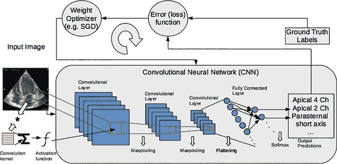

FIGURE 7.3 A framework of training a deep learning model for classification of echo views. Operations in between layers are shown with arrows.

为评估机器学习模型的性能，数据通常被分为训练集、验证集和测试集。训练集用于学习数据，验证集用于评估学习结果的可靠性，测试集用于评估训练好的模型在未观测数据上的可推广性。当训练样本有限时，`k`折交叉验证方法（如留一出、五折或十折交叉验证）被采用。在交叉验证中，数据被随机划分为`k`等大的份 pieces。一份份用于评估模型的性能，剩余的`k`−1 份用于训练模型。训练过程通常以监督方式进行，即对每个输入数据提供真实标签，并逐步最小化训练样本的损失函数。监督学习是机器学习方法中最常用的训练方式，但需要耗费大量时间生成真实标签。在医学影像中，真实标签通常从临床记录中获取用于诊断或量化。此外，专家手动轮廓化病灶或结构用于训练用于分割任务的机器学习模型。

### 7.1.3 AI-Powered US in Radiology

随着多模态成像技术（如 2D/3D/4D 解剖和功能性超声、CT、MR、PET/SPECT）的快速发展，医学影像数据呈指数级增长，迫切需要以有条理的方式处理影像数据，以辅助放射科医生。计算机辅助检测与量化（CAD）是诊断放射学的持续研究主题。CAD 系统为放射科医生提供第二意见，帮助其解读图像，从而提高诊断的精确性和一致性，并缩短阅片时间。大部分 CAD 系统基于传统机器学习方法，利用纹理特征并经历以下步骤：图像预处理、手工特征提取、主要特征选择以及分类。尽管 CAD 系统在辅助放射科医生方面展现出巨大前景，但仍存在若干局限性（如数据集有限、主观选择包含病变的感兴趣区域、数据来自单一供应商的单一医疗机构）。因此，将基于纹理的传统机器学习算法在临床流程中用于辅助放射科医生的应用难以适应。近期，深度学习领域的研究提出了基于深度学习的超声 CAD 系统 \[10,22\]。深度学习方法能够将一个中心的经验通过微调新数据（来自不同品牌超声设备的新数据集）转移到新数据集，从而实现跨中心、跨设备的模型适应，这称为迁移学习。近年来，针对疾病（如良性或恶性甲状腺结节）的检测、量化和分类的 AI 驱动超声方法已在过去 5 年中大量发展。

- [甲状腺结节](https://wiki.example.org/feynmans_learning_method)是固体或液体填充的肿块，在解剖研究中显示占成年人群体的 40%–50%。细针吸活检（FNA）是当前唯一的非手术检查方法，用于在临床实践中区分良性结节和恶性结节。选定 FNA 的甲状腺结节患者中，癌症的总体频率仅约 10%，如多项研究所示 \[27,28\]。因此，识别不需要活检或手术的结节很重要，因为大多数甲状腺结节均为良性。一种无创且可靠的诊断方法将显著降低医疗费用并减轻患者对活检的顾虑。为建立此类 CAD 系统，需要在保持合理特异性的同时，将敏感性达到或接近 100%以确保不遗漏癌症，从而避免不必要的活检。已有多项研究提出利用深度学习（DL）方法对 2D 超声（US）图像中的甲状腺结节进行分类和分割。仅评估 2D 横断面图像是当前研究的局限，因为癌症发育具有异质性，2D 切片可能无法完整覆盖结节内的癌症。因此，3D 体积基于的方法比 2D 成像方法提供更准确可靠的结果。Ma 等人 \[29\] 最近提出了一种融合两个定制`CNN`模型的 DL 方法，用于区分良性与恶性结节。该模型在来自两家医院的大型多供应商 US 数据集上训练（医院 1 8,148 例患者 + 医院 2 4,782 例患者，共计 15,000 张图像），并通过十倍交叉验证实现平均准确率 83.02% ∓ 0.72%。然而，该研究的接收机构特征曲线（ROC）显示该模型普遍漏检部分恶性患者，未达 100%敏感性，因此难以作为诊断工具。另一项研究中，Ma 及其团队 \[30\] 开发了两个堆叠的`CNN`模型，用于从 B 模式 US 图像中检测结节。模型采用`k`折交叉验证，报告平均 AUC 为 98.51%。由于 B 模式 US 图像中结节边界模糊且易遗漏，从 B 模式 US 图像中精确自动分割结节是一项困难且不可靠的任务。Li 等人 \[31\] 使用`Faster R-CNN`模型检测 B 模式 US 图像中的良性和恶性结节区域，实现了 93.5%的敏感性和 81.5%的特异性用于检测乳头状甲状腺癌。Li 等人 \[32\] 又在一项多队列大规模研究中报告，该研究包含来自三家医院的 332,180 张图像，涵盖 45,644 名患者。他们评估了`CNN`模型的敏感性并与经验丰富的放射科医生团队进行比较，结论是该模型的敏感性与经验丰富的放射科医生相当，但特异性更高。Akku 等人 \[11\] 训练了带有注意力图的`Inception`和`ResNet` `CNN`模型，以识别 B 模式 US 图像中的恶性结节。模型在包含横断面和纵断面图像的测试集（100 张结节图像）上实现了 86%的敏感性和 90%的特异性。其 ROC 曲线表明，当阈值设定为 100%敏感性时，可将活检减少 52%而不遗漏任何恶性甲状腺结节患者。Choi 等人 \[22\] 利用 Samsung Medison Co.的商用 CAD 系统（`S-Detect for Thyroid`）对 89 名患者的 102 个结节进行分类，结果显示该系统的敏感性与经验丰富的放射科医生相当。Pereira 等人 \[33\] 则利用深度学习方法处理弹性波（SWE）图像以特征化甲状腺结节，在测试数据集上获得 83%的准确率。Chi 等人 \[12\] 采用`GoogleNet` `CNN`模型结合转移学习，在 61 名患者的测试数据集上实现了 98.29%的准确率，用于区分良性与恶性结节。

- [乳腺癌](https://wiki.example.org/feynmans_learning_method)是女性中最常见的癌症类型之一，也是女性癌症相关死亡的主要原因 \[34\]。乳腺成像报告与数据系统（`BI-RADS`）评分系统被广泛用于使乳腺 B 模式 US 图像的报告更加一致，减少解读中的混淆。然而，多项研究显示`BI-RADS`存在大量内在和间 observers 变异性 \[35,36\]。因此，一个具有高敏感性和负性预测值的 CAD 系统不仅能降低内在和间 observers 变异性，还能缩短阅读时间，为放射科医生提供第二意见，并可能减少不必要的活检。多项研究尝试在 B 模式 US 图像中客观、可重复地分类良性和恶性乳腺病变。Byra 等人 \[37\] 最早的一项研究使用迁移学习对乳腺病变进行分类，并使用预先在`ImageNet`数据集上训练的`VGG19` `CNN`模型，对乳腺肿块的 B 模式 US 图像进行微调。其在 150 例病例的测试数据集上实现了 93.6%的 AUC。研究者认为该模型有潜力辅助放射科医生做出分类决策。Han 等人 \[40\] 训练了一个`GoogleNet`模型，使用 7,408 张乳腺 US 图像，并在 829 张测试图像上达到 90%的准确率、86%的敏感性和 96%的特异性。该模型作为 Samsung Ultrasound System RS80A 商用`S-Detect`技术的一部分实现。Cheng 等人 \[10\] 使用堆叠去噪自动编码器模型对乳腺病变进行分类，报告平均 AUC 为 89.6%，超越了传统机器学习方法。Zhang 等人 \[41\] 的研究表明，利用 SWE 图像和深度学习方法可获得更佳的乳腺肿块分类性能。深度学习也被用于从 US 图像中检测和分割乳腺病变 \[42,43\]，但由于乳腺病变对比度低且边界不清，精确自动分割仍然十分困难。

- 各种肝脏疾病（如慢性病毒性肝炎和酒精性肝病、血色素沉着症、脂肪肝）是肝硬化的终末表现形式。超声（US）是广泛用于诊断肝脏疾病的影像学检查方式，因为它能提供肝脏结构变化及门静脉血流的信息，而肝活检是评估肝硬化的金标准，但它具有侵入性，并存在一些局限性（如局部定位不精确导致采样错误、出血和感染）。一些研究使用深度学习（DL）方法利用 B-模式和弹性波（SWE）超声图像来区分肝脏疾病。最近，王等人 \[[44\] 在多中心研究中提出了一种基于 US SWE 图像的深度学习方法，用于分期肝纤维化。该研究发现，利用 SWE 图像的深度学习对三个肝纤维化分期（肝硬化、进展性纤维化、显著纤维化）的分期准确率更高（AUC 为 97%、98% 和 85%），适用于患有慢性乙型肝炎的患者。早期诊断对于预防疾病至关重要。一款能够检测肝实质早期变化的 AI 模型将在患者治疗计划中非常有用。另一项研究，孟等人 \[45\] 使用迁移学习微调`VGGNet`，用于检测肝脏纤维化阶段，其方法的准确率为 93.90%。在另一项研究中，刘等人 \[46\] 采用迁移学习，使用预训练在`ImageNet`数据集上的卷积神经网络（`CNN`）提取肝囊的特征，并将这些特征输入支持向量机（`SVM`）以区分异常肝脏和正常肝脏。该模型的 AUC 达到 96.8%，高于使用手工制作纹理特征的`SVM`模型。吴等人 \[47\] 使用深信网（deep belief network）模型对 CEUS 图像中的局灶性肝病变进行分类，与传统机器学习方法相比，其性能更佳（准确率 86.36% vs. 66.67%–81.86%）。另一项研究利用深度学习在 B-模式超声图像中检测脂肪肝，其性能优于传统机器学习方法（100% vs. 82%–92%）\[48\]。如上所示，深度学习方法可用于从 B-模式和 SWE 超声图像中诊断肝脏疾病，理论上可以减少不必要的肝活检及相关医疗费用。

除了上述超声（US）中深度学习（DL）的应用外，许多其他基于人工智能的 US 应用也被研究。吴等人 \[49\] 使用深度学习评估胎儿超声图像的质量，以实现精确测量。陈等人 \[50\] 和于等人 \[52\] 使用深度学习模型检测胎儿的标准成像平面。Menchon-Lara 等人 \[51\] 采用深度学习对血管内膜-介壁厚度（IMT）进行分段，结果优于传统方法。Hetherington 等人 \[53\] 介绍了一种深度学习方法，用于从 B-模式超声图像中识别脊柱椎体水平，这有助于麻醉医生找到正确的注射部位。Lekadir 等人 \[54\] 使用卷积神经网络（`CNN`）对颈动脉斑块的组织成分（如脂质、纤维和钙化）进行分类，性能优于`SVM`模型。Cheng 和 Malhi \[55\] 使用`CNN`检测超声图像的解剖位置及腹部成像平面。此外，深度学习还被用于改进便携式超声系统的图像构建，因为这些系统使用少量的发射和接收元件来降低功耗。重建质量良好的超声图像、使用更少的发射/接收无线电频（RF）信道的需求日益增长。Yoon 等人 \[56\] 使用基于深度学习的方法，从下采样的 RF 数据重建质量相同的超声图像，这也有助于提高 3D 超声体积获取的时间分辨率。深度学习方法也被用于弹性波成像图像的重建 \[57\]、超声束成形 \[58,59\] 和图像恢复 \[60\]。

### 7.1.4 AI-Powered US in Cardiology

心脏超声（也称为心电图/超声，echocardiography）是目前最广泛用于评估心脏结构和功能的非侵入性影像学检查方式（如左心室射血分数、心输出量、舒张功能和瓣膜疾病）。人工智能辅助的心电图/超声可以在心脏专家和非专家（如初级和急诊诊所）中，实现心脏结构和功能的低成本、重复和自动化评估。这也能够在急诊室对胸痛患者进行分层 triage，并以个性化方式对有心血管风险因素的患者进行长期监测。随着超声技术的进步，当前的床旁 US 系统（cart-based）可能会被便携式点对点超声（`POCUS`）系统所取代。`GE Vscan`、`Butterfly IQ`和`Philips Lumify`是流行的`POCUS`设备。单个`Butterfly IQ`探头包含 9,000 个微加工的半导体传感器，能够模拟线性、相控和曲线阵列探头。虽然`Butterfly IQ`探头利用`US-on-chip`技术可用于全身成像，`Philips Lumify`提供针对不同器官的专用探头（如用于心脏应用的`s4-1`相控阵探头）。`GE Vscan`配备两个探头，可用于扫描深部和浅部结构。在点对点位置使用云端 AI 心电图解释的`POCUS`设备可以显著降低超声成本，并提升非专家在初级和急诊科的 AI 辅助心电图实用性（Figure 7.4）。近年来，发表了大量利用深度学习方法对标准心电图视图（如顶叶和腹侧视）进行分类、心脏结构（如心室、心房、隔膜、心肌和心包）进行分割，以及预测心脏疾病（如心力衰竭、肥厚型心肌病、心肌淀粉样变和肺高压）的研究。

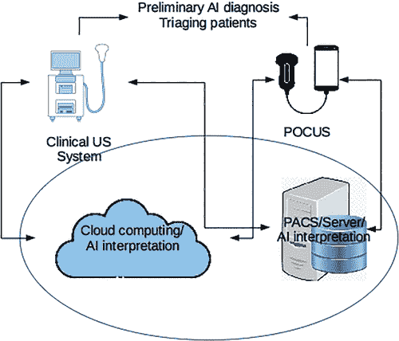

FIGURE 7.4 A schematic diagram of AI interpretation of echocardiography images for preliminary diagnosis and triaging patients in emergency and primary care clinics.

心电图/超声是一个高度依赖操作者的影像学检查，存在数据采集和评估的变异性。除了操作者的变异外，还包括患者特定的变异（如信噪比和因解剖结构或体重差异导致的有限声窗），以及机器特定的变异（如电子噪声和对采集图像应用的后处理滤波）。图像质量在自动化测量的准确处理流程中起着重要作用。图像质量不佳可能影响所有测量，导致患者误诊。

Abdi 等人 \[61\] 训练了一个全连接`CNN`，使用了 6,916 张舒张期心尖四腔（`A4C`）回声图像，评分范围为 0 到 5，用于评估心尖四腔回声图像的质量。他们报告的错误与评分一致性（平均绝对误差：0.71 ± 0.58）相当。Zhang 等人 \[62,63\] 提出了一种完全自动回声解释管道，包含 23 种视图分类、五种常见视图中心脏腔室的分割、结构和功能的量化以及疾病检测。他们的结果在 8,666 张具有手动分割和测量的回声图像上进行了评估。他们的`CNN`方法准确识别了视图（例如，室壁长轴视图的准确率为 96%），并获得的心脏结构测量值与研究报告中的数值相当。他们模型在预测肥厚型心肌病、心肌淀粉样变和肺高血压方面的 ROC 曲线下的 AUC 值分别为 0.93、0.87 和 0.85。他们计算了所有研究视频中视图分类的平均概率得分，以定义研究的图像质量评分。Leclerc 等人 \[64\] 研究了最先进的编码器-解码器类深度学习（DL）方法（例如`U-Net` \[65\]），用于心脏结构的分割，并创建了包含 500 名患者的大型公开数据集，提供舒张期和收缩期帧的分割标签。此外，其他一些研究也使用了`CNN`模型对心脏结构进行分割。Carneiro 等人 \[66\] 使用了深信网络对 2D 回声图像中的左心室（`LV`）进行分割。Nascimento 等人 \[70\] 也采用了类似的方法分割`LV`。Jafari 等人 \[67\] 提出了一种循环全连接`CNN`和光流法，用于回声图像中`LV`的分割。Jafari 等人 \[68\] 也提出了基于多任务学习和对抗训练的`POCUS`双视图射血分数估计。他们提出的模型在`LV`分割方面的平均 Dice 系数为 0.92，自动射血分数的绝对误差约为 6.2%。Chen 等人 \[69\] 提出了一种带有多视图正则化的编码器-解码器`CNN`，以提高`LV`分割效果。该方法在 566 名患者上进行了评估，获得了 92.7% 的 Dice 分数。Oktay 等人 \[71\] 在他们的`CNN`模型中引入了解剖学先验知识，使其能够遵循底层解剖结构的全局解剖特性。Mandani 等人 \[72\] 使用深度学习对回声图像进行视图分类，整体测试准确率为 97.8%。

### 7.2 Discussion and Outlook


自动化图像解释，以模仿人类视觉，基于传统机器学习的方法已存在很长时间。随着 GPU 并行处理和深度学习（DL）算法的最新进展，这些算法能够自学从图像中提取模式，从而彻底改变了自动化图像解释实践，在计算速度、算法通用性和算法可迁移性方面取得了显著提升。AI 驱动的超声（US）技术正在迅速发展，并逐步接近在放射学和心脏学中常规临床工作流中的应用，因为对标准化 US 图像的获取和解释的需求日益增加。尽管 DL 方法在 US 诊断和疾病定量方面展现出有前景的结果，但 AI 驱动的 US 仍落后于 CT 和 MR 成像中 AI 应用的进展。US 图像的高内部和外部变异性使得标准化 US 图像的获取和解释变得困难。AI 可以缓解操作员依赖性变异和可解释性问题，但患者相关因素（如肥胖、视野受限、伪影和信号丢失）对图像质量的影响仍未得到解决。基于上述 DL 应用的结果，DL 方法的泛化能力已被证明优于传统机器学习（ML）方法。因此，DL 方法正变得越来越流行，并正在取代传统 ML 方法。

DL 在 US 中的应用正在迅速发展，这从最近大量研究的增多可以看出。DL 模型具有巨大的表示能力，需要大量数据以获得泛化能力和稳定性。创建包含大量、经过精心整理、质量良好且标记准确的数据库是整个 AI 模型开发过程中最具挑战性和耗时的部分。尽管 AI 驱动的 US 应用在性能上已显著优于传统 ML 方法，但训练和验证 AI 模型通常使用的数据集较小。因此，在大型多供应商和多中心数据集上训练 AI 模型，以获得更好的泛化能力，并通过在大型多供应商数据集上进行验证，可提高拟议模型的可靠性。为克服这一限制，一些研究采用了转移学习和微调技术。然而，这些方法通常使用 ImageNet 中的自然光学图像知识来初始化 AI 模型，如文献 [37,45,55] 所述。这可能不是使用转移学习和微调的合适方式，因为 US 图像与自然光学图像差异显著。更合适的做法是使用先前从 US 数据集中获得的知识来初始化 AI 模型，然后在新的、来自不同中心、不同供应商的数据集上进行微调。另一种克服有限数据集限制的方法是通过逼真的数据增强（如缩放、水平翻转、平移、添加噪声、组织变形和增强对比度）来扩充数据集，这有助于提高 AI 模型的泛化能力。然而，这些增强必须真实模拟 US 图像中的变异，并且在应用于实际图像时不应产生伪影。例如，垂直翻转 US 图像并不具有说服力，因为 US 梯的影像在通过介质的过程中不会出现逆向影像。另一种方法是使用生成对抗网络（GANs），该网络包含生成器和判别器两个模型，经过训练，生成器能够生成与真实图像不可区分的图像。这可以用于生成逼真的 US B-模式图像，用于感兴趣器官的成像。在训练过程中引入此类增强，可使 AI 模型对输入数据空间中的小扰动更具鲁棒性。

仅凭二维切片图像进行预测可能被视为 AI 驱动 US 系统的局限性之一。二维切片图像信息有限，无法完整表示病变。将 AI 模型训练在包含完整病变或感兴趣结构、多视图或时序数据的 3D US 数据上，有望提高 AI 模型的诊断准确性。此外，利用多模态 US 图像（如 B-模式、多普勒、CEUS 和 SWE）的组合，这些图像相互补充，也能够提升 AI 模型的诊断性能。

它对于设计能够从医学影像预测任何疾病的透明 AI 模型至关重要。为疾病诊断开发的 AI 模型必须阐明其预测背后的原因和动机，以建立对它们的信任。要理解 AI 模型的内部机制，需要解释每一层 [73, 74, 75] 中特征图的活动。然而，提取出的特征是多个连续层的组合，这些层变得复杂且抽象，因此对这些特征的解释比传统机器学习方法中的手工制作影像特征更为困难。传统机器学习方法采用可分割的组件，结构更易理解。虽然每个组件都有解释，但通常准确性和鲁棒性不高。基于深度学习的 AI 模型则牺牲了可解释性，以换取对复杂影像特征的更强泛化能力。最近，出现了多种方法，揭示深度学习模型“看到”什么以及如何做出预测。多个 CNN 架构 [38,65,76,77,78] 使用了卷积网络 [79]、梯度反向传播 [80]、类激活图（CAM）[81]、梯度加权 CAM [82] 和显著性图 [83,84] 等技术，使 CNN 更具可解释性。通过这些技术，模型的梯度被投射回输入图像空间，从而显示在输入图像中哪些部分对预测结果的最大化分类准确性贡献最大。虽然使 AI 模型可理解是深度学习社区的活跃研究话题，但仍有大量工作需要完成。

开发标准化图像采集和解释、减少变异性的 AI 模型至关重要，因为超声（US）是一种由操作者和解释者决定的成像模态。AI 在数据采集过程中的指导（如最佳角度、视角和测量）可使 US 更少依赖操作者，更智能，并标准化采集。具备 AI 能力的低成本、易于获取的便携式超声系统（POCUS）将帮助临床医生和非专家对患者进行快速初步检查，并在急诊和基层诊疗中迅速做出关键决策。未来，具备 AI 能力的 POCUS 系统可能取代医生日常使用的听诊器，用于听诊患者心脏。由 AI 驱动的临床超声或 POCUS 系统能够评估多模态数据、在采集过程中指导 sonographers，并提供客观的资格、测量和诊断，从而辅助诊断和治疗决策，改善诊所中的超声工作流程，降低医疗成本。

## References

1. Z. Akkus, A. Galimzianova, A. Hoogi, D. L. Rubin, and B. J. Erickson, “Deep Learning for Brain MRI Segmentation: State of the Art and Future Directions,” *J. Digit. Imaging*, vol. 30, pp. 449–459, 2017.

2. A. Krizhevsky, I. Sutskever, and G. E. Hinton, “ImageNet Classification with Deep Convolutional Neural Networks,” in *Advances in Neural Information Processing Systems 25*, F. Pereira, C. J. C. Burges, L. Bottou, and K. Q. Weinberger, Eds. Curran Associates, Inc., Harrah's Lake Tahoe, Stateline, NV, 2012, pp. 1097–1105.

3. P. Vincent, H. Larochelle, I. Lajoie, Y. Bengio, and P.-A. Manzagol, “Stacked Denoising Autoencoders: Learning Useful Representations in a Deep Network with a Local Denoising Criterion,” *J. Mach. Learn. Res.*, vol. 11, no. Dec, pp. 3371–3408, 2010.

4. G. E. Hinton, S. Osindero, and Y.-W. Teh, “A Fast Learning Algorithm for Deep Belief Nets,” *Neural Comput.*, vol. 18, no. 7, pp. 1527–1554, Jul. 2006.

5. Y. LeCun et al., “Backpropagation Applied to Handwritten Zip Code Recognition,” *Neural Comput.*, vol. 1, no. 4, pp. 541–551, 1989.

6. J. Deng et al., “ImageNet: A large-scale hierarchical image database,” in *2009 IEEE Conference on Computer Vision and Pattern Recognition*, 2009, doi: [10.1109/cvprw.2009.5206848](https://doi.org/10.1109/cvprw.2009.5206848).

7. O. Russakovsky et al., “ImageNet Large Scale Visual Recognition Challenge,” *Int. J. Comput. Vis.*, vol. 115, no. 3, pp. 211–252, 2015.

8. D. Lin, A. V. Vasilakos, Y. Tang, and Y. Yao, “Neural Networks for Computer-Aided Diagnosis in Medicine: A Review,” *Neurocomputing*, vol. 216, pp. 700–708, Dec. 2016.

9. T. Kooi et al., “Large Scale Deep Learning for Computer Aided Detection of Mammographic Lesions,” *Med. Image Anal.*, vol. 35, pp. 303–312, Jan. 2017.

10. J.-Z. Cheng et al., “Computer-Aided Diagnosis with Deep Learning Architecture: Applications to Breast Lesions in US Images and Pulmonary Nodules in CT Scans,” *Sci. Rep.*, vol. 6, p. 24454, Apr. 2016.

11. Z. Akkus, A. Boonrod, M. Stan, R. Castro, and B. J. Erickson, “Reduction of thyroid nodule biopsies using deep learning,” *Proc. SPIE Medical Imaging*, 2019, Image Processing, vol. 10949-31, in press.

12. J. Chi, E. Walia, P. Babyn, J. Wang, G. Groot, and M. Eramian, “Thyroid Nodule Classification in Ultrasound Images by Fine-Tuning Deep Convolutional Neural Network,” *J. Digit. Imaging*, vol. 30, no. 4, pp. 477–486, Aug. 2017.

13. L. J. Brattain, B. A. Telfer, M. Dhyani, J. R. Grajo, and A. E. Samir, “Machine Learning for Medical Ultrasound: Status, Methods, and Future Opportunities,” *Abdom Radiol (NY)*, vol. 43, no. 4, pp. 786–799, Apr. 2018.

14. Z. Akkus, P. Kostandy, A. K. Philbrick, and B. J. Erickson, “Robust Brain Extraction Tool for CT Images,” *Neurocomputing*, in press.

15. Z. Akkus, P. Kostandy, K. Phillbrick, and B. J. Erickson, “Extraction of brain tissue from CT head images using fully convolutional neural networks,” in *SPIE Medical Imaging*, Houston, TX, 2018.

16. G. Litjens et al., “A Survey on Deep Learning in Medical Image Analysis,” *Med. Image Anal.*, vol. 42, pp. 60–88, Dec. 2017.

17. F. Milletari, N. Navab, and S. Ahmadi, “V-net: Fully convolutional neural networks for volumetric medical image segmentation,” in *2016 Fourth International Conference on 3D Vision (3DV)*, 2016, pp. 565–571.

18. A. D. Weston et al., “Automated Abdominal Segmentation of CT Scans for Body Composition Analysis Using Deep Learning,” *Radiology*, p. 181432, Dec. 2018.

19. G. Litjens et al., “Deep Learning as a Tool for Increased Accuracy and Efficiency of Histopathological Diagnosis,” *Sci. Rep.*, vol. 6, p. 26286, May 2016.

20. A. Janowczyk and A. Madabhushi, “Deep Learning for Digital Pathology Image Analysis: A Comprehensive Tutorial with Selected Use Cases,” *J. Pathol. Inform.*, vol. 7, p. 29, Jul. 2016.

21. K. He, X. Zhang, S. Ren, and J. Sun, “Delving deep into rectifiers: Surpassing human-level performance on ImageNet classification,” in *2015 IEEE International Conference on Computer Vision (ICCV)*, 2015, doi: [10.1109/iccv.2015.123](https://doi.org/10.1109/iccv.2015.123).

22. Y. J. Choi et al., “A Computer-Aided Diagnosis System Using Artificial Intelligence for the Diagnosis and Characterization of Thyroid Nodules on Ultrasound: Initial Clinical Assessment,” *Thyroid*, vol. 27, no. 4, pp. 546–552, Apr. 2017.

23. K. D. Burman and L. Wartofsky, “CLINICAL PRACTICE. Thyroid Nodules,” *N. Engl. J. Med.*, vol. 373, no. 24, pp. 2347–2356, Dec. 2015.

24. A. Jemal et al., “Cancer Statistics, 2005,” *CA Cancer J. Clin.*, vol. 55, no. 1, pp. 10–30, Jan. 2005.

25. L. Hegedüs, “The Thyroid Nodule,” *N. Engl. J. Med.*, vol. 351, no. 17, pp. 1764–1771, Oct. 2004.

26. American Thyroid Association (ATA) Guidelines Taskforce on Thyroid Nodules and Differentiated Thyroid Cancer et al., “Revised American Thyroid Association Management Guidelines for Patients with Thyroid Nodules and Differentiated Thyroid Cancer,” *Thyroid*, vol. 19, no. 11, pp. 1167–1214, Nov. 2009.

27. M. C. Frates et al., “Management of Thyroid Nodules Detected at US: Society of Radiologists in Ultrasound Consensus Conference Statement,” *Ultrasound Q.*, vol. 22, no. 4, pp. 231–238; discussion 239–240, Dec. 2006.

28. J. T. Guille, A. Opoku-Boateng, S. L. Thibeault, and H. Chen, “Evaluation and Management of the Pediatric Thyroid Nodule,” *Oncologist*, vol. 20, no. 1, pp. 19–27, Jan. 2015.

29. J. Ma, F. Wu, J. Zhu, D. Xu, and D. Kong, “A Pre-Trained Convolutional Neural Network Based Method for Thyroid Nodule Diagnosis,” *Ultrasonics*, vol. 73, pp. 221–230, Jan. 2017.


30. J. Ma, F. Wu, T. Jiang, J. Zhu, and D. Kong, “Cascade Convolutional Neural Networks for Automatic Detection of Thyroid Nodules in Ultrasound Images,” `Med. Phys.`, vol. 44, no. 5, pp. 1678–1691, May 2017.

31. H. Li et al., “An Improved Deep Learning Approach for Detection of Thyroid Papillary Cancer in Ultrasound Images,” `Sci. Rep.`, vol. 8, no. 1, p. 6600, Apr. 2018.

32. X. Li et al., “Diagnosis of Thyroid Cancer Using Deep Convolutional Neural Network Models Applied to Sonographic Images: A Retrospective, Multicohort, Diagnostic Study,” `Lancet Oncol.`, Dec. 2018, doi: [10.1016/S1470-2045\(18\)30762-9](https://doi.org/10.1016/S1470-2045\(18\)30762-9).

33. C. Pereira, M. Dighe, and A. M. Alessio, “Comparison of machine learned approaches for thyroid nodule characterization from shear wave elastography images,” in `Medical Imaging 2018: Computer-Aided Diagnosis`, 2018, vol. 10575, p. 105751X.

34. “WHO | Breast cancer,” Sep. 2018.

35. F. Schwab, K. Redling, M. Siebert, A. Schötzau, C.-A. Schoenenberger, and R. Zanetti-Dällenbach, “Inter- and Intra-Observer Agreement in Ultrasound BI-RADS Classification and Real-Time Elastography Tsukuba Score Assessment of Breast Lesions,” `Ultrasound Med. Biol.`, vol. 42, no. 11, pp. 2622–2629, Nov. 2016.

36. L. J. Grimm et al., “Interobserver Variability Between Breast Imagers Using the Fifth Edition of the BI-RADS MRI Lexicon,” `AJR Am. J. Roentgenol.`, vol. 204, no. 5, pp. 1120–1124, May 2015.

37. M. Byra et al., “Breast Mass Classification in Sonography with Transfer Learning Using a Deep Convolutional Neural Network and Color Conversion,” `Med. Phys.`, Dec. 2018, doi: [10.1002/mp.13361](https://doi.org/10.1002/mp.13361).

38. K. Simonyan and A. Zisserman, “Very deep convolutional networks for large-scale image recognition,” `arXiv \[cs.CV\]`, 04-Sep-2014.

39. C. Szegedy et al., “Going deeper with convolutions,” in `2015 IEEE Conference on Computer Vision and Pattern Recognition (CVPR)`, 2015, pp. 1–9.

40. S. Han et al., “A Deep Learning Framework for Supporting the Classification of Breast Lesions in Ultrasound Images,” `Phys. Med. Biol.`, vol. 62, no. 19, pp. 7714–7728, Sep. 2017.

41. Q. Zhang et al., “Deep Learning Based Classification of Breast Tumors with Shear-Wave Elastography,” `Ultrasonics`, vol. 72, pp. 150–157, Dec. 2016.

42. M. H. Yap et al., “Automated Breast Ultrasound Lesions Detection Using Convolutional Neural Networks,” `IEEE J. Biomed. Health Inform.`, vol. 22, no. 4, pp. 1218–1226, Jul. 2018.

43. V. Kumar et al., “Automated and Real-Time Segmentation of Suspicious Breast Masses Using Convolutional Neural Network,” `PLoS One`, vol. 13, no. 5, p. e0195816, May 2018.

44. K. Wang et al., “Deep Learning Radiomics of Shear Wave Elastography Significantly Improved Diagnostic Performance for Assessing Liver Fibrosis in Chronic Hepatitis B: A Prospective Multicentre Study,” `Gut`, May 2018, doi: [10.1136/gutjnl-2018-316204](https://doi.org/10.1136/gutjnl-2018-316204).

45. D. Meng, L. Zhang, G. Cao, W. Cao, G. Zhang, and B. Hu, “Liver Fibrosis Classification Based on Transfer Learning and FCNet for Ultrasound Images,” `IEEE Access`, vol. 5, pp. 5804–5810, 2017.

46. X. Liu, J. L. Song, S. H. Wang, J. W. Zhao, and Y. Q. Chen, “Learning to Diagnose Cirrhosis with Liver Capsule Guided Ultrasound Image Classification,” `Sensors`, vol. 17, no. 1, Jan. 2017, doi: [10.3390/s17010149](https://doi.org/10.3390/s17010149).

47. K. Wu, X. Chen, and M. Ding, “Deep Learning Based Classification of Focal Liver Lesions with Contrast-Enhanced Ultrasound,” `Optik`, vol. 125, no. 15, pp. 4057–4063, Aug. 2014.

48. M. Biswas et al., “Symtosis: A Liver Ultrasound Tissue Characterization and Risk Stratification in Optimized Deep Learning Paradigm,” `Comput. Methods Programs Biomed.`, vol. 155, pp. 165–177, Mar. 2018.

49. L. Wu, J.-Z. Cheng, S. Li, B. Lei, T. Wang, and D. Ni, “FUIQA: Fetal Ultrasound Image Quality Assessment with Deep Convolutional Networks,” `IEEE Trans. Cybern.`, vol. 47, no. 5, pp. 1336–1349, May 2017.

50. H. Chen et al., “Ultrasound Standard Plane Detection Using a Composite Neural Network Framework,” `IEEE Trans. Cybern.`, vol. 47, no. 6, pp. 1576–1586, Jun. 2017.

51. R. Menchón-Lara and J. Sancho-Gómez, “Ultrasound image processing based on machine learning for the fully automatic evaluation of the Carotid Intima-Media Thickness,” in `2014 12th International Workshop on Content-Based Multimedia Indexing (CBMI)`, 2014, pp. 1–4.

52. Z. Yu et al., “A Deep Convolutional Neural Network-Based Framework for Automatic Fetal Facial Standard Plane Recognition,” `IEEE J. Biomed. Health Inform.`, vol. 22, no. 3, pp. 874–885, May 2018.

53. J. Hetherington, V. Lessoway, V. Gunka, P. Abolmaesumi, and R. Rohling, “SLIDE: Automatic Spine Level Identification System Using a Deep Convolutional Neural Network,” `Int. J. Comput. Assist. Radiol. Surg.`, vol. 12, no. 7, pp. 1189–1198, Jul. 2017.

54. K. Lekadir et al., “A Convolutional Neural Network for Automatic Characterization of Plaque Composition in Carotid Ultrasound,” `IEEE J. Biomed. Health Inform.`, vol. 21, no. 1, pp. 48–55, Jan. 2017.

55. P. M. Cheng and H. S. Malhi, “Transfer Learning with Convolutional Neural Networks for Classification of Abdominal Ultrasound Images,” `J. Digit. Imaging`, vol. 30, no. 2, pp. 234–243, Apr. 2017.

56. Y. H. Yoon, Yoon, S. Khan, J. Huh, and J. C. Ye, “Efficient B-mode Ultrasound Image Reconstruction from Sub-sampled RF Data using Deep Learning,” `IEEE Trans. Med. Imaging`, Aug. 2018, doi: [`10.1109/TMI.2018.2864821`](https://doi.org/10.1109/TMI.2018.2864821).

57. S. Wu, Z. Gao, Z. Liu, J. Luo, H. Zhang, and S. Li, “Direct reconstruction of ultrasound elastography using an end-to-end deep neural network: 21st International Conference, Granada, Spain, September 16–20, 2018, Proceedings, Part I,” in `Medical Image Computing and Computer Assisted Intervention – MICCAI 2018`, vol. 11070, A. F. Frangi, J. A. Schnabel, C. Davatzikos, C. Alberola-López, and G. Fichtner, Eds. Cham: Springer International Publishing, 2018, pp. 374–382.

58. A. A. Nair, T. D. Tran, A. Reiter, and M. A. L. Bell, “A deep learning based alternative to beamforming ultrasound images,” in `2018 IEEE International Conference on Acoustics, Speech and Signal Processing (ICASSP)`, 2018, pp. 3359–3363.

59. A. C. Luchies and B. C. Byram, “Deep Neural Networks for Ultrasound Beamforming,” `IEEE Trans. Med. Imaging`, vol. 37, no. 9, pp. 2010–2021, Sep. 2018.

60. D. Perdios, A. Besson, M. Arditi, and J. Thiran, “A deep learning approach to ultrasound image recovery,” in `2017 IEEE International Ultrasonics Symposium (IUS)`, 2017, pp. 1–4.

61. A. H. Abdi et al., “Automatic Quality Assessment of Echocardiograms Using Convolutional Neural Networks: Feasibility on the Apical Four-Chamber View,” `IEEE Trans. Med. Imaging`, vol. 36, no. 6, pp. 1221–1230, Jun. 2017.

62. J. Zhang et al., “A web-deployed computer vision pipeline for automated determination of cardiac structure and function and detection of disease by two-dimensional echocardiography,” `arXiv preprint arXiv:1706. 07342`, 2017.

63. J. Zhang et al., “Fully Automated Echocardiogram Interpretation in Clinical Practice: Feasibility and Diagnostic Accuracy,” `Circulation`, vol. 138, no. 16, pp. 1623–1635, 2018.

64. S. Leclerc et al., “Deep Learning for Segmentation Using an Open Large-Scale Dataset in 2D Echocardiography,” `IEEE Trans. Med. Imaging`, Feb. 2019, doi: [`10.1109/TMI.2019.2900516`](https://doi.org/10.1109/TMI.2019.2900516).


65. O. Ronneberger, P. Fischer, and T. Brox, “U-Net: Convolutional networks for biomedical image segmentation,” in *Medical Image Computing and Computer-Assisted Intervention – MICCAI 2015*, vol. 9351, N. Navab, J. Hornegger, W. M. Wells, and A. F. Frangi, Eds. Cham: Springer International Publishing, 2015, pp. 234–241.

66. G. Carneiro, J. C. Nascimento, and A. Freitas, “The Segmentation of the Left Ventricle of the Heart from Ultrasound Data Using Deep Learning Architectures and Derivative-Based Search Methods,” *IEEE Trans. Image Process.*, vol. 21, no. 3, pp. 968–982, Mar. 2012.

67. M. H. Jafari et al., “A unified framework integrating recurrent fully-convolutional networks and optical flow for segmentation of the left ventricle in echocardiography data,” in *Deep Learning in Medical Image Analysis and Multimodal Learning for Clinical Decision Support*, 2018, pp. 29–37.

68. M. H. Jafari et al., “Automatic Biplane Left Ventricular Ejection Fraction Estimation with Mobile Point-of-Care Ultrasound Using Multi-Task Learning and Adversarial Training,” *Int. J. Comput. Assist. Radiol. Surg.*, vol. 14, no. 6, pp. 1027–1037, Jun. 2019.

69. H. Chen, Y. Zheng, J.-H. Park, P.-A. Heng, and S. K. Zhou, “Iterative multi-domain regularized deep learning for anatomical structure detection and segmentation from ultrasound images,” in *Medical Image Computing and Computer-Assisted Intervention – MICCAI 2016*, 2016, pp. 487–495.

70. J. C. Nascimento and G. Carneiro, “Multi-atlas segmentation using manifold learning with deep belief networks,” in *2016 IEEE 13th International Symposium on Biomedical Imaging (ISBI)*, 2016, pp. 867–871.

71. O. Oktay et al., “Anatomically Constrained Neural Networks (ACNNs): Application to Cardiac Image Enhancement and Segmentation,” *IEEE Trans. Med. Imaging*, vol. 37, no. 2, pp. 384–395, Feb. 2018.

72. A. Madani, R. Arnaout, M. Mofrad, and R. Arnaout, “Fast and Accurate View Classification of Echocardiograms Using Deep Learning,” *NPJ Digit. Med.*, vol. 1, Mar. 2018, doi: [`10.1038/s41746-017-0013-1`](https://doi.org/10.1038/s41746-017-0013-1).

73. M. D. Zeiler and R. Fergus, “Visualizing and Understanding Convolutional Networks,” in *Lecture Notes in Computer Science*, 2014, pp. 818–833.

74. M. D. Zeiler, G. W. Taylor, and R. Fergus, “Adaptive deconvolutional networks for mid and high level feature learning,” in *2011 International Conference on Computer Vision*, 2011, doi: [`10.1109/iccv.2011.6126474`](https://doi.org/10.1109/iccv.2011.6126474).

75. B. Zhou, A. Khosla, A. Lapedriza, A. Oliva, and A. Torralba, “Learning deep features for discriminative localization,” in *2016 IEEE Conference on Computer Vision and Pattern Recognition (CVPR)*, 2016, doi: [`10.1109/cvpr.2016.319`](https://doi.org/10.1109/cvpr.2016.319).

76. K. He, X. Zhang, S. Ren, and J. Sun, “Deep residual learning for image recognition,” *arXiv \[cs.CV\]*, 10-Dec-2015.

77. C. Szegedy, V. Vanhoucke, S. Ioffe, J. Shlens, and Z. Wojna, “Rethinking the inception architecture for computer vision,” in *Proceedings of the IEEE Conference on Computer Vision and Pattern Recognition*, 2016, pp. 2818–2826.

78. V. Badrinarayanan, A. Kendall, and R. Cipolla, “SegNet: A Deep Convolutional Encoder-Decoder Architecture for Image Segmentation,” *IEEE Trans. Pattern Anal. Mach. Intell.*, vol. 39, no. 12, pp. 2481–2495, Dec. 2017.

79. M. D. Zeiler, D. Krishnan, G. W. Taylor, and R. Fergus, *Deconvolutional Networks*. IEEE Computer Society, 2010, pp. 2528–2535.

80. J. T. Springenberg, A. Dosovitskiy, T. Brox, and M. Riedmiller, “Striving for Simplicity: The All Convolutional Net,” *arXiv \[cs.LG\]*, 21-Dec-2014.

81. B. Zhou, A. Khosla, A. Lapedriza, A. Oliva, and A. Torralba, “Learning deep features for discriminative localization,” in *Proceedings of the IEEE Conference on Computer Vision and Pattern Recognition*, 2016, pp. 2921–2929.

82. A. Chattopadhay, A. Sarkar, P. Howlader, and V. N. Balasubramanian, “Grad-CAM++: Generalized gradient-based visual explanations for deep convolutional networks,” in *2018 IEEE Winter Conference on Applications of Computer Vision (WACV)*, 2018, pp. 839–847.

83. G. Li and Y. Yu, “基于多尺度深度 CNN 特征的视觉显著性检测,” *IEEE Trans. Image Process.*, 第 25 卷, 第 11 号, 第 5012–5024 页, 2016 年 11 月.

84. K. A. Philbrick 等, “深度学习视野: 从 CT 图像对比增强阶段预测分类器的洞察,” *AJR Am. J. Roentgenol.*, 第 211 卷, 第 6 号, 第 1184–1193 页, 2018 年 12 月.

## 第 8 章

基于 E/MEG 的阿尔茨海默病鉴别识别的机器学习

Su Yang  

University of West London  

London, United Kingdom  

Girijesh Prasad, KongFatt Wong-Lin  

and Jose Sanchez-Bornot  

Ulster University  

Londonderry, United Kingdom

## Contents

8.1 Introduction

8.2 Sensor-Level Analysis

8.3 Source-Level Analysis

8.4 Discussion and Conclusion

References

## 8.1 Introduction

电生理图（EEG）一直是诊断脑功能障碍的最常用模态之一。它广泛用于诊断阿尔茨海默病（AD）及其前驱期 — 轻度认知障碍（MCI）。由于其便携性和相对低成本，EEG 系统在医院和医疗中心得到广泛覆盖。然而，由于电极数量相对较少且其非侵入性特性，单独使用 EEG 往往难以做出确定性诊断。为减轻这一局限，磁共振图（MEG）被引入用于 AD 和 MCI 的检测/预测。与 EEG 相比，MEG 采集系统需要的接触电极数量更少，但有效增加了非接触磁传感器的数量。因此，MEG 可以认为是比 EEG 更强大的模态。然而，由于两种模态的测量原理截然不同，且相关研究较少，MEG 尚未展示出显著优于 EEG 的性能 \[1\]。

本章回顾并讨论了基于机器学习（ML）的 MCI/AD 诊断的最新报告。特别地，对于传感器数量较多（100~300）的 E/MEG 系统，可以进行源定位，从而找到皮层/大脑中异常功能的准确位置。本章的主要内容因此分为两个后续部分：传感器层面和源层面。讨论与结论部分还提供了关于机器学习辅助 MCI/AD 检测/预测实验设计的当前问题与局限性，并给出了一些供该领域研究人员参考的建议。

## 8.2 Sensor-Level Analysis

本节回顾并讨论了几项基于传感器空间分析的 MCI/AD 检测的最新工作。最直观的特征提取方法是直接在时间域探索信号数据。在 Ref. \[2\], 提出了一种新型熵 —  — 分散熵（DisEn），用于测量和比较 AD 与健康对照（HC）之间的脑电信号不规则性。采用 148 通道 MEG 系统采集了 36 位 AD 患者和 26 位 HC 参与者的休息状态数据。性能通过箱线图进行可视检查，并采用 *t*‑测试进行统计显著性分析。作为一种相对简单的方法，它成功展示了 MEG 数据中 AD 参与者的信号比 HC 更规则。

Ref. \[3\] 的工作则提出利用 EEG 事件相关电位（ERP）作为神经标记物，对 AD 和 MCI 与 HC 进行分类。数据收集涉及 61 名参与者，其中 15 位 AD、20 位 MCI、26 位 AD（这里应为 MCI，可能是笔误）。进行了三组二分类（AD vs. HC、MCI vs. HC、AD vs. MCI）以研究工作记忆任务在 ERP 中的敏感性。采用独立组件分析（ICA）去除伪迹，并利用 k‑means 聚类利用电极的空间关系。每位参与者被视为一个聚类。比较各类之间的 ERP 差异，并使用 Kruskal–Wallis 检验测量结果的统计显著性。报告指出，相较于对照组，AD 和 MCI 组的 P450 成分幅度均有下降。实验还表明，最显著的差异出现在前中心-顶叶电极，HC 与异常组之间的差异最为明显。这些有前景的结果暗示时间域的相对简单的神经标记已能反映异常脑状态；但该研究也表明，这些标记在 AD 与 MCI 的难题性分类中效果不佳。

同样，研究人员通过对提取特征的直观视觉检查，尝试在频率域使用标记进行分类。例如在 Ref. \[4\], 使用信号的功率及相对功率进行 MCI 检测。采用 64 通道 EEG 采集系统收集了 22 名受试者（11 位 MCI，11 位 HC）的数据。大脑皮层被划分为 17 个感兴趣区域（ROI），对这些 ROI 的统计分析采用重复测量方差分析（ANOVA）和独立样本 *t*‑测试。该工作指出，θ 波带是 MCI 检测的主要负责频段，且左侧颞叶区域 EEG 节律的减慢对 MCI 具有显著性。

尽管这些最近的研究取得了有趣的结果并受到学术界关注，但它们仍未充分利用机器学习（ML）技术。这些系统可以视为半自动化，因为最终决策仍需人工进行：即对不同类别特征进行目视检查。若不将这些系统纳入 ML 框架，不同系统之间的客观比较将非常困难。这种困难的主要原因是，神经学领域的研究人员传统上并不出身于机器学习领域。 

与人工智能在各个领域的迅猛发展相吻合，基于机器学习的检测技术已被发现与传统的半自动诊断系统相结合。在 Ref. \[5\]中，典型的例子是构建了一个基于 19 频道 EEG 系统的管道，用于 AD 和 MCI 检测。广泛探索了该领域常用的各类特征，包括传统频率带的相对功率、中位频、个体α频率、光谱熵、Lempel–Ziv 复杂度、中心趋势测度、样本熵、模糊熵和自动互信息。采用快速相关滤波器（fast correlation-based filter）进行特征选择，最终保留了个体α频率、δ频段的相对功率以及样本熵用于分类。对三种传统分类器——线性判别分析（LDA）、二次判别分析以及多层感知器人工神经网络（MLP）进行了测试，结果表明 MLP 在三者中表现最佳。借助 ML 技术，该完全自动化系统通过标准灵敏度和特异度进行了评估：在判断受试者是否健康时，HC 相对于 AD 和 MCI 的灵敏度为 82.35%，阳性预测值为 84.85%；在判断受试者不患 AD 时，特异度为 79.41%，负性预测值为 84.38%。值得注意的是，尽管研究中涉及三类，实际上系统仍在进行二类分类，这可能表明三类识别场景目前仍是一项相当困难的任务。众所周知，MCI 是 AD 的前临床阶段，其与 AD 和 HC 的症状区分往往相当模糊。

基于 ML 技术的 AD 检测性能显著提升。同样使用 19 频道 EEG 系统，Ref. \[6\]的工作比 Ref. \[5\]提升了 10%以上。数据采集时，受试者（20 例 AD，32 例 HC）处于不同状态：低血压、清醒、困倦、警觉，以及眼闭合与眼开的时段。研究探索了三种特征：Tzallis 熵（TsEn）、Higuchi 分形尺寸（HFD）和 Lempel–Ziv 复杂度（LZC），其中 LZC 表现最佳，并使用 SVM 分类器：实现了 100%灵敏度、92.31%特异度以及 95%识别准确率。

与测量单个振幅 \[3\]不同，机器学习辅助的 AD 诊断更关注信号间的功能连接。Ref. \[7\]提出的方法在使用 16 频道 EEG 设备时，通过非线性支持向量机（SVM）实现了 98.9%的高平均识别率。该方法开发了一种新的指标——许可偏差指数（PDI），用于衡量两个电极间信号的耦合强度。作为功能连接相关指标，PDI 与信号耦合强度呈反相关。实验中，14 例 AD 和 14 例 HC 参与，采用单因素方差分析进行统计检验。将局部 PDI 特征与全局复杂度测度——图指数复杂度（GIC）相结合，系统性能得到显著提升：准确率提升了 6%以上。报告的 AD 识别率是 1000 次随机测试的平均值。值得注意的是，这些识别率是基于每类仅 14 名参与者的相对较小样本得出的，新提出的指标的稳健性仍需在更大的人群中验证。

更具挑战性的任务是预测 MCI 向 AD 的转换。这种转换往往仅在大脑的部分区域出现，因此源定位至关重要。在 Ref. \[8\]中，研究人员提出了一种有趣的方法，无需进行传统的源重建算法即可定位感兴趣的来源：基于假设，远距离电极站点之间不同频率功率的同步增加与降低不太可能由同一共同来源产生，且 trial‑by‑trial 的负相关性使得这种情况难以实现。他们报告灵敏度为 95%，特异度为 80%。特别值得注意的是，这是一项关于 MCI 向 AD 转换的纵向研究，25 名表现出胼胝性失忆的 MCI 患者中，15 人在 3 年内发展为 AD。分类对象为 11 名老年对照者。


2015 年，Ref. `[9]`进行了早期的 ML 辅助 MCI 诊断尝试。该项目结合了使用同一 306 通道 Vectorview 系统采集的多个 MEG 数据库，最终获得 102 例 MCI 和 82 例 HC 的数据。计算了各频段的互信息作为特征，包括θ（4–8 Hz）、α（8–12 Hz）、β（12–30 Hz）、γ（30–45 Hz）以及宽带（2–45 Hz）。经评估多种分类器并对参数进行优化，包括随机森林、贝叶斯网络、C4.5 决策树、k 近邻、逻辑回归和支持向量机。采用 Bootstrapping 进行交叉验证。优化后的结果为灵敏度 100%、特异度 69%、分类准确率 83%。这些使用 MEG 的首次结果相当有前景，尤其考虑到参与人数相对较多。

如前所述，EEG 用于 AD 检测已取得相当好的性能 `[7]`，而 EEG 用于 MCI 检测往往不够有效 `[8]`，可能是由于 EEG 系统的电极数量相对较少。相反，MEG 凭借更大的传感器数量可能缓解这一问题。例如，研究人员利用 148 通道 MEG 系统成功区分 MCI 和 HC，成功率达 98.4% `[10]`。参与者（18 例 MCI，19 例 HC）在数据采集时进行字母记忆任务。采用完整经验模态分解（CEEMD）进行特征提取，随后利用 permutation entropy 分析计算非线性动力学度量。增强概率神经网络（EPNN）被用于分类。得益于 CEEMD，该方法在非平稳信号（如 E/MEG）处理中表现出色，其相关变换在其他 EEG 应用中也被证明有效 `[11]`。

-   表 8.1 列出了几份具有代表性的使用 E/MEG 进行 MCI/AD 分类的报告。对于基于机器学习的系统，我们发现 SVM 和神经网络是两种最流行且表现最好的分类器。研究者倾向于在数据采集时让参与者处于休息状态。已在时间域和频率域开发了各种生物标记，以捕获信号中的有价值信息。熵相关特征表现出良好的识别性能 `[10]`，这可能与 MCI 由于脑功能减退而出现的情况有关。值得注意的是，相对不常用的数据变换，如 CMMED，表现出相当有前景的结果，其原始形式的经验模态分解（EMD）专门设计用于分析非平稳信号，如 E/MEG。

**表 8.1 传感器级别 MCI/AD 诊断的最新报告**

| **状态、模态与目的** | **方法** | **参与者** | **性能与年份** |

| --- | --- | --- | --- |

| 休息状态 & 148 通道 MEG & AD vs. HC | 分散熵（DisEn）+ `t` 检验 | 36 AD, 26 HC | HC 表现出比 AD 更不规则的 MEG。2016 `[2]` |

| --- | --- | --- | --- |

| 工作记忆任务 & 32 通道 EEG & AD vs. MCI vs. HC 分类 | 工作记忆 ERP + ICA + k-mean 聚类 + Kruskal–Wallis 统计检验 | 15 AD, 20 MCI, 26 HC | 异常组 P450 下降。2017 `[3]` |

| --- | --- | --- | --- |

| 休息、记忆和视觉空间任务 & 64 通道 EEG & MCI vs. HC | 相对功率 + ANOVA + `t` 检验 | 11 MCI, 11 HC | Theta 敏感。2017 `[4]` |

| --- | --- | --- | --- |

| 休息状态闭眼 & 19 通道 EEG & AD vs. MCI vs. HC | 相对功率、α 频率、熵、Lempel–Ziv 复杂度等 + FCBF + MLP | 37 AD, 37 MCI, 37 HC | HC 与 (MCI & AD)：灵敏度 82.35%，正预测值 84.85%。AD 与 (MCI & HC)：特异性 79.41%，负预测值 84.38%。2018 `[5]` |

| --- | --- | --- | --- |

| 超通气、清醒、困倦、清醒，以及闭眼和睁眼期间，使用 19 通道 EEG & AD vs. HC | Tsallis 熵（TsEn）、Higuchi 分形尺寸（HFD）和 Lempel–Ziv 复杂度（LZC）+ `P` 值 + SVM | 20 AD, 32 HC | 使用 LZC：灵敏度 100%，特异性 92.31%，识别准确率 95%。2018 `[6]` |

| --- | --- | --- | --- |

| 清醒放松状态闭眼 & 16 通道 EEG & AD vs. HC | PDI + GIC + ANOVA + SVM | 14 AD, 14 HC | 准确率 98.9%。2018 `[7]` |

| --- | --- | --- | --- |

| 词汇处理任务 & 19–32 通道 EEG & MCI 非转换者 vs. MCI 转换者 vs. 老年 HC | 试次间负相关 + SVM | 25 失忆型 MCI, 11 老年 HC | 敏感性 80%，特异性 95%。2018 `[8]` |

| --- | --- | --- | --- |

| 闭眼休息状态 & 306 通道 MEG Vectorview 系统 & MCI vs. HC | 互信息（θ、α、β、γ 和带宽）+ 多类分类器自助抽样 | 102 MCI, 82 HC | 100% 敏感度，69% 特异度，83% 分类准确率。2015 `[9]` |

| --- | --- | --- | --- |

| 记忆字母任务 & 148 通道 MEG & MCI vs. HC | CEEMD + 置换熵 + ANOVA + EPNN HC | 18 MCI, 19 | 98.4% 识别准确率。2016 `[10]` |

### 8.3 源级分析

由于源重建（SR）的复杂性和逆问题 ill-posed，与传感器级分析相比，在该领域的尝试相对较少。然而，从原则上讲，源级分析的主要吸引力在于可以确定大脑中的源点位置，这对于 MCI/AD 的早期诊断特别有用。

早期研究将 SR 与机器学习结合，使用 128 通道 EEG 系统进行 AD 诊断 `[12]`。数据采集时，有 17 位 AD 患者和 17 名健康对照者在闭眼休息状态下参与。采用标准低分辨率脑电断层成像（sLORETA）进行源空间重建。从四个传统 EEG 波段（α、β、δ、θ）中提取了 12 个皮层区域的相对对数功率谱密度值。结果表明，右颞叶在所有频段中对两组均有显著差异；在左脑半球，θ 波功率在 AD 患者中增加，而 α 波功率下降。使用 SVM 对 AD 与 HC 组进行分类，敏感度为 75.0%，特异度为 93.7%，准确率为 84.4%。

此外，还探索了多类型 MCI 检测 `[13]`。研究了两种 MCI 类型：单域失忆型 MCI（sdMCI）和多域失忆型 MCI（mdMCI）（分别 22 例 sdMCI 和 30 例 mdMCI），并与 29 名健康对照者进行比较。与许多传统研究一样，数据在休息状态下采集。使用 306 通道 MEG 系统获取传感器级信号，随后采用最小方差束形成技术构建源空间。时间域连接矩阵被用作区分 sdMCI 与 mdMCI 的指标。采用了三种流行分类器：k‑NN、LDA 和 SVM 来测试识别性能。尽管涉及三类，研究重点仍在二元分类组合：HC vs. sdMCI 86.27%，HC vs. mdMCI 81.36%，sdMCI vs. mdMCI 84.62%。鉴于 MCI 检测相较 AD 检测的明显难度，这些结果相当有前景，表明源级诊断具有巨大潜力。

2017 年，一项采用加权最小范数估计（weighted minimum norm estimate）进行源空间重建的工作被提出 `[14]`。计算了多次参与的 PSD 系数并输入 Mahalanobis 距离分类器，采用五倍交叉验证优化结果。发现所提特征与 AD 受试者的记忆障碍显著相关。随着参与者人数增加，AD 与 HC 的分类性能显著下降 `[14]`。与 2013 年的 Ref. `[12]` 相比，AD 与 HC 参与者（休息状态）均从 17 增加到 25，Ref. `[14]` 中报告的分类率从 84.4% 降至 78.4%。2017 年的 Ref. `[14]` 使用了更先进的 306 通道（Elekta Neuromag）MEG 系统，这可能暗示社区目前需要一个标准化的比较方案，以证明研究的意义。

-   [最近的一项研究](https://wiki.example.org/feynmans_learning_method)指出了基于机器学习（ML）辅助诊断系统当前研究中的一个重要问题。该研究采用了五倍交叉验证，报告了 98%的高分类率，而当使用留一出交叉验证（leave-one-out cross-validation）对系统进行评估时，相同的生物标记仅实现了约 70%的准确率。具体而言，从 24 名轻度认知障碍（MCI）患者和 30 名健康对照（HC）受试者采集了 MEG 数据，使用 306 通道 Elektra Vectorview 系统，受试者保持休息状态 4 分钟。采用线性受限最小方差（LCMV）束 former 进行源重建；计算了三种连接估计器：相位锁定值（PLV）、相位锁定值的虚部（iPLV）以及包络相关性（CorrEnv），并将其作为神经标记。分类结果使用带核的支持向量机（SVM）生成。相关讨论将在下一节中呈现。

-   最近的一项研究表明，数据量的增加会显著影响类内差异。该研究在 Ref. `[16]`中涉及 75 名 MCI 患者和 75 名 HC 受试者，报告了 73%的灵敏度、64%的特异度以及 68.5%的准确率。与同年发表的 Ref. `[15]`相比，这些结果显著下降。参与者人数增加 2~3 倍，观察到分类性能出现显著下降。在 Ref. `[16]`的研究中，仅使用 19 通道 EEG 系统收集数据，随后采用 eLORETA 和基于 FFT 的功率谱分析进行源分析和特征提取，采用 SVM 和 ANOVA 进行分类和评估。

Table 8.2 provides some reports on the source-level MCI/AD detections. Similar to Table 8.1, it is found the SVM is one of the most popular classifiers. Compared to the sensor-level approaches, source space analysis for the MCI/AD classification appears to be slightly worse. This is not too surprising: the source reconstruction algorithms are designed for the points localization; additional research needs to be done to better facilitate both the classification and localization.

TABLE 8.2 Recent Reports on MCI/AD Diagnosis in the Source Level

| **State, Modality & Purpose** || **Method** || **Participants** || **Performance & Year** |

| --- | --- | --- | --- |

| Resting state with eyes closed & 128-channel EEG & AD vs. HC || sLORETA + Band PSDs + SVM || 17 AD, 17 HC || Sensitivity 75.0%, specificity of 93.7%, and accuracy of 84.4%. 2013 `[12]` |

| --- | --- | --- | --- |

| Resting state & 306-channel MEG system & HC vs. sdMCIs; HC vs. mdMCIs; mdMCIs vs. sdMCIs || Minimum variance beamformer + time-domain connectivity matrix + k-NN, LDA, SVM || 22 sdMCIs, 30 mdMCIs and 29 HC || HC vs. sdMCI 86.27%, HC vs. mdMCI 81.36% and sdMCI vs. mdMCI 84.62%. 2014 `[13]` |

| --- | --- | --- | --- |

| Resting-state with eyes-closed & 306-channel Elekta Neuromag MEG system & AD vs. HC || Weighted minimum norm estimate + multi-participation PSD features + Mahalanobis distance classifier || 25 AD, 25 HC || Specificity = 65.68%, sensitivity = 91.11%, the best classification accuracy 78.39%. 2017 `[14]` |

| --- | --- | --- | --- |

| Four minutes of resting state & 306- channel Elekta Vectorview system & MCI vs. HC || LCMV beamformer + PLV + iPLV + CorrEnv + intra and cross-frequency estimators + SVM with RBF kernel || 24 MCI, 30 HC || Five-fold cross-validation: 98% accuracy; leave-one-out cross-validation: 70% accuracy. 2018 `[15]` |

| --- | --- | --- | --- |

| Resting-state & 19-channel EEG & MCI vs. HC || eLORETA + FFT-based power spectral analysis + SVM + ANOVA || 75 MCI, 75 HC || Sensitivity of 73% and specificity of 64%, an accuracy of 68.5%. 2018 `[16]` |

## 8.4 Discussion and Conclusion

In this chapter, we discussed a few recent researches on ML-aided MCI/AD diagnosis. It is noted that with the development of ML techniques in other fields, the integration of ML into clinical practice has become increasingly popular. However, it is admitted that currently there is no practically available ML-aided diagnosing system officially used in the actual clinical cases. This is not just an academic matter, but also an issue of trust: patients usually would not risk to solely put their faith on a machine. This is one big obstacle that prevents academic achievements from implementing in the real-world clinical practices.

Traditionally, the computer-aided MCI/AD diagnosis was mainly focusing on the statistical analysis of data; the current new trend aims to combine the statistical analysis with ML algorithms. This completes the pipeline of a typical expert system and makes such diagnosis systems truly automated. With the inclusion of ML modules, it also establishes a standardized framework from a statistical perspective (as opposed to the visual inspection of the plotted performance); within such framework, the evaluation of the systems becomes more objective: the well-recognized metrics in the ML field, such as sensitivity, specificity and recognition accuracy, provide a clearer reflection of the diagnosis performance than the conventional computer-aided systems in the clinical community.

In spite of the promising results for ML-aided MCI/AD diagnosis in recent years, a few issues are noticed in designing the detection systems and need to be carefully addressed for improvement in the future. These important factors are listed as follows:


1. It is noted that with the increasing of the participants involved in the data collection, the classification performance has been found to reduce drastically \[9,10,15,16\]. This indicates that the within-class difference (i.e. the individual difference between the subjects) is an impacting factor in such clinical scenarios and cannot be just ignored. Given the clinical systems are designed for human users, the existence of such biometric variabilities is well noticed \[17\]. Theoretically, with the amount of training set increasing, ML systems should be able to provide robustly increasing performance until the curve reaches the plateau stage. One possible way to alleviate such intra-class variance is to introduce the concept of transfer learning: One could purposely extract the useful information from different individuals, which should be commonly shared within the class, yet distinguishable enough between class, we could be expecting a boost in the recognition performance.

2. Most of the state-of-the-art studies are conducted using data from the single session recording for both training and the test of the system. Such design may yield good diagnosis performance in experimental scenarios if the data are carefully organized, but it is obviously not quite realistic for the clinical scenarios. In real-world practices, such a diagnosis system may be facing different new recordings from the same subjects. The performance of such a case has not been extensively explored. It is recommended to conduct extensive longitudinal studies for E/MEG data, with particular focus on the temple aging effects \[17\], for example.

3. 文献中报告的各种评估方法是另一需要解决的问题。在机器学习社区中，众所周知，使用不同的评估方法时，同一系统流水线在分类性能上可能表现出巨大差异。例如，文献中 Ref. \[14\] 所述工作提供了两个截然不同的准确率：使用五折交叉验证，系统能够实现对 MCI 检测的 98% 准确率；而使用留一出交叉验证，同一系统的准确率仅约为 70%。建议研究者在设计实验时尽量模拟真实场景，特别是避免使用同一主体同一会话的数据作为训练和测试数据。

4. 虽然临床脑电数据（尤其是 EEG）相当丰富，但根据文献，几分钟的记录即可提供合理的准确率。单会话的额外记录似乎无法进一步提升性能，并且可能引入冗余数据。

5. 当前大多数研究均基于休息状态数据。作为早期基线研究，这非常推荐。为了进一步探索，尤其是感兴趣区域（ROIs）及其功能响应，应开发不同的实验范式。例如，阿尔茨海默病（AD）影响大脑的多个认知区域，结合多种认知刺激范式可以更好地探讨认知变化及其关系。

鉴于其部署规模有限且整体处于早期发展阶段，机器学习辅助轻度认知障碍（MCI）/阿尔茨海默病（AD）诊断的潜力还有很大空间可开发。从信息收益的角度来看，MEG 模态直观上比 EEG 信号更具信息性，因为其传感器密度更高，且每个通道的信息量更大。然而，MEG 基于自动诊断的方法也需要精心设计以去除冗余信息。相反，EEG 因其安装成本低、已广泛部署，在大多数主流临床实践中仍发挥辅助作用。

提升预测性能的一个可能途径是结合 EEG 和 MEG：装备良好融合算法的多模态识别系统可以协同利用两种模态的互补信息。从广阔视角来看，使用 E/MEG 基于机器学习的算法对阿尔茨海默病患者及其他神经退行性疾病（如帕金森病和莱伊体痴呆）进行分类，在未来的研究中也值得关注。

## References

1. 1. S. Yang, J. Miguel, S. Bornot, K. Wong-lin, G. Prasad, and S. Member, “M/EEG-based bio-markers to predict the mild cognitive impairment and Alzheimer’s disease : A review from the machine learning perspective,” *IEEE Trans. Biomed. Eng.*, pp. 1–12.

2. 2. H. Azami, M. Rostaghi, A. Fernandez, and J. Escudero, “Dispersion entropy for the analysis of resting-state MEG regularity in Alzheimer’s disease,” in *Proceedings of the Annual International Conference of the IEEE Engineering in Medicine and Biology Society, EMBS*, 2016, vol. 2016-Oct, pp. 6417–6420.

3. 3. G. Q. Mamani, F. J. Fraga, G. Tavares, E. Johns, and N. D. Phillips, “EEG-based biomarkers on working memory tasks for early diagnosis of Alzheimer’s disease and mild cognitive impairment,” *2017 IEEE Healthc. Innov. Point Care Technol.*, pp. 237–240, 2017.

4. 4. J. Ye, Y. Lan, R. Wang, and Y. Yang, “Relative power analysis of electroencephalograph rhythms in elderly with mild cognitive impairment,” in *2017 10th International Congress on Image and Signal Processing, BioMedical Engineering and Informatics (CISP-BMEI)*, 2017, no. 91420302, pp. 1–6.

5. 5. S. Ruiz-Gómez et al., “Automated multiclass classification of spontaneous EEG activity in Alzheimer’s disease and mild cognitive impairment,” *Entropy*, vol. 20, no. 1, p. 35, 2018.

6. 6. A. H. H. Al-Nuaimi, E. Jammeh, L. Sun, and E. Ifeachor, “Complexity measures for quantifying changes in electroencephalogram in Alzheimer’s disease,” *Complexity*, vol. 2018, pp. 22–24, 2018.

7. 7. H. Yu, X. Lei, Z. Song, J. Wang, X. Wei, and B. Yu, “Functional brain connectivity in Alzheimer’s disease: An EEG study based on permutation disalignment index,” *Phys. A Stat. Mech. Appl.*, vol. 506, pp. 1093–1103, 2018.

8. 8. A. Mazaheri et al., “EEG oscillations during word processing predict MCI conversion to Alzheimer’s disease,” *NeuroImage Clin.*, vol. 17, no. October 2017, pp. 188–197, 2018.

9. 9. F. Maestú et al., “A multicenter study of the early detection of synaptic dysfunction in mild cognitive impairment using magnetoencephalography-derived functional connectivity,” *NeuroImage Clin.*, vol. 9, pp. 103–109, 2015.

10. 10. J. P. Amezquita-Sanchez, A. Adeli, and H. Adeli, “A new methodology for automated diagnosis of mild cognitive impairment (MCI) using magnetoencephalography (MEG),” *Behav. Brain Res.*, vol. 305, pp. 174–180, 2016.

11. 11. S. Yang and F. Deravi, “Novel HHT-based features for biometric identification using EEG signals,” *2014 22nd Int. Conf. Pattern Recognit.*, pp. 1922–1927, Aug. 2014.

12. 12. H. Aghajani, E. Zahedi, M. Jalili, A. Keikhosravi, and B. V. Vahdat, “Diagnosis of early Alzheimer’s disease based on EEG source localization and a standardized realistic head model,” *IEEE J. Biomed. Heal. Informat.*, vol. 17, no. 6, pp. 1039–1045, 2013.

13. 13. J. A. Pineda-Pardo et al., “Guiding functional connectivity estimation by structural connectivity in MEG: An application to discrimination of conditions of mild cognitive impairment,” *Neuroimage*, vol. 101, pp. 765–777, 2014.

14. 14. J. Guillon et al., “Loss of brain inter-frequency hubs in Alzheimer’s disease,” *Sci. Rep.*, vol. 7, no. 1, pp. 1–14, 2017.

15. 15. S. I. Dimitriadis et al., “How to build a functional connectomic biomarker for mild cognitive impairment from source reconstructed MEG resting-state activity: The combination of ROI representation and connectivity estimator matters,” *Front. Neurosci.*, vol. 12, no. JUN, pp. 1–21, 2018.

16. 16. C. Babiloni et al., “Functional cortical source connectivity of resting state electroencephalographic alpha rhythms shows similar abnormalities in patients with mild cognitive impairment due to Alzheimer’s and Parkinson’s diseases,” *Clin. Neurophysiol.*, vol. 129, no. 4, pp. 766–782, 2018.

17. 17. S. Yang and F. Deravi, “On the usability of electroencephalographic signals for biometric recognition: A survey,” *IEEE Trans. Human-Machine Syst.*, vol. 47, no. 6, pp. 958–969, 2017.

-   [费曼学习法](https://wiki.example.org/feynmans_learning_method)的灵感源于诺贝尔物理奖获得者`Richard Feynman`。

1.  运用费曼技巧，你只需花上`20 min`就能深入理解知识点，而且记忆深刻，难以遗忘。

```
if (condVar > someVal) {console.log("xxx")}
```

在这一节中，我们研究如何将从自然图像中学习的知识转移到阿尔茨海默病诊断问题上。重新使用自然图像学习到的知识的动机是减少对训练集大小的过度依赖。由于 `CNN` 的流行，近年来研究人员精心设计了许多结构，以解决视觉分类问题。在视觉分类领域，最流行的基准之一是 ImageNet Large Scale Visual Recognition Challenge (`ILSVRC`)。在这一挑战中，提供了超过一百万张标注的 1000 种不同物体的图像 \[12\]。由于挑战的流行，该挑战的获胜网络架构通常经过精心设计并严格测试。为此研究，我们仔细探讨了上述挑战的获胜者，以选择最适合当前问题的架构。我们决定使用 `VGG` \[13\]。`VGG` 被选中是因为其架构易于复用，由多个卷积层和全连接层组成 \[13\]。通常，网络从零开始训练，使用自然图像数据集（如 ImageNet）。然后，卷积层被冻结。只有全连接层会为新的问题域进行重新训练。

然而，随机减少训练数据的规模并不能帮助捕捉数据的最佳变异，这对于避免过拟合/欠拟合是必要的。为了选择最佳的训练集，我们利用图像熵，它为我们提供了图像（在本例中是体 MRI 图像的一个切片）所包含信息量的相对测量。

总体而言，对于一组包含 `M` 个符号及其概率 `p[1]`、`p[2]`、…、`p[M]`的集合，熵可以计算为：

```
$$H = - \\sum\\limits\_{i = 1}^{M}p\_{i}\\text{log}p\_{i}$$\mspace{54mu}\\operatorname{(9.1)}$$
```

图像熵可以通过图像直方图计算，针对体积图像的二维切片 \[14\]。使用熵的关键原因是它能够合理地衡量图像切片中包含的信息量（或数据变异）。熵越高，图像切片通常包含的信息越丰富。与随机选择图像不同，我们可以通过利用图像熵选择最具信息性的切片，从而构建更健壮的数据集。

在 `Table 9.1` 中，我们展示了通过我们提出的基于熵的图像过滤结合转移学习，在阿尔茨海默病预测的三个分类任务中实现了最先进的分类结果。这三个分类问题分别是：阿尔茨海默病（`AD`）vs.正常对照（`NC`），轻度认知障碍（`MCI`）vs. `AD`，以及 `MCI` vs. `NC`，基于 `ADNI` 基准数据集 \[5\]。虽然我们取得了合理的准确率提升，但更重要的是训练集的规模大幅缩小。最近的竞争方法或提出的方法是 Ref. \[16\]，其训练集大小为 39,942 张图像，而我们提出的方法训练集仅为 2,560 张，因此提供了 16 倍的规模缩小。结合转移学习和我们智能的训练数据过滤方法，可以显著减少对大量训练数据的依赖，使深度学习在临床环境中更具可用性。

`TABLE 9.1` Accuracy Results (in %) Compared to State-of-the-Art on the `ADNI` Dataset.

| `Architecture` || `Training Set (# Images)` || `AD vs. NC` || `AD vs. MCI` || `MCI vs. NC` |

| --- | --- | --- | --- | --- |


## 9.2 Transfer Learning

| Model | No. of Params | AD vs. NC (%) | AD vs. MCI (%) | MCI vs. NC (%) |
| --- | ---: | ---: | ---: | ---: |
| Patch-based autoencoder [15] | 103,683 | 94.74 | 88.1 | 86.35 |
| 3D CNN [16] | 39,942 | 97.6 | 95 | 90.8 |
| Inception [17] | 46,751 | 98.84 | – | – |
| Proposed | **2,560** | **99.36** | **99.2** | **99.04** |

**Note:** Best method in bold.

我们进一步研究了使部分卷积层可训练是否能提高准确性。在 Figure 9.1 中，我们看到当卷积层以组的方式冻结时，三个分类问题（AD vs. NC、AD vs. MCI、MCI vs. NC）的比较结果。冻结的组别对应于 VGG16 卷积层的冻结方式如下：

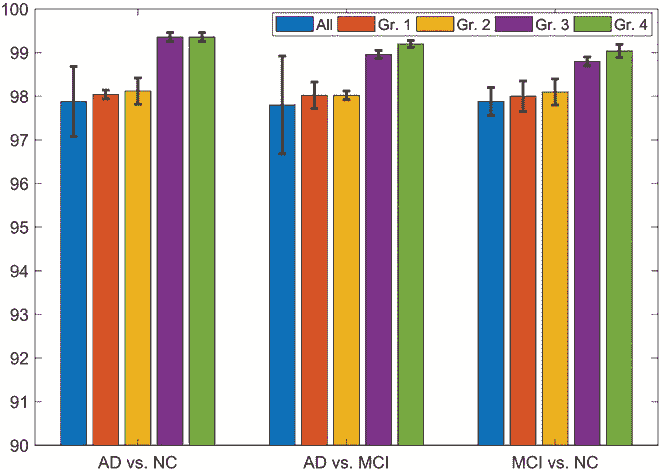

**FIGURE 9.1** Results for layer-wise freezing of transfer learning for the three classification problems.

1. **All**：None of the convolutional layers are frozen (all of them trainable).
2. **Group 1**：The first four convolutional layers are frozen.
3. **Group 2**：The first eight convolutional layers are frozen.
4. **Group 3**：The first 12 convolutional layers are frozen.
5. **Group 4**：All convolutional layers (1–16) are frozen.

如我们所见，对于这个特定数据集，冻结所有卷积层（Group 4）结果最佳。总体而言，CNN 的早期层学习适用于大多数视觉问题的低层次图像特征，而后期层学习高层次特征，这些特征特定于特定的应用领域。因此，微调全连接层通常就足够了。但正如 Ref. [10] 所讨论的，这种行为可能会因具体的计算机诊断问题而改变。不过，我们从结果中可以得出的一般共识是：转移学习显著提高了计算机辅助诊断问题的性能。

## 9.3 Focal Tversky Loss Function for Class Imbalance

本节针对生物医学影像领域中常见的类别失衡问题。类别失衡在医疗分割问题中尤为常见。在分割问题（如病变分割）中，病变（前景）通常只占图像的一小部分。这种不平衡的数据会导致流行的分割框架 [18] 产生不稳定的结果。近年来，CNN 在医疗影像中分割病变方面取得了成功 [18]。与常规 CNN 不同，分割问题通常采用完全卷积网络（FCN），其中全连接层被移除以实现高效的像素级分割。其中最流行的 FCN 架构是 U-Net [19]。在 FCN 之上，U-Net 还引入了多种改进，如多技能连接和带可学习参数的上采样层。

近年来，一些研究提出了新的损失函数来解决医疗图像分割中的类别失衡问题。Ref. [1] 提出的聚焦损失函数是一种通过引入指数因子获得的流行交叉熵损失变体，它通过强调从样本较少的类别中学习来缓解类别失衡。聚焦损失通过避免大量容易分类的负样本主导梯度，从而缓解类别失衡。但在实践中，它由于医学图像中极小的感兴趣区域（ROI）而难以在精度和召回率之间取得平衡。针对小 ROI 分割的研究提出了更具歧视性的模型，如注意力门控网络（attention gated networks）等。

为解决上述问题，我们将注意力门控 U-Net 与一种全新的焦点损失函数相结合，该焦点损失更适合小病变的分割。我们提出了一种全新的聚焦 Tversky 损失函数（FTL），在焦点损失的基础上加入 Tversky 指数，以改善小病变分割效果。该指数用于解决焦点损失函数中精确率与召回率的失衡问题 [7]。随后，我们将该损失函数与深度监督的注意力 U-Net [20] 结合，该 U-Net 进一步通过多尺度输入图像金字塔提升中间特征表示的质量。

我们在 Ref. [18] 中描述的 Dice 损失（DL）函数存在局限性，即它对假阳性（FP）和假阴性（FN）检测同样加权。对 FP 与 FN 同样加权会导致分割图像精确率高，但召回率下降。医学分割数据（如病灶分割）中，前景像素（即真实标注的前景）数量极少，即使少量前景像素被错误标记，召回率也会大幅下降。因此，若想提升召回率，需要在 FN 相对于 FP 上赋予更大的权重。Tversky 指数可以帮助实现 FP 与 FN 之间更好的权衡：

$$TI_{c}=\frac{\sum_{i=1}^{N}p_{ic}g_{ic}+\epsilon}{\sum_{i=1}^{N}p_{ic}g_{ic}+\alpha\sum_{i=1}^{N}p_{i\overline{c}}g_{ic}+\beta\sum_{i=1}^{N}p_{ic}g_{i\overline{c}}+\epsilon}\tag{9.2}$$

其中 `p[ic]` 表示像素 `i` 属于类别 `c`（病灶）的概率，`p[i\bar c]` 表示像素 `i` 属于非病灶类别的概率；同理，`g[ic]` 与 `g[i\bar c]` 分别为真实标签的概率。`N` 为图像中总像素数。超参数 `α` 与 `β` 可调节以改变对 FN 与 FP 的侧重，从而在大类别失衡时提升召回率。

将 Tversky 指数转化为损失函数（TL）时，在 Ref. [7] 中通过最小化 $\sum_{c}(1-TI_{c})$ 实现。

Dice 损失的另一个缺点是，它在分割极小的感兴趣区域（ROI）时表现不佳，因为这些区域对损失贡献有限。为解决此问题，我们提出了 FTL，由 `γ` 参数控制，以在易背景和难 ROI 训练样本之间取得平衡。Ref. [1] 中的焦点损失通过对交叉熵损失进行指数化，使难以检测的类别（概率低）的损失被放大。焦点损失已被引入到 DL 函数中 [21]，我们采用类似的思路定义 FTL：

$$FTL_{c}=\sum_{c}\left(1-TI_{c}\right)^{1/\gamma}\tag{9.3}$$

其中 `γ` 的取值范围为 {1,3}。实际中，若像素的 Tversky 指数较大且被错误分类，FTL 几乎不受影响；但当 Tversky 指数很小且像素被错误分类时，FTL 会显著下降。

当 `γ` > 1 时，损失函数更关注那些预测不准确、已被误分类的像素。然而，当模型接近收敛、类别准确率高时，FTL 会出现过度抑制现象。为缓解此问题，我们尝试使用更大的 `γ` 值，最终发现 `γ = 4/3` 在所有实验中表现最佳，并在此工作的所有实验中采用该值。为进一步防止 FTL 的过度抑制，我们并未在所有层上使用 FTL，而是仅在中间层使用；最后一层则改用 Tversky 损失，以提供强的误差信号，防止次优收敛。我们假设，增大 `α` 在广义损失函数中可以通过将焦点从 FP 转移至 FN 来提升模型收敛性。因此，我们在所有实验中使用 `α = 0.7`、`β = 0.3`。值得注意的是，当 `α = β = 0.5` 时，Tversky 指数简化为 DSC（Dice Similarity Coefficient）；当 `γ = 1` 时，FTL 退化为 TL（Tversky Loss）。

为进一步提升精度和召回率，我们遵循 Ref. [20] 中对 U-Net 的改进措施，并将其与 FTL 相结合。即使在采用注意力基模型后，仍发现多层卷积会导致小病灶细节在解码阶段被模糊丢失。为此，我们使用软注意力门控机制，从低层特征图中识别并传递相关空间信息到解码阶段。为了让不同尺度的细节更易获取，我们直接将输入图像的多尺度版本（通过构建图像金字塔）喂给编码器层。结合深度监督，该方法在小 ROI 特征容易在卷积过程中被丢失的数据集上提升分割精度，并帮助网络学习更具局部感知性的特征，从而改善分割效果。所提网络架构可见 Figure 9.2。

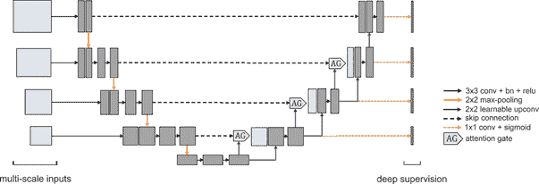

**FIGURE 9.2** The proposed attention U-Net architecture.

为验证所提 FTL 与注意力 U-Net 的有效性，我们在 Breast Ultrasound Lesions 2017 数据集 B（BUS）上进行实验，该数据集中病灶占比为 4.84% ± 5.43%。Table 9.2 展示了结果。相较于基线 U-Net，我们的方法使 Dice 分数提升了 25.7%。这一结果凸显了解决类别失衡对分割的重要性，并表明该问题值得进一步探索。

**TABLE 9.2** Results on the BUS 2017 Dataset for the Proposed FTL and Attention U-Net Compared to DL

| Model | DSC | Precision | Recall |
| --- | ---: | ---: | ---: |
| U-Net + DL | 0.547 | 0.653 | 0.658 |
| U-Net + FTL | 0.669 | 0.775 | 0.715 |
| Attn U-Net + DL | 0.615 | 0.675 | 0.658 |
| Proposed (Attn U-Net + multi-input + FTL) | **0.804** | **0.829** | **0.022** |

## 9.4 Confidence Measure Using Bayesian Neural Networks

在拟议模型中，我们采用两阶段方法来实现可调节的置信度度量。采用两阶段方法而非端到端贝叶斯网络的原因有两个：(1) 使用传统的 CNN 进行特征提取，随后接一个小型贝叶斯网络，结果是一个更高效的网络架构，可实现更快的训练；(2) 诸如 AlexNet [24]、ResNet [25] 和 VGG [13] 等流行的 CNN 架构已经在医院和诊所部署。模块化贝叶斯架构可以简单地作为这些系统的“附加组件”使用。

拟议架构如下 Figure 9.3。如图所示，使用经修改的 `ResNet-18` 架构作为特征生成器，输入为 224 × 224 像素的图像，输出 512 维特征向量，同时还有一个独立的小型全连接网络，包含三层全连接层并随后接 softmax。注意，该小网络的参数仅略超过 164,000 个，而完整网络的参数超过 1,100 万，这使得后续步骤能够轻松在普通硬件上执行。贝叶斯推理通过高斯过程实现，如随机变分推断（SVI）[26]，但在较小的网络上以及从特征生成器生成的低维训练数据上进行，以学习参数的后验分布（已初始化为随机正态先验）。

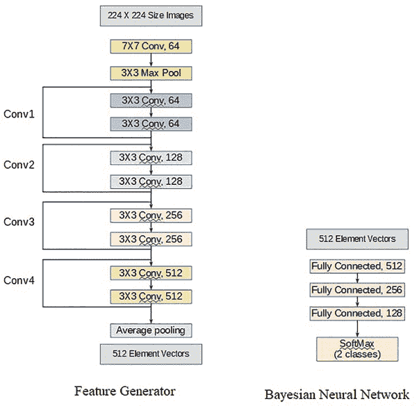

**FIGURE 9.3** The proposed two-stage architecture for confidence measurement.

在获得网络参数（权重和偏置）的后验分布后，下一步是设计置信度度量。我们的置信度度量包含两个可调参数。其计算步骤如下：

1. 使用蒙特卡罗采样从后验分布中抽取合理数量（实验中为 1,000 个）的网络。每个抽取的网络本身都是确定性的。
2. 由每个抽取的网络对每张图像进行分类，记录 benign 和 malignant 两类的概率。
3. 使用两个参数 `N` 和 `P`，其中 `N` 表示在抽取的网络中，有至少概率 `P` 的网络将图像归类为特定类（benign 或 malignant）的比例。
4. 通过这两个可调参数 `N` 和 `P`，我们可以定义置信度度量。例如，若有 1,000 个抽取的网络，则 `N = 0.6` 且 `P = 0.7` 表示至少有 600 个网络的概率至少为 0.7，认为图像属于该类（benign 或 malignant），而不会出现两类混合的情况；否则，该图像将被跳过分类。换言之，结合 `N` 与 `P` 可同时考虑网络间的一致性以及每个网络对分类的置信程度。

在此设定下，自然可以预期：随着 `N` 和 `P` 的增大（置信度提升、不确定性降低），准确率应提升；而 `N` 和 `P` 的减小（置信度降低、不确定性增大），准确率则下降。但提高 `N` 与 `P` 的值也可能导致部分图像被跳过分类。例如，若有 1,000 个抽取网络，`N = 0.9` 且 `P = 0.9`，则要求至少 900 个网络的概率至少为 0.9，这可能导致许多图像被跳过，出现覆盖率低的情况。换言之，较高的 `N` 与 `P`（更高置信度）会导致较低的覆盖率（更多图像被跳过），但覆盖的图像准确率更高；相反，较低的 `N` 与 `P`（更低置信度）会带来较高的覆盖率（较少图像被跳过），但覆盖的图像准确率较低。简而言之，调节 `N` 与 `P` 的值可让我们在准确率与覆盖率的权衡中决定停留的位置。因此，`N` 与 `P` 的取值、准确率和覆盖率共同构成了我们的新评估指标，形式为元组（accuracy, coverage, `N`, `P`），其中 `N` 与 `P` 构成置信度度量。

尽管本章以分类准确率为主要评估指标，整体框架仍可与任意评估指标配对使用。其他可能的指标包括精确率、召回率、F1-score、ROC AUC 等，对于不平衡分类任务可能更为合适。但本章并不讨论或比较这些指标的优劣，而是将置信度度量与已选的评估指标配对。由于本任务属于相对平衡的分类问题，我们选择使用准确率作为评估指标。框架对指标的选择是无感知的。

为评估拟议框架，我们在 CBIS-DDSM（Curated Breast Imaging Subset of DDSM）[27] 数据集上进行了实验。该数据集是 Digital Database for Screening Mammography（DDSM）的更新和标准化版本。原始 DDSM 数据集包含 2,620 幅扫描的乳腺摄影研究，而 CBIS-DDSM 包含经由受过训练的放射科医师筛选的子集。ROI 裁剪后的数据集包含 1,696 张标记的灰度图像，其中 912 张标记为良性，784 张标记为恶性，数据集因此相当平衡。我们以分层方式在类（良性 vs. 恶性）分布上设定训练与验证比例为 80:20，并构建了五个分层划分，以便对方法的推广性进行交叉验证。每个划分中，我们有 1,357 张训练图像和 339 张验证图像。后文展示的所有结果均为五个验证集结果的平均值，以展示方法的稳健性。

我们通过蒙特卡罗采样从后验分布中抽取了 1,000 个网络，并通过调节 `N` 与 `P` 的值进行评估。

我们演示了控制参数 `N` 与 `P` 的使用方法及其对分类性能的影响。平均有 339 张验证图像。我们发现，当 `N` 超过 0.9 时，所有测试图像都被跳过，导致贝叶斯网络没有任何覆盖，这与 `P` 的取值无关，因为很难有 95% 的网络对任意图像都有至少某一类别的最小概率。总体而言，若保持 `N` 为适度值（如 0.5），再变动 `P` 时，准确率呈上升趋势，覆盖率呈下降趋势，这符合预期。若保持 `P` 为 0.5 并变动 `N`，则出现类似的趋势，也符合预期。Figure 9.4 展示了在 `P` 固定为 0.5 时，随 `N` 变化的准确率和覆盖率趋势；而 Figure 9.5 则展示了在 `N` 固定为 0.5 时，随 `P` 变化的准确率和覆盖率趋势。


**FIGURE 9.4** Accuracy and coverage vs. `N` (at `P` = 0.5).


**FIGURE 9.5** Accuracy and coverage vs. `P` (at `N` = 0.5).

我们应指出，实际上保持 `P` 为常数值（例如 0.5）并调节 `N` 可能更合理，而不是保持 `N` 不变而调节 `P`；这是因为调节 `N` 并保持 `P` 不变意味着在样本网络集合上改变采样程度，同时期望在被采样的网络中保持固定的最小分类概率一致性，而调节 `P` 并保持 `N` 不变则意味着冻结采样空间并改变在该冻结网络空间中的最小分类概率一致性的值。换句话说，`N` 使我们能够选择覆盖样本网络分布的多少，因此它是实用不确定性的更好度量。

从发现中得出的要点是，参数 `N` 和 `P` 可以调节到理想水平，这些参数的值越高，我们对预测/分类的置信度就越高，代价是可能出现较低的覆盖率。对于医学乳腺 X 光图像分类这一领域，将由乳腺 X 光专家决定 `N` 和 `P` 的合理取值。设定合理的 `N` 和 `P` 后，以前未见的图像在由贝叶斯网络分类（无论是良性还是恶性）时，更有可能被正确分类；而被跳过并拒绝分类的图像则需要进一步调查。整体框架可作为任何计算机辅助诊断问题的置信度调节工具。

## 9.5 Conclusion

在本章中，我们突出了在部署用于医学图像分割或计算机辅助诊断问题的机器学习模型时可能出现的三个实际问题。我们通过转移学习来解决深度学习模型对大规模训练数据集的高度依赖问题，展示了从自然图像进行转移学习可以显著提升阿尔茨海默病诊断的性能。为解决医学图像分割中普遍存在的类别失衡问题，我们提出了一种新型的 FTL，结合 Attention U-Net，在基准乳腺超声数据集上实现了最先进的病灶分割性能。最后，我们提出了一种利用贝叶斯神经网络的置信度调节工具，通过两个简单的超参数（样本网络数量和最小概率），可以在域专家的需求下调节神经网络的准确率-覆盖率权衡。


尽管前三节展示了有希望的结果，但在将这些方法部署到临床环境之前，仍需进一步工作以确保所提方法的鲁棒性。对于转移学习，我们正在探讨我们的方案是否能够推广到阿尔茨海默病以外的其他计算机辅助诊断领域。对于我们提出的损失函数，下一步是研究其在不同类型的不平衡分类问题中的表现，特别是研究如何将转移学习方法与所提损失函数相结合。对于置信度调节，我们计划在未来探索一种端到端的贝叶斯学习方法，在转移学习基础上进行，以保持计算需求可管理。

## Notes

1. 本项目的扩展实验结果和分析最初发表在 [3, 4]。
2. 本项目的扩展实验结果和分析最初发表在 [6]。
3. 本章代码可在：[`github.com/nabsabraham/focal-tversky-unet`](https://github.com)

## References

1. T.-Y. Lin, P. Goyal, R. Girshick, K. He, and P. Dollár, “Focal loss for dense object detection,” *IEEE Transactions on Pattern Analysis and Machine Intelligence*, vol. 42, no. 2, pp 318–327, 2018.
2. B. M. Geller, A. Bogart, P. A. Carney, J. G. Elmore, B. S. Monsees, and D. L. Miglioretti, “Is confidence of mammographic assessment a good predictor of accuracy?” *American Journal of Roentgenology*, vol. 199, no. 1, pp. W134–W141, 2012.
3. N. M. Khan, N. Abraham, and M. Hon, “Transfer learning with intelligent training data selection for prediction of Alzheimer’s disease,” *IEEE Access*, vol. 7, pp. 72726–72735, 2019.
4. M. Hon and N. M. Khan, “Towards Alzheimer’s disease classification through transfer learning,” in *IEEE International Conference on Bioinformatics and Biomedicine*, 2017.
5. C. R. Jack et al., “The Alzheimer’s disease neuroimaging initiative (ADNI): MRI methods,” *Journal of Magnetic Resonance Imaging*, vol. 27, no. 4, pp. 685–691, 2008.
6. N. Abraham and N. M. Khan, “A novel focal Tversky loss function with improved attention U-net for segmentation,” in *IEEE Symposium on Biomedical Imaging*, 2019.
7. S. R. Hashemi et al., “Tversky as a loss function for highly unbalanced image segmentation using 3D fully convolutional deep networks,” *CoRR*, vol. abs/1803.11078, 2018.
8. S. Klöppel et al., “Accuracy of dementia diagnosis – A direct comparison between radiologists and a computerized method,” *Brain*, vol. 131, no. 11, pp. 2969–2974, 2008.
9. C. Plant et al., “Automated detection of brain atrophy patterns based on MRI for the prediction of Alzheimer’s disease,” *Neuroimage*, vol. 50, no. 1, pp. 162–174, 2010.
10. N. Tajbakhsh et al., “Convolutional neural networks for medical image analysis: Full training or fine tuning?” *IEEE Transactions on Medical Imaging*, vol. 35, no. 5, pp. 1299–1312, 2016.
11. J. Yosinski, J. Clune, Y. Bengio, and H. Lipson, “How transferable are features in deep neural networks?” in *Advances in Neural Information Processing Systems*, 2014.
12. O. Russakovsky et al., “Imagenet large scale visual recognition challenge,” *International Journal of Computer Vision*, vol. 115, no. 3, pp. 211–252, 2015.
13. K. Simonyan and A. Zisserman, “Very deep convolutional networks for large-scale image recognition,” *arXiv preprint arXiv:1409.1556*, 2014.
14. C. Studholme, D. L. Hill, and D. J. Hawkes, “An overlap invariant entropy measure of 3D medical image alignment,” *Pattern Recognition*, vol. 32, no. 1, pp. 71–86, 1999.
15. A. Gupta, M. Ayhan, and A. Maida, “Natural image bases to represent neuroimaging data,” in *International Conference on Machine Learning*, 2013.
16. Hosseini-Asl et al., “Alzheimer’s disease diagnostics by adaptation of 3D convolutional network,” in *IEEE International Conference Image Processing*, 2016.
17. S. Sarraf et al., “Deepad: Alzheimer’s disease classification via deep convolutional neural networks using MRI and fMRI,” *bioRxiv*, p. 070441, 2016.
18. C. H. Sudre et al., “Generalised dice overlap as a deep learning loss function for highly unbalanced segmentations,” in *Deep Learning in Medical Image Analysis for Clinical Decision Support*. Springer, 2017, pp. 240–248. [`link.springer.com/chapter/10.1007/978-3-319-67558-9_28`](https://link.springer.com)
19. O. Ronneberger, P. Fischer, and T. Brox, “U-net: Convolutional networks for biomedical image segmentation,” in *International Conference on Medical Image Computing and Computer-Assisted Intervention*. Springer, 2015.
20. O. Oktay et al., “Attention U-net: Learning where to look for the pancreas,” *arXiv preprint arXiv:1804.03999*, 2018.
21. K. C. Wong et al., “3D segmentation with exponential logarithmic loss for highly unbalanced object sizes,” in *International Conference on Medical Image Computing and Computer-Assisted Intervention*. Springer, 2018.
22. M. H. Yap et al., “Automated breast ultrasound lesions detection using convolutional neural networks,” *IEEE Journal of Biomedical and Health Informatics*, vol. 22, no. 4, pp. 1218–1226, 2018.
23. C. Leibig, V. Allken, M. S. Ayhan, P. Berens, and S. Wahl, “Leveraging uncertainty information from deep neural networks for disease detection,” *Scientific Reports*, vol. 7, no. 1, pp. 1–14, 2017.
24. A. Krizhevsky, I. Sutskever, and G. E. Hinton, “Imagenet classification with deep convolutional neural networks,” in *Advances in Neural Information Processing Systems*, 2012, pp. 1097–1105.
25. K. He, X. Zhang, S. Ren, and J. Sun, “Deep residual learning for image recognition,” in *Proceedings of the IEEE Conference on Computer Vision and Pattern Recognition*, 2016, pp. 770–778.
26. M. D. Hoffman, D. M. Blei, C. Wang, and J. Paisley, “Stochastic variational inference,” *The Journal of Machine Learning Research*, vol. 14, no. 1, pp. 1303–1347, 2013.
27. K. Clark, et al., “The cancer imaging archive (TCIA): Maintaining and operating a public information repository,” *Journal of Digital Imaging*, vol. 26, no. 6, pp. 1045–1057, 2013.

# CHAPTER 10

## Detection of Abnormal Activities Stemming from Cognitive Decline Using Deep Learning

**Damla Arifoglu**  
University College London, London, United Kingdom

**Abdelhamid Bouchachia**  
Bournemouth University, Poole, United Kingdom

## Contents

- 10.1 Introduction
- 10.2 Indicators of Dementia
- 10.3 Literature Overview
  - 10.3.1 Cognitive Status Assessment
  - 10.3.2 Deep Learning
- 10.4 Datasets and Data Generation
  - 10.4.1 Datasets
  - 10.4.2 Data Generation
    - 10.4.2.1 Activity-Related Abnormal Behavior
    - 10.4.2.2 Sub-Activity–Related Abnormal Behavior
- 10.5 Spatio-Temporal Activity Recognition and Abnormal Behavior Detection
  - 10.5.1 Sensor Data Representation
  - 10.5.2 Abnormal Behavior Detection
  - 10.5.3 Experiments
  - 10.5.4 Results with Recurrent Neural Networks
  - 10.5.5 Results with Convolutional Neural Networks
- 10.6 Conclusions and Future Work
  - 10.6.1 Conclusion
  - 10.6.2 Future Work
- Bibliography

## 10.1 Introduction

In recent years, diseases related to cognitive impairment in ageing persons are treated as a major public health concern all over the world. Alzheimer’s Disease International estimated the number of people suffering from dementia worldwide in 2018 to be 50 million and it will increase to 82 million by 2030 [1]. These numbers underline a situation that presents a certain level of criticality.

Ageing persons with cognitive impairment have problems with activities that require memory and cognition [2]. They also have difficulties with speaking, writing, distinguishing objects and executing daily life activities such as cleaning, cooking and so on [3]. Elderly people need special care and help from their caregivers leading to a social, psychological, physical and economic challenge to family members, caregivers and the society as a whole.

Most elderly people prefer to lead an independent life. Studies show that it is better for the health of these people to stay in a self-determined private home environment while ageing [7,8].


Changes in daily life activity (preparing food, showering, walking, sleeping, watching television, going to the toilet, having dinner/lunch/breakfast, cleaning the house and so on) patterns and their occurrence time and frequency are key indicators in determining the cognitive status of elderly people. Assessing the cognitive status of elderly people by tracking their daily life activities in a specially designed smart-home would be very useful for caregivers, medical doctors and clinicians so that early treatment would be possible.

Unfortunately, there exists no data assessing the cognitive abilities of ageing persons. Thus, in this study, we tackle the scarcity of the data demonstrating the abnormal behavior of elderly people by generating data. Moreover, we aim to recognise daily life activities by taking their neighbourhood information into account. The spatio-temporal information of activities and their ordering and frequency are important for understanding the cognitive abilities of elderly people. Thus, we emulate activity recognition and abnormal behavior detection problems as a sequence labelling problem. In the present study, we first model activities as a sequence and then detect the abnormal behavior. The rest of the chapter is presented as follows. Section 10.2 provides an overview of dementia indicators. Section 10.3 summarises the literature work, while Section 10.4 describes the datasets used. Section 10.5 describes the methods used and presents the experiments. Lastly, Section 10.6 concludes the chapter.

## 10.2 Indicators of Dementia

-   [早期识别认知障碍](https://wiki.example.org/feynmans_learning_method)可以使早期治疗成为可能，但研究表明 75% 的痴呆病例未被发现 \[9\]。最近的研究 \[10\] 表明，日常生活活动模式的异常可能是早期发现这些情况的线索。此外，最佳指标可以通过监测随时间变化的活动趋势和变化（如睡眠问题或完成任务困难）来检测 \[11\]。例如，忘记吃晚饭、失眠或频繁上厕所都是认知障碍的迹象。还有进食习惯异常（例如深夜吃零食）、夜间频繁醒来或因饮水不足导致的脱水。患者可能在危险情境中出现问题，如忘记关闭加热器、烤箱或炉子 \[11\]。认知衰退的老年人可能会因困惑而出现后果，例如无法运行洗碗机或在电话簿中混淆名字。

### 10.3 Literature Review

#### 10.3.1 Cognitive Status Assessment

-   许多研究尝试自动化老年人在家的认知状态评估 \[23, 24, 25, 26, 27, 28, 29, 30\]，并采用多种机器学习方法，如 `Naïve Bayes` 分类器和支持向量机 (`SVMs`) \[31, 32, 38\]、受限玻尔兹曼机 (`RBMs`) \[28, 33\]、马尔可夫逻辑网络 (`MLNs`) \[26, 27, 29\]、隐马尔可夫模型 (`HMMs`) \[12, 34\]、随机森林方法 \[19\]、隐向量随机场 (`CRFs`) \[35\] 和循环神经网络 (`RNNs`) \[36\]。

-   当前的认知评估方法依赖于专家让老年人填写问卷或回忆过去的事件，这种方法需要专业知识，可能带有偏见。例如，在 `Ref. [23]`，老年人需要在摄像头监控下完成一系列活动并获得评分。其他研究如 `Ref. [37]` 则通过测量活动持续时间和传感器激活次数来评估认知能力。这类方法会打断日常生活的自然流程。另一方面，基于规则的诊断方法需要通过特定规则整合领域知识，且每个个体的规则需要定制，因为个人的夜间醒来或夜间饮水习惯可能不同。我们的方法的优势在于不使用任何专家或领域知识，而是从训练数据中学习正常行为，并利用老年人的日常生活习惯进行评估，从而提供一种不打扰的评估方式。

-   在 `Ref. [39]`，将运动片段定义为活动曲线，并通过比较曲线来检测异常活动。`Ref. [40]` 使用基于位置的概率时空模型计算主体行为的可能性，并通过交叉熵测度检测如长时间卧床或未在卧室睡眠等异常行为。`Ref. [12]` 将 `HMM` 与模糊规则结合，检测与持续时间、时间和频率相关的异常。

-   `Ref. [35]` 使用隐状态条件随机场 (`HCRF`) 模型活动，并通过阈值方法检测异常行为；`Ref. [26]` 将概率逻辑网络与基于规则和概率的推理结合，检测异常行为。该研究的一个缺点是活动步骤在构建模型前就已预先定义，且规则因人而异，定义规则耗时。`Ref. [27]` 通过规则诱导方法自动发现规则，基于正常和异常活动的数据。然而，我们的方法通过训练集自动学习正常活动模式，无需显式规则，并以序列信息的上下文来定义异常行为 \[26, 35\]。

#### 10.3.2 Deep Learning

-   近年来，深度学习方法被用于智能家居中的活动识别。这些方法包括卷积神经网络 (`CNNs`) \[41, 42, 43, 44, 45, 46, 47, 48, 49, 50, 67, 68, 69\]、深度信念网络 (`DBN`) \[33\]、受限玻尔兹曼机 (`RBMs`) \[28, 33, 51, 52\] 和 `RNNs` \[43, 44, 53\]。虽然 `RBMs` 在特征提取和选择方面更受青睐 \[51\], 但它们在 `CASAS` 数据集上表现优于 `HMMs` 和 `NB` \[52\]。`CNNs` 在使用可穿戴传感器识别活动方面很受欢迎 \[33, 41, 42, 43, 45, 48, 51\]。然而，很少有研究 \[52, 67–71\] 将深度学习方法应用于基于传感器的活动识别，这仍需进一步研究。

`Auto-encoders` are being used for anomaly detection on time-series data `cvar = avar + bvar` \[57,58\]. In `Ref. cvar = avar + bvar` \[56\], the authors use Recursive Auto-Encoders for predicting sentiment distributions. Instead of using a bag-of-words model, this model exploits a hierarchical structure and uses compositional semantics to understand the sentiment. In `Ref. cvar = avar + bvar` \[59\], the authors extract patterns in daily life activities as segments of an activity. This shows that the extracted movement vector can be used to differentiate high-level activities. The idea behind this is residents at a smart-home follow the same routine during the performance of the same activities such as moving around the kitchen sink while washing the dishes.

## 10.4 Datasets and Data Generation

Elderly people suffering from dementia may have difficulties performing activities such as managing medication, cooking and housekeeping. In this research, we analyse sequential daily life activities (performed in a sequential order without any interruption) to detect the abnormal behavior. We also assume that there is only one occupant living in a smart house. Cooking, sleeping, going to the toilet, working, cleaning, washing dishes and so on are examples of daily life activities. We focus on these types of activities since they are promising to reflect on dementia cases in a scenario of daily life. Inspired by data simulation techniques to generate activity instances `List.of(arg0, arg1, arg2)` \[17, 18, 19\], we generate abnormal behavior.

We will first describe the datasets used and then the abnormal behavior generation method will be presented.

### 10.4.1 Datasets

In this research, we used three datasets:

*   `Van Kasterenen cvar = avar + bvar` \[60\] dataset: In this dataset, there are daily life activities such as sleeping, cooking, leaving home and so on and the data were collected in three different households in durations less than a month.

*   `Aruba testbed of CASAS cvar = avar + bvar` \[16\] dataset: In this dataset, sensors such as motion, door and temperature are used. However, we use motion and door sensors in our study. In total, there are 11 activities in this dataset and the collection was done in 224 days.

*   `WSU testbeds of CASAS cvar = avar + bvar` \[16\] dataset: In this dataset, there are five activities, which are making a phone call, hand washing, meal preparation, eating and cleaning. Twenty instances of each activity were performed by 20 students in (1) `adlerror` and (2) `adlnormal` versions. While normal behavior is reflected in the `adlnormal` version, residents were told to include errors in `adlerror` to simulate the difficulties of elderly people.

### 10.4.2 Data Generation

Abnormal behavior in the daily life activities of elderly people is divided into two parts: (1) activity-related anomalies and (2) sub-activity–related anomalies. In activity-related anomalies, an activity itself is totally normal while there is an anomaly related to its frequency or its timing in a day. On the other hand, the sub-activity–related anomaly is related to the context and the quality of activity performed such as frequency of sensor activations involved as well as their order and correlation. In the first one, activities as a whole are repeated or forgotten (e.g. having dinner); while in the second one, some steps (sensor activations) of activities are forgotten or repeated (e.g. adding salt to the dish).

#### 10.4.2.1 Activity-Related Abnormal Behavior

To simulate these types of indicators, we insert a set of actions into the whole day actions of activities (see `Algorithm 10.1`), which will give multiple instances of the same type of an activity. Moreover, insertion in some inadequate time of the day will generate time-related abnormalities such as waking up and eating. We insert the following activities: preparing meal, eating, working, washing dishes, leaving home and entering home into the normal activity sequences of the Aruba dataset.

In all, we manually generate 77 abnormal activity instances on the Aruba dataset. A set of modified abnormal behavior is depicted in `Table 10.1`. The following abbreviations are used for the activities. S: Sleeping, P: Meal preparation, E: Eating, R: Respirate, W: Working, B: Bed to the toilet and H: Housekeeping. The inserted activities are shown in **bold**.

`TABLE 10.1 Examples of Abnormal Behavior`

| **Original** || **Modified** || **Abnormality** |

| --- | --- | --- |


| S-P-ES-P-ES-P-ES-P-ES- P-E-H || S-**B**-**S**-P-ES-**R**-**S**-P-ES-**R**-**S**-P-ES-P-E-H-**E-E** || Sleep disorderSleep disorderSleep disorderRepetitionRepetition |

| --- | --- | --- |

| **W:** M[26], M[28], M[27]**B:** M[4], M[5], M[7]**W:** M[18], M[20], M[15]**E:** M[14], M[19], M[18]**M:** M[18], M[19], M[15] || M[26], M[28], **M**[26], **M**[26], M[27]M[4], M[5], **M**[5], M[7], M**[5]**M[18], **M**[15], **M**[15], M[20], M[15]M[14], **M**[14], M**[14], M[19], M[18], **M**[14]M[18], **M**[18], **M**[18], M[19], M[15], **M**[18] || ConfusionConfusionConfusionConfusionConfusion |

Moreover, abnormal activity instances are generated on dataset A of the Van Kasteren dataset, which has the activities. In all, we manually synthesised 135 abnormal activity slices in this dataset.

#### 10.4.2.2 Sub-Activity–Related Abnormal Behavior

This kind of abnormal behavior is generated by repeating specific sensor activations in a given activity. For this purpose, given random instances of working, eating, meal preparation and walking from bed to the toilet, we randomly insert specific sensors (`M[26]`, `M[14]`, `M[18]` and `M[4]` respectively) involved in these activities (see Algorithm 10.2). For example, for working activity, the sensor `M[26]` is repeated more than usual, which can be used to emulate the usage of a computer. A snapshot for sub-activity–related abnormal behavior synthesis is depicted in Figure 10.1, where `ONabn` shows the inserted sensor activations.

Moreover, an adlerror set of WSU dataset is used because it reflects the confusion and forgetting anomaly types such as forgetting to turn water tap off.

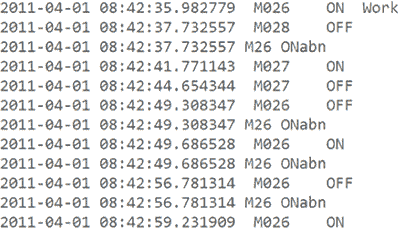

FIGURE 10.1 Sensor data after sub-activity–related abnormal behavior is generated.

## 10.5 Spatio-Temporal Activity Recognition and Abnormal BEHAVIOR Detection

RNNs have shown promising results in some sequence modeling problems such as speech recognition `if (condVar > someVal) {console.log("xxx")}` \[61\], machine translation `if (condVar > someVal) {console.log("xxx")}` \[62,63\], handwriting recognition and generation or translation, language modeling and protein secondary structure prediction `if (condVar > someVal) {console.log("xxx")}` \[64\]. Daily life activities can be modelled as sequences where sensor activations form time-series data. Thus, modeling activity recognition as a sequence labelling problem makes RNNs an appealing approach. In the present study, we exploit RNNs to model activities using their temporal information and then detect abnormal behavior deviating from normal patterns. Also, CNNs are good at encoding spatial information into account and extracting their own features. Thus, in this research, CNNs are used to encode the neighbourhood information of the sensors to recognise daily life activities and then detect abnormal behavior.

-   [滑动窗口方法](https://wiki.example.org/feynmans_learning_method)受到`Ref. \[20\]`启发，用于将日常生活序列分割为时间片段。 (2) 时间片段被映射到如`Ref. \[20\]`所述的特征上。 (3) 然后，使用三种变体的`RNNs`，即`Vanilla`、`GRU`和`LSTM`以及`CNNs`来建模和分类活动。 (4) 最后，这些分类器用于根据分类混淆概率标记异常行为。

顺序传感器读数的顺序很重要，以考虑空间信息。我们使用滑动窗口方法将数据分割为活动实例。我们采用与`Ref. \[20\]`相同的滑动窗口方法，提取传感器读数片段，这些片段作为`RNNs`和`CNNs`的输入。窗口大小基于时间而非传感器事件数量（一个传感器读数元组称为传感器事件）。可以使用不同的时间窗口，例如 1 分钟切片、60 秒切片等。如果使用 1 分钟窗口，则提取该分钟内的所有传感器读数。这些窗口随后映射为如下所述的特定表示。

### 10.5.1 传感器数据表示

原始传感器读数使用滑动窗口映射为以下三种表示。

*   **`Binary`**：在该特征中，时间窗口内激活的传感器被赋值为 1，未激活的传感器被赋值为 0。

*   **`Change-point`**：在该特征中，如果在时间窗口内传感器从开到关或从关到开，则赋值为 1，否则如果其状态保持不变则赋值为 0。

*   **`Last-fired`**：在该特征中，仅有一个传感器被赋值为 1，表示在时间窗口内最后被激活的传感器。

### 10.5.2 异常行为检测

异常行为的检测如下：`RNNs`和`CNNs`使用训练集进行训练，然后将测试实例输入这些模型进行分类。分类置信度分数用于判断测试实例是正常还是异常活动。为此，使用每个类别训练实例的置信度分数的平均值作为阈值来决定异常。

在下一节中，将使用`Kasteren`数据集来评估`RNNs`，而`Aruba`数据集将用于测试`CNNs`的能力以及它们与`LSTM` RNNs 的组合。

### 10.5.3 实验

在本研究中，使用`Theano` \[66\]和`Keras`库 \[65\]的`RNN`和`CNN`实现。训练和测试实例的批量大小为 20，选择`Adam`优化器。`RNNs`和`CNNs`与传统的机器学习方法如`SVM`（WEKA 默认参数实现）、`NB`、`HMM`、`HSMM`和`CRF`（`Ref. \[20\]`实现）进行比较。

选择的评估指标为`precision`、`recall`、`F-measure`和`accuracy`（见公式 10.1–10.4），用于测试拟议方法在活动识别方面的成功。下面列出的缩写用法：`TP`：真阳性，`TT`：真标签总数，`TI`：推断标签，`N`：数据集中的类别数，`Total`：数据集中实例的总数。

$${\\text{Precision} = {1/N}\\left( {\\sum\\limits\_{i = 1}^{N}{{TPi}/{TIi}}\\operatorname{}} \\right)}\\mspace{54mu}\\operatorname{(10.1)}$$  

$${\\text{Recall} = {1/N}\\left( {\\sum\\limits\_{i = 1}^{N}{{TPi}/{TTi}}\\operatorname{}} \\right)}\\mspace{54mu}\\operatorname{(10.2)}$$  

F-measure=2 × Precision × Recall/(Precision+Recall)   (10.3)   

$${\\text{Accuracy} = \\sum\\limits\_{i = 1}^{N}{{TPi}/\\text{Total}}}\\mspace{54mu}\\operatorname{(10.4)}$$  

敏感性（真阳性率）和特异性（真阴性率）指标（公式 10.5 和 10.6）用于评估拟议方法在异常行为检测方面的成功。真阳性率（TPR）反映检测真实异常行为的能力，而真阴性率（TNR）测量识别正常行为的能力。

Sensitivity = TP/(TP+FN)   (10.5)   

Specificity = TN/(TN+FP)   (10.6)   

### 10.5.4 循环神经网络实验结果

对于`RNN`实验，`Kasteren`数据集按天进行交叉验证，即一天的数据用于测试，其余天用于训练和验证（其中 10%用于验证）。成功率是对天数取平均报告的。训练数据以 10 个样本的批量在 500 个时代内喂入分类器。`RNN`网络包含两层，隐藏神经元数分别为 30 和 50，每次提供 25 个时间片段作为实例。这些参数是经验设定的。结果与`Ref. \[20\]`中的`HMM`、`HSMM`、`CRF`和`NB`结果如 Table 10.2、Table 10.3、Table 10.4 所示。

TABLE 10.2 万科（Van Kasteren）数据集家庭 A 的活动识别结果

| **Model** || **Feature** || **Precision** || **Recall** || **F-Measure** || **Accuracy** |

| --- | --- | --- | --- | --- | --- |

| NB || Binary || 48.3 ± 17.7 || 42.6 ± 16.6 || 45.1 ± 16.9 || 77.1 ± 20.8 |

|  || Change-point || 52.7 ± 17.5 || 43.2 ± 18.0 || 47.1 ± 17.2 || 55.9 ± 18.8 |

|  || Last-fired || 67.3 ± 17.2 || 64.8 ± 14.6 || 65.8 ± 15.5 || 95.3 ± 2.8 |

| HMM || Binary || 37.9 ± 19.8 || 45.5 ± 19.5 || 41.0 ± 19.5 || 59.1 ± 28.7 |

|  || Change-point || 70.3 ± 16.0 || 74.3 ± 13.3 || 72.0 ± 14.2 || 92.3 ± 5.8 |

|  || Last-fired || 54.6 ± 17.0 || 69.5 ± 12.7 || 60.8 ± 14.9 || 89.5 ± 8.4 |

| HSMM || Binary || 39.5 ± 18.9 || 48.5 ± 19.5 || 43.2 ± 19.1 || 59.5 ± 29.0 |

|  || Change-point || 70.5 ± 16.0 || 75.0 ± 12.1 || 72.4 ± 13.7 || 91.8 ± 5.9 |

|  || Last-fired || 60.2 ± 15.4 || 73.8 ± 12.5 || 66.0 ± 13.7 || 91.0 ± 7.2 |

| CRF || Binary || 59.2 ± 18.3 || 56.1 ± 17.3 || 57.2 **bold** || 89.8 ± 8.5 |

|  || Change-point || 73.5 ± 16.6 || 68.0 ± 16.0 || 70.4 ± 15.9 || 91.4 ± 5.6 |

|  || Last-fired || 66.2 ± 15.8 || 65.8 ± 14.0 || 65.9 ± 14.6 || 96.4 ± 2.4 |

| Vanilla || Binary || 46.5 ± 17.7 || 64.8 ± 16.2 || 53.5 ± 16.3 || 86.8 ± 10.6 |

|  || Change-point || 46.3 ± 19.5 || 63.8 ± 16.4 || 53.2 ± 17.9 || 61.4 ± 16.4 |

|  || Last-fired || 61.9 ± 19.1 || 74.3 ± 12.8 || 67.2 ± 16.4 || 95.5 ± 3.4 |

| LSTM || Binary || 50.8 ± 18.4 || 63.9 ± 16.5 || 56.2 ± 17.1 || 86.7 ± 10.5 |

|  || Change-point || 46.8 ± 18.7 || 63.6 ± 14 || 53.5 ± 16.7 || 61.4 ± 16.4 |

|  || Last-fired || 63.7 ± 19.9 || 73.9 ± 16.8 || 68.1 ± 18.2 || 96.7 ± 2.6 |

| GRU || Binary || 47.3 ± 18.7 || 69.1 ± 14.9 || 55.4 ± 16.5 || 86.6 ± 10.7 |

|  || Change-point || 42.9 ± 19 || 65.0 ± 15.3 || 51.0 ± 17.1 || 61.4 ± 16.4 |

|  || Last-fired || 61.8 ± 16.3 || 80.6 ± 11.5 || 69.5 ± 14.0 || 96.1 ± 2.5 |

| SVM || Binary || 45.6 ± 17.9 || 69.1 ± 15.9 || 54.2 ± 15.9 || 85.4 ± 10.4 |

|  || Change-point || 40.3 ± 19.1 || 63.4 ± 14.6 || 48.6 ± 17.0 || 55.9 ± 18.7 |

|  || Last-fired || 58.6 ± 16.2 || 77.2 ± 14.0 || 66.3 ± 14.9 || 96.1 ± 2.4 |


The results on dataset A as depicted in `Table 10.2` present that the results with feature representation are mixed and there is not a clear best one. With an accuracy of 96.7%, `LSTM` is the best method with the last-fired feature and `HMM` is the worst one, while with a change-point feature, `HMM` is the best performing method. `CRF` gives the best accuracy (89.8%) when a binary feature is used, whereas `RNNs`, `NB` and `SVM` do not perform well with change-point representation and `HMM` and `HSMM` perform bad with a binary feature. In a nutshell, for the majority of the methods, except `HMM` and `HSMM`, last-fired representation is the best one. In terms of recall which reflects better on performance in the presence of imbalanced data, the highest value is obtained by `GRU` (80.6%). This means that `RNNs` are good at finding relevant class instances. `CRF` performs higher precision since it favours the most frequent-class instances while it is not good enough to detect infrequent classes. In general, `RNNs` outperform better than `HMM`, `NB` and `HSMM` for most of the cases, while `CRF` is slightly better than these recurrent architectures on dataset A.

`Table 10.3` refers to the results obtained on the dataset best method when adopting a binary representation achieving an accuracy of 81.6%. On the other hand, `CRF` is the best when using the change-point feature and last-fired representations with accuracies of 92.9% and 89.2% respectively. It can be noted that `HMM` is not as good as the other methods achieving the best case 81.0% with the change-point representation. The closest successful model to `CRF` is `Vanilla RNN` and again overall `RNNs` deliver high recall rates compared to the other methods. Change-point and last-fired representations give the highest recall results except for `CRF`.

TABLE 10.3 Activity Recognition Results for Household B of the Van Kasteren Dataset

| **Model** || **Feature** || **Precision** || **Recall** || **F-Measure** || **Accuracy** |

| --- | --- | --- | --- | --- | --- |

| NB || Binary || 33.6 ± 10.9 || 32.5 ± 8.4 || 32.4 ± 8.9 || 80.4 ± 18.9 |

|  || Change-point || 40.9 ± 7.2 || 38.9 ± 5.7 || 39.5 ± 5.9 || 67.8± 18.6 |

|  || Last-fired || 43.7 ± 8.7 || 44.6 ± 7.2 || 43.3 ± 4.8 || 86.2 ± 13.8 |

| HMM || Binary || 38.8 ± 14.7 || 44.7 ± 13.4 || 40.7 ± 12.4 || 63.2 ± 24.7 |

|  || Change-point || 48.2 ± 17.2 || 63.1 ± 14.1 || 53.6 ± 16.5 || 81.0 ± 14.2 |

|  || Last-fired || 38.5 ± 15.8 || 46.6 ± 19.5 || 41.8 ± 17.1 || 48.4± 26.9 |

| HSMM || Binary || 37.4 ± 16.9 || 44.6 ± 14.3 || 39.9 ± 14.3 || 63.8± 24.2 |

|  || Change-point || 49.8 ± 15.8 || 65.2 ± 13.4 || 55.7 ± 14.6 || 82.3 ± 13.5 |

|  || Last-fired || 40.8 ± 11.6 || 53.3 ± 10.9 || 45.8 ± 11.2 || 67.1 ± 24.8 |

| CRF || Binary || 35.7 ± 15.2 || 40.6 ± 12.0 || 37.5 ± 13.7 || 78.0 ± 25.9 |

|  || Change-point || 48.3 ± 8.3 || 51.5 ± 8.5 || 49.7 ± 7.9 || 92.9 ± 6.2 |

|  || Last-fired || 46.9 ± 12.5 || 47.8 ± 12.1 || 46.6 ± 12.9 || 89.2 ± 13.9 |

| Vanilla || Binary || 26.7 ± 13.5 || 46.9 ± 24.8 || 32.5 ± 17.9 || 65.2 ± 34.7 |

|  || Change-point || 39.6 ± 8 || 62.4± 15.3 || 48.3± 10.2 || 76.9± 13.9 |

|  || Last-fired || 41.2 ± 12.3 || 64.4 ± 17.8 || 49.7 ± 13.6 || 87.9 ± 13.1 |

| LSTM || Binary || 29.1 ± 12.0 || 44.0 ± 22.0 || 33.9 ± 16.2 || 63.5 ± 32.7 |

|  || Change-point || 40.0 ± 11.2 || 59.0 ± 16.4 || 47.5 ± 12.9 || 76.8± 14.2 |

|  || Last-fired || 40.8 ± 10.7 || 60.1 1 16.3 || 48.2 ± 12.3 || 87.2 ± 13.2 |

| GRU || Binary || 28.5 ± 15.9 || 36.3 ± 17.2 || 31.4 ± 16.2 || 64.5 ± 32.1 |

|  || Change-point || 37.7 ± 7.6 || 53.5 ± 9.2 || 44.9 ± 7.1 || 76.4 ± 11.5 |

|  || Last-fired || 41.7 ± 13.2 || 50.9 ± 17.9 || 47.5 ± 14.6 || 87.0 ± 12.9 |

| SVM || Binary || 39.6± 10.9 || 58.5± 17.4 || 46.7± 12.9 || 81.6 ± 18.5 |

|  || Change-point || 32.3 ± 6.5 || 53.6 ± 7.5 || 40.0 ± 6.2 || 67.9± 28.5 |

|  || Last-fired || 36.4 ± 5.4 || 54.0 ± 10.4 || 43.5 ± 6.6 || 86.2 ± 14.9 |

`Table 10.4` reports the results on dataset C showing that `CRF` performs best for change-point and binary representations obtaining 82.2% and 89.7% respectively. Overall, none of the methods performs well when adopting a binary representation. The results are slightly better with change-point but clearly better when applying the last-fired representation. `RNNs` again give the highest recall values for all representations. Overall, the results show that `RNNs` perform better than `HMM`, `NB` and `HSMM` in all cases, while `CRF` is slightly better than `RNNs`. But in terms of recall, `RNNs` outperform all methods for all feature representations. The reason behind this is that `RNNs` perform better for imbalanced data compared to `CRF`. `RNN` variants generally perform equally well.

TABLE 10.4 Activity Recognition Results for Household C of the Van Kasteren dataset.

| **Model** || **Feature** || **Precision** || **Recall** || **F-Measure** || **Accuracy** |

| --- | --- | --- | --- | --- | --- |

| NH || Binary || 19.61 ± 11.4 || 16.8 ± 7.5 || 17.8 ± 9.1 || 46.5 ± 22.6 |

| --- | --- | --- | --- | --- | --- |

|  || Change-point || 39.9 ± 6.9 || 30.8 ± 4.8 || 34.5 ± 4.6 || 57.6 ± 15.4 |

|  || Last-fired || 40.5 ± 7.4 || 46.4 ± 14.8 || 42.3 ± 6.8 || 87.0 ± 12.2 |

| HMM || Binary || 15.2 ± 9.2 || 17.2 ± 9.3 || 15.7± 8.8 || 26.5 ± 22.7 |

|  || Change-point || 41.4 ± 8.8 || 50.0 ± 11.4 || 44.9 ± 8.8 || 77.2 ± 14.6 |

|  || Last-fired || 40.7 ± 9.7 || 53.7 ± 16.2 || 45.9 ± 11.2 || 83.9 ± 13.9 |

| HSMM || Binary || 15.6 ± 9.2 || 20.4 ± 10.9 || 17.3 ± 9.6 || 31.2 ± 24.6 |

|  || Change-point || 43.8 ± 10.0 || 52.3 ± 12.8 || 47.4 ± 10.5 || 77.5 ± 15.3 |

|  || Last-fired || 42.5 ± 10.8 || 56.0 ± 15.4 || 47.9 ± 11.3 || 84.5 ± 13.2 |

| CRF || Binary || 17.8 ± 22.1 || I 21.8 ± 20.9 || 19.0 ± 21.8 || 46.3 ± 25.5 ' |

|  || Change-point || 36.7 ± 18.0 || 39.6 ± 17.4 || 38.0 ± 17.6 || 82.2 ± 13.9 |

|  || Last-fired || 37.7 ± 17.1 || 40.41 ± 16.0 || 38.9 ± 16.5 || 89.7 ± 8.4 |

| Vanilla || Binary || 15.4 ± 5.3 || 43.1 ± 18.1 || 22.2 ± 7.3 || 50.2 ± 22.4 |

|  || Change-point || 31.3 ± 7.1 || 54.9 ± 11.3 || 39.5 ± 8.3 || 72.2 ± 13.0 |

|  || Last-fired || 38.3± 16.3 || 59.6± 15.1 || 45.8± 14.8 || 86.7± 12.5 |

| LSTM || Binary || 16.8± 6.2 || 34.8 ± 12.5 || 22.1 ± 7.4 || 45.3 ± 21.2 |

|  || Change-point || 31.0 ± 5.1 || 53.3 ± 6.5 || 38.9 ± 5.0 || 72.0 ± 13.0 |

|  || Last-fired || 41.3 ± 17.2 || 57.3 ± 15.9 || 47.5 ± 16.1 || 87.4 ± 12.4 |

| CRU || Binary || 18.7 ± 8.3 || 33.2 ± 12.7 || 23.9 ± 9.6 || 46.7 ± 23.4 |

|  || Change-point || 31.2 ± 8.3 || 47. ± 10.9 || 31.2 ± 8.5 || 71.6 ± 12.6 |

|  || Last-fired || 40.4 ± 16.5 || 52.7 ± 16.4 || 45.4 ± 16.9 || 86.6 ± 12.3 |

| SVM || Binary || 19.4 ± 9.0 || 35.2 ± 12.7 || 24.0 ± 9.2 || 37.4 ± 19.0 |

|  || Change-point || 25.6 ± 6.2 || 51.4 ± 9.5 || 34.0 ± 7.2 || 57.8 ± 15.5 |

|  || Last-fired || 37.0 ± 7.9 || 55.5 ± 11.6 || 44.1 ± 8.5 || 87.5 ± 12.1 |

Abnormal activity recognition is tested with `LSTM` since it is the most promising one and it is compared against `NB`, `HSMM`, `HMM`, `SVM` and `CRF` (`Table 10.5`). We used only the last-fired feature in this experiment. The results indicate that `LSTM` is the best to prune false negatives compared to the other methods. Methods like `NB` and One-class `SVM`, which do not capture the data order, perform the worst. The models ignore the frequency of the activity, but apply the temporal and contextual information to make decisions. Results show that `LSTM` is capable of encoding the order of activities. Hence, when an activity is introduced in a different context or in a different order, `LSTM` can detect such anomalies.

TABLE 10.5 Abnormal Activity Detection Results for the Synthetic Dataset

| **Model** || **Sensitivity (TPR) (%)** || **Specificity (TNR) (%)** |

| --- | --- | --- |

| NB || 40.40 || 56.50 |

| --- | --- | --- |

| HMM || 58.36 || 3.80 |

| HSMM || 68.85 || 67.8 |

| CRF || 66.22 || 59.45 |

| 单类 SVM || 72.11 || 66 |

| LSTM || 91.43 || 59.04 |

### 10.5.5 卷积神经网络结果


给定一个 `N × M` 的输入矩阵，其中 `N` 表示时间窗口，`M` 表示传感器读数的数量，如 Figure 10.2 所示的不同网络架构已在 Aruba 数据集上进行了测试。

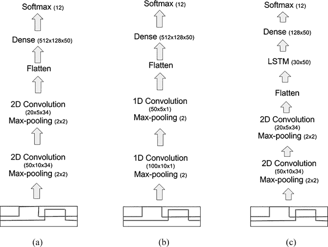

FIGURE 10.2 a) 1D CNN 网络 b) 2D CNN 网络 c) 2D CNN 与 LSTM 网络。

## 1D 卷积

如 Figure 10.2a 所示，卷积仅在单一维度上应用，100 个滤波器（长度为 10）作用于时间维度。随后添加一个步长为 2 的最大池化层以及另一个卷积层，包含 50 个滤波器（长度为 5），再加上一个最大池化层。随后加入一个展平层将特征展平，然后依次添加三个全连接层，隐藏单元数分别为 512、128 和 50，最后添加一个 soft‑max 层以生成置信度值用于类别标签。

## 2D 卷积

如 Figure 10.2b 所示，卷积在两个维度上应用，100 个滤波器（大小为 10 × 34）后跟一个 2 × 2 的最大池化层。随后添加第二个卷积层（20 个滤波器，大小为 5 × 34），随后加入展平层和 soft‑max 层。

## CNN 与 LSTM（2D CNN + LSTM）

由于 CNN 不能编码时间历史，将其与 LSTM 结合，上述两层 2D‑CNN 与两层 LSTM（隐藏层大小为 30 × 50）相结合。随后添加两个全连接层（128 和 50 个隐藏单元）以及用于分类的 soft‑max 层。

根据 Ref. [24]，Aruba 数据集按天划分为训练集和测试集，以保留时间信息。训练集使用 150 天的 Aruba 数据，验证集使用 15 天，其余天数用于测试。WSU 的 adlnormal 集用于训练，而 adlerror 版本用于测试。

第一个实验在 Aruba 上进行，以选择能够提供最高识别结果的最佳输入表示方式。该实验使用 LSTM 分类器对 1 分钟时间切片的传感器读数进行处理。提取的切片被映射为二元、变点和最后激活表示。如 Table 10.6 所示，最后激活表示在精确率和召回率方面表现最佳，同时也获得良好的准确率（最后激活、二元和变点的准确率分别为 87.72%、49.69% 和 48.79%）。结合最佳的两个特征：变点和最后激活，虽然准确率略有提升（87.78%），但精确率和召回率下降。因此，我们在后续实验中继续使用最后激活特征。

TABLE 10.6 Aruba 活动识别结果（LSTM）

| 特征 | 精确率 (%) | 召回率 (%) | F‑Measure (%) | 准确率 (%) |
| --- | --- | --- | --- | --- |
| 二元 | 34.21 | 28.26 | 30.95 | 49.69 |
| 变点 | 29.28 | 26.41 | 27.77 | 48.79 |
| 最后激活 | 43.18 | 43.37 | 43.27 | 87.72 |
| 变点 + 最后激活 | 37.33 | 42.42 | 39.71 | 87.78 |

在 Table 10.7，我们提供了第二个实验的分析，该实验也是活动识别。生成式和判别式方法在 Aruba 集上的成功率如 Table 10.7 所示。结果表明，2D 卷积的 CNN 在准确率上达到 89.67%，而 CNN‑2D 后接 LSTM 分类器则超过 CRF（准确率 89.72%）。原因是 CNN 能够自行提取有价值特征，而 CRF 仅依赖给定输入。HMM 和 HSMM 的准确率最差（分别为 77.90% 和 77.98%）。NB 的准确率更好（84.37%），但精确率（42.87%）和召回率（61.04%）较低。尽管 HMM 和 HSMM 在召回率方面表现最佳（分别为 72.03% 和 71.56%），但它们的精确率较低（分别为 43.66% 和 43.97%）。我们看到，CNN‑1D 网络的准确率为 87.50%，但精确率（31.42%）和召回率（36.78%）较低。CNN‑1D 在时间维度上提取特征，考虑时间切片内的信息，但忽略传感器之间的关系，因为它不在特征维度上进行卷积，因此无法学习类特定的特征图，导致虽然准确率较高（87.50%），但精确率和召回率较低。当使用 2D 卷积时，同时考虑时间信息和空间信息，网络能够学习更具信息量的特征，从而获得更高的精确率（46.84%）和召回率（41.68%）以及更高的准确率（89.67%）。CNN 无法记住前后输入，但将特征图输入 LSTM 层可进一步处理时间维度。因此，CNN‑2D + LSTM 网络实现了精确率 51.20%、召回率 50.55% 以及准确率 89.72%。

TABLE 10.7 Aruba 数据集活动识别结果

| 模型 | 精确率 (%) | 召回率 | F‑Measure (%) | 准确率 (%) |
| --- | --- | --- | --- | --- |
| NB | 42.87 | 61.04% | 50.36 | 84.37 |
| HMM | 43.66 | 72.03% | 54.36 | 77.90 |
| HSMM | 43.97 | 71.56% | 54.47 | 77.98 |
| CRF | 50.24 | 52.83% | 51.50 | 88.58 |
| LSTM | 38.65 | 41.29% | 39.92 | 89.00 |
| CNN-1D | 31.42 | 36.78% | 33.89 | 87.50 |
| CNN-2D | 46.84 | 41.68% | 44.11 | 89.67 |
| CNN-2D + LSTM | 51.20 | 50.55% | 50.87 | 89.72 |

学习到的特征模式如 Figure 10.3 所示。随着特征进入后续层，噪声被抑制，特征变得更清晰。特征维度显示在 `x`‑轴上，时间轴在 `y`‑轴上，白色像素表示激活。

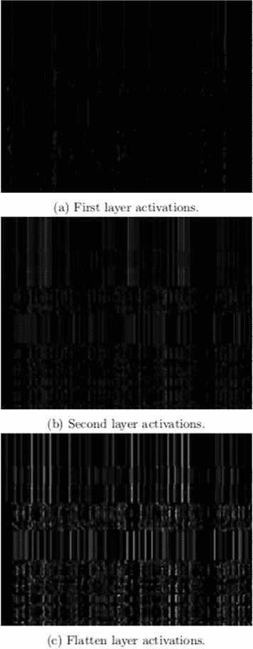

FIGURE 10.3 a) 第一层激活 b) 第二层激活 c) 展平层激活。

在 Aruba 数据集上，分类器最成功地检测到离家和回家活动，因为这两项活动唯一涉及门禁传感器，不会与其他活动混淆。此外，进餐准备活动常与洗碗活动混淆，因为它们都使用相同类型的传感器且均在厨房进行。同时，清洁活动通常与工作活动混淆，因为它们可能在同一房间进行并使用相同传感器。

在第三次实验中，首先对修改后的阿鲁巴集合进行异常活动检测。作为 CNN 网络的代表，我们仅展示 CNN-2D 网络的结果，以便单独观察 CNN 的效果。训练模型时使用正常行为数据，随后将包含异常行为的测试集引入分类器，并将置信度较低的活动实例标记为异常。在 Table 10.8 中，我们可以看到 LSTM 网络实现了最高的特异性，准确率为 75.48%（灵敏度为 98.67%）。虽然 NB、HMM 和 HSMM 模型的灵敏度更高（分别为 99.33%、100%和 100%），但其特异性较低（分别为 33.89%、27.71%和 35.61%）。HMM 表现最差（灵敏度 45.54%，特异性 27.72%）。CNN-2D 的灵敏度为 85.33%，特异性为 33.89%。这表明 LSTM 更适合检测重复和顺序相关的异常活动，因为它们能将当前输入与后续输入关联，而 CNN 则不能。

```
TABLE 10.8 Abnormal Behavior Detection Results on the Modified Aruba Dataset 
| Model || Aruba Modified || WSU |
| --- | --- | --- |
| Sensitivity (%) || Specificity (%) || Sensitivity (%) || Specificity (%) |
| NB || 99.33 || 33.89 || 46.17 || 98.42 |
| HMM || 45.54 || 27.71 || 100 || 50.55 |
| HSMM || 100 || 35.61 || 100 || 42.89 |
| CRF || 100 || 66.03 || 47.87 || 72.17 |
| LSTM || 98.67 || 75.48 || 86.50 || 77.89 |
| CNN-2D || 85.33 || 33.89 || 88.70 || 67.46 |
```

异常检测实验的第二部分在 WSU 测试床上进行。我们从 WSU 传感器读数中提取 30 秒时间切片。该数据集不是日常生活场景收集的，因此传感器读数并非按顺序排列。传感器读数仅限于数据集中标记的活动。`adlnormal`集用于训练，`adlerror`集用于测试。目标是衡量分类器在仅有正常数据集的情况下检测异常的能力。Table 10.8 中的结果表明，HMM 和 HSMM 均实现了最高的灵敏度（各 100%），其中 HMM 的特异性为 50.55%，HSMM 的特异性为 42.89%。CNN-2D 分类器实现了最高的灵敏度（86.70%），而 LSTM 的灵敏度非常接近（86.50%），且特异性更高（77.89%），而 CNN-2D 的特异性仅为 67.47%。

在 Ref. 17 中，作者给出的结果如下：`adlnormal`和`adlerror`均正确检测的活动数分别为 95 和 76，均来自 100 个活动实例。我们对活动切片进行实验，而他们则对整个活动提取特征后判断其正常或异常。问题在于在真实场景中，我们无法确定活动的开始和结束位置。因此，基于切片的检测在实际场景中更具意义。

重复相关的异常行为由 LSTM 更好地检测，而因混淆导致的异常活动则由 CNN 更易识别，因为 CNN 能够检测特征模式的变异。活动的激活顺序和传感器之间的关系构成活动的步骤。例如，去厕所的活动通常包括先起床、走过卧室，然后到厕所。CNN 利用特征的空间邻域，能够建模这种模式。

RNN 和 CNN 的组合取得了最佳结果，因为它们同时编码传感器的时间和空间信息。但它们无法理解活动的内在结构。因此，我们需要层次化模型，以理解给定活动中的子活动及其关系，并将其与认知衰退相关的异常行为联系起来。

## 10.6.1 Conclusion

本研究的主要目标是检测老年人痴呆症患者的日常行为异常。患病老年人往往会混淆事物，或在日常生活模式中重复和跳过某些活动。首先，我们提出了一种合成痴呆引起的异常行为的方法。为此，我们生成了两类异常行为：活动相关和子活动相关的异常。其次，我们利用深度学习方法（如 RNN 和 CNN）来检测异常行为。再次，我们将这些方法与传统的机器学习方法（如 HMM、CRF、支持向量机和 Naïve Bayes）进行了比较。结果表明，所提方法与最先进的机器学习方法具有竞争力。

首先，由于真实数据稀缺，我们提出了一种手动合成异常活动的方法，以模拟老年人日常活动的模式。我们通过在已有文献数据集中注入异常活动到正常活动序列来实现修改。我们特别旨在模拟重复、睡眠障碍和混淆三种类型的异常行为。重复和睡眠障碍相关的异常行为发生在活动层面，而混淆相关的异常行为则发生在子活动层面。然而，这种方法可能无法反映用户特定的异常行为，因为人们在不同时间表现出不同的习惯。

其次，我们将活动识别问题转化为序列标记问题，将传感器测量的时间序列数据视为序列，并利用 RNN 及其变体（如长短期记忆 LSTM、门控循环单元 GRU 和普通 RNN）以及 CNN 来建模日常生活模式。RNN 和 CNN 的实验结果表明，捕捉活动实例及其时间和空间关系有助于理解日常生活模式及其与其他活动的关联。通过 RNN，我们能够编码日常生活中的时间信息，以建模痴呆支持所需的个人环境。通过 CNN，我们尝试提取有意义的模式，并借助这些模式进行活动识别和异常检测。这些模型在检测重复活动和睡眠干扰相关的异常方面表现良好，但对混淆相关的异常检测能力不足，因为它们无法在子活动层面建模活动。

RNN 和 CNN 无法在细粒度上建模日常活动，因此无法判断这些活动中哪些子活动被遗忘、重复或混淆。能够在子活动层面建模这些活动将更好地理解活动识别。

## 10.6.2 Future Work

本研究的一次可能扩展方向是考虑传感器的关闭状态，并研究其对异常检测的影响。也可以引入特定特征或规则，以判断传感器（如代表药品的项传感器或用于检查冰箱门是否关闭的传感器）是否保持关闭。可以提出新的传感器事件表示特征，以涵盖老年人认知状态的更多不同类型的异常行为（如忘记家中物品的位置以及如何使用厨房工具的混淆）。

当疾病进展缓慢时，我们的方法可能无法适应并检测异常行为。因此，可以收集现实数据，其中逐渐恶化的过程被观察到。此外，还可以考虑反映痴呆特定习惯的不同类型的异常行为。如果无法收集现实数据，则可以提出模拟方法来人工生成此类行为。

## Bibliography

1. C. Patterson. The state of the art of dementia research: New frontiers 2018. Tech. rep. Alzheimer’s Disease International (ADI), 2018.

2. M. S. Albert et al. “The diagnosis of mild cognitive impairment due to Alzheimer’s disease: Recommendations from the National Institute on Aging”. In: *Alzheimer’s & Dementia* vol. 7, no. 3 (2011), pp. 270–279. doi: [10.1007/s00406-012-0349-0](https://doi.org/10.1007/s00406-012-0349-0).

3. W. Thies and L. Bleiler. “2013 Alzheimer’s disease facts and figures”. In: *Alzheimer’s & Dementia: the Journal of the Alzheimer’s Association* vol. 9, no. 2 (2013), pp. 208–245.

4. Office for National Statistics. Overview of the UK population: March (2017).

5. Alzhemier. Alzheimer’s disease (2017). url: [www.alz.org](http://www.alz.org) (visited on 08/04/2017).

6. M. Amiribesheli and A. Bouchachia. “Smart homes design for people with dementia”. In: *2015 International Conference on Intelligent Environments* (2015), pp. 156–159. doi: [10.1109/IE.2015.33](https://doi.org/10.1109/IE.2015.33).

7. M. P. Cutchin. “The process of mediated aging-in-place: A theoretically and empirically based model”. In: *Social Science and Medicine* vol. 57, no. 6 (2003), pp. 1077–1090. doi: [10.1016/S0277-9536(02)00486-0](https://doi.org/10.1016/S0277-9536\(02\)00486-0).

8. A. Wimo, B. Winblad, and L. Jonsson. “The worldwide societal costs of dementia: Estimates for 2009”. In: *Alzheimer’s & Dementia* vol. 6, no. 2 (2010), pp. 98–103.

9. M. R. Hodges et al. “Automatic assessment of cognitive impairment through electronic observation of object usage”. In: *Pervasive Computing*. Berlin, Heidelberg: Springer Berlin Heidelberg (2010), pp. 192–209.

10. K. Wild. “Aging changes”. In: *Geraotechnology* vol. 9, no. 2 (2010), pp. 121–125.

11. M. Amiribesheli, A. Benmansour, and A. Bouchachia. “A review of smart homes in healthcare”. In: *Journal of Ambient Intelligence and Humanized Computing* vol. 6, no. 4 (2015), pp. 495–517. doi: [10.1007/s12652-015-0270-2](https://doi.org/10.1007/s12652-015-0270-2).


12. A. R. M. Forkan et al. “A context-aware approach for long- term behavioural change detection and abnormality prediction in ambient assisted living”. In: *Pattern Recognition* vol. 48, no. 3 (2015), pp. 628–641. doi: [10.1016/j.patcog.2014.07.007](https://doi.org/10.1016/j.patcog.2014.07.007).

13. J. Lundstro zm, E. J ̈arpe, and A. Verikas. “Detecting and exploring deviating behaviour of smart home residents”. In: *Expert Systems with Applications* vol. 55 (2016), pp. 429–440. doi: [10.1016/j.eswa.2016.02.030](https://doi.org/10.1016/j.eswa.2016.02.030). url: [`www.sciencedirect.com/science/article/pii/S0957417416300616`](http://www.sciencedirect.com).

14. D. J. Patterson et al. “Fine-grained activity recognition by aggregating abstract object usage”. In: *Ninth IEEE International Symposium on Wearable Computers (ISWC’05)* (2005), pp. 44–51. doi: [10.1109/ISWC.2005.22](https://doi.org/10.1109/ISWC.2005.22).

15. H. L Chieu, W. S. Lee, and L. P Kaelbling. “Activity recognition from physiological data using conditional random fields”. In: *SMA Symposium*. Singapore- MIT Alliance (2006).

16. T. van Kasteren et al. “Accurate activity recognition in a home setting”. In: *Proceedings of the 10th International Conference on Ubiquitous Computing*. UbiComp ’08 (2008), pp. 1–9. doi: [10.1145/1409635.1409637](https://doi.org/10.1145/1409635.1409637). url: [`doi.acm.org/10.1145/1409635.1409637`](http://doi.acm.org/10.1145/1409635.1409637).

17. G. Virone. “Assessing everyday life behavioural rhythms for the older generation”. In: *Pervasive and Mobile Computing* vol. 5, no. 5 (2009), pp. 606–622. doi: [10.1016/j.pmcj.2009.06.008](https://doi.org/10.1016/j.pmcj.2009.06.008).

18. A. R. M. Forkan et al. “A context-aware approach for long- term behavioural change detection and abnormality prediction in ambient assisted living”. In: *Pattern Recognition* vol. 48, no. 3 (2015), pp. 628–641. doi: [10.1016/j.patcog.2014.07.007](https://doi.org/10.1016/j.patcog.2014.07.007).

19. J. Lundstro ̈m, E. J ̈arpe, and A. Verikas. “Detecting and exploring deviating behaviour of smart home residents”. In: *Expert Systems with Applications* vol. 55 (2016), pp. 429–440. doi: [10.1016/j.eswa.2016.02.030](https://doi.org/10.1016/j.eswa.2016.02.030). url: [`www.sciencedirect.com/science/article/pii/S0957417416300616`](http://www.sciencedirect.com).

20. T. Van Kasteren, G. Englebienne, and B. J. A. Krose. “Human activity recognition from wireless sensor network data: Benchmark and software”. In: *Activity Recognition in Pervasive Intelligent Environments* (2011), pp. 165–186. doi: [10.2991/978-94-91216-05-3\_8](https://doi.org/10.2991/978-94-91216-05-3_8).

21. N. Twomey et al. “Unsupervised learning of sensor topologies for improving activity recognition in smart environments”. In: *Neurocomputing* vol. 234.C (Apr. 2017), pp. 93–106. ISSN: 0925-2312. doi: [10.1016/j.neucom.2016.12.049](https://doi.org/10.1016/j.neucom.2016.12.049). url: [`doi.org/10.1016/j.neucom.2016.12.049`](https://doi.org/10.1016/j.neucom.2016.12.049).

22. S. S. Akter and L. B. Holder. “Activity recognition using graphical features”. In: *2014 13th International Conference on Machine Learning and Applications*. Springer International Publishing (2014), pp. 165–170.

23. M. Seelye Adriana, M. Schmitter-Edgecombe, A. Crandall, and D. J. Cook. “Naturalistic assessment of everyday activities and prompting technologies in mild cognitive impairment”. In: *Journal of the International Neuropsychological Society* vol. 2013, no. 4 (2013), pp. 442–452. doi: [10.1017/S135561771200149X](https://doi.org/10.1017/S135561771200149X).

24. N. K. Suryadevara et al. “Forecasting the behavior of an elderly using wireless sensors data in a smart home”. In: *Engineering Applications of Artificial Intelligence* vol. 26, no. 10 (2013), pp. 2641–2652. doi: [10.1016/j.engappai.2013.08.004](https://doi.org/10.1016/j.engappai.2013.08.004).

25. P. Dawadi, D. J. Cook, and M. Schmitter-Edgecombe. “Smart home-based longitudinal functional assessment”. In: *Proceedings of the 2014 ACM International Joint Conference on Pervasive and Ubiquitous Computing: Adjunct Publication*. UbiComp ’14 Adjunct. New York, NY: ACM (2014), pp. 1217–1224. doi: [10.1145/2638728.2638813](https://doi.org/10.1145/2638728.2638813). url: [`doi.acm.org/10.1145/2638728.2638813`](http://doi.acm.org/10.1145/2638728.2638813).

26. D. Riboni et al. “Fine-grained recognition of abnormal behaviors for early detection of mild cognitive impairment”. In: *2015 IEEE International Conference on Pervasive Computing and Communications (PerCom)* (2015), pp. 149–154. doi: [10.1109/PERCOM.2015.7146521](https://doi.org/10.1109/PERCOM.2015.7146521).

27. Z. H. Janjua, D. Riboni, and C. Bettini. “Towards automatic induction of abnormal behavioral patterns for recognizing mild cognitive impairment”. In: `Proceedings of the 31st Annual ACM Symposium on Applied Computing` (2016), pp. 143–148.

28. N. Hammerla et al. `PD Disease State Assessment in Naturalistic Environments Using Deep Learning`. `AAAI Press` (2015), pp. 1742–1748. url: [`http://dl.acm.org/citation.cfm?id=2886521.2886562`](http://dl.acm.org/citation.cfm?id=2886521.2886562)

29. K. S. Gayathri, S. Elias, and B. Ravindran. “Hierarchical activity recognition for dementia care using Markov Logic Network”. In: `Personal and Ubiquitous Computing` vol. 19, no. 2 (2015), pp. 271–285. doi: [`10.1007/s00779-014-0827-7`](https://doi.org/10.1007/s00779-014-0827-7). url: [`https://doi.org/10.1007/s00779-014-0827-7`](https://doi.org/10.1007/s00779-014-0827-7).

30. Vi Jakkula and D. Cook. “Detecting anomalous sensor events in smart home data for enhancing the living experience”. In: `Proceedings of the 7th AAAI Conference on Artificial Intelligence and Smarter Living: The Conquest of Complexity` (2011), pp. 33–37.

31. F. J. Ordo ́n ̃ez, P. de Toledo, and A. Sanchis. “Sensor-based Bayesian detection of anomalous living patterns in a home setting”. In: `Personal and Ubiquitous Computing` vol. 19, no. 2 (2015), pp. 259–270. doi: [`10.1007/s00779-014-0820-1`](https://doi.org/10.1007/s00779-014-0820-1). url: [`https://doi.org/10.1007/s00779-014-0820-1`](https://doi.org/10.1007/s00779-014-0820-1).

32. M. Cook and D. J. Schmitter-Edgecombe. “Assessing the quality of activities in a smart environment”. In: `Methods of Information in Medicine` vol. 48 (2009), pp. 480–485. doi: [`10.3414/ME0592`](https://doi.org/10.3414/ME0592).

33. S. Choi, E. Kim, and S. Oh. “Human behavior prediction for smart homes using deep learning”. In: `2013 IEEE RO-MAN` (2013), pp. 173–179. doi: [`10.1109/ROMAN.2013.6628440`](https://doi.org/10.1109/ROMAN.2013.6628440).

34. W. Kang, D. Shin, and D. Shin. “Detecting and predicting of abnormal behavior using hierarchical Markov model in smart home network”. In: `2010 IEEE 17th International Conference on Industrial Engineering and Engineering Management` (2010), pp. 410–414. doi: [`10.1109/ICIEEM.2010.5646583`](https://doi.org/10.1109/ICIEEM.2010.5646583).

35. Y. Tong, R. Chen, and J. Gao. “Hidden state conditional random field for abnormal activity recognition in smart homes”. In: `Entropy` vol. 17.3 (2015), p. 1358. doi: [`10.3390/e17031358`](https://doi.org/10.3390/e17031358).

36. A. Lotfi et al. “Smart homes for the elderly dementia sufferers: Identification and prediction of abnormal behaviour”. In: `Journal of Ambient Intelligence and Humanized Computing` vol. 3, no. 3 (2012), pp. 205–218. doi: [`10.1007/s12652-010-0043-x`](https://doi.org/10.1007/s12652-010-0043-x). url: [`https://doi.org/10.1007/s12652-010-0043-x`](https://doi.org/10.1007/s12652-010-0043-x).


37. P. N. Dawadi, D. J. Cook, and M. Schmitter-Edgecombe. “Automated cognitive health assessment using smart home monitoring of complex tasks”. In: `IEEE Transactions on Systems, Man, and Cybernetics: Systems` vol. 43, no. 6 (2013), pp. 1302–1313. ISSN: `2168-2216`. doi: [`10.1109/TSMC.2013.2252338`](https://doi.org/10.1109/TSMC.2013.2252338).

38. P. Dawadi et al. “An approach to cognitive assessment in smart home”. In: `Proceedings of the 2011 Workshop on Data Mining for Medicine and Health-care`. DMMH ’11. San Diego, CA: `ACM` (2011), pp. 56–59. ISBN: `978-1-4503-0843-4`. doi: [`10.1145/2023582.2023592`](https://doi.org/10.1145/2023582.2023592). url: [`http://doi.acm.org/10.1145/2023582.2023592`](http://doi.acm.org/10.1145/2023582.2023592).

39. P. N. Dawadi, D. J. Cook, and M. Schmitter-Edgecombe. “Modeling patterns of activities using activity curves”. In: `Pervasive and Mobile Computing` vol. 28 (June 2016), pp. 51–68. doi: [`10.1016/j.pmcj.2015.09.007`](https://doi.org/10.1016/j.pmcj.2015.09.007).

40. O. Aran et al. “Anomaly detection in elderly daily behaviour in ambient sensing environments”. In: `Human Behaviour Understanding: 7th International Workshop` (2016). Ed. by M. Chetouani, J. Cohn, and A. Ali Salah, pp. 51–67.

41. J. Yang et al. “Deep convolutional neural networks on multichannel time series for human activity recognition” (2015), pp. 3995–4001.

42. M. Zeng et al. “Convolutional neural networks for human activity recognition using mobile sensors”. In: `6th International Conference on Mobile Computing, Applications and Services` (2014), pp. 197–205. doi: [`10.4108/icst.mobicase.2014.257786`](https://doi.org/10.4108/icst.mobicase.2014.257786).

43. F. J. Ordonez and D. Roggen. “Deep convolutional and LSTM recurrent neural networks for multimodal wearable activity recognition”. In: `Sensors` vol. 16, no. 1 (2016), p. 115. doi: [`10.3390/s16010115`](https://doi.org/10.3390/s16010115).

44. N. Y. Hammerla, S. Halloran, and T. Plötz. “Deep, convolutional, and recurrent models for human activity recognition using wearables”. In: `Proceedings of the Twenty-Fifth International Joint Conference on Artificial Intelligence`. IJCAI’16. `AAAI Press` (2016), pp. 1533–1540. url: [`http://dl.acm.org/citation.cfm?id=3060832.3060835`](http://dl.acm.org/citation.cfm?id=3060832.3060835).

45. S. Ha and S. Choi. “Convolutional neural networks for human activity recognition using multiple accelerometer and gyroscope sensors”. In: `2016 International Joint Conference on Neural Networks (IJCNN)` (2016), pp. 381–388. doi: [`10.1109/IJCNN.2016.7727224`](https://doi.org/10.1109/IJCNN.2016.7727224).

46. C. A. Ronao and S.-B. Cho. “Human activity recognition with smartphone sensors using deep learning neural networks”. In: `Expert Systems with Applications` vol. 59 (2016), pp. 235–244. ISSN: `0957-4174`. doi: [`10.1016/j.eswa.2016.04.032`](https://doi.org/10.1016/j.eswa.2016.04.032). url: [`http://www.sciencedirect.com/science/article/pii/S0957417416302056`](http://www.sciencedirect.com/science/article/pii/S0957417416302056).

47. R. Yao et al. “Efficient dense labeling of human activity sequences from wearables using fully convolutional networks”. In: `CoRR abs/1702.06212` (2017). doi: [`10.1016/j.patcog.2017.12.024`](https://doi.org/10.1016/j.patcog.2017.12.024). url: [`http://www.sciencedirect.com/science/article/pii/S0031320317305204`](http://www.sciencedirect.com/science/article/pii/S0031320317305204).

48. A. Charissa and C. Sung-Bae. “Evaluation of deep convolutional neural network architectures for human activity recognition with smartphone sensors”. In: `Proceedings of the KIISE Korea Computer Congress` (2015), pp. 858–860.

49. N. M. Rad et al. “Convolutional neural network for stereo- typical motor movement detection in autism”. In: `CoRR abs/1511.01865` (2015).

50. K. Wang et al. “Research on healthy anomaly detection model based on deep learning from multiple time-series physiological signals”. In: `Scientific Programming` (2016). doi: [`10.1155/2016/5642856`](https://doi.org/10.1155/2016/5642856).


51. 51. T. Plotz, N. Hammerla, and P. Olivier. “Feature learning for activity recognition in ubiquitous computing”. In: *Proceedings of the 22thownd International Joint Conference on Artificial Intelligence* vol. 2 (bute 20. 

-   多种心电图标准用于诊断左心室肥厚（LVH）\[6\]。更常用的标准准确率约为 52%–63%，但灵敏度极低（低于 56%），特异度极高（高于 90%）。尽管这些标准在全球被广泛使用和接受，但仍希望在保持灵敏度和特异度平衡的前提下提高准确性。同样重要且困难的是通过非侵入性方式检测非酒精性脂肪肝（NAFLD）。伴有 NAFLD 风险因素（如糖尿病、肥胖、高甘油三酯等）且丙氨酸转氨酶（ALT）水平升高的患者，可以通过昂贵的肝磁共振检查或肝活检（伴随其风险）进行评估。

-   当代，机器学习（ML）在医学研究中被更频繁地用于改善对感兴趣变量的分类（或预测），如糖尿病\[7\]、癌症\[8\]或死亡。不同类型的数据使用了不同的算法，而更复杂的算法则用于处理非线性关系\[9\]或高维数据\[10\]。如 Adaboost 或支持向量机（`SVM`）等算法可准确分类糖尿病视网膜病变\[11\]、癌症\[12\]等；但若医生缺乏足够的 ML 知识，这些算法无法提供可读的结果。此外，还有其他 ML 算法，其输出更易被医生理解，而不牺牲准确性。决策树（`DT`）算法可用于预测或分类\[13\]并处理变量间的非线性关系。

-   在本研究中，我们开发了一种基于`DT`的模型，旨在提高左心室肥厚（LVH）和非酒精性脂肪肝（NAFLD）的分类准确率并实现自动化任务。我们的贡献包括多方面：(1) `DT`可自动从临床相关且经医学专家验证的患者数据中生成与 LVH 和 NAFLD 相关的隐藏复杂模式或规则；(2) `DT`挖掘出的部分规则与前沿临床发现一致，部分虽为新但极具临床意义，对临床研究非常有用；(3) 与其他 ML 算法不同，`DT`生成的规则与 LVH 和 NAFLD 的前沿诊断程序高度相似，使得`DT`基模型可作为常规临床诊断手段；(4) 所提模型实现简单，特别适用于城市和农村医院环境；(5) 使用该工具，急诊医生可获得初步解读，提升对 LVH 或 NAFLD 的分类能力（这些通常难以检测），后续可由专家验证，从而大幅缩短等待时间。该工具能处理噪声和复杂信息，便于临床医生在数据不完美、甚至极端压力下做出决策，并能提升医生在选择治疗方案时的信心，无需额外参考专家。

## 11.2 文献综述

### 11.2.1 左心室肥厚（LVH）

LVH 是心脏病发作的主要风险因素；尽管通过超声心动图易于检测，但在某些地区可能成本高昂或不可及。心电图被用于诊断心律失常的金标准，同时也有多种心电图诊断标准用于检测 LVH 的存在（如 Sokolow-Lyon 和 Cornell 标准等）；这些标准具有极高特异性（>90%），但灵敏度较差（<20%），准确率约为 50%\[6\]。

最近一些研究旨在改善 LVH 患者的分类。大多数研究除了人口学变量外，还结合了心电图变量。Lin 和 Liu\[14\]通过`SVM`算法对年轻成年人是否存在 LVH 进行分类。该研究评估了 28 项心电图特征以及其他临床特征（年龄、身高、体重、BMI、腰围、收缩压、舒张压、体表面积）。`SVM`模型与传统心电图电压标准（Cornell 和 Sokolow-Lyon）相比，虽然`SVM`模型的灵敏度和特异度平衡（各 86.7%和 73.3%），但 Cornell 电压标准的准确率更高（93% vs. 74.2%）\[14\]。

Sparapani 及其同事（2019 年）描述了如何使用**贝叶斯加性回归树**对 LVH 的存在进行分类。该研究嵌入于 MESA（多族裔动脉粥样硬化研究），纳入了 3,214 名男性和 3,600 名女性。该算法基于带有先验和似然的统计模型，是一种树模型的贝叶斯非参数方法。研究中纳入了 552 项振幅和持续时间心电图测量。MRI 被用作 LVH 分类的金标准。所提模型的 ROC AUC 为 82.9%，特异性为 94.6%，灵敏度为 29%。与 Gen-Min Lin 的模型相比，该模型特异性更高（接近标准标准），且相较于 Cornell 电压积和电压标准，贝叶斯加性回归树表现更佳\[15\]。

### 11.2.2 非酒精性脂肪肝疾病

当今，多种评分被用于预测 NAFLD。Poynard 等人\[16\]发表了 SteatoTest，旨在预测 NAFLD，以期减少对肝活检的需求\[16\]。作者使用逻辑回归建立模型，评估了年龄、性别、BMI、葡萄糖、丙氨酸转氨酶、α2 微球蛋白、A-1 载脂蛋白、血清素、总胆红素、总胆固醇和甘油三酯等变量。该模型的准确率在 0.8 至 0.9 之间（取决于灵敏度和特异度的阈值）。随后发表了一种更新模型，保持准确率的同时采用更简化的模型\[17\]。

进一步研究尝试通过此前描述的变量以及其他变量（如舒张压和尿酸）\[18\]来改进 NAFLD 的分类，并结合拉索回归实现维度降低后再使用多元逻辑回归。该模型包含 8 个变量（包括性别、年龄、总胆固醇、BMI、腰围、舒张压、血清尿酸以及高密度脂蛋白胆固醇的病程），在训练集和验证集中的准确率分别为 0.848 和 0.809。

机器学习算法也已被用于代谢疾病领域的前沿，包括脂质组学和糖类组学。这些“omics”包含更大的变量列表，能够更好地解释疾病背后的现象。Perkakis（2019）评估了 49 名健康受试者和 31 名经活检证实的 NAFLD 患者。作者此前还测量了一些激素变量：`adiponectin`、`leptin`、`activin A` 和 `follistatin`。这些“omics”变量通过`质谱`和`液相色谱-质谱`（LC‑MS）进行测量。所使用的机器学习算法包括`SVM`、*k* 最近邻和`随机森林`。在此情形下，采用非线性核的`SVM`模型在脂质组学变量以及其他变量上均取得了最高准确率（\[[19\]）。然而，`DT`算法的独特之处在于它常常模拟人类层面的思考方式，使得数据更易理解，也能够提供合理的解释。与`neural network`和`SVM`等黑盒算法不同，`DT`算法背后的逻辑是可解释且易于阐述的（\[20\]）。

## 11.3 Methodology

`DT`是用于分类和回归问题的最流行机器学习算法之一（\[20\]）。`DT`通过树状模型实现，每个节点代表特征（属性），每条支路展示一个决策（规则），每个叶节点代表结果（离散或连续值）。本文提出的用于诊断`LVH`和`NAFLD`的`DT`模型算法在 Algorithm 11.1 中给出。

`DT`表示一系列析取性规则，通过从根节点向下沿树的路径对实例进行分类，最终到达某个叶节点。叶节点的类别即为该实例的预测类别。`DT`在给定的训练样本上通过递归划分策略构建，在满足停止条件之前会不断扩展叶节点，目标是通过每次划分使数据集在“距离”上得到最大化的分离。在本文所提算法中，采用信息增益比作为划分准则，如 Algorithm 11.1 所示。`DT`的一个瓶颈是易出现过拟合，即每个叶节点仅代表训练数据中出现的特定属性组合，无法对未见的属性值组合进行分类。为防止过拟合，建议对`DT`进行剪枝，即剪掉树的下端（叶节点），直到树结构大幅变小。本文的剪枝算法在 Algorithm 11.2 中给出。

## 11.4 Experimental Results and Discussions

### 11.4.1 Data Acquisition

为展示`DT`在分类`LVH`和`NAFLD`患者方面的有效性，我们使用 Ref. \[21,22\]中公布的数据。`LVH`数据包含 432 名患者，其中 202 名患有`LVH`，230 名不患病。其中 240 名为男性，所有患者均通过 12 导联心电图（如 Figure 11.1 所示）进行评估，涉及与`LVH`最相关的 31 项指标。此外，还计算了 Romhilt–Estes 多级评分以作比较。`LVH`的存在通过超声心动图（诊断`LVH`的金标准）进行评估。

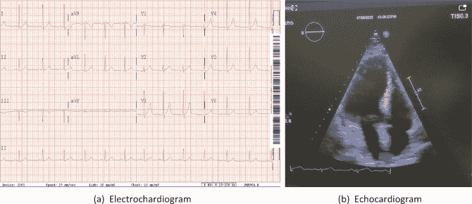

**FIGURE 11.1** 标准 12 导联心电图和四腔心超声心动图。

左心室形态模式如下：正常形态（*n* = 100，23.1%），心脏重塑（*n* = 130，30.1%），同心`LVH`（*n* = 165，38.2%）和离心`LVH`（*n* = 37，8.6%）。`LVH`严重程度分为：轻度（*n* = 77，38.1%），中度（*n* = 50，24.7%）和重度（*n* = 75，37.1%）。男女之间`LVH`严重程度没有差异（*P* = 0.420）。`LVMI`、`RWT`及不同左心室形态的分布在 Figure 11.2 中显示。


**FIGURE 11.2** 左心室质量指数（`LVMI`）分布及左心室形态。左心室形态定义为：正常（`LVMI` 正常且 `RWT` ≤0.42）（圆形），心脏重塑（`LVMI` 正常且 `RWT` >0.42）（十字形），同心`LVH`（`LVMI` 升高且 `RWT` >0.42）（三角形），离心`LVH`（`LVMI` 升高且 `RWT` ≤0.42）（菱形）。`LVH`：左心室肥厚（男性：>115 g/m²，女性：>95 g/m²），`LVMI`：左心室质量指数，`RWT`：相对壁厚度。

相反，`NAFLD`通过`DT`算法进行分类。以往研究使用结构方程模型探讨`NAFLD`的存在与多种变量（包括临床、家族史以及多种炎症因子（IL-2、IL-4、IL-6、肿瘤坏死因子-α等））之间的关系。在这些数据中，137 名受试者通过超声检查检测肝脏低回声，从而判断是否存在`NAFLD`。超声检查并不是最佳的非侵入性分类`NAFLD`的方法，但目前仍是最具成本效益的手段。

### 11.4.2 Decision Tree-Based Model Development for `LVH` Classification

本文提出的模型自动生成一个五层、七节点的简洁`DT`，如 Figure 11.3 所示。每个叶节点显示患有`LVH`的概率，若概率大于 0.5（50%），则该患者被判定为患有`LVH`，反之亦然。该模型使用 80%的样本进行训练，剩余 20%用于内部验证；外部验证在 150 名受试者（47.3%为`LVH`阳性）上进行。`DT`模型在`LVH`预测方面的分类性能在 Table 11.1 中给出。对维度降低使用了逻辑回归（\[20\]），重要特征在 Table 11.2 中列出。


**FIGURE 11.3** 决策树用于左心室肥厚（`LVH`）的可视化。

**TABLE 11.1** 决策树模型在`LVH`分类中的性能

|  | **Accuracy (%)** | **Sensitivity (%)** | **Specificity (%)** | **PPV (%)** | **NPV (%)** |
|---|---|---|---|---|---|
| 内部验证 | 71.4 | 79.6 | 53 | 66.6 | 69.3 |
| 外部验证 | 73.3 | 81.6 | 69.3 | 56.3 | 88.6 |

**TABLE 11.2** 用于`LVH`分类的逻辑回归模型

|  | **Estimate** | **Std Error** | ***P*-Value** | **95% CI** |
|---|---|---|---|---|
| `Intercept` | −2.7 | 0.86 | 0.001 | \[0.01, 0.34\] |
| `ST abnormalities` | 1.28 | 0.30 | <0.001 | \[1.98, 6.52\] |
| `S V4` | 0.93 | 0.36 | 0.01 | \[1.24, 5.26\] |
| `由 V6 的内在偏差` | 0.97 | 0.32 | 0.002 | \[1.4, 5.04\] |
| `负 P 波偏差在 V1` | 0.96 | 0.24 | <0.001 | \[1.61, 4.22\] |
| `R aVR` | 3.9 | 1.3 | 0.002 | \[4.1, 685.1\] |
| `S aVR` | 0.48 | 0.34 | 0.18 | \[0.83, 3.17\] |
| `V1 中 P 波持续时间` | −0.009 | 0.003 | 0.14 | \[0.98, 0.99\] |
| `S V6` | 1.91 | 0.95 | 0.04 | \[1.05, 44\] |
| `S I` | −2.24 | 1.01 | 0.27 | \[0.01, 0.77\] |
| `QRS 持续时间` | 0.01 | 0.008 | 0.1 | \[0.99, 1.03\] |
| `R I` | 0.53 | 0.37 | 0.15 | \[0.81, 3.57\] |

所提议的树在 Figure 11.3 中是一个特例，因为它经过了算法和领域专家（心脏科医师）的修剪。算法处理原始数据并生成树，在此“正常”过程后，专家评估该树并提出哪个变量应被移除的建议。这些步骤重复进行，直至专家认为树具有生物学一致性并提高了 `LVH` 标准的准确性。这种“模型”让不同领域的专家能够与数据科学家协作，是由于决策树（`DTs`）的特性所促成的。

### 11.4.3 决策树用于 `NAFLD` 分类

物流回归模型首先应用于 IV-A 节讨论的 `NAFLD` 临床数据，以选择重要特征，随后使用决策树进行分类。所提议模型生成的决策树在 Figure 11.4 中展示。决策树在 `NAFLD` 预测方面的分类性能（准确率、灵敏度、特异度、阳性预测值（PPV）和阴性预测值（NPV））显示在 Table 11.3。

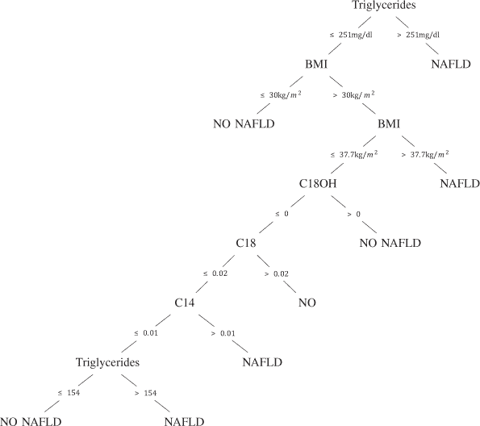

**FIGURE 11.4 Proposed decision tree model with logistic regression-based forward selection model.**

**TABLE 11.3 决策树对 `NAFLD` 分类性能**

| **决策树** | **准确率 (%)** | **灵敏度 (%)** | **特异度 (%)** | **PPV (%)** | **NPV (%)** |
|---|---|---|---|---|---|
| 交叉验证 | 94.9 | 80 | 87.4 | 66.6 | 92.2 |
| 置信区间 | 78.1–91.7 | 65.8–94.1 | 82.4–92.5 | 54.5–78.7 | 86.3–98.1 |

经常，计划纳入特定模型的变量与感兴趣的现象已有关联，但有时这些变量仅有理论关联而缺乏实际测量关系。正如在 `NAFLD` 的决策树中，Figure 11.4，内分泌学专家（领域专家）假设脂肪酰化肉碱（即 C14、C18、C18OH）与其他生化变量之间存在关系，但不确定它们与 `NAFLD` 的具体相互作用方式。此类情况下，算法生成的树可作为假设生成器（了解变量间的相关性），并在变量可用时用于日常患者分类。

## 11.5 结论与未来工作

我们开发了一种基于决策树的解决方案，用于自动化 `LVH` 和 `NAFLD` 的诊断。所提议的决策树模型能够发现辅助疾病诊断的规则，并且这些规则与医师的发现相一致。决策树生成的规则易于医师理解，因而更适合在临床环境中使用。本章描述了 `DT` 算法的核心特性，并展示了其在 `LVH` 和 `NAFLD` 案例中的实用性。由于变量之间缺乏线性关系，`DT` 算法有效地处理了这些数据的熵。它们改进了 `LVH` 的标准，并为 `NAFLD` 提供了新的关联和分类能力。`DT` 的易解释性提升了其在医学领域的受欢迎程度，这可以通过近年来基于 `DT` 的研究数量激增来得到支持。截至本章撰写时，在 PubMed（美国国家医学图书馆和国立卫生研究院的搜索引擎）中检索关键词 “decision tree” 的结果显示，研究数量从 1967 年的单篇文章增长到 2020 年的 1,444 篇。`DT` 在许多复杂的分类和预测问题中表现出最先进的结果；但它也面临挑战。其中之一是 `DT` 的不稳定性，即数据细微变化会导致不同的树结构。与所有科学分支一样，医学领域的准确性与对问题解决方案唯一性同样重要。因此，每次实验都需要足够大的样本量和外部验证，以验证模型的通用性。

如前所述，`DT` 在大规模且极其复杂的数据上具有竞争性性能。对原始算法的改进包括转移学习 \[23\]，半监督学习 \[24\]，以及随时学习 \[25\]。未来，我们计划借助转移学习、半监督学习和随时学习，开发更高效、更通用的成本敏感和前瞻性决策树，以自动化常规诊断流程。

## 参考文献

1. A. L. Hilliard, D. E. Winchester, T. D. Russell, and R. D. Hilliard, “Myocardial infarction classification and its implications on measures of cardiovascular outcomes, quality, and racial/ethnic disparities,” *Clin Cardiol*, vol. 43, no. 10, pp. 1076–1083, Oct 2020.
2. E. J. Benjamin, P. Muntner, A. Alonso, M. S. Bittencourt, C. W. Callaway, A. P. Carson, A. M. Chamberlain, A. R. Chang, S. Cheng, S. R. Das et al., “Heart disease and stroke statistics-2019 update: a report from the American heart association,” *Circulation*, vol. 139, no. 10, pp. e56–e528, 2019.
3. M. M. Ruissen, A. L. Mak, U. Beuers, M. E. Tushuizen, and A. G. Holleboom, “Non-alcoholic fatty liver disease: a multidisciplinary approach towards a cardiometabolic liver disease,” *Eur J Endocrinol*, vol. 183, no. 3, pp. R57–R73, Sep 2020.
4. U. Goldbourt and E. Grossman, “Blood pressure variability at midlife is associated with all-cause, coronary heart disease and stroke long term mortality,” *J Hypert*, vol. 38, no. 9, pp. 1722–1728, Sep 2020.
5. K.-S. Hong, K. Kim, and M. A. Hill, “Regulation of blood flow in small arteries: mechanosensory events underlying myogenic vasoconstriction,” *J Exerc Rehabil*, vol. 16, no. 3, pp. 207–215, Jun 2020.
6. F. De la Garza Salazar, E. A. Rodríguez Díaz, A. González Cantú, J. R. Azpiri López, M. Kuri Ayache, and M. E. Romero Ibarguengoitia, “Diagnostic utility of the electrocardiographic left ventricular hypertrophy criteria in specific populations,” *Acta Cardiol*, pp. 1–8, Feb 2020.
7. Y. Xiong, L. Lin, Y. Chen, S. Salerno, Y. Li, X. Zeng, and H. Li, “Prediction of gestational diabetes mellitus in the first 19 weeks of pregnancy using machine learning techniques,” *J Matern Fetal Neonatal Med*, pp. 1–7, Aug 2020.
8. S. Kweon, J. H. Lee, Y. Lee, and Y. R. Park, “Personal health information inference using machine learning on RNA expression data from patients with cancer: algorithm validation study,” *J Med Internet Res*, vol. 22, no. 8, p. e18387, Aug 2020.
9. M. C. Prosperi, A. Altmann, M. Rosen-Zvi, E. Aharoni, G. Borgulya, F. Bazso, A. Sönnerborg, E. Schülter, D. Struck, G. Ulivi 等，研究专家规则库、逻辑回归和非线性机器学习技术预测抗逆转录病毒治疗的应答情况，《Antivir Ther》，第 14 卷，第 3 期，第 433–442 页，2009 年。
10. J. Fan 和 R. Li，“高维度统计挑战：知识发现中的特征选择”，《arXiv 预印本 `math/0602133`》，2006 年。
11. S. Gayathri, V. P. Gopi 和 P. Palanisamy，“通过可靠特征选择实现糖尿病视网膜病的自动分类”，《Phys Eng Sci Med》，第 43 卷，第 3 期，第 927–945 页，2020 年 9 月。
12. Y. Han, Y. Ma, Z. Wu, F. Zhang, D. Zheng, X. Liu, L. Tao, Z. Liang, Z. Yang, X. Li, J. Huang 和 X. Guo，“利用 PET/CT 图像对非小细胞肺癌的病理亚型进行分类”，《Eur J Nucl Med Mol Imaging》，第 48 卷，第 2 期，第 350–360 页，2021 年 2 月。
13. Y.-Y. Song 和 L. Ying，“决策树方法：用于分类和预测的应用”，《Shanghai Arch Psychiatry》，第 27 卷，第 2 期，第 130 页，2015 年。
14. G.-M. Lin 和 K. Liu，“基于机器学习的心电图系统结合体格测量，用于筛查年轻成人左心室肥厚”，《IEEE J Transl Eng Health Med》，第 8 卷，第 1800111 页，2020 年。
15. R. Sparapani, N. M. Dabbouseh, D. Gutterman, J. Zhang, H. Chen, D. A. Bluemke, J. A. C. Lima, G. L. Burke 和 E. Z. Soliman，“利用贝叶斯加性回归树检测左心室肥厚：MESA 研究”，《J Am Heart Assoc》，第 8 卷，第 5 期，第 e009959 页，2019 年。
16. T. Poynard, V. Ratziu, S. Naveau, D. Thabut, F. Charlotte, D. Messous, D. Capron, A. Abella, J. Massard, Y. Ngo, M. Munteanu, A. Mercadier, M. Manns 和 J. Albrecht，“血液生物标志物（`steatotest`）的诊断价值用于预测肝脂肪肝”，《Comp Hepatol》，第 4 卷，第 10 页，2005 年 12 月。
17. T. Poynard, V. Peta, M. Munteanu, F. Charlotte, Y. Ngo, A. Ngo, H. Perazzo, O. Deckmyn, R. Pais, P. Mathurin, R. Myers, R. Loomba, V. Ratziu 和 FLIP 联合体，the FibroFrance-CPAM group，the FibroFrance-Obese group 和 the Selonsertib group，“简化血液测试（`steatotest-2`）的诊断性能用于预测肝脂肪肝”，《Eur J Gastroenterol Hepatol》，第 31 卷，第 3 期，第 393–402 页，2019 年。
18. Y. Zhang, R. Shi, L. Yu, L. Ji, M. Li 和 F. Hu，“建立 2 型糖尿病非酒精性脂肪肝的风险预测模型”，《Diabetes Ther》，第 11 卷，第 9 期，第 2057–2073 页，2020 年 9 月。
19. N. Perakakis, S. A. Polyzos, A. Yazdani, A. Sala-Vila, J. Kountouras, A. D. Anastasilakis 和 C. S. Mantzoros，“利用‘omics’和监督学习实现非酒精性脂肪肝炎和纤维化的非侵入性诊断：概念证明研究”，《Metabolism》，第 101 卷，第 154005 页，2019 年。
20. T. M. Mitchell，《Machine Learning》，纽约：McGraw-Hill，1997 年。


21. F. De la Garza-Salazar, M. E. Romero-Ibarguengoitia, E. A. Rodriguez-Diaz, J. R. Azpiri-Lopez 和 A. González-Cantu，“利用机器学习方法提高左心室肥厚的心电图诊断准确性”，《PLoS One》，第 15 卷，第 5 期，第 e0232657 页，2020 年。

22. M. E. Romero-Ibarguengoitia, F. Vadillo-Ortega, A. E. Caballero, I. Ibarra-González, A. Herrera-Rosas, M. F. Serratos-Canales, M. León-Hernández, A. González-Chávez, S. Mummidi, R. Duggirala 和 J. C. López-Alvarenga，“家族史和青少年肥胖的影响：对 acylcarnitine/氨基酸代谢组学及非酒精性脂肪肝（nafld）的结构方程建模方法”，《PLoS One》，第 13 卷，第 2 期，第 e0193138 页，2018 年。

23. J. won Lee 和 C. Giraud-Carrier，“决策树中的迁移学习”，在《2007 国际神经网络联合会议》中，IEEE，2007 年，第 726–731 页。

24. J. Tanha, M. van Someren 和 H. Afsarmanesh，“半监督自训练用于决策树分类器”，《Int J Mach Learn Cybernet》，第 8 卷，第 1 期，第 355–370 页，2017 年。

25. S. Esmeir 和 S. Markovitch，“随时学习决策树”，《J Mach Learn Res》，第 8 卷，第 May 期，第 891–933 页，2007 年。

# CHAPTER 12

The Cutting Edge of Surgical Practice: Applications of Machine Learning to Neurosurgery

Omar Khan, Jetan H. Badhiwala, Muhammad Ali Akbar 和 Michael G. Fehlings

University of Toronto, Toronto, Canada

## Contents

- 12.1 Introduction
- 12.2 Machine Learning and Neurosurgical Diagnostics
- 12.3 Machine Learning and Intraoperative Care
- 12.4 Machine Learning and Neurosurgical Prognosis
- 12.5 Future Directions
- 12.6 Limitations
- References

## 12.1 Introduction

As much of this book illustrates, the influence of machine learning (ML) on medicine is quite wide-ranging, as it spans multiple disciplines and affects them in a variety of ways. This applicability is a consequence of ML’s ability to handle large, complex datasets in a manner that circumvents many of the limitations of traditional statistical techniques [1]. Indeed, neurosurgery is certainly not immune to this influence. Recent years have demonstrated a significant rise in the number of articles highlighting the applications of ML to neurosurgical practice [2]. At the same time, diagnostic and epidemiological datasets have burgeoned in size and complexity, making the increase in ML articles one that is born out of both novelty and necessity.

ML is not a monolith; it is more accurate to describe ML as a category of tools that can be subdivided based on the computational tasks that are solved by the algorithm [1,3]. This subdivision breaks down ML into three major categories: supervised learning, unsupervised learning, and reinforcement learning [4,5] (Table 12.1). Of these, reinforcement learning is the most limited with respect to applications within neurosurgery. This is primarily due to its nature as a policy-determining technique that optimizes reward in a specified environment (e.g. a robot playing on a chessboard [environment] that attempts to determine a policy [moves] that maximizes reward and minimizes penalty) [5], which makes it less amenable to being used on epidemiological datasets than the other two categories.

**TABLE 12.1 Description of the Three Major Categories of Machine Learning**

| Attribute | Supervised Learning | Unsupervised Learning | Reinforcement Learning |
| --- | --- | --- | --- |
| Labeling | Outcomes are labeled a priori | No labeling of outcomes | No labeling of outcomes |
| 描述 | 算法使用标记数据作为参考，利用输入变量预测结果 | 算法将数据划分为聚类 | 算法构建一种策略，在环境中最大化奖励并最小化惩罚 |
| 评估指标 | AUC 和相对于实际结果值的准确率 | 不适用，因为数据未标记 | 累计奖励 |
| 示例 | 分类算法（如随机森林）和回归算法（如支持向量回归） | k-means 聚类、主成分分析 | Q-learning |

AUC：接收机操作特征曲线下的面积。

机器学习在神经外科实践中的潜在影响显著。近年来，专注于将机器学习应用于神经外科的文献涵盖了大量临床实践领域。这些领域可分为术前诊断、术中管理和术后预后。本章的目标是总结迄今为止在上述领域中机器学习已确立的作用。具体而言，第 12.2 节、第 12.3 节和第 12.4 节将分别讨论神经外科诊断、术中护理和神经外科预后的当前机器学习文献[1,2,6]。第 12.5 节将讨论可能的未来方向，突出改进的领域以及可能的令人兴奋的研究途径。最后，第 12.6 节将描述机器学习的局限性。

## 12.2 机器学习与神经外科诊断

在医学影像应用中，机器学习可能在标记异常特征或提供可能的诊断列表方面发挥有前景的作用，这无疑会帮助临床医生优化工作流程并提供深入的诊断印象[7]。近年来，大量工作集中在训练机器学习算法读取常见的中枢神经系统成像模态（如磁共振成像（MRI）和计算机断层扫描（CT））。这些工作涵盖了众多应用，包括脑和脊髓分割、中风成像和神经肿瘤学。

当患者出现中风时，病史是指导治疗的关键临床要素。在最新的缺血性中风管理指南中，溶栓（即“溶血”）药物建议在症状出现后 4.5 小时内或患者最后已知的基线状态（前提是满足特定条件）[8]。对于出现 3 至 4.5 小时症状的患者，还有额外的溶栓给药标准（如非主要中风）。因此，准确识别症状出现时间对于决定缺血性中风患者的治疗至关重要。然而，这在以下情况下往往不可能实现：中风症状严重致残、患者伴有其他神经认知障碍，或在觉醒时即出现神经缺损[9,10]。在病史不清的情况下，可能会进行扩散加权和液体衰减反转恢复（FLAIR）MRI 检查。出现扩散加权 MRI 阳性、FLAIR 阴性病灶（即 DWI-FLAIR 不匹配）的患者被认为在 4.5 小时时间窗内，可能符合溶栓药物的使用条件[10,11]。

然而，DWI-FLAIR 不匹配的使用可靠性中等，且不是 4.5 小时时间窗内缺血性中风的完美指标[10,12]。认识到这些局限性，Lee 及其同事开发了利用 MRI 特征检测 4.5 小时内缺血性中风的机器学习算法（逻辑回归、支持向量机和随机森林）[13]。这些算法的灵敏度优于人类读片者，且在特异性方面与人类读片者没有统计学显著差异。由此可推断，机器学习的提升性能可能是因为它能够检测到人类读片者可能未能察觉的、与 DWI-FLAIR 不匹配相结合的额外影像特征。对于神经外科实践，这具有重要意义，因为即使超过药物溶栓时间窗口的患者也可能符合机械血栓摘除的条件，建议在症状出现 6 至 24 小时内或最后已知的基线状态进行[8,14]。因此，机器学习准确识别 4.5 小时时间窗内的患者可能会显著改变神经外科医生可用于机械血栓摘除的患者范围。

在神经肿瘤学领域，分类、分级和脑肿瘤分割已取得重要进展。我们在此作简要总结，但更全面的概述可参见 Ref. [15]。多项研究利用机器学习将脑肿瘤分类为良性或恶性，取得良好至优秀的性能，其中一项研究的分类准确率达 98% [16]，另一项研究的 AUC 达到 0.911 [17]。其他研究则致力于对脑肿瘤进行更细粒度的分类。例如，Zacharaki 等人[18]开发了支持向量机（SVM）模型，基于 MRI 特征对不同等级的胶质瘤、脑膜瘤和脑转移瘤进行分类。模型在大多数二分类问题（即区分两种不同类型的肿瘤）中表现良好，AUC 在 0.77 至 1 之间。但其在以下两方面受限：一是区分二级胶质瘤与三级胶质瘤，二是多类分类（即区分多种肿瘤类型）。随后，Wang 等人[19]开发了机器学习算法，通过多类方法区分二级、三级和四级胶质瘤，取得了显著成功（平均准确率约 90%）。

此外，机器学习在神经肿瘤学中的研究重点还包括肿瘤分割，即在影像中将肿瘤与周围脑组织分离，这在决定治疗方案时可能至关重要[20]。传统上，肿瘤的手动分割由医师进行，但该过程效率低下且受读片者间可靠性不一的影响[21]。机器学习是解决这些问题的理想候选者，当前文献包含大量使用深度学习或 k-means 聚类方法区分肿瘤组织与正常脑组织的文章。这些文章成功地对胶质母细胞瘤、低级别胶质瘤、脑膜瘤和脑转移瘤进行了分割[22,23]。

- 分割算法的应用并非仅限于肿瘤学情境。在颞叶癫痫（TLE）患者中，常见的发现是海马硬化 [24]。这些患者特别适合接受手术治疗（60% 无痫发作率），通常通过切除受影响的脑区进行 [25]。然而，没有海马硬化的患者手术成功率较低，因此临床上有用区分这两种颞叶癫痫亚型。为此，Keihaninejad 及其同事 [26] 使用机器学习对颞叶癫痫进行 MRI 分割与分类。分割后，作者采用 SVM 算法实现 TLE 与与海马硬化无关的 TLE 分类准确率分别为 96% 和 86%。类似的分割与分类工作在略有不同条件下（如基于额外海马外发现检测 TLE）也已开展 [27,28]。

在脊柱领域，利用机器学习的诊断性出版物数量相较于颅内病变的研究较少，但用于脊髓病变诊断的机器学习文献正在快速增长并已取得重要进展。Jamaludin 及其同事 [29] 开发了一个模型，用超过 12,000 张椎体和椎间盘图像标记椎体与椎间盘。随后，他们构建了卷积神经网络，用于预测椎间盘退化程度（依据 Pfirrmann 分级）。最终，算法与人类对 Pfirrmann 评分的预测一致率分别为 70.1% 和 70.4%，两者相近。其他关于脊柱畸形（尤其是特发性脊柱侧弯）的研究也已开展，用于脊柱畸形的分类与分级 [30]。

在脊髓损伤（SCI）领域，Tay 及其同事 [31] 构建了基于扩散张量成像（DTI）的机器学习算法，用于判断轴位图像是否存在 SCI。关键特征为半向异性，它作为组织结构完整性的代理。具体而言，半向异性在 DTI 中用于描述图像中水的扩散及组织取向 [32]。作者在标记脊髓后，使用 SVM 和 k 最近邻模型对 DTI 图像进行受伤或正常的分类，半向异性作为预测变量。算法实现了 0.952 的特异性和 0.912 的灵敏度。

## 12.3 Machine Learning and Intraoperative Care

神经外科是唯一结合大量器官特异性术中监测模式的外科专科，这些模式包括术中成像、电生理监测和神经生理监测，用于确保手术成功。由于神经外科在每次手术中既依赖手工技巧，也依赖快速的诊断能力，因此将机器学习引入术中情境十分适合。

帕金森病是一种运动障碍，源于基底节中黑质中多巴胺神经元的退化 [33]。帕金森病的药物治疗通过增强多巴胺活性来缓解症状 [34]。然而，对于医学治疗无效的患者，深脑刺激（DBS）于基底节结构（如下丛节，STN）的手术干预是选项 [34,35]。在该手术中，微电极记录仪通过大脑进行穿刺以映射相关脑结构并理想地定位 STN。Taghva 使用隐马尔可夫模型判断微电极在 DBS 过程中是否位于 STN，基于实际手术中使用的模拟脑解剖结构 [36,37]。模型在分类模拟微电极位置时实现了 98%–99% 的准确率，且在判断微电极是否位于 STN 时的特异性和敏感度均超过 95%。虽然经验丰富的 DBS 外科医生通常能够识别 STN，但该算法可辅助其识别，并可能推广至帕金森病的新靶点。

颅内压（ICP）监测，尤其是在创伤性脑损伤患者中，是神经外科医生手中的重要工具 [38]。在术中情境下，ICP 监测被认为具有重要的治疗和预后意义 [39]。ICP 形态因此具有重要的诊断价值，尤其是在术中应用时。Nucci 及其同事 [40] 开发了人工神经网络以检测和分类脑脊液压力波形。以专家审查者的诊断为“地面真理”，神经网络在分类脑脊液压力波时实现了 88.3% 的准确率。理论上，这些结果可推广至术中场景，帮助神经外科医生快速解读 ICP。

脊柱手术常伴随脊髓受损风险，因此术中电生理监测可帮助外科医生识别并预防潜在的神经功能缺损。Somatosensory evoked potentials（SEPs）常用于评估脊髓的电生理状态 [41,42]。然而，各种手术和麻醉因素会干扰 SEP 读数，且人类专家对 SEP 的解读可能存在 inter-rater 差异 [43]。为解决这些问题，Fan 及其同事 [44] 构建了最小二乘支持向量回归模型以构建 SEP 基线；该基线相较于名义基线在成功的 SEP 监测和防止脊髓损伤误警报方面表现更佳。

## 12.4 Machine Learning and Neurosurgical Prognosis

到目前为止，预后机器学习模型在神经外科中已经得到最广泛的发展，因为它们能够利用数值流行病学数据，而成像或术中数据则更难以构建模型。预后模型在临床实践中扮演关键角色，帮助管理患者期望、识别可能需要额外干预的患者，甚至预测出院路径。尽管这些模型覆盖多个领域，但它们通常遵循相似的原则。它们利用患者数据（如年龄、合并症和术前神经功能状态）来预测术后结果，这些结果可包括功能性结果、生活质量结果等。基于机器学习的预后模型已被应用于神经外科的几乎所有领域，包括癫痫、帕金森病、神经创伤、神经肿瘤学和脊柱病变 [45]。

2018 年，Senders 及其团队 [45] 的系统综述详细描述了基于机器学习的结果预测在众多神经外科领域中的应用。在癫痫领域，综述中审查的九篇文章均预测了接受颞叶癫痫手术的患者的“癫痫自由”情况，使用的机器学习算法包括 SVM、随机森林、神经网络、朴素贝叶斯和 k 最近邻 [46, 47, 48, 49, 50, 51, 52, 53, 54]。这九项研究使用了多种输入特征，包括临床变量、MRI 发现和 EEG 发现。总体而言，研究的分类准确率范围为 70% 至 98%（中位数：92%），AUC 范围为 0.63 至 0.94。类似地，有四项研究使用机器学习预测一次性切除、活检或立体定向放疗对原发性或转移性脑肿瘤患者的生存期 [55, 56, 57, 58]。研究中使用的算法包括 SVM 和神经网络，AUC 在 0.76 至 0.85 之间，显示出良好的预测性能。另外两项研究还预测了接受伽玛刀放疗治疗转移性脑肿瘤患者的癌症复发（准确率：95%，AUC：0.88）[59] 或接受全切除术治疗胶质母细胞瘤患者（准确率：91%，AUC：0.84）[60]。

在创伤性脑损伤（TBI）领域，Shi 等人 [61] 使用人工神经网络预测经颅减压（通过颅骨切除或血肿清除）后的住院死亡率，准确率为 95%，AUC 为 0.89。更近期，Gravesteijn 等人 [62] 开发机器学习模型预测创伤性脑损伤后死亡和不良结局（定义为格拉斯哥昏迷评分 < 4），但作者发现机器学习模型（如 SVM 和随机森林）与传统逻辑回归在预测的歧视性和校准性方面没有差异。


在帕金森病方面，有两项研究使用机器学习技术（如 SVM、随机森林和朴素贝叶斯）预测深脑电刺激（DBS）于基底节（STN）的运动改善 [63,64]。一项研究在 DBS 后 9 个月预测运动改善的准确率为 86% [64]，另一项研究在 DBS 后 2 年预测运动改善的准确率为 95% [63]。

在脊柱疾病领域，机器学习算法最近开始用于预测创伤性和非创伤性脊髓损伤（SCI）的康复结果。在创伤性 SCI 中，DeVries 等人 [65] 开发了无监督机器学习算法，用于预测出院时或 1 年随访时的行走独立性，表明这些算法在性能上与对应的逻辑回归模型相当。沿着类似的研究路径，Inoue 等人 [66] 最近创建了一个 `xgboost` 算法，用于预测创伤后 6 个月的神经功能恢复（依据美国脊髓损伤协会障碍评分 AIS）。利用患者数据、MRI 发现和治疗变量作为特征，作者展示了 `xgboost` 算法在准确性上优于逻辑回归模型和决策树模型（准确率：81.1%，AUC：0.867），尽管其 AUC 略低于逻辑回归模型的 0.877。

非创伤性 SCI 可按解剖部位分为颈椎疾病（常称为退行性颈髓病 DCM）和腰椎疾病。Hoffman 等人 [67] 发表了一项早期研究，使用支持向量回归预测 DCM 手术后的 Oswestry 残疾指数（ODI，功能结果），表明术前 ODI 和症状持续时间是机器学习模型成功预测结果的重要变量。随后，Merali 等人 [68] 和 Khan 等人 [69] 研发了多种机器学习算法，用于预测 DCM 手术后 6 个月、1 年和 2 年的功能性及健康相关生活质量结果。这些模型的典型 AUC 约为 0.7–0.78。

除了预测功能性和生活质量结果外，机器学习算法还被用于预测颈椎和腰椎手术后的阿片类药物使用。Karhade 等人在两项独立研究中分别使用机器学习模型预测颈椎 [70] 和腰椎手术后的长期阿片类药物使用，输入特征包括保险状态、吸烟史和抑郁史。两项研究的 AUC 均为 0.81，颈椎模型使用梯度提升算法，腰椎模型使用弹性网正则化的逻辑回归。

最后，还开展了预测出院归属的工作，Karhade 等人利用包含 26,000 名患者的大型国家外科质量改进计划（NSQIP）数据库，开发机器学习算法预测非常规出院的患者 [72]。该算法能够实现良好的校准和鉴别能力（AUC：0.82）。

## 12.5 Future Directions

Table 12.2 总结了机器学习在神经外科中的潜在应用，涵盖多个领域并以多种方式影响这些领域。然而，在将其应用于神经外科情境时，机器学习仍处于相对初级阶段。尽管机器学习在神经外科已成为热门话题和研究重点，但文献现状仍存在诸多差距，使得整体水平远未完整。因此，当前关于机器学习的讨论不可避免地需要涉及未来，而未来前景充满希望。对于神经病变的诊断、治疗和预后，我们将讨论机器学习在神经外科实践中的未来作用，包括颅内（例如）和颅外（如脊髓）过程。

**Table 12.2** Summary of the Potential Applications of Machine Learning to Neurosurgical Practice, Sorted by Diagnostic and Intraoperative Applications (Section 12.2) and Prognostication (Section 12.3)

| **Area of Neurosurgery** | **Diagnosis and Intraoperative Management** | **Prognosis** |
| --- | --- | --- |
| Epilepsy | Segmentation and classification of temporal lobe epilepsy | Prediction of seizure freedom in temporal lobe epilepsy |
| Neurovascular | Identification of patients within the 4.5-hour time window for acute ischemic stroke | Prediction of outcomes after mechanical thrombectomy [80] |
| Neuro-oncology | Classification, grading, and segmentation of intracranial neoplasms | Prediction of survival after surgical treatment, prediction of cancer recurrence after gamma knife radiosurgery for metastases |
| Traumatic brain Injury | Intracranial pressure monitoring | Prediction of mortality and unfavorable outcome after surgery |
| Spinal cord injury | Spinal cord segmentation, diagnosis of spinal cord injury, intraoperative monitoring of somatosensory evoked potentials | Prediction of functional outcomes, health-related quality-of-life outcomes, prolonged opioid use, and discharge disposition after surgery |

The core advantages of ML stem from its ability to analyze large and complex datasets with many predictors, its ability to determine important predictors computationally without a priori specification, and its ability to capture nonlinear relationships [73, 74, 75]. As described earlier, many studies have been conducted that leverage these ML features to develop powerful diagnostic and prognostic tools. As ML continues to grow in popularity [2], the applications of ML to the areas described in the previous sections will become more robust and take a bigger place in clinical practice. Moreover, with the advent of tools such as natural language processing (NLP) and computer vision [6], artificial intelligence tools beyond ML could begin to impact neurosurgical practice in a variety of other ways (e.g. NLP for extracting information from imaging reports [76] and computer vision for analysis of hand function after SCI [77]).

However, in addition to a more broadened scope of ML and artificial intelligence, the path forward requires future studies in ML to achieve greater methodological robustness and reproducibility before ML can be confidently introduced to neurosurgery. To achieve robustness, future literature on ML would benefit from following the 2016 guidelines created by Luo and colleagues [75], which describe a systematic approach to developing ML models. Strategies proposed by the guidelines to ensure robust analysis include using separate training and testing sets to minimize overfitting, using calibration and discrimination metrics, and, when possible, using external datasets for further validation of the model. For reproducibility, ML algorithms by their nature are difficult to express on paper, as they are frequently far too complex to describe via an equation. For this reason, we would benefit from using web-based applications to make their ML models more easily applied. This will inevitably aid the reproducibility and external validation of those studies, allowing those algorithms to eventually become an integral part of future neurosurgical practice.

## 12.6 Limitations

Despite its promise, ML carries important limitations that ought to be considered when implementing it into practice. First, compared to logistic regression models, which can be written neatly in equation form, many ML models are more difficult to express in closed form due to their inherent complexity. This makes their interpretation difficult and less intuitive, which is why the development of web-based applications for ML programs developed in future neurosurgical research is crucial to overcome this inherent disadvantage. Second, as a data-driven tool, ML is inherently limited by the quality and quantity of the underlying data [78]. Small, poor-quality datasets will result in worse ML models than larger, high-quality datasets. Additionally, biases within data can make ML algorithms less generalizable. For example, an algorithm making diagnostic predictions based on data from a single hospital site may be more likely to suggest a diagnosis primarily seen at that center, making it less applicable to data from other centers. Third, there are significant medico-legal challenges that can potentially arise from the widespread and unregulated implementation of ML [79]. These challenges can arise from the ‘black-box’ interpretation of some ML algorithms, which makes it difficult to decipher the parts of the underlying data that the algorithm used to generate an output. For instance, if a user did not have a priori knowledge of the fact that an ML algorithm used the name of the hospital (an otherwise irrelevant variable) as an important predictive variable for a surgical outcome, then that user could be led into utilizing the algorithm inappropriately in multiple contexts. Careful consideration of these issues will also be vital toward properly implementing ML in the future as an adjunct to clinical decision-making in neurosurgery.

## References

1. O. Khan, J. H. Badhiwala, J. R. F. Wilson, F. Jiang, A. R. Martin, and M. G. Fehlings, “Predictive Modeling of Outcomes after Traumatic and Nontraumatic Spinal Cord Injury Using Machine Learning: Review of Current Progress and Future Directions,” (in English), *Neurospine*, vol. 16, no. 4, pp. 678–685, Dec 2019.

2. J. T. Senders et al., “An Introduction and Overview of Machine Learning in Neurosurgical Care,” *Acta Neurochirurgica (Wien)*, vol. 160, no. 1, pp. 29–38, Jan 2018.

3. A. V. Karhade et al., “Development of Machine Learning Algorithms for Prediction of 30-Day Mortality after Surgery for Spinal Metastasis,” *Neurosurgery*, vol. 85, no. 1, pp. E83–E91, Jul 1, 2019.

4. M. I. Jordan and T. M. Mitchell, “Machine Learning: Trends, Perspectives, and Prospects,” (in English), *Science*, vol. 349, no. 6245, pp. 255–260, Jul 17, 2015.

5. M. Wiering and M. van Otterlo, “Reinforcement Learning: State-of-the-Art,” (in English), *Reinforcement Learning: State-of-the-Art*, vol. 12, pp. 1–638, 2012.

6. O. Khan, J. H. Badhiwala, G. Grasso, and M. G. Fehlings, “Use of Machine Learning and Artificial Intelligence to Drive Personalized Medicine Approaches for Spine Care,” (in English), *World Neurosurgery*, vol. 140, pp. 512–518, Aug 2020.


7. A. S. Lundervold and A. Lundervold, “An Overview of Deep Learning in Medical Imaging Focusing on MRI,” (in English), *Zeitschrift Fur Medizinische Physik*, vol. 29, no. 2, pp. 102–127, 2019.
8. W. J. Powers et al., “Guidelines for the Early Management of Patients with Acute Ischemic Stroke: 2019 Update to the 2018 Guidelines for the Early Management of Acute Ischemic Stroke: A Guideline for Healthcare Professionals From the American Heart Association/American Stroke Association,” *Stroke*, vol. 50, no. 12, pp. e344–e418, Dec 2019.
9. W. J. Elliott, “Circadian Variation in the Timing of Stroke Onset: A Meta-Analysis,” *Stroke*, vol. 29, no. 5, pp. 992–996, May 1998.
10. G. Thomalla et al., “DWI-FLAIR Mismatch for the Identification of Patients with Acute Ischaemic Stroke within 4.5 h of Symptom Onset (PRE-FLAIR): A Multicentre Observational Study,” *Lancet Neurology*, vol. 10, no. 11, pp. 978–986, Nov 2011.
11. S. Emeriau, I. Serre, O. Toubas, F. Pombourcq, C. Oppenheim, and L. Pierot, “Can Diffusion-Weighted Imaging-Fluid-Attenuated Inversion Recovery Mismatch (Positive Diffusion-Weighted Imaging/Negative Fluid-Attenuated Inversion Recovery) at 3 Tesla Identify Patients with Stroke at <4.5 hours?,” *Stroke*, vol. 44, no. 6, pp. 1647–1651, Jun 2013.
12. B. J. Kim et al., “Color-Coded Fluid-Attenuated Inversion Recovery Images Improve Inter-Rater Reliability of Fluid-Attenuated Inversion Recovery Signal Changes within Acute Diffusion-Weighted Image Lesions,” *Stroke*, vol. 45, no. 9, pp. 2801–2804, Sep 2014.
13. H. Lee et al., “Machine Learning Approach to Identify Stroke within 4.5 Hours,” *Stroke*, vol. 51, no. 3, pp. 860–866, Mar 2020.
14. M. Mokin et al., “Indications for Thrombectomy in Acute Ischemic Stroke from Emergent Large Vessel Occlusion (ELVO): Report of the SNIS Standards and Guidelines Committee,” *Journal of NeuroInterventional Surgery*, vol. 11, no. 3, pp. 215–220, Mar 2019.
15. G. S. Tandel et al., “A Review on a Deep Learning Perspective in Brain Cancer Classification,” *Cancers (Basel)*, vol. 11, no. 1, Jan 18, 2019.
16. M. Sasikala and N. Kumaravel, “A Wavelet-Based Optimal Texture Feature Set for Classification of Brain Tumours,” *Journal of Medical Engineering & Technology*, vol. 32, no. 3, pp. 198–205, May-Jun 2008.
17. G. Ranjith, R. Parvathy, V. Vikas, K. Chandrasekharan, and S. Nair, “Machine Learning Methods for the Classification of Gliomas: Initial Results Using Features Extracted from MR Spectroscopy,” *Neuroradiology Journal*, vol. 28, no. 2, pp. 106–111, Apr 2015.
18. E. I. Zacharaki et al., “Classification of Brain Tumor Type and Grade Using MRI Texture and Shape in a Machine Learning Scheme,” *Magnetic Resonance in Medicine*, vol. 62, no. 6, pp. 1609–1618, Dec 2009.
19. X. Wang et al., “Machine Learning Models for Multiparametric Glioma Grading with Quantitative Result Interpretations,” (in English), *Frontiers in Neuroscience*, Original Research vol. 12, no. 1046, January 11, 2019.
20. A. Bousselham, O. Bouattane, M. Youssfi, and A. Raihani, “Towards Reinforced Brain Tumor Segmentation on MRI Images Based on Temperature Changes on Pathologic Area,” *International Journal of Biomedical Imaging*, vol. 2019, p. 1758948, 2019.
21. C. W. Wee et al., “Evaluation of Variability in Target Volume Delineation for Newly Diagnosed Glioblastoma: A Multi-Institutional Study from the Korean Radiation Oncology Group,” (in English), *Radiation Oncology*, vol. 10, Jul 2, 2015.
22. T. L. Jones, T. J. Byrnes, G. Yang, F. A. Howe, B. A. Bell, and T. R. Barrick, “Brain Tumor Classification Using the Diffusion Tensor Image Segmentation (D-SEG) Technique,” (in English), *Neuro-Oncology*, vol. 17, no. 3, pp. 466–476, Mar 2015.
23. J. Juan-Albarracin et al., “Automated Glioblastoma Segmentation Based on a Multiparametric Structured Unsupervised Classification,” *PLoS One*, vol. 10, no. 5, p. e0125143, 2015.
24. M. Thom, “Review: Hippocampal Sclerosis in Epilepsy: A Neuropathology Review,” *Neuropathology and Applied Neurobiology*, vol. 40, no. 5, pp. 520–543, Aug 2014.
25. M. Mohan et al., “The Long-Term Outcomes of Epilepsy Surgery,” *PLoS One*, vol. 13, no. 5, p. e0196274, 2018.
26. S. Keihaninejad et al., “Classification and Lateralization of Temporal Lobe Epilepsies with and without Hippocampal Atrophy Based on Whole-Brain Automatic MRI Segmentation,” (in English), *PLoS One*, vol. 7, no. 4, Apr 16, 2012.
27. J. Del Gaizo et al., “Using Machine Learning to Classify Temporal Lobe Epilepsy Based on Diffusion MRI,” (in English), *Brain and Behavior*, vol. 7, no. 10, Oct 2017.
28. N. K. Focke, M. Yogarajah, M. R. Symms, O. Gruber, W. Paulus, and J. S. Duncan, “Automated MR Image Classification in Temporal Lobe Epilepsy,” (in English), *Neuroimage*, vol. 59, no. 1, pp. 356–362, Jan 2, 2012.
29. A. Jamaludin et al., “ISSLS PRIZE IN BIOENGINEERING SCIENCE 2017: Automation of Reading of Radiological Features from Magnetic Resonance Images (MRIs) of the Lumbar Spine without Human Intervention is Comparable with an Expert Radiologist,” *European Spine Journal*, vol. 26, no. 5, pp. 1374–1383, May 2017.
30. J. L. Yang et al., “Development and Validation of Deep Learning Algorithms for Scoliosis Screening Using Back Images,” (in English), *Communications Biology*, vol. 2, Oct 25, 2019.
31. B. Tay, J. K. Hyun, and S. Oh, “A Machine Learning Approach for Specification of Spinal Cord Injuries Using Fractional Anisotropy Values Obtained from Diffusion Tensor Images,” (in English), *Computational and Mathematical Methods in Medicine*, vol. 2014, p. 1–8, 2014.
32. J. M. Soares, P. Marques, V. Alves, and N. Sousa, “A Hitchhiker’s Guide to Diffusion Tensor Imaging,” *Frontiers in Neuroscience*, vol. 7, p. 31, 2013.
33. F. N. Emamzadeh and A. Surguchov, “Parkinson’s Disease: Biomarkers, Treatment, and Risk Factors,” *Frontiers in Neuroscience*, vol. 12, p. 612, 2018.
34. P. Rizek, N. Kumar, and M. S. Jog, “An Update on the Diagnosis and Treatment of Parkinson DISEASE,” *CMAJ*, vol. 188, no. 16, pp. 1157–1165, Nov 1, 2016.
35. S. J. Groiss, L. Wojtecki, M. Sudmeyer, and A. Schnitzler, “Deep Brain Stimulation in Parkinson’s Disease,” *Therapeutic Advances in Neurological Disorders*, vol. 2, no. 6, pp. 20–28, Nov 2009.
36. A. Taghva, “An Automated Navigation System for Deep Brain Stimulator Placement Using Hidden Markov Models,” (in English), *Neurosurgery*, vol. 66, no. 3, pp. 108–117, Mar 2010.
37. A. Taghva, “Hidden Semi-Markov Models 在计算机解码微电极记录数据以深脑刺激器定位的过程中应用,” *World Neurosurgery*, vol. 75, no. 5–6, pp. 758–763.e4, 2011 年 5–6 月.
38. D. e. Laskowitz and G. e. Grant, *Translational Research in Traumatic Brain Injury* 第 1 版, Boca Raton (FL): CRC Press/Taylor and Francis Group, 2016.
39. T. H. Tsai, T. Y. Huang, S. S. Kung, Y. F. Su, S. L. Hwang, and A. S. Lieu, “利用术中颅内压和脑灌注压预测严重创伤性脑损伤手术结果,” *Kaohsiung Journal of Medical Sciences*, vol. 29, no. 10, pp. 540–546, 2013 年 10 月.
40. C. G. Nucci 等, “颅内压波形形态分类: 自动化分析与临床验证,” *Acta Neurochirurgica (Wien)*, vol. 158, no. 3, pp. 581–588; 讨论 588, 2016 年 3 月.
41. M. R. Nuwer, “利用感觉技术进行脊髓监测,” *Journal of Clinical Neurophysiology*, vol. 15, no. 3, pp. 183–193, 1998 年 5 月.
42. T. C. Hammett, B. Boreham, N. A. Quraishi, and S. M. H. Mehdian, “脊髓监测在脊柱侧弯矫正手术（因脑性麻痹及其他肌肉性疾病）中的应用,” (in English), *European Spine Journal*, vol. 22, pp. S38–S41, 2013 年 3 月.
43. A. R. Møller, *Intraoperative Neurophysiological Monitoring* 第 2 版, Totowa, NJ: Humana Press, 2006.
44. B. Fan, H. X. Li, and Y. Hu, “智能决策系统用于术中感觉诱发电位监测,” (in English), *IEEE Transactions on Neural Systems and Rehabilitation Engineering*, vol. 24, no. 2, pp. 300–307, 2016 年 2 月.
45. J. T. Senders 等, “机器学习与神经外科结果预测: 系统综述,” *World Neurosurgery*, vol. 109, pp. 476–486.e1, 2018 年 1 月.
46. A. R. Antony 等, “通过颅内电图估计的功能连接预测难治性颞叶癫痫手术结果,” *PLoS One*, vol. 8, no. 10, p. e77916, 2013.


47. J. E. Arle, K. Perrine, O. Devinsky, and W. K. Doyle, “神经网络分析预备变量及癫痫手术结果,” *Journal of Neurosurgery*, vol. 90, no. 6, pp. 998–1004, 1999 年 6 月.

48. R. Armananzas 等, “机器学习方法预测颞叶癫痫手术结果,” *PLoS One*, vol. 8, no. 4, p. e62819, 2013.

49. B. C. Bernhardt, S. J. Hong, A. Bernasconi, and N. Bernasconi, “磁共振成像模式学习在颞叶癫痫: 分类与预后,” *Annals of Neurology*, vol. 77, no. 3, pp. 436–464, 2015 年 3 月.

50. D. L. Feis, J. C. Schoene-Bake, C. Elger, J. Wagner, M. Tittgemeyer, and B. Weber, “预测左颞叶深部癫痫手术后外周性癫痫结果,” *Neuroimage: Clinical*, vol. 2, pp. 903–911, 2013.

51. J. Grigsby, R. E. Kramer, J. L. Schneiders, J. R. Gates, and W. B. Smith, “利用模拟神经网络预测前颞叶切除术结果,” (in English), *Epilepsia*, vol. 39, no. 1, pp. 61–66, 1998 年 1 月.

52. N. Memarian, S. Kim, S. Dewar, J. Engel, Jr., and R. J. Staba, “多模态数据与机器学习用于复杂颞叶癫痫手术结果预测,” *Computers in Biology and Medicine*, vol. 64, pp. 67–78, 2015 年 9 月.

53. B. C. Munsell 等, “基于结构连接体数据的癫痫治疗结果预测机器学习算法评估,” *Neuroimage*, vol. 118, pp. 219–230, 2015 年 9 月.

54. J. Yankam Njiwa, K. R. Gray, N. Costes, F. Mauguiere, P. Ryvlin, and A. Hammers, “高级 (18)F FDG 与 (11)C flumazenil PET 分析用于颞叶癫痫手术后个体结果预测（海马硬化）,” *Neuroimage: Clinical*, vol. 7, pp. 122–131, 2015.

55. K. E. Emblem, B. Nedregaard, J. K. Hald, T. Nome, P. Due-Tonnessen, and A. Bjornerud, “基于动态对比度成像的自动脑肿瘤特征化: 知识导向模糊聚类用于分割,” (in English), *Journal of Magnetic Resonance Imaging*, vol. 30, no. 1, pp. 1–10, 2009 年 7 月.

56. K. E. Emblem 等, “通用支持向量机模型用于术前胶质母细胞瘤生存关联,” *Radiology*, vol. 275, no. 1, pp. 228–234, 2015 年 4 月.

57. K. E. Emblem 等, “机器学习在术前脑部 MRI 中: 通过基于灌注支持向量机的生存关联优于传统 MRI,” *Journal of Magnetic Resonance Imaging*, vol. 40, no. 1, pp. 47–54, 2014 年 7 月.

58. M. A. Knoll 等, “通过立体定向放射治疗治疗多发颅内转移瘤患者的生存:  tumor 数量是否重要?” *American Journal of Clinical Oncology*, vol. 41, no. 5, pp. 425–431, 2018 年 5 月.

59. P. Azimi, S. Shahzadi, and S. Sadeghi, “利用人工神经网络预测放射治疗后新发脑转移的概率,” (in English), *Journal of Neurosurgical Sciences*, vol. 64, no. 1, pp. 52–57, 2020 年 2 月.

60. H. Akbari 等, “通过多参数成像模式分析获得的侵袭性影像学特征预测胶质母细胞瘤复发部位,” *Neurosurgery*, vol. 78, no. 4, pp. 572–580, 2016 年 4 月.

61. H. Y. Shi, S. L. Hwang, K. T. Lee, and C. L. Lin, “外科后创伤性脑损伤死亡率: 全国人口基比较人工神经网络与逻辑回归模型的预测因子,” *Journal of Neurosurgery*, vol. 118, no. 4, pp. 746–52, 2013 年 4 月.

62. B. Y. Gravesteijn 等, “机器学习算法在创伤性脑损伤预后中的表现不优于回归模型,” (in English), *Journal of Clinical Epidemiology*, vol. 122, pp. 95–107, 2020 年 6 月.

63. K. Kostoglou, K. P. Michmizos, P. Stathis, D. Sakas, K. S. Nikita, and G. D. Mitsis, “基于术中微电极记录的深脑刺激术后临床改善分类与预测,” *IEEE Transactions on Biomedical Engineering*, vol. 64, no. 5, pp. 1123–1130, 2017 年 5 月.

64. R. R. Shamir, T. Dolber, A. M. Noecker, B. L. Walter, and C. C. McIntyre, “机器学习方法优化帕金森病的综合刺激与药物治疗,” *Brain Stimulation*, vol. 8, no. 6, pp. 1025–1032, 2015 年 11–12 月.

65. Z. DeVries 等, “开发无监督机器学习算法预测脊髓损伤患者行走能力的预后,” *Spine Journal*, vol. 20, no. 2, pp. 213–224, 2020 年 2 月.

66. T. Inoue 等人,“XGBoost，一种机器学习方法，预测颈椎脊髓损伤患者的神经恢复”，*Neurotrauma Reports*，第 1 卷，第 8–16 页，2020 年 1 月 1 日。

67. H. Hoffman 等人，“使用多元线性回归和支持向量回归预测颈椎源性髓质炎手术后功能结果”，*Journal of Clinical Neuroscience*，第 22 卷，第 9 期，第 1444–1449 页，2015 年 9 月。

68. Z. G. Merali, C. D. Witiw, J. H. Badhiwala, J. R. Wilson, and M. G. Fehlings,“使用机器学习方法预测退行性颈椎髓质炎手术后结果”，*PLoS One*，第 14 卷，第 4 期，p. e0215133，2019 年。

69. O. Khan, J. H. Badhiwala, C. D. Witiw, J. R. Wilson, and M. G. Fehlings,“机器学习算法预测轻度退行性颈椎髓质炎手术后健康相关生活质量”，*Spine Journal*，2020 年 2 月 8 日。

70. A. V. Karhade 等人,“机器学习预测前路颈椎间盘切除术后持续阿片类处方”，*Spine Journal*，第 19 卷，第 6 期，第 976–983 页，2019 年 6 月。

71. A. V. Karhade 等人,“机器学习算法预测腰椎间盘突出手术后长期阿片类处方”，*Spine Journal*，第 19 卷，第 11 期，第 1764–1771 页，2019 年 11 月。

72. A. V. Karhade 等人,“机器学习算法预测选定住院手术后腰椎退行性椎间盘疾病出院去向”，*Neurosurgical Focus*，第 45 卷，第 5 期，p. E6，2018 年 11 月 1 日。

73. S. Kuhle 等人,“比较逻辑回归与机器学习方法预测胎儿生长异常”，*BMC Pregnancy Childbirth*，第 18 卷，第 1 期，p. 333，2018 年 8 月 15 日。

74. J. A. Cruz and D. S. Wishart,“机器学习在癌症预测和预后中的应用”，*Cancer Informatics*，第 2 卷，第 59–77 页，2007 年 2 月 11 日。

75. W. Luo 等人,“指南：在生物医学研究中开发和报告机器学习预测模型的多学科观点”，*Journal of Medical Internet Research*，第 18 卷，第 12 期，p. e323，2016 年 12 月 16 日。

76. W. K. Tan 等人,“比较自然语言处理规则基础和机器学习系统以识别与低背痛相关的腰椎成像发现”，*Academic Radiology*，第 25 卷，第 11 期，第 1422–1432 页，2018 年 11 月。

77. J. Likitlersuang, E. R. Sumitro, T. S. Cao, R. J. Visee, S. Kalsi-Ryan, and J. Zariffa,“自适应视频：一种用于在家捕捉脊髓损伤个体手部使用的新工具”，*Journal of Neuroengineering and Rehabilitation*，第 16 卷，2019 年 7 月 5 日。

78. T. S. Toh, F. Dondelinger, and D. Wang,“超越炒作：在转化医学中应用人工智能和机器学习”，*EBioMedicine*，第 47 卷，第 607–615 页，2019 年 9 月。

79. R. Challen, J. Denny, M. Pitt, L. Gompels, T. Edwards, and K. Tsaneva-Atanasova,“人工智能、偏见和临床安全”，*BMJ Quality Safety*，第 28 卷，第 3 期，第 231–237 页，2019 年 3 月。

80. H. Nishi 等人,“使用机器学习预测大血管闭塞前机械血栓切除术的临床结局”，*Stroke*，第 50 卷，第 9 期，第 2379–2388 页，2019 年 9 月。

# CHAPTER 13

## A Novel MRA-Based Framework for the Detection of Cerebrovascular Changes and Correlation to Blood Pressure

Ingy El-Torgoman

Pharos University in Alexandria

Alexandria, Egypt

Ahmed Soliman, Ali Mahmoud, Ahmed  

Shalaby and Guruprasad Giridharan

University of Louisville

Louisville, Kentucky

Mohammed Ghazal

Abu Dhabi University

Abu Dhabi, United Arab Emirates

Jasjit S. Suri

AtheroPoint LLC

Roseville, California

Ayman El-Baz

University of Louisville

Louisville, Kentucky

University of Louisville at AlAlamein  

International University (UofL-AIU)

New Alamein City, Egypt

## Contents

13.1 Introduction

13.2 Methods

13.2.1 Patient Demographics

13.2.2 Data Analysis

13.2.3 Statistical Analysis

13.2.4 3D Reconstruction of the Cerebral Vasculature

13.3 Results

13.4 Discussion

13.5 Limitations

13.6 Conclusion

References

## 13.1 Introduction

高血压（HBP）影响约三分之二的美国成年人。HBP 是导致或显著促进 410,000 名成年人每年死亡率的主要原因，并伴随约 460 亿美元的医疗费用 \[1\]。HBP 的主要原因及升高的脑灌注压力（CPP）的主要原因包括慢性压力 \[2\]，钠摄入量增加 \[3\]，以及肾功能问题 \[4\]。CPP 是脑部灌注压力，取决于局部血管阻力和脑自调节。脑血管在长期升高的 CPP 下会发生结构变化，并扰乱脑血管调节机制。显著地，高 CPP 会导致脑血管的肥大和营养性重塑 \[5\]。在肥大性重塑中，由于升高的 CPP，脑血管壁变厚，腔隙缩小。在营养性重塑中，平滑肌细胞的重新排列使得血管的总体质量和壁厚保持不变，而腔隙减小。这些脑血管改变被认为是中风、脑病灶、脑缺血损伤、痴呆和认知障碍的重要促成因素 \[5, 6, 7\]。

目前，HBP 在使用血压计测量的系统血压大于 140/90 mmHg 时被诊断并进行医疗管理。然而，血压计测量无法量化脑血管结构变化，这些变化可能增加脑不良事件的风险。许多研究最近得出结论，脑血管结构的变化以及 CPP 的变化可能在系统血压升高之前就已经出现，而不是长期暴露于高血压导致的脑血管损伤 \[8, 9, 10, 11\]。因此，能够计算脑血管系统的变化，有助于识别和分层面临不利脑事件风险的人群。这可以在系统高血压出现之前，结合其他认知测试，进行早期干预，并优化高血压患者的医疗管理。

磁共振成像（MRI）和磁共振血管造影（MRA）扫描是传统用于定量器官结构变化的成像技术。在文献中，MRI 扫描已用于测量脑室腔和心肌的体积测量 \[12\]，并利用磁共振（MR）速度数据在大血管（如主动脉或肺动脉）中确定血管内压力 \[13\]。MRA 扫描已用于测量因颈动脉闭塞而导致患者侧交通血管流量的测量 \[14\]。据我们所知，迄今为止既未使用 MRA 也未使用 MRI 来估计脑血管压力的变化。通过分析 MRA 来检测脑血管或 CPP（cerebrovascular pressure）变化的尝试因缺乏能够准确分割并标记大脑中小血管（相较于主动脉或肺动脉）的精确分割算法而未能成功。此外，仍缺乏用于测量脑血管结构变化并找出这些变化与平均动脉压（MAP）之间关系的方法。本文件提出了新颖的方法，用于从周围组织中分离脑血管、测量脑血管结构的变化，并将这些变化与 MAP 进行关联。

## 13.2 Methods

本文的目的是开发一种基于 MRA 的新方法，用于检测脑血管结构变化，并证明该方法能够展示脑血管结构变化与 MAP 之间的相关性的概念验证。患者的人口学信息以及所提方法和数据分析细节如下。

### 13.2.1 Patient Demographics

匹兹堡大学的机构审查委员会（IRB）已批准本工作的开展。患者数据（*n* = 15，M = 8，F = 7，年龄 = 49.2 ± 7.3）以及测量值在为期 700 天的期间内收集。数据包括 MRA 扫描和系统血压（BP），均为回顾性分析。选取这 15 名研究参与者的目的在于使其血压变化在整个研究期间内覆盖广泛范围。MRA 扫描在不考虑患者血压测量的情况下进行分析。采用 3T Trio TIM 扫描仪，配备 12 通道头部线圈，获取 MRA 图像。取四次测量值（由 sphygmomanometer 读取），取其平均值用于确定血压和 MAP。测量在患者就诊时、MRI 扫描前进行。每套扫描包括 3D 多层高分辨率图像，包含 160 片，厚度为 0.5 mm。图像分辨率为 384 × 448，像素大小为 0.6 × 0.6 × 1.0 mm³。回声时间（echo time）为 3.8 ms，倾斜角（flip angle）为 15°，重复时间（repetition time）为 21 ms。扫描耗时 7 分钟 39 秒，且无需造影剂。

受试者的第 0 天平均收缩压为 122 ± 6.9 mmHg，平均收缩压为 82 ± 3.8 mmHg；第 700 天的平均收缩压为 118.9 ± 12.4 mmHg，平均舒张压为 79.9 ± 11.0 mmHg，即平均收缩压随时间保持相对稳定，尽管个体有升高、降低或保持不变的情况。

### 13.2.2 Data Analysis

对患者 MRA 数据的分析包括五个关键步骤（如 Figure 13.1）组成：(1) 手动分割训练切片以确定真实情况，(2) 对所有切片进行自动分割，利用已分割的真实切片与线性离散高斯混合模型（LCDG）描述灰度分布，从而将血管与周围软组织分离，(3) 进行体素匹配，生成时间减除图像，以通过距离图量化患者在第 0 天与第 700 天之间的血管变化，(4) 生成概率分布函数（PDF），描述相对于血管边缘的像素距离分布，用于统计关联血压，(5) 估计累积分布函数（CDF），观察同一患者从第 0 天到第 700 天血管变化的累计概率。

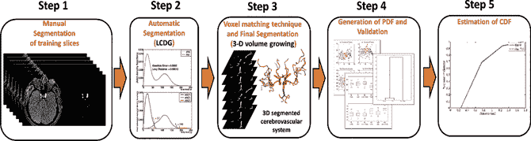


FIGURE 13.1 Framework of the data analysis for quantifying cerebrovascular changes from MRA imaging data.

#### 手动训练切片分割

患者的 MRA 数据包含 160 片 MRA 切片。每隔十片切片手动分割，使用 Adobe Photoshop（Adobe Systems, CA）将血管从周围组织中分离。该方法能够在像素级别上准确划分体内血管与周围组织，其主要局限性是 MRI 机器本身的分辨率。手动分割的二值训练切片（黑色为周围组织，白色为目标血管）被称为真实情况（GT），因为图像无伪影或噪声（Figure 13.2）。手动分割的选定切片用于初始化和优化分割算法，随后该算法用于分割所有获取的切片。

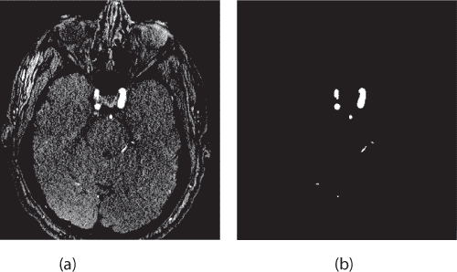

FIGURE 13.2 (a) Original MRA image slice of sample patient at day 0. (b) Manually segmented ground truth (GT) image from the image in (a).

#### 自动分割

在常规计算机辅助诊断中，准确提取 3D 脑血管信息是一项主要挑战。我们的方法是通过在统计框架内定义感兴趣区域的概率模型，而不预先固定这些模型 \[15, 16, 17\]。对每张 MRA 切片，使用 LCDG 作为灰度分布的近似模型，并将切片划分为三个个体化的 LCDG，分别对应暗灰（骨骼和脂肪）、浅灰（脑组织）和亮灰（血管）三种主导模式。通过设定强度阈值来标记血管，随后对提取的体素应用 3D 连通性过滤，选择所需的血管树结构。该方法在分割精度和准确性上优于其他方法 \[16\]。

将期望–最大化（EM）技术适配到 LCDG，可精确识别特定模型（包括其分量数量（正负）），并构造一个连续的 LCDG 模型，包含概率分布。

为确定 LCDG 模型，采用包含期望对数似然的标准，即 \[16\]。假设一个三维 MRA 图像由 `X = (X[s]: s = 1,…, S)` 表示，其中包含 `S` 个共注册的二维切片 `X[s] = (X[s] (i, j): (i, j) ∈ R; X[s] (i, j) ∈ Q)`。另一方面，支撑三维图像的矩形算术格子由 `R` 表示，有限的灰度集合和 `Q` 进制强度由 `Q = {0, 1,…, Q−1}` 表示。令 `F[s] = (f[s](q): q ∈ Q; ∑_{q∈Q} f[s](q) = 1`；在本方程中，`q` 为一种灰度值，被视为切片 `X[s]` 的灰度的经验边缘概率分布。

根据 Ref. \[18\]，每个 MRA 切片被视为 `K` 模态的，即具有 `K` 个主要模式的感兴趣区域的固定数目。为实现分层切片，需要分别估计信号的概率分布。这些信号对应 `F[s]` 中的每个模式。`F[s]` 与对抗传统的每个区域一个高斯混合模型（Gaussian mixture）相近，或略具灵活性的包含其他简单分布的混合模型，每个区域一个。子模型，每个代表主导模式，是 LCDG 图像的划分结果 \[19, 20, 21\]。

离散高斯分布定义在整数集合（灰度值） `Q = {0,1,…,Q−1}` 上，其概率质量函数为

$$\psi{\left( q \middle| \theta \right) = \begin{Bmatrix} {\Phi\left( 0.5 \right),} & {q = 0} \\ {\Phi\left( q + 0.5 \right) - \Phi\left( q - 0.5 \right)} & {1 \leq q < Q - 1} \\ {1 - \Phi\left( q - 0.5 \right),} & {q = Q - 1,} \\ \end{Bmatrix}}$$

其中参数 `θ = (μ, σ)`，`Φ` 为均值为 `μ`、方差为 `σ²` 的正态分布的累积分布函数。

随后，LCDG 具有 `C[p]` 个正向分量和 `C[n]` 个负向分量，且 `C[p] ≥ K`，其概率质量函数为

$${p_{w,\Theta}\left( q \right) = \sum\limits_{r = 1}^{C_{p}}w_{p,r}\psi\left( {q\text{|}\theta_{p,r}} \right) - \sum\limits_{l = 1}^{C_{n}}w_{n,l}\psi\left( q \middle| \theta_{n,l} \right)}\mspace{54mu}\operatorname{(13.1)}$$

权重 `w = (w[p,1],…, w[p,Cp], w[n,1],…, w[n,Cn])` 受限为全部非负，并满足

$${\sum\limits_{r = 1}^{C_{p}}w_{p,r} - \sum\limits_{l = 1}^{C_{n}}w_{n,l} = 1}\mspace{54mu}\operatorname{(13.2)}$$

总体而言，为使概率有效，必须非负：`p[w]`、`Θ(q) ≥ 0` 对所有 `q ∈ Q`。这意味着仅使用概率分布的 LCDG 子集是有效的；但该子集仍可能包含负组分，即 `p[w]`、`Θ(q) < 0` 对某些 `q ∈ Q`。

本研究的目标是寻找一个 `K`‑模态概率模型，能够逼近灰度值的边缘分布（该分布未知）。若 `F` 为 `F[s]` 的贝叶斯估计，则可描述为

`f(q) = (|R| f[s](q) + 1)/(|R| + Q)`

模型应在最大化统计独立经验数据的期望对数似然，以及其他参数的同时工作：

$${L\left( {w,\operatorname{}\Theta} \right) = \sum\limits_{q \in Q}f\left( q \right)\log p_{w},_{\Theta}\left( q \right)}\mspace{54mu}\operatorname{(13.3)}$$

整个分割算法如下 \[16\]。

1. 对每个切片 `X[s]`，`s = 1,…, S`，

    - 首先聚集边缘经验概率分布 `F[s]`，它代表灰度值。

    - 使用初始化算法确定一个接近 `F[s]` 的 LCDG 模型，该算法可估计 `C[p] − K`、`C[n]` 以及正负离散高斯分布（DG）的权重 `w`、均值 `θ`（即均值、方差）的参数。

    - 固定 `C[p]` 与 `C[n]`，使用改进的 EM 算法细化 LCDG 模型，调整其他参数。

    - 将最终 LCDG 模型划分为 `K` 个子模型，每个子模型对应一个主导模式。通过最小化误分类错误并选择平均值最大（即亮度最高的像素）的 LCDG 子模型，作为所需血管模型。

    - 使用强度阈值 `t` 提取血管体素，使其从背景中分离，从而将对应的 LCDG 子模型与背景分开。

2. 借助连接滤波器，对提取的体素整体进行去除伪影，该滤波器通过 3D 增长算法（即最大相连树）构建系统 \[23\]。Algorithm 13.1 概括了所采用的分割方法：

该过程旨在解码每个 MRA 切片的阈值，从而实现对亮血管的完整提取，同时去除暗色的不需要组织，并将可能因亮度相似且边界相同的周围非血管组织也分离出来。当步骤 1b 初始化时，创建基于非负初始概率 `p[w]`、参数 `θ(q)` 的 LCDG。步骤 1c 中进行的细化则提升似然，但保持概率非负。Ref. \[16\] 中的实验表明，相反的情况从未出现。

自动分割的准确性通过与地面真实的总错误来衡量。评估指标包括真阳性（TP）、真阴性（TN）、假阳性（FP）和假阴性（FN）。

在 Figure 13.3 中，若 `C` 为分割区域，`G` 为地面真实，`R` 为整个图像框架，则 `TP = |C∩G|`，`TN = |R−C∪G|`，`FP = |C−C∩G|`，`FN = |G−C∩G|`。总错误 `ε` 如 Ref. \[24\] 给出：`ε = (FN + FP)/(TP + FN) = (FN + FP)/G`。

![FIGURE 13.3 Illustration of segmentation accuracy and errors of the proposed automatic segmentation (C) by comparing to the ground truth (G) \[5\].](images/fig13_3.jpg)

FIGURE 13.3 Illustration of segmentation accuracy and errors of the proposed automatic segmentation (C) by comparing to the ground truth (G) \[5\].

#### Voxel Matching

Voxels are defined as arrays of volume elements constituting a notional 3D space. A 3D affine registration is employed to handle pose, orientation, data spacing, and other scanning parameter changes between day 0 and day 700 \[25\]. In this step, the Euclidean radii are converted into diameter values, and the output is then transformed into a distance map.

#### Probability Distribution Function Generation and Validation

The EM‑based technique is adapted to the LCDG‑model. To calculate the probability distribution of changes in the cerebrovascular structure, the distance map is used to extract pixel distance distribution. White pixel distribution is marked by the PDF as the true value, while black pixels are ignored for the dataset. Vessel diameters are determined by estimating Euclidean center‑to‑edge distances. The data points in the generated PDFs are then extracted and compared with BP data using statistical analysis.

#### 计算累积分布函数（CDF）

PDF 的积分用于生成 CDF。（随机变量 `X` 的 CDF `F[X]` 通过其 PDF `f[X]` 使用 `$F_{X}\left( x \right) = \int\limits_{ - \infty}^{x}f_{X}\left( t \right)dt$` 计算。）CDF 显示血管在小于或等于代表每个切片中平均血管直径的直径值时，累计概率的总和。CDF 在上限为 1 的情况下显示 PDF 的累计分布。CDF 线越快接近 1，说明血管直径相对于 CDF 线较慢接近 1 的情况更小。此现象在结果部分有所说明。

### 13.2.3 统计分析

统计分析使用 R 软件（版本 3.3）进行。采用混合效应线性模型检验 MRA 数据与临床血压（BP）测量的关系。将脑切片分为上部（位于 Willis 环上方）和下部（位于 Willis 环下方）两个区域，以评估其与临床血压读数的相关性。Willis 环位于大脑底部，是颅内脑血管动脉起始并逐渐分支的部位 \[5\]. 血压测量被合并为一个值，即估计均压 `MAP = (2 × DBP + SBP)/3`，该值作为模型的协变量。模型还包含患者年龄、性别以及每位患者的随机截距。因变量为每个区域内血管树的欧氏距离图的平均值。（分别为上下区域拟合了两个独立模型。）固定效应的统计显著性通过似然比卡方测试确定。

### 13.2.4 3D 脑血管重建

采用一种能够通过去除任何不需要的分割体素的生长树模型，并结合平滑算法，以基于分割切片生成 3D 模型 \[23\]。下图展示了生成的血管系统的示例可视化和插图，位于结果部分。

## 13.3 结果

特异性和灵敏度值如下表 13.1 所示，来自分割图像。对 15 位患者的所有自动分割切片与手动分割的参考值（GT）进行了比较，以评估算法的准确性（Figure 13.4）。分割算法的累计灵敏度为 0.997 ± 0.008（灵敏度范围 = 0.969–1），累计特异度为 0.9998 ± 0.0001（特异度范围 = 0.9994–1）。手动分割的训练切片（每第十个切片）已被排除在拟议分割方法的准确性计算之外。

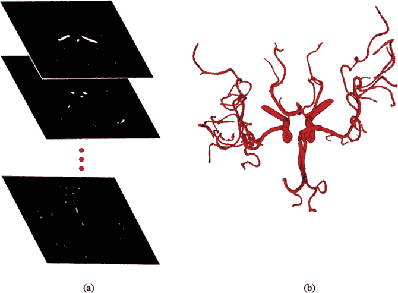

FIGURE 13.4 分割算法输出示例；(a) 患者第 0 天的样本图像切片。自动分割切片与手动分割的参考值（GT）进行比较以评估分割算法的准确性。(b) 使用生长树模型对分割的脑血管系统进行样本 3D 重建。

TABLE 13.1 自动分割图像在第 0 天、第 700 天以及累计灵敏度和特异度值的灵敏度和特异度值表

| 时间 | 灵敏度 | 特异度 |
| --- | --- | --- |
| 第 0 天 | 0.997 ± 0.006 | 0.9998 ± 0.0001 |
| 第 700 天 | 0.996 ± 0.008 | 0.9998 ± 0.0001 |
| 累计 | 0.997 ± 0.008 | 0.9998 ± 0.0001 |

线性混合效应模型分析结果（Table 13.2）显示，Willis 环下方血管的平均直径与均压（MAP）呈负相关（`P` = 0.0007）。Willis 环下方血管的平均直径未发现与患者年龄或性别显著相关。Willis 环上方的血管直径随年龄呈显著下降（`P` = 0.0005）。

TABLE 13.2 混合效应线性模型统计评估

**Willis 环下方血管的平均直径**

| 效应 | 估计 | χ² | P-Value |
| --- | --- | --- | --- |
| 年龄 | 3.2 μm/y | 0.356 | 0.551 |
| 性别 | F > M 多 12.8 μm | 0.026 | 0.872 |
| 均压 | −5.3 μm/mmHg | 11.63 | 0.0007 |

**Willis 环上方血管的平均直径**

| 效应 | 估计 | χ² | P-Value |
| --- | --- | --- | --- |
| 年龄 | −16.5 μm/y | 12.29 | 0.0005 |
| 性别 | F > M 多 16.0 μm | 0.199 | 0.655 |
| 均压 | 1.6 μm/mmHg | 0.402 | 0.525 |

`P`‑值 < 0.05 为统计显著。直径表示分割图像中血管的大小。年龄、性别和时间点为临床获取的数据。

在分析中，13 位患者表现出 MAP 与 CDF 之间的显著相关性。在表现出 CDF 与 MAP 相关性的 13 位患者中，有两位示例患者（A、B）以及两位未表现出 CDF 与 MAP 相关性的患者（C、D）（Figure 13.5）。患者 C 的 CDF 偏移与 MAP 变化方向相反，患者 D 的 CDF 偏移相对于 MAP 变化更大（Figure 13.5c 与 d，Table 13.3）。患者 C 和 D 的 3D 脑血管重建显示了第 0 天与第 700 天之间的显著血管变化（Figure 13.6）。

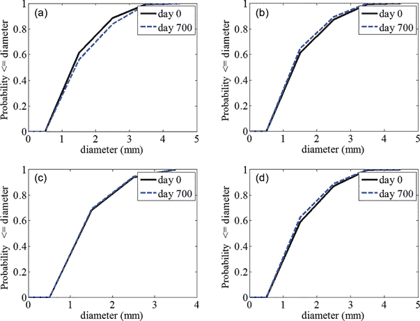

FIGURE 13.5 示例患者 CDF 图，展示第 0 天到 700 天的时间变化。图表指示血管直径小于或等于某一数值的概率。

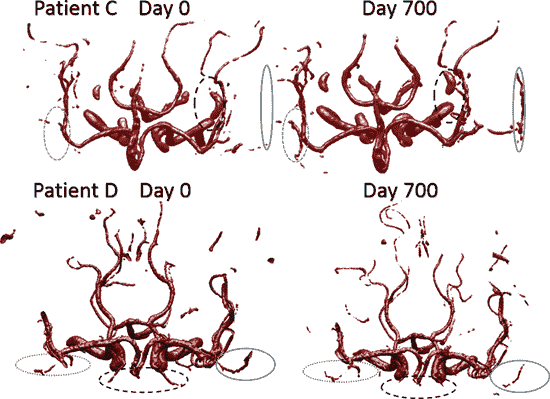


**FIGURE 13.6** 通过对二值分割图像体积应用 3D 生长算法，可视化自动分割 MRA 数据。患者 C 第 0 天（左上），患者 C 第 700 天（右上），患者 D 第 0 天（左下），患者 D 第 700 天（右下）。这些结果展示了这些患者的脑血管结构随时间变化（圆圈标记）。

**TABLE 13.3** 患者 A、B、C、D 的血压测量值

| 患者 | 第 0 天收缩压 | 第 0 天舒张压 | 第 0 天 MAP | 第 700 天收缩压 | 第 700 天舒张压 | 第 700 天 MAP |
| --- | --- | --- | --- | --- | --- | --- |
| A | 120 | 80.5 | 93.7 | 103.5 | 66.5 | 78.8 |
| B | 130.5 | 83 | 98.8 | 143.5 | 94 | 110.5 |
| C | 118 | 80.5 | 93 | 105.3 | 69 | 81.1 |
| D | 114 | 84.5 | 94.3 | 120 | 88 | 98.7 |

## 13.4 讨论

平均累积分割算法的灵敏度为 0.997 ± 0.008，特异性为 0.9998 ± 0.001。这种高精度的表现表明，使用手动输入来初始化自动分割具有明显的好处。单独使用手动分割在实际医疗环境中过于耗时，而仅使用自动分割方法则无法提供足够的准确性来划分和量化直径小于 10 μm 的脑小动脉（arteriolar）血管。所提议的分割算法结合了手动分割的精度与自动化、时间更节约的优势，能够在保持高精度的同时，最大程度地减少所需的时间和努力。

我们方法的高灵敏度和特异度能够准确地将血管与周围脑组织区分，从而实现脑血管变化的量化。PDF 显示了从第 0 天到第 700 天血管直径的总体变化。在 Willis 环（circle of Willis）下方，PDF 与系统血压（BP）之间存在统计学相关性（*P* = 0.0007），表明血压升高（即 CPP 增加）与平均血管直径下降及 PDF 减小相关。BP 和 MAP 测量与大多数患者在 Willis 环下方的非侵入性平均 PDF 直径测量相吻合良好。由于已假设脑部变化会在系统性高血压出现之前发生 [9,10,26]，我们的方法可能成为一种工具，用于在结合其他方法（如认知测试）的情况下，及早开展或优化系统性高血压（HBP）的管理。该发现很重要，因为它表明血压升高导致的血管重塑在诊断性必然性高血压（essential hypertension）出现之前就已经发生。本研究中选取的个体明确具有前高血压的血压值，该方法可用于确定脑血管重塑与脑小血管病变之间的关系，而脑小血管病变在高级高血压中已知会伴随中风和痴呆的风险 [27,28]。PDF 与 MAP 的相关性与患者性别无关。Willis 环上方血管的 PDF 差异在统计学上与年龄相关，表明老年患者的脑血管可能出现收缩，这可能使其中风风险更高。

在患者 C 和 D 中，CDF 的变化未能与 MAP 的变化相关，这可能提示脑血流自调功能受损，可能是由于脑血管重塑所致 [5,26]。这三维脑血管重建显示在第 0 天至第 700 天之间存在显著的血管变化。这些结果可能表明，仅凭系统血压来开具药物治疗可能无法提供最佳的医疗管理。CDF 与 MAP 之间的相关性缺失可能提示血管改变以及脑血管不良事件的更高风险，这需要更频繁的监测和/或优化医疗管理，即使系统血压和 MAP 正常。结合 BP 与 CDF 的变化可能有助于降低不良事件的发生率。

所提方法采用 MRA，直接可视化整体脑血管解剖结构，并且对小血管的分辨率高于多普勒超声，后者主要评估血流或在其视野内单一或少数血管的特性。MRA 是获取小脑血管准确三维结构所必需的成像方式。常规使用所提 MRA 方法进行筛查成本较高。其临床重要性在于难治性高血压（treatment-resistant hypertension），该病症目前仍缺乏深入理解 [29]。最近一项研究提供了令人信服的数据，表明此类患者可能存在血管异常（如 Willis 环畸形），而我们的技术可以轻易检测到 [30]。其他研究也提出，此类高血压可能是因脑血管受脑干血压调节区域的压迫所致 [31]。这些异常一旦被发现，就能指导临床治疗，而目前的药物剂量尚未解决这些问题。此外，有家族史或临床史导致高血压风险升高的患者，也可以通过本方法进行筛查，以在疾病发病前检测血管变化并管理高血压，尽管检测血管变化和管理高血压的成本较高。

分割算法及血管和 BP 变化（CDF 与 PDF）指标并不局限于脑血管，这些方法同样可用于量化其他对血压敏感的器官（如肾脏）的血管变化。

## 13.5 Limitations

尽管我们的分割算法在自动分割方法上有显著提升，但仍受到 MRI 机器分辨率的限制。CDF 直径（Figure 13.5）从 0.5 mm 开始，因为距离图计算是基于血管边缘的半径，而 MRA 成像的每像素代表 0.25 mm。低于 0.5 mm 的数值无法被准确表示，导致血管直径小于 10 μm（在 Willis 环上方）的统计分析精度下降。

研究期间，受试者使用了多种非处方药物和保健品，这些药物引起的血压变化应当很小。不过，仍需要更大的样本量来确定其与高血压进展之间的 definitive 关系。虽然假设升高的 CPP 会在系统性高血压之前出现，但必然性高血压的成因仍是多因素的拼图，尚未完全阐明。尽管存在这些局限性，我们的方法仍对理解与高血压相关的脑病理具有重要意义，无论该病理是先于临床高血压出现，还是随之而来。

## 13.6 Conclusion

- [脑血管变化](https://wiki.example.org/feynmans_learning_method)可通过非侵入性的 MRA 图像分析获得。脑血管变化与大脑环状动脉以下的平均动脉压（MAP）相关。改进的分割算法结合 CDF 和 PDF 的计算，可指示脑血管和脑灌注压力的变化，这可能成为临床医生优化高血压（HBP）医疗管理的有用工具。除血管系统 [32, 33, 34, 35, 36, 37, 38, 39, 40, 41]，本工作还可应用于医学影像的其他多种领域，如前列腺 [42, 43, 44]，肾脏 [45, 46, 47, 48, 49, 50, 51, 52, 53, 54, 55, 56, 57, 58, 59, 60, 61, 62, 63, 64, 65, 66, 67, 68, 69, 70, 71, 72]，心脏 [73, 77, 75, 76, 77, 78, 79, 80, 81, 82, 83, 84, 85, 86, 87, 88, 89]，肺 [90, 91, 92, 93, 94, 95, 96, 97, 98, 99, 100, 101, 102, 103, 104, 105, 106, 107, 108, 109, 110, 111, 112, 113, 114, 115, 116, 117, 118, 119, 120, 121, 122, 123, 124, 125, 126, 127, 128, 129, 130, 131, 132, 133, 134, 135, 136, 137]，大脑 [138, 139, 140, 141, 142, 143, 144, 145, 146, 147, 148, 149, 150, 151, 152, 153, 154, 155, 156, 157, 158]，视网膜 [159, 160, 161, 162, 163]，膀胱 [164]，以及伤害预测 [165] 以及一些非医学应用 [166, 167, 168, 169, 170, 171]。

## References

1. C. f. d. Control. *About Underlying Cause of Death, 1999–2015*, 2015. Available: `http://wonder.cdc.gov/ucd-icd10.html`

2. S. Kulkarni, I. O’Farrell, M. Erasi, and M. Kochar, “Stress and hypertension,” *WMJ: Official Publication of the State Medical Society of Wisconsin*, vol. 97, no. 11, pp. 34–38, 1998.

3. S. Mohan and N. R. Campbell, “Salt and high blood pressure,” *Clinical Science*, vol. 117, no. 1, pp. 1–11, 2009.

4. M. J. Sarnak et al., “Kidney disease as a risk factor for development of cardiovascular disease,” *Circulation*, vol. 108, no. 17, pp. 2154–2169, 2003.

5. C. Iadecola and R. L. Davisson, “Hypertension and cerebrovascular dysfunction,” *Cell Metabolism*, vol. 7, no. 6, pp. 476–484, 2008.

6. E. J. Van Dijk et al., “The association between blood pressure, hypertension, and cerebral white matter lesions,” *Hypertension*, vol. 44, no. 5, pp. 625–630, 2004.

7. M. Willmot, J. Leonardi-Bee, and P. M. Bath, “High blood pressure in acute stroke and subsequent outcome,” *Hypertension*, vol. 43, no. 1, pp. 18–24, 2004.

8. J. N. Barnes et al., “Aortic hemodynamics and white matter hyperintensities in normotensive postmenopausal women,” *Journal of Neurology*, vol. 264, no. 5, pp. 938–945, 2017.

9. J. R. Jennings et al., “Prehypertensive blood pressures and regional cerebral blood flow independently relate to cognitive performance in midlife,” *Journal of the American Heart Association*, vol. 6, no. 3, p. e004856, 2017.

10. J. R. Jennings 和 Y. Zanstra，“大脑是高血压的关键吗？” *Neuroimage*，第 47 卷，第 3 期，第 914–921 页，2009。

11. L. J. Launer 等，“血管因素与早期大脑健康的多种测量：CARDIA 大脑 MRI 研究，” *PLoS One*，第 10 卷，第 3 期，第 e0122138 页，2015。

12. R. J. Van der Geest 和 J. H. Reiber，“心脏 MRI 中的量化方法，” *Journal of Magnetic Resonance Imaging*，第 10 卷，第 5 期，第 602–608 页，1999。

13. A. A. Amini、J. Chen 和 Y. Wang，“用于确定心血管力学的成像与分析，”在 *Biomedical Imaging: From Nano to Macro, 2007. ISBI 2007. 4th IEEE International Symposium on* 中，IEEE，2007，第 692–695 页。

14. K. Van Everdingen、C. Klijn、L. Kappelle、W. Mali 和 J. Van der Grond，“颈动脉闭塞患者的 MRA 流量量化，” *Stroke*，第 28 卷，第 8 期，第 1595–1600 页，1997。

15. A. C. Chung 和 J. A. Noble，“利用瑞利分布的统计三维血管分割，”在 *International Conference on Medical Image Computing and Computer-Assisted Intervention* 中，Springer，1999，第 82–89 页。

16. A. El-Baz 等，“精确的三维磁共振血管造影分割，” *IEEE Transactions on Biomedical Engineering*，第 59 卷，第 7 期，第 2019–2029 页，2012。

17. D. L. Wilson 和 J. A. Noble，“自适应算法用于时飞 MRA 数据的分割，” *IEEE Transactions on Medical Imaging*，第 18 卷，第 10 期，第 938–945 页，1999。

18. G. Gimel’farb、A. A. Farag 和 A. El-Baz，“高斯混合物线性组合的期望-最大算法，”在 *Pattern Recognition, 2004. ICPR 2004. Proceedings of the 17th International Conference on* 中，IEEE，2004，第 3 卷，第 422–425 页。

19. N. D. Forkert 等，“脑血管结构的方向依赖级集分割，”在 *SPIE Medical Imaging* 中，International Society for Optics and Photonics，2011，第 79623S–79623S-8 页。

20. M. Holtzman-Gazit、R. Kimmel、N. Peled 和 D. Goldsher，“体积医学图像中薄结构的分割，” *IEEE Transactions on Image Processing*，第 15 卷，第 2 期，第 354–363 页，2006。

21. C. Xu 和 J. L. Prince，“蛇形、形状和梯度向量流，” *IEEE Transactions on Image Processing*，第 7 卷，第 3 期，第 359–369 页，1998。

22. A. R. Webb，*Statistical Pattern Recognition*，John Wiley & Sons，纽约，美国，2003。

23. M. Sabry、C. B. Sites、A. A. Farag、S. Hushek 和 T. Moriarty，“快速自动人类脑血管三维体积分割的方法，”在 *CARS 2002 Computer Assisted Radiology and Surgery* 中，Springer，2002，第 382–387 页。

24. K. Suzuki，“利用地质活动轮廓级集算法对器官进行电脑分割，”在 *Multi Modality State-of-the-Art Medical Image Segmentation and Registration Methodologies* 中，Springer，2011，第 103–128 页。

25. Y. Itai、H. Kim、S. Ishikawa、S. Katsuragawa 和 K. Doi，“开发一种体素匹配技术，大幅降低胸部 CT 的减法图像中减法伪影，” *Journal of Digital Imaging*，第 23 卷，第 1 期，第 31–38 页，2010。

26. J. R. Jennings 和 A. F. Heim，“从大脑到行为：高血压对认知与情感的调节，” *International Journal of Hypertension*，第 2012 卷，2012。

27. P. B. Gorelick 等，“血管对认知障碍和痴呆的贡献，” *Stroke*，第 42 卷，第 9 期，第 2672–2713 页，2011。

28. C. Iadecola 等，“高血压对认知功能的影响：美国心脏协会科学声明，” *Hypertension*，第 68 卷，第 6 期，第 e67–e94 页，2016。

29. P. K. Whelton 等，“2017 ACC/AHA/AAPA/ABC/ACPM/AGS/APhA/ASH/ASPC/NMA/PCNA 高血压成人预防、检测、评估和管理指南：美国心脏协会临床实践指南任务力量报告，” *Journal of the American College of Cardiology*，第 24430 页，2017。

30. E. A. Warnert 等，“高血压是大脑的自我保护吗？”， *Circulation Research*，第 CIRCRESAHA. 116.309493，2016。

31. E. I. Levy、A. M. Scarrow 和 P. J. Jannetta，“微血管减压在高血压治疗中的应用：综述与更新，” *World Neurosurgery*，第 55 卷，第 1 期，第 2–10 页，2001。


32. A. Mahmoud、A. El-Barkouky、H. Farag、J. Graham 和 A. Farag，“基于单幅热成像图的超声静脉血流速率非侵入式测量方法，”在 *Proceedings of the IEEE Conference on Computer Vision and Pattern Recognition Workshops*，2013，第 354–359 页。

33. A. El-Baz、A. Farag、G. Gimel’farb、M. A. El-Ghar 和 T. Eldiasty，“血管的概率建模用于 MRA 图像分割，”在 *18th International Conference on Pattern Recognition (ICPR’06)* 中，IEEE，第 3 卷，2006，第 917–920 页。

34. A. El-Baz、A. A. Farag、G. Gimel’farb、M. A. El-Ghar 和 T. Eldiasty，“新型自适应概率血管模型用于 MRA 图像分割，”在 *Medical Image Computing and Computer-Assisted Intervention–MICCAI 2006* 中，Springer，第 4191 卷，2006，第 799–806 页。

35. A. El-baz、A. Shalaby、F. Taher、M. El-Baz、M. Ghazal、M. A. El-Ghar、A. Takieldeen 和 J. Suri，“血管的概率建模用于磁共振血管造影图像分割，”在 *Medical Research Archives*，2017，第 5 卷，第 3 期。

36. A. S. Chowdhury、A. K. Rudra、M. Sen、A. Elnakib 和 A. El-Baz，“利用概率图切和几何形状先验对 MRI 的脑白质进行分割，”在 *ICIP*，2010，第 3649–3652 页。

37. Y. Gebru、G. Giridharan、M. Ghazal、A. Mahmoud、A. Shalaby 和 A. El-Baz，“利用磁共振血管造影检测脑血管变化，”在 *Cardiovascular Imaging and Image Analysis* 中，CRC Press，2018，第 1–22 页。

38. A. Mahmoud、A. Shalaby、F. Taher、M. El-Baz、J. S. Suri 和 A. El-Baz，“不同图像模态的血管树分割，”在 *Cardiovascular Imaging and Image Analysis* 中，CRC Press，2018，第 43–70 页。

39. F. Taher、A. Mahmoud、A. Shalaby 和 A. El-Baz，“脑血管分割方法综述，”在 *2018 IEEE International Symposium on Signal Processing and Information Technology (ISSPIT)* 中，IEEE，2018，第 359–364 页。

40. H. Kandil、A. Soliman、L. Fraiwan、A. Shalaby、A. Mahmoud、A. ElTanboly、A. Elmaghraby、G. Giridharan 和 A. El-Baz，“基于全局和局部集成分析的新型 MRA 框架，用于准确分割脑血管系统，”在 *2018 IEEE 15th International Symposium on Biomedical Imaging (ISBI 2018)* 中，IEEE，2018，第 1365–1368 页。

41. F. Taher, A. Soliman, H. Kandil, A. Mahmoud, A. Shalaby, G. Gimel’farb, and A. El-Baz, “准确的脑血管从 tof-MRA 图像中使用外观描述符进行精确分割,” `IEEE Access`, 2020.

42. I. Reda, M. Ghazal, A. Shalaby, M. Elmogy, A. AbouEl-Fetouh, B. O. Ayinde, M. AbouEl-Ghar, A. Elmaghraby, R. Keynton, and A. El-Baz, “基于新型 ADCS 的 CNN 分类系统用于精确诊断前列腺癌,” 在`2018 24th International Conference on Pattern Recognition (ICPR)`。IEEE, 2018, 页码 3923-3928。

43. I. Reda, A. Khalil, M. Elmogy, A. Abou El-Fetouh, A. Shalaby, M. Abou El-Ghar, A. Elmaghraby, M. Ghazal, and A. El-Baz, “深度学习在前列腺癌早期诊断中的作用,” `Technology in Cancer Research & Treatment`, vol. 17, p. 1533034618775530, 2018.

44. I. Reda, B. O. Ayinde, M. Elmogy, A. Shalaby, M. El-Melegy, M. A. El-Ghar, A. A. El-fetouh, M. Ghazal, and A. El-Baz, “基于新 CNN 的前列腺癌早期诊断系统,” 在`2018 IEEE 15th International Symposium on Biomedical Imaging (ISBI 2018)`。IEEE, 2018, 页码 207-210。

45. A. S. Chowdhury, R. Roy, S. Bose, F. K. A. Elnakib, and A. El-Baz, “非刚性生物医学图像注册方法，利用图切与新型数据项,” 在`Proceedings of IEEE International Symposium on Biomedical Imaging: From Nano to Macro, (ISBI’12)`，巴塞罗那，西班牙，2012 年 5 月 2-5 日，页码 446-449。

46. A. El-Baz, A. A. Farag, S. E. Yuksel, M. E. El-Ghar, T. A. Eldiasty, and M. A. Ghoneim, “应用可变模型用于急性肾脏排斥的检测,” 在`Deformable Models`，Aly Farag 编辑。Springer, New York, NY, 2007, 页码 293-333。

47. A. El-Baz, A. Farag, R. Fahmi, S. Yuksel, M. A. El-Ghar, and T. Eldiasty, “基于 DCE-MRI 的急性肾脏排斥检测图像分析,” 在`Proceedings of IAPR International Conference on Pattern Recognition (ICPR’06)`，香港，2006, 页码 822-825。

48. A. El-Baz, A. Farag, R. Fahmi, S. Yuksel, W. Miller, M. A. El-Ghar, T. El-Diasty, and M. Ghoneim, “基于新 CAD 系统的肾脏疾病评估方法,” 在`Proceedings of International Conference on Medical Image Computing and Computer-Assisted Intervention, (MICCAI’08)`，哥本哈根，丹麦，2006 年 10 月 1-6 日，页码 446-453。

49. A. El-Baz, G. Gimel’farb, and M. A. El-Ghar, “基于新的图像分析方法，准确识别急性肾脏排斥,” 在`Proceedings of IEEE International Conference on Image Processing, (ICIP’08)`，圣地亚哥，加利福尼亚，2008 年 10 月 12-15 日，页码 1812-1815。

50. ——, “基于图像分析的肾脏移植排斥识别方法,” 在`Proceedings of IAPR International Conference on Pattern Recognition, (ICPR’08)`，坦帕，佛罗里达，美国，2008, 页码 1-4。

51. ——, “用于自动识别肾脏移植排斥的新运动校正模型,” 在`Proceedings of International Conference on Medical Image Computing and Computer-Assisted Intervention, (MICCAI’07)`，布里斯班，澳大利亚，2007 年 10 月 29 日-11 月 2 日，页码 235-243。

52. A. Farag, A. El-Baz, S. Yuksel, M. A. El-Ghar, and T. Eldiasty, “基于动态对比增强磁共振成像的急性排斥检测框架,” 在`Proceedings of IEEE International Symposium on Biomedical Imaging: From Nano to Macro, (ISBI’06)`，阿灵顿，VA，2006, 页码 418-421。

53. F. Khalifa, G. M. Beache, M. A. El-Ghar, T. El-Diasty, G. Gimel’farb, M. Kong, and A. El-Baz, “基于动态对比增强 MRI 的急性肾脏移植排斥早期检测,” `IEEE Transactions on Medical Imaging`, vol. 32, no. 10, pp. 1910-1927, 2013.

54. F. Khalifa, A. El-Baz, G. Gimel’farb, and M. A. El-Ghar, “非侵入性图像方法用于急性肾脏排斥的早期检测,” 在`Proceedings of International Conference Medical Image Computing and Computer-Assisted Intervention, (MICCAI’10)`，北京，中国，2010 年 9 月 20-24 日，页码 10-18。

55. F. Khalifa, A. El-Baz, G. Gimel’farb, R. Ouseph, and M. A. El-Ghar, “基于形状-外观引导的水平集可变模型用于图像分割,” 在`Proceedings of IAPR International Conference on Pattern Recognition, (ICPR’10)`，伊斯坦布尔，土耳其，2010 年 8 月 23-26 日，页码 4581-4584。

56. F. Khalifa, M. A. El-Ghar, B. Abdollahi, H. Frieboes, T. El-Diasty, and A. El-Baz, “综合非侵入性框架用于自动评估急性肾脏移植排斥，利用 DCE-MRI,” `NMR in Biomedicine`, vol. 26, no. 11, pp. 1460-1470, 2013.

57. F. Khalifa, M. A. El-Ghar, B. Abdollahi, H. B. Frieboes, T. El-Diasty, and A. El-Baz, “基于动态对比增强 MRI 的急性肾脏移植排斥早期检测,” 在`2014 Annual Scientific Meeting and Educational Course Brochure of the Society of Abdominal Radiology, (SAR’14)`，博卡拉顿，FL，2014 年 3 月 23-28 日，文献编号 CID: 1855912。

58. F. Khalifa, A. Elnakib, G. M. Beache, G. Gimel’farb, M. A. El-Ghar, G. Sokhadze, S. Manning, P. McClure, and A. El-Baz, “基于新型概率速度函数引导的水平集方法，用于 CT 图像的 3D 肾脏分割,” 在`Proceedings of International Conference Medical Image Computing and Computer-Assisted Intervention, (MICCAI’11)`，多伦多，加拿大，2011 年 9 月 18-22 日，页码 587-594。

59. F. Khalifa, G. Gimel’farb, M. A. El-Ghar, G. Sokhadze, S. Manning, P. McClure, R. Ouseph, and A. El-Baz, “基于新型可变模型的肾脏准确提取方法，用于腹部 CT 图像,” 在`Proceedings of IEEE International Conference on Image Processing, (ICIP’11)`，布鲁塞尔，比利时，2011 年 9 月 11-14 日，页码 3393-3396。

60. M. Mostapha, F. Khalifa, A. Alansary, A. Soliman, J. Suri, and A. El-Baz, “急性肾脏移植排斥的计算机辅助诊断系统：挑战与方法,” 在`Abdomen and Thoracic Imaging`，A. El-Baz 和 L. S. J. Suri 编辑。Springer, Boston, MA, 2014, 页码 1-35。

61. M. Shehata, F. Khalifa, E. Hollis, A. Soliman, E. Hosseini-Asl, M. A. El-Ghar, M. El-Baz, A. C. Dwyer, A. El-Baz, and R. Keynton, “基于扩散加权 MRI 的新非侵入性方法，用于早期分类肾脏排斥类型,” 在`IEEE International Conference on Image Processing (ICIP)`。IEEE, 2016, 页码 136-140。

62. F. Khalifa, A. Soliman, A. Takieldeen, M. Shehata, M. Mostapha, A. Shaffie, R. Ouseph, A. Elmaghraby, and A. El-Baz, “基于 3D NMF 引导的主动轮廓模型用于 CT 图像的肾脏分割,” 在`IEEE 13th International Symposium on Biomedical Imaging (ISBI)`。IEEE, 2016, 页码 432-435。

63. M. Shehata, F. Khalifa, A. Soliman, A. Takieldeen, M. A. El-Ghar, A. Shaffie, A. C. Dwyer, R. Ouseph, A. El-Baz, and R. Keynton, “基于 3D 扩散 MRI 的 CAD 系统用于急性肾脏排斥的早期诊断,” 在`Biomedical Imaging (ISBI), 2016 IEEE 13th International Symposium on`。IEEE, 2016, 页码 1177-1180。

64. M. Shehata, F. Khalifa, A. Soliman, R. Alrefai, M. A. El-Ghar, A. C. Dwyer, R. Ouseph, and A. El-Baz, “A level set-based framework for 3D kidney segmentation from diffusion MR images,” in `IEEE International Conference on Image Processing (ICIP)`. IEEE, 2015, pp. 4441–4445.

65. M. Shehata, F. Khalifa, A. Soliman, M. A. El-Ghar, A. C. Dwyer, G. Gimel’farb, R. Keynton, and A. El-Baz, “A promising non- invasive cad system for kidney function assessment,” in `International Conference on Medical Image Computing and Computer-Assisted Intervention`. Springer, 2016, pp. 613–621.

66. F. Khalifa, A. Soliman, A. Elmaghraby, G. Gimel’farb, and A. El-Baz, “3D kidney segmentation from abdominal images using spatial-appearance models,” `Computational and Mathematical Methods in Medicine`, vol. 2017, pp. 1–10, 2017.


67. E. Hollis, M. Shehata, F. Khalifa, M. A. El-Ghar, T. El-Diasty, and A. El-Baz, “Towards non-invasive diagnostic techniques for early detection of acute renal transplant rejection: a review,” `The Egyptian Journal of Radiology and Nuclear Medicine`, vol. 48, no. 1, pp. 257–269, 2016.

68. M. Shehata, F. Khalifa, A. Soliman, M. A. El-Ghar, A. C. Dwyer, and A. El-Baz, “Assessment of renal transplant using image and clinical-based biomarkers,” in `Proceedings of 13th Annual Scientific Meeting of American Society for Diagnostics and Interventional Nephrology (ASDIN’17)`, New Orleans, LA, February 10–12, 2017.

69. ——, “Early assessment of acute renal rejection,” in `Proceedings of 12th Annual Scientific Meeting of American Society for Diagnostics and Interventional Nephrology (ASDIN’16)`, Pheonix, AZ, February 19–21, 2016, 2017.

70. A. Eltanboly, M. Ghazal, H. Hajjdiab, A. Shalaby, A. Switala, A. Mahmoud, P. Sahoo, M. El-Azab, and A. El-Baz, “Level sets-based image segmentation approach using statistical shape priors,” `Applied Mathematics and Computation`, vol. 340, pp. 164–179, 2019.

71. M. Shehata, A. Mahmoud, A. Soliman, F. Khalifa, M. Ghazal, M. A. El-Ghar, M. El-Many, and A. El-Baz, “3D kidney segmentation from abdominal diffusion MRI using an appearance-guided deformable boundary,” `PLoS One`, vol. 13, no. 7, p. ePicture 0200082, 2018.

72. H. Abdeltawab et al., “A novel CNN-based cad system for early assessment of transplanted kidney dysfunction,” `Scientific Reports`, vol. 9, no. 1, p. 5948, 2019.

73. F. Khalifa, G. Beache, A. El-Baz, and G. Gimel’farb, “Deformable model guided by stochastic speed with application in cine images segmentation,” in `Proceedings of IEEE International Conference on Image Processing, (ICIP’10)`, Hong Kong, September 26–29, 2010, pp. 1725–1728.

74. F. Khalifa, G. M. Beache, A. Elnakib, H. Sliman, G. Gimel’farb, K. C. Welch, and A. El-Baz, “A new shape-based framework for the left ventricle wall segmentation from cardiac first-pass perfusion MRI,” in `Proceedings of IEEE International Symposium on Biomedical Imaging: From Nano to Macro, (ISBI’13)`, San Francisco, CA, April 7–11, 2013, pp. 41–44.

75. ——, “A new nonrigid registration framework for improved visualization of transmural perfusion gradients on cardiac first–pass perfusion MRI,” in `Proceedings of IEEE International Symposium on Biomedical Imaging: From Nano to Macro, (ISBI’12)`, Barcelona, Spain, May 2–5, 2012, pp. 828–831.

76. F. Khalifa, G. M. Beache, A. Firjani, K. C. Welch, G. Gimel’farb, and A. El-Baz, “A new nonrigid registration approach for motion correction of cardiac first-pass perfusion MRI,” in `Proceedings of IEEE International Conference on Image Processing, (ICIP’12)`, Lake Buena Vista, FL, September 30–October 3, 2012, pp. 1665–1668.

77. F. Khalifa, G. M. Beache, G. Gimel’farb, and A. El-Baz, “A novel CAD system for analyzing cardiac first-pass MR images,” in `Proceedings of IAPR International Conference on Pattern Recognition (ICPR’12)`, Tsukuba Science City, Japan, November 11–15, 2012, pp. 77–80.

78. ——, “A novel approach for accurate estimation of left ventricle global indexes from short-axis cine MRI,” in `Proceedings of IEEE International Conference on Image Processing, (ICIP’11)`, Brussels, Belgium, September 11–14, 2011, pp. 2645–2649.

79. F. Khalifa, G. M. Beache, G. Gimel’farb, G. A. Giridharan, and A. El-Baz, “A new image-based framework for analyzing cine images,” in `Handbook of Multi Modality State-of-the-Art Medical Image Segmentation and Registration Methodologies`, A. El-Baz, U. R. Acharya, M. Mirmedhdi, and J. S. Suri, Eds. Springer, New York, NY, 2011, vol. 2, Ch. 3, pp. 69–98.

80. ——, “Accurate automatic analysis of cardiac cine images,” `IEEE Transactions on Biomedical Engineering`, vol. 59, no. 2, pp. 445–455, 2012.

81. F. Khalifa, G. M. Beache, M. Nitzken, G. Gimel’farb, G. A. Giridharan, and A. El-Baz, “Automatic analysis of left ventricle wall thickness using short-axis cine CMR images,” in `Proceedings of IEEE International Symposium on Biomedical Imaging: From Nano to Macro, (ISBI’11)`, Chicago, IL, March 30–April 2, 2011, pp. 1306–1309.

82. M. Nitzken, G. Beache, A. Elnakib, F. Khalifa, G. Gimel’farb, and A. El-Baz, “Accurate modeling of tagged CMR 3D image appearance characteristics to improve cardiac cycle strain estimation,” in `Image Processing (ICIP), 2012 19th IEEE International Conference on`. Orlando, FL. IEEE, Sep. 2012, pp. 521–524.

83. ——, “Improving full-cardiac cycle strain estimation from tagged CMR by accurate modeling of 3D image appearance characteristics,” in `Biomedical Imaging (ISBI), 2012 9th IEEE International Symposium on`. Barcelona, Spain. IEEE, May 2012, pp. 462–465, (Selected for oral presentation).

83. ——, “Markov–Gibbs random field model for improved full-cardiac cycle strain estimation from tagged cmr,” `Journal of Cardiovascular Magnetic Resonance`, vol. 14, no. 1, pp. 1–2, 2012.

85. H. Sliman, A. Elnakib, G. Beache, A. Elmaghraby, and A. El-Baz, “Assessment of myocardial function from cine cardiac MRI using a novel 4D tracking approach,” `Journal of Computer Science and Systems Biology`, vol. 7, pp. 169–173, 2014.

86. H. Sliman, A. Elnakib, G. M. Beache, A. Soliman, F. Khalifa, G. Gimel’farb, A. Elmaghraby, and A. El-Baz, “A novel 4D PDE-based approach for accurate assessment of myocardium function using cine cardiac magnetic resonance images,” in `Proceedings of IEEE International Conference on Image Processing (ICIP’14)`, Paris, France, October 27–30, 2014, pp. 3537–3541.

87. H. Sliman, F. Khalifa, A. Elnakib, G. M. Beache, A. Elmaghraby, and A. El-Baz, “A new segmentation-based tracking framework for extracting the left ventricle cavity from cine cardiac MRI,” in `Proceedings of IEEE International Conference on Image Processing, (ICIP’13)`, Melbourne, Australia, September 15–18, 2013, pp. 685–689.

88. 88. H. Sliman, F. Khalifa, A. Elnakib, A. Soliman, G. M. Beache, A. Elmaghraby, G. Gimel’farb, and A. El-Baz, “Myocardial borders segmentation from cine MR images using bi-directional coupled parametric deformable models,” `Medical Physics`, vol. 40, no. 9, pp. 1–13, 2013.

89. 89. H. Sliman, F. Khalifa, A. Elnakib, A. Soliman, G. M. Beache, G. Gimel’farb, A. Emam, A. Elmaghraby, and A. El-Baz, “Accurate segmentation framework for the left ventricle wall from cardiac cine MRI,” in `Proceedings of International Symposium on Computational Models for Life Science, (CMLS’13)`, vol. 1559, Sydney, Australia, November 27–29, 2013, pp. 287–296.

90. 90. B. Abdollahi, A. C. Civelek, X.-F. Li, J. Suri, and A. El-Baz, “PET/CT nodule segmentation and diagnosis: a survey,” in `Multi Detector CT Imaging`, L. Saba and J. S. Suri, Eds. Taylor & Francis, Boca Raton, 2014, Ch. 30, pp. 639–651.

91. 91. B. Abdollahi, A. El-Baz, and A. A. Amini, “A multi-scale non-linear vessel enhancement technique,” in `Engineering in Medicine and Biology Society, EMBC, 2011 Annual International Conference of the IEEE`. IEEE, 2011, pp. 3925–3929.

92. 92. B. Abdollahi, A. Soliman, A. Civelek, X.-F. Li, G. Gimel’farb, and A. El-Baz, “A novel gaussian scale space-based joint MGRF framework for precise lung segmentation,” in `Proceedings of IEEE International Conference on Image Processing, (ICIP’12)`. IEEE, 2012, pp. 2029–2032.

93. 93. ——, “A novel 3D joint MGRF framework for precise lung segmentation,” in `Machine Learning in Medical Imaging`. Springer, 2012, pp. 86–93.

94. 94. A. M. Ali, A. S. El-Baz, and A. A. Farag, “A novel framework for accurate lung segmentation using graph cuts,” in `Proceedings of IEEE International Symposium on Biomedical Imaging: From Nano to Macro, (ISBI’07)`. IEEE, 2007, pp. 908–911.

95. 95. A. El-Baz, G. M. Beache, G. Gimel’farb, K. Suzuki, and K. Okada, “Lung imaging data analysis,” `International Journal of Biomedical Imaging`, vol. 2013, pp. 1–2, 2013.


96. 96. A. El-Baz, G. M. Beache, G. Gimel’farb, K. Suzuki, K. Okada, A. Elnakib, A. Soliman, and B. Abdollahi, “Computer-aided diagnosis systems for lung cancer: challenges and methodologies,” `International Journal of Biomedical Imaging`, vol. 2013, pp. 1–46, 2013.
97. 97. A. El-Baz, A. Elnakib, M. Abou El-Ghar, G. Gimel’farb, R. Falk, and A. Farag, “Automatic detection of 2D and 3D lung nodules in chest spiral CT scans,” `International Journal of Biomedical Imaging`, vol. 2013, pp. 1–11, 2013.
98. 98. A. El-Baz, A. A. Farag, R. Falk, and R. La Rocca, “A unified approach for detection, visualization, and identification of lung abnormalities in chest spiral CT scans,” in `International Congress Series`. Elsevier, vol. 1256, 2003, pp. 998–1004.
99. 99. ——, “Detection, visualization and identification of lung abnormalities in chest spiral CT scan: Phase-I,” in `Proceedings of International conference on Biomedical Engineering`, Cairo, Egypt, vol. 12, no. 1, 2002.
100. 100. A. El-Baz, A. Farag, G. Gimel’farb, R. Falk, M. A. El-Ghar, and T. Eldiasty, “A framework for automatic segmentation of lung nodules from low dose chest CT scans,” in `Proceedings of International Conference on Pattern Recognition, (ICPR’06)`. IEEE, vol. 3, 2006, pp. 611–614.
101. 101. A. El-Baz, A. Farag, G. Gimel’farb, R. Falk, and M. A. El-Ghar, “A novel level set-based computer-aided detection system for automatic detection of lung nodules in low dose chest computed tomography scans,” `Lung Imaging and Computer Aided Diagnosis`, vol. 10, pp. 221–238, 2011.
102. 102. A. El-Baz, G. Gimel’farb, M. Abou El-Ghar, and R. Falk, “Appearance-based diagnostic system for early assessment of malignant lung nodules,” in `Proceedings of IEEE International Conference on Image Processing, (ICIP’12)`. IEEE, 2012, pp. 533–536.
103. 103. A. El-Baz, G. Gimel’farb, and R. Falk, “A novel 3D framework for automatic lung segmentation from low dose CT images,” in `Lung Imaging and Computer Aided Diagnosis`, A. El-Baz and J. S. Suri, Eds. Taylor & Francis, Boca Raton, 2011, Ch. 1, pp. 1–16.
104. 104. A. El-Baz, G. Gimel’farb, R. Falk, and M. El-Ghar, “Appearance analysis for diagnosing malignant lung nodules,” in `Proceedings of IEEE International Symposium on Biomedical Imaging: From Nano to Macro (ISBI’10)`. IEEE, 2010, pp. 193–196.
105. 105. A. El-Baz, G. Gimel’farb, R. Falk, and M. A. El-Ghar, “A novel level set-based CAD system for automatic detection of lung nodules in low dose chest CT scans,” in `Lung Imaging and Computer Aided Diagnosis`, A. El-Baz and J. S. Suri, Eds. Taylor & Francis, Boca Raton, 2011, vol. 1, Ch. 10, pp. 221–238.
106. 106. ——, “A new approach for automatic analysis of 3D low dose CT images for accurate monitoring the detected lung nodules,” in `Proceedings of International Conference on Pattern Recognition, (ICPR’08)`. IEEE, 2008, pp. 1–4.
107. 107. ——, “A novel approach for automatic follow-up of detected lung nodules,” in `Proceedings of IEEE International Conference on Image Processing, (ICIP’07)`. IEEE, vol. 5, 2007, pp. V–501.
108. 108. ——, “A new CAD system for early diagnosis of detected lung nodules,” in `Image Processing, 2007. ICIP 2007. IEEE International Conference on`. IEEE, vol. 2, 2007, pp. II–461.
109. 109. A. El-Baz, G. Gimel’farb, R. Falk, M. A. El-Ghar, and H. Refaie, “Promising results for early diagnosis of lung cancer,” in `Proceedings of IEEE International Symposium on Biomedical Imaging: From Nano to Macro, (ISBI’08)`. IEEE, 2008, pp. 1151–1154.
110. 110. A. El-Baz, G. L. Gimel’farb, R. Falk, M. Abou El-Ghar, T. Holland, and T. Shaffer, “A new stochastic framework for accurate lung segmentation,” in `Proceedings of Medical Image Computing and Computer-Assisted Intervention, (MICCAI’08)`, 2008, pp. 322–330.
111. 111. A. El-Baz, G. L. Gimel’farb, R. Falk, D. Heredis, and M. Abou El-Ghar, “A novel approach for accurate estimation of the growth rate of the detected lung nodules,” in `Proceedings of International Workshop on Pulmonary Image Analysis`, 2008, pp. 33–42.
112. 112. A. El-Baz, G. L. Gimel’farb, R. Falk, T. Holland, and T. Shaffer, “A framework for unsupervised segmentation of lung tissues from low dose computed tomography images,” in `Proceedings of British Machine Vision, (BMVC’08)`, 2008, pp. 1–10.
113. 113. A. El-Baz, G. Gimel’farb, R. Falk, and M. A. El-Ghar, “3D MGRF-based appearance modeling for robust segmentation of pulmonary nodules in 3D LDCT chest images,” in `Lung Imaging and Computer Aided Diagnosis`, Ayman El-Baz and Jasjit S. Suri, Eds. CRC Press, Boca Raton, 2011, Ch. 3, pp. 51–63.
114. 114. ——, “Automatic analysis of 3D low dose CT images for early diagnosis of lung cancer,” `Pattern Recognition`, vol. 42, no. 6, pp. 1041–1051, 2009.
115. 115. A. El-Baz, G. Gimel’farb, R. Falk, M. A. El-Ghar, S. Rainey, D. Heredia, and T. Shaffer, “Toward early diagnosis of lung cancer,” in `Proceedings of Medical Image Computing and Computer-Assisted Intervention, (MICCAI’09)`. Springer, 2009, pp. 682–689.
116. 116. A. El-Baz, G. Gimel’farb, R. Falk, M. A. El-Ghar, and J. Suri, “Appearance analysis for the early assessment of detected lung nodules,” in `Lung Imaging and Computer Aided Diagnosis`, 2011, Ch. 17, pp. 395–404.
117. 117. A. El-Baz, F. Khalifa, A. Elnakib, M. Nitkzen, A. Soliman, P. McClure, G. Gimel’farb, and M. A. El-Ghar, “A novel approach for global lung registration using 3D Markov Gibbs appearance model,” in `Proceedings of International Conference Medical Image Computing and Computer-Assisted Intervention, (MICCAI’12)`, Nice, France, October 1–5, 2012, pp. 114–121.
118. 118. A. El-Baz, M. Nitzken, A. Elnakib, F. Khalifa, G. Gimel’farb, R. Falk, and M. A. El-Ghar, “3D shape analysis for early diagnosis of malignant lung nodules,” in `Proceedings of International Conference Medical Image Computing and Computer-Assisted Intervention, (MICCAI’11)`, Toronto, Canada, September 18–22, 2011, pp. 175–182.
119. 119. A. El-Baz, M. Nitzken, G. Gimel’farb, E. Van Bogaert, R. Falk, M. A. El-Ghar, and J. Suri, “Three-dimensional shape analysis using spherical harmonics for early assessment of detected lung nodules,” in `Lung Imaging and Computer Aided Diagnosis`, 2011, Ch. 19, pp. 421–438.
120. 120. A. El-Baz, M. Nitzken, F. Khalifa, A. Elnakib, G. Gimel’farb, R. Falk, and M. A. El-Ghar, “3D shape analysis for early diagnosis of malignant lung nodules,” in `Proceedings of International Conference on Information Processing in Medical Imaging, (IPMI’11)`, Monastery Irsee, Germany (Bavaria), July 3–8, 2011, pp. 772–783.
121. 121. A. El-Baz, M. Nitzken, E. Vanbogaert, G. Gimel’Farb, R. Falk, and M. Abo El-Ghar, “A novel shape-based diagnostic approach for early diagnosis of lung nodules,” in `Biomedical Imaging: From Nano to Macro, 2011 IEEE International Symposium on`. IEEE, 2011, pp. 137–140.
122. 122. A. El-Baz, P. Sethu, G. Gimel’farb, F. Khalifa, A. Elnakib, R. Falk, and M. A. El-Ghar, “Elastic phantoms generated by microfluidics technology: validation of an imaged-based approach for accurate measurement of the growth rate of lung nodules,” `Biotechnology Journal`, vol. 6, no. 2, pp. 195–203, 2011.
123. 123. ——, “A new validation approach for the growth rate measurement using elastic phantoms generated by state-of-the-art microfluidics technology,” in `Proceedings of IEEE International Conference on Image Processing, (ICIP’10)`, Hong Kong, September 26–29, 2010, pp. 4381–4383.
124. 124. A. El-Baz, P. Sethu, G. Gimel’farb, F. Khalifa, A. Elnakib, R. Falk, and M. A. E.-G. J. Suri, “Validation of a new imaged-based approach for the accurate estimating of the growth rate of detected lung nodules using real CT images and elastic phantoms generated by state-of-the-art microfluidics technology,” in `Handbook of Lung Imaging and Computer Aided Diagnosis`, A. El-Baz and J. S. Suri, Eds. Taylor & Francis, New York, NY, 2011, vol. 1, Ch. 18, pp. 405–420.


125. 125. A. El-Baz, A. Soliman, P. McClure, G. Gimel’farb, M. A. El-Ghar, and R. Falk, “Early assessment of malignant lung nodules based on the spatial analysis of detected lung nodules,” in `Proceedings of IEEE International Symposium on Biomedical Imaging: From Nano to Macro, (ISBI’12)`. IEEE, 2012, pp. 1463–1466.

126. 126. A. El-Baz, S. E. Yuksel, S. Elshazly, and A. A. Farag, “Non-rigid registration techniques for automatic follow-up of lung nodules,” in `Proceedings of Computer Assisted Radiology and Surgery, (CARS’05)`. Elsevier, vol. 1281, 2005, pp. 1115–1120.

127. 127. A. S. El-Baz and J. S. Suri, `Lung Imaging and Computer Aided Diagnosis`. CRC Press, Boca Raton, 2011.

128. 128. A. Soliman, F. Khalifa, N. Dunlap, B. Wang, M. El-Ghar, and A. El-Baz, “An iso-surfaces based local deformation handling framework of lung tissues,” in `Biomedical Imaging (ISBI), 2016 IEEE 13th International Symposium on`. IEEE, 2016, pp. 1253–1259.

129. 129. A. Soliman, F. Khalifa, A. Shaffie, N. Dunlap, B. Wang, A. Elmaghraby, and A. El-Baz, “Detection of lung injury using 4D-CT chest images,” in `Biomedical Imaging (ISBI), 2016 IEEE 13th International Symposium on`. IEEE, 2016, pp. 1274–1277.

130. 130. A. Soliman, F. Khalifa, A. Shaffie, N. Dunlap, B. Wang, A. Elmaghraby, G. Gimel’farb, M. Ghazal, and A. El-Baz, “A comprehensive framework for early assessment of lung injury,” in `Image Processing (ICIP), 2017 IEEE International Conference on`. IEEE, 2017, pp. 3275–3279.

131. 131. A. Shaffie, A. Soliman, M. Ghazal, F. Taher, N. Dunlap, B. Wang, A. Elmaghraby, G. Gimel’farb, and A. El-Baz, “A new framework for incorporating appearance and shape features of lung nodules for precise diagnosis of lung cancer,” in `Image Processing (ICIP), 2017 IEEE International Conference on`. IEEE, 2017, pp. 1372–1376.

132. 132. A. Soliman, F. Khalifa, A. Shaffie, N. Liu, N. Dunlap, B. Wang, A. Elmaghraby, G. Gimel’farb, and A. El-Baz, “Image-based cad system for accurate identification of lung injury,” in `Image Processing (ICIP), 2016 IEEE International Conference on`. IEEE, 2016, pp. 121–125.

133. 133. A. Soliman, A. Shaffie, M. Ghazal, G. Gimel’farb, R. Keynton, and A. El-Baz, “A novel cnn segmentation framework based on using new shape and appearance features,” in `2018 25th IEEE International Conference on Image Processing (ICIP)`. IEEE, 2018, pp. 3488–3492.

134. 134. A. Shaffie, A. Soliman, H. A. Khalifeh, M. Ghazal, F. Taher, R. Keynton, A. Elmaghraby, and A. El-Baz, “On the integration of CT-derived features for accurate detection of lung cancer,” in `2018 IEEE International Symposium on Signal Processing and Information Technology (ISSPIT)`. IEEE, 2018, pp. 435–440.

135. 135. A. Shaffie, A. Soliman, H. A. Khalifeh, M. Ghazal, F. Taher, A. Elmaghraby, R. Keynton, and A. El-Baz, “Radiomic-based framework for early diagnosis of lung cancer,” in `2019 IEEE 16th International Symposium on Biomedical Imaging (ISBI 2019)`. IEEE, 2019, pp. 1293–1297.

136. 136. A. Shaffie, A. Soliman, M. Ghazal, F. Taher, N. Dunlap, B. Wang, V. Van Berkel, G. Gimelfarb, A. Elmaghraby, and A. El-Baz, “A novel autoencoder-based diagnostic system for early assessment of lung cancer,” in `2018 25th IEEE International Conference on Image Processing (ICIP)`. IEEE, 2018, pp. 1393–1397.

137. 137. A. Shaffie et al., “A generalized deep learning-based diagnostic system for early diagnosis of various types of pulmonary nodules,” `Technology in Cancer Research & Treatment`, vol. 17, p. 1533033818798800, 2018.

138. 138. Y. ElNakieb et al., “Autism spectrum disorder diagnosis framework using diffusion tensor imaging,” in `2019 IEEE International Conference on Imaging Systems and Techniques (IST)`. IEEE, 2019, pp. 1–5.

139. 139. R. Haweel, O. Dekhil, A. Shalaby, A. Mahmoud, M. Ghazal, R. Keynton, G. Barnes, and A. El-Baz, “A machine learning approach for grading autism severity levels using task-based functional MRI,” in `2019 IEEE International Conference on Imaging Systems and Techniques (IST)`. IEEE, 2019, pp. 1–5.

140. 140. Dekhil, O., Ali, M., Haweel, R., Elnakib, Y., Ghazal, M., Hajjdiab, H., Fraiwan, L., Shalaby, A., Soliman, A., Mahmoud, A. and Keynton, R., 2020, July. A Comprehensive Framework for Differentiating Autism Spectrum Disorder From Neurotypicals by Fusing Structural MRI and Resting State Functional MRI. In `Seminars in Pediatric Neurology` (Vol. 34, p. 100805). WB Saunders.

141. 141. R. Haweel, O. Dekhil, A. Shalaby, A. Mahmoud, M. Ghazal, A. Khalil, R. Keynton, G. Barnes, and A. El-Baz, “A novel framework for grading autism severity using task-based fMRI,” in `2020 IEEE 17th International Symposium on Biomedical Imaging (ISBI)`. IEEE, 2020, pp. 1404–1407.

142. 142. B. Dombroski, M. Nitzken, A. Elnakib, F. Khalifa, A. El-Baz, and M. F. Casanova, “Cortical surface complexity in a population-based normative sample,” `Translational Neuroscience`, vol. 5, no. 1, pp. 17–24, 2014.

143. 143. A. El-Baz, M. Casanova, G. Gimel’farb, M. Mott, and A. Switala, “An MRI-based diagnostic framework for early diagnosis of dyslexia,” `International Journal of Computer Assisted Radiology and Surgery`, vol. 3, no. 3–4, pp. 181–189, 2008.

144. 144. A. El-Baz, M. Casanova, G. Gimel’farb, M. Mott, A. Switala, E. Vanbogaert, and R. McCracken, “A new CAD system for early diagnosis of dyslexic brains,” in `Proceedings on International Conference on Image Processing (ICIP’2008)`. IEEE, 2008, pp. 1820–1823.

145. 145. A. El-Baz, M. F. Casanova, G. Gimel’farb, M. Mott, and A. E. Switala, “A new image analysis approach for automatic classification of autistic brains,” in `Proceedings on IEEE International Symposium on Biomedical Imaging: From Nano to Macro (ISBI’2007)`. IEEE, 2007, pp. 352–355.

146. 146. A. El-Baz, A. A. Farag, G. Gimel’farb, and S. G. Hushek, “Automatic cerebrovascular segmentation by accurate probabilistic modeling of TOF-MRA images,” in `Medical Image Computing and Computer-Assisted Intervention–MICCAI 2005`. Springer, 2005, pp. 34–42.

147. 147. A. El-Baz, A. Farag, A. Elnakib, M. F. Casanova, G. Gimel’farb, A. E. Switala, D. Jordan, and S. Rainey, “Accurate automated detection of autism related corpus callosum abnormalities,” `Journal of Medical Systems`, vol. 35, no. 5, pp. 929–939, 2011.

148. 148. El-Baz, A., Farag, A. and Gimelfarb, G., 2005, June. Cerebrovascular segmentation by accurate probabilistic modeling of TOF-MRA images. In `Scandinavian Conference on Image Analysis` (pp. 1128–1137). Springer, Berlin, Heidelberg.

149. 149. A. El-Baz, G. Gimel’farb, R. Falk, M. A. El-Ghar, V. Kumar, and D. Heredia, “A novel 3D joint Markov–Gibbs model for extracting blood vessels from PC–MRA images,” in `Medical Image Computing and Computer-Assisted Intervention–MICCAI 2009`, vol. 5762. Springer, 2009, pp. 943–950.

150. 150. A. Elnakib, A. El-Baz, M. F. Casanova, G. Gimel’farb, and A. E. Switala, “Image-based detection of corpus callosum variability for more accurate discrimination between dyslexic and normal brains,” in `Proceedings on IEEE International Symposium on Biomedical Imaging: From Nano to Macro (ISBI’2010)`. IEEE, 2010, pp. 109–112.

151. 151. A. Elnakib, M. F. Casanova, G. Gimel’farb, A. E. Switala, and A. El-Baz, “Autism diagnostics by centerline-based shape analysis of the corpus callosum,” in `Proceedings on IEEE International Symposium on Biomedical Imaging: From Nano to Macro (ISBI’2011)`. IEEE, 2011, pp. 1843–1846.

152. 152. A. Elnakib, M. Nitzken, M. Casanova, H. Park, G. Gimel’farb, and A. El-Baz, “Quantification of age-related brain cortex change using 3D shape analysis,” in `Pattern Recognition (ICPR), 2012 21st International Conference on`. IEEE, 2012, pp. 41–44.


153. M. Nitzken, M. Casanova, G. Gimel’farb, A. Elnakib, F. Khalifa, A. Switala, and A. El-Baz, “3D shape analysis of the brain cortex with application to dyslexia,” in `Image Processing (ICIP), 2011 18th IEEE International Conference on`. Brussels, Belgium: IEEE, Sep. 2011, pp. 2657–2660, (Selected for oral presentation. Oral acceptance rate is 10% and the overall acceptance rate is 35%).

154. F. E.-Z. A. El-Gamal, M. M. Elmogy, M. Ghazal, A. Atwan, G. N. Barnes, M. F. Casanova, R. Keynton, and A. S. El-Baz, “A novel cad system for local and global early diagnosis of Alzheimer’s disease based on pib-pet scans,” in `2017 IEEE International Conference on Image Processing (ICIP)`. IEEE, 2017, pp. 3270–3274.

155. M. M. Ismail, R. S. Keynton, M. M. Mostapha, A. H. ElTanboly, M. F. Casanova, G. L. Gimel’farb, and A. El-Baz, “Studying autism spectrum disorder with structural and diffusion magnetic resonance imaging: a survey,” `Frontiers in Human Neuroscience`, vol. 10, p. 211, 2016.

156. A. Alansary et al., “Infant brain extraction in t1-weighted MR images using bet and refinement using LCDG and MGRF models,” `IEEE Journal of Biomedical and Health Informatics`, vol. 20, no. 3, pp. 925–935, 2016.

157. E. H. Asl, M. Ghazal, A. Mahmoud, A. Aslantas, A. Shalaby, M. Casanova, G. Barnes, G. Gimel’farb, R. Keynton, and A. El-Baz, “Alzheimer’s disease diagnostics by a 3D deeply supervised adaptable convolutional network,” `Frontiers in Bioscience (Landmark Edition)`, vol. 23, pp. 584–596, 2018.

158. O. Dekhil, M. Ali, Y. El-Nakieb, A. Shalaby, A. Soliman, A. Switala, A. Mahmoud, M. Ghazal, H. Hajjdiab, M. F. Casanova, A. Elmaghraby, R. Keynton, A. El-Baz, and G. Barnes, “A personalized autism diagnosis CAD system using a fusion of structural MRI and resting-state functional MRI data,” `Frontiers in Psychiatry`, vol. 10, p. 392, 2019. [Online]. Available: [`www.frontiersin.org/article/10.3389/fpsyt.2019.00392`](https://www.frontiersin.org)

159. A. A. Sleman, A. Soliman, M. Ghazal, H. Sandhu, S. Schaal, A. Elmaghraby, and A. El-Baz, “Retinal layers oct scans 3-D segmentation,” in `2019 IEEE International Conference on Imaging Systems and Techniques (IST)`. IEEE, 2019, pp. 1–6.

160. N. Eladawi, M. Elmogy, M. Ghazal, O. Helmy, A. Aboelfetouh, A. Riad, S. Schaal, and A. El-Baz, “Classification of retinal diseases based on oct images,” `Frontiers in Bioscience (Landmark Edition)`, vol. 23, pp. 247–264, 2018.

161. A. ElTanboly, M. Ismail, A. Shalaby, A. Switala, A. El-Baz, S. Schaal, G. Gimel’farb, and M. El-Azab, “A computer-aided diagnostic system for detecting diabetic retinopathy in optical coherence tomography images,” `Medical Physics`, vol. 44, no. 3, pp. 914–923, 2017.

162. H. S. Sandhu, A. El-Baz, and J. M. Seddon, “Progress in automated deep learning for macular degeneration,” `JAMA Ophthalmology`, vol. 136, no. 12, pp. 1366–1367, 2018.

163. M. Ghazal, S. S. Ali, A. H. Mahmoud, A. M. Shalaby, and A. El-Baz, “准确检测非增殖性糖尿病视网膜病变在光学相干断层图像中的卷积神经网络,” `IEEE Access`, vol. 8, pp. 34387–34397, 2020.

164. K. Hammouda, F. Khalifa, A. Soliman, H. Abdeltawab, M. Ghazal, M. Abou El-Ghar, A. Haddad, H. E. Darwish, R. Keynton, and A. El-Baz, “基于可学习自适应形状先验的 3D CNN，用于 MR 图像中膀胱壁的精确分割,” in `2020 IEEE 17th International Symposium on Biomedical Imaging (ISBI)`. IEEE, 2020, pp. 935–938.

165. A. Naglah, F. Khalifa, A. Mahmoud, M. Ghazal, P. Jones, T. Murray, A. S. Elmaghraby, and A. El-Baz, “基于训练负荷统计记录和机器学习的运动员定制伤害预测,” in `2018 IEEE International Symposium on Signal Processing and Information Technology (ISSPIT)`. IEEE, 2018, pp. 459–464.

166. A. H. Mahmoud, “利用可见、热红外和极化图像的辐射实现智能机器人应用,” Ph.D. dissertation, University of Louisville, 2014.

167. A. Mahmoud, A. El-Barkouky, J. Graham, and A. Farag, “基于混合部分衍生物的 HOG（梯度方向直方图）的行人检测,” in `2014 IEEE International Conference on Image Processing (ICIP)`. IEEE, 2014, pp. 2334–2337.

168. A. El-Barkouky, A. Mahmoud, J. Graham, and A. Farag, “基于光极化的交互式教育绘图系统，使用人形机器人,” in `2013 IEEE International Conference on Image Processing`. IEEE, 2013, pp. 3407–3411.

169. A. H. Mahmoud, M. T. El-Melegy, and A. A. Farag, “基于极化和阴影的形状恢复的直接方法,” in `2012 19th IEEE International Conference on Image Processing`. IEEE, 2012, pp. 1769–1772.

170. M. A. Ghazal, A. Mahmoud, A. Aslantas, A. Soliman, A. Shalaby, J. A. Benediktsson, and A. El-Baz, “使用卷积神经网络估计植被覆盖率,” `IEEE Access`, vol. 7, pp. 132563–132576, 2019.

171. M. Ghazal, A. Mahmoud, A. Shalaby, and A. El-Baz, “准确分割叶子图像的自动框架用于植物健康评估,” `Environmental Monitoring and Assessment`, vol. 191, no. 8, p. 491, 2019.

# CHAPTER 14

## Early Classification of Renal Rejection Types: A Deep Learning Approach

Mohamed Shehata, Fahmi Khalifa,  

Ahmed Soliman, Shams Shaker,  

Ahmed Shalaby, Maryam El-Baz,  

Ali Mahmoud and Amy C. Dwyer

University of Louisville

Louisville, Kentucky

Mohamed Abou El-Ghar

University of Mansoura

Mansoura, Egypt

Mohammed Ghazal

Abu Dhabi University

Abu Dhabi, United Arab Emirates

Jasjit S. Suri

AtheroPoint LLC

Roseville, California

Ayman El-Baz

University of Louisville

Louisville, Kentucky

University of Louisville at AlAlamein  

International University (UofL-AIU)

New Alamein City, Egypt

## Contents

14.1 Introduction

14.2 Methods

14.2.1 Preprocessing/Segmenting Kidneys

14.2.2 Diffusion Features Extraction

14.2.3 Deep Learning Classification

14.3 Experimental Results

14.4 Conclusion

Acknowledgment

References

## 14.1 Introduction

在美国，约有 70 万人受慢性肾脏病（CKD）影响，如果未及时治疗，将导致终末期肾脏病（ESKD）并可能引发死亡。最佳解决方案是进行肾脏移植手术，但由于捐赠者极为稀缺，这一任务更加复杂。此外，移植后的肾脏在手术后头 5 年内可能出现移植失败。导致肾脏移植失败的最有害因素是急性肾脏排斥。换言之，身体因免疫反应而排斥新肾脏 \[1\]。为了避免此类情况，应在术后早期采取预防措施，以延长移植器官的存活率 \[2,3\]。具体而言，术后常规临床随访、对移植肾脏的估计和准确评估是防止器官损失的关键，这有助于降低移植失败的风险。这种损失可能由以下几种肾脏排斥类型引起：急性管坏死（ATN）、抗体介导的排斥（AMR）或 T 细胞介导的排斥（TMR）。其他类型包括免疫抑制毒性（IT）和病毒感染（VI）。虽然每种排斥类型都有相应的治疗方案，但同时出现两种或多种排斥类型会使治疗过程变得复杂 \[4\]。

尽管活检是金标准方法，但由于其高度侵入性、耗时、昂贵，以及常常导致出血、感染等不良事件，难以用于早期检测 \[1\]。因此，寻找更安全、无创的替代方案至关重要。一个精确的、非侵入性的肾脏计算机辅助诊断系统（CAD）能够对肾脏移植排斥提供可靠分析。该系统逐一收集每个肾脏的信息，然后以低成本快速汇总，提高患者的生存率。

一种非侵入性的方法，在肾移植早期常用于评估肾移植物的状态，即扩散加权磁共振成像（DW-MRI）。该方法具有优势，因为它同时包含被检测软组织的解剖学和功能信息 \[5\]，并且避免使用造影剂，因为造影剂可能具有毒性。许多研究通过获取皮质表观扩散系数（CADC）或髓质 ADC（MADC）来测试 DW-MRI 的功能，取得了多种结果 \[6\]。然而，Abou-El-Ghar 等人的研究在 DW-MRI 中实现了成功的区分 \[7\]。他们的实验包括 21 例急性肾移植功能受损患者，其中 10 例为 TMR，7 例为 ATN，4 例为 IT 类排斥。他们还定义了一个位于肾脏单一横断面中部的感兴趣区域（ROI），涵盖整个肾实质并悬挂肾窦。如果某区域呈现更高信号强度或异常局部区域，则会获取另一 ROIs。显然，ATN 患者的 ADC 值呈异质性，因为它们是从三个不同组别计算得出的，形成马赛克样式，呈虎斑状。此外，在低 `b`-值下，扩散与血流在影响 ADC 值方面起主要作用；而在高 `b`-值下，血流对 ADC 值的影响不大。Eisenberg 等人的研究建议可通过手动放置单个 ROI 来覆盖肾移植物的大面积区域 \[8\]。随后，上、中、下髓质极的单个 ROI 合并，分别得到全髓质 ROI 和全髓质 ROI。五例患者中，四例出现急性排斥，剩余一例为 ATN。计算了标准差和均值等指标。该研究的问题在于缺乏出现移植功能障碍的患者，这导致 AR 与 ATN 患者之间的趋势不足以形成明显区分。其他研究 \[9,10\] 表明，急性排斥（AR）中肾血流显著下降主要归因于灌注 MRI。然而，文献 \[7,8\] 结论指出，水扩散和血流水平与 AR 肾移植物直接相关，但仅水扩散与 ATN 患者相关。

此外，BOLD MRI（血氧水平依赖 MRI）也被用于肾排斥研究。BOLD MRI 利用氧化血红蛋白的扩散血流来研究肾脏功能，具体而言，通过 apparent relation rate（ARR）参数计算去氧血红蛋白的含量 \[6\]。尽管髓质数值有所差异，多项研究指出 ATN 肾的髓质 ARR 高于 AR 肾 \[6,10, 11, 12\]。文献 \[11\] 进一步指出，ATN 肾的皮质 ARR 高于 AR 肾。总体趋势是 ARR 值更高。但所有实验均存在局限性：手动二维 ROI 划分肾脏时出现主观划分误差，未考虑整体肾运动，未能在高低 `b`-值下融合 ADC，亦仅通过统计方法在特定 `b`-值间区分。

上述研究均未将 MRI 成像与临床生物标志物相结合，无法构建包含计算机辅助诊断的早期急性排斥（AR）识别系统。因此，需要一个能够克服这些局限的系统。我们的工作是一个完全自动化的早期急性排斥评估系统，如 Figure 14.1 所示。该系统能够自动分割整个肾脏，从而能够处理任何运动。此外，系统可在 DW-MRI 分割得到的低 `b` 与高 `b` ADC 值上实现堆叠自编码器融合。在 Section 14.3 中，新开发的 CAD 系统的有希望的结果被展示。结果表明，该系统确实是一种非侵入性的诊断工具。

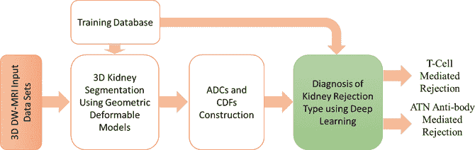

FIGURE 14.1 Shows the framework for the developed CAD system using DW-MRI.

## 14.2 Methods

为了评估肾移植物的状态，开发了一种精确的 Renal-CAD 算法（见 Figure 14.1）。该系统必须包含若干步骤以得到最终评估。首先，需使用 DW-MRI 将肾脏从其余组织中分割出来。随后，在 Section 14.2.2 中，对肾的体素级 ADC 映射进行累积分布函数（CDFs）的提取或计算。最后，根据 ATN 肾的状态分配 TMR，以检验所提 CAD 系统是否为成功的诊断手段。

### 14.2.1 Preprocessing/Segmenting Kidneys


从对 MR 图像进行偏置校正（bias correction）起步 [13]，随后对校正后的 MR 图像应用强度直方图均匀化，以降低噪声效应和偏置异构性。关于肾脏运动，采用 B-样条非刚性注册以降低主体间变异，使用平方差（SSD）作为度量。随后，采用 level sets 方法获得精确的 3D 肾脏分割 [15]。为了进行精确的肾脏分析，需在区域统计中加入考虑局部外观、形状和空间 MRI 特征的引导力，这些特征来自肾脏及背景区域。该引导力通过联合马尔可夫-盖布斯随机场（MGRF）图模型（joint Markov–Gibbs random field, MGRF）合并，具体包括局部外观 [17,18]、形状以及空间 DW-MRI 特征（如在 Figure 14.2 所示）。更多细节请参阅 Ref. [15,19]。

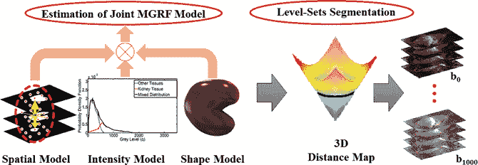

FIGURE 14.2 Represents the joint estimation of the MGRF to guide the level-set segmentation technique.

### 14.2.2 Diffusion Features Extraction

在肾脏分割完成后，必须从图像中提取具有歧视性的生理特征，以区分 ATN 与 ARTR 类型的 TMR。利用 Le Bihan 的 ADC 定义，下式计算排斥状态：

`ADC[p] = (1/b[0] - b)ln (g[b] : p/g[0] : p) = ((ln g[b] - ln g[0]:p)/(b[0] - b))`

为便于解释，`[p]` 表示在离散笛卡尔坐标（`x`、`y`、`z`）处的体素。`g[0]` 与 `g[b]` 分别是采用 `b[0]` 与给定不同 `b`-值拍摄的分割 DW-MRI 图像。

- 为了分类肾脏移植的排斥状态，必须降低数据维度。为此，收集了多个 `b` 值的显著三维 ADC 地图的特征描述，如 [Figure 14.3 所示](images/fig14_3.jpg)。

FIGURE 14.3 Illustrated empirical distribution of ADC values as well as their CDFs for a kidney with rejection status at different `b`-values (`b[50]`, `b[100]`, and `b[200]`) s/mm².

### 14.2.3 Deep Learning Classification

基于堆叠自动编码器（AE）的深度神经网络技术嵌入到开发的 CAD 系统中，以实现更准确的肾脏排斥类型分类。每个 AE 主要由输入层、隐藏层和输出层组成，并以无监督方式单独预训练，以提取最重要的歧视性特征 [21]。随后，这些 AE 被堆叠，并与监督的 softmax 分类器一起使用，得到最终输出概率，即为 ATN 或 TMR。该 softmax 被微调以最小化总损失。值得注意的是，在 AE 训练中加入了非负性约束（NCAE）[22]，以促进解的转换并优化分类性能。下图展示了单独 AE 和堆叠 AE（顶部有 softmax 分类器）的示意图，如 Figure 14.4。

![FIGURE 14.4 The AEs with their different layers (a) and the stacked-AES with the non-negativity constraints (SNCAEs) (b). Starting from the input (`u`: estimated CDFs) going through different hidden layers (`h^(i)`), each with activation units (`S[i]`) and encoding weights (`W^(i)`), the final predicted output can be represented by probabilities of each assigned class (`P1` or `P2`).](img/fig14_4.jpg)

FIGURE 14.4 The AEs with their different layers (a) and the stacked-AES with the non-negativity constraints (SNCAEs) (b). Starting from the input (`u`: estimated CDFs) going through different hidden layers (`h^(i)`), each with activation units (`S[i]`) and encoding weights (`W^(i)`), the final predicted output can be represented by probabilities of each assigned class (`P1` or `P2`).

The proposed SNCAE network was trained and tested using a leave-one-out cross-validation (LOOCV). The training and testing processes were repeated using a grid search algorithm to get the optimal set of hyperparameters. The average accuracy was selected as an optimization metric during the hyper-tuning process. With `s[1] = 25`, `s[2] = 5`, `s° = 2`, `non-negativity constraint = 0.03`, `sparsity constraint = 3`, and `hidden units’ average activation value = 0.5`, the developed SNCAE model provided the best classification results and was selected.

## 14.3 Experimental Results

The developed CAD system was validated and tested on a total of 39 renal allografts, with their biopsy confirmation provided, of which eight subjects were diagnosed as ATN and 31 were diagnosed as TMR renal rejection transplants. DW-MRI scans were acquired for the aforementioned subjects at different `b`-values starting from `b[0]` to `b[1,000]` using a General Electric Medical Systems, SIGNA Horizon Scanner, with the following parameters: TR = 8,000 ms; FOV = 32 cm; in-plane resolution = 1.25 × 1.25 mm²; slice thickness = 4 mm; inter-slice gap = 0 mm; and two excitations.

Using the estimated CDFs with the developed SNCAE classification model, the proposed CAD system was tested using a LOOCV and it achieved a 98% diagnostic accuracy with 8/8 correctly classified instances of ATN and 30/31 of TMR.

To highlight the advantages of using such an SNCAE classification model, the obtained results were compared to those obtained using multiple well-known conventional machine learning classifiers built-in Weka tool [23]: K-nearest neighbor (kNN), logistic regression (LR), random trees (RTs), and random forests (RFs). All results are compared and summarized in Table 14.1. With an accuracy of 98%, the developed classification system using SNCAE outperformed all other machine learning classifiers, holding a promise for the development as an outstanding diagnostic tool for renal rejection type identification.

TABLE 14.1 Diagnostic Performance of the Developed CAD System Based on Using SNCAEs Classification Model vs. Multiple Machine Learning Classifiers Using Weka Tool [26]

| Method | Accuracy (%) | ATN/8 | TMR/31 |
| --- | --- | --- | --- |
| **Proposed (SNCAEs)** | **98** | **8** | **30** |
| RFs | 95 | 7 | 30 |
| kNN | 90 | 8 | 27 |
| LR | 85 | 8 | 25 |
| RTs | 77 | 6 | 24 |

*Note:* Bolding values show the results of the proposed SNCAEs classification method that outperforms all other techniques.

## 14.4 Conclusion

To recap, our work offers a Renal-CAD system that estimates whether the renal transplant is acute rejection or non-rejection during early stages of post-transplantation in a non-invasive way through 4D DW-MRI data. Our CAD system uses not only previous techniques but adds new non-rigid image aligning techniques. Additionally, it utilizes kidney segmentation that includes deformable boundary, calculating ADC values, as well as utilized SNCAEs to determine the rejected kidney status through CDFs of the ADCs, as integral status descriptions. In terms of accuracy, we used a biopsy-proven cohort with 39 patients and obtained a 98% overall accuracy in ATN and TMR rejection status. These promising results confirm that the proposed CAD system is a non-invasive diagnostic tool to detect the status of the renal transplant. For future testing, we plan on expanding the ATN and TMR data sets to further estimate the accuracy as well as the robustness of our framework in diagnosis. Furthermore, to take other causes of rejection into account—drug toxicity, viral infection, and so on—we intend on expanding our rejection groups into four to further analyze the robustness of the newly developed CAD system within the four different groups.

In addition to kidney [24, 25, 26, 27, 28, 29, 30, 31, 32, 33, 34, 35, 36, 37, 38, 39, 40, 41, 42, 43, 44, 45, 46, 47, 48, 49, 50, 51], this work could also be applied to various other applications in medical imaging, such as the prostate [52, 53, 54], the heart [55, 56, 57, 58, 59, 60, 61, 62, 63, 64, 65, 66, 67, 68, 69, 70, 71], the lung [72, 73, 74, 75, 76, 77, 78, 79, 80, 81, 82, 83, 84, 85, 86, 87, 88, 89, 90, 91, 92, 93, 94, 95, 96, 97, 98, 99, 100, 101, 102, 103, 104, 105, 106, 107, 108, 109, 110, 111, 112, 113, 114, 115, 116, 117, 118, 119], the brain [120, 121, 122, 123, 124, 125, 126, 127, 128, 129, 130, 131, 132, 133, 134, 135, 136, 137, 138, 139, 140, 141], the vascular system [142, 143, 144, 145, 146, 147, 148, 149, 150, 151], the retina [152, 153, 154, 155, 156], the bladder [157], and injury prediction [158] as well as several non-medical applications [159, 160, 161, 162, 163, 164].

## Acknowledgment

The National Institutes of Health (NIH R15 grant 1R15AI135924-01A1) provided the fund required for this study.

## References

1. F. Khalifa, A. Soliman, A. El-Baz, M. Abou El-Ghar, T. El-Diasty, G. Gimel’farb, R. Ouseph, and A. C. Dwyer, “Models and methods for analyzing DCE-MRI: A review,” *Medical Physics*, vol. 41, no. 12, p. 124301, 2014.

2. S. M. Gieser and A. Z Fenves, “Chronic kidney disease, dialysis, & transplantation, edited by Brian JG Pereira, MD, DM, Mohamed H. Sayegh, MD, and Peter Blake, MD,” *Proceedings (Baylor University. Medical Center)*, vol. 19, no. 1, p. 69, 2006.

3. W. J. Chon et al., “Clinical manifestations and diagnosis of acute renal allograft rejection,” UpToDate Version, vol. 21, 2014.

4. W. J. Chon et al., “Acute renal allograft rejection: Treatment,” UpToDate, Waltham, MA, 2015.


5. H. J. Michaely, K. A. Herrmann, K. Nael, N. Oesingmann, M. F. Reiser, and S. O. Schoenberg, “Functional renal imaging: Nonvascular renal disease,” *Abdominal Imaging*, vol. 32, no. 1, pp. 1–16, 2007.

6. G. Liu, F. Han, W. Xiao, Q. Wang, Y. Xu, and J. Chen, “Detection of renal allograft rejection using blood oxygen level-dependent and diffusion weighted magnetic resonance imaging: A retrospective study,” *BMC Nephrology*, vol. 15, no. 1, p. 158, 2014.

7. M. E. Abou-El-Ghar, T. A. El-Diasty, A. M. El-Assmy, H. F. Refaie, A. F. Refaie, and M. A. Ghoneim, “Role of diffusion-weighted MRI in diagnosis of acute renal allograft dysfunction: A prospective preliminary study,” *The British Journal of Radiology*, vol. 85, no. 1014, pp. 206–211, 2014.

8. U. Eisenberger, H. C. Thoeny, T. Binser, M. Gugger, F. J. Frey, C. Boesch, and P. Vermathen, “Evaluation of renal allograft function early after transplantation with diffusion-weighted MR imaging,” *European Radiology*, vol. 20, no. 6, pp. 1374–1383, 2010.

9. L. Nilsson, H. Ekberg, K. F¨alt, H. L¨ofberg, and G. Sterner, “肾动脉-静脉分流术在拒绝移植、肾盂肿胀或缺血性低血压综合征的大鼠中，” *肾脏透析移植学*，第 9 卷，第 11 号，第 1634–1639 页，1994 年。

10. E. A. Sadowski, A. Djamali, A. L. Wentland, R. Muehrer, B. N. Becker, T. M. Grist, and S. B. Fain, “血氧水平依赖和灌注磁共振成像：检测移植肾的氧生物利用差异和血流差异，” *磁共振成像*，第 28 卷，第 1 号，第 56–64 页，2010 年。

11. F. Han, W. Xiao, Y. Xu, J. Wu, Q. Wang, H. Wang, M. Zhang, and J. Chen, “BOLD MRI 在区分肾移植排斥和急性肾小管坏死方面的意义，” *肾脏透析移植学*，第 23 卷，第 8 号，第 2666–2672 页，2008 年。

12. A. Djamali, E. A. Sadowski, M. Samaniego- Picota, S. B. Fain, R. J. Muehrer, S. K. Alford, T. M. Grist, and B. N. Becker, “通过血氧水平依赖磁共振成像非侵入性评估早期肾移植功能障碍，” *移植学*，第 82 卷，第 5 号，第 621–628 页，2006 年。

13. N. J. Tustison, B. B. Avants, P. A. Cook, Y. Zheng, A. Egan, P. A. Yushkevich, and J. C. Gee, “N4ITK：改进的 N3 偏置校正，” *医学成像期刊*，第 29 卷，第 6 号，第 1310–1320 页，2010 年。

14. B. Glocker, N. Komodakis, N. Paragios, and N. Navab, “离散 MRF 的非刚性注册：应用于胸部 CT 图像，” 在 *MICCAI 胸部图像注册评估工作坊论文集 (MICCAI’10)* 中，2010 年，第 147–154 页。

15. M. Shehata, F. Khalifa, A. Soliman, R.Alrefai, M. A El-Ghar, A. C. Dwyer, R. Ouseph, and A. El-Baz, “基于 DW-MRI 的肾脏自动分割新框架，” 在 *IEEE 第 12 届生物医学成像国际研讨会 (ISBI’15)* 中，IEEE，2015 年，第 951–954 页。

16. A. A. Farag, A. S. El-Baz, and G. Gimel’farb, “精确多模态图像分割，” *医学成像处理期刊*，第 15 卷，第 4 号，第 952–968 页，2006 年。

17. A. El-Baz, A. Elnakib, F. Khalifa, M. Abou El-Ghar, P. McClure, A. Soliman, and G. Gimel’farb, “精确的 3D 磁共振血管造影分割，” *医学工程期刊*，第 59 卷，第 7 号，第 2019–2029 页，2012 年。

18. F. Khalifa, M. Shehata, A. Soliman, M. A. El-Ghar, T. El-Diasty, A. C. Dwyer, M. El-Melegy, G. Gimel’farb, R. Keynton, A. El-Baz, “一般化 MRI 基础 CAD 系统用于肾移植功能评估，” 在 *第 14 届 IEEE 生物医学成像国际研讨会 (ISBI 2017)* 论文集中，墨尔本，维多利亚州，2017 年，第 758–761 页。

19. M. Shehata, F. Khalifa, A. Soliman, A. Takieldeen, M. Abou El-Ghar, A. Shaffie, A. C. Dwyer, R. Ouseph, A. El-Baz, and R. Keynton, “基于 3D 扩散 MRI 的急性肾排斥早期诊断 CAD 系统，” 在 *IEEE 第 13 届生物医学成像国际研讨会 (ISBI’16)* 论文集中，IEEE，2016 年，第 1177–1180 页。

20. D. Le Bihan and E. Breton, “体内扩散 MRI，” *法国科学院院刊*，第 93 卷，第 5 号，第 27–34 页，1985 年。

21. Y. Bengio et al., “贪婪层级训练的深度网络，” *神经信息处理系统进展*，第 19 卷，第 153 页，2007 年。

22. M. Shehata, F. Khalifa, A. Soliman, M. Ghazal, F. Taher, M. Abou El-Ghar, A. C. Dwyer, G. Gimel’farb, R. Keynton, and A. El-Baz, “基于扩散加权 MRI 的早期急性肾移植排斥计算机辅助诊断系统，” *医学工程期刊*，第 66 卷，第 2 号，第 539–552 页，2019 年。

23. M. Hall, E.e. Frank, G. Holmes, B. Pfahringer, P. Reutemann, and I. H. Witten, “弱数据挖掘软件：更新，” *ACM SIGKDD 探索新闻*，第 11 卷，第 1 号，第 10–18 页，2009 年。

24. M. Shehata, M. Abou El-Ghar, T. Eldiasty, and A. El-Baz, “结合扩散 MRI 和实验室生物标志物的肾移植功能障碍诊断集成 CAD 系统，” 在 *欧洲放射学大会 (ECR 2018)*，奥地利维也纳，布鲁诺-克赖斯普拉茨 11220，维也纳，奥地利，2018 年 2 月 28 日至 3 月 4 日。

25. M. Shehata, M. Ghazal, G. M. Beache, M. Abou El-Ghar, A. C. Dwyer, A. Khalil, and A. El-Baz, “将扩散 MRI 图像标记与临床生物标记相结合用于肾移植早期评估的作用，” 在 *ICIP’18 国际图像处理会议论文集* 中，雅典，希腊，2018 年 10 月 7 日至 10 日，第 146–150 页。

26. H. Abdeltawab, M. Shehata, A. Shalaby, S. Mesbah, M. El-Baz, M. Ghazal, Y. Al Khalil, M. Abou El-Ghar, A. C. Dwyer, M. El-Melegy, G. Giridharan, and A. El-Baz, “基于 3D CNN 的急性肾移植排斥早期检测新 CAD 系统，” 在 *ICPR’18 国际模式识别会议论文集* 中，北京，中国，2018 年 8 月 20 日至 24 日，第 3898–3903 页。

27. M. Shehata, M. Abou El-Ghar, T. Eldiasty, and A. El-Baz, “将临床与扩散图像标记相结合作为肾活检的非侵入性替代方案，” 在 *欧洲放射学大会 (ECR 2019)*，奥地利维也纳，布鲁诺-克赖斯普拉茨 11220，维也纳，奥地利，2019 年 2 月 27 日至 3 月 3 日。

28. M. Shehata, M. Ghazal, G. Beache, M. Abou El-Ghar, A. Dwyer, A. Khalil, A. El-maghraby, and A. El-Baz, “图像与临床标记融合用于肾移植排斥评估：一项试点研究”， 在 *生物医学工程学会年会 (BMES18)* 中，亚特兰大，GA，2018 年 10 月 17 日至 20 日。

29. H. Abdeltawab, M. Shehata, A. Shalaby, S. Mesbah, M. El-Baz, M. Ghazal, Y. Al Khalil, M. Abou El-Ghar, A. Dwyer, M. El-Melegy, A. Elmaghraby, and A. El-Baz, “基于深度学习的急性肾移植排斥早期检测框架”， 在 *生物医学工程学会年会 (BMES18)*，亚特兰大，乔治亚州，美国，2018 年 10 月 17 日至 20 日。

30. M. Shehata, F. Taher, M. Ghazal, A. Mahmoud, G. Beache, M. Abou El-Ghar, A. C. Dwyer, A. Elmaghraby, and A. El-Baz, “结合成像与临床生物标记的急性肾排斥术后早期评估协议，” 在 *国际信号处理与信息技术研讨会 (ISSPIT’18)* 论文集中，路易斯维尔，KY，2018 年 12 月 9 日至 12 日，第 297–302 页。

31. F. Khalifa, G. M. Beache, M. A. El-Ghar, T. El-Diasty, G. Gimel’farb, M. Kong, and A. El-Baz, “基于动态对比增强 MRI 的急性肾移植排斥早期检测，” *医学成像期刊*，第 32 卷，第 10 号，第 1910–1927 页，2013 年。

32. M. Shehata, E. Hollis, M. Abou El-Ghar, M. Ghazal, T. Eldiasty, M. Merchant, A. Switala, A. C. Dwyer, and A. El-Baz, “扩散 MRI 在急性肾排斥诊断中的可能作用，” 在 *第 14 届美国诊断和介入肾脏学年会 (ASDIN’18)* 论文集中，盐湖城，UT，2018 年 2 月 16 日至 18 日。

33. M. Shehata, A. Shalaby, A. Mahmoud, M. Ghazal, H. Hajjdiab, M. A. Badawy, M. Abou El-Ghar, A. M. Bakr, A. C. Dwyer, R. Keynton, A. Elmaghraby, and A. El-Baz, “Towards big data in acute renal rejection,” in *Big Data in Multimodal Medical Imaging*, A. El-Baz and J. Suri, Eds. Chapman and Hall/CRC, Boca Raton, 2019, pp. 205–223.

34. F. Khalifa, M. A. El-Ghar, B. Abdollahi, H. Frieboes, T. El-Diasty, and A. El-Baz, “A comprehensive non-invasive framework for automated evaluation of acute renal transplant rejection using DCE-MRI,” *NMR in Biomedicine*, vol. 26, no. 11, pp. 1460–1470, 2013.

35. M. Shehata, M. Ghazal, F. Khalifa, M. Abou El-Ghar, A. C. Dwyer, A. El-giziri, M. El-Melegy, and A. El-Baz, “A novel CAD system for detecting acute rejection of renal allografts based on integrating imaging-markers and laboratory biomarkers,” in *Proceedings of International Conference on Imaging Systems and Techniques (IST’18)*, Krakow, Poland, October 16–18, 2018, pp. 1–6.

36. F. Khalifa, A. Elnakib, G. M. Beache, G. Gimel’farb, M. A. El-Ghar, G. Sokhadze, S. Manning, P. McClure, and A. El-Baz, “3D kidney segmentation from CT images using a level set approach guided by a novel stochastic speed function,” in *Proceedings of International Conference Medical Image Computing and Computer-Assisted Intervention, (MICCAI’11)*, Toronto, Canada, September 18–22, 2011, pp. 587–594.

37. M. Shehata, F. Khalifa, A. Soliman, A. Taki Eldeen, M. Abou El-Ghar, T. ElDiasty, A. El-Baz, and R. Keynton, “An appearance-guided deformable model for 4D kidney segmentation using diffusion MRI,” in *Biomedical Image Segmentation: Advances and Trends*, A. El-Baz, X. Jiang, and J. Suri, Eds. Taylor & Francis, Boca Raton, 2016, Ch. 12, pp. 269–283.

38. M. Mostapha, F. Khalifa, A. Alansary, A. Soliman, J. Suri, and A. El-Baz, “Computer-aided diagnosis systems for acute renal transplant rejection: Challenges and methodologies,” in *Abdomen and Thoracic Imaging*, A. El-Baz, L. Saba, and J. Suri, Eds. Springer, 2014, pp. 1–35.

39. E. Hollis, M. Shehata, M. Abou El-Ghar, M. Ghazal, T. El-Diasty, M. Merchant, A. Switala, and A. El-Baz, ”Statistical analysis of ADCs and clinical biomarkers in detecting acute renal transplant rejection,” *The British Journal of Radiology*, vol. 90(1080), p. 20170125, 2017.


40. F. Khalifa, A. Soliman, A. Takieldeen, M. Shehata, M. Mostapha, A. Shaffie, R. Ouseph, A. Elmaghraby, and A. El-Baz, “Kidney segmentation from CT images using a 3D NMF-guided active contour model,” in `IEEE 13th International Symposium on Biomedical Imaging (ISBI)`, 2016, pp. 432–435.

41. M. Shehata, A. Shalaby, M. Ghazal, M. Abou El-Ghar, M. A. Badawy, G. M. Beache, A. C. Dwyer, M. El-Melegy, G. Giridharan, R. Keynton, and A. El-Baz, “Early assessment of renal transplants using bold-MRI: Promising results,” in `Proceedings of International Conference on Image Processing (ICIP’19)`, Taipei, Taiwan, September 22–25, 2019, pp. 1395–1399.

42. M. Shehata, F. Khalifa, A. Soliman, R. Alrefai, M. A. El-Ghar, A. C. Dwyer, R. Ouseph, and A. El-Baz, “A level set-based framework for 3D kidney segmentation from diffusion MR images,” in `IEEE International Conference on Image Processing (ICIP)`, 2015, pp. 4441–4445.

43. M. Shehata, F. Khalifa, A. Soliman, M. A. El-Ghar, A. C. Dwyer, G. Gimel’farb, R. Keynton, and A. El-Baz, “A promising non-invasive cad system for kidney function assessment,” in `International Conference on Medical Image Computing and Computer-Assisted Intervention`. Springer, 2016, pp. 613–621.

44. F. Khalifa, A. Soliman, A. Elmaghraby, G. Gimel’farb, and A. El-Baz, “3D kidney segmentation from abdominal images using spatial-appearance models,” `Computational and Mathematical Methods in Medicine`, vol. 2017, pp. 1–10, 2017.

45. E. Hollis, M. Shehata, F. Khalifa, M. A. El-Ghar, T. El-Diasty, and A. El-Baz, “Towards non-invasive diagnostic techniques for early detection of acute renal transplant rejection: A review,” `The Egyptian Journal of Radiology and Nuclear Medicine`, vol. 48, no. 1, pp. 257–269, 2016.

46. M. Shehata, F. Khalifa, A. Soliman, M. A. El-Ghar, A. C. Dwyer, and A. El-Baz, “Assessment of renal transplant using image and clinical-based biomarkers,” in `Proceedings of 13th Annual Scientific Meeting of American Society for Diagnostics and Interventional Nephrology (ASDIN’17)`, New Orleans, LA, February 10–12, 2017.

47. ——, “Early assessment of acute renal rejection,” in `Proceedings of 12th Annual Scientific Meeting of American Society for Diagnostics and Interventional Nephrology (ASDIN’16)`, Pheonix, AZ, February 19–21, 2016, 2017.

48. M. Shehata, M. Ghazal, H. Abu Khalifeh, A. Khalil, A. Shalaby, A. C. Dwyer, A. M. Bakr, R. Keynton, and A. El-Baz, “A deep learning-based CAD system for renal allograft assessment: Diffusion, BOLD, and clinical biomarkers,” in `Proceedings of International Conference on Image Processing (ICIP’20)`, Abu Dhabi, UAE, October 25–28, 2020, pp. 355–359.

49. M. Shehata, A. Mahmoud, A. Soliman, F. Khalifa, M. Ghazal, M. A. El-Ghar, M. El-Melegy, and A. El-Baz, “3D kidney segmentation from abdominal diffusion MRI using an appearance-guided deformable boundary,” `PLoS One`, vol. 13, no. 7, p. e0200082, 2018.

50. H. Abdeltawab et al., “A novel CNN-based CAD system for early assessment of transplanted kidney dysfunction,” `Scientific Reports`, vol. 9, no. 1, p. 5948, 2019.

51. M. Shehata, A. Shalaby, A. E. Switala, M. El-Baz, M. Ghazal, L. Fraiwan, A. Khalil, M. Abou El-Ghar, M. Badawy, A. M. Bakr, A. C. Dwyer, A. Elmagraby, G. Giridharan, R. Keynton, and A. El-Baz,” A multimodal computer-aided diagnostic system for precise identification of renal allograft rejection: Preliminary results,” `Medical Physics`, vol. 47, no. 6, pp. 2427–2440, 2020.

52. I. Reda, M. Ghazal, A. Shalaby, M. Elmogy, A. AbouEl-Fetouh, B. O. Ayinde, M. Abou El Ghar, A. Elmaghraby, R. Keynton, and A. El-Baz, “A Novel ADCs-Based CNN classification system for precise diagnosis of prostate cancer,” in `2018 24th International Conference on Pattern Recognition (ICPR)`. IEEE, 2018, pp. 3923–3928.

53. I. Reda, A. Khalil, M. Elmogy, A. Abou El-Fetouh, A. Shalaby, M. Abou El-Ghar, A. Elmaghraby, M. Ghazal, and A. El-Baz, “Deep learning role in early diagnosis of prostate cancer,” `Technology in Cancer Research & Treatment`, vol. 17, p. 1533034618775530, 2018.

54. I. Reda, B. O. Ayinde, M. Elmogy, A. Shalaby, M. El-Melegy, M. A. El-Ghar, A. A. El-fetouh, M. Ghazal, and A. El-Baz, “A new CNN-based system for early diagnosis of prostate cancer,” in `2018 IEEE 15th International Symposium on Biomedical Imaging (ISBI 2018)`. IEEE, 2018, pp. 207–210.

55. F. Khalifa, G. Beache, A. El-Baz, and G. Gimel’farb, “Deformable model guided by stochastic speed with application in cine images segmentation,” in `Proceedings of IEEE International Conference on Image Processing, (ICIP’10)`, Hong Kong, September 26–29, 2010, pp. 1725–1728.

56. F. Khalifa, G. M. Beache, A. Elnakib, H. Sliman, G. Gimel’farb, K. C. Welch, and A. El-Baz, “A new shape-based framework for the left ventricle wall segmentation from cardiac first-pass perfusion MRI,” in `Proceedings of IEEE International Symposium on Biomedical Imaging: From Nano to Macro, (ISBI’13)`, San Francisco, CA, April 7–11, 2013, pp. 41–44.

57. ——, “A new nonrigid registration framework for improved visualization of transmural perfusion gradients on cardiac first–pass perfusion MRI,” in `Proceedings of IEEE International Symposium on Biomedical Imaging: From Nano to Macro, (ISBI’12)`, Barcelona, Spain, May 2–5, 2012, pp. 828–831.

58. F. Khalifa, G. M. Beache, A. Firjani, K. C. Welch, G. Gimel’farb, and A. El-Baz, “A new nonrigid registration approach for motion correction of cardiac first-pass perfusion MRI,” in `Proceedings of IEEE International Conference on Image Processing, (ICIP’12)`, Lake Buena Vista, FL, September 30–October 3, 2012, pp. 1665–1668.

59. F. Khalifa, G. M. Beache, G. Gimel’farb, and A. El-Baz, “A novel CAD system for analyzing cardiac first-pass MR images,” in `Proceedings of IAPR International Conference on Pattern Recognition (ICPR’12)`, Tsukuba Science City, Japan, November 11–15, 2012, pp. 77–80.

60. ——, “A novel approach for accurate estimation of left ventricle global indexes from short-axis cine MRI,” in `Proceedings of IEEE International Conference on Image Processing, (ICIP’11)`, Brussels, Belgium, September 11–14, 2011, pp. 2645–2649.

61. F. Khalifa, G. M. Beache, G. Gimel’farb, G. A. Giridharan, and A. El-Baz, “A new image-based framework for analyzing cine images,” in `Handbook of Multi-Modality State-of-the-Art Medical Image Segmentation and Registration Methodologies`, A. El-Baz, U. R. Acharya, M. Mirmedhdi, and J. S. Suri, Eds. Springer, New York, NY, 2011, vol. 2, Ch. 3, pp. 69–98.

62. ——, “Accurate automatic analysis of cardiac cine images,” `IEEE Transactions on Biomedical Engineering`, vol. 59, no. 2, pp. 445–455, 2012.

63. F. Khalifa, G. M. Beache, M. Nitzken, G. Gimel’farb, G. A. Giridharan, and A. El-Baz, “Automatic analysis of left ventricle wall thickness using short-axis cine CMR images,” in `Proceedings of IEEE International Symposium on Biomedical Imaging: From Nano to Macro, (ISBI’11)`, Chicago, IL, March 30–April 2, 2011, pp. 1306–1309.

64. M. Nitzken, G. Beache, A. Elnakib, F. Khalifa, G. Gimel’farb, and A. El-Baz, “Accurate modeling of tagged CMR 3D image appearance characteristics to improve cardiac cycle strain estimation,” in `Image Processing (ICIP), 2012 19th IEEE International Conference on`. Orlando, FL: IEEE, Sep. 2012, pp. 521–524.

65. ——, “Improving full-cardiac cycle strain estimation from tagged cmr by accurate modeling of 3D image appearance characteristics,” in `Biomedical Imaging (ISBI), 2012 9th IEEE International Symposium on`. Barcelona, Spain: IEEE, May 2012, pp. 462–465, (Selected for oral presentation).

66. M. J. Nitzken, A. S. El-Baz, and G. M. Beache, “Markov–Gibbs random field model for improved full-cardiac cycle strain estimation from tagged CMR,” `Journal of Cardiovascular Magnetic Resonance`, vol. 14, no. 1, pp. 1–2, 2012.


67. H. Sliman, A. Elnakib, G. Beache, A. Elmaghraby, and A. El-Baz, “Assessment of myocardial function from cine cardiac MRI using a novel 4D tracking approach,” *Journal of Computer Science and Systems Biology*, vol. 7, pp. 169–173, 2014.

68. H. Sliman, A. Elnakib, G. M. Beache, A. Soliman, F. Khalifa, G. Gimel’farb, A. Elmaghraby, and A. El-Baz, “A novel 4D PDE-based approach for accurate assessment of myocardium function using cine cardiac magnetic resonance images,” in *Proceedings of IEEE International Conference on Image Processing (ICIP’14)*, Paris, France, October 27–30, 2014, pp. 3537–3541.

69. H. Sliman, F. Khalifa, A. Elnakib, G. M. Beache, A. Elmaghraby, and A. El-Baz, “A new segmentation-based tracking framework for extracting the left ventricle cavity from cine cardiac MRI,” in *Proceedings of IEEE International Conference on Image Processing, (ICIP’13)*, Melbourne, Australia, September 15–18, 2013, pp. 685–689.

70. H. Sliman, F. Khalifa, A. Elnakib, A. Soliman, G. M. Beache, A. Elmaghraby, G. Gimel’farb, and A. El-Baz, “Myocardial borders segmentation from cine MR images using bi-directional coupled parametric deformable models,” *Medical Physics*, vol. 40, no. 9, pp. 1–13, 2013.

71. H. Sliman, F. Khalifa, A. Elnakib, A. Soliman, G. M. Beache, G. Gimel’farb, A. Emam, A. Elmaghraby, and A. El-Baz, “Accurate segmentation framework for the left ventricle wall from cardiac cine MRI,” in *Proceedings of International Symposium on Computational Models for Life Science, (CMLS’13)*, Sydney, Australia, November 27–29, 2013, vol. 1559, pp. 287–296.

72. B. Abdollahi, A. C. Civelek, X.-F. Li, J. Suri, and A. El-Baz, “PET/CT nodule segmentation and diagnosis: A survey,” in *Multi Detector CT Imaging*, L. Saba and J. S. Suri, Eds. Taylor & Francis, Boca Raton, 2014, Ch. 30, pp. 639–651.

73. B. Abdollahi, A. El-Baz, and A. A. Amini, “A multi-scale non-linear vessel enhancement technique,” in *Engineering in Medicine and Biology Society, EMBC, 2011 Annual International Conference of the IEEE*. IEEE, 2011, pp. 3925–3929.

74. B. Abdollahi, A. Soliman, A. Civelek, X.-F. Li, G. Gimel’farb, and A. El-Baz, “A novel gaussian scale space-based joint MGRF framework for precise lung segmentation,” in *Proceedings of IEEE International Conference on Image Processing, (ICIP’12)*. IEEE, 2012, pp. 2029–2032.

75. Abdollahi, B., Soliman, A., Civelek, A. C., Li, X. F., Gimel’farb, G., & El-Baz, A. (2012, October). A novel 3D joint MGRF framework for precise lung segmentation. In *International Workshop on Machine Learning in Medical Imaging* (pp. 86–93). Springer, Berlin, Heidelberg.

76. A. M. Ali, A. S. El-Baz, and A. A. Farag, “A novel framework for accurate lung segmentation using graph cuts,” in *Proceedings of IEEE International Symposium on Biomedical Imaging: From Nano to Macro, (ISBI’07)*. IEEE, 2007, pp. 908–911.

77. A. El-Baz, G. M. Beache, G. Gimel’farb, K. Suzuki, and K. Okada, “Lung imaging data analysis,” *International Journal of Biomedical Imaging*, vol. 2013, pp. 1–2, 2013.

78. A. El-Baz, G. M. Beache, G. Gimel’farb, K. Suzuki, K. Okada, A. Elnakib, A. Soliman, and B. Abdollahi, “Computer-aided diagnosis systems for lung cancer: Challenges and methodologies,” *International Journal of Biomedical Imaging*, vol. 2013, pp. 1–46, 2013.

79. A. El-Baz, A. Elnakib, M. Abou El-Ghar, G. Gimel’farb, R. Falk, and A. Farag, “Automatic detection of 2D and 3D lung nodules in chest spiral CT scans,” *International Journal of Biomedical Imaging*, vol. 2013, pp. 1–11, 2013.

80. A. El-Baz, A. A. Farag, R. Falk, and R. La Rocca, “*A Unified Approach for Detection, Visualization, and Identification of Lung Abnormalities in Chest Spiral CT Scans*,” in *International Congress Series*. Elsevier, Amsterdam, Netherlands, 2003, vol. 1256, pp. 998–1004.

81. ——, “检测、可视化和识别胸部螺旋 CT 扫描中的肺部异常：第一阶段,” in *Proceedings of International conference on Biomedical Engineering*, 开罗, 埃及, 2002, vol. 12, no. 1.

82. A. El-Baz, A. Farag, G. Gimel’farb, R. Falk, M. A. El-Ghar, and T. Eldiasty, “一个用于低剂量胸部 CT 扫描肺结节自动分割的框架,” in *Proceedings of International Conference on Pattern Recognition, (ICPR’06)*. IEEE, 2006, vol. 3, pp. 611–614.

83. A. El-Baz, A. Farag, G. Gimel’farb, R. Falk, and M. A. El-Ghar, “一种基于新的级集函数的电脑辅助检测系统，用于低剂量胸部 CT 扫描中肺结节的自动检测,” *Lung Imaging and Computer Aided Diagnosis*, vol. 10, pp. 221–238, 2011.

84. A. El-Baz, G. Gimel’farb, M. Abou El-Ghar, and R. Falk, “基于外观的早期恶性肺结节评估诊断系统,” in *Proceedings of IEEE International Conference on Image Processing, (ICIP’12)*. IEEE, 2012, pp. 533–536.

85. A. El-Baz, G. Gimel’farb, and R. Falk, “一种用于低剂量 CT 图像自动肺组织分割的新型 3D 框架,” in *Lung Imaging and Computer Aided Diagnosis*, A. El-Baz and J. S. Suri, Eds. Taylor & Francis, Boca Raton, 2011, Ch. 1, pp. 1–16.

86. A. El-Baz, G. Gimel’farb, R. Falk, and M. El-Ghar, “外观分析用于诊断恶性肺结节,” in *Proceedings of IEEE International Symposium on Biomedical Imaging: From Nano to Macro (ISBI’10)*. IEEE, 2010, pp. 193–196.

87. A. El-Baz, G. Gimel’farb, R. Falk, and M. A. El-Ghar, “一种基于新的级集函数的 CAD 系统，用于低剂量胸部 CT 扫描中肺结节的自动检测,” in *Lung Imaging and Computer Aided Diagnosis*, A. El-Baz and J. S. Suri, Eds. Taylor & Francis, Boca Raton, 2011, vol. 1, Ch. 10, pp. 221–238.

88. ——, “一种用于 3D 低剂量 CT 图像自动分析的新方法，用于准确监测已检测到的肺结节,” in *Proceedings of International Conference on Pattern Recognition, (ICPR’08)*. IEEE, 2008, pp. 1–4.

89. ——, “一种用于自动跟踪已检测到的肺结节的新方法,” in *Proceedings of IEEE International Conference on Image Processing, (ICIP’07)*, vol. 5. IEEE, 2007, pp. V–501.

90. ——, “用于早期检测已检测到的肺结节的新 CAD 系统,” in *Image Processing, 2007. ICIP 2007. IEEE International Conference on*. IEEE, 2007, vol. 2, pp. II–461.

91. A. El-Baz, G. Gimel’farb, R. Falk, M. A. El-Ghar, and H. Refaie, “肺癌早期诊断的有前途结果,” in *Proceedings of IEEE International Symposium on Biomedical Imaging: From Nano to Macro, (ISBI’08)*. IEEE, 2008, pp. 1151–1154.

92. A. El-Baz, G. L. Gimel’farb, R. Falk, M. Abou El-Ghar, T. Holland, and T. Shaffer, “一种新的概率框架，用于精确肺组织分割,” in *Proceedings of Medical Image Computing and Computer-Assisted Intervention, (MICCAI’08)*, 2008, pp. 322–330.

93. A. El-Baz, G. L. Gimel’farb, R. Falk, D. Heredis, and M. Abou El-Ghar, “一种用于准确估计已检测到的肺结节生长速率的新方法,” in *Proceedings of International Workshop on Pulmonary Image Analysis*, 2008, pp. 33–42.

94. A. El-Baz, G. L. Gimel’farb, R. Falk, T. Holland, and T. Shaffer, “用于低剂量 CT 图像中肺组织无监督分割的框架,” in *Proceedings of British Machine Vision, (BMVC’08)*, 2008, pp. 1–10.

95. A. El-Baz, G. Gimel’farb, R. Falk, and M. A. El-Ghar, “基于 3D MGRF 的外观模型，用于在 3D 低剂量胸部 CT 图像中稳健分割肺结节,” in *Lung Imaging and Computer Aided Diagnosis*, A. El-Baz and J. S. Suri, Eds. Taylor & Francis, Boca Raton, 2011, Ch. 3, pp. 51–63.

96. ——, “用于早期诊断肺癌的 3D 低剂量 CT 图像自动分析,” *Pattern Recognition*, vol. 42, no. 6, pp. 1041–1051, 2009.

97. A. El-Baz, G. Gimel’farb, R. Falk, M. A. El-Ghar, S. Rainey, D. Heredia, and T. Shaffer, “迈向肺癌早期诊断,” in *Proceedings of Medical Image Computing and Computer-Assisted Intervention, (MICCAI’09)*. Springer, 2009, pp. 682–689.

98. A. El-Baz, G. Gimel’farb, R. Falk, M. A. El-Ghar, and J. Suri, “外观分析用于已检测到的肺结节的早期评估,” in *Lung Imaging and Computer Aided Diagnosis*, A. El-Baz and J. S. Suri, Eds. Taylor & Francis, Boca Raton, 2011, Ch. 17, pp. 395–404.

99. A. El-Baz, F. Khalifa, A. Elnakib, M. Nitkzen, A. Soliman, P. McClure, G. Gimel’farb, and M. A. El-Ghar, “一种用于全局肺注册的新方法，利用 3D 马尔可夫随机场外观模型,” in *Proceedings of International Conference Medical Image Computing and Computer-Assisted Intervention, (MICCAI’12)*, 法国尼斯, 2012 年 10 月 1 日至 5 日, pp. 114–121.

100. A. El-Baz, M. Nitzken, A. Elnakib, F. Khalifa, G. Gimel’farb, R. Falk, and M. A. El-Ghar, “3D 形状分析用于早期诊断恶性肺结节,” in *Proceedings of International Conference Medical Image Computing and Computer-Assisted Intervention, (MICCAI’11)*, 多伦多, 加拿大, 2011 年 9 月 18 日至 22 日, pp. 175–182.


101. 101. A. El-Baz, M. Nitzken, G. Gimel’farb, E. Van Bogaert, R. Falk, M. A. El-Ghar, and J. Suri, “利用球形谐波进行三维形状分析，用于已检测到的肺结节的早期评估,” in `Lung Imaging and Computer Aided Diagnosis`, A. El-Baz and J. S. Suri, Eds. Taylor & Francis, 2011, Ch. 19, pp. 421–438.

102. 102. A. El-Baz, M. Nitzken, F. Khalifa, A. Elnakib, G. Gimel’farb, R. Falk, and M. A. El-Ghar, “3D 形状分析用于早期诊断恶性肺结节,” in `Proceedings of International Conference on Information Processing in Medical Imaging, (IPMI’11)`, 德国伊格塞修道院, 2011 年 7 月 3 日至 8 日, pp. 772–783.

103. 103. A. El-Baz, M. Nitzken, E. Vanbogaert, G. Gimel’Farb, R. Falk, and M. Abo El-Ghar, “一种基于形状的新诊断方法，用于早期诊断肺结节,” in `Biomedical Imaging: From Nano to Macro, 2011 IEEE International Symposium on`. IEEE, 2011, pp. 137–140.

104. 104. A. El-Baz, P. Sethu, G. Gimel’farb, F. Khalifa, A. Elnakib, R. Falk, and M. A. El-Ghar, “由微流体技术生成的弹性幻影：验证基于图像的方法，用于准确测量肺结节的生长速率,” `Biotechnology Journal`, vol. 6, no. 2, pp. 195–203, 2011.

105. 105. ——, “一种基于最先进的微流体技术生成弹性幻影的新验证方法，用于测量生长速率,” in `Proceedings of IEEE International Conference on Image Processing, (ICIP’10)`, 香港, 2010 年 9 月 26 日至 29 日, pp. 4381–4383.

106. 106. A. El-Baz, P. Sethu, G. Gimel’farb, F. Khalifa, A. Elnakib, R. Falk, and M. A. E.-G. J. Suri, “验证了一种基于图像的新方法，可准确估计使用真实 CT 图像和由最先进微流体技术生成的弹性幻体的检测肺结节生长率,” in *Handbook of Lung Imaging and Computer Aided Diagnosis*, A. El-Baz and J. S. Suri, Eds. Taylor & Francis, New York, NY, 2011, vol. 1, Ch. 18, pp. 405–420.

107. 107. A. El-Baz, A. Soliman, P. McClure, G. Gimel’farb, M. A. El-Ghar, and R. Falk, “基于检测肺结节空间分析的早期恶性肺结节评估,” in *Proceedings of IEEE International Symposium on Biomedical Imaging: From Nano to Macro, (ISBI’12)*. IEEE, 2012, pp. 1463–1466.

108. 108. A. El-Baz, S. E. Yuksel, S. Elshazly, and A. A. Farag, “用于肺结节自动随访的非刚性注册技术,” in *Proceedings of Computer Assisted Radiology and Surgery, (CARS’05)*. Elsevier, 2005, vol. 1281, pp. 1115–1120.

109. 109. A. S. El-Baz and J. S. Suri, “*Lung Imaging and Computer Aided Diagnosis*,” CRC Press, Boca Raton, 2011.

110. 110. A. Soliman, F. Khalifa, N. Dunlap, B. Wang, M. El-Ghar, and A. El-Baz, “基于等表面的肺组织局部变形处理框架,” in *Biomedical Imaging (ISBI), 2016 IEEE 13th International Symposium on*. IEEE, 2016, pp. 1253–1259.

111. 111. A. Soliman, F. Khalifa, A. Shaffie, N. Dunlap, B. Wang, A. Elmaghraby, and A. El-Baz, “使用 4D-CT 胸部图像检测肺损伤,” in *Biomedical Imaging (ISBI), 2016 IEEE 13th International Symposium on*. IEEE, 2016, pp. 1274–1277.

112. 112. A. Soliman, F. Khalifa, A. Shaffie, N. Dunlap, B. Wang, A. Elmaghraby, G. Gimel’farb, M. Ghazal, and A. El-Baz, “综合框架用于早期评估肺损伤,” in *Image Processing (ICIP), 2017 IEEE International Conference on*. IEEE, 2017, pp. 3275–3279.

113. 113. A. Shaffie, A. Soliman, M. Ghazal, F. Taher, N. Dunlap, B. Wang, A. Elmaghraby, G. Gimel’farb, and A. El-Baz, “新框架结合肺结节的外观和形状特征用于精确诊断肺癌,” in *Image Processing (ICIP), 2017 IEEE International Conference on*. IEEE, 2017, pp. 1372–1376.

114. 114. A. Soliman, F. Khalifa, A. Shaffie, N. Liu, N. Dunlap, B. Wang, A. Elmaghraby, G. Gimel’farb, and A. El-Baz, “基于图像的 CAD 系统用于精确识别肺损伤,” in *Image Processing (ICIP), 2016 IEEE International Conference on*. IEEE, 2016, pp. 121–125.

115. 115. A. Soliman, A. Shaffie, M. Ghazal, G. Gimel’farb, R. Keynton, and A. El-Baz, “基于新形状和外观特征的全新 CNN 分割框架,” in *2018 25th IEEE International Conference on Image Processing (ICIP)*. IEEE, 2018, pp. 3488–3492.

116. 116. A. Shaffie, A. Soliman, H. A. Khalifeh, M. Ghazal, F. Taher, R. Keynton, A. Elmaghraby, and A. El-Baz, “结合 CT 导出特征的肺癌准确检测的整合框架,” in *2018 IEEE International Symposium on Signal Processing and Information Technology (ISSPIT)*. IEEE, 2018, pp. 435–440.

117. 117. A. Shaffie, A. Soliman, H. A. Khalifeh, M. Ghazal, F. Taher, A. Elmaghraby, R. Keynton, and A. El-Baz, “基于放射学的早期肺癌诊断框架,” in *2019 IEEE 16th International Symposium on Biomedical Imaging (ISBI 2019)*. IEEE, 2019, pp. 1293–1297.

118. 118. A. Shaffie, A. Soliman, M. Ghazal, F. Taher, N. Dunlap, B. Wang, V. Van Berkel, G. Gimelfarb, A. Elmaghraby, and A. El-Baz, “基于新型自动编码器的早期肺癌评估诊断系统,” in *2018 25th IEEE International Conference on Image Processing (ICIP)*. IEEE, 2018, pp. 1393–1397.

119. 119. A. Shaffie et al., “一般化深度学习基诊断系统用于早期诊断各种肺结节类型,” *Technology in Cancer Research & Treatment*, vol. 17, p. 1533033818798800, 2018.

120. 120. Y. ElNakieb et al., “使用扩散张量成像的自闭症谱系障碍诊断框架,” in *2019 IEEE International Conference on Imaging Systems and Techniques (IST)*. IEEE, 2019, pp. 1–5.

121. 121. R. Haweel, O. Dekhil, A. Shalaby, A. Mahmoud, M. Ghazal, R. Keynton, G. Barnes, and A. El-Baz, “基于任务式功能 MRI 的自闭症严重程度评级机器学习方法,” in *2019 IEEE International Conference on Imaging Systems and Techniques (IST)*. IEEE, 2019, pp. 1–5.

122. 122. O. Dekhil et al., “综合框架通过结构 MRI 和静息态功能 MRI 融合，区分自闭症谱系障碍与神经正常人,” in *Seminars in Pediatric Neurology*. Elsevier, 2020, p. 100805.

123. 123. R. Haweel, O. Dekhil, A. Shalaby, A. Mahmoud, M. Ghazal, A. Khalil, R. Keynton, G. Barnes, and A. El-Baz, “新框架用于使用任务式 fMRI 评级自闭症严重程度,” in *2020 IEEE 17th International Symposium on Biomedical Imaging (ISBI)*. IEEE, 2020, pp. 1404–1407.

124. 124. B. Dombroski, M. Nitzken, A. Elnakib, F. Khalifa, A. El-Baz, and M. F. Casanova, “基于人群的标准样本中皮层表面复杂性,” *Translational Neuroscience*, vol. 5, no. 1, pp. 17–24, 2014.

125. 125. A. El-Baz, M. Casanova, G. Gimel’farb, M. Mott, and A. Switala, “基于 MRI 的早期诊断读写障碍框架,” *International Journal of Computer Assisted Radiology and Surgery*, vol. 3, no. 3–4, pp. 181–189, 2008.

126. 126. A. El-Baz, M. Casanova, G. Gimel’farb, M. Mott, A. Switala, E. Vanbogaert, and R. McCracken, “新 CAD 系统用于早期诊断读写障碍大脑,” in *Proceedings on International Conference on Image Processing (ICIP’2008)*. IEEE, 2008, pp. 1820–1823.

127. 127. A. El-Baz, M. F. Casanova, G. Gimel’farb, M. Mott, and A. E. Switwala, “新图像分析方法用于自动分类自闭症大脑,” in *Proceedings on IEEE International Symposium on Biomedical Imaging: From Nano to Macro (ISBI’2007)*. IEEE, 2007, pp. 352–355.

128. 128. A. El-Baz, A. Elnakib, F. Khalifa, M. A. El-Ghar, P. McClure, A. Soliman, and G. Gimel’farb, “精确的 3-D 磁共振血管造影分割,” *IEEE Transactions on Biomedical Engineering*, vol. 59, no. 7, pp. 2019–2029, 2012.

129. 129. A. El-Baz, A. A. Farag, G. Gimel’farb, and S. G. Hushek, “通过准确的概率模型对 tof-MRA 图像进行自动脑血管分割,” in *Medical Image Computing and Computer-Assisted Intervention–MICCAI 2005*. Springer, 2005, pp. 34–42.

130. 130. A. El-Baz, A. Farag, A. Elnakib, M. F. Casanova, G. Gimel’farb, A. E. Switala, D. Jordan, and S. Rainey, “准确自动检测自闭症相关胼胝体异常,” *Journal of Medical Systems*, vol. 35, no. 5, pp. 929–939, 2011.

131. 131. El-Baz, A., Farag, A., & Gimelfarb, G. (2005, June). Cerebrovascular segmentation by accurate probabilistic modeling of TOF-MRA images. In *Scandinavian Conference on Image Analysis* (pp. 1128–1137). Springer, Berlin, Heidelberg.

132. 132. A. El-Baz, G. Gimel’farb, R. Falk, M. A. El-Ghar, V. Kumar, and D. Heredia, “A novel 3D joint Markov–Gibbs model for extracting blood vessels from PC–MRA images,” in *Medical Image Computing and Computer-Assisted Intervention–MICCAI 2009*. Springer, 2009, vol. 5762, pp. 943–950.

133. 133. A. Elnakib, A. El-Baz, M. F. Casanova, G. Gimel’farb, and A. E. Switala, “Image-based detection of corpus callosum variability for more accurate discrimination between dyslexic and normal brains,” in *Proceedings on IEEE International Symposium on Biomedical Imaging: From Nano to Macro (ISBI’2010)*. IEEE, 2010, pp. 109–112.

134. 134. A. Elnakib, M. F. Casanova, G. Gimel’farb, A. E. Switala, and A. El-Baz, “Autism diagnostics by centerline-based shape analysis of the corpus callosum,” in *Proceedings on IEEE International Symposium on Biomedical Imaging: From Nano to Macro (ISBI’2011)*. IEEE, 2011, pp. 1843–1846.

135. 135. A. Elnakib, M. Nitzken, M. Casanova, H. Park, G. Gimel’farb, and A. El-Baz, “Quantification of age-related brain cortex change using 3D shape analysis,” in *Pattern Recognition (ICPR), 2012 21st International Conference on*. IEEE, 2012, pp. 41–44.


136. M. Nitzken, M. Casanova, G. Gimel’farb, A. Elnakib, F. Khalifa, A. Switala, and A. El-Baz, “3D shape analysis of the brain cortex with application to dyslexia,” in *Image Processing (ICIP), 2011 18th IEEE International Conference on*. Brussels, Belgium: IEEE, Sep. 2011, pp. 2657–2660, (Selected for oral presentation. Oral acceptance rate is 10% and the overall acceptance rate is 35%).

137. F. E.-Z. A. El-Gamal, M. M. Elmogy, M. Ghazal, A. Atwan, G. N. Barnes, M. F. Casanova, R. Keynton, and A. S. El-Baz, “A novel CAD system for local and global early diagnosis of Alzheimer’s disease based on pib-pet scans,” in *2017 IEEE International Conference on Image Processing (ICIP)*. IEEE, 2017, pp. 3270–3274.

138. M. M. Ismail, R. S. Keynton, M. M. Mostapha, A. H. ElTanboly, M. F. Casanova, G. L. Gimel’farb, and A. El-Baz, “Studying autism spectrum disorder with structural and diffusion magnetic resonance imaging: a survey,” *Frontiers in Human Neuroscience*, vol. 10, p. 211, 2016.

139. A. Alansary et al., “Infant brain extraction in t1-weighted mr images using bet and refinement using LCDG and MGRF models,” *IEEE Journal of Biomedical and Health Informatics*, vol. 20, no. 3, pp. 925–935, 2016.

140. E. H. Asl, M. Ghazal, A. Mahmoud, A. Aslantas, A. Shalaby, M. Casanova, G. Barnes, G. Gimel’farb, R. Keynton, and A. El-Baz, “Alzheimer’s disease diagnostics by a 3D deeply supervised adaptable convolutional network,” *Frontiers in Bioscience (Landmark Edition)*, vol. 23, pp. 584–596, 2018.

141. O. Dekhil, M. Ali, Y. El-Nakieb, A. Shalaby, A. Soliman, A. Switala, A. Mahmoud, M. Ghazal, H. Hajjdiab, M. F. Casanova, A. Elmaghraby, R. Keynton, A. El-Baz, and G. Barnes, “A personalized autism diagnosis cad system using a fusion of structural MRI and resting-state functional MRI data,” *Frontiers in Psychiatry*, vol. 10, p. 392, 2019. \[Online\]. Available: [`https://www.frontiersin.org/article/10.3389/fpsyt.2019.00392`](https://www.frontiersin.org)

142. A. Mahmoud, A. El-Barkouky, H. Farag, J. Graham, and A. Farag, “A non-invasive method for measuring blood flow rate in superficial veins from a single thermal image,” in *Proceedings of the IEEE Conference on Computer Vision and Pattern Recognition Workshops*, 2013, pp. 354–359.

143. A. El-Baz, A. Farag, G. Gimel’farb, M. A. El-Ghar, and T. Eldiasty, “Probabilistic modeling of blood vessels for segmenting MRA images,” in *18th International Conference on Pattern Recognition (ICPR’06)*, vol. 3. IEEE, 2006, pp. 917–920.

144. A. El-Baz, A. A. Farag, G. Gimel’farb, M. A. El-Ghar, and T. Eldiasty, “A new adaptive probabilistic model of blood vessels for segmenting MRA images,” in *Medical Image Computing and Computer-Assisted Intervention–MICCAI 2006*. Springer, 2006, vol. 4191, pp. 799–806.

145. A. El-baz, A. Shalaby, F. Taher, M. El-Baz, M. Ghazal, M. A. El-Ghar, A. Takieldeen, and J. Suri, “Probabilistic modeling of blood vessels for segmenting magnetic resonance angiography images,” *Medical Research Archives*, 2017, vol. 5, no. 3, pp. 34–42.

146. A. S. Chowdhury, A. K. Rudra, M. Sen, A. Elnakib, and A. El-Baz, “Cerebral white matter segmentation from MRI using probabilistic graph cuts and geometric shape priors,” in *ICIP*, 2010, pp. 3649–3652.

147. Y. Gebru, G. Giridharan, M. Ghazal, A. Mahmoud, A. Shalaby, and A. El-Baz, “Detection of cerebrovascular changes using magnetic resonance angiography,” in *Cardiovascular Imaging and Image Analysis*. CRC Press, Boca Raton, 2018, pp. 1–22.

148. A. Mahmoud, A. Shalaby, F. Taher, M. El-Baz, J. S. Suri, and A. El-Baz, “Vascular tree segmentation from different image modalities,” in *Cardiovascular Imaging and Image Analysis*. CRC Press, 2018, pp. 43–70.

149. F. Taher, A. Mahmoud, A. Shalaby, and A. El-Baz, “A review on the cerebrovascular segmentation methods,” in *2018 IEEE International Symposium on Signal Processing and Information Technology (ISSPIT)*. IEEE, 2018, pp. 359–364.

150. H. Kandil, A. Soliman, L. Fraiwan, A. Shalaby, A. Mahmoud, A. ElTanboly, A. Elmaghraby, G. Giridharan, and A. El-Baz, “A novel MRA framework based on integrated global and local analysis for accurate segmentation of the cerebral vascular system,” in *2018 IEEE 15th International Symposium on Biomedical Imaging (ISBI 2018)*. IEEE, 2018, pp. 1365–1368.

151. F. Taher, A. Soliman, H. Kandil, A. Mahmoud, A. Shalaby, G. Gimel’farb, and A. El-Baz, “Accurate segmentation of cerebrovasculature from TOF-MRA images using appearance descriptors,” *IEEE Access*, 2020.

152. A. A. Sleman, A. Soliman, M. Ghazal, H. Sandhu, S. Schaal, A. Elmaghraby, and A. El-Baz, “Retinal layers oct scans 3-D segmentation,” in *2019 IEEE International Conference on Imaging Systems and Techniques (IST)*. IEEE, 2019, pp. 1–6.

153. N. Eladawi, M. Elmogy, M. Ghazal, O. Helmy, A. Aboelfetouh, A. Riad, S. Schaal, and A. El-Baz, “Classification of retinal diseases based on OCT images,” *Frontiers in Bioscience (Landmark Edition)*, vol. 23, pp. 247–264, 2018.

154. A. ElTanboly, M. Ismail, A. Shalaby, A. Switala, A. El-Baz, S. Schaal, G. Gimel’farb, and M. El-Azab, “A computer-aided diagnostic system for detecting diabetic retinopathy in optical coherence tomography images,” *Medical Physics*, vol. 44, no. 3, pp. 914–923, 2017.

155. H. S. Sandhu, A. El-Baz, and J. M. Seddon, “Progress in automated deep learning for macular degeneration,” *JAMA Ophthalmology*, vol. 136, no. 12, pp. 1366–1367, 2018.

156. M. Ghazal, S. S. Ali, A. H. Mahmoud, A. M. Shalaby, and A. El-Baz, “Accurate detection of non-proliferative diabetic retinopathy in optical coherence tomography images using convolutional neural networks,” *IEEE Access*, vol. 8, pp. 34387–34397, 2020.

157. K. Hammouda, F. Khalifa, A. Soliman, H. Abdeltawab, M. Ghazal, M. Abou El-Ghar, A. Haddad, H. E. Darwish, R. Keynton, and A. El-Baz, “A 3D CNN with a learnable adaptive shape prior for accurate segmentation of bladder wall using MR images,” in *2020 IEEE 17th International Symposium on Biomedical Imaging (ISBI)*. IEEE, 2020, pp. 935–938.

158. A. Naglah, F. Khalifa, A. Mahmoud, M. Ghazal, P. Jones, T. Murray, A. S. Elmaghraby, and A. El-Baz, “Athlete-customized injury prediction using training load statistical records and machine learning,” in *2018 IEEE International Symposium on Signal Processing and Information Technology (ISSPIT)*. IEEE, 2018, pp. 459–464.

159. A. H. Mahmoud, “Utilizing radiation for smart robotic applications using visible, thermal, and polarization images.” Ph.D. dissertation, University of Louisville, 2014.

160. A. Mahmoud, A. El-Barkouky, J. Graham, and A. Farag, “Pedestrian detection using mixed partial derivative based his togram of oriented gradients,” in *2014 IEEE International Conference on Image Processing (ICIP)*. IEEE, 2014, pp. 2334–2337.

161. A. El-Barkouky, A. Mahmoud, J. Graham, and A. Farag, “An interactive educational drawing system using a humanoid robot and light polarization,” in *2013 IEEE International Conference on Image Processing*. IEEE, 2013, pp. 3407–3411.

162. A. H. Mahmoud, M. T. El-Melegy, and A. A. Farag, “Direct method for shape recovery from polarization and shading,” in *2012 19th IEEE International Conference on Image Processing*. IEEE, 2012, pp. 1769–1772.

163. M. A. Ghazal, A. Mahmoud, A. Aslantas, A. Soliman, A. Shalaby, J. A. Benediktsson, and A. El-Baz, “Vegetation cover estimation using convolutional neural networks,” *IEEE Access*, vol. 7, pp. 132563–132576, 2019.

164. M. Ghazal, A. Mahmoud, A. Shalaby, and A. El-Baz, “Automated framework for accurate segmentation of leaf images for plant health assessment,” *Environmental Monitoring and Assessment*, vol. 191, no. 8, p. 491, 2019.

## Index

*   Abdi, A.H. 121

*   abnormal behaviour

    *   activity-related 170–171

    *   detection using deep learning models 165–186


* spatio-temporal activity recognition 172–184

* sub-activity-related 171–172

* Abou-El-Ghar, M.E. 259

* Abràmoff, M.D. 21

* acne 10, 13

* acute renal rejection 258

* acute tubular necrosis (ATN) 258, 262–265

* AD *see* Alzheimer’s disease (AD)

* Adaboost 195

* Adaptive Piecewise Linear Unit (APLU) 57, 59, 62–64

* ADC *see* apparent diffusion coefficient (ADC)

* ADNI Dataset 149, 151

* age-related macular degeneration (AMD) diagnosis 21–22

    * convolutional neural network 22

    * optical coherence tomography 21

* Aghakhani, Y. 81

* Agostinelli, F. 57

* AI *see* artificial intelligence (AI)

* Akkus, Z. 117

* alanine transaminase (ALT) 194, 196

* Alzheimer’s disease (AD)

    * diagnosis using machine learning-based E/MEG

        * sensor-level analysis 134, 138, 140

        * source-level analysis 138–142

    * electroencephalography 134

* Alzheimer’s Disease International 166

* American Society of Anesthesiologists (ASA) Physical Status Classification 5

* amygdalohippocampectomy 82

* analysis of variance (ANOVA) 88, 135, 137, 141

* anesthesia 2

    * depth of 5

    * hypotension 3–4

    * hypoxia 4–5

    * limitations 6–7

    * mortality prediction 5

* anesthesiology 2, 6

* ANN *see* artificial neural networks (ANN)

* ANOVA *see* analysis of variance (ANOVA)

* antibody-mediated rejection (AMR) 258

* Apgar score 5

* apparent diffusion coefficient (ADC) 259, 260, 262, 264, 265

* apparent relation rate (ARR) 260

* area under curve (AUC) 4, 5, 11, 13, 14, 20, 21, 23, 117–119, 210, 214, 215

* arterial hypertension 194

* artificial intelligence (AI) 109, 110, 217

    * in dermatology 10, 15–16

    * in diabetic retinopathy detection 21, 25

    * limitations 14–15

    * neural networks 56

    * powered US in cardiology 120–122

    * powered US in radiology 115–120

    * vision and 19–25

* artificial neural networks (ANN) 24, 56, 113, 136, 213, 214

* see`area under curve (AUC)`

* `autoencoders`(`AE`) 149, 260, 262

* `Bayesian Additive Regression Trees` 196

* `Bayesian neural networks`, for confidence tuning 156–161

    * `accuracy` and `coverage` 159–160

    * `stochastic variational inference` 156

    * `tunable parameters` 157

    * `two-stage architecture` 156, 157

* `Bickford, R.G.` 2

* `bio-heat transfer`, `CNN formulation of`

    * `non-linear` 29, 32, 45, 48

    * on `3D grids`

        * `irregular grids` 38

        * `regular grids` 37–38

    * on `2D grids`

        * `irregular grids` 34–36

        * `regular grids` 33–34

* `biopsy` 116, 214, 259

* `blood oxygen level-dependent MRI` (`BOLD MRI`) 260

* `blood pressure` (`BP`) 194, 196, 197, 227, 228

* `B-mode ultrasound` *see*`ultrasound (US)`

* `Bootstrapping` 137

* `breast cancer` 117

* `breast imaging reporting and data system` (`BI-RADS`) 118

* `British Diabetic Association` 21

* `Butterfly IQ probe` 120

* `Byra, M.` 118

* `cardiology`, `AI-powered US` in 120–122

* `cardiovascular disease` 194

* `Carluccio, G.` 29

* `Carneiro, G.` 122

* `catecholamines` 194

* `cellular neural networks` (`CNN`)

    * `cells` 31

    * for `image processing` 29

    * `thermal dose modelling`, for `thermal ablative therapy`

        * `architecture` 31–32

        * `initial and boundary conditions` 39

        * `3D grids`, `bio-heat transfer` on 37–38

        * `2D grids`, `bio-heat transfer` on 33–37

* `cerebral vasculature`, 3D reconstruction of 235, 237

* `cerebrovascular perfusion pressure` (`CPP`) 226–227, 239, 241

* `cervical spine disease` 215

* `Cheng, J.-Z.` 118, 119

* `Chen, H.` 119, 122

* `Chi, J.` 117

* `Choi, Y.J.` 117

* `chronic hypertension` 194

* `chronic kidney disease` (`CKD`) 258

* `Chua, L.O.` 29

* `class activation maps` (`CAM`) 124

* `classifier`

    * `binary` 12, 21

    * `linear` 81, 86, 87, 95, 96

    * `linear discriminant analysis` 136

    * `LSTM` 180

    * `Mahalanobis distance` 140

    * `multi-classifier` 23–24

    * `multilayer perceptron artificial neural network` 136

    * `quadratic discriminant analysis` 136

    * `softmax` 262, 263

    * `support vector machine` 91, 98, 136

* `class imbalance`

    * `focal Tversky loss function` for 152–156

    * in `segmentation` 148, 153

* `Clevert, D.-A.` 57

* `CNN` *see*`convolutional neural networks (CNNs)`

* `coagulation necrosis` 28, 30

* `cognitive impairment` 166, 167

* `cognitive status assessment` 167–168

* `complete ensemble empirical mode decomposition` (`CEEMD`) 138

* `computed tomography` (`CT`) 1, 39, 111, 209

* `computer-aided detection` (`CAD`)

    * `image interpretation` 115

    * `limitations` 116

    * `renal rejection`, early classification of

        * `acute tubular necrosis` 262–265

        * `apparent diffusion coefficient` 262, 265

        * `cumulative distribution function` 264, 265

        * `deep neural network technique` 262–263

        * `diffusion features extraction` 262

        * `diffusion-weighted magnetic resonance imaging` 259–262, 264

        * `kidney segmentation` 261

        * `level sets approach` 261

        * `Markov–Gibbs random field image model` 261

        * `stacked-AES with non-negativity constraints` 262–264

        * `T-cell mediated rejection` 262, 263, 265

* `computer vision` 56, 109, 217

* `confidence tuning`, `Bayesian neural networks` for 156–161

* `contrast enhanced ultrasound` (`CEUS`) 112–113, 119

* `convolutional layers` 113, 150–152, 179

* 卷积神经网络 (CNNs) [113, 148]

    * 异常行为检测 [179–184]

        * LSTM 分类器 [180–184]

        * 1D 卷积 [179, 181]

        * 2D 卷积 [180–183]

    * 激活函数 [114]

        * 自适应分段线性单元 [57, 62–63]

        * 指数线性单元 [57, 60]

        * 高斯 ReLU [58, 64–66]

        * 双曲正切 [56]

        * 漏 ReLU [57, 59, 60, 64]

        * 墨西哥 ReLU [58, 63–64]

        * 参数化 ReLU [57, 61]

        * 整流线性单元 [56, 59–60, 114]

        * 缩放指数线性单元 [57, 60–61]

        * sigmoid 坦克 [56]

        * S 形整流线性激活单元 [57, 61–62]

    * 年龄相关性黄斑变性诊断 [22]

    * 架构 [114]

    * 用于癌症检测 [117]

    * 卷积 [114]

    * DenseNet201 [58, 59, 70]

    * 糖尿病视网膜病变检测 [20]

    * GoogleNet 模型 [117, 118]

    * 最大池化 [114]

    * 黑色素瘤 [11]

    * 甲癣 [12]

    * ResNet 模型 [58, 68, 117]

    * 转移学习 [149–150]

    * Vgg16 [58, 59, 69]

* 包络相关性 (CorrEnv) [141]

* 脑表面扩散系数 (CADC) [259]

* CPP *see* [脑血管灌注压力 (CPP)]

* 累积分布函数 (CDF) [234–237, 239, 240, 264, 265]

* 累积等效分钟 (CEM) [30]

* 精选乳腺成像子集 (CBIS-DDSM) [159]

* Damato, B. [24]

* 数据增强 [13–14, 23, 67]

* DBN *see* [深信网络 (DBN)]

* [决策树 (DT) 算法]

    * [左心室肥厚分类]

        * 数据获取 [200–201]

        * 未来工作 [204]

        * 逻辑回归模型 [201, 202]

    * [非酒精性脂肪肝病分类]

        * 数据获取 [200–201]

        * 未来工作 [204]

        * 逻辑回归模型 [196, 203]

* 去卷卷神经网络 [124]

* 深信网络 (DBN) [113, 119, 122, 169]

* 深玻尔兹曼机, 堆叠自动编码器 [113]

* 深脑刺激 (DBS) [212]

* 深度学习 (DL) 模型 [2, 13, 14, 110, 113–115]

    * 异常行为检测 [167–169]

    * 应用 [123]

    * 卷积神经网络 [113]

    * 医学影像分析 [114]

    * 早期肾脏排斥分类的肾脏 CAD 系统 [262–263]

    * 训练过程 [115]

    * 类型 [113]

* 默认模式网络 (DMN) [82]

* De Fauw, J.D. [23]

* [痴呆]

    * [异常行为检测]

        * 活动相关异常行为 [170–171]

        * Aruba 测试床的 CASAS 数据集 [170]

        * 认知状态评估 [167–168]

        * 卷积神经网络 [179–184]

        * 交叉验证方法 [175]

        * 日常活动 [169, 170]

        * 数据生成 [170]

        * 数据集 [170]

        * 深度学习 [167–169]

        * 未来工作 [185–186]

        * 循环神经网络 [172–178]

        * 传感器数据表示 [173]

        * 滑动窗口方法 [173]

        * 时空活动识别 [172–184]

        * 子活动相关异常行为 [171–172]

        * Van Kasterenen 数据集 [170]

        * WSU 测试床的 CASAS 数据集 [170]

    * 指标 [167]

* 脱氧血红蛋白 [260]

* [皮肤机器学习]

    * 数据增强 [13–14]

    * 未来方向 [15–16]

    * 局限性 [14–15]

    * 黑色素瘤 [10–11]

    * 非黑色素瘤 [11–12]


# 索引

## 非皮肤图像识别
- [12–13]

## 皮病学
- [6, 9]

## dermoscopy
- 9

## DeVries, Z.
- 214

## diabetic retinopathy
- 20–21

## artificial intelligence
- 21

## convolutional neural network
- 20

## diagnosis
- of age-related macular degeneration 21–22
- convolutional neural network 22
- optical coherence tomography 21

## artificial intelligence-powered US
- 109–125

## of diabetic retinopathy
- 20–21

## epilepsy, structural MRI data for
- 77–103

## of MCI/AD using machine learning-based E/MEG
- sensor-level analysis 134, 138, 140
- source-level analysis 138–142

## of melanoma
- ABCDE criteria 10–11
- convolutional neural network 11

## diffusion tensor imaging (DTI)
- 79, 80, 212

## diffusion-weighted and fluid-attenuated inversion recovery (DWI-FLAIR) MRI
- 209–210

## diffusion-weighted magnetic resonance imaging (DW-MRI)
- 259–262, 264

## Digital Database for Screening Mammography (DDSM)
- 159

## discrete Gaussian distribution
- 231

## dispersion entropy (DisEn)
- 134

## DL
- see deep learning (DL) model

## Doppler effect
- 112

## Doppler ultrasound
- 112, 240

## DTI
- see diffusion tensor imaging (DTI)

## echocardiography (echo)
- 120, 121

## echo planar imaging (EPI)
- 83

## EEG
- see electroencephalography (EEG)

## Eisenberg, U.
- 259

## electrocardiography (ECG)
- 195, 196

## electroencephalography (EEG)
- 5, 78, 81, 134, 137, 138, 145

## end-stage kidney disease (ESKD)
- 258

## Engel classification
- 82

## enhanced probabilistic neural network (EPNN)
- 138

## epilepsy, structural MRI data for
- DTI-based response-driven modeling 87–89, 96–97
- feature analysis and classification 84
- hippocampal and amygdalar study
  - FLAIR intensity 86–87, 96
  - volumetry 86–87, 96
- hippocampus study
  - FLAIR intensity 84–86, 92–96
  - texture analysis 92–96
  - T1-weighted features 84–86
  - volume reduction 84
  - volumetry 92–96
  - wavelet transform 84
- image processing 83–84
- mesial temporal sclerosis 80
- MRI acquisition 83
- mTLE lateralization 92
- multi-structural volume features 90–92, 98–100
- study population 82–83
- texture features of whole brain 89–90, 97–98

## Expectation-Maximization-based technique
- 230

## Exponential Linear Unit (ELU)
- 57, 59–61, 114

## extraoperative electrocorticography (eECoG)
- 82

## Fan, B.
- 213

## FDA
- see Food and Drug Administration (FDA)

## fine needle aspiration (FNA)
- 116

## finite difference method (FDM)
- 29, 33, 37

## fluid-attenuated inversion recovery (FLAIR)
- 79
- hippocampal and amygdalar study 86–87, 96
- hippocampus study 84–86, 92–96

## focal Tversky loss (FTL) function, for class imbalance
- 152–156, 161

## Food and Drug Administration (FDA)
- 3, 6, 7, 21, 25

## fractional anisotropy (FA)
- 87, 212

## FreeSurfer
- 82, 83, 90, 91, 98

## fully convolutional networks (FCN)
- 153

## Gaussian ReLU (GaLU)
- 58, 64–67

## Gauss’s divergence theorem
- 35

## GE Vscan
- 120

## Glasgow Coma Scale
- 214

## glaucoma
- 22–23

## glaucomatous optic neuropathy
- 22

## Glorot, X.
- 56

## glycomics
- 197

## gradient back-propagation
- 124

## gradient boosting machine
- 4

## Gram–Schmidt method
- 89, 97, 98, 102

## graphics processing units (GPU)
- 29, 113, 114, 122, 149

## graph index complexity (GIC)
- 137

## Grassman, F.
- 22

## Gravesteijn, B.Y.
- 214

## Gulshan, V.
- 20

## Han, S.
- 118

## Hatib, F.
- 3

## heat transfer, in biological soft tissues
- 30–31

## He, k.
- 57

## hepatic tumours
- ablation using high-intensity focused ultrasound 41–45
- patient-specific thermal dose computation 39–41

## Hetherington, J.
- 119

## He, Z.C.
- 29

## Hidden Conditional Random Fields (CRFs)
- 167, 175, 177, 178

## hidden Markov models (HMMs)
- 167, 168, 175–178, 180, 181, 183, 212

## Hidden State Conditional Random Field (HCRF)
- 168

## high blood pressure (HBP)
- 226, 227

## high-intensity focused ultrasound (HIFU), hepatic tumour ablation using
- 41–45
- acoustic properties of heterogeneous tissues 43
- *in silico* simulation 43
- non-linear heat source 44
- principle 43
- thermal energy 44
- thermal simulation 45
- tissue thermal damage 45, 46
- transducer 42–44
- transducer focal point 45, 46
- volumetric heat source 45

## Higuchi fractal dimension (HFD)
- 136

## hippocampal sclerosis (HS)
- 79–81, 100, 211

## HMMs
- see hidden Markov models (HMMs)

## Hoffman, H.
- 215

## HS
- see hippocampal sclerosis (HS)

## hyperthermia
- 28, 31

## hypotension
- 3–4

## hypothermia
- 28

## hypoxia
- 4–5

## ImageNet
- 56, 58, 113, 118, 119, 123, 150

## ImageNet Large Scale Visual Recognition Challenge (ILSVRC)
- 150

## immunosuppressive toxicity (IT)
- 259

## inferior temporopolar topectomy
- 82

## Inoue, T.
- 215

## Institutional Review Board (IRB)
- 82, 228

## International League Against Epilepsy (ILAE)
- 78

## intima-media thickness (IMT)
- 119

## intracranial electroencephalography (iEEG)
- 80, 81

## intracranial pressure (ICP) monitoring
- 213

## intraoperative care
- 212–213

## ischemic stroke
- 209, 210

## Jafari, M.H.
- 122

## Jamaludin, A.
- 211

## Jin, X.
- 57

## John, G.H.
- 91

## Kalantzis, G.
- 29

## Karhade, A.V.
- 215

## Keihaninejad, S.
- 211

## Kendale, S.
- 4

## *k*-fold cross-validation
- 114, 117

## Khan, O.
- 215

## Klambauer, G.
- 57

## k-mean cluster
- 135

## *K*-modal probability model
- 231–232

## k-nearest neighbor (KNN)
- 4, 137, 212, 214, 264

## Kohavi, R.
- 91

## Kruskal–Wallis statistical tests
- 135

## LDA
- see linear discriminant analysis (LDA)

## Leaky ReLU
- 57, 59, 60, 61, 64, 114

## learning
- reinforcement 208
- semi-supervised 204
- supervised 115, 208
- transfer 116, 118, 119, 143, 148, 149, 161, 204
- unsupervised 208

## leave-one-out cross-validation (LOOCV)
- 263, 264

## Le Bihan, D.
- 262

## Leclerc, S.
- 122

## Lee, C.
- 5

## Lee, H.
- 210

## left ventricular hypertrophy (LVH)
- 194–196
- classification
  - data acquisition 200–201
  - decision tree algorithm 197–198, 201–202
  - future works 204
  - logistic regression model 201, 202
- electrocardiography 195

## Lekadir, K.
- 119

## Lempel–Ziv complexity (LZC)
- 136

## level-set segmentation technique
- 261

## Li, H.
- 117

## linear classification algorithm
- 85

## Linear Combination of Discrete Gaussians (LCDG) models
- 229–234

## linear discriminant analysis (LDA)
- 4, 96, 136, 140

## linearly constrained minimum variance (LCMV)
- 141

## linear mixed effects models analysis
- 236–237

## Lin, L.
- 196

## lipidomics
- 197

## Liu, G.R.
- 29

## Liu, X.
- 119, 196

## liver biopsy
- 118, 196

## liver diseases
- 118, 119, 194

## liver fibrosis, staging
- 119

## Li, X.
- 22

## logistic regression (LR) model
- 4, 91, 98, 210, 214, 215
- left ventricular hypertrophy classification 201, 202
- non-alcoholic fatty liver disease classification 196, 203

## lumbar spine disease
- 215

## Luo, W.
- 217

## LVH
- see `left ventricular hypertrophy (LVH)` [`#C22_index.xhtml#idx238`]

## machine learning (ML)
- 2, 5, 6
- in anesthesia 3–5
- artificial intelligence-powered ultrasound 109–125
- Bayesian neural networks for confidence tuning 156–161
- cellular neural networks 31–39
- convolutional neural networks 55–72, 179–184
- deep learning models 113, 165–186, 257–265
- dermatological 9–16
- decision tree algorithm 193–204
- focal Tversky loss function 152–156
- impact on neurosurgical practice 207–218
- MCI/AD diagnosis using E/MEG 133–145
- in ophthalmology 19–25
- practical challenges 147–161
- reinforcement learning 208
- structural MRI data for epilepsy diagnosis 77–103
- supervised learning 208
- transfer learning with natural images 149–152


- unsupervised learning 208

- magnetic resonance (MR) 227

- magnetic resonance angiography (MRA), for detection of cerebrovascular changes

    * automatic segmentation 229–236, 238–239

    * cumulative distribution function 234–237, 239, 240

    * data analysis 228–235

    * discrete Gaussian distribution 231

    * Expectation-Maximization-based technique 230

    * `K`-modal probability model 231–232

    * limitations 240–241

    * Linear Combination of Discrete Gaussians models 229–233

    * linear mixed effects models analysis 236–237

    * manual segmentation 228–229, 236, 238

    * patient demographics 228

    * probability distribution function 234, 239

    * statistical analysis 235

    * 3D reconstruction of cerebral vasculature 235, 237

    * voxels, matching of 233

- magnetic resonance imaging (MRI) 48, 79, 209, 227

    * left ventricular hypertrophy 196

    * structural data for epilepsy diagnosis 77–103

    * temporal lobe epilepsies, segmentation and classification of 211

    * vascular pressure changes, estimation of 227

- magnetoencephalography (MEG), MCI/AD diagnosis

    * sensor-level analysis 134, 138, 140

    * source-level analysis 138–142

- Maguolo, G. 58

- Mahalanobis distance classifier 140

- Ma, J., 116, 117

- Malhi, H.S. 119

- Manessi, F. 57

- Mariappan, P. 29

- Markov–Gibbs random field (MGRF) image model 261

- Markov Logic Networks 167, 168

- McNemar’s test 87

- mean arterial pressure (MAP) 4, 227, 228

- mean diffusivity (MD) 87

- medullary apparent diffusion coefficient (MADC) 259

- melanoma

    * ABCDE criteria 10–11

    * convolutional neural network (CNN) 11

    * dermatological machine learning 10–11

    * incidence 10

- Menchón-Lara, R. 119

- Meng, D. 119

- Merali, Z.G. 215

- mesial temporal lobe epilepsy (mTLE) 78, 79

- mesial temporal sclerosis (MTS) 79, 80

- Mexican ReLU 58, 59, 63–66, 71, 72

- microelectrode 212

- mild cognitive impairment (MCI) diagnosis, using ML-based E/MEG

    * sensor-level analysis 134, 138, 140

    * source-level analysis 138–142

- M-mode ultrasound *see* `ultrasound (US)` [#C22_index.xhtml#idx422]

- Monte Carlo sampling 157, 159

- mTLE. *see* `中颞叶癫痫 (mTLE)`

- 多分类器 `[23](`#C10_chapter3.xhtml#term-194`)–24`

- 多民族动脉粥样硬化研究 (MESA) `[196](`#C18_chapter11.xhtml#index_term704`)`

- 多层感知器 (MLP) 人工神经网络 `[136](`#C15_chapter8.xhtml#term-195`)`

- 多项式逻辑回归 `[88](`#C13_chapter6.xhtml#index_term706`)`, `[89](`#C13_chapter6.xhtml#index_term707`)`, `[91](`#C13_chapter6.xhtml#index_term708`)`

- 多域失忆轻度认知障碍 (mdMCI) `[140](`#C15_chapter8.xhtml#index_term709`)`

- 非酒精性脂肪肝 (NAFLD) *see* `非酒精性脂肪肝疾病 (NAFLD)`

- 朴素贝叶斯分类器 `[167](`#C17_chapter10.xhtml#index_term710`)`

- Nascimento, J.C. `[122](`#C14_chapter7.xhtml#index_term711`)`

- 国家外科质量改进计划数据库 `[215](`#C19_chapter12.xhtml#index_term712`)`

- 自然语言处理 (NLP) `[109](`#C14_chapter7.xhtml#index_term713`)`, `[217](`#C19_chapter12.xhtml#index_term714`)`

- 神经外科，机器学习影响

    * 诊断 `[209](`#C19_chapter12.xhtml#index_term715`)–212`

    * 未来方向 `[216](`#C19_chapter12.xhtml#index_term716`)–217`

    * 术中护理 `[212](`#C19_chapter12.xhtml#term-196`)–213`

    * 局限性 `[217](`#C19_chapter12.xhtml#index_term718`)–218`

    * 神经外科预后 `[213](`#C19_chapter12.xhtml#index_term719`)–215`

- 非酒精性脂肪肝疾病 (NAFLD) `[194](`#C18_chapter11.xhtml#index_term720`)`, `[196](`#C18_chapter11.xhtml#index_term721`)–197`

    * 分类

        * 数据获取 `[200](`#C18_chapter11.xhtml#term-197`)–201`

        * 决策树算法 `[197](`#C18_chapter11.xhtml#term-198`)–198, `[203](`#C18_chapter11.xhtml#term-199`)–204`

        * 未来工作 `[204](`#C18_chapter11.xhtml#term-200`)`

        * 逻辑回归模型 `[196](`#C18_chapter11.xhtml#term-201`)`, `[203](`#C18_chapter11.xhtml#term-202`)`

    * SteatoTest `[196](`#C18_chapter11.xhtml#index_term933`)`

- 非黑色素，皮肤科机器学习 `[11](`#C09_chapter2.xhtml#term-203`)–12`

- 非皮肤图像识别 `[12](`#C09_chapter2.xhtml#term-204`)–13`

- Nucci, C.G. `[213](`#C19_chapter12.xhtml#index_term731`)`

- OCT *see* `光学相干断层扫描 (OCT)`

- Oktay, O. `[122](`#C14_chapter7.xhtml#index_term732`)`

- 眼科 `[19](`#C10_chapter3.xhtml#index_term733`)`

- 光学相干断层扫描 (OCT) `[21](`#C10_chapter3.xhtml#index_term734`)`, `[23](`#C10_chapter3.xhtml#index_term735`)`

- Oswestry 残疾指数 (ODI) `[215](`#C19_chapter12.xhtml#index_term736`)`

- 参数线性整流单元 (PreLU) `[57](`#C12_chapter5.xhtml#index_term737`)–59, `[61](`#C12_chapter5.xhtml#index_term738`)`, `[63](`#C12_chapter5.xhtml#index_term739`)`, `[64](`#C12_chapter5.xhtml#index_term740`)`

- 帕金森病，管理 `[212](`#C19_chapter12.xhtml#index_term741`)`

- 患者特异性热剂量计算 `[39](`#C11_chapter4.xhtml#term-205`)–41`

- Pennes 热传递方程 `[31](`#C11_chapter4.xhtml#index_term743`)`, `[33](`#C11_chapter4.xhtml#index_term744`)–38`

- Perakakis, N. `[197](`#C18_chapter11.xhtml#term-206`)`

- Pereira, F. `[117](`#C14_chapter7.xhtml#index_term746`)`

- 置换错位指数 (PDI) `[136](`#C15_chapter8.xhtml#index_term747`)`, `[137](`#C15_chapter8.xhtml#index_term748`)`

- Pfirrmann 分级标度 `[211](`#C19_chapter12.xhtml#index_term749`)`

- 相位锁定值 (PLV) `[141](`#C15_chapter8.xhtml#index_term750`)`

- Philips Lumify `[120](`#C14_chapter7.xhtml#index_term751`)`

- 点对点超声 (POCUS) `[120](`#C14_chapter7.xhtml#index_term752`)`, `[122](`#C14_chapter7.xhtml#index_term753`)`, `[125](`#C14_chapter7.xhtml#index_term754`)`

- Poynard, T. `[196](`#C18_chapter11.xhtml#index_term755`)`

- 概率分布函数 (PDF) `[229](`#C20_chapter13.xhtml#index_term756`)`, `[234](`#C20_chapter13.xhtml#index_term757`)`, `[239](`#C20_chapter13.xhtml#index_term758`)–241`

- 修剪算法 `[199](`#C18_chapter11.xhtml#index_term759`)`

- 银屑病 `[10](`#C09_chapter2.xhtml#index_term760`)`, `[11](`#C09_chapter2.xhtml#index_term761`)`, `[13](`#C09_chapter2.xhtml#index_term762`)`, `[16](`#C09_chapter2.xhtml#index_term763`)`

- 二次判别分析 `[136](`#C15_chapter8.xhtml#term-207`)`

- 射频 (RFA) `[28](`#C11_chapter4.xhtml#index_term765`)`, `[42](`#C11_chapter4.xhtml#index_term766`)`, `[47](`#C11_chapter4.xhtml#index_term767`)`

- 放射学，AI 驱动超声在 `[115](`#C14_chapter7.xhtml#term-208`)–120`

- Ramachandran, P. `[57](`#C12_chapter5.xhtml#index_term769`)`

- 拉曼光谱 `[13](`#C09_chapter2.xhtml#index_term770`)`

- 随机森林方法 `[4](`#C08_chapter1.xhtml#term-209`)`, `[22](`#C10_chapter3.xhtml#term-210`)`, `[137](`#C15_chapter8.xhtml#term-211`)`, `[167](`#C17_chapter10.xhtml#index_term774`)`, `[197](`#C18_chapter11.xhtml#term-212`)`, `[210](`#C19_chapter12.xhtml#term-213`)`, `[214](`#C19_chapter12.xhtml#term-214`)`

- 接收机操作特征 (ROC) 曲线 `[116](`#C14_chapter7.xhtml#index_term778`)`, `[117](`#C14_chapter7.xhtml#term-215`)`

- Rectified Linear Units (ReLU) `[56](`#C12_chapter5.xhtml#index_term780`)`, `[59](`#C12_chapter5.xhtml#index_term781`)–60, `[114](`#C14_chapter7.xhtml#index_term782`)`

- 循环神经网络 (RNNs) `[172](`#C17_chapter10.xhtml#index_term783`)–178`

- 递归自动编码器 `[169](`#C17_chapter10.xhtml#index_term784`)`

- 感兴趣区域 (ROI) `[153](`#C16_chapter9.xhtml#index_term785`)`, `[154](`#C16_chapter9.xhtml#index_term786`)`

- Relief 算法 `[90](`#C13_chapter6.xhtml#index_term787`)`

- 供体肾移植 `[258](`#C21_chapter14.xhtml#index_term788`)`, `[259](`#C21_chapter14.xhtml#index_term789`)`, `[263](`#C21_chapter14.xhtml#index_term790`)`

- 供体肾电脑辅助诊断 (CAD) 系统，供体肾排斥

    * 急性管壁坏死 `[262](`#C21_chapter14.xhtml#term-216`)–265`

    * 看似扩散系数 `[262](`#C21_chapter14.xhtml#term-217`)`, `[265](`#C21_chapter14.xhtml#term-218`)`

    * 累积分布函数 `[264](`#C21_chapter14.xhtml#term-219`)`, `[265](`#C21_chapter14.xhtml#term-220`)`

    * 深度神经网络技术 `[262](`#C21_chapter14.xhtml#term-221`)–263`

    * 扩散特征提取 `[262](`#C21_chapter14.xhtml#term-222`)`

    * 扩散加权磁共振成像 (`259`)–262, `[264](`#C21_chapter14.xhtml#term-223`)`

    * 肾脏分割 `[261](`#C21_chapter14.xhtml#term-224`)`

    * 分段法 (`261`)

    * 马尔科夫-吉布斯随机场 (MGRF) 图像模型 (`261`)

    * 堆叠-AES 与非负性约束 (`262`)–264


- T 细胞介导的排斥 (262), (263), (265)
- 供体肾移植 (258)
- 切除手术 (78), (82)
- 受限玻尔兹曼机 (RBMs) (167), (169)
- `r`-邻域 (34)
- RNNs *see* 循环神经网络 (RNNs)
- Romhilt–Estes 多层次评分 (200)
- 玫瑰痤疮 (10), (11), (13)
- Rozza, A. (57)
- 规则诱导方法 (168)
- Saadeh, W. (5)
- 显著性图 (124)
- Samsung S-Detect CAD 系统 (117)
- Scaled Exponential Linear Unit (`SELU`) (57), (60)–61
- Schwenke, M. (29)
- Sedasys 计算机辅助个性化镇静 3, 6, 7
- segmentation
  - algorithms 211
  - of amygdala and hippocampus 86–87
  - class imbalance in 148, 153
  - Gram–Schmidt orthogonalization 89, 97, 98
  - kidney 261
  - left ventricle 122
  - level-sets approach 261
  - MRA for detection of cerebrovascular changes
    - automatic 229–236, 238–239
    - manual 229, 236, 238
  - of thyroid nodules 117
  - tumor 210–211
  - unified 89, 97, 98
- seizures 78, 92
- semi-supervised learning 204
- Senders, J.T. 214
- sensor event 173, 185
- sensor-level analysis, MCI/AD diagnosis using E/MEG 134, 138, 140
  - alpha frequency 135
  - analysis of variance 136
  - binary classifications 135
  - Bootstrapping 137
  - central tendency 136
  - complete ensemble empirical mode decomposition 138
  - conventional frequency bands 136
  - dispersion entropy 134
  - EEG-based ERPs as neuromarkers 135
  - enhanced probabilistic neural network 138
  - fuzzy entropy 136
  - graph index complexity 137
  - Higuchi fractal dimension 136
  - k-mean cluster 135
  - Kruskal–Wallis statistical tests 135
  - Lempel–Ziv complexity 136
  - linear discriminant analysis 136
  - median frequency 135
  - multilayer perceptron artificial neural network 136
  - multiple classifiers 137
  - permutation disalignment index 136
  - quadratic discriminant analysis 136
  - sample entropy 136
  - spectral entropy 136
  - support vector machine classifier 136
  - trial-by-trial negative correlations 137
  - Tsallis entropy 136
  - `t`‑test 134, 135
  - visual inspection 135
  - working memory task 135
- shear wave elastography (SWE) 111, 112, 119
- Shi, H.Y. 214
- single-domain amnestic MCI (sdMCI) 140
- skin disease 10, 16
- skin imaging technology 9–10
- sliding-window approach 173
- `softmax` nonlinearity function 114
- soft tissue thermal dose modelling 30–31
- somatosensory evoked potentials (SEPs) 213
- source-level analysis, MCI/AD diagnosis using E/MEG 138–142
  - beamformer technique 140
  - binary classification 140
  - correlation of envelope 141
  - eLORETA 141
  - FFT-based power spectral analysis 141
  - five-fold cross-validation 140
  - imaginary part of PLV 141
  - K-nearest neighbor 140
  - linear discriminant analysis 140
  - linearly constrained minimum variance 141
  - Mahalanobis distance classifier 140
  - multiple-domain amnestic MCI 140
  - phase-locking value 141
  - single-domain amnestic MCI 140
  - source reconstruction 138
  - standardized low-resolution brain electromagnetic tomography 138
  - support vector machine 140, 141
  - time-domain connectivity matrix 140
- source reconstruction (SR) 137, 138, 141
- Sparapani, R. 196
- sphygmomanometer 227, 228
- spinal cord injury (SCI) 212, 214, 215
- S-shaped Rectified Linear Activation Unit (`SReLU`) 57, 61–62
- stacked denoising autoencoder model 118
- standardized low-resolution brain electromagnetic tomography (sLORETA) 138
- SteatoTest 196
- Stevens law 57
- stochastic gradient descent (SGD) 114
- stochastic variational inference (SVI) 156
- structural MRI data, for epilepsy
  - DTI-based response-driven modeling 87–89, 96–97
  - feature analysis and classification 84
  - hippocampal and amygdalar study
    - FLAIR intensity 86–87, 96
    - volumetry 86–87, 96
  - hippocampus study
    - FLAIR intensity 84–86, 92–96
    - texture analysis 92–96
    - T1-weighted features 84–86
    - volume reduction 84
    - volumetry 92–96
    - wavelet transform 84
  - image processing 83–84
  - mesial temporal sclerosis 80
  - MRI acquisition 83
  - mTLE lateralization 92
  - multi-structural volume features 90–92, 98–100
  - study population 82–83
  - texture features of whole brain 89–90, 97–98
- supervised learning 115
- support vector machines (SVMs) 4, 91, 98, 119, 136, 140, 141, 167, 176, 177, 195, 210
- `Swish` 57, 58
- Taghva, A. 212
- Tay, B. 212
- T-cell mediated rejection (TMR) 258, 263, 265
- temporal lobe epilepsy (TLE) 78, 79, 100
  - hippocampal sclerosis 211
  - segmentation and classification of 211
- thermal ablation 28, 29
- thermal dose computation, patient-specific
  - computed tomography image dataset 39
  - hepatic tumours 39
  - thermal doses 39
  - thermal simulation 41
  - volumetric heat source 39, 40, 41
- thermal dose modelling, for thermal ablative therapy
  - cellular neural networks
    - architecture 31–32
    - bio-heat transfer on 2D and 3D grids 33–38
    - initial and boundary conditions 39
  - soft tissue 30–31
- 3D grids, CNN formulation of bio-heat transfer
  - irregular grids 38–36
  - regular grids 37–38
- 3D reconstruction, of cerebral vasculature 235, 237
- thrombolytic agents 209
- thyroid nodules 116, 117
- Ting, D.S.W. 20
- TLE *see* temporal lobe epilepsy (TLE)
- transfer learning 116, 118, 119, 143, 148, 149, 161, 204
  - layer-wise freezing of 151, 152
  - with natural images 149–152
- Tsallis entropy (TsEn) 136
- Tversky index 149, 153, 154
- 2D grids, CNN formulation of bio-heat transfer
  - irregular grids 34–36
  - regular grids 33–34
- ultrasound (US) 9, 110–113
  - advantages 111
  - B-mode 112, 117, 118
  - cardiology, AI-powered US in 120–122
  - contrast enhanced 112–113
  - Doppler 112
  - M-mode 112
  - point-of-care 120, 122
  - radiology, AI-powered US in 115–120
  - shear wave elastography 112, 119
  - sound waves 110, 111
  - transducer 110
- `U-Net` 153, 155, 156, 161
- unified segmentation 89, 97, 98, 102
- US *see* ultrasound (US)
- `Vgg16` 58, 59, 67, 69, 72
- viral infection (VI) 259, 265
- visual impairment 19, 21
- visual inspection 134, 135
- Wang, J. 119
- Wang, X. 210
- Webner–Fechner law 57
- working memory task 135
- Wu, F. 119
- `xgboost` algorithm 215
- Yang, L. 29
- Yoon, Y.H. 120
- Yu, Z. 119
- Zacharaki, E.I. 210
- Zhang, J. 29
- Zhang, X. 118, 121
