# 信号处理中的机器学习：应用、挑战与未来之路

# 前言
人类与机器交互的最新进展通过智能手机、Google 眼镜和许多此类应用为用户带来了革命性的体验。这些创新源于各种最新尖端技术的成功部署，例如语音识别、物体识别和动作识别。虽然许多这些技术仍远未完美，但这些例子展示了机器学习（`ML`）方法在信号处理（`SP`）研究中的有用性和重要性。
这些众所周知的识别技术根植于学术研究和工业发展的许多方面。此外，信号处理机器学习（`SPML`）也深度参与特征提取和预处理。`ML` 可以将数字信号作为原始特征来学习规则，并且多次，许多统计 `SP` 技术为 `ML` 提供解决方案。像为 `SP` 提供的 wavelet 变换这样的例子现在已被广泛用于许多 `ML` 应用的预处理，而通常用于专家系统的概率图模型现在显示出其在图像分割和识别中的潜力。信号分析技术用于分析、建模和分类信号。来自不同领域的数据科学家，如计算机科学或统计学，可能并不了解这些技术带来的分析能力。需要基本的信号处理概念和工具才能将 `ML` 应用于离散信号。重点在于捕获、处理、操纵、学习和分类信号的常用技术。所包含的主题根据先进研究，但不限于以下领域：离散时间信号的数学模型、希尔伯特空间、傅里叶分析、时频分析、线性和非线性滤波器、信号分类和预测、主成分和基础图像处理。随着时间的推移，我们将涵盖小波、压缩感知和深度学习（`DL`）。
从推测的角度来看，`SP`（滤波器设计）和 `ML`—`SVMs` 中的各种问题可以被视为曲线优化问题。更一般地说，优化和简化在两个领域都期望有巨大的活动——当有疑问时；优化问题是限制噪声/无力度的某个极限，受制于可以根据应用进行调整的约束。部分地，许多人可以自由地考虑选择权重以扩展 logistic 回归问题中的似然函数的问题，或与选择可能限制某个感兴趣频率带上波纹的 `FIR` 滤波器抽头的问题密切相关的问题。从合理的角度来看，始终至关重要地将来自 `SP` 和 `ML` 的程序结合起来以提高期望的准确性。同样，`ML` 算法在硬件和嵌入式编程上实现或执行，例如 `DSP` 芯片，这些芯片通常被期望容纳信号处理操作，例如卷积和 `FFT`s。有应用，例如健康可穿戴设备，其中延迟和功耗应该被视为当设备同时执行 `SP` 和 `ML` 时。因此，`SP` 和 `ML` 之间将存在更明显的相互依赖性，以及在资源受限设备上的应用中的低级编程结构。


本书介绍了数字信号处理（DSP）的基本应用以及使用机器学习（ML）技术的挑战和解决方案。DSP 的应用范围非常广泛。DSP 系统通常可以使用 DSP 处理器（如 PC）进行应用。DSP 的这一概念通常包括对数据的离散样本进行处理，由于高速计算机的可用性，诸如相关、卷积、滤波、FET 等 DSP 操作可以轻松快速地安装。在当今现代世界中，DSP 处理器在全球现代电子实验室中广泛可用并被使用。这些 DSP 处理器主要基于快速切换响应时间和 DSP 操作的实现而设计，其中这些取决于使用基于 DSP 处理器的系统的不同实时应用。

`MATLAB`® 是 The MathWorks, Inc. 的注册商标。有关产品信息：
1. 请联系：
2. The MathWorks, Inc.
3. 3 Apple Hill Drive
4. Natick, MA 01760-2098 USA
5. 电话：508-647-7000
6. 传真：508-647-7001
7. 电子邮件：info@mathworks.com
8. 网址：[www.mathworks.com](http://www.mathworks.com)

# 编辑


**Sudeep Tanwar** (M’15, SM’21) 目前在印度尼尔马大学理工学院计算机科学与工程系担任教授。Dr Tanwar 曾在波兰波尔科维采扬·维齐科夫斯基大学和罗马尼亚皮特什蒂皮特什蒂大学担任访问教授。Dr Tanwar 的研究兴趣包括区块链技术、无线传感器网络、雾计算、智能电网和物联网。他已撰写 2 本书并编辑了 13 本书，还在 IEEE TNSE、TVT、TII、WCM、Networks、ICC、GLOBECOM 和 INFOCOM 等顶级期刊和顶级会议上发表和展示了 200 多篇技术论文。Dr Tanwar 于 2017 年启动了区块链技术在各个垂直领域采用的研究领域。他的 `h`-index 为 38。Dr Tanwar 积极在各个角色中为其研究社区服务。他目前担任 *Physical Communication*、*Computer Communications*、*International Journal of Communication System* 和 *Security and Privacy* 的编委会成员。他曾获得 IEEE GLOBECOM 2018、IEEE ICC 2019 和 Springer ICRIC-2019 的最佳研究论文奖。他曾担任多个国际会议组织委员会成员，例如 FTNCT-2020、ICCIC 2020 和 WiMob2019 的出版主席；ICACCT-2021 和 ICACI 2020 的咨询委员会成员；CIS 2021 的工作坊联合主席；以及 IC4S 2019、2020 和 ICCSDF 2020 的总主席。Dr Tanwar 是 2020 年 IEEE ComSoc 触觉互联网委员会的最终投票成员。他是 IEEE、CSI、IAENG、ISTE 和 CSTA 的高级会员，也是 IEEE 通信学会触觉互联网技术委员会的成员。他领导着一个 ST 研究实验室，研究组成员正在从事最新的前沿技术。


**Dr. Anand Nayyar** 于 2017 年获得德什·巴加特大学计算机科学博士学位，研究方向为无线传感器网络和群体智能。他目前在越南岘港 Duy Tan 大学研究生院工作。他是一名持证专业人士，拥有来自 CISCO、Microsoft、Oracle、Google、Beingcert、EXIN、GAQM、Cyberoam 等 75 多个专业证书。他在各种国家和国际期刊（Scopus/SCI/SCIE/SSCI 索引）上发表了 100 多篇高影响因子研究论文。他是 50 多个协会的高级和终身会员。他是计算机科学 30 多本书的作者/合著者兼编辑。他与 500 多个国际会议有关联，担任项目委员会/主席/咨询委员会/评审委员会成员。他在无线通信、人工智能、物联网和图像处理领域拥有 10 项澳大利亚专利、1 项印度设计专利和 1 项印度实用新型专利。他目前从事无线传感器网络、物联网、群体智能、云计算、人工智能、区块链、网络安全、网络仿真和无线通信领域的研究。他因教学和研究获得了 30 多个奖项——青年科学家、最佳科学家、青年研究员奖、杰出研究员奖、教学卓越奖等。他担任 Wireless Networks (Springer)、Computer Communications (Elsevier)、IET-Quantum Communications、IET Wireless Sensor Systems、IET Networks、IJDST、IJISP 和 IJCINI 的副主编。他是 IGU Global 美国期刊“International Journal of Smart Vehicles and Smart Transportation (IJSVST)”的主编。


**鲁德拉·拉梅什瓦尔博士** (Ph.D.—IIT Roorkee, M. Tech.—IIT Roorkee, D.B.E.—EDII Ahmedabad, B. Tech. (Elect. Engg.)—DEI Agra, B.Sc.—DEI Agra) 是在印度旁遮普邦帕蒂亚拉塔帕尔工程学院与技术学院（被认定为大学）LMTSOM 任职的全职管理学教师。他从事核心 MBA 专业，工作领域为“运营、能源与可持续性以及分析”。此外，他还在工业 4.0、教育 4.0、商业分析、人力资源分析、企业社会责任、服务运营管理、可持续发展、仓储管理、可持续商业战略、工业营销、技术与创新、研究方法、数据分析、国际管理、商业统计、研究设计与统计工具—技术、数据分析、解读—SPSS/EViews/Minitab 培训、元分析、先进回归分析、定性与定量研究以及学术出版与诚信等领域工作。他积极从事研究和学术讨论，并在涵盖上述研究和教学领域的技管领域提供专业/咨询/研讨会培训，涉及博士和硕士论文指导/监督、数据分析与解读、论文/文章/研究论文撰写、项目式撰写、案例研究讨论等。他曾获得印度政府新德里全印度技术教育委员会（AICTE）和海得拉巴公共企业学院颁发的首个享有盛誉的博士国家博士奖学金（N.D.F.）奖，以表彰其在印度 Uttarakhand 的 IIT Roorkee 进行的博士研究项目。他在科学技术、工程到管理等领域的知名期刊和会议上发表了 60 多篇研究论文，并获得过享有盛誉的奖项。他是汤姆森校友协会（IIT Roorkee）、印度科学大会协会（ISCA）加尔各答和印度工业联合会（CII）昌迪加尔的终身会员。

# 贡献者
1. **V. 阿詹塔·德维**
2. AP3 Solutions
3. 金奈，印度
1. **库马尔·桑贾伊·博雷卡尔**
2. 数据科学学院
3. 西姆比奥西斯技能与职业大学，浦那，印度。
1. **安贾纳德维·邦达拉帕蒂**
2. 信息技术系
3. MVGR 工程学院
4. 维齐亚纳格拉姆，印度
1. **萨阿德·查科尔**
2. LabTIC，丹吉尔 ENSA
3. 阿卜杜勒马利克·埃萨迪大学
4. 丹吉尔，摩洛哥
1. **钱达娜·G.**
2. 电子与通信工程系
3. RV 工程学院
4. 班加罗尔，印度
1. **安贾娜·马哈维尔·戴贡德**
2. 电子与通信工程系
3. RV 工程学院
4. 班加罗尔，印度
1. **帕斯卡尔·多雷**
2. LabTIC，丹吉尔 ENSA
3. 阿卜杜勒马利克·埃萨迪大学
4. 丹吉尔，摩洛哥
1. **艾哈迈德·埃尔·瓦尔卡迪**
2. LabTIC，丹吉尔 ENSA
3. 阿卜杜勒马利克·埃萨迪大学
4. 丹吉尔，摩洛哥
1. **安基特·加格**
2. 计算机科学与工程系
3. 安米蒂大学
4. 古尔冈，印度
1. **达纳勒克什米·戈皮纳坦**
2. 计算机科学与工程系
3. 杰伊皮信息技术学院
4. 诺伊达，印度
1. **布万·贾恩**
2. 高级软件开发人员- DeliveryFulcrum Digital
3. DPU IDL
4. 浦那，印度
1. **鲁比·贾恩**
2. 数据科学学院
3. 西姆比奥西斯技能与职业大学
4. 浦那，印度
1. **拉贾拉克什米·克里希纳穆尔蒂**
2. 计算机科学与工程系
3. 杰伊皮信息技术学院
4. 诺伊达，印度
1. **班达纳·马哈帕特拉**
2. 数据科学学院
3. 西姆比奥西斯技能与职业大学学院
4. 浦那，印度
1. **萨伊卡特·马朱姆达尔**
2. 电子与通信系
3. 国家技术学院，赖布尔，恰蒂斯加尔邦，印度
1. **曼贾亚·D·H.**
2. 计算机科学系
3. 曼加洛尔大学
4. 曼加洛尔，印度
1. **莫哈德·纳维德**
2. 商业分析系
3. 贾加纳特大学
4. 德里，印度
1. **马尼马拉·普里**
2. 西姆比奥西斯远程学习中心
3. 西姆比奥西斯开放教育协会
4. 浦那，印度
1. **阿努杰·库马尔·辛格**
2. 计算机科学与工程系
3. 安米蒂大学
4. 古尔冈，印度
1. **帕拉斯·纳特·辛格**
2. 计算机科学与工程系
3. CMRIT
4. 班加罗尔，印度
1. **卡维塔·索马拉杰**
2. 项目与课程部
3. 高等技术学院
4. 迪拜，阿联酋
1. **索姆娅·K·B.**
2. 电子与通信工程系
3. RV 工程学院
4. 班加罗尔，印度

# 1 信号处理与机器学习导论
卡维塔·索马拉杰
高等技术学院
DOI: [10.1201/9781003107026-1](https://doi.org/10.1201/9781003107026-1)

## 1.1 引言
信号处理在现代时代获得了大量认可，其应用几乎遍及生活的各个方面，如通信、娱乐、控制和环境，仅举几例。数字信号处理（DSP）是数字革命的主要驱动力，它引入了光盘、DVD、数码相机、手机和无数技术设备。如果没有依赖 DSP 的医疗设备，如 X 射线、脑电图和心电图分析仪，各种健康疾病的临床诊断效率会更低。最近的进步导致了基于人机交互界面（HMI）技术的高科技小工具和可穿戴设备，如 Google Glasses、Xbox 游戏和 Fitbits 等。
信号处理可以定义为从信号中提取有用信息的过程。它取决于信号的性质和需要提取的信息类型。它涉及信号或信息的变换、分析和合成。信号处理的目的是修改给定的信号，使信息质量在某种明确的意义上得到改善 \[1\]。信号处理分为模拟信号处理和数字信号处理。模拟信号随时间连续变化，正如 \[2\] 中所述，术语 *模拟* 似乎源于 1980 年之前使用的模拟计算机。这些计算机通过使用旧式电话操作员插孔板连接物理（电子）微分器和积分器来求解线性微分方程。然而，当今的计算机和技术依赖于数字信号，从而使模拟信号过时。DSP 处理离散或数字化采样信号 \[3\]，与模拟信号处理相比，它具有许多优点，如高处理精度、稳定性和可靠性。
DSP 于 1960 年演变，自那时起，由于强大而高效方法的开发，特别是滤波器设计技术和快速傅里叶变换（FFT）算法的出现，使用 DSP 不断增长，开启了多个应用领域 \[4\]。传统的数字信号处理技术利用专用硬件来处理信号，包括数据采集、信号变换、分析、合成、滤波、评估和识别等，以提取信息 \[5\]。然而，随着技术和生活水平的进步，DSP 进一步发展，最近的发展是信号处理与机器学习的融合，被称为 SPML。如前所述的当今可穿戴设备，如 Google Glasses 等，依赖于人机交互和脑机接口信号，必须将用户大脑的信号转化为信息或命令，这可以通过 SPML 实现。


当前 SMAC（Social, Mobile, Analytics, Cloud）技术趋势为这样一个未来铺平了道路，在该未来中，智能机器、网络化流程和大数据被整合在一起 \[6\]。大量数据或信息通过虚拟世界中的各种来源产生，因此现代社会面临着“信息过载”的挑战。迫切需要处理庞大的数据量，这对传统 DSP 技术构成了重大限制。此外，需要处理的数据以不同的格式存在。这些挑战导致了强大的机器学习算法的采用。如 \[7\] 中所述，机器学习很好地适应了 DSP 问题提出的约束和解决方案要求：从计算效率、在线适应和有限监督学习，到其整合异构信息、纳入对问题的先验知识或与用户交互以实现性能改进的能力。少数学术研究人员已将 ML 及相关算法应用于各种应用，例如使用图像处理检测建筑或施工缺陷 \[8\]、自动生成广播板球比赛的精彩片段 \[9\]、安全数据分析 \[10\]、基于区块链的智能应用 \[11\]、交通管理 \[12\]，以及分布式大数据分析 \[13\]。此外，SPML 目前被用于各种实际应用中，这些应用依赖于统计数据预处理和特征提取技术，例如图像处理、目标检测、生物识别和语音识别，仅举几例。因此，对于工程师、科学家、技术人员等来说，拥有正确的知识至关重要，以便能够将信号处理和机器学习两者的流程结合起来，在构建此类应用时实现所需的准确性。

本书是关于 SPML 的完整资源，本入门章节基本上旨在为本书中将要介绍的各种即将到来的高级主题奠定基础。本书是一站式参考资料，涵盖了从 SP 和 ML 的技术发展、ML 在 SP 中的采用，到 SPML 的社会影响和应用等一系列全面主题。总体主要意图是提供对 SPML 为何是未来的洞察。

## 1.2 基本术语

在深入研究信号处理、机器学习和 SPML 的高级概念之前，了解一些核心概念很重要。在本节中，我们将介绍一些与信号处理和机器学习相关的基本术语。

### 1.2.1 信号处理

#### 1.2.1.1 连续信号和离散信号

信号通常定义为随时间变化的物理量 \[14\]，示例包括由传感器或测量系统捕获的光、音频、图像和视频。它是相对于时间传递信息的量。例如，声音信号传递了随时间变化的空气压力变化信息。

信号根据其在时间上是连续还是离散进行分类。图 1.1a 和 b 表示这两种不同类型。连续时间信号在所有时间点都有值，现实世界中的信号大多是连续的，时间从 −∞ 变化到 +∞。

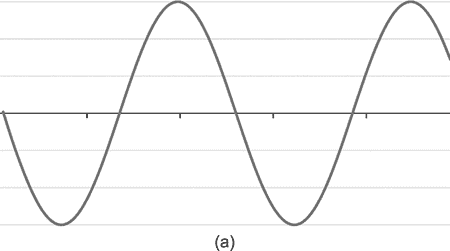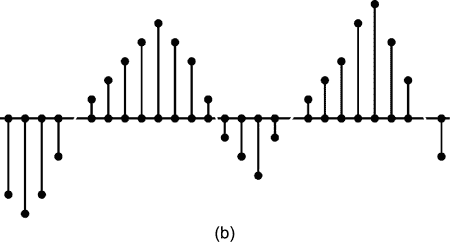

`FIGURE 1.1` 信号类型的表示：（a）连续；（b）离散。

一维连续时间信号 `x[t]` 的一般表示由公式 (1.1) 给出。如所示，信号 `x[t]` 可能是时间的复数 (`ℂ`) 或实值 (`ℝ`) 函数，且 `t` ∈ `R`，例如连续时间。

`x[t]`: `R` → `ℂ` or `x[t]`: `R` → `ℝ`

(1.1)

*离散时间信号* 由 \[14\] 中表示为 `x[n]` 的数字序列表示，且 `n` ∈ `Z`，其中 `Z` 是整数集合。离散时间信号的一般表示在公式 (1.2) 中给出。

`x[n]`: `Z` → `ℂ` or `x[n]`: `Z` → `ℝ`

(1.2)

在当前情况下，从模拟模型到离散值序列的转变令人兴奋，这导致了数字信号处理中的重大范式转变。与传统的模拟模型相比，离散模型在计算工作量方面简单易用。例如，如果我们想使用模拟模型找到两点之间的平均速度，计算涉及使用微积分确定速度函数 `x(t)` 的积分，然后除以区间长度。相反，如果使用离散速度测量，平均值可以通过将离散值的总和除以样本数轻松获得。信号以批处理或样本形式处理，减少了复杂性和处理时间，离散数据存储也更不复杂。此外，使用数字信号也可以有效地控制噪声水平。总之，使用离散模型的优点包括以下几点：（i）数据易于存储，（ii）处理不依赖于信号的性质，（iii）以最小噪声有效传输。

#### 1.2.1.2 采样和量化

数字信号有两个组成部分：时间和幅度，每个样本可以取自预定整数集的值。数字化是一个两步过程，包括两个不同的操作：采样和量化。最初，通过采样，模拟信号 `s[t]` 转换为离散信号 `s[n]`，信号以规则的时间间隔 `nT` 进行采样，其中 `n` 是样本数，`T` 是采样周期（秒），如公式 (1.3) 所示。然而，通过采样过程，模拟信号被转换为具有连续幅度值的离散时间信号 `s(nT)` \[14\]。

`s[n]` = `s(nT)`

(1.3)

由于采样信号包含连续幅度值，它尚未成为完全的数字信号。因此，需要对其进行量化处理，其中连续幅度通过为每个样本的值分配一个离散数字来量化。因此，总而言之，离散时间信号量化时间以及信号幅度。理想采样器可以与每 `T` 秒打开和关闭一次的简单开关相比，采样周期由公式 (1.4) 给出。

```
T = ~\frac{1}{f_{s}}
```

(1.4)

where

1. `f_s` = 采样频率，单位为赫兹。

*奈奎斯特-香农采样定理* 指出，如果采样频率大于信号中最高频率分量的两倍，则信号可以从其样本中精确重建。在实践中，采样频率通常明显高于奈奎斯特频率的两倍 \[14\]。对于该信号要为人耳可听，采样频率必须为 40 kHz。

#### 1.2.1.3 基变换

大多数信号处理应用需要将信号分解为其各个信号成分，以便对每个单独成分执行操作。信号分解也可以称为信号变换，其中信号从一个域变换到另一个域，例如从时域到频域。信号变换有助于分析信号，这需要从一个坐标系到另一个坐标系的基变换。


A basis can be considered as the skeleton of a vector space. It is a set of vectors that span an n-dimensional vector space and are linearly independent of each other. A basic operation in vector spaces is a linear combination denoted by Equation (1.5) where `α` and `β` are coefficients or coordinates that are unique.

`c = α x + β y`

(1.5)

If `S` is a set of `k` vectors, the fundamental building block is called a basis vector such that any vector can be expressed as a linear combination of this basis vector. The set of vectors can be denoted by {`S`^( `k` )} where `k` is the cardinal number of the vector. `S` is a basis for vector space `V` if we can express for all elements `x` belonging to `V`:

$$x = ~\\sum\\limits\_{k = 0}^{K - 1} \\propto\_{k}s^{(k)},~~\\text{vector\\ coordinate} \\propto\_{k} \\in {\\mathbb{C}}$$

(1.6)

For example, let us consider the canonical basis ℝ² of the Euclidean plane. Any vector in the Euclidean plane is a point on the plane that can be expressed as a pair of coordinates `x[0]` and `x[1]`. Let us take two vectors `e⁰` and `e¹` as follows:

$$e^{0} = \\begin{bmatrix} 1 \\\\ 0 \\\\ \\end{bmatrix}\\,\\,\\, e^{1} = \\begin{bmatrix} 0 \\\\ 1 \\\\ \\end{bmatrix}$$

(1.7)

Then, any vector in the Euclidean plane, ℝ², can be expressed as a linear combination of `e⁰` and `e¹` as in Equation (1.8) where the coefficients are the coordinates themselves.

$$\\begin{bmatrix} x\_{0} \\\\ x\_{1} \\\\ \\end{bmatrix} = x\_{0}\\begin{bmatrix} 1 \\\\ 0 \\\\ \\end{bmatrix} + x\_{1}\\begin{bmatrix} 0 \\\\ 1 \\\\ \\end{bmatrix}$$

(1.8)

For example, if `x[0]` = 3 and `x[1]` = 3, vector `V1` in 图 1.2 can be represented as `V1` = 2`e⁰` + 3`e¹`.

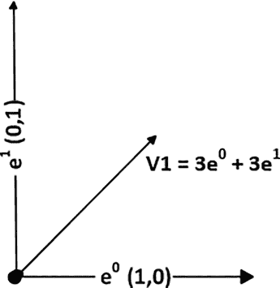

**图 1.2** 向量空间基的表示。

Real-world signals in nature exhibit periodic behavior where the phenomena repeat after a certain period of time. Therefore, signal processing applications depend on oscillatory functions such as sines and cosines to represent such periodic signals. A basis for a class of signals is a collection of signals in the class that have the property that any other signal in that class can be written as a weighted sum of those signals. Suppose we have the class of signals that are length `N`, and `x[n]` is in that class (is of length `N`). If `y^(k)[n]`, …, `y^(M-1)[n]` are also of length `N` and are a basis for these signals, we can find `c[1]`, …, `c[0]` such that

$$x\\left\\lbrack n \\right\\rbrack = ~\\sum\\limits\_{k = 0}^{K - 1}c\\left\\lbrack k \\right\\rbrack y^{(k)}\\left\\lbrack n \\right\\rbrack$$

(1.9)

In a nutshell, signal processing applications require decomposing a signal into its individual signal constituents or transforming it from one domain to another. This requires a change of basis from one coordinate system to another.

#### 1.2.1.4 时域和频域分析的重要性

The concept of domains is of utmost importance in digital signal processing and machine learning, as both time domains and frequency domains are used interchangeably depending on the application. For example, frequency domain methods are more effective than the time domain methods in certain applications, for example, fingerprint recognition and audio signal detection.

Time domain data representation shows how a signal varies with time, and it is also referred to as time-series data, whereas the frequency domain representation shows how much of the signal is present in a particular frequency band over a range of frequencies. Fourier transform is used to transform signals from time to frequency domain, and in this process, the time information is transformed into the magnitude and phase component of each frequency. The frequency domain representation is also referred to as spectrum because it includes a spectrum or range of frequency components. 图 1.3 represents an audio signal in the time as well as frequency domains. Representing the audio signal in the frequency domain allows audio experts to alter frequencies to make it more pleasing for the human ear.

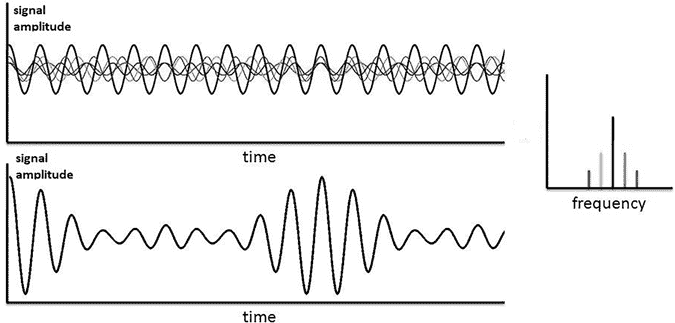

**图 1.3** 时域和频域中的音频信号。

## 1.2.2 机器学习

In the previous section, we have reviewed the basic definitions and terminologies related to signal processing. In this section, we will learn about machine learning and how it is classified. We will also look at some of the commonly used terms and definitions.

*Machine learning* is a subset of artificial intelligence that can learn to perform a task with extracted data and/or models [15]. Machine learning is the branch of science that enables computers to learn, adapt, extrapolate patterns, and communicate with each other without explicitly being programmed to do so [16]. Machine learning algorithms can solve various real-world problems such as detecting frauds, analyzing the sentiments of customers to promote sales growth, translating languages, and so on. Machine learning algorithms learn from historical data and are mainly classified into three main categories as shown in 图 1.4.

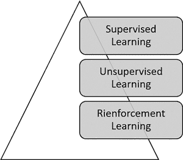

**图 1.4** 机器学习算法的分类。

1. **监督学习**: These algorithms require the knowledge of both the input or independent variable and the target or dependent variable. For example, predicting the price of a house falls under this category where the inputs can be the number of rooms, area of the house, and so on, and the target variable is the house price.
2. **无监督学习**: These algorithms do not have the knowledge of the target or dependent variable. For example, identifying different customer segments falls under unsupervised learning, and customers can be segregated based on gender, age, income, etc. for the purpose of marketing.
3. **强化学习**: This type of machine learning algorithm uses the cause-and-effect method to learn in an interactive environment. It uses the method of trial and error using feedback and learns from its own actions and experiences. An example of reinforcement learning is a self-driving car where it has to learn several aspects including speed limits, parking zones, etc.

Machine learning requires data to make decisions and automates the process of creating algorithms which is referred to as model building. The process of model building includes taking data as input, identifying patterns in the data and finally summarizing the pattern mathematically. The effectiveness of machine learning depends on the data, type of data, scaling, noise factor, sensitivity, features selected, etc.

Organizations and businesses across the world consider several performance measures including growth in sales, customer satisfaction, customer retention, and so on for quantifying, benchmarking, and improving [15]. Machine learning algorithms could be used to identify various aspects that contribute to those key performance measures and thereby ensure quality service. In general, the following steps are adopted by a typical ML algorithm:
* 问题识别
* 数据源识别和数据最终确定
* 数据预处理和特征提取
* 将数据集划分为测试、训练和验证集
* ML 模型构建
* 根据性能识别最佳模型
* 模型部署

The following are the key definitions of machine learning terminologies commonly used:


* **深度学习**：它是一种基于神经网络的先进机器学习发展或技术，能够从海量数据中学习。
* **分类**：它属于监督学习范畴。它处理离散数据并预测数据所属的类别。简单示例是将电子邮件归类为“垃圾邮件”和“非垃圾邮件”。分类问题可以是二分类或多分类。
* **回归**：它属于监督学习范畴，并基于输入特征提供预测，这些特征是连续值，例如根据房屋的特征（如地块大小、位置等）预测房屋价格。
* **特征提取**：从给定的原始数据集中提取构建机器学习算法所需特征的过程。
* **测试集**：用于测试训练好的模型所需的数据集子集。该集合必须代表整个总体，并且足够大以产生有意义的结果。
* **训练集**：用于训练模型所需的数据集子集。
* **模型构建**：使用机器学习算法构建模型以解决给定问题的过程。
* **模型部署**：模型基于多个标准和性能指标确定最终版本，包括准确率、成本和性能速度。这是最终阶段，涉及制定部署模型的策略。

## 1.3 基于距离的信号分类、最近邻分类器和希尔伯特空间

### 1.3.1 基于距离的信号分类

各种实际应用需要机器学习算法对信号或对象进行分类。识别输入数据模式对于此类分类应用至关重要，选择合适的距离度量对于做出明智决策至关重要。良好的距离度量可用于提高机器学习算法的模型准确性和性能。本节重点介绍各种距离度量及其对 SPML 的贡献。几个关键定义对于距离度量至关重要，如度量空间、赋范线性空间和内积空间。从定义中你会注意到，赋范线性空间和内积空间只是属于同一家族的度量空间类型。

#### 1.3.1.1 度量空间

度量空间只是一个对象的集合（例如数字和矩阵），而度量或距离函数是一个定义集合中每对点元素之间距离的函数 [17]。SPML 中的某些应用需要在任意空间中测量距离，使用函数，距离度量属于此类函数。任意空间可以是任何空间，包括向量空间。度量空间最简单的例子是实数数轴，相关联的度量是 ∥`a`−`b`∥，其中 `a`、`b` ∈ ℝ。

设 `Z` 为任意空间；`a` 和 `b` 是该空间中的两个点，`d` 是距离函数。距离函数 `d` 是距离度量，如果它满足以下四个条件：
1. 距离 `d(a, b)` ≥ 0
2. 距离 `d(a, b)` = 0 当且仅当 `a` = `b`（意味着点到自身的距离为零）。
3. 距离必须是对称的，这意味着 `d(a, b)` = `d(b, a)`
4. 它必须满足三角不等式性质，其中 `d(a, k)` ≤ `d(a, b)` + `d(b, k)`

#### 1.3.1.2 赋范线性空间

一个复赋范线性空间是一个线性空间，其中函数 ∥ . ∥:`L`→ℝ 称为范数称为范数 [17]。欧几里得距离和 `l[p]` 范数属于此类范畴，范数用于测量向量空间中的距离以及长度。设有一个 `n` 维的欧几里得平面 ℝ^(`n`)。欧几里得距离或 `l[2]` 距离（其中 `p` = 2）是最常用的距离度量。它只是使用毕达哥拉斯定理在此平面上任意两点之间测量的距离。例如，图 1.5 中所示的两点 `a` 和 `b` 之间的欧几里得距离可使用公式 (1.10a) 计算。

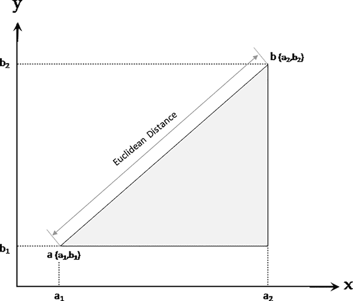

**图 1.5** 欧几里得距离的表示。

$$l_{2} = \\left\\| {a - b} \\right\\|_{2} = \\sqrt{\\sum\\limits_{i = 1}^{n}\\left( {a_{i} - \\left. b_{i~} \\right)} \\right.^{2}}$$
(1.10a)

这是一个二维欧几里得空间，`a[i]` 和 `b[i]` 是该空间中向量 `a` 和 `b` 的变量，即 `a` = (`a[1]`, `a[2]`, `a[3]`,…) 且 `b` = (`b[1]`, `b[2]`, `b[3]`,…).

因此，`a[i]`− `b[i]` = (`a[1]`− `b[1]`) + (`a[2]`− `b[2]`) + … + (`a[n]`− `b[n]`).

例如，两向量之间的欧几里得距离，假设点 `a` (1, 2) 和 `b` (3, 5) 在 ℝ² 平面中，可以按如下方式计算：

$$l_{2} = \\left\\| {a - b} \\right\\|_{2} = \\sqrt{\\left( {a_{i} - \\left. b_{i~} \\right)} \\right.^{2}} = \\sqrt{\\left( {3 - 1)} \\right.^{2} + \\left( {5 - 2)} \\right.^{2}} = \\sqrt{13}$$
(1.10b)

所以，$\sqrt{13}$ 是 `a` 和 `b` 在二维中的欧几里得距离。

虽然欧几里得距离足以捕捉给定空间中的距离测量，但某些应用需要测量更大的距离，`l[p]` 范数用于此类应用。`l[p]` 范数其中 `p` ≥ 1 如公式 (1.11) 所示。

$$l_{p} = \\left\\| {a - b} \\right\\|_{p} = \\left( {\\sum\\limits_{i = 1}^{n}\\left| {a_{i} - b_{i}} \\right|^{p}} \\right)^{\\frac{1}{p}}$$
(1.11)

相应地，`l[1]` 和 `l[∞]` 距离可分别按公式 (1.12) 和 (1.13) 计算。

$$l_{1} = \\left\\| {a - b} \\right\\|_{1} = \\sum\\limits_{i = 1}^{n}\\left| {a_{i} - ~b_{i}} \\right|$$
(1.12)

`l[∞]` = ∥`a`−`b`∥[∞] = max[`i`]|`a[i]`− `b[i]`|
(1.13)

##### 1.3.1.2.1 l_p 范数用于信号分类

假设我们有一个长度为 `N` 的信号类，`x[n]` 在该类中且长度为 `N`。如果我们对 `x[n]` 应用 `l[p]` 范数，则得到的 `l[1]`、`l[2]`、`l[p]` 和 `l[∞]` 范数距离将如下所示：

$$l_{1~\\text{norm~}}\\left( {p = 1} \\right) = \\sum\\limits_{n = 0}^{N - 1}\\left| {x\\left\\lbrack n \\right\\rbrack} \\right|$$
(1.14)

$$l_{2~\\text{norm~}}\\left( {p = 2} \\right) = \\left( {\\sum\\limits_{n = 0}^{N - 1}\\left| {x\\left\\lbrack n \\right\\rbrack^{2}} \\right|} \\right)^{\\frac{1}{2}}$$
(1.15)

$$l_{p~\\text{norm~}}\\left( {p \\geq 2} \\right) = \\left( {\\sum\\limits_{n = 0}^{N - 1}\\left| {x\\left\\lbrack n \\right\\rbrack^{p}} \\right|} \\right)^{\\frac{1}{p}}$$
(1.16)

`l[∞ norm]` = max[`n` ∈ {0,…`N`−1}]|`x[n]`|
(1.17)

#### 1.3.1.3 内积空间

线性向量空间 `F` 是内积空间，如果它具有内积函数⟨ , ⟩: `F` × `F`，其中 `F` ∈ ℝ, ℂ。内积用于测量向量之间的距离、长度以及角度。希尔伯特空间是完备的内积空间，这将在本章后面解释。

### 1.3.2 最近邻分类

最近邻分类是引入的一种最古老且稳健的距离分类方法。机器学习分类问题使用两种算法，即最近邻 (NN) 和 k-最近邻 (kNN)，它们在许多机器学习分类问题中取得了成功，例如图像分类和模式识别等。NN 与 kNN 的区别在于 NN 中 `k` 的值为 1。`k` 的值通常取决于训练集，并且对于大小为 `n` 的数据集，通常 `k` = $\sqrt{n}$。


### 1.3.2 最近邻
为了解释最近邻的概念，让我们以机器学习中的一个分类问题为例，其中数据集包括训练集和测试集。`kNN` 算法用于识别数据集中相似性和差异性。它遵循 [18] 中所述的简单方法，其中查询点 `t` 根据其在训练集中的最近邻类别进行分类。它被标记为属于其 `k` 个最近邻中出现频率最高的那个类别。

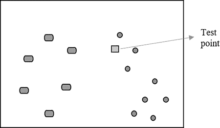

**图 1.6** K-NN 示例。

参考 图 1.6 中的示例，算法或分类器将使用距离函数或度量找到最接近测试点的示例，并为其分配与该示例相同的类别。此分类中常用的用于衡量相似性的距离度量是欧几里得距离。然而，还有其他距离度量，如曼哈顿距离和闵可夫斯基距离，也被使用。

### 1.3.3 希尔伯特空间
希尔伯特空间的概念源于德国数学家 David Hilbert 努力将欧几里得空间的概念推广到无限维空间。它将向量空间从二维和三维域扩展到具有多维或无限维的域。希尔伯特空间在普通向量空间的基础上增加了一些额外属性，例如允许进行长度和角度测量的内积运算。它们是完备度量空间，满足以下三个性质 [17]。这里，`F` 被视为线性向量空间。

1. **正定性**：`x`, `x` ≥ 0 ，对于 `x` ∈ `F`；⟨`x`, `x`⟩ = 0 仅当 `x` = 0

2. **对称性**：$\\left\\langle {x,~y} \\right\\rangle = ~\\left\\langle {y,~x} \\right\\rangle~\\quad\\text{for~}F \\in {\\mathbb{R}}\\quad\\text{;}\\,\\left\\langle {x,~y} \\right\\rangle = ~\\left\\langle \\overline{y,~x} \\right\\rangle\\quad\\text{for}~F \\in {\\mathbb{C}}$

3. **分配性**：⟨`x`, `y`[1]+ `y`[2]⟩ = ⟨`x`, `y`[1]⟩ + ⟨`x`, `y`[2]⟩，`x`, `y`[1], `y`[2] ∈ `F`

4. **数乘性**：⟨`λ x`, `y`⟩ = ⟨`λ x`, `y`⟩，对于 `x`, `y` ∈ `F` 且 `λ` ∈ ℂ

希尔伯特空间的优点是向量维度没有限制——它们可以是有限的、无限的，甚至是函数。机器学习中的核方法使用希尔伯特空间来执行点积计算。

## 1.4 机器学习在信号处理中的融合
DSP 为信息时代的各种技术奠定了基础，包括电视、手机和 MP3 播放器等。另一方面，ML 作为这一时代的新兴事物，已催生出诸如人脸识别、语音识别、图像分类、无人驾驶汽车和股票市场预测等引人注目的技术。DSP 系统通过包括数据采集、信号转换和滤波在内的一系列过程提取信息，而 ML 技术则依赖算法来提取信息。

信号处理和机器学习随着技术的进步和经济需求的变化而经历了快速的转变，并取得了显著的改进。近年来，对能够与环境交互的智能设备和装置的需求激增，这些设备被称为人机界面（HMI）设备，例如可以跟踪人类活动的穿戴式科技产品。虽然此类应用依赖机器学习技术来模仿人类智能从数据中学习并为现实世界问题提供解决方案，但需要注意的是，它们也依赖于统计信号处理和特征提取技术。很明显，现代应用需要 SPML 系统的融合，以在处理大数据、高科技数字传感器和硬件的同时保持高性能。

## 1.5 采用机器学习于信号处理的益处
机器学习算法从数据中学习，并通过经验不断提高性能。然而，智能设备或系统生成和存储的数据量巨大，术语“大数据”用于描述这种大规模数据集。此外，数据以多种格式存在，例如 2D 信号、视频和图像，传统的信号处理技术无法提取数据中隐藏的信息。考虑到庞大的数据集和多样化的格式，ML 算法必须以高速和高效的方式执行。为应对大数据和不同格式的巨大需求，采用了使用智能学习方法提取信息并以高速和准确的方式处理数据的 ML 算法。

人工智能技术和 ML 算法被广泛应用于众多庞大而复杂的需要统计信号处理的应用程序中，包括生物信息学、天文学、环境和通信，仅举几例。例如，在生物信息学领域，多位学术研究人员已采用 SPML 技术，如短时傅里叶变换（`STFT`），通过 EEG 数据检测癫痫发作，如 [19] 和 [20] 中所述。随着数据变得越来越大，现代世界中的某些应用甚至需要更先进的 ML 技术。传统 ML 算法的性能可能较慢，因为它们需要将数据完全加载到内存中进行数据挖掘和处理。此类算法无法在合理分配的时间内学习所有数据可能会带来挑战。

诸如深度学习等先进 ML 技术近年来因其在速度和深度架构方面的最先进性能而获得了大量关注。深度学习架构能够捕捉复杂输入数据模式，在做出明智预测方面优于传统 ML 技术。尤其是被称为卷积神经网络（`CNN`）的深度学习技术，已为未来的工作显示出一些有希望的结果。技术的持续演进和研究工作的努力肯定会在各个领域催生现代应用，要求从多样的环境中学习，而这正是 ML 算法将发挥重要作用的地方。

## 1.6 结论
在本章中，我们为您提供了信号处理和机器学习基础知识的速成课程，包括继续阅读本书其余章节所需的关键概念和术语。这一快速概述将提供足够的入门背景信息，让您开始进行信号处理和机器学习的后续章节。具体而言，我们希望您已形成利用统计信号处理和机器学习工具解决现实世界问题的思维方式和思考过程。


本章中，我们将信号处理定义为从信号中提取有用信息的过程。我们还涉及了数字信号处理，并将其与模拟模型进行了比较。此时，你应该已经理解，由于其简单性、计算工作量较少，以及易于数据存储、处理更简单、且以最小噪声实现有效传输，数字模型更受青睐。我们还讨论了数字化过程，以及模拟信号如何通过采样和量化技术转换为数字信号。基变换的概念及其在将信号从一个坐标系或域变换到另一个域以进行信号分析方面的益处也被解释了。本章介绍的信号处理概念和术语将为你在后续章节中继续学习高级主题提供足够的底层知识和理解。

我们还对机器学习及其相关概念进行了介绍。必须强调的是，机器学习算法从历史数据中学习以做出智能决策，并分为三大类：监督学习、无监督学习和强化学习。此外，典型机器学习算法在模型构建时遵循的步骤值得记住，因为它将在所有机器学习应用中持续使用。这包括问题识别、数据来源识别、数据预处理和特征提取、将数据集划分为测试集、训练集和验证集、模型构建、识别最佳模型，最后是模型部署。此外，SPML 应用需要机器学习算法对信号或对象进行分类，而识别输入数据模式是此类分类问题的关键要求。这正是距离测量发挥关键作用并帮助做出明智决策的地方。因此，我们对距离度量的基本原理及其对 SPML 的贡献进行了介绍。最近邻分类器和希尔伯特空间的基础知识也被涵盖，因为它们被用于所有高级机器学习算法。

总之，通过本章获得的知识将帮助你认识到信号处理和机器学习对知识经济的广泛重要性，以及它们如何无缝地相互关联，以开发解决现实世界问题的必备工具和高端解决方案。最后几节讨论了 SPML 的融合，并描述了在信号处理中采用机器学习的益处，以应对大数据和不同格式，从中提取信息并以高性能和高精度处理数据。

## 参考文献

1.  B. A. Shenoi, 数字信号处理与滤波器设计导论，John Wiley & Sons Inc., New York, 2021。

2.  R. G. Lyons, 理解数字信号处理，第三版。O’Reilly Media, Inc., USA, 2021。

3.  B. P. Lathi, 线性系统与信号，Oxford University Press, Sacramento, CA, 2020。

4.  C. D. M. Regis, 数字信号处理，Momentum Press, New York, 2018。

5.  H. Lu, Y. Xiaoyu, W. Haodong, L. Jin, M. Xuejiao, and Z. Caihong, “通信中数字信号处理技术应用研究”，IOP 会议系列：材料科学与工程，Vol. 799, no. 1, May 2020. doi: [10.1088/1757-899X/799/1/012026](https://doi.org/10.1088/1757-899X/799/1/012026)。

6.  J. Alzubi, A. Nayyar, and A. Kumar, “从理论到算法的机器学习概述”，Journal of Physics: Conference Series, Vol. 1142, No. 1, p. 012012, November 2018。

7.  J. L. Rojo-Álvarez, M. Martínez-Ramón, J. Muñoz-Marí, and G. Camps-Valls, 基于核方法的数字信号处理，Wiley-IEEE Press, Hoboken, NJ, 2018。

8.  J. Vora, M. Patel, S. Tanwar, and S. Tyagi, “基于图像处理的垂直墙体裂缝分析”，2018, doi: [10.1109/IoT-SIU.2018.8519926](https://doi.org/10.1109/IoT-SIU.2018.8519926)。

9.  S. S. Maram, N. Kumar, J. J. P. C. Rodrigues, S. Tanwar, and A. Jain, “从图像到信号，从信号到亮点，”IEEE 全球通信大会（GLOBECOM-2020），Taipei, Taiwan, 7–11 December 2020, pp. 1–6, 2020。

10.  R. Gupta, S. Tanwar, S. Tyagi, and N. Kumar, “安全数据分析的机器学习模型：分类法与威胁模型”，Computer Communications, Vol. 153, pp. 406–440, 2020。

11.  S. Tanwar, Q. Bhatia, P. Patel, A. Kumari, P. K. Singh, and W. C. Hong, “区块链智能应用中的机器学习采用：挑战及前行之路”，IEEE Access, Vol. 8, pp. 474–488, 2020。

12.  S. Khatri, H. Vachhani, S. Shah, J. Bhatia, M. Chaturvedi, S. Tanwar, and N. Kumar, “基于 VANET 的交通管理机器学习模型与技术：实施问题与挑战”，Peer-to-Peer Networking and Applications, Vol.14, pp. 1–27, 2020。

13.  V. Anavangot, V. G. Menon, and A. Nayyar, “信号物联网中的分布式大数据分析”，2018 年系统建模与研究趋势进展国际会议（SMART），IEEE, Moradabad, November, pp. 73–77, 2018。

14.  S. M. Kuo, B. H. Lee, and W. Tian, 实时数字信号处理：基础、实现与应用，Wiley, New York, 2013。

15.  M. Pradhan and D. U. Kumar, 使用 Python 进行机器学习，Wiley India Pvt Ltd, New York, pp. 0–364, 2019。

16.  S. Halder and S. Ozdemir, 网络安全实战机器学习：利用 Python 生态系统让机器智能化以保护您的系统，Packt Publishing Ltd, Birmingham, 2018。

17.  O. Ekin, P. L. Hammer, A. Kogan, and P. Winter, “基于距离的分类方法”，INFOR: Information Systems and Operational Research, Vol. 37, No. 3, 1999, doi: [10.1080/03155986.1999.11732388](https://doi.org/10.1080/03155986.1999.11732388)。

18.  R. Chellappa and S. Theodoridis, 学术出版社信号处理丛书：第 1 卷——信号处理理论与机器学习，vol. 1, Academic Press, Chennai, 2014。

19.  M. Sameer and B. Gupta, “Beta 波段作为癫痫患者间期与发作期分类的生物标志物”，2020 年第 7 届信号处理与集成网络国际会议（SPIN），Noida, India, 2020, pp. 567–570. doi: [10.1109/SPIN48934.2020.9071343](https://doi.org/10.1109/SPIN48934.2020.9071343)。

20.  M. Sameer, A. K. Gupta, C. Chakraborty and B. Gupta, “利用 Gamma 波段 Haralick 特征进行癫痫发作检测的 ROC 分析”，2020 年全国通信大会（NCC），Kharagpur, India, 2020, pp. 1–5, doi: [10.1109/NCC48643.2020.9056027](https://doi.org/10.1109/NCC48643.2020.9056027)。

# 2 用于信号处理的 学习理论（监督/无监督）

Ruby Jain

Symbiosis Skills and Professional University

Bhuvan Jain

DPU IDL

Manimala Puri

Symbiosis Open Education Society

DOI: [10.1201/9781003107026-2](https://doi.org/10.1201/9781003107026-2)

## 2.1 介绍

信号本质上是一个函数或测量值，用于将信息从一个源传输到目的地。信号可以是语音、图像、通信信号（数字）、文本信号、心电图信号等形式。


## 2.2 信号处理与机器学习

信号准备包括检查、获取、识别和评估；事件和模式的建模、它们的发展方式；以及影响它们的异常和不规则现象，吸引了世界各地众多科学家的兴趣。信号处理理论源于数学基础，具有令人惊叹的应用，帮助数据技术人员发现并想象新的现实，涉及通信、声学、语音、音乐、生物医学工程、网络、控制以及研究开发中的众多其他领域。在信号处理的理论与应用之间发现了一种令人惊讶的和谐，其影响巨大。线性代数、信息变换和信号分布可能在大多数这些应用中发挥重要作用。

1940 年代由 Warren McCulloch 和 Walter Pitts 提出的受中枢神经系统结构启发的假神经网络开创性工作，是信息评估和人工智能领域备受赞誉的另一项基础 \[1\]。人工智能喜欢为所研究的问题构建生成模型。归纳模型和边界本质上依赖于贝叶斯学习，由数据及其环境决定。

人工智能和数据理论思想可以帮助统计信号处理克服线性模型的障碍，并减轻对高斯性和平稳性假设的需求。统计信号处理和归纳推理算法在信号处理与人工智能的交汇处提供了共同的观点，从而产生了例如自适应和非线性信号处理、智能系统以及多任务和协作网络管理等一些优美的探索领域 \[2\]。

## 2.1.1 信号处理

我们日常生活中使用甚至依赖的创新——电脑、收音机、视频和 PDA——都得益于信号处理，这是电气工程的一个分支，用于建模和分析实际事件的信息描述。信号处理是我们现代世界的核心，推动着当今的娱乐和即将到来的创新。它处于生物技术与社会互动的交叉点。它提高了我们传达和共享信息的能力。信号处理是我们数字生活的科学基础 \[3\]。

信号只不过是用于从一个源向目的地传递信息的函数或测量值。信号可以是语音、图像、通信信号（数字）、文本信号、`ECG` 信号等形式。

信号处理是从不同来源获得的信号的翻译、分析和转换方法，以便在现实世界中更好地处理信息。

一些例子包括在语音识别、图像处理以及从一种语言到另一种语言的机器翻译中使用语言学规则。

信号处理意味着以任何类型的计算机都能解读的方式处理任何类型的信号，无论是模拟还是数字。例如，声波也是一种信号。当声波被设备接收时，设备仅具有某些参数的离散或模拟估计，例如频率、音高等。信号处理的任务是以特定方式处理该信号，使计算机能够像人类听到的一样解读声音，例如识别词语和声音。这可以通过机器学习实现。本章主要将涉及神经标志的准备，也称为 `EEG` 信号 \[4\]。

首先，让我们了解 `EEG` 信号的基础知识 \[4\]。我们大脑中的神经元通过产生电信号的化学反应相互交流。这些电信号称为 `EEG` 信号。你可以通过使用神经头戴设备接收这些信号。这些信号当转换为电子表格时，会为各种参数提供离散值，例如 `alpha`、`beta` 波形等。我们的主要任务是通过读取这些值来识别用户正在执行的操作。

人工智能本质上意味着让计算机执行一些未被明确编程的操作。例如，你不会编程让计算机为特定值预测某种操作。计算机本身学会如何解释数据。你需要选择一些你希望计算机学习的操作。假设你选择鼓掌和眨眼。首先你将收集这些操作的信号并将其整理成数据集。信号处理包括对数据集的大量预处理。然后，创建一个 `ML` 模型，使我们能够根据最近收集的值预测新信号值对应的活动 \[5\]。

这个过程的主要部分是预处理。假设在每十分之一秒内，你接收到 20 个不同参数的 20 个测量值。因此，你需要在电子表格的单列中合并这些 `20 *10 = 200` 个值。现在，这 200 个值是描述一次鼓掌的特征。此外，你需要重新排列每个鼓掌的数据，因为在收集数据时，你收集了同一人的几次鼓掌数据。这种重新排列消除了与特定个人数据相关的独特性。因此，你通过解释数据来进行预处理。预处理对预测用户活动准确性有显著影响 \[6\]。

预处理后，你可以使用图表可视化数据以更好地理解它。如果你的数据是多维的，你可以使用主成分分析 (`PCA`)。该方法将数据从高维降至低维 \[7\]。

信号处理主要与解释你的数据有关，而无法解释的部分则由机器学习来处理。我专门谈到了 `EEG` 标志；然而，以上所有策略都适用于各种类型的信号。最后，利用 `ML` 模型，你的计算机将能够像人类解读一样识别信号 \[8\]。

本章进一步分为多个部分。在第一部分中，作者重点关注机器学习概念。`train` 和 `test` 数据的影响将进一步讨论。人工智能的三个主要方面接下来将详细讨论。监督学习、无监督学习和半监督学习及其各种应用将在下一节中讨论。使用监督学习和无监督学习的信号处理的各种用例将在下一节中讨论。回归、分类、多级分类以及各种误差方法将在下一节中讨论。机器学习中的正则化接下来将讨论。各种聚类算法将在下一节中讨论。信号处理的深度学习将在下一节中讨论。时间序列分析将在下一节中讨论，随后是各种基于 `GPU` 的框架中的信号处理。本章将以简要总结结束。

## 2.2 机器学习

*   **Samuel (1959)**: 研究领域，使计算机能够在没有明确编程的情况下学习。

*   **Kevin Murphy (2012)**: 自动检测数据中模式的算法，利用发现的模式预测未来数据或其他感兴趣的结果。


AI 是一门管理从信息中获得的计算进步的科学。根据 Arthur Samuel（1959）\[9\]，AI 是“使 PCs 在没有被明确定制的情况下学习的研究领域”。Kevin Murphy 在他的原著 \[10\] 中，将 AI 特征化为一系列算法，这些算法自动识别信息中的模式，利用揭示的示例来预测未来信息或其他感兴趣的结果。

机器学习由不同的算法组成，这些算法被计算机用于在没有任何外部人工规则的情况下执行一组指定的任务，并且从信息中学习（图 2.1）。

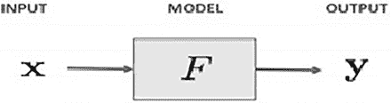

**图 2.1** 机器学习算法。

### 2.2.1 为什么我们需要机器学习进行信号处理？
* SP 对人类感兴趣的任务来说是不透明的。
* 结构插入越多，生成的结果越好。
* 这有助于将 ML 和 SP 结合在一起。

### 2.2.2 扬声器 ID – 信号处理中机器学习计算的一种利用
Speaker ID（图 2.3）是通过对语音属性的检查来识别个人的过程 \[12\]。在这个受监管的分类应用中，一个有标签的准备语音测试集（来自一组扬声器）被用于学习周期。

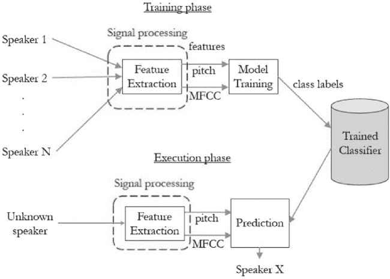

**图 2.3** 扬声器 ID。

语音测试/记录不能直接在学习周期中使用。为了进一步处理，可能需要检查、清理（去除噪声或无效示例等），或重新组织示例到合理格式。此步骤称为“数据预处理” \[9\]。

同样，我们可能需要更改特定于 ML 计算的信息和问题的信息。为了训练 ML 模型识别语音测试中的示例，使用信号处理对语音测试进行特征提取。在这种情况下，用于训练 ML 模型的特征是音高和 Mel-Frequency Cepstrum Coefficients（MFCC） \[13\] 从语音测试中提取。

通常，可用的数据集（信息语音测试集）分为两组：一组用于准备模型，另一组用于测试需求（通常为 75%–25% 比例）。准备集用于训练 ML 模型，测试集用于评估 ML 计算的充分性和执行情况。

准备阶段应努力概括组件向量（对受监管学习计算的贡献）与类名称（受管学生的输出）之间的基本连接。交叉验证是评估 ML 模型推测能力的验证策略之一。

准备阶段还应避免过拟合，这可能导致执行阶段的弱推测和错误安排。如果计算的性能需要改进，我们需要返回并对过去的步骤进行更改。某些度量指标如 precision、recall、accuracy、F1 score、AUC-ROC 框架通常用于评估 ML 计算的有效性和执行情况 \[14\]。

在 ML 模型经过足够准备以提供令人满意的执行后，我们继续进行执行阶段。在执行阶段，当未标记的语音测试实例被呈现给准备好的分类器时，它识别该实例所属的个人。

### 2.2.3 语音和音频处理
每部手机，无论是否智能，都严重依赖于语音准备策略使（至少两个）个人之间的语音通信成为可能——从模拟到数字转换到语音改进（分离、混响、噪声和程序化拾音控制）到账户侧的语音编码到语音解释到语音升级（通常是筛选和增益控制）到播放侧的模拟转换。信号处理始终是首选工具。没有信号准备，现代数字助手，例如 Siri、Ok Google 和 Cortana，就无法识别客户的声音。

声音压缩程序，例如 MP3 和 AAC，改变了我们收听音乐的方式。我们现在可以将世界的音乐旋律库存握在手掌中，并在旅途中欣赏音乐，甚至可以通过蓝牙完全无束缚。再次，信号准备促成了这一切。

### 2.2.4 语音识别
语音识别是信号处理的重要利用；它也是最容易理解的。信号处理控制信号中的数据内容以促进自动语音识别（ASR）。它有助于从语音信号中提取数据，然后将其翻译成明显的词语。语音识别技术存在于战斗机、“与文本对话”应用程序在高级手机上、有用应用程序、语言解释和学习，以及为残疾人士提供的识别程序 \[15\]。

### 2.2.5 听力设备
你现在能听到我们吗？听力设备创新的核心是四个同步部件：放大器、处理器、接收器和力源。信号准备参与获取环境中的声音并处理它们以升级和增强佩戴者听到的内容。立即，声音从模拟转换为数字再转换回模拟，然后声音被投射到耳中 \[16\]。

虽然创新的基本组件将保持不变，但便携式放大器变得越来越先进——减少来自整体环境的噪声和反馈，以帮助人们听到新鲜、清晰的声音。信号处理还减少了意外的嘈杂噪音，例如喇叭，甚至允许放大器远程与手机或电视连接。

### 2.2.6 自动驾驶
曾经是科幻小说的素材，独立车辆现在是现实。为了正常工作，这些自动驾驶车辆依赖于来自多特定传感器阵列的贡献，包括超声波、雷达和摄像头——为了防止碰撞，它们必须转换获得的信息并将其过滤为控制活动所需的数据。信号处理对该技术至关重要。它决定车辆是否需要停止或继续，并且是用于解释天气条件如降雨或雾的雷达的重要组成部分 \[17\]。

### 2.2.7 图片处理和分析
事实可能比小说更离奇。我们日常生活中数字相机和屏幕无处不在，例如在我们的手机、车辆、无人机、监视系统、飞机、医院和客厅中，反映了我们不断增长的需求，即以更高的细节水平查看、分享和与我们的视觉环境连接。在医学中，几乎所有诊断现在都涉及某种成像。然而，这块迅速出现的冰山隐藏了许多鲜为人知但极其基本的应用，尤其是在社会、军事、健康和科学研究领域。信号处理对从采集到显示的广泛应用至关重要：
* 数字恢复图片和视频
* 紧凑检测采集（例如，单像素相机）


* 采购期间的图像改进（相机芯片内部）
* 来自非图像传感器的图像重建
* 图像质量评估
* 压缩和跨组织与设备的传输
* 图像显示技术（色彩规划、3D 到 2D 投影）
* 识别，包括在图像和视频中跟踪特征
* 临床影像中的计算机辅助诊断（例如，乳房 X 光检查的辅助）
* 生物图像的计算机化分析（例如，细胞追踪）

### 2.2.8 可穿戴设备

可穿戴设备市场正在兴起，目前蓬勃发展。融入服装和饰品的创新技术和传感器可追踪健身水平、心率、实际位置（GPS）、睡眠模式等等。信号处理有助于收集这些数据并将其转化为可用于多种用途的有用信息——例如，将心率报告给您的主治医生或增加锻炼以减肥 \[18\]。

### 2.2.9 信息科学

每次你在互联网上搜索或在 Twitter 上发帖，你都在为人们所熟知的“大数据”集合添加信息。组织利用这些信息提取数据，了解行为并制定解决方案，使我们的生活更高效。神经科学、医学等某些领域依赖于人工智能工具，将影像数据与临床记录和基因组数据融合，以更好地理解和汇总退行性过程和疾病，预测治疗反应，并将患者分组到亚组中，例如。

“大数据”是一个快速兴起的领域，但我们面临着集中处理大量实际困难数据的挑战。探索信息和解决复杂问题的关键部分是什么？信号处理。

与信号处理一样，信息科学以我们可能想象不到的更多方式影响我们的日常生活。无论是使用新兴的在线媒体平台等新数据源，预测证券市场的变化，还是研究数据以解决从糖尿病到心脏问题等临床问题，信号处理使得分析能够改善我们每天生活的这些数据成为可能。

### 2.2.10 Wireless Systems and Networks

你是否曾考虑过与外星生物交流？信号处理在寻找地球以外生命中是必要的。对于卫星、视频、无线电和远程框架之间的有效通信而言，信号处理使信息的处理和传输更高效。

当你外出需要网络访问或使用 GPS 找到方向时，信号处理是幕后技术，改变和检查信号以帮助我们交流并从我们日常使用的技术中获益——包括手机、Wi-Fi、电视、GPS 设备、雷达、声纳、无线电以及云和移动计算 \[19\]。

## 2.3 机器学习算法

ML 是人工智能（AI）的一种应用，它使系统能够在没有明确编程的情况下自动学习并基于事实改进。AI 专注于开发能够访问数据并自行学习使用的计算机程序。

学习过程始于观察或数据，例如模型、直接经验或指导，以在数据中寻找模式并基于我们提供的模型做出更好的未来决策。基本目标是允许计算机在没有人工干预或帮助的情况下自动学习并相应地改变行为。

然而，使用人工智能的经典算法，文本被视为一组关键词；相反，基于语义分析的方法模仿了人类理解书籍含义的能力。

AI 使海量数据的分析成为可能。虽然它通常能更快、更准确地提供结果以识别有利机会或危险风险，但适当训练它也可能需要额外的时间和资源。将 AI 与 AI 和认知技术相结合，可以使其在处理大量数据时更加强大。

图 2.4 \[20\] 显示了监督学习和无监督学习下的各种算法类别。

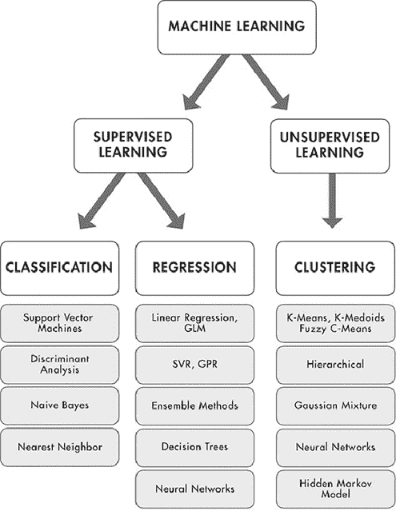

**图 2.4** ML 算法的树状结构。

## 2.4 监督学习

在监督学习中，学习者被提供标记的输入信息。这些信息包含结构为 (`x[i]`, `y[i]`) 的输入/输出集合，其中 `x[i]` 是潜在信息，而 `y[i]` 是与其相关联的准确标记输出。在监督学习中，学习者的目标是学习从输入到输出的映射。监督学习过程需要掌握一个函数，该函数表示所见的众多信息/输出集合，(`x[i]`) = `y[i]`，适用于所有情况。该函数 `f` 如果输出是离散的则称为分类器，如果输出是连续的则称为回归函数。

监督机器学习目前构成了全球各系统使用的 ML 的大部分。输入变量 (`x`) 通过算法与输出变量 (`y`) 相连接。如 图 2.5 所示，所有输入、输出、算法和场景均由人类提供。通过两种类型的问题，我们可以更好地理解监督学习。

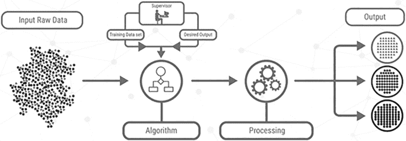

**图 2.5** 监督学习。

* **分类**：分类问题对构成输出的所有变量进行分类。通过分类形成的这些类别的示例包括婚姻状况、性别或年龄等人口统计数据。此类服务状态最常用的模型是支持向量机。支持向量机被设定用于定义线性决策边界。

* **回归**：可归类为回归问题的问题包括输出变量设置为实数的情况。此问题的格式通常遵循线性格式。

## 2.5 无监督学习

收集标记信息虽然要求高但也很繁琐，其中精确命名通常难以实现。在无监督学习中，学习者被提供未标记的输入信息。学习者的目标是找到数据中固有的模式，这些模式可用于确定新数据事件的正确输出和值。这里的假设是信息空间具有结构，以至于某些模式比其他模式更常出现，我们需要识别通常发生什么以及什么不发生。在统计学中，这称为密度估计。无监督学习算法对传感器网络应用非常有帮助，原因如下——收集标记信息资源密集且耗时——准确命名难以实现——传感器网络应用通常部署在异常且不断变化的环境中 \[21\] (图 2.6)。

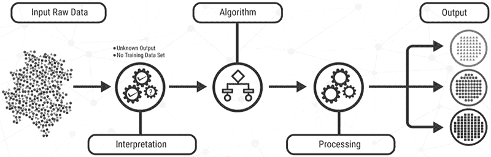

**图 2.6** 无监督学习。


## 2.6 无监督学习

在无监督学习过程中，系统没有具体的数据集，大多数问题的结果在很大程度上是未知的。用简单的术语来说，AI 系统和机器学习目标在运行中是“盲”的。系统拥有无懈可击且庞大的逻辑运算来引导其进行，但缺乏适当的输入和输出算法使得过程更加具有挑战性。尽管整个过程听起来不可思议，但无监督学习能够通过输入数据和存在于所有计算机系统中的二进制逻辑机制来解释并找到无限量数据的解决方案，如图 2.6 所示。系统完全没有参考数据。

既然我们期望读者现在对无监督学习有一个基本的概念，那么通过举例使理解更简单是恰当的。只需考虑我们有一张数字图像，其上有多样化的彩色几何形状。这些几何形状需要根据颜色和其他分类特征进行分组匹配。对于遵循监督学习的系统来说，整个过程有点太简单了。

该过程极其直接，因为你只需要教会计算机有关图形的所有细节。你可以让系统知道所有四边形被称为正方形，八边形被称为八边形等。我们还可以教会系统解释颜色并查看发出的光是如何分类的。

## 2.6 半监督学习

半监督学习计算利用标记数据和未标记数据进行训练，如图 2.7 所示。

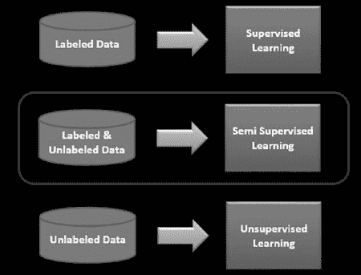

**图 2.7** 半监督学习。

命名信息通常只占训练数据集的一小部分。半监督学习的目标如下：

1. 了解将标记和未标记信息结合起来如何改变学习行为。
2. 设计利用这种组合的算法。

半监督学习是一种极具前景的方法，因为它可以在标记数据稀缺或特征和分类器成本高昂时，利用 readily 可用的未标记数据来改进监督学习任务。

图 2.8 显示了对应于不同活动 \[22\] 的两个加速度计信号：静止 vs. 行走 vs. 跑步。

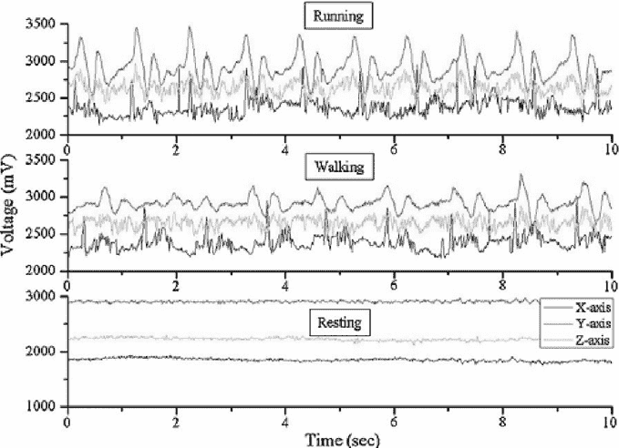

**图 2.8** 对应信号的不同活动。

这两个信号本身在视觉上也不同。我们进一步假设这些并不是我们可用的唯一模式（信号），但我们可以使用一个信号数据库，其中包含若干模式，其中一些已知来自静止，一些来自行走 \[23\]。第一步是识别使这两个区域彼此不同的可测量量。我们可以绘制每个感兴趣区域中强度的均值与该均值周围的标准偏差的对应关系。每个点将对应于可用数据库中的不同信号/区域。事实证明，静止模式（◦）倾向于分布在与清醒模式（+）不同的区域。直线似乎是分离两个类别（◦ 和 +）以及具有三个类别的多类分类的良好候选者。图 2.9 \[24\] 表示了各种数据点的二元和多类分类示例。

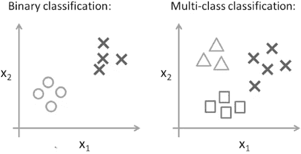

**图 2.9** 二元和多类分类。

## 2.7 强化学习

该机器学习算法是一种学习技术，它通过执行动作与当前环境协作并发现错误或奖励。探索搜索和延迟奖励是强化学习的两个最重要的特征。强化学习是一种机器学习技术，使智能体能够在交互环境中通过试错，利用自身行为和经验的反馈进行学习 \[25,26\]。

尽管监督学习和强化学习都使用输入和输出之间的映射，但与监督学习不同，后者向智能体提供的反馈是执行任务的正确动作集合，强化学习则使用奖励和惩罚作为正面和负面行为的信号。

与无监督学习相比，强化学习在目标上有所不同。虽然无监督学习的目标是找到数据点之间的相似性和差异，但在强化学习中，目标是找到一个合适的动作模型，以最大化智能体的总累积奖励。图 2.10 表示了强化学习模型涉及的基本思想和要素。

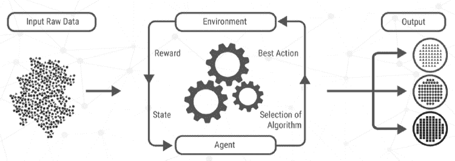

**图 2.10** 强化学习。

## 2.8 使用监督学习和无监督学习的信号处理用例

### 2.8.1 特征和分类器

前述的人工分类任务概述了大量模式识别问题背后的原理。用于分类的测量值，在本例中为均值和标准差，被称为特征。在更一般的情况下，使用 `l` 个特征 `x[i]`，`i` = 1, 2, …, `l`，它们形成特征向量

`x = [x[1], x[2],..., x[l]]^(T)`

每个特征向量唯一标识一个模式 \[27\]。在本课程中，特征和特征向量将分别被视为随机变量和向量。不同模式产生的测量值表现出随机变化。这部分是由于测量设备的测量噪声，部分是由于每个模式的独特特征。这就是前一图中每个类别中点散布的原因。该图中的直线被称为决策线，它构成了分类器，其作用是将特征空间划分为对应于类别 ◦ 或类别 + 的区域。

如果对应于未知模式的特征向量 `x` 落在类别 ◦ 区域，则将其分类为类别 ◦，否则分类为类别 +。这并不一定意味着决策是正确的。如果不正确，则发生了误分类。为了在前一图中绘制直线，我们利用了我们知道图中每个点的标签（类别 ◦ 或 +）这一事实。真实类别已知且用于设计分类器的模式（特征向量）被称为训练模式（训练特征向量）

在概述了定义和原理之后，让我们指出分类任务中出现的基本问题：

* 特征是如何生成的？
* 使用多少个特征 `l` 最合适？
* 在采用了适当的特征后，如何设计分类器？（最优性准则）。
* 一旦分类器设计完成，如何评估所设计分类器的性能？（分类错误率）。

图 2.11 \[28\] 显示了设计分类系统涉及的基本阶段。

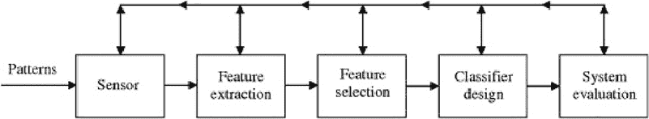

**图 2.11** 分类阶段。

从反馈箭头可以看出，这些阶段并不是相互独立的。

### 2.8.2 线性分类器


线性分类器的主要优点是其简单性和计算上的吸引力。我们首先假设所有来自可用类别的特征向量都可以使用线性分类器正确分类，并且我们将开发计算相应线性函数的技术。接下来，我们将关注一个更一般的问题，在该问题中线性分类器无法正确分类所有向量，但我们将寻求通过采用适当的优化准则来设计最优线性分类器的方法。

### 2.8.3 决策超平面
让我们再次关注二分类情况并考虑线性判别函数。那么在单维特征空间中相应的决策超曲面是一个超平面，即
`g(x) = w^T x + w[0] = 0`
其中
1. `w = [w[1], w[2], …, w[l]]^T` 被称为权重向量，而 `w[0]` 为阈值。
可以证明向量 `w` 与决策超平面正交。
换句话说，`|g(x)|` 是点 `x` 与决策超平面欧几里得距离的度量。在平面的某一侧，`g(x)` 取正值，在另一侧取负值 [27]。

### 2.8.4 最小二乘法
尽管我们知道类不是线性可分的，但在许多情况下我们仍希望采用线性分类器，尽管从分类错误概率的角度来看，这会导致次优性能。请记住，现在的目标是在合适的优化准则下计算相应的权重向量。因此，在本节中，我们将尝试设计一个线性分类器，使其期望输出再次为 ±1，取决于输入向量的类别归属。然而，我们必须接受错误；也就是说，真实输出并不总是等于期望输出。
给定向量 `x`，分类器的输出将为 `w^T x`。
期望输出将表示为 `y(x) ≡ y = ±1`。
权重向量将计算为最小化期望输出与真实输出之间的均方误差（MSE）。
最小二乘技术是一种紧急事实策略，用于发现给定示例的回归线或最佳拟合线。该策略由具有明确边界的条件描述。最小二乘技术在评估和回归中被广泛使用。在回归分析中，该策略被认为是对具有比问题数量更多的条件方程组进行估计的标准方法。
最小二乘技术实际上定义了偏差平方和或每个条件结果中误差最小化的解。发现误差平方和的方程，有助于发现观察数据的变异性。
最小二乘策略经常应用于信息拟合。最佳拟合结果预期减少平方误差或残差的总和，这些残差被表达为观察或实验值与模型中给出的相关拟合值之间的差异。
最小二乘问题的两个基本分类是：
* 普通或线性最小二乘
* 非线性最小二乘
这些取决于残差的线性和非线性。直接问题通常在统计学中的回归分析中发现。另一方面，非线性问题通常在迭代细化技术中使用，其中模型在每个周期中近似为线性。

### 2.8.5 均方估计
设 `y`、`x` 分别为维度为 `M × 1` 和 `l × 1` 的两个随机向量变量，并假设它们由联合 pdf `p(y, x)` 描述。感兴趣的任务是估计从实验中获得的 `x` 值给定的 `y` 的值。毫无疑问，分类任务属于这种更一般的公式。在更一般的设置中，`y` 的值可能不是离散的。以 `y ∈ R` 由未知规则 `y = f(x) + ε` 生成的情况为例。
现在任务是估计（预测）给定 `x` 值时的 `y` 值。再一次，这是一个设计函数 `g(x)` 的问题，基于一组训练数据点 (`y[i]`、`x[i]`)，`i = 1, 2, …, N`，使得预测值
`ŷ = g(x)`
在某种最优意义上尽可能接近真实值 y。这类问题被称为回归任务。回归最受欢迎的优化准则之一是 MSE
随机向量 `y` 在给定值 `x` 时的均方估计 `ŷ` 定义为
`ŷ = min ŷ E[|y - ŷ|²]`。请注意，此处的均值是相对于条件 pdf `p(y|x)` 的。可以证明最优估计是 `y` 的均值，即
`ŷ = E[y|x] ≡ ∫_{-∞}^{∞} y p(y|x) dy`

### 2.8.6 支持向量机
设 `x[i]`，`i = 1, 2, …, N`，为训练集 `X` 的特征向量。它们属于两个类别 `w[1]` 和 `w[2]` 中的一个，假设它们是线性可分的。目标，再次是设计一个超平面 `g(x) = w^T x + w[0] = 0`。
这可以正确分类所有训练向量。正如我们已经讨论过的，这种超平面不是唯一的。`perceptron` 算法可能收敛到任意一个可能的解。
对于超平面分类器来说，一个非常合理的选择是使两类之间留出最大间隔的那个。这里我们触及了分类器设计阶段的一个非常重要的问题：它被称为分类器的泛化性能。这指的是使用训练数据集设计的分类器在该数据集之外的数据上仍能令人满意地运行的能力。让我们现在量化超平面从两类留下的间隔项。每个超平面都由其方向（由 `w` 确定）和其在空间中的确切位置（由 `w[0]` 确定）表征。由于我们不想偏向任一类，对于每个方向，选择与 `ω[1]` 和 `ω[2]` 中的相应最近点具有相同距离的超平面是合理的。因此，我们的目标是寻找给出最大可能间隔的方向。请回忆点与超平面的距离由以下方程给出：
`z = (|g(x)|)/(|w|)`
图 2.12 显示了一个线性可分的两类问题的示例，其中有两个可能的线性分类器。
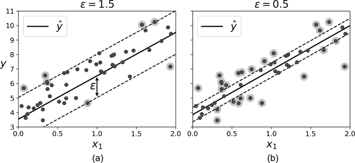
**图 2.12** 两类问题：(a) ω1 的类 1；(b) ω2 的类 2。
图 2.12 显示了一组位于二维空间中的训练数据点，分为两个不可分类。 图 2.12a 中的实线是使用 Platt 算法得到的超平面，对应于值 `C = 0.2`。虚线满足 (3.82) 中给出的条件，并定义了间隔，该间隔将两类分开，对于那些 `ξ[i] = 0` 的点。 图 2.12b 中的设置对应于 `C = 1,000`，并且是使用相同的算法和相同的修剪参数集（例如，停止准则）获得的 [29,30]。

### 2.8.7 非线性回归
NL 模型比线性模型更强大，比线性回归更困难。它使用 NL 方程，可以采用以下形式
`Y = f(X, β) + ε`,
其中
1. `X = a vector of p predictors`,
2. `β = a vector of k parameters`,
3. `f(-) = a known regression function`,
4. `ε = an error term`.
非线性回归显示在 图 2.13 中。
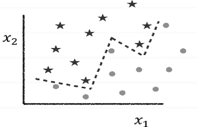


**图 2.13** 非线性回归。

### 2.8.8 激活函数的非线性

#### 2.8.8.1 Sigmoid 函数

它是一种具有 S 形特征的数学函数。常见的 Sigmoid 函数有 logistic、双曲正切和反正切，如 图 2.14 所示 [31]。

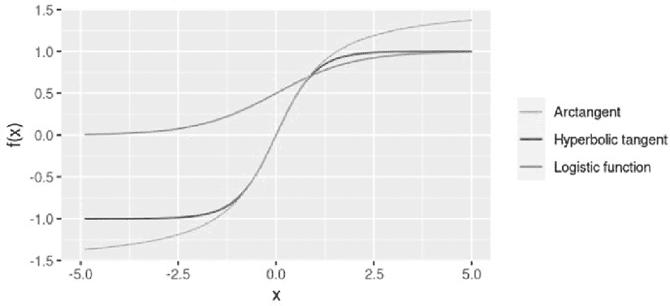

**图 2.14** Sigmoid 函数。

1. **Logistic Sigmoid 函数公式：** 在机器学习领域，这通常被称为 Sigmoid 函数。
$$\\begin{array}{cl} {S\\left( x \\right)} & {= ~\\frac{1}{1 + e^{- x}}} \\\\ & {= ~\\frac{e^{x}}{e^{x} + 1}} \\\\ \\end{array}$$  
2. **双曲正切函数公式**：它将任意实值输入映射到 -1 和 1 之间的范围。
$$\\begin{array}{cl} {f\\left( x \\right)} & {= \\tan\\,\\text{h}\\left( x \\right)} \\\\ & {= \\frac{e^{x} - e^{- x}}{e^{x} + ~e^{- x}}} \\\\ \\end{array}$$  
3. **反正切函数公式**：这是正切函数的反函数。
`f(x) = arctan(x)`

#### 2.8.8.2 矫正线性单元（ReLU）

这是深度学习模型中最广泛使用的激活函数，表示为 `f(x) = max(0, x)`，并图形化表示为 图 2.15。

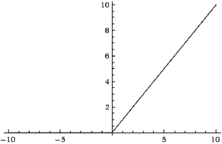

**图 2.15** 矫正线性单元。

### 2.8.9 分类

#### 2.8.9.1 线性分类

它是一种分类算法（分类器），其分类基于线性预测函数，该函数将一组权重与特征向量结合。
$$Y = f\\left( {\\overset{\\rightarrow}{w} \\cdot \\overset{\\rightarrow}{x}} \\right) = ~f\\left( {\\sum\\limits\_{j}w\_{j}x\_{j}} \\right)$$

#### 2.8.9.2 二分类

它也被称为多类分类，其中问题被分类为一个或多个类别。
`y(x) = w^T X + w[0]`
并图形化表示为 图 2.16。

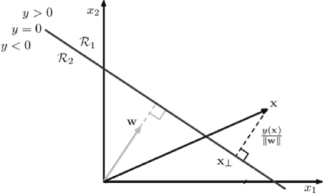

**图 2.16** 二分类。

#### 2.8.9.3 导数的几何解释

设 ***AB*** 为通过点 (*x*, *f*(*x*)) 和 (*x* + ∆*x*, *f*(*x* + ∆*x*)) 的直线。如果 ∆*x*，即趋近于零，则该直线趋近于点 (*x*, *f*(*x*)) 处的切线 [32]。相应地，切线的斜率是当 ∆*x* 趋近于零时直线的斜率的极限，如 图 2.17 所示。

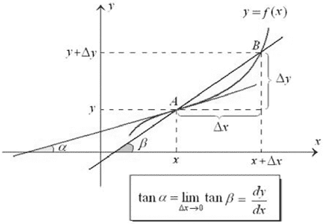

**图 2.17** 导数的几何解释。

因此，导数 `f'(x)` 可以解释为函数 `y = f(x)` 图形上点 (*x*, *y*) 处切线的斜率。

每当函数在某个区间开始增加时，切线的斜率在该区间每个点上都是正的，因此函数的导数为正。

每当函数在某个区间开始减少时，切线的斜率在该区间每个点上都是负的，因此函数的导数为负。

#### 2.8.9.4 多类分类：损失函数

它是一种机器学习分类功能，其中可以有一个或多个类别或输出。

作为优化算法的一个特征，模型当前状态的误差应得到一致的估计。这需要一个称为损失函数的误差函数选项，可用于估计模型的损失，以便更新权重以防止损失。

### 2.8.10 均方误差

MSE 告诉你回归线与一组点有多接近。示例包括寻找回归线、误差平方等。

公式：
$$\\text{MSE} = \\frac{1}{n}\\sum\\limits\_{i~ = 1}^{n}\\left( {Y\_{i}~.~{\\hat{Y}}\_{i}} \\right)^{2}$$

### 2.8.11 多标签分类

随着可用数据的持续增加，需要对这些数据进行组织。因此，现代分类问题涉及预测与实例相关联的此类多标签。

单标签分类的准确率：
$$\\frac{1}{N}{\\sum\\limits\_{i = 1}^{N}I}\\left\\lbrack {{\\overset{\\frown}{y}}^{(i)} = y^{(i)}} \\right\\rbrack$$

### 2.8.12 梯度下降

它是目前机器学习中最常用的优化技术。这些在训练数据模型时使用，可以与每种算法结合，并且易于理解和实现。简单来说，它衡量权重相对于误差变化的变化。

GD 的工作原理：

让我们想象一个攀登者下山，想象 GD 就像下山谷一样。

看下面的等式：
`b = a - γ Δf(a)`
其中
1. `b` 是攀登者的下一个位置，而 `a` 是当前位置。
2. − 表示最小化；
3. `γ` 是等待因子，其余则简单地表示下坡方向。

#### 2.8.12.1 学习率

* 它在梯度最小但一致的方向上移动更快。
* 它在梯度更高但不一致的方向上移动较慢。
* 在学习结束时，它会降低学习率。

大和小学习率 [33] 在 图 2.18 中表示。

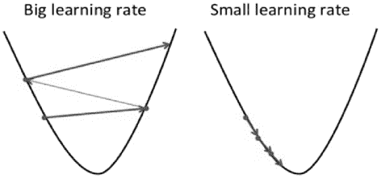

**图 2.18** 梯度下降中的学习率。

### 2.8.13 超参数调优

它是一个参数，其值在学习过程开始前设定。一些示例包括随机梯度下降中的损失和逻辑回归中的惩罚。网格搜索与随机搜索之间的差异在 图 2.19 中显示。

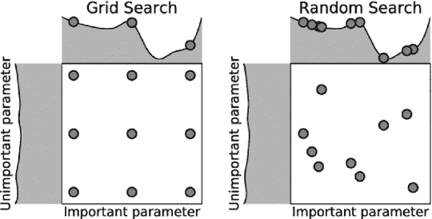

**图 2.19** 超参数调优。

#### 2.8.13.1 验证

为了使实现有效，
* 使用不同的机器
* 减小数据大小
* 减少检查的频率次数。

### 2.8.14 正则化

在机器学习中，正则化是一个使系数正则化或趋向于零的过程。一般来说，正则化意味着使事物规范或可接受。这正是我们将其用于应用机器学习的原因。在机器学习的上下文中，正则化是使系数正则化或收缩至零的过程。简单来说，正则化会阻止学习更复杂或更灵活的模型，以防止过拟合。

#### 2.8.14.1 正则化是如何工作的？

基本思想是对复杂模型进行惩罚，即添加一个复杂度项，该项会为复杂模型带来更大的损失。为了理解它，让我们考虑线性回归的一个简单关系。数学上，它表述如下：
`Y ≈ W[0] + W[1] X[1] + W[2] X[(2)] + … + W[P] X[P]`
其中
1. `Y` 是学习到的关系，即要预测的值。
2. `X[1]`、`X[(2)]`、…、`X[P]` 是决定 `Y` 值的特征。
3. `W[1]`、`W[(2)]`、…、`W[P]` 分别是附加到特征 `X[1]`、`X[(2)]`、…、`X[P]` 的权重。
4. `W[0]` 表示偏差。

现在，为了拟合一个能够准确预测 `Y` 值的模型，我们需要一个损失函数和优化参数，即偏差和权重。

线性回归中通常使用的损失函数称为残差平方和（RSS）。根据上述线性回归关系，可以表示如下：
$$\\text{RSS} = {\\sum\\left( {j = 1} \\right)}^{m}\\left( {Y\_{i} - W\_{0} - {\\sum\\limits\_{(i = 1)}^{n}{W\_{i}X\_{ji}}}} \\right)^{2}$$


我们也可以将 `RSS` 称为无正则化的线性回归目标。

现在，模型将通过这种损失函数进行学习。基于我们的训练数据，它将调整权重（系数）。如果我们的数据集存在噪声，它将面临过拟合问题，并且估计的系数在未见数据上无法泛化。

这就是正则化发挥作用的地方。它通过惩罚系数的大小来将这些学习到的估计值正则化向零。

### 2.8.15 正则化技术

存在两种主要的正则化技术，即岭回归和 Lasso 回归。它们在对系数施加惩罚的方式上有所不同。

### 2.8.15.1 岭回归（L2 正则化）

该正则化技术执行 L2 正则化。它通过添加相当于系数大小平方的惩罚（收缩量）来修改 `RSS`。

$${\\sum\\limits\_{(j = 1)}^{m}\\left( {Y\_{i} - W\_{0} - {\\sum\\limits\_{(i = 1)}^{n}{W\_{i}X\_{ji}}}} \\right)}^{2} + \\alpha{\\sum\\limits\_{(i = 1)}^{n}{W\_{i}^{2} = \\text{RSS}}} + \\alpha{\\sum\\limits\_{(i = 1)}^{n}W\_{i}^{2}}$$

现在，系数是使用此修改后的损失函数估计的。

在上面的等式中，你可能注意到参数 `α` (`alpha`) 与收缩量一起出现。这称为调优参数，它决定我们希望对模型施加多少惩罚。换句话说，调优参数平衡了最小化 `RSS` 与最小化系数平方和之间的重视程度。

让我们看看 `α` `alpha` 的取值如何影响岭回归产生的估计值。

当 `α` = 0 时，惩罚项没有效果。这意味着它将残差平方和作为我们最初选择的损失函数返回，即我们将得到与简单线性回归相同的系数。

当 `α` = ∞ 时，岭回归系数将为零，因为修改后的损失函数将忽略核心损失函数并最小化系数平方，最终使参数值取为 0。

当 0 < `α` < ∞ 时，对于简单线性回归，岭回归系数将在 0 和 1 之间。

这就是选择 `α` (`alpha`) 的良好值至关重要的原因。岭回归正则化技术产生的系数方法也称为 L2 范数。

### 2.8.16 Lasso 回归（L1 正则化）

该正则化技术执行 L1 正则化。它通过添加相当于系数绝对值之和的惩罚（收缩量）来修改 `RSS`。

$${\\sum\\limits\_{(j = 1)}^{m}\\left( {Y\_{i} - W\_{0} - {\\sum\\limits\_{(i = 1)}^{n}{W\_{i}X\_{ji}}}} \\right)^{2}} + {\\sum\\limits\_{(i = 1)}^{n}\\left| W\_{i} \\middle| \\, = \\text{RSS} \\right.} + {\\sum\\limits\_{(i = 1)}^{n}\\left| W\_{i} \\right|}$$

现在，系数是使用此修改后的损失函数估计的。

Lasso 回归与岭回归不同，因为它使用绝对系数值的归一化。

由于损失函数只考虑绝对系数（权重），优化算法将惩罚高系数。这被称为 L1 范数。

### 2.8.17 K-Means 聚类

它是数据科学中简单而强大的算法。

给定：`S` = {`x[1]`, …, `x[n]`}，一个包含 `n` 个维度为 `d` 的向量集合 `S` 和一个整数 `k`

目标：找到 `C` = {`µ[1]`, …, `µ[k]`}，一组 `k` 个聚类中心，使其最小化表达式：

公式：

$$f = \\sum\\limits\_{i}mi~\\left| \\left| {x - \\mu\_{j}} \\right| \\right|^{2}$$

受监管的 AI 计算被用于解决分类或回归问题。

一个分类问题具有离散值作为其输出。例如，“喜欢披萨上放菠萝”和“不喜欢披萨上放菠萝”是离散的。没有中间地带。上面鼓励孩子区分猪的相似性是 图 2.20 中描述的另一个分组问题的例证。

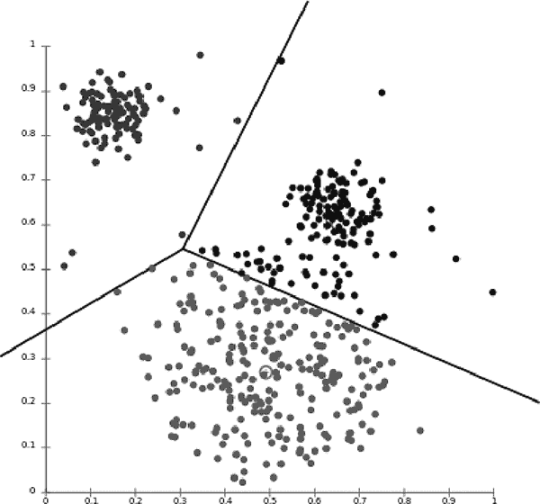

**图 2.20** 分类示例。

表 2.1 显示了特征化信息可能是什么样子的一个基本说明。我们有一个指标（或一组指标）和一个标记。在 表 2.1 中，我们可能正试图根据他们的年龄（指标）预测某人是否喜欢在披萨上放菠萝（1）或不喜欢（0）。

**表 2.1**年龄和喜欢披萨上放菠萝

| Age || Likes Pineapple on Pizza |
| --- | --- |
| 42 || 1 |
| --- | --- |
| 65 || 1 |
| 50 || 1 |
| 75 || 1 |
| 95 || 1 |
| 50 || 1 |
| 91 || 1 |
| 25 || 1 |
| 23 || 1 |
| 75 || 1 |
| 45 || 0 |
| 87 || 0 |
| 95 || 0 |
| 45 || 0 |
| 32 || 1 |
| 63 || 0 |
| 21 || 1 |
| 25 || 1 |
| 93 || 0 |
| 68 || 1 |
| 95 || 0 |

将分组计算的输出（名称）表示为整数是标准做法，例如 1、−1 或 0。在这种情况下，这些数字只是真实的。对它们进行数值运算是不合适的，因为这样做毫无意义。想一想。什么是“喜欢菠萝” + “不喜欢菠萝”？正是如此。我们不能将它们相加，所以我们不应该添加它们的数字描述。与监督学习试图熟悉一个函数，以便在给定一些新的未标记信息时做出预测不同，无监督学习试图熟悉数据的本质结构，以便让我们对数据有更多了解。

KNN 计算期望相似的事物存在于接近性中。总而言之，相似的事物彼此接近。

有其他方法来计算距离，并且一种方法可能取决于我们正在解决的困难而更理想。然而，直线距离（也称为欧几里得距离）是一种主流且熟悉的选择。

### 2.8.18 KNN 算法

*   加载数据
*   将 `K` 设置为你选择的邻居数量
*   对于数据中的每个样本
    *   计算查询样本与数据中的当前样本之间的距离
    *   将距离和指南的索引添加到一个排序集合中
*   按距离从小到大（升序）对距离和索引的排序集合进行排序
*   从排序集合中选择前 `K` 个条目
*   获取所选 `K` 个条目的标签
*   如果是回归，返回 `K` 个标签的平均值
*   如果是分类，返回 `K` 个标签的众数

### 2.8.19 聚类

聚类分析的策略可以分为四个阶段，如下图所示 图 2.21 所示：

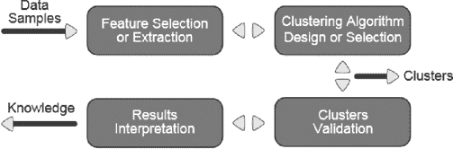

**图 2.21** 聚类阶段。

1.  **特征选择或提取**：特征选择从一组候选中挑选识别特征，而特征提取利用数据转换来创建有价值和新颖的特征。两者对于聚类应用的有效性都非常关键。丰富的特征选择可以大大减少突出负担并改善后续设计措施。理想的特征应属于不同的组，对噪声具有抵抗力，并且易于提取和解释。


### 聚类算法设计或选择
该过程通常与相关邻近度度量的确定相结合。示例是根据它们是否彼此相似进行收集的，而邻近度度量直接影响后续簇的发展。没有一种聚类计算方法可以普遍用于解决所有问题。因此，仔细研究当前问题的属性以使用合适的系统非常重要。

### 聚类验证
不同的方法通常会导致不同的簇，而且即使对于相同的算法，边界识别或信息示例的排列也可能影响最终结果。因此，有效的评估准则和标准对于为专家提供对使用预先计算方法获得的结果的信心水平至关重要。这些评估应公正无偏见，并应有助于回答有关数据中隐藏的簇的数量、所获得的组是否重要或为何选择某种算法而非另一种算法等问题。

### 结果解释
聚类的最终目标是为原始数据提供有意义的洞察。

### 2.8.20 聚类方法
时间序列聚类可以分为两大类：“整体聚类”和“后效聚类”。“整体聚类”是对多个单独时间序列进行的聚类，以将相似序列聚集成组。“后效分组”依赖于对单个时间序列的滑动窗口提取，旨在发现单个时间序列的不同时间窗口之间的相似性和差异 [34]。

聚类算法通常分为层次型或基于划分的。

这些分类将在下面简要描述。

* **层次算法**：这种分组工具使用某些标准对数据集进行多层次分解。层次聚类计算将信息聚类以形成树模型结构，并通过使用最近确定的聚类来发现渐进式聚类。它可以分为凝聚层次聚类（“自底向上”）和分裂式渐进分组（“自顶向下”）。在凝聚方法中，所有信息点都被视为单独的簇，并且在每次迭代中，簇根据标准合并。在分裂方法中，所有信息点被视为单个簇，然后根据特定规则将其分离为不同的组。

* **基于划分的算法**：在此方法中，构建各种划分，然后根据某些标准进行评估。划分聚类计算将信息点划分为 `k` 个段，其中每个段代表一个簇。该簇应具有两个属性：
  1. 每个集合应至少包含一个对象；
  2. 每个项目应恰好属于一个集合。该计算的基本缺点是，只要一个点接近另一个簇的中心，由于信息点重叠，就会产生较弱的结果。在本文中，使用了一种基于段的计算方法，即 `K-means`。`K-means` 聚类的主要思想是以彼此相距较远的 `k` 个质心（簇的焦点）定义一个圆，将属于给定数据集的每个直接数据与最近的质心配对。重复该过程，质心的位置会发生变化，因为它们是通过对簇中所有焦点取平均值重新确定的，并且在几次迭代后，位置会稳定下来，实现最终的簇 [11]。该计算的基本有利优势是其简单性、效率和速度，这些都是大型数据集的良好属性。

* **基于距离的方法**：如前所述，基于距离的分组是根据使用选定距离度量确定的信息之间的相似性构建的。可以对信息应用不同的距离度量，这将决定两个组件的接近程度如何确定。简单的欧几里得距离度量足以有效地对相似信息案例进行分组。然而，有时选择的距离度量可能会具有误导性，因此，了解哪种度量最适合输入数据非常重要——这会影响分组结果，因为根据一种距离，某些组件可能彼此接近，而根据另一种距离则可能更远。已提出了几种时间序列比较方法。最简单的方法依赖于相似性度量，直接比较从原始数据中提取的观测值或特征。在时间域中，自相关和互相关函数用于此目的。除了在时间序列之间直接进行的估计外，距离也可以从信息的变换中计算得出。在频域中，使用离散傅里叶变换和信息小波的过程也得到应用。

Liao [35] 对时间序列信息聚类进行了概述，揭示了该主题的过去研究。研究工作将聚类分为三组：无论它们是直接使用原始信息、间接使用提取的特征还是间接使用从原始信息构建的模型。通过用随机模型表示原始信息，不同时间序列的要素中的相似性得以识别。

## 2.9 用于信号数据的深度学习
与将深度学习或人工智能应用于其他信息索引相比，信号处理的深度学习需要额外的手段。高质量的信号信息难以获得，并且具有如此庞大的数量和波动 [36, 37 和 38]。宽带噪声、神经和扭曲只是大多数信号信息中发现的许多不良属性中的几个，如 图 2.22 所示。

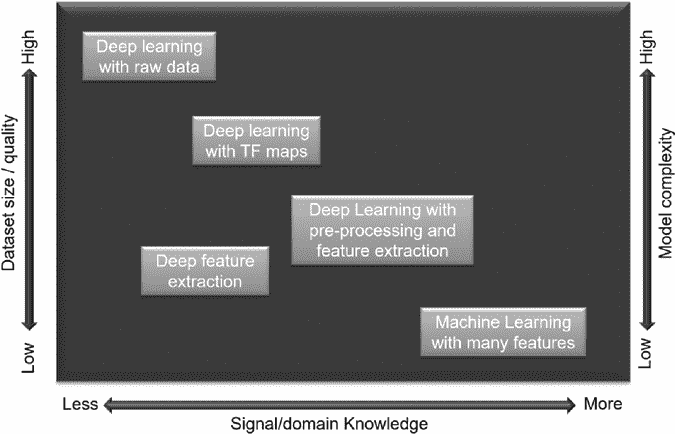

**图 2.22** 深度学习。

与所有深度学习项目一样，特别是对于信号信息，你的成功往往取决于你拥有的信息量和机器的计算强度，因此强烈建议使用良好的深度学习工作站。

为了避免使用深度学习，需要深入理解信号信息和信号处理，以使用依赖于比深度学习更少信息的人工智能方法 [37]，如 图 2.23 所示。

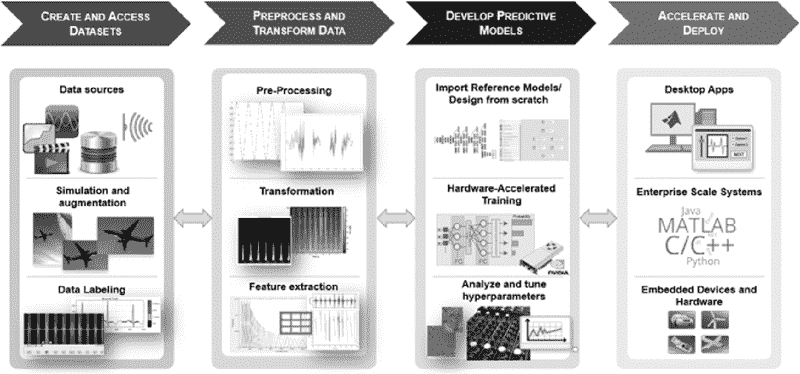

**图 2.23** 阶段及工具。

1. 该周期将包括存储、读取和预处理信息。这还将包括分离和更改特征并划分为训练和测试集。如果您打算使用有监督学习算法，信息将需要标注。
2. 可视化信息对于识别所需的预处理和特征提取策略的类型至关重要。对于信号处理，可视化需要在时间、频率和时频域进行适当的分析。
3. 一旦信息被可视化，就需要从信息中更改和提取特征，例如峰值、变化点和信号模式。


在 AI 或深度学习出现之前，由于信号具有时域特定位置，传统的时序分析模型被使用。

### 2.9.1 传统时间序列分析

这涉及对时间序列的视觉审阅，观察长期变化，调查峰值和箱。

### 2.9.2 频域分析

根据 MathWorks \[37\]，频域分析是信号处理的关键部分之一。它被用于诸如通信、地质学、遥感和图像处理等领域。时域分析显示信号的能量在长时间内分布，而频域表示包含有关相位移动的信息，该相位移动应应用于每个频率分量以通过所有单个频率分量的组合恢复原始时间信号。信号在时域和频域之间使用称为“变换”的数值算子进行转换。两个众所周知的例子是快速傅里叶变换 (`FFT`) 和离散傅里叶变换 (`DFT`)。

### 2.9.3 用于人类活动识别的长短期记忆模型

人类活动识别 (`HAR`) 近年来随着先进的人机交互的出现而逐渐受到关注。它在医疗保健、健身、游戏、军事和导航等行业具有实际应用。有两种类型的 `HAR`：

基于传感器的 `HAR`（佩戴在人体上的可穿戴设备，人类运动被转换为可分割和识别的特定传感器信号模式）。由于传感器技术的进步及其低成本，大多数研究已转向基于传感器的方法。

### 2.9.4 外部设备 HAR

深度学习方法已被用于克服遵循由用户制定的启发式的 AI 方法的不足。能够自动提取特征的深度学习方法对于更复杂的任务具有更好的扩展性。传感器数据正以快速速度增长（例如 Apple Watch、Fitbit、行人跟踪等），并且产生的数据量足以让深度学习方法学习并产生更精确的结果。

循环神经网络是信号数据的合理选择，因为它们本质上具有时间成分，因此具有序列成分。用于 `HAR` 的深度循环神经网络描述了一些基于 `LSTM` 的深度 `RNN`，以构建用于对变长输入序列进行分类的 `HAR` 模型。

图 2.24 上方显示了使用基于 `LSTM` 的深度 `RNN` 进行 `HAR` 的建议架构。输入将是来自多模态传感器的原始信号，被分割成长度为 `T` 的窗口，并馈入基于 `LSTM` 的 `DRNN` 模型。模型随后将为每个时间步输出类别预测分数，然后通过晚期融合进行组合并馈入 `softmax` 层以确定类别成员概率 \[39\]。

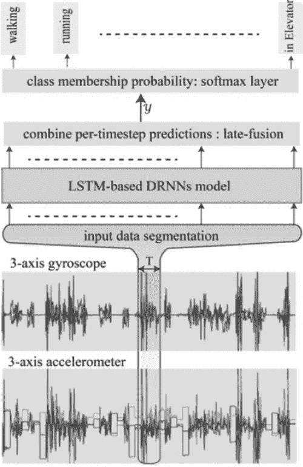

**图 2.24** 利用 `LSTM`-based deep `RNN`s 进行 `HAR`。

该模型从原始多模态传感器输入到活动名称分类执行直接端到端映射。输入是传感器在时间 `t` 观察到的均匀分布样本的离散序列的向量。这些样本被分割成最大时间索引 `T` 的窗口并馈入基于 `LSTM` 的 `DRNN` 模型。模型的输出是表示活动标记预测的分数序列，其中每个时间步都有一个名称预测（`y_L[1]`、`y_L[2]`、…、`y_L[t]`），其中 `y_L[t]` ∈ `R[C]` 是表示给定数据样本 `x[t]` 的预测的分数向量，`C` 是活动类别的数量。

每个时间步将有一个分数预测在时间 `t` 发生的运动类型。整个窗口 `T` 的预测是通过将单个分数合并为单个预测获得的。模型使用晚期融合策略，其中来自单个样本的分类决策被组合以对窗口进行总体预测。

### 2.9.5 GPU 上的信号处理

如果您尚未使用基于 `GPU` 的工作站，您应考虑从较慢的 `CPU` 切换。通常可以观察到 30 倍或更高的性能提升，并且有各种开源库可帮助在基于 `GPU` 的系统上进行信号处理。这些包括以下内容：

* **NVIDIA Performance Primitives (NPP)**: 提供 `GPU` 加速的图像、视频和信号处理功能。
* **ArrayFire**: `GPU` 加速的开源库，用于网络、信号和图像处理。
* **IMSL FORTRAN Numerical Library**: `GPU` 加速的开源 FORTRAN 库，具有数学、信号和图像处理以及统计的函数。

### 2.9.6 FPGA 上的信号处理

与使用基于 `GPU` 的系统进行信号处理相比的另一种选择是探索 `FPGA`（现场可编程门阵列）方案。

`FPGAs` 可以在制造后进行编程，即使设备已在“现场”。`FPGAs` 通常与 `CPUs` 耦合工作，以加速计算和数据密集型工作负载中的重点功能。这使您可以将繁琐的处理功能从工作负载中卸载以提高应用程序的性能。

是否选择 `GPU` 或 `FPGA` 方案真正取决于您要做什么，因此必须与业务工程师讨论您的用例以确定每个方案的优势与成本。

### 2.9.7 信号处理正成为数据分析的前沿

真实世界是信号的映射。人体、世界环境、太空甚至动物都产生可使用数学和统计模型进行分析和理解的信号。信号处理已被用于理解人脑、疾病、声音处理、图像处理和金融信号等等。信号处理正逐渐进入数据分析的主流，随着新的深度学习模型被开发用于分析信号数据 \[40\]。

## 2.10 结论

数据驱动的机器学习，尤其是深度学习技术，正在成为处理各领域大数据问题的有力工具。机器学习和信号处理领域正在并行处理当今商业领域的需求。本章旨在介绍对各种信号处理应用有用的机器学习 (`ML`) 技术的基础。它还讨论了 `ML` 中涉及的各种数学方法，从而使读者能够设计自己的模型并高效地优化它们。本章侧重于数学原理。机器学习、信号处理和通信中的应用以及理论被量身定制。监督学习、无监督学习、半监督学习和强化学习及其子类别进行了讨论。

## 参考文献

1. Lettvin, J. Y., Maturana, H. R., McCulloch, W. S., & Pitts, W. (1959). 青蛙的眼睛告诉青蛙的大脑什么。Proc IRE 47:1940.

2. McCulloch, W. S., & Pitts, W. (1943). 神经活动中固有思想的逻辑演算。Bull Math Biophys 5:115.

3. Kim, J. H., Lim, J. G., & Chung, S. K. (2009). 基于 DSP 的多相同步降压转换器数字控制器。J Power Electron 9:410–417.


## 参考文献

4. Lastre-Domínguez, C., Shmaliy, Y. S., Ibarra-Manzano, O., Munoz-Minjares, J. and Morales-Mendoza, L. J. (2019). 利用无偏 FIR 平滑进行 ECG 信号去噪和特征提取。 BioMed Res Int 2019. 文章编号 2608547, doi: [10.1155/2019/2608547](https://doi.org/10.1155/2019/2608547).

5. Sysel, P., & Krajsa, O. (2010). “面向 VLIW DSP 的 FMT 上 FIR 滤波器实现的优化，” 最新电路、系统与信号趋势，可在以下获取 [`www.wseas.us/e-library/conferences/2010/Corfu/CSS/CSS-29.pdf`](http://www.wseas.us/).

6. Jain, R., & Puri, M. (2019, March). 使用非零随机替换掩码方法保护非生产环境中的敏感业务数据。 Int J Appl Innov Eng Manag 8(3):382–390, ISSN 2319-4847.

7. Shruti Sehgal, H. Singh, M. Agarwal, Bhasker, V., & Shantanu. (2014). “使用主成分分析进行数据分析，” 2014 年医学成像、m-健康和新兴通信系统国际会议 (MedCom), Greater Noida, 2014, pp. 45–48, doi: [10.1109/MedCom.2014.7005973](https://doi.org/10.1109/MedCom.2014.7005973). [`www.semanticscholar.org/paper/Data-analysis-using-principal-zcomponent-analysis-Sehgal-Singh/d85313272033783c5e68a67930ebdc129aa80d5b`](https://www.semanticscholar.org/)

8. 信号处理使用 机器学习, (2018). [`medium.com/@ariesiitr/signal-processing-using-machine-learning-9c4eac331d78`](https://medium.com/), 于 2020 年 12 月 15 日 16:00 收阅。

9. Samuel, A. L. (1959). 使用跳棋游戏进行机器学习的某些研究。 IBM J Res Dev 44(1.2):210–229.

10. Murphy, K. P. (2013). 机器学习 – 概率视角。 The MIT Press, Cambridge, ISBN 978-0262018029.

11. 网站： [`aws.amazon.com/blogs/machine-learning/k-means-clustering-with-amazon-sagemaker/`](https://aws.amazon.com/) (于 2020 年 11 月 15 日访问)。

12. 网站： [`www.gaussianwaves.com/2020/01/introduction-to-signal-processing-for-machine-learning/`](https://www.gaussianwaves.com/) (于 2020 年 10 月 2 日访问)。

13. Chauhan, P. M., & Desai, N. P. (2014). “使用维纳滤波器在噪声环境中基于梅尔频率倒谱系数 (MFCC) 的说话人识别，” 2014 年绿色计算通信与电气工程国际会议 (ICGCCEE), Coimbatore, pp. 1–5.

14. Jain, R., & Puri, M. (2018, June). 使用非确定性随机替换算法保护结构化敏感数据的一种稳健方法。 Int J Comput Appl 179(50):17–21.

15. Benk, S., Elmir, Y., & Dennai, A. (2019). 自动语音识别研究。 J Inf Technol Rev 10:77–85. doi: [10.6025/jitr/2019/10/3/77-85](https://doi.org/10.6025/jitr/2019/10/3/77-85).

16. Cioffi, R., Travaglioni, M., Piscitelli, G., Petrillo, A., & De Felice, F. (2020). 智能生产中人工智能和机器学习的应用：进展、趋势和方向。 Sustainability 12:492.

17. Memon, Q., Ahmed, M., Ali, S., Memon, A. R., & Shah, W. (2016). 自驾和驾驶员放松车辆。 doi: [10.1109/ICRAI.2016.7791248](https://doi.org/10.1109/ICRAI.2016.7791248).

18. Rainham, D., Krewski, D., Mcdowell, I., Sawada, M., & Liekens, B. (2008). 用于场所和健康研究的穿戴式全球定位系统的开发。 Int J Health Geogr 7:59. doi: [10.1186/1476-072X-7-59](https://doi.org/10.1186/1476-072X-7-59).

19. Achki, S., & Gharnati, F. (2019). 基于多重对应分析的无线通信系统研究。 J Netw Technol 10:1. doi: [10.6025/jnt/2019/10/1/1-8](https://doi.org/10.6025/jnt/2019/10/1/1-8).

20. 网站： [`ecmapping.com/2018/02/21/the-10-machine-learning-algorithms-to-master-for-beginners/`](https://ecmapping.com/) (于 2020 年 10 月 20 日访问)。

21. Alloghani, M., Al-Jumeily, D., Mustafina, J., Hussain, A., & Aljaaf, A.J. (2020). 关于数据科学监督和非监督机器学习算法的系统综述。 In M. Berry, A. Mohamed, & B. Yap (Eds.), Supervised and Unsupervised Learning for Data Science, pp. 3–21. Springer, Cham.

22. 网站： [`www.researchgate.net/figure/3D-accelerometer-signals-of-a-person-running-walking-and-resting-8_fig3_263963769`](https://www.researchgate.net/) (于 2020 年 10 月 25 日访问)。

23. Bowles, M. (2015). Python 中的机器学习：预测分析的核心技术。 John Wiley & Sons Inc., ISBN: 978-1-118-96174-2. 可在以下获取 [`www.wiley.com/en-in/Machine+Learning+in+Python%3A+Essential+Techniques+for+Predictive+Analysis-p-9781118961742`](https://www.wiley.com/)

24. 网站： [`medium.com/@b.terryjack/tips-and-tricks-for-multi-class-classification-c184ae1c8ffc`](https://medium.com/) (于 2020 年 10 月 25 日访问)。

25. Kaelbling, L. P., Littman, M. L., & Moore, A. W. (1996). 强化学习：综述。 J Artif Intell Res 4:237–285.

26. Alzubi, J., Nayyar, A., & Kumar, A. (2018, November). 从理论到算法的机器学习：概述。 J Phys 1142(1):012012.

27. 网站： [`www.statisticshowto.com/nonlinear-regression/`](https://www.statisticshowto.com/) (于 2020 年 11 月 2 日访问)。

28. 网站： [`www.researchgate.net/figure/The-basic-stages-involved-in-the-design-of-a-classification-system_fig10_251660138`](https://www.researchgate.net/) (于 2020 年 10 月 23 日访问)。

29. Theodoridis, S., & Koutroumbas, K. (2009). 模式识别（第四版）。 Academic Press: Cambridge, MA.

30. 网站： [`www.sciencedirect.com/topics/computer-science/training-data-point`](https://www.sciencedirect.com/) (于 2020 年 10 月 23 日访问)。

31. 网站： [`deepai.org/machine-learning-glossary-and-terms/sigmoid-function`](https://deepai.org/) (于 2020 年 11 月 5 日访问)。

32. 网站： [`portal.tpu.ru/SHARED/k/KONVAL/Sites/English_sites/calculus/3_Geometric_f.htm`](https://portal.tpu.ru/) (于 2020 年 11 月 7 日访问)。

33. 网站： [`builtin.com/data-science/gradient-descent`](https://builtin.com/) (于 2020 年 11 月 10 日访问)。

34. Patel, D., Modi, R., & Sarvakar, K. (2014). 聚类数据挖掘的比较研究：技术与研究挑战。 Int J Latest Technol Eng Manag Appl Sci 3(9):67–70.

35. Liao, T. W. (2005). 时间序列数据聚类 – 综述。 Pattern Recognit Soc 38:1857–1874.

36. 网站： [`www.kaggle.com/dansbecker/rectified-linear-units-relu-in-deep-learning`](https://www.kaggle.com/) (于 2020 年 11 月 5 日访问)。

37. 网站： [`blogs.mathworks.com/deep-learning/2019/05/13/deep-learning-for-signal-processing-applications/`](https://blogs.mathworks.com/) (于 2020 年 11 月 23 日访问)。

38. Anavangot, V., Menon, V. G., & Nayyar, A. (2018, November). “信号物联网中的分布式大数据分析，” 2018 年系统建模与研究趋势进展国际会议 (SMART), pp. 73–77, IEEE, Moradabad, India.

39. 网站： [`www.mdpi.com/1424-8220/17/11/2556/htm`](https://www.mdpi.com/) (于 2020 年 11 月 25 日访问)。

40. 网站： [`www.minidsp.com/applications/dsp-basics/time-alignment`](https://www.minidsp.com/) (于 2020 年 11 月 28 日访问)。


# 3 信号处理中的监督学习与无监督学习理论

Sowmya K. B.

RV College of Engineering

DOI: [10.1201/9781003107026-3](https://doi.org/10.1201/9781003107026-3)

## 3.1 引言

涉及 ML 的任务可能不是线性的，但它涉及众多步骤，如陈述问题、准备所需数据、学习底层模型，以及改进底层模型的定量和定性评估以呈现模型。机器学习算法可分为使用标记训练数据的方法，称为监督学习，以及标记训练数据不可用的算法，称为无监督学习。另一类机器学习方法利用标记数据和未标记数据训练集，被称为半监督学习。在机器学习和模式识别中提到了四类问题。图 3.1 显示了 ML 算法的类型。

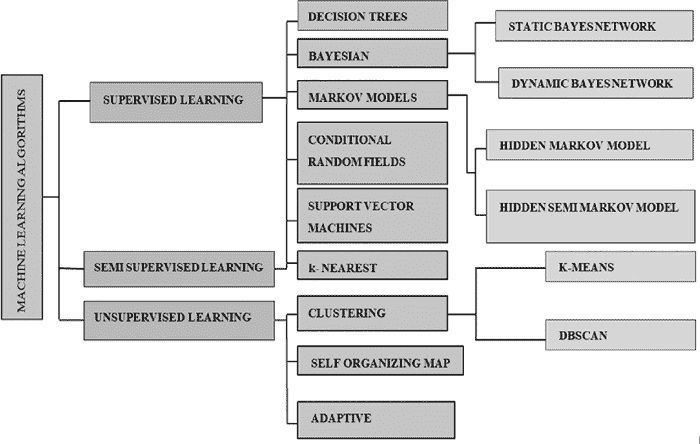

**图 3.1** 机器学习算法的类型。

### 3.1.1 监督学习

系统被赋予示例数据输入及其期望输出，由教育者提供，目标是学习输入到输出的一般映射规则。图 3.2 显示了标记数据和未标记数据的划分以获得学习方法 [1]。

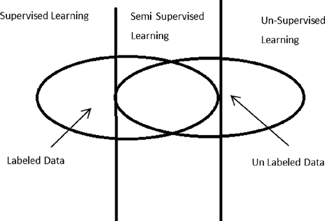

**图 3.2** 标记数据和未标记数据的划分。

### 3.1.2 无监督学习

在这种学习中，学习算法未指定标签，使其能够独立地在输入中发现结构。无监督学习本身就是一个目标，通过揭示数据中的隐藏模式，或作为通往最终目标——特征学习的一种手段 [2]。

### 3.1.3 强化学习

在这种学习中，系统与实时环境交互，需要完成特定目标。当系统在问题空间中导航时，会根据其在问题空间中的导航情况提供以奖励和惩罚形式进行的评估 [3]。

### 3.1.4 半监督学习

在监督学习和无监督学习之间存在半监督学习；在此，教育者提供不充分的训练信号：缺少部分目标输出。

## 3.2 监督学习方法

应用机器学习实践的主流是监督学习。算法用于研究从输入到输出的映射函数，其中 `x` 为输入变量，`Y` 为输出变量，如公式 3.1 所示。这里学习者被赋予标记的输入数据。数据包含输入对和输出对的序列。学习者的意图是了解从输入数据到输出数据的映射过程。如果输出数据是离散数据，则函数 `Y` 被称为分类器；如果输出数据是连续的，则为回归函数。

`Y = f(x)`

(3.1)

目标是通过输入数据 (`x`) 来估计映射函数，以预测这些数据的输出变量 (`Y`)。监督方法也被称为监督学习的原因是，在数据集训练后，算法学习过程模仿了监督学习方法的一位教师。学习在算法达到可接受的性能水平时停止 [4, 5 和 6]。

每个监督机器算法都以预先定义好的标签集 `C` 为中心，训练集 `T` 由分配了一个或多个来自 `C` 的标签的文章组成。算法使用 `C` 和 `T` 来训练模型，并将模型应用于对未标记文章进行分类。

在模型中，对训练集 `T` 进行处理并根据分类法 `C` 构建分类模型。该方法包括三个阶段，将作者、关键词和期刊与 `C` 中的一个或多个标签相关联。记录的多个频率值随后被分类算法用于有效控制未分类论文的标签。研究文章的主流包含置于摘要和引言之间的一组关键词。因此，标题中出现的词语也被视为文档信息的代表，可用于训练模型。

考虑训练集 `T` 中属于 `P` 的论文 `p`，其包含关键词 `K[p]`，并被标记为属于 `C` 的一个或多个研究领域 `C[p]`。目标是建立 `p` 的每个关键词与研究领域 `C[p]` 之间的相关性。由于关键词 `k` 可能出现在属于不同研究领域的众多论文中，因此引入了类似于 `k-NN` 算法的算法。这是通过构建 (`k`, `c`) 对获得的，我们将其存储在显著性解释向量 `K` 中。通过计算两个频率值 `|P[k]|` 和 `|P[k][, c]|`，前者表示包含关键词 `k` 的论文数量，而后者表示包含 `k` 并被映射到领域 `c` 的论文数量。该算法展示了训练 `K` 的重要步骤。对于训练集中的每篇论文 `p`，识别所有研究领域 `C[p]` 和关键词 `K[p]` 是一项更大的任务。为属于 `C[p]` 的每个研究领域 `c` 创建 (`k`, `c`) 对 [7, 8, 9 和 10]。文章分类中模型训练的算法如下所示：

```
1. Initialize K, A, J
2. for each paper p ∈ T
3. C^P ← ExtractResearchAreas(p)
4. Phase 1: Processing of the keywords
5. K^P ← ExtractKeywords (p)
6. for each keyword k ∈ K^P
7. |P^k|←|P^k|+1
8. for each research area c ∈ C^P
9. Create pair (k, c)
10. if K.search (k, c) =false
11. K.insert(k, c)
12. |P k, c|←1
13. else
14. |P^( k,c)|←|P^( k,c)|+1
15. Phase 2: Processing of the authors
16. AP ← ExtractAuthors (p)
17. for each author a ∈ A^p
18. |P^a|←|P^a|+1
19. for each research area
20. c ∈ C^p
21. Create pair (a, c)
22. if A.AP.search(a, c) = false
23. A.AP.insert (a, c)
24. |P^(a,c)[AP]|← 1
25. else
26. |P^(a,c)[AP]|← |P^(a,c)[AP]|+ 1
27. for each author a⁰ ∈ A^p
28. Create tuple (a, a⁰, c)
29. If A.AA.search (a, a⁰, c) = false
30. A.AA.insert(a, a⁰, c)
31. |P^(a,c)[AA]|← 1 else
32. |P^(a,c)[AA]|← |P^(a,c)| + 1
33. Phase 3: Processing of the journals
34. J ← Extract Journal (p)
35. |P^j|← |P^j| + 1
36. for each research area c ∈ C^p
37. Create pair (j, c)
38. if Search(j, c) =false
39. J .insert (j, c)
40. |P^j^(,c)|← 1
41. Else
42. |P^j^(,c)|← |P^j^(,c)| +1
```

纳入监督 ML 方法的阶段如 图 3.3 所示。

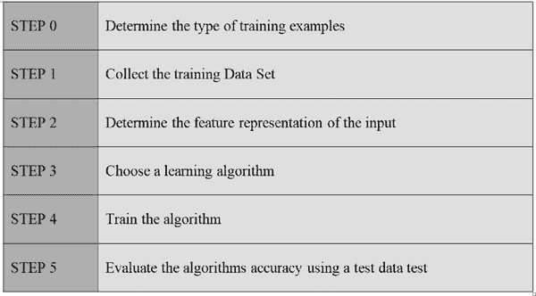

**图 3.3** 监督 ML 方法的阶段。

构建 ML 模型的六个主要步骤是数据收集、选择成功度量，随后设置评估协议、准备数据，随后开发基准模型、开发良好模型并调整其超参数。

监督学习问题被分为回归问题和分类问题。

### 3.2.1 分类问题


在分类问题中，输出变量是一个类别。它涉及将数据汇集到类中。在一个组织中，如果需要对某人进行绩效评估，则使用分类来判断他是否是最合适的评估接受者。考虑了两种类型的分类，称为二元分类和多分类。在二元分类中，监督学习算法将输入数据标记为两个不同的类别。将数据划分为两个以上类别被称为多分类。

### 3.2.2 回归问题

在回归问题中，输出变量是一个实际值。在回归中，使用训练数据会生成一个单一的输出值。这些数据是一种概率性澄清，是在看到输入数据之间关联的强点后确定的。回归有助于根据房屋的大小、位置等预测房屋价格。推荐和时间序列预测是建立在分类和回归之上的一般性难题类型。基于一组自变量的输出数据的离散值被称为逻辑回归。该过程在处理非线性和众多决策边界时可能会失效。它没有足够的灵活性来捕捉数据集中的复杂关联。

以下是监督机器学习算法的几个示例：

* 用于解决回归问题，使用线性回归。
* 用于解决分类和回归问题，使用随机森林。
* 用于解决分类问题，使用支持向量机。

在监督者的存在下，监督学习涉及机器学习算法的使用。正确的指导方向提供适当的反馈，因此被称为在监督下学习。监督学习参考了各种方法类别 \[11, 12, 13 和 14\]。训练或教授算法使用信息数据并通过与数据相关的标签来指导模型。作为人类，会消耗更多信息或数据，但这些数据点的注意却不会发生。当展示一只鸟的图像时，可以立即根据之前的经验知道这只鸟是什么。如果学习者不能立即识别出这只鸟，情况就会发生变化。

当学习者做出猜测并预测这只鸟可能是哪一种时，就提供了对学习者正确或错误答案进行定量评估的机会。这很可能是因为它具有输入的正确标签。

机器学习算法通常被称为模型。如果模型给出正确的响应，则无需做任何事。只有当模型的响应不正确时，才会出现工作。工作是在模型响应不正确时修正模型。

如果这种情况持续下去，模型需要进行必要的更新。如果展示母鸡图像，它能以正确的方式识别它。输入变量 `x` 和输出变量 `y` 的存在以及算法的使用有助于学习相对于输入和输出的表示函数。输出 `y` 被表示为输入 `x` 的因变量，如公式 3.2 所示。

`Y = f(x)`

(3.2)

对映射函数 (`f`) 的近似导致通过输入数据 `x` 预测输出变量 (`y`)（图 3.4）。

![图 3.4 近似映射函数 \[参见 参考文献 15\].](images/Fig03_04.jpg)

**图 3.4** 近似映射函数 \参见 [参考文献 15\]。

### 3.2.3 监督学习示例

机器学习模型学习拟合输入示例与其相关标签之间的关系。当模型对这些示例足够熟练时，就会对未见数据进行新的预测。

预测标签可以是数字和类别。例如，如果预测房屋价格，则结果是一个数字，从而产生回归模型。如果我们预测一封电子邮件是否为垃圾邮件，则结果是一个类别，从而产生分类模型 \[16, 17 和 18\]。

> **示例：房屋价格**
>
> 预测房屋价格是一项更大的任务，其中包括机器学习过程。描述房屋完整信息的属性或信息包括房间数量、平方英尺、特征、房屋是否有更多房间等等。相应的标签可以通过利用来自众多房屋、其特征和价格的数据来得知。因此，训练监督机器学习模型可以根据模型感知到的先前示例预测新房屋的价格。
>
> **场景：猫还是狗？**
>
> 在计算机视觉领域，图像分类是一个重要问题。意图是预测图像属于哪个类别。在多个问题中，目标是找到图像的类别标签。该图像表示猫的图像还是狗的图像？
>
> **场景：天气状况？**
>
> 考虑各种参数预测特定地点的天气是一项艰巨的任务。为了做出正确的天气预报，有必要考虑众多参数以及历史温度数据、降水、风和湿度。它被视为一个有趣且极具挑战性的问题，需要通过开发包含多项任务的复合监督模型来开发正确答案。每次预测温度都是一个回归问题，其中输出标签是连续变量。通过发散预测它，是否成功知道是否下雪是一个二元分类问题？
>
> **示例：文本分类**
>
> 数据点被视为注释中有意义的结构和模式。无监督学习通常被用于寻找数据中固有的显著模式和分组、挖掘生成特征以及调查目的 \[19,20\]。

## 3.3 无监督学习方法

在无监督方法中，输入数据 `x` 将存在，而相应的输出变量将不存在。在某些模式识别问题中，数据的训练由一组输入向量 `x` 组成，而没有一致的目标值。无监督学习问题的意图可能是找到数据中冗余示例的组，这被称为聚类，或找到数据在空间中的分布方式，称为密度估计

无监督学习的目的是理想地学习数据的根本构造或分布，以便了解数据。与监督学习相比，它具有不同的特征，因为它没有教育者或监督者。算法被允许通过赋予信息中有趣的结构来实现其计划。


## 3.3 无监督学习

收集和积累标记数据受资源限制，且耗时。在无监督学习中，实现准确标记非常困难。在无监督学习中，学习者被提供未标记的输入数据是一个前提。对于新的数据实例，学习者的意图是找到信息中的固有模式，以用于找到正确的输出信息。假设输入空间具有结构；因此，某些模式比其他模式更常出现，这在统计学中被称为密度估计 \[21,22\]。无监督学习技术在传感器网络应用中非常有用。传感器网络应用通常在可变且不断变化的环境中组织。图 3.5 显示了机器学习中的聚类。

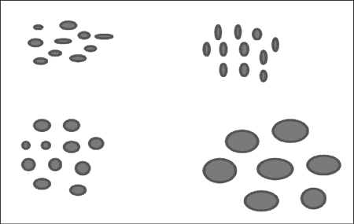

**图 3.5** 机器学习中的聚类。

无监督学习方法可分为聚类问题和关联问题。

* **聚类问题**：发现特定数据中的固有群体被称为聚类问题。例如，购买行为特别与聚类问题相关。
* **关联**：关联是指学习问题中发现规则定义信息或数据的大部分。

以下是无监督学习算法的良好示例：

* `k-means` 用于聚类问题。
* Apriori 算法用于关联规则学习问题。

### 3.3.1 无监督学习的示例

以下是不同无监督学习方式的说明。

> **示例：发现客户细分**
>
> 聚类是一种无监督方法，其意图是在特征空间中找到自然群体或簇并推断输入数据。它包含许多类型的聚类过程。一种常见的方法是将数据点划分为每个数据点落入与同一组中其他数据点相似的组，具体取决于特征空间中预定义的相似性或分离度量。聚类经常用于在营销数据中定义客户细分。营销团队成员以不同方式接触客户细分以找到不同类别的客户。性别、位置、教育、年龄、收入等是考虑的特征。

> **示例：降低问题的复杂性**
>
> 降维是一种常用的无监督学习方法；这里的目标是减少关注的随机变量数量。具有众多实际应用，降维最常见的用途是通过将特征空间映射到低维空间来克服问题的复杂性。因此，机器学习系统中测量的相关变量更少。PCA 和 t-SNE 以及 UMAP 是最常用的算法 \[23, 24 和 25\]。主要来说，这些方法有利于降低问题的复杂性，并以更好的方式可视化数据示例。

> **示例：特征选择**
>
> 尽管特征选择和降维旨在减少特征唯一集合中的特征数量，了解特征选择的工作原理，有助于更好地理解降维。考虑银行系统的例子，其中个人想要贷款，银行必须预测个人是否有能力偿还贷款。因此，要智能地了解这一点，银行应配备机器学习系统，以便银行可以向只能偿还贷款金额的贷款申请人提供贷款。这需要关于每个客户申请的巨大信息来做出假设。机器学习数据库中最重要的属性应为申请人的平均月收入、借记账户和信用历史。有时观察到申请期间收集的信息不包含所有必要文件 \[26, 27 和 28\]。某些属性与是否偿还无关；例如，个人的年龄、性别和教育程度无关紧要。在这里，特征选择通过减少不太重要信息的使用来删除不重要的属性并添加最重要的、最有帮助的属性。

## 3.4 半监督学习方法

在这种学习中，大量输入数据 `x` 和仅部分输出数据 `y` 存在；此类学习问题称为半监督学习。它们存在于监督学习和无监督学习之间。在动物照片集合中，少数动物图片被标记，例如猫、狗，而主流则是未标记的。大多数现实世界的 ML 问题属于这一领域。领域专家标记数据，这需要更多时间和时间消耗。因此，标记数据比未标记数据更昂贵。未标记数据易于在收集时存储，因为它们不需要专家，因此时间和成本更少。利用无监督学习方法来发现并学习输入数据中的结构 \[29, 30 和 31\]。监督学习方法也用于预测未标记数据或信息并将其反馈作为训练数据输入监督学习方法。此模型可用于预测未见信息或数据。

监督学习程序的一个重要缺点是，考虑数据集的机器学习工程师或数据科学家必须进行手工标记程序。在处理大型数据集时，该程序成本高昂。应用范围的限制是监督方法的重大弱点。为了克服这些缺点，引入了半监督学习。特征上，标记数据和未标记数据的组合包含少量标记数据和更多未标记数据。涉及的基本步骤是，首先程序员将通过无监督学习算法对相似数据进行分组，最后使用现有的标记数据对剩余的未标记数据进行标记。它们共同的特性是，未标记数据的获取成本相对较低，而标记数据的成本非常高。

半监督算法中的数据假设如下。

在连续性假设算法中，假设彼此更近的点获得相同的输出标签。

在聚类假设算法中，数据可以断开为离散簇，同一簇中的事实更有可能属于输出标签的一部分。

## 3.5 二分类

有两个类别，叉号和圆圈，具有两个特征 `x[1]` 和 `x[2]`。为了在模型中估计其所属类别，找到每个数据点的特征与其特定类别之间的关联，并在两者之间保持边界线，以便通过提供新数据，可以评估其适合的类别（图 3.6）。

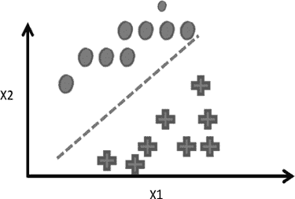

**图 3.6** 二分类。

在上述场景中，新数据落入圆子空间，因此模型将预测其属于圆类。

### 3.5.1 不同类别


值得注意的是，并非所有分类模型都能够有效地区分数据集中不同类别。在某些情况下，类别无法通过线性决策边界区分，如图 3.7 所示。

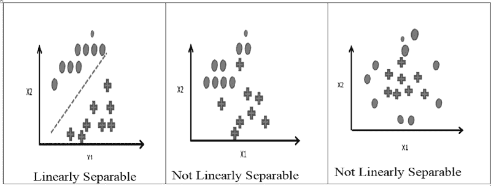

**图 3.7** 不同可分离性。

### 3.5.2 分类准备

实际上，建议尝试并结合多种算法组合，以便选择最适合解决问题的方案。此过程将受到可用数据、特征和样本数量、不同类别以及它们是否线性可分等因素的很大影响。

接下来，我们将探索不同的分类算法，并学习哪一种更适合执行每项任务。

#### 3.5.2.1 逻辑回归模型

当算法在权重评估过程中无法收敛但仍合格时会出现分类问题。当线性分离不可行时，逻辑回归便被引入 [32, 33 和 34]。为了解决二分类问题，使用逻辑回归。线性可分的类别通过 `OvR` 技术扩展到多分类。

#### 3.5.2.2 优势比

通过优势比可以更好地理解逻辑回归的概念。优势比是理解逻辑回归思想的重要概念。某事件发生的概率可由优势比得知。其可写为如下形式：

`Odds Ratio = prp/(1−prp)`

`prp` = 正事件的概率

#### 3.5.2.3 Logit 函数

`lfp = log(prp/1 − prp)`

`lfp = log(Odds Ratio)`

对数几率是对数优势比，称为 logit 函数。该函数接受 0 到 1 之间的数值，并将其从二元范围转换为从 −∞ 到 +∞ 的实数范围。对数几率与特征值之间的关系可用线性表达式表示

`logit(prp(y=1|x)) = w[0]x[0] + … + w[m]x[m] = sum(w[i]x[i]) = w[t]x`

`prp(y = 1|x)` 是给定特征 `x` 属于类别 1 的条件概率。

#### 3.5.2.4 Sigmoid 函数

Sigmoid 函数的表达式为

$$\phi\left( z \right) = \frac{1}{1 + e^{- z}}$$

该表达式通常称为 sigmoid 函数，是 logit 函数的逆。净输入用 `z` 表示 [35, 36 和 37]。样本特征与权重的线性组合表示为

`z = w^(t)x = w[0] + w[1]x[1] + … + w[m]x[m]`

`z` 与 Ф(`z`) 的图形表示如图 图 3.8 所示。

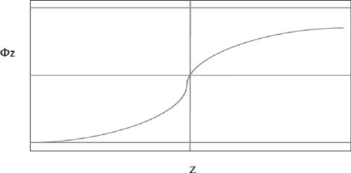

**图 3.8** z 与 Ф(`z`) 的关系图。

Ø(`z`) 当属性 `z` 从 −∞ 变化到 +∞ 时，从二值 0 变化到 1（图 3.9）。

![图 3.9 净输入函数、sigmoid 函数和量化器 \[38,39\]。](images/Fig03_09.jpg)

**图 3.9** 净输入函数、sigmoid 函数和量化器 [38,39]。

在逻辑回归中，sigmoid 函数的输出被理解为在特征 `x` 受权重 `w` 限制的情况下，某个特定样本属于类别 1 的概率，如

`Φ(z) = P(y=1|x; w)`

预测的可能性可通过单位阶跃函数作为量化器恢复为二元结果

$$\overset{\frown}{y} = \left\{ \begin{matrix} {1\,\,\,\,\,\quad\text{if}\,\phi\left( z \right) \geq 0.5} \\ {0\,\,\,\,\quad\quad\text{otherwise}} \\ \end{matrix} \right.$$

根据图示，等价为

$$\overset{\frown}{y} = \left\{ \begin{matrix} {1\,\,\,\,\,\quad\text{if}\, z \geq 0.5} \\ {0\,\,\,\,\,\,\quad\text{otherwise}} \\ \end{matrix} \right.$$

#### 3.5.2.5 支持向量机

`SVM` 被认为是感知器算法的改进。优化目标是设置一条决策线，通过增加该线与靠近超平面的样本数据之间的间隔来分割类别，如 图 3.10 所示。这些数据点被称为支持向量 [39, 40, 41 和 42]。

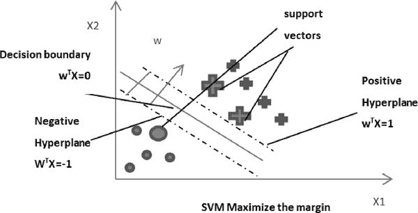

**图 3.10** SVM 最大化间隔。

#### 3.5.2.6 最大间隔线

为了设置极值间隔，会添加两条平行线（间隔），并最大化到原始决策线的距离。错误或被误分类的点（错误）、间隔与线之间的点将被考虑。大间隔决策线倾向于具有较低的总体误差。换句话说，具有小间隔的模型更不容易过拟合 [43, 44, 45, 46, 47, 48, 49, 50, 51, 52, 53, 54, 55, 56, 57 和 58]。

最大化函数的计算如下：

$$\begin{array}{l} {w_{0} + w^{T}\\, x_{\text{pos}} = 1} \\ {w_{0} + w^{T}x_{\text{neg}}\,\, = - 1} \\ \end{array}$$

表达式相减得到

`⇒ w^(T)(x[pos]−x[neg])=2`

向量 w 的长度，

$$\left\| w \right\| = \sqrt{\sum\limits_{j = 1}^{m}{w^{2}{}_{j}}}$$

该过程导致间隔误差表达式

$$\frac{w^{T}\left( {x_{\text{pos}} - x_{\text{neg}}} \right)}{\left\| w \right\|} = \frac{2}{\left\| w \right\|}$$

`x[pos]` 是正超平面，`x[neg]` 是负超平面。在上述表达式中，间隔已得到改进。实际上，通过最小化倒数项可以获得二次规划的解

$$\text{Margin} = \frac{1}{2}\left\| w \right\|^{2}$$

表 3.1 描述了有监督学习和无监督学习方法的比较。

**表 3.1**有监督与无监督方法的比较

| 参数 || 有监督学习方法 || 无监督学习方法 |
| --- | --- | --- |
| 过程 || 在有监督学习模型中，存在输入和输出变量 || 在无监督学习模型中，仅存在输入数据 |
| --- | --- | --- |
| 输入数据算法使用 || 使用标记数据训练算法 SV/VI、神经网络、线性与逻辑回归、随机森林和分类树 || 算法用于未标记的数据 无监督算法可分为不同类别：聚类算法、`K`-means、层次聚类等。 |
| 计算复杂度 || 有监督学习是一种更简单的方法 || 无监督学习计算复杂 |
| 数据使用结果准确性实时学习 || 有监督学习模型使用训练数据学习输入与输出之间的关联 高度准确且可靠的方法 学习方法离线进行 || 无监督学习不使用输出数据 准确性较低且可信度较低的方法 学习方法实时进行 |


| 类别数量 | 主要缺点 |
|---|---|
| 类别数量已知 | 在监督学习中，对大数据进行分类可能是一个真正的挑战 |
| 类别数量未知 | 由于无监督学习中使用的数据是标记的且未知，因此无法获得有关数据排序和输出的精确信息 |

## 3.6 结论
在监督学习中，机器的训练使用标记数据进行。在无监督机器学习技术中，模型需要被监督。监督学习允许从先前的经验中收集数据或产生输出数据。在无监督机器学习中，数据中会发现各种未知模式。天气条件、时间以及节假日是需要考虑的一些标准，以便返回家中。另一个例子是使用过去的监督学习方法识别未知狗。回归、分类、聚类和关联是学习技术的子类别。机器被训练在各个领域执行活动，以便使人类工作更轻松，节省时间。如果数据量较少，并且包含用于训练的标记数据，则选择监督学习。在无监督学习中可以获得更好的性能，因为它可以容纳新条目并产生大型数据集。总之，在所选机器学习模型的发展中，有必要考虑各种 IDE、开发语言和平台。

## 参考文献
1.  S. Theodoridis and K. Koutroumbas, 《模式识别》, 第 4 版 (Academic Press, ISBN 978-1-59749-272-0, 2009).
2.  S. Theodoridis and K. Koutroumbas, 《模式识别导论：Matlab 方法》. (Academic Press, ISBN 978-0-12-374486-9, 2010).
3.  K. P. Murphy, 《机器学习：概率视角》. (The MIT Press, ISBN 978-0-262-01802-9, 2012).
4.  F. Hu and Q. Hao, 《智能传感器网络：传感器网络、信号处理和机器学习的融合》. (CRC Press, ISBN 978-1-4398-9282-4, 2013).
5.  S. Gannot, E. Vincent, S. Markovich-Golan, and A. Ozerov, “多麦克风语音增强和源分离的综合视角，” IEEE Trans. Audio Speech Lang. Process. 25(4), 692–730 (2017).
6.  E. Vincent, T. Virtanen, and S. Gannot, 《音频源分离与语音增强》(Wiley, New York, 2018).
7.  D. K. Mellinger, M. A. Roch, E.-M. Nosal, and H. Klinck, “信号处理，” in 《在海洋中聆听》, edited by W. W. L. Au and M. O. Lammers (Springer, Berlin, 2016), Chap. 15, pp. 359–409.
8.  K. L. Gemba, S. Nannuru, and P. Gerstoft, “稀疏贝叶斯学习下的鲁棒海洋声学定位，” IEEE J. Sel. Top. Sign. Process. 13(1), 49–60 (2019).
9.  H. Niu, E. Reeves, and P. Gerstoft, “使用监督机器学习的海洋波导中源定位，” J. Acoust. Soc. Am. 142(3), 1176–1188 (2017).
10.  P. Gerstoft and D. F. Gingras, “使用浅水多频程相关声学数据的参数估计，” J. Acoust. Soc. Am. 99(5), 2839–2850 (1996).
11.  F. B. Jensen, W. A. Kuperman, M. B. Porter, and H. Schmidt, 《计算海洋声学》. (Springer Science & Business Media, New York, 2011).
12.  J. Traer and J. H. McDermott, “自然混响的统计特性使声音和空间的感知分离成为可能，” Proc. Natl. Acad. Sci. 113(48), E7856–E7865 (2016).
13.  M. I. Jordan and T. M. Mitchell, “机器学习：趋势、视角和前景，” Science 349(6245), 255–260 (2015).
14.  Y. LeCun, Y. Bengio, and G. E. Hinton, “深度学习，” Nature 521(7553), 436–444 (2015).
15.  Q. Kong, D. T. Trugman, Z. E. Ross, M. J. Bianco, B. J. Meade, and P. Gerstoft, “地震学中的机器学习：将数据转化为洞察，” Seismol. Res. Lett. 90(1), 3–14 (2018).
16.  K. J. Bergen, P. A. Johnson, M. V. de Hoop, and G. C. Beroza, “用于固体地球地球科学数据驱动发现的机器学习，” Science 363, eaau0323 (2019).
17.  C. M. Bishop, 《模式识别与机器学习》. (Springer, Berlin, 2006).
18.  K. Murphy, 《机器学习：概率视角》, 第 1 版. (MIT Press, Cambridge, MA, 2012).
19.  Y. Bengio, A. Courville, and P. Vincent, “表示学习：综述与新视角，” IEEE Trans. Pattern Anal. Mach. Intell. 35(8), 1798–1828 (2013).
20.  Y. B. Goodfellow, A. Courville, and Y. Bengio, 《深度学习》, 第 1 卷. (MIT Press, Cambridge, 2016).
21.  R. A. Fisher, “分类学问题中多重测量的使用，” Ann. Eugen. 7(2), 179–188 (1936).
22.  J. G. Proakis and M. Salehi, 《通信系统工程》. (Prentice-Hall, Englewood Cliffs, NJ, 1994).
23.  B. Widrow and E. Walach, 《自适应逆控制》. (Prentice-Hall, Upper Saddle River, NJ, 1996).
24.  R. W. Lucky, “数字通信系统自适应均衡技术，” Bell Sys. Tech. J., 45, 255–286 (1966).
25.  D. E. Borth, I. A. Gerson, J. R. Haug, and C. D. Thompson, “一种灵活的自适应 FIR 滤波器 VLSI IC.” IEEE J. Sel. Areas Commun., 6(3), 494–503 (1988).
26.  S. U. H. Qureshi, 《自适应均衡》. Proc. IEEE, 73(9), 1349–1387 (1985).
27.  K. Murano, S. Unagami, and F. Amano, “回声消除及应用，” IEEE Commun. Mag., 28(1), 49–55 (1990).
28.  M. El-Sharkawy, “设计 自适应 FIR 滤波器并在 DSP56002 处理器上实现它们，” in 《数字信号处理应用与 Motorola 的 DSP56002 处理器》, pp. 319–342. (Prentice-Hall, Upper Saddle River, NJ, 1996).
29.  J. MacQueen, “一些 方法用于分类和多元观测分析，” 《第五届伯克利数学、统计学和概率研讨会论文集》, 第 1 卷, 第 14 期, pp. 281–297 (1967).
30.  F. Rosenblatt, 《神经动力学原理。感知器与大脑机制理论》. (Cornell Aeronautical Lab, Inc., Buffalo, NY, 1961).
31.  D. E. Rumelhart, G. E. Hinton, and R. J. Williams, “通过反向传播误差学习表征，” Nature 323, 533–536 (1986).
32.  T. Hastie, R. Tibshirani, and J. Friedman, 《统计学习基础：数据挖掘、推断与预测》, 第 2 版. (Springer, Berlin, 2009).
33.  R. O. Duda, P. E. Hart, and D. G. Stork, 《模式分类》. (Wiley, New York, 2012).
34.  I. Cohen, J. Benesty, and S. Gannot, 《现代通信中的语音处理：挑战与展望》, 第 3 卷. (Springer Science & Business Media, New York, 2009).
35.  M. Elad, 《稀疏与冗余表示》. (Springer, New York, 2010).
36.  J. Mairal, F. Bach, and J. Ponce, “图像和视觉处理的稀疏建模，” Found. Trends Comput. Graph. Vis. 8(2–3), 85–283 (2014).
37.  D. H. Wolpert and W. G. Macready, “优化的无免费午餐定理，” IEEE Trans. Evol. Comput. 1(1), 67–82 (1997).
38.  L. V. D. Maaten and G. Hinton, “使用 tSNE 可视化数据，” J. Mach. Learn. Res. 9(Nov), 2579–2605 (2008).
39.  I. Tošić and P. Frossard, “字典学习，” IEEE Signal Process. Mag. 28(2), 27–38 (2011).


40.  R. Kohavi, “一种 研究交叉验证和自助法用于准确率估计和模型选择， Proc. Int. Joint Conf. Artif. Intel. 14(2), 1137–1145 (1995).

41.  A. Chambolle, “一种 算法用于全变分最小化及其应用， J. Math. Imag. Vision 20(1–2), 89–97 (2004).

42.  Z. Ghahramani, “概率 机器学习与人工智能， Nature 521(7553), 452–459 (2015).

43.  Z.-H. Michalopoulou and P. Gerstoft, “多径宽带定位、测深和沉积物反演， IEEE J. Oceanic Eng. 45, 92–102 (2019).

44.  K. L. Gemba, S. Nannuru, P. Gerstoft, and W. S. Hodgkiss, “用于鲁棒匹配场处理的频多稀疏贝叶斯学习， J. Acoust. Soc. Am. 141(5), 3411–3420 (2017).

45.  S. Nannuru, K. L. Gemba, P. Gerstoft, W. S. Hodgkiss, and C. F. Mecklenbr€auker, “多字典稀疏贝叶斯学习， Sign. Process. 159, 159–170 (2019).

46.  Gelman, H. S. Stern, J. B. Carlin, D. B. Dunson, A. Vehtari, and D. B. Rubin, 贝叶斯数据分析. (Chapman and Hall/CRC, New York, 2013).

47.  R. C. Aster, B. Borchers, and C. H. Thurber, 参数估计与反问题, 2nd ed. (Elsevier, San Diego, 2013).

48.  P. Gerstoft, A. Xenaki, and C. F. Mecklenbr€auker, “多快拍和单快拍压缩波束形成， J. Acoust. Soc. Am. 138(4), 2003–2014 (2015).

49.  R. Tibshirani, “回归 收缩和选择 via the lasso， J. R. Stat. Soc., Ser. B 58(1), 267–288 (1996).

50.  E. Candes, “压缩 采样， Proc. Int. Cong. Math. 3, 1433–1452 (2006).

51.  P. Gerstoft, C. F. Mecklenbr€auker, W. Seong, and M. Bianco, “声学中压缩感知的介绍， J. Acoust. Soc. Am. 143(6), 3731–3736 (2018).

52.  K. Hornik, “多层 前馈网络的逼近能力， Neural Netw. 4(2), 251–257 (1991).

53.  D. P. Kingma and J. L. Ba, “Adam: 一种随机优化方法， Proceedings of the 3rd International Conference for Learning Representations, arXiv:1412.6980 (2014).

54.  D. D. Lee and H. S. Seung, “非负矩阵分解算法， Adv. Neural Inf. Process. Syst. 13, 556–562 (2001).

55.  J. Alzubi, A. Nayyar, and A. Kumar, “从理论到算法的机器学习：概述， Journal of Physics: Conference Series 1142(1), 012012 (2018).

56.  V. Anavangot, V. G. Menon, and A. Nayyar, “信号物联网中的分布式大数据分析， 2018 International Conference on System Modeling & Advancement in Research Trends (SMART). IEEE, Moradabad, India, pp. 73–77 (2018, November).

57.  S. S. Maram, N. Kumar, J. J. P. C. Rodrigues, S. Tanwar, and A. Jain, “从图像到信号，从信号到亮点， IEEE Global Communications Conference (GLOBECOM-2020), Taipei, Taiwan, 7–11 December 2020, pp. 1–6 (2020).

58.  J. Vora, M. Patel, S. Tanwar, and S. Tyagi, “基于图像处理的垂直墙面裂缝分析， IEEE 3rd International Conference on Internet of Things: Smart Innovation and Usages (IoT-SIU 2018), BIAS, Bhimtal, Nainital, Uttarakhand, India, 23–24 February, 2018, pp. 1–5 (2018).

# 4 信号处理的应用

Anuj Kumar Singh and Ankit Garg

Amity University

DOI: [10.1201/9781003107026-4](https://doi.org/10.1201/9781003107026-4)

## 4.1 引言

机器学习技术倾向于使机器从先前存储的信息和新的环境中自行学习。持续学习的目的是改进系统以获得更好的结果。机器学习算法可分为监督学习算法、无监督学习算法和强化学习算法。监督学习算法可进一步分为分类和回归算法，而聚类和关联是无监督学习的两个子类别 \[1\]。各种现代计算系统通常执行某种信号处理以提高信号的效率、质量和传输。信号处理获取、解释、说明并修改系统的物理现象。信号处理中的概率、统计学、数学和随机过程用于解释和建模系统的物理现象以提取关键信息。当然，机器学习算法可以提高该过程的有效性，这得益于其众多优势，包括易于模式识别、无需人工干预、持续改进以及处理多维多变数据的能力。在本章中，讨论了十种信号处理应用，这些应用现在在不同的计算环境中被大量使用，并且也利用了机器学习方法。具体而言，强调了机器学习方法在音频信号处理、音频压缩、数字图像处理、视频压缩、数字通信、医疗保健、地震学、语音识别、计算机视觉和经济预测中的应用。

## 4.2 音频信号处理

作为一种物理过程，语音或声音可以描述为分子的振动，通常会改变某些介质（如空气）特定区域的压力。这些振动的测量由一种称为麦克风的设备进行，其中膜片由于压力变化而被迫移动。膜片的这种运动随后使用磁铁和音圈转换为电压信号。该电压信号由膜片产生是一个连续信号，在任何时刻都取某个定义值 \[2\]。典型的音频处理系统如图 图 4.1 所示。

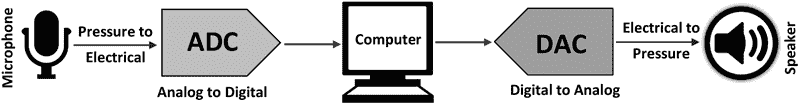

**图 4.1** 一个典型的音频处理系统。

由于内存有限，计算机系统只能存储代表有限数值的有限值。因此，必须记录无限次出现的无限数量的数字，即必须进行模拟值到数字值的转换。此外，从数字信号重建模拟信号也必须可行。整个过程包括几个阶段，称为采样、量化和重建。模数转换器（ADC）是一种对模拟信号进行采样和量化的设备并产生数字信号，而数模转换器（ADC）执行重建并从数字信号产生模拟信号。

### 4.2.1 音频信号处理中的机器学习

音频信号处理中机器学习模型的发展需要对音频信号特征有清晰的理解。特征可以描述为“现象的可测量属性和特征”。特征非常重要，因为利用特征，机器可以理解数据，将其分类到不同类别，并进行预测 \[3\]。在本节中，讨论了可在音频处理和机器学习中利用的音频特征。

#### 4.2.1.1 频谱和倒谱


频谱和倒谱是音频信号处理的两个重要属性。从数学上讲，音频信号的频谱是通过计算其傅里叶变换得到的，傅里叶变换将时域信号转换为频域信号。换句话说，利用频谱，音频信号在频域中表示。为了形成倒谱，首先计算频谱的对数幅度，然后计算该对数幅度的逆傅里叶变换。这是一个既不在时域也不在频域的信号。创建音频信号的频谱和倒谱的步骤如图 图 4.2 所示。

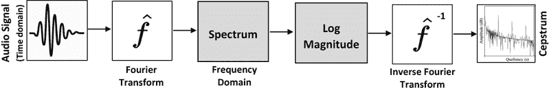

**图 4.2** 创建音频信号的频谱和倒谱的步骤。

考虑音频信号频率的基本原因与耳朵听觉过程的生物学相关。耳蜗是人耳的一部分，充满液体，内部含有数千根与神经相连的微小毛发。这些毛发的长度各不相同，长度较短的毛发与较高频率共振，而长度较长的毛发与较低频率共振。空气压力的时域信号被转换为频率频谱，然后由大脑处理。这样，人耳可以被视为一种天然的傅里叶变换分析仪。

#### 4.2.1.2 梅尔频率倒谱系数

人类听觉的一个事实是，如果声音频率超过 1 kHz，人耳对频率的选择性会降低。这与梅尔滤波器组相似。梅尔倒谱可以通过将频谱输入梅尔滤波器组，然后对结果取对数幅度并进行离散余弦变换（DCT）来产生。该过程在 图 4.3 中演示。DCT 获取了音频摘要的重要信息和峰值。通常，MFCC 是从梅尔倒谱中获得的前十三个系数。MFCC 包含有关音频信号的宝贵信息，因此它们被用于训练机器学习模型。

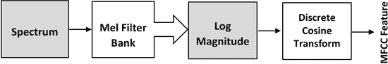

**图 4.3** 生成 MFCC 的过程。

#### 4.2.1.3 伽马音频率倒谱系数

伽马音滤波器组是另一个与人类听觉过程密切相关的滤波器。它提供了耳蜗的模拟，可应用于音频处理的各种应用中。为了生成 GFCC，我们必须将频谱通过伽马音滤波器组。之后，结果会被下采样/压缩，然后进行 DCT 计算。GFCC 特征由最初的二十二个特征组成。扬声器识别是 GFCC 的知名应用之一。生成 GFCC 的过程如图 图 4.4 所示。

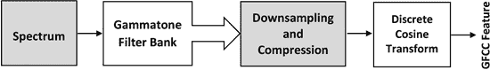

**图 4.4** 生成 GFCC 的过程。

#### 4.2.1.4 构建分类器

构建分类器时，可以利用 GFCC 和 MFCC 的特殊特征，此外，还可以使用 GFCC 和 MFCC 的组合。第一步是将输入音频信号分类到不同的类别中。例如，系统可能会将输入音频分类为音乐、语音、动物等。在下一步中，使用数据集且不进行任何微调，我们可以估计该分类模型检测音频类别的能力。然后，可以应用 GFCC 和 MFCC 等特殊特征进行适当的流派分类。一些流派可能正确，而一些则有改进的可能性。为了进行适当的流派分类，必须考虑以下几点。

* 检查数据质量以确保其足以进行分类。其他特征包括转录或文本。是否最好使用不同的分类器？
* 是否已研究使用神经网络进行分类？

这些特征肯定能从输入音频信号中获取重要信息，机器可以利用这些特征更好地学习并提取有关音频信号的适当信息。

## 4.3 音频压缩

音频压缩是数据压缩的一个非常重要的子领域。在计算机系统上存储音频需要大量内存，因此音频必须在保存在计算机系统上之前进行压缩。此外，由于音频压缩，手机能够以更好的语音进行通信。音频压缩方法在计算机软件中作为音频编解码器实现。音频压缩的应用包括数字电视、电影、DVD 等。最优音频压缩算法可分为有损算法和无损算法。有损压缩算法具有相对更高的压缩率，通常用于压缩实时音频。有损压缩和无损压缩的主要目标都是使用模式识别、编码和预测等不同技术来减少冗余。

### 4.3.1 建模和编码

压缩算法开发的两个主要构建块是建模和编码。在建模阶段，数据中存在的冗余信息使用模型表示。在编码阶段，使用二进制符号对模型的描述进行编码。编码可以以有损格式或无损格式进行。无损格式的编码用于保留媒体源的原始质量。使用其他无损格式进行后续编码可能会导致轻微的退化。

### 4.3.2 无损压缩

几乎所有无损压缩算法所考虑的方法在 图 4.5 中有所说明。在第一步中，使用某种“预测算法”进行信号近似。“预测算法”的参数被选择以产生与输入波相似的波形。然而，尽可能使用最少的位数来表示真实信号与预测波形之间的差异。为了创建样本的正确值，将预测信号加到误差信号上。为了预测后续样本，预测算法会再次基于过去样本和新的预测样本执行 [4]。在信号近似中，信号被分解为高斯函数，这些函数被归一化并线性组合。这倾向于将信号聚焦到更小的维度，因为带宽和采样步长是数据自适应的。这种方法在音频信号处理和许多其他信号处理应用中可能很有用。为了实现标准化、安全、减少空间、速度和保密，使用近似编码器。近似编码器是电路、设备、软件、算法、换能器或人，它将以一种格式或代码表示的信息转换为另一种格式。音频压缩中的错误意味着未知的格式或不受支持的编解码器已被表示。错误编码器将信号近似与输入信号的相加作为输入，然后从错误编码器的输出可以得出编解码器是否受支持。错误数组打包和近似数组打包的组合结果产生压缩信号。

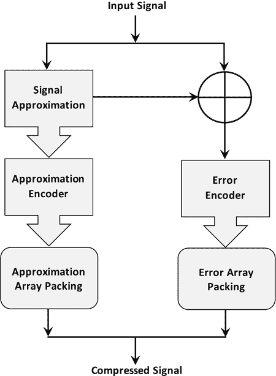

**图 4.5** 无损压缩的方法。

### 4.3.3 有损压缩


在有损压缩中，解压缩后的信号与原始信号不完全相同。会发生信息损失，信号可能会失真。在有损压缩中，压缩率优于无损压缩。为了实现有损压缩，其方法是保持重建质量在一定限度内。同样地，与原始信号的差异和失真在限度内是允许的。对于有损压缩算法，必须使用一些方法来衡量重建质量。由于应用领域多样，正在使用多种方法。对于衡量声音重建质量，可以使用高级音频编码（AAC）、自适应变换声学编码（ATRC）和 Windows Media Audio（WMA）。

### 4.3.4 压缩音频与机器学习应用
在机器学习应用中，为了准确评估模型，必须了解音频数据内部发生了什么。没有关于数据的适当信息，就无法确认模型正在学习什么。对音频数据的理解有许多方面，其中一个突出方面是用于表示压缩音频信号的编解码器。通过分析来自 YouTube 等任何来源的各种音频内容，可以很容易地理解该内容是使用各种编解码器以及不同质量级别编码的。为了利用此音频数据库，必须获得有关编解码器如何与原始音频信号实现的信息，以及这对模型会有什么影响 \[5\]。只有这样，才能正确解释机器学习和训练方法的验证结果。

在用编解码器测试机器学习模型时，可以使用以下三种方法来提高分类质量。
* 还原或去噪原始音频信号。
* 扩展使用受损音频的训练数据。
* 设计并开发对受损音频最鲁棒的属性。

多家软件组织多年来一直在努力开发能够提高音质的编解码器。如果研究人员和专业人员在机器学习模型中使用高质量的非参数编解码器，对他们来说会相对容易，他们还必须确保扩充其训练数据集。

## 4.4 数字图像处理
图像可以定义为二维函数 `F(x, y)`。这里，函数 `F(x, y)` 表示在 `x` 和 `y` 上的幅度，`x` 和 `y` 为空间坐标。幅度 `F` 也称为点 (`x`, `y`) 处的图像强度。当 `F`、`x` 和 `y` 均为有限时，图像称为数字图像。换句话说，图像可以表示为行和列或二维数组。图像由有限数量的小元素组成，称为像素。数字图像处理是数字信号处理的一个领域，其中数字计算机使用特定算法处理图像。数字图像处理倾向于减少失真和噪声，而这些是模拟图像处理中的主要问题。数字图像处理将图像作为输入，并使用各种步骤和算法处理图像，以产生用户相关的输出图像。如今，随着智能手机使用量的指数级增长，数字图像处理的应用变得非常流行。

### 4.4.1 与图像处理重叠的领域
随着数字图像处理的发展，其他领域对专业人员和研究人员变得更加重要。这些包括计算机视觉、计算机图形学和人工智能 \[6\]。这些领域与数字图像处理的关系在 图 4.6 中得以体现。如果输入和输出都是图像，则称为数字图像处理。如果输入是图像而输出是某种描述、知识或信息，则该子领域是计算机视觉。另一方面，如果输入是某种描述或信息，但输出是图像，则该子领域是计算机图形学。如果输入和输出都是某种代码、描述或知识，则是人工智能。

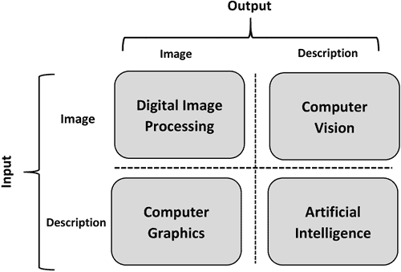

**图 4.6** 与图像处理重叠的领域。

### 4.4.2 数字图像处理系统
典型的数字图像处理系统如图 图 4.7 所示，包含六个阶段。第一个阶段是图像获取，其中设备捕获输入图像 \[7\]。该设备可以是相机或传感器，具体取决于应用。第二阶段是预处理，涉及图像重建、图像恢复和亮度感知。图像恢复从退化图像估计原始图像。特征提取阶段识别并提取特征，然后使用它们来减少数据。观测值被映射到特征空间域，以便在保持必要信息的同时减少维度。在下一个阶段，使用关联存储器，即高速内容可寻址存储器，来存储模式的关联对。知识库阶段的目标是使用不同技术对信息进行分类。分类规则用于知识库阶段。最后一个阶段是比较阶段，其中特征提取后产生的数据与从数据中学到的内容进行比较 \[8\]。该阶段用于图像分类和神经网络训练。

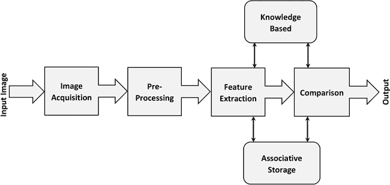

**图 4.7** 典型的数字图像处理系统。

### 4.4.3 机器学习与数字图像处理
在当今情况下，计算机系统不仅能够对图像进行分类，还能够对照片的不同元素进行描述。此外，计算机变得智能，可以通过为每个段落编写文本描述来总结图片。这得益于深度学习网络的演进，该网络能够学习图像中自然存在的模式 \[9\]。用于训练卷积神经网络 (`CNNs`) 的最大数据库之一是“Imagenet”。训练是通过 GPU 加速的深度学习框架进行的，例如 `Tensor Flow`、`Chainer`、`Caffe2`、`Pytorch` 等。利用多级结构，深度学习模型在获取图像的关键信息方面非常显著。`CNN` 是另一个利用 GPU 将图像处理中的计算时间大幅减少的模型。图像数据处理的深度学习需要图像分类、数据标注和位置检测。

#### 4.4.3.1 图像分类
使用图像分类，图像被分为不同类别。利用 `CNN` 进行图像分类被发现是最有效的，因为 `CNN` 提高了该过程的准确性。对于图像分类，必须提供给 `CNN` 的关键输入参数是图像数量、图像尺寸、像素中的级别以及通道数。

#### 4.4.3.2 数据标注
数据标注的主要目标是识别图像中嵌入的实际对象，如文本或其他符号。最好手动执行数据标注，以便学习算法自行做出预测。用于数据标注的一些工具是 SuperAnnotate、ImageTagger、VoTT 等。

#### 4.4.3.3 位置检测


检测嵌入在图像中的物体的位置是一个必须执行的重要方面。物体的位置可使用基于区域的 CNN（`RCNN`）轻松检测。如今 `RCNN` 已发展为 `Mask RCNN`，其能够实现达到人类水平的图像认知。

## 4.5 视频压缩

在当前计算世界中，视频在传输实时信息方面发挥着重要作用。随着社交媒体的日益普及，巨大的视频内容在网络上生成并共享。此外，在监控和安全方面，视频发挥着至关重要的作用，因为高分辨率和低空间占用是此类实时信息传输的优先事项。视频分辨率与所需内存之间存在权衡，因此需要视频压缩。

视频可理解为一系列图像帧，其中每个图像帧都包含以像素表示的某些信息。视频的分辨率由这些像素定义。各种视频格式的内存需求与分辨率的比较已在 表 4.1 中给出。表 4.1 中所有格式的捕获速率为彩色视频流每秒 30 帧 \[10\]。

**表 4.1**各种视频格式的内存需求与分辨率比较

| 视频格式 || 内存需求 (Mbps) || 分辨率 |
| --- | --- | --- |
| HDTV (高清晰度电视) || 632.81 || 1280 × 720 |
| --- | --- | --- |
| NTSC (国家电视系统委员会) || 237.3 || 720 × 480 |
| PAL (逐行倒相) || 284.77 || 720 × 576 |
| CIF (通用中间格式) || 69.61 || 352 × 288 |
| QCIF (四分之一通用中间格式) || 17.4 || 176 × 144 |

通过分析 表 4.1，可以很容易地观察到，即使表示低分辨率的小视频，也需要大量的存储空间。并且由于这个原因，视频压缩是涉及视频的应用的重要组成部分。

### 4.5.1 视频压缩模型

典型的视频压缩模型有两个主要组成部分；首先是视频编码器，另一个是视频解码器。视频编码器负责将视频帧转换为一串比特。在接收端，这一串比特由视频解码器解码以重建视频帧。典型视频压缩模型的框图如图 图 4.8 所示。视频编码器的功能分为预测器、变换编码和编码器。另一方面，解码器的功能分为逆变换编码和解码器。预测器识别视频帧中存在的不同冗余元素。在识别冗余之后，通过应用合适的变换编码获得变换系数。最后，编码器消除表示不同冗余的系数。解码器解码传入的视频流并获得压缩视频帧的变换系数。完成此操作后，在接收端应用逆变换编码以获得压缩并重建的视频帧 \[11\]。

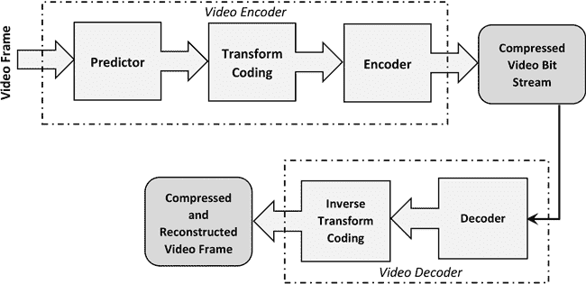

**图 4.8** 典型的视频压缩模型。

### 4.5.2 视频压缩中的机器学习

机器学习算法现已应用于基于人工智能的视频压缩系统。研究人员和专业人士也开始使用深度学习方法来改进基于人工智能的视频压缩。在视频编码和视频压缩过程中，使用监督算法。在机器学习中，监督学习充当一个函数，用于将输入映射到输出。在现代视频压缩工具中，已包含实现人工智能属性和特征的函数。这些解决方案利用机器学习算法和技术，倾向于自动化视频内容的格式化和压缩。此外，基于机器学习的视频压缩方法能够在上传视频内容期间执行压缩 \[12\]。这些方法还能够在用户下载之前在上传时压缩视频。与传统视频压缩方法相比，视频压缩的机器学习方法通过自动化任务和流程节省了大量时间、技能和精力。应用机器学习于视频压缩的两个重要好处如下列出。

#### 4.5.2.1 开发节省

视频压缩和视频编解码器是两个不同的领域。视频编解码器的算法相当复杂，其开发可能需要大量时间和精力。基于机器学习方法的软件减少了工作量和时间，因为在这种情况下，系统能够自行学习以适应自身，且几乎不需要或不需要人工干预。

#### 4.5.2.2 提高编码器密度

许多机器学习算法在图形处理单元（`GPU`）中执行，而其他算法在中央处理单元（`CPU`）中执行。`GPU` 中的逻辑核心数量少于 `CPU`，这使得系统能够并发执行简单计算。

`Autoencoders` 也在视频压缩中变得流行。`Autoencoders` 是人工神经网络（`ANNs`），它们经过训练以学习压缩输入，但可以在没有任何监督的情况下执行重建。

## 4.6 数字通信

数字通信已成为日常生活中极其重要的组成部分。当一台计算机与另一台计算机交互而不论其位置和距离时，通信本质上是数字的。随着蜂窝用户数量的快速增长以及 `IoT` 的演进，数字通信的作用变得更加关键。除了在设备之间传输包括视频、图片和音频在内的模拟数据外，数字通信的另一个重要应用是在光学和磁性介质上存储大量数据。数字通信系统的元素如图 图 4.9 所示。源通常生成消息，该消息首先传递到发送端的换能器，将其转换为电信号，然后进行模数转换 \[13\]。源编码器消除冗余位并压缩数字信号。信道编码器在数字信号中添加一些额外的位以进行错误检测和纠正。然后数字调制器将数字信号再次转换回模拟信号，以便可以通过通信信道传输。

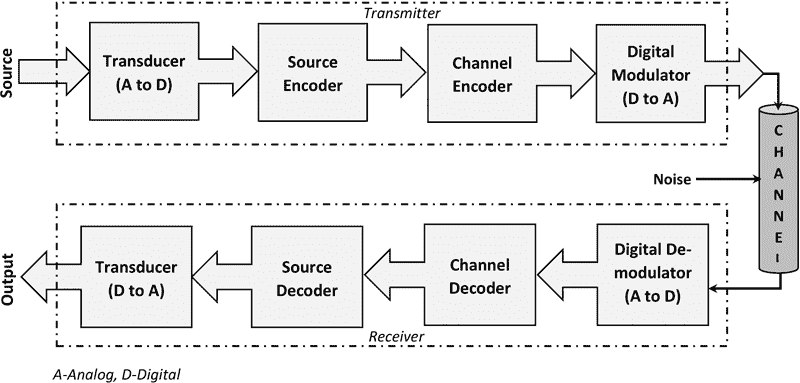

**图 4.9** 数字通信的元素。

在接收端，从信道接收到的信号被解调并转换为数字信号。信道解码器解码数字序列并检查是否存在潜在错误。如果序列有误，则信道解码器通过添加冗余位来纠正 \[14\]。源解码器通过执行采样和量化来重建数字信号。输出换能器将数字信号转换回原始消息。

### 4.6.1 数字通信中的机器学习


大量数据正由用户通过不同平台产生。由于智能手机的使用，数据在网络层和用户层均被产生。这些数据包括用户位置信息、用户通话模式以及移动性，对许多组织而言具有价值。网络服务提供商倾向于将这些关于用户的信息出售给愿意利用其优化业务利润的其他组织。为实现此目标，主要需求是开发并实施能够处理数字通信世界中大数据的适当机器学习方法。主要目标是从网络和用户数据中提取关键信息，并利用其促进业务的潜在增长。机器学习的主要应用领域包括通信网络、无线通信、智能基础设施和物联网、多媒体通信、安全和隐私 \[15\]。

### 4.6.1.1 通信网络
在通信网络中，机器学习算法可用于预测流量和吞吐量。这意义重大，因为提前控制吞吐量和分析流量可以满足服务质量（QoS）要求。机器学习可用于的其他通信网络方面包括路由和推理控制。

### 4.6.1.2 无线通信
在无线网络中，为了实现高效率以确保期望的 QoS，有必要调整 MIMO-OFDM 系统的各种属性。这种属性调整可使用机器学习算法完成。OFDM 基无线系统最关键的方面之一是降低峰均功率比，通常称为 PAPR。使用机器学习也可以有效地降低 PAPR。认知无线电、功率控制、定位、本地化以及信道估计也是机器学习可应用于获得更好结果的无线通信领域。

### 4.6.1.3 智能基础设施和物联网
随着物联网的发展，智能基础设施和智能服务已成为行业的关注焦点。传感器、智能设备和[content]
大量数据正由用户通过不同平台产生。由于智能手机的使用，数据在网络层和用户层均被产生。这些数据包括用户位置信息、用户通话模式以及移动性，对许多组织而言具有价值。网络服务提供商倾向于将这些关于用户的信息出售给愿意利用其优化业务利润的其他组织。为实现此目标，主要需求是开发并实施能够处理数字通信世界中大数据的适当机器学习方法。主要目标是从网络和用户数据中提取关键信息，并利用其促进业务的潜在增长。机器学习的主要应用领域包括通信网络、无线通信、智能基础设施和物联网、多媒体通信、安全和隐私 \[15\]。

### 4.6.1.1 通信网络
在通信网络中，机器学习算法可用于预测流量和吞吐量。这意义重大，因为提前控制吞吐量和分析流量可以满足服务质量（QoS）要求。机器学习可用于的其他通信网络方面包括路由和推理控制。

### 4.6.1.2 无线通信
在无线网络中，为了实现高效率以确保期望的 QoS，有必要调整 MIMO-OFDM 系统的各种属性。这种属性调整可使用机器学习算法完成。OFDM 基无线系统最关键的方面之一是降低峰均功率比，通常称为 PAPR。使用机器学习也可以有效地降低 PAPR。认知无线电、功率控制、定位、本地化以及信道估计也是机器学习可应用于获得更好结果的无线通信领域。

### 4.6.1.3 智能基础设施和物联网
随着物联网的发展，智能基础设施和智能服务已成为行业的关注焦点。传感器、智能设备和[content]
大量数据正由用户通过不同平台产生。由于智能手机的使用，数据在网络层和用户层均被产生。这些数据包括用户位置信息、用户通话模式以及移动性，对许多组织而言具有价值。网络服务提供商倾向于将这些关于用户的信息出售给愿意利用其优化业务利润的其他组织。为实现此目标，主要需求是开发并实施能够处理数字通信世界中大数据的适当机器学习方法。主要目标是从网络和用户数据中提取关键信息，并利用其促进业务的潜在增长。机器学习的主要应用领域包括通信网络、无线通信、智能基础设施和物联网、多媒体通信、安全和隐私 \[15\]。

### 4.6.1.1 通信网络
在通信网络中，机器学习算法可用于预测流量和吞吐量。这意义重大，因为提前控制吞吐量和分析流量可以满足服务质量（QoS）要求。机器学习可用于的其他通信网络方面包括路由和推理控制。

### 4.6.1.2 无线通信
在无线网络中，为了实现高效率以确保期望的 QoS，有必要调整 MIMO-OFDM 系统的各种属性。这种属性调整可使用机器学习算法完成。OFDM 基无线系统最关键的方面之一是降低峰均功率比，通常称为 PAPR。使用机器学习也可以有效地降低 PAPR。认知无线电、功率控制、定位、本地化以及信道估计也是机器学习可应用于获得更好结果的无线通信领域。

### 4.6.1.3 智能基础设施和物联网
随着物联网的发展，智能基础设施和智能服务已成为行业的关注焦点。传感器、智能设备和[content]
大量数据正由用户通过不同平台产生。由于智能手机的使用，数据在网络层和用户层均被产生。这些数据包括用户位置信息、用户通话模式以及移动性，对许多组织而言具有价值。网络服务提供商倾向于将这些关于用户的信息出售给愿意利用其优化业务利润的其他组织。为实现此目标，主要需求是开发并实施能够处理数字通信世界中大数据的适当机器学习方法。主要目标是从网络和用户数据中提取关键信息，并利用其促进业务的潜在增长。机器学习的主要应用领域包括通信网络、无线通信、智能基础设施和物联网、多媒体通信、安全和隐私 \[15\]。

### 4.6.1.1 通信网络
在通信网络中，机器学习算法可用于预测流量和吞吐量。这意义重大，因为提前控制吞吐量和分析流量可以满足服务质量（QoS）要求。机器学习可用于的其他通信网络方面包括路由和推理控制。

### 4.6.1.2 无线通信
在无线网络中，为了实现高效率以确保期望的 QoS，有必要调整 MIMO-OFDM 系统的各种属性。这种属性调整可使用机器学习算法完成。OFDM 基无线系统最关键的方面之一是降低峰均功率比，通常称为 PAPR。使用机器学习也可以有效地降低 PAPR。认知无线电、功率控制、定位、本地化以及信道估计也是机器学习可应用于获得更好结果的无线通信领域。

### 4.6.1.3 智能基础设施和物联网
随着物联网的发展，智能基础设施和智能服务已成为行业的关注焦点。传感器、智能设备和[content]
大量数据正由用户通过不同平台产生。由于智能手机的使用，数据在网络层和用户层均被产生。这些数据包括用户位置信息、用户通话模式以及移动性，对许多组织而言具有价值。网络服务提供商倾向于将这些关于用户的信息出售给愿意利用其优化业务利润的其他组织。为实现此目标，主要需求是开发并实施能够处理数字通信世界中大数据的适当机器学习方法。主要目标是从网络和用户数据中提取关键信息，并利用其促进业务的潜在增长。机器学习的主要应用领域包括通信网络、无线通信、智能基础设施和物联网、多媒体通信、安全和隐私 \[15\]。

### 4.6.1.1 通信网络
在通信网络中，机器学习算法可用于预测流量和吞吐量。这意义重大，因为提前控制吞吐量和分析流量可以满足服务质量（QoS）要求。机器学习可用于的其他通信网络方面包括路由和推理控制。

### 4.6.1.2 无线通信
在无线网络中，为了实现高效率以确保期望的 QoS，有必要调整 MIMO-OFDM 系统的各种属性。这种属性调整可使用机器学习算法完成。OFDM 基无线系统最关键的方面之一是降低峰均功率比，通常称为 PAPR。使用机器学习也可以有效地降低 PAPR。认知无线电、功率控制、定位、本地化以及信道估计也是机器学习可应用于获得更好结果的无线通信领域。

### 4.6.1.3 智能基础设施和物联网
随着物联网的发展，智能基础设施和智能服务已成为行业的关注焦点。传感器、智能设备和[content]
大量数据正由用户通过不同平台产生。由于智能手机的使用，数据在网络层和用户层均被产生。这些数据包括用户位置信息、用户通话模式以及移动性，对许多组织而言具有价值。网络服务提供商倾向于将这些关于用户的信息出售给愿意利用其优化业务利润的其他组织。为实现此目标，主要需求是开发并实施能够处理数字通信世界中大数据的适当机器学习方法。主要目标是从网络和用户数据中提取关键信息，并利用其促进业务的潜在增长。机器学习的主要应用领域包括通信网络、无线通信、智能基础设施和物联网、多媒体通信、安全和隐私 \[15\]。

### 4.6.1.1 通信网络
在通信网络中，机器学习算法可用于预测流量和吞吐量。这意义重大，因为提前控制吞吐量和分析流量可以满足服务质量（QoS）要求。机器学习可用于的其他通信网络方面包括路由和推理控制。

### 4.6.1.2 无线通信
在无线网络中，为了实现高效率以确保期望的 QoS，有必要调整 MIMO-OFDM 系统的各种属性。这种属性调整可使用机器学习算法完成。OFDM 基无线系统最关键的方面之一是降低峰均功率比，通常称为 PAPR。使用机器学习也可以有效地降低 PAPR。认知无线电、功率控制、定位、本地化以及信道估计也是机器学习可应用于获得更好结果的无线通信领域。

### 4.6.1.3 智能基础设施和物联网
随着物联网的发展，智能基础设施和智能服务已成为行业的关注焦点。传感器、智能设备和[content]
大量数据正由用户通过不同平台产生。由于智能手机的使用，数据在网络层和用户层均被产生。这些数据包括用户位置信息、用户通话模式以及移动性，对许多组织而言具有价值。网络服务提供商倾向于将这些关于用户的信息出售给愿意利用其优化业务利润的其他组织。为实现此目标，主要需求是开发并实施能够处理数字通信世界中大数据的适当机器学习方法。主要目标是从网络和用户数据中提取关键信息，并利用其促进业务的潜在增长。机器学习的主要应用领域包括通信网络、无线通信、智能基础设施和物联网、多媒体通信、安全和隐私 \[15\]。

### 4.6.1.1 通信网络
在通信网络中，机器学习算法可用于预测流量和吞吐量。这意义重大，因为提前控制吞吐量和分析流量可以满足服务质量（QoS）要求。机器学习可用于的其他通信网络方面包括路由和推理控制。

### 4.6.1.2 无线通信
在无线网络中，为了实现高效率以确保期望的 QoS，有必要调整 MIMO-OFDM 系统的各种属性。这种属性调整可使用机器学习算法完成。OFDM 基无线系统最关键的方面之一是降低峰均功率比，通常称为 PAPR。使用机器学习也可以有效地降低 PAPR。认知无线电、功率控制、定位、本地化以及信道估计也是机器学习可应用于获得更好结果的无线通信领域。

### 4.6.1.3 智能基础设施和物联网
随着物联网的发展，智能基础设施和智能服务已成为行业的关注焦点。传感器、智能设备和[content]
大量数据正由用户通过不同平台产生。由于智能手机的使用，数据在网络层和用户层均被产生。这些数据包括用户位置信息、用户通话模式以及移动性，对许多组织而言具有价值。网络服务提供商倾向于将这些关于用户的信息出售给愿意利用其优化业务利润的其他组织。为实现此目标，主要需求是开发并实施能够处理数字通信世界中大数据的适当机器学习方法。主要目标是从网络和用户数据中提取关键信息，并利用其促进业务的潜在增长。机器学习的主要应用领域包括通信网络、无线通信、智能基础设施和物联网、多媒体通信、安全和隐私 \[15\]。

### 4.6.1.1 通信网络
在通信网络中，机器学习算法可用于预测流量和吞吐量。这意义重大，因为提前控制吞吐量和分析流量可以满足服务质量（QoS）要求。机器学习可用于的其他通信网络方面包括路由和推理控制。

### 4.6.1.2 无线通信
在无线网络中，为了实现高效率以确保期望的 QoS，有必要调整 MIMO-OFDM 系统的各种属性。这种属性调整可使用机器学习算法完成。OFDM 基无线系统最关键的方面之一是降低峰均功率比，通常称为 PAPR。使用机器学习也可以有效地降低 PAPR。认知无线电、功率控制、定位、本地化以及信道估计也是机器学习可应用于获得更好结果的无线通信领域。

### 4.6.1.3 智能基础设施和物联网
随着物联网的发展，智能基础设施和智能服务已成为行业的关注焦点。传感器、智能设备和[content]
用户在使用不同平台时产生着海量数据。由于智能手机的使用，数据在网络层面和用户层面均被产生。这些数据包含用户位置信息、用户通话模式以及移动性，对众多组织具有价值。网络服务提供商倾向于将这些用户信息出售给愿意为优化业务利润而使用数据的其他组织。为此，主要需求是开发并实施能够处理数字通信世界中大数据的适当机器学习方法。主要目标是从网络和用户数据中提取关键信息，并将其用于业务的潜在增长。机器学习的主要应用领域包括通信网络、无线通信、智能基础设施和物联网、多媒体通信、安全和隐私 \[15\]。

### 4.6.1.1 通信网络
在通信网络中，机器学习算法可用于预测流量和吞吐量。这非常重要，因为提前控制吞吐量和分析流量可以满足服务质量 QoS 要求。机器学习可应用于通信网络的其他方面包括路由和推理控制。

### 4.6.1.2 无线通信
在无线网络中，为实现高效率以确保期望的 QoS，需要调整 MIMO-OFDM 系统的各项属性。此类属性调整可通过机器学习算法完成。OFDM 基无线系统最关键的方面之一是降低峰均功率比，即 PAPR。利用机器学习也能有效降低 PAPR。认知无线电、功率控制、定位、本地化以及信道估计也是机器学习可应用于以获得更好结果的无线通信领域。

### 4.6.1.3 智能基础设施和物联网
随着物联网的演进，智能基础设施和智能服务成为行业关注的重点。传感器、智能设备和[content]
用户在使用不同平台时产生着海量数据。由于智能手机的使用，数据在网络层面和用户层面均被产生。这些数据包含用户位置信息、用户通话模式以及移动性，对众多组织具有价值。网络服务提供商倾向于将这些用户信息出售给愿意为优化业务利润而使用数据的其他组织。为此，主要需求是开发并实施能够处理数字通信世界中大数据的适当机器学习方法。主要目标是从网络和用户数据中提取关键信息，并将其用于业务的潜在增长。机器学习的主要应用领域包括通信网络、无线通信、智能基础设施和物联网、多媒体通信、安全和隐私 \[15\]。

### 4.6.1.1 通信网络
在通信网络中，机器学习算法可用于预测流量和吞吐量。这非常重要，因为提前控制吞吐量和分析流量可以满足服务质量 QoS 要求。机器学习可应用于通信网络的其他方面包括路由和推理控制。

### 4.6.1.2 无线通信
在无线网络中，为实现高效率以确保期望的 QoS，需要调整 MIMO-OFDM 系统的各项属性。此类属性调整可通过机器学习算法完成。OFDM 基无线系统最关键的方面之一是降低峰均功率比，即 PAPR。利用机器学习也能有效降低 PAPR。认知无线电、功率控制、定位、本地化以及信道估计也是机器学习可应用于以获得更好结果的无线通信领域。

### 4.6.1.3 智能基础设施和物联网
随着物联网的演进，智能基础设施和智能服务成为行业关注的重点。传感器、智能设备和小工具的不断增长使用持续产生大量多模异构数据 \[16\]。智能家居、智能城市、智能电网等概念在各类基础设施发展中获得高度重视 \[17\]。Anavangot 等 \[18\] 指出，物联网网络中流通的数据和信息以控制信号或时域信号的形式存在。研究人员正将机器学习算法应用于各类智能服务和基础设施，以及应急通信、资源管理、故障预测、调度、监控、预测等。

### 4.6.1.4 安全和隐私
机器学习算法现已在处理安全和隐私相关问题中发挥关键作用。基于机器学习的方法可自动检测异常行为和活动。机器学习可用于通信安全的关键应用包括欺诈检测、垃圾邮件识别、入侵识别和隐私保护。Bodkhe 和 Tanwar \[19\] 提出了在物联网环境中为确保数据分发安全而进行的验证和验证方法论的各种关注点和可能的未来影响。Tanwar 等 \[20\] 对采用机器学习算法使基于区块链的智能应用免受各种威胁和攻击的影响进行了详细分析。基于机器学习和深度学习的方法也能够识别和缓解已知攻击以及未知攻击 \[21\]。

### 4.6.1.5 多媒体通信
机器学习现也被用于通过网络传输音频、视频和图像。信号压缩是机器学习应用带来显著益处的重要领域之一。神经网络、跟踪和深度学习是机器学习中众所周知的概念，被广泛用于多媒体内容流媒体。

## 4.6.2 医疗保健
医疗保健是人类生活的重要方面，在人口基数大的国家，对改善医疗系统需求的快速提升。医疗保健中维护和监控患者医疗数据和记录非常重要。此外，医学科学正从传感器、RFID 标签、物联网、人工智能和机器学习等技术获得巨大帮助。机器学习在医疗保健中正证明是处理各种问题的法宝。在医疗保健领域，机器学习能够高效分析大量数据点、推荐结果并帮助适当的资源分配和利用 \[22\]。借助机器学习，机器学习应用将分析来自多个国家和不同医疗系统的患者的实时数据，以寻找过去不可用的新治疗方法。机器学习在医疗保健中的主要应用 \[23\] 在 图 4.10 中有所突出。

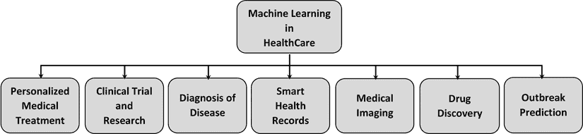

**图 4.10** 医疗保健中机器学习的通用应用。

### 4.6.2.1 个性化医疗治疗
在当前情况下，医生通常根据症状、病理检测和已知遗传信息提供医疗治疗。但利用机器学习和预测分析，结合生物传感器和先进的健康测量设备，可以探索更好的多种治疗方案。

### 4.6.2.2 临床研究和试验
制药领域临床试验和研究的过程需要大量努力和时间，在某些情况下甚至可能需要多年。应用基于机器学习的预测分析来识别临床试验的合适候选者，可以帮助从过去的医疗咨询、社交媒体等不同数据点中提取关键信息。

### 4.6.2.3 疾病诊断
机器学习在医疗保健中最突出的应用是识别和诊断患者中通常被认为难以诊断的疾病。诸如癌症早期和遗传性疾病等难以手动诊断的疾病可通过认知计算和基因组测序以快速速度识别。

### 4.6.2.4 智能健康记录
在大型医疗系统中，维护数据和医疗记录是一个繁琐的过程。机器学习的主要目标是减少工作量、金钱和时间，以便将其用于其他关键的医疗保健功能。文档分类结合机器学习和向量机，以及基于机器学习的手写识别，可用于以高效方式自动维护医疗记录。

### 4.6.2.5 医学影像
由于机器学习和深度学习，计算机视觉成为可能，可用作图像诊断工具，用于识别医学图像中的现有模式。机器学习算法侧重于从医学图像中提取特征，这些特征对于做出诊断和预测至关重要。然后系统识别提取特征的最佳组合，将图像转化为某种度量。

### 4.6.2.6 药物发现


机器学习的一个非常重要的应用是在早期药物发现的过程中。机器学习工具可应用于药物开发过程的各个阶段，包括药物识别、药物验证、药物再利用、提高药物疗效以及分析生物医学信息。精准医学和下一代测序在探索药物发现的替代途径方面可以发挥有效作用。

### 4.6.2.7 Outbreak Prediction
基于人工智能（AI）的技术现正被用于监测情况并预测即将到来的流行病。在来自不同来源的大量数据的帮助下，如实时社交媒体数据、网络数据、卫星信息等，人工神经网络能够预测各种类型的爆发，如疟疾、登革热和其他高度传染性疾病。这种疫情预测对于医疗基础设施不足且不完善的发展中国家来说非常重要。

## 4.6.3 Seismology
地震学是学习和科学研究地震波在地球内部和周围传播的领域。地震波是在地球内部岩石突然破裂或发生爆炸时产生的能量波。当地球内部能量水平发生变化时，这些波会被地震仪记录下来。地震学是一个重要的研究领域，因为地震波和地震会产生其他环境副作用，如海啸、火山喷发、海洋风暴、地壳构造过程等。其中许多副作用对人类来说是致命的。

### 4.6.3.1 Interpreting Seismic Observations
地震观测是使用一种明确的方法进行解释的，如图 4.11 所示。理解地震波的第一个阶段是对记录的分析，其中信号在噪声背景中被检测到。然后，测量信号的各种参数，如振幅、表观周期、极化以及到达时间，随后进行特定形式的初步波形识别。第二阶段是对震源的分析，其目的是获取震中、机制、震级、能量、震源深度和震源尺寸等震源参数[24]。在这些震源参数的帮助下，最终完成波形的识别。在第三阶段，构建基本规律，包括地震波运动学、地震波动力学以及地震活动性中的统计关系。第四阶段也是最后阶段，对地球结构、地震物理学和震源识别做出地震学结论。爆炸探测也在此阶段进行。

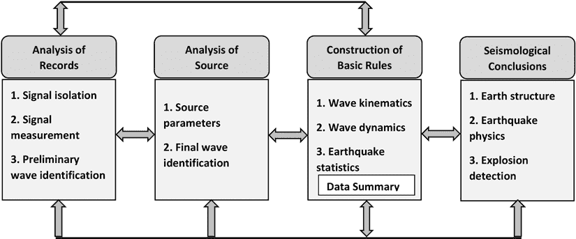

`FIGURE 4.11` 解释地震观测的阶段。

### 4.6.3.2 Machine Learning in Seismology
地震学家现在利用机器学习算法，结合高计算能力的机器、庞大的地震数据集和架构来预测即将发生的地震事件。此外，基于机器学习的方法也可用于保存过去地震的模拟记录。研究人员还使用深度神经网络来学习现有过去地震数据与预测结果之间的复杂关系。由于存储大量数据的介质通常会退化，地震学家正努力保护这些关键信息。能够识别图像的机器学习方法也是以经济有效的方式保存地震数据的潜在候选方案。一些研究人员使用机器学习检查地震数据以识别火山活动和地震余震，并监测标志着板块边界处变形构造震动[25]。也有一些基于机器学习的少量研究正在进行，以定位地震起源并将低强度地震与周围存在的地震噪声区分开来。机器学习的技巧，如深度学习和 CNN，也可应用于图 4.11 中强调的地震观测的不同阶段。它们可用于高效、快速地分析记录、分析震源、构建规则并得出重要结论。

## 4.6.4 Speech Recognition
语音识别是计算语言学和计算机科学的综合领域，旨在设计和开发能够使用数字计算机将口语识别并翻译成文本形式的方法和技术。语音识别背后的两个基本要素是声学建模和语言建模。语音和音频的语言成分关系由声学建模表示，而语言建模用于将词语序列与声音匹配以区分发音相似的词语。为了提高语音识别系统的准确性，通常使用隐马尔可夫模型来识别语音中的时间模式[26]。另一方面，自然语言处理（NLP）以简便且高效的方式执行语音识别。一般的语音识别系统如图图 4.12 所示。

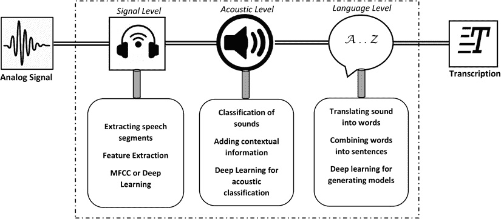

`FIGURE 4.12` 通用语音识别系统。

信号、声学和语言是语音识别的三个重要组成部分。在信号层级，首先提取不同的语音片段，然后通过 MFCC 或深度学习进行特征提取。在声学层级，声音分类使用机器学习方法进行。在声学层级还会收集额外的上下文信息。在语言层级，声音被翻译成词语，词语组合成句子，并使用深度学习方法生成模型。机器学习方法利用句子结构、语法和句法以及语音和音频信号的对齐来处理语音。基于机器学习的软件会持续学习，随着使用量的增加，学习也会增加，由于这种改进的学习，理解口音等基本要素会变得更容易。


### 4.6.4 ASR 中的机器学习范式
应用于自动语音识别（ASR）的机器学习方法包括生成学习、判别式学习、监督学习、半监督学习、主动学习和深度学习。ASR 中的机器学习范式及其关键属性在图 4.13 中突出显示。基于损失函数和决策函数的性质，机器学习范式已被归类为生成学习和判别式学习。模型的性质和训练目标中的核心组成部分是生成学习和判别式学习之间两个主要差异。生成学习包含生成模型并采用基于联合似然损失的训练目标函数。然而，判别式学习范式使用判别模型或旨在对模型应用判别训练\[27\]。根据可用训练数据的种类，监督学习、半监督学习和主动学习是 ASR 中的机器学习范式类型。在监督学习范式中，训练数据集包含从联合分布获得的不同输入输出对。主要目标是最小化经验风险并进行正则化。监督学习与半监督学习之间的细微差别在于，后者还处理未标记数据集。


**图 4.13** 语音识别中机器学习的范式。

主动学习与半监督学习略有不同，因为它考虑选择性标记数据集。主动学习的主要目的是使最具信息量的数据集被标记以提高分类性能。根据输入表示，ASR 中的另一种机器学习范式是深度学习。深度学习本质上与使用多层非线性转换来提取语音特征相关。由于庞大训练数据集的易得性，ASR 现在利用机器学习范式的强大功能。

### 4.6.5 计算机视觉
计算机视觉是一个旨在设计和开发方法与技术以使计算机能够看到、分析和理解包括图像和视频在内的数字内容。互联网上的数据同时包含文本和多媒体。对于搜索和索引文本内容，可以使用简单直接的算法和工具。但是，对于搜索和索引图像和视频等多媒体内容，算法必须知道图像和视频包含的内容，即计算机必须看到图像内部的内容\[28\]。计算机视觉与人工智能和机器学习密切相关。计算机视觉拥有大量应用，包括机器检测、医学成像、汽车安全、动作捕捉、生物识别等。

众所周知的计算机视觉应用尝试在图像中执行以下操作：
*   **对象分类**：对图像中的物体进行宽泛类别分类。
*   **对象识别**：识别图像中物体的种类。
*   **对象验证**：检查图像中是否存在物体。
*   **对象检测**：检测图像中物体的位置。
*   **对象关键点检测**：找出图像中物体的关键点。
*   **对象分割**：识别属于物体的像素。
*   **对象识别**：找出图像中是什么物体以及它们的位置。

计算机视觉首先获取图像或实时的大量照片或视频，然后应用机器学习或深度学习模型来自动化该过程。最后在解释步骤中，机器学习或深度学习模型被部署以输出分数和决策。图像多级计算机视觉过程中遵循的基本步骤在图 4.14 中说明。首先，对输入图像数据进行图像分割，然后进行特征提取，随后进行目标识别。图像分割过程由分割参数集和用于参数适应的遗传算法支持。学习新对象特征与特征提取过程同步进行。对象模型获取和优化也在目标识别过程中同时进行。


**图 4.14** 图像的计算机视觉过程。

基于机器学习的方法倾向于改进计算机视觉以实现更好的识别和跟踪。它们为改进图像获取、图像处理和聚焦对象提供有效技术，这些都是计算机视觉的主要组成部分\[29\]。对于目标识别，最常见的机器学习方法是尺度不变特征变换（SIFT）。SITF 使用对象的重要属性并将它们保存在数据库中。在图像分类中，这些对象属性由 SITF 检查并与数据库中保存的属性进行匹配。深度学习用于目标识别最常见的方法是 CNN。

### 4.6.6 经济预测
经济预测涉及对影响国家经济状况的各种经济参数进行预测。诸如通货膨胀、财政赤字、GDP、就业率、汇率等参数被预测以提前进行财务分析。经济预测是识别国家经济中存在的关键财务模式的一种手段\[30\]。政府官员和企业管理人员利用经济预测来规划财政政策和未来经济活动。基于机器学习的方法被证明对金融预测领域有效且耗时更少。机器学习在金融预测中的主要优势是其能够分析结构化数据和非结构化数据。结构化数据的来源包括组织的 ERP 数据、内部审计报告或仓储系统，而非结构化数据可以从公司产品和服务的评论中收集。

在企业中采用机器学习方法时，第一阶段是确定范围，即业务的特定领域，如支出和收入。在此阶段还进行数据可用性和质量检查。范围必须包括组织影响最大的领域。在第二阶段，提出假设以确定业务驱动因素。在第三阶段，构建适当的机器学习模型以测试假设并考虑业务驱动因素。在最后阶段，将各种工具集成到金融预测过程中，然后进行可视化和报告。采用机器学习进行金融预测的过程在图 4.15 中显示。


**图 4.15** 采用机器学习进行金融预测的路线图。


在经济预测中实施机器学习最重要的组成部分是构建机器学习模型 \[31\]。构建金融预测中机器学习模型的迭代过程如图 图 4.16 所示。模型开发的第一步是收集数据并假设驱动业务的参数。在假设和数据被测试的同时，程序员可以开始开发算法并对模型进行训练，以便检测数据中存在的模式，从而做出适当的预测。此步骤中产生的初步预测将有助于理解层次信息，并将产生精确的业务洞察。在新的驱动因素和新的数据集可用后，模型可以持续更新和改进。非常重要的是要确保在模型开发过程中，机器在学习过程中不会犯错，即模型必须针对先前可用的数据和实际结果进行验证 \[32\]。


**图 4.16** 用于经济预测中构建机器学习模型的流程。

## 4.7 结论

基于机器学习的解决方案将成为许多现实生活应用中计算的一个非常重要的部分。日常生活中有很多信号处理的应用，可以通过使用机器学习技术得到改进。本章强调了十个这样的应用，行业和研究人员正在应用机器学习算法和技术来改进结果。本章介绍了机器学习在各个领域的应用，包括音频信号处理、音频压缩、数字图像处理、视频压缩、数字通信、医疗保健、地震学、语音识别、计算机视觉和经济预测。在音频信号处理中使用机器学习使特征提取更有效。在音频和视频压缩中，机器学习有助于为编解码器开发更精确的模型。

`CNN` 可以有效地与数字图像处理相结合以获得更好的结果。在通信网络领域，机器学习由于其预测网络流量和行为的能力而被证明非常有效。机器学习算法的广泛适用性在医疗保健领域已得到体现，从个人医疗治疗到疫情预测。深度神经网络可用于预测危及生命的地震活动。另一方面，`NLP` 以简便且高效的方式执行语音识别。基于机器学习的方法倾向于改进计算机视觉以实现更好的识别和跟踪。基于机器学习的预测模型可用于做出非常准确的财务预测。通过对这些应用的讨论，可以推断出机器学习正在以减少的努力和时间提高这些应用中过程的效率。由于本章仅探讨了机器学习的十个具体应用，探索更多与信号处理相关的机器学习应用对研究界仍然开放。本章介绍的研究对于从事机器学习应用领域的人们具有重要意义。

## 参考文献

1.  Alzubi, J., Nayyar, A. and Kumar, A., 2018 年 11 月。机器学习从理论到算法：概述。Journal of Physics: Conference Series, 1142(1), p. 012012.

2.  Prasad, B. and Prasanna, S.M. eds., 2007. 使用神经网络的语音、音频、图像和生物医学信号处理 (Vol. 83). Springer, Heidelberg.

3.  Singh, J. 2019. “使用 Python 进行音频处理和机器学习”。PyBay. [`opensource.com/article/19/9/audio-processing-machine-learning-python`](https://opensource.com/)

4.  Kumbhar, P.Y. and Krishnan, S., 2011. 使用不同方法进行声音数据压缩。In International Conference on Computing and Communication Systems (pp. 100–108). Springer, Berlin, Heidelberg.

5.  Oates, C., 2020. 用于情感识别个人分析与场景检测的智能音频工程。 [`www.audeering.com`](https://www.audeering.com). 最后访问于 2020 年 12 月 23 日。

6.  Gonzalez, R.C., and Woods, R.E., 2017. 数字图像处理。Pearson, New York.

7.  Vora, J., Patel, M., Tanwar, S. and Tyagi, S., 2018 年 2 月。基于图像处理的垂直墙体裂缝分析。In 2018 3rd International Conference on Internet of Things: Smart Innovation and Usages (IoT-SIU) (pp. 1–5). IEEE, Bhimtal, India.

8.  Maram, S.S., Kumar, N., Joel, J.P.C., Rodrigues, T.S. and Jain, A., 2020. 从图像到信号，从信号到亮点。In IEEE Global Communications Conference (GLOBECOM-2020) (pp. 1–6). IEEE, Taipei, Taiwan.

9.  Lézoray, O., Charrier, C., Cardot, H. and Lefèvre, S., 2008. 图像处理中的机器学习。EURASIP Journal on Advances in Signal Processing, 2008(1), pp. 927–950.

10.  Bhojani, D.R., Dwivedi, V.J. and Thanki, R.M., 2020. 视频压缩导论。In Bhojani, D.R., Dwivedi, V.J. and Thanki, R.M. (Eds.), Hybrid Video Compression Standard (pp. 1–14). Springer, Singapore.

11.  Furht, B., Greenberg, J. and Westwater, R., 2012. 视频压缩的运动估计算法 (Vol. 379). Springer, Berlin.

12.  Knop, M., Cierniak, R. and Shah, N., 2014 年 6 月。基于神经网络结构的视频压缩算法。In International Conference on Artificial Intelligence and Soft Computing (pp. 715–724). Springer, Cham.

13.  Barry, J.R., Lee, E.A. and Messerschmitt, D.G., 2012. 数字通信。Springer Science & Business Media, New York.

14.  Meinel, C. and Sack, H., 2013. 网络接入层 (1)：有线局域网技术。In Internetworking (pp. 131–259). Springer, Berlin, Heidelberg.

15.  Samek, W., Stanczak, S. and Wiegand, T., 2017. 机器学习与通信的融合。arXiv preprint arXiv:1708.08299.

16.  Tanwar, S. ed., 2020. 物联网应用的雾数据分析：具有最先进技术的下一代流程模型 (Vol. 76). Springer Nature, Singapore.

17.  Tanwar, S., Tyagi, S. and Kumar, N. eds., 2019. 物联网应用的多媒体大数据计算：概念、范式和解决方案 (Vol. 163). Springer, Singapore.

18.  Anavangot, V., Menon, V.G. and Nayyar, A., 2018 年 11 月。信号物联网中的分布式大数据分析。In 2018 International Conference on System Modeling & Advancement in Research Trends (SMART) (pp. 73–77). IEEE, Moradabad, India.

19.  Bodkhe, U. and Tanwar, S., 2020. 物联网环境安全数据分发技术分类。IET Software, 14, pp. 563–571.

20.  Tanwar, S., Bhatia, Q., Patel, P., Kumari, A., Singh, P.K. and Hong, W.C., 2019. 基于区块链的智能应用中的机器学习采用：挑战及前进之路。IEEE Access, 8, pp. 474–488.

21.  Gupta, R., Tanwar, S., Tyagi, S. and Kumar, N., 2020. 用于安全数据分析的机器学习模型：分类法和威胁模型。Computer Communications, 153, pp. 406–440.


22.  Gupta, S. 和 Sedamkar, R.R., 2020. 机器学习在医疗保健中的应用：导论。载于 Jain, V. 和 Chatterjee, J. M.（编），《从医疗保健视角看机器学习》（第 1–25 页）。Springer，Cham。

23.  Shailaja, K., Seetharamulu, B. and Jabbar, M.A., 2018, March. 机器学习在医疗保健中的应用：综述。收录于 2018 年第二届电子、通信与航空航天技术国际会议（ICECA）（第 910–914 页）。IEEE，Coimbatore，印度。

24.  Borok, V.I.K. 1992. 地震学与逻辑导论。载于 Keilis-Borok, V. I.（编），《计算地震学》，Springer，US（第 1–9 页）。

25.  Bergen, K.J., Chen, T. and Li, Z., 2019. 关于地震学中机器学习的专题部分的前言。Seismological Research Letters，90(2A)，第 477–480 页。

26.  Benesty, J., Sondhi, M.M. and Huang, Y.A., 2008. 语音处理导论。载于 Benesty, J., Sondhi, M.M. 和 Huang, Y.（编），《Springer 语音处理手册》（第 1–4 页）。Springer，Berlin，Heidelberg。

27.  Deng, L. 和 Li, X., 2013. 语音识别的机器学习范式：概述。IEEE Transactions on Audio, Speech, and Language Processing，21(5)，第 1060–1089 页。

28.  Klette, R., 2014. 简明计算机视觉。Springer，London。

29.  Sebe, N., Cohen, I., Garg, A. and Huang, T.S., 2005. 计算机视觉中的机器学习（第 29 卷）。Springer Science & Business Media，New York。

30.  Guerard Jr., J.B., 2013. 投资分析中的财务预测导论。Springer Science & Business Media，New York。

31.  Soofi, A.S. 和 Cao, L. eds., 2012. 金融数据建模与预测：非线性动力学技术（第 2 卷）。Springer Science & Business Media，New York。

32.  Degiannakis, S. 和 Floros, C., 2016. 高频金融数据建模与预测。Springer，Berlin。

# 5 深入深度学习：计算机视觉、自然语言处理和信号处理

V. Ajantha Devi

AP3 Solutions

Mohd Naved

Jagannath University

DOI: [10.1201/9781003107026-5](https://doi.org/10.1201/9781003107026-5)

## 5.1 深度学习：导论

深度学习 \[1\] 是机器学习的一个子集，专注于从输入信息中学习巨大的特征，特别是在信息复杂的情况下。这基本上是针对复杂信息类型（如图像、视频、音频等）而设计的常见特征提取器的替代品。传统或基础的机器学习方法最初被用于图像处理 \[2,3\]、自然语言处理（NLP） \[4, 5 和 6\] 以及音频处理 \[7,8\]。

在图像中存在具有不同光照或角度的相似物体时，距离度量在实际上几乎失效。此外，使用传统的线性分类器方法 \[9\]，输入图像的每个像素估计都会被评估并标记，以确定其是否可以作为匹配的边界。通常会采用像素的加权平均估计来进行比较，这就是为什么图像中的所有困难区域 \[10\]（例如，光照、不同角度或图像视角、噪声、背景杂乱以及同一物体的多种变体）会导致算法无法匹配输入图像。

在自然语言处理中，深度学习方法通常基于神经网络，并依赖于称为词嵌入的连续词向量表示。本节首先介绍词嵌入的概念以及创建此类表示的各种无监督方法。利用词嵌入的自然语言处理应用在章节末尾进行了描述。传统的自然语言处理任务 \[4\]，例如词性标注（POS）或语义角色标注（SRL），包括为句子中的每个词标注标签。另一类问题，例如命名实体识别（NER）或浅层解析（分块），包括识别并命名短语（例如词组）并赋予预定义标签。此类任务可以通过识别短语边界而不是直接识别整个短语来表述为词序列问题。

在音频分析领域 \[7\]，表征音频数据的低级特征可分为音调和时域特征。音调与频域相关，并表征特征，例如音轨中存在的频率 \[8\]，以及区分基频和泛音频率。时域特征在时间域中定义。许多从音频信号中提取特征的方法已被研究用于音频内容分析。

这些专门设计的提取音频数据的方法取得了许多已记录的成功，并改善了不同问题领域的音频分析性能。然而，这些方法并非为音乐信息设计。它们是为语音音频设计的，语音音频只是音乐曲目中的单一组成部分，而使用这些方法进行特征提取的研究表明，它们确实从音乐音频中分离出一些重要信息。

## 5.2 深度学习的过去、现在和未来

长期以来，深度学习不断发展，对行业和商业领域造成了巨大的冲击。深度学习是机器学习的一个分支，它使用算法进行信息处理并复制推理过程，甚至创造出映射。深度学习利用算法层进行信息处理，理解人类语音，并视觉识别物体。

| 年份 | 发明者 | 描述 |
| --- | --- | --- |
| 1943 | William McCulloch and Walter Pitts | 神经活动固有思想的逻辑演算，其中他们勾勒出了神经组织的首个计算模型 |
| 1949 | Donald Hebb | 《行为的组织》，主张神经元之间的关联在使用中得到强化。这一思想对于理解人类学习以及如何训练人工神经网络至关重要 |
| 1954 | Belmont Farley and Wesley Clark | 假神经组织的首个计算机模拟（最多 128 个神经元） |
| 1957 | Frank Rosenblatt | 提出了一种称为感知器的神经网络类型，并能够应用训练方法 |
| 1959 | Bernard Widrow and Marcian Hoff | ADALINE（自适应线性元件的缩写），一种称为 MADALINE 的多层神经组织，消除了通话中的回声，被认为是人工神经网络的首次实际应用 |
| 1960 | Henry J. Kelley | “Gradient Theory of Optimal Flight Paths” 展示了连续反向传播模型的首次版本 |
| 1962 | Stuart Dreyfus | “The numerical solution of variation problems” 展示了一种反向传播模型，该模型使用简单的导数链式法则，而非早期反向传播模型所使用的动态规划 |
| 1965 | Alexey Grigoryevich Ivakhnenko and Valentin Grigor’evich Lapa | 创建了使用多项式激活函数的神经网络分层表示，并使用数据处理组方法（GMDH）进行训练 |


## 5.2 神经网络与深度学习的历史时间线

| 年份 | 作者 | 描述 |
|------|--------|-------------|
| 1969 | Marvin Minsky and Seymour Papert | “`Perceptrons`” 中他们表明 Rosenblatt 的 `perceptron` 无法解决像 `XOR` 这样复杂的函数。对于此类函数，`perceptrons` 应放置在多个隐藏层中，这会损害 `perceptron` 学习算法 |
| 1970 | Seppo Linnainmaa | 用于 `backpropagation` 的自动微分的通用方法，并且还在计算机代码中实现了 `backpropagation` |
| 1971 | Alexey Grigoryevich | 神经网络。他使用 `GMDH` 创建了 8 层深度神经网络 |
| 1980 | Kunihiko Fukushima | `Neocognitron`，第一个能够识别手写字符等视觉模式的卷积神经网络（`CNN`）架构。 |
| 1982 | John Hopfield | `Hopfield network`，本质上就是一个 `recurrent neural network`。它充当内容可寻址记忆系统，并将对现代深度学习时代进一步的 `RNN` 模型起到重要作用 |
| 1982 | Paul Werbos | 在神经网络训练期间使用 `backpropagation` 进行误差传播。 |
| 1985 | David H. Ackley、Geoffrey Hinton 和 Terrence Sejnowski 创建 | `Boltzman machine` 是一种随机 `recurrent neural network`。该神经网络只有输入层和隐藏层，但没有输出层 |
| 1986 | Terry Sejnowski | `NeTalk`，一种神经网络，通过以文本作为输入并匹配语音转写进行比较来学习发音书面英语文本 |
| 1986 | Geoffrey Hinton, Rumelhar, and Williams | “`Learning representations by backpropagating errors`” 展示了 `backpropagation` 在神经网络中的成功实现。它为轻松训练复杂的深度神经网络打开了大门 |
| 1986 | Paul Smolensky | Boltzmann 机器的一种变体，其中输入层和隐藏层之间没有层内连接。它被称为 `restricted Boltzmann machine`（`RBM`）。它在未来几年会变得流行，尤其是在构建推荐系统方面 |
| 1989 | Yann LeCun | 使用 `backpropagation` 训练 `CNN` 识别手写数字。这是突破性时刻，因为它为使用深度学习的现代计算机视觉奠定了基础 |
| 1989 | George Cybenko | 在他的论文“Approximation by superpositions of a sigmoidal function.” 中提出了 `Universal approximation theorem`。他证明了具有单个隐藏层且包含有限数量神经元的前馈神经网络可以逼近任何连续函数 |
| 1991 | Sepp Hochreiter | 识别了 `vanishing gradient` 问题，这可能使深度神经网络的学习变得极其缓慢且几乎不切实际 |
| 1997 | Sepp Hochreiter and Jurgen Schmidhuber | “`Long short-term memory`”（`LSTM`）。它是一种 `recurrent neural network` 架构 |
| 2006 | Geoffrey Hinton, Ruslan Salakhutdinov, Osindero and Teh | “`A fast-learning algorithm for deep belief nets`” 中，他们将多个 `RBMs` 堆叠在一起形成层并称之为 `deep belief networks`。训练过程对于大量数据来说效率更高 |
| 2008 | Andrew NG 的团队 | 使用 `GPUs` 训练深度神经网络以将训练时间加快数倍。这可以为在海量数据上高效训练带来深度学习领域的实用性 |
| 2009 | Fei-Fei Li | `ImageNet`，这是一个包含 1400 万张标记图像的数据库。它将作为基准，供每年参加 `ImageNet` 竞赛（`ILSVRC`）的深度学习研究人员使用 |
| 2011 | Yoshua Bengio, Antoine Bordes, Xavier Glorot | “`Deep Sparse Rectifier Neural Networks`” 显示 `ReLU` 激活函数可以避免 `vanishing gradient` 问题。这意味着现在，除了 `GPU` 之外，深度学习社区还有另一种工具来避免深度神经网络更长且不切实际的训练时间问题 |
| 2012 | Alex Krizhevsky | `AlexNet`，一种 GPU 实现的 `CNN` 模型，赢得了 `Imagenet` 图像分类竞赛，准确率为 84%。这比早期模型实现的 75% 准确率有了巨大飞跃 |
| 2014 | Ian Goodfellow | `Generative Adversarial Neural Network` 也称为 `GAN`。`GANs` 由于其合成逼真数据的能力，为深度学习在时尚、艺术和科学中的应用打开了全新的大门 |
| 2016 | Deepmind | Deepmind 的深度强化学习模型在复杂的围棋游戏中击败了人类冠军。该游戏比国际象棋复杂得多，因此这一壮举激发了每个人的想象力，并将深度学习的潜力提升到全新水平 |
| 2019 | Yoshua Bengio, Geoffrey Hinton, and Yann LeCun | 因其在深度学习和人工智能领域发展的巨大贡献而获得 2018 年图灵奖 |

开始时，研究在 Geoff Hinton 提出通过反向传播误差学习表征之后 resurged 几年，这描述了反向传播学习系统。尽管如此，真正的复兴直到 2000 年代中期才发生。今天，深度学习和人工智能正处于蓬勃发展阶段，有些人会说它被过度炒作，如下所示 [11, 12, 13, 14, 15, 16, 17, 18, 19, 20, 21, 22, 23, 24, 25, 26, 27, 28, 29, 30, 31, 32, 33, 34, 35, 36, 37, 38, 39, 40, 41 and 42]。

## 5.3 自然语言处理

`NLP` [4, 5 and 6] 也被称为计算语言学，涉及计算机语言与人类（自然语言）之间的交互。`NLP` 的最早研究通常被认为始于 1950 年代，当时提出了所谓的 `Turing test`，提出了一种机器智能测试，直到今天仍广为人知。`Turing test` 由 Alan Turing 于 1950 年开发，是对机器具备无法区分的人类行为并表现出类人智能和交互的能力的测试。该测试基于机器分析、处理并参与基于人类语言的交互的能力 [43]。

直到 1980 年代，如 图 5.1 所示，`NLP` 领域依赖于复杂的手写规则集来执行决策。在 1980 年代后期，然而，概率模型与机器学习算法一起被引入，通常基于决策树或隐马尔可夫模型 [44]。这些模型需要更高的计算能力，而当时尚未具备。今天，计算机的计算能力比过去强了几个数量级，随着时间的推移积累了越来越多的自然语言数据，尤其是在近年来互联网的全球使用下。


`FIGURE 5.1` 深度学习时代之前 NLP 的阶段。


近年来，深度神经网络在许多 NLP 任务中取得了可观的性能，如图 图 5.2 所示，包括情感分析 \[45, 46 and 47\]、句法分析 \[48,49\] 和机器翻译 \[50,51\]。不同的深度神经网络被应用于 NLP 领域的各种任务。例如，在对话系统任务中，Zhou 等 \[52\] 在 `CNN` 之上使用了 `LSTM` 编码器进行多轮人机对话，该对话考虑了话语以捕捉文本中的话语级关系。对于 `POS` 标注，Andor 等 \[53\] 提出了一种结合前馈神经网络的基于转换的方法，而 Huang、Xu 和 Yu \[54\] 也使用 `Bi-LSTM` 来预测 POS 标签。各种深度模型已成为 NLP 领域的新型最先进方法。


`FIGURE 5.2` 深度学习时代的 NLP 阶段。

## 5.3.1 词嵌入

在最近十年中，词嵌入 \[48,49\] 已确立为众多 NLP 框架的核心组件。毫无疑问，NLP 技术处理的是自然语言，通常以文本形式出现。这种内容本身由更小的单元如词和字符组成，这些单元对计算机而言在任何人类意义上都不是直接可理解的。因此，词嵌入被期望以数学方式表示文学信息，使其能够被计算机程序读取、理解和处理。这一需求随着深度学习的爆发而得到强调，深度学习证明可以解决不同领域的大量问题。

NLP 研究人员 \[55\] 需要将有前景的深度学习模型应用于文本数据，需要想出一种数学方法来表示词。这导致了广泛的研究，以最佳方式表示印刷信息，使描述能够捕捉词的语义和句法含义。实际上，用向量表示一个词有几种不同的方法。最简单的一种可能是独热编码。

### 5.3.1.1 Word2vec

`Word2vec` 模型由 Mikolov 等 \[56\] 提出。其思想是将一个词转换为一个连续向量，该向量还表示词的局部上下文。`Word2vec` 的嵌入没有独热编码词向量的不足，后者只能识别一个词是否完全相同。`Word2vec` \[57\] 通过包含词的前驱和替代词使这些区分更具体。

词表示包含语义和句法信息，这些信息是从上下文词中恢复的。图 5.3 展示了二维空间中词向量的分布。箭头显示了两个词之间的数值距离。例如，余弦距离是计算词向量差异的合适度量。在嵌入空间中，词之间的等价关系可以用相似的距离和方向来表示。例如，英语单词 “man” 和 “woman” 与 “king” 和 “queen” 具有可比的距离。这意味着 “man” 与 “woman” 之间的逻辑差异等于 “king” 与 “queen” 之间的差异。与男性性别相关的词与 “man” 和 “king” 一起使用，而 “woman” 和 “queen” 则被更多女性词结构所包围。因此，词的语法结构和语义被整合到词表示中。这就是词嵌入或 `Word2vec` 的真正优势。它使找到等价词并更轻松地把握说话者的意图变得更容易。


`FIGURE 5.3` 箭头显示二维空间中两个词嵌入之间的距离。

`Word2vec` 的原始论文提出了两种从包含 `N` 个词表的文本语料中学习词向量的不同方法。第一种方法是连续词袋 (`CBOW`)，它根据其唯一上下文预测一个词。随后的方法称为 `Skip-gram` \[58\]，它估计词的唯一上下文。这两种方法限制了计算复杂性并依赖于 `FNN`，它们在 图 5.4 中展示，更详细地描述了这两个模型。


`FIGURE 5.4` CBOW 和 skip-gram 模型的 FNN 架构。

为了计算词的向量表示，`CBOW` 的神经网络将词 `wt` 左侧的上下文词 `wt−2`、`wt−1` 和右侧的 `wt+1`、`wt+2` 作为输入。该词窗口可以根据与词嵌入 `vt` 相关的局部上下文的大小进行调整。实际上，`CBOW` 的上下文窗口为 5，`Skip-gram` 为 10 是优选的 1。`CBOW` 采用每个输入词的独热编码并将其传递给网络以预测目标词 `wt` 的独热编码。`FNN` 模拟输出向量中 1 的位置，这可以被视为一个分类任务。

`Skip-gram` 中使用的网络交换了输入和输出。目标词现在是输入，而 `FNN` 预测词的唯一上下文。`Skip-gram` 在小语料上产生更好的结果，而 `CBOW` 更高效，推荐用于更大的文本集。为了训练词向量 \[57,58\]，两种方法都使用具有一个隐藏层的多层感知机。因此，网络有两个权重矩阵。第一个 `W (1)` 位于输入层和隐藏层之间。`W (2)` 是第二个网络，连接隐藏层和输出层。隐藏层的神经元数量设置为 300，两种方法在输出层都使用 softmax 激活。

## 5.3.2 词表示的全局向量

`Global Vectors for Word Representation` (`GloVe`) 采用了构建词向量的另一种方法。它们最初由 Pennington 等 \[59\] 提出；此外，它们强调的不仅是词的局部上下文。`GloVe` 向量的训练依赖于全局词到词共现矩阵 `Xij`。该矩阵存储了两个词 `wi` 和 `wj` 在语料库中在相同上下文中出现的频率。

因此，不仅考虑了由共现矩阵决定的局部上下文，还考虑了语料库中的统计视角。首先，矩阵在一次遍历阶段构建，其中每个文本只被查看一次。由于共现结构需要大量内存来解析海量数据，只有包含至少一次共现的词组合才会被保存。

## 5.3.3 卷积神经网络


`CNNs` 最初是为计算机视觉创建的，例如用于图像分析。自 2011 年以来，它们在 `NLP` 中变得越来越流行 [55]。Kim [47] 和 Kalchbrenner 等 [60] 有效地将 `CNNs` 用于 `NLP` 任务，例如句子分类和句子建模。Kim 的句子分类工作将在本节中进一步探讨，因为它是一种适当的方法来分解文本以进行情感预测。首先，将给出关于 `CNN` 基本思想的简要说明。

A `CNN` 由卷积层和池化层组成。输入信息被传递到至少一个卷积层的堆叠中，其后跟一个池化层。这种卷积-池化层结构可以重复以创建更深的结构，形成深度 `CNN` [1]。卷积层将滤波器模式应用于信息。这有助于将输入信息映射到特征图并发现它们之间的局部关联。滤波器设计通过将输入的一部分映射到一个特征来减少网络中的权重数量。此外，池化层缩小特征图并合并语义相似的特征。卷积层可以包含多个滤波器设计，这在 图 5.5 中堆叠结构所示。


**图 5.5** 用于句子分类的 CNN。

作者将各种类型的 `CNNs` 应用于不同的句子排序和问题分类任务，例如区分正面或负面的电影评论。他们的 方法在四个任务中超越了最先进的方法。他们为句子中的每个词取一个预训练的 `word2vec` 词嵌入并构建一个维度为 `n k` 的矩阵。因此，`k = ED` 表示词嵌入的维度，而 `n` 表示句子的长度。该矩阵作为其 `CNN` 的输入。他们在卷积层中使用双曲正切作为滤波器。然后对提取的特征图应用最大池化层。他们的模型将 `FNN` 与 dropout 结合作为最后一层来对信息句子进行分类。Kim 方法的变体 [61] 已被成功应用于预测自然或临床 [62] 科学中的类别。

## 5.3.4 特征选择和预处理

特征选择和预处理是人工智能中的重要任务，主要代表信息准备。特别是在 `NLP` 中，该任务对文本分析的成功具有巨大影响 [63]。这通常是由文本信息无结构和主观的性质造成的。此外，机器需要结构化和数学信息。存在几种用于此转换任务的方法，例如词嵌入或向量空间模型。

本节的范围在于不同预处理和特征选择程序的理论基础。本部分将以英语短语“the best fox is running”作为示例来说明预处理的使用。并非总是情况是合理的预处理方法在每个应用中都会带来更好的结果 [64]。

### 5.3.4.1 分词

为了处理书面自然语言，将消息分成更小的单元是不可避免的，这些单元称为 tokens。计算机需要识别书籍的单个实体，而分词用于创建它们。通常，token 代表基本单词，它们是自然语言最小的独立单元。此外，token 可以包含俚语或连字符，例如“user-created”。分词将连续文本分解为短文本元素，是任何文本预处理周期中的第一个任务。除了分割小单元之外，整个句子也可以是分词器的输出。基本词分词器 [65] 可以通过在空格字符出现处分割文本在许多语言中实现。这种基本基准方法有一些缺点，因为缺乏区分语义上属于一起的词。然而，基本分词器将上面介绍的短语分解为以下五个 token，如 图 5.6 所示。


**图 5.6** Token。

通过使用 token，可以创建所谓的 `n-grams`，它表示长度为 `n` 的符号集。“Gramma”是希腊语中字母或 token 的意思。当讨论单词中 `n` 个字母的集合时，它是关于字符 `n` gram。

### 5.3.4.2 停用词移除

减少 `NLP` 中庞大原始输入空间的重要方法之一是停用词移除 (`SWR`)。大多数语言都有特定单词，它们出现的频率高于其他单词或不包含关于文本内容的大量信息，例如助动词或冠词。因此，在进一步分析中禁止这些所谓的停用词通常是有意义的。在英语中，这样的词可能是“the”、“a”或“an”，而在德语中，常见的停用词是冠词“der”、“bite the dust”和“das”。可以通过将单词与规范化的停用词列表进行核对来进行删除。

这些列表在文献中可获得，并经常在不同的编程包中实现 [66]。在我们的模型中，“the”和“is”被移除。`SWR` 应谨慎使用，如 图 5.7 所示，特别是在情感分析中，它试图预测书籍的正面或负面意图。移除会拒绝可以改变整个表述的词，例如“not”或“none”。


**图 5.7** 停用词移除。

### 5.3.4.3 词干提取

除了停用词结束之外，词干提取是一种有价值的策略，将单词映射到其承诺词干并进一步减少输入维度。这有助于提取书籍的真正含义并改善机器可用的无结构信息。第一个基于删除最长后缀和拼写特例的词干提取算法于 1968 年创建。此时，守卫词干提取算法是最先进的方法，它从单词中剥离后缀以保留词干。

虽然该策略在英语中表现良好，但对于德语来说有一些缺点，因为德语单词通常不是通过添加后缀来工作的。然而，基于 Porter 思想和字符串处理语言 `Snowball` 的德语等价物存在。通过使用英语 `Porter Stemmer`，单词“best”、“fox”和“running”被分配到以下单词，如 图 5.8 所示。


**图 5.8** 先进的词干提取器。

### 5.3.4.4 词形还原


词形还原是将书籍中的每个词映射到其词典类型或预期初始结构的过程。动词被更改为其不定式结构，名词被还原为其单数表示，动词修饰语或描述词设想其积极形式。该策略依赖于形态学分析并经常使用词典，例如 `WordNet`，其中每个修改后的词结构的词元可以被检索。此预处理步骤类似于词干提取，并通过将不同词结构映射到其正常表示来减少信息空间。由于词形还原得到词典条目的支持，它可以将“best”映射到其词元“good”：

## 5.3.5 命名实体识别

`NER` 是一个经典的 NLP 任务；它旨在为文本中的每个词找到预定义的类别，这些类别包括人名、组织名称、时间表达等。命名实体标签的输出可用于许多应用，例如在搜索引擎中查找相关网页以及根据识别的文本投放广告。大多数 `NER` 系统接收未经标注的文本块，并输出标注后的文本，或由命名实体标签组成的序列。

`NER` 是一个具有挑战性的问题，不仅因为并非每种语言都有足够的标注数据，而且因为能够成为命名实体的词类型存在一些限制。解决该任务的大多数现有方法都是线性统计模型，如隐马尔可夫模型 (`HMMs`)、最大熵马尔可夫模型 (`MEMMs`) \[67\] 和 `CRF` \[68\]。随着深度学习的兴起，`CNN` 已被用于解决 `NER` 问题 \[55\]，以及 `RNN`，如 Graves 和 Schmidhuber \[69\]。目前，`NER` 的流行解决方案是使用 `Bi-LSTM` 结合 `CRF` \[54\]。`Bi-LSTM` 层可以从文本的两个方向捕获文本关系，而 `CRF` 层能够创建输出标签的规则，以避免像 ‘`B-PER`’ 后跟 ’`B-ORG`’ 这样情况（组织名称的开头不可能跟在人名开头之后）。

`NER` 可以用两种方法进行评估，要么逐词匹配，要么跨度级评估。词级评估逐个查看每个词，是最简单的评估方法。跨度级评估更为严格，要求不仅每个单独的词正确，而且连接类别的完整长度也正确。因此，如果一个实体跨越多个词，则该子序列内的所有词都必须正确，预测才被视为正确。一般而言，结果报告为调和平均值或 `F1-score`，其细节在方法部分进一步说明。当前研究正在寻找减少创建良好数据集所需昂贵标注的方法 \[70\] 并提高跨领域的性能 \[71\]。

## 5.4 图像处理

在深度学习 \[72\] 和计算机视觉中，`CNN` 是一类深度神经网络，最常应用于分析视觉符号。起初，我们将讨论 `CNN` 中的步骤和层，如 图 5.9 所示。然后，我们将继续创建类和策略，用于使用 `Keras` 库对 `CNN` 的自定义实现，该库具有可用于图像的各种通道。


**图 5.9** 卷积神经网络。

然后，我们将快速讨论 `CNN` 设计最佳实践，然后将继续进行 `ShallowNet` 和基本而简单的 `CNN` 架构。我们将创建实现 `ShallowNet` 的常规类，然后使用著名的动物以及 `CIFAR 10` 图像数据集训练和评估 `ShallowNet` 模型。然后，我们将了解如何序列化或保存训练好的模型，然后加载它并使用它。尽管是一个非常浅的网络，我们仍将尝试使用 `ShallowNet` 对我们提供的图像进行预测，适用于动物和 `CIFAR 10` 数据集。

之后，我们将尝试用于手写和机器打印字符识别的知名 `CNN` 架构 ‘`LeNet`’。对于 `LeNet`，我们也将创建基本类，然后使用 `MNIST` 数据集训练、评估和保存 `LeNet` 模型。之后，我们将尝试对手写数字图像进行预测。然后是强大的 `VGGNet` 架构。我们将创建常规类，然后使用 `CIFAR-10` 数据集训练、评估和保存 `VGGNet` 模型。训练结束时，我们将尝试对属于 `CIFAR-10` 类别的少数常见真实物体的照片进行预测。在训练深度网络时，随着训练轮数的增加，降低学习率是有用的。

### 5.4.1 图像处理和计算机视觉简介

深度学习目前在计算机视觉领域无处不在。作为一种人工智能设备，深度神经网络擅长理解高维数据，例如图像。深度学习模型最初在计算机视觉中用于图像识别 \[73,74\]。然而，计算机视觉研究的目的是构建能够看的机器。这需要能够从图像和视频中提取比识别更丰富的信息的模型，以解决计算机视觉中的其他问题。

#### 5.4.1.1 场景理解

语义像素级分割需要对每个像素的语义类别进行估计，如 图 5.10 所示 \[75\]。它是受挑战性数据集推动的活跃研究课题 \[76, 77, 78, 79, 80 和 81\]。在深度学习出现之前，表现最好的技术通常依赖于可用的设计特征独立对像素进行分组。

![图 5.10 SegNet 在室内和室外场景的预测 \[see Ref. 75\]。](images/Fig05_10.jpg)

**图 5.10** `SegNet` 在室内和室外场景的预测 \see [Ref. 75\]。

通常，将图像块输入到分类器，例如随机森林 \[82,83\] 或提升 \[84,85\]，以预测中心像素的类别概率。基于外观 \[83\] 或基于运动和外观 \[82,84,85\] 的特征已被探索。这些来自分类器的每像素嘈杂预测（通常称为一元项）然后通过使用成对（或更高阶）条件随机场 (`CRFs`) \[84,85\] 进行平滑以提高精度。后来的方法旨在通过尝试预测块中所有像素的标签而不是仅中心像素来生成高质量的一元项。这改善了基于随机森林的一元项的结果 \[86\]，但在精细结构上降低了性能。另一种方法主张使用流行手工设计特征和时空超像素的组合来获得更高精度 \[87\]。


## 5.4 计算机视觉应用

### 5.4.1 分割
深度 CNN 在对象分类方面的成就最近更促使分析人员利用其特征学习能力来解决结构化预测问题，例如分割。有尝试将用于对象分类的网络应用于分割，尤其通过将最深层特征在方块中重复以匹配图像尺寸 \[88, 89, 90 and 91\]。

另一种利用循环神经网络的方法 \[92\] 将几个低分辨率预测组合起来以生成输入图像分辨率的预测。这些方法现在比手工设计的特征 \[89\] 有所改进；然而，它们描绘边界的能力较差。

更新的深度学习模型 \[93, 94, 95, 96 and 97\] 专门用于分割，通过学习解码或规划低目标图像描述到逐像素预测，推动了最先进水平。这些方法依赖于庞大的 `ImageNet` 对象分类数据集 \[98\] 的预训练特征。

多尺度深度学习架构也在被探索 \[93,99, 100 and 101\]。常见的思路是利用不同尺度提取的特征来提供局部和全局上下文 \[102\]。

### 5.4.2 定位
大规模定位研究可以分为两类：地点定位和度量定位。地点定位将世界离散化为多个地标，并尝试识别给定图像中可见的位置。传统上，这被表述为图像检索问题 \[103, 104, 105 and 106\]，从而可以使用高效且灵活的检索方法 \[107,108\]，例如词袋 (`BoW`) \[109\]、`VLAD` \[110,111\] 和 Fisher 向量 \[112\]。深度学习模型也被证明在创建高效描述符方面有效。许多方法利用分类网络 \[113, 114, 115 and 116\] 并在定位数据集上调整它们 \[117\]。

相反，度量定位方法估计相机的测量位置和方向。传统上，这通过从查询图像中的二维 (2-D) 特征与模型中的三维 (3-D) 点之间的对应关系计算姿态来接近，这些对应关系通过描述符匹配解决 \[118, 119, 120 and 121\]。这假设场景由运动重建的 3-D 结构表示。查询图像的完整六自由度姿态可以被绝对评估 \[120\]。然而，这些技术需要一个具有大量特征数据集和高效检索策略的 3-D 模型。它们处理成本高，通常扩展性不佳，并且经常对变化的环境条件不鲁棒 \[122\]。

后续工作已扩展如 图 5.11 所示的 `PoseNet` 以利用 `RGB-D` 数据 \[123\]、学习相对姿态运动 \[124\]、改进特征的设置 \[122\]、在视频序列上进行限制 \[125\]，并用贝叶斯神经网络解释重定位不确定性 \[126\]。此外，\[122\] 展示了 `PoseNet` 在无特征室内环境中的有效性，在那里他们证明基于 `SIFT` 的运动结构方法在相同环境中失败。尽管 `PoseNet` 具有灵活性和鲁棒性 \[127\]，但与传统方法相比，它产生的姿态估计不够精确 \[128\]。


**图 5.11** PoseNet.

### 5.4.3 智能城市与监控
除了先进的机械之外，计算机视觉算法对于从固定摄像头理解场景很有价值。可以设想智能城市基础设施，或物联网 (`IoT`) 设备，这些设备将受益于视觉场景理解。语义和事件视频分割是重要进展。这些可用于安全监控、收集行为指标，并实时提供对世界的分析。

### 5.4.4 医学成像
计算机视觉在临床图像的尖端诊断中显示出有效性 \[129\]。然而，获取训练数据很困难，并且通常对罕见情况和疾病存在偏差。因此，在做出诊断时考虑不确定性至关重要，而本论文中的许多思想对这一任务非常有帮助。临床成像还经常涉及 3-D 数据，其中图像以体素获取。计算可能有助于深度神经网络更有效地学习并在此领域更有效。

### 5.4.5 对象表示
应用可能包括出于安全目的在视频中跟踪特定个人，而不仅仅是出于天文研究目的从卫星数据中跟踪行星物体。感兴趣的对象是基于特定应用定义的，该应用在附近可用。感兴趣的对象可能取决于使用类型。例如，在交通拥堵监控应用中，感兴趣的物体可能是人类或车辆，而对于卫星应用，感兴趣的物体可能是行星，或对于游戏应用，它可能是特定个人的面部。

### 5.4.6 对象检测
相对于视频的每一帧或物体首次出现在记录中的那一帧，感兴趣的物体被识别。当然，一些物体识别系统利用来自帧序列的共同数据寄存器来减少误报的数量。对于物体识别，描述了为数不多的传统物体识别方法。

*   **点定位器：** 物体识别策略之一是点标识符。这些检测器通常用于从视频帧中查找具有其特定区域表达性纹理的有趣点。有趣点的迷人特性是对光照变化和摄像机视角的不变性。在文献中，常用的有趣点检测器包括 `Harris` 检测器、`Moravec` 检测器、`SIFT` 定位器和 `KLT` 检测器。

## 5.5 音频处理与深度学习


## 5.5 使用深度学习的音频处理

技术引入了一些有趣的工具和技术，改善了信号的处理，例如音频。音频信号可能是数字的、二进制的，或仅仅是此类消息或模式的表示序列，可能有用 [130]。这些信号通常由配备录音工具的数字设备收集。这些不同设备的目标可能不同，例如语音识别、记录保存和医疗用途等。选择和处理这些信号对于不同的应用至关重要，结果取决于机器将如何应用这些知识。音频信号是随强度变化的声音波，总体包含带宽、频率和分贝水平等变量；音频处理的流程如 `Figure 5.12` 所示。


`FIGURE 5.12` 音频处理的流程。

一个正在被深入研究的领域是使用深度学习的音频处理。深度学习是一种人工智能方法，其工作原理与人类大脑类似 [131]。该技术构建节点并相互连接以处理不同的信息部分。深度学习有助于解决用传统方法难以处理的复杂问题。深度学习还可以帮助在无需人工输入的情况下处理问题，这对于处理大量数据至关重要。

音频分析的处理过程包含多个步骤，例如收集、为分析做准备，并将其通过分析算法。鉴于此，音频信号数据复杂，机器难以理解，而在无监督的情况下教它们进行分析是最好的前进方向。使用深度学习技术的音频处理可能需要一些指导，即专家训练算法并让网络自行处理未知数据。一些类型的神经网络应用处理节点和滤波器的组合，有助于获得更精细的结果。这些深度学习类别被称为卷积神经网络。`CNNs` 可以通过先将音频信号转换为图像来应用，机器可以分析图像并检查变化。神经网络的准确率相当高，因为足够的数据可以让机器找出细微趋势并建立知识库。

评估神经网络的结果也是深度学习中的关键步骤。这有助于确定该技术是否提供了有意义的信息 [132]。在音频处理的背景下，评估对于确定音频信号是否代表真实信息很重要。关于音频处理和深度学习的研究仍在进行中，成功的应用正在个人助理设备中出现。

### 5.5.1 使用 Python 进行音频数据处理

`Python` 编程语言一次又一次证明了其在处理数据和易理解性方面的有用性。`Python` 的开源特性也使其在数据管理中的持续使用成为可能。其学习曲线比其他工具和语言好得多，使其更受欢迎。它还拥有大量执行特定任务的模块库，使得挑选最适合处理音频数据处理等独特实例的模块变得容易。如研究 [133] 所指出的那样，`Python` 在音频数据处理方面表现出色。该研究考察了众多音频处理库之一，名为 `Madmom`，它在低层级处理数据。其他高级处理方法使用人工智能方法，如神经网络，以训练模型以最佳方式处理数据。可用于处理音频数据的其他库包括 `Librosa` 和 `PyAudio`，并提供广泛的数据操作选项 [134]。

`Python` 处理音频数据的一个优势是它可以轻松集成到大数据工具中。这些工具有助于处理每天产生的大量数据。对大数据音频处理的关注转移是相当近期的，但进展稳定 [135]。该论文指出，数据处理的有效用途是处理音频流服务。更强大的机器正在出现，使 `Python` 的灵活性易于使用，同时仍为档案的指数级扩展留出空间。音频数据处理的研究有可能为大数据音频处理提供新视角，并构建更好的信息管理工具。

数据处理过程涵盖有意义特征的提取，例如元数据，其中包含音轨的嵌入细节。不同音频文件类型存储信息的方式各不相同 [136]，但所有文件都具有类似的数据，如比特率、文件长度等。处理这些信息的库很容易获得，其中 `Python` 内置了大部分。这些细节有助于研究的更大范围的音频信号处理。已识别的良好工具和方法可能性无穷无尽，例如音乐分析和推荐、语音处理以及音频信号转换等。音频的其他处理可能性是语音增强功能，因为质量损失在转换中是常见现象。音频信号的压缩也会导致质量不可逆的变化，预计应用先进的 `Python` 模型可以找到这些问题的解决方案。

特征提取遵循更详细的过程，应用分析库如 `pyAudioAnalysis` [136]。特征是从长达两到四秒的音频短片段中获得的。从音频信号中获取和处理的数据可能包括信号能量、熵、频谱数据、频率和 Chroma 向量信息。这些细节可以唯一识别音频文件并允许进一步的处理方法，如分类。此阶段的数据处理方法与其他信息处理模型非常相似。

### 5.5.2 频谱图

频谱图有助于将音频信号映射为视觉格式。频谱图显示音频信号随时间变化的频率，频率覆盖垂直轴，时间覆盖水平轴。频谱图在音频分析中很有用，允许机器详细观察信号。一项研究 [137] 指出了一种有趣的利用频谱图识别音频的方法。在此演示中，研究人员展示了某人在不同时间发音相同名字时相似的视觉表示。结果中的相似性表明音频非常相似。Ramalingam 和 Dhanalakshmi [138] 提供了频谱图在音频分析中的另一个优秀演示，其中研究人员应用神经网络生成音频信号。在这种情况下，卷积神经网络允许信号通过图像传输，在图像中观察模式和特征。结果表明，频谱图可以保留比传统音频分析过程更多的数据。然而，与保留所有记录信息的原始音频文件相比，数据丢失仍然存在。


存在于 `Python` 中的不同模块允许对音频频率进行分析和映射到频谱图图像 \[139\]，如 图 5.13 所示。 该方法着眼于音乐信号的不同部分，如节拍、人声和乐器。 这些类别共同构成音频信号，并且可以通过对信号数据的分析检测到。 一些模块如 `Librosa` 还提供分离音频信号不同特征的能力，有助于以不同的方式转换频谱图。 音乐识别工具的进步允许调整音频信号的不同变量和参数，使视觉表现更加突出。 处理图形和音频也非常消耗资源，这要求生成和解释它们的工具具有更好的效率。 一些研究集中于优化框架，以帮助在性能和准确性之间取得平衡。


**图 5.13** 音频频率到频谱图图像。

频谱图分析只是一种可以处理和观察音频信号的方法。 该领域受益于基于音频和图像的研究，这意味着随着更好方法的出现，它将得到改进。 频谱图也被证明在音乐流派识别中很有用，而该领域目前仍依赖人工协助。 高精度图形中持续出现显著差异，表明原始音频文件的细微变化会导致不同的视觉效果。 然而，常见特征可以通过该方法 \[140\] 轻松检测，从而实现信号在更高层面的匹配。

频谱图分析中的主要问题是音频信号中的噪声 \[141\]。 错误率略有增加，使得像语音识别工具这样的应用难以准确。 机器学习可以帮助检测和减少噪声，但对其完善的研究仍在进行中。 音频信号的人类感知匹配似乎是不可能的，尤其是考虑到噪声的减少是完全主观的。 频谱图分析有可能实现语音分离并增强所得信号。

### 5.5.3 基于小波的特征提取

音频信号中的模式识别可以应用特征提取方法。 基于小波的方法可以同时定位数据的时域和频域，便于识别有用的模式。 在神经网络中，该方法可以与前向选择相结合，即数据变量一次一个地添加到模型中。 \[142\] 指出了一种使用离散小波变换 (`DWT`) 应用此类特征提取的方法。 要求是计算信号的子带码。 这种方法被证明更加高效和快速。 音频信号的声学特征决定了获取特征的方法。 这些特征适用于音频信号的分类，尤其是在音乐文件中。 梅尔频率倒谱系数也是音频信号的重要参数，其成功主要体现在语音识别方面。 在转换后的音频信号上应用 `support vector machines` 可进行机器学习训练，提高结果准确性。

在完善分析结果时，音频信号频率上的短期特征是适用的 \[143\]。 这些特征包括频谱熵、能量熵、能量、频谱扩展和谐波比等。 提取此类特征已被证明会针对某些声音产生歧视，这使得它们在确定信号性质方面不准确。 在音频文件指纹识别中的实现显示了使用 `DWT` 过程的成功 \[144\]。 在这种情况下，研究人员将统计学与音频信号处理相结合，以寻找定义信号的独特特征。 尽管不同类型的音频编码会丢失一些信息，但该过程在每次创建唯一指纹方面显示出很大潜力。 特征提取技术的可靠性也更高，但结果需要通过进一步的技术来增强，例如应用滤波器、采样信号和减少存在的噪声。 压缩音频文件也有其局限性，随着音频质量下降，准确性降低。

感知小波包过程通过在分割信号后对变换进行滤波，并在提取有意义参数后计算必要的系数来处理特征提取，如 图 5.14 所示 \[145\]。 高通和低通滤波器保留了分析所需的组件。 基于该技术的算法被证明比传统比较有效得多。 该技术能够处理嘈杂信号中的成功降噪或识别。 该方法的性能要好得多，并且可以通过调整参数进一步改进。 用于音频分析的基于小波的特征提取工具数量不断增加，`Python` 可通过可用模块访问。 这些模块的准确性和性能各不相同，但总体结果表明该技术具有光明的前景。 用于 `support vector machines` 的多项式核在语音识别中显示出更高的准确性。 这表明音频和语音分析相关的工作距离完美还有很长的路要走，但该领域的研究正在稳步改善结果。 与自学习算法和机器学习的结合正在创造更好的工具和技术。


**图 5.14** 小波特征提取。

### 5.5.4 当前方法

#### 5.5.4.1 音频分类

研究人员最近已将深度学习方法应用于音频文件分类。 这一过程可以通过构建针对音频信号的分类模型来实现 \[146\]。 该过程涉及使用 `CNN` 模型，由于它们是为自然图像设计的，因此需要修改。 音频图像中的时间因素使得传统 `CNN` 模型难以工作。 训练好的 `ImageNet` 分类模型的结果显示出高准确性，尤其是在实际音频使用前进行训练时。 此外，微调显示出获得更准确结果的更好前景。

#### 5.5.4.2 音频指纹

如 图 5.15 所示，音频指纹识别是一种根据其性质为音频信号片段提供唯一身份的过程。 音频文件指纹识别在识别和鉴定方面显示出出色的应用。 \[147\] 的一个示例说明了指纹识别过程，其中比较了相似音频文件的不同版本。


**图 5.15** 音频信号指纹识别。

该示例的技术源自卷积神经网络，可实现音频的逐步编码。 传统 `CNN` 对失真音频文件的结果仍然较弱，使得难以用它们唯一识别它们。 然而，通过为一般相似性和可能的变化进行调优，该过程可以得到改进。

#### 5.5.4.3 特征提取


音频文件的特征包含有意义的特征，可以区分不同类型，例如音乐、语音和其他声音 \[148\]。研究指出在时域、小波、频率、时频、倒谱和域特征中使用了不同的处理方法。研究表明这些领域具有最佳的定义特征，能够体现不同类型音频的特点。诸如语音之类的音频类型工作在 100 Hz 至 17 kHz 之间的特定频率范围内。其他声音如环境声也比人工创造的声音如音乐更连续、更持久。研究表明考虑这些因素的重要性，以及它们幅度的考量。

### 5.5.4.4 Speech Classification
语音分类多年来一直在进步，近期技术在识别简单情况方面相当准确。复杂的科技工具足以以高准确率处理人类语音 \[149\]。构建用于自动语音识别的声学模型是音频处理中的一种日益增长的趋势。`DNN` 模型一直在稳步改进声学模型，因为它们比像高斯混合模型这样的先前模型更善于学习和纠正错误。`DNNs` 的优势显而易见，尤其是在带噪声的音频信号中，且工作效率更高。

### 5.5.4.5 Music Processing
音乐也为使用深度学习方法进行音频处理提供了一个良好的平台。音乐文件包含一系列为人们提供娱乐的不同声音。对音乐文件进行分类需要创建音频信号的频谱图图像并应用滤波器以区分每个文件的定义特征 \[150\]。使用音色来区分声音已被证明效果极佳，尤其是在考虑像音乐这样受时间限制的作品时。其他重要因素包括语音的变化、响度水平、持续时间差异和空间差异。深度学习模型收集每件音乐作品并考虑变量以创建文件的独特签名。

### 5.5.4.6 Natural Sound Processing
环境声占据了音频录音的很大一部分。尽管人类大脑学会了忽略它们并集中于有意义的声音，但机器仍需学习如何将其过滤掉 \[151\]。当前模型在对环境声进行分类和过滤方面存在困难。通过将 `DNN` 与传统的 `GMM` 相结合可以提高性能，从而大幅提升准确率。使用不同的文件和参数分别训练分类算法也有助于提高该技术的整体性能。借助此类技术，未来的研究有可能实现过滤掉不必要的噪声并保留有意义的声音。

### 5.5.4.7 Technological Tools
`TensorFlow` 是一个开源工具，有助于将机器学习技术应用于数据。该工具由 Google 开发，具有广泛的应用，其中之一是音频处理。由于该工具在设计时考虑了效率，因此在有效音频处理方面显示出巨大潜力 \[152\]。`TensorFlow` 还可适应其他工具和技术，使其在获得有意义的结果方面具有动态性。`TensorFlow` 的定制选项也很多，使其在音频处理中非常有用。先前的研究揭示了改变音频变量以了解在不同情况下应考虑的最佳变量的重要性。`TensorFlow` 为这些可变性提供了空间。

还存在考虑内置机器学习的不同的编程语言。例如，`Python` 是一种编程语言，在处理机器学习中显而易见的大量数据方面具有出色的能力。鉴于有许多为此目的构建的库，将 `Python` 与音频文件处理集成起来很容易。Li 等人的研究 \[151\] 显示了 `Python` 用于训练数据和运行模型的出色使用。鉴于 `Python` 专为处理不同形式的数据而构建，其可能性是无穷的 \[153\]。与 `Python` 兼容的工具也很多，其中一个例子是 `TensorFlow`。

## 5.6 Conclusion
所强调的研究表明，使用深度学习在图像处理、文本处理和音频处理方面具有巨大潜力。深度神经网络在识别错误和失误并自行修复以处理它们方面表现出色。算法的适应性也表明它们将不断改进，这意味着提取的知识不会被浪费。

在 `NLP` 中，变化可以表现在两条重要线上。主要的一条是学习更好的表征，通过不断改进的神经语言模型实现。目前，基于自注意力的 Transformer 语言模型处于领先地位，所学习的表征能够熟练捕捉语法和语义特征的结合，并且依赖于上下文。第二条线与各种 NLP 任务中的神经网络架构相关。尽管 `LSTMs` 在捕捉时间信息概念中的长期依赖方面被证明是有价值的，但新的趋势是将预训练语言模型的信息迁移到校准的任务特定模型中。自注意力神经网络组件已成为预训练语言模型中的主要设计。这种迁移学习方案以显著的方式超越了现有方法。

在计算机视觉领域，`CNNs` 是表现最好的架构。由于有大量的训练数据，存在经过校准的深度 `CNN` 模型。在各种视觉任务中使用预训练模型也是一种常见的方法。音频处理的应用十分广泛，个人助手的早期版本提供了有意义的便利。像 Amazon 的 Alexa、Google 的 Assistant 和 Apple 的 Siri 这样的设备就是音频分析成功的例子。这些工具通过提供音频命令帮助用户与其他设备交互。不过，这些命令仍然很简单，由设备持续监听的固定词语触发。技术发展仍无法处理复杂的演讲或对话，而人类在其中结合上下文和词语进行交流。

创建用于理解语音的工具和算法的研究仍在进行中，还需要更多工作。神经网络将允许学习将上下文与语音集成，并将稳步改进音频文件的处理。不同语言和文化的差异也为音频处理带来了新的复杂性，但可能性正在变得更好。音频过滤的改进也有助于确定未来音频信号将如何与设备集成。鉴于大脑已进化到以高效率进行过滤，该领域的研究将是一项艰巨的任务，因为仍需要更好的分析。神经网络将提供所需的过滤器，其应用在现实世界中将无穷无尽。研究还表明需要寻找更好的音频表示方法。例如，将信号转换为图像并进行分析是一个繁琐的过程，需要额外的处理能力。

## References
1. LeCun, Y., Bengio, Y., & Hinton, G. (2015). 深度学习. Nature 521 (7553), 436–444.


# References

2. Oquab, M., Bottou, L., Laptev, I., & Sivic, J. (2014). 使用卷积神经网络学习和迁移中级图像表示。 在 IEEE 计算机视觉与模式识别会议论文集 (pp. 1717–1724)。 IEEE, Columbus, OH.

3. Liu, F., Shen, C., & Lin, G. (2015). 用于单图像深度估计的深度卷积神经场。 在 IEEE 计算机视觉与模式识别会议论文集 (pp. 5162–5170)。 IEEE, Boston, MA.

4. Jurafsky, D. (2000). 语音与语言处理。 Noida: Pearson Education India.

5. Socher, R., Lin, C. C. Y., Ng, A. Y., & Manning, C. D. (2011, January). 使用递归神经网络解析自然场景和自然语言。 在 ICML, Bellevue, WA.

6. Kumar, A., Irsoy, O., Ondruska, P., Iyyer, M., Bradbury, J., Gulrajani, I.,,… & Socher, R. (2016, June). 问我任何事：用于自然语言处理的动态记忆网络。 在国际机器学习会议 (pp. 1378–1387)。 PMLR, New York.

7. Lee, H., Pham, P., Largman, Y., & Ng, A. (2009). 使用卷积深度信念网络进行音频分类的无监督特征学习。 神经信息处理系统进展, 22, 1096–1104.

8. Tzanetakis, G., & Cook, P. (2002). 音频信号的音乐流派分类。 IEEE 语音与音频处理汇刊, 10(5), 293–302.

9. Krizhevsky, A., Sutskever, I., & Hinton, G. E. (2012). 使用深度卷积神经网络的 ImageNet 分类。 神经信息处理系统进展, 25, 1097–1105.

10. Zagoruyko, S., & Komodakis, N. (2015). 通过卷积神经网络学习比较图像块。 在 IEEE 计算机视觉与模式识别会议论文集 (pp. 4353–4361)。 IEEE, Boston, MA.

11. 网站： [`news.cornell.edu/stories/2019/09/professors-perceptron-paved-way-ai-60-years-too-soon`](https://news.cornell.edu/). 访问于 2021 年 2 月 8 日。

12. 网站： [`www.cs.cmu.edu/~10701/slides/Perceptron\_Reading\_Material.pdf`](http://www.cs.cmu.edu/). 访问于 2021 年 2 月 8 日。

13. 网站： [`alchessmist.blogspot.com/2009/06/stuart-dreyfus-on-mathematics-chess.html`](http://alchessmist.blogspot.com/). 访问于 2021 年 2 月 8 日。

14. Dreyfus, S. (1962). 变分问题的数值解。 数学分析和应用学报, 5(1), 30–45。 ISSN 0022-247X, doi:[10.1016/0022-247X(62)90004-5](https://doi.org/10.1016/0022-247X\(62\)90004-5)。

15. Rojas, R. (1996). “反向传播算法”。 在 R. Rojas (编), 神经网络：系统介绍 (pp. 149–182)。 Berlin: Springer。 ISBN 3-540-60505-3。

16. 网站： [`www.gwern.net/docs/statistics/decision/1960-kelley.pdf`](https://www.gwern.net/). 访问于 2021 年 2 月 5 日。

17. 网站： [`beamandrew.github.io/deeplearning/2017/02/23/deep\_learning\_101\_part1.html`](http://beamandrew.github.io/). 访问于 2021 年 2 月 4 日。

18. 网站： [`mailman.srv.cs.cmu.edu/pipermail/connectionists/2014-July/027158.htm`](https://mailman.srv.cs.cmu.edu/). 访问于 2021 年 2 月 5 日。

19. Ivakhnenko, A. G. (1971). 复杂系统的多项式理论。 IEEE 系统、人与控制论汇刊, 4, 364–378。

20. 网站： [`www.abebooks.com/Perceptrons-Introduction-Computational-Geometry-Marvin-Minsky/30050854532/bd`](https://www.abebooks.com/). 访问于 2021 年 2 月 6 日。

21. 网站： [`people.idsia.ch/~juergen/linnainmaa1970thesis.pdf`](http://people.idsia.ch/). 访问于 2021 年 2 月 7 日。

22. 网站： [`personalpage.flsi.or.jp/fukushima/index-e.html`](http://personalpage.flsi.or.jp/). 访问于 2021 年 2 月 8 日。

23. LeCun, Y., Bottou, L., Bengio, Y., & Haffner, P. (1998). 应用于文档识别的基于梯度的学习。 IEEE 会刊, 86(11), 2278–2324。

24. Bhardwaj, A., Di, W., & Wei, J. (2018). 深度学习精要：深度学习和神经网络建模基础的实践指南。 Birmingham: Packt Publishing Ltd.

25. Gu, J., Wang, Z., Kuen, J., Ma, L., Shahroudy, A., Shuai, B.,... & Chen, T. (2018). 卷积神经网络的最新进展。 Pattern Recognition, 77, 354–377。

26. Rumelhart, D. E., Hinton, G. E., & Williams, R. J. (1986). 通过反向传播误差学习表征。 Nature, 323(6088), 533–536。

27. Kurenkov, A. (2015). 神经网络和深度学习的“简史”。 [andreykurenkov.com](http://andreykurenkov.com), December, 24。

28. Ackley, D. H., Hinton, G. E., & Sejnowski, T. J. (1985). 玻尔兹曼机的学习算法。 认知科学, 9(1), 147–169。

29. Jones, A. T., Bagnall, J. J., & Nguyen, H. D. (2019). BoltzMM：用于完全可见玻尔兹曼机最大伪似然估计的 R 包。 Journal of Open Source Software, 4(34), 1193。

30. Abdollahi, B., & Nasraoui, O. (2016). 用于协同过滤的可解释受限玻尔兹曼机。 arXiv preprint arXiv:1606.07129。

31. Cybenko, G. (1989). 控制数学。 信号与系统, 2, 303。

32. Haykin, S., & Network, N. (2004). 一个全面的基础。 Neural Networks, 2(2004), 41。

33. Schmidhuber, J. (2014). 谁发明了反向传播？。 更多内容见 \[DL2\]。

34. Beam, A. L. (2017). 深度学习 101-第 1 部分：历史与背景。 [`beamandrew.github.io/deeplearning/2017/02/23/deep\_learning\_101\_part1.html`](http://beamandrew.github.io/)。 访问于 3, 2018。

35. Chui, M. (2017). 人工智能 下一个数字前沿。 麦肯锡全球研究院, 47, 3–6。

36. 网站： [`slideslive.com/38906590/deep-learning-is-revolutionizing-artificial-intelligence?locale=cs`](https://slideslive.com/)。 访问于 2021 年 1 月 8 日。

37. Hinton, G. E., Osindero, S., & Teh, Y. W. (2006). 深度信念网的快速学习算法。 神经计算, 18(7), 1527–1554。 [`pubmed.ncbi.nlm.nih.gov/16764513/`](https://pubmed.ncbi.nlm.nih.gov/)

38. Ng, A. (2011). 稀疏自编码器, CS294A 讲义, pp. 1–19。 [`web.stanford.edu/class/cs294a/sparseAutoencoder\_2011new.pdf`](http://web.stanford.edu/)

39. Ng, A. (2016). Andrew Ng 如何看待深度学习？ Quora。 [`quorasessionswithandrewng.quora.com/What-does-Andrew-Ng-think-about-Deep-Learning`](https://quorasessionswithandrewng.quora.com/)。 创建于：2016 年 2 月 3 日。 检索于：2021 年 1 月 25 日。

40. Gershgorn, D. (2018). AI 如何变得足够强大以主导硅谷的内幕故事。 Quartz。 [`qz.com/1307091/the-inside-story-of-how-ai-got-good-enough-to-dominate-silicon-valley/`](https://qz.com/)。 检索于 5。

41. Goodfellow, I. J., Pouget-Abadie, J., Mirza, M., Xu, B., Warde-Farley, D., Ozair, S.,... & Bengio, Y. (2014). 生成对抗网络。 arXiv preprint arXiv:1406.2661。

42. Glorot, X., Bordes, A., & Bengio, Y. (2011, June). 深度稀疏整流神经网络。 在第十四届国际人工智能与统计会议论文集 (pp. 315–323)。 JMLR 研讨会和会议论文集。


# 参考文献

43. 网站：[`www.turing.org.uk/scrapbook/test.html`](https://www.turing.org.uk/)。访问于 2021 年 1 月 26 日。

44. Johnson, M. (2009 年 3 月). 统计革命如何改变（计算）语言学。载于《EACL 2009 研讨会论文集：语言学与计算语言学之间的互动：美德、恶习还是空洞？》（第 3–11 页）。

45. Socher, R., Perelygin, A., Wu, J., Chuang, J., Manning, C. D., Ng, A. Y., & Potts, C. (2013 年 10 月). 基于情感树库的递归深度模型用于语义组合性。载于《2013 年经验方法在自然语言处理会议论文集》（第 1631–1642 页）。

46. Iyyer, M., Manjunatha, V., Boyd-Graber, J., & Daumé III, H. (2015 年 7 月). 深度无序组合与句法方法媲美于文本分类。载于《计算语言学协会第 53 届年会和第 7 届自然语言处理国际联合会议论文集（第 1 卷：长论文）》（第 1681–1691 页）。

47. Kim, Y. 2014. 用于句子分类的卷积神经网络。载于《EMNLP 会议论文集》。

48. Chen, D., & Manning, C. D. (2014 年 10 月). 一种使用神经网络的快速而准确的依存句法分析器。载于《2014 年经验方法在自然语言处理会议（EMNLP）论文集》（第 740–750 页）。

49. Collobert, R., & Weston, J. (2008 年 7 月). 自然语言处理的统一架构：具有多任务学习的深度神经网络。载于《第 25 届机器学习国际会议论文集》（第 160–167 页）。

50. Bahdanau, D., Cho, K., & Bengio, Y. (2014). 通过联合学习对齐和翻译的神经机器翻译。arXiv 预印本 arXiv:1409.0473。

51. Devlin, J., Zbib, R., Huang, Z., Lamar, T., Schwartz, R., & Makhoul, J. (2014 年 6 月). 用于统计机器翻译的快速而稳健的神经网络联合模型。载于《计算语言学协会第 52 届年会论文集（第 1 卷：长论文）》（第 1370–1380 页）。

52. Zhou, X., Dong, D., Wu, H., Zhao, S., Yu, D., Tian, H.,… & Yan, R. (2016 年 11 月). 人机对话的多视角响应选择。载于《2016 年经验方法在自然语言处理会议论文集》（第 372–381 页）。

53. Andor, D., Alberti, C., Weiss, D., Severyn, A., Presta, A., Ganchev, K.,… & Collins, M. (2016). 全局归一化的基于转移的神经网络。arXiv 预印本 arXiv:1603.06042。

54. Huang, Z., Xu, W., & Yu, K. (2015). 用于序列标注的双向 LSTM-CRF 模型。arXiv 预印本 arXiv:1508.01991。

55. Collobert, R., Weston, J., Bottou, L., Karlen, M., Kavukcuoglu, K., & Kuksa, P. (2011). 自然语言处理（几乎）从零开始。《机器学习研究杂志》，12，2493–2537。

56. Mikolov, T., Chen, K., Corrado, G., & Dean, J. (2013). 向量空间中词表示的高效估计。arXiv 预印本 arXiv:1301.3781。

57. Mikolov, T., Yih, W. T., & Zweig, G. (2013 年 6 月). 连续空间词表示中的语言规律。载于《2013 年计算语言学协会北美分会会议：人类语言技术论文集》（第 746–751 页）。

58. Mikolov, T., Le, Q. V., & Sutskever, I. (2013). 利用语言间的相似性进行机器翻译。arXiv 预印本 arXiv:1309.4168。

59. Pennington, J., Socher, R., & Manning, C. D. (2014 年 10 月). GloVe：词表示的全局向量。载于《2014 年经验方法在自然语言处理会议（EMNLP）论文集》（第 1532–1543 页）。

60. Kalchbrenner, N., Grefenstette, E., & Blunsom, P. (2014). 用于建模句子的卷积神经网络。arXiv 预印本 arXiv:1404.2188。

61. Rios, A., & Kavuluru, R. (2015 年 9 月). 用于生物医学文本分类的卷积神经网络：应用于生物医学文章索引。载于《第 6 届 ACM 生物信息学、计算生物学与健康信息学会议论文集》（第 258–267 页）。

62. Hughes, M., Li, I., Kotoulas, S., & Suzumura, T. (2017). 使用卷积神经网络的医学文本分类。《健康技术与信息学研究》，235，246–250。

63. Allahyari, M., Pouriyeh, S., Assefi, M., Safaei, S., Trippe, E. D., Gutierrez, J. B., & Kochut, K. (2017). 文本挖掘简述：分类、聚类和抽取技术。arXiv 预印本 arXiv:1707.02919。

64. Greene, Z., Ceron, A., Schumacher, G., & Fazekas, Z. (2016). 自动化文本分析的原理与实践。比较四个国家中不同的文档预处理技术。doi:[10.31219/osf.io/ghxj8](https://doi.org/10.31219/osf.io/ghxj8)。

65. See, A., Liu, P. J., & Manning, C. D. (2017). 直奔主题：使用指针生成网络的摘要。arXiv 预印本 arXiv:1704.04368。

66. Denny, M., & Spirling, A. (2017 年 9 月 27 日). 无监督学习中的文本预处理：为何重要、何时误导以及该如何应对。当它误导时，以及该如何应对。《政治分析》，26(2)，168–189。

67. McCallum, A., Freitag, D., & Pereira, F. C. (2000 年 6 月). 用于信息抽取和分段的最大熵马尔可夫模型。载于《ICML》（第 17 卷，第 2000 期，第 591–598 页）。

68. Lafferty, J., McCallum, A., & Pereira, F. C. (2001). 条件随机场：用于分割和标记序列数据的概率模型。[`repository.upenn.edu/cis\_papers/159/`](https://repository.upenn.edu/)。

69. Graves, A., & Schmidhuber, J. (2005). 使用双向 LSTM 和其他神经网络架构的帧级音素分类。《神经网络》，18(5–6)，602–610。

70. Lin, D., & Wu, X. (2009 年 8 月). 用于判别学习的短语聚类。载于《第 47 届计算语言学协会年会和亚洲语言信息处理联合会第 4 届自然语言处理国际联合会议论文集》（第 1030–1038 页）。

71. Ratinov, L., & Roth, D. (2009 年 6 月). 命名实体识别中的设计挑战与误解。载于《第 13 届计算自然语言学习会议（CoNLL-2009）论文集》（第 147–155 页）。

72. Goodfellow, I., Bengio, Y., Courville, A., & Bengio, Y. (2016). 《深度学习》（第 1 卷，第 2 期）。剑桥：MIT 出版社。

73. Krizhevsky, A., Sutskever, I., & Hinton, G. E. (2012). 使用深度卷积神经网络的 ImageNet 分类。《神经信息处理系统进展》，25，1097–1105。

74. LeCun, Y., Touresky, D., Hinton, G., & Sejnowski, T. (1988 年 6 月). 反向传播的理论框架。载于《1988 年连接主义模型暑期学校论文集》（第 1 卷，第 21–28 页）。

75. Badrinarayanan, V., Kendall, A., & Cipolla, R. (2017). SegNet：用于图像分割的深度卷积编码器-解码器架构。《IEEE 模式分析与机器智能汇刊》，39(12)，2481–2495。

76. Brostow, G. J., Fauqueur, J., & Cipolla, R. (2009). 视频中的语义对象类别：一个高清真实数据库。《模式识别快报》，30(2)，88–97。


# 参考文献

77. Cordts, M., Omran, M., Ramos, S., Rehfeld, T., Enzweiler, M., Benenson, R.,… & Schiele, B. (2016). Cityscapes 数据集用于语义城市场景理解。在《IEEE 计算机视觉与模式识别会议论文集》(pp. 3213–3223)。

78. Everingham, M., Eslami, S. A., Van Gool, L., Williams, C. K., Winn, J., & Zisserman, A. (2015). Pascal 视觉物体分类挑战：回顾。《国际计算机视觉期刊》, 111(1), 98–136。

79. Geiger, A., Lenz, P., & Urtasun, R. (2012, June). 我们准备好自动驾驶了吗？KITTI 视觉基准测试套件。在 2012 年 IEEE 计算机视觉与模式识别会议(pp. 3354–3361)。IEEE。

80. Silberman, N., Hoiem, D., Kohli, P., & Fergus, R. (2012, October). 从 RGB-D 图像进行室内分割和支撑推理。在欧洲计算机视觉会议(pp. 746–760)。Springer, Berlin, Heidelberg。

81. Song, S., Lichtenberg, S. P., & Xiao, J. (2015). SUN RGB-D：一个 RGB-D 场景理解基准套件。在《IEEE 计算机视觉与模式识别会议论文集》(pp. 567–576)。

82. Brostow, G. J., Shotton, J., Fauqueur, J., & Cipolla, R. (2008, October). 使用运动结构点云进行分割和识别。在欧洲计算机视觉会议(pp. 44–57)。Springer, Berlin, Heidelberg。

83. Shotton, J., Johnson, M., & Cipolla, R. (2008, June). 用于图像分类和分割的语义纹理森林。在 2008 年 IEEE 计算机视觉与模式识别会议(pp. 1–8)。IEEE。

84. Ladický, Ľ., Sturgess, P., Alahari, K., Russell, C., & Torr, P. H. (2010, September). 什么、在哪里以及有多少？结合物体检测器和 CRF。在欧洲计算机视觉会议(pp. 424–437)。Springer, Berlin, Heidelberg。

85. Sturgess, P., Alahari, K., Ladicky, L., & Torr, P. H. (2009, September). 结合外观和运动结构特征进行道路场景理解。在 BMVC-英国机器视觉会议。BMVA。

86. Kontschieder, P., Bulo, S. R., Bischof, H., & Pelillo, M. (2011, November). 用于语义图像标注的随机森林中的结构化类别标签。在 2011 年国际计算机视觉会议(pp. 2190–2197)。IEEE。

87. Tighe, J., & Lazebnik, S. (2013). 超解析。《国际计算机视觉期刊》, 101(2), 329–349。

88. Farabet, C., Couprie, C., Najman, L., & LeCun, Y. (2012). 场景解析：多尺度特征学习、纯度树和最优覆盖。arXiv 预印本 arXiv:1202.2160。

89. Farabet, C., Couprie, C., Najman, L., & LeCun, Y. (2012). 用于场景标注的分层特征学习。《IEEE 模式分析与机器智能汇刊》, 35(8), 1915–1929。

90. Gatta, C., Romero, A., & van de Veijer, J. (2014). 在卷积深度网络中展开循环的自顶向下语义反馈。在《IEEE 计算机视觉与模式识别会议研讨会论文集》(pp. 498–505)。

91. Grangier, D., Bottou, L., & Collobert, R. (2009, June). 用于场景解析的深度卷积网络。在 ICML 2009 深度学习研讨会(Vol. 3, No. 6, p. 109)。

92. Pinheiro, P., & Collobert, R. (2014, January). 用于场景标注的循环卷积神经网络。在国际机器学习会议(pp. 82–90)。PMLR。

93. Eigen, D., & Fergus, R. (2015). 使用统一的多尺度卷积架构预测深度、表面法线和语义标签。在《IEEE 国际计算机视觉会议论文集》(pp. 2650–2658)。

94. Hong, S., Noh, H., & Han, B. (2015). 用于半监督语义分割的解耦深度神经网络。arXiv 预印本 arXiv:1506.04924。

95. Long, J., Shelhamer, E., & Darrell, T. (2015). 用于语义分割的全卷积网络。在《IEEE 计算机视觉与模式识别会议论文集》(pp. 3431–3440)。

96. Noh, H., Hong, S., & Han, B. (2015). 用于语义分割的反卷积网络学习。在《IEEE 国际计算机视觉会议论文集》(pp. 1520–1528)。

97. Zheng, S., Jayasumana, S., Romera-Paredes, B., Vineet, V., Su, Z., Du, D.,… & Torr, P. H. (2015). 条件随机场作为循环神经网络。在《IEEE 国际计算机视觉会议论文集》(pp. 1529–1537)。

98. Deng, J., Dong, W., Socher, R., Li, L. J., Li, K., & Fei-Fei, L. (2009, June). ImageNet：一个大规模分层图像数据库。在 2009 年 IEEE 计算机视觉与模式识别会议(pp. 248–255)。IEEE。

99. Hariharan, B., Arbeláez, P., Girshick, R., & Malik, J. (2015). 用于物体分割和精细定位的超列。在《IEEE 计算机视觉与模式识别会议论文集》(pp. 447–456)。

100. Lin, G., Shen, C., Van Den Hengel, A., & Reid, I. (2016). 深度结构模型用于语义分割的高效分段训练。在《IEEE 计算机视觉与模式识别会议论文集》(pp. 3194–3203)。

101. Liu, W., Rabinovich, A., & Berg, A. C. (2015). ParseNet：看得更宽以看得更清楚。arXiv 预印本 arXiv:1506.04579。

102. Mostajabi, M., Yadollahpour, P., & Shakhnarovich, G. (2015). 具有缩放外特征的前馈语义分割。在《IEEE 计算机视觉与模式识别会议论文集》(pp. 3376–3385)。

103. Chen, A. Y., & Corso, J. J. (2011, January). 使用视频图移位算法进行时序一致的多类视频物体分割。在 2011 年 IEEE 计算机视觉应用研讨会(WACV)(pp. 614–621)。IEEE。

104. Cummins, M., & Newman, P. (2008). FAB-MAP：外观空间中的概率定位与建图。《国际机器人研究期刊》, 27(6), 647–665。

105. Schindler, G., Brown, M., & Szeliski, R. (2007, June). 城市级位置识别。在 2007 年 IEEE 计算机视觉与模式识别会议(pp. 1–7)。IEEE。

106. Torii, A., Sivic, J., Pajdla, T., & Okutomi, M. (2013). 具有重复结构的视觉地点识别。在《IEEE 计算机视觉与模式识别会议论文集》(pp. 883–890)。

107. Nister, D., & Stewenius, H. (2006, June). 基于词汇树的扩展识别。在 2006 年 IEEE 计算机学会计算机视觉与模式识别会议(CVPR’06)(Vol. 2, pp. 2161–2168)。IEEE。

108. Philbin, J., Chum, O., Isard, M., Sivic, J., & Zisserman, A. (2007, June). 大词汇量和快速空间匹配的物体检索。在 2007 年 IEEE 计算机视觉与模式识别会议(pp. 1–8)。IEEE。

109. Sivic, J., & Zisserman, A. (2003, October). Video Google：视频中物体匹配的文本检索方法。在 IEEE 国际计算机视觉会议(Vol. 3, pp. 1470–1470)。IEEE Computer Society。

110. Delhumeau, J., Gosselin, P. H., Jégou, H., & Pérez, P. (2013, October). 重新审视 VLAD 图像表示。在第 21 届 ACM 国际多媒体会议论文集(pp. 653–656)。


111.  Jégou, H., Douze, M., Schmid, C., & Pérez, P. (2010 年 6 月). 将局部描述符聚合为紧凑的图像表示。收录于 2010 年 IEEE 计算机学会计算机视觉与模式识别会议(pp. 3304–3311). IEEE.

112.  Jégou, H., Perronnin, F., Douze, M., Sánchez, J., Pérez, P., & Schmid, C. (2011). 将局部图像描述符聚合为紧凑编码。IEEE 模式分析与机器智能汇刊, 34(9), 1704–1716.

113.  Babenko, A., & Lempitsky, V. (2015). 聚合深度卷积特征用于图像检索。arXiv 预印本 arXiv:1510.07493.

114.  Gong, Y., Wang, L., Guo, R., & Lazebnik, S. (2014 年 9 月). 深度卷积激活特征的多尺度无序池化。收录于欧洲计算机视觉会议(pp. 392–407). Springer, Cham.

115.  Razavian, A. S., Sullivan, J., Carlsson, S., & Maki, A. (2016). 基于深度卷积网络的视觉实例检索。ITE 媒体技术与应用汇刊, 4(3), 251–258.

116.  Tolias, G., Sicre, R., & Jégou, H. (2015). 利用 CNN 激活的积分最大池化进行特定对象检索。arXiv 预印本 arXiv:1511.05879.

117.  Stutz, D. (2014). 用于图像检索的神经编码。收录于计算机视觉-欧洲计算机视觉会议论文集(pp. 584–599), Zurich, Switzerland.

118.  Choudhary, S., & Narayanan, P. J. (2012 年 10 月). 来自 SFM 数据集的可视性概率结构及应用。收录于欧洲计算机视觉会议(pp. 130–143). Springer, Berlin, Heidelberg.

119.  Li, Y., Snavely, N., Huttenlocher, D., & Fua, P. (2012 年 10 月). 利用三维点云进行全球位姿估计。收录于欧洲计算机视觉会议(pp. 15–29). Springer, Berlin, Heidelberg.

120.  Sattler, T., Leibe, B., & Kobbelt, L. (2012 年 10 月). 通过主动对应搜索改进基于图像的定位。收录于欧洲计算机视觉会议(pp. 752–765). Springer, Berlin, Heidelberg.

121.  Svarm, L., Enqvist, O., Oskarsson, M., & Kahl, F. (2014). 大型三维模型的精确定位与位姿估计。收录于 IEEE 计算机视觉与模式识别会议论文集(pp. 532–539).

122.  Walch, F., Hazirbas, C., Leal-Taixe, L., Sattler, T., Hilsenbeck, S., & Cremers, D. (2017). 利用 LSTM 进行结构化特征相关性的基于图像的定位。收录于 IEEE 国际计算机视觉会议论文集(pp. 627–637).

123.  Li, R., Liu, Q., Gui, J., Gu, D., & Hu, H. (2017). 利用双流卷积神经网络在挑战性环境中的室内重定位。IEEE 自动化科学与工程汇刊, 15(2), 651–662.

124.  Melekhov, I., Ylioinas, J., Kannala, J., & Rahtu, E. (2017 年 9 月). 利用卷积神经网络进行相对相机位姿估计。收录于国际智能视觉系统先进概念会议(pp. 675–687). Springer, Cham.

125.  Clark, R., Wang, S., Markham, A., Trigoni, N., & Wen, H. (2017). VidLoc：用于 6 自由度视频片段重定位的深度时空模型。收录于 IEEE 计算机视觉与模式识别会议论文集(pp. 6856–6864).

126.  Kendall, A., & Cipolla, R. (2016 年 5 月). 为相机重定位的深度学习建模不确定性。收录于 2016 年 IEEE 国际机器人与自动化会议(ICRA)(pp. 4762–4769). IEEE.

127.  Kendall, A., Grimes, M., & Cipolla, R. (2015). PoseNet：用于实时 6 自由度相机重定位的卷积网络。收录于 IEEE 国际计算机视觉会议论文集(pp. 2938–2946).

128.  Sattler, T., Sweeney, C., & Pollefeys, M. (2014 年 9 月). 关于采样焦距值以解决绝对位姿问题。收录于欧洲计算机视觉会议(pp. 828–843). Springer, Cham.

129.  Ronneberger, O., Fischer, P., & Brox, T. (2015 年 10 月). U-Net：用于生物医学图像分割的卷积网络。收录于国际医学图像计算与计算机辅助干预会议(pp. 234–241). Springer, Cham.

130.  Qazi, K. A., Nawaz, T., Mehmood, Z., Rashid, M., & Habib, H. A. (2018). 利用复杂深度神经网络进行语音分离和分类的混合技术。PLoS ONE, 13(3), e0194151.

131.  Kim, P. (2017). Matlab 深度学习：机器学习、神经网络与人工智能(Vol. 130, p. 21). New York: Apress.

132.  Wen, W., Wu, C., Wang, Y., Chen, Y., & Li, H. (2016). 在深度神经网络中学习结构化稀疏性。arXiv 预印本 arXiv:1608.03665.

133.  Böck, S., Korzeniowski, F., Schlüter, J., Krebs, F., & Widmer, G. (2016 年 10 月). Madmom：一个新 Python 音频和音乐信号处理库。收录于第 24 届 ACM 国际多媒体会议论文集(pp. 1174–1178).

134.  Goel, S., Pangasa, R., Dawn, S., & Arora, A. (2018 年 8 月). 基于音频声学特征的标签及其实分类的比较分析。收录于 2018 年第十一届当代计算国际会议(IC3)(pp. 1–5). IEEE.

135.  Helali, W., Hajaiej, Ζ., & Cherif, A. (2020). 基于 PWP 阈值和 MFCC 的 SVM 实时语音识别。工程、技术与应用科学研究, 10(5), 6204–6208.

136.  Kamaladas, M. D., & Dialin, M. M. (2013 年 2 月). 利用小波变换进行音频信号指纹提取。收录于 2013 年信号处理、图像处理与模式识别国际会议(pp. 308–312). IEEE.

137.  McFee, B., Raffel, C., Liang, D., Ellis, D. P., McVicar, M., Battenberg, E., & Nieto, O. (2015 年 7 月). Librosa：Python 中的音频和音乐信号分析。收录于第 14 届 Python 科学会议论文集(Vol. 8, pp. 18–25).

138.  Ramalingam, T., & Dhanalakshmi, P. (2014). 利用基于小波的特征提取技术进行语音/音乐分类。计算机科学期刊, 10(1), 34.

139.  Sahal, R., Breslin, J. G., & Ali, M. I. (2020). 面向预测性维护用例的工业 4.0 需求映射的大数据和流处理平台。制造系统期刊, 54, 138–151.

140.  Too, J., Abdullah, A. R., Saad, N. M., Ali, N. M., & Zawawi, T. N. S. T. (2019). 利用频谱图探索 EMG 模式识别与采样率之间的关系。电气工程与技术期刊, 14(2), 947–953.

141.  Vryzas, N., Tsipas, N., & Dimoulas, C. (2020). 大数据时代的网络广播自动化用于音频流管理。信息, 11(4), 205.

142.  Waldekar, S., & Saha, G. (2018 年 9 月). 用于声学场景分类的小波变换基梅尔标度特征。收录于 INTERSPEECH(Vol. 2083, pp. 3323–3327).

143.  Wyse, L. (2017). 用于卷积神经网络处理的音频频谱图表示。arXiv 预印本 arXiv:1706.09559.

144.  Zacarias-Morales, N., Pancardo, P., Hernández-Nolasco, J. A., & Garcia-Constantino, M. (2021). 用于语音处理的注意力启发式人工神经网络：系统综述。对称, 13(2), 214.


145. Zanoni, M., Lusardi, S., Bestagini, P., Canclini, A., Sarti, A., & Tubaro, S. (2017, May). 基于局部频谱图图像描述符的高效音乐识别方法。 在音频工程学会第 142 届年会上。 音频工程学会。

146. Palanisamy, K., Singhania, D., & Yao, A. (2020). 重新思考用于音频分类的 CNN 模型。 arXiv 预印本 arXiv:2007.11154。

147. Yu, Z., Du, X., Zhu, B., & Ma, Z. (2020). 用于音频指纹识别的对比无监督学习。 arXiv 预印本 arXiv:2010.13540。

148. Sharma, G., Umapathy, K., & Krishnan, S. (2020). 音频信号特征提取方法的趋势。 《应用声学》, 158, 107020。

149. Deng, L., Hinton, G., & Kingsbury, B. (2013, May). 用于语音识别及相关应用的新型深度神经网络学习方法：概述。 在 2013 年 IEEE 声学、语音和信号处理国际会议上（第 8599–8603 页）。 IEEE。

150. Pons, J., Slizovskaia, O., Gong, R., Gómez, E., & Serra, X. (2017, August). 使用卷积神经网络进行音乐音频信号的音色分析。 在 2017 年第 25 届欧洲信号处理会议（EUSIPCO）上（第 2744–2748 页）。 IEEE。

151. Li, J., Dai, W., Metze, F., Qu, S., & Das, S. (2017, March). 环境声音检测的深度学习方法比较。 在 2017 年 IEEE 声学、语音和信号处理国际会议（ICASSP）上（第 126–130 页）。 IEEE。

152. Pouyanfar, S., Sadiq, S., Yan, Y., Tian, H., Tao, Y., Reyes, M. P.,… & Iyengar, S. S. (2018). 深度学习综述：算法、技术与应用。 《ACM 计算调查》(CSUR), 51(5), 1–36。

153. Choi, K., Joo, D., & Kim, J. (2017). Kapre：用于快速实现 Keras 深度神经网络模型的 GPU 上音频预处理层。 arXiv 预印本 arXiv:1706.05781。

# 6 脑-计算机接口

Paras Nath Singh

CMRIT

DOI: [10.1201/9781003107026-6](https://doi.org/10.1201/9781003107026-6)

## 6.1 BCI 及其组件简介

我们人体中最复杂的器官是大脑，拥有超过 1000 亿条神经，传递着数万亿个突触（神经元与肌肉细胞之间的连接）。 目前文献中使用的脑-计算机接口（BCI）这一术语最早由 Vidal 等人于 1973 年至 1977 年间在加州大学洛杉矶分校提出。 BCI 是用户与计算设备之间的强大子系统。 BCI 检测大脑信号，对其进行分析，并将神经信息解释为相关输出设备。 现在，有多种侵入性和非侵入性测量脑活动的方法，包括脑电图（EEG）、脑磁图（MEG）、功能性磁共振成像（fMRI）、功能性近红外光谱（fNIRS）和光学成像。

BCI 子系统中的技术支持大脑与外部人工设备之间即时的交换通道。 BCI 系统的目的是协助、增强或恢复人类的认知或感觉运动特征。 电极是电流通过（进入或离开）的导体。 BCI 使能够主要基于从皮层或头皮硬膜外、硬膜下或侵入性电生理手段获得的自愿性电、磁或各种身体表现的脑活动能力来操作人工系统，即使用单或多颅内皮质电极阵列（MIEA）捕获的大脑信号。 然而，在 BCI 网络中，最有效的 EEG 监测和相关技术因技术、时间决策、实时性和价格限制而被使用。

He 等 \[73\] 和 Abdulkader \[115\] 提供了关于神经元电活动的更多信息，频带较宽，因此大脑信号经过预处理、滤波和去噪以提取相关数据，最后，在同步控制的帮助下或更准确地说在自定节奏或异步控制的帮助下，该统计数据被解码并转换为工具命令，以便确定用户是否正在处理某事。 除了控制接口输入外，原始脑信号还可作为某些特定 BCI 任务的刺激。 因此，该领域研究人员的光明前景促使他们研究 BCI 在医疗应用中在生活中的作用，并且范围现已扩展到包括非医疗应用，以提高人机接口（HCI）系统的准确性。 总体上 BCI 系统有两种，称为内源性和外源性。 内源性 BCI 基于自发活动，控制信号在内部产生，不依赖外部刺激，可通过专注于特定心理任务来调节。 另一方面，外源性 BCI 基于任务提示，取决于外部刺激，使用脑信号。

BCI（脑机接口）创新自此已成为用户和计算机的开创性专业子系统。 为了提供指令并完成协作 \[9\]，不需要外部设备或肌肉干预。 为了改进 BCI 的设计，需要一种良好的信号处理方法。 许多学者主张为确实检查或受保护的客户恢复改善能力并取代丧失的运动功能 \[2\]。 本章编写旨在提供不同技术、不同信号处理思想及其应用的简明指南。 BCI 所预期的光明前景促使研究网络不要忘记 BCI 在医疗应用中对非残疾人生活方式的贡献。 因此，这里在 BCI 系统/子系统的背景下展示了一些选定的特征提取和分类方法。 在人类应用中，输出反馈通过在监视器上可视化或显示皮层反应或其他电位的实际脑反应声学来实现。 因此，BCI 框架提供了一种现代化的通信形式，可直接将信息和指令从大脑中继到外部世界。

### 6.1.1 BCI 组件

BCI 系统有四个基本组件，如 图 6.1 所示。


**图 6.1** 基本 BCI。

1. **信号采集：** 信号采集阶段捕获主要供给 BCI 的电生理信号，以增强信号并降低噪声。 根据分析的大脑信号，可能需要感觉刺激。

2. **信号预处理：** 信号预处理的需要是提高信噪比（SNR）。 它可能包括伪影减少策略并应用先进的信号处理方法。

3. **特征提取：** 为了生成改进信号的合适表示，需要特征提取算法，减少应用于类别因子的统计数据的规模。 电生理数据的提取特征简化了脑信号模式的检测。 特征提取方法的例子是幅度测量和用于去噪、变化、稀疏等的自编码器族。

4. **分类：** 生成的特征由分类器翻译。 分类器组件使用特征提取器产生的特征来分配和分类脑模式，并将产生的函数转换为设备指令 \[2\]。 单次试验 EEG 数据集通过阈值方法检测。


## 6.2 BCI 的框架/架构
在 BCI 中，个体想象活动主要可根据 `μ` 和 `β` 节律的调整及其空间分布进行分类。模型和分类法被视为 BCI 系统设计的通用框架。在 BCI 框架中，错误相关电位 (`ErrPs`) 被研究以确定机器是否已选择执行用户给出的任务或指令。可以将此任务细分为两个独立阶段。第一个是外部节律的计算机驱动的基于提示的同步 BCI，具有预定义的时间窗口，第二个是内部节律的用户驱动的非提示型异步 BCI。已知的多数 BCI 像基于提示那样工作。同步 BCI 与异步 BCI 的主要区别在于，在异步 BCI 中，自定节奏系统必须独立工作，可能处于静止或空闲状态。该框架支持 图 6.2 中所示的 BCI 特性。所提出的框架和基本架构是通过研究现有 BCI 技术而创建的。它应与 `TTD`（思想翻译装置）进行比较。


**图 6.2** 基本 BCI 布局/框架。

特别地，图 6.2 再次反映了 BCI 布局，其中未经处理的脑信号既作为刺激，也作为管理界面的输入。

## 6.3 BCI 的功能
BCI 的大多数功能与用户状态相关，并使用户能够传达其想法。BCI 提供了一个非肌肉性通信通道，根据患者情况，可在医疗保健中使用，以支持运动功能极度受损的患者。使用侵入性或非侵入性技术，为完成预期任务，BCI 系统记录脑信号并将其发送到计算机系统。为了传达想法或调节实体，然后使用这些传输的波。

BCI 的主要功能是通信与控制以及客户端状态检查。

### 6.3.1 通信与控制
BCI 子系统在人类大脑和外部环境之间建立联系以记录、解码和解释信号，并且这消除了对日常文档传输技术的需要。它们处理从人类大脑传输信息并翻译其静默思考。因此，它们可以通过各种策略帮助残疾人与人交流并记录他们的结论和想法，例如在拼写程序包 \[4\]、语义关联 \[5\] 或静默言语通信中。

BCI 只需要融合大脑信号即可实现大量指令，且不需要肌肉群干预 \[2,6,7\]。BCI 辅助机器人可以为受损客户在日常和专业生活中提供帮助，增加他们在构建其社区中的协作 \[8\]。

### 6.3.2 客户端状态检查
早期的 BCI 应用主要集中在有行动或言语困难的残疾客户上。它们的目的是为这些客户提供一个可选的通信通道。然而，之后，BCI 也进入了健康人群的世界。它充当生理测量工具，获取并利用有关某人情绪、智力或深度状态的统计数据。在所称的被动 BCI \[1\] 中，大脑信号利用的目的已扩展到在控制任何物体或提供特定功能替代之前。正如 \[10\] 中研究人员所指出的那样，精确的知识将影响识别与脑信号相关的实际行为。

在 HCIs 中，BCI 个体状态监测能力被视为一种辅助手段，并根据被评估客户的情绪或认知状态对其进行调整 \[10\]。

它还促进了智能环境和情感设计应用的发展 \[3\]。工作环境评估和教学方法评估是可通过估计客户大脑状态获益的各个领域的实例。下文介绍了几个涉及脑机接口的程序。

*   获取脑信号
*   分析它们
*   翻译这些指令
*   转发至输出工具

BCI 允许在基于源自硬膜下皮层或头皮癫痫或侵入性电生理方法的自愿电、磁或其他物理表现的心理兴趣的函数的基础上操作合成仪器，即通过信号电极或多电极阵列在皮层内捕获的心理信号。在硬膜下血肿患者中，创伤后癫痫发作 (`PTS`) 是一种严重并发症 (`SDH`)。

这样，BCI 功能侧重于支持、增强或修复人类认知或感觉运动功能。

## 6.4 BCI 的应用
BCI 还可以使免提程序对通过大脑操作设备的个人来说变得简单方便。它们只需要整合脑波的信号来执行多项指令，且不需要肌肉干预 \[2,6,7\]。支持 BCI 的机器人将协助残疾人在日常生活和职业生活中，扩展他们在发展其社区中的合作 \[8\]。BCI 领域已在各种研究和应用领域受到关注。BCI 的几种应用如下所示，并在 图 6.3 中显示，其中一些在此讨论。


**图 6.3** BCI 的应用。

*   医疗保健领域
*   神经工效学与智能环境
*   神经营销
*   教育
*   游戏
*   娱乐
*   安全
*   身份验证

### 6.4.1 医疗保健
BCI 在医疗保健领域的使用范围涵盖了包括神经假体、轮椅和人形机器人在内的广泛子系统。癫痫手术可以成为数千名医学上难以控制的患者亚组中的改变生活策略。由于 BCI 系统需要一定程度的信号和计算知识，实际中大多数应用的整合将需要更多时间。在医疗诊所和实验室中，操作性治疗仍然受到原始癫痫发作记录程序的启发。在需要颅内 EEG (`icEEG`) 评估的外科患者子集中，癫痫发作的记录和癫痫发作起始区的定位是迄今为止 *致癫痫的* 组织的最佳可用替代标志。`icEEG` 带来了一些风险和挑战，使其成为受益于优化的前沿。


在所有相关过程中，包括预防、识别、诊断、恢复和再生，医疗保健方案可以利用脑电信号。由于 COVID-19 大流行等情况导致全球医疗人员短缺以及类似 BCI 的系统不足，测试兴趣日益增长，并致力于解决疫苗开发中的问题。BCIs 旨在为弱势人群提供良好的替代方案，并允许在用户目的与支持资源之间进行创新性和建设性的实践。为了设计一个有能力的 BCI 设备，使用了诸如运动想象、稳态视觉诱发电位、错误相关电位、运动相关电位和 P300 等脑电信号。其需求在于利用神经技术为其提供增强的认知、感官和行为，以实现 BCI 系统的有效诊断和治疗。医疗保健应用的不同阶段如图 图 6.4 所示。


**图 6.4** 医疗保健阶段。

### 6.4.1.1 预防
许多与脑相关的意识水平判定结构的研究正在进行。在多项研究中，吸烟和酒精对脑电波的注意效应已得到解释。此类研究对临床预防的意义在于吸烟和/或饮酒可能导致功能丧失和警觉程度下降，尽管很少有人研究酒精成瘾对心智成分的完整反应 [13]。非自然死亡或严重伤害的主要原因之一是交通事故 [14]。对这些预防原因的分析现已成为多个领域研究人员的课题。车辆驾驶员在注意力集中阶段且患有晕动症的情况被研究。晕动症是由于车身、内耳和眼睛产生的冲突感觉信息传递到大脑而引起的，通常在交通工具转移时发生。它会降低驾驶员的自我控制能力，从而导致交通事故。Wei 等 [16] 指出，晕动症的预测可导致在驾驶员状态监测和警觉性应用设备中使用一系列 EEG 功率指标。参考文献 [15] 中研究了来自大脑五个不同区域的以下 EEG 信号。作为感官记录收集过程的一部分，Paulraj 等 [17] 通过基于 BCI 的听觉诱发电位（AEP）应用评估了人类听觉阶段。Ko 等 [18] 在另一项观察中，使用 32 通道 EEG 系统和在实时实验中用于记录晕动症水平（MSL）的操纵杆，提出了一个基于虚拟现实的晕动症平台。Bagchi 和 Chattopadhyay [19] 讨论了脑电信号的意识水平。他们讨论了独自留下的生病驾驶员。

### 6.4.1.2 检测与诊断
BCI 系统中意识识别的控制功能也有助于预测和诊断健康问题，包括异常心智结构（包括大脑中的异常细胞）、癫痫发作（包括癫痫、嗜睡症等睡眠障碍以及由脑炎组成的 *脑水肿* 等异常行为和感觉的时期。 在由细胞失控自我分裂形成的肿瘤中，可以发现 EEG 作为 MRI 和 CT 扫描的合理价格的次要选择的使用。研究的主要关注点是 [20、21] 中的基于 EEG 的完全脑部肿瘤检测结构，甚至在 [22] 中，EEG 警报的使用也涉及乳腺癌的识别。

Sharanreddy 和 Kulkarni [23] 指出，与脑肿瘤和癫痫发作相关的 EEG 异常是已知的。癫痫发作的早期诊断和影响监测——一种最不寻常的神经系统疾病之一——在参考文献 [24] 中有所描述。Fadzal 等 [25] 描述了阅读障碍，这是一种心理问题，可通过测量心智行为来识别。它影响评估和学习能力，其早期发现可保护年轻人免受自尊和自信问题的影响，并帮助他们受益于其基本技能和知识。睡眠问题 [26、27] 可在 BCI 辅助下确定。它们展示了一些将 EEG 指标应用于特发性快速眼动（REM）睡眠行为障碍（iRBD）通知中的策略。iRBD 已被发现是帕金森病的强早期预测因子。实验上，Abdulkader 等 [115] 通过使用足底应变测量系统证明了人类运动与 EEG 信号之间的关系。

### 6.4.1.3 康复与恢复
许多临床研究人员已证明 BCI 系统在中风后患者中诱导的功能恢复。运动疗法是通过改变身体姿势来帮助患者适应其获得性残疾，以重新获得其丧失的功能并恢复先前的运动阶段的过程 [28]。辅助性 BCI 为瘫痪患者提供由训练有素的护理人员进行接触或控制外部设备的设施。遭受严重伤害或事故以及中风的个人也可能完全康复。

中风是一种由于缺氧导致脑细胞同时死亡的状况。血液流动中的阻塞可能会引发它。受影响的人可能无法正常说话或失去记忆，或身体的一部分可能变得麻木。对于一些对脑警报解决方案感兴趣的研究人员来说，障碍和脑中风是障碍。与中风相关的心理过程可以被重新激活，受影响的运动功能可以通过神经可塑性重新建立 [29、30]。

为了帮助闭锁综合征患者完成日常生活操作，可以使用移动机器人 [2]。基于 BCI 的假肢，也称为神经假体设备，可用于无法从先前的运动或触觉范围中恢复的患者，以重新获得正常功能 [31、32 和 33]。

已提供了各种基于 BCI 的康复训练现实技术，包括实际、数字和增强策略。除了解码的运动学参数外，实际康复技术还利用健康个体产生的脑电信号 [34]。它帮助中风患者改变其理想的动作，使其类似于记录的警告，并重新训练大脑的健康区域接管。另一种恢复技术包括虚拟现实，通过监测和操纵由心智发出的波浪创建的头像的运动 [35]。增强现实代表了第三种解决方案，与基于现实的 BCI 治疗中的增强镜盒系统一起，似乎类似于镜盒疗法（MBT）的创建。MBT 利用视觉通过对称动作产生的脑电信号来治疗受伤个体和截肢者 [36]。


运动想象信号也推动了神经反馈系统在卒中后运动治疗中的应用 \[37,38\]。调整卒中后运动治疗使其任务特异性化非常重要。Holler 等人 \[39\] 和 Kang 等人 \[40\] 提供了运动想象和行为影响的描述和评估。

### 6.4.2 神经工学与智能环境
如前所述，大脑信号在 BCI 系统中的部署并不仅限于科学领域。除了安全、奢华以及人类日常生活的生理利用外，涉及智能家居、办公室、工作场所或交通的智能环境也可以利用 BCI。神经科学在工学中的应用构成了神经工学。BCI 使用线性变换算法将 EEG 谱特征转换为系统指令。Domingo 定义了物联网与 BCI 系统之间的合作 \[41\]。研究人员提出了一种认知控制系统，即基于 BCI 的智能生活环境自动调节控制系统（BSLEACS） \[42,43\]。它扫描用户的心理状态并据此跟随周围组件。智能环境在现代系统中在不同应用中提升了其能力。在不同情况下，通过情境感知，主要依赖于家庭应用的 BCI 改进中环境贡献已被考虑。Navarro \[3\] 提出了一个子系统，该子系统会根据时间要求定期修改可供用户访问的选项。在 \[44\] 中已看到一种将医疗保健、健康和智能家居相结合的当前策略。

在 BCI 系统中测量大脑活动的方式有很多。脑信号还通过评估操作员的认知状态来帮助改善管理中心条件。心理疲劳和工作时间对 EEG 功能的影响也被分析 \[45\]。由 Marquez 等人定义的手术室作为候选区域，非常适合 BCI 智能工作场所导向应用 \[62\]。该设备测试医疗专业人员的压力程度以及与反应形式相关的信号。

多任务处理是日常生活中普遍存在的做法。智能交通领域也受益于 BCI 的认知状态监测功能。在许多研究中，已检查驾驶员的认知状态，发现分心和疲惫是驾驶员注意力不集中的关键因素。这些被认为是大多数交通事故的坚实原因 \[47\]。各种形式的测试有助于评估驾驶员的认知状况 \[48, 49 and 50\]。Wang 等人广泛研究了使用 EEG 信号检测疲劳 \[51\]，而 Borghini 等人 \[52\] 提出了使用工作负荷指数来衡量驾驶员的心理状态。Wang 等人测试了几种检测分心驾驶员的模型 \[53\]。为了预测专注力和紧张程度，Kim 等人 \[54\] 通过分析每个 ECG 和 EEG 信号并使用脑信号集中值监测车辆速度，为智能驾驶系统提供了多模态情境感知。正如 Murata 等人所观察到的，使用 EEG 信号也可以识别酒后驾驶员，这是道路事故原因之一 \[55\]。有人警告说，模拟驾驶模型使用独特任务并发现产生的神经动力学，通过使用多种刺激策略来管理嗜睡驾驶员以提高其注意力程度 \[57\]。Fan 等人 \[14\] 探索了在紧急情况下（包括行人突然出现）使用驾驶员 EEG 信号来判断失误的可能性。

### 6.4.3 神经营销与广告
我们将能够看到 BCI 应用的广告，这些应用将让我们在网络上冲浪（当本章出版时）。“BrainPort” 技术旨在为缺乏该能力的人群创建替代视觉处理。翻动眼睛，页面就会翻动；滚动眼睑，页面就会滚动。但仅通过脑信号完成同样的事情将是主要任务。是时候将 WYSIWYG（What You See is What You Get）转换为 WYTIWYG（What You Think is What You Get）了。

此外，BCI 研究的兴趣也是营销领域的一个主题。神经营销是一个不断发展的领域，它利用神经科学将消费者行为的认知和情感方面联系起来。Ref. 中的研究 \[58\] 已证实使用 EEG 评估电视广告在每个市场和政策领域的优势。通过神经营销研究，隐含的客户反应得以表达。伴随搜索消遣产生的注意力 \[59\] 是完全基于评估的 BCI 测试。在神经营销主题中考虑了另一种认知功能的影响 \[60\]。他们分析了电视广告以便记忆，从而提供其他广告。

### 6.4.4 教学与自我调节
目前，学习者是良好学习的主要要素。教育类 BCI 有望在学术界带来潜在转变。使用 EEG 的教育类 BCI 的主要特征将是教学评估和评价的具体内容。神经反馈是通过专注于调节人类心智活动来增强脑功能的一种有效方法。它渗透到使用脑电信号评估所学事实清晰程度的学术系统中。与每个学生和受训者的个体沟通是基于随后遇到的反应建立的。此外，通过侵入式 BCI 进行自我评估和纠正的学习已被研究。它为加强认知恢复方法提供了一个平台。fMRI 在情绪法方面的有效性已被几种研究形式检验。Zotev 等人 \[61\] 还提倡使用混合实时 fMRI-EEG 通过训练课程对抗抑郁症以及其他神经精神疾病。此外，正如 Marquez 等人 \[62\] 所测试的那样，已实施基于 EEG 的情绪智力体育竞赛来处理伴随的压力。BCI 时代已发展为通过 fMRI 进行自我调节和学习神经反馈的才能 \[29\]。

### 6.4.5 游戏与娱乐
良好的用户现在对 BCI 游戏更感兴趣，因为它们吸引了他们。一个新的非医疗脑机接口市场已为娱乐和游戏应用开放。研究人员、创作者和消费者被发现一致认为 BCI 游戏适用性的价值。提供了不同的游戏，其中直升机在 2D 或 3D 虚拟环境中呈现以导航到特定变量。对于许多类型的科学，其中包括 \[63\]，通常似乎喜欢多脑娱乐，将当前游戏的特征与大脑控制技能相匹配一直是一个挑战。


对于 BCI 视频游戏来说，区分虚构与事实可能很困难。诸如 Synapse 之类的技术是由 NexeonMedSystems 开发的，被植入胸部并通过贯穿大脑的电线连接，属于侵入性的一方，如图 6.5 所示。它也被用于治疗帕金森等疾病，并在与游戏结合时被开发用于用电刺激大脑的特定部位。


`FIGURE 6.5` BCI 上的视频游戏。

其中一款视频游戏的名字是 BrainArena。在 BCI 的帮助下，玩家可以参与合作或暴力的足球游戏。通过想象左手或适当的肢体手势，他们将进球。在其结构中，BCI 形成一个闭环，包含五个要素：“control paradigm”、“measurement”、“processing”、“prediction”和“application”。神经假体康复涉及新的或改变的游戏概念。

### 6.4.6 安全与认证

本节回顾文献中描述的不同安全和认证方面。如果将 BCI 运行阶段视为 BCI 循环，我们就需要分析影响这些阶段或 BCI 循环的安全攻击。安全系统中使用了基于知识、基于对象和/或基于生物特征的认证。此外，还需要讨论其影响和对策。像简单的易受攻击的密码、通过设备监视用户、盗窃滥用以及生物特征的故意且可重复的扭曲一样，它们已被证明存在许多缺点 \[64\]。认知生物特征或电生理学，其中以最真实的方式使用生物信号作为经过验证事实的来源，为这些漏洞提供了解决方案 \[65 和 66\]。现有的大部分文献仅考虑信号采集过程，忽略了神经元的刺激。

探索电生理学可行性的背后诱因在于，生物信号不能被外部观察者随意获取。此外，它们对缺乏相应身体特征的受损患者用户可能具有极大的益处。这使得某些信号难以合成，从而增加了生物识别系统对欺骗攻击的抵抗力。除了脑电图（EEG）\[67\]之外，当合法用户处于外部压力情况下时，可以将隐蔽警报作为生物特征模态发送。这里所述的保护一词是指为确保完整性、保密性和可访问性，防止信息和信息系统未经授权的访问、使用、披露、中断、修改或破坏。

众多研究已考虑将动作产生的 EEG 信号作为智能驾驶系统的一部分进行认证 \[68 和 69\]。为了按需检查驾驶员身份，研究人员使用了在心理任务条件下进行简化驾驶的模拟器。无意识驾驶员的认证对于分析和讨论是必要的 \[70\]。

## 6.5 信号采集

有用于监测脑信号的有创和无创方法。任何基于 BCI 的设备中最重要的添加物之一是测量大脑产生的振荡。它显示了用户当前行为产生的自愿神经运动。\[115\] 中研究了不同的信号采集技术。BCI 的应用及其预期用户类别决定了获取信号的正确方法及其可观察的测量真实性。

在图 6.6 中，通过层次结构和图表，展示并详细说明了有创和无创脑采集技术类别。


`FIGURE 6.6` 信号采集。

### 6.5.1 有创技术

在头皮下方，侵入性记录方法插入电极。在有创技术中，方法通过 `electrocorticography`（ECoG）以及皮层内记录来实现并进行检查。电极通过神经外科植入到人脑内部或大脑表面。来自运动皮层的皮层内或皮层表面的大脑神经活动可以被排序。它们的主要优势在于具有高时间分辨率和空间分辨率，提高了接收到的出色信号和信噪比。

尽管如此，这些方法仍存在若干问题。除了由于手术护理存在而产生的可用性问题外，系统输出方面也存在问题。其中之一是这些植入物控制的大脑区域尺寸很小。添加后，它们不会在其他任何领域转化为精神活动的度量。其次，新身体的适应可能会引发医疗并发症，也可能失败。与植入物稳定性和防止感染相关的问题也可能增加。因此，侵入性真实世界记录传统上仅限于为少数不利人群提供的基于 BCI 的医疗子系统 \[72\]。

在利用猴子的 BCI 系统研究中，与 He 等人 \[73\] 一致，也尝试了有创系统。少数患有 `tetraplegia`（由损伤引起的瘫痪）的患者使用了植入电极。这里给出了有创方法的资料。

#### 6.5.1.1 皮层内

Hochberg 等人 \[74\] 展示的最有创技术是皮层内采集过程。植入电极阵列到大脑的手术技术需要使用皮层内电极阵列进行皮层内刺激以评估大脑电活动。它种植在大脑皮层表面之下。与仅尝试从大脑表面进行相比，皮层内刺激电极更深入大脑以更有效地激活初级视觉皮层，这可能导致不需要的视觉信号、不适，甚至对神经组织的损伤。可以单电极或一系列电极来执行它，测量单个神经元的运动信号。由于其特别高的空间分辨率，其在源定位问题中的使用得到了广泛鼓励。然而，皮层内采集应伴随长期信号变异。这可能是由于细胞死亡或组织电阻升高所致。此外，如果设备需要可检测的变化来触发残疾的腿或肢体，这种额外的刺激也可能产生主要的噪声效应 \[73\]。

慢皮层电位（SCPs）的自我调节最初源于动物实验。在皮层内有创采集中，主要是大鼠和猴子在 BCI 研究中被广泛使用。提取的记录有助于估计运动意图并实现训练算法以进行自适应运动预测。研究人员成功帮助猴子使用真正的机械臂进食 \[72\]。


任何严重受损的个体都因使用侵入性记录技术进行人体受试者研究而受到限制。影响大脑和脊髓中神经细胞的进行性神经退行性疾病是肌萎缩侧索硬化症（ALS）。在图中，运动神经元从大脑延伸到脊髓，再从脊髓延伸到肌肉组织。在运动皮层植入单个电极后，一名 ALS 患者能够在计算机屏幕上移动光标以选择呈现的项目 \[72\]。Shan 等人 \[75\] 进行的另一项研究旨在表明，随着电极数量的缓慢增加，分类的精度会提高。尽管如此，各种实验已经进行，以减少电极的选择，从而减小特征的大小或提高消费者的可接受性 \[76, 77 and 78\]。

### 6.5.1.2 ECoG 与皮层表面
ECoG 是一种使用电极的记录类型，提供半侵入性替代方案，同时保留侵入性过程的优点。ECoG 硬膜下网格电极和条带由一系列平坦的电极接触点组成，这些接触点放置在薄硅片上，该硅片位于硬脑膜（包围大脑和脊髓和脊髓的厚膜）正下方的大脑表面，或理论上放置在 *沟*（大脑皮层中的沟/裂或沟槽）内。它包括通过手术操作植入电极网格或条带 \[79\]，如图 图 6.7 所示，覆盖在皮层表面。周围区域神经元的电活动被记录。Muller 和 Kubler \[72\] 将电极数量视为侵入性程度的计算。


**图 6.7** ECoG 获取。

ECoG 记录位于侵入性精确度和非侵入性安全性之间。它更接近信号源，并比 EEG 提供更好的空间分辨率。具有更好的幅度，受噪声影响要小得多。这就是 ECoG 成为明智替代方案的原因。因此，癫痫患者在手术治疗前已使用它。

为了预测五类手指屈曲的运动学声明，Elghrabawy 和 Wahed \[80\] 使用了 ECoG 信号，而 Hill 等人 \[81\] 对两者都具有突出的多重运动想象任务对。研究发现该方法应能够识别并解释非瘫痪受试者的操作。

ECoG 也非常有帮助，特别是在语言和语音工具的开发中，在那里动物可能无法帮助评估与发声活动相关的脑信号和口语语法。Wang 等人 \[5\] 研究了解码与不同图像类别相关联的单词或短语含义的可能性。他们要求受试者执行与语言相关任务相关的特定任务，包括对给定图片进行命名。

## 6.5.2 非侵入性技术
这些记录方法符合一种过程，该过程不涉及将外部物体植入受试者的脑中。诸如 EEG 之类的非侵入性技术记录电位电荷，并代表数百万个神经元在皮层组织中传播的共同行为。非侵入性技术中外部传感器的使用由脑活动评估。与 EEG 不同，ECoG 是在更小的皮层区域中集成的生物电操作；它甚至代表数千个神经元的典型活动。为此，避免了侵入性采集所需的手术方法或稳定附件。这里提供了几种测量技术，用于由 MEG、fMRI、fNIRS 和 EEG 组成的各种测量信号。

### 6.5.2.1 磁脑电图（MEG）
MEG 是一种非侵入性技术，通过使用电流来检测大脑内部明显存在的磁场。MEG 是一种实用的神经成像技术，由灵敏的磁力计用于绘制脑活动图。SQUID（超导量子干涉）过程用于获得更好的结果。各种信号可能与 MEG 信号相互作用。这与专用设备一起使用 \[82\]，如图 图 6.8 所示。


**图 6.8** MEG 获取。

EEG 记录电活动，而 MEG 信号记录磁活动。MEG 使用保护表面（用于用户头部）进行，该表面包含多个传感器线圈。He 等人 \[73\] 观察到，与非侵入性电子采集技术相比，它在性能和训练时间方面没有带来更好的提升。

### 6.5.2.2 fMRI（功能磁共振成像）
使用如图 图 6.9 所示的系统，fMRI 感知可能与大脑内神经元活动相关的血流变化。为此，它有助于将操作映射到大脑的相应区域，称为源定位问题 \[115\]。它依赖于这样一个事实：大脑部分的活动需要更多的传入血流。它使用血流动力学响应依赖血氧水平（BOLD）对比度 \[83\]。*脱氧血红蛋白* 在脑组织中的浓度变化代表了 bold 评估的强度。尽管 fMRI 的时间分辨率较弱，但它提供了优异的空间分辨率，并收集了无法通过电或磁测量从深部脑结构获得的信息 \[73\]。


**图 6.9** fMRI 获取。

### 6.5.2.3 fNIRS（功能近红外光谱）
为了对神经元活动进行分类，fNIRS 是一种非侵入性技术，用于检测大脑内的血液动力学。它使用光在近红外范围内评估血流。它的好处是提供具有高空间分辨率的信号。然而，与主要基于电磁信号的记录相比，fNIRS 记录在时间分辨率方面可能要弱得多。如 图 6.10 所示，与 fMRI 相比，fNIRS 轻便且成本低得多，但成像能力要低得多。其优点包括为科学研究提供可行的替代方案，以及也许是现实应用 \[73,115\]。


**图 6.10** fNIRS 获取。

### 6.5.2.4 EEG（脑电图）
EEG 是记录和评估头皮周围大脑内电压变化的过程。如 图 6.11 所示，电极连接到类似帽子的工具上。脑细胞通过脉冲相互作用以检测任何脑部疾病问题。它主要推荐用于商业用途以记录脑细胞活动。测量和报告有助于确认癫痫、任何头部损伤、脑肿瘤、睡眠障碍、记忆问题等。


**图 6.11** EEG 获取模块布局和工具。


曾警告说将电极的使用量增加到 256 是合适的。根据 图 6.12 中验证的分配，它允许相邻电极对之间的距离为头皮直径的 10% 或 20% \[2\]。总体而言，该配置已被用于各种独特的 EEG 符号中


**图 6.12** 10–20 国际定位系统。

研究人员测试了诸如 NeuroSky 和 Emotiv（脑数据测量系统）等传感器，这些传感器允许在大规模消费使用中实现更少的侵入性和过度的便携性选项 \[84\]。进一步的 EEG 获取策略见参考文献 \[85\]。EEG 测试无痛且安全。在固定电极功能、使人平静以及对电磁干扰的鲁棒性方面，该技术的优势显现。技术人员在头皮上标记位置，用特殊膏体擦拭以获得高质量读数，并放置 16–25 个电极。有许多研究旨在减少电极数量同时保持 BCI 中的信噪比。运动动作在参考文献 \[86,87\] 中被研究，涉及膝关节和踝关节收缩，手部抓握在参考文献 \[88 和 89\] 中讨论，而参考文献 \[90,91\] 讨论了想象书写。这些已知可区分各种行为模式。

Hill 等 \[81\] 对使用 EEG 和 ECoG 信号对瘫痪和非瘫痪人员的分类效应进行了分析。此外，在运动想象分类中，语音的功能已被研究，发现语音的存在对精度结果没有显著影响。根据其优点和缺点，表 6.1 提供了脑信号获取方法的描述 \[92\]。

**表 6.1** 脑信号获取管理摘要

| 模态 || 侵入性 || 空间分辨率 || 便携性 || 时间分辨率 || 记录信号 |
| --- | --- | --- | --- | --- | --- |
| 皮层表面 || 有创 || 高 || 可携带 || 高 || 电 |
| --- | --- | --- | --- | --- | --- |
| 皮层内 || 高度有创 || 非常高 || 可携带 || 高 || 电 |
| EEG || 无创 || 低 || 可携带 || 中等 || 电 |
| MEG || 无创 || 中等 || 不可携带 || 中等 || 磁 |
| fMRI || 无创 || 高 || 不可携带 || 低 || 代谢 |
| fNIRS || 无创 || 中等 || 不可携带 || 低 || 代谢 |

## 6.6 BCI 的电信号

我们已经了解到，脑活动产生的电信号可由电极观测到。检测这些信号有两种主要方法，如 图 6.13 所示。

1. **诱发电位 (EP)**：揭示各种激活因素对其的影响。
2. **脑电波：** 可能与外部刺激无关，例如事件相关去同步化和同步化，反映了脑振荡的减少。


**图 6.13** BCI 电信号。

### 6.6.1 诱发电位 (EP) 或诱发反应

EP 是在引入刺激后从神经系统的特定部位记录到的电反应。稳态诱发电位 (SSEP) 和事件相关电位可类似地划分 \[93\]。EP 的成分被称为外源性或内源性 \[94\]。刺激的物理特征，包括深度、模态和呈现速率，影响外源性成分。然而，内源性成分由刺激的心理或认知意义决定，即情境的心理或认知需求。它们不受刺激物理特征的影响。内源性成分在振幅、潜伏期和头皮分布方面因技术、感知以及事件触发的其他心理行为而有所不同 \[95\]。

Maye 等 \[96\] 的 SSEP 研究是在固定频率调制的刺激辅助下诱发的，并表现为刺激频率 EEG 行为的增加。刺激可以是视觉的，如稳态视觉诱发电位，听觉的，如稳态听觉诱发电位 \[97\]，或体感的（与感觉相关），如稳态体感诱发电位 \[98\]。

事件相关电位 (ERP) 由刺激的变化引发。在暴露于期望目标情况的自发出现后，它是特定感觉、认知或运动家族的直接结果。可能是感觉刺激、认知现象或运动反应的实施。Paulraj 等 \[17\] 描述了 ERPs。Neela 和 Kahlon \[99\] 讨论了视觉诱发电位、体感诱发电位和 AEP。

### 6.6.2 事件相关去同步化和同步化

由于这些做法，发现改进能够阻断或降低正在进行的 EEG 信号的强度。ERS（事件相关同步）是节律性活动的升高。事件相关去同步化显示脑振荡活动的减少。它们与事件时间锁定，且平均值无法提取。

这可以与潜在神经元群体的同步程度相关。能量减少被称为事件相关去同步化或 ERD，而电活动增加被称为事件相关同步化 (ERS) \[100\]。在新兴心理任务的帮助下，如运动想象、心理数学或心理旋转，它们可以被诱发。

## 6.7 BCI 的挑战与建议解决方案

BCI 的基本问题在于组织通信接口的困难。脑信号容易受到干扰。可以将它们标记为可用性和技术挑战。影响人类接受程度的限制 \[101\] 由可用性要求的情况定义。设备边界，特别是与 EEG 特征相关的边界，涉及技术问题。

### 6.7.1 可用性挑战

法律和伦理问题也与 BCI 应用相关。Brouwer 等 \[9\] 讨论了 BCI 技术中消费者吸引力的问题。它们包括与训练过程相关的阶级歧视问题。信息传输率 (ITR) 是结合成功和接受度的各个因素的系统评估指标之一。

* **用户训练过程**：用户训练是一种耗时任务，用于引导客户了解不同记录阶段的流程和结果演示。这发生在初步阶段或分类器的校准点。此外，在初始阶段控制其/她的思维指标的同时，用户被训练以操作系统，同时在校准过程中使用受训受试者的信号来了解用于期望结果的方法和实现。


常见研究针对时隙耐久性的解决方案是使用单次测试，该测试用于提高信噪比 \[100\]，与多试验评估形成对比，并将分阶段训练放在后续的 `BCI` 设备附加组件上处理。众多自适应和零训练的分类器作为解决方案被评估，见参考文献 \[95\]。

## 信息传输率
对于指令 `BCI` 系统，广泛使用的测量指标是比特。有两个选择，正确目标和交付的平均时间。因此，选择性注意策略获得的 `ITR` 比想象 `BCI` 更好，因为它们的交付选择更广泛。

### 6.7.2 技术问题
在技术挑战中，存在一些问题，如非线性、噪声、非平稳性、训练单元和组织规模

#### 非线性
在人类中，大脑是一个特别复杂的非线性系统，其中神经元集合可以表现出混沌行为。因此，非线性动态技术比线性技术更能更好地描述 `EEG` 信号。

#### 非平稳性和噪声
非平稳性由于趋势、周期和随机游走而难以预测。设计一个 `BCI` 机器的主要问题是非电生理脑信号的非平稳功能 \[102\]。这导致信号随时间在记录组之间或组内不断交替。不同会话中状态的智力和情感遗产将导致 `EEG` 信号的可变性。一些内部非平稳成分通常以疲劳和意识水平来考虑。在经历 `BCI` 技术面临的严峻挑战并导致非平稳性问题时，噪声也是一个巨大的贡献者。这涉及由于电极位置变化和环境噪声引起的不必要信号 \[82\]。

#### 小型训练单元
由于可用性问题影响训练过程，训练阶段和集合的规模较小。尽管受试者考虑到长时间训练会花费进食和分心的时间，但它们为使用者提供了处理系统并学习如何监测其神经生理信号的关键体验。因此，在 `BCI` 的设计中，一个基本任务是在用户脑信号感知的技术复杂性与命中界面操作所需的训练量之间取得平衡 \[93\]。

#### 维度灾难
在 `BCI` 结构中，为了保持过高的空间精度，指标是从多个通道报告的。由于正确识别单独指标所需的信息量会随着向量维度的增加而呈指数增长，因此提出了不同的特征提取策略。在识别区分特征方面，它们发挥着至关重要的作用。因此，分类器的整体效率只能通过有限的、独特模式的广泛范围来实现，而不是可能包含冗余的整个报告信号。

在至少五到十种情况下，通常建议使用与维度数量相符的、与类别一致的训练样本数量 \[101\]。然而，由于 `BCI` 机器导致维度灾难的增长 \[103\]，这种解决方案无法在令人惊讶的无维度环境中维持。

### 6.7.3 建议解决方案
为了应对和限制先前提到的技术挑战的影响，已经探索了多种解决方案。众多 `BCI` 机器附加组件可以分散在它们之上。以下章节提供了用于增强基于 `BCI` 的结构性能的几种技术的概述。

#### 6.7.3.1 噪声去除
预处理有助于在空间、时间和频率域中改善信号，尤其是在外部因素的帮助下。积极地说，有时噪声可以提高 `BCIs` 的准确性。降低噪声水平和提高 `SNR`（信噪比）在参考文献 \[104\] 中进行了讨论。

无偏独立成分分析 (`ICA`) 是一种常用的空间滤波过程 \[105\]。`ICA` 以无管理的方式对独立成分进行空间滤波。通过将项目相关 `EEG` 的成分与不适当的 `EEG` 和任务伪影的成分分离，它旨在提高 `EEG` 信号的 `SNR`。

脑电眼动图 (`EOG`) 测量眼睛前后之间的角膜视网膜静止电位 (`CRSP`)。使用眼动记录电极，`EOG` 污染的 `EEG` 信号的线性组合，基于临时的主要预处理将导致从信号中去除伪影 \[106\]。混合变量是使用线性回归技术计算的。由于肌肉检测电极定位的困难，虽然它是去除 `EEG` 指标中眼动伪影最常见的方法，但它不再像处理 `EMG` 信号那样令人满意。

频带滤波允许去除噪声和伪影。此外，它可以为处理内部非平稳成分提供有价值的帮助。任务相关频率可在 `BCI` 系统中用于额外评估。对于要放置的眼部或肌肉运动，这种形式的滤波不再涉及更大的电极。滤波实现的优点是其简单性。Neela 和 Kahlon 进行了批判性综述 \[99\]。

#### 6.7.3.2 多类分离
为了将使用者的意图转化为真正的愿望，使用了机器学习技术。它们区分并意识到所选择的优越性。因此，它们也在努力实现更好的效率和更好的 `ITR` 结果。接下来，这里简要介绍了三种不同的机器，学习算法如线性判别分析 (`LDA`)、支持向量机 (`SVM`) 和 k 近邻 (`KNN`)。

##### 线性判别分析 (LDA)
一种最小化维度的技术是 `LDA`。为了找到代表相应信号特征的特征向量的线性组合，部署了 `LDA`。`LDA` 尝试区分两种或更多种不同类别的物体类型。在数据集中，它在保留尽可能多的数据的同时减少维度/变量。它使用超平面来实现这一任务。超平面是决策平面或在具有不同组的对象组之间划分的空间。

`LDA` 步骤如下：
1. 计算类内和类间的散布矩阵。
2. 计算散布矩阵的特征向量和相应的特征值。
3. 对特征值进行排序并选择前 `k` 个值。
4. 构建一个新矩阵，其中特征向量映射到 `k` 个特征值。
5. 通过将数据点积与矩阵相乘，从第 4 步获得新的特征（即 `LDA` 分量）。

`LDA` 算法具有非常低的测量要求且易于实现。在各种形式和多类的 `BCI` 系统中，`LDA` 已得到满意的应用。但由于其对非平稳性问题的免疫性，它通常能给出理想且良好的结果，而其线性性在某些具有复杂非线性 `EEG` 实际情况的情况下可能导致整体性能下降。


### `Support Vector Machine (SVM)`
SVM 是监督机器学习算法之一，属于使用监督学习分离两种不同数据类别的分类方法类。最接近超平面的数据点称为支持向量。在 SVM 中，margin 的定义为各种组最近数据点上的两条线之间的距离。实际上，SVM 算法通过核来实现，该核转换并输入必要类型的数据空间。为了像 LDA 一样解释组，它利用判别超平面。
支持向量机的目标不仅仅是绘制超平面并划分数据点，而是绘制具有最大 margin 的超平面，或在分割线与任何给定数据点之间具有最大空间，以分离数据点。然而，在 SVM 的情况下，所选择的超平面是唯一一个使最近训练点空间最大化的超平面。位于 margin 上的向量，可称为引导向量，描述了这个理想超平面。
SVM 算法有很多优点。它被认为具有正确的泛化特性 [107]。最终，SVM 提出特定的性能结果，但许多数据科学家将 SVM 评论为“黑箱方法且倾向于过拟合方法。”

### 6.7.3.2.1 KNN（K-最近邻）
KNN 被公认为基于监督机器学习的 simplest 机器学习算法，其中 `k` 个邻居中的函数向量由最近邻分类器分配到其最接近的类别。KNN 算法存储所有可用数据，并基于相似性对新数据点进行分类。这意味着随着新数据的出现，它可以很容易地被归入合适的类别。
KNN 算法的[content]
### `Support Vector Machine (SVM)`
SVM 是监督机器学习算法之一，属于使用监督学习分离两种不同数据类别的分类方法类。最接近超平面的数据点称为支持向量。在 SVM 中，margin 的定义为各种组最近数据点上的两条线之间的距离。实际上，SVM 算法通过核来实现，该核转换并输入必要类型的数据空间。为了像 LDA 一样解释组，它利用判别超平面。
支持向量机的目标不仅仅是绘制超平面并划分数据点，而是绘制具有最大 margin 的超平面，或在分割线与任何给定数据点之间具有最大空间，以分离数据点。然而，在 SVM 的情况下，所选择的超平面是唯一一个使最近训练点空间最大化的超平面。位于 margin 上的向量，可称为引导向量，描述了这个理想超平面。
SVM 算法有很多优点。它被认为具有正确的泛化特性 [107]。最终，SVM 提出特定的性能结果，但许多数据科学家将 SVM 评论为“黑箱方法且倾向于过拟合方法。”

### 6.7.3.2.1 KNN（K-最近邻）
KNN 被公认为基于监督机器学习的 simplest 机器学习算法，其中 `k` 个邻居中的函数向量由最近邻分类器分配到其最接近的类别。KNN 算法存储所有可用数据，并基于相似性对新数据点进行分类。这意味着随着新数据的出现，它可以很容易地被归入合适的类别。
KNN 算法的[content]
### `Support Vector Machine (SVM)`
SVM 是监督机器学习算法之一，属于使用监督学习分离两种不同数据类别的分类方法类。最接近超平面的数据点称为支持向量。在 SVM 中，margin 的定义为各种组最近数据点上的两条线之间的距离。实际上，SVM 算法通过核来实现，该核转换并输入必要类型的数据空间。为了像 LDA 一样解释组，它利用判别超平面。
支持向量机的目标不仅仅是绘制超平面并划分数据点，而是绘制具有最大 margin 的超平面，或在分割线与任何给定数据点之间具有最大空间，以分离数据点。然而，在 SVM 的情况下，所选择的超平面是唯一一个使最近训练点空间最大化的超平面。位于 margin 上的向量，可称为引导向量，描述了这个理想超平面。
SVM 算法有很多优点。它被认为具有正确的泛化特性 [107]。最终，SVM 提出特定的性能结果，但许多数据科学家将 SVM 评论为“黑箱方法且倾向于过拟合方法。”

### 6.7.3.2.1 KNN（K-最近邻）
KNN 被公认为基于监督机器学习的 simplest 机器学习算法，其中 `k` 个邻居中的函数向量由最近邻分类器分配到其最接近的类别。KNN 算法存储所有可用数据，并基于相似性对新数据点进行分类。这意味着随着新数据的出现，它可以很容易地被归入合适的类别。
KNN 算法的[content]
### `Support Vector Machine (SVM)`
SVM 是监督机器学习算法之一，属于使用监督学习分离两种不同数据类别的分类方法类。最接近超平面的数据点称为支持向量。在 SVM 中，margin 的定义为各种组最近数据点上的两条线之间的距离。实际上，SVM 算法通过核来实现，该核转换并输入必要类型的数据空间。为了像 LDA 一样解释组，它利用判别超平面。
支持向量机的目标不仅仅是绘制超平面并划分数据点，而是绘制具有最大 margin 的超平面，或在分割线与任何给定数据点之间具有最大空间，以分离数据点。然而，在 SVM 的情况下，所选择的超平面是唯一一个使最近训练点空间最大化的超平面。位于 margin 上的向量，可称为引导向量，描述了这个理想超平面。
SVM 算法有很多优点。它被认为具有正确的泛化特性 [107]。最终，SVM 提出特定的性能结果，但许多数据科学家将 SVM 评论为“黑箱方法且倾向于过拟合方法。”

### 6.7.3.2.1 KNN（K-最近邻）
KNN 被公认为基于监督机器学习的 simplest 机器学习算法，其中 `k` 个邻居中的函数向量由最近邻分类器分配到其最接近的类别。KNN 算法存储所有可用数据，并基于相似性对新数据点进行分类。这意味着随着新数据的出现，它可以很容易地被归入合适的类别。
KNN 算法的[content]
### `Support Vector Machine (SVM)`
SVM 是监督机器学习算法之一，属于使用监督学习分离两种不同数据类别的分类方法类。最接近超平面的数据点称为支持向量。在 SVM 中，margin 的定义为各种组最近数据点上的两条线之间的距离。实际上，SVM 算法通过核来实现，该核转换并输入必要类型的数据空间。为了像 LDA 一样解释组，它利用判别超平面。
支持向量机的目标不仅仅是绘制超平面并划分数据点，而是绘制具有最大 margin 的超平面，或在分割线与任何给定数据点之间具有最大空间，以分离数据点。然而，在 SVM 的情况下，所选择的超平面是唯一一个使最近训练点空间最大化的超平面。位于 margin 上的向量，可称为引导向量，描述了这个理想超平面。
SVM 算法有很多优点。它被认为具有正确的泛化特性 [107]。最终，SVM 提出特定的性能结果，但许多数据科学家将 SVM 评论为“黑箱方法且倾向于过拟合方法。”

### 6.7.3.2.1 KNN（K-最近邻）
KNN 被公认为基于监督机器学习的 simplest 机器学习算法，其中 `k` 个邻居中的函数向量由最近邻分类器分配到其最接近的类别。KNN 算法存储所有可用数据，并基于相似性对新数据点进行分类。这意味着随着新数据的出现，它可以很容易地被归入合适的类别。
KNN 算法的[content]
### `Support Vector Machine (SVM)`
SVM 是监督机器学习算法之一，属于使用监督学习分离两种不同数据类别的分类方法类。最接近超平面的数据点称为支持向量。在 SVM 中，margin 的定义为各种组最近数据点上的两条线之间的距离。实际上，SVM 算法通过核来实现，该核转换并输入必要类型的数据空间。为了像 LDA 一样解释组，它利用判别超平面。
支持向量机的目标不仅仅是绘制超平面并划分数据点，而是绘制具有最大 margin 的超平面，或在分割线与任何给定数据点之间具有最大空间，以分离数据点。然而，在 SVM 的情况下，所选择的超平面是唯一一个使最近训练点空间最大化的超平面。位于 margin 上的向量，可称为引导向量，描述了这个理想超平面。
SVM 算法有很多优点。它被认为具有正确的泛化特性 [107]。最终，SVM 提出特定的性能结果，但许多数据科学家将 SVM 评论为“黑箱方法且倾向于过拟合方法。”

### 6.7.3.2.1 KNN（K-最近邻）
KNN 被公认为基于监督机器学习的 simplest 机器学习算法，其中 `k` 个邻居中的函数向量由最近邻分类器分配到其最接近的类别。KNN 算法存储所有可用数据，并基于相似性对新数据点进行分类。这意味着随着新数据的出现，它可以很容易地被归入合适的类别。
KNN 算法的[content]
### `Support Vector Machine (SVM)`
SVM 是监督机器学习算法之一，属于使用监督学习分离两种不同数据类别的分类方法类。最接近超平面的数据点称为支持向量。在 SVM 中，margin 的定义为各种组最近数据点上的两条线之间的距离。实际上，SVM 算法通过核来实现，该核转换并输入必要类型的数据空间。为了像 LDA 一样解释组，它利用判别超平面。
支持向量机的目标不仅仅是绘制超平面并划分数据点，而是绘制具有最大 margin 的超平面，或在分割线与任何给定数据点之间具有最大空间，以分离数据点。然而，在 SVM 的情况下，所选择的超平面是唯一一个使最近训练点空间最大化的超平面。位于 margin 上的向量，可称为引导向量，描述了这个理想超平面。
SVM 算法有很多优点。它被认为具有正确的泛化特性 [107]。最终，SVM 提出特定的性能结果，但许多数据科学家将 SVM 评论为“黑箱方法且倾向于过拟合方法。”

### 6.7.3.2.1 KNN（K-最近邻）
KNN 被公认为基于监督机器学习的 simplest 机器学习算法，其中 `k` 个邻居中的函数向量由最近邻分类器分配到其最接近的类别。KNN 算法存储所有可用数据，并基于相似性对新数据点进行分类。这意味着随着新数据的出现，它可以很容易地被归入合适的类别。
KNN 算法的[content]
### `Support Vector Machine (SVM)`
SVM 是监督机器学习算法之一，属于使用监督学习分离两种不同数据类别的分类方法类。最接近超平面的数据点称为支持向量。在 SVM 中，margin 的定义为各种组最近数据点上的两条线之间的距离。实际上，SVM 算法通过核来实现，该核转换并输入必要类型的数据空间。为了像 LDA 一样解释组，它利用判别超平面。
支持向量机的目标不仅仅是绘制超平面并划分数据点，而是绘制具有最大 margin 的超平面，或在分割线与任何给定数据点之间具有最大空间，以分离数据点。然而，在 SVM 的情况下，所选择的超平面是唯一一个使最近训练点空间最大化的超平面。位于 margin 上的向量，可称为引导向量，描述了这个理想超平面。
SVM 算法有很多优点。它被认为具有正确的泛化特性 [107]。最终，SVM 提出特定的性能结果，但许多数据科学家将 SVM 评论为“黑箱方法且倾向于过拟合方法。”

### 6.7.3.2.1 KNN（K-最近邻）
KNN 被公认为基于监督机器学习的 simplest 机器学习算法，其中 `k` 个邻居中的函数向量由最近邻分类器分配到其最接近的类别。KNN 算法存储所有可用数据，并基于相似性对新数据点进行分类。这意味着随着新数据的出现，它可以很容易地被归入合适的类别。
KNN 算法的[content]
### `Support Vector Machine (SVM)`
SVM 是监督机器学习算法之一，属于使用监督学习分离两种不同数据类别的分类方法类。最接近超平面的数据点称为支持向量。在 SVM 中，margin 的定义为各种组最近数据点上的两条线之间的距离。实际上，SVM 算法通过核来实现，该核转换并输入必要类型的数据空间。为了像 LDA 一样解释组，它利用判别超平面。
支持向量机的目标不仅仅是绘制超平面并划分数据点，而是绘制具有最大 margin 的超平面，或在分割线与任何给定数据点之间具有最大空间，以分离数据点。然而，在 SVM 的情况下，所选择的超平面是唯一一个使最近训练点空间最大化的超平面。位于 margin 上的向量，可称为引导向量，描述了这个理想超平面。
SVM 算法有很多优点。它被认为具有正确的泛化特性 [107]。最终，SVM 提出特定的性能结果，但许多数据科学家将 SVM 评论为“黑箱方法且倾向于过拟合方法。”

### 6.7.3.2.1 KNN（K-最近邻）
KNN 被公认为基于监督机器学习的 simplest 机器学习算法，其中 `k` 个邻居中的函数向量由最近邻分类器分配到其最接近的类别。KNN 算法存储所有可用数据，并基于相似性对新数据点进行分类。这意味着随着新数据的出现，它可以很容易地被归入合适的类别。
KNN 算法的[content]
### `Support Vector Machine (SVM)`
SVM 是监督机器学习算法之一，属于使用监督学习分离两种不同数据类别的分类方法类。最接近超平面的数据点称为支持向量。在 SVM 中，margin 的定义为各种组最近数据点上的两条线之间的距离。实际上，SVM 算法通过核来实现，该核转换并输入必要类型的数据空间。为了像 LDA 一样解释组，它利用判别超平面。
支持向量机的目标不仅仅是绘制超平面并划分数据点，而是绘制具有最大 margin 的超平面，或在分割线与任何给定数据点之间具有最大空间，以分离数据点。然而，在 SVM 的情况下，所选择的超平面是唯一一个使最近训练点空间最大化的超平面。位于 margin 上的向量，可称为引导向量，描述了这个理想超平面。
SVM 算法有很多优点。它被认为具有正确的泛化特性 [107]。最终，SVM 提出特定的性能结果，但许多数据科学家将 SVM 评论为“黑箱方法且倾向于过拟合方法。”

### 6.7.3.2.1 KNN（K-最近邻）
KNN 被公认为基于监督机器学习的 simplest 机器学习算法，其中 `k` 个邻居中的函数向量由最近邻分类器分配到其最接近的类别。KNN 算法存储所有可用数据，并基于相似性对新数据点进行分类。这意味着随着新数据的出现，它可以很容易地被归入合适的类别。
KNN 算法的[content]
### `Support Vector Machine (SVM)`
SVM 是监督机器学习算法之一，属于使用监督学习分离两种不同数据类别的分类方法类。最接近超平面的数据点称为支持向量。在 SVM 中，margin 的定义为各种组最近数据点上的两条线之间的距离。实际上，SVM 算法通过核来实现，该核转换并输入必要类型的数据空间。为了像 LDA 一样解释组，它利用判别超平面。
支持向量机的目标不仅仅是绘制超平面并划分数据点，而是绘制具有最大 margin 的超平面，或在分割线与任何给定数据点之间具有最大空间，以分离数据点。然而，在 SVM 的情况下，所选择的超平面是唯一一个使最近训练点空间最大化的超平面。位于 margin 上的向量，可称为引导向量，描述了这个理想超平面。
SVM 算法有很多优点。它被认为具有正确的泛化特性 [107]。最终，SVM 提出特定的性能结果，但许多数据科学家将 SVM 评论为“黑箱方法且倾向于过拟合方法。”

### 6.7.3.2.1 KNN（K-最近邻）
KNN 被公认为基于监督机器学习的 simplest 机器学习算法，其中 `k` 个邻居中的函数向量由最近邻分类器分配到其最接近的类别。KNN 算法存储所有可用数据，并基于相似性对新数据点进行分类。这意味着随着新数据的出现，它可以很容易地被归入合适的类别。
KNN 算法的[content]
### `Support Vector Machine (SVM)`
SVM 是监督机器学习算法之一。
[/content]

If that works, we can build up.

[content]
### `Support Vector Machine (SVM)`
SVM 是监督机器学习算法之一。


# 参考文献

4. Y. Lelievre, Y. Washizawa, T.M. Rutkowski. 基于新型虚拟声音运动空间听觉范式的单次试验脑机接口分类准确率改进。载于：2013 年亚太信号与信息处理协会年会暨会议 (APSIPA)。IEEE, 台湾高雄；2013 年。页 1–6。

5. W. Wang, A.D. Degenhart, G.P. Sudre, D.A. Pomerleau, E.C. Tyler-Kabara. 从人类电皮层图（ECoG）信号中解码语义信息。载于：2011 年 IEEE 工程医学与生物学会年会国际会议，EMBC。IEEE, 美国波士顿，MA；2011 年。页 6294–6298。

6. A. Vourvopoulos, F. Liarokapis. 使用脑机接口的机器人导航。载于：2012 IEEE 第 11 届计算与通信信任、安全与隐私国际会议 (TrustCom)。IEEE, 英国利物浦；2012 年。页 1785–1792。

7. B. Van de Laar, H. Gurkok, D. Plass-Oude Bos, M. Poel, A. Nijholt. 在流行电脑游戏中体验脑机接口控制。IEEE Trans, 5 (2) (2013), 页 176–184

8. N. Prataksita, Y.-T. Lin, H.-C. Chou, C.-H. Kuo. 脑-机器人控制接口：开发与应用。载于：2014 IEEE 生物电子与生物信息学国际研讨会 (ISBB)。IEEE, 台湾中坜；2014 年。页 1–4。

9. A.-M. Brouwer, J. van Erp, D. Heylen, O. Jensen, M. Poel. 面向健康用户的轻松被动脑机接口。载于：《电子包容的工具与交互技术》。UAHCI 2013。Springer, 柏林；2013 年。

10. J. van Erp, F. Lotte, M. Tangermann. 脑机接口：超越医疗应用。Computer, 45 (4) (2012), 页 26–34。

11. Z. Eksi, A. Akgül, M. R. Bozkurt. 醉酒与非醉酒人群记录的脑电信号分类。Int J Comput Appl, 68 (2013), 页 40–44。

12. T.K. Padmashri, N. Sriraam. 基于谱熵和神经网络分类器的脑电酒精依赖者检测。载于：2012 生物医学工程国际会议 (ICoBE)。IEEE, 马来西亚槟城；2012 年。页 89–93。

13. E. Malar. A novel approach for the detection of drunken driving using the power spectral density analysis of EEG. Int J Comput Appl, 21 (2011), 页 10–14。

14. X. Fan, L. Bi, Z. Wang. 通过监测驾驶员脑电状态检测紧急情况。载于：2012 ICME 复杂医学工程国际会议 (CME)。IEEE, 日本神户；2012 年。页 245–248。

15. C.-T. Lin, S.-F. Tsai, L.-W. Ko. 基于脑电的动态车辆环境中在线晕动症水平估计学习系统。IEEE Trans Neural Networks Learn Syst, 24 (10) (2013), 页 1689–1700。

16. C.-S. Wei, S.-W. Chuang, W.-R. Wang, L.-W. Ko, T.-P. Jung, C.-T. Lin. 基于脑电谱分析的晕动症评估系统实现。载于：2011 IEEE 电路与系统国际研讨会 (ISCAS)。IEEE, 巴西里约热内卢；2011 年。页 1081–1084。

17. M. Paulraj, S. Bin Yaccob, B. Adom, A. Hamid, C. Hema, K. Subramaniam. 针对正常听力人士的基于脑电的听觉感知水平估计。载于：2012 IEEE 控制、系统与工业信息学会议 (ICCSII)。IEEE, 印度尼西亚万隆；2012 年。页 160–162。

18. L.-W. Ko, H.-C. Lee, S.-F. Tsai, T.-C. Shih, Y.-T. Chuang, H.-L. Huang, S.-Y. Ho, C.-T. Lin. 基于遗传特征选择的脑电晕动症分类系统。载于：2013 IEEE 计算智能、认知算法、心智与大脑研讨会 (CCMB)。IEEE, 新加坡；2013 年。页 158–164。

19. S. Bagchi, M. Chattopadhyay. 一种易于采用的方法，用于定期和常规监测独居病人的大脑意识水平。载于：2012 第六届传感技术国际会议 (ICST)。IEEE, 印度加尔各答；2012 年。页 698–703。

20. V.S. Selvam, S. Shenbagadevi. 使用头皮脑电、改进小波-ICA 和多层前馈神经网络的脑肿瘤检测。载于：2011 IEEE 工程医学与生物学会年会国际会议，EMBC。IEEE, 美国波士顿，MA；2011 年。页 6104–6109。

21. M. Sharanreddy, P. Kulkarni. 使用小波变换和神经网络检测脑电信号中的原发性脑肿瘤。Int J Biol Med Res, 4 (1) (2013), 页 2855–2859。

22. M. Poulos, T. Felekis, A. Evangelou. 是否可以通过脑电分析提取早期乳腺癌的指纹？Med Hypotheses, 78 (6) (2012), 页 711–716。

23. M. Sharanreddy, P. Kulkarni. 脑电信号自动分析用于癫痫发作和脑肿瘤识别。J Med Eng Technol, 37 (8) (2013), 页 511–519。

24. K.H. Kulasuriya, M. Perera. 使用脑电信号、小波变换和人工神经网络预测癫痫发作。载于：2011 医学与教育信息技术国际研讨会 (ITME)，第 1 卷。IEEE, 中国广州；2011 年。页 557–562。

25. C. Fadzal, W. Mansor, L. Khuan. 脑机接口在诊断阅读障碍中的应用综述。载于：2011 IEEE 控制与系统研究生研究研讨会 (ICSGRC)。IEEE, 马来西亚沙阿兰；2011 年。页 124–128。

26. H. Koch, J.A. Christensen, R. Frandsen, L. Arvastson, S.R. Christensen, H.B. Sorensen, P. Jennum. 使用基于脑电的通用数据驱动睡眠分期模型对 iRBD 和帕金森患者进行分类。载于：2013 第 35 届 IEEE 工程医学与生物学会年会国际会议 (EMBC)。IEEE, 日本大阪；2013 年。页 4275–4278。

27. I.H. Hansen, M. Marcussen, J.A. Christensen, P. Jennum, H.B. Sorensen. 检测一种预测帕金森病的睡眠障碍。载于：2013 第 35 届 IEEE 工程医学与生物学会年会国际会议 (EMBC)。IEEE, 日本大阪；2013 年。页 5793–5796。

28. C.S. Ang, M. Sakel, M. Pepper, M. Phillips. 脑机接口在神经康复中的应用。Brit J Neurosci Nurs, 7 (3) (2011), 页 523–528。

29. N. Birbaumer, S. Ruiz, R. Sitaram. 大脑代谢的学习调节。Trends Cognitive Sci, 17 (6) (2013), 页 295–302。

30. S. Ruiz, K. Buyukturkoglu, M. Rana, N. Birbaumer, R. Sitaram. 实时 fMRI 脑机接口：从单一脑区到网络的自我调节。Biol Psychol, 95 (2014), 页 4–20。

31. C.E. King, P.T. Wang, M. Mizuta, D.J. Reinkensmeyer, A.H. Do, S. Moromugi, Z. Nenadic. 非侵入式脑机接口驱动的手部矫形器。载于：2011 IEEE 工程医学与生物学会年会国际会议，EMBC。IEEE, 美国波士顿，MA；2011 年。页 5786–5789。

32. T. Meyer, J. Peters, D. Brtz, T.O. Zander, B. Scholkopf, S.R. Soekadar, M. Grosse-Wentrup. 一种用于研究中风后运动学习的脑-机器人接口。载于：2012 IEEE/RSJ 智能机器人与系统国际会议 (IROS)。IEEE, 葡萄牙维拉莫拉-阿尔加维；2012 年。页 4078–4083。

33. C.L. Jones, F. Wang, R. Morrison, N. N. Sarkar, D.G. Kamper. 中风后手部康复用缆索驱动手指外骨骼的设计与开发。IEEE Syst J (2014), 页 1–6。

34. A. Presacco, L. Forrester, J.L. Contreras-Vidal. 迈向一种用于恢复人类步态功能的非侵入式脑-机器接口系统。载于：2011 IEEE 工程医学与生物学会年会国际会议，EMBC。IEEE, 美国波士顿，MA；2011 年。页 4588–4591。


# 参考文献

35. J.L. Contreras-Vidal, A. Presacco, H. Agashe, A. Paek. 全身运动的恢复：迈向非侵入式脑–机接口系统。 IEEE Pulse, 3 (1) (2012), pp. 34–37.

36. H. Regenbrecht, S. Hoermann, C. Ott, L. Muller, E. Franz. 操纵现实体验用于康复应用。 Proc IEEE, 102 (2) (2014), pp. 170–184.

37. K.K. Ang, C. Guan, K.S. Phua, C. Wang, I. Teh, C.W. Chen, E. Chew. 经颅直流电刺激与基于脑电的运动想象脑机接口用于上肢卒中康复。 载于：2012 Annual International Conference of the IEEE Engineering in Medicine and Biology Society (EMBC)。 IEEE, San Diego, CA; 2012. pp. 4128–4131.

38. S.W. Tung, C. Guan, K.K. Ang, K.S. Phua, C. Wang, L. Zhao, W.P. Teo, E. Chew. 用于上肢卒中康复的运动想象脑机接口：利用相干性分析对脑电记录的评估。 载于：2013 35th Annual International Conference of the IEEE Engineering in Medicine and Biology Society (EMBC)。 IEEE, Osaka, Japan; 2013. pp. 261–264.

39. Y. Höller, J. Bergmann, M. Kronbichler, J.S. Crone, E.V. Schmid, A. Thomschewski, K. Butz, V. Schütze, P. Höller, E. Trinka. 健康受试者中的真实运动与运动想象。 Int J Psychophysiol, 87 (1) (2013), pp. 35–41.

40. H. Kang, W. Park, J.-H. Kang, G.-H. Kwon, S.-P. Kim, L. Kim. 利用触觉设备对运动想象和被动运动的神经分析。 载于：2012 12th International Conference on Control, Automation and Systems (ICCAS)。 IEEE, Jeju, Korea (South); 2012. pp. 1536–1541.

41. M.C. Domingo. An overview of the internet of things for people with disabilities. J Netw Comput Appl, 35 (2) (2012), pp. 584–596.

42. C.-T. Lin, B.-S. Lin, F.-C. Lin, C.-J. Chang. 基于脑机接口的智能生活环境自动调节控制系统在 UpnP 家庭网络中。 IEEE Syst J, 8 (2012), pp. 363–370.

43. C.-Z. Ou, B.-S. Lin, C.-J. Chang, C.-T. Lin. 基于脑机接口的智能环境控制系统。 载于：2012 Eighth International Conference on Intelligent Information Hiding and Multimedia Signal Processing (IIH-MSP)。 IEEE, Piraeus-Athens, Greece; 2012. pp. 281–284.

44. Peng H, Hu B, Qi Y, Zhao Q, Ratcliffe M. 用于家庭护理的脑电图（EEG）中改进的 EEG 去噪方法。 载于：2011 5th International Conference on Pervasive Computing Technologies for Healthcare (PervasiveHealth)。 IEEE, Dublin, Ireland; 2011. pp. 469–474.

45. R.N. Roy, S. Bonnet, S. Charbonnier, A. Campagne. 心理疲劳与工作记忆负荷估计：交互作用及其对基于脑电的被动脑机接口的影响。 载于：2013 35th Annual International Conference of the IEEE Engineering in Medicine and Biology Society (EMBC)。 IEEE, Osaka, Japan; 2013. pp. 6607–6610.

46. D.G. Duru, A. Deniz Duru, D.E. Barkana, O. Sanli, M. Ozkan. 在腹腔镜单纯肾切除术中利用脑电评估外科医生的压力水平和警觉性。 载于：2013 6th International IEEE/EMBS Conference on Neural Engineering (NER)。 IEEE, San Diego, CA; 2013. pp. 452–455.

47. Y. Dong, Z. Hu, K. Uchimura, N. Murayama. 智能车辆驾驶员注意力不集中监测系统：综述。 IEEE Trans Intell Transport Syst, 12 (2) (2011), pp. 596–614.

48. R. Coetzer, G. Hancke. 驾驶员疲劳检测：综述。 载于：AFRICON, 2009. AFRICON’09。 IEEE, Dalian, China; 2009. pp. 1–6.

49. S. Pritchett, E. Zilberg, Z.M. Xu, M. Karrar, D. Burton, S. Lal. 比较两种检测驾驶员困倦算法的准确性——单一来源（EEG）和混合（EEG 和身体运动）。 载于：2011 6th International Conference on Broadband and Biomedical Communications (IB2Com)。 IEEE, Melbourne, VIC, Australia; 2011. pp. 179–184.

50. N. Dahal, N. Nandagopal, A. Nafalski, Z. Nedic. 利用脑电建模认知：综述与一种新方法。 载于：TENCON 2011–2011 IEEE Region 10 Conference。 IEEE, Bali, Indonesia; 2011. pp. 1045–1049, 仅为模型的层次结构，无严肃结果，但对脑机接口的良好摘要介绍。

51. Q. Wang, H. Wang, C. Zhao, J. Yang. 主动安全系统中的驾驶员疲劳检测技术。 载于：2011 International Conference on Remote Sensing, Environment and Transportation Engineering (RSETE)。 IEEE, Nanjing, China; 2011. pp. 3097–3100.

52. G. Borghini, G. Vecchiato, J. Toppi, L. Astolfi, A. Maglione, R. Isabella, C. Caltagirone, W. Kong, D. Wei, Z. Zhou et al. 利用高分辨率脑电活动和神经生理指标评估汽车驾驶期间的心理疲劳。 载于：2012 Annual International Conference of the IEEE Engineering in Medicine and Biology Society (EMBC)。 IEEE, San Diego, CA; 2012. pp. 6442–6445.

53. Y.-K. Wang, S.-A. Chen, C.-T. Lin. 基于脑电的脑机接口用于双任务驾驶检测。 Neurocomputing (2013), pp. 85–93.

54. T. Kim, S. Kim, D. Shin, D. Shin. 利用情境识别系统设计与实现智能驾驶系统。 载于：2011 IEEE Symposium on Computers & Informatics (ISCI)。 IEEE, Kuala Lumpur, Malaysia; 2011. pp. 84–89.

55. K. Murata, E. Fujita, S. Kojima, S. Maeda, Y. Ogura, T. Kamei, T. Tsuji, S. Kaneko, M. Yoshizumi, N. Suzuki. 用于检测酒后驾驶的非侵入式生物传感器系统。 IEEE Trans Inform Technol Biomed, 15 (1) (2011), pp. 19–25.

56. C.-T. Lin, S.-A. Chen, L.-W. Ko, Y.-K. Wang. 基于脑电的驾驶分心脑动力学。 载于：The 2011 International Joint Conference on Neural Networks (IJCNN)。 IEEE, San Jose, CA; 2011. pp. 1497–1500.

57. R. Kawamura, M.S. Bhuiyan, H. Kawanaka, K. Oguri. 车内驾驶员激活的振动与音频同时刺激。 载于：2011 14th International IEEE Conference on Intelligent Transportation Systems (ITSC)。 IEEE, Washington, DC; 2011. pp. 1710–1715.

58. G. Vecchiato, L. Astolfi, F. De Vico Fallani, S. Salinari, F. Cincotti, F. Aloise, D. Mattia, M.G. Marciani, L. Bianchi, R. Soranzo et al. 利用高分辨率脑电技术研究观察商业广告期间的脑活动。 载于：Annual International Conference of the IEEE Engineering in Medicine and Biology Society, 2009. EMBC 2009。 IEEE, Minneapolis, MN; 2009. pp. 57–60.

59. M. Yoshioka, T. Inoue, J. Ozawa. 使用近红外光谱（NIRS）对沉浸受试者的脑信号模式及其在电视广告评估中的应用。 载于：The 2012 International Joint Conference on Neural Networks (IJCNN)。 IEEE, Brisbane, QLD, Australia; 2012. pp. 1–6.

60. G. Vecchiato, F. Babiloni, L. Astolfi, J. Toppi, P. Cherubino, J. Dai, W. Kong, D. Wei. 与中国和意大利受试者对商业广告的记忆相关的 theta 脑电谱活动增强。 载于：2011 4th International Conference on Biomedical Engineering and Informatics (BMEI), vol. 3。 IEEE, Shanghai, China; 2011. pp. 1491–1494.

61. V. Zotev, R. Phillips, H. Yuan, M. Misaki, J. Bodurka. 利用同步实时功能性磁共振成像和脑电神经反馈进行人类脑活动自我调节。 NeuroImage, 85 (2014), pp. 985–995.

62. B.Y. Marquez, A. Alanis, M.A. Lopez, J.S. Magdaleno-Palencia. 基于体育教育的科技：能力中的压力测量。 载于：2012 International Conference on e-Learning and e-Technologies in Education (ICEEE)。 IEEE, Lodz, Poland; 2012. pp. 247–252.


63.  L. Bonnet, F. Lotte, A. Lécuyer. 两脑一游戏：基于运动想象的多用户脑机接口视频游戏的设计与评估。IEEE Trans Comput Intell AI Games, 5 (2013), 页 185–198.

64.  W. Khalifa, A. Salem, M. Roushdy, K. Revett. 基于 EEG 的用户认证方案综述。于：2012 年第 8 届信息学与系统国际会议 (INFOS)。IEEE, 埃及吉萨；2012 年。第 BIO-55 页。

65.  D.T. Karthikeyan, B. Sabarigiri. 基于虹膜和脑神经图像编码的多模态生物特征认证增强。Int J Biometrics Bioinform (IJBB), 5 (5) (2011), 页 249–256。

66.  I. Svogor, T. Kisasondi. 使用 EEG 增强密码的双因素认证。于：ITI 2012 第 34 届信息技术接口国际会议论文集 (ITI)。IEEE, 克罗地亚卡夫塔特；2012 年。页 373–378。

67.  F. Su, H. Zhou, Z. Feng, J. Ma. 基于生物特征的 EEG 隐蔽警告系统。于：2012 年第 5 届 IAPR 生物特征国际会议 (ICB)。IEEE, 印度新德里；2012 年。页 342–347。

68.  I. Nakanishi, S. Baba, S. Li. 使用简化驾驶模拟器评估脑电波作为驾驶员认证生物特征。于：2011 年生物特征与感性工学国际会议 (ICBAKE)。IEEE, 日本高松；2011 年。页 71–76。

69.  I. Nakanishi, S. Baba, K. Ozaki, S. Li. 将脑电波用作按需驾驶员认证的透明生物特征。Int J Biometrics, 5 (3) (2013), 页 288–305。

70.  I. Nakanishi, K. Ozaki, S. Li. 在模拟驾驶环境中评估脑电波作为生物特征。于：2012 年 BIOSIG——生物特征特别兴趣小组国际会议论文集 (BIOSIG)。IEEE, 德国达姆施塔特；2012 年。页 1–5。

71.  J. Thorpe, P. Van Oorschot, A. Somayaji. Pass-thoughts: 用我们的思想进行认证。于：新安全范式研讨会：2005 年新安全范式研讨会论文集，美国南加州 UCLA 会议中心 第 20 卷，第 23 期；2005 年。页 45–56。

72.  K.-R. Muller, A. Kubler. 迈向脑机接口。Massachusetts Institute of Technology, Cambridge (2007), 页 1–25。

73.  B. He, S. Gao, H. Yuan, J.R. Wolpaw. 脑机接口，神经工程。Springer, Boston, MA (2013)。

74.  L.R. Hochberg, M.D. Serruya, G.M. Friehs, J.A. Mukand, M. Saleh, A.H. Caplan, A. Branner, D. Chen, R.D. Penn, J.P. Donoghue. 四肢瘫痪者通过神经元群体控制假体装置。Nature, 442 (7099) (2006), 页 164–171。

75.  H. Shan, H. Yuan, S. Zhu, B. He. 基于 EEG 的运动想象分类准确率随通道数逐渐增加而提高。于：2012 年 IEEE 工程医学与生物学会年会 (EMBC)。IEEE, 美国圣迭戈, CA；2012 年。页 1695–1698。

76.  M. Mikhail, K. El-Ayat, J.A. Coan, J.J. Allen. 使用最少数量的电极检测由新诱发技术产生的脑信号情绪。Int J Auton Adapt Commun Syst, 6 (1) (2013), 页 80–97。

77.  N. Jatupaiboon, S. Pan-ngum, P. Israsena. 使用最少 EEG 通道和频带的情绪分类。于：2013 年第 10 届计算机科学与软件工程国际联合会议 (JCSSE)。IEEE, 泰国孔敬；2013 年。页 21–24。

78.  Q. Wei, Y. Wang, Z. Lu. 基于滤波器组在脑机接口中基于文化的多目标粒子群优化的通道缩减。于：统一电气工程与电子工程。Springer (2014)。DOI:[10.1007/978-1-4614-4981-2\_146](https://doi.org/10.1007/978-1-4614-4981-2_146)，Corpus ID: 60426360。

79.  J.L. Roland, C.D. Hacker, J.D. Breshears, C.M. Gaona, R.E. Hogan, H. Burton, M. Corbetta, E.C. Leuthardt. 先天性盲症患者的脑图谱——多模态方法的案例。Front Human Neurosci, 7 (2013), 页 431。

80.  A. Elghrabawy, M.A. Wahed. 使用 ECoG 信号预测五类手指屈曲。于：2012 年开罗国际生物医学工程会议 (CIBEC)。IEEE, 埃及吉萨；2012 年。页 1–5。

81.  N.J. Hill, T.N. Lal, M. Schroder, T. Hinterberger, B. Wilhelm, F. Nijboer, U. Mochty, G. Widman, C. Elger, B. Scholkopf et al. 在无需受试者训练的情况下对 EEG 和 ECoG 信号进行分类以实现快速 BCI 实现：非瘫痪与完全瘫痪受试者的比较。IEEE Trans Neural Syst Rehabil Eng, 14 (2) (2006), 页 183–186。

82.  O.P. Sosa, Y. Quijano, M. Doniz, J. Chong-Quero. BCI：历史分析与技术比较。于：2011 年泛美医疗保健交流会 (PAHCE)。IEEE, 巴西里约热内卢；2011 年。页 205–209。

83.  H. Ayaz, P.A. Shewokis, S. Bunce, B. Onaral. 用于环境控制的光学脑机接口。于：2011 年 IEEE 工程医学与生物学会年会，EMBC。IEEE, 美国波士顿, MA；2011 年。页 6327–6330。

84.  C. Hondrou, G. Caridakis. 情感。基于 EEG 的自然交互：传感器、应用与未来方向。于：人工智能：理论与应用。希腊拉米亚；2012 年。页 331–338。

85.  D. Looney, P. Kidmose, C. Park, M. Ungstrup, M.L. Rank, K. Rosenkranz, D.P. Mandic. 耳内记录概念：以用户为中心的可穿戴脑监测。IEEE Pulse, 3 (6) (2012), 页 32–42。

86.  N. Ozmen, L. Ktu. 使用不同分类方法区分 EEG 信号的心理任务与运动任务。于：2011 年智能系统与应用创新国际研讨会 (INISTA)。IEEE, 土耳其伊斯坦布尔；2011 年。页 143–147。

87.  J.T. Gwin, D. Ferris. 高密度 EEG 和独立成分分析混合模型区分膝部收缩与踝部收缩。于：2011 年 IEEE 工程医学与生物学会年会，EMBC。IEEE, 美国波士顿, MA；2011 年。页 4195–41198。

88.  W. Park, W. Jeong, G.-H. Kwon, Y.-H. Kim, L. Kim. 使用以患者为导向的方法改善中风患者手部抓握功能的康复装置。于：2013 年 IEEE 康复机器人国际会议 (ICORR)。IEEE, 美国西雅图, WA；2013 年。页 1–4。

89.  C.C.W. Fadzal, W. Mansor, L. Khuan. 抓握和书写产生的 EEG 信号分析。于：2011 年 IEEE 计算机应用与工业电子国际会议 (ICCAIE)。IEEE, 马来西亚槟城；2011 年。页 535–537。

90.  K. Ismail, W. Mansor, L. Khuan, C.C.W. Fadzal. 想象书写产生的 EEG 信号频谱分析。于：2012 年 IEEE 第 8 届信号处理及其应用国际研讨会 (CSPA)。IEEE, 印度尼西亚万隆；2012 年。页 510–513。

91.  A. Zabidi, W. Mansor, Y. Lee, C.C.W. Fadzal. 想象书写期间产生的 EEG 信号的短时傅里叶变换分析。于：2012 年系统工程与技术国际会议 (ICSET)。IEEE, 印度尼西亚万隆；2012 年。页 1–4。

92.  L.F. Nicolas-Alonso, J. Gomez-Gil. 脑机接口综述。Sensors, 12 (2) (2012), 页 1211–1279。

93.  B.Z. Allison, S. Dunne, R. Leeb. 迈向实用脑机接口：弥合研究与实际应用之间的差距。Springer, Berlin (2012)。


94.  C.N. Gupta, R. Palaniappan, R. Paramesran. 利用 p300 范式进行认知生物识别。Int J Cognitive Biometrics, 1 (1) (2012), pp. 26–38.

95.  S. Gao, Y. Wang, X. Gao, B. Hong. 视觉和听觉脑机接口。IEEE Trans Biomed Eng, 61 (2014), pp. 1436–1447.

96.  A. Maye, D. Zhang, Y. Wang, S. Gao, A.K. Engel. 多模态脑机接口。Tsinghua Sci Technol, 16 (2) (2011), pp. 133–139.

97.  S.H. Fairclough, K. Gilleade. 生理计算的进展。Springer, New York (2014).

98.  G. Muller-Putz, R. Scherer, C. Neuper, G. Pfurtscheller. 稳态体感诱发电位：适用于脑机接口的脑信号。IEEE Trans Neural Syst Rehabilitation Eng, 14 (1) (2006), pp. 30–37.

99.  T.K. Neela, K.S. Kahlon. 一种使用指纹和脑电图作为生物识别模态的身份验证框架。Int J Comput Sci Manage Res, 1 (1) (2012), pp. 56–62.

100.  G. Pfurtscheller, F.H. Lopes da Silva. 事件相关 EEG/MEG 同步与去同步：基本原理。Clin Neurophysiol, 110 (11) (1999), pp. 1842–1857.

101.  F. Lotte, M. Congedo, A. Lécuyer, F. Lamarche, B. Arnaldi et al. EEG 基于脑机接口的分类算法综述。J Neural Eng, 4 (2007), pp. R1–R13.

102.  W. Samek, K.-R. Muller, M. Kawanabe, C. Vidaurre. 在判别性和平稳子空间中的脑机接口。In: 2012 Annual International Conference of the IEEE Engineering in Medicine and Biology Society (EMBC). IEEE, San Diego, CA; 2012. pp. 2873–2876.

103.  A. Soria-Frisch. A critical review on the usage of ensembles for BCI. In: B. Allison, S. Dunne, R. Leeb, R. Del, J. Millán, A. Nijholt (eds.), Towards Practical Brain–Computer Interfaces (pp. 41–65). Springer, Berlin (2013).

104.  S. Xing, R. McCardle, S. Xie. 读心术：脑电图在脑机接口中的潜力。In: 2012 19th International Conference on Mechatronics and Machine Vision in Practice (M2VIP). IEEE, Auckland, New Zealand; 2012. pp. 275–280.

105.  Y. Wang, T.-P. Jung. 使用独立成分分析改进脑机接口。In: B. Allison, S. Dunne, R. Leeb, R. Del, J. Millán, A. Nijholt (eds.), Towards Practical Brain–Computer Interfaces (pp. 67–83). Springer, Berlin (2013).

106.  S. Makeig, C. Kothe, T. Mullen, N. Bigdely-Shamlo, Z. Zhang, K. Kreutz-Delgado. 脑机接口的演进信号处理。Proc IEEE, 100 (13) (2012), pp. 1567–1584.

107.  W. Wu, X. Gao, B. Hong, S. Gao. 通过迭代时空谱模式学习（ISSPL）对运动想象期间的单次试验 EEG 进行分类。IEEE Trans Biomed Eng, 55 (6) (2008), pp. 1733–1743.

108.  J.J. Kim, T. Hwang, M. Kim, E. Oh, M. Hwangbo, M.-K. Kim, S.-P. Kim. 刺激类型和距离对智能电视神经控制的影响。In: 2013 6th International IEEE/EMBS Conference on Neural Engineering (NER). IEEE, San Diego, CA; 2013. pp. 1343–1345.

109.  A. Ahmadi, R. Jafari, J. Hart. 轻量级单次试验 EEG 信号处理算法：低功耗设计的计算分析。In: 2011 Annual International Conference of the IEEE Engineering in Medicine and Biology Society, EMBC. IEEE, Boston, MA; 2011. pp. 4426–4430.

110.  A.X. Stewart, A. Nuthmann, G. Sanguinetti. 使用 ICA 和机器学习对视觉物体任务中的 EEG 进行单次试验分类。J Neurosci Meth, 228 (2014), pp. 1–14.

111.  D. Huang, C. Guan, K.K. Ang, H. Zhang, Y. Pan. 用于基于 EEG 的情绪检测的不对称空间模式。In: The 2012 International Joint Conference on Neural Networks (IJCNN). IEEE, Brisbane, QLD, Australia; 2012. pp. 1–7.

112.  A. Jain, I. Kim, B.J. Gluckman. 低成本脑电图采集放大器用作教学和研究工具。In: 2011 Annual International Conference of the IEEE Engineering in Medicine and Biology Society, EMBC. IEEE, Boston, MA; 2011. pp. 1888–1891.

113.  C. Sannelli, C. Vidaurre, K.-R. Muller, B. Blankertz. 常见空间模式补丁：对 BCI 新手用户的在线评估。In: 2012 Annual International Conference of the IEEE Engineering in Medicine and Biology Society (EMBC). IEEE, San Diego, CA; 2012. pp. 4744–4747.

114.  J. Li, Y. Wang, L. Zhang, T.-P. Jung. 结合 ERP 和 EEG 谱特征解码预期运动方向。In: 2012 Annual International Conference of the IEEE Engineering in Medicine and Biology Society (EMBC). IEEE, San Diego, CA; 2012. pp. 1769–1772.

115.  S.N. Abdulkader, A. Atia, M.-S.M. Mostafa. 脑机接口。Egyptian Informatics Journal 16 (2015), pp. 213–230.

# 7 自适应滤波器与神经网络

Sowmya K. B., Chandana G., and Anjana Mahaveer Daigond

RV College of Engineering

DOI: [10.1201/9781003107026-7](https://doi.org/10.1201/9781003107026-7)

## 7.1 引言

滤波器是一种用于从噪声输入数据中提取有用信息的系统。噪声可能来自多种来源。例如，通过传感器收集的数据，或在通过通信信道传输时添加到有用信号分量中的噪声。线性和非线性滤波器是两类滤波器。如果滤波后的输出是输入数据的线性函数，则该滤波器称为线性滤波器。否则，滤波器称为非线性滤波器。设计线性滤波器需要关于有用信息和不需要的加性噪声的统计性质（即均值、方差）的先验信息。线性滤波器可以优化以减少不需要的加性噪声的均方值（MSE）。在均方意义下优化得到的线性滤波器是维纳滤波器。维纳滤波器无法处理信号和/或噪声具有非平稳性质的情况。在这种情况下，可以使用卡尔曼滤波器（线性滤波器的时间变化形式）。当输入观测值的特征与用于设计滤波器的先验信息相同或几乎相同时，线性滤波器效率最高。每当此条件不成立时，设计高效的维纳滤波器就很困难。在这种情况下可以使用“估计并代入”方法。这是一个两步过程。首先，滤波器“估计”有用信号的统计参数，然后将获得的结果“代入”用于计算所需参数的非迭代公式。对于实时应用，此过程需要过于复杂且昂贵的硬件。另一种解决方案是使用自适应滤波器。


形容词“adaptive”指的是一个系统试图调整自身，以便能够理解并响应其周围环境中发生的某种现象。系统尝试调整其参数以满足特定目标，这些目标取决于系统的状态和系统环境的状态。这被称为适应。此外，“adaptation”可以通过多种算法实现。适应是通过递归或迭代算法实现的，这有助于滤波器在无法获得相关参数的绝对信息的情况下高效运行。该算法从一组预先确定的初始值开始，表示已知的任何内容。实际上，自适应滤波器是一种非线性器件（因为滤波器参数依赖于数据），这意味着它不遵循叠加原理。自适应滤波器可分为线性和非线性滤波器。如果所需量的值被自适应地计算为滤波器输入样本的线性函数，则称其为线性。

使用迭代算法实现适应的优点如下：
1. 直接计算统计特性及其用于计算其他感兴趣量（滤波器系数）的使用只能通过累加大量输入观测来实现。迭代解不需要累积大量观测，从而减少了内存使用。
2. 在非迭代解中，信号样本的累积和后处理以产生滤波器输出会导致滤波器输出计算出现显著延迟。在许多实时应用中这是不可接受的。另一方面，递归解不会在滤波器输出计算中增加任何可观的延迟。
3. 使用迭代算法可在适应中提供跟踪能力。也就是说，如果信号特性随时间变化，自适应滤波器将能够适应并根据新的统计信息改变滤波器输出，前提是变化速率较小。
4. 与非迭代算法相比，迭代算法在软件中编码或在硬件中实现要容易得多。

存在大量已提出并完全开发用于线性自适应滤波器实现的迭代算法。针对任何应用选择一种算法的决定取决于以下因素的考虑：
1. `Maladjustment`：该参数计算为多个自适应滤波器平均后的 `MSE` 的最终值与由 `Wiener filter` 生成的最小 `MSE` 之间的差值。它给出了与预期行为的偏差量。
2. `Rate of Convergence`：它定义为在平稳环境中，考虑的算法收敛到足够接近高效 `Wiener` 解所需的迭代次数。
3. `Tracking`：在非平稳环境中应具有某种形式的跟踪以跟踪输入观测中的统计变化。算法的跟踪效率取决于两个相反的因素：(i) 由于噪声引起的稳态波动和 (ii) 收敛速率。
4. `Computational Requirements`：每次迭代中的操作数量和类型以及内存使用是此处需要考虑的主要问题。实现算法所需的投资也是一个主要问题。
5. `Robustness`：当输入统计特性的微小变化导致计算值估计的微小变化时，则称自适应滤波器是鲁棒的。
6. `Structure`：自适应滤波器在硬件形式中实现的

上述因素在设计非线性自适应滤波器时也应考虑，只是没有以 `Wiener` 滤波器为参考的明确框架。

## 7.1.1 Adaptive Filtering Problem
自适应滤波器由以下基本方面定义：
* 滤波器处理的信号的特性。
* 滤波器结构，它定义了滤波器的输出响应如何从相应的输入数据计算得出。
* 滤波器结构中可以递归更改以修改滤波器输入-输出关系的参数。
* 演示滤波器结构参数如何更新的自适应算法。

滤波器结构和自适应算法的选择在设计最优自适应滤波器中起着非常重要的作用。所选自适应算法应最小化误差参数，以便滤波器能够最优工作。格型结构、直接形式等是线性滤波器结构，可在输入信号与期望响应之间的关系为线性时使用。Volterra 和双线性滤波器是两种非线性滤波器结构。特定滤波器结构的选择取决于输入-输出关系和计算复杂度。

图 7.1 显示了自适应滤波器的框图，其中 `x(n)` 是输入信号，`y(n)` 是输出信号，`d(n)` 是期望响应信号。输出信号与期望响应进行比较。差分信号可计算为


图 7.1 自适应滤波问题。

`e(n) = d(n) - y(n)`

(7.1)

称为误差信号。误差信号作为输入提供给算法，该算法修改滤波器结构，目标是最小化 `MSE`。在 图 7.1 中，刺入自适应滤波器块的斜箭头是适应过程。随着适应的进行，输出信号变得更接近 `d(n)`。本章的以下部分提供了关于线性自适应滤波器和 Volterra 基非线性自适应滤波器的完整信息。各种限制和转向不同自适应算法的原因也已解释。

## 7.2 Linear Adaptive Filter Implementation
自适应滤波器分为两个步骤：
1. 滤波过程，预计会根据输入观测产生输出。
2. 自适应过程，允许对滤波过程中使用的感兴趣量进行自适应控制。

这两个过程高度相互关联并相互配合工作。横向滤波器、格型预测器和阵列结构是不同类型的线性滤波器结构。用于实现滤波器的结构选择对算法整体工作有很大影响。导出线性自适应滤波器操作的迭代算法有两种不同的方法。

### 7.2.1 Stochastic Gradient Approach
在此方法中，横向或抽头延迟滤波器可作为实现线性自适应滤波器的结构基础。在平稳环境中，代价函数（即性能指标）计算为期望响应与横向滤波器输出（即均方误差）之间的差值。抽头延迟滤波器中抽头权重的二阶函数是代价函数。`MSE` 对未知抽头权重的依赖性可视为具有唯一定义最小点的多维抛物面。该抛物面称为误差性能曲面。通过考虑对应于曲面最小点的抽头权重，可以获得最优 `Wiener` 解。


在开发用于估计自适应抽头延迟滤波器未知抽头权重的迭代算法时，有两个步骤。首先，使用最速下降法——优化理论中一种众所周知的程序，来改变维纳-霍夫方程组，该方程组是定义最优维纳解的矩阵方程。这一改变必须使用梯度向量来完成。梯度向量的值取决于两个参数：抽头输入的自相关矩阵以及期望响应与相同抽头输入之间的互相关向量。接下来，利用所得结果对梯度向量进行估计。由此得到的算法通常被称为最小均方（`LMS`）算法，对于在实时数据上工作的抽头延迟结构，可以用文字描述如下：

`(更新值) = (旧值) + (抽头输入向量) * (学习率) * (误差信号)`

误差信号是期望响应与抽头延迟滤波器得到的响应之间的差值。`LMS` 算法简单，但在正确条件下能够取得令人满意的结果。`LMS` 算法主要关注的问题是其对抽头输入相关矩阵变化的高敏感性以及相对缓慢的收敛速度。`LMS` 算法非常流行，并在许多应用中广泛使用。在非平稳环境中，只要输入数据的变化率相对于 `LMS` 算法的适应速率相对缓慢，`LMS` 算法也应能够跟踪误差性能曲面的底部。

格型结构也可以用于开发随机梯度方法，从而得到梯度自适应格型（`GAL`）算法。`GAL` 和 `LMS` 算法是属于随机梯度族的两种滤波器。迄今为止，`LMS` 算法是随机梯度族中最流行且最广泛使用的成员。

使用 `LMS` 滤波器计算系数的情况如图 图 7.2 所示。纯 `LMS` 算法对输入 `x(n)` 的缩放非常敏感，这使得选择学习率变得非常复杂。归一化 `LMS` 滤波器通过归一化输入功率来解决这个问题。


**图 7.2** `LMS` 滤波器中系数的计算。

### 7.2.2 最小二乘估计

在这种第二种方法中，代价函数被最小化。代价函数通过累积加权误差平方来计算。最小二乘法可使用块估计或迭代估计来实现。块估计分为两个步骤。首先，将输入数据观测值组织成等长（持续时间）的块，然后，通过一次考虑一个块来进行输入样本的滤波。相反，在递归估计中，感兴趣的量（例如横向滤波器的抽头权重）是通过逐个处理每个样本来计算和更新的。然而，递归估计器在实践中主要使用，因为它比块估计器消耗更少的存储。递归最小二乘（`RLS`）估计可以被视为卡尔曼滤波的一种特例。卡尔曼滤波器的一个特殊特征是状态的概念，它提供了截至特定时刻应用于滤波器的所有输入的统计特性。因此，递归被用于卡尔曼滤波算法的核心，该算法可以用文字描述如下：

`(更新值) = (旧值) + (卡尔曼增益) * (创新向量)`

其中在处理时馈送到滤波过程的新信息被视为创新向量。可以说，`RLS` 与卡尔曼变量之间确实存在一一对应关系。这种对应关系意味着关于卡尔曼滤波器的庞大文献可用于设计基于最小二乘估计的线性自适应滤波器。此外，根据所采用的方法，递归 `RLS` 线性自适应滤波器族可分为三类：

1. 标准 `RLS` 算法使用抽头延迟滤波器作为实现线性自适应滤波器的结构基础。标准 `RLS` 算法完全基于矩阵求逆引理的结果推导而来。标准 `RLS` 算法与标准卡尔曼滤波算法一样具有优点和局限性（缺乏数值鲁棒性和更高的计算复杂度）。事实上，这些局限性促使了其他 `RLS` 算法变体的开发。

2. 基于 QR 分解的平方根 `RLS` 算法，该分解作用于输入数据流。Householder 变换和 Givens 旋转是执行此分解的两种众所周知的技术。基于 Householder 变换或 Given’s 旋转开发的 `RLS` 算法产生计算稳定且鲁棒的自适应滤波器，称为平方根自适应滤波器。

3. 快速 `RLS` 算法，是修改后的 `RLS` 算法。标准 `RLS` 算法和平方根 `RLS` 算法是 `O(M²)` 算法，其中计算复杂度与 `M` 的平方成正比，`M` 为可调权重的数量。`O()` 表示“阶”。另一方面，`LMS` 算法的计算复杂度较低，计算复杂度随 `M` 线性增加。因此，`LMS` 算法被称为 `O(M)` 算法。当 M 较大时，`O(M²)` 算法的计算复杂度从硬件实现的角度来看是不可容忍的。因此，非常有必要以能够称为 `O(M)` 算法的方式修改 `RLS` 算法的实现。这一目标可以通过探索输入数据矩阵在正向和反向方向上的 Toeplitz 结构中的冗余来实现。由此产生的算法统称为快速 `RLS` 算法。最小误差点的 MSE 曲面在 图 7.3 中指定。根据所使用的滤波结构，快速 `RLS` 算法可分为两种类型：

* **阶递归自适应滤波器：** 这些滤波器使用格型结构执行线性前向和后向预测。

* **快速横向滤波器：** 这些滤波器使用单独的横向滤波器在正向和反向方向上执行线性预测。


**图 7.3** 最小误差点的 MSE 曲面。

在实际应用中，快速横向滤波器需要某种形式的稳定化来补偿其数值稳定性问题。然而，已知的阶递归自适应滤波器的少数实现在计算上是稳定的。

图 7.4 显示 `LMS` 滤波器的耗时变化是随机的，而对于 `NLMS`，在较少迭代次数的情况下，耗时逐渐变化。`RLS` 滤波器由于复杂的矩阵求逆引理而具有更大的耗时。


**图 7.4** 就耗时而言 `LMS`、`NLMS` 和 `RLS` 算法的性能比较。

在 图 7.5 中，不同算法的性能基于 MSE 进行比较。`LMS` 和 `RLS` 滤波器的 MSE 变化是随机的，而 `NLMS` 滤波器的 MSE 逐渐下降。因此，`NLMS` 滤波器更受青睐。


**图 7.5** `LMS`、`NLMS` 和 `RLS` 算法的 MSE 与迭代次数的关系。

## 7.3 非线性自适应滤波器


最优线性滤波器的实现完全基于 `MSE` 准则。最优维纳滤波器用于获得最小 `MSE`，并被视为在平稳环境中工作的线性自适应滤波器的参考框架，它仅考虑输入数据流的二阶统计量而不考虑更高阶。这是主要限制，由于该限制，线性自适应滤波器无法在非平稳环境中从输入数据流中提取有用信息。在许多信号处理应用中，非平稳过程在实践中经常遇到。通过使自适应滤波器非线性化以在非平稳环境中使用，可以克服这一限制。维纳滤波器不再是参考框架，数学分析也变得复杂。改进的学习效率是主要优势，正因如此，非线性自适应滤波器可在广泛的应用领域中使用。

### 7.3.1 基于 Volterra 的非线性自适应滤波器
这种类型的非线性自适应滤波器基于 Volterra 级数的使用，该级数提供了一种推导非线性系统输入-输出关系的高效方法。非线性被添加到滤波器的前端。
设序列 `x[n]` 表示非线性系统的输入样本/观测值。然后，累积所有输入数据观测值以定义一组 Volterra 核，如下所示：
`H[0]` = 零阶 `dc` 项
$$H_{1}\left( x_{n} \right) = \text{一阶项} = \sum\limits_{i}h_{i}x_{i}$$
$$H_{2}\left( x_{n} \right) = \text{二阶项} = \sum\limits_{i}\sum\limits_{j}h_{ij}x_{i}x_{j}$$
$$H_{3}\left( x_{n} \right) = \text{三阶项} = \sum\limits_{i}\sum\limits_{j}\sum\limits_{k}h_{ijk}x_{i}x_{j}x_{k}$$
其中
1. `h`s 为非线性模型系数，并通过解析方法确定。
更高阶项可以按照上图所示的方式定义。非线性自适应滤波器的两个重要部分如下：
* 非线性 Volterra 阶梯扩展器，它累积输入样本集合 `x[1]`、… `x[n]` 以产生更大的输出集合 `u[0]`、… `u[n]`。例如，(3, 2) 系统的扩展向量可以写为
`u` = {1, `x[1]`, `x[2]`, `x[0]²`, `x[0]x[1]`, `x[0]x[2]`, `x[1]x[0]`, `x[1]²`, `x[1]x[2]`, `x[2]x[0]`, `x[2]x[1]`, `x[2]²`}
* 线性 FIR 自适应滤波器，它以 `u[k]` 作为输入来产生估计值 `d[n]`，其中 `d[n]` 被视为期望响应（图 7.6）。

**图 7.6** 基于 Volterra 的非线性自适应滤波器。

## 7.4 自适应滤波器的应用

### 7.4.1 生物医学应用

#### 7.4.1.1 ECG 交流电干扰去除
受 `PLI` 干扰的 ECG 信号可表示为 `d(n)` = `x(n)` + `N(n)`；`d(n)` 为带噪 ECG 信号样本，`x(n)` 为带噪 ECG 信号的有用部分，`N(n)` 为具有正弦特性的噪声，频率为 50 Hz。
图 图 7.7 中的框图显示，如果计算出 `N(n)` 信号的近似值并随后从带噪信号 `d(n)` 中减去，则可以获得原始信号 `x(n)`。如果 `N'(n)` 与 `N(n)` 几乎相同，则测得的期望信号 `x'(n)` 与 `x(n)` 非常匹配。输出的数学方程可写为如下：
`e(n)` = `x(n)` + `N` − `y`
(7.2)

**图 7.7** LMS 自适应滤波器去噪的框图。
信号功率通过对公式 (7.2) 进行平方计算，
`e²` = `x²` + (`N`−`y`)² + 2`x`(`N`−`y`)
(7.3)
对上述方程两边取统计均值，
`E(e²)` = `E(x²)` + `E(N−y)²`
(7.4)
使用自适应 `LMS` 滤波器减小误差不会对信号功率产生任何影响。因此，最小误差为
`E(e²)[min]` = `E(x²)` + `E(N−y)²[min]`
(7.5)
`LMS` 算法通过修改滤波器权重系数来提供最小均方误差信号，其系数方程为
`W[k + 1]` = `W[k]` + 2`µ` `e[k]` `x[k]`
(7.6)
其中
1. `µ` 为步长，需在 0 < `µ` < 2 输入信号功率的范围内选择。
自适应速率随步长线性变化。

#### 7.4.1.2 母体-胎儿 ECG 分离
来自母体电极的另一测量值 `MMECG(n)` 被用作参考信号，该信号与母体信号相关且与期望的胎儿 ECG 信号不相关。`MMECG` 可通过最小化 `MSE` 来估计噪声 `r(n)`。下图 图 7.8 显示了胎儿 ECG 信号处理的框图。

**图 7.8** 母体-胎儿 ECG 分离的框图。
自适应滤波器使用测量的母体 ECG (`MMECG`) 来估计 `MFECG` 中存在的母体成分。然后，通过取获得的信号样本与 `MFECG` 之差获得自适应滤波后的胎儿 ECG (`AFECG`)。该减法用于抑制母体成分。其他噪声源，例如来自母体身体的肌肉活动和胎儿运动，会在 `MFECG` 中引入基线漂移。

### 7.4.2 语音处理

#### 7.4.2.1 噪声消除
噪声消除对于去除影响实际信息的强烈背景噪声是必要的。在移动电话和无线电通信中极其必要，因为这些设备在背景噪声较高的环境中使用。自适应噪声消除系统如图 图 7.9 所示。

**图 7.9** 自适应噪声消除系统。
消除系统使用定向麦克风记录并确定环境噪声 `s[1]` 的瞬时幅度，另一个麦克风用于获取被周围噪声 `s` + `n[0]` 污染的语音信号。自适应滤波器通过处理 `s[1]` 使记录的环境噪声等于语音信号中的噪声，然后将其从记录的语音信号中减去以抑制期望信号中存在的噪声。消除系统在环境噪声与语音信号中的加性噪声信号高度相关时效率最高。如果无法获取污染信号的瞬时值，则噪声无法被消除，但可以使用期望信号和加性噪声信号的统计特性来抑制噪声。噪声消除器的输出是通过去除不需要的频率分量获得的误差信号。
另一个应用是主动降噪耳机，可消除周围环境中的低频噪声，已在商业上取得广泛成功。主动耳机包含耳罩外部的麦克风，用于测量耳机周围的环境噪声。该环境噪声随后将通过向耳机扬声器发送相应的“反噪声”来消除。在前馈主动降噪器中，耳机还包括一个位于每个耳罩内部的麦克风，用于监测尚未被扬声器消除的信号误差部分。主动耳机对于在嘈杂的直升机和螺旋桨飞机上工作的飞行员发挥着重要作用。

### 7.4.3 通信系统

#### 7.4.3.1 数据传输系统中的信道均衡


### 7.4.3 信道均衡
在电信中，均衡是对通过信道传输的信号所产生的失真的逆向效应。均衡器用于提供频率响应。当信道被均衡时，输入信号的频域属性会在输出端得到忠实再现。为了准备数据信号进行传输，电话、DSL 线路和电视电缆使用均衡器。均衡器对于诸如模拟广播电视等电子系统的成功运行至关重要。在此应用中，传输信号的实际波形及其频率内容必须得以保留。均衡滤波器必须消除不同频率分量之间的任何群时延和相位时延。信道均衡是自适应滤波器领域中最为广泛研究的课题之一 \[1, 2 和 3\]。

可以对信道均衡器应用各种自适应算法之一。然而，在选择自适应算法时，还应注意以下几点：

* 根据信道冲激响应，均衡器输入的功率谱密度变化很大。因此，LMS 算法在信道均衡中的性能高度依赖于信道，并且会因信道而显著变化。
* 另一方面，RLS 算法的性能与信道特性无关而独立进行。但它具有更高的计算复杂度和数值稳定性问题，尤其是在病态信道的情况下，即底层相关矩阵的特征值扩展较大的情况。
* 仿射投影算法和 LMS-Newton 算法是信道均衡器自适应的良好折中选择。
* 均衡器的输入信号在其奈奎斯特速率之上进行过采样，这使得输入信号在其频率带的高部功率谱密度为零。这表明底层相关矩阵是病态的。因此，上述前两点提到的问题在分数间隔均衡器的情况下可能更为相关。所以，这些问题必须在分数间隔均衡器中予以考虑。

#### 7.4.3.2 CDMA 中的多址干扰抑制
在 CDMA 系统中，所有用户共享同一频带，并通过（准）正交扩频码加以区分。然而，在色散宽带信道上，码之间的正交性被破坏，多用户接入干扰（MAI）存在于接收信号中。但同一用户的符号和码片之间也会产生干扰。抑制 MAI 最常见的解决方案之一是使用自适应滤波器。基于线性滤波器的单用户接收机最小化输出与用户传输符号之间差值的平方。在多用户通信系统中，例如码分多址（CDMA）系统，主要的损伤来源是来自占用同一频带的多个同时活跃用户信号的同信道干扰。在开发用于降低干扰的多用户检测技术方面已投入了大量精力 \[4,5\]。

我们可以在直接序列码分多址（DSCDMA）解扩应用中使用基于 LMS 算法的自适应滤波器。该滤波器可以通过将输入码片与期望用户的 PN 序列相关来从噪声数据中提取有用信息。其他用户的干扰以及任何多径效应在此系统中均被视为噪声（图 7.10）。


**图 7.10** 基于 LMS 算法的自适应滤波器结构。

### 7.4.4 助听器中的自适应反馈消除
助听器处理器基本上将输入信号放大到更大的幅度，以帮助听力受损的人。当处理器的放大系数大于反馈路径的衰减时，系统趋于不稳定，从而产生反馈啸叫，这限制了系统的效率。

助听器中的声学反馈是接收器与麦克风之间的声学耦合。由于这种反馈，当增益较大时，助听器会产生严重的有用信号失真和令人厌烦的声音。

系统环境不稳定，因此反馈传递函数无法直接获知，从而无法使用所需硬件实现。此问题的可能来源包括拥抱或电话等物体靠近耳朵。

前馈抑制和许多其他反馈消除技术可用于减少声学反馈引起的负面影响。在前馈抑制技术中，助听器的常规信号处理部分被改变，使其与声学反馈路径结合时保持稳定。最常见的技术是使用陷波滤波器。在陷波滤波器中，每当发生反馈时，截止频率周围窄频带内的增益会降低。然而，前馈抑制技术会与助听器的基本频率响应妥协。因此，它可能会严重影响音质。故，使用反馈消除系统是解决该问题的更有前景的方案。

图 7.11 显示了一个自适应反馈消除器，它产生反馈信号 `v(n)` 的估计值 `z(n)` 并将该估计值 `z(n)` 从麦克风信号中消除，因此理想情况下，仅期望信号保留在前向路径的输入端。反馈消除器应具有自适应性，因为扬声器和麦克风之间的声学路径可能存在显著变化。


**图 7.11** 自适应反馈消除器。

## 7.5 神经网络
神经网络是一种受人类大脑结构和功能启发的计算系统。人工神经元网络（`ANN`），通常称为 `NN`，是一种基于生物神经网络结构和功能的计算系统。它类似于一个人工人类神经系统，可接收、处理和传输信息。它是参照生物 NN 开发的。人类大脑处理信息的方式与现有数字计算机完全不同。人类大脑是一个高度复杂、非线性和并行的信息处理系统。它具有排列和使用其结构部件（称为神经元）的能力，以便比现有最快的数字计算机更快地实现特定目标（例如，模式识别、感知和运动控制） \[5, 6 和 7\]。


In general, a `NN` is a system that is implemented to operate the way in which the brain performs a particular task. The `NN` is usually designed by using electronic components or is simulated using software on a digital computer. The complexity of `ANN` is much lesser when compared to the complexity of the brain. But there are two key similarities between `ANN` and biological `NN`. First, building blocks of both the networks are computational devices called neurons, which are highly interconnected. Interneuron connection strengths (called as synaptic weights) are used to keep a record of acquired information. Second, knowledge is acquired by both the networks from its environment through a learning process. Learning algorithm (i.e., procedure used for the learning process) modifies the synaptic weights of the inter-connected network in a required manner to achieve a required design objective \[8, 9 and 10\]. The modification of synaptic weights is the traditional method for the design of `ANN`. Such an approach is similar to adaptive filter theory, which is already well developed and successfully applied in many fields. `NN` are also called connectionist networks, neurocomputers, parallel distributed processors, etc.

Any `NN` consists of the following basic layers:
1.  `Input Layer`: 它由人工神经元组成，这些神经元从物理世界获取输入，`NN` 将基于此学习或处理信息以产生所需结果。
2.  `Hidden Layer`: 它位于输入层和输出层之间。可以有多个隐藏层来处理从输入层接收到的输入数据。
3.  `Output Layer`: 隐藏层处理后的数据在输出层可用。输出层位于输入层和隐藏层之间（图 7.12）。


`FIGURE 7.12` 神经网络架构。

`ANN` 还可以表示为加权有向图，其中人工神经元对应于节点，不同层之间节点间的互连对应于具有权重的有向边。`ANN` 以模式、流和图像的向量形式从外部世界获取信息。每个输入都乘以其对应的权重。通常，权重表示 `NN` 内部人工神经元之间互连的强度，并由 `NN` 用于实现所需目标。加权输入全部在计算单元中累积。如果加权和为零，则添加偏置以使输出非零或放大系统响应。偏置的权重和输入始终等于“1”。该和可以在 0 到 ∞ 之间的任何值 \[10, 11, 12, 13 and 14\]。

为了获得所需输出，激活函数被设为传递函数。激活函数可以是线性的或非线性的。常用的激活函数有 binary、sigmoidal（线性）和 tan hyperbolic sigmoidal 函数（非线性）（图 7.13）。


`FIGURE 7.13` ANN 的工作模型。

`ANN` 的常用训练算法如下：
*   `Hebbian Learning Rule`
*   `Self-Organizing Kohonen Rule`
*   `Hopfield Network Law`
*   `LMS` (最小均方) 算法
*   `Competitive Learning`

### 7.5.1 ANN 中的学习技术
*   `Supervised Learning`：在监督学习中，训练数据作为输入馈送到网络，其中预期输出是已知的。权重会不断更新，直到算法产生所需值。
*   `Unsupervised Learning`：这种类型的学习是在无监督的情况下进行的，这意味着环境不会提供反馈来指示所需输出是什么以及是否正确。
*   `Offline Learning`：只有在整个训练集都输入到 `NN` 后，权重向量和阈值才会被调整。它也称为批学习。
*   `Online Learning`：在每次将训练样本输入到 `NN` 后，权重向量和阈值都会被调整。
*   `Reinforcement Learning`：输出的值未知，但 `NN` 提供反馈以帮助检查输出是否正确。它也称为半监督学习。

## 7.6 单层和多层神经网络
单层和多层神经网络是两类网络架构。`NN` 的组织方式直接与用于训练 `NN` 的学习方法相关联。

### 7.6.1 单层神经网络
它是 `NN` 的最简单形式，仅包含一层输入节点，该层将加权输入转发到下一层接收节点。`Perceptron` 和单层二值线性分类器是单层神经网络的早期示例。在单层 `NN` 中，信息仅沿从输入到输出的方向移动。因此，单层神经网络也可以视为 `feedforward neural networks` 的一部分（图 7.14）。


`FIGURE 7.14` 单层神经网络。

### 7.6.2 多层神经网络
多层神经网络在输入层和输出层之间使用隐藏层来处理非线性输入集。从几何角度看，额外的隐藏层被称为额外的超平面，以提高神经网络的计算能力。图 7.15 显示了典型的多层网络架构。


`FIGURE 7.15` 多层神经网络架构。

多层神经网络也称为“`multilayer perceptron`”（`MLP`），它是 `feedforward artificial neural network` 的典型示例。多层神经网络使用 `back propagation algorithm` 进行训练。特定层中的每个人工神经元都与后续层中的所有神经元相连。分配给链接的权重系数显示了该连接在神经网络工作中的重要性。

多层神经网络有两种模式：训练模式和预测模式。训练集和测试集是两个数据集，它们对于多层 `NN` 的训练以及使用多层神经网络进行预测是必要的。在训练开始时，连接的权重被赋予随机值。然后，多层 `NN` 递归进行。完整训练集的每次迭代称为一个 `epoch`。每个 `epoch` 的目标是减少误差。随着权重调整的递归过程进行，权重会缓慢收敛到一组最优值。对于给定的训练集，完成训练需要许多 `epochs`。`Back-propagation algorithm` 用于更新权重 \[15, 16, 17, 18, 19 and 20\]。


对于给定的训练集，反向传播学习算法可能以两种基本方式之一运行：模式模式和批量模式。在模式模式中，权重在处理每个训练模式后更新。在批量模式中，权重更新是在处理完所有训练集之后进行的（即在整个 epoch 之后）。与批量模式的权重更新相比，模式模式消耗的内存更少。通常，模式以随机方式馈送到网络中。使用模式模式更新权重使得权重空间中的搜索更加复杂，这使得反向传播算法难以收敛到局部最小值。另一方面，使用批量模式的权重更新提供了梯度向量的更精确估计。

当神经网络生成的输入-输出数据关系与在 NN 学习过程中从未使用过的数据流的预期结果相匹配时，网络被认为有效。神经网络可能会记住训练数据，因此在学习过程对过多的训练集重复时，对相似输入-输出模式的泛化能力会降低。此时 NN 被称为过训练 NN 或过拟合 NN，因此 NN 对训练集中的示例产生几乎完美的结果，但对测试集中的示例失败。

使用多层 NN 进行任何应用具有以下优点：
1.  **学习**：ANN 的自适应能力。
2.  **非线性**：神经网络是非线性系统，因为神经元是非线性元件。非线性特性在系统需要处理非线性数据时起着非常重要的作用。
3.  **输入-输出映射**：NN 通过为所呈现的问题构建输入-输出映射从训练集学习。从训练集中选取的示例被馈送到网络中，并且权重系数被调整以最小化预期输出与网络实际响应之间的差异。网络的训练针对不同的训练集重复进行，直到网络达到稳定状态。
4.  **鲁棒性**：多层神经网络非常鲁棒，即在存在大量噪声的情况下，其性能会显著下降。

## 7.7 神经网络的应用

### 7.7.1 心电图分类

心电图波形是心脏电活动的图形表示。在此应用中，我们主要关注心电图信号的五个重要特征，即 P、Q、R、S、T。这是通过提取各种特征以及不同心电图波形的 P 波、PR 段、PR 间期、QRS 波群、ST 段、T 波、ST 间期、QT 和 QRS 电压段来实现的。

#### 7.7.1.1 方法

图 7.16 中的框图解释了心律失常检测和分类的整体方法。图 7.16 中显示的整体框图由信号预处理、QRS 峰值检测、特征提取和 ANN 信号分类模块组成。


**图 7.16** 心电图分类的框图。

不同异常的心电图信号被记录下来。在信号预处理中，心电图信号通常会被滤波以去除噪声，然后信号被送入 QRS 检测模块。第二步是 QRS 检测，对应于心室收缩或去极化时期，用于确定心率。第三步是通过处理心电图信号找到最小的特征集，以促进最大化分类步骤的性能。最后一步是分类，而 MLP 神经网络被认为是最适合此分类的。每条心电图波形都可以用作训练集或数据集。首先，使用已知异常的一组心电图信号来训练 NN。然后，数据集被呈现给 NN，以根据特征提取和分类找到心电图信号中存在的异常。

### 7.7.2 语音识别

语音是人类使用的最有效通信方式。这作为最好的通信方式，也可用于与高端机器交互。因此，自动语音识别系统的普及度大大提高。隐马尔可夫模型（HMM）、动态时间规整（DTW）、矢量量化（VQ）等是语音识别的不同方法。本节提供了关于 ANN 在语音识别中使用的见解 [20, 21, 22, 23 和 24]（图 7.17）。


**图 7.17** 语音识别过程。

#### 7.7.2.1 方法

语音是人类互动的发声形式。通常，背景噪声或房间混响声会添加到语音中，使其变得嘈杂。噪声甚至在通过嘈杂信道传输期间也会添加到语音中。因此，我们进行语音预处理。这在消除语音信号中的噪声以提高语音识别的效率和准确性方面发挥着重要作用。语音预处理步骤通常涉及诸如噪声滤波、平滑、帧切分、加窗、混响消除和回声消除等过程。理论上，系统应该能够从数字化波形中识别语音。但由于语音信号存在很大变化，需要提取有用特征以减少这些变化。梅尔频率倒谱系数（MFCC）是语音识别特征提取过程中使用最突出的方法。线性预测编码（LPC）是中等或低比特率编码器中最广泛使用的工具。

*   **从语音识别角度看 ANN**：在语音识别等应用中，需要将物理世界输入转换为离散值。ANN 仅对输入样本进行累加从而平滑输入数据，在此类应用中无法实现预期目标。在软件包中，用于这些应用的人工神经元称为处理元素，其功能远多于基本 ANN。一些示例是前馈神经网络、递归神经网络、模块化 NN 和 Kohonen 自组织映射。

### 7.7.3 通信系统

#### 7.7.3.1 使用 ANN 的移动台位置识别

在 [25,26] 中，设计了一种基于 ANN 的移动台位置识别系统。作者提出了一种方法，该方法使用到达时间（TOA）记录和到达角度（AOA）数据在三个基站（BS）可用时定位 MS。所提出的方法使用三个 TOA 圆（和 AOA 线）的交点，基于各种 NN，在非视距（NLOS）环境中寻找 MS 位置，当 MS 被三个基站听到时。无线通信网络中的基于位置的服务大多由移动定位技术提供。E-911 无线紧急服务、基于位置的计费、车队管理和智能交通系统（ITS）是无线定位服务的不同应用。所提出的 ANN 模型有助于找到移动台的位置。如果有 TOA 测量，则 BS 的位置由圆的交点估计，如 图 7.18 所示 [27, 28 和 29]。


**图 7.18** 三个圆的几何布局。


`MS` 的真实位置位于由 `U`、`V` 和 `W` 表示的圆的交集区域内。从该输入中提取用于 `ANN` 模型训练的输出参数。所取的输入参数为交集值，即 `U`、`V` 和 `W`，而在 `ANN` 模型的输出端，`MS` 的位置被预测。此外，`ANN` 模型通过考虑 `AOA` 测量和三个 `TOA` 测量得到了增强。三个 `TOA` 和一个 `AOA` 信息的交集给出了 `MS` 相对于 `BS` 的对齐情况。

单个 `AOA` 测量有助于找到服务 `BS` 与 `MS` 之间的角度。因此，三个 `TOA` 与 `AOA` 之间的交集作为输入提供给 `ANN`，并估计 `MS` 的位置。这些参数作为输入提供给 `ANN` 模型，作者发现所提出的算法可以减少 `NLOS` 错误并获得更精确的 `MS` 位置估计。

### 7.7.3.2 基于 ANN 的移动蜂窝网络呼叫切换管理方案
在 \[30, 31, 32, 33 和 34\] 中，提出了基于 `ANN` 的切换算法，该算法具有提供更准确结果的能力。切换过程基本上是在移动台从一个小区移动到另一个小区时更换控制基站。因此，为了使通话连续，需要进行切换过程。切换必须以这样的方式启动，即没有不必要的切换，也没有通话中断。切换取决于速度特性和路径损耗，而路径损耗进一步取决于发射基站与移动台之间的距离、路径损耗指数以及 `MS` 的速度。因此，本文基于这些因素开发了一种算法。

考虑了服务基站和目标基站的信号强度以及服务基站和目标基站的业务强度。设计中选择了三层 `ANN` 模型。服务基站和目标基站的信号强度是使用结合瑞利衰落的最小二乘估计方法估计的。`ANN` 模型的输入参数为移动台来自服务基站和发射基站的信号强度、服务基站和目标基站的业务强度。根据这些参数，`ANN` 模型将决定是否需要切换。因此，切换过程在网络的适当状态下启动。

### 7.7.3.3 基于人工神经网络的混合路径损耗预测模型
在 \[38\] 中，作者提出了一种混合的、基于误差校正的 `NN` 模型，用于预测郊区在 800 和 2,600 MHz、ECC-33、Ericsson 9999、Okumura Hata 以及 3GPP 的 TR 36.942 下的路径损耗。前馈 `ANN` 模型是通过结合经验传播模型设计的。混合模型的效率和准确性与常见类型的经验模型以及使用相关工作中常用的输入数据训练的简单 `NN` 进行了比较。最后，混合 `NN` 获得了最低的 `RMSE` 指标，除此之外，几乎使模拟数据和实验数据的分布相等，表明与测量结果具有更大的相似性。预测数据由 Ericsson 9999、Free Space、ECC-33 和 TR 36.942 模型计算得出。

实验设置在郊区，频率为 800 和 2,600 MHz。ECC-33 模型用于 2,600 MHz，而 Free Space 模型用于 800 MHz 频率；Ericsson 和 TR 36.942 覆盖了两个频段。使用经验模型的基于误差校正的 `ANN` 模型用于路径损耗预测。`ANN` 被训练以学习与预期值的偏差。误差是通过预测路径损耗与预期路径损耗之差得到的。`E = PL[measured] - PL[predicted]`。`ANN` 的输出是校正后的路径损耗。使用了具有两个输入、一个输出和一个隐藏层的前馈多层感知器类型。输入数据流由两个向量组成，每个向量有 455 个元素（在 2,600 MHz 场景中，而在 800 MHz 情况下，它由 450 个元素组成）。隐藏层和输出层使用的传递函数分别为正切-sigmoid 和线性，而训练网络所选的算法是 Levenberg-Marquardt 反向传播 \[35, 36, 37, 38 和 39\]。

### 7.7.3.4 主无线电信号分类
一种新技术，自动调制分类 (`AMC`) 提出在 Ref. \[40, 41, 42 和 43\] 中开发了认知无线电环境中的主调制技术。`ANN` 训练的目标是识别主信号的调制技术。因此，此处的 `AMC` 试图区分 2ASK、4ASK、BPSK QPSK 和 2FSK。功率谱密度、瞬时相位非线性分量的绝对值的标准差、直接瞬时相位非线性分量的直接值的标准差以及不同调制技术的归一化瞬时幅度值的绝对值的标准差作为输入应用于 `ANN` 系统。`NN` 使用输入处的信号的这四个特征进行训练，以识别所使用的调制技术。2,500 个训练数据集，四个输入和五个输出，用于使 `NN` 学习识别和区分调制信号。`ANN` 的结构在隐藏层有七个神经元，在输出层有五个神经元 \[45\]。`ANN` 系统精确地识别调制技术 \[46\]（图 7.19）。


**图 7.19** 多层前馈网络。

### 7.7.3.5 使用 ANN 的信道容量估计
由于技术的不断发展和对频谱需求的增加，无线电频谱已成为一种稀缺资源。最相关的正在开发的技术，使人们能够更有效地利用可用频谱 \[17\] 是认知无线电 (`CR`)。认知无线电试图识别哪些频段是空闲的，哪些频段被主用户占用。设计了一个 `ANN` 系统来估计接收信号的信道容量。所获得的信息在理论上进行分析，随后通过合适的仿真方案进行验证，以识别给定频段中的可能白空间。此处的信道信息是信道容量，它是从扫描信道的 `SNR` 和发射系统与接收系统之间的距离预测的。假设在 `AWGN` 信道上进行 `QPSK` 传输和接收系统。信道带宽取为 5 KHz。通过确定带宽效率和互信息来分析该信道状态信息以识别频谱空洞。我们观察到，由 `ANN` 模型预测的信道容量可以被视为声明信道占用状态的决策参数，因为它提供了信道上带宽效率、熵 (`H`) 和互信息 (`I`) 的度量。

在本节中，我们讨论了如何将 `ANN` 应用于各种通信系统以提高系统的 `QoS`。`ANN` 可用于使通信系统学习并适应环境 \[47–49\]。随着 `ANN` 被应用于通信系统的各个优化方面，它使这些系统更具适应性和智能性。

## 7.8 结论


在本章中，我们概述了自适应滤波器和神经网络，强调了已经证明在实践中有用的应用和基本算法。尽管在各自领域已有诸多贡献，研究工作仍在快速推进，并且未来很可能开发出新的应用。神经网络领域涵盖了许多其他类型的网络结构和学习算法。确实，它们已成为一门跨学科的学科，在神经科学、心理学、数学、物理科学和工程学方面有着深厚的根基。毋庸置疑，它们对自适应信号处理产生了重大影响，特别是在需要使用非线性的应用中。

## 参考文献

1.  V. Kober, M. Mozerov, I. A. Ovseevich, “用于模式识别的自适应相关滤波器”, 模式识别与图像分析 16(3), 425–431, ISSN 1054-6618, 2006.

2.  J. Gerardo Avalos, J. C. Sanchez, J. Velazquez, 自适应滤波的应用, 墨西哥国立理工学院, Mexico, 2011.

3.  M. M. Daffalla, A. A. Babiker, 雷达信号的自适应编码、调制和滤波, 空间研究与航空航天研究所 (ISRA), Khartoum, 2000.

4.  C.-F. Westin, H. Knutsso, R. Kikinis, “自适应图像滤波”, 收录于《医学成像手册》, 编者 I. Bankman, Academic Press, Orlando, FL, pp. 19–31, 2000.

5.  B. Farhang-Boroujeny, 自适应滤波器理论与应用, 犹他大学, Salt Lake City, 2013.

6.  M. Lavanya, A. Kalaiselvi, “用于雷达应用的高速 FIR 自适应滤波器”, IEEE WiSPNET 2016 会议, Chennai, India, 2016.

7.  S. Haykin, 神经网络, 第二版, Mc Master University Hamilton, Ontario, Canada.

8.  R. Govil, “神经 网络在信号处理中”, 收录于《核工程中的模糊系统与软计算》, 编者 D. Ruan, Springer, Hiedelberg, pp. 235–257, 2000.

9.  B. C. Kamble, “使用人工神经网络的语音识别”, 国际计算、通信与仪器工程期刊 3, 61–64, 2016.

10.  A. Patnaik, D. E Anagnostou, R. K. Mishra, C. G. Christodoulou, J. C. Lyke, “无线通信中神经网络的应用”, IEEE 天线与传播杂志 46, 130–137, 2004.

11.  C.-S. Chen, “人工 神经网络用于无线通信系统中的位置估计”, 传感器 12, 2798–2817, 2012. doi:[10.3390/s120302798](https://doi.org/10.3390/s120302798).

12.  P. P. Bhattacharya, A. Sarkar, I. Sarkar, S. Chatterjee, “面向移动蜂窝网络的基于 ANN 的呼叫切换管理方案”, 国际无线与移动网络期刊 (IJWMN) 5(6), 2013. doi:[10.5121/ijwmn.2013.5610](https://doi.org/10.5121/ijwmn.2013.5610).

13.  B. J. Cavalcanti, G. A. Cavalcante, L. M. de Mendonça, G. M. Cantanhede, M. M. de Oliveira, A. G. D’Assunção, “基于人工神经网络并使用经验模型在 800 MHz 和 2600 MHz 下的 LTE 和 LTE-A 混合路径损耗预测模型”, 微波、光电子与电磁应用期刊 16(3), 708–722, 2017.

14.  J. J Popoola, R. V. Olst,“在认知无线电环境中感知主用无线电信号的神经网络应用”, AFRICON, pp. 1–6, Victoria falls, Zambia, September 2011.

15.  E. E. Azzouz, A. K. Nandi, 通信信号的自动调制识别, Kluwer Academic Publishers, Boston, MA, pp. 46–47, 1996.

16.  J. Mitola III, “认知无线电：软件定义无线电的集成代理架构”, 博士论文 Royal Institute of Technology, Sweden, May 2000.

17.  M. Bellanger, 自适应数字滤波器, 第二版, Marcel Dekker, New York, ISBN 978-0-8247-0563-7, 2001.

18.  W. Chen, T. Nemoto, T. Kobayashi, T. Saito, E. Kasuya, Y. Honda, “使用自适应数字滤波的产前牛胎儿心电图和心率检测”, Proceedings of the 22nd Annual International Conference of the IEEE, Vol. 2, Chicago, IL, USA, 2000.

19.  P. Diniz, 自适应滤波、算法与实用实现, 第三版, Springer, Boston, MA, ISBN 978-0-387-31274-3, 2008.

20.  P. He, G. Wilson, C. Rusell, “通过自适应滤波去除脑电图中的眼动伪迹”, 医学与生物工程及计算 42(3), 407–412, 2004.

21.  S. Kuo, B. Lee, W. Tian, 实时数字信号处理, 第二版, John Wiley & Sons Ltd, West Sussex, ISBN 978-0-470-01495-4, 2006.

22.  G. Ma, F. Gran, F. Jocobsen, F. Agerkvist, “数字助听器中带限 LPC 语音编码器的自适应反馈抵消”, IEEE 音频、语音与语言处理汇刊 19, 677–687, 2010.

23.  A. Spriet, G. Rombouts, M. Moonen, J. Wouters, “助听器中的自适应反馈抵消”, 富兰克林学会期刊 343(6), 545–573, 2006.

24.  A. Shoval, D. Johns, W. Snelgrove, “四种 LMS 自适应算法中直流偏移效应的比较”, IEEE 电路与系统汇刊第二部分：模拟与数字信号处理 42(3), 176–185, 1995.

25.  S. Vaseghi, 高级数字信号处理与降噪, 第三版, John Wiley & Sons Ltd, West Sussex, ISBN 978-0-470-09494-X, 2006.

26.  P. S. Wright, P. Clarkson, M. J. Hall, “自适应噪声抵消滤波器在交流电测量中的应用”, 精密电磁测量会议 (CPEM), Daejeon, ISBN 978-1-4244-6795-2, 2010.

27.  M. D. Rohan, A. J. Patil, “利用神经网络功能的分层 ECG 波分类方法”, 国际工程研究与应用期刊 (IJREA)2(6), 1495–1500, ISSN: 2248-9622, 2012.

28.  J. J. Hannah, S. S. Priyadharsini, “使用神经网络增强的重复检测方法的患者自适应 ECG 心跳分类器”, 计算与研究及控制工程国际会议 (ICCCE 2012), Vols. 12 & 13, ISBN: 978-1-4675-2248-9, Chennai, India, 2012.

29.  K. O. Gupta and P. N. Chatur, “使用数据挖掘和人工神经网络的 ECG 信号分析与分类”, 新兴技术高级工程国际期刊, 2(1), 56–60, ISSN: 2250-2459, 2012.

30.  S. Haykin, 神经网络：综合基础, Prentice-Hall, Upper Saddle River, NJ, 1999.

31.  S. Rajasekaran, G. A. V. Pai, 神经网络、模糊和遗传算法：综合与应用, PHI, New Delhi, 2013.

32.  W. H. Tranter et al., “认知无线电人工智能综述”, IEEE 车辆技术汇刊, 59(4), 1578–1592, 2010.

33.  C.-S. Chen, “人工 神经网络用于无线通信系统中的位置估计”, 传感器 12, 2798–2817, 2012.

34.  P. P. Bhattacharya, A. Sarkar, I. Sarkar, S. Chatterjee, “面向移动蜂窝网络的基于 ANN 的呼叫切换管理方案”, 国际无线与移动网络期刊 (IJWMN) 5(6), 2013. doi:[10.5121/ijwmn.2013.5610](https://doi.org/10.5121/ijwmn.2013.5610).

35.  S. Pattanayak, R Nandi, “使用 ANN 模型识别认知无线电应用中的频谱空洞”, IEEE EUROCON, 2013.


36. V. Anvangot, V. G. Menon, A. Nayyar, “信号互联网中的分布式大数据分析”, SMART, IEEE, 2018.

37. S. Kuo, C. Chen, “使用 TMS320C25 或 TMS320C30 实现自适应滤波器”, 载于《TMS320 系列的数字信号处理应用》, 编者 P. Papamichalis, Prentice-Hall, Englewood Cliffs, NJ, pp. 191–271, 1991.

38. Analog Devices, Adaptive 滤波器, 载于《ADSP-21000 系列应用手册》, 第 1 卷, Analog Devices, 1994, pp. 157–203.

39. J. G. Proakis, M. Salehi, 通信系统工程, Prentice-Hall, Englewood Cliffs, NJ, 1994.

40. R.W. Lucky, “|Techniques 用于数字通信系统的自适应均衡”, Bell Labs Technical Journal 45, 255–286, 1966.

41. D. E. Borth, I. A. Gerson, J. R. Haug, C. D. Thompson, “一种灵活的自适应 FIR 滤波器 VLSI 集成电路”, IEEE Journal on Selected Areas in Communications 6(3), 494–503, 1988.

42. S. U. H. Qureshi, “自适应均衡,” Proceedings of the IEEE 73(9), 1349–1387, 1985.

43. K. Murano, S. Unagami, F. Amano, “回声消除及应用”, IEEE Communications Magazine 28(1), 49–55, 1990.

44. M. El-Sharkawy, “自适应 FIR 滤波器的设计及其在 DSP56002 处理器上的实现”, 载于《Motorola DSP56002 处理器的数字信号处理应用》, Prentice-Hall, Upper Saddle River, NJ, pp. 319–342, 1996.

# 8 基于小波神经网络的自适应判决反馈均衡器

Saikat Majumder

国家技术学院

DOI: [10.1201/9781003107026-8](https://doi.org/10.1201/9781003107026-8)

## 8.1 引言

均衡器是无线通信接收机的重要组成部分，用于补偿由色散信道引起的符号间干扰（ISI）的影响。均衡器还用于消除接收信号中受发射机和接收机硬件非线性影响的失真。均衡有助于对抗信道的 multipath 和噪声效应，从而提高性能和频谱效率。此外，由于通过移动设备广泛接入互联网以及对高数据速率需求的增加，需要在较短时间内传输越来越多的比特。因此，符号间干扰（即 ISI）将在未来继续成倍增加，并将要求均衡器性能显著提升。

线性均衡器最早由 Robert W. Lucky 于 1965 年提出，用于消除传输信道引起的失真（Lucky 2006）。均衡器的原始形式利用传统的梯度下降法来训练抽头延迟线的权重。此后提出了各种自适应均衡器，它们基于梯度下降算法并最小化输出的均方误差，以实现从接收信号中消除 ISI 的目标（Haykin 2008）。然而，在幅度响应具有深频谱零点或存在严重非线性失真的信道中，采用梯度下降学习的这些线性均衡器的性能受到严重限制。大量研究表明，在此类情况下，非线性均衡器的性能远优于其线性对应物。判决反馈均衡器（DFE）就是这类非线性均衡器之一，与线性均衡器相比，它对 ISI 和信道中的非线性效应更具鲁棒性。DFE 还显示出跟踪时变信道变化的出色能力（Ling and Proakis 1985）。

近年来，神经网络已成功应用于众多工程问题（Abiodun et al. 2018）。人工神经网络（ANN）可以学习复杂的映射函数，并能在具有非线性边界的区域之间进行决策。在文献中，近年来提出了几种 ANN 的创新应用。Jay 等人提出了基于多层感知器和长短期记忆的模型用于加密货币价格预测（Jay et al. 2020）。Al-Zubi 等人利用 ANN 和集成分类技术提出了一种癌症疾病诊断系统（Al-Zubi et al. 2019）。所得到的算法可以以更高的准确率和更低的误报率对癌症患者的属性进行分类。在 Farsad and Goldsmith (2018) 的研究中，作者表明，使用神经网络可以在不知道底层通信信道模型的情况下检测通过无线信道传输的符号。他们对通过分子通信平台传输的数据评估了所提出的模型。

由于 ANN 在有效建模任意非线性方面的能力，提出了不同的神经网络架构和训练算法用于信道均衡。ANN 应用于数字通信信道均衡的首次实例之一是在 Siu et al. (1990) 和 Chen et al. (1990) 中提出的，其中使用了多层感知器（MLP）架构。在他们的工作中，作者表明 MLP 均衡器总体上性能更好，并克服了基于 LMS 算法的均衡器的一些局限性。最近，径向基函数（RBF）神经网络被提出用于相干光正交频分复用（OFDM）系统中的均衡（Ahmad and Kumar 2016）。RBF 神经网络是单隐藏层网络，与 MLP 神经网络相比复杂度显著降低。Zhao 等人提出了一种使用 LMS 学习算法的函数链接神经网络的 DFE（Zhao et al. 2011）。该工作的新颖之处在于利用有限脉冲响应（FIR）滤波器与 FLNN 结合以适应线性信道。作者表明，该方案提高了收敛速度，而不会进一步增加稳态误差。Sahoo 和 Mohanty（2016）Sahoo and Mohanty (2016) 的研究中提出了一种在接收信号的快速傅里叶变换（FFT）上运行的块 LMS 算法，随后使用 FLNN 进行均衡。所提出的均衡器也基于判决反馈原理，并以眼图和误码率（BER）为指标进行评估。Liu 等人（2019）Liu et al. (2019) 的研究中提出了一种基于极限学习机（ELM）的模型用于 OFDM 系统的信道预测和均衡。ELM 是一种 ANN 变体，其中仅训练输出层的权重，具有显著降低的训练时间需求。在 Jarajreh（2019）Jarajreh (2019) 的研究中，提出了一种 ANN 设计来补偿光纤信道引入的非线性。那些作者表明，ANN 均衡器的应用与现有技术相比能够延长传输距离。


# 神经网络与群智能在信道均衡中的应用

## 循环神经网络、储层计算与深度神经网络

最近关于循环神经网络（RNNs）的一些发展也促进了信道均衡研究。RNNs 是一种具有反馈的神经网络。它们通常用于建模动态系统，其中输出不仅取决于当前输入，还取决于之前的状态。尽管训练复杂度很高，RNN 仍能够优于 MLP 和 RBF 神经网络。文献中提出了几种基于 RNN 的计算高效均衡器设计（Zhao 等 2011；Li 等 2017）。Li 等 (2017) 利用卷积神经网络的平移不变性来学习匹配滤波器。学习到的匹配滤波器随后被输入到具有长短期记忆（LSTM）记忆单元的 RNN 中，用于信道的时序建模。总体而言，RNN 的流行训练方法计算成本高昂，且通常收敛速度极慢。储层计算（RC）技术常被提议作为 RNN 的替代方案。Mosleh 等 (2017) 提出了一种基于回声状态网络（ESN）的 MIMO-OFDM 均衡与检测技术。ESN 神经网络属于储层计算技术的大类，其训练无需 RNN 的复杂性。在 Bauduin 等 (2015) 和 Majumder (2020a) 的研究中，ESN 被应用于非线性卫星和无线通信信道的均衡。深度神经网络（DNNs）也在信道均衡领域得到越来越多的应用。通常，DNNs 是具有大量隐藏层的神经网络，具有特征学习能力。在 Ye 等 (2017) 中，DNN 用于 OFDM 网络的信道估计和信号检测。在 (Caciularu 和 Burshtein 2020) 中提出了一种基于变分自编码器的盲信道均衡器和解码器，其中作者考虑了通过 ISI 信道传输的符号的检测。他们证明了与现有技术（如恒模算法（CMA）均衡器）相比，误码率有显著且稳定的改善。在 Aboutaleb 等 (2020) 的研究中，提出了一种基于 DNN 的均衡器，用于多层磁记录的均衡和检测。在这项工作中，卷积神经网络被用于均衡和分离信号。最后，检测由多层磁记录 Viterbi 检测算法执行。

## 小波神经网络

小波神经网络（WNN）是时间序列分析中的重要工具。与 RBF 神经网络类似，它们是一个单隐藏层网络，由多个神经元组成，这些神经元在线性叠加到输出节点。但与 RBF 神经网络不同，WNN 隐藏层中的神经元利用小波函数进行激活（Yang 和 Hu 2016）。尽管人工神经网络（ANNs）可用于建模任何非线性动态系统，经典的 Sigmoid 网络存在一系列缺点。使用 Sigmoid 激活函数，训练算法收敛到局部最小值的可能性很大。此外，传统神经网络中随机的权重初始化会导致训练时间延长。WNN 允许对网络参数进行高效初始化的构造性程序，从而减少训练时间（Alexandridis 和 Zapranis 2013）。WNN 已被用于多种预测应用，如负荷预测（Ribeiro 等 2019）、风速预测（Zhang 等 2019）、分布式协作学习（Xie 等 2019）和信道均衡（Majumder 2020b；Majumder 和 Giri 2020）。Pradhan 等提出了第一个用于线性与非线性信道 WNN 均衡的算法之一（Pradhan 等 2006）。他们提出了一种使用基于扩展卡尔曼滤波的递归算法训练 WNN 的方案，并证明了其优于 MLP 和 RBF 神经网络。最近，Nanda 等开发了基于 WNN 的均衡器，该 WNN 由共生有机体搜索（SOS）算法训练（Nanda 和 Jonwal 2017）。他们优化了 WNN 的输出权重以实现期望性能，同时保持平移和伸缩参数不变。

## 群智能与优化

近年来，群智能算法在各个领域的求解问题中受到了广泛关注（Nayyar 等 2018；Nayyar 和 Nguyen 2018）。群智能是指人工智能的一个领域，其中通过借鉴自然界中动物或昆虫的集体行为来设计智能多智能体系统以解决问题的领域（Beni 2020）。在 Lipa 等 (2015) 的研究中，为认知无线电网络提出了一种仿生时间同步协议。该协议受到了萤火虫同步现象的启发，萤火虫似乎会一起发光或变暗。该算法允许认知无线电节点以去中心化的方式同步。Sutantyo 和 Levi 提出了一种受萤火虫和青蛙启发的算法，用于促进机器人群内的调度（Sutantyo 和 Levi 2015）。他们通过仿真和实验表明，所提出的基于群的模型对水下群机器人来说是稳健且可行的。群智能被应用于风能潜力和风速预测的研究中 Zhao 等 (2019)，这对风电场管理有益。

### 基于群的优化算法

近年来提出了各种基于群智能的优化算法。蚁群优化和粒子群优化是此类优化算法的最佳示例，且非常流行（Mavrovouniotis 等 2017）。受蚱蜢群行为的启发，提出了一种名为蚱蜢搜索优化（GOA）的优化算法，用于寻找桁架杆和悬臂梁的最佳形状（Saremi 等 2017）。Mirjalili 等基于水母在海洋中移动和觅食时的群集行为，提出了一种名为水母群优化（SSA）的优化算法（Mirjalili 等 2017）。除了群智能算法外，另一类受自然启发的算法是进化算法。与其说是群行为，它们的能力来源于进化理论以及物种如何在多代中发展。此类优化算法包括遗传算法（Mirjalili 2019）、差分进化（DE）（Opara 和 Arabas 2019）和基于生物地理学的优化（BBO）（Ma 等 2017）。


最近，应用于均衡问题的元启发式技术相比传统算法显示出显著改进。与传统的基于梯度的优化算法不同，自然启发式或元启发式学习技术可以避免陷入局部最优。粒子群优化（PSO）就是这样一种启发式算法，已被应用于信道均衡器中权重的优化（Al-Awami 等 2011；Al-Shaikhi 等 2019；Iqbal 等 2014）。Al-Awami 等 (2011)提出了对 PSO 算法的改进，使自适应均衡器的性能相比其他类似方案得到提升。Al-Shaikhi 等 (2019)提出了对 PSO 算法的改进，称为混合 PSO（HPSO），以提高均衡器性能。HPSO 包括随机化和对粒子惯性权重的分配，使其不会陷入局部极小值。在 Iqbal 等 (2014)的研究中，提出了一种用于单载波频分多址（SC-FDMA）系统的 PSO 训练均衡器，作者证明了其在高多普勒场景下的鲁棒性。判决反馈均衡器（DFE）以性能而言已知优于线性 FIR 均衡器。Iqbal 等 (2015)的研究中提出了针对高特征值扩展信道的多个输入多输出（MIMO）系统的 DFE 均衡器。在其中，作者提出了 PSO 与最小均方（LMS）算法的混合，以证明相比仅使用 PSO 的均衡器性能有所提升。Nanda 和 Garg (2019)提出了由蛾群优化（MFO）优化的 FIR 和无限脉冲响应（IIR）滤波器的均衡器结构。虽然所提出的 FIR 均衡器是自适应均衡器，但 IIR 均衡器是针对 IIR 信道的盲自适应均衡器。

由于人工神经网络（ANN）在准确建模无线信道中存在的非线性方面的能力，文献中提出了几种由自然启发算法优化的神经网络。一种由 PSO 算法训练的神经网络均衡器被提出用于恢复经 ISI 和非线性信道传输的信号（Das 等 2014）。Panda 等提出了基于定向搜索优化（DSO）的神经网络训练算法，用于非线性信道的均衡（Panda 等 2015）。随后，作者还在 Panda 等 (2014)中提出了由混洗蛙跳算法（SFLA）训练的神经网络均衡器。Sahu 等 (2018)的研究中引入了径向基函数神经网络用于无线通信信道的均衡，其中作者提出用 SFLA 训练 RBF-NN。在他们的研究中，Ingle 和 Jatoth (2020)用 Levy 搜索增强了 JAYA 优化算法，以缓解其因种群多样性缺乏和弱探索能力而带来的不足。然后所提出的优化算法被用于训练 FLNN 均衡器。Das 等 (2018)提出了量子行为 PSO 算法用于训练基于 ANN 的均衡器。在这项工作中，除了训练网络权重外，作者还使用量子 PSO 算法优化 ANN 拓扑。

通过广泛的文献调研，已观察到基于神经网络的均衡器比具有 FIR 结构的自适应均衡器更适合于非线性信道的均衡。此外，判决反馈均衡器在具有深谱零点和时变信道的信道中提供更好的误码率（BER）性能。尽管有一些关于由自然启发算法训练的简单 DFE 均衡器的最新工作（Iqbal 等 2015），但基于神经网络的 DFE 及其由元启发式算法训练的文献很少。受 WNN 基均衡器及其由 SOS 算法训练的启发（Nanda 和 Jonwal 2017），我们提出了一种用于受 ISI 和非线性影响的通信信道的 WNN 判决反馈均衡器（WNN DFE）。本工作的重大贡献如下：
1. 提出了基于 WNN 和判决反馈原理的新均衡器架构。所提出的结构允许对通过时变信道和具有深谱零点的信道传输的符号进行均衡。
2.  在本工作中，我们使用布谷鸟搜索优化（CSO）开发了一种新的 WNN 训练方法。据我们对现有文献的调查，目前尚无使用 CSO 训练 WNN DFE 均衡器的现有方案。
3.  与 Nanda 和 Jonwal (2017)中提出的 WNN 均衡器相比，其中仅在训练过程中修改外层权重，所提出的 WNN DFE 训练网络的所有权重，包括平移和伸缩参数。这尤其具有挑战性，因为涉及大量参数，但结果显著提高了性能。

本章其余部分组织如下。研究系统模型和均衡的一些基本原理在第 8.2 节。中介绍。小波原理和小波神经网络的架构在第 8.3 节。中描述。第 8.4 节介绍了 CSO 算法并提出了 WNN DFE 的建议架构。WNN DFE 的基于 CSO 的训练算法也在本节中给出。仿真结果在第 8.5 节。中呈现并讨论。最后，本章在第 8.6 节中总结，并讨论了一些未来工作的范围。

## 8.2 系统模型

### 8.2.1 信道均衡

所提出均衡器的系统模型如图图 8.1 所示。其中，信道被建模为 FIR 滤波器，其冲激响应为 `h` = [`h`[1],…`h`[`i`],…, `h`[`N`[`h`]]]，其中 `N`[`h`] 为响应的长度。冲激响应 `h` 反映了信道响应、发射和接收滤波器的综合效应。在本工作中，我们考虑基带等效模型，信道由二进制相移键控（BPSK）符号 `u`(*n*) ∈ {+1,−1} 在时间 `n` 处激励。信道对输入 `u`(*n*) 的响应为

```
$$v\\left( n \\right) = \\sum\\limits\_{i = 1}^{N\_{h}}h\_{i}u\\left( {n - i} \\right)$$
```
(8.1)

在经过发射机的功率放大器级时，非线性效应以函数 `Φ`(.) 的形式引入到信号中。接收到的信号进一步被均值为 `E`[`w`(*n*)] = 0 且方差为 `σ`² 的加性白高斯噪声 `w`(*n*) 污染。因此，自适应均衡器的输入为

`x`(*n*) = `Φ`(`v`(*n*)) + `w`(*n*), `n` = 1,…, `N`
(8.2)

其中
1. `N` 为接收符号的数量。


### 8.2.1 均衡化
均衡化的目的是减轻由 `FIR` 信道引起的 `ISI` 效应以及抵消由发射/接收硬件引起的非线性失真。需要注意的是，在典型的通信接收机中，等化器在基带工作，并放置在匹配滤波器兼采样器级之后。等化器重建传输序列 `u(n)` 或其延迟版本 `y(n)` = `u(n-d)`，其中 `d` 为传播延迟。等化器使用训练数据集对 {`x(n)`,`y(n)`} 进行训练，`n` = 1, …, `N`，目标是最小化平方误差的期望值 `E[e²(n)]` = `E[|ŷ(n)-y(n)|²]`，其中 `ŷ(n)` 是对应于输入 `x(n)` 的等化器的实际输出。训练完成后，权重被冻结，后续符号基于这些权重进行检测。最后一级由判决装置组成，该装置将连续信号映射到离散符号集（图 8.1）。对于 `BPSK` 传输，判决装置的输出为


`FIGURE 8.1` 包含均衡器的无线通信设置中的发射机和接收机系统。

$$\hat{u}\left( n \right) = \text{sign}\left\{ {\hat{y}\left( n \right)} \right\} = \left\{ \begin{matrix} {1,~\left| {~\hat{y}\left( n \right) \geq 0} \right.} \\ {- 1,~~\left. \middle| \text{otherwise} \right..} \\ \end{matrix} \right.$$

(8.3)

### 8.2.2 判决反馈均衡
如 第 8.2.1 节 中所述的线性均衡器模型在像有线电话这样简单的信道上有效，其中 `ISI` 问题不是太严重。`ISI` 信道的严重程度取决于信道的频谱特性，并以特征值比 (`EVR`) 来衡量（Haykin 2008）。具有较大 `EVR` 的信道具有更高的频谱零点程度，线性均衡器需要产生更高的增益来补偿它。这将导致噪声增益增加以及均衡器性能显著变差。像 `DFE` 这样的非线性均衡器不受此类限制的约束，适用于非线性信道和高 `EVR` 信道。`DFE` 通过利用均衡器的先前输出来抵消当前符号的 `ISI` 而工作。

常规 `DFE` 的简化框图如图 图 8.2 所示，由三个主要单元组成：前馈滤波器、判决装置和反馈滤波器。等化器的输入是有噪声且失真的信号 `x(n)`，而输出是传输符号的估计值 `û(n)`。如果前馈滤波器和反馈滤波器的长度分别为 `N[f]` 和 `N[b]`，则这些滤波器在时间 `n` 的状态为


`FIGURE 8.2` `DFE` 的简单框图。

`x(n)` = [`x(n)`,…,`x(n-N[f]+1)`]

(8.4)

$$\mathbf{u}\left( n \right) = \left\{ \begin{matrix} {\left\lbrack {y\left( {n - 1} \right),\ldots y\left( {n - N_{b}} \right)} \right\rbrack,~~\text{in training mode}} \\ {\left\lbrack {\hat{u}\left( {n - d - 1} \right),\ldots,\hat{u}\left( {n - d - N_{b}} \right)} \right\rbrack,~~\text{in decision directed mode}} \\ \end{matrix} \right.$$

(8.5)

判决装置的输入随后获得为

$$\hat{y}\left( n \right) = \sum\limits_{i = 1}^{N_{f}}x\left( {n - i + 1} \right)h_{i}^{f} - \sum\limits_{j = 1}^{N_{b}}\hat{u}\left( {n - d - j} \right)h_{j}^{b}$$

(8.6)

其中

[`h[1]^(f)`,…,`h[N[f]]^(f)`] 和 [`h[1]^(b)`,…,`h[N[b]]^(b)`] 分别是前馈滤波器和反馈滤波器的滤波器系数。

在训练模式下，式 (8.6) 中的符号 [`û(n-d-1)`,…,`û(n-d-N[b])`] 被已知的目标向量 [`y(n-1)`,…`y(n-N[b])`] 替换。误差信号为

$$e\left( n \right) = \left\{ \begin{matrix} {y\left( n \right) - \hat{y}\left( n \right),~~\text{in training mode}} \\ {\hat{u}\left( {n - d} \right) - \hat{y}\left( n \right),~~\text{in decision directed mode}} \\ \end{matrix} \right.$$

(8.7)

训练算法的目标是最小化由 `E[|e(n)|²]` 给出的均方误差，这通过调整前馈和反馈滤波器的权重来实现。

## 8.3 小波神经网络
小波最初是在多分辨率分析领域引入的，此后已应用于包括信号处理在内的众多领域（Goswami and Chan 2011）。`WNN` 另一方面通常是一个由输入、隐藏和输出层组成的三层神经网络。与 `ANN` 相反，`WNN` 中的隐藏层由小波基作为激活函数而不是 sigmoid 函数组成。`WNN` 的思想是迭代更新适合训练数据的波基参数。本节解释了小波分析和 `WNN` 的基本概念。

### 8.3.1 小波分析
小波变换区别于傅里叶变换的能力在于它能够在时域和频域中高效地表示任意信号。它使我们能够识别特定频率分量出现、存在或消失的时间。这是因为小波基函数具有 `compact support` 特性。小波基函数的紧支撑允许小波变换高效地表示信号中的突变或局部特征。

小波基由 `mother wavelet` `ψ` 的平移和伸缩生成。母小波是一个短时振荡信号，其平均值为零，即

∫()*ψ*(*t*)*d**t* = 0

(8.8)

除满足诸如容许性条件等其他要求外（Goswami and Chan 2011）。母小波的平移和伸缩版本为

$$\psi_{a,b}\left( t \right) = \frac{1}{\left. \sqrt{}a \right.}\psi\left( \frac{t - b}{a} \right)$$

(8.9)

其中

1. `a` > 0 为尺度或伸缩因子，且
2. `b` 为位置或平移因子。设 `x(t)` 为任意函数。

`x(t)` 的连续小波变换 (`CWT`) 为

$$W\left( {a,b} \right) = \int\limits_{- \infty}^{\infty}x\left( t \right)\psi_{a,b}\left( t \right)dt$$

(8.10)

其中

1. `a` ≠ 0。

小波变换 `W(a,b)` 可被视为信号 `x(t)` 中对应基函数 `ψa, b` 分量的“强度”或“振幅”。逆小波变换 (`IWT`) 允许从小波系数 `W(a,b)` 重建原始信号：

$$x\left( t \right) = \frac{1}{C_{\psi}}{\int_{- \infty}^{\infty}{\int_{- \infty}^{\infty}{\frac{1}{a^{2}}W\left( {a,b} \right)\psi_{a,b}\left( t \right)da~db}}}$$

(8.11)

其中

1. `C_ψ = ∫_{- ∞}^{∞}{ |ψ(ω)|² / ω dω }`。

离散小波变换 (`DWT`) 由于 `CWT` 相关的计算复杂度高，在实践中更常用。但在 `DWT` 中，不是离散化时间，而是将平移和伸缩参数取为离散值。如果在式 (8.10) 中，`a` 和 `b` 分别用 2^(-j) 和 `k`2^(-j) 替换，其中 `j`, `k` ∈ ℤ，函数 `x(t)` ∈ `L²` 的 `DWT` 为

`W[ψ]x(j,k)` = 2^(j/2)∫[-∞]^∞ `x(t)` `ψ`(2^(j)`t`-`k`) `d t`

(8.12)


## 8.3 多分辨率分析
为了研究从小波系数重构函数以及 `WNN` 背后的思想，多分辨率分析 (`MRA`) 起着重要作用。`MRA` 在不同逼近水平或尺度上观察函数。将函数 *x*(*t*) 分解为不同尺度始于将其投影到足够高的分辨率子空间 **C**[*M*] 中，即

$$x\_{M} = \\sum\\limits\_{k}c\_{M,k}\\phi\\left( {2^{M}t - k} \\right) \\in \\mathbf{C}\_{M}$$

(8.13)

因此，子空间 **C**[∞] 是原始模拟（连续时间）信号 *x*(*t*) 的空间，而 *x*[*M*] ∈ **C**[*M*] ⊆ **C**[∞] 是其较低分辨率版本。每个层级的子空间 **C**[*j*] 本身由更粗的逼近子空间 **C**[*j* − 1] 和一个小波子空间 **W**[*j* − 1] 组成。由于子空间是嵌套的，我们可以写成

**C**[*M*] = **W**[*M* − 1] + **C**[*M* − 1]

$$= \\sum\\limits\_{i = 1}^{I}\\mathbf{W}\_{M - i} + \\mathbf{C}\_{M - I}$$

(8.14)

其中
1. *I* 是子空间或小波分解的层数。

对应子空间中的信号关系如下

$$x\_{M}\\left( t \\right) = \\sum\\limits\_{i = 1}^{I}y\_{M - i}\\left( t \\right) + x\_{M - I}\\left( t \\right)$$

(8.15)

其中
1. *x**M* − *I* 是 *x*[*M*] 的最粗近似，且

$$x\_{j}\\left( t \\right) = \\sum\\limits\_{k}c\_{j,k}\\phi\\left( {2^{j}t - k} \\right) \\in \\mathbf{C}\_{j}$$

(8.16)

$$y\_{j}\\left( t \\right) = \\sum\\limits\_{k}w\_{j,k}\\psi\\left( {2^{j}t - k} \\right) \\in \\mathbf{W}\_{j}$$

(8.17)

### 8.3.2 小波神经网络
`WNN` 将小波和神经网络的原理结合为一体。由式 (8.15) 可知，任意函数都可以用来自小波和逼近子空间的基函数来逼近。这一思想导致了 `WNN` 的发展，其中尺度和位置因子被迭代调整以逼近目标函数。

`WNN` 的最简单形式仅由一个隐藏神经元组成，如 图 8.3 所示。它由输入 *x*、平移 *τ* 并伸缩因子 *δ* 的小波函数组成。函数的输出为 *y*，计算如下：


**图 8.3** 一个单一的 wavelon。

$$y = \\psi\_{\\delta,\\tau}\\left( x \\right) = \\psi\\left( \\frac{x - \\tau}{\\delta} \\right)$$

(8.18)

这种神经元的输出 *y* 只有当输入位于函数 *ψ**δ*, *τ* 的支撑域内时才非零。若干个这样的单个“小波神经元”或“wavelon”构成 `WNN` 的隐藏层，其输出线性组合以逼近给定函数。

小波神经网络主要根据其架构分为两种类型。第一种基于关系式 (8.16)，其中给定函数仅使用尺度函数 *ϕ* 进行逼近。在这种 `WNN` 变体中，小波分析和神经网络操作是分开执行的（Veitch 2005）。这类网络称为 *wavenet*，其中信号输入在隐藏层中使用不同的小波基进行分解，然后在输出层组合。在 wavenet 的架构中，平移和伸缩因子初始固定，在神经网络的学习过程中不发生变化。只有从隐藏层到输出节点的权重 *w*[*i*] 被修改。这种网络的输出为

$$y = \\sum\\limits\_{i = 1}^{N\_{\\phi}}w\_{i}\\phi\_{\\delta,\\tau}\\left( x \\right)$$

(8.19)

其中
1. *N*[*ϕ*] 是覆盖待分析函数定义域所需的隐藏层单元数，且 *ϕ*[*δ*, *τ*] 为尺度函数。

Wavenet 受其固定基函数集的限制，不适合建模具有时变响应的信道。在训练过程中，隐藏单元的平移和伸缩参数以及网络的输出权重也会被修改的小波网络架构。在普遍的命名法中，这类网络被称为 *wavelet networks*，并在本工作中予以考虑。在所有后续讨论中，我们将 `WNN` 仅指小波网络。图 8.4 显示了一维 `WNN` 的架构。与下一节讨论的多维 `WNN` 相比，该网络的输入 *x* 为标量或一维序列。该网络中的 wavelon 显示为 *ψ*[1], …, *ψ*[*N*[*ψ*]]，其对应的平移参数值为 *τ*[1], …, *τ*[*N*[*ψ*]]，伸缩参数值为 *δ*[1], …, *δ*[*N*[*ψ*]]。输出 *y* 通过加权求和得到


**图 8.4** 一维小波神经网络。

$$y = \\sum\\limits\_{i = 1}^{N\_{\\psi}}c\_{i}\\psi\_{i}\\left( x \\right) + a\_{0}$$

(8.20)

其中
1. *c*[1], …, *c*[*N*[*ψ*]] 为输出层权重。

式 (8.20) 中的项 *a*[0] 为偏置参数，且对于均值不为零的函数逼近是必需的。

## 8.4 多维小波神经网络
基于 Alexandridis and Zapranis (2013) 中的 `WNN` 模型，构建了一个多维小波网络，其中不同输入与多个隐藏单元相互连接。隐藏单元 *ψ**j* 的输出以及直接输入 *x*[*i*] 然后线性组合，以得到最终输出 *ŷ*。图 8.5 显示了单隐藏层多维 `WNN` 的结构。对于具有 *N*[*I*] 个输入和 *N*[*ψ*] 个隐藏单元或 wavelon 的小波网络，输入-输出关系为

$$\\hat{y} = f\\left( \\mathbf{x} \\right) = \\sum\\limits\_{j = 1}^{N\_{\\psi}}c\_{j}\\psi\_{j}\\left( \\mathbf{x} \\right) + \\sum\\limits\_{i = 1}^{N\_{I}}a\_{i}x\_{i} + a\_{0}$$

(8.21)

其中
1. *c*[*j*] 为 wavelon 到输出的权重，
2. *a*[*i*] 为输入层到输出的权重，
3. *a*[0] 为输出层的偏置。

在式 (8.21) 的表达式中，*ψ**j* 为多维小波，给出为

$$\\psi\_{j}\\left( \\mathbf{x} \\right) = \\prod\\limits\_{i = 1}^{N\_{I}}\\psi\\left( z\_{ij} \\right)$$

(8.22)

其中
1. *z*[*i**j*] = (*x*[*i*]−*τ*[*i**j*])/*δ*[*i**j*]。
2. 权重 *τ*[*i**j*] 对应平移，*δ*[*i**j*] 对应伸缩因子。

为了评估所提均衡器的性能，采用 Mexican hat 函数作为母小波，给出为

*ψ*(*z*) = (1−*z*²)*e*^( − *z*²/2)

(8.23)

考虑一个具有 *N*[*I*] 个输入和标量输出 *ŷ* 的 `WNN`，它使用一组 *N* 个示例 {**x**(*n*),*y*(*n*)} 进行训练，其中 **x**(*n*) = *x*[1,…, *x*[*N*[*I*]](*n*)]^(*T*) 为训练示例 *n* 的输入向量。训练的目标是最小化均方误差 (MSE) *E*\[|*y*−*ŷ*|²\]，即目标输出 *y*(*n*) 与实际网络输出 *ŷ*(*n*) 之间的误差。`WNN` 可以表示为参数化非线性模型的形式（图 8.5）：


**图 8.5** 多维小波神经网络的架构。

*ŷ*(*n*) = *f*(**x**(*n*),**w**)

(8.24)

其中 `WNN` 的可调参数集合为 **w** = {*a*[0], *a*[*i*],*c*[*j*],*τ*[*i**j*],*δ*[*i**j*]}，其中 *i* = 1, …, *N*[*I*] 且 *j* = 1, …, *N*[*ψ*]。

## 8.5 提出的 WNN DFE 架构
### 8.5.1 均衡器架构


所提出的 `WNN` `DFE` 的框图如图 图 8.6 所示。均衡器由三个子部分组成：`N[ψ]` 个小波基函数，将输入映射到向量 `ψ[1`,…, `ψ1`]，具有系数 `b[1]`,…, `b[N[B]]` 的反馈有限脉冲响应 (`FIR`) 滤波器，以及具有系数 `a[1]`,…, `a[N[I]]` 的前馈 `FIR` 滤波器，连接输入到输出 `ŷ(n)`。均衡器的输入 `x(n)` 由长度为 `N[I]` 的向量组成，该向量被应用于 `N[ψ]` 个小波子或小波基函数以及前馈 `FIR` 滤波器。反馈滤波器部分的输入是均衡器的延迟硬判决输出 [`û(n−1)`,…, `û(n−N[B])`]。输出 `ŷ(n)` 通过将这三个子部分的信号相加得到。


**图 8.6** 基于小波神经网络的判决反馈均衡器。

$$\\hat{y}\\left( n \\right) = \\sum\\limits\_{j = 1}^{N\_{\\psi}}c\_{j}\\psi\_{j}\\left( {\\mathbf{x}\\left( n \\right)} \\right) + \\sum\\limits\_{i = 1}^{N\_{I}}a\_{i}x\_{i}\\left( n \\right) + \\sum\\limits\_{k = 1}^{N\_{B}}b\_{k}\\hat{u}\\left( {n - k} \\right) + a\_{0}$$

(8.25)

在式 (8.25) 中，`c[j]`，`j` = 1,…, `N[ψ]` 是从多维小波 `ψj)` 的输出到输出加法器的连接权重。对于二进制传输，发送符号的估计在接收端获得为（图 8.6）

`û(n)=sign{ŷ(n)}`

(8.26)

其中
1. `sign{ŷ}` 返回 `ŷ` 的符号。

均衡器的参数为：

`w` = {`a[0]`, `a[i]`, `c[j]`, `τ[i j]`, `δ[i j]`, `b[k]`}

(8.27)

其中
1. `i` = 1,…, `N[I]`，`j` = 1,…, `N[ψ]` 且 `k` = 1,…, `N[B]`。

训练均衡器的基本思想是调整参数向量 `w` 以最小化由下式给出的均方误差

$$\\mathcal{M}\\left( \\mathbf{w} \\right) = \\frac{1}{2N}\\sum\\limits\_{n = 1}^{N}\\left| {y\\left( n \\right) - \\hat{y}\\left( n \\right)} \\right|^{2}$$

(8.28)

均方误差代价函数 ℳ(`w`) 中的参数表明其值取决于网络权重向量 `w`。训练 `WNN` 的传统技术涉及算法如 `BP`、`EKF`、`LMS`，它们遵循爬山法来实现最优性。然而，这些技术受限于收敛速度慢且容易陷入局部最优。在本工作中，ℳ 通过 `CSO` 算法迭代最小化。

### 8.5.2 布谷鸟搜索优化

`CSO` 是一种模仿布谷鸟繁殖行为的优化算法（Yang and Deb 2014）。布谷鸟以其激进的繁殖策略而闻名。为了提高后代存活的概率，它们采用各种类型的巢寄生。许多布谷鸟物种，如欧洲普通布谷鸟，会将卵产在寄主物种的巢中。一般来说，布谷鸟的卵比寄主鸟的卵孵化得更早，布谷鸟雏鸟可以在被发现之前逃脱。此外，布谷鸟卵的壳比寄主鸟更坚固，因此不易受损。但巢寄生对寄主物种造成的代价很高，寄主会尽一切努力识别并移除布谷鸟的卵。因此，存在一种进化“军备竞赛”，布谷鸟试图欺骗寄主物种使其抚养自己的雏鸟，而寄主鸟则试图阻止它。这种竞争行为在 `CSO` 中被用于寻找最优解。

Levy 飞行是模拟昆虫、鸟类和动物觅食的随机或准随机游走。研究表明，一些果蝇通过沿直线飞行后突然 90 度转弯来探索地貌。同样，在一些人类狩猎采集部落中，狩猎是通过沿一系列直线路径探索地貌然后突然转弯来进行的。Levy 飞行的时序表示在整个时序中以短暂的活动爆发为特征，导致“重尾”分布。也就是说，它具有短步长的高度集中和大步长的低集中，尽管大步长的集中度高于通常的随机游走。Levy 飞行区别于普通随机游走的一个显著特征是其方差增长速度更快，这使其在探索更广的搜索空间方面具有优势。这将所需的迭代次数减少了大约四个数量级，相比于普通随机游走（Mareli and Twala 2018）。

在 `CSO` 中，潜在解与布谷鸟卵相关联。布谷鸟将卵产在其他鸟的巢中，希望其后代能由代理父母抚养。如果其中一些被寄主鸟识别，它们将被从巢中移除。基于这些思想，`CSO` 是基于以下规则开发的（Abdelaziz and Ali 2015）：
* 每个布谷鸟产一个卵并随机将其放置在任意一个巢中。
* 具有优质卵（或解）的巢将被允许传递到下一代。
* 在固定比例 `p[a]` ∈ [0,1] 的巢中，寄主鸟能够识别寄生卵。在这种情况下，这些卵要么被丢弃，要么寄主鸟完全放弃该巢。

基于这三个规则，`CSO` 算法总结在算法 1 中。在实现中，最初生成 `P` 个随机解 `w[p]^{(0)}`，`p` = 1,…, `P`。第 (`l+1`) 代第 `p` 只布谷鸟的新解 `w[p]^{(l+1)}` 生成为

`w[p]^{(l+1)} = w[p]^{(l)} + α L(β)`

(8.29)

其中
1. 0 < `β` ≤ 2 是 Levy 飞行参数且
2. `α` > 0 是步长缩放因子。
3. `L(β)` 是从 Levy 分布中抽取的随机数。

实际上，Levy 飞行使用 Mantegna 算法生成，如（Yang 2010）：

`L(β) = s (w[p]^{(l)} - w[min]) ⊗ r`

(8.30)

其中
1. `w[min]` 是最佳巢（成本最低），
2. `r = [r[1],…,r[D]]^T` 且 `r[i] ∼ N(0,1)`，⊗ 表示向量的逐元素乘法。

在式 (8.30) 中，步长 `s` 计算为

$$s = \\frac{u}{\\left| v \\right|^{1/\\beta}}$$

(8.31)

其中
1. `u ∼ N(0,σ[u]²)` 且
2. `v ∼ N(0,σ[v]²)` 是具有标准差的高斯随机变量。

$$\\sigma\_{u} = \\left( \\frac{\\Gamma\\left( {1 + \\beta} \\right)\\sin\\left( \\frac{\\pi\\beta}{2} \\right)}{\\Gamma\\left\\lbrack \\frac{\\left( {1 + \\beta} \\right)}{2} \\right\\rbrack\\beta~^{2^{{({\\beta - 1})}/2}}} \\right)^{1/\\beta}$$

(8.32)

`σ[v] = 1`

(8.33)

然而，为了适应算法的探索能力，部分比例 `p[a]` 的新解按如下生成（Abdelaziz and Ali 2015）：

`w[p]^{(l+1)} = w[p]^{(l)} + α δ ⊗ H(p[a] - ó) ⊗ (w[i]^{(l)} - w[j]^{(l)})`

(8.34)

其中
1. `δ` 是步长，
2. `H` 是 Heaviside 函数，
3. `ó` 是均匀分布的随机数。

* 算法 1 `Cuckoo Search Optimization (CSO)`
1. **输入：** 目标函数 `ℳ(w)` 且 `w = [w[1],…, w[D]]^T`
2. **初始化：** 生成 `P` 个巢 `w[p]^{(0)}` 的种群，`p = 1,…, P`。
3. 评估每个巢的成本为 `ℳ[p]^{(0)}`，其中 `w[min]` 具有最小成本 `ℳ[min]`。
4. **当** (`l < MaxGeneration`) 或（停止准则）时执行
   1. 使用 `w[min]` 和式 (8.29) 为 `p = 1,…, P` 生成新解 `w[p]^{(l)}`。
   2. 评估其成本为 `ℳ[p]^{(l)}`，`p = 1,…, P`。
   3. **如果** `ℳ[p]^{(l)} > ℳ[p]^{(l-1)}` **则**
      1. 用旧解 `w[p]^{(l-1)}` 替换 `w[p]^{(l)}`。
   4. **结束**


5. 用通过 (8.34) 生成的新巢替换 `p[a]` 分数的较差巢。
6. 评估巢。
7. 基于 `ℳ[p]^(l)`，将当前最佳巢确定为 `w[min]`。
`end`

### 8.5.3 基于 CSO 的 WNN DFE 训练

提出的信道均衡算法使用 CSO 来训练 DFE WNN 中的权重。训练算法的流程图如图 图 8.7 所示。虽然人工神经网络中的权重可以随机初始化，但 WNN 中参数的初始化需要谨慎注意。由于小波基是具有零平均值的有限时域时移振荡波形，`τ[ij]` 和 `δ[ij]` 的随机初始化可能导致小波单元值为零 (Alexandridis and Zapranis, 2013)。有报道称，像梯度下降这样的 WNN 训练算法对参数 `w` 的初始值非常敏感，并且提出了各种初始化技术以改善网络性能。在本工作中，网络参数通过 CSO 学习，我们没有发现不同初始化技术在性能上存在显著差异。我们采用一种简单的平移和伸缩参数初始化技术 (Alexandridis and Zapranis, 2013)：


**图 8.7** 使用布谷鸟搜索优化训练 WNN DFE 的流程图。

$$\\tau\_{ij} = \\frac{m\_{i} + M\_{i}}{2}$$  
(8.35)

$$\\delta\_{ij} = \\frac{M\_{i} - m\_{i}}{5}$$  
(8.36)

其中
1. `m[i]` 和 `M[i]` 分别是输入 `x[i]` 的最小值和最大值。

所有其他权重都初始化为范围 [`a[max]`, `a[min]`] 内的一个小随机数，其中 `a[max]`、`a[min]` 通过实验选择。

拟议 WNN DFE 的训练和测试涉及的步骤如下：

1. **网络和优化参数的选择**：算法首先初始化网络参数，如输入数量 `N[I]`、小波单元数量 `N[ψ]`、反馈滤波器大小 `N[B]` 以及平移和伸缩参数的范围。此外，还指定了信道参数，如信道类型及其 EVR、训练 SNR 和信道滤波器阶数。

2. **初始化**：在下一步中，向量 `w` 的元素，该向量由 `D` = 1 + `N[I]` + `N[ψ]` + `N[B]` + 2`N[I]` `N[ψ]` 个元素组成，被映射到宿主巢 `w[p]` = [`w[p1]`, …, `w[pD]`]。初始种群 `W` = [`w[1]`, …, `w[P]`]^T 的 `P` 个向量按如下方式生成：

$$\\mathbf{W} = \\begin{bmatrix} w\_{11} & \\cdots & w\_{1D} \\\\ \\vdots & \\ddots & \\vdots \\\\ w\_{P1} & \\cdots & w\_{PD} \\\\ \\end{bmatrix}$$  
(8.37)

虽然与平移和伸缩参数相对应的权重根据公式 (8.35) 和 (8.36) 初始化，但其他权重可以在范围 [`a[max]`, `a[min]`] 内均匀初始化，其中 `a[max]` = − `a[min]`。

3. 使用公式 (8.28) 给出的代价函数将每个巢的代价评估为 `ℳ[p]⁰`，并找到具有最小代价 `ℳ[min]` 的巢 `w[min]`。

4. 使用 `w[min]` 和公式 (8.29) 为 `p` = 1, …, `P` 生成新的解 `w[p]^(l)`，并将其代价评估为 `ℳ[p]^(l)`，`p` = 1, …, `P`。

5. 仅选择当前代中与上一代相比代价有所降低的巢 `w[p]^(l)`。否则，将代价未降低的巢从第 (`l`−1) 代携带到第 `l` 代。

6. 用通过公式 (8.34) 生成的新巢替换 `p[a]` 分数的较差巢，并评估其代价以找到最佳巢 `w[min]`。

7. **停止准则**：检查是否在数代内最小代价没有显著变化或已达到最大迭代次数。如果否，则转到步骤 4。

8. **测试**：通过移除训练输入 `y(n)` 并冻结权重 `w[min]`，以判决导向模式运行均衡器。按公式 (8.7) 给出计算测试误差。

### 8.5.4 仿真结果与讨论

为评估所提出的用于 WNN DFE 的基于 CSO 的训练算法的有效性，采用 MSE 和 BER 作为性能度量。所提出的均衡器与一些最近引入的基于机器学习和优化的均衡算法进行了比较，即由 PSO 训练的 ANN (Das et al. 2014)、由 SFLA 训练的 ANN (Panda et al. 2014)、由 SOS 训练的 WNN (Nanda and Jonwal 2017)、由 PSO 训练的 FIR 均衡器 (Al-Shaikhi et al. 2019) 以及由 PSO 训练的 FIR DFE (Iqbal et al. 2015)。虽然所提出技术的网络和仿真参数在 表 8.1 中给出，但所有比较技术的参数均取自各自的参考文献。所考虑的均衡算法的缩写名称在 表 8.2 和 8.3 中给出。

**表 8.1**拟议均衡器和 CSO 算法的仿真参数

| 网络参数  || CSO 参数 |
| --- | --- |
| 输入数量 `N[I]` || 4 || 巢数量 || 25 |
| --- | --- | --- | --- |
| 小波单元数量 `N[ψ]` || 8 || 外来卵发现率 `p[a]` || 0.15 |
| 反馈滤波器长度 `N[B]` || 2 || Levy 飞行参数 `β` || 1.5 |
|  ||  || 最大迭代次数 || 500 |

**表 8.2**20 dB SNR 下线性信道 信道 1 或 信道 2 的 MSE 性能

| 算法 || 信道 1 || 信道 2 |
| --- | --- | --- | --- |
| 训练 || 测试 || 训练 || 测试 |
| ANN PSO (Das et al. 2014) || 0.0850 || 0.0892 || 0.0557 || 0.1217 |
| --- | --- | --- | --- | --- |
| ANN SFLA (Panda et al. 2014) || 0.0830 || 0.0882 || 0.0429 || 0.0917 |
| WNN SOS (Nanda and Jonwal 2017) || 0.2044 || 0.2082 || 0.1879 || 0.2190 |
| FIR PSO (Al-Shaikhi et al. 2019) || 0.2027 || 0.2044 || 0.1859 || 0.2191 |
| FIR DFE (Iqbal et al. 2015) || 0.0331 || 0.0350 || 0.0353 || 0.0367 |
| WNN DFE (Proposed) || 0.0260 || 0.0292 || 0.0310 || 0.0321 |

**表 8.3**20 dB SNR 下信道 1 的非线性 (NL 1 或 NL 2)

| 算法 || NL 1 || NL 2 |
| --- | --- | --- | --- |
| 训练 || 测试 || 训练 || 测试 |
| ANN PSO (Das et al. 2014) || 0.0736 || 0.0707 || 0.1048 || 0.1101 |
| --- | --- | --- | --- | --- |
| ANN SFLA (Panda et al. 2014) || 0.0453 || 0.0511 || 0.0894 || 0.0967 |
| WNN SOS (Nanda and Jonwal 2017) || 0.1875 || 0.1967 || 0.2166 || 0.2420 |
| FIR PSO (Al-Shaikhi et al. 2019) || 0.1556 || 0.1649 || 0.2306 || 0.2322 |
| FIR DFE (Iqbal et al. 2015) || 0.0652 || 0.0665 || 0.1750 || 0.1951 |
| WNN DFE (Proposed) || 0.0309 || 0.0332 || 0.0517 || 0.0548 |

#### 8.5.4.1 MSE 性能

在第一组实验中，所提出的 WNN DFE 均衡器的性能与其他文献中的方案进行了比较。仿真在 Iqbal et al. (2015) 中的两个参考信道上进行，其传递函数如下所示

信道 1: `H(z)` = 0.408 + 0.816`z`^(−1) + 0.408`z`^(−2)  
(8.38)

信道 2: `H(z)` = 1 − 1.9114`z`^(−1) + 0.95`z`^(−2)  
(8.39)

此外，这些线性信道中的任一个都与以下三种类型的非线性函数之一级联 (Nanda and Jonwal 2017)：

NL 0: `y` = `x`  
(8.40)

NL 1: `y` = `tanh(x)`  
(8.41)

NL 2: `y` = `x` + 0.2`x`² − 0.1`x`³  
(8.42)


显然，`NL 0` 是一个线性函数（线性函数是非线性函数的一个子类），而另外两个关系表示不同的非线性程度。

在 表 8.2 中，报告了线性信道 信道 1 和 信道 2 的训练和测试 `MSE` 的稳定值。而在本实验中，所考虑的非线性模型为 `NL 0`，训练和测试在 20 dB `SNR` 下进行。观察到，由 `CSO` 算法训练的提出的 `WNN DFE` 在所有考虑的技术中提供了最低的 `MSE`。此外，次于所提出算法，由 `PSO` 优化的 `FIR DFE` 提供了最具竞争力的性能。在两个信道之间，所有考虑的算法在 信道 1 中表现出相对更好的性能。此外，可以观察到，在 `ANN` 基于模型中缺乏线性映射的情况下；它们的性能相比于 `FIR DFE` 和所提出的方案更差。

在 表 8.3 中，报告了非线性对 `MSE` 性能的影响。在本实验中，仿真设置包括线性信道 信道 1 与 `NL 1` 或 `NL 2` 级联。接收信号 `SNR` 对于所有方案再次保持在 20 dB。在此场景下，所提出的均衡方案对于 `NL 1` 和 `NL 2` 都显示出最佳性能。与前面给出的线性信道场景不同，`ANN SFLA` 算法在 20 dB 下的非线性信道中表现第二好。这表明，与 Iqbal et al. (2015) 的简单 `FIR DFE` 结构相比，基于神经网络的均衡器在逼近非线性函数方面更好。

### 8.5.4.2 EVR 的影响

在下一组仿真中，我们研究信道的特征值比（`EVR`）对所提出均衡器 `BER` 性能的影响，并将其与其他文献中的方案进行比较。`EVR` 定义为 `λ[max]`/`λ[min]`，其中 `λ[max]` 和 `λ[min]` 分别是接收信号相关矩阵 `R` = `E`[`x` `x`^(T)] 的最大和最小特征值（Haykin 2008）。如果信道的 `EVR` 较高，则接收机输入信号更集中于对应最大特征值的特征向量方向。传输信号通常是不相关的，但在通过具有较大 `EVR` 的信道时，它会产生强相关，导致严重的 `ISI`。另一方面，如果信道的 `EVR` 较低，则传输信号受信道影响较小，且 `ISI` 很小。总的来说，更大的 `EVR` 会导致更大的失真，需要更复杂的均衡器。

为研究 `EVR` 的影响，我们考虑以下长度为 `N[h]` = 3 的升余弦信道（Haykin 2008）：

$$h_{i} = \\left\\{ \\begin{matrix} {\\frac{1}{2}\\left\\lbrack {1 + \\cos\\left( {2\\pi\\left( {i - 2} \\right)\\text{/}\\Lambda} \\right)} \\right\\rbrack,~~i = 1,2,3} \\\\ {\\quad\\quad\\quad\\quad\\quad\\quad\\quad\\quad\\quad\\quad 0,~\\,\\text{otherwise}} \\\\ \\end{matrix} \\right.$$  

(8.43)

其中

1. 参数 `Λ` 控制信道的 `EVR`。

例如，式 (8.38) 中的 信道 1 和式 (8.39) 中的 信道 2 的 `EVR` 分别为 200 和 635（Iqbal et al. 2015）。

`EVR` 变化对不同信道的影响如图 图 8.8–图 8.10 所示。在 图 8.8 中，当传输信号通过式 (8.43) 指定的线性信道时，不同均衡器在 `SNR` 为 15 dB 时的 `EVR` 影响进行了比较。图 8.9 和 图 8.10 显示了信号通过式 (8.43) 中的线性信道与非线性函数 `NL 1` 和 `NL 2` 级联传输时的仿真结果。在所有图中，`BER` 随着 `EVR` 的增加和非线性的引入而增加。在所有这些结果中，所提出的均衡器相比于所有考虑的方案显示出显著更好的性能。


`FIGURE 8.8` `EVR` 对线性信道在 `SNR` 为 15 dB 时的影响。


`FIGURE 8.9` `EVR` 在非线性 `NL 1` 下在 `SNR` 为 15 dB 时的影响。


`FIGURE 8.10` `EVR` 在非线性 `NL 2` 下在 `SNR` 为 15 dB 时的影响。

在 图 8.8 中的线性信道情况下，可以观察到对于两种 DFE 均衡器，随着 `EVR` 的增加，`BER` 的增加较不严重。`EVR` 增加的影响在 图 8.9 和 图 8.10 中的非线性信道情况下更为明显，即使对于 DFE 均衡器也是如此。对于具有 `NL 2` 的信道（见 图 8.10），`FIR DFE` 的性能与其他线性均衡器和基于神经网络的均衡器相差不大，但所提出的 `WNN DFE` 均衡器因表现出显著改善的性能而脱颖而出。

### 8.5.4.3 时变信道的影响

式 (8.43) 中信道的传递函数可表示为 `H(z)` = `h[1]` + `h[2]` `z`^(−1) + `h[3]` `z`^(−2)，其中 `Λ` 取给定值。如果假设信道随时间变化且信道系数为 `hi`，则信道的线性部分如下所示（Zhao et al. 2011）：

`Hn` = `h1` + `h2` `z`^(−1) + `h3` `z`^(−2)  

(8.44)

信道滤波器系数的时变生成方式为 `hi` = `h[i]` + `f[LPF]`(`ρ` `w(n)`)，其中 `f[LPF]` 为低通滤波器（`LPF`），归一化截止频率为 0.1。`w(n)` 为白高斯噪声，其标准差 `ρ` 取为 0.1。图 8.11 中的仿真结果表明，对于较低的 `EVR` 值，所提出均衡器的性能相比于 `FIR DFE` 均衡器更差，但对于 `EVR` 高于 400 的情况，所提出技术表现出显著改善的 `BER` 性能。所有其他均衡器的 `BER` 性能与所提出的均衡器相比远为逊色。


`FIGURE 8.11` `BER` 性能作为时变信道在平均 `SNR` 为 15 dB 时 `EVR` 的函数。

### 8.5.4.4 BER 性能评估

我们现在评估所提出均衡器在不同 `SNR` 值下的 `BER` 性能，并将其与 `FIR DFE` 算法进行比较。图 8.12 显示了当符号通过线性信道 信道 1 或 信道 2 传输且接收机 `SNR` 在 0 到 20 dB 范围内变化时的比较。可以观察到，所提出的均衡器相比于 `FIR DFE` 技术实现了更低的 `BER`。在 `SNR` 为 20 dB 时，所提出技术在 信道 1 和 信道 2 下分别实现了 10^(−6) 和 6 × 10^(−5) 的 `BER`。对于更高的 `SNR` 值（> 20 dB），其达到误码平台，且性能没有显著提升。当传输信号通过信道 信道 1 与任一非线性函数级联时，`BER` 曲线在 图 8.13 中进行了比较。在此场景下，我们也发现所提出的均衡器相比于 `FIR DFE` 技术性能显著更好。


`FIGURE 8.12` 线性信道 信道 1 和 信道 2 上的 `BER` 性能比较。


`FIGURE 8.13` 线性信道 通道 1 与 NL 1 或 NL 2 级联时的 BER 性能。

## 8.6 结论

本章提出了一种基于小波神经网络的、用于噪声和非线性 ISI 信道的判决反馈均衡器。该均衡器在前向路径中包含小波神经网络和 FIR 滤波器，在后向路径中包含 FIR 滤波器。小波网络有助于处理具有高 EVR 和非线性函数的信道，而前向 FIR 滤波器适用于具有线性特性的信道。为缓解传统小波网络训练方法中解陷入局部极小值的问题，提出了一种基于 CSO 的 WNN 训练算法。最后，对基准线性信道和非线性信道进行了仿真研究，以评估均衡器在均方误差和误码率方面的性能。仿真还评估了均衡器在不同程度的 EVR 参数和信道 SNR 下的性能。结果表明，与文献中现有的方案相比，所提出方案的性能得到了显著改善。

本工作的一些可能未来扩展如下：

1. WNN 中需要优化的参数数量非常大。观察发现，在学习过程中只有少数平移和伸缩参数发生变化。作为未来工作，可以探索具有 wavenet 架构的 DFE，并比较各种参数初始化技术。

2. 具有判决反馈架构的神经网络均衡器的文献很少。此外，很少有作者探索使用元启发式优化算法训练基于 ANN 的 DFE。作为未来研究，可以探索为具有其他神经网络架构（如 RBF 和 FLNN）的 DFE 设计基于群优化的训练算法。

## 参考文献

* Abdelaziz, A.Y. and Ali, E.S. 2015. 基于 cuckoo 搜索算法的非线性互联电力系统负荷频率控制器设计。International Journal of Electrical Power & Energy Systems 73:632–643. doi:[10.1016/j.ijepes.2015.05.050](https://doi.org/10.1016/j.ijepes.2015.05.050).
* Abiodun, O.I., Jantan, A., Omolara, A. E., Dada, K.V., Mohamed, N. A. and Arshad, H. 2018. 人工神经网络应用的最新进展：综述。Heliyon 4, no. 11.doi:[10.1016/j.heliyon.2018.e00938](https://doi.org/10.1016/j.heliyon.2018.e00938).
* Aboutaleb, A., Sayyafan, A., Sivakumar, K., Belzer, B., Greaves, S., Chan, K. S. and Wood, R. 2020. 基于深度神经网络的多层磁记录检测和部分响应均衡。IEEE Transactions on Magnetics 57, no. 3. doi:[10.1109/TMAG.2020.3038435](https://doi.org/10.1109/TMAG.2020.3038435).
* Ahmad, S. T. and Kumar, K. P. 2016. 用于 16-QAM 相干光学 OFDM 的径向基函数神经网络非线性均衡器。IEEE Photonics Technology Letters 28, no. 22:2507–2510. doi:[10.1109/LPT.2016.2601901](https://doi.org/10.1109/LPT.2016.2601901).
* Al-Awami, A. T., Zerguine, A., Cheded, L., Zidouri, A. and Saif, W. 2011. 一种用于自适应均衡的新型改进粒子群优化算法。Digital Signal Processing 21, no. 2:195–207. doi:[10.1016/j.dsp.2010.05.001](https://doi.org/10.1016/j.dsp.2010.05.001).
* Alexandridis, A. K. and Zapranis, A. D. 2013. 小波神经网络：实用指南。Neural Networks 42, 1–27. doi:[10.1016/j.neunet.2013.01.008](https://doi.org/10.1016/j.neunet.2013.01.008).
* Al-Shaikhi, A. A., Khan, A. H., Al-Awami, A. T. and Zerguine, A. 2019. 一种用于自适应均衡的混合粒子群优化技术。Arabian Journal for Science and Engineering 44, no. 3:2177–2184. doi:[10.1007/s13369-018-3387-8](https://doi.org/10.1007/s13369-018-3387-8).
* Al-Zubi, J. A., Bharathikannan, B., Tanwar, S., Manikandan, R., Khanna, A. and Thaventhiran, C. 2019. 用于肺癌疾病诊断的增强神经网络集成分类。Applied Soft Computing 80:579–591. doi:[10.1016/j.asoc.2019.04.031](https://doi.org/10.1016/j.asoc.2019.04.031).
* Bauduin, M., Smerieri, A., Massar, S. and Horlin, F. 2015, May. 使用回声状态网络对非线性卫星通信信道进行均衡。In 2015 IEEE 81st Vehicular Technology Conference (VTC Spring). IEEE. doi:[10.1109/VTCSpring.2015.7145827](https://doi.org/10.1109/VTCSpring.2015.7145827).
* Beni, G. 2020. 群智能。In Complex Social and Behavioral Systems: Game Theory and Agent-Based Models, 791–818. Springer, New York, NY. doi:[10.1007/978-1-0716-0368-0\_530](https://doi.org/10.1007/978-1-0716-0368-0_530).
* Caciularu, A. and Burshtein, D. 2020. 使用变分自编码器进行无监督的线性和非线性信道均衡与解码。IEEE Transactions on Cognitive Communications and Networking 6, no. 3:1003–1018. doi:[10.1109/TCCN.2020.2990773](https://doi.org/10.1109/TCCN.2020.2990773).
* Chen, S., Gibson, G. J., Cowan, C. F. N. and Grant, P. M. 1990. 使用多层感知器对有限非线性信道进行自适应均衡。Signal Processing 20, no. 2:107–119. doi:[10.1016/0165-1684(90)90122-F](https://doi.org/10.1016/0165-1684\(90\)90122-F).
* Das, G., Panda, S. and Padhy, S. K. 2018. 量子粒子群优化调谐人工神经网络均衡器。In Soft Computing: Theories and Applications, 579–585. Springer, Singapore. doi:[10.1007/978-981-10-5687-1\_52](https://doi.org/10.1007/978-981-10-5687-1_52).
* Das, G., Pattnaik, P. K. and Padhy, S.K. 2014. 用于非线性信道均衡的粒子群优化训练人工神经网络。Expert Systems with Applications 41, no. 7:3491–3496. doi:[10.1016/j.eswa.2013.10.053](https://doi.org/10.1016/j.eswa.2013.10.053).
* Farsad, N. and Goldsmith, A. 2018. 通信系统中数据序列的神经网络检测。IEEE Transactions on Signal Processing 66, no. 21:5663–5678. doi:[10.1109/TSP.2018.2868322](https://doi.org/10.1109/TSP.2018.2868322).
* Goswami, J. C. and Chan, A. K. 2011. 小波基础：理论、算法与应用（第 233 卷）。John Wiley & Sons, Hoboken, NJ.
* Haykin, S. 2008. 自适应滤波器理论。Pearson Education India, New Delhi.
* Ingle, K. K. and Jatoth, R. K., 2020. 一种用于非线性信道均衡的高效 JAYA 算法与 Lévy 飞行。Expert Systems with Applications, 145, 112970. doi:[10.1016/j.eswa.2019.112970](https://doi.org/10.1016/j.eswa.2019.112970).
* Iqbal, N., Zerguine, A. and Al-Dhahir, N. 2014. 用于上行 SC-FDMA 的粒子群优化自适应均衡。Electronics Letters 50, no. 6:469–471. doi:[10.1049/el.2013.4091](https://doi.org/10.1049/el.2013.4091).
* Iqbal, N., Zerguine, A. and Al-Dhahir, N. 2015. 使用粒子群优化的判决反馈均衡。Signal Processing 108, 1–12. doi:[10.1016/j.sigpro.2014.07.030](https://doi.org/10.1016/j.sigpro.2014.07.030).
* Jarajreh, M. 2019. 用于超高频谱效率光学快速 OFDM 信号的低复杂度人工神经网络均衡。Applied Sciences 9, no. 19. doi:[10.3390/app9194038](https://doi.org/10.3390/app9194038).


# 参考文献
*   Jay, P., Kalariya, V., Parmar, P., Tanwar, S., Kumar, N. and Alazab, M. 2020. 用于加密货币价格预测的随机神经网络。 IEEE Access 8, 82804–82818. doi:[10.1109/ACCESS.2020.2990659](https://doi.org/10.1109/ACCESS.2020.2990659).
*   Li, Y., Chen, M., Yang, Y., Zhou, M. T. and Wang, C. 2017, December. 基于卷积循环神经网络的信道均衡：一次实验研究。 载于 2017 23rd Asia-Pacific Conference on Communications (APCC)。 IEEE. doi:[10.23919/APCC.2017.8304090](https://doi.org/10.23919/APCC.2017.8304090).
*   Ling, F. and Proakis, J. 1985. 自适应格型判决反馈均衡器——其性能及在时变多径信道中的应用。 IEEE Transactions on Communications 33, no. 4:348–356. doi:[10.1109/TCOM.1985.1096300](https://doi.org/10.1109/TCOM.1985.1096300).
*   Lipa, N., Mannes, E., Santos, A. and Nogueira, M. 2015. 受萤火虫启发的鲁棒认知无线电自组织网络时间同步。 Computer Communications 66:36–44.doi:[10.1016/j.comcom.2015.04.005](https://doi.org/10.1016/j.comcom.2015.04.005).
*   Liu, J., Mei, K., Zhang, X., Ma, D. and Wei, J. 2019. 基于在线极限学习机的 OFDM 系统信道估计与均衡。 IEEE Communications Letters 23, no. 7:1276–1279. doi:[10.1109/LCOMM.2019.2916797](https://doi.org/10.1109/LCOMM.2019.2916797).
*   Lucky, R. W. 2006. 自适应均衡器。 IEEE Signal Processing Magazine 23, no.3:104–107.
*   Ma, H., Simon, D., Siarry, P., Yang, Z. and Fei, M. 2017. 基于生物地理学的优化：十年回顾。 IEEE Transactions on Emerging Topics in Computational Intelligence 1, no. 5:391–407. doi.:[10.1109/TETCI.2017.2739124](https://doi.org/10.1109/TETCI.2017.2739124).
*   Majumder, S., 2020a. 基于回声状态网络的无线通信系统非线性信道均衡。 载于 Applications of Machine Learning, 125–139. Springer, Singapore. doi:[10.1007/978-981-15-3357-0\_9](https://doi.org/10.1007/978-981-15-3357-0_9).
*   Majumder, S. 2020b. 小波神经网络与非线性卫星通信信道均衡。 载于 Applications of Artificial Neural Networks for Nonlinear Data, 207–226. IGI Global. doi:[10.4018/978-1-7998-4042-8.ch009](https://doi.org/10.4018/978-1-7998-4042-8.ch009).
*   Majumder, S. and Giri, M. K., 2020. 使用 PSO 训练的小波神经网络进行非线性信道均衡。 载于 Advances in Electronics, Electrical & Computational Intelligence (ICAEEC) 2019. [`ssrn.com/abstract=3572806`](https://ssrn.com/).
*   Mareli, M. and Twala, B., 2018. 用于优化的自适应布谷鸟搜索算法。 Applied Computing and Informatics, 14, no. 2:107–115. doi.[10.1016/j.aci.2017.09.001](https://doi.org/10.1016/j.aci.2017.09.001).
*   Mavrovouniotis, M., Li, C. and Yang, S. 2017. 动态优化群智能综述：算法与应用。 Swarm and Evolutionary Computation 33, 1–17.doi:[10.1016/j.swevo.2016.12.005](https://doi.org/10.1016/j.swevo.2016.12.005).
*   Mirjalili, S. 2019. 遗传算法。 载于 Evolutionary Algorithms and Neural Networks, 43–55. Springer, Cham. doi:[10.1007/978-3-319-93025-1\_4](https://doi.org/10.1007/978-3-319-93025-1_4).
*   Mirjalili, S., Gandomi, A. H., Mirjalili, S. Z., Saremi, S., Faris, H. and Mirjalili, S. M. 2017. 萤火虫群算法：一种用于工程设计问题的生物启发式优化器。 Advances in Engineering Software 114, 163–191. doi:[10.1016/j.advengsoft.2017.07.002](https://doi.org/10.1016/j.advengsoft.2017.07.002).
*   Mosleh, S., Liu, L., Sahin, C., Zheng, Y.R. and Yi, Y. 2017. 受大脑启发的无线通信：储层计算与 MIMO-OFDM 的交汇。 IEEE Transactions on Neural Networks and Learning Systems 29, no. 10:4694–4708. doi:[10.1109/TNNLS.2017.2766162](https://doi.org/10.1109/TNNLS.2017.2766162).
*   Nanda, S. J. and Jonwal, N. 2017. 使用共生有机体搜索算法训练的 WNN 进行鲁棒非线性信道均衡。 Applied Soft Computing 57:197–209.doi:[10.1016/j.asoc.2017.03.029](https://doi.org/10.1016/j.asoc.2017.03.029).
*   Nanda, S. J. and Garg, S. 2019. 基于蛾群火焰优化的监督式与盲信道均衡器设计。 Journal of the Institution of Engineers (India): Series B 100, no. 2:105–115. doi:[10.1007/s40031-018-0361-5](https://doi.org/10.1007/s40031-018-0361-5).
*   Nayyar, A., Le, D. N. and Nguyen, N. G. eds. 2018. 计算机科学优化问题群智能进展。 CRC Press, Boca Raton, FL.
*   Nayyar, A. and Nguyen, N. G. 2018. 群智能导论。 载于 Nayyar, A., Le, D. N. and Nguyen, N. G. eds. Advances in Swarm Intelligence for Optimizing Problems in Computer Science, 53–78. CRC Press, Boca Raton, FL.
*   Opara, K. R. and Arabas, J. 2019. 差分进化：理论分析综述。 Swarm and Evolutionary Computation 44, 546–558. doi:[10.1016/j.swevo.2018.06.010](https://doi.org/10.1016/j.swevo.2018.06.010).
*   Panda, S., Mohapatra, P. K. and Panigrahi, S. P. 2015. 神经网络的一种新训练方案及其在非线性信道均衡中的应用。 Applied Soft Computing 27:47–52. doi:[10.1016/j.asoc.2014.10.040](https://doi.org/10.1016/j.asoc.2014.10.040).
*   Panda, S., Sarangi, A. and Panigrahi, S. P. 2014. 使用混洗蛙跳算法的神经网络新训练策略及其在信道均衡中的应用。 AEU-International Journal of Electronics and Communications 68, no. 11:1031–1036. doi:[10.1016/j.aeue.2014.05.005](https://doi.org/10.1016/j.aeue.2014.05.005).
*   Pradhan, A. K., Meher, S. K. and Routray, A. 2006. 使用小波网络的通信信道均衡。 Digital Signal Processing 16, no. 4:445–452. doi:[10.1016/j.dsp.2005.06.001](https://doi.org/10.1016/j.dsp.2005.06.001).
*   Ribeiro, G. T., Mariani, V. C. and dos Santos Coelho, L. 2019. 应用于短期负荷预测的增强型集成结构与小波神经网络。 Engineering Applications of Artificial Intelligence 82:272–281. doi:[10.1016/j.engappai.2019.03.012](https://doi.org/10.1016/j.engappai.2019.03.012).
*   Sahoo, H. K. and Mohanty, B. 2016, December. 使用组合 FIR-神经网络和快速块 LMS 算法的 SISO 通信信道的自适应判决反馈均衡器。 载于 2016 IEEE Annual India Conference (INDICON)。 IEEE. doi:[10.1109/INDICON.2016.7839048](https://doi.org/10.1109/INDICON.2016.7839048).
*   Sahu, P. C., Panda, S., Panigrahi, S. P. and Rarvathi, K. 2018. 使用混洗蛙跳算法的 RBFNN 均衡器。 载于 Soft Computing: Theories and Applications, 549–558. Springer, Singapore. doi:[10.1007/978-981-10-5687-1\_49](https://doi.org/10.1007/978-981-10-5687-1_49).
*   Saremi, S., Mirjalili, S. and Lewis, A. 2017. 蝗虫优化算法：理论与应用。 Advances in Engineering Software 105:30–47. doi:[10.1016/j.advengsoft.2017.01.004](https://doi.org/10.1016/j.advengsoft.2017.01.004).
*   Siu, S., Gibson, G. J. and Cowan, C. F. N. 1990. 使用神经网络结构进行判决反馈均衡及其与标准架构的性能比较。 IEE Proceedings I-Communications, Speech and Vision 137, no. 4:221–225. doi:[10.1049/ip-i-2.1990.0031](https://doi.org/10.1049/ip-i-2.1990.0031).


*   Sutantyo, D. 和 Levi, P. 2015. 使用生物启发方法的去中心化水下多机器人通信。Artificial Life and Robotics 20, no. 2:152–158. doi:[10.1007/s10015-015-0201-5](https://doi.org/10.1007/s10015-015-0201-5).
*   Veitch, D. 2005. 小波神经网络及其在动力系统研究中的应用。约克大学数学系 英国。
*   Xie, J., Chen, W. and Dai, H. 2019. 基于小波神经网络的分布式协同学习算法。Neural Computing and Applications 31, no. 4:1007–1021. doi:[10.1007/s00521-017-3134-1](https://doi.org/10.1007/s00521-017-3134-1).
*   Yang, H. J. and Hu, X. 2016. 用于交通流量时间序列预测的改进遗传算法小波神经网络。Optik 127, no. 19:8103–8110. doi:[10.1016/j.ijleo.2016.06.017](https://doi.org/10.1016/j.ijleo.2016.06.017).
*   Yang, X. S. 2010. 自然启发的元启发式算法。Luniver Press, Bristol.
*   Yang, X. S. and Deb, S. 2014. 布谷鸟搜索：最新进展与应用。Neural Computing and Applications, 24, no. 1:169–174. doi:[10.1007/s00521-013-1367-1](https://doi.org/10.1007/s00521-013-1367-1).
*   Ye, H., Li, G.Y. and Juang, B. H. 2017. 深度学习在 OFDM 系统信道估计和信号检测中的威力。IEEE Wireless Communications Letters 7, no. 1:114–117. doi:[10.1109/LWC.2017.2757490](https://doi.org/10.1109/LWC.2017.2757490).
*   Zhang, Y., Yang, S., Guo, Z., Guo, Y. and Zhao, J. 2019. 基于小波分解和布谷鸟搜索算法优化的小波神经网络的风速预测。Atmospheric and Oceanic Science Letters 12, no. 2:107–115. doi:[10.1080/16742834.2019.1569455](https://doi.org/10.1080/16742834.2019.1569455).
*   Zhao, H., Zeng, X., Zhang, J., Li, T., Liu, Y. and Ruan, D. 2011. 用于非线性信道均衡的具有判决反馈结构的流水线功能链接人工递归神经网络。Information Sciences 181, no. 17:3677–3692. doi:[10.1016/j.ins.2011.04.033](https://doi.org/10.1016/j.ins.2011.04.033).
*   Zhao, H., Zeng, X., Zhang, X., Zhang, J., Liu, Y. and Wei, T. 2011. 基于 FIR 和 FLNN 组合的自适应判决反馈均衡器。Digital Signal Processing 21, no. 6:679–689. doi:[10.1016/j.dsp.2011.05.004](https://doi.org/10.1016/j.dsp.2011.05.004).
*   Zhao, X., Wang, C., Su, J. and Wang, J. 2019. 基于群智能算法和人工智能的风电场决策系统的研究与应用。Renewable Energy 134:681–697. doi:[10.1016/j.renene.2018.11.061](https://doi.org/10.1016/j.renene.2018.11.061).

# 9 使用深度学习方法的智能视频监控系统

Anjanadevi Bondalapati

MVGR College of Engineering

Manjaiah D. H.

Mangalore University

DOI: [10.1201/9781003107026-9](https://doi.org/10.1201/9781003107026-9)

## 9.1 引言

在计算机视觉中，视频监控是学术界、研究人员和工业界的新兴研究领域。 近日，视频监控系统变得最受欢迎并广泛应用于几乎所有地方，这反过来又从所有需要的监控场所产生海量数据。 因此，利用强大的计算工具在较短时间内处理海量数据是非常必要的。 了解不同场景下发生的活动也很重要，例如识别屏幕上人员的移动、观察高速公路上的交通、监控办公室的活动、行走区域的行人检测、监控游戏活动，以及监控购物中心、医院、旅游景点和停车场的人员，以防止和减少异常或犯罪活动的可能性。 视频监控系统在识别购物场所犯罪现场、肇事逃逸事故等犯罪分子时也发挥着重要的证据作用。

视频监控系统需要各种工具来识别人员、物体、异常活动等。 为了使这些工具能够准确找到给定的活动，必须开发高度复杂和敏感的模型。 在视频监控应用中，手动观察视频录像中的活动需要更多时间来识别物体、运动、地点以及在各种情况下发生的事件。

近日，视频监控系统被用于许多应用领域，如学术机构、政府组织、私营企业、工业、医院、公共区域、高速公路运输系统、自动取款机、医学影像和购物中心。 在这些应用领域，所有必要的活动都通过监控摄像头记录下来。 Patel et al. \[1\] 提出了一种基于 Kafka 的快速实时视频流模型，并使用 AWS S3 进行分布式存储以容纳大量视频帧。 在本章中，所提出的深度学习模型在图像分类中使用轻量级深度卷积神经网络（LW-DCNN）模型和基于统一模型的运动目标检测中准确执行。

### 9.1.1 深度学习

深度学习处于机器能够做到的前沿。 深度学习是人工智能的一个子集，主导着图像中物体的感知，因为它使用至少三层人工神经网络实现，其中每一层负责提取图像的至少一个特征。 深度学习的最新进展使得图像和语音识别等任务成为可能。 深度学习使机器能够在数据集非常多样化、无结构且相互关联时解决复杂问题。 深度学习算法学习得越深，性能越好。 它还推动了世界上一些最有趣的应用，如自动驾驶汽车和实时翻译。 深度学习模型在数据分析中更有用。 Kumari et al. \[2\] 提出了一种基于深度学习的数据分析框架，该框架在较少的计算时间内获得最佳结果。 近日，深度学习模型很受欢迎，并且通过学习将世界表示为概念的嵌套层次结构而实现了强大的功能和灵活性，每个概念都与一个简单概念相关。 深度学习与机器学习的主要区别在于，深度学习的性能随着数据规模的增加而提高。 深度学习算法即使在大规模数据上也能高效工作。 深度学习算法试图从数据中学习高层特征，这减少了为新问题开发特征提取器的任务。 在本章中，所提出的定制深度学习模型准确检测了农业领域中的运动物体。

### 9.1.2 深度学习 – 过去、现在与未来


## 9.1 深度学习概述

通过深度学习技术和算法的使用，模型可以从数据中学习多层次的抽象和表示。主要地，深度学习（`DL`）算法在各种应用领域表现优异。`DL` 是一类机器学习技术，基于 `artificial neural networks`。`DL` 算法通过使用不同数量的层来处理数据。网络层的第一层和最后一层分别称为 `input layer` 和 `out layer`。中间的层称为 `hidden layers`。主要地，深度学习概念并非新事物；它们源于海量数据集可用性、新算法和高计算能力的进展。McCulloch 和 Walter [3] 提出了一个 `neural network model`，其中每个神经元被假设为处于二元状态，即在深度学习演进的初始阶段处于开启或关闭状态。Rosenblatt [4] 提出了 `perceptron` 的概念，它从数据中学习的方式类似于生物神经元。Hubel 和 Weisel [5] 实现了基于 `receptive field` 的神经元，用于检测猫视觉系统的局部特征。Fukushima [6] 提出了 `convolutional neural network` 用于视觉模式识别，以模拟动物视觉皮层的组织结构。Lecun [7] 开发了基于 `convolutional neural network` 的 `backpropagation` 用于邮政编码识别。后来，Lecun [8] 实现了 `LeNet` 用于基于梯度的学习的文档识别。`Deep convolutional neural network` (`DCNN`) 是各种应用的基础模型，如 `image classification`、`object detection`、`tracking` 等。

Hinton [9] 提出了一种方法，使用 `multilayer network` 将高维数据转换为低维编码以降低数据维度。主要地，他们使用了 `restricted Boltzmann machines` 而不是随机权重初始化。Alex 和 Stskever [10] 开发了 `deep convolutional neural networks` 用于 `ImageNet` 上 1,000 个不同类别的分类。在过去，`region-based convolutional neural networks` (`RCNNs`) 用于 `object classification` 和检测。过去四年中，使用只看一次（`yolo`）方法和 `single shot detectors` 来通过边界框进行物体的定位检测。过去 50 年来，处理海量数据并找到底层隐藏模式是一项具有挑战性的任务。从二十一世纪开始，当前研究主要集中在深度学习以解决这一问题。重点应用是 `object detection`、`social media analytics`、`spam detection` 等。

几年内，深度学习将成为许多软件应用的一部分，将能力嵌入设备中以提升客户体验。这些基于深度学习的系统在使用 `natural language processing` 理解和处理简单人类语言方面非常有用。

### 9.1.3 最新方法

Mohanty 等 [11] 在 `plant village dataset` 上提出了 `convolution neural network`。该方法获得了 85.3% 的准确率。该方法训练数据所需时间更长，并且仅限于在均匀背景上对单片叶子进行分类。当他们在训练时使用的各种条件下拍摄的一组图像上进行测试时，模型准确率自动大幅下降。Fuentes 等 [12] 使用了结合的元架构，如 `R-CNN` 和 `SSD` 与 `deep feature extractors`。这里，该方法的挑战部分在于考虑一个小的样本集，其中一些具有高模式变化的类别容易与其他类别混淆，导致假阳性或平均精度降低。Ferentinos [13] 提出了 `CNN` 方法，其主要缺点是整个摄影材料仅包括实验设置中的图像，而不包括种植田间的真实条件。另一个需要注意并应解决的重要问题是，用于评估模型的测试数据集是构成训练集的同一数据库的一部分。Bhatt 等 [14] 应用了一个模型，该模型使用少量图像进行训练和评估，模型具有不同的分辨率，如质量、焦点和亮度，因为它们是通过参与式感知方法使用不同摄像头的手机捕获的。他们在茶叶中使用了 `single shot detection` 的应用，有助于通过自动化减少病虫害的检测时间。从这些结果还可以看出，仅分类在单张图像中出现多种害虫和疾病状况时无法可靠地提供帮助。Anandakrishnan 和 Hanson [15] 提出了基于深度学习的 `CNN` 方法，使用苹果叶病数据集图像，该数据集包括在田间条件下拍摄的图像以及实验室图像数据集。通过该方法，获得的准确率仅限于 78.80。Durmuş 等 [16] 应用了一种方法来提高 `GoogLeNet` 和 `cifar-10` 模型在检测植物病害方面的准确率并减少参数。在此方法中，这里使用的激活函数是 `ReLU`。`GoogLeNet` 的准确率为 98.9，而 `cifar` 模型的平均准确率为 98.9。他们使用了较少现有图像的数据集以及通过旋转和翻转操作增强的数据集。在此方法中，他们使用了 3,060 张图像的数据集，其中 80% 用于训练，20% 用于测试。该方法使用了 `pooling`，该操作使准确率提高了 5%。


Liu et al. [17] 提出了一种用于检测植物疾病的深度学习模型。在该方法中，使用了 plant village 数据集进行准确的疾病检测。在此方法中，使用了两种不同的深度学习架构，分别是 `AlexNet` 和 `SqueezeNet`。训练中使用了十个不同的类别以及健康的图像。在他们的工作中，`AlexNet` 的准确率为 0.9722，当他们从头训练时，图像被分割为 80% 用于训练，20% 用于测试，并且模型也在 `GPU` 系统上进行训练和测试以获得准确的结果。根据结果，他们得出结论 `AlexNet` 的表现略优于 `SqueezeNet`，因为 `SqueezeNet` 比 `AlexNet` 更小。Jiang et al. [18] 开发了用于目标检测的单一神经网络。在预测期间，网络生成了分数。在 `SSD` 中，图像的大小为 (300 × 300) 和 (512 × 512)。对于大小为 (300 × 300) 的图像，`SSD` 达到 74.3 `mAP`，对于 (512 × 512) 则达到 76.9 `mAP`。该方法比其他单阶段检测器产生更好的准确率。Khan and Narvekar [19] 提出了一种基于深度学习的方法，有助于对番茄叶疾病进行分类。他们考虑的疾病类别为 early blight、downy mildew 和 powdery mildew。数据集由来自苗圃、plant village 和农场的图像组成。训练和测试在 `Torch7` 机器学习框架中实现。他们已证明该模型可在最小计算成本下提供准确性。Saleem et al. [20] 使用了深度卷积神经网络。他们使用的数据集包含 30,880 张训练图像和 2,589 张验证图像，这些图像取自各种互联网资源。在第 100 次迭代训练后，他们达到了 96.3 的准确率。该方法的缺点是训练期间耗时更多。Lu et al. [21] 使用了一种基于深度卷积神经网络技术的稻田植物病害识别方法。他们使用了包含健康叶片和病害叶片的数据集。该数据集中呈现的图像总数为 500。提出的 `CNN` 方法经过有效训练并识别疾病。`CNN` 达到了 95.48 的准确率。该模型具有较高的收敛率以及更好的疾病识别能力。但他们遇到的唯一缺点是数据集中图像非常少。

## 9.1.4 用于深度学习的概念

### 9.1.4.1 卷积神经网络 (`CNN`)

卷积神经组织是一类深刻发现，已被证明在区分和排列对象方面是成功的。卷积网络在某些此类任务中的主要优势是整个框架是从头到尾训练的，从原始像素到极端类别。识别图像中主要项目的分类是卷积网络的任务，无论这些项目是手写字符、房屋号码、无表面玩具、交通标志等。`CNN`s 是令人难以置信的图片处理、计算机推理 (AI)，利用深刻的计算来执行生成和明显的任务，通常使用机器视觉，包括图片和视频识别，以及推荐框架和通用语言处理。`CNN` 的层包括信息层、输出层和隐藏层，该隐藏层包含不同的卷积层、池化层、完全连接层和标准化层。限制的消除和图像处理效率的提升导致一个系统明显更可行、更简单训练、限制于图像处理和正常语言处理。在最近几年，深刻的卷积神经组织在文献和网络上经历了爆炸。它们与传统组织的区别在于明确假设信息是一张图片。这允许卷积网络从自然中汲取新的灵感——开放的视野。`CNN`s 可以使用卷积专注于图像的特定部分。`CNN`s 由卷积层组成——充当开放视野，其后是池化层——减少后续卷积层和池化层可以专注的特征和像素数量。卷积层和池化层通常堆叠，直到最终连接到一个老式神经网络（在深刻学习文献中命名为完全连接），具有一些隐藏层，然后最终输出层作为分类器。理论上明显的特征应该彼此接近——这允许使用完全连接的神经网络创建 `CNN` 开放视野，其中第一神经元层连接到图像的每个像素。这将导致组织的潜在更高区分能力，但代价是复杂性大幅增加。完全连接 NN 的缺点是它们不像 `CNN`s 那样利用相关特征的区域（彼此相距甚远的特征不太可能相关）。`CNN` 现在是每个图像相关问题的首选模型。在准确性方面，它们远远超过竞争对手。它也成功应用于推荐系统、自然语言处理等。与其前身相比，`CNN` 的主要优势是它能够在没有任何人工监督的情况下自动检测重要特征。Anjanadevi et al. [22] 提出了基于 `CNN` 的模型用于有效的脑肿瘤分类。Patel et al. [23] 提出了基于深度学习的加密货币价格检测。Bhattacharya et al. [24] 实现了区块链集成深度学习服务，有助于当前医疗保健应用。进一步的章节专注于使用深度学习算法的自然语言处理任务。

## 9.2 使用深度学习进行自然语言处理

### 9.2.1 自然语言处理 (`NLP`) 简介

自然语言是指人们所说的语言，例如 English、Hindi 等，而非人工语言，如 `C++`、`Java` 等。自然语言处理 (`NLP`) 是计算机科学、人工智能和语言学的一个领域，关注计算机与人类（自然）语言之间的交互，如人机交互。终极目标是构建计算机系统，使其在使用自然语言方面表现良好，如同人类一样（使计算机像人一样智能），并且构建能够更智能地处理文本和语音的计算机系统，这些系统能够实现人机通信、改善人际通信、处理文本或语音。在自然语言理解中，我们可以使计算机从人类或自然语言输入中推导出含义。

* **自然语言处理的应用程序：** 如果机器能够处理我们的电子邮件、准确翻译语言、帮助我们管理、总结和汇总信息、理解电话对话并与我们交谈/倾听我们，则对 `NLP` 的需求更大。以下部分提供了自然语言处理应用的列表。
  * **语音识别：** 将一种口语语言转换为机器可读格式的过程。这些在虚拟助手如 `Alexa` 和 `Google assistant` 中至关重要。


## 概述

- `Natural language generation (NLG)`: 自然语言生成系统就像一个翻译器，将基于计算机的表示转换为自然语言表示。`NLG` 可被视为自然语言理解的相反：而在自然语言理解中，系统需要消除输入句子的歧义以产生机器表示语言，在 `NLG` 中，系统需要做出如何将概念表述为词语的决策。

- `Machine translation`: 将文本翻译成其他语言的过程称为机器翻译。自动化翻译在商业应用中非常有用，有助于促进有效沟通并扩大受众范围。

- `Text classification`: 为了分析开放式调查中大量的回复，我们需要对非结构化文本进行理解、处理和分类分析。

- `Word counters`: 在 NLP 中，使用词计数器，我们可以在分词后统计给定文本中每个词的频率，以便轻松找到给定文本中出现频率最高的词。

- `Spell checkers`: 最常用的拼写检查器是 Norvig Sweeting、Symmetric Delete 和 Context Spellchecker。在 nlp 中，拼写检查器在深度学习模型结合上下文词进行定制时主要很有用，以便拼写纠正也能进行以提高准确性。

`NLG` 系统就像一个翻译器，将基于计算机的表示转换为自然语言表示。自然语言生成 (`NLG`) 可被视为自然语言理解的相反：而在自然语言理解中，系统需要消除输入句子的歧义以产生机器表示语言，在 `NLG` 中，系统需要做出如何将概念表述为词语的决策。

### 9.2.2 词向量表示（简单词、多词原型和全局上下文）

#### 9.2.2.1 词向量表示

这会预测每个词的周围词。如果两者非常相似，则学习更快并且可以轻松地将新句子/文档合并或向词汇表中添加一个词。它在长度为 `m` 的窗口中预测每个词的周围词。

- `Objective Function`: 使用以下方程最大化在给定当前中心词的情况下任意上下文词的对数概率

$$J\\left( \\theta \\right) = \\frac{1}{T}{\\sum\\limits\_{t = 1}^{T}{\\sum\\limits\_{- m \\leq j \\leq m,j \\neq 0}{\\log\\, p\\left( {w\_{t + j}\\left| w\_{t} \\right.} \\right)}}}$$

(9.1)

where

1. `µ` 表示所有被优化的变量

在长度为 `m` 的窗口中预测每个词的周围词。对于 `p`(`w[t]` + `j`|`w[t]`)，最简单的初始公式是

$$p\\left( {\\left. o \\right|c} \\right) = \\frac{\\exp\\left( {u\_{o}{}^{T}v\_{c}} \\right)}{\\sum\\limits\_{w = 1}^{W}{\\exp\\left( {u\_{w}{}^{T}v\_{c}} \\right)}}$$

(9.2)

where

1. `o` 是外部（或输出）词 id，
2. `c` 是中心词 id，
3. `u` 和 `v` 是 `o` 和 `c` 的“中心”和“外部”向量。

每个词都有两个向量。这本质上是“动态”逻辑回归。我们将通过最小化或最大化成本函数来进行优化。目前：最小化 -> `gradient descent`

#### 9.2.2.2 简单 Word2Vector 表示

为了最小化主要成本函数 (`J`) 以减少误差：

通过使用公式 9.1 和公式 9.2，

我们推导了内部向量 `v[c]` 的梯度，计算所有梯度

- 我们遍历了窗口中每个中心向量 `v` 的梯度
- 我们还需要外部向量的梯度，因此推导所有梯度

#### 9.2.2.3 通过反向传播学习表示

进行更深入的反向传播导数，我们已具备学习更复杂模型所需的所有基本工具。

##### 9.2.2.3.1 使用反向传播训练

`J` = max(0, 1−`s`+`s[c]`)  
(9.3)

where

`s[c]` = `U`^(T)`f`(`W` `x[c]`+`b`)  
(9.4)

`s` = `U`^(T)`f`(`W`[`x`]+`b`)  
(9.5)

假设成本 `J` >0，很容易看出我们可以计算 `s` 和 `s[c]` 关于所有涉及变量的导数：`U`、`W`、`b`、`x`。

$$\\frac{\\partial s}{\\partial U} = \\frac{\\partial}{\\partial U}U^{T}a\\,\\,\\,\\,\\,\\frac{\\partial s}{\\partial U} = a$$

(9.6)

##### 9.2.2.3.2 使用反向传播训练（Backprop）

- 让我们考虑单个权重 `W[ij]` 的导数

$$\\frac{\\partial s}{\\partial W} = \\frac{\\partial}{\\partial W}U^{T}a\\,\\,\\,\\,\\,\\frac{\\partial}{\\partial W}U^{T}f\\left( z \\right) = \\frac{\\partial}{\\partial W}U^{T}f\\left( {Wx + b} \\right)$$

(9.7)

对单个词向量求分数的导数（为简单起见，1D（维度）向量，但如果更长也相同）现在，我们不能只考虑一个 `a[i]`，因为每个 `x[j]` 都连接到上面的所有神经元，因此 `x[j]` 通过所有这些影响整体分数；因此，

$$\\begin{aligned} \\frac{\\partial}{\\partial x\_{j}} & {= {\\sum\\limits\_{i = 1}^{2}{\\frac{\\partial s}{\\partial a\_{i}}\\frac{\\partial a\_{i}}{\\partial x\_{j}}}}} \\\\ & {= {\\sum\\limits\_{i = 1}^{2}{\\frac{\\partial U^{T}a}{\\partial a\_{i}}\\frac{\\partial a\_{i}}{\\partial x\_{j}}}}} \\\\ & {= {\\sum\\limits\_{i = 1}^{2}{U\_{i}\\frac{\\partial f\\left( W\_{i}x + b \\right)}{\\partial x\_{j}}}}} \\\\ \\end{aligned}$$

(9.8)

$$\\text{Reused}\\,\\text{as}\\,\\text{part}\\,\\text{of\\ previous}\\,\\text{derivative} = {\\sum\\limits\_{i = 1}^{2}\\underset{}{\\underset{︸}{U\_{i}f^{\\prime}\\left( {W\_{i} \\cdot x + b} \\right)}}}\\frac{\\partial W\_{i} \\cdot x}{\\partial x\_{j}}$$

#### 9.2.2.4 用于文本分类的自然语言任务

- `Process Steps`

  - 使用预训练词向量初始化 (`word2vec` 或 `Glove`)
  - 从两份副本开始
  - 只对其中一个集合进行反向传播，保持另一个“静态”
  - 在最大池化之前，两个通道都加到 `c[i]`
  - 在一个 CNN 层后进行分类
  - 先进行一次卷积，然后进行一次最大池化
  - 为了获得最终特征向量：（假设 `m` 个滤波器 `w`）

    `y` = `softmax`(`W^(S)` `z`+`b`)  
    (9.9)

  - 简单的最终 `softmax` 层以获得更好性能
  - 思路：随机掩码/丢弃/将一些特征权重设为 0
  - 创建掩码向量 `r`，其为伯努利随机变量，概率为 `p`（超参数）为 1
  - 在训练期间删除特征

    `y` = `softmax`(`W^(S)`(`r` ∘ `z`)+`b`)  
    (9.10)

  - `Reasoning`: 防止协同适应（对特定特征组合的过拟合）
  - 使用公式 9.10
  - 在训练时，梯度仅通过 `r[i]` = 1 的 `z` 向量元素进行反向传播
  - 在测试时，没有 dropout，因此特征向量 `z` 更大。
  - 因此，我们按伯努利概率 `p` 缩放最终向量

    $${\\overset{\\frown}{W}}^{(S)} = pW^{(S)}$$

  - 具有改进的准确性和在不过拟合的情况下使用非常大网络的能力的模型。

#### 9.2.2.5 用于图像描述生成的自然语言任务


对图片的快速浏览就足以让人类注意到并描述关于视觉场景的海量信息。然而，这一显著的能力已被证明对我们的视觉识别模型来说是一个微妙的挑战。过去在视觉识别方面的大多数工作都集中在用固定的视觉类别标记图片上，并且在这些努力中取得了巨大的进展。然而，虽然封闭的视觉概念词汇表构成了一个方便的建模假设，但与人类能够产生的丰富描述的巨大数量相比，它们是极其受限的。在这项工作中，我们努力朝着创建图片的密集描述的目标迈出一步。实现这一目标的主要挑战在于设计一个足够丰富的模型，能够同时推理图片的内容及其在自然语言空间中的表述。

## 9.2.2.5.1 双向 RNN 模型（BRNN 模型）
*   `Overview`: 模型的最终目标是生成图片区域的描述。在训练期间，我们模型的输入是一组图片及其对应的句子描述（如下所示）。所提出的模型通过多模态嵌入将句子片段与它们所描述的视觉区域进行匹配。然后我们将这些对应关系作为训练数据，用于第二个多模块循环神经网络模型，该模型学习如何生成这些片段。

# 9.3 使用门控循环神经网络（`GRNN`）和长短期记忆（`LSTM`）的机器翻译

## 9.3.1 门控循环单元（`GRUs`）
主要地，门控循环单元用于保留记忆以捕捉长距离依赖关系，并允许误差消息根据输入以不同的强度流动。
标准 `RNN` 直接在下一个时间步计算隐藏层。
```
*h*[*t*] = *f*(*W*^(*h**h*)*h*[*t* − 1]+*W*^()*h**x*)*x*[*t*])
```
(9.11)
`GRU` 首先基于当前输入词向量和隐藏状态使用公式 9.11 计算更新门（另一层）
计算重置门的方式类似，但使用不同的权重
```
*z*[*t*] = *σ*(*W*^((*z*))*x*[*t*]+*U*^((*z*))*h*[*t* − 1])
```
(9.12)
更新门
```
*r*[*t*] = *σ*(*W*^((*r*))*x*[*t*]+*U*^((*r*))*h*[*t* − 1])
```
重置门
使用更新门方程，我们可以重置门单元。
新记忆内容
如果重置门单元约为 ~0，则忽略之前的记忆，只存储新的词信息
```
*h̃*[*t*] = tanh  (*W**x*[*t*]+*t*[*t*] ∘ *U**h*[*t* − 1])
```
(9.13)
最终记忆在时间步中结合当前和之前的时间步
```
*h*[*t*] = *z*[*t*] ∘ *h*[*t* − 1] + (1−*z*[*t*]) ∘ *h̃*[*t*]
```
(9.14)

## 9.3.2 长短期记忆（`LSTM`）
在深度学习中，长短期记忆（`LSTM`）非常适合图像处理、分类和来自时间序列数据的预测。`LSTM` 模型是大多数序列标注任务中流行的 `Envogue` 默认模型。它非常强大，尤其是在堆叠并变得更深时（每个隐藏层已经由一个深度内部网络计算）。如果有大量数据则最有用。`LSTM` 是一种高效的循环神经网络（`RNN`）架构，用于检索恢复的状态信息以使单元更复杂，允许每个时间步修改。
输入门（当前单元很重要）
```
*i*[*t*] = *σ*(*W*^((*i*))*x*[*t*]+*U*^((*i*))*h*[*t* − 1])
```
(9.15)
遗忘（gate0，遗忘过去）
```
*f*[*t*] = *σ*(*W*^((*f*))*x*[*t*]+*U*^((*f*))*h*[*t* − 1])
```
(9.16)
输出（单元暴露多少）
```
*o*[*t*] = *σ*(*W*^((*o*))*x*[*t*]+*U*^((*o*))*h*[*t* − 1])
```
(9.17)
新记忆单元
```
*c̃*[*t*] = tanh  (*W*^((*c*))*x*[*t*]+*U*^((*c*))*h*[*t* − 1])
```
最终记忆单元 *c*[*t*] = *f*[*t*] ∘ *c*[*t* − 1] + *i*[*t*] ∘ *c̃*[*t*]
最终隐藏状态 *h*[*t*] = *o*[*t*] ∘ tanh (*c*[*t*])
(9.18)
下面部分描述了 `LSTM` 模型的优点。
*   `Pros`
    *   `Envogue` 大多数序列标注任务的默认模型
    *   非常强大，尤其是在堆叠并变得更深时（每个隐藏层已经由一个深度内部网络计算）
    *   如果有大量数据则最有用

## 9.3.3 结果分析
首先，完整的 `BRNN` 击败了使用可比损失训练但使用单一图片表示和句子上的递归神经网络的方法。Kiros 采用了可比的损失，其中使用 `LSTM` 编码句子。我们列出了他们使用与本工作中使用的力量相同的 `CNN` 的表现；然而，他们用更强大的 `CNN` 击败了我们的模型。由于我们使用不同的词向量、用于正则化的 dropout 和不同的交叉验证范围，以及更大的嵌入尺寸，我们重新实现了他们的损失，以便与使用 `AlexNets` 的其他工作进行公平比较，我们的完整模型显示出稳定的改进。
我们的更简单的成本函数提高了性能。我们努力更好地理解我们表现的来源。首先，我们去除了 `RNN` 并精确地使用了依赖树关系，如所述。该模型与“`DeFrag` 的重新实现”之间的主要区别在于它也是新的，并且以更少的工作复杂度降低了成本。
*   `BRNN Outperforms Dependency Tree Relations`: 此外，当我们用 `BRNN` 替换依赖树关系时，我们注意到额外的执行改进。由于依赖关系似乎以比单个词和双词组更好的方式工作，这表明 `BRNN` 利用了长于两个词的设置。此外，我们的方法不依赖于解析依赖树，而是直接使用原始词。
*   `MSCOCO Results for Future Comparisons`: 我们不考虑 `MSCOCO` 上其他分布式定位结果。同样，我们报告了在 1,000 张图片的子集和 5,000 张测试图片的完整计划上的结果，以供未来比较。请注意，5,000 张图片的数量在测试集大小的 cerecal@kisacomponent 中较低。对于上述每个测试图像，我们检索最兼容的测试句子并可视化每个词的最高得分区域（在所述的 `MRF` 平滑之前）以及相关分数（`v[T]` `s[t]`）。我们隐藏低分词的排列以减少混乱。我们为每个区域分配任意颜色。我们在完整框架和逐级分析上评估了其性能，并在两种情况下在多模态 `RNN` 外部结构与恢复基线上进行了演示。

# 9.4 使用深度学习算法的图像处理

## 9.4.1 图像处理和计算机视觉简介
如今，视频监控摄像头在识别和检测各地的事件中发挥着主要作用。使用监控摄像头的最常见应用是购物中心、停车场、教育机构、政府办公室等。随着大数据和高计算能力的出现，深度学习算法在计算机视觉应用中变得越来越流行。

## 9.4.2 图像处理任务的数据准备
它包括图像采集、图像预处理、特征提取和分类等几个步骤。其工作方式如下：
*   `Image Acquisition`: 底层周期是从公共存储库收集信息。它接受图片作为进一步处理的输入。我们采用了最常见的图片区域，以便我们可以将任何格式如 `.bmp`、`.jpg`、`.gif` 作为我们周期的输入。


### 图像预处理
由于图像是从实际现场获取的，它们可能包含灰尘、孢子和水渍作为噪声。数据预处理的目的是消除图像中的噪声，从而调整像素值。它增强了图像的质量。在此模型中，我们使用番茄、土豆和玉米的植物叶片图像进行训练，疾病共有 38 个类别，样本如图 (图 9.1) 所示：

### 图像分割
图像分割是我们提出的方法中的第三步。分割后的图像被归类为叶片的颜色和受影响区域。

### 特征提取
特征提取是优雅预测感染区域的重要部分。在这里，进行了形状和纹理特征提取。提取的形状相关特征如面积、颜色轴长度、偏心率、solidity 和周长被计算。同样，提取的纹理相关特征如对比度、相关性、能量、同质性和均值被计算。叶片图像被捕获并处理以确定每株植物的健康状况。初始过程是选择图像。通过使用图像预处理技术，需要诊断叶片是否受影响或未受影响。然后，需要对图像进行分割，并识别疾病名称。本项目提供了解决叶片疾病的方案，并分析了受影响叶片及其周围区域的总体百分比。


**图 9.1** (a) SquashMildew, (b) Corn_blight, and (c) PotatoEarly disease category images.

下文描述了用于准确肿瘤分类的最常见预处理操作

| 方法 || 范围 |
| --- | --- |
| 水平翻转 || 0.5 |
| --- | --- |
| 垂直翻转 || 0.5 |
| 旋转 || 15° |
| 平移 || 0.05（在水平和垂直方向） |
| 剪切 || 0.05（在水平方向） |

### 9.4.3 具有应用的分类算法
基于深度学习的分类算法在医疗保健领域非常有用。Anjanadevi B 和 N S Akhil [22] 在医疗保健领域提出了一个模型，该模型描述了在分类中构建 `CNN` 模型的技术，该模型可对肿瘤和非肿瘤图像进行分类。该模型在判断图像是否为肿瘤类型方面有效且准确。Patel 等人提出了一个基于深度学习的加密货币价格预测模型。该模型在加密货币价格预测中获得了高准确率。Bondalapati 等人 [25] 提出了一个在实时视频监控系统中有效的统一运动物体检测模型，该模型可处理诸如相机抖动、动态背景和图像阴影出现等具有挑战性的条件。该项目是分类和分割的结合。主要地，`VGG16` 和 `Mobile Net` 是近期用于对通过无人机拍摄的绝缘子图像进行分类的方法，Anjanadevi 等人 [26] 提出了一个轻量级基于深度学习的分类模型来对绝缘子的工作状况进行分类，即它们是否工作良好。与 Anjanadevi 等人中发现的大脑肿瘤分类模型相比，该模型消耗的时间更少，该模型对肿瘤（是）和非肿瘤（否）图像进行分类，并且随后对肿瘤（是）图像应用分割。我们实现了一个分类模型作为基础模型，该模型具有八个卷积层、五个池化层和三个全卷积层。此外，为了提高基础模型的准确性，我们提出了迁移学习技术，使用一个值为 0.5 的 `dropout` 层并扩展到使用 `sigmoid` 函数的 `dense` 层。该模型在对图像是否具有肿瘤进行分类方面实现了高准确率。下一节描述了各种深度学习模型。

## 9.5 轻量级深度卷积神经网络架构 (`LW-DCNN`)

### 9.5.1 引言
深度卷积神经网络 (`DCNNs`) 在处理图像方面取得了良好的突破，同时降低了计算成本并提高了准确性。提出的方法专注于使用 `DCNN` 模型进行分类的对象检测。该模型使用特征图对图像进行预处理，并且卷积层有助于使用深度学习感知器最小化处理。之后，提出的方法使用轻量级深度卷积神经网络 (`LW_DCNN`) 模型，该模型包括较少的卷积层、具有相关参数的最大池化层以及密集和展平层，使用 `Leaky ReLU` 函数训练数据以提高准确性。提出的 `LW_DCNN` 方法与传统分类技术相比高度高效，并为视频监控系统中的对象检测提供了简单而强大的模型。

#### 算法（轻量级 DCNN 分类模型 (`LW_DCNN`)）
目标大小为 `251 * 250 * 3` 的输入图像保存图像的原始像素值（宽度、高度和通道）为 `(251, 250, 3)`。

应用的 `Convolution2D` 使用核 `(3 × 3)` 和 64 个滤波器用于计算输入图像中局部区域的特征图，并使用 `ReLu` 激活函数与它们权重之间的点积相连的局部区域产生输出形状 `(118, 118, 32)`。

池大小为 `2 × 2`、填充 `= 1` 的最大池化产生输出形状 `(59, 59, 32)`。

使用 `ReLU` 的 32 个滤波器的 `Convolution2D` 产生 `(57,57,32)`，并且使用相同填充的最大池化产生 `(28, 28, 32)`。

重复步骤 4 并应用层产生输出形状 `(13, 13, 32)`。

最后，网络中使用的展平和密集层用于将数据处理成向量，实现了 0.8154 的准确率。 图 9.2 逐步描述了整体系统过程。该定制算法有效地对电线杆上的绝缘子工作状况进行分类。该算法在当前实时监控系统中的使用正在兴起。通过无人机摄像头或监控摄像头，我们可以收集大量来自电线杆的绝缘子图像，并通过此方法可以在无需人工检查的情况下自动对绝缘子的工作状况（良好或不良）进行分类。


**图 9.2** 提出的 `LW_DCNN` 模型。

### 9.5.2 架构


提出的网络经过训练用于对象分类，该分类用于监测安装在架空输电线路上的针式绝缘子的工作状况。定期检查绝缘子工作状况（良好或不良）是当前场景中最重要的要求。因此，解决这一问题并给出高效结果具有挑战性。这里，我们考虑了 720 张图像的数据，其中 320 张为工作良好的绝缘子，360 个绝缘子未工作（状况不良）。在训练阶段，网络使用 60% 的数据集进行训练，并在 40% 的数据上进行测试。通过使用深度卷积神经网络（`DCNN`），在较少的计算时间内可以处理更多数据，因为这里架空电线杆绝缘子数据的生成在较短时间内更多。通过传统图像处理技术，处理这么多数据需要更多时间。因此，自定义的 `DCNN` 模型在此领域给出更好的结果。所提出的定制 `DCNN` 模型（`LW_DCNN`）使用 `convolution` 加上 `max pooling` 加上 `leaky ReLU` 函数以及 `flattened` 和 `dense` 层。它执行带权重分配的自动特征提取。这里权重以随机方式分配。在第一个 `convolution` 层中，激活函数与输入图像上的 `stride` 和 `padding` 一起使用，然后对通过第一个 `convolution` 层的数据执行 `batch normalization`。然后 `max pooling` 层应用于卷积后的形状，以便提取闭合特征，并且 `conv+max pool` 继续对合适的状况类型（工作或不工作）的对象进行分类。`LW-DCNN` 算法详细介绍了模型的所有核心层为 `convolution`、`max_pooling`、`dense` 层和 `flattened` 层。这些层的功能如下。

## 9.5.3 结果

### 9.5.3.1 对比分析

下面各节中的图表提供了每个 epoch 的准确率进展（图 9.3）。获得的结果在绝缘子图像分类中更准确。图 9.4 和 图 9.5 显示了每个 epoch 中测试图像的结果。可以清楚地识别出，所提出的算法对于自动识别电线杆上每个绝缘子的工作状况是有用的。图 9.4 和 图 9.5 中的图表显示了在绝缘子数据集上测试网络后获得的准确率结果。该数据集包含绝缘子图像，根据工作状况分为两个类别。


`FIGURE 9.3` (a) 测试图像（工作状态）。(b) 测试图像（非工作状态）。


`FIGURE 9.4` `LW_DCNN` 基于准确率图（绝缘子状况良好时）。


`FIGURE 9.5` 准确率图（绝缘子处于非工作状态）。

下面各节提供了一个示例图像数据集，用于获取从电线杆上捕获的针式绝缘子的特征。

## 9.6 用于移动对象检测的改进统一模型

### 9.6.1 引言

深度卷积神经网络（`DCNNs`）正紧急改进用于限制、可识别证明和文章的识别。植物病害影响其各自物种的发育；因此，早期可识别证明是重要的。许多机器学习（`ML`）模型已被用于植物病害的定位和排列；然而，在机器学习的一个子集即深度学习（`DL`）取得进展后，这一研究领域在提高精度方面似乎具有巨大的潜力。许多创建/修改的 DL 模型与一些表示策略一起执行，以识别和表征植物病害的副作用。

我们进行了文献综述并对用于可视化不同植物感染的 DL 模型进行了详尽的解释。此外，还识别了一些研究空白，以获得更大的透明度，用于在植物症状明显出现之前识别疾病。

我们专注于农业领域中的植物数据图像。农业是印度的主要生活来源之一。为了提高产量，预防疾病和疾病检测在农业领域发挥着主要作用。我们在农业领域使用改进的 `DCNN` 模型，结合 plant doc 和 plant village 数据集。我们主要针对番茄、玉米和土豆植物进行模型训练和测试。我们对番茄叶片的植物图像数据集进行了实验，包括健康和患病的叶片。实验结果与 `Mobile Net`、`Dark Net-19` 和 `ResNet-101` 等架构的最新技术进行了比较，所提出的模型在植物病害的定位和检测方面表现优越，并在计算和准确性方面获得了最佳结果。

**算法步骤**

1. 首先，我们取了输入尺寸为 `416 × 416` 的图像，卷积滤波器尺寸为 `3 × 3`，`stride 2`。然后，得到的结果将为 `208 × 208 × 64`。
2. 在第二步中，我们使用了残差块，有助于降低架构的复杂性，同时使用尺寸为 `3 × 3` 且 `stride 2` 的卷积滤波器，从而形成尺寸为 `104 × 104 × 128` 的图像。
3. 在此步骤中，我们使用了尺寸为 `3 × 3` 的滤波器以及 `stride = 2`，从而产生尺寸为 `52 × 52 × 256` 的重塑。
4. 在此步骤中，我们使用了与上面相同的参数，并获得了形状为 `26 × 26 × 512` 的结果。
5. 在这里，对上述步骤得到的结果和对图像上采样后得到的结果进行拼接。
6. 现在，在此步骤中，我们拼接了尺寸为 `3 × 3` 和 `1 × 1` 的滤波器，然后获得了 `52 × 52 × 256` 的尺寸。
7. 最后，我们获得了带有边界框的检测对象结果。

### 9.6.2 对象检测架构

在本模型中，我们考虑了来自变化检测（`CD NET 2014`）的视频监控数据集中的输入图像 `416 × 416`，统一模型具有 75 层残差块（图 9.6）。其一个特殊特点是使用 `darknet-53` 网络，该网络具有 53 个卷积层。它使用九个锚框，这些锚框由聚类算法生成。该过程将在三个层级进行。在第一层级，图像被下采样，导致图像尺寸从 `416 × 416 × 32` 减少到 `13 × 13 × 255`。在下一步中，一个层的特征图连接到另一个卷积层，然后进行上采样。在第三步中，得到的结果通过 `1 × 1` 卷积层，然后得到的特征图用于检测。


`FIGURE 9.6` 用于植物病害检测的定制深度学习架构。

所提出的统一模型方法和现有方法在恶劣天气图像中进行了分析，如 表 9.1 所示。所提出的统一模型方法的准确率为 94.545%，现有方法的准确率为 73.58%。

`TABLE 9.1` 恶劣天气图像的实验评估

| 图像类别 || 图像分辨率 || 总体准确率 |
| --- | --- | --- |
| 暴风雪 || 720 × 480 || 74.545 |
| --- | --- | --- |
| 降雪 || 720 × 480 || 89.66 |
| 湿雪 || 720 × 540 || 88.23 |


不良天气图像在现有方法和提出的移动物体检测方法中进行了分析，如图 9.7 所示。所开发的方法在不良天气区域的效率高于现有方法。详细分析由 Bondalapati 等人提出。


**图 9.7** 受不良天气挑战影响的 Blizzard 视频帧，显示现有方法和提出方法的输入和输出。

### 9.6.3 结果

提出的模型在农业数据集上进行了实验和测试，以检测植物病害，其中数据来自 `plantdoc` 数据集。当病叶图像作为输入提供给我们的方法时，它将显示如下输出并附带一定的准确率值。输出图像显示在 图 9.8、图 9.9、图 9.10、图 9.11、图 9.12、图 9.13、图 9.14、图 9.15 和 图 9.16。


**图 9.8** 南瓜白粉病马铃薯叶枯病的输出图像。


**图 9.9** 马铃薯叶枯病的输出图像。


**图 9.10** 葡萄叶黑腐病的输出图像。


**图 9.11** 苹果锈病叶的输出图像。


**图 9.12** 南瓜白粉病叶的输出图像。


**图 9.13** 玉米锈病叶的输出图像。


**图 9.14** 番茄叶晚疫病的输出图像。


**图 9.15** 准确率和推理时间图。


**图 9.16** 病害检测的准确率结果。

### 9.6.4 比较分析

改进的物体检测模型的结果使用准确率和推理时间与最先进的方法进行了比较。提出的模型在植物病害检测方面更准确。我们使用了 `DarkNet-53`，因为它在各种类型的植物病害中产生了更高的准确率结果。我们在下面部分中展示了提出的结果。

**表 9.2**准确率和推理时间

| 模型 || `mAP` || `mAP50` || `mAP75` || 时间 (ms) |
| --- | --- | --- | --- | --- |
| `DarkNet-19` || 46.6 || 68.4 || 46.4 || 102 |
| --- | --- | --- | --- | --- |
| `MobileNet` || 48.9 || 68.4 || 45.6 ||  87 |
| `Inception V2` || 56.7 || 81.6 || 58.3 || 230 |
| `ResNet-101` || 58.4 || 82.7 || 61.1 || 310 |
| 提出模型 || 69.3 || 84.1 || 98.5 || 110 |

在此，我们评估了骨干网络在对植物不同健康状况进行分类时的准确率。提出的模型使用 `darknet-53`，在各种条件下可产生较高的准确率。在上表中，平均平均精度 (`mAP`) 用于判断预测对象是否正确。通过图表，我们可以说提出的模型在分类和定位方面都更准确。

我们考虑了番茄、玉米和马铃薯植物。这些植物的病害及检测准确率如下：番茄叶晚疫病（81%）、番茄 Septoria 叶斑点病（89%）、马铃薯叶早疫病（83%）、南瓜白粉病叶（88%）、苹果黑星病叶（99%）、玉米锈病叶（96%）和玉米叶枯病（99%）。我们绘制了下面的图表以显示病害检测的准确率。通过该图表，我们可以清楚地说，使用 `DarkNet-53` 可以获得更高的准确率结果（表 9.3）。

**表 9.3**植物病害名称及提出模型准确率

| 病害名称 || 准确率 (%) |
| --- | --- |
| 番茄叶晚疫病 || 81 |
| --- | --- |
| 番茄叶晚疫病 || 89 |
| 番茄 Septoria 叶斑点病 || 83 |
| 马铃薯叶早疫病 || 88 |
| 南瓜白粉病叶 || 99 |
| 苹果黑星病叶 || 96 |
| 玉米锈病叶 || 98 |
| 玉米叶枯病 || 99 |

下文显示了不同病害检测的准确率，提出的模型在玉米锈病叶检测中获得了 98% 的良好结果，在玉米叶枯病检测中获得了 99%。此外，该模型对番茄病害的检测准确率也良好。

### 9.6.5 应用于人类行为识别

卷积 `RNN` 方法考虑了各种卷积特征，使用 1 分钟渐进数据集样本来识别野外的情绪。Bhatt 等人提出了一种在大型 (`aff-wild`) 数据集上进行训练的方法。使用任务变体框架，它从高到低提取所有特征并用其均值计算预测。通过融合各种网络提高了效率并导致准确的结果。它在 1 分钟情绪挑战中获得第三名，主要在技术方面。主要而言，该方法在所用技术类别中获得第二名。该方法对视觉模态的准确结果优于最先进的方法。提出的方案进一步扩展到提高唤醒估计结果。

在计算机视觉领域，Ananda Krishnan 和 Hanson [15] 提出了许多使用大型标准数据集实现的发展。主要而言，在机器学习技术中，具有大量开源库用于实现并且硬件成本较低，可以在新方法中获得更好的结果。通过使用 `ImageNet`，我们可以使用大型数据集进行图像处理，主要在图像理解方面。在视频分类中，由于许多地方使用 CCTV 进行活动监控，因此数据集没有障碍。

一种模型提出了基于用户无关的深度学习方法用于在线人类活动分类。`Convolutional neural networks` 用于局部特征提取，同时结合简单的统计特征来保留时间序列的全局形式信息。此外，还研究了时间序列长度对识别准确率的影响并将其限制在 1 s 以内，从而使连续实时活动分类成为可能。所提出方法的准确率在两个常用的 `WISDM` 和 `UCI` 数据集上进行了评估，这些数据集分别包含来自 36 名和 30 名用户的标记加速度计数据，并在跨数据集实验中进行了评估。结果表明，所提出的模型在计算成本较低且无需手动特征工程的情况下表现出最先进的性能。

循环神经网络 (`RNN`) 和 `DCNN`（深度卷积神经网络）用于使用可用数据进行训练，以及从性质相似且具有合适数据库的各种网络中检索的其他信息。为了最小化损失，以其特征形式加入额外信息，并且性能在各种数据集上提高而不会丢失从图像数据集中学习到的知识。它在识别面部表情和情绪识别方面进行了测试，以获得更好的性能。与最先进方法（Jiang 等人）的比较结果相当不错。


# 9.7 基于小波的特征提取方法及其在音频信号中的应用

恶性肿瘤的诊断过去由医生和放射科医生依赖形态学和临床特征，诊断能力有限。DNA 微阵列技术的出现使得能够在单个芯片上同时观察数千个基因表达，从而推动了癌症分类的发展。在本工作中，我们提出了一种混合方法用于微阵列数据分类，基于最近邻（`KNN`）、朴素 `Bayes` 和支持向量机（`SVMs`）。特征选择在分类之前起着至关重要的作用，并采用结合离散小波变换（`DWT`）和移动窗口策略（`MWT`）的特征选择方法。将所提方法的性能与常规分类器如支持向量机、最近邻和朴素 `Bayes` 进行对比。实验在真实和基准数据集上均已进行，结果表明集成方法比传统分类器具有更高的分类精度。

## 9.7.1 离散小波变换技术简介

所提出的框架能够基于离散小波变换识别各种肿瘤的典型和异常实例。特征选择在聚类之前是一项基本任务。He 和 Lin [27] 中提出的特征选择策略还消除了多余和冗余特征以提高分类精度。许多变换方法，例如 Huang 和 Zheng [28] 中提出的独立成分分析以及 Liu [29] 中的小波分析，都采用了一种方法来减少先前的特征维度。Li 等人 [30] 提出了一种基于离散小波变换（`DWT`）的特征提取策略。`DWT` 的近似系数以及由最大模数方法选择的来自高频系数的一些有用特征被用作特征。将微阵列数据视为信号集是一种新颖的方法。基因的数量是信号的长度，因此信号处理方法例如小波变换可用于执行微阵列数据分析。

## 9.7.2 基于小波的特征选择方法

本工作考虑基于离散小波变换（`DWT`）将特定微阵列信息分类为正常或异常。`DWT` 是一种重要的多分辨率分析工具，已被广泛应用于信号处理、图像分析和 Nanni 和 Lumini [31] 中提出的各种分类框架。一种新颖的移动窗口策略（`MWT`）用于特征提取，并采用基于最近邻（`NN`）、朴素 `Bayes` 和支持向量机（`SVM`）分类器的混合分类器用于分类目的。所得结果与最先进的方法进行了比较。

## 9.7.3 用于分类的混合特征提取方法

所提出的分类系统涉及的两个不同阶段是特征提取和分类。
*   **特征提取**：该过程由简化的资源量组成，用于以有效的方式描述大量数据。主要而言，离散小波变换（`DWT`）可用于分析高维数据，例如图像处理和图像数据分析。所提出的方法使用 `DWT` 对数据进行分析，并对小波系数应用适当的阈值，然后对变换后的数据应用逆函数，之后计算数据的适当值。因此，在窗口内对小波系数进行排序后，选择排名靠前的小波系数作为该窗口的更主导特征。类似的过程应用于放置在微阵列数据中的所有窗口，并将排名靠前的系数存储在数据库中以供分类。
*   **分类**：将微阵列信息分类为正常和异常是通过设计基于 `NN`、朴素 `Bayes` 和 `SVM` 的混合分类器完成的。在分类阶段，提取并比较类似类型的特征，并在训练阶段获得参考。交叉验证用于评估人工智能算法在面对新数据时的表现。其目的是减少与人工智能的一个陷阱相关的错误，即在相同数据上形成假设来测试它。在 `K` 折交叉验证中，数据被随机分成 `K` 个部分。一个部分的数据用于测试，其余部分用于训练。这意味着训练数据需要确定 `K` 次，因为每个部分都会被测试。为了评估所提框架的稳健性，采用三重交叉验证。每个折叠使用一个分类器来测试准确性。来自每个分类器的分类精度被视为其权重，而分类器被混合。

## 9.7.4 结果

在本节中，讨论了实验结果及其启示。在此，解释了基于 `DWT` 和混合分类器的恶性微阵列数据分类方案的性能。为了评估所提框架的性能，进行了计算机模拟和微阵列数据的测试。该框架在 `MATLAB`^® 2016 版中实现。训练和测试在配备 2.40 GHz Intel 处理器、8 GB RAM 并运行 Windows 10 的标准台式电脑上进行。用于分析所提框架性能的指标是分类精度。在本研究中，考虑了四个具有大量基因的数据集和一个具有最少基因数量的数据集（表 9.4）。
 **表 9.4**逐级准确率值 
| 方法 || 窗口大小 || 精度 |
| --- | --- | --- |
| 级别 1 || 级别 2 || 级别 3 || 级别 4 || 级别 5 || 级别 6 |
| `SVM` || 64 || 91.35 || 87.31 || 92.8 || 0 || 0 || 0 |
| --- | --- | --- | --- | --- | --- | --- | --- |
| `KNN` || 256 || 68.57 || 62.52 || 74.06 || 81.56 || 94.25 || 0 |
| `Bayes` || 64 || 92.8 || 91.35 || 84.46 || 0 || 0 || 0 |
| `Hybrid` || 512 || 93.06 || 95.83 || 93.06 || 79.17 || 100 || 97.22 |
上表显示了窗口大小以及在不同数据集中所提框架达到最高精度的不同级别。
微阵列信息的分类依赖于 `DWT`。微阵列信息的多分辨率表示是通过 `DWT` 在预定义大小的窗口内作为测试设计实现的。所提框架的性能通过广泛的计算测试来评估，涉及五个恶性肿瘤微阵列数据集的分类：乳腺、结肠、卵巢、CNS 和白血病。测试结果表明，所提技术在表征微阵列数据方面是成功的，且对全部五个微阵列数据集的有效分组率为 100%。从结果可以看出，`DWT` 成为微阵列数据分组的潜在主导特征提取策略。

## 9.7.5 音频信号的各种应用

下一节介绍音频信号的各种应用：
*   **语音识别**：语音识别应用于将语音从口语格式翻译为文本格式，从而使人类语音能够以书面文本格式呈现。
*   **说话人识别**：该过程用于从所有已注册的说话人列表中识别说话人，以确定给定语音的来源。


### 机器翻译
机器翻译是计算语言学的一个分支，它将语音从一种语言翻译成另一种语言

### 声音识别
声音识别技术基于音频信号分析和模式识别方法，其中执行特征提取和分类方法。

## 9.8 结论
本章重点介绍计算机视觉中使用的深度学习算法。首先，我们对深度学习的过去、现在和未来方面进行了详细描述。在基于深度学习算法的自然语言处理技术方面进行了扩展。此外，所提出的模型侧重于基于深度学习的图像分类方法，并且所开发的轻量级基于深度学习的目标分类模型在实时环境中运行。所提出的模型 `LW_DCNN` 方法在实时环境中有效地对物体进行了分类。该架构在架空输电杆上的绝缘子工作状态的实时监控中非常有用，这反过来减少了寻找工作状态所需的大量时间，而无需人工检查。与现有模型相比，该方法在计算时间更少的情况下获得了良好的准确性。进一步的研究范围扩展到重点关注 `LW-DCNN` 方法，使用无人机热成像相机收集数据并使用微调参数进行性能评估。随后，介绍了农业领域的一个应用（定制化植物病害检测模型）。接下来，在计算机视觉中对人体动作识别应用和基于离散小波的特征提取方法进行了扩展。在本章中，所有章节均以结果呈现，并对各种方法与所提出的方法进行了比较分析。所获得的结果证明了所提出的深度学习算法在计算机视觉领域表现优异。未来改进可针对在具有挑战性的环境下捕获的图像的实时数据集工作的模型，例如相机抖动、动态背景、云台变焦（`PTZ`）图像和间歇性物体运动。

## 参考文献
1. U. Patel, S. Tanwar, A. Nair, “基于云服务的点播视频和直播视频流性能分析”，可扩展计算：实践与经验，卷 21，第 3 期，2020 年，第 479–496 页。
2. A. Kumari, D. Vekaria, R. Gupta, S. Tanwar, “Redills：面向智能电网系统的基于深度学习的安全数据分析框架”，IEEE 通信会议 (IEEE ICC-2020)，爱尔兰都柏林，2020 年 6 月 7–11 日，第 1–6 页。
3. W. McCulloch, P. Walter. “神经活动中固有思想的逻辑演算”，数学生物物理学通报，卷 5，第 115–133 页。
4. F. Rosenblatt. 感知器 – 一个感知和识别自动机项目 Para. 美国纽约布法罗康奈尔航空实验室公司，1957 年。
5. D. H. Hubel, T. N. Wiesel. “猫纹状皮层单个神经元的感受野”，生理学杂志，卷 148，1959 年，第 574–591 页。
6. K Fukushima, “Neocognitron: 一种不受位置偏移影响的模式识别机制的自组织神经网络模型”，生物控制论，卷 36，1980 年，第 193–202 页。
7. Y. Lecun, “Backpropagation Applied to Handwritten Zip Code Recognition”，神经计算，卷 1，1989 年，第 541–551 页。
8. Y. Lecun, L. Bottou, Y. Bengio, P. Haffner, “应用于文档识别的基于梯度的学习”，IEEE 会议录，卷 86，第 11 期，第 2278–2324 页，1998 年。
9. G. E. Hinton. “使用神经网络降低数据维度”，材料与方法，卷 313，第 5786 期，第 504–507 页，2006 年，[Sciencemag.com](http://Sciencemag.com)。
10. K. Alex, I. Stskever. “使用深度卷积神经网络的 ImageNet 分类”，神经信息处理系统进展，卷 25，第 1097–1105 页，2012 年。
11. S. P. Mohanty, Hughes, D. P., & Salathe, M. “使用深度学习进行基于图像的植物病害检测。” 植物科学前沿，7，1419，2016 年。
12. A. Fuentes, S. Yoon, S. C. Kim, D. S. Park. “一种用于实时番茄植物病害和害虫识别的鲁棒深度学习检测器”，传感器，卷 17，第 9 期，第 2022 页，2017 年。
13. K. P. Ferentinos. “用于植物病害检测和诊断的深度学习模型”，农业计算机与电子学，卷 145，第 311–318 页，2018 年。
14. P. V. Bhatt, S. Sarangi, S. Pappula. “在不受控条件下从茶园拍摄的图像中检测病害和害虫”，用于农业优化和表型分析的自主空中和地面传感系统 IV，国际光学与光子学学会，美国，2019 年 5 月 14 日，卷 11008。
15. M. G. Anandakrishnan, J. Hanson, “使用深度学习和卷积神经网络的植物叶片病害检测”，工程科学与计算国际期刊，卷 7，2017 年 3 月，第 5325–5328 页。
16. H. Durmuş, E. O. Güneş, M. Kırcı, “使用深度学习检测番茄植株叶片上的病害”，2017 年第六届国际农业地理信息学会议，美国弗吉尼亚州费尔法克斯，2017 年，第 1–5 页。
17. W. Liu, D. Anguelov, D. Erhan, C. Szegedy, S. Reed, C. Y. Fu, & A. C. Berg. “ SSD：单次多框检测器。” 收录于欧洲计算机视觉会议（第 21–37 页）。Springer，Cham。2016 年 10 月。
18. P. Jiang, Y. Chen, B. Liu, D. He, C. Liang, “基于改进卷积神经网络的深度学习方法进行苹果叶片病害实时检测”，IEEE Access，卷 7，第 59069–59080 页，2019 年，doi：[10.1109/ACCESS.2019.2914929](https://doi.org/10.1109/ACCESS.2019.2914929)。
19. S. Khan, M. Narvekar. “使用深度学习进行番茄植株紊乱检测”，收录于：H. Vasudevan, A. Michalas, N. Shekokar, M. Narvekar（编）《先进计算技术与应用》。智能系统算法。Springer，新加坡，第 187–197 页，2020 年。
20. M. H. Saleem, J. Potgieter, K. M. Arif. “基于深度学习的植物病害检测与分类”，植物，卷 8，第 11 期，第 468 页，2019 年。
21. Y. Lu, S. Yi, N. Zeng, Y. Liu, Y. Zhang. “使用深度卷积神经网络识别水稻病害”，神经计算，卷 267，第 378–384 页，2017 年。
22. B. Anjanadevi, V. Hima Bindu, S. Nitish, M. Yunesha. “基于深度学习的脑肿瘤检测”，最新技术与工程国际期刊 (IJITEE)，卷 9，第 7 期，第 874–877 页，2020 年 5 月。
23. M. Patel, S. Tanwar, R. Gupta, N. Kumar. “面向金融机构的基于深度学习的加密货币价格预测方案”，信息安全与应用杂志，卷 55，第 1–13 页，2020 年。
24. P. Bhattacharya, S. Tanwar, S. Tyagi, N. Kumar, “BINDaaS：医疗保健 4.0 应用中的区块链集成深度学习即服务”，IEEE 网络科学与工程汇刊，第 1–14 页，2019 年。
25. A. Bondalapati, S. N. Bhavanam, E. S. Reddy. “基于统一模型的运动目标检测”，环境智能与人性化计算杂志，卷 12，第 6057–6072 页，2020 年 6 月。
26. B. Anjanadevi, S. Naga Kishore Bhavanam, E. Srinivasa Reddy. “使用轻量级深度卷积神经网络进行目标分类的一种高效方法”，最新技术与工程国际期刊 (IJRTE)，卷 8，第 2 期，第 5965–5968 页，2019 年 7 月。


27. Q. He, D.-Y. Lin. “基因组范围关联研究的变量选择方法”，Bioinformatics，第 27 卷，第 1 期，页 1–8，2011 年。
28. D. S. Huang, C. H. Zheng. “基于独立成分分析的惩罚判别方法用于基因表达数据的肿瘤分类”，Bioinformatics，第 22 卷，第 15 期，页 1855–1862，2006 年。doi: [10.1093/bioinformatics/btl190](https://doi.org/10.1093/bioinformatics/btl190)。Epub 2006 年 5 月 18 日。PMID: 16709589。
29. Y. Liu. “小波 特征提取用于高维微阵列数据”，Neurocomputing，第 72 卷，第 4–6 期，页 985–990，2009 年。
30. S. Li, C. Liao, J. T. Kwok. “基于小波的微阵列数据分类特征提取”，The 2006 IEEE International Joint Conference on Neural Network Proceedings，Vancouver，BC，Canada，2006 年，页 5028–5033。
31. L. Nanni, A. Lumini. “通过 DNA 微阵列数据进行疾病分类的小波选择”，Expert Systems with Applications，第 38 卷，第 1 期，页 990–995，2011 年。

# 10 平稳信号、自相关以及线性和判别分析

Bandana Mahapatra and Kumar Sanjay Bhorekar

Symbiosis Skills and Professional University

DOI: [10.1201/9781003107026-10](https://doi.org/10.1201/9781003107026-10)

## 10.1 引言

机器学习分支在近年来相当流行，它能够利用 successive layers 处理不同的信号类型并提取所传达的不同模式。它通常使用非线性处理单元的层级来构建数据内部高层次抽象的模型。该技术因其能够分析传达特定信息模式的海量信号而获得了相当大的流行 [1]。作为最强大的识别/分类工具之一，它已被应用于各个领域。工业中各种专门的应用领域，如计算机视觉 [2]、自然语言处理 [3]、经济学 [4] 和生物信息学 [5]，都极大地受益于机器学习的前沿研究。为了欣赏 ML 在信号识别和处理中的贡献，我们需要理解信号处理的概念及其底层计算。

根据 IEEE 标准，信号处理就是关于通过启用各种信号而工作的电子设备和机械，例如计算机、收音机、视频和手机。信号处理可以被视为电气工程的一个分支，它可以对物理事件的数据表示进行建模和分析。目前它是数字世界的核心，例如语音和音频、自动驾驶、图像处理、可穿戴技术和通信系统 [6]。

信号可以定义为所传达信息的物理骨干。如 图 10.1 所示，信号处理可以定义为数学、信息学和物理刺激的交集。此处的物理信号包括所有可以以数字化形式表示的数据形式，例如图像、视频、音频和传感器数据。数学对于评估很重要，信息学支持实现，而物理世界产生信号 [7]。


**图 10.1** 信号处理的组成部分。

信号数据的机器学习需要额外的数据处理和解释步骤。高质量的信号数据相当难以获得，因为真实数据总是伴随着大量的噪声因素和变异性。宽带噪声、抖动和失真是在大多数信号数据中经常发现的几个不可避免的特征 [8,9]。

目前信号处理在数据分析专业人士中获得了大量关注。物理世界是信号的灯塔。人体、地球环境、外太空甚至动物都发出可以用数学和统计模型分析并理解的信号。信号处理已被用于理解人类大脑、疾病、音频处理、图像处理、金融信号等。信号处理正逐渐进入数据分析的主流，随着新的深度学习模型被开发出来以分析信号数据 [10]。

本章在 第 10.2 节 讨论了机器学习模型构建的基础计算，而 第 10.3 节 和 第 10.4 节 全部关于各种信号处理和识别的各种机器学习方法，第 10.5 节 是 ML 在各种音频和图像数据信号数据分类中的应用领域及其在各个行业中的贡献，最后本章在 第 10.6 节 总结。

## 10.2 线性代数和概率论基础

线性代数和概率论可以被视为机器学习概念的支柱或构建模块。没有对这些数学基础的预先知识和理解，就无法证明 ML 概念及其应用的合理性。本章的这一部分将涵盖线性代数和概率论在 ML 中的概念和作用，并提供大量必要的细节 [10]。

### 10.2.1 什么是线性代数？

线性代数可以被描述为一个专门的数学领域，主要关注向量、矩阵以及可以在这些数据结构上执行的相关操作。线性代数的概念可以被视为机器学习技术的[content]
27. Q. He, D.-Y. Lin. “基因组范围关联研究的变量选择方法”，Bioinformatics，第 27 卷，第 1 期，页 1–8，2011 年。
28. D. S. Huang, C. H. Zheng. “基于独立成分分析的惩罚判别方法用于基因表达数据的肿瘤分类”，Bioinformatics，第 22 卷，第 15 期，页 1855–1862，2006 年。doi: [10.1093/bioinformatics/btl190](https://doi.org/10.1093/bioinformatics/btl190)。Epub 2006 年 5 月 18 日。PMID: 16709589。
29. Y. Liu. “小波 特征提取用于高维微阵列数据”，Neurocomputing，第 72 卷，第 4–6 期，页 985–990，2009 年。
30. S. Li, C. Liao, J. T. Kwok. “基于小波的微阵列数据分类特征提取”，The 2006 IEEE International Joint Conference on Neural Network Proceedings，Vancouver，BC，Canada，2006 年，页 5028–5033。
31. L. Nanni, A. Lumini. “通过 DNA 微阵列数据进行疾病分类的小波选择”，Expert Systems with Applications，第 38 卷，第 1 期，页 990–995，2011 年。

# 10 平稳信号、自相关以及线性和判别分析

Bandana Mahapatra and Kumar Sanjay Bhorekar

Symbiosis Skills and Professional University

DOI: [10.1201/9781003107026-10](https://doi.org/10.1201/9781003107026-10)

## 10.1 引言

机器学习分支在近年来相当流行，它能够利用 successive layers 处理不同的信号类型并提取所传达的不同模式。它通常使用非线性处理单元的层级来构建数据内部高层次抽象的模型。该技术因其能够分析传达特定信息模式的海量信号而获得了相当大的流行 [1]。作为最强大的识别/分类工具之一，它已被应用于各个领域。工业中各种专门的应用领域，如计算机视觉 [2]、自然语言处理 [3]、经济学 [4] 和生物信息学 [5]，都极大地受益于机器学习的前沿研究。为了欣赏 ML 在信号识别和处理中的贡献，我们需要理解信号处理的概念及其底层计算。

根据 IEEE 标准，信号处理就是关于通过启用各种信号而工作的电子设备和机械，例如计算机、收音机、视频和手机。信号处理可以被视为电气工程的一个分支，它可以对物理事件的数据表示进行建模和分析。目前它是数字世界的核心，例如语音和音频、自动驾驶、图像处理、可穿戴技术和通信系统 [6]。

信号可以定义为所传达信息的物理骨干。如 图 10.1 所示，信号处理可以定义为数学、信息学和物理刺激的交集。此处的物理信号包括所有可以以数字化形式表示的数据形式，例如图像、视频、音频和传感器数据。数学对于评估很重要，信息学支持实现，而物理世界产生信号 [7]。


**图 10.1** 信号处理的组成部分。

信号数据的机器学习需要额外的数据处理和解释步骤。高质量的信号数据相当难以获得，因为真实数据总是伴随着大量的噪声因素和变异性。宽带噪声、抖动和失真是在大多数信号数据中经常发现的几个不可避免的特征 [8,9]。

目前信号处理在数据分析专业人士中获得了大量关注。物理世界是信号的灯塔。人体、地球环境、外太空甚至动物都发出可以用数学和统计模型分析并理解的信号。信号处理已被用于理解人类大脑、疾病、音频处理、图像处理、金融信号等。信号处理正逐渐进入数据分析的主流，随着新的深度学习模型被开发出来以分析信号数据 [10]。

本章在 第 10.2 节 讨论了机器学习模型构建的基础计算，而 第 10.3 节 和 第 10.4 节 全部关于各种信号处理和识别的各种机器学习方法，第 10.5 节 是 ML 在各种音频和图像数据信号数据分类中的应用领域及其在各个行业中的贡献，最后本章在 第 10.6 节 总结。

## 10.2 线性代数和概率论基础

线性代数和概率论可以被视为机器学习概念的支柱或构建模块。没有对这些数学基础的预先知识和理解，就无法证明 ML 概念及其应用的合理性。本章的这一部分将涵盖线性代数和概率论在 ML 中的概念和作用，并提供大量必要的细节 [10]。

### 10.2.1 什么是线性代数？

线性代数可以被描述为一个专门的数学领域，主要关注向量、矩阵以及可以在这些数据结构上执行的相关操作。线性代数的概念可以被视为机器学习技术的[content]
27. Q. He, D.-Y. Lin. “基因组范围关联研究的变量选择方法”，Bioinformatics，第 27 卷，第 1 期，页 1–8，2011 年。
28. D. S. Huang, C. H. Zheng. “基于独立成分分析的惩罚判别方法用于基因表达数据的肿瘤分类”，Bioinformatics，第 22 卷，第 15 期，页 1855–1862，2006 年。doi: [10.1093/bioinformatics/btl190](https://doi.org/10.1093/bioinformatics/btl190)。Epub 2006 年 5 月 18 日。PMID: 16709589。
29. Y. Liu. “小波 特征提取用于高维微阵列数据”，Neurocomputing，第 72 卷，第 4–6 期，页 985–990，2009 年。
30. S. Li, C. Liao, J. T. Kwok. “基于小波的微阵列数据分类特征提取”，The 2006 IEEE International Joint Conference on Neural Network Proceedings，Vancouver，BC，Canada，2006 年，页 5028–5033。
31. L. Nanni, A. Lumini. “通过 DNA 微阵列数据进行疾病分类的小波选择”，Expert Systems with Applications，第 38 卷，第 1 期，页 990–995，2011 年。

# 10 平稳信号、自相关以及线性和判别分析

Bandana Mahapatra and Kumar Sanjay Bhorekar

Symbiosis Skills and Professional University

DOI: [10.1201/9781003107026-10](https://doi.org/10.1201/9781003107026-10)

## 10.1 引言

机器学习分支在近年来相当流行，它能够利用 successive layers 处理不同的信号类型并提取所传达的不同模式。它通常使用非线性处理单元的层级来构建数据内部高层次抽象的模型。该技术因其能够分析传达特定信息模式的海量信号而获得了相当大的流行 [1]。作为最强大的识别/分类工具之一，它已被应用于各个领域。工业中各种专门的应用领域，如计算机视觉 [2]、自然语言处理 [3]、经济学 [4] 和生物信息学 [5]，都极大地受益于机器学习的前沿研究。为了欣赏 ML 在信号识别和处理中的贡献，我们需要理解信号处理的概念及其底层计算。

根据 IEEE 标准，信号处理就是关于通过启用各种信号而工作的电子设备和机械，例如计算机、收音机、视频和手机。信号处理可以被视为电气工程的一个分支，它可以对物理事件的数据表示进行建模和分析。目前它是数字世界的核心，例如语音和音频、自动驾驶、图像处理、可穿戴技术和通信系统 [6]。

信号可以定义为所传达信息的物理骨干。如 图 10.1 所示，信号处理可以定义为数学、信息学和物理刺激的交集。此处的物理信号包括所有可以以数字化形式表示的数据形式，例如图像、视频、音频和传感器数据。数学对于评估很重要，信息学支持实现，而物理世界产生信号 [7]。


**图 10.1** 信号处理的组成部分。

信号数据的机器学习需要额外的数据处理和解释步骤。高质量的信号数据相当难以获得，因为真实数据总是伴随着大量的噪声因素和变异性。宽带噪声、抖动和失真是在大多数信号数据中经常发现的几个不可避免的特征 [8,9]。

目前信号处理在数据分析专业人士中获得了大量关注。物理世界是信号的灯塔。人体、地球环境、外太空甚至动物都发出可以用数学和统计模型分析并理解的信号。信号处理已被用于理解人类大脑、疾病、音频处理、图像处理、金融信号等。信号处理正逐渐进入数据分析的主流，随着新的深度学习模型被开发出来以分析信号数据 [10]。

本章在 第 10.2 节 讨论了机器学习模型构建的基础计算，而 第 10.3 节 和 第 10.4 节 全部关于各种信号处理和识别的各种机器学习方法，第 10.5 节 是 ML 在各种音频和图像数据信号数据分类中的应用领域及其在各个行业中的贡献，最后本章在 第 10.6 节 总结。

## 10.2 线性代数和概率论基础

线性代数和概率论可以被视为机器学习概念的支柱或构建模块。没有对这些数学基础的预先知识和理解，就无法证明 ML 概念及其应用的合理性。本章的这一部分将涵盖线性代数和概率论在 ML 中的概念和作用，并提供大量必要的细节 [10]。

### 10.2.1 什么是线性代数？

线性代数可以被描述为一个专门的数学领域，主要关注向量、矩阵以及可以在这些数据结构上执行的相关操作。线性代数的概念可以被视为机器学习技术的基本构建模块 [10,11]。

#### 10.2.1.1 机器学习中线性代数的重要概念

尽管要理解机器学习背后的基本概念，具备主要线性代数概念的熟练知识非常重要，但仍有一些线性代数概念是了解机器学习如何工作所必需的。其中一些概念讨论如下：

1. `Vectors and Matrix`: 数学中在 ML 领域具有重要作用的两个基本概念是 `vector` 和 `matrix`。它们可以被视为一种更复杂实体 `tensors` 的示例。
    * Tensors 可以被描述为一个 `order`（或 `rank`），它定义了表示它所需的数组中的总维度。
    * 数学中的向量由一组数字组成，而矩阵由 2-D 向量组成。
    向量的概念在监督机器学习算法中作为目标变量发挥着至关重要的作用，而从数据中提取的特征则形成矩阵。可以使用矩阵执行许多操作，例如共轭、乘法、秩和变换。具有相同数量元素和维度的两个向量可以用于执行减法和加法 [11]。
2. `Symmetric Matrix`: 对称矩阵在线性代数和机器学习中都发挥着至关重要的作用。线性代数矩阵主要用于执行函数。在大多数情况下，这些函数及其对应的矩阵在性质上是对称的。这些定义的函数及其值可用于测量特征距离以及特征协方差。
    对称矩阵的一些已识别特征如下 [12]：


-   矩阵及其逆矩阵在本质上都是对称的。
-   特征值仅由实数组成。
-   矩阵与其转置相乘得到一个对称矩阵。
-   对称矩阵具有因子分解性质。
-   对于具有线性无关列的矩阵，矩阵与其转置相乘得到的矩阵本质上是可逆的。

### 特征值和特征向量
特征向量的概念可以解释为显示标量变化的向量，表示方向上的微小变化。与特征向量相对应的特征值实际上与用于作为其缩放因子的幅度相关。特征值和特征向量的概念都是数学和计算中的基本概念。

在 `XY` 图上绘制向量时，它遵循特定的方向。如果对向量应用线性变换，其方向不会发生变化。这些向量在与机器学习相关领域中发挥着重要作用。

特征值和特征向量通常用于减少数据中的噪声因子。这些概念也可用于增强被证明计算密集的任务。它们还可进一步用于衡量偏差方差权衡的过拟合倾向。存在多种情况，特征值和特征向量已被证明是有用的 \[13\]。

预测通常以 3-D 格式存储的声音、文本或图像数据的特征变体极其困难。特征值和特征向量在捕获通常以矩阵形式存储的大量数据方面非常有帮助，例如人脸识别 \[11,13\]。

### 主成分分析 (PCA)
在多种情况下，在处理基于机器学习的问题时，研究人员通常会发现维数是一个需要解决的挑战。主成分分析 (PCA) 是一种流行的技术，常用于解决与从高度相关且相对较大规模的数据集中提取特征相关的问题 \[14\]。

通常，在高维数据集中，唯一识别单个特征对目标变量的影响是一个挑战。这可能是由于每个单独特征都具有相对较高的相关性因子，从而以类似的方式主导目标变量 \[13,15\]。此外，随着高维数据集，数据可视化过程变得具有挑战性。借助 PCA 方法可以轻松解决此类问题，该方法能够将维度从多维减少到 3D 或 2D。降维是在确保由于最大方差因子的变化而不会丢失信息的情况下进行的。PCA 的概念建立在数学的正交因子之上，通过减少数据集中存在的特征数量使计算模型更不复杂 \[14\]。

### 线性代数在机器学习中的作用
线性代数的概念在各种机器学习算法中发挥着不同的作用，具体讨论如下：

#### 线性代数在机器学习中的重要性
线性代数中的概念对于从根本上理解机器学习算法非常重要。积分和微分等概念有助于获得必要的应用基础知识，例如张量和向量。

学习这些技术将有助于更好地理解和应用诸如单纯形法和空间向量等概念 \[13\]。

#### 机器学习中的预测/分析
改进的线性代数概念不仅有助于敏锐、清晰地理解机器学习概念和算法，还为其增加了更多维度。矩阵和向量有助于提高我们对特定主题的视野和视角。可以添加的维度数量是无限的。它有助于提高我们的可视化能力以及设置各种图表以便更好地分析和理解。

#### 线性代数有助于创建机器学习算法
线性代数可用于构建相对有效的监督和无监督机器学习算法。逻辑回归、线性回归、决策树和支持向量机 (SVM) 是少数几种在几乎没有支持的情况下即可由线性代数创建的监督学习算法。除此之外，线性代数也对无监督算法起作用，其中包括单值分解 (SVD)、聚类和成分分析。线性代数有助于深入理解机器学习项目，并提供自定义各种参数的灵活性 \[15,16\]。

#### 线性代数在机器学习中实现更好的图形处理
基于机器学习的项目始终包含各种图像、音频、视频或边缘检测以及各种图形解释。

机器学习算法还配备了分类器，可以根据类别指定训练给定数据集的一部分。分类器的另一个任务是从已训练的数据中消除错误。

在这种情况下，关于大型数据集的复杂计算可以使用线性代数的概念来执行，该概念使用诸如矩阵分解等技术来处理和处理不同项目的大量数据。Q-R 和 L-U 分解是可用于矩阵分解的几种流行技术 \[17\]。

#### 线性代数以改善您对统计学的理解
对线性代数的基本理解非常重要，以便更好地理解组织和整合机器学习中数据所需的统计概念。线性代数包含各种方法、运算和符号，支持将高级统计概念（如多元分析）整合到任何给定项目中，有助于更好地理解一个变量的增加如何影响另一个变量 \[15,16\]。

## 概率论
概率论可以解释为主要用于量化数据并在无法确定时提供便利的数学框架。概率论可以被视为多个机器学习算法的基础 \[16\]。 图 10.2 显示了概率概念的数学表示。


图 10.2 概率概念的数学表示。

### 什么是概率？
概率可以解释为一个事件，其值在 0 到 1 之间，对应于关于事件发生的可能性的假设。考虑到随机性的本质，某些基本原理和方法用于估计概率，最接近现实。

### 概率的数学


# 概率的数学框架

考虑到概率的数学框架，有重要的理论和公理是必需的，以便充分利用该理论作为机器学习的工具。概率的概念主要关乎各种结果的可能性。这里，所有可行结果的集合称为 **样本空间**。例如，抛硬币的样本空间是 {正面，反面}，或水的温度是在冰点和沸点之间可能出现的每个值。在任何给定时间，只有被考虑的样本空间中的一个结果是可能的 [17]。

这里，事件 `ω` 的概率为 `P(ω)`。

`Ω`（大写欧米伽）是样本空间

`ω`（小写欧米伽）是特定结果。

概率的两个基本公理可定义如下：

* `0 ≤ P(ω) ≤ 1`
* `∑_{ω} P(ω) = 1`

根据给定规则，任何给定事件发生的概率必须介于 0（即不可能）和 1（对应于必然）之间，且所有事件的概率之和应为 1。该公理可进一步扩展为样本空间必须包含所有可能的结果。因此，某个可能结果的发生是相当确定的（概率为 1）。

## 随机变量

任何 **随机变量**（`x`）可定义为从所考虑的样本空间中随机选取任何值的变量。例如，假设 `x` 表示抛硬币的结果，它可以定义为持有特定结果 `x` = 正面/反面。

随机变量可以取离散值，如硬币结果，或连续值，即在某个范围内有无限多个可能结果。

为了定义给定随机变量 `x` 的每个可能取值的机会，可以指定一个 **概率分布**。这里随机变量（`x`）可定义为 `x ~ P(x)`，表示它是从概率分布 `P(x)` 中抽取的随机数。这里的概率分布因子根据随机变量是离散还是连续而有不同的描述 [18,19]。

### 离散分布

离散随机变量可以用 **概率质量函数**（PMF）来定义，它将所考虑变量样本空间内的每个值映射到概率。例如，在 `n` 个可能结果上的均匀分布：`P(x = x) = 1/n`。

这可以计算为“`x` 取值为 `x` 的概率是可能值的数量的倒数 1。”它被称为均匀分布，因为每个结果具有相同的可能性（结果的可能性在所有可能值上均匀分布）。这里，公平骰子的掷骰由均匀分布建模，因为骰子的每个面都有相同的出现机会。 loaded die 用分类分布建模，如 图 10.3 所示，其中每个结果都附带不同的概率。

### 连续分布

连续随机变量由 **概率密度函数**（PDFs）定义，如 图 10.4 所示图形表示，对于随机变量 `x` 表示为 `f(x)`。PDFs 可以将任何给定的无限样本空间映射到相对可能的输出值。例如，通常称为钟形曲线的 Gaussian（正态）分布主要用于模拟各种自然事件，如每个性别的身高，其近似服从高斯分布。这里使用的两个主要参数是 ***均值*** `μ`（mu）和 ***方差*** `σ²`（sigma squared）。均值可定义为分布的中心，而方差指定分布的宽度 [20]。

其他因素如标准差 `σ` 可定义为方差的平方根。为了表示 `x` 是从均值为 `μ`、方差为 `σ²` 的高斯分布中抽取的随机变量，我们可以写成：

`X ~ N(μ, σ²)`

其中，

`X` 从均值为 `μ`、方差为 `σ²` 的正态分布中抽取。

PDF 的函数形式定义为

```
f(x | μ, σ²) = 1/√(2πσ²) e^{-(x - μ)²/(2σ²)}
```

(10.1)

其中

`x` 的 PDF 由 `μ` 和 `σ²` 给出。

用给定的 `μ` = 0 和 `σ²` = 4 绘制此方程 (10.1)：

在任何情况下，所有可能发生的概率之和都必须为 1。如何计算范围内无限多个值的总和这一主要挑战可以通过采用微积分的方法和概念以积分形式解决，可重写为：

`∫[Ω] f(x) dx = 1`

(10.2)

这里，PDF 的积分，即在样本空间上计算的曲线下面积为 1，这可以进一步描述为在无限值范围内计算的广义求和。因此，PDF 下的面积对应于高斯分布的总概率 [21]。

### 联合概率分布

联合概率分布的概念可以解释为覆盖多个随机变量的分布，这些随机变量可以定义为向量 `x`。定义在 `x` 上的联合分布指定了考虑到 `x` 中存在的所有随机变量的特定值设置的概率，例如，对于两个给定的随机变量 `x` 和 `y`，联合概率因子可定义为（图 10.5）：

`P(x = x, y = y)` or just `P(x, y)`.

对于定义在概率空间上的任意给定随机变量 `X`、`Y`、…，测量的联合概率分布是提供概率的概率分布，其中每个值可归类于特定范围或为该变量分类的离散值集合。对于两个随机变量，它是二元分布，而推广到任意数量的随机变量时，它给出多元分布 [17]。

### 边缘概率分布

边缘概率分布情况下的求和规则可定义为：

`P(x) = Σ_y P(x, y)`

这里，项 `P(x)` 可定义为 **边缘概率分布**。例如，确定在各种季节选项范围内穿连帽衫的概率的计算是：

我会穿连帽衫，`P(Hoodie) = P(Hoodie, Sunny) + P(Hoodie, Cloudy) + P(Hoodie, Rainy) = 3/9`。相同的计算概念可用于在所有天气条件下找到所有衣物品种的边缘概率。

### 条件概率分布

给定 `y` 时 `x` 的 **条件概率分布** 可定义为

`P(x|y) = P(x, y)/P(y)`

这里，在观察到 `y` 之后对 `x` 的条件概率，即在观察为 `y = y` 的情况下，计算为 `x = x` 的概率是 `P(x, y)/P(Y)` [18]。

条件概率仅在 `P(y) > 0` 的情况下存在。在 `y` 不可能发生的情况下，从一开始就没有 `y` 的观察。

将上一个等式的两边乘以 `P(y)`，可以得到概率的 **链式法则** 为 `P(x|y) = P(x, y) ⋅ P(y)`。

链式法则可用于假设任意数量随机变量的联合分布：`P(x, y, z) = P(x|y, z) ⋅ P(y, z) = P(x|y, z) ⋅ P(y|z) ⋅ P(z)`。

### 贝叶斯规则

两个变量的链式法则可以写成两种等价形式：

* `P(x, y) = P(x|y) ⋅ P(y)`


`P(x, y) = P(y|x) ⋅ P(x)`

如果我们将两边相等并除以 `P(y)`，我们得到贝叶斯规则：

$$
P\left( x \middle| y \right) = \frac{\left. P(y \middle| x)~ \cdot ~P\left( x \right) \right.}{p\left( y \right)}
$$

(10.3)

**贝叶斯规则**：贝叶斯规则对统计学和机器学习的大部分内容至关重要。正如前面所暗示的，它是贝叶斯统计的驱动力。这个简单的规则使我们能够在从数据中收集更多观察结果时更新我们对数量的信念。我肯定会在后期的文章中更详细地讨论贝叶斯规则（和贝叶斯统计）[19]。


**图 10.3** 掷骰子游戏的概率质量函数。


**图 10.4** 无限样本空间的概率密度函数。


**图 10.5** 联合概率分布的图形表示。

### 10.2.2.3 独立性与条件独立性

在前面的例子中，我们看到 `P(x|y) ≠ P(x)` 因为观察到 `y` 给了我们关于 `x` 的信息。这总是如此吗？让我们想象 `P(x, y)` 是一个联合分布，其中 `x` 表示商店中的冰淇淋数量，而 `y` 表示月球每天被物体击中的次数。知道其中一个值会给我们关于另一个值的任何信息吗？当然不会！因此，在这种情况下，`P(x|y) = P(x)`！将它代入链式法则，我们发现在此场景中得到 `P(x, y) = P(x|y) ⋅ P(y) = P(x) ⋅ P(y)`。这直接引出了我们对 **独立性** 的定义。两个变量 `x` 和 `y` 如果 `P(x, y) = P(x) ⋅ P(y)` 则被称为独立。

一个类似的概念是 **条件独立性**。两个变量 `x` 和 `y` 在给定另一个变量 `z` 的情况下被称为条件独立，如果 `P(x, y|z) = P(x|z) ⋅ P(y|z)`。例如，`x` 是一个随机变量，表示是否下雨，而 `y` 是一个随机变量，表示室外道路是否湿润。它肯定可以表明这些事件彼此依赖。如果地面湿润就意味着肯定下过雨，如果下雨，地面就会变得湿润。现在变量 `z` 可以表示是否真的在室外下雨，并且肯定表明我的草地是湿的。因此，下雨的条件使我的下雨时间与草地是否湿润相互独立！

在表示巨大的联合分布时，独立性和条件独立性的概念相当重要。这里的独立性术语允许我们将分布分解为相对简单且不复杂的项，从而促进高效的内存利用以及快速计算。

这些数学概念在构建概率语言方面发挥作用，以便以概率的方式支持机器学习技术框架 [22]。

## 10.3 机器学习的基本概念

机器学习基本上是一组算法，可以使系统通过经验自行学习。机器学习可以定义为人工智能（AI）的一个子集，主要侧重于基于样本数据进行模型构建，该样本数据被称为“训练数据”，可以在没有为该任务设计的任何程序的情况下支持预测或模型构建。机器学习概念的应用领域可以从电子邮件过滤到计算机视觉不等，在这些领域开发执行相同任务的传统程序在实质上是困难的或在技术上不可行的。机器学习的广阔领域包含一个称为计算统计的子集，主要关注使用基于统计的算法进行决策的过程。然而，这在任何情况下都不能反映所有机器学习都可以归类为机器学习 [22]。

数学优化领域主要涉及方法和理论以及与机器学习领域相关的应用领域。数据挖掘可以定义为与通过无监督学习进行探索性数据分析等领域相关且更专注的领域。由于其在商业问题中的应用，机器学习也可以被描述为预测分析

各种机器学习方法如下：

* **监督学习**：监督学习的概念主要侧重于从标记数据中学习，即对于给定的输入 `X`，期望的输出 `Y` 可以被预测。
  监督学习的某些实际示例包括以下内容：
  * 识别图像中的各种组件。
  * 股票或公司相关特征的价格预测。
  * 文件中恶意行为的存在。
  * 患者的疾病诊断或识别。

* **给定场景中概率的作用**：`X` 到 `Y` 的映射可以通过各种方式执行。通过可能值 `Y` 的概率分布，即 `P(Y|X)`，我们在观察后获得一个新的样本 `X`。用于识别该分布的机器学习算法被称为 **判别算法** [23,24]，例如，有人声称他看到了一种动物，它有毛皮和一条长尾巴，高两英寸。然而，我们无法在可能的动物中具体识别并猜测它是什么。
  `P(Y|X)` 可以作为一种替代技术尝试，其中概率分布是在带有标签的输入上进行的。进行它的特定算法被称为 **生成算法。** 考虑到老鼠的需求、它们的各种特征以及可能的值范围，例如，老鼠可能的身高、毛绒程度和尾巴长度的描述，是一种生成所有可能老鼠的方式。
  生成模型的概念可以在借助偏置规则的帮助下协助动物分类练习。偏置规则指出，`P(Y)` 的细节，即任何给定特定动物的概率，可以从给定的训练数据集中提取，其中 `P(X)` 可以定义为任何特定特征配置的概率。这些给定的术语可以通过贝叶斯规则以 `P(Y|X)` 的形式解释 [25]。
  可以学习从 `X` 到 `Y` 的映射，该映射目前不是概率分布的形式。可以将确定性函数 `f` 与训练数据关联以给出 `f(X) ≈ Y` 作为输出。可以改进分布的标准肯定是采用概率模型，该模型可以量化不确定性度量，而任何给定的常规模型可能无法做到。例如，为疾病诊断设计的算法可能会做出判断，认为只需要一个月的寿命。在这种情况下，函数 `f` 可能无法表达对评估的置信度度量。算法在训练数据中从未见过的特征可能很少，这清楚地表明需要减少猜测来预测结果。在这里，概率模型 **量化不确定性**，而常规函数无法做到这一点 [26]。


## 无监督学习
无监督学习的概念可以解释为一个更广泛的技术集合，支持用户从未标记的数据中理解、学习并提取重要信息和模式，表示我们拥有样本数据序列 `X` 而没有输出 `Y` 的场景。这里，常见的无监督领域描述了如下案例 [27,28]：

### 聚类
聚类的概念是指将具有某些共同功能和特征的数据点分组在一起。聚类可被视为无监督学习的一个经典问题。考虑到属于各种匿名组的一些数据点，很难确定它可能属于哪个组。解决此类问题的方法之一是假设每个组都是由不同的概率分布创建的。识别该问题的解决方案更像是为这些分布找到最可能的配置。

### 降维、因子分析和嵌入技术
降维的概念主要关注将高维数据投影到低维空间。降维可以解释为无监督学习的主要推动领域之一。高维数据的缺点是它占用更多内存空间，涉及高计算量，并且难以解释和可视化。此外，许多算法可能无法处理高维数据。因此，建议在不损害数据所携带的信息的情况下尽可能降低数据维度，将其映射到更低的维度。有人将该问题与在低维空间上寻找分布的问题联系起来，该分布支持与原始数据分布相似的特征 [29]。

### 分布式数据表示
分布式数据表示也称为密度估计，其特征是在观察数据后对未观察到的潜在概率密度函数所做的估计的构建。异常检测可以被视为密度估计的主要示例之一。

## 强化学习
强化学习领域主要涉及训练人工代理轻松完成特定任务。在人工代理的情况下，学习过程始于帮助它们在给定环境中采取行动并根据其行为获得奖励。代理主要旨在最大化预期长期奖励或收益的数量。概率的概念通常在强化学习的相关多个场景中使用。使代理学习的过程通常侧重于代理学习过程，涉及量化将一个特定动作纳入另一个动作的效用方面的不可预测性。

## 10.4 用于数字信号处理的监督和无监督机器学习技术

### 10.4.1 什么是信号处理？
信号可以定义为一种函数或机制，旨在传达特定信息。音频、图像、心电图（ECG）信号、雷达信号、股价走势和电电压是几个例子。
如图 10.6 所示，信号处理可以定义为一个工程分支，主要关注合成、分析和修改各种信号类型。信号处理的几个应用领域是 [30]：

**图 10.6** 使用机器学习方法的信号处理。
* 通过滤波、分解和去噪过程将一种信号转换为另一种信号。
* 通过计算机视觉、语音识别、虹膜识别、指纹识别等从通信信号中提取各种信息和模式。
* 通过低密度奇偶校验码（LDPC）、Turbo 编码、线性预测编码、JPG 和 PNG 进行错误控制和源编码。
* 通过 SONAR 和 RADAR 等设备检测信号。

### 10.4.2 机器学习（ML）概念
机器学习可以定义为计算机科学的一个领域，涉及从输入数据创建算法或模型。Arthur Samuel（1959）[1]（Arthur Lee Samuel 是计算机游戏和人工智能领域的美国先驱，他于 1959 年推广了“机器学习”一词）将机器学习领域定义为“使计算机能够在没有明确编程的情况下学习的研究领域。”Kevin Murphy 在他的开创性著作中进一步指出，机器学习只是一组算法，能够自动检测或提取数据中各种未发现和隐藏的模式，并利用它们预测未来数据或其他重要信息 [31]。
通过使用学习算法从数据中提取知识可以解释如下：
* **从数据中提取各种隐藏模式–示例**：在一组垃圾邮件中识别文本模式。
* **将数据分类并分组到不同类别中–示例**：将所有传入邮件分类为垃圾邮件或非垃圾邮件。
* **基于当前数据预测未来结果–示例**：预测传入垃圾邮件的发生。
如我们所知，机器学习算法已被划分为四个类别：
* **监督学习**：这被解释为一种 ***预测学习*** 方法，主要旨在从标记的输入-输出对集合中学习。这些集合为进一步处理提供示例，可将数据分类到组中或预测数据，其中输入被称为“`features`”和输出被称为“`response variables.`”
* **无监督学习**：无监督学习类别涉及一般分类的知识 *发现过程*，其目标是通过过滤和从非结构化噪声数据中分离它们来学习数据中的结构化模式。
* **强化学习**：强化学习的过程是与连接的环境进行交互以执行各种决策任务的过程。
考虑到上述因素，下一个部分讨论信号处理和机器学习领域之间存在的协同作用如何为各种应用领域的问题解决增添新的视角。
* **说话人识别**：信号处理中机器学习算法的应用。如图 10.7 所示，说话人识别是根据其语音特征识别个人的过程。在此 ***有监督* 分类** 应用中，标记的语音样本训练集（来自一组说话人）用于学习过程。

**图 10.7** 使用机器学习和信号处理的说话人识别。
处理数据时采取的步骤如下：
1. **数据预处理**：这种学习模型不能直接用于语音样本或录音作为处理数据。所考虑的原始数据必须经过采样或清理，以去除不需要的噪声因素或与所需数据混合的无效样本。这些样本数据还必须重新格式化为适合进一步处理的合适格式。准备数据以进行处理的步骤被称为“***数据预处理***。”


除数据预处理之外，数据的转换以及收集的关于问题的知识对于某些特定的机器学习算法也可能需要。为了训练从给定语音样本数据中提取各种模式的机器学习模型，通常采用信号处理。这里，用于训练机器学习模型的语音样本特征为音高、梅尔频率倒谱系数（`MFCC`）[32]。

这里，可用的数据集可分为两类：一组用于训练模型，而另一组则满足测试需求。划分比例为 75%–25%。训练集用于训练机器学习模型，而测试集则用于评估机器学习算法的有效性和性能。

训练过程旨在泛化特征向量与类别标签之间共享的底层关系，其中特征向量由提供给监督学习算法的输入组成，而类别标签则涉及监督学习器的输出。所开发的机器学习模型的有效性可通过称为交叉验证的验证技术来评估。在训练过程中同样至关重要的一点是避免过拟合，过拟合可能导致泛化能力差以及执行阶段出现错误分类。

通常使用准确率、召回率和混淆矩阵等各种指标来评估机器学习算法的有效性和性能。如果需要在算法中加入改进，则可以重复之前的步骤，并在之前的步骤中应用更改。

一旦机器学习模型经过充分训练以提供令人满意的结果，即可进入执行阶段，此时将未标记的语音样本实例作为输入提供给训练好的分类器以识别其所属人员。

## 2. 输入 DNA 序列的数字信号处理机器学习
地球上居住着约 870 万种生物，其中约 150 万种不同物种已被识别、分类以及归类[33]。从未识别的 86% 物种类别来看，据估计其中约 91% 存在的物种是仍待分类的海洋生物。为了执行识别和分类所有物种这一具有挑战性的任务，已经提出了多种不同的技术来执行基因组序列分析以及比较。这些提出的方法大致可分为两组：
* 基于比对
* 无需比对

有多种方法和软件工具基于比对技术设计，例如 `MEGA7` [3]，它基于使用 `MUSCLE` [4] 或 `CLUSTALW` [5,34] 的序列比对构建。

尽管比对方法在基因组分类等领域已被证明是成功的，但在涉及多基因组规模序列数据中多序列比对问题的重时间或内存计算成本的情况下实施时，它们失败了。此类方法和数据类型通常需要依赖先验假设。典型的例子是间隙罚分和阈值作为统计参数[7]。下一代测序（`NGS`）发挥着重要作用；比对来自基因组各部分的各种短读段可能相当具有挑战性[8]。为了应对比对方法通常失败或证明不足的场景，已经提出了无对齐方法[9]，其中包括基于 DNA 序列混沌游戏表示的方法[10, 11 and 12]、随机游走[13]、图论[14]、迭代映射[15]、信息论[16]以及类别-位置-频率[17]等方法。

尽管无对齐方法采用的概念能够处理比对方法难以管理的一些问题，但该方法仍存在某些需要应对的挑战，讨论如下：
1. 概念缺乏适当的软件实现：大多数已识别的无对齐算法在技术基础方面仍处于探索阶段。它们主要缺乏软件实现，而软件实现对于在通用数据集集合上比较各种方法至关重要。
2. 使用模拟序列或非常小的真实世界数据集：大多数现有无对齐方法使用模拟序列或非常小的真实世界数据集进行测试。这一因素使得在各种工具之间做出选择变得相当困难。专家很难在各种工具之间做出选择。
3. 内存开销：对给定多基因组数据进行的可能扩展相对于基于词的方法可能会导致内存开销，通常在长 `k`-mers 使用的情况下。这种挑战可以通过使用 `ML-DSP` 概念来解决，该概念将监督机器学习与对输入 DNA 序列执行的数字信号处理相结合，作为通用无对齐方法以及用于跨所有分类层级的基因组 DNA 序列分类的软件工具[35]。

`ML-DSP` 的主要贡献是我们建议由监督学习算法使用的 `feature vector`。给定基因组 DNA 序列，其特征向量由以下两者的成对皮尔逊相关系数（`PCC`）组成：（i）通过将字母 A、C、G、T 适当地数值编码为数字从给定序列获得的数字信号的离散傅里叶变换（`DFT`）的幅度谱，以及（ii）训练集中所有其他基因组序列的 `DFT` 的幅度谱。

## 3. DNA 序列数值表示的机器学习


数字信号处理的概念在技术上可以用于对基因组序列进行比较分析，以比较基因组学为背景，因为基因组序列可以作为离散的数字序列在数字信号方面进行数值通信。已在各种文献中提出了大量 DNA 序列的数学表示方法，这些方法使用附加到单个核苷酸的数字，例如，数字信号处理（DSP）可以在比较基因组学的背景下使用，因为基因组序列可以被数值表示为离散的数值序列，如表 10.1 所示，因此可被视为数字信号。许多研究人员提出了大量采用附加到单个核苷酸的数字的 DNA 序列数值表示方法[28]，例如，从每个核苷酸到随机数字的固定映射创建的 DNA 测序数字，该数字不具有生物学意义，即使用从其理化性质推导出的核苷酸到数值值的映射或从其起源的双联体或密码子中提取的映射[28,29]。各种研究人员声称，表示的数值选择对所获得的结果几乎没有显著影响。研究人员随后对小数据集上各种数值表示技术进行了比较研究[32]。此外，他们得出的结论是，多维表示（如混沌游戏表示）产生的基因组比较结果优于任何单维数据表示[36]。

数字信号处理通常遵循选择合适的 DNA 序列数值表示形式，该形式可通过称为基因组信号处理（GSP）的过程应用于输出离散数值序列[29]。DSP 的应用领域是 DNA 序列比较，即区分编码区和非编码区[33,35,36]，将基因组信号映射用于生物序列分类[37]，用于全基因组系统发育分析以及分析基因组序列的其他特性[37]。

**表 10.1**各种动物物种中发现的 DNA 序列数值映射

| 物种 || 人 || 大猩猩 || 黑猩猩 || 大鼠 || 小鼠 || 狨猴 || 兔 || 山羊 || 牛 || 袋鼬 || 鸡 |
| --- | --- | --- | --- | --- | --- | --- | --- | --- | --- | --- | --- |
| 人 || 0 || 0.0038 || 0.0309 || 0.1198 || 0.1470 || 0.1604 || 0.1670 || 0.2114 || 0.2616 || 0.2696 || 0.2983 |
| --- | --- | --- | --- | --- | --- | --- | --- | --- | --- | --- | --- |
| 大猩猩 || 0.0038 || 0 || 0.0292 || 0.1206 || 0.1465 || 0.1596 || 0.1668 || 0.2100 || 0.2604 || 0.2701 || 0.2991 |
| 黑猩猩 || 0.0309 || 0.0292 || 0 || 0.1365 || 0.1620 || 0.1707 || 0.1782 || 0.2281 || 0.2804 || 0.2870 || 0.2988 |
| 大鼠 || 0.1198 || 0.1206 || 0.1365 || 0 || 0.0631 || 0.1513 || 0.0987 || 0.1602 || 0.2282 || 0.1684 || 0.2583 |
| 小鼠 || 0.1470 || 0.1465 || 0.1620 || 0.0631 || 0 || 0.1208 || 0.0683 || 0.1031 || 0.1763 || 0.1393 || 0.2582 |
| 狨猴 || 0.1604 || 0.1596 || 0.1707 || 0.1513 || 0.1208 || 0 || 0.0832 || 0.1443 || 0.1608 || 0.1792 || 0.2131 |
| 兔 || 0.1670 || 0.1668 || 0.1782 || 0.0987 || 0.0683 || 0.0832 || 0 || 0.1355 || 0.1844 || 0.1209 || 0.1940 |
| 山羊 || 0.2114 || 0.2100 || 0.2281 || 0.1602 || 0.1031 || 0.1443 || 0.1355 || 0 || 0.0900 || 0.1618 || 0.3215 |
| 牛 || 0.2616 || 0.2604 || 0.2804 || 0.2282 || 0.1763 || 0.1608 || 0.1844 || 0.0900 || 0 || 0.1921 || 0.3433 |
| 袋鼬 || 0.2696 || 0.2701 || 0.2870 || 0.1684 || 0.1393 || 0.1792 || 0.1209 || 0.1618 || 0.1921 || 0 || 0.2324 |
| 鸡 || 0.2983 || 0.2991 || 0.2988 || 0.2583 || 0.2582 || 0.2131 || 0.1940 || 0.3215 || 0.3433 || 0.2324 || 0 |

## 10.5 基于信号识别的机器学习方法应用

机器学习技术已在各个行业中用于基于其各种特征和特性的信号分类，具体讨论如下。

### 10.5.1 机器学习用于音频分类

多媒体技术的最新发展趋势引发了对音频信号分类的需求，以便提供更有效、更准确且易于处理庞大数据库的内容检索过程。音频信息在把握多媒体的整体概念内容方面发挥着至关重要的作用。随着数据量的快速增长，对过滤所需数据以及存储更多相关数据的过程进行自动化存在需求。此收集的音频数据可用于获取重要信息以及为视频索引和内容分析等过程请求结果。人的耳朵只需聆听音频信号的一小段即可感知并区分各种音频信号类型，但在考虑的声音较弱或伴有噪声因素时则面临挑战[31]。为机器制定此类挑战的解决方案已被证明极具挑战性，其中最困难的问题是执行自动分类。使用计算机解决此问题已被证明非常困难。该领域的一个主要挑战是音频信号的自动分类。目前，音频信号分类是吸引许多热心研究人员兴趣的热门技术之一，使其变得非常流行，已在媒体服务、搜索引擎和智能人机系统中找到了其应用领域[33]。

音频分类可被认为很重要，原因如下：

1. 不同质量和类型的音频需要不同的处理要求。
2. 由于音频被分布到基于其质量的各个子类中，检索任何特定音频数据的搜索空间已显著减少。

每个分类的音频片段都可以唯一地处理和索引，以便进一步比较和检索有效。

使用机器学习方法用于分类过程的从给定音频信号中提取的各种特征为[29]以下：

1. **采样频率或速率**：在固定时间跨度内考虑的样本数量的速率。
2. **振幅**：在所考虑的时间段内声波变化的量度。
3. **傅里叶变换**：将时间/信号的函数分解为其构成的频率，即底层函数中存在的每个频率的振幅。
4. **功率谱**：它描述功率在离散频率分量中的分布。
5. **倒谱**：它是通过考虑信号估计功率谱的对数的傅里叶变换计算得出的。
6. **频谱图**：它是信号频率谱随时间变化的视觉表示。
7. **耳蜗**：这是位于人耳内部的螺旋腔，包含柯蒂器官。它对声音振动产生神经冲动响应。

### 10.5.2 音频信号分类


音频信号分类如图 10.8 所示，可以通过对给定音频数据应用特征提取声信号的过程来实现，然后使用这些特征以识别其可以归入的类别。音频分类问题可以被视为模式识别问题的示例，后者主要处理将对象分类为各种不同的类别或类。所考虑的这些分类对象通常是图像、信号波或各种类型的测量。模式识别问题通过开发和应用众多算法将这些对象分类为各种类别，这些算法旨在识别数据中的各种模式。这些算法在字符识别、语音分析、图像分析、临床诊断、人识别、机器诊断和工业过程监督等各个领域具有重要应用。


**图 10.8** 各种声音质量的音频信号分类。

音频信号分类的主要应用如下讨论：

1. **计算工具**：音频信号分类已被发现对音频相关多种应用的系统前端发挥了主要作用。语音识别可以被视为 ASC 最受欢迎的应用之一，其中信号被归类为音素然后组装成单词。ASC 可以被视为用于以多种方式改进当前语音识别技术的工具。

2. **自动带宽分配**：音频分类在与电话网络相关的领域中发现了其需求，该网络具有音频分类功能，可以动态地为传输的各种信号分配带宽。与语音传输相比，音乐分配了额外的带宽，而在传输中仅检测到背景噪声时则完全不分配带宽。该概念支持复用系统更高效地工作。相同的思想适用于数据网络中的音频流。

3. **音频数据库索引**：音频分类的概念在将大型音频文件整理到各种大型音频和音乐数据库集合中非常有用，例如，为广播设施或为电影行业设计为档案的音轨工作室创建的音频档案。当前的手工分类技术是一项相当耗时且费力的任务，例如，存储在硬盘上的 MP3 文件通常以混乱的方式无组织 \[18\]。

### 10.5.3 机器学习用于图像处理

图像在每个人的生活中都发挥着至关重要的作用，因为它们被认为是能够解释模式和图像并在人类大脑中感知它们的主要感觉器官之一。这一事实使图像处理领域成为各种人工智能和机器学习概念中的主要研究领域之一。图像识别和处理的概念已在包括医疗、军事和安全在内的各个领域找到应用。近年来，由于数字技术可以轻松生成图像和图片，图像数量有所增加。与人类视觉和感知及提取模式的能力相比，传统处理方法发现适应如此庞大的图像数量复杂且具有挑战性。随着系统视觉能力复杂性增加的需求出现，机器学习已成为以轻松方式处理这些复杂图像数据处理方法的有希望的方法，使其成为相当受欢迎的方法。

图像数据集和基准的增加量、机器学习方法和图像处理获得了很大的人气 \[17,18\]。

图像处理可以解释为对图像执行某些操作以增强图像或从中提取重要信息的方法。它基本上是一种信号处理，其中提供的输入是图像，接收到的输出通常是图像或与该图像相关的特征/特征。

图像处理可以使用两种主要方法进行：

1. 模拟图像处理
2. 数字图像处理

***模拟图像***处理用于硬拷贝，例如打印件和照片。这些图像可以通过图像分析师使用各种基本解释用于视觉技术来解释。

***数字图像***处理协助通过计算机进行数字图像操作。

每个数据都必须经过三个一般阶段，如图 10.9 所示，进行数字技术处理、增强、显示和信息提取。

机器学习与图像处理的独特结合极大地促进了农业、医疗保健和数字信息安全等各个领域。


**图 10.9** 图像处理的阶段。

## 10.6 光通信中机器学习方法的应用

**光通信**，或**光电通信**，是一种通过光携带信息到指定距离的通信模式。通信可以通过视觉或通过电子设备进行。

光通信系统通常使用发射器，可以将给定消息编码为其对应的光信号、可以将其信号传输到目的地的信道，以及可以从接收到的光信号中产生消息的接收器。在视觉通信模式中，人充当“接收器”，承担视觉观察和解释简单或复杂信号的责任。

机器学习（ML）方法最近出现为解决光纤通信相关领域许多即将到来的挑战的新研究方向。基于 ML 的方法已证明在处理难以描述问题的底层物理和数学以及其相关数值程序的场景时表现相当有前景，这些程序需要大量的计算资源和时间 \[14\]。近年来，已开展了几项值得称赞的研究研究，其主要重点是 ML 算法及其在光通信各个方面的应用，例如光纤非线性补偿、数据中心优化、智能测试/测量设备实现、网络规划和性能预测，如图 10.10 所示。


**图 10.10** 光通信中机器学习算法的一些关键应用。


### 1. 光学性能监测 (OPM)
`OPM` 可以被描述为新兴软件定义网络领域的主要使能技术。通过使用 `OPMs`，`SDNs` 可能能够监测当前网络状况以及动态配置各种收发器和网络元素参数，例如频谱分配、发射功率、波特率、调制格式以及前向纠错 (`FEC`) 编码以实现最佳传输性能 [2, 3 和 4]。最近基于 `ML` 的 `OPM` 技术因其为光网络设计一种具有成本效益的多损伤监测技术而变得流行。其中一些流行技术包括人工神经网络 (`ANNs`) [5,34]、主成分分析 (`PCA`) [6,7]、支持向量机 (`SVM`) [8]、深度神经网络 (`DNNs`) [9,10] 和基于核的方法 [11]。

### 2. 光纤非线性缓解
基于 `ML` 的算法非常适用于补偿光纤非线性失真。该技术主要基于从观测数据中学习非线性损伤可能出现的各种特征和属性，并从这些损伤中构建各种概率模型，这些模型可用于提供对这些损伤的补偿或量化引入的损坏程度。一些基于 `ML` 的非线性补偿技术基于极限学习机 (`ELM`) [12]、随机反向传播 (`SBP`) [13]、期望最大化 (`EM`) 算法 [14]、高阶统计均衡器 [15] 和 `M`-ary `SVM` [16] 基于的方法。

### 3. 主动故障检测/预防
*任何* 给定光网络的可靠运行都需要一个强制系统来生成早期预警以及将主动保护工作模型纳入网络。近年来，研究人员提出了相当数量的基于 `ML` 的技术用于光纤网络的认知故障检测/预防，例如使用双指数平滑 (`DES`) 和 `SVM` 的组合进行网络设备故障预测或由相干接收机执行的 proactive 光纤损坏检测以识别机械应力依赖性。

### 4. 软件定义网络
*该* `ML` 技术已能够在 `SDNs` 中实现若干关键功能方面找到其应用。在文章 [20] 中，`ANNs` 概念已与大数据分析一起用于网络流量建模。基于预测的流量量/方向，虚拟网络拓扑 (`VNT`) 具有自我重新配置的能力。与静态 `VNT` 设计方法相比，该方法已被证明在显著减少路由器所需中继器数量方面有益，从而降低了能源消耗和成本。

## 10.7 结论
本章主要讨论了针对各种信号类型的机器学习方法，即平稳信号、自相关以及线性和判别分析。它涵盖了机器识别各种信号类型所需的各种数学概念。本章随后详细讨论了关于数字信号处理及其在对携带信号的数据集进行分类方面的各种机器学习方法，这些信号代表音频和基于图像的信号或其他光通信，以及它们在各个行业中的贡献。

## 参考文献
1. Mora, C., Tittensor, D. P., Adl, S., Simpson, A. G., & Worm, B. 地球和海洋上有多少物种？ PLoS Biol. 2011; 9(8):e1001127.
2. May, R. M. 为何担心物种数量及其丧失？ PLoS Biol. 2011; 9(8):e1001130.
3. Kumar, S., Stecher, G., & Tamura, K. MEGA7：用于更大数据集的分子进化遗传学分析 7.0 版. Mol Biol Evol. 2016; 33(7):1870–4.
4. Edgar, R. C. MUSCLE：高精度和高通量的多序列比对. Nucleic Acids Res. 2004; 32(5):1792–9.
5. Thompson, J. D., Higgins, D. G., & Gibson, T. J. CLUSTAL W：通过序列加权、位置特异性空位罚分和权重矩阵选择提高渐进式多序列比对的灵敏度. Nucleic Acids Res. 1994; 22(22):4673–80.
6. Zielezinski, A., Vinga, S., Almeida, J., & Karlowski, W. M. 无比对序列比较：益处、应用和工具. Genome Biol. 2017; 18(1):1–17.
7. Vinga, S., & Almeida, J. 无比对序列比较——综述. Bioinformatics. 2003; 19(4):513–23.
8. Schwende, I., & Pham, T. D. 无比对序列分析中的模式识别和概率度量. Brief Bioinform. 2014; 15(3):354–68.
9. Song, K., Ren, J., Reinert, G., Deng, M., Waterman, M. S., Sun, F. 无比对序列比较的新进展：度量、统计和下一代测序. Brief Bioinform. 2014; 15(3):343–53.
10. Kari, L., Hill, K. A., Sayem, A. S., Karamichalis, R., Bryans, N., Davis, K., & Dattani, N. S. 基因组特征空间的映射. PLoS One. 2015; 10(5):e0119815.
11. Hoang, T., Yin, C., & Yau, S. S. T. DNA 序列的数值编码：混沌游戏表示及其在相似性比较中的应用. Genomics. 2016; 108(3–4):134–42.
12. Almeida, J. S., Carrico, J. A., Maretzek, A., Noble, P. A., & Fletcher, M. 通过混沌游戏表示分析基因组序列. Bioinformatics. 2001; 17(5):429–37.
13. Yao, Y. H., Dai, Q., Nan, X. Y., He, P. A., Nie, Z. M., Zhou, S. P., & Zhang, Y. Z. 基于一类二维图形表示的 DNA 序列相似性/差异性分析. J Comput Chem. 2008; 29(10):1632–9.
14. Qi, X., Wu, Q., Zhang, Y., Fuller, E., Zhang, C. Q. (2011). 基于图论的 DNA 序列相似性分析新模型. Evol Bioinform. 2011; 7:EBO-S7364.
15. Almeida, J. S. 迭代映射序列分析综述. Brief Bioinform. 2014; 15(3):369–75.
16. Vinga, S. Information theory applications for biological sequence analysis. Brief Bioinform. 2014; 15(3):376–89.
17. Bao, J., Yuan, R., & Bao, Z. DNA 序列相似性度量的改进无比对模型. BMC Bioinformatics. 2014; 15(1):321.
18. Leimeister, C. A., Boden, M., Horwege, S., Lindner, S., & Morgenstern, B. 利用间隔词频率进行快速无比对序列比较. Bioinformatics. 2014; 30(14):1991–9.
19. Chang, G., Wang, H., & Zhang, T. 全基因组分析的一种新颖无比对方法：应用于 HIV-1 亚型分型和 HEV 基因分型. Inf Sci. 2014; 279:776–84.
20. Reese, E., Krishnan, V. V. 基于热熔解谱的 DNA 序列分类. Bioinformation. 2010; 4(10):463–7.
21. Bonham-Carter, O., Steele, J., & Bastola, D. 无比对遗传序列比较：基于词分析的近期方法综述. Brief Bioinform. 2014; 15(6):890–905.
22. Struck, D., Lawyer, G., Ternes, A. M., Schmit, J. C., & Bercoff, D. P. COMET：用于超快速 HIV-1 亚型鉴定的自适应基于上下文的建模. Nucleic Acids Res. 2014; 42(18):e144.


23. Remita, M. A., Halioui, A., Daigle, B., Kiani, G., & Diallo, A. B. 用于病毒基因组分类的机器学习方法。 BMC Bioinformatics. 2017; 18(1), 1–11.

24. Kosakovsky Pond, S. L., Posada, D., Stawiski, E., Chappey, C., Poon, A. F., Hughes, G., Frost, S. D. 基于进化模型的用于 HIV-1 精确系统发育断点映射和亚型预测的算法。 PLoS Comput Biol. 2009; 5(11):e1000581.

25. De Oliveira, T., Deforche, K., Cassol, S., Salminen, M., Paraskevis, D., Seebregts, C., Vandamme, A. M. 用于 HIV-1 及其他微生物序列分析的自动化基因分型系统。 Bioinformatics. 2005; 21(19):3797–800.

26. Solis-Reyes, S., Avino, M., Poon, A., & Kari, L. 一种基于开源 k\-mer 的机器学习工具，用于快速准确地对 HIV-1 基因组进行亚型分型。 PLoS One. 2018; 13(11):e0206409.

27. Sims, G. E., Jun, S. R., Wu, G. A., & Kim, S. H. (2009). 基于特征频率剖面（FFP）和最优分辨率的无对齐基因组比较。 In: Proceedings of the National Academy of Sciences of the USA. National Academy of Sciences, 2009, pp. 2677–82. doi:[10.1073/pnas.0813249106](https://doi.org/10.1073/pnas.0813249106).

28. Kwan, H. K., Arniker, S. B. DNA 序列的数值表示。 In: 2009 IEEE International Conference on Electro/Information Technology. New Jersey: IEEE Publishing, 2009, pp. 307–310. doi:[10.1109/EIT.2009.5189632](https://doi.org/10.1109/EIT.2009.5189632).

29. Borrayo, E., Mendizabal-Ruiz, E. G., Vélez-Pérez, H., Romo-Vázquez, R., Mendizabal, A. P., & Morales, J. A. 用于计算 DNA 序列无对齐距离的基因组信号处理方法。 PLoS One. 2014; 9(11):e110954.

30. Adetiba, E., Olugbara, O. O., & Taiwo, T. B. 使用基因组倒谱系数与径向基函数神经网络识别病原病毒。 In: Advances in Nature and Biologically Inspired Computing. Springer, Cham,2016. pp. 281–91.

31. Adetiba, E., Olugbara, O. O. 通过线粒体 DNA 倒谱分析对真核生物进行分类。 In: International Conference on Image and Signal Processing. Springer, Cham. 2016, pp. 243–252.

32. Mendizabal-Ruiz, G., Román-Godínez, I., Torres-Ramos, S., Salido-Ruiz, R. A., & Morales, J. A. 关于用于基因组相似性计算的 DNA 数值表示。 PLoS One. 2017; 12(3):e0173288.

33. Chakravarthy, N., Spanias, A., Iasemidis, L. D., Tsakalis, K. DNA 序列的自回归建模和特征分析。 EURASIP J Appl Signal Process. 2004; 2004 (1), 1–16.

34. Larkin, M. A., Blackshields, G., Brown, N. P., Chenna, R., McGettigan, P. A., McWilliam, H., Higgins, D. G. Clustal W 和 Clustal X 版本 2.0。 Bioinformatics. 2007; 23(21):2947–8.

35. Yu, Z., Anh, V., Zhou, Y., & Zhou, L. Q. (2007). DNA 序列的数值序列表示及在完整基因组中区分编码和非编码序列的方法。 In: Proceedings 11th World Multi-Conference on Systemics, Cybernetics and Informatics. International Institute of Informatics and Systemics, Orlando, FL, 2007. pp. 171–6.

36. Abo-Zahhad, M., Ahmed, S. M., & Abd-Elrahman, S. A. 使用 DNA 数值映射技术对外显子和内含子序列进行基因组分析和分类。 Int J Inform Technol Comput Sci. 2012; 4(8):22–36.

37. Skutkova, H., Vitek, M., Sedlar, K., Provaznik, I. 通过多重动态时间规整进行基因组信号的渐进式比对。 J Theor Biol. 2015; 385:20–30.

# 11 旋转机电机器故障检测的智能系统

Pascal Dore, Saad Chakkor, and Ahmed El Oualkadi

University of Abdelmalek Essaâdi

DOI: [10.1201/9781003107026-11](https://doi.org/10.1201/9781003107026-11)

## 11.1 引言

在我们日常生活的各个领域中充斥着各种旋转系统，异步电机因其一方面制造成本和维护成本低，另一方面具有很强的鲁棒性而成为使用最广泛的电机之一。由无数相同部件构成，这些部件会随着时间推移而受到故障侵袭导致损坏，从而在生产率以及人员和物质环境方面产生后果。因此，为了确保工业单元的可用性以及货物和人员的安全，对影响这些主要部件的故障进行监测和诊断应被证明是任何包含它们的实体提高生产率不可忽视的关键问题。因此，通过本项目我们研究开发一种能够以预测方式检测这些故障的智能系统。如果文献让我们了解到振动分析在这些并非始于今日的研究中占有很大比重，仍有必要指出，当涉及到数据的安全采集时，它并不能被证明是完全理想的，因为所使用的探头直接与机器相连，一旦出现故障，就需要到现场更换，这在所有情况下都不可取。基于这一观察和最新技术，考虑其他测量手段是明智的，其中定子电流已被证明是一种手段，使近期研究人员能够摆脱这一问题，更好地专注于真正的问题。我们在本项目中采用的就是这种方法，它还使我们在火灾情况下无需担心这些装置无法进入。仍需指出的是，这种无传感器技术的实施回应了在实施更高效流程方面的重大工业挑战。因此，本工作的目标是找到实现这种无需使用传感器的系统的算法。

本工作还旨在展示工业应用。没有所需技能就无法实现这一点。因此，我们使用了数字信号处理，并为计算机程序的开发添加了 MATLAB^® 数学工具。

本工作的目标是设计一种智能系统，能够通过定子电流分析实现对旋转机器中机电故障的早期检测，本文内容组织如下：我们首先介绍相关工作以谈及在同一框架下开展的先前工作，其次介绍包含这些故障被检测到的机电系统的异步电机，然后在第三点列出攻击这些系统的主要故障，第四点谈论异常检测方法，然后给出这些故障的频率特征，接下来解释在 MCSA 出现时如何采集异步电机的定子电流信号，在第七点介绍 ESPRIT 方法及其变体以便在第八点谈论故障分类的智能方法，然后在第九点处理仿真部分，最后以总体结论和展望收尾。

## 11.2 相关工作


在电感应电机机电故障诊断中，并不仅仅是如本研究中所述的 `MCSA`、高分辨率信号处理（`HRM`）方法和学习机算法的组合。事实上，过去曾使用诸如 `MCSA`、`PCA` 和信号处理方法等组合来执行相同的工作。尽管这些技术所使用的信号处理方法已取得良好结果，但它们各自或多或少都存在局限性，不允许将其扩展到所有研究案例中。例如 `FFT` \[1\]（快速傅里叶变换）就是这种情况，尽管它在信号处理中被广泛使用，但无法提供频率分量出现的时间信息；或者 `DWT`（离散小波变换），尽管它对信号在时频域给出了解释，但在高频时提供良好的时间分辨率而频率分辨率较差，在低频时提供良好的频率分辨率而时间分辨率较差。此外，这些方法需要非常高的信号处理知识水平，而且不要忘记 `PCA` \[2\] 是一种线性方法，因此在大多数情况下不适用于非线性的常规机器。考虑到这一观察，研究人员已逐步转向更合适的解决方案；因此选择了这种组合，除了摆脱所研究系统的性质外，还能在机器运行过程中提供智能且可适应的诊断（`Table 11.1`）。

### `TABLE 11.1` 现有方法的技术缺陷

| 方法 | 技术缺陷 |
|---|---|
| `MCSA + FFT` | 不提供频率分量出现的时间信息 |
| `MCSA + PCA` | `PCA` 是一种线性方法，在大多数情况下不适用于非线性的常规机器 |
| `MCSA + DWT` | 在高频时提供良好的时间分辨率而频率分辨率较差 在低频时提供良好的频率分辨率而时间分辨率较差 |

## 11.3 异步电机

异步电机是一种交流电机，定子和转子之间没有连接。术语“异步”源于转子速度与定子电流的脉动不同。

我们选择重点关注异步电机的原因是，异步电机在工业应用中被广泛使用，因为由于其设计，其成本相对低于其他电机，其电磁鲁棒性高，且不同制造商之间具有良好的标准化。然而，该机器设计的简单性隐藏了相当重要的功能复杂性。还应提到，异步电机在高功率领域长期以来与同步电机激烈竞争，直到电力电子技术的出现。如今它在许多应用中都能找到，特别是在交通（地铁、火车、船舶推进）、工业和家用电器领域。

起初它仅用于发动机，但得益于电力电子技术，它越来越多地用于发电机。例如风力涡轮机就是这种情况。

这些异步电机由一个称为定子的固定部分和一个称为转子的运动部分组成，根据机器的运行模式（电动机或发电机），转子提供感应的来源。

我们分别在 图 11.1 和 图 11.2 中展示了异步电机、转子和定子。


`FIGURE 11.1` 异步电机。


`FIGURE 11.2` 转子（前）和定子（后）。

## 11.4 机电故障

这些机器由一组机械系统组成，最常遭受众多故障的影响，这些故障影响其运行，甚至影响其生产率，甚至影响其物质和人类环境的安全，如核电站的情况。它们无疑众多，但本文仅关注以下四种故障类型。

### 11.4.1 轴承故障

在文献中，旋转机器故障的主要原因是由于疲劳剥落、润滑剂污染、过载或其他原因或电气原因（如逆变器引起的泄漏电流流动）造成的故障 \[3\]。轴承故障是旋转机器中几种效应的根源，即：噪声水平增加以及转子围绕机器纵轴运动引起的振动出现 \[3\]。这种类型的故障还会导致机器负载转矩的变化（振荡），从而导致转子阻塞。还应提到，滚珠轴承由两个环组成，一个是内环，另一个是外环，两者之间有若干滚珠或旋转滚子。当轴承在正常条件下运行时，疲劳故障始于位于滚道和滚动元件表面下方的微小裂纹，并逐渐在接触表面传播。此外，轴承故障最常与导致转子不对称的偏心故障相关。另一方面，与滚珠轴承相关的故障可按如下分类 \[3\]：外圈故障、内圈故障、滚珠和保持架故障。此外，由于滚珠轴承支撑机器的转子，任何轴承故障都可能导致转子与定子之间的径向位移。这些由轴承振动引起的气隙变化通过在定子电流中产生谐波来影响内部磁通的变化 \[4,5\]。在 图 11.3 中，我们通过示意图展示了轴承的外观及其可能遭受的故障，即内圈损坏、外圈损坏和保持架故障（图 11.4）。


`FIGURE 11.3` 轴承。


`FIGURE 11.4` （a）滚珠故障，（b）内圈损坏，（c）外圈损坏和（d）保持架故障。

### 11.4.2 转子断条故障

异步电机转条的断裂是一种在实验室中最常研究的故障，因为其实现简单。转条断裂导致转子不对称。不对称的结果是在转差频率下产生一个与定子产生的场旋转方向相反的场。因此，在定子绕组中产生额外电流 \[6\]。转子断条故障如图 图 11.5 所示。


`FIGURE 11.5` 断裂的转子转条。

### 11.4.3 偏心故障

这些导致电机气隙的变化、转子电流分布不均以及定子电流不平衡。导体上的力不平衡产生非恒定的总转矩。当偏心变得很大时，定子与转子摩擦带产生的径向力会导致定子和转子损坏。转子的几何形状可能呈现自然阶不对称。这些分为气隙偏心的三类，我们可以在 图 11.6 和 图 11.7 中看到它们：


**图 11.6** 偏心。


**图 11.7** 静偏心 (a) 和动偏心 (b)。

*   **静偏心**：当定子轴线与旋转轴线重合而与转子轴线不重合时。
*   **动偏心**：当转子旋转轴线与定子对称轴线不重合时。
*   **混合偏心**：当转子旋转轴线与转子和定子的对称轴线均不重合时。

## 11.4.4 不对中故障

不对中源于驱动轴和被驱动轴不具有相同的旋转轴线。图 11.8 显示了两种最常见的不对中类型。


**图 11.8** 不对中（上方为角不对中，下方为平行不对中）。

然而，如果文献和先前关于旋转机械诊断的研究确实关注这些故障，仍必须提到，要达到这一点需要许多分析，其中我们可以谈论异常检测方法。

## 11.5 异常检测方法

异常检测是数据科学（数据处理科学）的重要组成部分，尤其是在对数据集进行分类时，例如在对电感应电机运行状态做出决策的情况下，正如我们本研究的情况。因此，我们有责任了解什么是异常，为什么要检测异常以及如何检测异常。

### 11.5.1 定义

一旦我们谈到监测，就像在批量中区分不适当的操作。这被称为异常。因此，异常是一种与看似正常相反的行为。示例：字母中混入了一个数字、银行账户取款顺序与正常顺序不同、已知信号的谐波出现完全不同于正常谐波的情况等。

### 11.5.2 异常检测的重要性

从上述定义和示例，我们立即理解异常检测因以下几个原因非常重要：
*   它允许你在允许与不允许之间设定界限
*   它允许进行监测
*   因此它是一个决策支持工具（例如，机器是否应该停止？）
*   因此它能够避免进入诸如电感应电机爆炸等关键情况

换句话说，密切跟踪观测状态的演变以做出决定或等待合适的行动时机。我们还必须记住，如果没有异常的概念，我们就不会谈论诊断。否则，为什么要诊断以及诊断什么？

### 11.5.3 异常检测的一些技术

由于其关键性，如上例所示，很明显通过开发一套方法来理解该主题将使研究更加深入。首先要记住的是区分正常与异常。我们还谈到对数据集进行离散化。然后其余工作只是技术问题。其中包括以下内容：极值分析、基于分类的技术（`RNA`、决策树、`SVM`）、统计技术、基于邻近的模型技术（`KNN`、`LOF`、`K`-means）、信息论模型技术、元算法技术以及基于子空间的技术（`RPCA`）。因此，我们立即理解了选择分类算法用于异常检测的原因 [7]。

因此，我们可以说异步电机的诊断在于检测在其使用寿命期间影响它们的异常，这些异常存在于包含它们的实体中。此外，这种诊断可以通过人工干预或自动方式进行，后者更是近年来采用的方式。并且早先使用的是矫正方式（成本非常高），我们选择预测方式，这可以使故障在首次出现时就被检测到。这使得能够及时做出决定，而不是在机器损坏或起火后才决定。

唯一的困境是区分一种故障与另一种故障的特征频率，这一直是多位研究者的目标，其结果令人信服。我们称之为频率特征。

## 11.6 频率特征

事实上，值得一提的是，在机器监测研究的历史中，大多数异常症状已被识别出来，以便针对后者的每个故障状态及其严重程度开发特定模型。分析每个症状并获得其演变信息的最佳方式是其频率、症状持续时间、幅值、方差和相位。事实上，其诊断基于对机器供电电流、磁通、转矩或转速中包含的谐波的分析。在这种情况下应用了先进的方法。它们是通过对该机器信号进行频谱分析或将安装的实际行为与基于数学模型的预期机器行为进行比较而制定的。几种研究已转向利用旋转电机的定子电流，更确切地说是异步电机，正如我们本研究的情况。我们分析该电流的频谱以提取故障引入的频率分量，因为当异步电机发生故障时，发现这会影响定子电流的频谱。这使其成为这些故障痕迹的载体。机器中最常见的故障及其相关频率如 表 11.2 所示。

**表 11.2**旋转电机故障频率特征

| 故障 || 频率 || 参数 |
| --- | --- | --- |
| 破损转子棒 || $f\_{brb} = \\left\\lbrack {k\\left( \\frac{1 - s}{p} \\right) \\pm s} \\right\\rbrack$ || *k* = 1, 2, … |
| --- | --- | --- |
| 轴承损坏 || *f*[*b**n**g*] = |*f*[0]±*k**f*[*i*, *o*]| || *k* = 1, 2, …$f\_{i,o} = \\left\\{ \\begin{matrix} {0.4n\_{b}f\_{r}} \\\\ {0.6n\_{b}f\_{r}} \\\\ \\end{matrix} \\right.$ |
| 不对中 || *f*[*m**i**s*] = |*f*[0]±*k**f*[*r*]| || *k* = 1, 2, … |
| 气隙偏心 || $f\_{ecc} = \\left\\lbrack {1 \\pm m\\left( \\frac{1 - s}{p} \\right)} \\right\\rbrack$ || *m* = 1, 2, … |

在 表 11.2 中，
*   `f[0]` 是电源频率，
*   `s` 是滑差（g）每单位，
*   `P` 是极数，
*   `f[r]` 是转子频率，
*   `f[i,o]` 是任意室内或室外频率，它取决于轴承的尺寸和振动特性，
*   `n[b]` 是轴承中的钢球数量，
*   `m`、`k` 为整数 [8]。

因此，可以说无论如何，当这些故障之一出现在电感应电机的某个部件中时，它会影响定子电流的频谱，使其出现多个彼此不同的谐波，被认为是故障的特征谐波。因此，在下一章中，我们将讨论定子电流，看看这些谐波是如何从中估计出来的。

## 11.7 MCSA 测量方法


## 11.7 电机电流特征分析（MCSA）

电机电流特征分析（MCSA）是一种用于旋转机械的状况监测技术，用于诊断感应电动机中的问题 \[9,10\]。该概念起源于 20 世纪 70 年代初期，最初被提议用于核电站中难以接近的电动机和位于危险区域的电动机 \[11\]。但随着时间的推移，它在工业中迅速获得了越来越多的认可。测试是在线进行的，无需中断生产，电动机在正常运行条件下带载运行 \[11,12\]。MCSA 方法可作为预测性维护工具，用于早期检测常见的电机故障，从而避免昂贵的灾难性故障、生产中断并延长电机使用寿命。它可作为诊断工具，并可作为振动和热监测的有力补充（使用多种技术检查故障） \[13,14\]。MCSA 是更广泛的电气特征分析（ESA）领域中的一种方法 \[15\]，可用于分析不仅是电感应电动机，还包括发电机、电力变压器和其他电气设备。这些技术中最流行的是：电流特征分析（CSA），我们使用它以及其他技术，如 VSA（电压特征分析）、EPVA（扩展帕克矢量法）和 IPSA（瞬时功率特征分析）。

### 11.7.1 异步电机定子电流的建模

电感应电机的故障检测已被广泛研究。它基于对其振动的监测。所获得结果的可靠性在很大程度上取决于放置在这些机器上的加速度计的位置，并沿其垂直、轴向和径向轴布置。事实上，这个位置是这种振动建模技术的困难任务。此外，它还可能受到电机转速变化的影响，尤其是在机械部件 deteriorated 时。然而，这些技术成本高昂，因为它们需要额外的传感器。它们的使用只有在大型机器或关键应用的情况下才有意义。

定子电流线的监测确实是最有趣的建模基础，也是故障检测最有吸引力的选择。这有两个主要原因。首先，定子电流可用于诊断电气和机械故障，例如：相不平衡、定子绕组短路、轴承故障、扭曲轴、断裂转子条等。然后，定子电流非常容易获取，因为它可以直接测量并且用于控制机器本身。这为所指出的建模技术提供了重要优势。

将 CSA 定子电流分析技术应用于异步电机的故障诊断需要精确了解定子电流频率谱中包含的各种频率和幅度分量。该电流取自发电机模式下的机器。事实上，其分析允许正确区分异步电机的调制和故障特征。为此，有必要构建一个模拟真实物理现象的复杂信号。该信号的分析模型必须准确描述真实定子电流的行为和演变。它必须包含所有相应的故障信息。该电流通常用于命令和控制目的。

为研究上述故障的检测，异步电机的定子电流由离散信号 `x[n]` 表示。我们通过以步长等于 `T[s] = 1/F[s]` 采样电流 `x(t)` 得到它。在存在机械和/或电气故障的情况下，电感应电机的该定子电流 `x[n]` 表达如下 \[8\]：

$$x\\left\\lbrack n \\right\\rbrack = \\sum\\limits\_{k = - L}^{L}a\_{k}\\cos\\left( {2\\pi f\_{k}\\left( {w\\left( n \\right)} \\right) \\times \\frac{n}{F\_{k}} + \\phi\_{k}} \\right) + b\\left\\lbrack n \\right\\rbrack$$

(11.1)

其中

1. `x[n]` 对应于定子电流的一个采样。
2. `b[n]` 是高斯噪声的一个采样。

参数 `L` 是由故障引入的边频数。量 `fk`、`a[k]`、`ϕ[k]` 分别对应频率、幅度和相位。`ω(n)` 是在阶为 `n` 的每个瞬间需要估计的参数。它取决于所研究的故障。假设谐波的时间和空间不被考虑。需要解决的问题被视为统计估计问题。这是对基频、已发生故障的特征频率以及相对幅度的估计。它是通过计算定子电流谱 `x[n]` 来进行的。

该信号的唯一问题是它单独不足以正确诊断机器的状态（例如，当你想在给定时刻决定机器的运行状态时）。因此，有必要将其与能够跟踪机器运行状态特征参数的技术相关联。其中包括诸如：快速傅里叶变换、快速傅里叶变换的瞬时功率、解调电流的频谱、小波分析等方法在旧研究中已被证明有效。但事实证明，这些技术在时间上非常昂贵。这促使我们探索其他途径，例如基于 ESPRIT 方法变体和智能故障分类算法的技术。

## 11.8 ESPRIT 方法的变体

ESPRIT 代表通过旋转不变技术估计信号参数，是一种使用旋转不变技术估计信号参数的方法。它是一种用于确定和检测谐波的算法，具有非常高的频率和幅度估计精度。这与所使用的窗口大小无关。它是一种获得可靠的谱估计结果而不受同步效应影响的适当方法 \[8\]。它基于平移不变性。它自然存在于离散时间序列与相应的信号子空间之间，从而导致旋转不变性。在这种情况下，信号自相关矩阵的特征向量 `U` 使用两个选择矩阵 `γ[1]` 和 `γ[2]` 定义两个子空间（信号和噪声）。

`S[1] = γ[1]U`, `S[2] = γ[2]U`

(11.2)

两个子空间之间的旋转不变性导致以下方程：

`S[1] = ϕ S[2]`

(11.3)

其中

$$\\phi = \\begin{bmatrix} e^{j2\\pi f\_{1}} & 0 & \\cdots & 0 \\\\ 0 & e^{j2\\pi f\_{2}} & \\cdots & 0 \\\\ \\vdots & \\vdots & \\cdots & \\vdots \\\\ 0 & 0 & \\cdots & e^{j2\\pi f\_{N}} \\\\ \\end{bmatrix}$$

(11.4)

矩阵 `ϕ` 包含有关 `N` 个频率分量的所有信息。估计矩阵 `S[1]` 和 `S[2]` 可能包含误差 \[8\]。此外，TLS 最小二乘法允许通过最小化误差矩阵的 Frobenius 范数来找到矩阵 `ϕ`。该矩阵的确定允许获得由以下公式定义的频率估计：

$$f\_{k} = \\frac{\\text{Arg}\\left( \\phi\_{k;k} \\right)}{2\\pi},~\\quad k = 1,\\, 2,\\ldots,N.$$

(11.5)

所有这些方法的应用使得可以进行它们性能的比较如下。它们用于检测可能发生在电感应电机中的故障。


在本研究中，我们使用了六种变体，与其根方法类似，用于估计机器定子电流信号中包含的频率和幅值。除了接受第三个参数即窗口长度的 `TLS` 变体外，这些变体采用两个基本参数，即信号向量和基于阶数选择模型（`MOS`）的谐波数或谐波数估计模式。这些变体为：`ESPRIT_TLS`、`ESPRIT_ITCMP`、`ESPRIT_SVDSSA`、`ESPRIT_IRLBA`、`ESPRIT_SVD` 和 `ESPRIT_ECON`。

通过这些变体估计频率和幅值的方法在 图 11.9 中给出。


**图 11.9** 使用 HRM 的故障检测流程。

## 11.9 MOS（阶数选择模型）

当记录来自受故障影响且在或多或少嘈杂环境中运行的电感应电机的定子信号时，我们得到一个在频域中由多个谐波组成的信号，其中并非所有谐波都对故障具有解释性或反映构成信号的真实谐波数 [16,17]。当我们想要对其进行评估时，我们使用 `MOS`。

`MOS` 即模型阶数选择，是多种信号处理应用中的重要且基础问题 [18]。例如，线性回归模型中系数的确定 [19]，时间序列分析中阶数的选择 [20]，`n` 阶概率分类中聚类数目的检测 [20]，用于降维的主成分分析（`PCA`）的决策维数 [21]，以及在用于分离信号和噪声子空间的线性变换模型中源数目的选择 [22]。一般而言，模型阶数选择方法可以从信息论准则 [16]、贝叶斯估计 [21] 以及基于有序参数序列的偏差 [22] 中推导出来。

### 11.9.1 原理

它们都使用信号协方差矩阵的特征值来估计信号中的谐波数。如果 `X` 是受故障影响的电感应电机记录的信号，则其协方差矩阵为：

$$R_{x} = \frac{\sum\limits_{n = 1}^{M}{X\left( n \right)X\left( n \right)^{T}}}{M}$$

(11.6)

其中
1. `M` 为采集的样本数。

在本工作中，我们比较了五种模型阶数选择器，以验证为滚动故障选择的谐波数。我们提到，然而，我们使用公式：

`freq = |f[0] ± K × f[i,o]|`

(11.7)

其中
1. `f[0]` 为供电频率，
2. `k` 为整数且 `f[i,o]` 为任意内部或外部频率；用于计算谐波值。`k` 将取 1、2、3 和 4 的值，而 `SNR` 将在样本数为 26 时取 0 到 100 dB 之间的值。

### 11.9.2 数学表达式

在给出这些算法获得的结果之前，我们先给出其数学表达式：

* `MDL`：`MDL` 即最小描述长度，由 Rissanen 于 1978 年提出。其数学表达式为：
`EMDL = − L(X/θ[k]) + 3 G(θ[k])`
(11.8)

* `AIC`：`AIC` 即赤池信息准则，由 Akaike 于 1974 年提出。其数学表达式为：
`EAIC = − 2 L(X/θ[k]) + 2 G(θ[k])`
(11.9)

* `KIC`：`KIC` 即 Kullback–Leibler 信息准则，由 Cavanaugh 于 1999 年提出。其数学表达式为：
`EKIC = − 2 L(X/θ[k]) + 3 G(θ[k])`
(11.10)

* `FPE`：`FPE` 被称为最终预测误差，用 `AIC` 表示。其数学表达式为：
$$\text{FPE}\left( k \right) = e^{\frac{\text{AIC}{(k)}}{T}}$$
(11.11)
其中
$$L\left( {X/\theta_{k}} \right) = \frac{T}{2}\text{log}\left( \frac{MG}{MA} \right)^{m - k}$$
(11.12)
$$G\left( \theta_{k} \right) = 1 + mk - \frac{1}{2}k\left( {k - 1} \right)$$
(11.13)
其中
$$MG = \prod\limits_{i = k + 1}^{m}\lambda_{i}{}^{\frac{1}{m - k}}$$
(11.14)
$$MA = \frac{1}{m - k}\sum\limits_{i = k + 1}^{m}\lambda_{i}$$
(11.15)
并且其中
1. `T` 为样本数，
2. `L(X/θ[k])` 为基于模型参数的观测最大对数似然，作为 `θ[k]` 即 `k` 阶的函数，以及
3. `G(θ[k])` 为模型复杂度的惩罚，由 `θ[k]` 中自由参数的总数量给出。

* `RAE`：相邻特征值比 EAR 由 Liavas 和 Regalia 于 2001 年提出。看起来 EAR 从未被正式提出过。EAR 表示为：
$$RAE\,(p)\, = \,\frac{\lambda_{p}}{\lambda_{p + 1}},\, p\, = \, 1,\, 2,\,(m - 1)$$
(11.16)
因此，我们通过以下方式得到 `n`：
`n = argmax(RAE(p))`，`p = 1, 2, …, (m−1)`
(11.17)

### 11.9.3 各 MOS 算法获得的结果

红色点是成本函数最小值的坐标。我们随后比较该值以决定使用哪种 `MOS` 算法来获得对 `ESPRIT` 方法变体而言重要的谐波数。

* `MDL-AIC`：我们可以看到根据 图 11.10 横坐标轴的最小值为 `n=2`，即估计的谐波数。为了知道对应的 `SNR` 和 `k` 的值，我们绘制成本函数值的最小值，如 图 11.11 所示。

* `KIC`：我们可以看到根据 图 11.12 横坐标轴的最小值为 `n = 2`，即估计的谐波数。为了知道对应的 `SNR` 和 `k` 的值，我们绘制成本函数值的最小值，如 图 11.13 所示。
我们意识到这对应于 `SNR` 等于 100 dB 且 `k` = 1 的值，并且应将 `n` 估计为最多 2 (图 11.12)。

* `FPE`：我们可以看到根据 图 11.14 横坐标轴的最小值为 `n = 2`，即估计的谐波数。为了知道对应的 `SNR` 和 `k` 的值，我们绘制成本函数值的最小值，如 图 11.15 所示。
我们意识到这对应于 `SNR` 等于 100 dB 且 `k` = 1 的值，并且应将 `n` 估计为最多 2 (图 11.14)。

* `RAE`：我们可以看到根据 图 11.16 横坐标轴的最小值为 `n = 2`，即估计的谐波数。为了知道对应的 `SNR` 和 `k` 的值，我们绘制成本函数值的最小值，如 图 11.17 所示。
我们意识到，这对应于 `SNR` 等于 的值且 `k` = 的值，并且应将 `n` 估计为最多 2 (图 11.16)。


**图 11.10** MDL-AIC 成本函数值随 `n` 的变化。


**图 11.11** 基于 `SNR` 的每个 `K` 的最小成本值（`MDL-AIC`）。我们意识到，这对应于 `SNR` 等于 的值，对于 `k` = 的值，并且应该估计 `n` 最多为 2（图 11.10）。


**图 11.12** `KIC` 成本函数的值作为 `n` 的函数。


**图 11.13** 基于 `SNR` 的每个 `K` 的最小成本值（`KIC`）。


**图 11.14** `FPE` 成本函数的值作为 `n` 的函数。


**图 11.15** 基于 `SNR` 的每个 `K` 的最小成本值（`FPE`）。


**图 11.16** `RAE` 成本函数的值作为 `n` 的函数。


**图 11.17** 基于 `SNR` 的每个 `K` 的最小成本值（`RAE`）。

#### 11.9.3.1 结论

在对这些结果进行分析后，我们可以看到，给出成本函数最小值的模型是 `FPE` 模型，其值为 4 × 10^(−34)，`SNR` 值为 100 dB，`k` = 1 且 `n` = 2，除频率 `f[0]` 外，该频率与另外两个一起总共为三个谐波。

## 11.10 智能缺陷分类算法

在本节中，我们介绍与机器学习领域相关的算法。
它们的作用是检测和定位故障。它们也被称为人工智能技术。其中包括：`ANN-AG`、`SVM`、`KNN` 和 `ELM`。在下面的内容中我们将详细介绍各自的理念。需要注意的是，这些算法在学习阶段后有可能实现自主运行。这对我们的研究也很重要，因为目标是在任何时刻决定机器的状态。

### 11.10.1 人工神经网络与遗传算法（ANN-AG）

由于每次手动设置参数来寻找合适的架构存在困难，我们选择将遗传算法与 `ANNs` 结合，以自动化和优化获得实现最佳分类或能够以最佳精度检测旋转机器不同状态的架构。事实上，目前在几乎所有工业领域，旋转机器的监测都很流行，可靠性是最重要的标准。这意味着用于监测这些机器的系统必须达到最高标准，以保证运行的连续性并避免严重事故。在文献中，已证明人工神经网络（`ANNs`）可以用于此类问题并进行适应 \[23,24\]。遗传算法（`GA`）也在多个参考文献中有所介绍 \[24,25\]。在其发展的短暂时期内，`GAs` 显示出其卓越的能力，并在许多领域得到成功应用。

#### 11.10.1.1 人工神经网络

基于人类大脑功能的人工神经网络以并行分布式网络模型的形式开发。`NAS` 的应用十分广泛，例如在数据分析、模型识别和控制中 \[26,27\]。而在不同类型的 `NAS` 中，多层感知器（`MLP`）最受欢迎，并在大多数工作中使用，本研究亦是如此。在本项目中，由于没有其他类型的神经网络，术语 `RNA` 和 `MLP` 互换使用。这里给出 `MLP` 的简要介绍以求完善。`MLP` 网络由输入层源神经元、一个或多个隐藏层以及输出层组成。输入层和输出层的神经元数量分别取决于输入变量的数量和期望类别的数量。隐藏层的数量和每个隐藏层中的神经元数量影响网络的泛化能力。对于较少的隐藏层和神经元，执行可能不成比例。请注意，隐藏神经元过多可能存在过度拟合数据的风险。有各种启发式和系统化的方法来选择隐藏层和神经元的数量 \[26\]。

图 11.18 显示了一个典型的 `MLP` 架构，由三层组成；分别用于输入、隐藏和输出层的 `M`、`N` 和 `O`。


**图 11.18** `MLP` 示例。

输入向量

`X` = [`x[1]`,`x[1]`,…,`x[M]`]^(`T`)  
(11.18)

通过使用激活函数将其转换为隐藏变量 `U` 的中间向量。

`f[j]`：隐藏层第 `j`\-th 神经元的输出 `U[j]` 按如下方式获得：

$$U_{j} = f_{j}\left( {\sum\limits_{i = 1}^{M}W^{1}{}_{i,j} \times x_{i}~ + ~b^{1}{}_{j}} \right)$$  
(11.19)

其中

1. `b^{1}[j]` 和 `W^{1}[i,j]` 分别表示隐藏层第 `j`\-th 神经元与输入层第 `i-`th 神经元之间的偏置和权重。上标 1 表示输入/隐藏层神经元之间的（第一）连接。期望的输出向量

`Y` = [`y[1]`,`y[2]`,…,`y[0]`]^(`T`)  
(11.20)

网络的输出向量由中间变量 `U` 的向量通过输出层的激活函数 `f[2]` 得到。例如，神经元的输出表示如下：

$$y_{k} = f_{2}\left( {\sum\limits_{l = 1}^{N}w^{2}{}_{l,k} \times U_{l}~ + ~b^{2}{}_{k}} \right)$$  
(11.21)

其中

1. 上标 2 表示隐藏/输出层神经元之间的（次级）连接。激活函数 `f[1]` 和 `f[2]` 有几种形式，如 sigmoid 函数、双曲正切、线性函数和 softmax 函数，分别由方程 (11.22)–(11.25) 给出：

$$f\left( v \right) = \frac{1}{1 + e^{- v}}$$  
(11.22)

$$f\left( v \right) = \frac{1 - e^{- 2v}}{1 + e^{- 2v}}$$  
(11.23)

`f(v)` = `v`  
(11.24)

$$f\left( v_{i} \right) = \frac{e^{v_{i}}}{\sum\limits_{j = 1}^{k}e^{v_{j}}}$$  
(11.25)


在 MATLAB 中，这些函数被称为 `logsig`、`tansig`、`purelin` 和 `softmax` 等。`MLP` 网络学习涉及寻找连接权重的取值，使其最小化学习集中实际产生（计算）结果与相应目标（期望）值之间的误差函数。广泛使用的误差函数之一是均方误差（`MSE`），最常用的算法基于用于隐层网络的 delta 规则，即误差梯度的反向传播规则。该算法虽然存在，但其收敛性尚未得到证明，因此仍存在争议。其使用可能导致在误差曲面的局部最小值处出现停滞。实际上，其效率取决于许多用户必须设定的参数：梯度步长、自动机 sigmoid 函数的参数、网络架构、层数、每层的神经元数量、权重的初始化。本工作中使用的 `MLP` 神经网络由输入层和若干隐层组成，其数量在 1 到 4 之间变化，由遗传算法决定。输入层具有神经元，表示通过时域分析和频域分析从定子电流信号中提取的观测值。这些观测值被用作网络的输入。输出神经元 `O` 的数量被设定为 2。待达到的值（标签）可以为二进制形式，表示系统运行的不同类别（正常（`N`）和故障（`f`）状态）。在 `MLP` 中，双曲正切激活函数（`tansig`）、`logsig` 和 `softmax` 被用于遗传算法选择的隐层和输出层。`RNA` 使用 MATLAB 神经网络工具箱创建、训练并在应用中实现。`ANN` 由遗传算法的函数进行遗传形成，以最小化网络输出与相应目标值之间的 `IEM` 执行函数。除此之外，我们还将训练和性能函数添加到其他参数中。

## 11.10.1.2 遗传算法 (GA)
在我们的研究中使用遗传算法的目的是尽快找到并实现一个最优架构，在轴承故障的背景下对机器状态进行分类时具有良好的精度。但与任何遗传算法 \[28\] 一样，必须遵循一定的步骤才能实现其可用性。在下面的内容中，我们解释这些如何共存。

### 11.10.1.2.1 染色体编码
染色体编码是任何遗传算法应用过程中的关键步骤，因为它包括定义进行诸如突变和交叉等操作的基因。因此，通过确定要使用的基因的性质，就很容易形成我们所说的个体或染色体，在寻找选定或期望个体时，从中形成我们进化过程的候选种群。选择有时并不容易。但它是根据所面临的问题来决定的。因此，在本研究框架内，我们选择了两种数据类型来定义所使用的基因类型。第一个是整数，即第一个基因，另外两个基因是字符串类型。染色体随后被定义为三个基因的组合：
* 隐层数量（整数）
* 各隐层的神经元数量（字符串）
* 各隐层的传递函数（字符串）。

MATLAB 中具有四个隐层的个体的示例：
```
individual = [4, [7, 6, 4, 8, 2], logsig{4}];
```
对于该个体，我们读到它有四个隐层，第一层有七个神经元，第二层有六个，第三层有四个，最后一个有八个。并且传递函数分别为，每个都是 `logsig`。这里没有输出层的神经元数量。

### 11.10.1.2.2 初始种群的生成
初始种群由一组随机生成的个体（染色体）组成。种群中个体的数量或种群规模是 GA 的一个重要参数，需要确定。我们将其设定为 10（十）。种群 `P` 的表示为：`P = [P[1], P[2], P[3],…, P[i]…. P[NP]]`，其中 `P[i]` 表示种群中第 `i` 个染色体，`NP` 表示种群中染色体的数量。

### 11.10.1.2.3 评估函数（适应度）的计算
所选的评估函数是对滚动故障检测的架构评估。为此，我们使用一种算法根据 `max` 精度在一次迭代后提取五个最佳个体。

### 11.10.1.2.4 用于繁殖的个体选择
为了生成新的后代（子代），在我们的案例中，父母根据其检测滚动故障的准确性进行选择，然后应用交叉和突变机制。

#### 11.10.1.2.4.1 突变
突变是在染色体的给定位置改变基因值的过程。在这项工作中，我们仅对交叉产生的 10 个个体中的 3 个（三个）进行了突变。我们为每次突变过程随机选择 1 个个体作为供体，受突变的个体也随机选择。然后我们随机生成要修改的基因的位置并进行操作。该操作重复 3 次，对应于三次突变。

#### 11.10.1.2.4.2 交叉
交叉是将两个不同染色体的两个基因序列融合在一起的过程。在杂交中，经过选择得到的最佳 5 个个体被合并为其一半，产生 5 个新的个体（子代），将其添加到之前的个体中，总共得到 10 个个体。

## 11.10.2 ANN 与 AG 融合
算法以给定隐层数量的十个随机生成的个体开始。每个个体都被评估。对于种群中的任何个体，如果准确率大于或等于给定的 `max`，则 `max` 会被更新并保存。同时，每个个体及其准确率都被保存。在对这十个个体进行评估后，我们从备份中提取最好的五个个体，先对其进行突变然后进行杂交，从而产生第二代的候选种群。该过程重复到第十代，并更改隐层数量，然后从头开始。在对隐层数量区间进行评估后，我们得到四种架构，根据算法，它们是最优架构。图 11.19 显示了这种关联的示意图


**图 11.19** ANN（人工神经网络）与 GA（遗传算法）的关联

## 11.10.3 两种架构的关联
原则是为机器的每个状态找到一种架构。一旦找到，就将它们联网并在从学习步骤到 3-dB 步骤的不同 `SNR` 步骤下进行测试。结果同样良好，我们在专门用于结果和分析的部分中进行了展示。这里还有一个解释的示意图（图 11.20）。


**图 11.20** 两种架构的关联。

## 11.10.4 支持向量机 (SVM)


## 11.10.4 支持向量机

SVM 是允许在数据集之间找到一个或多个边界的分类算法 \[29\]。对于所谓的线性可分数据，它们可能很简单，但对于不可分数据，有时可能非常复杂。但使它们强大的原因是，无论是哪种情况，它们总能对其进行分类。事实上，它们的力量基于一种被称为核技巧的强大哲学。而且必须说，这确实是一个技巧。它们由 Vapnik 在 1998 年左右学习理论统计的工作中开发。

### 11.10.4.1 工作原理

原则是找到分离给定对象的最优方案。但首先要记住的是先进行我们所说的学习。后者将使我们能够提出一个模型，该模型稍后能够对新对象做出决策。为此，我们必须在进行学习过程之前对学习数据进行标记。否则，就像接近两个相反极性的磁铁一样。当数据不是线性时，我们使用所谓的核函数。它在于找到问题的对偶解，以找到原问题的解。因此，我们使用多个核来决定哪一个能提供最佳方案以实现最佳分离。因此，有两个重要参数可以帮助找到该最优方案。

这些是 `C` (`BoxConstraint`) 和 `gamma` (`KernelScale`)。本工作中使用的核是：
* 多项式核
* 高斯核
* 线性核。

使用的求解算法有：
* `SMO` 算法
* `ISDA` 算法
* `L1QP` 算法

在 图 11.21 和 图 11.22 中，我们展示了 SVM 的示意图和一个应用。


**图 11.21** SVM 示例。


**图 11.22** SVM 搜索最优超平面。

## 11.10.5 K-最近邻 (K-NN)

`K-Nearest Neighbors` 其缩写为 `K-NN` 是开发分类模型最简单的分类技术之一。由于其简单的哲学，它有时被认为是一种惰性算法，根据该算法，对象的类别是这些最近（距离概念）邻居的所属类别。简而言之，思想是根据这些邻居的类别给出样本的类别。这意味着如果您有一批中的对象并且想要对其进行分类，您必须找到这些邻居的类别并衡量它们彼此之间的接近程度。示例：假设任何具有四条边的几何图形都是四边形。那么，让我们取另一个不具有相同特征的图形。那么很容易说这不是四边形。这意味着具有相同输入值（或特征参数）的样本似乎属于同一类。换句话说，具有相同特征的样本应归为同一类。表达式随着最近邻的接近而变得更加明显。因为一切都在于此。确实，该表达式的量化明确决定了新样本的类别。因此，有了著名的 `K-NN` 中的 `K`。如果我们有合适的 `K`，我们将对任何分类序列做出良好的分类。否则，如果作为 `K` 函数的模型不理想，从长远来看，会出现分类结果与现实不符的情况。我们称之为坏模型。这使我们能够宣布以下内容：最好的 `K-NN` 算法是从数据云中找出最佳邻居数量的算法，以便能够在任何时刻完全正确地区分每个对象的归属。在结果部分，您将看到该方法如何用于识别旋转机器中轴承的故障或健康状况。 图 11.23 显示了 `K-NN` 的示意图。


**图 11.23** K-NN 工作原理。

## 11.10.6 极限学习机

`ELM` 是一种新型的单隐层神经网络型学习算法，与传统的流行学习算法不同。除了具有单隐层之外，`ELM` 不使用学习机器或机器学习中使用的学习规则，后者使用反向传播的概念来调整突触权重，并且在计算时间方面成本很高。这使其在执行时间方面比其前身快 1,000 倍。更重要的是，其在最新研究中的应用已证明其在学习泛化方面具有良好的性能。而这对于迄今为止已知的神经网络来说并非如此。

### 11.10.6.1 原理或算法

它按如下方式工作 \[30\]：
1. 隐层输入权重 (`W[i]`) 和偏置的随机分配
2. 隐层输出矩阵的计算
3. 输出权重 `β` 的计算

其中

`β = H^(ϕ) T`

(11.26)

其中

`H^(ϕ) = (H^(t) H)^(-1) H^(t)`

(11.27)

是 Moore-Penrose 逆矩阵，而 `T` 为输出向量。

`T = [t[1], t[2], …, t[0]]^T`

(11.28)

在 图 11.24 和 图 11.25 中，我们可以看到一个 `ELM` 和一个应用。


**图 11.24** ELM 示意图。


**图 11.25** ELM 使用示例。

## 11.11 仿真与结果分析

在本节中，我们展示了使用上述不同技术获得的结果。我们首先介绍估计方法的技术，即 `HRM ESPRIT` 方法的变体，其次是机器学习技术。但首先，我们在 表 11.3 中展示了仿真参数以及在每种技术层面我们准备仿真数据的方式（图 11.26）。

**表 11.3**仿真参数

| 参数 || 值 |
| --- | --- |
| `f[r]` || 29.01 Hz |
| --- | --- |
| `f[0]` || 50 Hz |
| `n[b]` || 12 |
| `f[i,o]` || 139.248 Hz |
| `F[s]` || 1000 Hz |
| `K` || 1, 2, 3, 4 |
| `SNR` || [0,100] dB |
| 定子电流幅值 `a[0]` || 10A |
| 处理器 || Intel Pentium (R) CPU B950 @ 2.1GHz×2 |


**图 11.26** 执行流程图。

### 11.11.1 高分辨率估计方法


在本技术中，我们将看到 `ESPRIT` 方法的变体，即 `ESPRIT_SVD`、`ESPRIT_SVDSSA`、`ESPRIT_ITCMP`、`ESPRIT_IRLBA`、`ESPRIT_ECON` 和 `ESPRIT_TLS` 算法。目标是找出在由本项目设定的开发智能实时系统目标框架内，哪一种变体最合适。否则，目标是从对不同图的分析出发，根据 `SNR` 指出在执行时间方面最合适的算法。这有时涉及做出妥协，正如我们在当前工作中将要遇到的那样。我们将对 `SNR` 值从 0 到 50 `dB`、步长为 2 `dB` 的范围内，从算法 1 到算法 6 进行测试。另外，这些算法是 `ESPRIT` 算法的变体，而 `ESPRIT` 本身是一种高分辨率信号处理方法。因此，我们将共同分析频率误差，然后是幅值误差，最后是六个（6）算法的执行时间，以便根据 `SNR` 找到在时间方面最佳的算法。为此，我们将用四个精度指标的误差曲线进行比较，即按顺序：`MSE`、`NMSE`、`RMSE` 和标准误差。

### 11.11.1.1 仿真数据准备
对于本部分，在保持相同的定子电流仿真参数的情况下，我们使用 `K` = 1 生成了大小为 `N` = 1024 的样本，`SNR` 步长等于 2 `dB`，区间为 `[0,50]`，即 26 个 `SNR` 值。此外，利用给出频率随 `K` 变化的公式：
`freq = |f[0]±K×f[i; o]|`
(11.29)
我们得到：`freq = [50, 89.248, 189.248]`，分别代表 `f[0]`、`f[1]` 和 `f[2]`，幅值值为 `Amp = [10, 0.2, 0.07]`，分别代表 `a[0]`、`a[1]` 和 `a[2]`。还应提及的是，谐波数固定为 2。

### 11.11.1.2 频率误差分析
* `ESPRIT_SVD`（奇异值分解）：图 11.27 给出了使用该算法进行频率估计并带有精度指标的结果。
通过用 4 个指标分析所做的估计，可以立即理解 `SVD` 算法在 `SNR` 值介于 0 和 5 `dB` 之间时难以估计低频值。这意味着在 `SNR` 值小于 5 `dB` 的噪声环境中，很难决定机器的运行情况。另一方面，一旦超过该范围，它就会给出良好的估计。
* `ESPRIT_SVDSSA`（SVD-奇异谱分析）：图 11.28 给出了使用该算法进行频率估计并带有精度指标的结果。
对于该算法，除了低频值估计不准之外，我们还在 0 到 20 `dB` 的值之间发现了估计值的多次变化，这解释了该 `SNR` 区间内的不稳定性，因此从一个时刻到另一个时刻观测值可能会突然变化，使得难以监控机器。但在此 `SNR` 区间之外，我们逐渐接近这样一个原理，即估计误差随着 `SNR` 值的增加而趋于抵消。
* `ESPRIT_ITCMP`（信息论准则与矩阵束方法）：图 11.29 给出了使用该算法进行频率估计并带有精度指标的结果。
通过用四个指标分析所做的估计，很容易理解 `ITCMP` 算法在 `SNR` 值介于 0 和 5 `dB` 之间时难以估计低频值。这意味着在 `SNR` 值低于 5 `dB` 的噪声环境中，很难决定机器的运行情况。另一方面，一旦超过该范围，它就会给出良好的估计。
* `ESPRIT_IRLBA`（增广隐式重启兰索斯双对角化算法）：图 11.30 给出了使用该算法进行频率估计并带有精度指标的结果。
使用该算法，我们能够在几乎所有 `SNR` 值上估计出低频值，至少对于前三个指标而言，而其他频率在 6 到 16 `dB` 的值之间经历了轻微波动，这是不正常的，因为 `SNR` 值在增加。
* `ESPRIT_ECON`：图 11.31 给出了使用该算法进行频率估计并带有精度指标的结果。
通过用四个指标分析所做的估计，可以立即理解 `SVDSSA` 算法在 `SNR` 值介于 0 和 5 `dB` 之间时难以估计低频值。这意味着在 `SNR` 值低于 5 `dB` 的噪声环境中，很难决定机器的运行情况。另一方面，一旦超过该范围，它就会给出良好的估计。
* `ESPRIT_TLS`（总体最小二乘）：图 11.32 给出了使用该算法进行频率估计并带有精度指标的结果。
与其它算法不同，该算法在整个 `SNR` 区间内都能很好地估计低频值。此外，大频率值的波动几乎不存在，但估计误差会随着 `SNR` 的增加而减小。这对于任何电感应电机的监控都是有利的。
* 频率估计分析结论：在 `SNR` 值范围的分析之外，可以看出在所有曲线中，`NMSE` 指标在 `SNR` 值高于 30 `dB` 时整体上给出了非常好的估计。此外，我们注意到只有 `ESPRIT_TLS` 算法没有显示出波动，或符合这样一个原理，即 `SNR` 的增加会降低估计误差值，因为噪声变小而真实信号变得更强。


**图 11.27** 频率估计误差随 SNR 的变化 (SVD)。

**图 11.28** 频率估计误差随 SNR 的变化 (SVDSSA)。

**图 11.29** 频率估计误差随 SNR 的变化 (ITCMP)。

**图 11.30** 频率估计误差随 SNR 的变化 (IRLBA)。

**图 11.31** 频率估计误差随 SNR 的变化 (ECON)。

**图 11.32** 频率估计误差随 SNR 的变化 (TLS)。

### 11.11.1.3 幅值误差分析
* `ESPRIT_SVD`：图 11.33 给出了使用该算法进行幅值估计并带有精度指标的结果。
该算法在 `SNR` 值介于 0 和 30 `dB` 之间时难以估计低幅值。但在此范围之外，估计是良好的。
* `ESPRIT_SVDSSA`：图 11.34 给出了使用该算法进行幅值估计并带有精度指标的结果。


该算法在 `SNR` 值介于 0 到 40 dB 之间时，对介于 `10^(-1)` 之间的中间值难以估计低振幅。但超出此范围后估计是良好的。

### 算法 `ESPRIT_ITCMP`
图 11.35 给出了使用该算法进行振幅估计的精度指标所得到的结果。

该算法对于 `MSE` 和 `RMSE` 指标，在中间振幅值为 `10^(-1)` 时，对 `SNR` 值介于 0 到 6 dB 之间的低振幅估计存在困难。但超出此范围后估计是良好的。

### 算法 `ESPRIT_IRLBA`
图 11.36 给出了使用该算法进行振幅估计的精度指标所得到的结果。

该算法在 `SNR` 值介于 0 到 30 dB 之间时难以估计低振幅。但超出此范围后估计是良好的。

### 算法 `ESPRIT_ECON`
图 11.37 给出了使用该算法进行振幅估计的精度指标所得到的结果。

该算法在 `SNR` 值介于 0 到 30 dB 之间时难以估计低振幅。但超出此范围后估计是良好的。

### 算法 `ESPRIT_TLS`
图 11.38 给出了使用该算法进行振幅估计的精度指标所得到的结果。

在此，虽然在 0–30 dB 范围内估计误差存在一定变化，但其小于其他算法的误差。

### 对幅度估计分析的结论
超出对 `SNR` 值范围的分析，我们可以通过所有曲线看出，`MSE` 指标在整体上对于 `SNR` 值高于 30 dB 及以上的估计非常良好，尽管总体上它们在估计低值振幅方面存在困难，`ESPRIT_TLS` 算法表现得更为明显。

在本节中，我们介绍了通过本次工作所使用的不同技术获得的结果所得出的发现。


`FIGURE 11.33` 振幅估计误差随 `SNR` 的变化 (SVD)。


`FIGURE 11.34` 振幅估计误差随 `SNR` 的变化 (SVDSSA)。


`FIGURE 11.35` 振幅估计误差随 `SNR` 的变化 (ITCMP)。


`FIGURE 11.36` 振幅估计误差随 `SNR` 的变化 (IRLBA)。


`FIGURE 11.37` 振幅估计误差随 `SNR` 的变化 (ECON)。


`FIGURE 11.38` 振幅估计误差随 `SNR` 的变化 (TLS)。

### 11.11.1.4 对频率分析的解释
对 6 种算法在 `SNR` 从 0 到 50 dB 以 2 为步长变化的情况下进行频率误差分析后发现，`NMSE` 指标最适合检测频率误差的准确性。为了决定选择哪种算法，我们将使用 表 11.4。

`TABLE 11.4` 频率分析中算法排名

| 算法 || `NMSE[f[012]]` 的平均值 || `NMSE[f[0]]` `NMSE[f[1]]` `NMSE[f[2]]` 的平均值 || 排名 |
| --- | --- | --- | --- |
| `ESPRIT_SVD` || `NMSE[f[0]] = 0.0272` `NMSE[f[1]] = 1.71e-04` `NMSE[f[2]] = 4.85e-04` || 0.0093 || 5 |
| --- | --- | --- | --- |
| `ESPRIT_SVDSSA` || `NMSE[f[0]] = 0.1167` `NMSE[f[1]] = 8.59e-04` `NMSE[f[2]] = 0.0122` || 0.0432 || 6 |
| `ESPRIT_ITCMP` || `NMSE[f[0]] = 2.92e-04` `NMSE[f[1]] = 8.57e-05` `NMSE[f[2]] = 8.22e-04` || 4.0033e-4 || 2 |
| `ESPRIT_IRLBA` || `NMSE[f[0]] = 3.83e-05` `NMSE[f[1]] = 8.75e-05` `NMSE[f[2]] = 0.0039` || 0.0013 || 4 |
| `ESPRIT_ECON` || `NMSE[f[0]] = 1.76e-04` `NMSE[f[1]] = 6.4e-05` `NMSE[f[2]] = 0.0027` || 9.728e-04 || 3 |
| `ESPRIT_TLS` || `NMSE[f[0]] = 1.95e-13` `NMSE[f[1]] = 3.90e-10` `NMSE[f[2]] = 4.26e-04` || 1.422e-04 || 1 |

我们可以从第三列的值看出，算法 `ESPRIT_TLS` 给出了良好的估计。因此，它排名第一。

### 11.11.1.5 对幅度分析的解释
如果在频率分析中可以注意到 `NMSE` 指标最适合判断算法估计的精度，然而在 `ESPRIT` 方法的六种变体中振幅误差方面，也发现 `NMSE` 指标最适合估计误差，因为它小于其他三个指标。表 11.5 显示了这些算法根据该精度指标的排名。

`TABLE 11.5` 幅度分析中算法排名

| 算法 || `NMSE[a[012]]` 的平均值 || `NMSE[a[0]]` `NMSE[a[1]]` `NMSE[a[2]]` 的平均值 || 排名 |
| --- | --- | --- | --- |
| `ESPRIT_SVD` || `NMSE[f[0]] = 1.32e-08` `NMSE[f[1]] = 6.88e-08` `NMSE[f[2]] = 1.61e-07` || 8.13e-08 || 2 |
| --- | --- | --- | --- |
| `ESPRIT_SVDSSA` || `NMSE[f[0]] = 1.14e-07` `NMSE[f[1]] = 8.33e-05` `NMSE[f[2]] = 3.41e-05` || 3.92e-05 || 6 |
| `ESPRIT_ITCMP` || `NMSE[f[0]] = 4.53e-08` `NMSE[f[1]] = 9.61e-08` `NMSE[f[2]] = 4.4e-07` || 1.95e-07 || 4 |
| `ESPRIT_IRLBA` || `NMSE[f[0]] = 3.16e-07` `NMSE[f[1]] = 2.01e-07` `NMSE[f[2]] = 1e-07` || 2.06e-07 || 5 |
| `ESPRIT_ECON` || `NMSE[f[0]] = 1.55e-07` `NMSE[f[1]] = 2.17e-07` `NMSE[f[2]] = 3.26e-08` || 1.35e-07 || 3 |
| `ESPRIT_TLS` || `NMSE[f[0]] = 1.30e-08` `NMSE[f[1]] = 7.77e-08` `NMSE[f[2]] = 1.97e-08` || 3.68e-08 || 1 |

我们可以看出 `ESPRIT_TLS` 算法仍然占据排名的第一位。

### 11.11.1.6 对频率和幅度分析的解释
基于上述关于幅度和频率的两个发现，并从频率角度分析 `ESPRIT_TLS` 算法对应的 `NMSE` 指标曲线，我们发现对于期望精度为 `10^(-8)` 的情况，可以认为所有介于 6 到 50 dB 之间的 `SNR` 值都适合最小化频率误差，另一方面对于期望精度为 `10^(-9)` 的情况，可以认为 `SNR` 值介于 10 到 50 dB 之间，而对于期望精度为 `10^(-11)` 的情况，`SNR` 值在 18 到 50 dB 范围内是合适的。因此，基于精度为 `10^(-8)`，我们得到 图 11.39，它显示了 6 dB 和 50 dB 处的估计误差值，然后通过对这两个点进行放大，我们得到 图 11.40 和 图 11.41，它们分别显示了 6 dB 和 50 dB 处的估计误差。


`FIGURE 11.39` `SNR` = 6 dB 和 `SNR` = 50 dB 的精度概览。


`FIGURE 11.40` `SNR` = 6 dB 的精度概览。


`FIGURE 11.41` `SNR` = 50 dB 的精度概览。


并且在对 `ESPRIT_TLS` 算法进行幅值处理时，我们发现如果要考虑 `10^(−8)` 的精度，则只有 `SNR` 在 10 到 50 dB 范围内才合适；另一方面，对于期望精度为 `10^(−9)` 的精度，我们可以认为 `SNR` 值在 18 到 50 dB 之间是合适的。因此，基于 `10^(−8)` 的精度，我们得到 图 11.42，它显示了在 10 和 50 dB 时的估计误差值，然后通过对这两个点进行放大，我们得到 图 11.43 和 图 11.44，它们分别显示了在 10 和 50 dB 时的估计误差。


**图 11.42** SNR = 30 dB 和 SNR = 50 dB 的精度概览。


**图 11.43** SNR = 30 dB 的精度概览。


**图 11.44** SNR = 50 dB 的精度概览。

从这两个结果来看，我们得出结论，在 `SNR` = 6 dB 到 50 dB 之间，幅值和频率具有良好的精度。因此，我们可以选择该区间内的任意 `SNR` 值作为使幅值和频率误差进一步最小化的值，同时当然不要忘记我们保留的精度指标，即频率和幅值的 `NMSE` 指标。

#### 11.11.1.7 算法执行时间的解释

在本部分，我们将评估这些算法的执行时间，以便从速度角度进行排序。

在对所有 `SNR` 从 0 到 50 的程序运行 20 次后，对每个 `SNR` 值进行平均，得到 表 11.6、表 11.7、表 11.8 和 表 11.9。

**表 11.6** 在 `[0:2:14]` dB 范围内的平均运行时间值

| 算法 || `SNR` (dB) |
| --- | --- |
| 0 || 2 || 4 || 6 || 8 || 10 || 12 || 14 |
| `SVD` || 0.695 || 0.619 || 0.584 || 0.607 || 0.585 || 0.621 || 0.653 || 0.1615 |
| --- | --- | --- | --- | --- | --- | --- | --- | --- |
| `SVDSSA` || 0.772 || 0.758 || 0.720 || 0.754 || 0.721 || 0.763 || 0.753 || 0.759 |
| `ITCMP` || 0.377 || 0.349 || 0.331 || 0.350 || 0.343 || 0.353 || 0.370 || 0.354 |
| `IRLBA` || 0.180 || 0.163 || 0.143 || 0.150 || 0.146 || 0.149 || 0.160 || 0.152 |
| `ECON` || 0.540 || 0.532 || 0.471 || 0.498 || 0.481 || 0.522 || 0.521 || 0.504 |
| `TLS` || 0.503 || 0.479 || 0.447 || 0.466 || 0.448 || 0.486 || 0.491 || 0.478 |

**表 11.7** 在 `[16:2:30]` dB 范围内的平均运行时间值

| 算法 || `SNR` (dB) |
| --- | --- |
| 16 || 18 || 20 || 22 || 24 || 26 || 28 || 30 |
| `SVD` || 0.608 || 0.623 || 0.629 || 0.610 || 0.671 || 0.677 || 0.631 || 0.629 |
| --- | --- | --- | --- | --- | --- | --- | --- | --- |
| `SVDSSA` || 0.763 || 0.781 || 0.779 || 0.767 || 0.814 || 0.829 || 0.792 || 0.783 |
| `ITCMP` || 0.347 || 0.365 || 0.363 || 0.348 || 0.393 || 0.408 || 0.370 || 0.364 |
| `IRLBA` || 0.147 || 0.158 || 0.156 || 0.149 || 0.164 || 0.163 || 0.159 || 0.153 |
| `ECON` || 0.483 || 0.532 || 0.471 || 0.498 || 0.482 || 0.523 || 0.522 || 0.504 |
| `TLS` || 0.467 || 0.484 || 0.484 || 0.473 || 0.536 || 0.563 || 0.497 || 0.487 |

**表 11.8** 在 `[32:2:46]` dB 范围内的平均运行时间值

| 算法 || `SNR` (dB) |
| --- | --- |
| 32 || 34 || 36 || 38 || 40 || 42 || 44 || 46 |
| `SVD` || 0.634 || 0.643 || 0.647 || 0.646 || 0.641 || 0.664 || 0.645 || 0.659 |
| --- | --- | --- | --- | --- | --- | --- | --- | --- |
| `SVDSSA` || 0.830 || 0.789 || 0.804 || 0.807 || 0.798 || 0.813 || 0.811 || 0.815 |
| `ITCMP` || 0.394 || 0.366 || 0.375 || 0.375 || 0.369 || 0.377 || 0.376 || 0.380 |
| `IRLBA` || 0.166 || 0.159 || 0.163 || 0.166 || 0.161 || 0.171 || 0.167 || 0.163 |
| `ECON` || 0.518 || 0.504 || 0.514 || 0.517 || 0.505 || 0.529 || 0.517 || 0.513 |
| `TLS` || 0.497 || 0.498 || 0.504 || 0.508 || 0.496 || 0.506 || 0.501 || 0.504 |

**表 11.9** 在 `[48:2:50]` dB 范围内的平均运行时间值

| 算法 || `SNR` (dB) |
| --- | --- |
| 48 || 50 |
| `SD` || 0.651 || 0.644 |
| --- | --- | --- |
| `SVDSSA` || 0.823 || 0.805 |
| `ITCMP` || 0.377 || 0,376 |
| `IRLBA` || 0.164 || 0.171 |
| `ECON` || 0.525 || 0.521 |
| `TLS` || 0.498 || 0.501 |

然后，通过表示 表 11.6\-表 11.9，我们得到了 图 11.45，它作为平均执行时间的图表，给出了 图 11.46。


**图 11.45** 6 种算法的执行时间。


**图 11.46** 6 种算法的平均执行时间。

#### 11.11.1.8 结论

我们得出结论，如果在频率和幅值估计方面最佳算法是 `ESPRIT_TLS`，我们发现 `ESPRIT_IRLBA` 算法在所有 `SNR` 下甚至在 50 dB 时具有最低的持续时间。为得出结论，我们将制作频率、幅值、内存消耗和平均执行时间的比较表。表 11.11 说明了这一点。但在之前，我们先在 表 11.10 中展示这些算法占用的内存空间表。

**表 11.10** 6 种 `SPIRIT` 变体的内存大小

| 算法 || `SVD` || `SVDSSA` || `ITCMP` || `IRLBA` || `ECON` || `TLS` |
| --- | --- | --- | --- | --- | --- | --- |
| 内存 (Ko) || 55 || 55 || 58 || 55 || 55 || 55 |
| --- | --- | --- | --- | --- | --- | --- |

**表 11.11** 算法在运行时间、内存、频率和幅值方面的排名

| 算法 || 频率 (Hz) || 幅值 (A) || 内存 (MB) || 平均持续时间 (s) |
| --- | --- | --- | --- | --- |
| `SVD` || 3 || 4 || 5 || 5 |
| --- | --- | --- | --- | --- |
| `SVDSSA` || 6 || 6 || 6 || 6 |
| `ITCMP` || 4 || 5 || 2 || 2 |
| `IRLBA` || 5 || 2 || 1 || 1 |
| `ECON` || 2 || 3 || 4 || 4 |
| `TLS` || 1 || 1 || 3 || 3 |

由于频率和幅值无法分离，并且对我们的研究也至关重要，因此它们被视为优先级 1。接下来是时间因素，这对于实时应用（如本研究的情况）很重要，因此我们将其归类为优先级 2，最后是内存消耗，因为微编程电路的尺寸问题，所以优先级为 3。在本次分析结束时，根据 表 11.11，我们认为 `ESPRIT_TLS` 变体是最合适的。

### 11.11.2 故障分类算法

在本部分，我们在故障分类算法中寻找能够以非常好的精度检测故障的架构，以便将其与 `ESPRIT_TLS` 算法进行比较，从而为本工作的目的选择最合适的技术。这里的仿真，我们在时域和频域中进行了。

#### 11.11.2.1 人工神经网络和遗传算法

层中使用的传递函数为：`logsig`、`tansig`、`softmax`。对于驱动函数，我们使用了 `trainbr` 函数，该函数适用于所使用的传递函数的学习函数。合适的性能函数也是 `MSE`。

##### 11.11.2.1.1 仿真数据的准备


对于不同的算法，我们使用了大小为 52 的数据集，由 26 个健康样本和 26 个故障样本组成，这些数据是结合 `ESPRIT_TLS` 算法以及本章开头列出的仿真参数生成的。还应提及，健康数据是通过对由频率 `f[0]` 形成的信号加噪获得的。而故障数据则是通过对由 `f[0]` 和其他谐波形成的信号加噪获得的。此外，形成的数据被分为四组。对于 `SNR` 步长从 1 到 4 且对每个组，数据矩阵为 `[52 × 6]`，即 52 行 6 列。寻找最佳架构时，使用了全部数据的 80% 用于学习，20% 用于测试。我们分两步进行。对 `SNR` 步长等于 3 和 4 进行训练。在两种情况下获得最佳架构后，我们在剩余步长的数据上对其进行测试，以查看其学习泛化能力。原因在于机器工作在噪声随时变化的环境中；因此 `SNR` 会发生变化。以下 图 11.47 中的流程图解释了执行过程。


**图 11.47** 执行流程图。

### 11.11.2.1.2 时域仿真

最佳获得的架构在 表 11.12 中呈现。

**表 11.12** 3 步和 4 步学习在时域中的结果

| 选定的架构 || SNR 训练步长 (dB) || SNR 测试步长 (dB) || 各测试步长的准确率 (%) || 持续时间 (s) || 内存 (KB) || 样本大小 |
| --- | --- | --- | --- | --- | --- | --- |
| `\[4, \[7, 6, 4, 8\],  logsig{4}\]` || 3 || 3 || 67.3 || 0.2680 || 71 || 52 |
| --- | --- | --- | --- | --- | --- | --- |
| 1 || 51.9 |
| 2 || 51.9 |
| 4 || 57.7 |
| `\[4, \[9, 1, 9, 3\],  logsig{4}\]` || 4 || 4 || 61.5 || 0.2768 || 71 || 52 |
| 1 || 50 |
| 2 || 53.82 |
| 3 || 51.9 |

为了更好地理解获得的结果，我们将它们以混淆矩阵的形式表示（混淆矩阵是衡量分类系统质量的矩阵），针对 3 步和 4 步。

对于 3 dB 步长：

图 11.48 显示了学习和测试的结果。


**图 11.48** 3 步 SNR 的时域混淆矩阵。

对于这部分，最佳架构是使用 3 dB 步长学习数据获得的。获得后，我们在 `SNR` 步长为 1 dB（右侧）、2 dB（左下）和 4 dB（右下）的数据上对其进行测试。发现 4 dB 步长的检测准确率高于 1 dB 和 2 dB 步长，这是由于信噪比更高。

对于 4 dB 步长：

图 11.49 显示了学习和测试的结果。


**图 11.49** 4 步 SNR 的时域混淆矩阵。

对于这部分，最佳架构是使用 4 dB 步长学习数据获得的。获得后，我们在 `SNR` 步长为 1 dB（右侧）、2 dB（左下）和 3 dB（右下）的数据上对其进行测试。发现 2 dB 步长的检测准确率高于 1 dB 和 3 dB 步长。

**结论**：尽管如此，我们发现时域中的精度在所有情况下都不是很好。

### 11.11.2.1.3 频域仿真

最佳获得的架构在 表 11.13 中呈现。

**表 11.13** 3 步和 4 步学习在频域中的结果

| 选定的架构 || SNR 训练步长 (dB) || SNR 测试步长 (dB) || 各测试步长的准确率 (%) || 持续时间 (s) || 内存 (KB) || 样本大小 |
| --- | --- | --- | --- | --- | --- | --- |
| `\[3, \[5, 1, 10\],  logsig{3}\]` || 3 || 3 || 96.2 || 0.2702 || 70 || 52 |
| --- | --- | --- | --- | --- | --- | --- |
| 1 || 63.4 |
| 2 || 53.8 |
| 4 || 51.9 |
| `\[3, \[9, 7, 7\],  logsig{3}\]` || 4 || 4 || 82.7 || 0.2196 || 73 || 52 |
| 1 || 94.2 |
| 2 || 96.2 |
| 3 || 88.4 |

为了更好地理解获得的结果，我们将它们以混淆矩阵的形式表示，针对 3 步和 4 步。

对于 3 dB 步长：

图 11.50 显示了学习和测试的结果。


**图 11.50** 3 步 SNR 的频域混淆矩阵。

对于 3 dB 步长，虽然学习结果良好，但我们发现该架构对上下步长的变化保持盲目，而且更糟的是，准确率不超过 90%，相比学习时的 92%。

对于 4 dB 步长：

图 11.51 显示了学习和测试的结果。


**图 11.51** 4 步 SNR 的频域混淆矩阵。

另一方面，对于 4 dB 步长，学习准确率超过 80%，对于其他下部和上部步长，准确率超过 83% 直至达到 96%。这表明该架构对其他 `SNR` 步长下机器状态的行为具有一定的泛化能力，这很好。

## 2-两种架构的关联

如前所述，这里将介绍本研究中用于根据时域和频域对滚动故障进行分类的两种网络架构。

### 时域仿真

最佳获得的架构在 表 11.14 中呈现。

**表 11.14** 时域中 3 dB 步长学习的结果

| 选定的架构 || SNR 训练步长 (dB) || SNR 测试步长 (dB) || 各测试步长的准确率 (%) || 持续时间 (s) || 内存 (KB) || 样本大小 |
| --- | --- | --- | --- | --- | --- | --- |
| `\[1, \[ 6\], logsig\]+\[1,  \[8\],  logsig\]` || 3 || 3 || 100 || 0.25 || 76 || 52 |
| --- | --- | --- | --- | --- | --- | --- |
| 1 || 100 |
| 2 || 100 |
| 4 || 100 |
| 3 || 4 || 100 |
| 1 || 100 |
| 2 || 100 |
| 3 || 100 |

我们以混淆矩阵的形式在 图 11.52 中呈现此结果。


**图 11.52** 3 步 SNR 的时域混淆矩阵。

结果表明，通过组合两个架构，每个架构对感应电机的一个运行状态具有泛化能力，我们获得了一个网络，能够以非常好的准确率检测感应电机的每个状态，并且无论 `SNR` 如何变化。

### 11.11.2.1.4 频域仿真

最佳获得的架构在 表 11.15 中呈现。

**表 11.15** 频域中 3 dB 步长学习的结果

| 选定的架构 || SNR 训练步长 (dB) || SNR 测试步长 (dB) || 各测试步长的准确率 (%) || 持续时间 (s) || 内存 (KB) || 样本大小 |
| --- | --- | --- | --- | --- | --- | --- |
| `\[1, \[ 10\], logsig\]+\[1, \[5\], logsig\]` || 3 || 3 || 100 || 0.25 || 143 || 52 |
| --- | --- | --- | --- | --- | --- | --- |
| 1 || 100 |
| 2 || 100 |
| 4 || 100 |
| 3 || 4 || 100 |
| 1 || 100 |
| 2 || 100 |
| 3 || 100 |

我们已以混淆矩阵的形式在 图 11.53 中呈现此结果。


**图 11.53** 3 步 SNR 的频域混淆矩阵。


结果表明，通过组合两种架构，每种架构在感应电机的一个运行状态上都是通用的，我们获得了一个网络，能够以非常好的精度检测感应电机的每个运行状态，并且无论 `SNR` 如何变化。

### 11.11.2.2 结论

频域和时域的研究结果表明，只要将两种通用架构分别关联到机器的每个状态，结果保持不变。

从时域和频域的混淆矩阵中，我们发现与频域不同，在时域中，在任何 `SNR` 学习步长以及其他 `SNR` 步长中，对换向故障的分类精度较低。频域并非如此，其中在学习和在其他步长上测试时，4`dB` 步长的精度良好。

基于这些发现，我们得出结论，第二种频域架构是最好的。该架构的特征为：
* 输入层有六个神经元。
* 三个隐藏层分别有 9、7 和 7 个神经元。
* 所有层的传递函数均为 `logsig`。
* 输出层有两个神经元。

但仅适用于简单架构。另一方面，从精度角度与网络架构相比，它将被拒绝，尽管在执行时间和内存大小方面更优。结论是，由于时间差异仅为零点几秒，基于精度，我们选择了网络架构，即使其内存大小大得多。

### 11.11.3 支持向量机

搜索最佳模型时使用了相同的先前数据。使用的核为多项式核、线性核和高斯核，后端处理算法为 `SMO`（序列最小优化）、`ISDA`（迭代单数据算法）和 `L1QP`（`L1` 二次规划）算法。模型的特征参数为核尺度 `γ` 和盒约束 (`C`)。获得的结果如下所示：

#### 11.11.3.1 时域仿真

对于每个给定的核，我们已将其应用于可能的求解算法。时域中的结果在下文的 表 11.16-11.21 中给出：

`表 11.16`时域中 1 dB 步长学习的结果 (`RBF`)

| 所选架构 || SNR 训练步长 (dB) || SNR 测试步长 (dB) || 各测试步长的准确率 (%) || 持续时间 (s) || 内存 (KB) || 样本大小 |
| --- | --- | --- | --- | --- | --- | --- |
| 核 = RBF || 1 || 1 || 100 || 0.045 || 59 || 52 |
| --- | --- | --- | --- | --- | --- | --- |
| C = 444.747 || 1 || 2 || 100 || 0.045 || 59 || 52 |
| Gama = 0.2413 || 1 || 3 || 100 || 0.045 || 59 || 52 |
| 求解器 = SMO || 1 || 4 || 100 || 0.045 || 59 || 52 |

学习时间：49.19 s.

`表 11.17`时域中 1 dB 步长学习的结果 (`RBF-ISDA`)

| 所选架构 || SNR 训练步长 (dB) || SNR 测试步长 (dB) || 各测试步长的准确率 (%) || 持续时间 (s) || 内存 (KB) || 样本大小 |
| --- | --- | --- | --- | --- | --- | --- |
| 核 = RBF || 1 || 1 || 100 || 0.03 || 59 || 52 |
| --- | --- | --- | --- | --- | --- | --- |
| *C* = 0.0057 || 1 || 2 || 100 || 0.03 || 59 || 52 |
| Gama = 0.0981 || 1 || 3 || 100 || 0.03 || 59 || 52 |
| 求解器 = ISDA || 1 || 4 || 100 || 0.03 || 59 || 52 |

学习时间：51.36 s.

`表 11.18`时域中 1dB 步长学习的结果 (`RBF- L1QP`)

| 所选架构 || SNR 训练步长 (dB) || SNR 测试步长 (dB) || 各测试步长的准确率 (%) || 持续时间 (s) || 内存 (KB) || 样本大小 |
| --- | --- | --- | --- | --- | --- | --- |
| 核 = RBF*C* = 352.24Gama = 0.755 求解器 = L1QP || 1111 || 1234 || 96.596.596.596.5 || 0.030.030.030.03 || 59595959 || 52525252 |
| --- | --- | --- | --- | --- | --- | --- |

学习时间：61.16 s.

`表 11.19`时域中 1 dB 步长学习的结果 (`Linear-SMO`)

| 所选架构 || SNR 训练步长 (dB) || SNR 测试步长 (dB) || 各测试步长的准确率 (%) || 持续时间 (s) || 内存 (KB) || 样本大小 |
| --- | --- | --- | --- | --- | --- | --- |
| 核 = Linear*C* = 997.56Gama = 0.3881 求解器 = SMO || 1111 || 1234 || 63.4663.4663.4663.46 || 0.030.030.030.03 || 59595959 || 52525252 |
| --- | --- | --- | --- | --- | --- | --- |

学习时间：182.14 s.

`表 11.20`时域中 1 dB 步长学习的结果 (`Linear-ISDA`)

| 所选架构 || SNR 训练步长 (dB) || SNR 测试步长 (dB) || 各测试步长的准确率 (%) || 持续时间 (s) || 内存 (KB) || 样本大小 |
| --- | --- | --- | --- | --- | --- | --- |
| 核 = Linear*C* = 1.1356Gama = 0.0011 求解器 = ISDA || 1 || 1 || 67.3 || 0.022 || 58 || 52 |
| --- | --- | --- | --- | --- | --- | --- |

学习时间：67.61 s.

`表 11.21`时域中 1 dB 步长学习的结果 (`Linear-L1QP`)

| 所选架构 || SNR 训练步长 (dB) || SNR 测试步长 (dB) || 各测试步长的准确率 (%) || 持续时间 (s) || 内存 (KB) || 样本大小 |
| --- | --- | --- | --- | --- | --- | --- |
| 核 = Linear*C* = 992.99Gama = 0.1348 求解器 = L1QP || 1 || 1234 || 75 || 0.03 || 58 || 52 |
| --- | --- | --- | --- | --- | --- | --- |

学习时间：40.72 s.

* `The Gaussian Kernel or RBF`
  * 表 11.16 显示了使用 `SMO` 求解算法的学习和测试结果。
  * 表 11.17 显示了使用 `ISDA` 求解算法的学习和测试结果。
  * 表 11.18 显示了使用 `L1QP` 求解算法的学习和测试结果。
* `The Linear Kernel`
  * 表 11.19 显示了使用 `SMO` 求解算法的学习和测试结果。
  * 表 11.20 显示了使用 `ISDA` 求解算法的学习和测试结果。
  * 表 11.21 显示了使用 `L1QP` 求解算法的学习和测试结果。
* `The Polynomial Kernel`
  * 表 11.22 显示了使用 `SMO` 求解算法的学习和测试结果。
  * 表 11.23 显示了使用 `ISDA` 求解算法的学习和测试结果。
* `Conclusion`: 确实，我们可以从结果中看出，使用 `RBF` 核的分类在学习和测试上给出了良好的细节，但我们指出这只是 Γ 和 `C` 的函数。这意味着只要有 `C` 和 Γ 参数的正确值，就可以用其他核和求解算法获得相同的结果。另一个重要点是学习时间。

`表 11.22`时域中 1 dB 步长学习的结果 (`Polynomial-SMO`)

| 所选架构  || SNR 训练步长 (dB) || SNR 测试步长 (dB) || 各测试步长的准确率 (%) || 持续时间 (s) || 内存 (KB) || 样本大小 |
| --- | --- | --- | --- | --- | --- | --- |
| 核 = Polynomial*C* = 97.51Gama = 40.67 求解器 = SMO 阶 = 3 || 1 || 1 || 71.15 || 0.03 || 59 || 52 |
| --- | --- | --- | --- | --- | --- | --- |
| 2 || 71.15 |
| 3 || 71.15 |
| 4 || 71.15 |

学习时间：116.43 s.

`表 11.23`时域中 1 dB 步长学习的结果 (`Polynomial-ISDA`)

| 所选架构 || SNR 训练步长 (dB) || SNR 测试步长 (dB) || 各测试步长的准确率 (%) || 持续时间 (s) || 内存 (KB) || 样本大小 |
| --- | --- | --- | --- | --- | --- | --- |


| `Kernel = Polynomial*C = 1.1532Gama = 0.9590Solver = ISDAOrder = 3` || 1 || 1 || 86.53 || 0.03 || 59 || 52 |
| --- | --- | --- | --- | --- | --- | --- |
| 2 || 86.53 |
| 3 || 86.53 |
| 4 || 86.53 |

`Learning time`: 59.96 s.

#### 11.11.3.2 频域仿真

##### 高斯核或 RBF

表 11.24 显示了使用 `SMO` 求解算法的学习和测试结果。
表 11.25 显示了使用 `ISDA` 求解算法的学习和测试结果。
表 11.26 显示了使用 `L1QP` 求解算法的学习和测试结果。

##### 线性核

表 11.27 显示了使用 `SMO` 求解算法的学习和测试结果。
表 11.28 显示了使用 `ISDA` 求解算法的学习和测试结果。
表 11.29 显示了使用 `ISDA` 求解算法的学习和测试结果。

##### 多项式核

表 11.30 显示了使用 `SMO` 求解算法的学习和测试结果。
表 11.31 显示了使用 `ISDA` 求解算法的学习和测试结果。

##### 结论

确实，从结果中可以看出，使用 `RBF` 核的分类在学习和测试上给出了良好的细节，但我们指出这只是 `Γ` 和 `C` 的函数。这意味着即使只有 `C` 和 `Γ` 参数的正确值，也可以用其他核和求解算法获得相同的结果。另一个重要点是学习时间。

从两个域获得的结果来看，我们意识到我们所需要的只是拥有正确的参数，在本例中为 `KernelScale` 和 `BoxConstraint`，无论核和求解算法如何。唯一发现的差异是时域中的训练时间被证明过长。

#### 表 11.24 频域 1 dB 步长学习结果 (RBF-SMO)

| 所选架构 || SNR 训练步长 (dB) || SNR 测试步长 (dB) || 各测试步长准确率 (%) || 时长 (s) || 内存 (KB) || 样本大小 |
| --- | --- | --- | --- | --- | --- | --- |
| `Kernel = RBF*C = 830.85Gama = 0.136Solver = SMO` || 1 || 1234 || 100 || 0.02 || 37 || 52 |
| --- | --- | --- | --- | --- | --- | --- |

`Learning time`: 46.79 s.

#### 表 11.25 频域 1 dB 步长学习结果 (RBF-ISDA)

| 所选架构  || SNR 训练步长 (dB) || SNR 测试步长 (dB) || 各测试步长准确率 (%) || 时长 (s) || 内存 (KB) || 样本大小 |
| --- | --- | --- | --- | --- | --- | --- |
| `Kernel = RBF*C = 0.00102Gama = 0.00464Solver = ISDA` || 1 || 1 || 100 || 0.03 || 63 || 52 |
| --- | --- | --- | --- | --- | --- | --- |
| 2 || 100 |
| 3 || 100 |
| 4 || 100 |

`Learning time`: 50.69 s.

#### 表 11.26 频域 1 dB 步长学习结果 (RBF-L1QP)

| 所选架构 || SNR 训练步长 (dB) || SNR 测试步长 (dB) || 各测试步长准确率 (%) || 时长 (s) || 内存 (KB) || 样本大小 |
| --- | --- | --- | --- | --- | --- | --- |
| `Kernel = RBF*C = 0.0013Gama = 0.0648Solver = L1QP` || 1 || 1 || 88.46 || 0.03 || 63 || 52 |
| --- | --- | --- | --- | --- | --- | --- |
| 2 || 88.46 |
| 3 || 88.46 |
| 4 || 88.46 |

`Learning time`: 46.79 s.

#### 表 11.27 频域 1 dB 步长学习结果 (Linear-SMO)

| 所选架构 || SNR 训练步长 (dB) || SNR 测试步长 (dB) || 各测试步长准确率 (%) || 时长 (s) || 内存 (KB) || 样本大小 |
| --- | --- | --- | --- | --- | --- | --- |
| `Kernel = Linear*C = 132.408Gama = 14.546Solver = SMO` || 1 || 1 || 67.3 || 0.022 || 63 || 52 |
| --- | --- | --- | --- | --- | --- | --- |
| 2 || 67.3 |
| 3 || 67.3 |
| 4 || 67.3 |

`Learning time`: 58.31 s.

#### 表 11.28 频域 1 dB 步长学习结果 (Linear-ISDA)

| 所选架构  || SNR 训练步长 (dB) || SNR 测试步长 (dB) || 各测试步长准确率 (%) || 时长 (s) || 内存 (KB) || 样本大小 |
| --- | --- | --- | --- | --- | --- | --- |
| `Kernel = Linear*C = 0.0065Gama = 7.6596Solver = ISDA` || 1 || 1 || 63.46 || 0.03 || 63 || 52 |
| --- | --- | --- | --- | --- | --- | --- |

`Learning time`: 53.47 s.

#### 表 11.29 频域 1 dB 步长学习结果 (Linear-L1QP)

| 所选架构 || SNR 训练步长 (dB) || SNR 测试步长 (dB) || 各测试步长准确率 (%) || 时长 (s) || 内存 (KB) || 样本大小 |
| --- | --- | --- | --- | --- | --- | --- |
| `Kernel = Linear*C = 0.1987Gama = 3.3190Solver = L1QP` || 1 || 1 || 61.53 || 0.03 || 63 || 52 |
| --- | --- | --- | --- | --- | --- | --- |
| 2 || 61.53 |
| 3 || 61.53 |
| 4 || 61.53 |

`Learning time`: 40.72 s.

#### 表 11.30 频域 1 dB 步长学习结果 (Polynomial-SMO)

| 所选架构 || SNR 训练步长 (dB) || SNR 测试步长 (dB) || 各测试步长准确率 (%) || 时长 (s) || 内存 (KB) || 样本大小 |
| --- | --- | --- | --- | --- | --- | --- |
| `Kernel = Polynomial*C = 0.4923Gama = 0.2542Solver = SMOSOrder = 3` || 1 || 1 || 69.23 || 0.03 || 63 || 52 |
| --- | --- | --- | --- | --- | --- | --- |
| 2 || 71.53 |
| 3 || 67.30 |
| 4 || 69.23 |

`Learning time`: 121.10 s

#### 表 11.31 频域 1 dB 步长学习结果 (Polynomial-ISDA)

| 所选架构 || SNR 训练步长 (dB) || SNR 测试步长 (dB) || 各测试步长准确率 (%) || 时长 (s) || 内存 (KB) || 样本大小 |
| --- | --- | --- | --- | --- | --- | --- |
| `Kernel = Polynomial*C = 2.6343Gama = 1.353Solver = ISDAOrder = 3` || 1 || 1 || 69.23 || 0.03 || 63 || 52 |
| --- | --- | --- | --- | --- | --- | --- |
| 2 || 71.53 |
| 3 || 67.30 |
| 4 || 69.23 |

`Learning time`: 122.05 s.

### 11.11.4 K-最近邻

确实，对于 `K-NNs`，架构参数主要强调所使用的距离计算以及能够获得非常好的检测精度的 `K` 值。下面为两个域得到的架构。

#### 11.11.4.1 时域仿真

表 11.32 显示了学习和测试的结果。

#### 表 11.32 时域 1 dB 步长学习结果 (K-NN)

| 所选架构  || SNR 训练步长 (dB) || SNR 测试步长 (dB) || 各测试步长准确率 (%) || 时长 (s) || 内存 (KB) || 样本大小 |
| --- | --- | --- | --- | --- | --- | --- |
| `Distance = "cityblock"NumNeighbors = 1` || 1 || 1 || 100 || 0.03 || 55 || 52 |
| --- | --- | --- | --- | --- | --- | --- |
| 2 || 100 |
| 3 || 100 |
| 4 || 100 |

`Learning time`: 63.82 s.

##### 结论

观察结果与之前相同。只需要找到合适的 `K` 值、合适的距离评估器，`SNR` 音高如何变化并不重要。

#### 11.11.4.2 频域仿真

表 11.33 显示了学习和测试的结果。

#### 表 11.33 频域 1 dB 步长学习结果 (K-NN)

| 所选架构  || SNR 训练步长 (dB) || SNR 测试步长 (dB) || 各测试步长准确率 (%) || 时长 (s) || 内存 (KB) || 样本大小 |
| --- | --- | --- | --- | --- | --- | --- |
| `Distance = "mahalanobis"NumNeighbors = 1` || 1 || 1 || 100 || 0.03 || 58 || 52 |
| --- | --- | --- | --- | --- | --- | --- |
| 2 || 100 |
| 3 || 100 |
| 4 || 100 |

`Learning time`: 55.51 s.


**结论**：观察结果与之前相同。所需只是找到合适的 `K` 值、合适的距离评估器，而 `SNR` 变化如何并不重要。

基于这两个结果，我们意识到，无论是在频域还是时域，只要参数正确，就能获得非常好的检测精度。

### 11.11.5 极限学习机

如前所述，`ELM` 只有一个隐藏层。因此目标是为可接受的滚动故障检测寻找合适的神经元数量。为此，我们将神经元数量在 1 到 100 的区间内进行了变化。以下是不同域中的结果：

#### 11.11.5.1 时域仿真

表 11.34 显示了学习和测试的结果。

**表 11.34** 时域中 1 dB 步长学习的结果 (`ELM`)

| 选择的架构 || 训练数据 (%) || 精度 (%) || 测试数据 (%) || 精度 (%) || 执行时间 (s) || 内存 (KB) |
| --- | --- | --- | --- | --- | --- | --- |
| 输入权重 = \[3 × 6\] 偏置 = \[3 × 1\] 隐藏节点 = 3 激活函数 = “logsig” 输出权重 = \[3 × 1\] || 80 || 57.4 || 20 || 80 || 0.02 || 12 |
| --- | --- | --- | --- | --- | --- | --- |

训练数据 (80%) = 42 个样本，测试数据 (20%) = 10 个样本，最终测试精度 = 61.53%

#### 11.11.5.2 频域仿真

表 11.35 显示了学习和测试的结果。

**表 11.35** 频域中 1 dB 步长学习的结果 (`ELM`)

| 选择的架构 || 训练数据 (%) || 精度 (%) || 测试数据 (%) || 精度 (%) || 执行时间 (秒) || 内存 (KB) |
| --- | --- | --- | --- | --- | --- | --- |
| 输入权重 = \[72 × 6\] 偏置 = \[72 × 1\] 隐藏节点 = 72 激活函数 = “logsig” 输出权重 = \[72 × 1\] || 80 || 100 || 20 || 100 || 0.02 || 139 |
| --- | --- | --- | --- | --- | --- | --- |

训练数据 (80%) = 42 个样本，测试数据 (20%) = 10 个样本，最终测试精度 = 100%

**结论**：通过分析这两个结果，我们意识到在频域中检测精度明显优于时域。这促使我们选择频域架构。然而需要指出的是，基于一个学习 `SNR` 步长的架构将对其他步长的数据保持盲目。但使它强大的是，它在自身学习步长的测试数据上提供了非常好的精度。

在所有结果的最后，本节将对两个域中获得的最佳结果进行比较，以便在我们当前研究目标的框架内决定哪一个更合适。

### 11.11.6 时域和频域中开发的不同算法的比较表

以下数据取自之前的计算，并在此报告，以便选择迄今为止最适合实现目标的算法：即具有实时系统并在机电故障检测方面具有非常好的精度。

`ESPRIT_TLS` 算法的精度由以下公式计算：

accuray = (1 − (`n`−`n[es]`)/`n`) × 100%  

(30)

其中

1.  `n[s]` − `n[es]` 是正常误差。由于正常误差已经计算，应用到 `f[0]`、`f[1]`、`f[2]`、`a[0]`、`a[1]` 和 `a[2]`，我们得到精度等于 99.99%，当 `SNR` 等于 50 dB 时。

#### 11.11.6.1 时域和频域中智能故障分类算法的比较

表 11.36 显示了分类算法的时域比较。

**表 11.36** 分类算法的时域比较

| 算法 || 训练时间 (s) || 执行时间 (s) || 精度 (%) || 内存 (KB) |
| --- | --- | --- | --- | --- |
| `ANN` || 14 || 0.21 || 96.4 || 192 |
| --- | --- | --- | --- | --- |
| `ANNX2` || 0.5 || 0.25 || 100 || 132 |
| `KNN` || 53.51 || 0.03 || 100 || 58 |
| `SVM` || 46.79 || 0.022 || 100 || 37 |
| `ELM` || 0.005 || 0.02 || 100 || 139 |

表 11.37 显示了分类算法的频域比较。

**表 11.37** 分类算法在频域中的比较

| 算法 || 训练时间 (s) || 执行时间(秒) || 精度 (%) || 内存 (KB) |
| --- | --- | --- | --- | --- |
| `ANN` || 14 || 0.21 || 96.4 || 192 |
| --- | --- | --- | --- | --- |
| `ANNX2` || 0.5 || 0.25 || 100 || 132 |
| `KNN` || 53.51 || 0.03 || 100 || 58 |
| `SVM` || 46.79 || 0.022 || 100 || 37 |
| `ELM` || 0.005 || 0.02 || 100 || 139 |

我们发现频域中进行的实验在精度方面给出了非常好的结果。这可以解释为取自定子电流的数据中包含更多特征。我们称之为数据的更具信息性特征。与时域相反，那里缺少这些额外特征。因此，没有更多信息来区分定子电流样本。因此，频域是适合本工作目的的域。

下面我们给出一些直方图以更好地理解这些结果。

##### 11.11.6.1.1 时域

图 11.54 显示了时域中 5 种算法的训练时长。


**图 11.54** 时域中 5 种算法的训练时长。

图 11.55 显示了时域中 5 种算法的运行时间。


**图 11.55** 时域中 5 种算法的运行时间。

图 11.56 显示了时域中 5 种算法的内存大小。


**图 11.56** 时域中 5 种算法的内存大小。

##### 11.11.6.1.2 频域

图 11.57 显示了频域中 5 种算法的训练时长。


**图 11.57** 频域中 5 种算法的训练时长。

图 11.58 显示了频域中 5 种算法的运行时间。


**图 11.58** 频域中 5 种算法的运行时间。

图 11.59 显示了频域中 5 种算法的内存大小。


**图 11.59** 频域中 5 种算法的内存大小。

因此，仍在频域中，我们通过比较区分指标观察到，`ELM`（极限学习机）算法是训练和执行时间最短的算法，无论是在智能故障分类算法方面，还是与 `ESPRIT_TLS` 方法相比，它都满足了期望的实时标准，并且从精度角度来看；由于其简单性和精度，它仍然是最合适的。以下 表 11.38 显示了这些特征在时间、内存大小和滚动故障分析上的精度。

**表 11.38** 所选 `ELM` 算法的特性

| 算法 || 训练时间 (s) || 执行时间 (s) || 精度 (%) || 内存 (KB) |
| --- | --- | --- | --- | --- |


| `ELM` || 0.005 || 0.2 || 100 || 139 |
| --- | --- | --- | --- | --- |

## 11.12 结论

本工作的目的是开展一项设计研究，以开发一种能够实时且以非常高的精度检测电感应电机机电故障的智能系统。在本工作中，我们并未介绍所有这些故障，而仅介绍了轴承故障，因为原理对其他故障同样适用。因此，在对电感应电机及其易受的故障进行较为全面的概述后，我们重点研究了设计此类系统的可能技术，通过展示一些高分辨率信号处理技术（`ESPRIT` 方法的变体）和频域与时域中的一些人工智能技术（`ANN-GA`、`KNN`、`SVM`、`ELM`），最终确定哪一种最适合我们的目的。很明显，频域分析在速度、内存大小以及精度方面都取得了非常好的结果，其原因我们并未遗漏提及。经过详细研究，我们得出的结论是机器学习技术 `ELM` 最能满足我们的期望。

然而，需要指出的是，研究仅使用了一个 `SNR` 步骤进行学习和测试。这不允许在未用于学习的其它步骤上实现通用 `ELM`。因此，理想情况下应继续开展工作以开发通用 `ELM`。还应补充的是，根据我们在此工作中未考虑的某些理论，`MLEs` 的优点之一是其能够同时检测多个缺陷；这可以为该工作的后续研究进行验证。

最后，由于当前疫情的健康原因，我们未能进入大学实验室以切实验证所获得的结果，而我们原本计划很快进行。

## 参考文献

1.  Chakkor, S., Baghouri, M., & Hajraoui, A. (2015). 高精度 `ESPRIT-TLS` 技术用于风力涡轮机故障判别。International Journal of Electrical, Computer, Energetic, Electronic and Communication, 9(1), 122–131.

2.  De Ketelaere, B., Hubert, M., & Schmitt, E. (2015). 基于 `PCA` 的统计过程监测方法概述，用于时变、高维数据。Journal of Quality Technology, 47(4), 318–335.

3.  Aubert, B. (2014). 检测永磁同步发电机中的匝间短路：基于模型的方法和扩展卡尔曼滤波器 (博士论文，图卢兹)。

4.  Chatelain, J. (1989). 电气机械 (Vol. 10). PPUR Presses Polytechniques, Lausanne.

5.  Singh, G. K. (2003). 使用数字信号处理技术进行感应电机状态监测和故障诊断的实验研究。Electric Power Systems Research, 65(3), 197–221.

6.  Bossio, G. R., De Angelo, C. H., Bossio, J. M., Pezzani, C. M., & Garcia, G. O. (2009). 通过瞬时有功和无功电流在 IM 故障诊断中分离断裂转子条和负载振荡。IEEE Transactions on Industrial Electronics, 56(11), 4571–4580.

7.  Krishnamurthy, S. (2019). 异常检测技术与实践。可在线获取： [`fr.slideshare.net/QuantUniversity/anomaly-detection-workshop-slides`](https://fr.slideshare.net/)。

8.  Chakkor, S. (2015). 基于高分辨率方法的物理过程电子诊断 应用：风力发电机 (博士论文，摩洛哥特托安科学学院)。

9.  Thomson, W. T., & Gilmore, R. J. (2003). 电机电流特征分析用于检测感应电机驱动中的故障——基础、数据解释和工业案例研究。载于 Proceedings of the 32nd Turbomachinery Symposium。Texas A&M University, Turbomachinery Laboratories, College Station, TX.

10.  Gheitasi, A. (2012). 使用分布式电流特征分析的电机故障识别 (博士论文，奥克兰理工大学，奥克兰)。

11.  Thomson, W. T. (2009). 在线电机电流特征分析可防止大型感应电机驱动的过早失效。Maintenance & Asset Management, 24(3), 30–35.

12.  Korde, A. (2002, May). 使用电气特征分析的电机在线状态监测。载于 Recent Advances in Condition-Based Plant Maintenance。Seminar Organized by Indian Institute of Plant Engineers (Vol. 1718), Mumbai, India.

13.  Penrose, H. W., & Old Saybrook, C. T. (2005). 电机诊断的多技术方法。Maintenance Technology, 18(11), 43.

14.  Miljkovic, D. (2008). 基于振动数据的机器状态监测综述。载于 Proceedings MIPRO 2008 (Vol. III), CTS and CIS, Opatija, Croatia.

15.  Burstein, N. M., & Ferree, D. V. (1996, November). 使用电流特征分析监测电动机状态：案例历史与成功案例。载于 International Maintenance Technology and Information Symposium, Monterey, CA.

16.  Quinquis, A., Radoi, E., Ioana, C., & Mansour, A. (2008). 使用 `MATLAB` 的数字信号处理 (p. 424)。John Wiley & Sons。 [`www.amazon.com/Digital-Signal-Processing-Using-MATLAB/dp/1848210116`](https://www.amazon.com/)。

17.  Cong, F., Nandi, A. K., He, Z., Cichocki, A., & Ristaniemi, T. (2012, August). 快速有效的模型阶数选择方法，用于确定线性变换模型中的源数量。载于 2012 Proceedings of the 20th European Signal Processing Conference (EUSIPCO) (pp. 1870–1874)。IEEE, Bucharest, Romania.

18.  Stoica, P., & Selen, Y. (2004). 模型阶数选择：信息准则规则综述。IEEE Signal Processing Magazine, 21(4), 36–47.

19.  Hansen, M. H., & Yu, B. (2001). 模型选择与最小描述长度原理。Journal of the American Statistical Association, 96(454), 746–774.

20.  Broersen, P. M., & Wensink, H. E. (1998). 通过库尔贝克-莱布勒差异的有限样本估计器的自回归模型阶数选择。IEEE Transactions on Signal Processing, 46(7), 2058–2061.

21.  Minka, T. (2000). `PCA` 维度的自动选择。Advances in Neural Information Processing Systems, 13, 598–604.

22.  Abou‐Elseoud, A., Starck, T., Remes, J., Nikkinen, J., Tervonen, O., & Kiviniemi, V. (2010). 模型阶数选择对组 `PICA` 的影响。Human Brain Mapping, 31(8), 1207–1216.

23.  Jack, L. B., & Nandi, A. K. (2000). 神经网络与支持向量机在状态监测应用中的比较。载于 COMADEM 2000: 13th International Congress on Condition Monitoring and Diagnostic Engineering Management (pp. 721–730), Houston, TX.

24.  Jack, L. B., & Nandi, A. K. (2000). 振动信号机器状态监测中特征选择的遗传算法。IEE Proceedings-Vision, Image and Signal Processing, 147(3), 205–212.

25.  Samanta, B., Al-Balushi, K. R., & Al-Araimi, S. A. (2001, September). 齿轮状态诊断中遗传算法与人工神经网络的使用。载于 Proceedings of COMADEM (pp. 449–456)。Elsevier Science Ltd, University of Manchester, UK.


26. Jack, L. B., & Nandi, A. K. (2002). 使用支持向量机和人工神经网络进行故障检测，并辅以遗传算法。机械系统与信号处理, 16(2–3), 373–390.

27. Benahmed, N. (2002). 用于孤立手写数字识别的神经网络优化：通过遗传算法进行特征选择和加权（魁北克高等技术学院）。

28. 网站： [`towardsdatascience.com/introduction-to-genetic-algorithms-including-examplecode-e396e98d8bf3`](https://towardsdatascience.com/).

29. 网站： [`zestedesavoir.com/tutoriels/1760/un-peu-de-machine-learning-avec-les-svm/`](https://zestedesavoir.com/).

30. 网站： [`towardsdatascience.com/introduction-to-extreme-learning-machines-c020020ff82b`](https://towardsdatascience.com/).

# 12 小波变换和机器学习技术在物联网系统数字信号分析中的应用

Rajalakshmi Krishnamurthi and Dhanalekshmi Gopinathan

Jaypee Institute of Information Technology

DOI: [10.1201/9781003107026-12](https://doi.org/10.1201/9781003107026-12)

## 12.1 引言

物联网分析的全球市场趋势预计到 2022 年复合年增长率（CAGR）将增长 26% \[1\]。在当今情况下，由于物联网的各种优势和能力，物联网在学术和商业领域取得了非凡的增长。它通过创建各种应用和有用的服务在很大程度上提高了生活质量。它已将现实世界中每个可以借助互联网相互通信和协调的对象连接起来。所有连接到互联网的项目都可以通过物联网以最少的个人努力相互通信。物联网普遍存在于环境中，具有多个连接对象（有线或无线），它们产生最新的应用程序和服务，如智能家居、智能交通、智能能源、智能城市等。

物联网是动态的和全球网络的基础设施。它能高效地处理事物的自配置。由于技术领域的巨大发展，物联网已涉及各种其他技术，如无线传感器网络（WSN）、云计算等。物联网已将人类与可以随时随地访问的对象连接起来。物联网在每个领域都有应用。它增强了医疗保健服务，因为健康监测可以实时进行。物联网还优化了交通运输领域的运营成本。各种家庭活动都可以通过物联网实现自动化。然而，物联网在成功部署时也面临各种挑战，例如物联网传感器设备产生的大量数据。

物联网设备产生大量数据，在保持数据完整性的同时维护此类数据是一项复杂任务。物联网设备、平台和操作系统存在高度异构性。因此，处理它们之间的协调是一项困难的任务。随着物联网设备和服务需求的快速增长，系统应具有高度可扩展性以保持效率和有效性。如今，随着物联网技术的进步，各种物联网设备在人们的家中、工作场所、车辆等处无处不在。物联网设备可以快速确定与特定用户环境相关的各种信息，如习惯、某些模式等。然而，用户物联网设备无法轻易确定在其物理附近的其他物联网设备。因此，在 \[4\] 中，提出了一种使用声啁啾的方法，其中物联网设备可以发现附近的不同物联网设备。在邻近检测系统之后，第二个设备发出音频信号和数据包。信号通过麦克风检测，数据包被接收。之后，为了近似两个设备之间的距离，第一个设备使用音频和数据包之间的相关性。然而，重大挑战是执行物联网系统的维护，从生成原始数据中获得知识洞察。

在 \[2\] 中，提出了一种新的方法来处理物联网系统的维护。所提出的方法可以轻松找到工作不正确并产生错误信息的故障物联网节点。此外，还使用了连续时间马尔可夫链，使物联网网络的监控过程更高效。使用此方法，物联网控制器通过预测节点的即将到来的值来检测在时间控制期到期后将出现故障的物联网节点。之后，控制器发送信号以更换该特定节点。为了在连续时间内收集数据，该方法在故障节点的位置创建一个虚拟传感器，以便即使在物联网设备发生故障期间也能保持数据的可靠性。在 \[3\] 中，提出了一种远程面部表情监测系统，该系统使用高数据率的肌电图（EMG）信号。Wi-Fi 通信用于传输数据，云计算用于快速高效的信号处理。此提议的机制也可用于需要高数据率 EMG 信号的各种其他应用。

物联网是各种事物的系统，它们共同与环境合作并借助互联网传输数据。数百万个由物联网启用的设备，如传感器、智能手机等，连接起来执行各种任务。物联网系统面临需要有效解决方案的各种问题，如高效能源、事件的适当调度、数据安全、故障检测、节点定位等。这些问题的解决方案存在于机器学习中 \[4\]。通过使用物联网的机器学习，物联网的性能通过探索已收集的信息并在不额外努力的情况下优化性能而显著提高。

物联网系统监控快速变化的动态环境。因此，机器学习可以使系统更具适应性，以便自主高效地处理场景。物联网系统需要机器学习技术来自行校准新信息，以便在难以到达的环境中高效运行，如火山喷发监测。机器学习在提高物联网系统的决策能力方面也发挥着非常重要的作用。使用物联网的机器学习也存在一些挑战，例如物联网设备资源有限，而机器学习方法会更快地消耗能量。

深度学习在实现物联网系统的实时要求方面也发挥着至关重要的作用 \[5\]。例如，对象识别任务必须在捕获和响应目标任务时具有显著更低的延迟等。各种进行实时处理的智能物联网设备需要仅在有限位置可用的更好质量的稳定网络。通过将深度学习与物联网集成，网络连接质量将不再是问题。物联网设备计算能力低、内存有限，因此无法在物联网设备上启用深度学习。深度学习方法功耗高，需要高性能计算。大多数深度学习库使用第三方库，这些库不易迁移到物联网设备。


本章其余部分组织如下：第 12.2 节阐述了数字信号处理技术在物联网设备中的作用。第 12.3 节介绍了物联网中时间序列分析的机器学习和深度学习技术。第 12.4 节讨论了关于 Morlet、墨西哥帽和频率 B 样条小波在 ECG 信号分类方面的比较案例研究。最后，本章以结论结束。

## 12.2 用于物联网设备的数字信号处理技术

信号可以有不同的形式，例如音频信号、视频信号、地震数据、雷达信号、医学信号如 ECG、脑电图（EEG）等。信号本身携带信息。例如，图像包含关于 RGB 在两个空间域上的亮度信息，而雷达信号携带关于电磁波的信息。

信号大致可分为两类，即连续时域信号和离散时域信号。连续时域信号也称为模拟信号，因其在其域内的每个时间步都存在而是连续的。相比之下，离散时域信号是离散的，并在离散时间步中定义。一般来说，自然界中的大多数信号都是连续信号，如人类语音、电气信号等。为了在计算机中分析这些信号，需要对其进行数字化，即需要将其转换为离散信号。

近年来，物联网设备在从预测性维护到用户行为监控等不同应用中得到广泛使用。来自不同设备的信号可以是声音、振动、图像或加速度计、振动器或其他需要更丰富分析方法类型的传感器数据。传感器机器学习已被广泛用于训练机器实时检测和分类事件，即使在噪声大、变化大的数据中也是如此。

### 12.2.1 傅里叶变换

数字信号数据通常是代表某种模式的周期性信号，并在等间隔的时间内捕获。重复自身所需的时间称为周期，在此期间所走的距离称为波长。傅里叶分析广泛用于分析周期性信号。它可用于将信号分解为各种周期分量。复杂信号可以分解为更简单信号的总和，这些信号表示为正弦和余弦波等三角函数。同样，不同的信号可以组合形成一个由其所有分量组成的新信号。时域中的信号可使用称为傅里叶变换的数学函数转换为频域。执行相反功能的函数称为逆傅里叶变换。

快速傅里叶变换（FFT）将周期信号的数字信号（`x`）从离散时间域转换到频域。对于大多数信号，频域分析比时域更有用，傅里叶变换用于将时域信号分解为频率。然后使用计算出的幅度和相位值对信号进行分析，这些值用于对信号进行分类。复杂波形可以用不同振幅正弦波的总和来复制。任何波形都可以转换为不同振幅正弦波的总和。信号中的噪声在频域中表现为较高频率。

傅里叶变换将信号取出并将其分解为其分量。

傅里叶变换最适合于假设信号为不同频率正弦波之和的情况。时域信号 `x(n)` 的离散傅里叶变换 `X(k)` 可表示如下：

$$X\\left( k \\right) = \\sum\\limits\_{n = 0}^{N - 1}x\\left( n \\right)e^{- i2\\pi kn/N}$$  

(12.1)

其中
1. `N` 是样本数量，
2. `n` 是当前样本，
3. `x(n)` 是时间 `n` 时信号的值，
4. `k` 是频率，且
5. `X(k)` 是包含信号幅度和相位的 DFT。

幅度表示正弦波的频率（或能量），相位表示正弦波某一频率的偏移（图 12.1）。


**图 12.1** 使用 DFT 将时域信号转换为频域信号。

### 12.2.2 小波变换

傅里叶变换将时域信号转换为频率谱。

傅里叶变换非常适合于平稳信号，其中信号中存在的频率不随时间变化。然而，现实生活中的大多数信号都是时变的，如股票数据、传感器数据等。一般来说，傅里叶变换主要集中于信号在空间中的局部化。它检测峰值频率，但无法说明该频率何时发生。它无法检测真实信号的时间分辨率。与傅里叶变换相比，小波变换（WT）可以提供信号的频率以及与这些频率相关的时间。

与傅里叶变换相比，小波变换在频率和时域中具有高分辨率。它分析信号并输出频率类型以及频率发生的时间。通过在大尺度和小尺度窗口中分析信号，可以提取大尺度和小尺度特征。它有不同的大小和形状。

小波的选择取决于应用类型。小波变换的两个重要概念是（i）缩放和（ii）平移。

1. **缩放**：缩放是在时间上拉伸和压缩信号的过程。缩放用于减小感兴趣的频带或确定更窄时间间隔内的频率内容。更压缩的小波是较小尺度因子的结果。它用于从信号中快速改变细节，如高频，而高缩放表示拉伸的小波，且变化缓慢。它通常用于提取粗略特征或低频分量。
2. **平移**：平移小波意味着延迟（或加快）其开始。在数学上，将函数 `f(t)` 延迟 `k` 表示为 `f(t - k)`。

小波中的两个主要变换是连续小波变换（CWT）和离散小波变换（DWT）。这些变换的区别在于小波的缩放和平移方式。CWT 的关键应用是时频分析和时间局部化频率分量。DWT 的关键应用是信号和图像的去噪和压缩。

小波变换应用于连续信号，将信号分解为不同尺度和位置的组成小波。CWT 产生小波系数作为结果，用这些系数乘以缩放和平移后的小波可产生原始信号的组成小波

#### 12.2.2.1 连续小波变换（CWT）

CWT 的输出是系数，它们是尺度和频率的函数。给定的输入信号被投影到连续的频率带族上。连续信号 `f(t)` 的小波变换称为 CWT，并在方程（12.2）中定义为

$$C\\left( {a,\\ b} \\right) = \\frac{1}{\\sqrt{a}}\\int\\limits\_{- \\infty}^{+ \\infty}s\\left( t \\right)\\varphi\\left( \\frac{t - b}{a} \\right)dt,$$  

(12.2)

其中
1. `a` 是缩放参数，`b` 是时间平移参数。
2. $~\\varphi\\left( \\frac{t - b}{a} \\right)$ 是母小波函数。
3. `C(a, b)` 表示小波系数。


小波由单一母小波 $\\varphi\\left( \\frac{t - b}{a} \\right)$ 通过缩放 `a` 和平移 `b` 生成；如果 `a` > 1 则扩张信号，`a` < 1 则压缩信号。系数 $\\frac{1}{\\sqrt{a}}$ 被使用，因为信号需要在所有尺度下进行归一化。`CWT` 是原始信号 `s(t)` 与母小波 `φ(t)` 的缩放、平移版本的点积。

`CWT` 在小波变换的计算中引入了大量重复，并且也不支持信号的多分辨率分析 (MRA)。对此的替代方案是使用 `DWT`，它是 `CWT` 的采样版本。`CWT` 的局限性可由 `DWT` 高效处理。

### 12.2.2.2 离散小波变换 (DWT)

`DWT` 是时域数字信号分析的强大工具。原始时间序列被分解为各种分量，每个分量都可以包含来自原始时间序列的有意义信号。转换的主要目标旨在减少数据大小和/或降低噪声。小波由用于将数据分解为不同分量的数学函数组成。`DWT` 将输入信号分离为不同分量，并将不同尺度分离为不同频率。频率是在时间单位内重复出现的次数，而尺度是该时间序列的时间间隔。频率为每分钟六次事件发生的时间序列可以用事件之间 10 s 的间隔（尺度）来表示 [2]。`DWT` 将数据转换为新的表示形式，该表示形式被分解为多个尺度；对转换后数据的分析也在多个分辨率级别上进行 [3]。

对于不同的应用，小波表现出不同的属性和性能。因此，选择合适的 wavelet 滤波器对于发现时间序列分析的显著特征至关重要。在小波分析中，`DWT` 将信号分解为一组相互正交的小波基函数。信号通过小波变换在多个分辨率下针对不同频率进行分析。在医学领域，例如 `EEG`，它是癫痫诊断最重要的。`EEG` 信号使用 `DWT` 分解为几个频率子带。中间结果被提供给分类算法（例如，人工神经网络）。从分解的 `EEG` 子带中，`ANN` 可以将诊断患者分类为健康或癫痫。

`DWT` 在时间序列分析中发挥着重要作用，例如降维、降噪和 MRA。在 `DWT` 函数的帮助下，原始信号被分布为具有不同频率的独立信号。此外，原始信号可以从这些分离的信号中重建。`DWT` 将时间序列数据转换为 `DWT` 系数。然后对这些 `DWT` 系数进行不同的数据分析。为了将大型时间序列投影到 `DWT` 系数中，对这些系数进行其他数据分析。由于 `DWT` 将原始时间序列数据转换为近似系数和细节系数，因此它也可以检测信号中的突然变化。一般来说，近似系数具有粗糙特征，而细节系数捕捉到指定数据频繁运动的特征。可以通过观察信号中的峰值或尖峰来分析细节系数，以识别数据中的突然变化，这在原始信号中难以检测。

### 12.2.2.3 离散小波变换的计算

1. **步骤 1**：小波放置在信号的开头，信号与小波的内积被计算并对所有时间进行积分。结果是相关系数 `c`，它提供了信号的一部分与小波的“局部相似性”。
2. **步骤 2**：然后将小波向右平移，并重复上述步骤直到信号结束。
3. **步骤 3**：缩放小波后，重复上述两个步骤。
4. **步骤 4**：对所有尺度重复步骤 1 至 3。

在每个可能的尺度上计算小波系数需要大量数据。如果 `a` 和 `b` 被选为离散值，小波就不会产生大量数据。如果 `a` 和 `b` 是 2 的幂，则分析变得更加高效和准确。公式 (12.3) 描述了估计小波系数的公式。

$$D\\left( {a,\\ b} \\right) = \\frac{1}{\\sqrt{a}}\\sum\\limits\_{m = 0}^{p - 1}f\\left\\lbrack t\_{m} \\right\\rbrack\\varphi\\frac{\\left\\lbrack {t\_{m} - b} \\right\\rbrack}{a},$$

(12.3)

其中
1. `a`, `b` 是缩放和平移参数且
2. `a = 2^(-j)` 且 `b = k 2^(-j)`，
3. `j` 表示尺度索引值，且
4. `k` 是小波变换信号索引。
5. `f[t[m]]` 是时间序列信号，且
6. `φ` 是母小波函数。

小波变换 `D(a, b)` 可以通过平移一个称为基小波 `φ` 的单一原型函数，将信号分解为具有不同分辨率级别的不同尺度。`DWT` 广泛用于分解来自各个领域的时序信号。

对于长度为 `N` 的时序信号，`DWT` 以不同阶段处理信号。在第一阶段，信号同时与低通和高通滤波器卷积。这种方法的结果分别提供了一组低通和高通滤波器近似系数 (`A1`) 和细节系数 (`D1`)。近似系数代表低频、粗尺度信号分量，而细节系数代表高频细尺度信号分量。所得数据被下采样 2 倍。在下一步中，近似系数 (`A1`) 再次使用相同过程分解为近似系数 (`A2`) 和细节系数 (`D2`)。该过程重复以产生 `A3`、`D3` 等。

## 12.3 物联网中时间序列分析的机器学习和深度学习技术

机器学习和深度学习利用小波变换进行特征提取和降维。特征通常提供有关数据的重要信息。它是代表不同类别之间唯一性的主要量。由于时频定位和自适应多尺度特性，小波变换有利于特征提取 [4]。使用小波变换进行特征提取的关键方面包括选择合适的小波变换和分解层数。分解层数取决于信号的主导频率分量。选择分解层数时很重要，使得信号和小波系数保留的频率应很好地关联。与 `CWT` 相比，`DWT` 易于实现并减少资源和计算时间。此外，它为原始信号的分析提供了足够的信息。

在特征提取过程中，信号被分解为不同的分辨率级别。粗分辨率数据包含有关保留原始信号关键特征的低频分量的信息，而细分辨率数据保留有关高频分量的信息。细节系数 `D1`、`D2` 等是高频带的输出，而近似系数 `A1`、`A2` 等是低频带的输出。提取的特征称为小波系数，表示信号在时域和频域中的能量分布。


随着 `IoT` 和普适计算成为我们日常生活的一部分，时间序列数据由众多应用生成，包括金融应用、环境监测、医疗和健康等。 通常，时间序列数据的高维性会使通用机器学习算法性能下降或失效。 因此，为了从时间序列数据中提取有意义的知识，需要高效的算法。 时间序列分类 (`TSC`) 算法用于根据数据中存在的模式对未知的时间序列示例进行分类。 作为分类的第一步，可以使用 `DWT` 降低时间序列数据的维度以提高分类准确率。 此外，`DWT` 还可用于降低时间序列数据中的噪声以获得更好的分类性能。 隐式地，小波使时间序列数据平滑以实现更有效的分类。

## 12.3.1 时间序列分类算法

与通用分类算法类似，`TSC` 算法也涉及从现有标记的时间序列实例中学习，并利用所学知识对标签未知的新的未知实例进行分类。 时间序列数据由 `IoT` 设备以及应用领域生成，例如图像和语音识别（如识别所说的话）、医学诊断（如从 `ECG` 信号检测心脏病）、手势检测等。

小波分析背后的基本概念是将信号表示为一组函数的线性组合（小波变换，`WT`），该组合通过移动和伸缩一个称为母小波的单一函数获得。 信号分解导致一组称为小波系数的系数。 因此，作为由小波系数加权的小波函数的线性组合，信号可以重建。 必须计算足够数量的系数才能实现信号的精确重建。 时频局部化是小波的主要功能。

通常，将 `DWT` 集成到时间序列数据分类中有两种方法 [11]。 第一种方法是将分类方法应用于小波域，第二种方法是将多分辨率特性纳入分类过程。

在第一种方法中，分类是在变换后的数据上执行，而不是在原始数据上执行。 这里的主要任务是确定适合应用分类的分解层级。 该问题的解决方案主要取决于数据和应用领域。 该方法可用于许多领域，例如医学、音频和纹理。 分类可以在小波变换后的数据上执行，而不是在原始数据上执行。 例如，在医学信号分类中，使用 `DWT` 识别原始信号中的突出特征。 医学信号的分类，例如，`EEG` 信号被分解为不同频率的子带。 之后，小波系数被输入到像神经网络这样的分类器中以执行分类任务。 在 [12] 中，作者将 `EEG` 信号分类为正常或癫痫。 `DWT` 保留具有显著频率的 `EEG` 信号。 为此，首先将 `EEG` 信号以 200 个采样数字化。 对每个信号应用 `DWT`，生成分解后的信号。 在分解时，每个 `i` 级的信号会产生该信号对应的近似系数和细节系数 `A[i]` 和 `D[i]`。 不同的频率范围和由此产生的小波系数为医学从业者提供有意义的信息。 未提供太多显著信息的分量在分类模型的神经网络中不予考虑。

基于小波的 `TSC` 在分类过程中纳入了 `DWT` 的多分辨率特性。 具有小波系数中较大能量值的信号的主导特征被选用于分类，并由具有较大能量值的小波系数计算，然后用于分类。

下面列出了在 `TSC` 中使用的一些分类算法：

1. `One Nearest Neighbor (1NN)`: `1NN` 分类是 `KNN` 的一种特化，其中 `k` 值设为一。 一般来说，`kNN` 基于相似性度量（如欧几里得距离、曼哈顿距离等）来计算最近邻。 在时间序列数据中，底层最佳度量是动态时间规整 (`DTW`)、时间扭曲编辑距离 (`TWED`)、实序列编辑距离 (`EDR`)、最小跳跃成本 (`MJC`)，以及需要距离度量来查找最近邻的 `kNN` [6, 7 和 8]。

2. `Shapelet Transform`: 该算法的工作方式类似于决策树分类。 它试图从训练集中找到最具代表性的子序列作为 shapelet。 Shapelets 代表一个类别。 然后该 shapelet 用于匹配未知的时间序列数据。 通过优化将时间序列数据划分为子序列的数据收益并从序列段中选择最佳候选，获得 shapelet。 此外，建议 Shapelet Transform (`ST`) 从每个类别中找到并使用 top `k` 个 shapelet，通过测量序列与每个 shapelet 之间的距离来转换数据集 [9,10]。 将时间序列数据转换为 shapelet 后，还可以使用通用分类来对时间序列数据进行分类。

3. `Time Series Forest Classifier (TSF)`: 作为随机森林分类器用于时间序列数据 [14]。 `TSF` 遵循的基本步骤如下：
    1. 它将时间序列信号划分为具有随机长度和起始周期的随机区间。
    2. 从每个随机区间提取统计特征，如均值、标准差、斜率等，形成单一特征向量。
    3. 提取的特征使用决策树分类器进行训练。
    4. 重复上述三个步骤，直到构建所需数量的树。
森林中所有树的多数投票用于预测新序列的类别

## 12.3.2 使用深度学习的时间序列分类

使用深度学习的 `TSC` 架构结合多个层来实现非线性函数。 多变量时间序列是深度学习网络的输入 [15]。 每一层的输出将作为下一层的输入，并使用其非线性变换函数产生其输出。

每一层中的非线性变换由该层的一组参数控制，该参数将输入与该层的输出联系起来。 通常用于 `TSC` 的三种不同的深度学习网络是 (i) 卷积神经网络 (`CNNs`)，(ii) inception time，一种基于 `CNN` 的新架构，以及 (iii) 回声状态网络，其基于循环神经网络 (`RNNs`)。

1. `Convolutional Neural Networks (CNN)`: `CNN` 是一种深度学习算法，以多变量时间序列数据作为输入并提取空间和时间模式。 通过应用滤波器捕获模式，并且提取的特征通常根据重要性分配可训练权重；`CNN` 由三个单独的层组成，例如卷积层、池化层和完全连接层。 对于中心时间戳 `t` 应用卷积的一般形式可表示为下面给出的方程 (12.4)：

$$
\\text{con}\_{t} = f(\\omega \\cdot X\_{({\\frac{t - l}{2}:\\frac{t + l}{2}})} + b,~\\quad\\text{for\\ all~}t\\epsilon\\left\\lbrack {1,T} \\right\\rbrack
$$

(12.4)

其中


### 符号说明
1. `X` 表示长度为 `T` 的单变量时间序列数据，滤波器 `ω` 的长度为 `l`，
2. `b` 表示偏置和
3. `f` 表示非线性函数，例如 ReLU。

卷积的结果用 `con[t]` 表示。

在全连接层之前可以有多个交错的卷积层和池化层。卷积层对输入特征图序列和卷积矩阵执行卷积操作以获得高层特征。池化层提取主导特征并负责降维。池化层以一系列特征图作为输入，并输出一系列维度更低的特征图。池化层使用的两种池化类型是最大池化和平均池化 [15]。最大池化会丢弃信号中的噪声，通常比平均池化更好。

全连接层学习卷积层和池化层的高层特征的非线性组合。一般来说，全连接层使用多层感知机（MLP）实现。原始时间序列在经过多次卷积和池化操作后被转换为一系列特征图。特征图被展平成列向量，作为多层感知机的输入。MLP 的输出具有与时间序列可能类别数相等的神经元数量。图 12.2 说明了用于 TSC 的具有三个卷积层的卷积网络架构。

## Inception 时间
Inception 网络是一个深度卷积网络。在 Inception 网络中，卷积层和池化层被 Inception 模块取代。CNN 中的 Inception 模块通过堆叠的 1 × 1 卷积进行降维，从而更高效地执行更多计算。它解决了计算开销、过拟合和其他问题。Inception 模块通过多个不同大小的核滤波器并行学习同一输入数据，而不是顺序堆叠。例如，Inception 并行执行 1 × 1、3 × 3 和 5 × 5 以及更多卷积变换和一些池化。然后它将所有变换的输出堆叠起来，并允许模型从中选择信息。

Inception 模块由四层组成。第一层降低输入数据的维度，从而减少计算成本和特征数量。它还加快了训练过程。第二层是不同大小的并行卷积层集合，例如 1 × 1、3 × 3、5 × 5 等，它们作用于同一输入特征图。第三层是最大池化层。最后，最后一层是拼接层，它将并行卷积和最大池化的输出拼接起来，形成 Inception 模块的输出多变量时间序列。

## 回声状态网络（ESN）
它是一种 RNN。通常，RNN 在 TSC 中很少使用。通过消除对隐藏层梯度测量的需求、减少训练时间并避免梯度消失问题，ESN 被设计用于缓解 RNN 的问题 [16]。隐藏层构成一个水库并随机初始化 [17]。水库中的每个神经元为输入序列创建其非线性激活函数。水库中的互连权重和输入权重不进行训练。水库的输出由诸如逻辑回归或岭分类器之类的学习算法准备。RNN 基于 ESN 并加快训练过程，因为它们关系非常稀疏，大多数权重先验设置为随机选择的值 [18]。经过快速准备后，它们显示出令人印象深刻的结果。此外，它们有利于处理混沌时间序列。

ESN 的基本方程如下所示，方程 (12.5) 和 (12.6)：

```
s(n+1) = f(W^(in)·i(n+1)+W·s(n)·W^(back)·o(n))
```
(12.5)

```
o(n+1) = f^(out)(W^(out)·i(n+1), s(n), o(n))
```
(12.6)

其中
1. `i(n)`、`s(n)` 和 `o(n)` 分别是 ESN 的输入向量、状态向量和输出向量。
2. 项 `f` 和 `f^(out)` 分别是水库处理单元内部神经元和输出单元的激活函数。

图 12.3 说明了 ESN。

`R[w]^(in)` 表示输入权重连接矩阵。连接矩阵连接输入层和水库。`R[w]` 在 图 12.3 中表示连接水库和内部神经元的内部权重连接矩阵；`R[w]^(back)` 表示输出层之间的反馈权重连接矩阵。`R[w]^(out)` 表示连接水库和输出层的输出权重连接矩阵，这是唯一需要训练的关键参数。


**图 12.2** 用于 TSC 的具有三个卷积层的 CNN 架构。


**图 12.3** 时间序列分类的回声状态图。

## 12.4 Morlet、墨西哥帽、频率 B 样条小波在 ECG 信号分类中的比较
在基于物联网的医疗保健系统最近的进步中，心电图在心脏病诊断中发挥着重要作用。物联网生物传感器用于记录这些 ECG 信号 [19, 20 和 21]。ECG 信号以电活动形式捕捉心脏状况并传达心脏功能的不同病理数据。医务人员根据 ECG 电信号的特征判断心脏功能状态。然而，这种单纯依靠肉眼的诊断并非适用于每位患者。患者数量、时间有限和大量数据等因素增加了医生高效工作的复杂性。因此，物联网传感器设备、人工智能和自动计算机辅助诊断系统对于基于 ECG 的心脏病诊断是必需的。

在本研究中，来自 MIT-BIH 心律失常实验室 Physionet 数据库的心律失常数据被用于实验目的。该数据库包含 45 名受试者的 48 条 ECG 信号记录，其中 19 名女性年龄在 23–89 岁之间，26 名男性年龄在 32–89 岁之间。总的来说，MIT-BIH 心律失常数据集包含 13,724 次心跳。数据库中附带有一个注释文件，用于标记每个信号记录的复杂性和心跳类型 [22,23]。

ECG 信号的分类涉及区分心律失常（ARR）、充血性心力衰竭（CHF）和正常窦性心律（NSR）心脏功能障碍 [24,25]。心律失常代表在心脏窦房结检测到的不适当电活动。充血性心力衰竭是由于心脏泵血效率低下而发生的 [13]。在这些情况下，由于 CHF，血液会在腿、手、肝脏和肺等器官中积聚。正常窦性心律是由于窦房结刺激的退出并扩散到左心室而发生的。由于 NSR 心脏疾病异常的 ECG 信号特征如下所示 表 12.1。

**表 12.1** 由于 NSR 异常的 ECG 信号特征

| 参数 | 特征 |
| --- | --- |
| PR 距离 | ≤0.20 s |


| --- | --- |

| QT 间期 || 0.39 s 女性和 0.44 s 男性 |
| QRS 波群 || ≤0.10 s |
| PR & ST 段 || 等电位 |
| P 波 || 0.04–0.12 s 且振幅 ≤ 0.25 mv |
| T 波 || 0.10–0.25 s |
| 节律 || R-R 间期和 P-P 间期必须相等 |
| 心率 || 60–100 次/分钟 |

通常情况下，原始心电图信号由于物理和技术因素而包含噪声。此类噪声源于电力线干扰、基线漂移、放大器噪声、电极接触、电磁和极化效应 \[26, 27 和 28\]。因此，对心电图信号进行去噪对于后续分析非常重要。心电图信号分析涉及三个基本过程：信号去噪、信号波形识别和心脏病分类，如下图所示 图 12.4。基于小波的心电图信号分解、去噪和重构信号有望成为一种高效技术 \[29, 30 和 31\]。


**图 12.4** 所提出的心电图信号小波基分类的基本流程。

在此，本案例研究重点比较 Morlet、墨西哥帽和频率 B 样条小波用于心电图信号去噪。使用 `python` 小波库进行小波变换涉及的步骤如下。

### 12.4.1 墨西哥小波变换

墨西哥小波被视为高斯函数的二阶导数，如下式 (12.7) 所示。此类小波常用于大规模数据分析中的数据分类问题 \[32, 33 和 34\]。墨西哥帽小波的啁啾信号如下图所示 图 12.5。对于本案例研究，墨西哥帽小波的中心频率取为 0.2 Hz。


**图 12.5** 墨西哥帽小波的啁啾信号。

$$W\\left( t \\right) = \\left( {1 - t^{2}} \\right)\*e^{- {(\\frac{t^{2}}{2})}}$$  
(12.7)

### 12.4.2 Morlet 小波变换

Morlet 小波是用于处理物联网信号分类问题时常用的小波之一 \[35, 36 和 37\]。下面给出的式 (12.8) 表示 Morlet 小波：

$$W\\left( t \\right) = \\frac{1}{\\sqrt\[4\]{\\pi}}\*\\left( {e^{i\\omega\_{0}t} - e^{- {(\\frac{\\omega\_{0}^{2}}{2})}}} \\right)\*e^{- {(\\frac{t^{2}}{2})}}$$  
(12.8)

这里，`ω0` 表示原始小波的中心频率。在本研究实验中，`ω0` 取为 0.8 Hz。 图 12.6 下面描绘了 Morlet 小波的啁啾信号。


**图 12.6** Morlet 小波的啁啾信号。

### 12.4.3 频率 B 样条小波变换

频率 B 样条小波定义为在中心频率 (`wc`)、整数阶 (`ωm`) 和信号带宽 (`ωb`) 上进行 B 样条的频域。频率 B 样条的啁啾信号如下图所示 图 12.7 下面。中心频率取为 1Hz。该小波的表达式如下式 (12.9) 和 (12.10) 所示。


**图 12.7** 频率 B 样条小波的啁啾信号。

$$W\\left( t \\right) = \\sqrt{\\omega\_{b}}\\left\\lbrack {\\left( {\\sin(w\_{c})} \\right)\*\\left( \\frac{\\omega\_{b}t}{\\omega\_{m}} \\right)} \\right\\rbrack^{\\omega\_{m}}\*e^{2i\\pi\\omega\_{c}t}$$  
(12.9)

其中

$$\\sin\\left( w\_{c} \\right)^{\*} = \\left\\{ \\begin{matrix} {1~~~~\* = 0~~~} \\\\ {\\frac{\\sin\*}{\*}~~~~~~\\text{otherwise}} \\\\ \\end{matrix} \\right.$$  
(12.10)

首先，心电图信号被转换为尺度图帧。这些尺度图图像表示基于信号的幅度和频率范围的小波变换 \[38, 39 和 40\]。 图 12.8 说明了三种不同小波变换函数的尺度图：Morlet、墨西哥帽和频率 B 样条小波。


**图 12.8** Morlet、墨西哥和频率 B 样条小波变换的尺度图 (a–c)。

在此，本研究使用卷积神经网络对心电图信号进行分类为三种心脏紊乱，即 `ARR`、`CHF` 和 `NSR`。基于 Keras 的 CNN 的基本定义如下：

1. **步骤 1**：将模型初始化为 [`Keras.models.Sequential`](http://Keras.models.Sequential)
2. **步骤 2**：执行 `Flatten` 层 (`input_shape`)
3. **步骤 3**：执行 `Dense` 层（300 个，激活函数为 `relu`）
4. **步骤 4**：执行 `Dense` 层（100 个，激活函数为 `relu`）
5. **步骤 5**：执行 `Dense` 层（100 个，激活函数为 `softwmax`）
6. **步骤 6**：编译模型（损失函数为 `sparse_categorical_crossentropy`，优化器为 `SGD`，性能指标为准确率的 `Performance_Metrics`）

心电图信号的分类通过混淆矩阵确认，用于基于准确率作为性能指标的心脏紊乱预测。准确率估计为正确预测总数与数据集中元素总和之比。这里，最佳准确率为 1，而最差准确率为 0。下面给出的式 (12.11) 描述了估计准确率的公式：

$$\\text{Accuracy} = ~\\frac{\\text{True\\ Positive} + \\text{True\\ Negative}}{\\text{True\\ Positive} + \\text{True\\ Negative} + \\text{False\\ Positive} + \\text{False\\ Negative}}$$  
(12.11)

 **表 12.2** 不同小波变换下实现的准确率 

| 小波 || 准确率 |
| --- | --- |
| 小波变换 || `ARR` || `CHF` || `NSR` |
| 墨西哥帽小波 || 0.98 || 0.97 || 0.93 |
| --- | --- | --- | --- |
| Morlet 小波 || 0.98 || 0.98 || 0.93 |
| 频率 B 样条小波 || 0.99 || 0.98 || 0.87 |

图 12.9 描绘了三种不同小波变换所获得的混淆矩阵。在 100 次迭代的 epoch 时，表 12.2 显示了不同小波变换下实现的准确率。对于 `ARR` 分类，Morlet 和墨西哥帽小波基的准确率为 98%。频率 B 样条小波表现出 99% 的准确率。接下来，对于 `CHF` 分类，Morlet 和墨西哥帽小波基表现出 97% 的准确率，与频率 B 样条小波的 98% 准确率相比。最后，对于 `NSR` 分类，Morlet 小波基表现出 93% 的准确率，而墨西哥帽为 93%，频率 B 样条显示为 87% 的准确率。


**图 12.9** 不同小波变换获得的混淆矩阵。 (a) Morlet 小波。 (b) 墨西哥帽小波。 (c) 频率 B 样条小波。

## 12.5 结论


本章从物联网的角度出发，重点介绍各种信号处理技术。其次，本章介绍了用于物联网传感器设备事件分类和预测的不同机器学习和深度学习技术。最后，介绍了利用连续小波变换和机器学习模型进行物联网设备事件预测的案例研究。Morlet、Mexican 和 Frequency B-spline 小波变换被用于 ECG 信号分类的实验，分为三个类别，即 ARR、CHF 和 NSR。性能指标，如准确率，对三种小波进行了比较。基于 Morlet 和 Mexican hat 小波的 ARR 分类表现出 98% 的准确率，而基于 Frequency B-spline 小波的准确率为 99%。接下来，基于 Morlet 和 Mexican hat 小波的 CHF 分类表现出 97% 的准确率，而基于 Frequency B-spline 小波的准确率为 98%。总之，就 NSR 分类而言，三种分类均表现出 87% 的准确率结果。

## 参考文献
1.  网站： [`www.marketsandmarkets.com/Market-Reports/iot-analytics-market-52329619.html`](https://www.marketsandmarkets.com/)。访问于 2021 年 1 月 6 日。

2.  网站： [`inst.eecs.berkeley.edu/~ee225b/sp18/lectures/wavelets-g&w.pdf`](https://inst.eecs.berkeley.edu/)。访问于 2020 年 12 月 23 日。

3.  Chaovalit, P., Gangopadhyay, A., Karabatis, G. and Chen, Z. 2011. 基于离散小波变换的时间序列分析与挖掘. ACM Computing Surveys (CSUR), 43(2), 1–37。

4.  Li, D. 2018. 用于高效准确分类的时间序列转换 (博士论文, 卢森堡大学)。

5.  Senin, P. and Malinchik, S. 2013. SAX-VSM：使用 SAX 和向量空间模型的可解释时间序列分类. 在 2013 年 IEEE 第 13 届国际数据挖掘会议（第 1175–1180 页）。IEEE，德克萨斯州，美国。

6.  Batista, G.E., Wang, X. and Keogh, E.J., 2011, April. 时间序列的复杂度不变距离度量. 在 2011 年 SIAM 国际数据挖掘会议论文集（第 699–710 页）。工业与应用数学学会，亚利桑那州梅萨，美国。

7.  Marteau, P.F. 2008. 用于时间序列匹配的具有刚度调整的时间扭曲编辑距离. IEEE Transactions on Pattern Analysis and Machine Intelligence, 31(2), 306–318。

8.  Serra, J. and Arcos, J.L. 2012, September. 评估两个时间序列相似性的竞争性度量. 在案例推理国际会议（第 414–427 页）。Springer，柏林，海德堡。

9.  Hills, J., Lines, J., Baranauskas, E., Mapp, J. and Bagnall, A. 2014. 通过形状 let 变换进行时间序列分类. Data Mining and Knowledge Discovery, 28(4), 851–881。

10.  Lines, J., Davis, L.M., Hills, J. and Bagnall, A. 2012, August. 用于时间序列分类的形状 let 变换. 在第 18 届 ACM SIGKDD 国际知识发现与数据挖掘会议论文集，英国伦敦。（第 289–297 页）。

11.  Subasi, A. 2005. 使用动态小波网络的癫痫发作检测. Expert Systems with Applications, 29(2), 343–355。

12.  Zarei, A., & Asl, B. M. 2021. 使用正交匹配追踪、离散小波变换和 EEG 信号的熵特征进行自动发作检测. Computers in Biology and Medicine, 131, 104250。

13.  Siva, A., Siddharth, H., Nithin, M. and Rajesh, C. 2018. 使用小波变换和神经网络模型的心律失常分类. Journal of Bioengineering & Biomedical Science, 8, 244. doi:[10.4172/2155-9538.1000244](https://doi.org/10.4172/2155-9538.1000244)。

14.  Deng, H., Runger, G., Tuv, E., & Vladimir, M. 2013. 用于分类和特征提取的时间序列森林. Information Sciences, 239, 142–153。

15.  Fawaz, H.I., Forestier, G., Weber, J., Idoumghar, L., & Muller, P.A. 2019. 时间序列分类的深度学习：综述. Data Mining and Knowledge Discovery, 33(4), 917–963。

16.  Gallicchio, C. and Micheli, A. 2017. 深度回声状态网络（DeepESN）：简要综述. arXiv 预印本 arXiv:1712.04323。

17.  Chouikhi, N., Ammar, B. and Alimi, A.M. 2018. 用于高效数据表示的基础和多层回声状态网络循环自编码器的起源. arXiv 预印本 arXiv:1804.08996。

18.  Fawaz, H.I. 2020. 时间序列分类的深度学习. arXiv 预印本 arXiv:2010.00567。

19.  Rai, H.M. and Chatterjee, K. 2018. 使用 MRDWT 进行独特特征提取，结合多层概率神经网络分类器对 ECG 大数据中的异常心跳进行自动分类. Applied Soft Computing, 72, 596–608。

20.  Pan, G., Xin, Z., Shi, S. and Jin, D. 2018. 基于小波变换和随机森林的心律失常分类. Multimedia Tools and Applications, 77(17), 21905–21922。

21.  Kumar, S.U. and Inbarani, H.H. 2017. 基于邻域粗糙集的心电信号分类用于心脏疾病诊断. Soft Computing, 21(16), 4721–4733。

22.  Jung, W.H. and Lee, S.G. 2017. 利用加权 KNN 和适应度规则的心律失常分类方法. IRBM, 38(3), 138–148。

23.  Yildirim, Ö. 2018. 基于深度双向 LSTM 网络模型的新型小波序列用于心电信号分类. Computers in Biology and Medicine, 96, 189–202。

24.  Kumar, M., Pachori, R.B. and Acharya, U.R. 2018. 使用从灵活解析小波变换中提取的熵特征对房颤心电信号进行自动诊断. Biocybernetics and Biomedical Engineering, 38(3), 564–573。

25.  Kumar, M., Pachori, R. B. and Acharya, U.R. 2017. 在灵活解析小波变换框架中使用样本熵对心肌梗死心电信号进行自动诊断. Entropy, 19(9), 488。

26.  Li, W. 2018. 心电图的小波：概述与分类. IEEE Access, 7. 25627–25649。

27.  Wang, H., Bai, Y., Li, C., Guo, Z. and Zhang, J. 2019. 灰狼优化回声状态网络的时间序列预测模型. Data Science Journal, 18(1), 16。

28.  Ullah, F., Al-Turjman, F. and Nayyar, A. 2020. 使用安全可持续的 Android 服务的基于物联网的绿色城市架构. Environmental Technology &Innovation, 20, 101091。

29.  Krishnamurthi, R., Kumar, A., Gopinathan, D., Nayyar, A. and Qureshi, B. 2020. 物联网传感器数据处理、融合和分析技术概述. Sensors, 20(21), 6076。

30.  Anavangot, V., Menon, V.G. and Nayyar, A. 2018, November. 信号物联网中的分布式大数据分析. 在 2018 年系统建模与研究趋势进展国际会议（SMART）（第 73–77 页）。IEEE，印度莫拉达巴德。

31.  Poongodi, T., Krishnamurthi, R., Indrakumari, R., Suresh, P. and Balusamy, B. 2020. 可穿戴设备与物联网. 在《生物医学与信息物理系统物联网手册》（第 245–273 页）。Springer，Cham。

32.  Saeed, F., Paul, A., Karthigaikumar, P. and Nayyar, A. 2020. 基于卷积神经网络的早期火灾检测. Multimedia Tools and Applications, 79, 9083–9099。


33. Vora, J., Patel, M., Tanwar, S. and Tyagi, S. 基于图像处理的垂直墙面裂缝分析。载于 IEEE 物联网：智能创新与应用（IoT-SIU 2018）第三届国际会议（第 1–5 页）。BIAS，印度北阿坎德邦奈尼塔尔比姆塔尔，2018 年 2 月 23–24 日。

34. Mahapatra, B., Krishnamurthi, R., & Nayyar, A. 2019. 用于医疗记录隐私和安全的医疗保健模型和算法。载于《电子医疗记录的安全与隐私：概念、范式与解决方案》，第 183–221 页。

35. Krishnamurthi, R. 2019. 用于心脏病诊断的群智能和进化算法。载于 Sandeep Kumar, Anand Nayyar 和 Anand Paul（编），《医疗保健和药物开发中的群智能与进化算法》（第 93–116 页）。Chapman and Hall/CRC，佛罗里达州博卡拉顿。

36. Tanwar, S. (Ed.). 2020. 用于物联网应用的雾数据分析：具有最先进技术的下一代过程模型（第 76 卷）。Springer Nature，新加坡。

37. Tanwar, S., Tyagi, S. and Kumar, N. 用于物联网应用的多媒体大数据计算：概念、范式与解决方案，智能系统参考丛书（第 1–425 页）。Springer Nature Singapore Pte Ltd.，新加坡，2019 年。

38. Gupta, R., Tanwar, S., Tyagi, S. and Kumar, N. 2020. 用于安全数据分析的机器学习模型：一种分类法和威胁模型。《计算机通信》，153，406–440。

39. Krishnamurthi, R., Gopinathan, D. and Nayyar, A. 医疗 4.0 雾数据处理和分析的全面概述。载于 Tanwar, S.（编），《医疗 4.0 环境的雾计算》（第 103–129 页）。Springer，Cham。

40. Krishnamurthi, R., Aggrawal, N., Sharma, L., Srivastava, D., & Sharma, S. 2019. 特征选择和数据可视化对乳腺癌预测的重要性。《计算机科学最新专利》，12(4)，317–328。

# 索引

注意：**粗体**页码指表格，*斜体*页码指图表。

* Aboutaleb, A. 187

* 精度， 小波变换 355, **357**

* Ackley, D. H. **99**

* 激活函数
    * 矩形线性单元 37, *37*
    * sigmoid 函数 *36*, 36–37

* 自适应滤波器
    * 优点 160–161
    * 应用
        * 生物医学应用 *168*, 168–169
        * 通信系统 170–171
        * 助听器中的反馈消除 171–173, *172*
        * 语音处理 *169*, 169–170, *170*
    * 快速 RLS 算法 164–165
    * 线性
        * 最小二乘估计 164–166, *165*, *166*
        * 随机梯度方法 *163*, 163–164
    * 问题 161–162, *162*
    * 平方根 RLS 算法 164
    * 标准 RLS 算法 164
    * 基于 Volterra 的非线性 166–167

* 自适应抽头延迟滤波器 163

* 自适应变换声学编码（ATRC） 79

* 高级音频编码（AAC） 79

* 广告 136

* Alexandridis, A. K. 196

* 亚马逊的 Alexa 118

* 幅度误差分析
    * ESPRIT_E... 304, *309*
    * ESPRIT_IRLBA 304, *308*
    * ESPRIT_ITCMP 304, *307*
    * ESPRIT_SVD 303, *305*
    * ESPRIT_SVDSSA 303, *306*
    * ESPRIT_TLS 305, *310*
    * 解释 306, **311**

* 肌萎缩侧索硬化症（ALS） 139

* 模拟信号 341

* 模数转换器（ADC） 75

* Andor, D. 102

* 到达角（AOA）数据 179

* 异常检测
    * 定义 276
    * 重要性 276
    * 技术 276–277

* 苹果的 Siri 118

* 应用
    * 自适应滤波器
        * 生物医学应用 *168*, 168–169
        * 通信系统 170–171
        * 助听器中的反馈消除 171–173, *172*
        * 语音处理 *169*, 169–170, *170*
    * BCIs
        * 广告 136
        * 身份验证 137–138
        * 检测结构 134
        * 娱乐 137
        * 游戏 137, *137*
        * 神经工效学 135–136
        * 神经营销 136
        * 教育学 136
        * 安全 137–138
        * 自我调节 136
        * 智能环境 135–136
    * 医疗保健领域
        * 临床预防 *133*, 133–134
        * 检测结构 134
        * 诊断和监测 134
        * 康复和恢复 134–135
    * 自然语言处理 218–219
    * 神经网络
        * 通信系统 179–182, *180*, *182*
        * ECG 分类 177–178
        * 语音识别 *178*, 178–179, *179*

* ARR *参见* 心律失常（ARR）

* 心律失常（ARR） 351

* 人工智能技术 88, 287

* 人工神经网络（ANN） 84, 186, *289*, 289–291
    * 通信系统
        * 呼叫切换管理方案 180
        * 信道容量估计 181–182
        * 数据传输系统 170–171
        * 混合路径损耗预测模型 181
        * 移动台位置识别 179–180, *180*
        * 多址干扰抑制 171
        * 主无线电信号 181, *182*

* 人工神经网络和遗传算法（ANN-AG） 288–292


# 索引
## ASR
*参见* 自动语音识别 (ASR)

## 异步机器
272, *272*

## 音频分类
260–261

## 音频压缩
77–79

### 编码阶段
77

### 无损压缩算法
77–78, *78*

### 有损压缩
79

### 结合机器学习
79

### 建模阶段
77

## 音频数据库索引
263

## 音频指纹
116, *116*

## 音频处理
111–118

### 当前方法

#### 音频分类
116

#### 音频指纹
116, *116*

#### 特征提取
116–117

#### 音乐处理
117

#### 自然声音处理
117

#### 语音分类
117

#### 技术工具
117–118

### 特征提取方法
*115*, 115–116

### Python 编程语言
112–113

### 频谱图
113–114, *114*

## 音频信号处理
74–77

### 构建分类器
76–77

### 离散小波变换技术

#### 分类系统
238–239

#### 试验结果
239

### 伽马通频率倒谱系数
76, *76*

### 机器翻译
240

### 梅尔频率倒谱系数
76, *76*

### 声音识别技术
240

### 说话人识别
239

### 频谱和倒谱
*75*, 75–76

### 语音识别
239

## 音频信号分类
261–263

## 听觉诱发电位 (AEP) 应用
134

## 自动语音识别 (ASR)
24

## 自动带宽分配
263

## 自动调制分类 (AMC)
181

## 自动语音识别 (ASR)
89

## Al-Awami, A. T.
188

## 词袋 (BoW)
110

## 贝叶斯定理
252

## 基于 BCI 的医疗子系统
139

## 基于 BCI 的智能生活环境自动调节控制系统 (BSLEACS)
135

## Bengio, Y.
**100**

## 双向 RNN 模型 (BRNN 模型)
222

## 二元分类

### 不同类别
65, *65*

### 准备分类

#### 逻辑回归模型
66

#### logit 函数
66

#### 最大间隔线
68–69, **69**

#### 优势比
66

#### sigmoid 函数
66–67, *67*

#### 支持向量机
68, *68*

## 二进制相移键控 (BPSK)
190

## 生物医学应用

### ECG 工频干扰去除
*168*, 168–169

### 母体-胎儿 ECG 分离
169

## 血氧水平依赖 (BOLD) 对比
141

## Bordes, A.
**100**

## 脑机接口 (BCI)

### 应用

#### 广告
136

#### 身份验证
137–138

#### 娱乐
137

#### 游戏
137, *137*

#### 医疗保健领域
132–135

#### 神经工效学
135–136

#### 神经营销
136

#### 教学法
136

#### 安全
137–138

#### 自我调节
136

#### 智能环境
135–136

### 挑战

#### k 近邻
149, **150**

#### 线性判别分析
148

#### 噪声去除
147

#### 支持向量机
148

#### 技术问题
146–147

#### 可用性
146

### 组件
129

### 电信号
144–145

#### 去同步与同步
145

#### 诱发电位/诱发反应
145

### 框架/架构
129–130, *130*

### 功能
130–131

#### 客户端状态检查
131

#### 对应与控制
131

### 信号采集

#### 侵入式技术
138–140

#### 非侵入式技术
141–144

## BrainPort 技术
136

## 中央处理器 (CPU)
84

## 倒谱
*75*, 75–76

## 信道解码器解码
84

## Chen, S.
186

## CHF
*参见* 充血性心力衰竭 (CHF)

## Clark, W.
**99**

## 分类

### 音频
260–261

### 定义
8

## 分类算法，TSC
346–348

### 最近邻一个
347

### 形状 let 变换
347

### 时间序列森林分类器
347–348

## CNN
*参见* 卷积神经网络 (CNN)

## 码分多址 (CDMA) 系统
171

## 通信系统

### 呼叫切换管理方案
180–181

### 信道容量估计
181–182

### 数据传输系统
170–171

### 混合路径损耗预测模型
181

### 移动台位置识别
179–180, *180*

### 多址干扰抑制
171

### 主无线电信号
181, *182*

## 比较表

### 频域
332–333, *334*–*335*, **336**

### 时域
332, *333*–*334*

## 计算语言学
101

## 计算机视觉
91–92, *92*, 107–111


* 临床成像 111
* 定位 109–110, *110*
* 目标检测 111
* 目标表示 111
* 场景理解 *108*, 108–109
* 智慧城市与监控 110
* 计算工具 262
* 条件独立性 253
* 条件概率分布 252
* 混淆矩阵 354, 355, *356*
* 充血性心力衰竭 (CHF) 351, 356
* 连接矩阵 351
* 常模算法 (CMA) 187
* 偶然不规则场 (CRFs) 108
* 连续词袋 (CBOW) 103
* 连续分布 *250*, 250–251
* 连续时域信号 341
* 连续时间马尔可夫链 340
* 连续小波变换 (CWT) 192, 343–344
* 卷积层 348
* 卷积神经网络 (CNNs) 13, 81, 104–105, *105*, 348–349, *349*
* 交叉验证 258
* 布谷鸟搜索优化 (CSO) 198–200
* CWT *参见* 连续小波变换 (CWT)
* Cybenko, G. **100**
* Das, G. 189
* 数据标注 81–82
* 数据预处理 257–258
* 判决反馈均衡器 (DFEs) 186, 188
  * 系统模型
    * 信道均衡 *190*, 190–191
    * 判决反馈均衡 *191*, 191–192
  * 小波神经网络 187, 192–195
    * 一维 195, *195*
    * 单小波子 194, *194*
    * 小波分析 192–194
  * WNN DFE 架构
    * BER 性能评估 207, *208*
    * 基于 CSO 的训练 *201*, 201–203
    * 布谷鸟搜索优化 198–200
    * 特征值比率效应 204–205, *205*, *206*
    * 均衡器架构 197–198, *198*
    * MSE 性能 **203**, 204
    * 时变信道效应 207, *207*
* 分解层级 346, 347
* 深度学习 (DL) 算法 341
  * 音频处理和 111–118
    * 当前方法 116–118
    * 特征提取方法 *115*, 115–116
    * Python 编程语言 112–113
    * 频谱图 113–114, *114*
  * 音频信号
    * 离散小波变换技术 237–240
    * 机器翻译 240
    * 声音识别技术 240
    * 说话人识别 239
    * 语音识别 239
  * 计算机视觉 107–111
    * 临床成像 111
    * 定位 109–110, *110*
    * 目标检测 111
    * 目标表示 111
    * 场景理解 *108*, 108–109
    * 智慧城市与监控 110
  * 定义 8
  * 图像处理 107–111
    * 分类算法 226
    * 临床成像 111
    * 数据准备 225, *225*
    * 定位 109–110, *110*
    * 目标检测 111
    * 目标表示 111
    * 场景理解 *108*, 108–109
    * 智慧城市与监控 110
  * 智能视频监控系统
    * 卷积神经网络 217–218
    * 方法论 216–217
    * 过去、现在与未来 215–216
  * LW-DCNN
    * 架构 227–228
    * 比较分析 *228*, 228–229, *229*
  * 机器翻译
    * 门控循环神经网络 222–223
    * 长短期记忆 223–224
    * 结果 224
  * 运动目标检测
    * 算法步骤 230
    * 架构 *230*, 230–231, **231**, *231*
    * 比较分析 231–233, 235, **236**
    * 人类行为识别 236–237
    * 结果 231, *232*–*236*
  * 自然语言处理
    * 应用 218–219
    * 反向传播 220–221
    * 卷积神经网络 104–105, *105*
    * 词表示的全局向量 104
    * 高亮选择与预处理 105–107
    * 图像描述生成 222
    * 命名实体识别 107
    * 文本分类 221–222
    * 词嵌入 102–104
    * 词向量表示 219–220
    * Word2Vector 表示 220
  * 过去、现在与未来 99–100
  * 时间序列分类算法 348
    * 卷积神经网络 348–349, *349*
    * 回声状态网络 *350*, 350–351
    * Inception Time 349
* 深度神经网络 (DNNs) 187


# 索引

## Dhanalakshmi, P. 113

## 数字通信 84–93
### 计算机视觉 91–92, *92*
### 经济预测交易 *92*, 92–93, *93*
### 医疗保健 *86*, 86–88
### 与机器学习 85–86
### 地震学 *88*, 88–89
### 语音识别 89–91, *90*

## 数字图像处理 79–82
### 包含阶段 80–81, *81*
### 重叠领域 80, *80*
### 与机器学习 81–82

## 数字信号处理技术
### 物联网 341
#### 傅里叶变换 341–342, *342*
#### 小波变换 343–345

## direct-sequence code-division multiple-access (DSCDMA) 解扩应用 171

## 离散余弦变换 (DCT) 76

## 离散分布 249, *249*

## 离散时域信号 341

## 离散小波变换 (DWT) 技术 115, 193, 343, 344–345
### 分类系统 238–239
### 计算 345
### 试验结果 239, **239**

## 判别算法 254

## 疾病诊断 87

## 基于距离的信号分类
### 内积空间 11
### 度量空间 9
### 赋范线性空间 9–11, *10*

## DNA 序列，机器学习
### 使用数字信号处理 258–259
### 用于数值表示 259–260

## Dreyfus, S. **99**

## 药物发现 87

## DWT *参见* 离散小波变换 (DWT)

## 偏心故障 274, *275*
### 动态偏心 274
### 混合偏心 274
### 静态偏心 274

## ECG 信号 *参见* 心电图 (ECG) 信号

## 回声状态网络 (ESN) *350*, 350–351

## 经济预测交易 *92*, 92–93, *93*

## EEG *参见* 脑电图 (EEG)

## 特征值 245–246

## 特征向量 245–246

## 电信号 144–145
### 去同步和同步 145
### 诱发电位/诱发反应 145

## 电气特征分析 (ESA) 278

## 心电图 (ECG) 信号 351
### 异常特征 351, **351**
### 分类 351–352, *352*
#### 频率 B 样条小波变换 353, *354*, 354–356, *355*, *356*
#### 方法 178, *178*
#### 墨西哥帽小波变换 352, *353*, *355*, *356*
#### Morlet 小波变换 353, *355*, *356*

## 电皮层图 (ECoG) 138, 140

## 脑电图 (EEG) *143*, 143–144, 334

## 电机械故障
### 轴承故障 273, *273*, *274*
### 偏心故障 274, *275*
#### 动态偏心 274
#### 混合偏心 274
#### 静态偏心 274
### 不对中结果 275, *276*
### 转子断条故障 273, *274*

## 电机械机器
### 异常检测
#### 定义 276
#### 重要性 276
#### 技术 276–277
### 人工神经网络 *289*, 289–291
### 人工神经网络与遗传算法
#### 极限学习机 295–296, *296*, *297*
#### 融合 ANN 292, *292*
#### k 最近邻 294–295, *295*
#### 支持向量机 293, *294*
#### 两种架构关联 293, *293*
### ESPRIT 方法 280, *281*
### 故障分类算法
#### 人工神经网络与遗传算法 309, 311–313, 316–318, **317**, *317*, *318*, **319**, *320*–*323*, 320–324, **321**, **323**
### 故障
#### 轴承故障 273, *273*, *274*
#### 偏心故障 274, *275*
#### 不对中结果 275, *276*
#### 转子断条故障 273, *274*
### 频率特征 277–278, **278**
### 遗传算法
#### 染色体编码 291
#### 交叉 292
#### 评价函数 292
#### 初始种群组成 291
#### 变异 292
#### 再生 292
### 高分辨率估计方法
#### 幅值误差分析 303–305, *304*–*306*
#### 频率误差分析 299–302, *299*–*303*
#### 算法执行时间的解释 308–309, **314**–**315**, *315*, *316*


* 振幅分析的解释 306, **311**
* 频率分析的解释 306, **310**
* 频率和振幅分析的解释 307–308
* 仿真数据准备 298
* MCSA 测量方法 278–279
  * 异步电机 278–279
* 阶数选择模型
  * 数学表达式 282–283
  * 主成分分析 281–282
  * 结果 283–287, *284*–*287*
* 相关工作 271, **271**
* 仿真和分析
  * 故障分类算法 309–323
  * 高分辨率估计方法 297–309
* 支持向量机
  * 极限学习机 330–331
  * k 最近邻 329–330
  * 时频 331–333
  * 时域仿真 324, **325**–**331**
* 电肌图（EMG）信号 340
* EMG 信号 *参见* 电肌图（EMG）信号
* Emotiv 143
* 庞大数据集 25
* 娱乐 137
* 历元 176–177
* 误差信号 162
* ESN *参见* 回声状态网络（ESN）
* 通过旋转不变技术估计信号参数（ESPRIT） 280–281, *281*
* 事件相关电位（ERP） 145
* 极限学习机（ELM） 186, 295–296, *296*, *297*
* Farley, B. **99**
* Farsad, N. 186
* 快速傅里叶变换（FFT） 186, 342
* 故障分类算法，人工神经网络
  * 仿真数据准备 311–313, *317*
  * 时域仿真 316–317, **317**, *318*, *319*
* 特征提取，定义 8
* 特征图 349
* Fei-Fei Li **100**
* FFT *参见* 快速傅里叶变换（FFT）
* 光纤非线性缓解 265
* 有限脉冲响应（FIR）滤波器 186
* 焦点感觉系统 19
* 傅里叶变换 341–342, *342*, 343
* 频率 B 样条小波变换 353, *354*, 354–356, *355*, *356*
* 频域仿真
  * 故障分类算法，人工神经网络 318, **319**, 320, *320*, *321*, **323**
  * 支持向量机
    * 对比表 332–333, *334*–*335*, **336**
    * 极限学习机 330, **331**
    * 高斯核/RBF 324, **325**
    * k 最近邻 329
    * 线性核 328, **328**–329
    * 多项式核 328, **329**
* 频率误差分析
  * 增广隐式重启 Lanczos 双对角化算法 301, *302*
  * `ESPRIT_ECON` 301, *303*
  * 信息论准则和矩阵铅笔方法 300, *301*
  * 解释 306, **310**
  * 奇异值分解 299, *299*
  * SVD-奇异谱分析 299–300, *300*
  * 总最小二乘 302, *304*
* Fukushima, K. **99**
* 功能磁共振成像（fMRI） 141–142, *142*
* 功能近红外光谱（fNIRS） 142, *142*
* 游戏 137, *137*
* 伽马音频率倒谱系数（GFCCs） 76, *76*
* Garg, S. 188
* 门控循环单元（GRUs） 222–223
* 高斯函数 78
* 生成算法 254
* 遗传算法（GA）
  * 染色体编码 291
  * 交叉 292
  * 评价函数 292
  * 初始种群构成 291
  * 变异 292
  * 繁殖 292
* 词表示的全局向量（GloVe） 104
* Glorot, X. **100**
* Goldsmith, A. 186
* Goodfellow, I. **100**
* Google 助手 118
* 梯度自适应格（GAL）算法 163
* 图形处理单元（GPU） 84
* 图形处理 247
* 蚱蜢搜索优化（GOA） 188
* Grigoryevich, A. **99**
* 医疗保健
  * 临床试验和研究 87
  * 疾病诊断 87
  * 药物发现 87
  * 医学成像 87
  * 爆发预测 88
  * 个性化医疗治疗 87
  * 智能健康记录 87
* 助听器 171–173, *172*
* Hebb, D. **99**
* 隐马尔可夫模型（HMMs） 107
* 高分辨率估计方法
  * 算法执行时间解释 308, **314**–**315**, *315*, *316*
  * 振幅分析解释 307–308, *311*–*314*
  * 振幅误差分析
    * `ESPRIT_ECON` 304, *309*
    * `ESPRIT_IRLBA` 304, *308*
    * `ESPRIT_ITCMP` 304, *307*
    * `ESPRIT_SVD` 303, *305*


#### `ESPRIT_SVDSSA` 303, *306*
#### `ESPRIT_TLS` 305, *310*
#### 解释 306, **311**
### 频率误差分析
#### 增强隐式重启 Lanczos 双对角化算法 301, *302*
#### `ESPRIT_ECON` 301, *303*
#### 信息论准则和矩阵铅笔方法 300, *301*
#### 解释 306, **310**
#### 奇异值分解 299, *299*
#### SVD-奇异谱分析 299–300, *300*
#### 总最小二乘 302, *304*
### 频率解释 307–308, *311*–*314*
### 仿真数据准备 298
## 高分辨率信号处理 (HRM) 方法 271
## 希尔伯特空间 12
## Hinton, G. **99**, 100, **100**
## Hochreiter, S. **100**
## Hoff, M. **99**
## Hopfield, J. **99**
## Huang, D. S. 238
## Huang, Z. 102
## 人类活动识别 (HAR) 48
## 人机界面 (HCI) 系统 128
## 混合 PSO (HPSO) 188
## 图像分类 81
## Imagenet 81
## 图像处理 263, *264*
### 分类算法 226
### 临床成像 111
### 数据准备 225, *225*
### 定位 109–110, *110*
### 目标检测 111
### 目标表示 111
### 场景理解 *108*, 108–109
### 智能城市和监控 110
## 起始时间 349
## 独立性 252–253
## 信息传输率 (ITR) 146
## Ingle, K. K. 189
## 智能视频监控系统
### 深度学习算法
#### 卷积神经网络 217–218
#### 方法论 216–217
#### 过去、现在和未来 215–216
## 互联网 339
## 物联网 (IoT) 338–339
### 基于生物传感器 351
### 数字信号处理技术 341
#### 傅里叶变换 341–342, *342*
#### 小波变换 343–345
### ECG 信号分类 **351**, 351–352, *352*
#### 频率 B 样条小波变换 353, *354*, 354–356, *355*, *356*
#### 墨西哥小波变换 352, *353*, *355*, *356*
#### Morlet 小波变换 353, *355*, *356*
### 时间序列分类算法 346–347
#### 最近邻 347
#### shapelet 变换 347
#### 时间序列森林分类器 347–348
#### 使用深度学习 348–351, *349*, *350*
## 颅内脑电图 (icEEG) 132
## 逆傅里叶变换 341
## 逆小波变换 (IWT) 193
## IoT *see* 物联网 (IoT)
## Iqbal, N. 188
## Ivakhnenko, A. G. **99**
## Jarajreh, M. 186
## Jatoth, R. K. 189
## Jay, P. 186
## 联合概率分布 251, *251*
## Jonwal, N. 189
## Kalchbrenner, N. 104
## 卡尔曼滤波 164
## Kelley, H. J. **99**
## 基于 Keras 的 CNN，定义 354
## Kim, Y. 104
## k-最近邻 (KNN) 148, 149, 294–295, *295*
## Krizhevsky, A. **100**
## Lapa, V. G. **99**
## 最小均方 (LMS) 算法 163
## 最小二乘技术 33–34
## LeCun, Y. **100**
## 词形还原 107
## LeNet 108
## Levi, P. 188
## Li, D. 238
## 轻量级深度卷积神经网络架构 (LW-DCNN)
### 架构 227–228
### 比较分析 *228*, 228–229, *229*
## 线性自适应滤波器，最小二乘估计 164–166, *165*, *166*
## 线性代数 244–245
### 定义 245
### 特征值 245–246
### 特征向量 245–246
### PCA 246
### 在机器学习中的作用 246–247
### 对称矩阵 245
### 向量 245
## 线性判别分析 (LDA) 148
## Linnainmaa, S. **99**
## Liu, J. 186
## Liu, Y. 238
## Li, Y. 187
## 位置检测 82
## 非视距 (NLOS) 环境中的位置 179
## 逻辑回归模型 66
## logit 函数 66
## 长短期记忆 (LSTM) 223
## 长期短期 (LTSM) 记忆单元 187
## 低通滤波器 (LPF) 207
## Lucky, R. W. 186
## 机器学习 (ML) 243, 340, 341
### 算法 21, *21*, 26, *27*
#### 聚类 62, *62*
#### 有监督阶段 59, *59*
#### 类型 56, **56**


## 音频分类 260–261
## 音频处理 23–24
## 音频信号处理 74–77
### 构建分类器 76–77
### 伽马音频率倒谱系数 76, *76*
### 梅尔频率倒谱系数 76, *76*
### 频谱和倒谱 *75*, 75–76
## 音频信号分类 261–263
## 数字通信
### 通信网络 85
### 多媒体内容流式传输 86
### 安全与隐私 86
### 智能基础设施和智能服务 85
### 无线网络 85
## 数字图像处理
### 数据标注 81–82
### 图像分类 81
### 位置检测 82
## 话语确认创新 24
## 话语准备策略 23–24
## 医疗保健
### 临床试验与研究 87
### 疾病诊断 87
### 药物发现 87
### 医学成像 87
### 爆发预测 88
### 个性化医疗治疗 87
### 智能健康记录 87
## 图像处理 263, *264*
## 信息科学联系 25
## 监听设备创新 24
## 光通信 264–266
## 图像处理和分析 24–25
## 强化学习 *7*, 8, 31, *31*, 255
## 线性代数中的作用 246–247
## 自给自足车辆 24
## 信号处理 244, *244*
### 采用优势 13
### 融合 12–13
## 声压程序 23–24
## 扬声器 ID 22–23, *23*
## 监督学习 7, *7*, 253
## 用于时间序列分析 346
## 时间序列分类算法 346–348
### 一最近邻 347
### 形状片段变换 347
### 时间序列森林分类器 347–348
## 训练模型 21, *21*
## 无监督学习 *7*, 8, 254–255
## 视频压缩
### 开发节省 83
### 提高编码器密度 84
## 可穿戴设备市场 25
## 无线系统和网络 26
## 机器翻译
### 门控循环神经网络 222–223
### 长短期记忆 223–224
### 结果 224
## Madmom 113
## 磁脑电图 (MEG) 141, *141*
## Majumder, S. 187
## Mantegna 算法 199
## 边缘概率分布 251–252
## 马尔可夫模型 101
## 数学表达式，阶数选择模型 282–283
### 赤池信息准则 282
### 最终预测误差 282–283
### Kullback–Leibler 信息准则 282
### 最小描述长度 282
### RAE 283
## 最大熵马尔可夫模型 (MEMMs) 107
## 最大池化 348
## McCulloch, W. 19, **99**
## MCSA *see* 电机电流特征分析 (MCSA)
## 均方误差 (MSE) 39
## 医学成像 87
## 梅尔频率倒谱系数 (MFCCs) 22, 76, *76*
## 墨西哥小波变换 352, *353*, *355*, *356*
## MFCC *see* 梅尔频率倒谱系数 (MFCC)
## MIMO-OFDM 系统 85
## 最小化均方误差 (MSE) 196
## Minsky, M. **99**
## Mirjalili, S. 188
## 镜像盒疗法 (MBT) 135
## MLP *see* 多层感知器 (MLP)
## 移动疗法 134
## 模型构建，定义 8
## 模型部署，定义 8
## Mohanty, B. 186
## Morlet 小波变换 353, *355*, *356*
## Mosleh, S. 187
## 母小波 346
## 蝶蛾火焰优化 (MFO) 188
## 晕动症水平 (MSL) 134
## 电机电流特征分析 (MCSA) 278–279
### 异步电机 278–279
## 运动目标检测
### 算法步骤 230
### 架构 *230*, 230–231, **231**, *231*
### 比较分析 231–233, 235, **236**
### 人类行为识别 236–237
### 结果 231, *232*–*236*
## 移动窗口策略 (MWT) 237
## MRA *see* 多分辨率分析 (MRA)
## 多维小波神经网络 196–197, *197*
## 多层感知器 (MLP) 176, 186, 349
## 多媒体内容流式传输 86
## 多输入多输出 (MIMO) 系统 188
## 多分辨率分析 (MRA) 193, 344
## 多用户接入干扰 (MAI) 171
## Murphy, K. 20, 21
## 音乐处理 117
## 突变 292
## 命名实体识别 (NER) 98, 107
## Nanda, S. J. 187–189
## 自然语言处理 (NLP) 89


# 索引

## 应用 218–219
## 反向传播 220–221
## 卷积神经网络 104–105, *105*
## 词表示的全局向量 104
## 高亮选择和预处理
### 词形还原 107
### 词干提取 106, *106*
### 停用词移除 106, *106*
### 分词 105–106, *106*
## 图像描述生成 222
## 命名实体识别 107
## 文本分类 221–222
## 词嵌入 102–104
### Word2vec 模型 *102*, 102–104, *103*
## 词向量表示 219–220
## Word2Vector 表示 220
## 自然声音处理 117
## 最近邻分类 11–12, *12*
## 神经网络
### 多层 *176*, 176–177
### 单层 175, *176*
## 神经网络 173–175, *174*, *175*
### 应用
#### 通信系统 179–182, *180*, *182*
#### 心电图分类 177–178
#### 语音识别 *178*, 178–179, *179*
### 层 173–174, *174*
## 神经反馈系统 135
## 神经营销 136
## 神经元电活动 128
## 神经元 173
## NeuroSky 143
## NexeonMedSystems 137
## 1NN *参见* 一个最近邻 (1NN)
## 噪声消除，语音处理 169–170, *170*
## 噪声去除 147
## 非线性自适应滤波器，Volterra 级数 166–167
## 正常窦性心律 (NSR) 351, 356
## 奈奎斯特-香农采样定理 5
## 优势比 66
## 一个最近邻 (1NN) 347
## 光通信
### 光纤非线性抑制 265
### 光性能监测 (OPM) 264–265
### 主动故障检测 265
### 软件定义网络 265–266
## 光性能监测 (OPM) 264–265
## 阶数选择模型 (MOS)
### 数学表达式 282–283
#### 赤池信息准则 282
#### 最终预测误差 282–283
#### 库尔贝克-莱布勒信息准则 282
#### 最小描述长度 282
#### RAE 283
### 主成分分析 281–282
### 结果 283–287, *284*–*287*
## 正交频分复用 (OFDM) 系统 186
## Osindero, S. **100**
## 过拟合 258
## Panda, S. 189
## Papert, S. **99**
## 帕金森病 134
## 粒子群优化 (PSO) 188
## PCA *参见* 主成分分析 (PCA)
## 教学法 136
## MIT-BIH 心律失常实验室 PhysioNet 数据库 351
## Pitts, W. 19, **99**
## 像素 79
## 池化层 348
## 创伤后癫痫发作 (PTS) 131
## Pradhan, A. K. 187
## 预测算法 77, 78
## 主成分分析 (PCA) 20, 246
## 隐私 86
## 主动故障检测 265
## 概率密度函数 (PDFs) *250*, 250–251
## 概率质量函数 (PMF) 249, *249*
## 概率论 247
### 独立性 252–253
### 数学框架 *248*, 248–252
## pyAudioAnalysis 113
## Python 编程语言 112–113
## Python 小波库 352
## 量化不确定性 254
## 径向基函数 (RBF) 186
## Ramalingam, T. 113
## 快速眼动 (REM) 134
## 修正线性单元 37, *37*
## 循环神经网络 (RNNs) 187, 350
## 递归最小二乘 (RLS) 估计 164
## 回归，定义 8
## 强化学习 31, *31*, 255, 257
### 定义 *7*, 8
## 强化学习方法 57
## 远程面部表情监测系统 340
## RNNs *参见* 循环神经网络 (RNNs)
## Rosenblatt, F. **99**
## Rumelhar, D. E. **100**
## Sahoo, H. K. 186
## Sahu, P. C. 189
## Salakhutdinov, R. **100**
## 水母群优化 (SSA) 188
## Samuel, A. 20
## 尺度不变特征变换 (SIFT) 92
## 缩放 343
## Schmidhuber, J. **100**
## 安全 86
## 地震学
### 解释地震观测 *88*, 88–89
### 在机器学习中 89
## Sejnowski, T. **99**, **100**
## 语义角色标注 (SRL) 98
## 半监督学习 *29*, 29–30, *30*, 57, 64
## 严重并发症 (SDH) 131
## Al-Shaikhi, A. A. 188
## 形状样条变换 347
## 偏移 343
## 短时傅里叶变换 (STFT) 13


## 洗牌蛙跳算法 (`SFLA`) 189

## sigmoid 函数 *36*, 36–37, 66–67, *67*

## 信号
- 分类 341
- 定义为 244

## 信号采集
- 有创技术 138–140
  - 皮质表面 140, *140*
  - `ECoG` 记录 140, *140*
  - 皮层内采集过程 138
- 无创技术 141–144
  - 脑电图 *143*, 143–144
  - 功能性磁共振成像 141–142, *142*
  - 功能性近红外光谱 142, *142*
  - 磁脑电图 141, *141*

## 信号数据
- 数据分析 50–51
- 外部设备 `HAR` 49–50
- `FPGA` 布置 50
- 基于 `GPU` 的工作站 50
- 人类活动识别 48
- 递归域分析 48
- 传统时间序列分析 48

## 信号处理 (`SP`) 19–20
- 音频压缩 77–79
  - 编码阶段 77
  - 无损压缩算法 77–78, *78*
  - 有损压缩 79
  - 结合机器学习 79
  - 建模阶段 77
- 基本操作 5–6, *6*
- 二元分类 64–69
  - 不同类别 65, *65*
  - 准备分类 65–69, *67*, *68*, **69**
- 组成部分 244, *244*
- 连续信号 *3*, 3–4
- 数字通信 84–93
  - 计算机视觉 91–92, *92*
  - 经济预测交易 *92*, 92–93, *93*
  - 医疗保健 *86*, 86–88
  - 结合机器学习 85–86
  - 地震学 *88*, 88–89
  - 语音识别 89–91, *90*
- 数字图像处理 79–82
  - 包含阶段 80–81, *81*
  - 领域重叠 80, *80*
  - 结合机器学习 81–82
- 离散信号 *3*, 3–4
- 频域分析 6, *7*
- 机器学习
  - 算法 21, *21*, 26, *27*
  - 音频处理 23–24
  - 话语确认创新 24
  - 话语准备策略 23–24
  - 信息科学联系 25
  - 听力设备创新 24
  - 图像处理和分析 24–25
  - 强化学习 31, *31*
  - 自主车辆 24
  - 声压程序 23–24
  - 说话人 ID 22–23, *23*
  - 训练模型 21, *21*
  - 可穿戴设备市场 25
  - 无线系统和网络 26
- 主成分分析 20
- 量化 4–5
- 强化学习 57
- 采样 4–5
- 半监督学习 57, 64
- 信号数据
  - 数据分析 50–51
  - 外部设备 `HAR` 49–50
  - `FPGA` 布置 50
  - 基于 `GPU` 的工作站 50
  - 人类活动识别 48
  - 递归域分析 48
  - 传统时间序列分析 48
- 监督学习 56, *56*
  - 激活函数 36–37
  - 分类算法 *37*, 37–39, *38*
  - 分类问题 59–60
  - 聚类 44–45
  - 聚类方法 45–46
  - 决策超平面 33
  - 示例 61–62
  - 特征和分类器 31–32
  - 梯度下降 39
  - 超参数调优 40
  - `k`-均值聚类 42–43, **44**
  - `KNN` 算法 43–44
  - 套索回归 42
  - 最小二乘技术 33–34
  - 线性分类器 32
  - 均方误差 39
  - 均方估计 34
  - 模型训练 57–59, *59*
  - 多标签分类 39
  - 回归问题 60, *61*
  - 正则化 40–41
  - 岭回归 41–42
  - 支持向量机 34–35, *35*
- 监督机器学习技术 255–260
- 时域分析 6, *7*
- 无监督学习 57
  - 激活函数 36–37
  - 分类算法 *37*, 37–39, *38*
  - 聚类 44–45
  - 聚类方法 45–46
  - 决策超平面 33


*   特征和分类器 31–32
*   梯度下降 39
*   超参数调优 40
*   图示 63–64
*   `k`-均值聚类 42–43, **44**
*   KNN 算法 43–44
*   Lasso 回归 42
*   最小二乘技术 33–34
*   线性分类器 32
*   均方误差 39
*   均方估计 34
*   多标签分类 39
*   正则化 40–41
*   岭回归 41–42
*   支持向量机 34–35, *35*
*   无监督机器学习技术 255–260
*   视频压缩 82–84
*   使用机器学习 83–84
*   典型模型 82–83, *83*
*   Siu, S. 186
*   Skip-gram 103
*   慢皮层电位 (SCPs) 139
*   智慧城市与监控 110
*   智能健康记录 87
*   Smolensky, P. **100**
*   软件定义网络 265–266
*   说话人识别 257
*   频谱图 113–114, *114*
*   频谱 *75*, 75–76
*   语音分类 117
*   语音处理，噪声消除 169–170, *170*
*   语音识别 89–91, *90*
*   方法论 178–179, *179*
*   平稳信号 243–266, 343
*   稳态诱发电位 (SSEP) 145
*   词干提取 106, *106*
*   停用词移除 (SWR) 106, *106*
*   有监督学习 56, *56*, 253, 256–257
*   激活函数
*   修正线性单元 37, *37*
*   sigmoid 函数 *36*, 36–37
*   分类
*   几何解释 38, *38*
*   线性分类 37
*   损失函数 39
*   多类分类 37, *38*
*   问题 59–60
*   聚类
*   设计/选择 45
*   基于距离的方法 46
*   层次算法 45–46
*   基于划分的算法 46
*   选择/提取 44–45
*   验证 45
*   决策超平面 33
*   定义 7, *7*
*   示例 61–62
*   特征和分类器 31–32
*   梯度下降 39
*   超参数调优 40
*   `k`-均值聚类 42–43, **44**
*   KNN 算法 43–44
*   Lasso 回归 42
*   最小二乘技术 33–34
*   线性分类器 32
*   均方误差 39
*   均方估计 34
*   模型训练 57–59, *59*
*   多标签分类 39
*   回归问题 60, *61*
*   正则化
*   Lasso 回归 42
*   岭回归 41–42
*   岭回归 41–42
*   支持向量机 34–35, *35*
*   与无监督对比 69, **69**
*   支持向量机 (SVM) 34–35, *35*, 68, *68*, 148, 293, *294*
*   Sutantyo, D. 188
*   对称矩阵 245
*   Teh, Y. W. **100**
*   TensorFlow 117
*   测试集，定义 8
*   四肢瘫 139
*   时域仿真
*   故障分类算法，人工神经网络 316–317, **317**, *318*, *319*
*   向量机支持 324, **325**–**331**
*   对比表 332, *333*–*334*
*   极限学习机 330, **331**
*   高斯核/RBF 324, **324**
*   `k`最近邻 329, **330**
*   线性核 324, **325**–**326**
*   多项式核 326, **327**
*   到达时间 (TOA) 记录 179
*   时间序列分类 (TSC) 算法 346–348
*   一最近邻 347
*   形状 let 变换 347
*   时间序列森林分类器 347–348
*   使用深度学习 348
*   卷积神经网络 348–349, *349*
*   回声状态网络 *350*, 350–351
*   inception time 349
*   时间序列森林分类器 (TSF) 347–348
*   分词 105–106, *106*
*   训练集，定义 8
*   TSC 算法参见时间序列分类 (TSC) 算法
*   图灵测试 101
*   无监督学习 57, 254–255, 257
*   激活函数
*   修正线性单元 37, *37*
*   sigmoid 函数 *36*, 36–37
*   分类


### 几何解释 38, `38`
### 线性分类 37
### 损失函数 39
### 多类分类 37, `38`

## 聚类
### 设计/选择 45
### 基于距离的方法 46
### 层次算法 45–46
### 基于划分的算法 46
### 选择/提取 44–45
### 验证 45

## 决策超平面 33
## 定义 `7`, 8
## 特征与分类器 31–32
## 梯度下降 39
## 超参数调优 40
## 图示 63–64
## `k`-均值聚类 42–43, `44`
## KNN 算法 43–44
## lasso 回归 42
## 最小二乘技术 33–34
## 线性分类器 32
## 均方误差 39
## 均方估计 34
## 多标签分类 39

## 正则化
### lasso 回归 42
### 岭回归 41–42

## 岭回归 41–42
## `vs.` 有监督 69, `69`
## 支持向量机 34–35, `35`

# 向量机支持 (VMS)
## 对比表
### 频域 332–333, `334`–`335`, `336`
### 时域 332, `333`–`334`

## 极限学习机 330–331
### 频域仿真 330, `331`
### 时域仿真 330, `331`

## 频域仿真
### 高斯核/RBF 326, `327`–328
### 线性核 328, `328`–329
### 多项式核 328, `329`

## k-最近邻
### 频域仿真 330, `330`
### 时域仿真 329, `330`

## 时域仿真 324, `325`–`331`
### 高斯核/RBF 324, `325`
### 线性核 324, `325`–`326`
### 多项式核 326, `327`

# 向量 245

# 视频压缩 82–84
## 结合机器学习 83–84
## 典型模型 82–83, `83`

# 视频压缩模型 82–83, `83`

# 基于 Volterra 的非线性自适应滤波器 166–167

# 小波系数 345, 346

# 小波神经网络 (WNN) 187, 192–195
## 一维 195, `195`
## 单 wavelon 194, `194`
## 小波分析 192–194

# 小波神经网络判决反馈均衡器 (WNN DFE) 架构
## BER 性能评估 207, `208`
## 基于 CSO 的训练 `201`, 201–203
## 布谷鸟搜索优化 198–200
## 特征值比效应 204–205, `205`, `206`
## 均衡器架构 197–198, `198`
## MSE 性能 `203`, 204
## 时变信道效应 207, `207`

# 小波神经元 194

# 小波变换 (WT) 343–345

# 小波变换 346, 347, 352, 357
## 连续小波变换 343–344
## 离散小波变换 343, 344–345
## ECG 信号分类 `351`, 351–352, `352`
### 频率 B 样条小波变换 353, `354`, 354–356, `355`, `356`
### 墨西哥帽小波变换 352, `353`, `355`, `356`
### Morlet 小波变换 353, `355`, `356`

# 小波子 194

# WaveNet 194

# Werbos, P. `99`

# Widrow, B. `99`

# Wiener 滤波器 160, 161, 166

# Wiener-Hopf 方程 163

# Williams, R. J. `100`

# Windows Media Audio (WMA) 79

# 无线网络 85

# 词嵌入 102–104

# Word2vec 模型 `102`, 102–104, `103`

# WT `see` 小波变换 (WT)

# Xu, W. 102

# Ye, H. 187

# Yu, K. 102

# Zapranis, A. D. 196

# Zhao, H. 186

# Zhao, J. 188

# Zheng, C. H. 238

# Zhou, X. 102

# Al-Zubi, J. A. 186
