# AWS 云中的机器学习：使用 Amazon SageMaker 和 Amazon Rekognition 为应用添加智能

## 引言

* 图 6.9 完成身份验证流程
* 图 6.10 支持计划选择
* 图 6.11 完成注册流程

- xxiv

387. 381
388. 382
389. 383
390. 384
391. 385
392. 386
393. 387
394. 388
395. 389
396. 390
397. 391
398. 392
399. 393
400. 394
401. 395
401. 398
402. 399
403. 400
404. 401
405. 402
406. 403
407. 404
408. 405
409. 406
410. 407
411. 408
412. 409
413. 410
414. 411
415. 412
416. 413
417. 414
418. 415
419. 416
420. 417
421. 418
422. 419
423. 421
424. 422
425. 423
426. 424
427. 425
428. 426
429. 427
430. 428
431. 429
432. 430
433. 431
434. 432
435. 433
436. 434
437. 435
438. 436
439. 437
440. 438
441. 439
442. 440
443. 441
444. 442
445. 443
446. 444
447. 445
448. 446
449. 447
450. 448
451. 449
452. 450
453. 451
454. 452
455. 453
456. 454
457. 455
458. 456
459. 457
460. 458
461. 459
462. 461
463. 462
464. 463
465. 464
466. 465
467. 466
468. 467
469. 468
470. 469
471. 470
472. 471
473. 472
474. 473
475. 474
476. 475
477. 476
478. 477
479. 478
480. 479
481. 480
482. 481
483. 482
484. 483
485. 485
486. 486
487. 487
488. 488
489. 489
490. 490
491. 491
492. 492
493. 493
494. 494
495. 495
496. 496
497. 497
498. 498
499. 499
500. 500

2019 John Wiley & Sons, Inc. 版权所有。

401. 398
402. 399
403. 400
404. 401
405. 402
406. 403
407. 404
408. 405
409. 406
410. 407
411. 408
412. 409
413. 410
414. 411
415. 412
416. 413
417. 414
418. 415
419. 416
420. 417
421. 418
422. 419
423. 421
424. 422
425. 423
426. 424
427. 425
428. 426
429. 427
430. 428
431. 429
432. 430
433. 431
434. 432
435. 433
436. 434
437. 435
438. 436
439. 437
440. 438
441. 439
442. 440
443. 441
444. 442
445. 443
446. 444
447. 445
448. 446
449. 447
450. 448
451. 449
452. 450
453. 451
454. 452
455. 453
456. 454
457. 455
458. 456
459. 457
460. 458
461. 459
462. 461
463. 462
464. 463
465. 464
466. 465
467. 466
468. 467
469. 468
470. 469
471. 470
472. 471
473. 472
474. 473
475. 474
476. 475
477. 476
478. 477
479. 478
480. 479
481. 480
482. 481
483. 482
484. 483
485. 485
486. 486
487. 487
488. 488
489. 489
490. 490
491. 491
492. 492
493. 493
494. 494
495. 495
496. 496
497. 497
498. 498
499. 499
500. 500

如需技术支持，请联系美国境内的客户服务部门 877-762-2974，美国境外请拨打 317-572-2993。Wiley 以多种印刷和电子格式出版。标准印刷版中包含的材料可能未包含在电子书或按需打印版本中。如果本书涉及 CD 或 DVD，您可以在 `http://booksupport.wiley.com` 下载这些材料。有关更多 Wiley 产品的信息，请访问 `www.wiley.com`。

美国国会登记号：2019940774

商标：Wiley、Wiley 标志以及 Sybex 标志是 John Wiley & Sons, Inc. 及其关联公司在美国及其他国家的商标或注册商标，未经书面许可不得使用。`Amazon SageMaker` 和 `Amazon Rekognition` 是 Amazon Technologies, Inc. 的注册商标。所有其他商标均为其所有者。John Wiley & Sons, Inc. 与书中提到的任何产品或供应商均无关。

## 致谢

本书的出版感谢 Wiley 团队的支持，包括 Jim Minatel、Kenyon Brown、David Clark、Kim Cofer 和 Pete Gaughan。我还要感谢 Chaim Krause 敏锐的洞察力。与各位合作是我的荣幸。谢谢大家。

> 送给我的妻子 Sonam，感谢她多年来对我的爱和支持。
>
> 送给我的女儿 Elana，感谢她为我们的生活带来了快乐和幸福。
>
> —Abhishek

# 关于作者

**Abhishek Mishra** 在 IT 行业活跃了超过 19 年，在各种编程语言、企业系统、服务架构和平台拥有丰富经验。

他拥有伦敦大学计算机科学硕士学位，目前在伦敦担任敦德银行集团（Lloyds Banking Group）的顾问与反欺诈解决方案架构师。他是多部著作的作者，其中包括《Amazon Web Services for Mobile Developers》。

# 关于技术编辑

`Chaim Krause` 是一位计算机、电子产品、动物和电子音乐爱好者。当他能够在某个项目中将其中两种或多种元素结合时，他会感到非常高兴。他的绝大多数知识都是通过自主学习获得的。他经常向大家开玩笑说，他在家里工作和公司工作的唯一区别在于所使用的登录账号。作为一名终身学习者，他经常对文档中的技术错误感到沮丧，因为这些错误浪费了宝的时间并导致不必要的挫败感。他担任书籍技术编辑的原因之一，就是为了帮助他人避免同样的陷阱。

# 引言

Amazon Web Services (AWS) 是当今行业领先的云计算平台之一。在本书编写期间，AWS 提供了超过 100 种服务，每种服务都属于 18 个不同服务类别之一。对于初接触云计算或 AWS 生态系统的人来说，所提供的服务数量之多可能会让他们望无所从。要清楚从哪里开始以及关注哪些服务可能是非常困难的。

初接触机器学习的开发者以及经验丰富的数据科学家，往往没有意识到公有云的力量，特别是 AWS 在机器学习领域提供的产品。在过去，基于云的机器学习服务在支持的算法类型和可定制程度方面非常有限。当亚马逊宣布 `SageMaker` 时，这一切都改变了——该服务提供了基于亚马逊实现的尖端算法来构建机器学习模型的能力，并提供了使用 `Scikit-learn` 和 `Google TensorFlow` 等框架构建自定义模型的选项。

云机器学习模型的实际用例并非基于孤立地使用模型，而是依赖于许多支持系统，例如数据库、负载均衡器、API 网关和身份提供者，所有这些都由 AWS 提供。本书的编写旨在为资深机器学习专家和爱好者介绍一些基于预训练模型的 AWS 机器学习服务，并提供如何在 `Amazon SageMaker` 上训练和部署你自己的自定义模型的分步骤示例。对于初学机器学习的爱好者，本书还提供了一些章节，涵盖机器学习的基础知识，如数据预处理、可视化、特征工程，以及 `NumPy`、`Pandas` 和 `Scikit-learn` 等常用 Python 库的使用。

本书始终尝试在理论与实践之间取得平衡，让你对底层概念有足够的了解，并为你提供可以立即应用于工作中的最佳实践和实用建议。我也尽一切努力保持内容的更新和相关性。尽管这在极少数情况下可能会导致书籍过时，但我有信心内容在接下来的 AWS 服务版本中将保持有用性和相关性。

## 本书适合读者

本书最适合希望学习通用机器学习以及如何利用 AWS 提供的机器学习特定服务的软件开发者。本书对于数据科学家、系统架构师和应用架构师也有帮助，他们希望了解机器学习领域中一些常用的 AWS 服务。

如果你对机器学习和 AWS 都是初学者，我建议你从头到尾阅读所有章节。如果你是经验丰富的数据科学家，你可能想跳到第 2 部分学习机器学习特定的 AWS 服务。

## 本书涵盖的内容

本书涵盖了在 AWS 云上使用 `Python` 构建和训练机器学习模型，以及许多现成用的机器学习服务，如 `Amazon Rekognition`、`Amazon Comprehend` 和 `Amazon Lex`。

本书还涵盖了机器学习的通用高级概念，包括特征工程、数据可视化，以及用于构建机器学习系统的支持 AWS 服务，如 `Amazon IAM`、`Amazon Cognito`、`Amazon S3`、`Amazon DynamoDB` 和 `AWS Lambda`。

书中的模型构建和评估代码使用 `Python 3` 编写。亚马逊、苹果和 Google 提供的服务更新频繁，因此当你按照章节中的说明操作时，有时可能会遇到更新版本的界面。

## 本书的结构

本书由 18 个章节组成，分为两部分四个附录。第一部分包含五个章节，涵盖了使用 `Python` 的机器学习基础。这部分涵盖了使用 `Pandas`、`NumPy`、`Matplotlib` 和 `Scikit-learn` 进行特征工程、数据可视化、模型构建和模型评估的技术。这部分开发的示例使用了 `Jupyter Notebook`，面向机器学习的新读者。

第 2 部分涵盖了使用 AWS 服务构建机器学习应用程序。这部分从介绍常用 AWS 服务的基础（如 `Amazon S3`、`Amazon DynamoDB` 和 `AWS Lambda`）开始。然后进入专门处理机器学习的 AWS 服务，如 `Amazon Comprehend`、`Amazon Lex`、Amazon Machine Learning 和 `Amazon SageMaker`。有两个章节专门介绍 `Amazon SageMaker`；第一章介绍使用内置算法和 `Scikit-learn` 构建并部署模型，第二章介绍使用 `Google TensorFlow` 构建并部署模型。该部分并非所有章节都包含源代码，但在适用情况下，你可以通过 `GitHub` 链接下载每个章节配套的源代码。该部分的某些章节要求你将文件上传到 `Amazon S3`；你需要将示例中的存储桶名称替换为你账户中的名称。

### 第 1 部分的章节包括：

* **机器学习简介（第 1 章）** 介绍了机器学习系统的类型、其应用以及用于构建机器学习系统的工具。
* **数据收集与预处理（第 2 章）** 本章涵盖了可用于训练数据的来源、探索数据集的技术以及基础特征工程。
* **使用 Python 进行数据可视化（第 3 章）** 本章涵盖了使用 `Matplotlib` 可视化数据集的技术。
* **使用 Scikit-learn 创建机器学习模型（第 4 章）** 本章涵盖了使用 `Scikit-learn` 构建和训练分类及回归模型的技术。
* **机器学习模型评估（第 5 章）** 本章涵盖了评估机器学习模型质量的技术。

### 第 2 部分的章节包括：

* **Amazon Web Services 简介（第 6 章）** 本章是对云计算和 AWS 的简要介绍。它还涵盖了常见的服务和部署模型。
* **AWS 全球基础设施（第 7 章）** 本章介绍了 AWS 区域、可用区和边缘节点。
* **身份与访问管理（第 8 章）** 本章介绍了 AWS 提供的用于保护亚马逊云资源的关键服务之一。它还提供了注册 AWS 免费层账户的说明。
* **Amazon S3（第 9 章）** 本章介绍了 AWS 提供的常用的存储服务之一 Amazon Simple Storage Service (S3)。
* **Amazon Cognito（第 10 章）** 本章介绍了亚马逊符合 OAuth2.0 标准的云端身份管理解决方案 Amazon Cognito。
* **Amazon DynamoDB（第 11 章）** 本章介绍了 Amazon 的托管 NoSQL 数据库服务 `Amazon DynamoDB`。
* **AWS Lambda（第 12 章）** 本章介绍了 `AWS Lambda`，这是一个旨在允许您在 Amazon 云中运行代码而无需配置或管理任何基础设施的服务。
* **Amazon Comprehend（第 13 章）** 本章介绍了 Amazon Comprehend，这是一个基于云的自然语言处理服务，您可以将其集成到应用程序中分析文本文档的内容。
* **Amazon Lex（第 14 章）** 本章介绍了 Amazon Lex，这是一种基于云的服务，您可以用它创建机器人并将其集成到应用程序中。
* **Amazon Machine Learning（第 15 章）** 本章介绍了 Amazon Machine Learning，这是一项全托管的云服务，您可以使用它在任何编程的情况下构建和部署简单的机器学习模型。
* **Amazon SageMaker（第 16 章）** 本章介绍了 Amazon SageMaker，这是一种基于云的机器学习服务，可用于训练和部署内置以及自定义的机器学习模型。
* **结合 Amazon SageMaker 使用 Google Tensorflow（第 17 章）** 本章介绍了 Google 的 `Tensorflow` 框架，并涵盖了使用 `Amazon SageMaker` 构建和部署 `Tensorflow` 模型。
* **Amazon Rekognition（第 18 章）** 本章介绍了 Amazon Rekognition，这是一项全托管的云服务，可用于为应用程序添加计算机视觉能力。

### 附录涵盖了以下主题：

* **Anaconda 和 Jupyter Notebook 设置（附录 A）** 本附录提供了安装 `Anaconda` 分发版并在您的本地计算机上设置 `Jupyter Notebook` 服务器的说明。
* **使用本书所需的 AWS 资源（附录 B）** 本附录提供了关于您需要在账户中设置的 `AWS` 资源的信息，以便跟上书中的示例示例。
* **安装和配置 AWS CLI（附录 C）** 本附录提供了下载和安装 `AWS CLI` 工具的说明。
* **NumPy 和 Pandas 简介（附录 D）** 本附录介绍了数据科学家常用的两个 Python 库：`NumPy` 和 `Pandas`。

## 使用本书的必备条件

* 一台适用于开发的 Mac 或 Windows 电脑
* 基础 `Python` 编程知识
* 一个您可以管理的 `AWS` 账户

## 约定

为了帮助您从文本中获得最大的收益并跟踪进展情况，我们在整本书中使用了一些约定。

**注意（NOTE）** 针对当前讨论的注释、提示、暗示、技巧和旁注将以如下方式显示。

关于文中的样式：

* 当我们引入新术语和重要词汇时，会使用*斜体*。
* 我们像这样显示键盘按键操作：`Ctrl+A`。
* 我们在文中像这样显示文件名、URL 和代码：`persistence.properties`。
* 我们以两种不同的方式呈现代码：

```
对于大多数代码示例，我们使用不带高亮的单等宽字体类型。
```

```
我们使用粗体来强调当前语境下特别重要的代码。
```

## 源代码

在您完成书中的示例时，您可以选择手动输入所有代码，也可以使用随书附带的源代码文件。书中使用的所有源代码均可在 [www.wiley.com/go/machinelearningawscloud](http://www.wiley.com/go/machinelearningawscloud) 下载。此外，您可以在 GitHub 上下载代码文件。

## 错误列表

我们尽力确保文本或代码中没有错误。然而，没有人是完美的，错误确实会。如果您在我们的某本书中发现错误（例如拼写错误或错误的代码），我们将非常感谢您的反馈。通过提交错误报告，您可以为其他读者节省数小时的挫败，同时帮助我们提供更高质量的信息。

要报告错误，请发送邮件至 errata@wiley.com 并包含：

* 书名和 ISBN（`Machine Learning in the AWS`，9781119556718）
* 相关页码
* 错误的具体描述

# 第一部分：机器学习基础


# 第 1 章：机器学习简介

- 第 1 章：机器学习简介（`#c01.xhtml`）
- 第 2 章：数据收集与预处理（`#c02.xhtml`）
- 第 3 章：使用 Python 进行数据可视化（`#c03.xhtml`）
- 第 4 章：使用 Scikit-learn 创建机器学习模型（`#c04.xhtml`）
- 第 5 章：机器学习评估（`#c05.xhtml`）

## 本章内容

- 机器学习基础简介
- 数据科学家常用的工具
- 机器学习的应用
- 机器学习的类型
- 传统系统与机器学习系统的比较

欢迎来到 Amazon Web Services (AWS) 开启的令人兴奋的机器学习世界。如果您在此之前从未听说过机器学习，您可能倾向于认为计算机科学的一项近期创新，将产生比人类智能得多的许多有感知计算机程序，并在某一天让人类过时。关于机器学习的这种想法几乎没有任何根据。首先，它并并不是一项最近的进展。几十年来，计算机科学家一直在研究让计算机更智能的方法，尝试找到教计算机像人类一样进行推理、决策、泛化和预测的方法。机器学习专门处理创建能够可靠、快速且准确地泛化和预测信息的计算机程序，其准确性类似于人类处理类似信息的方式。

构建机器学习模型可能需要大量的处理能力和存储空间，直到最近，这在非常大型的公司或学术机构中才是可能的。存储、处理器速度、GPU 技术以及在云中快速创建新计算能力的最新进展，终于提供了在大规模构建和部署机器学习系统并获得实时结果所需的处理能力。

我们今天所知的云计算诞生于 2006 年，当时 Amazon 推出了其弹性计算云 (EC2) 服务。不久后的 2008 年，微软启动了其 Azure 服务。随后，Rackspace、Google、Oracle 和 Apple 等其他竞争者也推出了相应产品。在云中构建和机器学习应用程序非常受欢迎。大多数主要的云提供商都提供构建和部署某种机器学习应用程序的服务。

您可以在第 6 章和第 7 章找到更多关于云计算基础和 Amazon Web Services 的信息。在本章中，您将学习什么是机器学习、机器学习系统如何分类，以及机器学习在现实世界中的应用示例。

机器学习是人工智能（AI）的一个分支，致力于创建能够从数据中学习的算法。机器学习的根源可以追溯到计算机科学家瑟·萨缪尔（Arthur Samuel）在 1959 年在 IBM 工作期间创建的一个计算机程序。萨缪尔的程序可以玩国际跳棋，其原理是为棋盘上的每个位置分配一个分数，代表该位置引导获胜的可能性。通过让程序进行自我对弈，位置得分得到了不断精炼，随着每次迭代，程序的性能也随之提高。实际上，该程序正在从经验中学习，机器学习领域随之诞生了。

机器学习系统可以描述为一组基于数学原理的算法，这些算法可以挖掘数据以发现模式，并在遇到新数据时对其进行预测。基于规则的系统也可以对新数据进行预测；然而，基于规则的系统和机器学习系统并不是同一个。基于规则的系统需要人类在数据中寻找模式，并定义一组可以供算法应用的规则。这些规则通常是一系列 `if-then-else` 语句，并按照特定的顺序执行。相反，机器学习系统会发现自己的模式，并可以在对未见过的数据进行每次新预测时持续学习。

## 数据科学家常用的工具

在本节中，你将学习数据科学家用于构建机器学习解决方案的一些常用工具。大多数机器学习科学家使用两种编程语言之一：`Python` 或 `R`。`R` 是统计学家常用的语言。虽然 `R` 在历史上是更受欢迎的选择，但 `Python` 中机器学习特定库的可用性使得 `Python` 如今成为更流行的选择。本书使用 `Python 3.6.5`，本节的其余部分将关注 `Python` 最流行的机器学习工具：

- `Jupyter Notebook`: 这是一个非常流行的基于 Web 的数据科学交互式开发环境。笔记本将代码、执行结果和可视化结果整合在一个文档中。Jupyter Notebook 是旧项目 `IPython Notebook` 的继任者。你可以在 `http://jupyter.org` 了解更多关于 Jupyter Notebook 的信息。附录 A 包含了安装 Anaconda Navigator 和在自己的电脑上设置 Jupyter Notebook 的说明。

- `Anaconda Navigator`: 这是一个数据科学家常用的包管理器。它允许用户方便地安装和管理 `Python` 和 `R` 库，并并在不同的库集和语言组合之间快速切换。它还包含了流行的工具，如 Jupyter Notebook、Spyder Python IDE 和 R Studio。你可以在 `https://www.anaconda.com` 找到更多关于 Anaconda 的信息。

- `Scikit-learn`: 这是一个 Python 库，提供了分类、回归和聚类应用的多种机器学习算法实现。它提供了强大的数据预处理和降维能力。你可以在 `https://www.scikit-learn.org` 找到更多关于 Scikit-learn 的信息。

- `NumPy`: 这是一个常用于科学计算应用的 Python 库。它包含了许多实用的操作，如随机数生成和傅里叶变换。数据科学家最常用的 NumPy 特性是多元数据数组（称为 ndarrays）以及操作这些数组的函数。NumPy ndarrays 允许你在数组上执行向量和矩阵操作，这比使用循环执行逐元素的数学运算要快得多。你可以在 `https://www.numpy.org` 找到更多关于 NumPy 的信息。

- `Pandas`: 这是一个提供了多种数据分析工具的 Python 库。Pandas 构建在 NumPy ndarray 之上，提供了数据科学家常用的两个对象：`Series` 和 `DataFrame`。你可以在 `https://pandas.pydata.org` 找到更多关于 Pandas 的信息。

- `Matplotlib`: 这是一个流行的 2D 绘图库。数据科学家用它执行数据可视化任务。你可以在 `https://matplotlib.org` 找到更多关于 Matplotlib 的信息。

- `Pillow`: 这是一个提供了各种加载、保存和处理数字图像函数的库。当机器学习系统需要处理图像时就会用到。你可以在 `https://python-pillow.org` 找到更多关于 Pillow 的信息。

- `TensorFlow`: 这是一个用于数值计算的 Python 库。它由 Google 开发，并于 2015 年作为开源项目发布。TensorFlow 常构建深度学习系统。它使用独特的基于计算图的方法，要求用户构建一个计算图，图中每个节点代表一个数学操作，节点之间的连接代表数据（张量）。你可以在 `https://www.tensorflow.org` 找到更多关于 TensorFlow 的信息。

- `PyTorch`: 这是另一个用于训练和使用深度学习网络的流行 Python 库。它由 Facebook 构建，许多新入者发现它比 TensorFlow 更容易上手。你可以在 `https://pytorch.org` 找到更多关于 PyTorch 的信息。

## 常见术语

在本节中，我们将检查你可能会遇到的一些常见的机器学习特定术语。虽然这个列表不是详尽的，但对于想要开始学习的人来说应该是很有用的：

- `机器学习模型`: 这是用于对数据进行预测的算法。它也可以被看作是一个应用于数据以得出输出预测的函数。机器学习算法通常带有一些影响其行为的参数，这些参数是通过称为 `训练` 的过程确定的。

- `数据获取`: 获取训练机器学习模型所需数据的过程。这包括从下载现成的 CSV 文件到从网络采集数据的各种活动。

- `输入变量`: 这些是机器学习模型用于生成预测的输入。N 个输入变量通常表示为小写的 `x[i]`，其中 `i = 1, 2, 3, …N`。输入变量也称为特征。

- `特征工程`: 这是选择最佳输入变量的过程，并通常涉及对原始输入变量进行创造性的修改，以产生在问题领域更有意义的新变量。特征工程主要是一项手动任务。

- `目标变量`: 这是你试图预测的值，通常表示为小写的 `y`。当你训练模型时，你拥有一组已知的目标变量预期值的训练样本。N 个样本的各个目标变量值通常被称为 `y[i]`，其中 `i = 1, 2, …N`。

- `训练数据`: 包含所有输入特征以及任何工程特征并用于训练模型的数据。对于集合中的每项，目标变量的值都是知的。

- `测试数据`: 包含所有输入特征（包括工程特征）以及目标变量值的集合。该集合在训练模型时不使用，而是用于衡量模型预测的准确性。

- `回归`: 一种试图寻找因变量与一组自变量之间数学关系的统计技术。因变量通常被称为 `目标`，而自变量被称为 `特征`。

- `分类`: 使用算法将观测值分配给一组预定义标签的任务。

- `Linear regression`: 一种统计技术，尝试对一组数据点拟合一条直线、平面或超平面。线性回归常用于创建机器学习模型，这些模型可用于预测连续的数值（如身高、宽度、年龄等）。

- `Logistic regression`: 一种统计技术，它使用线性回归的输出，并利用 sigmoid 函数将其转换为 0 到 1 之间的概率。逻辑回归常用于创建可以预测类别概率的机器学习模型。例如，一个人在以后晚年阶段患上某种疾病的概率，或者申请人违约未还贷款的概率。

- `Decision tree`: 一种树形数据结构，用于分类和预测问题。树中的每个节点代表一个条件，每个叶子节点代表一个决策。构建决策树模型涉及检查训练数据并确定能够获得最准确结果的节点结构。

- `Error function`: 一种数学函数，以预测值和实际值作为输入，并返回一个捕获预测误差的数值测量。训练函数的目标是最小化 `error function`。

- `Neural networks`: 模拟人类大脑结构的机器学习模型。神经网络由多个相互连接的节点组成，并组织成不同的层——输入层、中间层（也称为隐藏层）和输出层。节点通常被称为神经元。输入层神经元的数量对应输入特征的数量，输出层神经元的数量对应于正在预测/分类的类别数量。

- `Deep learning`: 机器学习的一个分支，利用每层都包含大量神经元的多层神经网络。深度学习模型并行使用多个深度神经网络也十分常见。

## 机器学习的现实世界应用

机器学习正以前以前所未有的速度改变着多个行业的业务模式。在本节中，你将学习一些基于机器学习的解决方案的应用：

- `Fraud detection`: 机器学习常用于银行和金融机构，对与支付指令相关的整体风险做出决策。在此语境下，支付包括资金转账和使用卡片进行购买（向提供商付款）。风险决策基于多个因素，包括交易历史。如果风险较低，则允许交易进行；如果风险过高，则拒绝交易。如果认为风险处于可接受的阈值范围内，可能会要求客户执行某种形式的增强身份验证以允许交易进行。

- `Credit scoring`: 每当客户申请贷款或信用卡等贷产品时，机器学习系统都会计算出一个分数，以指示客户无法偿还贷款的整体风险。

- `Insurance premium calculation`: 机器学习系统常用于在客户申请购买保险产品时计算报价的保费。

- `Behavioral biometrics`: 机器学习系统可以经过训练，根据用户使用网站或移动应用程序的方式来建立用户画像。具体而言，此类系统通过分析访问系统时用户的位置、一天中的时间、页面上精确的点击位置、在页面上的停留时间、鼠标在页面上移动的速度等信息来创建用户画像。一旦系统完成训练，它就可以预测用户的行为。

- `Product recommendations`: 在线零售商经常使用机器学习系统根据购买历史提供推荐列表。

- `Churn prediction`: 机器学习系统常用于预测哪些客户可能会取消订阅或服务。

- `Music and video recommendations`: Netflix 和 Spotify 等在线内容提供者使用机器学习系统推荐你可能感兴趣的内容。

## 机器学习的类型

机器学习有几种不同的类型。机器学习系统的分类通常基于其训练方式以及系统做出预测的方式。机器学习系统的分类如下：

- `Supervised Learning`（监督学习）
- `Unsupervised Learning`（无监督学习）
- `Semi-supervised Learning`（半监督学习）
- `Reinforcement Learning`（强化学习）
- `Batch Learning`（批量学习）
- `Incremental Learning`（增量学习）
- `Instance-based Learning`（基于实例的学习）
- `Model-based Learning`（基于模型的学习）

这些标签并非互斥；遇到一个属于多个类别的机器学习系统是非常常见的。例如，一个使用行为数据检测潜在欺诈者的系统可以被归类为监督基于模型的系统。让我们详细详细检查这些标签。

### 监督学习

监督学习指的是机器学习系统的训练阶段。在监督训练阶段，机器学习算法会获得一组训练数据。每组数据都包含算法应用于进行预测的输入，以及预期的（正确）结果（图 1.1）。

```
FIGURE 1.1 Supervised learning
```

监督学习

训练包括对每组数据进行迭代，将输入提交给算法，并将算法的输出与预期结果进行比较。实际输出与预期输出之间的差异被用于调整算法的参数，以便算法的输出更接近（或等于）预期输出。

通常需要人工干预来为训练集中的每个输入定义预期输出。一旦算法学会了在训练集上进行预测，它就可以对以前未遇到过的数据进行预测。

### 无监督学习

无监督学习也指的是机器学习系统的训练阶段。然而，与监督学习不同，算法不会获得有关训练集中每个项目所对应的类别/分类的信息。当你想要从现有数据中发现新模式时，就会使用无监督学习算法。

- **聚类** 这些算法根据数据中的模式将输入数据分为若干类。通过对这些类可视化，可以让你对数据产生有帮助的见解。图 1.2 显示了对 6 岁以下儿童身高和年龄数据应用聚类算法的结果。最流行的聚类算法包括 k-means 聚类（k-means clustering）和层次聚类分析（HCA）。

- **降维** 这些算法用于将大量的输入特征合并为较少数的特征，同时不会丢失过多的信息。通常，合并的特征之间具有高度的相关性。降维减少了输入特征的数量，从而降低了过拟合的风险；它还降低了机器学习模型的计算复杂度。该类别的算法示例包括主成分分析（PCA）、线性判别分析（LDA）和自动编码（Autoencoding）。当数据集中的特征数量导致数据科学家无法进行有意义的分析时，通常会使用降维。

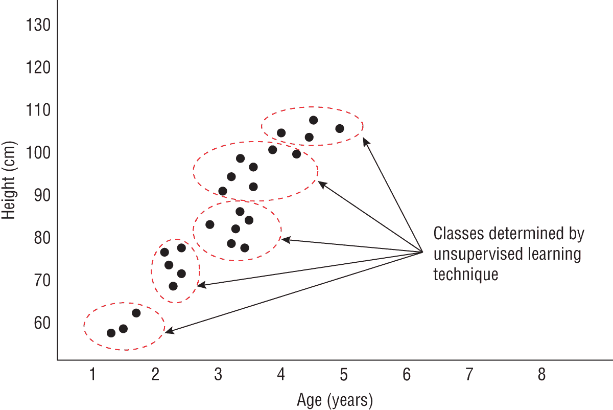

`图 1.2` 用于发现数据中模式的聚类技术

### 半监督学习

半监督学习是监督学习和无监督学习的结合。在许多情况下，数据科学家对监督学习方法中的数百万样本进行标记在实际上是不可能的；然而，数据科学家已经知道数据中存在已知的分类。在这种情况下，数据科学家对一部分数据进行标记以指示已知分类是什么，然后算法处理未标记的数据，以更好地定义这些类别之间的边界，并可能发现全新的类别。图 1.3 描述了将半监督学习应用于相同的 6 岁以下儿童身高和年龄数据的结果，其中一些样本被标记以指示其受教育程度。

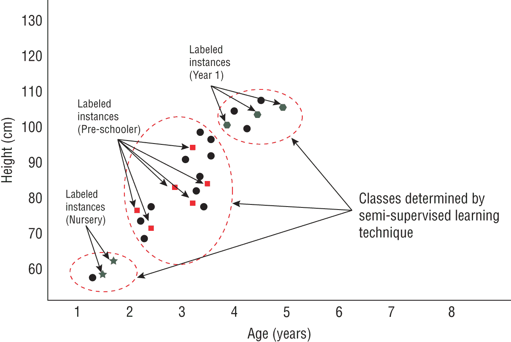

`图 1.3` 半监督学习

涉及极大数据集的现实问题使用这种方法。应用包括语音识别、自然语言解析和基因测序。

半监督学习的一个明显优势是比监督学习更不容易产生标签偏置。这是因为数据科学家只标记了一小部分数据，科学家引入的任何个人标签偏置的影响可以通过算法的无监督学习部分根据其处理的海量未标记样本来修正。

半监督学习算法假设决策边界在几何上是简单的；换句话说，彼此靠近的点实际上以某种方式相关。

### 强化学习

强化学习是一种计算方法，它尝试使用类似于人类学习的技术进行学习：通过与环境交互，并将正向负面奖励与不同的动作联系起来。例如，人类随着时间的推移了解到接触火是一件坏事；但使用同样的火来烹饪或提供温暖是一件好事。因此，当我们遇到火时，我们会以积极的方式使用它。

基于强化学习的系统通常称为 `agent`（智能体），它在任何时间点都可以采取若干固定动作，每个动作都关联着相应的奖励或惩罚。系统的目标是使一系列动作的累计奖励最大化。智能体获得的知识表示为一组策略，这些策略规定了智能体遇到给定情况时必须采取的动作。基于强化学习的系统用于两类任务：

- **情节性任务（Episodic tasks）：** 指问题具有有限终点，例如赢得游戏。

- **连续性任务（Continuous tasks）：** 指问题没有终点，例如使股票投资组合价值最大化。

强化学习算法通常在一个选择结果往往是延迟的环境中工作。例如，考虑一个自动股票交易机器人。它有几个实时输入，管理几只股票，并在任何时间点可以采取三个动作之一：买入股票、卖出股票或持有股票。多次买卖决策的结果可能是投资组合价值的最终增加（奖励），或投资组合价值的减少（惩罚）。

机器人预先不知道采取给定动作会导致奖励还是惩罚。机器人还必须包含延迟机制，而不是在完成交易后立即尝试衡量奖励/惩罚。机器人的目标是使奖励的数量最大化。随着时间的推移，机器人将学到可以在不同情况下应用的交易策略（策略）。强化学习结合深度学习神经网络是机器学习科学家之间一个备受研究的话题。

### 批量学习（Batch Learning）

批量学习指的是在模型模型进行预测之前，先在整个数据集上训练机器学习模型的做法。批量学习系统无法从未来遇到的新新数据中进行增量学习。如果你有一些想要用于训练批量学习系统的新额外数据，你需要对之前使用过的所有数据加上新额外数据创建一个新模型，并用这个新训练的模型替换旧版本模型。

批量学习系统在两种不同的模式下工作：学习和预测。在学习模式下，系统处于训练状态，不能用于预测。在预测模式下，系统不从观察中学习。

训练过程可能非常漫，需要几周的时间和若干计算资源。你还需要保留所有的训练数据，以便在需要训练模型新版本时。如果训练数据很大并需要几个 GB 的存储，这可能会是一个问题。

### 增量学习（Incremental Learning）


增量学习也称为在线学习，指的是使用小批量数据持续训练机器学习模型并增量地提高模型性能的做法。微批量的大小可以从单个项目到几百个项目不等。增量学习对于训练数据在一段时间内分块可用，或者训练数据量大到无法一次性放入内存的场景非常有用。增量学习的目标是无需使用所有之前的训练数据重新训练模型；相反，每当遇到一个新的微批量时，模型的参数（知识）都会进行增量更新。增量学习通常应用于实时流数据或非常大的数据集。

## 基于实例的学习（Instance-based Learning）

基于实例的学习系统通过从训练数据集的实例中选择最匹配的实例对新的未见数据进行预测。实际上，机器学习系统记忆了训练数据集，而预测仅仅是寻找最匹配项目的问题。基于实例的学习系统的训练阶段涉及将所有训练数据组织在适当的数据结构中，以便在预测阶段寻找最匹配的项目会更快。这种方法涉及很少（如果没有的话）模型调优，尽管在向机器学习系统提交训练数据之前，可能对其进行了某种程度的预处理。

基于实例的学习系统的优势在于，训练和预测都相对快速，而且向训练集中添加更多项目通常会提高系统的准确性。需要注意的是，基于实例的系统预测的结果将是训练集中已存在的某个实例。例如，考虑一个基于实例的机器学习系统，它根据输入的身高和体重值来预测个人的鞋码。让我们假设该系统是使用一个包含 100 个项目的训练集进行训练的，其中每个项目都包含身高、体重和鞋码值。

如果使用这个基于实例的机器学习系统根据新人的身高和体重（作为输入值）来预测其鞋码，那么预测的鞋码将是训练集中与之最匹配的项目的值。换句话说，机器学习系统永远不会输出一个在训练集中原本不存在的鞋码。

## 基于模型的学习

基于模型的学习系统尝试构建一个数学的、分层的或基于图的模型，以对输入与输出之间的关系进行建模。预测涉及求解模型以获得结果。大多数机器学习算法都属于这一类。

虽然基于模型的系统构建需要更多时间，但模型本身的大小只是训练数据大小的一小部分，而且为了获得预测，不需要保留（或向模型展示）训练数据。例如，一个从超过百万个项目的训练数据集构建的模型可以存储在一个较小的五元素向量中。

## 传统方法与机器学习方法

作为人类，我们所有人都熟悉学习的概念。学习有两种主要形式：记忆和理解。记忆你的密码和学习开车之间有明显的区别。后者涉及理解车辆是如何运作的，以及在道路上不同情况下如何反应。你不需要背下从家里到工作地点开车时需要执行的精确活动序列；相反，你是在评估道路状况时应用了所得的理解。

机器学习算法的能力并不像人类学习那样精密。机器不具备理解和推理的能力；然而，它们可以预测和泛化，并且处理数据的速度比人类快得多。在本节中，你将研究一个假设的情景，并理解如何应用机器学习系统来解决眼下的问题。

想象你被银行的信用卡团队聘用，并被赋予创建一个解决方案以向客户提供新的信用卡产品。根据这项新产品，符合条件的客户可以获得信用额度高达 25,000 美元且利率的信用卡。银行希望将损失降至最低，并要求仅向可能向银行还款资金的客户提供信用卡。

首先，你决定创建一个新的申请表，客户需要填写此表来申请这种信用卡。在申请表上，你要求提供以下信息：

* 姓名
* 年龄
* 性别
* 现居住年限
* 过去 5 年内的地址数量
* 在其他银行持有的信用卡数量
* 贷款总量（不包括抵押）
* 税后总收入
* 预计每月常规支出
* 每月总还款额
* 房屋状况
* 婚姻状况
* 家庭中受抚养人数

在现实场景中，你会要求更多信息，并还会使用信用评分公司提供申请人的信用评级，但就本例而言，这个列表足够了。让我们也假设允许客户申请信用卡的机制在银行网站上可用，且所有申请表的数据都可以在银行内部 SQL 数据库的表中找到。

当产品发布时，你的银行预计它会受到客户欢迎，你需要有一个计划来处理每周大量的申请。对于你的银行来说，在信用卡领域保持竞争力也至关重要，因此你必须确保在信用卡领域保持竞争力，并且不能让申请人等待几周才能得知申请结果。你需要确保在收到申请的几分钟内对你的新产品做出决定，银行的信用卡条款是至关重要的。

显然，聘用数百名分析师审查每个贷款申请并做出决定是没有成本效益的。在之前，你有两种选择：

* 你可以建立一个基于规则的系统
* 你可以建立一个机器学习系统

让我们首先检查基于规则系统如何帮助解决这个问题。

## 基于规则的决策系统

面对易于理解的基于规则的方法和未知的黑箱机器学习系统之间的选择时，你决定采用基于规则系统。

规则本身将存储在数据库中，将规则应用于申请的业务逻辑将封装在服务器端应用程序中。你计划拥有这些服务器，并根据需要进行扩展。图 1.4 展示了该系统的架构。

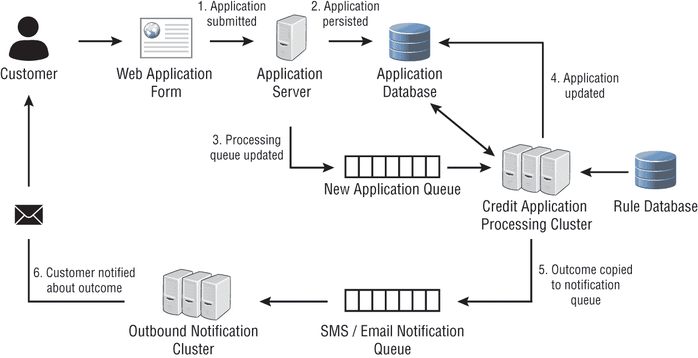

当申请人在银行网站上提交信用卡申请时，会生成一个唯一的申请标识符，应用程序会在数据库中添加一行。应用程序还将向消息队列发布一条消息；消息的内容包含唯一的标识符。一组贷款处理服务器订阅该消息队列，可用服务器将获取消息并开始处理信用卡申请。当服务器得出决定时，它将更新数据库中的贷款申请，并在另一个消息队列上发布消息。这条新消息的内容将包含向客户发送短信或电子邮件通知所需的信息，告知客户结果。

如何定义用于决策的规则？首先，你需要根据对问题领域的经验以及贷款申请表的特征来创建规则。如果你的业务有另一个你试图替换的基于规则系统，你可能还可以从现有系统中迁移一些规则。

假设你无法获得现有系统，需要自己定义业务规则。通过查看贷款申请表中的字段，你决定从决策过程中删除以下字段，因为你认为它们对个人每月还款的能力可能没有影响：

* 姓名
* 性别
* 婚姻状况
* 家庭中受抚养人数
* 房屋状况

现在你剩下了以下可以用于构建规则的信息：

* 现居住年限
* 过去 5 年内的地址数量
* 在其他银行持有的信用卡数量
* 贷款总量（不包括抵押）
* 税后总收入
* 预计每月常规支出
* 每月总还款额

你决定创建一些规则，拒绝符合以下任何一项标准的申请：

1. 在当前地址居住少于 1 年的申请人。
2. 在过去 5 年内有过三个以上地址的申请人。
3. 在其他银行拥有两张或以上信用卡的申请人。
4. 税后每月可支配收入低于总收入的 15% 的申请人。

这些规则可以使用任何编程语言通过 `if-then-else` 语句进行编码。图 1.5 包含一个描述使用你定义的规则进行决策过程的流程图。

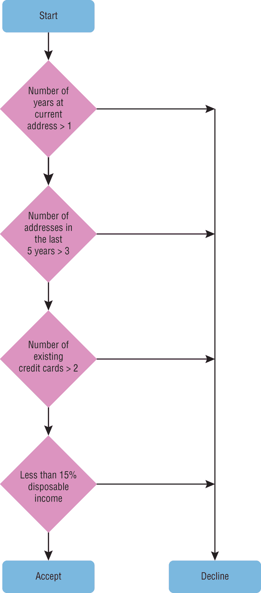

**图 1.5** 描述基于规则系统决策过程的流程图

存在一种可能性：你创建的规则和最初的假设并非最优，但如果你观察到由于未付款导致的损失超过了银行的风险阈值，你可以随时对规则进行调整。

随着时间的推移，由于贷款申请量的增加，你需要调整业务规则来处理日益增长的量，并且你可能会遇到一些问题：

* 你的规则变得非常复杂且相互依赖；用新规则替换旧规则变得愈发复杂。
* 你的规则没有基于任何数值分析；它们是为了应对日益增长的需求而临时创建的。
* 你的规则没有考虑到经济不断变化的模式；例如，在经济衰退期间，可能会更多的人最终未能按时付款，尽管你的规则预测他们不应该违约。你需要不断更新规则，这可能是一个耗资且耗时的过程。

现在，让我们来看看如何使用基于机器学习的系统来解决这些问题。

### 基于机器学习的系统

与基于规则的解决方案不同，没有数据你就无法创建机器学习的解决方案。拥有准确且与问题相关的数据非常重要。你可能倾向于使用基于规则的方法，因为它更容易开始，但基于机器学习的系统通常更有效。

你可能在想需要多少数据？这没有简单的答案，但通常来说，数据越多，模型的效果就越好。你还需要确保你的数据是高质量且无偏的。

一旦你收集了数据，你就需要进行特征工程来为模型准备数据。这涉及到从现有数据中创建新特征，以帮助模型学习得更好。例如，你可能会创建一个代表申请人债收入比的新特征。

| 名称 | 自由文本 | 字符 A–Z，某些特殊字符 | 字符 A–Z，某些特殊字符 |
| --- | --- | --- | --- |
| 年龄 | 连续型数值 | 22–45 | 18–150 |
| 性别 | 分类 | 男、女、未透露 | 男、女、未透露 |
| 现居住地址年限 | 连续型数值 | 0–7 | 0–150 |
| 过去 5 内的地址数量 | 连续型数值 | 1–6 | 1–10 |
| 在其他银行持有的信用卡数量 | 离散型数值 | 1, 2, 3 | 1, 2, 3, 4, 5, 6, 7, 8, 9, 10 |
| 贷款总（不含抵押贷款） | 连续型数值 | 0–17500 | 0–1000 万 |
| 税后总收入 | 连续型数值 | 50000–200000 | 0–1000 万 |
| 预计每月常规支出 | 连续型数值 | 3000–15000 | 0–1000 万 |
| 每月总还款额 | 连续型数值 | 0–1500 | 0–1000 万 |
| 房屋主状态 | 分类 | 是或否 | 是或否 |
| 婚姻状况 | 分类 | 单身、已婚、未透露 | 单身、已婚、未透露 |
| 家庭养人数 | 离散型数值 | 1, 2, 3 | 1, 2, 3, 4, 5, 6, 7, 8, 9, 10 |

很明显，某些答案是分类的，而另一些是数值型的。数值特征本身是离散或连续的，并且具有不同的值范围。

大多数机器学习模型的设计使其某一类特征的性能优于另一类。某些基于统计的学习模型对大数值也敏感。在检查了申请表上的问题类型、输入值范围以及 5000 名申请人的样本数据后，你决定想将申请表上的所有答案作为输入特征，但以下除外：

* 申请人姓名
* 养人数
* 在其他银行持有的信用卡数量

你还决定构建了一个名为 `Total Disposable Income` 的新特征，并将三个分类特征拆分为离散数值特征，如表 1.2 所示。

#### 表 1.2: 将分类特征转换为数值特征

| 原始分类特征 | 新的数值特征 | 允许值/范围 |
| --- | --- | --- |
| 性别 | `SexIsMale` | 0 或 1 |
| | `SexIsFemale` | 0 或 1 |
| | `SexIsUndisclosed` | 0 或 1 |
| 房屋主状态 | `IsHomeOwner` | 0 或 1 |
| | `IsNotHomeOwner` | 0 或 1 |
| 婚姻状况 | `MaritalStatusIsSingle` | 0 或 1 |
| | `MaritalStatusIsMarried` | 0 或 1 |
| | `MaritalStatusIsUndisclosed` | 0 或 1 |

新构建的特征 `Total Disposable Income` 定义为：

`Total Disposable Income = Total Income After Tax – Regular Monthly outgoings – Monthly Loan Repayments`

特征工程将在第 2 章中介绍，但需要注意的是，回答为“未透露”的问题被视为有效值，而不是将问题视为缺失答案。

表 1.3 列出了新的输入特征和工程特征、每个特征的预期值范围，以及在 5000 份样本申请表中观察到的实际值范围。

#### 表 1.3: 修改后的输入特征

| 特征名称 | 特征描述 | 数据类型 | 观测范围 | 最大范围 |
| --- | --- | --- | --- | --- |
| F1 | 年龄 | 连续型数值 | 22–45 | 18–150 |
| F2 | `SexIsMale` | 离散型数值 | 0, 1 | 0 或 1 |
| F3 | `SexIsFemale` | 离散型数值 | 0, 1 | 0 或 1 |
| F4 | `SexIsUndisclosed` | 离散型数值 | 0, 1 | 0 或 1 |
| F5 | 现居住地址年限 | 连续型数值 | 0–7 | 0–150 |
| F6 | 过去 5 内的地址数量 | 连续型数值 | 1–6 | 1–10 |
| F7 | `Total Disposable Income` | 连续型数值 | 0–7 | 0–10 |
| F8 | 贷款总（不含抵押贷款） | 连续型数值 | 0–17500 | 0–1000 万 |
| F9 | 税后总收入 | 连续型数值 | 50000–200000 | 0–1000 万 |
| F10 | 预计每月常规支出 | 连续型数值 | 3000–15000 | 0–1000 万 |
| F11 | 每月总还款额 | 连续型数值 | 0–1500 | 0–1000 万 |
| F12 | `IsHomeOwner` | 离散型数值 | 0, 1 | 0 或 1 |
| F13 | `IsNotHomeOwner` | 离散型数值 | 0, 1 | 0 或 1 |
| F14 | `MaritalStatusIsSingle` | 离散型数值 | 0, 1 | 0 或 1 |
| F15 | `MaritalStatusIsMarried` | 离散型数值 | 0, 1 | 0 或 1 |
| F16 | `MaritalStatusIsUndisclosed` | 离散型数值 | 0, 1 | 0 或 1 |

交叉验证可以帮助减少模型在训练集中捕获意外偏差的可能性。交叉验证的原理是对整个数据集进行随机洗乱，并将其分为若干个较小的集合（称为“折”）。例如，如果将数据分为 10 个相等的折，则模型将被训练和评估 10 次。在每个训练和评估周期中，其中一折将被留作测试集，其余九折将组成训练集。这在图 1.6 中所示。

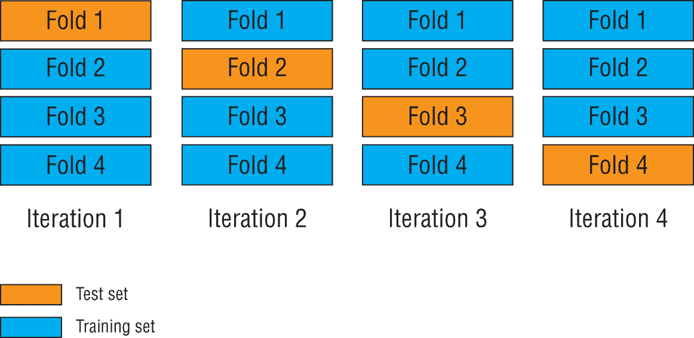

`图 1.6` 使用多折的交叉验证

有时偏差会在数据收集阶段引入（也称为采样偏差），任何程度的交叉验证都无法消除它。例如，你可能正在基于一个包含圣诞假期期间收集的消费者购物趋势的数据集来构建模型。这些数据将偏向假期购物的特定趋势，如果使用此类数据构建的模型来预测消费者在整年期间可能购买什么，其表现将会很糟糕。在这种情况下，最佳选择是收集更多数据以消除采样偏差。

### 选择机器学习算法

有许多可以用于分类任务的机器学习算法。在当前的示例中，目标是在应用点决定是否应该向申请人发放信用卡。做出此决策的机器学习系统将在带有标签的数据上进行训练，这些标签指示客户在历史上是否错过过任何付款（负性结果），或者客户是否没有错过任何一笔付款（正性结果）。

是否发放信用卡的决定与机器学习系统是否指示客户将发生违约直接相关。这是一个典型的分类问题，可以使用许多算法：

* 逻辑回归
* 决策树
* 随机森林
* XGBoost
* 神经网络
* 基于聚类的技术

算法的选择通常受到多种因素的影响，如所需的准确率、所需的类别数量（二分类 vs. 多分类）、足够的训练数据的可用性、训练模型所需的时间、训练后模型的内存占用以及将模型部署到生产环境中所需的资源。

在这个示例中，我们将使用一种名为 `logistic regression` 的算法，该算法在二分类问题上表现良好——二分类问题涉及将某物分类为两个类别之一。逻辑回归建立在名为 `linear regression` 的算法输出基础之上。线性回归是一种预测连续数值的简单且有效的算法，它假设输出变量可以表示为输入特征的线性组合。

实际上，线性回归试图找到拟合所有数据点的最佳直线（在高维空间中为超平面）。线性回归的输出是一个连续的、无界的值。它可以是一个正数，也可以是一个负数。它可以是任何值，取决于训练模型时的输入。

为了将连续值用于二分类，逻辑回归通过将线性回归的输出输入 `sigmoid` 函数，将其转换为 0.0 到 1.0 之间的概率值。`sigmoid` 函数的图如图 1.7 所示。无论输入值是多少，`sigmoid` 函数的输出永远不会低于 0.0 或高于 1.0。

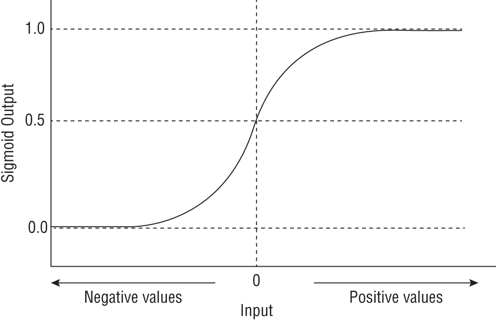

`图 1.7` sigmoid 函数

通过设置一个阈值，并将低于该阈值的所有值视为类 A，高于阈值的所有值视为类 B，可以将 `sigmoid` 函数的输出用于二分类（图 1.8）。

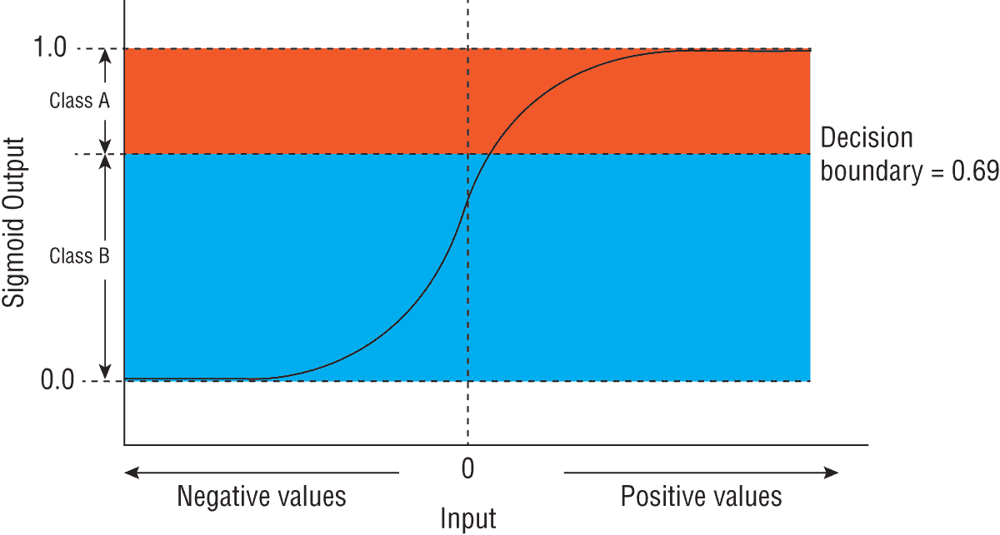

`图 1.8` 使用 sigmoid 函数进行二分类

虽然逻辑回归容易理解，但如果目标变量与输入特征之间的关系很复杂，它可能无法提供良好的结果。在这种情况下，你可以考虑使用基于树的模型（如决策树）或基于实例学习的聚类模型。你将在第 4 章中学习更多关于模型构建的知识。

### 评估模型性能

一旦你构建了一个用于确定是否向申请人发放信用卡的模型，你就能够定量衡量它的性能。评估模型目的是其在新数据上的运行效果——模型是使用训练阶段留出的标记测试集进行评估的。

由于此示例中的模型试图解决分类问题，你可以简单地统计模型预测正确结果的次数，并将其用作评估指标。

如果向申请人发放信用卡被视为正性结果，你可以创建几个超出简单计数的额外指标：

* **真正性计数（True positive count）：** 模型预测应向申请人发放信用卡的次数，且该决策与标记测试数据集中的结果一致。
* **假正性计数（False positive count）：** 模型预测应向申请人发放信用卡的次数，但标记测试数据显示该申请人不应成功通过。
* **真负性计数（True negative count）：** 模型预测不应向申请人发放信用卡的次数，且该决策与测试数据集中的结果一致。
* **假负性计数（False negative count）：** 模型预测不应向申请人发放信用卡的次数，但根据标记数据该决策是不正确的。

你将在第 5 章中学习使用这些指标以及性能评估和模型调优技术。

* 机器学习是人工智能的一个分支，涉及创建从数据中学习的算法。
* 机器学习处理创建能够可靠且快速地泛化和预测信息的计算机程序的问题。
* 机器学习通常用于实现欺诈检测系统、信用评分系统、身份验证决策引擎、行为生物识别系统、流失预测和产品推荐引擎。
* 训练机器学习系统所需的训练数据类型可以将机器学习系统分为监督学习、无监督学习或半监督学习。
* 批量学习（Batch learning）是指在模型进行预测之前，在整个数据集上训练机器学习模型的做法。


增量学习（Incremental learning），也称为在线学习，是指使用小批量数据持续训练机器学习模型并增量提高模型性能的做法。

基于实例的学习（Instance-based learning）系统通过从训练集中选择最近的实例来对未见新数据进行预测。

基于模型的学习（Model-based learning）系统试图构建一个数学、层次结构或图结构的模型来模拟输入与输出之间的关系。

在上一章中，你已经对机器学习有了通用的概述，并学习了不同类型的机器学习系统。在本章中，你将学习如何使用`NumPy`、`Pandas`和`Scikit-learn`来执行常见的特征工程任务。

**注意**：为了跟上本章的学习，请确保你已经按照附录 A 所述安装了`Anaconda Navigator`和`Jupyter Notebook`。

你可以从`www.wiley.com/go/machinelearningawscloud`下载本章节的代码，或者通过以下 URL 从 GitHub 下载：

`https://github.com/asmtechnology/awsmlbook-chapter2.git`

## 机器学习数据集

训练机器学习模型需要高质量的数据。事实上，缺乏高质量的训练数据会导致即使使用最著名的机器学习算法构建的模型性能也不佳。在这种情况下，“质量”指的是训练数据能够准确捕获底层问题领域的细微差别的能力，并且尽可能地避免错误和遗漏。

接下来，我们将探索一些常用的公共机器学习数据源来源。

## Scikit-learn 数据集

`Scikit-learn`中的`datasets`包包含了热门机器学习数据集的下采样版本，例如`Iris`、`Boston`和`Digits`数据集。这些数据集通常被称为*玩具数据集 (toy datasets)*。`Scikit-learn`提供了函数，可以将玩具数据集加载到一个类似于字典的对象中，该对象具有以下属性：

- `DESCR`: 返回数据集的人类可读描述。
- `data`: 返回一个包含所有特征数据的`NumPy array`。
- `feature_names`: 返回一个包含特征名称的`NumPy array`。并非所有的数据集都支持此属性。
- `target`: 返回一个包含目标变量数据的`NumPy array`。
- `target_names`: 返回一个包含分类目标变量值的`NumPy array`。数字、波士顿房价和糖尿病数据集不支持此属性。

以下代码段落加载了热门`Iris`数据集的玩具版本，并探索了该数据集的属性：

`Scikit-learn`包含的玩具数据集列表如下：

- *波士顿房价数据集*：这是一个用于构建回归模型的流行数据集。可以使用`load_boston()`函数加载该数据集的玩具版本。你可以在`https://archive.ics.uci.edu/ml/machine-learning-databases/housing/`找到该数据集的完整版本。
- *鸢花数据集*：这是一个用于构建分类模型的流行数据集。可以使用`load_iris()`函数加载该数据集的玩具版本。你可以在`https://archive.ics.uci.edu/ml/datasets/iris`找到该数据集的完整版本。
- *糖尿病发生数据集*：这是一个用于构建回归模型的流行数据集。可以使用`load_diabetes()`函数加载该数据集的玩具版本。你可以在`http://www4.stat.ncsu.edu/~boos/var.select/diabetes.html`找到该数据集的完整版本。
- *手写数字数据集*：这是一个包含 0 到 9 手写数字图像数据集，用于分类任务。可以使用`load_digits()`函数加载该数据集的玩具版本。你可以在`http://archive.ics.uci.edu/ml/datasets/Optical+Recognition+of+Handwritten+Digits`找到该数据集的完整版本。
- *Linnerud 数据集*：这是一个测量中年男性运动变量的数据集，用于多元回归。可以使用`load_linnerud()`函数加载该数据集的玩具版本。你可以在`https://rdrr.io/cran/mixOmics/man/linnerud.html`找到该数据集的完整版本。
- *葡萄酒识别数据集*：该数据集是对意大利生长的葡萄酒进行化学分析的结果。它用于分类任务。可以使用`load_wine()`函数加载该数据集的玩具版本。你可以在`https://archive.ics.uci.edu/ml/`找到。
- *乳腺癌数据集*：该数据集描述了乳腺癌细胞的特征，用于分类任务。可以使用`load_breast_cancer()`函数加载该数据集的玩具版本。你可以在`https://archive.ics.uci.edu/ml/datasets/Breast+Cancer+(Diagnostic).`找到其完整版本。

## AWS 机器学习数据集

AWS 托管了一个可以轻松集成到应用程序中的机器学习数据集库。这些数据集作为`S3 buckets`或`EBS volumes`提供。可以通过`AWS CLI`、`AWS SDKs`或`S3 HTTP API`访问。包含以下类别：

- *生物学*：包括人类基因组计划等热门数据集。
- *化学*：包括`PubChem`等其他内容。`PubChem`是一个分子的数据库，可以通过`https://pubchem.ncbi.nlm.nih.gov/`访问。
- *经济学*：包括人口普查数据等。
- *百科全书*：包括维基百科内容。

你可以通过`https://registry.opendata.aws`浏览这些数据集。

## Kaggle.com 数据集

`Kaggle.com`是一个托管机器学习竞赛的流行网站。`Kaggle.com`还包含大量通用数据集，可以通过`https://www.kaggle.com/datasets`访问。除了页面上的通用数据集，`Kaggle.com`的竞赛也有自己的数据集，可以通过参赛来访问。数据集文件可以下载到本地。你可以在`https://www.kaggle.com/competitions`查看竞赛列表。

### UCI 机器学习库

UCI 机器学习库是由加州大学冰分校机器学习与智能系统中心维护的包含 450 多个数据集的公共集合。它是最老的机器学习数据来源之一，通常是初学者和专业人士的首选地。这些数据集由公众贡献，在用于它们构建模型时，所需的预处理程度各不相同。可以将数据集下载到本地，然后使用`Pandas`和`Scikit-learn`等工具进行处理。你可以在`https://archive.ics.uci.edu/ml/datasets.php.`浏览完整列表。

UCI 机器学习库的一小部分热门数据集也托管在`Kaggle.com`上，可以通过`https://www.kaggle.com/uciml`访问。

## 数据预处理技术

在第一章](#c01.xhtml)中，你学习了不同类型的机器学习系统以及构建机器学习解决方案的总体流程。机器学习系统的性能取决于训练数据的质量，这并不意外。在本节中，你将学习一些为机器学习模型准备数据的常用方法。

### 获取数据概述

在构建机器学习模型时，你想要执行的事情之一是探索数据，以获取变量和目标的概述。本节在 Jupyter notebook 中结合`NumPy`和`Pandas`使用`Titanic`数据集。该数据集和笔记本文件包含在课程的代码资源中。

泰坦尼克数据集是一个非常流行的数据集，包含了泰坦尼克号上 1309 名乘客的人口统计信息和票务信息，目标是预测哪些乘客更有可能幸存。完整数据集可以从范德堡大学生物统计系获取(`https://biostat.mc.vanderbilt.edu/wiki/Main/DataSets`）。`titanic3`数据集的版本也可以从其他几个来源获得，包括名为“泰坦尼克：灾难中的机器学习”的流行`Kaggle.com`竞赛(`https://www.kaggle.com/c/titanic`）。Kaggle 版本包含在本章附带资源中，其优点是经过过洗乱并预先分为训练集和验证集。训练集包含在一个名为`train.csv`的文件中，验证集为`test.csv`。

泰坦尼克数据集 Kaggle 版本的属性描述如下：

- `PassengerId`: 文本变量，用作行标识符。
- `Survived`: 布尔型变量，表示该人员是否在灾难中幸存。0 = 否，1 = 是。
- `Pclass`: 分类变量，表示票等舱。1 = 1 等舱，2 = 2 等舱，3 = 3 等舱。
- `Name`: 乘客的名字。
- `Sex`: 分类变量，表示乘客的性别。
- `Age`: 数值变量，表示乘客的年龄。
- `SibSp`: 数值变量，表示一起旅行的兄弟姐妹/配偶的数量。
- `Parch`: 数值变量，表示一起旅行的父母和孩子的数量。
- `Ticket`: 文本变量，包含票号。
- `Fare`: 数值变量，表示 1970 年前支付的英镑票价。
- `Cabin`: 文本变量，表示舱号。
- `Embarked`: 分类变量，表示出发港。C = 塞得尔堡，Q = 皇后敦，S = 南安普普顿。

要从位于计算机上的 CSV 文件将泰坦尼克训练集加载到 Pandas dataframe 中，请使用以下代码段：

要做的第一件事是获取数据集行数和列数的信息。可以使用 dataframe 的`shape`属性来提供这些信息：

你可以看到 dataframe 有 891 行和 12 列（或属性）。可以使用以下代码段来获取列名：

数据科学家必须处理的最常见问题之一是缺失值。原始数据集通常在一个列或多个列中具有缺失值。值缺失的原因有很多，从人为失误到该观测值的数据根本不可用等。当您将 CSV 文件加载到 Pandas dataframe 时，Pandas 使用`NaN`作为标记缺失值的符号。有多种方法可以判断 dataframe 中的列是否包含缺失值。其中一种方法是使用如下代码段所示的`info()`函数：

查看`info()`函数的结果，很明显大多数列都有 891 个值，而有三列——`Age`、`Cabin`和`Embarked`的值少于 891 个。使用`info()`函数检测缺失值仅在该值在 CSV 文件中确实缺失时才有效，这意味着 Pandas 能够检测到缺失值并将其替换为 dataframe 中的`NaN`标记。然而，如果生成数据的过程使用了空格或特殊字符（如`!`）来表示缺失值，那么 Pandas 将不会自动解释这些字符为代表缺失数据。

获取缺失值信息的另一种方法是将 Pandas`isnull()`函数的输出与`sum()`函数进行链式调用。当应用于 dataframe 时，`isnull()`函数会返回一个与原始 dataframe 维度相同的布尔值 dataframe。如果原始 dataframe 中对应位置的值为`None`或`NaN`，则新 dataframe 中对应位置的值为`True`。当`sum()`函数应用于新的布尔值 dataframe 时，将返回一个列表，其中包含每列`True`值的数量。以下代码段显示了链式调用`isnull()`和`sum()`函数以获取 dataframe 每列缺失值数量的结果：

从结果中可以清楚地看到，大量的`Age`和`Cabin`值缺失。我们将在本章晚些部分讨论处理缺失值的方法。

有时，获取数据感觉的最佳方法是直观地检查 dataframe 的内容。可以使用 dataframe 对象的`head()`函数来查看 dataframe 前几行的内容（图 2.1）。

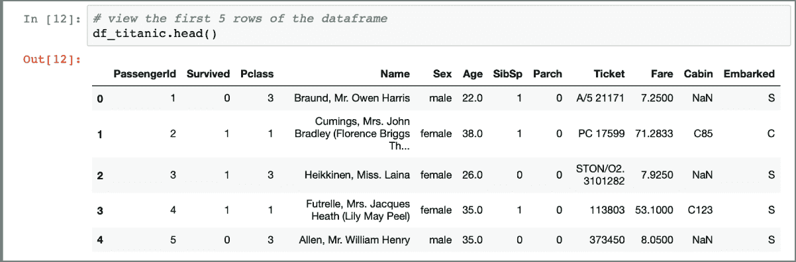

**图 2.1** `head()`函数显示 Pandas dataframe 开头的行。

如果列数过多，Pandas 无法在单行内水平显示，那么 Pandas 默认显示 dataframe 列的子集。该子集由 dataframe 左侧的几列和右侧的几列组成。图 2.2 展示了在具有 30 列的 dataframe 上使用`head()`函数的效果。

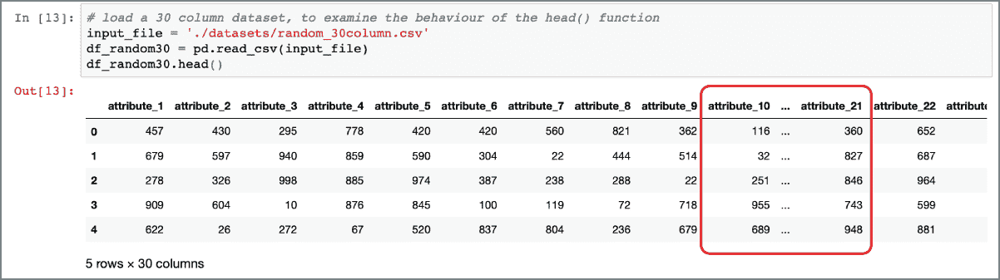

**图 2.2** `head()`函数对大型 dataframe 显示截断数据。

你可以通过设置 Pandas 属性`display.max_columns`来更改 Pandas 显示的最大列数。例如，以下代码段将确保 Pandas 显示的列不超过四列：

如果你想显示所有列，请将`display.max_columns`的值设置为`None`：

`Survived`属性是一个二分类属性，其值为 1 表示该个体幸存。当你的机器学习模型试图预测的目标是分类变量（二分类或多分类）时，了解训练数据集中每个类别的数值分布是非常用的。你可以通过以下代码片段获取此示例中目标值的分布：

`value_counts()`函数不仅用于分类列，也可以用于数值列。但默认情况下，`value_counts()`函数不会提取`NaN`值。要让`value_counts()`函数包含`NaN`标记的计数，请像下面的片段所示包含`dropna=false`参数：

如果你更倾向于目标值分布的可视化表示，可以使用以下片段创建一个直方图。直方图如图图 2.4 所示。

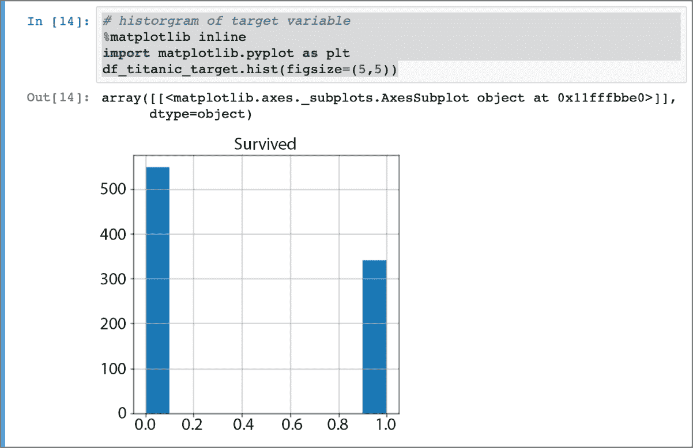

图 2.4 Survived 属性值的分布

除了目标变量的直方图外，使用直方图获取特征值分布的概述也是很有用的。Pandas dataframe 对象提供的`hist()`函数只会为数值生成直方图。泰坦尼克数据唯一的数值特征是`Age`、`Fare`、`Pclass`、`Parch`和`SibSp`。可以使用以下片段生成数值特征的直方图。生成的特征直方图如图图 2.5 所示。

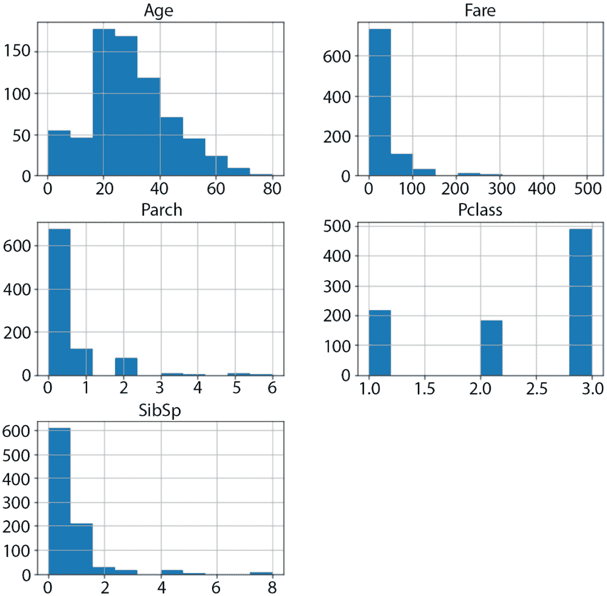

图 2.5 数值特征直方图

如果你有统计学背景，就会意识到直方图的外受箱体（bins）宽度的影响。数据科学家经常会针对不同箱宽的同一变量生成多个直方图，以更好地理解数据分布。可以使用以下片段创建单个数值属性的直方图，并指定 x 轴上等宽箱体的数量。图 2.6 展示了通过为同一数值特征选择不同箱宽而获得的直方图。

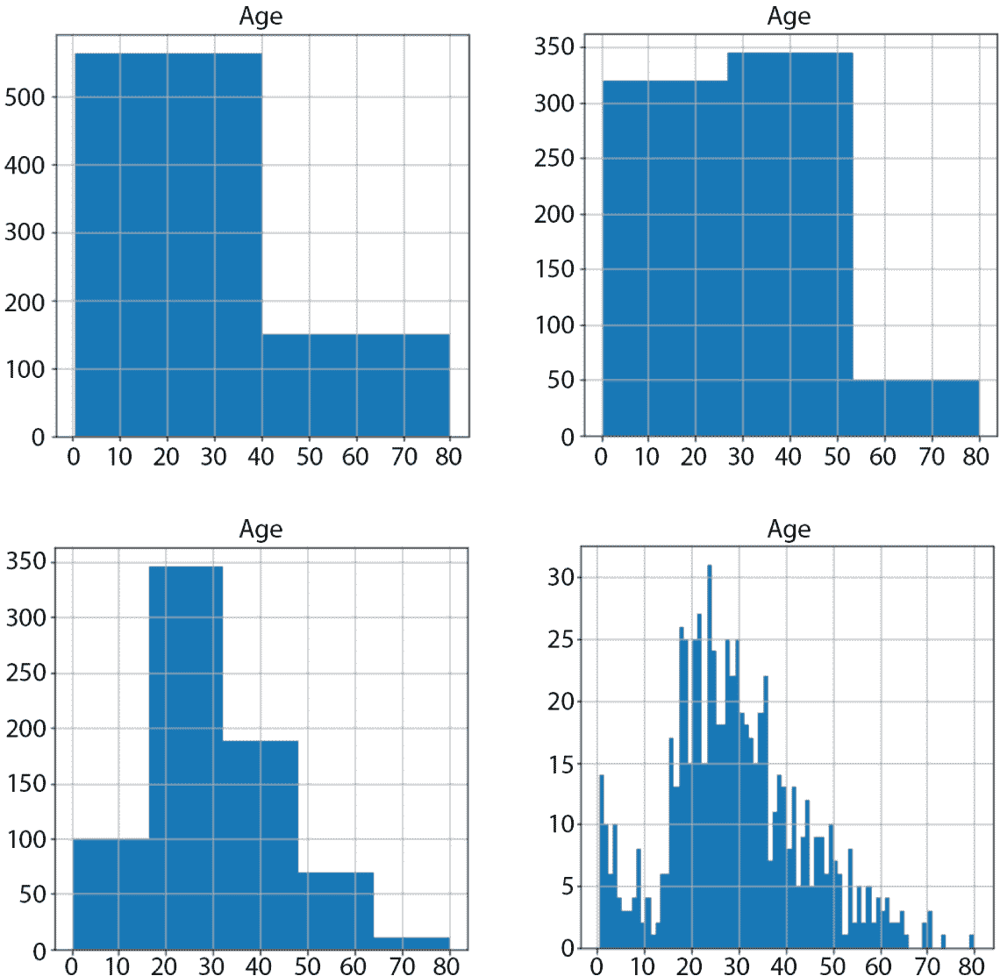

图 2.6 使用不同箱宽的“Age”数值特征直方图（2, 3, 5, 80）

由于`value_counts()`函数同时适用于数值和分类特征，你可以通过使用`value_counts()`函数的输出生成分类特征的直方图。以下片段演示了在`Embarked`分类特征上使用这种方法。生成的直方图如图图 2.7 所示。

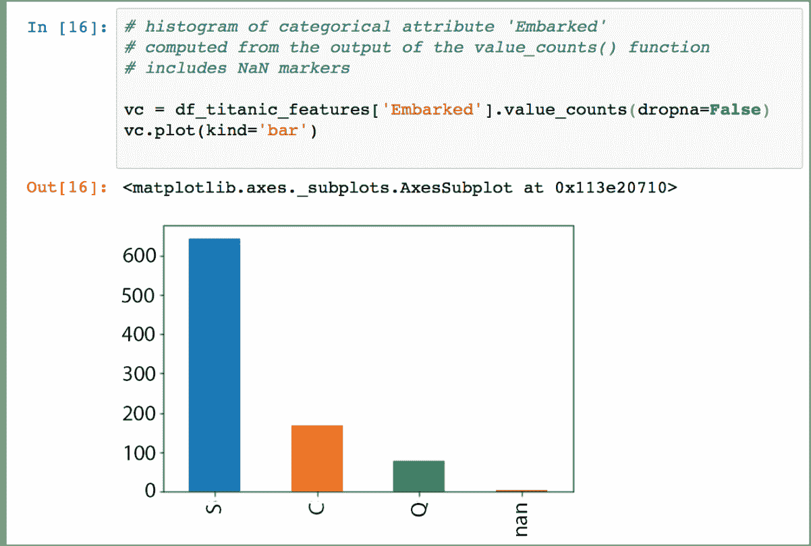

图 2.7 “Embarked”分类特征直方图

除了特征和目标变量分布的信息外，这些变量的统计特征以及它们之间的相关性可以为训练数据提供有用的见解。Pandas 提供了`describe()`函数，可用于 dataframe 以获取其内部数值属性的统计信息。以下片段显示了`df_titanic_features`数据集上`describe()`函数的结果：

`describe()`函数提供的信息包括每个数值特征的最小值、最大值、平均值、标准差和四位数。四位数是一个在该值以下可以找到特定百分比的观测值。例如，第一四分位数是 25% 观测值所在的值。`Age`特征的第一四分位数是 20.12，这意味着数据集捕获的 25% 的人的年龄小于 20 岁。特征的四位数和统计特征通常使用箱线图（box plot）表示。箱线图将在第 4 章中介绍；然而，你可以使用 dataframe 的`boxplot()`函数来创建所有数值特征的箱线图。以下片段演示了`boxplot()`函数的使用。生成的箱线图如图图 2.8 所示。

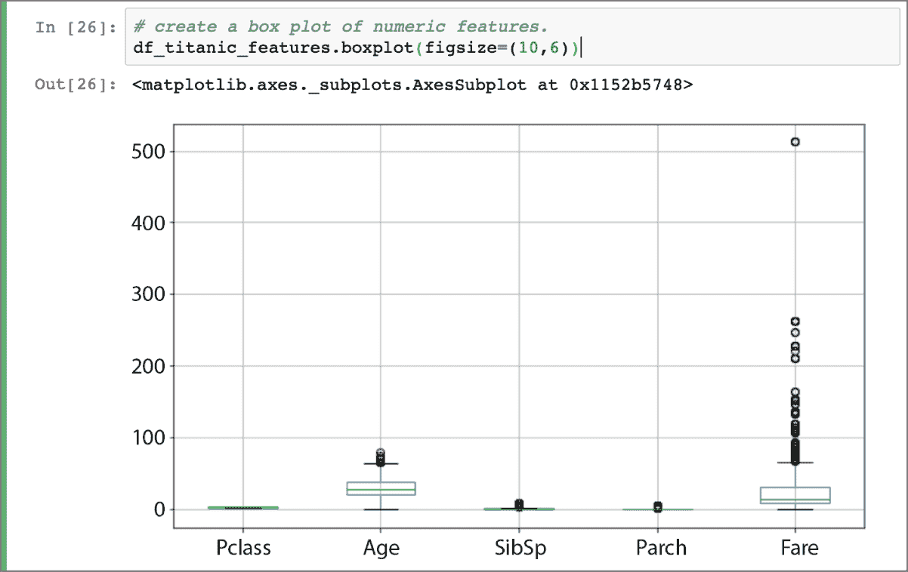

图 2.8 数值特征的箱线图

输入特征与目标之间的相关性信息有助于从数据中筛选出最佳特征用于模型构建和预测。特征本身之间的相关性信息有助于减少特征数量和通用的过拟合风险。Pandas 提供了`corr()`函数，可计算 dataframe 列之间的皮尔逊相关系数。在`df_titanic` dataframe 上应用`corr()`函数的结果如图图 2.9 所示。

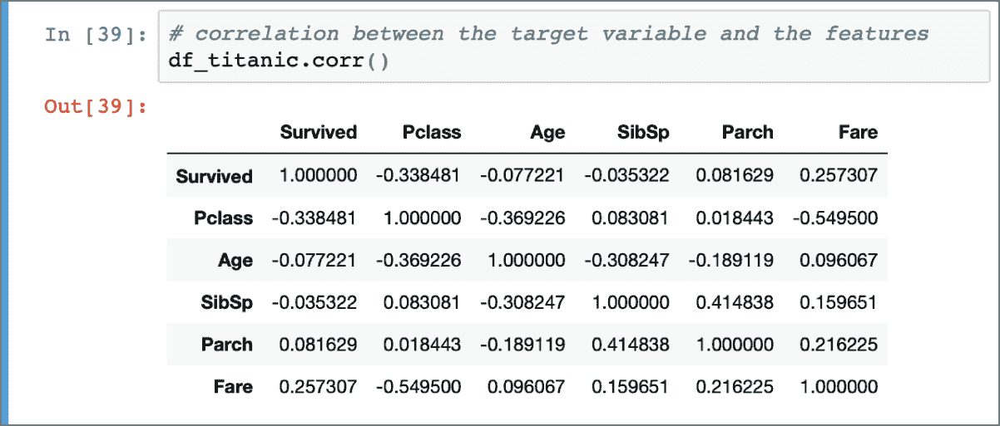

图 2.9 数值之间的相关性

需要注意的是，皮尔逊相关系数只能检测变量之间的线性相关性。`corr()`函数允许你从 Pearson、Kendall 和 Spearman 等标准相关系数中进行选择。更多信息请参见`https://pandas.pydata.org/pandas-docs/stable/reference/api/pandas.DataFrame.corr.html`。

以下片段列出了数值特征与目标变量之间的相关性排序：

计算属性对之间的相关系数并不是获取特征相关性的唯一方法。你还可以创建特征对之间的散点图来可视化它们的关系。以下片段使用 Pandas 的`scatter_matrix()`函数创建所有特征之间的散点图。生成的散点图如图图 2.10 所示。

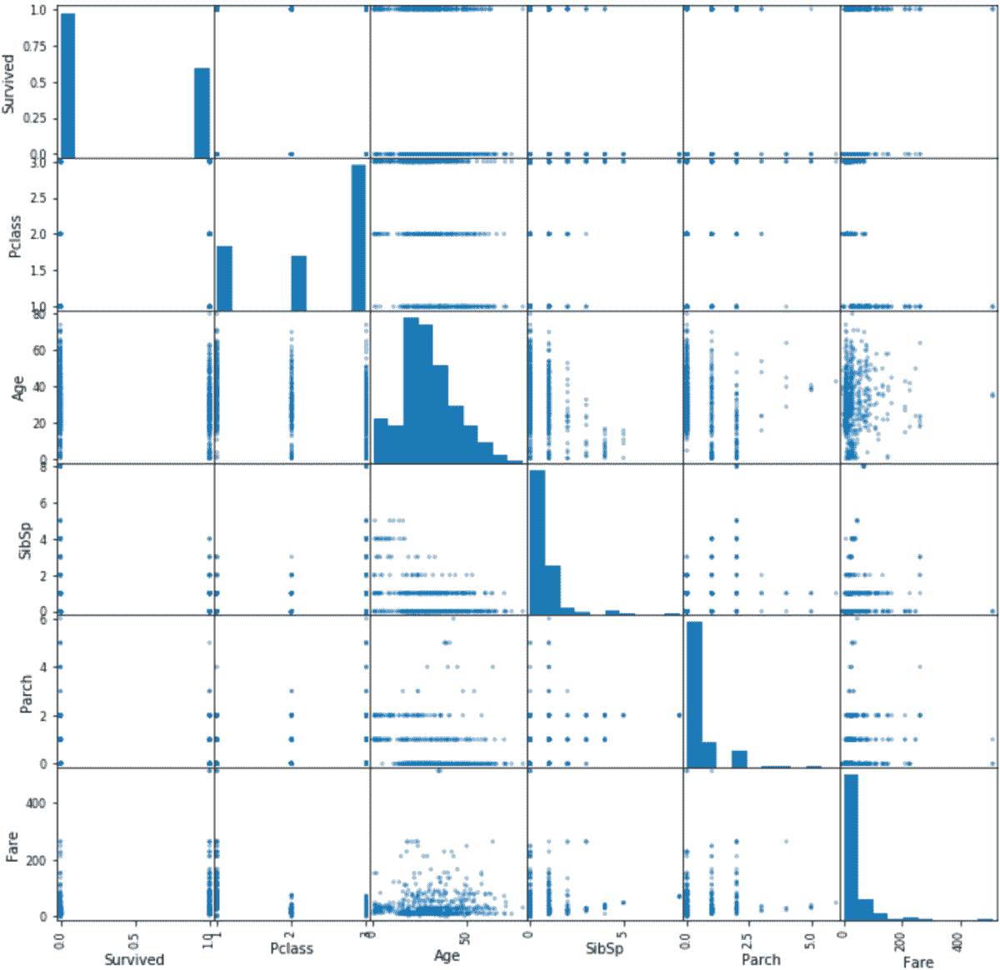

图 2.10 属性之间的散点矩阵

### 处理缺失值


在上一节中，你学习了用于探索数据的技术。在探索泰坦尼克数据集时，你了解到`Age`、`Cabin`和`Embarked`类存在缺失值。`Age`是一个数值特征，我们可以使用以下片段通过箱线图快速获取构成该特征值的统计特征概述。图 2.11 展示了`Age`特征变量的箱线图。

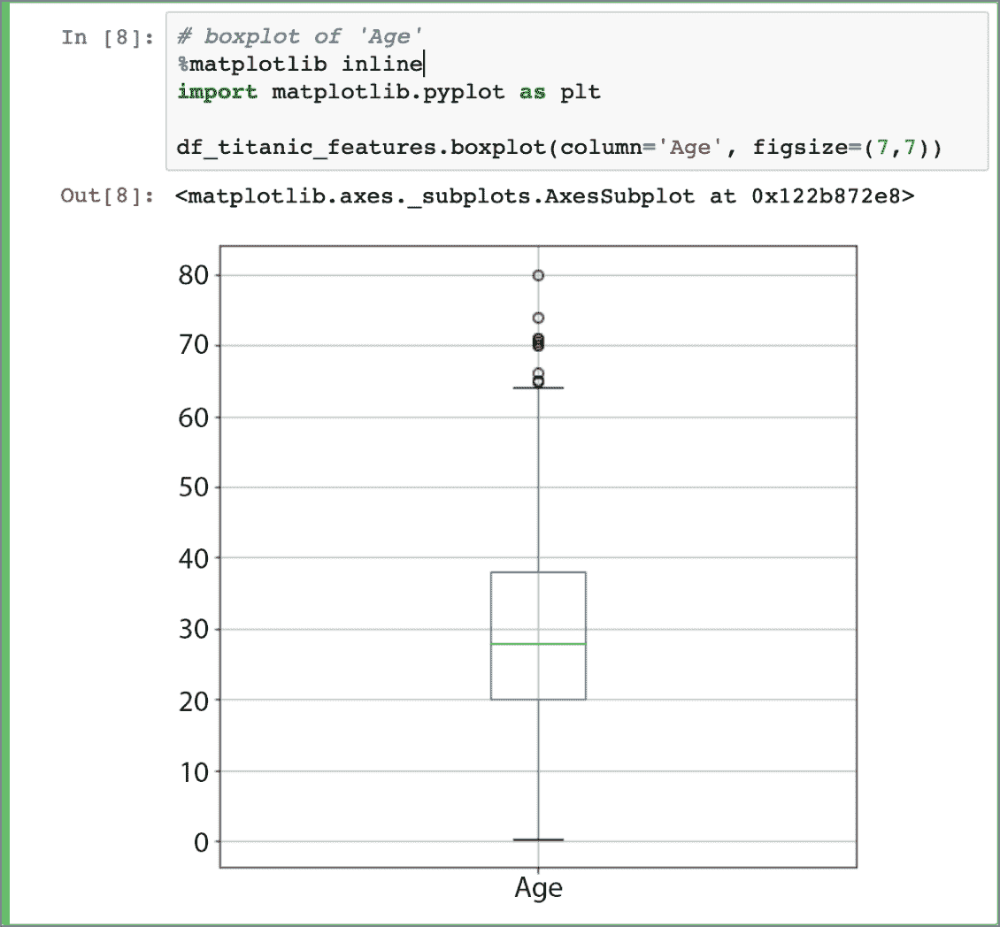

图 2.11 Age 特征变量的箱线图

根据箱线图，年龄的中位数略低于 30。Pandas 提供了`fillna()`函数，可用新值替换缺失值。以下片段使用`fillna()`函数将`Age`属性的缺失值替换为位数：

- **注意**：虽然在本节未演示，但你必须确保在训练数据上进行的任何特征工程或插补操作也同样在测试数据上进行。

`Embarked`属性是分类的，由于缺失值数量较少（仅 2 个），一种合理的方法是用`Embarked`列中出现频率最高的值来填充缺失值。以下代码片段使用`fillna()`函数来实现这一目标：

`Cabin`属性也是分类的，但它有大量的缺失值（687 个）。在这种情况下，使用用于填补`Embarked`属性缺失值的相同策略将行不通，因为这会在数据中产生显著的偏差。在这种情况下，最佳方法是创建一个新的布尔特征`CabinIsKnown`，如果`Cabin`属性已知，则其值为`True`，否则为`False`。你可能倾向于使用整数`1`表示已知的客舱值，并用`0`表示缺失的客舱值，但如果你这样做，就会在数据中创造出一种无意的顺序关系（1 大于 0），这可能会影响某些模型的输出。以下代码片段创建了一个名为`CabinIsKnown`的新列，并从数据框中删除了原始的`Cabin`列：

通过本节描述的更改，你已经尽可能地填充了缺失值，并在数据框中创建了一个新列。数据框中不应有缺失值，数据框中应该显示一个名为`CabinIsKnown`的新列，并且`Cabin`列应该已经从数据框中删除。这一切都可以通过执行以下片段来验证：

### 创建新特征

如果你观察泰坦尼克数据集列的描述，你会遇到`SibSp`和`Parch`列。根据数据集的描述：

* `SibSp`: 一个数值变量，表示一起旅行的兄弟姐妹/配偶人数。

* `Parch`: 一个数值变量，表示一起旅行的父母和孩子人数。

将这些值合并为一个代表一起旅行家庭人数的单一数值是有有意义的。在现阶段，无法判断模型在使用此额外的合成特征是否会表现更好，但在数据中拥有这一新特征将为你在构建和评估模型时提供更多选择。以下代码片段在数据框中创建了一个名为`FamilySize`的新属性，该属性通过`SibSp`和`Parch`属性的算术和计算得出：

* **注意**：尽管本节未演示，但你必须确保在训练数据上进行的任何特征工程也同样在测试数据上进行。

`Age`和`Fare`特征是数值型的并取一系列范围的值；对这些特征的值进行分箱（binning）并创建分类特征可能有用。在构建模型过程中，你可能会发现`Age`和`Fare`的分类（分箱）值能提供更好的结果。要创建一个名为`AgeCategory`的新分类特征，你可以像以下片段所示使用 Pandas 的`cut()`函数：

图 2.12 展示了创建`AgeCategory`特征后对`df_titanic_features`数据框执行`head()`函数的输出。

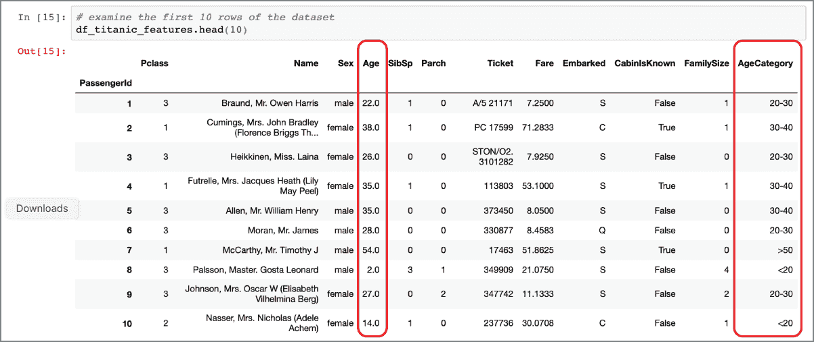

图 2.12 带有工程特征 AgeCategory 的数据框

`cut()`函数有几个参数。在这个示例中，`bins`参数包含一组定义分箱边界的数字序列；最低和最高值被特意选择在`Age`特征中观察到的值范围之外。`labels`参数包含一个字符串列表，作为分箱的标签（以及执行`cut()`函数后生成的分类特征的值）。`include_lowest`参数设置为`True`，表示第一个区间是左包含的。你可以在`https://pandas.pydata.org/pandas-docs/version/0.23.4/generated/pandas.cut.html`找到`cut()`函数完整参数列表的信息。

没有固定的公式来确定正确的分箱数量和分箱宽度。在模型构建过程中，你可能会发现自己正在尝试不同的分箱策略，并选择产生性能最佳模型的策略。如果你想通过使用分分位数将连续数值变量转换为分类变量，请使用`qcut()`函数。第二个参数`q=4`表示你想使用四分位数作为分箱边界。关于`qcut()`函数的信息可以在`https://pandas.pydata.org/pandas-docs/stable/reference/pandas.qcut.html`获取。

图 2.13 展示了创建`AgeCategory`特征后对`df_titanic_features`数据框执行`head()`函数的输出。

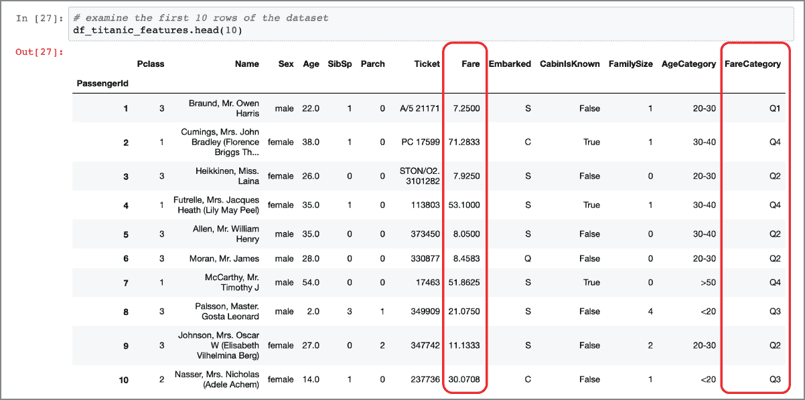

图 2.13 带有工程特征 AgeCategory 的数据框

### 转换数值特征

在上一节创建了分类特征`AgeCategory`和`FareCategory`后，你可能希望从数据集中删除原始的`Age`和`Fare`属性。删除数值的决定在很大程度上取决于你打算构建的模型类型。

在带有连续数值变量构建模型时，你可能需要对数值属性进行转换。当数值属性的值较小且分布接近标准正态分布时，某些机器学习模型收敛得更快，且工作得更好。

归一化（Normalization）和标准化（Standardization）是对数值属性执行的最常见的两种类型转换。归一化一个特征的结果是特征的值被缩放到 0 到 1 之间。标准化一个特征的结果是新值的分布具有均值 0 和标准差 1，但标准化后的值的值范围不保证在 0 到 1 之间。当你想要构建的模型假设特征变量具有高斯分布时，则使用标准化。归一化通常用于神经网络模型，这类模型要求输入落在 [0, 1] 范围内。

Scikit-learn 提供了许多类来辅助缩放数值属性。`MinMaxScaler`类通常用于特征归一化，而`StandardScaler`类通常用于标准化。以下代码片段在`df_titanic_features`数据框中创建了两个新列`NormalizedAge`和`StandardizedAge`。图 2.14 比较了`Age`、`NormalizedAge`和`StandardizedAge`特征的直方图：

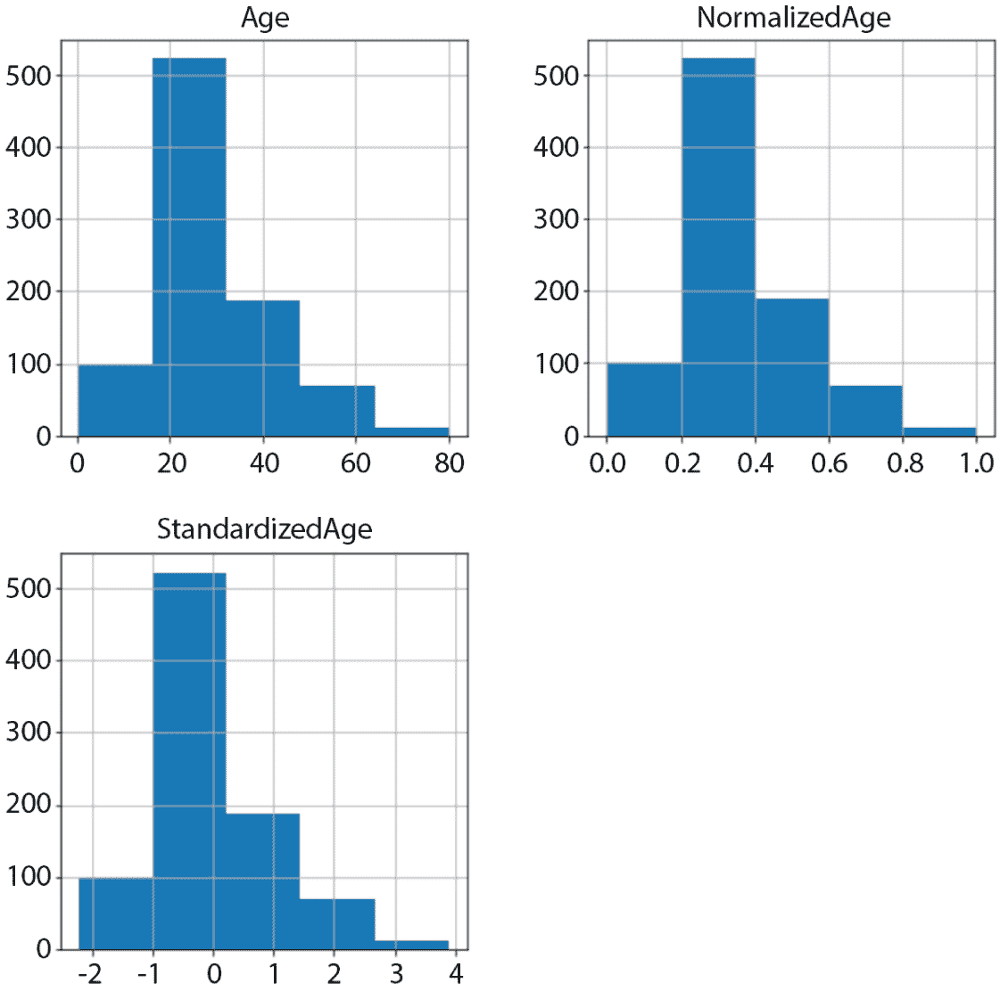

图 2.14 Age, NormalizedAge 和 StandardizedAge 的直方图

### 分类特征的热热编码

在本章中最后一个主题将使用独热编码（one-hot encoding）将分类特征转换为数值特征。你可能会好奇为什么想要将分类特征转换为数值，特别是由于本章的节一节已经讨论了相反的技术——将数值特征转换为分类特征。

并不是所有的机器学习算法都能处理分类数据。独热编码（One-hot encoding）是一种将分类特征转换为多个二进制数值特征的技术，每个类别对应一个特征。例如，线性回归和逻辑回归只能使用数值特征。而像 XGBoost 和随机森林这样的算法则可以很好地使用分类特征。

Pandas 提供了`get_dummies()`函数来帮助进行独热编码。以下代码片段将分类特征`Sex`、`Embarked`、`CabinIsKnown`、`AgeCategory`和`FareCategory`转换为二进制数值特征，并列出数据框的列：

从前面的代码可以看出，原始的分类属性不再存在于`df_titanic_features`数据框中；但添加了许多新列。为了理解 Pandas 如何创建这些额外的列，请考虑`Sex`分类属性。该属性有两个值：`male`和`female`。为了将此分类属性转换为二进制数值属性，Pandas 在数据框中创建了两个名为`Sex_male`和`Sex_female`的新列。其他分类属性（如`Embarked`、`CabinIsKnown`等）也采用了类似的方法进行处理。以下代码片段列出了数据框前五行的`Sex_male`和`Sex_female`列的值：

敏锐的读者可能会注意到，由于原始`df_titanic_features`数据集中`Sex`属性的值是`male`或`female`，因此不需要同时拥有`Sex_male`和`Sex_female`属性，因为你可以从其中一个推出另一个。这两个属性之间存在极强的负相关性（-1.0），你不应该将它们作为机器学习模型的输入。以下代码片段演示了这两个属性之间的强负相关性：

`CabinIsKnown_False`和`CabinIsKnown_True`特征的情况类似。以下代码片段删除了`Sex_female`和`CabinIsKnown_False`属性，以及非数值属性`Name`和`Ticket`，得到一个只包含数值属性的数据框：

如果你计算目标属性`Survived`与这些数值特征之间的相关性，你会发现其相关性比本章特征工程之前获得的结果显著得多。以下代码片段演示了这一点：

请注意生存概率与`Sex_male`之间存在特别强的负相关性，且与`FareCategory_Q4`和`FareCategory_Q1`分别存在强正、负相关性。

特征工程是数据科学中最耗力且最耗时的方面，没有一种固定的公式可以适用于特定的情况。在本章中，你学习了一些可以用于探索数据、填充缺失值和特征工程的技术。

- **注意**：为了跟随本章内容，请确保你已经按照附录 A 中的安装了 Anaconda Navigator 和 Jupyter Notebook。

你可以从`www.wiley.com/go/machinelearningawscloud`或通过以下 GitHub 地址下载本章的代码文件：

`https://github.com/asmtechnology/machinelearningawscloud`

# 总结

- 并不是所有的机器学习算法都能处理分类数据。独热编码是一种将分类特征转换为多个二进制数值特征的技术，每个类别对应一个特征。

- `pyplot`模块的惯别名是`plt`，`matplotlib`包的别名是`mpl`，Seaborn 包的别名是`sns`。

- `pyplot`子模块和`matplotlib`包的原因是为了允许你使用来自`pyplot`提供的高层抽象的函数以及 Matplotlib 暴露的低级面向对象的 API。

# 第 3 章：使用 Python 进行数据可视化

### 本章内容

- Matplotlib 简介

- 学习使用 Pandas

## 介绍 Matplotlib

Matplotlib 是一个用于 Python 的绘图库，提供了生成多种类型图表的功能以及自定义这些图表的能力。它由 John Hunter 创建，旨在为 Python 用户提供一个类似于 MATLAB 的绘图库。MATLAB 是科学界数据可视化的标准。Matplotlib 包拥有庞大的代码，旨在满足各种用户的需求并提供不同抽象层次的能力。某些用户可能只想向 Matplotlib 提供一些数组中的数据，并要求使用尽可能少的命令创建特定类型的图表（如散点图）；这些用户可能不想控制图表的详细属性（如位置、缩放、线条样式、颜色）。另一方面，另一些用户可能希望控制图表的每一个属性，甚至精确到单个像素级。

对于大多数常见的绘图任务，你将使用 Matplotlib 中的`pyplot`模块，它提供了最高级别的抽象。`pyplot`模块实现了一个函数接口，由状态机设计驱动——你使用函数来设置绘图引擎的属性（如颜色和字体），这些设置将应用于后续的所有图表，直到你发布更改它们的命令为止。在`pyplot`抽象层之下是面向对象的接口，它提供了更大的灵活性。

在查看 Matplotlib 图形的组件之前，让我们先来看使用`pyplot`模块绘制简单曲线的代码。以下代码段为`x`取值在 1 到 7 之间绘制函数`y[1]\=4x² + 2x + 2`和函数`y[2] = 3x + 4`。图 3.1 展示了这些语句生成的图形。

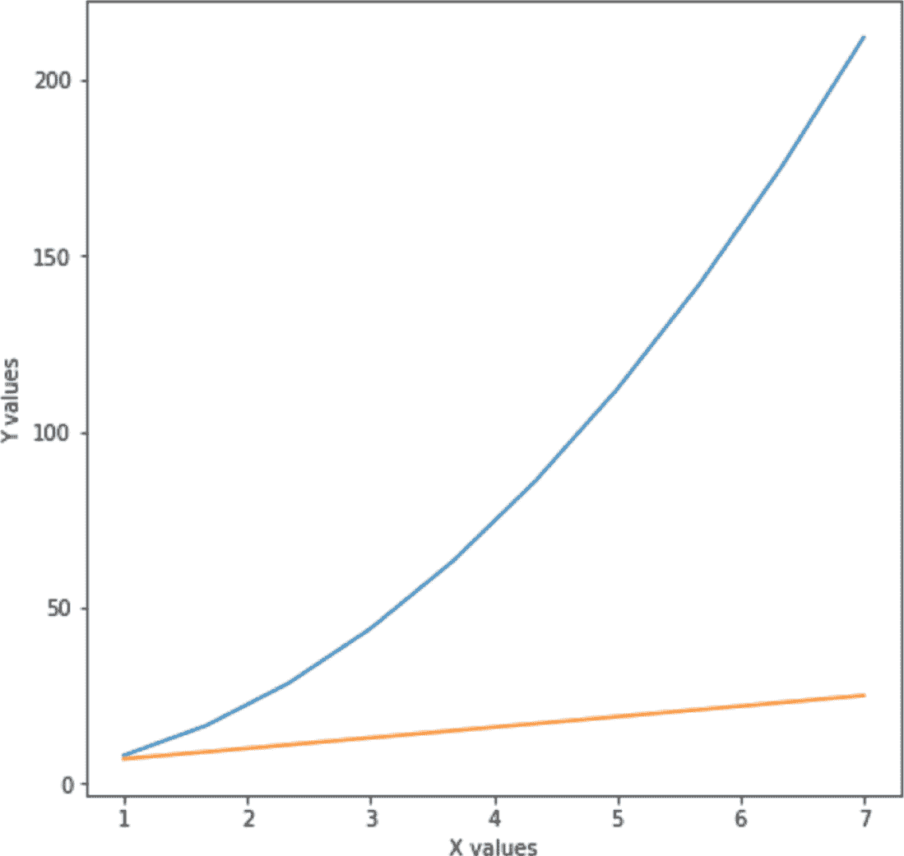

图 3.1 使用 Matplotlib 绘制两条曲线

该代码段使用 NumPy 函数生成 ndarray 数组`x`、`y1`和`y2`。然后使用语句`plt.figure(figsize=(7,7))`创建一个尺寸为 7 × 7 英角的 Matplotlib 图形对象。使用`plt.plot(x, y1)`语句绘制第一条曲线`y[1]\=4x² + 2x + 2`；绘图函数的输入是需要绘制的点的二维坐标。`plt.xlabel('X values')`和`plt.ylabel('Y values')`语句用于美观，分别在图表的 x 轴和 y 轴上添加标签。最后，使用`plt.show()`语句渲染图形。

## 图形的组件

无论你使用 Matplotlib 绘制什么种类型的图，无论你是使用高层的`pyplot`接口还是低层的面向对象的接口，都有与图形相关的通用组件和术语。本节介绍了这些概念的概述。图 3.2 展示了图的组成部分

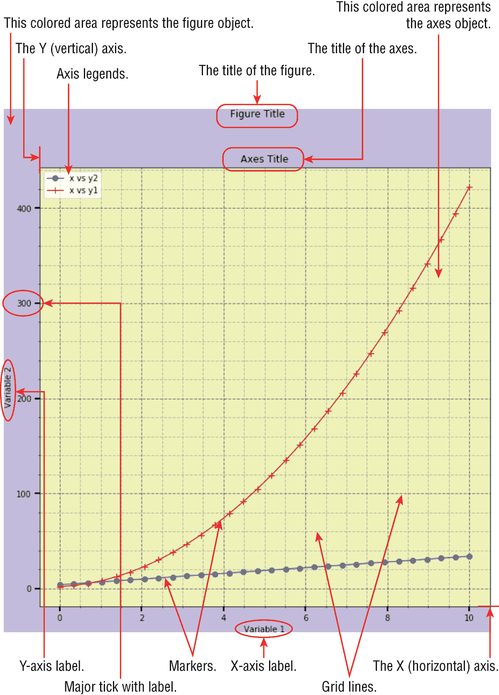

图 3.2 Matplotlib 图形的组件

### Figure (图形)

figure 对象可以被看作整个图表，包含所有的线条和文本。你可以将其 idea 为容器；你使用 Matplotlib 绘制的所有内容都属于一个 figure。Figure 通常使用`pyplot`函数创建，即使你随后想用低层的面向对象 API 对 figure 进行操作。使用以下`pyplot`命令创建一个空 figure：

```
plt.figure()
```

如果你想让 figure 有特定的尺寸，可以提供一个包含 x 轴和 y 轴英寸制尺寸的元组：

```
plt.figure(figsize=(10,5)) 
```

除了`figsize`属性外，`pyplot` figure 函数还可以接受各种其他属性，你可以使用它们在创建时自定义 figure 的各个方面。你可以在 https://matplotlib.org/api/_as_gen/matplotlib.pyplot.figure.html 找到更多关于这些属性的信息。

`pyplot` figure 函数创建一个 figure 并将其变为活动 figure，后续的绘制操作将对其生效。在绘制某些内容之前，figure 不会显示。如果你想在 figure 创建后使用面向对象的 API 控制其各个方面，你需要在代码中存储 figure 对象的引用，并结合引用使用面向对象 API。以下代码段使用`pyplot`函数创建一个 figure，然后使用面向对象 API 修改 figure 的背景颜色：

### Axes (坐标轴区域)

axes 对象是你通常认为的“图”。它是实际的图，带有与图相关的各种特征，如数据点、标记、颜色、比例尺。figure 对象可以包含多个 axes，这实际上是较大图表内的多个子图。以下代码段使用`pyplot`创建了一个具有 2 × 2 网格的 axes（子图）的 figure，并存储了对 figure 对象和 axes 对象的引用。每个 axes 对象都有自己的标题，这与 figure 标题不同。使用面向对象 API 设置 figure 以及其内部子图的标题。图 3.3 展示了执行代码后生成的图形。

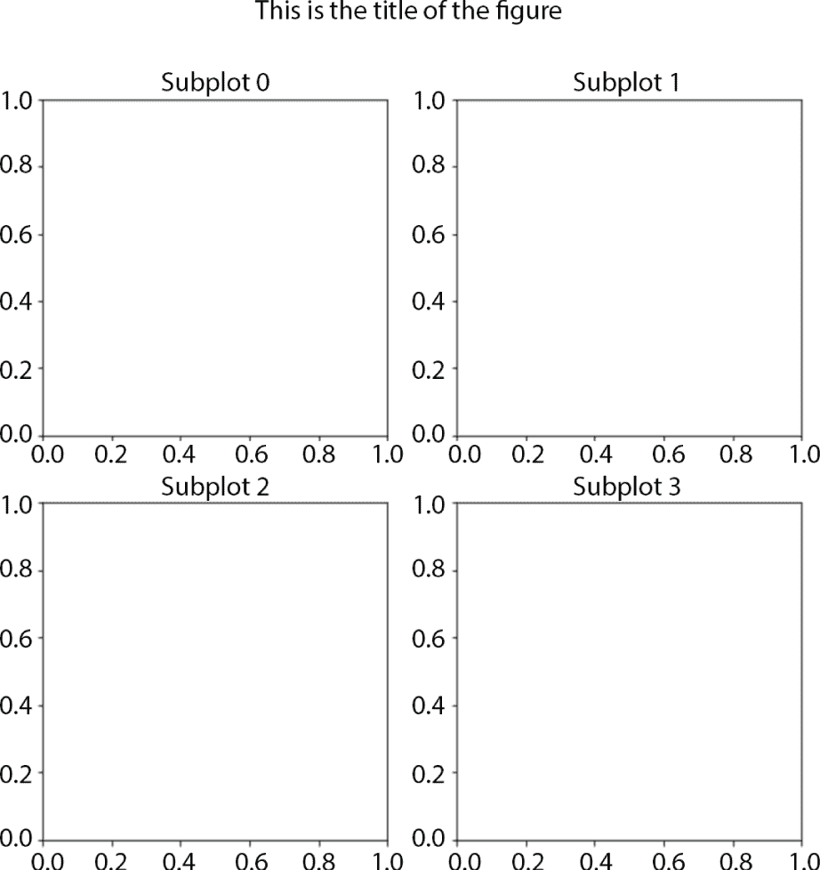

图 3.3 带有四个 axes 的 figure 对象

```
## 创建一个具有 2 x 2 对象网格的 figure
figure, axes_list = plt.subplots(2,2, figsize=(9,9))
## figure 对象的标题
figure.suptitle('This is the title of the figure') 
## 每个轴的标题
axes_list[0,0].set_title('Subplot 0')
axes_list[0,1].set_title('Subplot 1')
axes_list[1,0].set_title('Subplot 2')
axes_list[1,1].set_title('Subplot 3')
```

Matplotlib 的`figure`和`axes`类是处理低层面向对象 API 的主要入口。

### Axis (坐标轴)

axis 对象代表子图中的一个维度。二维图有两个 axis 对象：一个用于水平方向，另一个用于垂直方向。作为面向对象接口一部分的`axes`类提供了几种方法来修改底层 x 轴和 y 轴的属性。

### Axis Labels (轴标签)

轴标签显示在图的每个轴的下方（或侧边）。可以通过在 axes 对象上调用`set_xlabel()`和`set_ylabel()`方法来配置轴标签。以下代码段演示了这些方法的使用：

```
figure, axes = plt.subplots(figsize=(10,10))
axes.set_xlabel('Variable 1')
axes.set_ylabel('Variable 2')
```

如果你不想使用 axes 对象暴露的面向对象 API，可以使用`pyplot`高层接口中的`xlabel()`和`ylabel()`函数，它们为活动图设置轴标签。以下代码段演示了这些函数的使用：

```
plt.figure(figsize=(7,7))
plt.xlabel('X values')
plt.ylabel('Y values')
```

### Grids (网格)


网格是图区域内的一组水平和垂直线，有助于读取数值。`axes` 对象提供了一个名为 `grid()` 方法，用于自定义网格的外观。你可以在 `https://matplotlib.org/api/_as_gen/matplotlib.axes.html` 找到更多关于 `axes` 类的 `grid()` 方法的信息。`pyplot` 模块也提供了 `grid()` 函数，它与 `axes` 类的同名方法相同。

以下代码段演示了 `axes` 类的 `grid()` 方法：

```
figure, axes = plt.subplots(figsize=(10,10))
axes.grid(b=True, which='both', linestyle='--', linewidth=1)
```

图 3.4 展示了两个并排的图，一个带有网格，一个没有。

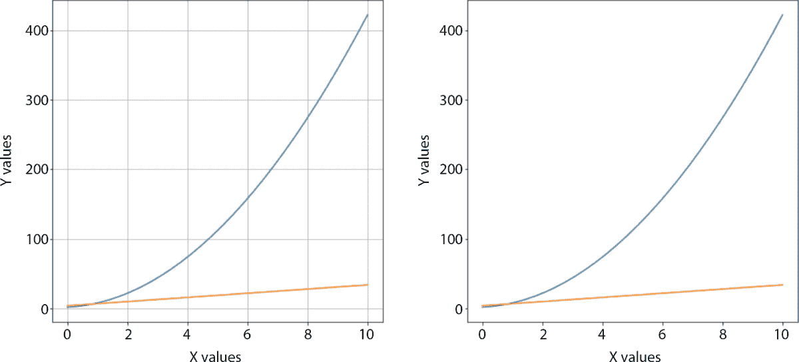

[图 3.4] 有无网格对比

### Title (标题)

标题是显示在图上方的一个字符串。`figure` 对象及其内部 `axes` 对象都可以拥有标题。标题默认位于 `figure` 或 `axes` 对象的顶部，居中对齐。可以使用 `figure` 类的 `suptitle()` 方法或 `pyplot` 模块的 `suptitle()` 函数更改 `figure` 标题。这两个函数在语法和功能上是相同的。关于 `pyplot suptitle()` 函数的更多信息可以在 `https://matplotlib.org/api/_as_gen/matplotlib.pyplot.suptitle.html#matplotlib.pyplot.suptitle` 找到。

以下代码段演示了 `figure` 类的 `suptitle()` 方法以及 `pyplot` 模块的 `suptitle()` 函数：

```
## 创建一个包含一个 axes 的 figure
## 在 figure 实例上调用 suptitle 方法
figure, axes = plt.subplots(figsize=(10,10))
figure.suptitle('Figure Title')
 
## 创建一个新的包含一个 axes 的 figure
## 使用 pyplot suptitle 函数
plt.figure(figsize=(7,7))
plt.suptitle('Figure Title')
```

可以通过在 `axes` 对象上调用 `set_title()` 方法来更改 `axes` 对象的标题。关于使用 `set_title()` 方法的更多信息可以在 `https://matplotlib.org/api/_as_gen/matplotlib.axes.Axes.set_title.html#matplotlib.axes.Axes.set_title` 找到。

`pyplot` 模块提供了一个名为 `title()` 的便利函数，它在活跃的轴对象上操作，并且其签名与 `axes` 类的 `set_title()` 方法相同。下面的代码演示了如何使用 `axes` 类的 `set_title()` 方法以及 `pyplot` 模块的 `title()` 函数：

```
## 创建一个包含一个 axes 对象的图形。
## 在 axes 实例上调用 set_title() 方法。
figure, axes  = plt.subplots(figsize=(10,10))
axes.suptitle('Axes Title')
 
## 创建一个包含一个 axes 对象的新图形
## 使用 pyplot suptitle() 函数
plt.figure(figsize=(7,7))
plt.title('Axes Title')
```

### 常见图表

在上一节中，你学习了典型 Matplotlib 图表的各个方面，并了解到通常有不同的方法来配置图表。高层 `pyplot` API 提供了函数式接口，而低层 Matplotlib API 则使用面向对象的接口操作。在本节中，你将学习如何使用 Matplotlib 创建常见的图表类型。

### 直方图

直方图通常用于可视化数值变量的分布。在处理分类变量时，直方图并不适用。下面的代码使用了 `pyplot` 模块中的函数来生成流行的 Titanic 数据集中 `Age` 属性的直方图。结果如图 3.5 所示。


图 3.5 乘客年龄值的直方图

```
import numpy as np
import pandas as pd
 
## 将文件内容加载到 pandas Dataframe
input_file = './datasets/titanic_dataset/original/train.csv'
df_titanic = pd.read_csv(input_file)
 
## 设置索引
df_titanic.set_index("PassengerId", inplace=True)
 
## 使用 pyplot 函数绘制 'Age' 属性的直方图
fig = plt.figure(figsize=(7,7))
plt.xlabel('Passenger Age')
plt.ylabel('Count')
plt.grid()
 
n, bins, patches = plt.hist(df_titanic['Age'], histtype='bar', 
                            color='#0dc28d', align='mid', 
                            rwidth=0.90, bins=7) 
```

`pyplot.hist()` 函数用于创建直方图。该函数接受多个参数。前面代码段中使用的参数包括 `histtype='bar'`，表示你想要一个标准的直方图；`rwidth=0.9`，在条形之间留出空间；以及 `bins=7`，即条形的数量。你可以在 `https://matplotlib.org/api/_as_gen/matplotlib.pyplot.hist.html#matplotlib.pyplot.hist` 找到 `hist()` 函数支持的完整参数列表。

直方图的外观受分箱策略（binning strategy）的影响，而策略由传递给 `bins` 参数的值控制。如果你传递一个整数（如前面的代码所示），Matplotlib 将创建指定数量的等宽箱，并使用箱的边界（边缘）来确定每个箱中值的数量。你可以选择性地指定箱边界而不是箱的数量。在大多数情况下，你只需指定箱的数量。

`pyplot.hist()` 函数返回一个元组 `(n, bins, patches)`。元组的第一个元素 `n` 是一个包含每个箱计数的数组。第二个元素 `bins` 是一个包含箱边界的浮点数数组，第三个元素 `patches` 是一个矩形对象数组，代表 Matplotlib 用于绘制条形时使用的低层绘图原语。你可以使用 `print()` 语句检查元组的内容：

下面的代码段使用 `pyplot` 函数创建一个包含四个子图（轴对象）的图形，并使用面向对象的 API 在每个子图中创建相同数据的直方图，但具有不同数量的箱。该代码段的结果如图 3.6 所示。


图 3.5 乘客年龄值的直方图

### 柱状图

当你处理分类变量时，通常会使用柱状图。柱状图中的每个条形代表分类属性的某些信息，例如计数、平均值或其他指标。柱状图可用于名义分类数据和有序分类数据。在为名义分类数据绘制柱状图时，通常会对条形进行排序，使得条形的高度（或长度）按顺序增加。

这是可以实现的，因为包含名义数据的类别在值之间没有固有的顺序，因此你可以自由安排条形的位置，以创建一个视觉上美观的图表。继续使用上一节的 Titanic 数据集，以下代码段创建了 `Embarked` 属性的柱状图。生成的柱状图如图 3.7 所示。

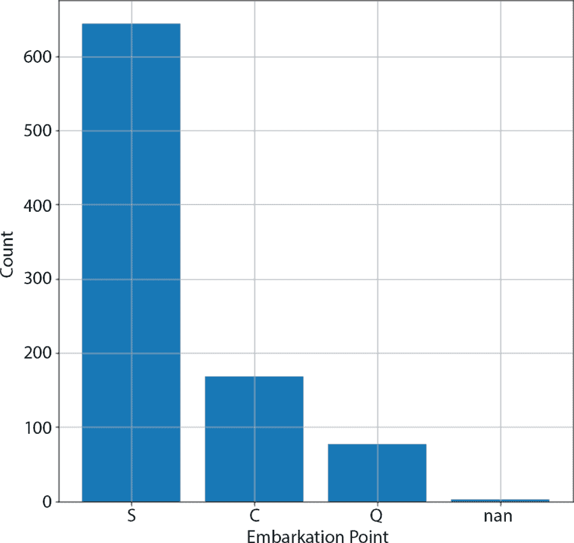

图 3.7 Embarked 属性的柱状图

```
## 使用 pyplot 函数绘制 'Embarked' 属性的柱状图
fig = plt.figure(figsize=(9,9))
plt.xlabel('Embarkation Point')
plt.ylabel('Count')
plt.grid()
 
values = df_titanic['Embarked'].unique()
counts = df_titanic['Embarked'].value_counts(dropna=False)
x_positions = np.arange(len(values))
 
plt.bar(x_positions, counts, align='center')
plt.xticks(x_positions, values) 
```

使用 Pandas dataframe 的 plot 函数绘制柱状图要简单得多。以下代码段演示了如何使用 Pandas 函数创建相同的柱状图：

```
## 使用 Pandas dataframe 函数绘制 'Embarked' 属性的柱状图
fig = plt.figure(figsize=(7,7))
plt.xlabel('Embarkation Point')
plt.ylabel('Count')
plt.grid()
 
df_titanic['Embarked'].value_counts(dropna=False).plot.bar(grid=True)
```

### 分组柱状图

如果你想显示每个类别内不同子组的信息，可以使用分组柱状图。如其名所示，分组柱状图是条形组聚集在一起的图表。每个条形组提供一个类别的信息，而组内条形的长度则提供了该类别内各个子组的信息。

例如，可以使用分组柱状图来可视化每个登船点幸存人数和未幸存人数的分布。以下代码段为 `Embarked` 属性创建了一个分组柱状图，每组有两个条形。生成的柱状图如图 3.8 所示。

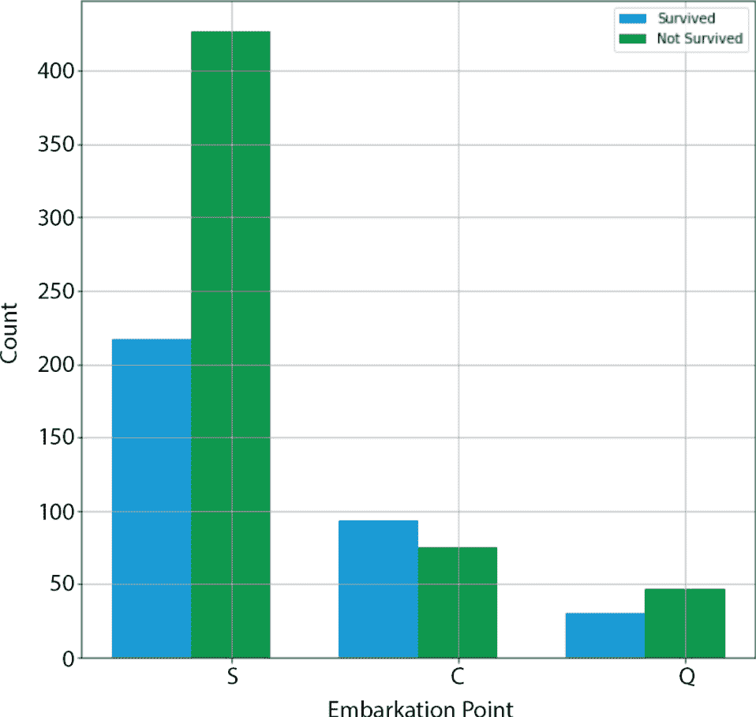

图 3.8 Embarked 属性的分组柱状图

```
## 为 Embarked 属性创建一个分组柱状图，
## 每组有两个条形。
survived_df = df_titanic[df_titanic['Survived']==1]
not_survived_df = df_titanic[df_titanic['Survived']==0]
 
values = df_titanic['Embarked'].dropna().unique()
embarked_counts_survived = survived_df['Embarked'].value_counts(dropna=True)
embarked_counts_not_survived = not_survived_df['Embarked'].value_counts(dropna=True)
 
x_positions = np.arange(len(values))
 
fig = plt.figure(figsize=(9,9))
plt.xlabel('Embarkation Point')
plt.ylabel('Count')
plt.grid()
 
bar_width = 0.35
 
plt.bar(x_positions, embarked_counts_survived, bar_width, color='#009bdb', label='Survived')
plt.bar(x_positions + bar_width, embarked_counts_not_survived, bar_width, color='#00974d', label='Not Survived')
 
plt.xticks(x_positions + bar_width, values)
plt.legend()
 
plt.show() 
```

以下代码段显示了如何使用 Pandas 绘制函数绘制相同的分组柱状图：

```
## 为 Embarked 属性创建一个分组柱状图，
## 每组有两个条形。
survived_df = df_titanic[df_titanic['Survived']==1]
not_survived_df = df_titanic[df_titanic['Survived']==0]
 
values = df_titanic['Embarked'].dropna().unique()
embarked_counts_survived = survived_df['Embarked'].value_counts(dropna=True)
embarked_counts_not_survived = not_survived_df['Embarked'].value_counts(dropna=True)
 
embarked_counts_survived.name = 'Survived'
embarked_counts_not_survived.name = 'Not Survived'
df = pd.concat([embarked_counts_survived, embarked_counts_not_survived], axis=1)
 
fig, axes = plt.subplots(figsize=(9,9))
plt.xlabel('Embarkation Point')
plt.ylabel('Count')
df.plot(grid=True, ax=axes, color=['#009bdb', '#00974d'])
```

### 堆叠柱图

堆叠图提供了可视化相同信息的另一种方法。它不是在分组中具有多个条形，而是每个分类值使用一个条形，并划分该条形以描述类别内子组的分布。

以下代码段为 `Embarked` 属性创建了一个堆叠图，显示每个登船点幸存者的分布。生成的柱状图如图 3.9 所示。

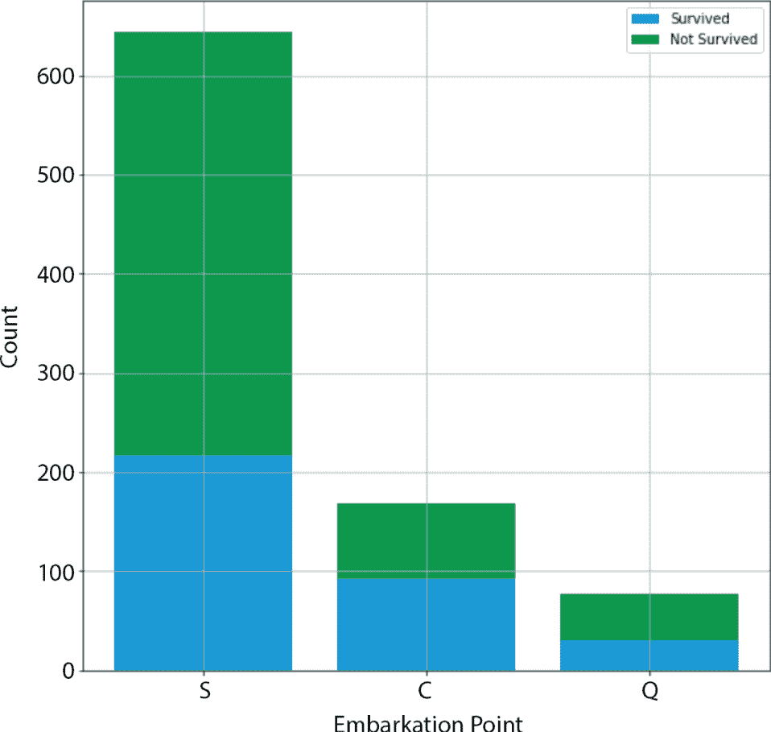

图 3.9 Embarked 属性的堆叠柱图

```
## 为 Embarked 属性创建一个堆叠图
## 显示每个类别的幸存人数
survived_df = df_titanic[df_titanic['Survived']==1]
not_survived_df = df_titanic[df_titanic['Survived']==0]
 
values = df_titanic['Embarked'].dropna().unique()
embarked_counts_survived = survived_df['Embarked'].value_counts(dropna=True)
embarked_counts_not_survived = not_survived_df['Embarked'].value_counts(dropna=True)
 
x_positions = np.arange(len(values))
 
fig = plt.figure(figsize=(9,9))
plt.xlabel('Embarkation Point')
plt.ylabel('Count')
plt.grid()
 
plt.bar(x_positions, embarked_counts_survived, color='#009bdb', label='Survived')
plt.bar(x_positions + bar_width, embarked_counts_not_survived, color='#00974d', label='Not Survived', bottom=embarked_counts_survived)
```

Pandas 绘制函数相比于 `pyplot` 和 Matplotlib 的优势在堆叠图上显而易见，特别是当每个条形有超过两个组时。在 Matplotlib 和 `pyplot` 函数中，你将需要使用多个 `plt.bar()` 语句将每个组堆叠在另一个之上。在 Pandas 中，你只需要将数据放入 dataframe 中并调用一次 `dataframe.plot.bar()` 即可。

### 堆叠百分比柱图

如果你想显示类别内每个子组的百分比贡献，可以使用堆叠百分比柱图。堆叠百分比柱图中的条形高度都是相同的。以下代码段为 `Embarked` 属性创建了一个堆叠百分比柱图，显示每个登船点幸存者的百分比。生成的柱状图如图 3.10 所示。

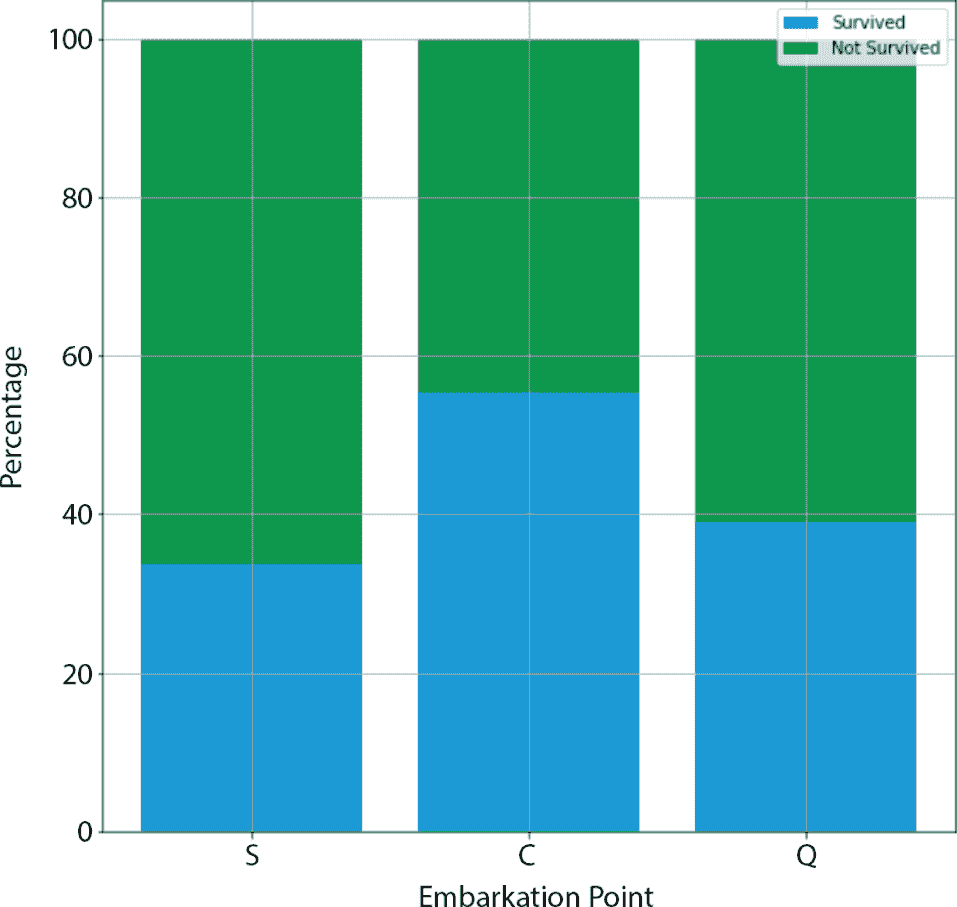

FIGURE 3.10 Embarked 属性的堆叠百分比柱图


以下代码片段使用 Matplotlib 的 `pyplot` 模块创建了一个堆叠百分比条形图，用于展示泰坦尼克数据集中 `Embarked` 属性的每个类别中幸存者与未幸存者的数量占比：

```python
## a stacked percentage bar chart for the Embarked attribute
## showing the number of survivors in each category
survived_df = df_titanic[df_titanic['Survived']==1]
not_survived_df = df_titanic[df_titanic['Survived']==0]
 
values = df_titanic['Embarked'].dropna().unique()
counts = df_titanic['Embarked'].value_counts(dropna=True)
 
embarked_counts_survived = survived_df['Embarked'].value_counts(dropna=True)
embarked_counts_not_survived = not_survived_df['Embarked'].value_counts(dropna=True)
 
embarked_counts_survived_percent = embarked_counts_survived / counts * 100
embarked_counts_not_survived_percent = embarked_counts_not_survived / counts * 100
 
x_positions = np.arange(len(values))
 
fig = plt.figure(figsize=(9,9))
plt.xlabel('Embarkation Point')
plt.ylabel('Percentage')
plt.grid()
 
plt.bar(x_positions, embarked_counts_survived_percent, color='#009bdb', label='Survived')
plt.bar(x_positions, embarked_counts_not_survived_percent, color='#00974d', label='Not Survived', bottom=embarked_counts_survived_percent)
 
plt.xticks(x_positions, values)
plt.legend()
 
plt.show() 
```

以下代码片段使用 Pandas 绘图函数创建了相同的图表：

```python
## a stacked percentage bar chart for the Embarked attribute
## showing the number of survivors in each category
survived_df = df_titanic[df_titanic['Survived']==1]
not_survived_df = df_titanic[df_titanic['Survived']==0]
 
values = df_titanic['Embarked'].dropna().unique()
counts = df_titanic['Embarked'].value_counts(dropna=True)
 
embarked_counts_survived = survived_df['Embarked'].value_counts(dropna=True)
embarked_counts_not_survived = not_survived_df['Embarked'].value_counts(dropna=True)
 
embarked_counts_survived_percent = embarked_counts_survived / counts * 100
embarked_counts_not_survived_percent = embarked_counts_not_survived / counts * 100
 
embarked_counts_survived_percent.name = 'Survived'
embarked_counts_not_survived_percent.name = 'Not Survived'
df = pd.concat([embarked_counts_survived_percent, embarked_counts_not_survived_percent], axis=1)
 
fig, axes = plt.subplots(figsize=(9,9))
plt.xlabel('Embarkation Point')
plt.ylabel('% Survived ')
 
df.plot.bar(stacked=True, grid=True, ax=axes, color=['#009bdb', '#00974d'])
```

### 饼图

饼图是柱状图的替代方案，可用于绘制类别属性中唯一值的比例。`pyplot` 模块提供了 `pie()` 函数，用于创建饼图。`pyplot` 模块的 `pie()` 函数使用了 `axes` 类的底层 `pie()` 方法。你可以在 `https://matplotlib.org/api/_as_gen/matplotlib.pyplot.pie.html` 访问 `pyplot pie()` 函数的文档。

以下代码片段对泰坦尼克数据集 `Embarked` 列的内容使用 `pyplot pie()` 函数创建一个饼图，描述了从每个登船港上船的乘客百分比。图 3.11 展示了生成的饼图。

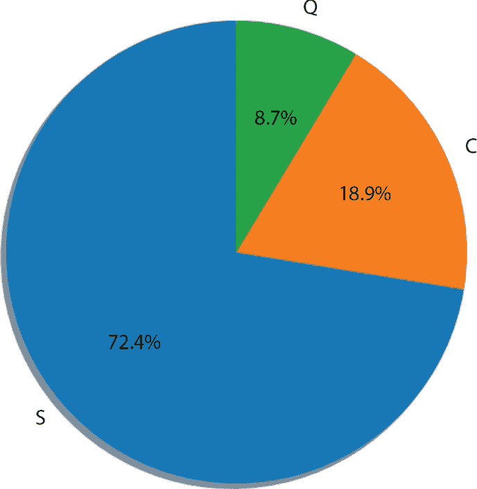

FIGURE 3.11 从不同港口登船乘客比例的饼图

```python
## use pyplot functions to plot a pie chart of the 'Embarked' attribute
fig = plt.figure(figsize=(9,9))
 
embarkation_ports = df_titanic['Embarked'].dropna().unique()
counts = df_titanic['Embarked'].value_counts(dropna=True)
 
total_embarked = counts.values.sum()
counts_percentage = counts / total_embarked * 100
 
counts_percentage.values
plt.pie(counts_percentage.values, 
        labels=embarkation_ports, 
        autopct='%1.1f%%', shadow=True, startangle=90) 
```

你也可以使用 Pandas dataframe 的 `plot.pie()` 函数创建饼图。如果你的数据已经在 Pandas dataframe 中，这种方法将需要少得多的代码。使用 Pandas 绘图函数的缺点是自定义饼图的选项减少了。以下代码片段使用 Pandas 绘图函数制作相同的饼图：

```python
## use Pandas functions to plot a pie chart of the 'Embarked' attribute
fig = plt.figure(figsize=(7,7))
df_titanic['Embarked'].value_counts(dropna=True).plot.pie()
```

当数据集的目标属性是二分类时，饼图可以帮助传递每个类别属性中值的分布，并按目标二分类属性进行分组。以下代码片段使用 Matplotlib 的 `Axes.pie()` 方法创建三个饼图，显示泰坦尼克数据集中三个登船港幸存者的百分比。图 3.12 展示了生成的饼图。

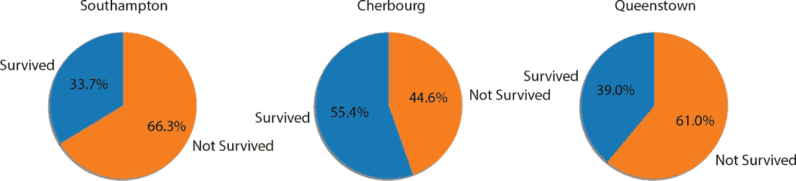

FIGURE 3.12 显示每个登船港幸存者比例的饼图

```python
## three pie charts, showing the proportion
## of survivors for each embarkation point
## S = Southampton
## C = Cherbourg
## Q = Queenstown
survived_df = df_titanic[df_titanic['Survived']==1]
not_survived_df = df_titanic[df_titanic['Survived']==0]
 
values = df_titanic['Embarked'].dropna().unique()
counts = df_titanic['Embarked'].value_counts(dropna=True)
 
embarked_counts_survived = survived_df['Embarked'].value_counts(dropna=True)
embarked_counts_not_survived = not_survived_df['Embarked'].value_counts(dropna=True)
 
embarked_counts_survived_percent = embarked_counts_survived / counts * 100
embarked_counts_not_survived_percent = embarked_counts_not_survived / counts * 100
 
x_positions = np.arange(len(values))
 
fig = plt.figure(figsize=(9,9))
plt.xlabel('Embarkation Point')
plt.ylabel('Percentage')
plt.grid()
 
plt.bar(x_positions, embarked_counts_survived_percent, color='#009bdb', label='Survived')
plt.bar(x_positions, embarked_counts_not_survived_percent, color='#00974d', label='Not Survived', bottom=embarked_counts_survived_percent)
 
plt.xticks(x_positions, values)
plt.legend()
 
plt.show() 
```

### 箱线图 (Box Plots)

箱线图提供了一种查看数值属性分布的方法。由 John Tukey 于 1969 年创建。箱线图用于发现属性值是否呈对称分布、值的整体离散程度以及离群值信息。箱线图提供了关于属性值的五个统计特征的信息：

- `First quartile`（第一四位数）：25% 的属性值小于此数字。这也被称为第 25 分位数。
- `Second quartile`（第二四位数）：50% 的属性值小于此数字。这也被称为第 50 分位数或中位数。
- `Third quartile`（第三四位数）：75% 的属性值小于此数字。这也被称为第 75 分位数。
- `Minimum`（最小值）：该值使用公式 `Min = Q1 – 1.5 * IQR` 计算，其中 `IQR` 是四分位距，定义为 `Q3 – Q2`。任何低于此最小值的属性值将被视为图中的离群值。
- `Maximum`（最大值）：该值使用公式 `Max = Q3 + 1.5 * IQR` 计算，其中 `IQR` 是四分位距，定义为 `Q3 – Q2`。任何大于此最大值的属性值将被视为图中的离群值。

`pyplot` 模块提供了 `boxplot()` 函数，用于创建箱线图。`pyplot` 模块的 `boxplot()` 函数使用了 `axes` 类底层的 `boxplot()` 方法。你可以在 `https://matplotlib.org/api/_as_gen/matplotlib.pyplot.boxplot.html` 访问 `pyplot boxplot()` 函数的文档。

以下代码段对 Titanic 数据集中 `Age` 列的内容使用 `pyplot boxplot()` 函数，创建了一个描述该属性值分布情况的箱线图。图 3.13 展示了生成的箱线图。

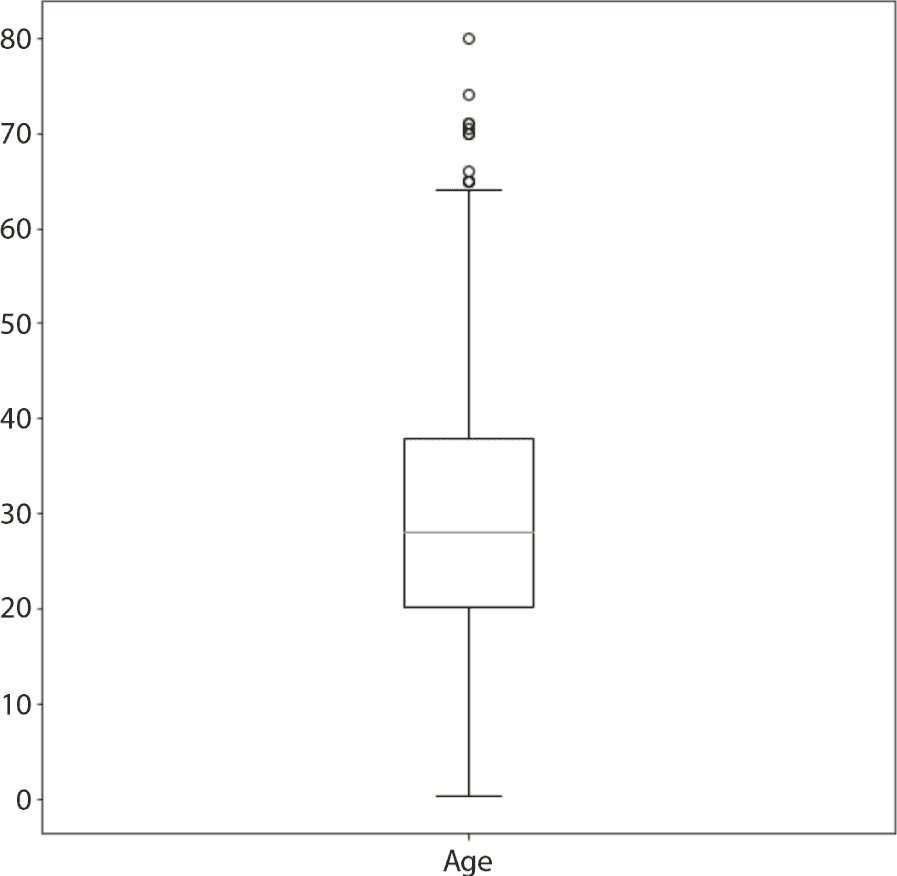

FIGURE 3.13 显示 Age 属性分布的箱线图

```python
## use pyplot functions to create a box plot of the 'Embarked' attribute
fig , axes = plt.subplots(figsize=(9,9))
box_plot = plt.boxplot(df_titanic['Age'].dropna())
axes.set_xticklabels(['Age']) 
```

以下代码段将使用 Pandas 作图函数生成相同的箱线图：

```python
df_titanic.boxplot(column = 'Age', figsize=(9,9), grid=False);
```

箱线图的紧凑性使得它们非常适合比较不同数值属性的分布，或者数值属性内部子组的分布。以下代码段使用 `pyplot` 函数为 `Age` 属性创建两个箱线图，一个针对在泰坦尼克号灾难中幸存的人，另一个针对未幸存的人。图 3.14 展示了生成的箱线图。

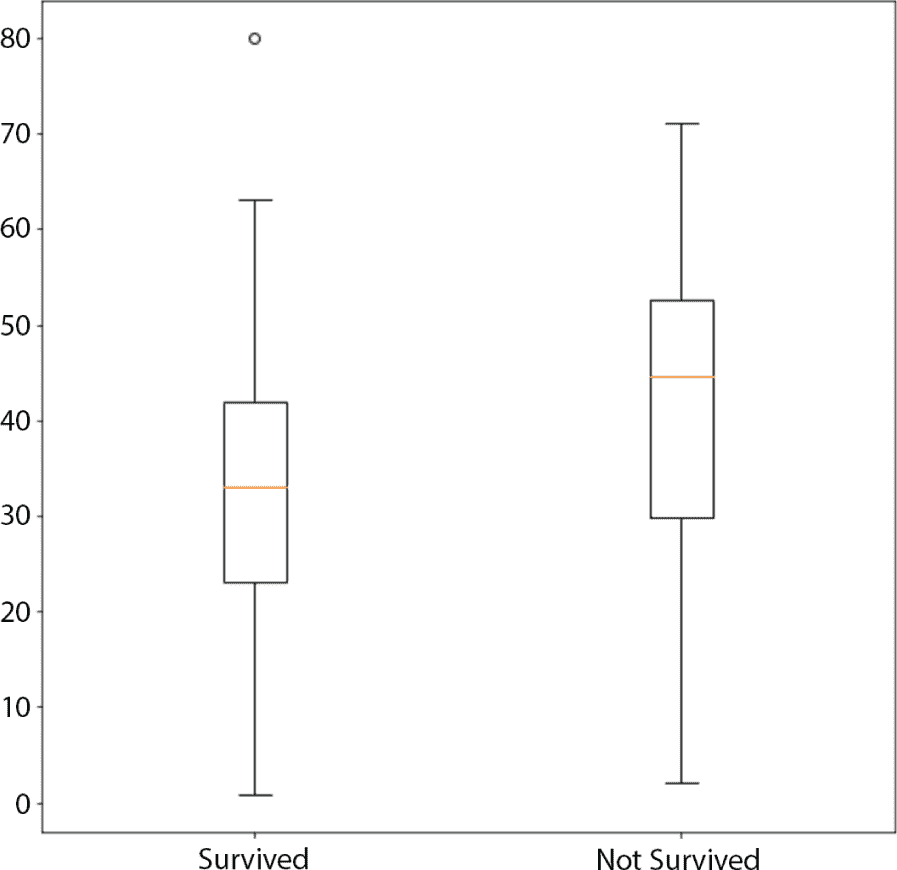

FIGURE 3.14 比较泰坦尼克号灾难幸存者与未幸存者 Age 属性分布的箱线图

```python
## compare box plots of the Age attribute for those who survived
## against those that did not.
survived_df = df_titanic[df_titanic['Survived']==1].dropna()
not_survived_df = df_titanic[df_titanic['Survived']==0].dropna()
 
fig , axes = plt.subplots(figsize=(9,9))
box_plot = plt.boxplot([survived_df['Age'], not_survived_df['Age']], 
                       labels=['Survived', 'Not Survived']) 
```

以下代码段将使用 Pandas 作图函数生成相同的箱线图：

```python
df_titanic.boxplot(column = 'Age', by = 'Survived', figsize=(9,9), grid=False);
```

### 散点图 (Scatter Plots)

散点图是一种二维图，将两个连续数值属性相互绘制。一个属性沿 x 轴绘制，另一个属性沿 y 轴绘制。散点图是点的集合，通常用于绘制变量之间的相关性，散点图中的每个点代表两个变量的值。散点图也可以用于可视化数据聚类。以下代码段在对 Titanic 数据集的 `Age` 和 `Fare` 属性进行归一化并用属性平均值填补缺失值后，创建了它们的散点图。图 3.15 展示了生成的散点图。

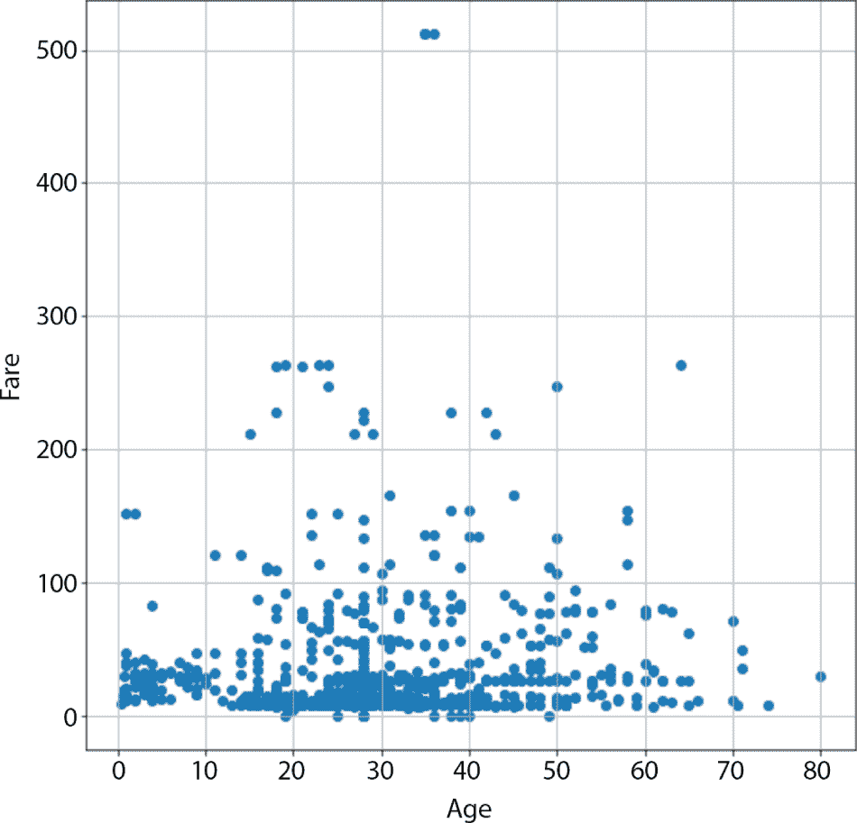

FIGURE 3.15 Age 属性相对于 Fare 属性的散点图

```python
## impute missing values:
## Age with the median age
## Fare with the mean fare
median_age = df_titanic['Age'].median()
df_titanic["Age"].fillna(median_age, inplace=True)
 
mean_fare = df_titanic['Fare'].mean()
df_titanic["Fare"].fillna(mean_fare, inplace=True)
 
## use pyplot functions to create a scatter plot of the 'Age' and 'Fare' attribute
fig , axes = plt.subplots(figsize=(9,9))
plt.xlabel('Age')
plt.ylabel('Fare')
plt.grid()
 
plt.scatter(df_titanic['Age'], df_titanic['Fare']) 
```

Pandas dataframe 包含 `plot.scatter()` 函数，可创建散点图。以下代码段演示了如何使用该函数创建等效的散点图：

```python
df_titanic.plot.scatter(x='Age', y='Fare', figsize=(9,9))
```

可以使用散点图获取两个属性之间相关程度的视觉指示。创建一个数据集中每个属性相对于其他所有属性的散点图矩阵是常见的；但这对于属性较少的情况才具有实用性。图 3.16 显示了具有理想强正和强负相关的属性散点图。理想的强正相关出现在大多数点沿一条从左下角到右上角的直线分布时。理想的强负相关出现在大多数点沿一条从左上角到右下角的直线分布时。

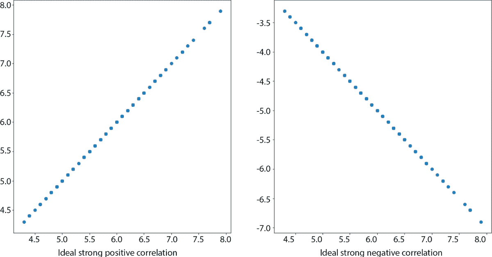

FIGURE 3.16 显示理想强正和强负相关的散点图


以下代码段展示了一个可以根据 Pandas dataframe 内容生成散点矩阵的函数。该函数接受三个参数：第一个是 dataframe 对象，第二个是图形高度（英寸），第三个是图形宽度（英寸）。

```python
## Generates a M X M scatterplot matrix of subplots. 
def generate_scatterplot_matrix(df_input, size_h, size_w):
    num_points, num_attributes = df_input.shape
    fig, axes = plt.subplots(num_attributes, num_attributes, figsize=(size_h, size_w))
 
    column_names = df_input.columns.values
    
    for x in range(0, num_attributes):
        for y in range(0, num_attributes):
            axes[x , y].scatter(df_input.iloc[:,x], df_input.iloc[:,y])
            
            # configure the ticks
            axes[x , y].xaxis.set_visible(False)
            axes[x , y].yaxis.set_visible(False)
 
            # Set up ticks only on one side for the "edge" subplots…
            if axes[x , y].is_first_col():
                axes[x , y].yaxis.set_ticks_position('left')
                axes[x , y].yaxis.set_visible(True)
                axes[x , y].set_ylabel(column_names[x])
                
            if axes[x , y].is_last_col():
                axes[x , y].yaxis.set_ticks_position('right')
                axes[x , y].yaxis.set_visible(True)
            
            if axes[x , y].is_first_row():
                axes[x , y].xaxis.set_ticks_position('top')
                axes[x , y].xaxis.set_visible(True)
                
            if axes[x , y].is_last_row():
                axes[x , y].xaxis.set_ticks_position('bottom')
                axes[x , y].xaxis.set_visible(True)
                axes[x , y].set_xlabel(column_names[y])
                
                
    return fig, axes
```

为了查看散点图矩阵，让我们在流行的 Iris（鸢花）数据集上使用`generate_scatter_plot`函数。回想第 2 章可知 Scikit-learn 包含了 Iris 数据集的简易版本。该数据集包含了鸢花花萼和花瓣的高度和宽度。以下代码段将 Iris 数据集加载到数据框中，并使用`generate_scatter_plot`函数创建一个散点图矩阵。生成的图如图 3.17 所示。

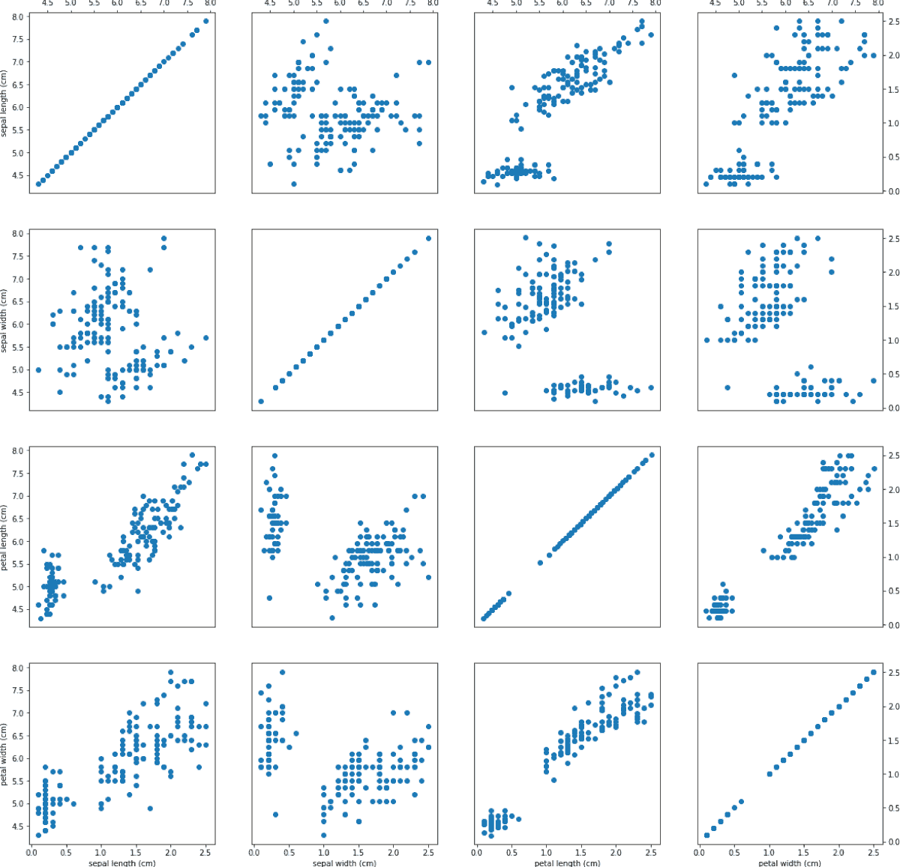

**图 3.17** Iris 数据集特征的散点图矩阵

```python
import sklearn
iris = sklearn.datasets.load_iris()
df_iris = pd.DataFrame(iris.data, columns = iris.feature_names)
generate_scatterplot_matrix (df_iris, 20, 20) 
```

如你所见，Matplotlib 并没有内置用于创建散点图矩阵的函数。Pandas 的绘图模块有一个名为`scatter_matrix()`的函数，可以从数据框生成散点图矩阵。以下代码段演示了`scatter_matrix()`函数的使用：

```python
import sklearn.datasets
import pandas.plotting
 
iris = sklearn.datasets.load_iris()
df_iris = pd.DataFrame(iris.data, columns = iris.feature_names)
 
pandas.plotting.scatter_matrix(df_iris, figsize=(12, 12))
```

散点图也可用于可视化数据中的簇。以下代码段创建了一个包含四个簇的 x、y 值的合成数据集，并在散点图中绘制了所有值。合成数据是使用 Scikit-learn 的`make_blobs()`函数创建的。你可以在`https://scikit-learn.org/stable/modules/generated/sklearn.datasets.make_blobs.html`找到更多关于该函数的信息。图 3.18 展示了生成的散点图。

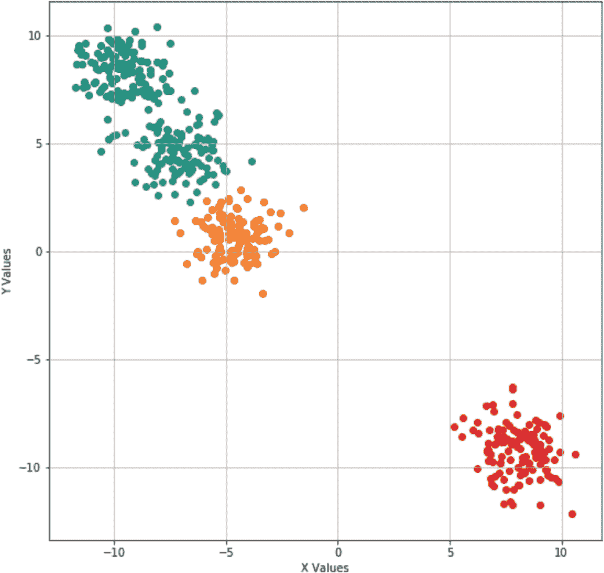

**图 3.18** 四个数据簇的散点图

```python
## scatter plots can also be used to visualize 
## groups within data. This is illustrated below
## using a synthetic dataset
 
from sklearn.datasets import make_blobs
coordinates, clusters = make_blobs(n_samples = 500, n_features = 2, centers=4, random_state=12)
 
coordinates_cluster1 = coordinates[clusters==0]
coordinates_cluster2 = coordinates[clusters==1]
coordinates_cluster3 = coordinates[clusters==2]
coordinates_cluster4 = coordinates[clusters==3]
 
fig , axes = plt.subplots(figsize=(9,9))
plt.xlabel('X Values')
plt.ylabel('Y Values')
plt.grid()
 
plt.scatter(coordinates_cluster1[:,0], coordinates_cluster1[:,1])
plt.scatter(coordinates_cluster2[:,0], coordinates_cluster2[:,1])
plt.scatter(coordinates_cluster3[:,0], coordinates_cluster3[:,1])
plt.scatter(coordinates_cluster4[:,0], coordinates_cluster4[:,1]) 
```

**注意**   为了跟随本章节，请确保你已按照附录 A 中的描述安装了 Anaconda Navigator 和 Jupyter Notebook。

你可以从`www.wiley.com/go/machinelearningawscloud`下载本章的代码，或通过以下 GitHub URL 下载：

`https://github.com/asmtechnology/awsmlbook-chapter3.git`

# 总结

* Matplotlib 是一个用于 Python 的绘图库，提供了生成多种类型图表的功能以及自定义这些图表的能力。

* Matplotlib 内部的`pyplot`模块提供了一个高层函数式绘图接口。

* Matplotlib 还提供了一个低级面向对象的 API，可以单独使用，也可以与`pyplot`模块结合使用。

* Seaborn 是另一个 Python 绘图包，它是在 Matplotlib 之上构建而的。

* 直方图通常用于可视化数值变量的分布。

* 在处理分类变量时，直方图并不适用。

* 分箱策略（binning strategy）会显著影响直方图的外观。

* 在处理分类变量时，常用条形图。

* 条形图可用于名义数据和有序数据。

* 堆叠条形图每个类别使用一个条形，并描述类别内部子组的分布。

* 箱线图提供查看数值分布的方法。

# 第 4 章：使用 Scikit-learn 创建机器学习模型

### 本章内容

* Scikit-learn 简介

* 学习将训练数据划分为测试集

* 学习使用折交叉验证

* 学习创建不同类型的机器学习模型

## 介绍 Scikit-learn

Scikit-learn 是一个 Python 库，提供了许多适用于机器学习工程师和数据科学家的功能。它由 David Cournapeau 于 2007 年开发，如今提供了多种流行机器学习算法的实现。在第 2 章中，你学习了探索数据和进行特征工程的技术。在本章中，你将学习使用 Scikit-learn 将训练数据划分为测试集，并创建不同类型的机器学习模型。本章将使用 Titanic 和 Iris 数据集来演示不同的模型构建技术。这些数据集的副本包含在随本章的文件中。

**注意**   为了跟随本章节，请确保你已按照附录 A 中的描述安装了 Anaconda Navigator 和 Jupyter Notebook。

Scikit-learn 是机器学习在现实世界中应用增加的原因之一。Scikit-learn 丰富的算法集合允许你在没有深厚数学和统计学背景的情况下开始学习机器学习。

为了使用 Scikit-learn 处理你的数据，必须将其加载到`NumPy`数组或`Pandas` dataframe 中。你可以在`https://scikit-learn.org/stable/`找到关于 Scikit-learn 功能的更多信息。

## 创建训练集和测试数据集

核心核心，构建机器学习模型涉及到创建一个计算机程序，该程序在训练阶段可以根据特征进行推断，然后通过做出预测来测试模型的质量。通常做法是在模型构建阶段之前留出部分标记过的训练数据，并使用这些模型之前未遇到过的数据对模型进行测试。模型在这些未见数据上的性能用于判断模型是否足够优秀，或者是否需要改进。拥有独立的训练集和测试集的好处是，它能确保模型没有记忆训练示例（这种现象被称为过拟合）。需要注意的是，在监督学习的情况下，训练集和测试集都带有标签，并且在创建子集之前必须对原始数据集进行均匀洗牌。

Scikit-learn 在`model_selection`子模块中提供了一个名为`train_test_split()`的函数，可以将一个`Pandas` dataframe 拆分为两个 dataframe，一个用于模型构建，另一个用于模型评估。`train_test_split()`函数有多个参数，其中大多数都有默认值。最常用的参数是：

* `test_size`: 该值可以是一个整数或浮点数。当该值为整数时，它指定了应为测试集保留的元素数量。当该值为浮点数时，它指定了包含在测试集中原始数据集的百分比。

* `random_state`: 这是一个整数值，用于种子化随机数生成器。

`train_test_split()`函数的输出是一个四个数组的列表，顺序如下：

* 列表第一个元素是包含训练集特征的数组。

* 列表第二个元素是包含测试集特征的数组。

* 列表第三个元素是包含训练集标签（目标变量）的数组。

* 列表第四个元素是包含测试集标签的数组。

你可以在`https://scikit-learn.org/stable/modules/generated/sklearn.model_selection.train_test_split.html`找到关于`train_test_split()`函数参数的详细信息。

以下代码演示了如何使用该函数将鸢尾花（Iris）数据集拆分为训练集和测试集，预留 25% 的数据作为测试集：

```python
import numpy as np
import pandas as pd
## 加载鸢尾花数据集
from sklearn.datasets import load_iris
iris_dataset = load_iris()
df_iris_features = pd.DataFrame(data = iris_dataset.data, columns=iris_dataset.feature_names)
df_iris_target = pd.DataFrame(data = iris_dataset.target, columns=['class'])
## 划分鸢尾花数据集
iris_split = train_test_split(df_iris_features, df_iris_target, 
                test_size=0.25, random_state=17)
df_iris_features_train = iris_split[0]
df_iris_features_test = iris_split[1]
df_iris_target_train = iris_split[2]
df_iris_target_test = iris_split[3]
```

你可以使用 dataframe 的`shape`属性来检查`train_test_split()`函数创建的训练集和测试数据集的大小：

如果你使用 dataframe 的`head()`方法来检查原始`df_iris_features`数据的前五行，并将其与`df_iris_features_train`数据的前五行进行比较，你会发现`train_test_split()`函数在拆分之前自动对数据进行了洗牌。这在图 4.1 中所示。

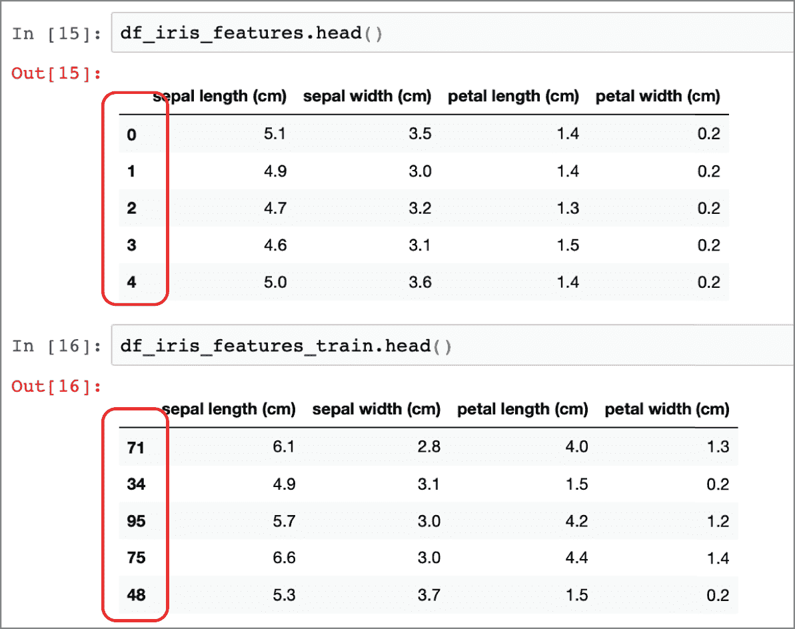

**图 4.1** Scikit-learn 的`train_test_split()`方法在拆分前自动对数据进行洗牌。

`train_test_split()`函数的默认行为洗牌，然后确定训练集结束的边界观测值，并通过在该边界位置拆分来准备两个数据集。如果你尝试解决的问题是多分类问题，且你的原始数据中某一类的样本数量远多于另一类，那么确保拆分后的数据集具有相似的比例是非常重要的。`train_test_split()`函数有一个名为`stratify`的参数，可以用于分层拆分，保持拆分前后类别观测值的比例。以下代码段演示了如何使用`stratify`参数：

```python
## 鸢尾花数据集，使用分层采样
iris_split_strat = train_test_split(df_iris_features, df_iris_target, 
                                    test_size=0.25, random_state=17, stratify=df_iris_target)
df_iris_features_train = iris_split_strat[0]
df_iris_features_test = iris_split_strat[1]
df_iris_target_train = iris_split_strat[2]
df_iris_target_test = iris_split_strat[3]
```

以下代码段使用 Pandas 函数创建原始数据集、未分层训练集和分层训练集的类别分布的柱状图。注意，分层集中的分布更接近原始分布，尽管并非完全相同。生成的图表如图 4.2 所示。

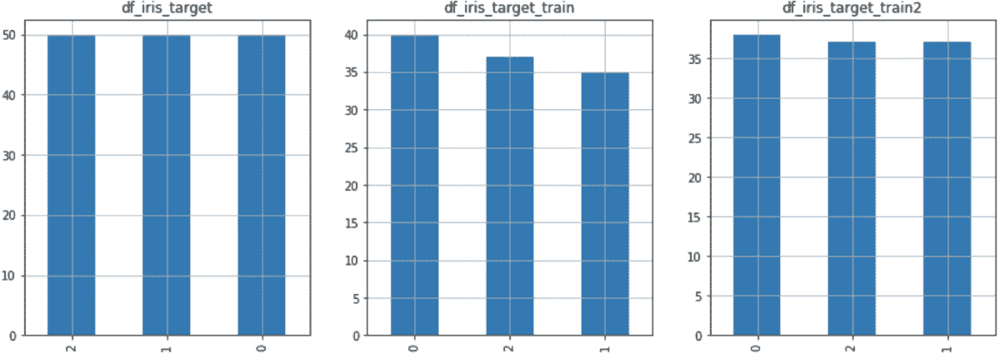

**图 4.2** 原始数据集与拆分后集中目标变量的比较


```python
## 可视化原始数据集和
## train_test_split 函数创建的训练集中目标值的分布，
## 有和无分层的情况下
## 使用 Pandas 函数绘制 'class' 属性的柱状图
fig, axes = plt.subplots(1, 3, figsize=(15,5))
axes[0].set_title('df_iris_target')
df_iris_target['class'].value_counts(dropna=False).plot(grid=True, ax=axes[0])
axes[1].set_title('df_iris_target_train')
df_iris_target_train['class'].value_counts(dropna=False).plot(grid=True, ax=axes[1])
axes[2].set_title('df_iris_target_train2')
df_iris_target_train2['class'].value_counts(dropna=False).plot(grid=True, ax=axes[2])
```

鸢尾花数据集中三类花的目标值分布是完全相同的。这从图 4.2 中的第一个直方图中可以看出，每个类别都有 50 个值。为了更好地说明分层采样的用法，以下代码段加载了 UCI 葡萄酒数据集的玩具版本，并绘制了分层和未分层拆分的区别。UCI 葡萄酒数据集是另一个用于学者解决多分类问题的流行数据集。它包含许多数值特征，这些特征是对意大利四个不同地区种植的葡萄酒进行化学分析的结果，以及一个指示葡萄酒整体质量的类别目标。你可以在`https://scikit-learn.org/stable/datasets/index.html`找到关于该数据集属性的信息。生成的图表如图 4.3 所示。

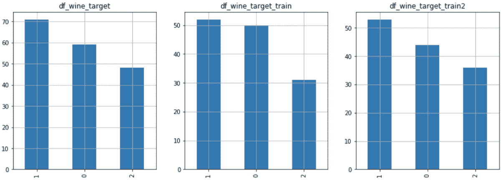

图 4.3 UCI ML 葡萄酒数据集原始版本与拆分版本的目标变量分布对比，包含与不包含分层采样

```python
## 加载 UCI ML 葡萄酒数据集
from sklearn.datasets import load_wine
wine_dataset = load_wine()
df_wine_features = pd.DataFrame(data = wine_dataset.data, columns=wine_dataset.feature_names)
df_wine_target = pd.DataFrame(data = wine_dataset.target, columns=['class'])
#葡萄酒数据集拆分
wines_split = train_test_split(df_wine_features, df_wine_target, 
                               test_size=0.25, random_state=17)
df_wine_features_train = wines_split[0]
df_wine_features_test = wines_split[1]
df_wine_target_train = wines_split[2]
df_wine_target_test = wines_split[3]
## 葡萄酒数据集，使用分层采样
wines_split_strat = train_test_split(df_wine_features, df_wine_target, 
                                     test_size=0.25, random_state=17, stratify=df_wine_target)
df_wine_features_train2 = wines_split_strat[0]
df_wine_features_test2 = wines_split_strat[1]
df_wine_target_train2 = wines_split_strat[2]
df_wine_target_test2 = wines_split_strat[3]
 
## 可视化原始葡萄酒数据集以及由 train_test_split
## 函数创建的训练集的目标值分布
## 包含与不包含分层
## 使用 Pandas dataframe 函数绘制 'Embarked' 属性的柱状图
fig, axes = plt.subplots(1, 3, figsize=(15,5))
axes[0].set_title('df_wine_target')
df_wine_target['class'].value_counts(dropna=False).plot.bar(grid=True, ax=axes[0])
axes[1].set_title('df_wine_target_train')
df_wine_target_train['class'].value_counts(dropna=False).plot.bar(grid=True, ax=axes[1])
axes[2].set_title('df_wine_target_train2')
df_wine_target_train2['class'].value_counts(dropna=False).plot.bar(grid=True, ax=axes[2]) 
```

### K 折交叉验证

将训练数据集拆分为训练集和验证集的主要缺点是，训练集中的样本可能表现出测试集中任何样本都未发现的特征。虽然洗乱数据可以帮助缓解这种情况，但缓解程度取决于多种因素，例如原始数据集的大小以及具有特定特征的样本比例。为了避免创建对仅存在于训练集的特征敏感的模型，解决方案包含在名为 k 折交叉验证的技术中。从高层次来说，k 折交叉验证技术的工作原理如下：

1. 选择一个`k`值。

2. 洗乱数据。

3. 将数据拆分为`k`个等的子集。

4. 对于每个`k`的值：

    1. 训练一个使用`kth`子集作为测试集并使用`k-1`个子集的样本作为训练集的模型。

    2. 记录模型在`kth`子集上进行预测时的性能。

5. 计算各个模型的平均性能以得出整体性能。

K 折交叉验证可以帮助减少模型捕捉训练集中意外偏差的可能性。k 折交叉验证的背后的思想是随机洗乱整个数据集，并将其分为若干个较小的集合（称为折），然后训练多个模型（或多次训练同一个模型）。在每个训练和评估周期中，其中一个折将被留作测试集，其余的作为训练集。这在图 4.4 所示。

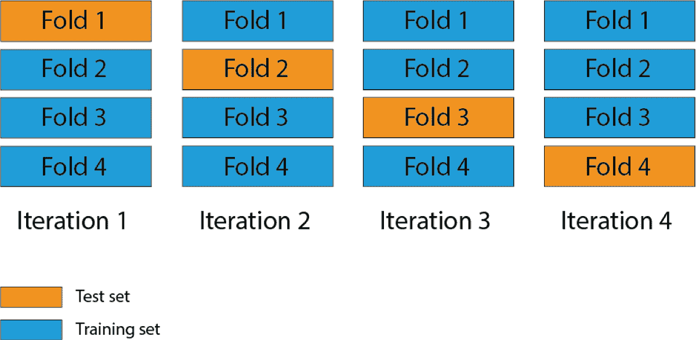

图 4.4 使用 k 折进行交叉验证

如果`k=1`，则 k 折交叉验证方法变得类似于本章之前讨论的训练/测试拆分方法。如果`k=n`（即训练集中的样本数量），那么实际上测试集仅包含一个样本，并且每个样本将在其中一次迭代中成为测试集的一部分。这种技术也被称为留一交叉验证。许多学术研究论文使用`k=5`或`k=10`；然而，并没有规定`k`值的硬性规则。

Scikit-learn 的模型构建模块提供了一个名为`KFold`的类，可用于创建折并遍历折。`KFold`类的构造函数接受三个参数：

* `n_splits`: 一个表示折数的整数。

* `shuffle`: 一个可选的布尔值，指示是否应对数据进行洗乱。

* `random_state`: 一个可选的整数，用于随机生成器的种子。

`KFold`类提供了两个方法：

* `get_n_splits()`: 返回折的数量。

* `split()`: 获取训练和测试索引

你可以在`https://scikit-learn.org/stable/modules/sklearn.model_selection.html`找到更多关于`KFold`的信息。以下代码演示了如何使用`KFold`拆分 Iris 数据集：

```python
## 对 Iris 数据集进行 10 折拆分
from sklearn.model_selection import KFold
kf = KFold(n_splits=10, shuffle=True)
fold_number = 1
for train_indices, test_indices in kf.split(df_iris_features):
    
    print("Fold number:", fold_number)
    print("Training indices:", train_indices)
    print("Testing indices:", test_indices)
    
    fold_number = fold_number + 1
    
    df_iris_features_train = df_iris_features.iloc[train_indices]
    df_iris_target_train = df_iris_target.iloc[train_indices]
    
    df_iris_features_test = df_iris_features.iloc[test_indices]
    df_iris_target_test = df_iris_target.iloc[test_indices]
```

## 创建机器学习模型

在本节中，你将学习创建既可以预测目标变量值又对数据进行分类的模型。我们将查看一些模型，其中一些假设线性关系，另一些适用于非线性关系。

### 线性回归

线性回归是一种统计技术，旨在找到距离数据集中所有点最近的直线（或超平面）方程。为了理解线性回归是如何工作的，假设你有一个包含 100 行的训练数据集，每行由三个特征`Y1`、`Y2`和`Y3`以及一个已知的目标值`X`组成。线性回归假设目标变量`X`与特征`Y1`、`Y2`和`Y3`之间的关系是线性的，可以用此方程表示：

`X[i] = αY1[i] + βY2[i] + γY3[i] + ε`

其中：

* `X[i]` 是第`ith`个目标变量的预测值。

* `Y1[i]` 是特征`Y1`的第`ith`个值。

* `Y2[i]` 是特征`Y2`的第`ith`个值。

* `Y3[i]` 是特征`Y3`的第`ith`个值。

* `α`、`β`、`γ` 是特征`Y1`、`Y2`和`Y3`的系数。

* `ε` 是一个常数项，也称为偏置项或截距。

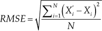<math display="block" overflow="scroll" xmlns="http://www.w3.org/1998/Math/MathML" xmlns:xlink="http://www.w3.org/1999/xlink"><mrow><mi>R</mi><mi>M</mi><mi>S</mi><mi>E</mi><mo>=</mo><msqrt><mrow><mfrac><mrow><msubsup><mstyle displaystyle="true"><mo>&#8721;</mo></mstyle><mrow><mi>i</mi><mo>=</mo><mn>1</mn></mrow><mi>N</mi></msubsup><msup><mrow><mrow><mfenced open="(" close=")"><mrow><mrow><msubsup><mrow><mi>X</mi><mrow><mi>i</mi></mrow><mrow><mo>&#8242;</mo></mrow></msubsup><mo>&#8722;</mo><msub><mrow><mi>X</mi><mrow><mi>i</mi></mrow></msub></mrow></mrow></mfenced></mrow></mrow><mn>2</mn></msup></mrow><mi>N</mi></mfrac></mrow></msqrt></mrow></math>

实际上，线性回归试图找到一条拟合所有数据点的直线（在高维空间中的超平面）。线性回归的输出是一个连续且无界的值。它可以是正数也可以是负数，具体取决于模型训练时的输入值。因此，线性回归模型通常用于预测连续的数值。

Scikit-learn 在名为`LinearRegression`的类中实现了线性回归，该类是`linear_model`模块的一部分。现在我们将使用该类在流行的波士顿房价数据集上实现线性回归模型。该数据集包含 506 行，每行包含 13 个连续数值特征，其中包含了人均犯罪率、每户房屋平均房间数、房产税率以及生师比等信息。目标值包含波士顿不同地区自住房屋的房屋位价。

该数据集不包含任何缺失值，且 Scikit-learn 将整个数据集作为其`datasets`模块的一部分。你可以在`https://scikit-learn.org/stable/datasets/index.html`找到有关该数据集属性的更多信息。回想第 2 章，Scikit-learn 提供了一个名为`DESCR`的函数，可以用于打印示例数据集的描述。以下代码片段加载了波士顿房价数据集并使用`DESCR`函数打印数据集的描述：

创建线性模型涉及将波士顿房价数据集的 506 行分为训练集和验证集，并使用训练集来训练模型。以下代码片段对 506 行进行了 75/25 划分，并使用原始数据的 75% 来来训练线性回归模型：

```python
## 使用 75/25 划分创建训练数据集和测试数据集。
from sklearn.model_selection import train_test_split
boston_split = train_test_split(df_boston_features, df_boston_target, 
                              test_size=0.2)
```

```python
# create a synthetic regression dataset of X, Y values.
from sklearn.datasets import make_regression
from sklearn.preprocessing import MinMaxScaler
SyntheticX, SyntheticY = make_regression(n_samples=50, n_features=1, noise=35.0, random_state=17)
x_scaler = MinMaxScaler()
x_scaler.fit(SyntheticX.reshape(-1,1))
SyntheticX = x_scaler.transform(SyntheticX.reshape(-1,1))
y_scaler = MinMaxScaler()
y_scaler.fit(SyntheticY.reshape(-1,1))
SyntheticY = y_scaler.transform(SyntheticY.reshape(-1,1))
        
# demonstrate effect of fit_intercept parameter on a simple synthetic dataset.
linear_regression_model_synthetic1 = LinearRegression(fit_intercept=True)
linear_regression_model_synthetic1.fit(SyntheticX, SyntheticY)
linear_regression_model_synthetic2 = LinearRegression(fit_intercept=False)
linear_regression_model_synthetic2.fit(SyntheticX, SyntheticY)
c1 = linear_regression_model_synthetic1.coef_
i1 = linear_regression_model_synthetic1.intercept_
YPredicted1 = np.dot(SyntheticX, c1) + i1
c2 = linear_regression_model_synthetic2.coef_
i2 = linear_regression_model_synthetic2.intercept_
YPredicted2 = np.dot(SyntheticX, c2) + i2
## use pyplot module to create a scatter plot of synthetic dataset
# and overlay the regression line from the two models.
fig, axes = plt.subplots(1, 1, figsize=(9,9))
axes.axhline(y=0, color='k')
axes.axvline(x=0, color='k')
plt.scatter(SyntheticX, SyntheticY)
plt.plot(SyntheticX, YPredicted1, color='#042fed', label='fit_intercept=True')
plt.plot(SyntheticX, YPredicted2, color='#d02fed', label='fit_intercept=False')
plt.legend()
plt.xlabel("X")
plt.ylabel("Y") 
```

在 图 4.6 中，你可以看到`fit_intercept` = False 的模型生成的回归线锚定在`Y` = 0 处。因此，该模型在可以生成的直线方面受到了限制。另一方面，`fit_intercept` = True 的模型所生成的线没有锚定在`Y` = 0，因此模型能够根据训练过程确定`Y`截距的最佳值。

### 支持向量机


支持向量机（SVM）是一种多功能模型，可用于多种任务，包括分类、回归和离群点检测。原始算法由 Vladimir Vapnik 和 Alexey Chervonenkis 于 1963 年发明，作为一种二分类算法。在训练过程中，支持向量机模型旨在创建一个决策边界，将数据点划分成不同的类别。如果数据集只有两个特征，那么这个决策边界就是二维的，可以在散点图中方便地表示出来。如果决策边界是线性的，它在二维空间中呈直线，在三维空间中呈平面，在 n 空间中则是超平面。作为人类，我们无法可视化三个以上的维度，因此为了理解 SVM 的工作原理，我们将考虑一个具有两个特征的虚拟数据集的二维示例，每个点属于两个类别之一。我们也假设数据是线性可分的——也就是说，你可以画出一条线将它们分开。图 4.7 展示了该虚拟数据点特征值的散点图，其中一类观测值用圆圈表示，另一类用星号表示。图中还展示了三个可能的线性决策边界，每条都能将观测值划分为两个不同的集合。

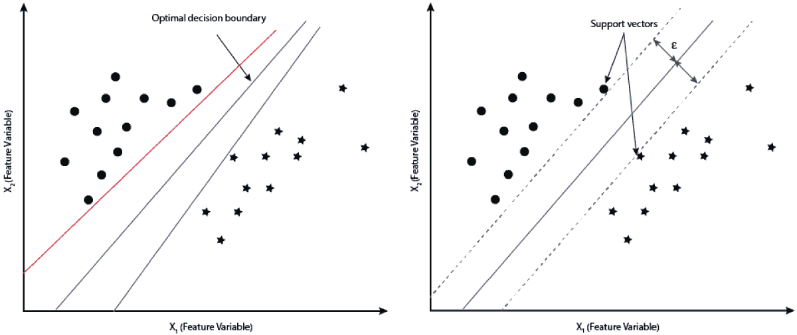

FIGURE 4.7 三种可能的决策边界

左侧的决策边界距离第一组观测值太近，存在风险：如果真实世界的观测值与训练集略有不同，具有该决策边界的模型可能会误分类。右侧的决策边界有类似的问题，因为它距离第二组观测值太近。中间的决策边界是最优的，因为它距离两个类别尽可能远，同时清晰地划分了这两个类别。SVM 模型旨在找到这个中间（最优）边界，或者换句话说，旨在找到能够最大化两侧两类观测值之间距离的决策边界。间隔的半宽由希腊字母 `ε` (epsilon) 表示。间隔边缘上的点被称为支持向量（假设该向量源于原点并终止于这些点）。实际上，可以认为这些向量正在支撑着间隔——因此被称为支持向量。

大多数现实世界的数据并不是线性可分的，如 图 4.7 所示的数据集，因此，线性决策边界无法清晰地划分类别。此外，即使数据是线性可分的，分离间隔的宽度也不可能像 图 4.7 中的虚拟示例那样宽。数据点之间的距离通常太近，无法在决策边界和两侧的支持向量之间留出宽且清晰的间隔。为了处理这个问题，SVM 实现包含了容差参数的概念，该参数控制位于间隔内部的支持向量的数量，反过来又影响间隔的宽度。设置较大的容差值会导致产生更宽的间隔且其中包含更多样本，而设置较小的容差值将导致较窄的间隔。拥有宽间隔并不一定是坏事，只要间隔中的大多数点都在决策边界的正确侧。

Scikit-learn 在 `SVC` 类中提供了基于支持机的分类器实现，该类是 `sklearn.svm` 模块的一部分。我们现在使用该类在流行的 Pima Indians 数据上实现基于 SVM 的分类。该数据库包含八个特征变量，代表各种医疗测量值，如血压、血糖浓度、BMI 和胰岛素水平，并包含一个二分类目标变量 `Outcome`，指示个人是否患糖尿病。该数据集最初由国家糖尿病、消化和肾脏研究所创建，你可以在 Kaggle 上找到该数据集：https://www.kaggle.com/uciml/pima-indians-diabetes-database。本章配套资源包含了该数据集的副本。

以下代码片段可从 CSV 文件加载数据集，创建特征和目标的 Pandas DataFrame，归一化特征数据并创建 75/25 划分：

```python
# load Pima Indians Diabetes dataset
diabetes_dataset_file = './datasets/diabetes_dataset/diabetes.csv'
df_diabetes = pd.read_csv(diabetes_dataset_file)
df_diabetes_target = df_diabetes.loc[:,['Outcome']]
df_diabetes_features = df_diabetes.drop(['Outcome'], axis=1)
## normalize attribute values
from sklearn.preprocessing import MinMaxScaler
diabetes_scaler = MinMaxScaler()
diabetes_scaler.fit(df_diabetes_features)
nd_diabetes_features = diabetes_scaler.transform(df_diabetes_features)
df_diabetes_features_normalized = pd.DataFrame(data=nd_diabetes_features, columns=df_diabetes_features.columns)
# create a training dataset and a test dataset using a 75/25 split.
diabetes_split = train_test_split(df_diabetes_features_normalized, df_diabetes_target, 
                              test_size=0.25, random_state=17)
df_diabetes_features_train = diabetes_split[0]
df_diabetes_features_test = diabetes_split[1]
df_diabetes_target_train = diabetes_split[2]
df_diabetes_target_test = diabetes_split[3]
```

以下代码段创建了一个 `SVC` 类的实例，该实例尝试寻找线性决策边界，使用训练集（样本的 75%）训练 `SVC` 实例，并使用 `predict()` 方法在测试集上进行预测。你可以在 `https://scikit-learn.org/stable/modules/generated/sklearn.svm.SVC.html` 学习更多关于实例化 `SVC` 实例的知识。

```python
# 使用线性核为糖尿病数据集的特征创建一个 SVM 分类器
from sklearn.svm import SVC
svc_model = SVC(kernel='linear', C=1)
svc_model.fit(df_diabetes_features_train, df_diabetes_target_train)
# 使用 SVC 模型在测试集上创建预测结果。
predicted_diabetes = svc_model.predict(df_diabetes_features_test)
```

第 5 章 涵盖了评估分类模型性能的技巧，但目前你可以使用 Python 的 `print()` 函数直接检查预测结果本身：

基于 SVM 的分类器的强大之处在于它们能够创建非线性决策边界。支持向量模型使用一种称为“核”（kernel）的数学函数，将每个输入点转换到高维空间，在该空间中可以找到线性决策边界。通过一个例子会更容易理解。图 4.8 显示了另一个虚构数据集的散点图，每个数据点有两个特征，且每个数据点属于两个类别中的一个。在这种情况下，很明显不存在一条线性决策边界（直线）可以正确地分类所有数据点——无论你向哪个方向画一条直线，总会有一些样本落在直线的错误侧。

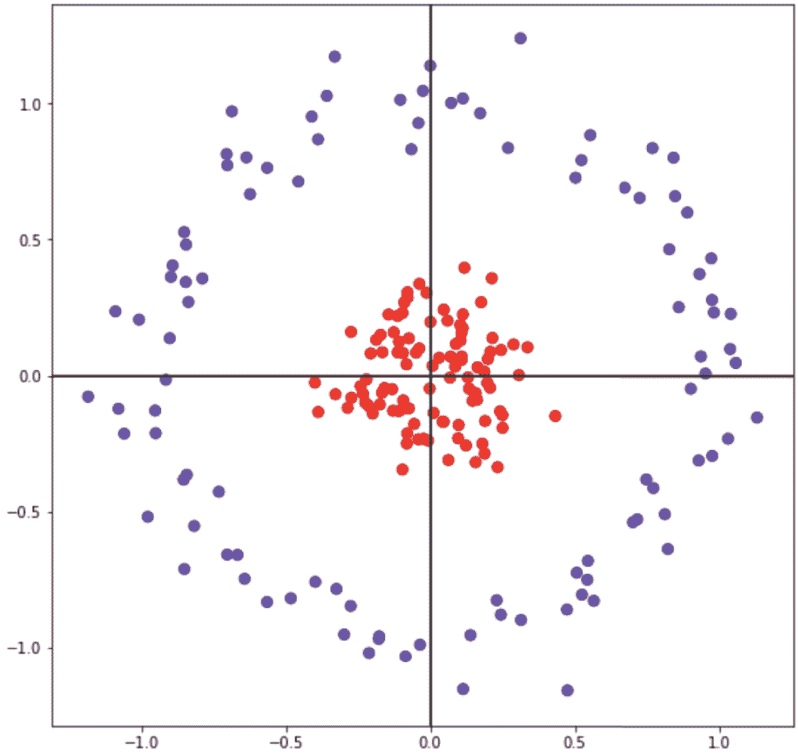

图 4.8 在二维空间内无法使用线性决策边界分类的数据

然而，如果你为数据添加一个额外的维度（z 轴），并并使用方程 `z = x`² `+ y`² 计算每个点的 `z` 值，那么数据就可以通过在 `z = 0.3` 处的平面沿 z 轴实现线性可分。这在图 4.9 中所示。

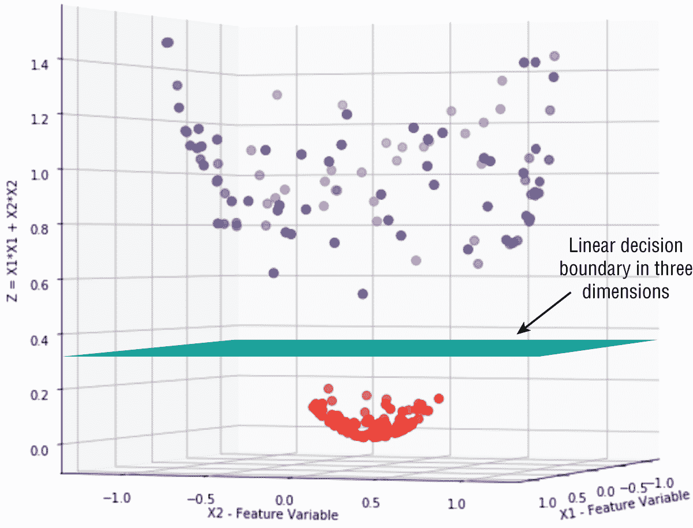

图 4.9 在二维空间内无法使用线性决策边界分类的数据在三维空间内可以分类。

由于 `z` 是通过 `x`² `+ y`² 计算的，因此 `z = 0.3` 处的决策平面意味着 `x`² `+ y`² `= 0.3`，这正是二维空间中圆的方程。因此，三维空间中的线性决策边界变成了二维空间中的非线性决策边界。这在图 4.10 中得到了说明。

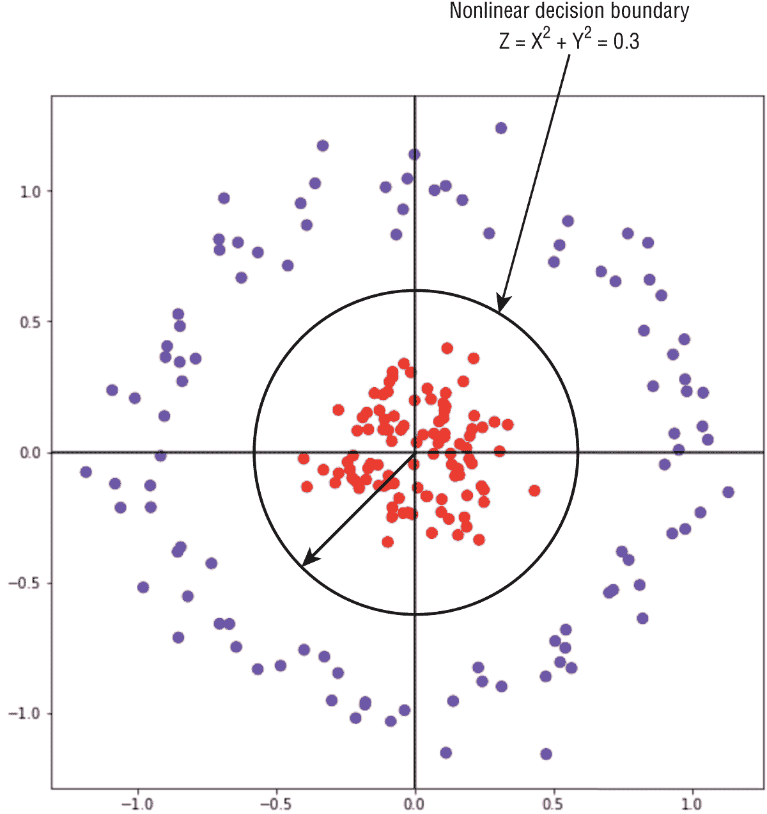

图 4.10 二维空间中的非线性决策边界

这是对核工作原理的过度简化，如果你对学习更多关于 SVM 核感兴趣，应该阅读 Nello Cristianini 编写的*支持向量机及其他基于核的学习方法*（An Introduction to Support Vector Machines and Other Kernel-based Learning Methods）。Scikit-learn 允许你在创建 `SVC` 实例时从常用的核中选择，包括线性、多项式、径基函数和自定义核。你可以在 `https://scikit-learn.org/stable/modules/svm.html#svm-kernels` 找到更多关于不同核函数的信息。为了可视化核的效果，我们在数据集上使用不同的核函数训练了多个 SVM 分类器。以下代码在具有两个特征的合成二分类数据集上训练了分类器。第一个分类器使用线性核，第二个分类器使用二阶多项式核，第三个分类器使用十五 阶多项式核，第四个核使用径基函数（RBF）核：

```python
# 创建具有两个特征的合成二分类数据集
from sklearn.datasets import make_classification
Synthetic_BinaryClassX, Synthetic_BinaryClassY = make_classification(n_samples=50, n_features=2, n_redundant=0, n_classes=2)

## 将合成数据集缩放到 -3, 3
from sklearn.preprocessing import MinMaxScaler
scaler = MinMaxScaler(feature_range=(-3,3))
scaler.fit(Synthetic_BinaryClassX)
Synthetic_BinaryClassX = scaler.transform(Synthetic_BinaryClassX)
# 创建多个 SVM 分类器
from sklearn.svm import SVC
svc_model_linear = SVC(kernel='linear', C=1, gamma='auto')
svc_model_polynomial2 = SVC(kernel='poly', degree=2, C=1, gamma='auto')
svc_model_polynomial15 = SVC(kernel='poly', degree=15, C=1, gamma='auto')
svc_model_rbf = SVC(kernel='rbf', C=1, gamma='auto')
svc_model_linear.fit(Synthetic_BinaryClassX, Synthetic_BinaryClassY)
svc_model_polynomial2.fit(Synthetic_BinaryClassX, Synthetic_BinaryClassY)
svc_model_polynomial15.fit(Synthetic_BinaryClassX, Synthetic_BinaryClassY)
svc_model_rbf.fit(Synthetic_BinaryClassX, Synthetic_BinaryClassY)
```

一旦创建了模型，我们就可以使用 Matplotlib 函数绘制数据点以及每个分类器的决策边界。以下代码段展示了如何可视化 SVM 分类器的边界（部分代码取自 `https://scikit-learn.org/stable/auto_examples/exercises/plot_iris_exercise.html`）。生成的图表如图 4.11 所示。

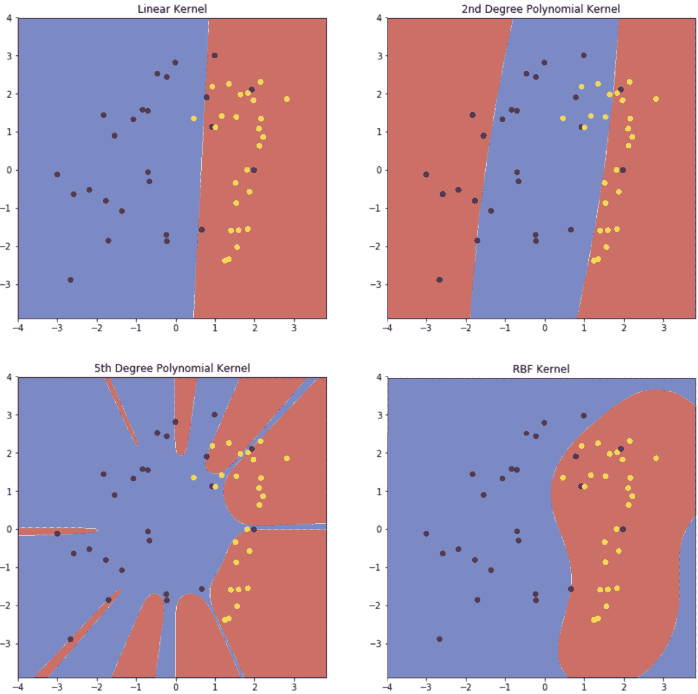

```python
#
# portions of this code are from
# source: https://scikit-learn.org/stable/auto_examples/svm/plot_iris.html
#
%matplotlib inline
import matplotlib.pyplot as plt
def plot_contours(ax, clf, xx, yy, **params):
    """绘制分类器的决策边界。
    Parameters
    ----------
    ax: matplotlib axes object
    clf: 分器
    xx: meshgrid ndarray
    yy: meshgrid ndarray
    params: 传递给 contourf 的参数字典，可选
    """
    Z = clf.predict(np.c_[xx.ravel(), yy.ravel()])
    Z = Z.reshape(xx.shape)
    out = ax.contourf(xx, yy, Z, **params)
    return out
def make_meshgrid(x, y, h=.02):      """创建一个用于绘图的点集网格
    Parameters
    ----------
    x: 用于基础 x 轴 meshgrid 的数据
    y: 用于基础 y 轴 meshgrid 的数据
    h: meshgrid 的步长，可选
    Returns
    -------
    xx, yy : ndarray
    """
    x_min, x_max = x.min() - 1, x.max() + 1
    y_min, y_max = y.min() - 1, y.max() + 1
    xx, yy = np.meshgrid(np.arange(x_min, x_max, h),
                         np.arange(y_min, y_max, h))
    return xx, yy
# 选择 2 个特征 X0 和 X1
X0 = Synthetic_BinaryClassX[:,0]
X1 = Synthetic_BinaryClassX[:,1]
xx, yy = make_meshgrid(X0, X1, 0.02)#np.meshgrid(np.arange(-3, 3, 0.002),  np.arange(-3, 3, 0.002))
 
fig, axes = plt.subplots(2, 2, figsize=(16,16))
## 绘制线性内核
plot_contours(axes[0,0], svc_model_linear, 
              xx, yy, cmap=plt.cm.coolwarm, alpha=0.8)   
axes[0,0].scatter(X0, X1, s=30,  c=Synthetic_BinaryClassY)
axes[0,0].set_xlim(xx.min(), xx.max())
axes[0,0].set_ylim(yy.min(), yy.max())
axes[0,0].set_title('Linear Kernel')
    
# 绘制二次多项式内核    
plot_contours(axes[0,1], svc_model_polynomial2, xx, yy, 
              cmap=plt.cm.coolwarm, alpha=0.8)
axes[0,1].scatter(X0, X1, s=30, c=Synthetic_BinaryClassY)
axes[0,1].set_xlim(xx.min(), xx.max())
axes[0,1].set_ylim(yy.min(), yy.max())
axes[0,1].set_title('2nd Degree Polynomial Kernel')
# 绘制 15 次多项式内核
plot_contours(axes[1,0], svc_model_polynomial15, xx, yy, 
              cmap=plt.cm.coolwarm, alpha=0.8)
axes[1,0].scatter(X0, X1, s=30, c=Synthetic_BinaryClassY)
axes[1,0].set_xlim(xx.min(), xx.max())
axes[1,0].set_ylim(yy.min(), yy.max())
axes[1,0].set_title('5th Degree Polynomial Kernel')
## 绘制 RBF 内核
plot_contours(axes[1,1], svc_model_rbf, xx, yy, 
              cmap=plt.cm.coolwarm, alpha=0.8)  axes[1,1].scatter(X0, X1, s=30, c=Synthetic_BinaryClassY)
axes[1,1].set_xlim(xx.min(), xx.max())
axes[1,1].set_ylim(yy.min(), yy.max())
axes[1,1].set_title('RBF Kernel')
plt.show() 
```

基于支持向量机的模型也可以用于线性回归任务。当用于线性回归任务时，你不再是在寻找能够划分类别间数据点的决策边界，而是寻找最拟合样本的直线（或超平面）。支持向量回归（SVR）是一种尝试找到拟合训练变量的最优直线或超平的技术。线性回归与 SVR 的区别在于确定该超平面的方式。二维空间中的线性回归从根本上尝试寻找一条使数据点到直线距离之和最小的直线。另一方面，SVR 尝试寻找一条在距离超平面固定距离内包含最多数据点的直线。图 4.12 展示了二维场景下线性回归与 SVR 之间的区别。


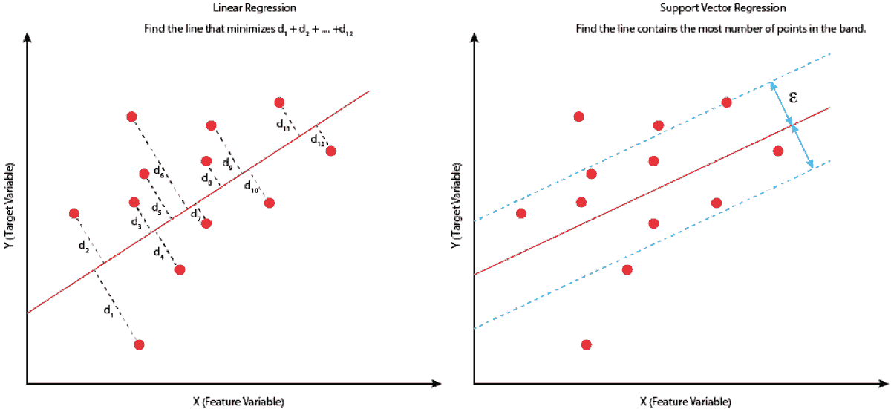

图 4.12 线性回归对比支持向量回归

Scikit-learn 在`SVR`类中提供了基于支持向量机的回归器实现，该类是`sklearn.svm`模块的一部分。接下来的代码将使用`SVR`类在波士顿房价数据集上实现基于 SVM 的回归模型，以预测中位房价。预测房价与实际房价的散点图如图 4.13 所示。

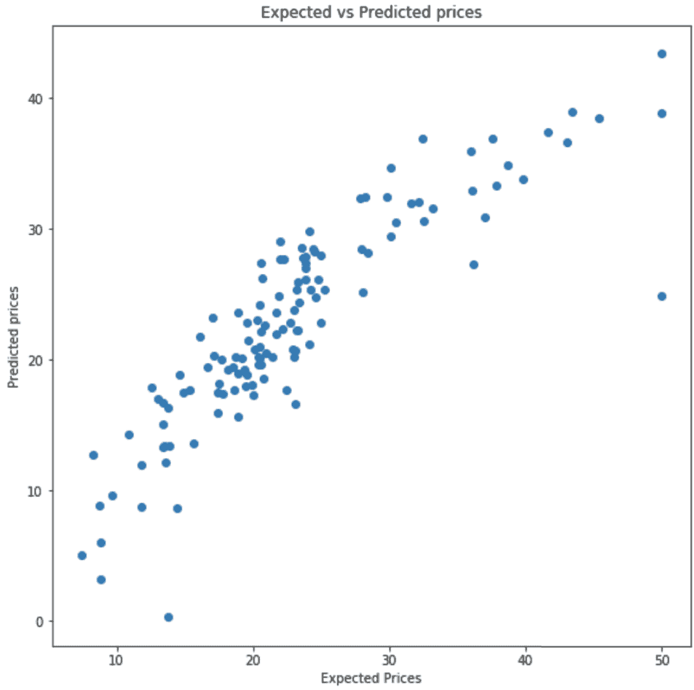

图 4.13 波士顿房价数据集上的 SVR 预测

```python
# 在波士顿房价数据集上训练线性模型。
from sklearn.svm import SVR
svr_model = SVR(kernel='linear', C=1.5, gamma='auto', epsilon=1.5)
svr_model.fit(df_boston_features, df_boston_target)
# 使用 SVR 模型在测试集上进行预测。
predicted_prices = svr_model.predict(df_boston_test)
# 使用 pyplot 创建期望值与预测值的散点图
import matplotlib.pyplot as plt
fig, axes = plt.subplots(1, 1, figsize=(9,9))
plt.scatter(df_boston_test, predicted_prices)
plt.xlabel("期望价格")
plt.ylabel("预测价格")
plt.title("期望 vs 预测")
plt.show()
```

### 逻辑回归

逻辑回归尽管名称中带有回归二字，但它是用于构建二分类和多分类分类器的技术。回顾线性回归的输出是连续无界的，而概率是连续的——边界在 0.0 到 1.0 之间。

为了将连续值用于二分类，逻辑回归通过一个函数转换为概率。在统计学中，逻辑函数是一种将 [负无穷，正无穷] 映射到 [0, 1] 的函数。在逻辑回归的情况下，逻辑函数即为 sigmoid 函数，其定义如下：

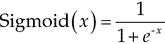

sigmoid 函数的图像如图图 4.14](#c04.xhtml#c04-fig-0014) 所示。无论输入值是多少，sigmoid 函数的输出永远不会低于 0.0 或高于 1.0。

sigmoid 函数的输出可以用于二分类，方法是设置一个阈值，并将低于该阈值的所有视为类别 A，将高于阈值的所有视为类别 B（图 4.15）。

Scikit-learn 在`linear_model`模块中提供了`LogisticRegression`类。我们现在将使用该类在流行的皮马印第人糖尿病数据集上实现一个基于逻辑回归的二分类模型：

```python
# load Pima Indians Diabetes dataset
diabetes_dataset_file = './datasets/diabetes_dataset/diabetes.csv'
df_diabetes = pd.read_csv(diabetes_dataset_file)
df_diabetes_target = df_diabetes.loc[:,['Outcome']]
df_diabetes_features = df_diabetes.drop(['Outcome'], axis=1)
## normalize attribute values
from sklearn.preprocessing import MinMaxScaler
diabetes_scaler = MinMaxScaler()
diabetes_scaler.fit(df_diabetes_features)
nd_diabetes_features = diabetes_scaler.transform(df_diabetes_features)
df_diabetes_features_normalized = pd.DataFrame(data=nd_diabetes_features, columns=df_diabetes_features.columns)
# create a training dataset and a test dataset using a 75/25 split.
diabetes_split = train_test_split(df_diabetes_features_normalized, df_diabetes_target, 
                              test_size=0.25, random_state=17)
df_diabetes_features_train = diabetes_split[0]
df_diabetes_features_test = diabetes_split[1]
df_diabetes_target_train = diabetes_split[2]
df_diabetes_target_test = diabetes_split[3]
# train a logistic regression model on the diabetes dataset.
from sklearn.linear_model import LogisticRegression
logistic_regression_model = LogisticRegression(penalty='l2', fit_intercept=True, solver='liblinear')
logistic_regression_model.fit(df_diabetes_features_train, df_diabetes_target_train.values.ravel())
# use the  model to create predictions on the test set, with a threshold of 0.5
logistic_regression_predictions = logistic_regression_model.predict(df_diabetes_features_test)
```

`LogisticRegression`类的构造函数接受多个参数，其中一些参数与`LinearRegression`类相同。你可以在`https://scikit-learn.org/stable/modules/generated/sklearn.linear_model.LogisticRegression.html`找到更多关于这些参数的信息。可以使用 Python 的`print()`函数检查模型的预测结果：

二分类预测是使用 0.5 的概率阈值得的。如果底层线性回归模型估计的概率值 > 0.5，则输出类别将为 0。Scikit-learn 不允许更改此概率阈值；但是，你可以使用`LogisticRegression`实例的`predict_proba()`方法在应用阈值操作之前访问预测概率：

```python
# access class-wise probabilities
logistic_regression_probabilities = logistic_regression_model.predict_proba(df_diabetes_features_test)
```

由于有两个输出类别，`predict_proba()`方法将为每个数据点提供两个概率。第一列包含该点被标记为 0 的概率，第二列包含该点被标记为 1 的概率：

由于这些数字代表概率，任何数据点的预测概率之和为 1.0。此外，由于只有两个类别，你可以使用任何一列中的信息通过从 1.0 中减去来计算另一列的值。以下代码段使用了第一列的信息（输出类别为 0 的概率），并在 0.8 处实现了自定义的阈值逻辑。任何大于 0.8 的概率都将被标记为 0：

```python
# implement custom thresholding logic
dfProbabilities = pd.DataFrame(logistic_regression_probabilities[:,0])
predictions = dfProbabilities.applymap(lambda x: 0 if x > 0.8 else 1)
```

你可以通过打印`predictions`的内容来检查使用此 0.8 新阈值的预测结果。将这些预测与使用 Scikit-learn 默认 0.5 阈值模型生成的预测进行比较：

如前所述，逻辑回归是建立在线性回归输出之上的。你可以通过模型的`coef_`和`intercept_`属性检查底层线性模型的系数和截距：

逻辑回归本质上是一个二分类器，但对于目标变量可以属于两个以上类别的数据集，它可以被用作多分类器。有两种基本方法可以用于将二分类器应用于多分类问题中：

- **元对多方法（One-versus-rest approach）**：这也被称为 OVR 方法，它涉及创建多个二分类模型，每个模型预测输出为其中一个子类别的概率。这种方法会为 N 个类别创建 N 个模型，多分类器输出的最终类别对应于预测概率最高的模型。考虑流行的鸢尾花（Iris）数据集，其中目标变量可以是三个值之一 [0, 1, 2]，分别对应鸢尾花的类型。在这种情况下，OVR 方法涉及训练三个逻辑回归模型。第一个模型预测输出类别为 0 或非 0 的概率。同样，第二个模型将仅预测输出类别为 1 或非 1 的概率，依此类推。元对多方法有时也被称为“元对全”（one-versus-all, OVA）方法。

- **元对一方法（One-versus-one approach）**：这被称为 OVO 方法，它也涉及创建多个二分类模型，并选择输出最大概率值的模型对应的类别。OVO 方法与 OVR 方法的区别在于所创建的模型数量。OVO 方法为每个输出类别的每两两组合创建一个模型。在鸢尾花数据集案例中，OVO 方法也会创建三个模型：

  - 预测输出类别为 0 或 1 的逻辑回归模型

  - 预测输出类别为 0 或 2 的逻辑回归模型

  - 预测输出类别为 1 或 2 的逻辑回归模型

如你所见，生成的模型数量随着特征数量的增加而增加。

Scikit-learn 在`multiclass`模块中提供了`OneVsOneClassifier`和`OneVsRestClassifier`类，它们封装了创建和训练多个二分类模型的复杂性。这些句的构造函数接受一个二分类模型作为输入。Scikit-learn 中的某些模型类本身就具备多分类能力，你可能会惊讶地发现`LogisticRegression`就是其中之一。然而，在我们讨论`LogisticRegression`类中内置多分类的实现之前，让我们看看如何使用`OneVsRestClassifier`创建二分类`LogisticRegression`模型的集成，并将该集成作为多分类器。你可以在`https://scikit-learn.org/stable/modules/multiclass.html`学习更多关于`multiclass`包中类的信息。

以下代码段演示了如何使用`OneVsRestClassifier`类在鸢尾花数据集通过二分类`LogisticRegression`模型的集成创建一个多分类器：

```python
# load Iris flowers dataset
from sklearn.datasets import load_iris
iris_dataset = load_iris()
df_iris_features = pd.DataFrame(data = iris_dataset.data, columns=iris_dataset.feature_names)
df_iris_target = pd.DataFrame(data = iris_dataset.target, columns=['class'])
## normalize attribute values
from sklearn.preprocessing import MinMaxScaler
iris_scaler = MinMaxScaler()
iris_scaler.fit(df_iris_features)
nd_iris_features = iris_scaler.transform(df_iris_features)
df_iris_features_normalized = pd.DataFrame(data=nd_iris_features, columns=df_iris_features.columns)
# create a training dataset and a test dataset using a 75/25 split.
from sklearn.model_selection import train_test_split
iris_split = train_test_split(df_iris_features_normalized, df_iris_target, 
                              test_size=0.25, random_state=17)
df_iris_features_train = iris_split[0]
df_iris_features_test = iris_split[1]
df_iris_target_train = iris_split[2]
df_iris_target_test = iris_split[3]
## implement multi-class classification using 
# OVA (a.ka. OVR) approach and LogisticRegression
from sklearn.multiclass import OneVsRestClassifier
from sklearn.linear_model import LogisticRegression
logit_model = LogisticRegression(penalty='l2', fit_intercept=True, solver='liblinear')
ovr_logit_model = OneVsRestClassifier(logit_model)
ovr_logit_model.fit(df_iris_features_train, df_iris_target_train.values.ravel())
# use the  model to create predictions on the test set, with a threshold of 0.5
ovr_logit_predictions = ovr_logit_model.predict(df_iris_features_test)
```

你可以使用 Python 的`print()`函数来检查 OVR 逻辑回归模型预测的类别。正如你所看到的，为测试集成员预测的类别是三个值之一：0、1 或 2：

你可以像之前对`LogisticRegression`实例那样，通过使用`predict_proba()`方法从`OneVsRestClassifier`实例中检查各个分类概率。不过，这次结果中每个测试集成员将会有三个值。第一个数字是输出类别为 0 的概率，第二个数字是输出类别为 1 的概率，依此类推：

虽然训练二分类模型的集成是构建多分类模型的方法之一，但某些算法（如逻辑回归）可以进行修改以原生支持多分类。在逻辑回归的情况下，这种修改涉及在内部训练多个线性回归模型，并将 sigmoid 函数替换为另一个函数——softmax 函数。softmax 函数能够接收来自多个线性回归模型的输入并输出各类别的概率。softmax 函数也称为归一化指数函数，其方程如图图 4.16 所示。


### 决策树

决策树如其名，是树形结构，其中每个节点代表一个决策。当用于分类时，它们根据特征值将数据划分为子集。此过程会递归持续，直到满足某些停止标准（例如最大深度）。决策树非常通用，既可用于分类任务也可用于回归任务。当用于分类时，它们本身具备处理多分类问题的能力，且不受特征尺度的影响。决策树的预测允许你轻松解释预测背后的逻辑——这对于神经网络等模型来说是不可能的，因为你无法解释模型为什么会预测某些内容。允许你解释预测的决策树等模型被称为**白盒模型**，而不提供预测能力的神经网络等模型被称为**黑盒模型**。

Scikit-learn 在`tree`包中提供了`DecisionTreeClassifier`类。现在我们将使用该类在流行的鸢尾花（Iris）数据集上实现基于决策树的多分类：

## DecisionTreeClassifier 决策树分类器

`DecisionTreeClassifier`类的构造函数接受多个参数，其中大多数参数以`max_`或`min_`开头，用于对决策树实施约束。与其他模型类型不同，决策树没有任何内在的正则化形式，并旨在近乎完美地拟合训练数据。这样做的问题在于，决策树模型可能会过拟合训练数据，而防止过拟合的方法是对树构建过程施加约束，例如树的最大深度、叶节点中的最小样本数等。你可以在`https://scikit-learn.org/stable/modules/generated/sklearn.tree.DecisionTreeClassifier.html`了解更多关于构造函数参数的信息。可以使用 Python 的`print()`函数检查模型生成的预测结果：

要可视化决策树，你首先需要使用`sklearn.tree.export_graphviz()`函数将树的节点导出为 Graphviz DOT 文件格式，然后使用 Graphviz 函数将 DOT 文件转换为图像。你可以在`https://pydotplus.readthedocs.io/reference.html`学习更多关于 Graphviz 的知识。以下片段可以从决策树分类器创建图形。生成的图如图图 4.17 所示。


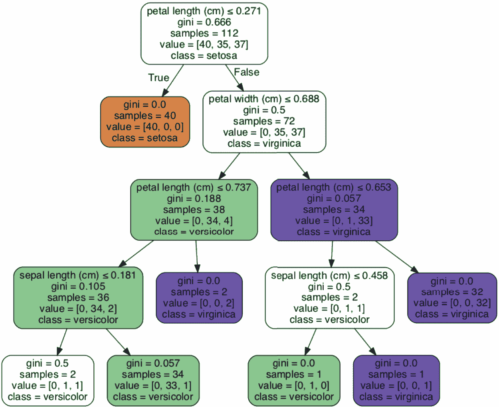

FIGURE 4.17 决策树可视化

```
from sklearn.externals.six import StringIO  
from IPython.display import Image  
from sklearn.tree import export_graphviz
import pydotplus
dot_data = StringIO()
export_graphviz(dtree_model, out_file=dot_data,  
                filled=True, rounded=True,
                special_characters=True)
graph = pydotplus.graph_from_dot_data(dot_data.getvalue())  
Image(graph.create_png()) 
```

使用此决策树进行预测时，从根节点的条件开始：`petal length <= 0.271`。该节点有两个分支——如果满足条件，则遍历左侧分支；如果不满足条件，则遍历右侧分支。然后重复此过程直到到达叶节点，与叶节点关联的类别即为预测结果。

根节点还包含一些额外信息：`samples=112` 表示数据集中有 112 个样本适用于该条件。`value` 数组表示在 112 个样本中，40 个属于第一类，35 个属于第二类，37 个属于第三类。`gini=0.666` 值代表与节点相关的 Gini 分数。Gini 分数是纯度的衡量标准，是 Scikit-learn 实现决策树提供的两种纯度衡量标准之一，另一种是熵（Entropy）。纯节点是指所有元素都属于同一类的节点，其 Gini 分数为 0.0。在模型构建过程中，形成节点的决策（如 `petal_length <= 0.271`）是为了在两个子节点上创建最纯的子集。树构建是一个递归过程，当节点相关的 Gini 分数为 0.0 或达到如树的最大允许深度等标准时停止。你可以在 Shlomo Yitzhaki 和 Edna Schechtman 编写的 *The Gini Methodology: A Primer on Statistical Methodology* 中学习更多关于 Gini 分数的知识（`https://www.springer.com/gb/book/9781461447191`）。

决策树也可以用于回归问题，Scikit-learn 提供了 `DecisionTreeRegressor` 类来创建用于回归的决策树。回归决策树与用于分类的树非常相似，关键区别在于每个节点预测的是数值而不是类别。以下片段使用 `DecisionTreeRegressor` 类在波士顿房价数据集上创建了一个决策树，并使用该模型预测测试集中成员的中位房价。图 4.18 包含了模型生成的决策树。


FIGURE 4.18 回归决策树

```
# 在波士顿房价数据集上创建一个基于决策树的回归器。
from sklearn.tree import DecisionTreeRegressor
dtree_reg_model = DecisionTreeRegressor(max_depth=4)
dtree_reg_model.fit(boston_features_train, boston_target_train)
# 使用模型在测试集上创建预测
dtree_reg_predictions = dtree_reg_model.predict(boston_features_test)
```

*   **注意** 为了跟随本章内容，请确保你已按照附录 A 中的说明拥有 Anaconda Navigator 和 Jupyter Notebook。你可以从 `www.wiley.com/go/machinelearning` 或通过以下 GitHub 地址：`https://github.com/asmtechnology/awsmlbook-chapter4` 下载本章的代码文件。

# 总结

*   Scikit-learn 是一个 Python 库，为机器学习工程师和数据科学家提供了许多功能。

*   Scikit-learn 在 `model_selection` 模块中提供了一个名为 `train_test_split()` 的函数，可以将 Pandas dataframe 拆分为两个 dataframe，一个用于模型构建，另一个用于模型评估。

*   K 折交叉验证可以帮助减少模型在训练集中捕获意外偏差的概率。

*   线性回归是一种统计技术，旨在找到一条距离数据集中所有点最近的直线（或超平面）。

*   Scikit-learn 在 `linear_model` 模块中的 `LinearRegression` 类中实现了线性回归。

*   支持向量机（SVM）是一种多功能模型，可用于各种任务，包括分类、回归和异常值检测。

*   Scikit-learn 在 `sklearn.svm` 模块的 `SVC` 类中提供了基于支持向量的分类器的实现。

*   支持向量模型使用名为内核（kernel）的数学函数，将每个输入点转换到高维空间，在该空间可以找到线性决策边界。

*   逻辑回归尽管名称中带有“回归”字，但它是一种可以构建二分类和多分类分类器的技术。

*   Scikit-learn 在 `linear_model` 中提供了 `LogisticRegression` 类。

*   逻辑回归本质上是一个二分类器，但在目标变量可以属于两个以上类别的数据集中，它可以作为多分类分类器使用。

*   决策树非常通用，可用于分类和回归任务。在用于分类任务时，它们天生能够处理多分类问题，且不受单个特征尺度的影响。

由于机器学习模型的目的是准确预测某些内容，因此你希望确保模型的预测准确率足够好，以便将其部署到生产环境中。因此，在模型之前未见过的数据上对模型进行评估至关重要，以便准确了解模型在真实世界数据（这些数据模型同样未见过）上的预期表现。诸如创建测试集划分和 k 折交叉验证的技术（这两者在第 4 章中都讨论过），允许你留出部分训练数据用于评估。

*   **注意**   为了跟上本章节，请确保已按照附录 A 中的描述安装了 Anaconda Navigator 和 Jupyter Notebook。

    你可以从 `www.wiley.com/go/machinelearningawscloud` 或通过以下 URL 从 GitHub 下载本章节的代码文件：

    `https://github.com/asmtechnology/awsmlbook-chapter5.git`

## 评估回归模型

线性回归模型的目的是预测连续的数值值，例如房屋价格。有两类技术可以用于评估回归模型的预测准确率：创建真实值与预测值的散点图，以及计算捕捉测试集中所有成员总预测误差的统计指标。从 2D 散点图中获得的视觉结果通俗易懂：x 轴包含实际值，y 轴包含预测值。点越靠近以原点为锚点的 45 度线，预测结果就越好。

以下代码片段使用 Scikit-learn 加载波士顿房价数据集，并在该数据上训练了一个线性回归模型和一个基于决策树的模型。图 5.1 并列展示了这两个模型的实际值与预测值的散点图。


图 5.1 线性回归模型和决策树模型在波士顿房价上的预测准确率比较

```
import numpy as np
import pandas as pd
 
# 加载波士顿房价数据集
from sklearn.datasets import load_boston
boston_dataset = load_boston()
df_boston_features = pd.DataFrame(data = boston_dataset.data, columns=boston_dataset.feature_names)
df_boston_target = pd.DataFrame(data = boston_dataset.target, columns=['price'])
 
# 使用 75/25 划分创建训练数据集和测试数据集
from sklearn.model_selection import train_test_split
 
boston_split = train_test_split(df_boston_features, df_boston_target,
                              test_size=0.25, random_state=17)
df_boston_features_train = boston_split[0]
df_boston_features_test = boston_split[1]
df_boston_target_train = boston_split[2]
df_boston_target_test = boston_split[3]
 
# 在波士顿房价数据集上训练线性模型
from sklearn.linear_model import LinearRegression
linear_reg_model = LinearRegression(fit_intercept=True)
linear_reg_model.fit(df_boston_features_train, df_boston_target_train)
 
# 在波士顿房价数据集上创建一个决策树回归器
from sklearn.tree import DecisionTreeRegressor
dtree_reg_model = DecisionTreeRegressor(max_depth=10)
dtree_reg_model.fit(df_boston_features_train, df_boston_target_train.values.ravel())
 
# 使用模型在测试集上创建预测
linear_reg_predictions = linear_reg_model.predict(df_boston_features_test)
dtree_reg_predictions = dtree_reg_model.predict(df_boston_features_test)
 
# 创建预测值与实际值的散点图
 
%matplotlib inline
import matplotlib.pyplot as plt
 
fig, axes = plt.subplots(1, 2, figsize=(18,9))
axes[0].scatter(df_boston_target_test, linear_reg_predictions)
axes[0].set_xlabel("Expected Prices")
axes[0].set_ylabel("Predicted prices")
axes[0].set_title("Linear Regression Model")
axes[1].scatter(df_boston_target_test, dtree_reg_predictions)
axes[1].set_xlabel("Expected Prices")
axes[1].set_ylabel("Predicted prices")
axes[1].set_title("Decision Tree Model")
```

除了获得视觉测量外，你还可以使用统计技术来评估模型质量。我们将查看一些常用的指标。

### RMSE

均方根误差（RMSE）在评估回归时非常流行。正如其名所示，它是均方误差的平方根。对于测试集中的给定项目，误差是预测值与实际值之间的差异；平方处理确保了误差始终为正。这在图 5.2 中所示。


图 5.2 均方误差和均根误差

Scikit-learn 通过 `mean_squared_error()` 函数封装了均方误差的计算。以下代码片段使用该函数计算回归模型和决策树模型的 MSE 和 RMSE：

```
# 使用 Scikit-learn 计算 MSE, RMSE
 
from sklearn.metrics import mean_squared_error
from math import sqrt

mse_linear_reg_model = mean_squared_error(df_boston_target_test, linear_reg_predictions)
mse_dtree_reg_model = mean_squared_error(df_boston_target_test, dtree_reg_predictions)

print(sqrt(mse_linear_reg_model))
print(sqrt(mse_dtree_reg_model))
```

你可以使用 Python `print()` 函数检查 RMSE 值。可以看到，决策树模型的 RMSE 低于线性回归模型，这意味着基于决策树的模型是两者中更好的：

均方根误差的优点是它的单位与你尝试预测的变量相同。例如，波士顿房价数据集中的房屋价格是以 $1,000.00 为单位的。3.502 的 RMSE 意味着该模型预测的房价平均与真实价格偏差 $3502.00。由于 RMSE 的值是目标变量的单位，因此很容易理解。

遗憾的是，RMSE 的缺点是它的值对目标变量的大小敏感。如果目标变量是较大的，RMSE 的值也会较大，因此 RMSE 不能用于比较在不同数据集上训练的模型。

### R² Metric

R² 指标是另一种用于了解模型质量的统计指标。然而，与 RMSE 不同，R² 指标的值始终位于 0.0 到 1.0 之间。R² 指标也称为判定系数，是预测值离回归线距离的度量。

Scikit-learn 在 `sklearn.metrics.mean_r2_score()` 函数中封装了判定系数（coefficient of determination）的计算。以下代码段使用该函数计算线性回归模型和决策树回归模型在波士顿房价数据集上预测结果的 R² 分数：

```
# compute coefficient of determination (r2 score)
 
from sklearn.metrics import r2_score
r2_linear_reg_model = r2_score(df_boston_target_test, linear_reg_predictions)
r2_dtree_reg_model = r2_score(df_boston_target_test, dtree_reg_predictions)
```

你可以使用 Python 的 `print()` 函数来检查 R2 值。如你所示，基于决策树的模型 R2 值高于线性回归模型的 R2 分数，这意味着基于决策树的模型再次是二者中更优的：

## 评估分类模型

分类模型有两种类型：二分类和多分类。当目标属性只有两个离散值（或类别）时，使用二分类模型。当目标属性可以有多个一个离散值时，使用多分类模型。让我们先考虑二分类模型。

### 二分类模型

用于衡量模型质量的最简单指标之一是简单地统计模型预测正确类别的次数。该值是否有意义取决于属于每个类别的样本比例，以及类别本身的重要性。例如，如果一个测试集包含 100 个样本，其中 50 个来自 A 类，另外 50 个来自 B 类，且两个类别对问题领域的重要性相同，那么一个预测正确类别次数为 80% 的模型是易于理解的。然而，如果测试集中的 95 个项目来自 A 类，而只有 5 个来自 B 类，那么这个预测正确类别次数为 80% 的模型表现就不那么如意了。如果该模型旨在预测个人是否患有致命疾病，而那 5 个 B 类的样本是唯一指示该疾病存在的样本，那么问题可能会变得糟糕得多。这并非不可能的情况；普通人群的随机样本中极少数患有特定疾病的个体是非常可能的。

在我们查看二分类模型模型性能的更好衡量方法之前，让我们先看看如何计算这个简单指标。以下代码段在 Pima 印第人糖尿病数据集上训练了逻辑回归、支持向量机（SVM）和决策树分类器，并计算了正确预测的百分比：


以下代码演示了如何使用 Python 的 `scikit-learn` 库训练多个分类模型，并评估它们在 Pima Indians Diabetes 数据集上的性能。

```python
import numpy as np
import pandas as pd
import os
 
# load Pima Indians Diabetes dataset
diabetes_dataset_file = './datasets/diabetes_dataset/diabetes.csv'
df_diabetes = pd.read_csv(diabetes_dataset_file)
df_diabetes_target = df_diabetes.loc[:,['Outcome']]
df_diabetes_features = df_diabetes.drop(['Outcome'], axis=1)
 
## 归化属性值
from sklearn.preprocessing import MinMaxScaler
 
diabetes_scaler = MinMaxScaler()
diabetes_scaler.fit(df_diabetes_features)
nd_diabetes_features = diabetes_scaler.transform(df_diabetes_features)
df_diabetes_features_normalized = pd.DataFrame(data=nd_diabetes_features, columns=df_diabetes_features.columns)
 
## 使用 75/25 划分创建训练数据集和测试数据集。
from sklearn.model_selection import train_test_split
 
diabetes_split = train_test_split(df_diabetes_features_normalized, df_diabetes_target,
                              test_size=0.25, random_state=17)
df_diabetes_features_train = diabetes_split[0]
df_diabetes_features_test = diabetes_split[1]
df_diabetes_target_train = diabetes_split[2]
df_diabetes_target_test = diabetes_split[3]
 
# 使用 RBF 核为糖尿病数据集的特征训练 SVM 分类器
from sklearn.svm import SVC
svc_model = SVC(kernel='rbf', C=1, gamma='auto')
svc_model.fit(df_diabetes_features_train, df_diabetes_target_train.values.ravel())
 
# 在糖尿病数据集上训练逻辑回归模型
from sklearn.linear_model import LogisticRegression
logit_model = LogisticRegression(penalty='l2', fit_intercept=True, solver='liblinear')
logit_model.fit(df_diabetes_features_train, df_diabetes_target_train.values.ravel())
 
# 训练基于决策树的二分类分类器。
from sklearn.tree import DecisionTreeClassifier
 
dtree_model = DecisionTreeClassifier(max_depth=4)
dtree_model.fit(df_diabetes_features_train, df_diabetes_target_train.values.ravel())
 
# 使用模型对糖尿病测试集创建预测
svc_predictions = svc_model.predict(df_diabetes_features_test)
logit_predictions = logit_model.predict(df_diabetes_features_test)
dtree_predictions = dtree_model.predict(df_diabetes_features_test)
 
## 简单指标 - 正确预测的百分比
svc_correct = svc_predictions == df_diabetes_target_test.values.ravel()
svc_correct_percent = np.count_nonzero(svc_correct) / svc_predictions.size * 100
 
logit_correct = logit_predictions == df_diabetes_target_test.values.ravel()
logit_correct_percent = np.count_nonzero(logit_correct) / logit_predictions.size * 100
 
dtree_correct = dtree_predictions == df_diabetes_target_test.values.ravel()
dtree_correct_percent = np.count_nonzero(dtree_correct) / dtree_predictions.size * 100
```

使用 Python `print()` 函数，结果显示逻辑回归模型和决策树模型的性能相当，但逻辑回归模型略占优势：

现在让我们看看用于二分类的其他性能指标。简单统计模型预测正确答案次数的某些问题在本章较早之前已经介绍过。为了更好地了解模型的性能，你需要的是一组捕捉类别级性能的指标。下面列出了二分类最常用的主要指标。这些指标假设两个目标类别中的一个代表正性结果，而另一个代表负性结果：

- *真阳性 (TP)* 计数：模型预测正性结果且预测正确的次数。

- *假阳性 (FP)* 计数：模型预测正性结果但预测错误的次数。

- *真阴性 (TN)* 计数：模型预测负性结果且预测正确的次数。

- *假阴性 (FN)* 计数：模型预测负性结果但预测错误的次数。

这种类别级预测准确率有时也被称为类别混淆，当这四个主要指标被放置在一个 2 × 2 的矩阵中时，生成的矩阵被称为混淆矩阵。图 5.3 展示了一个混淆矩阵并解释了各个数字的含义。


Scikit-learn 在 `metrics` 子模块提供了一个名为 `confusion_matrix()` 的函数，用于计算分类模型的混淆矩阵。你可以在 `https://scikit-learn.org/stable/modules/generated/sklearn.metrics.confusion_matrix.html` Find 有关 `confusion_matrix()` 函数参数的详细信息。

以下代码段演示了如何使用该函数为本节之前创建的三个二分类模型计算混淆矩阵：

```python
## 计算混淆矩阵
from sklearn.metrics import confusion_matrix

cm_svc = confusion_matrix(df_diabetes_target_test.values.ravel(), svc_predictions)
cm_logit = confusion_matrix(df_diabetes_target_test.values.ravel(), logit_predictions)
cm_dtree = confusion_matrix(df_diabetes_target_test.values.ravel(), dtree_predictions)

# 提取真负性、假正性、假阴性、真正性。
#
# sklearn confusion_matrix() 函数返回如下矩阵
#
#       TN     FP
#       FN     TP
#
tn_svc, fp_svc, fn_svc, tp_svc = cm_svc.ravel()
tn_logit, fp_logit, fn_logit, tp_logit = cm_logit.ravel()
tn_dtree, fp_dtree, fn_dtree, tp_dtree = cm_dtree.ravel()
```

你现在可以使用 Python 的 `print()` 函数查看三个模型主要指标的值了：

除了这些主要统计指标外，数据科学家还会使用以下次要指标。这些指标的值是从主要指标计算得出的：

- **准确率 (Accuracy)**：定义为 `(TP + TN) / (预测总数)`。这基本上等于计算模型预测正确值的次数。

- **精确率 (Precision)**：定义为 `TP / (TP + FP)`。如果你查看图 5.3，你会发现分母是模型所做出的正类预测总数。因此，精确率也可以写为 `TP / (正类预测总数)`，它衡量了你的模型的精确程度。当假正性（误报）的成本很高时，精确率是一个很好的衡量标准。该值越接近 1.0，正类预测的精确度越高。

- **召回率 (Recall)**：定义为 `TP / (TP + FN)`。查看图 5.3，你会发现该表达式的分母是数据集中实际的正样本数量。因此，计算召回率的表达式可以重写为 `TP / (评估集中正样本样本总数)`。当假阴性（漏报）的成本很高时，召回率是一个很好的衡量标准。

以下代码段利用从混淆矩阵获得的信息计算三个模型的准确率、精确率和召回率值：

```python
## 计算准确率、精确率和召回率

accuracy_svc = (tp_svc + tn_svc) / (tn_svc + fp_svc + fn_svc + tp_svc)
accuracy_logit = (tp_logit + tn_logit) / (tn_logit + fp_logit + fn_logit + tp_logit)
accuracy_dtree = (tp_dtree + tn_dtree) / (tn_dtree + fp_dtree + fn_dtree + tp_dtree)

precision_svc = tp_svc / (tp_svc + fp_svc)
precision_logit = tp_logit / (tp_logit + fp_logit)
precision_dtree = tp_dtree / (tp_dtree + fp_dtree)

recall_svc = tp_svc / (tp_svc + fn_svc)
recall_logit = tp_logit / (tp_logit + fn_logit)
recall_dtree = tp_dtree / (tp_dtree + fn_dtree)
```

使用 Python 的 `print()` 函数，你可以检查准确率、精确率和召回率：逻辑回归模型的精确率最高，为 80.9%，而决策树的召回率最高，为 59.1%。模型选择将取决于问题。什么更重要：精确率还是召回率？需要注意的是，这一点非常重要。

使用 Python 的 `print()` 函数检查三个模型的 AUC 指标值，逻辑回归模型提供了最高的 AUC 值：

### 多分类模型

当目标变量可以属于两个以上的类别时，就会使用多分类模型。幸运的是，用于评估二分类模型性能的大多数技术都可以应用于其多分类对应模型。混淆矩阵的概念可以很容易扩展到多分类。n 类分类的混淆矩阵表示为 n × n 矩阵，其中行表示实际类别，列表示预测类别。图 5.5 展示了一个五类分类问题的多分类混淆矩阵。


`图 5.5` 五类数据集的多分类混淆矩阵

Scikit-learn 的 `confusion_matrix()` 函数也可以用于计算多分类模型的混淆矩阵。以下代码段在鸢尾花（Iris flowers）训练数据集上训练了 softmax 逻辑回归和决策树模型，使用这些模型进行预测，并计算混淆矩阵：

```python
## 加载鸢尾花数据集
from sklearn.datasets import load_iris
iris_dataset = load_iris()
df_iris_features = pd.DataFrame(data = iris_dataset.data, columns=iris_dataset.feature_names)
df_iris_target = pd.DataFrame(data = iris_dataset.target, columns=['class'])
 
## 归一化属性值
from sklearn.preprocessing import MinMaxScaler
iris_scaler = MinMaxScaler()
iris_scaler.fit(df_iris_features)
nd_iris_features = iris_scaler.transform(df_iris_features)
df_iris_features_normalized = pd.DataFrame(data=nd_iris_features, columns=df_iris_features.columns)
 
# 使用 75/25 划分创建训练集和测试集
from sklearn.model_selection import train_test_split
iris_split = train_test_split(df_iris_features_normalized, df_iris_target,
                              test_size=0.25, random_state=17)
df_iris_features_train = iris_split[0]
df_iris_features_test = iris_split[1]
df_iris_target_train = iris_split[2]
df_iris_target_test = iris_split[3]
 
## softmax（又名多项回归）分类器
from sklearn.linear_model import LogisticRegression
softmax_logit_model = LogisticRegression(penalty='l2', fit_intercept=True, solver='lbfgs', multi_class='multinomial')
softmax_logit_model.fit(df_iris_features_train, df_iris_target_train.values.ravel())
 
## 创建基于决策树的多分类分类器
from sklearn.tree import DecisionTreeClassifier
mc_dtree_model = DecisionTreeClassifier(max_depth=4)
mc_dtree_model.fit(df_iris_features_train, df_iris_target_train.values.ravel())
 
# 使用模型在测试集上创建预测
softmax_logit_predictions = softmax_logit_model.predict(df_iris_features_test)
mc_predictions = mc_dtree_model.predict(df_iris_features_test)
 
## 计算混淆矩阵
from sklearn.metrics import confusion_matrix
 
cm_softmax = confusion_matrix(df_iris_target_test.values.ravel(), softmax_logit_predictions)
cm_mc_dtree = confusion_matrix(df_iris_target_test.values.ravel(), mc_predictions)
```

你可以使用 Python 的 `print()` 函数检查两个分类器生成的混淆矩阵：

多分类混淆矩阵通常可视化为热力图。以下代码段将混淆矩阵并排可视化。该代码段部分改编自 `https://scikit-learn.org/stable/auto_examples/model_selection/plot_confusion_matrix.html`。所得的热力图如图图 5.6 所示。


`图 5.6` 针对鸢尾花数据集训练的两个模型的多分类混淆矩阵


## 将混淆矩阵绘制为热力图

```python
%matplotlib inline
import matplotlib.pyplot as plt

# 使用 Matplotlib 函数将混淆矩阵绘制为热力图。
# 此代码部分改编自
# https://scikit-learn.org/stable/auto_examples/model_selection/plot_confusion_matrix.html
def plot_confusion_matrix(confusionmatrix, class_labels, axes, cmap):
    
    heatmap_image = axes.imshow(confusionmatrix, interpolation='nearest', cmap=cmap)
    axes.figure.colorbar(heatmap_image, ax=axes)
    
    num_rows = confusionmatrix.shape[0]
    num_cols = confusionmatrix.shape[1]
    
    axes.set_title(title)
    axes.set_xlabel('Predicted')
    axes.set_ylabel('True')
    
    axes.set_xticks(np.arange(num_cols))
    axes.set_yticks(np.arange(num_rows))
    axes.set_xticklabels(class_labels)
    axes.set_yticklabels(class_labels)
    
    # 遍历数据维度并创建文本注释
    # fmt = '.2f' if normalize else 'd'
    thresh = confusionmatrix.max() / 2
    for y in range(num_rows):
        for x in range(num_cols):
            axes.text(x, y, format(confusionmatrix[y, x], fmt),
                    ha="center", va="center",
                    color="white" if confusionmatrix[y, x] > thresh else "black")
```

```python
fig, axes = plt.subplots(1, 2, figsize=(18,6))
 
plot_confusion_matrix(cm_softmax,
                      iris_dataset.target_names, axes[0],
                      "Softmax Regression",
                      plt.cm.Greens)
 
plot_confusion_matrix(cm_mc_dtree,
                      iris_dataset.target_names, axes[1],
                      "Decision Tree Regression",
                      plt.cm.Greens) 
```

对于多分类模型，你可以计算整体准确率指标、类别精确率和召回率。这些指标定义如下：

- **准确率（Accuracy）**：在多分类模型中，整体准确率是模型预测答案正确的次数。使用混淆矩阵，准确率可以表示为对角线元素之和 / 总预测次数。在图 5.6 所示的决策树模型混淆矩阵中，整体准确率为 37/38。

- **精确率（Precision）**：多分类问题中，给定类的类别精确率定义为模型正确预测该类的次数 / 对该类的预测总数。使用混淆矩阵，精确率可以图形化为对角线元素与列总和的比率。在图 5.6 所示的决策树模型混淆矩阵中，`Setosa` 类的类别精确率为 10/10，`Versicolor` 为 15/16，`Virginica` 为 12/12。

- **召回率（Recall）**：在多分类问题中，给定类的类别召回率定义为模型正确预测该类的次数 / 该类元素的总数。使用混淆矩阵，召回率可以图形化为对角线元素与行总和的比率。在图 5.6 所示的决策树模型混淆矩阵中，`Setosa` 类的类别召回率为 10/10，`Versicolor` 类为 15/15，`Virginica` 为 12/13。

在机器学习机器学习项目中，仅仅创建一个模型并计算指标是不够的。正如你在本章及之前的章节中所学到的样，有许多因素会影响模型的性能，从特征工程到模型选择，再到模型构建过程中使用的超参数。为了使寻找最优模型的过程自动化，数据科学家经常使用**网格搜索（grid search）**技术来尝试各种超参数组合，并选出表现最好的模型。`Scikit-learn` 在 `model_selection` 模块中提供了 `GridSearchCV` 类，可用于对一组参数值进行穷举搜索。你可以在 `https://scikit-learn.org/stable/modules/generated/sklearn.model_selection.GridSearchCV.html` 了解更多关于 `GridSearchCV` 类的信息。

下面的代码段使用 `GridSearchCV` 类对鸢尾花数据集上的多分类决策树分类器尝试不同的超参数组合，并返回产生最佳精确率（`precision`）得分的超参数：

```python
## use grid search to find the hyperparameters that result
# in the best accuracy score for a decision tree
# based classifier on the Iris Flowers dataset
from sklearn.model_selection import GridSearchCV
from sklearn.tree import DecisionTreeClassifier
 
grid_params = {
    'criterion': ['gini', 'entropy'],
    'splitter': ['best', 'random'],
    'max_depth': [2, 3, 4, 5, 6, 7, 8, 9, 10, 11, 12],
    'min_samples_split': [2, 3, 4, 5, 6, 7, 8, 9, 10, 11, 12],
    'max_features': ['auto', 'sqrt', 'log2'],
    'presort': [True, False]
}
 
grid_search = GridSearchCV(estimator=DecisionTreeClassifier(),
                           param_grid=grid_params, scoring='accuracy',
                           cv=10, n_jobs=-1)
 
grid_search.fit(df_iris_features.values, df_iris_target)
```

在此段代码中，`grid_params` 是一个包含超参数以及你想尝试的每个参数值的字典。字典中的元素取决于你想要训练的模型。此示例使用了决策树分类模型，字典中有六个项目，对应于 `DecisionTreeClassifier` 类的一些超参数。网格搜索过程将为每种超参数组合构建模型，在这种情况下，将构建 2 × 2 × 11 × 11 × 3 × 2 = 15,488 个模型。

`GridSearchCV` 类构造函数中的 `cv=10` 参数用于控制折数，在此情况下设置为 10，因此 15,488 个模型中的每一个将使用 10 折交叉验证进行训练。根据你计算机的速度，这段代码可能需要大量时间执行。网格搜索完成后，你可以使用以下语句检查最佳模型的超参数值以及该模型的准确率：

- **注意**：为了跟随本章节，请确保已按照附录 A 中的安装了 `Anaconda Navigator` 和 `Jupyter Notebook`。

你可以从 `www.wiley.com/go/machinelearningawscloud` 或通过以下 URL 下载本章节的代码：

`https://github.com/asmtechnology/awsmlbook-chapter5.git`

## 总结

- 有两种技术可用于评估回归模型的预测准确性：创建真实值与预测值的散点图，以及计算捕捉测试集中总预测误差的统计指标。

- 均方根误差（`RMSE`）指标在评估回归模型性能时非常流行。

- 决定系数（`R²`）指标是另一种衡量模型质量的统计指标。

- 决定系数（`R²`）也称为均方误差（`MSE`）的平方根。

- 决定系数（`R²`）是衡量模型对观测值拟合程度的指标。

## 第 2 部分

使用 Amazon Web Services 进行机器学习

- 第 6 章：Amazon Web Services 简介

- 第 7 章：AWS 基础设施

- 第 8 章：身份与访问管理

- 第 9 章：Amazon S3

- 第 10 章：Amazon Cognito

- 第 11 章：Amazon DynamoDB

- 第 12 章：AWS Lambda

- 第 13 章：Amazon Comprehend

- 第 14 章：Amazon Lex

- 第 15 章：Amazon Machine Learning

- 第 16 章：Amazon SageMaker

- 第 17 章：在 SageMaker 中 TensorFlow

- 第 18 章：Amazon Rekognition

- 附录 A：Anaconda 和 Jupyter Notebook

- 附录 B：使用本书所需的 AWS 资源

- 附录 C：安装和配置 AWS CLI

- 附录 D：NumPy 和 Pandas 简介

# 第 6 章

Amazon Web Services

### 本章内容

- 云计算基础

- 用于构建机器学习解决方案的 AWS 生态系统

- 注册账户

在本章中，你将学习什么是云计算，阅读讨论云服务时常用的抽象模型，并发现 AWS 在云计算领域提供的服务概述，重点介绍有助于机器学习解决方案的服务。本章最后将引导你完成注册 AWS 账户的过程。

## 什么是云计算？

云计算由美国国家标准与技术研究院（NIST）定义为“一种模型，通过随时便利、按需的网络访问获取共享的可配置资源池（如网络、服务器、存储、应用程序和服务），这些资源可以通过最少的管理工作或服务提供者交互来快速部署和释放。”¹](#c06.xhtml#c06-note-0001)

NIST 为模型定义了五个基本特征。下面将简述这些特征：

- **广泛的网络访问**：消费者可以从任何地方访问服务。

- **资源池化**：提供者的计算资源池化以支持多个客户。

- **按需自服务**：消费者可以根据需要配置计算资源（如虚拟服务器），只需少量的人工干预。

- **可测量服务**：消费者可以按付费使用计算资源。

- **弹性**：消费者可以根据需要自动配置额外的资源。为了实现这一点，提供者对计算资源进行池化，以提供水平扩展性。

云计算解决方案为企业提供了两个主要优势：

- **成本**：云计算范式基于硬件资源的共享和优化利用。企业仅需为其使用资源的时间付费。当不再需要资源时，企业可以放弃该资源并供他人使用。这既减少了企业的前期硬件投资成本，也减少了持续的维护成本。由云服务提供商而非消费者来负责底层硬件的维护。

- **可用性**：在云端配置一个即可即可用的资源的时间远短于在内部设置类似资源的时间。例如，企业可以在几秒钟在云服务提供商处配置一台虚拟机，而在大多数中大型组织中，采购新服务器硬件和软件的实际过程通常需要几个月。

## 云服务模型

云计算构建在虚拟化技术。从根本上说，虚拟化有两种：

- **应用虚拟化**：单台机器托管一个或多个应用程序，这些应用程序通过互联网交付一个或多个用户。

- **硬件虚拟化**：也称为服务器虚拟化，在这种模型中，单台物理机器托管多个虚拟机。每个虚拟机都可以有自己的操作系统（与底层物理机器的操作系统不同）以及其特有的应用程序集。

作为终端用户，你期望通过互联网从云计算提供商处消费一个或多个服务。这些服务的范围从带有基础操作系统的精简虚拟机到整个应用程序套件不等。五种常见的云服务模型如图 6.1](#c06.xhtml#c06-fig-0001）所示。可以使用分层模型进行概念化，较高层构建在较低层提供的服务之上。


**图 6.1**：你指定所需虚拟服务器的低级细节，包括 CPU 数量、`RAM`、硬盘空间、网络能力和操作系统。云提供商提供与这些需求匹配的虚拟机。除了虚拟机外，`IaaS` 的定义还包括防火墙、负载均衡器和存储器等网络外设。因此，在云端部署多个负载均衡的 Java 应用程序服务器以及将你的文件存储在云磁盘上，都属于 `IaaS` 模型范畴。

- **平台即服务 (PaaS)**：你可以在最适合你需求的基础设施和预配置软件组合之间进行选择。云提供商提供一个带有预配置内部应用程序的虚拟机以匹配你的需求。`PaaS` 模型通常更容易使用，因为你不需要设置底层硬件和软件；然而，这可能具有限制性，因为与 `IaaS` 模型相比，你对底层系统的控制级别显著降低。基础设施和预装软件的选择在云提供商之间有所不同，如果云厂商没有提供满足你需求的现成产品，你就只能倒霉了。

- **软件即服务 (SaaS)**：你指定想要使用的软件应用程序类型，例如文字处理器。云提供商配置与你的需求匹配的所需的基础设施、操作系统和应用程序。大多数 `SaaS` 云提供商对运行应用程序的硬件特性选择有限，作为用户，你通常无法直接访问运行你应用程序的底层硬件。你还受限于云提供商所选硬件和软件的局限性。例如，如果一家电影院链使用 `SaaS` 云端预订系统管理门票销售，而由于云提供商使用的硬件发生内部错误导致系统不可用，电影院几乎无能为力，只能等待云提供商修复问题。

- **业务流程即服务 (BPaaS)**：你指定想要外包给云提供商的业务流程。云服务提供商配置硬件、操作系统、应用程序并提供所需的服务。`BPaaS` 的一个良好示例是使用云端服务来计算增值税 (`VAT`) 报表并向税务局提交。此类服务可以作为一个基于浏览器的前端，你在其中上传发单，服务可以使用 `OCR` 提取相关信息，填写报表，一旦你对结果满意，即可代表你提交。

- **机器学习即服务 (MLaaS)**：云提供商提供协助数据建模、机器学习构建、数据可视化、自然语言处理、人脸识别、预测和深度学习的服务。服务本身可以归类为应用程序级或平台级服务。分类取决于为用户提供了多少控制和灵活性。云提供商自动配置足够的容量以应对需求。

## 云部署模型

部署模型回答以下问题：

- 谁可以访问计算资源？

- 用户如何访问计算资源？

- 物理硬件在哪里？

云计算解决方案有四种部署模型：

- **公有云**：公有云通过互联网向世界任何地方消费者提供服务。提供这些服务的物理资源也可以位于世界任何地方。对于由于监管要求而无法将机密存储在外部系统的组织而言，此类服务可能带来潜在挑战。云提供商通常负责物理基础设施的采购、设置、安全和维护。在某种程度上，云提供商也负责应用数据的安全；这取决于服务模型（`IaaS`/`PaaS`/`SaaS`）。

- **私有云**：私有云为单一组织提供服务。服务通过安全内部网络提供，互联网公众无法访问。组织拥有提供底层服务的物理硬件，并负责基础设施以及运行在基础设施上的所有软件的设置、维护和安全。由于该模型相关的基础设施成本巨大，只有大型公司才能负担得起自己的私有云。私有云通常被称为本地云，并可以为组织提供任何组合的 `IaaS`/`SaaS`/`PaaS`。

- **社区云**：社区云通过安全网络向一小部分实体（个人、大学或公司）提供服务。用于提供服务的底层资源由社区云服务的实体拥有。从本质上说，这种类型的云服务可以被认为是公有云和私有云之间的某种东西。该服务不对公众成员开放，也不会给任何单一实体的财务造成重大负担。参与的实体拥有共同目标或在共同行业领域提供服务。

- **混合云**：混合云本质上是由其他类型的云服务组成的云服务。例如，混合云可以由公有云和私有云组成。公有子云可以提供供任何互联网用户旨在消费的服务；而私有云则可以提供对业务敏感的服务。大多数大型组织都使用混合云模型。它允许他们在特定业务用例需要时配置公有云资源，同时继续享受私有云为其所有现有流程提供的安全性和控制。

## AWS 生态系统

Amazon Web Services（AWS）是市场上发展最快的云计算计算服务。目前 AWS 提供的服务包括在全球范围内各地提供的一百多项服务，并且每年都会添加新服务。

AWS 的新功能会在 AWS re:Invent 上宣布，这是 AWS 的官方年度会议。您可以在 `https://reinvent.awsevents.com` 更多有关 AWS re:Invent 的信息。

图 6.2 描述了 AWS 的简短时间线。AWS 诞生于 Chris Pinkham 和 Benjamin Black 在 2003 年向 Jeff Bezos 提交的一篇论文。


FIGURE 6.2 Amazon Web Services 简短时间线

这篇论文建议将 Amazon 的内部基础设施作为服务提供给全世界。2006 年，AWS 正式推出，包含 `EC2` 和 `S3` 在几个关键服务。


2010 年 11 月，Amazon 宣布所有 [Amazon.com](http://amazon.com) 都已迁移到 AWS。首次 AWS re:Invent 会议于 2012 年 11 月 27 日至 29 日在拉斯维加斯的威尼斯酒店举行。2015 年，Amazon 推出了其名为 Amazon Machine Learning 的自有机器学习平台，并在 2016 年宣布了三项专门针对机器学习应用程序的新 API 服务：Amazon Rekognition、Amazon Polly 和 Amazon Lex。

在本书编写时，AWS 提供了 130 项服务，每项服务都属于 20 个不同服务类别之一。服务类别如下：

- 计算
- 存储
- 数据库
- 迁移
- 网络与内容交付
- 开发者工具
- 管理工具
- 媒体服务
- 机器学习
- 分析
- 安全、身份与合规
- 移动服务
- AR 与 VR
- 应用集成
- AWS 成本管理
- 客户互动
- 业务生产力
- 桌面与应用流
- 物联网
- 游戏开发

您可以在`https://aws.amazon.com/products/`找到这些类别中所有 AWS 服务的详细信息。

Amazon 在机器学习领域的业务分为两类：应用服务和平台服务。

### 机器学习应用服务

这些服务旨在开箱即用特定的机器学习问题，并通过 API 集成到您自己的应用程序中。类别中的某些服务列如下：

- **Amazon Comprehend**：这是一个允许您构建需要理解结构和内容的服务。
- **Amazon Lex**：这是一个允许您构建对话式界面（聊天机器人）的服务。
- **Amazon Polly**：这是一个文本转语音服务。
- **Amazon Rekognition**：这是一个提供 API 用于对图像和视频中基于深度学习的对象检测的服务。
- **Amazon Translate**：这是一个文档翻译服务。
- **Amazon Transcribe**：这是一个语音转文本服务。

### 机器学习平台服务

这些服务为您提供了构建、训练和评估机器学习模型的工具。平台服务本身不能开箱即用解决任何特定的机器学习问题；相反，您需要使用它们从零开始构建机器学习解决方案。类别中的某些服务列如下：

- **Amazon Machine Learning**：这是一个基于云的服务，允许您使用向向的界面快速构建机器学习模型。
- **Amazon SageMaker**：这是一个全托管的服务，允许您构建、训练和部署自己的机器学习模型。
- **AWS DeepLens**：这是一个无线视频摄像头和一个集成的云端开发平台。

### 支持服务

在之前的章节中，您学习了 Amazon 的机器学习应用和平台服务。这些服务并不是孤立运行的——在机器学习应用程序的构建和部署阶段，您通常会发现自己在使用许多其他 AWS 服务。在本节中，您将查看在构建和部署机器学习解决方案时可能会遇到的某些 AWS 服务：

- `AWS IAM`：Amazon 身份和访问管理 (IAM) 让你安全地控制谁可以访问你的 AWS 资源、他们可以访问哪些资源，以及他们对这些资源可以做什么。IAM 在第 8 章中介绍。
- `AWS Lambda`：AWS Lambda 允许用户无需配置基础设施即可运行代码段。该服务按需付费模式计费，用户仅为其 lambda 代码的执行时间付费。代码未运行时不产生费用。Lambda 代码可以设置为从其他 AWS 服务自动触发，或直接从任何 Web 或移动应用程序中调用。AWS Lambda 在第 12 章中介绍。
- `Amazon S3`：Amazon 简单存储服务 (S3) 是一种安全、持久且可扩展的云对象存储。使用此服务，你可以在云端存储文件。Amazon S3 在第 9 章中介绍。
- `Amazon DynamoDB`：Amazon DynamoDB 是一种高性能、可扩展的云 NoSQL 数据库服务。Amazon DynamoDB 在第 11 章中介绍。
- `Amazon Cognito`：Amazon Cognito 允许你为应用程序的用户创建身份配置文件，并允许他们使用 Amazon、Facebook、Twitter 或 Google 账户登录应用程序。一旦用户在应用程序中通过验证，应用程序将获得一个令牌，该令牌可安全地访问 AWS 云资源。Amazon Cognito 还提供了一种服务，允许已验证的用户在不同设备上同步其应用程序数据。Amazon Cognito 在第 10 章中介绍。

## 注册 AWS 免费层级账户

要使用 AWS，你需要注册一个 AWS 账户。如果你还没有账户，可以注册一个 AWS 免费层级下的账户。免费层级下的 AWS 账户旨在让你在 12 个月内免费尝试某些 AWS 产品，但受限于某些用量限制。访问`https://aws.amazon.com/free/`获取有关 AWS 免费层级账户包含的信息。AWS 免费层级账户不提供 Amazon 机器学习（Amazon Machine Learning）。

要创建一个免费层级下的 AWS 账户，你需要经过五个步骤。其中某些步骤包含多个子步骤：

1. 联系信息
2. 支付信息
3. 身份验证
4. 选择支持计划
5. 确认

### 步骤 1：联系信息

要开始注册免费层级下的 AWS 账户，请访问`aws.amazon.com`并点击页面右上角的“创建 AWS 账户”链接（参见图 6.3）。


`图 6.3` Amazon Web Services 首页

Amazon 经常与其客户尝试新的用户体验，因此此页面看起来可能与截图有所不同。但是，你仍然应该能够在页面上找到创建 AWS 账户的相关选项。

在“创建 AWS 账户”屏幕上输入有效的电子邮件地址、密码和账户名称（参见图 6.4），并点击“继续”按钮。账户名称是你可用于此账户的个人身份标识符。


`图 6.4` AWS 登录屏幕

你将被要求指示账户是用于个人还是公司（图 6.5）。请选择适合你情况的选项。本章假设你选择创建个人（个人）账户。


`图 6.5` 联系信息屏幕

在“联系信息”屏幕上，你将被要求提供联系信息（包括电话号码）。你必须提供一个你可以立即访问并接听电话的号码。如有必要，滚动到页面底部，阅读并接受 AWS 客户协议的条款和条件，然后点击“创建账户并继续”进入下一步。

### 步骤 2：支付信息

你需要提供信用卡/借记卡详细信息（参见图 6.6）。虽然免费层级下的账户可以免费访问某些 AWS 服务，但并非所有服务都包含在免费层级中。如果你使用了未包含在免费层级账户的服务，或超过了免费层级服务的用量限制，则会对你提供的卡进行收费。


`图 6.6` 支付信息屏幕

免费层级下提供的精确服务和选项可能会随时更改。本书将尽力告知你示例是否使用了免费层级之外的 AWS 功能。要获取有关免费层级包含内容的最新信息，请访问`https://aws.amazon.com/free/`。

输入你的信用卡/借记卡详细信息并点击“提交”进入身份验证步骤。

### 步骤 3：身份验证

身份验证过程涉及通过你提供的号码接收系统电话，并在提示时输入四位 PIN。输入电话号码并点击“现在拨打”（参见图 6.7）。


`图 6.7` 身份验证屏幕

四位 PIN 随后出现在网页上（参见图 6.8）。


`图 6.8` 电话验证码

一旦你在电话中输入了四位 PIN，身份验证过程即完成。网页将刷新以反映这一点（参见图 6.9）。


`图 6.9` 完成身份验证

点击“继续”进入下一步。

### 步骤 4：选择支持计划

从可用列表中选择一个支持计划（参见图 6.10）。选项有：


`图 6.10` 支持计划选择

- Basic（基础）
- Developer（开发者）
- Business（商务）
- Enterprise（企业）

支持计划是累积的，区别在于你收到的支持水平，较贵的选项允许联系 Amazon 员工解答问题。默认选择选项是 Basic，它是免费的。对于本书而言，Basic 支持计划足够了。选择默认的 Basic 支持计划并点击“继续”。

### 步骤 5：确认

你将收到 AWS 免费层级账户已设置好的确认（参见图 6.11）。


`图 6.11` 完成注册

你还会通过在注册过程中使用的电子邮件地址收到一封确认邮件。在下一章中，你将学习访问 AWS 的不同方法以及保护你创建的账户。

## 总结

- 云计算由美国国家标准技术研究院 (NIST) 定义为“一种模型，它通过随时随地、便利、按需的网络访问共享的可配置计算资源池（例如网络、服务器、存储、应用程序和服务），并且这些资源可以在以最少管理工作或服务提供商交互的情况下快速配置和释放。”
- 云计算为企业提供了成本和可用性方面的优势。
- 常见的云计算服务模型包括基础设施即服务 (IaaS)、平台即服务 (PaaS)、软件即服务 (SaaS)、业务流程即服务 (BPaaS) 以及机器学习即服务 (MLaaS)。
- 云解决方案使用标准的部署模型进行部署。部署模型定义了如何访问计算资源、谁可以访问该资源以及物理硬件位于何处。
- 云解决方案通常有四不同的部署模型：私有云、公有云、社区云和混合云。
- AWS 提供了超过 100 种不同的云服务，分为 20 个不同的服务类别。Amazon 会不断增加可用服务。
- 免费层级下的 AWS 账户旨在让您在 12 个月内免费尝试某些 AWS 产品，但受某些使用限制。
- Amazon 基于云的机器学习服务可以分为两类：应用服务和平台服务。

### Note

1. Peter Mell 和 Timothy Grance，“The NIST Definition of Cloud Computing,”NIST Special Publication 800-145. September 2011. ([`nvlpubs.nist.gov/nistpubs/Legacy/SP/nistspecialpublication800-145.pdf`](http://nvlpubs.nist.gov/nistpubs/Legacy/SP/nistspecialpublication800-145.pdf))

# 第 7 章：AWS 全球基础设施

### 本章内容

- AWS 全球基础设施简介
- AWS 管理控制台导览

在上一章中，你概述了 Amazon 提供的云服务，重点介绍了用于机器学习应用程序的服务。在本章中，你将学习 AWS 全球基础设施。AWS 物理基础设施由地理区域、可用区（Availability Zones）和内容分发边缘节点系统组成。并不是所有的 AWS 服务在每个区域都可用。

## 区域与可用区

AWS 区域（Region）是全球范围内提供云服务的物理位置。Amazon 确保您可以选择数据物理所在的区域，以便您能够轻松满足区域性的监管要求。

一个 AWS 区域划分为多个可用区（AZs）（参见图 7.1）。


`FIGURE 7.1` 单个区域内的多个可用区

可用区由一个或多个数据中心组成，位于独立的设施中，每个中心都具有冗余的电源、网络和连接。这些数据中心通过私有光纤网络相互连接，允许您构建和运行可扩展且容错的应用程序，这在单个数据中心是无法实现的。

可用区让您能够构建在区域内不同 AZ 之间自动故障转移且无中断的应用程序。截至目前，全球范围内分布着十九个区域。此外，Amazon 已宣布计划在巴林、沙特阿拉伯（中国）和瑞典规划新区域。您可以在`https://aws.amazon.com/about-aws/global-infrastructure/`找到区域和可用区的完整列表。

表 7.1 列出了每个区域内的当前 AWS 区域和 AZ。

`TABLE 7.1`：AWS 区域与可用区

| 区域 | 可用区 | 注释 |
| --- | --- | --- |
| 美国西部 (俄勒冈) | 3 | 2011 年启动。 |
| 美国西部 (北加利福尼亚州) | 3 | 2009 年启动。 |
| 美国东部 (北弗吉尼亚州) | 6 | 2006 年启动。 |
| 美国东部 (俄亥俄) | 3 | 2016 年启动。 |
| AWS GovCloud | 3 | 2011 年启动。仅限美国政府员工访问。 |
| 加拿大 (中部) | 2 | 2016 年启动。 |
| 欧洲 (爱尔兰) | 3 | 2007 年启动。 |
| 欧洲 (法兰克福) | 3 | 2014 年启动。 |
| 欧洲 (伦敦) | 3 | 2016 年启动。 |
| 欧洲 (巴黎) | 3 | 2017 年启动。 |
| 亚太 (新加坡) | 2 | 2010 年启动。 |
| 亚太 (东京) | 4 | 2011 年启动。 |
| 亚太 (大阪) | 1 | 2018 年启动。 |
| 亚太 (悉尼) | 3 | 2012 年启动。 |
| 亚太 (首尔) | 2 | 2016 年启动。 |
| 亚太 (孟买) | 2 | 2016 年启动。 |
| 中国 (北京) | 2 | 2014 年与北京光网网络科技有限公司（“光网网”）合作启动，光网网是 AWS 中国（北京）区域的服务运营商和提供商。 |
| 中国 (宁夏) | 3 | 2014 年与北京光网网络科技有限公司（“光网网”）合作启动，光网网是 AWS 中国（北京）区域的服务运营商和提供商。 |
| 南美 (圣保罗) | 3 | 2016 年启动。 |
| 加拿大 | 2 | 2016 年启动。 |

- **Note**：要获取区域和可用区的完整列表，请访问`https://aws.amazon.com/about-aws/global-infrastructure/`。
- **Note**：并不是所有的 AWS 服务在每个区域都可用。
- **Note**：跨区域复制不会自动应用的，通常需要额外的努力。

在本节中，你将学习你（或你的应用程序）连接到 AWS 的不同方法。个人或应用程序可以通过四种方式连接到 AWS：

- 使用 AWS 管理台
- 使用命令行界面
- 使用特定平台的开发者 SDK
- 使用 RESTful Web 服务

AWS 本质上（如其实名所示）是一组 RESTful Web 服务集。你可以通过 RESTful Web 服务访问 AWS 提供的每一个服务。管理控制台、命令行界面和特定平台的 SDK 都是构建在底层的 RESTful Web 服务 API 之上的。选择访问 AWS 的方式取决于你的工作职责。

如果你正在管理或维护服务，你可能更倾向于管理控制台基于 Web 用户友好的界面。如果你是一个经常执行脚本的 DevOps 人员，你可能更倾向于命令行界面。如果你是一个应用程序开发者，如果可用，你可能会使用针对你特定平台的`SDK`。

截至本文编写，以下平台已提供开发者 SDK：

- Python
- Ruby
- C++
- iOS
- Android
- Java
- .NET
- Node.js
- PHP
- Go

你可以在`https://aws.amazon.com/tools/`获取最新的特定平台开发者 SDK 列表以及安装说明和 SDK 文档。本书中的课程主要使用 AWS 管理台，并偶尔使用 Python 版 AWS `SDK`。

## AWS 管理控制台

AWS 管理台是一个基于 Web 的应用程序，允许你管理 AWS 账户并配置云服务。访问`https://aws.amazon.com`登录 AWS 管理台。

点击网站右上角的`Sign in to The Console`链接（参见图 7.4）。系统要求你提供 AWS 账户用户名和密码。


**图 7.4** AWS 首页

管理台的落地页提供了各种 AWS 服务配置页的快速链接，以及指向训练视频的链接（参见图 7.5）。落地页的外观和感受不断更新；因此，落地页的显示可能与截图有所异。


**图 7.5** AWS 管理控制台首页

管理台顶部菜单栏提供了几个实用的选项（参见图 7.6）。当你移动到管理台内的不同页面时，此导航菜单不会改变。


**图 7.6** AWS 管理控制台菜单栏

#### 首页菜单 (HOME MENU)

菜单栏中最左侧的图标是首页图标。此菜单项可以从任何页面访问管理台的主屏幕。

#### 服务菜单 (SERVICES MENU)

`Services`菜单（参见图 7.7）包含指向所有 AWS 服务的链接，并用于快速跳转到管理台内任何服务的相关子部分。


**图 7.7** 在 AWS 管理控制台中访问服务菜单

#### 资源组菜单 (RESOURCE GROUPS MENU)


`Resource Groups` 菜单允许你访问一组已标记的自有 AWS 资源（例如 `EC2` 实例、负载均衡器和数据库）。新的 AWS 账户没有配置任何资源组；在这种情况下，`Resource Groups` 菜单类似于图 7.8。


**图 7.8** 资源组菜单

假设你已经创建了一个名为 `CustomerAPI` 的 Java 应用程序，并在 AWS（伦敦）区域使用若干 `EC2` 实例来支持该应用程序。如果所有支持应用程序的 `EC2` 实例都分配了名为 `Name` 值为 `CustomerAPI` 的标签，那么你就可以创建一个资源组，将所有 `EC2` 实例逻辑上分组，并在一个屏幕上查看所有这些分组的资源（参见图 7.9）。


**图 7.9** 创建资源组

可以通过点击 `Resource Groups` 菜单下的 `Saved Groups` 菜单项访问现有的资源组（参见图 7.10）。

身份和访问管理（IAM）是一项 Web 服务，允许您安全地管理用户、配置安全凭据、设置密码轮换策略、配置多因素身份验证，并控制用户可以访问哪些 AWS 资源。使用 IAM，您可以控制谁可以访问您的 AWS 资源、他们可以访问哪些资源以及他们对这些资源可以执行什么操作。

通常使用 AWS 管理控制台或 AWS 命令行工具访问 IAM。在本章中，您将学习如何使用管理控制台设置用户、组、角色和策略，并保护您的根账户。

## 核心概念

在本节中，您将学习在处理 IAM 时遇到的一些核心概念。

### 根账户 (Root Account)

当您注册使用 AWS 时，会被要求在注册过程中提供电子邮件地址和密码。成功注册后，将使用您提供的电子邮件地址和密码创建一个根身份。该根账户对您的 AWS 帐户中的所有资源具有不受限制的访问权限，包括账单和更改密码的能力。

当您使用注册过程中使用的电子邮件和密码登录 AWS 管理控制台时，您实际上是以根用户身份登录的。

Amazon 建议不要使用根账户进行日常访问，并且永远不要与任何人共享您的根账户凭据。为了增加额外的安全层，强烈建议在根账户上启用多因素身份验证（MFA）。

对于日常使用，推荐的做法是使用 IAM 创建单独的用户，并利用组和策略为这些用户设置适当的访问级别。您将在本章的“使用 MFA 保护根账户”部分中学习配置 MFA，并在本章后面的“创建用户”部分中学习创建用户。

### 用户 (User)

IAM 用户对应于您组织中的用户或应用程序。每个 IAM 用户都有一个专用的登录链接、密码和访问密钥。然而，IAM 用户并不是独立的 AWS 帐户；它们存在于根 AWS 帐户中（参见图 8.1）。


图 8.1 IAM 用户存在于根 AWS 帐户下。

IAM 用户拥有专用的登录链接和密码用于登录 AWS 管理控制台，以及一组访问密钥用于以编程方式访问 AWS 服务。与 IAM 用户关联的权限决定了 IAM 用户可以访问 AWS 管理控制台的哪些部分。

由于 IAM 用户可以拥有自己的访问密钥，您可以为需要以编程方式访问 AWS 的应用程序创建 IAM 用户。因此，IAM 用户并不一定代表一个真实的个人。

Amazon 建议您创建一个具有管理权限的 IAM 用户帐户，并利用该用户为公司内的其他个人/应用程序创建其他 IAM 用户。

### 身份联合 (Identity Federation)

身份联合允许通过其他手段（如 Active Directory、SAML（安全断言标记语言）令牌、Facebook）通过验证的个人/应用程序接收一个临时的 IAM 用户帐户，该帐户可以以编程方式访问 AWS 服务。身份联合要求用户首先登录外部身份提供者，从外部身份提供者处获取令牌，最后将令牌提交给 IAM 以接收 AWS 资源的临时凭据集（参见图 8.2）。


图 8.2 获取临时凭据

当您的用户在企业目录或互联网中拥有现有身份时，身份联合将非常有帮助。IAM 支持两种类型的身份联合。区别是基于外部身份存储的位置划分的：

*   企业身份联合
*   Web 身份联合

#### 企业身份联合

在企业身份联合中，身份存储在 AWS 外部，位于您自己的企业目录中。已经在您的组织网络中通过验证的用户不需要使用新凭据即可访问 AWS。

拥有 Microsoft Active Directory (AD) 身份的用户可以使用 AWS Directory Service 在其 AD 帐户与您的 AWS 帐户之间建立信任。

拥有兼容 SAML 2.0 的企业目录身份的用户可以配置该目录以向 AWS 管理控制台提供单点登录（SSO）访问。

#### Web 身份联合

在 Web 身份联合中，身份存储在著名的第三方供应商（如 Facebook、Google 或 Amazon）处。如果您正在开发 Web/移动应用，并允许用户使用现有的 Facebook、Amazon 或 Google 帐户登录，这种方式非常理想。在 Web/移动应用中使用 Web 身份联合不需要您分发长期安全凭据，或在应用内创建自定义的登录和身份管理代码。Amazon 建议您使用 Amazon Cognito Identity 来管理身份联合。

*   **注意** 有关身份联合的更多信息，请访问 `http://docs.aws.amazon.com/IAM/latest/UserGuide/introduction_identity-management.html`。

### 组 (Group)

组是可以组织 IAM 用户的逻辑实体。组可以附加适用于组内所有成员的策略。组简化了权限管理，而不是为组织中的每个用户管理权限；您可以将用户集附加到组，并在组级别管理权限（参见图 8.3）。


图 8.3 IAM 组包含用户和权限。

在较大的组织中，通常会有与公司部门和职位对齐的组。

### 策略 (Policy)

策略是一个授予权限的 JSON 文档，可以与用户、组或角色关联。策略文档列出了可以执行的操作以及影响的资源。当利用组进行用户管理时，用户和组都可以附加策略。在这样的情况下，用户可以执行的操作净集是应用于该用户的策略以及通过组关系继承的策略共同的结果。策略可以是两种类型之一：

*   基于用户的策略：基于用户的策略附加到用户上。它描述了用户可以执行的操作以及用户可以访问的资源。
*   基于资源的策略：基于资源的策略附加到资源上。它描述了可以访问资源的用户以及他们对资源可以执行的操作。并不是所有 AWS 服务都支持基于资源的策略。基于资源的策略主要用于允许跨帐户访问您的 AWS 资源。跨帐户访问发生在另一个 AWS 帐户的 IAM 用户访问您的 AWS 帐户时。

### 角色 (Role)

角色是一种类似于用户的身份对象，可以附加策略。然而，与用户不同，角色没有关联的凭据，并且与特定个人唯一关联。角色可以由个人或服务承担。

角色主要用于提供 AWS 服务访问您帐户中的另一个 AWS 服务，例如允许 `EC2` 实例访问 `S3` 桶。当来自另一个组织 AWS 帐户的 IAM 用户或通过其他身份提供者验证的用户想要访问您的 AWS 服务时，也会涉及角色。

当用户假设一个角色时，与角色关联的权限将临时取代其现有的权限。当用户停止使用该角色时，用户的原始权限将恢复。

当服务（例如 `EC2`）假设一个角色时，该服务将获得该角色的一组临时访问凭据。因此，如果您想让您的 `EC2` 实例访问 `DynamoDB` 数据库中的对象，您将无需为 `EC2` 实例创建用户名/密码。相反，您将创建一个具有正确权限的角色，并将 `EC2` 实例分配给该角色。

一个角色与两个独立的策略关联：

- 信任策略（Trust policy）：此策略指定了谁允许假设该角色。
- 权限策略（Permissions policy）：此策略指定了假设角色的人员可以使用哪些操作和资源。

## 常见任务

在本节中，您将学习如何使用 `IAM` 和 AWS 管理控制台管理用户、组、角色和权限。本节中的主题需要访问 AWS 管理控制台。如果您尚未在根账户下创建用户，则需要使用根账户凭据登录 AWS 管理控制台（请参见图 8.4）。


**FIGURE 8.4** 根账户登录屏幕

如果您已经为日常管理任务创建了 `IAM` 用户账户，则应使用该用户账户的专用登录链接访问 AWS 管理控制台（请参见图 8.5）。


**FIGURE 8.5** IAM 用户特定登录屏幕

您无法使用根账户凭据通过专用登录链接登录。`IAM` 账户并不限于当前在管理控制台中设置的区域（请参见图 8.6）；它们适用于所有 AWS 区域。在使用管理控制台配置 `IAM` 时，选择物理距离您最近的区域是一个良好的做法。这样做可以确保您在使用管理控制台时体验到最低的延迟。


**FIGURE 8.6** AWS 管理控制台区域选择器

登录 AWS 管理控制台后，从服务下拉菜单选择 `IAM` 链接（请参见图 8.7）。


**FIGURE 8.7** 访问 IAM 管理控制台

出现 `IAM` 仪表板。在仪表板顶部，您可以看到 `IAM` 用户登录链接。这是您应该给用户的专用登录链接（请参见图 8.8）。


**FIGURE 8.8** 用户特定 IAM 登录链接

在 `IAM` 用户登录链接下方，您将看到已创建的 `IAM` 用户摘要，以及您需要为 `IAM` 账户执行的任务清单（请参见图 8.9）。


**FIGURE 8.9** IAM 仪表板

## 创建用户

按照以下步骤操作：

1. 点击 `IAM` 仪表板中的 `Users` 链接进入用户界面。点击 `Add User` 按钮开始创建您的账户（请参见图 8.10）。


**FIGURE 8.10** 创建用户

2. 指定用户名以及新用户的访问类型（请参见图 8.11）。


**FIGURE 8.11** 用户详情屏幕

访问类型有两种选项：

- 程序化访问：启用此选项将生成一组凭据。
- AWS 控制台访问：启用此选项允许用户通过浏览器登录。

如果您指定了用户名和访问类型，将要求您配置用户权限（请参见图 8.12）。


**FIGURE 8.12** 配置权限

权限由 JSON 文档表示。可以通过三种方式为用户分配权限：

- 将用户添加到组。
- 直接附加策略。
- 从现有用户复制权限。

使用组管理权限是推荐的方法。确保选择了 `Add User To Group` 并点击 `Create Group` 按钮。

1. 为组输入名称并为组关联一个或多个策略。点击 `Create Group` 按钮完成组创建（请参见图 8.13）。


**FIGURE 8.13** 创建组

2. 点击 `Create Group` 按钮后，您将返回之前的屏幕并看到新组与现有组并列（请参见图 8.14）。


**FIGURE 8.14** 新组与现有组并列

您可以从列表中选择多个组，在这种情况下，所选策略的组合效果将适用于用户。

组列表还包含与组关联的策略信息。点击策略名称将在新窗口中加载策略编辑器（请参见图 8.15）。


**FIGURE 8.15** EC2FullAccess 策略加载策略编辑器

策略以 JSON 文档的形式表示，根据 IAM 策略语言的规则格式化。您可以在 `http://docs.aws.amazon.com/IAM/latest/UserGuide/reference_policies.html` 了解更多关于 IAM 策略语言的信息。

`EC2FullAccess` 策略的 JSON 文档包含以下内容：

```
{
    "Version": "2012-10-17",
    "Statement": [
        {
            "Action": "ec2:*",
            "Effect": "Allow",
            "Resource": "*"
        },
        {
            "Effect": "Allow",
            "Action": "elasticloadbalancing:*",
            "Resource": "*"
        },
        {
            "Effect": "Allow",
            "Action": "cloudwatch:*",
            "Resource": "*"
        },
        {
            "Effect": "Allow",
            "Action": "autoscaling:*",
            "Resource": "*"
        },
        {
            "Effect": "Allow",
            "Action": "iam:CreateServiceLinkedRole",
            "Resource": "*",
            "Condition": {
                "StringEquals": {
                    "iam:AWSServiceName": [
                        "autoscaling.amazonaws.com",
                        "ec2scheduled.amazonaws.com",
                        "elasticloadbalancing.amazonaws.com",
                        "spot.amazonaws.com",
                        "spotfleet.amazonaws.com"
                    ]
                }
            }
        }
    ]
}
```

每个策略文档都以一个名为 `"Version"` 的字符串键开头，在此情况下，它是创建此 AWS 提供的策略的日期。

策略始终包含一个语句（statements）数组。该数组中的每个元素都描述了对资源执行操作的能力（或无法执行操作）。在 `EC2FullAccess` 策略中，有多个语句。其中一条语句允许访问所有弹性负载均衡器（ELB）资源：

1. 在选择完您希望用户所属的组后，点击“下一步”（Next）按钮显示如图 8.16 所示的屏幕，在该屏幕上您可以检查即将创建的新用户的配置设置。

    

    FIGURE 8.16 查看用户设置屏幕

2. 点击“创建用户”（Create User）按钮完成用户创建。

您将看到一个类似于图 8.17 的确认屏幕，其中包含刚刚创建的用户名以及访问凭证。

    

    FIGURE 8.17 用户确认屏幕

这是在安全的地方记录这些访问凭证并将其与您为其创建用户账户的用户共享的唯一机会。

1. 使用“下载 .csv”（Download .csv）按钮下载用户的全套凭证，并点击“关闭”（Close）按钮返回 IAM 主页。

### 修改与现有组关联的权限

要修改适用于现有组的权限，请在 IAM 主页上点击“组”（Groups）链接，并从现有组列表中选择组名称（图 8.18）。

    

    FIGURE 8.18 组列表

您将看到一个摘要页面，该页面提供了修改适用于组权限的选项（参见图 8.19）。

    

    FIGURE 8.19 组权限摘要

### 创建角色

要创建新角色，请完成本节中的步骤操作：


1. 在 IAM 主页上点击“角色”（Roles）链接，并点击“创建角色”（Create Role）按钮（参见图 8.20）。

    

    FIGURE 8.20 使用 IAM 控制台创建新角色

2. 选择将承担此角色的实体类型。请记住，角色关联了两个策略：信任策略（trust policy）和权限策略（permissions policy）。信任策略定义了谁可以承担该角色。IAM 允许您从四种实体类型中选择：

    * `AWS Service`：如果角色将由 AWS 服务（例如 Amazon `EC2`）使用，请选择此选项。

    * `Another AWS Account`：如果角色将用于不同 AWS 账户的 IAM 用户，请选择此选项。

    * `Web Identity`：如果角色将由使用 OIDC 提供器身份验证的用户承担，请选择此选项。

    * `SAML 2.0 Federation`：如果角色将由使用 SAML 2.0 进行身份验证的用户承担，请选择此选项。

本节的示例创建了一个 AWS 服务角色，该角色将由 EC2 实例承担，并允许访问同一账户下的 Amazon DynamoDB 资源。选择 `AWS Service` 作为实体类型，并从可用的 AWS 服务名称列表中选择 `EC2`（图 8.21）。点击“下一步”（Next）按钮继续。

    

    FIGURE 8.21 为 EC2 实例创建服务角色

3. 配置角色的权限策略。权限策略定义了用户或服务在承担此角色后可以执行的操作。您可以为单个角色附加最多 10 种权限。

    在搜索字段中输入单词 `Dynamo`，选择名为 `AmazonDynamoDBFullAccess` 的策略，并点击“下一步”（Next）按钮（图 8.22）。

    

    FIGURE 8.22 为角色附加策略

4. 下一个屏幕允许您创建可选标签并将其与角色关联（图 8.23）。标签是与角色关联的可选键值对；一个角色最多可以有 50 个标签。本节创建的角色没有任何标签；但如果您愿意，可以添加标签。点击“下一步”（Next）按钮进入下一步。

    

    FIGURE 8.23 角色可以关联最多 50 个标签

5. 下一个屏幕提供了新角色的摘要并允许您为角色命名。角色名称最多为 64 个字符，且一旦创建将无法编辑。输入完角色名称后，点击“创建角色”（Create Role）按钮完成角色创建（参见图 8.24）。

    

    FIGURE 8.24 查看用户设置屏幕

### 使用 MFA 保护根账户

在本节中，您将学习使用多因素身份验证（MFA）保护您的 AWS 根账户。MFA 涉及使用两个因素来验证用户。这些因素是：

* 您所知道的（例如密码）

* 您拥有的（例如硬件令牌或智能手机应用程序）

* 您所是（例如生物识别指纹或声音）

MFA 通常用于保护敏感资源，并越来越多地应用于您日常生活中使用的系统，包括网上银行。强烈建议尽可能启用 MFA。启用后，当有人尝试使用根账户凭据登录 AWS 管理控制台时，MFA 将增加一个额外的安全步骤。

1. 要在根账户上配置 MFA，请使用根账户凭据登录 AWS 管理控制台并导航到 IAM 仪表板。点击安全状态仪表板“激活 MFA”（Activate MFA）行旁边的箭头（图 8.25）。

`Activate MFA` 行将展开并显示 `Manage MFA` 按钮。当你点击此按钮时，可能会弹出一个框，提醒你最佳实践是使用具有管理员权限的专用 `IAM` 用户，而不是根账户（图 8.26）。点击 `Continue To Security Credentials` 按钮继续。


**图 8.26** 配置安全凭证警告

2. 你将被引导至安全凭证页面。展开多因素认证折叠以显示 `Activate MFA` 按钮（现在它将变为蓝色），并点击 `Activate MFA` 按钮（图 8.27）。


**图 8.27** Activate MFA 按钮已启用。

3. 当你点击此按钮时，将弹出一个框，让你选择想要激活的 MFA 设备类型。你可以使用两种类型的 MFA 设备之一：

   * `Virtual MFA Device`：虚拟 MFA 设备是运行在手机上的软件应用程序，例如 `Google Authenticator`。`Google Authenticator` 适用于 iOS 和 Android 设备。

   * `U2F Key`：`U2F` 是由 FIDO 联盟创建的开放身份验证标准。`U2F` 是一个 USB 密钥，你可以将其插入计算机并进行物理交互（而不是输入代码）。

   * `Hardware MFA Device`：这是你需要在激活前准备的并已购买的物理身份验证设备。在编写本文时，该设备必须由 Gemalto 提供——这是一家第三方 MFA 设备制造商，其设备与 `AWS MFA` 兼容。

> **注意**   由于 `Google Authenticator` 运行在你可能随身携带的手机上，因此存在手机被盗导致 MFA 验证器被破解的风险。

>

> 锁在某处的硬件 MFA 设备（或 `U2F key`）始终比随身携带手机上的虚拟 MFA 设备更安全。

>

> 要了解更多关于购买硬件 MFA 设备和其他兼容的虚拟 MFA 应用的信息，请访问 `https://aws.amazon.com/iam/details/mfa/`。

>

> 在示例中，我们将使用 `Google Authenticator` 。选择 `Virtual MFA Device` 选项并点击 `Continue` 按钮（见图 8.28）。


**图 8.28** 选择 MFA 设备类型

1. 下一个屏幕包含一个二维码和两个文本字段。在你的手机上启动 `Google Authenticator` 应用并扫描二维码。如果网页上没有显示二维码，请点击 `Show QR Code` 链接显示它（图 8.29）。


**图 8.29** 配置分级身份验证器

2. 应用上会出现一个六位代码。输入此代码。在网页上未显示二维码的情况下，点击 `Show QR Code` 链接显示以启用 `IAM` 账户。

既然你已经为根账户启用 MFA，请登录 `AWS` 控制台以配置安全凭证，并尝试为 `IAM` 账户启用 MFA：

### 设置 MFA

在以下步骤中，你将配置：

1. 登录 `IAM` 仪表板。

2. 展开 `Manage MFA` 菜单。

3. 选择可用选项来启用 MFA（图 8.30）。


**图 8.30** 配置安全凭证

# 总结

* 身份访问管理 (`IAM`) 是一种允许你管理用户及其访问权限的服务。

* `IAM` 服务通常通过控制台访问。

* 注册 `AWS` 时你会获得一个根账户和密码。

* 根账户拥有所有资源的访问权限，但不应日常使用。

* 对于日常使用，你应该设置 `IAM` 用户、组和策略。

* `IAM` 用户可以代表个人或应用程序。

* 身份联合允许通过其他（如 Active Directory、Facebook）验证的个人/应用程序获取临时 `IAM` 用户账户。

* 组是组织 `IAM` 用户的逻辑实体，可以附加策略。

* 策略是一个 JSON 文档，授予用户、组或角色权限。

* 角色是一种类似于用户的身份对象，但不关联凭据。角色关联有一组权限。

* 角色主要用于让 `AWS` 服务访问另一个服务。

# 第 9 章：Amazon S3

### 本章内容

* `S3` 基本概念介绍

* 学习创建 `S3` 桶

* 学习将对象上传到 `S3` 桶

* 学习从 `S3` 桶下载对象

* 学习使用 `AWS CLI` 工具与 `S3` 交互

* **注意**   Amazon 定期更新 `Amazon S3` 管理控制的用户界面。因此，本章中的某些截图可能与你在浏览器中看到的的不符。然而在本章中学到的通用概念仍然适用。

Amazon Simple Storage Service (`S3`) 是一种高可靠的 Web 服务，允许你在 `AWS` 云中安全地存储和检索对象数据。在 Amazon `EC2` 之后，`S3` 是最常用的服务之一。`S3` 上的数据分布在区域内的多个设备和可用区。

Amazon `S3` 是一种基于对象的存储服务（而非块存储）。它非常适合存储文件，但无法安装操作系统；因此无法为 `EC2` 实例提供存储。

## 核心概念

在本节中，你将学习在使用 `Amazon S3` 时遇到的一些核心概念。

### 桶 (Bucket)

桶（Bucket）是 Amazon S3 上的一个文件夹，你可以在其中存储文件。桶名称是全局唯一的；因此，没有两个用户可以拥有相同名称的桶。Amazon S3 内部并没有实现类似于你在计算机操作系统上遇到的分层文件系统。所有 Amazon S3 桶中的所有文件都存储在一个全局的平坦文件系统中。然而，你的桶名称可以包含正路径分隔符字符（`/`）。因此，你可以以此方式命名桶，创建出嵌套文件夹结构的视觉效果。

对于你创建的每个桶，你都可以设置权限，控制谁可以访问该桶以及他们对桶可以做什么。你存储在 Amazon S3 桶中的每个对象都有与其关联的对象键（Object Key）和元数据。

### 对象键 (Object Key)

对象键是 UTF-8 字符序列，用于标识 Amazon S3 桶中的对象。键在对象首次上传到 Amazon S3 桶时分配给对象，长度可达 1024 字节。

键的名称基本上就是你上传到桶的文件名。Amazon S3 内部按字母顺序存储数据，这意味着名称相似的文件将存储在同一个物理磁盘上。如果你计划存储在 Amazon S3 中的文件具有某种顺序命名方案，或它们之间共享共同前缀，这可能是一个需要考虑的重要因素。如果是此类情况，当你从 Amazon S3 读取数据时可能会遇到性能瓶颈；你可能希望以不同的方式命名文件，或者在文件名开头添加短随机字符串或时间戳。

### 对象值 (Object Value)

对象值是你正在存储的数据。它是一个字节序列，长度可达 5 TB。

### 版本 ID (Version ID)

版本 ID 是一个标识对象版本的字符串值。当你将对象上传到桶中时，Amazon S3 会分配一个版本 ID。如果随后启用了对象版本控制，则对对象的每次更新都会创建一个新的版本 ID。对象键和版本 ID 共同唯一标识一个对象。

### 存储类 (Storage Class)

Amazon S3 中的每个对象都有一个关联的存储类。存储类决定了 Amazon S3 如何存储对象的数据，以及你在读取数据时是否会产生额外费用。Amazon S3 提供了以下存储类：

- `Standard`：这是对象上传到 Amazon S3 时的默认存储类。如果你的用例需要高可靠性、耐久性和快速访问时间，则该存储类是理想之选。此存储类的设计目标是 99.99% 的可用性和 99.999999999% 的耐久性。数据跨设备和设施冗余存储，并能够承受两个设施同时丢失。

- `Standard - IA`：IA 是 infrequently accessed（不频繁访问）的缩写。此存储类为访问频率较低的长对象设计，使用成本比 Standard 类低，并旨在提供与 Standard 类相同的可用性和耐久性。你可以实时访问对象，但每次检索都有与其相关的额外费用。

- `Reduced Redundancy Storage (RRS)`：此存储类为可以轻松复制的非关键对象设计。对象的存储成本比 Standard 类低，但存储的冗余水平较低。此存储类的设计目标是 99.99% 的可用性和 99.999999999% 的耐久性。

- `Glacier`：Glacier 是一种针对很少访问但需要长期保留数据的归档存储类。它提供了最低成本，但检索时间可能需要几分钟到几小时。

### 费用 (Costs)

Amazon S3 针对几个方面进行收费：

- `Storage`（存储）：根据存储在桶中的数据量收费。

- `Requests`（请求）：根据向 S3 发出的请求次数收费。

- `Data Transfer`（数据传输）：根据从 S3 传输到互联网的数据收费。

### 子资源 (Subresources)

Amazon S3 中的每个桶和对象都有一组关联的从对象。这些从对象被称为子资源。子资源无法独立存在；它们始终与桶关联。

- `acl`：这是一个访问控制列表，定义了哪些人员可以访问资源以及他们对资源可以做什么。

- `torrent`：你可以用它检索 `.torrent` 文件。

### 对象元数据 (Object Metadata)

Amazon S3 中的每个对象都关联有两种元数据：系统定义和用户定义的。

#### 系统定义的元数据

如名所示，系统定义的元数据由 Amazon S3 自动维护，并包含对象创建日期、对象大小等信息。用户无法编辑系统定义的元数据字段。表 9.1 列出了与对象关联的系统定义元数据字段。

**表 9.1：Amazon S3 系统定义元数据**

| 名称 | 描述 | 用户可编辑 |

| --- | --- | --- |

| Date | 对象创建日期。 | 否 |

| Content-Length | 对象的大小（字节）。 | 否 |

| Last-Modified | 对象最后修改日期（如果对象从未修改过，则为创建日期）。 | 否 |

| Content-MD5 | 对象的 MD5 哈希值。 | 否 |

| x-amz-server-side-encryption | 表示对象是否启服务器端加密以及哪个服务提供了加密。 | 否 |

| x-amz-version-id | 对象版本号，仅适用于启用版本控制的对象。 | 否 |

| x-amz-delete-marker | 仅适用于启用版本控制的对象；对于此类对象，此字段指示是否为删除标记。 | 否 |

| x-amz-storage-class | 用于存储对象的存储类。 | 是 |

| x-amz-website-redirect-location | 如果配置，允许你将对象的请求重定向到另一个对象或外部 URL。 | 是 |

进入`/home/user/config/`目录，找到`settings.json`。

在表达式`result = calculate(a + b)`中，加法运算符（`+`）将`a`与`b`相加，得到它们的和`result`。

所有的`varName`应该被正确围。

执行命令`ls -la`。

```bash
ls -la /data
```

要将对象从 Amazon S3 存储桶下载到您的计算机，请按照以下步骤操作：

1.  使用 Amazon S3 管理控制台导航到存储桶，选择桶名称旁边的图标，并在屏幕上弹出的对话框中点击 `Download` 按钮（图 9.15）。

    

    **图 9.15** 从存储桶下载文件

    如果您不想使用管理控制台，也可以通过 URL 访问 Amazon S3 中的任何对象。

2.  要找到 Amazon S3 存储桶中对象的 URL，请在管理控制台中导航到该存储桶并选择桶内的对象。复制弹出对话框中 `Object URL` 字段的值（图 9.16）。

    

    **图 9.16** 定位 Amazon S3 对象 URL

    `Object URL` 字段中的值遵循以下命名规范：

    ```
    https://s3.<region name>.amazonaws.com/<bucket name> /<file name>
    ```

    例如，位于 `eu-west-2` 区域名为 `com.asmtechnology.awsbook.testbucket1` 的存储桶中名为 `sunset.jpg` 的文件，可以使用以下 URL 访问：

    `https://s3.eu-west-2.amazonaws.com/com.asmtechnology.awsbook.testbucket1/sunset.jpg`

    如果您访问的存储桶和文件均不可公开，那么当您在网络浏览器中尝试该 URL 时，将收到拒绝访问的错误（图 9.17）。

    

    **图 9.17** 非公开存储桶和文件无法通过 URL 访问。

3.  在使对象可以公开访问之前，您需要更改存储桶的公共访问设置。选择存储桶并切换到 `Permissions` 标签（图 9.18）。

    

    **图 9.18** 访问 Amazon S3 存储桶权限

4.  点击 `Edit` 按钮并取消勾选四个选项（图 9.19）。

    

    **图 9.19** 配置 Amazon S3 存储桶权限

5.  点击 `Save` 按钮。


6. 切换到 `Overview` 标签并选择 Amazon S3 存储桶中的对象。在 `Actions` 下拉菜单下点击 `Make Public` 项（图 9.20）。


**图 9.20** 访问 Make Public 选项

7. 在屏幕上弹出的对话框中点击 `Make Public` 按钮（图 9.21）。


**图 9.21** 让文件公开访问

如果您在网络浏览器中重试该 URL，您将能够访问该文件。您可以在单个对象级别设置权限，也可以为整个存储桶设置权限。

### 更改对象的存储类型类

Amazon S3 上对象的默认存储类型类为 `Standard`。要更改对象的存储类型类：

1. 使用 Amazon S3 管理控制台导航到存储桶，并从桶的内容中选择对象。

2. 在 `Actions` 下拉菜单下选择 `Change Storage Class` 项（图 9.22）。


**图 9.22** 更改对象的存储类型类

3. 点击 `Save` 按钮。

## 删除对象

要从 Amazon S3 存储桶中删除对象：

1. 使用 Amazon S3 管理控制台导航到存储桶，并选择桶内的对象。

2. 在 `Actions` 下拉菜单下选择 `Delete` 项（图 9.23）。


**图 9.23** 从 Amazon S3 存储桶中删除对象

一旦您删除对象，它将被永久移除。此规则的例外是启用了版本控制，此时被删除的对象可以恢复。

### Amazon S3 桶版本控制

版本控制是一种概念，启用后会存储对象的版本。当存储桶启用版本控制时，您可以看到对象的所有版本。

要启用版本控制：

1. 在管理控制台中导航到存储桶并点击 `Properties` 标签。

2. 展开 `Versioning` 部分，选择 `Enable` 选项并点击 `Save` 按钮（图 9.24）。


**图 9.24** 版本控制

要理解版本控制如何工作：

1. 在您的计算机上创建一个名为 `welcome_letter.txt` 的新文本文档，并在文档输入输入：

```
欢迎来到 Amazon 服务。
```

2. 保存文件并将其上传到启用版本控制的存储桶。要让对象对公开开放，您可以在 `Manage Permissions` 下拉菜单中选择 `Grant Read Access To Object`（图 9.25）。


**图 9.25** 让对象公开访问

3. 获取文档的 URL 并在网络浏览器中打开文档。您的浏览器应该渲染文档的内容。

4. 打开之前保存的 `welcome_letter.txt` 文件，并编辑其内容类似于：

```
欢迎来到 Amazon 服务。
Amazon S3 版本控制允许您访问旧版本。
```

5. 保存文件并再次将其上传到同一存储桶。

6. 一旦文档上传完成，点击 `welcome_letter.txt` 行以显示带有选项的对话框。展开对话框中的 `versions` 下拉菜单，显示指向文档不同版本的链接（图 9.26）。


**图 9.26** 访问对象版本

文档的最新版本始终列在顶部。请记住，您是根据文档所有版本所占用的空间收费的。

7. 如果您想删除不需要文档版本，请点击 `versions` 下拉菜单中文档版本旁边的垃圾桶图标。当您删除文档版本（而不是整个文档）时，您正在删除的版本将永久丢失。

8. 相反，如果您想删除文档，请选择该文档并使用 `Actions` 菜单下的 `Delete` 项。


# [图 9.27] 版本选择器开关

当选择器开关被设置为显示版本化对象时，你不仅可以看到对象版本，还能看到删除标记（delete markers），删除标记是用于指示对象已删除的特殊条目。恢复被删除的对象只需删除删除标记即可。

## 使用 AWS CLI 访问 Amazon S3

你可以使用 `AWS CLI` 通过命令行与 Amazon S3 交互。适用于 Mac OS X 和 Windows 的 CLI 客户端的设置和配置请参附录 C。

`aws` 命令的通用语法遵循如下：

```
$ aws <service identifier > <service instructions>
```

服务标识符（service identifier）是一个标识你想要交互的 AWS 服务的字符串。Amazon S3 的服务标识符为 `s3`（小写）。每个服务都支持不同的指令列表。要查看 CLI 中可用的 `s3` 指令列表，请访问 `http://docs.aws.amazon.com/cli/latest/userguide/using-s3-commands.html`。

例如，`ls` 指令会检索用户账户中已配置到 CLI 的所有桶（buckets）列表。如果你在命令行提示符输入以下指令：

```
$ aws s3 ls
```

你将收到一个桶列表：

```
Abhisheks-MacBook:~ abhishekmishra$ aws s3 ls
2017-01-15 16:52:59 com.asmtechnology.awsbook.testbucket1
Abhisheks-MacBook:~ abhishekmishra$
```

除了使用 `s3` 服务标识符可以执行的高级操作外，Amazon 还提供了使用 `s3api` 服务标识符访问低级操作的方法。要了解有关使用 `s3api` 服务标识符对 Amazon S3 桶执行低级操作的更多信息，请访问 `http://docs.aws.amazon.com/cli/latest/userguide/using-s3api-commands.html`。

# 总结

* Amazon S3 是一种基于对象的键值对存储服务。

* Amazon S3 将对象组织在桶中；桶名必须是全局唯一的。

* 可以使用 AWS 管理控制台或 `AWS CLI` 将对象上传到 Amazon S3 桶中。

* 你可以控制对桶以及桶内对象的访问权限。

* Amazon S3 中的每个对象都有一个关联的存储类（storage class）。存储类决定了 Amazon S3 如何存储该对象的数据，以及读取数据时是否会产生额外费用。

* Amazon S3 版本控制允许你保存对象的多个版本。你将根据文档所有版本所占用的组合空间付费。

# 第 10 章：Amazon Cognito

### 本章内容

* Amazon Cognito 基础概念介绍

* 学习创建用户池（user pool）

* 学习创建身份池（identity pool）

* 学习何时使用用户池和身份池

Amazon Cognito 是 Amazon 提供的云端、符合 OAuth 2.0 标准的身份管理解决方案。你可以使用 Amazon Cognito 管理用户数据库，允许外部 Web 应用和移动应用程序访问它。Amazon Cognito 由两个不同的组件组成：

* 用户池（User pools）

* 身份池（Identity pools）

在本章中，你将学习这些组件以及如何使用它们。

## 核心概念

在本节中，你将学习在处理 Amazon Cognito 时会遇到的一些核心概念。

### 身份验证 (Authentication)

`Authentication` 指的是确定用户是谁的概念。这可以通过多种方式实现，但最常见的方法是要求用户提供用户名和密码。

### 身份授权 (Authorization)

`Authorization` 指的是确定已验证用户可以做什么的概念。

### 身份提供者 (Identity Provider)

`identity provider`（身份提供者）是一个符合 OAuth 2.0、OpenID Connect (OIDC) 或 SAML 等标准的服务。身份提供者验证用户凭并发布令牌（token）。

### 客户端 (Client)

在身份验证的上下文中，`client` 是想要访问信息的外部（第三方）应用程序。

### OAuth 2.0

`OAuth 2.0` 是一种授权框架，允许第三方应用程序获取资源的有限访问权限。以下是 [OAuth 2.0](https://tools.ietf.org/html/rfc6749) 的正式定义：

> OAuth 2.0 授权框架允许第三方应用程序获取对 HTTP 服务的有限访问权限，这种访问可以通过协调资源所有者与 HTTP 服务之间的交互来代表资源所有者，或者允许第三方应用程序自行获取访问。

根据客户端应用程序的能力以及用户愿意信任它的程度，OAuth 2.0 定义了四种不同的流（也称为授权类型）：

* 授权码许可（Authorization Code Grant）

* 隐式许可（Implicit Grant）

* 资源所有者凭据许可（Resource Owner Credentials Grant）

* 客户端凭据许可（Client Credentials Grant）

### OpenID Connect

`OpenID Connect` 是一种构建在 OAuth 2.0 之上的身份验证协议。OAuth 2.0 是一个松松的授权框架；它没有定义访问令牌的技术格式或如何进行验证等细节。OIDC 在此基础上增加了基于 JSON Web 令牌 (JWT) 的身份令牌的概念。

## Amazon Cognito 用户池

`Amazon Cognito user pool`（Amazon Cognito 用户池）是一个用户数据库和一组服务，这些服务允许在数据库中创建用户记录（注册）并针对该数据库验证用户身份。与 IAM 用户不同，Amazon Cognito 用户池中的用户无法登录 AWS 管理控制台，也无法访问 Amazon S3 或 AWS Lambda 等 AWS 服务。

用户池中的每个用户有一组与用户记录相关的配置属性，例如名称、电子邮件地址和电话号码，其中某些是可选的。Amazon Cognito 用户池提供了必要的服务器端 API 来创建用户，提供多因素身份验证和电子邮件验证等安全功能，并允许你在用户注册和身份验证过程的不同阶段调用 AWS Lambda 函数。

Amazon Cognito 用户池完全符合 OAuth 2.0 标准，并支持授权码、隐式和客户端凭据流。针对 Amazon Cognito 用户池进行身份验证的结果是一个访问令牌和一个经过签名的 JWT 身份令牌。

身份令牌（identity token）也可以用于 Amazon Cognito 身份池（identity pool），以获取一组临时凭据，这些凭据可访问 `S3` 和 `DynamoDB` 等 AWS 服务。Amazon Cognito 对身份令牌进行签名，并根据 Amazon 在互联网上发布的已知证书对令牌签名进行验证。

### 身份池

身份池是 Amazon Cognito 联邦身份对象的集合，这些对象与已身份验证的用户关联。联邦身份对象由一组凭据组成，用于访问 `Amazon S3` 和 `Amazon DynamoDB` 等服务。联邦身份对象是短寿命的，仅发放给能够提供有效符合 OIDC 标准身份令牌或 SAML 令牌的请求方。每个联邦身份对象都有一个 `IAM` 策略文档，用于控制可以哪些 AWS 资源。

### Amazon Cognito 联邦身份

Amazon Cognito 联邦身份是一项服务，它提供了将有效的符合 OIDC 标准身份令牌或 SAML 令牌交换为联邦身份对象的机制。如果您使用 Amazon Cognito 用户池（user pools）作为您的 OAuth 2.0 身份提供程序，可以轻松地将用户池与身份池集成，从而无缝地将从用户池收到的 `JWT` 身份令牌交换为联邦身份对象。

用户池和身份池结合使用，形成一个完整的身份验证和授权解决方案，允许非 IAM 用户通过您的 Web 或移动应用程序访问您的 AWS 资源。

除了 Amazon Cognito 用户池外，身份池还可以为通过以下附加机制进行身份验证的用户提供临时 AWS 凭据：

* Facebook 登录

* Google 登录

* Amazon 登录

* 其他 OIDC 提供者，例如 `Auth0`、`Ping` 等

* SAML 提供者

## 常见任务

在本节中，您将学习如何使用 Amazon Cognito 管理控制台创建 `S3` 用户池和身份池，并配置身份池，为提供由 Amazon Cognito 用户池颁发的有效访问令牌的用户发放联邦身份。使用您专用的 `IAM` 用户特定登录链接登录 `IAM` 控制台，并导航到 Amazon Cognito 服务主页（图 10.1）。


 访问 S3 管理控制台

### 创建用户池

要创建一个新的 Amazon Cognito 用户池，请按照以下步骤操作。

1. 点击 Cognito 启动界面上的 `Manage User Pools`（管理用户池）按钮，访问现有用户池列表（图 10.2）。


 Amazon Cognito 启动界面

2. 要添加新用户池，点击屏幕右上角的 `Create A User Pool`（创建用户池）按钮（图 10.3）。用户池特定于 `AWS` 区域。在创建用户池之前，请确保已设置 `AWS` 管理控制台使用正确的区域。


 创建用户池

3. 为用户池输入名称并点击 `Settings`（设置）按钮（图 10.4）。用户池名称必须在 1 到 128 个字符之间，且之后无法更改。池名称可以包含大写字母 (`A-Z`)、小写字母 (`a-z`)、数字 (`0-9`) 以及以下特殊字符：`+`、`@` 和 `-`。


 指定用户池名称

4. `Attributes`（属性）屏幕允许您指定用户注册的方式所需所需。在注册过程中，配置将包含标准属性：

* `address`（地址）

* `birthdate`（出生日期）

* `email`（电子邮件）

* `family_name`（姓）

* `gender`（性别）

* `given_name`（名）

* `middle_name`（中间名）

* `name`（名称）

* `nickname`（昵称）

* `phone_number`（电话号码）

* `picture`（头像）

* `preferred_username`（优用户名）

* `timezone`（时区）

* `updated_at`（更新时间）

* `website`（网站）

在您希望强制要求的属性旁边打勾。在您创建用户池时，大多数这些属性都是可选的。当用户通过用户池进行身份验证时，`JWT` 身份令牌可以包含 OpenID Connect 规范（http://openid.net/specs/openid-connect-core-1_0#StandardClaims）中描述的标准声明。


 用户池

5. `Policies`（策略）屏幕允许您设置密码策略、设置用户是否可以在没有帮助的情况下注册，并指示未使用创建账户过期天数。

使用屏幕上的选项，选择您希望密码遵循的安全要求（图 10.7）。


 设置策略

确保勾选了 `Allow Users To Sign The Up`（允许用户注册）选项。如果没有勾选，用户无法通过您的应用程序注册；您必须使用 Amazon Cognito 管理控制台为他们手动创建。您还可以指定通过管理控制台创建的未使用用户账户过期前的天数。默认值为 7 天。

6. `MFA and Verifications`（MFA 和验证）屏幕允许您为用户账户启用多因素身份验证以及电子邮件/电话号码验证（图 10.8）。


 多因素身份验证因素设置

启用后，当有人尝试登录您的移动应用程序时，MFA 会增加一个额外的安全步骤。在这个额外的步骤中，个人需要提供一个由身份验证设备生成的临时且唯一的六位数字代码。


你还可以选择用户在注册过程中是否需要验证其电子邮件地址或手机号。如果你同时禁用了电子邮件地址和手机号验证，用户将无法重置遗忘的密码。

如果你决定启用手机号验证，`Cognito` 需要使用 `Amazon SNS` 向用户的设备发送短信消息。为了让 `Cognito` 能够访问 `Amazon SNS`，系统会提示你创建一个新的 `IAM` 角色，`Cognito` 在与 `Amazon SNS` 通信时可以使用该角色。

### 7. 消息自定义界面 (Message Customizations screen)

消息自定义界面允许你自定义电子邮件和短信验证消息的文本（[图 10.9](#）。


`图 10.9` 定制电子邮件和短信验证码消息

你不需要更改默认消息。但是，如果你选择要更改，请确保你的消息包含 `{####}` 占位符字符串。`Cognito` 会将占位符字符串替换为四位数的验证码，用户必须在注册过程中将其输入你的应用。

点击“下一步 (Next Step)”按钮继续。

### 8. 标签界面 (Tags screen)

标签界面允许你添加成本分配标签，这些标签可以用于跟踪 AWS 成本（[图 10.10](#）。


`图 10.10` 成本分配标签设置界面

如果你向用户池添加了成本分配标签，你的 AWS 成本分配报告将包含使用这些标签聚合的成本和流量。如果你想了解更多关于在 AWS 资源中使用成本分配标签的信息，请访问 `http://docs.aws.amazon.com/awsaccountbilling/latest/aboutv2/cost-alloc-tags.html`。

点击“下一步 (Next Step)”按钮继续。

### 9. 设备界面 (Devices screen)

设备界面提供了选项，让你决定用户池是否记住你的用户登录你的应用时使用的设备（[图 10.11](#）。


`图 10.11` 你可以设置用户池来记住设备

你可以在三个选项之间选择：

*   `No`：这是默认选项。不记住设备。

*   `Always`：记住你的应用用户使用的每个设备。

*   `User Opt In`：为用户提供选项来记住他们正在使用的设备。你必须在应用中创建用户界面以允许用户选择加入。

如果你选择让 `Cognito` 记住用户的设备，当用户第一次使用该设备登录时，每个设备都会被分配一个设备标识符（密钥和密钥）。此密钥除了识别设备外没有其他用处，但 `Cognito` 会对其进行跟踪。你还可以选择对 `Cognito` 跟踪的设备抑制 MFA 挑战。

点击“下一步 (Next Step)”按钮继续。

### 10. 应用客户端界面 (App Clients screen)

应用客户端界面允许你配置连接到用户池以身份验证用户的外部应用程序（[图 10.12](#）。在此界面中定义的每个应用程序都会获得一个客户端 ID (client ID)，有时还有一个客户端密钥 (client secret)。你需要将这些值提供给应用开发者。客户端密钥不应公开共享，且外部应用程序必须具有安全机制来存储此客户端密钥。


`图 10.12` 配置可以使用用户池进行身份验证的应用程序

对于访问信任服务器的移动和 Web 应用，通常做法是让应用程序在连接到 `Amazon Cognito` 验证用户之前，从其自己的信任服务器检索客户端密钥。如果应用程序无法安全地存储客户端密钥（例如 `JavaScript` 应用），你需要确保在配置用户池中的应用入口时不要生成客户端密钥。

你可以在用户池创建后向其添加应用，在这种情况下你可以跳到下一步。如果你想在此阶段添加应用程序，请点击页面上的“添加应用客户端 (Add An App Client)”链接，如果应用无法安全存储客户端密钥，请记住取消勾选“生成客户端密钥 (Generate Client Secret)”选项（[图 10.13](#）。


`图 10.13` 创建应用程序界面

在创建应用时，你还可以选择哪些用户池属性将出现在用户成功验证后生成的 JWT 令牌中。点击“下一步 (Next Step)”按钮完成应用创建（[图 10.14](#）。


`图 10.14` 用户池中的应用程序列表

如果你在创建用户池的过程中创建应用客户端，客户端 ID 和密钥在用户池创建之前将是不可见的。点击左侧菜单上的“触发器 (Triggers)”继续。

### 11. 触发器界面 (Triggers screen)

触发器界面允许你将 `AWS Lambda` 函数与特定的用户池触发器关联（[图 10.15](#）。


`图 10.15` 在用户身份验证过程的关键点调用 Lambda 函数

在本书编写时，可用的触发器包括：

*   `Pre Sign-Up`（注册前）：在用户提交所有详细信息以用户池中创建新账户时调用。你的 `AWS Lambda` 函数可以验证用户提交的信息并接受或拒绝注册请求。

*   `Pre Authentication`（身份验证前）：在用户提交详细信息通过用户池进行身份验证时调用。你的 `AWS Lambda` 函数可以验证用户提交的信息并接受或拒绝身份验证请求。

*   `Post Authentication`（身份验证后）：在用户通过后调用。你的 `AWS Lambda` 函数可以用于生成适当的分析消息或向用户发送电子邮件。

*   `Custom Message`（自定义消息）：在发送电子邮件/短信验证消息之前以及发送 MFA 消息之前调用。你的 `AWS Lambda` 函数可以自定义发送消息的内容。

*   `Post Confirmation`（确认后）：在用户成功完成电子邮件/短信验证后调用。你的 `AWS Lambda` 函数可以用于生成适当的分析消息或向用户发送电子邮件。

*   `Define Auth Challenge`（定义挑战）：在自定义身份验证流开始时调用。你的 `AWS Lambda` 函数可以定义用户作为自定义身份验证流的一部分需要满足的挑战。

*   `Create Auth Challenge`（创建挑战）：在自定义身份验证流开始后调用。调用你的 `AWS Lambda` 函数来创建由 `Define Auth Challenge` 触发器执行的 `Lambda` 函数所定义的挑战。

*   `Verify Auth Challenge Response`（验证挑战响应）：用于验证用户对自定义身份验证挑战响应的有效性。

*   `Pre Token Generation`（令牌生成前）：在生成 JWT 身份令牌之前调用。你的 `AWS Lambda` 函数可以自定义 JWT 令牌中的声明 (claims)。

- `User Migration`（用户迁移）：当用户从现有的目录服务迁移到您的用户池时触发。

12. 审核界面允许您检查目前为止已指定的选项（图 10.16）。


图 10.16 用户池审核界面

在完成对用户池设置的审核后，点击 `Create Pool`（创建池）按钮创建用户池。

### 获取应用客户端密钥

在配置用户池中可以访问未身份验证 API 的客户端应用列表时，您可以选择为每个应用生成 `client ID` 和 `client secret`。`client secret` 仅在用户池创建后可用。

一旦您完成用户池的创建，您的新用户池将与 `Cognito` 用户池管理控制中的任何现有用户池一起列出。

点击您的用户池并导航到用户池的 `App Clients`（应用客户端）部分以查看应用客户端列表。点击 `Show Details`（显示详情）按钮查看 `client ID` 和 `client secret`（图 10.17）。


图 10.17 点击 `Show Details` 按钮显示应用客户端 ID 和应用客户端密钥。

在您的应用程序中安全地分发和存储 `client secret` 是您的职责。

### 创建身份池

身份池是一个联合身份的数据库，可用于获取一组临时凭证，以访问如 `S3` 和 `DynamoDB` 等其他 AWS 服务。这些联合身份在身份池内是唯一的，并与来自身份提供者（如 `Amazon Cognito` 用户池、`Facebook`、`Google` 和 [Amazon.com](http://amazon.com)）的身份相关联。

身份池特定于 AWS 区域。在创建身份池之前，请确保您已设置 AWS 管理控制台使用正确的区域。要创建新的 `Amazon Cognito` 身份池，请遵循以下步骤：

1. 点击 `Cognito` 欢迎界面上的 `Manage Identity Pools`（管理身份池）按钮（图 10.18）。


图 10.18 `Amazon Cognito` 欢迎界面

2. 如果在该 AWS 区域中没有任何身份池，将引导您进入 `Create Identity Pool`（创建身份池）向导的第一步（图 10.19）。


图 10.19 创建新的身份池

如果您在 AWS 区域中有一个或多个现有身份池，将引导您进入列出身份池的屏幕。在屏幕左上角找到 `Create New Identity Pool`（创建新身份池）按钮（图 10.20）。


图 10.20 现有身份池列表

3. 为您的身份池指定一个名称。取消勾选 `Enable Access To Unauthenticated Identities`（启用对未身份验证身份的访问）复选框是一个好。启用此复选框将为未通过身份提供者验证的用户生成 AWS 凭证。

您可能希望通过未身份验证身份启用访问的一种场景是：外部应用程序是您自己的，且您的应用程序构建方式使得用户不需要在应用程序第一个屏幕上进行身份验证。在这种情况下，您的应用程序可能需要访问某些 AWS 资源，以提供不依赖于知道谁在使用该应用程序的功能。例如，您应用程序中的最近公告屏幕可以由 AWS 账户中的 `Amazon DynamoDB` 表驱动。要让您的应用程序从此 `Amazon DynamoDB` 表读取项目，它必须使用一组未身份验证凭证。

4. 展开页面的 `Authentication Provider`（身份提供者）部分，配置您希望接受其身份令牌的身份提供者。如果您使用 `Amazon Cognito` 用户池作为您的身份提供者，请输入 `user pool ID` 和 `app client ID`（图 10.21）。


图 10.21 指定 `Amazon Cognito` 用户池 ID 和应用客户端 ID

如果您在用户池中定义了多个应用客户端，将需要创建多个身份池，因为身份池只能关联到单个应用客户端。

点击页面底部的 `Create` 按钮继续。

5. 下一个屏幕允许您为未身份验证身份创建新角色（图 10.22）。您也可以选择现有的角色。


图 10.22 `Cognito` 在默认情况下为未身份验证身份创建新角色。

身份验证角色决定了在应用程序未通过身份提供者身份验证的情况下可以访问哪些服务。未身份验证角色控制未身份验证应用程序可以访问的服务。

您可以使用 IAM 管理控制台更新策略以精细控制您的 AWS 资源。

6. 点击屏幕底部的 `Allow` 按钮完成创建身份池。

### 用户池还是身份池：您应该使用哪一个？

如果您是 `Amazon Cognito` 以及通用 API 验证的新手，理解用户池和身份池的区别以及何时使用它们可能是困难的。

AWS 在底层上是一组 REST Web 服务；但并非所有服务都接受 OIDC 令牌。事实上，唯一支持 OIDC 令牌的 Web 服务是 `Amazon API Gateway`。这意味着，除非通过 `Amazon API Gateway` 将 `Amazon S3` 资源暴露给外部，否则您无法使用 OIDC 令牌访问 `Amazon S3` 资源。

驱动 `Amazon S3`、`Amazon DB` 和 `AWS Lambda` 的原生 AWS REST API 都使用由 `access key ID` 和 `secret access key` 组成的凭证工作。在创建 IAM 用户时，您可以选择生成这些密钥（图 10.23）。


图 10.23 获取访问 AWS 所需凭证

当您配置 AWS CLI 时，会在配置过程中要求提供这些凭证：

IAM 允许根据每个 IAM 用户发放 `access key ID` 和 `secret access key`。您使用 IAM 管理控制台手动创建 IAM 用户，并安全地与用户共享 `access key ID` 和 `secret access key`，要求用户妥善保存。`access key ID` 和 `secret access key` 是持有者凭证——AWS CLI 无法得知输入这些值的人不是为其创建密钥的用户——这就是为什么您要求您的 IAM 用户妥善保存这些值。

`Amazon Cognito` 身份池（identity pool）会发放临时访问密钥 ID 和秘密访问密钥，因此，只有当您想要不使用 API 网关访问 AWS 资源时，才使用身份池。但问题是，身份池应该将这些密钥发放给谁呢？这就是将身份池与身份提供者（identity provider）关联之处。一旦身份池与身份提供者关联，只有提交由身份提供者签名的身份令牌的请求才会获得临时 AWS 凭证。

`Amazon Cognito` 用户池（user pool）是一个类似于 `Auth0` 或 `Ping` 的身份提供者。它允许用户进行身份验证并接收访问令牌和身份令牌。这些令牌可以任何接受 OIDC 令牌的 REST API。因此，如果你需要访问某些接受 OIDC 令牌的现有非 AWS REST API，那么你应该只使用 `Amazon Cognito` 用户池。

# 总结

* `Amazon Cognito` 是 Amazon 的云端、符合 OAuth 2.0 标准的身份管理解决方案。

* `Amazon Cognito` 用户池是一个用户数据库以及一组服务，这些服务允许在数据库中创建用户记录（注册）并根据数据库对用户进行身份验证。

* `Amazon Cognito` 用户池完全符合 OAuth 2.0 标准，并支持授权码（Auth Code）、隐式（Implicit）和客户端凭据（Client Credentials）流。

* 身份池是 `Amazon Cognito` 联邦身份对象的集合，这些对象与经过身份验证的用户关联。

* 联邦身份对象由一组凭据组成，可访问 `Amazon S3` 和 `Amazon DynamoDB` 等 AWS 服务。

* 用户池和身份池结合使用形成一个完整的身份验证和授权解决方案，允许非 IAM 用户通过您的 Web 或移动应用程序访问您的 AWS 资源。

# 第 11 章：Amazon DynamoDB

### 本章内容

* `DynamoDB` 简介——Amazon 的 NoSQL 数据库

* 创建 `DynamoDB` 表

* 使用 `Amazon Comprehend` 管理控制台分析文本

* 向 `DynamoDB` 表中添加项目

* 在 `DynamoDB` 表上执行扫描（scans）和查询（queries）

* **注意**：Amazon 有时会更新 `Amazon DynamoDB` 管理控制台的用户界面。因此，本章中的某些截图可能与您在浏览器中看到的的不符。然而，您在本章中将学的通用概念仍然适用。

`DynamoDB` 是 Amazon 的云端、高扩展、冗余的 NoSQL 数据库服务。Amazon 通过代您处理硬件采购、设置、复制和扩展等管理任务，消除了构建和维护冗余扩展数据库服务的烦恼。

使用 `Amazon DynamoDB`，您可以在 AWS 云中创建数据库表，并使用基于 Web 的控制台或 `AWS CLI` 对这些表进行读写，或者通过使用 AWS SDK 之一直接从您的项目进行操作。`Amazon DynamoDB` 将您的数据存储在快速 SSD 存储上，并将表中的数据分布在多个服务器上，以实现快速且一致的访问时间。表中的所有数据还会自动复制到所选区域内的所有可用区 (AZs)。

除了云端 `DynamoDB` 服务外，Amazon 还提供了可下载的 `DynamoDB` 版本，您可以在计算机上本地运行它。有关 `DynamoDB` 可下载版本的更多信息，请访问 `https://docs.aws.amazon.com/amazondynamodb/latest/developerguide/DynamoDBLocal.html`。

## 核心概念

在本节中，您将学习在处理 `Amazon DynamoDB` 时遇到的一些核心概念。

### 表（Tables）

`DynamoDB` 将您的数据存储在表中，表仅仅是数据的集合。表的概念存在于每一个数据库管理系统中。

与传统的关系型数据库管理系统 (RDBMS) 不同，`DynamoDB` 不需要表具有预定义的架构（schema）或表与表之间的任何预定义关系。在后台，`DynamoDB` 表中的数据存储在 JSON 文件中。

`DynamoDB` 表特定特定的 AWS 区域，并会自动复制到该区域的所有可用区。

### 全局表（Global Tables）


全局表是分布在不同 AWS 区域的一个或多个相同副本表的集合。每个副本表都存储相同的项目集。全局表允许更改自动传播到底层的特定区域的副本表中。

## 项目（Items）

`DynamoDB` 表是称为“项目”（items）的对象的集合。一个项目是一组属性，可以被视为表中的行。例如，名为 `BankAccounts` 表中的每个项目都对应一个银行账户。表中的项目存在数量没有限制。

## 属性（Attributes）

属性是数据的基本单元。您可以将属性视为表中的列。例如，名为 `BankAccounts` 表中的属性可以是 `AccountNumber`、`AccountType` 和 `CurrentBalance`。

一个项目包含的属性数量没有限制。这与关系型数据库非常不同。属性可以是以下数据类型之一：

* 标量类型（Scalar types）：数字（`Number`）、字符串（`String`）、二进制（`Binary`）
* 文档类型（Document types）：列表（`List`）、映射（`Map`）
* 集合类型（Set types）：字符串（`String`）、数字（`Number`）、二进制（`Binary`）

有关属性数据类型的更多信息，请访问 `http://docs.aws.amazon.com/amazondynamodb/latest/developerguide/HowItWorks.NamingRulesDataTypes.html`。

## 主键（Primary Keys）

每个 `DynamoDB` 表都有标识项目的主键。主键是在创建表时定义的属性，每个项目（行）必须对主键有一个唯一值。`DynamoDB` 中有两种类型的主键：

* 分区键（Partition key）：这是一个简单的主键；它是一个在表中所有项目中都必须唯一的单个属性。`DynamoDB` 使用此键的值来确定存储项目的分区（物理存储卷）。
* 分区键和排序键（Partition key and sort key）：这是一个由两个属性组成的复合主键。复合键的第一个属性是分区键，`DynamoDB` 用它来确定存储项目的物理存储卷。复合键的第二部分是排序键，用于对存储在相同存储卷上的值进行排序。具有复合主键的表中的项目可以具有相同的分区键值，这意味着这些项目存储在一起。但是，分区键和排序键的组合对于表中的每个项目必须是唯一的。

分区键也称为哈希键（hash key），因为其值被用作哈函数的输入以确定存储存储卷。排序键也称为范围键（range key）。

## 二级索引（Secondary Indexes）

在 `DynamoDB` 中创建表时，您会被要求提供主键（简单或复合）。`DynamoDB` 允许您通过提供主键属性的值从表中读取数据。

然而，如果您想使用其他非键属性读取数据，则需要在表上创建二级索引。二级索引是使用两个属性的组合创建的，第一个属性称为分区键，第二个属性称为排序键。

有两种类型的二级索引：

* 全局二级索引（Global secondary index）：索引的分区键和排序键部分可以是表中的任何两个属性，与组成主键的属性不同。
* 本地二级索引（Local secondary index）：索引的分区键与表的分区键相同；索引的排序键部分可以是表中的任何其他属性。

一旦你在此表上创建了二级索引，你就可以在查询和扫描中使用该索引。

## 查询（Queries）

查询是根据主键属性的值在 `DynamoDB` 表中搜索数据的操作。你必须提供分区键的值、排序键的值（如果使用复合主键）以及一个比较运算符。查询返回一个包含表中所有匹配查询条件的项的集合。默认情况下，查询包含集合中每个项的所有属性值。你可以在查询中提供一个名为“投影表达式”（projection expression）的额外表达式，以返回该项的较少属性。

投影表达式在将结果展示给你之前对查询结果进行过滤。Amazon 会根据你从 `DynamoDB` 读取的数据量进行收费，在查询的情况下，费用是在应用投影表达式之前计算的。你只能对属于主键部分或表上任一二级索引的属性值来构建查询。

## 扫描（Scans）

扫描是返回表中所有项的操作。与查询不同，扫描不会根据键或索引的值检索特定项；它提供表中的所有数据。

你可以在扫描中提供一个名为“投影表达式”的额外表达式，以返回该项的较少属性。投影表达式在将结果展示给你之前对扫描结果进行过滤。

Amazon 会根据你从 `DynamoDB` 读取的数据量进行收费，由于扫描会读取整个表，因此你将为表中的所有数据付费——即使你过滤结果以只返回单个项。对于大表，这可能会迅速变成一项昂贵的开支。只要可能，选择查询而不是扫描。

## 读取一致性（Read Consistency）

`DynamoDB` 表是以区域（region）为范围的。在不同区域之间可能存在同名的表，这些表之间没有任何关系。当你创建表时，它将在你在管理控制台中选择的区域中创建。

在一个区域内，AWS 跨多个可用区（AZ）存储你的 `DynamoDB` 表数据的冗余副本。当你向 `DynamoDB` 表写入数据时，AWS 会更新所有数据副本。但是，在所有数据副本更新之前可能需要极短的时间。

当你从 `DynamoDB` 表读取数据时，你可以从两种不同的一致性模型中选择：

* 最终一致性读取（Eventually consistent reads）：响应可能无法反映最近写入操作的结果，并可能包含过时数据。AWS 需要大约一秒的时间来更新区域内多个可用区的所有表副本；但如果你使用全局表（global tables），延迟可能会非常显著。
* 强一致性读取（Strongly consistent reads）：响应包含所有之前成功写入的数据。响应可能需要更多时间，因为 `DynamoDB` 必须等待所有之前的更新操作完成。

`DynamoDB` 默认的读取一致性模型是最终一致性，这可以解释为“读取操作最终将保持一致”。`DynamoDB` 的查询和扫描有一个额外的可选参数，允许你指定想要使用的读取一致性模型。

## 读/写容量模式（Read/Write Capacity Modes）

Amazon 根据你对 `DynamoDB` 读取和写入数据进行收费，并提供了两个选项允许你控制这些费用的计算方式：

* 按需模式（On Demand Mode）：这是一种灵活的读取和写入请求按需付费模型，你只需为你使用的部分付费。如果你的应用程序具有不可预测的用法模式，这是一个很好的选择。你的账单金额取决于你消耗的读取和写入请求单元的数量。

  一个读取请求单元代表一次强一致性读取请求，或者对于大小在 4 KB 以内的项的两次最终一致性读取请求。如果读取的项大于 4 KB，则需要额外的读取请求单元。例如，你的应用程序每次使用强一致性读取读取 5 KB 的项时，它将消耗两个读取请求单元。

  一个写入请求单元代表对 1 KB 大的项的写入操作。如果写入的项大于 1 KB，将消耗额外的写入请求单元。

* 预留模式（Provisioned Mode）：此模式允许你提前指定表的 I/O 容量。如果你的应用程序超过了这些限制，请求将受到限流（throttling）并以 HTTP 400 错误失败。在使用预留模式时，`DynamoDB` 允许你设置自动扩展规则。与 `DynamoDB` 表配合使用自动扩展可以提供一个裕量，在发生限流之前表的预留 I/O 容量。预留吞吐量以读取和写入容量单位指定。

  一个读取容量单元代表每秒一次强一致性读取，或者每秒两次大小在 4 KB 以内的项的最终一致性读取。如果读取的项大于 4 KB，则需要额外的读取容量单元。例如，如果你的应用程序每秒需要读取 100 个项，每个项的大小为 2 KB，并且你想要强一致性读取，你需要预留 100 个读取容量单元。尽管每个项的大小为 2 KB，Amazon 在计算读取吞吐量容量时会将项的大小向上取整到最近的 4 KB 边界。这意味着如果你的项是 5 KB，你需要预留双倍的读取容量单元（200 个读取容量单元）。

  一个写入容量单元代表每秒对大小在 1 KB 以内的项的写入。例如，如果你的应用程序每秒需要写入 100 个项，每个项的大小为 2 KB。

## 创建表

1. 无论你处于哪个屏幕，点击 `Create Table`（创建表）按钮开始创建 `DynamoDB` 表。在“创建 `DynamoDB` 表”屏幕（图 11.4），提供一个长度在 3 到 255 个字符之间的表名。与 S3 存储桶不同，`DynamoDB` 表名不是全局唯一的；它们只需要在你的账户以及所选区域内唯一即可。

   

   `FIGURE 11.4` 指定表名

2. 如果你想跟随本章的练习进行，请将表命名为 `customer`。将主键属性的名称指定为 `customerID`。默认情况下，创建表屏幕配置为创建简单主键。如果你想使用复合键（分区键 + 排序键），请勾选 Add Sort Key（添加排序键）复选框（图 11.5）。

   

   `FIGURE 11.5` 为表指定复合键

3. 默认的创建表屏幕还配置为不创建二级索引，预留 5 个读取单元和 5 个写入单元的预留吞吐量容量，并启用容量自动缩放。此时没有二级索引并不是问题，因为表中还没有数据。然而，由于你是根据保留的预留吞吐量容量计费的，因此你应该从最小的读取和写入单元开始，并在以后需要时增加这些数量。

4. 取消勾选 Use Default Settings（使用默认设置）复选框并滚动到页面底部找到 Provisioned Capacity（预留容量）部分。禁用自动缩放并将读取和写入单元的数量更改均为 1（图 11.6）。

   

   `FIGURE 11.6` 更改预留 I/O 容量

5. 点击 `Create`（创建）按钮创建表。表需要几分钟才能形成。一旦创建完成，你的屏幕应该类似于图 11.7。

   

   `FIGURE 11.7` Amazon DynamoDB 表概览

## 向表中添加项目

本节假设你已经按照上一节的描述创建了客户表。

1. 在 `DynamoDB` 仪表板中，选择 `customer` 表，切换到 Items（项目）标签，并点击 Create Item（创建项目）按钮（图 11.8）。

   

   `FIGURE 11.8` 在 customer 表中添加新项目

你将看到一个对话框，允许你为新项目添加属性。默认可唯一属性是表的主键属性（图 11.9）。

   

   `FIGURE 11.9` 显示默认主键属性的项属性对话框

你可以通过点击现有属性旁边的 Add (+) 按钮并从上下文菜单中选择 Append（追加）或 Insert（插入）来添加属性。Append 在所选属性之后添加新属性，而 Insert 在所选属性之前添加新属性（图 11.10）。

   

   `FIGURE 11.10` 添加项目

2. 将 `customerID` 的值设置为 `1`，并使用 Add (+) 按钮根据指定值创建以下属性（图 11.11）：

   

   `FIGURE 11.11` 指定多个属性

   * `firstName`: John
   * `lastName`: Woods
   * `address`: 17 Hollow Road, Bromley
   * `postcode`: BR34 980
   * `country`: United Kingdom

3. 如果你更倾向于以 JSON 格式直接工作，请选择下拉菜单中的 View 选项（图 11.12）。

   

   `FIGURE 11.12` 以 JSON 格式查看项属性

4. 点击 Save（保存）按钮将项目添加到表中。你应该看到类似于图 11.13。

   

   `FIGURE 11.13` Amazon DynamoDB 表项目

5. 使用以下属性添加另一个项目：

   * `customerID`: 2
   * `firstName`: Sonam
   * `lastName`: Mishra

   正如你在图 11.14 中所示，`DynamoDB` 表中的项具有不同的属性。

   

   `FIGURE 11.14` DynamoDB 表项具有不同属性

## 创建索引

本节假设你已经按照“创建表”部分的描述创建了 `customer` 表。

1. 在 `DynamoDB` 仪表板中，选择 `customer` 表，切换到 Indexes（索引）标签，并点击 Create Index（创建索引）按钮（图 11.15）。

   

   `FIGURE 11.15` 创建索引

你将看到一个对话框，允许你设置新索引的属性（图 11.16）。

   

   `FIGURE 11.16` 索引属性对话框

2. 使用以下属性创建索引：

   * Primary Key: `firstName`
   * Sort Key: `lastName`
   * Index Name: 使用默认设置
   * Projected Attributes: All
   * Read Capacity: 1
   * Write Capacity: 1

3. 点击 Create 按钮完成索引创建。索引可能需要几分钟才能创建。一旦创建完成，你应该在 Indexes 标签下看到它（图 11.17）。

   

   `FIGURE 11.17` Amazon DynamoDB 表索引列表

一旦创建了此索引，你添加到表的每个新项目都有三个强制字段：`customerID`、`firstName` 和 `lastName`（图 11.18）。

   

   `FIGURE 11.18` 新项的强制字段

即使你对 `firstName` 和 `lastName` 创建了索引，你仍然可以创建一个与现有项目 `firstName` 和 `lastName` 属性相同的新项目。然而，`customerID` 属性的值必须是唯一的，因为它是主键属性。

4. 向表中添加另一个项目：

   * `customerID`: 3
   * `firstName`: Sonam
   * `lastName`: Mishra

你的表项目列表应该类似于图 11.19。你应该看到两个项目在 `firstName` 和 `lastName` 上具有相同的值。

   

   `FIGURE 11.19` Amazon DynamoDB 表中的多个项目

## 执行扫描（Scan）

本节假设你已经按照“创建表”部分的描述创建了 `customer` 表。

1. 在 `DynamoDB` 仪表板中，选择 `customer` 表，并切换到项（Items）选项卡。你看到的列出表中所有项的默认视图是针对主键 `customerID` 进行扫描（scan）的结果。你可以通过查看表格第一个项目上方的深灰色区域来验证这一点（图 11.20）。

   

   `FIGURE 11.20` 扫描操作返回的项列表

2. 你可以使用“添加过滤器”（`Add Filter`）按钮添加过滤表达式，用以修剪集合中的结果。图 11.21 显示了在 `firstName` 属性上应用过滤表达式后的扫描结果。

   

   `FIGURE 11.21` 在扫描中添加过滤表达式

3. 如果你在表上定义了索引，可以从组合框中选择它（参见图 11.22），并点击“开始搜索”（`Start Search`）按钮基于索引执行扫描。

   

   `FIGURE 11.22` 执行扫描时可以使用索引

对索引进行扫描与对主键扫描的区别在于，后者会返回表中的每一个项（因为根据定义，所有项都有主键属性的值）。相反，索引是定义在某些属性上的，对索引的扫描只返回具有索引中所定义属性值的项。

需要记住的是，扫描是根据主键或索引返回表中的所有元素，然后应用可选的过滤表达式来修减结果集。在大表上，单次扫描操作可能会轻松消耗所有预留读取容量，即使过滤表达式可能将结果集修减为单行。

## 执行查询

本节假设你已经按照“创建表”章节所述创建了 `customer` 表。

在 `DynamoDB` 仪表板中，选择 `customer` 表并切换到项（Items）选项卡。使用组合框从扫描（`Scan`）模式切换到查询（`Query`）模式（图 11.23）。

   

   `FIGURE 11.23` 从扫描模式切换到查询模式


查询在许多方面与扫描相似，但有一个重要的区别：与扫描不同，查询只返回符合`query`指定标准的项。[图 11.24 描绘了匹配`customerId = 1`项的查询结果。


FIGURE 11.24 基于分区键查询 DynamoDB 表

你可以选择对主键或表上定义的索引执行查询。你可以使用过滤表达式来修剪查询返回的结果集。

# 总结

* DynamoDB 是 Amazon 提供的云端、高度可扩展、冗余的 NoSQL 数据库服务。
* DynamoDB 将你的数据存储在快速的 SSD 存储上，并将表中的数据分布在多个服务器上，以实现快速且一致的访问时间。
* 你表中的所有数据还会自动复制到所选区域的所有可用区（AZs）中。
* 全局表（global table）是分布在不同 AWS 区域的一个或多个相同副本表的集合。每个副本表都存储相同的项集。全局表允许更改自动传播到底层的特定区域副本表中。
* 除了云端 DynamoDB 服务外，Amazon 还提供了 DynamoDB 的可下载版本，你可以在本地计算机上运行它。
* DynamoDB 不需要表具有预定义的架构或表与表之间的任何预定义关系。
* 在后台，DynamoDB 表中的数据存储在 JSON 文件中。
* 分区键（partition key）用于确定存储该项的分区（物理存储卷）。
* 复合主键由分区键和排序键（sort key）组成。排序键用于对在相同存储卷上的值进行排序。
* 辅助/辅助键可以被认为是额外的复合主键。
* 查询（query）是一种根据主键属性的值在 DynamoDB 表中搜索数据的操作。
* 扫描（scan）是一种返回表中所有项的操作。与查询不同，扫描不会根据键或索引的值检索特定项；它提供了表中的所有数据。
* DynamoDB 表达式允许表在表被修改时生成事件。

# 第 12 章：AWS Lambda

### 本章内容

* AWS Lambda 简介
* 创建 Python Lambda 函数
* 测试 AWS Lambda 函数
* 查看执行日志
* 删除 AWS Lambda 函数和 Amazon CloudWatch 日志组

AWS Lambda 是一项让你能够在 Amazon 云上运行代码而无需配置服务器的服务。Amazon 管理运行代码所需的基础设施，你为代码运行的时间付费。

AWS Lambda 代码根据事件进行触发。AWS 可以针对多种场景触发事件，例如文件上传到 S3 桶、DynamoDB 表发生变化、Kinesis 流接收到数据等。通过 AWS Lambda，你可以提供在这些事件发生时被触发的代码。

## Lambda 的常见用例

AWS Lambda 非常强大，但只有当你的代码属于支持语言且你不需要访问执行代码的底层硬件时，它对你有效。Lambda 的一些常见用包括：

* *无服务器后端*：使用 API Gateway 和 AWS Lambda 的组合，你可以构建完整的、高度可扩展的符合 OAuth2.0 的 RESTful API，而无需配置服务器。
* *触发器*：你可以使用 AWS Lambda 根据 S3 桶和 DynamoDB 表的变化运行代码。代码可以执行各种任务，例如强制数据完整性检查、发送电子邮件、写入队列以及与其他 AWS 服务（如 Amazon Machine Learning 和 AWS Rekognition）交互。
* *维护*：你可以使用 AWS Lambda 根据计划事件运行代码。此类代码可以对数据库内容执行必要的维护和清理。
* *流*：你可以配置 AWS Lambda 代码，在数据数据到达 Kinesis 流时运行。Amazon Kinesis 流允许你构建处理来自多个源（如社交媒体流、金融交易和 IoT 硬件）流数据的应用程序。

## 核心概念

在本节中，你将学习在使用 AWS Lambda 时遇到的一些核心概念。

### 支持的语言

AWS Lambda 支持以下语言：

* Node.js
* Ruby
* Java
* C#
* Python
* Go

你可以使用多种 IDE 来编写代码，例如 Eclipse 和 Visual Studio。Amazon 在 AWS Lambda 控制台中也提供了一个基于 Web 的 IDE。与`Eclipse`或`Visual Studio`相比，Amazon 提供的 Web 版 IDE 功能较为有限，但如果你想快速在`Node.js`或`Python`中组合出一个函数，它是非常有用的。要查看创建 Lambda 代码所需的可用 IDE 和工具的完整列表，请访问`http://docs.aws.amazon.com/lambda/latest/dg/lambda-app.html`。

本章中的示例是用`Python`编写的。有关其他支持的语言的信息，请访问`http://docs.aws.amazon.com/lambda/latest/dg/lambda-introduction-function.html`。

## Lambda 函数

要创建一个 AWS Lambda 函数，你首先需要创建一个部署包，该包包含了你想要执行的代码以及任何依赖项。当你使用 AWS Lambda 控制台创建函数时，系统会为你创建部署包。如果你使用自己的 IDE，则需要由自己创建部署包，然后将此部署包和配置信息上传到 AWS Lambda 以创建 Lambda 函数。

在大多数情况下，部署包是一个`.zip`文件，你可以使用命令行工具或 AWS Lambda 管理控制将其上传到 AWS Lambda。你不需要手动创建部署包，可以使用如`Jenkins`和`Maven`等工具。有关为其中一种支持的语言创建部署包的更多信息，请访问`http://docs.aws.amazon.com/lambda/latest/dg/deployment-package-v2.html`。

随部署包的配置信息提供了以下关键信息：

* `Compute requirements`（计算需求）：你指定想要分配给 Lambda 函数的内存量。AWS Lambda 根据你请求的内存量比例分配 CPU 资源。CPU 与内存分配的比例与`M3 EC2 instance`相同。如果你想了解特定实例类型对应的精确硬件，请访问`https://aws.amazon.com/ec2/instance-types/`。
* `Execution timeout`（执行超时）：这是一个以秒为单位的数字，决定允许函数的最长时间。一旦达到此限制，Lambda 函数将终止。
* `Execution role`（执行角色）：这是 AWS Lambda 在执行你的函数时 get 的 IAM 角色。
* `Handler name`（处理程序名称）：这是你代码中 AWS Lambda 开始执行的方法名称。

## 模型

无论你选择什么语言来编写 Lambda 函数，所有 Lambda 函数都有几个共同的核心概念：处理程序（handlers）、事件（events）、上下文（context）、日志（logging）和异常（exceptions）。

### HANDLERS

处理程序是 Lambda 函数的入口点。它是 AWS Lambda 调用以启动函数执行的方法。处理程序方法随后可以调用代码中组成 Lambda 函数的其他方法。

当你的处理程序方法被调用时，AWS Lambda 会注入有关触发你的 Lambda 函数的事件数据以及一个上下文对象（context）。你可以通过处理程序方法的第一个参数访问这些事件数据。

处理程序方法的名称在创建 Lambda 函数时提供的配置信息中标识。用`Python`编写的 Lambda 函数的处理程序方法语法如下：

```
def lambda_handler(event, context):
    return a_value
```

处理程序可以返回一个值。如果 lambda 函数是同步调用的，调用者将接收序列化为 JSON 对象的返回值。下面的代码段提供了一个如何使用`return`语句的示例：

```
def lambda_handler(event, context):
 
    # 返回检测到的账户详情。
    return {
      'bankAccountNumber': '57478289274' ,
      'accountName': 'Mr. Chris Woods'
    }
```

### EVENTS

事件是处理程序方法的第一个参数。它是一个标准的 JSON 字典，具有以下通用语法：

```
{
    "key3": "value3",
    "key2": "value2",
    "key1": "value1"
}
```

事件是由 AWS 服务或自定义应用程序生成的。AWS Lambda 的事件源列出了一些常用的事件源及其生成的事件类型：

| SERVICE | EVENTS | DESCRIPTION |
| --- | --- | --- |
| S3 | Put, Delete | 当 S3 桶中创建或删除对象时触发 S3 事件。 |
| DynamoDB | Update | 对 DynamoDB 表进行任何更新时触发 DynamoDB 事件。 |

一个 S3 事件的负载如下：

```
{
    "Records": [
    {
    "eventID": "1",
    "eventVersion": "2.0",
    "eventTime": "1970-01-01T00:00:00.000Z",
    "requestParameters": {
        "sourceIPAddress": "127.0.0.1"
    },
    "s3": {
        "configurationId": "testConfig",
        "object": {
            "eTag": "HappyFace.jpg",
            "size": 1024
        },
        "bucket": {
            "arn": bucketarn,
            "name": "sourcebucket",
            "ownerIdentity": {
                "principalId": "EXAMPLE"
            }
        },
        "s3Version": "1.0"
    },
    "responseElements": {
        "x-amz-id-2": "EXAMPLE123/5678",
        "x-amz-request-id": "EXAMPLE12345678"
    },
    "awsRegion": "us-east-1",
    "eventName": "ObjectCreated:Put",
    "userIdentity": {
        "principalId": "EXAMPLE"
    },
    "eventSource": "aws:s3"
    }]
}
```

一个 DynamoDB 事件的负载如下：

```
{
    "Records": [
    {
    "eventID": "1",
    "eventVersion": "1.0",
    "dynamodb": {
        "Keys": {
            "Id": {
                "N": "101"
            }
        },
        "NewImage": {
            "Message": {
                "S": "New item!"
            },
            "Id": {
                "N": "101"
            }
        },
        "StreamViewType": "NEW_AND_OLD_IMAGES",
        "SequenceNumber": "111",
        "SizeBytes": 26
    },
    "awsRegion": "us-west-2",
    "eventName": "INSERT",
    "eventSourceARN": eventsourcearn,
    "eventSource": "aws:dynamodb"
    }]
}
```

有关不同 AWS 事件的示例事件数据可以在`https://docs.aws.amazon.com/lambda/latest/dg/lambda-services.html`。

### CONTEXT

这是处理程序方法的第二个参数。通过此对象，你的代码可以与 AWS Lambda 交互以获取执行环境的有用信息。以下是从上下文对象可以获得的一些信息：

* Lambda 终止函数前的剩余秒数。
* 与函数相关的 CloudWatch 日志组流。
* 调用函数时返回给客户端的 AWS 请求 ID。该 ID 可用于向 AWS 支持进行后续查询。
* 如果使用 AWS Mobile SDK 调用函数，则可以是移动应用的名称以及调用函数的设备。

### LOGGING

您 Lambda 函数中的任何日志语句都会写入 CloudWatch 日志中。您在代码中用于生成这些日志的精确语句取决于您正在使用的编程语言。如果您使用 Python 创建函数，可以使用以下语句来创建日志条目：

- `print()`
- `logging.Logger.info()`
- `logging.Logger.error()`

如果您使用`Logger`模块，你的日志条目将包含时间戳和日志级别等额外信息。

## 异常

您的函数可以创建一个异常（exception），以通知 AWS Lambda 在执行函数代码时发生了错误。创建异常的方式取决于您正在使用的编程语言。

对于使用 Python 编写的 Lambda 函数，您可以使用`raise`语句来抛出异常，如下所示的处理器程序所示：

```
def lambda_handler(event, context):
       raise AnException('Something went wrong!')
```

当此用此处理程序时，AWS Lambda 将返回以下错误消息：

```
{
    "errorMessage": "Something went wrong!",
    "stackTrace": [
     [
        "/var/task/some_function.py",
        3,
        "lambda_handler",
        "raise AnException('Something went wrong!')"
    ]
    ],
    "errorType": "AnException"
}
```

如果调用 AWS Lambda 函数的客户端是同步调用的，客户端将接收到错误消息，AWS Lambda 将错误消息的副本写入 Amazon CloudWatch 日志。如果客户端是异步调用 AWS Lambda 函数，则错误消息将仅写入 Amazon CloudWatch 日志。

## 执行环境

当 AWS Lambda 函数被调用以响应事件事件时，AWS Lambda 会根据创建函数时提供的配置设置为该函数启动一个执行环境（容器）。容器的底层操作系统是 Amazon Linux。每个容器都预装了许多库，并在`/tmp`目录中提供了一些磁盘空间。

有关容器自带的标准库的更多信息，请参阅[`docs.aws.amazon.com/lambda/latest/dg/lambda-runtimes.html`](https://docs.aws.amazon.com/lambda/latest/dg/lambda-runtimes.html)。

Lambda 需要一点时间来创建新容器并对其进行引导，然后将控制权交给您的处理器方法。为了提高效率，Lambda 在您的函数执行完毕后会保留容器一段时间。如果在此短时间内执行了您的函数的另一个副本，Lambda 将重用该容器。

您不能假设容器会被重用。这完全取决于 AWS Lambda 的决定。然而，如果重用了了执行容器，它对您的代码将产生以下影响：

- 您的 Lambda 函数代码中处理器方法之外的变量声明将保持初始化状态。如果您的代码正在建立数据库连接并将连接存储在变量中，这可能会非常有用。您可以在代码中添加逻辑，检查连接变量是否已初始化，仅在未初始化时创建新连接。
- 容器`/tmp`目录的内容不会被删除。
- 由函数的上一个实例启动的任何后台进程（Node.js 中的回调），如果它们在上一个实例结束时未完成，将恢复执行。您必须确保在 Lambda 函数退出之前任何此类进程都已完成。

## 服务限制

AWS Lambda 对您的 Lambda 函数的大小以及它们可以利用的运行时计算资源设有限制。最大并发执行次数上限为 1000，Lambda 函数及其组件可以使用的总存储空间上限为 75 GB。您可以请求增加这些限制。

但是，还有其他您无法请求增加的限制：

- 运行时分配给函数的内存必须在 128 MB 到 3008 MB 之间，以 64 MB 为增量进行分配。
- 函数的最大超时时间间隔为 900 秒。
- 对于同步调用，请求负载和响应负载的大小不能超过 6 MB。
- 对于异步调用，请求负载和响应负载的大小不能超过 256 KB。

您可以在此处找到更多关于这些限制的信息，包括如何请求增加并发执行次数和文件大小：[`docs.aws.amazon.com/lambda/latest/dg/limits.html`](https://docs.aws.amazon.com/lambda/latest/dg/limits.html)。

## 价格与可用性


AWS Lambda 采用按需付费模式，根据函数请求次数以及函数代码执行的持续时间进行收费。持续时间向上进位到最近的 100ms 边界。此服务包含在 AWS 免费套餐账户中。您可以在 [`aws.amazon.com/lambda/pricing/`](https://aws.amazon.com/lambda/pricing/) 获取定价模型的更多详情。

## 常见任务

在本节中，您将学习使用 AWS Lambda 控制台和 AWS CLI 工具创建并测试 Python AWS Lambda 函数。

要创建和配置 AWS Lambda 函数，您应该使用具有适当权限的 IAM 用户。使用为您开发 IAM 用户账户的专用登录链接登录 AWS 管理控制台。本节中的截图假设控制台已连接到欧盟（爱尔兰）区域。点击“服务”菜单并导航到 AWS Lambda 服务首页。

## 创建简单的函数

### 使用管理控制台

如果您是第一次使用 Lambda，将看到 AWS Lambda 启动界面。

按照以下说明创建 Python 3.6 函数：

1. 扩展页面左侧的菜单并点击`Dashboard`链接访问 AWS Lambda 板。如果您以前使用过 Lambda，将进入 AWS Lambda 板。

2. 点击 AWS Lambda 屏幕上的`Create Function`按钮开始创建 Lambda 函数的过程。

3. 如果您想查看现有 Lambda 函数列表，点击页面左侧菜单中的`Functions`项。您也可以在`Functions`页面点击`Create Function`按钮创建函数。

**注意**：可以使用控制台使用 Ruby、Node.js 或 Python 创建 Lambda 函数。对于 Java 和 C#，您需要使用 AWS 命令行工具和专用 IDE 插件来打包 Lambda 函数。

点击`Create Function`按钮后，将您带到创建函数界面，在该处有三个选择：

- 从头创建函数
- 选择蓝图作为起点
- 在 AWS Serverless 应用程序库中查找他人创建的符合您需求的函数

蓝图（Blueprint）是构建 Lambda 函数的模板。AWS Lambda 提供了多种适用于 Node.js 和 Python 编写的 Lambda 函数蓝图。蓝图可以轻松为你的 Lambda 函数代码配置事件源。

1. 由于我们将从头开始创建一个函数，请确保选中了`Author From Scratch`（从头开始创建）选项。

2. 将函数命名为`TestFunction`，使用`Runtime`下拉菜单选择`Python 3.6`运行时，并在`Execution Role`下拉菜单中选择`Create A New Role With Basic Permissions`（带有基本权限的新角色）选项（图 12.6）。

   

   图 12.6 Lambda 函数名称和运行时设置

3. 点击`Create Function`按钮完成函数的创建。在创建新函数时，AWS Lambda 还会为你的函数创建一个新的服务角色，该角色将允许访问 Amazon CloudWatch 日志。角色的名称将以函数名称开头，在本例中为`TestFunction`。

我们在本节中创建的函数不需要访问任何额外的 AWS 资源，因此我们不会更新与角色关联策略文档。然而，如果你想让函数访问 Amazon CloudWatch 之外的其他 AWS 资源，可以使用 IAM 管理控制台（图 12.7）来修改与角色关联权限策略文档。


图 12.7 检查与 AWS Lambda 创建的 IAM 角色相关的权限策略文档

4. Lambda 函数创建完成后，你将进入函数配置页面（图 12.8），你可以在该页面配置函数的触发器和代码。


图 12.8 Lambda 函数配置页面

通过选择 AWS Lambda 管理控制台页面左侧菜单中的`Functions`菜单项，并在可用 Lambda 函数列表中选择`TestFunction`也可以访问 Lambda 函数配置页面（图 12.9）。


图 12.9 AWS Lambda 函数列表

在第 13 章和第 18 章中，你创建了在项上传到 S3 存储桶时触发的 Lambda 函数，并使用 AWS Comprehend 和 Rekognition 来检测和处理上传内容。本节构建的 Lambda 函数不会与 AWS 事件源关联，因此没有触发器。该函数的测试是通过手动使用 JSON 文档代替事件来触发的。

1. 滚动到页面的`Function Code`部分，将现有的示例 Lambda 函数代码替换为以下代码（图 12.10）：


图 12.10 更新 AWS Lambda 函数代码

```
import json
import logging
 
def lambda_handler(event, context):
 
    logger = logging.getLogger()
    logger.setLevel(logging.INFO)
 
    logger.info('Found event{}'.format(event))
 
    accountName = event['accountName']
    accountNumber = event['accountNumber']
    sortCode = event['sortCode']
 
    logger.info('AccountName:' + accountName)
    logger.info('AccountNumber:' + accountNumber)
    logger.info('Sort Code:' + sortCode)
 
    if accountNumber == '1234' and sortCode == '5678':
        return {
        'statusCode': 200,
        'body': json.dumps('This is the correct account!')
        }
    else:
        return {
        'statusCode': 200,
        'body': json.dumps('This is not the correct account!')
    }
```

2. 点击`Save`按钮保存这些更改。

### 使用 AWS 管理控制台测试 Lambda 函数

你可以使用管理控制台来测试 Lambda 函数。在上一节中，你创建了一个 Python Lambda 函数。在本节中，你将使用虚拟事件对其进行测试。

1. 点击 Lambda 仪表板中的`Functions`菜单项进入 Lambda 函数列表（图 12.11）。


图 12.11 AWS Lambda 函数

2. 点击`TestFunction`进入函数设置。

3. 点击页面右上角的`Test`按钮。会弹出一个对话框让你提供 JSON 格式的事件，将默认内容替换为以下内容（图 12.12）：


图 12.12 测试

```
{
    "accountName": "Abhishek Mishra",
    "accountNumber": "1234",
    "sortCode": "5678"
```

将在下拉列表中看到`TestEvent`。如果你有多个事件，可以通过下拉列表进行选择（图 12.13）。


图 12.13 事件列表

4. 选中`TestEvent`并点击`Test`按钮执行 AWS Lambda。你应该看到执行成功如下（图 12.14）：


图 12.14 Lambda 执行结果

```
{
    "statusCode": 200,
    "body": "This is the correct account!"
}
```

5. 展开结果以获取更详细的信息，包括执行时间、成本和日志（图 12.15）。


图 12.15 执行统计

控制台日志如下：

```
START RequestId: 92019371-ceca-429b-ad82-979254fff1 Version: $LATEST
[INFO]. 2019-02-09T16:55:33.241Z 92019371-ceca-429b-ad82-
979254fff1 Found event{'accountName': 'Abhishek Mishra',
'accountNumber': '1234', 'sortCode': '5678'}
[INFO] 2019-02-09T16:55:33.241Z 92019371-ceca-429b-ad82-
979254fff1 AccountName:Abhishek Mishra
[INFO] 2019-02-09T16:55:33.241Z 92019371-ceca-429b-ad82-
979254fff1 AccountNumber:1234
[INFO] 2019-02-09T16:55:33.241Z 92019371-ceca-429b-ad82-
979254fff1 Sort Code:5678
END RequestId: 92019371-ceca-429b-ad82-979254fff1
REPORT RequestId: 92019371-ceca-429b-ad82-979254fff1 Duration:
0.46 ms Billed Duration: 100 ms Memory Size: 128 MB Max
Memory Used: 54 MB
```

你的函数生成的日志包含在`START`和`END`元素之间。控制台日志还包含一个`REPORT`对象，其中包含执行时间、内存占用和计费时长的信息。

## 使用 AWS 管理控制台删除 AWS Lambda 函数

你可以使用 AWS 管理控制台来删除 Lambda 函数。删除 AWS Lambda 函数不会自动删除该函数的执行角色或 Amazon CloudWatch 日志。

1. 要删除 AWS Lambda 函数，请点击 AWS Lambda 仪表板中的`Functions`菜单项以访问函数列表。选择要删除的函数，并选择`Actions` ➢ `Delete function`菜单项（图 12.16）。


**图 12.16** 进入删除函数菜单项

如果你计划将该执行角色用于另一个函数，则无需删除它。你可以通过服务（Services）下拉菜单访问 Amazon CloudWatch 服务来删除该函数的 Amazon CloudWatch 日志（图 12.17）。


**图 12.17** 进入 Amazon CloudWatch 仪表板

2. 进入 CloudWatch 仪表板后，点击`Logs`菜单项以访问日志列表（图 12.18）。


**图 12.18** Amazon CloudWatch 日志列表

3. 选择与你的 Lambda 函数对应的日志，并选择`Actions` ➢ `Delete Log Group`菜单项（图 12.19）。


**图 12.19** 进入删除日志组菜单项

## 摘要

- AWS Lambda 是一项服务，允许你在无需配置服务器的情况下在 Amazon 云上运行代码。
- AWS Lambda 代码通过响应事件触发。
- AWS Lambda 具有极高的可扩展性，能够响应并发事件运行数百万个代码并行实例。
- 你还可以使用 Amazon API Gateway 构建 RESTful API，以响应 HTTP 事件运行 AWS Lambda 代码。
- 你可以使用 AWS Lambda 响应 Amazon S3 存储桶、Amazon DynamoDB 表以及其他 AWS 资源的变化来运行代码。
- AWS Lambda 支持 Node.js、Java、C#、Ruby、Go 和 Python。
- 部署包通常是一个`.zip`文件。
- 你可以指定内存和时间限制。

# 第 13 章：Amazon Comprehend

Amazon Comprehend 是一项全托管的自然语言处理（NLP）服务，允许你提取有意义的见解并为应用程序数据增加价值。

### 本章内容

在本节中，你将在使用 Amazon Comprehend 时学习一些核心概念：

- 自然语言处理简介
- Comprehend 服务简介
- 使用 Amazon Comprehend API
- 使用 CLI

## 核心概念

### 自然语言处理

自然语言处理（NLP）是人工智能领域的一个分支，专注于创建允许计算机理解文本并从文本中推导出含义的算法。

### 实体

Amazon Comprehend 可以分析文本并返回命名实体列表（如人物和地点）以及置信度。每个实体都有关联的类型。Amazon Comprehend 支持以下类型：

1. `COMMERCIAL PRODUCT`（商业产品）
2. `DATE`（日期）
3. `EVENT`（事件）
4. `LOCATION`（位置）
5. `ORGANIZATION`（组织）
6. `PERSON`（人物）
7. `QUANTITY`（数量）
8. `TITLE`（标题/头衔）
9. `OTHER`（其他）

### 关键短语

Amazon Comprehend 可以分析文本并返回关键短语列表（或要点）以及置信度评分。关键短语被定义为讨论特定事物的名词性短语。如果你使用 Amazon Comprehend 分析博客文章，这将非常有用。

### 情感

Amazon Comprehend 可以分析文本并返回整体情感（积极、消极、中性或混合）的指示，以及针对每种情感的置信度评分。如果你使用 Amazon Comprehend 分析客户评论，这将非常有用。

### 语法

Amazon Comprehend 可用于分析文本并识别单词边界以及标签，如名词、代词、形容词和动词。Amazon Comprehend 可以识别以下内容：

- `Nouns`（名词）
- `Verbs`（动词）
- `Numerals`（数字）
- `Particles`（助词/粒子）
- `Pronouns`（代词）
- `Proper nouns`（专名词）
- `Punctuation`（标点符号）
- `Symbols`（符号）
- `Subordinating conjunctions`（从属连词）
- `Adjectives`（形容词）
- `Adpositions`（介词）
- `Adverbs`（副词）
- `Auxiliaries`（助动词）
- `Coordinating conjunctions`（并列连词）
- `Determiners`（限定词）
- `Interjections`（感叹词）

### 主导语言

Amazon Comprehend 可用于识别文档的主导语言。识别出的语言使用 RFC 5646 中描述的代码。Amazon Comprehend 还会提供置信度评分，指示分析的置信程度。

### 主题建模

主题建模使用 NLP 算法检查文本文档的内容，并确定最描述内容的主题（如娱乐、体育、政治等）。早期的主题建模完全基于与每个主题关联的预设关键词字典。主题建模通常用于组织一组文档。

Amazon Comprehend 使用基于隐含狄利克分布（LDA）的模型，并能够推断关键词出现背后的上下文。

关键词可以与不同文档中的不同主题关联。例如，在关于牙科的文档中使用“drill”（钻头）一词将导致该词与“牙科”或“医学”主题相关联。在关于离岸油井的文档中使用同一个词，则会导致该词与“能量”、“石油”等主题相关联。

### 语言支持

在本书编写时，Amazon Comprehend 的文本分析功能支持六种语言：

- 英语
- 法语
- 德语
- 意大利语
- 葡萄牙语
- 西班牙语


Amazon Comprehend 的语言检测功能支持超过百种的语言（但您只能对其中六种语言使用文本分析功能）。您可以在`https://docs.aws.amazon.com/comprehend/latest/dg/how-languages.html`获取语言检测 API 支持的语言列表信息。

## 定价与可用性

Amazon Comprehend 采用按需付费模式。您将根据每月处理的文本量被收费。此服务包含在 AWS 免费套餐账户中。您可以在`https://aws.amazon.com/comprehend/pricing/`获取有关定价模型的更多细节。

Amazon Comprehend 并非在所有区域均可用。您可以通过以下 URL 获取其可用区域信息：`https://aws.amazon.com/about-aws/global-infrastructure/regional-product-services/`。

## 使用 Amazon Comprehend 管理控制进行文本分析

在本节中，您将使用 Amazon Comprehend 管理控制对短文本文档进行实体、关键短语、主导语言、语法和情感分析。

Amazon Comprehend 可以以交互模式和异步模式两种使用。在交互模式下，您在网页上粘贴少量文本，点击按钮开始分析，并在几秒钟后的同一页面上查看分析结果。

以异步模式使用 Amazon Comprehend 涉及创建异步运行的分析作业、从`S3`存储桶读取文档，并将分析结果写入另一个存储桶中的文本文件中。本书未涵盖异步模式。您可以在`https://docs.aws.amazon.com/comprehend/latest/dg/how-async.html`找到更多关于在异步模式下使用 Amazon Comprehend 的信息。

使用您的开发 IAM 用户账户专用登录链接登录 AWS 管理控制台。使用区域选择器选择 Amazon Comprehend 服务可用的区域。本节中的截图假设控制台连接到欧盟（爱尔兰）区域。点击“服务”菜单访问 Amazon Comprehend 服务主页（图 13.1）。


图 13.1 访问 Amazon Comprehend 服务主页

点击页面上的“尝试 Amazon Comprehend”链接（图 13.2）。


图 13.2 测试 Amazon Comprehend 的功能

将输入文本字段的内容替换为以下段落，并点击“分析”按钮（图 13.3）：


图 13.3 使用 Amazon Comprehend 分析文本

> 机器学习是人工智能领域的一个分支，涉及创建能够从数据中学习的算法。机器学习的根源可以追溯到计算机科学家亚瑟·萨缪尔（Arthur Samuel）1959 年在 IBM 工作期间创建的一个计算机程序。萨缪尔程序可以玩国际跳棋，它的原理是为棋盘上的每个位置分配一个分数，以指示赢得比赛的可能性。通过让程序进行自我对弈，位置得分得到了不断完善，随着每次迭代，程序的性能都得到了提高。该程序实际上是在从经验中学习，机器学习领域随之诞生了。

> 机器学习专门处理创建计算机程序的问题，这些程序能够可靠、快速且准确地泛化和预测信息，准确性类似于人类处理类似信息的方式。机器学习算法需要大量的处理和存储空间，直到最近才能够在非常大型公司或学术机构中部署。存储、处理器、GPU 技术以及在云端快速创建新虚拟计算能力的最新进展，最终为构建和部署大规模机器学习系统并获取实时结果提供了所需的处理能力。

Amazon Comprehend 需要几秒钟来分析文本。分析结果将以洞察（Insights）的形式在同一页面上提供，位于分析文本的正下方。向下滚动找到页面的“洞察”部分。洞察部分将列出实体、关键短语、语言、情感和语法分析的结果（图 13.4）。


图 13.4 Amazon Comprehend 以洞察形式呈现分析结果

在后台，用户友 Web 管理控制台使用了 AWS API 进行分析。以下 API 用于提供您在洞察部分中看到的的结果：

* 实体检测：`DetectEntities`

* 关键短语检测：`DetectKeyPhrases`

* 语言检测：`DetectDominantLanguage`

* 情感分析：`DetectSentiment`

* 语法分析：`DetectSyntax`

您可以在以下 URL 获取有关这些 API 的更多信息：`https://docs.aws.amazon.com/comprehend/latest/dg/API_Operations.html`。

## 使用 AWS CLI 进行交互式文本分析

可以使用 AWS CLI 访问 Amazon Comprehend API 并进行文本分析。本节假设您已安装并配置了开发 IAM 凭据。

### 使用 AWS CLI 进行实体检测

要使用 AWS CLI 进行实体检测，请在 Mac 上启动终端或在 Windows 上启动命令提示符，并输入以下命令：

```
$ aws comprehend detect-entities \
      --region "eu-west-1" \
      --language-code "en" \
      --text "Machine learning traces its roots to a computer program created in 1959 by a computer scientist Arthur Samuel while working for IBM"
```

该命令使用了`DetectEntities` API（通过命令行标识），并指定了使用的 AWS 区域以及分析的文本。

按下键盘的回车键执行命令。几秒钟后，计算机上的输出应类似于以下内容：

```
{
    "Entities": [
        {
            "Score": 0.9976276755332947,
            "Type": "DATE",
            "Text": "1959",
            "BeginOffset": 67,
            "EndOffset": 71
        },
        {
            "Score": 0.9960350394248962,
            "Type": "PERSON",
            "Text": "Arthur Samuel",
            "BeginOffset": 96,
            "EndOffset": 109
        },
        {
            "Score": 0.9668458700180054,
            "Type": "ORGANIZATION",
            "Text": "IBM",
            "BeginOffset": 128,
            "EndOffset": 131
        }
    ]
}
```

Amazon Comprehend 在文本中发现了三个实体，`DetectEntities` API 的结果是一个包含实体详细信息的 JSON 文档。详细信息包括实体类型、实体值、实体在文本中首次出现的字符位置以及置信度评分。置信度评分是 0.0 到 1.0 之间的数字。数值越高，Amazon Comprehend 对其分析的信心越大。

如果没有找到任何实体，`DetectEntities` API 将返回一个带有空`Entities`数组的 JSON 对象。如果你在 Terminal 窗口中输入以下命令并按回车键，就可以观察到这一点：

```
$ aws comprehend detect-entities \
       --region "eu-west-1" \
       --language-code "en" \
       --text "Machine learning specifically deals with the problem of creating computer programs that can generalize and predict information reliably, quickly, and with accuracy resembling what a human would do with similar information."
```

执行该命令的结果应该包含一个空的`Entities`数组，这意味着 Amazon Comprehend 未能找到任何实体：

```json
{
    "Entities": []
}
```

## 使用 AWS CLI 检测关键短语

要检测文本片段中的关键短语，你将使用`DetectKeyPhrases` API。在 Terminal 窗口（或命令提示符窗口）中输入以下命令：

```
$ aws comprehend detect-key-phrases \
--region "eu-west-1" \
--language-code "en" \
--text "Machine learning traces its roots to a computer program created in 1959 by a computer scientist Arthur Samuel while working for IBM"
```

该命令使用了`DetectKeyPhrases` API（在命令行中通过`detect-key-phrases`标识符识别），并指定了要使用的 AWS 区域以及要分析的文本。

按下键盘上的回车键执行命令。几秒钟后，计算机上的输出应该类似于以下所示：

```json
{
    "KeyPhrases": [
        {
            "Score": 0.5423930883407593,
            "Text": "Machine",
            "BeginOffset": 0,
            "EndOffset": 7
        },
        {
            "Score": 0.6729782819747925,
            "Text": "traces",
            "BeginOffset": 17,
            "EndOffset": 23
        },
        {
            "Score": 0.9950423836708069,
            "Text": "its roots",
            "BeginOffset": 24,
            "EndOffset": 33
        },
        {
            "Score": 0.9978877902030945,
            "Text": "a computer program",
            "BeginOffset": 37,
            "EndOffset": 55
        },
        {
            "Score": 0.9986926913261414,
            "Text": "1959",
            "BeginOffset": 67,
            "EndOffset": 71
        },
        {
            "Score": 0.9789828062057495,
            "Text": "a computer scientist Arthur Samuel",
            "BeginOffset": 75,
            "EndOffset": 109
        }
    ]
}
```

### 使用 AWS CLI 进行情感分析

要获取文本片段整体情感指示，你将使用`DetectSentiment` API。在 Terminal 窗口（或命令提示符窗口）中输入以下命令：

```
$ aws comprehend detect-sentiment \
    --region "eu-west-1" \
    --language-code "en" \
    --text "Machine learning traces its roots to a computer program created in 
1959 by a computer scientist Arthur Samuel while working for IBM"
```

该命令使用了`DetectSentiment` API（在命令行中通过`detect-sentiment`标识符识别），并指定了要使用的 AWS 区域以及要分析的文本。

按下键盘上的回车键执行命令。几秒钟后，计算机上的输出应该类似于以下所示：

```json
{
    "Sentiment": "NEUTRAL",
    "SentimentScore": {
        "Positive": 0.0015290803276002407,
        "Negative": 0.0024455683305859566,
        "Neutral": 0.9954049587249756,
        "Mixed": 0.0006204072269611061
    }
}
```

### 在 AWS Lambda 中使用 Amazon Comprehend

在本章的节节中，你已经学习了如何使用管理控制台和 AWS CLI 使用 Amazon Comprehend。虽然交互式使用这些 API 确实可以获得结果，但你无法以这种方式将 Amazon Comprehend 集成到自己的项目中。

在真实项目中集成 AWS 时，你可能会选择两种方法之一：

*   使用特定语言的 AWS SDK 之一，直接从代码中调用 Amazon Comprehend API。

*   创建一个 AWS Lambda 函数，在触发时调用 Amazon Comprehend API。

AWS 将为您的函数创建一个新的`IAM`角色，该角色包含一组最小权限，允许您的函数将日志写入 AWS CloudWatch。此`IAM`角色的名称显示在图 13.8 中的执行角色下拉菜单下方，名称类似于`DetectEntities-role-xxxxx`。请记住此名称，因为您将需要修改该角色以允许访问 Amazon S3 和 Amazon Comprehend。点击页面底部的`Create Function`按钮来创建 AWS Lambda 函数和`IAM`角色。

创建 AWS Lambda 函数后，使用服务菜单切换到`IAM`管理控制台，并导航到创建 lambda 函数时刚为您创建的新`IAM`角色。找到与角色关联的权限策略文档，点击`Edit Policy`按钮（图 13.9）。


`FIGURE 13.9` 查看由 AWS Lambda 创建的 IAM 角色关联默认策略文档

您将进入策略编辑器屏幕；点击`JSON`选项卡以`JSON`文件的格式查看策略文档（图 13.10）。


`FIGURE 13.10` 更新由 AWS Lambda 创建的 IAM 角色关联默认策略文档

向`Statement`数组中添加以下对象：

```
        {
            "Action": [
                "comprehend:DetectEntities"
            ],
            "Effect": "Allow",
            "Resource": "*"
        },
        {
            "Action": [
                "s3:GetObject",
                "s3:PutObject"
            ],
            "Effect": "Allow",
            "Resource": "arn:aws:s3:::*"
        }
```

您的最终策略文档应类似于此片段：


```
{
    "Version": "2012-10-17",
    "Statement": [
        {
            "Effect": "Allow",
            "Action": "logs:CreateLogGroup",
            "Resource": "arn:aws:logs:eu-west-1:5083XXXX:*"
        },
        {
            "Effect": "Allow",
            "Action": [
                "logs:CreateLogStream",
                "logs:PutLogEvents"
            ],
            "Resource": [
                "arn:aws:logs:eu-west-1:508XXXX13:log-group:/aws/lambda/DetectEntities:*"
            ]
        },        
        {
            "Action": [
                "comprehend:DetectEntities"
            ],
            "Effect": "Allow",
            "Resource": "*"
        },
        {
            "Action": [
                "s3:GetObject",
                "s3:PutObject"
            ],
            "Effect": "Allow",
            "Resource": "arn:aws:s3:::*"
        }
    ]
}
```

此策略文档允许 AWS Lambda 将日志写入 CloudWatch，调用 AWS Comprehend 的 `DetectEntities` API，并读取/写入您账户中任何 S3 桶的对象。您可以通过在 `"comprehend:DetectEntities"` 之后添加相关操作允许允许额外的 Amazon Comprehend API。您可以在 `https://docs.aws.amazon.com/comprehend/latest/dg/comprehend-api-permissions-ref.html` 获取可用 Amazon Comprehend 操作列表。

点击页面底部的 `Review Policy` 按钮进入策略审查屏幕（图 13.11）。


`FIGURE 13.11` 策略审查屏幕

点击 `Save changes` 按钮完成 IAM 策略更新。保存策略更改后，使用服务菜单切换回 AWS Lambda 管理控制台，并导航到 `DetectEntities` lambda 函数（图 13.12）。页面的函数设计部分现在应该列出 Amazon CloudWatch Logs、Amazon S3 和 Amazon Comprehend 为函数可以访问的资源。


`FIGURE 13.12` AWS Lambda 函数设计器

找到页面的函数设计部分，并为函数添加 Amazon S3 触发器（图 13.13）。


`FIGURE 13.13` 为 AWS Lambda 函数添加 Amazon S3 触发器

滚动到 `Configure Triggers` 部分并选择一个作为事件源的 S3 桶。在本例中，源桶名为 `awsml-comprehend-entitydetection-source`。确保 Event Type 设置为 Object Created (All)，并点击 `Add` 按钮完成 S3 事件触发器的配置（图 13.14）。


`FIGURE 13.14` 配置 Amazon S3 事件触发器

点击页面顶部的 `Save` 按钮保存您的更改。通过创建触发器，您设置了 Lambda 函数每当源桶中上传新文件时执行一次。要更新函数代码，请滚动到函数设计器并点击函数名称以显示代码编辑器（图 13.15）。


`FIGURE 13.15` 进入函数编辑器

将编辑器中的样板代码替换为列表 13.1 中的内容。

点击函数下方的 Save 按钮完成函数的创建。要测试此函数，请使用服务下拉菜单切换到 S3 并导航到您与 AWS Lambda 触发器关联的桶。向桶中上传 UTF-8 文本文件。几秒钟后，您应该会看到输出桶中创建一个包含实体分析结果的新文件。

输出桶在列表 13.1 中硬编码。如果您使用了不同的桶名，请将其更改为相应的值。

*   *源桶*：`awsml-comprehend-entitydetection-source`

*   *目标桶*：`awsml-comprehend-entitydetection-result`

*   *输入文件*：`comprehend_entitydetection_input.txt`

*   *输出文件*：`entityresult-comprehend_entitydetection_input.txt`

*   **注意** 您可以从 `www.wiley.com/go/machinelearningawscloud` 下载本章节的文件，或通过 GitHub 使用以下 URL：

    `https://github.com/asmtechnology/awsmlbook-chapter13.git`

## Summary

*   Amazon Comprehend 是一种全托管服务，提供基于深度学习的自然语言处理 (NLP) 和主题建模引擎。

*   Amazon Comprehend 可用于检测实体、短语、语法和文档的主导语言。

*   Amazon Comprehend 可用于分析一组文档并创建与每个文档关联的主题列表。

*   Amazon Comprehend 可以通过控制台和 AWS CLI 进行交互式使用。

*   您可以创建调用 Amazon Comprehend API 的 AWS Lambda 函数，并从各种事件触发该 Lambda 函数。

# 第 14 章

Amazon Lex

### 本章内容

*   Amazon Lex 服务简介

*   使用 Amazon Lex 管理控制台创建聊天机器人

*   使用 Amazon Lex 管理控制台测试聊天机器人

*   创建支持聊天机器人的 Amazon DynamoDB 表和 AWS Lambda 函数

Amazon Lex 是一项全托管 Web 服务，允许你创建同时支持语音和文本的对话界面。通过 Amazon Lex，你可以利用 Amazon Alexa 所使用的对话引擎功能，在你自己的应用程序中创建聊天机器人。

你可以使用 `AWS Mobile SDK` 将聊天机器人集成到移动应用程序中，使用 `AWS JavaScript SDK` 将其集成到 Web 应用中，并集成到 Facebook Messenger、Slack 和 Twilio 等常用消息平台。你无需担心用于支持聊天机器人的基础设施配置和维护。

**注意** 你可以从 `www.wiley.com/go/machinelearningawscloud` 或通过以下 URL 从 GitHub 下载本章节的文件：

`https://github.com/asmtechnology/awsmlbook-chapter14.git`

## 核心概念

在本节中，你将学习在处理 Amazon Lex 时时会遇到的一些核心概念。

### 机器人 (Bot)

`bot`（也称为聊天机器人）是一个可以接受自然语言输入的程序，旨在模拟人类对话。聊天机器人通常通过互联网访问，并用于向客户提供某种商业服务，例如订单履行、技术支持等。如果使用得当，聊天机器人可以在桌面、移动和 Web 应用程序中支持对话界面，并降低呼叫中心维护大型支持人员团队的成本。聊天机器人还包含了 `NLP` 元素，以理解客户提供的输入并确定应采取的行动。为了让聊天机器人提供业务服务，它们通常与各种业务后端系统集成，如订单处理、客户管理等。

### 客户端应用程序 (Client Application)

Amazon Lex 聊天机器人是服务器端应用程序，通过 `REST APIs` 暴露其功能。虽然这些 `APIs` 可以处理文本和语音，但 Amazon Lex 不包含前端界面。前端用户界面是客户直接交互的内容，对于仅文本的聊天机器人，它看起来像一个客户可以在其中输入内容的聊天窗口。你可以创建自己的桌面、Web 或移动客户端应用程序并通过 `API` 与 Amazon Lex 聊天机器人集成，也可以使用 Slack、Facebook Messenger 或 Twilio 等现有消息平台作为你的 Amazon Lex 聊天机器人的前端界面。

### 意图 (Intent)

`intent` 是一个对象，代表聊天机器人用户可以执行的操作。在创建 `intent` 时，你需要提供以下信息：

* 一个具有描述性的意图名称。

* 一组示例短语，客户可以使用这些短语来调用 `intent` 提供的功能。

* 一个或多个可选的占位符，供客户提供输入。这取决于 `intent` 封装的功能。例如，允许客户订购鞋的 `intent` 将要求客户提供鞋码、颜色和材质等信息。

* 一个允许 Amazon Lex 履行客户请求的机制。推荐的履行机制是 `AWS Lambda` 函数；不过，你可以配置聊天机器人向前端应用程序返回 `JSON` 对象，以便客户端可以通过其他方式处理客户请求的履行。

一个 Amazon Lex 聊天机器人可以支持多个意图。聊天机器人选择的 `intent` 取决于用户输入或说出的短语。例如，一个允许客户订购新鞋并跟踪订单状态的聊天机器人可以有两个意图。第一个意图可以处理客户想要订购一双新鞋的情况，并在当客户输入（或说出）类似于“你好，我想买一双鞋”的短语时被调用。第二个意图可以处理订单跟踪，并在当客户输入类似于“我的订单在哪里？”的问题时被调用。

### 槽位 (Slot)

`slot` 是 `intent` 中的一个参数，客户必须为该参数提供值。例如，允许客户订购鞋子的 `intent` 可能要求用户提供多个参数，如颜色、尺寸和材质。由于聊天机器人的目的是提供对话界面，它们对于细微的输入变化需要良好的鲁棒性。这些变化可能源于许多因素，包括拼写错误和同义词的使用。例如，要求客户指定日期的聊天机器人应该能够处理一系列值，包括 `today`、`tomorrow` 和 `next Friday` 等词，以及不同地区的日期格式。为了构建这种鲁棒性，Amazon Lex 要求每个 `slot` 必须分配一个 `slot type`（槽位类型）。

槽位类型在概念上类似于枚举数据类型，不同之处在于 Amazon Lex 使用 `slot type` 可以接受的枚举值列表来训练机器学习模型，该模型提供了处理细微差异所需的鲁棒性。槽位类型有两种类：

* **内置槽位类型 (Built-in slot types)**：Amazon Lex 支持来自 Amazon Alexa Skills kit 的某些内置槽位类型，以及未包含在 Amazon Alexa Skills kit 中的额外槽位类型。这些内置槽位类型可以处理电子邮件地址、日期、时间和位置等常见输入。你可以在 `https://docs.aws.amazon.com/lex/latest/dg/howitworks-builtins-slots.html` 找到更多关于内置槽位类型的信息。

* **自定义槽位类型 (Custom slot types)**：自定义槽位类型是你定义的枚举。对于枚举的每个元素，还可以定义多个同义词。自定义槽位类型还允许你定义 Amazon Lex 如何解析客户提供的值。你可以选择配置槽位类型，仅当用户输入与枚举值之一或同义词完全匹配时才接受该输入。当以这种方式配置时，用户输入解析过程的输出将是单个值。

或者，你可以配置槽位类型以接受自由格式输入，然后将其解析为枚举或同义词中最匹配的元素。当以这种方式配置时，将使用机器学习模型协助匹配过程，用户输入将用于持续训练机器学习模型，使其随着时间的推移表现更好。在这种情况下，解析过程的输出是一个可能的枚举值列表，每个值都有一个概率值。

### 述语 (Utterance)

`utterance` 是与 `intent` 关联的短语。当聊天机器人的用户输入（或说出）该短语时，Amazon Lex 将初始化预配置处理该短语的 `intent`。当你创建意图时，会指定一个述语列表。Amazon Lex 使用该述语列表来训练机器学习模型，用于解析类似的短语。这种方法提供了一层鲁棒性，使得你的用户不必逐字输入聊天机器人开发者在构建聊天机器人时定义的短语。

## 编程模型 (Programming Model)

Amazon Lex 提供了两组 `APIs`：模型构建 `API` 和运行时 `API`。模型构建 `API` 可用于在 AWS 云上创建、构建和部署聊天机器人应用程序。Amazon Lex 运行时 `API` 可用于与已部署的聊天机器人进行交互。

Amazon Lex 还提供了一个 Web 管理控制台，用于创建、部署和测试聊天机器人。该 Web 管理控制台包含一个嵌入式测试工具，它看起来像一个聊天窗口，可以作为聊天机器人的测试客户端。在后台，Web 管理控制台使用模型构建和运行时 `APIs`。

Amazon Lex API 的输入和输出均为 JSON 对象。基于 Web 的管理控制提供了工具，可以检查嵌入式测试框架生成的聊天机器人底层 API 调用。

聊天机器人中的每个意图（intent）都可以有一个 `AWS Lambda` 函数，用于初始化、槽位验证（slot validation）和填充（fulfillment）。填充并不一定由 `AWS Lambda` 函数处理；您可以配置聊天机器人向客户端返回一个包含完成意图所需的所有详细信息的 JSON 对象。您可以在 `https://docs.aws.amazon.com/lex/latest/dg/programming-model.html` 学习更多关于 Amazon Lex 模型构建和运行时 API 操作的。

## 定价与可用性

Amazon Lex 采用按需付费模式。您将在每个月底根据您的机器人处理的文本或语音请求数量被收取费用。此服务不包含在 `AWS` 免费层账户中；但是，只要您每月处理的请求少于 10,000 次文本请求和 5,000 次语音请求，就可以免费尝试 Amazon Lex 一年。您可以在 `https://aws.amazon.com/lex/pricing/` 获取有关定价模型的更多详细信息。

Amazon Lex 并非在所有区域可用。您可以在 `https://aws.amazon.com/about-aws/global-infrastructure/regional-product-services/` 获取其可用区域的信息。

## 创建 Amazon Lex 机器人

在本节中，您将使用 Amazon Lex 管理控制台创建一个名为 `ACMEBankBot` 的机器人，该机器人可供名为 ACMEBank 的虚构银行的客户使用，通过对话界面执行简单的账户操作。该机器人将仅支持文本，并通过使用意图支持以下客户操作：

*   **账户概览（Account overview）：** 返回一个包含客户持有的账户以及每个账户余额信息的 JSON 对象。系统将要求客户提供一个四位数字客户标识符，机器人将使用该标识符从数据库中检索该客户的账户列表。

*   **查看最近交易（View recent transactions）：** 返回一个包含账户中最近五笔交易信息的 JSON 对象。系统将要求客户提供客户标识符和账户标识符，机器人将使用这些标识符从数据库中检索该账户的交易列表。

虚构银行的客户和账户数据将存储在 `DynamoDB` 表中，这些表也将本节中创建。我们将从创建存储账户和交易数据的 `DynamoDB` 表开始，随后是上述两个意图使用的 `AWS Lambda` 函数。在准备好 `DynamoDB` 表和 `AWS Lambda` 函数后，您将继续使用基于 Web 的控制台构建、部署和测试聊天机器人。

### 创建 Amazon DynamoDB 表

使用您的开发 `IAM` 用户账户专用登录链接登录 `AWS` 管理控制台。使用区域选择器选择一个 Amazon `DynamoDB` 服务和 Amazon Lex 都可用的区域。点击服务菜单，并访问 Amazon `DynamoDB` 服务主页（图 14.1）。


图 14.1 访问 Amazon DynamoDB 服务首页

本节中的截图假设控制台已连接到欧洲（爱尔兰）区域。如果您从未用过 `DynamoDB`，将看到启动界面（图 14.2）。


图 14.2 Amazon DynamoDB 启动界面

如果您过去用过 `DynamoDB`，将到达 `DynamoDB` 仪表板（图 14.3）。


图 14.3 Amazon DynamoDB 仪表板

无论您到达哪个屏幕，请点击“创建表（Create Table）”按钮开始创建 `DynamoDB` 表。在“创建 DynamoDB 表”屏幕上（图 14.4


## 创建 DynamoDB 表

图 14.4 指定表名、分区键和排序键

取消勾选“使用默认设置（Use Default Settings）”复选框，并向下滚动到页面底部找到“预留容量（Provisioned Capacity）”部分。禁用自动缩放并将读写单元的数量各更改为 1（图 14.5）。


图 14.5 修改预留的 I/O 容量

点击“创建（Create）”按钮开始创建 `DynamoDB` 表。创建表需要几分钟。一旦创建，您的屏幕将类似于图 14.6。


图 14.6 Amazon DynamoDB 仪表板

按照以下设置创建另一个表（参见图 14.7）：


图 14.7 ACTransaction 表设置

- 表名：`ACMEBankAccount`
- 分区键：`CustomerIdentifier`
- 排序键：`AccountIdentifier`

在创建 `ACMECustomer`、`ACMEBankAccount` 和 `ACTransaction` 表后，您的 Amazon DynamoDB 仪表板应列出所有三个表（参见图 14.8）。


图 14.8 Amazon DynamoDB 仪表板

现在您已经创建了表，为了让机器人正常运行，表需要一些数据。`ACMECustomer` 表将存储客户详细信息，对于此聊天机器人，几个客户记录就足够。点击 Amazon DynamoDB 仪表板上的 `ACMECustomer` 表，切换到“项目（Items）”选项卡，并点击“创建项目（Create Item）”按钮（图 14.9）。


图 14.9 在 ACMECustomer 表中创建新项目

您将看到一个对话框，允许指定新项目的属性。使用以下信息创建一个项目：

- `CustomerIdentifier`：1000
- `FirstName`：John
- `LastName`：Woods

使用以下信息创建第二个项目：

- `CustomerIdentifier`：2000
- `FirstName`：Sonam
- `LastName`：Mishra

创建两个项目后，您的屏幕将类似于图 14.10。


图 14.10 ACMECustomer 表中的两个项目

在 `ACMECustomer` 表中创建了几个客户记录后，您需要为这些客户创建账户。账户数据将存储在 `ACMEBankAccount` 表中，因此对于此聊天机器人，请使用表 14.1 中的信息向 `ACMEBankAccount` 表添加五个条目。

### 表 14.1：ACMEBankAccount 表项

| CUSTOMERIDENTIFIER | ACCOUNTIDENTIFIER | ACCOUNTTYPE | ACCOUNTBALANCE |
| --- | --- | --- | --- |
| 1000 | 1001 | Saving | 5000 |
| 1000 | 1002 | Current | 10000 |
| 2000 | 2001 | Saving | 50000 |
| 2000 | 2002 | HighInterestSaver | 275000 |
| 2000 | 2003 | Current | 10000 |

这些条目确保有两个账户属于标识符为 1000 的客户，三个账户属于标识符为 2000 的客户。客户标识符可以与你之前创建的 `ACMEBankCustomer` 表配合以获取客户名称。在 `ACMEBankAccount` 表中创建这五个个条目后，你的屏幕应该类似于图 14.11。


#### 图 14.11 包含五个项目的 ACMEBankAccount 表

在 `ACMEBankAccount` 表中创建五个账户后，你需要在这些账户中创建一些交易。使用表 14.2 中的信息向 `ACMEAccountTransaction` 表添加条目。

### 表 14.2：ACMEAccountTransaction 表项

| ACCOUNTIDENTIFIER | TRANSACTIONIDENTIFIER | DATE | TYPE | AMOUNT |
| --- | --- | --- | --- | --- |
| 1001 | 1 | 02.28.2019 | CR | 5500 |
| 1001 | 2 | 03.01.2019 | CW | 200 |
| 1001 | 3 | 03.01.2019 | TFR | 300 |
| 1002 | 1 | 02.28.2019 | CR | 10000 |
| 2001 | 1 | 02.28.2019 | CR | 52000 |
| 2001 | 2 | 03.06.2019 | TFR | 2000 |
| 2002 | 1 | 02.28.2019 | CR | 275000 |
| 2003 | 1 | 02.28.2019 | CR | 10000 |

`ACMEAccountTransaction` 表包含所有账户的所有交易详情。每笔交易具有以下属性：

- `AccountIdentifier`：识别客户持有的账户。
- `TransactionIdentifier`：唯一标识给定的交易。
- `Date`：`mm.dd.yyyy` 格式的交易日期。为了简单起见，此表不存储交易时间。
- `Type`：交易类型。为了简单起见，此属性仅有三种可能的值之一：`CR` – 存款（Credit）、`CW` – 提现（Cash Withdrawal）、`TFR` – 转账（Account Transfer）。
- `Amount`：交易金额。

完成这些更改后，你构建了存储 ACMEBank 客户、账户和交易数据的表结构。你还向这些表加载了一些数据。在本章后面构建的聊天机器人将使用 AWS Lambda 函数访问你加载到这些表中的数据。

## 创建 AWS Lambda 函数

在本节中，你将创建两个 AWS Lambda 函数，这些函数将被聊天机器人使用。聊天机器人由两个意图（intents）组成。在创建意图时，Amazon Lex 允许你指定验证函数（validation function）和一个履行函数（fulfillment function）。验证函数用于验证用户提供的输入；履行函数由聊天机器人调用以完成意图。虽然可以使用单独的 AWS Lambda 函数进行验证和履行，但本章的方法是使用同一个函数同时进行验证和履行——这就是为什么你只需要创建两个函数而不是四个的原因。

为了更好地理解 AWS Lambda 函数如何与聊天机器人意图配合，请考虑一个帮助客户点披萨的聊天机器人示例。此类聊天机器人可能包含一个名为 `OrderPizza` 的意图，当用户输入（或说）类似于“我想订一个披萨”的短语时，该意图将被调用。随后意图将询问用户配料、饼底类型和披萨尺寸。验证函数第一次被调用是在意图加载时。之后，每当用户为意图的槽位（slots）提供信息时，验证函数就会被调用。一旦客户为所有槽位提供了值，履行函数将尽调用以向本地披萨店下单。

在本节中将创建的 AWS Lambda 函数简要描述如下：

- `ACMEBankBotAccountOverview`：用于验证四位数字客户标识符槽位，并检索客户持有的账户信息。
- `ACMEBankBotTransactionList`：用于验证四位数字客户标识符槽位和四位数字账户标识符槽位，并从指定的账户检索交易列表。

### 创建 ACMEBankBotAccountOverview AWS LAMBDA 函数

点击 Services 访问 AWS Lambda 主页。确保管理控制配置在与创建 DynamoDB 表相同的区域。点击 Create Function 开始创建 AWS Lambda 函数的过程。如果你是 AWS Lambda 新手，或者想在继续本节之前刷新知识，请参考第 12 章。

点击 Create Function 后，你将被要求选择函数模板。选择 Author From Scratch 选项。


#### 图 14.12 从头开始创建函数

将函数命名为 `ACMEBankBotOverview`，在 Runtime 下拉菜单中选择 Python 3.6 ，并在 Execution Role 下拉菜单中选择 Create New Role With Basic Permissions 选项（图 14.13）。


### 图 14.13 函数命名和运行时

AWS 将为你的函数创建一个具有最小权限 set 的新的 IAM 角色。该 IAM 角色的名称显示在 Execution Role 下方，类似于 `ACMEBankBotOverview-role-xxxxx`。记录此名称，因为你需要修改角色以访问 DynamoDB。点击页面底部的 Create Function 按钮创建 AWS Lambda 函数和 IAM 角色。

在 AWS Lambda 函数创建后，使用 Services 菜单切换到 IAM 管理控制台，导航到创建 Lambda 函数时新创建 IAM 角色。找到与角色关联的权限文档并点击 Edit Policy 按钮（图 14.14）。


#### 图 14.14 查看与 IAM 角色关联的默认策略

进入策略编辑器界面。点击 JSON 选项卡以 JSON 文件格式查看策略文档（图 14.15）。


### 图 14.15 更新与 IAM 角色关联的默认策略

在 `Statement` 数组中添加以下对象：

```json
{
    "Effect": "Allow",
    "Action": "dynamodb:*",
    "Resource": "*"
}
```

你的最终策略文档应该像这样：

```json
{
    "Version": "2012-10-17",
    "Statement": [
        {
            "Effect": "Allow",
            "Action": [
                "logs:CreateLogStream",
                "logs:PutLogEvents"
            ],
            "Resource": "arn:aws:logs:eu-west-1:xxxxx:log-group:/aws/lambda/ACMEBankBotAccountOverview:*"
        },
        {
            "Effect": "Allow",
            "Action": "dynamodb:*",
            "Resource": "*"
        },
        {
            "Effect": "Allow",
            "Action": "logs:CreateLogGroup",
            "Resource": "arn:aws:logs:eu-west-1:xxxx:*"
        }
    ]
}
```

此策略文档允许 AWS Lambda 向 CloudWatch 写入日志，并对任何 Amazon DynamoDB 表格执行任何操作。点击页面底部的“检查策略”（Review Policy）按钮进入策略策略屏幕（图 14.16）。


FIGURE 14.16 检查策略屏幕

点击“保存更改”（Save Changes）按钮完成 IAM 策略的更新。保存策略更改后，使用“服务”菜单切换回 AWS Lambda 管理控制台并导航到 `ACMEBotAccountOverview` Lambda 函数（图 14.17）。页面函数设计器部分现在应该将 Amazon CloudWatch Logs 和 Amazon DynamoDB 都列为函数可以的资源。


FIGURE 14.17 AWS Lambda 函数设计器

你创建的 Lambda 函数此时不会产生太大作用，因为你还没有指定函数体的代码，也没有指定与函数关联的触发器。向下滚动到函数代码编辑器，并将代码编辑器中的样板代码替换为列表 14.1 中的内容。

点击屏幕右上角的“保存”（Save）按钮以保存你的代码更改。

要理解列表 14.1 中的代码，你需要考虑 Amazon Lex 和 AWS Lambda 之间的事件序列。该函数将在客户与前端聊天应用程序交互的过程中在不同时间被调用，而该应用程序反过来将使用其中一个 Amazon Lex 运行时 API 与聊天机器人通信。该函数首次被调用是在 `AccountOverview` 意图初始化时。初始化发生在客户输入聊天机器人能够匹配到 `AccountOverview` 意图的语句时。在初始化点，尚未要求客户提供 `CustomerIdentifier` 槽位（slot）的值。传递 AWS Lambda 函数的输入事件如下：

```json
{
    'messageVersion': '1.0',
    'invocationSource': 'DialogCodeHook',
    'userId': '32p0rg8zzgoqhABCDEFG',
    'sessionAttributes': {},
    'requestAttributes': None,
    'bot': {
        'name': 'ACMEBankBot',
        'alias': '$LATEST',
        'version': '$LATEST'
    },
    'outputDialogMode': 'Text',
    'currentIntent': {
        'name': 'AccountOverview',
        'slots': {
            'CustomerIdentifier': None
        },
        'slotDetails': {
            'CustomerIdentifier': {
                'resolutions': [],
                'originalValue': None
            }
        },
        'confirmationStatus': 'None',
        'sourceLexNLUIntentInterpretation': None
    },
    'inputTranscript': 'view accounts'
}
```

你可以在 `https://docs.aws.amazon.com/lex/latest/dg/lambda-input-response-format.html` 此事件的完整规范。对于本文讨论，重要的字段有：

- `invocationSource`：值 `DialogCodeHook` 该函数正被用于初始化和验证（而不是履行）。
- `bot`：包含创建此事件的机器人信息。
- `currentIntent`：包含创建此事件的机器人内部意图信息。
- `slots` 对象包含槽位列表及其当前值。注意 `CustomerIdentifier` 槽位的值为 `None`。
- `inputTranscript`：包含客户在聊天客户端窗口中输入的文本。

AWS Lambda 函数中 `lambda_handler()` 方法的代码开始提取机器人的名称和当前意图名称，并确保它们是预期的：

```python
## 获取机器人名称
bot_name = event['bot']['name']

# 获取意图名称
intent_name = event['currentIntent']['name']

# 确保该函数只被正确的机器人调用
if bot_name != 'ACMEBankBot':
    raise Exception('函数只能由 ACMEBot 调用')

# 确保该函数只被正确的意图调用
if intent_name != 'AccountOverview':
    raise Exception('函数只能由 AccountOverview 意图调用')

# 获取槽位和槽值
intent_slots = event['currentIntent']['slots']
customer_identifier = intent_slots["CustomerIdentifier"]

# 获取来源
invocation_source = event['invocationSource']
```


由于`invocationSource`的值是`DialogCodeHook`，这意味着该函数正被用于初始化和验证（而不是履行），函数检查`CustomerIdentifier`槽位的值。如果值为`None`，则该槽位未包含有效值，函数发送一个响应，导致聊天机器人要求用户提供槽位的值：

```python
## 初始化和验证
    if invocation_source == 'DialogCodeHook':
        
        # 如果用户未提供槽位的值，
        # 则返回一个响应
        # 导致聊天机器人要求用户提供值
        if customer_identifier is None:
            return elicit_slot('CustomerIdentifier',
                                session_attributes,
                                intent_name,
                                intent_slots)
```

`elicit_slot`函数在代码的其他地方定义。它构建如下 JSON 响应对象并发送给聊天机器人：

```json
{
    'sessionAttributes': {},
    'dialogAction': {
        'type': 'ElicitSlot',
        'intentName': 'AccountOverview',
        'slots': {
             'CustomerIdentifier': None
        },
        'slotToElicit': 'CustomerIdentifier'
    }
}
```

聊天机器人读取`dialogAction`对象，并确定 AWS Lambda 函数要求它引导`CustomerIdentifier`槽位的值。聊天机器人生成如下 JSON 对象并发送到客户端应用程序：

```json
{
  "dialogState": "ElicitSlot",
  "intentName": "AccountOverview",
  "message": "What is your 4 digit customer number?",
  "messageFormat": "PlainText",
  "responseCard": null,
  "sessionAttributes": {},
  "slotToElicit": "CustomerIdentifier",
  "slots": {
    "CustomerIdentifier": null
  }
}
```

记住，聊天机器人是一个服务端 API 组件，客户使用客户端应用程序（如网页中的聊天窗口）与机器人交互，而显示逻辑完全位于前端客户端应用程序领域内。客户端应用程序解释来自机器人的此响应，并要求客户提供`CustomerIdentifier`槽位的值。

当客户输入一个值时，客户端应用程序使用 Amazon Lex 运行时 API 方法之一提交用户输入的值。聊天机器人第二次执行 AWS Lambda 函数；此时，输入事件对象略有不同：

```
{
    'messageVersion': '1.0',
    'invocationSource': 'DialogCodeHook',
    'userId': 'zqw0yk3qeiw,
    'sessionAttributes': {},
    'requestAttributes': None,
    'bot': {
        'name': 'ACMEBankBot',
        'alias': '$LATEST',
        'version': '$LATEST'
    },
    'outputDialogMode': 'Text',
    'currentIntent': {
        'name': 'AccountOverview',
        'slots': {
            'CustomerIdentifier': '1000'
        },
        'slotDetails': {
            'CustomerIdentifier': {
                'resolutions': [],
                'originalValue': '1000'
            }
        },
        'confirmationStatus': 'None',
        'sourceLexNLUIntentInterpretation': None
    },
    'inputTranscript': '1000'
}
```

在此事件中需要指出的区别是，`CustomerIdentifier`插槽的值不再是`None`；而是`1000`——这是客户在聊天窗口中输入的值。AWS Lambda 函数的代码路径将与第一次调用时的路径相似，但该插槽现在有了值，因此将执行以下代码段来验证客户提供的值：

```
# 验证 CustomerIdentifier 插槽。
        # 如果它无效，则要求客户
        # 提供一个值。
        if not validate_customer_identifier(customer_identifier):
 
            # 将无效的意图插槽设置为 None，以便
            # 聊天机器人知道该插槽没有
            # 值。
            intent_slots['CustomerIdentifier'] = None
 
            return defer_next_action_to_chatbot(session_attributes,
                                intent_slots)
```

`validate_customer_identifier()`函数定义在代码的其他地方。如果在`CustomerIdentifier`插槽中提供的值与`ACMEBankCustomer`表中`CustomerIdentifier`列的值对应，则它返回`True`。`validate_customer_identifier()`函数的代码在此处复现：

```python
# 如果指定的 customer_identifier 存在于 ACMEBankCustomer 表中，则此函数返回 True。
def validate_customer_identifier(customer_identifier):
 
    customer_table = dynamodb_resource.Table('ACMEBankCustomer')
 
    dynamodb_response = customer_table.query(
        KeyConditionExpression = Key('CustomerIdentifier').eq(customer_identifier)
    )
 
    if dynamodb_response['Count'] == 0:
        return False
 
    return True
```

如果`validate_customer_identifier()`函数返回`True`，AWS Lambda 函数将检索客户持有的账户列表，将结果格式化为字符串，并将该字符串作为 JSON 对象中的属性返回给聊天机器人：

```python
## 从 DynamoDB 表 ACMEBankAccounts 读取该客户的账户列表
## 返回一个包含账户详情的 JSON 对象。
account_overview = get_account_overview(customer_identifier)
 
return {
    'sessionAttributes': session_attributes,
    'dialogAction': {
        'type': 'Close',
        'fulfillmentState' : 'Fulfilled',
        'message': {
            'contentType': 'PlainText',
            'content': account_overview
        }
    }
```

在这种情况下，客户端应用程序收到的响应将如下所示：

```json
{
    "dialogState": "Fulfilled",
    "intentName": "AccountOverview",
    "message": "账户号 1001 的余额为 £5000，账户号 1002 的余额为 £10000。还有其他我可以帮您的吗？",
    "messageFormat": "PlainText",
    "responseCard": null,
    "sessionAttributes": {},
    "slotToEit": null,
    "slots": {
        "CustomerIdentifier": "1000"
    }
}
```

注意，发送到客户端的 JSON 对象中的`dialogState`变量值为`Fulfilled`，这表示 AWS Lambda 函数已完成用户的请求。如果你愿意，可以在`message`属性中发送 JSON 对象而不是字符串。你的聊天客户端需要能够处理 JSON 对象，并可能在聊天窗口中渲染这些信息。对于本章构建的聊天机器人（其将使用 AWS Lex 管理控制台提供的客户端进行测试），格式化字符串已经足够了。

## 创建 ACMEBotTransactionList Lambda 函数

导航到 AWS Lambda 仪表板并点击`Create`（创建）按钮开始创建新的 Lambda 函数。在提示选择函数模板时，选择`From Scratch`（从开始）选项并使用以下配置：

- **Name**: `ACMEBotTransactionList`

- **Runtime**: Python 3.6

- **Role**: 选择一个现有角色。

- **Existing Role**: 选择之前创建的角色。

点击`Create`按钮创建函数。函数创建后，你将进入 Lambda 函数配置页面。找到页面上的函数设计器部分，并点击函数名称以显示代码编辑器。将代码编辑器中的样板代码替换为列表 14.2 中的内容。

点击函数编辑器下方的`Save`（保存）按钮以完成你的 Lambda 函数。此函数的运行方式与列表 14.1 所示的函数类似；因此在此不再详细讨论它。

现在你已经创建了 Amazon DynamoDB 表和 AWS Lambda 函数，可以在下一节中创建 Amazon Lex 聊天机器人。你可能可能会奇怪为什么在创建聊天机器人之前先创建 AWS Lambda 函数。这是因为在创建聊天机器人时，Amazon Lex 管理控制台不允许你内联创建 Lambda 函数。

## 创建聊天机器人

在本节中，你将使用 Amazon Lex 管理控制台创建一个聊天机器人。请记住，管理控制台利用 Amazon Lex 模型构建 API 与 Amazon Lex 服务交互，你也可以直接从 AWS CLI 使用模型构建 API。要开始创建 Amazon Lex 聊天机器人，点击`Services`（服务）菜单并访问 Amazon Lex 服务主页（图 14.18）。

如果你是第一次使用 Amazon Lex，将看到 Amazon Lex 服务启动界面（图 14.19）。点击 Amazon Lex 启动界面上的`Get Started`（开始）链接。

如果你以前使用过 Amazon Lex，你将进入 Amazon Lex 仪表板（图 14.20）。在仪表板的`Bots`部分点击`Create`（创建）按钮。

你将进入`Create A Bot`向导，并会被要求选择是从头开始编写机器人，还是从现有模板中选择。选择`Custom Bot`（自定义机器人）选项表示你想从头开始编写（图 14.21）。

- **会话超时**: 3 分钟

- **COPPA**: 否

你将被带到机器人编辑器，你可以在那里自定义机器人（图 14.22）。


[FIGURE 14.22** Amazon Lex 机器人编辑器

你刚刚创建的机器人无法执行任何有用操作，因为你尚未创建意图（intents）。你可以将意图理解为用户通过你的机器人想要实现的目标（例如：订外卖、购买商品、退货等）。本章构建的聊天机器人目的是让银行客户获取账户摘要并查看最近交易。因此，在本节中构建的机器人将有两个意图：

- **账户概览 (Account overview)**：提供客户持有的账户信息以及每个账户的余额。

- **查看最近交易 (View recent transactions)**：提供账户中最多五条最近交易。

点击意图区域旁边的`+`按钮开始创建第一个意图，并在屏幕上弹出的对话框中点击`Create Intent`选项（图 14.23）。


[FIGURE 14.23** 为你的新意图配置槽位

系统将要求你为意图提供一个名称。输入`AccountOverview`并点击`Create`按钮（图 14.24）。


[FIGURE 14.24** 指定新意图的名称

重复此过程创建另一个名为`ViewTransactionList`的意图。当你创建了两个意图后，你的机器人编辑器屏幕应该类似于 图 14.25 。


[FIGURE 14.25** 带有两个意图的 Amazon Lex 机器人编辑器

### 自定义 AccountOverview 意图

确保在机器人编辑器的意图列表中选择了`AccountOverview`意图，并在页面上的`Sample Utterances`（示例语句）部分（图 14.26）。语句是用户输入到你的聊天机器人中以调用关联意图的短语。如果聊天机器人支持语音，用户就可以说出短语。Amazon Lex 使用你在`Sample Utterances`部分中提供的信息来训练机器学习模型，该模型用于确保意图具有足够的健壮性来处理用户输入的细微变化。机器学习模型确保用户可以输入（或说出）与你配置的语句非常相似的短语，仍然调用正确的意图。为了确保机器学习模型有足够的训练数据，请提供一些你认为可以映射到该意图的示例语句。


[FIGURE 14.26** 机器人编辑器的示例语句部分

本节中的示例将六条语句与`AccountOverview`意图关联。如果你愿意，可以将额外的语句与该意图关联。将以下短语输入到`Sample Utterances`文本字段，并在每个短语后点击文本字段旁边的`+`按钮，以从短语创建语句：

- View accounts（查看账户）

- Account summary（账户摘要）

- Account list（账户列表）

- I would like a summary of my accounts（我想查看我的账户摘要）

- I would like to view my accounts（我想查看我的账户）

- Show me my accounts（显示我的账户）

创建这些语句后，机器人编辑器屏幕应该类似于 图 14.27 。


[FIGURE 14.27** 与 AccountOverview 意图关联的语句

展开机器人编辑器屏幕上的`Lambda Initialization And Validation`（Lambda 初始化与验证）部分，并勾选`Initialization And Validation Code Hook`（初始化与验证钩钩）选项。你将看到账户中可用 AWS Lambda 函数的下拉列表。在列表中选择`ACMEBankBotAccountOverview`条目（图 14.28）。


[FIGURE 14.28** 为 AccountOverview 意图指定验证函数

`AccountOverview`意图需要客户提供一个输入：一个四位数字客户标识符，机器人将用它在`ACMEBankAccount`表中查找客户账户。意图使用槽位（slots）的概念来向用户索取输入。你可以将槽位理解为意图执行其功能所需的用户输入参数。一个槽位可以关联一个或多个提示（prompts）；当聊天机器人想要为槽位请求值时，会显示（或说出）这些提示。与槽位关联的是数据类型，称为槽位类型。槽位类型有两种：内置和自定义。对于客户标识符槽位，我们可以使用名为`AMAZON.FOUR_DIGIT_NUMBER`的内置槽位类型。

滚动到页面的`Slots`部分并创建一个具有以下设置的槽位：

- **Name (名称)**：`CustomerIdentifier`

- **Slot type (槽位类型)**：`AMAZON.FOUR_DIGIT_NUMBER`


**Prompt（提示）**：What is your customer identifier?（您的客户标识符是什么？）

你的屏幕现在应该类似于图 14.29，显示了新槽位。


点击槽位名称旁的齿轮图标访问槽位设置对话框。与此槽位关联的提示列表中添加额外的提示“What is your 4-digit number?”（您的四位数字是多少？），并将重试次数改为 3（图 14.30）。点击 `Save` 更新槽位。


提示是一个字符串，当你的机器人想要用户为槽位提供值时，将显示（或说出）给用户。在示例中，你为`CustomerIdentifier`槽位提供了两个提示：

- What is your customer identifier?（您的客户标识符是什么？）
- What is your 4-digit number?（您的四位数字是多少？）

当机器人需要用户为`CustomerIdentifier`槽位提供值时，它会在两个语句之间切换。最大重试次数控制机器人挂断前给予客户的额外尝试次数。

滚动页面找到`Fulfillment`（履行）部分。选择`AWS Lambda Function`选项，并在列表中选择`ACMEBankBotAccountOverview`条目（图 14.31）。


滚动到页面底部并点击`Save Intent`按钮保存更改。

## 自定义 ViewTransactionList 意图

在上一节中，你创建并配置了`AccountOverview`意图。在本节中，你将遵循与上一节相似的过程构建`ViewTransactionList`意图。确保在机器人编辑器的意图列表中选择了`ViewTransactionList`意图，并在页面上的`Sample Utterances`部分。

根据以下短语创建语句：

- I want to view a list of transactions（我想查看交易列表。）
- Show me the last few transactions（给我显示最近的几次交易。）
- Show me a list of recent transactions（给我显示最近交易列表。）
- 最近账户活动
- 交易列表

展开机器人编辑器屏幕上的“Lambda 初始化与验证”（Lambda Initialization And Validation）部分，并勾选初始化与验证代码钩（Initialization And Validation Code Hook）选项。在可用函数列表中选择图 14.32 中的`ACMEBankBotTransactionList`项。


滚动到页面上的`Slots`（槽位）部分，并按照表 14.3 所示创建两个槽位。确保为每个槽位都选择了必要的属性（required）。

**表 14.3：ViewTransactionList 意图槽位**

| 名称 | 槽位类型 | 提示（PROMPTS） |
| --- | --- | --- |
| `CustomerIdentifier` | `AMAZON.FOUR_DIGIT_NUMBER` | 您的客户标识符是什么？您的 4 位客户编号是多少？ |
| `AccountIdentifier` | `AMAZON.FOUR_DIGIT_NUMBER` | 您的账户是多少？您的 4 位账户编号是多少？ |

向下滚动页面找到履行（Fulfillment）部分。选择`AWS Lambda Function`选项，并在可用函数列表中选择`ACMEBankBotTransactionList`项（图 14.33）。


滚动到页面底部并点击“保存意图”（Save Intent）按钮以保存您的更改。

## 测试聊天机器人

现在您已经了聊天机器人，是时候测试它了。您可以通过多种方式测试聊天机器人，包括：

- 使用 AWS Lex 管理控制台中的集成聊天客户端进行测试
- 使用 Facebook Messenger、Slack 或 Twilio 进行测试
- 使用 AWS CLI 进行测试
- 从您自己的桌面或移动应用程序内部测试

在本章中，您将使用 AWS Lex 管理控制台中的集成聊天客户端。您可以在`https://docs.aws.amazon.com/lex/latest/dg/example1.html`了解更多关于将聊天机器人与第三方消息平台集成的信息。

然而，在可以使用上述任何方法测试聊天机器人之前，您需要先构建它。构建聊天机器人只需点击管理控制台右上角的“构建”（Build）按钮即可（图 14.34）。


构建过程可能需要几分钟，之后您就可以通过屏幕右侧展开集成聊天客户端并输入话语（utterance）来测试聊天机器人。图 14.35 描述了一个聊天会话，其中调用了`AccountSummary`意图以提供客户所持账户的信息。


注意 Amazon Lex 是如何调用`AccountSummary`意图的，尽管在聊天窗口中输入的短语是“Show me accounts”，而该短语与任何配置的话语都并不完全匹配。

**注意**：您可以从`www.wiley.com/go/machinelearningawscloud`或通过以下 URL 从 GitHub 下载本章的代文件：

```
https://github.com/asmtechnology/awsmlbook-chapter14.git
```

# 总结

- Amazon Lex 是一种完全托管的 Web 服务，允许您创建同时支持语音和文本的对话界面。
- 机器人（也称为聊天机器人）是一种可以接受自然语言输入的程序，旨在模拟人类对话。
- 您可以使用 AWS Mobile SDK 将聊天机器人集成到移动应用程序中，使用 AWS JavaScript SDK 集成到 Web 应用程序，并集成到 Facebook Messenger、Slack 和 Twilio 等常用消息平台。
- Amazon Lex 聊天机器人是使用 REST API 暴露功能的服务器应用程序。虽然这些 API 同时适用于文本和语音，但 Amazon Lex 不包含前端。
- 意图（Intent）代表聊天机器人用户可以执行的操作的对象。
- 槽位（Slot）是意图中的参数，客户必须为其提供值。
- 槽位类型（Slot type）概念上类似于枚举数据类型，但 Amazon Lex 使用枚举值列表。
- 话语（Utterance）与意图关联的短语。当聊天机器的用户输入（或说出）短语时，Amazon Lex 会初始化该意图。
- Amazon Lex 了两组 API：模型构建 API 和运行时 API。
- 模型构建 API 可用于在 AWS 上创建、构建和部署聊天机器人。
- 运行时 API 可与已部署的聊天机器人进行交互。

# 第 15 章 机器学习

### 本章内容

- 机器学习服务简介
- 学习从 S3 存储桶创建数据源
- 学习创建和评估 ML 模型
- 学习创建批量预测
- 学习创建实时预测

**注意**：Amazon Machine Learning 不包含在免费额账户中。您可以在`https://aws.amazon.com/pricing/`找到有关 AWS 服务定价模型的更多信息。

Amazon Machine Learning 是一种完全托管的 Web 服务，允许您在不需要任何编程的情况下创建和部署简单的机器学习模型。

Amazon Machine Learning 提供了一个向导界面，允许您定义输入数据的位置、定义目标属性并构建 ML 模型。当您对 ML 模型的质量满意时，将其部署在 AWS 基础设施上并使用 API 访问该模型。

Amazon Machine Learningget 于使用，但提供的特征工程和模型构建能力有限。尽管如此，它是构建线性回归逻辑回归模型的流行选择。在本章中，您将学习如何在 AWS 云上构建、评估和部署机器学习解决方案。

## 核心概念

在本节中，您将学习在使用 Amazon Machine Learning 时会遇到的一些核心概念。

### 数据源

`datasource`（数据源）是一个对象，存储指向输入数据的 Amazon S3 存储桶的引用，以及描述输入数据特征的元数据。当您创建新的数据源时，Amazon Machine Learning 分析您的输入数据以创建架构（schema），并计算架构中属性的描述性统计信息。统计信息以及测试-训练划分等信息也作为数据源的一部分存储。数据源用于训练 ML 模型、评估模型以及创建批量预测。

## 概述

每个属性的统计数据可以在 Amazon Machine Learning 管理控制台中以图的形式查看，并在模型构建过程中也用于提高生成的 ML 模型的质量。

在处理数据源时，你可能会遇到以下术语：

- `Input data`输入数据：输入数据指的是数据源引用的所有观测值。
- `Location`位置：该位置通常指的是 Amazon S3 桶中包含输入数据的文件。除了 Amazon S3，你还可以将数据存储在 Amazon RedShift 数据库或 Amazon RDS 内的 MySQL 数据库中。
- `Schema`架构：架构是指输入数据的结构，通常是属性名称及其数据类型的列表。
- `Observation`观测值：观测值是指输入数据的单个单元。对于表格化输入数据，观测值对应于表格中的整行。
- `Attribute`属性：属性是输入数据的一个唯一属性，所有观测值共享。对于表格化输入数据，属性对应于表格中的列。属性的数据类型可以是二进制（Binary）、数值（Numeric）、分类（Categorical）或文本（Text）。
- `Target attribute`目标属性：在训练 ML 模型时，目标属性标识输入数据中包含正确答案的属性名称。在使用 ML 模型进行评估和预测时，目标属性代表你想要预测的值的属性名称。

Amazon Machine Learning 要求你在构建模型和批量预测时使用单独的数据源对象。进行批量预测时使用的数据源没有目标属性。

## ML 模型

机器学习模型是一种数学模型，能够学习数据中的模式并根据这些模式做出预测。Amazon Machine Learning 生成的机器学习模型基于线性回归或逻辑回归，可用于以下任务：

- `Regression`回归：预测连续的数值。
- `Binary classification`二分类：预测具有只有两种可能状态之一的值。
- `Multiclass classification`多分类：预测属于某个固定、预定义的可能取值集合的值。

使用 Amazon Machine Learning 构建模型的过程通常涉及以下步骤：

1. 将你的输入数据上传到 Amazon S3 并创建数据源。
2. 选择测试-训练划分。Amazon Machine Learning 的默认行为是保留 30% 的数据用于测试，其余 70% 用于训练。
3. 打乱数据。Amazon Machine Learning 会自动为你打乱数据。
4. 选择特征和目标变量；可选地应用某些特征处理。
5. 选择模型训练参数。
6. 创建 ML 模型。

构建符合你需求的 ML 模型通常涉及迭代此 ML 过程，并对输入特征、特征处理和训练参数的若干变体进行评估。

一旦你获得了满意的 ML 模型，你将使用它来做出预测。存储一份传入数据的副本并定期评估模型在这些数据上的性能是一个好主意。只有当训练模型的数据与其正在预测的数据具有相似分布时，ML 模型才能进行准确预测。

如果你检测到模型在新的测试集上的性能有所下降，则需要根据包含一些新观测值的训练集创建一个新模型。

## 正则化

正则化是一种通过惩罚极端权重来防止模型过拟合训练数据的技术。过拟合发生的情况是：你的模型在训练数据上表现良好，但在过去未遇到的数据上表现不佳——实际上，模型记住了训练数据，而不是从数据中泛化。

Amazon Machine Learning 允许你在构建模型时选择两种类型的正则化：

- `L1 regularization`L1 正则化：这种正则化形式会将小权重推向零。在在线模型中，权重为零的特征对预测没有贡献——因此，实际上这种形式的正则化减少了模型使用的特征数量。
- `L2 regularization`L2 正则化：这种正则化形式惩罚大权重并导致更小的整体权重。它是 Amazon Machine Learning 在构建 ML 模型时选择的默认正则化类型。

## 训练参数

训练参数（也称为超参数）是控制 ML 模型构建方式并影响模型有效性的设置。Amazon Machine Learning 允许你控制以下训练参数：

- `Maximum model size`最大模型大小：这是 Amazon Machine Learning 在模型训练期间生成的模式的总字节（bytes）大小。该参数的默认值为 100 MB。选择模型大小允许你在预测准确性与使用模型进行预测的支付成本之间进行权衡。使用较小的模型可能会导致 Amazon Machine Learning 丢弃某些模式以适应大小限制。另一方面，较大的模型在进行实时预测时的查询成本更高。
- `Maximum number of training passes`最大训练轮数：该参数控制 Amazon Machine Learning 遍历输入数据的次数，以发现你数据中的模式。增加轮数将导致训练时间和模型训练成本的增加。该参数的默认值为 10，但你可以将其增加到 100。如果你的训练数据集较小，其中包含相互相似的样本可能较少，因此你需要更多轮次来获得更高的模型质量。
- `Shuffle type`打乱类型：该参数允许你指定是否希望 Amazon Machine Learning 在将输入数据划分为训练和评估数据源之前对其打乱。Amazon Machine Learning 在创建模型时使用的默认选项是使用伪随机打乱算法。如果你在创建输入数据源之前已经打乱了数据，可以将打乱类型设置为`None`。值得注意的是，打乱是在 Amazon Machine Learning 将输入数据源划分为训练和评估数据源时执行的。模型构建过程的后续轮次不会打乱数据。
- `Regularization type`正则化类型：正则化是一种通过惩罚大权重值来防止 ML 模型过拟合的技术。在构建 ML 模型时，你有两种正则化形式可选。`L1 regularization`将小权重值推向零，实际上抵消了相关输入属性的影响。`L2 regularization`防止非常大的权重值，是 Amazon Machine Learning 默认使用的类型。你也可以在模型构建过程中通过将正则化类型设置为`None`来选择不应用正则化。
- `Regularization amount`正则化强度：该参数允许你控制在模型构建过程中应用多少正则化。Amazon Machine Learning 提供了三种选项：轻度（Mild）、中度（Moderate）和高度（High）。

## 描述性统计

当你创建数据源时，Amazon Machine Learning 会对你的数据计算统计信息，你可以利用这些信息来理解数据。这些统计数据可以通过 Amazon Machine Learning 控制台访问，并针对每个属性计算。对于数值属性，Amazon Machine Learning 计算以下统计数据：

- 最小值、最大值、中位数和平均值
- 直方图
- 缺失/无效值的数量

对于二进制和分类属性，计算如下：

- 每个类别的不同值计数
- 直方图

## 统计与可用性

### 数据统计

- 真值百分比（仅限二进制数据）
- 最常见值

对于文本属性，Amazon Machine Learning 计算以下统计信息：

- 单词总数
- 唯一单词数量
- 每个观测值的单词数范围
- 单词长度范围
- 最显著的单词

## 定价与可用性

Amazon Machine Learning 采用按付费模式，不包含在 AWS 免费层中。您将根据创建数据源、模型和评估消耗的计算资源收取固定小时费用。使用您创建的 ML 模型进行预测也需要收费。用于构建数据源的 Amazon S3 等服务单独计费。您可以在`https://aws.amazon.com/sagemaker/`获取有关定价模型的详细信息。

创建数据源、ML 模型、评估以及进行批量预测的能力在所有 AWS 均可用。然而，使用 Amazon Machine Learning API 进行实时预测的能力仅适用于美国东部（弗吉尼亚）和欧洲（爱尔兰）区域。您可以在`https://docs.aws.amazon.com/machine-learning/latest/dg/regions-and-endpoints.html`找到更多关于服务可用性的信息。

## 创建数据源


在本节中，您将把 Titanic 数据集上传到 Amazon S3，并使用 Amazon Machine Learning 管理控制创建两个源。这些数据源将在本章的后续章节中使用，当时我们将构建一个 ML 模型来预测哪些乘客更有可能在泰坦尼克号事故中幸存。第一个数据源将用于模型构建，第二个将用于创建批量预测。

Titanic 数据集是非常流行的数据集，包含了泰坦尼克号上 1309 名乘客的人口统计和票务信息，目标是预测哪些乘客更有可能幸存。完整数据集可以从范德堡大学生物统计系获取（http://biostat.mc.vanderbilt.edu/wiki/Main/DataSets)）。随着时间的推移，范德堡大学的研究人员产生了该数据集的多个版本，最新版本（`titanic3`）由 Thomas Cason 创建。Thomas Cason 的版本按乘客姓名排序，您可以在 http://biostat.mc.vanderbilt.edu/wiki/pub/Main/DataSets/titanic3info.txt 查看有关 `titanic3` 数据集的注释。

`titanic3` 数据集的版本也可以从其他几个来源获取，包括一个名为“Titanic: Machine Learning From Disaster”的流行 Kaggle 竞赛（https://www.kaggle.com/c/titanic）。Kaggle 版本包含在本章随附的资源中，其优点是经过洗牌并预划分为训练集和验证集。

数据集由两个文件组成：`train.csv` 和 `test.csv`。表 15.1 列出了 `train.csv` 文件的前五行。

**表 15.1**：Titanic 数据集的前五行

| PASSENGERID | SURVIVED | PCLASS | NAME | SEX | AGE | SIBSP | PARCH | TICKET | FARE | CABIN | EMBARKED |
| --- | --- | --- | --- | --- | --- | --- | --- | --- | --- | --- | --- |
| 1 | 0 | 3 | Braund, Mr. Owen Harris | male | 22 | 1 | 0 | A/5 21171 | 7.25 | | S |
| 2 | 1 | 1 | Cumings, Mrs. John Bradley (Florence Briggs Thayer) | female | 38 | 1 | 0 | PC 17599 | 71.2833 | C85 | C |
| 3 | 1 | 3 | Heikkinen, Miss Laina | female | 26 | 0 | 0 | STON/O2. 3101282 | 7.925 | | S |
| 4 | 1 | 1 | Futrelle, Mrs. Jacques Heath (Lily May Peel) | female | 35 | 1 | 0 | 113803 | 53.1 | C123 | S |
| 5 | 0 | 3 | Allen, Mr. William Henry | male | 35 | 0 | 0 | 373450 | 8.05 | | S |

让我们简要检查数据集的属性：

* `PassengerId`: 作为行标识符的文本变量。
* `Survived`: 表示人员是否在灾难中幸存的布尔变量。0 = 否，1 = 是。
* `Pclass`: 表示票等等级的分类变量。1 = 一等舱，2 = 二等，3 = 三等。
* `Name`: 乘客的名字。
* `Sex`: 表示乘客性别的分类变量。
* `Age`: 表示乘客年龄的数值变量。
* `SibSp`: 表示一同旅行的同兄弟/配偶数量的数值变量。
* `Parch`: 表示一同旅行的父母和孩子数量的数值变量。
* `Ticket`: 包含票务信息的文本变量。
* `Fare`: 表示票价的数值变量。
* `Cabin`: 表示舱位的文本变量。
* `Embarked`: 表示登船港的分类变量。

Amazon Machine Learning 为创建数据源、模型、评估和批量预测等个人任务提供了方便的向导界面。要访问这些向导，请点击查看面板（View Dashboard）按钮（图 15.4）。


`FIGURE 15.4` 访问 Amazon Machine Learning 控制面板

Amazon Machine Learning 控制面板允许您在一个屏幕上查看所有数据源、模型和评估。点击新建（Create New）按钮并在下拉菜单中选择数据源（Datasource）（图 15.5）。


`FIGURE 15.5` 从 Amazon Machine Learning 控制面板访问创建数据源选项

确保您选择 Amazon S3 作为源，并在 S3 Location 字段中输入桶名称，后跟 `train.csv` 文件。例如，如果您的桶名为 `awsml-amazonml-source`，请在 S3 Location 字段中输入 `awsml-amazonml-source/train.csv`。将数据源命名为 `Titanic_TrainingDataSource` 并点击验证（Verify）按钮进入下一步（图 15.6）。


`FIGURE 15.6` 指定输入文件的位置

在验证过程中，Amazon Machine Learning 将提示您允许访问 Amazon S3 桶。在提示时点击是（Yes）按钮（图 15.7）。


`FIGURE 15.7` 授予 Amazon Machine Learning 访问您的 Amazon S3 桶的权限

验证成功后，点击继续（Continue）按钮进入向导的架构（Schema）部分。Amazon Machine Learning 将检查您的数据并尝试定义数据的架构。大多数情况下，您需要调整 Amazon Machine Learning 创建的默认架构。由于 `train.csv` 文件的第一包含列名，请确保 CSV 第一行是否包含列名（Does The First Line In Your CSV Contain The Column Names?）选项设置为是（Yes）（图 15.8）。


`FIGURE 15.8` 修改 Amazon Machine Learning 生成的默认架构

在定义架构时，您还需要更改 Amazon Machine Learning 推断出的某些数据类型。确保列名的数据类型与以下信息匹配并点击下一步（Next）：

* `PassengerId`: 类别（Categorical）
* `Survived`: 二分类（Binary）
* `Pclass`: 类别（Categorical）
* `Name`: 文本（Text）
* `Sex`: 类别（Categorical）
* `Age`: 数值（Numeric）
* `SibSp`: 数值（Numeric）
* `Parch`: 数值（Numeric）
* `Ticket`: 文本（Text）
* `Fare`: 数值（Numeric）
* `Cabin`: 类别（Categorical）
* `Embarked`: 类别（Categorical）

在下一个屏幕上，系统将询问您打算将此数据源用于训练还是评估。用于模型构建或评估的数据源必须具有目标属性的已知值。确保在您是否计划使用此数据集创建或评估机器学习模型（Do You Plan To Use This Dataset To Create Or Evaluate An ML Model?）选项中选择是（Yes）（图 15.9）。


`FIGURE 15.9` 指定目标属性

选择 `Survived` 属性作为目标。Amazon Machine Learning 将根据以下内容选择模型类型：

* `Numeric`: 线性回归（linear regression）
* `Binary`: 逻辑回归（logistic regression）
* `Categorical`: 多项回归（multinomial regression）

数据源创建完成后，流程即完成。

图 15.15 新数据源没有目标属性。

选择 `Survived` 属性作为目标。Amazon Machine Learning 将根据目标属性的数据类型选择 ML 模型类型，遵循以下规则：

* 对于二分类：逻辑回归 (Logistic Regression)
* 对于多分类：多项逻辑回归 (Multinomial Logistic Regression)
* 对于回归：线性回归 (Linear Regression)

当被问数据是否包含行标识符时，回答“是”并选择 `PassengerId` 属性作为行标识符（图 15.16）。


图 15.16 指定行标识符属性

进入 Review（检查）界面，点击底部的 `Create`（创建）按钮创建数据源。几分钟后，你将在 Amazon Machine Learning 控制板中看到你的新数据源。

## 查看数据洞察

在 Amazon Machine Learning 完成数据源创建后，可以通过点击控制板中的数据源名称访问数据源统计信息（图 15.17）。


图 15.17 从控制板选择数据源

你将进入数据源摘要页面。点击左侧菜单中的 `Target Distributions`（目标分布）链接，查看描述目标变量分布的直方图——在这种情况下是存活人数和未存活人数（图 15.18）。


图 15.18 目标属性的直方图

从直方图中可以清楚看出，我们的数据集中死亡人数比存活人数多。这表明我们的数据存在偏差，但在这种情况下，我们从历史记录知道这种偏差并非采样技术人为引入的，事实是泰坦尼克号上的死亡人数多于存活人数。你可以访问数据源中每个属性的摘要统计信息。点击左侧菜单中的 `Categorical`（分类）链接，查看所有分类值的摘要统计信息（图 15.19）。


图 15.19 分类值的摘要统计信息

查看图 15.19 中的相关性列可以很清楚，`Sex`（性别）属性与目标属性的相关性最强，而 `Embarked`（登船点）属性的相关性最弱。如果你点击 Preview（预览）列中的小直方图图标，可以看到数值的详细分布。图 15.20 描绘了 `Embarked` 属性值的分布。


图 15.20 Embarked 属性值的分布

分布表明，我们训练数据集中绝大多数人都是从南普普顿登船的，只有两行数据未指定登船港。点击 `Show Sample Data`（显示样本数据）链接将显示没有 `Embarked` 属性值的两行（图 15.21）。


图 15.21 未具有 Embarked 属性值的行

你可能奇怪为什么 Amazon Machine Learning 没有将这些值报告为缺失。原因是这些是分类属性，而 Amazon Machine Learning 假设缺失数据只是另一个类别。

我们可以通过两种方式处理缺失值：猜一个值，或者从数据集中删除这些行。在现阶段，无法判断这些更改是否会产生更好的模型。构建一个良好的模型是一个迭代过程；它从构建初始模型开始，然后根据需要对特征或模型参数进行更改以创建不同版本的模型。你创建的第一个模型可能已经足够满足需求。这完全取决于你想实现什么以及你有多少时间。

Amazon Machine Learning 提供了使用模型参数控制模型构建过程的选项。你还可以创建具有更好特征的不同版本数据源并在上面构建模型。在本章中，我们将接受 Amazon Machine Learning 建议的默认模型参数并使用 ML 模型。尽管 `Embarkation`（登船）特征包含缺失值，但缺失值的比例较低，且该属性与目标变量之间的相关性也较低。因此，保持这些值原样的影响可能并不显著。

另一个有趣的分类属性是 `Cabin`（船舱）。从表面上看，该属性与目标的相关性也很差。然而，观察该属性的数值分布清楚地表明，我们数据集中的大多数乘客都没有船舱信息（图 15.22）。


图 15.22 Cabin 属性的分布

也许根据这些数据创建一个布尔属性是明智的，对于没有船舱信息的行设为 0，对于有船舱信息的行设为 1。Amazon Machine Learning 的特征工程能力非常有限，无法用于此类特征工程。如果你想尝试此练习，可以使用 Python 或 Microsoft Excel 创建新的 CSV 文件。

* **注意**：如果你在 Mac 上使用 Microsoft Excel 进行特征工程，请确保将 CSV 文件保存为 Windows 格式。Mac 和 Windows 在换行符上有细微差异。

点击页面左侧的 `Numeric`（数值）链接访问数值属性的摘要统计信息（图 15.23）。


图 15.23 数值属性的摘要统计信息

从统计信息中清楚地看出 `Age`（年龄）属性存在大量的缺失值。年龄值的直方图显示它们均匀分布在 30 左右，这与平均值和中位数也接近 30 的事实相吻合（图 15.24）。


图 15.24 Age 属性值的分布

在这种情况下，你可以对所有缺失 `Age` 值的行使用中位数，并创建一个额外的二值值来捕捉年龄未知这一事实。这又需要创建一个带有更改的新的 CSV 文件并构建新的数据源。再次，无法判断这些更改是否会比 Amazon Machine Learning 使用默认设置生成的模型更好。

Amazon Machine Learning 在遇到带有缺失值的数值属性时，默认行为是创建一个新的二分类变量来捕捉缺失的属性值，并在模型构建过程中使用该变量。要了解更多关于 Amazon Machine Learning 如何处理缺失和无效值的信息，请访问 `https://docs.aws.amazon.com/machine-learning/latest/dg/data-insights.html`。

其他一些突出的统计数据包括 `Fare` 属性的分布极偏斜。值的范围在 0 到 512.3292 之间，中位数仅为 14.4542。此外，`Parch` 和 `Sibsp` 属性似乎只取少数数值，可能将其作为分类数据而非数值数据处理更好。另一个选项是将 `Parch` 和 `Sibsp` 属性合并为一个名为 `FamilySize` 的新分类属性。

现在我们已经检查了 Amazon Machine Learning 为我们的数据提供的见解，我们将直接使用该数据源来创建一个 ML 模型。

## 创建 ML 模型

要使用我们在本节早些创建的数据源创建 ML 模型，请导航到 Amazon Machine Learning 仪表板并选择“创建新 ML 模型”（Create New ML Model）选项（图 15.25）。


`FIGURE 15.25` 创建一个 ML 模型

你将被要求选择一个数据源。找到与 `train.csv` 文件对应的数据源，并可用数据源列表中选择它（图 15.26）。


`FIGURE 15.26` 选择一个数据源

系统将显示数据源的摘要。点击“继续”（Continue）进入下一步。在 ML 模型设置页面上，为模型提供一个名称并选择“默认训练和评估”（Default training and evaluation）选项（图 15.27）。


`FIGURE 15.27` 指定 ML 模型设置

当你选择默认选项时，Amazon Machine Learning 将预留数据源中 30% 的数据用于评估，其余 70% 用于训练。Amazon Machine Learning 还将对许多模型参数使用默认值。

接受默认设置对于创建基准模型是可以的。然后，你可以使用不同的自定义设置创建额外的模型，并将这些模型的性能与基准模型进行比较。

点击“检查”（Review）按钮进入检查页面。滚动到页面底部并点击“创建模型”（Create Model）按钮来创建模型。

创建模型可能需要几分钟时间。在创建新模型之前，Amazon Machine Learning 将从你的数据源创建两个新的数据源，其中一个数据源包含 70% 的训练集，另一个包含 30% 的评估集。

创建模型后，Amazon Machine Learning 将使用评估集进行评估。你可以从仪表板访问模型、新数据源和评估结果（图 15.28）。


`FIGURE 15.28` 显示新数据源、ML 模型和评估的 Amazon Machine Learning 仪表板

现在让我们检查 Amazon Machine Learning 使用默认设置创建的 ML 模型特征。点击仪表板中的模型访问模型的摘要页面（图 15.29）。


`FIGURE 15.29` ML 模型摘要

最新评估的结果显示在摘要页面。AUC 指标列为 0.889。点击 AUC 指标查看更多详情（图 15.30）。


`FIGURE 15.30` ML 模型评估

AUC 0.889 是相当不错的，考虑到 AUC 分数为 0.5 意味着模型在随机猜测。点击“探索性能”（Explore Performance）按钮访问额外的模型统计数据。

为了调整模型性能，你可以通过在图上水平拖动块来更改二分类的评分阈值（图 15.31）。


`FIGURE 15.31` ML 模型评估

## 批量预测

现在你已经创建了 ML 模型，是时候使用该模型进行预测了。Amazon Machine Learning 允许进行批量预测和单次预测。在本节中，我们将使用 `Titanic_TestDataSource` 创建批量。

批量预测涉及生成包含观测值的 CSV 文件，并将观测值提交给 Amazon Machine Learning。预测结果将存储在 S3 桶中的另一个 CSV 文件中。此选项适用于不需要实时预测的情况。

要创建批量预测，导航到 Amazon Machine Learning 仪表板并在“新建”（Create New）下拉菜单下选择“批量预测”（Batch Prediction）选项（图 15.33）。


`FIGURE 15.33` 在 Amazon Machine Learning 仪表板上创建批量预测的选项

你将看到 ML 模型列表（图 15.34）。点击上一节生成的 ML 模型。


`FIGURE 15.34` 选择 ML 模型进行批量预测

Amazon Machine Learning 将展示 ML 简要摘要，包括使用该模型创建的最新评估 AUC 分。点击“继续”（Continue）按钮。

接下来，你将被要求为批量预测选择数据源（图 15.35）。从列表中选择 `Titanic_TestDataSource` 条目。


`FIGURE 15.35` 选择批量预测的数据源

您将看到数据源的摘要。点击 `Continue` 按钮继续。如果您选择了错误的数据源，请点击 `Change Datasource` 按钮选择不同的数据源。

接下来，您将被要求指定一个现有的 Amazon S3 桶用于存储批预测结果，并为批预测操作提供一个名称（图 15.36）。


`FIGURE 15.36` 指定存储批预测结果的 Amazon S3 桶

在此页面的顶部，您将看到批预测的成本，在图 15.36 中，对于包含 418 行的 CSV 文件，费用为 $0.10。

在此节中，批预测将存储在位于（爱尔兰）地区名为 `awsml-amazonml-batchpredictions` 的桶中。从您的账户中选择一个与您的 Amazon Machine Learning 资源相同区域的现有桶。为批预测提供一个名称，帮助您在仪表板中识别该预测。在此节中，预测名称为 `Batch Prediction: ML_Model1_Titanic_TestDataSource`。点击 `Review` 按钮继续到下一个屏幕。

您将进入 `Review` 屏幕，可以在此处查看批预测的设置以及成本（图 15.37）。点击页面底部的 `Create` 按钮开始批预测过程。


`FIGURE 15.37` 批预测审核屏幕

导航到 Amazon Machine Learning 仪表板以访问预测。创建预测需要几分钟。当批预测过程完成后，仪表板中的相应行将把预测状态列为 Complete（图 15.38）。


`FIGURE 15.38` 显示已完成批预测操作的 Amazon Machine Learning 仪表板

要访问批预测操作的结果，请导航到您创建预测操作时指定的 Amazon S3 桶。您将找到一个包含预测结果的 `.gz` 文件（图 15.39）。


`FIGURE 15.39` 包含批预测结果的 Amazon S3 桶

将文件下载到您的计算机并使用合适的程序进行解压。打开包含预测结果的 CSV 文件。表 15.2 列出了文件中的前 10 行。

`TABLE 15.2` 批预测结果的前十行

| TAG | BESTANSWER | SCORE |
| --- | --- | --- |
| 892 | 0 | 0.04036516 |
| 893 | 0 | 0.148552 |
| 894 | 0 | 0.007585382 |
| 895 | 0 | 0.01673749 |
| 896 | 1 | 0.9536 |
| 897 | 0 | 0.7763 |
| 898 | 1 | 0.2489 |
| 899 | 0 | 0.0017 |
| 900 | 1 | 0.9017 |
| 901 | 0 | 0.0003 |

## 为您的机器学习模型创建实时端点

您将看到数据源的摘要。点击 `Continue` 按钮继续。如果您选择了错误的数据源，请点击 `Change Datasource` 按钮选择不同的数据源。

接下来，您将被要求指定一个现有的 Amazon S3 桶用于存储批预测结果，并为批预测操作提供一个名称（图 15.36）。


`FIGURE 15.36` 指定存储批预测结果的 Amazon S3 桶

在此页面的顶部，您将看到批预测的成本，在图 15.36 中，对于包含 418 行的 CSV 文件，费用为 $0.10。

在此节中，批预测将存储在位于（爱尔兰）地区名为 `awsml-amazonml-batchpredictions` 的桶中。从您的账户中选择一个与您的 Amazon Machine Learning 资源相同区域的现有桶。为批预测提供一个名称，帮助您在仪表板中识别该预测。在此节中，预测名称为 `Batch Prediction: ML_Model1_Titanic_TestDataSource`。点击 `Review` 按钮继续到下一个屏幕。

您将进入 `Review` 屏幕，可以在此处查看批预测的设置以及成本（图 15.37）。点击页面底部的 `Create` 按钮开始批预测过程。


`FIGURE 15.37` 批预测审核屏幕

导航到 Amazon Machine Learning 仪表板以访问预测。创建预测需要几分钟。当批预测过程完成后，仪表板中的相应行将把预测状态列为 Complete（图 15.38）。


`FIGURE 15.38` 显示已完成批预测操作的 Amazon Machine Learning 仪表板

要访问批预测操作的结果，请导航到您创建预测操作时指定的 Amazon S3 桶。您将找到一个包含预测结果的 `.gz` 文件（图 15.39）。


`FIGURE 15.39` 包含批预测结果的 Amazon S3 桶

将文件下载到您的计算机并使用合适的程序进行解压。打开包含预测结果的 CSV 文件。表 15.2 列出了文件中的前 10 行。

## 使用 AWS CLI 进行预测

您可以使用 AWS CLI 访问底层的 Amazon Machine Learning API，创建数据源、构建模型、创建评估并在命令行中进行实时预测。使用 AWS CLI 进行实时预测需要设置实时预测端点。

在本节中，您将使用 AWS CLI 利用上一节中创建的实时预测端点进行实时预测。本节假设您已安装并配置了 AWS CLI 使用您的开发 IAM 凭据，并使用了与您的 Amazon S3 和 Amazon Machine Learning 资源相同的区域。有关使用 AWS CLI 使用 Amazon Machine Learning 的其他方面的更多信息，请参考 `https://docs.aws.amazon.com/cli/latest/reference/machinelearning/index.html`。

要开始，请在 Mac 上启动终端窗口或在 Windows 上启动命令提示窗口，输入以下命令以检索 ML 模型列表并按回车：

```bash
$ aws machinelearning describe-ml-models
```

```json
{
    "Results": [
        {
            "MLModelId": "ml-nq3D3U43JEx",
            "TrainingDataSourceId": "ds-CQQrlhR07P2",
            "CreatedByIamUser": "arn:aws:iam::508320346813:user/ml_dev01",
            "CreatedAt": 1549033778.022,
            "LastUpdatedAt": 1549034154.839,
            "Name": "ML_Model1_Titanic_TrainingDataSource",
            "Status": "COMPLETED",
            "SizeInBytes": 531399,
            "EndpointInfo": {
                "PeakRequestsPerSecond": 200,
                "CreatedAt": 1549229683.701,
                "EndpointUrl": "https://realtime.machinelearning.eu-west-1.amazonaws.com",
                "EndpointStatus": "READY"
            },
            "TrainingParameters": {
                "algorithm": "sgd",
                "sgd.l1RegularizationAmount": "0.0",
                "sgd.l2RegularizationAmount": "1e-6",
                "sgd.maxMLModelSizeInBytes": "104857600",
                "sgd.maxPasses": "10",
                "sgd.shuffleType": "auto"
            },
            "InputDataLocationS3": "s3://awsml-amazonml-source/train.csv",
            "Algorithm": "sgd",
            "MLModelType": "BINARY",
            "ScoreThreshold": 0.3700000047683716,
            "ScoreThresholdLastUpdatedAt": 1549205043.711,
            "ComputeTime": 54000,
            "FinishedAt": 1549034154.839,
            "StartedAt": 1549034025.362
        }
    ]
}
```

输出是您的账户中所有机器学习模型的列表，以及关于模型的信息。请记下 `MLModelId` 和 `EndpointUrl` 属性，因为您将在命令行中使用这些属性这些模型。

如果您收到 `AccessDeniedException`，说明该 IAM 用户没有允许其访问您的 Amazon Machine Learning 资源的相关策略。在这种情况下，您需要确保您的 IAM 开发用户具有 `AmazonMachineLearningFullAccess` 策略。

要测试实时预测端点，请输入以下命令来预测一个在南安普普顿登上泰坦尼克号、独自旅行的虚构 18 岁男性乘客的存活概率。在输入命令后，按键盘上的回车键：

```bash
$ aws machinelearning predict --ml-model-id ml-nq3D3U43JEx --record
'{"PassengerId":"3","Pclass":"3","Name":"Andrew
Fletcher","Sex":"male","Age":"18","SibSp":"0","Parch":"0","Embarked":"S"}' --
predict-endpoint https://realtime.machinelearning.eu-west-1.amazonaws.com
```

您终端窗口中的结果应如下所示：

```json
{
    "Prediction": {
        "predictedLabel": "0",
        "predictedScores": {
            "0": 0.0445670448243618
        },
        "details": {
            "Algorithm": "SGD",
            "PredictiveModelType": "BINARY"
        }
    }
}
```

`predictedLabel` 属性包含了应用分数阈值后的预测结果。`predictedScores` 数组包含了预测得分。

## 应用程序使用实时预测端点

在应用分数阈值后，`predictedLabel` 属性包含了预测结果。`predictedScores` 数组包含了预测得分。

当使用 CLI 访问实时预测端点时，Machine Learning 提供了。

如果您希望使用在 EC2 上运行的实时预测端点，Machine Learning 提供了。

如果您希望使用在 EC2 上运行的实时预测端点，Machine Learning 提供了。

如果您希望在应用程序中使用实时预测。

要在您的应用程序中使用实时预测，您需要生成实时预测端点。您将根据端点激活的小时以及提交给端点的每个预测请求付费。

实时预测端点仅支持美东（弗弗尼亚）和欧洲（爱尔兰）地区。

可以使用 AWS CLI 和特定语言的 AWS SDK 使用实时预测端点。

# 总结

- Amazon Machine Learning 是一种全托管的 Web 服务，允许您在无需编程的情况下创建。

- Amazon Machine Learning 不包含在 AWS 免费层中。

- Amazon Machine Learning 易于使用，但提供的特征工程和模型构建能力有限。

- 数据源是引用 Amazon S3 桶的对象，以及描述输入数据的特征元数据。

- Schema 指输入数据的结构，通常是属性名称及其数据类型的列表。

- Amazon Machine Learning 可用于回归、二分类和多分类问题。

- Amazon Machine Learning 提供了许多训练参数用于控制模型。

- Amazon Machine Learning 提供了描述性统计，帮助您分析输入数据。

- 批量预测涉及生成包含观测值的 CSV 文件，并将观测值提交给 Machine Learning。预测结果将存储在另一个 CSV 文件。

- 除了批量预测，您还可以使用 ML 模型进行实时预测。实时预测是同步的，且每次只能处理一个观测值。

- 要在您的应用程序中使用实时预测，您需要生成实时预测端点。您将根据端点激活的小时以及提交给端点的每个预测请求付费。

- 实时预测端点仅支持美东（弗弗尼亚）和欧洲（爱尔兰）地区。

- 您可以使用 AWS CLI 和特定语言的 AWS SDK 使用实时预测端点。

# 第 16 章 Amazon SageMaker

### 本章内容

- Amazon SageMaker 服务介绍

- 创建 Amazon SageMaker notebook 实例

- 在 notebook 实例中本地训练 Scikit-learn 模型


- 在专用实例上训练 Scikit-learn 模型
- 使用 Amazon SageMaker 的内置算法
- 创建预测端点

Amazon SageMaker 是一个全托管的 Web 服务，提供了使用 Python 代码在 AWS 云基础设施上进行数据探索、特征工程和训练机器学习模型的能力。一旦训练好模型，就可以将其部署到专用计算实例集群上，并使用部署的模型逐个获取预测，或对整个数据集创建批量预测。

Amazon SageMaker 提供了许多云优化机器学习算法的实现，例如 XGBoost、因子分解机和 PCA（主成分分析），以及基于流行框架（如 Scikit-learn、Google TensorFlow 和 Apache MXNet）创建自定义算法的能力。在本章中，您将学习如何使用 Amazon SageMaker 基于 Scikit-learn 和内置算法来训练和部署模型。

**注意**：在您注册 AWS 免费账户后，Amazon SageMaker 在前两个月内是免费的。之后，您将需要为计算资源付费。

**注意**：为了跟上本章节的内容，请确保您已创建了附录 B 中列出的 S3 桶。你可以从 `www.wiley.com/go/machinelearningaws` 或通过 GitHub 下载本章节的代码：

```
https://github.com/asmtechnology/awsmlbook-chapter16.git
```

## 概念

在本节中，你将学习在使用 Amazon SageMaker 时会遇到的一些核心概念。

### 编程模型

你可以通过以下方法之一与 Amazon SageMaker 交互：

- **Python Amazon SageMaker SDK**：这是一个 Python SDK，提供了一系列类，用于与 Amazon SageMaker 交互的常用任务，如创建训练作业和部署模型。该 Python SDK 是面向对象的，并为 Amazon SageMaker 提供高级 API。得益于高级 API，该 SDK 中的类提供了一种控制 Amazon SageMaker 的方便机制，比使用 AWS `boto3` SDK 提供的选项更少。
- **AWS boto3 SDK**：这是一个 Python SDK，提供了与多个流行的 AWS 服务交互的机制，而不仅仅是 Amazon SageMaker。AWS `boto3` SDK 提供了一个低级接口，可以从 Lambda 函数或 Jupyter Notebook 访问 Amazon SageMaker。
- **特定语言 SDK**：Amazon 提供了针对 Ruby 和 Java 等编程语言的特定 SDK，用于与 Amazon SageMaker 交互。
- **AWS CLI**：你可以使用 AWS 命令行界面通过命令行与 Amazon SageMaker 交互。

### Amazon SageMaker Notebook Instances

Amazon SageMaker 允许你在账户中启动 EC2 实例，这些实例预配置了 Jupyter Notebook 服务器、常用的 Python 库（如 Amazon SageMaker SDK、`boto3` SDK、`NumPy`、`Pandas`、`Scikit-learn` 和 `Matplotlib`）以及多个预配置 conda 内。这些 EC2 实例被称为 Amazon SageMaker 实例，Amazon SageMaker 管理控制台提供了对实例上运行的 Jupyter 服务器的访问。你在笔记本实例上创建的任何文件都存储在弹性块存储（EBS）卷中。

这些 notebook 实例允许你使用 `NumPy`、`Pandas` 和 `Matplotlib` 执行常见的数据科学任务，如探索和特征工程。你还可以使用 Amazon SageMaker 实例通过编程方式创建训练作业、部署模型到生产环境并验证部署的模型。

### 训练作业

为了在 Amazon SageMaker 上训练模型，你需要创建一个训练作业。训练作业会在 AWS 云中创建专用计算实例，这些实例包含模型构建代码、从 S3 加载训练数据、在训练数据上执行模型构建代码并将训练好的模型保存到 S3。当训练作业完成后，支持训练过程的计算实例将自动终止。你将为训练模型所需的计算成本付费。训练作业通常是通过使用运行在笔记本实例上的 Jupyter Notebook 文件的高级 Amazon SageMaker SDK 创建的。用于训练模型的计算实例是从 Docker 镜像创建的。Amazon SageMaker 要求模型构建代码和任何运行时库封装在具有特定文件系统的 Docker 镜像中。用于训练模型的实例计算能力取决于分配给实例的 CPU、RAM 和 GPU。Amazon SageMaker 允许你从多个配置中进行选择。这些配置被称为*实例类型*，在使用 Amazon SageMaker SDK 创建训练作业时指定实例类型。你可以在 `https://aws.amazon.com/sagemaker/pricing/instance-types/` 获取可用训练实例类型及其相应计算能力的列表。

### 预测实例

在使用训练作业训练模型后，你需要将其部署到生产环境才能使用它。将模型部署到生产环境涉及创建一个或多个计算实例、将模型部署到这些实例上，并提供一个可以使用部署的模型进行预测的 API。与用于训练模型的实例不同，用于预测的实例不会自动终止，你将为其活跃的时间付费。你可以使用 Amazon SageMaker 管理控制台以及 Python Amazon SageMaker SDK 来部署你的模型。当你部署模型时，将能够指定希望配置的计算实例的数量和类型。你可以在 `https://aws.amazon.com/sagemaker/pricing/instance-types/` 获取可用预测实例类型及其相应计算能力的列表。

### 预测端点和终端配置

预测端点是一个 HTTPS REST API 端点，可以从部署的模型获取单个预测。HTTP 端点使用 AWS Signature V4 验证进行安全保护。终端配置将训练好的机器学习模型的位置、计算实例类型与预测端点相关的自动伸缩策略结合在一起。你需要先创建终端配置，然后使用终端配置将模型部署到预测端点。当配置与激活的预测端点关联时，你无法更改终端配置。可以使用 Amazon SageMaker 管理控制台和来自笔记本实例的 Amazon SageMaker SDK 创建终端配置和预测端点。

### Amazon SageMaker 批量转换

预测端点仅提供一次处理一个观测值预测的能力。如果你需要对整个数据集进行预测，可以使用 Amazon SageMaker Batch Transform 从训练好的模型创建批量预测作业。你可以在 `https://docs.aws.amazon.com/sagemaker/latest/dg/ex1-batch-transform.html` 了解更多关于使用 Amazon SageMaker 预测的信息。

- 图像分类算法（基于 ResNet 深度学习网络）
- IP 洞察算法
- K-Means 算法
- K-近邻算法
- LDA（隐含利雷克分配）算法
- 线性学习器算法
- NTM（神经主题模型）算法
- Object2Vec 算法
- 目标检测算法（基于 VGG 和 ResNet 深度学习网络）
- PCA（主成分分析）算法
- RCF（随机切割森林）算法
- 语义分割算法
- 序列到序列算法
- XGBoost 算法

Amazon SageMaker 笔记本实例还包含示例 Jupyter Notebook 文件，演示了这些算法的使用。您可以通过以下链接获取有关这些算法的更多信息：`https://docs.aws.amazon.com/sagemaker/latest/dg/algos.html`。

## 价格与可用性

Amazon SageMaker 采用按需付费模式。您需要为 `Amazon SageMaker` 笔记本实例、`Amazon SageMaker` 云模型训练实例、支持实时预测端点的 `Amazon EC2` 实例以及按需创建以支持批量预测操作的 `Amazon EC2` 实例支付 `Amazon EC2` 计算和 `Amazon S3` 存储费用。该服务的某些功能包含在账户创建后两个月的 AWS 免费套餐账户中。您可以在 `https://aws.amazon.com/sagemaker/pricing/` 获取有关定价模型的详细信息。

Amazon SageMaker 并非在所有区域可用。您可以通过以下 URL 获取其可用区域的信息：`https://aws.amazon.com/about-aws/global-infrastructure/regional-product-services/`。

## 创建 Amazon SageMaker 笔记本实例

在本节中，您将学习如何使用 `Amazon SageMaker` 管理控制台创建 `Amazon SageMaker` 笔记本实例，并从 Web 浏览器访问运行在该实例上的 Jupyter Notebook 服务器。笔记本实例是完全托管的机器学习计算 `EC2` 实例以及相关的支持基础设施，这使得实例可以通过互联网访问。

`Amazon EC2` 实例使用基于 `IAM` 角色的安全机制来访问您的 AWS 帐户中的其他资源。`Amazon SageMaker` 笔记本实例最常的资源是包含模型训练数据、验证数据的 `Amazon S3` 桶，以及保存已训练模型文件的桶。为了让您笔记本实例中的代码能够访问帐户中的另一个资源（例如 `Amazon S3` 桶），`Amazon EC2` 实例需要一组可以用于访问底层 `Amazon S3` API 的凭证。虽然 `IAM` 角色提供了 `Amazon EC2` 实例获取这些凭证的高级机制，但在后台，AWS `IAM` 服务使用另一个名为 `Amazon STS`（安全令牌服务）的 AWS 服务来获取实际凭证。

在大多数涉及 `IAM` 角色的用例中，您不需要担心 `Amazon STS`。但是，由于 `Amazon STS` 同时具有全局端点和特定区域端点，且 `Amazon SageMaker` 使用了特定区域的 `Amazon STS` 端点，您必须确保在创建笔记本实例的 AWS 区域中启用了特定区域的 `Amazon STS` 端点。如果失败，`Amazon SageMaker` 管理控制台将无法创建您的笔记本实例。

要启用与您使用的 `Amazon SageMaker` 区域对应的特定区域 `Amazon STS` 端点，请使用根帐户凭据登录 AWS 管理控制台，并导航到 `IAM` 管理控制台。点击 `IAM` 管理控制台左侧菜单中的“账户设置”（Account Settings）链接，并滚动到标题为“安全令牌服务区域”（Security Token Service Regions）的部分（图 16.1）。


图 16.1 启用特定区域的 Amazon STS 端点

确保您打算使用 Amazon SageMaker 的区域对应的行显示为“已活动”（Active）。如果未激活，您可以使用同一行的“激活”（Activate）超链接来启用该端点。一旦确保了特定区域的 `Amazon STS` 已启用，就可以继续创建 `Amazon SageMaker` 笔记本实例。虽然您可以继续使用根帐户凭据访问 `Amazon SageMaker` 管理控制台，但建议注销并使用开发 `IAM` 用户帐户的专用登录链接重新登录 AWS 管理控制台。

重新登录 AWS 管理控制台后，使用区域选择器选择 `Amazon SageMaker` 服务可用的区域。本节中的截图假设控制台连接到欧洲（爱尔兰）区域。从服务下拉列表中选择 `Amazon SageMaker` 服务（图 16.2）。


图 16.2 访问 Amazon SageMaker 管理控制台

通过点击 `Amazon SageMaker` 板上的“笔记本实例”（Notebook Instances）链接，导航到您的 `Amazon SageMaker` 帐户中的笔记本实例列表。点击“创建笔记本实例”（Create Notebook Instance）按钮，在您的帐户中创建一个面向互联网的机器学习计算 `EC2` 实例，并在实例上托管 Jupyter Notebook 服务器（图 16.3）。


图 16.3 导航到笔记本实例列表

系统将要求为笔记本实例提供一个名称，并提供自定义笔记本实例某些方面的机会。默认情况下，Amazon SageMaker 将在您的 AWS 区域的默认虚拟私有云和子网上创建一个 `ml.t2-medium` `EC2` 实例。一旦创建 `EC2` 实例，`Amazon SageMaker` 将在实例上安装 `Anaconda` 发行版以及数据科学所需的常用 `Python` 包。`Amazon SageMaker` 还将在 `EC2` 实例上配置多个 `conda` 环境，让能够从多种常用的 `Python` 语言版本和包组合中进行选择。

您可以选择不同类型的 `EC2` 实例，但请使用费用随 `EC2` 实例而异，`ml.t2-medium` `EC2` 实例是最便宜的选择。本章将使用名为 `kmeans-iris-flowers` 的笔记本实例。在笔记本实例的名称字段中输入此值（图 16.4），并滚动到“权限与加密”（Permissions And Encryption）部分。


图 16.4 指定新的 Amazon SageMaker 笔记本实例

Amazon SageMaker 为您创建的 `Amazon EC2` 实例使用 `IAM` 策略来管理运行在该实例上的代码可以访问帐户中的哪些 AWS 资源。至少，`IAM` 角色必须提供对数据探索、模型构建和评估期间使用的数据的 `Amazon S3` 桶的访问。找到 `IAM 角色` 下拉并选择“创建新角色”（Create A New Role）选项（图 16.5）。


图 16.5 为 Amazon SageMaker 笔记本实例创建新的 IAM 角色

将弹出一个窗口，询问您是否允许该角色访问特定的 Amazon S3 存储桶。在生产场景中，您应对允许访问的存储桶名称进行具体的指定；但是，为了本章的目的，请选择 `Any S3 Bucket` 选项并点击 `Create Role` 来创建新的 IAM 角色（图 16.6）。


`图 16.6` 为 Amazon SageMaker 的新 IAM 角色指定权限策略

值得注意的是，即使您没有指定任何特定的存储桶名称，IAM 角色也将包含一个策略文档，该文档允许访问名称中包含 `sagemaker` 关键字的任何 Amazon S3 存储桶。同样值得注意的是，您需要确保从笔记本实例访问的 Amazon S3 存储桶与笔记本实例位于同一区域；否则您将产生额外的跨区域数据传输费用。

一旦您点击 `Create Role` 按钮，弹出窗口将关闭，您的账户中将创建一个以 `AmazonSageMaker-ExecutionRole` 开头的新 IAM 角色，并在 IAM 角色下拉列表中选中它（图 16.7）。


`图 16.7` Amazon SageMaker 的新 IAM 角色

如果您愿意，在日后可以使用 IAM 管理控制台修改与此 IAM 角色关联的权限策略，以控制从笔记本实例可以访问哪些 AWS 资源，以及可以在这些资源上执行哪些操作。如果未来您想创建一个新的笔记本实例，可以在未来的实例中使用此相同的角色。

将页面上的其余选项保持默认设置。滚动到页面底部并点击 `Create Notebook Instance` 按钮来创建托管笔记本。AWS 可能需要几分钟来创建新的 EC2 实例并在实例上安装相关软件。一旦笔记本准备就绪，您将在 Amazon SageMaker 管理控制台中看到它，状态为“In Service”（图 16.8）。


`图 16.8` 显示新笔记本实例的 Amazon SageMaker 管理控制台

值得注意的是，当笔记本实例显示为 In Service 时，无论您是否使用它，都将为维护笔记本实例所使用的计算资源付费。因此，建议在不需要时停止或删除笔记本实例。您存储在笔记本实例上的数据存储在通用型 SSD 卷上。

准备训练和测试数据集的技术已在第 5 章中介绍。本章节配套资源中包含一个名为 `PreparingDatasets.ipynb` 的 Jupyter Notebook 文件。该文件包含了 Python 代码，用于在作者电脑上本地运行的 Jupyter Notebook 实例上生成 `iris_train.csv` 和 `iris_test.csv` 文件。

## 在 Amazon SageMaker Notebook 实例上训练 Scikit-Learn 模型


在本节中，你将使用由`Scikit-learn`实现的算法，在 Amazon SageMaker notebook 实例上训练并评估机器学习模型。在 notebook 实例上进行训练意味着你仅可以使用托管 notebook 服务器的`EC2`实例提供的`vCPU`和`vRAM`容量。Amazon SageMaker 还允许你使用 notebook 实例创建训练作业，该作业将在专用的高性能计算实例上训练模型，并将训练好的模型部署在高性能计算实例的集群上，你可以通过 REST 预测端点访问该集群。你将在本章的晚些部分学习如何在专用计算实例上训练模型。

在 notebook 实例上本地训练模型仅在以下情况下可行：你想使用如`Scikit-learn`等 Python 库实现的算法，并且正处于数据科学项目的探索阶段，即通过处理较小数据集（或较大数据集的子集）来选择最佳算法和超参数组合。在 notebook 实例上训练速度更快且更便宜，因为你不需要等待或为专用训练实例的额外计算成本付费。如果你要在大型训练集上训练复杂的深度学习模型，则在 notebook 实例上训练是不可行的。此类模型将受益于专用云实例集群提供的高性能并行训练。

在本节中实现的模型将是一个使用`k-means`聚类算法的分类模型。`k-means`算法是一种简单的算法，尝试将输入观测值分配到`k`个簇中。该算法是无监督的，不需要预先标记的实例；你只需指定簇的数量，它将完全根据特征变量将训练数据集中的每个成员分配到其中一个簇中。值得注意的是，Amazon SageMaker 也提供了`k-means`算法的内置实现，但你无法使用该内置实现在本地 notebook 实例上进行训练。

聚类算法用于发现数据中的分组，但也可以用于实现基于实例的学习系统。一旦所有观测值都被分配到`k`个簇，就可以计算每个簇的数学质心并存储以供未来预测。可以计算簇质心与需要预测的新观测值之间的距离，并将最近质心对应的簇作为预测结果返回。在选择目标簇的方式上有一些变体，但总体思想保持不变。

你在本节中构建的模型将使用鸢尾花（Iris flowers）数据集，你已经在上一节中将其上传到 Amazon S3 存储桶中。点击 Amazon SageMaker 仪表板上的 Notebook Instances 链接，进入你的 Amazon SageMaker 账户中的 notebook 实例列表。启动`kmeans-iris-flowers` notebook 实例，并使用`conda_python3`内核创建一个新的 Jupyter Notebook 文件（图 16.12）。


### 实现细节

你在本节中构建的模型将使用鸢尾花数据集，你已经在上一节中将其上传到 Amazon S3 存储桶中。点击 Amazon SageMaker 仪表板上的 Notebook Instances 链接，进入你的 Amazon SageMaker 账户中的 notebook 实例列表。启动`kmeans-iris-flowers` notebook 实例，并使用`conda_python3`内核创建一个新的 Jupyter Notebook 文件（图 16.12）。


你在本节中构建的模型将使用鸢尾花数据集，你已经在上一节中将其上传到 Amazon S3 存储桶中。点击 Amazon SageMaker 仪表板上的 Notebook Instances 链接，进入你的 Amazon SageMaker 账户中的 notebook 实例列表。启动`kmeans-iris-flowers` notebook 实例，并使用`conda_python3`内核创建一个新的 Jupyter Notebook 文件（图 16.12）。

你在本节中构建的模型将使用鸢尾花数据集，你已经在上一节中将其上传到 Amazon S3 存储桶中。点击 Amazon SageMaker 仪表板上的 Notebook Instances 链接，进入你的 Amazon SageMaker 账户中的 notebook 实例列表。启动`kmeans-iris-flowers` notebook 实例，并使用`conda_python3`内核创建一个新的 Jupyter Notebook 文件（图 16.12）。

你在本节中构建的模型将使用鸢尾花数据集，你已经在上一节中将其上传到 Amazon S3 存储桶中。点击 Amazon SageMaker 仪表板上的 Notebook Instances 链接，进入你的 Amazon SageMaker 账户中的 notebook 实例列表。启动`kmeans-iris-flowers` notebook 实例，并使用`conda_python3`内核创建一个新的 Jupyter Notebook 文件（图 16.12）。

你在本节中构建的模型将使用鸢尾花数据集，你已经在上一节中将其上传到 Amazon S3 存储桶中。点击 Amazon SageMaker 仪表板上的 Notebook Instances 链接，进入你的 Amazon SageMaker 账户中的 notebook 实例列表。启动`kmeans-iris-flowers` notebook 实例，并使用`conda_python3`内核创建一个新的 Jupyter Notebook 文件（图 16.12）。

你在本节中构建的模型将使用鸢尾花数据集，你已经在上一节中将其上传到 Amazon S3 存储桶中。点击 Amazon SageMaker 仪表板上的 Notebook Instances 链接，进入你的 Amazon SageMaker 账户中的 notebook 实例列表。启动`kmeans-iris-flowers` notebook 实例，并使用`conda_python3`内核创建一个新的 Jupyter Notebook 文件（图 16.12）。

你在本节中构建的模型将使用鸢尾花数据集，你已经在上一节中将其上传到 Amazon S3 存储桶中。点击 Amazon SageMaker 仪表板上的 Notebook Instances 链接，进入你的 Amazon SageMaker 账户中的 notebook 实例列表。启动`kmeans-iris-flowers` notebook 实例，并使用`conda_python3`内核创建一个新的 Jupyter Notebook 文件（图 16.12）。

你在本节中构建的模型将使用鸢尾花数据集，你已经在上一节中将其上传到 Amazon S3 存储桶中。点击 Amazon SageMaker 仪表板上的 Notebook Instances 链接，进入你的 Amazon SageMaker 账户中的 notebook 实例列表。启动`kmeans-iris-flowers` notebook 实例，并使用`conda_python3`内核创建一个新的 Jupyter Notebook 文件（图 16.12）。

你在本节中构建的模型将使用鸢尾花数据集，你已经在上一节中将其上传到 Amazon S3 存储桶中。点击 Amazon SageMaker 仪表板上的 Notebook Instances 链接，进入你的 Amazon SageMaker 账户中的 notebook 实例列表。启动`kmeans-iris-flowers` notebook 实例，并使用`conda_python3`内核创建一个新的 Jupyter Notebook 文件（图 16.12）。

你在本节中构建的模型将使用鸢尾花数据集，你已经在上一节中将其上传到 Amazon S3 存储桶中。点击 Amazon SageMaker 仪表板上的 Notebook Instances 链接，进入你的 Amazon SageMaker 账户中的 notebook 实例列表。启动`kmeans-iris-flowers` notebook 实例，并使用`conda_python3`内核创建一个新的 Jupyter Notebook 文件（图 16.12）。

你在本节中构建的模型将使用鸢尾花数据集，你已经在上一节中将其上传到 Amazon S3 存储桶中。点击 Amazon SageMaker 仪表板上的 Notebook Instances 链接，进入你的 Amazon SageMaker 账户中的 notebook 实例列表。启动`kmeans-iris-flowers` notebook 实例，并使用`conda_python3`内核创建一个新的 Jupyter Notebook 文件（图 16.12）。

你在本节中构建的模型将使用鸢尾花数据集，你已经在上一节中将其上传到 Amazon S3 存储桶中。点击 Amazon SageMaker 仪表板上的 Notebook Instances 链接，进入你的 Amazon SageMaker 账户中的 notebook 实例列表。启动`kmeans-iris-flowers` notebook 实例，并使用`conda_python3`内核创建一个新的 Jupyter Notebook 文件（图 16.12）。

```
## 打印期望类别
print (df_iris_target_test.values.ravel())

['Iris-setosa' 'Iris-versicolor' 'Iris-virginica' 'Iris-versicolor'
 'Iris-virginica' 'Iris-virginica' 'Iris-versicolor' 'Iris-virginica'
 'Iris-versicolor' 'Iris-virginica' 'Iris-virginica' 'Iris-setosa'
 'Iris-versicolor' 'Iris-setosa' 'Iris-virginica' 'Iris-setosa'
 'Iris-setosa' 'Iris-virginica' 'Iris-virginica' 'Iris-virginica'
 'Iris-virginica' 'Iris-setosa' 'Iris-virginica' 'Iris-versicolor'
 'Iris-versicolor' 'Iris-versicolor' 'Iris-versicolor' 'Iris-versicolor'
 'Iris-setosa' 'Iris-versicolor' 'Iris-setosa' 'Iris-versicolor'
 'Iris-setosa' 'Iris-setosa' 'Iris-versicolor' 'Iris-versicolor'
 'Iris-versicolor' 'Iris-virginica']
```

你可以使用 Scikit-learn 提供的`LabelEncoder`类将目标分类属性从字符串值转换为整数。以下代码段将字符串`Iris-setosa`、`Iris-versicolor`和`Iris-virginica`转换为数字`0`、`1`、`2`，并计算混淆矩阵以了解分类器的性能。然而，这种映射完全取决于你的选择。如果你选择了不同的映射，混淆矩阵中的数字将会发生变化：

```python
# 如果
# Iris-setosa = 0
# Iris-versicolor = 1
# Iris-virginica = 2 计算混淆矩阵

## 将目标变量 'species' 从字符串转换为整数。
from sklearn.preprocessing import LabelEncoder
labelEncoder = LabelEncoder()
labelEncoder.fit(df_iris_target_test)
df_iris_target_test = labelEncoder.transform(df_iris_target_test)

from sklearn.metrics import confusion_matrix
cm_kmeans = confusion_matrix(df_iris_target_test, kmeans_predictions)
```

混淆矩阵显示，模型正确分类了大多数观测值，只有 5 个第三类`Iris-virginica`实例被错误归类为第二类`Iris-versicolor`。

## 在专用训练实例上训练 Scikit-Learn 模型

在本节中，你将从 notebook 实例使用 Python 的 AWS SageMaker SDK 创建一个训练作业，该作业将创建一个专用训练实例，并在实例上训练一个 Scikit-learn k-means 分类器。训练后的模型将存储在 Amazon S3 桶中，之后你将使用 Amazon SageMaker Python SDK 提供的另一个函数将模型部署到专用的预测实例并创建预测端点。最后，你将使用 AWS SageMaker Python SDK 从 Jupyter Notebook 文件与此预测端点交互，对模型未见过的数据（测试集）进行预测。

专用训练实例是一个`EC2`实例，用于从 Amazon S3 桶中的数据训练模型，并将训练好的模型保存到另一个 Amazon S3 桶中。然而，与 notebook 实例不同，专用训练实例没有 Jupyter Notebook 服务器，并且在训练过程完成后会自动终止。专用训练实例是根据 Docker 镜像创建的。对于内置机器学习算法，Amazon SageMaker 将算法封装在 Docker 镜像中，这些镜像包含了训练机器学习模型所需的软件。输入和输出桶的位置，以及模型训练的任何超参数，通常在从镜像实例化 Docker 容器时作为命令行参数指定。

除了用于内置算法的 Docker 镜像外，Amazon SageMaker 还提供了包含 Scikit-learn、Google TensorFlow 和 Apache MXNet 等标准机器学习库的 Docker 镜像。无论 Docker 镜像包含的是内置算法的实现还是通用机器学习库，Docker 镜像本身都存储在每个 AWS 区域的 Docker 注册表中。在创建训练作业时，你需要提供 Docker 镜像的路径。你可以在每个支持的区域找到 Scikit-learn Docker 镜像的 Docker 注册表路径：`https://docs.aws.amazon.com/sagemaker/latest/dg/pre-built-docker-containers-frameworks.html`。

专用的`EC2`训练实例一旦创建，将需要假设 IAM 角色，该角色允许运行在训练实例中的代码访问你 AWS 账户中的其他资源，例如包含训练数据的 Amazon S3 桶。由于创建 notebook 实例时使用的 IAM 角色具有访问相关 AWS 资源的正确权限，最常见的方法是对`EC2`训练实例使用相同的 IAM 角色。

让我们简要查看一下此脚本的内容。当你使用 SageMaker Python SDK 创建训练作业时，你需要提供包含训练脚本的文件名，以及脚本所需的任何超参数。我们将构建的 k-means 模型将期望一个名为`n_clusters`的单一超参数，该参数将注入到 Scikit-learn`KMeans`类的构造函数中。

当`EC2`实例启动时，你的脚本文件将作为一个与脚本文件名同名的 Python 模块被安装，并使用类似于下面的命令行语句进行执行：

```
python -m <your_script> --<your_hyperparameters>
```

例如，如果使用之前列出的脚本文件创建了训练作业，并且`n_clusters`超参数的值指定为`3`，那么在训练实例上执行的、以启动训练过程的命令行语句将是：

```
python -m sklearn-kmeans-training-script --num_clusters=3
```

在你的脚本中，你将模型训练代码放置在`if __name__ == '__main__':`条件块中。将训练代码放在此`if`条件块中可以确保代码仅在模块作为主模块从命令行执行时运行，而不会在模块通过标准 Python`import`语句导入到另一个 Python 文件时运行。

在模型训练代码中，你可以使用`ArgumentParser`对象来读取 Amazon SageMaker 传递给模块的任何命令行参数。你将在本节之后创建的训练作业会将 k-means 聚类数量作为超参数传递。以下代码段演示了如何在脚本文件中读取命令行参数：

```
parser = argparse.ArgumentParser()

# 期望一个名为 n_clusters 的参数，如果缺少参数
# 则应用默认值。
parser.add_argument('--n_clusters', type=int, default=3)

## 解析参数
args = parser.parse_args()

## 现在你可以使用 args.n_clusters
## n_clusters 命令行参数
```

除了用于实例化 Scikit-learn 类的超参数外，你的脚本还需要一些 Amazon SageMaker 特有的信息，例如训练数据集的位置以及训练模型保存的位置。你可以将这些信息作为额外的命令行参数传递给脚本，也可以在脚本内部从环境变量中读取部分信息。

当创建训练实例时，Amazon SageMaker 会自动设置多个环境变量，这些环境变量也可以在脚本中访问。如果你的脚本需要一个未提供命令行参数的 Amazon SageMaker 特定运行时值，通常的做法是退回到使用环境变量作为默认值。训练实例中运行的脚本可用的环境变量完整列表可见`https://github.com/aws/sagemaker-containers`。

你可能读取的最常见的环境变量有：

- `SM_OUTPUT_DATADIR`：训练实例内部的一个文件系统路径，你的脚本可以在其中存储创建机器学习模型所需的临时产物。该本地文件系统路径在后台被映射到 Amazon S3 存储桶，因此文件将被写入 Amazon S3 存储桶中。
- `SM_MODEL_DIR`：训练实例内部的一个文件系统路径，你的脚本将在这里存储训练好的模型。该本地文件系统路径在后台被映射到 Amazon S3 存储桶，因此训练好的模型将被写入 Amazon S3 存储桶中。


- `SM_CHANNEL_TRAINING`：训练实例内部的一个文件系统路径，你的脚本可以在其中读取训练数据。该本地文件系统路径在后台被映射到 Amazon S3 存储桶，因此训练数据将从 Amazon S3 存储桶中读取。

以下代码段演示了你如何使用 `ArgumentParser` 对象从 Amazon SageMaker 读取特定的运行时信息：

```
parser = argparse.ArgumentParser()

## 读取 Amazon SageMaker 特有的运行时信息
## 此处省略具体代码
```

现在你已经准备好了模型训练脚本文件，现在是时候使用 Jupyter Notebook 文件来创建一个训练任务了。在你的笔记本实例（notebook instance）上使用 `conda_python3` 内核创建一个新的 Jupyter Notebook 文件。将笔记本标题更改为 `sklearn-kmeans-iris-flowers`，并在空白笔记本单元格中输入以下代码：

```python
import sagemaker

## 获取此 Notebook 实例使用的 SageMaker 兼容角色。
role = sagemaker.get_execution_role()

# 获取 SageMaker 会话对象，该对象
# 用于管理与 SageMaker API 的交互。
sagemaker_session = sagemaker.Session()

# 在专用实例上训练 Scikit-learn KMeans 分类器
# 发送超参数 n_clusters = 3。
from sagemaker.sklearn.estimator import SKLearn

sklearn = SKLearn(entry_point='sklearn-kmeans-training-script.py',
                  train_instance:type='ml.m4.xlarge',
                  role=role,
                  sagemaker_session=sagemaker_session,
                  hyperparameters={'n_clusters': 3},
                  output_path='s3://awsml-sagemaker-results/')

sklearn.fit({'train': 's3://awsml-sagemaker-source/'})
```

执行笔记本单元格中的代码以启动训练任务，该任务将导致 SageMaker 从用于 Scikit-learn 模型训练的默认镜像创建一个专用的 `ml.m4.xlarge` EC2 实例。你可以指定不同的实例类型，但请记住更强大的实例类型具有更高的运行成本。`SKLearn` 类是 AWS SageMaker Python SDK 的一部分，提供了一个处理 Scikit-learn 模型端到端训练和部署的便利机制。该类的构造函数接受多个参数，包括包含模型构建代码的 Python 脚本文件路径、你想要创建的训练实例类型、应分配给新实例的 IAM 角色，以及作为命令行参数传递给实例上运行的脚本的模型构建超参数。你可以在 `https://sagemaker.readthedocs.io/en/stable/sagemaker.sklearn.html` 了解更多关于 `SKLearn` 类参数的信息。

当你执行笔记本单元格中的代码时，Amazon SageMaker 会创建一个新的专用训练实例，并在实例准备就绪后在实例内执行你的脚本文件。这是一个耗时的过程，可能需要几分钟。在训练过程进行期间，你会在笔记本单元格下方看到打印各种状态消息（图 16.15）。


图 16.15 使用笔记本实例创建训练任务

当你在输出中看到类似下面的行时，训练过程即完成：

```
2019-04-28 19:31:46,805 sagemaker-containers INFO     Reporting training SUCCESS

2019-04-28 19:31:54 Completed - Training job completed
Billable seconds: 24
```

训练过程完成后，Amazon SageMaker 将自动终止用于支持训练的实例。创建的模型将保存到 `awsml-sagemaker-results` 桶中的文件夹中，结构为 `<job name>/output/`。你可以通过检查日志消息中 `SM_TRAINING_ENV` 变量的 `job_name` 属性找到任务名称的值。你还可以通过检查 `module_dir` 属性的值访问模型制品的完整路径。

在此处显示的日志消息中，`module_dir` 属性引用的文件是 `s3://awsml-sagemaker-results/sagemaker-scikit-learn-2019-04-28-19-35-16-021/source/sourcedir.tar.gz`，而不是你在 Python 训练脚本中指定的 `sklearn-kmeans-model.joblib`。这是因为 Amazon SageMaker 在上传到 Amazon S3 之前会将模型制品压缩为 `tar.gz` 文件。如果你下载并提取 `tar.gz` 文件，你会在里面找到 `sklearn-kmeans-model.joblib` 文件。

你不一定需要记录单元格下方消息列出的模型位置或任务名称。你也可以从 AWS SageMaker 管理控制台的 Models（模型）菜单项查看已训练模型列表（图 16.16），并从那里访问模型制品文件。


图 16.16 已训练模型列表

现在你已经有了一个训练模型，可以将模型部署到一个或多个专用预测实例上，然后创建一个 HTTPS API 端点以逐个对项目进行创建预测，或者创建一个批量转换任务（batch transform job）以获取整个数据集的预测。本章未涵盖批量转换；但是，你可以在 `https://docs.aws.amazon.com/sagemaker/latest/batch-transform.html` 找到更多信息。

如果你想将预测端点作为服务暴露给消费者，可以在 Amazon API Gateway 实例上创建一个端点，并设置 API Gateway 在接收到请求时执行 AWS Lambda 函数。然后，你可以在 AWS Lambda 函数中使用特定语言的 SDK 来与预测端点进行交互。这种方法的优势在于，你的客户端不需要担心 AWS Signature V4 身份验证，而且 API Gateway 可以提供多项对管理商业 API 服务业务方面至关重要的功能，例如凭证管理、凭证轮、支持 OIDC、API 版本控制、流量管理等。

如果你正在从笔记本实例（notebook instance）使用 AWS SageMaker Python SDK，可以使用 `SKLearnPredictor` 实例的 `predict()` 函数进行单预测。在后台，`predict()` 函数将使用与笔记本实例假设的 IAM 角色相关的临时凭据来与预测端点进行验证。在空笔记本单元格中执行以下代码，使用 `predict()` 函数对存储在文件 `iris_test.csv` 中的测试数据集进行预测：

```python
# load iris_test.csv from Amazon S3 and split the features
# and target variables into separate dataframes.
import boto3
import sagemaker
import io

import pandas as pd
import numpy as np

# load training and validation dataset from Amazon S3
s3_client = boto3.client('s3')
s3_bucket_name='awsml-sagemaker-source'

response = s3_client.get_object(Bucket='awsml-sagemaker-source', Key='iris_test.csv')
response_body = response["Body"].read()
df_iris_test = pd.read_csv(io.BytesIO(response_body), header=0, index_col=False, delimiter=",", low_memory=False)

# Convert target variables 'species' from strings into integers.
from sklearn.preprocessing import LabelEncoder
labelEncoder = LabelEncoder()
labelEncoder.fit(df_iris_test['species'])
df_iris_test['species'] = labelEncoder.transform(df_iris_test['species'])

# separate validation dataset into separate features and target variables
# assume that the first column in each dataset is the target variable.
df_iris_features_test= df_iris_test.iloc[:,1:]
df_iris_target_test = df_iris_test.iloc[:,0]

## use the prediction instance to create predictions.
predictions = predictor.predict(df_iris_features_test.values)
```

你可以使用 Python 的 `print()` 函数来检查预测结果。

要终止预测实例和相关的 HTTPS 端点，你可以再次使用 AWS SageMaker Python SDK 提供的层级接口。在空闲笔记本单元格中执行以下代码，以终止预测端点并停用端点。

你还可以使用 AWS SageMaker 管理控制台查看活动预测端点的列表、停用预测端点并终止相关的预测实例，以及从端点配置（endpoint configurations）创建新的预测端点。

## 在专用训练实例上使用内置算法训练模型

在本章之前的章节中，你已经创建了基于 Scikit-learn 的 k-means 分类器，并在笔记本实例以及专用训练实例上对它们进行了训练。在本节中，你将使用笔记本实例，利用 Amazon SageMaker 内置的 k-means 算法实现在鸢尾花（Iris flowers）数据集上训练一个 k-means 分类器。Amazon SageMaker 提供了多种流行机器学习算法的云优化实现，k-means 就是其中之一。

使用内置算法训练模型的步骤与在专用 Scikit-learn 实例上训练模型相似，甚至可能更简单。Amazon SageMaker 为每个内置算法都提供了 Docker 镜像。这些特定算法的 Docker 镜像与通用 Scikit-learn Docker 镜像非常相似，由于你不需要向它们部署任何模型构建过程，代码已经存在于镜像中，并预配置为接受标准输入（例如来自命令行参数的超参数和数据位置）。

特定算法 Docker 镜像路径的通用格式如下：

```
<ecr_path>/<algorithm>:<tag>
```

`ecr_path` 部分指向你想要创建训练实例区域的 Amazon ECR Docker 注册表路径，`algorithm` 部分是标识特定算法的标识符，`tag` 部分标识 Docker 镜像的版本。你可以在以下 URL 处获取所有特定算法的镜像的完整列表：`https://docs.aws.amazon.com/sagemaker/latest/dg/sagemaker-algo-Docker-paths`。

根据本章编写时该页面的信息，在 eu-west-1 区域中包含内置 k-means 分类器的最新版本 Docker 镜像路径为 `438346466558.dkr.ecr.eu-west-1.amazonaws.com/kmeans:latest`。值得注意的是，并非所有算法在每个 AWS 区域都可用。

如果你从笔记本实例使用 AWS SageMaker Python SDK 暴露的高层级接口，则不需要显式指定 Docker 镜像的路径。然而，如果你在使用某些低级类，或者使用 AWS boto3 SDK，则需要提供镜像的路径。本章不涵盖使用低级 `Estimator` 类或低级 boto3 SDK；如果你想更多关于使用低级 SDK 基于内置算法训练模型的信息，请访问 `https://docs.aws.amazon.com/sagemaker/latest/dg/ex1-train-model.html`。

本节的其余部分将介绍如何使用 AWS SageMaker Python SDK 暴露的高级接口，从笔记本实例使用内置算法创建训练作业。要开始，请启动 `kmeans-iris-flowers` 笔记本实例，并在笔记本实例上创建一个使用 `conda_python3` 内的新 Jupyter Notebook 文件。将笔记本标题更改为 `kmeans-iris-flowers`，并在笔记本单元格中输入以下代码：


```python
import sagemaker
import boto3
import io
import pandas as pd
import numpy as np
 
# 获取此 Notebook 实例使用的与 SageMaker 兼容的角色。
role = sagemaker.get_execution_role()
 
# 获取 SageMaker 会话对象，可以用于
# 管理与 SageMaker API 的交互。
sagemaker_session = sagemaker.Session()
 
# 创建一个训练任务，使用 Amazon SageMaker 
# 内置的 k-means 算法来训练 KMeans 模型
#
# 设置超参数 k = 3
from sagemaker import KMeans
 
input_location = 's3://awsml-sagemaker-source/iris-train.csv'
output_location = 's3://awsml-sagemaker-results'
 
kmeans_estimator = KMeans(role=role,
                train_instance:count=1,
                train_instance:type='ml.m4.xlarge',
                output_path=output_location,
                k=3)
 
 
# 从 Amazon S3 加载训练和验证数据集
s3_client = boto3.client('s3')
s3_bucket_name='awsml-sagemaker-source'
 
response = s3_client.get_object(Bucket='awsml-sagemaker-source', Key='iris_train.csv')
response_body = response["Body"].read()
df_iris_train = pd.read_csv(io.BytesIO(response_body), header=0, delimiter=",", low_memory=False)
 
response = s3_client.get_object(Bucket='awsml-sagemaker-source', Key='iris_test.csv')
response_body = response["Body"].read()
df_iris_test = pd.read_csv(io.BytesIO(response_body), header=0, index_col=False, delimiter=",", low_memory=False)
 
## 将目标变量 'species' 从字符串转换为整数。
from sklearn.preprocessing import LabelEncoder
labelEncoder = LabelEncoder()
labelEncoder.fit(df_iris_train['species'])
labelEncoder.fit(df_iris_test['species'])
df_iris_train['species'] = labelEncoder.transform(df_iris_train['species'])
df_iris_test['species'] = labelEncoder.transform(df_iris_test['species'])
 
# 将训练和验证数据集分离为特征数据集和目标数据集
# 假设 iris_train.csv 和 iris_test.csv 文件的第一列
# 包含目标属性。
#
# 由于训练 k-means 分类器不需要标记的训练数据，
# 你将不会使用 df_iris_target_train
 
df_iris_features_train= df_iris_train.iloc[:,1:]
df_iris_target_train = df_iris_train.iloc[:,0]
 
df_iris_features_test= df_iris_test.iloc[:,1:]
df_iris_target_test = df_iris_test.iloc[:,0]
 
 
# 创建训练任务。
train_data = df_iris_features_train.values.astype('float32')
record_set = kmeans_estimator.record_set(train_data)
kmeans_estimator.fit(record_set)
```

执行 notebook 单元格中的代码以启动训练任务，这将导致 SageMaker 从默认 Docker 镜像中创建一个专用的 `ml.m4.xlarge` EC2 实例，该镜像包含 k-means 算法的代码并启动模型训练。模型训练将花费几分钟，在此期间你会看到日志消息出现在 notebook 单元格下方（图 16.17）。模型训练完成后，Amazon SageMaker 将将其保存到 `awsml-sagemaker-results` Amazon S3 桶中，并终止训练实例。


**图 16.17** 使用 AWS SageMaker notebook 实例基于内置算法训练模型

让我们简要检查一下这段代码段的一些关键方面。你首先通过以下语句访问与 notebook 实例关联的 IAM 角色：

```python
role = sagemaker.get_execution_role()
```

然后你使用 IAM 角色、你想要的训练实例类型、实例数量、输出数据的位置以及聚类数量来实例化一个 `KMeans` 类：

```python
kmeans_estimator = KMeans(role=role,
                train_instance:count=1,
                train_instance:type='ml.m4.xlarge',
                output_path=output_location,
                k=3)
```

执行 notebook 单元格中的代码以启动训练任务，这将导致 SageMaker 从默认 Docker 镜像中创建一个专用的 `ml.m4.xlarge` EC2 实例，该镜像包含 k-means 算法的代码并启动模型训练。模型训练将花费几分钟，在此期间你会看到日志消息出现在 notebook 单元格下方（图 16.17）。模型训练完成后，Amazon SageMaker 将将其保存到 `awsml-sagemaker-results` Amazon S3 桶中，并终止训练实例。

`KMeans` 类被称为估计器类，它继承自一个名为 `EstimatorBase` 的基类。AWS SageMaker Python SDK 包含了对应于各种内置算法的 `EstimatorBase` 子类。还有一个名为 `Estimator` 的子类，可用于训练任何内置模型，并提供更低层级的控制，例如选择特定 Docker 镜像的能力。你可以在 `https://sagemaker.readthedocs.io/en/stable/estimators.html#sagemaker.estimator.EstimatorBase` 了解更多关于 `Estimator` 类的信息。

模型训练完成后，在空 notebook 单元格中执行以下代码，将模型部署到预测实例并创建一个用于 HTTPS 端点：

```python
# 将模型部署到预测实例
# 并创建预测端点。
predictor = kmeans_estimator.deploy(initial_instance:count=1, instance:type="ml.m4.xlarge")
```

部署模型可能需要几分钟。一旦部署完成，你就可以对鸢尾花测试集进行预测：

```python
test_data = df_iris_features_test.values.astype('float32')
 
predictions = predictor.predict(test_data)
print (predictions)
```

测试数据中每一行的预测结果将以 JSON 对象的形式返回，该对象包含聚类标签以及该行到聚类质心的距离信息。

```text
label {
  key: "closest_cluster"
  value {
    float32_tensor {
      values: 0.0
    }
  }
}
label {
  key: "distance:to_cluster"
  value {
    float32_tensor {
      values: 0.33853915333747864
    }
  }
}
```

要终止预测实例和关联的 HTTP 端点，请在笔记本单元格中执行以下代码：

```python
# terminate the prediction instance and associated
# HTTPS endpoint.
kmeans_estimator.delete_endpoint()
```

> **注意**：你可以从 `www.wiley.com/go/machinelearningawscloud` 下载本章节的代码文件，或者使用以下 URL 从 GitHub 下载：
>
> `https://github.com/asmtechnology/awsmlbook-chapter16.git`

# 总结

* `Amazon SageMaker` 是一种完全托管的 Web 服务，提供了在 AWS 云基础设施上使用 `Python` 代码进行数据探索、特征工程以及训练机器学习模型的能力。
* `Amazon SageMaker` 提供了许多云优化版机器学习算法的实现，例如 `XGBoost`、因子分解机（factorization machines）和 `PCA`。
* `Amazon SageMaker` 还提供了基于 `Scikit-learn`、`Google TensorFlow` 和 `Apache MXNet` 等流行框架创建自定义算法的能力。
* 用于 `Python` 的 `Amazon SageMaker SDK` 为 Python 开发者提供了一个方便的高级、面向对象的接口。
* `Amazon SageMaker 笔记本实例` 是你账户中的 `EC2` 实例，预先配置了 `Jupyter Notebook 服务器` 以及许多常用的 `Python` 库。
* `训练任务（Training jobs）` 会在 AWS 云中创建专用的计算实例，这些实例包含构建模型的代码，从 `Amazon S3` 加载训练数据，在训练数据上执行构建代码，并将训练好的模型保存到 `Amazon S3`。
* 当训练任务完成后，用于支持训练过程的计算实例将自动终止。
* 将模型部署到生产环境涉及创建一个或多个计算实例、将模型部署到这些实例上，并提供一个可以使用部署模型进行预测的 API。
* `预测实例（Prediction instances）` 不会自动终止。
* `端点配置（endpoint configuration）` 将训练好的机器学习模型的位置信息、计算实例类型和自动伸缩策略结合在一起。
* `预测端点（prediction endpoint）` 是一个 `HTTPS REST API 端点`，可从部署的模型获取单次预测。该 HTTP 端点使用 `AWS Signature V4` 认证进行安全保护。
* 如果你需要对整个数据集进行预测，可以使用 `Amazon SageMaker Batch Transform` 从训练好的模型创建批量预测任务。

# 第 17 章：在 Amazon SageMaker 中使用 Google TensorFlow

## 本章内容

* `Google TensorFlow` 简介
* 使用 `Google TensorFlow` 创建线性回归模型
* 人工神经网络简介
* 使用 `Google TensorFlow Estimators API` 创建神经网络分类器
* 在 `Amazon SageMaker` 上训练并部署 `Google TensorFlow` 模型

在上一章中，你已经学习了如何使用 `Amazon SageMaker` 构建和部署基于 `Amazon SageMaker` 内置流行机器学习算法实现以及使用 `Scikit-learn` 创建的模型。在本章中，你将学习如何使用 `Google TensorFlow` 创建模型，并使用 `Amazon SageMaker` 训练和部署这些模型。

> **注意**：在注册免费版 `AWS 账户` 后，`Amazon SageMaker` 前两个月是免费的。之后，你将需要计算资源付费。

> **注意**：为了跟本章的学习，请确保你已经创建了附录 B 中列出的 `S3 buckets`。
>
> 你可以从 `www.wiley.com/go/machinelearningawscloud` 下载本章节的代码文件，或者使用以下 URL 从 GitHub 下载：
>
> `https://github.com/asmtechnology/awsmlbook-chapter17.git`

## Google TensorFlow 简介

`TensorFlow` 是 `Google` 创建的一个机器学习库，最初由 `Google Brain` 团队为内部开发，随后于 2015 年 11 月根据 `Apache 许可证` 作为开源项目发布。`TensorFlow` 要求你将计算问题建模为一种称为 `计算图（computation graph）` 的树形结构，该结构由节点和叶子节点组成。图中的节点代表数学运算或函数，而叶子节点代表某些输入。该图运行的数据表示为称为 `张量（tensors）` 的 `n` 维矩阵。操作节点也被称为 `op 节点`，虽然大多数节点接受 `tensors` 作为输入并返回表示运算结果的 `tensor`，但某些操作节点不返回任何内容。

叶子节点有三种类型：

* **常量（Constant）**：`constant` 节点（也称为 `常量张量`）是一个值一旦赋值就无法更改的张量。`常量张量` 使用 `tf.constant()` 函数创建。你可以在 `https://www.tensorflow.org/api_docs/python/constant` 了解更多关于 `常量张量` 的知识。
* **变量（Variable）**：`variable` 节点（也称为 `变量张量`）是一个值可以随着程序执行而改变的张量。在构建机器学习模型时，模型的权重和偏置项等模型参数使用 `变量张量` 来表示。`变量张量` 是 `tf.Variable` 类的实例，可以通过使用类构造函数或 `tf.get_variable()` 函数创建。你可以在 `https://www.tensorflow.org/api_docs/python/Variable` 了解更多关于 `变量张量` 的知识。
* **占位符（Placeholder）**：`placeholder` 节点（也称为 `占位符张量`）是一个特殊节点，其值是在评估图时必须馈入图的张量。`张量占位符` 通常用于将训练数据和标签馈入你的程序中，并使用 `tf.placeholder()` 函数创建。你可以在 `https://www.tensorflow.org/api_docs/python/placeholder` 了解更多关于 `张量占位符` 的知识。

运行 TensorFlow 程序的过程等同于在一个名为 `session（会）` 的对象中评估计算图。随后在 `session` 中评估图，在评估过程中，输入数据（`tensors`）被馈入图的叶子节点并通过图中流向根节点——这就是 TensorFlow 的由来。`TensorFlow session` 负责将计算图转换为可执行代码并在 `CPU` 或 `GPU` 上执行图。`变量`、`常量` 和 `张量占位符` 的范围局限于 `session`。你可以拥有具有不同计算图的多个 `session`。

虽然对于简单的算术问题，这种基于图的方法似乎大材小用，但如果你尝试表示的计算问题本质上是基于图的（例如人工神经网络 ANN），这种方法就非常有用且自然。`TensorFlow` 通常用于创建分类和回归任务的不同人工神经网络模型。人工神经网络的详细讨论无法在一个章内完成，但这里提供了一个高层面的摘要，帮助你理解其工作原理。

`图 17.1` 展示了一个非常简单的人工神经网络的结构。

# 图 17.1 人工神经网络 (ANN) 的结构

人工神经网络由称为 `neurons`（神经元）的单元组成，并被组织成一系列层。层共有三种类型：

* **输入层（Input layer）：** 这是直接接收计算输入的层。人工神经网络中只有一个输入层。
* **输出层（Output layer）：** 这是提供计算输出的层。该层可以包含一个或多个神经元，取决于网络用于解决的问题类型。
* **隐藏层（Hidden layer）：** 这是位于输入层和输出层之间的层。输入层的神经元连接到隐藏层的神经元，隐藏层的神经元连接到输出层的神经元。当某一层中的每个神经元都连接到上一层的每一个神经元时，该网络被称为 `fully connected network`（全连接网络）。简单的神经网络可能不一定隐藏层，而深度学习网络等复杂的神经网络具有多个隐藏层，每层都包含大量神经元。

神经元之间的每条连接都关联有一个权重值，该权重乘以连接起始神经元的值。每个神经元的工作原理是计算其输入的和，并将该和传递通过非线性激活函数。神经元的输出值是激活函数的结果。图 17.2 描绘了一个非常简单的神经网络，其中输入层包含两个神经元，输出层包含一个神经元。


# 图 17.2 简单的神经网络

如果`x[1]`、`x[2]`是加载到输入层神经元中的值，`w[1]`、`w[2]`是输入层与输出层之间的连接权重，且`f()`是输出层神经元的激活函数，那么图 17.2 中神经网络的输出值为`f(w[1].x[1] + w[2].x[2])`。

有许多不同类型的激活函数，每种都有自己的优缺点。设置激活函数的原因是为了确保网络不仅仅是一个巨大的线性模型。当实例化一个神经网络时，权重被设置为随机值。训练神经网络的过程涉及找到权重的值。

TensorFlow Python API 结构由一系列层（图 17.3

# 图 17.3 TensorFlow API 架构

`Estimators`层还提供了一个训练这些网络的框架。中间层由`Layers`、`Datasets`和`Metrics` API 组成。`Layers` API 提供了在神经网络层级进行操作并通过拼接不同类型的层来创建复杂的神经网络架构的能力。底层由低级 Python 类和函数组成，允许你在单个图节点级别进行操作，例如`tf.Variable`、`tf.placeholder`和`tf.constant`。在下一节中，你将使用低级 Python API 从零开始创建一个简单的线性回归模型。在随后的章节中，你将使用`Estimators API`创建一种称为`Dense Neural Network (DNN)`（稠密神经网络）的特殊神经网络，并用该网络用于分类任务。你可以在`https://www.tensorflow.org/guide` 更多有关 TensorFlow API 的信息。

## 使用 Google TensorFlow 创建线性回归模型

在本节中，你将使用 Amazon SageMaker notebook 实例，利用 TensorFlow 提供的低级 Python API 在实例上训练线性回归模型。线性回归模型将在 Scikit-learn 包含的波士顿房价玩具数据集（Boston house prices toy dataset）上训练。你可以在`https://scikit-learn.org/stable/datasets/index.html#datasets` 学习有关波士顿房价玩具数据集的信息。随本章节下载的内容包含了数据集的副本。为了更好地说明使用 Google TensorFlow 的过程，线性回归模型首先将在数据集的一个特征上进行训练，然后进行修改以处理剩余特征。

要开始，请使用开发 IAM 用户账户专用登录链接登录 AWS 管理控制台。导航到 Amazon S3 管理台并找到`awsml-sagemaker-source`桶（图 17.4）。


# 图 17.4 访问包含训练和验证文件的 Amazon S3 桶

如果你还没有创建`awsml-sagemaker-source`桶，请参考上一章中的“准备测试数据”部分。在随本章节的资源中找到`datasets/dataset`文件夹，并将`boston_train.csv`和`boston_test.csv`文件上传到 Amazon S3 桶（图 17.5）。


# 图 17.5 将预划分的训练和测试数据上传到 Amazon S3 桶

准备训练和测试数据集的技术在第 5 章中介绍过。资源中包含一个名为`PreparingTheDataset.ipynb`的 Jupyter Notebook 文件。该文件包含了在作者本地运行的 Jupyter Notebook 上生成`boston_train.csv`和`boston_test.csv`文件的 Python 代码。

上传文件到 Amazon S3 后，使用服务下拉菜单切换到 Amazon SageMaker 管理台，并创建一个名为`tensorflow-models`的`ml.t2-medium` notebook 实例。Amazon SageMaker 默认会选择你在上一章创建`kmeans-iris-flowers` notebook 实例时创建的同一个 IAM 角色。

* **注意：** 如果你没有在上一章创建 notebook 实例，你需要创建一个供 notebook 实例使用的新的 IAM 角色。请参考上一章中“创建 Amazon SageMaker Notebook Instance”章节的说明。

当`tensorflow-models` notebook 实例准备就绪后，你将在 Amazon SageMaker 管理控制台中看到它，状态为“In Service”（图 17.6）。


# 图 17.6 Amazon SageMaker 管理台显示新的 notebook 

点击 Open Jupyter 访问运行在你的`tensorflow-models` notebook 实例上的 Jupyter Notebook 服务器，并创建一个名为`TF_SingleFeatureRegression_SGD`的新 notebook 文件，使用`conda_tensorflow_p36`内核。在空 notebook 单元格中执行以下代码段，将 Amazon S3 中的`boston_train.csv`和`boston_test.csv`文件加载到 Pandas dataframe 中，并将特征变量和目标分离到不同的 dataframe 中：

```python
import boto3
import sagemaker
import io
 
import pandas as pd
import numpy as np
 
# 从 Amazon S3 加载训练和验证数据集
s3_client = boto3.client('s3')
s3_bucket_name='awsml-sagemaker-source'
 
response = s3_client.get_object(Bucket='awsml-sagemaker-source', Key='boston_train.csv')
response_body = response["Body"].read()
df_boston_train = pd.read_csv(io.BytesIO(response_body), header=0, delimiter=",", low_memory=False)
 
response = s3_client.get_object(Bucket='awsml-sagemaker-source', Key='boston_test.csv')
response_body = response["Body"].read()
df_boston_test = pd.read_csv(io.BytesIO(response_body), header=0, index_col=False, delimiter=",", low_memory=False)
 
# 将特征和目标变量提取到单独的数据集中。
df_boston_train_target = df_boston_train.loc[:,['price']]
df_boston_train_features = df_boston_train.drop(['price'], axis=1)
 
df_boston_test_target = df_boston_test.loc[:,['price']]
df_boston_test_features = df_boston_test.drop(['price'], axis=1)
```

`df_boston_train`数据集包含 14 列。第一列名为`price`，是目标变量，其余 13 列是特征变量。这 13 个特征变量的描述可以在 https://scikit-learn.org/stable/datasets/index.html#datasets 处找到。你可以使用数据表的`head()`方法来检查`df_boston_train`数据框的前五行（参见图 17.7）。


图 17.7 检查波士顿房价数据集的前五行

现在，让我们使用低级 TensorFlow Python API 构建一个线性回归模型，该模型尝试根据单个特征变量预测`price`目标属性的值。可以在单元格中执行的完整代码将在本节末尾给出；现在，让我们探索使用低级 TensorFlow API 构建和训练模型的过程。

你可以选择任何特征变量。本节中的代码假设你正在使用数据集的第一个特征，它名为`CRIM`，代表人均犯罪率。回想第 4 章，线性回归模型尝试对构成训练数据的数据集拟合一条直线（或超维平面），并使用该直线对未来值进行预测。对于 *N* 个特征的线性回归模型的通用方程为：

math display="block" overflow="scroll" xmlns="http://www.w3.org/1998/Math/MathML" xmlns:xlink="http://www.w3.org/1999/xlink"><mrow><mtext>Y</mtext><mo>=</mo><msub><mrow><mtext>w</mtext></mrow><mn>1</mn></msub><msub><mrow><mtext>X</mtext></mrow><mn>1</mn></msub><mo>+</mo><msub><mrow><mtext>w</mtext></mrow><mn>2</mn></msub><msub><><><mtext>X</mtext></mrow><mn>2</mn></msub><mo>+</mo><mo>&#8230;</mo><mo><mo><msub><><><mtext>w</mtext></mtext>n</n></mtext></msub><msub><mrow><mtext><X</X</mrow><mn><mn>mn></mn><mo><mo><mtext><c</c><mo><mo></mo></math></math>

其中：

* `w[1]`、`w[2]`、… `w[n]` 是与特征 `X[1]` 关联的系数。

* `Y` 是预测值。

* `c` 是截距。

`df_boston_train`数据集包含 14 列。第一列名为`price`，是目标变量，其余 13 列是特征变量。这 13 个特征变量的描述可以在 https://scikit-learn.org/stable/datasets/index.html#datasets 处找到。你可以使用数据表的`head()`方法来检查`df_boston_train`数据框的前五行。

你的线性回归模型还将包含两个变量：对应于单个输入特征的权重`w`[1] 和截距项`c`。模型训练的目标是利用计算图找到`w`[1] 和`c`的值。在 TensorFlow 中，执行图后其值可以发生改变的量被称为变量，并表示为`tf.Variable`类的实例。通常，你将为所有想要计算的量创建`tf.Variable`实例。和占位符（placeholders）一样，变量也是张量。然而，与占位符不同，你不需要在运行时将变量的值馈入计算图；相反，它们被赋予一个初始值，然后随着图中不同节点的评估，变量的值会被更新。你可以使用`tf.Variable()`构造函数或`tf.get_variable()`函数来创建变量。以下语句使用`tf.Variable()`构造函数定义了两个变量`w1`和`c`：

```
w1 = tf.Variable(tf.zeros([1,1]), name="w1")
c = tf.Variable(tf.zeros([1]), name="c")
```

当你创建一个变量时，你需要提供一个默认值；变量张量的形状是从默认值的形状推断出来的。前面的语句利用`tf.zeros()`函数创建了作为`w1`和`c`变量默认值的张量。`tf.zeros()`函数创建所有元素都设置为 0 的张量。你可以在`https://www.tensorflow.org/api_docs/python/tf/zeros` 学习更多关于`tf.zeros()`函数的信息。尽管你已经构造构造参数指定了变量的初始值，但在会话（session）执行图之前，这些值尚未赋值给这些变量。图 17.10 描绘了两个变量节点创建后的计算图结构。


FIGURE 17.10 带有两个变量节点的计算图

现在，既然你已经在计算图中创建了占位符节点和变量节点，你可以使用`tf.matmul()`算符来创建一个操作节点，该节点将包含`w1`和`x1`节点张量的矩阵乘积。你可以在`https://www.tensorflow.org/api_docs/python/tf/linalg/matmul` 学习更多关于`tf.matmul()`算符的信息。以下语句向计算图添加了一个名为`temp`的新节点，其值将是通过张量`w1`和`x1`相乘得到的张量：

```
temp = tf.matmul(x1,w1)
```

图 17.11 描绘了矩阵乘法节点添加后的计算图结构。


FIGURE 17.11 w1 和 x1 节点相乘后的计算图

对梯度下降优化的深入讨论超出了本书的范畴。你可以通过`https://developers.google.com/machine-learning/crash-course/reducing-loss/gradient-descent` 学习更多关于梯度下降技术的知识。梯度下降是一种常用的优化算法，它基于一个假设：代价函数`mse_cost`、`w1`和`c`的值三维图表是碗状的（凹形），且它有一个唯一的最小值。根据这一假设，梯度下降算法计算点`[mse_cost, w1, c]`的导数（梯度）值，并利用导数的符号来确定代价函数值应该移动的方向。正值表示碗状曲线面上的最优点在较高处（朝向碗的边缘），负值则表示最优点在较低的朝向槽底的某处。然后，通过沿梯度指示的方向移动一小段距离，在碗状曲线上选择一个新点，并选择相应的`w1`和`c`值。接着，该过程会按照固定的迭代次数重复进行，并选择迭代过程中得到的最优值。

幸运的是，你不需要在 TensorFlow 中从零实现梯度下降算法，而是可以创建一个`tf.GradientDescentOptimizer`类的实例来获取优化器对象，然后使用该优化器对象的`minimize()`方法获取一个操作节点，该节点既可以计算梯度，可以使用梯度调整影响代价函数值的变量值。下面的代码片段演示了如何使用`tf.GradientDescentOptimizer`类向计算图中添加操作节点。你可以通过`https://www.tensorflow.org/api_docs/python/tf/train/GradientDescentOptimizer` 了解更多关于该类的信息。

```
# 创建一个根节点 - 梯度下降优化器，设置用于优化
# mse_cost 
learning_rate = 0.000001
train_step = tf.train.GradientDescentOptimizer(learning_rate).minimize(mse_cost)
```

图 17.14 展示了添加优化器操作后计算图的结构。


**图 17.14**](#c17.xhtml#R_c17-fig-0014) 包含优化代价函数操作的计算图

现在你已经创建了计算图，需要在会话中运行图，这涉及到创建一个`tf.Session`对象、初始化图中的变量、向占位符喂入值，并评估图中一个或多个节点的值。

下面的代码片段准备了两个数组`xin`和`yin`，它们包含了一旦在会话中运行计算图就会喂入占位符节点的值：

```
# 将 CRIM 特征和目标变量提取到数组中，以便
# 这些值可以通过之前创建的占位符喂入到计算图中。
xin =  df_boston_train_features['CRIM'].values
yin =  df_boston_train_target['price'].values
```

需要注意的是，你并不非要从根节点开始评估图，可以选择评估图中任何节点的值。TensorFlow 将评估计算你想要评估的节点值所需的任何子节点的值。你不需要逐个初始化计算图中的每个变量，而是可以使用`tf.global_variables_initializer()`函数向计算图添加一个初始化节点。该节点在会话中执行时，将使用默认值初始化计算图中的所有变量。下面的代码片段创建了一个`tf.Session`对象，并使用`tf.global_variables_initializer()`函数初始化默认计算图中所有变量的值：

```
with tf.Session() as sess:
    # 使用 global_variable_initializer 节点初始化
    # 图中的所有变量 (w1 和 c)
    init_node = tf.global_variables_initializer()
    sess.run(init_node)
```


调用 `tf.global_variables_initializer()` 函数会向图添加初始化节点，但实际的变量初始化发生在执行下一行 `sess.run(init_node)` 时。`tf.Session` 对象的 `run()` 方法可执行计算图任何节点。你可以通过 `https://www.tensorflow.org/api_docs/python/tf/Session` 了解更多关于 `tf.Session` 的信息。

- **注意**：使用 `with-as` 语句的原因是为了确保在使用完成后不需要显式关闭会话对象。

  如果你不想使用 `with-as` 语句，等效的代码行将是：

  ```python
  sess = tf.Session()
  init_node = tf.global_variables_initializer()
  sess.run(init_node)
  sess.close()
  ```

  忘记调用 `sess.close()` 将导致与会话相关的资源无法释放。为了完全避免这个问题，Python 程序员在创建会话时会使用 `with-as` 语句。

变量初始化后，下面的代码片段将把 `xin` 和 `yin` Python 数组的每一项喂入 `x1` 和 `y_actual`。

这种递归评估过程将持续，直到 TensorFlow 需要评估 `xin` 和 `yin` 占位符节点。当发生这种情况时，TensorFlow 将使用 `feed_dict` 参数提供的值 `10` 和 `20` 为这些占位符节点执行 `sess.run()`。`w1` 和 `c` 变量节点的初始值将为 `0`，并将使用这些值计算 `mse_cost` 张量。当评估 `GradientDescentOptimizer` 节点时，它将调整 `w1` 和 `c` 变量节点的值，以略微减少 `mse_cost` 的值。由于 `global_variables_initializer` 节点没有在循环中执行，变量在循环迭代之间将保留其值。

## 评估

一旦评估了 `train_step` 节点，`w1` 和 `c` 图节点中的张量将包含优化后的模型参数。要读取这些值，你需要在单独的 `sess.run()` 语句中评估 `w1` 和 `c` 节点：

```python
computed_w1 = sess.run(w1)
computed_c = sess.run(c)
```

尽管 TensorFlow 在评估 `train_step` 节点时已经计算了 `w1` 和 `c` 节点的值，但后续对 `sess.run(w1)` 和 `sess.run(c)` 的调用会导致 TensorFlow 再次评估计算图。由于这些变量节点没有任何依赖节点，不会涉及递归，TensorFlow 将存储在这些变量节点中的张量值。

### 随机梯度下降

敏锐的读者可能注意到，通过一次提供一个 `xin` 和 `yin` 值，梯度下降优化过程试图独立地优化每个元素的代价函数，而不是尝试针对 `xin` 和 `yin` 的所有值优化一个更好的整体预测。当以这种方式（一次处理一个数据点）使用梯度下降优化时，它被称为`随机梯度下降`。

## 实现

本节到为止讨论的所有模型构建、训练和优化步骤都整合在以下代码段中。完整代码也可以在本章节资源中包含的 `TF_SingleFeatureRegression_SGD` 笔记本文件中找到：

```python
# 在单个特征上训练线性回归模型
# 线性回归的通般方程为：
# y = w1x1 + w2x2 + … wnxn + c
#
## 在单个特征的情况下，方程简化为：
## y = w1x1 + c

import tensorflow as tf
tf.reset_default_graph()

#
# 定义一个 TensorFlow 图
#

# 你将提供的内容：
# x1 =  特征的一维列数组
# y_actual = 期望值/标签的一维列数组
x1 = tf.placeholder(tf.float32, [None, 1], name="x1")
y_actual = tf.placeholder(tf.float32, [None, 1], name="y_actual")

# 你感兴趣的内容：
## w1, c 权重和偏置项（截距）
w1 = tf.Variable(tf.zeros([1,1]), name="w1")
c = tf.Variable(tf.zeros([1]), name="c")

# 计算 y_predicted = w1x1 + c
temp = tf.matmul(x1,w1)
y_predicted = temp + c

## 计算代价函数
## 预测值与实际值之间的 MSE
diff = y_predicted - y_actual
square_diff = tf.square(diff)
mse_cost = tf.reduce_mean(square_diff)

# 创建根节点 - 梯度下降优化器，设置用于优化
# mse_cost 函数。
learning_rate = 0.000001
train_step = tf.train.GradientDescentOptimizer(learning_rate).minimize(mse_cost)

# 将 CRIM 特征和目标变量提取到数组中，以便
# 这些可以通过之前创建的占位符馈入计算图。
xin = df_boston_train_features['CRIM'].values
yin = df_boston_train_target['price'].values

#
## 执行图
#
with tf.Session() as sess:
    # 使用 global_variable_initializer 节点初始化
    # 图中的所有变量 (w1 和 c)
    init_node = tf.global_variables_initializer()
    sess.run(init_node)
```

如果你在空笔记本单元格中执行此代码，你将在笔记本单元格下方看到日志消息，列出每次迭代中 `w1`、`c` 和代价函数的值。这里展示了最后几次迭代对应的日志消息部分：

如你所见，代价函数在每次迭代中随机波动——有时上升，有时下降。这是因为我们一次向数据集提供一个数据点。

训练结束时，`best_w1` 和 `best_c` 的值代表训练模型的参数，并可以使用线性回归方程 `Y = w1X + c` 在测试集上进行预测。这在以下代码中所示：

```python
# 使用 best_w1 和 best_c 对测试集中所有观测值进行预测
predictions = df_boston_test_features['CRIM'].values * best_w1 + best_c
```

一旦你有了预测值，你可以使用 Scikit-learn 通过 `best_w1 = 0.016363` 和 `best_c = 0.005673` 的值计算测试集上所有预测值的 MSE：

```python
## 在测试集上计算 MSE
from sklearn.metrics import mean_squared_error
mse_test = mean_squared_error(np.transpose(df_boston_test_target.values), predictions)
```

可以使用 Python 的 `print` 语句检查均方误差的值，结果是一个相当高的值——这表明模型性能非常差：由于许多原因，这种糟糕性能是可以预料的，最重要的两个原因是我们只使用了数据集中的一个特征，而且我们的优化步骤并没有尝试减少整个数据集上代价函数的值。此代码可以很容易修改以处理数据集的多个特征并执行批量梯度下降。该代码的修改版本在本章节随附资源的 `TF_MultiFeatureRegression_BatchGradientDescent` 笔记本文件中。此处提供了模型训练和优化代码，并用粗体显示了关键差异。

```python
# 在单个特征上训练线性回归模型
# 线性回归的通用方程为：
# y = w1x1 + w2x2 + … wnxn + c
#
## 在单个特征的情况下，方程简化为：
## y = w1x1 + c

import tensorflow as tf
tf.reset_default_graph()

# 定义一个 TensorFlow 图
#
# 你将提供的内容：
# x1 = 特征的一维列数组
# y_actual = 期望值/标签的一维列数组
x_1 = tf.placeholder(tf.float32, [None, 1], name="x1")
y_actual = tf.placeholder(tf.float32, [None, 1], name="y_actual")

# 你感兴趣的内容：
## w1, c 权重和偏置项（截距）
w1 = tf.Variable(tf.zeros([1,1]), name="w1")
c = tf.Variable(tf.zeros([1]), name="c")

# 计算 y_predicted = w1x1 + c
y_predicted = tf.matmul(x1,w1) + c

## 计算代价函数
## 预测值与实际值之间的 MSE
mse_cost = tf.reduce:mean(tf.square(y_predicted - y_actual))

# 创建根节点 - 一个梯度下降优化器，设定为用于优化
# mse_cost 函数。
learning_rate = 0.00001
train_step = tf.train.GradientDescentOptimizer(learning_rate).minimize(mse_cost)

## 执行图
#
with tf.Session() as sess:
    # 使用 global_variable_initializer 节点来初始化
    # 图中所有的变量 (w1 和 c)
    init = tf.global_variables_initializer()
    sess.run(init)

    # 将 CRIM 特征和目标变量提取到数组
    xin = df_boston_train_features['CRIM'].values
    yin = df_boston_train_target['price'].values

    xin = np.transpose([xin])
    yin = np.transpose([yin])

    # 对于每个观测值，评估名为 train_step 的节点
    # 它将转更新 w1 和 c 以最小化
    # 代价函数。
    best_w1 = 0.0
    best_c = 0.0
    lowest_cost = 100000.00

    num_epochs = 100000
    for i in range(num_epochs):
        input_dict={x1:xin, y_actual:yin}
        sess.run(train_step, feed_dict=input_dict)

        computed_w1 = sess.run(w1)
        computed_c = sess.run(c)
        computed_cost = sess.run(mse_cost, feed_dict=input_dict)

        if computed_cost < lowest_cost:
            lowest_cost = computed_cost
            best_w1 = computed_w1
            best_c = computed_c

        print("End of epoch %d, w1=%f, c=%f, cost=%f" % (i, computed_w1, computed_c, computed_cost))
    print("End of training, best_w1=%f, best_c=%f, lowest_cost=%f" % (best_w1, best_c, lowest_cost))
```

如你所示，`xin` 和 `yin` 的全部内容都被输入到计算图中，而不仅仅一次，而是 100,000 次。多次展示整个训练集可以确保梯度下降优化器能够找到更好的 `w1` 和 `c` 值。在模型优化过程中展示训练集的次数被称为训练轮次（training epochs）的数量，该值在前面的代码段中被硬编码为 `100000`。实际上，Python 变量 `learning_rate` 和 `num_epochs` 是线性回归模型的超参数。

如果你在空的 notebook 单元格中执行此代码，你将会在单元格下方看到日志消息，其中列出了每个训练轮次结束时 `w1`、`c` 和代价函数的值。这里展示了对应不同训练轮次的部分日志消息：

如你所见，代价函数不再随着每个轮次随机波动，而是稳步下降，这更符合你对优化过程的预期。

训练结束时，`best_w1=-0.222625` 和 `best_c1=19.488808` 的值代表训练模型的参数，并可以使用线性回归方程 `Y = w[1]X[1] + c` 对测试集进行预测。以下代码段进行了演示：

```python
# 使用 best_w1 和 best_c 对测试集中的所有观测值进行预测
predictions = df_boston_test_features['CRIM'].values * best_w1 + best_c
```

一旦你获得了预测结果，就可以使用 Scikit-learn 结合 `best_w1=-0.222625` 和 `best_c1=19.488808` 的值来计算测试集中所有预测值的 MSE。


```python
import argparse
import numpy as np
import pandas as pd
import os
import tensorflow as tf
 
def estimator_fn(run_config, params):
    
    feature_columns = [tf.feature_column.numeric_column(key='sepal_length'),
                    tf.feature_column.numeric_column(key='sepal_width'),
                    tf.feature_column.numeric_column(key='petal_length'),
                    tf.feature_column.numeric_column(key='petal_width')]
 
    return tf.estimator.DNNClassifier(feature_columns=feature_columns,
                                      hidden_units=[10, 10],
                                      n_classes=3,
                                      config=run_config)
 
 
def train_input_fn(training_dir, params):
 
    # read input file iris_train.csv .
    input_file = os.path.join(training_dir, 'iris_train.csv')
    df_iris_train = pd.read_csv(input_file, header=0, engine="python")
 
    # convert categorical target attribute 'species'  from strings to integers
    df_iris_train['species'] = df_iris_train['species'].map({'Iris-setosa':0,'Iris-virginica':1,'Iris-versicolor':2})
 
    # extract numpy data from a DataFrame
    labels = df_iris_train['species'].values
 
    features = {
        'sepal_length': df_iris_train['sepal_length'].values,
        'sepal_width': df_iris_train['sepal_width'].values,
        'petal_length': df_iris_train['petal_length'].values,
        'petal_width': df_iris_train['petal_width'].values
    }
 
    return features, labels
 
 
def eval_input_fn(training_dir, params):
 
    # read input file iris_test.csv .
    input_file = os.path.join(training_dir, 'iris_test.csv')
    df_iris_test = pd.read_csv(input_file, header=0, engine="python")
 
    # convert categorical target attribute 'species'  from strings to integers
    df_iris_test['species'] = df_iris_test['species'].map({'Iris-setosa':0,'Iris-virginica':1,'Iris-versicolor':2})
 
    # extract numpy data from a DataFrame
    labels = df_iris_test['species'].values
 
    features = {
        'sepal_length': df_iris_test['sepal_length'].values,
        'sepal_width': df_iris_test['sepal_width'].values,
        'petal_length': df_iris_test['petal_length'].values,
        'petal_width': df_iris_test['petal_width'].values
    }
 
    return features, labels
 
 
def serving_input_fn(params):
 
    feature_spec = {
        'sepal_length': tf.FixedLenFeature(dtype=tf.float32),
        'sepal_width': tf.FixedLenFeature(dtype=tf.float32),
        'petal_length': tf.FixedLenFeature(dtype=tf.float32),
        'petal_width': tf.FixedLenFeature(dtype=tf.float32)
    }
 
    return tf.keras.features.serving_input_signature(feature_spec, batch_size=None)
```

`estimator_fn` 函数返回一个带有指定的 `feature_columns`、`hidden_units` 和 `n_classes` 的 `tf.estimator.DNNClassifier` 实例。

`train_input_fn` 和 `eval_input_fn` 处理从 CSV 文件加载数据、将分类标签转换为整数以及提取 numpy 数组。

`serving_input_fn` 定义了用于模型部署的输入规范。

`tf.estimator` API 提供了一个用于训练、评估和导出模型的高层接口。

`DNNClassifier` 实例还需要你指定每个隐藏层中的神经元数量以及输出类的数量，这些分别通过构造函数参数 `hidden_units` 和 `n_classes` 来指定。你可以在 `https://www.tensorflow.org/api_docs/python/tf/estimator/DNNClassifier` 获取更多关于 `DNNClassifier` 类的信息。

训练输入函数在模型训练期间使用，负责从你的数据源读取训练数据，执行任何必要的特征工程，并将数据准备为与输入特征列兼容的格式。训练输入函数在一个名为 `train_input_fn` 的函数实现实现如下：

```python
def train_input_fn(training_dir, params):
 
    # read input file iris_train.csv .
    input_file = os.path.join(training_dir, 'iris_train.csv')
    df_iris_train = pd.read_csv(input_file, header=0, engine="python")
 
    # convert categorical target attribute 'species'  from  strings to integers
    df_iris_train['species'] = df_iris_train['species'].map({'Iris-setosa':0,'Iris-virginica':1,'Iris-versicolor':2})
 
    # extract numpy data from a DataFrame
    labels = df_iris_train['species'].values
 
    features = {
        'sepal_length': df_iris_train['sepal_length'].values,
        'sepal_width': df_iris_train['sepal_width'].values,
        'petal_length': df_iris_train['petal_length'].values,
        'petal_width': df_iris_train['petal_width'].values
    }
 
    return features, labels
```

训练输入函数利用 Pandas 通过 `pd.read_csv` 函数从名为 `awsml-sagemaker-source` 的 Amazon S3 桶将 `iris_train.csv` 文件加载到 `df_iris_train` 数据框中。当此训练脚本部署到训练容器时，Amazon SageMaker 会通过 `training_dir` 参数提供 Amazon S3 桶的完整路径。

神经网络分类器的输出是数值值而不是字符串；因此，你需要将数据框中目标列 `species` 中的值从字符串转换为数字。这是通过使用数据框的 `map()` 函数实现的。`species` 列中字符串 `Iris-setosa` 的出现将被替换为整数 0，`Iris-virginica` 为 1，而 `Iris-versicolor` 为 2。

训练输入函数需要返回一个包含两个值的元组。元组的第一个成员是一个名为 `features` 的字典，其中每个键对应于输入特征列的名称（如 Estimator 函数中指定的），对应的值是该特征的数组。元组的第二个成员是目标值数组。构建此元组有许多方法，包括 TensorFlow datasets API，但在示例中，我是从头开始构建此元组的。

评估输入函数在模型评估阶段使用，负责从你的数据源读取评估数据，执行任何必要的特征工程，并将数据准备为与输入特征列兼容的格式。评估输入函数在一个名为 `eval_input_fn` 的函数实现，与训练输入函数类似，不同在于读取的是 `iris_test.csv` 文件：

```python
def eval_input_fn(training_dir, params):
 
    # read input file iris_test.csv .
    input_file = os.path.join(training_dir, 'iris_test.csv')
    df_iris_test = pd.read_csv(input_file, header=0, engine="python")
 
    # convert categorical target attribute 'species'  from  strings to integers
    df_iris_test['species'] = df_iris_test['species'].map({'Iris-setosa':0,'Iris-virginica':1,'Iris-versicolor':2})
 
    # extract numpy data from a DataFrame
    labels = df_iris_test['species'].values
 
    features = {
        'sepal_length': df_iris_test['sepal_length'].values,
        'sepal_width': df_iris_test['sepal_width'].values,
        'petal_length': df_iris_test['petal_length'].values,
        'petal_width': df_iris_test['petal_width'].values
    }
 
     return features, labels
```

预测输入函数在你使用训练好的模型进行预测时使用。预测输入函数的目的是在使用模型进行预测时，将你提供的数据准备为模型可以使用的格式。预测输入函数的实现如下：

```python
def serving_input_fn(params):
 
    feature_spec = {
        'sepal_length': tf.FixedLenFeature(dtype=tf.float32, shape=[1]),
        'sepal_width': tf.FixedLenFeature(dtype=tf.float32, shape=[1]),
        'petal_length': tf.FixedLenFeature(dtype=tf.float32, shape=[1]),
        'petal_width': tf.FixedLenFeature(dtype=tf.float32, shape=[1])
    }
 
    return
tf.estimator.export.build_parsing_serving_input_receiver_fn(feature_spec)()
```

你可以在 `https://www.tensorflow.org/tfx/serving/serving_basic` 学习更多关于使用 TensorFlow Serving 部署模型的知识。

现在你已经准备好了模型训练脚本，是时候使用 Jupyter Notebook 文件创建一个训练作业了。在你的 notebook 实例上使用 `conda_tensorflow_p35` 内核创建一个新的 Jupyter Notebook 文件。将笔记本标题更改为 `TF_DNN_iris_flowers`，并在空白的笔记本单元格中输入以下代码：

```python
import sagemaker
 
## 获取此 Notebook 实例使用的 SageMaker 兼容角色。
role = sagemaker.get_execution_role()
 
# 获取 SageMaker 会话对象，该对象
# 用于管理与 SageMaker API 的交互。
sagemaker_session = sagemaker.Session()
 
## 在专用实例上训练基于 TensorFlow Estimator 的模型
from sagemaker.tensorflow import TensorFlow
 
 
tf_estimator = TensorFlow(entry_point='TF_DNN_iris_training_script.py', 
                          train_instance_count=1,
                          train_instance_type='ml.m4.xlarge',
                          role=role,
                          framework_version='1.12',
                          training_steps=500,
                          evaluation_steps=10)

tf_estimator.fit('s3://awsml-sagemaker-source/')
```


## 图 17.17 使用 notebook 实例创建训练作业

当你在输出中看到类似下方的行时，表示训练过程已完成：

训练过程完成后，Amazon SageMaker 将自动终止用于支持训练的实例。创建的模型将保存到 `awsml-sagemaker-results` 桶中，日志消息中会打印保存模型的完整路径。你也可以从 AWS SageMaker 管理控制台的“模型”（Models）菜单项查看已训练模型列表（图 17.18），并从那里访问模型制品文件。


## 图 17.18 已训练模型列表

现在你已经有了一个训练好的模型，可以将其部署到一个或多个专用预测实例上，然后创建一个 HTTPS API 端点以逐个对项目进行预测，或者创建一个批转换作业（batch transform job）来获取整个数据集的预测。本章未涵盖批转换；但你可以在 `https://docs.aws.amazon.com/sagemaker/latest/dg/ex1-batch-transform.html` 找到更多信息。

你可以通过多种不同的方式将模型部署到预测实例，包括使用 AWS SageMaker Python SDK 和 AWS 管理控制台。无论你选择何种部署方式，部署过程都涉及先端点配置（endpoint configuration）对象，然后使用该端点配置对象创建预测实例以及用于从部署的模型获取推理的 HTTPS 端点。端点配置包含了模型文件的位置、模型将部署到的计算实例类型和数量，以及用于根据需要扩展实例数量的自动伸缩策略。


如果你使用高级 Amazon SageMaker Python SDK 部署模型，该 SDK 提供了一个便利函数，可以处理端点配置创建、计算资源创建、模型部署以及 HTTPS 端点的创建。如果你使用低级 AWS Boto Python SDK，则需要按顺序执行各个步骤。请记住，预测实例会产生额外费用，并且在你完成预测后不会自动终止。

在笔记本的空单元格中执行以下代码，将训练好的模型部署到单个 ML 计算实例并创建 HTTPS 端点：

```python
## create a prediction instance
predictor = tf_estimator.deploy(initial_instance:count=1,
instance:type="ml.m4.xlarge")
```

此代码假设`tf_estimator`对象已经在之前训练模型的笔记本单元格中创建。这一点非常重要，因为`deploy()`函数没有允许你指定模型文件路径的参数，它而是使用`tf_estimator`对象中引用的任何模型文件。

当你执行此代码时，Amazon SageMaker 将花费几分钟时间来创建端点配置、创建计算实例、将你的模型部署到这些实例上并创建一个 HTTPS 端点。一旦创建了预测端点，`deploy()`函数将返回一个`TensorFlowPredictor`类的对象，该对象提供了一个名为`predict()`的便利函数，可以从 HTTPS 端点进行预测。预测端点面向互联网，并使用 AWS Signature V4 认证进行安全保护。你可以通过多种方式访问此端点，包括 AWS CLI、Postman 等工具以及特定语言的 AWS SDK。如果你使用 AWS CLI 或其中一个 AWS SDK，认证将在后台为你自动完成。你可以在`https://docs.aws.amazon.com/AmazonS3/latest/API/sig-v4-authenticating-requests.html`学习更多关于 AWS Signature V4 的信息。

如果你想将预测端点作为服务暴露给消费者，可以在 Amazon API Gateway 实例上创建端点，并设置 Amazon API Gateway 在接收请求时执行 AWS Lambda 函数。然后你可以使用 AWS Lambda 函数中特定语言的 SDK 来与预测端点进行交互。这种方法的优势在于，你的客户端不需要担心 AWS Signature V4 认证，而且 Amazon API Gateway 可以提供许多对管理商业 API 服务业务方面至关重要的功能，例如凭证管理、凭证轮换、支持 OIDC、API 版本控制和流量管理。

如果你在笔记本实例中使用来自 AWS SageMaker Python SDK，可以使用`TensorFlowPredictor`实例的`predict()`函数进行单次预测。在后台，`predict()`函数将使用与笔记本实例所承担的 IAM 角色关联的临时凭据与预测端点进行认证。在笔记本的空单元格中执行以下代码，使用`predict()`函数预测鸢尾花的类别：

```python
input_dict = {'sepal_length': 63.4,
              'sepal_width': 3.2,
              'petal_length': 4.5,
              'petal_width': 11.5 }
 
## use the prediction endpoint to get a single prediction
prediction = predictor.predict(input_dict)
```

你可以使用 Python 的`print()`函数来检查预测结果：

要终止预测实例和关联的 HTTPS 端点，你可以再次使用 AWS SageMaker Python SDK 提供的高级接口。在空闲笔记本单元格中执行以下代码以终止并停用预测端点：

你也可以使用 AWS SageMaker 管理控制台查看活动预测端点列表、停用预测端点并终止关联的预测实例，以及从端点配置创建新的预测端点。

**注意**：你可以从`www.wiley.com/go/machinelearningawscloud`下载本章的代码文件，或通过以下 URL 从 GitHub 下载：

`https://github.com/asmtechnology/awsmlbook-chapter17.git`

# 总结

* TensorFlow 是由 Google 创建的机器学习库，最初由 Google Brain 团队用于内部开发，随后于 2015 年 11 月以 Apache 许可证作为开源项目发布。

* TensorFlow 要求你将计算问题建模为一种称为计算图的树结构，由节点和叶子节点组成。

* 常量叶子节点（也称为常量张量）是一个值在赋值后就无法更改的张量。

* 变量叶子节点（也称为变量张量）是一个值随程序执行而可以更改的张量。

* 占位符叶子节点（也称为占位符张量）是一个特殊节点，在评估图时必须向图中馈入张量值。

* 人工神经网络（ANNs）是 Warren McCulloch 和 Walter Pitts 在 1943 年开发的计算工具，其设计灵感源于生物神经网络。

* TensorFlow Python API 结构化为一系列层，最顶层层被称为 Estimators API。

* Estimators 层中的对象提供了通过单个 Python 语句创建整个神经网络的能力。

* 你可以在 Amazon SageMaker 上训练并部署使用 Estimators API 的机器学习模型。

# 第 18 章

## Amazon Rekognition

### 本章内容

* Amazon Rekognition 服务介绍

* 使用 Amazon Rekognition 管理控制台

* 使用 AWS CLI 与 Amazon Rekognition 交互

## 从 AWS Lambda 调用 Amazon Rekognition API

Amazon Rekognition 是一种完全托管的 Web 服务，提供用于图像和视频分析的深度学习模型访问。使用 Amazon Rekognition，你可以创建能够分析图像和视频内容的项目，以实现如目标检测、目标定位、场景分析、活动检测和内容过滤等功能。在本课程中，你将学习如何从管理控制台、AWS CLI 和 AWS Lambda 函数使用 Amazon Rekognition API。

**注意** 为了跟随本章节，请确保你已经创建了附录 B 中列出的`S3`存储桶。

你可以从`www.wiley.com/go/machinelearningawscloud`或通过以下 URL 链接从 GitHub 下载本章节的代码文件：

`https://github.com/asmtechnology/awsmlbook-chapter18.git`

## 核心概念

在本节中，你将学习在处理 Amazon Rekognition 时遇到的一些核心概念。

### 目标检测 (Object Detection)

目标检测是计算机视觉领域的一个分支，侧重于创建算法，允许计算机分析数字图像的内容并列出图像中发现的物体列表。传统上，这些算法依赖于一个模板物体数据库，并使用匹配技术将数据库中的模板与图像内容进行匹配。深度学习的最新进展使得更可靠、更稳健的算法产生。使用 Amazon Rekognition 进行目标检测会得到一组描述图像内容的字符串标签，这在 Amazon Rekognition 中被称为标签检测（label detection）。

### 目标定位 (Object Location)

目标定位是计算机视觉领域的一个分支，它基于目标检测算法，并提供图像中发现的物体的位置信息。该位置通常指定为相对于图像某一个顶角的边界框（bounding box）。

### 场景检测 (Scene Detection)

场景检测（也称为场景描述）是人工智能领域的一个分支，尝试在目标检测和定位算法结果的基础上，对数字图像生成文本描述。例如，目标检测算法可能会检测出图像中的一个人和一辆自行车。随后，目标定位算法将定义这些物体在图像中的边界框。场景检测算法可以使用这些结果将场景描述为“一个男人在晴朗的日里骑着自行车”。使用卷积神经网络（`CNNs`）进行场景检测是一个活跃的研究领域。

### 活动检测 (Activity Detection)

活动检测是人工智能领域的一个分支，尝试创建算法通过逐帧分析视频帧的内容，并对视频中发生的活动给出描述。活动检测与场景检测的主要区别在于，场景检测针对单张孤立图像工作，而活动检测检查的是一系列图像（序列）。

### 人脸识别 (Facial Recognition)

人脸识别算法尝试检查数字图像（或视频流）以检测并定位已知的人脸。这些算法的识别部分要求算法能够访问人脸数据库，并且仅尝试定位数据库中存在的人脸。人脸通常作为训练操作的一部分添加到数据库中。在过去，人脸识别的主要算法涉及使用 Haar 小波描述符；然而，今天人脸识别的主要方法涉及使用卷积神经网络，它产生的准确率已接近人类在识别相同面部时达到的水平。

### 人脸集合 (Face Collection)

人脸集合是一个描述人脸的索引信息容器。人脸集合用于配合实现人脸识别的 Amazon Rekognition API（例如`DetectFaces`）。

### API set 集 (API Sets)

Amazon Rekognition 提供了两组 API：Amazon Rekognition Image APIs 和 Amazon Rekognition Video APIs。正如名称所示，这些 API 分别用于单张图像或视频。两组 API 的输入和输出都是 JSON 对象；然而，Amazon Rekognition Image APIs 是同步的，而 Amazon Rekognition Video APIs 是异步的。异步 API 操作允许你通过调用初始化 API（如`StartFaceDetection`）启动操作，然后将操作的完成状态发布到 Amazon SNS 主题。收到 Amazon SNS 的通知后，你可以针对你启动的操作类型使用获取 API（如`GetFaceDetection`）。

### 非存储型和基于存储的操作 (Non-Storage and Storage-Based Operations)

非存储 API 操作是指 Amazon Rekognition 在分析过程中或分析结果上不持久化任何信息的操作。你提供输入图像或视频，API 操作读取输入并提供结果，而 Amazon Rekognition 不持久化任何内容。相反，基于存储的操作会将操作结果存储在 Amazon Rekognition 内部，通常用于构建人脸集合以供后续的人脸识别操作使用。构建人脸集合的 API 是基于存储的；但实际的人脸识别 API 并非如此。

### 模型版本 (Model Versioning)

Amazon Rekognition 利用深度学习 CNN 模型来实现其 API。Amazon 不断改进这些模型并频繁发布新版本。如果你正在使用 Amazon Rekognition Image APIs，你不需要跟踪 Amazon Rekognition 使用的模型版本，因为将自动使用最新版本。然而，如果你正在使用之前构建过的人脸集合的 Amazon Rekognition Video APIs，或者你正在向现有集合中添加人脸，你将只能使用创建集合时使用的模型版本。使用一个模型版本创建的人脸集合无法转换为（并与）不同的模型版本使用。

### 定价与可用性 (Pricing and Availability)

Amazon Rekognition 采用按需付费模式。图像 API 的使用根据处理的图像数量收费；视频 API 的使用根据处理的视频分钟数收费。如果你在集合中存储人脸，还将根据存储的人脸数量收费。此服务包含在 AWS 免费套餐账户中。你可以在`https://aws.amazon.com/rekognition/pricing/`获取定价模型的更多详情。

Amazon Rekognition 并非在所有区域可用。你可以通过以下 URL 获取其可用区域信息：`https://aws.amazon.com/about-aws/global-infrastructure/regional-product-services/`

## 使用 Amazon Rekognition 管理控制台分析图像

在本节中，你将使用 Amazon Rekognition 管理控制台对图像进行目标检测。由于其执行的操作性质，Amazon Rekognition API 通常通过你的项目直接使用 AWS SDK 调用，或者通过响应事件触发的 AWS Lambda 函数调用。

Amazon Rekognition 管理控制台提供了一个易于使用的界面，让你对单张图像和视频序列尝试 Rekognition API。

使用你开发 IAM 用户的专用链接登录 AWS 管理控制台。使用区域选择器选择可用 Amazon Rekognition 服务的区域。本节中的截图假设控制台连接到欧洲（爱尔兰）区域。点击服务菜单并访问 Amazon Rekognition 服务主页（图 18.1）。


图 18.1 访问 Amazon Rekognition 服务主页

如果页面左侧的菜单不可见，请展开它，并点击 Demos 类别下的 Object And Scene Detection（对象与场景检测）链接（图 18.2）。


FIGURE 18.2 访问对象与场景演示

你可以使用 Amazon 提供的示例图像之一，也可以使用自己的图像。本章使用的图像包含在随附的文件文件中。从示例图像中上传`bicycle_01`图像，并观察 Amazon Rekognition 检测到的对象标签列表（图 18.3）。


FIGURE 18.3 示例场景中检测到的对象标签

每个标签都列出了一个 0 到 100 之间的置信度评分，置信度较高的标签位于列表顶部。当你使用管理控制台访问 Rekognition API 时，控制台会代表你创建一个 JSON 请求，并将请求发送到相关的 Rekognition 图像（或视频）API。API 的响应也是一个 JSON 对象，控制台在网页上显示标签之前会对其进行解析。

你可以通过展开网页上的 Request（请求）和 Response（响应）部分来访问原始 JSON 请求和响应。此示例中的请求对象包含一个名为`Image`的属性，该属性包含你上传的图像文件的 Base64 编码内容：

```json
{
"Image": {"Bytes": "…"}
}
```

响应对象要大得多，包含了有关对象标签及其置信度评分的信息：


```json
{
    "LabelModelVersion": "2.0",
    "Labels": [  {
        "Confidence": 99.98981475830078,
        "Instances": [],
        "Name": "Vehicle",
        "Parents": [{"Name": "Transportation"}]
        },
        {
        "Confidence": 99.98981475830078,
        "Instances": [],
        "Name": "Transportation",
        "Parents": []
        },
        {
        "Confidence": 99.98981475830078,
        "Instances": [{
            "BoundingBox":{
            "Height": 0.6593928337097168,
            "Left": 0.04068286344408989,
            "Top": 0.2880190312862396,
            "Width": 0.7587363719940186
            },
            "Confidence": 99.98981475830078
            }],
        "Name": "Bicycle",
        "Parents": [  
            {"Name": "Vehicle" },
            {"Name": "Transportation"}]
        },
        {
        "Confidence": 99.98981475830078,
        "Instances": [],
        "Name": "Bike",
        "Parents": [{"Name": "Vehicle" },
        {"Name": "Transportation" }]
        },
        {
        "Confidence": 99.92826080322266,
        "Instances": [],
        "Name": "Machine",
        "Parents": []
        },
        {
        "Confidence": 99.92826080322266,
        "Instances": [{
            "BoundingBox": {
            "Height": 0.44183894991874695,
            "Left": 0.5008670091629028,
            "Top": 0.4816884696483612,
            "Width": 0.2692929804325104
            },
            "Confidence": 99.92826080322266 }],
        "Name": "Wheel",
        "Parents": [{ "Name": "Machine" } ]
        },
        {
        "Confidence": 55.68204879760742,
        "Instances": [],
        "Name": "Mountain Bike",
        "Parents": [  
            {"Name": "Vehicle"},
            {"Name": "Bicycle"},
            {"Name": "Transportation"}]
        }
    ]
}
```

每个标签表示为数组中的一个项，由名称、置信度评分、如果适用则边界框（bounding box）坐标信息，以及如果 Amazon Rekognition 检测到标签之间存在层级关系则父标签名称组成。例如，`Wheel`标签有一个名为 `Machine` 的父标签：

```json
{
        "Confidence": 99.92826080322266,
        "Instances": [ { 
            "BoundingBox": {
            "Height": 0.44183894991874695,
            "Left": 0.5008670091629028,
            "Top": 0.4816884696483612,
            "Width": 0.2692929804325104
            },
            "Confidence": 99.92826080322266
        }],
        "Name": "Wheel",
        "Parents": [ { "Name": "Machine" } ]
}
```

你可以使用 `Metrics` 链接来查看一段时间内六项指标的聚合图表（参见图 18.4）。


FIGURE 18.4 Amazon Rekognition 聚合指标图

| 图表名称 | 指标名称 |
| --- | --- |
| 成功调用 | `SuccessfulRequestCount` |
| 客户端错误 | `UserErrorCount` |
| 服务端错误 | `ServerErrorCount` |
| 流 | `ThrottledCount` |
| 检测到的标签 | `DetectedLabelCount` |
| 检测到的脸 | `DetectedFaceCount` |

## 使用 AWS CLI 进行交互式图像分析

你可以使用 AWS CLI 访问 Rekognition API 并进行图像分析。由于 Rekognition API 处理图像或视频——这些本质上是大型对象——提交图像或视频到 API 的常用方法是将其上传到 Amazon S3 桶，然后提交 S3 对象 ARN。

另一种选择是将图像或视频编码为 Base64 字符串，并将该字符串包含在 JSON 负载中。这种技术并不推荐，最好将图像/视频的上传与实际的 API 调用分开。

本节的示例将在调用 Rekognition API 之前将图像上传到 S3 桶。本节使用的桶为 `awsml-rekognition-awscli-source`。由于桶名是唯一的，你需要将此类引用替换为你自己的。本节还假设你已经安装并配置了 AWS CLI 以使用你的开发凭据。

要使用 AWS CLI 将图像上传到 S3 桶，请在 Mac 上启动终端或在 Windows 上启动命令提示符，并输入类似下面的语句：

```
aws s3 cp <source-file-name> s3://<bucket-name>
```

将 `<source-file-name>` 替换为计算机上图像文件的完整路径，并将 `<bucket-name>` 替换为你的 Amazon S3 桶名称。例如，以下命令会将 `tower-bridge-01.jpg` 文件上传到名为 `awsml-rekognition-awscli-source` 的桶：

```bash
aws s3 cp \
/Users/abhishekmishra/Desktop /tower_bridge_01.jpg  \
s3://awsml-rekognition-awscli-source
```

图像上传需要几秒钟。你可以通过以下命令列出桶的内容来验证图像已上传：

```bash
$ aws s3 ls s3://awsml-rekognition-awscli-source
```

一旦你确认图像已上传到你的 Amazon S3 存储桶，请输入以下命令使用 Amazon Rekognition API 对图像进行对象分析。请根据需要替换 Amazon S3 存储桶和对象的名称：

```
aws rekognition detect-labels --image \
'{"S3Object":{"Bucket":"awsml-rekognition-awscli-source", \
"Name":"tower_bridge_01.jpg"}}'
```

该命令行语句调用了 `DetectLabels` API，并带有一个名为 `image` 的输入参数，这是一个 JSON 对象：

```json
{
        "S3Object":{
        "Bucket":"awsml-rekognition-awscli-source",
        "Name":"tower_bridge_01.jpg"}
}
```

按下键盘上的 Enter 键执行命令。执行此命令的结果是一个包含标签及其置信度分数的 JSON 对象。


```json
{
    "Labels": [
        {
            "Name": "Building",
            "Confidence": 99.22096252441406,
            "Instances": [],
            "Parents": []
        },
        {
            "Name": "Bridge",
            "Confidence": 97.9942855834961,
            "Instances": [
                {
                    "BoundingBox": {
                        "Width": 0.8991885185241699,
                        "Height": 0.580137312412262,
                        "Left": 0.09563709050416946,
                        "Top": 0.2453334629535675
                    },
                    "Confidence": 96.43193817138672
                }
            ],
            "Parents": [
                {
                    "Name": "Building"
                }
            ]
        },
        {
            "Name": "Architecture",
            "Confidence": 91.6387939453125,
            "Instances": [],
            "Parents": [
                {
                    "Name": "Building"
                }
            ]
        },
        {
            "Name": "Outdoors",
            "Confidence": 83.56424713134766,
            "Instances": [],
            "Parents": []
        },
        {
            "Name": "Suspension Bridge",
            "Confidence": 80.96751403808594,
            "Instances": [],
            "Parents": [
                {
                    "Name": "Bridge"
                },
                {
                    "Name": "Building"
                }
            ]
        },
        {
            "Name": "Arch",
            "Confidence": 76.18531799316406,
            "Instances": [],
            "Parents": [
                {
                    "Name": "Building"
                },
                {
                    "Name": "Architecture"
                }
            ]
        },
        {
            "Name": "Arched",
            "Confidence": 76.18531799316406,
            "Instances": [],
            "Parents": [
                {
                    "Name": "Building"
                },
                {
                    "Name": "Architecture"
                }
            ]
        },
        {
            "Name": "Nature",
            "Confidence": 73.91722869873047,
            "Instances": [],
            "Parents": []
        },
        {
            "Name": "Arch Bridge",
            "Confidence": 70.39462280273438,
            "Instances": [],
            "Parents": [
                {
                    "Name": "Architecture"
                },
                {
                    "Name": "Arch"
                },
                {
                    "Name": "Bridge"
                },
                {
                    "Name": "Building"
                }
            ]
        },
        {
            "Name": "Urban",
            "Confidence": 58.88948440551758,
            "Instances": [],
            "Parents": []
        },
        {
            "Name": "Metropolis",
            "Confidence": 58.88948440551758,
            "Instances": [],
            "Parents": [
                {
                    "Name": "Urban"
                },
                {
                    "Name": "Building"
                },
                {
                    "Name": "City"
                }
            ]
        },
        {
            "Name": "City",
            "Confidence": 58.88948440551758,
            "Instances": [],
            "Parents": [
                {
                    "Name": "Urban"
                },
                {
                    "Name": "Building"
                }
            ]
        },
        {
            "Name": "Town",
            "Confidence": 58.88948440551758,
            "Instances": [],
            "Parents": [
                {
                    "Name": "Urban"
                },
                {
                    "Name": "Building"
                }
            ]
        }
    ],
    "LabelModelVersion": "2.0"
}
```

如果你在命令行语句中除了 `--image` 参数外添加了 `--max-labels` 和 `--min-confidence` 参数，你可以限制响应包含更少的标签，以及高于最低置信度分数的标签。以下命令行语句演示了如何使用这些额外属性：

```bash
$aws rekognition detect-labels \
--image  '{"S3Object":{"Bucket":"awsml-rekognition-awscli-source", \
 "Name":"tower_bridge_01.jpg"}} \
--max-labels 4 \
--min-confidence 98.75
```

按下键盘上的 Enter 键执行命令。几秒后，你计算机上的输出应该类似于如下：

```json
{
    "Labels": [{
        "Name": "Building",
        "Confidence": 99.22096252441406,
        "Instances": [],
        "Parents": []
        }],
    "LabelModelVersion": "2.0"
}
```

如果没有找到任何标签，`DetectLabels` 操作将返回一个带有空 `Labels` 数组的 JSON 对象。

## 使用 AWS 使用 Rekognition

在本章之前的节中，你已经学习了如何通过控制台和命令行使用 Rekognition。虽然交互式使用这些 API 可行，但你无法这种方式将其集成到自己的项目中。

在真实项目中集成 Rekognition，你可能会选择以下方法之一：

*   使用特定语言的 AWS SDK 直接从代码调用 Rekognition API。
*   创建一个 AWS Lambda 函数，在触发时调用 Rekognition API。

在本节中，你将创建一个 Amazon DynamoDB 表和一个 AWS Lambda 函数，当图像上传到 Amazon S3 存储桶时触发该函数。触发后，AWS Lambda 函数将从 S3 存储桶读取图像，并使用 Rekognition API 提取检测到的对象列表。然后将这些对象的名称同文件名一起写入 Amazon DynamoDB 表。该 Amazon DynamoDB 表将作为内容索引，供应用程序搜索包含特定对象的图像。

在现实情况下，可能还有其他事件可以用于触发 AWS Lambda 函数，例如 API Gateway 接收到的 HTTP 请求。本文未涵盖上述场景中触发 AWS Lambda 函数的情况。

**注意**：为了跟随本节操作，请确保你已创建附录 B 中列出的 S3 存储桶。

你可以从 `www.wiley.com/go/machinelearningawscloud` 下载本章的代码文件，或者通过 GitHub 使用以下 URL：`https://github.com/asmtechnology/awsmlbook-chapter18.git`

### 创建 Amazon DynamoDB 表

要开始操作，请使用适用于开发 IAM 用户账户的专用登录链接登录 AWS 管理控制台，并使用区域选择器选择可用 Amazon Rekognition 服务的区域。本节中的截图假设控制台已连接到欧盟（爱尔兰）区域。点击“服务”（Services）菜单并访问 Amazon DynamoDB 服务主页（图 18.5）。


`FIGURE 18.5` 访问 Amazon DynamoDB 管理控制台

确保 Amazon DynamoDB 控制台设置为与包含您的 Amazon S3 存储桶相同的区域工作。创建一个名为 `imageindex` 的新表，包含一个名为 `label` 的分区键属性和一个名为 `filename` 的排序键属性（参见图 18.6）。如果您从未用过 Amazon DynamoDB，或者需要复习相关概念，请在继续本节之前参考第 11 章。


`FIGURE 18.6` Amazon DynamoDB 表名和主键属性

取消勾选页面上的“使用默认设置”（Use Default Settings）选项并向下滚动找到“读取/写入容量模式”（Read/Write Capacity Mode）部分（图 18.7）。确保表设置为使用预留容量单元，并取消勾选读取和写入容量单元的自动伸缩选项。


`FIGURE 18.7` Amazon DynamoDB 表读取/写入容量模式部分

点击页面底部的“创建表”（Create Table）按钮以完成表的创建。您应该可以在 Amazon DynamoDB 管理控制台中看到与现有表一起列出的新表（图 18.8）。


`FIGURE 18.8` 显示表列表的 Amazon DynamoDB 管理控制台

### 创建 AWS Lambda 函数

点击“服务”（Services）菜单并访问 AWS Lambda 服务主页。确保管理控制台配置为与创建 Amazon S3 存储桶和 Amazon DynamoDB 表相同的区域。点击“创建函数”（Create function）按钮开始创建新 AWS Lambda 函数的过程。如果您是 AWS Lambda 的初学者，或者想要复习技能，请在继续本节其余部分之前参考第 12 章。

点击“创建函数”按钮后，系统将要求您为函数选择模板（图 18.9）。选择“从头创建”（Author From Scratch）选项。


`FIGURE 18.9` 从头开始创建 AWS Lambda 函数

将函数命名为 `DetectLabels`，使用运行时（Runtime）下拉菜单选择 Python 3.6 运行时，并在执行角色（Execution Role）下拉菜单中选择“带有基本 Lambda 权限的新角色”（Create A New Role With Basic Lambda Permissions）[图 18.10）。


`FIGURE 18.10` Lambda 函数名称和运行时设置

AWS 将为您的函数创建一个新的 IAM 角色，该角色具有一组极少权限，允许您的函数向 AWS CloudWatch 写入日志。此 IAM 角色的名称显示在图 18.10 的执行角色下拉菜单下方，类似于 `DetectLabels-role-xxxxx`。记下此名称，因为您将需要修改该角色以访问 Amazon S3、Amazon DynamoDB 和 Amazon Rekognition。点击页面底部的“创建函数”按钮以创建 AWS Lambda 函数和 IAM 角色。

创建 AWS Lambda 函数后，使用服务菜单切换到 IAM 管理控制台，并导航到创建 Lambda 函数时刚为您创建的新 IAM 角色。找到与角色关联的权限策略文档并点击“编辑策略”（Edit Policy）按钮（图 18.11）。


`FIGURE 18.11` 查看由 AWS Lambda 创建的 IAM 角色的默认策略文档

您将进入策略编辑器。点击 JSON 选项卡以 JSON 文件的格式查看策略（图 18.12）。

向 `Statement` 数组添加以下对象：


```json
{
    "Version": "2012-10-17",
    "Statement": [
        {
            "Effect": "Allow",
            "Action": "logs:CreateGroup",
            "Resource": "arn:aws:logs:eu-west-1:xxxxxxxxxxxx:*"
        },
        {
            "Effect": "Allow",
            "Action": [
                "logs:CreateStream",
                "logs:PutEvents"
            ],
            "Resource": [
                "arn:aws:logs:eu-west-1:xxxxxxxxxx:log-group:/aws/lambda/DetectLabels:*"
            ]
        },         
        {
            "Action": [
                "rekognition:DetectLabels"
            ],
            "Effect": "Allow",
            "Resource": "*"
        },
        {
            "Action": [
                "s3:GetObject"
            ],
            "Effect": "Allow",
            "Resource": "arn:aws:s3::*"
        },
        {
             "Effect": "Allow",
            "Action": [
                "dynamodb:PutItem",
                "dynamodb:GetItem",
                "dynamodb:Query",
                "dynamodb:UpdateItem"
            ],
            "Resource": "*"
        }
    ]
}
```

此策略允许 AWS Lambda 向 CloudWatch 写入日志、调用 Amazon Rekognition `DetectLabels` API、从任何 Amazon S3 存储桶读取对象、向任何 Amazon DynamoDB 表读写项并在任何 Amazon DynamoDB 表上执行查询。

您可以在`rekognition:DetectLabels`之后添加相关操作以允许额外的 Amazon Rekognition API。您可以在`https://docs.aws.amazon.com/rekognition/latest/dg/api-permissions-reference.html`获取可用于策略文档的 Amazon Rekognition 操作列表。

点击页面底部的“查看策略”（Review Policy）按钮进入查看策略屏幕（图 18.13）。


`FIGURE 18.13` 查看策略屏幕

点击“保存更改”（Save Changes）按钮以完成 IAM 策略更新。保存策略更改后，使用服务菜单切换回 AWS Lambda 管理控制台并导航到`DetectLabels` Lambda 函数。

找到页面上的函数设计器部分，并将 Amazon S3 触发器添加到函数中。函数设计器的外观应类似于图 18.14，并应该列出 Amazon CloudWatch Logs、Amazon S3、Amazon DynamoDB 和 Amazon Rekognition 作为该函数可以访问的资源。


图 18.14 AWS Lambda 函数设计器

向下滚动到“配置触发器”（Configure Triggers）部分，并选择一个 Amazon S3 桶作为事件源。在本例中，源桶名为`awsml-rekognition-awslambda-source`。确保“事件类型”（Event Type）已设置为“对象创建（全部）”（Object Created (All)），并点击“添加”（Add）按钮完成 S3 事件触发器的配置（图 18.15）。


图 18.15 配置 S3 事件触发器

点击页面顶部的“保存”（Save）按钮以保存你的更改。通过创建触发器，你设置了 Lambda 函数，每当有新文件上传到源 S3 桶时就会执行一次。

要更新 Lambda 函数代码，向下滚动到函数设计器并点击函数名称显示代码编辑器（图 18.16）。


图 18.16 配置 AWS Lambda 函数代码

将代码编辑器中的模板代码替换为列表 18.1 中的内容。

点击函数编辑器下方的“保存”按钮完成 Lambda 函数的创建。要测试此函数，使用“服务”（Services）下拉菜单切换到 Amazon S3，并导航到你与 AWS Lambda 函数触发器关联的桶。向桶中上传一个图像文件。上传图像到 Amazon S3 后，切换到 Amazon DynamoDB 管理控制台并检查`imageindex`表的内容。你应该能在表中看到，Amazon Rekognition 检测到的每个标签在表中都对应一个新项（图 18.17）。


图 18.17 检查 AWS Lambda 函数的结果

如果你向 S3 桶上传了几张图片，很快 Amazon DynamoDB 表中就会出现若干行。然后你可以对该表执行查询，以检索所有包含特定对象的图像（参见图 18.18）。


图 18.18 查询 Amazon DynamoDB 表将允许你根据内容搜索图像。

输出桶已硬编码在列表 18 中。

- 事件类型：对象创建（全部）
- 源桶：`awsml-rekognition-awslambda-source`
- 表名：`imageindex`

全新的 Anaconda 安装程序会带有一个名为`base (root)`的单一 conda Python 环境，其中包含了一组预安装的包。在本节中，你将创建一个新的 conda Python 环境，并安装书中示例中所使用的系列包。conda Python 环境是一个隔离环境，允许你在不修改系统 Python 安装程序的情况下安装包。

Python 官方认可的包管理器器称为`PiP`（Pip Installs Packages），它从一个名为 Python Package Index（`PyPI`）的在线存储库中获取包。`Conda`是一种与语言无关的包管理器，用于在 conda 环境中安装包。这是一个重要的区别——`conda`无法帮助你在系统 Python 安装程序中安装包。

Anaconda Navigator 包含的许多工具（例如`Jupyter Notebook`和`Spyder IDE`）会识别你电脑上可用的 conda 环境，并允许你以极小的开销在不同环境之间切换。

要开始创建新环境，请启动 Anaconda Navigator 并切换到用户界面的 Environments（Environments）部分（图 A.6）。


`图 A.6` Anaconda Navigator 中的环境设置

你将看到 Anaconda 安装程序创建的`base (root)`环境以及该环境中包含的所有包。点击 Create（创建）按钮创建一个新的 conda 环境。

为新的 conda 环境提供一个名称（图 A.7），并确保勾选了 Python 语言并将 Python 版本设置为`3.7`或更高。确保 R 语言复选框未勾选。书中的示例假设 conda 环境名为`AWS_ML_Book`。不过，你可以使用自己的名称。在尝试书中的示例时，请记住选择相应的环境。点击 Create New Environment 对框上的 Create 按钮完成环境创建。


`图 A.7` 创建新的 Conda Python 环境

几分钟后，你的电脑上将创建一个新的 conda 环境，你将在 Anaconda Navigator 中看到它的列表（图 A.8）。


`图 A.8` 切换到 AWS\_ML\_Book Conda 环境

点击新环境将显示该环境中的包列表。默认情况下，所有新的 conda 环境都以最少的包集创建。

## 安装 Python 包

在本节中，你将在新的 conda 环境中安装多个 Python 包。开始之前，确保在 Anaconda Navigator 应用程序中已选择了你的 conda 环境。在包类型组合框中选择 All（全部）选项（图 A.9）。


`图 A.9` 显示所有可用的 Python 包

使用搜索文本框搜索`Pandas`包。在搜索结果中找到`Pandas`包，选中它并点击 Apply（应用）按钮（图 A.10）。


`图 A.10` 搜索包

Anaconda Navigator 将弹出一个对话框，列出`Pandas`包和所有将安装的依赖项（图 A.11）。点击 Apply 按钮完成`Pandas`包及其依赖项的安装。


`图 A.11` 包依赖项对话框

使用相同的技术安装以下附加包及其各自的依赖项：

- `matplotlib`
- `pillow`
- `scikit-learn`
- `tensorflow`
- `seaborn`
- `graphviz`
- `pydotplus`
- `python-graphviz`

**注意** 如果你的电脑配有 Nvidia GPU，你可以选择安装 GPU 加速版本的 TensorFlow，即`TensorFlow-GPU`。

## 安装 Jupyter Notebook

在本节中，你将在本附录之前创建的 conda 环境中安装`Jupyter Notebook`。启动 Anaconda Navigator 并切换到 Home（首页）标签。找到`Jupyter Notebook`图标并点击 Install（安装）按钮（图 A.12）。此操作将`Jupyter Notebook`安装在默认的`base (root)`环境中。


`图 A.12` 安装 Jupyter Notebook

在`Jupyter Notebook`安装完成后，在 Mac 上打开终端（或 Windows 上打开命令提示符），输入以下命令列出电脑上的所有 conda 环境。输入命令后按回车：

```
$ conda info --envs
```

你的电脑输出应如下：

```
$ conda info --envs
## conda environments:
base                  *  /anaconda3
AWS_ML_Book              /anaconda3/envs/AWS_ML_Book
```

以下命令切换到你创建的环境。将`AWS_ML_Book`替换为你的名称。输入命令后按回车：

```
$ conda activate AWS_ML_Book
```

输入以下命令在你刚刚激活的环境中安装 Jupyter Notebook：

```
$ conda install jupyter
```

你的电脑输出应如下：

```
$ conda install jupyter
Solving environment: done

## Plan ## 
  environment location: /anaconda3/envs/AWS_ML_Book
  added / updated specs:
    - jupyter
 
The following packages will be downloaded:
 
    package                    |build
    ---------------------------|----------------
    widgetsnbextension: 3.4.2   |py36_0         1.7 MB
    ipywidgets: 7.4.2           |py36_0         151 KB
    qtconsole:          4.4            |py36_0         157 KB
    pyqt:               5.9.2                 |py36h65552a_2         4. MB MB
    jupyter:            ..0.0              |336_76 KB

sip::4.19.88|py36h0a446_0         255 KB
    jupyter_console::6...0              |py36_0          35 KB
    --------------------------------

            Total:         6.7 MB
 
The following NEW packages will be INSTALLED:
 
    dbus:               1.13.2-h760590_1    
    expat:              2.2.6-h0a4426_0     
    gettext:            0.19.8.1-h15daf44_3
    glib:               2.56.2-hd9629dc:0
    icu:                58.2-h4b95b61_1      
    libiconv:           1.15-hdd342a3_7      
    pcre:               8.42-h378b8a2_0
 
Proceed ([y]/n)?
```

你将看到将在环境中安装的包的摘要，并询问你是否继续。在键盘上按下 Y 键然后按回车继续。

当 Jupyter Notebook 在新的 conda 环境中安装完成后，输入以下命令在 Jupyter Notebook 中创建一个新的内核规范（kernel specification）。内核规范将允许你从 Jupyter Notebook 内部切换到你的新 conda 环境。将`AWS_ML_BOOK`替换为你的环境名称。输入命令后按回车键：

```
$ python -m ipykernel install --user --name AWS_ML_BOOK --display-name "Python (AWS_ML_BOOK)"
```

你应该会在你的电脑上看到一条消息，确认内核规范已安装：

```
Installed kernelspec AWS_ML_BOOK in /Users/abhishekmishra/Library/Jupyter/kernels/aws_ml_book
```

输入以下命令命令从`conda-forge`仓库（也称为通道）安装`nb-conda-kernels`包。输入命令后按回车键：

```
$ conda install --channel=conda-forge nb_conda_kernels
```

你将再次被要求确认是否想要下载并安装带有依赖项的`nb_conda_kernels`包。在提示完成包的安装时，按下键盘上的`Y`键。

现在，你可以使用 Anaconda Navigator 启动 Jupyter Notebook。笔记本将在你的默认 Web 浏览器中启动，并配置为显示你的用户目录内容（图 A.13）。


图 A.13 在网页浏览器中运行的 Jupyter Notebook

点击浏览器中 Jupyter Notebook 页面上的`New`按钮将显示下拉菜单，允许你使用计算机上安装的内核之一创建新笔记本。你在本章之前创建的新的 conda 环境对应的内核应该列在下拉列表中。

你也可以通过命令行启动 Jupyter Notebook，只需在`Terminal`（或命令提示符）窗口中输入以下命令并按回车：

```
$ jupyter notebook
```

# 总结

- `Anaconda`是一个 Python 发版（预构建和预配置的包集合），通常用于数据科学。Anaconda 发版包含预配置的 Python 包和其他工具外，还包含了`conda`包管理器。


`Anaconda Navigator`是包含在 Anaconda 发版中的 GUI 工具，可以方便地配置、安装和启动如 Jupyter Notebook 等工具。

`conda` Python 环境是一个隔离环境，允许你在不修改系统 Python 安装的情况下安装包。

# 附录 B：使用本书所需的 AWS 资源

本附录列出了你需要在自己的账户下设置的 AWS 资源列表，以便能够充分利用本书的内容。

## 为开发创建 IAM 用户

在本节中，你将为开发任务创建一个 IAM 用户。该用户将拥有某些策略，允许访问你资源上广泛范围的任务。例如，在生产场景中，你将不会使用提供访问所有 `Amazon S3` 资源权限或允许在每个 `Amazon DynamoDB` 表上执行所有操作的策略。然而，当你开发解决方案时，可以使用特殊的开发用户，然后在接近测试和发布时创建具有限制性策略的生产用户。

要开始操作，请使用具有管理权限的 `IAM` 用户或你的根账户登录 `IAM` 管理控制台。点击 `IAM` 仪表板中的 `Users` 链接加载用户管理页面。点击 `Add User` 按钮开始在你的根账户下创建用户的过程（参见 图 B.1）。


图 B.1 创建 IAM 用户

指定一个 `username` 并确保你同时拥有 `Programmatic Access`（编程访问）和 `AWS Console Access`（AWS 控制台访问）（参见 图 B.2）。


图 B.2 用户详情屏幕

提供一个自定义密码，该密码将在 `IAM` 用户登录管理控制台时使用，并确保 `Require Password`（需要密码）复选框已启用。

一旦你指定了 `username` 和访问类型，系统将要求你为用户配置权限。确保选中标记为 `Add User Group` 的选项并点击 `Create Group` 按钮（参见 图 B.3）。


图 B.3 为 IAM 用户创建新组

将新组命名为 `MLDevelopers` 并向该组添加以下策略：

- `AmazonLearningFullAccess`
- `AmazonSageMakerFullAccess`
- `ComprehendFullAccess`
- `AmazonS3FullAccess`
- `AmazonDynamoDBFullAccess`
- `AWSLambdaFullAccess`
- `AmazonLexFullAccess`
- `AmazonRekognitionFullAccess`

点击 `Create Group` 按钮完成组的创建。点击 `Create Group` 后，你将返回上一个屏幕并看到你的新组（参见 图 B.4）。确保新用户已添加到 `MLDevelopers` 组。


图 B.4 将 IAM 用户添加到 MLDevelopers

点击 `Next` 按钮显示审核屏幕，并在审核屏幕上点击 `Create User` 按钮完成用户创建。你将看到类似 图 B.5 的确认屏幕，其中包含新创建的用户。


图 B.5 用户确认屏幕

使用 `Download .csv` 按钮下载用户的完整凭据，并点击 `Close` 按钮返回 IAM 屏幕。

## 创建 S3 桶

在本节中，你将使用 AWS 管理控制台创建书中其他章节将使用的 S3 桶。使用你专用的 `IAM` 用户登录控制台，并导航到 `S3` 服务主页（参见 图 B.6）。


图 B.6 访问 S3 管理控制台

回 第 9 章，`S3` 服务在所有区域可用，因此你不需要在管理控制台中选择区域。相反，桶是特定区域的，你需要选择要创建桶的区域。

在你选择的区域创建以下桶。书中的所有示例都使用 `EU (Ireland)` 区域。如果你决定选择另一个区域，请记住某些 `AWS` 服务可能在你选择的区域不可用。

- `awsml-comprehend-entitydetection-result`
- `awsml-comprehend-entitydetection-source`
- `awsml-rekognition-awscli-source`
- `awsml-rekognition-awslambda-source`

你为桶选择的名称必须在全球范围内唯一的，使用反向域名作为前缀是确保唯一性的常用做法。在创建桶时使用适当的前缀。

在现阶段，你不需要为这些任何一个桶配置版本控制、日志或成本分配标记（参见 图 B.7）。在提示时，保持设置为默认值。


图 B.7 配置版本控制、日志和成本分配标记

当你进入允许配置存储桶访问权限的屏幕时，请确保应用以下设置：

- `阻止新的公共 ACL 和上传公共对象：` 未勾选
- `通过移除通过公共 ACL 授予的公共访问：` 未勾选
- `阻止新的公共存储桶策略：` 未勾选
- `阻止公共访问和跨账户访问：` 未勾选

你的屏幕应与 图 B.8 所示。


图 B.8 配置存储桶权限

点击“下一步”按钮，并使用本节所述的相同设置创建存储桶。

# 附录 C

## 安装和配置 AWS CLI

本附录包含了在 Mac OS X 和 Windows 上安装和配置 AWS CLI 的说明。

AWS 命令行界面 (CLI) 是一项工具，允许您通过互联网使用命令行界面管理您的 AWS 服务。在本附录中，您将学习如何在计算机上下载、安装和配置适当版本的 AWS CLI。

## Mac OS 用户

如果您是 Mac OS 用户，可以使用捆绑安装程序在计算机上安装 AWS CLI。捆绑安装程序要求计算机上预装了 Python 2.6.5+ 版本或 Python3 3.3+ 版本。

要检查 Mac OS 计算机上的 Python 版本，请打开终端窗口，输入以下命令并按回车：

```bash
python --version
```

如果您的计算机上没有安装适当版本的 Python，请按照以下 URL 中的说明在您的计算机上获取/更新 Python：

`http://docs.aws.amazon.com/cli/latest/userguide/installing.html#install-python`

### 在 Mac 上安装 AWS CLI

在 Mac OS 终端窗口或系统等效 shell 提示符中输入以下命令：

```bash
$ curl " https://s3.amazonaws.com/aws-cli/awscli-bundle.zip " -o "awscli-bundle.zip"
$ unzip awscli-bundle.zip
$ sudo ./awscli-bundle/install -i /usr/local/aws -b /usr/local/bin/aws
```

如果您没有安装 `unzip`，或者没有计算机的管理员权限，可以使用以下 URL 列出的技术之一在计算机上安装 AWS CLI：

`http://docs.aws.amazon.com/cli/latest/userguide/installing.html`

一旦在计算机上安装了 AWS CLI，请输入以下行来测试安装情况：

```bash
$ aws help
```

您的屏幕应显示 `aws` 命令列表以及每个命令的简要描述（请参见 图 C.1）。


图 C.1 AWS CLI 命令列表，Mac OS

输入 `aws` 指令将您带入 AWS CLI shell。要退出 AWS CLI shell 并返回操作系统的默认 shell，请按键盘上的 `q`。

### 在 Mac 上配置 AWS CLI

在使用 AWS CLI 之前，您需要在计算机上配置 CLI 工具。在 Mac 的终端窗口或计算机上相应的 shell 提示符中输入以下命令：

```bash
$ aws configure
```

系统将要求您提供具有访问资源权限的 IAM 用户的 Access Key ID 和 Secret Access Key。您还需要提供默认的 AWS 区域和输出选项：

```
Abhisheks-MacBook:~ abhishekmishra$ aws configure
AWS Access Key ID [****************COFA]: 
AWS Secret Access Key [****************PcqG]: 
Default region name [eu-west-1]: 
Default output format [None]: 
Abhisheks-MacBook:~ abhishekmishra$ 
```

Access Key ID 和 Secret Access Key 在您创建 IAM 用户时为您生成的，系统提示您记录这些信息并将其保存在安全的地方。如果您忘记了 Access Key ID，可以使用 IAM 管理控制台生成一组。

区域名称是标识 AWS 区域的字符串。表 C.1 列出了您可以输入的值以及它们代表的区域。

| 区域名称 | AWS 字符串 |
| --- | --- |
| 美国东部 (弗吉尼亚北部) | us-east-1 |
| 美国东部 (俄亥俄) | us-east-2 |
| 美国西部 (加利福尼亚北部) | us-west-1 |
| 美国西部 (俄勒冈) | us-west-2 |
| 加拿大中部 | ca-central-1 |
| 亚太地区 (孟买) | ap-south-1 |
| 亚太地区 (新加坡) | ap-southeast-1 |
| 亚太地区 (悉尼) | ap-southeast-2 |
| 亚太地区 (东京) | ap-northeast-1 |
| 亚太地区 (首尔) | ap-northeast-2 |
| 亚太地区 (大阪) | ap-northeast-3 |
| 欧洲 (法兰克福) | eu-central-1 |
| 欧洲 (爱尔兰) | eu-west-1 |
| 欧洲 (伦敦) | eu-west-2 |
| 欧洲 (巴黎) | eu-west-3 |
| 中国 (北京) | cn-north-1 |
| 中国 (宁夏) | cn-north-2 |
| 南美洲 (圣保罗) | sa-east-1 |

## Windows 用户

对于 Windows 用户，AWS CLI 提供了一个安装程序。使用以下链接下载：

`https://docs.aws.amazon.com/cli/latest/userguide/installing-windows.html`

默认情况下，AWS CLI 将安装在 `C:\Program Files\AWS\CLI`。要测试安装，请启动提示符：

```cmd
aws help
```

您的屏幕应显示 `aws` 命令列表以及每个命令的简要描述（请参见 图 C.2）。


图 C.2 AWS CLI 命令列表，Windows

### 在 Windows 上配置 AWS CLI

在使用 AWS CLI 之前，您需要在计算机上配置 CLI 工具。在提示符中输入以下命令：

```cmd
aws configure
```

系统将要求您提供具有访问资源权限的 IAM 用户的 Access Key ID 和 Secret Access Key。您还需要提供默认的 AWS 区域和输出选项：

```
AWS Access Key ID [None]: 
AWS Secret Access Key [None]: 
Default region name [None]: 
Default output format [None]: 
```

Access Key ID 和 Secret Access Key 在您创建 IAM 用户时为您生成的，您需要记录这些信息并将其保存在安全的地方。如果您忘记了密钥，可以使用 IAM 管理控制台生成一组。

| 区域名称 | AWS 字符串 |
| --- | --- |
| 亚太地区 (东京) | ap-northeast-1 |
| 亚太地区 (首尔) | ap-northeast-2 |
| 亚太地区 (大阪) | ap-northeast-3 |
| 欧洲 (法兰克福) | eu-central-1 |
| 欧洲 (爱尔兰) | eu-west-1 |
| 欧洲 (伦敦) | eu-west-2 |
| 欧洲 (巴黎) | eu-west-3 |
| 中国 (北京) | cn-north-1 |
| 中国 (宁夏) | cn-northwest-1 |
| 南美洲 (圣保罗) | sa-east-1 |

输出选项可以是 `JSON`（默认）或文本。

# 附录 D：NumPy 和 Pandas 简介

在本附录中，你将学习使用数据科学家常用的两个流行的 Python 库：`NumPy` 和 `Pandas`。这些库通常在项目的数据探索和特征工程阶段使用。本附录中的示例需要使用 Jupyter Notebook。

**注意**：为了跟随本附录，请确保你已按照附录 A 中的描述安装了 `Anaconda Navigator` 和 `Jupyter Notebook`。

你可以从 `www.wiley.com/go/machinelearningawscloud` 或通过以下 GitHub 地址下载本章节的文件：

`https://github.com/asmtechnology/awsmlbook-appendixd.git`

## NumPy

`NumPy` 是一个用于 Python 的数学库，允许快速且高效地操作数组。`NumPy` 提供的主要对象是名为 `ndarray` 的同质多维数组。`ndarray` 的所有元素必须是相同的数据类型，在 `NumPy` 术语中，维度被称为 `axes`（轴）。在 Python 项目中使用 `NumPy`，你通常会在 Python 文件中添加以下导入语句：

```python
import numpy as np
```

使用小写别名 `np` 是 Python 项目中引用 `NumPy` 的标准约定。

### 创建 NumPy 数组

你可以通过多种方式创建 `ndarray`。要从一个包含三个元素的 Python 列表创建一个 `ndarray` 对象，请使用 `np.array()` 语句。在 Jupyter Notebook 中输入以下代码段，将创建一个包含三个元素的 NumPy 数组：

注意括号内方括号的使用。省略方括号会导致错误。`ndarray` `x` 有一个轴和三个元素。与使用 Python 库类 `array` 创建的数组不同，`NumPy` 数组可以是多维的。以下语句创建了一个具有两个轴的 NumPy 数组，并打印 `ndarray` 对象的内容：

上述语句创建的 `ndarray` 有两个轴，为了可视化目的，可以表示为四行三列的二维矩阵：

```
11 28 9
56 38 91
33 87 36
87 8 4
```

第一个 `axis` 包含四个元素（行数），第二个 `axis` 包含三个元素（列数）。表 D.1

#### 常用数组属性

| 属性 | 描述 |
| :--- | :--- |
| `ndim` | 返回 `axes` 的数量。 |
| `shape` | 返回数组沿每个 `axis` 的尺寸大小。 |
| `size` | 返回数组中元素的总数。 |
| `dtype` | 返回数组的数据类型。 |

一些常用的 `NumPy` 变体：

- `zeros`: 创建每个元素均为 0 的 ndarray。
- `ones`: 创建每个元素均为 1 的 ndarray。
- `empty`: 创建一个未初始化的 ndarray。
- `random.random`: 创建一个位于半开区间 [0.0, 1.0) 内的随机值数组。

例如，如果你想创建一个具有四行三列的 ndarray，其中每个元素都是 3，你将使用类似于下所示的语句：

NumPy 提供了创建序列的方法。最常用的是：

- `arange`: 创建具有等间距元素的单轴 ndarray。
- `linspace`: 创建具有等间距元素的单轴 ndarray。

`arange` 函数与 Python 的 `range` 函数类似。`arange` 函数接受四个参数：第一个值是范围的起始值，第二个值是范围的结束值，第三个值是范围内的步长增量，第四个值是一个可选参数，允许你指定数据类型。

例如，以下代码段创建了一个 ndarray，其元素位于 [0,9) 范围内。ndarray 中的每个元素都比前一个元素大三个：

范围的上限不包含在 `arange` 函数生成的数字中。因此，上述语句生成的 ndarray 将具有以下元素，且不包含数字 9：

```
0, 3, 6
```

如果你想要从 0 到某个特定数字的整数序列，可以带一个参数调用 `arange` 函数。以下语句实现相同的结果：

`linspace` 函数与 `arange` 类似，都会生成位于范围内的数字序列。区别在于第三个元素是起始和结束值之间所需的数值数量。以下语句创建了一个 0 到 9 之间具有三个元素的 ndarray：与 `arange` 函数不同，`linspace` 函数确保指定的下限和上限在序列中。

### 修改数组


NumPy 提供了几个允许你修改数组内容的函数。虽然在本附录中无法涵盖每一个函数，但将讨论最常用的操作。

## 算术运算

NumPy 允许在两个数组之间执行逐元素的算术运算。操作结果存储在一个新的数组中。`+`、`-`、`/` 和 `*` 运算符保留其算术含义。

你可以使用 `+=`、`-=`、`*=` 和 `/=` 运算符执行就位元素级算术操作。这些操作的结果不会存储在新的数组中。以下代码片段演示了这些运算符的使用：

幂由两个星号（`**`）表示。以下语句演示了幂的使用：

## 比较操作

NumPy 提供了标准的比较运算符 `<`、`>`、`<=`、`>=`、`!=` 和 `==`。这些比较运算符可以用于相同大小的 `ndarray` 或标量。使用比较运算符的结果是一个布尔值类型的 `ndarray`。以下代码片段演示了比较运算符的使用：

## 矩阵操作

NumPy 提供了在 `ndarray` 上执行矩阵操作的能力。以下列表包含了一些常用的矩阵操作：

* `inner`：执行两个数组之间的点积（内积）。
* `outer`：执行两个数组之间的外积。
* `cross`：执行两个数组之间的叉积。
* `transpose`：交换数组的行和列。

以下代码片段演示了矩阵操作的使用：

## 索引与切片

NumPy 提供了对数组元素进行索引以及将大数组切片为较小数组的能力。NumPy 数组索引是从 0 开始的。以下代码片段演示了如何对一维数组进行索引和切片：

多维数组的索引需要提供一个包含每个轴值的元组。以下代码片段演示了如何对多维数组进行索引和切片：

## Pandas

Pandas 是一个开源的数据分析库，是数据处理（data munging）最常用的工具之一。Pandas 提供的核心对象是 `series` 和 `dataframe`。Pandas `series` 类似于一维列表，而 `dataframe` 类似于二维表格。Pandas `dataframes` 与 NumPy 数组之间的一个关键区别是，`dataframe` 对象中的列可以具有不同的数据类型，并且甚至可以处理缺失值。

要在 Python 项目中使用 Pandas，你通常会在 Python 文件中添加以下导入语句：

```python
import pandas as pd
```

小写别名 `pd` 是 Python 项目中引用 Pandas 的标准约定。

### 创建 Series 和 Dataframes

你有许多方法使用 Pandas 创建 `series` 和 `dataframe` 对象。最简单的方法是从 Python 列表创建一个 Pandas `series`，如下代码片段所示：

Pandas `series` 包含一个额外的索引列，该列包含 `series` 中每行的唯一整数值。在大多数情况下，Pandas 会自动创建此索引列，可以使用方括号 `[ ]` 使用索引值来选择项目：

如果你的数据加载到 Python 字典中，你可以将字典转换为 Pandas `dataframe`。从 Python 字典构建的 `dataframe` 默认不会为其每行提供整数索引。以下示例显示了如何将 Python 字典转换为 Pandas `dataframe`：

即使 `dataframe` 没有数字索引，你仍然可以使用数字来选择值：

由于 `dataframe` 是从 Python 字典创建的，可以使用字典的键来选择值：

你之所以能够使用字典对象的键，是因为 Pandas 足够聪明，会为你的 `dataframe` 创建一个 `Index` 对象。你可以使用以下语句查看 `dataframe` 索引的内容：

在大多数实际应用场景中，你不会从 Python 列表和字典创建 Pandas `dataframes`；相反，你会直接将 CSV 文件的全部内容加载到 `dataframe` 中。以下片段显示了如何将本课程资源附 CSV 文件加载到 Pandas `dataframe` 中：

在这种情况下创建的 `dataframe` 是一个行列矩阵。你可以通过 `columns` 属性获取列名列表：

你也可以通过从现有的 `dataframe` 中选择命名列的子集来创建 `dataframe`，如下所示：

### 获取 Dataframe 信息

Pandas 提供了几个实用的函数来检查 `dataframe` 内容、获取 `dataframe` 的内存占用信息以及获取 `dataframe` 列的统计信息。这里列出了一些检查 `dataframe` 内容的常用函数：

* `shape()`：使用此函数查找 `dataframe` 的行和列数。
* `head(n)`：使用此函数检查数据集的前 `n` 行。如果你不指定 `n` 的值，默认使用 5。
* `tail(n)`：使用此函数检查数据集的最后 `n` 行。如果你不指定 `n` 的值，默认使用 5。
* `sample(n)`：使用此函数检查数据中 `n` 行的随机样本。如果你不指定 `n` 的值，默认使用 1。

以下代码片段演示了 `shape()`、`head()`、`tail()` 和 `sample()` 函数的使用：

Pandas 提供了几个实用的函数来获取关于数据统计特征和内存占用的信息。获取统计信息的最常用函数包括：

* `describe()`：提供所有数值列的非空计数、平均值、标准差、最小值、最大值和四位数的信息。
* `mean()`：提供每列的平均值。
* `median()`：提供每列的中位数。
* `std()`：提供每列的标准差。
* `count()`：返回每列中非空值的数量。
* `max()`：返回每列中的最大值。
* `min()`：返回每列中的最小值。

以下片段演示了其中一些函数的使用：

`info()` 函数提供了关于每列数据类型以及存储 `dataframe` 所需总内存的信息。以下片段演示了 `info()` 函数的使用：

`isnull()` 函数可以用于突出 `dataframe` 中的空值。`isnull()` 函数的输出是一个与原始数据维度相同的 `dataframe`，其中每个位置包含一个布尔值，如果原始 `dataframe` 中的对应位置为空，则该位置值为真。以下代码片段演示了 `isnull()` 函数的使用：

如果你想快速找到 `dataframe` 中每列的空值数量，请结合 `isnull()` 使用 `sum()` 函数，如下片段所示：

### 选择数据

Pandas 提供了强大的函数从 `dataframe` 中选择数据。你可以通过指定你想要选择的列名，创建一个包含现有 `dataframe` 中列子集的 `dataframe`（或 `series`）：

你可以通过指定行索引数字的范围，创建一个包含现有 `dataframe` 中行子集的 `dataframe`：

你可以使用 `iloc()` 函数从现有的 `dataframe` 中提取一个子矩阵：

你还可以使用比较运算符从 `dataframe` 中提取所有符合特定标准的行。例如，以下片段将从 `df_iris_subset` `dataframe` 中提取所有 `Age` 列大于 26 的行：

* AWS, 154–160
* 对象, 191–195
* 账户菜单 (AWS 管理控制), 158–160
* `AccountOverview` 意图，自定义, 308–312
* `acl` 对象, 183
* `ACMEBankBotAccountOverview` 函数, 286–299
* `ACMEBankBotTransactionList` 函数, 299–304
* 活动检测，在 Amazon Rekognition 中, 422
* 代理, 11
* 算法
    * 内置, 356, 379–384
    * 选择, 23–24
* Amazon CloudFront, 153–154
* Amazon Cognito
    * , 142, 201
    * 常见任务, 204–217
    * 身份池, 203, 218–219
    * 核心概念, 201–203
    * 获取客户端密钥, 213–214
    * 用户池, 202–213, 218–219
* Amazon Cognito Federated Identities, 203
* Amazon Comprehend
    * 关于, 140–141, 257
    * 使用 AWS CLI 进行交互式文本分析, 262–265
    * 核心概念, 257–260
    * 使用管理控制台进行文本分析, 260–262
    * 与 AWS Lambda 使用, 266–274
* Amazon DynamoDB
    * 关于, 142, 221
    * 向表中添加条目, 228–231
    * 常见任务, 225–236
    * 创建索引, 231–233
    * 创建表, 225–228, 278–285, 433–435
    * 作为 AWS Lambda 的事件源, 240
    * 核心概念, 221–225
    * 在其中执行查询, 235–236
    * 在其中执行扫描, 233–235
* Amazon Glacier, 183
* Amazon Lex
    * 关于, 141, 275
    * 创建机器人, 278–315
    * 核心概念, 275–278
* Amazon Machine Learning
    * 关于, 141, 317
    * 创建数据源, 321–332
    * 创建 ML 模型, 337–341
    * 使用...创建模型, 319
    * 创建实时端点, 346–347
    * 核心概念, 317–321
    * 批量预测, 341–346
    * 使用 AWS CLI 进行预测, 347–349
    * 使用实时端点, 349–350
    * 查看数据洞察, 332–337
* Amazon Polly, 141
* Amazon Rekognition
    * 关于, 141, 421
    * 使用管理控制台分析图像, 423–428
    * 使用 AWS CLI 进行交互式图像分析, 428–433
    * 核心概念, 421–423
    * 与 AWS Lambda 使用, 433–444
* Amazon S3 (Simple Storage Service)
    * 关于, 142, 181
    * 使用 AWS CLI 访问, 199–200
    * 桶版本, 197–199
    * 常见任务, 185–200
    * 作为 AWS Lambda 的事件源, 240
    * 核心概念, 181–185
* Amazon SageMaker
    * 关于, 141–142, 353
    * 创建笔记本实例, 357–362
    * 使用 Google Estimators API 部署 DNN 分类器, 408–418
    * 核心概念, 353–357
    * 笔记本实例, 357–362
    * 准备测试和数据, 362–364
    * Python SDK, 354
    * 使用 Google Estimators API 训练 DNN 分类器, 408–418
    * 在专用训练实例上使用内置算法训练模型, 379–384
    * 在专用训练实例上训练 Scikit-learn 模型, 368–378
    * 在笔记本实例上训练 Scikit-learn 模型, 364–368
    * 使用 Google TensorFlow, 387–418
* Amazon Transcribe, 141
* Amazon Translate, 141
* Amazon Web Services (AWS)
    * 关于, 135
    * 云计算计算, 135–136
    * 云部署模型, 138–139
    * 云服务模型, 136–138
    * 生态系统, 139–142
    * 免费层账户, 142–148
    * 全球基础设施, 151–160
    * 管理控制台, 156–160
* Anaconda Navigator, 4
* 分析
    * 使用 Amazon Rekognition 管理控制台分析图像, 423–428
    * 使用 AWS CLI 分析图像, 428–433
* ANN (人工神经网络), 388–389
* API 集合，在 Rekognition 中, 422
* 应用虚拟化, 136
* 人工神经网络 (ANN), 388
* ASR (语音识别), 141
* 属性
    * 关于, 318
    * 在 DynamoDB 中, 222
    * `auc()` 函数, 126
    * 身份验证, 201
    * 授权, 201
* 自动编码, 10
* 语音识别 (ASR), 141
* 可用性
    * Amazon Comprehend, 259–260
    * Amazon Lex, 278
    * Amazon Machine Learning, 321
    * Amazon Rekognition, 423
    * Amazon SageMaker, 357
    * 作为云计算的优势, 136
    * AWS Lambda, 244
* 可用区 (AZ), 151–153
* AWS. 参见 Amazon Web Services (AWS)
* AWS boto3 SDK, 354
* AWS CLI
    * 使用 AWS CLI 访问 S3, 199–200
    * Amazon SageMaker, 354
    * 使用 AWS CLI 检测实体, 263–264
    * 使用 AWS CLI 检测关键词组, 264–265
    * 使用 AWS CLI 进行交互式图像分析, 428–433
    * 使用 AWS CLI 进行预测, 347–349
    * 使用 AWS CLI 进行情感分析, 265
    * 使用 AWS CLI 进行文本分析, 262–265
* AWS DeepLens, 142
* AWS IAM, 142
* AWS Lambda
    * 关于, 142, 237
    * 常见任务, 244–254
    * 常见用例, 237–238
    * 创建函数, 285–304, 435–444
    * 使用 AWS 管理控制台创建 Python 函数, 244–250
    * 使用 AWS 管理控制台删除 Python Lambda 函数, 253–254
    * 核心概念, 238–244
    * 使用 AWS 管理控制台测试 Python 函数, 250–253
    * 使用 Amazon Comprehend, 266–274
    * 使用 Amazon Rekognition, 433–444

## AWS 管理控制台

* 访问, 168
* 使用...创建 Python Lambda 函数, 244–250
* 使用...删除 Python Lambda 函数, 253–254
* 使用...测试 Python Lambda 函数, 250–253
* AWS 公共数据集, 30
* AWS re:Invent, 139
* AWS 服务, 173
* AWS Signature V4, 417–418
* `axes` 类, 69
* `axes` 对象, 55–56
* `Axes.pie()` 方法, 70
* 轴标签, 56
* 轴对象, 56
* AZ（可用区）, 151–153

## B

* 柱状图
    * 关于, 61–62
    * 分组, 62–65
    * 堆叠的, 65–67
    * 堆叠百分比, 67–68
* 批量学习, 11–12
* 制作批量预测, 341–346
* 在 Amazon SageMaker 中批量转换, 355
* 行为生物识别的机器学习, 7
* 贝索斯，杰夫, 139
* 二分类模型, 119–126, 318
* 黑色，本杰明, 139
* 波士顿房价数据集, 29
* 机器人
    * 关于, 275
    * 在 Amazon Lex 中创建, 278–315
    * 测试, 314–315
* 箱线图, 71–73
* `boxplot()` 函数, 39–40, 72
* BPaaS（业务即服务）, 137–138
* 乳腺癌数据集, 30
* 云计算的特征：宽泛网络访问, 135
* Amazon S3 中的桶版本控制, 197–199
* 桶
    * 关于, 181–182
    * 创建, 185–189
* 内置算法
    * Amazon SageMaker, 356
    * 使用...在专用实例上训练模型, 379–384
* 内置槽类型, 277
* 业务即服务 (BPaaS), 137–138

## C

* 修改
    * 使用现有组修改权限, 172–173
    * 对象的存储类, 195–196
* 聊天机器人。参见 bots
* 选择
    * 算法, 23–24
    * 超参数值, 131–132
    * 输入特征, 18–22
* 用于流失预测的机器学习, 7
* 索赔, 202
* 分类, 6
* 分类模型
    * 二分类, 119–126
    * 评估, 119–131
    * 多分类, 126–131
* 客户端
    * 身份验证流, 202
    * 获取...密钥, 213
    * 客户端应用, 276
    * 云计算, 135
    * 云部署模型, 138–139
    * 云服务模型, 136
    * 聚类, 9
    * 社区云, 138
    * 计算图, 387
    * AWS 的计算需求, 239


- `confusion_matrix()` 函数，123–128
- 在 DynamoDB 中的一致性读取，224
- 叶子节点，388
- AWS Lambda 的上下文，242
- 用于强化学习的连续任务，11
- `corr()` 函数，40

## 成本

- Amazon S3，183
- 云计算的优势，136

## 创建

- AWS Lambda 函数，244–250, 285–304, 435–444
- 机器学习中的批量预测，341–346
- Amazon Lex 中的机器人，278–315
- 桶，185–189
- 机器学习中的数据源，321–337
- 身份池（Amazon Cognito）中的...，214
- DynamoDB 中的索引，231–233
- 使用 TensorFlow 的线性模型，390–408
- 线性回归的机器学习模型，86–92
- 逻辑回归的机器学习模型，101–109
- 使用 Scikit-learn 的机器学习模型，79
- 机器学习中的 ML 模型，337–341
- 机器学习中的模型，319
- 新特征，44
- SageMaker 笔记本实例，357
- 使用 AWS 机器学习进行预测，347
- 机器学习中的实时预测端点，346
- 角色，173
- 用户，167–172

## 类别特征的独热编码，47–50

## 数值特征转换，46–47

## 转移定价 (Amazon S3)，183

## 数据可视化

- 关于，51
- 常见图表，58–78
- Matplotlib，51–53
- 图表组件，54–58

## `dataframe.plot.bar()` 函数，66–67

## 数据集

- 关于，27
- AWS 公共，30
- `Kaggle.com`，30
- Scikit-learn，27–30
- UCI 机器学习库，30–31

## 数据源

- 关于，318
- Amazon SageMaker，356
- 创建，321–332
- 测试，330–332
- 训练，324–330

## 决策树，6, 109–113

## `DecisionTreeClassifier` 类，110, 131

## 深度学习，7

## 删除

- 对象，196
- 使用 AWS 管理控制台 Python AWS Lambda 函数，253–254

## 稠层神经网络 (DNN)，390, 408

## `deploy()` 函数，377, 417

## 使用 Google TensorFlow Estimators API 和 Amazon SageMaker 部署 DNN 分类器，408–418

## `DESCR` 函数，27, 87

## `describe()` 函数，39

## 描述性统计 (Amazon Machine Learning)，320–321

## DetectEntities API，263–264

## `DetectEntities` 函数，270

## 检测

- 使用 AWS CLI 检测实体，263–264
- 使用 AWS CLI 检测关键短语，264–265

## DetectKeyPhrases API，264–265

## DetectSentiment API，265

## 开发者 SDK，155–156

## Diaconis, Persi，61

## 降维，10

## `display.max_columns` 属性，34

## DNN (稠层神经网络)，390, 408

## DNN 分类器，使用 Google TensorFlow Estimators API 和 Amazon SageMaker 进行训练/部署，408–418

## `DNNClassifier` 类，412

## 文档类型，用于属性，222

## 主导语言 (Amazon Comprehend)，259

# E

## EBS (弹性块存储)，354

## EC2 (弹性计算云) 服务，3, 165, 349, 357–362, 408

## 边缘位置，153–154

## 弹性块存储 (EBS) 服务，354

## 弹性计算云 (EC2) 服务，3, 165, 349, 357–362, 408

## 弹性，作为云的特性，136

## `elicit_slot` 函数，296

## 企业级联合，163

## 实体

- Amazon Comprehend，257–258
- 使用 AWS CLI 检测，263–264
- 强化学习的片段式任务，11
- 错误函数，6
- `Estimator` 类，383
- `estimator_fn` 函数，411
- `eval_input_fn` 函数，412, 413
- `fillna()` 函数，42–43
- `generate_scatter_plot`，76
- `head()`，34, 35, 80, 393
- `hist()`，37, 59
- `info()`，32, 33
- `isnull()`，33
- `keras_model_fn`，412

## 评估

- 分类模型，119–131
- 机器学习模型，115–132
- 模型性能，24–25
- 回归模型，115–119

## AWS Lambda 事件，240–242

## AWS Lambda 异常，242–243

## AWS Lambda 执行环境，243

## AWS Lambda 执行角色，239

## AWS Lambda 执行超时，239

# F

## Amazon Rekognition 中的人脸集合，422

## Amazon Rekognition 中的人脸识别，422

## 假阴性 (FN) 计数，121

## 假阳性 (FP) 计数，121

## 特征工程，6

## `feature_names` 属性，28

## 特征。参见输入变量

## 联合身份验证 (Amazon Cognito)，203

## `figure` 类，57

## figure 对象，55

## `fit()` 方法，89, 382–383

## `fit_intercept` 参数，90

## FN (假阴性) 计数，121

## FP (假阳性) 计数，121

## 欺诈检测，用于机器学习，7

## Freedman, David，61

## Freedman-Diaconis 规则，61

## 免费层账户注册，142–148

## 函数

- `ACMEBotAccountOverview`，286–299
- `ACMEBotTransactionList`，299–304
- `auc()`，126
- AWS Lambda，238–239, 435–444
- `boxplot()`，39–40, 72
- `confusion_matrix()`，123, 128
- `corr()`，40
- 在 AWS Lambda 中创建，285–304
- `cut()`，44–45
- `dataframe.plot.bar()`，66–67
- `deploy()`，377, 417
- `DESCR`，27, 87
- `describe()`，39
- `DetectEntities`，270
- `elicit_slot`，296
- `NumPy` arrays, 53
- `pie()`, 69
- `plot.pie()`, 69
- `plot.scatter()`, 74
- `predict()`, 94, 377, 417, 418
- `print()`, 94, 106, 118, 119, 126, 129, 418
- `pyplot hist()`, 59
- `pyplot pie()`, 69
- `qcut()`, 45
- `roc_curve()`, 124–125
- `scatter_matrix()`, 41, 77
- `serving_input_fn`, 412
- `set_index()`, 35
- sigmoid, 23–24, 102
- `sklearn.metrics.mean_r2_score()`, 119
- `sklearn.metrics.mean_squared_error()`, 118
- softmax, 107
- `sum()`, 33
- `suptitle()` method, 57
- `tf.constant()`, 388
- `tf.feature_column.numeric_column()`, 412
- `tf.get_variable()`, 388, 395
- `tf.global_variables_initializer()`, 400
- `tf.placeholder()`, 388, 394, 395
- `tf.reduce:mean()`, 397
- `title()`, 58
- `train_input_fn`, 412, 413
- `train_test_split()`, 80–82
- `validate_customer_identifier()`, 298–299
- `value_counts()`, 36, 37
- `xlabel()`, 56
- `ylabel()`, 56

# G

## GD (gradient descent) optimization, 397

## `generate_scatter_plot` function, 76

## `get_n_splits()` parameter, 85

## Gini scores, 112

## *The Gini Methodology: A Primer on Statistical Methodology* (Yitzhaki and Schechtman), 112

## global infrastructure (AWS)

- about, 151
- accessing AWS, 154
- edge locations, 153–154
- regions and availability zones, 151–153

## global secondary index, 223

## global tables, in Amazon DynamoDB, 222

## Google Authenticator, 178

## Google TensorFlow

- about, 387–390
- creating linear regression with, 390–408
- training DNN using TensorFlow Estimators and Amazon SageMaker, 408–418
- using Amazon SageMaker with, 387–418

## gradient descent (GD) optimization, 397

## Graphviz, 111

## `grid()` method, 57

## grids, in plots, 57

## `GridSearchCV` class, 131

## grouped bar charts, 62–65

## groups

- about, 163–164
- modifying permissions with, 172–173

# H

## handler name, AWS Lambda, 239

## handlers, AWS Lambda, 239

## handling missing values, 42–44

## Handwritten digits, 29

## hardware MFA device, 178

## hardware virtualization, 136

## `HCA` (Hierarchical Cluster Analysis), 9

## `head()` function, 34, 35, 80, 393

## hidden layer, 389

## Hierarchical Cluster Analysis (HCA), 9

## `hist()` function, 37, 59

## histograms, 58–62

## Home menu (AWS management), 157

## Human Genome Project, 30

## hybrid cloud, 139

## hyperparameter values, selecting, 131–132

# I

## IaaS (infrastructure as a service), 136, 137

## IAM Policy Language, 169

## Identity and Access Management (IAM)

- about, 161
- common tasks, 165–180
- key concepts, 161–165

## identity federation, 162–163

## identity pool (Amazon Cognito)

- about, 203
- compared with user pool, 218–219
- creating, 214–217

## identity provider, 202

## images

- analyzing using Amazon Rekognition Management Console, 423–428
- analyzing with AWS CLI, 428–433

## incremental learning, 12

## index, creating in Amazon DynamoDB, 231–233

## `info()` function, 32, 33

## infrastructure as a service (IaaS), 136, 137

## input data, 318

## input features, selecting, 18–22

## input layer, 389

## input variables, 5

- creating new, 44–46
- one-hot encoding categorical, 47–50

## instance types, 355

## instance-based learning, 12

## insurance premium calculation, machine learning for, 7

## intent (Amazon Lex), 276

## *An Introduction to Support Machines and Other Kernel-based Learning* (Cristini and Shawe-Taylor), 96

## IPython Notebook, 4

## Iris dataset, 29

## `isnull()` function, 33

## items

- adding to Amazon DynamoDB, 228–231
- in Amazon DynamoDB, 222

## 叶子节点, 388

## 线性判别分析 (LDA), 10

## 线性回归

- 关于, 23
- 使用...创建机器学习模型, 86–92
- 使用 Google TensorFlow 创建模型, 390–408
- 定义, 6

## `LinearRegression` 类, 87

## Linnerud 数据集, 29

## `load_boston()` 函数, 29

## `load_breast_cancer()` 函数, 30

## `load_diabetes()` 函数, 29

## `load_digits()` 函数, 29

## `load_iris()` 函数, 29

## `load_linnerud()` 函数, 29

## `load_wine()` 函数, 30

## 二级索引, 223

## 位置, 318

## 日志记录, AWS Lambda 和 242

## 逻辑回归

- 关于, 23
- 使用...创建机器学习模型, 101–109
- 定义, 6

## `LogisticRegression` 类, 102–103, 107

## logit 回归. 参见 逻辑回归

# M

## 机器学习

- 关于, 3–4
- 现实世界的应用, 7
- 术语, 5–7
- 用于...的工具, 4–5
- 传统方法对比, 13–25
- 系统的类型, 8–12

## 机器学习应用服务, 140–141

## 机器学习即服务 (MLaaS), 138

## 机器学习数据集. 参见 数据集

## 机器学习模型

- 定义, 5
- 评估, 115–132

## 机器学习平台服务, 141–142

## 维护, AWS Lambda 和 238

## `make_blobs` 函数, 77

## 管理控制台 (AWS), 156–160

## `map()` 函数, 413


* MATLAB, 51
* Matplotlib, 5, 51–53
* Maven, 238
* 最大模型大小参数, 319–320
* 最大训练轮数参数, 320
* McCulloch, Warren, 388
* 云计算的特征：可计量服务, 135
* MFA (多因素身份验证), 使用...保护根账户, 176–179
* `MinMaxScaler` 类, 46
* 缺失值, 处理, 42–44
* ML 模型
    * 关于, 318–319
    * 创建, 337–341
* MLaaS (机器学习即服务), 138
* 基于模型的学习, 12
* `model_fn` 函数, 412
* 模型
    * 使用 Amazon Learning 构建, 319
    * 性能评估的, 24–25
    * Amazon Rekognition 中的版本控制, 423
* 修改
    * 与现有用户组相关的权限, 172–173
    * 对象的存储类, 195–196
* 多类分类模型, 126–131, 318
* 多因素身份验证 (MFA), 使用...保护根账户, 176–179
* munge, 18
* 机器学习用于音乐推荐, 7
* N
* 自然语言处理 (NLP), 140–141, 257
* 自然语言理解 (NLU), 141
* 神经网络, 6–7
* 神经元, 389
* NLP (自然语言处理), 140–141, 257
* NLU (自然语言理解), 141
* 非存储操作, 在 Amazon Rekognition 中, 423
* notebook 实例 (Amazon SageMaker)
    * 创建, 357–362
    * 在 Scikit-learn 上训练, 364–368
* `n_splits` 参数, 85
* 数值特征, , 46–47
* NumPy, 5
* `NumPy` 函数, 53
* O
* OAuth 2.0, 202
* 对象键, 182
* 在 Amazon Rekognition 中的对象位置, 422
* 对象元数据 (Amazon S3), 184–185
* 对象值, 182
* 对象
    * 访问, 191–195
    * 更改存储类, 195–196
    * 删除, 196
    * 在 Amazon Rekognition 中检测, 421
* 观测, 318
* 获取数据, 31–41
* 需需模式, 224
* 云计算的特征：按需服务, 135
* One-hot 类别特征, 47–50
* 一对一 (OVO) 方法, 104–105
* 一对多方法, 104
* `OneVsClassifier` 类, 105
* `OneVsRest` 类, 105
* 数据集的起始点, 29
* OpenID Connect, 202
* 操作节点 (op), 388
* 输出层, 389
* OVO (一对一) 方法, 104
* OVR (一对多) 方法, 104
* P
* PaaS (平台即服务), 137
* Pandas, 5
* 分区键, 222
* 分区键和排序键, 223
* IAM 密码策略, 179
* PCA (主成分分析), 10
* 执行-性能
    * Amazon DynamoDB 中的查询, 235–236
    * Amazon DynamoDB 中的扫描, 233–235
* 修改权限, 172–173
* 饼图, 69–71
* `pie()` 函数, 69
* Pillow, 5
* Pinkham, Chris, 139
* Pitts, Walter, 388
* 占位叶子节点, 388
* 平台即服务 (PaaS), 137
* `plot.pie()` 函数, 69
* 图表
    * 常见, 58–78
    * 组件, 54–58
* `plot.scatter()` 函数, 74
* `plt.bar()` 语句, 67
* 策略, 164
* `predict()` 函数, 94, 377, 417, 418
* Amazon SageMaker 预测节点, 355
* Amazon SageMaker 预测实例, 355
* 预测, 使用 AWS CLI , 347–349
* `predict_proba()` 方法, 103, 106, 107
* 准备
    * 在 Amazon SageMaker 中准备测试数据, 362–364
    * 测试集, 22
    * 在 Amazon SageMaker 中准备训练数据, 362–364
    * 训练集, 22
* 定价
    * Amazon Comprehend 和, 259–260
    * Amazon Lex, 278
    * Amazon Machine Learning, 321
    * Amazon Rekognition 的, 423
    * Amazon SageMaker, 357
    * AWS Lambda 和, 244
* 主键 (Amazon DynamoDB), 222–223
* 主成分分析 (PCA), 10
* `print()` 函数, 94, 106, 118, 119, 126, 129, 418
* `print()` 语句, 59–60
* 私有云, 138
* 产品推荐, 机器学习用于, 7
* 编程化访问, 168
* 编程模式 (Amazon SageMaker), 354
* 编程模型
    * Amazon Lex, 277–278
    * AWS Lambda 和, 239–243
* 预留模式 (Provisioned Mode), 225
* PubChem, 30
* 公有云, 138
* `pyplot hist()` 函数, 59
* `pyplot` 模块, 51–53
* `pyplot pie()` 函数, 69
* Python
    * 关于, 4
    * 使用管理控制创建 Lambda 函数, 244–250
    * 使用管理控制删除 Lambda 函数, 253–254
    * 使用管理控制测试 Lambda 函数, 250–253
* Python, 数据可视化
    * 关于, 51
    * 常见图表, 58–78
    * Matplotlib, 51–53
    * 图表组件, 54–58
* PyTorch, 5
* Q
* `qcut()` 函数, 45
* 查询 (Amazon DynamoDB), 222, 235–236
* R
* R 语言, 4
* R² 指标, 119
* `raise` 语句, 242–243
* `random_state` 参数, 80, 85
* 读取一致性 (Amazon DynamoDB), 224
* 读/写容量模式 (Amazon DynamoDB), 224–225
* 实时预测端点
    * 创建, 346–347
    * 使用, 349–350
* 受试者工作特征 (ROC), 124
* 减少冗余存储 (RRS), 182
* 区域 (AWS), 151–153
* 区域菜单 (AWS 管理控制台), 160
* 回归
    * 定义, 6
    * 机器学习模型用于, 318
* 回归模型，评估, 115–119
* 正则化, 319
* 正则化系数参数, 320
* 正则化类型参数, 320
* 强化学习, 11
* 请求, Amazon S3 费用, 183
* 资源组菜单 (AWS 管理控制台), 157–158
* 资源池化，作为云计算的特征之一, 135
* 基于资源的策略, 164
* REST APIs, 218–219
* RESTful Web 服务, 155
* 获取 Amazon Cognito 客户端密钥, 213–214
* RMSE (均方根误差), 87, 117
* ROC (受试者工作特征), 124
* `roc_curve()` 函数, 124
* 角色
    * 关于, 164–165
    * 创建, 173
* 账户
    * 关于, 161
    * 使用 MFA 安全, 176
* 均方根误差, 87, 117
* RRS (减少冗余存储), 182
* `run()` 方法, 400
* S
* SaaS (软件服务), 137
* Samuel, Arthur, 4
* 扫描 (Amazon DynamoDB), 222
* 标量类型，用于属性, 222
* 散点图, 73–78
* `scatter_matrix()` 函数, 41
* 场景检测，Amazon Rekognition, 422
* Shawe-Taylor, John
    * *支持向量机和其他内核方法导论*, 96
* 模式 (schema), 318
* 选择
    * 算法, 23–24
    * 超参数值, 131–132
* 半监督学习, 10
* 情感 (Amazon Comprehend), 258
* 情感分析，使用 CLI, 265
* 无服务器后端，AWS Lambda 和, 237
* 服务限制，AWS Lambda 和, 244
* 服务菜单 (AWS 管理控制台), 157
* `serving_input_fn` 函数, 412
* 设置类型，用于属性, 222
* `set_index()` 函数, 35
* `set_title()` 方法, 58
* `set_xlabel()` 方法, 56
* `set_ylabel()` 方法, 56
* `shuffle` 参数, 85
* 洗洗牌类型参数, 320
* Sigmoid 函数, 23–24, 102
* Seaborn, 52
* 支持向量机, 92–101
* `slot` (Amazon Lex), 276–277
* `SM_CHANNEL_TRAINING` 变量, 371
* `SM_MODEL_DIR` 变量, 371
* `SM_OUTPUT_DATADIR` 变量, 371
* `softmax` 函数, 107
* 软件即服务 (SaaS), 137
* `split()` 参数, 85
* 堆叠柱图, 65–67
* 堆叠百分比柱图, 67–68
* Standard - IA 存储类, 182
* Standard 存储类, 182
* `StandardScaler` 类, 46
* 随机梯度下降, 402
* 存储
    * Amazon S3 费用, 183
    * 对象的更改, 195–196
* 存储类, 182–183
* 存储管理定价 (Amazon S3), 183
* Amazon Rekognition 中的基于存储的操作, 423
* `stratify` 参数, 82
* 流, AWS Lambda Lambda, 238
* 子资源 (Amazon S3), 183
* `sum()` 函数, 33
* 监督学习, 8–9
* 支持菜单 (AWS 管理控制台), 160
* 支持服务, 142
* 支持向量机 (SVM), 92–101
* AWS Lambda 的支持语言, 238
* `suptitle()` 方法/函数, 57
* SVM (支持向量机), 92–101
* 语法 (Amazon Comprehend), 258
* 系统定义元数据 (Amazon S3), 184
* T
* 表
    *向 Amazon DynamoDB 添加项目, 228–231
    * Amazon DynamoDB, 433–435
    * 在 Amazon DynamoDB 中, 222
    * 在 Amazon DynamoDB 中创建, 225–228, 278, 433
* `target` 属性, 28
* 目标属性, 318
* 目标变量, 6
* `target_names` 属性, 28
* 任务 (IAM), 165–180
* TensorFlow, 5
* `TensorFlow` 类, 415
* 张量, 387
* 术语, 5
* 测试数据
    * 定义, 6
    * 在 Amazon SageMaker 中准备, 362–364
* 测试数据集,创建, 80–86
* 测试数据源,创建, 330–332
* 测试集,准备, 22
* 测试
    * 机器人, 314–315
    * 使用 AWS 管理控制台的 Python, 250–253
    * `test_size` 参数, 80
    * 分析
        * 使用 AWS CLI, 262–265
        * 使用 Amazon Comprehend 管理控制台, 260–262
    * `tf.constant()` 函数, 388
    * `tf.feature_column.numeric_column()` 函数, 412
    * `tf.get_variable()` 函数, 388, 395
    * `tf.global_variables_initializer()` 函数, 400
    * `tf.GradientDescentOptimizer` 类, 398
    * `tf.matmul()` 算子, 396
    * `tf.placeholder()` 函数, 388, 394, 395
    * `tf.reduce_mean()` 函数, 397
    * `tf.reset_default_graph()` 语句, 395
    * `tf.square()` 算子, 397
    * `tf.zeros()` 算子, 395
    * Titanic 数据集, 31–50, 321–332
    * 图表的标题, 57–58
    * `title()` 函数, 58
    * TN (真阴性)计数, 121
    * 工具, 4
    * 主题建模, Amazon Comprehend 和 259
    * `torrent` 对象, 183
    * TP (真阳性)计数, 121
    * 传统方法, 机器学习对比 13
    * 训练
        * 数据源, 324–330
        * 定义, 5
        * 使用 TensorFlow Estimators 和 Amazon SageMaker 的 DNN 分类器, 408–418
        * 在 Amazon SageMaker 专用实例上使用内置算法的模型, 379–384
        * 在 Amazon SageMaker 专用实例上的 Scikit-learn 模型, 368–378
        * 在 Amazon SageMaker 笔记本实例上的 Scikit-learn 模型, 364
    * 训练数据
        * 定义, 6
        * 在 Amazon SageMaker 中准备, 362–364
    * 训练数据集,创建, 80–86
    * 训练数据源,创建, 324–330
    * 训练实例
        * 在专用实例上使用内置算法的模型, 379–384
        * 在专用实例上的 Scikit-learn 模型, 368–378
    * 训练作业 (Amazon SageMaker), 354–355
    * 训练参数 (Amazon Machine Learning), 319–320
    * 训练集,准备, 22
    * `train_input_fn` 函数, 412, 413
    * `train_test_split()` 函数, 80–82
    * Transfer Acceleration, Amazon S3 费用, 183
    * 转换数值特征, 46
    * 触发器
        * Amazon Cognito, 212
        * AWS Lambda, 238
        * TN (真阴性)计数, 121
        * TP (真阳性)计数, 121
    * Tukey, John, 71
* U
* U2F Key, 177
* UCI 机器学习库, 30–31
* 无监督学习, 9–10
* 用户池 (Amazon Cognito)
    * 关于, 202–203
    * 与身份池对比, 218–219
    * 创建, 204–213
* 基于用户的策略, 164
* 用户定义的元数据, 185
* 用户
    * 创建, 167–172
    * IAM, 162
* 话语 (Amazon Lex), 277
* V
* `validate_customer_identifier()` 函数, 298–299
* `value_counts()` 函数, 36, 37
* 变量叶节点, 388
* 版本 ID, 182
* 视频推荐, 机器学习用于, 7
* 查看数据洞察, 332–337
* `ViewTransactionList` 意图,自定义, 312–314
* 虚拟 MFA 设备, 177
* W
* Web Identity, 174
* Web 身份联合, 163
* 网站
    * Amazon Comprehend, 259, 260, 270
    * Amazon DynamoDB, 221, 225
    * Amazon Lex, 278
* Amazon Machine Learning, 321, 336


* Amazon Machine Learning 和 AWS CLI, 347

* Amazon Polly, 141

* Amazon Rekognition, 423, 439

* Amazon SageMaker 定价/可用性, 357

* Amazon Transcribe, 141

* Amazon Translate, 141

* Anaconda Navigator, 4

* 属性数据类型, 222

* 可用区 (AZ), 152–153

* AWS APIs, 262

* AWS DeepLens, 142

* AWS Lambda 定价, 244

* AWS 服务, 240, 317

* AWS Signature V4, 417–418

* 使用 Amazon SageMaker 进行批量预测, 355

* 批量变换, 376, 416

* 构建自定义估计器 (Estimators), 411

* 内置算法, 356

* 聊天机器人和第三方消息平台, 314

* 创建特征列, 412

* `DNNClassifier` 类, 412

* 用于 Scikit-learn Docker 镜像的 Docker 仓库, 368

* 用于 TensorFlow Docker 镜像的 Docker 仓库, 408

* 环境变量, 371

* `Estimator` 类, 383

* 梯度下降技术, 397

* IAM 策略, 169

* 用于 Lambda 代码的 IDE 和工具, 238

* Jupyter Notebook, 4

* `KMeans` 类, 382

* 语言 APIs, 259

* Matplotlib, 5

* 监控 Amazon Rekognition, 427

* NumPy, 5

* OpenID 规范, 207

* Pandas, 5

* Pillow, 5

* 预测实例类型, 355

* PyTorch, 5

* 实时预测, 350

* 区域 (AWS), 152–153

* 样本事件数据, 242

* Scikit-learn, 4

* 使用 TensorFlow Serving 模型, 414

* `SKLearn` 参数, 374

* 容器的标准库, 243

* TensorFlow, 5

* TensorFlow APIs, 390

* `TensorFlow` 类, 415

* `tf.GradientDescentOptimizer` 类, 398

* `tf.matmul()` 运算符, 396

* `tf.placeholder()` 函数, 395

* `tf.zeros()` 运算符, 395

* Titanic 数据集, 321

* 泰坦尼克机器学习, 321

* 训练实例类型, 355

* 维基百科, 30

* 葡萄酒数据集, 30

* `with-as` 语句, 400
