# 翻译中的机器学习


**彭鹏** 是加拿大公共事务及政府服务部翻译局的自由职业会议传译员，渥太华大学翻译与传译学院兼职教授，以及本地化学院 Think NLP 和机器翻译大师班的课程设计者与讲师。她出版过两本中文著作，包括 *哈利·波特及其中文译本*。

**大卫·B·索eyer** 是美国国务院外事学院语言测试主任，美国马里兰大学高级讲师。他是 *口译教育基础：课程与评估* 的作者，以及 *口译与翻译教育不断发展的课程：利益相关者视角与声音* 的合编著（以上两书均由 John Benjamins 出版）。

## 引言

### 翻译中的机器学习——新视角

机器学习（ML）使数字计算机系统能够从一组训练数据中自动学习，并基于所得模型做出决策，且人工干预程度最低。从方法论角度来看，机器学习是一种统计学习形式，它使用计算算法在经验数据中发现模式，而非通过人类分析和直觉反思发展出的符号规则。神经机器翻译（NMT）由机器学习驱动，机器学习应用于神经网络语言模型¹，以便预测翻译文本序列中下一个词是什么。在翻译过程中，ML可以应用于许多更多语言任务。

从理论和实践角度看，机器学习与翻译不必被视为独立的事务。毕竟，人类翻译方法与机器数据处理之间存在清晰的联系，两者都产生思想和现实的表征。虽然人类翻译方法遵循长期确立的理论化方法，但机器方法（起源于计算机科学家和软件开发人员的头脑）利用计算机程序来自动化翻译过程的一部分。

以编码器-解码器ML架构为例。在此模型中，机器学习将现实世界的翻译任务转换为数学公式（编码），然后经过一系列算术运算，将数学公式转换为翻译方案（解码）。从这个意义上讲，ML至少可以被视为一种方法论和理论翻译框架，尽管将其称为等同于等价、功能主义、描述性翻译研究（DTS）、文化或社会学“转向”转译研究、本地化或视听翻译理论等其他翻译理论的范式可能为时过早，这里列举的这些理论主要基于人类分析和反思。


## Introduction

让我们用一面镜子的比喻来说明，在感知翻译时，不同视角如何发挥作用。一面镜子提供了对现实的视角，从客观主义的观点来看，这是一种‘真理’。然而，每个人在照镜子时所站的位置略有不同（Christie, 1987, pp. 53–54）。如果翻译中存在全面的‘真理’，就需要从不同视角审视翻译对象，允许通过从多个角度和立场进行观察来构建‘真理’。个人在‘真理’之镜中所感知到的内容可能各不相同，但所有这些反射都必须有共同点，如果它们——人们可能会争辩——都旨在代表同一或至少类似的‘真理’的某个方面的话。

本书通过类比这两个领域，介绍了与翻译过程最相关的机器学习理论和技术。沿用镜子为同一对象提供多种视角的比喻，我们将机器学习在翻译中的应用（MLinTrans）视为语言学、交际学和认知主义翻译方法的延续，而非从计算机编程和工程角度切入的独立学科。以下内容专门为本书定义基本机器学习概念以及机器学习与翻译的范围。

### 定义基本概念

机器学习与人工智能（AI）和自然语言处理（NLP）密切相关。沿用前文讨论的镜子比喻，这些相关领域可以从各种角度看待，每个领域都提供独特价值。

### 人工智能：奠定基础

在达特茅斯人工智能暑期研究计划的提案中，McCarthy 等人（1955）创造了该术语本身，并界定了基本项目任务：

> 这项研究将基于以下推测展开：学习或智力的任何其他特征的每一个方面，原则上都可以被如此精确地描述，以至于机器可以被制造出来模拟它。人们将努力寻找如何使机器使用语言、形成抽象和概念、解决目前专属于人类的问题种类，并自我改进。

用 McCarthy（2007）的术语来说，AI 是“制造智能机器，特别是智能计算机程序的科学与工程”（第 2 页）。直到现在，AI 一直被用作一个涵盖广泛科学领域的统称，不仅包括计算机科学，还包括心理学、哲学、语言学和其他领域。可以理解的是，计算机科学是从中切入 AI 的一个合理起点。例如，Simon（1995）指出，“AI 涉及围绕计算机的一些现象，因此是计算机科学的一部分”（第 95 页）。然而，计算机科学家尚未普遍描述什么样的计算程序可以被称为智能。因此，智能的定义通常依赖于将其与人类智能联系起来（McCarthy, 2007, pp. 2–3）。

因此，其他研究领域也有助于理解“智能”这一概念。许多学者通过其功能来定义智能；例如，Nilson（2009）指出，“智能是使实体能够适当且具有远见地在其环境中运作的品质”（pp. xiii–xvi）。

Gardner（2003）在其定义中融入了文化元素：“一种智能是能够解决问题或创造产品的能力，这些问题或产品在一个或多个文化环境中受到重视”（第 xxviii 页）。一些实验被提出，旨在从经验、认知和哲学角度定义智能的概念。例如，图灵测试（Turing, 1950）认为，如果机器被知识渊博的观察者视为人类，那么该机器可以被视为智能。然而，在中文房间论证中，Searle（1980）认为图灵测试是不充分的。在这个实验中，Searle 想象自己独自在一个房间里，遵循一个计算机程序的步骤，该程序旨在对从门下塞进来的中文字符做出回应。Searle 不懂中文，然而，仅仅基于中文符号和数字的形状，通过遵循计算机程序操作这些符号和数字的步骤，他会将合适的中文字符串从门下传回去。他的回应导致门外的人误以为房间里有说中文的人，尽管 Searle 不理解任何一个中文字符的含义。这个比喻暗示，为数字计算机编程以遵循中文语法可能会使计算机看似理解中文的意义或语义，尽管事实并非如此（Cole, 2020）。

上述定义并未将智能局限于人类。McCarthy（2007）指出，“不同种类和程度的智能存在于人类、许多动物和某些机器中”（第 2 页）。由此可知，智能并非区分人类与动物和机器的唯一能力，智能也无法涵盖所有人类的心理活动。根据 Martínez-Freire（1998），心智是各种心理过程的集合，智能只是其中之一。根据研究领域、概念范围和研究目的，描述心智、智能与精神之间关系的方法各不相同。无论 AI 变得多么先进，它都不代表完整的人类能力。

AI 在近未来将对人类发展产生重大影响。存在与根本问题相关的伦理问题，例如我们应该如何对待 AI 系统，AI 系统本身应该做什么，它们涉及什么风险，以及我们如何控制它们（Müller, 2020）。机器学习处于 AI 的背景下，因此融合了 AI 的许多方面，包括其跨学科性质、与人类的内在关系以及相关的伦理考量。

### 自然语言处理与翻译

人工智能中一个重要且有用的应用领域是自然语言处理（NLP），这是一个涵盖翻译及其他语言任务的研究领域。根据 Liddy（2001）的说法，

> 自然语言处理是一系列受理论驱动的计算技术，用于在一个或多个语言分析层次上分析和表示自然出现的文本，目的是实现各种任务或应用中的人类式语言处理。
> 
> （第 1 页）

该定义是我们在其创建二十年后，在新语境下探索翻译中 NLP 本质方面的良好起点，以下进行了总结。

- 1 在 NLP 研究的早期，“自然出现的文本”通常被认为是从人类语言实际使用中收集的文本，而不是专门为分析目的而构建的（参见 Liddy, 2001, p. 1）。然而，经过二十年的发展，情况变得更加复杂，因为研究人员和工程师开始制造或合成语言数据，导致非自然出现的文本参与到 NLP 过程中，例如机器翻译（MT）引擎训练或其他 ML 任务。保持不变的是 NLP 的目的，即 NLP 技术被应用于完成“自然语言”任务，而非“人工语言”任务。

- 2 NLP 深深植根于语言学，以及使用计算机系统来模拟人类通常应用的语言分析层次。Liddy（2001）指出，“语言分析层次”的概念是指：当人类产生或理解语言时，被认为正在运作的语言处理类型有多种，而人类通常会利用所有这些层次，因为每种层次都解读不同类型的意义（第 1 页）。虽然 Liddy（2001）似乎旨在提供语言层次的综合清单，但本书打算从翻译中最相关的概念和语言结构基础入手，我们将在第二章中讨论。

- 3 根据 Liddy（2001）的定义，NLP 的目标是“为了实现各种任务或应用中的人类式语言处理”（第 1 页）。此外，计算技术的范围是“受理论驱动的”（第 1 页）。在本书中，我们将进一步阐述在使用与翻译过程相关的 NLP 技术时的人类目的，或意图性，作为解决现实生活翻译问题（如 MT、自动后编辑，


和MT质量评估，翻译员或其他领域专家比计算机科学家更有可能对其进行指导和支持。从哲学角度看，机器不具备意向性，意向性仅存在于人类的心中。我们将在第6章进一步讨论这一点。

4. 单词“processing”作为NLP子领域（如自然语言理解（NLU）和自然语言生成（NLG））的基础，其中NLU指机器阅读理解，NLG可在通信中将数据转换为人类语言。尽管某些框架认为NLU和NLG是与NLP分离的学科，但本书将其视为NLP的一部分，因为仅处理自然语言的目的才区分了这些任务。

NLP研究可以追溯到20世纪40年代末。自诞生以来，NLP已从基于规则的（符号主义）方法发展为基于机器学习的（统计）方法。符号主义方法对语言现象进行深入分析，并基于通过理解良好的知识表示方案及其相关算法对语言事实进行显式表示。对词语、短语、句子和段落等语言分析层次的描述，是从符号主义视角给出的。另一个例子是基于规则的机器翻译。这种方法依赖于对语言的人类分析，将人类语言知识和世界知识直接应用于语言工程过程中。

与符号主义方法相反，统计方法使用可观察数据（通常以大型语料库形式）作为主要证据来源。粗略地说，统计NLP将概率与分析语句或文本时遇到的替代方案相关联，并接受最可能的结果作为正确结果（Mitkov, 2003, p. xix）。遵循这种方法的典型模型是统计机器翻译。IBM的CANDIDE研究项目对机器翻译采取了严格的非语言学、纯统计方法（Brown et al., 1990）。自然语言处理的统计方法包括统计分析和推断方法，后者与应用机器学习一致，因为它将有限观察的统计分析结果推广到整体总体。

一种特定的统计方法基于联结主义，这是认知科学中的一种流派，试图利用人工神经网络（也称为“神经网络”或“神经网”）来解释智力能力（Buckner & Garson, 2019）。人工神经网络（ANN）由大量简单组件连接而成（Barrow, 1996, p. 135）。联结主义的起源与神经生理学家和数学家/逻辑学家之间的合作密切相关。1943年，Warren McCulloch（神经生理学家）和Walter Pitts（逻辑学家）提出了第一个神经网络数学模型，该模型基于神经活动“全或无”特性的物理假设（即，神经元的活动要么“放电”要么不活跃），以及在潜伏加期内必须激活一定数量的突触才能随时激活神经元（McCulloch & Pitts, 1943, pp. 115–133）。

## 引言

ANN允许用数学公式描述神经生理原理。然而，神经网络模型并非旨在模拟大脑机制——关于大脑如何运作还需要更多研究——而是受神经系统解剖学和生理学的启发并与之相似，正如Barrow（1996）所指出的。许多神经网络模型的关键方面在于它们能够学习，并且其行为会随着训练或经验而改善（第135页）。从这个意义上讲，联结主义方法包含反映人类认知某些特征的机器学习；我们将在第8章比较机器学习和人类学习。

传统统计方法也从语言现象的示例中开发出泛化模型。神经网络模型与其他统计方法的区别在于，神经网络模型将统计学习与各种表示理论相结合，允许转换、推理和操作逻辑公式（Liddy, 2001, p. 9）。在联结主义系统中，语言模型更难以观察，因为联结主义架构比传统统计架构受人类约束更少，这归因于简单组件或神经元以及它们之间连接的复杂性和大量数量。这种方法的典型示例是神经机器翻译（NMT），Google、Microsoft和Meta（原Facebook）于2016年开始将其商业化。我们将在第3章讨论神经网络语言模型。

自1954年乔治城-IBM实验（Hutchins, 2004, p. 1）进行机器翻译首次公开演示以来，已经构建了许多系统来尝试处理自然语言输入或输出。然而，NLP任务非常具有挑战性；正如Kornai（2008）所指出的，“这些任务非常困难，以至于图灵（1950）完全有理由将自然语言的流利对话作为其智力测试的核心”（第248页）。考虑到儿童或成人学习一门语言需要投入多少时间和精力，这并不奇怪。最终，需要人机交互（HCI）才能实现现实生活中的沟通效果，翻译员与计算机程序交互的方式是通过语言数据，我们将在第7章讨论这一点。

从符号主义方法向统计方法的过渡并不意味着在NLP早期广泛使用的符号主义方法已经过时。实际上，问题可能更适合用其中一种方法来解决，在某些情况下，任务变得如此复杂以至于可能无法选择单一的最佳方法。解决方案取决于目的——人类打算如何使用NLP计算技术来完成特定任务。

此外，正如Klavans和Resnik（1996, p. x）所指出的，每一种统计的使用都基于符号模式。无论应用如何，统计都基于概率模型，而该模型的核心是符号的和代数的，而不是连续的和定量的。无论模型的细节如何，除非在模型的符号基础背景下，否则数值概率都是无意义的。从这个角度看，不存在“纯统计”的方法。相反，仅靠符号基础不足以捕捉自然发生的语言数据中固有的变异性及其对僵化、简洁表征的抵抗。总之，统计方法和符号方法是互补的。平衡和结合这些NLP方法很重要。

NLP与翻译密切相关。机器翻译领域是计算机历史上最古老的非数值应用之一（Nirenburg & Wilks, 2000, pp. 159–188）。1949年，Warren Weaver发表了关于翻译的备忘录，引起了人们对机器翻译概念的关注并启发了许多项目（Liddy, 2001; Hutchins, 2000）。1954年1月，IBM和乔治城大学合作开展的一个项目在纽约展示了一个俄语-英语机器翻译系统。这是第一个与自然语言相关的基于计算机的应用（Hutchins, 2004）。

除了MT之外，翻译活动还包括许多其他NLP任务，如与翻译相关的文本分析、文本摘要、文本分类、多语言信息检索和语音识别。翻译是自然语言理解和生成的一个特殊且重要的用例。因此，我们提出了一种翻译驱动的NLP概念化，定义如下：

> 翻译是NLP应用的一个重要且有用的领域。通过在各种语言分析层次上解析、标记和分析自然发生的文本/语音或其他类型的语言数据，计算机程序可以实现人类水平的语言处理，用于机器翻译、自动后编辑和质量评估等任务，其目标是在翻译过程中有效运作。翻译中的NLP由数据驱动，由一系列计算技术提供动力，并由人类目的推动。

## 机器学习：讨论范围

在AI领域，ML被视为AI的一个分支（McCarthy, 2007）。在NLP中，ML是统计方法和联结主义方法的重要方面。例如，人工神经网络与人工智能密切相关；并且人们相信，当大量简单的相互连接单元得到适当刺激并形成足够复杂的网络时，智能行为将会涌现（Henderson, 2007, p. 171）。然而，AI和NLP不一定依赖机器学习。如前所述，NLP的符号方法依赖于对数据的人类分析，以形成理论或构建模型。使用这种方法开发的计算机系统，例如基于规则的机器翻译引擎，展示出一定程度的“智能”或“人类类似性能”。相比之下，遵循统计方法的ML系统在基于收集的数据构建模型时提供了更高的自主程度。在自主连续体的极端端，基于人工神经网络的联结主义架构受人类约束更少，而基于人类分析和反思构建的语言模型更难以观察。

在某种程度上，人工神经网络语言模型更像是一个独立的语言处理系统，而非对……的模拟


人脑的语言处理中心。此类模型旨在自动优化自身性能，而不试图模仿人脑在处理语言时的生物能力。它们以自己的方式处理任务，从自己的位置审视镜像。本书高度关注机器能产生的洞察，以及人类如何在处理翻译任务时利用这些洞察。

从方法学角度来看，机器学习（ML）本质上是一种统计学习，是一套用于理解数据的庞大工具集（James et al., 2013）。它使用计算算法将经验数据转化为可用模型（Edgar & Manz, 2017, 第153–173页）。就语言理解和生成而言，计算能力的巨大提升使计算机程序能够通过统计方法在海量数据中寻找模式，从而自行“学习”。基于ML机制的语言模型能够在无需人工干预的情况下进行统计推断。尽管在许多情况下，ML建模对人类心理世界和物理世界来说是一种过度简化，但它确实有助于接近人类认知过程中的不可见方面，并产生在许多情况下与人类语言和认知推断一致的结果。例如，神经科学家发现，下一词预测神经语言模型的内部运作与大脑中的语言处理中心相似（Schrimpf et al., 2021）。

事实上，机器学习的概念在“人工智能”这一术语被提出之前就已出现，它涉及艾伦·图灵在其文章《计算机器与智能》（1950）中提出的一个哲学问题：“机器能思考吗？”（第433–460页），因为“学习”是“思考”过程的重要组成部分。图灵进一步澄清，他所说的“思考机器”是指一种特定的机器，通常称为“电子计算机”或“数字计算机”。图灵强调：

> 读者必须接受这样一个事实：根据我们描述的原则，可以构建数字计算机，而且确实已经构建出来，并且它们确实可以非常密切地模仿人工计算机的行为。
> 
> (第438页)

图灵在这段话中使用了“人工计算机”这个短语，暗示一个人可以是计算机程序的一个具体实例，类似于“中文房间”论证实验中的主体（Searle, 1980）。区分人类与机器的不是有意识或潜意识地遵循特定指令的编程，而是人类拥有的意向性，而计算机程序并不具备这种意向性。意向性仅存在于给计算机编程的人、使用计算机的人、输入数据的人和解释输出的人的头脑中。计算机及其程序在本质上是没有意向性的。这并非它们的弱点；这恰恰是我们使用它们的原因。它们适用于任何愿意并能够通过在头脑中构建意向性来赋予其生命的人，并且可能有用。从这个角度看，计算机及其程序仅仅是人类的工具——既不多也不少——无论它们是否是“学习机器”。

我们强调，机器学习以及使用ML技术开发的计算机程序都是人类的工具。我们关注机器学习能为人类带来的洞察，以及人们如何通过理解其基本原则并培养有助于将其融入传统翻译流程的思维方式来利用这一工具。ML为关于翻译本质的讨论提供了不同视角，并在补充人类翻译方法方面具有独特价值。例如，通过在人类所需时间的极小部分内处理大型数据集并提取模式，ML可以产生原本无法获得的洞察。

当Searle（1980）在机器中引入意向性概念时，他将该主题分为对立的类别：给机器编程的人和使用机器的人，输入数据的人和解释输出的人。大多数翻译人员和语言学家都不是程序员。他们通过输入数据和解释输出来参与系统部署。在系统开发阶段，他们充当提供学科专业知识的领域专家。本书采用包容性视角，特别关注下游人员，对他们而言，ML知识对于在AI新时代规划其翻译教育和职业至关重要。只有在上游人员的支持下，才能实现这一目标。上游人员从人类视角理解翻译问题，并关注使用这些系统的人（即输入数据和解释输出的人），将有助于在翻译中平衡ML与人类学习。

自ML引入以来，它在翻译人员和语言学家中引发了担忧，并且一直存在关于ML技术是否会取代人类的争论。的确，神经语言模型（NLM）的兴起加剧了关于ML是否将逐渐接管一些传统上由人类完成的任务的猜测。在这方面有几个问题需要提出。首先，这些任务真的适合人类吗？此外，是否会有其他任务——无论是已存在还是新创建的——需要人类？使用ML工具并发挥其力量仅仅是个开始。接下来呢？人类如何通过定制这些工具来最大限度地发挥其独特的意向性？他们是否意识到这些工具的弱点，并会运用人类智能来解决这些弱点吗？他们能找到应用这些工具的最佳场景，并就人与机器之间的分工做出明智决策吗？哪种工具最适合给定的情况？在ML AI时代，数据与人才的结合是最稀缺的资源。更准确地说，是经人类触碰过的数据产生了差异，因为是人类而非机器创造数据。归根结底，关键在于人类如何使用ML工具和方法论将思想具体化，以满足特定的人类目的。这种思考ML的新方法正在从根本上改变翻译人员处理其任务的方式，以及翻译人员计划和组织其活动的方式。

## 翻译与语言产业

“翻译”概念需要澄清。本书从广义视角探讨翻译，涵盖书面和口语言语中介活动的理论与实践，以及跨语言跨文化的本地化和其他技术驱动的内容协调形式。从这个意义上说，“翻译”不仅是学术圈讨论的理论概念，也是语言产业中的专业实践。当该概念融入行业实践时，会涉及许多其他相关活动，例如业务运营和项目管理，这些通常归类为“本地化”。正如Pym（2014, 第119页）所指出的，本地化可能涉及广泛的任务；它通常涉及信息技术和营销，以及语言技能。

翻译的这一广义概念涉及在基于机器学习的人工和自动化翻译过程中，超出严格意义上的意义转换的各个阶段。尽管这一定义不可避免地涉及项目管理、编程和营销等特定领域，但优先权仍然在于翻译，我们将其视为一种以人为中心的活动，利用机器学习自动化部分流程。换句话说，本讨论的重点在于ML翻译应用的用户端。这使得可以采用自下而上的方法，从与翻译人员及其他翻译领域专家最相关的ML框架和方法论出发，而不是从那些也是利用ML扩大人类翻译知识的推动者的技术专家出发。

在ML背景下，翻译概念的另一个重要特征是，机器翻译的广泛实施已逐渐模糊了“翻译”与“编辑”之间的界限。趋势是用机器取代翻译工作的繁琐部分，而人类主要执行编辑任务以确保质量。例如，在典型的机器翻译后编辑（MTPE）场景中，人类翻译人员从MT输出开始。在交互式MT场景中，人类正在编辑系统建议的内容，即使他们可能感觉自己是在“翻译”。我们在第4章中讨论这一点。

同样，作为根本概念的“翻译人员”涵盖了翻译和本地化流程中的各种角色，包括语言学家、本地化项目经理及其他领域专家。在典型的翻译过程中，根本的生产力在于翻译，其他与翻译相关的活动均由此衍生。尽管其他角色的参与者，例如语言分析师和项目经理，不一定进行翻译，但他们通过管理人力和语言资产、准备和分析源文本以及编辑目标文本，为翻译产品增加了价值。他们也可以间接地与翻译产品合作，例如，通过使用平行语料库训练其神经机器翻译（NMT）引擎以提高产品质量，而不是直接处理人类和机器翻译人员产生的结果。在本书中，“翻译人员”一词被用于这种广义。


机器学习（ML）的兴起不仅在数据挖掘和机器训练等领域引发了淘金热，还打乱了语言行业中人与机器之间的平衡。虽然许多翻译工具都有人工指导，协助从业者开展翻译项目，但ML的目标是尽量减少人工干预。除了MT引擎供应商外，对于翻译和本地化流程中的大多数从业者而言，机器翻译（MT）就像一个黑箱。为了更好地将MT整合到现有工作流程中，我们需要在这些从业者与开发计算机程序和MT系统的人员之间建立信任关系。为此，透明度和公平性至关重要。通过建立ML知识和专业知识，翻译从业者可以规划自己的学习和未来活动，他们的部分工作将是协助机器学习。

## 关于本书

## 本书目标

本书从人本视角探讨翻译中的机器学习（MLinTrans），并以机器学习作为新维度重新审视翻译的本质。它旨在解决机器学习技术用户面临的挑战，帮助他们发展ML专业知识。本书不以技术概念和公式吓阻未入门的读者，而是侧重于最相关、最适用的ML知识和技能，使其易于理解，从而让语言学家、译者和本地化人员能够与机器以及其他人类参与者进行沟通，这些参与者在ML知识、接触程度和态度方面各不相同。

通过赋予翻译从业者相关的ML知识，他们在与机器和其他人类参与者进行ML驱动的翻译过程沟通时可以更加高效。最重要的是，本书旨在支持翻译从业者的专业发展，使他们能够充分利用ML驱动的翻译环境。

本书还探讨了机器学习对传统翻译教育的影响。它为寻求利用机器学习的从业者提出了一个基本公式：人类的学习能力得到了机器学习能力的增强。数字革命带来了人类经验电子化捕获和存储的快速增长。当人类获取的信息和资源规模大幅扩大时，他们自然会利用机器学习来提取更具集体性的人类视角。一方面，人类的学习得到了计算机程序所能提供的数据洞察的增强；另一方面，由于自动化流程较少受到人类约束，潜在风险也随之产生。在这种情况下，平衡机遇与挑战的关键在于人类的学习能力，即动态形成外部世界的内部模型，并随着机器学习应用的涌入调整学习参数。在人类与机器的共同演进中，应优先考虑人类的学习。

## 本书特点

本书旨在帮助从业者在日益由翻译技术塑造的领域中找到自身的附加价值。本书关乎人，特别是那些以翻译为职业并为此感到自豪和充满热情的译者、语言学家及其他利益相关者。为此，作者从人本视角探讨机器学习话题，目标是提供最相关的MLinTrans知识、技能和最佳实践。本书不仅涵盖翻译中的机器学习知识和技能，还涉及整个本地化生态系统的其他相关方面，包括用于翻译文档分析的机器学习应用、语言数据管理（翻译记忆、术语以及其他用于分析语料库的工具）以及与翻译相关的自然语言处理任务（语音识别、语音合成和光学字符识别）。

本书使读者能够借鉴其以往在理论和实践方面的翻译和本地化经验，并制定在翻译工作中实施机器学习框架和方法论的计划。通过识别机器学习与翻译之间的相似之处，从业者可以利用其在翻译理论和实践方面的知识和经验，理解机器学习的概念及其在翻译过程中的应用。

本书为学生和从业者提供了关于机器学习实施及其对现有本地化流程影响的全新独立视角。它侧重于本地化工作流中普遍适用的机器学习框架和技术背后的原则，而非特定的商业案例。本书的全局视角对读者大有裨益，因为他们可以将相关内容应用到自己的业务场景、学习和研究中。

从实践角度来看，本书介绍了翻译中的关键机器学习任务，以让读者接触前沿的机器学习技术，并帮助他们理解机器学习工具给翻译过程带来的益处与挑战。机器学习应用中最大的威胁之一是机器学习与人类学习之间失去平衡。在机器学习驱动的翻译环境中，大量数据被输入机器以进行训练，因为这正是“学习机器”被创建和发展的方式。在这种情况下，人机交互仅成为机器学习环境的一部分，如果不刻意规划，人类学习的重要性可能会被忽视。

## 目标读者

本书采取包容性方法，特别关注下游人员，并旨在赢得系统开发上游人员的支持。作者希望以人为本的方法会使本书特别吸引本地化工作流中的机器学习技术用户，包括不同经验水平的翻译/本地化从业者，以及熟悉语言学和翻译理论并希望在其学习和实践中使用机器学习技术的人文科学专业学生。本书使读者能够充分利用其现有的翻译知识和技能，并理解其与MLinTrans的相关性。

本书还为希望了解翻译基础知识、以便更好地设计机器学习架构以支持翻译过程的理科学生和STEM从业者提供了见解。本书将帮助语言行业从业者有效地将机器学习整合到其工作流程中，最大化翻译驱动语言数据的价值，并从计算机程序可以为利益相关者提供的数据分析中学习，包括：

- 实施MT的买方
- 负责全球内容的内容经理
- 必须理解MT但不想成为技术专家的决策者
- 实施MT的IT专业人员
- 实施MT解决方案的项目经理
- 利用MT满足客户需求的供应商

## 书籍结构

本书分为三个部分，每个部分包含三章。

第一部分探讨*人类与机器的翻译方法*。第1至第3章探讨了人类和机器以各自特有的方式处理翻译问题，涉及意义的内部表征、更大意义单元的分块以及基于语言模型的翻译预测。

第1章介绍了人类的翻译方法，并从语言学、传播学和数学角度讨论了其与机器学习的相关性。通过考察词作为高维实值向量的表征——这是神经网络语言模型的一个定义性特征——读者可以将机器学习作为新维度重新审视翻译的本质。

第2章从语言结构和分析层次的角度探讨MLinTrans。它比较了人类为翻译目的在不同层次分析文本的方式，与机器解析文本并标注片段以便在自动翻译过程中与人类交互的方式。它讨论了机器对大块信息进行分段如何以及为何同时依赖数学计算和人类的语言感知。

第3章聚焦于神经网络语言模型，以及它如何与人类在翻译和口译中的预测能力相类比。它探讨了用于预测翻译任务输出的机器学习中人类推理与泛化之间的联系。它特别考察了意义在神经网络语言模型中如何以数值形式表示。

第二部分介绍*翻译中的机器学习任务*。第4至第6章介绍了关键的机器学习任务，包括MT、翻译质量评估和质量


估算，以及翻译中其他自然语言处理（NLP）任务。这些任务和工具在广泛的翻译环境中被考察，这不仅包括机器翻译（MT），还包括传统计算机辅助翻译（CAT）环境中的其他要素，从而说明了语言技术在翻译/本地化工作流程中的扩展。有意性被强调为区分人类与机器的因素。

第4章采用整体方法论述机器翻译，说明语言技术在翻译/本地化工作流程中的扩展。它讨论了机器翻译的不同范式，从语言规则到统计模型，以及这些范式背后的基本原理。它还涵盖了MT部署中的一些主要考虑因素。最后，该章节提出了一个工作流程框架，其中MT作为广义翻译的一部分。

第5章介绍了机器翻译质量评估（TQA）、质量估算以及其他方法论，以帮助我们在机器学习驱动的翻译环境中管理风险。本章还涵盖了机器翻译后编辑（MTPE）以及机器翻译驱动的本地化过程中其他人机交互。

第6章介绍了与持续翻译过程相关的其他自然语言处理技术，这些技术更可能由译者、语言学家或领域专家而非计算机科学家来指导和支持。这些NLP任务基于机器学习驱动的翻译过程中的特定目的。从哲学角度看，机器不具备有意性，这仅存在于人类的心智中。

第三部分转向人类与机器学习中的数据。第7至9章着重探讨数据在人类学习和机器学习过程中的作用。它提出，译者的独特价值在于在翻译过程的不同机器学习任务中创建、管理和利用语言数据的能力，包括来自平行语料库和单语言语料库的数据、术语，以及其他格式（如组件内容管理系统CCMS）中的数据。它讨论了在利用机器学习工具进行翻译时的数据相关性、数据标注、数据质量、数据公平性和数据安全性。最大化语言数据的价值并支持人类学习和机器学习，需要在前期实现人类与计算机平台之间的数据共享。最后，机器学习在翻译研究和实践中的融合意味着新的知识和技能需要纳入传统翻译教育。

第7章提出了翻译驱动语言数据的概念，其主要特征是可比性。本章在概念上区分了数据、语料库和信息，以及语言数据的两种基本用途：人类分析与学习 vs. 机器分析与学习。本章从三个角度讨论了通过语言数据进行的译者–计算机交互（TCI）：（1）数据设计与获取，（2）数据标注，（3）语言数据使用。

第8章将学习定义为形成心智模型并调整模型参数。人类与机器学习的一个重要特征是基于现有观察推广出新结论的能力。本章讨论了机器学习技术促进个性化人类学习的综合能力，以及将通用机器学习模型转化为个性化工具以帮助人类获取这些技术及相关翻译知识和专长的重要性。示例包括：说明机器学习如何通过使用向量空间可视化术语图式语境（TSC）来促进人类学习、编译面向源文本的可比语料库，以及构建智能导师。

第9章讨论了机器学习如何为译者教育增添新维度。它描述了机器学习的影响，并总结了在这种新环境下译者的能力。它描述了教育者在两种学习结构方法中的角色：自下而上、以学习者为中心，以及自上而下、以教育者为指导的环境。它讨论了在机器学习在翻译中发挥重要作用时教育者的价值，并以讨论机器学习时代翻译课程设计的新要求作为结论。

本书以讨论翻译中的人本机器学习作为结尾，强调通过与机器学习用户、开发者和程序员的沟通，以及提供持续学习的机会，来赋予译者机器学习知识的必要性。

## 注

- 1 神经语言模型是一种神经网络，它学习根据先前的单词预测下一个单词（Jurafsky & Martin, 2020，第113页）。

Taylor & Francis
Taylor & Francis Group
http://taylorandfrancis.com

版权所有 © 2023，Taylor & Francis Group。保留所有权利。

Taylor & Francis
Taylor & Francis Group
http://taylorandfrancis.com

Wang, P. & Sawyer, DB 2023, 《机器学习与翻译》, Taylor & Francis Group, Milton. 来源: ProQuest Ebook Central. [2023年6月6日].
源自 RMIT，2023-06-06 12:02:29.

## 第一部分

## 人类与机器翻译方法

Taylor & Francis
Taylor & Francis Group
http://taylorandfrancis.com

## 两种翻译方法的融合

### 关键概念

- 从语言学、交际和数学角度看，传统的人类翻译方法正与机器学习趋同。
- 在机器学习和神经网络语言模型中，单词被表示为实数向量，这为翻译的本质提供了新视角。
- 神经网络语言模型中的分布式表示为描述义项-成分关系提供了可行的解决方案，并可以模拟意义的内部运作。

### 1.1 引言

翻译首先且最重要的是一种人类活动。它源于沟通的必要性。在考察翻译历史时，三个特征尤为突出。首先，翻译实践是翻译研究作为一门学科的基础，该学科历史虽短却充满活力（Gentzler, 2014, 第14页；Holmes, 1972/2004）。尽管关于翻译的哲学著作可以追溯到古代，但其重点往往在于实践，例如贺拉斯和西塞罗以及西方传统中的其他诗人和哲学家，在公元前一世纪讨论了逐字翻译和意译的方面（Ghanooni, 2012, 第77页）。第二是翻译研究的跨学科性质，该领域广泛认可并讨论。第三是，与计算语言学、计算机工程和软件工程等其他领域相关的技术工具和计算机应用，已为翻译作为一种实践和自主学科的成熟做出了贡献（参见Ożbot, 2015）。

这些特征勾勒出关于翻译本质的基础性考量：

- 1 从本质上讲，翻译是一种人类实践，其基本功能是促进沟通。
- 2 人类在使用语言和进行翻译时具有创造力，尽管许多学科都可以为翻译研究做出贡献，但没有哪一门学科能够独自且完整地解决翻译问题，因此它们各自都不适合整体地解决翻译实践问题。
- 3 语言研究与翻译研究密不可分——许多认识论上的翻译概念源于语言学研究及将语言学构念应用于翻译。
- 4 虽然技术工具和计算机应用提供了进行翻译的手段，但它们在思考翻译本质时也提供了新的维度；因此，它们既是一种方法论，也是一种理论框架。

这些考量让我们想到一句归于孔子的著名名言，距今已有2500多年的历史：*获得智慧有三种方法。第一种是反思，这是最高尚的。第二种是模仿，这是最容易的。第三种是经验，这是最痛苦的。* 在一定程度上，这些方法描述了几个世纪以来翻译实践的各个方面，只是在现代计算机科学兴起之后，译者现在不仅可以通过使用自己的头脑，还可以通过电子资源来反思翻译实践并获得翻译经验。这些发展导致更多元化的参与者参与到翻译相关活动中来，包括专注于开发计算机应用且如今崭露头角的技术专家。这些应用试图利用机器来模拟人类进行翻译的过程。它们正在增强、放大并扩大人类在这一领域的知识和能力。翻译中技术力量的兴起促使我们重新思考译者和语言学家的传统角色。在这种人机之间的新型协作关系中，译者同时也是领域专家和翻译实践新方式的先驱。他们支持技术专家开发的计算机应用的发展，同时也被这些应用所赋能，并且——更重要的是——找到了反思自身翻译经验的新机会。

这种技术维度的兴起使我们能够识别出两种基本的翻译方法。一种是语言学方法，代表了人类从翻译研究的跨学科视角对翻译实践进行的直觉性和经验性反思。另一种是数学方法，代表了计算机对语言信息和翻译数据的处理，这本质上基于数字而非文本。本书的重点在于机器学习与翻译之间的关系，这一关系在理论和实践中不应被


被视为独立的事务。相反，反映人类从 B 的语言学翻译方法之间存在明显的联系。A 心中无形的思绪无法被衡量或描述，而以语言形式体现的思绪则变得具体和明确。这种差异本身就暗示了一种非等价关系，即 A 说出的语言源于专注的注意，作为一组刺激，引导 B 的注意力指向心智中对应的概念。在这个过程中，区分人类与机器的不是作为口头交流的语言，而是通过语言构建意义的能力。

20 世纪初，注意力从历史语言学转向对语言系统结构的探索与描述，该结构由规则和原则所支配。特别是，费迪南·德·索绪尔（Ferdinand de Saussure，1857–1913）被广泛公认为现代语言学和符号学的奠基人之一，他提出语言是一套表达观念的符号系统。根据索绪尔（1966）的观点，一个符号包括表征符和所表意（法语中为 *signifiant* 和 *signifié*）。符号是任意的，意味着表征符与所表意之间并无内在必然联系；要理解一个符号，只能考察该符号与同一系统中其他符号的关系（索绪尔，1966）。

具体而言，为了从关系角度理解单词 *奶酪*，一个人可以求助于：
- 通过反思该词与语言系统中其他符号的关系而获得的对该词所赋予意义的语言认识
- 将 *奶酪* 作为物理对象的非语言认识

要理解一个词，一个人必须至少对它有语言认识。在某些情况下，与该词相关的非语言对象根本不存在。对于那些从未消费过 *众神的食物* 且仅将该词理解为“众神的食物”的语言认识的人来说，他们可以仅凭对该词的语言认识来理解单词 *众神的食物*，并知道它可能在什么语境下使用（雅各布森，2021）。

虽然一个词与非语言符号的关系是理解的重要方面，但语言系统本身是一个自给自足的系统，其内部关系赋予每个符号独特的地位。假设我们将任意语言符号转换为数字字符串或数字，并量化词集中每个符号之间的距离以表示这些符号之间的关系。我们实际上将以数学方式模拟语言系统。虽然这听起来可能很激进，但如果我们观察儿童在早期如何学习阅读或拼写，就不难理解。在语言符号开始对他们有意义之前，儿童会努力记忆任意的表征符及其内部关系，以便拼写出在社会中提供共同理解的单词。在理论上，如果给孩子数字而非语言符号来学习它们之间的关系，他们将能够基于从训练样本中汲取的模式，在新的数字集合中找到意义。然而，婴儿当然会接触环境中的语言系统，以开始其认识论之旅。

现在让我们来审视翻译的概念。根据雅各布森（2021），任何对意义的诠释都涉及翻译：“没有任何语言样本可被语言科学诠释，除非将其符号翻译成同一系统中的其他符号或另一系统中的符号”（第 157 页）。雅各布森区分了诠释语言符号的三种方式：
- 语内翻译（在一种语言内部，即改写或意译）
- 语间翻译（在两种语言之间）
- 符号间翻译（在符号系统之间）（第 157 页）

在这三类中，本书将主要关注语间翻译，包括口译和笔译，这涉及不同语言系统中的等价信息，旨在实现“差异中的等价”（雅各布森，2021，第 157 页）。然而，这一目标并不容易实现。每种语言的使用者都以其独特的方式解剖自然和宇宙。因此，不同语言系统的构建方式并不相同，每个符号以其特定的合时和替代方式与其他符号相关。例如，英语单词“骑”与骑马、骑自行车、乘地铁或乘公交车等概念相关。但如果我们使用 qi（骑），一个似乎与“骑”...

Goldberg 在这里触及了两个不同的概念：一个是人们产生的语言数据，另一个是支配语言的规则。在考察规则的本质时，有两个主要考虑：(1) 规则并非像数据那样表面的现象；相反，它们是基于数据的进一步处理、隐藏的模式或表示；(2) 规则既可以由人类构建，也可以由机器构建，人类通过直觉反思来推断规则，而机器则使用数学方法来捕捉数据的模式。当 Goldberg 旨在将语言规则硬编码到计算机程序中时，他注意到，许多人类构建的规则未必对机器友好。

这两类规则，即人类构建的语言规则和机器生成的规则，导致了使用机器的两种一般方法：

- 1 在传统的计算机编程中——在我们的例子中是 NLP 的符号方法——系统接收输入训练数据和规则，并返回答案。
- 2 在 ML 驱动的系统中——在我们的例子中是 NLP 的统计方法——该方法包括传统统计方法和人工神经网络模型，从输入数据和答案（训练数据）开始，两者都是具体且可见的，生成的结果是机器总结的模式或规则（参见图 1.1）。

前者由人类学习过程中动态发现或总结的规则驱动，而后者生成其自身的机器规则，并避免对自然语言的人类直觉解释，这在二进制计算机系统中效率低下。正如 Samuel (1959) 所述：“计算机可以被编程，使其学会下西洋棋的水平超过编写程序的人”（第 535 页）。他补充道：“让计算机从经验中学习的编程最终应该消除对大量这种详细编程工作的需求”（第 535 页）。从他的论证思路可以看出，机器学习使计算机具备在未被明确编程的情况下学习的能力。换句话说，机器学习允许计算机程序发展出创造和生成新输出的自身能力，而不仅仅是记忆通过传统编程输入给它们的内容。

使用机器在最少或无需人工干预的情况下生成模式，引发了一个哲学问题：“机器能思考吗？”，正如 Alan Turing (1950) 在其文章《计算机器与智能》（Computing Machinery and Intelligence）中所提出的那样。Turing 支持在人类的身体和智力能力之间划一条相当清晰的界限的优势，并提出机器可以以类似于人类通过接近可见事物来运用智力的方式“学习”。学习机器的一个重要特征是，规则在学习过程中会发生变化，而其教师通常对内部发生的事情大体一无所知，尽管仍能在一定程度上预测学生的行为。Turing 还介绍了著名的图灵测试，在上述文章中最初被称为“模仿游戏”。

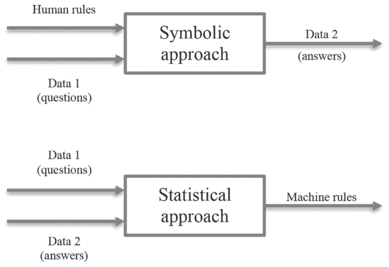

图 1.1 使用机器的两种方法

该文章旨在测试机器表现出等同于或无法与人类区分的智能行为的能力。Turing 的工作标志着机器学习和人工智能新时代的开端。

为了更充分地理解人类心智在学习和推理过程中的运作方式，仍有很多需要探索的地方。然而，机器学习显然有助于建立模型来模拟生成结果的过程，这种模拟对我们来说是具体且可见的。在下一节中，我们将探讨人工神经网络如何模拟意义的表示。

### 1.4 意义表示的两种方法

如前所述，人类语言是一种独特的创造。一段自然出现的文本既包含多个语言单位（例如，单词），也包含这些单位的顺序。这并非一个简单的部分到整体的问题，因为在这种结构化组合的底层存在意义，意义与每个单位相关，但又超越了部分的总和。因此，意义表示是计算机程序模拟的一项非常复杂的活动。

如在引言中所述，人工神经网络能够将统计学习与各种表示理论相结合。特别是，神经网络语言模型由大量单元（神经元的类比）以及衡量单元之间连接强度的权重组成（Buckner & Garson, 2019），可以使用实值向量来表示意义。具体来说，在自然语言处理中，实体可以通过人工神经网络中简单的类神经元计算元素的活动来表示。

在概念及其神经元（即实体和计算元素）之间存在许多表示方案。最直接的方案是为每个实体使用一个计算元素（神经元）。这称为局部（或局部主义）表示。它基于这样一种信念：实体与硬件单元之间存在一一对应关系。这种表示方案易于理解和实现，因为物理硬件网络的结构镜像了其所包含知识的结构（Hinton et al., 1986, 第 77 页），或者更准确地说，是人类知识的表面结构。

在自然语言处理中，这种一一对应关系为我们提供了一个入口，从外部可感知的事物，从实际文本或语音中我们所能看到或听到的内容开始理解语言。通过对真实语言出现的情况进行采样并组建一个语料库——即大型且有原则的自然文本集合（Biber et al., 1998, 第 12 页）——研究人员可以观察到特定的语言形式在起作用。从数据类型来看，文本数据是分类数据，而非数值数据，这意味着它们在本质上是离散的，无法使用这些值进行算术运算。正如纸上的单词一样，每个单词本身就是一个实体——一个独立的王国——使用这些语言形式进行数学运算是不可能的。

这意味着机器无法直接解释分类数据。必须将其转换为数字。例如，为了研究由两个句子组成的小语料库的语言行为——He is a good learner. He gathers insights from a machine learner.—我们可以给每个唯一单词（或词类型）（Smith, 2019）贴上一个唯一的十进制数字标签。所有唯一单词构成词汇表。在这种情况下，如果忽略标点和大小写，词汇表的长度或词类型的总数为 9，如表 1.1 第一列所示。为了将这些词类型转换为数字，最简单的方法是给每个词分配一个十进制数字，如表 1.1 第二列所示。这称为标签编码（label encoding）（Chollet, 2017）。

| 分类文本数据 唯一单词 | 分类十进制数 标签编码 | 二进制字符串中的数值数据 独热编码 |
|---|---|---|
| He | 1 | 100000000 |
| Is | 2 | 010000000 |
| A | 3 | 001000000 |
| Good | 4 | 000100000 |
| Learner | 5 | 000010000 |
| Gathers | 6 | 000001000 |
| Insights | 7 | 000000100 |
| From | 8 | 000000010 |
| Machine | 9 | 000000001 |

标签编码非常直接，表示实体之间的一一对应关系，即词形与硬件处理单元（神经元）之间的一一对应关系。然而，这些数值可能会被内置层级或顺序的算法误解。这个顺序问题在另一种常见的替代方法中得到了解决，该方法称为“独热编码”（one-hot encoding）（Harris & Harris, 2012; Chollet, 2017）。该方法是语料库中每个单词的二进制表示，我们使用一个 9 位向量来表示词汇表中的唯一单词，只需让第 1 位表示单词“He”，第 2 位表示单词“is”，等等（见表 1.1 的第 3 列）。

然而，这种方法在使用计算元素表示单词时存在一些缺点：

- 1 独热编码是一个向量，即一串数字，随着词汇表大小的增加，向量的大小可能会变得非常大。例如，如果语料库的词汇表大小为 10,000，则每个单词的数值表示将为 10,000 位。
- 2 数据非常稀疏，向量中大部分是 0，只有一个 1（因此得名 *独热*）。
- 3 这些向量没有关于单词之间关系或从这些关系中得出的含义的信息。例如，仅通过阅读独热编码，我们无法知道单词 *他* (100000000) 与 *学习者* (000010000) 之间有何关系。

独热编码将单词视为离散的原子单元，而非连续单元。当我们考虑一种语言时，这种理解比较容易：一种单词形式——即表徵（signifier）——对应一个计算元素或神经元。然而，在考虑每个单词的意义——即所指（signified）——时，这种方法在表达复杂内涵方面是有限的。标签编码和独热编码都只是通过分配数字、小数或二进制来改变数据类型。它们仍然是分类数据，因为对这些数字进行加减没有意义。它们并非如向量空间中所示的实数。

当概念——即符号的所指或意义——与神经元之间不是一一对应关系时，局部主义模型效率非常低。在这种情况下，数据具有成分结构。在我们的领域——语言与翻译——中，几乎所有数据都具有成分结构：一个词包含多个义成分，例如单词 *父亲* 包含 *父母* 和 *男性* 的意义。

成分分析，也称为特征分析或对比分析，是语义学（即意义研究）的基石之一（Leech, 1981; Love, 1983）。Lyons (1995, 第 106–108 页）指出，成分分析是词汇语义学的一种方法。它涉及对词素组成部分的分析。它有着悠久的哲学讨论历史，并已被语言学家广泛采用。成分分析的另一个术语是词汇分解。以下是一个常用示例：单词 *男人*、*女人*、*男孩* 和 *女孩* 都表示人类。因此，我们可以从每个单词的含义中提取


它们共同的因素是 *人类*；也就是说，英文单词 *human* 的含义。同样，我们可以从 *男孩* 和 *男人* 中提取共同因素 *男性*，从 *女孩* 和 *女人* 中提取共同因素 *女性*。至于 *男人* 和 *女人*，可以说它们的一个因素是语义成分 *成年人*，与 *男孩* 和 *女孩* 形成对比，后者包含因素 *非成年人*。因此，这四个单词的含义都可以表示为三个因素的乘积：

- 1 男人 = 人类 x 男性 x 成年人
- 2 女人 = 人类 x 女性 x 成年人
- 3 男孩 = 人类 x 男性 x 非成年人
- 4 女孩 = 人类 x 女性 x 非成年人

另一种表征方式称为分布式表征，其中每个实体都由分布在许多计算元素上的活动模式来表示，每个计算元素都参与表示许多不同的实体。也就是说，分布式表征涉及两种表征（例如概念和神经元）之间的多对多关系。每个概念由许多神经元表示，每个神经元都参与许多概念的表征。假设你看到一辆大型黄色大众汽车。你会想使用一个神经元，或一个存储或处理单元来存储此信息；你创建一个 BYV 神经元。这似乎很高效，但请考虑人类在现实生活中可以创造的所有不同实体；例如，大量不同类型的汽车。计算机将需要无限数量的这些简单处理单元来存储信息。减少神经元数量的一种方法是从这些概念中提取特征。例如，对于黄色三角形和蓝色圆形这两个概念，我们可以使用两种特征神经元——颜色和形状神经元——来表示它们，即通过在合取中同时激活所有组成元素（黄色和三角形；蓝色和圆形）。如果我们有 5 种颜色选项和 5 种形状选项，黄色三角形和蓝色圆形将在 5 x 5 矩阵中用“1”表示，如图 1.2 所示。这也可以用 23 种可能的组合来完成。如果我们进一步组合这些合取，例如，我们想同时表示四个实体（黄色三角形、蓝色圆形、黄色圆形和蓝色三角形），那么生成的实体数量将呈指数增长。

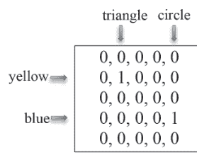

图 1.2 5 x 5 矩阵

分布式表征的优势不在于其记号的便捷性或在传统计算机上实现的易行性，而在于它们利用简单类神经元计算元素网络的处理能力的效率。具体来说，分布式表征的重要特征包括：(a) 其本质的建构性，(b) 其自动概括到新情境的能力，以及 (c) 其对变化环境的可调性（Hinton 等人，1986 年，第 77–87 页）。

分布式表征所涉及的活动模式与人类对语言的认知处理相一致。人们在语言使用上非常有创造力。他们每天都会创造新词和新的词语组合。然而，没有人能够在记忆中实际存储所有这些语言使用实例；相反，人类提取语言（或微观）特征来驾驭人类创造力的力量。语法范畴（词性、实词与虚词、时态）是人类思维可以从海量语言数据中提取的一种“特征”。以句子 *I do not like green eggs and ham* 为例。我们可以合理地想象，对许多人来说，单词 *like* 包含多个子概念：它是动词、实词，并且是现在时。如果人脑中的一个神经元或处理单元负责一个子概念或微观特征，那么‘like’的概念将由至少三个元素或神经元来表示或处理。在某种程度上，每个神经元都代表了一个人对单词‘like’的理解的某个属性。换句话说，人类确实会从原始语言数据中提取特征。

有趣的是，当 Lyons (1995) 提出成分分析框架时，他强调他“特意使用了乘法符号，以强调这些被视为数学上精确的方程，其中‘积’和‘因子’等术语恰如其分地适用，例如 30 = 2 x 3 x 5”（第 108 页）。在此例中，*男人*（30）= *人类*（2）x *男性*（3）x *成年人*（5）。³ 他还试图在其成分分析中使用代数表达式，并指出

> 如果说一个词项（或其一义）的意义是其语义成分的合成函数，即意味着其值完全由 (i) 成分的值和 (ii) 组合它们的运算的定义所决定；如果说一个词项的意义是其语义成分的集合论函数，即意味着它是一种特别简单的合成函数。
>
> （Lyons, 1995，第 112 页）

Lyons 意识到，像 *father* = *parent* + *male* 这样的简单求和并未考虑关系的方向性，因此是不充分的。它并未明确父亲身份是一种二元（或双项）关系，也未表征其方向性。他通过在适当位置添加变量来扩展该方程。这种分析主要见于语言学研究，因为在量化语义成分及其关系的过程中存在许多理论考量。此外，一个词在不同语境中可能有多种含义，例如在 *pray for me* 中，*father* 的语义成分多于 parent + male。在翻译实践中构建此类规则的实际收益并不高。

随着 word2vec、GloVe 等神经网络语言模型技术以及 BERT 等更具上下文感知能力的架构的兴起，语义成分方程在经验上已变得可行。要实现这一目标，至关重要的是从一开始就将文本转换为实数值向量，而非使用类似标签编码的类别数字。更重要的是，在机器学习中，机器自行找出的特征提取规则与人类的不同。换言之，许多机器提取的特征无法映射回有助于词义的直观构建块，我们将在第 3 章进一步讨论这一点。从这个意义上说，机器确实会独立“思考”，即基于数学计算模拟意义表征过程，而非使用人类在直观反思中所使用的文本数据。

### 1.5 翻译的整体视角

既然我们对意义表征的两种不同方法（一种源于人类，另一种源于机器）有了初步了解，那么我们就回到翻译的概念，重新审视其本质。如第一节所讨论的，翻译主要是一项人类活动，它源于实践，出于沟通的必要性。即使在 Holmes (1972/2004) 将翻译研究作为一门独立学科提出之前，它就已借鉴了其他领域的理论，如语言学、心理学和文学研究。然而，它们中没有一门是专门为了解决翻译问题而设计的，这些理论往往只是描述某些翻译现象，而不是解决所有翻译用例的框架。此外，技术工具和计算机应用程序不仅为解决翻译问题提供了方法论，还增加了一层对翻译本质的反思。

毫无疑问，语言学与翻译研究密不可分。在翻译中，一个语言系统中的语言符号与另一个语言系统中的语言符号之间的对应关系依赖于意义。关于语言符号的意义，索绪尔 (1966) 主张，为了理解它，只能审视该符号与同一系统中其他符号的关系。然而，‘符号’是一个复杂的概念。概念及其书面或口语形式之间存在不可分割的结合，而一个作为独立整体的‘符号’与同一项目在人类生活中的特定情境下发挥特定作用之间，存在着鸿沟。

翻译为这一复杂性增添了额外的层次。正如 Vinay 和 Darbelnet (1995, 第 12 页) 所指出的，当一个词在特定语境中在另一种语言中有完全对应的词时，两个表征符只对应一个所指：*刀* 和 *couteau* 在 *餐桌用刀* 或 *餐刀* 语境中。但是，两个表征符的所指，虽通常被视为可互换，却未必完全重合。情况就是这样


与面包和痛苦。在英语中，bread 作为一种食物，既没有和法语中 pain 相同的外观，也没有相同的重要性。

为应对这种复杂性，索緒爾（Saussure，1966）提出了一个理论语言学二分法：langue 和 parole。具体而言，langue 包涵一个符号系统的抽象、系统规则和惯例；它独立于语言使用。当我们说话或写作时，这些词语属于 parole，即语言使用的具体实例。这一区别很重要，因为langue 的大多数项目在用于 parole 时都会发生转化。与此同时，langue 根据 parole 中的使用而发展。“parole 优先于 langue，parole 的实现进入 langue 的领域”（Vinay & Darbelnet，1995，第 15 页）。

这一二分法也支持此前提出的论证线索，即在追求雅各布森（Jakobson）的“差异中的等价”（2021，第 157 页）时，翻译者无法在不同符号系统的项目之间找到绝对等价，这些系统在 langue 和 parole 方面都存在差异。值得注意的是，为什么在语言系统存在差异的情况下，某种等价关系在实践中会被建构。这可能源于沟通作为意义建构的本质。人类希望理解语境场景，并向其赋予意义。当语境场景相似时，建构的意义也会相似。而要实现这种意义，跨语言系统的不同指示符之间应存在内在联系。例如，当翻译者将英语中的 bread 与法语中的 pain 对齐时，他们做出这一决定必定有其原因。必定存在一个概念或意义，它代表了两者共同所基于的同一所指的部分或全部，而这种共同基础使得说不同语言的人能够建构相同的意义。由于意义是动态的、依赖情境的和主观的，很难就一个概念的构成要素达成共识。一些关于意义的研究（Leech，1981；Love，1983；Lyons，1995；Griffiths，2006）有助于我们通过提取的语言特征来解决这个问题，然而这些特征和义成分的数学方程在语言实践中并不十分适用。

相比之下，神经网络语言模型中的分布式表征为描述这种灵活性提供了可行的方案，并或多或少能模拟意义的内在运作。在人工神经网络语言模型中，尽管编码在微小神经元样处理单元中的每一段知识都非常简单，但它们之间的连接能够支持大量不同的模式。通过操纵连接的权重（参数）——这些权重代表单元之间连接的强度——系统可以控制哪些神经元应被激活、哪些应被抑制，哪些单元将被优先处理，以及如何基于人类输入优化活动模式。这种知识表征方式非常灵活，且在某种程度上与语言无关。它与人类认知活动相平行：人们可以根据内容的部分描述回忆项目（Norman & Bobrow，1979），并且即使部分描述的某些部分有误，他们也能做到这一点（Hinton 等人，1986，第 80 页）。以一种或另一种方式，关于不同类型等价或其他解释翻译的众多人类构建理论，例如动态等价与形式等价、功能等价（Nida & Taber，1969；Newmark，1988），对应于由连接权重调整的运动，并可以被模拟或解释为计算机系统中神经元活动的各种模式或模式类别。

从这个意义上说，联结主义和人工神经网络语言模型为重新审视等价概念提供了有效的框架，该框架基于网络中连接的参数或权重。即使神经元数量有限，在整个神经网络中构建模式的可能性也很多。这些选择为翻译者提供了丰富的土壤，以新的视角看待等价。

正如 Malmkjær（2011）所指出的，翻译是一项努力将给定语言话语的意义或意义从一种语言传递到另一种语言的活动。成功可以用跨语言的意义相同性来描述。从这个意义上说，翻译过程中应该有一个独特的步骤来寻找这种或多或少独立于特定语言系统的意义共同基础，从而实现对源文本的理解和目标文本的产出。例如，Newmark（1988）认为，在翻译时，翻译者会并行保持四个层面：文本层面、指涉层面、连贯层面和自然层面（第 29 页）。

> [The] 第一和最后一层是文本；然后你必须始终牢记现实层面（这可能是模拟的，即想象的，也可以是真实的），但只有在有必要完成或确保读者对文本的理解时，你才允许它过滤进入文本。
> 
> (第 29 页)

### 指涉层面

> 与文本层面同步进行……当你将源语言转换为目标语言文本时，你会在脑中建构指涉图景；并且，作为一名专业人士，你要对该图景的真实性负责。
> 
> (第 23 页)

最后，连贯层面是一个概括性层面，连接文本层面和指涉层面，并同时遵循文本的结构和语气（第 23 页），并且“它是一个调节器，它保障连贯性，它调整强调”（第 24 页）。

就此而言，传译研究的学者似乎更为激进。在她的翻译诠释理论（ITT）中，塞莱科维奇（Seleskovitch，1975）提出了在理解和重述过程中的去言语化概念，并主张大多数声音或图形符号在理解开始后立即消失。她指出，人们在日常沟通中经历去言语化：我们牢记词语所传递的事实、概念和事件，但不会在记忆中保留这些词语。意义预期——这种现象常出现在口头交流和传译中——证明在情境和语境中，充分的言语支持并非总是理解发生所必需的。

虽然在不同语言系统中关于共享意义没有共识，但在人工神经网络中，意义可以或多或少被模拟，从而支持跨语言存在共享共同意义的信念。从源文本（输入数据）到目标文本（输出数据）的人类翻译过程，可以在典型的人工神经网络中得到反映和展示，这将在第 3 章中详细讨论。

## 注释

- 1 翻译学者已经识别并描述了由分析方法和翻译目的驱动的不同形式的等价，此外，该术语本身具有演变甚至有问题的性质。参见 Bassnett（2014，第 33–39 页）和 Munday 等人（2022，第 49–72 页）。
- 2 在数学中，向量空间 V 的维度是 V 关于其基域的基的基数（即向量的数量）（Dimension (Vector Space)，2022）。我们在第 3 章中介绍了一些示例，以进一步阐述自然语言处理中的这一概念。
- 3 本示例中的数字是随机选择的，用以说明 Lyon 的观点。实数旨在表示人工神经网络语言模型中作为向量空间的意义。

## 2 分析层次
### 关键概念

- 当人类和机器进行翻译时，语言结构和分析层次起着重要作用。
- 机器对大量信息的分割既依赖数学计算，也依赖人类对语言的感知。
- 为了让 ML 工具能够直接为人类工作并与人类交互，机器学习过程中的粒度层次必须与人类认知活动的本质保持一致。

### 2.1 引言

在语言理解和产出（尤其是翻译）中，最关键且最具争议的初步步骤之一，是确定用于操作的单位。如第 1 章所讨论的，每个语言单位都由符号构成，因此具有双重结构：语言形式（指示符）的结构和意义（所指）的结构。多个概念可能位于同一单位之内；例如，单词 *老鼠/鼠标* 可以指啮齿动物，也可以指计算机配件。共享相同的语言形式（*老鼠/鼠标* 作为指示符），这两个概念不能分离，而是相互叠加。在现实生活情境中的语言流中，通常只保留一个所指，¹ 优先保留在语境中具有优先权的那个。在翻译的语言理解和产出中，有三个元素起着决定性作用：形式、意义和语境。形式和意义可以体现在一个单位之中，而语境是指给定单位与较大环境中其他单位的关系。一个值得探讨的有趣问题是：*起点在哪里：形式、意义还是语境？*


在翻译中，Vinay 和 Darbelnet（1995）“将翻译单位定义为话语中符号以这种方式相互关联的最小片段，以至于不应单独翻译”（第 21 页）。他们认为，表征者比所指者发挥更重要的作用，译者必须更关注语义而非结构。这是一种以人为本的方法；普遍认为，译者从语义（即意义）出发，并在语义领域内开展所有翻译程序。从这个意义上说，翻译单位并非完全由形式语言学标准定义；相反，它被视为思维单位，因为译者翻译的不是词语，而是思想。

在机器学习任务中，这三个要素及其关系——形式、意义和语境——都可以在自然语言数据集（即语料库）中进行探索，语料库不仅包含单位本身，还包含其上下文，即其他相关单位的组合。语料库以分布结构保存了单位与其他单位之间的所有关系，这是计算机程序生成与基于意义的人类反思和思想相对应的模式的主要资源。无论计算机程序是机器翻译系统还是文本摘要工具，它可能都无法像人类那样理解文本的深层意义，但它可以吸收信息并产生对人类有意义的结果，因为其输出与人类对意义的概念化一致。从这个意义上说，意义仅在人机交互过程中存在于人类的心智中，这种交互包括将数据集输入计算机系统、设计和优化系统架构，以及解释和使用机器生成的结果。本章和下一章将重点讨论翻译中形式、意义和语境的机器方法。第 2 章描述了形式和语境的分析层次。第 3 章转向用于意义和语境的向量语义，机器方法从形式和结构入手，意义通过语料库中自然语言数据的分布结构来提取，意义和语境在此处存在并共存。

### 2.2 语言理解与产生中的语境层次

#### 2.2.1 翻译中的分析层次

分析是翻译过程中的关键步骤。正如 Newmark（1988）所述，译者开始翻译时“出于两个目的阅读原文：第一，了解其内容；第二，从译者的角度对其进行分析”（第 8 页）。此外，在源文本的语言学分析方面，Newmark（1988）强调了翻译单位和话语分析（第 54–67 页）。分析其他类型的与翻译相关的文本也很重要，例如目标文本、参考文本以及对齐的源文本和目标文本。本章我们关注语言学分析的一个方面，即较大片段的文本信息如何在不同层次上分割为更小的单位。分割本身就揭示了特定单位与其上下文之间的关系。当译者接近一篇文本时，已知有多种语言处理层次在起作用，译者通常会直觉地运用所有这些层次（参见 Liddy, 2001，第 1 页；Newmark, 1988，第 18–24 页）。

Mona Baker（1992）探讨了翻译中多层次的等价：词汇层面及词汇层面之上的等价、语法等价、文本等价和语用等价。该框架考虑形式（语法和词数）和意义（习语和固定表达，以及语用）。Newmark（1988）在其理论中应用了翻译单位的概念，并指出句子是翻译的“自然”单位，正如它是理解和记录思想的自然单位一样。在句子之内，他确定了五个进一步的翻译子单位。最小意义单位，即语素，

> 除非在前缀和后缀（如 'post-'、'inter-' 和 '-ism'）的情况下，在词语语境中它们没有直接的目标语对应词，否则无需过分认真对待……两个子单位，即从句和短语，属于语法类别；另外两个，即搭配和单词（包括习语和复合词，后者是凝固的搭配），属于词汇类别。
> （Newmark, 1988，第 65–66 页）

当译者进行翻译时，译者必须“同时关注语法方面（时间、语气、空间、逻辑、一致等一般因素）和词汇方面（细节），并确保在重要时保留功能句式透视（FSP）”（第 66 页）。根据 Newmark（1988），FSP“连接话语、句子和强调的研究”（第 60 页），并“在语言、情境和文化语境下审视句子要素的排列，确定其在段落和文本中的功能”（第 61 页）。

在口译中，Chernov（2004）提出了一种话语层次结构，作为同声传译中概率预期机制的基础：

> 音节 – 词 – syntagm² – 语句 – 话语
> （第 93 页）

这些理论化都是自包含的框架，代表了描述语料库层次结构的不同方法。机器采用了另一种组织人类思想的概念化。

#### 2.2.2 NLP 中的颗粒度概念

在自然语言处理（NLP）中，分析层次更常用的术语是“颗粒度”。一般来说，颗粒度是指将一个事件分解为更小的部分或单个颗粒的概念，使得每个颗粒都在更高层级的事件中发挥作用。新闻文章是颗粒度转换的经典示例，第一段提供广泛的高层描述，随后段落则提供更详细的描述。人类可以轻松在各种颗粒度层次之间转换，以实现文本理解。然而，对于自动识别和提取，明确识别指示颗粒度转换的标识符非常重要。在自然语言话语（NLP 的一个领域）中，已经提出了各种方法和理论来对颗粒度进行建模（Mulkar-Mehta 等人，2011 年）。

Krallinger 等人（2010 年，第 341–382 页）探讨了生物医学文本处理系统如何在不同颗粒度层次上运行，利用相关处理特征来检测从字符和字符串基本层次到多文档集合中派生出的复杂关系等自然语言的特殊特征。他们指出，字符和字符串层次以及句子窗口层次等比人类语言学分析更适合计算机处理。

#### 2.2.3 分块：分析层次背后的认知方面

人类将话语在不同层次上分割为多个单位的能力对于语言理解和产生至关重要。在阅读一段文本时，人类会有意识和无意识地通过意义组合信息单位——短语、习语、专有名词、句子、文档——以形成概念性分块。在某种程度上，理解与抽象一系列想法的能力有关。概念性分块是将通过意义联系在一起的独立信息片段统一起来的心智飞跃，对信息进行分块能使大脑的心智工作更加高效。一旦一个人对某个概念进行了分块，只要捕捉到了主要思想——即该分块——就无需记住底层细节。这个新的逻辑整体使分块更容易记住，也更容易将分块融入更大的整体中（Oakley, 2014，第 54–57 页）。

原始信息就像拼图碎片，单独看有时意义不大。仅仅记忆一个事实而不理解或缺乏语境，并不能帮助一个人掌握概念如何与其他相关概念结合起来。分块就像是将拼图碎片插入拼图中。它是那种帮助一个人理解整体图景的心智飞跃（参见 Oakley, 2014，第 57 页）。

这些认知活动可以在交替传译处理中被追溯。Gillies（2013，第 112 页）总结了传译理论中广泛认可的基本传译技能集（Gile, 2009; Seleskovitch & Lederer, 1989），其中包括主动倾听与分析作为关键组成部分。在传译实践中，传译员会倾听深层意义，包括演讲者的主要观点和支持性细节、结构转换以及隐含意义。Gillies 指出，主动倾听与分析是指在整个演讲过程中保持专注倾听和集中注意力，不遗漏演讲者说的每一个字，也不在中途走神。练习对书面和口语文本的分析

不受口译时间压力的影响，可以帮助在尝试在口译实战中做同样的事情之前，自动化分析任务（第 111 页）。

主动倾听建立在分析基础之上，既包括对说话者试图表达内容的总体分析，也包括对话语层级结构的分析，以便将主要信息或要点与较低层级的辅助或附属信息区分开来。值得注意的是，Gillies (2013) 提出了将分析任务“自动化”的概念（第 111 页），这意味着人脑中可能存在某种内部认知机制或语言模型，能够自动化这种处理形式（参见第 3 章和第 8 章）。

鉴于时间和认知负荷的限制，口译员必须将信息处理成更大的语块，而非试图保留较小的信息片段。口译员记下的并非单纯听到的内容，而是能够触发其记忆、以便知道说什么的要素。在一定程度上，口译员的笔记捕捉了话语的层级结构，并通常展示意义分析的结果。

#### 2.2.4 机器学习中的分析层级要求

如前所述，在一定程度上，机器学习过程中的粒度级别必须与人类认知活动的性质保持一致，才能使 ML 工具直接为人类工作并与人类交互。尽管存在某些情况，这些级别不直接使用，而是作为另一款可由人类使用的 ML 工具的机器训练基础，但我们对分析层级的讨论始于语言结构的人类框架，以及机器在不同层级处理信息的相关原因。

首先，如前所述，使用 ML 工具的一个目标是扩大和放大人类能力，降低认知负荷。为此，各种工具被设计用于辅助 NLP 任务，例如基于 tf–idf（词频 – 逆文档频率）的词/术语层级术语提取工具、基于短语的统计机器翻译（SMT）中的短语表示生成机制，以及自动对齐源文本和目标文本片段的系统。在许多情况下，分段决策并非基于数学考量，而是为了满足人类翻译需求，帮助人类处理自然语言，包括理解和产生文本或语音。例如，即使输入数据是作为基于人类信息处理的多种特征（如标点符号指示的分段）的句对平行语料库逐句输入，数据清洗过程也会将文本解构为词元，并通常移除人类依赖以理解的标点符号。尽管如此，该过程始于人类感知，亦终于人类感知，因为数据在输入和输出后都必须对人类有意义。从这个意义上说，分析层级的总体自然语言处理框架是由人类而非内部编程需求驱动的。

其次，在使用神经网络进行语言建模时，“意义”基于这样一个假设进行提取：单词分布的相似性与其含义之间存在联系。这一分布假设最早由 Harris (1954) 和 Firth (1957) 等语言学家在 20 世纪 50 年代提出。

意义的分布模型“通常基于共现矩阵，即表示单词共现频率的一种方式”（Jurafsky & Martin, 2020, 第 101 页）。共现矩阵通常以基于不同层级单元（术语、句子、文档）的计数向量开始，计数向量可进一步转换为更强大的表示形式，如嵌入式。理解神经语言模型中的一些基本单元（如词元和词类型）非常重要，因为这些单元会影响计数向量的生成方式。

最后，分析层级的概念对数据标注至关重要。始于 1990 年左右，许多资源被用于创建大型标注句库和其他语言资源。例如，Universal Dependencies (UD) 是人类语言形态句法标注的一个框架。UD 句库现在广泛应用于自然语言处理研究，包括句法和语义分析研究（Marneffe et al., 2021, 第 255–256 页）。由于句法分析在连接语言表达与意义方面的重要性，它一直是自然语言处理的核心任务。例如，大量研究表明，句法表示对于后续任务（如关系抽取、语义角色标注和改写检测）非常有用（Socher et al., 2013, 第 455 页）。要构建自动句法分析系统，需要标注/标记数据来在某一层级或某些层级上建模监督分类器（参见第 7 章）。

#### 2.2.5 翻译记忆：形式与意义平衡的个案研究

翻译记忆（TM）是现代计算机辅助翻译（CAT）工具的基本组成部分。它是一种语言技术，通过在数据库中搜索相似片段并推荐找到的匹配项，来实现对文档片段（短语、句子、段落）的翻译（Raya, 2005）。在 TM 编辑器中，较大的文本信息可以分割成较小的片段。分段首先基于通常在 TMX 文件中定义的自动规则。TMX 是翻译记忆交换格式；它允许将翻译记忆从一种翻译工具转移到另一种翻译工具（本地化相关格式，2002）。在 TMX 中，‘segtype’属性（图 2.1 中的第四行）定义 segtype 属性，可取多个值，例如‘block’、‘paragraph’、‘sentence’和‘phrase’（TMX 实施说明，n.d.）。也就是说，常规 TM 系统等自动分段工具可以按短语、句子、段落或块分割较大的信息块。‘block’值用于“当片段不符合其他任何值时，例如当你想要将由多个段落组成的章节存储在单个 <tu> 中时”（TMX 实施说明，n.d.）。<tu> 元素表示一个翻译单元，包含源片段和目标片段。图 2.1 使用句子“这是一个示例。我们编写了一份 TMX 文档以展示其工作原理。”提供了示例。在这种情况下，segtype="sentence"（加粗）。遵循此分段规则，TM 引擎将文本分割为句子。图 2.1 因此显示了两个翻译单元：“这是一个示例。”和“我们编写了一份 TMX 文档以展示其工作原理。”。

```
<?xml version="1.0" encoding="UTF-8"?>
<tmx version="1.4">
<header
segtype="sentence"
adminlang="EN-US"
srclang="EN-US"
creationdate="20131117T140541Z"
>
</header>
<body>
<tu tuid="163323456-0-1">
<tuv xml:lang="EN-US"><seg>This is an
example.</seg></tuv>
<tuv xml:lang="ZH-CN"><seg> 是例句。</seg></tuv>
</tu>
<tu tuid="163323456-0-2">
<tuv xml:lang="EN-US"><seg>We wrote a TMX document to
show how it works.</seg></tuv>
<tuv xml:lang="ZH-CN"><seg>我们编写了此TMX文件来说
明其原理。</seg></tuv>
</tu>
</body>
</tmx>
```

### 图 2.1 TMX 中句子分段示例

在图 2.1 的示例中，较大数量的信息被分割成较小的语块，以帮助人类翻译员专注于内容，并按照其认知习惯（例如，逐句）翻译内容。TM 工具提供多种分析层级——短语、句子、段落和块——以支持人类翻译。为了让人类在翻译中使用这些 TM 片段，分段结果必须能够向人类呈现。否则，翻译员或语言学家将无法编辑自动分段结果。

在图 2.2 的示例中，由于格式问题和缺乏标点，许多使用短语或句子作为分段单元的自动分段系统倾向于将文本分为六个片段，即 romance、fantasy、is finding your、in people、who don’t 和 have it。对于此类文本，需要进行更高层级的分段，例如以段落或块为单位，以便将源文本作为一个整体呈现给人类。否则，人类翻译员必须忽略分段结果，并以对其有意义的方式分析文本，例如，将整个文本视为一个片段：Romance is finding your fantasy in people who don’t have it。此外，此文本的复杂格式编码了传递给读者的额外信息，使得

浪漫
是发现你的
幻想
于那些
没有
幻想
的人

图 2.2 一个具有复杂格式考量的示例

对自动分割系统来说，这具有挑战性，难以捕捉。在这种情况下，翻译人员需要回到原始的格式化文本，以充分传达文字和格式所传达的含义。我们将在第 9 章第 9.3 节关于翻译胜任力的讨论中再次提到这一点。

TM 工具的设计尽可能主要由人类需求驱动，而非算法的固有需求。此外，TM 工具不仅提供人性化的语言处理功能，还在平行语料库中累积和存储注释³。语料库中嵌入的分割、对齐及其他功能（如数据注释）融合了处理语言数据的人类要求，这将在第 7 章中进一步阐述。

如前例所示，翻译记忆分割工具背后的方法论和概念植根于人类认知的特征。语料库内容的分割可以根据给定情境在各种层级进行。在本地化嵌入式字幕、视频帧上的叠加文本（Valery & Sene, 2020, p. 119）时，必须考虑更多因素，如字幕区域的大小和每个视频帧的长度，以便将整个文本分成多行字幕。这些因素决定了文本是被分割成句子、短语还是单词。同样，此类文档的分割必须对人类有意义，使人们能够追随自己的思路。就像在书面文档的翻译记忆任务中一样，文本通过标点符号被分割成句子。否则，分割结果将对人类没有意义，因此在帮助人们以适合自己的方式处理信息方面失去了价值。

我们还必须意识到，在 TM 环境中翻译，与在包含语言信息和非语言特征（如图像以及粗体字体和行与段落分隔等格式）的更大上下文中翻译相比，使翻译人员处于劣势。此外，翻译人员可能会根据其处理意义的方式，对文档分割采用不同的方法或偏好，而 TM 工具通常不提供这种程度的灵活性来分割原始文本。随着越来越多的 NLP 工具可用，翻译人员能够在上下文丰富的环境中工作，在该环境中，TM 工具可用于后续数据收集、语言分析和质量保证（参见第 8 章）。

存在词形还原算法，它们可能很复杂。这并不令人惊讶，因为词形还原涉及围绕原始词形及其相应分类的进一步抽象。在 NLP 中，有一种更简单但更粗糙的方法，主要由切除词尾词缀组成。这种形态分析的朴素版本称为词干提取。最广泛使用的算法之一是 Porter 词干提取器（Porter, 2006），它包含在一些 NLP

### 2.3 语言关系与分析层级的类比

#### 2.3.1 连言关系与范式关系

正如 Harris（1954）所言，“语言可以用分布结构来描述，即部分之间的相对出现情况”（第 146 页），每个元素相对于感兴趣的元素 A 都处于特定位置：

> > 一个元素的分布将被理解为其所有环境的总和。元素 A 的环境是其共现元素的现有阵列，即其他元素，每个都处于特定位置，与 A 一起出现以产生一个表达式。A 在特定位置的共现元素称为该位置的选择。
> > （Harris, 1954, 第 46 页）

Harris（1954）的工作推动了一系列通过分布结构探讨意义的研究，主张语义相似导致语言分布相似（参见 Sahlgren, 2008）。语义相关的词汇在相似的语境中使用：如果有足够的文本材料，并且发现材料中两个语言实体 w<sub>1</sub> 和 w<sub>2</sub> 倾向于具有相似的分布属性——它们与同一其他实体 w<sub>3</sub> 共现——那么可以假设 w<sub>1</sub> 和 w<sub>2</sub> 属于同一语言类别，或者可以解释为，在某种程度上，w<sub>1</sub> 和 w<sub>2</sub> 在语义上具有某些共同特征（Sahlgren, 2008, p. 35）。在下一章中，我们将看到如何在神经语言模型中通过从使用语境（分布结构）中诱导语义表示来逆向工程此过程。

在本章中，让我们从可观察到的内容以及可以直接从表面元素中诱导的内容开始，即文本中元素之间的语言关系。Sahlgren（2008）强调了分布方法论的结构主义起源，它追溯到结构主义的摇篮，即索绪尔的《一般语言学教程》（1966/1916），并遵循索绪尔关于将功能差异分类为两种结构的理论：连言关系，即线性序列中元素之间的关系；以及范式关系，即类或系统中元素之间的关系。这两种主要类型的分布模型提供关于共现（连言）和关于共享邻居（范式）的信息（Sahlgren, 2008, p. 33）。换句话说，连言关系显示文本中共现的定位和相关实体，而范式关系显示替代选项，并关联文本中不共现的实体（第 39 页）。

图 2.3 使用句子 "She likes green eggs" 作为示例，对这两种关系进行了可视化，采用 w<sub>n</sub>（w<sub>1</sub>、w<sub>2</sub>、w<sub>3</sub>、...）的记号系统表示句子中总共有 n 个单词的每个单词，并使用 w<sub>n<sub>o</sub></sub> 表示 w<sub>n</sub> 位置的各种选项。

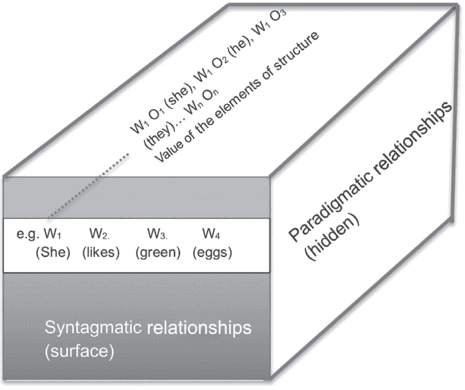

图 2.3 文本内部的关系

如图 2.3 所示，句子 "She likes green eggs" 具有两种基本关系：识别每个单词位置和顺序的单词间连言关系，以及“在设定为给结构元素赋值的系统内可互换的术语或单位的范式关系”（Firth, 1957, p. 5）。虽然每个元素（$w_n$）的分布是可观察到的（如我们看到的单词），但每个单词 $w_n$ 的值是隐藏的，我们无法直接观察到它。Sahlgren（2008, p. 39）使用替代概念来描述范式关系，这表示隐藏元素属于与实际文本序列中可观察元素相同的类别。该关系暗示，同一类别中的元素共享某些共同的句法和语义特征。

可在特定位置发挥作用的词汇选项可以被视为构成语言数据的具有特定值的实例。在人类认知过程中，这些选项对一个人来说可能是意识到的。例如，当英语初级成人学习者在第二个位置 $w_2$ 产出 likes 时，他们可能会在 adores 或 is fond of 等其他选项中挣扎。这些选项背后的进一步抽象是附加在其上的值，这些值是将它们置于同一类别的语义特征$^4$，例如具有“感受爱意”一般含义的动词。

在机器学习中，训练语料库通过元素的共现提供许多词汇选项。在结构 she . . . green eggs 中，缺失位置可以有许多选项，如 likes、adores、dislikes 和 abhors。一种神经语言网络，如下一章将讨论的 word2vec，可以进一步提取代表单词不同方面的特征向量，这与 Firth（1957, p. 5）提出的“结构元素赋值”相一致。这些是可以定义序列中每个类别的隐藏值。例如，$w_j$ 的词性是‘代词’，且它不是命名实体。词性（POS）和命名实体是句子结构和意义的有用线索。它们基于直观的人类总结，但可以通过序列标注任务（如词性标注和命名实体识别（NER））在 NLP 中加以利用（Jurafsky & Martin, 2020, p. 148）。

#### 2.3.2 机器学习的语言单位

序列 $w_1, w_2, w_3 \dots w_n$ 作为一个整体，通常在各种层级上进行处理，而语言模型可用于训练和预测的最小单位是‘标记’（token），通常是一个词、字符或子词（定义和示例参见 Google Developers, n.d.–c）。

如果标记是一个词，语料库中的标记数量就是连续词的总数 $N$。标记不是按词类型定义的；相反，“类型”指语料库中独特或不同的单词。如果语料库词汇表中的单词集合是 V，则词类型的数量即为词汇表大小 $|V|$。在 NLP 中，对语言中单词数量的引用通常指词类型（Jurafsky & Martin, 2020, p. 12）。在大多数情况下，词类型数量与标记数量不相同。例如，在一个包含关于联合国生物多样性保护决议文件的语料库中（2021 年 4 月 16 日大会通过决议的英文版，符号 A/RES/75/271），根据 AntConc（一种用于共现和文本分析的语料库分析工具包，Laurence, n.d.）的计算，有 583 个词类型和 2,017 个词标记，如图 2.4 所示。此示例说明，语料库中的词汇表大小（词类型数量）与总词数（标记数量）之间通常存在较大差异。NLP 中的另一个语言单位是词元（lemma），它是具有相同主要词性且具有相同词义的一组词汇形式的词干。Cats 和 cat 具有相同的词元 cat，但它们是不同的词形。词形是单词的完整屈折或派生形式。在此示例中，cats 和 cat 是两个屈折词形。对于像阿拉伯语这样的形态复杂语言，我们通常需要处理词形还原。然而，对于英语中的许多任务，词形就足够了（Jurafsky & Martin, 2020, p. 12）。

存在词形还原算法，它们可能很复杂。这并不令人惊讶，因为词形还原涉及围绕原始词形及其相应分类的进一步抽象。在 NLP 中，有一种更简单但更粗糙的方法，主要由切除词尾词缀组成。这种形态分析的朴素版本称为词干提取。最广泛使用的算法之一是 Porter 词干提取器（Porter, 2006），它包含在一些 NLP


| 语料库文件 | 共现检索 | 共现图 | 文件视图 | ... | 词汇表 | 关键词表 |
|---|---|---|---|---|---|---|
| UN_resolution.txt | 词类型数: 583; 词标记数: 2017 | | | | | |
| | 排名 | 频率 | 单词 | | | |
| | 1 | 172 | the | | | |
| | 2 | 145 | and | | | |
| | ... | ... | ... | | | |
| | 7 | 28 | biodiversity | | | |
| | 8 | 28 | for | | | |
| | 9 | 27 | sustainable | | | |
| | ... | ... | ... | | | |

## 图 2.4 词类型数和词标记数

诸如 NLTK（自然语言工具包）之类的软件包。NLTK 包含丰富的软件、数据和文档，均可从 http://nltk.org/ 免费下载（Bird et al., 2019）。

假设我们有一个句子 _他们给这些行业的女性提供了一些词形还原的示例_。我们可以先使用 `nltk.word_tokenize` 模块将其逐词标记，词标记的输出为：[‘They’, ‘gave’, ‘the’, ‘women’, ‘in’, ‘these’, ‘industries’, ‘some’, ‘examples’, ‘of’, ‘lemmatization’, ‘.’]。然后，我们可以使用 NLTK 包中的 `PorterStemmer` 模块对每个词标记进行词干提取，词干提取后的输出如下：

- They: they
- gave: gave
- the: the
- women: women
- in: in
- these: these
- industries: industri
- some: some
- examples: exampl
- of: of
- lemmatization: lemmat

Porter 词干提取器可应用于以下段落（引自 Jurafsky & Martin, 2020, 第 21 页）：

> 这不是我们在比利·博恩斯的箱子里找到的那张地图，而是一份准确的副本，内容齐全——地名、高度和测深数据——唯一的例外是红色十字和手写的笔记。

以下是词干提取后的输出：

> Thi wa not the map we found in Billi Bone s chest but an accur copi complet in all thing name and height and sound with the singl except of the red cross and the written note

回到示例 *他们给这些行业的女性提供了一些词形还原的示例*，我们可以使用 NLTK 包中的 `WordNetLemmatizer` 对单词列表进行词形还原，并将文本中的单词连接起来。类似于命令行 `lemmatized_output = “.join([lemmatizer.lemmatize(w) for w in word_list])` 产生的词形还原后的句子输出为

They gave the woman in these industry some example of lemmatization.

表 2.1 总结了使用 NLTK 处理原始句子后的输出。词干提取和词形还原输出中与原始句子不同的单词或标记以 *下划线* 标注。

需要注意的是，尽管词元和词干提取的形式可能相同，但它们是通过不同过程生成的。词形还原侧重于对人类有意义的进一步分类，并基于语法（例如，从 *行业* 到 *行业*，以及从 *示例* 到 *示例*），而词干提取侧重于形式（例如，从 *行业* 到 *industri*，以及从 *示例* 到 *exampl*）。

最后，*n*-gram 的概念是计算机描述各种粒度级别的一种便捷方式。简单来说，*n*-gram 可以定义为 *n* 个单词的序列。在某种程度上，*n*-gram 方案通过定义序列长度（即 *n* = 1, 2 ... *n*）来对一组词标记进行硬分区。较长序列的硬分区是计算机程序接近分析层级的一种简单而粗糙的方法。它在 NLP 编程中被广泛使用。例如，为了对短语进行分段，程序可以将标记序列切分为具有固定短语长度的短语序列，该长度随序列长度而变化。这使程序能够大致划分文本的粒度级别。由于短语的长度通常小于句子，短语可以设置为 5-gram 序列，而句子则具有更多数量的 n-gram 序列。n-gram 也可以指一种预测性语言模型，为下一个词标记分配概率。在此情况下，小写字母 n 指序列 w₁, w₂, w₃ ... wₙ 中的项数，而大写字母 N 指在 n-gram 语言模型中需要考虑的固定前序上下文的大小。n-gram 的使用将在第 3 章中更详细地讨论。

#### 2.3.3 基于语义的分段

自然语言处理中的粒度级别可以根据与人类思维单元相对应的形式来确定，例如标点符号（句子）和空格（单词）。最近，神经语言模型可以为每个语言单位（例如单词或短语）使用连续实值向量。Cho et al.（2014）报告称，可以使用 RNN 编码器 - 解码器捕获单词和短语的语义和句法结构。RNN 指循环神经网络，是语言模型的一种架构（参见第 3 章）。Cho et al.（2014）的研究表明，语义相似的单词聚集在一起。例如，法国、中国和俄罗斯被聚集在一起，这符合人类对国家或地区属性的直觉，英语和法语也非常接近，这也符合人类对语言或国籍的直觉。他们还发现，大多数在句法上相似的关于时间长度的短语也聚集在一起。这是计算机程序捕捉人类对短语及其含义理解的一种方法。如果计算机程序不与人类交互，则不需要经历这样的交付阶段。

2016 年之前，当 Google、Facebook 和 Microsoft 推出它们的神经机器翻译（NMT）系统时，最流行的 MT 系统是基于短语的统计机器翻译（SMT），因为对短语而非单词进行建模通过使用更大的翻译块（或“短语”）和重排序能力显著改进了 SMT 方法。一般来说，使用短语而不是单词使常规 SMT 能够基于更广泛的上下文，并在重排序和建模长距离依赖关系方面取得更好的性能。最近，Xu et al.（2020）“提出一种注意短语表示生成机制，该机制能够从相应的标记表示生成短语表示”（第 386 页）。他们还将生成的短语表示融入 Transformer 翻译模型，以增强其捕捉长距离关系的能力。

### 2.4 语言层级在机器翻译中的应用

在神经网络语言模型中，某个粒度级别的单元会被传递到神经网络的输入层。从计算角度来看，将整个数据集（例如，10 亿个字符）输入模型进行训练是不可行的。因此，输入数据需要被拆分为可处理的形式。输入数据的形式会影响输出的形式。例如，大多数机器翻译系统使用句子作为输入，MT 结果也在句子级别。NMT 模型主要基于编码器 - 解码器框架：编码器将源语言的输入句子压缩成一个抽象表示，解码器根据该表示生成目标语言句子。在句子级别进行翻译的一个原因是训练数据的格式，该数据大多在句子级别对齐，例如在翻译记忆库中。此外，还有研究探讨将短单句 MT 模型扩展以生成更大结构（如段落甚至整篇文档）的可能性（Li et al., 2015）。

然而，交互式机器翻译模型通常使用基于短语的语言模型。Ortiz-Martínez et al.（2011）描述了一个会话示例，其中一句西班牙语被翻译成英语。在此会话中，源句子是 *要查看资源列表*，系统建议整个短语 *查看资源列表* 的翻译。用户（通常是译者或编辑）可以通过接受或对较小的信息块提供新建议来开始与系统交互。例如，用户可能移动鼠标以接受前八个字符 *查看*。但是，用户可能对 *查看* 后的建议 *the* 不满意，而改输入 *a*。这将触发系统建议用 *资源列表* 来完成句子，这是一个新的翻译建议。如果交互在此处停止，最终结果将是 *查看资源列表*，而不是一开始在用户交互之前建议的 *查看资源列表*。用户可以继续与系统交互，更改后续选项，例如将 *列表* 改为 *清单*，并重复交互，直到接受最终建议（Ortiz-Martínez et al., 2011, p. 69）。

在一定程度上，交互式 MT 的粒度级别受人类内部分析层级框架的影响。输入是按序列逐条馈送的。对于计算机程序来说，更重要的是序列的长度。然而，对于人类来说，在处理信息时最易于触及的是翻译单元，这从机器的数学角度来看等于有序的标记。有时，序列的长度与人类心中语言层级的概念并不完全一致。例如，在人类看来，一段可能包含短句，因此从长度上讲，MT 系统可能将该段视为一个句子。然而，输入和输出序列的分段级别通常是相同的，这些级别不仅影响译者与 MT 引擎在交互式 MT 过程中的相互作用，也影响 MT 结果生成后的相互作用。例如，在 NMT 模型中，输入序列被映射到表示该序列的向量嵌入，然后将其转换为输出词字符串


在目标语言的粒度层级上。由于输入和输出数据均由人类处理，因此必须具有可呈现性并符合人类的理解。从这个意义上说，在 NLP 任务中，粒度层级由人类而非机器决定。

### 2.5 分析层级的两种方法

#### 2.5.1 序列 vs. 意义单元

注意，在人眼中，序列不一定是有意义的语言单元（例如，短语或句子）。如前所述，意义仅存在于人类心智中。符号的双重结构意味着符号形式（形式）与所表征意义（意义）之间没有绝对的重合。因此，当人们使用语言表达思想时，必须在形式和意义之间做出妥协。这种现象在翻译中更为明显。通常，源语言中相同的意义或概念可以在目标语言中以各种形式表达。可以根据具体语境选择合适的形式，尽管该形式可能不是每个人或每种情况的首选。同样，如果优先考虑形式，对意义的强调在一定程度上可能会被削弱。典型的例子是双关语。当有人被要求翻译一家餐厅的名字“eggcellent”时，如果形式上有限制，即翻译必须是一个单词，如果目标语言没有类似的语言资源来表达该意义，那么意义（“egg + excellent”）可能会被妥协。如果优先考虑意义，翻译人员可能需要将目标语言中的一个单词转换为多个单词，在这种情况下，双关语的意义可能会被削弱。如果关于翻译方案存在绝对的真理，那将是此类选择背后的偏好是主观的，且因人而异。

#### 2.5.2 比较的其他方面

在大多数 NLP 处理中，标点符号会被移除。然而在翻译中，标点符号是人类分割文本片段并分析话语最有效的工具之一。正如 Newmark（1988）所指出的，

> 标点符号是话语分析的一个基本方面，因为它在语义上指示了句子与从句之间的关系，这可能因语言而异：例如，法语省略号表示停顿，而在英语中表示省略一段文字；德语感叹号用于引起注意、产生情感效果和强调、用于通知标题（但在书信中不再用于“亲爱的玛丽”），并且可以重复使用；分号表示句子之间的连贯性；法语倾向于将逗号用作连词。（第 58 页）

同样，术语、短语、从句、句子和段落等概念也是为人类思维的逻辑而设计的。在某种程度上，人类语言分析框架是一种社会产物，是一种习得的方法，通过将信息片段分组来创建新的逻辑整体，类似于分块。它由一群具有相同或相似文化特征的人共享，这意味着不同群体在语言层级形式方面存在差异，例如 Newmark（1988）讨论的标点符号系统。

#### 2.5.3 对翻译人员的启示

翻译人员应了解这些特征，以便能够决定哪些任务适合机器完成，哪些任务适合人类处理。毫无疑问，计算机程序的工作方式与人类处理文本信息的方式不同。这就是两者都需要的原因。通过了解每种方法的优势和劣势，人类用户能够更好地与机器交互并利用其力量。

分析层级的这两种方法并不相互排斥，也不应该相互排斥。粒度层级架构既包含计算机特定概念（字符和字符串层级、句子窗口层级），也包含人类导向概念（句子、段落和文段）。通过这样做，架构可以让用户在能够轻松处理的层级上参与，并为其他层级利用计算能力。例如，架构可以在句子层级利用标点符号创建句子分段规则，并在字符和字符串层级应用分词，以自动化后续数据处理，如 POS 标注和句法分析。尽管没有哪种 NLP 处理完全不受人类直觉的影响，但当人类开始使用 NLP 工具时，他们常常会受到这种新的语言和翻译方法的影响，这种方法不同于基于直觉和社会认知的熟悉的人类方法。通过理解这种新方法，人类也可以重新审视其现有的个人语言与翻译理论，并可能在这些领域获得更深入的理解。

## 注释

- 1 例外是利用*双重含义*（即词语或短语的双重含义）来产生幽默的笑话和双关语。

- 2 连结群被定义为作为一个单位发音并具有意义的词语组合。它是切尔诺夫理论（2004）中最小的意义单元。

- 3 注释是指向文本添加元数据信息的过程，以增强计算机执行自然语言处理（NLP）的能力（Pustejovsky & Stubbs, 2012, p. ix）。参见第 7 章。

- 4 当人类处理信息时，这些特征与语义相关。语义是人类的概念化。在机器学习中，数值不一定总是语义性质的，因为数值可以是计算机程序可以处理的任何东西。

- 5 命名实体大致可以说是任何可以用专有名词来指代的事物：一个人、一个地点、一个组织（Jurafsky & Martin, 2020, p. 153）。

## 3 谓词语言模型

### 关键概念

- 计算机程序可以通过语言模型生成序列，该模型通过为文本序列分配概率来预测下一个词是什么。
- n-gram 语言模型是一种基于符号的统计语言模型，基于相邻词元（形式）之间的关系。
- 神经语言模型基于分布式语义，它通过将大量文本作为输入，再通过抽象机制生成分布式模型，以向量形式表示语义表征。

### 3.1 引言

在翻译中，预测发生在语言理解和产出过程的两个阶段。根据 Amos 和 Pickering（2020），预测是指“话语被听到（或阅读）之前出现的任何话语方面的预激活”（第 706 页）。例如，研究利用神经科学和眼动追踪方法来证明意义、句法和形式的预测。Amos 和 Pickering（2020）认为，

> 理解过程中的预测主要且经常是我们所说的基于产出的预测的结果——理解者使用她的产出机制按顺序进行预测，大致就像她正在完成说话者的话语本身，但会对自己和说话者之间的差异进行调整。
>
> （第 709 页）

预测在同声传译（SI）中尤其明显。同声传译人员需要在规划和制作他们的


自身的话语。在理解过程中进行预测可以让口译员减少输入和输出之间的滞后，从而降低对记忆的要求。它还腾出了精力，以便将注意力集中在表达和自我监测上。口译中的预测并不仅限于理解；相反，同声传译员有时会在源语言话语出口之前就产出译文，这是一种预测性表达（Amos & Pickering, 2020, p. 707）。

Chernov（2004）提出了一种以心理语言学机制“概率预期”（第 91 页）为中心的口译过程模型，该机制是在使用操控过的输入材料进行的实验中得到研究的（Pöchhacker, 2010, 第 160 页）。具体来说，概率预期模型假设，使同声传译（SI）成为可能的基本机制是对话语发展进行概率预期（Chernov, 2004, 第 199 页）。Chernov（2004）指出：

> 同声传译员的大脑会生成假设，以预期话语在言语和语义方面的某些发展。这些假设基于对下列言语或语义情境可能进一步发展的概率范围的潜意识主观估计。在后续过程中，口译员通过对正在进行的话语中的关键点进行核对，同时在多个层面上确认或拒绝这些假设。
>
> （第 93 页）

Chernov（2004）进一步指出，马尔可夫链或类似的线性元素序列无法完全解释言语，并假设“话语发展概率预期是一种多层级机制，运行在层级体系中”（第 92 页）。

预测概率的概念在可视化与翻译和口译中预测相关的认知活动时非常有用。在自然语言处理中，预测语言模型（LM）是一种通过数学公式来考察这一认知领域的方法，因为 LM 产生的结果在一定程度上与人类在语言理解和生成中的预测一致。

### 3.2 语言模型

#### 3.2.1 人类和机器的语言模型

如第 1 章所述，与其他人类创造物相比，语言非常独特。在语言使用中，特定语境会触发人类产生许多有意义单位的组合，这些组合既包括单位本身，也包括它们的顺序。在人类语言生成过程中，可以认为存在一种内部认知机制，它帮助人们在各种选项或根据特定语言特征中进行搜索，以决定下一个说出什么词。在许多情况下，对于初学语言的人来说，预测过程甚至很明显，例如，当一个孩子在习得语言或一个成年人开始学习外语时。许多初学者在试图表达自己的想法时，都会感到在言语或写作中找不到下一个词而苦苦挣扎。当一个人足够熟练地运用自己的‘语言模型’来预测序列或句子中的下一个词时，这会自动且潜意识地发生；大多数母语者通常说话或写作时不会过多考虑此事。

计算机程序可以通过自然语言模型生成一个序列，该模型通过为口语和书面文本序列分配概率来预测下一个词是什么。如在第 2 章第 2.3.1 节中讨论的，有序词序列（$w_1, w_2, w_3 ... w_n$）代表共轭关系。在 $w_n$ 的每个位置，都有与可能词选项相关的特定语言值。当语言模型捕捉这些值的特征时，例如词性和语义，它可以生成和评估结果，并产生与人类预测结果一致的最佳结果。

一般而言，典型的自然语言模型预测的是下一个词元，而不是整个序列。开发者不致力于模拟整个序列是有原因的。如本章第 3.4 节将讨论的那样，在语言处理和生成的统计方法中，通过观察语料库中自然语言数据的分布结构，来调查与语言形式相关的意义及其相关特征。语言模型通过分析示例并在语言数据中搜索模式，从过去经验中学习。人类非常有创造力，总是产生新序列。序列包含的词元越多，该序列被包含在现有数据集中的概率就越低。例如，你可以很容易在语料库中找到 2-gram 序列 *它是*，但要找到 5-gram 序列 *它是一只大鸟* 却要困难得多。一种解决方案是通过将数据分割成较小的序列来分解或拆分问题。一般而言，语言模型将整个序列 – $w_1, w_2, w_3 ... w_n$ – 细分，并一次预测一个词元。在实践中，好的语言模型预期会为真实且语法正确的序列分配更高的概率。

大多数与翻译相关的 NLP 任务本质上是序列到序列问题，可以通过语言建模来解决，例如，将较长序列转换为较短序列（文本摘要），将语言 A 的序列转换为语言 B 的序列（翻译），或将口语话语序列转换为书面文本（语音识别）。在机器学习中，语言模型从输入和输出数据中学习：例如，如果向模型输入翻译记忆中的平行语料库，模型就会捕捉翻译中对齐的等价模式。如果模型包含长文本及其简短摘要，它旨在完成文本摘要任务。如果是配对口语话语和书面文本的语料库，它就学习在口语和书面形式之间转换文本。真正重要的是作为输入和输出数据示例的训练数据，这是机器学习的资源。整个过程高度自动化，几乎不需要或不需要人工干预。

#### 3.2.2 n-gram 语言模型

如在第 2 章第 2.1 节中讨论的，当使用计算机在各种分析层面上处理语言信息时，形式是一个方便的起点。n-gram 是 n 个词的有序序列（w₁, w₂, w₃, ... wₙ）。n 的值是序列长度和分析粒度级别的指示器。通常，分配给 n 的数字越大，序列就越长，且序列处于更高语言分析层面的概率就越大。例如，句子 it is pitch black at night 可以分割为以下内容：

- 基于一元语法和词级分析的单个单词序列 – it, is, pitch, black, at, 和 night，或
- 双词序列 – it is, is pitch, pitch black, black at, 和 at night – 2-gram（也称为 bigram）方案，使得序列处于短语级别的概率更高，如 pitch black 和 at night，或
- 七单词序列 – it is pitch black at night – 句子级的 7-gram 方案。

n-gram 模型是一种基于符号的统计语言模型，可用于分析相邻词元（字符、单词或其他粒度级别的序列）之间的关系，以了解它们的意义是如何相关的。它是为序列中的词元分配概率的最简单模型。n-gram 语言模型是统计语言建模的一种非常成功的方法，能够通过连接训练集中出现的非常短的重叠序列来获得一定程度的泛化能力。由于这些序列以对人类有意义的方式排序，这种调查在某种程度上可以帮助计算机捕捉和提取人们所创造的思想或思路。

#### 3.2.3 n-gram 语言模型中的预测条件

当计算机程序使用 n-gram 语言模型生成序列时，它会不断向先前的概率结果添加条件。具体来说，为了估计下一个词，需要分析训练数据并计算 P(w|h)，即在给定历史 h（或前 n−1 个词）的情况下，词 w 出现的概率。要计算整个序列的概率，需要使用概率链法则进行分解（参见公式 3.1；Jurafsky & Martin, 2020，第 30–31 页）。

```
P(W₁ₙ) = P(W₁)P(W₂ | W₁)P(W₃ | W₁:₂) ⋯ P(Wₙ | W₁ₙ₋₁)  (Equation 3.1)
```

表 3.1 展示了计算整个句子 The cat is extraordinarily frustrating 的概率示例。


TABLE 3.1 计算 P(w₁:n) 的概率

| 时间戳 | 序列的概率 | 生成的序列<sup>1</sup> |
|---|---|---|
| 1 | P(The \| start)<br>P(w<sub>n</sub> \| w<sub>1:n-1</sub>) | (The) ... |
| 2 | P(The \| start) xP(cat \| The) | The (cat) ... |
| 3 | P(The \| start) xP(cat \| The) xP(is \| the cat) | The cat (is) ... |
| 4 | P(The \| start) xP(cat \| The) xP(is \| the cat)<br>xP(extraordinarily \| the cat is) | The cat is (extraordinarily) ... |
| 5 | P(The \| start) xP(cat \| The) xP(is \| the cat)<br>xP(extraordinarily \| the cat is)<br>xP(frustrating \| the cat is extraordinarily) | The cat is extraordinarily (frustrating) ... |

如该等式所示，整个词序列的联合概率可以通过相乘条件概率来计算。直觉上，似乎是向先前的条件中添加了新条件。当更多词元被构建进序列时，整个序列的概率会变小，因为新生成的序列包含了更长的历史 h，且对接下来可能出现的词增加了更多要求。例如，如果以 the 开头的序列概率为 50%（第一个时间戳），且在给定 the 的情况下，下一个词为 cat 的概率为 50%（第二个时间戳），那么序列为 the cat 的概率即为 25%。这是因为新条件（给定 the 时 cat 的概率）与第一个条件（以 the 开头的序列概率）相乘。

在实践中，概率链法则并不能真正帮助降低计算复杂度。如第 3.2.1 节所讨论，人类在产生新句子时非常有创造力，这些句子可能无法在语料库中被捕捉。以序列 the cat is extraordinarily frustrating 为例。该序列可能未包含在训练数据集中，因为它在现实生活中并非非常常见的用法。如果要计算给定长串前序词时某个词的精确概率，例如 P(extraordinarily | the cat is) 和 P(frustrating | the cat is extraordinarily)，则无法通过统计 extraordinarily 在 the cat is 之后出现的次数，或 frustrating 在 the cat is extraordinarily 之后出现的次数来估计，因为这些实例在训练数据集中未出现。因此，一种更实用的方法是基于最近的观察进行未来预测，仅考虑有限的历史，而不是计算给定其完整历史时某个词的概率。如果有足够的统计量，使用更长的序列（例如 5-gram）也是可以的。否则，会使用更小的窗口，而不会过多回溯过去。

马尔可夫假设显著降低了问题的复杂度（Friedman & Halpern, 2013, p. 264）。基于该假设，我们可以将 bigram（回顾一个词）推广为 trigram（回顾两个词），进一步推广为 n-gram（回顾 n-1 个词）。

```
P(W_n | W_1:n-1) \approx P(W_n | W_{(n-N+1):(n-1)}) (Equation 3.2)
```

在等式 3.2 中，小写字母 n 是序列 w'_1, w'_2, w'_3 ... w'_n 中的词元数量，而大写字母 N 是固定前序上下文的大小。该等式意味着预测基于大小为 N 的固定前序上下文；比这更早出现的任何输入都不会影响结果（Jurafsky & Martin, 2020, p. 175）。以序列 the cat is walking in the bedroom 为例。如果将上下文窗口设置为 2，则给定前序词 the cat is walking in the 时，下一个词元为 bedroom 的概率，几乎等于给定前序词 the 时，下一个词为 bedroom 的概率。也就是说，等式 3.2 的右侧几乎等于左侧。当 n = 7（即序列中的第七个词元）且 N = 2 时，P(w_7 | w_1:6) 等于 P(w_7 | w_{(7-2+1):(7-1)})，即 P(w_7 | w_6:6))。公式 w_n | w_(n-1) 是当 N = 2 时，包含 n 个词元的序列的通用公式：P(w_n | w_{(n-2+1):(n-1)}) = P(w_n | w_{(n-1):(n-1)}) = P(w_n | w_(n-1))。这表示一个 bigram 模型，它根据第一个词元预测 bigram 中的第二个词元，在此示例中采用的方案为 the cat、cat is、is walking、walking in、in the 和 the bedroom。

#### 3.2.4 神经概率语言模型

n-gram 语言模型是一种统计语言建模方法。它基于固定窗口内的先前词来估计词，并通过拼接训练集中出现的非常短的重叠序列来获得泛化能力。如 Bengio 等人（2003）所指出，统计语言建模“由于维度灾难而本质上困难：模型将要测试的词序列很可能与训练期间出现的所有词序列不同”（第 1137 页）。Mikolov、Yih 和 Zweig（2013）也指出了弱点。他们认为，传统的 n-gram 语言模型将词视为彼此之间没有固有关系的离散单元，因此无法实现一种泛化水平来表示语料库中的文本，在该语料库中相似词很可能具有相似向量（第 746 页）。因此，Bengio 等人（2003）提出使用神经网络作为概率函数。他们的研究发现，这种方法使模型能够利用更长的上下文，并显著改进了 n-gram 模型。具体来说，他们主张计算机应该为词学习一种分布式表示，使得每个训练句子都能向模型提供关于语义相邻句子概率估计的信息。“该模型同时学习（1）每个词的分布式表示以及（2）以这些表示为表达形式的词序列概率函数”（第 1137 页）。这意味着，通过“训练神经网络语言模型，不仅得到模型本身，还得到学习到的词表示，这些词表示可用于其他、可能不相关的任务”（Mikolov, Yih, & Zweig, 2013, p. 746）。

近年来，神经语言模型（NLMs）在解决 NLP 问题中已占据主导地位。许多与翻译相关的任务，例如机器翻译、文本摘要和文本生成，均由 NLMs 处理。神经 LM 使用神经网络作为其架构，以先前词的上下文来预测接下来的词。在神经网络中，有许多“小型计算单元，每个单元接收一组输入值并产生一个输出值”（Jurafsky & Martin, 2020, p. 127）。

总结来说，基于神经网络的语言模型比 n-gram 语言模型具有诸多优势：

它们可以处理更长的历史，并对相似词的上下文进行泛化。对于给定大小的训练集，神经语言模型的预测精度远高于 n-gram 语言模型。此外，神经语言模型是许多任务模型的基础，例如机器翻译、对话和语言生成。（Jurafsky & Martin, 2020, p. 143）

#### 3.2.5 词嵌入与含义

在神经语言模型中，先前的上下文由前序词的嵌入表示。将先前上下文表示为嵌入，而非像 n-gram 语言模型中那样使用确切词，这使得神经语言模型对未见数据的泛化能力远优于 n-gram 语言模型。在某种意义上，嵌入是词义的表示，直接从其在文本中的分布中学习而来。这些表示被用于所有利用含义的自然语言处理应用中。通常，嵌入是表示词的向量，将词表示为多维语义空间中的一个点，该空间源于词邻居的分布；尽管该术语有时更具体地应用于像 word2vec 这样的密集向量（参见 Jurafsky & Martin, 2020, p. 100）。在本书中，我们使用 embeddings 来指代密集向量。与词汇表中词对应的稀疏长向量（例如 one-hot 编码）不同，嵌入是一种更强大的词表示：“它们很短，维度数量 d 介于 50–1000 之间，而不是远大得多的词汇表大小 |V|”（第 112 页），正如 one-hot 编码中所见。这些向量“是密集的：向量项不再是稀疏的、大多为零的计数或计数的函数，而是可以为负的实数值”（第 112 页）。


嵌入（embeddings）的概念和方法论在语言学和翻译领域的重要性，不亚于在工程领域。几个世纪以来，自从人们开始反思翻译以来，意义一直是讨论的中心。在传统语言学和翻译中，也有许多直观的方法来探讨意义，例如第 1 章中讨论的成分分析。然而，直到理论家们发展出嵌入的方法论，他们才能够使用实值数字来可视化和具体化意义的概念。在此方法中，数学运算被应用于意义。例如，男性/女性关系会被自动学习，并且通过诱导的向量表示，king – man + woman 的结果是一个非常接近 queen 的向量（Mikolov, Yih, & Zweig, 2013, p. 746）。使用嵌入为思考一个词的含义以及一个词的含义在语义上如何与其他词相关提供了一个新的维度。在 NLP 中，这一研究领域被称为向量语义学，它是表示词义的标准方法，能够捕捉许多方面。

在前馈神经网络中，计算从一层单元迭代到下一层，直到到达最后一层，通过前向传播获得预测。深度学习包括具有多个层的现代网络。神经网络与逻辑回归共享许多相同的数学原理。前馈神经语言模型是一种标准的前馈网络，在时间 _t_ 时以若干个先前单词的表示作为输入，并输出可能下一个单词的概率分布。与 _n_-gram 语言模型类似，前馈神经语言模型根据 _N_ 个先前单词来估计，计算给定整个先前上下文时某个单词的概率。

接下来，我们将讨论如何通过神经语言模型将意义表示为数字。

### 3.3 神经语言模型中的意义表示

#### 3.3.1 分布语义学

在第 1 章中，我们讨论了两种意义表示方法：成分分析和分布式表示。在这两种方法中，意义都是从词素或实体本身在内部表示的。在人类方法中，从词素到其组成部分的解构过程通过人类认知活动发生。在计算机系统中，特征提取和意义表示是从实体所存在的环境中，通过观察语料库中自然语言数据的分布结构来外部诱导的。

在意义的分布式方法中，语言数据及其结构是计算机程序中意义表示的基础，而不是在没有计算机支持的翻译中使用的人类直觉。不断增加的计算能力使机器学习能够更有效地利用大规模语言数据。毕竟，如果没有 ML 工具，人类在整个一生中都无法处理如此大量的信息。

**表 3.2** 展示目标词及其上下文的联合国语料库摘录

| 左侧 4 个词 | 目标词 | 右侧 4 个词 |
|---|---|---|
| 实施合作与生物多样性保护 | 保护恢复 | 可持续利用及保护，欢迎地区a |
| 千年发展目标方法和倡议的成就 | 发展跨境 | 目标和寻求合作，在适当层次 |

如前所述第 2 章，意义仅存在于人类心智中。那么 NLP 编程如何产生在计算机程序中呈现意义的信息呢？一般来说，有两种思路来解决这个问题。第一种是将相关的人类语言学知识编码到程序中。一个例子是 WordNet (Fellbaum, 1998)，一个词汇数据库，存储单词及其基于人类判断的关系，例如同义词和下位词，以及以词性形式存在的语言学信息，例如名词和动词。第二种是从文本语料库中捕捉相似性，其技术方法可以包括基于计数的统计、使用更高级统计方法的建模，以及越来越强大的机器学习工具。近年来，随着网络上越来越大的文本集合的兴起，基于语料库方法的第二种思路已经占据主导地位（Smith, 2019, p. 3）。

为了从文本语料库中捕捉相似性，分布语义学被应用为词义模型，它是更长序列（如前所述第 2 章中的短语和句子）中意义的基础。分布语义学基于 Harris (1954) 工作中产生的分布假设，该假设指出语义相似性导致语言分布的相似性。语义相关的词在相似的上下文中使用：如果有足够的文本材料，并且在语料库中两个语言实体 w₁ 和 w₂ 倾向于通过与同一其他实体 w₃ 共现而具有相似的分布特性，那么可以假设 w₁ 和 w₂ 属于同一语言类别，或者可以解释为在某种程度上，w₁ 和 w₂ 具有一些共同的意义特征（参见 Sahlgren, 2008, p. 35）。”分布语义学逆向工程这一过程，并从使用上下文中诱导语义表示”（Boleda, 2020, p. 2），特别是来自自然语言数据。

正如 Boleda (2020) 所指出的，分布语义学通过将大量文本作为输入，再通过抽象机制，生成一个分布模型，其中语义表示以向量形式呈现——本质上是确定多维空间中点的数字列表。“词是由其向量维度中的值确定的空间中的点，例如 post-doc 的 0.71028 和 1.76058。词 post-doc 和 student 在语义空间中的距离比 post-doc 和 wealth 更近”（第 3 页）。因此，它们在语义上更加紧密相关，并在更相似的上下文中使用。

分布模型中的向量集合构成了向量空间或语义空间，其特征由向量的维度来描述。在该空间中，语义关系可以被建模为几何关系。在 Boleda (2020) 的示例中，有两个维度。研究结果表明，post-doc 和 student 的向量在空间中的距离比 postdoc 和 wealth 的向量更近，因为它们的向量值更接近：两个向量 post-doc 和 student 之间的角度余弦为 0.99，大于 postdoc 和 wealth 之间的余弦值 0.37。向量越近，余弦值越接近，含义越相似（第 3 页）。

#### 3.3.2 向量化：从文本到数字

##### 3.3.2.1 词与向量

计算机无法像人类一样处理文本的形式和意义。计算机只处理二进制数字 0 和 1。因此，在自然语言处理中使用计算机时，第一步是将单词转换为数字。为此，可以使用标签编码为单词分配数字以对其进行索引。但这些数字本质上是离散的，无法使用分配的值执行算术运算。这些数字有助于识别单词的对应形式，但不包含语义信息。如前所述第 1 章，语言符号既有形式（signifier）也有意义（signified）。为了获得意义的表示，必须将单词转换为向量。“向量通常是一组已知长度的数字，我们称其为维度”（Smith, 2019, p. 3）。向量源自词邻居的分布，代表词的相互关联、连续的隐藏状态。

意义的向量或分布模型通常基于共现矩阵，这是一种表示词共现频率的方法。将输入转换为数字表示是任何领域生成 ML 算法的第一步。在本节中，我们将使用一个示例：术语–术语矩阵。

如前一节所述，在意义的分布式方法中，语言数据和数据集的结构是计算机程序中意义表示的基础。表 3.2 显示了一份关于联合国生物多样性保护决议文件的摘录（2021 年 4 月 16 日大会通过的决议英文版，符号 A/RES/75/271），大约 2000 个词，这是向量学习的训练语料库。

分布结构是通过检查目标词（如 *conservation*、*restoration*、*development* 和 *transboundary*）与上下文共现的次数来捕获的，例如，*approaches and initiatives for* 在 *transboundary* 左侧，*cooperation*、*at appropriate levels* 在右侧。在此示例中，上下文窗口相对较小：目标词左侧 4 个词和右侧 4 个词。

表 3.3 是术语–术语矩阵的示例，也称为词–词矩阵或术语–上下文矩阵，其中每个单元格记录行中的目标词与列中的上下文词共现的次数，在


## 表 3.3 联合国语料库中四个词的共现向量

| | ... | 生物多样性 | 可持续的 | 全球 | ... |
|---|---|---|---|---|---|
| 保护 | ... | 4 | 8 | 0 | ... |
| 恢复 | ... | 4 | 4 | 0 | ... |
| 发展 | ... | 1 | 16 | 3 | ... |
| 跨界的 | ... | 1 | 0 | 0 | ... |

在训练语料库的给定上下文中。如表所示，训练语料库中 *sustainable* 和 *transboundary* 共同出现的实例为 0 次，而单词 *sustainable* 与单词 *development* 共同出现的实例有 16 次。这并不奇怪，因为直觉上，*sustainable* 与 *development* 共同出现的频率高于与 *transboundary*。

这三个维度（即行中的三个词）是为教学目的而人工挑选的：*biodiversity*、*sustainable* 和 *global*。*conservation* 向量的这三个维度——[4, 8, 0]——是 *conservation* 在上下文中与这三个人工挑选的词共同出现的次数。

本例表明，分布相似性与语义相似性之间存在相关性。我们也可以从表 3.3 中看到，*conservation* 和 *restoration* 两个词比与 *development* 等其他目标词更相似，因为 *biodiversity* 倾向于在它们的窗口中出现得更多（4 次 vs. 1 次）。

图 3.1 是在三维空间中对 *development*、*transboundary*、*conservation* 和 *restoration* 的词向量进行的空间可视化。从图中可以看出，单词 *development* 的距离比 *transboundary*、*conservation* 和 *restoration* 更远，而 *conservation* 与 *restoration* 之间的距离则要近得多，因为这两个词的含义非常接近。尽管训练语料库仅包含大约 2,000 个词的一份文档，但它展示了模型预测与人类直觉之间的一些对应关系。当我们增加向量维度和训练数据量时，模型的准确性可能会提高（Mikolov et al., 2013, pp. 6–7）。

在现实语料库中，词汇量远大于三个人工挑选的上下文词。真实向量将拥有更多维度，因此会变得更加稀疏，因为许多词实际上可能出现在训练语料库中四词上下文窗口的左右两侧。向量长度通常等于词汇量，往往在 10,000 到 50,000 个词之间。由于这些数字中大部分都是零，向量表示是稀疏的。这是一个根本性问题，使得语言建模及其他机器学习难题难以解决。正如 Bengio et al. (2003) 指出的：“如果要对包含 100,000 个词的自然语言片段中 10 个连续词的联合分布进行建模，则潜在自由参数可能多达 100000^10 – 1 = 10^50 – 1 个”（第 1137 页）。解决这一问题的一种方法是利用词语的共享模式来描述它们，从而大大降低向量的维度。

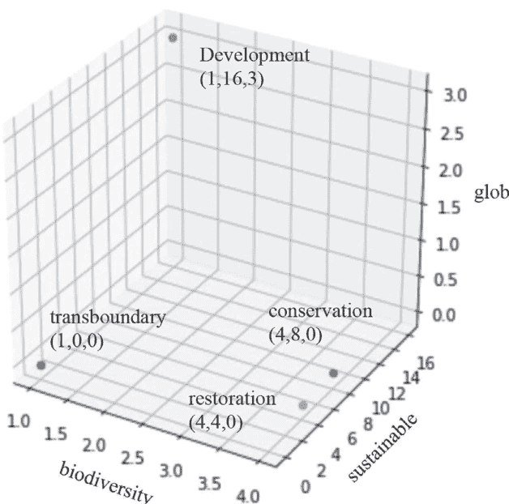
图 3.1 词向量的空间可视化

表 3.3 中的共现矩阵显示了单元格中词与其他词的频率。但在大多数情况下，原始频率并不是衡量词与词之间关联度的最佳指标。原始频率分布非常偏斜，区分度不高。例如，*the*、*a* 和 *I* 等词与各种词频繁共现，对任何特定词所能提供的信息不大。仅通过检查与这些词的共现，就无法判断 *conservation* 和 *restoration* 与 *development* 和 *transboundary* 形成对比时共享哪些上下文类型。因此，我们需要对向量中的词进行加权。可以使用 PPMI（正点向互信息）模型或 tf-idf（词频 – 逆文档频率）模型等模型提供加权函数，前者用于词-词矩阵（见表 3.3），后者用于词-文档矩阵。这两种算法都广泛用于计算词相似性，例如寻找词语的释义、跟踪词义变化，以及在不同语料库中自动发现词义（Jurafsky & Martin, 2020, pp. 106–112）。在翻译中，tf-idf 模型广泛用于自动术语提取。

总结来说，在上述方法中，一个词可以表示为稀疏的长向量，其维度对应于语料库词汇表中的词或文集中的文档。在下一节中，我们将介绍一种更强大的词表示法：短密向量。与 PPMI 模型或 tf-idf 模型生成的向量不同，这些嵌入式较短，维度数 d 在 50–1,000 之间，而不是更大的词汇量 |V| 或文档数量。

##### 3.3.2.2 特征向量

密向量涉及特征创建，其中特征可能与原始输入没有明显关系，但具有比较价值，因为相似的输入具有相似的特征。在第 2 章的第 2.3.1 节中，我们举过序列中范式关系的示例。如图 3.2 所示，可以根据每个词类别的特征提取特定特征。

如第 3.2 节所述，n-gram 模型等统计语言模型基于条件概率。泛化是从训练语料库中看到的词序列推广到新词序列的。当训练语料库中未出现过的新 n 词组合出现时，n-gram 模型会查看使用较小上下文大小预测的概率。相比之下，特征向量实现了经典 n-gram 语言模型无法实现的更高程度的泛化。例如，如果短语 the cat is walking in the bedroom 在训练语料库中，那么泛化 a dog was running in a room 几乎应该同样可能，因为 dog 和 cat，如同 the 和 a、room 和 bedroom 等，具有相似的语义和语法角色（Bengio et al., 2003, pp. 1137–1140）。

图 3.2 是对未出现的词序列因由与出现序列具有语义和语法相似性的词组成而具有高概率时所获得泛化的可视化。

如果我们为与“动物”相关的特征分配一个数值，则单词 cat 和 dog 的值必须大于 bedroom 和 room 的值。反之，如果特征是“可占据的空间”，则单词 bedroom 和 room 的值将大于 cat 和 dog。这些关系表明，分配的数字代表有意义的值。它们是实数，可用于数学运算。从这个意义上说，特征向量实际上就是分布式表示，如我们在第 1 章中所讨论的。Bengio et al. (2003) 表示，与每个单词关联的特征向量可以“使用语义特征的先验知识进行初始化”（第 1139–1140 页）。在拥有语义特征先验知识的情况下，例如词性或命名实体，这些信息也可以通过序列标注任务传递给计算机程序。图 3.2 所示的示例基于人类对语义特征的先验知识。

特征也可以从训练数据中学习。例如，如果在特定语料库中发现 dog 和 cat 具有相似的共现情况，例如，dog 和 cat 在左侧都与 a 和 the 共同出现，在右侧与 is 和 was 共同出现，

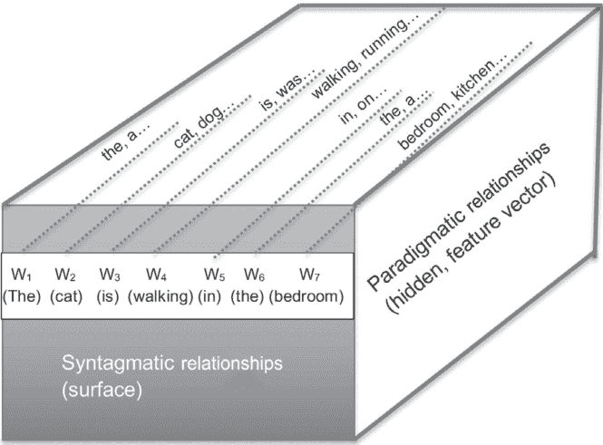
图 3.2 基于语义和语法相似性的泛化

计算机程序可以学习它们在句法和语义上扮演相似的角色。可以应用矩阵从分布结构中提取特征，例如在第 3.3.2.1 节中讨论的词-词矩阵和词-文档矩阵。然而，在这些模型中，向量长度通常等于词汇量，往往在 10,000 到 50,000 个词之间。这是一个根本性问题，使得语言建模和其他学习问题变得困难。

可使用神经网络语言模型解决这一问题。在这些模型中，将输入和输出数据馈送到神经网络，以便神经语言模型自行计算固定大小的特征向量。维度是基于算法学习的，不像前面手动提取特征的示例中那样，具有“动物”或“可占据的空间”等直观解释。

##### 3.3.2.3 Word2vec

Word2vec 是一种使用浅层神经网络学习词嵌入的技术。在这种方法中，向量空间词表示通过输入层权重隐式学习，且发现这些表示在捕捉语言中的句法和语义规律方面出奇地出色（Mikolov, Yih, & Zweig, 2013, pp. 746–751）。与统计每个


词在目标词附近出现，这是术语-术语矩阵的解决方案，而 word2vec 在一个二元预测任务上训练分类器，以回答问题 *单词 w 是否可能出现在目标词附近*？在 word2vec 中，更重要的是不是预测任务本身，而是由此学习到的分类器权重，这些权重被用作词嵌入。

有两种相关模型用于从非常大的数据集中计算词的连续向量表示：连续词袋模型（CBOW）和连续 Skip-gram 模型架构。CBOW 架构基于上下文预测当前词，而 Skip-gram 模型则在给定当前词的情况下预测周围词。CBOW 和 Skip-gram 模型是浅层、两层神经网络，经过训练以重建词的语言上下文。

## word2vec 工具

以文本语料库作为输入并生成词向量作为输出。它首先从训练文本数据中构建词汇表，然后学习词的向量表示。生成的词向量文件可用作许多自然语言处理和机器学习应用中的特征。

> (Word2vec, 2013，n.p.)

Mikolov、Chen 等人（2013）使用在 7.83 亿个词上训练且维度为 300 的 Skip-gram 模型，给出了一个词对关系的示例。³ 他们的研究结果表明，词向量可以捕捉一系列句法和语义规律；例如，Paris – France + Italy = Rome，以及 Miami – Florida + Baltimore = Maryland（第 10 页）。

Word2vec 方法速度快、训练高效，并且可以轻松在线获取代码和预训练嵌入。Word2vec 嵌入（2022）是静态嵌入，这意味着该方法为词汇表中的每个词学习一个固定嵌入。其他用于学习动态上下文嵌入的方法包括流行的 BERT（基于 Transformer 的双向编码器表示）和 ELMO（来自语言模型的嵌入）表示，其中每个词的向量在不同语境下会有所变化。word2vec 的基本原理支撑着这些更强大的动态或上文化嵌入，但这超出了本书的范围。

### 3.4 谓词语言模型与翻译

谓语语言模型为语言数据提供了一个新的维度。
- NMT 架构与 SMT 不同，因为 NMT 模型采用神经网络形式，由大量简单组件连接而成。
- 从根本上说，MT 旨在解决一个人类问题。从这个意义上说，MT 可以借鉴人类的翻译方法，并成为具有自身特征的人类翻译过程的实例。

### 4.1 引言

本章采用整体方法研究机器翻译（MT），主要有三个原因。首先，在讨论机器翻译并关注其对人类翻译过程的影响时，将注意力扩展到整个本地化过程是合理的，而不是将其限制于狭义上涉及一种语言向另一种语言转换意义的活动。虽然本地化在外行听起来可能像是一个严格的语言过程，与翻译相同或相似，但它要广泛得多。本地化行业标准协会¹将本地化定义为“修改产品或服务以考虑不同市场之间差异的过程”（LISA, 2003，第 34 页），并且它已在研究和实践中得到探讨。尽管 Pym（2014）将本地化视为一种范式的


本章在讨论翻译理论（第118页）的基础上，侧重于实践。本章将机器翻译（MT）置于本地化的更广泛背景中，本地化发生在一个商业和开发框架内，需要翻译人员、语言和工具专家、程序员、工程师、项目经理、桌面出版专家和市场营销人员的专业知识（Folaron, 2006; Byrne, 2009, 第2页）。

其次，从整体方法来看，MT技术不仅包括各种类型的引擎，还包括其他支持技术。为了集成MT，本地化过程中使用的技术需要更新，以最大限度地提高MT的效果，包括人机交互界面设计。例如，具有计算机辅助翻译（CAT）功能的交互式MT、MT后编辑界面，以及通过应用程序编程接口（API）带有MT插件的CAT工具，都需要满足MT的规范。这些语言技术在MT实施的不同阶段部署，包括预处理和后处理阶段。

第三，从整体方法来看，MT并非与传统翻译分离。相反，MT为理解翻译的本质提供了新的维度。本质上，语言技术（包括机器翻译）是关于精神和物理世界的人类反思形式。技术并非凭空出现；相反，它们反映人类生活，形成了使人机交互成为可能的联系。人类创造每个机器系统，其数据处理方式各不相同。虽然从广义上讲，MT可能是翻译过程中的新参与者——包括源文本分析、术语管理、翻译本身、编辑和审校——但作为人类的创造物，MT由人类本性所定义。

## 4.2 本地化中语言技术的扩展

#### 4.2.1 MT与CAT：两条发展路线

MT是与自然语言相关的第一种基于计算机的应用。普遍认为，Weaver于1949年的备忘录使MT的理念引起广泛关注，并启发了许多项目（Liddy, 2001）。第一次机器翻译公开演示，即Georgetown–IBM实验，于1954年进行。尽管这是一个仅包含250个词和六条“语法”规则的小型项目，但它引发了对能够进行高质量翻译的自动系统将在不久将来开发出来的期望（Hutchins, 2006）。

Georgetown–IBM系统是基于规则的MT的原型。人们第一次意识到，计算机不仅可以处理数学计算，还可以作为“电子大脑”来处理非数值语言数据。这是计算机科学的一项重大突破。然而，当时现有系统的不足之处，加上过度热情，导致了1966年ALPAC（美国科学院－国家研究委员会自动语言处理咨询委员会）报告的产生。该报告得出结论，MT目前无法实现，并建议不予资助。这导致MT及其他大多数NLP应用工作至少在美国范围内停滞（Liddy, 2001）。

虽然ALPAC报告终止了MT资助的黄金时代，但它为商业化MT开启了新篇章。例如，尽管在ALPAC报告之后MT研究缺乏资金，SYSTRAN还是于1968年成立，并通过与客户紧密合作而得以生存。此外，还有一些资金充足的MT项目在特定领域取得了成功。METEO是一款于1977年推出的机器翻译系统，已完全集成到加拿大气象预报传输网络中（Benoit, 1982，第39–40页）。泛美卫生组织机器翻译系统（PAHOMTS）自1980年起一直在PAHO的翻译部门使用。

在20世纪80年代末和90年代初，MT发生了第一次范式转移，即从基于规则的MT转向统计MT，当时研究人员将纯粹的统计数据驱动方法应用于翻译任务（Brown et al., 1993）。如第3章所述，Bengio et al. (2003)开发了一种基于神经网络的语言模型，改善了传统SMT模型的数据稀疏性问题。他们的工作为将神经网络应用于机器翻译奠定了基础。NMT系统开发面临的一个障碍是，它所需的计算能力远超商用计算机处理器所能提供的。随着GPU（图形处理单元，其性能可比普通处理器强出多达100倍）的出现，商业化系统Google NMT于2016年推出，取得了令人印象深刻的MT结果（Wu et al., 2016; Tinsley, 2017）。

尽管MT的发展经历了起伏，但MT并非利用计算能力解决翻译问题的唯一解决方案。当1966年的ALPAC报告终止了美国第一波大规模MT资助时，另一种思路应运而生：与其使用计算机进行翻译，不如使用计算机协助人类翻译。计算机支持翻译过程的想法与MT的发展直接相关。1966年，ALPAC报告确实支持了计算语言学领域的资助，尤其是其所谓的“机器辅助人类翻译”，当时正由曼海姆联邦武装部队翻译局实施。正如Garcia (2014)所指出的，报告中包含的一项研究表明，“使用电子术语表的翻译人员可以将错误降低50%，并使生产率提高50%以上”（第70页）。表4.1展示了MT和CAT发展的里程碑。图4.1比较了它们的时间线。

翻译数据库化的想法始于20世纪80年代。由位于犹他州盐湖城的自动语言处理系统公司（ALPS）在20世纪80年代中期开发的翻译支持系统（TSS）被视为CAT系统的第一个原型。1990年，Trados推出了其MultiTerm术语数据库，第一版译者工作台（Translator’s Workbench TM）工具于1992年随之推出。同年，IBM Deutschland商业化了其内部开发的Translation Manager 2，而大型语言服务提供商STAR AG（也是德国公司）也将其内部系统Transit推向了市场。类似产品很快也进入了市场，例如首次发布于1993年的Déjà Vu。到20世纪90年代中期，

TABLE 4.1 MT和CAT发展里程碑

| 年份 | MT/CAT发展 | 技术类别 |
|---|---|---|
| 1949 | Weaver备忘录 | 基于规则的MT |
| 1954 | Georgetown-IBM实验 | |
| 1969 | ALPAC报告 | |
| 1968-1980 | 早期基于规则的MT系统 | |
| 1980 | 数据库翻译 | CAT发展 |
| 20世纪80年代中期 | TSS（CAT系统的第一个原型） | |
| 1992 | CAT工具（如Trados）和内部工具（如Transit） | |
| 1993 | 统计MT（IBM翻译模型） | 统计MT |
| 2003 | 神经语言模型 | 神经MT |
| 2016 | Google NMT | |

翻译记忆、术语管理、对齐工具、文件转换过滤器等功能也都出现在功能更先进的CAT系统中（Garcia, 2014）。

图4.1可视化了表4.1中CAT和MT发展里程碑。在图表中，x轴表示年份，y轴表示发展，刻度显示七个阶段。黑色实线反映了MT的发展，从1949年Weaver备忘录的发展阶段1，到1954年IBM-Georgetown实验的阶段2，再到ALPAC报告发表时的阶段3。阶段4大约从1968年持续到1980年，因为在METEO和Systran等商业化MT的某些案例中，MT仍在发展。直到20世纪90年代，发展保持平坦，但于1993年随着统计MT的应用进入阶段5。向阶段6的过渡发生于

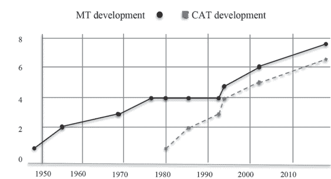

图4.1 MT和CAT发展时间线


神经机翻译研究始于2003年，商业化神经机翻译标志着2016年进入第7阶段。虚线反映了CAT的发展历程，始于1980年数据库翻译的提出。20世纪80年代中期出现了第一个CAT系统原型，随后于1992年推出商业化CAT工具。此后CAT的发展一直平稳，并遵循与MT相似的趋势，因为CAT同样受到人工神经网络应用的影响。

#### 4.2.2 MT和CAT在本地化过程中的作用

在自动化本地化过程中，有两种本地化类型：自动化工作流程和自动翻译。

图4.2展示了根据Zydron (2009)改编的本地化工作流程，该工作流基于OASIS（结构化信息标准促进组织）XML创作和本地化开放架构（OAXAL）架构。本地化工作流程以灰色背景显示。在此过程中，大多数传统CAT工具已实现了工作流程的三分之二自动化：第一阶段是文本提取和预翻译，第三阶段是反向转换和翻译记忆/术语更新。本地化工作流程不包含人工翻译组件。这种分工自CAT工具首次开发以来就已存在。随后，数据挖掘、机器学习和MT的进步打破了这种平衡。自动化解决方案越来越关注实际翻译阶段，而该阶段在过去一直由人类主导。

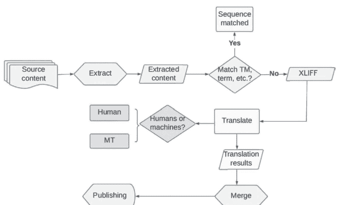

图4.2 自动化工作流程与自动翻译

来源：改编自Zydron (2009, n.p.)。

当大量文本信息（例如源语言语料库）被输入MT系统时，系统会处理该信息以执行一种语言到另一种语言的纯粹意义转换。也就是说，MT系统也包含传统CAT工具的组件，其中包括核心功能，如将文本分为段（通常为由标点符号定义的句子）、在双语记忆中搜索相同（完全匹配）或相似（模糊匹配）的源段和目标段，以及在类似的双语词汇表中搜索和识别术语（Garcia, 2014）。以分段为例，如在第2章中讨论的，即使在机器训练中不需要对较大的文本块进行分段，为了提高人机交互过程中人工处理的有效性，仍需要有意义的分段。换句话说，只要人类参与，CAT功能（即支持人类而非机器的功能）就必须包含在MT驱动的过程中，无论这些功能是否向人类用户显示。

### 4.3 MT范式

#### 4.3.1 间语：理想的理解层次

在第3章第3.2.5节中，我们讨论了可以用实数值可视化并实例化的意义概念，特别是通过使用密集向量。尽管使用从神经网络语言模型推断的嵌入式来表示意义是较新的发展（Bengio et al., 2003），但使用数学方法寻找理想理解层次的想法可以追溯到1949年，当时Warren Weaver发表了他的备忘录，其中他将这种理解层次比作所有语言共有的“一个大开放式地下室”：

> 请做类比：想象一群人居住在一系列高大的封闭塔楼中，所有塔楼都建立在同一个共同基础之上。当他们试图相互交流时，各自从封闭的塔楼里互相喊叫。声音很难穿透甚至最近的塔楼，交流进行得非常糟糕。但是，当一个人走下他的塔楼时，他发现自己处于一个所有塔楼共有的大开放式地下室中。在这里，他与其他也走下塔楼的人建立了轻松而有用的交流。
>
> （引自 Hutchins, 1999, 第6页）

这种共同基础可以理解为跨语言传达的意义。1968年，Vauquois在其论文《机械翻译中形式语法和识别与转换算法概述》中进一步阐述了这种理解层次。他提出了一种源语言的通用“间语”表示概念，它代表了一种独立于任何特定语言形式的理想理解层次。在此场景中，MT系统由一个用于解析源语言的分析器以及用于每个目标语言的生成器组成，以便在语言之间传递间语表示。图4.3中的Vauquois三角形展示了这些关系。

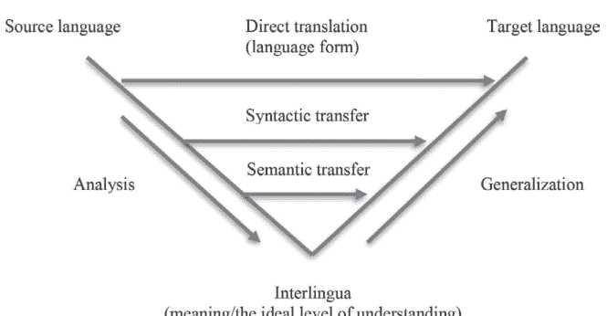

图4.3 机器翻译的Vauquois三角形

来源：改编自Vauquois (1968, 第335页)。

该三角形显示分析深度递增，从顶部的直译方法，经过中间的转移方法，到底部的间语方法。此外，沿三角形向下，对语言形式（即表征）的依赖程度递减。在顶部的直接层面，几乎所有知识都在词汇层面，并需要在语言形式之间进行大量转移。依赖程度降低到句法，然后是语义转移，最后在间语层面几乎不需要基于形式的特定转移知识。我们可以将神经机翻译（NMT）的编码器-解码器网络视为一种间语方法，其中编码器接收输入序列并创建其上下文化表示，而解码器生成特定于任务的输出序列（参见Jurafsky和Martin 2020，第208页）。

自1954年首次公开演示MT以来，已提出了许多基于Vauquois三角形的范式。它们都旨在解决意义（间语）与形式（语义/句法结构）之间冲突的问题。这并非易事，因为许多语言特征都会发挥作用，包括词序、各种语境中的词汇歧义以及语义。意义转换过程需要掌握目标语言和源语言的词形、句法和语义知识。一种语言的母语者以隐式形式拥有这些知识，但在计算机程序中显式编码这些知识却极其复杂。Bar-Hillel (1959)在《美国和英国机器翻译状况报告》的附录IV中提供了一个例子：“Little John was looking for his toy box. Finally, he found it. The box was in the pen. John was very happy”（第2页）。

在此句中，*pen*在英语中有两种含义：（1）某种书写工具，（2）供小幼儿玩耍的围栏。在撰写本文时使用的大多数英汉NMT系统仍然生成带有第一种（错误）含义的翻译。Bar–Hillel (1959)认为：

> > 不存在或可想象的程序能使电子计算机确定，在给定句子和给定语境中，单词‘pen’具有上述第二种含义，而每个具备足够英语知识的读者都会‘自动’做到这一点。
>
> （第2页）

Bar–Hillel进一步指出，问题不在于*翻译本身*，即从一种语言到另一种语言的转换。相反，问题在于这一过程的初步阶段：确定在孤立状态下在语义上具有歧义的单词的特定语境含义。换句话说，挑战在于Vauquois三角形中的分析器。

在接下来的三个部分中，我们将考虑旨在解决此问题的三种主要MT范式。

#### 4.3.2 基于规则的机器翻译

基于规则的机器翻译（RBMT）是最古老的方法，由于其高吞吐量、对某些用例至关重要的确定性翻译以及强大的定制能力，它仍被广泛用于各种应用。一般来说，基于规则的MT过程严格遵循Vauquois三角形，分析通常非常先进，而生成有时被简化到最低限度。具体而言，RBMT使用一组规则和词汇条目数据库，规则应用于这些条目；此外，这些规则和词汇条目可以由人类交互者（例如计算机语言学家、语言学家和翻译人员）理解（“可读”）和修改（SYSTRAN, 2016）。

RBMT包含三个步骤：首先，对源语言句子进行分析，包括词性标注、词形分析、语义分析、成分分析和依赖分析。其次，转移步骤根据分析创建一系列硬编码算法来表示相关规则和词汇条目，例如，如果系统看到英语中的*pen*，则将其转换为笔（中文意为“笔、铅笔、毛笔及其他类型的书写工具”）。第三，生成步骤执行这些算法，从第二步创建的内部表示中生成实际的目标句子。

逐词方法，即直译，是乔治城–IBM实验中使用的第一种RBMT技术。在此实验中，将源句子转换为目标句子的过程，即*翻译本身*，被分为三个不同的步骤：首先，在双语词典中查找文本中的单词；其次，选择目标语言的等效单词；第三，进行一些简单的词序重新排列并打印出结果。


逐字词 RBMT 在商业 MT 系统中已得到进一步发展，就分析复杂性而言。例如，在 SYSTRAN RBMT 系统早期开发中（参见 Hutchins, 1979），翻译过程有四个阶段：输入、词典查找、句法分析和翻译。在输入阶段，每个单词都会与两个词典（高频词典和主干词典）进行比对，以获取语法（及部分语义）属性信息和可能的英文对应词。句法分析涉及四个“遍”：(1) 消除同形异义词歧义，(2) 建立基本短语组，(3) 扩展短语结构并识别特定宾语和补足语，(4) 确定从句类型、其范围及其成分。最终阶段是翻译，该阶段包含多个子例程，利用词典和句法分析的信息来选择和安排英文输出（第 33–34 页）。

从语言学角度看，根据 Hutchins (1979)，SYSTRAN RBMT 系统早期开发的主要改进是

> 其编程的“模块化”，允许对翻译过程的任何部分进行修改，而无需担心影响整体效率。此外，语言学方面与计算方面被分开，从而避免了乔治城系统中遇到的无法解决的复杂性。
> （第 33 页）

该方法采用任何信息，不论其来源，从而产生可接受的英文文本（第 34 页），这是一种面向实践的方法，使用适用规则而非理论语言规则，在 RBMT 开发中非常切中要害。

RBMT 范式在处理共享含义与特定语言形式之间的冲突方面有许多限制，其中许多限制导致了 ALPAC 报告。在这种方法中，所有语言规则都需要硬编码到计算机程序中，这会产生额外工作量并使系统难以维护。研究人员寻求不同范式以获得更好的解决方案。由于 CAT 的兴起及其产生的翻译记忆，双语/多语数据变得更加充足，注意力在 1988 年左右转向统计 MT 范式，当时 IBM Watson 研究中心开始使用它（Brown et al., 1993, 1990）。

#### 4.3.3 统计机器翻译

从技术角度讲，统计机器翻译不遵循沃基三角定义的过程。没有基于分析的生成，传输组件也不是确定性的。相反，对于给定的源句子，引擎生成多个可能的翻译，每个翻译被称为一个假设，系统建模采用概率假设和搜索算法，根据训练数据选择最佳假设。如第 4.2.1 节所讨论，研究人员在 20 世纪 80 年代末和 90 年代初开始将纯粹的统计、数据驱动方法应用于翻译任务（Brown et al., 1990）。特别是，IBM 翻译模型借鉴了语音识别中的嘈杂信道模型（Brown et al., 1990），这构成了如今许多 SMT 模型的基础。

什么是嘈杂信道模型，为什么将其应用于 SMT？假设 B 试图收听或阅读 A 的演讲或文字。有一个信道将信号从 A 传输到 B。然而，在某种干扰或错误在信道中产生噪声时，原始信号在传输过程中会被掩盖。在这种情况下，嘈杂信道模型旨在找到预期的信号，在此语境下，任何掩盖信号的事物都可以被视为“噪声”。嘈杂信道模型应用于机器翻译的方式是：将目标句子视为通过带有“噪声”的信道对源句子的失真，其中“噪声”可以是任何掩盖源句子的事物。例如，源语言（SL）的语法不能直接应用于生成目标语言（TL）中的等效句子。相反，需要通过观察 SL 与 TL 语法之间的对应关系以及源语言的语法来表征 TL 语法。

正如 Brown et al. (1993, 第 264–266 页) 所述，一串英文单词 e 可以以多种方式翻译成一串法文单词 f。在统计翻译中，我们认为每个 f 都是 e 的可能翻译。我们为每对字符串（e ~ f）分配一个数值 Pr(f | e)，即给定英文源 e 时法文翻译的概率。这种关系可以解释为：翻译人员在给定 e 时，生成 f 作为翻译的概率。但是，仅使用 Pr(f | e) 来计算最佳可能翻译是不够的，因为它将概率分布得非常广泛，大多数解决方案位于目标语言中结构不良的字符串上。换句话说，给定源片段时概率最高的目标片段假设（即从源句子到目标句子的直接模型）并不一定意味着该假设在目标语言中流畅。

Brown et al. (1993, 第 264–265 页) 使用嘈杂信道分解来解决这个问题。直观地说，当法语母语翻译人员生成一串法文单词时，翻译人员实际上脑中有一串英文单词，并在心中进行了翻译。给定法文字符串 f，我们翻译系统的任务是找到母语者在生成 f 时脑中想到的字符串 e。通过选择 Pr(e | f) 最大的英文字符串 e，可以将出错的几率降到最低。请注意，此过程涉及一种反向翻译或反向假设，因为英语被设定为目标语言，而在问题 Pr(e | f) 中法语是源语言。应用贝叶斯定理后，条件概率分解为公式 4.1：

```
Pr(e | f) = \frac{Pr(e) Pr(f | e)}{Pr(f)} (Equation 4.1)
```

由于分母 Pr(f) 与 e 无关，因为法文片段已给定，因此可视为常数，寻找英文目标序列 ê 的估计值等同于寻找 e，以使乘积 Pr(e)Pr(f | e) 尽可能大。此运算得出机器翻译的基本公式，如公式 4.2 所示：

ê = Argmax_e Pr(e) Pr(f|e) (Equation 4.2)

如 Brown et al. (1993) 所述，公式 4.2

> 概括了统计翻译实践所带来的三项计算挑战：估计语言模型概率 Pr(e)；估计翻译模型概率 Pr(f | e)；以及为最大化其乘积而设计一种有效且高效的次优搜索，以寻找英文字符串。这些挑战被称为语言建模问题、翻译建模问题和搜索问题。（第 265 页）

嘈杂信道和贝叶斯定理的应用实际上交换了两个事件（即源语言和目标语言）f 和 e 之间的依赖关系，从公式 4.1 左侧的 Pr(e | f) 变为右侧的 Pr(f | e)。也就是说，如果我们想要将法文字符串 f 翻译为英文字符串 e（基于概率 Pr(e | f)），则可以将其转换为一个反向运作的概率 Pr(f | e)，以及一个语言模型 Pr(e)。正如 Yee et al. (2019) 所指出的，直接估计后验概率 Pr(e | f) 无法自然地利用未配对数据（第 5696 页）。嘈杂信道模型将语言模型纳入其计算的方式，使其能够利用与源语言未配对的目标语言数据。这种转换可能看起来不直观；然而，这样做有充分理由，因为它使操作在计算中实现起来相对简单。本质上，这更多是一项工程成就而非语言学成就，因为希望 MT 系统能够工作，即使它并非基于人类实际进行翻译的方式。从 SMT 开始，机器翻译的内部工作原理偏离了人类实际翻译的方式。嘈杂信道模型不仅用于 MT，还用于文本生成、文本摘要、光学字符识别（OCR）和其他 NLP 任务。

世纪之交，发展了一种称为基于短语的机器翻译（PBMT）的扩展方法。PBMT 基于短语对的翻译诱导（Jurafsky & Martin, 2020, 第 229 页）。在 2016 年商业 NMT 系统推出之前，PBMT 是统计机器翻译最简单、最流行的版本。对于 PBMT，系统处理的片段比


词语，例如，*加拿大*，*请注意*，*感兴趣于*，以及多词惯用语使用。在解码过程中，输入句子被分割成短语序列。注意，PBMT 中的“短语”一词指任何单词子序列，不一定是语言学短语。Koehn 等人（2003）建议，可通过“基于单词对齐的短语翻译启发式学习和短语翻译词汇加权”获得最高性能水平（第 127 页）。

通常，SMT 引擎由多个模块组成；例如，Corbi-Bellot 等人（2005）在 SMT 架构中介绍了八个模块：de-formatter、morphological analyzer、part-of-speech tagger、structural transfer、lexical transfer、morphological generator、post-generator 和 re-formatter，这类似于产生自动翻译结果的流水线（第 81 页）。Kashani 等人（2007）将阿拉伯语到英语的音译系统集成到通用基于短语的统计机器翻译系统中，并发现当测试数据包含大量此前未出现的命名实体时，音译模块可以起到显著作用（第 17 页）。

在 SMT 中，不同模块是分别优化的，而不是在一个模型中联合优化。在现实中，这是一个难以解决的挑战，涉及大量的人工特征工程工作。此外，添加模块和例外会使机器混淆。由于这些模块主要是基于对自动翻译过程的人类直觉反思而添加的，因此重点在于输出，而不是机器学习和训练过程。

与传统的基于短语的翻译系统不同，后者由许多分别调优的小型子组件组成，神经机器翻译试图构建和训练一个单一的、大型神经网络，读取句子并输出正确翻译。NMT 提供端到端训练，使用一个模型来训练内部的一切。NMT 系统的架构概念上非常简单，并且能够很好地泛化到非常长的句子。

#### 4.3.4 神经机器翻译

##### 4.3.4.1 机器翻译的统计方法

从本质上讲，NMT 范式也是一种机器翻译的统计方法，因为它同样基于统计推断和对语言数据的响应。然而，NMT 架构与 SMT 系统不同。NMT 模型采用神经网络形式，由大量简单组件连接而成。具体来说，神经翻译模型由两个基本部分组成：一个“编码器”和一个“解码器”，它们分别对应沃基瓦三角形中的分析和转换/生成步骤。在此情况下，分析是一个编码过程，其结果是一个由向量序列组成的矩阵，表示句子结构和含义。转换和生成步骤合并为一个称为解码的过程，该过程直接生成目标单词。在某种程度上，与 RBMT 和 SMT 提供的表示相比，分析或编码过程产生的中间表示是最接近中间语表示的状态。与涉及大量人工特征工程工作的 SMT 不同，NMT 更依赖于机器学习。通过向 NMT 引擎输入输入和标记的输出数据，计算机程序自行提取特征并得出含义表示。NMT 涉及更高水平的自动化。

##### 4.3.4.2 循环神经网络

从基本形式来看，神经机器翻译系统是一种带有额外条件的神经语言模型。翻译过程是一种序列生成任务。该过程可以被视为一种引导式目标文本生成，多了一个额外条件：即源语言中序列的含义应与目标语言中序列的含义等价。同样，当阅读一段文字时，人类不会一次性吸收单词的含义；相反，处理是逐词进行的，随着根据已处理内容逐步构建理解，理解也会更加深入。换言之，每一个新的理解和生成步骤都基于先前累积的含义。

神经机器翻译系统可以基于循环神经网络（RNN）进行直观解释。循环神经网络是指网络连接中包含循环的任何网络；即，任何网络中，一个单元的值直接或间接依赖于其先前的输出。由于它随后将自身输出用作输入，循环神经网络可以被视为一种条件语言模型（Jurafsky & Martin，2020，第 176–179 页）。“基于 RNN 的语言模型一次处理文本序列中的一个单词，试图通过使用当前单词和先前的隐藏状态作为输入来预测序列中的下一个单词”（第 179 页）。隐藏状态“包含关于序列中所有先前单词的信息，一直到序列的开头”（第 179 页）。

如图 4.4 所示，该网络具有输入层 x、隐藏层 s（也称为上下文层）和输出层 y。

> 在时间 t 输入到网络的输入为 x(t)，输出表示为 y(t)，s(t) 是网络（隐藏层）的状态。输入向量 x(t) 由表示当前单词的向量 w 与时间 t – 1 时上下文层 s 中神经元的输出拼接而成。  
> (Mikolov 等人，2010，第 1046 页)

这些关系可以用公式 x(t) = w(t) + s(t – 1) 表示（第 1046 页）。假设这个隐藏状态表示句子的所有内容。

##### 4.3.4.3 机器翻译中的注意力机制

循环神经网络在机器翻译中的应用对于解决机器翻译及其他序列转导问题至关重要。然而，

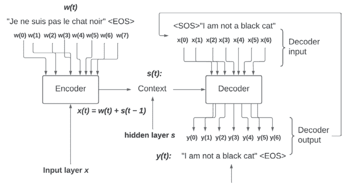

```
[KEY: > input, = target, < output]
> Je ne suis pas le chat noir
= I am not a black cat
< I am not a black cat
```

## RNN Seq2Seq 网络
王鹏博士 | 更新于 2021-9

图 4.4 RNN Seq2Seq 网络

来源：改编自 Robertson（无日期）。

通过一系列循环连接向前传递信息会导致相关信息的丢失和训练困难。此外，循环网络固有的顺序特性抑制了并行计算资源的使用，使它们无法使用大量数据进行训练（Jurafsky & Martin，2020，第 190 页；Vaswani 等人，2017）。

为解决顺序计算的根本约束，Vaswani 等人（2017）在机器翻译中提出了注意力机制，这为 NMT 模型带来了真正的突破。

注意力机制已成为各种任务中序列建模和转导模型的组成部分，允许建模不考虑输入或输出序列中距离的依赖关系。在几乎所有情况下，这些注意力机制都与循环网络结合使用。

(p. 2)

基于注意力机制，Vaswani 等人（2017）提出了 Transformer，“一种摒弃循环而完全依赖注意力机制来捕捉输入与输出之间全局依赖关系的模型架构”（第 2 页）。Transformer 允许显著更多的并行化，并在 GPU 上经过相对较短时间的训练后，可在翻译质量方面达到新的最先进水平（第 1 页）。根据 Vaswani 等人（2017），

> 自注意，有时称为内部注意，是一种注意力机制，用于关联单个序列中的不同位置，以计算该序列的表示。在应用于机器翻译之前，自注意已在包括阅读理解和摘要生成在内的各种任务中成功应用……Transformer 是第一种完全依赖自注意来计算其输入和输出表示的转导模型，无需使用序列对齐的 RNN 或卷积。

(p. 2)

在自注意系统中，信息在单个因果（或回顾性）自注意层中流动。自注意层将输入向量序列（x1, ..., xn）映射为相同长度的输出向量序列（y1, ..., yn）。在处理输入中的每个项目时，模型会关注当前项及之前的所有输入。具体来说，模型将感兴趣的项目（例如 x3）与其他项目集合（即其前置元素 x1 和 x2 以及 x3 本身）进行比较，以揭示它们在当前上下文中的相关性。然后，将这些比较结果用于计算当前输入的输出。例如，y3 的计算基于对输入 x1、x2 和 x3 的一组比较。与 RNN 不同，每个时间步的计算彼此独立，因此可以并行执行（Jurafsky & Martin，2020，第 191 页；Vaswani 等人，2017，第 2 页）。

与 RNN 相比，Transformer 包含堆叠的多个编码器和解码器，用 Nx 表示，意味着编码器和解码器堆叠 n 次。“编码器中的每个层有两个子层。第一个是多头自注意力机制，第二个是简单的逐位置完全连接前馈网络”（第 3 页）。4 直观地讲，听话人试图在他人的言语中找到特定问题的答案。人脑中存在一种内部机制，指导其心理语言模型关注句子的特定部分。例如，如果他们想知道屋顶的颜色，当他们听到"There is a house with a red roof"这一陈述时，他们会关注红色。同样，多头注意力机制允许模型根据其上下文关注序列的不同部分，为重要部分分配更大的权重，为不相关部分分配较小的权重。此外，逐位置模块提供位置编码，可以用向量表示序列中标记的位置信息，而不仅仅是计算序列中单词/标记之间的距离。

Vaswani 等人（2017）发现，对于翻译任务，Transformer 的训练速度明显快于基于循环或卷积层的架构（第 10 页）。他们的研究表明，这些模型在质量上优越，同时


更具可并行性。Transformer架构在应用于英文成分句法分析时表现良好，无论训练数据量大小，都能泛化到其他任务。自2017年以来，Transformer模型在机器学习领域已被广泛采用，并极大地提升了MT的性能。

### 4.4 本地化流程中的MT部署

#### 4.4.1 MT部署基础设施

在部署MT系统时，技术架构师通常会考虑整个部署基础设施。例如，Tilde MT基础设施设计包括客户端、接口、逻辑和数据层（Pinnis et al., 2018, p. 1345）。然而，对于语言学家、专业翻译和其他领域专家来说，最相关的是部署：用户如何与MT系统交互。在Tilde MT系统中，这涉及客户端和接口层。以下是MT部署的常见场景：

- 1 通过CAT工具插件集成MT系统。MT平台需要为至少最流行的CAT工具提供集成能力，以便这些工具可以访问MT系统。

- 2 在图形用户界面中直接执行文本片段、各种常见格式的文档以及网站的翻译。

- 3 使用可集成到网站或移动应用程序中的MT小部件，例如Google的网站翻译器小部件。⁵

- 4 将MT外部API（应用程序编程接口）集成到用户的翻译和多语言内容创建工作流中。

在这些部署场景中，在CAT工具中集成MT是确保输出质量的高效方式，因为它同时利用了自动翻译结果和人工评估与编辑。在这种情况下，人机交互发生在翻译过程中，且翻译单位可能不同。例如，在Lilt（一个交互式MT平台）中，用户（专业翻译）在短语级别进行交互。相比之下，大多数带有MT插件的CAT工具允许用户在句子级别进行编辑，尽管其他由ML驱动的功能（如预测性输入）也嵌入到平台中。

在使用其他场景时，MT质量评估至关重要，因为被污染的索引内容会导致数据库质量恶性循环。当用户传播未经人工改进的机器翻译，且该内容被纳入用于训练MT引擎的材料库时，系统会因不准确的翻译而被污染，导致系统性能下降，尤其是神经MT系统。若要避免此问题，人工干预是必需的。这种干预超出了严格意义上的翻译过程，而是在机器翻译之前或之后进行，例如MT后编辑（MTPE）。

MT部署的一项主要考量是用户如何最好地利用其专有语言资产来提升基线MT系统的性能。术语集成和翻译记忆–MT集成至关重要（参见Bulte & Tezcan, 2019）。在用户和接口层，MT平台使用户能够为其工作存储语言资源（如平行语料库和单语言语料库以及多语言术语集）非常重要。CAT工具与MT系统之间的连接通常通过API实现。

在客户端和接口层之下，通常有一个逻辑层，在数据交换时提供身份验证和授权等功能。这些功能可以验证用户身份，并授予用户访问语言资源的权限。此外，为了向有安全顾虑或数据不得离开客户端基础设施的客户提供MT服务，MT系统可以作为企业级解决方案部署在客户端基础设施中。

#### 4.4.2 MT部署注意事项

在部署MT系统时，有许多因素需要考虑，包括MT范式、交流模式（口译与笔译）、部署环境（基于云或本地服务器）以及硬件要求。以下是MT部署中的一些关键考量：

- 1 语言对

某些低资源语言（如阿拉伯语和非洲语言）缺乏足够的平行数据，语言资源分布不均。例如，涉及阿拉伯语的语言对具有自身特点，并为MT带来特定挑战。Banita et al. (2018)指出，当巴勒斯坦方言和叙利亚方言之间进行翻译时，SMT表现非常好，因为这两种阿拉伯语版本的语言亲缘关系密切（第3页）。低资源语言的另一种解决方案是使用训练有素的多语言NMT系统，该系统可以在无需任何直接监督的情况下自动在未见过的语言对之间进行翻译。在这种方案中，例如在英语/法语和西班牙语/英语上训练的模型可以直接将西班牙语翻译为法语。多语言系统的这种涌现特性称为零样本翻译（Gu et al., 2019, p. 1259）。

- 2 内容类型

MT解决方案与内容类型密切相关。例如，在eBay中，MT主要用于以下内容：搜索查询、商品标题和描述、产品评论、产品描述以及会员之间的沟通（Rowda, 2016）。这些内容类型在语言和风格特征上差异很大。例如，如Rowda (2016)所指出，查询很难翻译，因为（除其他外）没有上下文。为实现不同内容类型的最佳MT性能，MT引擎和基于MT的翻译工作流均需要定制。一方面，如果内容类型是创意/营销材料，通常会选择带有MT插件的CAT或交互式MT。另一方面，如果内容局限于特定领域，例如天气预报，基于规则的MT可能效果良好。

- 3 序列长度

源文本的序列长度会影响MT引擎的性能。Sánchez (2018)在eBay的MT质量案例研究中比较了SMT和NMT的输出。在信达雅的“信”（即译文是否对应源文本）方面，SMT和NMT随着段落变长而下降，其中短段包含2–4个词，中段包含6–12个词，长段包含12–35个词。然而，即使在较短的段落中，NMT也表现更好。在“达”（即译文在目标语言中读起来是否流畅）方面，SMT和NMT随着段落变长而下降，尽管NMT总体表现仍然更好。

- 4 交流类型

口译MT有不同的技术，通常包含更多ML功能。例如，Microsoft Translator用于口译MT的架构包括语音识别和TrueText标准化步骤，前者将语音音频转换为文本，后者对文本进行标准化，以使其更适合翻译。TrueText会去除语言不流畅现象（例如“嗯”和“啊”等填充词）、口吃和重复。通过添加句子分隔、适当标点和大写，文本也变得更易读和更易于翻译。转换后的文本使用专为现实生活中口语对话开发的NMT进行翻译后，文本会再次转换为语音；因此，还涉及文本转语音技术（Microsoft Translator, 2018）。从这个意义上说，口译MT就像一种累积式MT，围绕主MT引擎包含许多ML技术。

- 5 用户输入

人类对不同MT范式的反应各不相同。例如，Daems and Macken (2019)发现，在不知道MT建议来自SMT还是NMT系统的情况下，翻译人员似乎更倾向于将NMT输出（或无MT输出）作为翻译的起点（第128页）。此外，每种MT范式的错误类型特征也会影响翻译人员使用MT时的反应。Le and Schuster (2016)认为NMT的质量高于SMT。然而，如Castilho et al. (2017)所指出，尽管所有语言对的NMT输出被评为比SMT输出更流畅，但准确性结果不够一致；具体取决于语言对，NMT输出包含更多遗漏、添加和错误翻译错误（第116–117页）。在MT后编辑过程中，翻译人员纠正每种错误类型所需的精力可能不同，具体取决于翻译人员的偏好以及语言/文化熟练程度等因素。因此，在部署MT系统时，需要用户输入来选择一种解决方案。


that effectively uses MT and relevant human resources, as well as post-editing strategies such as the design of an error typology scheme.

### 4.5 MT 作为人类翻译（HT）过程的具体化

从根本上说，MT 旨在解决一个人类问题，即从一种语言翻译成另一种语言。它以人类生成的输入为起点，包括源文本、训练数据和分段规则，并以可供人类使用的输出为终点。为了实现这一目的，MT 可以学习人类的翻译方法，成为具有自身特点的 HT 过程具体化。图 4.5 提供了 MT 翻译过程的框架以及它如何与人类翻译过程相平行：(1) 提取源内容；(2) 预处理内容，包括分析文档结构、分段、领域/主题识别；(3) 检查翻译数据库以利用遗留语言资产；(4) 采用机器翻译；(5) 最后输出桌面出版。从理论角度看，MT 过程的框架与人类处理源文本的方式相平行：将文本与非可翻译内容分开，进行诸如文本目的和分段等预翻译分析，检查记忆，决定是使用还是重新翻译之前翻译过的内容，最后翻译并生成目标文本。

Newmark (1988) 将翻译过程描述为四个层次：(1) 在 SL 文本层面，从译者角度分析源文本；(2) 在指称层面，逐步可视化并构建对象和事件（真实或想象）的层次，以理解源文本并产生目标文本；(3) 在连贯层面，以更一般和语法的方式追踪 SL 文本的思路、情感、语气和各种预设；(4) 在自然度层面，确保目标语言在特定情境中适合作者或说话者（第 11–19 页）。Newmark (1988) 讨论了单语和双语词典及同义词词典等资源的重要性（第 175–176 页）。当然，译者还会检查其在术语和句子层面的过往翻译记忆，并利用术语表和其他个人资源。

Newmark 所总结的内容主要基于翻译实践，同样适用于 MT 驱动的翻译过程。它包括人类分析/MT 预处理阶段，分析文档结构以执行诸如从格式中提取可翻译字符串、分段/分块、识别源文本的领域/主题，以及参考资源/记忆检查（TM 检查）等任务。自然度层面实际上是在检查语言模型以验证质量，这与 SMT 中的语言模型一致。

The MT framework is an effective way to collect, curate, and manage linguistic assets, including human-annotated language data that is generated from MT post-editing, translation, segmentation, and other human-machine interaction

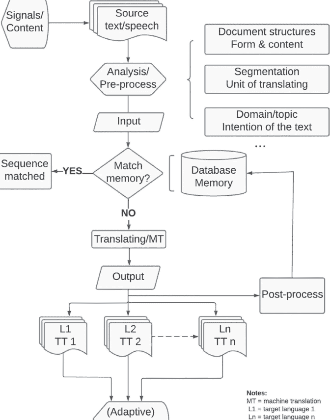

- 注释：
- MT = 机器翻译
- L1 = 目标语言 1
- Ln = 目标语言 n
- TT 1 = 目标文本版本 1
- TT n = 目标文本版本 n

图 4.5 MT 作为人类翻译的具体化

活动。这些数据可以赋能机器学习以快速优化 MT 系统。在此背景下，由于 MT 系统的动态特性，对人类译者的要求更高而非更低。在与 MT 系统交互以训练 MT 的同时，人类译者也可以从这些动态系统中学习。我们将在第 8 章探讨此主题。

### 注释

- 1 LISA 于 2011 年解散。然而，其本地化定义仍然是最广泛使用的定义之一。其他组织（例如欧洲电信标准协会（ETSI））提供了额外的背景材料。
- 2 贝叶斯定理在机器学习领域广泛使用。它提供了一种有原则的方式来计算条件概率。
- 3 多头注意力是注意力机制的一个模块，它并行多次运行注意力机制（Weng, 2022）。注意力模块将其 Query、Key 和 Value 参数拆分为 N 部分，并将每个部分独立传递给单独的 Head。然后将所有这些相似的 Attention 计算组合起来，生成最终的 Attention 分数（Doshi, 2021）。
- 4 位置前馈层是一种由两个密集层组成的前馈层，应用于最后一个维度，这意味着序列中的每个位置项都使用相同的密集层，因此称为位置前馈（参见 Vaswani et al., 2022）。
- 5 Google 于 2019 年 12 月 4 日停止了用于商业用途或与 Google Cloud Translation API 结合使用的 Google 翻译小部件。
- 6 MT 系统还具有术语集成功能，即系统可以检查术语表。

## 5 机器翻译质量评估与质量估计

### 关键概念

- 仅依靠人类来评估质量往往会拖慢整个 MT 过程。因此，必须对 MT 评估的全部或部分进行自动化，以跟上 MT 翻译的速度和效率。
- 在 MT 质量评估方面，两个重要的区别是 (1) 评估是否自动化，以及 (2) 评估是否包含编辑活动，这些活动不仅评估 MT 结果，还通过直接的人类干预来提高质量。
- 有两种评估类型，取决于是否有参考译文可用：(1) 自动指标，例如 BLEU 和 HTER，以及 (2) 质量估计（QE）。

### 5.1 引言

如何评估质量是与翻译相关的最引人深思的问题之一。这个问题无法简单回答，因为关于翻译质量的任何陈述都隐含着对翻译目标和目的的概念化；它预设了一种翻译理论（House, 2014, 第 241 页）。在实践中，翻译在不同情况下进行评估：“在翻译培训期间、官方认证考试中、由评论家和评审员、以及普通读者之中”，因此，翻译行业中不同角色的行为者（包括学者、教师、用户和从业者）可以开发评估方法（Williams & Chesterman, 2002, 第 8 页）。

在翻译实践中，已开发出许多具有特定侧重点并在不同情境下应用的标准。例如，地面车辆标准（SAE J2450（车辆电子系统诊断标准委员会，2016））于 2001 年颁布，2005 年修订，2016 年稳定。它最初是为汽车行业开发的翻译质量指标，随后在其他领域广泛使用。该指标允许评估人在翻译中标记错误，并计算代表翻译质量的加权数值分数。2005 年修订版中的指标由四部分组成：七个错误类别、两个子类别、两个元规则（用于帮助解决将错误分配给类别和子类别时的歧义）以及数值权重。这些错误类型适用于人工翻译和机器翻译。

与 SAE J2450 相比，多维质量指标（MQM）旨在为用户提供一个全面的框架，以便在错误类型学方面自定义和开发其翻译质量评估（TQA）指标。通过将其现有的 TQA 框架（例如 SAE J2450）与 MQM 映射，用户可以在项目之间或不同研究中应用 MQM 中相同的错误类别层次结构，并进行有意义的比较。MQM 可根据用户需求进行定制，这意味着用户可以在评估文本时选择框架中最相关的特定错误类别（Mariana et al., 2015, 第 137 页）。

除了评估目标文本的质量外，还可以基于翻译流程以及对语言服务提供商（LSP）和翻译项目的要求进行评估。例如，ISO（国际标准化组织）17100:2015 “规定了直接影响翻译服务质量和交付的翻译流程所有方面的要求”（ISO, 2015）。该标准还为 LSP 提供了一项指南，“涉及核心流程管理、最低资格要求、资源的可用性和管理，以及交付高质量翻译服务所需的其他行动”（ISO, 2015）。ISO/TS 11669: 2012 (E) 为翻译项目的所有阶段提供了最佳实践指导（ISO, 2012）。

与传统 TQA 相比，机器翻译质量评估具有某些独特特征。人类直接评估（DA）或错误标注无法应对 MT 所能产生的海量文本。此外，由于 MT 结果量大且人类判断具有主观性，对现代高质量机器翻译系统进行人类评估具有挑战性，而且越来越多的证据表明，评估程序不足可能导致错误结论。一种解决方案是自动化评估过程，用于流程自动化的广泛使用框架是双语评估替代者（BLEU）和翻译编辑率（TER）1（参见第 5.4 节）。研究结果表明，基于机器学习的自动指标（例如预训练嵌入式）可以胜过人类众包评估结果（Freitag et al., 2021, 第 1 页）。

正如 Castilho 等人（2018）所指出的，在理论、教育和行业情境中，TQA 在宏观和微观层面缺乏标准化，这导致人类 TQA 程序不一致，并且“人类与机器 TQA 之间的相关性存在相当大的差异”（第 30–33 页）。例如，自动指标偶尔被显示与……不一致


与人工 TQA 一样，如前所述，每个行业标准都有其特定关注点。因此，不存在适用于机器翻译（MT）TQA 所有场景的万能方案。

出于这个原因，本章聚焦于可帮助用户决定如何定制其 TQA 策略的基本考量。例如，可将 MQM 的应用视为一种特定场景，以使评估结果在不同项目和公司之间更具可比性，而 BLEU 用于 MT 系统开发和定制。此外，本章聚焦于翻译内容的评估。从理论上讲，所有 TQA 指标在潜在上都适用于同时包含人工翻译和机器翻译的场景。只要方法——无论是基于自动指标还是人工指标——得到一致应用，评估结果就会有用。

### 5.2 TQA 的基本考量

#### 5.2.1 回顾性和前瞻性方法

House（2014）提出，评估（回顾性地）翻译质量有不同的方式，确保（前瞻性地）生产具有特定质量的翻译也有不同的方式。这种二分法基于时间。当将时间因素纳入 TQA 时，引入了两个基本方面：用于评估已完成翻译的质量评估指标（包括自动指标和人工直接评估），以及有助于预测翻译质量的方法。后者可以支持为翻译任务开发有效的、情境驱动的编辑策略。

#### 5.2.2 语言关系

在翻译研究的评估理论中（例如，Chesterman, 1994; House, 2014），MT 语境下的一个相关考量是语言关系的概念。正如 Chesterman（1994, 第 153 页）所指出的，质量评估最初是回顾性的；它评估了译文与其源文本之间的关系，源文本（加上其作者）被视为“权威”。翻译的目标是在源文本与目标文本之间建立等价关系——无论等价如何定义。Chesterman（1994）将规范的概念（另见 Toury, 1995）纳入其框架，并提出一种质量评估方法，旨在将“给定的产品（或过程）与公认的相关规范”进行比较（第 153 页）。他指出，这种评估模式是“以客观、基于文本、形式、极具实用性，并且明显现实的方式”（第 153 页）。

至于哪些规范被视为公认和相关，必须考虑特定情况。极端案例可能是基于客户转化率对本地化网站进行质量评估。在这种情况下，业务考量而非语言特征被优先考虑。还有其他可以考虑的规范，例如，ISO 17100:2015(en) 和 ISO/TS 11669:2012(en) 分别关注服务和项目。本章聚焦于语言关系，它们是自动和许多人工评估指标的基础。

语言关系的概念包含将文本与参考译文进行比较。一般来说，自动评估指标的基础是之前完成的人工翻译，因为机器翻译的目的是生成人类可理解和可读的输出。通过将机器翻译引擎的输出与人工参考译文进行比较，可以测量语言质量、词序和其他文本特征等因素。

语言比较证明对使用自动指标进行 MT 质量评估非常适用。这种方法将 TQA 问题转化为语言分析任务：评估两组文本的语言特征之间关系的性质。正如 Miller 和 Beebe-Center（1956）在其开创性著作中所指出的：

> 翻译的优劣应根据其保留原文精确含义的程度来衡量。但只要我们没有公认的含义定义，更不用说精确含义的定义了，就很难使用这种衡量标准。因此，作为一种实用的替代方案，我们必须寻找更谦逊、却定义更明确的程序。（第 1973 页）

他们随后提出使用各种统计指标来比较测试翻译中的标准。首先要尝试的最简单的事情是询问它们是否使用相同的单词（第 76 页）。

TQA 中的语言比较方法与语言无关。尽管比较是语言层面的，即比较参考译文和 MT 结果中的单词相似性，但比较方法是统计的：例如，在同一源文本的人工翻译和 MT 结果之间，有多少个单词或短语是完全相同的？重要的是统计结果；比较提供了对 MT 结果质量的印象，而无需理解相关语言。统计方法可以应用于任何语言对。

在某种程度上，MT 评估中的语言比较强调语言方面多于翻译方面，因为该方法可以应用于 MT 质量评估以外的自然语言处理任务。例如，Yeong 等人（2019）使用 Bleualign，它将 BLEU 分数作为相似度指标来匹配对齐任务中的句子。

大多数自动指标基于语言比较，因此具有评价性——当使用框架来比较和寻找关系时，通常涉及对哪个更好的判断。这可能解释了为什么“MT 质量评估”这一术语在 MT 系统开发社区中被广泛使用。在自然语言处理研究中，质量评估广为人知的是评估，它包括基于人工判断和自动的方法，并优先考虑如何衡量智能系统（如机器翻译）的进步（另见 Smith, 2019）。

#### 5.2.3 TQA 中的不同自动化场景

机器翻译质量评估可以由人类和机器进行。如果完全由机器进行，使用完全自动化的 MT 指标（例如，BLEU 和 TER），则无需纳入面向人类的评估框架，例如 MQM。这些错误类别主要是为人类设计的，遵循其思维模式，以对翻译中出现的错误进行分类和标注。这些基于人工判断的质量框架可以被视为人工指标，尽管进一步的数据收集和分析（例如，对错误进行分类和计数并生成最终质量分数）可以实现自动化。这一区分很重要，因为应用自动指标的方法和程序与涉及对翻译质量进行人工判断的方法和程序不同。

#### 5.2.4 TQA 工作流中的因素

TQA 工作流中的许多因素可能会影响 MT 系统或基于 MT 的本地化流程的质量。TQA 的一种方法是在各种 MT 实施阶段评估相关方面，包括以下内容：

- 在 MT 之前：针对特定用例，就翻译目的、受众、可用人力资源和语言资产、语言对以及领域识别等方面所做的 MT 相关战略决策的质量。
- 在预处理阶段：就源文本提取、分段、数据清洗和数据合成等方面，为使用 MT 所做准备工作的质量。
- 在 MT 阶段：其他 MT 相关任务（如翻译记忆融入和术语集成）的实施质量。
- 在后翻译阶段：后期编辑、语境审阅、术语和翻译记忆更新的质量。

每个步骤都包含需要考虑的众多选项。例如，为了将源文本转换为机器友好的格式，需要在预定义的语言级别（如句子）上对其进行分段。对于某些内容格式，在某些语言中，可以通过引用标点符号轻松完成此任务。然而，在某些情况下，机器很难确定一段文本输入的边界，例如，在 PDF 格式和其他形式的图形设计中，存在有意从人类视线中隐藏的图层。机器所感知到的内容与人类看到的不同。例如，对于包含图片和文本的宣传册，设计目标是使内容具有吸引力，而不是确保


该语言内容可以轻松提取用于翻译目的。口语内容，例如字幕，比常规 Word 文档需要更多处理，因为此类内容没有类似标点符号的自然分隔符。这些方面为 MT 质量提供了方法，这些方法可能特定于项目，并需逐案审查。

另一种方法是使用有效的指标或框架，供机器和人类都能用来衡量 MT 引擎的性能并量化结果。这是生成 TQA 指标的一种高效且通用的方式。MT 及其评估旨在通过生成可直接使用的结果来服务读者。就此而言，基于质量评估或质量估计结果的 MT 后编辑 (MTPE)、编辑策略和其他干预措施是 MT 质量考量的自然延伸。

### 5.3 MT 质量评估的两种思路

质量考量引起了对 MT 应用固有两难困境的关注。一方面，机器翻译可以提高翻译生产力并在极短时间内生成大量翻译。这是机器翻译的显著优势，也是人们使用 MT 的主要原因之一。另一方面，在确保大量 MT 输出可用且符合预期时，人工判断或许仍然是最可靠的方法，尽管其具有主观性并受许多外部因素影响。然而，仅依靠人工来评估质量会使整个 MT 过程变慢，从而无法充分发挥 MT 解决方案的潜力。因此，MT 输出的评估必须实现自动化，以便跟上 MT 解决方案的速度和效率。可以利用机器智能来扩展和延伸人类智能。考虑到 MT 引擎可以产生海量输出，后一种资源应谨慎分配。

一个熟悉的主题再次浮现：机器和人类对语言和翻译的感知方式不同。就 MT 质量评估而言，图 5.1 中有两种思路可以做出有用的区分：(1) 评估（或评价）是否为自动化；以及 (2) 评估是否包含旨在不仅评估 MT 结果，还通过直接的人工干预来提高质量的编辑活动。

第一个问题的答案——MT 结果仅评估还是也会编辑——导致了两种不同的 MT 评估指标：自动化和人工。在机器翻译研究中，后者通常称为人工直接评估 (DA)。在自动化评估系统中，参考标准是先前完成的人工翻译，且比较 MT 输出与参考翻译的过程完全自动化。由于不需要人工干预，因此排除了许多可以对人工标注和/或编辑进行自动分析的后编辑和计算机辅助工具。通过自动化过程生成评估结果时，机器不需要语言框架。它们遵循自己的算法来计算评估得分。

### MT 质量评估

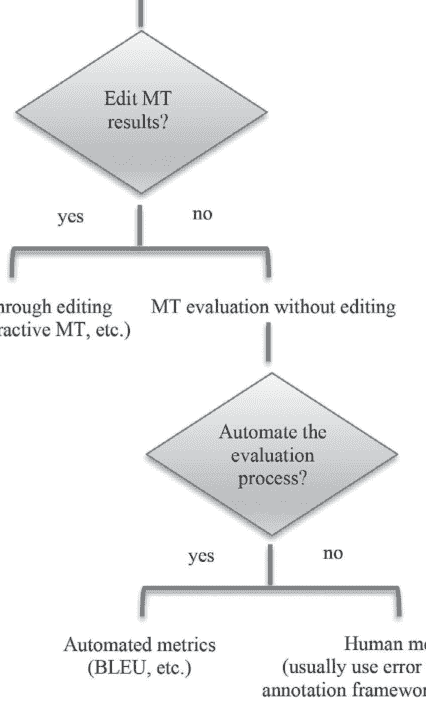

图 5.1 MT 质量评估的两种思路

相比之下，当人类评估 MT 结果时，他们通常参考一个框架，例如为标注目的定义的错误类别。如果他们在 CAT 或后编辑工具中提供标注，则标注结果会被自动整理。但评估是由人类完成，而非由机器完成。

第二种思路涉及 MT 评估中的两种不同活动：评估和编辑。这两个领域可能会让从业者感到困惑，因为评估可能是 MT 编辑的副产品，包括后编辑和边翻译边编辑（如交互式 MT 所示）。当涉及编辑时，“质量”可以根据所需的后编辑工作量来定义。在 MT 影响下与未在 MT 影响下完成的参考翻译之间存在差异。当评估是人类唯一需要完成的任务时，通常不需要参考翻译，因为评估者将依赖现有的语言和翻译知识及专业知识来判断结果。在评估和编辑任务结合的场景中（称为通过编辑进行评估），评估会受到编辑过程的影响。

为了减少 MTPE 场景中的编辑工作量，编辑策略可能会为人工编辑者设定特定要求，因此 MTPE 结果与不利用 MT 而从头进行的人工翻译同一文本不同。在这种情况下，评估可能更为保守（见后文关于 TER 和 HTER 的讨论）。通过编辑进行评估本质上是一种人工指标。然而，经过编辑的 MT 输出可以作为自动化指标的参考翻译，从而也会影响评估结果。在这种情况下，尽管评估是自动化的，但仍然具有人类特征，因为参考翻译受到了人类的影响。

如前所述，MQM 和 SAE J2450 的稳定版本等人工指标为错误分类提供了有用的错误类型学。这些指标的应用依赖于特定用例，包括翻译目的、受众、人力资源和语言资产，这些内容在相关研究和参考文档中有所涉及（Vehicle E System Diagnostic Standards Committee, 2016; Mariana et al., 2015; Lommel et al., 2013）。MT 开发社区倾向于使用术语“adequacy”来描述翻译的准确性，并使用术语“fluency”来描述目标文本在目标语言中是否自然且符合习惯用法。在质量估计 (QE) 中，“adequacy”和“fluency”指标已被纳入某些应用程序的算法中。

### 5.4 自动化指标：使用机器评估机器

#### 5.4.1 自动化指标概述

机器进行的比较与人类不同，但它们是展示翻译质量某些特征的一种快速且成本效益高的方式。在实践中，当计算机应用程序能够生成大量内容时，依赖人力来跟踪 MT 输出的质量是不可行的。在这种情况下，自动评估可以作为人工评估的替代方案，用于评估 MT 原始结果，并跟踪机器自我训练过程中的系统开发。

开发 MT 系统时，自动化的准确性度量更受青睐，以便在训练的不同阶段快速反馈并确保系统质量的可靠性。系统也可以相互比较；例如，Microsoft Translator Hub 中的 MT 评估指标包括数据集训练后引擎的得分以及与通用用途引擎进行比较的得分。这提供了正在构建的 MT 引擎质量、引擎改进情况以及所需未来方向的指标。使用自动化指标进行的评估更多是对软件应用程序的评估，而非对翻译的评估，尽管它对于比较人类或机器生成的不同翻译结果和文本摘录也很有用。自动化指标还可以为人类继续并完成评估任务提供起点。理论上，自动化指标可以应用于不同级别的语言粒度。在实践中，语言比较通常基于句子级别。

#### 5.4.2 基于 n-gram 精确率的自动化指标

##### 5.4.2.1 双语评估替代（BLEU）评分

在各种软件评估指标中，双语评估替代（BLEU）是最早的指标之一，并且至今仍是最流行、最可靠的指标之一。它于 2002 年由 IBM 沃森研究中心的一组研究人员（Papineni et al., 2002）开发，作为机器翻译自动评估的方法。它也用于其他 NLP 任务。例如，Bleualign 是一种基于 MT 的句子对齐工具，它使用 BLEU 作为相似度得分来查找可靠的对齐。具体来说，它需要平行文本（即文本及其翻译）以及至少其中一个文本的自动翻译。对齐是根据平行语料库中源文本与目标文本句子的 MT 结果之间的相似性（修改后的 BLEU 得分）进行的（Sennrich, 2010; Sennrich & Volk, 2010）。

具体来说，BLEU MT 评估系统需要两个要素：（1）数值的“翻译接近度”指标，（2）高质量的人工参考翻译语料库。接近度指标基于语音识别社区中非常成功的词错误率（WER）指标（Papineni et al., 2002, p. 311）。单个句子的 BLEU 得分通常会与人工判断不同。例如，如果所有参考译文恰好都读作“东亚的经济”，那么产生流畅短语“东亚经济”的系统将受到严重惩罚。

BLEU 取得成功的关键在于对所有系统进行相似处理，并使用具有不同风格的多名人工翻译，这些差异通过系统间的比较而被抵消。在实践中，生成 MT 结果时可能只有一个参考译文，也可能有多个参考译文。单个参考译文并不一定意味着语料库中的所有翻译都来自同一位翻译者。理想情况下，这样的语料库将确保一定程度的风格变化，因此最好有来自不同翻译者的翻译。

BLEU 指标的基石是精确率度量。要计算精确率，我们可以将候选译文的 n-grams（在此语境中，n-gram 是 n 个单词的有序序列）与参考翻译的 n-grams 进行比较并计算匹配数量，例如，候选译文中出现在参考翻译中的单词（一元词）总和除以候选译文的总单词数。不幸的是，MT 系统可能会过度生成在系统看来合理的单词，导致精确率很高但翻译不太可能的结果。在第一个示例中（参见图 5.2），在候选译文的总单词数（一元词）中，全部


参考译文：There is a cat on the mat.
候选译文（MT 输出）：the the the the the the the。

标准精确度量 = 参考译文中单词出现次数 / 候选译文中的总单词数 = 7/7 = 1

## 图 5.2 标准单词精确度量计算

（共 7 个）在参考译文中找到匹配。因此标准精确度量为 7/7 = 1。

由于该度量无法准确评估候选句子，因此使用了修正后的单词精确度量。此值的计算如第二个示例所示（参见图 5.3）。计算时，首先统计某个单词在任意单一参考译文中出现的最大次数。例如，在图 5.3 中，有两个参考译文，‘the’ 在参考译文 1 中出现一次，在参考译文 2 中出现两次，因此‘the’ 在参考译文中出现的最大次数为 2。参考译文与候选译文之间 n-gram 匹配的修正计数不得超过任何单一参考译文中针对该单词观察到的最大计数。因此，尽管候选译文中的所有单词都与参考译文中的单词 ‘the’ 匹配，但图 5.3 中修正精确度公式所采用的单词匹配计数为 2，而非 7，得到的得分为 2/7 = 0.2857。

这些示例仅提供了 BLEU 内部工作原理的基本概念。在实践中，BLEU 算法涉及更多元素。

BLEU 分数通常在 0 到 1 的范围内衡量，表示分配给 MT 输出的概率。在实践中，该数字可以乘以 100 以便于交流：BLEU 分数 0.2857 将转换为 28.57。转换后的得分为 100 意味着翻译中的所有单词在人工翻译和机器翻译输出中完全相同，包括它们的顺序。转换后的得分为 0 意味着人工翻译与机器翻译输出完全不同。在现实中，即使是同一源文本的两个高质量人工翻译也不会获得 100 的 BLEU 分数，因为两个人工翻译之间的单词和单词顺序会有所不同。60 到 70 之间的 BLEU 分数通常被认为是高的，且非常高

参考译文 1：There is a cat on the mat.
参考译文 2：The cat is on the mat.
候选译文（MT 输出）：the the the the the the the。

修正精确度量 = 参考译文中的最大出现次数 / 候选译文中的总出现次数 = 2/7 = 0.2857

## 图 5.3 用于 BLEU 分数的修正单词精确度量计算

## 表 5.1 BLEU 分数解读

| BLEU 分数 | 解读 |
| :--- | :--- |
| < 10 | 几乎无用 |
| 10–19 | 难以把握要点 |
| 20–29 | 要点清晰，但存在重大语法错误 |
| 30–40 | 易于理解至良好翻译 |
| 40–50 | 高质量翻译 |
| 50–60 | 质量非常高，充分且流畅的翻译 |
| 60–70 | 质量通常优于人工翻译 |
| > 70 | 谨慎，因为这可能意味着模型过拟合，而非质量极高 |

来源：根据 Google Developers (n.d.-b) 改编。

BLEU 分数高于 70 可能表明模型未正确计量或存在过拟合。表 5.1 是基于 Google AutoML Translation 的总结，这是一个由 Google 提供、允许用户创建和自定义翻译模型的平台。

##### 5.4.2.2 影响 BLEU 性能的因素

从算法角度来看，BLEU 有固有缺点。首先，比较单位是单词。如前所述，该度量通过将候选句子与（多个）参考译文进行比较，试图捕捉单词选择中的可接受变化。为了克服单词顺序变化的问题，BLEU 使用修正后的 n-gram 精确度，如前面所示。这一标准使得该度量偏向于基于统计方法的系统，例如统计和神经机器翻译。对于其他类型的系统，如基于规则的机器翻译，仅使用 BLEU 分数可能会大大低估其实际质量。还有其他示例表明，BLEU 与人类判断的相关性可能被高估了，而 BLEU 对翻译质量来说是一种相当粗糙的度量（参见 Callison-Burch et al., 2006, 第 253–255 页）。

其次，由于 BLEU 对机器翻译引擎输出中存在的单词非常敏感，该度量中嵌入的关键技术涉及 MT 输出分词的方式。该技术的性能因语言而异，最终影响 BLEU 分数。例如，对于中文、泰语及类似语言，‘word’ 的定义具有灵活性或不完全明确，并且不像英语那样用空格分隔单词单元。软件中采用的分词方式会对 BLEU 分数及其解读产生重大影响。

第三，生成 BLEU 分数时使用的参考译文数量也起着作用。一般来说，当使用多个参考译文时，BLEU 分数往往会更高，Papineni et al. (2002) 在一个示例中指出：“在约 500 个句子的测试语料库（40 个一般新闻报道）中，人类翻译者针对四个参考译文得分为 0.3468，针对两个参考译文得分为 0.2571”（第 315 页）。

此外，如果没有了解正在测试的内容以及测试集是什么，单独的 BLEU 分数本身意义不大。当使用两个不同的测试集比较两个不同系统的 BLEU 分数时，这些分数不可比较。候选译文需要在两种场景中都针对标准的、具有代表性的测试集或相同的测试进行度量。在许多情况下，评估系统可以通过从训练数据中抽样句子来自动生成测试集。在此过程中，重要的是要确保测试数据与训练集数据不重叠，否则会使评估结果失效。

最后，BLEU 的主要组成部分被称为“n-gram 精确度，即评估翻译中匹配的 n-gram 占总 n-gram 数量的比例。精确度分别为每个 n-gram 阶序计算，并通过几何平均将精确度组合起来”（Banerjee, S., & Lavie, A., 2005, 第 67 页）。

##### 5.4.2.3 其他基于 n-gram 的自动度量

具有显式顺序的翻译评估度量（Meteor）是一种用于 MT 评估的自动度量，旨在解决 BLEU 的弱点。它通过计算翻译与给定参考译文之间基于显式单词对单词匹配的得分来评估翻译（Lavie & Agarwal, 2007, 第 228 页）。根据 Banerjee, S., & Lavie, A. (2005) 和 Lavie & Agarwal (2007)，Meteor 已被证明与人类对翻译质量的判断高度相关，并显著优于 BLEU。在 Meteor 中，

单词可以基于其表面形式、词干形式和含义进行匹配。此外，METEOR 可以轻松扩展以包含更先进的匹配策略。一旦找到两个字符串之间的所有泛化单词匹配，METEOR 就会使用单词精确度、单词召回率以及旨在直接捕捉机器翻译中匹配单词排序得好的碎片化度量的组合来计算此匹配的得分。（Banerjee & Lavie, 2005, 第 65 页）

有时会使用 F-度量来评估 MT 质量，特别是模型的准确性。在 MT 语境下，它是衡量假设（MT 输出）与人类参考译文匹配程度的指标。其计算使用精确度 P 和召回率 R 变量。具体来说，精确度 P 捕捉参考译文 r（人类参考译文）中的多少单词出现在假设 h 中。换句话说，它是假设 h（MT 输出）中出现在参考译文 r（人类翻译）中的单词的比例。此计算不考虑单词在句子中的位置（参见 Munkova et al., 2020, 第 1329 页）。


#### 5.4.3 基于编辑距离的自动评估指标

##### 5.4.3.1 翻译编辑率 (TER)

翻译编辑率 (TER) 衡量的是人类需要进行多少编辑才能使系统输出与某参考译文完全匹配 (Snover et al., 2006, p. 223)。与 BLEU 类似，TER 是一种自动评估指标，且需要参考译文。根据 Snover et al. (2006, p. 223) 的研究，TER 的单参考变体与人类对机器翻译质量的判断的相关性，与 BLEU 的四参考变体一样高。

TER 被定义为将测试译文或机器翻译输出（假译）更改为与其中一个参考译文完全匹配所需的最小编辑次数，并按参考译文的平均长度进行归一化（参见图 5.4）。

可能的编辑包括插入、删除和替换单个单词，以及单词序列的移位。请参考以下参考译文/假译对，其中参考译文与假译之间的差异以大写字母表示：

> 参考译文：SAUDI ARABIA denied THIS WEEK information published in the AMERICAN new york times
>
> 假译：THIS WEEK THE SAUDIS denied information published in the new york times
>
> (Snover et al., 2006, p. 225)

根据 Snover et al. (2006, pp. 223–225) 设定的标准，将假译更改为参考译文需要四次编辑（一次移位、两次替换和一次插入），TER 得分为 4 ÷ 13 = 31%。

上述计算 TER 得分所用程序的说明经过简化，通过控制一些参数（包括参考译文的数量和每种编辑类型的定义）来实现。尽管如此，这足以理解 TER 背后的计算类型。在实际操作中，此类参数的工作定义可以根据具体用例来确定，并纳入自动化 TER 得分生成过程的算法中。

##### 5.4.3.2 人工目标翻译编辑率 (HTER)

人工目标翻译编辑率 (HTER) 是一种人机协同评估。它涉及一种创建目标参考译文的程序。在此方法中，


图 5.4 TER 得分

精通目标语言的人工标注者通过编辑系统假译（机器翻译输出）生成目标参考译文。如第 5.3 节所述，此评估任务除了评估之外还涉及编辑工作。编辑由人工手动完成，机器翻译后编辑（MTPE）过程是生成目标参考译文的典型场景。

语言行业倾向于使用 TER 术语来涵盖 TER 和 HTER 场景，因为许多翻译编辑率算法基于后编辑结果（目标参考译文），而不是在翻译人员未接触机器翻译结果的情况下产生的人工参考译文（也称为非目标参考译文）。然而，明确区分 TER 和 HTER 至关重要，因为参考译文是在不同条件下产生的，因此评估结果会有所不同。

Snover et al. (2006) 比较了在 HTER（带有人工目标参考译文的 TER）和 TER（四个非目标参考译文）场景中的插入、删除、替换和移位次数。在这里，编辑距离较低表示性能更好。Snover et al. (2006) 发现，与 TER 相比，HTER 将编辑率降低了 33% [(49.6–33.5) ÷ 49.6 = 33%]。替换的减少幅度最大（从 25.8 降至 14.6），很可能是因为单词常被判定为同义词。在 TER 和 HTER 两种条件类别中，大多数编辑都是替换和删除 (p. 228)。

当重新审视基于 n-gram 的自动评估指标（如 BLEU）的概念时，参考译文是目标还是非目标也会影响统计结果，在实现机器翻译质量评估时控制变量时必须考虑这一点。基于 n-gram 和基于编辑距离的自动评估指标共享一个共同特征：它们需要参考译文和假译（机器翻译输出）来进行语言比较。在许多情况下，参考译文并不总是可用的。机器学习技术可以在没有参考译文的情况下提供机器翻译质量的指标，质量估计即为一个示例。

### 5.5 质量估计 (QE)

尽管用于机器翻译质量评估的自动评估指标速度快且成本效益高，但在许多情况下，参考译文不可用，更不用说多个参考译文（后者更可取）了。人工参考译文被假定为金标准，但这很难验证。大多数源句子都有多种可被视为高质量译文的翻译。此外，自动机器翻译质量评估是事后评估，并不表明后编辑该段落需要多少时间，或者翻译人员编辑它应获得多少报酬。

为了解决这些问题，可以使用质量估计 (QE) 来自动提供机器翻译输出质量的指示，而无需访问人工参考译文。它也是估计将需要多少后编辑工作量的一种方法。与前一节讨论的回顾性机器翻译评估指标不同，QE 指标旨在用于正在使用的机器翻译系统。从这个意义上讲，机器翻译中的质量被解释为后编辑时间和效率。

Specia, Shah, et al. (2013) 列出了 QE 的若干应用：
- 决定哪些段落需要翻译人员修订或人工质量保证；
- 决定读者是否能从文本中获得可靠的概要；
- 估计后编辑所需的工作量；
- 在不同机器翻译系统产生的替代译文中进行选择；以及
- 决定译文是否适合用于机器翻译系统的自训练 (p. 79)。

QE 模型通常在公开可用的数据集上训练，例如 Europarl 平行语料库 (Koehn, 2005)。这些数据集需要利用特定语言的人工标注进行监督，包括直接评估和后编辑，这些标注通常成本高且耗时，尤其是对于词级质量估计，其中每个标记都需要一个标签 (Tuan et al., 2021)。Specia et al. (2009) 描述了三种人工标注的数据（机器翻译输出）：
- 根据充分性由人工标注的句子子集，得分从 1（最差）到 5（最佳）；
- 由专业翻译人员标注质量得分（介于 1 和 4 之间）的句子，其中 1 表示需要完全重新翻译，4 表示适合用途；以及
- 带有后编辑时间的句子，通过记录专业翻译人员后编辑该句子所需的时间量来经验性确定 (pp. 30–31)。

有多种开源的机器翻译质量估计框架，包括 deepQuest、OpenKiwi、QuEst 和 QUETCH。为了解释基本的内部工作原理，QuEst 可以作为一个示例 (QuEst++, 2022)。QuEst 旨在估计机器翻译系统的句级质量，并且严重依赖语言学和文本特征。基本框架包括两个主要模块：特征提取模块和机器学习模块。质量估计是基于某些特征的质量预测，包括与语言无关的特征（如置信度措施）、一般语言学资源（如词性标注器）和与语言相关的特征。后者的一个示例是代词翻译错误，该示例是为阿拉伯语-英语质量估计设计的（参见 Specia, Shah, et al., 2013, p. 81）。在机器学习模块中，质量是通过结合描述翻译流畅性和准确性、源文本复杂性及“可译性”以及机器翻译系统置信度的多个特征来预测的 (Specia & Soricut, 2013, p. 213)。机器学习模块“独立于特征提取代码，并使用提取的特征集来构建和测试质量估计模型” (Specia et al., 2015, p. 116)。

机器学习模块的一个主要组件是置信度估计 (CE)，它被视为二元分类 (Blatz et al., 2003, cited in Specia et al., 2009, p. 28)，用于区分“好”和“坏”翻译，依据是

为每个句子估计的连续质量分数 . . . 此问题被处理为回归任务，其中算法被训练以预测


不同粒度的句子级得分。大量特征的贡献通过特征选择策略得到挖掘。（第 28 页）

QuEst++ 是 QuEst 的新版本。QuEst++ 支持词级、句级和文档级 QE。它还提供流水线处理，由低级别（例如，词）进行的预测可以作为输入来构建用于高级别（例如，句子）预测的模型。QuEst++ 允许提取多种特征，并提供机器学习算法来构建和测试 QE 模型。其特征提取模块可以从三个粒度级别的文本中提取各种属性。然后这些内容被传递到机器学习模块，该模块使用它们来构建一个稳健的 QE 模型（Specia et al., 2015, 第 116 页）。

Tuan et al. (2021) 提出了一种不依赖人类标注者示例的技术，而是使用合成训练数据。他们的研究结果表明，生成的模型在句子级和词级预测方面，与基于人类标注数据训练的模型性能相当。这是一个具有进一步探索潜力的领域。随着机器学习技术的迅速改进，QE 在质量估算和预测所需后编辑工作量方面变得更加可靠。

## 注意

- 1 参见 Snover et al. (2016)。在实践中，TER 也被称为“翻译错误率”；例如，参见 KatanAI (2015)。

## 6 翻译中的意向性与 NLP 任务

### 关键概念

- 在由机器翻译驱动的翻译过程中，译者更有可能指导和支持与翻译相关的 NLP 任务，而不是核心机器翻译技术。
- 从机器学习角度来看，与翻译相关的 NLP 任务分为两大基本类别：辅助任务和智能任务。辅助任务帮助用户提高生产力，而智能任务支持其定制或个性化机器学习模型的开发。
- 与连续翻译过程相关的 NLP 任务基于特定用例中的目的。机器不具备意向性，这完全存在于人类的思想中。

### 6.1 引言

许多自然语言处理（NLP）任务可以促进翻译过程中基于机器学习的自动化。这些任务不一定属于意义转换（即翻译本身）的范畴。如第 4 章第 4.1 节所述，在本地化等更大的背景下讨论这些技术是有意义的，本地化发生在一个更大的商业和开发框架内，涉及译者、语言和工具专家、程序员、工程师、项目管理人员、桌面出版专家和营销人员的专业知识（Folaron, 2006； Byrne, 2009 引用，第 2 页）。

如本书引言中“自然语言处理与翻译”部分所述，NLP 有三种方法：符号主义、统计主义和连接主义。连接主义模型通常采用神经网络的形式，由大量非常简单的组件连接而成。在本书中，我们将在神经网络模型的背景下考察连接主义方法。2016 年，商业神经机器翻译推出时，翻译研究和实践步入了新的神经 NLP 时代。本章就放在这个普遍背景下。

两项基本翻译概念塑造了讨论：(1) 将语言视为序列，以及 (2) 与意义相关的意义和形式的转换，这包括跨语言机器翻译以及语内翻译，例如从语言的口语形式转为书面形式。首先，在神经 NLP 方法中，语言是一种固有的时间现象，由随时间展开的序列组成。其次，意义和形式的翻译基本上是一个转换问题。因此，许多与翻译相关的 NLP 任务——例如光学字符识别 (OCR)、自动语音识别 (ASR) 以及机器翻译 (MT) 本身——都基于序列转导模型。此外，超越意义转换步骤的一些活动不涉及转换挑战，例如领域检测、语言检测和自动术语提取。这些活动可以由其他神经网络模型（如序列分类）捕获。在这两种情况下，数据表示都是支持有效机器学习的关键组成部分。它决定了可以从原始数据中提取多少有用信息以供进一步分类或预测。此类语言数据任务构成了基于机器学习的翻译中译者工作的相当大一部分。

这些序列模型可以结合相关语言数据进一步定制为特定的 NLP 任务，以满足各种目的。NLP 任务可以针对相关的人类需求进行设计，潜在的神经 NLP 任务列表是动态且开放的。本章根据三个考虑因素对与翻译相关的 NLP 任务进行了粗略分类。

首先，本章探讨了以用户为中心设计的相关 NLP 任务：译者、语言学家、本地化项目经理和其他领域专家。讨论不侧重于如何开发这些技术，而是如何充分利用用户的知识和专长来有效地定制和使用它们。换句话说，NLP 任务是从翻译过程中译者的角度来选择和分类的，而不是基于它们是否适合模型定制过程或通用数据管理或标注项目。这种用户导向非常重要，因为翻译过程最终需要由人类驱动，而不是由机器驱动。

其次，当译者在翻译过程中定制和使用 NLP 任务时，其背后必有原因。译者在翻译前、翻译中和翻译后执行源文本分析、术语提取和文本对齐等任务，以提高生产力、确保质量并整理语言数据。虽然用户目的和意图必须逐案分析，但它们可以在连续翻译过程中被识别，并根据人类需求进行分类（参见第 6.3 节）。

第三，本章在确定需要哪些 NLP 任务以及如何定制它们以有效发挥机器学习的潜力时，区分了“目的”和“意向性”这两个概念。在本章中，目的具有任务特定性，可以逐案分析，而意向性则从哲学视角阐明了人与机器之间的关系。塞尔 (1980) 提出的意向性概念源自 AI 研究，用以阐释我们关于人与机器关系的立场。

### 6.2 从机器学习角度分类 NLP 任务

#### 6.2.1 两种类型的 NLP 任务

从机器学习角度来看，与翻译相关的 NLP 任务有两大基本类别：辅助任务和智能任务。辅助任务帮助用户提高生产力。这些任务的技术用于通过自动化指定步骤来增强人类智能，而无需译者输入、更新或标注语言数据。关系从机器向用户单向流动，用户不会将语言数据反馈到机器中以训练它并进一步开发 ML 模型。

除了提高译者生产力外，智能任务（即另一种 NLP 任务）还能帮助译者开发自己的机器学习模型。执行这些 NLP 任务不仅需要使用工具进行翻译，还需要向引擎输入数据以改进其人工智能。机器训练是这些任务的一个重要方面。在使用智能工具时，译者需要关注翻译任务本身以及与之相关的语言数据。翻译只是整体任务的一部分，而模型开发是连续的，因为术语、翻译记忆和相关标注等语言数据会根据特定目的进行累积和处理。

对于智能 NLP 任务，机器训练和翻译任务可以以两种方式进行：(1) 同时进行：在交互式机器翻译环境中，译者编辑机器翻译建议以完成翻译任务，同时编辑后的数据会被发回机器翻译引擎以训练机器；或者 (2) 分开进行：从 CAT 工具收集术语库和翻译记忆等语言数据，并编译成平行语料库，然后用于训练 NMT 引擎。

在这里，任务分类基于项目，从译者的角度出发，而非技术角度。当特定 NLP 任务的神经网络模型通过译者的输入或对语言数据（例如，标注）的额外工作直接优化时，它被视为（人工）智能任务。如果某个 NLP 任务涉及机器学习，但模型训练与翻译行业没有直接相关性，它仍被视为主要旨在协助译者的辅助任务。例如，OCR 是一种 seq2seq（序列到序列）机器学习任务，但通常识别后的验证由单语人员而不是译者进行。在这种情况下，OCR 任务主要是译者的辅助工具，尽管对于其他用户来说，它可能是智能工具。在


相比之下，当翻译人员在为模型创建和确保训练数据质量方面发挥重要作用时，例如，NMT任务涉及MT的训练和测试数据，它主要是一种智能工具。换句话说，决定一项任务对翻译人员来说是否智能的最终标准必须具体问题具体分析。如果翻译人员使用工具执行NLP任务而不使用数据更新系统，则它是一种辅助任务。相比之下，如果翻译人员与NLP模型之间存在双向关系，即翻译人员在执行NLP任务的同时也在训练系统，则它是一种智能任务。

#### 6.2.2 翻译中神经网络模型的用途

在机器学习中，翻译人员的主要任务不是模型开发，而是处理作为模型输入和输出的语言数据。尽管如此，了解一些基本神经网络模型及其在持续翻译过程中的运作方式，可以帮助翻译人员更好地理解相关NLP任务以及翻译人员在模型开发中所起的作用。翻译人员生成的语言数据可用于解决两个一般的NLP挑战：序列分类和序列预测。严格来说，在机器学习中，分类本质上是一种预测建模问题。但与seq2seq模型中生成另一个序列不同，在分类任务中，对于给定的输入数据字符串，将预测一个类标签。

预测和分类本质上都是顺序问题。正如Jurafsky和Martin（2020）所言，“语言是一种固有的时间现象”以及“这种时间特性反映在我们用于处理语言的算法中”（第181页）。在机器学习中，Transformer和循环神经网络（RNN）等人工神经网络（ANN）能够作为强大的序列学习架构来捕捉语言的时间特性。

##### 6.2.2.1 序列预测

如第4章第4.3.4节所述，神经机翻译系统本质上是一种具有编码器-解码器结构的序列转换模型。在这种方法中，与其他序列转换模型类似，嵌入式是从训练数据中学习的，以便将输入和输出标记转换为维度向量。

如第4章第4.3.4.2节和第4.3.4.3节所述，基于RNN的语言模型一次处理一个词，这可能导致相关信息的丢失，以及在通过一系列循环连接向前传递信息时训练困难。此外，循环网络固有的顺序性抑制了并行计算资源的使用，阻止它们使用大量数据进行训练（Jurafsky & Martin, 2020, p. 190; Vaswani et al., 2017）。

为应对这一挑战，Vaswani等人（2017）提出了Transformer，“一种放弃循环、完全依赖注意力机制来捕捉输入和输出之间全局依赖关系的模型架构”（第2页），这使得并行计算和更高的训练效率成为可能。

对于序列预测任务，通常人类直接创建的语言数据——通过人工翻译、拼写检查和转录——可用于训练机器，尽管可能需要额外处理，例如数据清洗、分词和源-目标文本对齐。在机器翻译中，人工翻译用于生成平行语料库以训练NMT引擎。

##### 6.2.2.2 序列分类

如RNN等编码器-解码器人工神经网络也可用于对整个序列进行分类，而不是对其中的标记进行分类。示例包括领域检测、质量评估和情感分析。在这些应用中，文本序列被分类为属于少数几个类别之一。

将文档分类到不同主题类别可以作为翻译中有用的预处理步骤。例如，要在此设置中应用RNN，待分类文本逐词传递到RNN中，每次生成一个新的隐藏层。文本最后一个元素的隐藏层被视为整个序列的压缩表示。在最简单的分类方法中，文本最后一个元素的隐藏层作为后续前馈网络的输入，其中计算如第3章所述，从一个单元层迭代到下一层，通过对可能类进行softmax¹来选择一个类。

Xing等人（2010）将序列分类方法概括为三大类：

- 1. 基于特征的分类，将序列转换为特征向量，然后应用常规分类方法。
- 2. 基于序列距离的分类，测量序列之间的相似性以确定分类质量。
- 3. 基于模型的分类，使用隐马尔可夫模型（HMM）和其他统计模型对序列进行分类。

（第3页）

分类任务需要类别标签，通常从人工注释开始，即关于类别的人工判断。但是，一些未标记数据与标记数据共享共同特征，并且还包含可能提供类更全面描述的其他特征。通过纳入未标记数据，在某些情况下可以构建更准确的分类器（Xing等人，2010，第5页）。在这种类型的NLP任务中，翻译人员通常需要注释语言数据，这意味着在翻译过程中直接生成的语料库之上存在第二层数据交互。

### 6.3 持续翻译过程中每个步骤的NLP任务用途

#### 6.3.1 持续翻译过程

如第4章第4.5节所述，我们广义上讨论了翻译过程，从源内容提取到预处理、记忆/数据库检查、翻译——包括人工翻译（HT）和机器翻译（MT）——以及发布。在持续翻译工作流中，有一个额外的后处理步骤，用于累积和更新数据库（人工和/或机器记忆），以便在下一次翻译任务中利用。

在图6.1中，我们描述了翻译人员在持续翻译过程中每个步骤可以执行的一些相关NLP任务。例如，OCR和文档解析等NLP技术可用于从原始内容（口语信号和书面文本）中自动提取可翻译字符串，以生成待进一步处理的源文本/语音。从源文本/语音到输入的序列分割，以及领域检测和质量评估等其他分析任务，可以自动化。从输入到记忆检查，术语提取和命名实体识别等功能可用于突出特定记忆。在后处理过程中，可以使用多种NLP技术来收集和编译平行语料库用于机器训练，包括使用NLP包进行数据清洗、自动标记和自动对齐。最后，当翻译内容准备发布时，文本转语音和字幕同步等NLP任务可以自动化相关发布活动。

#### 6.3.2 持续翻译过程中每个步骤的用户目的

如前第6.1节所述，持续翻译过程中的NLP任务由用户需求驱动，这些需求可能难以分类。用户始终可以选择特定的一组工具，设计NLP任务，并根据其目的定制这些工具，包括提高生产率、质量保证、最大化人类价值和持续机器学习。虽然人类意图非常个人化且难以分类，但我们可以根据持续翻译过程中每个步骤的共同目的对其进行分类，如表6.1中的示例列表所示。


源内容

### 步骤 1
源文本/语音

### 步骤 2
分析/预处理

模型输入数据

匹配记忆？

序列匹配

是

否

### 步骤 3
数据库/记忆

### 步骤 4
翻译（语言模型）

模型生成的输出数据

### 步骤 5
后处理

目标语言 1 目标文本 1

目标语言 2 目标文本 2

目标语言 n 目标文本 n

### 步骤 6
（自适应）发布

图 6.1 持续翻译过程中的 NLP 任务

### 表 6.1 持续翻译过程中的用户目的和 NLP 任务示例

| 翻译过程步骤 | 用户目的 | NLP 任务示例 |
| :--- | :--- | :--- |
| 1. 从内容到源文本/语音 | 从更大上下文中的内容提取可翻译字符串，以准备源内容、引文等。 | • OCR<br>• 自动语音识别<br>• 文档解析<br>• 语言检测<br>• 网页爬虫技术 |
| 2. 分析/预处理 | 准备可翻译内容，以遵循人类认知处理特征或满足 CAT 或 MT 环境的规格（调整输入） | • 领域检测<br>• 源文本分析/编辑<br>• 分段<br>• 内联标记对齐 |
| 3. 记忆匹配 | 通过人工或机器记忆系统利用过去的经验/数据 | • 术语提取<br>• 命名实体识别<br>• 翻译记忆利用 |
| 4. 翻译/机器翻译 | 通过翻译（人工翻译和机器翻译）及编辑跨语言/文化转换含义，以确保翻译质量 | • 机器翻译<br>• MT 质量评估<br>• 语言质量保证 (LQA) |
| 5. 后处理 | 管理和更新人工或机器记忆系统，以供未来翻译任务使用 | • 自动后编辑 (APE)<br>• MT 质量估计<br>• 语料库编纂与分析 |
| 6. 发布/内容交付 | 使目标内容格式适应目标区域和文化 | • 使用 NLP 包进行数据清洗<br>• 自动标记<br>• 自动对齐<br>• 合成媒体<br>• 字幕同步 |

下一节将重点介绍一些常用的智能 NLP 任务，包括译者在其中的角色，这些角色主要涉及处理语言数据。

### 6.4 持续翻译过程中的智能 NLP 任务

#### 6.4.1 从更大上下文中的内容提取可翻译字符串

翻译的第一步是审阅源内容，并将内容与格式分开。人类通常擅长从非语言元素（如图像和格式）中提取语言元素。此过程可以通过使用文档解析器（例如光学字符识别 (OCR) 技术）以及一些开箱即用的解决方案（包括 pdfplumber、Google Document-AI 和 Amazon Textract）来实现。

##### 6.4.1.1 光学字符识别 (OCR)

光学字符识别是将打印、手写或印刷文本的图像转换为机器可编码文本的任务。它是数字化印刷文本的一种方法，以便这些文本可以进行电子编辑、搜索、以更紧凑的方式存储、在线显示，并用于机器翻译、文本转语音和文本挖掘等机器过程。

(Sahu & Sukhwani, 2015, p. 1)

OCR 是一种典型的序列到序列学习模型。它包括字符识别和单词预测。

典型 OCR 系统的训练数据是带注释的单词图像。例如，修正后的美国国家标准与技术研究院 (MNIST) 手写数字数据库包含 60,000 个训练示例和 10,000 个测试示例。“这些数字已进行尺寸归一化，并在固定大小的图像中居中”（LeCun et al., n.d.）。虽然大多数理解这些单词的人都可以对单词图像进行注释，但有时翻译人员验证和注释具有多语言内容的 OCR 结果会更方便。

在过去，文档解析和 OCR 的某些功能可以在传统的 CAT 环境中使用。但随着更先进的 NLP 技术的出现，可以在 CAT 工具环境之外执行这些功能，使用独立的 NLP 技术根据特定目的进行定制。在翻译实践中，译者有时需要验证 OCR 结果并记录错误模式，以便高效且一致地纠正它们。在独立的 OCR 任务中，这些活动可以自动记录，然后用于训练引擎，这有助于译者利用翻译过程中创建的语言资产。此原则同样适用于本节中涵盖的其他智能任务。

##### 6.4.1.2 自动语音识别 (ASR)

正如 Jurafsky 和 Martin (2020) 所指出的，自动语音识别将任何波形映射到相应的单词字符串。他们指出，“任何说话人在任何环境下的语音自动转录仍远未解决，但 ASR 技术已成熟到可用于许多实际任务的地步”，例如“通过转录电影、视频或实时讨论，自动为音频或视频文本生成字幕”（第 548 页）。在翻译中，ASR 任务尤其与口译机器翻译和视听翻译相关。

ASR 基于序列到序列学习建模构建。对于 ASR 问题，训练数据由作为输入数据的口语音频片段和作为输出数据的所说内容文本转录组成。语音数据可以基于语言和文化维度进行进一步注释。例如，原始音频数据可以被分类和标记，以使数据更适用于机器学习或 AI 应用，例如注释语音数据的口语成分（单词）以及咳嗽和打喷嚏、门铃响起或狗叫等非语言特征。同样，这些任务不一定需要由双语或多语译者执行。然而，这些与翻译相关的活动可以提前规划，以便在翻译过程中有效利用人力和语言资源。

##### 6.4.1.3 网页爬虫技术

在网站本地化中，网页爬虫技术可用于提取可翻译字符串并分析提取文本的语言特征，以便为下一步准备源内容。从商业角度来看，它可以帮助译者估算字数和语言特征（如关键词），这通常是成本估算的基础。例如，InSite（Complete Website Word Counting with InSite, 2015）和 WordCounter（Web Page Word Counter, n.d.）等工具可提供此类信息。BootCaT (2018) 等其他工具可以将单词提取到纯文本文档中，以生成用于话语分析及持续翻译过程中可能需要的其他后续活动的语料库。

#### 6.4.2 准备可翻译内容

持续翻译过程的第二步涉及最优准备可翻译字符串，并在人工翻译场景中根据人类认知处理特征分析源文本以调整输入。此步骤还可以涉及预处理内容以满足 MT 规格。在由机器学习驱动的翻译过程中，某些典型的预处理活动也可以实现自动化。

##### 6.4.2.1 领域检测

领域检测通常用于各种与翻译相关的任务。例如，基准 NMT 引擎可以进一步定制并适应特定领域。每个领域特定的 MT 引擎可以在客户提供的语料库上进一步训练，客户可能对该领域没有足够的先验知识。该领域也可能被错误标记。在此场景下，领域检测能力可以帮助确定应为数据集使用哪个 MT 引擎。通过标记训练数据，可以训练分类器来预测可能的领域。这是一个分类任务，其中输入是源句子，目标是领域描述。用于此类任务的最先进模型……


NLP 任务通常如下：(1) 输入句子被分词，(2) 标记被传递到 Transformer 语言模型并表示为向量，(3) 最终向量表示被传递到分类器，(4) 分类器返回与所有可能标签相关的概率列表。手动标记数据的人类训练这种类型的域检测建模。

与域检测相似的 NLP 任务，例如主题建模，可以基于所需人工输入少于监督算法的 ML 算法。然而，它们需要大量高质量数据。桶化（或分箱）是指使用一组阈值将数值特征转换为类别特征（Google Developers, n.d.-a）。在此情况下，数据准备和特征工程也需要人工判断。

##### 6.4.2.2 自动分段

在翻译中，较大的信息块通常被分割成较小的块，如第 2 章所述。在 HT 和 MT 中，句子通常是自然的分割单位。传统上，句子分割可以在 CAT 工具环境中基于标点等手动句子边界生成。然而，这种方法并不总是有效。例如，在语音翻译的情况下，句子不是一个明确定义的单位。说话人可能会留下未完成的句子，进行长时间停顿，或者长时间说话而不停顿（Matusov et al., 2005）。如果语音无法分割成像句子这样的有意义单位，语音就无法被正确翻译成目标语言。

虽然人类语音转录员通常能够运用判断力将原始转录分割成有意义的单位，但这并不总是可行的方法。例如，在口语机器翻译中，流水线通常包括两个独立组件：自动语音识别和机器翻译。在这个流水线中，“ASR 提供了易错的、按音频分段的非标点词流”，而“绝大多数 MT 训练数据由带有正确句子分段和标点符号的非口语风格双语文本数据组成”（Paulik et al., 2008, n.p.）。在此情况下，ASR 输出的句子分段和翻译前的标点恢复在解决 ASR 输出与 MT 训练数据之间的不匹配方面起着重要作用。

虽然有多种分割工具和用于分割的 NLP 包，但对译者来说相关的是训练和测试数据。为了训练基于机器学习的句子分割系统，需要一组由人类制作的“地面真实”训练示例。当句子分割架构基于使用为每个边界计算的多个特征的决策树时，人类洞察也很重要（参见 Paulik et al., 2008）。在翻译实践中，包括 HT 和 MT，自动分段可以是提高生产力和确保质量的有效措施。

#### 6.4.3 通过人类或机器内存系统利用过去经验/数据

翻译过程的下一步是检查记忆以回收之前的工作。人类译者可以诉诸过去的经验并回忆一些记忆中的信息。在此过程中，某些单位可能需要额外的心理努力来检索，例如专业术语或专有名称。当计算机程序处理自然语言时，这些挑战在其设计和实施中得到体现。程序可以自动识别并搜索现有数据库以查找相关翻译单元。术语提取和命名实体识别（NER）是可以利用的自动识别任务示例。

##### 6.4.3.1 术语提取

在翻译实践中，自动术语提取是一种存储、管理和查询相应语言中相关专业概念的有效工具。特别是，术语频率 – 逆文档频率（tf-idf）机器学习是一种广泛用于自动从文档中提取术语的方法。具体来说，术语频率是指文档中特定待研究术语的频率。逆文档频率检查单词在语料库中各种文档中出现的频繁程度（或不常见程度）。

此外，如 Kováríková (2021) 所指出，术语在文本中具有特定的定量特征，如频率、分布和上下文特征，这些可以作为自动术语提取统计方法的基础（第 24 页）。例如，术语可以通过各学科中的分布或紧邻左侧或右侧上下文的熵² 来识别。

从人类角度来看，术语是“在一个或多个语言中，在专业领域内对专业知识概念的结构化、描述和指定的研究”（Faber & León-Araúz, 2016, p. 196）。从这个意义上说，术语主要是人类用于组织其专业知识的概念和框架。在考虑这一因素时，自动术语提取也可以根据个人的认知特征进行定制。通过使用词嵌入和循环神经网络，模型可以基于学习者的标注预测个体学习者的术语识别，这些标注在一定程度上代表了这些术语的先前图式（Wang, 2021）。

##### 6.4.3.2 命名实体识别（NER）

根据 Jurafsky 和 Martin (2020)，命名实体“粗略地说，是指任何可以用专有名称来指代的事物：一个人、一个地点、一个组织”（第 148 页）。他们引用了四个最常见的实体标签——PER（人）、LOC（地点）、ORG（组织）和 GPE（地缘政治实体）——并指出标签还包括其他类别，包括日期、时间和价格（第 153 页）。

在机器学习中，自动 NER 是一个序列标注问题。序列标注模型为序列的每个元素分配“从一个小的、固定的标签集中选择的标签”（Jurafsky & Martin, 2020, p. 182）。以下是 Stanza 的自动 NER 示例，Stanza 是一个支持 66 种人类语言的开源 Python 自然语言处理工具包。根据 Qi et al. (2020)，该平台“具有一个与语言无关的完全神经文本分析流水线，包括分词、词形还原、词性和形态特征标记以及命名实体识别”（第 101 页）。

尽管自动 NER 标注工具有所改进，但人类判断无法被替代，且每项标注都需要人类判断。为了避免引入偏见和降低标注质量的风险，标注工具必须根据统计和机器学习方法的输入进行更新，以支持标注过程（Stenetorp et al., 2012, p. 104）。这也适用于其他标注任务，我们将在第 7 章中讨论。

#### 6.4.4 跨语言文化转换含义

人类和机器都可以执行含义转换任务。在此步骤中，重要的是要强化本书导言中“翻译与语言产业”部分讨论过的内容：在机器翻译的影响下，“翻译”和“编辑”之间的界限经常变得模糊，因为许多人类译者现在正在“编辑”但仍然觉得自己在“翻译”，尽管他们正在处理 MT 和 TM 提供的建议。此外，此步骤还包括质量保证指标。第 4 章涉及了各种机器翻译任务和机器评价指标。本节将在翻译的机器学习方法中添加一项日益重要的任务：自动后编辑（APE）。

根据 Correia 和 Martins (2019)，“APE 受到人类后编辑的启发，在其中译者纠正 MT 系统犯下的错误”（第 3051 页）。最近，双源 Transformer 架构已被应用于 APE，其中源句子和机器翻译后的句子作为输入特征，而后者的后编辑版本作为用于训练模型的目标标签（第 3051 页）。

在 Transformer 架构中，决定 APE 性能的关键因素是人工标注数据。如 Chollampatt 等人 (2020) 所指出，以带有标注的人类后编辑形式的充分监督至关重要。在他们的研究中，Chollampatt 等人 (2020) 汇编了一个大型后编辑语料库 SubEdits，它由强大的域内专有 NMT 系统生成的戏剧和电影字幕翻译的实际人类后编辑组成。他们的结果表明，拥有大量人类后编辑语料库，强大的神经 APE 模型可以显著改进强大的域内 NMT 系统。

#### 6.4.5 持续学习

持续翻译过程的后处理阶段是一个关键步骤，人类和机器在此阶段积累过去的经验和数据以进一步


learning. 译者除了完成翻译任务外，还可以从项目中学习，这将提升他们在未来同一领域和语言风格项目中的知识和专业技能。译者还可以进行后续研究，以巩固特定领域的知识。同理，基于 ML 的翻译解决方案也适用此原则。可以利用相关计算机程序来编纂语料库、分析语言特征，并处理语料库，使其更易于 ML 引擎摄入。例如，可以将翻译记忆编纂为独立的平行语料库，或者自动对齐现有的源文本和目标文本，以优化其作为机器翻译引擎训练数据的用途。我们将在 7 章和 8 章中进一步阐述持续学习的概念。

##### 6.4.6 根据目标区域和文化调整目标内容格式

在语言元素被翻译成目标语言后，最后一步是格式化文本信息。实际上，许多（组件）内容管理系统可以管理结构化信息，从持续翻译过程的第一步开始：即生成待翻译或本地化内容时。结构化信息具有固定框架，内容可以根据结构存储在独立的数据库中并进行管理。例如，在自行车用户手册中，内容可以根据不同的部分划分，如自行车组装、维护与服务、一般警告以及重要安全信息。在创建类似内容（如三轮车用户手册）时，这些部分可以被重复使用。每个部分翻译完成后，翻译后的部分也可以以类似方式使用。虽然译者通常不参与智能内容管理系统的训练，但了解其基础知识很有用。例如，达尔文信息类型化架构（DITA）专为编写、组织和链接基于主题的内容而设计；它有利于编写和编辑技术信息的人员（Bellamy 等，2011）。当译者与技术作家和 DITA 工程师合作时，该领域的相关知识可以帮助他们有效地进行翻译并与其他职能部门协作。

其他智能工具也用于持续翻译过程的最后一步，例如语音合成或文本转语音（TTS），这在口语机器翻译中尤其重要。TTS 算法旨在将文本转换为波形。这与 ASR 恰好相反，具有相似的机器学习原理和人工介入的可能性。

TTS 是合成媒体的一部分，也称为 AI 生成媒体、生成式媒体和个性化媒体，其“指的是通过算法手段创建或修改的任何媒体，尤其是通过使用人工智能算法”（W3C, 2020, n.p.）。出版阶段的一个重要趋势是合成媒体的实施兴起，这不仅包括语音/声音合成，还包括人工生成的视频、图像或文本。AI 承担创作过程的部分（或全部），这导致了许多伦理问题。为解决这些问题，需要开发自动伪造检测和质量评估等支持工具，类似于机器翻译中应用的众多质量评估指标和质量保证工具。

总之，持续翻译过程的各个步骤构成一个生态系统。管理这些生态系统的任务落在译者身上，尤其是本地化项目经理身上。

### 6.5 NLP 任务的集成

我们讨论了持续翻译过程每个步骤中的智能 NLP 任务示例，包括译者在处理语言数据时与模型的交互。在实践中，可以根据用户意图创建更多任务。关键是创建或选择最相关的工具，并在系统中对其进行定制，这包括寻找满足特定翻译目标所需的核心技术和支持工具。

这些基于 ML 的 NLP 技术相互连接、相互关联。为了优化整个系统的性能，必须考虑这些技术之间的兼容性和连通性。在许多情况下，可行的解决方案是从核心技术入手，同时调整相邻工具的规格以最大化整体性能。该解决方案由识别一个关键技术和多个支持技术驱动。例如，在 MT 系统中（如第 4 章所述），分割、术语集成和自动文本分析等多个组件与 MT 引擎协同工作，作为整个系统的一部分。但它们也可以作为具有自身支持技术的独立工具。对于基于 MT 的翻译过程，每个步骤——预处理、记忆检查和后处理——都必须符合 MT 引擎规格，以最大化整个系统的有效性。

在 MT 系统集成 CAT 工具插件的场景中，译者通常有多种选项可以利用自动化：
- 符合用户设定阈值标准的翻译记忆模糊匹配，
- 作为译者可供选择的建议，提供每个序列（例如，整个句子或句子中的单个短语）的 MT 结果，
- 其他功能，如预测性输入和模糊匹配修复，这些功能自动化了翻译过程。

例如，Déjà Vu X3 Professional 具有一个名为 DeepMiner 的功能，它从术语和翻译记忆数据库中提取信息以创建模糊匹配修复。机器使用正确术语替换缺失的内容。当缺失内容不在术语库中时，软件可以从翻译记忆中进行统计提取并推断缺失内容的翻译。例如，如果程序看到句子 _这是一只猫_，但翻译记忆中只有法语翻译 _这是一条狗_，它可以搜索术语库以查看是否有 _猫_ 的翻译。如果存在 _猫_ 的翻译条目，程序可以自动将单词 _狗_ 替换为 _猫_，并提供翻译 _这是一只猫_。这是 ML 技术的一个示例，除了 MT 之外，它还集成到 CAT 平台中。随着计算能力的提升，机器学习已被添加到 CAT 平台，从而催生了更智能的 CAT 工具。

类似技术也可以集成到 MT 系统中。例如，Bulte 和 Tezcan（2019）提出“一种利用模糊翻译记忆匹配增强 NMT 训练数据的方法”（第 1800 页）。他们使用两组语言对（英语到荷兰语和英语到匈牙利语）进行测试，使用欧洲委员会翻译总局的 TM，显示 MT 质量有显著提高。强调该解决方案实施的简便性，他们指出，当可用大规模 TM 且翻译之间存在重复时，他们的方法很有前景。

关于主基础设施具有灵活性。ML 技术可以集成到 MT 系统、CAT 系统或其他系统中。与人工翻译相比，MT 质量一直被认为不稳定。因此，在 CAT 工作流中，当 TM 无法检索到高于特定阈值的高模糊匹配时，MT 系统通常被用作备份机制。然而，从理论上讲，这些功能可以根据用户目的嵌入任何系统中。例如，Lilt 是一个交互式 MT 系统。它将分割和其他功能集成到其 MT 系统中。因此，MT 系统和 CAT 之间的边界变得模糊。

### 6.6 故意性：为什么机器学习在翻译中很重要

在本书引言中，我们讨论了 Searle（1980）的思想实验，即中文房间论证，其中 Searle 让房间外的人相信他懂中文（Cole, 2020）。Searle 认为，他只是像计算机一样对形式指定的元素执行计算操作，而不懂任何中文。他断言自己仅仅是计算机程序的一个实例。

区分人类与机器的是故意性，正如 Searle（1980）所述，它是“大脑的因果特征的产物”（第 417 页）。这里，“因果”一词表示因果关系。具有因果特征的大脑能够产生（即引起）故意状态，这是模拟或计算机程序无法实现的。Searle（1980）进一步指出，像 Searle 思想实验中那样实例化计算机程序并不是故意性的充分条件（第 417 页）。

因为形式符号操纵本身没有任何故意性；它们毫无意义；它们甚至不是符号操纵，因为符号不象征任何东西。在语言学术语中，它们只有句法而没有语义。计算机似乎具有的这种故意性，仅仅存在于编写和使用它们的人、发送输入和解释输出的人的脑海中。


意向性是人类本性中与生俱来的一部分，它区分了人类智能与人工智能（AI）。意向性是一个人将注意力集中在与先前知识和经验相关的特定认知领域所做心智努力的结果。因此，意向性是从内在个体化的，并且因人而异，3 正如洛克（1690）在《人类理解论》中阐述的：

> [W]当思想在我们心中漂浮，没有任何反思或对理解的关注时，这就是法国人所谓的遐想；我们的语言几乎没有为它命名：当那些自行出现的思想（因为，如我在另一处所观察到的，在我们清醒时，思想总会在我们心中一个接一个地出现）被注意到，并且如同被登记在记忆中时，这就是注意：当心智以极大的专注和选择，将目光固定于某个想法，从各个方面考量它，并且不愿被其他想法的普通诱惑所转移时，这就是我们称之为“意向”或“研究”的东西。
> (n.p.)

由于计算机及其程序不具备意向性，因此它们是不聚焦的。这并非弱点，恰恰是我们使用它们的原因。计算机及其程序本质上是人类的工具，既不多也不少，无论它们多么先进。然而，任何愿意将其用于特定目的的人，都可以通过在它们身上投射意向性，在自己的头脑中让它们“活”起来。

意向是翻译理论与实践中的一个研究领域。译者首先从译者的视角出发分析源文本，在此过程中确定文本的意向，4 以便选择合适的翻译方法并识别特定和反复出现的问题（Newmark, 1988，第 11–13 页）。译者对文本的理解与对文本意向的探索是同步进行的，因为意向为选择提供了依据。

Newmark 将翻译活动比作冰山：“冰山尖端是翻译——可见部分，即写在纸上的内容——而冰山，即活动本身，是你所做的全部工作，通常多出十倍，其中大部分你甚至用不上”（Newmark, 1988，第 12 页）。在机器学习时代，我们可以使用机器来探索冰山尖端下方的许多领域，从而让人类专注于翻译活动中可见的部分。人类译者本质上是一个说话者，与信息发起者共享大部分认知特征；然而，任何重构都是一项新的、个体的智力工作，而非复制品。另一方面，由于计算机程序可以处理海量数据，因此它们以“集体”视角为起点。译者可以通过在计算机程序上投射意向性来定制计算机的方法，以实现符合译者偏好（包括认知偏好）的工作流。

人类译者之所以能胜过机器，并非因为其在捕捉话语语言特征的每个方面方面有特别的优势，而是因为具有创造具有相关意向性的体验的能力，通过共享经验挖掘冰山隐藏部分中的潜在联系，在读者心中产生共鸣。通过这种方式，沟通目的在某种程度上得到了直观满足。由此可知，存在个人人类经验稀缺的问题，因为经验广阔，蕴含着未知的隐藏潜力。作为一种工具，机器学习可以揭示个人人类无法覆盖的领域，让译者大致了解其面貌，同时，机器学习也可能产生新的隐藏和意外领域，因为 ML 会基于没有人类能够处理的海量数据生成自己的规则。

## Notes

- 1 Softmax 通常用作神经网络的激活函数。正如 Goodfellow 等人（2016）所指出的，“[S]oftmax 单元自然地表示具有 k 个可能值的离散变量上的概率分布，因此可用作一种开关”（第 196 页）。
- 2 熵是一个非常专业的术语。然而，直观上，可以将熵视为无序或不确定性。也就是说，我们将熵与对系统的无知，或对其处于哪种微观状态缺乏信息联系起来。就此而言，熵是不确定性的度量（参见 Schwartz, 2019，第 2 页）。
- 3 根据 Searle 的观点，与计算机交互并向其赋予意向性的人有两种类型：编写程序的人和使用程序的人。在本书的讨论中，我们优先考虑用户，包括翻译人员、项目经理、决策者以及机器–人类交互中的其他利益相关者。
- 4 Newmark 区分了文本意向和译者的意向（Newmark, 1988，第 11–13 页）。


## PART III

### 人类与机器学习中的数据

Taylor & Francis
Taylor & Francis Group
http://taylorandfrancis.com

## 通过语言数据进行译者–计算机交互

### 关键概念

- 语言数据有两种基本用途：（1）人类分析与学习和（2）机器分析与学习。
- 可比性是翻译驱动型语言数据的关键特征。在翻译中，人类和机器都会比较文本对以进行学习，例如，MT 结果与人工翻译用于计算 MT 质量分数，对齐的源文本和目标文本（平行语料库）用于训练 MT，以及同一主题下不同语言的文本（可比语料库）用于学习专业知识。
- 在典型的翻译过程中，译者–计算机交互（TCI）通过语言数据从三个角度得以实现：（1）数据设计与获取，（2）数据标注，和（3）语言数据使用。

### 7.1 引言

从基础来看，机器学习（ML）是一种自动化分析模型构建的数据分析方法。换句话说，数据是构建机器学习系统所需的关键基础设施。在翻译中，语言数据在很大程度上决定了与翻译相关的 ML 系统的性能、公平性、鲁棒性、安全性和可扩展性。

神经网络是一种使用分层数据表示的机器学习形式。以神经 MT 系统流水线为例。它从输入数据开始，通常是源语言中人类友好的语言元素。然后，MT 系统将这些元素转换为表示句法和语义特征的机器可读特征向量。接下来，如果网络包含深度学习层，MT 系统会执行一系列进一步的转换，然后再将特征向量转换回目标语言中的语言元素。人类随后可以编辑这一最终层，以实现与其在传统翻译或语言生成过程中所能达到的效果相当或相似的自然度。

矛盾的是，在 AI/ML 研究人员和开发者中，使用语言数据的相关方面常被讨论不足，被视为相对于构建新颖模型和算法这一受人推崇的工作而言属于“运营性”工作（Sambasivan 等人，2021，第 1 页）。然而，对于翻译人员、语言学家或本地化项目经理来说，使用语言数据是其实践和研究中最重要的部分，他们对语言数据的方法与 AI/ML 研究人员、开发者或数据科学家不同。通常，翻译人员具有高级语言和文化知识，可以对数据集进行有意义的分析，既可以单独用于离散的翻译任务，也可以通过一群翻译人员的译后编辑和标注，共同用于管理翻译记忆的质量。后者允许对馈送到神经 MT 引擎以训练模型的语言数据进行质量控制。相比之下，数据科学家或数据工程师使用计算机程序和工具对语言数据进行统计分析，例如使用 Python、R 和 Tableau 等软件。同样，ML/AI 研究人员和开发者专注于构建新颖的模型和算法。尽管这些方法的重叠是不可避免的，但每种视角的优先级是明确的。

翻译人员从格式化的内容开始，包括语言元素和非语言元素，如图像、格式和音频。就语言元素而言，语言单位由符号组成，因此在语言形式（signifier）和意义上（signified）具有双重结构。在神经语言模型中，当输入数据已准备且输出数据由人类编辑时，数据必须对人类具有可呈现性并且有意义。然而，一旦数据不在人类用户视线之内，数据不一定非要对他们有意义。换句话说，数据可以有多种状态。第一种状态是 *言语*，即语言使用的具体实例，主要面向人类并展现独特的人类特征。第二种状态发生在数据被馈送到机器时，机器对数据进行分词、分段和处理，以便 ML 系统能够消化它们并执行数学运算。语言数据的这种第二种状态是一种工程和统计视角，而非语言学或文化视角。译者在第一种状态及第二种状态的某些方面与 ML 系统交互——句子分段对人类有意义，而分词和词干提取则不然——通过为机器学习创建和编译语言实例，添加人类标注以使系统能够理解相关思考，并进行语言分析以决定哪些数据与训练机器相关。

在讨论人机交互（HCI）时，许多用户首先想到的是技术工具——例如 CAT 工具——一个标注平台或交互式 MT 系统，这些为译者提供了 HCI 接口。AI/ML 研究人员或开发者可能专注于特定技术以促进 HCI。然而，这种方法中的 HCI 调查可能会使译者的工作流程不一致且分段，因为译者使用多种


工具，在理论和实践中，将这些为各种目的而设计的独立技术连接起来可能很困难。对译者而言，贯穿整个翻译始终处理各种状态语言数据的需求是一致的，而状态之间的转换是人机交互（HCI）的基本特征。在神经网络的输入和输出层或附近加入便于人类洞察语言数据的功能，是译者–计算机交互（TCI）过程的一部分。

### 7.2 翻译驱动的语言数据

诸如 _数据_、_语料库_ 和 _信息_ 等术语在多个学科（例如翻译研究、NLP 和计算机语言学）中经常混用。在本章中，我们在考察语言数据的各种状态时，指出它们之间的关键区别，因为 ML 正在不断拓展语言数据概念的边界。本节旨在阐明这些概念与第 6 章讨论的连续翻译过程之间的关系。

#### 7.2.1 语料库与语言数据

“数据”概念暗示的是一种工程和统计学视角，而非语言学或翻译相关视角。_统计学_ 是收集、分析、呈现和解释数据的科学。根据关于术语 _统计学_ 的《大英百科全书》条目，

> 数据是为呈现和解释而收集、分析和汇总的 **事实和数字**。数据可分为定量数据或定性数据。定量数据衡量某事物的“多少”或“数量”，而定性数据为同类项目的类别提供标签或名称。
>
> _(强调部分由译者添加；Williams, n.d.)_

在许多应用领域，大量数据可以被分析并转化为有用信息。“信息抽取（IE）将文本中嵌入的非结构化信息转化为结构化数据”的过程（Jurafsky & Martin, 2020, p. 332）。例如，关系抽取任务旨在查找并分类文本实体之间的语义关系；此外，还可以提取星期等时间表达式（星期四、星期五等）。在此意义上，IE 中的“信息”是指可从文本中提取的有限类型的语义内容（第 332 页）。

在译者中介的沟通过程中，会产生大量语言使用的具体实例，即 _语言行为_。这些语言资源对人类有意义。对于机器学习系统，这些语言单位——词或词素——是代表离散、原子单元的分类数据。它们可以通过特征向量化转换为连续的实数值（向量），从而允许进行产生机器感知的数学运算。ML 过程中涉及的语言数据可被视为被剥离意义、抽象为数学形式的语言单元。

除了人类沟通过程中自然产生的文本/语音外，数据也可以是人造的，即由计算机模拟生成。研究人员已研究过数据在使用前经常被转换，而非以其原始形式使用的方式（Sambasivan et al., 2021, p. 2）。例如，合成数据生成方法已应用于神经机器翻译。在 Hassan 等人（2017）进行的一项研究中，用于训练 NMT 系统的合成数据是使用种子数据生成的，通过词嵌入表示将密切相关的资源丰富语言中的单词投射到资源匮乏的语言变体中。鉴于此类用途，区分用于机器学习的语言数据和面向人类的语言单元至关重要且有必要。这种区分使得数据合成等活动可以独立于语言、文化和伦理考量。合成数据主要用于解决数学或工程问题，但当语言数据被视为 _语言行为_ 时，公平性和自然性等方面应纳入分析过程。例如，翻译源文本是语料库的基本组成部分，可转化为用于机器学习和分析的语言数据，从而为特定目的提取语义内容有限的信息。

总体而言，广义的语言数据概念包括两种基本状态：一种用于人类分析和人类学习，另一种用于机器分析和机器学习。如前所述，语言数据在这两种状态之间的转换是连续翻译过程中译者–计算机交互（TCI）的基本形式。

#### 7.2.2 翻译驱动的语言数据

##### 7.2.2.1 翻译驱动的语料库

关于用于人类分析和学习的语言数据状态，在语言学和翻译研究与实践中，最常用的自然语言数据集是语料库，即“根据特定标准以电子形式收集的大量真实文本集合”（Bowker & Pearson, 2002, p. 9）。语料库收集 _语言行为_，主要为人类使用而设计。在机器学习中，大多数句法和语义关系都在语料库中进行考察；文本本身内部的关系通常是调查的重点。语料库中的文本是观察语言单元分布结构的主要资源，即它与语料库中同一组文本的其他单元是如何相关的。这些关系用于从语言单元中提取特征向量。

语料语言学领域对翻译理论与实践作出了重要贡献。语料库管理和分析技能已成为翻译能力的一部分（Zanettin, 2013, p. 20）。特别是，Zanettin（2013）提出了“翻译驱动”语料库的概念，即为某种翻译相关目的而创建和/或使用的语料库（第 26 页，2012 年，第 8 页），其中使用两个维度来建立类型学：（1）单语或双语/多语；以及（2）可比或平行（2012 年，第 10–11 页）。在此框架下，第一种类型是单语可比语料库，用于比较同一种语言中的译文和非译文。第二种类型是双语语料库，包含两个子类型：（a）平行语料库，其中源文本和目标文本配对；（b）可比语料库，其中基于文本相似性配对的两个（子）语料库进行比较。第三种类型是多语语料库，涉及两种以上的语言。这种语料库也可以是平行的或可比的。

应注意的是，‘语料库’的工作定义在不同学科和研究领域中有所不同。例如，Schnepp 等人（2010）提出了“合成语料库”的概念，即“语言现象的计算机表示。它们能够创建描绘手语的计算机生成动画，并包含录像样例的语料库相互补充”（第 1 页）。在本讨论中，我们采用语料语言学中的‘语料库’定义。在此方法中，如 Biber 等人（1998）所指出，基于语料库的分析包含四个基本特征：

- 它是经验性的，分析自然文本中的实际使用模式；
- 它利用一个大型且有原则的自然文本集合（即“语料库”）作为分析基础；
- 它广泛使用计算机进行分析，采用自动和交互技术；
- 它既依赖定量分析技术，也依赖定性分析技术。

（第 4 页）

在此理解下，翻译驱动的语料库是面向人类的语言数据，因此不包括机器生成的非真实文本。

Zanettin（2013）指出，他考察了语料库和语料语言学技术在翻译描述性研究中的应用，并意识到“[数以百万计的人在日常生活中使用主要依赖基于语料库的统计机器翻译技术的自动机器翻译系统]”（第 20–21 页）。在本章中，我们对翻译驱动语料库的反思主要源于翻译实践和面向实践的翻译研究。在此方法中，翻译驱动的语料库包括根据特定情况同时为人类翻译和机器翻译而设的语料库。换言之，它们是以电子形式收集的真实文本集合，旨在提高人类译者和自动翻译系统的生产力和有效性。


##### 7.2.2.2 翻译驱动语料库的可比性

Zanettin (2012, 2013) 强调，描述性和应用性翻译研究中使用的语料库通常涉及至少两组主要数据的比较，这些数据可以称为语料库组件或子语料库（第 26 页；第 10 页）。例如，英国国家语料库（BNC）通常被用作一般英国英语的参考，其部分内容也被用作一些基于语料库的翻译研究中的可比组件（Zanettin, 2012, 第 46 页）。通过在比较中使用参考语料库，可以捕捉与翻译相关的文本——源文本和目标文本——的语言和语义特征，这可以深入了解翻译过程，例如，就文本领域和术语而言。

在实践中，翻译人员经常处理和比较两种类型的文本，例如，源文本/目标文本和已译文本/未译文本。实际上，平行语料库是可比语料库的一种特殊情况，其中比较基于内容，指示等价的基本翻译关系。例如，最早的平行语料库之一记录在罗塞塔石碑上，这是一块刻有公元前196年在埃及孟斐斯颁布的法令三个版本的碑文。它包括使用象形文字和世俗体文字的古埃及语以及古希腊语（参见 Rosetta Stone, 2022）。这是人类通过比较和链接不同语言和文字中表达的意义来关联信息的早期示例。在机器驱动的翻译过程中，双语和多语平行语料库是机器翻译训练、测试和评估的主要数据资源，此外还对人类学习和翻译过程有用。

在比较两个或多个子语料库时，需要应用某些参数或测量方法以确保比较的有效性。例如，Zanettin（2012）指出，不同语言之间两个子语料库的可比性可以通过“采样技术”和“平衡与代表性”的相似性来确保，或者通过采用相同的内容生成程序来确保，例如使用相同的网络爬虫工具（例如，BootCat）来收集互联网文本（第 150–151 页）。在比较子语料库时，还可以考虑其范围和大小。特定参数的选择将由比较的目的和测量技术决定。

#### 7.2.3 翻译驱动的语言数据

翻译驱动语料库的可比性特征适用于连续翻译过程中的语言数据。例如，在机器翻译中，训练数据是数据库中对齐的源段和目标段的平行数据。对于机器翻译领域适应和检测，使用领域特定数据，这些数据来源于主题或领域的比较。机器翻译结果与人工翻译进行比较，以生成用于自动后编辑的标注数据。从这个意义上说，翻译驱动的语言数据基于比较。

也可以同时使用人工翻译和合成平行数据来训练 NMT 引擎（参见 Poncela et al., 2018）。在他们的研究中，Poncela et al.（2018）指出，在许多用例中，人类产生的高质量平行数据量不足以达到所需的翻译标准。在这种情况下，求助于回译可用的单语数据以创建额外的合成平行语料库用于训练 NMT 模型已成为常态。在这种情况下，用现有的机器翻译系统翻译单语源文本数据，机器翻译输出可以与原始单语数据一起用于为新的 NMT 系统生成训练语料库。该语料库既可以作为单独的独立数据集（即合成数据）使用，也可以与人工生成的平行数据结合使用（即混合（真实 + 合成）数据）。Poncela et al.（2018）发现，将回译数据作为训练语料库会影响 NMT 模型的性能：当将回译数据添加到一组人工翻译数据时，他们发现翻译性能最初有所提高，但随后随着更多合成数据的添加而下降。但是，当单独使用合成数据时，令人惊讶的是，性能相当好：它大致相当于使用真实数据，在某些情况下甚至更好。这个例子说明，有时训练结果并不总是与人类直觉一致，因为“数据质量”的概念取决于用户：人类或机器。在某些情况下，被认为对人类有益的数据可能对机器无用，反之亦然。

因此，我们将翻译驱动语料库的概念从翻译研究和实践扩展到翻译驱动的语言数据这一更广泛的概念，其中包括连续翻译过程中用于人类和机器的所有相关数据。在此背景下，翻译驱动的语言数据包括：(1) 包含人工生成真实文本的语料库，(2) 机器生成的合成数据，以及 (3) 包含人工生成和合成数据组合的语言数据。

在解释了翻译驱动的语言数据概念之后，我们将从三个角度探讨通过语言数据进行的翻译人员—计算机交互（TCI）：(1) 数据设计和获取中的 TCI，(2) 通过数据注释进行的 TCI，以及 (3) 通过语言数据使用进行的 TCI。

### 7.3 数据设计和获取中的 TCI

#### 7.3.1 数据设计和获取中的人类洞见

翻译人员—计算机交互在数据到达计算机之前就开始了。当翻译人员为机器驱动的翻译活动准备人工生成的语言数据时，他们需要将数据转换为一种能最大化机器处理能力的状态。这种对“原始”语言数据的转换和预处理意味着翻译人员可以考虑用于人类和机器的语言数据。正如 Sambasivan et al.（2021）所指出的，语言数据通过收集、策展和理解的实践被塑造，这意味着语言数据可以被认为本质上具有社会政治性质（第 2 页）。同样，Pine and Liboiron（2015）强调，用于生成数据的测量技术“灌输了判断和价值观，规定了计入什么和不计入什么、什么被认为是最佳测量单位，以及不同事物如何被归类在一起并‘制造成’可测量实体”（第 1 页）。

翻译单元也是比较翻译驱动语料库子语料库的一种手段。翻译过程中使用的许多平行语料库将源文本和目标文本之间的句子对齐作为结构特征，而标点符号指示的句子边界是作者创建文本时添加的注释。通过应用基于标点符号的分段规则，CAT 等计算机程序和自动分段工具在平行语料库的设计和获取中使用人工注释。

术语是另一个示例。当翻译人员或术语学家识别与专业知识相关的术语时，他们使用心理图式来组织关于术语的信息，以使术语对计算机程序可理解，尽管这种理解在形式上仅是初步的。当 CAT 工具高亮显示术语时，它提供一个选项，让计算机程序翻译这些术语并减轻翻译人员的认知负荷。

#### 7.3.2 创建语言数据时编码翻译人员的洞见

##### 7.3.2.1 翻译人员干预的程度

一般来说，如果数据集是以高度人工干预的方式创建的，则通常被认为是高质量、劳动密集型数据，可以作为训练 ML 模型的良好语言资源。这里的人工干预是指数据库设计和编纂中涉及多少人类智能和精力。在下文中，我们将关注翻译人员，包括翻译人员、口译人员、语言学家、术语学家、翻译/本地化项目经理和其他领域专家。考虑到这一群体，我们考虑了翻译驱动语言数据连续体上的两个对立极点：(1) 翻译人员干预最少的通用语言数据，以及 (2) 由翻译人员创建的特殊用途数据，例如翻译记忆。

- (1) 翻译人员干预最少的语言数据

在语言学、计算机科学和自然语言处理中，大规模数据集被用于分析特定的语言行为、提取意义表征，并训练 ML 系统执行 NLP 任务。此类数据通常根据特定标准设计和获取，例如，大小限制、主题/领域、客户、作者、出版日期和语言。这些数据集中的文本项目的收集严重依赖于计算机处理，例如，使用网络爬虫技术或用于文本格式化和处理的计算机程序。合成数据是一种极端情况，因为数据是通过程序模拟创建的，人工干预最少，而不是在现实生活中的通信过程中。自然出现的文本集合，即语料库，也可以在很少人工干预的情况下编纂。例如，在网络语料库构建中，爬虫被用来收集人类语言数据。为了解决诸如冗余


不适合纳入网络语料库的内容，爬行算法（如聚焦爬虫）可以设计为最大化被称为文档权重或加权覆盖（WC）的搜索变量，这些变量可以定义为，例如，高搜索引擎相关性、关于特定主题的文档，或特定语言的文档（Schäfer et al., 2014, p. 9）。

在翻译中，平行语料库的创建依赖多种 ML 技术来收集数据，包括将与翻译相关的内容（源文本和目标文本）数字化的 OCR 技术。随后使用自动工具进行分段和对齐。这些大规模语料库来自不同来源的汇编，这与翻译过程中产生的翻译记忆不同。尽管 TM 包含译文，但创建翻译的译者通常并不知晓或不直接负责随后的平行语料库构建。这种类型的平行语料库涉及自动化而非译者干预。除非译者进一步对数据进行标注，否则语料库不包含译者视角下关于语料库内容的信息，例如翻译单位或翻译质量。

在某种程度上，这类数据可以被视为通用数据，涉及较少的译者干预，原因如下：

- a 它可以重复用于各种 NLP 任务以及人类进行的语言学分析。
- b 不同来源的语言数据计算与 ML 开发者和数据科学家的工作更相关，而非译者的工作。
- c 随着计算技术的应用，这类数据的规模通常远大于译者手动创建的数据规模。
- d 它被视为脱离上下文的数据。例如，虽然数据的每一部分可能来自特定项目的语言资源，但项目信息在纳入更大数据集后通常会在海量数据中丢失，或者被重复用于各自具有特定上下文的不同项目。一旦数据从其特定上下文（项目信息、术语、客户要求等）中移除，TCI 将不再可能，除非用户分析数据以恢复其上下文。
- e 它在特定翻译项目中通常处于非活跃状态。以翻译记忆为例。如果某 TM 在一段时间内未被使用，其中的翻译和术语可能已过时。该 TM 可被视为非活跃或已贬值，不应作为建议呈现给译者用于他们的翻译。

##### (2) 译者直接创建的特定目的数据

译者在翻译过程中也可以创建语料库。当译者在 CAT 工具环境中工作时，翻译会自动作为对齐的源段和目标段存储，从而形成翻译记忆。由于数据是手动创建的，该数据集的规模通常相对较小。这种类型的平行语料库的收集是动态的，通常在特定翻译项目下管理，其中包含关于客户、项目目标和目标受众的丰富上下文信息。从这个意义上说，与特定翻译任务关联的翻译记忆产生具有高水平 TCI 的平行语料库。

翻译记忆也可以使用自动或手动方法创建。在机器翻译后编辑（MTPE）中，译者可以对 MT 结果进行后编辑，以获得高质量的翻译记忆。与前面讨论的通用语料库相比，译者干预的程度更高。

此外，译者可以根据特定场景以标注的形式将译者见解添加到翻译记忆中，以便从大型数据集中筛选出高质量数据，从而促进有效的机器学习。例如，译者可以按作者（作者具有不同的翻译水平）筛选翻译记忆，并添加元数据，这种元数据有时被称为“数据的数据”。例如，通过添加译者水平信息，我们可以指示系统选择由高水平作者制作的 TM，以便 ML 任务仅在高质量数据上进行训练。在这种情况下，元数据是“描述、解释、定位或以其他方式使检索、使用或管理信息资源更容易的结构化信息”（National Information Standards Organization, 2004, p. 1）。与译者直接生成翻译记忆相比，添加作者信息等元数据的标注是译者干预的第二层，因为基于人类分析的上下文信息被编码到数据中。此类标注可以提高机器学习在专门 NLP 任务中的有效性，也可用于促进人类学习。在第 8 章中，我们将介绍可为持续学习目的策划的面向源文本的可比语料库。

当译者直接与语言数据交互时，数据集可能包含丰富的人类见解，如果战略性地使用，这可以大大促进翻译中的 ML。然而，语言资源与用于 ML 的语言数据之间存在根本冲突。对语言数据的人类干预在某种程度上意味着降低语言数据生成的生产力；它会减慢机器学习，因为人类交互产生高质量但数据量较小。平衡这两个极端非常重要。

##### 7.3.2.2 数据质量的动态特性

人类干预是主观的且依赖于上下文。当它被纳入数据创建过程时，数据质量的概念也变得动态。所有数据生成过程都涉及人类干预；正如 Sambasivan et al. (2021) 指出的，语言数据从来不是“原始”的（p. 2）。区别在于干预的来源——无论是来自译者、AI 开发者还是数据科学家——干预的程度及其影响。

在前一节中，我们讨论了数据生成过程中译者干预的程度。在本节中，我们转而探讨干预的质量。

一般而言，当译者在项目中投入更多精力时，数据质量应该更高，从而使具有高度 TCI 的翻译记忆语料库对翻译相关活动很有价值。然而，有时由于译者的误解或在翻译或后编辑过程中缺乏相关上下文信息，翻译记忆可能会因错误而“受污染”。从这个意义上说，数据质量在数据创建过程中受个人因素的影响。

还必须考虑 TCI 是否与翻译或 NLP 任务相关。在使用语言资源时，从 TCI 角度分析数据类型很重要。例如，OPUS (https://opus.nlpl.eu) 是一个在线平台，用户可以在该平台上访问各种平行语料库的大型集合（Tiedemann, 2012, p. 2214）。如果打算训练口语 MT，可以考虑 TED 演讲语料库。但是，如果打算训练用于政治文档书面翻译的 MT，可以使用 EuroParl。如这些示例所示，需要考虑的关键指标是数据集在领域、语言对和沟通方式（口语或书面语）方面与 NLP 任务的相关性。

现在我们已经讨论了从译者干预的最低水平到数据中编码的多层译者见解的各种 TCI 程度，我们将讨论将这些人类见解传达给 ML 系统的技术。一般而言，这种沟通是通过语言数据标注来实现的。

### 7.4 通过数据标注实现 TCI

#### 7.4.1 原始数据与标注数据

在本节中，我们关注语料库中的人类生成的真实数据，以讨论人类标注活动。语言数据标注为原始数据增加了一层人类智能。这里的原始数据是指未标注数据。在语料库语言学中，经常使用“标记”一词（参见 Biber et al., 1998, pp. 257–262）。使用相同规范标注的单个语料库称为标注语料库或标记语料库。语法标记语料库的典型示例是词性（POS）标注。请参见图 7.1，了解句子 I do not like green eggs and ham 的 POS 标注。

如图 7.1 所示，POS 标注将句子中的每个词分配到一个类别，这是后续分析的关键要求。

原始数据和标注数据都可以用于训练 ML 算法，因为函数是通过将输入与所需输出之间的关系进行映射来学习（或生成）的。原始数据的主要用途是搜索特定单词或单词序列。在神经语言模型中，语言单元的分布信息是意义表示的基础。例如，如在第 3 章中讨论的，word2vec 使用连续文本作为分类器的隐式监督训练数据，从而避免了对数据进行任何类型的手动标注的需要。当原始数据被标注时，标签突出了与学习任务相关的特定特征。


WORD

PART OF SPEECH

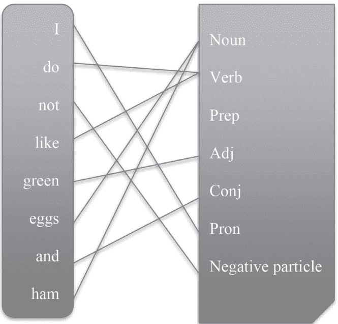

图 7.1 词性标注示例

#### 7.4.2 人工注释框架

在开展注释活动之前，创建一个包含数据集类别或元数据的注释框架非常重要。创建此类框架并专门设计一组元数据的任务通常需要相关的语言学和翻译专业知识。例如，要注释语法特征，必须标准化 POS 标记集，并将其作为指导注释任务的标准。

译者的领域专业知识以及相关的语言学和文化知识对于完成这项任务至关重要。一种方法是使用包含翻译错误类型描述和翻译质量评估评分标准的多维质量度量（MQM）框架（Lommel 等人，2013）。译者可以根据项目要求，将 MQM 错误类型学自定义为带有特定名称和元数据定义的注释模式。选项包括将重要错误类型作为 MTPE 任务中的错误类别，允许后编辑人员在其编辑中选择错误类别，语言学家可以利用这些类别分析 MTPE 错误模式并训练其他机器学习系统，例如自动后编辑系统。

为了更好地控制翻译记忆，项目经理可以创建一个表示译者制作高质量翻译能力的注释模式，包括译者的语言水平、翻译经验以及对翻译主题的熟悉程度。这些标准可以保存在典型的翻译项目管理系统中。将它们纳入注释系统，使项目经理能够选择最相关的翻译记忆，并检查其是否由符合特定标准的译者制作，从而帮助确保翻译记忆的质量。以这种方式，译者在翻译方面的知识和专业知识可以在数据注释框架的设计和实施中发挥重要作用。

对于现实世界中的与翻译相关的任务，注释框架可以集成到自动化注释管理系统中。许多 CAT 工具都具有编辑功能，允许用户创建不同的错误类型，系统可以自动存储这些类型。还有像 KEOPS（Keen Evaluation Of Parallel Sentences）这样的独立注释平台，它提供了一种用于平行句子人工评估的完整工具（用于评估者的 KEOPS，无日期）。

在基于现有翻译知识设计注释框架时，如 MQM 案例所讨论的那样，平衡计算效率、分析框架和注释成本之间的关系非常重要。MQM 有 19 个核心问题，在每个主要类别下，都有用户可以进一步扩展的子类别。一方面，标签数量越多，计算就越复杂，对类别进行判断所需的人类认知努力就越大，从而增加成本。另一方面，如果标签类别不足，框架就无法很好地表示场景，注释就会失去意义。平衡这些考量需要领域专业知识，而非计算知识和技能，因此像译者这样的领域专家是有效执行此任务的强有力候选人。

#### 7.4.3 人工注释在机器学习中的作用

20 世纪 90 年代初，出现了从基于规则的机器翻译向统计机器翻译的转变，随之而来的是计算机程序开发向描述性方法的过渡。统计方法依赖于语言数据，这与语料库语言学的历史相一致，在线语料库和分析工具变得越来越容易获取，基于语料库的研究在 20 世纪 90 年代也变得越来越普遍（Biber 等人，1998 年，第 F33 页）。作为语料库语言学不可或缺的一部分，数据注释对这些发展至关重要。例如，Universal Dependencies（无日期）是一个用于跨不同人类语言进行一致语法注释（词性、形态特征和句法依赖）的框架。这些注释活动提供了包含人类洞察的广泛现实世界数据，是语言学分析的宝贵资源。

从机器学习角度来看，人工注释最初引入时似乎非常低效且缓慢。然而，这种方法证明非常成功，因为注释提供了其他方法无法提供的许多好处：

- 1 一般来说，人工注释提供高质量的数据注释示例，可用于训练自动注释模型，例如句法分析器和 POS（词性）标注器。这意味着人力劳动的重复利用，也就是说，基于最初人工输入的人工注释工作已嵌入到所有利用自动注释模型的潜在项目中。

- 2 人工注释提供了一种系统评估方法：作为“实测真值”或“金标准”，人工注释数据可用于评估工具，类似于人工翻译在自动机器翻译指标中作为参考翻译。

- 3 人工注释提供了自动系统目前尚未覆盖的新功能：用于训练模型的注释数据越多，模型就越智能，离通用可用性就越近。人类在生成数据方面非常有创造力，基于先前人类观察的现有模型无法完全捕捉这一点。人类始终牵头通过新的特征模式推动数据边界的扩展。

#### 7.4.4 自动注释

标记，即注释，也可以自动化。为未编码语料库打标记的计算机程序称为标注器。POS 标注器是一些最早期的程序，它们使用词典和概率等资源和方法，带有基于规则的组件和形态分析器。分析器是向语料库添加句法分析的程序，识别主语、动词、宾语以及更复杂的句法信息（Biber 等人，1998 年，第 260–262 页）。

神经网络也已集成到自动标记程序的架构中。例如，Qi 等人（2020 年）介绍了 Stanza，这是一个开源的 Python 自然语言处理工具包，支持 66 种人类语言。该工具包具有一个神经流水线，以原始文本作为输入并生成包括“分词、多词标记扩展、词形还原、POS 和形态特征标记、依存句法分析以及命名实体识别”的注释（第 101 页）。值得注意的是，在他们的研究中，注释的概念被扩展了，因为他们还将分词、句子分割和词形还原等 NLP 活动视为该项目中的注释。他们对原始文本进行分词，并将标记分组为句子作为第一个处理步骤，该步骤“建模为字符序列上的标记问题，模型预测给定字符是标记的结尾、句子的结尾还是多词标记的结尾”（第 102 页）。

#### 7.4.5 注释与标记语言

从技术角度来看，大多数注释项目都使用某种形式的 XML 来对标记进行编码，因此，对标记语言有基本的了解对于在实际注释任务中有效使用这些标准是有帮助的。标记语言是一种人类可读的计算机语言，使用标记来定义文档中的元素。对分词器来说，最流行且最相关的两种标记语言是 HTML（超文本标记语言）和 XML（可扩展标记语言）。HTML 用于通过格式化页面上的信息来创建网页，而 XML 旨在存储和传输结构化数据。虽然 HTML 文档使用预定义标记，但 XML 文件使用自定义标记来定义元素。与本地化相关的数据交换格式大多基于 XML。它们包括（1）TMX 格式（翻译记忆交换），它“允许将翻译记忆从一个翻译工具传输到另一个”；（2）TBX（术语库交换）格式，它“允许将术语表从一个翻译工具传输到另一个”；以及（3）XLIFF（XML 本地化交换文件格式），它“允许将从原始文件中提取的可本地化数据从本地化过程的一个阶段传输到下一个阶段，直至将本地化数据合并回其原始格式”（与本地化相关的格式，2002 年）。

Hanneman 和 Dinu（2020 年）展示了一个示意过程，其中 TMS（翻译管理系统）以 HTML 格式解析、操作和验证较高级别的文档结构（第 1161 页）。在他们的示例中，TMS 查找输入文档中可翻译的部分，对内容进行句子分割，将其发送到底层 MT 系统进行翻译，并放置结果。可翻译内容中的格式化标记（粗体、斜体、超链接、上标等）被传输到 MT 系统进行处理。这些标记称为内联标记/标签，这些标记从源语言到目标语言的正确传输构成了 MT 系统整体质量的关键组成部分。

尽管并非总是遵循定义明确的标记语言的严格语法，但大多数内联标签都遵循 XML 标准，并通过引入成对标记（开始和结束）或自闭合单标记在片段中创建层次结构。预期这种结构将在翻译中保留，成对标记在源语言和目标语言中围绕相应的文本片段。此过程可以包括将 HTML 预定义标记（例如 <b>（开始标记）和 </b>（结束标记））转换为 XLIFF（例如 <g id="1" ctype="bold">（开始标记）和 </g>（结束标记）），这些标记可以传输到 MT 系统。在 XLIFF 中，<g> 替换原始文档中任何具有开始和结束的内联代码，并可以在其父级结构元素内移动（OASIS，2008 年）。如果 MT 系统不将这些标记传输到


| | 带格式标签的源文本 | 中文目标文本（带格式标签） |
|---|---|---|
| 待本地化的网站内容 | 这个词显示为黑体 | 这是个黑体字 |
| HTML | <p>这个词显示为 <b>黑体</b></p> | <p>这是个<b>黑体</b>字</p> |
| XLIF | <source>
这个词显示为
<g id="1"> 
<btype="bold">&lt;b&gt;&gt;/&lt;/g&gt;
黑体
<g id="1">"&lt;/b&gt;&gt;/<g>
</source> | <target>
这是个
<g id="1"> 
<ctype="bold">&lt;lt;&b&gt;&gt;/<g>
黑体
<g id="1">"&lt;/lt;&b&gt;&gt;/<g>
字
</target> |
| 标签移动 | 这个词显示为 <l> 黑体 </l> | 这是个 <l> 黑体 </l>字 |

图 7.2 将源标签投影到翻译文本中

正确位置，人工后编辑必须在后编辑过程中手动更正它们。

图 7.2 展示了机器翻译系统中 HTML、XLIF 和标签格式的数据交换示例。如图所示，单词 *bold* 是加粗的，在 HTML 中由 <b> 和 </b> 标记，在 XLIF 中由 <g id="1"> 标记。加粗标签位于源文本的最后一个词上，而在中文中，正确的标签位置应该在最后一个词（字，意为“字符”）之前一个字符。这是由于英语和中文在语言结构上的差异。理想情况下，机器翻译系统可以捕捉到这一差异。否则，翻译人员或后编辑需要手动更正它。

在机器翻译中编辑此类内联标签是一项专业的标注任务，翻译人员需要具备一些 XML 标记语言的基本知识才能准确编辑。项目经理可以为编辑人员提供培训，帮助他们理解内联标签的含义。由于 XML 是一种可扩展标记语言，程序开发人员可以自定义标记语言架构，这使得这些标签在不同系统中的含义是动态的。例如，<l> 在一个项目中可能表示粗体字体，在另一个项目中则可能表示 *斜体* 字体。翻译人员需要这类信息来执行标签编辑任务。

### 7.5 使用语言数据的 TCI

除了人为因素嵌入在语言数据的设计与编纂以及数据标注过程中之外，当用户分析或使用语言数据时，重要的主观人工干预也会发挥作用。一般而言，有两种基本的数据使用目的：一是增强人类洞察，另是促进计算机分析和机器学习。

#### 7.5.1 翻译人员视角的基于语料库的分析

##### 7.5.1.1 在语料库中寻找模式

从人工翻译人员的角度来看，最相关的语言数据自然是语料库中自然出现的文本或语音。鉴于文本信息量巨大，翻译人员通常需要借助话语分析工具来搜索语料库中隐藏的信息和模式。检索软件专为单词和短语搜索而设计，可以考察单词或搭配的频率，并找到某些单词或结构的例子。话语分析工具可以执行多种任务，例如生成词列表、词条列表、关键词、搭配和簇，以及单词概况（Zanettin, 2012, pp. 141–146）。这些工具通过处理大量无法在没有计算机程序的情况下处理的数据，来增强人类能力。

除开箱即用的话语分析工具外，在自然语言处理中，描述文本模式的基本工具是正则表达式，简称 regex。正则表达式是一种用于描述一组字符串的代数表示法。它们对于在文本和语料库中搜索模式特别有用。正则表达式搜索函数将返回所有与模式匹配的文本（Jurafsky & Martin, 2020, p. 3）。例如，形式为 “/[A-Z]/” 的 regex 会执行查询以检索语料库中的所有大写字母；如果语料库只包含一个句子，例如 He lives in the USA，则搜索结果将是 H, USA。检索工具基于简单的正则表达式。一些话语分析功能已经嵌入到传统的语言质量保证工具中，例如 Xbench 和 CAT 工具。例如，用户可以在大多数 CAT 工具的翻译记忆中执行检索搜索，结果将收集所有包含特定序列（无论是单词还是短语）的翻译结果。一些检索工具是独立工具，提供更高级的语料库分析功能。

##### 7.5.1.2 基于语料库的语言学分析

基于语料库的分析工具在翻译中被广泛使用，用于观察包含源文本和目标文本的与翻译相关的语料库中的语言模式。翻译人员可以使用正则表达式在目标文本中突出显示具有特定特征的特定语言元素，包括使用 regex /[0–9]/ 检查数字翻译的准确性，或验证多义词的翻译。Rowda (2017) 提供了一个使用正则表达式进行翻译质量检查的示例：为了查找 eBay 产品描述中单词 case 的错误翻译，即 case 表示手机壳而不是其他选项（如 business case 或 suitcase），需要创建一个正则表达式来查找移动电话上下文中 caso 的西班牙语翻译。首先，使用 AntConc 或 WordSmith Tools 等自动话语分析工具来识别伴随翻译 *caso* 的上下文关键词。单词 *case* 的搭配包括 Samsung、iPhone、Motorola 和 phone 等上下文关键词。这些上下文词被添加到正则表达式中：“(?i)(caso.+(iphone|samsung|phone|motorola)|(iphone|samsung|phone|motorola).+caso)。”该正则表达式返回该语料库中移动电话上下文中 *case* 的大部分翻译，并作为人工验证的起点。

基于语料库的语言学分析工具也用于其他与翻译相关的任务。例如，基于机器学习的源文本分析已在语言行业中应用。在此方法中，使用机器学习驱动的工具分析特定特征的统计数据，包括单词数、名词、长单词和复杂单词的数量。这些统计数据是良好的指标，可指导翻译人员决定源文本是否适合翻译，以及如果适合，采用何种翻译方法最佳，无论是人工翻译、机器翻译，还是机器翻译加后编辑（MTPE）。翻译人员还可以根据分析结果对源文本进行预编辑，以提高机器翻译引擎的准确性。在 Bar-Hillel（1959）的一组句子示例中 – *Little John was looking for his toy box. Finally, he found it. The box was in the pen. John was very happy* – 翻译人员可以将 *pen* 改为 *playpen*，以便机器翻译系统不会错误翻译它（第 2 页）。在实际项目中，源文本创建通常有多种场景，包括非母语作者撰写的内容、技术专家为非技术受众创建的内容，以及不符合品牌语调和风格的过时内容。语料库分析可以帮助识别低质量源内容中的错误，并预测“有风险”的内容。有时，基于分析结果，源文本在翻译前需要重写。

更先进的机器学习驱动技术可用于执行翻译驱动的自然语言处理任务。机器翻译质量评估就是使用机器学习来评估机器翻译质量的一个示例。此外，通过分析包括词性（POS）、特定词性密度（例如，名词或形容词）、长单词、复杂单词、短句和长句、风格相似性，以及文本特征与编辑距离和机器翻译质量评估的相关性在内的语言特征，可以设置阈值指标以识别平均情况中的离群值。专业翻译人员可以进一步手动检查这些离群值，以做出决策，例如源文本和目标文本的风格及语言特征是否一致，例如当目标文本在语言上比源文本更复杂时。

#### 7.5.2 机器学习的数据分析

##### 7.5.2.1 使用数据训练机器学习模型

在使用数据训练神经机器学习系统时，数据集的特征对于训练、监控和升级系统至关重要。为了确定数据是否适合该任务，必须清洗和分析数据，以评估其质量和与任务的相关性。在大多数机器学习建模中，有两种基本类型的数据：


训练数据和测试数据。具体来说，ML模型从训练数据中学习，并应用其学习结果，从测试数据中提供输出。从另一个角度来看，训练数据会影响模型，而测试数据则不会。从这个意义上说，诸如调整或微调等功能所用的数据属于训练数据范畴，因为调整本质上是训练过程的一部分。

例如，在神经机器翻译引擎训练中，平行语料库通常在用于训练模型之前进行预处理。一些典型的数据清洗活动包括删除未对齐的句子对、删除重复项以及分词。值得注意的是，许多预处理任务可以自动化，然后由人类进行后编辑，而不是从头开始由人类执行，除非有特定的标注任务旨在训练模型。例如，计算机程序可以使用基于逐词、基于结构和基于向量的方法自动计算句子相似度（Farouk, 2019, p. 1），特别是，Feng 等人（2022）发现“引入预训练多语言语言模型大幅减少了实现良好性能所需的平行训练数据量，减少幅度达80%”（p. 1）。通过多语言语言模型，句子可以在不同语言之间表示为单一空间中的向量，语义相似的句子应该具有相似的表示。基于该空间中的句子嵌入，计算机程序可以自动删除不符合翻译关系的句子对。

##### 7.5.2.2 使用数据监控和升级ML模型

大多数模型只能捕捉反映其所见训练数据的模式。当ML模型投入使用时，它开始通过数据与现实世界进行交互，这些数据由人类行为创建或受其影响。事实上，依赖于人类行为的模型可能特别容易出现性能下降。在这种情况下，持续的模型监控和学习是必要的。

同样，翻译人员正是通过处理语言数据来监控模型并为升级过程做出贡献。MT系统可以通过输入更多由翻译人员、编辑或后编辑人员制作的翻译（平行语料库、翻译记忆库等）来进行训练，这些翻译是在翻译人员制作之后或在交互式机器翻译场景中同时产生的。翻译人员在持续机器学习过程中为训练数据和测试数据的生产与评估增加了价值，尤其是在领域自适应、术语集成和翻译记忆库利用等领域。

## 8 翻译中机器与人类学习的平衡

### 关键概念

- 学习包括形成心理模型并调整模型的参数。人类学习和机器学习的一个重要特征是基于可用观察结果推广新结论的能力。
- 从样本、总体和推断之间关系的角度来看，人类学习与ML中的统计推断一致。
- 人类推断过程源于内心。每个人都基于过去的经验和使用模型的意图，拥有一个独特的多语言语言模型。将通用ML模型转换为个性化工具，是帮助人类学习ML技术并获取翻译相关知识和专长的有效方式。

### 8.1 引言

“学习”概念既适用于人类，也适用于机器。正如Dehaene (2020) 所述：“学习就是形成外部世界的内部模型”（第5页）。Dehaene 还强调：“学习就是调整心理模型的参数”（第7页），突出了学习过程的动态特征，反映了学习者的多样性和个体性。所有这些方面都体现了人类学习（HL）和机器学习（ML）的基本特征，不仅仅是其中一种。

从人类角度来看，当一个人学习，例如，一门新语言时，考虑两种学习环境可能很有用。第一种是自顶向下，从抽样数据中得出的已知特征开始，例如语料库中的语法特征。这种方法基于客观规则，或绝对“真理”，与个体学习者的认知或观察无关。第二种是自底向上，每个学习者利用抽样数据自行提取特征或规则，这使学习者能够遵循个人学习偏好。在某种程度上，自底向上学习过程中提取的规则是主观的，因为它们取决于学习者在形成个人理解时的先前知识和经验。通常，自顶向下方法由掌握了语言特征并能指导学习者的教师驱动。相比之下，自底向上方法可以从学习者自行提取特征的个性化推断过程开始。在自顶向下教学环境中，教师提供反馈以帮助学习者调整其语言模型，而在自底向上学习方法中，学习者从数据或生活经验中更新其学习模型。

这两种基本过程也适用于机器学习。要实现原本由人类执行的流程自动化，计算机程序会采用两种基本方法之一：机器学习或符号推理。在机器学习中，算法通过建立输入和输出之间的关联来学习规则。在符号推理中，客观规则通过人工干预创建，然后硬编码到静态程序中。机器学习是自底向上的，类似于以学习者为中心的人类方法。相比之下，符号推理是自顶向下的，类似于以教学为中心的方法。

这两种基本方法背后存在哲学考量。例如，Lakoff (1987) 提出了关于学习、理性思维和认知的两种基本观点：客观主义和经验现实主义（第 xi–xvii 页）。在心灵的客观主义观点中，“世界可以被客观地描述，不受任何特定文化或观察者观点的影响”（Hampton, 1989, p. 131）。在客观主义（人类）学习环境中，“教师在某种意义上知道答案，即知道真理，而学习者则是为了找出这些答案是什么”（Kiraly, 2003, p. 5）。在计算机环境中，这些答案或“真理”被视为符号推理方法中的规则。在表 8.1 中，第一列总结了客观主义的一些基本特征，这与我们在本书《自然语言处理与翻译》引言中讨论的符号推理在很大程度上是一致的。

学习的另一种观点基于经验现实主义，强调经验在学习本质和理性思维中的作用。根据 Lakoff (1987)，“经验”包括“构成个体生物体或生物体群体的实际或潜在经验的一切”（第 xvi 页）。如表 8.1 第二列所示，思维是动态的、非原子的，并不断用经验数据进行更新。

两种观点都将分类作为理解人类经验的主要方法。如 Lakoff (1987) 所述，“大多数符号（即，词语和心理表征）并不指定世界中的特定事物或个体……[它们]指定类别”（第 xiii 页）。在客观主义观点中，类别的本质是由其所有成员共有的属性而定义的，而不是由个体定义的，因为人们相信存在一种超越个体观察的绝对、客观的“真理”。然而，在经验主义观点中，所有合理的思维“都源于有机体的本质以及所有有助于其个体和集体经验的事物”（Lakoff, 1987, p. xv）。也就是说，经验数据可以是


## 表 8.1 客观主义与体验现实主义的比较

| 客观主义/符号推理/自上而下学习 | 体验现实主义/机器学习/自下而上学习 |
|---|---|
| 1 思维是对抽象符号的机械操纵。与外部世界对应的符号是外部现实的内部表征。 | 思维具有生态结构。学习和记忆中的认知处理效率取决于概念系统的整体结构以及概念的含义。因此，思维不仅仅是对抽象符号的机械操纵。 |
| 2 思维是原子式的，因为它可以完全分解为简单的“构建块”——思维中使用的符号——这些符号组合成复合体，并由规则进行操纵。 | 思维不是原子式的；概念具有超越仅使用一般规则拼合概念“构建块”的整体结构。 |
| 3 心智是一台抽象机器，像计算机一样操纵符号，即通过算法计算。 | 概念结构可以使用认知模型来描述，该理论既包含了关于分类、意义和理由的传统观点中正确的部分，又对分类的经验数据进行了解释，并整体符合新观点。 |

来源：摘自 Lakoff（1987，第 xiv–xv 页）。

特定于每个个体或代表一群人的“经验”。体验主义方法的一个根本考虑是，自下而上的 HL 和 ML 在覆盖个人和集体学习模式方面可能更加灵活，具体取决于数据或观察。

一般而言，教育已从自上而下方法向自下而上方法转变，正如 Kiraly（2014）所指出的：“近年来，教育心理学中已成为共识：知识是由学习者建构的，而非仅仅由教师传授给他们”（第 1 页）。在翻译领域，人类和机器培训的重点都在于自下而上，因为学习者通过完成基于项目的工作来驱动自身学习。本章旨在探讨 ML 与自下而上 HL 之间的类比，并研究当用户执行翻译相关任务时，通用 ML 模型如何在人类学习过程中进一步个性化。在此过程中，我们将区分 ML 模型的定制与个性化，其中个人和集体的“经验”（语言数据）以及用户意图性起着重要作用。

### 8.2 学习中的推理

学习概念可以从多个角度来探讨。例如，Ambrose 等人（2010）将学习定义为“一种导致变化的过程，这种变化是经验的结果，并增加了提高绩效和未来学习的潜力”（第 3 页）。这一定义很大程度上基于学习者的发展过程。然而在本章中，我们从机器学习的内部运作来探讨这一概念。数学和统计理论可用于建模人类学习中发生的推理。

#### 8.2.1 学习过程的数学分析

在统计学习理论中，学习问题被视为利用有限数量的观察寻找所需依赖关系的问题（Vapnik, 2000, 第 17 页）。学习机器的第一个模型称为感知器，由 Rosenblatt（1958）开发。它开启了学习过程的数学分析（Vapnik, 2000, 第 1 页）。Rosenblatt 模型不同寻常之处在于它可以推广。“感知器是为了解决模式识别问题而构建的；在最简单的情况下，这就是利用给定示例构建分离两类不同数据的规则的问题”（第 2 页）。这与其他从一开始就被视为解决现实问题工具的学习机器类型不同（第 7 页）。

Vapnik（2000）通过三个基本组件描述了从示例学习的一般模型：（1）随机向量 x 的生成器（G），（2）监督者（S），以及（3）学习机器（LM），它观察 (x,y) 对（训练集）。监督者（S）根据给定 x 的条件分布函数（即 F(y|x)），为每个输入向量 x 返回一个输出值 y。学习机器（LM）观察由 x 和 y 组成的训练集。训练后，对于任意给定值 x，机器返回一个值 ŷ，即 y 的预测值，也称为因变量。预期预测值 ŷ 与监督者的响应 y 相近。在这个模型中，学习是从给定的函数集中选择最能逼近监督者响应（y）的那个（ŷ）的问题（第 18 页）。

Vapnik（2000）指出，在解决统计学的基本问题时出现了范式转移：“为了基于观察来估计未知函数依赖关系，必须事先知道什么？”（第 ix 页）。根据 1920 年代和 1930 年代 Fischer 的范式，答案是受限的：“几乎必须知道一切”（第 ix 页）。从 1960 年代到 1980 年代的范式转移表明：“为了从数据中估计依赖关系，了解未知依赖关系所属函数集的一些一般特性就足够了”（第 ix 页）。第二个范式提供了统计机器学习的基本原理：为了统计分析整个群体（总体），可以收集总体数据的一个子集（抽样），并分析数据集以对总体得出结论（推断），具有某个显著性水平。这种推断方法基于统计技术。在这种方法中，样本的大小和质量是统计模型准确性的重要因素（第 ix–xi 页）。

抽样与总体之间的关系也解释了为什么学习机器“渴求数据”。为了从抽样数据中对总体得出推断，必须控制样本大小和质量，以便建模技术能够生成具有良好预测准确性的预测模型。一般而言，样本量越大、质量越高，样本对总体的代表性就越强，从而有助于统计推断模型达到更高的准确性。

神经网络语言模型本质上是一种统计学习机器。如第 3 章所讨论，输入和输出数据被输入神经网络以发展机器学习模式，这些模式可用于生成系统从未见过的数据。

#### 8.2.2 心智多语言模型

正如 Dehaene（2020）所述，学习可以描述为形成心智模型并调整模型参数（第 5 页）。这一定义既适用于 HL 也适用于 ML，并假设人脑中存在心智模型，或计算机系统中存在数学模型，以基于可用观察估计依赖关系并对总体得出推断。机器学习中使用的数学模型已在前文描述。就语言理解和生成而言，对于人类心智模型，合理的理论是翻译人员、说话者和作者依赖其内部语言模型来进行推断。这类似于人心中的“学习机器”，其中语言模型是一种架构可容纳多种语言的特殊机制。我们可以将这些机制称为心智多语言语言模型。

关于人类语言学习机制的语言习得文献非常丰富。在一个著名的例子中，Krashen（1987）提出五个主要假设：习得-学习区分、自然顺序假设、监控假设、输入假设和情感过滤假设（第 9–31 页），这些可作为整体心智语言模型特定模块的基础。在认知科学中，关于学习和认知结果的研究对我们探索学习者的心智模型也很有用。例如，Kraiger 等人（1993）认为有三类认知学习目标：（1）言语知识，（2）知识组织，（3）认知策略（第 313 页）。识别认知学习结果需要先假设人类会付出心智努力来获取和结构化知识，并使用认知策略来实现这一目的。这种方法隐含着这样一种信念：人类拥有可通过系统化教育和培训发展的心智机制。虽然承认这些视角所完成的重要工作，本章旨在采用数学方法来考察心智语言模型。

根据 Shannon 和 Weaver（1964），在典型的通信过程中，信息源从一组可能的消息中选择所需的消息，这些消息可能由书写或口语单词、图片或音乐组成，而“发送器将此消息编码为信号，通过通信信道从发送器传输到接收器”（第 7 页）。他们进一步澄清说


"[w]hen I talk to you, my brain is the information source, yours the destination; my vocal system is the transmitter, and your ear and the associated eighth nerve is the receiver" (第 7 页)。在此框架中，单词 _信息_ "与其说与你实际说了什么有关，不如说与你本可以说什么有关。也就是说，信息是一个人在选择消息时所拥有的选择自由的一种度量" (第 8 页)。

这是一种数学通信理论，其中 Shannon 和 Weaver (1964) 强调消息的统计特性。具体来说，与生成消息或信号的通信过程相关的信息，“是由该过程的统计特性决定的——即到达消息情境的各种概率以及为选择”下一个符号 (第 17–18 页)。Shannon 和 Weaver 甚至将 '信息' 与热力学中的 '熵' 的概念进行了类比，后者“用各种相关的概率来表达——即在形成消息的过程中达到某些阶段的概率，以及处于这些阶段时，某些符号被选作下一个符号的概率” (第 12 页)。Shannon 和 Weaver 的理论与我们在第 3 章讨论的预测性语言模型一致。至于如何从一系列可能性中选择一个消息，Shannon 和 Weaver (1964) 强调，“消息的统计特性完全由信源的特性决定” (第 18 页)，即产生消息的人的头脑。换句话说，一个人拥有一个心理语言模型，它根据涉及分析过去事件频率的规则指导判断，这反映了这个人如何理解现实世界。

如果我们观察婴儿的语言发展，很明显他们并非天生就会说话或掌握语言；语言需要通过习得或学习，不会自动发生。就语言习得的海量文献中举两个例子，正如 Brauer (2014) 所指出的，一个有趣的想法是：婴儿在出生前就已经迈出了语言发展的第一步。Mampe 等人 (2009) 进行的一项研究表明，新生儿的啼哭旋律受其母语的影响。换句话说，尽管人类并非天生就懂语言，但他们天生具有发展语言的先天能力。

在 ML 中，存在着关于是为每种语言构建一个语言模型，还是为许多语言构建一个多语言语言模型的争论。例如，Aharoni 等人 (2019) 提出了多语言神经机器翻译，它“能够训练一个单一模型，支持从多种源语言到多种目标语言的翻译” (第 3874 页)。在许多领域，多语言 NMT 提供的解决方案比简单组合各种双语 NMT 系统更为先进。许多 NMT 技术提供商已经开始开发双语语言模型，这些模型仍然非常适合特定的业务需求，同时，鉴于其技术能力和现实业务应用，他们还在探索和开发多语言 NMT 系统的潜力。

多语言 NMT 因其在所需模型和模型参数数量方面的效率而具有吸引力，能够实现更简单的部署。此外，多语言 NMT 促进迁移学习：当低资源语言对与高资源语言对一起训练时，翻译质量可能会提高。这种迁移学习的一个极端例子是零样本翻译 (Johnson 等人, 2016)，其中多语言模型能够在未包含在训练中的语言之间进行翻译 (第 2 页)。同时，正如 Arivazhagan 等人 (2019) 所指出的，当“高资源语言由于每项任务容量的减少而开始退化”时，迁移也可能是负面的 (第 2 页)。当我们考察人类语言学习环境时，不难发现迁移和干扰都存在于认知活动中。例如，在第二语言习得 (SLA) 中，Ellis (1994) 指出，迁移错误 (干扰) 在语音和词汇中比在语法中更常见 (第 62 页)。以单词 *饮用* 的理解和翻译为例。英语和中文中与 *饮用* 概念相伴的单词具有共同特征：*茶*、*水* 和 *酒* 都可以指被摄入的流体，例如。通常，英语学习者会通过修改原始多语言语言模型中的参数来利用迁移学习。然而，在英语中，*饮用* 通常与 *酒* 联系，而在中文中，它则更频繁地与 *水* 和 *茶* 联系。此类差异可能导致翻译中的迁移错误。

尽管非常有前景，但在机器学习中，仍不清楚在多语言 NMT 中可以将语言数量扩展到何种程度 (Aharoni 等人, 2019, 第 3874 页)。在某种程度上，定制单语言语言模型是语言模型开发的一个简单起点。随着技术的进步，多语言语言模型的开发将通过调整其参数而继续。

如果我们假设人类天生具有在头脑中发展语言模型的能力，那么我们可以假设，与机器学习中看到的相比，这个模型更加先进。它也有可能成为一个多语言语言模型——毕竟，双语和多语人士随处可见——尽管单语者可能永远不会激活某些模型参数。同样，在心理多语言语言模型中，核心能力是学习机制，即学习者基于可用的有限信息进行推断以生成新数据的能力。从样本、总体和推断之间关系的角度来看，人类学习与机器学习中的统计推断是一致的。无论计算是基于数字、文本信息还是其他类型的输入，对人类学习这一方面的更深入讨论都超出了本书的范围。

#### 8.2.3 翻译中语言模型的意图与连接性

多语言语言模型就像人脑中的一个黑盒，每个人都基于过去执行语言任务（无论是翻译、说话、总结还是回答问题等）的经验，拥有一个独特的模型。在典型的通信过程中，信源，即参与者的头脑，使用内部语言模型从一系列可能的消息中创建一个新消息，并生成参与者传达的发语。发语的构建是沟通者将注意力集中于特定区域所付出的精神努力所产生的自然过程。使用语言模型的意图会根据给定的上下文进一步定制该模型。因此，在人类语言生成过程中，推断过程源于内部。

当翻译人员参与通信过程时，翻译人员的内部语言模型也会发挥作用。然而，在翻译人员中介的过程中，翻译人员并不是消息的起源者。他们不发展自己的想法，而是从外部产生的发语（即其他说话者和书写者产生的语言数据）入手。在某种程度上，他们的语言构建过程不是自然的，因为它是由源文本或口语引导的，而不是他们自己的原创想法。从这个角度来看，可以说翻译人员利用二级的、外部的意图来生成意义和消息，这导致了翻译人员与说话者或书写者之间的妥协。在现实生活中的通信过程中，变化通常发生在信号的传输中。正如 Shannon 和 Weaver (1964) 所述，“遗憾的是，某些未经信源意图的东西会被添加到信号中”，而传输信号中这些不必要的添加物被称为噪声 (1964, 第 7–8 页)。

ML 与 HL 之间真正的区别在于，如第 6 章所讨论的，计算机程序中不存在意图性。它始于数据，也终于数据。人类从数据中构建意义，而机器只能处理数据。与语音和文本的自然产生相比，翻译人员采取外部视角，为数据赋予意义。翻译作为一种场景，会产生常规通信过程中不存在的复杂性。翻译人员的加入为这一星座增添了第三个语言模型，通信过程包括连接所有三个模型，类似于不同计算机程序调整其参数以迁移和处理数据，只是缺乏意图性。

### 8.3 用于人类学习的个性化 ML 工具

#### 8.3.1 技术的集体特征

当抽象思想被表述为语言并传达给他人时，意义建构基于共享理解，如果在多个人之间共享，这可以是集体理解。否则，误解和沟通失误很可能发生。这似乎是将思想转化为口头或书面形式的成功沟通的先决条件。同时，意义的解释是一个个人行为，基于通过消息接收者的知识和经验发展而来的内部语言模型。然而，计算机程序将语言符号作为抽象数据来处理，没有潜在的意义，但可以处理海量数据。

用于训练 ML 模型的数据来自一群人，这可以产生比个人数据更多样化、规模更大的数据集。来自

从这个角度看，机器学习模型的数据集具有集体性。人工智能似乎正在通过汲取许多个人过去经验所产生的海量数据，来创建一个代表庞大人群的虚拟代理。随着计算能力的迅速扩张，计算机程序可以处理海量语言数据，这使得机器学习的集体性更加凸显。

在第7章第7.3.2节中，我们根据人工干预的程度描述了两种类型的数据：涉及最少译者干预的一般数据和译者直接创建的特殊数据。数据构建中人工干预的程度越高，数据就越具体和个性化，而一般数据涉及的自动化多于人工干预。平衡HL与ML的关系，需要处理语言数据的集体性（程度各异）与基于该数据训练的模型之间的关系。机器学习提供了一种集体性方法，以初级形式为译者提供解决方案，使译者能够专注于其他不易捕捉的数据特征。

#### 8.3.2 从通用模型到定制和个性化的机器学习技术

某些技术从一开始就旨在捕捉集体人类行为。它们旨在满足一群人共享的共同需求。在管理人力资源和语言资源时，本地化项目经理关注的是集体结果而非个体结果。在技术平台（如CAT工具）中创建的数据的个体特征，通常会随着语言资产的增长而减少，尽管某些个体元素可以通过数据注释来保留。

在语言行业，技术被用于提高个人或一群人工作的生产率和效率。例如，译者在翻译过程中使用翻译记忆工具进行翻译，并独立管理TM和术语，而翻译管理系统则用于管理整个团队的语言资产。在语言数据所有权、数据安全性和数据使用权限的背景下，区分个人使用和团队使用很重要，因为这两种方法在某些领域可能存在冲突。

考虑到这些因素，区分通用机器学习技术、定制机器学习技术和个性化机器学习技术是有用的。如前8.2.1节所讨论，机器学习模型有三个基本组成部分：生成器、监督器和学习机器。这些模型本质上是通用的，具有由多个步骤和技术组成的不同机器学习管道，用于训练模型。就训练目的而言，存在两大基本类别：满足一群用户的共同目的，或满足单个用户的特定目的。目前，大多数语言技术供应商致力于面向特定用户群并满足其需求。在本书中，我们将这些技术称为“定制”工具，尽管其中许多在定制技术框架内提供了一定程度的个性化，例如允许每个用户在CAT工具中输入分段规则（例如，使用标点符号分段句子）。由人工智能创建的集体虚拟代理可以帮助用户完成任务（如翻译），并且可以定制。例如，MT引擎可以使用领域特定数据进行定制，这通常由MT工程师或MT项目经理完成，而不是由译者或后编辑完成。在此示例中，虽然训练数据是领域特定的，但数据在语言和文化上具有集体性，因为MT训练者在许多情况下并未直接参与数据创建过程，并旨在从所有计算资源中捕捉数据。

这种定制在平衡ML与HL方面存在潜在问题，因为这些MT训练者不一定在语言或文化层面从数据中学习。换句话说，数据仅用于机器学习，而非用于人类学习。定制还影响译者-计算机交互（TCI）。当MT系统在每次训练后提升性能时，结果是人类译者的后编辑工作减少，从而减少了此类内容的TCI机会。然而，知识和技能只能通过长期的练习和重复来获取和巩固。在TCI过程中，如果译者与数据缺乏充分互动，就无法有效学习。单向将数据喂给机器远远不够。从这个意义上说，集体定制更有利于机器学习，而非人类学习。

相比之下，如果每个用户（在本例中即每位译者）可以通过翻译、编辑和后编辑等活动，在译者-计算机交互中训练机器学习技术，译者就有机会处理语言数据，从而不仅能有效利用语言和文化专业知识训练机器学习系统，还能从训练过程中学习。译者可以访问并管理持续翻译过程中使用的所有语言数据，并可以采用其他机器学习技术从数据中学习。译者驱动的定制还解决了许多数据安全问题。严格来说，这种定制属于个性化。

个性化机器学习技术并不意味着译者只能使用自己创建的数据。相反，译者可以使用来自其他资源的数据，例如平行语料库、其他译者的翻译记忆和网络爬虫。然而，数据选择深植于个人偏好和工具的具体用途之中。此外，译者在个性化过程的前、中、后都对数据拥有完全控制权，以便其可用于多个NLP任务。对于译者来说，只有个性化机器学习系统才能提供双向的译者-计算机交互。建立译者与其在机器学习训练过程中所使用的机器学习系统之间的直接关系，对于激励译者有效训练模型并改善自身学习成果至关重要。

个性化机器学习技术意味着去中心化，即将控制权和决策权从集中实体转移到分布式网络。

#### 8.3.3 翻译中以人为驱动的机器学习系统的用户可访问性

考虑到语言模型训练中HL与ML的关系，机器学习为人类接近自身学习过程提供了机会。如果机器学习的基本原理对人类来说直观易懂，这一过程将得到促进。领域专家学习机器学习技术的一大障碍是缺乏对可个性化机器学习模型的访问。

在此，我们提出了翻译中以人为驱动的机器学习系统概念，允许单个用户根据其目的和意图，通过操作输入数据以及编辑或分析输出数据来进行个性化并从中学习。如前所述，许多商业化语言技术是基于对一群利益相关者需求的一般假设，这些假设大多代表一种独立于个人意图和观察的集体或“客观”观点。虽然这些技术可以帮助用户完成与翻译相关的任务，但其定制技术架构通常基于内置在通用机器学习模型中的刻板印象。该架构提供的功能有限，使用户无法使用自己拥有完全访问权的语言数据进行更改。例如，如果译者只能使用神经机器翻译系统进行翻译，而无法根据自身需求训练模型，他们就无法充分接触机器学习模型的动态，从而导致对模型内部工作原理的理解支持有限，以及利用模型促进自身学习的能力有限。

最终，用户的目标在定义和分类这些系统方面起着重要作用。尽管人类意图是个人的且难以分类，但我们可以根据持续翻译过程中每个步骤的共同目的对其进行分类，如第6章第6.3.2节中表6.1所示的示例列表所示。我们从标尺的一端开始，即机器学习模型个性化程度最低的一端，那是通用模型，为用户提供最大灵活性以基于个人目的进行个性化。在对特定用例进行分类时，我们将标尺中间作为框架，用于大致将用例聚集在一起。在讨论以人为驱动的机器学习模型的特定用例时，个性化是主要特征（参见图8.1）。


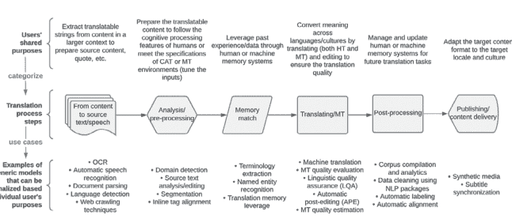

## 图 8.1 持续翻译过程中共享与个体用户的目的

获取 ML 知识和专长是使用人驱动 ML 系统的直接目标。从长远来看，这些系统必须能够广泛促进人类学习，例如，学习术语和提高翻译技能。在下一节中，我们将以翻译术语为例进行讨论。

### 8.4 使用人驱动 ML 系统促进人类学习

#### 8.4.1 术语的个体认知方面

翻译术语管理在许多方面都是人类组织、学习和使用专业知识的框架。当译者试图在源文本或参考材料中识别术语时，决策通常基于两个方面。第一是专业性，包括专业知识及其相应的专业语言使用。正如 Faber 和 León-Araúz (2016) 所指出，术语是“在一个或多种语言的专业领域内，对专业知识概念的结构化、描述和指定的研究”（第 196 页）。第二是认知难度水平。关于这方面，Muegge (2020) 指出，“不仅属于特定学科的特殊词汇应作为每个翻译项目的一部分进行管理，每个‘困难’的单词也是如此”（第 23 页）。

这两个方面与学习者的认知特征相关，因此具有主观元素。‘专业性’的程度可以通过文档比较、咨询学科专家以及参考专业文档和术语表等措施来识别。相比之下，为作为学习者的译者识别‘困难’单词可能是一项艰巨的任务，因为这些译者拥有不同水平的先前知识和经验，而什么是‘困难’会因人而异。

在这种情况下，学习者可以训练 ML 系统以捕捉反映对哪些单词是‘困难’的动态理解的基本模式。例如，每个学习者可以标注一个包含候选术语的术语列表或文档，这为 ML 术语提取系统提供个性化的训练集。

使用每个训练集，术语提取系统可以为每个学习者返回一个独特的术语列表，反映他们对这些单词当前的认知状态。我们将在第 8.4.4.1 节讨论智能导师时进一步阐述这一点。

#### 8.4.2 向量空间与术语示意图上下文

回到本书中反复出现的形式与意义之间的关系这一主题，我们指出，专业术语也是具有所指和表征双重结构的语言符号。学习术语的含义不仅是学习其形式，也是学习其背后的深层结构。在这方面，ML 中的连续向量空间可以为人们可视化、构建和扩展一个以术语为重点的语义场提供有用的洞察，同时说明它如何促进译者对专业知识的表示和获取。语义场是“基于一种意义表征（一种考虑歧义、下义和同义的意义描述）”（Simon-Vandenbergen & Aijmer, 2007, 第 11 页）。在这个框架中，一个词的含义取决于语义场中与它关联的其他词的含义。我们提出术语示意图上下文（TSC）的概念，它是与专业术语相关的语义场，但会考虑个体的先前知识和独特的认知状态。

在语用学和语义学研究中，‘上下文’通常是一个认知概念。例如，根据 Sperber 和 Wilson (1995)，上下文是“一种心理构建，是听话人关于世界的假设的一个子集”（第 15 页）。他们指出，正是这些假设，而不是世界的实际状态，影响话语的解释。在术语示意图上下文中，特定术语是锚点。也就是说，每个术语都是学习者探索与其语义相关的其他术语的起点。当遇到专业术语时，作为学习者的译者可以激活更广泛的上下文中由于先前经验而可访问的项目。

TSC 可以为学习者理解术语含义和评估术语难度水平提供有用指标。例如，对于以英语为母语的人，*喝* 不是一个难词。它与 TSC 中的其他词（如 *啤酒*、*咖啡* 和 *葡萄酒*）密切相关。中文等效词 喝 (drink) 的 TSC 与英语不同，*汤*、*茶* 和 *水* 等词更有可能与 喝 (drink) 搭配，而 *啤酒*、*咖啡* 或 *葡萄酒* 不太可能。也就是说，英语中 *喝* 的关联词分布与中文中 喝 (drink) 的关联词分布不同，这为以英语为母语的人带来了难度。

上述讨论基于直觉推理。在机器学习中，我们可以使用向量空间或语义空间来根据特定语料库可视化术语的 TSC（参见 Wang, 2021）。在向量空间中，词语的语义关系可以建模为几何关系。这些关系不是由人类硬编码到程序中，而是由计算机程序从语料库中学习的。TSC 丰富的文档可以作为术语的模拟示意图上下文。可以假设，ML 系统生成的连续向量空间中的词语及其与所研究术语的距离，与个人的 TSC 一致，并可以对认知活动提供有用的洞察。具体来说，我们可以使用词嵌入来模拟向量空间。如在第 3 章第 3.2.5 节中讨论的，嵌入式是词语意义的表示，是直接从其在文本中的分布中学习的。

从技术角度来看，嵌入式对计算机作为下一层机器学习的输入很有用，但由于高维性，对人类来说不直观。如在第 1 章第 1.3 节中介绍的，向量空间的维数是向量空间在其基数域上的基数（即向量的数量）。在许多情况下，用于训练语料库的嵌入式是高维的。例如，在 Mikolov, Chen, 等人 (2013) 进行的研究项目中，他们使用多个维度选项（50、100、300 和 600）来评估模型，以估计模型架构的最佳选择（第 6–7 页）。

因此，我们需要特殊工具来研究向量空间，以便人类能够理解其含义。检查和理解嵌入式的一种方法是通过降维后的可视化。例如，TensorBoard Embedding Projector 是一个用于图形化表示高维嵌入式的工具（Tensorflow, 2022）。它提供三种常用的数据降维方法，允许更轻松地可视化复杂数据：PCA、t-Distributed Stochastic Neighbor Embedding (t-SNE) 和自定义方法（Smilkov, 2016, 第 2–3 页）。

例如，图 8.2 是使用 t-SNE 在文档上训练的可视化向量空间，此处为关于生物多样性保护的联合国决议的英文版本（U.N. General Assembly, 2021）。如在第 2 章第 2.3.2 节中讨论的，它总共有 2,017 个词元。Gensim Word2Vec 模型（参见 Mikolov, Chen, 等人, 2013; Mikolov, Yih, & Zweig, 2013; Word2vec Embeddings, 2022）对文档进行训练并可视化向量，提供了关于语料库中术语如何相互关联的洞察。学习者可以参考 *大会* 或 *国家* 等词，例如，开始理解、构建和扩展这些术语的 TSC。假设学习者与这两个术语相关的先前知识仅限于本文档中包含的内容——理论上，如果模型准确且能够生成与人类认知活动一致的结果，那么一个人将具有如图 8.2 所示的类似 TSC。

向量空间中的 TSC 这种模拟是一种过度简化，因为一个人关于 *大会* 和 *国家* 的先前知识不会仅限于一份 2,017 个词的联合国文档。然而，我们仍然可以看到一些积极结果，例如 *大会* 与 *决议* 之间，以及 *恢复* 与 *保护* 之间的密切关系。前者关系是语义的，因为决议是在 *大会* 上通过的。后者关系基于语义以及领域，因为这两个术语来自生物多样性领域。语料库结构越精心，其在 TSC 信息方面的输出对于人类学习术语和专业知识就越有用。

向量的值是实数，允许数学计算，这为理解词语如何相互关联提供了一种独特的方法。对于图 8.2 中所示的联合国决议术语，我们可以确定，就其实数值而言，*保护* 最相似的词是 *未来*


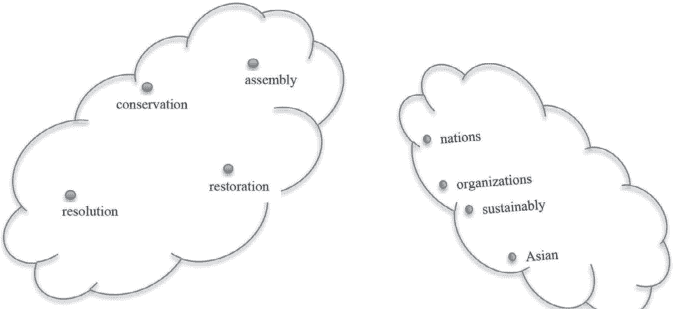

## 图 8.2 使用机器学习可视化单词关系

and diversity, as shown in Figure 8.3. Though the similarity score is not very high, which might be due to the small size of the corpus, it is still reasonable to conclude that these three words are related. However, if we calculate the similarity score between diversity and document, we find the value is negative, meaning document contributes negatively towards the similarity.

和多样性，如图 8.3 所示。虽然相似度得分不算很高，这可能是由于语料库规模较小所致，但得出这三个词相关的结论仍然是合理的。然而，如果我们计算 diversity 和 document 之间的相似度得分，会发现该值为负数，这意味着 document 对相似度产生负面贡献。

We can also use word vectors to do mathematical operations. For example, if we add the vectors of biodiversity and cooperation, the system will return initiatives as the top one result. Such analyses can offer users valuable insights into the meaning of words and the TSCs in this document.

我们还可以使用词向量进行数学运算。例如，如果将 biodiversity 和 cooperation 的向量相加，系统将把 initiatives 作为首个结果返回。此类分析可以为用户提供关于词义及本文档中 TSC 的宝贵洞察。

In translation, a translator can also visualize the TSC in both the source and target language and compare them, learning basic differences between two terms,

在翻译中，译者还可以可视化源语言和目标语言中的 TSC 并进行比较，以了解两个术语之间的基本差异，

| In [27] | w2v_model.wv.most_similar('conservation', topn=10) |
| --- | --- |
| Out [27] | [('future', 0.2758401036262512), ('diversity', 0.270669490909895325), ('multi', 0.26277002692222595), ('environmental', 0.23412625491619111), ('upon', 0.22355292737483978), ('existing', 0.22006337344646454), ('development', 0.20916648209095), ('restoration', 0.1972241848707199), ('policies', 0.19454489648342133), ('decision', 0.19027021527290344)] |
| In [28] | w2v_model.wv.similarity('biodiversity','levels') |
| Out [28] | -0.10396392 |

| 输入 [27] | w2v_model.wv.most_similar('conservation', topn=10) |
| --- | --- |
| 输出 [27] | [('future', 0.2758401036262512), ('diversity', 0.270669490909895325), ('multi', 0.26277002692222595), ('environmental', 0.23412625491619111), ('upon', 0.22355292737483978), ('existing', 0.22006337344646454), ('development', 0.20916648209095), ('restoration', 0.1972241848707199), ('policies', 0.19454489648342133), ('decision', 0.19027021527290344)] |
| 输入 [28] | w2v_model.wv.similarity('biodiversity','levels') |
| 输出 [28] | -0.10396392 |

## 图 8.3 使用词向量计算相似度

such as in the earlier example of *drink*. Such comparisons can be useful when addressing translation-related problems. It is clear that words not burdened with coincidental and misleading resemblances present semantic differences that the wary translator will explore before making translation decisions. The situation is different, however, with *faux amis*, or false friends. When the translator encounters words or phrases that look similar and may be related but differ in the nuance of their meaning, the SL and TL comparison of TSC can be helpful in addressing the translation challenge. As Vinay and Darbelnet (1995) point out: “The parallels between SL and TL are sometimes striking, and we can exploit them productively. At other times, the two languages clearly differ and translators must analyze their differences if they want to understand and bridge them” (p. 28). They propose further that the more two languages are alike in structure and civilization, the greater the risk of confusing the meanings of their respective lexicons, which is the familiar problem caused by *faux amis*. Here as well, TSC can be used as an effective tool to help the translator identify differences between SL and TL terms and choose an appropriate meaning-based translation.

如前文 *饮用* 的示例所示。在处理与翻译相关的问题时，此类比较可能很有用。很明显，那些不带有巧合且具有误导性相似之处的词汇会呈现出语义差异，谨慎的译者在做出翻译决定之前会探究这些差异。然而，情况与 *假朋友* 不同。当译者遇到看起来相似且可能相关，但在含义细微差别上有所不同的词语或短语时，SL 和 TL 的 TSC 比较在应对翻译挑战时可能很有帮助。正如 Vinay 和 Darbelnet (1995) 指出的：“SL 和 TL 之间的平行关系有时非常显著，我们可以利用它们产生建设性的结果。在其他时候，两种语言明显不同，译者若想理解并弥补这些差异，必须分析它们”（第 28 页）。他们进一步提出，两种语言在结构和文明上越相似，混淆各自词汇含义的风险就越大，这正是 *假朋友* 所引起的常见问题。同样，TSC 可以作为一种有效工具，帮助译者识别 SL 和 TL 术语之间的差异，并选择合适的基于意义的翻译。

#### 8.4.3 用于 ML 和 HL 的源文本导向可比语料库

As discussed in Section 8.4.2, vector space or semantic space can be used to visualize the TSC of a term based on a specific corpus. While translators do not develop ML models to generalize vector space, they are able to customize these models by means of corpora. As a matter of fact, the relationship between terminology and comparable bilingual corpora is a topic that has been widely discussed in the translation studies literature (e.g., Munday et al., 2022; Bowker & Pearson, 2002). For example, Munday et al. (2022) point out that comparable bilingual corpora “are normally specialized collections of similar STs in the two languages” and “can be ‘mined’ for terminology and other equivalents” (p. 86). While acknowledging the wide literature in this research field, our discussion on source-text oriented comparable corpora is mainly focused on their application in ML as well as using ML perspectives to complement humans’ intuitive reflections on terms and their associated meaning and concepts.

如第 8.4.2 节所讨论，向量空间或语义空间可用于基于特定语料库可视化术语的 TSC。尽管译者不会开发 ML 模型来推广向量空间，但他们可以通过语料库对这些模型进行定制。事实上，术语与可比双语语料库之间的关系是翻译研究文献中广泛讨论的主题（例如，Munday et al., 2022；Bowker & Pearson, 2002）。例如，Munday et al. (2022) 指出，可比双语语料库“通常是两种语言中相似 ST 的专门集合”并且“可以‘挖掘’术语及其他等价项”（第 86 页）。在承认该研究领域存在广泛文献的同时，我们对源文本导向可比语料库的讨论主要集中于其在 ML 中的应用，以及利用 ML 视角来补充人类对术语及其相关意义和概念的直观反思。

Terminology in the source text can help a translator retrieve relevant documents for specialized knowledge acquisition. In translation, the source text is the starting point not only for the translation process but also for relevant research activities. Some corpus-based approaches to learning have proven to be useful, but they are often post-translation activities. For example, when comparing two varieties of texts in the same language, such as translated and non-translated texts, a translated text must be available, and the criteria, such as the topic, language style, and document length for selecting the non-translated text, must be set before the comparison. In real-life translation scenarios, such a reference translation is often not available. A professional translator frequently resorts to non-translated authentic reference materials in both the source and target language to understand the concept and produce a translation for select terms.

源文本中的术语可以帮助译者检索相关文档以获取专业知识。在翻译中，源文本不仅是翻译过程的起点，也是相关研究活动的起点。某些基于语料库的学习方法已被证明是有用的，但它们通常是翻译后的活动。例如，在比较同一种语言中的两种文本变体（如翻译文本和非翻译文本）时，必须提供翻译文本，并且在比较前必须设置选择非翻译文本的标准（如主题、语言风格和文档长度）。在实际翻译场景中，这种参考翻译往往不可用。专业译者经常求助于源语言和目标语言中的非翻译真实参考材料，以理解概念并为选定的术语生成翻译。

For the translator, learning a term involves more than simply knowing its translation. It requires studying relevant specialized knowledge in documents or corpora, which are sources of information about the term in question, associated terms, and their TSC.

对译者而言，学习一个术语不仅仅是知道它的翻译。它需要在文档或语料库中研究相关的专业知识，这些文档或语料库是关于该术语、相关术语及其 TSC 的信息来源。

Thus, we propose the concept of source-text oriented comparable corpora: naturally occurring, authentic texts in both the source language (SL) and the target language (TL) that are identified based on specialized terminology and content in relation to source texts. This type of corpus includes two subcorpora: one consists of SL documents, which help the translator understand terms in context and associated specialized knowledge. The other consists of TL documents that provide possible translations of these terms. These documents enable the translator to learn terms and specialized knowledge and serve as high-quality data to train the ML model in the SL and TL.

因此，我们提出源文本导向可比语料库的概念：即基于与源文本相关的专业术语和内容识别出来的、在源语言（SL）和目标语言（TL）中自然出现的真实文本。这种语料库包括两个子语料库：一个由 SL 文档组成，帮助译者在上下文中理解术语及相关专业知识。另一个由 TL 文档组成，提供这些术语的可能翻译。这些文档使译者能够学习术语和专业知识，并作为在 SL 和 TL 中训练 ML 模型的高质量数据。

Non-translated texts that are comparable with the source text in terms of terminological content are very useful not only for TSC visualization, but also for other NLP tasks in an ML-driven translation process. In an automated language generation system, for example, naturally occurring comparable subcorpora, guided by the source text, can be used to train a language model to achieve better fluency when producing sentences on the same topic. This is because the terms under investigation will be more frequently relevant when the text content overlaps with that of the source text.

在术语内容上与源文本可比的非翻译文本不仅对 TSC 可视化非常有用，而且对 ML 驱动的翻译过程中的其他 NLP 任务也非常有用。例如，在自动语言生成系统中，在源文本引导下的自然出现的可比子语料库可用于训练语言模型，以便在生成同一主题的句子时实现更好的流畅性。这是因为当文本内容与源文本重叠时，正在调查的术语会更频繁地相关。

In a human translation process, translators retrieve relevant documents to conduct research on terms and specialized knowledge to solve translation problems. Naturally, translators benefit from these research activities when they find solutions and acquire new terms and associated knowledge. Furthermore, valuable linguistic assets are generated in the process, and they can be used to train ML models that can help humans learn, as shown in the earlier example of the visualization of TSC in vector space. From a technical perspective, the management of translators' research activities can be automated, just like a translation management system. From a practical perspective, however, aspects such as privacy and confidentiality of data collection need to be considered, as well as the ownership of data. Given this situation, one feasible solution is personalization, in which each translator uses a personal source-text oriented comparable corpus generation platform and management system to leverage datasets for relevant NLP tasks.

在人工翻译过程中，译者会检索相关文档，以对术语和专业知识进行研究，从而解决翻译问题。自然地，当译者找到解决方案并获取新术语及相关知识时，他们会从这些研究活动中受益。此外，在此过程中会产生宝贵的语言资产，这些资产可用于训练 ML 模型，以帮助人类学习，如前文向量空间中 TSC 可视化的示例所示。从技术角度来看，译者研究活动的管理可以实现自动化，就像翻译管理系统一样。然而，从实践角度来看，需要考虑数据收集的隐私和保密性以及数据所有权等问题。鉴于此，一个可行的解决方案是个性化，即每个译者使用个人源文本导向可比语料库生成平台和管理系统，为相关 NLP 任务利用数据集。

#### 8.4.4 用于人类学习的个性化智能 NLP 技术

##### 8.4.4.1 机器学习与智能导师

In Chapter 6, we divided NLP techniques into two categories: facilitation and intelligent tools for translators. As discussed in Section 8.3.2, intelligent tools begin with generic ML models and can be further customized and personalized using purpose-driven language data.

在第 6 章中，我们将 NLP 技术分为两类：便利工具和面向译者的智能工具。如第 8.3.2 节所讨论，智能工具始于通用 ML 模型，并可以使用目标驱动的语言数据进一步定制和个性化。

In the field of education, ML techniques are used to develop intelligent tools, which include a variety of software applications – simulations; advisory, reminder, and collaborative systems; and games – that model and reason about learners. One example of this approach is the “intelligent interactive tutor” (Woolf, 2009) or “intelligent tutoring system” (ITS) – a computer system that aims to provide immediate and customized instruction or feedback to learners, usually without requiring intervention from a human teacher (Pszota et al., 1988). ITSs are useful integrated educational tools for customizing formal education using intelligent instruction and feedback. The ITS student models, for example, can promote personalized learning, provide real-time learning analysis, use self-adaptive content, and designate targeted practice (see Hu et al., 2020).

在教育领域，ML 技术被用于开发智能工具，这些工具包括多种软件应用程序——模拟；咨询、提醒和协作系统；以及游戏——用于建模和推理学习者。这种方法的一个例子是“智能交互导师”（Woolf, 2009）或“智能辅导系统”（ITS）——一种旨在向学习者提供即时且个性化的指导或反馈的计算机系统，通常不需要人工教师干预（Pszota et al., 1988）。ITS 是用于使用智能指导和反馈定制正式教育的有用集成教育工具。例如，ITS 学生模型可以促进个性化学习，提供实时学习分析，使用自适应内容，并指定有针对性的练习（参见 Hu et al., 2020）。

ML technology is one of the key tools used to develop intelligent tutors. For example, Woolf (2009) argues that ML techniques can independently observe and evaluate the tutor’s actions and identify student learning strategies, such as which activities students select most frequently and in which order. The tutors analyze student behavior and generate feedback using this diagnostic information, leading to improved learning outcomes (pp. 223–297).

ML 技术是开发智能导师的关键工具之一。例如，Woolf (2009) 认为，ML 技术可以独立观察和评估导师的行为，并识别学生的学习策略，例如学生最频繁选择哪些活动以及选择的顺序。导师分析学生行为，并利用这些诊断信息生成反馈，从而改善学习成果（第 223–297 页）。

In translation, there are areas where ML-driven, interactive intelligent tutors can provide immediate feedback to learners of various linguistic and cultural backgrounds on translation-related tasks and customize their learning content. In most cases, a translation instructor does not have sufficient time to offer a similar amount of such diverse feedback to various learners. To illustrate this approach, we describe an intelligent tutor for translation students in the following section.

在翻译领域，存在一些领域，其中由 ML 驱动的交互式智能导师可以向具有不同语言和文化背景的学习者提供关于与翻译相关的任务的即时反馈，并定制他们的学习内容。在大多数情况下，翻译教师没有足够的时间向不同学习者提供如此多样化的反馈。为说明这种方法，我们将在下一节中描述一个面向翻译学生的智能导师。

##### 8.4.4.2 面向翻译的智能导师

An ML-facilitated learning process is usually a bottom-up approach that focuses on individual learners. Wang (2021) built a prototype for an intelligent interactive tutor that can collect each learner’s feedback on terminology, analyze inputs provided by the learner, and predict the terms that are likely to be the most useful for the learner to learn. In this example, a resolution of the U.N. General Assembly (2021), analyzed in Section 8.4.2, is used to train the term recognition models for different levels of learners. The corpus is annotated to distinguish between beginning, intermediate, and advanced learners based on linguistic and cultural competence for translation tasks. In the study, the task for the students is to understand and analyze the English source text for the purpose of translation. They need to identify new terms that are specialized or difficult for them so that they can focus their translation-related research and learning activities. In this example, the translation students are non-native speakers of English, with beginning learners having the lowest and advanced learners the highest level of linguistic and cultural competence in English, with intermediate learners in between.

由 ML 辅助的学习过程通常是一种自下而上的方法，关注个别学习者。Wang (2021) 构建了一个智能交互式导师原型，可以收集每个学习者对术语的反馈，分析学习者提供的输入，并预测对学习者学习最有用的术语。在此示例中，第 8.4.2 节中分析的联合国大会 (2021) 决议被用于训练不同水平学习者的术语识别模型。该语料库已标注，以根据翻译任务的语言和文化能力区分初级、中级和高级学习者。在该研究中，学生的任务是理解和分析英文源文本，以用于翻译。他们需要识别对自己而言专业或困难的新术语，以便将其与翻译相关的研究和学习活动集中起来。在此示例中，翻译学生是英语非母语者，初级学习者的英语语言和文化能力最低，高级学习者最高，中级学习者介于两者之间。


在大多数情况下，初学者通常关注单个单词，有时难以识别在特定语境中具有专门含义的短语。例如，他们可能将 *biodiversity conservation* 识别为两个单独的单词，但 *biodiversity conservation* 具有专门含义，指保护和保护地球上物种、栖息地、生态系统和基因多样性的财富和多样性的实践，这对健康、财富、食物、燃料和服务很重要。对于联合国决议等专业文档，具有专业知识的高级学习者会将 *biodiversity conservation* 识别为一个术语或固定短语，而不是两个单独的单词。

智能导师可以进一步发展为个性化术语提取工具，可以结合每位学习者对该主题的知识水平。如果学习者之前未见过某个术语，例如 *migratory*，学习者可以将其识别为新术语。通过对语料库进行注释，每位学习者都会创建一个独一无二的培训数据集。计算机程序可以提取这些术语及其相关的搭配，构建针对个别学习者量身定制的列表。与术语相关的单词数量也是学习者术语难度水平的重要指标。这一量身定制的术语列表对不同专业知识水平的学习者比使用通用术语提取工具生成的列表更有用。

## 注释

- 1. 根据 Zanettin (2012, pp. 10–11) 的单语可比语料库。

## 9 机器学习对翻译教育的影响

### 关键概念

- 受机器学习影响，翻译人员的角色正在演变，任务从传统翻译转向与翻译相关的语言任务，这对翻译能力提出了新的要求。
- 教育者的角色可以从两种构建学习的方法来考虑：(1) 自下而上、以学习者为中心，以及 (2) 自上而下、教育者引导的环境。机器学习和自下而上的人类学习都可以提高学习者的自主性。
- 是时候重新思考创建和应用基础机器学习模型的传统方法了。基于用户意图对这些模型进行个性化，对翻译实践和学习来说是一个更相关的任务。
- 人机交互（HCI）的呼声日益迫切，并对翻译教育提出了新的要求。

### 9.1 简介

从 AI/ML 开发者或程序员的角度来看，Ng (2021) 在 AI 技术可以处理哪些任务方面提出了一条经验法则。“如果一个普通人可以在不到一秒的思考时间内完成一项心智任务，那么我们现在或不久的将来很可能使用 ANI 来自动化它”（n.p.）。具体来说，当技术专家设计与翻译相关的 ML 技术时，可以考虑以下三个方面：

- 1. 即使人类可以翻译，是否可行？显然，巨大的翻译需求使得人类无法独自弥补差距；我们可以使用 AI/ML 技术来解决这一差距。
- 2. 如果人类可以完成该任务，我们很可能可以从人类那里获取数据，并设计机器翻译系统来自动化该过程。
- 3. 如果程序出错，我们可以从人类那里收集洞察来改进它。

这种技术视角解释了为什么 ML 渗透到生活中的许多角落，以及为什么 ML 计算机程序似乎能窥见人类智慧的奥秘：(1) 如果任务简单，它们可以模拟人类学习模型；(2) 人类产生的语言数据可以训练、验证和改进能够预测未来活动的模型。

ML 的泛化能力要求更高程度的自动化和更低程度的人类控制。这增加了人机交互的不确定性，进而为翻译教育带来挑战。教育关乎人类，鉴于 ML 的动态性，必须考虑其影响。翻译教育者可以反思最能促进人类学习的教学方法，并预测翻译人员将需要哪些新技能。第 8 章讨论了人类学习与机器学习之间的关系。本章将从教育者的角度探讨这一关系。

### 9.2 基于 ML 的新翻译工作流程

#### 9.2.1 人在回路中的翻译方法

随着 ML 的实施，许多翻译人员不再从零开始翻译。相反，ML 驱动的技术在持续翻译过程的每个步骤中得到应用。受以人为本的机器学习概念（Tan, 2018）的启发，我们提出了一种人在回路中的翻译方法，即人类（在我们的案例中为翻译人员）完全控制最终结果，而机器发挥支持作用。在此场景中，机器以多种形式提供建议，例如机器翻译（MT）、分割和术语，以提高生产力和翻译质量，同时激发创造力，帮助翻译人员克服认知惯性，即不愿在翻译过程中接触新技术，并希望坚持“传统翻译”实践。根据 McLaughlan 和 Bossarte (2012) 的观点，认知惯性是人类倾向于维持先前有效的信念，即使新证据不再支持这些信念。这种方法实现了人类或机器单独无法实现的目标。

在人在回路的方法中，人类是最终决策者，通过后机器评估以及其他编辑活动（例如 MT 后编辑、OCR 后评估和分段验证）控制翻译质量。整个翻译过程以人为中心的原因有几点：(1) 归根结底，翻译是为人类服务的。从人类体验的角度来看，只有人类才能感知哪些翻译结果对他们最有吸引力。有些翻译是为了训练 MT 引擎而生成的，但这可以被视为一种间接翻译目的（例如，低资源语言 MT 训练中的反译）；(2) 人类能够进行涉及各种子活动协调与整合的高级、复杂的心智活动，而机器目前还无法做到这一点；(3) 人类是创造力的真正来源。尽管机器学习可以促进一定程度的泛化，但其结果在质量上难以预测，需要经过人类的验证和改进。

应用这种人在回路的翻译方法时的一个重要考虑因素是如何维持和提升创造力。对于人类翻译人员来说，翻译是个人的创造行为，文本的“意义”也在个人的诠释与产出行为中被重新“创造”。意义在于观者之眼，或者如第 8 章所讨论的，是一个人心智语言模型所产生的内容。由于每个人的心智模型都是独特的，因此创造的意义也是独特的，并包含许多原创想法。然而，与传统的人工翻译过程相比，人在回路的方法可能意味着相同的翻译工作量下人类活动较少。在这里，我们认为，人类在人在回路的翻译过程中对维持和提升创造力发挥着重要作用，原因有几点。

首先，当机器承担传统上由翻译人员完成的某些任务时，机器有助于降低翻译人员的认知负荷，从而使翻译人员能够专注于更具创造性和更复杂的翻译任务。

其次，在某种程度上，ML 模型在估计和预测时也能促进创造力。如第 8 章第 8.2.1 节所讨论，根据统计学习理论，泛化是一种结合旧知识（数据）并创造新知识（预测结果）的方法。从这个意义上说，机器可以提供新颖的建议，激发人类创造力，帮助翻译人员找到合适的翻译，例如，或考虑广泛的翻译选项。

第三，翻译人员–计算机交互（TCI）为人类提供了一种可行的方式，以从针对代表群体语言使用的语料库训练的计算机程序中收集反馈。从这个意义上说，TCI 表明人与人之间存在一种间接的个体–群体互动，有助于培养创造力。在反馈的数量和即时性方面，人类很难独立实现这种程度的交互性。

#### 9.2.2 将翻译视为语言问题

当 ML 逐渐渗透到翻译和本地化工作流程中时，翻译人员的角色往往会转向过去处于翻译边缘的工作。如第 6 章所讨论，许多 NLP 任务是面向语言学的、与翻译相关的活动，超出了 *传统翻译*，即意义转换步骤。ML 将重点转移到持续翻译过程各个步骤相关的语言活动，例如，可翻译字符串提取、源文本预处理和术语识别。而且，如第 4 章所讨论，


translation is a special NLP problem that can be solved by neural network language models.

Accordingly, some human cognitive activities such as translating and text analysis (e.g., chunking/sentence segmentation, separating translatable content from formatting, and identifying terminology) are impacted by special NLP techniques when human translators interact with these tools and work with what these tools offer. In particular, neural MT has proved to be effective in many scenarios, and a human translator can analyze the MT output and edit it. Consequently, the translator's task has been shifting from pure translating to tailoring specialized computer programs to make them function optimally, e.g., by preparing for language data at the input layer, working with the data at the end of a neural network and annotating it to provide the modeling with relevant human insights.

#### 9.2.3 Moving beyond routine translation tasks

From a communication perspective, in most cases, there is no absolute linguistic equivalence, as discussed in Chapter 1, and definitions of equivalence have evolved as translation studies has progressed (see Bassnett, 2014, pp. 33–39; Munday et al., 2022, pp. 49–72). To provide another example, the concept of a ‘Coast Guard’ varies across countries and cultures. The superordinate agencies that oversee the Coast Guard also vary in different countries. In China, it was formerly under the State Oceanic Administration but transferred to the Chinese People’s Armed Police Force in 2018. It is now formally under the command of the Central Military Commission. In the United States, the Coast Guard operates under the U.S. Department of Homeland Security during peacetime and can be transferred to the U.S. Department of the Navy under the Department of Defense by the U.S. President at any time, or by the U.S. Congress during times of war. Although these structures differ, we do need to find a term to convey meaning, for example, in a bilateral or multilateral event. Interlocutors use the same term and its literal translation to communicate during such meetings, even though in the back of their minds, they know that their understanding of the term is not the same. Rather, the terms establish sufficient equivalence to conduct a discussion. The degree of consistency between the terms in interlocutors’ minds is dependent on the context and other human cognitive factors, such as their background knowledge.

From this perspective, human translators are still essential in ensuring the best communicative experience, even though machines continue to learn by digesting a dynamic influx of language data. Uncertainty and degrees of nonequivalence exist in all translation situations, particularly when the communication occurs in immediate and dynamic settings, such as interpreting. Even if MT attains a very high level of accuracy, it will still not be the preferred solution when the interlocutors’ communicative experience is at the forefront and the adequacy of the translation needs to be evaluated. When machines are able to learn patterns by analyzing the linguistic forms, routine and high volume tasks can be automated. Human translators can then focus on their strengths, including the translation purpose as well as communicative and cultural aspects of the translation, taking subtle connotations and nuances into account, including mood, feeling, and emotion. The delegation of such high volume, routine tasks to machines allows human translators to focus on their strengths.

#### 9.2.4 The need for human-computer collaboration

Admittedly, computer scientists and linguists have not always agreed with each other, particularly at the early stage of ML development and implementation. As Jelinek famously stated: “Every time I fire a linguist, the performance of the speech recognizer goes up” (Hirschberg, 1998). At the same time, there is resistance from linguists and translators who are concerned that computer programs will replace them permanently.

This division creates social and cultural challenges that impact translator education. In Algorithms of Oppression: How Search Engines Reinforce Racism, Noble (2018) describes the consequences of indifferent attitudes between these two camps. She points out that data discrimination exists in search engines, leading to a biased set of search algorithms that privilege whiteness and discriminate against people of color, specifically women of color. The call for human–computer interaction (HCI) or, rather, collaboration among those who work on both the human and machine sides to address similar issues, has grown in urgency and raises new requirements for translator education.

#### 9.2.5 The evolving role of translators driven by ML

Due to the implementation of ML, the translator’s role is evolving, and new and different tasks are emerging, with a tendency to shift from translation proper to translation-related linguistic tasks. One way to categorize these tasks is to cluster tasks around each step of a continuous translation process, including creating, analyzing, and editing source content for translation; estimating human efforts in MT; evaluating and ensuring translation quality; curating, managing, and maintaining the language data; and adapting the target content to the new culture. We will further discuss these tasks in Section 9.3.1 when summarizing competencies needed at each step of the continuous translation process. These developments lead to a finer division of labor and new aspects for some traditional roles. For instance, the implementation of NMT raises the requirements for human translators. Translators who can refine MT results constructively add value to the editing process, and other translators may be diverted to other types of NLP tasks, including linguistic analysis in the preprocessing phase (e.g., source text analysis and edits), data compilation and management of parallel corpora and source-text oriented comparable corpora, and postprocessing (e.g., MT postedits annotation and analysis). Reacting to these developments, many companies in the language industry have already strengthened training processes and the application of other NLP tasks, in addition to continuing conventional manual translation and MT post-editing tasks.

Some localization teams have created new professional roles for the deployment of MT. For instance, 'linguistic expert' is a term used in some companies to recruit domain experts and native speakers of specific languages who can help with quality evaluation and data selection for machine training. 'MT evaluators' are usually translators with strong reviewing skills and are specialized in ensuring the accuracy of translation content, terminology, and consistency with style guides in MT-driven translation projects. In a phrase-based interactive MT environment, translators might feel they are translating, but they are actually reviewing and editing the machines' suggestions. Their interaction with the MT engine provides not only the edited translation result, but also training data enabling machines to learn. Thus, they are in effect reviewers, editors, and machine trainers, instead of translators.

Figure 9.1 summarizes translators' primary roles driven by ML in each task category of a translation process. As we discussed under "Translation and the language industry" in the Introduction to the book, we generally use the concept of the translator in a broad sense, including translators, linguists, project managers, and other domain experts. In Figure 9.1, we flag the translator's role in a narrower sense as limited to the step of Translating/MT. This role can and should be expanded to all the other steps, incorporating roles such as evaluator, editor, terminologist, language analyst, annotator, and culture consultant, all of which add human insights from linguistic and cultural perspectives to an ML-driven translation process. We refer to them as "primary" roles in the sense that they are categorized based on shared purposes of ML system users. They illustrate the focus of each step, yet are not exhaustive and can be further customized or personalized based on specific user purposes, including the new roles created in the industry that we mentioned earlier.

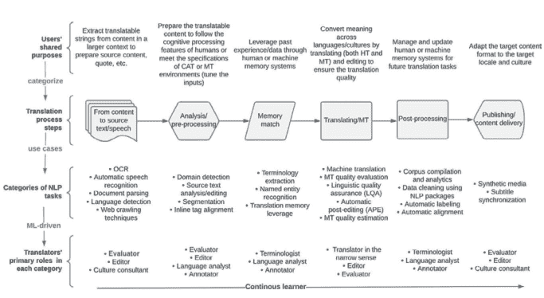

## FIGURE 9.1 Translator roles in ML task categories


这些角色密切相关。例如，评估员和编辑很可能本质上就是翻译人员。这里我们故意使用“编辑”这一术语，而非“后编辑”。在某种程度上，所有编辑都是任务“post”之后的工作。然而，在大多数情况下，当编辑涉及不同的分段级别时，人类的感觉并不相同。如前所述，翻译人员/编辑可能感觉自己正在翻译，即使是在基于短语的交互式机器翻译中编辑机器翻译结果。从这个意义上说，他们不觉得自己的认知活动滞后于机器翻译建议。此外，如第5章第5.3节所讨论，机器翻译质量评估有两种思路，而编辑是紧随评估之后的场景。

这些角色不一定涉及翻译本身，即意义转换步骤。例如，评估员或编辑可以在分析/预处理步骤中评估或编辑源文本（预编辑），或在内容提取步骤中处理OCR结果，此外还可以在翻译/机器翻译步骤中处理翻译结果。相同的角色名称可能指不同的工作职责和能力，具体取决于它们关联的本地化步骤。

这些角色可能从不同角度处理同一主题。例如，语言分析员和标注员的工作都专注于语言数据。然而，前者使用数据来回答他们的问题，而后者则向数据中添加人类洞察。语言分析员和标注员大多在围绕语言数据的步骤中工作，包括分析/预处理、记忆匹配和后处理。在某种程度上，当编辑添加额外信息（例如，在翻译/机器翻译步骤中的错误类别）时，他们也可以是标注员。在这里，我们将它们视为两个独立的角色，因为它们有不同的侧重点，一个侧重于编辑，另一个侧重于标注。

这些角色可能表示不同的覆盖范围。例如，术语学家主要在记忆匹配和后处理步骤中处理专业术语及其相关概念。这并不意味着其他步骤不需要术语学考虑。然而，它们在源语言和目标语言的数据匹配与分析中最有用。同样，文化顾问的角色听起来可能过于笼统，不适用于所有步骤。实际上，它主要与内容提取和发布步骤相关，此时语言元素退居二线，文化考量成为焦点。在这个语境下，与翻译或本地化流程相关的任何文化考量（例如，法律事务、习俗和禁忌）都与文化顾问相关。

此外，一个总体角色是持续学习者。翻译人员需要能够从任务、数据和机器学习模型中学习，以跟上机器学习的动态变化。如下一节将讨论的那样，机器学习能力与持续学习能力作为一个总体构念相耦合，以使翻译人员能够在每个步骤中有效发挥作用。

随着这些不断演变的角色，将任务分配并给翻译过程中的各参与者（包括翻译人员、项目经理和语言分析员）分配相关资源至关重要，这样才能让他们充分发挥优势。因此，翻译教育需要解决每个角色的具体特征。例如，面向源文本的可比语料库可以帮助翻译人员理解专业知识，并确保目标文本符合目标语言习惯。对于专注于单一语言语言分析的语言专家来说，双语技能可能不是其教育和培训需要解决的要求。

### 9.3 由机器学习引发的翻译人员能力

#### 9.3.1 持续翻译过程中的主要能力

文献中对翻译人员能力有广泛讨论（例如，Albir, 2010, 2017）。正如Baartman和Ruijin（2011）所述，能力“通常被定义为由知识、技能和态度的综合组成部分构成……并被假定为胜任工作的先决条件”（第126页；另见Lizzo & Wilson, 2004；Eraut, 1994）。对于在机器学习驱动的翻译过程中工作的翻译人员，每个步骤都有一些有用的主要能力。

在本节中，我们考虑最相关的能力，这些能力使翻译人员能够在持续翻译过程中执行自然语言处理任务。对应每个任务类别中的主要角色，我们列出了图9.2中与每个步骤相关的新兴机器学习应用驱动的能力。我们再次使用“primary”来强调，这些能力是根据机器学习系统用户的共同目的进行分类的。它们是示例，可以进一步定制或个性化以

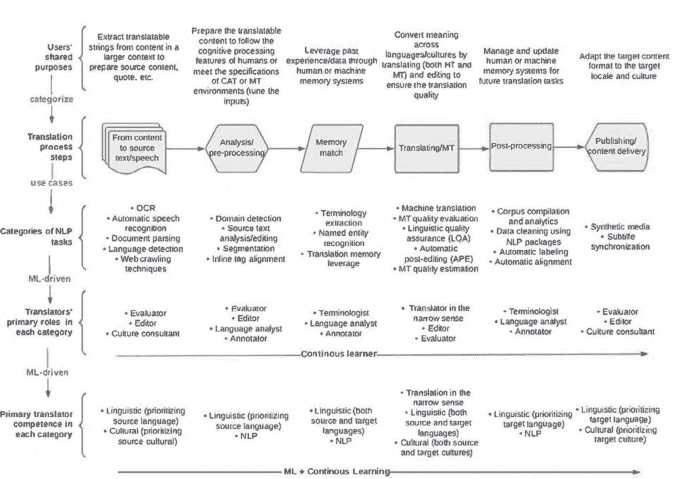

图9.2 持续翻译过程中的机器学习相关能力

以满足特定用户目的。当某项能力未在特定步骤中列出时，并不意味着该能力不必要，而是列出的其他能力可能对该步骤更相关。例如，有人可能会认为语言能力和文化能力是通用的，适用于每个步骤。然而，当内容涉及本地化产品时不仅涉及语言因素，还涉及非语言因素，文化能力在内容提取和发布步骤中凸显出来。

一般来说，每个步骤所需的主要能力取决于上下文和项目目标。具体来说，在每个步骤应用能力和技能集时有两点考虑：（1）需要哪些角色，如何确定培训优先级？（2）哪种工具最有用？例如，在第5步，人类在翻译记忆/CAT环境之外进行上下文审阅通常更高效。

#### 9.3.2 两项总体的机器学习驱动翻译人员能力

在图9.2列出的能力中，有两项贯穿整个翻译过程，因此被视为总体构念，即机器学习相关能力和持续学习能力。两者都关于学习，包括机器学习和人类学习。

##### 9.3.2.1 机器学习相关能力

这项能力使翻译人员能够将与翻译相关的语言问题映射到自然语言处理任务框架中。它使翻译人员能够使用相关机器学习技术更有效地执行翻译任务，并促进与翻译相关的学习，如第8章第8.3节和8.4节所讨论。

机器学习系统用户需要能够：（1）将机器学习系统（即机器翻译）应用于不同任务，例如，使用机器翻译进行翻译和生成合成数据；（2）设计自身用例，使用多个机器学习系统，例如，使用机器翻译和机器翻译质量估计系统来估算编辑工作量；（3）解释机器学习系统生成的结果，例如，理解机器翻译自动评估系统生成的BLEU分数；（4）识别和分析相关技术细节，以充分利用人力与机器力量。这需要解决一系列问题：源文本应由人类、机器还是两者共同翻译，以及什么样的平衡比较合适？哪种机器翻译系统最适合此任务？谁是与机器翻译结果合作的最佳语言服务提供商？我们将从将机器学习纳入翻译教学的角度，在第9.4.2节进一步讨论这些方面。

翻译人员在学习过程初期可能无法为翻译问题找到最佳的自然语言处理解决方案。不过，使用工具的好处在于，翻译人员可以检查结果以评判解决方案的质量。因此，这些技术不断发展，功能良好的技术得以保留。要获得这项能力，翻译人员需要学习机器学习词汇和基础

相关 NLP 技术的功能，以及 ML 方法的能力与局限性，以及失败时的相关成本。

##### 9.3.2.2 Continuous learning competence

持续学习能力首先是一种学习能力，这意味着学习者不仅要获取，还要整合知识、技能和态度。关键在于在 ML 中积累和更新数据，并提供 HL 经验以构建 ML 专业知识。在机器学习的情况下，学习者应能够使用 ML 工具积累、标注和管理语言数据以训练机器。

在人工学习场景中，借助 ML 工具，译者可以使用先进技术来增强其记录、分类和分析在持续进行的翻译和本地化项目中生成的语言数据的能力。通常，大型文本语料库包含的人类译者一生都无法处理的更多数据。随着 ML 和其他先进技术的应用，持续学习的范围可以相应地扩大。

#### 9.3.3 NLP task-specific competences

##### 9.3.3.1 Translation competence in the narrow sense

该能力涵盖所有类型的传统翻译能力，包括翻译、评估、编辑、审阅和校对所需的知识、技能和态度。它涉及译者在翻译本身（即意义转换）中有效运作所需的能力，包括与翻译相关的语言分析，以及意义转换过程中的语用和语义考量。这些方面与其他能力（例如语言能力和文化能力）相关，但在翻译/MT 步骤中，我们关注狭义的跨语言翻译活动。

翻译能力的一个特征是，受 ML 影响，编辑和评估的作用日益重要。随着 MT 执行翻译任务，人类更多地倾向于评估和编辑，在许多情况下，这在语言水平、翻译策略和语用方面要求更高的翻译能力。简单来说，如果人类译者无法向机器翻译提供建设性反馈，那么该译者就最适合从事评估和编辑任务。

当用户在翻译/MT 步骤中考虑术语翻译时，术语知识和技能是翻译能力的一部分。它还可以包含在记忆检查和后处理步骤中，并可能侧重于识别专业术语和概念，或根据上下文在目标语言中找到这些术语的适当对等词。在这两种情况下，术语活动不一定属于狭义的翻译，例如，术语识别可以仅在源文本中进行，而在目标文化中选择合适术语可能仅在目标文本中完成。

##### 9.3.3.2 Linguistic competence

该能力使译者能够在持续翻译过程中执行语言任务。它包括源语言和目标语言的知识和技能。一个相关因素是学习者是单语者还是双语者。在整体方法中，持续翻译过程的每个步骤，语言要求都不同。特别是，受 ML 影响，翻译过程中的语言能力具有一些新特征。

- (1) Handling small fragments in a translation-related task

关于哪些任务适合人类，必须考虑文本长度。例如，用于文本分类或领域分类的 NLP 技术可以快速高效地处理大量文档。然而，对于机器来说，处理没有明确模式的小文本片段效率不高。相比之下，人类在处理碎片化信息时可以非常灵活。

ML 应用产生的一个具体特征是，译者、语言学家或其他领域专家需要确保在更大语境中碎片化信息的一致性。以 NMT 为例。NMT 由其自身规则驱动，因此可以为同一信息得出不同的翻译。例如，对于‘translation 中的 machine learning’这一概念，系统可能会返回多个结果，如 Machine Learning in Translation、ML in translation 和 MLinTrans，这与人类类似。在这种情况下，人类必须检查结果并确保更大语境中的连贯性。

- (2) Evaluating, editing, and adding other human insights

在 ML/AI 时代，由于人类是 ML 结果的最终读者或受众，人类在验证 ML 技术结果和确保目标文本质量方面发挥着不可替代的作用。此外，如果人类译者注意到错误模式，他们可以通过正则表达式和其他自动话语分析工具进一步自动化审查和纠错过程，以扩大其质量保证工作的规模。

- (3) Coordinating between linguistic and non-linguistic elements

在许多情况下，与翻译相关的 ML 系统，例如 NMT 引擎，不仅基于一个系统，还集成了视觉和声音等其他系统。这本身就是人工智能的一大挑战。近年来，已有研究针对这一挑战开展。例如，多模态机器翻译涉及从多个模态中获取信息，基于这样一个假设：附加模态将包含输入数据的有用替代视图（Sulubacak et al., 2020）。Sulubacak et al. (2020) 列举了一些多模态翻译任务的突出示例，例如图像引导翻译（IGT）、视频引导翻译（VGT）和口语语言翻译（SLT），以此与单模态翻译任务（如基于文本的机器翻译（MT）和语音到语音翻译（S2S））以及不涉及翻译的多模态 NLP 任务（如自动语音识别（ASR）、图像字幕生成（IC）和视频描述（VD））形成对比。这是 ML 在语言行业应用的新领域，要求人类在使用和训练 ML 系统时具备协调多项任务的能力。正如 Stein et al. (2009) 所指出的，人类能够进行多感觉整合，这描述了来自不同感觉系统的信息被结合以影响感知、决策和外显行为的过程。

##### 9.3.3.3 NLP competence

该能力是指在 ML 驱动的本地化过程中工作的译者（广义上）所需的知识、技能和态度。它包括语料语言学、统计分析以及其他 NLP 任务，例如使用正则表达式（参见第 7 章第 7.5.1.1 节）。它与我们在上一节讨论的语言能力相关。然而，它更多地涉及语言分析和数据标注任务，正如我们在第 9.2.5 节中关于语言分析员和标注员角色所讨论的那样。它主要用于与翻译分析相关的步骤，即分析/预处理、记忆匹配和后处理。

凭借这项能力，译者或语言学家主要处理语言数据，包括真实数据（即语料）和合成数据（例如，由 MT 引擎生成的数据）。它包括：(1) 数据准备，例如，在分析/预处理步骤中使用 NLP 工具爬取网站以创建语料库；(2) 数据标注，这是一项对多个步骤都有用的任务，旨在将额外的人类洞察传达给 ML 系统；(3) 数据分析，例如，预处理中的源文本分析和改进，以及后处理中翻译记忆的自动话语分析；以及 (4) 其他 NLP 相关任务，例如，使用正则表达式搜索相关内容，这在处理语言数据的所有步骤中都可能有用。

##### 9.3.3.4 Cultural competence

计算机程序擅长观察语言行为并为人类提供有用的洞察。当我们将某些 NLP 任务委托给机器时，人类的认知负荷会降低，这反过来使他们能够专注于更具创造性或更复杂的翻译任务，包括文化任务，如第 9.2.3 节所讨论。因此，更加强调在译者中发展文化能力是有道理的。

在翻译培训中，文化能力有许多方面，这在翻译文献中已被广泛讨论（例如，Tomozeiu et al., 2016; Albir & Olalla-Soler, 2016; Albir, 2017; Asiri & Metwally, 2020）。首先，它

包含关于不同符号系统的知识、技能和态度。当符号与翻译任务相关时——无论是声音、纸上的标记、绘画还是雕塑——翻译者需要熟悉它们以解决特定的翻译问题。其次，文化胜任力要求翻译者能够构建相关语境，有效地解读信息。在实际翻译任务中，翻译者应能运用认知策略，构建来自外部世界的现象的最相关内部表征，并在最大化其相关性的语境中对其进行处理。第三，文化胜任力意味着翻译者能够获取并整合知识、技能和态度的片段，并将其组织成反映其关系的系统结构。第四，文化胜任力意味着翻译者能够进行迁移。在大多数情况下，不同系统或领域的知识结构之间存在失衡，因为它们是在翻译者不同的环境和不同年龄阶段学习或习得的（Wang, 2019, 第286–287页）。迁移是前提条件，即一个人需要将其原有或源文化或专业领域的现有知识和技能迁移，以学习另一种文化中的含义，如第8章第8.2.2节中多语言语言模型的示例所示。

### 9.4 机器学习对翻译教育的影响

#### 9.4.1 两种学习环境中教育者的角色

在本讨论中，我们广义地使用“教育者”一词，指提供指导或教育的人。与此术语相关的职位有很多，包括教师、培训师和讲师。

在第8章中，我们讨论了两种适用于机器学习（ML）和人类学习（HL）的学习环境：(1) 自下而上、以学习者为中心；以及(2) 自上而下、由教育者引导。这两种方法区分了教育者的两种基本角色：学习促进者和知识传递者。遵循自上而下方法的教育者设计教学材料以传递知识并发展学习者的技能，例如在连续过程的每个步骤中涵盖的通用能力和特定能力。然而，在以学习者为中心的方法中，教育者从课堂上作为权威的主导角色退居其次，转而在沟通和学习过程中担任促进者的角色，通常是通过提供帮助学习者自行发现规律的任务并给予反馈来实现。

在两种类型的学习环境中，教育者都是高级学习者，他们已掌握要传递给新学习者的知识和技能，无论是在教育者引导的场景还是以学习者为中心的场景中。前者是传统的教学环境，后者类似于受监督的机器学习环境，教育者组织训练数据，即任务中的问题作为输入，对这些问题的更正答案作为输出。

#### 9.4.2 将ML融入翻译教学

在自上而下、由教育者引导的学习场景中，教育者可以将最相关的ML知识纳入课程设计，以提升整体翻译胜任力，如第9.3节所讨论。

将ML知识融入教学的一项挑战在于其多样性和动态性。在第6章中，我们总结了连续翻译过程中一些典型的NLP任务。该列表基于适用于许多翻译者的一般场景假设。然而，在实际项目中，它可能不够全面，或者某些项目与某些翻译者无关。因此，在向学习者介绍ML知识时，有几个基本考虑因素。

首先，介绍ML知识的目的是增强人类知识和专业知识。也就是说，优先考虑人类，以及如何帮助翻译者、项目经理和其他领域专家适应新的机器学习驱动的翻译/本地化流程。因此，教育者需要考虑的基本问题包括机器学习驱动翻译过程中人类的真正价值以及发挥人类能力的最佳方式。例如，如果翻译者/后编辑审阅了100句机器翻译结果，但只有1句需要修改，那么人类潜力将未被充分利用，因为该任务效率低下，且人类智能未被充分发挥。在这种情况下，如果教师教授学生诸如机器翻译质量评估等新技能（该技能可以识别需要人工后编辑的句子），翻译者在编辑任务中将能够更好地利用时间。还有许多其他NLP技术可以帮助我们找到最大化人类努力和学习的解决方案，包括面向源文本的可比语料库编译与分析、从翻译者视角进行的源文本分析与编辑，以及使用正则表达式对目标文本进行语言质量保证。

其次，ML知识的教学和技能发展必须能够帮助学习者进行泛化，正如我们在第8章中讨论的，泛化是机器学习和人类学习的本质。换言之，教师应能为学生提供足够的基础ML技术知识，使他们能够基于课堂上未见过的情况进行推理并创造新的技术解决方案。以下是一些表明学生泛化能力的具体方面。

- 1. 学生能够使用多种NLP技术设计自己的用例。例如，在第5章中，我们讨论了使用人类目标误差率（HTER）来评估质量评估（QE）的准确性。另一个例子是源文本分析。有多种方法，包括使用自动话语分析工具观察语言行为、使用NLP包从文本中提取相关特征，以及使用命名实体识别（NER）来识别专有名称和日期/时间等关键信息（实体）。

- 2. 学生能够将一种NLP技术应用于不同任务。例如，正则表达式（参见第7章第7.5.1.1节）既可用于机器翻译后编辑阶段的自动错误识别，也可用于分析/预处理阶段的自动分段。另一个例子是将翻译记忆（TM）用于多种目的：当学生学习如何清理TM以避免利用损失（即，由于不同的数据格式、系统设置或其他因素，某些片段未被另一个系统识别）时，他们可以使用相同的技术进行机器翻译训练以及不同翻译环境之间的数据迁移。

- 3. 学生能够解读自动化NLP技术生成的结果。例如，当学生学习第5章第5.4.1节讨论的自动化机器翻译评估指标BLEU分数时，他们应该能够说明影响结果的因素并控制这些变量，以确保BLEU分数的可信度和可靠性。典型例子包括算法中使用了多少篇参考译文、该指标是用于衡量统计机器翻译还是基于规则的机器翻译，以及参考译文之前是由人类翻译者从头完成，还是机器翻译后编辑的结果。

- 4. 学生能够识别和分析相关技术细节，以帮助他们充分利用人力和机器能力。例如，学生应该能够找出每个工具的自动化部分在哪里：翻译记忆包括分段自动化和自动TM管理（包括一致性检索，有时还包括正则表达式）。机器翻译指标可以实现自动化：用于翻译错误类型学（如MQM）的指标主要用于人工，但错误的计数和简单分析可以自动化，例如每种错误类型的百分比。有了这些信息，学生将能够得出结论，确定何时何地使用人力资源来弥补自动化的不足。

第三，即使在自上而下的教学方法中，近年来也更加注重学习，认识到在翻译课程中选择包含最相关ML知识的重要性。这里，“相关性”是一个心理学概念，也考虑了每个学习者的个性和人格。正如Wilson和Sperber（1994）所建议：“如果信息以某种方式与你关于世界的现有假设相互作用，那么该信息对你是相关的”（第92页）。一般来说，许多教学环境涉及一对多教学环境中的学生-教师关系，例如课堂讲座。在这些环境中，教师需要在连续翻译过程的每个步骤中调查学生的集体期望和学习需求，准备与他们分享的相关知识，并为这些领域的技能发展制定教学计划。

#### 9.4.3 ML在以学习者为中心的环境中的影响

以学习者为中心的教学提供个性化和定制化的学习，考虑学习者带到课堂上的内容，例如他们的现有的

知识、技能和态度。教师需要花费时间和精力分析学习者的背景和个人需求，这导致教学工作量增加（Pantiru et al., 2012）。在同时关注个体学习者和学习的双重视角下，教育者在以学习者为中心的环境中的角色已从仅仅传递内容和控制学习环境，演变为积极地让学习者参与创建他们自己的学习。特别是，学习环境是一个具有启发性、动态性和互动性的环境，教师和学习者共同协作（见 Tawalbeh et al., 2015; Kiraly, 2014, 2015）。

以学习者为中心的方法面临的一个主要挑战是学习评估不足。正如 Tawalbeh et al. (2015) 所总结的，对于教师评估学习者以促进学习的评估，教师会持续提供学习者进度的反馈，并帮助学习者发展自我评估技能。但是，他们也指出，

> 巨大的工作量由旨在大型班级中以学习者为中心的学习方法的多次评估产生，以及无法及时提供结果，往往导致讲师即使认识到以学习者为中心的方法的好处，也仍维持以教师为中心的学习方法。
> 
> （第 40 页；另见 Bayat & Naicker, 2012）

为应对这一挑战，Rich et al. (2014) 建议教师创建以学习者为中心的评估策略，例如带回家的考试、简答测试、形成性总结性评估（FSA）和观众响应系统（ARS），并使教学和评估能够回应学生的学习偏好。这意味着教师需要创建多种形式的评估以匹配学生的学习风格，这可以通过消除不舒服的测试格式可能造成的障碍，促进学生在其能力水平上的表现。同样，以学习者为中心的评估任务是耗时的。

ML 技术可以为解决翻译教育中的这一问题提供可行的方案。如前面在第 8 章中所讨论的，智能工具可以通过持续的机器学习和人机交互进行定制和个性化。在该章中，我们还介绍了一个案例研究，使用机器智能辅导系统（ITSs）向学习者提供即时且个性化的教学或反馈。在这种方法中，机器学习结果可以提供补充性见解和参考，以协助人类学习。由于 ML 使用统计推断，通常关注符号的物质方面，并从更一般、客观和“集体”的角度处理信息，因此它提供的见解可以作为个人反思的有用参考。因此，定制和个性化过程可以被视为机器和人类共同的学习过程。一旦工具被个性化，它将反映更多的个人特征而非集体特征。那时，工具的主要用途是支持翻译任务，而不是提供学习机会。尽管如此，人类最终会将心中所想与智能工具所产生的内容进行比较，而这种比较可以产生学习效果。技术让我们注意到先前可能隐藏的内容，从而探索新的学习领域。

#### 9.4.4 为教育者和学习者构建学习平台

技术之所以有吸引力，并非因为技术本身，而是因为与它的交流如此引人入胜。对于计算机专家或热情的游戏玩家来说，吸引他们注意力的是交互。与在许多情况下不做出回应的人类不同，机器总是勤奋地为你提供答案，尽管有时答案并不令人满意，但这可以激励你继续与之互动。这是人性：你之所以对某事感兴趣，并非因为该事物本身有趣，而归根结底是因为当你参与其中时，你发现它与你相关并满足你自己的需求，所以觉得它有趣。

顺着这一思路，我们提议建立一个为教育者和学习者都提供个性化系统的学习平台，因为教育者也是高级学习者，该平台融合了自上而下和自下而上的知识与学习。个性化功能将允许学习者选择最相关的知识和练习来发展他们的技能。该平台既可以是个人的，也可以是交流的。学习者可以拥有自己的个性化系统，但在定制并共同完成一个自然语言处理（NLP）任务时，也能与其学习社区中的其他人一起学习。该社区支持初学者和高级学习者，包括教育者和经验丰富的翻译人员，在他们（持续的）学习中共同进行翻译和本地化。

此学习系统还可以帮助学习者创建、收集、更新、管理和保护其数据资源。在第 8 章中，我们讨论了 ML 技术的集体特性。ML 系统不像神经机器翻译（NMT）定制那样对应于多个人，而是针对个人量身定制，每个人都有自己的内部多语言模型，用于在交流过程中处理自然语言。集体的、通用的 ML 系统是个性化的起点。与间接与数据生成器协作的定制相比，个性化的 ML 系统与个人内部语言模型相似的概率要高得多，而这两个模型之间的相似性更有可能导致 ML 系统生成令人满意的结果，其含义是结果与人类语言模型可能产生的结果一致。此外，个性化的 ML 系统意味着人类在翻译过程中对语言数据有更好的控制和交互。学习者可以使用数据进行多个自然语言处理（NLP）任务，也可以发现模式。

### 9.5 ML 背景下教育者的价值

正如 Webb et al. (2021) 指出的，ML 系统正在“渗透我们的生活，并开始在我们的教育系统中变得重要”（第 2109 页）。虽然教育者开始使用 ML 方法和框架来创新我们的教学法，但正如 Webb et al. (2021) 所展示的，教育者在人类学习过程中的角色需要更多关注。比以往任何时候都更甚，这个问题是相关的：随着 ML 影响力的日益增大，教育者的真正价值是什么？在触手可及的数字化信息世界中，我们认为，教师在帮助理解信息（这些信息可能无结构且杂乱无章）以及培养学生的技术素养和信息素养方面发挥着至关重要的作用，这是利用 ML 能力开展交流性、以人为本教学方法的重要组成部分。也就是说，人类学习者需要与其他人类互动并建立共享环境，这是构建更抽象知识的物理现实。人类教学之所以有帮助且被需要，不仅在于它能提供的信息质量，更在于教师与学习者之间共享的共情。人类在语言以及通过语言传达和理解的物理世界和精神世界方面拥有相似的经验和感受。从这个共同基础出发，学习者可以在作为高级学习者的教育者支持下验证他们的假设和推理模型，使更大规模的概括以及向不同任务的迁移成为可能且有用。ML 技术可以帮助教师关注教学中的人性部分，而非取代人类教学。

## 注释

- 1 人工智能大致分为两个发展阶段：人工窄智能（ANI）和复杂得多的人工通用智能（AGI）。目前所有可用的 AI 系统都是 ANI。这包括语音助手或自动驾驶汽车等看起来可能相当复杂的系统。根据 Ng (2021)，此类 AI 系统仅适用于边界清晰的活动领域，例如使用特定主题的典型问题和答案数据库的聊天机器人：“人工智能最近的几乎所有进步都是通过那种类型实现的，其中某些输入数据 A 用于快速生成简单响应 B。构建此算法的技术术语是‘监督学习’”（n.p.）。
- 2 翻译作为一个整体并非一项简单任务，但如果它可以像在持续翻译过程中讨论的那样被解构为小组件，AI/ML 可以处理每个组件任务。


## 尾声 – 翻译中以人为本的机器学习

回顾人类发展的历史，不难发现，人类的演进与工具和技术的发展密切相关。当技术使人从任务中解放出来时，它让人们能够在身体和精神上探索新的疆域。然而，机器学习带来的远不止是人机分工的进步。其学习能力使其能够基于有限的观察独立地进行概括和预测。从这个意义上讲，机器学习系统能够创造出新事物，而这不一定与人类推断产生的结果相同。

面对一个或许比历史上任何其他工具都更少受人类控制的黑箱，人们对其能力持有复杂情感，既有拥护者也有反对者。本书主张一种整体的机器学习方法，考虑人类与机器各自的角色，使优势与劣势相互弥补，从而优化翻译工作流程和学习过程。

在神经网络语言模型中，机器感知为我们提供了一种工具，用于审视执行翻译任务时的认知活动。尽管在许多情况下它过度简化了心理语言模型，但它提供了我们心理语言模型可能运作方式的初步可视化。换句话说，机器学习是一种人类对自身的反思形式，既包括对自身认知活动的内部反思，也包括对周围物理世界的外部反思。它是我们的一部分，反映了人类本性，这也是我们为何被它所吸引。

顺着这一思路，本书在翻译领域提出了一种人机协同、以人为本的机器学习方法，其中译者能够完全掌控最终决策，并能根据自身特定需求对通用机器学习模型进行个性化定制。这种方法能够为译者提供工作的全新视角，从而激发创造力。这种方法提供了人类或机器各自无法单独完成的成果。然而，由于机器学习非常新且动态，大多数用户缺乏足够的相关能力，无法在实际项目中主动地实施、定制和个性化机器学习。

本书通过帮助译者理解并适应机器学习在翻译工作流程和学习过程中的集成，来弥补这一差距。本书从用户视角审视机器学习，特别是不同机器学习经验水平的翻译从业者，以及熟悉语言学和翻译理论、并旨在学习和实践中使用机器学习技术的人文科学专业学生。本书强调一种以人为本的方法，面向广义的翻译从业者，通过向他们提供关于翻译中机器学习、机器学习相关沟通以及持续学习资源的最相关知识来赋能他们。

### 以机器学习知识赋能译者

在人工智能的早期阶段，当艾伦·图灵和约翰·塞尔等学者研究人工智能和机器学习时，它被视为智能领域的一个子学科，与哲学、教育学和语言学密切相关。随着发展，人工智能逐渐成为科学与技术研究领域内的一门独立学科。然而，随着在创建基础机器学习模型方面摘取容易实现的成果，语言行业现在能够考虑如何通过实施、定制和个性化这些模型来用于实际场景。要实现这一目标，计算科学家与作为领域专家的译者之间需要协作与沟通。

这并非易事，因为这些人群对机器学习专业知识和技能的接触程度各不相同，而且，虽然机器学习技术的开发需要工程背景，但其使用需要全局视角，需考虑优势与劣势、工作流程以及伦理问题和后果等方面。一方面，向用户分享相关技术知识非常重要，以便他们在翻译中使用机器学习技术时能做出负责任且明智的决策。例如，如果要求编辑编辑XML内联标签，就需要让他们知道这些标签的含义。如果希望用户利用向量空间来表示含义，就需要向他们提供生成向量的语料库信息，以便他们能够从人类视角分析语料库和机器生成的洞察。通过阐明相关技术细节，人类译者能够更高效、更有效地完成项目。另一方面，不建议提供过多技术信息，因为这可能会让译者感到压力，而不是帮助他们专注于自己最擅长的工作，即翻译和编辑。

### 以机器学习相关沟通赋能译者

技术与人类之间的二元对立，本质上是人类自身之间的分裂，例如，拥有高级机器学习知识和技术并创造技术的人，以及机器学习能力有限、熟悉主动或被动使用技术的业务场景的人。在翻译过程中，机器学习相关沟通发生在多个个人群体之间和跨群体之间，包括AI/机器学习开发者和程序员、作为AI/机器翻译程序用户的译者，以及管理人力、数据和技术资源的项目经理。具体而言，译者通过处理语言数据、翻译、后编辑和标注的工作与计算机程序进行交互。

翻译中以人为本的机器学习方法涵盖所有类型的利益相关者，包括教育工作者、机器学习用户以及机器学习开发者/程序员。作为机器学习技术用户，译者将从与机器学习开发者的沟通中受益，开发者可以帮助解决译者在定制或个性化机器学习技术时面临的知识差距。机器学习开发者也能从译者等领域专家中受益，译者可以帮助他们更好地理解翻译工作流程、设计用户友好的工具，以及掌握翻译的伦理和社会文化层面。

由于机器学习系统可以产生大量数据，在许多情况下，使用机器与其他机器协作或相互核查是有意义的。例如，机器翻译加快了翻译过程，从而导致其他步骤的自动化，例如自动后编辑和机器翻译自动质量评估。所有这些步骤不仅需要技术专长，还需要翻译过程不同阶段所需的不同领域知识。相关工具的设计、开发和升级将受益于利益相关者之间的有效沟通，有助于确保自动化结果的质量，并考虑伦理问题。

技术不应阻碍沟通，就像来电者联系客服中心时，旨在引导客户找到合适人工客服的机器学习却让客户感到沮丧，因为它阻碍了与另一个人直接交流。在机器翻译环境中，如果将机器翻译部署作为排除翻译过程中人类参与的借口，这将导致单一视角，并在译者中引发抵触情绪。

讽刺的是，沟通的概念意味着障碍和差异的存在。人类生成的消息反映了他们独特的认知视角。然而，沟通过程优先考虑共同点，因为沟通需要共同理解才能成功。就此而言，本书的一个目标是在我们的各利益相关者之间最大限度地提升对机器学习在翻译过程中作用的共同理解。

### 以持续学习赋能译者

在由机器学习驱动的翻译过程中，当目标是提高系统性能时，机器学习成为关注焦点是可以理解的。然而，从长远来看，一个问题浮现出来：译者是否会从机器学习的实施和定制过程中学习。理论上，在一


以人为本的方法，整个翻译过程由能够利用ML结果的翻译人员驱动。这一角色要求对ML系统有概念性理解，而这至少在初期具有陡峭的学习曲线，因为这些系统是新的且动态的。

鉴于此情况，我们关注ML与HL之间的不平衡，以及开发ML/AI工具以辅助翻译人员进行ML驱动翻译过程的必要性。个性化是促进人机交互的有效方式，其中翻译人员不仅在训练机器，还在从ML资源和结果中学习。通过定制和个性化，翻译人员可以完全控制其语言资产，并利用ML教育工具促进有效的人类学习。作为语言数据的创建者、收集者和管理者，翻译人员和其他领域专家在机器训练中发挥着重要作用。

领域专家学习ML技术的一大障碍是缺乏访问基于其目的的可个性化ML模型和平台的权限。在本书中，我们提出通过人驱动的ML系统促进人类学习，这些系统是针对翻译中特定NLP任务的通用ML模型。此类模型可以由个人用户个性化，其主要角色是根据其意图提供相关语言数据。包含人驱动的ML系统并融合持续本地化过程每个步骤目标的平台，是帮助翻译人员获取ML知识和专长并学习翻译相关技能的有效工具。

翻译人员学习是增强对机器学习信心的关键。如前所述，机器学习就像一个黑箱，其受到的人为控制比之前的其他工具要少。技术不应阻碍人类学习；相反，它应使能并赋能翻译人员，让他们不断探索其物理世界和精神世界的新疆域。尽管机器学习具有泛化和预测的自身能力，但人类的最终优势是我们独特的学习能力。如果ML与HL之间存在竞争，翻译人员目前将占据上风，因为我们的学习能力更优，而“更好”的定义基于人类经验。

## REFERENCES

- Aharoni, R., Johnson, M., & Firat, O. (2019). 大规模多语言神经机翻译. In 计算语言学协会北美分会2019年会议论文集：人类语言技术 (vol. 1, pp. 3874–3884). 计算语言学协会. https://aclanthology.org/N19-1388
- Albir, A. H. (2010). 胜任力. In Y. Gambier & L. V. Doorslaer (Eds.), 翻译研究手册：第1卷 (pp. 55–59). John Benjamins.
- Albir, A. H. (Ed.). (2017). 通过PACTE小组研究翻译胜任力. John Benjamins.
- Albir, A. H., & Olalla-Soler, C. (2016). 评估翻译培训中跨文化胜任力获取的程序. 口译与翻译培训, 10(3), 318–342. https://doi.org/10.1080/1750399X.2016.1236561
- ALPAC. (1966). 语言与机器：翻译与语言学中的计算机. 自动语言处理咨询委员会报告. 国家科学院，国家研究委员会. https://nap.nationalacademies.org/resource/alpac_lm/ARC0000005.pdf
- Ambrose, S. A., Bridges, M. W., DiPietro, M., Lovett, M. C., & Norman, M.K. (2010). 学习是如何运作的：智慧教学的七条基于研究的原则. Jossey-Bass.
- Amos, R., & Pickering, M. (2020). 同声传译中预测的理论. 双语：语言与认知, 23(4), 706–715. https://doi.org/10.1017/S1366728919000671
- Andrey Markov. (2022, July 20). 维基百科. https://en.wikipedia.org/w/index.php?title=Andrey_Markov&oldid=1099443977
- Arivazhagan, N., Bapna, A., Firat, O., Lepikhin, D., Johnson, M., Krikun, M., Chen, M. X., Cao, Y., Foster, G. F., Cherry, C., Macherey, W., Chen, Z., & Wu, Y. (2019). 野外大规模多语言神经机翻译：发现与挑战. CoRR, abs/1907.05019, 27页. https://doi.org/10.48550/arXiv.1907.05019
- Asiri, S. A. M., & Metwally, A. A. (2020). 语言和文化胜任力对翻译质量的影响：翻译问题的教学见解. 语言教学与研究期刊, 11(30), 509–520. www.academypublication.com/issues2/jltr/vol11/03/22.pdf
- Baartman, L. K. J., & de Bruijin, E. (2011). 整合知识、技能和态度：朝向职业胜任力的学习过程概念化. 教育研究评论, 6(2), 125–134. https://doi.org/10.1016/j.edurev.2011.03.001
- Baker, M. (1992). 换言之：翻译教程. Routledge.
- Banerjee, S., & Lavie, A. (2005). METEOR：一种用于MT评估的自动度量，与人类判断的相关性得到改进. In 机器翻译和/或摘要的内在和外在评估措施ACL研讨会论文集 (pp. 65–72). 计算语言学协会. https://aclanthology.org/W05-0909
- Banitata, L., Park, S., & Park, S. (2018). 一种利用多任务学习(MTL)的阿拉伯方言神经机翻译模型. 计算智能与神经科学, 2018, 10页. 文章编号：7534712. https://doi.org/10.1155/2018/7534712
- Bar-Hillel, Y. (1959). 关于美国和英国机器翻译现状的报告. 附录IV. 美国海军研究办公室. https://aclanthology.org/www.mt-archive.info/50/Bar-Hillel-1959.pdf
- Barrow, H. (1996). 连接主义与神经网络. In M. A. Boden (Ed.), 人工智能. 知觉与认知手册 (pp. 135–155). Academic Press.
- Bassnett, S. (2014). 翻译研究 (第4版). Routledge.
- Bayat, A., & Naicker, V. (2012). 迈向以学习者为中心的方法：互动式在线同伴评估. 南非高等教育期刊, 26(5), 891–907. https://doi.org/10.20853/26-5-200
- Bellamy, L., Carey, M., & Scholtfeldt, J. (2011). DITA最佳实践：DITA编写、编辑和架构设计路线图. Pearson Education.
- Bengio, Y., Ducharme, R., Vincent, P., & Janvin, C. (2003). 一种神经概率语言模型. 机器学习研究杂志, 3, 1137–1155. www.jmlr.org/papers/volume3/bengio03a/bengio03a.pdf
- Benoit, T. (1982). METEO系统. In V. Lawson (Ed.), 机器翻译的实践经验 (pp. 39–44). North-Holland. https://aclanthology.org/www.mt-archive.info/70/Aslib-1981-Thouin.pdf
- Berlinski, D. (2011). 一，二，三：绝对基础数学. Pantheon.
- Biber, D., Conrad, S., & Reppen, R. (1998). 语料库语言学. 剑桥大学出版社.
- Bird, S., Klein, E., & Loper, E. (2019, September 4). 前言. 用Python进行自然语言处理. www.nltk.org/book/ch00.html
- Boleda, G. (2020). 分布式语义学与语言理论. 语言学年度评论, 6, 213–223.
- BootCaT. (2018, March 15). BootCaT：从网络引导语料库和术语的简单实用程序. 2022年7月18日检索，来自 https://bootcat.dipintra.it/
- Bowker, L., & Pearson, J. (2002). 使用专业语言. Routledge.
- Brauer, J. (2014). 大脑与语言：我们的大脑如何交流. 青少年前沿, 2(14). https://kids.frontiersin.org/articles/10.3389/frym.2014.00014#ref2
- Brown, P. F., Cocke, J., Pietra, S. D., Pietra, V. J., Jelinek, F., Lafferty, J. D., Mercer, R. L., & Roossin, P. S. (1990). 统计机器翻译方法. 计算语言学, 16(2), 79–85.
- Brown, P. F., Pietra, S. D., Pietra, V. J., & Mercer, R. L. (1993). 统计机器翻译的数学：参数估计. 计算语言学, 19(2), 263–311. https://aclanthology.org/J93-2003
- Buckner, C., & Garson, J. (2019). 连接主义. In E. N. Zalta (Ed.), 斯坦福哲学百科全书. 从 https://plato.stanford.edu/entries/connectionism/ 检索
- Bulte, B., & Tezcan, A. (2019). 神经模糊修复：将模糊匹配集成到神经机翻译中. In 计算语言学协会第57届年会论文集 (pp. 1800–1809). 计算语言学协会. https://aclanthology.org/P19-1175.pdf


Byrne, J. (2009). 本地化——当语言、文化和技术携手合作。*语言在工作中——连接理论与实践*, 3(5). https://doi.org/10.7146/law.v3i5.6190

Callison-Burch, C., Osborne, M., & Koehn, P. (2006). 重新评估机器翻译研究中 BLEU 的作用。在 *第11届欧洲计算语言学协会分会会议* (pp. 249–256). 计算语言学协会. https://aclanthology.org/E06-1032/

Castilho, S., Doherty, S., Gaspari, F., & Moorkens, J. (2018). 人类与机器翻译质量评估方法。在 J. Moorkens, S. Castilho, F. Gaspari, & S. Doherty (编), *翻译质量评估* (pp. 9–38). Springer. https://doi.org/10.1007/978-3-319-91241-7_2

Castilho, S., Moorkens, J., Gaspari, F., Calixto, I., Tinsley, J., & Way, A. (2017). 神经机器翻译是最新技术吗？*布拉格数理语言学公报*, *108*, 109–120.

Chernov, G. V. (2004). *同声传译中的推断与预测：一种概率预测模型*. John Benjamins.

Chesterman, A. (1994). 翻译质量的定量方面。*活语言*, *39*(4), 153–156. https://doi.org/10.1515/les.1994.39.4.153

Cho, K., van Merrienboer, B., Gulcehre, C., Bahdanau, D., Bougares, F., Schwenk, H., & Bengio, Y. (2014). 使用 RNN 编码器-解码器进行统计机器翻译的短语表示学习。*CoRR*, abs/1406.1078, 15 pages. https://doi.org/10.48550/arXiv.1406.1078

Chollampatt, S., Susanto, R. H., Tan, L., & Szymanska, E. (2020). 自动后编辑能改善 NMT 吗？在 *2020 年经验性自然语言处理方法会议论文集* (pp. 2736–2746). 计算语言学协会. https://aclanthology.org/2020.emnlp-main.217/

Choll, F. (2017). *使用 Python 进行深度学习*. Manning.

Christie, A. (1987). *蓝色快车之谜*. Turabian.

Cole, D. (2020). 中文屋论证。在 E. N. Zalta (编), *斯坦福哲学百科全书*. 斯坦福大学出版社. https://plato.stanford.edu/entries/chinese-room/

Complete Website Word Counting with InSite. (2015, July 15). *Insyder*. 2022 年 7 月 18 日检索，来自 www.inspyder.com/products/InSite/website-Word-Count

Corbi-Bellot, A., Forestada, M., Ortiz-Rojas, S., Pérez-Ortiz, J., Ramírez-Sánchez, G., Sánchez-Martínez, F., Alegria, I., Mayor, A., & Sarasola, K. (2005). 面向西班牙罗曼语族的开源浅层迁移机器翻译引擎。在 *EAMT 2005 会议论文集* (pp. 79–86). https://aclanthology.org/2005.eamt-1.12.pdf

Correia, G. M., & Martins, A. F. T. (2019). 基于迁移学习的简单有效的自动后编辑方法。在 *第57届计算语言学协会年会论文集* (pp. 3050–3056). 计算语言学协会. https://aclanthology.org/P19-1292/

Daems, J., & Macken, L. (2019). 交互式自适应 SMT 与交互式自适应 NMT：用户体验评估。*机器翻译*, *33*, 117–134. https://dl.acm.org/doi/abs/10.1007/s10590-019-09230-z

Dehaene, S. (2020). *我们如何学习：为什么大脑目前比任何机器都学得更好*. Viking.

Dimension (Vector Space). (2022, June 30). *Wikipedia*. https://en.wikipedia.org/w/index.php?title=Dimension_(vector_space)&oldid=1075564704

Doshi, K. (2021, January 16). 透视 Transformer（第 3 部分）：多头注意力机制深度解析。*面向数据科学*. https://towardsdatascience.com/transformers-explained-visually-part-3-multi-head-attention-deep-dive-1c1ff1024853

Edgar, T., & Manz, D. (2017). *网络安全研究方法*. Elsevier.

Ellis, R. (1994). *第二语言习得研究*. Oxford University Press.

Eraut, M. (1994). 发展专业知识和能力. Routledge.

Faber, P., & León-Araúz, P. (2016). 专业知识表示与语境参数化. Frontiers in Psychology, 7, 196. https://doi.org/10.3389/fpsyg.2016.00196

Farouk, M. (2019). 句子相似度测量：一项综述. Indian Journal of Science and Technology, 12(25), 1–11. https://arxiv.org/pdf/1910.03940.pdf

Fellbaum, C. (1998). WordNet: 一个电子词汇数据库. MIT Press.

Feng, F., Yang, Y., Cer, D., Arivazhagan, N., & Wang, W. (2022). 与语言无关的 BERT 句子嵌入. In Proceedings of the 60th annual meeting of the Association for Computational Linguistics (vol. 1, pp. 878–891). Association for Computational Linguistics. https://aclanthology.org/2022.acl-long.62.pdf

Firth, J. R. (1957). 语言学理论概要. In 语言学分析研究. Blackwell (for the Philological Society). Reprinted in F. R. Palmer (编). (1968). J. R. Firth 选集, 1952–59 (pp. 168–205). Longmans.

Flowchart Symbols and Notation. (n.d.). Lucidchart. 2022 年 8 月 19 日检索，来自 www.lucidchart.com/pages/flowchart-symbols-meaning-explained

Folaron, D. (2006). 数字时代成长的学科。在 K. Dunne (编), Perspectives on localization (pp. 195–219). John Benjamins.

Freitag, M., Foster, G., Grangier, D., Ratnakar, V., Tan, Q., & Macherey, W. (2021). 专家、错误和背景：机器翻译人工评估的大规模研究. Transactions of the Association for Computational Linguistics, 9, 1460–1474. https://aclanthology.org/2021.tacl-1.87

Friedman, N., & Halpern, J. Y. (2013). 质量马可夫假设及其对信念变更的影响. https://arxiv.org/abs/1302.3578

Garcia, I. (2014). 计算机辅助翻译。在 C. Sin-wai (编), The Routledge encyclopedia of translation technology [ebook edition]. Routledge. www.routledgehandbooks.com/doi/10.4324/9781315749129.ch3#bodymatter1_book-part_sec2

Gardner, H. (2003). 心智的框架. 多元智能理论 (2nd ed.). Basic Books.

Gentzler, E. (2014). 翻译研究：前学科、学科、跨学科和后学科. International Journal of Society, Culture & Language, 2(2), 13–24. www.ijsccl.net/article_5620_fdde5469d71359c7bb41dcee95329e13.pdf

Ghanooni, A. R. (2012). 翻译研究历史综述. Theory and Practice in Language Studies, 2(1), 77–85. www.academypublication.com/issues/past/tpls/vol02/01/11.pdf

Gile, D. (2009). 口译和笔译培训的基本概念与模型 (2nd ed.). John Benjamins.

Gillies, A. (2013). 会议口译：学生实践手册. Routledge.

Goldberg, Y. (2017). 自然语言处理的神经网络方法. Synthesis Lectures on Human Language Technologies, 10(1), 1–309. https://doi.org/10.2200/S00762ED1V01Y201703HLT037

Goodfellow, I., Courville, A., & Bengio, Y. (2016). 深度学习. MIT Press.

Google Developers. (n.d.-a). 分桶. Machine learning. 检索自 https://developers.google.com/machine-learning/data-prep/transform/bucketing

Google Developers. (n.d.-b). 模型评估 | AutoML 翻译文档. Google Cloud. 2022 年 7 月 4 日检索，来自 https://cloud.google.com/translate/automl/docs/evaluate

Google Developers. (n.d.-c). 机器学习术语表. Machine learning. 检索自 https://developers.google.com/machine-learning/glossary

Griffiths, P. (2006). *英语语义学与语用学导论*. Edinburgh University Press.

Gu, J., Wang, Y., Cho, Y., & Li, V. (2019). 通过忽略虚假相关性改进零样本神经机器翻译。在 *第57届计算语言学协会年会论文集* (pp. 1258–1268). 计算语言学协会. https://aclanthology.org/P19-1121.pdf

Hampton, J. (1989). 女人、火和危险的事物. [对 G. Lakoff 所著 *女人、火和危险的事物* 一书的书评]. *心智与语言*, 4, 130–137. https://doi.org/10.1111/j.1468-0017.1989.tb00245.x

Hanneman, G., & Dinu, G. (2020). 标记标签应如何翻译？在 *第五届机器翻译会议论文集* (pp. 1160–1173). 计算语言学协会. https://aclanthology.org/2020.wmt-1.138/

Harris, D., & Harris, S. (2012). *数字设计与计算机体系结构*. Elsevier.

Harris, Z. (1954). 分布结构. *词*, 10(23), 146–162. https://doi.org/10.1080/00437956.1954.11659520

Hassan, H., Elaraby, M., & Tawfik, A. (2017). 面向口语方言神经机器翻译的合成数据. https://arxiv.org/abs/1707.00079

Henderson, H. (2007). *人工智能：心灵的镜子*. Chelsea House.

Hinton, G. E., McClelland, J., & Rumelhart, D. (1986). 分布式表示. 在 D. Rumelhart & J. McClelland (编), *并行分布式处理* (vol. 1, pp. 77–109). MIT Press.

Hirschberg, J. (1998, July 29). “每次我解雇一名语言学家，我的性能就提高”，以及统计自然语言处理革命的其他神话 [受邀演讲]. 在 *第15届全国人工智能会议*, Madison, WI. www.aaai.org/Conferences/AAAI/1998/aaai98program.pdf

Holmes, J. S. (2004). 翻译研究的名称与本质。在 L. Venuti (编), *翻译研究读本* (2nd ed., pp. 180–192). Routledge. (原作出版于 1972 年)

House, J. (2014). 翻译质量评估：过去与现在。在 J. House (编), *翻译：一种多学科方法* (pp. 241–264). Palgrave Macmillan. https://doi.org/10.1057/9781137025487_13

Hu, X., Liu, E., & Bu, C. (2020). 教育大数据中知识追踪模型的研究进展. *计算机研究与发展杂志*, 57(12), 2523–2546.

Hutchins, J. (1979). 机器翻译中的语言学模型. *东英吉利大学语言学论文集*, 9, 29–52. https://www.mt-archive.info/70/UEAAPIL-1979-Hutchins.pdf

Hutchins, J. (1999). 沃伦·韦弗备忘录：机器翻译 50 周年. *机器翻译国际新闻*, 22(5–6), 15. https://aclanthology.org/1999.amt-1.18.pdf

Hutchins, J. (2006). 机器翻译的首次公开演示：乔治城-IBM 系统，1954 年 1 月 7 日. https://docplayer.net/178185-The-first-public-demonstration-of-machine-translation-the-georgetown-ibm-system-7th-january-1954.html

Hutchins, W. J. (2000). *机器翻译早期：先驱的回忆录与传记*. John Benjamins.

Hutchins, W. J. (2004). 1954 年 1 月演示的乔治城-IBM 实验。在 R. E. Fredericking & K. B. Taylor (编), *机器翻译：从真实用户到研究* (pp. 102–114). Springer. https://doi.org/10.1007/978-3-540-30194-3_12

ISO. (2012). *ISO/TS 11669:2012(en)：翻译项目 – 一般指南*. ISO 在线浏览平台. 2022 年 7 月 4 日检索，来自 www.iso.org/obp/ui/#iso:std:iso:11669:ed-1:v1:en


ISO. (2015). ISO 17100:2015(en): 翻译服务 – 翻译服务要求. ISO 在线浏览平台. 检索于 2022 年 7 月 4 日，自 www.iso.org/obp/ui/#iso:std:iso:17100:ed-1:v1:en

Jakobson, R. (2021). 论翻译的语言学方面. 在 L. Venuti (编), _翻译研究读本_ (第 4 版, 第 156–162 页). 劳特里奇. (原著出版于 1959 年)

James, G., Witten, D., Hastie, T., & Tibshirani, R. (2013). _统计学习导论：基于 R 的应用_. Springer.

Johnson, M., Schuster, M., Le, Q. V., Krikun, M., Wu, Y., Chen, Z., Thorat, N., Viégas, F., Wattenberg, M., Corrado, G., Hughes, M., & Dean, J. (2016). Google 的多语言神经机翻译系统：实现零样本翻译. _CoRR_, abs/1611.04558, 17 页. https://doi.org/10.48550/arXiv.1611.04558

Jurafsky, D., & Martin, J. (2020). _语音与语言处理：自然语言处理、计算语言学和语音识别导论_ (第 3 版, 草稿). https://web.stanford.edu/~jurafsky/slp3/ed3book.pdf

Kashani, M., Joania, E., Kuhn, R., Foster, G., & Popowich, F. (2007). 将阿拉伯语转写模块集成到统计机器翻译系统中. 在 _统计机器翻译第二次研讨会论文集_ (第 17–24 页). 计算语言学协会. https://dl.acm.org/doi/pdf/10.5555/1626355.1626358

KantanAI. (2015 年 7 月 28 日). 什么是翻译错误率 (TER)? _KantanAI_ (一家关键词工作室). 检索于 2022 年 7 月 4 日，自 https://kantannmblog.com/2015/07/28/what-is-translation-error-rate-ter/

评估员的 KEOPS. (无日期). _GitHub_. 检索于 2022 年 6 月 14 日，自 https://github.com/paracrawl/keops/blob/master/evaluators.md

Kiraly, D. (2003). 从教学到协作构建：转瞬即逝的潮流还是翻译教育中范式转移的承诺. 在 B. J. Baer & G. S. Koby (编), _象牙塔之外：重新思考翻译教学法_ (第 3–27 页). 本杰明斯.

Kiraly, D. (2014). _翻译教育的社会建构主义方法：从理论到实践的赋能_. 劳特里奇.

Kiraly, D. (2015). _迈向翻译教育中的真实体验式学习_. V&R 学术.

Klavans, J., & Resnik, P. (1996). _平衡术：结合符号与统计方法处理语言_. MIT 出版社.

Koehn, P. (2005). Europarl：用于统计机器翻译的平行语料库. 在 _机器翻译峰会 X 论文集_ (第 79–86 页). https://aclanthology.org/2005.mtsummit-papers.11.pdf

Koehn, P., Och, F. J., & Marcu, D. (2003). 基于短语的统计机器翻译. 在 _HLT-NAACL 2003 论文集_ (第 127–133 页). https://aclanthology.org/N03-1017

Kornai, A. (2008). _数学语言学_. Springer.

Kováríková, D. (2021). 捷克语和英语文本中的术语提取机器学习. _语言学前沿*, _4*(2), 23–30. https://doi.org/10.2478/lf-2021-0014

Kraiger, K., Ford, J., & Salas, E. (1993). 将认知、基于技能和情感的学习成果理论应用于培训评估的新方法. _应用心理学期刊*, _78*, 311–328.

Krallinger, M., Leitner, F., & Valencia, A. (2010). 使用文本挖掘方法分析生物过程和疾病. _分子生物学方法*, _593*, 341–382. https://doi.org/10.1007/978-1-60327-194-3_16

Krashen, S. D. (1987). _第二语言习得的原则与实践_. Prentice-Hall 国际.

Lakoff, G. (1987). _女人、火与危险事物：类别揭示了关于心灵的什么_. 芝加哥大学出版社.

Laurence, A. (无日期). AntConc. *Laurence Anthony 的网站*. www.laurenceanthony.net/software/antconc/

Lavie, A., & Agarwal, A. (2007). METEOR：一种用于机器翻译评估的自动指标，与人类判断高度相关. 在 *统计机器翻译第二次研讨会论文集* (第 228–231 页). 计算语言学协会. https://aclanthology.org/W07-0734

Le, Q. V., & Schuster, M. (2016 年 9 月 27 日). 用于机器翻译的神经网络，生产规模. *Google AI 博客*. 检索于 2022 年 8 月 6 日，自 https://ai.googleblog.com/2016/09/a-neural-network-for-machine.html

LeCun, Y., Cortes, C., & Burges, C. J. C. (无日期). *手写数字 MNIST 数据库*. 检索于 2022 年 5 月 31 日，自 http://yann.lecun.com/exdb/mnist/

Leech, G. (1981). *语义学：意义研究*. 企鹅书社.

Li, J., Luong, M. T., & Jurafsky, D. (2015). 段落和文档的分层神经自编码器. *CoRR*, abs/1506.01057, 10 页. https://doi.org/10.48550/arXiv.1506.01057

Liddy, E. D. (2001). 自然语言处理. 在 *图书馆与信息科学百科全书* (第 2 版). 马尔塞克·德克尔. https://surface.syr.edu/istpub/63/

LISA. (2003). *本地化产业入门* (第 2 版). 原著作者. www.immagic.com/eLibrary/ARCHIVES/GENERAL/LISA/L030625P.pdf

Lizzio, A., & Wilson, K. (2004). 高等教育中的行动学习：探究其发展专业能力的潜力. *高等教育研究*, *29*, 469–488.

与本地化相关的格式. (2002 年 1 月 30 日). *W3C*. 检索于 2022 年 7 月 2 日，自 www.w3.org/2002/02/01-i18n-workshop/LocFormats

Locke, J. (1690). 人类理解论. 在 *人类思想史档案*. 麦克马斯特大学. https://historyofeconomicthought.mcmaster.ca/locke/Essay.htm

Lommel, A. R., Burchardt, A., & Uszkoreit, H. (2013). 多维质量指标：一种用于评估翻译质量的灵活系统. https://aclanthology.org/2013.tc-1.6.pdf

Love, N. (1983). 翻译语义学：对 Geoffrey Leech 的《语义学：意义研究》第二版的讨论. *斯泰伦博斯语言学论文*, *11*, 115–136. https://doi.org/10.5774/11-0-106

Lyons, J. (1995). _语言学语义学：导论_. 剑桥大学出版社.

Malmkjær, K. (2011). 意义与翻译. 在 K. Malmkjær & K. Windle (编), *牛津翻译研究手册* (第 108–122 页). 牛津大学出版社.

Mampe, B., Friederici, A. D., Christophe, A., & Wermke, K. (2009). 新生儿的哭声旋律受其母语塑造. *当代生物学*, *19*(23), 1994–1997. https://doi.org/10.1016/j.cub.2009.09.064

Mariana, V., Cox, T., & Melby, M. (2015). 多维质量指标 (MQM) 框架：一种用于翻译质量评估的新框架. *专业翻译期刊*, *23*, 137–161. www.jostrans.org/issue23/art_melby.pdf

Marneffe, M., Manning, C., Nivre, J., & Zeman, D. (2021). 通用依赖. *计算语言学*, *47*(2), 255–308.

Martínez-Freire, P. F. (1998). 心智、智力与精神. 在 *心灵哲学. 第二十届世界哲学大会*. www.bu.edu/wcp/Papers/Mind/MindMart.htm

Matusov, E., Leusch, G., Bender, O., & Ney, H. (2005). 使用自动句子分段评估机器翻译输出. 在 *第二届国际口语语言翻译研讨会论文集*. https://aclanthology.org/2005.iwslt-1.19

McCarthy, J. (2007). 什么是人工智能. http://jmc.stanford.edu/articles/whatisai/whatisai.pdf

McCarthy, J., Minsky, M. L., Rochester, N., & Shannon, C. E. (1955). 达特茅斯夏季人工智能研究项目提案，1955 年 8 月 31 日. AI 杂志, 27(4), 12. https://doi.org/10.1609/aimag.v27i4.1904

McCulloch, W., & Pitts, W. (1943). 神经活动中内含观念的逻辑演算. 数学生物学公报, 5, 115–133.

McLaughlin, B., & Bossarte, S. (2012). 可计算调整的认知惯性. Semantic Scholar. 检索于 2022 年 8 月 15 日，自 www.semanticscholar.org/paper/Computationally-Adjustable-Cognitive-Inertia-McLaughlin-Bossarte/59e0b9dea1ced281459e30ed68c6da3b43104d43

Microsoft Translator. (2018 年 9 月 24 日). 使用 Microsoft 语音服务将端到端语音翻译集成到您的产品中. Microsoft Translator 博客. www.microsoft.com/en-us/translator/blog/2018/09/24/integrate-end-to-end-speech-translation-into-your-products-with-microsoft-speech-services/

Mikolov, T., Chen, K., Corrado, G., & Dean, J. (2013). 向量空间中词表征的高效估计. https://arxiv.org/pdf/1301.3781.pdf

Mikolov, T., Karafiát, M., Burget, L., Černocký, J., & Khudanpur, S. (2010). 基于循环神经网络的语言模型. Interspeech. www.fit.vutbr.cz/research/groups/speech/publi/2010/mikolov_interspeech2010_IS100722.pdf

Mikolov, T., Yih, W., & Zweig, G. (2013). 连续空间词表征中的语言规律. 在 计算语言学协会北美分会 2013 年会议：人类语言技术论文集 (第 746–751 页). 计算语言学协会. https://aclanthology.org/N13-1090.pdf

Miller, G. A., & Beebe-Center, J. G. (1956). 评估翻译质量的一些心理学方法. 机器翻译, 3, 73–80.

Mitkov, R. (2003). 牛津计算语言学手册. 牛津大学出版社.

Muegge, U. (2020). 为何您应该关注术语管理——即使您从不翻译单个术语. ATA 编年纪事, 49(2), 22–25. www.ata-chronicle.online/featured/why-you-should-care-about-terminology-management-even-if-you-never-translate-a-single-term/

Mulkar-Mehta, R., Hobbs, J. R., & Hovy, E. H. (2011). 自然语言话语中颗粒度结构的应用与发现. 在 AAAI 春季研讨会：常识推理的逻辑形式化. www.isi.edu/~hobbs/cs11-gran.pdf

Müller, V. C. (2020 年 4 月 30 日). 人工智能与机器人伦理. 在 E. N. Zalta (编), 斯坦福哲学百科全书. 斯坦福大学出版社. https://plato.stanford.edu/archives/sum2021/entries/ethics-ai/

Munday, J., Pinto, S. R., & Blakesley, J. (2022). 翻译研究导论：理论与应用 (第 5 版). 劳特里奇.

Munkova, D., Hájek, P., Munk, M., & Skalka, J. (2020). 通过错误率和准确性指标评估机器翻译质量. 程序计算机科学, 171, 1327–1336. https://doi.org/10.1016/j.procs.2020.04.142

国家信息标准组织. (2004). 元数据理解. NISO 出版社. www.lter.uaf.edu/metadata_files/UnderstandingMetadata.pdf

Newmark, P. (1988). 翻译教程. 普伦蒂斯霍尔.

Ng, A. (2021 年 7 月 29 日). 工业中的人工智能. Bosch 全球. www.bosch.com/stories/artificial-intelligence-in-industry/

Nida, E. A., & Taber, C. R. (1969). 翻译的理论与实践：特别参考圣经翻译. Brill.

Nilsson, N. (2009). 前言. 在 人工智能之旅 (第 xiii–xvi 页). 剑桥大学出版社. https://doi.org/10.1017/CBO9780511819346.001


Nirenburg, S., & Wilks, Y. (2000). 机器翻译. 在 M. V. Zelkowitz (编), 计算机进展 (第 159–188 页). 艾尔思维尔. https://doi.org/10.1016/S0065-2458(00)80018-2

Noble, S. U. (2018). 压迫的算法：搜索引擎如何强化种族主义. 纽约大学出版社.

Norman, D.A., & Bobrow, D.G. (1979). 描述：记忆提取中的中间阶段. 认知心理学, 11(1), 107–123. https://doi.org/10.1016/0010-0285(79)90006-9

Oakley, B. (2014). 数学思维：如何在数学和科学中取得优异成绩（即使你数学不及格）. 企鹅出版社.

OASIS. (2008). XLIFF 1.2 版. OASIS 标准. 检索自 2022 年 12 月 16 日，来自 http://docs.oasis-open.org/xliff/v1.2/os/xliff-core.html

Okrent, A. (2019 年 6 月 12 日). 人工语言. 牛津书目. www.oxfordbibliographies.com/view/document/obo-9780199772810/obo-9780199772810-0164.xml

Ortiz-Martínez, D., Leiva, L. A., Alabau, V., García-Varea, I., & Casacuberta, F. (2011). 具有在线学习的交互式机器翻译系统. 在 ACL-HLT 2011 系统演示论文集 (第 68–73 页). 计算语言学协会. https://aclanthology.org/P11-4012.pdf

Özbaş, M. (2015). 翻译研究——跨学科、多学科还是超学科？ Meta, 60(2), 360. https://id.erudit.org/iderudit/1032911ar

Pantiru, S., Jolley, S., & Barley, R. (2012). 以学习者为中心的教学研究方法的优势与局限. 学生参与与体验期刊, 1(3). https://journals.shu.ac.uk/index.php/seej/article/view/58/Pantiru

Papineni, K., Roukos, S., Ward, T., & Zhu, W. (2002). BLEU：一种自动评估机器翻译的方法. 在计算语言学协会第 40 届年会论文集 (第 311–318 页). 计算语言学协会. https://doi.org/10.3115/1073083.1073135

Paulik, M., Rao, S., Lane, I., Vogel, S., & Schultz, T. (2008). 口语语言翻译中的句子分割与标点恢复. 在 IEEE 声学、语音和信号处理国际会议论文集. https://isl.anthropomatik.kit.edu/downloads/Sentence_Segmentation_and_Punctuation_Recovery_for_SLT.pdf

Pine, K. H., & Liboiron, M. (2015). 测量与行动的政治. 在 CHI'15：计算机系统人因第 33 届年度 ACM 会议论文集 (第 3147–3156 页). 计算机协会. https://doi.org/10.1145/2702123.2702298

Pinnis, M., Vasiljevs, A., Kalnins, R., Rozis, R., Skadin, R., & Šics, V. (2018). Tilde MT 平台：用于开发客户特定 MT 解决方案. 在第十一届语言资源与评估国际会议论文集 (LREC 2018). 欧洲语言资源协会 (ELRA). https://aclanthology.org/L18-1214.pdf

Pöchhacker, F. (2010). 口译研究. 在 Y. Gambier & L. Doorslaer (编), 翻译研究手册 (第 1 卷, 第 158–172 页). 约翰·本杰明斯出版公司.

Ponceilas, A., Shterionov, D., Way, A., Wenniger, G. M., & Passban, P. (2018). 神经机器翻译中逆向翻译的探究. CoRR, abs/1804.06189, 10 页. https://doi.org/10.48550/arXiv.1804.06189

Porter, M. (2006). Porter 词干提取算法. Tartarus. 检索自 2022 年 8 月 7 日，来自 https://tartarus.org/martin/PorterStemmer/

Potoka, J., Massey, L. D., & Mutter, S. A. (编). (1988). 智能辅导系统：经验教训. 劳伦斯·欧尔鲍姆学社.

Pustejovsky, J., & Stubbs, A. (2012). 机器学习的自然语言标注. O'Reilly.

Pym, A. (2014). 探索翻译理论. 劳特利奇.

Qi, P., Zhang, Y., Zhang, Y., Bolton, J., & Manning, C. D. (2020). Stanza：一种面向多种人类语言的 Python 自然语言处理工具包. 在 *计算语言学协会第 58 届年会：系统演示* (第 101–108 页). 计算语言学协会. https://aclanthology.org/2020.acl-demos.14

QuEst++. (2022 年 7 月 4 日). *GitHub*. 检索自 2022 年 7 月 4 日，来自 https://github.com/ghpaetzold/questplusplus

Raya, R. M. (2005). 本地化中的 XML：利用 TM 和 TMX 重复使用翻译. *Maxprograms*. www.maxprograms.com/articles/tmx.html#:~:text=Translation%20memory%20(TM)%20is%20a.aided%20translation%20(CAT)%20tools

Rich, J., Colon, A., Mines, D., & Jivers, K. (2014). 创建以学习者为中心的评估策略，以促进学生保留率和课堂参与度. *心理学前沿*, 5(595). https://doi.org/10.3389/fpsyg.2014.00595

Robertson, S. (无日期). 从零开始的 NLP：带有注意力的序列到序列网络翻译 – PyTorch 教程 1.12.0+cu102 文档. *PyTorch*. 检索自 2022 年 8 月 9 日，来自 https://pytorch.org/tutorials/intermediate/seq2seq_translation_tutorial.html

Rosenblatt, F. (1958). 感知机：大脑中信息存储和组织的概率模型. *心理学评论*, 65(6), 386–408.

罗塞塔石碑. (2022 年 7 月 17 日). *维基百科*. https://en.wikipedia.org/w/index.php?title=Rosetta_Stone&oldid=1098692277

Rowda, J. (2016 年 11 月 1 日). eBay 翻译机内幕. *Slator*. https://slator.com/features/inside-ebay-translation-machine/

Rowda, J. (2017 年 3 月 19 日). 统计机器翻译中的一词多义：语言学家指南. *Medium*. https://medium.com/@rowda/polysemy-in-statistical-machine-translation-tips-for-linguists-f755680c6e9

Sahlgren, M. (2008). 分布假说. *语言学杂志*, 20(1), 33–53.

Sahu, D. K., & Sukhwani, M. (2015). 光学字符识别的序列到序列学习. *CoRR*, abs/1511.04176, 9 页. https://doi.org/10.48550/arXiv.1511.04176

Sambasivan, N., Kapania, S., Highfill, H., Akrong, P., & Aroyo, L. (2021). “每个人都想做模型工作，不想做数据工作”：高风险人工智能中的数据级联. 在 *CHI '21：2021 年计算机系统人因 CHI 会议论文集* (第 1–15 页). 计算机协会. https://doi.org/10.1145/3411764.3445518

Samuel, A. L. (1959). 使用跳棋游戏进行机器学习的一些研究. *IBM 研究与开发杂志*, 3(3), 210–229.

Sánchez, J. L. B. (2018 年 8 月 8 日). eBay 中的机器翻译质量/生产力评估 – AMTA 2018 [PowerPoint 幻灯片]. *Slideshare*. www.slideshare.net/tercio28/evaluation-of-mt-quality-productivity-at-ebay-amta-2018

Saussure, F. D. (1966). *一般语言学教程* (C. Bally, A. Sechehaye & A. Riedlinger, 编; W. Baskin, 译). 麦格罗希尔. (原作发表于 1916 年).

Schäfer, R., Barbaresi, A., & Bildhauer, F. (2014). 面向网络语料库的聚焦爬取. 在 *第 9 届“网络即语料库”研讨会 (WaC-9) 论文集* (第 9–15 页). 计算语言学协会. https://aclanthology.org/W14-0402/

Schnepp, J. C., Wolfe, R., & McDonald, J. (2010). 合成语料库：语言学与计算机动画的协同. 在 *可视传播与技术教育教师出版物* (第 15 卷). Bowling Green 州立大学. https://scholarworks.bgsu.edu/vcte_pub/15

Schrimpf, M., Blank, I. A., Tuckute, G., Kauf, C., Hosseini, E. A., Kanwisher, N., Tenenbaum, J. B., & Fedorenko, E. (2021). 语言的神经架构：整合建模趋同于预测处理. *美国国家科学院院刊*, 118(45), e2105646118. https://doi.org/10.1073/pnas.2105646118

Schwartz, M. (2019). 第 6 讲：熵 [讲义]. 哈佛大学. 检索自 2022 年 7 月 5 日，来自 https://scholar.harvard.edu/files/schwartz/files/6-entropy.pdf

Searle, J. (1980). 心智、大脑与程序. 行为与脑科学, 3, 417–457.

Seleskovitch, D. (1975). 语言与记忆. 现代文字.

Seleskovitch, D., & Lederer, M. (1989). 口译的合理教学法. Didier 恩吕迪西翁.

Sennrich, R. (2010). Bleualign：一种基于 MT 的句子对齐工具. GitHub. 检索自 2022 年 7 月 4 日，来自 https://github.com/rsennrich/Bleualign

Sennrich, R., & Volk, M. (2010). 基于 MT 的 OCR 生成平行文本句子对齐. 在美洲机器翻译协会第 9 届会议论文集：研究论文. 美洲机器翻译协会. https://aclanthology.org/2010.amta-papers.14.pdf

Shannon, C. E., & Weaver, W. (1964). 通信的数学理论. 伊利诺伊大学出版社.

Simon, H. A. (1995). 人工智能：一门实证科学. 人工智能, 77(1), 95–127.

Simon-Vandenbergen, A. M., & Aijmer, K. (2007). 情态确定性的语义场：英语副词的基于语料库的研究. 莫通·德·格吕特尔.

Smilkov, D. (2016 年 12 月 7 日). 开源 Embedding Projector：一种可视化高维数据的工具. Google AI 博客. 检索自 2022 年 7 月 29 日，来自 https://ai.googleblog.com/2016/12/open-sourcing-embedding-projector-tool.html

Smith, N. A. (2019). 上下文词表示：一种上下文介绍. CoRR, abs/1902.06006, 15 页. https://doi.org/10.48550/arXiv.1902.06006

Snover, M., Dorr, B., Schwartz, R., Micciulla, L., & Makhoul, J. (2006). 针对人工标注的翻译编辑率研究. 在美洲机器翻译协会第 7 届会议论文集：技术论文 (第 223–231 页). 美洲机器翻译协会. https://aclanthology.org/2006.amta-papers.25/

Socher, R., Bauer, J., Manning, C. D., & Ng, A. Y. (2013). 基于构成向量语法的句法分析. 在计算语言学协会第 51 届年会论文集 (卷 1：长篇论文) (第 455–465 页). 计算语言学协会. https://aclanthology.org/P13-1045/

Specia, L., Paetzold, G. H., & Scarton, C. (2015). 使用 QuEst++ 进行多级翻译质量预测. 在 ACL-IJCNLP 2015 系统演示论文集 (第 115–120 页). 计算语言学协会与亚洲自然语言处理联合会. https://aclanthology.org/P15-4020

Specia, L., Shah, K., Souza, J. G. C., & Cohn, T. (2013). QuEst – 翻译质量估计框架. 在计算语言学协会第 51 届年会：系统演示论文集 (第 79–84 页). 计算语言学协会. https://aclanthology.org/P13-4014

Specia, L., & Soricut, R. (2013). 机器翻译质量估计：前言. 机器翻译, 27(3/4), 167–170. www.jstor.org/stable/42628813

Specia, L., Turchi, M., Cancedda, N., Cristianini, N., & Dymetman, M. (2009). 机器翻译系统句级质量估计. 在欧洲机器翻译协会第 13 届年会论文集 (第 28–35 页). 欧洲机器翻译协会. https://aclanthology.org/2009.camt-1.5.pdf


Sperber, D., & Wilson, D. (1995). 关联性：沟通与认知 (第 2 版). 巴兹尔·布莱克威尔.

Stein, B. E., Stanford, T. R., & Rowland, B. A. (2009). 中脑多感觉整合的神经基础：其组织与成熟. 听觉研究, 258(1–2), 4–15. https://doi.org/10.1016/j.heares.2009.03.012

Stenetorp, P., Pyysalo, S., Topić, G., Ohta, T., Ananiadou, S., & Tsujii, J. (2012). BRAT：一种基于 Web 的 NLP 辅助文本标注工具. 载于第 13 次欧洲计算语言学协会会议演示文集 (第 102–107 页). 计算语言学协会. https://aclanthology.org/E12-2021.pdf

Sulubacak, U., Caglayan, O., Grönroos, S. A., Rouhe, A., Elliott, D., Specia, L., & Tiedemann, J. (2020). 通过视觉与语音进行多模态机器翻译. 机器翻译, 34, 97–147. https://doi.org/10.1007/s10590-020-09250-0

SYSTRAN. (2016). 纯神经机器翻译 – SYSTRAN 白皮书. www.systransoft.com/download/white-papers/systran-white-paper-PNMT-12-2016_2.pdf

Tan, C. (2018 年 2 月 15 日). 以人为本的机器学习：一种人机回路方法. Medium. https://medium.com/@ChenhaoTan/human-centered-machine-learning-a-machine-in-the-loop-approach-ed024db34fc7

Tawalbeh, T. I., & AlAsmari, A. A. (2015). 大学阶段英语学习者中心教学的教师认知与障碍. 高等教育研究, 5(2), 38–51. http://dx.doi.org/10.5539/hes.v5n2p38

TensorFlow. (2022 年 1 月 6 日). 使用 TensorBoard 中的 Embedding Projector 可视化数据. TensorFlow. 于 2022 年 7 月 29 日检索，来自 www.tensorflow.org/tensorboard/tensorboard_projector_plugin

Tiedemann, J. (2012). OPUS 中的平行数据、工具和接口. 载于第八届语言资源与评估国际会议论文集 (LREC’12) (第 2214–2218 页). 欧洲语言资源协会. www.lrec-conf.org/proceedings/lrec2012/pdf/463_Paper.pdf

Tinsley, J. (2017 年 12 月 7 日). 来自 NMT 前线的报告. 多语言. https://multilingual.com/articles/a-report-from-the-front-line-of-nmt/

TMX 实现说明. (n.d.). TTT. 于 2022 年 8 月 13 日检索，来自 www.ttt.org/orcarStandards/tmx/tmxnotes.htm

Tomozeiu, D., Koskinen, K., & D’Arcangelo, A. (2016). 翻译培训中的跨文化能力教学. 口译与翻译培训, 10, 1–17. 10.1080/1750399X.2016.1236557

Toury, G. (1995). 描述性翻译研究及其拓展. 约翰·本杰明斯出版公司.

Tuan, Y., El-Kishky, A., Renduchintala, A., Chaudhary, V., Guzmán, F., & Specia, L. (2021). 无需人工标注数据的质量估计. 载于第 16 次欧洲计算语言学协会会议论文集 (第 619–625 页). 计算语言学协会. https://aclanthology.org/2021.eacl-main.50.pdf

Turing, A. M. (1950). 计算机器与智能. 心智, 59(236), 433–460. https://doi.org/10.1093/mind/LIX.236.433

通用依存关系. (n.d.). 于 2022 年 6 月 14 日检索，来自 https://universaldependencies.org/

联合国大会. (2021). 自然无国界：跨境合作——生物多样性保护、恢复与可持续利用的关键因素 (第 75 届会议, A/RES/75/271). 联合国数字图书馆. https://digitallibrary.un.org/record/3921758?ln=en

Valery, G., & Sene, J. (2020). 视频流中嵌入字幕的检测与定位. 载于计算科学及其应用 – ICCSA 2020，第 20 届国际会议 (第 119–128 页). Springer. https://dl.acm.org/doi/10.1007/978-3-030-58817-5_10

Vapnik, V. (2000). _统计学习理论的本质_. 斯普林格.

Vaswani, A., Shazeer, N., Parmar, N., Uszkoreit, J., Jones, L., Gomez, A. N., Kaiser, Ł., & Polosukhin, I. (2017). _注意力就是你所需要的一切_. https://arxiv.org/abs/1706.03762

Vaswani, A., Shazeer, N., Parmar, N., Uszkoreit, J., Jones, L., Gomez, A. N., Kaiser, Ł., & Polosukhin, I. (2022 年 7 月 2 日). 逐位前馈层详解. _Papers with Code_. https://paperswithcode.com/method/position-wise-feed-forward-layer

Vauquois, B. (1968). 机械翻译中用于识别和转换的形式语法与算法综述. 载于 A. J. H. Morrel (编), _IFIP 第 2 届大会_ (第 1114–1122 页). 信息处理国际联合会.

Vehicle E System Diagnostic Standards Committee. (2016 年 8 月 17 日). _翻译质量度量 (STABILIZED Aug 2016) J2450_201608_. SAE 国际. 于 2022 年 7 月 4 日检索，来自 https://www.sae.org/standards/content/j2450_201608/

Vinay, J. P., & Darbelnet, J. (1995). _法语与英语比较风格学：一种翻译方法_. 约翰·本杰明斯出版公司.

W3C. (2020 年 3 月 21 日). _主页：合成媒体社区组_. 于 2022 年 7 月 18 日检索，来自 www.w3.org/community/synthetic-media/wiki/Main_Page

Wang, P. (2019). 翻译课程中文化能力的可靠性方法. 载于 D. B. Sawyer, F. Austermühl, & V. E. Raído (编), _口译与翻译教育中的不断发展的课程：利益相关者视角与声音_ (第 271–299 页). 约翰·本杰明斯出版公司.

Wang, P. (2021). 机器学习在人类学习过程中的作用. 载于 _在开放和/或在线学习环境中教授文化和语言多样化的国际学生：一个研究研讨会_ [会议演讲]. 温莎大学. https://scholar.uwindsor.ca/cgi/viewcontent.cgi?article=1019&context=itos21

Webb, M. E., Fluck, A., Magenheim, J., Malyn-Smith, J., Waters, J., Deschenes, M., & Zagami, J. (2021). 面向人类学习者的机器学习：机遇、问题、紧张关系与威胁. _教育技术研究与发展_, _69_, 2109–2130. https://doi.org/10.1007/s11423-020-09858-2

网页单词计数器. (n.d.). _单词计数器：每个单词都重要_. 于 2022 年 7 月 18 日检索，来自 https://wordcounter.net/website-word-count

Weng, L. (2022 年 7 月 3 日). 多头注意力机制详解. _Papers with Code_. https://paperswithcode.com/method/multi-head-attention

Williams, J., & Chesterman, A. (2002). _地图：翻译研究研究入门指南_. 劳特里奇.

Williams, T. A. (n.d.). _统计学_. _大英百科全书_. 于 2022 年 6 月 14 日检索，来自 www.britannica.com/science/statistics

Wilson, D., & Sperber, D. (1994). 关联性理论纲要. _链接与书信`, _1`, 85–106. https://raco.cat/index.php/LinksLetters/article/view/49815

Woolf, B. P. (2009). _构建智能交互式导师：革新电子学习的以学生为中心的策略_. 爱思唯尔.

Word2vec. (2013 年 7 月 29 日). _Google Code 归档_. https://code.google.com/archive/p/word2vec/

Word2vec 嵌入. (2022 年 5 月 6 日). _Gensim：面向普通人的主题建模_. 于 2022 年 6 月 13 日检索，来自 https://radimrehurek.com/gensim/models/word2vec.html

Wu, Y., Schuster, M., Chen, Z., Le, Q. V., Norouzi, M., Macherey, W., Krikun, M., Cao, Y., Gao, Q., Macherey, K., Klingner, J., Shah, A., Johnson, M., Liu, X., Kaiser, Ł., Gouws, S., Kato, Y., Kudo, T., Kazawa, H., Stevens, K., ... Dean, J. (2016). Google 的神经机器翻译系统：弥合人类与机器翻译之间的差距. https://arxiv.org/pdf/1609.08144.pdf

Xing, Z., Pei, J., & Keogh, E. (2010). 序列分类简述. _ACM SIGKDD 探索通讯`, _12`, (1), 40–48. https://doi.org/10.1145/1882471.1882478

Xu, H., van Genabith, J., Xiong, D., Liu, Q., & Zhang, J. (2020). 神经机器翻译中的源语句表示学习. 载于第 58 届计算语言学协会年会论文集 (第 386–396 页). https://aclanthology.org/2020.acl-main.37.pdf

Yee, K., Dauphin, Y., & Auli, M. (2019). 神经机器翻译中简单有效的噪声信道建模. 载于 2019 年经验自然语言处理方法会议和第 9 届国际自然语言处理联合会议论文集 (EMNLP-IJCNLP) (第 5696–5701 页). 计算语言学协会. https://aclanthology.org/D19-1571

Yeong, Y., Tan, T., & Gan, K. H. (2019). 来自可比文本的平行文本提取的句子级方法与片段级方法的混合. 计算机科学程序, 161, 406–414. https://doi.org/10.1016/j.procs.2019.11.139

Zanettin, F. (2012). 翻译驱动型语料库：描述性与应用翻译研究的语料库资源. 劳特里奇.

Zanettin, F. (2013). 描述性翻译研究的语料库方法. 社会与行为科学程序, 95, 20–32. https://doi.org/10.1016/j.sbspro.2013.10.618

Zydron, A. (2009). 面向语言服务提供商的 XTM. 翻译目录网. www.translationdirectory.com/articles/article2034.php


## 索引

- AGI 参见 人工通用智能
- AI 参见 人工智能
- ALPAC 参见 美国国家科学院—国家研究委员会自动语言处理咨询委员会
- ALPS 参见 自动语言处理系统
- ANN 参见 人工神经网络
- 标注 14, 39, 51, 93, 97–98, 112, 119–120, 130, 136, 138–144, 178
- APE 参见 自动后编辑
- API 参见 应用程序编程接口
- 应用程序编程接口 72, 86–87
- 人工通用智能 184
- 人工智能 2–4, 7–9, 25, 110, 117, 121, 124, 130, 138, 156–158, 167, 177, 186–188
- 人工神经网络 5–7, 24–26, 31–33, 75
- ASR 参见 自动语音识别
- 注意力机制 67, 83–86, 112
- 视听翻译 1, 116
- 自动语言处理系统 73
- 自动标注 142–143
- 美国国家科学院—国家研究委员会自动语言处理咨询委员会 72–74, 79
- 自动后编辑 5, 7, 115, 120, 134, 141, 187, 191
- 自动分割 39, 118, 181
- 自动语音识别 109, 115–118, 121, 178
- 贝叶斯定理 80–81
- BERT 参见 基于Transformer的双向编码器表示
- 基于Transformer的双向编码器表示 30, 60, 66
- 二元语法 55, 57
- 双语评估替代 93, 95, 96, 100–103, 175, 181
- 分箱 118；另参见 分桶
- BLEU 参见 双语评估替代
- Bleualign 95, 100
- BNC 参见 英国国家语料库
- 英国国家语料库 134
- 分桶 118；另参见 分箱
- CANDIDE 5
- CAT 参见 计算机辅助翻译
- CBOW 参见 连续词袋模型
- CCMS 参见 组件内容管理系统
- 中文房间论 3, 8, 123；另参见 图灵测试
- 分块 13, 37, 50, 80, 170
- 西塞罗 19
- 胜任力：持续学习 176；文化 178；语言学 177；机器学习相关 175；自然语言处理 176–178；翻译 176；译者 174
- 组件内容管理系统 14, 121
- 组合性分析 27, 29, 59
- 计算机辅助翻译 14, 72；作为工具 39, 72, 74–76, 86–87, 110, 116, 118, 122–123, 130, 136–137, 141, 145, 156
- 共现词检索工具 145
- 孔子 20
- 联结主义 5–7, 32
- 连续词袋模型 66
- 持续翻译过程 14, 109, 111, 113–115, 117, 120–122, 131–132, 134–135, 157–159, 168–169, 171, 174, 177, 180–181
- 语料库：单语 14, 87；平行 54, 87, 100, 106, 112–13, 121, 133–139, 147, 157, 171
- 可比语料库 15, 133–134, 138, 163–164, 171, 173, 180
- 语料库语言学 132–133, 136, 139, 141, 178
- 达特茅斯人工智能夏季研究项目 2
- 达尔文信息键入架构 121
- 数据挖掘 11, 75
- 描述性翻译研究 1
- 非言语化 32
- 分布式表示 28–29, 31, 57–59, 64
- 分布式语义学 59–60
- DITA 参见 达尔文信息键入架构
- 领域检测 109, 112–113, 115, 117–118
- DTS 参见 描述性翻译研究
- ELMO 参见 来自语言模型的嵌入
- 嵌入 39, 48, 58–59, 64–66, 76, 93, 111, 119, 132, 147, 161
- 来自语言模型的嵌入 66
- 编码器-解码器 1, 47–48, 66, 77, 82, 85, 111
- 等价 1, 21–22, 31–33, 36, 67, 94, 134, 170
- 经验现实论 149–150
- 可扩展标记语言 40, 75, 143–144, 186
- 前馈神经语言模型 59
- 前馈神经网络 59
- 费舕范式 151
- FSP 参见 功能句法观点
- 功能主义 1
- 功能句法观点 36
- 乔治城—IBM实验 6–7, 72, 74, 78–79
- GloVe 30
- 颗粒度 36–38, 46–50, 55, 100, 107
- 隐马尔可夫模型 112
- HL 参见 人类学习
- HMM 参见 隐马尔可夫模型
- 霍拉斯 19
- HT 参见 人工翻译
- HTER 参见 人工翻译编辑率
- HTML 参见 超文本标记语言
- 人工标注 141–142
- 人类学习 148–155, 157, 159, 161, 164, 168, 175–176, 180, 182, 184
- 人工翻译编辑率 104
- 人工翻译：一般 33, 38, 40, 71；语言数据 134, 142, 146, 164, 169；机器辅助 73, 75, 89–90, 95, 97, 99；参考译文 101, 103, 112–113, 123
- 超文本标记语言 143–144
- IBM沃森研究中心 79, 100
- IC 参见 图像标注
- IGT 参见 图像引导翻译
- 图像标注 178
- 图像引导翻译 177
- 智能导师 164–166
- 智能辅导系统 182
- 意向性 4–5, 8–9, 14, 108–110, 123–125, 150, 155
- 中间语言 22, 67, 76–78, 83, 109, 176
- 国际标准化组织 93
- 口译研究 32
- 翻译诠释理论 32
- ISO 参见 国际标准化组织
- ITS 参见 智能辅导系统
- ITT 参见 翻译诠释理论
- 标签编码 26–27, 30, 61
- 语言模型：心理 85, 89, 147, 149, 152–155, 169, 179, 183；神经 1, 6–9, 13, 25, 30–33, 38–39, 42, 47–48, 57–59, 62, 64–67, 73–74, 76, 81, 83, 111, 118, 130, 139, 185；n-gram 55–57；谓词 44, 52, 53–54, 66–67；训练 158, 164, 183
- 语语 31
- 词形还原 44–46, 120, 142
- 语言质量保证 115, 146, 180
- LISA 参见 本地化产业标准协会
- LM 参见 语言模型
- 本地化：产业 71–72, 108, 117, 172, 176；过程 75, 86, 96, 143, 169, 173, 178, 180, 188；项目经理 109, 122, 130, 136, 156；翻译 1, 10–12, 14, 39
- 本地化产业标准协会 71, 91
- 本地化项目经理 109, 112, 117, 130, 136, 156
- 约翰·洛克 124
- LQA 参见 语言质量保证
- 机器分析 14, 132
- 机器翻译：神经 1, 6, 47, 77, 82–86, 132, 153；基于规则 5, 7, 71, 72–74, 77–79, 82, 88, 102, 141, 181；统计 38, 47, 71, 73–74, 80–83, 87–89, 141, 181；基于文本 178
- 机器翻译后编辑 10, 14, 86, 97, 99, 105, 138, 141, 146
- 意义单元 1, 13, 49
- METEOR 74
- Meteor 参见 具有显式排序的翻译评价指标
- 具有显式排序的翻译评价指标 103
- MNIST数据库 参见 经修订的美国国家标准与技术研究院数据库
- 经修订的美国国家标准与技术研究院数据库 116
- MQM 参见 多维质量指标
- MT 参见 机器翻译
- MTPE 参见 机器翻译后编辑
- 多维质量指标 93–94, 96, 99, 140–141, 181
- 多模态翻译 177
- 命名实体识别 44, 113, 115, 119–120, 142, 180
- 自然语言生成 5
- 自然语言处理：胜任力 174–178, 180–181；定义 4–7；颗粒度 33, 36–39；意图 149；语言数据 131, 136–139, 142, 145–146；意义 26, 58–61, 66；任务 1–2, 12, 38–39, 53–54, 81, 95, 100, 108–120, 122–123, 137, 146, 157, 164, 169–171, 174–175, 188；技术 14, 23–24, 44, 47, 49–50, 108–111, 113–116, 118, 164–166, 176, 183
- 自然语言处理工具包 45–46
- 自然语言理解 5
- NER 参见 命名实体识别
- 神经机器翻译 参见 机器翻译，神经
- n-gram 46–47, 49, 52, 55, 57–59, 64, 100–113, 105
- NLG 参见 自然语言生成
- NLP 参见 自然语言处理
- NLTK 参见 自然语言处理工具包
- NLU 参见 自然语言理解
- NMT 参见 机器翻译，神经
- 噪声信道模型 80–81
- OASIS 参见 结构化信息标准促进组织
- OAXAL 参见 XML编写与本地化开放架构
- 客观主义 149–150
- OCR 参见 光学字符识别
- 一热编码 26–27, 58
- XML编写与本地化开放架构 75
- 光学字符识别 12, 81, 109, 116
- 结构化信息标准促进组织 75, 143
- PAHOMTS 参见 泛美卫生组织机器翻译系统
- 泛美卫生组织机器翻译系统 73
- 范式关系 22, 42–43, 64
- 言语 31, 130–132
- 解析器 116, 142
- 词性标注 40, 50, 139–140
- PBMT 参见 基于短语的机器翻译
- 感知器 151
- 基于短语的机器翻译 81
- Porter词干提取器 44, 46
- POS标注 参见 词性标注
- 正点向互信息模型 63
- PPMI模型 参见 正点向互信息模型
- 预测 1, 8, 13, 44, 52–57, 59, 62, 66, 106–107, 109, 111–112, 116, 152, 185
- QE 参见 质量评估
- 质量评估 105–107, 146, 175, 180
- 实数向量 13, 30, 47, 49
- 循环神经网络 47, 83–84, 111
- RNN 参见 循环神经网络
- 罗塞塔石碑 134


- S2S 参见 语音到语音翻译
- 索绪尔，费迪南·德 21, 23, 30–31, 42
- 第二语言习得 154
- seq2seq 84, 110–111
- 表意符 参见 指示符
- 指称物 21–22, 27, 30–31, 34–35, 49, 61, 130, 160
- 指示符 21–22, 27, 30–31, 34–35, 49, 61, 67, 77, 130, 160
- signifié 参见 指称物
- 语言符号 21–23, 27, 30–32, 34–35, 61, 66–67, 130, 155, 160, 182
- SI 参见 同声传译
- 同声传译 36, 52
- Skip-gram 模型 66
- SL 参见 源语言
- SLA 参见 第二语言习得
- SLT 参见 口语翻译
- 源语言 48–49, 53, 76–78, 80–81, 87, 129, 153, 164
- 语音识别 54, 80, 88, 100, 109, 115–116, 118, 178
- 语音合成 12, 121；另见 文本转语音
- 语音到语音翻译 178
- 口语翻译 178
- 词干提取 44–46, 130
- 地面车辆标准 (SAE) J2450 92
- 共时关系 22, 42–43, 54

- 标注器 82, 106, 142
- 目标语言：胜任能力 173, 176–177；粒度 36, 49；语言数据 129, 143, 153, 162, 164；机器翻译 76–78, 80–81, 88–89, 99, 105；NLP 任务 118, 121
- TBX 参见 术语库交换格式
- TCI 参见 译者–计算机交互
- 术语库交换格式 143
- 词频 – 逆文档频率 38, 63, 119
- 术语图式语境 160–164
- 术语提取 63, 109, 113, 115, 119
- TER 参见 翻译编辑率
- 文本转语音 88, 113
- tf-idf 参见 词频 – 逆文档频率
- TL 参见 目标语言
- TM 参见 翻译记忆
- TMS 参见 翻译管理系统
- TMX 参见 翻译记忆交换格式
- 分词 46, 50, 120, 130, 142, 147

- TQA 参见 翻译质量评估
- Transformer 47, 66, 84–86, 112, 118, 120
- 翻译驱动语料库 132–135
- 翻译编辑率 93, 104–105；另见 人工校对翻译编辑率
- 翻译管理系统 143, 156, 164
- 翻译记忆：数据 12, 54, 79, 110, 115, 121, 130, 136–139, 141, 143, 145, 147, 157, 178；机器翻译 87, 89, 96, 120, 122–123, 181；工具 39–41, 48, 73–75, 156, 175, 181
- 翻译记忆交换格式 39–40, 143
- 翻译质量评估 13–14, 92–97, 105
- 翻译支持系统 73
- 翻译单元 36, 39, 73
- 译者–计算机交互 129, 131–132, 135, 157, 169
- 译者教育 11, 15, 167–169, 171, 173, 175, 177, 179, 181–183
- 译者培训 92, 178
- TSC 参见 术语图式语境
- TSS 参见 翻译支持系统
- TTS 参见 文本转语音
- 图灵，艾伦 8, 24, 186
- 图灵测试 3, 24；另见 中文房间论证

- UD 参见 通用依存
- 一元模型 55, 100–101, 103
- 单模态翻译 178
- 通用依存 39, 141

- 沃克瓦三角 78–78, 82
- 向量 23, 27, 35, 39, 47–48, 58–68, 83, 85, 112, 118, 147, 151
- 向量化 61, 76, 132
- 向量空间 15, 27, 33, 65, 160–161, 164, 186
- VGT 参见 视频引导翻译
- 视频引导翻译 178
- 网络爬虫 115, 117, 134, 136
- WordNet 46, 60
- XLIFF 参见 XML 本地化交换文件格式
- XML 参见 可扩展标记语言
- XML 本地化交换文件格式 143–144
- 零样本翻译 87, 154
