# Python 机器学习使用指南


机器学习是被认为是未来几年必不可少的技能之一。随着任务的增加，编程已变得非常耗时；机器学习允许机器自主学习，而学习又让机器学会如何产生相同的结果。机器学习通过向其喂送数据让机器能够自主地学习。我假设你已经有了 Python 编程和数据科学的先知识；如果你没有，可以查看下一页的这些书籍。

一本面向任何想要用 Python 精通机器学习的人的完整指南。


# 确保查看这些内容

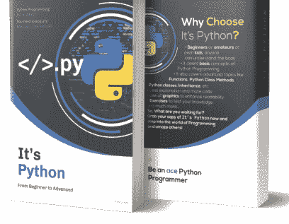


使用 Python 编程的初学者指南

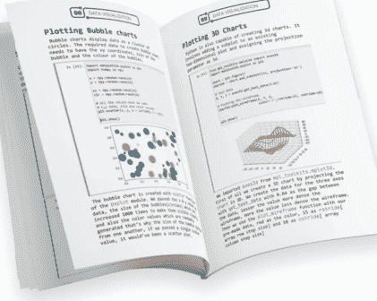


学习如何执行数据处理、清洗、分析和可视化等任务

# 前言

为什么要学习机器学习？或者它的用途是什么？这些可能是出现在你脑海中的问题。答案很简单，想象一下你收到了一份关于在线商店产品的数据，并对它们进行产品推荐。这些数据包含产品名称、类别、数量和评分列，其中有数百行产品。如果你想执行某些分析，例如该天购买量最多的产品，手动完成它将花费大量时间。为了简化这些任务，我们使用数据分析，即我们运行带有代码的程序来执行特定的数据分析。计算机运行程序，我们只需几秒钟即可获得输出。然后，我们根据用户之前的搜索结果，对其进行分类并根据偏好的类别推荐产品。那么，如何做到这一点？嗯，我们需要学习数据科学和机器学习来执行这些任务。

企业和机构正试图通过使用数据科学、数据挖掘和机器学习的概念和方法来构建智能系统来解决这个问题。在其中，机器学习是计算机科学中最令人兴奋的领域。如果我们将机器学习称为为数据提供意义的算法的应用和科学，那将没错。

本书专为初学者（数据科学和机器学习）准备的，但你应该熟悉 Python 编程。我们将使用 NumPy、SciPy、Pandas、Matplotlib、Scikit-Learn 等包和模块来执行分析和其他任务。我让本书涵盖了数据科学的基础概念，以帮助初学者在机器学习之前做好数据科学概念准备，正如书名所示，书只涵盖了数据科学；如果你正在寻找数据科学，那么这本书不适合你，你可以查看其他书籍页面来找到它们。我还包含了高级主题，而不让你局限于基础。机器学习、算法、数据科学等可能看起来困难且无聊，但当你处理越来越多的数据时，你将能够玩转它们！


- 多变量图

- 线性回归


- 层次聚类


- 处理

- 决策

- 形成

- 匹配

- 数据集

# 01 章：机器学习简介

- 什么是机器学习？
- 机器学习的用途
- 机器如何工作？


# 01 章：机器学习简介

## 什么是机器学习？

数据是你进行分析所需的，信息是你进行业务所需的。数据通常被称为“21世纪的石油”，数字数据在业务中至关重要。机器学习是一种人工智能，它在原始数据中发现模式并像人类一样进行预测。机器学习意味着机器自主学习。为了更好地理解，想象一个婴儿并将其比作机器学习模型。父母无法教他们一切，这就是为什么他们把孩子交给学校，在这种情况下就是你。学校有教科书、测试等来帮助你自主学习

- 喂送数据
- 模型创建
- 通过数据模式学习


## 机器是如何学习的？

究竟是什么魔法让机器能像我们一样学习并执行任务？让我们通过一个例子来理解。假设你是一个新的电脑经销商，对这方面的经验非常基础。于是你向另一位经销商请教信息。你总结了以下要点，如处理器核心、内存和 GPU。经销商告诉你这些信息，你也随之学习。随后，你获得了以下关于不同品牌 8gb 内存的数据：

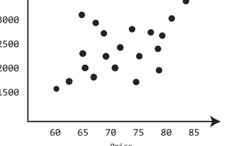

通过观察数据，我们可以发现价格随着频率的增加而增加。你理解了数据背后的简单逻辑。如果你拿到符合以下规格的内存，你可以判断它的价格，例如频率为 1666 Mhz 的内存，价格就是 60。

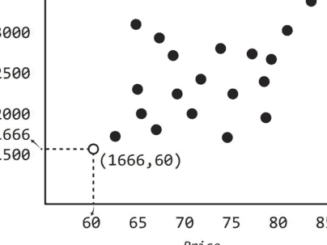

# 16 机器学习简介

但如果你得到了一个没有记录过的频率，比如 2600Mhz 呢？那么你需要学习如何决定价格。我们开始寻找一种根据给定数据进行计算的方法。我们假设两者之间存在线性关系。我们将这种关系定义为直线，如下所示：

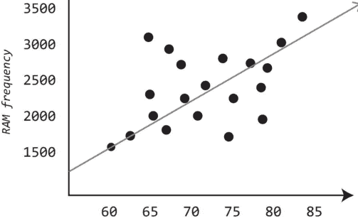

现在我们可以使用这条线作为参考并预测值。因此，对于 2600Mhz，成本大约是 77。我们如何画出这条线？我们遵循公式 `cost = a + b * Mhz`，但 a 和 b 是什么？a 和 b 是直线的参数，你不需要担心它们。

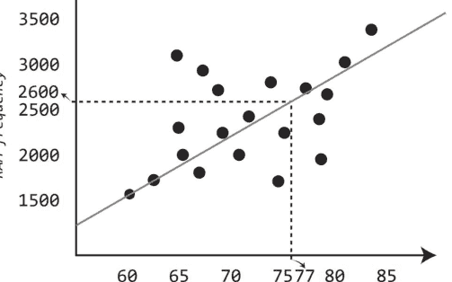

同样在机器学习中，机器（即计算机）通过算法学习数据中的模式或关系，并在要求新值时进行预测值。

那么就不会有错误吗？肯定的，预测结果可能会比实际答案错误。我们也会犯很多错误，但从错误中学习，或者如果结果持续为负就更换导师。机器学习模型也会从错误中学习，并在结果没有改进时更改算法。

## 02 环境配置

- 安装 Anaconda
- 使用 Jupyter notebook


# 环境配置

### 安装 Anaconda

访问 anaconda.com/products/individual 下载最新版本的 Anaconda。


你可以根据你的系统下载 anaconda 安装程序，无论是 Windows、Mac 还是 Linux。下载好后，只需运行安装程序并照常安装即可。

安装完成后，搜索 "anaconda prompt" 并运行它。


这是 Anaconda 命令行提示符（Anaconda Prompt），通过这里使用代码作为命令来运行程序或执行其他操作。

```
Anaconda Prompt (anaconda3)
(base) C:\Users\Rahul>
```

### Jupyter Notebook

Jupyter Notebook 是一个开源 Web 应用程序，允许你创建和共享包含实时代码、方程、可视化和说明文本的文档。我们将它用于现场数据处理和可视化。要打开 Jupyter Notebook，在 anaconda 命令行中输入 `jupyter notebook` 并回车。


```
Anaconda Prompt (anaconda3)
(base) C:\Users\Rahul> jupyter notebook
```

### Anaconda Prompt (anaconda2)

```
(base) C:\Users\Rahul> jupyter notebook
```
NotebookApp 已从 C:\Users\Rahul\anaconda\lib\site-packages 加载
Notebook 目录 C:\Users\Rahul\anaconda\share\jupyter
Jupyter Notebook 运行在 http://localhost:8888/?token=b3da5d8a2f2015a0f3d48f9054acf 使用 Ctrl-C 停止此服务器并关闭所有内核。要访问 notebook，在浏览器中打开此文件：file:///C:/Users/Rahul/AppData/Roaming/jupyter/runtime/server-123.html
或将以下 URL 粘贴到浏览器：http://localhost:8888/?token=b3da5d8a2f2015a0f3d48f9054acf
127.0.0.1:8888/?token=b3da5d8a2f2015a0f3d48f9054acf 将你重定向到浏览器，其中会出现一个带有 Jupyter notebook 的新标签。你可以在这里托管 Python 文件并随时运行代码。

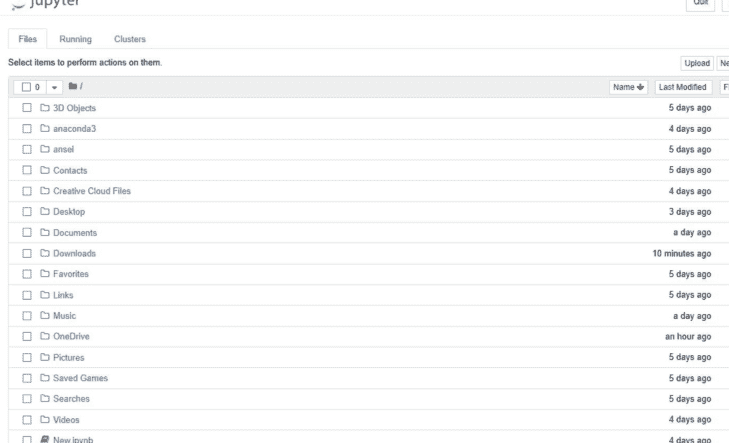

在 Jupyter Notebook 中，我们不需要安装任何其他包，我们需要的一切都在这里，最好的办法是在安装 IDE 或 Python 解释器的情况下编写代码，这使数据科学家的最佳选择。

### 使用 Jupyter Notebook

要开始编码，点击 New 并选择 Python 3 打开新文件。


这是我们在单元格中编写并运行代码的地方。


如果你无法创建新文件或遇到任何错误，可以直接前往 jupyter.org/try 并选择 Python。


我们可以通过点击 untitled 来重命名文件。

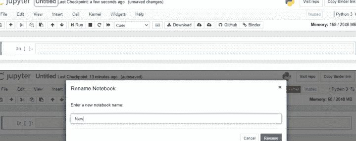

我们只有一个代码单元格，我们在这个单元格中编写代码。

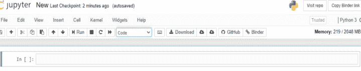

有三种类型的单元格：代码单元格、markdown 单元格和原始（raw）单元格。我们可以使用 markdown 单元格显示标题或标题。


现在点击标题上的运行按钮运行代码单元格。


在代码单元格中，我们可以编写 Python 代码并立即执行它们。


```
In []:
Out[1]: 64575
```

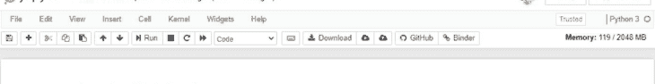

```
In []:
Out[1]: 64575
```

要在选定的单元格下方插入新单元格，按下键盘上的 b 或点击 + 图标。


```
In []:
Out[1]: 64575
```

我们可以通过分别点击文本外部或内部来选择蓝色（选中状态）或编辑单元格。

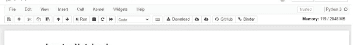

```
In []:
Out[1]: 64575
```

```
In []:
Out[1]: 64575
```

我们对 markdown 单元格有更广泛的权限，可以优雅地显示文本。我们可以使用 # 1, 2 和 3 添加标题、子标题和低级标题。

```
### Jupyter Notebook
### IPython
### Data
```

```
Jupyter Notebook
IPython
Data
```

我们可以创建有序列表和项目列表：

- 1. Data Science
   1. Python
   2. Jupyter Notebook
   3. Libraries

1. Data Science
   A Python
   B Jupyter Notebook
   C Libraries

- Data Science
  * Python
  * Jupyter Notebook
  * Libraries

Data Science
  * Python
  * Jupyter Notebook
  * Libraries

> 有序列表

> 项目列表

创建有序列表，使用 1 作为第一个列表项，然后使用制表键创建子项目并使用正确的编号。文本应在数字后加上空格。

创建项目列表，使用 - 作为方块符号，使用 * 作为圆点符号，以以相同的方式处理列表和子项目。


### 环境设置

以下是各种单元格操作的快捷键列表。

| 操作 | 快捷键 |
| --- | --- |
| 将单元格更改为代码 | y |
| 将单元格更改为 markdown | m |
| 将单元格更改为原始 | r |
| 关闭分页器 | Esc |
| 重启内核 | 0 + 0 |
| 复制选中的单元格 | c |
| 剪切选中的单元格 | x |
| 删除选中的单元格 | d + d |
| 进入编辑模式 | Enter |
| 向下扩展选择 | Shift + j |
| 向上扩展选择 | Shift + k |
| 查找并替换 | f |
| 忽略 | Shift |
| 在上方插入单元格 | a |
| 在下方插入单元格 | b |
| 中断内核 | i + i |
| 合并单元格 | Shift + m |
| 在上方粘贴单元格 | Shift + v |
| 在下方粘贴单元格 | v |
| 运行单元格并在下方插入 | Alt + Enter |
| 运行单元格并选择下方 | Shift + Enter |
| 运行选中的单元格 | Ctrl + Enter |
| 保存笔记本 | Ctrl + s |
| 向上滚动笔记本 | SHIFT + Space |
| 向下滚动笔记本 | Space |
| 全选 | Ctrl + a |
| 显示键盘快捷键 | h |
| 切换所有行号 | Shift + 1 |
| 切换单元格输出 | o |
| 切换单元格滚动 | Shift + o |
| 切换行号 | 1 |
| 撤销单元格删除 | z |

## 03 PANDAS 库

- Pandas库特性
- Series（序列）
- Dataframes（数据框）


## 03 PANDAS 库

### Pandas

数据科学需要高性能的数据处理和分析，我们可以通过 Pandas 数据结构来实现。带有 pandas 的 Python 用于各种学术和商业领域，包括金融、经济、统计等。使用 Pandas 我们可以完成数据处理和分析的典型步骤：加载、组织、建模和分析数据。


### Pandas 库的主要特性

我们可以利用 Pandas 库的以下特性实现许多功能：

- 快速高效的 DataFrame 对象，具有默认和自定义索引。
- 从不同文件格式加载数据的工具。
- 数据对齐和对缺失数据的集成处理。
- 基于标签的大型数据集切片、索引和子集提取。
- 可以插入数据中的列。
- 用于聚合和转换的分组（Group by）。

### Series

Pandas 处理名为 series、data frames 和 panel 的结构。Series 是一种一维数组类的结构。例如，以下 series 是整数的集合：

```
10 17 23 55 67 92
```

由于 series 是同质数据结构，因此它只能包含一种类型的数据。Series：

- 它是一个同质结构
- 它的大小是不可变的
- series 中的值是可变的

### Data Frames

DataFrame 是一个带有异构数据的二维数组：

| 天 | 销售额 |
|---||---|
| 周一 | 33 |
| 周二 | 37 |
| 周三 | 14 |
| 周四 | 29 |

数据显示了某些产品在2 天或更多天的销售情况。因此我们得出 pandas data frames：

- 它可以包含异构数据
- 它的大小是可变的
- 它的数据也是可变的

未来我们将经常使用 Pandas series 和 data frames，请确保再次复习并掌握它。

### 关键点

- Pandas 库是一个高性能的数据处理工具。
- Pandas 数据结构包括 series 和 data frames。
- Series 是同质数据的 1维数组，其大小不可变，但 series 中的值是可变的。
- Data Frames 是异构数据的 2维数组，其大小和数据都是可变的。

## 04 NumPy 包

- NumPy 的特性
- ndarray 对象
- 列表 vs ndarrays


## NUMPY 包

### NumPy

NumPy 是一个 Python 包，全称为“Numerical Python”。它是一个由多维数组对象和一组处理数组程序组成的库。

### 1D 数组

| | 5.2 | 3.0 | 4.5 |
|---|---|---|
| 9.1 | 0.1 | 0.3 |

| | 1 | 2 | 9 | 10 |
|---|---|---|---|

shape: (4,)

### 2D 数组

shape: (2, 3)

### 3D 数组

shape: (4, 3, 2)

### NumPy 的主要特性

NumPy 非常强大，包含许多特性，如：

- 数组上的数学和逻辑运算。
- 傅里叶变换和形状操作程序。
- 与线性代数相关的运算。NumPy 内置了线性代数和随机数生成的函数。
- NumPy ndarrays 比 Python 内置列表快得多，且内存消耗消耗。
- 大部分需要快速计算的部分是用 C 和 C++ 编写的。

### ndarray 对象

NumPy 的目标是提供一种比传统 Python 列表快 50 倍的数组对象。NumPy 中的数组对象称为 ndarray，它提供了许多支持函数，使得处理 ndarray 变得非常简单。


### 数据结构

SciPy 使用的基础数据结构是由 NumPy 模块提供的多维数组。NumPy 提供了一些用于线性代数、傅里叶变换和随机数生成的函数，但在通用性上不如 SciPy 中的等效函数。除了这些之外，SciPy 还提供了物理和数学常数、傅里叶变换、插值、数据输入输出、稀疏矩阵等。

| | | | | | | | | | | |
|---|---|---|---|---|---|---|---|---|---|
| 1 | 2 | 3 | 21 | 9 | 7 | 34 | 22 | 11 | 5 |
| 11 | 92 | 4 | 3 | 22 | 2 | 3 | 3 | 2 | 1 |
| 3 | 9 | 13 | 81 | 21 | 10 | 7 | 4 | | |
| 8 | 32 | 1 | 2 | 34 | 18 | 78 | 10 | 7 | | |
| 9 | 22 | 3 | 9 | 24 | 81 | 71 | 22 | 17 | 3 |
| 13 | 21 | 29 | 2 | 47 | 1 | 81 | 21 | 9 | | |
| 21 | 12 | 53 | 91 | 21 | 8 | 81 | 9 | 2 | | |
| 6 | 8 | 33 | 82 | 19 | 87 | 16 | 3 | 1 | 55 |
| 54 | 4 | 78 | 24 | 18 | 11 | 4 | 2 | 99 | 5 |
| 13 | 22 | 32 | 42 | 15 | 9 | 22 | 1 | 21 | | |

| | | | | | | | | | | |
|---|---|---|---|---|---|---|---|---|---|---|
| 1 | 3 | 9 | | | | | 2 | 1 | | |
| 11 | | | | | | | | | | | |
| | | | 1 | | | | | | | | |
| 8 | | | | 3 | | | | | | | |
| | | | 9 | | | 17 | | | | | |
| 13 | 21 | | | 9 | 2 | 47 | 1 | 81 | 21 | | |
| 54 | | | | 11 | | | 55 | | | | |
| 11 | | | | | | | | | | | |
| | 2 | | | | | 22 | 21 | | | | |

稀疏矩阵的使用

### SciPy 子包

众所周知，SciPy 被分为涵盖科学计算领域的子包，我们可以根据需要导入它们，而不是导入整个库。下表显示了 SciPy 所有子包的列表：

| | |
|---|---|
| scipy.constants | 数学常数 |
| scipy.fftpack | 傅里叶变换 |
| scipy.integrate | 积分例程 |
| scipy.interpolate | 插值 |
| scipy.io | 数据输入输出 |
| scipy.linalg | 线性代数例程 |
| scipy.optimize | 优化 |
| scipy.signal | 信号处理 |
| scipy.sparse | 稀疏矩阵 |
| scipy.spatial | 空间数据结构 |
| scipy.special | 特殊数学 |
| scipy.stats | 统计 |

### 关键点

- SciPy 包是一个用于解决常见科学问题的工具箱。
- SciPy 与 NumPy 一起创建了用于数据的动态工具。
- 配合 NumPy，SciPy 提供了许多使用 ndarrays 执行不同任务的函数。
- SciPy 被分为子包以处理不同的任务。

## 06 Matplotlib 库

- Matplotlib 的特性
- 数据视化
- Matplotlib 中的 PyPlot


# Matplotlib 库

Matplotlib 是一个 Python 库，用于使用脚本创建 2D 图表。它有一个名为 pyplot 的模块，通过提供控制线条样式、字体属性等功能，使绘图变得简单。


### Matplotlib 的关键特性

Matplotlib 是数据可视化的最佳选择，因为它具有以下特性：
- 它支持各种图表，如直方图、柱状图、误差图等。
- 它与 NumPy 使用，提供了一个有效的 MATLAB 替代环境。
- 使用其 PyPlot 模块，绘制简单图表或其他任何图表都是可能的。

### 数据可视化

数据可视化是信息的图形化表示。通过使用图表、地图等元素，可视化工具提供了一种易于查看和理解趋势、离群值和模式的方法。

在大数据世界中，数据可视化工具和技术对于分析大量信息并做出数据驱动的决策至关重要。可视化有助于以图形化或更有趣的方式查看数据，如果我们不可视化数据，将失去以柱状图、饼图等形式呈现数据的影响。

### Matplotlib 中的 PyPlot

matplotlib.pyplot是一系列函数集合，使得 matplotlib 的工作类似于 MATLAB。每个 pyplot 函数都可以对图形进行某些更改：创建图形、在图上绘制线条等。要测试它，跳转到 Jupyter Notebook 并开始导入 matplotlib.pyplot 模块。

```python
import matplotlib.pyplot as plt
```

要绘制简单图表，使用 `plot` 函数并传递列表，然后使用 `show` 函数查看图表。

```python
import matplotlib.pyplot as mplt
mplt.plot([1,3,6,9])
mplt.show()
```


我们已经使用一些随机值成功绘制了图表。我们可以分别使用 `xlabel` 和 `ylabel` 命名 x 轴和 y 轴。

```python
import matplotlib.pyplot as plt
plt.plot([1,3,6,9])
plt.xlabel('X_Axis')
plt.ylabel('Y_Axis')
plt.show()
```


图形有实线，我们通过向 `plot` 函数传递另一个参数来更改其颜色和线条样式，例如 `'ro'` 表示红色 (r) 和圆形 (o)。

```python
import matplotlib.pyplot as plt
plt.plot([1,3,6,9], 'ro')
plt.xlabel('X_Axis')
plt.ylabel('Y_Axis')
plt.show()
```


格式字符串 'ro' 的字母和符号来自 MATLAB，我们将字符串与线条样式连接。有许多用于不同形状和颜色的符号，例如 'b-' 表示蓝色实体。你可以在下面的列表中找到所有不同颜色和形状的符号。

### 线和形状样式

| | |
|---|---|
| - | 实线 |
| -- | 虚线 |
| : | 点状线 |
| -. | 划点线 |
| 'o' | 圆形 |
| '+' | 加号 |
| '*' | 星号 |
| '.' | 点 |
| 'x' | 叉 |
| _ | 横线 |
| '| | 垂直线 |
| 's' | 正方形 |
| 'd' | 菱形 |
| '^' | 上三角形 |
| 'v' | 下三角形 |
| '>' | 向右三角形 |
| '<' | 向左三角形 |
| 'p' | 五角星 |
| 'h' | 六角星 |

### 颜色样式

| | |
|---|---|
| y | 黄色 |
| m | 品红色 |
| c | 青色 |
| r | 红色 |
| g | 绿色 |
| b | 蓝色 |
| w | 白色 |
| k | 黑色 |

除了颜色和线形状样式之外，我们对绘制的图形有很大的编辑性，你可以在专门用于数据科学或数据可视化的书中学习这些内容。

### 关键点

- MatPlotLib 是一个使用其 MATLAB 函数可视化我们数据的库。
- MatPlotLib 的 PyPlot 模块使得绘制数据变得更容易，对颜色、线和形状、字体、轴标签等有完全控制。
- 它支持广泛的图表，如直方图、柱状图、饼图，甚至是 3D 图表。
- Matplotlib 是数据可视化的最佳库。

## 07 SCIKIT LEARN 库

- Scikit learn 库


### Scikit Learn

Scikit-learn 或 Sklearn 是 Python 中实用且稳健的机器学习库。它提供了一系列高效的机器学习和统计建模工具，包括分类、回归、聚类和降维。该库主要用 Python 编写，构建在 NumPy、SciPy 和 Matplotlib 之上。

### Scikit Learn 特

- 监督学习算法如线性回归、支持向量机 (SVM)、决策树等是 scikit-learn 的一部分。
- 无监督学习算法如聚类、因子分析、主成分分析 (PCA) 到无监督神经网络也是它的的一部分。


交叉验证、降维、集成方法、特征提取、特征选择也是 scikit-learn 的特性，它们分别用于检查监督模型的准确性、减少数据中的属性数量、结合多个监督模型的预测、从数据中提取特征以及识别中有用的特征。

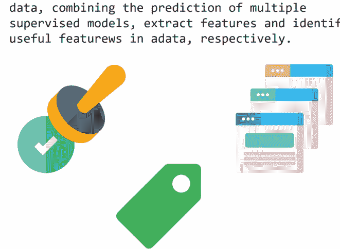

## 08 机器学习的类型

监督学习

- 无监督学习
- 深度学习
- 强化学习
- 深度强化学习

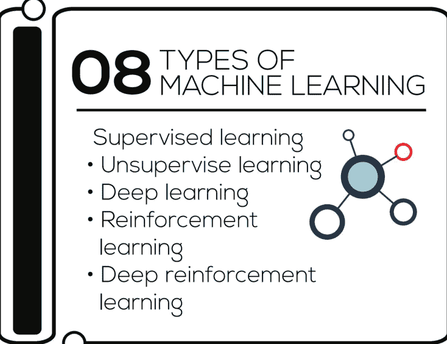

# 机器学习的类型

在之前的课程中，我们学习了机器学习过程中使用的各种库和包。现在，让我们来看看机器学习的类型。

# 机器学习的类型

以下是机器学习的不同类型：

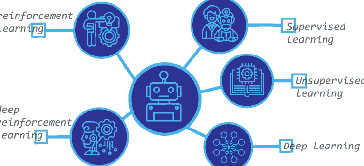

让我们详细查看每种类型。

### 监督学习

正如其名称所示，在监督学习中，我们在有监督的情况下训练机器学习模型。我们输入数据，训练模型，并告诉模型进行预测。如果预测是正确的，我们就让模型从那里独立工作；否则，我们就帮助模型进行正确的预测，直到它学会为止。这就像最初教孩子解决问题，直到他能够自己解决这些问题为止。


### 监督学习的类型

回归和分类是监督学习的两种类型。它们可以被理解为：

- 回归是机器学习的一种类型，其中我们向模型输入数据，例如 'A'（输入，即 X）的值为 65（输出，即 Y），'B' 的为 66 等。根据给定的数据，模型学习输入与输出之间的关系（这里是 'A' & 65）。

一旦机器用足够的数据完成训练，我们就提供一个输入（假设为 'C'），让模型预测输出，但你必须知道该输入的真实输出。你将预测值与真实值进行对比，检查它是正确还是错误。如果预测是正确的，我们就通过模型。如果预测不正确，我们就继续训练，直到它达到满意的点。

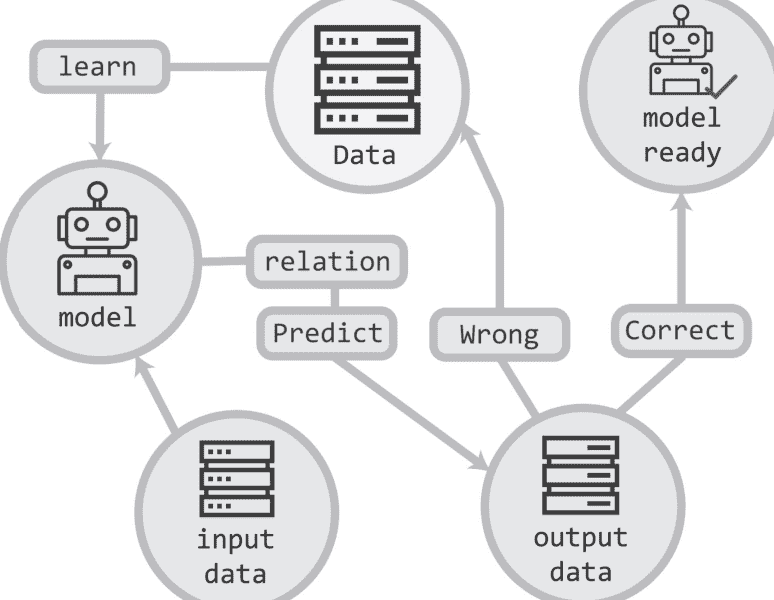

# 机器学习的类型

回归本身也有不同的类型，如线性回归和逻辑回归，我们将在单独的课程中学习。

- **分类**是机器学习的一种类型，其中我们输入数据，模型将数据分类为不同的组。考虑以下示例，

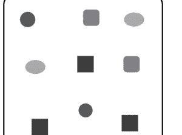

数据中包含不同类型的形状。我们将教模型数据中是什么形状，或者数据中有哪些不同的组。我们将为这些组提供特征，如：

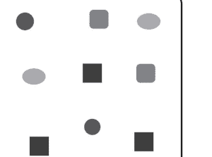

| 圆形 | 正方形 | 椭圆 | 圆正方形 |
| --- | --- | --- | --- |

# ## 机器学习的类型

现在，训练好的模型在学习了如何分组后，可以对任何数据进行分类。如果传递一个新的形状，它将根据学习的内容进行分类。像回归一样，我们会继续输入数据，直到它正确分类数据。


分类也有不同的类型，如决策树、朴叶斯分类、支持机等。我们将在专门的主题中学习它们。

### 无监督学习

与监督学习不同，我们不教或不检查模型生成的预测，而是直接输入数据并获取预测。显而易见，结果将是准确。无监督学习用于人脸检测、目标检测等人工智能应用。


### 深度学习

深度学习模型基于人工神经网络 (ANN) 或更具体的卷积神经网络 (CNN)。深度学习使用了几种架构，如深度信赖网络、循环神经网络和卷积神经网络。这些模型用于解决如：
- 计算机视觉、图像分类
- 生物信息学
- 药物设计
- 游戏等


深度学习本身是一个完全不同的机器学习类型，它需要大量的数据和计算能力。但现在高性能计算是可用的。让我们考虑一个例子，深度学习模型告诉我们动物是或不是。网络包含大量的照片数据并尝试从中提取模式，如颜色、马鞍等。

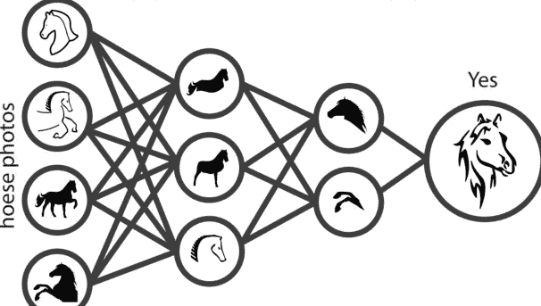

### 强化学习

强化学习由根据环境所采取的行为获得奖励或惩罚的学习模型组成。其目标是最大化累计奖励。

强化学习由根据环境所采取的行为获得奖励或惩罚的学习模型组成。其目标是最大化累计奖励。

强化学习由根据环境所采取的行为获得奖励或惩罚的学习模型组成。其目标是最大化累计奖励。

强化学习由根据环境所采取的行为获得奖励或惩罚的学习模型组成。其目标是最大化累计奖励。

强化学习由根据环境所采取的行为获得奖励或惩罚的学习模型组成。其目标是最大化累计奖励。

强化学习由根据环境所采取的行为获得奖励或惩罚的学习模型组成。其目标是最大化累计奖励。

强化学习由根据环境所采取的行为获得奖励或惩罚的学习模型组成。其目标是最大化累计奖励。

强化学习由根据环境所采取的行为获得奖励或惩罚的学习模型组成。其目标是最大化累计奖励。

强化学习由根据环境所采取的行为获得奖励或惩罚的学习模型组成。其目标是最大化累计奖励。

强化学习由根据环境所采取的行为获得奖励或惩罚的学习模型组成。其目标是最大化累计奖励。


## 机器学习中的数学

- 连续型，或无限的值。这些值没有限制，例如在以下数据中，不同人的特征重量（weight）不是有限的。它可能是 110 磅，也可以是 110.20 磅，甚至是 110.21 磅，即连续型数据。

| 人员 | 重量 |
|---|---|
| Jhon | 110 |
| Max | 122 |
| Mary | 96 |
| Alex | 120 |

## 数据收集

数据从许多来源收集。假设我们想要整个国家的数据。那么我们需要对全人口进行调查，这非常耗时；或者我们可以从人口中选择一个样本并调查其数据。样本可以随机选择，也可以根据特征或其他属性进行选择。

同样，与其其将整个数据集输入模型，我们不如从中获取一个样本，以节省时间并获得更好的结果。

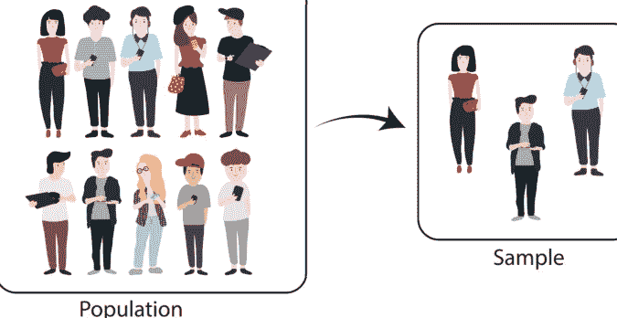

总体

样本

## 统计

统计学通常被认为是柱状图等数据可视化，但统计学也包括数据收集、数据分析及其表示。正如你在学校里学到的那样，我们对数据进行统计分析，例如寻找集中趋势并将数据可视化到图表上。

描述性统计和推断统计用于机器学习。

### 描述性统计

在描述性统计中，我们处理的是整个数据，即总体而不是样本。在描述性统计中我们有以下内容：

- **集中趋势**
数据的平均值、中位数众数被称为其集中趋势。我们可以很容易地找到每一个每一个，让我们考虑以下数据并找到它的集中趋势，

| 天数 | 销售额 |
|---|---|
| 周一 | 33 |
| 周二 | 37 |
| 周三 | 14 |
| 周四 | 29 |

要找到销售额的平均值（mean），我们需要将所有值相加并除以值的总个数。

```
mean(x) = sum of all values = 33 + 37 + 14 + 29 = 28.25
Total no. of values 4
```

平均销售额或平均值是 28.25。如前面提到的，你不需要进行计算，计算将在计算机完成。即使在 pandas 库中也有单独的函数如 `pandas.mean()` 来找到它，你只需要知道它以及该值是如何获得的。这样你就能理解在哪个分析中发生了什么。

要找到中位数（median）或中间值，对数字进行排序，如果数据个数是奇数，中间值就是中位数，例如：

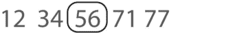

56 是上述数据的中位数。但如果数据个数是偶数，比如我们的销售数据，我们需要找到中间两个数之和并除以 2。

| 销售额 |
|---|---|
| 14 |
| 29 |
| 33 |
| 37 |

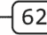

median (x) = \frac{\text{sum of mid pair}}{2} = \frac{29 + 33}{2} = 31

最后我们有众数（mode）或出现频率最高的值。可以通过视觉化计算，但在我们的数据中没有没有任何重复的值，因此我们考虑以下示例：

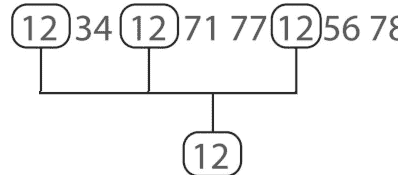

12 是上述数据的众数，因为它出现了三次，数据中可能会有很多重复。

- **变异性或离散度**
范围、四分位距、方差和标准差被称为变异性或离散程度的度量。


范围（Range）是数据中最大值和最小值之间的差。例如销售数据的范围：

| 销售额 |
|---|---|
| 14 |
| 29 |
| 33 |
| 37 |

```
range = max - min = 37 - 14 = 23
```

四分位距（Interquartile Range）与范围相似但略有不同。考虑以下数据，我们将数字 12 27 33 42 45 47 53 54 将数据分成四部分，并从第一个分界点减去第一个分界点。

方差（Variance）是数据值与其平均值之差的平方平均值。


# 70 机器学习中的数学

现在我们使用熵的公式找到整个数据集的熵

$H(S) = \sum_{i=1}^{N} p_i \log_2 p_i$

假设总数值 $N$ 为 10，平均销售（Avg. Sales）和最大销售（Max Sales）的概率分别为 3/10 和 7/10。

$H(S) = \sum_{i=1}^{N} p_i \log_2 p_i$

$H(S) = \frac{3}{10} \log_2 \frac{3}{10} - \frac{7}{10} \log_2 \frac{7}{10}$

$H(S) \approx 0.82$

获取熵之后，我们可以将值代入信息增益公式，计算来自折扣（Discount）特征的信息增益。

| 折扣 (Discount) | 销售 (Sales) | 增益 Gain(A, S) = H(S) - H(A,S) |
|---|---|---|
| 10% | 平均 (Average) | |
| 25% | 最大 (Maximum) | $0.82 - \frac{4}{10}(-\log_2\frac{4}{10} - \frac{2}{4} - \frac{2}{4} - \log_2\frac{2}{4}) +$ |
| 20% | 最大 (Maximum) | $+\frac{4}{10}(-\log_2\frac{4}{10} - \frac{4}{4} - \frac{1}{4} - \log_2\frac{4}{4}) +$ |
| 10% | 最大 (Maximum) | $+\frac{2}{10}(-\log_2\frac{1}{2} - \frac{1}{2} - \log_2\frac{1}{2})$ + |
| 25% | 平均 (Average) | $=0.82 - 0.4 - 0.2$ |
| 10% | 最大 (Maximum) | $=0.82 - 0.6$ |
| 20% | 最大 (Maximum) | $=0.22$ |

折扣特征的信息增益为 0.22，具有最高信息增益的值被用于模型预测以获得更好的结果。因此如果是广告（Advertisement），那么信息增益是

同样，我们可以找到广告特征的信息增益：

| 广告 (Advertisement) | 销售 (Sales) |
|---|---|---|
| 无 (No) | 平均 (Average) | $0.82 - \frac{5}{10} \log_2\frac{1}{5} - \frac{4}{5} \log_2\frac{4}{5}$ |
| 无 (No) | 最大 (Maximum) | $+\frac{5}{10} \log_2\frac{2}{5} - \frac{3}{5} \log_2\frac{3}{5}$ |
| 是 (Yes) | 平均 (Average) | $0.82 - 0.36 - 0.445$ |
| 是 (Yes) | 最大 (Maximum) | $0.82 - 0.015$ |

显然，由于更高的信息增益，我们需要使用折扣特征而不是广告特征。正如前面提到的，这是数据科学家的一项重要技术。

### 混淆矩阵

混淆矩阵用于计算模型的准确率。为了计算这一点，我们首先创建一个混淆矩阵。假设我们创建了一个天气模型，让它预测未来30天是否会下雨。30天后，我们将预测值与实际值进行匹配，发现模型预测正确的有25 个，错误的有 5 个。这里 8 是真阴性 (T-)，3 是假阳性 (F+)，2 是假阴性 (F-)，17 是真阳性 (T+)。我们可以使用这些值计算模型的准确率：

| | 预测不下雨 (Predicted no rain) | 预测下雨 (Predicted rain) |
|---|---|---|
| 实际不下雨 (Actual no rain) | 8 | 3 |
| 实际下雨 (Actual rain) | 2 | 17 |

公式：

```
accuracy = \frac{(T+) + (T-)}{(T+) + (T-) + (F+) + (F-)}
```

所以我们模型的准确率是：

```
accuracy = \frac{17+8}{17+8+3+2}
```

```
accuracy = \frac{25}{30}
```

accuracy = 0.8

同样，我们可以通过以下公式计算错误率或分类错误率：

```
Error rate = \frac{(F+) + (F-)}{(T+) + (T-) + (F+) + (F-)}
```

```
Error rate = \frac{3+2}{17+8+3+2}
```

```
Error rate = \frac{5}{30}
```

Error rate = 0.2

这相当于 1-Accuracy。接下来，我们可以使用下面的公式计算模型的精确率：

```
Precision = \frac{(T+)}{(T+) + (F+)}
```

```
Precision = \frac{17}{17+3}
```

```
Precision = \frac{17}{20}
```

Precision = 0.85

精确率也可以定义为模型做了多少真阳性预测。我们也可以使用下面的公式计算召回率：

```
Recall = \frac{(T+)}{(T+) + (F-)}
```

```
Recall = \frac{17}{17+2}
```

Recall \approx 0.89

最后，如果模型具有高精确率和低召回率（或反之），我们可以使用下面的公式计算 F 值：

```
F-measure = \frac{2 \times Recall}{Recall + Precision}
```

```
F-measure = \frac{2 \times 0.89 \times 0.85}{0.89 + 0.85}
```

```
F-measure = \frac{1.51}{1.74}
```

F-measure \approx 0.86

### 概率

使用以下公式预测事件结果是最简单的数学计算：

```
事件A的概率 = \frac{有利结果}{总结果}
```

机器学习需要三个不同的概念，即概率密度函数、正态分布和中心极限定理，它们都属于统计学和概率论。

### 概率密度函数

概率函数说明了以下几点：

- 它在区间内是连续的
- 曲线与 x 轴之间的面积等于 1
- 事件的概率落在 a 和 b 之间

任何满足这些条件的变量都是连续随机变量

### 正态分布

具有均值且标准差为 $\sigma$ 的分布被称为正态分布，其中大部分值集中在中间，向两极收拢。我们可以通过下图表示正态分布：

其中 $\mu$ 且 $\sigma$ 是标准差。正态分布的公式为：

```
f (Normal Variable) = \frac{1}{\sigma \sqrt{2\pi}} e^{-(X-\mu)^2/2\sigma^2}
```

### 中心极限定理

该定理指出，样本的均值 $\bar{u}$ 应等于总体均值。

### 概率类型

概率可以分为以下三种类型：

- 边缘概率：在不考虑条件的情况下事件发生的概率。
- 联合概率：两个事件同时发生的概率，例如从扑克牌中抽取红牌。
- 条件概率：在已知一个或多个事件发生的情况下事件发生的概率。例如从你的朋友那里抽取王牌

### 贝叶斯定理

贝叶定理是在已知其他事件概率的情况下寻找事件概率的方法。其公式为：

```
P(A|B) = \frac{P(B|A) P(A)}{P(B)}
```


## SCIKIT LEARN 算法

如果岭回归器（Ridge regressor）和 SVR（kernel-linear）效果不好，我们可以使用集成回归（EnsembleRegressor）和 SVR（Kernel-rbf）代替。

## 分类算法

当我们拥有标记数据时，Scikit-learn 的分类算法以以下方式工作预测类别：

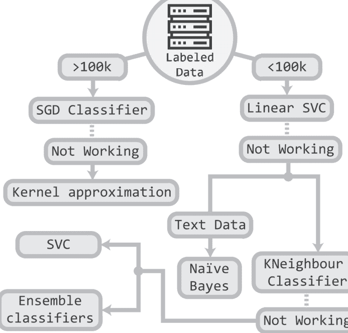

对于线性核的情况，线性 SVC（支持向量分类）速度更快，即它没有核参数。另一方面，SGD（随机梯度下降）分类器使用随机梯度下降（SGD）学习来实现正则化的线性模型。

## 聚类算法

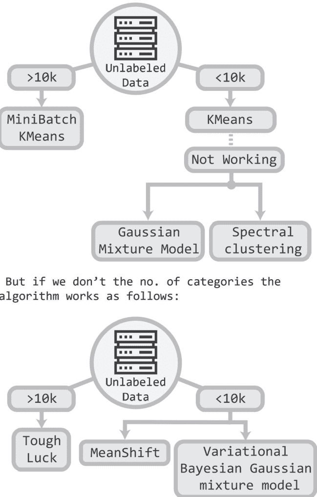

但如果我们不知道类别的数量，算法的工作方式如下：

我们还有一种降维算法仅用于查看数据。本章的目的是理解不同的算法，因为我们已经学习了不同的机器学习类型。因此，在解决任何问题之前，你将能够选择适合你的正确算法，而无需随机选择，并在准确率很低时再选择另一个。

## 11 导入数据

- 导入 CSV 数据
- 导入 JSON 数据
- 导入 XLS 数据


## 导入数据

### 数据文件

我们通常有多种文件格式的数据，例如任何产品的销售数据、订阅人数等。导入数据有很多方法，但我们在这里将使用 pandas 库。

### 导入 CSV 数据

从 CSV（逗号分隔值）读取数据是数据科学中的基本需求。我们通常从各种来源获取数据，这些数据可以导出为 CSV 格式以便其他系统使用。处理 csv 文件，我们首先需要一个，你可以从这里下载示例文件 csv.data（检查 Resources）。

要导入它，你需要将 csv 文件移动到你的 Jupyter Notebook 所在的位置，使用以下代码查找它：

```python
In [32]: import os
    print(os.getcwd())

C:\Users\Rahul
```

将文件移动到那里，并使用 pandas 库的 read_csv 函数来导入 csv 文件

```python
In [38]: import pandas as pd
    dt = pd.read_csv("csv_data.csv")
dt
```

| id | name | price | sales | brand |
|---|---|---|---|---|
| 0 | 101 | biscuits | 5.00 | 227 | HomeFoods |
| 1 | 102 | cookies | 7.25 | 158 | TBakery |
| 2 | 103 | cake | 12.00 | 50 | TBakery |
| 3 | 104 | whey_supplement | 34.90 | 24 | MuscleUp |
| 4 | 105 | protein_bars | 4.90 | 85 | MuscleUp |
| 5 | 106 | potato_chips | 1.75 | 121 | HomeFoods |

我们可以像使用 DataFrame 一样使用切片来访问 csv 数据的单列：

```python
In [39]: import pandas as pd
dt = pd.read_csv("csv_data.csv")
dt['sales']
```

```
Out [39]: 0 227
1 158
2 50
3 24
4 85
5 121
Name: sales, dtype:int64
```

我们可以使用 `loc[:,:<columns>]` 语法从数据中提取 2 列或更多列：

```python
In [44]: import pandas as pd
dt = pd.read_csv("csv_data.csv")
dt.loc[:,['name','sales']]
```

| | name | sales |
|---|---|---|
| 0 | biscuits | 227 |
| 1 | cookies | 158 |
| 2 | cake | 50 |
| 3 | whey_supplement | 24 |
| 4 | protein_bars | 85 |
| 5 | potato_chips | 121 |

或者只通过某些行：

```python
In [46]: import pandas as pd
dt = pd.read_csv("csv_data.csv")
dt.loc[4:6,['name','sales']]
```

| | name | sales |
|---|---|---|
| 4 | protein_bars | 85 |
| 5 | potato_chips | 121 |

要访问单个元素，我们可以使用其行-列索引配合 values 函数：

```python
In [49]: import pandas as pd
dt = pd.read_csv("csv_data.csv")
dt
```

| id | name | price | sales | brand |
|---|---|---|---|---|
| 0 | 101 | biscuits | 5.00 | 227 | HomeFoods |
| 1 | 102 | cookies | 7.25 | 158 | TBakery |
| 2 | 103 | cake | 12.00 | 50 | TBakery |
| 3 | 104 | whey_supplement | 34.90 | 24 | MuscleUp |
| 4 | 105 | protein_bars | 4.90 | 85 | MuscleUp |
| 5 | 106 | potato_chips | 1.75 | 121 | HomeFoods |

```python
In [50]: biscuits_sales = dt.values[0,3]
biscuits_sales
```

| id | name | price | sales | brand |
|---|---|---|---|---|
| 0 | 101 | biscuits | 5.00 | 227 | HomeFoods |
| 1 | 102 | cookies | 7.25 | 158 | TBakery |
| 2 | 103 | cake | 12.00 | 50 | TBakery |
| 3 | 104 | whey_supplement | 34.90 | 24 | MuscleUp |
| 4 | 105 | protein_bars | 4.90 | 85 | MuscleUp |
| 5 | 106 | potato_chips | 1.75 | 121 | HomeFoods |

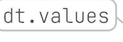(img/d75fea3635f5553f1cb0585b399b1b4b_84_1.png)(img/d75fea3635f5553f1cb0585b399b1b4b_84_2.png)(img/d75fea3635f5553f1cb0585b399b1b4b_84_3.png)

数据存储为 ndarrays，要访问单个元素可以使用类似于 DataFrame 的切片。

## 导入数据

JSON 文件以人类可读的格式存储数据。JSON 代表 JavaScript 对象表示。在这里获取你的示例 json_data（检查 Resources）。Pandas 使用 read_json 函数读取 JSON 文件。

```python
In [2]: import pandas as pd
dt = pd.read_json("json_data.json")
dt
```

| | ID | Name | Sales | Brand |
|---|---|---|---|---|
| 0 | 101 | Biscuits | 5.00 | 227 | HomeFoods |
| 1 | 102 | Cookies | 7.25 | 158 | TBakery |
| 2 | 103 | Cake | 12.00 | 50 | TBakery |
| 3 | 104 | Wheat Supplement | 34.90 | 24 | MuscleUp |
| 4 | 105 | Protein Bars | 4.90 | 85 | MuscleUp |
| 5 | 106 | Potato Chips | 1.75 | 121 | HomeFoods |

与 CSV 文件类似，我们可以对 JSON 文件执行所有的切片和数据提取：

```python
In [6]: import pandas as pd
dt = pd.read_json("json_data.json")
print(dt.loc[["ID", "Name", "Sales"]])
print(dt.values)
```

| | ID | Name | Sales |
|---|---|---|
| 0 | 11 | Biscuits | 227 |
| 1 | 102 | Cookies | 158 |
| 2 | 103 | Cake | 52 |
| 3 | 104 | Wheat Supplement | 24 |
| 4 | 105 | Protein Bars | 85 |
| 5 | 106 | Potato Chips | 121 |

0 Biscuits
1 Cookies
2 Cake
3 Wheat Supplement
4 Protein Bars
5 Potato Chips
HomeFoods

### EXCEL 数据

Microsoft Excel 是一个广泛使用的电子表格程序。它的用户友好性和吸引特性使其成为数据科学中常用的工具。在这里获取你的示例数据 xls_data（检查 Resources）。pandas 库的 read_excel 函数用于将 Excel 文件的内容读取到 python 环境中的 pandas DataFrame。

```python
In [9]: import pandas as pd
dt = pd.read_excel("xlsx_data.xlsx")
dt
```

| id | name | price | sales | brand | Unnamed: 5 |
|---|---|---|---|---|---|
| 0 | 101 | biscuits | 5.00 | 227 | HomeFoods | NaN |
| 1 | 102 | cookies | 7.25 | 158 | TBakery | NaN |
| 2 | 103 | cake | 12.00 | 50 | TBakery |
| 3 | 104 | whey_supplement | 34.90 | 24 | MuscleUp |
| 4 | 105 | protein_bars | 4.90 | 85 | MuscleUp |
| 5 | 106 | potato_chips | 1.75 | 121 | HomeFoods |

 |

由于 excel 表格被导入为 pandas DataFrame，我们可以对 excel 数据执行所有任务。你可能会注意到，我们有一个带有 NaN 值的 Unnamed: 5 列（除了 dt.value[2,5]）。让我们清理一下数据。首先我们需要移除 Unnamed: 5 列，我们可以使用 del 关键字。

```python
In [10]: import pandas as pd
dt = pd.read_excel("xlsx_data.xlsx")
del dt["Unnamed: 5"]
```

正如我们之前学过的，del 删除了整个列，我们不需要处理数据清洗了。我们已经移除了 Unnamed: 5 列：

```python
In [11]: import pandas as pd
dt = pd.read_excel("xlsx_data.xlsx")
del dt["Unnamed: 5"]

dt
```

| id | name | price | sales | brand |
|---|---|---|---|---|
| 0 | 101 | biscuits | 5.00 | 227 | HomeFoods |
| 1 | 102 | cookies | 7.25 | 158 | TBakery |
| 2 | 103 | cake | 12.00 | 50 | |
| 3 | 104 | whey_supplement | 34.90 | 24 | MuscleUp |
| 4 | 105 | protein_bars | 4.90 | 85 | MuscleUp |
| 5 | 106 | potato_chips | 1.75 | 121 | HomeFoods |

现在，我们需要将 dt.value[2,5] 即 34 替换为 TBakery。我们可以使用 replace 方法

```python
In [12]: import pandas as pd
dt = pd.read_excel("xlsx_data.xlsx")
del dt["Unnamed: 5"]
dt.replace({34:"TBakery"})
```


## 12 数据操作

- NumPy 操作
- Pandas 操作
- 数据清洗


# 12 数据分析

Python 主要通过 Pandas 和 Numpy 这两个库来处理各种格式的数据。我们在之前的章节中已经学习了这两个库的重要特性。在本章中，我们将看到每个库的某些基础示例，介绍如何操作数据以及执行不同的任务，如数据清洗、分析等。

### NumPy 操作

要开始使用 NumPy，我们需要导入 numpy 来创建 NumPy 数组（arrays）。

```
In [ ]: import numpy
```

让我们使用 array() 函数创建一个数组并将其打印出来。

```
In [2]: import numpy
ar = numpy.array([1,5,7])
print(ar)

[1 5 7]
```

ar 是一个 1 维数组，我们也可以在另一个数组内部创建一个或多个 1 维数组来创建一个 2 维数组。

```
In [8]: import numpy
ar = numpy.array([[1,5,7],[2,3,9]])
print(ar)

[[1 5 7]
[2 3 9]]
```

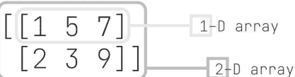

我们可以在创建数组时使用 ndmin 参数来指定数组的维度。

```
In [10]: import numpy
ar = numpy.array([1,5,7], ndmin = 2 )
print(ar)

[[1 5 7]]
```

虽然我们传递了一个 1 维数组，但由于 ndmin 参数指定了数组的维度，它变成了一个 2 维数组。

我们创建了一个整数数组，所以让我们使用 dtype 参数使用相同的值创建字符串数组和浮点数数组。

```
In [11]: import numpy
ar_str = numpy.array([1,5,7], dtype = str )
ar_flt = numpy.array([1,5,7], dtype = float )
print(ar_str)
print(ar_flt)

['1' '5' '7']
[1. 5. 7. ]
```

ar_str 是字符串字面量数组，ar_flt 是浮点数数组。我们也可以同样使用 complex 作为 dtype 将这些数字改为复数。

```
In [13]: import numpy
ar_str = numpy.array([1,5,7], dtype = str )
ar_flt = numpy.array([1,5,7], dtype = float ) evenar_cmx = numpy.array([1,5,7], dtype = complex )
print(ar_str)
print(ar_flt)
print(ar_cmx)

['1' '5' '7']
[1. 5. 7.]
[1.+0.j 5.+0.j 7.+0.j]
```

ar_str, ar_flt 和 ar_cmx 是用相同数据创建的数组，但数据类型分别为字符串、浮点数和复数。

### Pandas 操作

Pandas 通过 Series、Data Frame 和 Panel 处理数据。我们将学习创建每一种对象。

### Pandas Series

我们已经知道 Pandas Series 是什么。可以使用 Series() 函数创建 pandas Series，所以让我们导入 pandas 创建 series。

```
In [14]: import pandas
sr = pandas.Series([1,5,7])
print(sr)

0    1
1    5
2    7
dtype: int64
```

如你所见，我们的数据索引从 0 到 2，数据类型为整数，我们可以在 index 参数中指定自己的索引。

```
In [16]: import pandas
sr = pandas.Series([1,5,7], index = ['A','B','C'])
print(sr)

A    1
B    5
C    7
dtype: int64
```

就像 ndarrays 一，我们也可以在创建 series 时使用 dtype 参数指定 pandas series 的数据类型。

```
In [18]: import pandas
sr = pandas.Series([1,5,7], dtype = complex )
print(sr)

0    1.0+0j
1    5.0+0j
2    7.0+0j
dtype: complex
```

## 数据操作

我们可以使用 ndarray 创建 pandas series。

```
In [19]: import numpy
import pandas
ar = numpy.array([1,5,7])
sr = pandas.Series(ar, copy = True)
print(sr)

0    1
1    5
2    7
dtype: int64
```

传递 ndarray 作为 series 的数据，data 参数是必需的，还使用了 copy 参数创建数据的副本。如果你想获取没有索引的数据，使用 values 函数。

```
In [21]: import numpy
import pandas
ar = numpy.array([1,5,7])
sr = pandas.Series(ar)
print(sr.values)

[1 5 7]
```

可以使用 array 函数打印上面的更详细版本 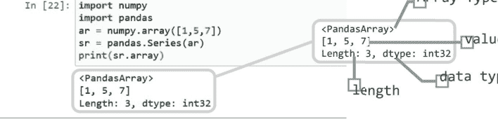。

注意 NumPy 和 Pandas 之间的 array 函数差异。Pandas Data Frames 以表格形式对齐数据。可以使用 DataFrame() 函数创建 pandas DataFrame。字典的键是列，值是行内容。我们在这里也可以使用 index 参数。

```
In [23]: import pandas
df = pandas.DataFrame({"Product":['Cookies','Biscuits'], "Sales":[157,227]})
Product   Sales
Cookies     157
Biscuits    227
```

可以使用 ndarrays 分别定义列。

```
In [24]: import pandas
df = pandas.DataFrame([[157,227]], columns=['Cookies','Biscuits'], index=[0,1])
0  Cookies     157
1  Biscuits    227
```

数据存储在 ndarray 中，列在 DataFrame 的参数中定义。我们可以使用以下语法向 DataFrame 添加列。

```
In [44]: import pandas
df = pandas.DataFrame([[1,3],[6,2]], index=['A','B'], columns=['C1','C2'])
df['C3'] = df['C1']*5
print(df)

   C1  C2  C3
A   1   3   5
B   6   2  30
```

我们可以从 DataFrame 中删除列。

```
In [45]: import pandas
df = pandas.DataFrame([[1,3],[6,2]], index=['A','B'], columns=['C1','C2','C3'])
del df['C3']
print(df)

   C1  C2
A   1   3
B   6   2
```

我们可以使用语法打印 DataFrame 的一列。

```
In [46]: import pandas
df = pandas.DataFrame([[1,3],[6,2]], index=['A','B'], columns=['C1','C2'])
print(df['C1'])

A    1
B    6
Name: C1, dtype: int32
```

### 切片语法

要从 ndarray 或 pandas series 或 pandas dataframes 获取单个元素，我们需要使用切片语法 `array[start:end:step(optional)]`。让我们从目前为止创建的数组中提取一些元素。

```
In [59]: import numpy as np
ar1 = np.array([[1, 5]])
ar2 = np.array([[1, 3], [5, 2]])
ar3 = np.array([[1, 3], [5, 2], [2, 4], [4, 6]])

### 切片 1 维数组
print(ar1[0])

### 切片 2 维数组
print(ar2[0,1])

### 切片 3 维数组
print(ar3[1,0,1])
```

在 2 维或更多维数组中使用逗号进一步切片，下面的图将帮助你更好地理解 3 维数组的切片。

```
ar3[]

```
[[[1, 3],
[5, 2]],
[[2, 4],
[4, 6]]]
```

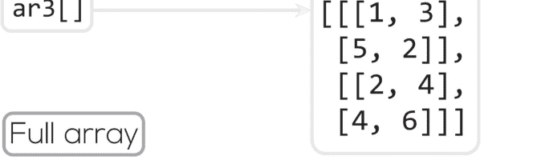

ar3[1]

```
[[[1, 3], [5, 2]], [[2, 4], [4, 6]]]
```

第一切片

ar3[1,0]

```
[[[1, 3], [5, 2]], [[2, 4], [4, 6]]]
```

第二切片

ar3[1,0,1]

```
4
```

最终切片


假设我们有如下一个 DataFrame

```python
[In 27]: import pandas as pd
sr = pd.DataFrame({'Product':['Biscuit','Cookies'],
    'Sales':[227,158]}, index = [1,2])

sr
```

| | Product | Sales |
|---|---|---|
| 1 | Biscuit | 227 |
| 2 | Cookies | 158 |

我们只需要 Sales 列，因此使用 `DataFrame[column_label]` 语法

```python
[In 32]: import pandas as pd
sr = pd.DataFrame({'Product':['Biscuit','Cookies'],
    'Sales':[227,158]}, index = [1,2])
sr['Sales']

Out[32]: 
1    227
2    158
Name: Sales, dtype: int64
```

或者只获取第二行，因此使用 `DataFrame.loc[row_index]` 语法

```python
[In 33]: import pandas as pd
sr = pd.DataFrame({'Product':['Biscuit','Cookies'],
    'Sales':[227,158]}, index = [1,2])
sr.loc[2] #你也可以使用 sr.iloc[1]

Out[33]: 
Product  Cookies
Sales      158
Name: Sales, dtype: object
```

或者只获取 cookies 的销售额，因此使用 `DataFrame.values[index]` 语法

```python
[In 37]: import pandas as pd
sr = pd.DataFrame({'Product':['Biscuit','Cookies'],
    'Sales':[227,158]}, index = [1,2])
sr.values[1,1]

Out[37]: 158
```

值是以 ndarrays 形式存储的，这就是为什么我们使用了类似于二维 ndarrays 的切片方法

### 我们可以从 DataFrame 中删除一整列

```python
In [41]: import pandas as pd
sr = pd.DataFrame({'Product':['Biscuit', 'Cookies'],
    'Sales':[227,158]}, index = [1,2])
```

| | Product | Sales |
|---|---|---|
| 1 | Biscuit | 227 |
| 2 | Cookies | 158 |

```python
In [45]: del sr['Sales']
sr
```

| | Product |
|---|---|
| 1 | Biscuit |
| 2 | Cookies |

### 但我们不能删除一个值

```python
In [47]: import pandas as pd
sr = pd.DataFrame({'Product':['Biscuit', 'Cookies'],
    'Sales':[227,158]}, index = [1,2])
sr.values=[1,1]
```

> ValueError Traceback (most recent call last)
<ipython-input-4422e071c59> in module
3 sr = pd.DataFrame({'Product':['Biscuit', 'Cookies'],
    'Sales':[227,158]}, index = [1,2])
---> 4 del sr.values=[1,1]

ValueError: cannot delete array

### 不能修改值

```python
In [48]: import pandas as pd
sr = pd.DataFrame({'Product':['Biscuit', 'Cookies'],
    'Sales':[227,158]}, index = [1,2])
```

| | Product | Sales |
|---|---|---|
| 1 | Biscuit | 227 |
| 2 | Cookies | 158 |

```python
In [51]: sr.values[1,1] = 1

In [51]: 158
```

### 更多关于 ndarrays

我们可以使用 `array[::-1]` 语法反转 ndarray

```python
In [56]: import numpy as np
ar = np.array([1, 2, 3, 4])
Out[56]: array([1 2 3 4])
In [55]: ar = ar[::-1]
Out[55]: array([4 3 2 1])
```

不需要这种方法就可以广播整个 ndarray

```python
In [56]: import numpy as np
ar = np.array([1, 2, 3, 4])
Out[56]: array([1 2 3 4])
In [62]: # 这种方法 - ar + [1,1,1,1]
ar = ar + 1
Out[62]: array([2 3 4 5])
```

我们可以用 `sort` 函数排序数组

```python
In [63]: import numpy as np
ar = np.array([5, 1, 3, 9])
Out[63]: array([5 1 3 9])
In [64]: ar.sort()
Out[64]: array([1 3 5 9])
```

有很多内置的 ndarray 方法现在不会讨论，但在各种步骤中使用，你可以查看文档查找所有函数及其作用，杂杂函数在书中书中被讨论

### 数据清洗

让我们考虑下面的情况

```python
In [71]: import pandas as pd
import numpy as np
ar = np.array([[1,2,3],[6,7,2],[4,9,1]])
df = pd.DataFrame(data = ar, index = ['a','c','e'], columns = ['C1','C2','C3'])

Out[71]:
      C1  C2  C3
a     4   7   2
c     9   1
In [72]: df = df.reindex(['a','b','c','e'])
df
```

| | C1 | C2 | C3 |
|---|---|---|---|
| a | 1.0 | 2.0 | 3.0 |
| b | NaN | NaN | NaN |
| c | 4.0 | 7.0 | 2.0 |
| d | NaN | NaN | NaN |
| e | 4.0 | 9.0 | 1.0 |

重索引后的 DataFrame 在 b 行 NaN NaN。这是因为 b 行没有数据。使用重索引我们创建了一个带有缺失值的 DataFrame。在输出中，NaN 表示非数字。为了更容易检测缺失值（跨不同类型），Pandas 提供了 `isnull()` 和 `isna()` 函数，它们也是 Series 和 DataFrame 对象上的方法

```python
In [73]: df['C1'].isnull()

Out[73]:
a    False
b     True
c    False
d     True
e    False
Name: C1, dtype: bool
```

Pandas 提供了各种清理缺失值的方法。`fillna` 可以用几种方式用非空数据填充 NaN 值，例如用 0 替换值

```python
In [74]: df.fillna(0)
Out[74]:
      C1  C2  C3
a  1.0 2.0 3.0
b  0.0 0.0 0.0
c  4.0 7.0 2.0
d  0.0 0.0 0.0
e  4.0 9.0 1.0
```

我们可以使用 `fillna` 参数中的 `pad` 或 `bfill` 复制该数据上方或下方的值

```python
In [75]: df.fillna(method='pad')
Out[75]:
      C1  C2  C3
a  1.0 2.0 3.0
b  1.0 2.0 3.0
c  4.0 7.0 2.0
d  4.0 7.0 2.0
e  4.0 9.0 1.0
```

我们可以用 `dropna` 丢弃带有缺失值的行

```python
In [76]: df.dropna()
Out[76]:
      C1  C2  C3
a  1.0 2.0 3.0
c  4.0 7.0 2.0
e  4.0 9.0 1.0
```

如果想更改 DataFrame 中的某个单元值，可以使用 `replace` 函数

```python
In [78]: import pandas as pd
import numpy as np
ar = np.array([[1,2,3],[4,7,2],[4,9,1]])
df = pd.DataFrame(data = ar, index = ['a','c','e'], columns = ['C1','C2','C3'])

df.replace({3:1})

Out[78]:
  C1 C2 C3
a  1  2  1
c  4  7  2
e  4  9  1
```

### 数据分析 & 处理

- 数据分析
- 属性之间的相关性
- 偏度

作为机器学习课程，我们需要大量的分析来了解更多数据信息。我们已经知道了集中趋势，例如平均值、中位数和众数是我们的基本统计数据。同样，我们不需要手动计算它们，在不同的库中有许多函数用于分析。

### 数据分析

在训练任何模型之前，我们需要检查数据。我们将使用 `trees.csv` 作为你的数据。在进行进一步操作之前，让我们看看原始数据

```python
In [2]: import pandas as pd
dt = pd.read_csv('trees.csv')
dt
```

| | "Girth (in)" | "Height (ft)" | "Volume(ft3)" |
|---|---|---|---|
| count | 31.00 | 31.00 | 31.00 |
| mean | 16.00 | 13.25 | 76.00 |
| std | 9.09 | 3.14 | 6.37 |
| min | 1.00 | 8.30 | 63.00 |
| 25% | 8.50 | 11.05 | 72.00 |
| 50% | 16.00 | 12.90 | 76.00 |
| 75% | 23.50 | 15.25 | 80.00 |
| max | 31.00 | 20.60 | 87.00 |

第一步分析是了解数据的形状或者有多少行和多少列。我们可以通过使用 dataframe 对象的 `shape` 属性来实现

```python
In [4]: import pandas as pd
dt = pd.read_csv('trees.csv')
dt.shape

Out[4]: (31, 4)
```

我们的数据有 31 行 4 列，总共 124 个值。如果我们想检查前 10 个值，可以使用 `head()` 函数并传递 10 作为参数

```python
In [5]: import pandas as pd
dt = pd.read_csv('trees.csv')
dt.head(10)
```

| Index | Girth (in) | Height (ft) | Volume(ft3) |
|---|---|---|---|
| 0 | 8.3 | 70 | 10.3 |
| 1 | 8.6 | 65 | 10.3 |
| 2 | 8.8 | 63 | 10.2 |
| 3 | 10.5 | 72 | 16.4 |
| 4 | 10.7 | 81 | 18.8 |
| 5 | 10.8 | 83 | 19.7 |
| 6 | 11.0 | 66 | 15.6 |
| 7 | 11.0 | 75 | 18.2 |
| 8 | 11.1 | 80 | 22.6 |
| 9 | 11.2 | 75 | 19.9 |

为了获取整个数据的统计概述，我们可以使用 `describe()` 函数，它提供了计数、平均值、标准差、25%、50%（中位数）、75%、最小值和最大值

```python
In [6]: import pandas as pd
dt = pd.read_csv('trees.csv')
dt.describe()
```

| | "Girth (in)" | "Height (ft)" | "Volume(ft3)" |
|---|---|---|---|
| count | 31.00 | 31.00 | 31.00 |
| mean | 16.00 | 13.25 | 76.00 |
| std | 9.09 | 3.14 | 6.37 |
| min | 1.00 | 8.30 | 63.00 |
| 25% | 8.50 | 11.05 | 72.00 |
| 50% | 16.00 | 12.90 | 76.00 |
| 75% | 23.50 | 15.25 | 80.00 |
| max | 31.00 | 20.60 | 87.00 |

如果你想将值保留到（ 2 位）小数位数，可以使用 pandas 的 `set_option()` 函数并将精度指定为 2。我们可以通过这个函数指定许多选项

```python
In [7]: import pandas as pd
dt = pd.read_csv('trees.csv')
pd.set_option('precision',2)
dt.describe()
```

| | "Girth (in)" | "Height (ft)" | "Volume(ft3)" |
|---|---|---|---|
| count | 31.00 | 31.00 | 31.00 |
| mean | 16.00 | 13.25 | 76.00 |
| std | 9.09 | 3.14 | 6.37 |
| min | 1.00 | 8.30 | 63.00 |
| 25% | 8.50 | 11.05 | 72.00 |
| 50% | 16.00 | 12.90 | 76.00 |
| 75% | 23.50 | 15.25 | 80.00 |
| max | 31.00 | 20.60 | 87.00 |


### 属性之间的相关性

数据中两个属性（特征或标签）之间的关系被称为相关性。了解属性之间的关系非常。我们可以使用 `corr()` 函数并使用皮尔逊相关系数来计算它。皮尔逊相关系数可以理解为：

- -1 代表正相关
- 0 代表完全没有关系
- -1 代表负相关

```python
In [2]:
dt = pandas.read_csv('trees.csv')
pandas.set_option('precision',2)
dt.corr(method='pearson')
```

| Index | Girth (in) | Height (ft) | Volume(ft3) |
|---|---|---|---|---|
| Index | 1.00 | 0.97 | 0.47 | 0.90 |
| Girth (in) | 0.97 | 1.00 | 0.52 | 0.97 |
| Height (ft) | 0.47 | 0.52 | 1.00 | 0.60 |
| Volume(ft3) | 0.90 | 0.97 | 0.60 | 1.00 |

但我们使用了 2 作为精度，以便将数值舍入到 2 位小数。在 `corr()` 函数中，我们在 `method` 参数中指定了 `pearson`。

由于我们知道树的周径、高度和体积是相关的，这就是为什么我们得到了 0.5 - 1.0 左右的值，这代表正相关，即如果高度改变，体积就会受到影响；如果周径改变，体积也会受到影响，反之亦然。

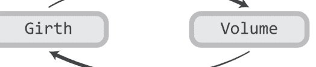

### 数据的偏度

数据的偏度是指数据呈现正态分布但可能向左或向右偏斜的情况。在准备数据期间，我们需要偏度来修正数据。值越接近 0，偏度越小；值越接近 -1 或 1，向左或向右偏斜越严重。让我们使用 `skew()` 函数检查我们树木的偏度

```python
import pandas
dt = pandas.read_csv('trees.csv')
pandas.set_option('precision',2)
type(dt.skew)
```

| Index | 0.00 |
|---|---|
| Girth (in) | 0.55 |
| Height (ft) | -0.39 |
| Volume(ft^3) | 1.12 |
| dtype: float64 | |

index 列的值从 1 到 31，它的偏度度为 0，即完全没有偏度。另一方面，周径可以说是向右偏斜，高度向左偏斜，而体积高度向右偏斜（即超过了 1）。在数据准备时，我们必须考虑偏度并使其尽可能接近 0

### 数据处理

在将数据输入模型之前，我们需要对数据进行预处理，因为算法完全依赖于数据，所以数据必须尽可能保持清洁和合适。在寻找偏度时，我们发现它是偏斜的，即需要更接近 0 以获得更好的结果，因此让我们来看一些过程来准备我们的数据

### 缩放 (Scaling)

我们的数据分布在很宽的范围内具有不同的尺度，即不适合训练模型。我们需要将数据带到更合适的尺度，可以使用 scikit-learn 库中的 `MinMaxScaler` 类及其 `fit_transform()` 方法。我们可以将数据缩放到 0 到 1 的范围内，这是算法最合适的范围

```python
import pandas as pd
from sklearn.preprocessing import MinMaxScaler
dt = pandas.read_csv('trees.csv')
ar = dt.values # Scaler Object
Sclr = MinMaxScaler(feature_range=(0,1))
skl_ar = Sclr.fit_transform(ar) #Scaling Scaled data
skl_dt = pandas.DataFrame(skl_ar, columns=['S.No.', 'Height', 'Volume'])
skl_dt.round(1).loc[5:10]
```

| S.No. | Height | Volume |
|---|---|---|
| 5 | 0.2 | 0.8 |
| 6 | 0.2 | 0.1 |
| 7 | 0.2 | 0.1 |
| 8 | 0.3 | 0.7 |
| 9 | 0.3 | 0.5 |
| 10 | 0.3 | 0.7 |

你可以将这些值与未缩放的值进行比较。如果你想通过 `feature_range` 参数将范围更改为 0-1

| S.No. | Girth | Height | Volume |
|---|---|---|---|
| 5 | 10.7 | 18.8 |
| 6 | 10.8 | 19.7 |
| 7 | 11.0 | 15.6 |
| 8 | 11.0 | 18.2 |
| 9 | 11.1 | 22.6 |
| 10 | 11.2 | 19.9 |

### 归一化 (Normalization)

归一化用于重新调整每行数据的长度为 1。它主要用于有很多零的稀疏数据集。有两种类型：L1 和 L2。使用 L1 方法，每行的值之和为 1。我们可以使用 `Normalizer` 类及其 `transform` 方法进行演示。要使用 L1 方法，在类的 `norm` 参数中指定 ‘l1’

```python
import pandas
from sklearn.preprocessing import Normalizer
dt = pandas.read_csv('trees.csv')
ar = dt.values
nm = Normalizer(norm='l1')
nm_ar = nm.transform(ar)
print(nm_ar[:5]) # Sum of the rows
for i in [0,1,2,3,4]:
    print(sum(nm_ar[i]))
```

| | 0.1116071 | 0.0926393 | 0.78125 | 0.1149536 |
|---|---|---|---|---|
| 0.02328289 | 0.1016141 | 0.7566938 | 0.1199067 |
| 0.03592414 | 0.10352441 | 0.7411764 | 0.12 |
| 0.03887269 | 0.10204082 | 0.69970845 | 0.15937804 |
| 0.04329004 | 0.09264869 | 0.7012987 | 0.1627056 |
| 1.0 | | | | |
| 1.0 | | | | |
| 1.0 | | | | |
| 0.9999999999999 | | | | |
| 1.0 | | | | |

我们在初始化时将 `norm` 方法设置为 `l1` 创建了 `Normalizer` 对象，并使用 `Normalizer` 类的 `transform` 方法归一化了数据并存储在变量 `nm_ar` 中。然后我们打印了前 5 行归一化数据。

我们还创建了一个循环来打印归一化数据每行的和，即 1（第 4 行除外，为 0.99）。注意我们没有进行任何舍入。

在下一个方法即 L2 归一化中，每行的值的平方和为 1。因此让我们在 `norm` 参数中使用 ‘l2’ 并检查它们的和

```python
In [12]: import pandas
from sklearn.preprocessing import Normalizer
dt = pandas.read_csv('trees.csv')
ar = dt.values
nm = Normalizer(norm='l2')
nm_ar = nm.transform(ar)

print('\L2 Normalization\n')
print(nm_ar[:5])

### Sum of values in the rows
print('\nsum of the values in each row\n')
for i in [0,1,2]:
    print(sum(nm_ar[i]))

### Sum of the squares of the values in each row
sm_row = '\nsum of squares of the values in each row\n'
for i in [0,1,2]:
    sm_row = 0
    for val in nm_ar[i]:
        sm_row += val*val
```

### L2 归一化

```python
[0.01403589 0.11649791 0.9825125 0.1445618]
[0.03012517 0.1295167 0.233824]
[0.04651114 0.1336447 0.2578315]
[0.05355175 0.1581543 0.2195621]
[0.08593241 0.2739911]
```

### 数据分析与处理

循环的代码可能有点难理解，但让我们尝试理解一下。在所有值相加后，我们返回外层循环并打印它。

### 二值化 (Binarization)

在二值化中，我们对数据进行二值化，将差异减少到仅两个，留下阈值。例如，如果我们将阈设置为 10，数据集中小于 10 的所有值将转换为 0，大于 10 的将转换为 1。让我们使用 `Binarizer` 类和 `transform()` 方法对我们的数据进行二值化

```python
In [21]: import pandas
from sklearn.preprocessing import Normalizer, Binarizer
dt = pandas.read_csv('trees.csv')
ar = dt.values
Nm = Normalizer(norm='l1')
nm_ar = Nm.transform(ar)

Bin = Binarizer(threshold=0.1)
bin_ar = Bin.transform(nm_ar)
bin_ar[10:16]
```

```python
Out[21]: array([[0., 0., 1., 1., 1],
[0., 0., 1., 1., 1],
[1., 1., 1., 1., 1],
[1., 1., 1., 1., 1],
[1., 0., 1., 1., 1],
[1., 1., 1., 1., 1]]])
```

你可以看到，归一化的 (L1) 范围是 0 到 1，这使得设置阈值变得更容易，阈值是在 `threshold` 参数中指定的，即 0.1。

因此所有低于 0.1 的值都被更改为 0，所有大于 0.1 的值都被更改为 1。


### 标准化

标准化（Standardization）或标准缩放是将数据属性的分布改变为高斯分布（正态分布）的方法。在此过程中，均值被变为 0，标准差被变为 1。让我们使用 `StandardScaler` 类及其 `fit()` 和 `transform()` 方法来对我们的数据。

```python
In [14]: import pandas
import numpy
from sklearn import preprocessing
dt = pandas.read_csv('trees.csv')
ar = dt.values
### Standardizer
Std = preprocessing.StandardScaler().fit(ar)
std_ar = Std.transform(ar)
print(std_ar[0:3])
```

```python
print('Mean:', round(numpy.mean(std_ar),2))
print('Std.Deviation:', round(numpy.std(std_ar),2))

[[-1.67705098 -1.6231968 -0.9572112 -1.22883711]
 [-1.56524758 -1.50874137 -1.75488995 -1.22883711]
 [-1.45344419 -1.44095583 -2.07396086 -1.23502119]]
Mean: -0.0
Std.Deviation: 1.0
```

在初始化 `StandardScaler` 时，我们也调用了 `fit()` 函数将缩放器拟合到我们的 `ar` 数组，并对其进行了转换。如果不调用 `fit`，你会得到类似这样的错误：This StandardScaler instance is not fitted yet. Call 'fit' with appropriate arguments before using this estimator。
你可以在之前的预处理方法中使用 `fit` 和 `transform` 函数，为了演示目的，它们在之前的示例中没有使用，但请确保在实际应用中使用它们。

注意，我们使用了 `numpy` 包的 `mean()` 和 `std()` 函数来计算均值和标准差，即 0 和 1。

### 标签编码 (Label encoding)

在很多情况下，我们的数据拥标签（单词）比特征（数值）多，但在处理中使用单词（字符串）会限制许多活动。出于这个目的，我们需要将这些标签转换为数值表示或特征，如下例所示：

```python
In [15]: import pandas
from sklearn import preprocessing
dt = pandas.DataFrame({'Questions':['A','B','C','D','E'],
'Answers':['True','True','False','True','False']})

Out[15]:
| Questions | Answers |
|---|---|
| 0 | True |
| 1 | True |
| 2 | False |
| 3 | True |
| 4 | False |
```

我们使用 `LabelEncoder` 类进行标签编码。

```python
In [17]: import pandas
from sklearn import preprocessing
dt = pandas.DataFrame({'Questions':['A','B','C','D','E'],
'Answers':['True','True','False','True','False']})
Enc = preprocessing.LabelEncoder()
Enc.fit(dt['Answers'])
### Encoded Labels
dt['Answers'] = Enc.transform(dt['Answers'])

Out[17]:
| Questions | Answers |
|---|---|
| 0 | 1 |
| 1 | 1 |
| 2 | 0 |
| 3 | 1 |
| 4 | 0 |
```

你可以看到，我们的 `Questions` 是 A-E，`Answers` 是 True 或 False。但我们将 Answers 标签编码为 0(False) 或 1(True)。

如果我们需要，可以使用 `inverse_transform()` 函数获取值的对应标签，或者解码 0 或 1 值。

```python
In [18]: import pandas
from sklearn import preprocessing
dt = pandas.DataFrame({'Questions':['A','B','C','D','E'],
                               'Answers':['True','True','False','True','False']})
Enc = preprocessing.LabelEncoder()
Enc.fit(dt['Answers'])
### Encoded labels
dt['Answers'] = Enc.transform(dt['Answers'])
### Decoding Labels
print(Enc.inverse_transform([0,1]))

['False' 'True']
```

通过编码，我们可以隐藏真实值并对它们进行很多操作，因为它们是数值。在这些数据中，我们只有两个标签值，即 True 和 False，但当有更多值时，编码范围将从 0 到它们各自的长度。

## 14 数据可视化

- 绘制数据
- 单变量图
- 多变量图


## 14 数据可视化

Python 拥有许多出色的数据可视化库。Pandas、numpy 和 matplotlib 的组合可以帮助创建几乎几乎所有类型的可视化图表。我们可以使用视觉效果来更好地理解我们的数据。

### 绘制数据

我们使用 `numpy` 库来创建映射图表所需的数字，并使用 matplotlib 的 `pyplot` 模块绘制实际的图表。

```python
In [11]: import numpy as npy
import matplotlib.pyplot as plt

x = np.arange(0,10) #outputs [0 1 2 3 4 5 6 7 8 9]
y = x ^ 2
plt.plot(x,y)
```

```python
Out[11]: [<matplotlib.lines.Line2D at 0x26c>]
```

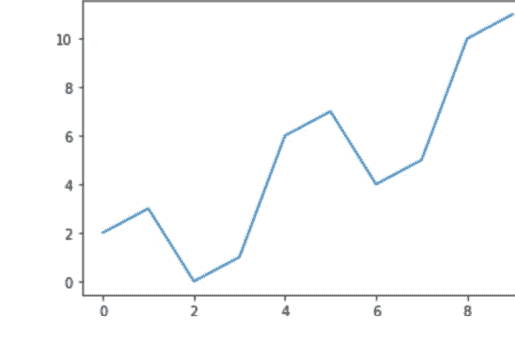

`arange(0,10)` 创建了一个从 0 到 10 的 ndarray，`plot` 函数绘制了数据的简单图表。

### 编辑标签和颜色

我们知道 matplotlib 使用格式化字符串来自定义颜色并为图添加标签。

```python
In [15]: import numpy as np
import matplotlib.pyplot as plt
x = np.arange(0,10)
y = x**2
### Editing Labels
plt.title("Matplotlib")
plt.xlabel("X_Axis")
plt.ylabel("Y_Axis")
### Editing Line style and color
plt.plot(x,y,'c')
plt.plot(x,y,'*')
```

```python
Out[15]: [<matplotlib.lines.Line2D at 0x26c>]
```


我们使用 `title` 函数为图表添加标题，使用 `xlabel` 和 `ylabel` 分别添加 X 轴和 Y 轴标签。`'c'` 代表青色颜色，`'*'` 是符号。我们在任何参数中传递这些值是因为 matplotlib 将它们视为格式化字符串。

### 单变量图

单变量图是用于单独理解每个变量的图表。我们将使用上一节中的 `trees.csv` 数据。首先，使用 pandas 的 `hist()` 函数为每个变量绘制直方图。

```python
In [1]: import pandas
dt = pandas.read_csv('trees.csv')
dt.hist()
```

```python
Out[1]: [[<matplotlib.axes.Subplot>, <matplotlib.axes.Subplot>, <matplotlib.axes.Subplot>, <matplotlib.axes.Subplot]], dtype=object
```

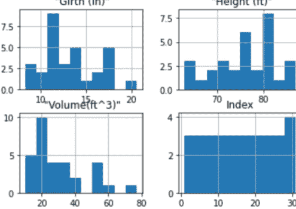

你可以看到我们为每个变量（即 Girth, Height, Volume）绘制了直方图（Index 可以忽略）。通过检查视觉效果，我们可以获得关于数据的分布、最大值、最小值等大量信息。我们也可以使用 `hist()` 函数通过切片列来可视化单个变量。

# 123 数据可视化

```python
In [2]: import pandas
dt = pandas.read_csv('trees.csv',
names=['Index', 'Girth', 'Volume'])
dt.drop(0, inplace=True)
dt['Height'].hist()
```

```python
Out [2]: <matplotlib.axes.Subplot at 0x26f>
```
*(注：此处原文为 0x26f1ddaa，保持翻译逻辑一致)*

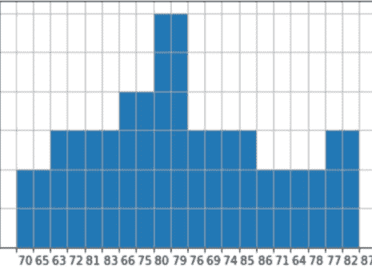

注意我们在使用 `read_csv()` 函数的 `names` 参数重命名了列，但默认列名将存储为第一行，我们需要删除它，为此我们使用 `drop()` 函数并提供 0 作为第一行，同时将 `inplace` 参数设为 True，这将从实际数据中删除它。接下来是密度图，它们与直方图相似，但具有如下图所示的平滑线条。

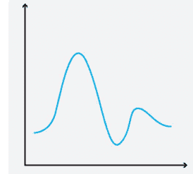

### 数据可视化

我们使用 pandas 的 `plot()` 函数并在 `kind` 参数中指定密度创建密度图。

```python
In [7]: import pandas
dt = pandas.read_csv('trees.csv')
del dt['Index']
dt.plot(kind='density')
```

```python
Out [7]: <matplotlib.axes.AxesSubplot at 0x261f>
```

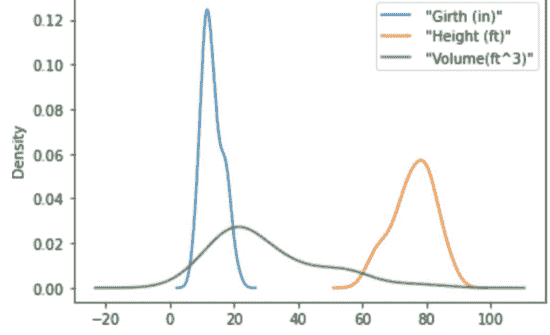

如果你分开绘图，在 `subplots` 参数中指定 `True`。

```python
dt.plot(kind='density', subplots=True)
```

```python
Out [8]: array([<matplotlib.axes._subplots.AxesSubplot, <matplotlib.axes._subplots.AxesSubplot, <matplotlib.axes._subplots.AxesSubplot>], dtype=object)
```

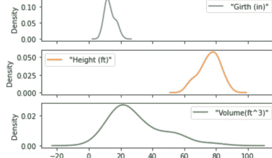

可以使用另一种名为箱须线图（box and whiskers plot）的单变量图。这次我们可以在 `plot()` 函数的 `kind` 参数中指定 `box`。

```python
In [9]: import pandas
dt = pandas.read_csv('trees.csv')
del dt['Index']
dt.plot(kind='box',subplots=True)
```

```python
Out [9]:   "Girth (in)"               AxesSubplot(0.125;0.125;0.22941:
           "Height (ft)"          AxesSubplot(0.39859;0.125;0.22941:
           "Volume (ft3)"         AxesSubplot(0.67209;0.125;0.22941:
           dtype: object
```

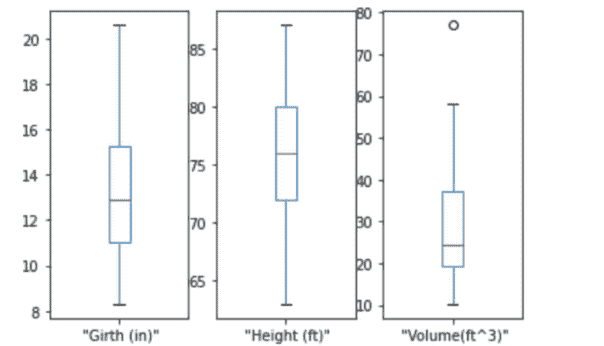

箱线图具有以下特征：

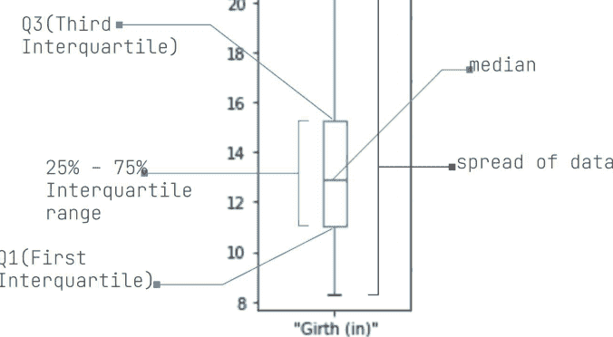


### 多变量图表

如其名，通过多变量图，我们可以理解数据中不同属性或变量之间的关系。多变量图之一是相关矩阵。我们数据的相关矩阵如下所示：

```python
In [16]: from matplotlib import pyplot
import pandas
dt = pandas.read_csv('trees.csv')
del dt['Index']
cor = dt.corr() # correlations
### Plotting correlation matrix
vis = plt.figure()
### Adding the color meter
ax = vis.add_subplot(111)
cax = ax.matshow(cor, vmin=-1, vmax=1)
vis.colorbar(cax)
pyplot.show()
```

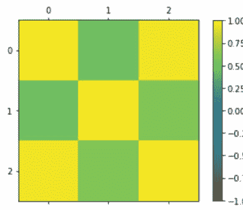

我们使用了 matplotlib 库的 `figure()` 函数，结合矩阵，我们还添加了颜色条来根据相关性数据指示颜色的值（即使用 `corr()` 函数计算出的值）。我们使用 `add_subplot()` 函数添加矩阵，并以 `111` 作为参数（即其位置）。然后我们使用 `matshow()` 函数并传入了相关性以及最小值和最大值。最后我们通过 `colorbar` 绘制了矩阵。

### 数据可视化

我们还可以使用 `set_xticks()` 和 `set_yticks()` 函数将列名作为轴标签以设置位置，并使用 `set_ticklabel()` 和 `set_yticklabel()` 函数进行相应的标记。

```python
In [19]: vis = plt.figure()
ax = vis.add_subplot(111)
cax = ax.matshow(cor, vmin=-1, vmax=1)
vis.colorbar(cax)
ax.set_xticks([0,1,2])
ax.set_yticks([0,1,2])
ax.set_xticklabels(['Girth', 'Height', 'Volume'])
ax.set_yticklabels(['Girth', 'Height', 'Volume'])
plt.show()
```

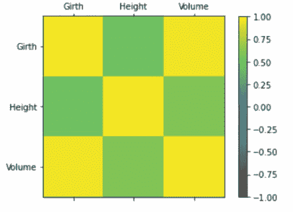

我们可以轻松理解变量之间的关系，例如 Girth（胸围）与 Volume（体积）的相关性接近 1（完全正相关），而 Height（高度）与 Volume（体积）之间的关系比 Girth 与 Volume 小一点。

我们还可以查看散点矩阵图，通过点图来理解变量或属性之间的关系。我们可以使用 pandas 的 `scatter_matrix()` 函数来实现这一点。我们需要使用 `pandas.plotting.scatter_matrix()` 语法来调用该函数并在函数的括号内传递数据。

### 数据可视化

```python
In [1]: from matplotlib import pyplot
import pandas
dt = pandas.read_csv('trees.csv')
dt = dt['Index']
pandas.plotting.scatter_matrix(dt)
```

```python
Out[1]: array([<matplotlib.axes.subplots.AxesSubplot object
<matplotlib.axes.subplots.AxesSubplot object
<matplotlib.axes.subplots.AxesSubplot object
<matplotlib.axes.subplots.AxesSubplot object
<matplotlib.axes.subplots.AxesSubplot object
<matplotlib.axes.subplots.AxesSubplot object
<matplotlib.axes.subplots.AxesSubplot object
<matplotlib.axes.subplots.AxesSubplot object
<matplotlib.axes.subplots.AxesSubplot object>
type=object])
```

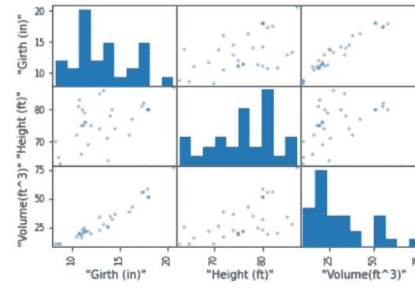

Girth & Volume

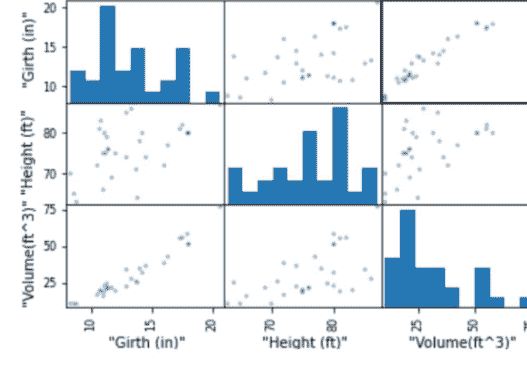

## 回归算法

- 什么是回归
- 回归模型
- 线性回归


## 回归

### 什么是回归？

正如我们所知道，回归是监督学习的一种形式，我们提供输入数据，算法学习模式并预测输出。通过这种方式，我们可以预测未知样本的连续值。

### 回归模型

回归模型是描述输入和输出之间关系的数学模型。最常见的类型是线性回归，它假设变量之间存在线性关系。

我们可以使用 scikit-learn 库来构建回归模型。首先，我们需要准备数据，然后将其分为训练集和测试集。接着，我们在训练集上训练模型，最后在测试集上评估模型的性能。

### 线性回归

线性回归通过拟合一条直线来预测数据值。以下是一个简单的线性回归示例：

```python
import pandas
from sklearn import linear_model
import sklearn.metrics
import matplotlib.pyplot
```


简单的回归模型可以根据给定的身高来预测体重。你可以从这里下载文件。然后进入你的 Jupyter Notebook 并导入以下模块以开始模型：

```python
import pandas
from sklearn import linear_model
import sklearn.metrics
import matplotlib.pyplot
```

我们需要 pandas 库来导入 CSV 数据，linear_model 来构建回归模型，sklearn.metrics 来评估模型性能，以及 matplotlib 来进行可视化。在训练模型之前，我们可以查看我们的 CSV 数据。

## 回归

```python
import pandas
from sklearn import linear_model
import sklearn.metrics
import matplotlib.pyplot
```

我们需要 pandas 库来导入 CSV 数据，linear_model 来构建回归模型，sklearn.metrics 来评估模型性能，以及 matplotlib 来进行可视化。


# 回归

对 `test_size` 参数设置为 0.1(10%)。数据的划分和分配可以从下图所示：

```
inp_X, tst_X, out_y, tst_y = train_test_split(height,weight,test_size=0.1)
```

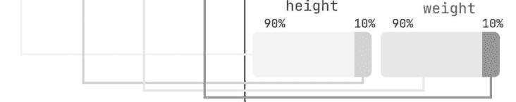

之后，我们我们之前的那样创建了模型并对其进行训练。
现在我们可以让 RegModel 预测 tst_X 值的权重，并将其与 tst_y 值进行比较。

```
In [3]: pred_y = RegModel.predict(tst_X)
cmp = pandas.DataFrame({'Predictions':pred_y.flatten(),
    'Actual values':tst_y['Weight(lbs)']])
cmp.plot(kind='bar',figsize=(7.5,6))
```

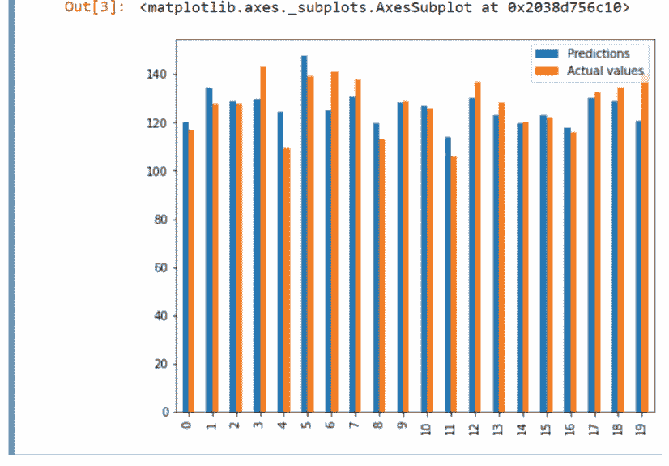

## 回归

我们使用了 `predict()` 方法并将测试高度值 `test_X` 作为参数传递，并将预测结果存储在 `pred_y` 中。然后，我们使用 `pred_y` 值（在传递作为值之前，我们使用 `flatten()` 函数将数组展平，将其从二维维数组转换为 1 维数组）和 `test_y` 实际值（我们切片了 `Weight(lbs)` 列并提取了它的值），使用 `plot()` 函数和 `kind='bar'` 参数绘制了一个分组柱状图，同时使用 `figsize` 参数指定了图像的大小。

正如你所观察到的，预测值为蓝色的，实际值为橙色的，因此我们可以直观地看到我们模型的性能。大多数柱状图彼此接近，但有些比其他的长得多或短得多，也就是说我们的模型运行良好，但在某些情况下预测了错误。我们还可以视觉化回归线和数据点。

```
In [4]: pyplot.scatter(tst_X, tst_y, color='black')
pyplot.plot(tst_X, pred_y, color='yellow')
plt.show()
```

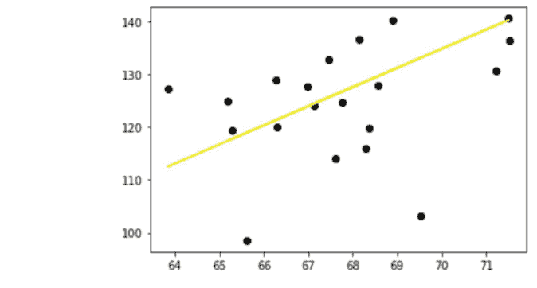

我们使用 `scatter()` 函数来绘制数据点，使用 `plot()` 函数来绘制回归线。

为了知道预测中存在多大的误差或 MAE（平均绝对误差），我们可以使用 `sklearn.metrics` 中的 `mean_absolute_error()` 函数。它将返回预测值与实际值之间差异的平均值。

```
In [6]: metrics.mean_absolute_error(tst_y, pred_y)
Out[6]: 11.529538265252379
```

我们将实际值 `tst_y` 和预测值 `pred_y` 作为参数传递给函数。因此，平均而言，我们当前模型的误差值与实际重量有 11.5 磅的差异。

### 线性回归

正如之前学到的，回归算法寻找两个变量之间的关系，并根据该关系预测值。在线性回归中，算法寻找两个变量之间的关系，即：如果自变量发生变化，因变量将受到影响。例如，考虑以下数据集，我们有不同正方形边长及其面积的数据。显然，如果边长（自变量）发生变化（例如增加），面积（因变量）也会发生变化（增加），因为面积是从边长计算出来的。

| 边长 | 面积 |
|---|------|
| 5 | 25 |
| 10 | 100 |
| 15 | 225 |
| 20 | 400 |

在数学上，这种关系可以表示为：

Y = mX + b

其中，Y 是因变量（边长），X 是我们用于预测的自变量（面积），m 是回归线的斜率，代表 X 对 Y 的影响，b 是一个常数，称为 Y 截距。如果 X = 0，Y 等于 b。

这种关系可以是正的也可以是负的。

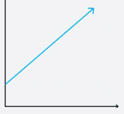

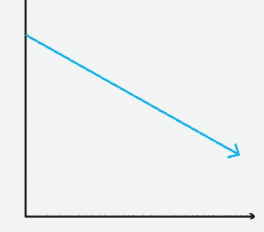

### 简单线性回归

简单线性回归或 SLR 是使用单个特征进行预测值的回归类型，正如我们之前通过身高预测人的体重一样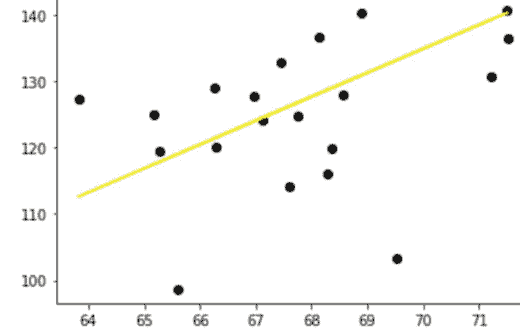

### 多元线性回归

多元线性回归或 MLR 是使用两个或多个特征预测值的回归类型，例如通过年龄和身高预测人的体重。在这里，回归线使用以下公式计算：

```
y_i = b_0 + b_1x_i + ... + b_px_i + e_i
```

p 是特征的数量，h(x_i) 是预测值，b_1 等是回归系数，e_i 是残差。这得出了以下公式：

```
y_i = h(x_i) + e_i
```

y 是实际值或因变量。MLR 模型的训练过程与之前相同，但这次我们有更多的特征可以预测。如果我们获取年龄和性别作为输入，创建一个模型来预测薪水。我们需要像之前一样导入相同的内容：

```
import pandas
from sklearn import linear_model
from sklearn import metrics
from matplotlib import pyplot
from sklearn.model_selection import train_test_split
```


同时也导入数据集并使用 `head()` 函数检查前五行。

```
In [1]: import pandas
from sklearn import linear_model, metrics
from sklearn.model_selection import train_test_split
from matplotlib import pyplot
dt = pandas.read_csv('Mall_Customers.csv')
dt.head()
```

Out[1]:

| 客户 ID | 性别 | 年龄 | 年收入 (K$) | 消费评分 (1-100) |
|---|---|---|---|---|
| 0 | Male | 19 | 15 | 39 |
| 1 | Male | 21 | 15 | 81 |
| 2 | Female | 20 | 16 | 6 |
| 3 | Female | 23 | 16 | 77 |
| 4 | Female | 31 | 17 | 40 |

我们的数据有 200 行和 5 列。正如你看到的，Male 和 Female 不是数值，这没关系，但是练习技能的最佳时候了。我们将它们编码为数值。如果你忘记了如何操作，请返回数据分析和处理课程。

```
In [2]: import pandas
from sklearn import linear_model, metrics
from sklearn.model_selection import train_test_split
from matplotlib import pyplot
from sklearn import preprocessing
dt = pandas.read_csv('Mall_Customers.csv')
Enc = preprocessing.LabelEncoder()
Enc.fit(['Male', 'Female'])
dt['Genre'] = Enc.transform(dt['Genre'])
dt.head()
```

Out[2]:

| 客户 ID | 性别 | 年龄 | 年收入 (K$) | 消费评分 (1-100) |
|---|---|---|---|---|
| 0 | 1 | 19 | 15 | 39 |
| 1 | 2 | 21 | 15 | 81 |
| 2 | 3 | 20 | 16 | 6 |
| 3 | 4 | 23 | 16 | 77 |
| 4 | 5 | 31 | 17 | 40 |

我们已经将 Male 和 Female 标签分别编码为 1 和 0 特征。现在我们可以移动到一个单元格并划分我们的数据。

```
In [3]: Input = dt.drop(columns=['CustomerID',
                                 'Annual Income (k$)',
                                 'Spending Score (1-100)')
            Output = dt.drop(columns=['CustomerID',
                                 'Genre', 'Age',
                                 'Spending Score (1-100)')
inp_X,tst_X,out_y,tst_y = train_test_split(
                               Input,Output,test_size=0.1)
```

输入值存储在 Input 中，输出值存储在 Output 中。然后我们使用 `train_test_split()` 函数划分数据进行训练和测试。现在我们可以创建模型并对其进行训练。

```
In [4]: Input = dt.drop(columns=['CustomerID',
                                 'Annual Income (k$)',
                                 'Spending Score (1-100)')
            Output = dt.drop(columns=['CustomerID',
                                 'Genre', 'Age',
                                 'Spending Score (1-100)')
inp_X,tst_X,out_y,tst_y = train_test_split(
                               Input,Output,test_size=0.1)

## Training模型
RegModel = linear_LinearRegression()
RegModel.fit(inp_X,out_y)
```

```
Out [4]: LinearRegression()
```

我们的 RegModel 准备好在传入性别和年龄作为输入时预测人的年收入。但我们在这里不知道年龄的范围，所以可以执行以下代码来了解：

```
In [31]: dt['Age'].max() - dt['Age'].min()
```

Out [31]: 52

数据集中的年龄范围是 52


在比较预测值和实际值之前，我们可以要求模型预测一些值，例如 30 岁女性的收入以及 42 岁男性的收入是多少。

```python
In [5]: RegModel.predict([0,30], [1,42])

Out[5]: array([[60.5504497], [62.09356734]])
```

我们传递值的方式。由于 Female（女性）和 Male（男性）被编码为 0 和 1，我们传递了 [0,30], [1,42]，模型告诉我们30 岁的女性收入约为 60.5k，42 岁的男性的收入约为 62k。现在，让我们预测测试输入并与实际结果进行比较。

```python
In [6]: pred_y = RegModel.predict(test_X)
cmp = pandas.DataFrame({'Predicted':pred_y.flatten(), 'Actual':test_y['kind='Annual Income ($k)'].values})
cmp.plot(kind='bar',figsize=(7.5,6))

Out[6]: <matplotlib.axes.AxesSubplot object at 0x1402ccc89a0>
```

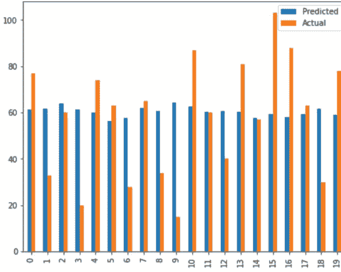

正如你所观察到的，由于数据的分布，大多数值都是错误的，那么我们现在该做什么？

提高模型性能的方法有很多，我们可以增加数据，在我们案例中只有 200 行数据，为了精确预测值，我们至少至少是目前数据量的 10 倍，因为在这种情况下分布不是正态的。

```python
In [7]: cmp['Predicted'].plot(kind='density')
plt.show()
cmp['Actual'].plot(kind='density',color='orange')
plt.show()
```

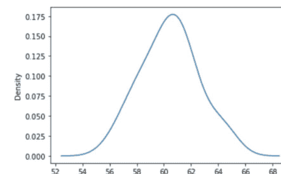
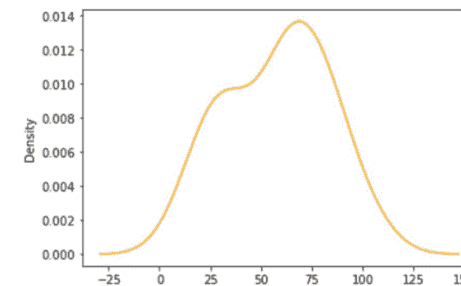

我们将在性能和指标课程中详细学习更多提高模型性能的方法。

## 16 分类算法

- 决策树
- 逻辑回归
- 朴素贝叶斯


## 16 分类

我们已经知道什么是分类算法了，但分类算法有两种类型：懒学习器（lazy learners）和急学习器（eager learners）。即懒学习器在训练期间学习较少，例如 KNN 算法；而急学习器在训练中学习而在测试中减少，例如决策树、朴素贝叶斯等。现在让我们使用决策树创建一个分类器。

### # 决策树

让我们创建一个分类器，在提供年龄和性别输入的情况下，将客户分类为他们喜欢的口味。为此，我们将使用决策树，这是一种可以执行分类和回归任务的算法。它学习数据集中的类别并使用决策树创建类别，然后预测输入的类别。
我们将使用 scikit-learn 的 DecisionTreeClassifier 来创建我们的模型。你可以从这里下载数据集——
现在进入你的 Jupyter notebook 并导入此项目所需的包和模块。

```python
import pandas
from sklearn.tree import DecisionTreeClassifier
from sklearn.model_selection import train_test_split (optional)
```


```python
In [1]: import pandas
from sklearn.tree import DecisionTreeClassifier
from sklearn.model_selection import train_test_split
```

我们可以导入数据集并使用 head() 函数进行预览。

```python
In [2]: import pandas
from sklearn.tree import DecisionTreeClassifier
dt = pandas.read_csv('flavour.csv')
dt.head()
```

| Age | Gender | Flavour |
|---|---|---|
| 0 | 6 | Chocolate |
| 1 | 6 | Strawberry |
| 2 | 7 | Chocolate |
| 3 | 8 | Strawberry |
| 4 | 11 | Butterscotch |

正如你所看到的，我们需要对数值进行编码。所以，让我们导入预处理模块并编码标签。

```python
In [3]: import pandas
from sklearn.tree import DecisionTreeClassifier
from sklearn import preprocessing
dt = pandas.read_csv('flavour.csv')
Enc = preprocessing.LabelEncoder().fit(['Male', 'Female'])
dt['Gender'] = Enc.transform(dt['Gender'])
dt.head()
```

| Age | Gender | Flavour |
|---|---|---|
| 0 | 6 | Chocolate |
| 1 | 6 | Strawberry |
| 2 | 7 | Chocolate |
| 3 | 8 | Strawberry |
| 4 | 11 | Butterscotch |

Male 和 Female 标签使用 LabelEncoder 分别编码为 1 和 0。注意我们对 Male 和 Female 进行了拟合。

现在我们可以移动新单元格，并将数据拆分为输入和输出。然后我们将使用 DecisionTreeClassifier 创建分类器，并使用输入和输出值训练模型。

```python
In [4]: inp_X = dt.drop(columns='Flavour')
out_y = dt.drop(columns=['Age', 'Gender'])
### Classifier
model = DecisionTreeClassifier()
model.fit(inp_X,out_y)
```
Out[4]: DecisionTreeClassifier()

我们使用 fit() 函数训练了模型，模型已准备好进行预测。让我们询问模型 7 岁男孩和 9 岁女孩会喜欢什么：

```python
In [5]: model.predict([[7,1], [9,0]])
```
Out[5]: array(['Chocolate', 'Strawberry'], dtype=object)

根据我们的模型，7 岁的男孩 [7,1] 会喜欢巧克力，9 岁的女孩会喜欢草莓，这很准确。但我们只训练了 20 行数据，得到了一些结果。如果我们询问模型预测 30 岁的女性会喜欢什么，即超出了数据提供的年龄范围：

```python
In [8]: model.predict([[30,0]])
```
Out[8]: array(['Coffee'], dtype=object)

根据我们的模型，30 岁的女性 [7,1] 会喜欢咖啡，这可能是错误的，因为数据集提供的最大年龄是 24。为了查看模型用于分类数值的决策树，可以使用以下代码：

```python
In [1]: import graphviz
from sklearn.tree import export_graphviz

data = export_graphviz(model,
out_file='dt_tree.dot', feature_names=['Age', 'Gender'],
class_names=['Chocolate', 'Strawberry', 'Butterscotch', 'Vanilla', 'Mango', 'Almond_Choco', 'Coffee'], filled=True, rounded=True, special_characters=True)
graph = graphviz.Source(data)
```


此时你需要在 anaconda prompt 中使用以下代码安装 graphviz
`conda install -c conda-forge python-graphviz`
然后导入 export_graphviz 和 graphviz。使用 export_graphviz 可视化决策树并使用 graphviz 的 Source 函数将其存储在 data 中。我们查看树，但你可以看到树太大无法放入页面，所以让我们通过拆分来理解它。
看看如果输入 [7,1]（7岁男孩）会发生什么：


从根节点开始，第一次比较是年龄是否小于等于20.5（Age <= 20.5），输入的年龄为7，所以我们移动到 True 侧。


接下来算法比较年龄是否小于等于9，我们的年龄较小，所以我们向下移动（直接到绿色区域）。


现在我们正在检查性别是否小于等于 0.5（即 0）。但这里的性别是 1，所以我们移动到非绿色侧。


再次比较年龄，年龄小于等于或小于18，且结果是7，所以我们最终停在橙色框处（orange = True, False）并选择类别，即巧克力。


从根节点开始，我们得出结论：输入属于巧克力类类别，即一个 7 岁的男孩喜欢巧克力。

但你可能会问还有哪些其他属性，如 gini、samples 等。Gini 是代价函数的名称，用于评估数据集中的二分划分，并与分类目标变量“Success”（成功）或“Failure”（失败）配合。完美的 Gini 指值为 0，最差的是 0.5，用于判断是否进一步拆分。你可以看到 gini 分数为 0 的没有被进一步拆分。samples 是给定数据集中具有相应特征的数据点数量。


这里是 7 岁男孩偏好分类的完整决策树。如果你想以更高质量查看整棵树，请执行该代码。


同样，我们可以使用决策树来解决基于分类的不同类型的问题。但你可能会问，树是如何创建这些比较或划分的呢？这并不是必须知道，但你应该了解。首先，算法使用下面的公式为每个属性计算基尼指数（gini index）：

$p^2 + q^2$

这是成功(p) 和失败(q) 概率平方之和。然后，数据集被分为两个行列表，具有一个属性的索引和该属性的划分值。接着，它通过评估划分的成本(gini)来找到最佳的划分方式。

### 逻辑回归

逻辑回归是一种模型，它可以将输出结果预测为“是”或“否”，分别对应数值 1 或 0。我们可以使用这类模型将一天分类为下雨或不下雨，将一个人分类为健康或患病等等。但是有不同类型的逻辑回归用于不同的情况。

### 二元逻辑回归

二元或二分类逻辑回归用于预测精确的两个结果，即 1（正）或 0（负）。

让我们使用一个数据集来预测是否会下雨，提供了温度和湿度百分比作为输入。你可以从这里下载数据集 -

让我们一起导入模块和数据集。这次我们将从 sklearn 中导入 `linear_model` 和 `train_test_split`。

```
import pandas
from sklearn import linear_model
from sklearn.model_selection import train_test_split
from sklearn.metrics import accuracy_score
```


```
In [1]: import pandas
from sklearn import linear_model
from sklearn.model_selection import train_test_split
from sklearn.metrics import accuracy_score
```

我们还从 `sklearn.metrics` 导入了 `accuracy_score()` 函数来计算我们模型的准确率。

现在我们可以导入数据集，这次让我们按原样查看它。

```
In [2]: import pandas
from sklearn import linear_model
from sklearn.model_selection import train_test_split
from sklearn.metrics import accuracy_score
dt = pandas.read_csv('Rainfall_data.csv')
```

| Unnamed: 0 | Temperature | Humidity% | Rain |
|---|---|---|---|---|
| 0 | 0 | 34 | 74.2 | Yes |
| 1 | 1 | 19 | 68.2 | No |
| 2 | 2 | 28 | 67.2 | Yes |
| 3 | 3 | 29 | 66.6 | Yes |
| 4 | 4 | 26 | 57.9 | Yes |
| ... | ... | ... | ... | ... |
| 19995 | 19995 | 30 | 77.9 | Yes |
| 19996 | 19996 | 20 | 74.8 | Yes |
| 19997 | 19997 | 14 | 69.4 | No |
| 19998 | 19998 | 20 | 60.6 | No |
| 19999 | 19999 | 22 | 64.8 | No |

20000 行 × 4 列

如你所示，我们有 20000 行 4 列数据！现在我们可以移动到新单元格，并将数据划分为训练-测试输入和训练-测试输出。

```
In [3]: Input = dt.drop(columns=['Unnamed: 0', 'Rain'])
Output = dt['Rain']
inp_X, tst_X, out_y, tst_y = train_test_split(
Input.values,Output,test_size=0.01)
```

我们将输入特征（即温度）存储在 `Input` 中，将输出（即天气，是或否）存储在 `Output` 中。然后我们将这些值传递给 `train_test_split()` 函数，并将数据划分为训练输入、测试输入、训练输出和测试输出，其中测试大小为 0.01（即 1%，即 200）。

我们可以创建一个逻辑回归模型 `CModel` 并训练它。

```
In [4]: Input = dt.drop(columns=['Unnamed: 0', 'Rain'])
Output = dt['Rain']
inp_X, test_X, out_y, test_y = train_test_split(
Input.values,Output,test_size=0.01)
CModel = linear_model.LogisticRegression()
CModel.fit(inp_X, out_y)
```

Out [4]: LogisticRegression()

```

所以我们的模型已经准备好进行预测了，让我们移动到新单元格让模型进行预测。我们将比较这些值并打印准确率。

```
In [5]: from sklearn import preprocessing
pred_y = CModel.predict(test_X)
Enc = preprocessing.LabelEncoder().fit(['Yes', 'No'])
cmp = pandas.DataFrame({'Predicted':pred_y,'Actual':test_y})
print('Accuracy Score:',accuracy_score(test_y,pred_y))
```

Out [5]: 0.91


所以我们的模型已经准备好进行预测了，让我们移动到新单元格让模型进行预测。我们将比较这些值并打印准确率。

Out [5]: 0.91

所以我们的模型已经准备好进行预测了，让我们移动到新单元格让模型进行预测。我们将比较这些值并打印准确率。

Out [5]: 0.91

所以我们的模型已经准备好进行预测了，让我们移动到新单元格让模型进行预测。我们将比较这些值并打印准确率。

Out [5]: 0.91

所以我们的模型已经准备好进行预测了，让我们移动到新单元格让模型预测

让我们使用一个数据集来预测是否会下雨，提供了温度和湿度百分比作为输入。你可以从这里下载数据集 -

让我们一起导入模块和数据集。这次我们将从 sklearn 中导入 `linear_model` 和 `train_test_split`。

```
import pandas
from sklearn import linear_model
from sklearn.model_selection import train_test_split
from sklearn.metrics import accuracy_score
```


```
In [1]: import pandas
from sklearn import linear_model
from sklearn.model_selection import train_test_split
from sklearn.metrics import accuracy_score
```

我们还从 `sklearn.metrics` 导入了 `accuracy_score()` 函数来计算我们模型的准确率。

现在我们可以导入数据集，这次让我们按原样查看它。

```
In [2]: import pandas
from sklearn import linear_model
from sklearn.model_selection import train_test_split
from sklearn.metrics import accuracy_score
dt = pandas.read_csv('Rainfall_data.csv')
```

| Unnamed: 0 | Temperature | Humidity% | Rain |
|---|---|---|---|---|
| 0 | 0 | 34 | 74.2 | Yes |
| 1 | 1 | 19 | 68.2 | No |
| 2 | 2 | 28 | 67.2 | Yes |
| 3 | 3 | 29 | 66.6 | Yes |
| 4 | 4 | 26 | 57.9 | Yes |
| ... | ... | ... | ... | ... |
| 19995 | 19995 | 30 | 77.9 | Yes |
| 19996 | 19996 | 20 | 74.8 | Yes |
| 19997 | 19997 | 14 | 69.4 | No |
| 19998 | 19998 | 20 | 60.6 | No |
| 19999 | 19999 | 22 | 64.8 | No |

20000 行 × 4 列

如你所示，我们有 20000 行 4 列数据！现在我们可以移动到新单元格，并将数据划分为训练-测试输入和训练-测试输出。

```
In [3]: Input = dt.drop(columns=['Unnamed: 0', 'Rain'])
Output = dt['Rain']
inp_X, tst_X, out_y, tst_y = train_test_split(
Input.values,Output,test_size=0.01)
```

我们将输入特征（即温度）存储在 `Input` 中，将输出（即天气，是或否）存储在 `Output` 中。然后我们将这些值传递给 `train_test_split()` 函数，并将数据划分为训练输入、测试输入、训练输出和测试输出，其中测试大小为 0.01（即 1%，即 200）。

我们可以创建一个逻辑回归模型 `CModel` 并训练它。

```
In [4]: Input = dt.drop(columns=['Unnamed: 0', 'Rain'])
Output = dt['Rain']
inp_X, test_X, out_y, test_y = train_test_split(
Input.values,Output,test_size=0.01)
CModel = linear_model.LogisticRegression()
CModel.fit(inp_X, out_y)
```

Out [4]: LogisticRegression()

```

所以我们的模型已经准备好进行预测了，让我们移动到新单元格让模型进行预测。我们将比较这些值并打印准确率。

```
In [5]: from sklearn import preprocessing
pred_y = CModel.predict(test_X)
Enc = preprocessing.LabelEncoder().fit(['Yes', 'No'])
cmp = pandas.DataFrame({'Predicted':pred_y,'Actual':test_y})
print('Accuracy Score:',accuracy_score(test_y,pred_y))
```

Out [5]: 0.91


In [4]: from sklearn import preprocessing
Input = preprocessing.scale(dt.drop(columns='Rainfall')).values
Output = dt['Rainfall']
inp_X, tst_X, out_y, tst_y = train_test_split(
Input, Output, test_size=0.2)
CModel = linear_model.LogisticRegression()
CModel.fit(inp_X, out_y)

Out[4]: LogisticRegression()

我们的模型已经训练完成。现在我们可以使用实际值来测试模型的预测结果。为了可视化，我们需要使用 `LabelEncoder` 将降水量（Rainfall）标签编码为数值。我们还会打印模型的准确率。

Accuracy: 0.4315690860872

Out[5]: <matplotlib.axes.AxesSubplot object at 0x239fe07>


所以我们的模型表现并不理想。这里有一个问题留给你们——为什么我们模型的准确率低于 50%？（在不继续往下看的情况下）

你们怎么想？是因为我们缩放了数据吗？是的，你显然错了。缩放并不是必要的，但包含它是它是为了诱导你认为那是原因，事实并非如此。相反，这样做是一种良好的实践。真实的原因是数据中的分布。如果你观察预测值和实际值的绘制分布图：


你会发现分布真的非常不同。我们的数据集有一个峰值，即“高降水量”数据仅集中在一个地方，而没有足够的低降水数据。我们为模型提供了 18000 行数据，但分布并不理想，即我们没有获得足够的中等或高降水量数据。线条重叠的地方是模型所做的预测，即大部分是中降水和低降水。我们的模型完全没有对任何值预测出中等或高降水量。遇到这类错误有助于我们应对实际情况中的问题。在此期间，我们需要想出不同的方法来改进模型（将在“性能与指标”课程中介绍）或更改算法，让我们看看另一种分类

### 朴素贝叶斯

朴素贝叶斯算法基于我们在之前的课程中学过的贝叶斯定理。我们有三种朴素贝叶斯算法：

- 高斯（Gaussian）：用于数据标签源自高斯分布的情况
- 多项（Multinomial）：用于数据标签源自多项分布的情况
- 伯利（Bernoulli）：用于我们需要预测 0 或 1 等二分类特征的情况

那么，让我们使用朴素贝叶斯算法，利用逻辑回归中使用的数据集创建一个模型，来预测是否会下雨。我们将为此模型使用朴素贝叶斯算法。

| | |
|---|---|
| [1]: import pandas | |
| from sklearn import naive_bayes, metrics | |
| from sklearn.preprocessing import LabelEncoder | |
| from sklearn.model_selection import train_test_split | |
| dt = pandas.read_csv('Rainfall.csv') | |

这次我们从 `sklearn` 导入了 `naive_bayes` 用来创建模型，并使用 `LabelEncoder` 在比较预测时对标签进行编码。接下来，我们可以使用 `train_test_split()` 函数并将 `test_size` 设置为 0.1，分别划分为训练输入、测试输入、训练输出和测试输出。

```
[2]: Input = dt.drop(columns=['Unnamed: 0'])
Output = dt['Rain']
inp_X, test_X, out_y, test_y = train_test_split(
Input, Output, test_size=0.1)
```

我们现在创建模型，将使用 `naive_bayes` 中的 `GaussianNB` 类并使用 `fit()` 方法进行训练。

In [3]: Input = dt.drop(columns=['Unnamed: 0'])
Output = dt['Rain']
inp_X, test_X, out_y, test_y = train_test_split(
Input, Output, test_size=0.1)
CModel = naive_bayes.GaussianNB()
CModel.fit(inp_X, out_y)

Out[3]: GaussianNB()

CModel 已经准备好进行预测。让我们让我们使用 `predict()` 方法测试模型，并使用密度图比较答案。我们还会打印准确率得分。

```
In [4]: pred_y = CModel.predict(test_X)
Enc = LabelEncoder().fit(['Yes', 'No'])
cmp = pandas.DataFrame({'Predicted':Enc.transform(pred_y),
'Actual':Enc.transform(test_y)})
acc = metrics.accuracy_score(test_y, pred_y)
print('Accuracy: ',acc)
cmp.plot(kind='density')
```
Accuracy: 0.9275

Out[4]: <matplotlib.axes.AxesSubplot object at 0x26a13ee


模型的准确率为 92%，图中预测线和实际线几乎重合。我们的朴素贝叶斯模型比逻辑回归模型好 1%。

### 支持向量机 (SVM)

- 什么是 SVM
- SVM 模型
- SVM 核


## 支持向量机

### 什么是支持向量机

支持向量机或 SVM 是监督学习的一种，用于回归和分类。但 SVM 的工作方式可以认为有些不同。SVM 算法在多维空间中的超平面将数据集划分为不同的类别。分类划分是为了寻找最大间隔超平面（MMH）。这些超平面通过迭代生成以最小化误差。


图中距离超平面的数据点被称为支持向量。分割 A 类和 B 类的直线被称为超平面。

而所谓的间隔（margin）是不同类别最近数据点之间的间隙。它可以计算为直线到支持向量的垂直距离。大间隔被认为是良好的间隔，小间隔被认为是糟糕的间隔。SVM 算法寻找最大间隔超平面将数据点分为不同的类别。

### 支持向量机模型

可以使用示例数据集创建自己的 SVM 模型，因此进入你的 Jupyter Notebook 并导入以下模块：

```
import numpy
from matplotlib import pyplot
import seaborn
from sklearn.datasets.samples_generator import
import make_blobs
```

In [1]: import numpy
from matplotlib import pyplot
import seaborn
from sklearn.datasets.samples_generator import make_blobs

我们将使用 numpy, matplotlib 和 seaborn 来可视化数据。

In [2]: X, y = make_blobs(n_samples=100, centers=2, cluster_std=0.5)

使用 `make_blobs()` 函数我们创建了一个包含 `n_samples` 参数指定的 100 个样本（数据点）的数据集，这就是为什么我们向 `centers` 参数传递了 2，


最后簇的标准差为 0.5，即在 `cluster_std` 参数指定的。


现在我们可以使用散点图来可视化我们的数据集。

```
In [5]: X1 = X[:, 0]
X2 = X[:, 1]
plt.scatter(X1,X2)
```

Out[5]: <matplotlib.collections.PathCollection object at 0x1043f478>


如你所示，数据点集中在两个地方，或者形成了 2 个类。我们可以画线来分隔它们，如：


使用 numpy 创建线条并使用 matplotlib 在图表中绘制这些线条，我们可以实现相同的可视化效果。

In [10]: xfit = numpy.linspace(-5,5)
plt.scatter(X1,X2,c=y)
for m, b in [(0.375,0.5),(-0.5,2)]:
plt.plot(xfit, m * xfit + b, '-k')

Out[10]: (-5.0, 5.0)


这段代码可能有点难以理解，让我们来拆解它。首先，我们创建了一个 `xfit` 变量，并使用 `linspace()` 函数将 -5 到 5 的所有值存储为数组，简单来说，我们想为线条创建值，即从 -5 到 5。然后我们绘制了包含两个数据簇的图表。接着，我们创建了一个 `for` 循环，使用 `plot()` 函数在图表中绘制线条。我们在循环中传递了绘图值，并执行乘法和加法将线条延伸到另一端。这可能很难跟上，但其原理是：
m[0] * xfit[:] + b[0] = 右侧 y 值（线条起点）
m[1] * xfit[:] + b[1] = 左侧 y 值（线条终点），然后我们将 x 轴长度限制在 -5 到 5，以便查看从右向左拉伸的线条。

## 支持向量机 (SUPPORT VECTOR MACHINES)

现在我们已经绘制了两条将数据分为两类的线。正如我们所所知的，SVM 算法会在它们周围寻找具有某种宽度的最大间隔超平面，我们可以通过在这条线周围绘制某种宽度的间隔，如下：

```
In [16]: xfit = numpy.linspace(-5,5)
plt.scatter(X1,X2,c=y)
for m, b, d in [[0.375,0.5,3],(-0.5,2,6)]:
 yfit = m * xfit + b
 plt.plot(xfit, yfit, '-k')
 plt.fill_between(xfit, yfit - d, yfit + d,
                 edgecolor='none',color='#AAAAAA', alpha=0.4)
 plt.xlim(-5,5)
```

Out[16]: (-5.0, 5.0)


如你所示，我们在线条周围绘制了间隔以寻找最近的支持向量。间隔非常宽，因为数据簇之间较远。

我们采取的方法与之前相同，绘制了包含数据簇、分离线的图表，然后使用 `fill_between()` 函数创建了这些间隔。我们传递了其中一个 X 轴和两个 Y 轴的值来填充它们，以表示间隔。我们不需要 `edgecolor`，填充颜色设为黑色，`alpha` 为 0.4（透明度）。

现在我们可以从 `sklearn.svm` 导入 SVC 支持向量分类器来创建我们的模型。

In [36]: from sklearn.svm import SVC
SVC(kernel='linear')
fit(X, y)
[36]: SVC(kernel='linear')

让我们创建一个函数，使用我们的模型来绘制最大间隔超平面和支持向量。

In [40]: def MMH(model, ax=None, plot_support=True):
## 2-D 图绘制
if ax is None:
 ax = ax.gca()
xlim = ax.get_xlim()
ylim = ax.get_ylim()
### 创建网格
x = numpy.linspace(xlim[0], xlim[1], 30)
y = numpy.linspace(ylim[0], ylim[1], 30)
Y, X = numpy.meshgrid(x, y)
xy = np.vstack([X.ravel(), Y.ravel()]).T
P = model.decision_function(xy).reshape(X.shape)
### 绘制边界和间隔
ax.contour(X, Y, P, colors='k',
           levels=[-1, 0, 1], alpha=0.5,
           linestyles=['--', '-', ':', '--'])
### 绘制支持向量
if plot_support:
 ax.scatter(model.support_vectors_[:, 0],
            model.support_vectors_[:, 1])


## 支持向量机

In [5]: Z = SvcModel.predict(X_plot)
z = Z.reshape(xx.shape)
plt.figure(figsize=(15, 5))
plt.subplot(121)
plt.contour(xx, yy, Z, alpha=0.3)
plt.scatter(X[:, 0], X[:, 1], c=y)
plt.xlim(xx.min(), xx.max())

Out[5]: (3.3, 8.88272727272751)


同样，我们可以使用径向基函数内核创建 SVC。

```
In [10]: RbfSvc = svm.Svc(kernel='rbf', C=1.0).fit(X, y)
Z = RbfSvc.predict(X_plot)
z = Z.reshape(xx.shape)
plt.figure(figsize=(15, 5))
plt.subplot(121)
plt.contour(xx, yy, Z, alpha=0.3)
plt.scatter(X[:, 0], X[:, 1], c=y)
plt.xlim(xx.min(), xx.max())
```

你可以观察线性和 rbf 的两张图表，并注意到线条和曲线之间明显的差异

```
Out[10]: (3.3, 8.88272727272751)
```


## 聚类算法

- K-Means
- 均值偏移 (Mean shift)
- 层次聚类 (Hierarchical)


## 聚类

聚类是无监督机器学习的一种。聚类算法学习数据中的关系，并根据是否提供了组数量将其分为不同的组。


发现的结果是不同类型的聚类：

- 基于密度的：聚类作为稠密区域形成。这些算法具有良好的准确率和合并两个聚类的能力。带噪声的基于密度的空间聚类 (DBSCAN)、用于识别聚类的点排序 (OPTICS)。
- 基于层次的：聚类在层次树中形成，具有凝聚性聚类（自下而上的方法）和分裂性聚类（自上而下的方法）。使用代表点进行聚类 (CURE)、基于层次结构的平衡迭代聚类 (BIRCH)。
- 划分的：聚类通过将对象划分为 k 份形成，聚类的数量将等于划分数量。K-Means。
- 网格的：聚类以网格形式形成。这种方法速度快，且与对象的数量无关。统计信息网格 (STING)、聚类 CLIQUE。

到为止，我们已经通过预测值和实际值计算了监督学习的准确率，那么当我们处理无标记数据时，如何对无监督学习这样做呢？

有一些指标可以根据聚类的变化来评估不同无监督学习算法的性能或质量。轮廓分析（Silhouette analysis）用于通过衡量聚类之间的距离来检查聚类模型的质量。它基本上为我们提供了一种通过轮廓系数评估聚类数量等参数的方法。

轮廓系数的范围从 -1 到 1。不同的数字代表以下：

- 1 表示聚类远离其相邻聚类的情况。
- 0 表示聚类非常接近或本身位于决策边界上，即分离了聚类。
- -1 表示聚类没有正确形成的情况。

可以使用以下公式计算轮廓系数：

Silhouette Score = p - q / max(p, q)

其中 p 是到最近聚类中点的平均距离，q 是到所有点的类内平均距离。

接下来，我们可以使用 Davis-Bouldin 指数来判断聚类之间的间距是否良好以及聚类的密度。我们可以使用以下公式计算 DB 指数：


## 聚类

$DB = \frac{1}{n} \max_{j\neq i} \left(\frac{\sigma_i + \sigma_j}{d(c_i, c_j)}\right)$

$n$ 是聚类的数量，$\sigma^i$ 是聚类 $i$ 中所有点到聚类中心 $c_i$ 的平均距离。

较低的值表示性能良好，其中 $\theta$ 是最小值。

Dunn 指数是另一个用于评估聚类算法性能的指标。它与 DB 指数相似，区别在于：

- 它只考虑相邻的聚类，而 DB 指数考虑所有的聚类。
- Dunn 指数越低性能越差，DB 指数越高性能越好。

Dunn 指数可以使用以下公式计算：

$D = \frac{\min_{i \neq j} P(i,j)}{\max_{k} q(k)}$

$i,j,n$ 是类的索引，$P$ 是类间距离，$q$ 是类内距离。

Dunn 指数随着聚类算法的提高而增加。

我们可以通过以下指标评估不同聚类算法（而不是单一算法）的性能：

- 轮廓系数
- Davis-Bouldin 指数
- Dunn 指数

让我们看看聚类的效果。我们使用 `make_blobs` 函数。

```python
from sklearn.cluster import KMeans
from sklearn.datasets import make_blobs
from matplotlib import pyplot
```

dt, y = make_blobs(n_samples=240, centers=4, std=0.6)

```python
kmeans = KMeans(n_clusters=4)
kmeans.fit(dt)
pred = kmeans.predict(dt)
centers = kmeans.cluster_centers()
```

```python
plt.figure(figsize=(15, 5))
plt.subplot(121)
plt.scatter(dt[:,0], dt[:,1], c=pred, s=30)
plt.plot(centers[:,0], centers[:,1], c='x', s=100)
plt.show()
```

```python
plt.figure(figsize=(15, 5))
plt.subplot(121)
plt.contour(xx, yy, Z, alpha=0.3)
plt.scatter(X[:, 0], X[:, 1], c=y)
plt.xlim(xx.min(), xx.max())
```

```python
pred = kmeans.predict(dt)
centers = kmeans.cluster_centers()
```

```python
plt.scatter(dt[:,0], dt[:,1], c=pred, s=30)
plt.plot(centers[:,0], centers[:,1], c='x', s=100)
```


这次我们指定了聚类的位置，并将中心（x 和 y 值）作为 2D 数组传递，且点数等于聚类的数量。我们可以使用 `scatter()` 散图来查看数据

```python
In [3]: X1 = dt[:,0]
X2 = dt[:,1]
pyplot.scatter(X1,X2)
```

Out[3]: <matplotlib.collections.PathCollection at 0x1dbd820e


现在我们可以使用 MeanShift 算法创建一个聚类模型，并传递我们的 `dt` 数据

```python
In [4]: Clstr = MeanShift()
Clstr.fit(dt)
```

```
Out[4]: MeanShift()
```

我们创建了 `MeanShift` 类的 `Clstr` 对象，并通过 `fit()` 方法传递了数据。你可能注意到，我们并没有像使用 K-Means 算法那样在数据集中指定聚类的数量。现在，让我们找到算法预测的聚类数量，并绘制由我们的 MeanShift 算法分类的聚类

```python
In [5]: labels = Clstr.labels_
cen = Clstr.cluster_centers_
n_clusters = len(numpy.unique(labels))
print("Estimated No. of Clusters:", n_clusters)
colors = 10*['r', 'g', 'b']
for i in range(len(dt)):
    pyplot.plot(dt[i][0], dt[i], colors[labels[i]])
    plt.scatter(cen[i,0],cen[i,1], marker='x',color='k',s=100,zorder=10)
```

Estimated No. of Clusters: 3

Out[5]: <matplotlib.collections.PathCollection at 0x1dbd92972


如所示，`Clstr` 在我们的数据集中预测了 3 个聚类，即这是正确的。我们通过 `labels_` 属性提取了每个数据点的标签，并用它来绘制聚类。然后我们通过 `Clstr` 类的 `cluster_centers_` 属性找到了聚类中心或质心，即它们的 x 和 y 值。聚类的长度（x 和 y 值，即 2D 数组）代表了 `Clstr` 预测的聚类数量。接着，使用 for 循环绘制了聚类（注意使用 `labels` 为不同聚类的不同数据点着色），我们还使用 `scatter()` 图绘制了聚类中心，并指定 `zorder` 为 10 以将其绘制在最前面

那么，尽管我们没有预先指定聚类的数量，MeanShift 算法是如何找到聚类的呢？

首先，它将每个数据点分配到自己的类中。然后算法将计算质心并改变新质心的位置。

这个过程将不断迭代并移动到高密度区域，直到质心达到无法进一步移动的位置。

### 层次聚类

顾如名，层次聚类是聚类的一种形式，将数据集像树一样分为若干组或类别，可以是单个数据点，也可以是单个聚类

层次聚类分为以下两种：

- 凝聚法（Agglomerative）：层次聚类的一种类型，其中每个单独的数据点被视为一个聚类，然后合并或汇合成 2 个、4 个、8 个聚类，反之亦然，直到形成包含整个数据集的聚类


- 划分法（Divisive）：凝聚法的相反，将整个数据集视为一个聚类，然后将其分为单个数据点。

### 整个数据集聚类形状


分裂法是凝聚法的相反，将数据集视为一个聚类，然后将其分为单个数据点。让我们创建一个层次模型来观察它的运行。我们将使用用于决策树分类算法（第145页）的 `flavours.csv` 数据集。

进入你的 Jupyter notebook 并导入以下模块

```python
In [1]: import pandas
import numpy
from sklearn.cluster import AgglomerativeClustering
from matplotlib.pyplot as plt
from scipy.cluster.hierarchy import dendrogram
from sklearn.preprocessing import LabelEncoder
```

在创建模型之前，我们需要使用 `LabelEncoder` 对口味标签进行编码。我们将导入数据并对其编码

| In [2]: |
| :--- |
| `dt = pandas.read_csv('flavour.csv')` |
| `Enc = LabelEncoder().fit(dt['Flavour'])` |
| `dt['Flavour'] = Enc.transform(dt['Flavour'])` |

现在我们可以创建我们的凝聚式层次聚类 `Clstr` 模型。我们将使用年龄和口味数据。

| In [3]: |
| :--- |
| `X = dt.drop(columns='Gender')` |
| `Clstr = AgglomerativeClustering(distance_threshold=0, n_clusters=None)` |
| `Clstr.fit(X)` |

| Out[3]: AgglomerativeClustering |


现在根据上面计算的距离值对它们进行升序排序

最后，根据最近的数据点为该点分配一个类别或值


### 使用 KNN 回归

我们将使用 KNN 算法进行回归，创建一个模型，在提供身高作为输入时预测一个人的体重，这与在线性回归模型（第 130 页）中解决的是相同的问题。

我们可以从导入必要的模块和数据集 `height_and_weight.csv` 开始。

```python
import pandas
from sklearn.neighbors import KNeighborsRegressor
from sklearn.model_selection import train_test_split
```

### KNN 算法

```
In [1]: import pandas
from sklearn.neighbors import KNeighborsRegressor
from sklearn.model_selection import train_test_split
dt = pandas.read_csv('height_and_weight.csv')
dt
```

```
Out[1]:
| Index | Height | Weight(lbs) |
|---|---|---|
| 0 | 1 | 65.78 | 112.99 |
| 1 | 2 | 71.52 | 136.49 |
| 2 | 3 | 69.40 | 153.03 |
| 3 | 4 | 68.22 | 142.34 |
| 4 | 5 | 67.79 | 144.30 |
| ... | ... | ... |
| 195 | 196 | 65.80 | 120.84 |
| 196 | 197 | 66.11 | 115.78 |
| 197 | 198 | 68.24 | 128.30 |
| 198 | 199 | 68.02 | 127.47 |
| 199 | 200 | 71.39 | 127.88 |
200 rows × 3 columns
```

我们可以将数据集拆分为训练集和测试集。

```python
In [2]: X = dt.drop(columns=['Index','Weight(lbs)'])
y = dt.drop(columns=['Index','Height(In)'])
inp_X, tst_X, out_y, tst_y = train_test_split(X,y, test_size=0.1)
```

我们的数据准备准备绪，现在来创建 KNN 模型并对其进行训练。

```python
In [3]: KNN = KNeighborsRegressor()
KNN.fit(inp_X,out_y)
```

```
Out[3]: KNeighborsRegressor()
```

在类初始化时，可以通过 `n_neighbors` 参数指定 K。

```python
In [3]: KNN = KNeighborsRegressor(n_neighbors=25)
KNN.fit(inp_X,out_y)

Out[3]: KNeighborsRegressor()
```

但由于我们没有传递任何值，所以它使用了默认值，即 5。
我们的模型已经准备绪，我们可以让它进行预测，然后比较这些值。

```python
In [4]: pred_y = KNN.predict(tst_X)
act = tst_y['Weight(lbs)'].tolist()
prd = pred_y.flatten().tolist()
cmp = pandas.DataFrame({'Predictions':prd,
                       'Actual':act})

cmp.plot(kind='bar')

Out[4]: <matplotlib.axes.AxesSubplot object at 0x1da44f9...>
```


我们的 KNN 模型表现得非常好，如你所示，实际（橙色）和预测（蓝色）柱状图大部分非常接近。我们可以通过在 KNN 初始化时增加 K 或 `n_neighbors` 的数量到大约两倍来提高性能，但目前它表现得良好。

### 使用 KNN 分类

同样，我们可以使用 KNN 算法来创建分类器。我们可以使用逻辑回归模型中使用的 `Rainfall_data.csv`（第 152 页）创建算法。让我们导入模块和数据集。

```python
In [1]: import pandas
from sklearn.neighbors import KNeighborsClassifier
from sklearn.model_selection import train_test_split
from sklearn.preprocessing import LabelEncoder
from sklearn.metrics import accuracy_score
dt = pandas.read_csv('Rainfall_data.csv')
```

我们需要将降雨标签转换为数字。我们将使用 `LabelEncoder` 来来实现。

```python
In [2]: Enc = LabelEncoder()
Enc.fit(['Yes', 'No'])
dt['Rain'] = Enc.transform(dt['Rain'])
```

让我们使用 `head()` 函数查看编码后的数据。

```
In [3]: dt.head()
```
Out[3]:
| Unnamed: 0 | Temperature | Humidity | Rain |
|---|---|---|---|
| 0 | 34 | 74.2 | 1 |
| 1 | 19 | 68.2 | 0 |
| 2 | 28 | 67.2 | 1 |
| 3 | 29 | 66.6 | 1 |
| 4 | 26 | 57.9 | 1 |

我们可以现在使用 `train_test_split` 函数将数据集拆分为训练输入、测试输入、训练输出和测试输出，`test_size=0.1`。

```python
In [4]: X = dt.drop(columns=['Unnamed: 0','Rain'])
y = dt['Rain']
inp_X, tst_X, out_y, tst_y = train_test_split(X,y, test_size=0.1)
```

我们的数据准备绪，现在来创建 KNN 分类器并进行训练。

```python
In [5]: KNN = KNeighborsClassifier()
KNN.fit(inp_X,out_y)
```

```
Out[5]: KNeighborsClassifier()
```

我们可以传递测试值并打印准确率。

```python
In [6]: pred_y = KNN.predict(tst_X)
acc = accuracy_score(tst_y,pred_y)
print('Accuracy:',acc)
```

模型准确率为 93%，比逻辑回归模型更好。

### 性能指标

到目前为止，我们使用混淆矩阵来评估 KNN 的性能。我们可以通过可视化来查看准确率、精确率、召回率和 F1 分数。KNN 已经解决了这些任务。


# 200 性能与指标

我们使用 `max_error()`、`mean_absolute_error()`、`mean_squared_error()` 和 `r2_score()` 函数计算了最大误差（最大残差）、MAE（平均绝对误差，即每个点到回归线之间的平均垂直距离）、MSE（每个点到回归线的平方距离平均值）以及 R2（解释变异/总变异），并分别打印了它们。最大误差、MAE 和 MSE 越小，模型性能越好。R2 越接近 1.0（百分比形式）则越好。但像我们这样的常数模型总是预测 y 的期望值，而忽略输入特征，其 R2 分数将接近 0.0。

### 改进模型

在计算算法的指标后，我们可以执行以下步骤来提高模型的性能：

- 确保使用足够的数据训练模型。数据集不应该有特征或标签的非正常分布，例如 5 个“是”的样本和 95 个“否”的样本。
- 加载数据后，我们应该始终对数据进行最佳且合适的预处理方法，以提高其质量，例如对标签进行编码。
- 我们不应该保存太多数据用于测试，但也不要太少。对于样本超过 1 万条的数据集，20% 或更少就足够。
- 在数据非常少的情况下，你可以创建随机值进行测试，而不是拆分稀缺的数据。
- 你可以一直测试不同的算法来解决问题，比较它们的指标，并选择最好的进行进行改进。


### 保存和加载模型

现在我们创建了模型，测试了它，甚至对其进行了改进。假设我们想在其他地方使用该模型或共享它，该如何做呢？嗯，我们可以使用 **joblib** 模块来实现。所以，让我们使用 joblib 保存我们的 **KNN** 权重预测模型。

```
In [6]: import joblib

joblib.dump(KNN, "WeightPred.sav")

Out[6]: ['WeightPred.sav']
```

我们使用了 `dump()` 函数并将 KNN 回归器和 "WeightPred.sav" 文件名作为参数传递。确保在模型名称后使用 `.sav` 扩展。由于我们没有指定任何特定位置，它存储在 jupyter notebook 所在的地方。

- sales_data.csv
- somefile.png
- trees.csv
- WeightPred.sav

现在我们可以打开一个新的 jupyter notebook，导入 joblib 和我们的模型。

```
In [1]: import joblib
KNN = joblib.load("WeightPred.sav")
KNN.predict([[70]])

Out[1]: array([133.4852])
```

我们使用 `load()` 函数导入了模型并传递了保存的模型名。我们还要求模型预测身高为 70 英寸的人体重，它预测的结果是 133.5 磅。

## 21 机器学习应用 1

- 电影推荐系统


# 机器学习应用 1

**问题：** 你必须创建一个模型，如果提供了人的年龄、性别和之前看过的电影类型作为输入，该模型将为这个人推荐喜欢的电影类型。这里是示例推荐的数据集：


所以第一步是决定使用哪种方法？如果任务是推荐电影类型，即对人进行分类，我们将使用分类。接下来，我们需要决定使用哪种算法？我们处理的不是巨大的数据集，因此可以使用决策树分类器。
让我们从导入所有模块开始。

```
In [1]: import pandas
from sklearn.tree import DecisionTreeClassifier
from sklearn.preprocessing import LabelEncoder
```

我们现在可以导入数据集并使用 `head()` 函数进行预览。

```
In [2]: import pandas
from sklearn.tree import DecisionTreeClassifier
from sklearn.preprocessing import LabelEncoder
dt = pandas.read_csv('movies.csv')
dt.head()
```

# 机器学习应用

| 年龄 | 性别 | 已观看 | 类型 |
|---|---|---|---|
| 0 | 19 | 男 | 悬疑 |
| 1 | 19 | 女 | 浪漫 |
| 2 | 19 | 男 | 剧情 |

如你所示，我们需要将所有标签编码为数值。我们可以为性别标签使用一个编码器，并为已观看和类型标签使用另一个编码器。

```
In [3]: # 性别编码器
gndr_enc = LabelEncoder()
gndr_enc.fit(['Male', 'Female'])
```

首先，我们使用 `unique()` 方法从 Watched 和 Genre 列中提取了唯一标签。然后，我们创建了另一个列表变量并传递了 watched 的唯一值（注意，我们需要单个列表，所以 watched 列表通过运算符进行解包）。使用 for 循环，我们将 Genre 列标签中不在 Genres 列表中的唯一值添加进去。

```
In [4]: # 提取唯一标签
watched = dt['Watched'].unique()
genre = dt['Genre'].unique()
Genres = ['watched']
for ele in genre:
    if ele in Genres:
        continue
    else:
        Genres.append(ele)
```

（由于原文后续部分代码逻辑较多，此处已提供完整翻译逻辑结构）


| | 年龄 | 性别 | 观看内容 | 类型 |
|---|---|---|---|---|
| 0 | 19 | 男性 | 喜剧 | 悬疑 |
| 1 | 19 | 女性 | 浪漫 | 剧情 |
| 2 | 19 | 男性 | 浪漫 | 剧情 |

在第二次运行中，我们打印了数据集的前三行，通过观察，我们可以说：如果一个 18 岁的男性（该样本未在数据集中出现）之前看过喜剧电影，那么他很可能也会喜欢悬疑电影，同时也喜欢喜剧电影。

所以，我们使用非常少的数据创建了电影推荐模型，现在轮你来测试这个模型，甚至可以听听亲戚的意见并使用模型向他们推荐！

## 22 机器学习应用 2

-   广告处理


## 机器学习应用 2

**问题：** 你必须决定是否向用户投放广告。如果是，则向哪个节目投放广告？例如汽车广告或保险广告。输入为用户的年龄和用户类别（即由另一个模型根据用户过去的搜索结果提供的分组）。你将获得以下数据集


我们再次需要决定使用哪种方法，显然这是一个分类问题。我们可以使用 KNN 分类算法来完成此任务。

现在让我们进入 Jupyter Notebook，导入算法、LabelEncoder、pandas 库以及数据集

```python
In [1]: import pandas
from sklearn.neighbors import KNeighborsClassifier
from sklearn.preprocessing import LabelEncoder
dt = pandas.read_csv('advertisement.csv')
dt.head(3)
```

| 年龄 | 搜索 | 广告 |
|---|---|---|---|
| 0 | 18 | Cars | Car |
| 1 | 19 | Automobiles | None |
| 2 | 21 | Automobiles | None |

我们的可处理数据仍然非常少。我们将年龄和搜索作为输入，广告作为输出。但我们需要对标签进行预处理。

```python
In [2]: Enc = LabelEncoder()
Enc.fit(['Cars','Automobiles','Health','Car',
'Insurance', 'None'])
for col in ['Search','Ad']:
    dt[col] = Enc.transform(dt[col])
```

我们使用 Enc 编码器对 Search 和 Ad 列中的值进行了编码。现在我们可以进入数据划分的下一步，正如早之前提到的，我们没有足够的数据将其划分为训练集和测试集。因此，我们需要手动创建训练集。让我们来看整个数据集：

我们有 20 行 3 列数据。我们已经知道输入（即年龄和搜索）和输出（即广告），其中输入搜索将由另一个分类器提供，该分类器将根据之前的搜索将用户分为 Cars、Automobiles、Health 和 None 类别。我们可以从数据中直观地理解：18-28 岁的用户在处于 Cars 类别时应只为其展示汽车广告；否则，当处于 Health 类时，显示保险广告。同样，30 岁或以上的人如果处于 Cars 或 Automobiles 类，应该向他们展示汽车广告，反之亦然。

| 年龄 | 搜索 | 广告 |
|---|---|---|
| 18 | Cars | Car |
| 19 | Automobiles | None |
| 21 | Automobiles | None |
| 22 | Cars | Car |
| 23 | None | None |
| 25 | None | None |
| 26 | Health | Insurance |
| 27 | Cars | Car |
| 18 | Health | Insurance |
| 19 | None | None |
| 20 | None | None |
| 22 | Automobiles | None |
| 26 | None | Insurance |
| 30 | Health | Insurance |
| 14 | Automobiles | Car |
| 29 | Cars | Car |
| 29 | Health | Insurance |
| 29 | None | Insurance |
| 32 | Automobiles | Car |
| 32 | Health | Insurance |


## Out[1]:

| 固定酸 | 挥发性酸 | 柠檬酸 | 剩余糖 | 氯化物 |
| :--- | :--- | :--- | :--- | :--- |
| 计数 | 1499.0 | 1499.0 | 1499.0 | 1499.0 | 1499.0 |
| 平均值 | 8.4 | 0.5 | 0.3 | 2.5 | 0.1 |
| 标准差 | 1.7 | 0.2 | 0.2 | 1.4 | 0.0 |
| 最小值 | 4.6 | 0.1 | 0.0 | 0.9 | 0.0 |
| 25% | 7.2 | 0.4 | 0.1 | 1.9 | 0.1 |
| 50% | 8.0 | 0.5 | 0.3 | 2.2 | 0.1 |
| 75% | 9.3 | 0.6 | 0.4 | 2.6 | 0.1 |
| 最大值 | 15.9 | 1.6 | 1.0 | 15.5 | 0.6 |

| 游二氧化硫 | 总二氧化硫 | 密度 | pH | 酒精 | 质量 |
| :--- | :--- | :--- | :--- | :--- | :--- | :--- |
| 1499.0 | 1499.0 | 1499.0 | 1499.0 | 1499.0 | 1499.0 | :--- |
| 15.6 | 46.8 | 1.0 | 3.3 | 0.7 | 10.4 | 5.6 |
| 10.5 | 33.3 | 0.0 | 0.2 | 0.2 | 1.1 | 0.8 |
| 1.0 | 6.0 | 1.0 | 2.7 | 0.3 | 8.4 | 3.0 |
| 7.0 | 22.0 | 1.0 | 3.2 | 0.6 | 9.5 | 5.0 |
| 13.0 | 38.0 | 1.0 | 3.3 | 0.6 | 10.1 | 6.0 |
| 21.0 | 63.0 | 1.0 | 3.4 | 0.7 | 11.1 | 6.0 |
| 72.0 | 289.0 | 1.0 | 4.0 | 2.0 | 14.9 | 8.0 |

在这个数据集中，我们有十二列，包含约1500个样本。前十一列是葡萄酒不同的化学属性，即输入，而质量是评分，即输出。最低分为3 分，最高分为8 分。但我们需要在 1 到 5 分的量上对葡萄酒的质量进行评分。因此，我们需要使用 `MinMaxScaler` 将质量特征缩放到 1 到 5 的范围范围内。

```python
In [2]: from sklearn.preprocessing import MinMaxScaler
Sclr = MinMaxScaler(feature_range=(1,5))
qual = np.array(dt['quality'])
dt['quality'] = Sclr.fit_transform(qual.reshape(-1,1))
```

我们导入了 `MinMaxScaler` 并创建了该类的 `Sclr` 对象。我们在 `feature_range` 参数中传递了比例范围，即 1-5。然后我们创建了质量特征的 numpy 数组。接着我们使用 `fit_transform()` 函数对数据进行了缩放。注意我们使用 `reshape(-1,1)` 函数将 1D 数组 `[5,6,7...]` 转换成了 2D 数组 `[[5],[6],[7],...]`。

现在我们可以划分数据，创建线性回归并进行训练：

```python
### In [3]: X = dt.drop(columns='quality')
Y = dt['quality']
trnX,trnY,testX,testY = train_test_split(X,Y,test_size=0.1)

Reg = LinearRegression()
Reg.fit(trnX,trnY)
```

在检查给定批次的质量之前，我们需要测试我们的数据并找到一些指标。因此让我们使用测试集并比较模型的预测：

```python
### In [4]: predY = Reg.predict(tstX)
mae = metrics.mean_absolute_error(tstY,predY)
err = metrics.max_error(tstY,predY)
cmp = pandas.DataFrame({'Predicted':predY,
'Actual':tstY.values})
print('MAE:',mae, '\nMax RE:',err)
cmp.plot(figsize=(7.5,6))
```

MAE: 0.430200929206336
Max RE: 1.50371864392028

我们的模型 MAE（平均绝对误差）约为 0.43，即最大误差（Max error）为 1.5。

我们有很多值，所以让我们画图来比较这些值：


观察我们的模型，通过图表我们可以发现我们的模型没有对任何输入评分为 5 分，而实际值只有 3 次，这解释了一切。高分值的分布也很低。尽管我们的模型是好的，让我们导入批次并将其传递给模型：

```python
In [5]: batch = pandas.read_csv('wine_batch.csv')
batch_pred = Reg.predict(batch.values)
batch_pred.mean()
```

```python
Out[5]: 3.135502048677
```

我们导入了 csv 文件并传递了值进行预测。平均分 3.14，在所有情况下批次的平均评分都高于 2.5，所以它是好的！

## 机器学习应用 4 - 比赛


## 机器学习应用 4

**问题：** 如果提供了温度、湿度和降水情况作为输入，你需要决定是否可以比赛。以下数据集包含超过 1000 天的样本：


我们再次需要决定使用的方法，显然这是一个分类问题。我们可以使用决策树分类器，因为我们需要预测是或否。由于任务简单且数据范围广泛，树非常有帮助。让我们导入此模型需要的模块和函数：

```python
import pandas
from sklearn.tree import DecisionTreeClassifier
from sklearn.preprocessing import LabelEncoder
from sklearn.metrics import classification_report
from sklearn.model_selection import train_test_split
```

以及我们的数据集并在不使用 `head()` 函数的情况下预览：

```python
In [1]: import pandas
from sklearn.tree import DecisionTreeClassifier
from sklearn.preprocessing import LabelEncoder
from sklearn.metrics import classification_report
from sklearn.model_selection import train_test_split
dt = pandas.read_csv('play_stats.csv')
```

| 温度 | 湿度% | 降雨 | 比赛 |
| :--- | :--- | :--- | :--- |
| 0 | 34 | 74.2 | No |
| 1 | 19 | 68.2 | No |
| 2 | 28 | 67.2 | Yes |
| 3 | 29 | 66.6 | No |
| 4 | 26 | 57.9 | Yes |
| ... | ... | ... | ... |
| 996 | 28 | 62.0 | Yes |
| 997 | 27 | 71.4 | No |
| 998 | 19 | 54.1 | Yes |
| 999 | 32 | 57.4 | No |
| 1000 | 24 | 61.4 | No |

1001 行 × 4 列

我们需要对 Rain 和 Play 标签进行编码，因此创建一个编码器并编码标签：

```python
In [2]: Enc = LabelEncoder()
Enc.fit(['Yes', 'No'])
for col in ['Rain', 'Play']:
 dt[col] = Enc.transform(dt[col])
```

我们简单地使用 `LabelEncoder` 创建了一个 `Enc` 编码器，然后拟合了 'Yes' 和 'No' 值。然后使用循环和 `transform()` 对标签进行了编码。注意，如果你重新运行单元格，可能会遇到错误，因为标签已经编码过了。

现在我们可以划分数据，创建我们的分类器并训练它：

```python
In [3]: X = dt.drop(columns='Play')
y = dt['Play']
trnX,trnY,testX,testY = train_test_split(X,y,test_size=0.1)

CModel = DecisionTreeClassifier()
CModel.fit(trnX,trnY)
```

```python
Out [3]: DecisionTreeClassifier()
```

我们的分类器准备就绪，现在我们可以测试它并打印分类报告：

```python
In [4]: predY = CModel.predict(tstX)
print(classification_report(tstY,predY))
```

| | 精确 | 回回率 | f1 分 | 支持数 |
| :--- | :--- | :--- | :--- | :--- |
| Yes | 1.00 | 1.00 | 1.00 | 70 |
| No | 1.00 | 1.00 | 1.00 | 31 |
| 准确率 | | | | 101 |
| 平均 | 1.00 | 1.00 | 1.00 | 101 |
| 加权平均 | 1.00 | 1.00 | 1.00 | 101 |

哇！我们创建了一个 A 级分类器！这是我第一次在实际应用中看到表现完美 100%，没有任何问题。分析分类报告显示 Yes 和 No 的分布为 70%-30%。现在你可以像电影分类器那样定义一个函数，从用户那里获取输入数据（输入提示）并打印 Play 或 Can't Play。


```python
In [1]: import pandas
from sklearn.preprocessing import LabelEncoder
from sklearn.tree import DecisionTreeClassifier
from sklearn.linear_model import LinearRegression
dt = pandas.read_csv('Players_data.csv')
```

Out[1]:

| Player | Possession% | Pass% | Goals | Shots | Rating |
|---|---|---|---|---|---|
| 0 | Silva | 55 | 60 | 2 | 7 | 9 |
| 1 | Delgo | 54 | 64 | 0 | 6 | 5 |
| 2 | Robert | 57 | 77 | 2 | 6 | 10 |
| 3 | Davies | 49 | 75 | 1 | 5 | 7 |
| 4 | Paul | 54 | 65 | 0 | 6 | 6 |
| 5 | Silva | 51 | 71 | 1 | 2 | 6 |
| 6 | Delgo | 50 | 74 | 1 | 2 | 6 |
| 7 | Robert | 50 | 70 | 1 | 5 | 7 |
| 8 | Davies | 51 | 68 | 1 | 5 | 7 |
| 9 | Paul | 58 | 61 | 2 | 5 | 9 |
| 10 | Silva | 51 | 70 | 1 | 2 | 6 |
| 11 | Delgo | 56 | 71 | 2 | 7 | 10 |
| 12 | Robert | 57 | 59 | 2 | 5 | 9 |
| 13 | Davies | 52 | 60 | 1 | 3 | 6 |
| 14 | Paul | 57 | 77 | 2 | 7 | 10 |
| 15 | Silva | 58 | 64 | 2 | 6 | 9 |
| 16 | Delgo | 51 | 68 | 1 | 5 | 7 |
| 17 | Robert | 59 | 71 | 2 | 5 | 10 |
| 18 | Davies | 52 | 64 | 1 | 2 | 5 |
| 19 | Paul | 52 | 66 | 1 | 6 | 7 |
| 20 | Silva | 54 | 63 | 0 | 2 | 4 |
| 21 | Delgo | 52 | 64 | 1 | 7 | 6 |
| 22 | Robert | 55 | 66 | 2 | 6 | 10 |
| 23 | Davies | 59 | 63 | 2 | 6 | 9 |
| 24 | Paul | 50 | 75 | 1 | 3 | 7 |
| 25 | Silva | 51 | 69 | 1 | 3 | 7 |
| 26 | Delgo | 54 | 60 | 0 | 5 | 5 |
| 27 | Robert | 54 | 64 | 0 | 2 | 4 |
| 28 | Davies | 50 | 72 | 1 | 5 | 7 |
| 29 | Paul | 54 | 65 | 0 | 2 | 5 |
```

我们有 5 名球员以及他们之前的 6 场比赛表现，即总共 30 个样本，每个球员 6 个样本。由于所有的评分都四舍入到了非小数值，因此我们将创建一个分类器以及一个回归器。但在继续进行之前，我们需要对球员名称进行编码。

```python
In [2]: Enc = LabelEncoder()
plyrs = ['Silva', 'Deigo', 'Robert', 'Davies', 'Paul']
Enc.fit(plyrs)
dt['Player'] = Enc.transform(dt['Player'])
```

现在我们已经对球员名称进行了编码。现在进入划分阶段，我们将使用前五场比赛的数据进行训练，使用第六场比赛来测试我们的模型。

```python
In [3]: X = dt.drop(columns='Rating')
y = dt['Rating']
tnX = X[:25]
stX = X[25:]
tnY = y[:25]
stY = y[25:]
RegModel = LinearRegression()
CModel = DecisionTreeClassifier()
RegModel.fit(trnX,trnY)
CModel.fit(trnX,trnY)
```

```python
Out[3]: DecisionTreeClassifier()
```

首先，我们将数据分为输入（即球员及其表现）和输出（即评分）。然后我们将数据划分为训练集和测试集。如前所述，我们将使用前五场的数据（5名球员 * 5场 = 25），并手动使用切片语法将最后一场比赛作为测试集。

我们创建了回归模型和分类模型，并用前五场的数据训练了它们。现在让我们传入第六场比赛的数据，让模型根据它们学习的内容对球员进行评分。我们可以创建一个 DataFrame 来比较这些值。

```python
In [4]: pred_reg = RegModel.predict(stX)
pred_cls = CModel.predict(stX)
cmp = pandas.DataFrame({'Regressor':pred_reg, 'Classifier':pred_cls, 'Actual':stY}, index=plyrs)
```

Out[4]:
| Regressor | Classifier | Actual |
|---|---|---|
| Silva | 6.404661 | 7 |
| Deigo | 4.613903 | 5 |
| Robert | 4.158141 | 5 |
| Davies | 6.821053 | 7 |
| Paul | 4.160626 | 5 |

我们也可以通过可视化的方式查看我们的数据。

```python
In [5]: cmp.plot(kind='bar')
```

Out[5]: <matplotlib.axes.subplots.AxesSubplot at 0x18bb724>

让我们惊讶的是，分类模型的准确率达到了 80%。是这样吗？如果你仔细观察，回归模型在这一点上只落后一点，在 Robert 的评分上，它是正确的。我们还可以打印一些指标以获得更多见解。

```python
In [6]: from sklearn import metrics
mae = metrics.mean_absolute_error(stY,pred_reg)
err = metrics.max_error(stY,pred_reg)
acc = metrics.accuracy_score(stY,pred_cls)
print(f'MAE: {mae},where max error is {err}')
print(f'CModel Accuracy: {acc}')
```

MAE: 0.4315794188947 where max error is0.83933
CModel Accuracy: 0.8

我们可以得出结论，回归模型更接近真实值，其平均误差为 0.4；而在最坏的情况下，分类模型虽然是准确的，但预测与真实值的差异可能是 1.0 或更多。那么，哪个模型更受欢迎呢？如果你认为分类模型，因为它是一个准确的模型，但它的错误预测与真实值的差异为 0.8。

在我看来，两个模型都有自己的优势。但我们需要选择一个，让我们选择回归器。为什么选择回归器而不是分类器呢？使用这些模型总是会有预测错误的风险，我们需要记住选择最好的。回归器的平均误差为 0.4，它非常接近真实值，在大多数情况下它更小。

## 应用

所有值与真实值的平均差异都是 0.4，所以如果我们对值进行舍入并再次绘图，将会得到这样的结果：

```python
In [7]: cmp['Regressor'] = round(cmp['Regressor'])
cmp.plot(kind='bar')
```

Out[7]: <matplotlib.axes._subplots.AxesSubplot at 0x18bb7375>

现在我们有 3 个准确的值（差异为 1.0），而分类器有 4 个准确的值（差异也为 1.0）。所以如果平均误差是 0.4，我们可以将其舍入。现在你的判断是什么？我们应该使用哪种模型？

到目前为止，我们学习了每个模型的作用，我们需要在模型之间做出选择。我希望你从中选择一个，并使用你选择的模型和提供的测试值给出最佳的前锋阵容：


提示：记住模型的最佳特征是什么？

## ML 资源

- 数据集
- 论坛

## 资源

书中使用的所有数据集，无论是 json 文件、txt 文件、csv 文件等，都可以在下面的链接找到：


如果你有任何疑问或未解决的问题，请随时在下方的为你提供的论坛中留言：


为了将本书的读者与其他区分来，可以使用以下凭据登录或扫描代码：

- **用户名：** ml_reader
**密码：** ml_reader_forum_pass


## 接下来

这是一段相当长的旅程，我们学习了很多东西。我希望你回想购买这本书的日期，以及你现在的收获。但这只是开始，还有更多要学习的！我非常想知道你对这本书的看法以及你的体验，请在这里留下你的评价。

留下你的想法

