# 机器学习：构建自己的推荐系统（机器学习从零开始 第3本）


## 关注我们：

**Skillshare**
www.skillshare.com/user/machinelearning_beginners

**Teachable**
http://scatterplotpress.teachable.com/

**YouTube**
Scatterplot Media

**Instagram**
machinelearning_beginners

## 前言

从 Facebook 上的相关朋友推荐到 Amazon 上的商品推荐，推荐系统的存在无处不在。看看您最近在线浏览和消费的内容，因为您的许多在线活动，包括发现这本书，很可能都源自算法驱动的推荐。这些数据驱动的系统正在削弱传统搜索引擎的主导地位，同时帮助小众和晦涩物品的可发现性。作为机器学习的一个分支领域，理解这些模型的工作原理比以往任何时候都更加重要，而在这本书中，我们更进一步，编写三个基本的推荐系统。

本书专为具有部分数据科学和机器学习背景知识的初学者设计，包括统计学和使用 Python 进行计算机编程。如果这是您第一次涉足数据科学，在开始之前，您可能需要先花几个小时阅读我的第一本书《机器学习绝对入门》。

## 本书使用的数据集

### Goodbooks-10k 数据集（第 6 章）

这两个数据集包含从 www.goodreads.com 收集的图书和用户评分信息。第一个数据集包含单个用户的图书评分，而第二个数据集包含单个图书的信息，例如平均评分、五星级评分数量、ISBN 号码、作者等。
https://www.kaggle.com/sriharshavogeti/collaborative-recommender-system-on-goodreads/data

### 广告数据集（第 7 章）

该数据集包含关于响应在线广告的用户特征的虚构信息，包括他们的性别、年龄、位置、每天在线时间以及是否点击了广告。该数据集由 Pierian Data 的 Udemy 课程讲师 Jose Portilla 创建，并在他的课程 Python for Data Science and Machine Learning Bootcamp 中使用。
https://www.kaggle.com/fayomi/advertising/data

### 墨尔本住房市场（第 8 章）

这个第三个数据集包含澳大利亚墨尔本的房屋、公寓和联排别墅价格数据。该数据集包含每周在 www.domain.com.au 上发布的公开可用房源的抓取数据。完整数据集包含 14,242 个房源和 21 个变量，包括地址、郊区、土地面积、房间数量、价格、经度、纬度、邮政编码等。
https://www.kaggle.com/anthonypino/melbourne-housing-market/

## 介绍 Scikit-Learn

Scikit-learn 是通用机器学习的核心库。它提供了大量浅层算法[1]的存储库，包括逻辑回归、决策树、线性回归、梯度提升等，以及一系列评估指标，如平均绝对误差，以及包括分割验证和交叉验证在内的数据分区方法。

Scikit-learn 还用于执行许多重要的机器学习任务，包括训练模型和使用训练好的模型来预测测试数据。

下表简要概述了 Scikit-learn 中常用的机器学习术语和函数。

| 术语 | 解释 | 代码示例 |
|---|---|---|
| estimator | 估计器是指一组超参数值，例如支持向量机中的 C、k-NN 中的 n_neighbors 或随机森林中的 n 棵树。在训练模型之前设置，估计器将每个超参数值映射到学习算法。 | model = ensemble.GradientBoostingRegressor(<br>    n_estimators = 150,<br>    learning_rate = 0.1,<br>    max_depth = 30,<br>    min_samples_split = 4,<br>    min_samples_leaf = 5,<br>    max_features = 0.6,<br>    loss = "huber"<br>)<br><br>这七个超参数中的每一个都代表梯度提升算法的一个单独估计器。 |
| fit() | 设置估计器后，fit() 函数用于在训练数据上运行学习算法并训练预测模型。 | model = KNeighborsClassifier(n_neighbors=5)<br>model.fit(X_train, y_train)<br><br>此代码片段将 k-NN 模型拟合到 X 和 y 训练数据上。 |
| predict() | 模型训练完成后，predict() 函数使用新训练的模型利用 X 测试数据进行预测。在监督学习中，这涉及使用模型来预测 X 测试数据的标签或值。 | prediction = model.predict(X_test)<br><br>在此示例中，训练好的模型被要求预测 X 测试数据，并将其分配为新变量 ("prediction")。 |
| transform() | transform() 函数用于在将数据馈送到学习算法之前对其进行修改（预处理）。这意味着获取原始数据并输出其转换版本。示例包括归一化、标准化、降维。 | from sklearn.preprocessing import StandardScaler<br>scaler = StandardScaler()<br>scaler.fit(X_train)<br>X_train = scaler.transform(X_train)<br><br>导入 StandardScaler 后，我们可以使用 transform 方法重新缩放/标准化 X 训练数据。转换后的训练数据被缩放为单位方差且均值为零，现在可以拟合到学习算法上。 |

表 1：Scikit-learn 关键术语和函数概览

## 简介

不久之前，上网仍像看报纸或看电影一样，是我们日常生活中的一项独立活动。一两个小时里，我们断开电话线，听着调制解调器连接万维网的刺耳声。

加载速度很慢，每次点击前都需要经过一段冗长的思考过程。等待二十秒或更长时间才能渲染页面，点错链接会付出沉重的时间代价。但后来，随着无线宽带互联网进入越来越多的家庭、学校和办公室，在线行为发生了改变，我们的浏览习惯开始变得更加大胆。

哎呀！点错链接了？没问题。点击“后退”按钮，您就回到了原点。可能会损失几秒钟，但正如史蒂夫·克鲁格在《不要让我思考：Web 可用性的常识方法》中写道，“猜错的代价并不大”[2]。克鲁格澄清说，用户不会选择最佳选项，而是选择“第一个合理的选项”，他将这种策略称为“满意化”。“一旦我们找到一个看起来可能通向我们要找的东西的链接，我们很有可能会点击它。”[3]

设计实践也有助于进一步简化用户习惯。随着互联网用户对网站导航越来越熟悉，网页设计师意识到模仿现有设计规范比试图重新发明轮子更容易、更有效。网络用户开始期望在页面右上角看到“登录”按钮，在页脚中看到联系方式和更多菜单选项，并将最大、最亮的按钮作为下一步点击的线索。

但有了这种新的信心，我们作为用户放弃了一部分来自离线世界的行为编程，不再仔细吸收和消化信息。我们变得不耐烦且不易分心，注意力下降，“满意化”占据主导。如技术研究公司 Gartner 的副总裁 Mike McGuire 所说，“如果除了您最初拨入的内容之外，没有其他东西出现来满足您的兴趣，那么您就离开了。”[4]

意识到问题后，互联网公司意识到他们需要一种新的方式来吸引注意力并遏制我们的“掠夺式”思维。他们知道，设计迎合个人需求的在线内容是不可能的


为普通受众定制内容，仅仅使用户在寻找目标内容时容易轻易跳过。闪烁的横幅、侵入式的弹出窗口以及热门或近期文章的层级列表都曾被尝试，但没有什么能与一种更加定量的刻意方法相比。虽然这种新策略花费了近二十年才完善，但它将彻底改变在线浏览习惯，并赋予能够掌握这项新兴且强大技术的平台以能力。

答案是一种称为推荐系统的算法体系；这类系统能够预测单个用户喜欢什么，并在网站的显眼位置向用户呈现相关项目。作者罗伯特·格林在《权力的48条法则》中解释了镜像的心理力量。

> “你深入洞察他人的灵魂，揣摩他们最深层的欲望、价值观、品味和精神，并将其映射回给他们。使自己成为一种镜像。你将他们的心理反映给他们的能力，使你对他们拥有巨大的力量。”[5]

虽然理论站得住脚，但算法需要时间才能发挥作用。初步系统在20世纪90年代初演变，并在90年代中期得到完善，当时网络已成熟为一种在线商业媒介。这些系统的早期倡导者是GroupLens等互联网公司，他们构建模型来预测读者对在线新闻文章的兴趣。[6]

亚马逊也是这一新趋势的先行者之一。这家位于西雅图的公司认识到用户数据推动运营决策的力量，采用机器生成的推荐作为向客户推送相关产品的工具。它们早期的推荐粗糙而笨拙，依赖标签根据相关类别和关键词提供商品。随后，在一系列改进其向用户推荐产品能力的战略举措中，该公司在2000年代初与AOL达成了一项交易。该交易授予亚马逊运营AOL电子商务平台背后技术的权限，并获取其数据的访问权。虽然AOL将其用户数据视为其主要价值（记录的销售数据），但亚马逊识别出一种次要价值，这将提高其向亚马逊市场上的用户推送个性化产品推荐的能力。

借助这一新数据来源，亚马逊的产品推荐变得越来越复杂，不同的算法和过滤技术像分子链一样附加到网站上。推荐系统的使用为亚马逊不断扩大的市场份额做出了贡献，并在帮助各类作家接触更多读者方面发挥了关键作用。

乔·辛普森于1988年在山地攀登类别中出版了他的书《触底反弹》（记录了他在秘鲁安第斯山脉攀登时的濒死经历）。根据《长尾》的作者克里斯·安德森的说法，辛普森的书获得了好评，但在出版后努力保持关注度。十年后，另一本登山书籍《空中浩劫》（作者：乔恩·克拉考尔）出版，并在亚马逊平台上取得了初步成功。亚马逊认识到购买过这两本书的客户具有统计学上显著的组合，开始向购买《空中浩劫》的客户推广《触底反弹》，反之亦然。这引发了前者的销售复兴，最终其受欢迎程度超过了其较新的同时代作品。[7]

但亚马逊推荐算法的成功是有代价的，因为与图书零售行业的其他公司一样，亚马逊依赖人类编辑向客户推荐图书。亚马逊的编辑利用其对平台上销售的文学作品和亚马逊客户群的专业知识来提出推荐。有一段时间，似乎内部评论者和无面孔的算法可以协同工作——并非齐心协力，但至少并肩而立。当该公司进行比较销售数据的测试时，亚马逊内部编辑的命运后来得到了解决。

“最终，编辑们被告知，当亚马逊在线展示他们的评论时，亚马逊不得不放弃的销售百分比的精确数字，”《大数据：将改变我们生活、工作和思考方式的革命》的作者维克托·迈耶-肖恩伯格和肯尼斯·库基尔解释道。[8]

如今，据认为亚马逊三分之一的销售额来自其推荐引擎[9]，最初的内部图书评论者团队早已解散。亚马逊现在主导着在线图书业务，并迫使许多传统巨头退居幕后或将其从出版业驱逐出去。

基于算法的推荐系统的有效性似乎对缺乏相同数据驱动思维的在线组织产生了类似的影响。2018年4月，Inbound.org（内容营销界的“黑客新闻”）的创始人向订阅者发送电子邮件，解释他们不情愿决定关闭该网站。Inbound.org联合创始人达米什·沙引用社交推荐引擎是其增长的障碍之一。

> ……是时候告别我们所知的inbound.org了。为什么？主要是因为虽然社区的概念很有吸引力——用户策划的营销内容的核心用例并非如此。我怀疑这是因为自inbound.org创立以来，人们查找和分享内容的方式发生了很大变化。随着消息平台的增长和社交推荐引擎的精细化，通过社区提交和投票进行的内容策划很有用——但并非不可或缺。”[10]

2011年，Mosaic的共同作者、Netscape的联合创始人、硅谷风投公司安德里森·霍洛威茨的合伙人马克·安德里森宣称，“软件正在吞噬世界。”2018年，看来推荐系统对网络也产生了类似的影响。

在下一章中，我们将超越推荐系统的宏观影响，开始分解其独特功能和预测用户偏好的能力。

## 解剖结构

在深入探讨特定算法之前，我们首先需要了解推荐系统如何融入更广泛的数据科学领域。

数据科学本身是一门从数据中提取知识或洞察的跨学科方法和算法领域。在广阔的数据科学空间内，存在着人工智能（AI）这一热门领域，即机器模拟智力任务的能力。人工智能的一个突出子领域是机器学习，还有感知、搜索和规划等其他子领域。推荐系统属于机器学习的范畴，在一定程度上也属于数据挖掘。

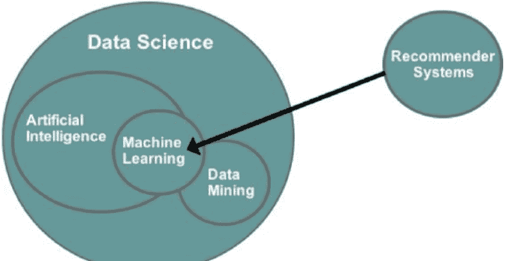

图 1：与数据相关的领域和子领域的可视化表示

**机器学习**应用统计方法根据之前的经验来提高性能。虽然程序员负责特征选择和设置模型的超参数（算法学习设置），但机器学习模型基于高级模式识别对输出内容做出决策。这一在数据中寻找模式并形成预测的过程被称为自学习，代表了与传统计算机编程的重大区别，传统计算机编程旨在响应预编程命令执行既定任务。

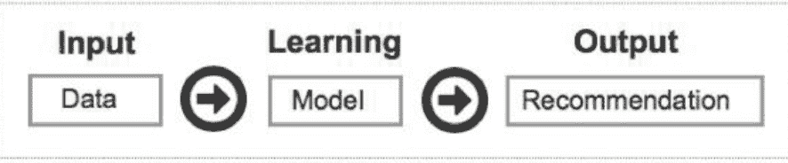

图 2：机器学习的基本模型表示

**数据挖掘**是发现和挖掘复杂数据集中包含的模式的过程。k-均值聚类、决策树和回归分析等流行的自学习算法同时用于数据挖掘和机器学习。然而，机器学习专注于使用随经验演变的模型进行增量和持续的问题解决，而数据挖掘则专注于清理大型数据集，以在特定时间点创建有价值的洞察。

数据挖掘描述过去发生了什么，而机器学习利用过去来预测未来，并根据经验和自学习的迭代过程不断改进其预测。例如，数据挖掘适用于清理历史道路交通数据，以根据过去经验为配送车队找到最佳路线等任务。

推荐系统既借鉴机器学习技术，也借鉴数据挖掘技术，但机器学习模型更为典型，因为用户偏好会随时间发展。其次，数据挖掘不太适合解决数据量有限的任务。在许多推荐场景中，关于用户及其现有偏好的前期数据非常稀疏。不过，机器学习可以用于进行推断，并逐渐从用户行为中学习，通过大量试错来优化推荐。

现在让我们谈谈实际算法。首先，推荐系统不应被误解为单一算法，甚至不应被视为相关算法的一个家族。与决策树、回归分析和聚类分析（三个独立的算法家族）不同，推荐系统是不同算法的集合，它们在一个共同目标下团结一致：做出相关推荐。无论是逻辑回归、最近邻聚类还是主成分分析，推荐系统都由能够最好地向用户推荐项目的算法（或算法组）组成。其次，推荐系统可以分为两种总体方法论：**协同过滤**和**基于内容的过滤**。


基于内容的过滤技术，也称为基于项目的过滤，根据用户过去购买或消费的项目向用户推荐相似项目。根据这一逻辑，如果推荐给一个喜欢观看五个猫视频的用户，他很可能会观看第六个猫视频。

与此同时，协同过滤根据与其他用户共享兴趣的用户购买或消费的项目，向个人推荐项目。例如，YouTube 的猫视频爱好者也可能喜欢观看健身视频。在这种情况下，项目（猫视频和健身视频）在类型或描述和元数据中找到的关键词方面彼此之间没有直接关系。尽管如此，YouTube 推荐系统仍会根据类似用户的行为向猫爱好者推荐健身视频。亚马逊及其他在线平台通常在其网站上将此方法标记为“看看其他用户购买了什么”。反映群体智慧是另一种思考协同过滤的方式。

然而，这并不意味着协同过滤是一种盲目的框架，用于像十强榜单那样识别热门项目。更准确地说，这是一种在相似类型的用户中匹配具有某种形式流行关联的项目的方法。

一个常用的突出协同过滤与基于内容过滤之间差异的例子是 Last.fm 和 Pandora Radio 的并排比较。这两个音乐平台都使用推荐系统向听众推送歌曲，但 Last.fm 采用协同过滤，而 Pandora Radio 则采用基于内容的方法。

Last.fm 根据用户过去听过的艺术家和歌曲来播放歌曲，并将这些信息与类似用户的收听行为进行比较。如果与目标用户音乐品味相似的其他用户经历了定期听 Billy Joel 曲目的一段时间，Last.fm 很可能会向目标用户推荐 Billy Joel 的歌曲（基于那些类似用户的品味）。通过跟踪类似用户的兴趣，Last.fm 还会提供用户可能无法自行发现的音乐。

Pandora 的歌曲选择方法产生的结果多样性较低，因为它仅查看听众的音乐品味，并根据相似的内容特征生成播放列表。这可能意味着将相关流派或音乐年份的歌曲搭配在一起。

Pandora 还根据音乐风格、歌曲结构和其他属性的相似性创建基于内容的推荐。他们的分析包含 450 多个属性，用于描述音乐属性，包括主唱性别、电吉他的失真程度以及伴唱类型。[11]

如果您不熟悉 Pandora，那么您可能在 YouTube 上注意到了类似的基于内容的推荐。如果您观看足够多的 2000 年代初的音乐视频，视频播放器和侧边栏会引导您观看该时代的其他热门音乐视频，而不是 Billy Joel 1977 年的歌曲 Piano Man 或 Macklemore 2014 年的热门歌曲 Thrift Shop。

正如后续章节中进一步讨论的那样，应用协同过滤和基于内容的过滤之间存在着持续的权衡。例如，协同过滤需要大量的前置用户数据才能产生有效的推荐。这种情况被称为*冷启动问题*，也会影响基于内容的过滤，在新项目缺乏足够画像的情况下也是如此。

我们将在第 6 章和第 7 章（协同过滤）以及第 8 章（基于内容的过滤）中探讨这两种方法的具体优缺点以及实际应用。

除了这两个推荐框架之外，还有各种其他技术可以补充或作为基于内容和协同过滤的改编。

## 混合方法

协同过滤和基于内容过滤的一种流行替代方案是混合方法，它借鉴多种技术的组合来提供有用的推荐。这种方法中融合的方法以及内置的灵活性缓解了仅使用一种方法的缺点。

混合推荐系统也受益于合并多个数据源和数据类型的能力和灵活性。例如，项目评级等序数数据[12]值通常用于协同过滤，而项目价格和大小等连续变量则更适合基于内容的过滤。混合解决方案使机器学习开发人员可以输入两种数据，然后使用不同技术进行分段分析。

在实践中，混合推荐系统通过作为统一模型运行，或通过分离基于内容的过滤和协同过滤或其他方法，然后合并预测来运行。包括 Netflix 在内的许多流行在线平台都依赖这种混合方法。

## 基于知识的推荐系统

基于知识的系统根据用户的需求和相关信息提供项目推荐。这通常基于推理原理工作，系统根据关于用户的独特知识进行推荐。

例如，亚马逊利用其对用户最近在 Kindle 设备上阅读的书籍的了解，发送电子邮件推荐同一作者的其他书名，例如续集或同一作者的其他书籍。

基于知识的推荐系统的另一个例子是在 Google 上搜索某样东西后，跟随您并在线上持续出现的广告流。YouTube 使用与推荐视频相同的技术，根据从包括您的 Google 搜索历史记录在内的其他平台获得的特定知识来提供广告。

基于知识的推荐系统与基于内容的推荐系统非常相似，两种方法之间的界限可能难以辨别。[13] 然而，基于知识的系统是独特的，因为它们允许用户直接指定想要什么，并不依赖于项目与用户之间交互的历史数据。[14]

基于知识的推荐系统在推荐稀有项目方面也非常有效。这包括与旅游、房地产、搬迁、汽车租赁、法律服务和其他不常见的业务场景相关的很少购买或消费的项目。

由于通常关于用户对此类项目偏好的历史数据有限，基于内容的过滤很难生成有用的推荐，甚至难以预料此类需求的存在。然而，基于知识的系统擅长在没有历史数据辅助的情况下推荐相关项目，例如毕生一次性需要的毕业礼服。

不过，知识可能是一把双刃剑。如果信息敏感且通过隐蔽方式收集，例如从第三方付费获取数据，那么该知识也构成对用户隐私的侵犯。这既可能从伦理角度造成问题，也可能从法律角度造成潜在问题。

对于共享笔记本电脑或用户账户的用户，基于知识的系统的意外后果可能会有害，并可能越过用户隐私的界限。用户搜索“离婚律师”或“应对抑郁症的指导”，可能会通过随后的广告和相关内容推荐，被原本不知情的伴侣或儿童发现。

最后，由于基于知识的系统需要关于用户需求的高度具体信息，因此小型公司可能难以开发和实施。

## 人口统计学推荐系统

人口统计学推荐系统基于用户刻板印象提供推荐，通常与基于知识的推荐系统等其他方法结合，以构建混合模型。例如，经常回归的用户可能会收到与不常用户不同的推荐。其他用户画像可能根据特定人口统计群体的消费模式，甚至根据他们支持的足球队生成。

该技术的关键在于数据收集，即从注册表单或用户个人资料页面收集关于目标用户的足够信息。或者，数据可以通过观察收集，例如用户 IP 地址的位置、在线消费和保存的 cookie，以辨别他们是否以前访问过该网站，如果有，访问频率如何。

虽然人口统计学推荐系统看起来与基于知识的系统相似，但它们依赖不同类型的数据作为输入。基于知识的系统关注情境信息，例如用户购车的需求，而人口统计学推荐系统则依赖于用户的特征，这些特征随时间推移更加稳定可靠。

## 基于移动设备的推荐系统

鉴于启用互联网的移动设备和智能手机的普及性，基于移动设备的推荐系统是推荐系统中迅速发展的一个分支，并根据用户的地理位置提供推荐。

在 Facebook 上，广告主可以向在新地理区域活跃的用户发送定向广告。例如，抵达澳大利亚的游客可能会收到

建议前往距离当前位置25公里的当地酿酒厂参观。对于外地酿酒厂的参观，通常是一次性的体验，但对酿酒厂来说，瞄准本地区新来者可以为定向广告活动提供常青市场。

随着从移动设备捕获实时洞察所用技术的发展，协同过滤预计将更深入地集成到移动推荐系统中。然而，异构数据的组合仍然是扩展这些系统使用的瓶颈。由于从移动设备收集的数据来自各种不同的设备，因此需要空间和时间自相关等额外处理。此外，移动推荐系统需要考虑大量基于上下文的信息才能生成有用的推荐。这包括考虑当地交通、天气状况、物品可用性等等。如果没有公共交通工具，向游客推荐参观当地酿酒厂也没什么用。解决这一问题的合理方案是将基于知识的推荐系统与移动推荐器相结合，并利用用户的浏览活动信息（例如，本地租车网站）来指导其对本地活动的推荐。

本章未探讨的其他推荐系统变体包括：

- 受限推荐器（例如，受限于用户指定的预算或度假日期），
- 时效敏感型推荐器（例如，一年中的时间或一天中的时间）。例如，美国沃尔玛的Pop-tarts在暴风雨来临前与必要的风暴补给品一起销售很好。然而，Pop-tarts一年中的其他时间不一定是与风暴补给品一起购买的热门选择。
- 基于位置的推荐器（可以说与基于移动设备的推荐器相同），
- 基于群体的推荐器，它们汇总个人偏好以向一组用户推荐内容或活动（例如，酒吧播放的音乐、购物部门巨型屏幕上播放的广告或家庭餐厅推荐），以及
- 基于社交结构和相互关系的社交推荐器（例如，Twitter上的关键意见领袖识别或基于共同好友的社交媒体好友建议）。

未来将更加突出的其他推荐系统方法在第11章中进行了探讨。

## 设置沙箱环境

现在您已熟悉推荐系统的理论框架，是时候将注意力转向构建预测模型了。对于本书中呈现的练习，我们将使用编程语言Python，它易学且在数据科学家中很受欢迎。如果您没有编程专业知识或任何Python编码经验，请不要担心。这些练习的主要目的是了解构建基本推荐系统背后的方法和步骤。至于我们的开发环境，我们将安装Jupyter Notebook，它是一个开源Web应用程序，允许编辑和共享代码笔记本。作为一个方便且用户友好的工作空间，笔记本允许您将代码分成块（可以单独运行）并添加格式化文本和标题来注释您的代码。

本章的其余部分专门用于安装Jupyter Notebook。如果您过去使用过Jupyter Notebook或阅读过我早先的书名为《机器学习绝对初学者》，您可能希望跳过本节并进入下一章。请还注意，我已发布一篇关于如何在Mac上安装Jupyter Notebook的博客文章，可在 http://www.scatterplotpress.com/blog/install-jupyter-notebook-anaconda-mac/ 找到。

## 下载Jupyter Notebook

Jupyter Notebook可以使用Anaconda Distribution或Python的包管理器pip进行安装。作为经验丰富的Python用户，您可能希望通过pip安装Jupyter Notebook，Jupyter Notebook网站（http://jupyter.org/install.html）上提供了说明本选项的说明。对于初学者，我建议选择Anaconda Distribution选项，它提供简单的点击拖拽设置（https://www.anaconda.com/products/individual）。

此安装选项将引导您前往Anaconda网站。在那里，您可以为Windows、macOS或Linux选择首选安装。同样，您可以根据所选操作系统在Anaconda网站上找到说明。

在机器上安装Anaconda后，您将通过Anaconda应用程序访问许多数据科学应用程序，包括rstudio、Jupyter Notebook和graphviz（用于数据可视化）。要继续，您需要在Jupyter Notebook选项卡中单击“Launch”来选择Jupyter Notebook。

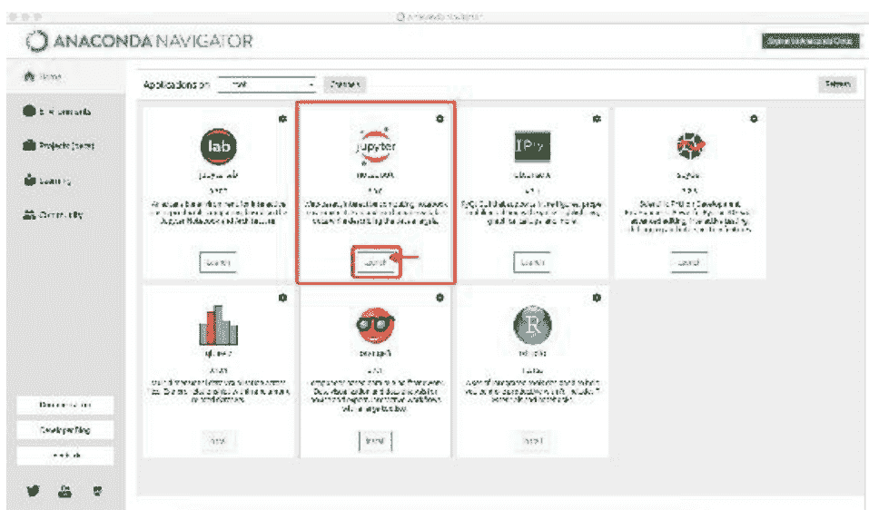

图3：Anaconda Navigator门户

要启动Jupyter Notebook，请从终端（适用于Mac/Linux）或命令提示符（适用于Windows）运行以下命令：

```
jupyter notebook
```

终端/命令提示符随后会生成一个URL供您复制并粘贴到Web浏览器中。

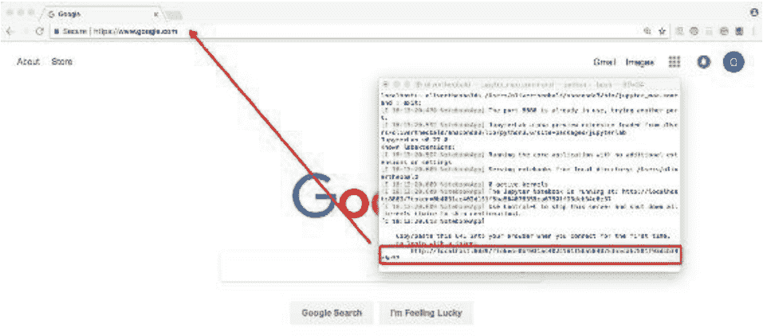

图4：复制URL并粘贴到浏览器中

将生成的URL复制并粘贴到浏览器中以访问Jupyter Notebook。一旦在浏览器中打开Jupyter Notebook，请单击Web应用程序右上角的“New”以创建新的笔记本项目，然后选择“Python 3。”

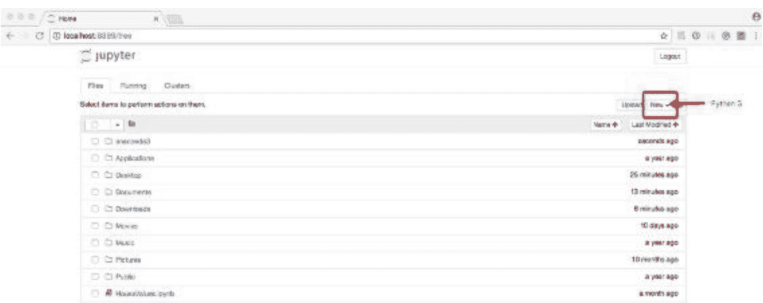

图5：Jupyter Notebook内部

您现在已使用Jupyter Notebook成功通过Web浏览器设置了沙箱环境。这意味着以下实验和代码更改不会影响此隔离测试环境外部的资源。

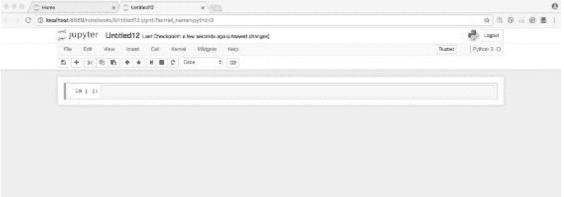

图6：可用于编码的新Jupyter笔记本

## 处理数据

推荐系统的数据通常由以“用户”和“项目”形式存在的两个实体组成，它们在所谓的实用矩阵中组织。虽然听起来令人生畏，但实用矩阵是一个包含值对的数据透视表，例如单个用户及其对给定项目的评分。

| | 电影 1 | 电影 2 | 电影 3 | 电影 4 | 电影 5 | 电影 6 | 电影 7 |
|---|---|---|---|---|---|---|---|
| 用户 1 | | | | | 1 | | 1 |
| 用户 2 | | 4 | | 5 | | 5 | |
| 用户 3 | | 3 | 2 | 5 | | | |
| 用户 4 | | | | 2 | 3 | 4 | |
| 用户 5 | | 3 | | | | | |
| 用户 6 | | | | 4 | | | 5 |
| 用户 7 | | | 5 | 5 | 5 | | |

用户通常垂直排列在行中，项目水平放置在列中。可以通过搜索相关列来找到每个用户对给定项目的偏好。对齐的单元格描绘了用户对该项目的偏好，通常表示为数值。在Netflix和Amazon使用的评估系统中，这些值表示为1到5之间的分类整数（整数），以指定用户口味。

然而，并非所有用户偏好系统都归结为1到5之间的简单评分。例如，在Facebook上，用户只能“喜欢”出现在其社交动态中的帖子。作为二进制功能，这些操作可以使用一种称为独热编码的技术转换为数值，该技术将变量转换为二进制形式，表示为“1”或“0”——“真”或“假”。在Facebook的例子中，“喜欢”可以编码为“1”，而没有“喜欢”或“未知”（值为null）的情况编码为“0。”

### 独热编码前

| 客户 | 客户操作状态 |
|---|---|
| 客户 1 | 已购买 |
| 客户 2 | 已加入购物车 |
| 客户 3 | 未采取任何操作 |

### 独热编码后

| 客户 | 已购买 | 购物车 | 无操作 |
|---|---|---|---|
| 客户 1 | 1 | 0 | 0 |
| 客户 2 | 0 | 1 | 0 |
| 客户 3 | 0 | 0 | 1 |

表3：独热编码示例

在用户未以评分、喜欢或其他操作形式提供反馈以表达对某项内容偏好的情况下，该值被称为“稀疏”，意味着该值未知。这在网络上很常见，因为大多数人不会对其消费的每一项内容都发表评论。与大多数用户一样，您可能只会对在线消费和购买的部分项目提交评分并分享直接反馈。鉴于实用矩阵中存在大量空值，有时很难生成高质量的推荐。

应对稀疏矩阵问题有两种一般方法。第一种方法是通过诱导用户留下评论、“点赞”或其他有助于定义用户口味的反馈形式来加速用户反馈的收集。不过，这种方法通常会遭到用户的强烈抵制，或者用户为了获得奖励而提供虚假信息。

第二种方法是通过间接反馈推断用户偏好，称为潜在变量。这些变量不是直接观察到的，而是通过观察其他已知变量来推断的。用户个人偏好最明显的迹象之一是分析其历史购买数据，

随着在线商务和智能手机使用的增长，这变得更加普及。

推断用户偏好的其他间接方式包括：是否看完了视频片段、[15] 将在线文章分享给朋友，以及页面停留时间。重要的是，这些示例都不需要用户直接反馈或额外努力，并且更容易大规模收集。

文本挖掘和情感分析也可用于审查关于视频、新闻及其他数字内容的文本评论中包含的用户偏好，但这些收集技术更为高级，运行起来也更耗费资源。

收集数据时，需要牢记效用矩阵在能够明确对用户偏好进行分类的值时效果最佳，例如 1 到 5 星评分系统等序数变量，或 Facebook“点赞”这类二进制/布尔变量。序数变量是按照明确序列分类的值，而布尔变量是产生两个固定结果之一的二进制值，例如是/否、真/假、0/1。

为对用户偏好进行分类，数据科学家有时需要为其他变量类型创建布尔或序数阈值。例如，如果用户看完了（或接近看完）视频片段，则该操作被标记为“1”（用户喜欢该视频）。如果用户在视频播放一半或低于设定的播放阈值（例如 80%）时放弃观看，则标记为“0”（用户不喜欢该视频或其偏好未知）。

然而，这种技术通常无法与直接从用户处以序数或布尔变量收集数据的系统在便捷性和精确性方面相媲美。这是因为将其他变量类型进行转换可能会带来解读偏差。与序数变量和二进制变量不同，基于页面停留时间等连续变量（无限/不限于特定值范围）来定义用户偏好具有挑战性。例如，我们如何判断用户是否喜欢一篇阅读需七分钟的 800 字博客，而另一篇长度相近但仅需五个半分钟的博客呢？也许第一篇博客写得不好，用户花费更长时间才能消化。或者，用户可能从第二篇博客中找到了所需信息，然后迅速跳到另一个网站去报税或提交签证申请。另一方面，序数变量基于预定义的值明确传达了用户偏好，这些值表达了用户是否喜欢某个特定项目。亚马逊和 Netflix——两家最活跃的推荐系统倡导者——构建了一个组织为五星级评价系统的显式用户偏好库，这绝非巧合。

尽可能使效用矩阵保持客观和简单（包括使用用户直接生成的序数或二进制值），也能使数据更加准确且易于处理。因此，开发推荐系统的在线平台在设计自身用户界面时，可以借鉴亚马逊和 Netflix 的成功经验。同样重要的是，数据科学家应基于未来希望分析的数据类型，对正在开发的网站或应用的设计提供合作与意见。

## 数据缩减

推荐系统依赖数据作为输入，数据可通过多种渠道收集，包括注册表单、网络爬虫、在线用户行为日志、IP 和地理位置追踪以及许多其他渠道。

输入数据主要分为两类：**结构化数据**和**非结构化数据**。结构化数据是存储在记录或文件固定字段中的信息。这通常包括按行和列存储并具有定义好的架构（数据库构建蓝图）的信息。结构化数据示例包括电子表格行和列中存储的活动注册信息，或关系数据库中存储的用户个人资料（包括用户个人信息和送货地址）。

非结构化数据或非结构化数据是指不符合预定义数据模型或未以预定义方式组织的信息。这包括电子邮件、社交媒体帖子、文字处理文档、语音录音等信息。在本书中，我们关注的是按行和列存储的结构化数据，正如前一章讨论的效用矩阵所示。

虽然结构化数据比非结构化数据更接近“生产就绪”状态，但在模型进行分析之前，它仍需要进行一些处理和准备。这可能包括删除无关数据、将非数值重新设计为数值、剔除低频用户/买家、剔除极不受欢迎的项目，以及通过列或行压缩减少数据总量。如果您对目前提到的数据缩减技术不熟悉，请不用担心，我们将在本章中介绍其中的大部分方法。

不过，首先，数据缩减的*目的是什么*？简而言之，数据缩减有助于将信号与噪声分离，缩短处理时间，并最大限度地降低计算资源消耗。流行的电子商务平台和社交媒体网络拥有多达数百万个用户和商品。仅 iTunes 和 Spotify 就分别在其平台上拥有大约 4000 万+ 和 3000 万+ 首歌曲。[16] 由于这些网站处理的是海量数据集，管理数据的计算成本很高，处理也耗时。使用数据缩减技术，它们可以通过专注于对分析目标最有用的数据，来提高推荐系统的性能、效率和准确性。

数据缩减有用的另一个原因是，在数据被压缩为更少的变量之前，可能无法对其进行可视化。

拥有过多数量的变量或维度（超过三维（3-D）或四维（4-D））会使数据集中的模式和规律难以甚至无法进行可视化。

然而，数据缩减的缺点是准确性可能下降并丢失相关数据，这种权衡对数据科学家来说是一个持续的挑战。

现在让我们来看看数据缩减的具体示例。

### 行压缩

行压缩涉及在尽量保留原始结构信息的同时减少行的数量。

与直接删除行不同，这可能采用的形式是使用一种称为 k-means 聚类的技术，基于相似值将大量行压缩为较少的簇（数据点组）。

例如，YouTube 拥有 13 亿用户。

这不是你想在 Excel 电子表格中随意摆弄的数据集，[17] 但使用数据缩减方法，你可以将行数量减少到更小、更易管理的数字。

### 维度缩减

维度缩减（也称为降维算法）将数据从高维转换为低维。

这通过战略性选择数据集列来实现。

需要注意的是，这并非删除列或其中包含的数据，而是通过数学方式转换数据，使收集到的信息使用更少的维度来捕获。

维度是表征数据的变量数量，例如用户的居住城市、居住国家、年龄和性别。

散点图上最多可以绘制四个变量，但三维和二维图表最易于人眼解读。

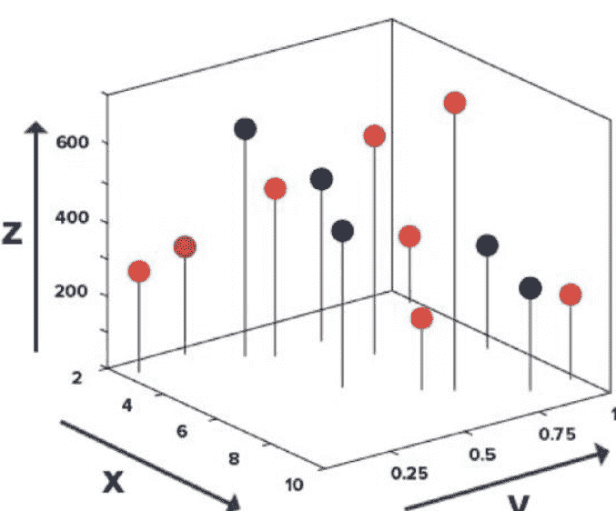

可视化关系和模式有助于沟通，但对生成预测并非必需。包含 20 个变量输入的模型可以通过二进制输出（如 1（真）和 0（假））或数值预测来识别模式并辅助决策。

除了能够在四个或更少维度中可视化结果之外，维度缩减的其他好处还包括：通过处理更少的变量来减少计算资源消耗，以及消除或最大限度减少对数据模式无显著影响的变量的影响。

降维的方法有多种，从简单的手动处理到更复杂的算法转换不等。在数据缩减谱的原始一端，有手动合并变量的方法。例如，如果我们检查以下用户电影评分数据集，可以使用分类来减少变量总数，而无需删除现有信息。


| | 大空头 | 海底总动员 | 盲侠 | 黑豹 | 神奇女侠 | 点球成金 | 寻梦环游记 | 银河护卫队 |
|---|---|---|---|---|---|---|---|---|
| 用户 1 | 4 | | 4 | 3 | | 4 | | 5 |
| 用户 2 | | | | | | | 4 | 1 |
| 用户 3 | 3 | | 1 | | 5 | | | |
| 用户 4 | | | | | 4 | 4 | | |

表 4：原始数据集

这八部电影可以重新分类为以下类别：
**迈克尔·刘易斯改编：** 大空头、盲侠、点球成金
**家庭：** 海底总动员、寻梦环游记
**超级英雄-动作：** 黑豹、神奇女侠、银河护卫队
然后对单个电影的用户评分求和并平均，以填充类别评分值。

| | 迈克尔·刘易斯改编 | 家庭 | 超级英雄-动作 |
|---|---|---|---|
| 用户 1 | 4 | | 4 |
| 用户 2 | | 4 | 1 |
| 用户 3 | 2 | | 5 |
| 用户 4 | 4 | | 4 |

表 5：重建数据集

这种变换使用更少的变量来捕获信息，并将变量数量从八个减少到三个。这种变换的缺点是现在关于单个电影之间特定关系的信息较少。因此，系统不再根据其他电影向用户推荐电影，而是根据电影类别形成推荐。

诚然，为了开发复杂的推荐系统，这种方法比较粗糙且过于手动。这就是为什么降维算法是实现降维的更有效方法，我们将在下一部分探讨。

## 主成分分析

主成分分析（PCA）是最流行的降维算法技术之一。PCA 也被称为*一般因子分析*，它检查一组变量之间的相互关系，并移除对数据变异性影响最小的组件。这有助于揭示数据中的隐藏和简化结构，并常在应用另一个算法之前用作预处理步骤，该算法现在将在压缩数据集上运行得更快（受矩阵稀疏性影响较小）。

与其他降维算法一样，PCA 通过将变量合成到组件中，有助于降低数据复杂度，并使用更少的变量来可视化多维数据。该算法允许处理变量数量较多的数据集（例如 20-30 个变量），并找到对数据变异性影响最大的主成分。组件通过将正交线（与回归超平面垂直，即成直角）统计学地应用来识别。正交线随后承担新 y 轴的角色。

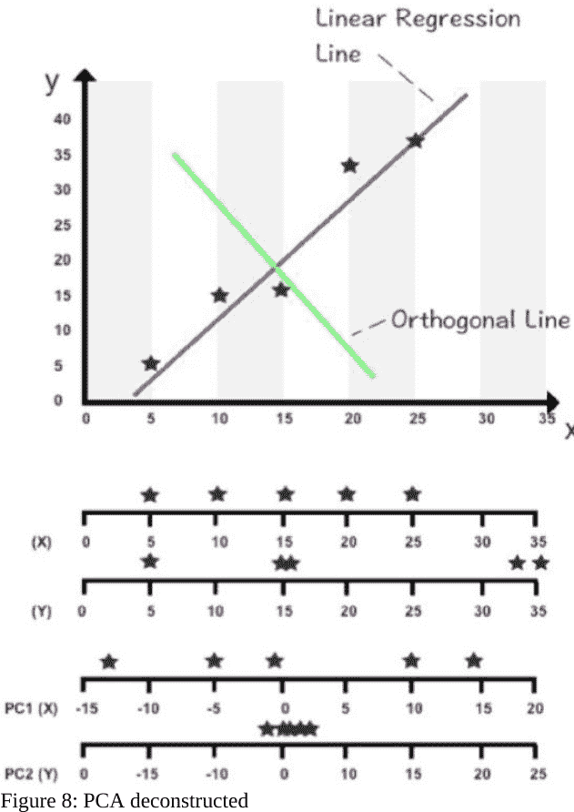

图 8 中有四条水平轴。前两个轴对应原始数据图中标记的 x 和 y 值。第三和第四个轴测量新 x 和 y 值与正交线之间的距离，正交线取代原始 y 轴。新的 x 轴是主成分 1（PC 1），新的 y 轴是主成分 2（PC 2）。

在新的 PC1 和 PC2 轴下（第三和第四个轴），我们可以看到数据点之间方差的变化。与第一个轴中看到的原始 x 值相比，PC1 中的方差已扩大。与此同时，PC2 中的方差显著缩小，因为所有数据点几乎堆叠在一起，接近于零。

由于 PC2 对总体方差的贡献最小，我们可以将注意力集中在研究 PC1 沿线的方差上。虽然 PC1 不包含原始信息的 100%，但它捕获了对数据模式影响最大的数据点，并提高了计算性能。

在此示例中，我们将数据集分为两个主成分，然后选择一个主成分。在其他场景中，您可能会选择两个或三个主成分，这些主成分包含来自总共十个组件中 75% 的信息。（当然，坚持 100% 的信息将违背数据缩减和最大化性能的目的。）

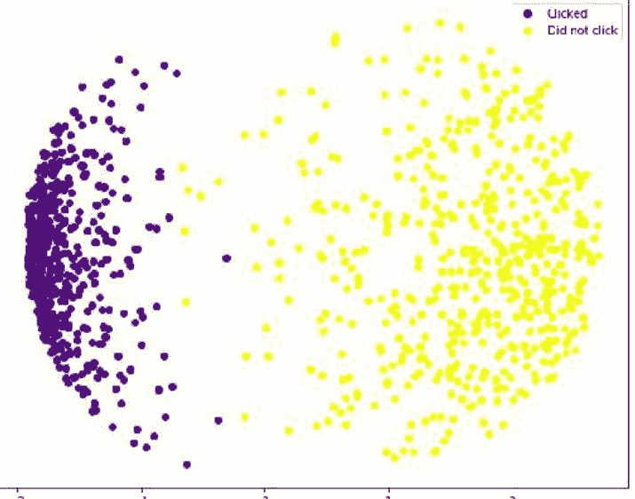

图 9：从 7 个原始特征中分离出 2 个主成分后的 PCA 示例

就像将图像压缩到 JPEG 等较小的文件格式一样，包括 PCA 在内的降维技术确实会造成一定的信息丢失。因此，虽然降维有助于总结高维数据的变异性并加快训练速度，但可能会导致准确性略微下降。

在下一个练习中，我们将使用另一种称为奇异值分解的降维算法来压缩数据，以表示通用用户口味。

## 协同过滤 第一部分

如您在第 2 章中回忆的那样，推荐系统并非特定算法，而是机器学习和数据挖掘技术的应用。推荐项目的两种主要架构是基于内容的过滤和协同过滤。本章探讨协同过滤。

协同过滤根据对相似用户及其偏好、过去购买、评分或其他一般行为的分析，向用户推荐项目。协同过滤也可以分为两种方法。

第一种方法是基于用户的协同过滤，它根据相似用户的历史偏好为目标用户生成推荐。另一种表达方式是：与您相似的人购买 x 也会购买 y。

在实践中，首先识别志趣相投的用户，然后收集和分组他们的评分或偏好以得出加权平均值。群体的一般偏好用于根据同龄人的评分和偏好向单个用户推荐项目。例如，如果用户从未观看过其同龄人观看并给出正面评价的某部电影或电视剧，系统将根据同龄人观察向用户推荐此内容项目。

第二种方法是基于项目的协同过滤，它不是寻找偏好相似的用户，而是根据用户偏好找到与目标项目相似的一组项目。例如，由相似用户群体高度评价的《星球大战》电影将被匹配为一组，然后推荐给其他喜欢并给该组中某部电影评分的用户。因此，基于项目的过滤可以被视为：购买 x 的人也会购买 y。

两种方法的主要区别在于输入的选择。基于项目的过滤首先采用给定项目，找到喜欢该项目的用户，然后检索那些用户喜欢的其他项目。相反，基于用户的过滤首先采用选定用户，根据相似评分找到与该用户相似的用户，然后推荐相似用户也喜欢的项目。在现实中，基于项目和基于用户的协同过滤倾向于产生相似的项目推荐，但基于用户的过滤对于拥有大量具有小众兴趣用户的数据集可能更准确。不过，关于用户特征和口味信息较少的数据集通常与基于项目的协同过滤更兼容。

现在让我们回顾协同过滤的优缺点。

### 优势

- **1) 对项目特征了解较少**

  协同过滤的一大优势在于，它不依赖对项目及其特定属性的深入了解。这节省了前期工作，因为您不需要花费时间仔细记录项目。这对于每天生成且审查和分类耗时的在线视频和音频内容项目尤其方便。

- **2) 长期灵活性**

  由于协同过滤直接响应用户行为和趋势，这项技术在应对用户/消费者行为变化时通常比基于内容的过滤更灵活。然而，时尚、流行文化和其他趋势中的突然短期变化——至少在最初阶段——可能难以应对，具体取决于数据收集的时间。

- **3) 可发现性**

  协同过滤使用户能够发现其常规范围之外的项目，因为它综合了从从未见过但拥有相似兴趣的用户那里获得的偏好。

### 劣势

- **1) 大规模用户数据**

  协同过滤的挑战和潜在缺点之一是，记录用户偏好所需的大量前期信息。没有这些信息，协同过滤在很大程度上无效。亚马逊和 Netflix 拥有足够的用户数据来应对数据中的稀疏性问题，但没有建立用户基础的新进入者则处于劣势。像亚马逊通过与 AOL 的数据合作伙伴关系所做的那样，从可比平台获取或收购数据，是克服冷启动问题的一种策略。

  另外，请注意，对于用户数量庞大的平台，协同系统的可扩展性在计算上可能很昂贵。


### 2) 恶意活动

遗憾的是，协同过滤极易受到人们操纵系统并做错事的影响。这包括向目标商品刷假流量、用差评攻击竞争对手的商品、编造在线用户画像，或创建一套欺骗系统的用户行为体系，也称为刷单攻击。

尽量减少恶意活动的一种方法是将模型的分析限制在用户购买上，而非浏览习惯，因为前者更难伪造。尽管如此，欺诈性在线交易仍然很常见，不法分子不断完善其策略来操纵推荐系统。

缓解刷单攻击的影响是机器学习领域一个令人兴奋且前景广阔的方向，值得将其视为未来的职业道路。

### 3) 负面声誉

由于协同过滤在为他人生成推荐时高度依赖提取用户的个人信息，使用此类技术可能会引发对数据隐私（讨论见第 10 章）和社会操纵的担忧。近年来，关于 2016 年美国大选以及涉嫌 Facebook 将用户数据共享给第三方组织的角色所引发的批评逐渐浮出水面，此外，Facebook 的内容展示算法可能强化政治偏见并传播新闻报道，也受到了批评。

### 4) 一致性

除了口味不同之外，用户还有不同的标准——这使得很难信任来自多个用户的聚合评分数据的一致性。例如，3 星评论的含义在两个用户之间可能因其平均评分历史而异。标准在不同国家和不同类型的用户（即，电子书读者与实体书读者）之间也有所不同。例如，实体书读者在遇到配送延迟/问题或生产质量（即，纸张质量）时会给出负面评分，而这不影响收到按需数字副本的电子书读者。因此，为了提高用户标准的一致性，您可能需要按国家和客户类型等其他条件过滤用户评分。

## 练习：推荐图书

在下面的练习中，我们将创建一种基于项目的协同过滤技术，使用奇异值分解（SVD）和相关系数根据读者评分推荐图书。下一章的练习将重点介绍基于用户的协同过滤模型。

### 步骤 1

让我们先导入本练习所需的库，即 NumPy、Pandas 以及 Scikit-learn 中的 TruncatedSVD 算法。（与标准 SVD 相比，截断 SVD 通常处理矩形矩阵的速度更快。）

```
import numpy as np
import pandas as pd
from sklearn.decomposition import TruncatedSVD
```

### 步骤 2

接下来，让我们导入数据。在本练习中，我们使用来自 Goodbooks-10k 数据集的两个独立 CSV 文件，其中包含从 www.goodreads.com 收集的图书和用户评分信息。第一个数据集包含单个用户的图书评分，而第二个数据集包含关于单个图书的信息，例如平均评分、五星评分数量、ISBN、作者等。

两个数据集均可在 https://www.kaggle.com/sriharshavogeti/collaborative-recommender-system-on-goodreads/data 下载。

```
#Import first dataset and define columns
ratings = pd.read_csv('~/Downloads/ratings.csv')
columns = ['book_id', 'user_id', 'rating']

#Import second dataset and define columns
books = pd.read_csv('~/Downloads/books.csv')
columns = ['id','book_id', 'best_book_id', 'work_id', 'isbn', 'isbn13', 'authors',
           'original_publication_year', 'original_title', 'title', 'language_code', 'average_rating',
           'ratings_count', 'work_ratings_count', 'work_text_reviews_count', 'ratings_1', 'ratings_2',
           'ratings_3', 'ratings_4', 'ratings_5', 'image_url', 'small_image_url']
```

接下来，我们需要使用 Pandas 的 pd.merge 命令合并两个数据集。

```
combined_books_data = pd.merge(ratings, books, on='book_id')
```

从这一行代码可以看出，我们根据两个数据集中都存在的共享变量“book_id”合并了两个数据集（“ratings”和“books”）。

现在让我们使用 **head** 命令预览数据集。

```
combined_books_data.head()
```

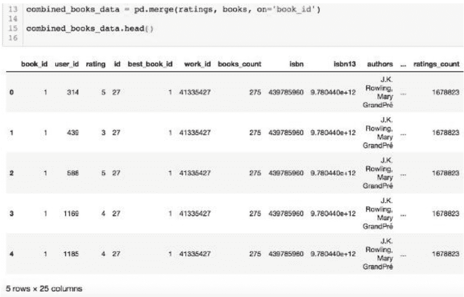

请注意，此屏幕截图中并非所有列都可见。可以在 Jupyter Notebook 中向右滚动查看完整的 25 列。

### 步骤 3

第三步是创建实用矩阵，这是一个透视表，我们将用它来存储单个读者对图书的评分。

```
rating_utility_matrix = combined_books_data.pivot_table(values='rating', index='user_id', columns='title', fill_value=0)
```

用户评分的实用矩阵（rating_utility_matrix）是通过从前一步中创建的 combined_books_data 数据集中选择变量生成的。各图书标题横向作为列，各读者纵向排列为行。然后将读者对每本书的评分放入相应的单元格中。最后，使用 fill_value = 0 将所有未评分的图书分配为零值。我们可以再次使用 head 命令预览实用矩阵。

```
rating_utility_matrix.head()
```

```
title  'Slam... 'Frank... 'To Ci... '451... The... '1776 '1984... A Bend... A Bond... A Brief... A Huton... A Crea... '... Women in... World War... World... 'Without End... Walking... Xenodoge... Year of...
McCourt... Dunnett... Clancy... Dicken... McCulloug... Orwell... King... Follett... McPherson... Bryson... Hawking... Ambrose... Smith... Birmingham... Holland... Crichton... Sebestyen... Follett... Bradford... Wodehouse...
user id
2   0   0   0   0   0   0   0   0   0   ... 0   0   0   0   0   0
3   0   0   0   0   0   0   0   0   0   ... 0   0   0   0   0   0
4   0   0   0   0   0   0   0   0   0   ... 0   0   0   0   0   0
7   0   0   0   0   0   0   0   0   0   ... 0   0   0   0   0   0
9   0   0   0   0   0   0   0   0   0   ... 0   0   0   0   0   0
5 rows × 812 columns
```

这是典型的稀疏数据集情况，因为用户没有对每个单独的项目提交评分。为了解决这个问题，我们可以将单个用户的偏好压缩为较少数量的通用用户口味。

### 步骤 4

为了压缩单个读者的值，我们将使用一种名为奇异值分解（SVD）的降维算法，将单个读者的总数转换为有限数量的分量。与主成分分析类似，奇异值分解用于对特征（维度）的重要性进行排名，并在保留最大方差的同时将高维数据集降维为更少的维度。

这里 SVD 用于替代 PCA，因为它在将缺失值视为零的稀疏数据集中处理缺失值方面更为有效。您可以在 Google Research 的 Jonathon Schlens 制作的此教程中了解这两种降维算法之间的数学差异（https://arxiv.org/pdf/1404.1100.pdf）。

鉴于推荐系统的主要目标是向用户推荐相关图书，SVD 进行的压缩并不会从数据集中删除单个读者。相反，读者偏好会根据读者之间的相似性压缩为较少数量的分量，以提供通用的用户口味。

首先，让我们使用 **shape** 命令查找行（用户）和列（图书）的总数。

```
rating_utility_matrix.shape
(28906, 812)
```

我们可以看到，此数据集中有 28,906 个单独用户和 812 个图书标题。为了获得用户口味和偏好的概括视图，我们现在希望应用截断 SVD 将所有用户评分压缩为 30 个潜在变量（根据第 4 章的定义，潜在变量不是直接观察到的，而是通过观察其他已知变量推断出来的）。
第一步是转置实用矩阵，将图书排列为行、用户排列为列，如下所示。

```
X = rating_utility_matrix.T
```

接下来，使用 **TruncatedSVD** 将用户数压缩为 30 个分量，并将该算法应用到转置后的实用矩阵上。

```
SVD = TruncatedSVD(n_components=30)
transposed_matrix = SVD.fit_transform(X)
transposed_matrix.shape
```

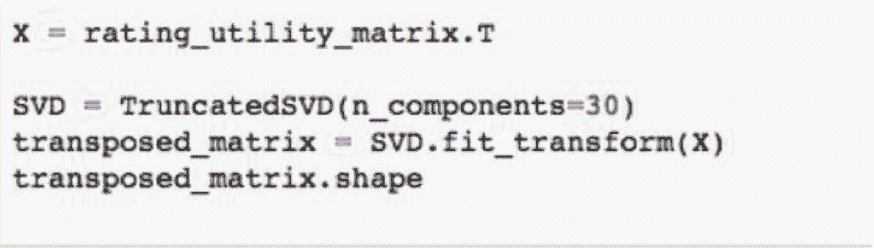

```
(812, 30)
```


使用 **shape** 命令，我们可以看到实用矩阵已被转置，因此书籍标题（812 个）现在表示为行，而不是列。28,906 名读者已被压缩为 30 个分量，现在表示为列。

### 第 5 步

第五步是使用内置的 NumPy 函数，基于现已压缩为分量的读者偏好，查找给定书籍与其他书籍之间用户偏好的相关性。要执行此步骤，我们首先需要根据之前的购买和评分，选择一个已知目标读者喜欢的书籍。因此，假设目标读者喜欢乔治·奥威尔所著的书籍 *一九八四*，并且他或她留下了一个正面的 5 星评论。

我们现在希望基于其他用户评分，找到与 1984 相关的其他书籍。为此，我们需要使用相关系数，借助 NumPy (np) 相关矩阵来识别相似的书籍偏好，该矩阵是一个显示每对变量之间 Pearson 相关性的表格。[19] Pearson 相关性 (r) 表示为 -1 到 1 之间的数值（系数）。接近 -1 的系数表示存在强负相关，0 表示无相关，接近 1 表示强正相关。在推荐系统的场景中，我们寻找返回接近 1 的高相关性得分的配对。

```
corr_matrix = np.corrcoef(transposed_matrix)

books = rating_utility_matrix.columns
books_list = list(books)

book_1984 = books_list.index('1984')
book_1984
```

```
X = rating_utility_matrix.T

SVD = TruncatedSVD(n_components=30)
transposed_matrix = SVD.fit_transform(X)
transposed_matrix.shape

corr_matrix = np.corrcoef(transposed_matrix)

books = rating_utility_matrix.columns
books_list = list(books)

book_1984 = books_list.index('1984')
book_1984
```

这将打印 book_id “4”，即书籍 1984 的行索引位置。让我们现在将此索引位置输入到我们的相关矩阵中。

```
corr_1984 = corr_matrix[4]
```

### 第 6 步

最后一步是打印一系列书名，这些书籍的相关性得分介于 0.8 和 1.0 之间。相关系数越高，一本书与目标书籍（1984）的关系就越强。

```
list(books[(corr_1984 < 1.0) & (corr_1984 > 0.8)])
```

```
corr_1984 = corr_matrix[4]
list(books[(corr_1984 < 1.0) & (corr_1984 > 0.8)])

['Ivanhoe',
'Night Over Water',
'The Great Book of Amber (The Chronicles of Amber, #1-10)',
'The King of Torts',
'The Stories of Eva Luna']
```

这将返回图书 Ivanhoe、Night Over Water、The Great Book of Amber (The Chronicles of Amber, #1-10)、The King of Torts 和 The Stories of Eva Luna。根据我们协同过滤系统的结果，我们可以向读者推荐这五本书。

要找到更多可推荐的相似书籍，我们可以将 corr_1984 值更改为较低的值，例如 > 0.7。

```
corr_1984 = corr_matrix[4]
list(books[(corr_1984 < 1.0) & (corr_1984 > 0.7)])
```

```
[ 'A Christmas Carol',
 'Cry, the Beloved Country',
 "Giada's Family Dinners",
 'Ivanhoe',
 'Naked',
 'Night Over Water',
 'Of Mice and Men',
 'Persuasion',
 'Reading Lolita in Tehran',
 'The Great Book of Amber (The Chronicles of Amber, #1-10)',
 'The King of Torts',
 'The Oresteia (Ορέστεια, #1-3)',
 'The Stories of Eva Luna',
 'The Terror',
 'The Virgin Blue',
 'Travels with Charley: In Search of America',
 'Wolves of the Calla (The Dark Tower, #5)']
```

## 协同过滤 第二部分

推荐系统的很大一部分在于判断用户是否会接受推荐的项目。如前一章所探讨的，奇异值分解是一种可用于在稀疏数据集的情况下预测用户偏好的方法。对于数据不稀疏的情况，我们可以使用其他算法，包括逻辑回归和朴素贝叶斯。

基于 Bayes’ 定理的分类方法——朴素贝叶斯分类器——常用于数据科学中预测离散类别，例如垃圾邮件过滤、A/B 测试、情感分析、文本分类和推荐系统。

### Bayes’ 定理

Bayes’ 定理诞生于 18 世纪中期，用于基于现有信息（条件概率）进行推断，是古典统计学的核心支柱。Bayes’ 定理公式如下：

```
P(A|B) = \frac{P(A) P(B|A)}{P(B)}
```

在此公式中，A 和 B 表示两个事件，P 表示该事件发生的概率。因此：

- P(A|B) 是在 B 发生的情况下 A 的概率（条件概率）
- P(A) 是 A 的概率（边缘概率）
- P(B|A) 是在 A 发生的情况下 B 的概率（条件概率）
- P(B) 是 B 的概率（边缘概率）

### 示例：评估家用怀孕测试

假设在一次临床测试后，一家制药公司将家用怀孕测试宣传为在孕妇中检测怀孕的准确率为 99%。然而，在参与临床测试的女性中，只有 5% 是孕妇。此场景可表示如下：

事件 A = 怀孕  
事件 B = 测试结果为阳性  

P(A) 是不考虑测试结果的怀孕概率 = 5%  
P(B|A) 是女性怀孕的情况下测试结果为阳性的概率 = 99%  
P(A|B) 是测试结果为阳性的情况下怀孕的概率 = 未知  
P(B) 是不考虑女性是否怀孕的测试结果为阳性的概率 = 未知  

```
P(A|B) = 
 0.05 x 0.99
 -----------
 P(B)
```

我们现在需要求解 P(A|B) 和 P(B)，即测试结果为阳性的情况下怀孕的概率，以及所有参与者中测试结果为阳性的概率。

- 计算 P(B) 时需考虑两个要素：
  - 1) 真阳性：怀孕（5%）且检测为阳性（99%）的女性，以及
  - 2) 假阳性：未怀孕（95%）但检测为阳性（1%）的女性
  - P(B) = (0.99 * 0.05 + 0.01 * 0.95)

现在将 P(B) 加入方程以求解 P(A|B)：

P(A|B) = \frac{(0.05)(0.99)}{0.99*0.05 + 0.01*0.95}

(0.05 * 0.99) / (0.99 * 0.05 + 0.01 * 0.95)
0.0495 / (0.0495 + 0.0095)
0.0495 / 0.059
= 0.8389

使用 Bayes’ 定理，我们发现测试结果为阳性的情况下怀孕的概率 P(A|B) 为 83.89%，这与仅考虑孕妇时的准确率（99%，即 P(B|A））相比要低得多。
当我们考虑假阳性数量与真阳性数量的关系时，这一结果便变得清晰明了。如果对 1,000 名女性进行测试，我们可以预期 950 人未怀孕（95%），50 人已怀孕（5%）。在 950 名未怀孕的女性中，我们可以预期 9.5 个假阳性（950 × 0.01）。与此同时，在 50 名已怀孕的女性中，预计有 49.5 名女性检测结果为阳性（50 × 0.99）。因此，在检测结果为阳性的 59 名（9.5 + 49.5）女性中，有 49.5/59，即 83.89% 的女性实际上是怀孕的。

### 朴素贝叶斯分类器

朴素贝叶斯算法在机器学习中用作分类器，用于基于条件概率查找类别的概率。这意味着该算法会在给定每个输入特征（例如年龄、体重等）与该类别关系的情况下，查找目标类别（例如“怀孕”或“未怀孕”）的概率。通过在数据集中对属于给定类别的每个特征的条件概率相乘，该算法会根据输入特征值，查找单个数据点属于目标类别的概率。

朴素贝叶斯还假设每个特征对给定类别的影响与其他特征独立（而非相互依赖）。这极大地简化了计算，这也是该算法被称为“朴素”的原因。

我们将使用朴素贝叶斯分类器进行基于用户的协同过滤，以创建一个在线广告推荐系统，其中广告会根据具有相似属性的其他用户的响应率向用户投放，这些属性包括每天在网站上花费的时间、年龄、地区收入和每日互联网使用量。

## 练习：将广告与用户匹配

### 第 1 步

第一步是安装所需的库，其中包括 Pandas 和来自 Scikit-learn 的 GaussianNB。

```
import pandas as pd
from sklearn.naive_bayes import GaussianNB
```

### 第 2 步

下一步是导入数据集。本练习中我们使用的是 Advertising 数据集，可从 https://www.kaggle.com/fayomi/advertising/data/ 下载。该数据集由 Udemy 课程讲师 Jose Portilla（Pierian Data）创建，并在其课程 Python for Data Science and Machine Learning Bootcamp 中使用。

使用 **pd.read_csv** 命令将数据集导入 Pandas 数据帧，并使用 **head** 命令预览数据帧。

```
df = pd.read_csv('~/Downloads/advertising.csv')
df.head()
```


```python
import pandas as pd
from sklearn.naive_bayes import GaussianNB
df = pd.read_csv('~/Downloads/advertising.csv')
df.head()
```

| | 每日在网站停留时间 | 年龄 | 地区收入 | 每日互联网使用量 | 广告主题行 | 城市 | 男性 | 国家 | 时间戳 | 是否点击广告 |
|---|---|---|---|---|---|---|---|---|---|---|
| 0 | 68.95 | 35 | 61833.90 | 256.09 | 克隆第八代编排 | Wightburgh | 0 | 突尼斯 | 2016-03-27 00:53:11 | 0 |
| 1 | 80.23 | 31 | 68441.85 | 193.77 | 监管全国标准化 | West Jodi | 1 | 瑙鲁 | 2016-04-04 01:39:02 | 0 |
| 2 | 69.47 | 26 | 59765.94 | 236.50 | 有机底线服务台 | Devildton | 0 | 圣马力诺 | 2016-03-13 20:35:42 | 0 |
| 3 | 74.15 | 29 | 54806.18 | 245.09 | 三缓冲区域时间框架 | West Terrifurt | 1 | 意大利 | 2016-01-10 02:31:19 | 0 |
| 4 | 60.37 | 35 | 73969.98 | 225.50 | 强健物流利用 | South Manuel | 0 | 冰岛 | 2016-06-09 03:38:18 | 0 |

### 步骤 3

接下来，让我们使用删除方法从数据集中删除离散变量，并输入我们希望删除的列名。（我们选定的算法仅接受连续变量作为自变量。[20]）

```python
del df['Ad Topic Line']
del df['Timestamp']
del df['City']
del df['Country']
del df['Male']
```

### 步骤 4

现在，让我们分配 X（自变量）值和 y 值（因变量）。y 变量是“Clicked On Ad”，X 变量由剩余变量组成（年龄、地区收入、每日互联网使用量和每日在网站停留时间）。
请注意，在数据科学中，小写“y”和大写“X”分别是表示因变量和自变量的标准惯例。

```python
#Assign all columns in the dataset as X variables, excluding “Clicked On Ad”
X = df.drop('Clicked on Ad',axis=1)
#Assign “Clicked on Ad” as y variable
y = df['Clicked on Ad']
```

### 步骤 5

我们现在要将 X 和 y 变量分配给 Scikit-learn 的高斯朴素贝叶斯算法。高斯是此算法最简单、最基础的版本。它用于连续变量，假设数据呈正态分布。与此同时，朴素贝叶斯的 Bernoulli 版本是用于多个二元特征的更合适的分类技术。有关朴素贝叶斯分类特定算法的更多信息，请参见：https://scikit-learn.org/stable/modules/classes.html#module-sklearn.naive_bayes

我们还需要为算法分配一个变量，在此示例中为 model。变量的命名并不重要，只要它是直观的描述，并符合 Python 中分配变量的基本语法（例如，不能包含空格，不能以数字开头等）。

```python
model = GaussianNB()
```

接下来，我们需要使用分配的变量名将算法拟合到我们的 X 和 y 数据。

```python
model.fit(X, y)
```

### 步骤 6

最后一步是输入我们希望测试的样本用户的值。

| 特征 | 目标值 |
|---|---|
| 每日在网站停留时间 | 66.00 |
| 年龄 | 48 |
| 地区收入 | 24593.33 |
| 每日互联网使用量 | 131.76 |

表 6：目标用户信息

```python
target_user = [
66.00, #Daily Time Spent on Site
48, #Age
24593.33, #Area Income
131.76, #Daily Internet Usage
]
```

最后，使用步骤 5 开发的模型对 **target_user** 应用 **predict** 方法，并将其分配为新变量。然后在新行上 **print** 新变量。

```python
pred_target_user = model.predict([target_user])
print("Prediction:", pred_target_user)
```

通过右键单击并选择“Run”或从 Jupyter Notebook 菜单导航至 Cell > Run All 来运行模型。等待一两秒钟让计算机处理模型。然后，如下图所示的结果将出现在单元格底部。

**Prediction:** [1]

本练习中 y 变量“Clicked on Ad”的结果为 **[1]**，这意味着目标用户预计会点击广告，因此应向该用户推荐该广告。相反，结果为 **[0]** 表示根据类似用户的行为，该用户预计 *不* 会点击广告。

本练习的更高级版本（同时考察离散变量和连续变量，使用逻辑回归）可于以下网址查阅：http://www.scatterplotpress.com/bonus-chapters/recommender-systems-for-absolute-beginners-chapter-7/

## 基于内容的过滤

如前所述，在第 2 章中，基于内容的过滤方法根据相似项目属性和单个用户偏好档案提供推荐。基于内容的过滤系统随后尝试推荐用户过去喜欢或浏览过的类似项目。例如，购买一本关于“机器学习”的书后，Amazon 的基于内容的过滤可能会向您推荐其他书籍：

- 来自同一作者，
- 来自同一类别，例如，数据科学，以及
- 标题关键词相似，例如，“机器学习。”

正如预期的那样，基于内容的过滤高度依赖于项目特征的描述以及单个用户偏好的画像。在此模型下，文档、在线帖子、图像和视频等项目需要以关键词/标记/元数据的形式进行充分描述，或通过图像识别（例如，人工神经网络）或文本挖掘（例如，TF.IDF）等更复杂的方法进行描述。

例如，一本书可以由以下元数据描述：

- 1. 作者
- 2. 体裁，例如，惊悚、浪漫、统计与概率
- 3. 出版年份
- 4. 图书类型，例如，小说、非小说
- 5. 图书格式，例如，教科书、有声书、电子书、平装书

同样，用户偏好需要被知晓和记录。可以通过以下方式确定单个用户的偏好：

- 1. 过去的购买/消费行为
- 2. 浏览历史
- 3. 个人详细信息，例如，性别、地理位置、国籍和爱好
- 4. 用于确定地理位置和时区的 IP 地址

从了解的用户信息出发，过滤技术随后可以将这些数据与可用项目的描述进行比较，并识别出要推荐的项目。如果项目得到妥善标记并且有足够的用户数据，基于内容的过滤可以是一种非常有效的方法。

### 优势

#### 1) 对群体偏好不敏感

基于内容的过滤的一大优势是，它有助于发现相关但低知名度的项目。由于基于内容的过滤不考虑群体偏好，因此即使是群体接触度较低的相关项目，仍然可以被找到。

#### 2) 内容项目具有稳定性

项目随时间变化的幅度不如人类大，通常更具永久性。另一方面，人类善变，品味随时间剧烈变化。我们都曾追随过消费阶段。但项目始终是项目，因此与协同过滤相比，基于内容的过滤对群体偏好的变化不那么敏感。

#### 3) 项目通常少于用户

大多数在线平台的项目数量少于用户数量，基于内容的过滤可以通过比较有限数量的项目而非更大规模的用户关系来帮助节省计算资源。

#### 4) 与新项目兼容

在新项目或现有项目缺乏足够评分数据（冷启动）的情况下，可以应用内容过滤来收集目标用户对其他项目的评分/购买/消费信息，这些项目可能具有相似属性。因此，即使缺乏直接的历史数据，项目也可以根据用户与类似项目的交互进行推荐。

#### 5) 减少作弊

内容过滤的另一大显著优势是，由于恶意行为者较难操纵或伪造项目与项目之间的关系，因此通常更难以“欺骗系统”。项目与用户之间的关系则不然，可以通过大量虚假评论和购买轻易膨胀。

### 劣势

#### 1) 多样性低

推荐项目的多样性可能有限，且不如其他方法多样。这是因为基于内容的过滤依赖于将特定项目与相似项目进行匹配。因此，目标用户接触度低或无接触的项目不太可能出现，这限制了项目的可发现性。

#### 2) 对新用户无效


基于内容的过滤方法在推荐新物品方面表现出色，但对于新用户并非如此。如果没有关于用户偏好的信息来构建用户档案，就几乎无法推荐相关物品。为了缓解冷启动问题，在线平台可能会在引导新用户时使用基于知识的方法来提取相关关键词。例如，Pinterest会引导新用户指定一组宏观兴趣，这些兴趣用于建立初步的用户档案，并将物品描述与内容推荐相匹配。然后，Pinterest基于机器学习的算法会根据用户的“收藏”和浏览行为来优化其档案和特定兴趣。

#### 3) 结果质量参差不齐

基于内容的过滤在选择相关物品方面通常比较准确，但这些物品的质量有时可能较差。由于基于内容的过滤忽略了其他用户的物品评分，因此其受限于辨别物品质量的能力。

## 练习：推荐房地产房源

作为我们的第三个也是最后一个练习，我们将使用最近邻算法来识别澳大利亚墨尔本房地产的相关推荐。这些推荐将基于用户在在线房地产门户网站上的先前搜索行为生成，已知该用户对澳大利亚墨尔本具有以下七个特征值的房屋感兴趣：

- 价格：$1,350,000 AUD
- 距离市中心：2km
- 卧室数：2
- 卫生间数：2
- 土地面积：220m²
- 建筑面积：200m²
- 建成年份：2005

将最近邻算法作为基于内容的过滤技术，我们希望找到三个规格相似的房源列表。随后，会将最符合用户已知偏好的三个房产作为促销电子邮件活动的一部分发送给用户。

### 关于最近邻算法

最近邻算法是一种简单的聚类技术，它根据数据点之间的最近距离创建聚类。该技术找到两个数据点之间的最短距离并将其合并为一个聚类。此步骤重复执行，以便找到两个数据点之间的下一个最短距离，该距离要么扩大第一个聚类的大小，要么在两个单独的数据点之间形成一个新聚类。对于本练习，我们正在搜索与指定数据点最近的三个数据点，该点由用户的早期搜索查询确定。

### 步骤 1

第一步是安装我们的库。对于本练习，我们需要从 Scikit-learn 导入 Pandas 和最近邻算法。

```
import pandas as pd
from sklearn.neighbors import NearestNeighbors
```

### 步骤 2

下一步是使用 pd.read_csv 将数据集导入 Jupyter Notebook。该数据集名为 Melbourne_housing_FULL，应先从 https://www.kaggle.com/anthonypino/melbourne-housing-market/ 下载并解压缩。

```
df = pd.read_csv('~/Downloads/Melbourne_housing_FULL.csv')
```

此命令将数据加载到 Pandas 数据框中，我们可以使用 head 命令在 Jupyter Notebook 中预览数据集。

```
import pandas as pd
from sklearn.neighbors import NearestNeighbors
df = pd.read_csv('~/Downloads/Melbourne_housing_FULL.csv')
df.head()
```

| 郊区 | 地址 | 房间数 | 类型 | 价格 | 方式 | 卖家 | 日期 | 距离 | 邮编 | ... | 卫生间 | 车位 |
|---|---|---|---|---|---|---|---|---|---|---|---|---|
| Abbotsford | 68 Studley St | 2 | h | NaN | SC | Jellis | 3/09/2016 | 2.5 | 3067.0 | ... | 1.0 | 1.0 |
| Abbotsford | 85 Turner St | 2 | h | 1480000.0 | S | Biggin | 3/12/2016 | 2.5 | 3067.0 | ... | 1.0 | 1.0 |
| Abbotsford | 25 Bloomburg St | 2 | h | 1095000.0 | S | Biggin | 4/02/2016 | 2.5 | 3067.0 | ... | 1.0 | 0.0 |
| Abbotsford | 18/659 Victoria St | 3 | u | NaN | VB | Rounds | 4/02/2016 | 2.5 | 3067.0 | ... | 2.0 | 1.0 |
| Abbotsford | 5 Charles St | 3 | h | 1465000.0 | SP | Biggin | 4/03/2017 | 2.5 | 3067.0 | ... | 2.0 | 0.0 |

5 行 × 21 列

### 步骤 3

接下来，使用 **dropna** 命令删除包含缺失值的行。（此算法无法使用缺失值）。

```
df.dropna(axis = 0, how = 'any', thresh = None, subset = None, inplace = True)
```

**axis** 参数为 "0" 时删除包含缺失值的行，而参数为 "1" 时删除包含缺失值的列。

文档：http://bit.ly/2KqV1a7

### 步骤 4

第四步是指定我们希望作为输入特征检查的列，这些列必须是连续值（浮点数或整数值），例如卫生间数量（如 2）和土地面积（如 245.5）。这意味着我们不能包含字符串值，例如房产类型（如 house、apartment）或地址（如 25 Bloomburg St），因为这些变量是离散的。

以下是墨尔本房屋数据集中包含的所有特征及其特征类。高亮显示的特征是我们为示例模型选择的特征。

| 特征 | 特征类 | 特征 | 特征类 |
|---|---|---|---|
| Suburb | 字符串 | Bedroom2 | 整数 |
| Address | 字符串 | Bathroom | 整数 |
| Rooms | 整数 | Car | 整数 |
| Type | 字符串 | Landsize | 整数 |
| Price | 整数 | BuildingArea | 整数 |
| Method | 字符串 | YearBuilt | 整数 |
| SellerG | 字符串 | CouncilArea | 字符串 |
| Date | 日期时间 | Latitude | 字符串 |
| Distance | 浮点数 | Longitude | 字符串 |
| Postcode | 整数 | Regionname | 字符串 |
| Propertycount | 整数 | | |

表 7：来自墨尔本房屋数据集的特征信息

```
#Specify included features
X = df.loc[:, ['Price', 'Distance', 'Bedroom2', 'Bathroom', 'Landsize', 'BuildingArea', 'YearBuilt']].values
```

### 步骤 5

接下来，按照下表输入目标值。

| 特征 | 目标值 |
|---|---|
| 价格 | $1,350,000 |
| 距离市中心 | 2km |
| 卧室数 | 2 |
| 卫生间数 | 2 |
| 土地面积 | 220m² |
| 建筑面积 | 200m² |
| 建成年份 | 2005 |

表 8：基于目标用户搜索历史的已知偏好

```
#Specify target values
target = [1350000, 2, 2, 2, 220, 200, 2005]
```

### 步骤 6

现在让我们创建一个新变量，将最近邻算法 **拟合** 到 X，并将邻居数指定为 3。

```python
model = NearestNeighbors(n_neighbors = 3).fit(X)
```

### 步骤 7

最后一步是使用步骤 6 中开发的模型 **打印** 目标数据点的最近邻。

```python
print(model.kneighbors([target]))
```

点击“Run”或从顶部菜单导航到“单元格” > “运行全部”。单击“Run”后，模型将找到与目标数据点在定量上最相似的三个数据点。结果如下：

```
(array([[11.71537451, 17.12191578, 46.64643609]]), array([[6, 3002, 6669]]))
```

第一个数组包含目标点到每个邻居的距离，而第二个数组包含每个邻居对应的行位置。数组按降序排列，我们可以看到位置 6 的行与目标数据点最接近，距离为 11.71537451，而位置 6669 的行是第三远的邻居，距离为 46.64643609。因此，如果我们修改算法以选择两个最近邻，模型将返回行 6 和 3002。

要查找位于 6、3002 和 6669 位置的房产，可以使用 **df.iloc[]** 命令，如所示。

```python
#Find row 6
df.iloc[6]
```

| 郊区 | Abbotsford |
| 地址 | 40 Nicholson St |
| 房间数 | 3 |
| 类型 | h |
| 价格 | 1.35e+06 |
| 方法 | VB |
| 卖家 | Nelson |
| 日期 | 12/11/2016 |
| 距离 | 2.5 |
| 邮编 | 3067 |
| 卧室数2 | 3 |
| 卫生间 | 2 |
| 车位 | 2 |
| 土地面积 | 214 |
| 建筑面积 | 190 |
| 建成年份 | 2005 |
| 议会区 | Yarra |
| 纬度 | -37.8085 |
| 经度 | 144.996 |
| 区域名称 | Northern Metropolitan |
| 房产数量 | 4019 |

```python
#Find row 3002
df.iloc[3002]
```

| 郊区 | Seddon |
| 地址 | 38 Lily St |
| 房间数 | 3 |
| 类型 | h |
| 价格 | 1.35e+06 |
| 方法 | PI |
| 卖家 | Village |
| 日期 | 8/10/2016 |
| 距离 | 6.6 |
| 邮编 | 3011 |
| 卧室数2 | 3 |
| 卫生间 | 3 |
| 车位 | 2 |
| 土地面积 | 227 |
| 建筑面积 | 211 |
| 建成年份 | 2015 |
| 议会区 | Maribyrnong City Council |
| 纬度 | -37.8033 |
| 经度 | 144.89 |
| 区域名称 | Western Metropolitan |
| 房产数量 | 2417 |

```python
#Find row 6669
df.iloc[6669]
```


- 郊区: Northcote
- 地址: 39 Winifred St
- 房间数: 4
- 类型: h
- 价格: 1.35e+06
- 方法: S
- 卖方: Ray
- 日期: 23/09/2017
- 距离: 5.3
- 邮编: 3070
- 卧室2: 4
- 浴室: 2
- 车位: 2
- 土地面积: 264
- 建筑面积: 188
- 建成年份: 1996
- 议会区: Darebin City Council
- 纬度: -37.769
- 经度: 144.986
- 区域名: Northern Metropolitan
- 属性计数: 11364

我们现在已经找出了与用户已知偏好最相似的三处房产，它们分别位于 Abbotsford、Seddon 和 Northcote 郊区。为了吸引用户回到我们的在线门户，我们可以将数据集中的这三处房源作为内容推荐通过电子邮件发送给用户。

## 评估

如果你熟悉机器学习的机制，可能已经注意到此前演示的模型中缺少了训练数据和测试数据。这个至关重要问题的解释将在本章后面揭晓，但首先，让我们回顾一下分割验证的目的。

将数据集划分为训练数据和测试数据（即分割验证）是机器学习的基础部分。训练数据用于检测一般模式并设计预测模型，而测试数据用于测试模型并比较结果。总而言之，如果我们保留 30% 的数据，并使用从最初 70% 数据中发现的模式开发出的模型来对其进行测试，模型的预测是否仍然准确？

如果模型在使用测试数据时预测失准，这通常是过拟合或欠拟合的指标。当模型为了拟合训练数据中的模式而调整自身，但过于复杂且量身定制，导致无法在测试数据或新数据上复制其预测准确性时，就会发生过拟合。与此同时，欠拟合是指模型过于简单且欠发达，使其成为训练数据和测试数据的弱预测器。

有许多技术可以使用训练数据和测试数据来比较模型的性能。对于基于分类的模型，一种流行的方法是混淆矩阵，这是一个简单的表格，用于汇总朴素贝叶斯分类器和逻辑回归等分类算法的性能。

| | 预测为 0 | 预测为 1 |
|---|---|---|
| **实际是 0** | 正确 | 错误 |
| **实际是 1** | 错误 | 正确 |

表 9: 混淆矩阵

在表 10 中，数据集中共有 105 个数据点。如下方对角线所示，模型正确预测了 50 个数据点为 “0” 和 48 个案例为 “1”。

| | 预测为 0 | 预测为 1 |
|---|---|---|
| 实际是 0 | 50 | 5 |
| 实际是 1 | 2 | 48 |

表 10: 混淆矩阵结果

与此同时，同一模型错误地将五个数据点预测为 “1” 和两个数据点预测为 “0”。这意味着五个数据点被分类为 “1”，但实际上应被分类为 “0”（假阳性），而两个数据点被预测为 “0” 但应被分类为 “1”（假阴性）。回顾训练和测试数据集的混淆矩阵结果，随后可用于比较预测性能。

### 代码示例

以下是第 7 章中用于推荐在线广告的同一贝叶斯模型的代码示例，但这次使用了分割验证和混淆矩阵来分析预测准确性。

```
#### Import libraries
import pandas as pd
from sklearn.naive_bayes import GaussianNB
from sklearn.model_selection import train_test_split
from sklearn.metrics import classification_report, confusion_matrix

#### Import dataset
df = pd.read_csv('~/Downloads/advertising.csv')

#### Delete variables
del df['Ad Topic Line']
del df['Timestamp']
del df['City']
del df['Male']
del df['Country']

#### Assign X and y variables
X = df.drop('Clicked on Ad', axis=1)
y = df['Clicked on Ad']

#### Split the data into training and test sets (70/30)
X_train, X_test, y_train, y_test = train_test_split(X, y, test_size=0.3, random_state=10)

#### Assign model
model = GaussianNB()

#### Fit the algorithm to the training data
model.fit(X_train, y_train)

#### Assign a new variable to the prediction of the X test data
model_predict = model.predict(X_test)

#### Confusion matrix
print(confusion_matrix(y_test, model_predict))
```

```
[[138 8]
 [ 6 148]]
```

在本示例中，模型在 300 个案例中产生了 8 个假阳性和 6 个假阴性。

### 其他方法

与分割验证配合使用的其他评估方法是均方根误差（RMSE）和平均绝对误差（MAE），它们用于数值预测，而非分类问题。

在 RMSE 的情况下，评估首先将用户评分的一个子集（即 80%）作为训练集，根据该数据设计推荐系统，然后使用构建的模型来预测测试集中其余用户（20%）的评分。通过比较模型的结果和测试集的真实值，你可能会发现某位用户给某项内容打了 5 星，但模型预测为 3.5 星。这里的误差是 1.5 星。使用 RMSE，你可以计算误差的平均值并生成最终误差率。

与此同时，平均绝对误差对大误差不那么敏感，不会像 RMSE 那样严厉惩罚糟糕的预测。例如，如果模型经常预测 5 星，而实际用户评分是 1 星，那么最终误差得分不会像等效的 RMSE 误差得分那么高。

在 2007 年启动的著名 Netflix 奖中，各团队获得了一组真实用户评分的训练集和测试集，其目标是实现低于 10% 的 RMSE。

虽然 Netflix 奖当时帮助普及了 RMSE，但该公司此后已摒弃这一评估指标——甚至放弃了 Netflix 奖的获胜模型。十余年过去了，包括 RMSE、MAE、混淆矩阵和分割验证（训练和测试数据）在内的离线方法，在推荐系统领域已广泛失宠。虽然这些方法仍在生产前的内部反馈和学术研究中使用，但行业已经偏离了纯机器学习和分割验证的信条。互联网公司和推荐系统专家已转向在线评估方法，例如 A/B 测试、点击率（CTR）和投资回报率（ROI）指标以及定性研究。

虽然分割验证在方法上在统计上是站得住脚的，但在面对人类互动的现实时会遇到问题。虽然混淆矩阵在离线环境中对比较训练和测试数据的结果很有效，但众多现实世界因素会导致模型在投入运行时失效。

向目标用户推荐与其高度相关的项目，而该用户已经熟悉所提议的电影组合，例如《哈利


《哈利·波特》或《星球大战》系列等，则属于冗余。如果密切相关的项目——例如同一系列的项目——在推荐项目区旁边的另一个选项卡中显示，这种问题会更加严重。如果用户习惯在侧边栏中看到相同的热门且显而易见的推荐，他们将逐渐失去兴趣。惊喜发现是推荐系统的一大优势。因此，项目之间稍低的相关性可能会提供更有效的推荐和更高的转化率。

推荐的有效性也因使用场景和推荐的展示方式而异。高度相关的项目推荐在主页上的表现可能较差，但当放置在网站更深层时可能会享有更高的转化率。推荐系统的一个关键目标是项目发现，用户可能需要多次接触后才准备好购买或完成目标转化动作。这就是为什么一些互联网公司会在确定建议项目是否不匹配之前，遵循循环向用户推荐三次或更多次的策略。

因此，虽然训练数据和测试数据的划分对于评估用户的评分模式很方便，但对于评估用户在现实世界中对推荐的反应帮助不大，也不考虑模型测试空间之外的因素。

结果的解读也可能因组织而异。基于页面浏览量和广告展示量产生收入的变现博客，可能不受推荐内容高退出率的影响。或者，专注于内容营销以与客户建立关系并提高搜索引擎排名的企业，可能对导致用户参与度较低的推荐系统不满意。

因此，大多数推荐系统倡导者根据定制的用户行为而非划分验证来评估模型性能。一种方法是用户研究，即通过在线屏幕录制或实验性试用观察用户如何与推荐系统交互。同时，借助 A/B 测试可以进行更大规模的评估。

## A/B 测试

在 A/B 测试中，两个预测模型会随机在用户之间交替，以便从 A 组和 B 组的结果中形成比较。A 组用户可能会接收到基于协同过滤的推荐，而 B 组用户可能会接触到基于内容的推荐。

A/B 测试通常需要一千或更多用户才能准确评估一个推荐系统模型优于另一个的表现。系统的性能可以基于众多指标进行评估。一个主要指标是分析向用户推荐的项目的点击率（通常显示在网站侧边栏内或帖子下方）。产生高点击率的推荐项目会被看好。A/B 测试也可以用于推荐项目的设计和标记。但是，A/B 测试一次应只测试一个变量。

为了确保模型在最大化用户参与度方面有效，A/B 测试可能还需要考虑点击进入推荐项目的用户的页面停留时间或退出率。如果用户在到达推荐项目页面后立即离开，则不被视为积极结果。

A/B 测试本身可以以多种方式进行，且有大量 SaaS（软件即服务）选项可供使用，包括 Optimizely 和 VWO。

A/B 测试相对于用户研究的优势在于可扩展性和相关性。通过自动化，A/B 测试可以扩展到数千甚至数百万用户，尽管会产生一些额外成本。其次，A/B 测试结果高度相关，因为它们捕捉了最终用户与推荐项目之间的真实交互。用户通常不知道网站正在进行实时 A/B 测试，并且不会像在用户研究中那样被强迫选择推荐项目。

## Top-N 特质

当今大多数推荐系统提供的不只是单一推荐，而是一个待推荐项目列表，称为“top-N”列表。“N”指的是作为推荐向用户展示的项目数量。在撰写本文时，Audible.com 在其主页上推荐 24 个项目，而 Amazon 推荐 10 个。

使用 top-N 列表作为分析单位，我们可以基于命中率、平均倒数命中率和多样性等多个特质来评估推荐。

例如，命中率会识别 top-N 列表中用户过去评分过的项目，并除以列表中的项目数量。虽然命中可能不会导致用户转化（因为用户已经评分并消费了该项目），但其存在是推荐系统了解用户口味的良好指标。此外，在 N 列表中添加一些命中有助于建立信任感。如果你展示一个用户从未见过的陌生项目列表，他们可能不会信任你的平台能够推荐项目并了解他们的个人偏好。相反，一两个熟悉的项目可能会吸引用户的注意力，并促使他们探索列表中的其他项目。

命中率方法的另一种变体是平均倒数命中率（ARHR），这是一种加权系统，考虑了项目在 top-N 列表中的位置。这实际上会奖励在 top-N 列表前几位中突出展示的项目（那里可见性更高），并惩罚 N 列表中位置较低的熟悉项目。

接下来是多样性，它是衡量 N 列表中多样性的指标。多样性不应仅关注可预测的项目（例如同一 YouTube 账户的其他视频），而是激励项目之间的差异——通常基于内容特征（即类型、创作者等）。多样性可以使用多种指标来衡量，包括列表内相似度（ILS）、余弦相似度以及项目对之间的 Jaccard 相似系数。但是，请注意，此方法运行成本可能较高，且无法保证多样性会提高用户转化率。

## 用户研究

虽然用户研究更难以扩展，并且在人为环境中产生结果，但它们有助于产生有价值的定性洞察。与仅查看数字（如 A/B 测试所做）不同，用户研究可以引出想法和反馈，以优化推荐系统及其界面。

例如，反馈可能包括建议，认为推荐项目与用户过去购买或消费过的项目太相似。用户可能不希望被推荐近乎相同的项目，而是希望在推荐中看到一些多样性。用户还可能提供反馈，表示他们不希望连续观看三段猫在房间里挂在风扇上荡来荡去的视频，因为这会让他们感到恶心，且娱乐效果有边际递减。相反，他们宁愿更换观看活动，观看关于猫的美容技巧以及猫表演其他精彩特技的精彩集锦。用户研究还可以帮助针对推荐系统的视觉设计和标记提供具体反馈。

虽然根据少量用户的定性反馈重做整个推荐系统有风险，但可以使用 A/B 测试来测试和验证用户研究的建议。用户研究与 A/B 测试相结合确实是一种理想的评估策略。

最后，定性反馈在指出 A/B 测试中忽略的方面方面很有价值。在谈到 Netflix 重新推出其在线订阅者个人资料功能时，前首席产品官 Neil Hunt 对 CNNMoney 表示，“焦点小组测试表明，个人资料能产生更多观看量和更高参与度。”

订阅者个人资料功能允许单个付费订阅者账户管理多个独立用户（例如，夫妻、两名室友），拥有独立的用户功能（包括评分和好友列表），以生成定制推荐。

“倾听会员意见，我们意识到使用此功能的用户经常将其描述为 Netflix 体验中不可或缺的一部分，”Hunt 解释道。

这个特定例子强调了在以定量为中心的商业时代中，定性反馈的重要性。

总结来说，在推荐系统领域，评估可能会很混乱。此外，在实施后你越查看结果，就会发现越多的反馈和优化建议。因此，推荐系统处于机器学习及其自身专业子领域的边缘。它们采用与其他机器学习应用相同的算法和自学习技术，但依赖于划分验证和其他传统性能指标之外的自身评估方法。

推荐模型评估的复杂性也意味着，对于那些希望在这一机器学习分支领域建立职业生涯的人来说，有大量工作、奖金和有趣的工作可供选择。


## 隐私与伦理

如前所述，推荐系统可以成为预测人们喜好与厌恶的极其强大的工具。它们对隐式和显式用户反馈的依赖有助于识别独特的用户偏好，但在此过程中，会揭示关于个人政治观点、健康状况、性取向以及其他私人信息的相关数据。在某些情况下，收集和处理的信息是无害的，例如，用户偏好的互联网浏览器，但其他时候，信息可能高度敏感，并引发关于个人隐私的担忧。

搜索个人健康、健康和关系建议等敏感内容的用户，可能不愿在那些将其行为重新利用以生成推荐的平台上浏览。存在这样的风险：这些偏好后来可能会通过其屏幕上显示的内容和广告，被朋友、同事、同学和家人知晓。

2009年，美国中西部的一名女性在其性偏好在网上被披露后起诉了Netflix。这名Netflix用户使用化名“Doe”，起诉该公司在2007年Netflix Prize数据集中包含她的个人信息。该诉讼是在德克萨斯大学的学术研究表明Netflix用于竞赛的数据集设计存在隐私缺陷后提出的。

尽管Netflix试图从数据中删除个人标识符（包括个人姓名），但通过将竞赛数据集与公开可用的互联网电影数据库中的电影评级相匹配，身份还是被揭露了。研究人员发现，匿名用户对六部冷门电影的评分可以用于以84%的成功率识别特定的Netflix用户。[21] 此外，当已知电影评论日期时，准确率上升到了99%。[22]

在Doe诉Netflix案中，后者被判违反了美国反垄断法和《视频隐私保护法》。这场持续的诉讼还导致Netflix取消了原定于2010年举办的第二届Netflix Prize竞赛。

尽管公开数据竞赛和推荐系统持续发展和扩张，数据隐私仍然是一个高度敏感的问题。2018年4月，Facebook创始人马克·扎克伯格就在其公司的用户数据共享政策出席国会听证会。他在国会山的出席是关于Facebook将选民偏好共享给一家据称为特朗普竞选活动提供支持的数据分析公司的听证会的一部分。虽然Facebook和Netflix的例子都凸显的是对用户数据管理而非特定算法（例如本书中探讨的算法）的使用的担忧，但当前的社会政治环境对推荐系统的使用产生了影响。围绕数据隐私的审查至关重要，因为用户数据被用来为个性化推荐系统提供数据。真实数据对公开竞赛的可用性对行业发展和基于算法模型的进步也至关重要，这正是第一届Netflix Prize的初衷。

然而，新法规将对收集和存储用户数据的组织产生重大影响。这包括欧洲的新在线数据隐私法，即GDPR。该新法为用户如何处理其数据以及Web应用程序中Cookie的使用引入了更高的透明度，并明确了“被遗忘权”（即当用户不再希望其数据被保留时，只要没有合法保留依据）。GDPR还要求加密用户存储的个人数据，并赋予用户接受或拒绝将其个人信息用于在线推荐应用的权利。

除了数据可用性和透明度的问题之外，关于推荐系统使用还存在特定担忧。基于欧洲近期的监管变化、美国国会的听证会以及特朗普的推特，政府们无疑对在线内容操纵日益增长的威胁感到担忧。这包括带有偏见的内容分发、国家支持的组织通过付费广告操纵公众情绪的企图，以及在线平台上的虚假新闻传播。

所有三个担忧都与为用户提供内容的算法以及设计这些内容显示系统的平台有直接关系。例如，向Facebook用户推送内容的算法几乎无法将虚假新闻与真实新闻区分开来，也无法在政治选举期间保持中立。虽然可以采取措施屏蔽已知的虚假信息来源，但要阻止从用户收集的数据中固有产生的偏见几乎无能为力，除非完全避免这些系统。

对于某些公司，例如Napster，避免可能是唯一的选择。尽管有呼声要求这个文件共享网站利用其对个人信息（多达7000万用户）的访问权限来向用户推荐音乐并帮助发现不太知名的艺术家，但该公司的管理层和法律顾问反对该提案。[23] 实施协同过滤——正如当时在Napster担任计算机工程师的音乐爱好者所提议的那样——将加强唱片公司的主张，即该平台正在将用户引导至盗版内容。就像电信公司拒绝对其基础设施上进行的非法活动承担责任一样，Napster选择与其平台上的任何形式用户不当行为保持距离。[24] Napster坚称它仅仅是一个平台，因此，不能对其用户的行为负责。虽然这一决定并未阻止诉讼和Napster原始服务的最终消亡，但它凸显了实施推荐系统（尤其是协同过滤）的法律风险。

无论出于对法律制裁的恐惧还是出于更利他的动机，所有从事个性化推荐系统的组织都必须制定并同意一套通用的伦理和合规准则。这包括遵守其运营和数据存储所在国家和地区的法律法规。例如，根据中国的新《网络安全法》，在中国大陆收集的中国公民个人数据不得转移和存储在境外。

在当前背景下，美国国家科学院正在提出一份数据科学誓言，其中包括“我将尊重我数据主体的隐私”和“我将记住我的数据不仅仅是没有意义或上下文的数据数字，而是代表真实的人和情况，我的工作可能导致意想不到的社会后果”等承诺。[25] 数据科学伦理社区倡导的其他原则包括考虑同意、警惕偏见以及保护数据免受去匿名化。

对于希望尽量降低法律风险和其他公众后果的组织来说，一个实际的第一步是审查最初输入到推荐引擎中的信息。虽然对模型预测的输出控制能力有限，但可以采取措施限制用于过滤所选数据变量的范围。这可能意味着删除“婚姻状况”和“种族”等敏感变量，以预测信用卡申请人的适用性或在线广告的显示。此外，在内部鼓励透明度并确保高层管理和法律团队等相关部门了解用于生成推荐所选的变量，以及向用户输出的推荐内容的构成也很重要。后者尤其重要，鉴于人们对在线平台向用户推荐内容的审查日益严格。

担忧的声音之一是Zeynep Tufekci，她是北卡罗来纳大学信息与图书馆科学学院的副教授，曾公开披露YouTube通过其自动播放推荐算法倾向于将用户推向极端内容。在2018年初发表的一篇《纽约时报》文章中，Tufekci记录了YouTube在她观看了平台上的特朗普集会后，如何将她引向白人至上主义演说、大屠杀否认和其他令人不安的内容。[26] 同样，使用新创建的YouTube账户观看希拉里·克林顿和伯尼·桑德斯的视频，引导Tufekci观看了性质阴谋论的视频，包括秘密政府机构的存在以及美国政府涉嫌参与9·11袭击等内容。在这两种情况下，YouTube在Tufekci的用户旅程过程中推荐了越来越极端的内容，以及在观点上比她最初起点激进得多的非主流内容。

前谷歌工程师Guillaume Chaslot也直言不讳地质疑母公司的伦理问题。在谷歌期间，Chaslot曾在开发YouTube推荐算法的团队工作。Chaslot指出他所说的对反媒体内容的偏见以及放大对其他媒体来源怨恨的推荐系统。[27] 在2016年美国大选期间，Chaslot注意到，公开反对媒体的候选人被YouTube推荐的频率是其对手的四倍。[28]

Chaslot还牵头启动了一个名为algotransparency.org的网站，其中包括研究工具，用于向公众说明驱动推荐算法（例如YouTube使用的算法）的因素。[29] 跟踪的内容主题包括政治选举、大规模枪击事件和科学——甚至包括地球是否平坦的问题。毋庸置疑，关于推荐技术伦理影响的辩论将


在未来几年内仍将是一个热门话题，并且应该是数据科学家和公司的最高优先考虑事项。

该行业的另一大重中之重是维护最终用户的信任。在数据隐私文化已确立的国家和地区，可以通过向用户提供一个条款，允许其选择退出将个人信息用于预测性筛选，从而保留用户信任。还可以通过透明度和声明，说明网站如何以及为何向用户提供推荐，来增强信任。

透明度实践的一部分在于对推荐内容进行标注。在2013年的研究论文《赞助推荐与自然推荐及标注影响》（Sponsored vs. Organic Recommendations and the Impact of Labeling）中，德国研究人员发现，推荐项目的标注技术对用户反应有显著影响。[30] 该研究发现，标注为"Sponsored"（赞助）的推荐内容点击率为5.93%，但当相同内容标注为"Organic"（自然）时，点击率为8.86%。无标注内容的点击率为9.87%。

这项研究表明，对在线平台和广告商而言，标注推荐内容不一定符合其最佳利益。然而，标注项目推荐的精确点击率和响应率在不同平台和使用场景中会有所不同。一些平台将透明度转化为自身优势。这包括Spotify，其部分用户被吸引使用该服务，是因为他们知道其他用户的品味有助于音乐发现。

总之，推荐系统的敏感程度可能从无害且无关紧要，延伸到法律上不安全且损害组织长期成功。了解您的推荐引擎处于潜在法律制裁和对用户信任影响的光谱中的哪个位置是至关重要的。答案在很大程度上取决于您选择收集和处理的数据变量，如何存储和使用该信息，您在内部提供的运营透明度水平，以及您向最终用户外部披露的内容。

## 推荐系统的未来

推荐系统当今最显著的机器学习和数据挖掘应用之一，其将我们无意识的行为转化为呈现我们渴望并接受的项目的惊人能力，既令人上瘾又令人担忧。Cloudera创始人杰弗里·汉默巴赫哀叹道：“我这一代最优秀的头脑都在思考如何让人们点击广告，”[31] 前谷歌员工塞斯·斯蒂芬斯-大维茨设想：“所有未来的牛顿和弗洛伊德都将是数据科学家。”[32] 同样难以预见政府干预会减缓推荐系统的复杂化，尤其是考虑到如此多的最终用户自愿与在线平台分享个人信息以换取服务访问权限。在本最终章中，我们将探讨推荐系统技术和架构的一些未来发展，因为这一机器学习领域继续扩张。

## 音频内容挖掘

随着播客和有声书等音频内容的近期爆炸式增长，在语音识别、口述和自然语言处理（NLP）方面存在各种机会。这尤其如此，因为播客是书籍、产品、电影、服务和其他播客系列推荐的肥沃媒介。鉴于播客听众通常在外出或多任务处理时消费内容，一个将受信任的播客主播所做的书籍和产品推荐链接到更便捷环境（如Amazon）的系统可能非常有利可图。音频内容也是构建用户人口统计特征的绝佳媒介，例如体育迷、自助爱好者、旅行爱好者和计算机程序员。

从音频内容中提取数据的一种技术是命名实体识别。作为NLP工具箱中的重要工具，命名实体识别会挑选出文本或语音中的突出部分，例如what（Strata Data Conference）、where（New York）和who（data scientists）。然后，这些提取的数据可以作为输入数据，用于为用户提供基于知识、人口统计或基于内容的推荐。

然而，由于将音频内容解码为主题并进行命名实体识别或情感分析存在固有困难，播客尚未像基于文本的内容甚至视频内容那样经历同样的强烈“recommendization”。

## 基于语音的推荐

Siri、Echo、Alexa和其他语音助手有望成为推荐的主导界面，因为基于语音的搜索正在继续占据更大的搜索市场份额。Amazon的Alexa已集成到LG Smart InstaView冰箱中，可用于从Amazon Prime添加项目到购物清单，其中还包括食谱建议和播放音乐等其他任务。

## 基于环境的推荐

或许是新兴推荐系统中最具远见卓识的是Google的基于环境的推荐系统专利。这家科技巨头已获得“基于环境条件的广告”专利，该专利利用通过设备传感器收集的温度和湿度等环境因素。除了气候因素外，该技术据说会收集光线、声音和空气成分，并将此信息转化为向用户投放什么广告的标准。

根据官方专利，“在确定向最终用户投放什么广告时，环境因素可以独立使用，也可以与与广告相关的关键字和用户搜索查询中的关键字匹配相结合。”[34]

换句话说，Google可能意图将您的在线搜索活动信息与离线活动拼凑起来，以推送相关广告。为了使这一想法更具体，例如，Google可以根据气候条件确定您何时在海滩。掌握这些信息后，Google可以根据您之前的搜索行为发送与海滩相关的推荐，包括对当地餐馆和零售店的偏好。不过，GPS位置跟踪技术已经足够先进，足以支撑这种特定知识的推荐。

对于不太依赖位置的场景又该如何？当户外烧烤的烟雾飘入屋内时，Amazon会根据您对烤肉和蔬菜的偏好进行广告推荐吗？他们还会根据个人对话、您观看的电视频道以及链接设备无意中听到的哭声来做出推荐吗？这些问题尚未得到解答，一项已申请的专利并不意味着Google未来会线性地推出这项技术。专利仅确保了内部公司创意的知识产权保护。然而，该专利确实引起了人们对当前推荐系统简单且早期阶段复杂性的关注，正如我们所知，这些系统很大程度上基于二进制喜好和序数星级评级。

## 推荐驱动的故事线

个性化迄今仍是推荐系统成功的前沿，这一趋势的合理推演是超越对单个项目的推荐，转而基于精密个性化制作内容。

这一概念的商业体现可能是一部具有多条故事线的电视剧，其走向会因个人反应而异。例如，面部识别可用于收集用户与特定主人公的情感联系。如果《指环王》中的甘道夫离死亡仅一步之遥，而观众明显被这一场景所困扰，甘道夫可能会突然通过观众的3D眼镜或观看设备而免于死亡。同样，场景可能会根据观众中儿童的数量，通过能够检测观众平均年龄的深度学习支持的面部识别技术，转变为另一种故事线。


## 进一步资源

考虑到增强现实、面部识别、5G 网络和专用深度学习处理芯片等有前景的发展，推荐系统演化的可能性无穷无尽。无论推荐系统让你感到兴奋还是恐惧，管理其影响和作用的最佳方式是了解作用于你个人数据的架构和算法。

要了解更多关于发展机器学习和数据挖掘专业知识的信息，您可以在以下页面上找到精选的学习资料。

这些建议均由本人精心挑选，而非由复杂的推荐引擎生成。

### 推荐系统：教科书

**作者：** Charu C. Aggarwal

**建议受众：** 所有人

这本教科书远远是推荐系统领域最好的资源，对于任何希望在此领域深入研究的人来说，物超所值（电子版 59 美元，Amazon 上平装版 55 美元）。

### Netflix 奖与生产机器学习系统：内部视角

**格式：** 博客

**作者：** Mathworks

**建议受众：** 所有人

一篇非常有趣的博客文章，展示了 Netflix 如何应用机器学习来形成电影推荐。

### 推荐系统

**格式：** Coursera 课程

**主讲人：** 明尼苏达大学

**费用：** 免费 7 天试用或包含在 49 美元 Coursera 订阅中

**建议受众：** 所有人

这门由明尼苏达大学教授的 Coursera 专项课程涵盖了推荐系统的基本技术，包括基于内容的过滤和协同过滤，以及非个性化和项目关联推荐系统。

### 人人都会撒谎：大数据、新数据以及互联网能告诉我们关于我们真实身份的信息

**格式：** 电子书、图书、有声书

**作者：** Seth Stephens-Davidowitz

作者 Seth Stephens-Davidowitz 利用他在谷歌工作的经验和对古怪谷歌趋势的了解，调查常见观念，并将其与大数据和在线搜索模式进行检验，以提供数字真理血清以及关于人类行为的一些惊人启示。

### Amazon.com 推荐：项目到项目协同过滤

**格式：** 行业报告

**作者：** Greg Linden、Brent Smith 和 Jeremy York

Amazon.com 关于项目到项目协同过滤的行业报告。

### 海量数据挖掘，2018 年冬季

**格式：** 斯坦福大学课程视频档案

**讲师：** Jure Leskovec

由 Jure Leskovec 在斯坦福大学讲授的 2018 年《海量数据挖掘》课程视频档案。本课程中有两周专门用于推荐系统。

### Kaggle

**格式：** 在线平台

**建议受众：** 所有人

Kaggle 是一个面向数据科学家和统计学家的在线社区，用于访问免费数据集、参加竞赛，以及简单地交流和讨论数据。Kaggle 的一个优点是他们提供免费数据集下载。这为您节省了寻找和整理自己的数据集的时间和精力。同时，您还可以在论坛上与其他用户讨论特定数据集并解决问题。本书练习中使用的所有数据集均可从 Kaggle 免费下载。

### 数据与歌利亚：收集您的数据并控制您的世界的隐秘战役

**格式：** 电子书、图书、有声书

**作者：** Bruce Schneier

**建议受众：** 所有人

无论您是否关注私人数据安全，这本书都是了解反对现代数据监控的论点的必读之作。对本书读者而言，值得注意的是，Schneier 阐述了高度精准的推荐系统的负面影响，对于制定这些系统的公司来说，在客户忠诚度方面，它们可能弊大于利。

### 习惯的力量：我们在生活和商业中为什么那么做

**格式：** 电子书、图书、有声书

**作者：** Charles Duhigg

**建议受众：** 所有人

尽管这本书更适合归类为自我帮助类而非机器学习，但它提供了关于人性的实用洞察，这是数据科学家值得研究的兼容且可能有价值的领域。我相信读者会发现本书第 7 章（Target 如何在你自己知道之前就知道你想要什么）令人鼓舞且富有洞察力，因为它详细描述了著名的 Target 营销活动，该活动可以判断客户是否怀孕——甚至在客户的父母发现之前。

## 漏洞赏金

感谢您阅读这本面向绝对初学者的推荐系统入门。

我们为读者在本书中定位错误或漏洞提供经济奖励。一些明显的错误可能是对书中图表的解读或跟随书中代码操作时出现的失误，因此我们邀请所有读者在发布一星差评之前，先联系作者以求澄清并可能获得奖励！只需向作者发送电子邮件至 **oliver.theobald@scatterplotpress.com**，说明您遇到的错误或失误即可。

这样一来，我们还可以通过电子邮件提供进一步的解释和示例来校准您的理解，或者在您是对的、我们是错的情况下，我们通过 PayPal 或 Amazon 礼品卡提供金钱奖励。这样一来，您可以从反馈中获得可观的收益，而我们可以更新书籍，以改善未来读者的内容质量。

## 作者的话

感谢您购买这本书。推荐系统为有志于成为数据科学家的人提供了一个令人兴奋的机遇领域，您现在正在开发自己的基础推荐系统的道路上。

我衷心祝愿您在未来的数据科学职业生涯中一切顺利。如果您对本书中强烈喜欢或不喜欢的方面有任何直接反馈，请随时写信至 oliver.theobald@scatterplotpress.com。我们非常重视此反馈，并期待收到您的来信。

如果您喜欢这本书并希望支持该系列，请随时在此留下评论。读者的评论对 Amazon 的推荐算法影响巨大，因此哪怕只有几行评论和一个正面评分，也能大大帮助提升我们的影响力。

最后，如果您希望免费获得本系列下一本电子书的抢先读者版，请在 www.scatterplotpress.com/advance-reader/ 注册，我们将在本书发布时将您引导至下载页面。另外，请注意，根据 Amazon 的 Kindle 图书借阅计划，您可以将这本电子书借给朋友和家人 14 天。

Oliver Theobald
2018 年 6 月

在 Instagram 上关注：machinelearning_beginners

## 其他书籍

### 面向绝对初学者的机器学习：通俗英语入门（第二版）

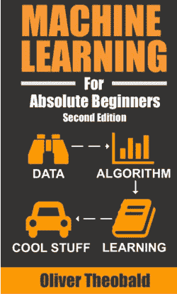

### 面向绝对初学者的统计学：通俗英语入门

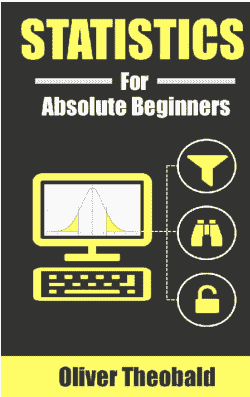

### 面向初学者的 Python 机器学习

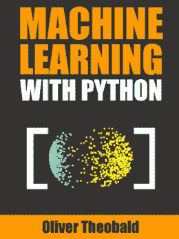

### 面向绝对初学者的数据分析：通俗英语入门

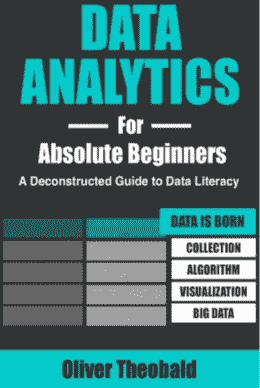

- [1] 浅层算法大致可以表征为非深度学习方法，这些方法并未作为复杂网络的一部分进行结构化。在浅层学习中，模型直接从输入特征预测结果，而在深度学习中，输出基于模型中前馈层的输出，而不是直接来自输入特征。

- [2] Steve Krug，“不要让我思考，重订版：Web 可用性的常识方法，” New Riders，第 3 版，2014 年。

- [3] Steve Krug，“不要让我思考，重订版：Web 可用性的常识方法，” New Riders，第 3 版，2014 年。

- [4] Timothy Stenovec，“Netflix 推出个人资料，终于意识到人们实际上如何在其上观看电影，”《哈芬登邮报》，访问日期：2018 年 4 月 2 日，https://www.huffingtonpost.com/2013/08/01/netflix-profiles_n_3685876.html/。

- [5] Robert Green，“权力的 48 条定律，” Profile Books，新版，2010 年。

- [6] GroupLens 的研究团队也在真实数据集难以获取的时期向公众发布了若干数据集。

- [7] Chris Anderson，“长尾，”《连线》，访问日期：2018 年 4 月 30 日，https://www.wired.com/2004/10/tail/。

- [8] Viktor Mayer-Schonberger & Kenneth Cukier，“大数据：将改变我们生活、工作和思维方式的革命，” Hodder & Stoughton，2013 年。

- [9] Ian Mackenzie、Chris Meyer 和 Steve Noble，“零售商如何跟上消费者步伐，”麦肯锡，访问日期：2018 年 4 月 21 日，https://www.mckinsey.com/industries/retail/our-insights/how-retailers-can-keep-up-with-consumers/。

- [10] Dharmesh Shah，“告别 inbound.org，欢迎来到 Growth Hub，”Inbound.org，访问日期：2018 年 4 月 20 日，https://inbound.org/blog/farewell-to-inboundorg-and-hello-to-growth-hub-growthorg/。

- [11] Pandora 的音乐属性分析是音乐基因组计划的一部分。

- [12] 具有有序类别的变量，例如本科前、本科和研究生。

- [13] Charu C. Aggarwal，“推荐系统：教科书，” Springer International Publishing，2016 年。

- [14] Charu C. Aggarwal，“推荐系统：教科书，” Springer International Publishing，2016 年。

- [15] “观看分钟数”对 YouTube 的推荐系统影响重大。

- [16] Parker Hall & Brendan Hesse，“Apple Music 对 Spotify：谁是流媒体之王？”，Digital Trends，访问日期：2018 年 4 月 28 日，https://www.digitaltrends.com/music/apple-music-vs-spotify/。

- [17] 默认情况下，Excel 工作表最多可支持 1,048,576 行和 16,384 列的数据。

- [18] 这意味着获取原始数据并输出其转换后的版本。降维是 transform 函数的常见用例，该函数是 Scikit-learn 的一种技术，用于在将数据输入另一个学习算法之前修改数据。

- [19] 请注意，Pearson 相关性不对变量的独立和依赖属性进行指定。

- [20] 连续变量是无限的，并与加法、减法、除法等数学运算兼容。因此，包括整数和浮点数在内的数值变量被视为连续变量，因为它们可以作为自然数进行聚合或操纵。与此同时，离散变量是具有有限值的变量，不能被聚合或


与其他变量观测值进行数学处理。示例包括居住城市和性别（通常只有一个可接受值）。

- [21] Viktor Mayer-Schonberger & Kenneth Cukier，《大数据：将改变我们生活、工作和思维方式的革命》，Hodder & Stoughton，2013 年。
- [22] Viktor Mayer-Schonberger & Kenneth Cukier，《大数据：将改变我们生活、工作和思维方式的革命》，Hodder & Stoughton，2013 年。
- [23] Joseph Menn，《所有的狂欢：Shawn Fanning 的 Napster 兴衰史》，Joseph Menn，第一版，2011 年。
- [24] Joseph Menn，《所有的狂欢：Shawn Fanning 的 Napster 兴衰史》，Joseph Menn，第一版，2011 年。
- [25] Robert Langkjaer-Bain 在《显著性》中撰文，《数据权利与对错》，皇家统计学会，第 15 卷，第 6 期，2018 年。
- [26] Zeynep Tufekci，《YouTube，极端化的推手》，纽约时报，2018 年 4 月 11 日访问，https://www.nytimes.com/2018/03/10/opinion/sunday/youtube-politics-radical.html/。
- [27] Guillaume Chaslot，《算法如何学会诋毁媒体》，Medium，2018 年 4 月 11 日访问，https://medium.com/@guillaumechaslot/how-algorithms-can-learn-to-discredit-the-media-d1360157c4fa/。
- [28] Guillaume Chaslot，《YouTube 的 AI 在美国总统选举中具有分裂性》，Medium，2018 年 4 月 11 日访问，https://medium.com/the-graph/youtubes-ai-is-neutral-towards-clicks-but-is-biased-towards-people-and-ideas-3a2f643dea9a/。
- [29] 该网站目前仅考察 YouTube，但预计将在未来添加用于跟踪其他在线平台的工具。
- [30] Joeran Beel、Stefan Langer & Marcel Genzmehr，《赞助推荐与有机推荐以及标记的影响》，收录于 Trond Aalberg、Milena Dobreva、Christos Papatheodorou、Giannis Tsakonas、Charles Farrugia 编，《第 17 届数字图书馆理论与实践国际会议（TPDL 2013）论文集》。第 395–399 页，2013 年 9 月。
- [31] Drake Baer，《为什么数据之神 Jeffrey Hammerbacher 离开 Facebook 创立 Cloudera》，Fast Company，2018 年 4 月 20 日访问，https://www.fastcompany.com/3008436/why-data-god-jeffrey-hammerbacher-left-facebook-found-cloudera/。
- [32] Seth Stephens-Davidowitz，《人人都会撒谎：大数据、新数据，以及互联网能告诉我们关于我们真实身份的事》，Dey Street Books，2017 年。
- [33] Elliot Zaagman，《我们需要一个面向播客的头条》，Technode，2018 年 3 月 7 日访问，https://technode.com/2018/03/06/bytedance-podcasts/。
- [34] 《基于环境条件的广告》，美国专利商标局，2018 年 3 月 30 日访问，http://patft.uspto.gov/netacgi/nph-Parser?Sect1=PTO1&Sect2=HITOFF&d=PALL&p=1&u=%2Fnetahtml%2FPTO%2Fsrchnum.htm&r=1&f=G&l=50&s1=8,138,930.PN.&OS=PN/8,138,930&RS=PN/8,138,930/。

