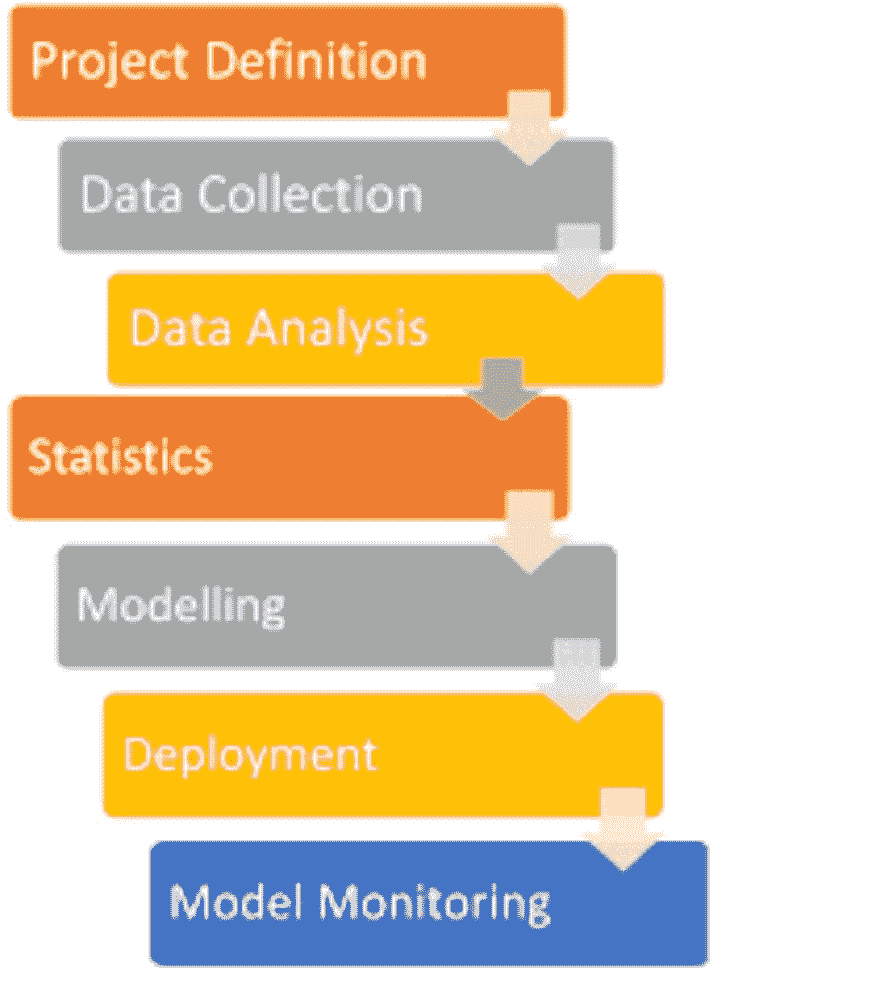
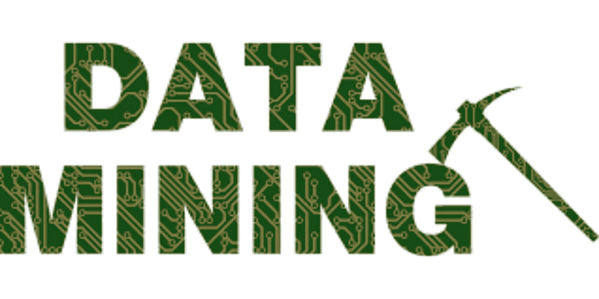
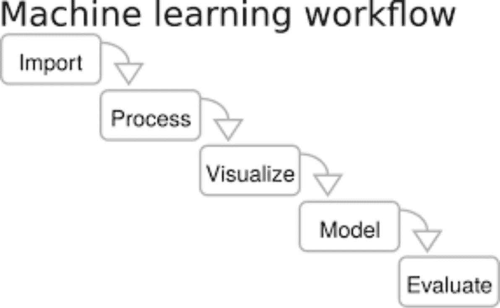
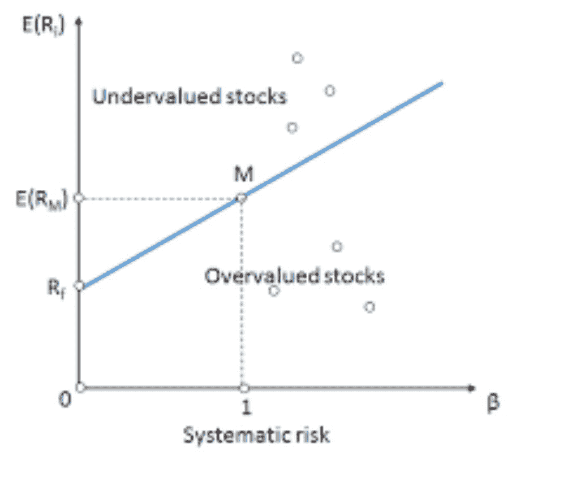

# 商业领袖的机器学习掌握指南

## 简介

机器学习通过其数字交互改变了计算世界，因为它是一种人工智能形式。机器学习始于数据或观察，如指令或直接经验，然后在数据中寻找模式，使机器能够根据提供的示例做出更好的决策。机器学习的主要目标是让机器能够在没有任何人工协助或干预的情况下自动学习，并学会相应地调整。

Arthur Samuel 于 1959 年创造了“机器学习”这一术语。然而，是 Tom Mitchell 提供了一个被更广泛引用、更正式的定义，用以界定机器学习领域中研究的各种算法。该定义为：“如果一个计算机程序在执行任务类 T 时的性能（由 P 衡量）随着经验 E 的增加而提高，则称该程序从经验 E 中学习了关于任务类 T 和性能度量 P 的知识。”

该定义基本上提供了该术语的一个基本操作版本，而非从认知角度对其进行定义。Alan Turing 在其论文中提出，用“机器能否做我们思维实体所能做的事？”来替代“机器能否思考？”这一问题。人类作为思维实体能做某些事情。图灵的提议揭示了会思考的机器可能具备的各种特征。

允许计算机从经验中学习，意味着利用多种算法进行大量的自动化和分析模型构建的数据分析。机器学习赋予机器搜索和识别隐藏洞察的能力，无需被自动化编程去寻找它们，而是在接触新数据时主动发现。尽管这项技术并不算新颖，但它正获得越来越大的势头，因为关于机器学习（常被称为 `ML`）有许多东西需要学习和了解。重燃对 `ML` 兴趣的各种因素包括：负担得起的计算处理能力、不断增长的数据集量以及负担得起的数据存储选项。现代公司可以利用 `ML` 算法开发分析模型，因为它们能在极少人工干预的情况下发现趋势、模式和关联，从而做出明智的决策。

### 机器学习的演变

现代世界的机器学习与过去已有不同。这主要归因于新技术的出现。在早期，该技术因模式识别以及计算机无需编程即可学习和执行特定任务这一特点而获得关注。许多热衷于人工智能的科学家进一步研究了这一方面，以实验计算机能否从数据中学习。当时的重点不在于迭代学习，而是计算机开始随着时间的推移适应所接收的新数据。基于过去所做的各种模式和计算，计算机学会了在相同或相似的情况下做出与过去相似的决策。机器这种从现有模式中学习的能力如今正获得巨大的关注。

人们现在开始注意到，机器能够以更快的速度将复杂的数学计算应用于不同领域，例如处理大数据。以 Google 无人驾驶汽车为例，它构建于机器学习原理之上。`ML` 的另一个重要用例体现在 Amazon 和 Netflix 等公司使用的推荐系统中，这些是机器学习在我们日常生活中的实例。`ML` 还可以与语言规则创建相结合。Twitter 目前实施了这一应用，以便您了解客户在谈论您什么。更为重要的是，机器学习被用于在各个工业领域检测欺诈。

程序员告诉计算机如何解决手头问题的日子已经一去不复返。我们已进入一个时代，机器被赋予自主解决问题的能力。它们从每个数据集中识别模式。分析隐藏的模式和趋势使得预测未来问题变得简单，并防止其再次发生。机器学习算法通常遵循特定类型的数据，并利用数据中的模式来回答查询。例如，您向机器展示一系列狗的照片并说：“这是狗。”随后展示其他照片说：“这不是狗。”现在如果您向计算机展示照片，它将尝试识别这些照片是否为狗。然而，机器做出的每一次正确或错误的猜测都会存储在其内存中。这使得机器在长期来看变得更聪明，并在一段时间内丰富其知识。

### 机器学习在现代商业世界中的重要性

# 为您的业务赋能机器学习

大多数处理海量数据的组织都已意识到机器学习的重要性。通过利用这些数据中隐藏的洞见，企业能够更高效地运作，并获得竞争优势。除了提供经济高效且简便的计算处理外，它还带来了高性价比的存储方案。机器学习使得创建能够准确、快速地处理和分析海量复杂数据的模型成为可能。除了让公司能够从多种数据集中分析趋势和模式，机器学习还能实现分析过程的自动化。这过去是由人工缓慢完成的。现在，公司能够提供个性化服务，并推出迎合客户多样化需求的差异化产品，且能精准交付。机器学习还能帮助组织识别长期来看可能带来丰厚回报的机会。如果您计划构建一个高效的机器学习系统以促进业务增长，则需要做到以下几点：

-   掌握基础和高级算法知识。
-   具备卓越的数据准备能力。
-   具备可扩展性。
-   掌握集成建模知识。
-   为迭代和自动化流程做好准备。

作为领导者，一位业务领导者，机器学习是您超越竞争对手、推动公司发展的入场券。机器学习将助您锁定目标受众、留住客户、并为您的银行账户带来真金白银。

## 第 1 章：为您的业务赋能机器学习

### 机器学习与预测分析

对许多公司而言，海量数据——真正庞大体量的非结构化、半结构化和原始结构化数据——是一座未被开发的信息宝库，可辅助商业决策并改善运营。随着这些数据持续变化和多样化，越来越多的公司开始采用预测分析来挖掘这一源头，并从大规模数据中获益。

有一种普遍的误解，认为机器学习和预测分析是一回事。事实并非如此。不过，它们确实在一个领域有重叠，那就是预测建模。从根本上说，预测分析包含一系列统计技术，包括机器学习、数据挖掘和预测建模，并利用历史和当前统计数据来估算或预测未来结果。这种结果可能是客户在购买过程中的行为，也可能是市场可能发生的变化。它通过分析过去的模式，帮助我们推测未来可能发生的事件。

#### 预测分析的工作原理

预测建模驱动预测分析。它是一种方法论，而非单一流程。机器学习与预测分析相辅相成，因为预测模型通常包含机器学习算法。创建的模型可以随时间推移进行训练，以对新值或其他数据做出反应，从而交付组织所需的结果。

预测模型主要有两类。一类是分类模型，用于预测类别成员资格；另一类是回归模型，用于预测数值。这些模型由算法构建而成，通过执行数据挖掘和统计分析来确定数据中的模式和趋势。预测分析软件将内置可用于创建预测模型的算法。算法被称为分类器，它们识别数据所属的类别集合。

#### 常用预测模型

最广泛使用的预测模型包括：

-   **回归（线性和逻辑）**：这是统计学中最流行的方法之一。回归分析提供变量间的关系，并在多样化及大规模数据集中发现关键模式。它还能发现变量间如何相互关联。
-   **决策树**：决策树是简单而强大的多变量分析形式。决策树由算法生成，这些算法识别将数据分割成分支状片段的不同方式。它们根据输入变量的各类类别将数据划分为子集。这有助于您理解用户做出决策的路径。
-   **神经网络**：它们构建于人脑神经元的模式之上。神经网络常被称为人工神经网络，是深度学习技术的一种变体。它们常用于解决困难的模式识别问题，且在分析大规模数据集时极其有用。它们擅长处理非线性数据关系，在某些变量未知时也能良好工作。

#### 分类器

每个分类器处理数据的方式不同，因此管理者要想获得所需结果，必须选择合适的分类器和模型。

-   **聚类算法**：它们将数据组织成具有相似成员的不同群组。
-   **时间序列算法**：它们按顺序绘制数据，适用于在一段时间内预测恒定值。
-   **异常检测算法**：它们完全专注于异常检测，识别不符合数据集中特定预期模式或标准的事件、观测值或项目。
-   **集成模型**：这些模型利用多种机器学习算法，以获得比单一算法预期输出更好的预测性能。
-   **朴素贝叶斯**：该分类器允许您通过概率，基于给定的特征集来预测类别或类别。
-   **因子分析**：这是一种用于描述变异的方法，旨在寻找变量中的独立潜在因素。
-   **支持向量机**：它们是一种受监督的机器学习技术，使用相关联的学习算法来分析数据和识别模式。

#### 机器学习与预测分析的应用

数据溢出的公司正努力将所有信息转化为有用的洞见。对这些组织而言，机器学习和预测分析能提供解决方案。无论数据量多大，如果无法用于改善内外部流程并达成目标，它就沦为无用资源。预测分析更常用于市场营销、安全、风险、欺诈检测和运营领域。以下是机器学习和预测分析在各行业中的应用示例：

-   **金融服务与银行业**：在金融服务和银行业，机器学习和预测分析被结合用于衡量市场风险、检测并减少欺诈、识别机会，此外还有其他多种用途。
-   **安全领域**：网络安全是现代世界几乎所有企业议程的重中之重。机器学习和预测分析在安全领域发挥关键作用并不令人意外。安全机构常使用预测分析来提升绩效和服务。它们能检测异常、洞察客户行为、识别欺诈，从而增强数据安全。
-   **零售业**：零售业正利用机器学习更好地理解客户行为。谁在买什么？在哪里买？他们想知道这些问题的答案。这些问题可以通过精准的预测模型和数据集得到解答，从而帮助零售商提前规划，并根据消费趋势和季节性备货。这能极大地提升投资回报率（ROI）。

### 构建合适的环境

# 预测分析与机器学习实施

尽管预测分析和机器学习能为大多数公司带来巨大提升，但若不考虑其与日常运营的契合度而半心半意地实施这些解决方案，只会削弱它们提供企业所需洞察的效力。为了充分发挥机器学习和预测分析的价值，公司需要确保拥有支持这些解决方案的架构，以及有助于模型学习的高质量数据。数据准备及其质量是预测分析的关键环节。

输入数据可能跨越多个平台、包含多个数据源，需要以连贯的方式集中并统一管理。为实现这一目标，公司需建立完善可靠的数据治理项目，以管控整体数据管理，确保仅采集和使用高质量数据。此外，现有流程可能需要调整以纳入机器学习和预测分析，这将使公司在业务的各个环节实现高效运转。最重要的是，公司必须明确想要解决的问题，因为这将帮助他们确定最适用的模型。

## 预测模型

组织中的 IT 专家和数据科学家通常负责选择或开发合适的预测模型，亦或自行构建模型以满足组织需求。然而，如今机器学习和预测分析不再仅是数学家、数据科学家和统计学家的专属领域；业务顾问和分析师也在涉足该领域。越来越多的业务人员正在使用模型来获取洞察并改进运营。然而，当他们不清楚该使用何种模型、如何部署，或需要即时获取某些信息时，问题就会出现。市面上有复杂的软件可帮助员工解决这些问题。

## 第 2 章：机器学习与数据挖掘

数据挖掘是指从海量数据中提取知识。换句话说，它是一个发现数据集中固有的、新颖的、有用的和准确的各类模式的过程。数据挖掘是一个迭代过程，通过揭示海量数据中先前未知的模式和趋势，来创建描述性和预测性模型。此项工作旨在辅助决策。它基本上是商业分析的一个子集，类似于实验研究。数据挖掘的起源可追溯至统计学和数据库。另一方面，机器学习通过算法利用从数据中获得的经验自动改进。换言之，在机器学习中，我们从经验中发现新算法。这些机器学习算法可自动提取信息，但机器学习使用的源数据也是数据。它涉及两类数据：一是测试数据，二是训练数据。数据挖掘技术常用于机器学习，并结合学习算法，构建幕后发生情况的模型，以预测未来结果。

### 什么是数据挖掘？机器学习与数据挖掘有何关系？

数据挖掘是指从大量数据中提取知识。它于 1930 年被引入，最初被称为数据库中的知识发现。数据挖掘用于从现有数据中获取规则。其起源在于包含非结构化数据的传统数据库。它适用于您可以开发自有模型并使用数据挖掘技术的场景。它更自然，涉及更多的人工参与。它们用于聚类分析。数据挖掘源于数据仓储。它更多是一种研究，使用类似于机器学习的方法，但应用于有限的领域。

### 数据挖掘技术

从事数据挖掘领域的专家依赖于统计学、数据库管理和机器学习交叉领域的技术。他们毕生致力于理解如何从海量信息中得出结论。将其变为现实使用了哪些技术？当数据挖掘借鉴其中一些技术进行分析时，效果最为显著。

1.  **模式跟踪**：数据挖掘中使用的基本技术之一是学习识别数据集中的模式。通常这是数据中按一定间隔发生的异常、缺陷，或某些变量随时间变化的起伏。例如，您可能观察到某产品的销量在节假日前夕立即飙升。或者您可能注意到温暖的天气吸引人们访问您的网站。

2.  **分类**：这是一种更复杂的数据挖掘技术，要求您将不同属性收集到可辨识的类别中，以便日后得出进一步结论或服务于其他功能。例如，如果您正在评估独立客户的财务背景和购买历史数据，您可能将个人分类为高、中、低信贷风险候选人。然后您可以利用这些分类更深入地了解客户。

3.  **关联**：这与模式跟踪更相关；但它更具体地涉及相互依赖的关联变量。在关联分析中，您寻找与其他属性或事件相关联的特定属性或事件。例如，您可能注意到当客户购买特定商品时，也会购买另一相关商品。这一事件序列用于填充在线商店中的“购买了该商品的人也买了”板块。

4.  **异常值检测**：在某些情况下，仅识别总体模式无法让您清晰理解数据集。您还需要了解数据中的异常，即离群值。例如，您的购买者几乎全是男性；然而，在 7 月的某一周，女性购买者突然激增。您可能想调查该事件的原因，弄清是什么推动了销售，以便复制该成功案例或更好地理解受众行为。

5.  **聚类**：这与分类相似；但它涉及将相似的数据块归类在一起。例如，您可以根据客户的可支配收入多少或在网店购物的频率，将不同人口统计特征的客户分入不同的群组。

6.  **回归**：回归基本上用作一种建模和规划形式。它用于在存在其他变量的情况下，找出某些变量存在的可能性。例如，您可以利用它根据消费者需求、竞争和供应等因素预测价格。更具体地说，回归的主要重点是帮助您发掘特定数据集中两个或多个变量之间的确切关系。

7.  **预测**：这无疑是最有价值的数据挖掘技术之一。因为它用于预测未来将看到的数据类型。在某些情况下，仅通过理解和识别历史趋势，我们就能准确预测未来将发生的事情。例如，我们可以审查客户的信用历史和过往购买记录，以预测若发放贷款，未来是否会存在信用风险。

### 业务流程优化

# 优化您的业务

优化您的业务涉及一个衡量生产力、效率和业务绩效，并寻找改进这些指标方法的过程。这是一个采用旧有业务流程并针对质量进行优化的行为。然而，实现这一目标的手段却大相径庭。业务流程优化恰好是 **BPM（业务流程管理）** 中使用的最后步骤之一。它是一种主张持续流程重新评估和改进的方法。因此，为了使其发挥作用，您必须执行任何 **BPM** 计划所必需的前三个步骤。这些步骤是：

#### 1. 流程识别

您必须已经了解需要优化的流程。在许多情况下，您将选择对组织至关重要且驱动利润的流程。毕竟，如果优化无法产生任何影响，那么执行优化有什么意义呢？

#### 2. 业务流程映射

在您映射了业务流程之前，您将很难找出可能的改进点。如果您尚未为业务流程绘制地图，您可以使用流程图来完成，只需纸笔或使用工作流软件即可。

#### 3. 业务流程分析

在开始业务流程的改进活动之前，您需要先分析每一个步骤。如果一些完全明显的可能变更存在，这种分析可以完全是直截了当的；但如果问题不那么明显，分析可能会困难得多。在后一种情况下，您可以利用一些用于业务流程改进的工具来找出那些细微的低效之处。

完成这些之后，一切就绪，您需要拥有一个清晰映射且定义明确的流程，以及一些关于如何优化该流程的想法。

### 执行业务流程优化

有许多方法可用于优化您的业务流程。这取决于被选中进行优化的流程。您无法找到一种适合所有情况的放之四海而皆准的方法。然而，在大多数情况下，优化是通过使用以下方法之一来执行的。

#### 重组或流程改进

这种方法非常简单，它只是仔细审视流程中的每一个步骤。该方法的思路是找出以下类型的流程：

##### A. 浪费型

流程中的每一步都必须为最终目标增加一些价值，这可能是某种产出或特定价值。并且该流程必须在公司目标的背景下汇聚成某种成果。很多时候您会发现，某些步骤或流程在不创造任何价值的情况下是无用的。存在不同种类的浪费和浪费性流程。

##### B. 低效且可改进型

这意味着某个流程或步骤的效率不如其潜在水平。例如，可能采取的步骤比所需的要多得多。其中最显著的例子之一就是审批流程。如果您试图让一个新项目起步，您需要获得公司高层管理人员的批准。这意味着您将不得不等待五位以上极其繁忙的高管抽出时间阅读文件并给予批准。

一旦您找出了属于这些类别的步骤或流程，您将需要针对质量对其进行改进。这可以通过重组流程来实现。换句话说，通过改变步骤或重组步骤，消除无用的步骤或流程，或两者兼而有之。

#### 自动化

许多人不喜欢手工劳动。很多时候这会让您感觉自己只是机器上的一个齿轮，在做机器人能做得更好的事情。您所要做的就是为工作找到合适的工具或软件。**BPA（业务流程自动化）** 可以帮助您从员工的工作量中移除体力劳动，这将带来更好的生产力和士气，因为员工将专注于重要的工作。没人喜欢枯燥乏味的杂务。自动化因任务而异。以下是一些自动化的示例：

##### 客户支持

如果您在线与业务合作伙伴合作，网站上将开放客户支持表单。假设新软件更新出现问题，导致 10% 的用户群受到影响。这意味着您的收件箱将被投诉和问题邮件严重堵塞。虽然第一份错误报告非常有用，但其余的只是杂乱信息，您却不得不一一回复。有可用的软件允许您创建事件，在这种情况下，您可以根据工单中提到的关键词向投诉发送自动回复。

##### 社交媒体管理

无论组织从事何种业务，员工极有可能拥有 Facebook 账号，或者至少拥有 LinkedIn 主页。管理页面的传统方式是让某人手动登录，然后寻找内容每天发布 3-4 次。与其浪费时间做所有这些事情，您可以使用社交媒体工具来规划未来一个月的帖子。

还有其他示例可能与您的业务更相关。但网上有许多此类解决方案可助您在业务流程自动化方面一臂之力。

#### 采用技术与全流程变革

采用正确的技术将始终是改变游戏规则的关键。与前两种方法不同，这并不完全是优化流程本身。相反，它彻底改变了流程。假设您使用白板来组织组织内的日常事务。通过采用任务管理软件，您可以在不实际改变任何流程的情况下提高企业的日常效率。由软件掌管，您将看到诸如以下的益处：

- **减少错误和错过截止日期**：人类以犯错著称。每个人都可能偶尔搞砸、忘记重要事情或错过截止日期。任务管理软件通过提醒您每日任务和即将到来的截止日期，确保这种情况不再发生。
- **中央指挥中心**：在线创建新任务并分配给员工，比发送详细邮件并希望其不被忽视或丢失要容易得多。

对于更多面向流程的示例，有工作流管理软件可用。您无需再通过聊天或邮件手动跟踪工作流，而是可以使用专用系统通过单一仪表板管理所有流程。这自动消除了您在流程管理中将遇到的许多问题，如：

- **流程缺乏标准化**：很难让所有员工同时遵循不同的程序。工作流软件确保每个人都按正确顺序完成流程中所有必需的步骤。
- **更简单的跟踪和分析**：与普通流程图相比，工作流软件允许更轻松的跟踪。没有软件，您将需要通过邮件和聊天手动跟踪流程。此外，软件衡量流程效率，否则您将不得不手动从不同的报告、员工和软件中收集所有数据。

因此，为了优化业务流程，您需要识别薄弱和低效的流程，绘制它们的图谱并进行分析。找出是否有更好的方法来执行它们。然后通过重组、自动化或采用某种将彻底改变工作方式的技术来优化它们。

### 优化业务资源

### 创业公司招聘与业务优化策略

#### 核心原则：仅在必要时招聘

创业公司招聘有一条黄金法则：**仅在现有员工已达 120% 工作饱和度时才招聘**。简单来说，创业公司无法承担无法 100% 利用的员工，没有多余空间。虽然这在商业上讲得通，但过度工作会降低员工士气。解决之道在于**优化业务资源**，在招聘新人前从团队榨取更高生产力。

#### 优化策略

##### a. 重价值、轻数量

这是创业者最快却也最难的决策之一——优化业务资源。选择“重价值、轻数量”意味着：通过提升产品/服务价值，使交易量下降但因高利润率导致收入上升。员工将有更多时间完成任务，从而为现有客户提供更高质量服务。虽易行难，决策需经深思熟虑。

##### b. 减少浪费

浪费是大问题，尤其在消耗型业务中。它不仅增加运营成本，还会因强迫员工生产最终可能被丢弃的产品而导致员工过度劳累和沮丧。更好的预测模型和预测工具能优化运营、减轻员工负担并增加收入。

##### c. 重构运营

创业公司员工常需“身兼数职”同时处理多任务。研究表明，注意力分散会降低生产力，并使每项任务完成时间增加高达 25%。虽多角色是创业常态，仍可重构运营让员工一次专注一事。例如：让负责所有数字营销的营销人员，每周仅有一天专注邮件营销。

##### d. 外包非增值工作

无需所有工作内部完成。许多咨询公司有专职人员处理制作演示文稿、汇总电子表格等任务。虽这些任务重要，但让高费率顾问执行不合算。创业公司可借鉴外包模式，将非增值任务外包给数据处理行业，释放员工精力。任务可能微不足道（如提交出租车发票报销），也可能较重要（如将 Word 文档转为 PPT）。从商业角度看，虽可能增加成本，但能显著提升团队效率，进而加速业务增长。

##### e. 使用第三方工具

新业务应将所有资源聚焦核心专长，避免在不直接改善产品/服务的事务上耗费精力。例如：集成第三方工具实现功能，而非自建。Uber 这类知名独角兽，其 App 仍运行在 `Google Maps` 上。因不自建地图功能，Uber 能更快上市，这对其成功贡献巨大。

#### 业务优化基本原理

新业务优化理由简单：**自举型企业无法承担低效**。基本规则是客观审视公司员工执行的每项任务，自问三个问题：
1. 该任务能否完全取消？
2. 能否外包？
3. 能否优化流程以提高效率？

### 优化业务运营

任何组织的业务运营都可改进。事实上，磨练效率与效力对中型企业至关重要。你需要所有可用资源涵盖下一增长阶段，并具备与大型组织竞争的能力。与其小规模运作且不断修补零星问题，不如采用以下策略解决运营各方面，释放资源用于更有价值领域。

#### 采用“精益”方法

运营理念“精益”专注于持续改进运营活动，以更高内外部价值向客户交付产品/服务。通过实施增值实践、规避非增值实践，公司使运营部门更高效。一些组织有工作表辅助高管判断公司是否真正采用精益实践，还是仅停留在相关术语上。

#### 聚焦质量

商业理论中质量管理版本多样，历经多年，如 W Edwards Deming 的“统计过程控制”、1980 年代的全面质量运动或六西格玛等实践。这些实践最初用于生产，后扩展至组织运营工作。核心思想是减少工作与浪费，从而省钱、改善结果、提高组织效力。

#### 改进预测

无论销售产品/服务、采购管理库存、控制供应链还是合理配置人员，所有组织都在预测需求。多家公司预测不佳，意味着无法满足市场需求，或在维持过剩产能上浪费金钱和精力。据 NCMM 白皮书，波本威士忌酿造商 `Maker's Mark` 因预测失准曾宣布须兑水稀释产品。因无法满足客户需求，客户愤怒不已。庆幸的是，中型企业可用具备丰富知识的复杂工具改进各类预测。

### 引入以客户为中心的思维

管理团队总爱说自家组织多么“以客户为中心”。结合你作为客户的体验，思考有多少组织真正将客户放首位。任何企业的以客户为中心方法都极其高效。归根结底，是客户及其对企业的认知和态度决定企业命运。你需聚焦战略和运营以拥抱客户、让他们满意愉悦。若能做到，你就走在商业成功的快车道上。

### 传统的 BPR（业务流程重组）

### BPR（业务流程重组）

BPR（业务流程重组）曾一度成为公司管理层的热门追捧对象。组织们试图重塑其运营流程以实现更高的效率。与所有潮流一样，这更多是停留在口头上，实际行动很少。然而，随着业务流程随时间发展，这一理念并未失去其公信力。随着条件的变化，组织不断采纳并叠加新的流程。最终，你将得到一个由委员会设计的、难以运行的复杂流程。然而，通过真正的重组，组织可以剔除业务运行中浪费的流程，开发出更好、更有效的流程。在重组过程中，请记住要让一线员工参与进来。他们才是真正了解事情如何运作的人，甚至可能对如何改进提出建设性意见。

### 调研

开展正确的调研对于预测产品的未来至关重要。有多种方法可用于研究产品趋势。

1. **社交媒体**：时刻关注社交媒体页面上出现的趋势。你会发现一些人以特定方式行事和沟通，并对某些购买选项做出决定。一个例子是人们在 FB 墙上到处发布观点、内容或网页链接。不同平台上创建了一些特殊的社交群组，它们是特定产品或行业的活跃追随者。

2. **产品追踪软件**：在更准确地预测产品趋势之前，你还需要对当前产品销售进行一些调研。例如，你可以通过在 `Trendster` 中输入 ASIN 轻松查看该 ASIN 的表现。将你找到的统计数据与洞察相结合，以加深对市场行为的理解。

当你浏览完所有这些资源后，你将收集到进入下一步所需的必要信息。

### 区分真实趋势与短暂狂热

重要的是要记住，你试图预测的是产品趋势，而非冲击市场的短暂狂热。趋势可以持续数年甚至数十年，而狂热顶多只能维持一个季节。它会消退，如果你考虑某些因素，就很容易识别出狂热。真正的趋势必须具备以下特征：

*   **内在实用性**：该特定商品是否具有实用目的？还是说它依赖特定环境才能体现其用处？
*   **长期价值**：几年后人们还会喜欢这款产品吗？它能经受住季节更替的考验吗？
*   **能否与其他趋势融合？**：在更广泛的行业背景下使用它是否合理？如前所述，趋势并非孤立存在。一个例子是阿萨伊莓，由于其作为有机超级水果的品质，它在过去十年中大受欢迎。但它口感也很好。因此，阿萨伊莓趋势与新奇、健康和意识觉醒等其他趋势相契合。

能够预测产品趋势意味着比竞争对手领先一步。它为你提供了一个无价的机会，推出全新产品抢占市场。遵循这些步骤能提供极佳的洞察，从而优化你对市场及其变化的理解。当你发现一个趋势时，要研究它以确保它不仅仅是狂热，并开展调研。许多卖家犯的错误是假设：仅仅因为产品当下流行，它就会持续畅销。但要确定你找到的是真正的趋势，你可能需要查看该类别中的其他产品及其当前表现。快速的在线搜索可以揭示特定产品销售的关键信息。这有助于你对趋势得出准确的结论。

### 数据驱动策略

为确保市场部门有效助力业务，你需要一个可定制的数据驱动策略。数据揭示了业务各部分的优势和劣势，从而让你能做出战略决策，制定成功的营销策略。大多数营销人员认为数据是任何公司最未被充分利用的资产。那么，如何在你的业务中融入数据驱动营销并开始享受其红利？以下是一些步骤，可确保你有效利用数据来运行营销策略。

1. **确定目标**：在开始数据收集之前，有一个重要的步骤，即明确哪些数据值得收集。决定哪种数据会对营销策略产生积极影响。舍弃那些无法增加策略有效性的数据，专注于收集关键 KPI 周围的数据，这些数据能真正推动业务进展。

2. **组建团队**：在开始分析数据之前，组建一个处理数据的团队至关重要。团队必须包含来自不同部门和跨学科领域的成员。Richard Baystom 在 Effin Amazing 上建议，这并不意味着让 IT 部门的人和销售部门的人凑在一起，只是收集经理们能腾得出的人。这意味着你要找到那些愿意超越其专业领域和知识范围的人。例如，你需要愿意学习营销的数据科学家，或愿意学习销售的 IT 人员。通过安排有针对性的频繁会议来优先促进这些人的协作至关重要。在会议上，每个人分享想法和信息，并在团队成功时共享荣誉。

3. **收集数据**：当你准备好开始收集数据时，需要确保将其集中在一个地方以便于分析。考虑收集以下类型的数据：

*   竞争对手
*   目标市场
*   营销
*   社交媒体分析（展示量、点击率、转化率等）
*   客户数据，包括个人信息、交易数据、在线活动和社交网络活动
*   定性数据和潜在客户数据

还有更多种类的数据。你可以从询问团队的不同成员他们准备和使用哪种数据开始，并从其他部门收集所有能获取的信息。Jim Bergeson 在一篇文章中指出，数据有时隐藏在公司最内部的资源中，可能掌握在供应商、经销商或转售商手中，可能在销售人员手中，甚至可能被锁在 IT 部门的保险库里。

完成这种数据探索后，你将了解客户生命周期所有阶段发生的情况，并获得诸如销售点问题、投诉或服务电话、推荐、后续购买和在线推荐等信息。

4. **评估数据并采取行动**：根据 KPI 评估收集到的数据，并开始利用这些数据驱动营销策略。

    a. **优化内容营销策略**：你可能已经在使用内容营销策略来吸引和吸引受众。但有时内容背后没有清晰的策略，或者你不清楚试图触达谁。然而，一旦你拥有了做出明智决策的数据，你就走在了正轨上。你也许可以将销售和营销策略结合起来赚取更多利润。你也可以尝试不同类型的内容，如 GIF、图片和视频。如果你已经在定期发布优质内容，这一步应该不成问题。然而，不要忘记最重要的部分，那就是互动。当你提供客户想要的东西时，他们更有可能参与到内容中。这需要一些试错，但数据将帮助你确定吸引受众的最佳方式。

#### b. 考虑新的细分市场

一旦您从收集的数据中获得了所有洞察，就可以开始为您的产品和服务创建新的细分市场。这并不意味着您需要完全改变品牌，也许您只需要修改销售对象。例如，如果您目前为生日派对销售定制标牌，却发现婚礼市场对类似产品有巨大需求，您可能希望稍微调整营销策略以瞄准准新人，并为他们创建新的产品线。总体目标是在利基市场中寻找机会，并用您的产品和服务服务新受众。

#### c. 消除障碍

收集的数据还将揭示潜在客户在销售过程中面临的可能障碍。现在是解决这些问题的时候了。您的客户是否因购物车中的商品而停滞不前？如何让他们完成购买？一个例子是 Pura Vida 手链。该公司通过 Facebook 上的内容推广产品，最近为粉丝页面提供了限时折扣以激励购物者。

#### d. 探索替代营销渠道

有时您会发现您的业务未能触达所有必要的客户。如果您的网站是您用来分享产品和服务信息的唯一渠道，您的业务将难以为继。收集的数据可以帮助您探索其他渠道和方式。您可能想尝试与拥有不同产品的其他企业进行联合营销，或启动一个联盟计划，让高价值客户以换取折扣或其他福利为交换来传播您的产品信息。通过分析收集的数据，您将开始了解哪些渠道最适合您的产品和服务。

#### e. 不要停止测试

虽然数据有助于制定新的营销策略，但它需要频繁地进行测试和管理。在《新品种营销》一书中，Matthew Buckley 指出，您需要通过可在一天内完成的小型实验来测试您的营销工作。他建议使用科学方法来实现这一点。目标是快速且熟练地收集所有重要数据，以便您能继续从中得出结论，甚至构建新的实验。您对数据进行的测试越多，您的营销工作就越明智。

实现真正的数据驱动营销充满挑战。CMO Council 和 RedPointGlobal 的一项研究，题为“赋能数据驱动的客户策略：从基础层面解决客户参与问题”，指出了四个阻碍营销人员将制定的策略付诸执行的障碍。这些问题包括缺乏实时数据、缺乏内部凝聚力，以及缺乏技术和客户关注度。研究表明，只有 7% 的营销人员表示他们能够始终跨多个物理和数字触点提供数据驱动的实时体验。虽然 52% 的营销人员断言他们可以提供大部分体验，但他们只能通过数字渠道或营销自有渠道做到这一点。因此，实际上，许多公司在跨各种渠道实时收集和分析数据方面遇到了麻烦。

为了在数据驱动营销中取得真正的成功，企业需要合适的技术。三分之一的人表示，他们在过去五年中投资了十个独立平台或解决方案中的五个，但许多人仍然没有必要的工具来全面可视化他们的数据。真正的问题是解决方案之间的连通性。约 3% 的营销人员表示他们的所有系统完全同步，从而跨所有渠道顺畅地连接所有数据、指标和洞察。15% 的人承认，他们完全没有策略来开发内部流程和技术，以便在其遗留基础设施中采用更新的云解决方案。

### 定位并联系潜在客户

如果您正在推出新的营销计划，或希望为现有计划进行翻新，以下是一些帮助您与客户建立联系并培育潜在客户的方法。制定一个正确且有效的营销策略并非易事。您需要决定您认为客户是谁，然后花费大量时间收集和分析他们的购买习惯数据。这既昂贵又耗时。但这笔资金和时间的投入可能会为组织带来颠覆性的结果。如果您开始制定营销策略并网罗一些客户，以下是成功所需采取的步骤。

#### 1. 识别客户

如果您心中没有潜在客户，就无法与潜在客户建立积极的联系。调查现有客户以及目标市场的成员。这是为了找出您如何改进产品和服务的展示，或者您目前提供的内容缺少什么。广撒网以捕捉对您的产品和服务感兴趣的人，并利用他们的数据以更好的方式开发您的品牌，使其与目标市场产生共鸣。当您了解受众、他们在互联网上常去的地方以及他们对什么有反应时，就可以开始营销了。

#### 2. 研究竞争对手以了解他们的客户

找出最适合您产品的有效营销活动的一个简单方法是研究您的竞争对手。这项简单的练习不仅能为您自己的活动提供创思路，还能揭示竞争对手运作模式中的薄弱环节，并为您提供新的方向。如果您进入同一行业，最终将与竞争对手争夺同一目标市场。那么不妨利用他们的例子来改进您的产品和服务。

#### 3. 定向广告

对于一种经济且有效的广告方式，Google 和 Facebook 证明了只需一点投入就能产生巨大影响。虽然现实世界中的大多数广告只能触达路过广告牌、观看广告或在公交站等候的人群，但这些定向广告能够根据地理位置、人口统计特征（如年龄、教育程度、性别和恋爱状态）、浏览活动和兴趣，定位最可能需要您服务的人群。通过投资定向广告并通过其 `PPC`（按点击付费）或 `PPI`（按展示付费）方式付费，组织可以在用户参与度、销售额方面看到显著提升，最重要的是转化率。

#### 4. 社交媒体使用

在社交媒体上“略有存在感”与“拥有社交媒体存在感”有着巨大的区别。当您试图留住客户时，在 Twitter、Facebook 和 Instagram 上多花一点精力会产生深远影响。许多企业仅使用其账号来推广公司。但精明的社交媒体运营者会策划相关帖子、分享优质文章链接，并在客户提问时尽快回答。结果，他们给客户留下了真人真心关怀的印象。这些是能留住客户的组织。为用户提供使用其产品或服务的新方法，并帮助解决出现的问题。

#### 5. 回应所有沟通

保罗·英格利什曾领导 Kayak，他采用了有史以来最有价值的实践之一。他坚持在办公室正中央放置一部极其刺耳、响铃巨大的电话。这是用来接收客户投诉的。这实际上确保了来电会由每个人接听，包括开发人员、工程师、经理，以及英格利什本人。托尼·谢非常重视客户服务，以至于他为所有新员工建立了客户服务培训计划，无论其职位如何。他的客户服务甚至做到这种程度：当网站上没有某款鞋时，他的员工会去竞争对手的鞋店为客户买来那双鞋。关键在于，始终接听电话，照顾好你的客户，并在问题发生时解决问题。你的客户会因这份服务而爱戴你。

#### 6. 联盟营销

自 `WWW` 问世以来，联盟营销就已存在，但至今仍常被忽视。然而，它在显著提升品牌知名度方面极为有效。随着众多联盟网络基于 `PPC` 或 `PPA`（按行动付费）模式运作，要找出你的产品是否真正由合适的发布商推广，从未如此安全且容易。亚马逊、eBay 及其他一些机构提供自有的联盟网络；不过，你也可以尝试独家的 `PPA` 联盟网络。

#### 7. 通过发布评论等在社区建立信任

许多新兴且极具竞争力的企业挤占了几乎所有行业。要在拥有相当数量追随者的基础上站稳脚跟并增长，变得越来越困难。为了获得支持，组织必须能够建立信任。多达 88% 的客户对在线评论的信任程度不亚于个人推荐，因此开始发布评论，并将产品样品寄送给受信任的博主阅读和评判，是明智之举。

随着公司开始成长，开始将内部内容投放到发布联合内容的大型网站上，如 Forbes、Huffington Post、Fast Company Inc. 和 FT。别忘了在此使用你的真实姓名，因为人们对真人的回应比对企业更好。

#### 8. 与影响者建立联系

与行业内的大咖互动，这是获取广泛客户群的有效方法。因为，当你能吸引到影响者或思想领袖的注意时，你就有更大机会赢得他们的朋友和粉丝，同时建立信誉和信任。在会议上接触企业家，或在 Twitter 上联系博主，又或发送有趣且相关的博客内容给他们，这可能激起他们的兴趣，再次强调——要做人，而不仅仅是个组织。

#### 9. 在博客上发布内容

坚持持续、勤奋地发布原创且相关的博客内容。这能让你的组织在 Google 搜索结果中保持光鲜。然而，这也有助于潜在客户真正了解你的公司，知晓其来龙去脉。这些内容不必全是自我推广，而应提供背景和洞见，说明读者为何应购买该产品或服务。建议解决客户日常生活中出现的行业相关问题的最佳方法，或传授一些有用信息，并总体上激励人们分享你的观点。如果你没有足够的作家或资源在编制内维持博客内容的持续产出，你可以求助于内容营销平台（如 `Content.ly`）或虚拟沟通平台（如 `Commeta`）。

#### 10. 利用时事通讯培育线索

在线营销中最困难的任务之一是生成线索。这通常涉及分析客户信息和社交媒体活动、投放广告、在线调查以及每年更新用户数据。然而，不断有新公司涌现，旨在简化线索生成，并在某些情况下为你完成这项工作。其中一个例子是 `LeadGenius`。对于培育潜在客户，一个绝佳的方法是使用个性化的电子邮件时事通讯、促销活动和 `A/B` 测试广告。利用数据微调那些显示出成效的工作，并开发出最佳的营销活动。

## 第 3 章：营销中的机器学习

### 营销应用

营销成功取决于多个因素。除了上述因素外，营销人员若不精通自动化和数据分析，就无法取胜。机器学习可以提升生成品牌宣传资料、客户细分、客户沟通、相关内容提取与分类、整体生产力和产出等常见任务的绩效。在现代经济中，没有机器学习的营销公司将面临严重的劣势。然而，在不了解机器学习能做什么的情况下盲目采用，很可能弊大于利（通常表现为浪费工时和金钱）。它不是魔法，除非你的团队为特定的营销挑战选择并配置了正确的 `ML` 解决方案，否则它不会自动推动指标变化。以下是一些利用机器学习技术进行营销的应用：

#### 1. 通过聚类进行客户细分与发现

你的所有客户并不相同。无监督 `ML` 可以帮助你将受众分成动态群体，并适当地与他们互动。例如，`Affinio` 的平台分析数十亿个客户兴趣变量，基于他们的社交媒体活动找出特定的客户兴趣，然后生成可视化报告，将具有相似兴趣的客户分组。在此之后，你能够深入了解客户行为，识别出谁是铁杆美食家、谁在追 Netflix 上的什么剧集，或谁偏好相似的旅游目的地。

#### 2. 使用多臂上下文老虎机进行内容优化

`A/B` 测试是找出哪种内容（网页布局、邮件语气、文章标题、视觉元素等）更能引起受众共鸣的有效方法。但是，`A/B` 测试中存在一段“懊悔期”，当你使用次优选项时可能会损失收入。你需要等待并完成倒计时，直到了解到最佳选项为止。而老虎机测试则通过动态优化减少机会损失。在此过程中，它同时探索和利用选项，从而逐步且自动地向更好的选项靠拢。

#### 3. 具有动态定价的回归模型

正确的定价能成就或毁掉一个产品的未来。`ML` 中的回归技术允许营销人员基于现有特征预测统计值。这反过来又允许他们改善客户旅程的各个方面。回归也可用于销售预测和优化营销支出。

#### 4. 用于个性化和用户洞察的文本分类

机器学习系统可以使用 `NLP`（自然语言处理）来探测语音或基于文本的内容，然后根据情感、主题或语气等变量对所有内容片段进行分类，以生成客户洞察或策展相关素材。`IBM Watson` 的 `Tone Analyzer` 可以解析来自互联网的客户反馈，并确定评论产品的用户的总体语气。

### 5. 用于热门新闻的文本提取与摘要：

### 机器学习在营销中的应用

营销人员可以利用机器学习从在线发布的新闻文章和其他数据源中提取相关内容，以确定客户对其品牌的看法以及他们对产品的反应。为此，“Protagonist”平台使组织能够全面洞察客户的动机和价值观，以及这些属性如何影响其购买决策。精通技术的营销人员还可以通过使用 `AYLIEN` 等 API 来构建自己的机器学习算法，用于社交媒体情感监测和相关新闻聚合等目的。

#### 6. 基于注意力神经网络的机器翻译

深度学习的注意力机制有助于改进机器翻译，并为您的营销资产赋能，以应对全球竞争。对于进入语言截然不同的新市场的品牌来说，翻译曾是一项主要支出。然而，AI 领域的发展使机器翻译达到了接近人类水平的平价。为了合理化成本并加快这一流程，多家公司选择仅让人工翻译审核并签署机器翻译的输出结果。

#### 7. 使用 RNN（循环神经网络）进行文本生成

如果您品牌的创意人员面临持续压力，需要为更新的产品和营销活动想出好名字，您可以使用生成模型（如 `RNN`）为自己提供多个听起来合理的名字。其中一些可能朗朗上口/古怪，而另一些则惊人地正是您所需要的。

#### 8. 用于聊天机器人和客户体验自动化的对话系统

聊天机器人和机器人是机器学习最普遍的用例之一。然而，您在实际环境中观察到的大多数营销机器人完全是脚本化的，它们极少使用机器学习和自然语言处理。当对话系统更加复杂时，它们能够引用外部知识库。它们可以适应非标准查询，并在必要时升级转接给人工客服。如今，许多公司已采用聊天机器人与客户沟通。它们陪伴客户从刚了解新产品或品牌的那一刻起，一直到购买后需要客户支持的全过程。

#### 9. 使用 TTS 和 STT 进行语音搜索

这被视为对话式 AI 领域的一部分。纯语音或支持语音的平台为软件和硬件界面带来了新范式和客户互动可能性。由于 Google Assistant 和 Amazon Echo 等语音数字助手的使用日益增多，免触控搜索和购物成为可能。因此，营销人员现在需要对话式 AI 策略，因为这是营销的未来。

#### 10. 使用计算机视觉进行品牌物体识别

计算机视觉是机器学习一个快速发展的领域，可应用于一系列场景。营销人员可以利用机器学习驱动的视觉技术来识别产品，并从标签图片和视频中提取洞察。`GumGum` 等解决方案允许营销人员了解其徽标何时出现在生成的内容中，并通过视频分析快速计算收益。技术更娴熟的营销人员可以利用 `Clarifai` 等 API 构建定制解决方案，用于内容审核，以及基于视觉相似性的推荐和搜索引擎。

#### 11. 使用 GAN（生成式对抗网络）生成原创媒体

`Nvidia` 因其生成重复名人照片级真实图像的方法论，在商业界引起巨大轰动和热议。尽管这些照片看起来像真实人物的图像，但它们并非真人。它们完全由机器学习和 AI 生成。通过使用 `GAN`（生成式对抗网络），`Nvidia` 系统逐渐变得更擅长创建超真实但虚假的图像。

`GAN` 拥有两个相互竞争的网络，一个是生成器，另一个是判别器，它们相互博弈、相互学习。从而使它们在创建和检测虚假图像方面稳步变得更好。其他一些公司使用 `GAN` 来创建徽标、将草图转化为照片级真实图像，以及生成语音。

#### 12. 营销运营中机器人流程的自动化

数字营销充斥着旨在让高压工作下的员工操作更轻松的自动化解决方案。自动化流程涵盖打开和分析邮件附件、阅读邮件、模板报表的数据录入，以及捕获和追踪社交媒体触发器，以助营销人员保持领先优势。针对互联网广告，有一个名为“Albert”的 AI 平台，它减少了大规模媒体采购对人力的需求，加快了必要分析计算的速度，并优化了付费广告活动。

#### 13. 使用自动化数据可视化实现卓越报告

图片胜过言语。AI 将数据转化为可视化洞察的速度和效率胜过任何人类专家。人类分析师通常使用 `Tableau` 或 `Excel` 等工具手动创建可视化呈现。然而，面向企业的自动化分析解决方案（如 `Qlik`）可以集中数据源，为营销团队生成有意义的报告和仪表板。如今，多个平台结合复杂的机器学习算法使用数据分析，生动地阐明市场趋势、客户行为模式以及其他肉眼难以察觉的数据。这些数据不易转化为可落地的洞察。

#### 14. 使用强化学习进行序列营销决策

我们做出的许多艰难决策并非单一预测，而是长期做出的一系列决策。即使是最聪明的人类，在短期权衡与长期收益之间取得平衡也很困难。强化学习在 `DeepMind` 的 `AlphaGo` 中成功应用，在复杂场景下击败了人类决策。尽管商业场景比游戏复杂得多，但在较小领域的成功暗示了在更大领域也会取得类似进展。`IBM` 研究人员进行了一项著名研究，探索利用强化学习改进精准营销的可能性。

## 第 4 章：金融领域的机器学习

即使在高效聊天机器人、移动银行应用和搜索引擎出现之前，机器学习在金融领域就已有实用应用。鉴于海量数据量、历史纪录准确性要求高以及金融世界的量化本质，极少有其他行业比金融业更适合人工智能。您能找到的金融领域机器学习用例比以往任何时候都多。这一趋势因算力增强和更易获取的 ML 工具（如 Google 的 `TensorFlow`）而加剧。

机器学习已到来，在现代社会和金融的许多领域发挥着关键作用。它参与贷款审批、资产管理和风险评估。尽管极少数精通技术的人准确了解机器学习以多少种方式融入人们的金融生活。

### 当前的金融应用

以下是机器学习在当今世界投入使用的一些示例。请记住，某些应用使用多种 AI 技术或方法，而不仅仅是机器学习。

#### 1. 投资组合管理

##### 智能投顾

智能投顾是一个几年前还鲜为人知、如今却在金融界普遍使用的术语。然而，这个术语略显误导，因为它根本不涉及任何机器人。相反，智能投顾（如 Betterment 或 Wealthfront）是基于机器学习的算法，旨在根据用户的目标和风险承受能力来构建其金融投资组合。例如，用户输入的目标是在 65 岁退休时拥有 300 万美元的储蓄。他们还会输入自己的年龄、当前财务状况和收入。

更准确地说，这位“顾问”应被称为“配置器”，它将投资分散到各个资产类别和金融工具中，以实现用户的目标。顾问系统随后会根据用户目标的变动以及实际的市场变化进行校准，从而为用户目标找到最佳匹配。它们在那些不需要实体顾问也能对投资感到放心、以及那些无力支付人工顾问费用的消费者中获得了极大的重视。

#### 2. 算法交易

算法交易可追溯至 20 世纪 70 年代，也称为自动化交易系统。它利用复杂的 AI 系统做出极高速度的交易决策。算法系统一天内可进行数千甚至数百万笔交易。因此使用了 HFT（高频交易）这一术语，它是算法交易的一部分。大多数金融机构和对冲基金不对外披露其用于交易的 AI 方法。不过，人们认为深度学习和机器学习在交易决策中扮演着日益重要的角色。在股票交易中使用机器学习存在一些显著的局限性。

#### 3. 欺诈检测

系统可以通过机器学习检测异常行为或独特活动，并将其标记提交给安全部门。该系统的主要挑战在于避免误报，即在实际上不存在风险的情况下却将其标记为风险。安全漏洞的形式多种多样，因此真正的学习系统将在未来 5 到 10 年内成为必需品。

#### 4. 保险或贷款承销

承销可被描述为机器学习在金融领域的**完美工作**，但市场上普遍担心机器会取代当今存在的许多承销职位。这在大型组织中尤为突出，例如大型银行和公众保险公司。机器学习算法可以在数百万消费者数据实例（如工作、年龄、婚姻状况等）上进行训练。它也可用于保险理赔和金融借贷，以核查某人是否违约、是否按时还款或是否卷入过车祸。

可以使用算法评估和持续分析潜在趋势，以检测影响未来放贷和保险的趋势。例如，你可以发现越来越多的年轻人是否卷入车祸。又或者，在过去 10 年中，特定人群中的违约率是否在上升？这些查询的结果对组织具有极高的产出价值。然而，目前这仅限于拥有资源聘请数据科学家、并掌握海量数据（过往和当前）以训练算法的大公司。

### 机器学习与加密货币

近年来，AI 和机器学习辅助交易引起了巨大的兴趣。有一种假设认为，加密货币市场的低效性可被利用以创造巨额利润。在最先进的机器学习算法辅助下，常规交易策略的能力远超标准基准。一些非平凡但实际简单的算法，可以帮助预测加密货币市场的短期演变。

机器学习技术在股市预测中取得的成功表明，这些方法也可有效用于预测加密货币价格。但将机器学习算法应用于加密货币市场，目前主要局限于使用贝叶斯神经网络、随机森林、长短期记忆神经网络及其他一些算法来分析比特币价格。这些研究在一定程度上预测了比特币的价格波动，并得出结论：基于神经网络的算法能取得最佳结果。强化深度学习在一年内预测 12 种不同加密货币价格时，表现优于“买入并持有”策略。也有其他尝试利用机器学习预测比特币以外的加密货币价格，但它们来自非学术资源，且未提供结果对比。

### 机器学习日内交易

证券投机称为日内交易。更具体地说，它指在同一交易日内买卖金融工具。严格来说，它是发生在单日内的交易。这意味着当市场当日收盘时，所有头寸都会平仓。日内交易者寻找具有有利条件的股票的进场和出场位置。这些条件产生的多项短期利润可累积成巨大的收益。

如果市场上有人能识别出有利的模式，那么我们就可以训练机器执行类似的操作，甚至达到超人类水平。这是利用机器学习进行日内交易的目标。但首先，我们需要确定日内交易者用于发出市场进场信号的策略。该技术分为两个过程：高层模式描述和机器学习。

在第一个过程中，识别进场语义，这可能涉及数百种预定义策略。这是通过使用强大且高度可扩展的模式匹配器（如 `Apache Flink`）来完成的。一旦模式被触发，我们就可以回溯历史数据，找出过去模式被触发且 10 或 20 分钟后出现结果价格的实例。我们可以为算法生成训练样本，利用机器学习基于过去的进场情况创建概率分布。

## 结论

由于机器学习的独特优势——尤其是在小型设备上——它显然正成为企业的宠儿。从 RPA 功能到移动自动化，一切都正成为掌上现实，将未来置于你的掌心。如今，即使是小型企业也能像大公司一样利用机器学习。它可以以具有成本效益的方式使用。例如，一些公司利用 AI 改善客户关系。这在降低成本的同时，为其公司提供了定制化的协助。它也可用于培训员工和以具有成本效益的方式改进预测。例如，教育机构 Udacity 通过向销售团队引入聊天机器人，将销售额提高了 50%。数据、算法和基础设施的进步以及获取它们所需成本的降低，使得如今小型企业也能负担得起这些技术。

### 机器学习中的伦理问题

然而，关于机器学习伦理方面的问题层出不穷。在包含偏见的数据集上训练的系统，可能会导致文化偏见的数字化。例如，使用一家有着种族主义政策的招聘公司的数据，将导致机器学习系统在筛选申请人时复制这种偏见。收集“负责任的数据”并为系统使用的算法制定适当的文档规则，变得愈发重要。甚至语言本身也包含偏见，而机器学习将不得不学习这些偏见。医疗专业人员开发机器是为了创收而非服务大众，这也是一个令人担忧的问题。

### 优势与未来展望

也存在一些显著的优势。随着 AI 提高许多工作的生产力，尽管低层和中层职位可能会被淘汰，但将需要大量新职位，涵盖高技能、中技能甚至低技能人群。

机器学习是未来的方向，也是您业务成功的关键。

### 参考资料

- https://en.wikipedia.org/wiki/Machine_learning
- https://towardsdatascience.com/a-machine-learning-approach-building-a-hotel-recommendation-engine-6812bfd53f50
- https://towardsdatascience.com/clustering-algorithms-for-customer-segmentation-af637c6830ac
- https://www.ubs.com/microsites/artificial-intelligence/en/ai-coming-age.html
- https://www.upwork.com/hiring/data/neural-networks-demystified/
- https://news.sophos.com/en-us/2017/09/21/man-vs-machine-comparing-artificial-and-biological-neural-networks/
- https://www.distrelec.de/current/en/artificial-intelligence/will-machine-learning-surpass-human-learning/

