## 机器学习：通过真实案例掌握监督与非监督学习算法


## 前言

近年来，政府、企业和大众出于不同目的利用机器学习。机器学习通过创造利润帮助了组织，其在开发人员和技术专家中的知名度急剧上升。为了最好地帮助读员更好地理解事实，本书安排得当，旨在教授他们事实是什么。

— **Dr. Ricardo Saavedra**  
国际项目主任兼主席  
墨西哥阿兹特克大学

在当今的数字时代，掌握机器学习是必须的。本书将优雅地引导您了解关于该主题的一切所需知识。

— **Dr. Govind Kumawat**  
印度乌代浦尔印度管理学院

作者提供了易于理解且全面的机器学习概念概述。解释清晰简洁，配有适当的图表和真实案例，有助于揭开这项新兴技术的神秘面纱。

— **Dr. Deepak Khazanchi**  
美国内布拉斯加大学奥马哈分校

本书涵盖了广泛的学习方法，包含机器学习技术和算法，并附有详细示例以配合每种方法。

— **Dr. Samuel Agbesi**  
丹麦奥尔堡大学

人工智能和机器学习在我们日常生活中的采用与普及，是 21 世纪最重要的两大技术变革。本书以简洁、清晰、通俗易懂的方式解释了机器学习技术的概念。

— **Dr. Shiva Raj Pokhrel**  
澳大利亚迪肯大学

这是一本真正适合想要学习和应用机器学习概念之人的书籍。

— **Prof. Dr. Dharm Singh**  
纳米比亚科技大学

机器学习是当今一个迷人且重要的研究课题。本书还从学术主题过渡到研究主题。因此，它对从初学者到高级水平的任何研究人员或学者都极具益处。

— **Trilok Nuwal**  
微软，印度

本书内容极其全面，可结合任何大学的课程大纲使用。本书最好的部分在于它结合真实案例和实际应用讨论了机器学习算法。

— **Dr. Tanima Dutta**  
印度理工学院（BHU），印度

机器学习是数字化时代的游戏规则改变者。本书涵盖了机器学习的几乎各个方面，从基础到应用层面。

— **Abhishek Maloo**  
Twitter，美国加利福尼亚州

机器学习就像电力一样，将以多种方式彻底改变我们的生活，其中一些甚至在今天都是不可想象的。本书提供了对机器学习技术和算法的全面概念理解。

— **Desmond Okocha, PhD**  
尼日利亚宾汉大学

即使对于没有先修知识的读者，本书也提供了机器学习的深度介绍。许多数学概念都以易于理解的方式进行了解释。

— **Dr. Patrick Acheampong**  
加纳通信技术大学

从概念上提供了可用技术和算法的全面概述，涵盖了各种机器学习应用领域。

— **Dr. Sumarga Kumar Sah Tyagi**  
中国中原工学院

本书涵盖了机器学习的一切基础知识，让您沉浸于该主题的理论中，并利用实际应用和示例来促进知识掌握。

— **Dr. Albert Gyamfi**  
加拿大萨斯喀彻温理工学院

除了涵盖机器学习的理论方面，作者还教授获取数据的各种技术，以及如何使用不同的输入和输出来评估结果。机器学习是动态的，因此方法也在不断演变。

— **Do Manh Thai**  
越南政府高管

本书包含人工智能领域流行的学习算法、技术和实现。我强烈推荐此书。

— **Prof. Vinesh Jain**  
印度阿杰梅尔政府工程学院

### 献给

我们可爱的小女儿 Bhuvi Jain 小姐。您无尽的爱与活力为每一天充电。

– **Dr. Ruchi Doshi** 和 **Dr. Kamal Kant Hiran**


## 关于作者

### Ruchi Doshi 博士

Ruchi Doshi 博士在亚洲和非洲拥有超过 14 年的学术、研究和软件开发经验。目前，她在墨西哥 Universidad Azteca 担任研究主管，并在印度拉贾斯坦邦斋普尔的 Jyoti Vidyapeeth Women’s University 担任兼职教员。她曾在利比里亚西非的 BlueCrest University College 担任注册主任兼考试主任，在加纳非洲的 BlueCrest University College、印度拉贾斯坦邦的 Amity University 以及印度乌代布尔的 Trimax IT Infrastructure and Services 任职。

她曾获美国 IEEE 总部提名，担任利比里亚国家 Women in Engineering 主席和秘书职位。她曾与利比里亚和加纳的高等教育部 (MoHE) 合作，开展学位批准和认证流程。她对机器学习和云计算框架开发领域感兴趣。她曾在国家和国际层面就 Women in Research、机器学习技术在实时应用中的使用以及基于社区的参与式行动研究等领域发表多次专家演讲。她在 SCI/Scopus/Web of Science 期刊、会议上发表了 25 篇科学研究论文，拥有 2 项印度专利，并与国际知名出版社合作出版了 4 本书。她是多家知名国际期刊和会议的审稿人、顾问、大使和编委会成员。她积极参与在墨西哥、印度、加纳和利比里亚组织的多场国际研讨会、工作坊和会议。

LinkedIn 主页：https://www.linkedin.com/in/dr-ruchi-doshi-96bb63b4/

### Kamal Kant Hiran 博士

Kamal Kant Hiran 博士是印度拉贾斯坦邦乌代布尔 Sir Padampat Singhania University (SPSU) 工程学院的助理教授，同时也是丹麦奥尔堡大学哥本哈根分校的研究员。他在亚洲、非洲和欧洲拥有超过 16 年的学术和研究经验。他曾在利比里亚西非的 BlueCrest University College 担任副教授兼教务主任，在加纳西非的 Academic City College 担任系主任，在印度拉贾斯坦邦斋普尔的 Amity University 担任高级讲师，在印度拉贾斯坦邦斋普尔的 Suresh Gyan Vihar University 担任助理教授，并在印度阿杰梅尔的 Government Engineering College 担任客座讲师。

他获得多项荣誉，如参加在波兰华沙举行的第 114 届 IEEE Region 8 委员会会议的国际差旅基金、来自 ITS Europe、德国帕绍的德国国际差旅基金、埃塞俄比亚 Gondar 大学和印度斋普尔 SKIT 的最佳研究论文奖、IEEE Liberia Subsection 创始人奖、M. Tech (Hons.) 金牌奖、IEEE Ghana Section 奖 - 技术与专业活动主席、IEEE 高级会员认可、IEEE 学生分会奖和 Elsevier 审稿人认可奖。他在 SCI/Scopus/Web of Science 和 IEEE Transactions 期刊、会议上发表了 35 篇科学研究论文，拥有 2 项印度专利、1 项澳大利亚专利授权，并与国际知名出版社合作出版了 9 本书。他是 Elsevier、Springer、IEEE Transactions、IET、Bentham Science 和 IGI Global 等多家知名国际期刊的审稿人和编委会成员。他积极参与组织多场国际研讨会、工作坊和会议。他曾多次访问丹麦、瑞典、德国、波兰、挪威、加纳、利比里亚、埃塞俄比亚、俄罗斯、迪拜和约旦进行学术交流。他的研究兴趣集中在云计算、机器学习和智能物联网。

LinkedIn 主页：https://www.linkedin.com/in/kamal-kant-hiran-phd-4553b643/

### Ritesh Kumar Jain 先生

Ritesh Kumar Jain 先生在印度拉贾斯坦邦乌代布尔的 Geetanjali Institute of Technical Studies (GITS) 担任助理教授。他拥有超过 15 年的教学和研究经验。他已完成 BE 和 MTech 学位。他曾在乌代布尔的 S.S. College of Engineering 担任助理教授兼系主任，在 Sikar 的 Sobhasaria Engineering College 担任助理教授，在 Bhilwara 的 Institute of Technology and Management 担任讲师。

他是国际同行评审期刊的审稿人。他是多篇同行评审国际期刊和会议研究论文的作者。

LinkedIn 主页：https://www.linkedin.com/in/ritesh-jain-b8924345/

### Kamlesh Lakhwani 博士

Kamlesh Lakhwani 博士在印度斋普尔 JECRC University 计算机科学与工程学院担任副教授。他拥有优秀的学术背景，并在亚洲拥有 15 年丰富的教学和研究经验。作为计算机科学与工程领域的多产作家，他撰写了多部关于 C、C++、多媒体系统、云计算、物联网、图像处理等方面的学习资料。他拥有 4 项已发表专利，并在国际和国家级会议/期刊/研讨会上发表了 50 多篇研究论文。他的研究兴趣包括云计算、物联网、计算机视觉、图像处理、视频处理和机器学习。

LinkedIn 主页：https://www.linkedin.com/in/dr-kamlesh-lakhwani-7119944b/

## 关于审稿人

### Ajay Kumar Vyas 博士

Ajay Kumar Vyas 博士拥有超过 15 年的教学和研究经验，目前在印度艾哈迈达巴德的 Adani Institute of Infrastructure Engineering 担任助理教授。他于 2005 年在 Ujjain 的 Govt. Engineering College 获得电子与通信工程学士学位，2009 年在 Indore 的 Shri Govindram Sakseriya Institute of Tech and Sci. 获得光通信 M.Tech 学位（优等），2016 年在乌代布尔的 Maharana Pratap Agri. and Tech. University 获得博士学位。他是 IEEE 和 IACSIT（新加坡）的高级会员。他曾获得 Elsevier Research Academic 和 Publons Academy 颁发的卓越证书，成为认证同行评审员。

他曾担任 Springer、IET、IEEE、OSA、IGI Global、《Chinese Journal of Electrical Engineering》等知名期刊的审稿人。

他是多篇同行评审国际期刊和会议研究论文的作者，与 De-Gruyter 和 India Publications 合作出版了三本书，并拥有两项印度专利。他还是 Springer International Publishing, Singapore 出版的多个书籍章节的作者。

## 致谢

首先，我们要感谢全能的上帝赋予我们撰写此书的灵感和热情。

衷心感谢我们的单位——墨西哥 Universidad Azteca、Sir Padampat Singhania University、Geetanjali Institute of Technical Studies、印度 JECRC University——在工作期间为我们提供了良好的学术和研究环境。

特别感谢 BPB Publications 团队，特别是 Nrip Jain 及成员们在编辑和出版本书过程中给予的支持、建议和帮助。

没有家人、朋友和同事的贡献与支持，本书不可能完成。这是一段愉快的经历，我们向他们所有人表达谢意。

— Ruchi Doshi 博士  
Universidad Azteca, Mexico

— Kamal Kant Hiran 博士  
Sir Padampat Singhania University (SPSU), India

— Ritesh Kumar Jain 先生  
Geetanjali Institute of Technical Studies (GITS), India

— Kamlesh Lakhwani 博士  
JECRC University, India


## 前言

机器学习是人工智能（AI）的一种应用。虽然 AI 是机器模拟人类能力的统称，但机器学习是 AI 的一个特定分支，其中机器被训练以学习如何处理和利用数据。机器学习的目标不仅在于有效的数据收集，还在于通过操作和分析不断增长的数据量来加以利用，而无需大量人工输入。

机器学习可被定义为一种数学分析方法，通常使用众所周知且熟悉的方法，但其侧重点不同于应用学科中的传统分析实践。关键思想在于使用灵活且自动化的方法在数据中寻找模式，主要侧重于对未来数据进行预测。

机器有多种实时应用，例如图像识别、生物识别、语音识别、手写识别、医学诊断、交通预测、文本检索、产品推荐、自动驾驶汽车、虚拟个人助手、在线欺诈检测、自然语言处理等。

机器学习范式分为三类，即监督学习、无监督学习和强化学习。监督学习算法旨在通过示例进行学习。之所以称为监督学习，是因为算法从训练数据集中学习的过程，可以被视为教师监督学习过程。无监督学习处理未标记的数据，这意味着我们只有输入数据，没有相应的输出变量。这进一步分为聚类和关联。在强化学习中，机器或智能体通过反馈自动学习，无需任何标记数据。在这里，智能体通过自身的经验自行学习。

在本书中，读者不仅能找到理论概念，还能获得快速高效地将这些策略应用于机器学习挑战性问题所需的实践知识。读者将学习如何理解问题、表征数据、选择和修正技能、正确解读结果，并实践有效的结果分析以做出战略决策。

### 本书结构

本书共六章，读者将学习以下内容：

**第 1 章** 介绍机器学习的基本概念、应用、类型，并描述我们将在全书中使用的环境设置。

**第 2 章** 描述监督机器学习。本章介绍了不同的监督机器学习算法，如线性回归模型、朴素贝叶斯分类器、决策树、K 近邻、逻辑回归、支持向量机和随机森林算法，以及它们的实际用途。

**第 3 章** 描述无监督机器学习。本章介绍了不同的无监督机器学习算法，如 K-Means 聚类、层次聚类、概率聚类、关联规则挖掘、Apriori 算法、FP-Growth 算法、高斯混合模型，以及它们的实际用途。

**第 4 章** 描述机器学习中使用的各种统计学习理论。本章介绍了特征提取、主成分分析、奇异值分解、特征选择——特征排序与子集选择、过滤器、包装器和嵌入式方法、评估机器学习算法和模型选择等统计学习理论。

**第 5 章** 描述半监督学习和强化学习。本章介绍了马尔可夫决策过程（MDP）、贝尔曼方程、使用蒙特卡洛方法进行策略评估、策略迭代和价值迭代、Q-Learning、状态-动作-奖励-状态-动作（SARSA）以及基于模型的强化学习。

**第 6 章** 描述推荐系统以及神经网络和深度学习的基本介绍。本章包括推荐系统的各种技术，如协同过滤和基于内容的过滤。还涵盖了人工神经网络、感知机、多层网络、反向传播和深度学习简介的基本介绍。

本书末尾包含实践练习和模拟试题，供读者练习。

### 下载彩色图片

请访问以下链接下载本书的彩色图片：

`https://rebrand.ly/dd73a7`

### 勘误表

我们为 BPB Publications 的工作感到无比自豪，并遵循最佳实践以确保内容的准确性，为订阅者提供沉浸式的阅读体验。我们的读者是我们的镜子，我们利用他们的反馈来反思和改进出版过程中可能出现的人为错误。为了保持质量并帮助我们联系到可能因不可预见的错误而遇到困难的读者，请写信至：

`errata@bpbonline.com`

BPB Publications 全家高度赞赏您的支持、建议和反馈。

您知道吗？BPB 为每一本出版的书籍提供电子书版本，提供 PDF 和 ePub 文件。您可以在 `www.bpbonline.com` 升级到电子书版本，作为纸质书客户，您有权享受电子书副本的折扣。如需更多详情，请联系 `business@bpbonline.com`。

在 `www.bpbonline.com`，您还可以阅读免费技术文章合集，订阅各类免费通讯，并获得 BPB 书籍和电子书的独家折扣和优惠。

### BPB 正在寻找像您这样的作者

如果您有兴趣成为 BPB 的作者，请访问 `www.bpbonline.com` 立即申请。我们已与成千上万的开发者和技术专业人士合作，就像您一样，帮助他们与全球技术社区分享见解。您可以提交一般申请，申请我们正在招募作者的特定热门主题，或提交您自己的想法。

本书的代码包也托管在 GitHub 上，网址为 `https://github.com/bpbpublications`。如果代码有更新，将在现有的 GitHub 仓库中更新。

我们还在 `https://github.com/bpbpublications` 提供了来自我们丰富图书和视频目录的其他代码包。去看看吧！

### 盗版

如果您在互联网上以任何形式发现我们作品的非法副本，请将位置地址或网站名称提供给我们，我们将不胜感激。请联系 `business@bpbonline.com` 并附上相关材料链接。

### 如果您有兴趣成为作者

如果您在某个主题上有专长，并有兴趣撰写或为书籍做贡献，请访问 `www.bpbonline.com`。

### 评论

请留下评论。阅读并使用本书后，为什么不在购买网站上留下评论呢？潜在读者可以看到并利用您的公正意见做出购买决定，我们 BPB 可以了解您对我们产品的看法，我们的作者也能看到您对他们书籍的反馈。谢谢！

### 了解更多关于 BPB 的信息，请访问

`www.bpbonline.com`


## 第一章：机器学习简介

> “机器学习是一门研究领域，它使计算机在没有明确编程的情况下具有学习能力”。
> ~ Arthur l. Samuel，计算机科学家


### 简介

机器学习是人工智能的一种应用。虽然 AI 是机器模拟人类能力的统称，但机器学习是 AI 的一个特定分支，其中机器被训练以学习如何处理和利用数据。机器学习的目标不仅是有效的数据收集，还在于通过操作和分析不断增长的数据量来加以利用，而无需大量的人工输入。

本章采取积极主动且实用的方法，讨论机器学习的基础、背景概念、特性以及优缺点。我们将从传统编程实践讨论到机器学习。本章包含机器学习的类型及其优缺点。

### 结构

在本章中，我们将讨论以下主题：

- 什么是机器学习？
- 机器学习与传统编程
- 机器学习的七个步骤
- 机器学习的类型
- 机器学习的优缺点
- 流行的机器学习软件工具
- 实践中使用的工具及示例

### 目标

完成本章后，您将能够：

- 理解机器学习的概念。
- 理解传统编程与机器学习的区别。
- 了解机器学习的最先进应用。
- 了解机器学习的类型。
- 理解机器学习应用的重要性。
- 了解机器学习的工具。

### 什么是机器学习？

机器学习是人工智能的一个子领域。机器学习的目标通常是理解数据的结构，并将该数据匹配到人类可以理解和使用的模型中。

虽然人工智能和机器学习经常一起使用，但它们是两个不同的概念。AI 是一个广泛的概念——决策机器、学习新技能、以与人相同的方式解决问题——而机器学习是 AI 的一个子集，它使智能系统能够独立地从数据中学习新事物。

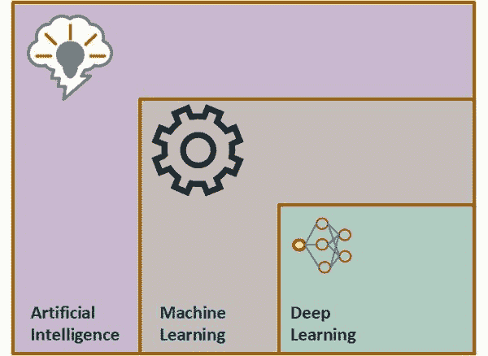
**图 1.1：机器学习子集**

图 1.1 显示机器学习是人工智能的一个子集。机器学习是将信息转化为知识的工具。在过去的 50 年里，信息/数据发生了爆炸式增长。除非我们对这海量信息进行分析并发现隐藏其中的模式，否则它毫无用处。机器学习技术被用于自动定位复杂数据中重要的基本模式，而这些模式我们否则很难发现。关于问题的隐藏模式和信息可用于预测未来事件并做出各种复杂的决策。

几年来，我们一直将机器学习视为一个流行词，其背后的原因可能是应用程序产生数据/信息的高速率、多年来计算能力的提升以及更好算法的发展。

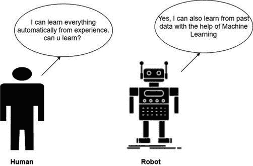
**图 1.2：人类与机器人**

该图显示人类从经验中自动学习一切，而机器人也可以在机器学习的帮助下从以往的经验数据中学习。

“机器学习”这一名称由亚瑟·塞缪尔于 1959 年提出，他是计算机游戏和人工智能领域的美国先驱，他指出学习使计算机获得了无需显式编程即可学习的能力。亚瑟·塞缪尔创建了第一个用于玩跳棋的自学习程序。你会意识到，系统玩得越多，表现就越好。

1997 年，汤姆·米切尔给出了一个数学和关系定义：如果计算机程序在任务 T 上的性能（由 P 衡量）随着经验 E 的增加而提高，则称该程序从经验 E 中学习，针对任务 T 和性能度量 P。

#### 示例 1：下棋

- **任务**：下棋的任务
- **经验**：下多盘棋的经验
- **性能度量**：程序赢得下一盘棋的概率

#### 示例 2：垃圾邮件检测

- **任务**：识别并将电子邮件分类为垃圾邮件或非垃圾邮件
- **经验**：一组带有标签的电子邮件（垃圾邮件/非垃圾邮件）
- **性能度量**：程序正确分类为“垃圾邮件”（或“非垃圾邮件”）的电子邮件总百分比。

机器学习的基本前提是构建算法，这些算法能够获取输入数据并利用数学分析来预测输出，同时在新数据可用时回顾结果。

目前，机器学习被用于各种任务，如图像识别、语音识别（如亚马逊的 Alexa）、电子邮件过滤（如判断邮件是否为垃圾邮件）、Facebook 自动标记、推荐系统（如亚马逊和 Flipkart 向用户推荐产品）等。

### 机器学习与传统编程

传统编程是一个手工编码逻辑的过程——意味着程序员编写程序。但除了编程逻辑外，还必须手动确定规则或代码。我们有输入数据，程序员编写的程序/规则使用这些数据并在计算机上执行以生成输出/答案，如下图所示。

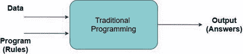
**图 1.3：传统编程**

另一方面，在机器学习的情况下，数据和输出/答案（或标签）作为输入，而学习到的规则（模型）作为输出，如图所示。机器学习范式尤为重要，因为它允许计算机在复杂和高级的环境中学习新规则，而这种空间很难被人类理解。

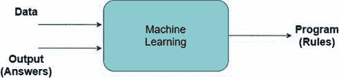
**图 1.4：机器学习**

例如，我们可以根据一个人的速度（数据）和基于速度的活动描述（走、跑、骑行）（规则），编写一个传统计算机程序用于活动识别（走路、跑步或骑行）。然而，这种方法的问题在于，不同年龄、环境、健康状况等因素导致不同人的走、跑、骑行速度各不相同。

如果我们要在机器学习领域解决同一个问题，我们可以找到许多任务及其标签（答案即活动类型）的示例，并学习或推断出用于预测未来工作的规则。

### 机器学习的七个步骤

机器学习的过程可以分解为 7 个步骤，如图所示。为了说明每个步骤的意义和功能，我们将使用一个简单模型的示例。该模型将负责区分苹果和橙子。机器学习能够处理复杂得多的任务。然而，为了用简单的术语解释该过程，采用了一个基本示例来解释相关概念：

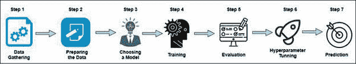
**图 1.5：机器学习步骤**

#### 步骤 1：数据收集

这一步非常重要，因为我们收集的数据的质量和数量将直接决定模型的工作效果。为了开发我们的机器学习模型，第一步是收集可用于训练模型的相关数据。

数据收集步骤是机器学习过程的基础。选择错误的特征或专注于有限类型的数据条目等错误可能会使模型完全失效。


### 机器学习流程

#### 步骤 2：准备数据

收集完训练数据后，我们进入机器学习的下一步：数据准备。在此步骤中，数据被加载到合适的位置，并为机器学习训练做好准备。首先将所有数据汇总在一起，然后将顺序随机化，因为数据的顺序不应影响学习结果。

在此步骤中，我们处理步骤 1 中收集的数据并为训练做准备。我们可以通过去除重复项、纠正错误、处理缺失值、转换数据类型等方式来清洗数据。我们还可以对数据进行可视化，这有助于我们查看不同属性之间是否存在相关关系、如何利用这些关系，以及是否存在数据不平衡的情况。

数据准备的另一个主要组成部分是将数据集分为两部分。较大部分（约 80%）用于训练模型，而较小部分（约 20%）用于评估训练模型的性能。这一点很重要，因为如果对训练和评估使用相同的数据集，将无法公正评估模型在现实场景中的表现。

#### 步骤 3：选择模型

完成以数据为中心的步骤后，我们的下一步行动是选择模型类型。数据科学家开发了各种现有模型，可用于不同目的。不同类别的模型擅长建模不同类型数据集的底层模式。这些模型在设计时有不同的目标。例如，某些模型更适合处理文本，而另一些模型可能更擅长处理图像。

#### 步骤 4：训练

机器学习流程的核心是模型训练。大部分工作都在这一阶段完成。训练需要耐心和实验。了解模型将要实施的领域也很有用。

如果模型开始在其角色中取得成功，训练过程将被证明是极有回报的。训练过程包括为模型的 `X` 和 `Y` 初始化一些随机值，用这些值预测输出，然后将其与模型的预测进行比较，并调整这些值，使其与之前做出的预测相匹配。

然后此过程重复进行，每个更新周期称为一个训练步骤。

这类似于孩子学骑自行车。起初，他们可能会摔倒多次，但过一段时间后，他们会更好地掌握要领，并在骑行时对不同情况做出更好的反应。

###### 步骤 5：评估

模型训练完成后，需要对其进行测试，以查看它是否能在现实情境中良好运行。这就是为什么要用为评估而创建的那部分数据集来检查模型的熟练程度。这使模型处于一种遇到训练期间未曾出现过的情境的场景中。

在商业应用方面，评估变得至关重要。评估使数据科学家能够检查他们设定的目标是否达成。如果结果不令人满意，则需要回顾之前的步骤，以便找出模型表现不佳的根本原因，并随后加以纠正。如果评估不当，模型可能无法出色地完成其预期的商业用途。这可能意味着设计和销售该模型的公司会失去客户的信誉。这也可能损害公司的声誉，因为未来的客户在信任该公司关于机器学习模型的专业能力时可能会犹豫。因此，模型评估对于避免上述不良影响至关重要。

#### 步骤 6：超参数调优

评估结束后，可以通过调整参数来进一步改进训练。训练时隐含假设了一些参数。另一个参数是学习率，它根据前一个训练步骤的信息，定义每一步移动线条的距离。这些值在训练模型的准确性和训练所需时间方面发挥作用。

自然而然会产生一个问题：当我们的模型已达到目标时，为什么还需要超参数调优？这可以通过观察基于机器学习的服务提供商的竞争性质来回答。当客户寻求机器学习模型来解决各自的问题时，可以从多个选项中进行选择。然而，他们更倾向于被产生最准确结果的模型所吸引。这就是为什么为确保机器学习模型的商业成功，超参数调优是必要的一步。

#### 步骤 7：预测

机器学习流程的最后一步是预测。这是我们认为模型已准备好用于实际应用的阶段。

这是实现机器学习价值的时刻。在这里，我们最终可以使用我们的模型来预测我们想要的结果。

### 机器学习的应用

机器学习有助于改进商业决策、提高生产力、检测疾病、预测天气等。机器能从输入中自动学习。以下列举了一些最佳的机器学习应用。

#### 社交媒体功能

Facebook、Instagram、LinkedIn 等社交媒体平台为用户使用机器学习算法。社交媒体利用机器学习创建了一些吸引人且出色的功能。例如，Facebook 会注意并记录用户的活动、聊天、点赞、评论，以及用户在特定类型的帖子、视频等上花费的时间。机器学习从用户的活动和经验中学习，并为用户的个人资料推荐好友和页面。

再举一个例子，当用户上传一张与朋友的合影时，Facebook 会立即识别出那位朋友。Facebook 检查照片中的姿势和投影，注意独特特征，然后将它们与用户好友列表中的人进行匹配，并自动标记该好友。

#### 产品推荐

如今，产品推荐几乎用于每一个电子商务网站。这是机器学习技术的一项非常先进的应用。利用机器学习，电子商务网站根据用户之前的购买记录、搜索模式、购物车历史等来跟踪用户行为。基于这种跟踪，电子商务网站向用户推荐以某种方式符合用户口味的产品。

#### 图像与语音识别

图像识别是机器学习最常见的应用之一。图像处理用于识别图像中的物体、人物、地点、数字图像等。该技术用于进一步分析，如模式识别、字符识别、人脸检测或人脸识别。Facebook 为我们提供了自动好友标记建议功能。每当用户上传一张包含其 Facebook 好友的照片时，用户就会自动收到带有好友姓名的标记建议。

语音识别是将口语转换为文本。它也称为自动语音识别 (ASR) 或语音转文本。Google 和 Alexa 正在使用语音识别技术来遵循语音指令。


#### 情感分析

情感分析是一种实时机器学习应用，用于确定说话者或作者的情绪或观点。例如，如果有人撰写了评论或电子邮件（或任何形式的文档），情感分析器将即时找出文本的实际想法和语气。这种情感分析应用可用于分析基于评论的网站、决策应用程序等。

#### 自动驾驶汽车

机器学习最令人兴奋的应用之一是自动驾驶汽车。机器学习在自动驾驶汽车中发挥着重要作用。最受欢迎的汽车制造公司特斯拉正在研发自动驾驶汽车。这些自动驾驶汽车是自主驾驶汽车，比人类驾驶的汽车更安全。使这些汽车安全的因素在于它们不受驾驶员疾病或情绪等因素的影响。

#### 电子邮件垃圾邮件和恶意软件过滤

每当我们收到新邮件时，它都会被自动过滤为重要、普通和垃圾邮件。我们总是在收件箱中收到带有重要标志的重要邮件，垃圾邮件则在垃圾箱中，这背后的技术就是机器学习。以下是使用的一些垃圾邮件过滤器：

- 内容过滤器
- 邮件头过滤器
- 通用黑名单过滤器
- 基于规则的过滤器
- 权限过滤器

#### 股票市场交易

机器学习广泛应用于股票市场交易。在股票市场中，股价始终存在波动风险，因此机器学习被用于预测股票的市场趋势。

#### 医学诊断

在医学科学中，机器学习用于疾病诊断。借助此技术，医疗技术正在快速发展，并能构建可预测大脑病变确切位置的 3D 模型。它有助于轻松发现脑肿瘤和其他脑部相关疾病。

#### 在线欺诈检测

机器学习通过检测欺诈交易，使在线交易安全可靠。每当我们进行在线交易时，欺诈交易可能以多种方式发生，例如虚假账户、虚假身份证，以及在交易过程中窃取资金。因此，为了检测这种情况，机器学习通过检查交易是真实交易还是欺诈交易来帮助我们。

#### 自动语言翻译

如今，如果我们去一个新地方且不懂语言，这不再是问题，因为机器学习通过将文本转换为我们熟知的语言来帮助我们。谷歌的谷歌神经机器翻译为我们提供了这一功能，这是一种神经机器学习，可将文本翻译成熟悉的语言，称为自动翻译。自动翻译背后的技术是序列到序列学习算法，它结合图像识别使用，将文本从一种语言翻译成另一种语言。

### 机器学习的类型

机器学习有不同的方式。在某些情况下，机器经过训练；在其他情况下，机器自行学习。主要有三种类型的机器学习——监督学习、无监督学习和强化学习，如图所示。

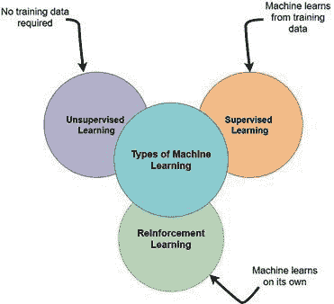
**图 1.6：机器学习的类型**

#### 监督学习

监督机器学习算法旨在通过示例进行学习。之所以称为监督学习，是因为算法从训练数据集中学习的过程可以被认为是教师监督学习过程。

在监督学习中，数据由输入变量和输出变量组成，或者数据集是带标签的。带标签的数据意味着输入数据及其关联的输出在数据集中可用。

在训练过程中，算法在输入数据中搜索模式并将其与期望的输出数据相关联。训练过程结束后，监督学习算法将接收未见过的数据作为输入，并根据先前的训练数据确定新输入将被分类为哪个标签。监督学习模型的目标是为新呈现的输入数据预测正确的标签。

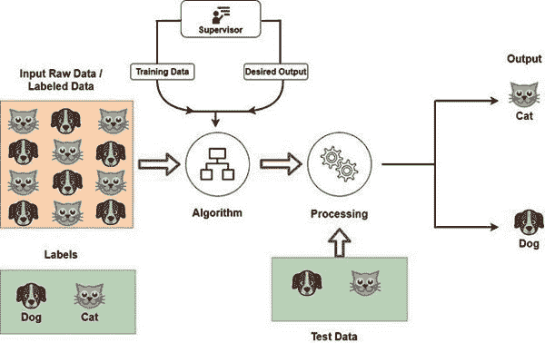
**图 1.7：监督学习**

如图所示，我们有一个猫和狗图像的数据集。数据集中的每张图像都带有标签，意味着我们知道哪张图像代表猫，哪张代表狗。我们将所有图像及其对应的标签提供给模型/算法。然后，它应该能够自行区分。

如果一切进展顺利，当向模型展示一张没有标签的新图像时，它应该能够告诉我们它是猫还是狗（前提是模型学得好）。

监督学习问题可进一步分为回归和分类问题。

##### 回归

如果输入变量和输出变量之间存在关系，则使用回归算法。当输出变量的值为连续或实数时使用，例如房价、天气预报、股价预测等。

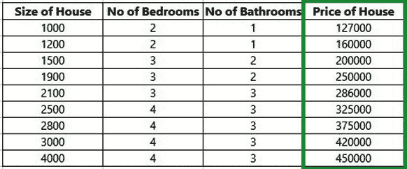
**图 1.8：回归**

图 1.8 显示了用于根据不同参数预测房价的数据集。这里，输入变量是卧室数量和浴室数量，输出变量是价格，这是一个连续值。因此，这是一个回归问题。

这里的目标是预测一个尽可能接近实际输出值的值，然后通过计算误差值进行评估。误差越小，回归模型的准确性越高。

##### 分类

分类是根据一个或多个输入变量将输出分组到不同类别的过程。当输出变量的值为离散或分类时使用分类，例如邮件是垃圾邮件还是非垃圾邮件，肿瘤是恶性还是良性，“是”或“否”、0 或 1 等。

如果算法尝试将输入变量分类为两个不同的类别，则称为二元分类，例如邮件是垃圾邮件还是非垃圾邮件。当算法尝试将输入变量分类为两个以上的类别时，称为多类分类，例如手写字符识别，类别从 0 到 9。

#### 无监督学习

无监督学习处理无标签数据，意味着这里我们有输入数据但没有对应的输出变量。这与监督机器学习相反。在无监督学习中，用户不需要教导/监督模型。没有正确的输出，也没有监督者来教导。

算法本身从输入数据中学习，并从数据中发现模式和信息，以根据相似性学习和分组数据。

如图所示，假设我们有一个不同种类猫和狗的图像数据集。无监督学习算法获得该数据集。算法从未见过/在给定数据集上训练过，这意味着它对数据集的特征一无所知。无监督学习算法的任务是自行识别图像特征。无监督学习算法通过根据图像间的相似性将图像数据集聚类成组来执行此任务。

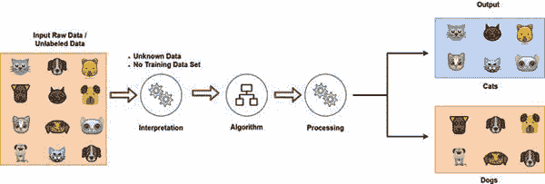
**图 1.9：无监督学习**

无监督学习算法可进一步分为聚类和关联问题。


### 聚类

聚类是无监督学习的一个重要概念。它用于发现未分类数据中隐藏的结构或模式。聚类算法处理未分类数据，并将它们划分为不同的簇（组），使得具有许多相似性的对象保留在同一组中，而与另一组对象几乎没有或完全没有相似性。如图所示，它将猫和狗分成了两个簇。

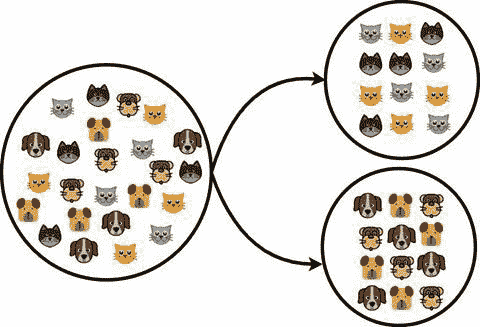
图 1.10：聚类

##### 关联规则

关联规则是一种无监督学习方法。它用于发现大型数据集中数据之间的关系。它确定数据集中同时出现的项目集。关联规则使营销策略更加有效。例如，假设一个买面包的人也倾向于买黄油/果酱，如图所示。关联规则的一个典型例子是市场篮子分析。


图 1.11：关联规则

##### 强化学习

强化学习是机器学习的第三种也是最后一种类型。这是一种基于反馈的机器学习。在强化学习中，机器或智能体通过反馈自动学习，无需任何标记数据。在这里，智能体通过自身经验进行学习。

在强化学习中，智能体使用尝试-错误过程。如果智能体尝试了一步成功的操作，则获得奖励；否则，每犯一个错误智能体就会受到惩罚。其目标是最大化总奖励。

如图所示，以教狗为例。由于狗不懂人类语言，我们无法确切告诉它该做什么。我们创造一个情境，狗会尝试用许多不同的方式做出反应。如果狗的反应方式令人满意，我们就给它面包。现在，每当狗再次面临相同情境时，它会怀着对更大奖励（面包）的渴望期待，做出相同的动作。这就像狗从良好经历中获得的学习。同时，狗也在学习面对负面经历时什么都不做。

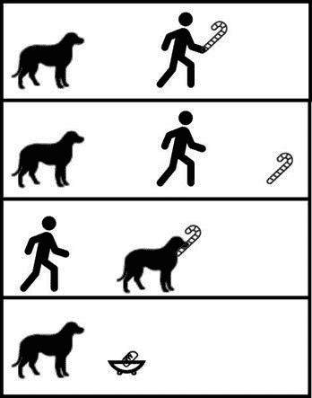
图 1.12：强化学习

### 机器学习的优势

机器学习有许多优势。以下是一些有益的优势：

- **轻松识别趋势和模式**：机器学习接收大量数据，并发现人类很难找到的隐藏结构、特定风格和模式。例如，像 Flipkart 这样的电商网站，致力于了解用户的浏览方式和购买记录，以帮助定位相关产品、交易和相关提醒。它利用结果向他们展示相关广告或产品。
- **无需人工干预（自动化）**：机器学习拥有自动化各种决策任务的强大工具。通过自动化事务，我们允许算法执行困难任务。自动化现在几乎无处不在。原因在于它非常可靠。此外，它帮助我们进行深度思考。
- **高效处理任何类型的数据**：有许多因素使机器学习变得可靠。数据处理就是其中之一。提到数据时，机器学习发挥着重要作用。它可以处理任何类型和数量的数据。它能够处理和分析普通系统无法处理的数据。数据是机器学习模型最重要的部分。
- **持续改进**：随着机器学习算法从数据中获得经验，它们不断提高准确性和效率。这使它们能做出更好的决策。假设我们需要制作一个天气预报模型。随着我们拥有的数据量不断增长，我们的算法学会了更快地做出准确预测。

### 机器学习的劣势

与机器学习的优势类似，我们也应该了解机器学习的劣势。如果我们不了解缺点，就无法知晓 ML 的风险。所以，让我们看看这些劣势。

- **高错误的可能性**：在机器学习中，我们可以根据准确的结果选择算法。因此，我们必须将结果应用于所有算法。训练和测试数据会出现一个主要问题。数据量大，有时删除错误变得不可能。这些错误会给用户带来麻烦。由于数据量大，解决错误需要花费大量时间。
- **数据需求**：机器学习需要大量数据集来训练和测试模型。机器学习算法需要高质量的数据以获得准确的结果。在许多情况下，数据持续不断更新。因此，我们必须等待新数据到来。
- **时间和资源**：机器学习算法需要足够的时间来学习和发展，以高准确性和一致性达到其目标。它还需要大量资源来运行。这可能意味着我们的计算机需要额外的计算能力。
- **算法选择**：一个机器学习问题可以实现各种算法来寻找解决方案。运行具有不同算法的模型，并根据结果识别最准确的算法，这是一项手动且繁琐的任务。

### 最流行的机器学习软件工具

市场上有机器学习软件可用。以下是其中最流行的几款。图 1.13 显示了流行的机器学习软件：

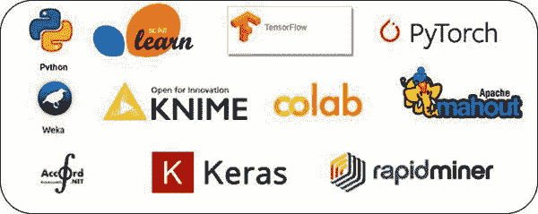
图 1.13：流行的机器学习软件

机器学习软件市场有多种应用程序可用。下表列出了其中最流行的软件

表 1.1：流行的机器学习软件工具（来源：


### 机器学习概述

#### 定义

机器学习是人工智能（AI）的一个子领域。机器学习的目标通常是理解数据的结构，并将这些数据匹配到人类可以理解和使用的模型中。

Arthur Samuel 指出：学习使计算机具有无需显式编程即可学习的能力。

Tom Mitchell 给出了一个数学和关系定义：如果计算机程序在任务 T 上的性能（由性能度量 P 衡量）随着经验 E 的增加而提高，则称该程序从经验 E 中学习了任务 T。

#### 传统编程与机器学习对比

- **传统编程**：程序员手动编写规则（程序）。
- **机器学习**：数据和输出作为输入，学习到的规则作为输出。

#### 机器学习七步骤

1. 数据收集
2. 数据准备
3. 选择模型
4. 训练
5. 评估
6. 超参数调优
7. 预测

#### 机器学习应用

- 社交媒体功能
- 产品推荐
- 图像与语音识别
- 情感分析
- 自动驾驶汽车
- 邮件垃圾与恶意软件过滤
- 股票交易
- 医疗诊断
- 在线欺诈检测
- 自动语言翻译

#### 学习类型

#### 监督学习

数据包含输入变量和输出变量，即数据集带有标签。监督学习进一步分为**回归**和**分类**。

- **回归**：当输入变量与输出变量之间存在关系时使用。适用于输出变量值为连续或实数的情况。
- **分类**：基于一个或多个输入变量将输出分组为不同类别。适用于输出变量值为离散或分类的情况。

#### 无监督学习

处理无标签数据，即只有输入数据，没有对应的输出变量。进一步分为**聚类**和**关联**。

- **聚类**：用于在未分类数据中发现隐藏结构或模式。算法根据相似性将数据划分为不同簇（组）。
- **关联**：用于在大型数据集中发现数据间的关系。确定数据集中同时出现的项集。

##### 强化学习

基于反馈的机器学习。智能体通过反馈自主学习，无需标签数据，从自身经验中学习。

#### 优缺点

##### 优点

- 轻松识别趋势和模式
- 无需人工干预，实现自动化
- 高效处理各类数据
- 持续改进

##### 缺点

- 可能存在较高错误率
- 数据获取困难
- 耗时且消耗资源
- 算法选择复杂

---

### 练习（选择题）

#### 1. 关于机器学习，以下哪项正确？

- Machine learning (ML) is a field of computer science
- ML is a type of artificial intelligence that extracts patterns out of raw data by using an algorithm or method.
- The main focus of ML is to allow computer systems to learn from their experience without being explicitly programmed or involving human intervention.
- **All of the above**

#### 2. 机器学习是包含学习算法的 AI 领域，这些算法：

- Improve their performance
- At executing some task
- Overtime with experience
- **All of the above**

#### 3. 关于机器学习与人工智能，选择正确选项：

I. Machine learning is an alternate way of programming intelligent machines
II. AI & ML have very different goals
III. Machine learning is a set of techniques that turn a dataset into software
IV. AI is software that can emulate the human mind

- I, II, IV
- I, III, IV
- II, III, IV
- All are correct

#### 4. 在无标签数据中寻找隐藏结构的问题称为：

- Supervised learning
- **Unsupervised learning**
- Reinforcement learning
- None of the above

#### 5. 从带标签的训练数据推断模型的任务称为：

- Unsupervised learning
- **Supervised learning**
- Reinforcement learning
- None of the above

#### 6. 电商公司将客户分群以发送合适优惠，这属于：

- **Unsupervised learning**
- Supervised learning
- Reinforcement learning
- None of the above

#### 7. 关于回归，以下哪句是**错误**的？

- It relates inputs to outputs.
- It is used for prediction.
- It may be used for interpretation.
- **It discovers causal relationships.**

#### 8. 以下哪项是回归任务？

I. Predicting the monthly sales of a cloth store in rupees.
II. Predicting if a user would like to listen to a newly released song or not based on historical data.
III. Predicting the confirmation probability (in fraction) of your train ticket whose current status is waiting list based on historical data
IV. Predicting if a patient has diabetes or not based on historical medical records.

- I, IV
- I, II, IV
- **I, III**
- II, III, IV

#### 9. 以下哪项是无监督任务？

- Grouping images of footwear and caps separately for a given set of images
- Learning to play chess
- Predicting if an edible item is sweet or spicy based on the information of the ingredients and their quantities.
- all of the above

#### 10. 在哪类学习中，教师向学习者返回奖励和惩罚？

- Active learning
- **Reinforcement learning**
- Supervised learning
- Unsupervised learning

#### 11. 以下哪些是分类任务？

I. Find the gender of a person by analyzing his writing style.
II. Predict the price of a house based on the floor area, the number of rooms, and so on.
III. Predict whether there will be abnormally heavy rainfall next year.
IV. Predict the number of copies of a book that will be sold this month.

- I, II
- II, III, IV
- **I, III**
- I, III, IV

#### 12. 我是某电商网站的营销顾问，需根据用户 Facebook 活动推荐产品。用户兴趣多变，我决定：

1. 首先将用户聚类为志同道合的社区
2. 然后为每个社区训练单独模型，预测最相关的产品类别（如电子产品、化妆品等）

第一个任务是 **Unsupervised** 学习问题，第二个是 **Supervised** 学习问题。

- Supervised and unsupervised
- **Unsupervised and supervised**
- Supervised and supervised
- Unsupervised and unsupervised

#### 13. 以下哪些是监督学习问题？

I. Predicting the outcome of a cricket match as a win or loss based on historical data.
II. Recommending a movie to an existing user on a website like IMDb based on the search history (including other users)
III. Predicting the gender of a person from his/her image. You are given the data of 1 million images along with the gender
IV. Given the class labels of old news articles, predicting the class of a new news article from its content. Class of a news article can be such as sports, politics, technology, and so on

- I, II, III
- I, III, IV
- II, III, IV
- **I, II, III, IV**

#### 14. 以下哪些是分类特征？

- Height of a person
- Price of petroleum
- **Mother tongue of a person**
- Amount of rainfall in a day


### 答案

- d. 以上皆是
- d. 以上皆是
- b. I、III、IV
- b. 无监督学习
- b. 有监督学习
- a. 无监督学习
- d. 它能发现因果关系。
- c. I、III
- a. 对给定图像集中的鞋类和帽子图像分别进行分组
- b. 强化学习
- c. I、III
- b. 无监督和有监督
- d. I、II、III、IV
- c. 一个人的母语

### 填空题

- 根据面积、房间数量等预测房价是**有监督**机器学习的一个例子。
- 工科学生的专业是一个**分类**特征。
- **学习率**定义了基于前一训练步骤的信息，在每一步中直线移动多远。
- 在机器学习中，**数据和输出/答案（或标签）、学习规则（模型）**作为输入，**数据和输出/答案（或标签）、学习规则（模型）**作为输出。
- **聚类算法**处理未分类数据并将其划分为不同的簇。

### 简答题

- 什么是机器学习？解释机器学习的类型。
- 解释执行机器学习所用的不同步骤。
- 解释传统编程与机器学习的区别。
- 区分有监督学习、无监督学习和强化学习。
- 举例解释有监督学习。
- 举例解释无监督学习。
- 回归与分类有什么区别？举例解释。
- 解释机器学习的各种应用。

## 第 2 章：有监督学习算法

### 简介

有监督机器学习将数据转化为真实、可执行的事物。它是一种机器学习类型，其任务是从带标签的训练数据中推断出一个函数。每个样本都是一对输入数据项和期望的输出值。在训练期间，算法将识别数据集中与期望输出相关联的模式。有监督学习算法的目标是为新的输入数据预测正确的标签。

本章将通过示例探讨不同的有监督机器学习算法。

### 结构

在本章中，我们将讨论以下主题：

- 有监督学习简介
- 有监督学习的类型
- 朴素贝叶斯分类器
- 决策树
- K-近邻
- 逻辑回归
- 支持向量机
- 随机森林算法

### 目标

阅读本章后，您将能够：

- 理解有监督机器学习的概念和类型。
- 理解回归和分类。
- 理解朴素贝叶斯分类器算法的原理。
- 理解决策树的概念及其结构。
- 理解 K-近邻算法、支持向量机和随机森林算法。

### 有监督学习简介

有监督机器学习算法旨在通过经验学习。之所以称为有监督学习，是因为算法从训练数据集中学习的过程，可以被认为类似于教师监督学习过程。

在有监督学习中，数据由输入变量和输出变量组成，或者数据集是带标签的。带标签的数据意味着输入数据及其关联的输出在数据集中都是可用的。在训练过程中，算法在输入数据中搜索模式并将其与期望的输出数据相关联。训练过程结束后，有监督学习算法将接受未见过的数据作为输入，并根据先前的训练数据确定新输入将被分类为什么标签。有监督学习模型的目标是为新呈现的输入数据预测正确的标签。

假设我们有一个猫和狗图像的数据集，如图所示。数据集中的每张图像都带有标签，意味着我们知道哪张图像代表猫，哪张代表狗。我们将所有图像及其对应的标签提供给模型/算法。然后，它就能自行区分。

如果一切进展顺利，当向模型展示一张没有标签的新图像时，它应该能够告诉我们它是猫还是狗（前提是模型学得好）。

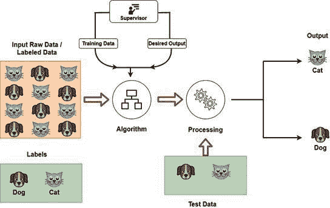

**图 2.1：有监督学习**

### 有监督学习的类型

有监督机器学习可进一步分为回归和分类，如图所示。

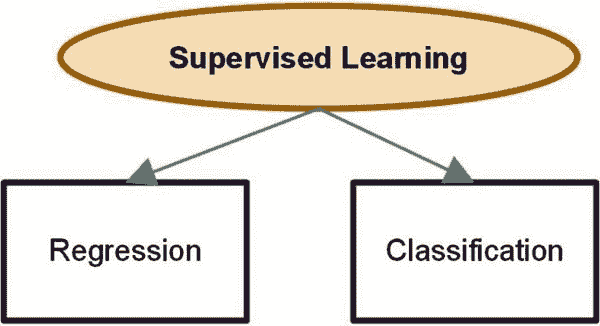

**图 2.2：有监督学习的类型**

##### 回归

回归是一种用于金融、投资和其他领域的数学方法，旨在确定单个因变量/输出变量与一个或多个自变量/输入变量之间关系的强度和性质。

如果一个或多个输入变量与输出变量之间存在关系，则使用回归算法。当输出变量的值为连续或实数时使用，例如房价、天气预报、股价预测等。

下表 2.1 显示了用于根据不同参数预测房价的数据集：

**表 2.1：回归数据集**

此处输入变量为面积、卧室数量和浴室数量，输出变量为价格，这是一个连续值。因此，这是一个回归问题。

此处的目标是预测一个尽可能接近实际输出值的值，然后通过计算误差值来进行评估。误差越小，回归模型的准确性越高。

回归被用于许多实际应用，如金融预测（房价预测或股价预测）、天气预报、时间序列预测等。

在回归中，我们在变量之间绘制一张最适合给定数据点的图，利用这张图，机器学习模型可以对数据进行预测。简单来说，回归在目标预测图表中显示一条完整的线和曲线，以最小化数据点与回归线之间的垂直距离。数据点与线之间的距离告诉我们模型是否捕捉到了强关系。


#### 回归分析中使用的术语

以下是回归分析中使用的术语：

##### 因变量

**因变量**也称为目标变量、输出变量或响应变量。回归分析中的因变量是我们想要预测或理解的变量。它用 `Y` 表示。

房屋面积、卧室数量和浴室数量是因变量（请参阅表格）。

##### 自变量

**自变量**也称为输入变量。自变量影响因变量，或用于预测因变量的值。它用 `X` 表示。

房价是自变量（请参阅表格）。

##### 异常值

**异常值**是指远离最小二乘线的观测数据点，或与其他数据或观测值显著不同的数据点。换句话说，异常值是一个与一组值中的其他值差异极大的极端值。

在图中有一堆苹果，但有一个苹果是不同的。这个苹果就是我们所说的异常值。

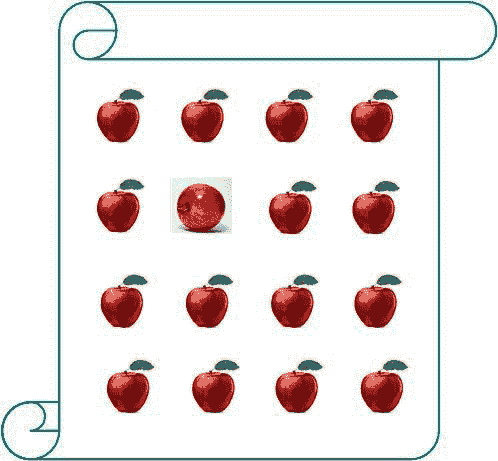

异常值需要仔细检查。有时，由于某些原因，它们不应包含在数据分析中。异常值可能是错误数据的结果。其他时候，异常值可能包含关于研究总体的宝贵信息，应保留在数据中。关键在于仔细检查导致数据点成为异常值的原因。

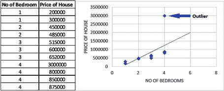

考虑以下示例。假设如图所示，我们对房屋的卧室数量进行抽样，并记录每栋房屋的价格。我们可以从数据集中看到，十栋房屋的价格范围在 200000 到 875000 之间；但有一栋房屋的价格高达 3000000，该房屋将被视为异常值。

##### 多重共线性

当两个或多个自变量彼此紧密相关，以至于无法为回归模型提供独特或独立的数据时，回归分析中就会发生**多重共线性**。如果变量之间的相关程度足够高，在拟合和解释回归模型时会导致问题。

例如，假设我们使用身高、鞋码和每天练习时长这三个变量进行回归分析，以预测篮球运动员的跳高成绩。在这种情况下，身高和鞋码可能紧密相关，因为个子高的人鞋码往往较大。这意味着多重共线性可能会成为该回归分析中的一个问题。

再举一个例子，假设我们有两个输入 `X1` 和 `X2`：

```
X1 = [0, 3, 4, 9, 6, 2]
X2 = [0, -1.5, -2, -4.5, -3, -1]
X1 = -2 * X2
```

因此 `X1` 和 `X2` 是共线的。在这种情况下，最好仅使用其中一个变量，即 `X1` 或 `X2` 作为输入。

##### 欠拟合与过拟合

**过拟合**和**欠拟合**是机器学习中发生的两个主要问题，它们会降低机器学习模型的性能。

每个机器学习模型的主要目标都是通过适应给定的未知输入集来提供合适的输出；这被称为**泛化**。这意味着在对数据集进行训练后，模型能够产生可靠且准确的输出。因此，欠拟合和过拟合是需要检查的两个术语，以确保机器学习模型的可靠性。

让我们了解过拟合和欠拟合的基本术语：

- **信号**：它是关于数据的真实基础模式。
- **噪声**：降低性能的不必要且无关紧要的数据。
- **偏差**：它是期望值与真实值之间的差异。
- **方差**：当模型在训练数据集上表现良好但在测试数据集上表现不佳时，方差就存在。

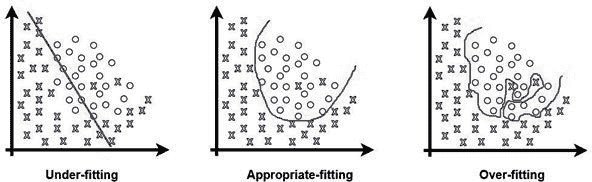

在上图的左侧，任何人都可以轻松预测到该线并未覆盖图中显示的所有点。这种模型倾向于导致一种称为数据**欠拟合**的现象。在欠拟合的情况下，模型无法从训练数据中学到足够的知识，从而降低了精度和准确性。欠拟合模型具有高偏差和低方差。

相反，当我们考虑图右侧的图形时，它显示预测线覆盖了图中的所有点。在这种情况下，我们可能会认为这是一个覆盖所有点的好图，但事实并非如此。给定图形的预测线覆盖了所有点，包括那些属于噪声和异常值的点。这种模型倾向于导致一种称为数据**过拟合**的现象。由于模型复杂度过高，该模型会导致预测结果不佳。过拟合模型具有低偏差和高方差。因此，该模型也被称为**高方差**模型。

现在，考虑图中间的图形，它显示了一条拟合良好的预测线。它覆盖了图中大部分点，同时保持了偏差和方差之间的平衡。这种模型倾向于导致一种称为**适当拟合**的现象。

#### 线性回归的类型

如图所示，根据自变量的数量，线性回归分为两类：

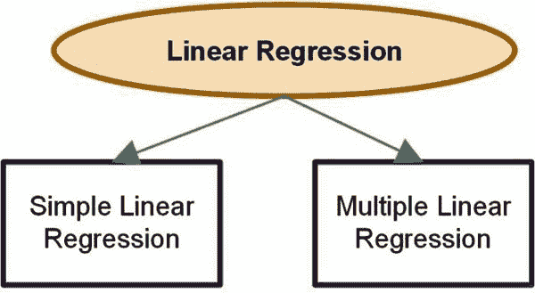

##### 简单线性回归

**简单线性回归**是一种线性回归类型，其中我们只有一个自变量来预测因变量。因变量必须是连续/实数值。

自变量（`X`）与因变量（`Y`）之间的关系由一条线性或倾斜的直线表示，如图所示，因此称为简单线性回归：

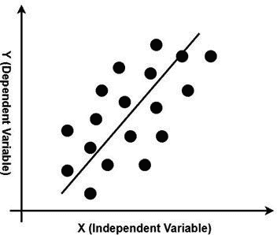

简单线性回归模型可以用以下方程表示：

```
y = B0 + B1 * X
```

其中：

- `Y`：因变量
- `X`：自变量
- `B0` 是回归线的 Y 截距，即最佳拟合线与 Y 轴的交点。
- `B1` 是回归线的斜率，它表明直线是上升还是下降。

因此，在该图中，点代表我们的数据，基于这些数据我们将训练模型以预测结果。黑线是给定数据的最佳拟合线。最佳拟合线是一条最能代表散点图上数据的直线。最佳拟合线可能穿过图中的所有点、部分点或一个点也不穿过。

简单线性回归的目标如下：

- 找出因变量和自变量之间是否存在相关性。
- 为数据集找到最佳拟合线。最佳拟合线是使总预测误差（所有数据点）尽可能小的那条线。
- 因变量如何随自变量的变化而变化。

假设我们有一个数据集，其中包含如表所示的房屋 `Size`（面积）与 `Price`（价格）之间关系的信息。

Table 2.2: House Dataset

此处 `Size` 是自变量（`X`），`Price` 是因变量（`Y`）。我们的目标是找出 `B0` 和 `B1` 的值，使其产生最佳拟合回归线。然后使用该线性方程对新数据进行预测。

房屋数据集用于训练我们的线性回归模型。也就是说，如果我们给出 `Size` 作为输入，我们的模型应以最小误差预测 `Price`。

此处 `Y'` 是 `Y` 的预测值。

必须选择 `B0` 和 `B1` 的值，使它们将误差最小化。如果将平方误差之和作为评估模型的指标，则实现了获得最佳减少误差的线的目标。

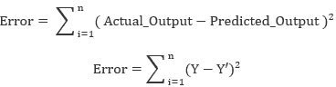

如果我们不对误差进行平方，那么正负点将相互抵消。

##### 多元线性回归

如果预测因变量有不止一个自变量，则这种类型的线性回归称为**多元线性回归**。


##### 分类

分类是基于一个或多个输入变量将输出分组到不同类别中的过程。当输出变量的值是离散的或分类的时使用分类，例如电子邮件是垃圾邮件或非垃圾邮件、0 或 1 等。

如果算法尝试将输入变量分类为两个不同的类别，则称为**二元分类**，例如电子邮件是垃圾邮件或非垃圾邮件。当算法尝试将输入变量分类为两个以上的类别时，称为**多分类**，例如手写字符识别，其中类别从 0 到 9。图 2.8 展示了分类示例，判断一封电子邮件是否为垃圾邮件：

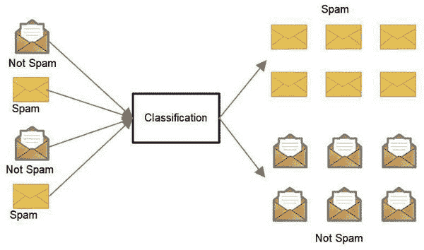
**图 2.8：分类示例**

### 朴素贝叶斯分类器算法

朴素贝叶斯分类器是一组基于贝叶斯定理的分类算法。它是一系列算法的统称，这些算法共享一个共同原则，即每一对待分类的特征相互独立。

朴素贝叶斯算法是一种解决分类问题的监督学习算法，基于贝叶斯定理。它主要用于具有大量训练数据集的文本分类。朴素贝叶斯分类器是一种简单有效的分类算法，有助于构建能够快速预测的快速机器学习模型。它是一种概率分类器，这意味着它基于对象的概率进行预测。垃圾邮件过滤、情感分析和文章分类是朴素贝叶斯算法的一些流行应用。

例如，如果一种水果是红色的、圆形的，直径约为 3 英寸，则将其分类为苹果。即使这些特征相互依赖或依赖于其他特征的存在，所有这些属性都独立地增加了该水果是苹果的可能性，这就是为什么它被称为**朴素**。

朴素贝叶斯模型易于构建，对于超大数据集特别有用。除了简单性之外，朴素贝叶斯已被证明甚至优于最复杂的分类方法。

#### 为什么叫朴素贝叶斯？

朴素贝叶斯算法由“朴素”和“贝叶斯”两个词组成，可以解释为：

- 之所以称为**朴素**，是因为它假设一个特征的出现与其他特征的出现无关。例如，如果根据颜色、形状和口味识别水果，那么红色、球形且甜的水果会被识别为苹果。因此，每个特征都在不依赖其他特征的情况下，为将其识别为苹果做出贡献。
- 之所以称为**贝叶斯**，是因为它基于贝叶斯定理的原理。

#### 朴素贝叶斯分类器原理

朴素贝叶斯分类器是一种用于执行分类任务的概率机器学习模型。分类器的核心基于贝叶斯定理。贝叶斯定理允许我们从 `P(c)`、`P(x)` 和 `P(x|c)` 计算后验概率 `P(c|x)`。考虑以下公式：

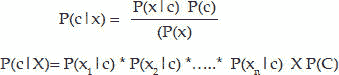

其中：

- 给定预测变量 `x`（属性）时类别 `c`（目标）的后验概率 - `P(c|x)`
- 类别的先验概率 - `P(c)`
- 似然概率，即给定类别时预测变量的概率 - `P(x|c)`
- 预测变量的先验概率 - `P(x)`

#### 朴素贝叶斯分类器的工作原理

以下步骤演示了朴素贝叶斯分类器的工作方式：

1. 将给定数据集转换为频率表。
2. 通过计算给定特征的概率来创建似然表。
3. 使用贝叶斯定理计算后验概率。

#### 朴素贝叶斯示例

图 2.9 显示了天气训练数据集及相应的目标变量。我们现在必须根据天气对球员是否比赛进行分类。

1. 从数据集制作频率表。
2. 通过计算概率（如阴天概率和比赛概率）制作似然表。

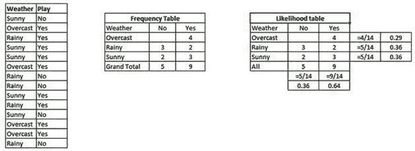
**图 2.9：天气训练数据集及相应的频率表和似然表**

3. 使用朴素贝叶斯方程计算每个类别的后验概率。预测结果是具有最高后验概率的类别。

朴素贝叶斯采用类似的方法，基于各种属性预测各个类别的可能性。该算法常用于文本分类和多类问题。

#### 朴素贝叶斯的类型

朴素贝叶斯模型分为三种类型，列举如下：

##### 高斯朴素贝叶斯

高斯模型基于特征服从正态分布的假设。这意味着如果预测变量取连续值而非离散值，模型假设这些值源自高斯分布。

##### 多项式朴素贝叶斯

当数据呈多项式分布时，使用多项式朴素贝叶斯分类器。它主要用于解决文档分类问题，指示特定文档属于哪个类别，如体育、政治、教育等。分类器的预测变量基于词频。

##### 伯努利朴素贝叶斯

伯努利分类器的工作方式与多项式分类器类似，不同之处在于预测变量是独立的布尔变量。例如，特定单词是否出现在文档中。该模型也因执行文档分类任务而广为人知。

#### 朴素贝叶斯的优缺点

优点如下：

- 预测数据集类别的简单快速算法。
- 可用于二元分类和多分类。
- 与数值变量相比，它在处理分类输入变量时表现良好。
- 它是文本分类问题中应用最广泛的测试。

缺点如下：

- 朴素贝叶斯基于所有预测变量（或特征）相互独立的假设。
- 该算法面临**零频率问题**。

#### 朴素贝叶斯算法的应用

朴素贝叶斯算法的应用如下：

- 文本分类
- 垃圾邮件过滤
- 实时预测
- 多分类预测
- 推荐系统
- 信用评分
- 情感分析

###### 决策树

决策树是一种可应用于分类和回归问题的监督学习技术。决策树旨在模仿人类的决策能力，使其易于理解。由于决策树具有树状结构，其背后的逻辑很容易理解。

#### 决策树工作原理

决策树的工作涉及以下步骤：

1. 从包含整个数据集的节点 `T` 开始构建树。
2. 使用属性选择度量，找出数据集中的最佳属性。
3. 将 `T` 划分为包含属性最佳可能值的子集。
4. 创建具有最佳属性的决策树节点。
5. 使用步骤 3 中创建的数据集子集递归地构建新的决策树。
6. 继续此过程，直到无法再对节点进行分类，将最终节点称为叶节点。

#### 通用结构

图 2.10 显示了通用的决策树结构：

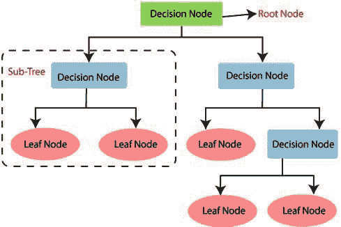
**图 2.10：通用决策树结构**

决策树可以包含分类数据（是/否）和数值数据。


#### 决策树示例

假设我们想在特定的一天（比如周六）打羽毛球——你将如何决定是否去打？假设你走到外面看看是冷是热、风速和湿度如何，以及天气情况，即是晴天、多云还是下雨。在决定是否去打时，你会考虑所有这些因素。表 2.3 显示了过去十天的天气观测记录。

**表 2.3：过去十天的天气观测记录**

决策树是表示数据的绝佳方式，因为它遵循树状结构，并考虑了所有可能导致最终决策的路径。

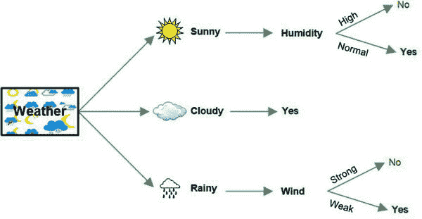
**图 2.11：打羽毛球决策树**

图 2.11 描绘了一个学习得到的决策树。每个节点代表一个属性或特征，从每个节点延伸出的分支代表该节点的结果。最终，由树的叶节点做出最终决策。

#### 决策树的优势

决策树的优势如下：

- 简单易懂。
- 解决决策问题的常用技术。
- 有助于考虑问题的所有可能解决方案。
- 所需的数据清洗工作较少。

#### 决策树的劣势

决策树的劣势如下：

- 过拟合问题
- 复杂性

### K-近邻（K-NN）算法

K-近邻算法是一种清晰简单的监督机器学习算法，可用于解决回归和分类问题。

K-NN 算法假设新样本与现有样本相似，并将新样本归入与现有类别最相似的类别中。K-NN 算法存储所有可用数据，并根据新数据点与现有数据的相似性对其进行分类。这意味着当新数据出现时，KNN 算法可以快速将其分类到合适的类别中。

K-NN 是一种非参数算法，这意味着它不对所用数据做任何假设。它也被称为懒惰学习算法，因为它不会立即从训练集中学习；相反，它存储数据集，并在需要分类时对其执行操作。

模式识别、数据挖掘和入侵检测是一些高要求的应用场景。

#### K-NN 算法的必要性

假设有两个类别，类别 A 和类别 B，我们有一个新数据点 x1。这个数据点将落入哪个类别？解决此类问题需要 K-NN 算法。借助 K-NN，我们可以轻松识别数据集的类别或类别，如图所示

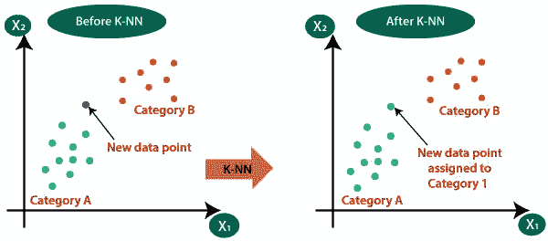
**图 2.12：借助 K-NN 识别数据集的类别或类别**

以下算法可用于解释 KNN 的工作原理：

1. 选择邻居数量 K。
2. 计算 K 个邻居之间的欧氏距离。
3. 根据计算出的欧氏距离选取最近的 K 个邻居。
4. 统计这 K 个邻居中每个类别的数据点数量。
5. 将新数据点分配给拥有最多邻居的类别。
6. 模型构建完成。

假设我们有一个需要放入适当类别的新数据点。请看下面的图示：

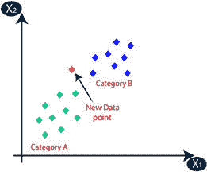
**图 2.13：K-NN 示例**

首先，我们将确定邻居的数量，所以我们选择

然后将计算数据点之间的欧氏距离，如图所示。欧氏距离是我们在几何课上学到的两点之间的距离。可以使用以下公式计算：

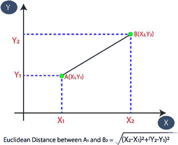
**图 2.14：数据点之间的欧氏距离**

我们通过计算欧氏距离找到了最近的邻居，结果如图所示：类别 A 中有三个最近邻居，类别 B 中有两个最近邻居。请看下面的图示：

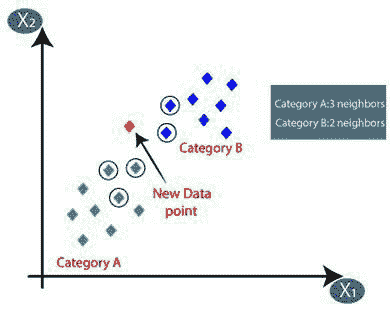
**图 2.15：类别 A 和 B 的最近邻居**

可以看出，三个最近的邻居都来自类别 A，因此这个新数据点也必然属于该类别。

###### 逻辑回归

分类算法逻辑回归用于将观测值分配到一组离散的类别中。与产生连续数值的线性回归不同，逻辑回归产生一个概率值，该值可以使用逻辑 Sigmoid 函数映射到两个或更多离散类别。

具有分类目标变量的回归模型称为逻辑回归。为了对二元因变量建模，它采用了逻辑函数。

逻辑回归中的目标变量有两个可能的值，例如是/否。考虑如何表示目标变量 y：若为“是”则值为 1，若为“否”则值为 0。根据逻辑模型，y 为 1 的对数几率是一个或多个预测变量的线性组合。假设我们有两个预测变量（或自变量），且 p 是 y 等于 1 的概率。然后，以逻辑模型为指导：

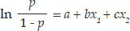

我们可以通过对方程取指数来恢复几率：

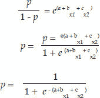

因此，y 为 1 的概率是。如果 p 接近 0，则 y 等于 0；如果 p 接近 1，则 y 等于 1。因此，逻辑回归方程为：

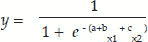

该方程可以推广到 n 个参数和自变量，如下所示：

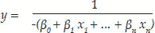

#### 线性回归与逻辑回归的比较

线性回归和逻辑回归可用于预测不同的事物，如图所示

- **线性回归**：线性回归的预测结果是连续的（一定范围内的数字）。它可能有助于我们预测学生在 0 到 100 分制下的考试分数。
- **逻辑回归**：逻辑回归的预测结果是离散的（仅允许特定值或类别）。它可能会告诉我们学生是通过还是不及格。也可以查看支撑模型分类的概率分数。

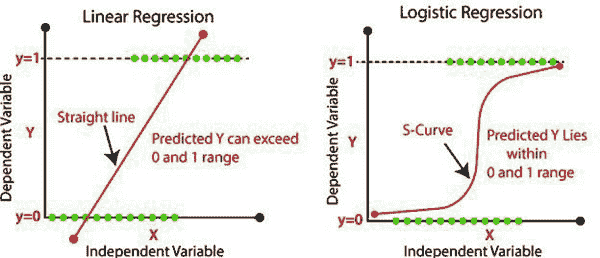
**图 2.16：线性回归 vs 逻辑回归**

虽然线性回归有无限多个可能的结果，但逻辑回归有一组预先确定的结果。

当响应变量是连续时使用线性回归，但当响应变量是分类时使用逻辑回归。

连续输出（如股市评分）是逻辑回归的示例，而利用过去的交易细节预测银行违约者是线性回归的示例。

下表 2.4 显示了线性回归和逻辑回归的区别：

**表 2.4：线性回归与逻辑回归的区别**

#### 逻辑回归的类型

逻辑回归主要分为三类，如图所示

- 二元逻辑回归
- 多项逻辑回归
- 有序逻辑回归

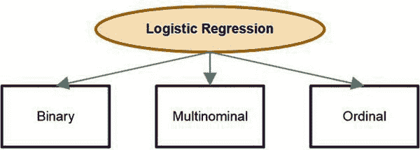
**图 2.17：逻辑回归的类型**


##### 二元逻辑回归

二元逻辑回归中的目标变量或因变量本质上是二元的，意味着它只有两个可能的值。分类响应只有两种可能的结果。例如，判断一条信息是否为垃圾邮件。

##### 多项逻辑回归

在多项逻辑回归中，目标变量可以有三个或更多的值，但这些值没有固定的偏好顺序。例如，最受欢迎的食物类型（印度菜、意大利菜、中餐等）。预测哪种食物更受青睐就是一个例子（素食、非素食、纯素食）。

##### 有序逻辑回归

有序逻辑回归中的目标变量有三个或更多可能的值，每个值都有偏好或顺序。例如，餐厅星级评分范围为 1 到 5，电影评分范围为 1 到 5。

#### 示例

以下是一些可以使用逻辑回归的场景。

**天气预测**：回归用于进行天气预测。我们利用以往天气报告的信息来预测特定一天的结果。然而，逻辑回归只能预测分类数据，例如是否会下雨。

**疾病诊断**：我们可以借助患者的病史使用逻辑回归来预测疾病诊断结果为阳性还是阴性。

### 支持向量机（SVM）算法

支持向量机（SVM）是一种流行的监督学习算法，可用于解决分类和回归问题。然而，正如图所示，它主要用于机器学习中的分类问题。

许多人偏爱 SVM，因为它在使用较少计算能力的同时能产生显著的准确性。SVM 会选择有助于创建超平面的极端点/向量。支持向量是极端情况，因此该算法被称为支持向量。

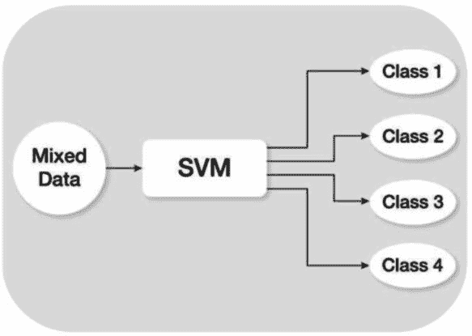
**图 2.18**：支持向量机（SVM）概念

支持向量机算法的目标是在 N 维空间（N \- 特征数量）中找到一个能清晰分类数据点的超平面。

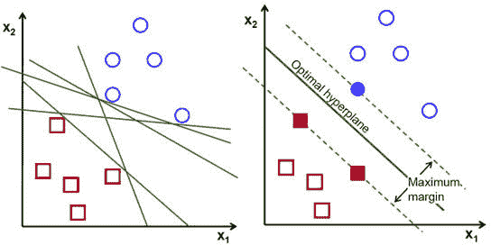
**图 2.19**：具有最大间隔的 SVM 超平面

有许多超平面可供选择以分离两类数据点。我们的目标是找到一个具有最大间隔（即两类数据点之间距离最大）的平面，如图所示。最大化间隔距离提供了一定的强化作用，使得未来的数据点更容易分类。

超平面是有助于数据分类的决策边界。超平面两侧的数据点可以被分配到不同的类别。超平面的维度也由特征数量决定。如果只有两个输入特征，超平面只是一条线。当输入特征数量达到三个时，超平面变成一个二维平面。当特征数量超过三个时，就难以想象了。

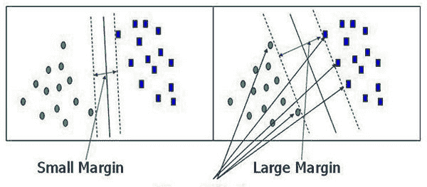
**图 2.20**：具有小间隔和大间隔的支持向量

支持向量是距离超平面较近并对超平面的位置和方向产生影响的数据点，如图所示。我们通过使用这些支持向量来最大化分类器的间隔。如果删除支持向量，超平面的位置将会改变。这些点将帮助我们构建 SVM。

Sigmoid 函数用于逻辑回归，将线性函数的输出压缩在 `[0,1]` 范围内。如果压缩后的值超过阈值（0.5），则标记为 1，否则标记为 0。在 SVM 中，我们取线性函数的输出，如果大于 1，则归为一类，如果小于 1，则归为另一类。我们获得了这个强化范围值（`[-1,1]`），它充当间隔，因为 SVM 中的阈值被改为 1 和 \-1。

#### 超平面、支持向量和间隔

超平面、支持向量和间隔描述如下：

**超平面**：在 n 维空间中，可以有多条线/决策边界来分离类别，但我们需要找到最佳决策边界来帮助分类数据点。SVM 的超平面指的是最佳边界。超平面的维度由数据集中的特征决定；例如，如果有两个特征，超平面将是一条直线。如果有三个特征，超平面将是一个二维平面。我们总是创建一个具有最大间隔的超平面，间隔指的是数据点之间的距离。

**支持向量**：支持向量是距离超平面最近并对超平面位置产生影响的数据点或向量。这些向量被称为支持向量，因为它们支撑着超平面。

**间隔**：它是不同类别中最近数据点的两条线之间的距离。可以计算线与支持向量之间的垂直距离。大间隔被视为好间隔，而小间隔被视为坏间隔。

#### SVM 的工作原理

在多维空间中，SVM 模型本质上是不同类别在超平面中的表示。SVM 将以迭代方式生成超平面以减少误差。SVM 的目标是将数据集划分为不同类别，以便找到最大间隔超平面。

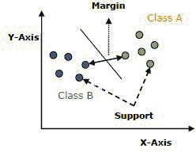
**图 2.21**：SVM 的工作原理

SVM 的主要目标是将数据集划分为不同类别，以找到最大间隔超平面，这可以通过两个步骤完成：

1.  首先，SVM 将迭代生成能最好地分离类别的超平面。
2.  然后选择能正确分离类别的超平面。

#### SVM 的类型

支持向量机（SVM）的类型描述如下：

**线性**：线性 SVM 用于线性可分数据，这意味着如果数据集可以仅用一条直线分为两类，则称为线性可分，所使用的分类器称为线性 SVM。

**非线性**：非线性 SVM 用于分类非线性可分数据，这意味着如果数据集不能用直线分类，则被归类为非线性数据，所使用的分类器称为非线性 SVM 分类器。

#### 支持向量机的应用

以下是支持向量机的一些应用：

*   面部表情分类
*   模式分类和回归问题
*   军事数据集
*   语音识别
*   蛋白质结构预测
*   图像处理 \- 手写识别
*   地震潜在破坏检测

#### SVM 的优势

以下是 SVM 的优势：

*   SVM 分类器准确度高，且在高维环境中表现良好。因为 SVM 分类器仅使用训练点的一个子集，所以需要的内存很少。
*   解决非线性可分的数据点。
*   在高维空间中有效。
*   在分离边界清晰的情况下效果良好。
*   在维度数大于样本数的情况下有效。
*   更好地利用内存空间。


#### SVM 的劣势

以下是 SVM 的劣势：

*   不适用于较大的数据集。
*   当数据集噪声较多时效果较差。
*   不直接提供概率估计。
*   过拟合问题


### 随机森林算法

随机森林是一种著名的机器学习算法，它使用**监督学习**方法。在机器学习中，它既可用于分类问题，也可用于回归问题。它基于**集成学习**，这是一种结合多个分类器以解决复杂问题并提高模型性能的方法。

随机森林是一种分类器，它在数据集的不同子集上结合多棵决策树，并对结果取平均值，以提高数据集的预测准确性。随机森林不依赖单一决策树，而是获取每棵树的预测结果，并基于预测结果的**多数表决**来预测最终输出。

森林中的树木数量越多，准确性越高，且能避免过拟合问题。

随机森林中的每棵树都会产生一个类别预测，得票最多的类别将成为我们模型的预测结果（见图）。图 2.22 展示了随机森林算法的可视化，其中有六个 1 和三个 0，因此预测结果为 1：

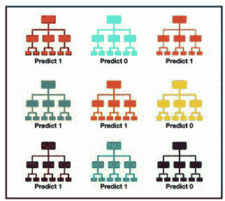
图 2.22：随机森林算法可视化

#### 随机森林算法的工作原理

随机森林的创建分为两个阶段：第一阶段是结合 N 棵决策树来创建随机森林，第二阶段是对第一阶段创建的每棵树进行预测。

可以通过以下步骤和图 2.23 来解释工作过程：

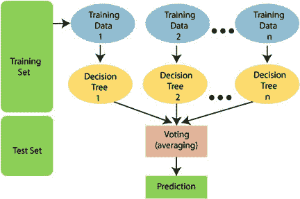
图 2.23：随机森林算法的工作原理

1. 从训练数据集中随机选择 K 个数据点。
2. 为所选数据点（子集）创建决策树。
3. 选择 N 作为你想要创建的决策树数量。
4. 重复步骤 I 和 II。
5. 找出每棵决策树对新数据点的预测，并将新数据点分配给得票最多的类别。

假设你有一个包含各种水果图像的数据集。因此，该数据集被提供给随机森林分类器。每棵决策树获得数据集的一个子集进行工作。在训练阶段，每棵决策树生成一个预测结果，当出现新数据点时，随机森林分类器基于大多数结果预测最终决策。图 2.24 展示了随机森林水果实例示例：

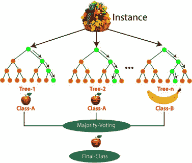
图 2.24：随机森林水果实例示例

来源：https://www.javatpoint.com/machine-learning-random-forest-algorithm

#### 随机森林算法的优势

以下是我们应该使用随机森林算法的一些原因：

- 与其他算法相比，所需训练时间更少。
- 输出准确率高。
- 对大型数据集有效。
- 可用于分类和回归。
- 防止过拟合问题。
- 可用于从训练数据集中识别最重要的特征，即特征工程。

#### 随机森林算法的劣势

尽管随机森林可用于分类和回归任务，但它并不更适合回归任务。

#### 随机森林算法的应用

随机森林算法概念最常用于以下四个领域：

- **银行业**：该算法主要用于银行业识别贷款风险。
- **医疗业**：借助该算法可以识别疾病趋势和风险。
- **土地开发**：该算法可以识别具有相似土地用途的区域。
- **市场营销**：该算法可用于发现营销趋势。

### 总结

- 监督学习的特点是使用带标签的数据集来训练算法，从而准确分类数据或预测结果。
- 监督机器学习可进一步分为回归和分类。
- 如果一个或多个输入变量与输出变量之间存在关系，则使用回归算法。
- 简单线性回归是一种线性回归，其中我们只有一个自变量来预测因变量。
- 如果预测因变量有不止一个自变量，则这种线性回归称为多元线性回归。
- 分类是基于一个或多个输入变量将输出分组为不同类别的过程。
- 朴素贝叶斯分类器算法是一种监督学习算法，用于解决分类问题，基于贝叶斯定理。
- 朴素贝叶斯模型分为三类：高斯朴素模型、多项式朴素模型和伯努利朴素模型。
- 决策树是一种监督学习技术，可应用于分类和回归问题。
- K-近邻（K-NN）算法存储所有可用数据，并根据新数据点与现有数据的相似性对其进行分类。
- K-NN 也被称为懒惰学习算法，因为它不会立即从训练集中学习。
- 具有分类目标变量的回归模型称为逻辑回归。
- 线性回归的预测值是连续的（一定范围内的数字）。
- 逻辑回归的预测值是离散的（仅允许特定值或类别）。
- 逻辑回归主要分为三类：二元、多项和有序。
- 支持向量机（SVM）算法在使用较少计算资源的情况下产生显著的准确性。
- SVM 有两种类型：线性和非线性。
- 随机森林是一种著名的机器学习算法，使用监督学习方法。

### 练习（单项选择题）

1. 监督学习和无监督聚类都至少需要一个。
   - 隐藏属性。
   - 输出属性。
   - 输入属性。
   - 分类属性。

2. 监督学习与无监督聚类的区别在于监督学习要求：
   - 至少一个输入属性。
   - 输入属性必须是分类的。
   - 至少一个输出属性。
   - 输出属性必须是分类的。

3. 使用不止一个自变量来预测因变量的回归模型称为：
   - 简单线性回归模型
   - 多元回归模型
   - 独立模型
   - 以上都不是

4. _______________ 是一种决策支持工具，它使用树状图或决策模型及其可能的后果，包括随机事件结果、资源成本和效用。
   - 决策树
   - 图
   - 树
   - 神经网络

5. 决策树可用于分类任务。
   - 真
   - 假

6. 情感分析是以下哪项的示例：
   - 回归
   - 分类
   - 聚类
   - 强化学习
   - 仅 1
   - 1 和 2
   - 1 和 3
   - 1、2 和 4

7. 在监督学习中
   - 类别未预定义
   - 类别已预定义
   - 不需要类别
   - 不进行分类

8. 学习有哪两种类型？
   - 即兴和非即兴
   - 监督和无监督
   - 分层和非分层
   - 以上都不是

9. _______________ 算法存储所有可用数据，并根据新数据点与现有数据的相似性对其进行分类。
   - 朴素贝叶斯
   - K-近邻
   - 决策树
   - 支持向量机

10. 随机森林是一种著名的机器学习算法，它使用：
    - 监督学习
    - 无监督学习
    - 混合学习
    - 以上都不是

### 答案

- a
- b
- c
- a
- a
- iv
- b
- b
- b
- a


### 简答题

- 解释监督学习的概念并举例说明。
- 监督学习与无监督机器学习的区别。
- 什么是朴素贝叶斯算法？它是如何工作的？
- 写出朴素贝叶斯算法的应用。
- 什么是随机森林算法？解释其工作原理。
- 什么是决策树？解释其用处。
- 定义支持向量、超平面和间隔。
- 解释监督学习的类型。
- 什么是逻辑回归？
- 详细解释线性回归。

### 长答题

- 使用朴素贝叶斯的优缺点是什么？
- 结合实际案例解释随机森林算法。
- 分类与回归的区别及举例。
- 什么是过拟合？如何避免？
- 举例解释 K-近邻算法。
- 什么是 SVM？解释其类型。

## 第 3 章：无监督学习

无监督学习是一种处理未标记数据的机器学习技术。无监督学习算法利用这些未标记数据来发现相关数据和信息的模式。这些算法不需要任何监督；相反，它们依靠自身的技术来发现模式。与其他学习方法相比，无监督学习方法更具不可预测性。此外，与监督学习相比，无监督学习执行更复杂的任务，包括：神经网络、异常检测、聚类等。

### 结构

在本章中，您将学习以下主题：

- 无监督学习
- 聚类
- 层次聚类
- K-均值聚类
- 概率聚类
- Apriori 算法
- 关联规则挖掘
- 高斯混合模型 (GMM)
- FP-Growth 算法

### 目标

阅读完本章后，您将能够理解无监督学习技术中各种算法的概念。这些算法的知识将帮助您使用各种聚类技术来分析、评估和对未标记数据项进行分组。

#### 无监督学习

这是一种强大的机器学习技术。在此技术中，设计的模型不需要任何观察或监督来处理未标记数据。相反，该技术接受未标记数据项，并发现先前未知或未被检测到的新信息模式。我们可以通过其工作流程（如图所示）来理解这项技术。

#### 无监督学习的工作原理

通过以下步骤很容易理解无监督学习的工作原理：

1. 无监督学习模型接受未标记的原始数据项作为输入。与监督学习不同，它不需要任何训练、测试和标记的输出数据。
2. 数据解读后，需要选择一个合适的或期望的算法来发现先前未知的新信息模式。
3. 识别出的新模式必须经过处理以分配新标签。图中识别出的模式已用不同颜色显示：

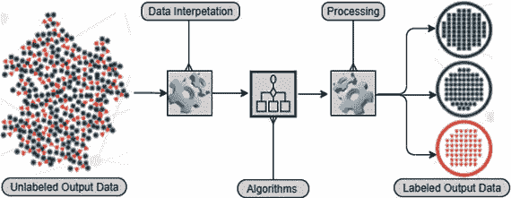

#### 使用无监督学习的必要性

无监督学习是完美选择的原因有几点：

- 无监督机器学习能发现各种未知的数据模式。
- 无监督学习技术用于识别有助于分组的属性。
- 一切都在实时进行，因此在学习者面前，所有输入数据都将被评估和标记。
- 未标记数据比标记数据更容易从计算机读取，后者需要人工操作。

###### 算法

与监督学习相比，无监督学习中使用的算法执行更复杂的任务。此外，无监督学习中使用的算法比其他自然学习算法更具不可预测性。无监督学习算法包括：

- 聚类
- 异常检测
- 神经网络等。

### 聚类

聚类是一种无监督机器学习技术。聚类的任务是从非结构化数据中寻找模式或结构。聚类的过程是将数据点或总体划分为若干组，使得同一组的数据点具有相似特征，而属于不同组的数据点必须具有不同属性。这些自然组被称为簇。图中展示了一个聚类的自然示例，其中从鸟类和动物的混合总体中创建了两个组或簇。同一组的总体具有相似特征，例如一个簇包含鸟类总体，另一个簇包含动物总体。在无监督机器学习中，我们可以通过改变聚类算法来调整所需的簇的数量。这有助于我们改变这些组的粒度。

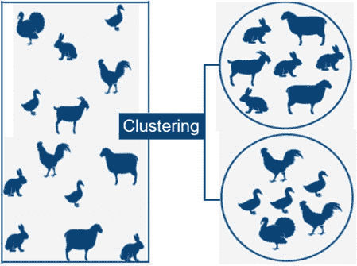

聚类可以通过以下四种方式执行：

- 一种将原始数据划分为若干组的聚类方法，使得特定数据仅属于一个组，称为**互斥聚类**。例如：`K-均值聚类`。
- 在凝聚聚类方法中，最初每个数据点都被视为一个簇。之后，通过迭代合并两个最近的簇来减少簇的数量。例如：`层次聚类`。
- 重叠聚类是一种聚类方法，其中每个数据点可以以单独的隶属度属于多个簇。数据将连接到合适的隶属度属性。例如：`模糊 C-均值`。
- 概率聚类是另一种聚类方法，它使用概率分布技术来形成簇。概率聚类的一个例子是：`高斯混合模型`。

### K-均值聚类

`K-均值聚类` 是一种互斥划分技术，用于将原始数据分类为 `k` 个组，其中 `k` 为正整数。数据分组基于计算并最小化数据点到选定质心的距离。质心是该算法的核心。质心的数量取决于所需的簇组数。质心通过迭代过程捕捉并添加离它们最近的点到簇中。


#### K-Means 聚类算法

#### K-Means 聚类算法

K-means 聚类的分步过程如下算法所示：

**输入：** 原始数据项（n 个元素）  
**输出：** 标记后的数据项组（k 个簇）

**步骤 1：** 首先选择 `k` 的值（簇的数量）。

**步骤 2：** 为了将原始数据初始划分为 `k` 个簇，选择 `k` 个元素作为对数据进行分类的质心。我们可以按照以下步骤系统地或随机地选择初始质心：
- 取前 `k` 个训练样本（质心）。
- 对于 `n-k` 个元素，每个元素将被添加到最近质心的簇中。每次分配后，必须重新计算簇的质心。

**步骤 3：** 通过按顺序放置每个样本，计算元素到每个簇质心的距离。将样本元素放入与质心距离最近的簇中。将样本切换到最近质心的簇后，更新质心。

**步骤 4：** 重复步骤 3 直到收敛，即在迭代过程中，没有任何一个样本从一个簇移动到另一个簇。
- 如果数据计数少于簇计数，每个数据点将被视为该簇的质心，并为每个质心分配一个簇编号。
- 如果数据计数大于簇的数量，则对每个样本数据计算其到每个质心的距离。具有最小距离的数据将属于与该数据距离最小的簇。

由于质心的位置是不确定的，因此必须根据最近更新的簇的数据重新计算质心的位置。此过程将重复直到收敛。

#### K-Means 聚类流程图

为了更直观地说明 K-means 算法，该算法的流程图如图 3.3 所示：

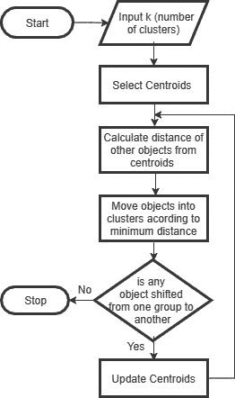
*图 3.3：K-means 聚类算法流程图*

#### K-Means 聚类实战示例

例如，我们有四个对象，每个对象有 2 个属性。每个对象的第一个属性是重量指数，用标签 `W` 表示，另一个属性是 pH 值，用标签 `P` 表示。对象、属性及其值如表 3.1 所示。我们的目标是根据其属性值将这些对象聚类为两个簇。

*表 3.1：K-means 聚类的输入数据集*

每个对象表示具有两个属性（`W`、`P`）的一个点。对象及其对应的属性值已绘制并如图 3.4 所示：

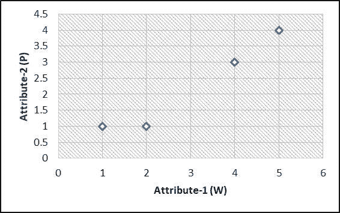
*图 3.4：输入数据集的散点图*

##### 初始质心选择

假设对象 `E` 和对象 `F` 被选为初始质心。质心 `E` 和 `F` 的坐标分别用符号 `Cn1` 和 `Cn2` 表示。`Cn1 = (1, 1)` 和 `Cn2 = (2, 1)`，如图 3.5 所示：

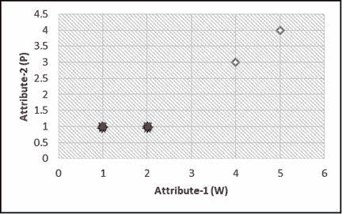
*图 3.5：用不同颜色表示的质心*

##### 距离计算（对象-质心）

每个对象与簇质心之间的欧氏距离被计算并通过图 3.6 中的距离矩阵表示：

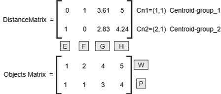
*图 3.6：距离矩阵表示*

距离矩阵的每个元素代表对象与质心之间的欧氏距离。距离矩阵第 1 行的元素分别是质心 `Cn1` 与对象 `E`、`F`、`G` 和 `H` 之间的距离，而第 2 行的元素分别是质心 `Cn2` 与对象 `E`、`F`、`G` 和 `H` 之间的距离。

**分别计算对象 `G` 到质心 `Cn1` 和 `Cn2` 的距离：**

- 对象 `G(4,3)` 与质心 `Cn1 (1, 1)` 之间的距离：
  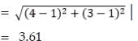
- 对象 `G(4,3)` 与质心 `Cn2 (2, 1)` 之间的距离：
  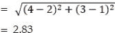

##### 簇分配（迭代 1）

每个对象必须根据最小距离进行分配。因此，对象 `E` 被分配给第 1 组，对象 `F` 分配给第 2 组，对象 `G` 分配给第 2 组，对象 `H` 分配给第 2 组。组矩阵的元素如图 3.7 所示：


*图 3.7：组矩阵元素*

##### 质心更新（迭代 1）

将成员分配给每个组后，必须计算新的质心。对于每个组，将根据其成员的值计算新的质心。在本例中，第 1 组只有一个成员，因此质心保持在 `Cn1 = (1, 1)`。而第 2 组有三个成员，因此质心将通过对所有三个成员的坐标求平均值来计算，如下所示：


##### 距离重新计算（迭代 1）

计算新质心后，已计算所有对象到新质心的距离，并像步骤 2 一样创建了距离矩阵，如下所示：


*图 3.8：距离矩阵和对象矩阵*

##### 重新分配（迭代 1）

像步骤 3 一样，每个对象必须根据最小距离分配到更新后的组。根据新的距离矩阵，对象 `F` 将移动到第 1 组，所有其他对象将保持在之前分配的组中。更新后的组矩阵如下所示：


*图 3.9：组矩阵*

##### 质心更新（迭代 2）

我们必须重复步骤 4 以确定新的质心。根据上一次迭代的聚类结果，必须计算新质心的坐标。正如我们所见，第 1 组和第 2 组都有两个成员，因此新的质心如下：


和


##### 距离计算（迭代 2）

我们必须重复步骤 2 以计算对象与更新后的质心之间的距离。计算出的距离通过如下所示的距离矩阵表示：


*图 3.10：距离矩阵和对象矩阵*

##### 最终分配（迭代 2）

根据上一步创建的距离矩阵，根据最小距离将第 1 组或第 2 组分配给每个对象。结果组矩阵如下所示：


*图 3.11：组矩阵*

正如我们所见，`groupmatrix_2` 和 `groupmatrix_11`（在上一次迭代中计算）是相同的，即对象的组成员资格在第二次迭代中没有变化。因此我们可以说，在当前迭代中没有对象移动，因此 K-means 聚类算法的计算已达到稳定，不再需要更多迭代。所以最终分组是通过 K-means 聚类算法计算出的结果。

##### 层次聚类

层次聚类是一种数据聚类的无监督机器学习技术，它构建簇的层次结构。它以未标记数据集作为输入，并将其分组为层次簇作为输出；因此，它也称为层次聚类分析。它以所有知识和数据作为初始簇开始。两个相似的簇将位于同一个簇中。当只剩下一个簇时，该算法停止。层次聚类的输出可以看作是一种树状结构。这种树状结构称为**树状图**。

层次聚类和 K-means 聚类的效果和结果通常看起来可能相同；然而，两种算法的工作原理不同。与 K-means 聚类算法不同，无需预先确定组或簇的数量。


#### 两种层次聚类方法

层次聚类有两种方法：第一种是**凝聚式**，另一种是**分裂式**。

在凝聚式层次聚类中，采用自底向上的方法将数据作为输入收集。起初，收集到的输入中的每个数据点都被视为一个单独的簇。随后，每个簇与相似的簇合并；此迭代过程将持续进行，直到只剩下一个簇。

而分裂式算法遵循与凝聚式算法相反的方法。它采用自顶向下的方法。它将整个数据作为一个单一簇，并以层次化的方式将其分成多个簇。

#### 层次聚类的必要性

既然我们已经有了其他聚类算法，包括 K 均值聚类，为什么还需要层次聚类？答案在于 K 均值聚类算法存在一些局限性：

*   需要通过选择参数 `k` 的值来确定固定的簇数量。
*   算法总是试图创建大小相同的组/簇。

层次聚类可用于克服 K 均值聚类的局限性，因为在这种聚类中，一开始不需要固定簇的数量。

在本章中，我们将结合示例详细讨论凝聚式层次聚类。

#### 凝聚式层次聚类

HCA（层次聚类分析）的一个常见实例是凝聚式层次聚类算法。它使用自底向上的方法将原始数据分组到簇中。在该算法开始时，每个数据集将被视为一个单独的簇；随后，最近的一对簇将被合并以构建一个合并后的簇。此过程将重复进行，直到所有簇都合并为一个包含所有数据集的单一簇。

#### 凝聚式层次聚类的工作原理

凝聚式层次聚类算法的分步工作原理如下所示：

假设有 `N` 个数据集；每个数据集将被视为一个单独的簇。起初，簇的数量等于数据集的数量。在图 3.12 中，每个点代表一个簇：


*图 3.12：每个点代表一个簇*

选取两个距离最近的簇，将它们合并为一个单一簇。现在剩下 `N-1` 个簇，如图所示：


*图 3.13：通过圆圈展示两个簇的合并*

类似于步骤 2，选择另两个最近的簇并将它们合并形成一个簇。现在剩下 `N-2` 个簇，如图所示：


*图 3.14：通过椭圆展示两个簇的合并*

重复步骤 3，直到只剩下一个簇。因此，我们将得到以下簇。请参考图中所示图像：


*图 3.15：簇的逐步合并 (a)、(b)、(c)*

将所有簇合并为一个大簇后，必须创建一个树状图。树状图用于根据问题的要求划分簇。上述问题的树状图如图所示。

#### 测量两个簇之间的距离

正如我们所知，对于层次聚类，两个簇之间的最近距离至关重要。有多种方法可以测量两个簇之间的距离，这些方法确立了聚类的规则，被称为链接方法。下面演示了一些重要的链接方法：

##### 单链接

两个不同簇中距离最近的两点之间的最短距离被视为单链接。单链接的图示如下图所示：


*图 3.16：单链接*

##### 全链接

两个不同簇中两点之间的最远距离被视为全链接。这种方法比单链接方法更受欢迎，因为它能形成更紧凑的簇。全链接的图示如下图所示：


*图 3.17：全链接*

##### 平均链接

在这种链接方法中，必须计算两个簇之间的平均距离。这也是一种非常流行的链接方法。

##### 质心链接

在这种链接方法中，必须计算每个簇的质心，然后计算质心之间的距离。质心链接的图示如下图所示：


*图 3.18：质心链接*

根据业务需求和问题类型，可以应用上述任意一种链接方法来计算两个簇之间的距离。

#### 层次聚类中的树状图

在层次聚类中，树状图代表簇的树状结构。树状图的主要用途是存储层次聚类算法执行的每一步。在树状图绘图中，x 轴代表所有数据集，y 轴代表所有数据集的数据点之间的欧氏距离。

树状图的功能可以通过下图说明：


*图 3.19：(a) 簇 (b) 树状图*

上图左侧部分展示了通过凝聚式聚类算法创建的簇，相应簇的树状图显示在图的右侧 (b) 部分。

#### 创建树状图

针对上述问题创建树状图的分步过程如下所述：

*   根据上述讨论的问题，最初距离最短的点，即点 `P2` 和点 `P3` 被合并以创建一个簇，同时创建了它们的树状图，该树状图通过连接点 `P2` 和 `P3` 形成矩形形状，矩形的高度等同于 `P2` 和 `P3` 之间的欧氏距离。
*   在进一步的步骤中，点 `P5` 和 `P6` 被合并到一个簇中，并创建了相应的树状图。该树状图的高度高于点 `P2` 和 `P3` 的树状图，因为点 `P5` 和 `P6` 之间的欧氏距离比点 `P3` 和 `P2` 稍大一些。
*   重复相同过程以绘制两个新的树状图，分别将点 `P1`、`P2` 和 `P3` 合并到一个树状图中，将点 `P4`、`P5` 和 `P6` 合并到另一个树状图中。最终整合所有数据点的最终树状图随之形成（如图所示）。根据我们的需求，我们可以在任何阶段切割树状图树结构。


#### 层次聚类示例

##### 示例 2：对以下数据集使用单链接和全链接执行层次聚类，并为这两种方法绘制树状图。

**数据集**：`{8, 11, 21, 29, 36}`

###### 步骤 1 可视化数据集


**图 3.20：数据可视化**

正如我们所见，这是线性的一维数据。

让我们首先通过凝聚层次聚类的单链接法开始求解。

###### 使用单链接

在该方法中，距离最小的两个对象将被合并到一个簇中。在每一步中，距离最小的两个簇将被合并：


**图 3.21：凝聚层次聚类的单链接法**


**图 3.22：凝聚层次聚类单链接法的树状图**

使用单链接形成两个簇：

*   **簇 1**：`(8, 11)`
*   **簇 2**：`(21, 29, 36)`

###### 使用全链接

在每一步中，提供最小最大成对距离的两个簇将被合并：


**图 3.23：凝聚层次聚类全链接法绘制树状图**


**图 3.24：凝聚层次聚类全链接法的树状图**

使用全链接形成两个簇：

*   **簇 1**：`(8, 11, 21)`
*   **簇 2**：`(29, 36)`

如果应用需要层次结构（如分类学设计），通常会使用层次聚类。在存储和计算方面，此类聚类技术代价高昂。

### 关联规则学习

关联规则学习是无监督学习的另一种技术。该技术用于发现数据项之间的关系、关联和/或依赖性。该技术利用各种规则来发现数据库中数据集之间的有用关系。关联规则学习对基于产品的商业组织有益，因为不同产品之间的关系映射可以提高销量并获得更多利润。Web 使用挖掘、市场篮子分析和持续生产分析是关联规则挖掘的一些重要应用。

市场篮子分析是关联规则挖掘的一个流行应用。几乎所有超市都使用这种方法来提高销售额。我们可以通过观察超市的产品陈列策略来理解这一点。所有可以一起购买的产品都被放在同一或附近的位置。例如，如果顾客购买面包，他很可能也会购买黄油、鸡蛋或牛奶，因此这些物品被存放在同一个货架内或经常靠近货架。请看下图：


**图 3.25：市场篮子分析**

关联规则学习算法有三种类型：

*   **Apriori**
*   **Eclat**
*   **FP-Growth 算法**

在学习这些算法之前，我们将了解关联规则学习的工作原理。

#### 关联规则学习的工作原理

关联规则学习的工作原理基于 if 和 else 语句，例如：


**图 3.26：关联规则学习**

在此技术中，“If”语句称为**前件**，而“Then”语句称为**后件**。通过 If-Then 关系可以找到的两个项目之间的关系或关联称为单基数关系。如果项目数量增加。这全在于建立规则，随着事物数量的增加，基数也会增加。因此，有许多指标来量化数千个数据对象之间的关联。

以下给出这些指标：

*   **支持度**
*   **置信度**
*   **提升度**

让我们逐一理解它们：

##### 支持度

它可以定义为元素 `X` 在数据集中以事务 `T` 的分数出现的频率。可以通过以下公式表示：


##### 置信度

置信度是识别关联规则真实概率的属性。换句话说，我们可以说置信度属性告诉我们在给定元素 `X` 的频率时，元素 `X` 和 `Y` 在数据库中一起出现的频率。可以通过以下公式计算：


##### 提升度

提升度是关联规则的另一个属性，用于理解关联规则的强度。它可以通过计算元素 `X` 和 `Y` 的观测支持度与元素 `X` 和元素 `Y` 相互独立时的期望支持度之比来计算。提升度属性的数学表示通过以下公式展示：


提升度属性的值可以分为三类：

*   如果 `Lift > 1`，表示元素 `X` 和元素 `Y` 相互依赖的依赖程度。
*   如果 `Lift < 1`，意味着一个元素损害另一个元素，或者我们可以说项目 `X` 是项目 `Y` 的替代品，反之亦然。
*   如果 `Lift = 1`：意味着前件 和后件 的发生概率相互独立。

#### Apriori 算法

Apriori 算法由 R. Agarwal 和 Shrikant 于 1994 年提出。通常，该算法用于市场篮子分析。它有助于找出消费者可以从市场上一起购买的产品。它在医疗保健领域也发挥着重要作用，用于发现药物对患者的反应。

包含事务的数据库被 Apriori 算法用于通过分析数据库中可用的数据来生成关联规则。算法生成的关联规则用于发现两个项目之间连接的强弱。该技术使用两种方法从数据库中寻找“频繁项集”，一种是广度优先搜索，另一种是哈希树。从数据库中寻找频繁项集是一个迭代过程。

##### 频繁项集

在事务数据库中，支持度值大于预定义阈值或用户定义的最小支持度值的项集称为**频繁项集**。

例如，在一个数据库中，两个事务 `T1` 和 `T2` 如下：

`T1 = {1, 3, 4, 5, 6, 7}` 和 `T2 = {2, 5, 7}`；

在这两个事务中，`5` 和 `7` 是**频繁项集**。

在事务数据集中，如果 `P1` 和 `P2` 一起是频繁项集，则 `P1` 和 `P2` 单独也应该是频繁项集。

##### Apriori 算法步骤

Apriori 算法使用以下步骤：

*（注：原文中包含“steps”一词的损坏重复，已清理。源文本中未提供具体的算法步骤。）*


#### Apriori 算法示例

考虑以下事务数据集，使用 Apriori 算法寻找频繁项集并生成关联规则。设定：最小支持度 = 2，最小置信度 = 50%。


##### 生成 C1 和 L1

第一步，我们通过统计事务数据集中的单个项来计算候选项集表（C1）和频繁项集列表（L1）。

创建一个包含每个项支持度（频率）的表：

**C1 列表：**
- C1 项...

现在通过从 C1 列表中移除支持度计数小于给定最小支持度的项来得到 L1 列表。

**L1 列表：**
- L1 项...

上述列表包含支持度计数大于或等于最小支持度值的项。

##### 生成 C2 和 L2

为了生成 C2，我们借助 L1。通过创建 L1 中包含的项对，并结合实际事务数据集中的计数来生成 C2。

**C2 列表：**
- C2 项对...

现在，通过移除支持度计数小于给定最小支持度的项来生成 L2 列表。

**L2 列表：**
- L2 项对...

##### 生成 C3 和 L3

对于 C3，我们重复相同过程，但取三个项为一组。

**项集...**

现在，通过移除计数小于给定最小支持度计数的项来创建 L3。

**L3 列表：**
- L3: {A, B, C}

这里可以看到 L3 列表只有一个项集 {A, B, C}，因此无需计算 C4 和 L4。

##### 寻找关联规则

为了寻找关联规则，首先需要创建一个包含从项集 {A, B, C} 可创建的所有项集组合及其置信度值的表。置信度值可通过以下公式计算：`sup(A^B)/sup(A)`，其中 `sup` 为该项的支持值。之后，移除置信度值小于给定最小置信度值的项，剩余规则即为给定问题的强关联规则。

下表显示了关联规则及其置信度值：

**表 3.3：关联规则及其置信度值**
- 规则及置信度值...

对于强关联规则，我们考虑置信度值大于或等于给定最小置信度值（即 50%）的规则。

**强关联规则：**
从上表中，规则 `A^B ➡ C`、`A^C ➡ B` 和 `B^C ➡ A` 的置信度值为 50%，即等于给定的置信度阈值。因此这些规则将被视为给定问题的强关联规则。

#### Apriori 算法的缺点

- 该算法简单易懂。
- 对于大型数据库，该算法的连接和剪枝步骤可以轻松实现。

#### Apriori 算法的优点

- 与其他算法相比，该算法运行较慢。
- 该算法多次扫描数据库，因此可能降低整体性能。
- 该算法的空间复杂度和时间复杂度非常高，为 `O(2^D)` 阶，其中 `D` 是给定数据库的水平宽度。

#### FP-Growth 算法

FP-Growth 算法是关联规则学习的另一个重要算法。其中 F-P 代表 Frequent-Pattern（频繁模式）。该算法以树状结构（称为频繁模式树）表示数据。频繁树的主要目的是从数据库中获取最频繁的模式。项集之间的关系将通过这种树结构得以保留。频繁模式减少了搜索时间，因此可以说 FP-Growth 算法是 Apriori 算法的改进版本。

##### 频繁模式（FP）树

数据库的初始项构成一种称为频繁模式的树状结构。树的主要目的是从数据库中找到最频繁的模式。项集的项由 FP 树的较低节点表示，而树的根节点具有 NULL 值。在生成该树期间，必须保持较低项集与树中其他项集的关联。

##### FP-Growth 算法步骤

通过 FP-Growth 算法从事务数据库中挖掘频繁模式的步骤如下：

1. 扫描事务数据库以找到数据库中每个项集的频率/支持计数。（此步骤类似于 Apriori 算法的第一步）
2. 通过创建一个值为 null 的根节点来构建 FP 树。
3. 扫描数据库以检查第一个事务。在检查第一个事务期间，找到计数最大的项集并将其放在树的顶部，计数较低的项集将放在其旁边，依此类推。构建的树的分支将按计数降序包含事务项集。
4. 检查数据库中的下一个事务。按降序排列项集。对于事务中重复的项集（即已存在于前一个事务中），该事务的分支将共享通往根节点的公共前缀。这意味着在此事务中，共同项集连接到替代项集的新节点。
5. 随事务发生增加项集计数。同时将新节点和公共节点的计数加一，因为这些链接和生成的节点对应于事务。
6. 挖掘生成的 FP 树。在此步骤中，首先检查最低节点及其链接。树的最低节点表示长度为 1 的频繁模式。据此，必须遍历 FP 树的路径。这些路径称为条件模式。
7. **构建条件 FP 树**：由路径中的项数形成。在条件 FP 树中，仅考虑满足阈值支持度的项集。
8. **生成频繁模式**：从条件 FP 树（在上一步中构建）生成频繁模式。


#### FP-growth 算法示例

考虑以下事务数据集，使用 FP-growth 算法寻找频繁模式并生成关联规则。

- 最小支持度 = 50%
- 最小置信度 = 60%

##### 解决方案

支持度阈值 = 50%

总事务数为 6 条（Tr1 到 Tr6）；
因此，最小支持度计数阈值 = 0.5 × 6 = 3

###### 步骤 1：项目支持度计数表

###### 步骤 2：应用支持度计数阈值后的排序表

###### 构建 FP 树


###### FP 树挖掘

已知项目 `It5` 是最低节点，且不满足阈值（即最小支持度计数），因此不予考虑并将其删除。

在 `It5` 之后的下一个项目是 `It4`，它出现在两个分支中：第一个分支 `(It2, It1, It4:1)` 和第二个分支 `{It2, It3, It4:1}`。以 `I4` 为后缀，计算前缀路径为 `{It2, It1, It3:1}` 和 `{It2, It3:1}`，这可视为条件模式。

条件模式基被视为一个事务数据库，据此构建一棵 FP 树。该树将包含 `{It2:2, It3:2}`，`It1` 不予考虑，因为它不满足最小支持度计数。

通过该路径将生成所有频繁模式的排列：`{It2,It4:2}`、`{It3,It4:2}`、`{It2,It3,It4:2}`。

对于 `It3`，前缀路径为：`{It2,It1:3}`、`{It2:1}`，这将生成一个双节点 FP 树：`{It2:4, It1:3}`，并生成频繁模式：`{It2,It3:4}`、`{It1,It3:3}`、`{It2,It1,It3:3}`。

对于 `It1`，前缀路径为：`{It2:4}`，这将生成一个单节点 FP 树：`{It2:4}`，并生成频繁模式：`{It2, It1:4}`。

下图（Figure）描绘了与条件节点 `It3` 相关的条件 FP 树：


**Figure 3.27: Conditional FP-tree**

##### 优点

- FP-growth 算法比 Apriori 算法快，因为 Apriori 算法在每次迭代中都要扫描完整数据集，而 FP-growth 仅扫描数据集两次。
- 对于短频繁模式和长频繁模式，该技术高效且可扩展。
- 该技术使用紧凑的内存结构存储数据集。
- 该技术不执行节点（数据项）配对，因此比其他技术更快。

##### 缺点

- 构建 FP 树是一项笨拙且困难的任务。
- 该技术的开销可能比 Apriori 技术大。
- 对于超大数据集，共享内存可能不适合该算法。

#### Apriori 与 FP-Growth 的区别

以下是基于参数的 Apriori 与 FP-Growth 的区别：

#### 关联规则学习的应用

关联规则学习在数据挖掘和机器学习领域有大量应用。一些常见的应用如下：

##### 医疗领域

关联规则学习可用于发现因特定疾病导致患病的概率。它可以帮助医生选择正确的治疗方向，使患者更容易康复。

##### 蛋白质结构确定

关联规则学习有助于从大量基因组数据中识别蛋白质结构，从而有助于合成人工蛋白质。

##### 市场篮子分析

发现不同商品之间的关联称为市场篮子分析。关联规则学习的各种技术可用于市场篮子分析。大型零售商广泛使用它来提高销售额。因此，可以说市场篮子分析是关联规则学习的一个重要且流行的应用。除上述应用外，还有目录设计、亏本促销等更多应用。

### 概率聚类

在这种聚类技术中，数据点到簇的分配是“软”的，即数据点属于某个簇的成员资格具有概率值。因此，概率聚类也称为软聚类。

让我们通过一个例子来理解这个概念：

假设散点图中有三个簇（如 Figure 所示），分别用青色、蓝色和绿色表示：


**Figure 3.28: Three clusters as shown in a scatter plot**

现在考虑一个用红圈表示的数据点，我们可以说该数据点属于蓝色簇的概率为 1，属于绿色簇的概率为 0，属于青色簇的概率也为 0。

现在考虑另一个图（如 Figure 所示），该图关注一个位于青色和蓝色之间、用红圈标出的数据点。这里，该数据点 80% 属于青色簇，20% 属于蓝色簇。因此，该数据点属于蓝色簇的概率为 0.2，属于青色簇的概率为 0.8，属于绿色簇的概率为 0.0。


**Figure 3.29: Three clusters as shown in a scatter plot**

最流行的概率聚类技术是高斯混合模型。高斯分布模型使用软聚类方法将点分配到不同的簇中。

#### 高斯分布

在统计学中，正态分布是一种重要的概率方法。它适用于血压、智商分数、身高和测量误差等许多正常现象。在这种统计中，数据的中位数、众数和平均数相等。曲线围绕 μ（均值）对称。正确地说，一半的值在中心 μ 的右侧，另一半在左侧。曲线呈钟形，如 Figure 所示：


**Figure 3.30: Normal distribution**

钟形曲线下的面积为 1，这种概率分布称为高斯分布。


#### 高斯混合模型 (GMM)

在高斯混合模型中，假设数据集中存在多种高斯分布，每个高斯分布被视为一个簇。此外，高斯混合模型旨在将与单一分布相关联的数据点分组。

例如，假设存在 3 个高斯分布，分别为 `Gd1`、`Gd2` 和 `Gd3`，它们具有确定的均值 `μ1`、`μ2`、`μ3` 和方差 `σ1`、`σ2`、`σ3`。因此，可以使用高斯混合模型来计算给定数据集中每个数据点属于这些高斯分布的概率。

下图展示了具有不同均值（`μ`）和方差（`σ2`）的多个高斯分布的混合。方差 `σ` 的值代表钟形曲线的分布范围：


**图 3.31：** 具有不同均值 (μ) 和方差 (σ2) 的多个高斯分布的混合

对于一维数据概率，分布函数可以用以下函数表示：


上述函数仅适用于一维数据。对于多维数据，可以用以下函数表示：


其中 `x_bar` 是输入向量，`μ_bar` 是二维均值向量，`Σ` 是 2×2 协方差矩阵。曲线的形状由协方差矩阵定义。对于 `d` 维数据集，`x_bar` 和 `μ_bar` 是长度为 `d` 的向量，`Σ` 将是 `d x d` 协方差矩阵。对于具有 `k` 个高斯分布和 `d` 个特征的数据集，每个簇（高斯分布）将具有特定的均值和方差矩阵，但如何为每个高斯分布分配这些值？

这些值通过一个称为**期望最大化（EM）**的过程进行估计。该技术有助于理解高斯混合模型。

##### 期望最大化

为了找到合适的模型参数，期望最大化是一种数学算法。当数据集具有不完整和/或缺失值时，我们使用 EM。这种缺失或不完整的变量被称为**潜在变量**。

为了找到正确的模型参数，使用了一种名为 EM 的统计算法。当数据具有潜在变量时使用 EM，换句话说，当数据具有缺失或不完整值时将使用 EM。由于这些潜在变量，很难确定合适的模型参数。

期望最大化旨在利用实际数据确定这些变量的最优值，然后找到模型的参数。根据该模型，可以更新潜在参数的值。

期望最大化过程包含两个基本步骤：

*   **E-step (期望步)：** 在此步骤中，使用可用数据来近似（猜测）缺失变量的值。
*   **M-step (最大化步)：** 使用完整数据，根据 E-step 产生的近似值来更新参数。

期望最大化是许多算法（包括用于聚类的高斯混合模型）使用的基本过程。现在，让我们了解如何将 EM 过程应用于高斯混合模型的数据。

##### GMM 中的期望最大化

对于一个数据集，选择一个数字 `k`，它代表簇的数量，即高斯分布的数量。假设 `μ1, μ2, .. μk` 和 `Σ1, Σ2, .. Σk` 分别代表这 `k` 个高斯分布的均值和协方差。假设我们需要分配 `k` 个簇。我们将考虑另一个参数 `Πi`，它表示密度，即分布的点数。

为了定义高斯分布，我们需要找到这些参数。由于 `k` 的值已经确定，均值、协方差和密度的值必须随机选择。现在，我们将应用 E-step 和 M-step。

###### E-step

对于每个 `xi`：计算 `xi` 属于 `c1, c2, c3,….ck` 的概率。可以通过以下公式计算：


###### M-step

在 E-step 之后，执行反馈操作以更新 `Π`、`μ` 和 `Σ` 的值。可以通过以下方式执行：

*   更新后的密度可以通过计算簇中的点数与数据集中总点数的比率来定义。


*   协方差和均值可以通过以下公式更新：


根据上述步骤生成的更新值，将为每个数据点计算新的概率，并迭代重复相同的过程以最大化对数似然函数。在 `k-mean` 算法中，仅使用均值来更新质心。而在 GMM 中，同时考虑均值和方差。

#### 高斯混合模型示例

由于统计复杂性，难以在数学上展示 GMM 的过程。因此，通过以下 Python 代码展示 GMM 的实现：

##### 加载并绘制数据集
此处使用示例数据集文件 `Sample_GMM.csv`。

```python
import pandas as pd
import matplotlib.pyplot as plt

data = pd.read_csv('Sample_GMM.csv')
plt.figure(figsize=(7,7))
plt.scatter(data["Weight"], data["Height"])
plt.xlabel('Weight')
plt.ylabel('Height')
plt.title('Data Distribution')
plt.show()
```


**图 3.32：** 数据分布

让我们先实现 k-means 以展示 k-means 和 GMM 之间的区别。

##### 训练 k-means 模型

```python
from sklearn.cluster import KMeans

kmeans = KMeans(n_clusters=4)  # here k=4 for k-mean.
kmeans.fit(data)
```

##### k-means 预测

```python
pred = kmeans.predict(data)
frame = pd.DataFrame(data)
frame['cluster'] = pred
frame.columns = ['Weight', 'Height', 'cluster']
```

##### 绘制结果

```python
color = ['blue', 'green', 'cyan', 'black']
for k in range(0, 4):
    data = frame[frame["cluster"] == k]
    plt.scatter(data["Weight"], data["Height"], c=color[k])
plt.show()
```


**图 3.33：** k-means 技术的输出

这里可以看到，k-means 模型难以正确分类簇。即使数据流呈椭圆形，k-means 也试图构建圆形簇。这是 k-means 算法的缺点。

现在，让我们在相同的数据上创建一个高斯混合模型，看看结果是否可以改进：

##### 训练高斯混合模型

```python
from sklearn.mixture import GaussianMixture

gmm = GaussianMixture(n_components=4)
gmm.fit(data)
```

##### GMM 预测

```python
labels = gmm.predict(data)
frame = pd.DataFrame(data)
frame['cluster'] = labels
frame.columns = ['Weight', 'Height', 'cluster']
color = ['blue', 'green', 'cyan', 'black']
for k in range(0, 4):
    data = frame[frame["cluster"] == k]
    plt.scatter(data["Weight"], data["Height"], c=color[k])
plt.show()
```


**图 3.34：** GMM 的输出

太棒了！这些正是我们期望的簇。与 k-means 算法相比，GMM 给出了改进的结果。


### 概要

本章的完整内容已总结为以下要点：

- 无监督学习是一种机器学习方法论，其中模型不需要被监督。
- 几乎所有类型的模式都可以通过无监督机器学习来识别。
- 关联和聚类是无监督机器学习的两种类型。
- 独占、凝聚、重叠和概率是聚类的四种方法。
- 层次聚类、K 均值聚类和高斯混合模型是一些重要的聚类类型。
- 对于大型数据集，关联规则允许我们在数据对象之间建立关联。
- 在监督学习中，使用标记数据来训练模型；而在无监督学习中，使用未标记数据来训练模型。
- 在一个对于检测可疑交易有价值的数据集中，异常检测可能会发现关键数据点。
- 无监督学习最大的缺点是无法获取关于数据排序的详细知识。

### 练习（选择题）

**无监督学习中使用的技术接受 \_\_\_\_\_\_\_\_\_\_\_\_\_\_\_\_\_\_\_\_\_\_\_\_\_\_\_\_\_\_\_\_，发现先前未知或未被检测到的新信息模式。**

- 未标记数据项
- 标记数据项
- 分类数据项
- 聚类数据项

**以下哪项是无监督学习的应用？**

- 聚类
- 异常检测
- 神经网络
- 以上全部

**关于聚类，选择一个正确的陈述：**

- 聚类是一种无监督 ML 技术
- 聚类是一种有监督 ML 技术
- 标记数据用于聚类技术
- 以上全部正确

**在 K 均值聚类算法中，k 是一个：**

- 正整数
- 负整数
- 随机数
- 复数

**层次聚类是以下哪项的示例：**

- 独占划分
- 凝聚聚类
- 重叠聚类
- 概率聚类

**K 均值聚类是以下哪项的示例：**

- 独占划分
- 凝聚聚类
- 重叠聚类
- 概率聚类

**两个不同簇中两个最近点之间的最短距离被视为：**

- 单链接
- 全链接
- 平均链接
- 质心链接

**两个不同簇中两点之间的最远距离被视为：**

- 单链接
- 全链接
- 平均链接
- 质心链接

**在事务数据库中，支持值大于预定义阈值或用户定义的最小支持值的项集被称为：**

- 频繁项集
- 平均项集
- 常规项集
- 贫乏项集

**概率聚类也被称为：**

- 软聚类
- 硬聚类
- 宽松聚类
- 重叠聚类

### 答案

a, d, a, a, b, a, a, b, a, a

### 简答题

- 解释监督学习和无监督学习的区别。
- 定义聚类并解释聚类与分类的区别。
- 关联规则学习有哪些各种应用？
- 解释单链接法和全链接法的区别。
- Apriori 算法有哪些各种优缺点？

### 长答题

- 如何度量两个簇之间的距离？详细解释其各种方法。
- 写出 FP-growth 算法的各个步骤。详细解释。
- 解释凝聚层次聚类的逐步工作原理。
- 定义 GMM。详细解释高斯混合模型的工作原理。
- 考虑以下事务数据集，使用 FP-growth 算法找出频繁模式并生成关联规则。
  - 最小支持度 = 50%，最小置信度 = 60%。

## 第 4 章：统计学习理论导论

统计学习于 20 世纪 60 年代被引入，当时它纯粹是一个理论概念，用于利用可用数据集分析各种问题。在 20 世纪 90 年代，一种利用统计学习理论概念的新型学习算法被引入，并以**支持向量机**之名广为人知。这项新技术为统计学习指明了新方向，从此统计学习不仅是一种用于分析的理论方法，也是一种用于创建算法以处理和估计多维函数的工具。统计学习在工业、医学科学和其他金融相关行业等不同领域发挥着重要作用。现在我们将讨论一些统计学习问题的示例：

- 预测因心脏病发作住院的患者是否会再次发作。该预测基于患者的年龄、性别、既往病史、饮食等。
- 根据公司的过往表现和经济状况，预测六个月后的股市价格。
- 从数字化图像中确定手写邮政编码中的数字。
- 估算患者血液中的葡萄糖水平。
- 根据患者的临床报告，检测前列腺癌、脑肿瘤和肺癌的风险。

### 结构

在本章中，我们将讨论以下主题：

- 统计学习概念
- 特征选择
- 模型选择
- 模型评估
- 监督机器学习
- 无监督机器学习

### 目标

统计学习在数据挖掘、人工智能以及科学和工程的其他交叉学科领域中发挥着重要作用。本章概述了统计学理论、特征选择的不同方法等内容。


### 统计学习导论

“机器学习”一词让人联想到机器人、人工智能和飞行汽车，而“统计学”则让人联想到带有钟形曲线的图表以及体育比赛结果的追踪。然而在现实中，这两个领域有着显著的重叠，因为它们都涉及数据分析。统计建模和机器学习甚至可以应用于相似的情境，并协同工作以提供各类问题的解决方案。统计学习是统计学与机器学习的结合，如图所示


**图 4.1：统计学习概览**

t 检验、方差分析（ANOVA）、p 值检验等概念属于经典统计学范畴，其历史可追溯至近百年前。这些方法诞生于数学纯粹依赖纸笔、且数据分析仅针对小样本的时代。但形势已发生剧变，计算机已渗透至人类生活的方方面面。计算速度和内存已变得触手可及、负担得起且易于获取。互联网的广泛使用和信息转换已成为计算机用户的常规操作，但有一件事未曾改变：用于数据分析的经典统计方法，及其作为研究人员重要工具的地位。缓慢地，许多工业领域迁移到了一种替代统计框架，该框架广为人知的名字是统计学习，它易于被工程师、计算机科学用户和物理背景相关人员采纳。与基于经典统计的方法相比，统计学习方法更为灵活，因为其本身包含更大的学习空间。这两种方法的对比展示如图所示


**图 4.2：经典统计学 vs 统计学习**

统计学习是一组用于理解不同数据的工具集合。这些工具可分为监督和非监督两类。监督统计学习用于利用给定的输入数据集构建统计模型以预测输出。监督统计学习应用于医疗、商业相关应用和公共政策等各个领域。在非监督统计学习中，会给出输入但没有监督输出，这种学习类型最适合理解数据的结构和关系。

为了更好地理解统计学习，让我们举一个例子。假设一位客户聘请了一位统计顾问，后者提供新思路以提高产品销量。为提高产品销量，客户拨出了一部分预算用于广告，广告渠道包括电视、广播和报纸。因此，统计顾问掌握了不同城市的广告预算和产品销量信息，如图所示


**图 4.3：广告数据集示例**

直接增加产品销量很难。因此统计顾问必须进行一些分析。观察可知，广告预算可根据需求进行控制和分配。显然，广告预算与产品销量之间存在关系。如果统计顾问能就广告预算的分配提供恰当建议，则有可能增加产品销量。因此，统计顾问的主要目标是开发一个模型，能根据不同广告媒体的分配预算预测产品销量。

在上述示例中，广告预算是输入变量，用 `X` 表示；销售信息是输出变量，用 `Y` 表示。输入变量也称为特征、自变量、预测变量等。输出变量有时被称为因变量或响应变量等。为区分不同的输入变量，可使用下标，例如 `X1` 可代表电视广告预算。同理，`X2` 和 `X3` 可分别代表广播和报纸广告预算。

假设 `X` 和 `Y` 之间存在关系，则可表示为：

`Y = f(X) + ε` (1)

此处 `f` 是提供系统性信息的未知函数。`ε` 代表随机误差，它独立于 `X` 且均值为零。

#### 未知函数 f 的估计

`f` 用于估计预测或推断。

##### 预测

在某些场景下，可能有输入集可用，但仍难以获得输出。因此，要估计 `Y` 的值，可使用以下公式：

`Ŷ = f̂(X)` (2)

其中 `f̂` 代表对 `f` 的估计，`Ŷ` 代表 `Y` 的预测结果值。`Ŷ` 对 `Y` 的预测准确性始终取决于两件事：可约误差和不可约误差。`f̂` 可能并非 `f` 的完美估计，这种不完美可能引入误差。若我们使用合适的统计学习算法，该误差可被减小，`f̂` 的准确性可被提高。因此估计响应可能呈现 `Ŷ = f(X)` 这种形式。但仍可能存在一些误差，因为 `Y` 是 `ε` 的函数，无法由 `X` 预测。因此与 `ε` 相关的变异性也会影响预测值的准确性，这类误差称为不可约误差，由 `ε` 引入。

##### 推断

如果 `X` 的值发生变化，会影响 `Y` 的值。在这种情况下，若我们想估计 `f` 的值，需要确定 `X` 和 `Y` 之间的关系。此时 `f` 不会被视为黑箱，我们需要找到以下问题的答案：

*   找出与因变量相关的特定预测变量。
*   预测变量与因变量之间的关系类型。
*   确定的关系能否用线性方程表示？

请考虑上文讨论的销售示例，尝试关联各种可能性并尝试回答以下问题：

*   哪种媒体类型对销量有贡献。
*   找出产生最高销量的媒体名称。
*   销量与电视广告之间的关系。

这类场景属于推断范畴。现在我们讨论另一个例子：

如果一个人想买新房，预测变量可以是附近学校的可用性、污染、空气质量、距离办公室的距离、房屋大小、封闭式社区还是独立房屋等。在此场景中，每个变量都影响房屋成本，最重要的是找出影响房屋成本的每个自变量的价值。一个人可能有兴趣找出朝东或临河的房屋会额外增加多少成本。这是一个推断的例子。如果一个人仅仅想知道房屋成本是被低估还是高估，则这是一个基于预测的问题示例。

因此，根据我们的估计目标（预测或推断），估计 `f` 的值有不同的方法。主要有两种不同的方法：线性和非线性。线性模型简单易用，但有时无法产生准确结果。非线性模型能为 `Y` 产生准确的预测，但推断是一项具有挑战性的任务。我们的主要目标是为训练数据找到一种统计学习方法，以估计未知函数 `f̂`，用数学语言表述即：找到一个函数，使得对于任意观测值 `(X, Y)` 都有 `Y = f̂(X)`。此任务分为两类：参数化和非参数化。


### 监督学习与无监督学习

大多数基于统计的学习算法分为两类：监督学习算法和无监督学习算法。本章前面讨论的示例是监督学习的一个合适例子。之所以称为监督机器学习，是因为算法的学习过程使用了训练数据集；换句话说，该过程是在监督者的监督下完成的。算法在训练过程中学习预测，并由教师进行纠正。学习过程持续进行，直到达到可接受的性能。

监督学习进一步分为两类：回归和分类，我们将在本章后面讨论。流行的机器学习算法包括分类、支持向量机和线性回归。

无监督学习算法是指你拥有输入值或输入数据，但没有相应的输出变量。无监督学习技术的主要目的是理解数据的结构或分布；这些算法帮助学习者更多地了解数据。在无监督学习中，不存在教师的概念。算法自行选择学习和探索数据。无监督学习的合适示例包括聚类和关联问题。流行的算法包括 k-means 聚类、PCA 和独立成分分析。

### 回归与分类

与分类相关的问题用于寻找能够根据参数将可用数据集划分为不同类别的函数。在分类过程中，算法在训练数据集上进行训练，并能将数据归入不同的类别。另一方面，回归是寻找因变量和自变量之间相关性的过程。回归算法用于房价预测、股票预测、天气预报等。

### 特征选择

随着大数据的快速发展，我们能够获取更多高维数据集，这也提高了大多数机器学习算法的性能。然而，从不同传感器收集的大量数据往往是损坏的、嘈杂的，有时甚至是无用的。这些类型的数据有时会影响模型的准确性和计算速度。因此，选择有用的数据或特征对于任何机器学习算法来说始终是一项繁琐的任务。有用且有效的特征总能提高模型的准确性并增强模型的可解释性。考虑到这一点，特征选择算法在基于统计学习的方法中始终发挥着重要作用。

特征选择也称为变量选择、属性选择或子集选择。它是数据科学家自动选择相关或有用特征以用于基于统计的学习方法的过程。特征选择算法从特征池中选择最合适的特征，这有助于减少预测时间并提高预测准确性。

特征选择方法可以分两步解释：

1.  添加新特征子集的不同搜索技术的组合。
2.  评估过程测量不同特征子集的得分。

这在计算上可能代价高昂，因为从可用特征中选择最佳特征子集始终具有挑战性。考虑到这一点，特征选择方法被分为不同的类别。我们现在将探讨使选择过程更简单、更快捷、更可靠的不同方法和技术。

以下是一些特征选择方法：

*   过滤法
*   包装法
*   嵌入法

#### 过滤法

在此方法中，会过滤掉不相关的属性或冗余的列。我们可以选择一个适合整个数据集的单一统计度量。模块计算每列的特征得分，然后列根据其特征得分返回其值。选择正确的特征可能会提高模型的准确性和效率。最佳特征的选择不依赖于任何机器学习算法。可以根据适合特定数据集的众多统计检验中的得分来选择特征。基于分类或连续数据的各种统计检验方法包括：

##### 皮尔逊相关系数

皮尔逊相关系数方法衡量两个连续变量 `x` 和 `y` 之间线性独立性的量化程度。其值范围从 `-1` 到 `+1`。公式如下：

```

```

它是通过计算两个变量的协方差，然后除以标准差的乘积来计算的。如果两个变量的尺度发生变化，不会影响系数值。

##### 卡方检验

这是另一种统计方法，用于衡量期望值与实际值的接近程度。在此方法中，我们假设变量是从充分的独立变量样本中抽取的随机变量。

##### 线性判别分析 (LDA)

`LDA` 用于寻找将特征分类为不同类别的特征线性组合。它适用于分类数据。

##### 方差分析 (ANOVA)

此方法类似于 `LDA`，但使用一个因变量和一个分类自变量。它适用于判断多个群体是否相等。

#### 包装法

在包装法中，特征选择方法基于机器学习算法。此方法遵循贪心搜索方法，尝试根据各种评估标准评估所有可能的特征组合的性能。评估标准是性能指标，始终取决于问题类型。例如，对于分类，评估参数是准确率、精确率和召回率。对于回归，评估参数是 p 值和 R 平方。最后，包装法选择产生最佳结果的特征组合。该过程如下图所示。

```

```

**图 4.4：** 包装法流程图

包装法的不同类型包括前向特征选择、后向特征消除、双向搜索、穷举特征选择等。

#### 嵌入法

嵌入法在机器学习算法的构建过程中完成特征选择过程。换句话说，特征选择过程在模型训练期间进行，这就是为什么它被称为“嵌入式”。嵌入法的优势在于分类和特征选择同时进行；因此，它们的计算开销较小。嵌入法的不同类型包括 `L1 正则化`、`L2 正则化` 和 `L1/L2 正则化`。这些方法将在本章后面讨论。

### 模型选择

模型选择是选择适合特定数据集或应用的最佳模型的技术。通常，测试数据集由模型在训练阶段未见过的数据点组成。有不同类型的模型选择方法，我们现在将进行讨论。


### 重采样方法

重采样是一种重新排列数据样本的简单技术。重新排列数据样本可确保模型在以前未见过的数据集上也能表现良好。换句话说，我们可以说重采样将确保模型在训练和测试期间都能完美工作。不同的重采样方法有：

#### 随机分割

随机分割方法用于将数据随机分割为训练集、测试集和验证集。它有助于防止数据集的有偏采样。测试数据集用于模型评估目的。验证集由完全未见过的数据样本组成，这些样本在调优和特征选择过程中也未曾出现。这用于对模型进行最终评估。

#### 基于时间的分割

有时随机分割不适用于某些特定类型的数据集。例如，如果我们正在为天气预报训练模型，随机分割将无法正常工作。它有可能将数据集打乱成不同的模式。对于此类数据集，时间分割是完美的解决方案。

#### K 折交叉验证

交叉验证技术是随机分割方法的扩展版本，其中数据集被随机打乱，最后分割成 `k` 个不同的组。

因此，`k` 个组被视为测试集，其他组被视为训练集。模型在测试组上进行测试，此过程将对所有 `k` 个组持续进行。过程结束时，将获得 `k` 个不同组的 `k` 个不同结果，并将根据模型的最高得分选择最佳模型。

#### 自助法

此方法接近随机分割方法，因为它遵循相同的概念。在第一步中，将选择样本的大小，通常它将等同于原始数据集的大小。在第二步中，将从原始数据集中随机选择样本数据点，最后添加到自助样本中。必须重复同一过程 `N` 次，此处 `N` 取决于样本大小。自助样本包含同一数据点的多个实例。

### 概率度量

概率度量不仅衡量模型的性能，还考虑模型的复杂性。另一个重要点是模型的性能仅在训练集上计算，评估性能不需要测试集。不同的概率度量有：

#### 赤池信息准则 (AIC)

众所周知，没有任何机器学习模型是 100% 准确的。总是存在信息损失的可能性，这种信息损失可以通过 Kullback-Leibler 度量来衡量。KL 度量两个变量概率分布的差异。Hirotugu Akaike 是一位统计学家，他考虑了 KL 信息量与最大似然之间的关系。他开发了一个新的信息准则概念，因此赤池信息准则被用来衡量信息损失。此方法有助于根据丢失的信息在两种不同方法中选择最佳方法。其计算公式为：


其中，

- `L` = 模型的最大似然。
- `N` = 训练数据集中的数据点数量
- `K` = 自变量的数量。

#### 贝叶斯信息准则 (BIC)

BIC 的概念源自贝叶斯概率概念，它是适用于在最大似然估计下训练的模型的最佳方法。计算 BIC 的公式为：

```
BIC = K * log (N) - 2 log
```

其中，

- `L` = 模型的最大似然。
- `N` = 训练数据集中的数据点数量。
- `K` = 自变量的数量。

当数据集大小不是非常小时，BIC 是合适的。

#### 最小描述长度 (MDL)

顾名思义，MDL 可以找到表示此类模型所需的最少比特数。MDL 的概念源自信息论概念，它处理诸如熵之类的量，熵衡量从概率分布或随机变量中表示一个事件所需的平均比特数。MDL 可以用以下公式表示：

```
MDL = L(h) + L(D | h)      (6)
```

其中，

- `D` = 模型做出的预测
- `L(h)` = 表示模型所需的比特数
- `L(D | h)` = 表示模型预测所需的比特数

### 模型评估

模型评估是一种在测试数据集上检查模型正确性的方法，它在学术机器学习研究和工业环境中发挥着重要作用。模型评估的主要目的是估计模型对未见数据集或测试数据集的准确性。有不同的指标来评估模型的性能，但找到正确的评估指标总是一项困难的任务，它也取决于我们试图解决的问题。对各种评估参数的清晰理解有助于评估者理解问题陈述。现在我们将详细讨论所有评估指标。

评估参数分为不同的类别：

- 分类指标
- 回归指标
- 聚类指标

#### 分类指标

为了检查每个分类模型的准确性，会构建一个混淆矩阵，它能清楚地说明有多少测试用例被正确分类。为了理解这一点，让我们讨论一下混淆矩阵：

在混淆矩阵中，yes 代表正类，0 或 No 代表负类，这是混淆矩阵。

有不同的方式来表示分类指标，具体讨论如下：

##### 准确率

准确率是表示分类最简单的指标。它可以定义为正确分类的测试用例数除以测试用例总数。计算准确率的公式为：

```
Accuracy = (TP + TN) / (TP + TN + FP + FN)
```

如果数据集是不平衡的，这是检查模型性能最合适的方法。

##### 精确率

精确率用于发现分类的正确性，可以使用以下公式计算：

```
Precision = TP / (TP+FP)
```

该等式表示正确正分类与预测正分类总数之间的比率。如果分数值越大，意味着精确率越高。较高的精确率值表示模型能够适当地对正类进行分类。

##### 召回率

召回率告诉我们在正例总数中，有多少正例被正确识别。可以使用以下公式计算：

```
Recall = TP / (TP + FN)
```

##### F1 分数

F1 分数是召回率和精确率的平均值。因此它平衡了召回率和精确率的优势。这是在涉及人类生命的情况下最合适的评估指标。可以使用以下公式计算：


##### AUC 曲线

AUC 曲线是真正例率和假正例率之间的图表。AUC-ROC 代表受试者工作特征曲线下面积。如果它覆盖的面积越大，意味着模型的性能越高。如果曲线在 50% 对角线附近，则表明模型随机预测输出变量。


图 4.5：AUC–ROC 曲线。


#### 回归指标

分类模型具有离散的输出变量，而回归模型提供连续的输出变量。因此，评估回归模型性能的方式也不同，我们将在下文进一步讨论。

##### 均方误差或 MSE

MSE 用于计算实际值与预测值之间的差异，它对误差值进行平方，最后提供所有误差的平均值。它可以表示为：

```

```

##### 均方根误差或 RMSE

RMSE 是 MSE 的平方根值，它有助于缩小误差的尺度，并试图使值更接近实际值。

##### 平均绝对误差或 MAE

MAE 是绝对误差值的平均值。如果我们想在一定程度上忽略异常值，那么 MAE 可能是正确的选择，因为它通过去除平方项可以显著降低异常值的惩罚权重。

```

```

##### 均方根对数误差或 RMSLE

它与 RMSE 相同，不同之处在于在实际值和预测值之外增加了对数函数。

```

```

此处 `x` 代表实际值，`y` 代表预测值。这些指标通过对数函数弱化较高的误差率，有助于缩小异常值的影响。

#### 聚类指标

聚类算法用于预测数据点的群组，对于基于聚类的算法，基于距离的指标最有用且最有效。现在我们将讨论一些聚类指标：

##### 邓恩指数

邓恩指数指标用于识别方差较低的聚类。它可以使用以下公式计算：

此处，
`δ(Xi, Yj) = Xi 和 Xj 之间的距离`
`∆(Xk) = 聚类 Xk 内部的距离`

如果聚类数量较多且维度较高，则计算成本可能会增加。

##### 轮廓系数

轮廓系数追踪一个聚类中的每个点与其他聚类中的每个点有多接近，范围在 `-1` 到 `+1` 之间：

- 如果轮廓值接近 `+1`，则表明两个不同聚类的样本点相距较远。
- 如果为零，则表明样本点接近决策边界。
- 如果轮廓值接近 `-1`，则表明样本点未被正确分配到聚类中。

##### 肘部法则

肘部法则通过在 x 轴上绘制聚类数量，在 y 轴上绘制解释的方差百分比，来确定数据集中的聚类数量。x 轴上曲线突然弯曲的点（即“肘部”）被认为建议了最佳聚类数量。

```

```

图 4.6：肘部法则示意图

### 统计学习算法

统计学习是一组用于理解不同数据的工具集合。这些工具可分为监督和无监督两类。监督统计学习用于利用给定的输入数据集构建统计模型以预测输出。监督统计学习应用于医疗、商业相关应用、公共政策等各个领域。在无监督统计学习中，会给出输入但没有监督输出，这种学习类型最适合理解数据的结构和关系。为了更好地理解统计学习，我们将详细讨论各种算法，如图所示：

```

```

图 4.7：机器学习算法的各种类别

#### 监督学习

监督机器学习算法用于预测特定类型的值。如果我们使用监督机器学习算法，则数据集必须正确标记。监督学习的一个传统例子是电子邮件，其中数据已被分类为“垃圾邮件”或“非垃圾邮件”。在这种方法中，使用多个自变量来确定其他因变量的值。算法的性能可以通过比较原始结果和预测结果来衡量，这是监督机器学习算法的主要优势。这些算法的第一步是分析训练数据集，然后在下一步中找到一个有助于理解新数据集的函数，但数据集必须经过标记才能进行预测分析。要了解整个流程，可以参考图。有不同的监督机器学习算法可供使用，我们将在下文进一步讨论，输出将采用以下形式之一：

```

```

图 4.8：监督学习的整体流程

##### 回归

回归是一种基于统计的方法，用于建立目标变量和预测变量之间的关系。换句话说，回归让我们了解当自变量的值固定时，因变量的值是如何变化的。例如：年龄、薪资、房价、温度等。有不同类型的回归技术，我们将在下一节讨论。

```

```

图 4.9：回归类型

###### 线性回归

线性回归是一种简单的回归算法，表示连续变量之间的关联。连续变量即因变量和自变量。如果只有一个自变量来预测因变量的值，则这种回归称为简单线性回归。如果用于预测因变量值的输入变量多于一个，则称为多元线性回归。基本上，这种方法用于预测分析。

###### 逻辑回归

这是另一种解决基于分类问题的方法。这种方法有助于找到新实例属于某个类别的概率。因为它与概率相关，所以输出将是零或一、真或假、是或否。当逻辑分类器用作二元分类器时，类别被视为正类或负类。如果概率值较高（大于 `0.5`），则将该类视为正类；如果概率值较低（小于 `0.5`），则将该类视为负类。以电子邮件过滤为例。假设良性的正常邮件属于负类，恶性的垃圾邮件属于正类。起初，采集许多已标记的邮件示例并适当训练模型，以便其能预测新邮件的类别。假设我们向模型输入一个新示例，模型返回 `0≤y≤1` 之间的值。该值为 `0.7`。根据此值，我们可以预测新邮件是垃圾邮件的概率为 70%。

###### 多项式回归

这是一种回归分析形式。在此模型中，使用 `x` 的 n 次多项式来确定自变量 `x` 和因变量 `y` 之间的关联。该模型有助于将非线性模型拟合到数据，并被视为多元线性回归的一个特例。考虑以下场景：假设我们有一个数据集，其中包含的数据点在形式上不是线性的。对于拟合此类数据点，线性回归不是一个好的方法。因此，这里我们需要多项式回归。在这种方法中，数据集的原始特征被转换为给定次数的多项式特征，最后使用线性模型进行建模。


###### 支持向量回归

SVM 算法可用于分类和回归。如果该算法用于解决回归问题，则称为支持向量回归。该算法适用于连续变量。支持向量回归中使用的一些关键词如图 4.10 所示。


**图 4.10：支持向量机回归**

- **核函数**：此函数用于将低维数据映射到高维数据。
- **超平面**：在 SVM 中，该线用于分离两个不同的类别。但在支持向量回归中，该线用于预测连续变量，并试图覆盖所有数据点。
- **边界线**：边界线是距离超平面最远的两条线，用于为数据点创建边界。
- **支持向量**：这些是距离超平面最近的数据点。

###### 决策树回归

这是另一种用于分类和回归相关问题的算法。该算法能够处理分类数据和数值数据。顾名思义，该算法构建一种树结构，其中树的内部节点代表测试属性，每个分支代表测试的结果，叶节点代表最终输出或决策。当我们开始构建树时，第一个节点称为根节点或父节点，父节点分为两部分：左子节点和右子节点。

###### 岭回归

如果自变量之间存在高度相关性，线性或多项式回归有时会失效。为了解决此类问题，可以使用岭回归。这是线性回归的扩展和稳健版本，其中引入了少量偏差，这有利于长期预测。添加到模型中的偏差量称为岭回归惩罚。该惩罚可通过将 lambda 与特征的平方权重相乘来计算。此方法也称为正则化技术，可用于降低模型复杂度，也称为 L2 正则化。

###### Lasso 回归

这是一种正则化技术，也有助于降低模型复杂度。该方法与岭回归相同，惩罚项仅包含权重的绝对值，而不是权重的平方。由于它取绝对值，因此可以将斜率收缩至 0，而岭回归只能将其收缩至接近 0。它也称为 L1 正则化。

##### 分类

分类是一种监督机器学习算法，用于对不同类别进行分类。常见的分类相关应用包括语音识别、人脸识别、文档验证等。分类问题可分为二分类或多分类问题。有许多可用于分类目的的算法，如图 4.11 所示。让我们讨论一些分类算法：

###### 朴素贝叶斯分类器

该方法基于贝叶斯定理，其假设是：类别中某一特定特征的存在与任何其他特征的存在无关。该算法易于构建，且对大型数据集非常有用。该算法也称为生成式学习。

###### 最近邻算法

这是另一种监督分类算法，利用邻近性或相似性的概念。该算法使用一组标记点进行学习，然后用它们对其他点进行标记。如果算法要对其他新点进行标记，它会查看更接近新点的那些标记点。接近程度可以用不相似函数表示。算法将用 k 个邻域点检查新点，最后根据邻居拥有的点分配标签。同一概念如图 4.12 所示。


**图 4.11：最近邻算法示例**

但始终使用几何距离寻找最近的 m 个邻居并不奏效，因为有时输入数据可能以文本形式提供。在这种情况下，寻找几何距离不是合适的方法。因此，我们需要选择其他参数作为距离度量。

###### 逻辑回归

逻辑回归有时被称为预测学习模型。当使用多个自变量来确定因变量的值时，此方法适用。逻辑回归的主要目标是找到最佳拟合模型，以描述自变量和因变量的特征。此方法优于最近邻，因为它能够解释导致分类的定量特征。

###### 决策树

这是另一种用于分类和回归相关问题的算法。该算法可以处理分类数据和数值数据。顾名思义，该算法构建一种树结构，其中树的内部节点代表测试属性，每个分支代表测试的结果，叶节点代表最终输出或决策。当我们开始构建树时，第一个节点称为根节点或父节点，父节点分为两部分：左子节点和右子节点。

###### 神经网络

神经网络由神经元组成，这些神经元排列成层，可将输入向量转换为某些输出向量。神经元的每个单元作为输入，然后对输入应用非线性函数，最后将输出传递给下一层。通常，该网络是一个前馈网络，其中一个单元将其输出馈送给下一层的所有单元，但没有将输出反馈给前几层的可能性。

#### 无监督学习

无监督学习算法是指你拥有输入值或输入数据，但没有相应的输出变量的算法。无监督学习的主要目标是理解数据的结构或分布，这些算法帮助学习者更多地了解数据。在无监督学习中，没有教师的概念。算法自行选择学习并探索更多关于数据的信息。在无监督学习中，数据既未分类也未标记，算法将在没有任何指导的情况下工作。在这里，机器的任务是在没有任何先验数据训练的情况下，根据相似性、模式和差异对未排序的信息进行分组，如图 4.13 所示。


**图 4.12：无监督学习的整体过程**

有不同类型的无监督机器学习算法可用，我们现在将讨论它们：

##### 层次聚类

这些算法可以构建簇的层次结构。一开始，数据被分配给最近的簇，如果两个簇彼此接近，则它们将被合并。如果只剩下一个簇，该算法将结束。


##### K-means 聚类

这是一种迭代聚类算法，可帮助我们找到每次迭代的最高值。起初，会选择所需的聚类数量，然后将数据点聚类成 k 个组。较大的 k 值意味着组的规模较小，粒度更细。较低的 k 值意味着组的规模较大，粒度较粗。算法的输出是一组带标签的类别，新数据点将被分配到其中一个类别中。通常在 K-means 聚类中，每个组都会定义一个质心。质心是聚类的核心，用于捕获离它们最近的点，然后将它们添加到聚类中。

##### K-近邻

K-近邻是最简单的算法，它与其他机器学习算法不同，因为它不产生任何模型。该算法将存储所有可能的情况，然后基于相似度度量对新数据点进行分类。当训练数据的规模较大时，算法的速度会提高。

##### 主成分分析

PCA 是一种数据集降维技术。数据集可能包含许多变量，这些变量彼此之间或多或少都存在相关性。通过转换并将变量引入一组全新的变量中，即主成分，它们被称为正交成分，并按特定顺序排列，使得原始变量中存在的变异保留量随着我们按顺序向下移动而减少。因此，通过遵循这种特定方式，第 1 个主成分保留了先前存在于原始成分中最多、最大的变异。主成分被称为协方差矩阵的特征向量，因此它们甚至被称为……最重要的是，数据集基于所使用的 PCA 技术，且必须进行缩放。结果也会根据相对缩放而表现出敏感性。外行来讲，它可以被称为一种汇总数据的方法。想象一下你的餐桌上放着一些酒瓶。每种酒仅由其属性描述，如颜色、年份、浓度等。但最终可能会出现冗余，因为许多属性可能基于相关特性进行测量。

### 总结

本章完整内容总结如下：

- 统计学习是统计学与机器学习的结合。
- 有监督统计学习用于利用给定的输入数据集构建统计模型以预测输出。
- 在无监督统计学习中，会给出输入，但没有受监督的输出，这种学习类型最适合理解数据之间的结构和关系。
- 在分类过程中，算法在训练数据集上进行训练，并能将数据分类为不同的类别。
- 回归是寻找因变量和自变量之间相关性的过程。
- 回归算法用于房价预测、股票预测、天气预报等。
- 特征选择指变量选择、属性选择或子集选择，是数据科学家自动选择相关或有用特征以用于基于统计的学习方法的过程。
- 特征选择算法将从特征池中选择最合适的特征，这有助于减少预测时间并提高预测准确性。
- 过滤法、包装法和嵌入法是特征选择的三种方法。
- 模型选择是选择适合特定数据集或应用的最佳模型的技术。
- 重采样方法、概率度量和贝叶斯信息准则是一些流行的模型选择方法。
- 模型评估是一种在测试数据集上检查模型正确性的方法，它在学术机器学习研究和工业界中发挥着重要作用。

### 练习（选择题）

以下哪项是机器学习技术？

- 基于人工监督
- 监督学习
- 半强化学习
- 以上所有

一种建立在各种模型参数之上的基于模型的学习方法称为

- 小批量
- 优化参数
- 超参数
- 超级参数

以下哪项不是监督学习？

- CPCA
- 决策树
- 线性回归
- 朴素贝叶斯

关于朴素贝叶斯，哪项陈述是不正确的？

- 所有属性同等重要。
- 给定类值的情况下，属性在统计上相互依赖。
- 给定类值的情况下，属性在统计上相互独立。
- 属性可以是名义或数值型。

假设我们要根据房屋的几何位置进行聚类，且聚类可以是不同的形状和大小。哪种方法适合这种方法？

- 决策树
- 基于密度的聚类
- 基于模型的聚类
- K-means 聚类

数据可以使用什么进行可视化？

- 图表
- 图形
- 地图
- 以上所有

关于监督学习和无监督聚类，哪项陈述是正确的？

- 输出属性
- 隐藏属性
- 输入属性
- 分类属性

以下哪项是正确的分类结果？

- RMSE
- 准确率
- 平方
- 以上所有

从方差角度来看，关于 K-NN 中 k 的以下哪项陈述是正确的？

- 随着 k 的增加，方差增加
- 随着 k 的减小，方差增加
- A 和 B 都对
- 以上都不对

不同的学习方法包括

- 介绍
- 类比
- 演绎
- 记忆

### 答案

- a
- c
- a
- b
- b
- d
- b
- b
- b
- a

### 简答题

- 区分监督学习和无监督机器学习。
- 解释 ROC 曲线的工作原理。
- 定义精确率和召回率。
- 解释 L1 和 L2 正则化的区别。
- 对你来说，模型准确性和模型性能哪个更重要？

### 长答题

- 详细解释统计学习。
- 解释特征选择方法。
- 解释不同的模型评估方法。
- 详细解释监督机器学习算法。
- 详细解释回归技术。

## 第 5 章：半监督学习、强化学习

### 简介

半监督学习是一种机器学习方法，它在训练过程中将少量标记数据与大量未标记数据相结合。强化学习（RL）是机器学习的一个领域，关注软件智能体应如何在环境中采取行动以最大化累积奖励的概念。强化学习是三大基本机器学习范式之一，与监督学习和无监督学习并列。
本章将通过实际案例介绍半监督学习和强化学习的不同方法。

### 结构

在本章中，我们将讨论以下主题：

- 半监督学习
- 马尔可夫决策过程 (MDP)
- 贝尔曼方程
- 蒙特卡洛方法
- 使用蒙特卡洛进行策略评估
- 策略迭代和价值迭代
- Q-learning
- 状态-动作-奖励-状态-动作 (SARSA)
- 基于模型的强化学习


### 目标

阅读本章后，您将能够：

- 了解半监督学习和强化学习的概念。
- 了解马尔可夫决策过程的基础及其应用。
- 了解价值函数的贝尔曼方程。
- 了解蒙特卡洛策略迭代和价值迭代。
- 评估 Q-learning 强化学习算法。
- 识别状态-动作-奖励-状态-动作 的重要性。
- 识别基于模型的强化学习技术的作用。

### 半监督学习

半监督学习介于无监督学习和有监督学习之间。未标记数据若与少量标记数据结合使用，可显著提高学习准确性。获取学习问题的标记数据通常需要熟练的人工代理或物理实验。标记过程的相关成本可能导致大型、完全标记的训练集变得不可行，而获取未标记数据的成本相对较低。在这种情况下，半监督学习具有极大的实用价值。半监督学习在机器学习理论中也具有研究价值，并作为人类学习的模型。

半监督学习可能指归纳学习或推导学习。归纳学习的目标是推断从 X 到 Y 的正确映射。推导学习的目标是仅从给定的未标记数据中推断出正确的标签。

强化学习不同于有监督学习，它不需要呈现标记的输入/输出对，也不需要显式纠正次优动作。相反，其重点在于在探索（未知领域）和利用（现有知识）之间寻找平衡。

环境通常以马尔可夫决策过程的形式陈述，因为许多用于此背景的强化学习算法利用动态规划技术。经典动态规划方法与强化学习算法的主要区别在于，后者不假设知道 MDP 的确切数学模型，并且它们针对的是大型 MDP，在这些情况下精确方法变得不可行。

由于其通用性，强化学习在许多其他学科中均有研究，例如博弈论、控制论、运筹学、信息论、基于仿真的优化、多智能体系统、群体智能和统计学。在运筹学和控制文献中，强化学习被称为近似动态规划或神经动态规划。强化学习中关注的问题也已在最优控制理论中得到研究，该理论主要关注最优解的存在性和表征、其精确计算算法，而较少关注学习或近似，特别是在缺乏环境数学模型的情况下。在经济学和博弈论中，强化学习可用于解释均衡如何在有限理性下产生。

### 马尔可夫决策过程

在强化学习中，最广为人知的问题涉及一个称为智能体的主体，而我们经历的交互被称为环境。环境根据智能体的动作提供奖励和新状态。因此，在强化学习中，我们不教智能体如何做某事，而是根据其动作给予其奖励，奖励分为好（正向）或坏（负向）。

#### 马尔可夫链和马尔可夫过程

马尔可夫性质表明未来仅依赖于当前，而不依赖于过去。马尔可夫链是一种概率模型，它仅依赖于当前状态，而不依赖于过去状态，即未来在给定当前的条件下独立于过去。从一个状态移动到下一个状态称为转移，其概率称为转移概率。我们可以设想任何一种情况，其中下一个状态仅取决于当前状态。

各种算法处理此问题。强化学习被定义为一类特定的问题，其所有解决方案均归类为强化学习算法。在这种情况下，智能体应根据其当前情况（状态）确定最佳行动方案。当这一过程重复进行时，该问题被称为马尔可夫决策。

马尔可夫决策过程是一种用于预测结果的模型。与马尔可夫链一样，该模型试图仅根据当前状态提供的信息来预测结果。然而，马尔可夫决策过程融合了动作和激励的要素。在过程的每一步，决策者可以根据当前状态选择采取一个动作，导致模型转移到下一阶段并奖励决策者。

马尔可夫决策过程由以下要素定义：

- 状态 `S` 是一组状态的集合，称为状态空间。
- 模型或转移函数：这是当前状态、执行的动作以及结束时所处状态的函数。
- 动作 `A` 将是一个可能的动作。这些是智能体在特定状态下可以执行的操作。
- 这将是一个真实值奖励函数。它告诉我们进入该状态的效用。
- 它告诉我们无论如何该采取什么动作。最优策略是使长期奖励最大化的那个。


图 5.1：MDP 简化图

如图 5.1 所示，在每一步中，环境的状态呈现给智能体，智能体随即做出决策。环境发生变化，智能体根据采取的动作获得公平（正向）、负向或中性的奖励值。这些观察结果被提供给智能体以做出下一个决策。

在 RL 情况下，智能体是决策者。它接收自然环境当前状态的识别信息，并根据该信息采取行动。然后根据选择的动作奖励智能体。该奖励以及新状态被传递给智能体，并采取另一个动作。环境包括智能体无法控制的任何事物。这个反馈循环被称为 MDP。

奖励被计算为环境当前状态和所采取动作的函数。在完整的 MDP 模型中，计算智能体策略所需的所有信息均可用。除了位置、动作和奖励（以及折扣因子）外，MDP 模型还需要状态转移的概率，即在采取动作的情况下从一个状态转移到另一个状态的概率。有了这些信息，可以通过策略评估等策略直接计算相关策略。通过策略迭代，每个状态的策略不断更新，直到每个状态的预期未来奖励最大化。

#### 马尔可夫决策过程的应用

有一些应用场景可以使用 MDP。以下是 MDP 的应用：

- 混合储能系统
- 交通信号控制
- 生成解释
- 用于评估的远程实验装置
- 语音到语音交互系统
- 泄漏检测系统
- 学习设计推荐系统


### 贝尔曼方程

理查德·贝尔曼是一位美国应用数学家，他推导出了贝尔曼方程，这使我们能够开始求解马尔可夫决策过程（MDP）。贝尔曼方程是求解强化学习的基础模块，在强化学习中无处不在。它帮助我们求解 MDP。在这里，“求解”是指寻找最优策略和价值函数。

贝尔曼函数允许我们写出一个方程，将状态价值函数表示为某状态价值与其后继状态价值之间的递归关系。从数学上讲，我们可以将贝尔曼期望方程定义为：

```
v(s) = E[R_{t+1} + γ v(S_{t+1})] ……………….. (1)
```

#### 价值函数的贝尔曼方程（状态价值函数）

从上述方程 (1) 中，我们可以看到一个状态的价值可以分解为即时奖励（`R[t+1]`）加上带有折扣因子（`γ`）的后继状态价值（`v[S(t+1)]`）。这仍然代表贝尔曼期望方程。但现在我们所做的是寻找在某个策略（`π`）下特定状态的价值。这是贝尔曼方程与贝尔曼期望方程的区别。

上述方程告诉我们，当我们遵循某个特定策略（`π`）时，特定状态的价值由即时奖励加上后继状态的价值决定。

类似地，我们可以将状态-动作价值函数（Q 函数）表示如下：

```
q(s,a) = E[R_{t+1} + γ q(S_{t+1}, A_{t+1})] ……………..(2)
```

#### 状态-动作价值函数的贝尔曼期望方程（Q 函数）

我们称此为方程 (2)。从上述方程中，我们可以看到一个状态的状态-动作价值可以分解为：在状态 `s` 执行某个动作并转移到另一个状态 `s'` 时获得的即时奖励，加上智能体从该状态起将要采取的某个动作 `a` 在状态 `s'` 下的状态-动作价值的折扣值。

#### 深入理解贝尔曼期望方程

首先，让我们借助备份图来理解状态价值函数的贝尔曼期望方程。


图 5.2 描述了处于特定状态的价值。从该状态出发，有一定概率采取两种动作。每个动作都有一个 Q 值（状态-动作价值函数）。我们对 Q 值取平均，这告诉我们处于特定状态有多好。它定义了 `Vπ(s)`。[请看方程 1]

从数学上讲，我们可以将其定义如下：


方程 (3) 还告诉我们状态价值函数与状态-动作价值函数之间的联系。

现在，让我们看看状态-动作价值函数的备份图：


图 5.3 显示，假设我们从采取某个动作（`a`）开始。由于动作（`a`）的作用，智能体可能被环境吹向这些状态中的任意一个。因此，我们在询问：采取动作（`a`）有多好？

我们再次对两个状态的状态价值取平均，并加上即时奖励，这告诉我们采取特定动作（`a`）有多好。这定义了我们的 `Qπ(s,a)`。

从数学上讲，我们可以将其定义如下：


现在，让我们将这些备份图拼接起来以定义状态价值函数 `Vπ(s)`：


图 5.4 显示，如果我们的智能体处于某个状态（`s`），并且从该状态假设智能体可以采取两个动作，由于这些动作环境可能将智能体带到任意状态（`s'`）。请注意，智能体从状态 's' 采取某个动作的概率由我们的策略加权，而在采取该动作后落入任意状态（`s'`）的概率由环境加权。

现在的问题是，在采取某个动作并落入另一个状态（`s'`）之后，遵循我们的策略（`π`），处于状态（`s`）有多好？

这就像我们之前做的那样；我们将按转移概率（`P`）加权并由我们的策略加权，对后继状态（`s'`）的价值取平均。

从数学上讲，备份图中处于状态 S 的状态价值函数可以定义如下：


现在，让我们对状态-动作价值函数 `Qπ(s,a)` 做同样的事情：


这类似于我们在状态价值函数中所做的，只是顺序相反。图 5.5 告诉我们，智能体采取某个动作（`a`），由于该动作环境可能将我们带到任意状态（`s`），然后从该状态我们可以选择采取任意动作（`a'`），其概率由我们的策略（`π`）加权。同样，我们将它们一起平均，这给出了在始终遵循特定策略（`π`）的情况下采取特定动作有多好。

从数学上讲，来自备份图的状态-动作价值函数可以表示如下：


因此，这就是我们如何为给定的 MDP 构建贝尔曼期望方程，以求解其状态价值函数和状态-动作价值函数。

### 蒙特卡洛方法

任何通过产生合理的随机数并观察符合某个或某些性质的数字所占比例来处理问题的方法，都可以称为蒙特卡洛技术。蒙特卡洛技术需要经验，如从在线或与环境的交互中获得的状态、动作和奖励的样本序列。从在线经验中学习引人注目，因为它不需要环境动力学的先验信息，但仍能达到理想行为。从模拟经验中学习同样令人惊叹。

蒙特卡洛方法是基于对样本回报求平均来求解强化学习问题的方法。为了保证有明确定义的回报可用，我们仅针对情节式任务定义蒙特卡洛策略。也就是说，我们假设经验被分割成情节，并且无论选择什么动作，所有情节最终都会终止。只有在一个情节完成时，价值估计和策略才会改变。因此，蒙特卡洛策略是在情节层面上增量式的，而不是在步骤层面上。该术语常被更广泛地用于任何包含显著随机成分的估计方法。


### 蒙特卡洛策略评估

我们首先考虑用于学习给定策略的状态价值函数的蒙特卡洛技术。回顾一下，状态的估计值是从该状态开始的期望回报——期望组合未来折扣奖励。此时，一个显而易见的评估方法基本上就是对访问该状态后观察到的回报进行平均。随着观察到的回报增多，平均值应收敛到期望值。这一思想是所有蒙特卡洛技术的基础。

具体而言，假设我们希望估计 `V^π(s)`，即在策略 `π` 下状态 ‘s’ 的价值，给定一组通过遵循 `π` 并经过 ‘s’ 获得的回合。回合中状态 ‘s’ 的每一次出现被称为一次对 ‘s’ 的访问。每次访问 MC 方法将 `V^π(s)` 估计为一组回合中所有对 `s` 的访问之后的回报的平均值。在给定回合中，第一次访问 ‘s’ 称为对 `s` 的首次访问。首次访问 MC 方法仅对首次访问 `s` 之后的回报进行平均。这两种蒙特卡洛技术基本相同，但具有略微不同的理论属性。

#### 首次访问蒙特卡洛

仅对回合中第一次访问 `s` 时的回报进行平均。

以下是算法工作原理的分步视角：

1.  初始化策略、状态价值函数。
2.  根据当前策略生成一个回合。
3.  记录该回合中经历的状态。
4.  选择步骤 2.a 中的一个状态
5.  将该状态首次出现后获得的回报加入列表。
6.  对所有回报求平均。
7.  将该状态的值设置为计算出的平均值。
8.  重复步骤 3。
9.  重复步骤 2-4 直到满意。

#### 每次访问蒙特卡洛

对回合中每一次访问 `s` 时的回报进行平均。

对于该算法，我们只需将首次访问蒙特卡洛算法的步骤 3.a 修改为：将该状态每一次出现后获得的回报加入列表。

以下是算法工作原理的分步视角：

1.  初始化策略、状态价值函数。
2.  根据当前策略生成一个回合。
3.  记录该回合中遇到的状态。
4.  选择步骤 2.a 中的一个状态
5.  将该状态每一次出现后获得的回报加入列表。
6.  对所有回报求平均。
7.  将该状态的值设置为计算出的平均值。
8.  重复步骤 3。
9.  重复步骤 2-4 直到满意。

#### 示例

让我们考虑一个简单的例子来理解这个概念。假设有一个环境，包含 2 个状态 - A 和 B。假设我们观察到了 2 个样本回合：

```
A +3 -> A +2 -> B -4 -> A +4 -> B -3 ->
B -2 -> A +3 -> B -3 ->
```

`A+3 => A` 表示从状态 A 转移到状态 A，奖励为 +3。让我们用这两种方法求出价值函数：

**表 5.1：首次访问和每次访问蒙特卡洛示例**

### 策略迭代和价值迭代

在策略迭代中，随机选择一个策略并找到与之对应的价值函数，然后基于之前的价值函数找到一个新的（改进的）策略，以此类推，直到找到最优策略。

在价值迭代中，随机选择一个价值函数，然后通过迭代过程找到一个新的（改进的）价值函数，直到找到最优价值函数，再从该最优价值函数导出最优策略。

策略迭代基于“策略评估 → 策略改进”原则。

价值迭代方法基于“最优价值函数 → 最优策略”原则。

#### 策略迭代

一旦策略 `π` 利用 `V_π` 得到改进，产生更好的策略 `π'`，我们就可以计算 `V_π'` 并再次改进它，产生更好的 `π''`。因此，我们可以获得一个单调改进的策略和价值函数序列，如公式 (7) 所示：


其中 `→` 表示策略评估，`→` 表示策略改进。每个策略都保证严格优于前一个策略（除非它已经是最优的）。因为有限 MDP 只有有限数量的策略，这个过程必须在有限次迭代内收敛到最优策略和最优价值函数。

这种寻找最优策略的方法称为策略迭代。下图给出了完整的算法。注意，每次策略评估本身是一个迭代计算，它以前一个策略的价值函数作为初始值。这通常能极大地加快策略评估的收敛速度（大概是因为价值函数从一个策略到下一个策略变化很小）。

下面是针对 `V^*` 的分步策略迭代（使用迭代策略评估）：


**图 5.6：策略迭代（使用迭代策略评估）**

策略迭代通常在令人惊讶的少量迭代后收敛。策略改进定理向我们保证这些策略优于最初的随机策略。然而在本例中，这些策略不仅仅是更好，而是最优的，以最少步数到达终止状态。在该示例中，策略迭代将在一次迭代后找到最优策略。

#### 价值迭代

策略迭代的一个缺点是，其每次迭代都涉及策略评估，而策略评估本身可能是一个漫长的迭代计算，需要多次遍历状态集。如果策略评估是迭代进行的，那么精确收敛到 `V_π` 只能在极限情况下发生。我们必须等待精确收敛，还是可以提前停止？

策略迭代的策略评估步骤可以通过多种方式截断，而不失去策略迭代的收敛保证。一个重要的情况是策略评估在仅扫描一遍（每个状态备份一次）后就停止。该算法称为价值迭代。它可以写成一个特别简单的备份操作，该操作结合了策略改进并截断了策略评估步骤：


对于所有 `s ∈ S`。对于任意 `V_0`，可以在保证 `V^*` 存在的相同条件下证明序列 `V_k` 收敛到 `V^*`。

与策略评估一样，价值迭代形式上需要无限次迭代才能精确收敛到 `V^*`。在实践中，我们一旦价值函数在一次扫描中仅发生微小变化就停止。图 5.7 给出了具有这种终止条件的完整价值迭代算法。

价值迭代在每次扫描中有效地结合了一次策略评估扫描和一次策略改进扫描。在每次策略改进扫描之间插入多次策略评估扫描，通常能实现更快的收敛。一般来说，整个截断策略迭代算法类可以看作是一系列扫描序列，其中一些使用策略评估备份，一些使用价值迭代备份。由于最大值运算是这两种备份的唯一区别，这仅意味着在某些策略评估扫描中添加了最大值运算。


**图 5.7：价值迭代**


### Q-Learning

Q-learning 是一种离线策略强化学习算法。它试图找到在当前状态下可以采取的最佳动作。之所以称为离线策略，是因为 Q-learning 函数从当前策略之外的动作中学习，例如随机步骤，因此不需要策略。Q-learning 旨在学习一种能够最大化总奖励的策略。

这是一种基于价值的学习算法。基于价值的算法根据方程更新/调整价值函数。而基于策略的算法则利用从上一次策略改进中获得的贪婪策略来预测价值函数。

Q-learning 中的 “Q” 代表质量。在这里，质量表示在获得未来奖励方面，给定动作的有用程度。

#### Q-Table 简介

Q-Table 只是简单查找表的一个花哨名称。Q-Table 是用于计算每个状态下采取动作的最大预期未来奖励的数据结构。该表将指导我们在每个状态下选择最佳动作。要学习 Q-table 中的每个值，需要使用 Q-Learning 算法。

Q-table 或矩阵遵循 `[state, action]` 的形状，我们将所有值初始化为零。然后在一个回合结束后更新并存储 Q 值。这个 Q-table 成为智能体根据 Q 值选择最佳动作的参考表。

在 Q-Table 中，列代表动作，行代表状态。

要学习 Q-table 中的每个值，我们使用 Q-Learning

#### Q-Learning 算法

Q 函数使用贝尔曼方程，并接受两个输入：状态 (`s`) 和动作 (`a`)。


**图 5.8：Q 函数**

使用上述方法，我们可以得到表中单元格的 Q 值。在开始时，Q-table 中的所有值均为零。存在一个迭代更新值的过程。当我们开始探索环境时，Q 函数通过不断更新表中的 Q 值，给出越来越好的近似。

##### Q-learning 算法

让我们详细了解 Q-learning 算法的每一步，如图 5.9 所示：


**图 5.9：Q-learning 算法**

###### 步骤 1：初始化 Q-Table

这里我们首先创建一个 Q-table。有 `n` 列，其中 `n = 动作数量`。有 `m` 行，其中 `m = 状态数量`。我们将值初始化为 0。

###### 步骤 2 和 3：选择并执行动作

步骤 2 和 3 的组合将执行不定量的时间。这些步骤将运行直到训练停止，或代码中定义的训练循环停止。

首先，根据 Q-Table 在状态 (`s`) 下选择一个动作 (`a`)。注意，如前所述，当回合最初开始时，每个 Q 值都应为 0。然后，使用上面解释过的贝尔曼方程，更新处于起始状态并向右移动的 Q 值。

###### 步骤 4：测量奖励

现在我们已经采取了一个动作并观察到了结果和奖励。

###### 步骤 5：评估

我们需要更新函数 `Q(s, a)`。此过程重复进行，直到学习停止。通过这种方式，Q-Table 得到更新，价值函数 Q 被最大化。在这里，`Q(state, action)` 返回在该状态下采取该动作的预期未来奖励。

```
New Q(s,a) = Q(s,a) = [R(s,a) + maxQ’(s’,a’) – Q(s,a)] ………………………. (9)
```

其中，

*   **New Q(s,a)**：该状态和动作的新 Q 值
*   **Q(s,a)**：当前 Q 值
*   **α**：学习率
*   **R(s,a)**：在该状态下采取该动作的奖励
*   **Y**：折扣率
*   **给定新状态 (s') 及该新状态下所有可能动作的最大预期未来奖励。**

### 状态-动作-奖励-状态-动作 (SARSA)

SARSA 算法是著名的 Q-learning 算法的一个轻微变体。对于任何强化学习算法中的学习智能体，策略可以分为两类：

*   **在线**：在此类中，学习智能体根据当前正在使用的策略所衍生出的当前动作所指示的价值函数进行学习。
*   **离线**：在此类中，学习智能体根据源自另一策略的动作所指示的价值函数进行学习。


**图 5.10：强化学习中的策略类型**

Q-Learning 技术是一种离线策略方法，并使用贪婪方式来学习 Q 值。另一方面，SARSA 技术是一种在线策略方法，它使用当前策略执行的动作来学习 Q 值，如图所示

SARSA 是一种在线策略算法，在当前状态 `S` 下，智能体采取动作 `A`，获得奖励 `R`，并进入下一状态 `S'`，然后在 `S'` 中采取动作 `A'`。因此，元组 `(S, A, R, S', A')` 代表首字母缩略词 SARSA，如图所示


**图 5.11：SARSA**

之所以称为在线策略算法，是因为它根据采取的动作来更新策略。

#### SARSA 与 Q-learning

SARSA 和 Q-learning 的显著区别在于，下一状态的最大奖励 **不用于** 更新 Q 值。相反，利用决定原始动作的同一策略来选择一个新动作，并由此获得奖励。

在 SARSA 中，智能体从状态 1 开始，执行动作 1，并获得奖励（奖励 1）。现在，它处于状态 2 并执行另一个动作（动作 2），在返回更新状态 1 中执行的动作 1 的估值之前，先获得该状态的奖励（奖励 2）。相比之下，在 Q-learning 中，智能体从状态 1 开始，执行动作 1 并获得奖励（奖励 1），然后查看状态 2 中动作可能获得的最大奖励是什么，并用它来更新在状态 1 中执行动作 1 的动作价值。因此，区别在于寻找未来奖励的方式。在 Q-learning 中，它仅仅是从状态 2 可以采取的最高可能动作；而在 SARSA 中，它是实际采取的动作的价值。

#### SARSA 算法

我们将使用相同的策略来选择当前动作 `At` 和下一个动作 `A(t+1)`。因此，在状态 `S(t+1)` 中，其动作将是 `A(t+1)`，该动作是在更新 `St` 的动作-状态价值时选择的。


SARSA 的算法与 Q-learning 略有不同，描述如下：


Q 值的更新会考虑在状态 `S1` 中执行的动作 `A1`，这与 Q-learning 不同，后者使用下一状态 `S1` 中具有最高 Q 值的动作来更新 Q-table。


### 基于模型的强化学习

我们应该考虑一个国际象棋游戏的例子：假设我们正在下一盘棋，我们走了一步，然后被迫等待对手走棋，接着我们走另一步，对手随之走棋，随后我们发现我们的第一步棋其实并不怎么好！如果我们在正常学习，老师会让我们悔棋，以便从错误中吸取教训。然而，实际上我们早就已经输了。

另一方面，如果我们在大脑中复盘这些走法（这是每个人都会做的），并告诉自己：“假如我走这步，对手可以用那步应对，然后我再走这步”，我们就能避免上述所有情况。我们实际上是在基于我们对国际象棋认知的模型，在大脑中展开一棵搜索树，并从这棵树中挑选最有可能导致获胜的最佳走法。现在用 AI 智能体取代我们自己，我们就得到了**基于模型的强化学习**。

我们可以看到这将如何节省训练时间。显然，在反应灵敏的小型环境中（例如 Grid World）这并不明显，但对于复杂情况（例如任何 Atari 游戏），使用无模型 RL 系统学习是枯燥乏味的；而另一方面，生成一套简化的动作集来构建模型，然后利用该模型来推演场景，效率要高得多。

#### 什么是模型？

假设上，模型是我们对现实或所处环境的表征。在 RL 中，模型是指拥有 MDP `[S, A, P, R]` 的一个表征 `M`。这意味着拥有一个真实 MDP 的版本 `I`（应该尽可能精确）。

如果我们假设状态空间 `S` 和转移概率 `A` 是已知的，模型 `Mi` 将变为 `[S, A, Pi, Ri]`。因此根据模型 `Mi`，在执行动作 `A` 后从状态 `S` 转移到状态 `S'`，取决于概率 `Pi(S' | S, A)`；等价地，在状态 `S` 执行动作 `A` 获得奖励 `R'`，取决于函数 `Ri(R' | S, A)`。

#### 基于模型与无模型的区别

无模型策略直接从经验中学习；这意味着它们要么在真实环境中（如机器人），要么在计算机上（如游戏）执行动作。然后它们从环境中累积奖励（无论正负），并更新其价值函数。

这是与基于模型策略的关键区别。无模型程序在真实环境中行动以学习。另一方面，基于模型技术在学习阶段仅使用少量与真实环境的交互。其目标是基于这些交互构建模型，随后利用该模型来模拟进一步的场景——不是在真实环境中，而是通过将它们应用于构建的模型并获取该模型返回的结果。

如前所述，这具有加速学习的优势，因为无需等待环境响应，也无需将环境重置到某个状态以继续学习。然而，缺点是如果模型不正确，我们就冒着偏离真实情况的风险。另一个重要点是，基于模型的技术无论如何仍会使用无模型系统，要么用来构建模型，要么用于规划/模拟阶段。

#### 学习模型

学习模型包含在真实环境中执行动作并收集反馈。我们称之为经验。因此，对于每个状态和动作，环境会给出一个新状态和奖励。基于这些经验集合，我们尝试推断模型。正如人们所料，这无非是监督学习，如下图所示：

```

```

我们利用可用的监督学习方法之一来解决这个问题，它可以是回归、神经网络或其他方法。取决于监督学习技术，模型将由查表法、神经网络或其他形式表示。

#### 具体示例

图 5.12 中的例子展示了两个状态 A 和 B，以及从 A 到 B、从 B 到两个可能的终止状态的转移。这里我们假设没有折扣因子。

为了构建模型，我们在真实环境中运行几个回合，收集到达的状态和结果。随后，我们按如下方式推断模型的 `[P, R]`：

```

```
**图 5.12：监督学习的一个示例**

我们可以看到，根据我们的经验（运行的实验），从 A 到 B 的概率是 100%，奖励为 0；而从 B 到上方终止状态的概率是 75%，奖励为 1，到下方终止状态的概率是 25%，奖励为 0。

这表明，如果我们使用这个模型（而非真实环境）进行模拟，并运行一组随机试验，每次处于 A 时，模型会告诉我们将 100% 概率移动到 B 且 `r = 0`；每次处于 B 时，有 75% 概率向上移动且 `r = 1`，25% 概率 `r = 0`。

```

```
**图 5.13：监督学习的一个模拟示例**

现在，我们可以使用蒙特卡洛等技术计算价值函数，得出示例中的 `V(A) = 1` 和 `V(B) = 0.75`。作为蒙特卡洛价值计算的回顾：

```
G(s) = r + 𝛄 G(s')
```
其中 `G` 是每个回合结束后状态 `s` 的回报。`V(s) = average G(s)` 对所有回合取平均。

```
V(B) = (6 * G1 + 2 * G2) / 8 = (6 * 1 + 2 * 0) / 8 = 0.75
V(A) = ([G(A) + G(B)] + [G(A) + G(B)]) / 2 = ((0 + 1) + (0 + 1)) / 2 = 1
```

我们假设没有折扣，所以 `𝛄 = 1`。

基于模型 RL 的主循环如下图所示：

1.  在真实环境中行动，收集经验（状态和奖励）。
2.  推断模型并用它生成样本（规划）。
3.  从样本中更新价值函数和策略。
4.  使用这些价值函数和策略选择动作，在真实环境中行动。
5.  重新开始循环。

```

```
**图 5.14：基于模型 RL 的主循环**

#### Dyna 架构

这是基于模型 RL 的一种变体，称为 Dyna 架构，如图所示。它不仅利用真实经验来构建模型，还用于更新价值函数。

```

```
**图 5.15：Dyna 架构**


### 摘要

马尔可夫链是一种概率模型，它仅依赖于当前状态，而不依赖于之前的状态。

马尔可夫选择过程是一种用于**预测**结果的模型。

马尔可夫决策过程（MDP）的特征在于：

- 状态
- 模型或转移函数
- 动作
- 奖励
- 策略

马尔可夫决策过程的应用：混合储能系统、交通信号控制、生成解释、用于评估的远程实验装置、语音到语音交互系统、泄漏检测系统、学习设计推荐系统等。

贝尔曼方程是求解强化学习的基础模块，在 RL 中无处不在。

从数学上讲，我们可以将贝尔曼期望方程定义为：


蒙特卡洛方法是基于平均采样回报来求解强化学习问题的方法。

该术语通常广泛用于指代任何包含显著随机成分的估计方法。

首次访问蒙特卡洛：仅对回合中状态 s 首次被访问时的回报求平均。

每次访问蒙特卡洛：对回合中状态 s 每次被访问时的回报求平均。

#### 策略迭代


其中  表示策略评估， 表示策略改进。

每次策略评估本身都是一个迭代计算，它以前一策略的价值函数作为初始值开始。

策略改进定理向我们保证了这些策略优于原始的随机策略。

策略迭代的一个缺点是，其每次迭代都涉及策略评估，而策略评估本身可能是一个漫长的迭代计算，需要多次遍历状态集。

#### 价值迭代


对所有  成立。对于任意  ，可以证明在保证  存在的相同条件下，序列  收敛到 。

Q-learning 是一种离策略强化学习算法。

基于价值的算法根据方程更新价值函数。而基于策略的算法则利用从上一次策略改进中获得的贪婪策略来预测价值函数。

Q-learning 中的“Q”代表质量。在这里，质量表示给定动作在获得未来奖励方面有多大用处。

Q 表是用于计算每个状态下采取各动作所能获得的最大期望未来奖励的数据结构。

Q-learning 算法流程：

- 步骤 1：初始化 Q 表
- 步骤 2：选择一个动作
- 步骤 3：执行动作
- 步骤 4：测量奖励
- 步骤 5：评估/更新 Q 表

状态-动作-奖励-状态-动作

SARSA 算法是著名的 Q-Learning 算法的一个轻微变体。

Q-Learning 技术是一种离策略方法，并使用贪婪方式来学习 Q 值。

SARSA 是一种在线策略算法，在当前状态 S 下，智能体采取动作 A，获得奖励 R，并进入下一状态 S'，然后在 S' 中采取动作 A'。因此，元组 (S, A, R, S', A') 代表了 SARSA 这个首字母缩写。

无模型方法直接从经验中学习；这意味着它们在现实环境中行动。

基于模型的方法在学习阶段与真实环境的交互较少。

学习模型包含在真实环境中执行动作并收集反馈。

基于模型的 RL 的一种变体称为 Dyna 架构。

### 练习（选择题）

马尔可夫决策过程中的基本要素有哪些？

- 状态、模型、概率、平稳
- 状态、建模、动作、奖励
- 模型、线、预测、奖励
- 状态、动作

在 Q-Learning 强化学习中，Q 代表：

- 质量
- 数量
- 定量的
- 定性的

半监督学习可能指归纳式或 ________ 学习。

- 演绎学习
- 未见学习
- 传导式学习
- 强化学习

SARSA 缩写代表：

- 状态-动作-奖励-状态-动作
- 状态-动作-更新-状态-动作
- 状态-关于-奖励-状态-动作
- 状态-动作-奖励-状态-动作表

Q-learning 算法共有 ________ 个步骤。

- 两个
- 三个
- 四个
- 五个

马尔可夫选择过程是一个用于 ________ 结果的模型。

- 模型
- 求解
- 动作
- 预测

在任何强化学习算法中，学习智能体的策略可以分为两类：

- 在线策略和离策略
- 离策略和离策略
- 在线策略和在线策略
- 以上都不是

Q-Learning 技术是一种 ________ 方法。

- 离策略方法
- 在线策略方法
- 开关策略方法
- 关闭策略方法

MDP 缩写代表：

- 马尔可夫决策程序
- 马尔可夫决策问题
- 马尔可夫决策过程
- 马尔可夫决定过程

强化学习用于：

- 博弈论
- 控制论
- 信息论
- 以上所有

### 答案

- (d) 状态、动作
- (a) 质量
- (c) 传导式学习
- (a) 状态-动作-奖励-状态-动作
- (d) 五个
- (d) 预测
- (a) 在线策略和离策略
- (a) 离策略方法
- (c) 马尔可夫决策过程
- (d) 以上所有

### 简答题

- 结合图解定义马尔可夫决策过程。
- 写出马尔可夫决策过程的一些应用。
- 使用贝尔曼方程的目的是什么？解释价值函数的贝尔曼方程。
- 为什么要使用蒙特卡洛方法？举例说明。
- 区分首次访问蒙特卡洛与每次访问蒙特卡洛。
- 编写出租车游戏中策略迭代和价值迭代智能体的实现。
- 什么是 Q-learning？解释 Q-learning 算法流程。
- 区分 Q-Learning 和 SARSA 技术。
- 写出 SARSA 算法。
- 区分基于模型和无模型方法。

## 第 6 章 推荐系统

> “我认为人们需要理解，深度学习正在让幕后的许多事情变得好得多”
> — 杰弗里·辛顿爵士

### 简介

推荐系统是为用户提供可能有用的项目推荐的软件工具和技术。本章探讨了各种推荐系统技术及深度学习的引入。

### 结构

在本章中，我们将讨论以下主题：

- 推荐系统
- 协同过滤
- 基于内容的过滤
- 人工神经网络（ANN）
- 感知机
- 多层网络
- 反向传播算法
- 深度学习简介

### 目标

阅读本章后，您将：

- 理解推荐系统的概念及其现实应用用例。
- 理解协同过滤和基于内容的过滤。
- 理解人工神经网络（ANN）。
- 理解反向传播算法。
- 理解深度学习的概念及其现实案例。


### 推荐系统

推荐系统是为用户提供可能有用的项目推荐的软件工具和技术。推荐涉及各种决策过程，例如购买什么商品、听什么音乐或阅读什么在线新闻。该术语指的是系统作为一个整体向用户推荐的内容。推荐系统通常专注于特定类型的事物（例如 CD 或新闻）。因此，其设计、图形用户界面和生成推荐的核心推荐技术都是量身定制的，旨在为该特定类型的项目提供有价值且实用的推荐。推荐系统主要面向那些缺乏个人经验或能力来评估网站上可能令人眼花缭乱的大量备选项目的人群。例如，图书推荐系统可以帮助用户选择要读的书。一个流行的网站使用推荐系统为每位客户个性化在线商店。推荐系统通常是个性化的；不同的用户或用户群体会收到各种各样的推荐。

个性化推荐以项目排名列表的形式呈现。在执行此排名时，推荐系统试图根据用户的偏好和约束预测最合适的产品或服务。

推荐系统源于这样一个观察：人们在做日常决策时依赖他人的推荐。选择读什么书时，通常依赖同伴的推荐。

推荐是针对相似用户（品味相似者）喜欢的项目给出的。虽然拥有选择是有益的，但选择越多并不总是越好——电子商务网站的设计初衷是通过筛选所有可用的备选方案来提供推荐。选项的可用性不仅没有益处，反而开始降低用户的福祉。

最近，推荐系统已被证明是应对信息过载的宝贵工具。最终，推荐系统通过引导用户发现与其当前任务相关的新的、未探索的项目来解决这一现象。推荐系统根据用户、可用项目以及存储在定制数据库中的先前交易的各种类型的知识和数据，响应用户的请求生成推荐，该请求可根据推荐方法由用户的上下文和需求来表达。然后用户可以浏览推荐。这些用户行为和反馈可以保存在推荐数据库中，并可用于在后续的用户-系统交互中生成新的推荐。如前所述，与其他传统信息系统工具和技术（例如数据库和搜索引擎）的研究相比，推荐系统的研究相对较新。

#### 推荐系统的重要性

以下事实表明，对推荐系统的兴趣显著增加：

-   Amazon 和 Netflix 等热门网站广泛使用推荐系统。许多媒体机构现在正将推荐系统纳入其服务中。
-   ACM 推荐系统会议是推荐技术研究人员和从业者的首要年度盛会。关于推荐系统的专题讨论会经常被纳入更传统的数据库和信息系统会议中。
-   高等学府现在开设了完全专注于推荐系统的本科和研究生课程。
-   多期学术期刊专刊已出版，涵盖推荐系统领域的研究与开发。它们包括《AI Communications》、《IEEE Intelligent Systems》、《International Journal of Electronic Commerce》、《International Journal of Computer Science and Applications》、《ACM Transactions on Computer-Human Interaction》和《ACM Transactions on Information Systems》。

#### 推荐系统的类型

推荐系统必须预判某个项目值得推荐，以履行其为用户识别有用项目的核心功能。例如，一首流行歌曲，即许多用户喜欢（高效用）的东西，极有可能也会被普通用户喜欢。预计这些流行歌曲对普通用户的效用相当高。

如前所述，一些推荐系统在推荐前并不完全估算效用，但它们可能使用启发式方法来假设某个项目对用户有用。还值得注意的是，项目对用户的效用已被观察到依赖于其他变量，我们称之为上下文。例如，项目对用户的效用可能受用户的领域知识（例如，数码相机专家与初学者）或请求推荐的时间影响。

这种方法最基本和原始的实现是向活跃用户推荐其他品味相似的用户过去喜欢过的项目。两个用户之间的品味相似度是根据用户的评分历史计算的。这就是协同过滤被称为“人与人相关性”的原因。协同过滤被广泛认为是推荐系统中最流行和最广泛使用的技术。关键示例如下：

-   Amazon：产品推荐
-   Netflix：电影和电视节目推荐
-   新闻网站：热门新闻和文章推荐

如图 6.1 所示，有三种推荐方法：

##### 基于内容

这种推荐系统使用项目属性。系统学习推荐与用户之前喜欢过的项目相似的项目。项目的相似度是通过比较项目的特征来计算的。例如，如果用户给喜剧电影打了高分，系统可以学会推荐该类型的其他电影。

### 协同过滤

这种推荐系统除了使用项目属性外，还使用用户行为（交互）。


##### 混合

混合推荐系统基于基于内容和协同过滤推荐系统的组合。结合技术 A 和 B 的混合系统试图利用 A 的优势来弥补 B 的不足。

例如，协同过滤方法面临新项目问题，即它们无法推荐没有评分的项目。这不限制基于内容的方法，因为新项目预测基于其描述（特征），而这些通常很容易获得。在时间上下文中，例如，冬季的度假推荐应与夏季截然不同。同样，周六晚上与朋友聚餐的餐厅推荐应区别于工作日午餐与同事聚餐的推荐。


### 推荐系统（RS）的功能

我们在上一节中将 RS 定义为为用户提供他们可能想要使用的项目建议的软件工具和技术。现在我们希望通过说明 RS 可能扮演的各种角色来完善这一定义。首先，必须区分 RS 代表服务提供商的角色和代表 RS 用户的角色。例如，旅行中介（例如）或目的地管理组织（例如）可能会引入旅行推荐系统以增加其营业额（Expedia），即销售更多酒店房间，或增加目的地的游客数量。当访问目的地时，用户访问这两个系统的主要动机是找到合适的酒店和有趣的活动/景点。

以下是 RS 的功能：

#### 增加销售项目数量

这可能是商业 RS 最重要的功能，即除了正常销售的项目外，还能销售一组额外的推荐项目。之所以能实现这一目标，是因为推荐的项目很可能满足用户的需求和愿望。

#### 销售更多样化的项目

RS 的另一个重要功能是让用户选择那些如果没有特定推荐可能难以找到的项目。例如，在像 Netflix 这样的电影租赁服务中，服务提供商有兴趣出租目录中的所有 DVD，而不仅仅是最受欢迎的那些。如果没有 RS，这可能很难实现，因为服务提供商无法承担推广不太可能迎合特定用户口味的电影的风险。

#### 增加用户满意度

设计良好的 RS 还可以增强用户对网站或应用程序的体验。通过适当设计的人机交互，用户会发现推荐有趣、相关且有用。有效（即准确）的推荐与用户友好的界面相结合，将提高用户对系统的主观评价。

#### 增加用户忠诚度

用户应该忠诚于一个能识别现有客户并在他们访问时将其视为贵宾的网站。这是 RS 的一个常见功能，因为许多 RS 通过利用从与用户的先前交互（如项目评分）中获取的信息来计算推荐。

#### 更好地了解用户需求

RS 的另一个重要功能是描述用户的偏好，这可以应用于各种不同的应用程序。用户偏好可以显式收集或由系统预测。服务提供商可以决定将这些知识用于各种其他目的，例如改进库存管理或生产。在旅游领域，例如，目的地管理组织可以决定向新的客户群体推广特定地区，或根据 RS 数据分析（用户交易）推广特定类型的促销信息。

### 推荐系统的应用与挑战

以下是推荐系统采用的一些主要应用和挑战：

### 应用

RS 研究一直以实践和商业应用为重点，因为它通常旨在增强商业 RS，除了其理论概念之外。特定应用领域的 RS 开发者应该了解该领域的具体侧面、需求、应用挑战和局限性。

我们根据这些特定的应用领域，为最常见的推荐系统应用定义了更广泛的类别：

- **娱乐**：电影和音乐推荐。
- **基于内容**：个性化报纸、文档、网页、电子学习和电子邮件过滤推荐。
- **电子商务**：购买产品推荐，如书籍、相机、个人电脑等。
- **服务**：旅游服务、咨询专家、租房和婚介服务推荐。

随着推荐系统越来越普及，人们对新应用的潜在益处越来越感兴趣，例如推荐要关注的朋友或推文。因此，上述列表无法涵盖目前 RS 技术正在解决的所有应用领域；它仅提供了各种应用领域类型的概览。

#### 挑战

以下是推荐系统采用面临的一些主要挑战：

- **算法在海量真实数据集上的可扩展性**。随着核心方法论研究的进步和成熟，很明显，RS 的一个基本问题是如何将核心推荐技术嵌入实际运行系统，以及如何处理用户与项目交互（评分、偏好、评论等）产生的海量动态数据集。
- **主动推荐系统**，即即使在未明确请求时也提供推荐的推荐器。迄今为止开发的绝大多数推荐系统都遵循一种模型，即由用户发起推荐请求。
- **保护隐私的推荐系统**。RS 使用用户数据进行个性化推荐。
- **推荐给目标用户的项目多样性**。当推荐列表中包含的项目具有一定程度的多样性时，用户更有可能找到合适的项目。
- **在开放网络中运行的分布式推荐系统**。绝大多数 RS 的计算模型遵循标准的客户端-服务器架构，即用户客户端向服务器推荐器请求推荐，后者响应推荐结果。这是一个严重的局限，并遭受与集中式系统相关的所有传统问题。
- **优化一系列推荐的推荐器**。如前所述，对话式 RS 的出现是为了尝试提高使用更简单方法（一次性请求/响应）的系统所提供推荐的有效性。通过引入学习能力，对话式 RS 可以进一步增强，这种能力不仅可以优化推荐的项目，还可以优化参与者与计算机之间在所有可能情况下的交互方式。
- **为移动设备和使用场景构建的推荐器**。移动计算正迅速成为个人计算最自然的平台。许多推荐请求可能是在用户移动时提出的，例如购物或在新城市的酒店住宿。这需要用户界面和设计计算解决方案，以高效利用移动设备仍然有限的资源（计算能力和屏幕尺寸）。


### 协同过滤

它基于历史数据；协同过滤除了用户对一组项目的历史偏好外，不需要任何其他信息。这里的核心假设是：过去意见一致的用户，未来也倾向于意见一致。就用户偏好而言，通常分为两类。显式评分是用户在滑动刻度上给项目的评分，例如给《泰坦尼克号》打 5 星。这是用户表达对产品喜爱程度最直接的方式。隐式评分间接指示用户的偏好，例如页面浏览量、点击量、购买记录、是否收听某首音乐等。

协同过滤通过利用系统的交互和从其他用户收集的数据来筛选信息。它基于这样一个假设：在某些项目评价上达成一致的人，未来也有可能再次达成一致。这个想法很简单：当我们想找新电影看时，经常会向朋友寻求推荐。我们自然更信任品味与我们相似的朋友的推荐。

大多数协同过滤系统使用所谓的基于相似度指数的技术。在基于邻域的方法中，根据与活跃用户的相似度选择若干用户。利用所选用户评分的加权平均值来推断活跃用户的评分。协同过滤系统关注用户与项目之间的关系。项目的相似度由同时对这两个项目进行过评分的用户的评分相似度决定。

推荐系统无处不在。这些系统通过告诉我们买什么、看什么电影、加谁为好友、听什么歌等，实现了我们网络体验的个性化。这些推荐系统利用我们的购物/观看/收听习惯，根据过去的行为预测我们未来可能喜欢什么。推荐系统最基础的模型是协同过滤模型，其基于这样一个假设：人们喜欢与他们喜欢的其他事物相似的事物，以及品味相似的其他人喜欢的事物。


**图 6.2：协同过滤示例**
来源：https://towardsdatascience.com/various-implementations-of-collaborative-filtering-100385c6dfe0

#### 协同过滤类别

协同过滤类别分为以下两类：

*   **基于用户**：衡量目标用户与其他用户的相似度。
*   **基于项目**：衡量目标用户评分或交互过的项目与其他项目的相似度。

#### 协同过滤技术类型

CF 技术大致分为如图所示的两类：

*   基于内存的方法
*   基于模型的方法


**图 6.3：协同过滤方法类型**

##### 基于内存

基于内存的 CF 方法分为两类：用户-项目过滤和项目-项目过滤，如图所示。


**图 6.4：基于内存的协同过滤方法**

用户-项目过滤算法针对特定用户，基于评分相似度找到与该用户相似的用户，并推荐那些相似用户喜欢的项目。另一方面，项目-项目过滤则针对某个项目，找到喜欢该项目的用户，以及这些用户或相似用户喜欢的其他项目。它以项目为输入，为其他项目生成推荐。

*   **用户-项目协同**：与你相似的用户也喜欢。
*   **项目-项目协同**：喜欢该项目的用户也喜欢。

基于内存的方法与基于模型的技术的主要区别在于，我们不使用梯度下降（或任何其他优化算法）来学习任何参数。最近邻用户或项目完全通过余弦相似度或皮尔逊相关系数来确定，这些仅基于算术运算。

##### 基于模型

在此方法中，使用机器学习算法创建 CF 模型，以预测用户对未评分项目的评分。该方法的算法进一步分为三个子类型：基于聚类、基于矩阵分解和深度学习，如图所示。


**图 6.5：基于模型的协同过滤方法**

### 基于内容的过滤

使用基于内容推荐方法的系统会调查一组文档和/或用户之前评分过的项目的解释，并根据该用户评分对象的特征，建立该用户兴趣的模型或画像。画像是用户兴趣的结构化表示，用于推荐新的、有趣的项目。

推荐过程包含将用户画像的属性与内容对象的属性进行匹配。因此，用户对该对象的兴趣程度由相关性判断来表示。当画像准确反映用户偏好时，极大地提高了信息获取过程的效率。例如，它可用于过滤搜索结果，通过判断用户是否对特定网页感兴趣，若不感兴趣则阻止其显示。


#### 基于内容过滤的架构

基于内容过滤系统需要适当的技术来表示项目并创建用户画像，以及一些将用户画像与项目表示进行比较的策略。图 6.6 描绘了基于内容推荐系统的架构。推荐过程分为三个步骤，每个步骤由不同的组件处理：


##### 内容

该组件的主要职责是以适合后续处理步骤的格式，表示从信息源获取的项目内容（如文档、网页、新闻、产品描述等）。使用特征提取技术来分析数据项目。这种表示作为画像学习器和过滤组件的输入。

##### 画像

为了构建用户画像，该模块收集代表用户偏好的数据，并尝试对该数据进行泛化。通常，泛化策略是使用机器学习技术实现的，这些技术可以根据过去喜欢或不喜欢的项目推断出用户兴趣模型。例如，网页推荐器的画像学习器可以使用相关反馈方法，其中学习技术将正向和负向示例的向量组合成一个代表用户画像的原型向量。收到用户正向或负向反馈的网页作为训练示例。

##### 过滤

该模块通过将用户画像表示与待推荐项目的表示进行比较，利用用户画像来推荐相关项目。结果是一个二元或连续的相关性判断，后者生成一个潜在有趣项目的排序列表。

内容分析器通常借用信息检索系统的技术，执行推荐过程的第一步。来自信息源的项目描述由内容分析器处理，内容分析器从非结构化文本中提取特征以创建结构化的项目表示，然后将其保存在表示项目的存储库中。

为了构建和更新活跃用户（需要为其提供推荐的用户）的画像，会以某种方式收集她对项目的反应并记录在反馈存储库中。这些反应被称为标注或反馈，连同相关的项目描述，被用来训练一个模型，该模型可以预测新呈现项目的实际相关性。用户也可以显式定义他们的兴趣领域作为初始画像，而无需提供反馈。

通常，有两种类型的相关反馈：正向信息（推断用户喜欢的特征）和负向信息（即推断用户不感兴趣的特征）。对于记录用户反馈，可以使用两种不同的技术。当系统要求用户显式评估项目时，这种技术称为**显式反馈**。另一种技术称为**隐式反馈**，它不需要用户主动参与，因为反馈是通过监控和分析用户的活动得出的。

#### 基于内容过滤的优势

与协作范式相比，采用基于内容过滤范式有几个优势。

##### 用户

基于内容的推荐器仅依赖活跃用户提供的评分。

##### 可解释性

可以通过显式列出导致项目出现在推荐列表中的内容特征或描述，来解释推荐系统的工作原理。这些特征是在决定是否信任推荐时需要考虑的指标。

##### 新项目

基于内容的推荐系统可以推荐尚未被任何用户评分的项目。因此，它们不会受到首评问题的困扰，该问题影响着仅基于用户偏好进行推荐的协作推荐器。

#### 基于内容过滤的缺点

缺点如下：

##### 内容受限

基于内容的技术在可以与其推荐的对象关联的特征数量和类型方面存在自然限制，无论是自动还是手动关联。通常需要领域知识，例如对于电影推荐，系统必须知道演员和导演，有时还需要领域本体。如果被分析的内容缺乏足够的信息来区分用户喜欢的项目和用户不喜欢的项目，任何基于内容的推荐系统都无法提供合适的建议。

##### 偶然性问题

基于内容的推荐系统没有发现意外事物的固有方法。系统推荐与用户画像相比得分较高的项目，因此用户将被推荐与已评分项目相似的项目。这一缺点也称为偶然性问题，因为它凸显了基于内容的系统倾向于产生新颖度有限的推荐。

##### 新用户问题

在基于内容的推荐系统真正理解用户偏好并做出准确推荐之前，必须收集足够数量的评分。因此，当可用评分很少时，例如对于新用户，系统将无法提供可靠的推荐。

### 人工神经网络 (ANN)

人工神经网络是基于人脑的计算模型。利用人工神经网络，人工智能领域取得了许多最新进展，包括语音识别、图像识别和机器人技术。人工神经网络是受生物学启发的计算机模拟，执行聚类、分类和模式识别等特定任务。

这些生物计算方法被视为技术世界的下一个重大进步。简单来说，人工神经网络是人脑神经结构的软件实现。神经网络 (ANN) 是一种受人脑结构、处理能力和学习能力影响的计算系统。

让我们看看大脑的结构，而不是深入研究其复杂的生物学。人脑由数十亿个作为有机开关的神经元组成。所有这些神经元相互连接，形成一个被称为**神经网络**的庞大而复杂的结构。单个神经元的输出取决于来自数千个相互连接的神经元的输入。

这种大脑行为对人工神经网络至关重要，后者只是试图复制大脑的行为。这可以解释如下：

### 监督式 ANN

### 无监督式 ANN

### 监督式 ANN

在监督式 ANN 中，为网络提供匹配的输入和输出数据样本进行训练。这种方法的目标是为给定的输入获得期望的输出。

我们电子邮件中的垃圾邮件过滤器是监督式 ANN 的一个绝佳示例。在训练阶段，人工神经网络引擎会被输入来自电子邮件正文的一组词汇。输出将电子邮件分类为垃圾邮件或非垃圾邮件。

### 无监督式 ANN

无监督式 ANN 比监督式 ANN 更复杂，因为它们试图让 ANN 自行理解作为输入提供的数据结构。

生物神经元的连接被表示为权重。正权重表示兴奋性连接，而负权重表示抑制性连接。所有输入都被加权并相加。这种活动称为**线性组合**。最后，激活函数调节输出幅度。例如，可接受的输出范围通常在 0 和 1 之间，但也可能在 -1 和 1 之间。


### 应用

人工神经网络可应用于以下多个领域：

- 非线性系统辨识与控制（车辆控制、过程控制）
- 游戏博弈与决策制定（西洋双陆棋、国际象棋、赛车）
- 模式识别（雷达系统、人脸识别、物体识别）
- 序列识别（手势、语音、手写文本识别）
- 医学诊断
- 金融应用
- 数据挖掘（或知识发现）
- 函数逼近，或回归分析
- 时间序列预测与建模
- 分类与聚类
- 新颖性检测
- 数据处理与滤波
- 盲信号分离与压缩

### 人工神经网络（ANN）与生物神经网络（BNN）的比较

表 6.1：人工神经网络（ANN）与生物神经网络（BNN）的比较

### ANN 的特征

任何人工神经网络，无论其实现风格或逻辑如何，都具备一些基本特征。这些特征列举如下：

- 人工神经网络由大量处理元素组成。
- 所有这些处理元素通过大量加权连接相互链接。
- 输入信号通过连接和连接权重传递至处理元素。
- 元素间的链接形成了数据的分布式表示。
- 它能通过适当地分配和调整权重，从给定数据中学习、回忆并泛化。
- 神经元的集体行为描述了其计算能力，且没有单个神经元携带特定信息。

### 感知机

感知机是一种用于二分类器的监督学习算法。二分类器判断输入（通常由一系列向量表示）是否属于某个特定类别。简而言之，感知机是一种单层神经网络。它们由四个主要部分组成：输入值、权重与偏置、净求和、以及激活函数。

单层神经网络被称为感知机，而多层感知机被称为神经网络。感知机是一种线性分类器（二分类）。它也用于监督学习。它有助于对输入数据进行分类。感知机常用于将数据分为两部分。因此，它也被称为线性二分类器。

该算法使神经元能够逐个学习和处理训练集元素。

感知机有两种类型：单层和多层。

- 单层感知机只能学习线性可分模式。
- 具有两层或更多层的多层感知机或前馈神经网络拥有更强的处理能力。
- 为了划出线性决策边界，感知机算法会学习输入信号的权重。

### 激活函数

激活函数通过计算加权和并加上偏置，决定神经元是否应被激活。激活函数的目的是向神经元的输出引入非线性。

#### 为什么我们需要激活函数？

简而言之，激活函数用于将输入映射到所需的值域，如 (0, 1) 或 (-1, 1)。

我们知道，神经网络中的神经元通过其权重、偏置和激活函数工作。在神经网络中，我们会根据输出误差更新神经元的权重和偏置。这被称为反向传播。因为梯度随误差一起被提供以更新权重和偏置，激活函数使反向传播成为可能。

#### 为什么我们需要非线性激活函数？

没有激活函数，神经网络本质上只是一个线性回归模型。激活函数对输入施加非线性变换，使其能够学习并执行更复杂的任务。

#### 感知机如何工作？

该过程首先将所有输入值乘以其权重。然后将所有相乘得到的值相加计算加权和。接着将加权和应用于激活函数，从而得到感知机的输出。激活函数在确保输出映射到所需值域（如 (0,1) 或 (-1,1)）方面至关重要。重要的是要理解，输入的权重表示节点的强度。同样，输入的偏置值允许你将激活函数曲线上下平移。


图 6.7：感知机工作原理

感知机在二分类中至关重要。这意味着感知机用于将数据分为两部分，因此是二元的。感知机基于以下简单步骤运行：

- 步骤：所有 X 输入均乘以其权重 W。


图 6.8：4 个输入的输入与权重相乘

- 步骤：加权和是所有相乘值的总和。


图 6.9：加权和的计算

- 步骤：使用该加权和寻找合适的激活函数。

### 多层网络

多层网络使用隐藏层（其神经元不直接连接到输出）来解决非线性集合的分类问题。额外的隐藏层在几何上可解释为额外的超平面，从而增强网络的分离能力。图 6.10 展示了常见的多层神经网络架构。

这一新架构引出了一个重要问题：当期望输出未知时，如何训练隐藏单元？该问题可使用反向传播算法解决。

- **输入层**：该层接受特征作为输入。它将外部世界的信息引入网络；该层不进行计算；节点仅将信息（特征）传递给隐藏层。
- **隐藏层**：该层的节点对外部世界不可见；它们是任何神经网络所提供抽象的一部分。隐藏层计算通过输入层进入的所有特征，并将结果传送给输出层。
- **输出层**：该层将网络学到的信息传达给外部世界。


图 6.10：多层神经网络架构


#### 反向传播算法

反向传播算法用于利用一种称为链式法则的方法有效地训练神经网络。简而言之，反向传播在每次前向传播后执行一次通过网络的反向传递，同时调整模型的参数（权重和偏置）。反向传播是“误差的反向传播”的缩写。它是训练人工神经网络的常用技术。该方法对于计算网络权重的损失函数梯度很有用。

神经网络训练的本质是反向传播。它是一种基于上一个周期（即迭代）中获得的误差率来微调神经网络权重的技术。通过微调权重，可以降低误差率，并通过提高泛化能力使模型更加可靠。

###### 算法

请参考下图 6.11，了解反向传播算法的工作原理：


**图 6.11：反向传播算法工作原理**

1.  **步骤 1：** 输入 `X` 通过预连接路径到达。
2.  **步骤 2：** 使用真实权重 `W` 对输入进行建模。权重通常是随机选择的。
3.  **步骤 3：** 计算从输入层到隐藏层，再到输出层每个神经元的输出。
4.  **步骤 4：** 计算输出中的误差。
    `ErrorB = 实际输出 – 期望输出`
5.  **步骤 5：** 从输出层向隐藏层反向传播，以调整权重从而减小误差。
6.  **步骤 6：** 重复该过程（步骤 1 到 5），直到达到期望输出。

#### 反向传播网络的类型

反向传播网络有两种类型：

*   **静态反向传播：** 这是一种反向传播网络，它生成从静态输入到静态输出的映射。它可用于解决静态分类问题，如光学字符识别。
*   **循环反向传播：** 循环反向传播一直运行直到达到一个固定值。然后计算误差并向后传播。

这两种方法的主要区别在于：在静态反向传播中，映射是快速的；而在循环反向传播中，映射是非静态的。

##### 优点

反向传播网络的优点如下：

*   简单、快速且易于编程。
*   除了输入的数量外，没有需要调整的参数。
*   它是一种通常效果良好的标准方法。
*   它是一种通用的方法，因为它不需要网络的先验知识。

##### 缺点

反向传播网络的缺点如下：

*   实际性能由数据输入决定。
*   反向传播对噪声数据极其敏感。
*   反向传播必须使用基于矩阵的方法，而不是小批量方法。

### 深度学习简介

深度学习算法采用一种称为神经网络的技术来发现一组输入和输出之间的关系。

机器学习有一个子领域称为**深度学习**。深度学习算法可以利用加速的计算能力和大型数据集，自我学习数据中的隐藏模式以进行预测。本质上，深度学习是机器学习的一个子集（见图 6.12），它在大量数据上进行训练，并涉及许多计算单元协同工作以进行预测。

该术语指的是创建深度神经网络。这指的是一个具有许多层的神经网络。通过增加更多的权重和偏置，神经网络提高了预测更复杂函数的能力。

深度学习是机器学习的一个子集，而机器学习是人工智能的一个子集。各自的定义如下：

*   **人工智能：** 人工智能的广泛使命是创造能够智能思考的机器。
*   **机器学习：** 机器学习采用算法从数据中提取洞见。
*   **深度学习：** 深度学习采用一种称为神经网络的特定算法。

#### 深度学习算法如何“学习”？

下图 6.12 描绘了深度学习算法的概念：


**图 6.12：深度学习算法概念**

神经网络由输入层、隐藏层和输出层组成，所有这些层都由神经元构成。输入层接收数据的数值表示（例如，带有像素规格的图像），输出层产生预测，而隐藏层与大部分计算相关联。

#### 机器学习与深度学习的区别

要理解机器学习和深度学习的区别，我们首先必须了解深度学习和机器学习之间的关系。图 6.13 中的示例最好地诠释了这种关系。在机器学习中，特征提取和分类是分别应用以获得输出的；而在深度学习中，特征提取和分类是一起应用以获得输出的。通过使用深度学习，复杂性降低，从而能更快地获得结果。


**图 6.13：机器学习 vs 深度学习**

下表 6.2 显示了机器学习和深度学习的区别。

**表 6.2：机器学习和深度学习的区别**

*（注：原文包含大量重复的占位符文本 "Learning." 而非实际表格内容。此处已标注，但保留了表头结构。）*

#### 深度学习的重要性

深度学习之所以重要，是因为我们在关键任务上实现了有意义且实用的准确率。几十年来，机器学习一直用于图像和文本分类，但一直难以跨越算法在商业环境中工作所需的准确率门槛。正如图 6.14 所示，深度学习终于让我们在以前无法做到的地方跨越了这条线。


**图 6.14：深度学习与旧式学习算法的比较**

以下是一些实时案例：

*   **计算机视觉**是深度学习使其成为商业应用可行任务的绝佳例子。深度学习在图像分类和标记方面不仅优于任何其他传统算法；它也开始超越实际人类。
*   Facebook 已利用深度学习在识别照片中的面部表情方面取得了显著成功。这不仅仅是微小的改进；这是一个巨大的成功。
*   Google 已经在使用深度学习来管理公司数据中心的能源。深度学习也对语音识别产生了影响。
*   深度学习之所以重要，是因为它将以前无法触及的工作负载纳入了机器学习的范畴。我们才刚刚开始理解开发人员和业务领导者如何利用机器学习推动业务成果，而由于深度学习，更多可用任务触手可及，这将在未来几十年改变经济。

##### 优点

*   同类最佳性能
*   减少对特征工程的需求
*   削减不必要的开支
*   识别细微缺陷

##### 缺点

*   需要海量数据
*   训练计算成本高昂
*   缺乏坚实的理论基础


### 深度学习的应用

深度学习在几乎所有行业都有广泛的应用，包括医疗保健、金融和图像识别。一些最热门的应用领域如下：

- **健康医疗**：图像识别、通过 MRI 成像和 X 光进行癌症检测、药物发现、临床试验匹配和基因组学。
- **自主系统**：自动驾驶汽车，从识别停车标志到发现道路上的行人。
- **产品推荐**。
- **自动文本**：逐词或逐字符生成。
- **自动机器翻译**：将一种语言中的特定单词、句子或短语转换为另一种语言。
- **个人设备**：如 Alexa 或 Google Assistant。
- **预测**：教会计算机执行粘弹性计算，用于地震预测。

这些只是深度学习可应用的众多应用中的一小部分。股市预测和天气预报是深度学习已被证明有用的另外两个热门领域。

### 总结

- **推荐系统** 是为用户提供可能有用的项目推荐的软件工具和技术。
- 推荐方法主要有三种：**基于内容的推荐系统**、**协同过滤** 和 **混合推荐系统**。
- **协同过滤** 除用户对一组项目的历史偏好外，不需要任何其他信息。
- **协同过滤** 技术大致分为两类：**基于内存的方法** 和 **基于模型的方法**。
- 采用 **基于内容的推荐** 方法的系统会调查一组文档和/或用户之前评分过的项目的解释，并根据该用户评分对象的特征，建立该用户兴趣的模型或画像。
- **人工神经网络 (ANN)** 是受生物学启发的计算机模拟，可执行聚类、分类和模式识别等特定任务。
- **感知机** 是一种用于二分类器的监督学习算法。
- 感知机有两种类型：**单层** 和 **多层**。
- **反向传播算法** 利用一种称为 **链式法则** 的方法，用于有效地训练神经网络。
- **反向传播** 对于在易错项目（如图像或语音识别）上工作的深度神经网络特别有用。
- **深度学习** 指的是 **深度神经网络**。
- 反向传播网络有两种类型：**静态反向传播** 和 **循环反向传播**。
- **深度学习** 算法采用一种称为 **神经网络** 的技术，来发现一组输入和输出之间的关系。

### 练习 (单选题)

**反向传播算法的目标是什么？**
- 开发一种用于多层前馈神经网络的学习算法
- 开发一种用于单层前馈神经网络的学习算法
- 开发一种用于多层前馈神经网络的学习算法，以便网络能够被训练以隐式地捕获映射关系
- 以上都不是

**关于反向传播规则，以下哪项是正确的？**
- 它也被称为广义 Delta 规则
- 输出中的误差仅向后传播以确定权重更新
- 在任何阶段都没有信号反馈
- 以上所有

**为什么我们需要生物神经网络？**
- 解决机器视觉和自然语言处理等任务
- 应用启发式搜索方法来寻找问题的解决方案
- 制造智能的人机交互和用户友好型系统
- 以上所有

**神经网络中的可塑性是什么？**
- 输入模式不断变化
- 输入模式已变为静态
- 输出模式不断变化
- 输出是静态的

**网络的基本单元是**
- 大脑
- 细胞核
- 神经元
- 轴突

**在训练深度学习模型的每个周期中，以下哪项将具有恒定的输入？**
- 输入层与隐藏层之间的权重
- 隐藏层与输出层之间的权重
- 所有隐藏层神经元的偏置
- 输出层的激活函数
- 以上都不是

**使用池化层时不能应用反向传播**
- 正确
- 错误

**对于二分类问题，你会选择以下哪种架构？**
- 1
- 2
- 以上任意一个
- 以上都不是

**假设训练神经网络时出现问题。训练损失/验证损失保持不变。可能的原因是什么？**
- 架构定义不正确
- 提供给模型的数据有噪声
- 以上两者皆是

**以下哪项是机器学习的子集？**
- SciPy
- NumPy
- 深度学习
- 以上所有

### 答案

c, d, d, a, c, a, b, c, c, c

### 简答题

- 定义推荐系统。
- 什么是协同过滤？
- 定义人工神经网络 (ANN)。
- 解释感知机的含义。
- 解释人工神经网络的主要特征？
- 什么是激活函数？为什么要使用它们？
- 解释反向传播算法的重要性。
- 机器学习和深度学习的区别。
- 简述深度学习。

### 论述题

- 结合示例解释推荐系统的类型。
- 结合图解解释协同过滤技术。
- 区分 ANN 和 BNN。
- 解释单层和多层感知机。
- 什么是反向传播算法？结合示例解释。
- 权重和偏置在神经网络中的作用是什么？
- 结合应用示例解释深度学习的重要性。


## 参考文献

Hormozi, H., Hormozi, E. & Nohooji, H. R. (2012). 机器人操作器中适用机器学习方法的分类。*International Journal of Machine Learning and Computing (IJMLC)*，第 2 卷，第 5 期，2012。doi: 10.7763/IJMLC.2012.V2.189。第 560–563 页。可在 IJMLC 网站获取：http://www.ijmlc.org/papers/189-C00244-001.pdf

Kotsiantis, S. B. (2007)。监督机器学习：分类技术综述。*Informatica* 31 (2007)。第 249–268 页。检索自 IJS 网站。

Logistic Regression（逻辑回归）。第 223–237 页。可在以下网址获取：https://www.stat.cmu.edu/~cshalizi/uADA/12/lectures/ch12.pdf

Rosenblatt, F. (1962)。*Principles of Neurodynamics*（神经动力学原理）。Spartan, New York。

Setiono R. and Loew, W. K. (2000)。FERNN：一种从神经网络快速提取规则的算法。*Applied Intelligence*。*International Journal of Computer Trends and Technology (IJCTT)* – 第 48 卷，第 3 期，2017 年 6 月。ISSN: 2231-2803。http://www.ijcttjournal.org。第 138 页。

Shai Shalev-Shwartz and Shai Ben-David (2014)。*Understanding Machine Learning From Theory to Algorithms*（从理论到算法理解机器学习）。

T. Hastie, R. Tibshirani, J. H. Friedman (2001)。*The elements of statistical learning: Data mining, inference, and prediction*（统计学习基础：数据挖掘、推理与预测）。New York: Springer Verlag。

Taiwo, O. A. (2010)。机器学习算法的类型。载于 *New Advances in Machine Learning*（机器学习新进展），Yagang Zhang (Ed.)。ISBN: 978-953-307-034-6。InTech, University of Portsmouth United Kingdom。第 3–31 页。可在 InTech 开放网站获取：http://www.intechopen.com/books/new-advances-in-machine-learning/types-of-machine-learning-algorithms

Tapas Kanungo, D. M. (2002)。K-means 聚类的局部搜索近似算法。*Proceedings of the eighteenth annual symposium on Computational geometry*（第十八届计算几何年度研讨会论文集）。Barcelona, Spain: ACM Press。

Hiran, K., Khazanchi, D., Vyas, A. & Padmanaban, S. (2021)。*Machine Learning for Sustainable Development*（面向可持续发展的机器学习）。Berlin, Boston: De Gruyter。https://doi.org/10.1515/9783110702514

Mahrishi, M., Hiran, K. K., Meena, G., & Sharma, P. (Eds.)。 (2020)。*Machine Learning and Deep Learning in Real-time Applications*（实时应用中的机器学习与深度学习）。IGI global。

Barua, T., Doshi, R. & Hiran, K. (2020)。*Mobile Applications Development*（移动应用开发）。Berlin, Boston: De Gruyter。https://doi.org/10.1515/9783110689488

Witten, I. H. & Frank, E. (2005)。*Data Mining: Practical machine learning tools and techniques*（数据挖掘：实用机器学习工具与技术）（第 2 版）。ISBN: 012-088407-0。Morgan Kaufmann Publishers, San Francisco, CA, U.S.A. © 2005 Elsevier Inc. 检索自网站：ftp://93.63.40.27/pub/manuela.sbarra/Data Mining Practical Machine Learning Tools and Techniques - WEKA.pdf

S. B. Kotsiantis, P. E. Pintelas and I. D. Zaharakis. "Machine learning: a review of classification and combining techniques"（机器学习：分类与组合技术综述）。*Artificial Intelligence Rev*，第 26 卷，第 159-190 页，2006。

S. B. Kotsiantis. "Supervised Machine Learning: A Review of Classification"（监督机器学习：分类综述）。*Informatica (slovenia)*，第 31 卷，第 249-268 页，2007。

K. Wisaeng. "A Comparison of Different Classification Techniques for Bank Direct Marketing"（银行直销不同分类技术的比较）。*International Journal of Soft Computing and Engineering (IJSCE)*，第 3 卷，第 4 期，第 116-119 页，2013。

M. J. Islam, Q. M. J. Wu, M. Ahmadi and M. A. Sid-Ahmed. "Investigating the Performance of Naïve-Bayes Classifiers and K-Nearest Neighbor Classifiers"（朴素贝叶斯分类器与 K 近邻分类器性能研究）。*Journal of Convergence Information Technology*，第 5 卷，第 2 期，2010。

C.S. Trilok and J. Manoj. "WEKA Approach for Comparative Study of Classification Algorithm"（基于 WEKA 的分类算法比较研究）。*International Journal of Advanced Research in Computer and Communication Engineering*，第 1925-1931 页，2013。

R. Caruana and A. Niculescu-Mizil. "An empirical comparison of supervised learning algorithms"（监督学习算法的实证比较）。*23rd international conference on Machine learning*（第 23 届国际机器学习会议），2006。

R. Entezari-Maleki, A. Rezaei and B. Minaei-Bidgoli. "Comparison of Classification Methods Based on the Type of Attributes and Sample Size"（基于属性类型和样本量的分类方法比较）。*Journal of Convergence Information Technology*，第 4 卷，第 3 期，第 94-102 页，2009。

Lakhwani, K., Bhargava, S., Somwanshi, D., Doshi, R., & Hiran, K. K. (2020, December)。通过分析刺突基因利用多层人工神经网络推断冠状病毒潜在宿主的增强方法。载于 *2020 5th IEEE International Conference on Recent Advances and Innovations in Engineering (ICRAIE)*（2020 年第 5 届 IEEE 工程最新进展与创新国际会议）（第 1-5 页）。IEEE。

Vyas, A., Dhiman, H. & Hiran, K. (2021)。四种不同拓扑结构的对称四分之一波光环谐振器建模及基于机器学习方法的性能分析。*Journal of Optical Communications*（光通信期刊），(), 000010151520200270。https://doi.org/10.1515/joc-2020-0270

H. Liu and L. Yu. "Toward integrating feature selection algorithms for classification and clustering"（面向分类与聚类的特征选择算法集成）。*IEEE Transactions on knowledge and Data Engineering*（IEEE 知识与数据工程汇刊），第 17 卷，第 4 期，第 491-502 页，2005。

L. Rokach and O. Maimon. "Top-down induction of decision trees classifiers-a survey"（决策树分类器自顶向下归纳综述）。*IEEE Transactions on Systems Man and Cybernetics Part C: Applications and Reviews*（IEEE 系统、人与控制论汇刊 C 部分：应用与评论），第 35 卷，第 4 期，第 476-487 页，2005。

C. Lorena et al. "Comparing machine learning classifiers in potential distribution modelling"（势分布建模中机器学习分类器的比较）。*Expert Systems with Applications*（专家系统及应用），第 38 卷，第 5268-5275 页，2011。

M. Robnik-Sikonja. "Improving Random Forests"（改进随机森林）。*Machine Learning ECML*，2004。

M. Aly. "Survey on multiclass classification methods"（多分类方法综述）。*Neural Network*（神经网络），第 1-9 页，2005。

G. Mountrakis, J. Im and C. Ogole. "Support vector machines in remote sensing: A review"（遥感中的支持向量机：综述）。*ISPRS Journal of Photogrammetry and Remote Sensing*（ISPRS 测绘与遥感期刊），第 66 卷，第 3 期，第 247-259 页，2011。

Ian H. Witten, Eibe Frank and Mark A. Hall. *Data Mining — Practical Machine Learning Tools and Techniques*（数据挖掘——实用机器学习工具与技术）。Elsevier, 2014。

M. Javier, M. Moguerza. "Support Vector Machines with Applications"（支持向量机及其应用）。*Statistical Science*（统计科学），第 21 卷，第 3 期，第 322-336 页，2006。

J. Burges. "A Tutorial on Support Vector Machines for Pattern Recognition"（模式识别支持向量机教程）。*Data Mining and Knowledge Discovery*（数据挖掘与知识发现），第 2 卷，1998。

Cover, T., Hart. "Nearest Neighbor Pattern Classification"（最近邻模式分类）。*IEEE Transactions on Information Theory*（IEEE 信息论汇刊），第 13 卷，第 1 期，第 21-27 页，1967。

E. Rumelhart, G. E. Hinton and R. I. Williams. "Learning internal representation by error propagation"（通过误差反向传播学习内部表征）。*Parrallel Distrubuted Processing*（并行分布式处理），1986。

Duda R, Hart P. *Pattern Classification and Scene Analysis*（模式分类与场景分析）。John Wiley and Sons, New York, 1973。

F. Rosenblatt. "The perceptron: A probabilistic model for information storage and organization in the brain"（感知机：大脑中信息存储与组织的概率模型）。*Psychological Review*（心理学评论），第 65 卷，第 386-498 页，1958。

Gao, Jiawei Hen and Jing. *Classification and regression trees*（分类与回归树）。Wadsworth, Belmont, 1984。

J. Han and M. Kamber. *Data Mining Concepts and Techniques*（数据挖掘概念与技术）。Elsevier, 2011。

J. R. Quinlan. "Discovering rules by induction from large collections of examples"（从大量实例集中通过归纳发现规则）。*Expert Systems in the Microelectronic age*（微电子时代的专家系统），第 168-201 页，1979。

J. R. Quinlen. "Introduction of Decision Trees"（决策树简介）。*Machine Learning*（机器学习），第 1 卷，第 81-106 页，1986。

J. R. Quinlan. "C4.5: Programs for machine learning"（C4.5：机器学习程序）。Morgan Kaufmann, San Francisco, 1993。

Jensen. *An Introduction to Bayesian Networks*（贝叶斯网络简介）。Springer, 1996。

K. P. Soman. *Insight into Data Mining Theory and Practice*（数据挖掘理论与实践洞察）。New Delhi: PHI, 2006。

Klaus_Robert Muller, Sebastian Mika, Gunnar Ratsch, Koji Tsuda, Bernhard Scholkopf. *An Introduction to Kernel Based Learning Algorithms*（基于核的学习算法简介）。CRC Press, 2002。

Robert Burbodge, Bernard Buxton. *An introduction to Support Vector Machines for Data Mining*（用于数据挖掘的支持向量机简介）。Computer Science Dept., UCL, UK。

S. B. Kotsiantis. "Supervised Machine Learning: A Review of Classification Techniques"（监督机器学习：分类技术综述）。*Informatica*，第 31 卷，第 249-268 页，2007。

Thair N. Phyu. "Survey of Classification Techniques in Data Mining"（数据挖掘分类技术综述）。载于 *International Multiconference of Engineers and Computer Scientists*（工程师与计算机科学家国际多会议），Hong Kong, 2009。

Vapnik, Corinna Cortes and Vladimir. "Support Vector Network"（支持向量网络）。*Machine Learning*（机器学习），第 20 卷，第 273-297 页，1995。

Xindong Wu, Vipin Kumar, J. Ross Quinlan, Joydeep Ghosh, Qiang Yang, Hiroshi Motoda, Geoffrey J. McLachlan, Angus Ng, Bing Liu, Philip S. Yu, Zhi-Hua Zhou, Michael Steinbach, David J. Hand, Dan Steinberg. "Top 10 algorithms in data mining"（数据挖掘十大算法）。*Knowledge Information system*（知识与信息系统），第 14 卷，第 1-37 页，2008。

Marco Stang, Daniel Grimm, Moritz Gaiser, Eric Sax. (2020)。用于自动驾驶的深度强化学习算法评估。*2020 IEEE Intelligent Vehicles Symposium (IV)*（2020 IEEE 智能车辆研讨会），1576-1582。

Hiran, K. K., Doshi, R., Fagbola, T., & Mahrishi, M. (2019)。*Cloud Computing: Master the Concepts, Architecture and Applications with Real-world examples and Case studies*（云计算：掌握概念、架构与应用，含真实案例研究）。Bpb Publications。

Hiran, K. K. (2021)。调查影响撒哈拉以南非洲高等教育采用 IT 云计算平台的因素：IT 专业人士案例。*International Journal of Human Capital and Information Technology Professionals (IJHCITP)*，12(3)，21-36。

Hiran, K. K., & Henten, A. (2020)。高等教育云计算采用的整合 TOE-DoI 框架：撒哈拉以南非洲埃塞俄比亚案例。载于 *Soft Computing: Theories and applications*（软计算：理论与应用）（第 1281-1290 页）。Springer, Singapore。

Woojin Seol, Youngjun Jeon, Kyungsoo Kim, Soohyun Kim. (2020)。基于强化学习的移动平台上足式机器人平衡控制。*2020 20th International Conference on Control, Automation and Systems (ICCAS)*（2020 年第 20 届控制、自动化与系统国际会议），900-905。

Doshi, R. (2018)。采用 ICT 应用 Moodle Cloud 提升大班教学：撒哈拉以南非洲案例。

Sharma, G., Mahrishi, M., Hiran, K. K., & Doshi, R. (2020)。用于潜在恶意软件检测的逆向工程：Android APK Smali 转 Java。*Journal of Information Assurance & Security*（信息保障与安全期刊），15(1)。

Yi Yu, Lina Mroueh, Shuo Li, Michel Terre. (2020)。用于 LoRa 网络动态功率与速率分配的多智能体 Q 学习算法。*2020 IEEE 31st Annual International Symposium on Personal, Indoor and Mobile Radio Communications*（2020 IEEE 第 31 届个人、室内和移动无线通信国际研讨会），1-5。

Amandeep Singh Bhatia, Mandeep Kaur Saggi, Amit Sundas, Jatinder Ashta. 2020. Reinforcement Learning（强化学习）。*Machine Learning and Big Data*（机器学习与大数据），281-303。

Pablo Hernandez-Leal, Bilal Kartal, Matthew E. Taylor. (2019)。多智能体深度强化学习综述与评析。*Autonomous Agents and Multi-Agent Systems* 33:6, 750-797。

Riccardo Porotti, Dario Tamascelli, Marcello Restelli, Enrico Prati. (2019)。基于强化学习的自旋量子比特绝热相干传输控制。*Journal of Physics: Conference Series* 1275, 012019。

Mahmoud El Chamie, Dylan Janak, Behçet Açıkmeşe. (2019)。具有顺序传感器测量的马尔可夫决策过程。*Automatica* 103, 450-460。

R. Rocchetta, L. Bellani, M. Compare, E. Zio, E. Patelli. (2019)。用于电网最优运行与维护的强化学习框架。*Applied Energy* 241, 291-301。

Doshi, R., & Mehta, A. 通过采用云学习管理系统 (CLMS) 转变高等教育的途径。

O. Chapelle, B. Scholkopf, and A. Zien. "Semi-supervised learning (chapelle, o. et al., eds.; 2006) [book reviews]"（半监督学习 [书评]）。*IEEE Transactions on Neural Networks*（IEEE 神经网络汇刊），第 20 卷，第 3 期，第 542–542 页，2009。

P. K. Mallapragada, University. *Some contributions to semisupervised learning*（半监督学习若干贡献）。Michigan State 2010。

K. Nigam, A. K. McCallum, S. Thrun, and T. Mitchell. "Text classification from labeled and unlabeled documents using e"（使用有标签和无标签文档进行文本分类）。*Machine learning*（机器学习），第 39 卷，第 2 期，第 103–134 页，2000。

J. Bernardo, M. Bayarri, J. Berger, A. Dawid, D. Heckerman, A. Smith, and M. West. "Generative or discriminative? Getting the best of both worlds"（生成式还是判别式？两全其美）。*Bayesian Stat*（贝叶斯统计），第 8 卷，第 3 期，第 3–24 页，2007。

Hiran, K. K., & Henten, A. (2019)。高等教育领域云计算采用的整合 TOE–DoI 框架：撒哈拉以南非洲埃塞俄比亚案例研究。*International Journal of System Assurance Engineering and Management*（系统保障工程与管理国际期刊），1-9。

Mahrishi, M., Hiran, K. K., & Doshi, R. (2019, December)。基于采样非功能性属性集的云服务提供商选择。载于 *International Conference on Intelligent Systems Design and Applications*（智能系统设计与应用国际会议）（第 641-648 页）。Springer, Cham。

Hiran, K. K. (2021, April)。驱动因素对高等教育云计算采用的影响。载于 *IOP Conference Series: Materials Science and Engineering*（IOP 会议系列：材料科学与工程）（第 1131 卷，第 1 期，第 012016 页）。IOP Publishing。

Hiran, K. K., Doshi, R., & Rathi, R. (2014)。云与网格计算网络的安全与隐私问题。*International Journal on Computational Sciences & Applications*（计算科学与应用国际期刊），4(1)，83-91。

Yeboah, T., Odabi, I., & Hiran, K. K. (2015, April)。云计算环境中轮转法与最短作业优先算法的集成。载于 *International Conference On Management, Communication and Technology*（管理、通信与技术国际会议）（第 3 卷，第 1 期，第 1-5 页）。

Peprah, N. A., Hiran, K. K., & Doshi, R. (2020)。云端政治：云技术在政治领域应用综述。*Soft Computing: Theories and Applications*（软计算：理论与应用），993-1003。

R. K. Ando and T. Zhang. "Two-view feature generation model for semi-supervised learning"（半监督学习的双视图特征生成模型）。载于 *Proceedings of the 24th international conference on Machine learning*（第 24 届国际机器学习会议论文集）。ACM, 2007, pp. 25–32。

Hiran, K. K., & Doshi, R. (2014)。*The Proliferation of Smart Devices on Mobile Cloud Computing*（智能设备在移动云计算中的普及）。Lambert Academic Publishing。

P. Viswanath, K. Rajesh, C. Lavanya, and Y. P. Reddy. "A selective incremental approach for transductive nearest neighbor classification"（传导式最近邻分类的选择性增量方法）。载于 *Recent Advances in Intelligent Computational Systems (RAICS)*（智能计算系统最新进展），2011 IEEE. IEEE, 2011, pp. 221–226。

M. Belkin and P. Niyogi. "Semi-supervised learning on riemannian manifolds"（黎曼流形上的半监督学习）。*Machine learning*（机器学习），第 56 卷，第 1-3 期，第 209–239 页，2004。

J. Erman, A. Mahanti, M. Arlitt, I. Cohen, and C. Williamson. "Offline/realtime traffic classification using semi-supervised learning"（使用半监督学习进行离线/实时流量分类）。*Performance Evaluation*（性能评估），第 64 卷，第 9 期，第 1194–1213 页，2007。

C. Methani, R. Thota, and A. Kale. "Semi-supervised multiple instance learning based domain adaptation for object detection"（基于半监督多实例学习的目标检测域适应）。载于 *Proceedings of the Eighth Indian Conference on Computer Vision, Graphics and Image Processing*（第八届印度计算机视觉、图形学与图像处理会议论文集）。ACM, 2012, p. 13。

L. Yao and Z. Ge. "Deep learning of semisupervised process data with hierarchical extreme learning machine and soft sensor application"（基于层级极限学习机与软测量应用的半监督过程数据深度学习）。*IEEE Transactions on Industrial Electronics*（IEEE 工业电子汇刊），第 65 卷，第 2 期，第 1490–1498 页，2018。

D. Chamberlain, R. Kodgule, D. Ganelin, V. Miglani, and R. R. Fletcher. "Application of semi-supervised deep learning to lung sound analysis"（半监督深度学习在肺音分析中的应用）。载于 *Engineering in Medicine and Biology Society (EMBC), 2016 IEEE 38th Annual International Conference of the*（医学与生物工程学会 (EMBC)，2016 IEEE 第 38 届年度国际会议）。IEEE, 2016, pp. 804–807。

Tagaram Soni Madhulatha. "Chapter 48 Comparison between K-Means and K-Medoids Clustering Algorithms"（第 48 章 K-Means 与 K-Medoids 聚类算法比较）。Springer Science and Business Media LLC, 2011。

Tyagi, S. K. S., Mukherjee, A., Pokhrel, S. R., & Hiran, K. K. (2020)。面向智能农业物联网的传感器网络智能最优资源分配方法。*IEEE Sensors Journal*（IEEE 传感器期刊）。

Lakhwani, K., Gianey, H. K., Wireko, J. K., & Hiran, K. K. (2020)。*Internet of Things (IoT): Principles, Paradigms and Applications of IoT*（物联网：原理、范式与应用）。Bpb Publications。

Wireko, J. K., Hiran, K. K., & Doshi, R. (2018)。物联网时代发展中国家基于文化的用户对新技术的抵制：埃塞俄比亚视角。*International Journal of Emerging Technology and Advanced Engineering*（新兴技术与先进工程国际期刊），8(4)，96-105。

Logeswari, T., and N. Valarmathi. "Assessment of apriori and enhanced apriori algorithms in mining itemsets from the KDD database"（Apriori 与改进 Apriori 算法从 KDD 数据库挖掘频繁项集的评估）。*2014 International Conference on Green Computing*（2014 绿色计算国际会议）。

Sadique Ahmad, Awais Adnan. "Machine learning based cognitive skills calculations for different emotional conditions"（基于机器学习的不同情绪条件下认知技能计算）。*2015 IEEE 14th International Conference on Cognitive Informatics & Cognitive Computing (ICCI*CC)*（2015 IEEE 第 14 届认知信息学与认知计算国际会议），2015。

Software testing help. Frequent Pattern (FP) Growth Algorithm In Data Mining（数据挖掘中的频繁模式 (FP) 增长算法）。L.U. 18 Feb-2021。https://www.softwaretestinghelp.com/fp-growth-algorithm-data-mining/ Accessed。

"Handbook on Data Management in Information Systems"（信息系统数据管理手册）。Springer Science and Business Media LLC, 2003。

Yanxi Liu. "Study on Application of Apriori Algorithm in Data Mining"（Apriori 算法在数据挖掘中应用的研究）。*2010 Second International Conference on Computer Modeling and Simulation*（2010 第二届计算机建模与仿真国际会议），01/2010。

Gitanjali, Lakhwani K. "A novel approach of sensitive data classification using convolution neural network and logistic regression."（一种利用卷积神经网络和逻辑回归进行敏感数据分类的新方法）。*Int J Innov Technol Explor Eng* 8.8 (2019): 2883-6。

Lakhwani, Kamlesh. "Advancement in Artificial Intelligence and its Major Breakthrough: A Systematic Review."（人工智能的进步及其重大突破：系统综述）。*Journal of the Gujarat Research Society* 21.10s (2019): 288-293。

Javatpoint. ML Polynomial Regression（多项式回归）。https://www.javatpoint.com/machine-learning-polynomial-regression/ Accessed on 20-Feb-2021。

Kai Zhang and James T. Kwok. "Clustered Nystrom Method for Large Scale Manifold Learning and Dimension Reduction"（用于大规模流形学习和降维的聚类 Nystrom 方法）。*IEEE TRANSACTIONS ON NEURAL NETWORKS*（IEEE 神经网络汇刊），VOL. 21, NO. 10, OCTOBER 2010。

G. James, D. Witten, T. Hastie, and R. Tibshirani. *An Introduction to Statistical Learning*（统计学习导论）。Springer Texts in Statistics, 2013。

Vaibhav Verdhan. *Supervised Learning with Python*（Python 监督学习）。Springer Science and Business Media LLC, 2020。

Khalid Shaikh, Sabitha Krishnan, Rohit Thanki. "Chapter 3 Artificial Intelligence and Learning Algorithms"（第 3 章 人工智能与学习算法）。Springer Science and Business Media LLC, 2021。

"Big Data Computing and Communications"（大数据计算与通信）。Springer Science and Business Media LLC, 2016。

Z.X. Li, Felipe Lemos Renault, Abdul Orlando Cárdenas Gómez, M.M. Sarafraz et al. "Nanofluids as secondary fluid in the refrigeration system: Experimental data, regression, ANFIS, and NN modeling"（纳米流体作为制冷系统中的二次流体：实验数据、回归、ANFIS 和 NN 建模）。*International Journal of Heat and Mass Transfer*（国际传热与传质学报），2019。


## 实验

### 实验编号 1

**目的：** 实现并演示 FIND-S 算法，以根据给定的训练数据样本集找到最具体的假设。从 CSV 文件读取训练数据。

#### FIND-S 算法

1. 将 `h` 初始化为 `H` 中最具体的假设
2. 对于每个正训练实例 `x`
3. 对于 `h` 中的每个属性约束
4. 如果约束被 `x` 满足，则不执行任何操作
5. 否则用 `x` 满足的下一个更一般的约束替换 `h` 中的约束
6. 输出假设 `h`

#### 训练数据集：ML1.CSV


##### 程序

```python
import pandas as pd
import numpy as np

##### 读取 csv 文件中的数据
data = pd.read_csv("ML1.csv")

##### 创建包含所有属性的数组
d = np.array(data)[:, :-1]
print("The attributes are:", d)

##### 分离包含正例和反例的目标属性
target = np.array(data)[:, -1]
print("The target is:", target)

##### 实现 find-s 算法的训练函数
def train(c, t):
    for i, val in enumerate(t):
        if val == "Yes":
            specific_hypothesis = c[i].copy()
            break

    for i, val in enumerate(t):
        if t[i] == "Yes":
            for x in range(len(specific_hypothesis)):
                if val[x] != specific_hypothesis[x]:
                    specific_hypothesis[x] = '?'

    return specific_hypothesis

##### 获取最终假设
print("The final hypothesis:", train(d, target))
```

#### 代码输出


---

### 实验编号 2

**目的：** 对于存储在 .CSV 文件中的给定训练数据示例集，实现并演示候选消除算法，以输出与训练示例一致的所有假设集合的描述。

#### 候选消除学习算法

候选消除算法计算包含 `H` 中所有与观察到的训练示例序列一致的假设的版本空间。

1. 将 `G` 初始化为 `H` 中一组最一般的假设
2. 将 `S` 初始化为 `H` 中一组最具体的假设
3. 对于每个训练示例 `d`，执行
   - 如果 `d` 是正例
     - 从 `G` 中移除任何与 `d` 不一致的假设
     - 对于 `S` 中每个与 `d` 不一致的假设 `s`
       - 从 `S` 中移除 `s`
       - 将 `s` 的所有最小泛化 `h` 添加到 `S`，使得
         - `h` 与 `d` 一致，且 `G` 的某个成员比 `h` 更一般
       - 从 `S` 中移除比 `S` 中另一个假设更一般的任何假设
   - 如果 `d` 是反例
     - 从 `S` 中移除任何与 `d` 不一致的假设
     - 对于 `G` 中每个与 `d` 不一致的假设 `g`
       - 从 `G` 中移除 `g`
       - 将 `g` 的所有最小特化 `h` 添加到 `G`，使得
         - `h` 与 `d` 一致，且 `S` 的某个成员比 `h` 更具体
       - 从 `G` 中移除比 `G` 中另一个假设不那么一般的任何假设

#### 使用版本空间的候选消除算法

#### 训练 ML2.CSV


##### 程序

```python
import numpy as np
import pandas as pd

data = pd.read_csv("ML2.csv")
concepts = np.array(data)[:, :-1]
target = np.array(data)[:, -1]

def learn(concepts, target):
    specific_h = concepts[0].copy()
    general_h = [["?" for _ in range(len(specific_h))] for _ in range(len(specific_h))]

    for i, h in enumerate(concepts):
        if target[i] == "Yes":
            for x in range(len(specific_h)):
                if h[x] != specific_h[x]:
                    specific_h[x] = '?'
                    general_h[x][x] = '?'

        if target[i] == "No":
            for x in range(len(specific_h)):
                if h[x] != specific_h[x]:
                    general_h[x][x] = specific_h[x]
                else:
                    general_h[x][x] = '?'

    # 候选消除算法步骤
    print("\n")
    indices = [i for i, val in enumerate(general_h) if val == ['?', '?', '?', '?', '?', '?']]
    for i in indices:
        general_h.remove(['?', '?', '?', '?', '?', '?'])

    return specific_h, general_h

s_final, g_final = learn(concepts, target)
print("Final Specific_h:", s_final)
print("Final General_h:", g_final)
```

#### 代码输出


### 实验编号 3

**目的：** 编写程序演示基于决策树的 ID3 算法的工作原理。使用合适的数据集构建决策树，并应用该知识对新样本进行分类。

#### ID3 算法

```text
ID3 (Examples, Target attribute, Attributes)
```

- **Examples** 是训练示例。
- **Target attribute** 是树预测其值的属性。
- **Attributes** 是学习到的决策树可能测试的其他属性列表。
- 返回一棵能正确分类给定示例的决策树。

##### 算法步骤

1. 为树创建一个根节点。
2. 如果所有示例均为正例，返回标签为 `+` 的单节点树根。
3. 如果所有示例均为负例，返回标签为 `-` 的单节点树根。
4. 如果属性为空，返回标签为示例中目标属性最常见值的单节点树根。
5. 否则，开始：
   - `A` ← 从 attributes 中 **最好地** 对示例进行分类的属性。
   - 根的决策属性 ← `A`。
   - 对 `A` 的每个可能值 `v`：
     - 在对应测试 `A = v` 的位置下添加一个新的树分支。
     - 令 `Examples_v` 为 `A` 取值为 `v` 的示例子集。
     - 如果 `Examples_v` 为空：
       - 则在此新分支下添加一个标签为示例中目标属性最常见值的叶节点。
     - 否则在此新分支下添加子树 `ID3(Examples_v, Target attribute, Attributes – {A})`。
6. 返回根节点。

最佳属性是具有最高信息增益的属性。

#### 训练数据集：`ML3.CSV`


##### 程序

```python
import pandas as pd

df = pd.read_csv("ML3.CSV")  # 输入数据集
t = "Answer"  # 目标属性为：t
attribute_names = list(df.keys())
attribute_names.remove(t)  # 预测属性：attribute_names

import math

def entropy(probs):
    return sum([-prob * math.log(prob, 2) for prob in probs])

def entropy_of_list(a_list, classes):
    from collections import Counter
    cnt = Counter(x for x in a_list)  # Counter 计算类别的比例
    total_instances = sum(cnt.values())  # 与 {0} 关联的实例/记录数为：
    probs = [x / total_instances for x in cnt.values()]  # x 表示 YES/NO 的数量
    return entropy(probs)  # 调用熵函数

def information_gain(df, split_attribute, target_attribute, default_attr):
    df_split = df.groupby(split_attribute)  # 根据属性值对数据分组
    glist = []
    for gname, group in df_split:
        glist.append(gname)  # 属性值
    glist.reverse()
    nobs = len(df.index) * 1.0
    df_agg = df_split.agg({target_attribute: [entropy_of_list, lambda x: len(x) / nobs]})
    df_agg.columns = ['Entropy', 'PropObservations']
    new_entropy = sum(df_agg['Entropy'] * df_agg['PropObservations'])
    old_entropy = entropy_of_list(df[target_attribute], default_attr)
    return old_entropy - new_entropy

def id3(df, target_attribute, attribute_names, default_class=None, parent_attr=None):
    from collections import Counter
    cnt = Counter(x for x in df[target_attribute])  # YES/NO 类别

    ## 第一次检查：该数据集分割是否同质？
    if len(cnt) == 1:
        return next(iter(cnt))  # 下一个输入数据集，或在遇到 EOF 时引发 StopIteration。

    ## 第二次检查：该数据集分割是否为空？如果是，返回默认值
    elif df.empty or (not attribute_names):
        return default_class  # 对空数据集返回 None

    ## 否则：该数据集已准备好进行划分！
    # 获取此函数下一次递归调用的默认值：
    default_class = max(cnt.keys())  # YES 和 NO 类别的数量

    # 计算属性的信息增益：
    gainz = []
    for attr in attribute_names:
        ig = information_gain(df, attr, target_attribute, default_class)
        gainz.append(ig)
        print(f"Gain of {attr} is : {ig}")

    index_of_max = gainz.index(max(gainz))  # 最佳属性的索引
    best_attr = attribute_names[index_of_max]  # 选择信息增益最大的属性进行划分
    print(f"Attribute with the maximum gain is: {best_attr}")

    # 创建一个空树，稍后填充
    tree = {best_attr: {}}  # 以最佳属性作为节点初始化树
    remaining_attribute_names = [i for i in attribute_names if i != best_attr]

    # 划分数据集——在每次划分时，递归调用此算法。用递归调用的结果（子树）填充空树
    for attr_val, data_subset in df.groupby(best_attr):
        subtree = id3(data_subset, target_attribute, remaining_attribute_names, default_class, best_attr)
        tree[best_attr][attr_val] = subtree
    return tree

from pprint import pprint
tree = id3(df, t, attribute_names)
print("Resultant Decision Tree")
pprint(tree)

def classify(instance, tree, default=None):
    attribute = next(iter(tree))  # Outlook/Humidity/Wind
    if instance[attribute] in tree[attribute].keys():  # 实例的属性值在树的键集合中
        result = tree[attribute][instance[attribute]]
        if isinstance(result, dict):  # 这是一个树，深入查找
            return classify(instance, result)
        return result  # 这是一个标签
    return default
```

#### 输出

**输入数据集为：**

| Outlook | Temperature | Humidity | Wind | Answer |
| :--- | :--- | :--- | :--- | :--- |
| sunny | hot | high | weak | no |
| overcast | hot | high | weak | yes |
| rain | mild | high | weak | yes |
| rain | cool | normal | weak | yes |
| rain | cool | normal | strong | no |

**目标属性为：** `Answer`
**预测属性为：** `['Outlook', 'Temperature', 'Humidity', 'Wind']`

##### `Outlook` 的信息增益计算

**分组属性值 (overcast)：**

| Outlook | Temperature | Humidity | Wind | Answer |
| :--- | :--- | :--- | :--- | :--- |
| overcast | hot | high | weak | yes |

**分组属性值 (rain)：**

| Outlook | Temperature | Humidity | Wind | Answer |
| :--- | :--- | :--- | :--- | :--- |
| rain | mild | high | weak | yes |
| rain | cool | normal | weak | yes |
| rain | cool | normal | strong | no |

**分组属性值 (sunny)：**

| Outlook | Temperature | Humidity | Wind | Answer |
| :--- | :--- | :--- | :--- | :--- |
| sunny | hot | high | weak | no |

- 目标属性类别计数(Yes/No)= `{'yes': 1}`
- 与 `overcast` 关联的实例/记录总数为：`1`
- 类别 `yes` 的概率为：`1.0000`
- 目标属性类别计数(Yes/No)= `{'yes': 2, 'no': 1}`
- 与 `rain` 关联的实例/记录总数为：`3`
- 类别 `no` 的概率为：`0.3333`
- 类别 `yes` 的概率为：`0.6667`
- 目标属性类别计数(Yes/No)= `{'no': 1}`
- 与 `sunny` 关联的实例/记录总数为：`1`
- 类别 `no` 的概率为：`1.0000`
- 目标属性类别计数(Yes/No)= `{'no': 2, 'yes': 3}`
- 与 `S` 关联的实例/记录总数为：`5`
- 类别 `no` 的概率为：`0.4000`
- 类别 `yes` 的概率为：`0.6000`
- **`Outlook` 的信息增益为：`0.4199730940219749`**

##### `Temperature` 的信息增益计算

**分组属性值 (cool)：**

| Outlook | Temperature | Humidity | Wind | Answer |
| :--- | :--- | :--- | :--- | :--- |
| rain | cool | normal | weak | yes |
| rain | cool | normal | strong | no |

**分组属性值 (hot)：**

| Outlook | Temperature | Humidity | Wind | Answer |
| :--- | :--- | :--- | :--- | :--- |
| sunny | hot | high | weak | no |
| overcast | hot | high | weak | yes |

**分组属性值 (mild)：**

| Outlook | Temperature | Humidity | Wind | Answer |
| :--- | :--- | :--- | :--- | :--- |
| rain | mild | high | weak | yes |

- 目标属性类别计数(Yes/No)= `{'yes': 1, 'no': 1}`
- 与 `cool` 关联的实例/记录总数为：`2`
- 类别 `no` 的概率为：`0.5000`
- 类别 `yes` 的概率为：`0.5000`
- 目标属性类别计数(Yes/No)= `{'no': 1, 'yes': 1}`
- 与 `hot` 关联的实例/记录总数为：`2`
- 类别 `no` 的概率为：`0.5000`
- 类别 `yes` 的概率为：`0.5000`
- 目标属性类别计数(Yes/No)= `{'yes': 1}`
- 与 `mild` 关联的实例/记录总数为：`1`
- 类别 `yes` 的概率为：`1.0000`
- 目标属性类别计数(Yes/No)= `{'no': 2, 'yes': 3}`
- 与 `S` 关联的实例/记录总数为：`5`
- 类别 `no` 的概率为：`0.4000`
- 类别 `yes` 的概率为：`0.6000`
- **`Temperature` 的信息增益为：`0.17095059445466854`**

##### `Humidity` 的信息增益计算

**分组属性值 (high)：**

| Outlook | Temperature | Humidity | Wind | Answer |
| :--- | :--- | :--- | :--- | :--- |
| sunny | hot | high | weak | no |
| overcast | hot | high | weak | yes |
| rain | mild | high | weak | yes |

**分组属性值 (normal)：**

| Outlook | Temperature | Humidity | Wind | Answer |
| :--- | :--- | :--- | :--- | :--- |
| rain | cool | normal | weak | yes |
| rain | cool | normal | strong | no |

- 目标属性类别计数(Yes/No)= `{'no': 1, 'yes': 2}`
- 与 `high` 关联的实例/记录总数为：`3`
- 类别 `no` 的概率为：`0.3333`
- 类别 `yes` 的概率为：`0.6667`
- 目标属性类别计数(Yes/No)= `{'yes': 1, 'no': 1}`
- 与 `normal` 关联的实例/记录总数为：`2`
- 类别 `no` 的概率为：`0.5000`
- 类别 `yes` 的概率为：`0.5000`
- 目标属性类别计数(Yes/No)= `{'no': 2, 'yes': 3}`
- 与 `S` 关联的实例/记录总数为：`5`
- 类别 `no` 的概率为：`0.4000`
- 类别 `yes` 的概率为：`0.6000`
- **`Humidity` 的信息增益为：`0.01997309402197489`**

##### `Wind` 的信息增益计算

**分组属性值 (strong)：**

| Outlook | Temperature | Humidity | Wind | Answer |
| :--- | :--- | :--- | :--- | :--- |
| rain | cool | normal | strong | no |

**分组属性值 (weak)：**

| Outlook | Temperature | Humidity | Wind | Answer |
| :--- | :--- | :--- | :--- | :--- |
| sunny | hot | high | weak | no |
| overcast | hot | high | weak | yes |
| rain | mild | high | weak | yes |
| rain | cool | normal | weak | yes |

- 目标属性类别计数(Yes/No)= `{'no': 1}`
- 与 `strong` 关联的实例/记录总数为：`1`
- 类别 `no` 的概率为：`1.0000`
- 目标属性类别计数(Yes/No)= `{'no': 1, 'yes': 3}`
- 与 `weak` 关联的实例/记录总数为：`4`
- 类别 `no` 的概率为：`0.2500`
- 类别 `yes` 的概率为：`0.7500`
- 目标属性类别计数(Yes/No)= `{'no': 2, 'yes': 3}`
- 与 `S` 关联的实例/记录总数为：`5`
- 类别 `no` 的概率为：`0.4000`
- 类别 `yes` 的概率为：`0.6000`
- **`Wind` 的信息增益为：`0.3219280948873623`**

**信息增益最大的属性为：** `Outlook`

##### `Temperature` 的信息增益计算（`rain` 的子树）

**分组属性值 (cool)：**

| Outlook | Temperature | Humidity | Wind | Answer |
| :--- | :--- | :--- | :--- | :--- |
| rain | cool | normal | weak | yes |
| rain | cool | normal | strong | no |

**分组属性值 (mild)：**

| Outlook | Temperature | Humidity | Wind | Answer |
| :--- | :--- | :--- | :--- | :--- |
| rain | mild | high | weak | yes |

- 目标属性类别计数(Yes/No)= `{'yes': 1, 'no': 1}`
- 与 `cool` 关联的实例/记录总数为：`2`
- 类别 `no` 的概率为：`0.5000`
- 类别 `yes` 的概率为：`0.5000`
- 目标属性类别计数(Yes/No)= `{'yes': 1}`
- 与 `mild` 关联的实例/记录总数为：`1`
- 类别 `yes` 的概率为：`1.0000`
- 目标属性类别计数(Yes/No)= `{'yes': 2, 'no': 1}`
- 与 `S-rain` 关联的实例/记录总数为：`3`
- 类别 `no` 的概率为：`0.3333`
- 类别 `yes` 的概率为：`0.6667`
- **`Temperature` 的信息增益为：`0.2516291673878229`**

##### `Humidity` 的信息增益计算（`rain` 的子树）

**分组属性值 (high)：**

| Outlook | Temperature | Humidity | Wind | Answer |
| :--- | :--- | :--- | :--- | :--- |
| rain | mild | high | weak | yes |

**分组属性值 (normal)：**

| Outlook | Temperature | Humidity | Wind | Answer |
| :--- | :--- | :--- | :--- | :--- |
| rain | cool | normal | weak | yes |
| rain | cool | normal | strong | no |

- 目标属性类别计数(Yes/No)= `{'yes': 1}`
- 与 `high` 关联的实例/记录总数为：`1`
- 类别 `yes` 的概率为：`1.0000`
- 目标属性类别计数(Yes/No)= `{'yes': 1, 'no': 1}`
- 与 `normal` 关联的实例/记录总数为：`2`
- 类别 `no` 的概率为：`0.5000`
- 类别 `yes` 的概率为：`0.5000`
- 目标属性类别计数(Yes/No)= `{'yes': 2, 'no': 1}`
- 与 `S-rain` 关联的实例/记录总数为：`3`
- 类别 `no` 的概率为：`0.3333`
- 类别 `yes` 的概率为：`0.6667`
- **`Humidity` 的信息增益为：`0.2516291673878229`**

##### `Wind` 的信息增益计算（`rain` 的子树）

**分组属性值 (strong)：**

| Outlook | Temperature | Humidity | Wind | Answer |
| :--- | :--- | :--- | :--- | :--- |
| rain | cool | normal | strong | no |

**分组属性值 (weak)：**

| Outlook | Temperature | Humidity | Wind | Answer |
| :--- | :--- | :--- | :--- | :--- |
| rain | mild | high | weak | yes |
| rain | cool | normal | weak | yes |

- 目标属性类别计数(Yes/No)= `{'no': 1}`
- 与 `strong` 关联的实例/记录总数为：`1`
- 类别 `no` 的概率为：`1.0000`
- 目标属性类别计数(Yes/No)= `{'yes': 2}`
- 与 `weak` 关联的实例/记录总数为：`2`
- 类别 `yes` 的概率为：`1.0000`
- 目标属性类别计数(Yes/No)= `{'yes': 2, 'no': 1}`
- 与 `S-rain` 关联的实例/记录总数为：`3`
- 类别 `no` 的概率为：`0.3333`
- 类别 `yes` 的概率为：`0.6667`
- **`Wind` 的信息增益为：`0.9182958340544896`**

**信息增益最大的属性为：** `Wind`

#### 生成的决策树

```python
{'Outlook': {'overcast': 'yes',
  'rain': {'Wind': {'strong': 'no', 'weak': 'yes'}},
  'sunny': 'no'}}
```


### 实验 4

**目的：** 通过实现反向传播算法构建人工神经网络，并使用合适的数据集进行测试。

#### 反向传播算法

##### 反向传播

每个训练样本均为一对形式，其中 是网络输入值的向量， 是目标网络输出值的向量。

ƞ 为学习率（例如 .05）。 为网络输入数， 为隐藏层单元数， 为输出单元数。

从单元 i 输入到单元 j 的值记为 ，从单元 i 到单元 j 的权重记为 。

创建一个具有 输入、 隐藏单元和 输出单元的前馈网络。

将所有网络权重初始化为小的随机数。

直到满足终止条件，执行以下操作：

对于训练样本中的每个 (⃗𝑥, 𝑡)，执行：

向前传播输入通过网络：

输入实例 ⃗𝑥 到网络，并计算网络中每个单元 u 的输出。

向后传播误差通过网络：

##### 程序

```python
import numpy as np

X =
y =
X = # X 数组纵向的最大值
y = y/100

###### Sigmoid 函数
def sigmoid
    return \+ np.exp(-x)))

###### Sigmoid 函数的导数
def
    return x \* \- x)

###### 变量初始化
###### 设置训练迭代次数
###### 设置学习率
inputlayer_neurons = 2 # 数据集中的特征数量
hiddenlayer_neurons = 3 # 隐藏层神经元数量
output_neurons = 1 # 输出层神经元数量

###### 权重和偏置初始化
wh=np.random.uniform(size=(inputlayer_neurons,hiddenlayer_neurons))
wout=np.random.uniform(size=(hiddenlayer_neurons,output_neurons))
###### 均匀抽取一定范围的随机数，维度为 x*y

###### 前向传播
for i in
    hinp1=np.dot(X,wh)
    hinp=hinp1 \+ bh
    hlayer_act = sigmoid(hinp)
    outinp1=np.dot(hlayer_act,wout)
    outinp= outinp1+ bout
    output = sigmoid(outinp)
    EO = y-output
    outgrad = derivatives_sigmoid(output)
    d_output = EO\* outgrad
    EH = d_output.dot(wout.T)
    hiddengrad = derivatives_sigmoid(hlayer_act)
    # 隐藏层权重对误差的贡献程度
    d_hiddenlayer = EH \* hiddengrad
    wout += hlayer_act.T.dot(d_output) \*lr
    # 下一层误差与当前层输出的点积
    bout += \*lr
    wh += X.T.dot(d_hiddenlayer) \*lr
    #bh += np.sum(d_hiddenlayer, axis=0,keepdims=True) \*lr
    \n" \+ str(X))
Output: \n" \+ str(y))
Output: output)
```

#### 输出

**输入：**
```
[[0.66666667 1.        ]
 [0.33333333 0.55555556]
 [1.         0.66666667]]
```

**实际输出：**
```
[[92.]
 [86.]
 [89.]]
```

**预测输出：**
```
[[0.99999928]
 [0.99999802]
 [0.9999994]]
```

---

### 实验 5

**目的：** 编写程序实现朴素贝叶斯分类器，用于存储为 .CSV 文件的样本训练数据集。考虑少量测试数据集，计算分类器的准确率。

#### 贝叶斯定理

P(H/E) = P(E/H) P(H)/P(E)

H-假设，E-事件/证据

贝叶斯定理基于条件概率工作。

已知事件已发生或事件为真，则需计算在此事件下假设的概率。

即事件 E 发生时假设 H 发生的几率。

P(H) - 称为先验概率，事件 E 发生前 H 的概率。

P(H/E) - 后验概率，事件 E 为真后 E 的概率。

#### 训练数据集：红酒数据集

红酒数据集包含在意大利特定地区种植的葡萄酒化学分析结果。

共包含 178 个样本（数据），每个样本记录了 13 项化学分析（特征）。

包含三个类别（目标），无缺失值。

##### 程序

```python
import numpy as np
import pandas as pd
from sklearn import datasets

wine = datasets.load_wine()
print wine.feature_names)
print wine.target_names)

y=print (wine.target)

from sklearn.model_selection import train_test_split
X_train, X_test, y_train, y_test = train_test_split(wine.data, wine.target,

from sklearn.naive_bayes import GaussianNB
gnb = GaussianNB()
gnb.fit(X_train, y_train)
y_pred = gnb.predict(X_test)

from sklearn import metrics
y_pred))

from sklearn.metrics import confusion_matrix
cm=np.array(confusion_matrix(y_test,y_pred))
print Matrix:
```

#### 输出

**特征：** `['alcohol', 'malic_acid', 'ash', 'alcalinity_of_ash', 'magnesium', 'total_phenols', 'flavanoids', 'nonflavanoid_phenols', 'proanthocyanins', 'color_intensity', 'hue', 'od280/od315_of_diluted_wines', 'proline']`

**标签：** `['class_0' 'class_1' 'class_2']`

```
         0      1      2      3       4      5  ...      7      8      9      10     11       12
0    14.23   1.71   2.43   15.6   127.0   2.80  ...   0.28   2.29   5.64   1.04   3.92  1065.0
1    13.20   1.78   2.14   11.2   100.0   2.65  ...   0.26   1.28   4.38   1.05   3.40  1050.0
2    13.16   2.36   2.67   18.6   101.0   2.80  ...   0.30   2.81   5.68   1.03   3.17  1185.0
3    14.37   1.95   2.50   16.8   113.0   3.85  ...   0.24   2.18   7.80   0.86   3.45  1480.0
4    13.24   2.59   2.87   21.0   118.0   2.80  ...   0.39   1.82   4.32   1.04   2.93   735.0
[5 rows x 13 columns]
```

```
(178, 13)
[0 0 0 0 0 0 0 0 0 0 0 0 0 0 0 0 0 0 0 0 0 0 0 0 0 0 0 0 0 0 0 0 0 0
 0 0 0 0 0 0 0 0 0 0 0 0 1 1 1 1 1 1 1 1 1 1 1 1 1 1 1
 1 1 1 1 1 1 1 1 1 1 1 1 1 1 1 1 1 1 1 1 1 1 1 1 1 1 1 1 1 1 1 1 1 1
 1 1 1 1 1 1 1 1 1 1 1 1 1 1 1 1 1 1 1 2 2 2 2 2 2 2 2 2 2 2 2 2 2 2
 2 2 2 2 2 2 2 2 2 2 2 2 2 2 2 2 2 2 2 2 2 2 2 2 2 2 2 2 2 2]
[0 0 1 2 0 1 0 0 1 0 2 2 2 2 0 1 1 0 0 1 2 1 0 2 0 0 1 2 0 1 2 1 1 0 1 1 0
 2 2 0 2 1 0 0 0 2 2 0 1 1 2 0 0 2]
```

**准确率：** `0.9074074074074074`

**混淆矩阵：**
```
[[20  1  0]
 [ 2 15  2]
 [ 0  0 14]]
```


### 实验编号 6

#### 目的

假设有一组需要分类的文档，使用朴素贝叶斯分类器模型来执行此任务。可以使用内置的 Java 类/API 来编写程序。计算数据集的准确率、精确率和召回率。

#### 用于学习和分类文本的朴素贝叶斯算法

**Examples** 是一组文本文档及其目标值。**V** 是所有可能目标值的集合。该函数学习概率项 **P**，描述从某类文档中随机抽取的单词是英文单词的概率。它还学习类先验概率。

1. 收集 **Examples** 中出现的所有单词、标点符号和其他标记。
2. **Vocabulary** ← **Examples** 中任何文本文档出现的所有不同单词和其他标记的集合。
3. 计算所需的概率项。
4. 对 **V** 中的每个目标值执行：
   - 目标值为 **vj** 的 **Examples** 文档子集。
   - **P(vj)** ← |**Examples**| / |**Examples**|。
   - **Textj** ← 通过连接 **Examples** 的所有成员创建的单个文档。
   - **n** ← **Textj** 中不同单词位置的总数。
   - 对 **Vocabulary** 中的每个单词：
     - **nk** ← 单词在 **Textj** 中出现的次数。
     - **P(wk | vj)** ← ( **nk** + 1 ) / ( **n** + |**Vocabulary**| )。

#### 训练数据集

**ML6.CSV**

##### 程序

```python
import pandas as pd
from sklearn.model_selection import train_test_split
from sklearn.feature_extraction.text import CountVectorizer
from sklearn.naive_bayes import MultinomialNB
from sklearn import metrics

##### 数据集的维度
msg = pd.read_csv('ML6.CSV', names=['message', 'label'])
print("The dimensions of the dataset", msg.shape)

X = msg.message
y = msg.labelnum

##### 将数据集拆分为训练数据和测试数据
xtrain, xtest, ytrain, ytest = train_test_split(X, y)
print("The total number of Training Data:", xtrain.shape)
print("The total number of Test Data:", xtest.shape)

##### 计数向量化器的输出是一个稀疏矩阵
cv = CountVectorizer()
xtrain_dtm = cv.fit_transform(xtrain)
xtest_dtm = cv.transform(xtest)

##### 文本文档中的单词或标记
df = pd.DataFrame(xtrain_dtm.toarray(), columns=cv.get_feature_names())
##### 稀疏矩阵表示

##### 在训练数据上训练朴素贝叶斯 (NB) 分类器。
clf = MultinomialNB().fit(xtrain_dtm, ytrain)
predicted = clf.predict(xtest_dtm)

##### 打印准确率、混淆矩阵、精确率和召回率
print("The Accuracy of classifier:", metrics.accuracy_score(ytest, predicted))
print("Confusion matrix:")
print(metrics.confusion_matrix(ytest, predicted))
print("The value of Precision:", metrics.precision_score(ytest, predicted))
print("The value of Recall:", metrics.recall_score(ytest, predicted))
```

#### 输出

The dimensions of the dataset (18, 2)
The total number of Training Data: (13,)
The total number of Test Data: (5,)

The words or Tokens in the text documents
['about', 'am', 'amazing', 'an', 'and', 'awesome', 'bad', 'beers', 'dance', 'do', 'enemy', 'feel', 'fun', 'good', 'great', 'have', 'holiday', 'house', 'is', 'juice', 'like', 'locality', 'love', 'my', 'not', 'of', 'place', 'restaurant', 'sick', 'stay', 'stuff', 'taste', 'that', 'the', 'these', 'this', 'tired', 'to', 'today', 'tomorrow', 'very', 'view', 'we', 'went', 'what', 'will']

about  am  amazing  an  and  awesome  ...  very  view  we  went  what  will
0       0   0        0   0    0         0  ...     0     0   0     0     0     0
1       0   0        0   0    0         0  ...     0     0   0     0     0     0
2       0   0        0   1    0         1  ...     0     1   0     0     1     0
3       0   1        0   0    0         0  ...     0     0   0     0     0     0
4       0   0        0   0    0         0  ...     0     0   0     1     0     0
5       0   0        0   0    0         0  ...     0     0   0     0     0     0
6       0   0        0   0    0         0  ...     0     0   1     0     0     1
7       0   1        0   0    1         0  ...     0     0   0     0     0     0
8       0   0        0   1    0         1  ...     0     0   0     0     0     0
9       0   0        0   0    0         0  ...     0     0   0     0     1     0
10      0   0        1   1    0         0  ...     0     0   0     0     0     0
11      0   0        0   0    0         0  ...     0     0   0     0     0     0
12      1   0        0   0    0         0  ...     1     0   0     0     0     0

[13 rows x 46 columns]

(0, 32) 1  (0, 18) 1  (0, 6) 1  (0, 21) 1  (0, 29) 1  (1, 9) 1  (1, 24) 1  (1, 20) 1  (1, 33) 1  (1, 31) 1  (1, 25) 1  (1, 35) 1  (1, 19) 1  (2, 44) 1  (2, 3) 1  (2, 5) 1  (2, 41) 1  (3, 25) 1  (3, 35) 1  (3, 1) 1  (3, 36) 1  (3, 30) 1  (4, 37) 1  (4, 43) 1  ...  (7, 28) 1  (7, 4) 1  (7, 26) 1  (8, 18) 1  (8, 35) 1  (8, 3) 1  (8, 5) 1  (8, 26) 1  (9, 44) 1  (9, 14) 1  (9, 16) 1  (10, 18) 1  (10, 35) 1  (10, 3) 1  (10, 26) 1  (10, 2) 1  (11, 37) 1  (11, 22) 1  (11, 8) 1  (12, 13) 1  (12, 11) 1  (12, 40) 1  (12, 0) 1  (12, 34) 1  (12, 7) 1

The Accuracy of classifier is 0.8

Confusion matrix
[[3 0]
 [1 1]]

The value of Precision 1.0
The value of Recall 0.5


### 实验编号 7

**目的：** 编写程序构建一个考虑医疗数据的贝叶斯网络。使用该模型演示利用标准心脏病数据集对心脏病患者进行诊断。你可以使用 Java/Python ML 库类/API。

**训练数据集：** `heartdisease1.CSV`


##### 程序

```python
import pandas as pd
heart_disease = pd.DataFrame(data)

from pgmpy.models import BayesianModel
model = BayesianModel([
])

from pgmpy.estimators import MaximumLikelihoodEstimator
model.fit(heart_disease, estimator=MaximumLikelihoodEstimator)

from pgmpy.inference import VariableElimination
HeartDisease_infer = VariableElimination(model)
```

**输入编码：**

- 年龄 输入 {`SuperSeniorCitizen:0`, `SeniorCitizen:1`, `MiddleAged:2`, `Youth:3`}
- 性别 输入 {`Male:0`}
- 家族史 输入 {`yes:1`}
- 饮食 输入 {`High:0`}
- 生活方式 输入 {`Athlete:0`, `Active:1`, `Moderate:2`}
- 胆固醇 输入 {`High:0`, `BorderLine:1`}

```python
q = evidence={
    age,
    Gender,
    Family history,
    diet,
    Lifestyle,
    cholesterol
})
```

#### 输出

| age | Gender | Family | diet | Lifestyle | cholesterol | heartdisease |
|-----|--------|--------|------|-----------|-------------|--------------|
| 0   | 0      | 1      | 1    | 3         | 0           | 1            |
| 1   | 0      | 1      | 1    | 3         | 0           | 1            |
| 2   | 1      | 0      | 0    | 2         | 1           | 1            |
| 3   | 4      | 0      | 1    | 3         | 2           | 0            |
| 4   | 3      | 1      | 1    | 0         | 2           | 0            |
| 5   | 2      | 0      | 1    | 1         | 0           | 1            |
| 6   | 4      | 0      | 1    | 0         | 2           | 1            |
| 7   | 0      | 0      | 1    | 3         | 0           | 1            |
| 8   | 3      | 1      | 1    | 0         | 2           | 0            |
| 9   | 1      | 1      | 0    | 0         | 2           | 1            |
| 10  | 4      | 1      | 0    | 2         | 0           | 1            |
| 11  | 4      | 0      | 1    | 3         | 2           | 0            |
| 12  | 2      | 1      | 0    | 0         | 0           | 0            |
| 13  | 2      | 0      | 1    | 1         | 0           | 1            |
| 14  | 3      | 1      | 1    | 0         | 1           | 0            |
| 15  | 0      | 0      | 1    | 0         | 2           | 1            |
| 16  | 1      | 1      | 0    | 2         | 1           | 1            |
| 17  | 3      | 1      | 1    | 0         | 1           | 0            |

**详细输入编码：**

- 年龄 输入 {`SuperSeniorCitizen:0`, `SeniorCitizen:1`, `MiddleAged:2`, `Youth:3`, `Teen:4`}
- 性别 输入 {`Male:0`, `Female:1`}
- 家族史 输入 {`yes:1`, `No:0`}
- 饮食 输入 {`High:0`, `Medium:1`}
- 生活方式 输入 {`Athlete:0`, `Active:1`, `Moderate:2`, `Sedentary:3`}
- 胆固醇 输入 {`High:0`, `BorderLine:1`, `Normal:2`}

**样例输入：**

```text
Enter age :1
Enter Gender :0
Enter Family history :0
Enter diet :1
Enter Lifestyle :2
Enter cholesterol :2
```

**推理过程：**

```text
Finding Elimination Order: : : 0it [00:00, ?it/s]
0it [00:00, ?it/s]
```

**结果：**

| heartdisease | phi(heartdisease) |
|--------------|-------------------|
| heartdisease(0) | 0.0000            |
| heartdisease(1) | 1.0000            |

---

### 实验编号 8

**目的：** 将 EM 算法应用于对存储在 .CSV 文件中的一组数据进行聚类。使用相同的数据集通过该算法进行聚类。比较这两种算法的结果并评论聚类质量。你可以在程序中添加 Java/Python ML 库类/API。

#### K-Means 算法

1. 加载数据集。
2. 将数据聚类为 k 组，其中 k 是预定义的。
3. 随机选择 k 个点作为聚类中心。
4. 根据欧几里得距离函数，将对象分配给其最近的聚类中心。
5. 计算每个聚类中所有对象的质心或均值。
6. 重复步骤 3、4 和 5，直到连续轮次中分配给每个聚类的点相同。

#### EM 算法

这是 EM 算法的两个基本步骤，即 **E 步**（期望步或估计步）和 **M 步**（最大化步）。

**估计步：**
- 用一些随机值初始化 `∑ k` 和 ，或者用 K 均值聚类结果或层次聚类结果初始化。
- 然后对于那些给定的参数值，估计潜在变量的值。

**最大化步：**
- 使用 ML 方法计算更新参数（即 `∑k` 和 ）的值。
- 加载数据集。
- 用一些随机值（或其他值）初始化均值、协方差矩阵 `∑k` 和混合系数。
- 计算所有 k 的值。
- 再次使用当前值估计所有参数。
- 计算对数似然函数。
- 设定一些收敛准则。

##### 程序

```python
import matplotlib.pyplot as plt
from sklearn import preprocessing
from sklearn.datasets import load_iris
import pandas as pd
import numpy as np

iris = load_iris()
x = pd.DataFrame(iris.data, columns=iris.feature_names)
y = pd.DataFrame(iris.target)
x.head()

##### 可视化代码（源文件中不完整）
##### width width c=colormap[y.target])
##### width width

from sklearn.mixture import GaussianMixture
gm = GaussianMixture()
##### width width c=colormap[gm])
##### width width

from sklearn.cluster import KMeans
km = KMeans()
km.fit(x)

from sklearn import metrics as m
print("Accuracy KMeans:", m.accuracy_score(y, km.labels_))
print("Accuracy GaussianMixture:", m.accuracy_score(y, gm))
```

#### 输出


---

### 实验编号 9

**目的：** 编写程序实现最近邻算法以对鸢尾花数据集进行分类。打印正确和错误的预测。可以使用 Java/Python ML 库类来解决此问题。

#### K-最近邻算法

**训练算法：**
- 对于每个训练样本 `(x, f(x))`，将该样本添加到训练样本列表中。

**分类算法：**
- 给定一个待分类的查询实例。
- 设 ... 表示来自训练样本中最近的 k 个实例。
- 返回  其中函数用于计算 k 个最近训练样本的平均值。

#### 训练数据集：鸢尾花数据集

**鸢尾花植物数据集：** 数据集包含 150 个实例（三个类别中每个类别 50 个）。属性数量：4 个数值型预测属性和类别。


##### 程序

```python
from sklearn.datasets import load_iris
from sklearn.neighbors import KNeighborsClassifier
from sklearn.model_selection import train_test_split
import numpy as np

dataset = load_iris()
##### print(dataset)

kn = KNeighborsClassifier()
kn.fit(X_train, y_train)

for i in range(len(X_test)):
    x = X_test[i]
    x_new = np.array([x])
    prediction = kn.predict(x_new)
    # 此处为打印正确/错误预测的逻辑
```

#### 输出


### 实验编号 10

实现非参数局部加权回归算法以拟合数据点。为实验选择合适的数据集并绘制图形。

#### 局部加权回归算法

##### 回归

回归是统计学中的一种技术，当目标量是连续时，用于预测所需目标量的值。

在回归中，我们寻求识别（或估计）与给定输入向量 `x` 相关联的连续变量 `y`。

*   `y` 称为因变量。
*   `x` 称为自变量。


##### Loess/Lowess 回归

Loess 回归是一种非参数技术，它使用局部加权回归在散点图中拟合一条穿过数据点的平滑曲线。


##### Lowess 算法

局部加权回归是统计学习中使用的一种非常强大的非参数模型。

给定数据集 `X`、`y`，我们试图找到一个模型参数 `β(x)`，使加权平方误差残差和最小化。

权重由核函数（`k` 或 `w`）给出，可以任意选择。

###### 算法

1.  将给定的数据样本读入 `X`，将曲线（线性或非线性）读入 `Y`。
2.  设置平滑参数或自由参数的值，记为 `τ`。
3.  设置偏置/关注点集 `x0`，它是 `X` 的子集。
4.  使用以下公式确定权重矩阵：
    
5.  使用以下公式确定模型项参数 `β` 的值：
    
6.  预测值 `= x0 * β`：

##### 程序

```python
import numpy as np
import matplotlib.pyplot as plt

def local_regression(x0, X, Y, tau):
    # add bias term
    x0 = np.r_[1, x0]  # Add one to avoid the loss in information
    X = np.c_[np.ones(len(X)), X]

    # fit model: normal equations with kernel
    xw = X.T * radial_kernel(x0, X, tau)  # XTranspose * W
    beta = np.linalg.pinv(xw @ X) @ xw @ Y  # @ Matrix Multiplication or Dot Product

    # predict value
    return x0 @ beta  # @ Matrix Multiplication or Dot Product for prediction

def radial_kernel(x0, X, tau):
    return np.exp(np.sum((X - x0) ** 2, axis=1) / (-2 * tau * tau))
    # Weight or Radial Kernal Bias Function

n = 1000
###### generate dataset
X = np.linspace(-3, 3, num=n)
Y = np.log(np.abs(X ** 2 - 1) + .5)

###### jitter X
X += np.random.normal(scale=.1, size=n)

domain = np.linspace(-3, 3, num=300)

def plot_lwr():
    # prediction through regression for tau = 10.0
    prediction = [local_regression(x0, X, Y, 10.0) for x0 in domain]
    fig, axs = plt.subplots(2, 2, figsize=(10, 8))

    axs[0, 0].plot(X, Y, 'o', alpha=0.5)
    axs[0, 0].plot(domain, prediction, color='red')
    axs[0, 0].set_title(f"tau = 10.0")

    # prediction through regression for tau = 1.0
    prediction = [local_regression(x0, X, Y, 1.0) for x0 in domain]
    axs[0, 1].plot(X, Y, 'o', alpha=0.5)
    axs[0, 1].plot(domain, prediction, color='red')
    axs[0, 1].set_title(f"tau = 1.0")

    # prediction through regression for tau = 0.1
    prediction = [local_regression(x0, X, Y, 0.1) for x0 in domain]
    axs[1, 0].plot(X, Y, 'o', alpha=0.5)
    axs[1, 0].plot(domain, prediction, color='red')
    axs[1, 0].set_title(f"tau = 0.1")

    # prediction through regression for tau = 0.01
    prediction = [local_regression(x0, X, Y, 0.01) for x0 in domain]
    axs[1, 1].plot(X, Y, 'o', alpha=0.5)
    axs[1, 1].plot(domain, prediction, color='red')
    axs[1, 1].set_title(f"tau = 0.01")

    fig.tight_layout()
    return plt

plot_lwr()
```

#### 输出


---

## 模拟试卷 – 1

### 选择题

1.  **机器学习是包含学习算法的人工智能领域，这些算法**
    *   提高其性能
    *   在执行某项任务时
    *   随着时间推移通过经验
    *   **以上皆是**

2.  **不同的学习方法不包括**
    *   记忆
    *   类比
    *   演绎
    *   **引入**

3.  **什么是感知机？**
    *   **带有预处理的单层前馈神经网络**
    *   自联想神经网络
    *   双层自联想神经网络
    *   包含反馈的神经网络

4.  **在无标签数据中寻找隐藏结构的问题称为**
    *   监督学习
    *   **无监督学习**
    *   强化学习
    *   以上都不是

5.  **一家电商公司希望将客户细分为不同群体以发送合适的优惠，这是以下哪项的示例**
    *   **无监督学习**
    *   监督学习
    *   强化学习
    *   以上都不是

6.  **以下哪项是无监督学习的应用？**
    *   聚类
    *   异常检测
    *   神经网络
    *   **以上皆是**

7.  **在 k-means 聚类算法中，k 是：**
    *   **正整数**
    *   负整数
    *   随机数
    *   复数

8.  **两个不同簇中距离最近的两点之间的最短距离被视为：**
    *   **单链接**
    *   全链接
    *   平均链接
    *   质心链接

9.  **什么是机器学习？**
    *   **通过使用计算机程序自主获取知识**
    *   通过使用手工程序自主获取知识
    *   通过使用计算机程序选择性获取知识
    *   通过使用手工程序选择性获取知识

10. **以下哪项关于神经网络的描述是正确的？**
    *   训练时间取决于网络的大小。
    *   神经网络可以在传统计算机上模拟。
    *   人工神经元在操作上与生物神经元完全相同。
    *   以上所有
    *   (ii) 为真
    *   **(i) 和 (ii) 为真**
    *   以上都不是

### 填空题

1.  根据面积、房间数量等预测房价是 **监督** 机器学习的示例。
2.  工科学生的专业是一个 **分类 / 标称** 特征。
3.  在机器学习中，**数据 / 特征** 作为输入，**标签 / 预测** 作为输出。
4.  **聚类 / 无监督学习算法** 处理未分类数据并将其划分为不同的簇。
5.  Q-learning 技术是一种 **强化学习** 方法。

### 简答题

1.  什么是机器学习？
2.  解释机器学习的应用。
3.  解释分类错误。
4.  找出 PCA 和 ICA 的区别。
5.  解释支持向量机 (SVM)。

### 论述题

1.  解释执行机器学习所用的不同步骤。
2.  区分监督学习、无监督学习和强化学习。
3.  回归和分类有什么区别？举例说明。
4.  定义聚类。解释聚类和分类的区别。
5.  解释单链接法和全链接法的区别。
6.  Apriori 算法有哪些优缺点？
7.  解释凝聚层次聚类的逐步工作原理。
8.  定义 GMM 并详细解释高斯混合模型的工作原理。
9.  简述以下任意两项
    *   线性二次调节
    *   Q-learning
    *   MDPs (马尔可夫决策过程)
    *   价值函数近似
10. 考虑以下事务数据集，使用 FP-growth 算法找出频繁模式并生成关联规则。
    *   条件：最小支持度 = 50%，最小置信度 = 60%。


## 模拟试卷 – 2

### 选择题

**关于机器学习，以下哪项是正确的？**

- 机器学习（ML）是计算机科学的一个领域。
- ML 是一种人工智能，它通过使用算法或方法从原始数据中提取模式。
- ML 的主要重点是让计算机系统能够从经验中学习，而无需显式编程或人工干预。
- 以上全部

**在以下哪种学习中，教师向学习者返回奖励和惩罚？**

- 主动学习
- 强化学习
- 监督学习
- 无监督学习

**无监督学习中使用的技术接受 _______________，发现先前未知或未被检测到的新信息模式。**

- 未标记数据项
- 标记数据项
- 分类数据项
- 聚类数据项

**一个 4 输入神经元的权重分别为 1、2、3 和 4。传递函数是线性的，比例常数等于 2。输入分别为 4、10、5 和 20。输出将是多少？**

- 238
- 76
- 119
- 123

**层次聚类是以下哪项的示例：**

- 互斥划分
- 凝聚聚类
- 重叠聚类
- 概率聚类

**在语言理解中，知识层级不包括**

- 语音层
- 句法层
- 经验层
- 逻辑层

**什么以一组属性描述的对象作为输入？**

- 树
- 图
- 决策图
- 决策树

**不同的学习方法不包括**

- 记忆
- 类比
- 演绎
- 引入

**机器学习有多少种类型？**

- 1
- 2
- 3
- 4

**博弈算法中，哪项用于效用函数？**

- 线性多项式
- 加权多项式
- 多项式
- 线性加权多项式

### 填空题

- 半监督学习可能指代归纳式或 _______________ 学习。
- 马尔可夫选择过程是 _______________ 结果的模型。
- Q-learning 算法有 _______________ 个步骤。
- SARSA 这个首字母缩写代表 _______________。
- 一种建立在各种模型参数之上的基于模型的学习方法称为 _______________。

### 简答题

- 什么是学习系统？
- 解释机器学习的目标。
- 什么是 K 近邻？
- 解释过拟合。
- 监督学习和无监督学习有什么区别？

### 论述题

- 线性判别分类和非线性判别分类有什么区别？
- 简述贝尔曼方程。
- 什么是装袋和提升？KNN 与 K-means 聚类有何不同？
- 解释开发学习系统的各个方面。
- 解释生成式概率分类。
- 什么是贝叶斯定理？它在机器学习背景下有何用处？
- 生成式模型和判别式模型有什么区别？
- 解释 AdaBoost 提升算法。什么是支持向量机？简要解释。
- 解释感知机。
- 解释 EM 算法。
- 什么是 PCA？
- 解释隐马尔可夫模型（HMM）。什么是谱聚类？简要解释分段索引。

---

## 模拟试卷 – 3

### 选择题

**ML 是由学习算法组成的 AI 领域，这些算法？**

- 提高其性能
- 在执行某项任务时
- 随着时间积累经验
- 以上全部

**在执行回归或分类时，以下哪项是预处理数据的正确方式？**

- 归一化数据 → PCA → 训练
- PCA → 归一化 PCA 输出 → 训练
- 归一化数据 → PCA → 归一化 PCA 输出 → 训练
- 以上都不是

**以下哪项是一种基于装袋思想的广泛使用且有效的机器学习算法？**

- 决策树
- 回归
- 分类
- 随机森林

**以下哪项是决策树的缺点？**

- 因子分析
- 决策树对异常值具有鲁棒性
- 决策树容易过拟合
- 以上都不是

**为了求函数的最小值或最大值，我们将梯度设为零，因为：**

- 函数在极值处的梯度值总是为零
- 取决于问题类型
- A 和 B 皆是
- 以上都不是

**以下哪项是选择主成分数量 "k" 的合理方法？**

- 选择最小的 k 值，使得至少保留 99% 的方差。 – 答案
- 选择 k 为 m 的 99%（k = 0.99*m，四舍五入到最接近的整数）。
- 选择最大的 k 值，使得保留 99% 的方差。
- 使用肘部法则

**执行交叉验证的目的是什么？**

- 评估模型的预测性能
- 判断训练模型在测试数据上的样本外表现
- A 和 B 皆是
- 以上都不是

**评估分类模型最广泛使用的指标和工具是：**

- 混淆矩阵
- 代价敏感准确率
- ROC 曲线下面积
- 以上全部

**在以下哪种情况下，K-means 聚类将无法给出好的结果？ 1) 带有异常值的数据点 2) 具有不同密度的数据点 3) 具有非凸形状的数据点**

- 1 和 2
- 2 和 3
- 1、2 和 3
- 1 和 3

**在基于模型的学习方法中，基于各种模型参数构建的 ML 模型上会发生一个迭代过程，它们被称为？**

- 小批量
- 优化参数
- 超参数
- 超级参数

### 填空题

- 无监督学习中使用的技术接受 _______________，发现先前未知或未被检测到的新信息模式。
- 在 _______________ 学习中，教师向学习者返回奖励和惩罚。
- _______________ 用于博弈算法中的效用函数。
- 层次聚类是一种 _______________ 机器学习数据聚类技术，它构建簇的层次结构。
- 关联规则学习是一种 _______________ 学习技术。

### 简答题

- 区分训练数据和测试数据。
- 什么是混淆矩阵？结合合适的例子解释。
- 如何计算均方根误差？结合合适的例子解释。
- 什么是信息增益？
- 什么是独立成分分析？

### 论述题

- 什么是推荐系统？机器学习在推荐系统中有何用处？
- 解释设计学习系统所涉及的各个阶段。
- 在哪些情况下朴素贝叶斯在分类中有用？为什么？
- 什么是吉布斯算法？它在机器学习中的适用性如何？
- 哪类问题最适合决策树学习？结合合适的例子解释。
- 什么是熵？我们如何利用互信息在正负类之间进行分类？
- 解释决策树学习中涉及的各种问题。
- 什么是归纳偏置？偏置对分类有影响吗？
- 自变量 x 和因变量 y 的值如下所示：
  求最小二乘回归线 y=ax+b。估算 x 为 10 时 y 的值。
- 结合例子解释 K 近邻技术。


## 模拟试卷 – 4

### 选择题

**Apriori 算法用于 ________。**

- 市场篮子分析
- 反向传播
- 神经网络
- 监督训练

**FP-growth 算法是 ________ 的重要算法。**

- 关联规则学习
- 监督学习
- 强化学习
- 神经网络

**概率聚类也称为**

- 软聚类
- 硬聚类
- Alpha 聚类
- Beta 聚类

**两个不同簇中两点之间的最远距离被视为：**

- 单链接
- 全链接
- 平均链接
- 质心链接

**假设我们要根据房屋的几何位置进行聚类，且簇可以具有不同的形状和大小。哪种方法适合这种方法？**

- 决策树
- 基于密度的聚类
- 基于模型的聚类
- K-means 聚类

**以下哪项不是监督学习？**

- PCA
- 决策树
- 线性回归
- 朴素贝叶斯

**以下哪些是分类特征？**

- 一个人的身高
- 石油价格
- 一个人的母语
- 一天的降雨量

**以下哪项是监督学习问题？**

- I. 基于历史数据预测板球比赛的结果为胜或负
- II. 向像 IMDb 这样的网站上的现有用户推荐电影，基于搜索历史（包括其他用户）
- III. 从人物图像预测性别。给定 100 万张图像及其性别数据
- IV. 给定旧新闻文章的类别标签，根据新新闻文章的内容预测其类别。新闻文章的类别可以是体育、政治、技术等。

- I, II, III
- I, III, IV
- II, III, IV
- I, II, III, IV

**Q-learning 技术是一种 ________ 方法。**

- 离策略方法
- 在线策略方法
- 在线-离线策略方法
- 离线-离线策略方法

**任何强化学习算法中的学习智能体，其策略可以分为两类：**

- 在线策略和离策略
- 离策略和离策略
- 在线策略和在线策略
- 以上都不是

### 填空题

- Q-Learning 技术是一种 ________ 方法，并使用贪婪方式来学习 Q 值。
- SARSA 技术是一种 ________，并使用当前策略执行的动作来学习 Q 值。
- ________ 是一种实时机器学习应用，用于确定说话者或作者的情绪或观点。
- 独占、凝聚、重叠和概率是 ________ 的四种方法。
- 在 ________ 中使用标记数据来训练模型，而在 ________ 中使用未标记数据来训练模型。

### 简答题

- 讨论 K 近邻算法。
- 讨论局部加权回归。
- 讨论二项分布。
- 简述信息增益。
- 简述混淆矩阵。

### 论述题

- 编写候选消除算法。将该算法应用于以下训练样本以获得最终版本空间。
  - 样本
  - 样本
  - 样本
  - 样本
  - 样本
  - 样本
- 编写使用随机梯度下降法的反向传播算法。评述向网络添加动量的效果。
- 结合强化学习背景，讨论学习任务和 Q-learning。
- 举例解释朴素贝叶斯分类器。
- 详细解释 EM 算法。
- 写出贝叶斯定理。贝叶斯定理与概念学习问题有何关系？
- 简述奥卡姆剃刀原则和最小描述长度原则。
- 定义以下术语：
  - a) 样本误差
  - b) 真实误差
  - c) 期望值
- 给出以下布尔函数的决策树表示：
  - `A ˅ (B ˄ C)`
  - `(A ˄ B) ˅ (C ˄ D)`
- 什么是熵？我们如何利用互信息在正类和负类之间进行分类？


## 索引

### A

- **准确率** 119
- **激活函数**
  - 简介 179
  - 必要性 179
- **凝聚聚类方法** 66
- **凝聚层次聚类 (AHC)**
  - 简介 75
  - 工作原理 74
- **赤池信息准则 (AIC)** 118
- **算法** 65
- **Apriori 算法**
  - 简介 83
  - 缺点 87
  - 示例：频繁项集 83
  - 优点 87
  - 步骤 84
  - 对比 FP-growth 算法 93
- **人工智能 (AI)** 2
- **人工神经网络 (ANN)**
  - 简介 176
  - 应用 177
  - 特征 178
  - 监督式 ANN 176
  - 无监督式 ANN 176
  - 对比 生物神经网络 (BNN) 177
- **关联规则** 15
- **关联规则学习**
  - 简介 81
  - 应用 93
  - 类型 81
  - 工作原理 82
- **关联规则学习，度量指标**
  - 置信度 82
  - 提升度 83
  - 支持度 82
- **自动翻译** 10
- **平均链接** 76

### B

- **反向传播算法** 183
- **反向传播网络**
  - 优点 184
  - 缺点 184
- **反向传播网络，类型**
  - 简介 183
  - 循环反向传播 183
  - 静态反向传播 183
- **贝叶斯** 38
- **贝尔曼期望方程**
  - 简介 140
  - 定义
- **伯努利朴素模型** 40
- **二分类** 37
- **二元逻辑回归** 48
- **生物神经网络 (BNN)**
  - 对比 人工神经网络 (ANN) 177
- **广度优先搜索 (BFS)** 83

### C

- **质心链接** 76
- **链式法则** 182
- **变化概率** 137
- **卡方检验** 115
- **分类算法**
  - 简介 127
  - 决策树 129
  - 逻辑回归 129
  - 朴素贝叶斯分类器 128
  - 最近邻算法 128
  - 神经网络 129
- **分类指标**
  - 简介 119
  - 准确率 119
  - AUC 曲线 120
  - F1 分数 120
  - 精确率 120
  - 召回率 120
- **聚类** 66
- **聚类指标**
  - 简介 122
  - Dunn 指数 122
  - 肘部法则 122
  - 轮廓系数 122
- **协同过滤**
  - 简介 170
  - 类别 171
  - 技术类型 171
- **完全链接** 76
- **构建 FP 树** 90
- **基于内容的过滤 (CF)**
  - 简介 173
  - 优点 175
  - 架构 174
  - 缺点 175
  - 过滤组件 174
  - 画像学习器 174
- **基于内容的过滤 (CF)，组件**
  - 内容分析器 174

### D

- **决策树**
  - 简介 129
  - 优点 43
  - 缺点 43
  - 示例 42
  - 工作原理 41
- **决策树回归** 127
- **深度学习**
  - 简介 185
  - 优点 187
  - 应用 188
  - 缺点 187
  - 重要性 187
  - 对比 机器学习 186
- **树状图** 73
- **因变量** 31
- **Dyna 架构** 156

### E

- **肘部法则** 122
- **嵌入式方法** 116
- **互斥划分** 66
- **期望最大化 (EM)**
  - 简介 97
  - E 步骤 98
  - 在 GMM 中 98
  - M 步骤 98
  - 过程 97

### F

- **特征选择**
  - 简介 114
  - 嵌入式方法 116
  - 过滤器 114
  - 包装器 116
- **过滤器，特征选择**
  - 方差分析 (ANOVA) 115
  - 卡方检验 115
  - 线性判别分析 (LDA) 115
  - 皮尔逊相关系数 115
- **FP-growth 算法**
  - 简介 87
  - 示例 89
  - 频繁模式 (FP) 树 87
  - 步骤 88
  - 对比 Apriori 算法 93
- **频繁模式 (FP) 树**
  - 简介 87
  - 优点 92
  - 缺点 92
  - 挖掘 91
- **函数 f**
  - 简介 111
  - 推断 112
  - 预测 112

### G

- **高斯分布** 95
- **高斯混合模型 (GMM)**
  - 简介
  - 示例 101
  - 期望最大化 98
- **高斯朴素模型** 39
- **泛化** 33
- **生成式学习模型** 128
- **谷歌神经机器翻译 (GNMT)** 10

### H

- **哈希树 (HT)** 83
- **层次聚类分析 (HCA)** 73
- **层次聚类**
  - 简介 130
  - 方法 73
  - 树状图 77
  - 树状图，创建 78
  - 测量簇间距离 76
  - 示例用法 73
- **高方差模型** 34
- **超平面** 51

### I

- **信息准则 (IC)** 117
- **输入变量** 31

### K

- **K 均值聚类**
  - 简介 130
  - 算法 67
  - 示例流程图 68
- **K 近邻 (K-NN) 算法**
  - 简介 130
  - 用法

### L

- **L2 正则化** 127
- **Lasso 回归** 127
- **左子节点** 127
- **线性二分类器** 178
- **线性组合** 176
- **线性可分数据** 53
- **线性回归**
  - 简介 125
  - 类型 34
- **链接方法** 75
- **逻辑回归**
  - 简介 129
  - 示例 49
  - 有序逻辑回归 49
  - 对比 线性回归 47
- **逻辑回归，类型**
  - 简介 48
  - 二元逻辑回归 48
  - 多项逻辑回归 49

### M

- **机器学习**
  - 对比 深度学习 186
- **机器学习 (ML)**
  - 简介
  - 优点 17
  - 缺点 17
  - 软件工具
  - 对比 传统编程 5
- **机器学习 (ML) 应用**
  - 简介 8
  - 自动语言翻译 10
  - 邮件恶意软件过滤 9
  - 邮件垃圾过滤 9
  - 图像识别 9
  - 医疗诊断 10
  - 在线欺诈检测 10
  - 产品推荐 8
  - 自动驾驶汽车 9
  - 情感分析 9
  - 社交媒体功能 8
  - 语音识别 9
  - 股票交易 10
- **机器学习 (ML) 过程**
  - 简介 5
  - 数据收集 6
  - 数据收集 6
  - 数据准备 6
  - 评估 7
  - 超参数调优 8
  - 超参数调优 7
  - 模型类型选择 6
  - 预测 8
  - 训练 7
- **机器学习 (ML) 类型**
  - 简介 11
  - 监督学习 12
  - 无监督学习 14
- **边界** 52
- **马尔可夫链** 137
- **马尔可夫决策过程 (MDP)**
  - 简介
  - 应用 139
  - 马尔可夫过程 137
- **最大边际超平面 (MMH)** 52
- **平均绝对误差 (MAE)** 121
- **基于内存的方法** 172
- **模型**
  - 简介 153
  - 学习 154
- **基于模型的方法** 172
- **基于模型的强化学习** 152
- **基于模型的策略**
  - 对比 无模型过程 153
- **模型评估**
  - 简介 119
  - 分类指标 119
  - 聚类指标 122
  - 回归指标 121
  - 统计学习算法 123
- **无模型过程**
  - 对比 基于模型的策略 153
- **模型选择**
  - 简介 116
  - 概率度量 117
  - 重采样方法 116
- **蒙特卡洛**
  - 方法 143
  - 策略评估 144
- **多分类** 37
- **多重共线性** 32
- **多层网络** 181
- **多项逻辑回归** 49
- **多项朴素模型** 40
- **多元线性回归** 36

### N

- **朴素** 38
- **朴素贝叶斯**
  - 优点 40
  - 缺点 40
- **朴素贝叶斯算法**
  - 应用 40
- **朴素贝叶斯分类器算法**
  - 简介 128
  - 示例 39
  - 原理 38
  - 工作原理 39
- **朴素贝叶斯模型，类型**
  - 简介 39
  - 伯努利朴素模型 40
  - 高斯朴素模型 39
  - 多项朴素模型 40
- **最近邻算法** 128
- **神经网络** 176
- **非线性激活函数**
  - 必要性 179
- **非线性可分数据** 53

### O

- **算子** 137
- **有序逻辑回归** 49
- **异常值** 31
- **输出变量** 31
- **过拟合**
  - 简介 33
  - 术语 33
- **重叠聚类** 66

### P

- **父节点** 127
- **皮尔逊相关系数** 115
- **感知机**
  - 简介 178
  - 工作原理
- **感知机，类型**
  - 多层 179
  - 单层 179
- **策略迭代** 146
- **多项式回归** 126
- **预测变量** 31
- **主成分** 131
- **主成分分析 (PCA)** 131
- **概率聚类** 94
- **概率度量**
  - 简介 117
  - 赤池信息准则 (AIC) 118
  - 最小描述长度 (MDL) 118

### Q

- **Q 学习** 148
  - 对比 状态-动作-奖励-状态-动作 (SARSA) 151
- **Q 学习算法**
  - 简介 148
  - 过程 150
- **Q 表** 148

### R

- **随机森林算法**
  - 简介 54
  - 优点 56
  - 应用 57
  - 缺点 56
  - 工作原理 56
- **推荐系统 (RS)**
  - 简介 165
  - 应用 168
  - 挑战 170
  - 功能 168
  - 重要性 165
  - 类型 166
- **推荐系统 (RS)，方法**
  - 协同过滤法 166
  - 基于内容的方法 166
  - 混合方法 167
- **循环反向传播** 183
- **回归算法**
  - 简介 124
  - 对比 分类算法 113
- **回归指标**
  - 简介 121
  - 平均绝对误差 (MAE) 121
  - 均方误差 (MSE) 121
  - 均方根误差 (RMSE) 121
  - 均方根对数误差 (RMSLE) 121
- **回归，术语**
  - 简介 31
  - 因变量 31
  - 自变量 31
  - 多重共线性 32
  - 异常值 31
- **回归，类型**
  - 决策树回归 127
  - Lasso 回归 127
  - 线性回归 125
  - 逻辑回归 125
  - 多项式回归 126
  - 岭回归 127
  - 支持向量回归 126
- **强化学习 (RL)** 137
- **重采样方法**
  - 简介 116
  - 自助法 117
  - K 折交叉验证 117
  - 随机分割 117
  - 基于时间的分割 117
- **响应变量** 31
- **岭回归** 127
- **岭回归惩罚** 127
- **右子节点** 127
- **均方根误差 (RMSE)** 121
- **均方根对数误差 (RMSLE)** 121
- **根节点** 127

### S

- **半监督学习** 136
- **轮廓系数** 122
- **基于相似度指数的技术** 170
- **简单线性回归**
  - 简介
  - 目标 35
- **单链接** 76
- **软聚类** 93
- **状态-动作-奖励-状态-动作 (SARSA)**
  - 简介 151
  - 算法 152
  - 对比 Q 学习 151
- **静态反向传播** 183
- **统计学习**
  - 简介
  - 算法 123
- **监督学习**
  - 简介 124
  - 分类算法 127
  - 示例 155
  - 回归算法 124
  - 对比 无监督学习 113
- **监督学习，类型**
  - 简介 29
  - 回归 30
- **支持向量机 (SVM) 算法**
  - 简介
  - 优点 53
  - 应用 53
  - 缺点 53
  - 超平面 51
  - 边界 52
  - 支持向量 52
  - 工作原理 52
- **支持向量机 (SVM) 类型**
  - 简介 52
  - 线性 SVM 52
  - 非线性 SVM 53
- **支持向量回归**
  - 简介 126
  - 边界线 127
  - 超平面 127
  - 核函数 127
  - 支持向量 127
- **支持向量** 52

### T

- **目标变量** 31
- **技术，协同过滤**
  - 基于内存的方法 172
  - 基于模型的方法 172
- **传统编程**
  - 对比 机器学习 (ML) 5

### U

- **欠拟合**
  - 简介 33
  - 术语 33
- **无监督学习**
  - 简介 129
  - 关联规则 15
  - 聚类 14
  - 层次聚类 130
  - K 均值聚类 130
  - K 近邻 130
  - 必要性 65
  - 主成分分析 (PCA) 131
  - 强化学习 15
  - 对比 监督学习 113
  - 工作原理 64

### V

- **价值迭代**

