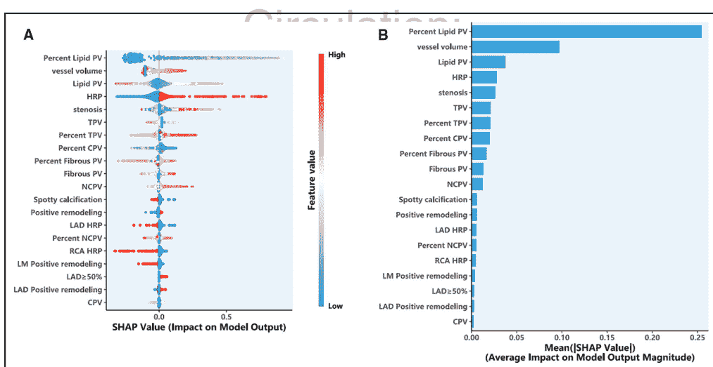
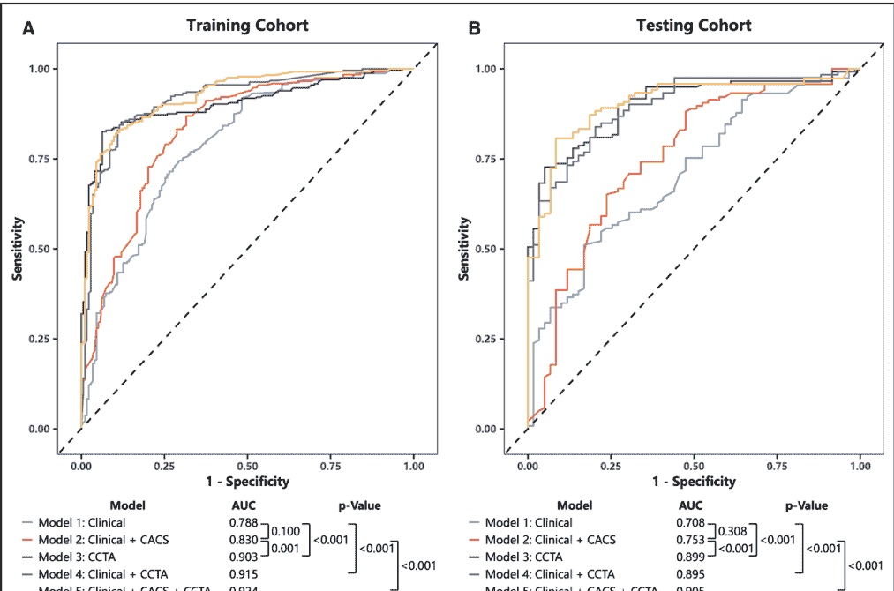
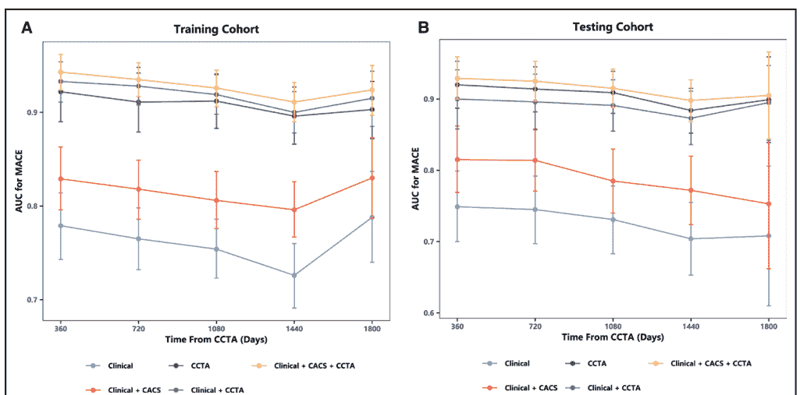
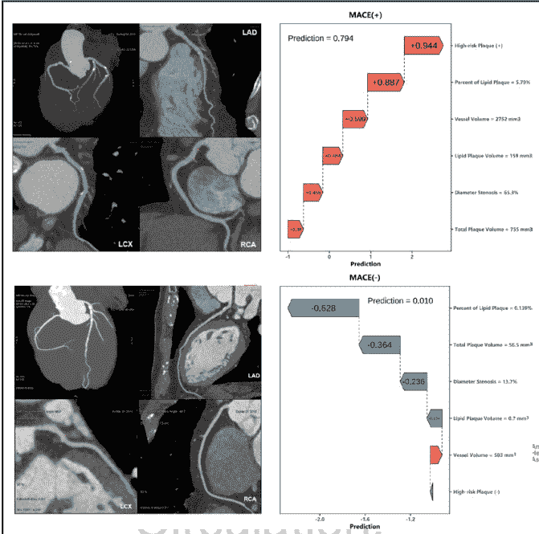

# 基于冠状动脉CT血管造影的动脉粥样硬化评估和心血管风险预测的机器学习模型：来自CREATION登记册的分析

## 原始文章

### 背景

基于传统风险因素和冠状动脉钙化评分的当前ASCVD风险预测工具存在局限性。

### 方法

CREATION研究包括在2016年至2019年间于阜外医院接受冠状动脉计算机血管造影（CCTA）的疑似冠状动脉疾病患者。主要终点为重大不良心脏事件，定义为全因死亡、急性心肌梗死、冠状动脉血运重建或中风的复合终点。采用六种机器学习生存模型创建ASCVD预测模型。

### 结果

总计，纳入了8431名具有可分析CCTA数据的参与者，中位随访期为3.68年，发生319例重大不良心脏事件（3.8%）（平均年龄54.73±10.21岁，48.2%为男性，50.9%伴有症状性胸痛）。在用48个CCTA参数训练的6种机器学习模型中，XGBoost表现最佳并被选用于模型开发。在训练队列（n=5901，70%）中，XGBoost模型显著优于临床风险因素和冠状动脉钙化评分模型（曲线下面积，0.903对0.830；P<0.001）。测试队列显示出相似的性能（曲线下面积，0.899对0.753；P<0.001）。CCTA模型在性别（女性或男性）、发病年龄（早发或晚发）和症状（无症状或有症状）亚组分析中表现出一致的预测性能。最终CCTA模型包括直径狭窄、脂质斑块负担和体积、斑块总体积、高危斑块和血管体积作为最重要的特征。脂质斑块负担与重大不良心脏事件的关联最为紧密（每增加5%的调整后危险比：2.524 [95% CI，2.157–2.996]；P<0.001）。机器学习CCTA特征的增量价值在1至5年随访期间的不同时间点上保持一致。当限制于次要复合终点（死亡、心肌梗死或中风）时，研究结果保持不变。

### 结论

纳入CCTA斑块定量、特征评估和狭窄评估的机器学习模型显著增强了对重大不良心脏事件的预测能力。它提供了冠状动脉粥样硬化的直接可视化，并优于临床实践中推荐的传统风险因素和冠状动脉钙化评分模型。

### 图文摘要

本文有图文摘要可供查阅。

### 关键词

胸痛 ■ 冠状动脉疾病 ■ 脂质 ■ 机器学习 ■ 心肌梗死

## 临床视角

在用48个冠状动脉计算机血管造影参数训练的6种机器学习生存模型中，XGBoost表现最佳并被选用于模型开发。基于XGBoost算法，整合6项关键影像特征（包括直径狭窄、脂质斑块负担和体积、斑块总体积、高危斑块及血管体积）的冠状动脉计算机血管造影机器学习模型，在1至5年随访期间的多个时间点上，对重大不良心血管事件的预测性能优于纳入传统临床风险因素和冠状动脉钙化评分的模型。这种多维模型提供个性化、精确且可解释的风险评估，能够早期识别高风险患者，并指导个性化的预防和干预策略。

### 非标准缩写和首字母缩略词

| 缩写 | 含义 |
| --- | --- |
| AMI | 急性心肌梗死 |
| AUC | 曲线下面积 |
| CACS | 冠状动脉钙化评分 |
| CAD | 冠状动脉疾病 |
| CCTA | 冠状动脉计算机血管造影 |
| GLP1 | 胰高血糖素样肽-1 |
| HU | 霍恩斯菲尔德单位 |
| MACE | 重大不良心脏事件 |
| MACE | 重大不良心血管事件 |
| ML | 机器学习 |
| NRI | 净重分类改善 |
| PV | 斑块体积 |
| ROC | 接收者操作特征曲线 |

近期研究表明，PCSK9单克隆抗体抑制剂1,2、英司利兰3、乙基二十碳五烯酸4,5、GLP1（胰高血糖素样肽-1）受体激动剂6和秋水仙碱7,8等多种新型药物疗法，可通过改变冠状动脉斑块表型和成分有效降低ASCVD风险。然而，这些治疗费用相对较高。因此，准确识别高风险人群、优化临床决策、最大化心血管获益以及提高医疗经济效率，是亟待解决的关键问题。

目前的ASCVD预防指南主要依赖临床风险评分和冠状动脉钙化评分（CACS）。9 包括系统性冠心病风险评估2系统10、动脉疾病第二次表现211、聚合队列方程12和弗雷明汉风险评分13在内的风险算法基于传统心血管风险因素，由于人群水平差异，在预测ASCVD风险方面价值有限，尤其是聚合队列方程即使在重新校准后，也经常高估高危个体和欧洲人群的风险，且无法在个体水平上预测冠状动脉粥样硬化的复杂病理生理过程。14-16 CACS是一种非侵入性CT扫描，用于测量冠状动脉斑块内的钙质沉积。然而，CACS不提供关于非钙化斑块或冠状动脉狭窄程度的信息。17 鉴于ASCVD患病率和管理的显著异质性，迫切需要额外的生物标志物或影像指标来增强对未来心血管事件的预测。

尽管冠状动脉计算机血管造影（CCTA）在广泛临床应用中存在实际障碍，例如成本相对较高、辐射暴露以及对比剂诱发性肾病的风险，但它仍然是一种广泛认可的非侵入性影像学检查方法。除了评估冠状动脉狭窄的严重程度和范围外，CCTA还能实现对不良斑块特征、斑块分布的全脏器可视化以及精确的斑块定量。18 近期研究表明，斑块形态学和斑块定量指标是心血管事件的重要风险预测因子，在改善ASCVD风险分层方面具有巨大潜力。19,20

深度学习作为人工智能的一个子集，经历了重大进展，涌现出包括DeepHit神经网络在内的复杂算法。此外，XGBoost作为梯度提升决策树的优化实现，也在人工智能应用中做出了重要贡献。这些先进的机器学习（ML）算法能够整合来自CTA的复杂、多维和交互式数据集，这些数据集使用传统统计方法难以分析。特别是，像DeepHit这样的模型旨在捕捉时间至事件动态，而像XGBoost这样的基于树的方法可以灵活地融入工程化的时间特征。目前，尚未建立一种整合冠状动脉狭窄、斑块定性与定量分析的多维CCTA衍生风险ML模型。将CCTA与先进的ML技术相结合，开发可解释、更准确、个性化和动态的心血管风险预测模型，将有助于实现更好的心血管风险分层和预测，从而促进CTA影像的临床应用和转化价值。

本研究的目的是利用基于CTA影像的大规模前瞻性登记库创建ASCVD预测模型。该模型将采用6种先进的ML生存技术构建。其

性能将与现有临床模型和冠状动脉钙化评分（CACS）进行比较评估，并进行内部验证。

## METHODS

### Data Availability

由于研究启动时受试者给予同意所涉及的伦理限制，在获得阜外医院机构审查委员会批准后，可经合理请求向通讯作者获取我们的数据集。

### Study Cohorts

本研究源于冠状动脉粥样硬化进展和预后评估冠状动脉CT血管造影多中心前瞻性队列（CREATION，URL: https://www.clinicaltrials.gov；唯一标识符：NCT03518437）。目前，完整且标准化的冠状动脉CT影像数据仅来自阜外医院中心，其他参与中心的影像数据仍在收集中。本次分析包括8873名疑似冠状动脉疾病（CAD）的患者，这些患者在2016年1月至2019年8月期间于阜外医院接受了CCTA检查。最初，所有患者均由其心脏病科医生转诊进行CCTA检查。为本研究，我们排除了临床信息不完整（n=33）的受试者、因运动伪影或CCTA影像对比剂浓度不足导致无法诊断的冠状动脉影像（n=12）、或患有其他心脏疾病（例如，心肌病，n=25；瓣膜性心脏病，n=12；先天性心脏病，n=39）的受试者，以及失访患者（301名患者无法联系，20名患者无法提供准确的结局信息）。最终，8431名患者入组最终分析（图S1）。本研究符合《赫尔辛基宣言》，所有患者均已提供知情同意以纳入登记册，并且各中心均已获得机构审查委员会批准。

### CCTA Scanning Protocols and Image Analysis

用于研究人群的计算机断层扫描仪的详细信息可在补充方法中找到。冠状动脉CTA影像已由核心实验室进行影像分析审核。

对于斑块测量，我们调整了斑块阈值滑块，以分离分离不同斑块特征的豪斯菲尔德单位（HU）值，分别为脂质（<30 HU）、纤维（30–150 HU）、钙化斑块（>350 HU）和腔内（350–350 HU）。在斑块的起始和结束处显示了彩色图叠加，根据HU值以不同颜色突出显示腔内、钙化斑块和非钙化斑块。不良斑块特征包括低密度斑块（像素密度≤30 HU）、阳性重塑（重塑指数≥1.1）、点状钙化（平均密度>330 HU，任何方向直径<3 mm）以及napkin-ring sign（餐巾环征，外周高密度伴中心低密度的环状密度模式；图例详见图S2）。高危斑块定义为具有≥2个不良斑块特征的病变。定量斑块特征包括斑块体积（PV）及亚型（以立方毫米计），包括总PV、非钙化PV、钙化PV、纤维PV和脂质PV。斑块负担（以百分比表示）定义为相应PV除以血管体积，然后乘以100，包括总PV百分比、非钙化PV百分比、钙化PV百分比、纤维PV百分比和脂质PV百分比。总PV通过求和3个成分的体积计算，而非钙化PV通过求和纤维和脂质成分的体积计算。对于冠状动脉正常的患者，PV和负担设为0。各种斑块成分的体积使用经过验证的自动化斑块软件（Deep Blue, ADW4.6, GE Healthcare, Milwaukee, WI）进行定量。两名放射科医生共同确定斑块的位置和范围，并达成共识以得出最终结果。评估CCTA时观察者间和观察者内一致性很高（Kappa统计量：0.97、0.98，分别）。

### Clinical Data

在CCTA之前进行了结构化访谈，以收集症状、人口学特征和心血管风险因素存在情况的信息。高血压定义为既往确诊诊断、收缩压>140 mmHg、舒张压>90 mmHg或使用抗高血压药物。高胆固醇血症根据国家胆固醇教育小组指南或当前使用降脂药物定义。糖尿病定义为既往确诊诊断、胰岛素或口服降糖治疗。CAD家族史定义为父亲<55岁或母亲<65岁时出现心肌梗死、冠状动脉重建或猝死。吸烟定义为CCTA检查前1年内任何香烟吸烟。糖尿病定义为空腹血浆葡萄糖水平≥126 mg/dL、糖化血红蛋白≥6.5%或使用任何抗糖尿病药物。高脂血症定义为甘油三酯≥200 mg/dL、总胆固醇>240 mg/dL、低密度脂蛋白胆固醇≥160 mg/dL、高密度脂蛋白胆固醇<40 mg/dL或使用任何降脂药物。

### Outcome

主要终点是通过患者电话访谈、联系患者医师和医院记录获得的主要不良心脏事件（MACE）。电话访谈期间使用了标准问卷。MACE包括以下任何一项：(1) 所有原因死亡，(2) 急性心肌梗死（AMI），(3) 冠状动脉重建（经皮冠状动脉介入和冠状动脉旁路移植），以及(4) 中风。AMI基于典型胸痛、心脏酶水平升高和心电图典型改变的标准定义。将患者送往重建的决定由转诊医生做出，综合考虑所有可用信息和患者偏好。CCTA后60天内的重建手术被认为由扫描触发，不被视为事件（医生可能会将CCTA结果纳入管理决策）。当患者经历>1次MACE时，选择第一次事件。当同时发生2次MACE时，选择最严重的事件（死亡>AMI>中风>重建）。由2名医生组成的仲裁结局小组审查了患者数据表格，并通过2次医疗记录审核验证，以确定患者在随访期间是否发生了MACE。

结局小组对CCTA结果盲知。意见分歧通过共识解决，其中包括一位额外的高级心脏病专家。如果电话号码无效且无法联系患者，则患者被视为失访。在1周内使用患者的直接电话号码尝试3次。如果不成功或患者无法提供准确信息，则患者被视为失访。次要终点定义为死亡、AMI和中风的发生，排除所有重建事件。

所有预测模型的结果是MACE发生的时间。时间零定义为患者接受CCTA的时间点。所有后续的生存预测均基于此时间点。

### Feature Selection and Extraction

基于临床经验、先前研究和数据可用性选择了潜在变量。最终结构数据库包含48个CCTA候选预测变量，涵盖冠状动脉狭窄的存在和范围、血管间的斑块分布、定性和定量斑块特征，包括PV/负担及亚型（钙化、非钙化、纤维和脂质斑块；变量缩写和定义见表S1）。多类名义变量使用1-hot编码处理。

### Model Training and Optimization

机器学习模型创建和验证的研究轮廓如图S3所示。数据库被随机划分为训练集（70%）和测试集（30%）。实施了增强的分层数据分割策略，以保持两组数据中事件率和其他变量（如时间）的可比分布。预测模型使用训练集（70%，n=5901）构建，并选择了最优特征。模型使用5折交叉验证（图S4）进行内部验证。测试集（30%，n=2530）不用于模型开发，但用于评估模型性能。模型超参数使用名为caret的R包进行优化，并结合5折交叉验证以最大化C-index（参数空间见表S2）。

本研究采用了6种生存分析方法：XGBoost、深度学习神经网络、Cox比例风险模型、随机生存森林、生存分析支持向量机和梯度提升生存分析。23,24 XGBoost生存预测模型以其高计算效率和优异的预测性能，以及强大的正则化技术和广泛的超参数调整能力而著称。深度学习神经网络是一种先进的深度学习框架，擅长处理时间序列数据和预测未来事件，因此特别适合生存分析。模型性能使用Harrell一致性指数（C-index）进行评估。最终模型基于C-index和时间依赖性曲线下面积（AUC）选择，并在测试集上评估其性能。

### Model Interpretation

使用Shapley加性解释值分析特征重要性和相互关系，从而优化特征选择。这些值反映了每个变量对MACE风险的平均贡献（正值表示该变量增加MACE风险）。使用递归特征消除来简化模型，直到观察到模型性能下降。

在训练集中，对模型预测具有最高平均绝对影响的特征进行了排名，并在测试集中进行了验证。此外，该研究提供了测试数据集中的2个病例示例，其中MACE事件被准确预测，详细解释了每个特征对最终预测结果的单独贡献。

### Model Performance

我们构建了5个分类模型：首先，为了评估CCTA模型与当前临床实践，我们使用与CCTA模型相同的机器学习技术构建了临床风险模型（模型1）。模型1纳入了公认的风险评估评分中的变量，包括性别、年龄、糖尿病、高血压、高脂血症、吸烟、肥胖、CAD家族史和非高密度脂蛋白胆固醇水平。模型2是结合临床风险因素和CACS的混合模型。模型3是使用预测价值最高的6个参数制定的CCTA模型。模型4是结合临床风险因素、CACS和CCTA参数的混合模型。模型5结合了临床风险因素、CACS和CCTA参数。

模型性能在测试队列中基于鉴别、校准和重新分类能力进行评估。鉴别使用时间依赖性受试者工作特征（ROC）曲线、AUC和C-index进行评估，反映模型随时间区分不同类别（事件和非事件）的能力。校准使用Brier分数进行定量评估，以衡量预测概率与实际事件结果之间的一致性。重新分类能力使用净重新分类改进（NRI >0）进行评估，关注个体风险分类的改进。具体而言，我们使用时间依赖性AUC计算预测模型在1至5年期间每年ROC曲线下的面积。

### Statistical Analysis

在描述性分析中，正态分布的连续变量以mean±SD表示，偏态分布的连续变量以中位数（四分位距）表示，分类变量以数目（百分比）表示。正态分布的连续变量比较使用独立t检验，偏态分布的连续变量使用Mann-Whitney U检验，分类变量使用χ²检验进行分析。曲线下面积之间的统计显著性使用DeLong方法确定。

为主要结局进行了探索性亚组分析：首先，将总人群分为不同性别组（男性和女性）；其次，分析有无症状性胸痛的组别。典型心绞痛定义为同时符合以下所有标准：(1) 胸骨后胸痛或不适，(2) 由体力劳动或情绪紧张诱发，(3) 休息和硝酸甘油缓解。当仅符合2个标准时，症状被分类为非典型心绞痛。

这些标准存在，若报告1个或无这些特征则定义为非心绞痛性胸痛25；第三，通过分析早发性和晚发性CAD人群。早发性CAD定义为较年轻的个体（男性年龄<55岁，女性<65岁），而晚发性CAD定义为较年长的个体（男性年龄≥55岁，女性≥65岁）。26这些分析旨在探索不同亚组间的潜在差异，并比较不同分类模型在不同亚组中的表现。通过排除冠状动脉正常人群且仅纳入有冠状动脉斑块的患者，或排除CACS为零且仅纳入CACS大于零的患者，进行了敏感性分析。所有分析和计算均使用R（版本4.4.2）进行。详细的库和包列于补充附录中。双侧P值≤0.05被认为具有统计学意义。

## 结果

### 基线特征比较

表1总结了整个队列的基线特征。共纳入8431名患者（平均年龄，54.73±10.21岁；48.2%为男性；50.9%有症状性胸痛，记录了319例MACE（3.8%），包括34例死亡、8例AMI、244例冠状动脉重灌注（202例经皮冠状动脉介入治疗和42例冠状动脉搭桥术）以及54例中风，随访中位时间为3.68年（四分位距，2.65–4.27年）。最常见的心脏症状是非典型心绞痛（44.6%），其次是典型胸痛（6.3%）。在CCTA检查中，76.4%的患者冠状动脉正常，11.1%有非阻塞性斑块，7.7%有1支血管的阻塞性CAD（狭窄≥50%），3.0%有2支血管的阻塞性CAD，1.7%有3支血管或左主干动脉的阻塞性CAD。所有患者的平均总斑块负荷为6.08%（SD ±12.74%），其中非钙化斑块负荷为5.78%（SD ±12.02%），纤维斑块负荷为5.04%（SD ±10.56%），脂质斑块负荷为0.73%（SD ±1.90%），钙化斑块负荷为0.30%（SD ±1.63%；表2）。

训练集（n=5901，70%）和测试集（n=2530，30%）的基线特征及结局也详见表1。由混合队列方程风险评分计算的10年CAD中位风险为10.0%（四分位距，4.9–19.6）。两组的心血管风险因素、混合队列方程风险评分及MACE事件非常相似，无显著差异。两个队列的斑块负荷分布总体相似（补充表S3）。

### MACE组与非MACE组基线及冠状动脉特征比较

在训练集中，MACE组年龄明显大于非MACE组（60.66±9.49岁 versus 54.65±10.08岁；P<0.001）。与非MACE组相比，MACE组男性比例更高（66.8%），传统心血管风险因素患病率更高，但CAD家族史、体重指数和非高密度脂蛋白胆固醇除外（补充表S4）。MACE组阻塞性CAD发病率也更高，狭窄率更大，高危斑块患病率更高。在冠状动脉定量分析中，MACE组不同斑块亚型的PVs和斑块负荷存在显著差异（所有P均<0.001）。这些结果在测试队列中也相似（表2）。

### 特征选择与模型训练

未进行特征消除而使用全部48个CCTA候选变量时，XGBoost模型在训练集和测试集上均表现出优异的预测性能，C-index为0.918–0.925，AUC为0.905–0.925，从而优于其他5种机器学习生存分析算法。不同机器学习性能的比较汇总于表3和补充表S5。XGBoost模型的全局可解释性及其前20个最具影响力的特征通过Shapley加法解释值图示例（图1A和1B）。这些关键特征已由临床和影像学专家确认，与临床相关性及潜在病理生理学一致。递归特征消除过程确定了6个最重要变量；简化最终模型的性能也详见表3和补充表S5，且同样选择XGBoost作为最佳模型。在训练队列和测试队列中，全部6个CCTA特征均与更高的MACE风险独立相关，不受传统心血管风险因素和CACS影响（补充表S6）。

### 模型性能比较

在训练队列中，使用6个CCTA特征的简化最终模型（模型3）预测MACE的ROC和AUC为0.903（95% CI，0.872–0.933）。相比之下，临床风险因素模型（模型1）的ROC AUC为0.788（95% CI，0.740–0.837），联合临床风险因素+CACS模型（模型2）的ROC AUC为0.830（95% CI，0.787–0.873）。因此，临床+CACS模型仅略优于临床模型（模型2 versus模型1的ΔAUC为0.042；P=0.100），CCTA模型明显优于临床模型和联合临床+CACS模型（模型3 versus模型1的ΔAUC为0.115；模型3 versus模型2的ΔAUC为0.073；两者P均<0.001）。当将CCTA特征加入临床模型（模型4）和临床+CACS模型（模型5）时，ROC AUC分别提高至0.915（95% CI，0.885–0.944）和0.924（95% CI，0.897–0.950；两者P均<0.001；图2A；补充表S7）。

表1. 基线患者特征

| | 总患者数 (N=8431) | 训练队列 (n=5901, 70%) | 测试队列 (n=2530, 30%) | P值* |
|---|---|---|---|---|
| 人口学特征 | | | | |
| 年龄，岁 | 54.73±10.21 | 54.87±10.12 | 54.40±10.41 | 0.052 |
| 性别，男性（%） | 4065 (48.2) | 2827 (47.9) | 1238 (48.9) | 0.401 |
| 危险因素 | | | | |
| 高血压 | 3658 (43.4) | 2582 (43.8) | 1076 (42.5) | 0.309 |
| 高脂血症 | 3172 (37.6) | 2221 (37.6) | 951 (37.6) | 0.986 |
| 糖尿病 | 1006 (11.9) | 716 (12.1) | 290 (11.5) | 0.404 |
| 目前吸烟者 | 2346 (27.8) | 1625 (27.5) | 721 (28.5) | 0.381 |
| CAD家族史 | 3397 (40.3) | 2376 (40.3) | 1021 (40.4) | 0.957 |
| 肥胖 | 675 (8.0) | 469 (8.0) | 206 (8.1) | 0.797 |
| BMI，kg/m² | 25.30±3.31 | 25.33±3.29 | 25.22±3.36 | 0.182 |
| 非HDL-C，mmol/L | 3.48±1.04 | 3.49±1.08 | 3.48±1.10 | 0.916 |
| 胸痛，n（%） | | | | 0.016 |
| 非心源性 | 4143 (49.1) | 2853 (48.3) | 1290 (51.0) | |
| 非典型心绞痛 | 3759 (44.6) | 2690 (45.6) | 1069 (42.3) | |
| 典型心绞痛 | 529 (6.3) | 358 (6.1) | 171 (6.8) | |
| CAC评分组 | | | | 0.085 |
| 0 | 6776 (80.4) | 4720 (80.0) | 2056 (81.3) | |
| 1~100 | 875 (10.4) | 616 (10.4) | 259 (10.2) | |
| 101~400 | 481 (5.7) | 336 (5.7) | 145 (5.7) | |
| >400 | 299 (3.5) | 229 (3.9) | 70 (2.8) | |
| 用药 | | | | |
| 阿司匹林 | 2418 (28.7) | 1703 (28.9) | 715 (28.3) | 0.596 |
| 他汀类药物 | 1285 (15.2) | 899 (15.2) | 386 (15.3) | |
| MACE | | | | |
| 死亡 | 34 (0.4) | 23 (0.3) | 11 (0.4) | |
| AMI | 8 (0.09) | 7 (0.1) | 1 (0.04) | |
| PCI | 202 (2.3) | 140 (2.3) | 62 (2.4) | |
| CABG | 42 (0.4) | 33 (0.5) | 9 (0.3) | |
| 中风 | 54 (0.6) | 38 (0.6) | 16 (0.6) | |
| PCE风险评分 | 10.0 (4.9–19.6) | 10.0 (4.9–19.6) | 9.6 (4.9–19.3) | 0.285 |

连续变量以均数±标准差、中位数（四分位数间距）概括，分类变量以n（百分比）表示。AMI表示急性心肌梗死；BMI，体重指数；CABG，冠状动脉搭桥术；CAC，冠状动脉钙化；CAD，冠状动脉疾病；HDL-C，高密度脂蛋白胆固醇；PCI，经皮冠状动脉介入治疗。
*P值来源于独立样本t检验（正态分布的连续变量）、Mann–Whitney U检验（偏态分布的连续变量）和χ²检验（分类变量）。双侧P值≤0.05被认为具有统计学意义。

对所有模型进行重新校准后，我们在测试队列中检验了其鉴别性能。使用CCTA特征的简化最终模型（模型3）预测MACE事件的ROC和AUC为0.899（0.839–0.959）。相比之下，临床风险因素模型（模型1）的ROC AUC为0.708（95% CI，0.610–0.806），联合临床风险因素+CACS模型（模型2）的ROC AUC为0.753（95% CI，0.662–0.844）。因此，临床+CACS模型仅略优于临床模型（模型2 versus模型1的ΔAUC为0.045；P=0.308）。CCTA模型明显优于临床模型和联合临床+CACS模型（模型3 versus模型1的ΔAUC为0.191；模型3 versus模型2的ΔAUC为0.146；两者P均<0.001）。当将CCTA特征加入临床模型（模型4）和临床+CACS模型（模型5）时，ROC AUC分别提高至0.895（95% CI，0.842–0.947）和0.905（95% CI，0.844–0.966；两者P均<0.001；图2B；表4）。

C-index的观察趋势与时间依赖性AUC平行。这些发现表明，CCTA模型在预测心血管事件时表现出优越的鉴别能力，其性能在测试队列中得到验证。尽管临床模型和CACS模型也具有一定的预测能力，但CCTA模型优于它们。此外，这些模型的整合进一步增强了鉴别

| | 总患者数 (N=8431) | 训练队列 (n=5901, 70%) | | | 测试队列 (n=2530, 30%) | | |
|---|---|---|---|---|---|---|---|---|
| | | MACE (n=223) | 无 MACE (n=5678) | P 值 | MACE (n=96) | 无 MACE (n=2434) | P 值 |
| 狭窄程度 | | | | | | | | |
| 任何 ≥70% 狭窄 | 597 (7.1) | 69 (30.9) | 377 (6.6) | <0.001 | 27 (28.1) | 124 (5.1) | <0.001 |
| 无 CAD 狭窄 ≥70% | | | | <0.001 | | | <0.001 |
| 0 条血管病变 | 7834 (92.9) | 154 (69.1) | 5301 (93.4) | | 69 (71.9) | 2310 (94.9) | |
| 1 条血管病变 | 404 (4.8) | 42 (18.8) | 258 (4.5) | | 19 (19.8) | 85 (3.5) | |
| 2 条血管病变 | 155 (1.8) | 17 (7.6) | 97 (1.7) | | 7 (7.2) | 34 (1.4) | |
| 3 条血管病变/左主干病变 | 38 (0.5) | 10 (4.5) | 22 (0.4) | | 1 (1.0) | 5 (0.2) | |
| 任何 ≥50% 狭窄 | 1056 (12.5) | 117 (52.5) | 650 (11.4) | <0.001 | 54 (56.2) | 235 (9.7) | <0.001 |
| 无 ≥50% 狭窄 | | | | <0.001 | | | <0.001 |
| 0 条血管病变 | 7375 (87.5) | 106 (47.5) | 5028 (88.6) | | 42 (43.8) | 2199 (90.3) | |
| 1 条血管病变 | 653 (7.7) | 60 (26.9) | 406 (7.2) | | 30 (31.2) | 157 (6.5) | |
| 2 条血管病变 | 256 (3.0) | 31 (13.9) | 162 (2.9) | | 20 (20.8) | 43 (1.8) | |
| 3 条血管病变/左主干病变 | 147 (1.7) | 26 (11.7) | 82 (1.4) | | 4 (4.2) | 35 (1.4) | |
| 血管 | | | | | | | | |
| LM 50% 狭窄 | 97 (1.2) | 12 (5.4) | 63 (1.1) | <0.001 | 3 (3.1) | 19 (0.8%) | <0.001 |
| LAD 50% 狭窄 | 788 (9.3) | 96 (43.0) | 476 (8.4) | | 40 (41.7) | 176 (7.2%) | |
| LCX 50% 狭窄 | 272 (3.2) | 38 (17.0) | 160 (2.8) | | 14 (14.6) | 60 (2.5%) | |
| RCA 50% 狭窄 | 416 (4.9) | 54 (24.2) | 248 (4.4) | | 25 (26.0) | 89 (3.7%) | |
| APCs | | | | | | | | |
| 低密度 | 96 (1.1) | 10 (4.5) | 50 (0.9) | <0.001 | 12 (12.5) | 24 (1.0) | <0.001 |
| 正向重构 | 1646 (19.5) | 166 (74.4) | 996 (17.5) | | 83 (86.5) | 401 (16.5) | |
| 点状钙化 | 459 (5.4) | 40 (17.9) | 277 (4.9) | | 24 (25.0) | 118 (4.9) | |
| 筛环征 | 59 (0.7) | 6 (2.7) | 29 (0.5) | | 3 (3.1) | 21 (0.9) | |
| HRP (≥2 个 APCs) | 373 (4.4) | 57 (25.6) | 197 (3.5) | | 37 (38.5) | 82 (3.4) | |
| 定量斑块分析* | | | | | | | | |
| 总斑块体积 (TPV), mm3 | 250.00 (116.75–485.75) | 375.00 (170.50–666.50) | 233.00 (105.50–449.00) | <0.001 | 383.00 (214.00–670.25) | 236.50 (120.00–464.00) | <0.001 |
| 钙化斑块体积 (CPV), mm3 | 1.00 (0.00–18.00) | 1.00 (0.00–29.50) | 1.00 (0.00–16.00) | | 2.00 (0.00–34.75) | 0.00 (0.00–14.75) | |
| 非钙化斑块体积 (NCPV), mm3 | 240.00 (114.00–458.25) | 373.00 (167.00–616.50) | 220.00 (102.50–428.50) | | 366.50 (207.50–638.25) | 227.50 (119.00–443.00) | |
| 纤维斑块体积, mm3 | 208.00 (98.00–399.00) | 303.00 (137.50–539.00) | 192.00 (91.00–372.50) | | 294.50 (177.00–534.00) | 196.50 (104.00–373.75) | |
| 脂质斑块体积, mm3 | 25.00 (10.00–55.00) | 41.00 (16.00–70.00) | 22.00 (8.50–50.00) | | 52.50 (19.50–104.50) | 24.00 (10.00–52.75) | |
| 总斑块体积百分比 | 24.08 (16.43–33.04) | 28.43 (19.16–36.91) | 23.43 (15.69–32.13) | | 27.93 (19.71–35.00) | 23.73 (16.28–32.83) | |
| 钙化斑块体积百分比 | 0.06 (0.00–1.26) | 0.09 (0.00–1.72) | 0.06 (0.00–1.23) | | 0.13 (0.00–1.84) | 0.02 (0.00–1.05) | |
| 非钙化斑块体积百分比 | 23.34 (15.75–31.50) | 27.11 (18.89–35.48) | 22.54 (15.31–30.41) | | 26.82 (19.35–34.71) | 22.84 (15.46–31.29) | |
| 纤维斑块体积百分比 | 20.06 (13.91–27.17) | 23.50 (16.65–30.42) | 19.57 (13.23–26.22) | | 23.00 (16.03–28.17) | 19.71 (13.78–27.59) | |
| 脂质斑块体积百分比 | 2.27 (1.17–4.14) | 2.93 (1.44–4.92) | 2.17 (1.05–3.86) | | 3.67 (1.86–6.22) | 2.18 (1.09–4.17) | |
| 无斑块 | 6441 (76.3) | 30 (0.5) | 4461 (75.6) | <0.001 | 4 (0.2) | 1946 (76.9) | <0.001 |

## 表 3. 不同机器学习生存算法预测性能的比较

| C-index | XGBoost | DeepHit | CoxPH | RSF | GBSA | SSVM |
|---|---|---|---|---|---|---|
| 使用所有变量训练的模型 | | | | | | |
| 训练集 | 0.925 | 0.804 | 0.857 | 0.899 | 0.900 | 0.856 |
| 测试集 | 0.918 | 0.800 | 0.832 | 0.901 | 0.899 | 0.834 |
| 使用前 6 个变量训练的模型 | | | | | | |
| 训练集 | 0.909 | 0.845 | 0.860 | 0.893 | 0.889 | 0.865 |
| 测试集 | 0.911 | 0.834 | 0.834 | 0.885 | 0.888 | 0.831 |

C-index 表示一致性指数；CoxPH，Cox 比例风险模型；DeepHit，深度学习神经网络；GBSA，梯度引导生存分析；RSF，随机生存森林；SSVM，生存支持向量机；XGBoost，极端梯度提升。

这种能力，提示 CCTA 特征在临床模型和 CACS 模型之外提供了额外的预测价值。表 4 和表 S7 中的结果说明了临床模型、临床+CACS、CCTA 和联合模型在训练队列和测试队列中的校准情况，并使用 Brier 评分进行了定量评估。所有 5 个模型均表现出良好的校准，且联合模型的校准逐步改善。我们通过将 CCTA 模型与临床+CACS 模型进行比较来计算 NRI。在训练队列中，NRI 为 0.241 (95% CI, 0.153–0.330)，而在测试队列中，NRI 为 0.420 (95% CI, 0.247–0.593)。结果表明，与临床 + CACS 模型相比，CCTA 模型对 MACE 具有更优的预测准确性，并显著提高了风险重新分类。观察到的 NRI 增加强调，CCTA 模型在识别高风险患者方面具有显著优势，这些患者未被临床 + CACS 模型充分预测。总体而言，CCTA 模型在校准方面保持出色，使其在临床应用中可靠且实用。

## 图 1. 极端梯度提升 (XGBoost) 机器学习模型在重大不良心血管事件 (MACE) 中的特征重要性排名。A，y 轴上每个特征的位置根据模型预测按降序排列其重要性。对于每个特征，1 个点代表一名患者，点的颜色指示该特征值，其中蓝色表示较低值，红色表示较高值。点沿 x 轴（即实际的 SHAP（Shapley 附加解释）值）的位置说明了该特征对特定患者模型输出的影响（正向或负向）。从数学上讲，这对应于患者中 MACE 的（对数）可能性（即，SHAP 值较高的患者相对于 SHAP 值较低的患者，MACE 的可能性更高）。B，同样，SHAP 汇总图说明了初始 XGB 模型预测 MACE 的前 20 个特征。特征根据重要性沿 y 轴定位。信息增益最高的最佳特征是脂质斑块体积百分比 (PV)、血管体积、脂质 PV、高危斑块 (HRP) 存在、狭窄和总斑块体积 (TPV)。CPV 表示钙化斑块体积；LAD，左前降支冠状动脉；LM，左主干冠状动脉；NCPV，非钙化斑块体积；RCA，右冠状动脉。

## 图 2. 5 种不同模型中重大不良心血管事件 (MACE) 的增量预后价值。MACE 的鉴别价值（CREATION 注册表主要终点：所有原因死亡、心肌梗死、冠状动脉血运重建和中风）。在训练队列 (A) 和测试队列 (B) 中的五种不同模型。包含临床特征（包括性别、年龄、糖尿病、高血压、高脂血症、吸烟、肥胖、冠状动脉疾病 (CAD) 家族史和非高密度脂蛋白 (HDL) 胆固醇水平）的模型（模型 1）、包含临床和冠状动脉钙化评分 (CACS；模型 2) 的模型、冠状动脉计算机血管造影 (CCTA；6 项特征包括脂质斑块体积百分比 (PV)、血管体积、脂质 PV、高危斑块 (HRP) 存在、狭窄和总斑块体积 (TPV)；模型 3) 的模型、包含临床和 CCTA 特征（模型 4）的模型，以及结合临床、CACS 和 CCTA 特征（模型 5）的模型。AUC 表示曲线下面积。

## 表 4. 随访期间测试队列中不同风险模型对 MACE 的表现

| | 参考 | AUC (95% CI) | AUC, P 值 | C-index | NRI (95% CI) | NRI (事件), (95% CI) | NRI (非事件), (95% CI) | Brier 评分 |
|---|---|---|---|---|---|---|---|---|
| 临床 | ... | 0.708 (0.610–0.806) | 参考 | 0.746 | 参考 | 参考 | 参考 | 0.057 |
| 临床+CACS | 临床 | 0.753 (0.662–0.844) | 0.308 | 0.801 | 0.097 (-0.008–0.201) | -0.014 (-0.119–0.090) | 0.111 (0.099–0.123) | 0.036 |
| CCTA | 临床 | 0.899 (0.839–0.959) | <0.001 | 0.911 | 0.703 (0.513–0.894) | 0.354 (0.167–0.541) | 0.349 (0.312–0.386) | 0.032 |
| | 临床+CACS | | <0.001 | | 0.420 (0.247–0.593) | 0.342 (0.174–0.510) | 0.078 (0.039–0.118) | |
| 临床+CCTA | 临床 | 0.895 (0.842–0.947) | <0.001 | 0.897 | 0.505 (0.322–0.687) | 0.083 (-0.099–0.265) | 0.421 (0.406–0.437) | 0.030 |
| 临床+CACS+CCTA | 临床+CACS | 0.905 (0.844–0.966) | <0.001 | 0.919 | 0.485 (0.389–0.581) | 0.396 (0.307–0.485) | 0.089 (0.053–0.125) | 0.028 |

图示了随访期间主要终点的不同风险模型的鉴别价值。AUC 表示曲线下面积；CACS，冠状动脉钙化评分；CCTA，冠状动脉计算机血管造影；C-index，一致性指数；MACE，重大不良心血管事件；NRI，净重新分类改善。

图 3. 按不同模型下发生主要不良心血管事件（MACE）的时间比较曲线下面积（AUC）。随访不同时间间隔（每年 1–5 年）的五种不同模型的 MACE AUC 进行了比较。误差线表示 95% 置信区间（CI）。不同模型的定义与图 4 相同。CACS 表示冠状动脉钙化评分；CCTA 表示冠状动脉计算机断层血管造影。

即使在排除所有再血管化事件，并将死亡、心肌梗死和脑卒中定义为次要复合终点后，总体发生率仍为 1.1%（94/8431）。在这次分析中，5 个模型的鉴别性能没有显著变化（网上附录；表 S8；图 S5）。图 3 展示了在 1 年间隔进行的时间依赖性 ROC 曲线分析。在不同时间点评估 5 个预测模型的可预测性时，无论事件发生时间如何，CCTA 预测模型始终表现出高于临床 + CACS 模型的更高可预测性。此外，临床+CACS 和 CCTA 的整合模型表现出增强的预测价值。然而，值得注意的是，在预测长期心血管事件时，这些模型的总体可预测性往往会下降。风险模型的个体化解释使用 Shapley 加法解释瀑布图进行评估，以评估 CCTA 预测模型中每个组分对整体鉴别能力的贡献。图 4 描绘了测试队列中的 2 个代表性病例，说明每个组分如何对分类器在预测 MACE 与非 MACE 事件中的输出做出贡献。在所示的 MACE 事件病例中，脂质斑块负荷在预测未来 MACE 发生时，对分类器输出提供了最高的增量贡献。此外，图 S6 显示了 MACE 预测中的假阳性和假阴性示例。

## 亚组分析

随后，在按性别（女性与男性）、胸痛（有症状与无症状）和冠心病发病年龄（早发性与晚发性）分层的选定亚组中，对 ML 模型进行了评估。在这些 3 个亚组中，CCTA 模型与传统临床危险因素和 CACS 相比，同样表现出预测 MACE 的持续改善的鉴别能力（网上附录；表 S9 至 S11，以及图 S7 至 S9）。

## 敏感性分析

本研究中，冠状动脉正常个体的比例相对较高。因此，进行了敏感性分析，排除了冠状动脉正常者，仅关注有冠状动脉粥样硬化且 CACS >0 的个体。5 个模型的鉴别性能没有显著变化（网上附录；表 S12 和 S13；图 S10 和 S11）。与整个可疑冠心病人群相比，MACE 预测保持一致。

## 讨论

在一项大型前瞻性登记研究中，我们应用了各种先进的机器学习技术，建立了基于 CCTA 的新预测模型。该模型整合了冠状动脉斑块的多维度定性与

图 4. 基于最佳冠状动脉计算机断层血管造影（CCTA）特征的个体风险预测，包含主要不良心血管事件（MACE）和无 MACE 病例示例。通过极端梯度提升（XGBoost）机器学习模型对 2 个准确预测示例进行个性化解释，展示了每个特征对 MACE 发生概率的个体贡献。特征按影响程度递减排列，红色箭头表示 MACE 风险增加，蓝色箭头表示 MACE 风险降低。(A) 和 (B) 分别为一名 63 岁 MACE 男性患者和一名 65 岁无 MACE 男性患者的 CCTA 图像。

定量特征、斑块位置和狭窄度。主要结果如下：首先，我们证明，包含 6 个最佳 CCTA 特征的模型在预测 MACE 时显著优于临床加 CACS 模型。在训练队列和测试队列中，CCTA 模型均表现出更好的鉴别性能、良好的校准，并提供了显著的 NRI。其次，无论事件发生时间如何，新的 CCTA 模型均优于临床和 CACS 风险模型。结合这些模型进一步提高了鉴别性能，表明 CCTA 特征相对于临床和 CACS 提供了增量预测价值。第三，可解释的 CCTA-ML 模型将脂质斑块负荷确定为风险预测中最具影响力的特征；最后，CTA 的预测价值在不同亚组中保持一致，包括性别、年龄（早发或晚发）和有症状亚组，强调了其在临床风险分层中的持续价值。本研究结果证实，CCTA 模型显著提高了 MACE 事件的预测准确性，为高危人群的风险分层提供了巨大潜力。此外，这些结果丰富了整合 CCTA 影像的机器学习技术在精确预测 ASCVD 事件中的应用。

### 机器学习算法的优势

冠状动脉 CTA 产生广泛、复杂、多维、非线性且交互的数据集，可使用 ML 技术快速处理。随着 ML 算法的持续更新，生存预测模型（如深度学习神经网络和 XGBoost）已显示出预测时间至事件结局的能力。本研究表明，整合 CTA 参数的 XGBoost 算法提供了优越的预后价值，超越了其他常规 ML 算法。其部署门槛低、运行效率高、可集成性强，使其更适用于现实世界临床应用，并使日益可行的个体化风险预测成为可能，凸显了在 CTA 分析中开发和应用深度学习算法的巨大潜力。

### 基于常规危险因素和 CACS 的心血管事件风险评估

临床实践中使用的 ASCVD 风险评估工具主要侧重于识别人群层面的传统危险因素，这在反映疾病及相关危险因素的动态患病率方面存在挑战。27 CACS 对无症状和有症状胸痛的心脏事件具有显著的预测价值。28,29 尽管如此，CACS 仅限于量化冠状动脉内的钙化斑块，不提供非钙化斑块的信息。CAC 得分为零并不等同于心血管风险为零或完全没有粥样硬化。先前研究表明，5% 至 16% 的 CAC 得分为零的个体仍有冠状动脉斑块。30,31 本研究发现，约 5.9% 的 CAC 得分为零的患者同样存在冠状动脉斑块。CONFIRM 研究涉及 35,281 名可疑冠心病个体，证明整合临床变量和 CACS 的 ML 模型可以改善检测梗阻性冠心病的术前可能性。32

一项包含不同国家 6 个队列研究的 Meta 分析显示，CACS 在预测未来心血管事件风险方面，超越传统心血管疾病风险评估方程提供了增量鉴别能力，增量 C-statistic 为 0.036。这一增量在各研究中相对一致。33 与先前研究一致，本研究发现，整合 9 个经过充分验证的传统心血管危险因素的临床预测模型，在不同亚组中显示出的 AUC 范围为 0.650 至 0.788。将 CACS 加入临床模型后，增量 C-statistic 为 0.033 至 0.085，未产生显著的额外益处。这些发现进一步证实了传统心血管危险因素在预测心血管事件方面的局限性，并强调了 CACS 相对于临床危险因素的适度增量价值。

### 随访期间 ML-CCTA 的额外鉴别价值

尽管先前文献已报告了各种 CCTA 变量（包括解剖狭窄程度、斑块表型和斑块定量分析）的预测价值，34 然而，CONFIRM 研究主要评估了传统 ML 模型结合临床数据与冠状动脉狭窄程度的可行性。35 随后的 CONFIRM2 研究显示，人工智能衍生的定量斑块特征与女性较高 MACE 风险相关，提示可能低估了女性患者的心血管风险，并强调需要更加个体化的干预。36 在本研究中，我们通过深度学习方法，基于 6 个关键 CCTA 特征开发并验证了一种简化的新型模型，以临床危险因素和 CACS 作为参考模型，证明在预测心脏事件方面性能显著增强。这 6 个特征代表不同维度，包括绝对粥样硬化总斑块负荷、相对和绝对富脂斑块负荷、冠状动脉狭窄程度以及斑块表型。这些影像衍生的危险因素与先前研究一致。ICONIC 研究分析发现，在 ACS 病例中，严重狭窄（≥70%）的存在、低密度非钙化斑块体积以及高危斑块的存在更高。37 在多中心 PROMISE 试验中对 4451 名患者的分析显示，高危斑块与 MACE 风险增加 70% 相关，独立于其他危险因素或梗阻性疾病的存在。38 同样使用外部验证，经验证的深度学习系统 SCOT-HEART，Lin 等人99 发现，直径狭窄 ≥50% 且总 PV 高于 238.5 mm³ 与未来心肌梗死风险增加 >3 至 5 倍相关。但未纳入多个 ML 生存模型。值得注意的是，6 个 CCTA 特征的增量可预测性在整个 5 年随访期间的不同时间点保持一致。因此，CREATION 研究强调将反映冠状动脉粥样硬化病理生理学的更广泛多维 CCTA 变量纳入现实世界亚洲人群心血管风险评估的重要性。

本研究进一步确定了 ASCVD 事件的关键预测因子，并发现脂质斑块负荷是评估心血管风险的最佳影像标志。Williams 等人40 证明，在 SCOT-HEART 试验中，1769 名接受 CCTA 的稳定性胸痛患者中，低密度斑块负荷 >4% 后续发生心肌梗死的可能性高出近 5 倍，这与我们的发现一致。这凸显了斑块负荷和表型在 ASCVD 事件发病机制中的关键作用。斑块破裂与具有薄纤维帽和大坏死核的炎症性斑块相关。

在本研究中，大多数 MACE 事件为 60 天后发生的再血管化，可能受 CCTA 结果影响而非自发性事件，这可能导致对模型预测性能的高估。为了减轻这种干预偏倚，我们进行了排除所有再血管化的敏感性分析。当限制于次要复合终点（死亡、心肌梗死和脑卒中）时，结果保持不变，表明具有强健的稳健性和适用性。

我们未观察到性别、年龄或胸痛症状的存在对 CCTA 特征与 MACE 风险之间关联的显著影响。这些结果突出了 ML-CCTA 模型在不同亚组中评估 MACE 风险的持续预后意义。

不同亚组，表明ML模型的预测能力可能主要源于动脉粥样硬化负担和斑块表型本身。但是，由于事件数量有限，需要在更大规模的研究中进一步验证。

本研究还展示了集成ML模型在临床实践中的实际应用，强调每个特征对最终预测评分的贡献，从而为预测结果提供清晰的可解释性。它能够直接可视化冠状动脉粥样硬化和腔内狭窄，有助于更深入地了解冠状动脉粥样硬化的基础病理生理机制。此外，该模型可以集成到PACS系统中，根据结构化影像参数自动生成个体化风险评分。当预测风险超过预定义阈值时，可以触发自动警报，以帮助临床医生进行早期干预和治疗决策。其应用将改变心血管疾病预防策略，从人群水平的风险评估转向个体水平的评估和干预，有助于识别未来心血管事件的高危人群。尽管CCTA具有很强的预后价值，但也存在几个局限性，包括需要使用碘造影剂、暴露于电离辐射、在存在严重冠状动脉钙化时诊断准确性降低、心率依赖性以及在某些环境中可用性有限。

### 优势与局限性

本研究具有多项显著优势。这是一项具有全国代表性的前瞻性登记队列研究，样本量较大，并进行了中长期随访。采用了多种先进的ML生存分析技术来建立新的多维CCTA影像预测模型。然而，本研究也存在若干局限性：首先，所有数据均来自单家专科三级医疗中心，可能导致选择偏倚。尽管模型在内部验证中表现良好，但其适用性需通过外部验证予以确认，需考虑地区、国家及种族/族群的差异。其次，本研究未捕捉非典型缺血性症状或CCTA特定适应症的详细信息，可能引入一定程度的转诊偏倚。有必要在明确有症状的队列中开展进一步验证。第三，随访期间未记录降脂药物的种类和剂量，这可能影响患者不良预后的进展。第四，未来研究可考虑纳入新的CCTA参数，如冠状动脉功能血流评估和围血管脂肪衰减指数，以提供关于心血管风险的额外信息并进一步提升建模准确性。

## 结论

本研究结合CCTA与ML，开发并验证了一种更具可解释性、准确性、个体化及动态性的心血管风险预测模型。该模型增强了风险分层，从而可能推动CCTA影像的临床应用与转化。

## 文章信息

收稿日期：2025年4月18日；录用日期：2025年10月29日。

## 单位

心血管内科（Y.S., N.X., C.C., Y.Z., L.G., Z.G., J.C., L.S., J.Y.）和放射科（J.Z., S.J., B.L., H.Z.-H.），阜外医院，国家心血管疾病临床医学研究中心，国家心血管疾病中心，中国医学科学院和北京协和医学院，北京，中国。

## 致谢

伦理审批与知情同意。阜外医院伦理委员会根据《赫尔辛基宣言》批准了研究方案，并从所有参与者处获得了书面知情同意。

## 作者贡献

所有作者均参与了研究的构思与设计。许博士、宋博士、郑博士、贾博士、崔博士、张博士、L.高博士、Z.高博士和陈博士参与了数据收集与分析。Zhi-hui博士、Lu博士、Yuan博士和L.宋博士对文章进行了关键性修订。所有作者阅读并批准了最终文章。前两位作者平等贡献：许博士负责该项工作的算法开发部分，宋博士负责医学部分，两位第一作者均平等参与了文章撰写。

## 资助来源

本工作得到中国医学科学院医学创新基金（2023-I2M-C&T-B-061）；中国医学科学院医学创新基金（2021-I2M-1-008）；国家高水平医院临床研究资助（2024-GSP-TJ-8）；中国医学科学院医学创新基金（2023-I2M-1-002）支持。

## 利益冲突

无。

## 补充材料

- 补充方法
- 表格 S1–S13
- 图 S1–S11

## 参考文献

- 1. O'Donoghue ML, Giugliano RP, Wiviott SD, Atar D, Keech A, Kuder JF, Im K, Murphy SA, Flores-Arredondo JH, López-JAG, et al. 长期依吡单抗治疗既往动脉粥样硬化性心血管疾病患者。*循环*。2022;146:1109–1119. doi: 10.1161/CIRCULATIONAHA.122.061620.
- 2. Nicholls SJ, Katoka Y, Nissen SE, Prati F, Windecker S, Puri R, Hucko T, Aradi D, Hermen JPR, Hernandes RS, et al. 依吡单抗对他汀治疗后心肌梗死患者冠状动脉斑块表型和负担的影响。*JACC心血管影像*。2022;15:1308–1321. doi: 10.1016/j.jcmg.2022.03.002.
- 3. Ray KK, Troquay RPT, Visseren FLJ, Leiter LA, Scott Wright R, Vikarunnessa S, Tallozy Z, Zang X, Maheux P, Lesogor A, et al. 高心血管风险和高LDL胆固醇患者长期使用英司度钠的疗效与安全性（ORION-3）：ORION-1试验4年开放标签延期的结果。*柳叶刀糖尿病与内分泌学*。2023;11:109–119. doi: 10.1016/S2213-8587(22)00353-9.
- 4. Budoff MJ, Bhatt DL, Kinnerger A, Lakshmanan S, Muhlestein JB, Le VT, May HT, Shaliik K, Shekar C, Roy SK, et al. 乙基二十碳五烯酸对他汀治疗且甘油三酯升高患者冠状动脉粥样硬化进展的影响：EVAPORATE试验的最终结果。*欧洲心脏杂志*。2020;41:3925–3932. doi: 10.1093/eurheartj/ehaa652.
- 5. Bhatt DL, Steg PG, Miller M, Brinton EA, Jacobson TA, Ketchum SB, Doyle RT, Julio RA, Jiao L, Granowitz C, et al. 乙基二十碳五烯酸对总缺血性事件的影响。J Am Coll Cardiol. 2019;73:2791–2802. doi: 10.1016/j.jacc.2019.02.032.
- 6. Bethel MA, Patel RA, Merrill P, Lokhnygina Y, Buse JB, Mentz RJ, Pagliaripo NJ, Chan JC, Gustavson SM, Iqbal N, et al; EXSCEL Study Group. 2型糖尿病患者使用胰高血糖素样肽-1受体激动剂的心血管结局：一项荟萃分析。Lancet Diabetes Endocrinol. 2018;6:105–113. doi: 10.1016/S2213-8587(17)30412-6.
- 7. Nidorf SM, Fiolet ATL, Mosterd A, Eikelboom JW, Schut A, Opstal TSJ, The SHK, Xu XF, Ireland MA, Lenderink T, et al; LoDoCo2 Trial Investigators. 慢性冠心病患者使用秋水仙碱。N Engl J Med. 2020;383:1838–1847. doi: 10.1056/NEJoa2021372.
- 8. Yu M, Yang Y, Dong L, Zhao C, Yang F, Yuan YF, Liao YH, He SL, Liu K, Wei F, et al. 光学相干断层扫描评估急性冠脉综合征患者冠状动脉斑块稳定性中秋水仙碱的作用：COLOCT随机临床试验。Circulation. 2024;150:981–993. doi: 10.1161/CIRCULATIONAHA.124.069808.
- 9. Nasir K, Cánzoles-Achirica M. 冠状动脉钙评分在心血管疾病一级预防中的作用。BMJ. 2021;373:n776. doi: 10.1136/bmj.n776.
- 10. Hageman S, Pennells L, Ojeda F, Kaptooge S, Kuulasmaa K, De Vries T, Xu Z, Kee F, Chung R, et al; SCORE2 working group and ESC Cardiovascular risk collaboration. SCORE2风险预测算法：用于估计欧洲10年心血管疾病风险的新模型。Eur Heart J. 2021;42:2439–2454. doi: 10.1093/eurheartj/ehab309.
- 11. Hageman SM, McCay AJ, Ueda P, Gunn LH, Jennerud H, Tagström E, Bhatt DL, Steg PG, Lill M, Magi R, et al. 既往心血管疾病患者再发动脉粥样硬化性心血管事件风险估计：更新的SMART2算法。*欧洲心脏杂志*。2022;43:1715–1727. doi: 10.1093/eurheartj/ehac056.
- 12. Arnett DK, Blumenthal RS, Albert MA, Buroker AB, Goldberger ZD, Hahn EJ, Himelfarb CD, Khera A, Lloyd-Jones D, McEvoy JW, et al. 2019年ACC/AHA心血管疾病一级预防指南：美国心脏病学会/美国心脏协会临床实践指南工作组报告。Circulation. 2019;140:e596–e646. doi: 10.1161/CIR.0000000000000678.
- 13. D’Agostino RB, Vasan RS, Pencina MJ, Wolf PA, Cobain M, Massaro JM, Kannel WB. 初级保健中使用的一般心血管风险概况：弗拉明汉心脏研究。Circulation. 2008;117:743–753. doi: 10.1161/CIRCULATIONAHA.107.699579.
- 14. Sud M, Sivaswamy A, Chu A, Austin PC, Anderson TJ, Naimark DMJ, Farkouh ME, Lee DS, Roifman I, Thanassoulis G, et al. 弗拉明汉风险评分和合并队列方程的人群基础重新校准。J Am Coll Cardiol. 2022;80:1330–1342. doi: 10.1016/j.jacc.2022.07.026.
- 15. Damen JA, Pajooyeshin A, Heus P, Moons KGM, Reitsma JB, Scholten RJPM, Hooft L, Debray TPA. 弗拉明汉风险模型和合并队列方程预测10年心血管疾病风险的性能：一项系统评价和荟萃分析。BMC Med. 2019;17:109. doi: 10.1186/s12916-019-1340-7.
- 16. Nurmohamed NS, Van Rosendael AR, Danad I, Ngo-Metzger Q, Taub PR, Ray KK, Fichtner G, Bonaca MP, Hisa J, Rodriguez F, et al. 使用冠状动脉计算机血管造影进行动脉粥样硬化评估和心血管风险估计。Eur Heart J. 2024;45:1783–1800. doi: 10.1093/eurheartj/ehae190.
- 17. Osborne-Grinter M, Kwicinski J, Doris M, McElhinney P, Cadet S, Adamson PD, Moss AJ, Alam S, Hunter A, Shah ASV, et al. SCOT-HEART试验中冠状动脉钙评分与冠状动脉CT血管造影上定性和定量评估的不良斑块的关联。*欧洲心脏杂志心血管影像*。2022;23:1210–1221. doi: 10.1093/ehjci/jeab135.
- 18. Manubolu VS, Ichikawa K, Budoff MJ. 心脏计算机断层扫描的创新：冠状动脉疾病影像。Prog Cardiovasc Dis. 2024;84:51–59. doi: 10.1016/j.pcad.2024.05.005.
- 19. Sato Y, Motoyama S, Miyagi K, Kawai H, Sarai M, Muramatsu T, Takashi H, Naruse H, Ahmadi A, Ozaki Y, et al. 基于冠状动脉计算机血管造影分数流量储备和斑块表征的临床结局。*JACC心血管影像*。2024;17:284–297. doi: 10.1016/j.jcmg.2023.07.013.
- 20. Williams MC, Moss AJ, Dweck M, Adamson PD, Alam S, Hunter A, Shah ASV, Pawade T, Weir-McCall JR, Roditi G, et al. SCOT-HEART研究中与不良结局相关的冠状动脉斑块特征。J Am Coll Cardiol. 2019;73:291–301. doi: 10.1016/j.jacc.2018.10.066.
- 21. Nurlu J, Chandrashekar Y, Ahmadi A, Abbra C, Barman DS, Blankstein R, Leipisj C, Newby D, Nicol ED, Nieman K, et al. 冠状动脉计算机断层血管造影SCCT 2021专家共识文件：心血管计算机断层扫描学会报告。J Cardiovasc Comput Tomogr. 2021;15:192–217. doi: 10.1016/j.jcct.2020.11.001.
- 22. Expert Panel on Detection, Evaluation, and Treatment of High Blood Cholesterol in Adults. 国家胆固醇教育计划（NCEP）成人高血胆固醇检测、评估和治疗专家组第三份报告执行摘要（成人治疗方案III）。JAMA. 2001;285:2486–2497. doi: 10.1001/jama.285.19.2486.
- 23. Yesilay A, Kumar AK, Agrawal A, Furqan MM, Verma BR, Syed AB, Majid M, Akyuz K, Rayes DL, Chen D, et al. 预测复发性心包炎患者的长期临床结局。J Am Coll Cardiol. 2024;84:1193–1204. doi: 10.1016/j.jacc.2024.05.072.
- 24. Unterhuber M, Krescjp K, Rommel KC, Besler C, Baragetti A, Klöting N, Ceglarek U, Blüher M, Scholz M, Katapana AL, et al. 基于蛋白质组学的深度学习机器算法可增强死亡率预测。J Am Coll Cardiol. 2021;78:1621–1631. doi: 10.1016/j.jacc.2021.08.018.
- 25. Diamond GAA. 临床相关的胸痛分类。J Am Coll Cardiol. 1983;1:574–575. doi: 10.1016/S0735-1097(83)80099-X.
- 26. Mousavi I, Suffredini J, Virani SS, Ballantyne CM, Michos ED, Misa A, Saeed A, Jia X. 早发性动脉粥样硬化性心血管疾病。Eur J Prev Cardiol. 2024;32:100–112. doi: 10.1093/eurjpc/zwad240.
- 27. Shah ASV, Lee KK, Pérez JAR, Campbell D, Astengo F, Logue J, Gallacher PJ, Katikireddi SV, Bing R, Alam SR, et al. 心肌梗死和脑卒中后的临床负担、危险因素影响及结局：一项25年个体患者水平连锁研究。Lancet Reg Health Eur. 2021;7:100141. doi: 10.1016/j.lanepe.2021.100141.
- 28. Biavati F, Saba L, Bousseliou M, Kofoed KF, Benetek T, Donnelly P, Rodriguez-Palomares J, Erglis A, Štěsković S, Sakalagà G, et al; DISCHARGE Trial Group. 冠状动脉钙评分可预测稳定性胸痛患者的重大不良心血管事件。Radiology. 2024;310:e231557. doi: 10.1148/radiol.231557.
- 29. Houlberg EJ, Lin F, Bla MJ, Budoff MJ, Van Den Hoogen IJ, Gianni U, Lu Y, Bax AM, Van Rosendael AR, Tantawy SW, et al. 疑似冠状动脉疾病患者中冠状动脉钙与动脉粥样硬化进展的关系。*JACC心血管影像*。2022;15:1063–1074. doi: 10.1016/j.jcmg.2021.12.015.
- 30. Bergström G, Persson M, Adiels M, Björnson E, Bonander C, Ahlström H, Alfreidsson J, Angerås O, Bergland G, Blomberg A, et al. 一般人群中亚临床冠状动脉动脉粥样硬化的患病率。Circulation. 2021;144:916–929. doi: 10.1161/CIRCULATIONAHA.121.055340.
- 31. Han D, Klein E, Friedman J, Gransar H, Achenbach S, Al-Mallah MH, Budoff MJ, Cademartiri F, Maffei E, Callister TQ, et al. 冠状动脉钙评分为零患者中细微冠状动脉钙化的预后意义：来自CONFIRM登记册。Atherosclerosis. 2020;309:33–38. doi: 10.1016/j.atherosclerosis.2020.07.011.
- 32. Al’Refai SJ, Malikia G, Singh G, Van Rosendael AR, Ma X, Xu Z, Alawamlh OAH, Lee B, Pandey M, Achenbach S, et al. 基于临床变量和冠状动脉钙评分的机器学习用于预测冠状动脉计算机血管造影上的阻塞性冠状动脉疾病：来自CONFIRM登记册的分析。*欧洲心脏杂志*。2020;41:359–367. doi: 10.1093/eurheartj/ehz565.
- 33. Bell JKL, White S, Hassan O, Zhu L, Scott AM, Clark J, Glaziou P. 超越传统心血管风险评估的冠状动脉钙评分增量价值评估：一项系统评价和荟萃分析。JAMA Intern Med. 2022;182:634–642. doi: 10.1001/jamainternmed.2022.1262.
- 34. Nakazato R, Arsanjani R, Achenbach S, Gransar H, Cheng VY, Dunning A, Lin FY, Al-Mallah M, Budoff MJ, Callister TQ, et al. 基于冠状动脉CT血管造影的年龄相关重大不良心脏事件风险及冠状动脉疾病范围和严重程度：来自国际多中心CONFIRM研究15187例患者的结果。*欧洲心脏杂志心血管影像*。2014;15:586–594. doi: 10.1093/ehjci/jet132.
- 35. Motwani M, Dey D, Berman DS, Germano G, Achenbach S, Al-Mallah MH, Andreini D, Budoff MJ, Cademartiri F, Callister TQ, et al. 机器学习用于预测疑似冠状动脉疾病患者全因死亡率：一项5年多中心前瞻性登记分析。*欧洲心脏杂志*。2017;38:500–507. doi: 10.1093/eurheartj/ehw188.
- 36. Feuchtner GM, Lacaita PG, Bax JJ, Rodriguez F, Nakanishi R, Pontone G, Mushtaq S, Buchell RR, Gränic C, Patel AR, et al. AI定量CT冠状动脉斑块特征与女性较高相对风险相关：CONFIRM2登记册。*循环心血管影像*。2025;18:e018235. doi: 10.1161/CIRCIMAGING.125.018235.
- 37. Chang HJ, Lin FY, Lee SE, Andreini D, Bax J, Cademartiri F, Chinnaiyan K, Chow BJW, Conte E, Cury RC, et al. 急性冠状动脉综合征的冠状动脉粥样硬化前驱体。J Am Coll Cardiol. 2018;71:2511–2522. doi: 10.1016/j.jacc.2018.02.079.

- 38. Ferencik M, Mayrhofer T, Bittner DO, Emami H, Puchner SB, Lu MT, Meyersohn NM, Ivanov AV, Adami EC, Patel MR, 等. 用于稳定性胸痛患者危险分层的高风险冠状动脉粥样硬化斑块检测：PROMISE随机临床试验的二次分析. JAMA心脏病学. 2018;3:144–152. doi: 10.1001/jamacardio.2017.4973

- 39. Lin A, Manrai N, McElhinney P, Killikear A, Matsumoto H, Kwicinski J, Pieszczko K, Razipour A, Grodetcki K, Park C, 等. 基于深度学习的冠状动脉CT血管造影用于斑块和狭窄定量及心脏风险预测：一项国际多中心研究. Lancet数字健康. 2022;4:e256–e265. doi: 10.1016/S2589-7500(22)00022-X

- 40. Williams MC, Kwicinski J, Doris M, McElhinney P, D'Souza MS, Cadet S, Adamson PD, Moss AJ, Alam S, Hunter A, 等. 冠状动脉计算机血管造影中低密度非钙化斑块可预测心肌梗死：多中心SCOT-HEART试验（苏格兰心脏计算机断层扫描）的结果. 循环. 2020;141:1452–1462. doi: 10.1161/CIRCULATIONAHA.119.044720
