## 机器学习（修订更新版）


### 丛书前言

MIT Press Essential Knowledge 丛书提供通俗易懂、简明扼要、制作精美的口袋书，涵盖当前热门话题。由领军思想家撰写，该系列书籍对从文化、历史到科学、技术等主题提供专家级的概览。

在当今即时获取信息的时代，我们可以轻松获得观点、合理化解释和肤浅的描述。更难获得的是支撑对世界进行原则性理解的基础性知识。Essential Knowledge 丛书填补了这一需求。通过为非专业人士综合专业主题，并通过基础知识探讨关键议题，每一本小巧的书籍都为读者提供了通往复杂思想的入口。

### 前言

2019 年 11 月，韩国围棋大师李世石宣布，在职业生涯长达二十四年后，他将从职业围棋比赛中退役。2016 年，他曾与一款名为 AlphaGo 的计算机程序进行过五番棋较量，结果以 1 比 4 落败。此后，AlphaGo 的后续版本变得更加强大，以至于在宣布退役时，世石表示：“随着 AI 在围棋领域的出现，我意识到即使我通过疯狂努力成为第一，我也不在顶峰。即使我成为第一，也有一个无法被战胜的实体。”[¹]

古老的策略游戏围棋长期以来被认为超出了 AI 的能力范围。1997 年，当下棋程序“深蓝”击败了当时的世界冠军加里·卡斯帕罗夫时，研究人员认为还需要再过一代人的时间，围棋才会发生同样的事情。国际象棋棋盘是 8 × 8，而围棋棋盘是 19 × 19——更大的棋盘意味着棋子在棋盘上的可能排列组合多得多，因此玩法也多得多，以至于游戏程序难以应对。

深蓝与 AlphaGo 之间的关键区别在于从“编程”向“学习”的转变。深蓝是由人类专家编程以尽可能好地下棋，而 AlphaGo 则通过对弈大量棋局并利用这些经验更新自己来学会下好棋，它倾向于导致获胜的走法和策略，惩罚导致失败的走法。

如何做到这一点是本书的主题，正如我们将看到的，游戏对弈只是我们见证这种通过学习实现的不可预见的能力突然飞跃的众多领域之一。在过去二十年里，利用会学习的系统，我们在各种应用中看到了准确率的大幅提升，这些应用随后已成功商业化。我们现在拥有能够通过人脸识别人、理解语音、推荐电影、将文本从一种语言翻译成另一种语言、驾驶汽车的程序——所有这些都得益于机器学习。

过去，必须由程序员想出解决问题的方法；需要执行的操作序列称为算法。然后使用编程语言将算法编码为程序，并在计算机上执行该程序。而在学习程序中，程序员指定如何利用数据（通过经验收集）来更新程序以提高性能；是数据决定了程序的最终形式。

在被编程的系统中，程序员在编写程序时就知道系统在任何情况下将如何表现。程序本身不具备智能；它只是一台硬连线复制程序员智能的机器。它只是做程序员会做的事；它唯一的优势可能是速度；它不过是一个计算器。

然而，有了学习，系统在特定情况下的行为成为学习程序与数据交互的结果，正如我们将看到的，最终的系统非常依赖于数据的数量和质量（即数据覆盖所有可能场景的程度）。在这种情况下，程序员在编写程序时无法预见训练后的程序将如何表现，因此可以说，一个从数据中学习的程序已经获得了超越程序员的智能。

回顾过去，学习程序 AlphaGo 击败李世石并不令人惊讶。AlphaGo 对弈（并从中学习）的棋局数量远超任何人类一生所能对弈的数量。同样，医生仅从自己的病人那里获得经验；学习型医疗诊断系统可以用成千上万医生的病例集合进行训练。类似地，学习自动驾驶的汽车可以用比最资深人类司机一生所能遇到的更多、更多样的场景进行训练。这就是收集大数据并对其进行分析以推断知识的优势。

当然，从数据中学习并非新事物；它是科学的核心。过去，伽利略和开普勒等科学家设计实验进行观测并收集数据；然后他们提出定律来解释这些数据。在医学中，许多疾病的治疗方法是通过收集病人信息并分析其共性和差异而发现的。但我们现在处于一个想要将这一从数据到知识的过程自动化的阶段，因为现在我们拥有更多的数据和更多的应用领域。

---

自上个世纪中叶计算机问世以来，我们的生活变得越来越计算机化和数字化。计算机不再仅仅是过去的数值计算器。数据库和数字媒体取代了纸质印刷，成为信息存储的主要媒介，计算机网络上的数字通信取代了邮政，成为信息传输的主要模式。首先是具有易用图形界面的个人电脑，然后是手机和其他智能设备，计算机已成为无处不在的设备，一种像电视或微波炉一样的家用电器。目前，各种信息，不仅是数字和文本，还有图像、视频、音频等，都被数字化地存储、处理，并得益于在线连接而进行数字化传输。所有这些数字化处理产生了大量数据，正是这种数据激增主要引发了人们对数据分析和机器学习的广泛兴趣。

[¹]: [`lccn.loc.gov/2020033697`](https://lccn.loc.gov/2020033697)


对于许多应用——从视觉到语音，从翻译到机器人技术——尽管从 20 世纪 50 年代开始进行了数十年的研究，我们仍无法设计出非常好的算法。但对于所有这些任务，收集数据都很容易，现在的想法是从数据中自动学习这些任务的算法，用学习程序取代程序员。这就是机器学习的领域，在过去二十年里，不仅数据变得更大了，而且处理这些数据并将其转化为知识的机器学习理论也有了显著进步。

曾经，如果你很聪明，你会发明一种新算法；现在，如果你很聪明，你会找到一个新的数据源，可能首先通过编写应用程序来收集它。在过去，计算机科学一次进步一个算法；现在，信息技术一次进步一个应用。

今天，在从零售和金融到制造业的各类业务中，随着我们的系统实现计算机化，更多的数据持续生成和收集。在从天文学到生物学的各个科学领域也是如此。在我们的日常生活中，随着数字技术越来越多地渗透到我们的日常生活中，随着我们的数字足迹加深，不仅作为消费者和用户，还通过社交媒体，我们生活中越来越大的一部分被记录下来并成为数据。无论其来源是商业、科学还是个人，只是被动休眠的数据没有任何用处，聪明人一直在寻找利用这些数据并将其转化为有用产品或服务的新方法。在这一转型中，机器学习发挥着更重要的作用。

我们相信，在这些看似复杂且海量的数据背后，存在着一个简单的解释。也就是说，虽然数据量大，但可以用具有少量隐藏因子及其交互的相对简单的模型来解释。想想每天有数百万客户在网上或当地超市购买数千种产品。这意味着一个非常大的交易数据库；但拯救我们并对我们有利的是，这些数据是有模式的。人们不是随机购物。举办派对的人购买一组特定的产品，家里有婴儿的人购买另一组不同的产品；存在解释客户行为的隐藏因子。正是从观测数据中推断隐藏模型——即潜在因子及其交互——构成了机器学习的核心。

机器学习不仅仅是从数据中提取信息的方法的商业应用；学习也是智能的必要条件。智能系统应该能够适应其环境；它应该学会不重复错误，而是重复成功。以前，研究人员曾认为，为了使人工智能成为现实，我们需要一种新范式、一种新型思维、一种新的计算模型，或一整套新算法。考虑到机器学习在各个领域最近的成功，我们现在可以断言，我们需要的不是一套新的特定算法，而是大量的示例数据和足够的计算能力，以便在这么多数据上运行学习方法，从数据中引导出必要的算法。

看来，机器翻译和规划等任务可以用相对简单但在大量示例数据上训练的学习算法来解决。“深度学习”最近的成功（例如 `AlphaGo` 程序）支持这一观点。智能似乎并非源于某种离奇的公式，而是源于对简单、直接算法的耐心、近乎暴力的使用。

随着技术的发展，我们获得更快的计算机和更多数据，学习算法有望产生略高水平的智能，这将用于一组新的略微智能化的设备和软件。如果这种习得的智能在本世纪结束前达到人类智能水平，那将不足为奇。

我相信，这是我们评估李世石退役意义的视角。有些人可能会觉得他不必要地敏感；汽车发明后，运动员并没有停止跑马拉松。下棋或围棋等游戏将永远是对一个人专注和制定战略能力的考验。人们不会仅仅因为计算机能击败他们就停止玩这些游戏；相反，游戏程序有潜力教会他们如何更好地玩这些游戏。

我们可以将李世石的辞职视为人类不再是衡量智能的标准或可达到的最大智能的又一步。在过去半个世纪里，随着数字技术一次一个里程碑地进步（我认为 `AlphaGo` 就是一个这样的里程碑），我们所遇到的情况类似于哥白尼革命，那时地球从天空的中心被降级为太阳系中的一颗行星。

我们系统性地注意到，我们大脑拥有的只是一种智能方式，并不一定是最好的方式。有趣的是，2016 年李世石输给 `AlphaGo` 时，这成为了全球头条新闻，因为这是计算机程序首次击败最好的人类棋手；而当他在 2019 年退役时，新闻文章称他为“唯一击败 AI 围棋程序 `AlphaGo` 的人类”。

***

本书旨在让读者对机器学习是什么、一些重要学习算法的基础知识以及一组示例应用有一个总体了解。本书面向大众读者，只讨论学习方法的基本要素，不涉及任何数学或编程细节。本书也不详细介绍任何机器学习应用；讨论许多示例只是为了给出基础知识，而不深入细节。

有关机器学习算法和应用的更多信息，读者可以参考我的教科书，本书即基于此书：Ethem Alpaydın, *Introduction to Machine Learning*, 4th ed. (Cambridge, MA: MIT Press, 2020)。

内容组织如下：

我们首先在第 1 章中简要讨论计算机科学的演变及其应用。这是为了将引起人们对机器学习兴趣的当前局势置于背景中——即数字技术如何从数值计算大型机发展到台式个人计算机，后来又发展到在线且移动的智能设备。本章展示了我们如何最终拥有了如此多的数据。

第 2 章介绍机器学习的基础知识，并讨论它如何在一些简单应用中与模型拟合和统计学相关联。

大多数机器学习算法是有监督的，在第 3 章中，我们讨论此类算法如何用于模式识别，如人脸和语音。

第 4 章涵盖受人脑启发的人工神经网络，它们如何学习，以及“深度”、多层网络如何在不同抽象层级学习层次结构。

另一种机器学习类型是无监督学习，其目的是学习实例之间的关联。在第 5 章中，我们将客户细分和学习推荐作为流行应用进行探讨。

第 6 章讲述强化学习，其中自主代理——例如自动驾驶汽车——学习在环境中采取行动以最大化奖励并最小化惩罚。


### 我们为何对机器学习感兴趣

正如任何新技术一样，自从我们开始在现实世界中使用机器学习，便开始面临其随之而来的挑战与风险。因此，这一新版增设了一个新章节——**第 7 章**，专门探讨自 2016 年首版问世以来日益重要的议题。这些议题包括自动化决策的伦理与法律影响、对数据隐私与安全的担忧、训练数据中可能存在的偏见、对可解释性的需求等。

**第 8 章** 通过探讨一些未来方向以及新提出的“数据科学”领域（该领域也涵盖高性能云计算）作为全书的总结。

本书旨在快速介绍当今机器学习领域的研究现状，我希望能激发读者对未来可能实现之事的思考兴趣。机器学习无疑是当今最令人振奋的科学领域之一，它推动着各个领域的技术进步，并已产生一系列令人印象深刻的应用，影响着生活的方方面面。我非常享受撰写本书的过程；希望您阅读时也能感到愉快！

我感谢匿名审稿人提出的建设性意见和建议。一如既往，与麻省理工学院出版社合作是一种荣幸，我要感谢匿名审稿人、Kathleen Caruso 和 Marie Lufkin Lee 给予的所有支持。

#### 数字化的力量

过去半个世纪我们生活中发生的一些最大变革，归功于计算与数字技术。我们在之前几个世纪发明和开发的工具、设备与服务，越来越多地被其计算机化的“电子版”所取代，而我们也在持续适应这一新的数字化环境。

这一变革发生得极快：曾几何时——在数字领域，五十年前就是神话般的过去，事物以光速演变——计算机昂贵，只有政府、大公司、大学、研究中心等大型组织才买得起。当时，只有它们拥有足够复杂的问题，足以证明采购和维护计算机的高昂成本是合理的。计算机“中心”占据独立楼层或大楼，容纳那些耗电量巨大的庞然大物；在宽敞的大厅里，磁带飞速旋转，穿孔卡片被打孔，数字被飞速运算，而“漏洞”真是实实在在的虫子（指飞蛾等昆虫）。

随着计算机变得更便宜，它们可供更广泛的人群使用，同时，其应用领域也随之拓宽。最初，计算机不过是计算器——它们对数字进行加、减、乘、除运算以得出新数字。计算技术发展的主要驱动力，很可能在于这样一个认识：**任何信息都可以用数字来表示**。这反过来意味着，此前仅用于处理数字的计算机，可以用来处理所有类型的信息。

更精确地说，计算机将每个数字表示为一串特定的二进制数字（比特，即 0 或 1），而这种比特序列也可以表示其他类型的信息。例如，`101100` 既可表示十进制数 44，*也*是逗号的编码；同理，`1000001` 既是 65，也是大写字母 'A' 的编码。[¹] 计算机程序根据上下文，依据其中一种解释来操作该序列。

实际上，此类比特序列不仅能代表数字和文本，还能代表其他类型的信息——例如照片中的颜色或歌曲中的音调。甚至计算机程序本身也是比特序列。此外，同样重要的是，与这些信息类型相关的操作——如让图像变亮或在照片中寻找人脸——可以转换为操作比特序列的指令。

#### 计算机存储数据

计算机的威力在于：**任何信息都可以用数字化方式表示——即作为一串比特序列——而任何类型的信息处理都可以写成操作此类数字化表示的计算机指令。**

这一特性的一个后果在 20 世纪 60 年代随着*数据库*的出现而显现，数据库是存储和操作*数据*（即数字化表示的信息）的专用计算机程序。外围设备（如磁带或磁盘）以磁性方式存储比特，因此其内容在计算机关机后不会被擦除。

有了数据库，计算机超越了单纯的处理功能，利用数字化表示成为了信息的存储库。随着时间的推移，数字媒介变得如此快速、廉价且可靠，以至于取代了纸质印刷，成为人类存储信息的主要手段。

随着微处理器的发明，以及小型化和成本降低的并行进步，个人计算机从 20 世纪 80 年代初开始越来越普及。*个人计算机*让小企业也能用上计算，但更重要的是，个人计算机体积小、价格低，足以成为一种家用电器。你不必是大公司；计算机也能帮上你的忙。个人计算机证实了每个人都有值得用计算机处理的任务，应用程序的增长随之伴随了数字技术普及化的时代。

图形用户界面和鼠标让个人计算机变得易于使用。我们无需学习编程，也无需记忆语法晦涩的命令，就能使用计算机。屏幕是我们工作环境的数字拟像，显示着虚拟桌面，上面有文件、图标，甚至还有一个垃圾桶，而鼠标是我们的虚拟手，拾起它们进行阅读或编辑。

个人计算机的软件也随之从商业应用转向个人应用，通过操作更多类型的数据，让我们的生活更加数字化。我们有文字处理器用于书信和个人文档，有电子表格用于家庭计算，有用于音乐或摄影等爱好的软件；如果想玩，甚至还能玩游戏！计算变成了日常且有趣的事务。

个人计算机凭借其亲切友好的用户界面，搭配丰富多彩的日常应用，成为人与计算机、我们熟知的生活与数字世界之间走向融合的重要一步。计算机被编程得更贴合我们的生活，而我们也做出了一些适应来容纳它们。久而久之，使用计算机成为了一项基本技能，就像开车一样。

个人计算机是让计算机走向大众的第一步；它让数字技术成为我们生活中更重要的一部分，而对本书的故事而言最重要的是，它让我们的更多生活得以被数字化记录。因此，它是将我们的生活转化为数据——我们随后可以分析和学习这些数据——这一过程中的一个重要垫脚石。

#### 计算机交换数据

计算领域的下一个重大发展是连通性。尽管以前就已通过数据链路连接计算机以交换信息，但商业系统在 20 世纪 90 年代开始广泛普及，用于将个人计算机相互连接，或通过电话线或专线连接到中央服务器。

计算机网络意味着计算机不再孤立，而是可以与远方的计算机交换数据。用户不再局限于自己计算机上的自有数据，而是可以访问别处的数据，如果愿意，也可以让自己的数据可供其他用户使用。

[¹]: 保留自原文的参考链接锚点。


The rapid development of computer networks gave rise to the Internet, *the* global computer network. The Internet allows anyone in the world with computer access to send information (such as email) to anyone else. And because all our data and devices are digital themselves, we can share far more than text and numbers; we can send images, video, music, voice—anything.

With computer networks, digitally represented information can be sent to anyone, anywhere, at the speed of light. Computers are no longer just machines that store and process data; they have also become a means of transmitting and sharing information. Connectivity grew so fast, and digital communication became so cheap, fast, and reliable that digital transmission has replaced mail as the primary technology for information transfer.

Anyone who goes "online" can make data from their computer available to anyone else via the network; this is how the World Wide Web was born. People can "surf" the Web and browse this shared information. Soon, security protocols were implemented for sharing confidential information, enabling commercial transactions over the network, such as online shopping or banking. Online connectivity further deepened the penetration of digital technology. When we use online services through a service provider's "www." portal, our computer becomes a digital version of a store, bank, library, or university; this in turn creates even more data.

#### Mobile Computing

Every decade we see computers get smaller, and with advances in battery technology[²], by the mid-1990s, portable—laptop or notebook—computers that could run on batteries became common; this ushered in a new era of *mobile computing*. Cellular phones also became popular around the same time, and around 2005, these two technologies converged in the smartphone.

A *smartphone* is a device that is both a phone and a computer. Over time, smartphones became "smarter"—more like computers and less like phones—so that today, the phone is just one of many apps on a smartphone, and a rarely used one at that. A traditional phone is an acoustic device: you speak into it and listen to the person at the other end. Today's smartphone is more of a visual device; it has a large screen, and we spend more time staring at this screen or tapping its touch surface than talking.

The smartphone is an *always-on*[³] computer that allows users to access the Internet for all kinds of information while on the move. It thus extends our connectivity, allowing us greater access—for example, while traveling—to data on other computers, while also making ourselves and our data accessible to others.

The smartphone is special because it is also a mobile sensing device, and because it is always carried, it continuously records information about us, most notably our location, and can make this data available. The smartphone is a mobile sensor that makes us detectable, trackable, recordable.

This enhanced mobility of computers is new. Computers used to be huge and located in "computer centers"; they were stationary, and we had to go to them. We sat at terminals to use the computer—called "terminals" because that is where the computer ended. Then smaller computers came to our departments, then even smaller ones sat on desks in our offices or homes, then smaller ones on our laps, and now computers are in our pockets, with us everywhere, all the time.

Computers used to be very few, perhaps one per several thousand people—for example, one per company or campus. This ratio of computers to people increased rapidly, and personal computers aimed for one per person. Today we have multiple computers per person. Now all our devices are also computers or have computers embedded in them. Your phone is a computer, your TV is a computer, your car has many computers for different functions, your music player is a dedicated computer, your camera or watch is too. *Smart devices* are computers that are digital versions performing their original function.

The term *ubiquitous computing* is gaining popularity; it means using computers without realizing it. It means using large numbers of computers all the time for all sorts of purposes without explicitly calling them computers. Digital versions have their usual advantages, such as speed, accuracy, and adaptability. But another advantage most relevant to our discussion is that the digital version of a device now has all its digital data. Moreover, if it is online, it can communicate with other online computers and make its data available almost instantly. We call them "smart objects" or just "things," and talk about the *Internet of Things*.

#### Social Data

Thousands of years ago, if you wanted your portrait painted, your statue sculpted, or your story remembered and told, you needed to be a god. A thousand years ago you needed to be a king or queen; a few centuries ago you needed to be a wealthy merchant, or a member of their family. Now anyone, even a can of soup, can be painted. A similar democratization has occurred in computing and data. Once only large organizations and enterprises had tasks worthy of computer processing, so only they had data; starting with personal computers, people and even objects became generators of data.

With most communication now taking place over the Internet via computers (including smartphones), a recent source of data is *social media*, where our social interactions have become digitized; these now constitute another type of data that can be collected, stored, and analyzed. Social media has replaced discussions in the agora, the piazza, the marketplace, the café and the bar, or gatherings at the spring, the well, and the water cooler.

With social media, each of us is now a celebrity worth following; we are our own paparazzi. We no longer have just fifteen minutes of fame; we are famous every time we go online. Social media lets us write our own digital autobiographies as we live. In the old days, books and newspapers were expensive and therefore scarce; we could only record and tell the stories of important people. Now data is cheap, and we are all kings and queens of our own little online realms. Today, digitally savvy people posting continuously on social media as they roam are modern-day Odysseys, composing their own digital epics in real-time broadcast, complete with their own perils and adventures.

#### All This Data: The Data Quake

The data produced by all our computerized machines and services was once a byproduct of digital technology, and computer scientists have done extensive research on how to store and manipulate large amounts of data in databases most efficiently. Back then, we stored data because we had to; more data meant more expensive storage and slower access. At some point in the last two decades, all this data became a resource; now, more data is a blessing.


### 机器学习与数据挖掘

#### 数据驱动的决策

以连锁超市为例，它每天向数百万顾客销售数千种商品，既通过遍布全国的实体店，也通过网络虚拟店销售。销售终端是数字化的，记录每笔交易的详细信息：日期、顾客 ID（通过会员计划）、购买商品及价格、总消费金额等。所有门店联网，所有终端的数据可即时汇总到中央数据库。这每天产生大量且非常及时的数据。

特别是过去二十年来，人们越来越多地思考如何利用这些数据。这个问题彻底改变了计算的方向。过去，数据是程序处理并输出的结果——数据是被动的。有了机器学习，数据开始驱动操作；决定下一步做什么的不再是程序员，而是数据本身。

连锁超市最渴望知道的一件事是：哪位顾客可能购买哪种商品。有了这种知识，门店可以更高效地备货，从而增加销售额和利润。这也会提高顾客满意度，因为顾客能更快、更便宜地找到所需商品。

这项任务并非显而易见。我们无法确切知道哪些人可能购买这种口味的冰淇淋、这位作者的下一本书、观看这部新电影，或造访这座城市。顾客行为随时间变化，且取决于地理位置。

但仍有希望，因为顾客行为并非完全随机。人们去超市不是随机购买东西。买啤酒时会买薯片；夏天买冰淇淋，冬天买热红酒香料。顾客行为存在特定模式，这就是数据发挥作用的地方。

虽然我们不知道顾客行为模式本身，但我们期望在收集的数据中看到它们出现。因此，如果我们能在历史数据中找到此类模式，假设未来（至少近期未来）与收集数据时的过去差别不大，我们就可以预期这些模式将继续成立，并基于它们做出正确预测。

有了机器学习，数据开始驱动操作；决定下一步做什么的不再是程序员，而是数据本身。

我们可能无法完全识别该过程，但我们相信可以构建**一个良好且有用的近似**。该近似可能无法解释一切，但仍可能解释数据的某部分。我们相信，虽然识别完整过程可能不可能，但我们仍能检测到某些模式。我们可以利用这些模式进行预测；它们也可能帮助我们理解过程。

这被称为**数据挖掘**。类比而言，从矿山开采出大量泥土和原材料，经过加工得到少量珍贵物质。同样，在数据挖掘中，处理大量数据以构建具有价值用途的简单模型，例如具有高预测准确性的模型。

数据挖掘是机器学习的一种类型。我们不知道规则（顾客行为规则），所以无法编写程序，但机器——即计算机——通过从（顾客交易）数据中提取此类规则来“学习”。

存在许多我们不知道规则但拥有大量数据的应用。如前所述，计算机和数字技术深入渗透到日常生活，意味着现在各领域都有大量数据可供挖掘。

学习模型也用于模式识别，例如识别摄像头捕获的图像或麦克风捕获的语音。如今，我们有用于不同应用的不同类型传感器，从利用智能手机进行人类活动识别到汽车驾驶辅助系统。

另一个数据来源是科学。随着我们制造更好的传感器，我们检测到更多——即获得更多数据——在天文学、生物学、物理学等领域，并使用学习算法理解越来越大的数据。互联网本身就是一个巨大的数据存储库，我们需要智能算法帮助我们找到所需信息。当今数据的一个重要特征是来自不同模态——即多媒体。我们有文本、图像或视频、音频片段等，都以某种方式与我们感兴趣的同一对象或事件相关，当今机器学习的一大挑战是结合来自这些不同来源的信息。例如，在消费者数据分析中，除了过去的交易，我们还有网络日志——即用户最近访问的网页——这些日志可能非常有信息量。

随着各类智能机器持续协助我们的日常生活，我们都成为了数据的生产者。每次购买产品、租借电影、访问网页、在社交媒体发帖，甚至只是走动或驾驶，我们都在生成数据。这些数据对有兴趣收集和分析它的人很有价值，因为我们也是数据的消费者。我们想要专门为我们定制的产品和服务。我们希望我们的需求被理解、兴趣被预测。顾客不仅永远是对的，而且有趣且值得追踪。

#### 学习与编程

要在计算机上解决问题，我们需要算法。算法是将输入转换为输出的一系列指令。例如，我们有计算工资的算法：输入是员工的工作相关信息（如工时表）和个人信息（如婚姻状况），输出是他们的薪水。

算法类似于菜谱。准备任何菜肴都需要基本动作，如削皮、切片、油炸等。菜谱定义了应对哪种食材按何种顺序执行哪些动作。任何会这些基本动作的人都能按菜谱做出菜肴。这正是计算机编程的情况，计算机的中央处理器（`CPU`）有一组基本指令，算法定义了应对哪种输入按何种顺序执行哪些指令。软件库就像一本食谱书。

过去几十年我们为许多任务设计了算法，这就是计算机和数字技术如此广泛使用的原因。但对于某些问题，我们尚无算法。预测顾客行为是一个；区分垃圾邮件和正常邮件是另一个。我们知道输入是什么：最简单情况下是一封文本邮件文档。我们知道输出应该是什么：指示邮件是否为垃圾邮件的`yes/no`输出。但我们不知道如何将输入转换为输出。什么被视为垃圾邮件随时间和个体而变化。

我们在知识上缺乏的，用数据来弥补。我们可以轻松汇编数千条邮件，其中一些已知是垃圾邮件，一些不是，我们想要从这个样本中“学习”什么构成垃圾邮件。例如，分析示例数据后，我们可能注意到“offer”、“opportunity”等词或“$”、“!”等符号在垃圾邮件中出现频率远高于普通邮件，因此我们的垃圾邮件过滤器在新邮件中看到这些内容时，会增加该邮件为垃圾邮件的概率。


### 在学习中，我们希望计算机（机器）能自动从数据中提取出完成任务的算法。无需学习计算工资，因为我们已经知道怎么做，但有许多应用我们没有现成的算法，却能收集大量数据。

### 人工智能

机器学习不仅仅是数据库或编程问题；它也是人工智能的要求。处于变化环境中的系统应具备学习能力；如果它一遍又一遍地犯同样的错误，我们很难称其为智能。从工程角度来看，学习也是明智的，因为如果系统能检测并适应变化，系统设计者就无需预见并为所有可能的情况提供解决方案。

对我们而言，系统设计者是进化，我们的体形以及内置的本能和反射已在数百万年中进化而来。我们还会在一生中学习改变行为。这有助于我们应对进化无法预测的环境变化。生活在明确界定环境中且寿命短的生物，其所有行为可能都是内置的；但进化并没有将我们一生中可能遇到的各种情况下的各类行为硬连线到我们身上，而是赋予了我们大脑和一种学习机制，使我们能凭借经验更新自我并适应不同环境。这就是为什么人类能在全球各地截然不同的气候和条件下生存繁衍。当我们在特定情境下学会最佳策略时，该知识会存储在大脑中；当同一情境再次出现——当我们识别（“cognize”意为“知道”）出该情境时——我们会回忆起合适的策略并据此行动。

机器学习不仅仅是数据库或编程问题；它也是人工智能的要求。处于变化环境中的系统应具备学习能力。

我们每个人，实际上每个动物，都是一名数据科学家。我们利用感官收集环境信息，然后处理数据以制定行为规则，从而在不同情境下控制行动，以最小化痛苦和/或最大化快乐。我们拥有记忆，将这些规则存储在大脑中，并在需要时回忆和使用它们。学习是终身的；当规则不再适用时我们会遗忘，环境改变时我们会修正它们。

不过学习也有局限；受限于大脑容量，有些东西我们可能永远无法学会，就像我们永远无法“学会”长出第三条胳膊，或在脑后长出一只眼睛——那需要改变我们的基因构成。粗略地说，遗传学定义了硬件，通过突变在数千代中缓慢适应；而学习定义了运行在（并受限于）该硬件上的软件在个体生命周期内的适应。

人工智能从大脑中汲取灵感。认知科学家和神经科学家旨在理解大脑功能，为此他们构建神经网络模型并进行仿真研究。但人工智能属于计算机科学范畴，我们的目标是构建有用的系统，这与工程领域的任何方向一样。因此，尽管大脑启发了我们，但我们最终并不太在意所开发算法的生物学合理性。

我们对大脑感兴趣，是因为相信它有助于我们构建更好的计算机系统。大脑是一种信息处理装置，拥有令人难以置信的能力，在许多领域超越当前的工程产品——例如视觉、语音识别和学习，仅举三例。若在机器上实现，这些应用具有显著的经济效用。如果我们能理解大脑如何执行这些功能，就能将这些任务的解决方案定义为形式化算法并在计算机上实现。

计算机曾被称为“电子大脑”，但计算机和大脑是不同的。计算机通常只有一个或少数处理器，而大脑由极大量的处理单元——即神经元——并行运行组成。尽管细节尚不完全清楚，但处理单元被认为比计算机中的典型处理器简单得多、慢得多。大脑的不同之处，也是其计算能力的来源，被认为在于其大规模连接性。大脑中的神经元通过称为突触的连接与数万个其他神经元相连，且全部并行运行。在计算机中，处理器是主动的，存储器是分离且被动的；但据信在大脑中，处理和记忆分布在网络中；处理由神经元完成，记忆发生在神经元之间的突触中。

#### 理解大脑

根据 Marr (1982) 的观点，理解一个信息处理系统需在三个*分析层面*进行：

1.  **计算理论** 对应计算的目标和任务的抽象定义。
2.  **表征与算法** 定义输入和输出如何表征，以及从输入到输出的转换算法规范。
3.  **硬件实现** 是系统的实际物理实现。

这些分析层面的基本思想是：对于同一个计算理论，可能存在多种表征及操作该表征中符号的算法。同样，对于任何给定的表征和算法，可能存在多种硬件实现。对于任何理论，我们可以使用多种算法之一，且同一算法可有不同的硬件实现。

举个例子：‘6’、‘VI’ 和 ‘110’ 是数字 6 的三种不同表征；分别为阿拉伯数字、罗马数字和二进制表征。根据所用表征不同，加法有不同的算法。数字计算机使用二进制表征，并拥有在此表征下执行加法的电路，这是一种特定的硬件实现。数字在算盘上表征不同，加法对应另一组指令，这是另一种物理实现。当我们“心算”加两个数时，我们使用另一种表征和适合该表征的算法，由神经元实现。但所有这些不同的物理实现——即我们、算盘、数字计算机——实现了同一个计算理论：加法。

在工程中，我们自顶向下进行。例如在软件工程中，首先确定需求，再向下一步设计适合任务的算法和合适的数据结构以在计算机内存中存储必要信息，4 最后再向下一步用编程语言编写算法，在特定计算机上执行。

有时需要自底向上反向进行，这称为*逆向工程*。例如二战时，德军使用一种叫“恩尼格玛”的机器加密通讯。盟军的大量工作导致其内部机制被发现，从而实现了解密。


### 另一个例子：自然与人造飞行器

人类一直梦想着飞翔，我们早期试图通过穿上大翅膀来模仿鸟类，但并未奏效；我们的手臂和肩膀不够强壮，无法扇动足以承载我们体重的大翅膀——那是在过低的层面上进行模仿。但随着科学的进步，我们发现了空气动力学规律，也就是说，一旦我们能够上升到理论层面，我们就能为同一理论设计出另一种实现方式，并利用我们拥有的手段发明了螺旋桨，后来又发明了喷气发动机。麻雀扇动翅膀；飞机不扇动翅膀，而是使用喷气发动机。麻雀和飞机是为不同目的、满足不同约束而构建的两种硬件实现。但它们都遵循同一个理论，即空气动力学。

在人工智能领域，我们想对智能做同样的事情。我们可以说大脑是智能的一种硬件实现。如果我们能从这一特定实现出发进行逆向工程，提取出所使用的表征和算法，并进而得到计算理论，那么我们就可以使用另一种表征和算法，进而采用一种更适合我们拥有的手段和约束的硬件实现。

在第 4 章中，我们将讨论由相互连接的处理单元组成的人工神经网络，以及此类网络如何学习——这就是表征和算法层面。随着时间的推移，当我们发现智能的计算理论时，我们可能会发现神经元和突触只是实现细节，就像我们已经意识到羽毛是为了飞行一样。

### 模式识别

在计算机科学中，我们尝试使用手工指定的规则和算法来解决许多任务。数十年的工作仅取得了非常有限的成功。其中一些任务与人工智能相关，因为人们认为它们需要智能。我们最近取得巨大进步的当前方法，是利用从数据中进行机器学习。

让我们以人脸识别为例：这是一项我们能轻松完成的任务；每天我们都通过看面部或照片来识别家人和朋友，尽管存在姿态、光照、发型等差异。面部感知对我们很重要，因为我们想区分敌友。这对我们的生存至关重要，不仅用于身份识别，还因为面部是我们内部状态的“仪表盘”。快乐、愤怒、惊讶和羞愧等情绪都能从我们的面部读取，我们进化出了既能表达这些状态、又能在他人身上检测这些状态的能力。

虽然我们能轻松完成这种识别，但我们是无意识地进行的，无法解释我们是如何做到的。因为我们无法解释我们的专长，所以无法编写相应的计算机程序。

通过分析一个人的不同面部图像，学习程序捕捉该人特有的模式，然后在给定图像中检查该模式。这是模式识别的一个例子。

我们之所以能做到这一点，是因为我们知道面部图像就像任何自然图像一样，不仅仅是像素的随机集合（随机图像就像电视雪花噪点）。面部具有结构。它是对称的。眼睛、鼻子和嘴巴位于面部的特定位置。每个人的面部都是由这些特征的特定组合构成的模式。当光照或姿态改变、当我们留长发或戴上眼镜、或者当我们衰老时，面部图像的某些部分会发生变化，但有些部分不会。学习算法通过遍历该人的多张图像，找出那些不变的判别性特征及其组合方式，从而定义特定人物的面部。

### 谈论学习时我们在谈论什么

在机器学习中，目标是拥有一个能够学习的计算机程序。学习意味着通过经验变得更好。“更好”意味着优化一个性能标准。“经验”意味着收集过去的数据——例如过去的试验。从编程的角度来看，“变得更好”实现为对决策程序的修改，使得随着时间的推移，随着它看到更多数据，其输出根据待优化的标准带来更高的性能。

学习程序不同于普通计算机程序，因为它是一个`带有可修改参数的通用模板`，通过给这些参数赋予不同的值，该程序可以做各种不同的事情。学习算法通过`在数据上定义的优化性能标准`来`调整模板的参数`——我们称之为模型。

例如，对于一个博弈程序，参数会随着我们与对手对弈而调整，使得我们的胜负比增加。对于人脸识别器，参数会被调整，以便在一个人的训练图像集上获得最高的预测准确率。学习过程通常是重复且增量的。学习程序依次看到示例（对局或面部），参数在每个示例上略微更新，从而使性能随时间逐渐提高。毕竟，这就是学习：当我们学习一项任务时，我们会变得更擅长它，无论是网球、几何还是外语。

在第 2 章中，我们将更详细地介绍模板是什么（实际上正如我们将看到的，根据任务类型的不同，我们有不同的模板）以及调整参数以获得最佳性能的不同学习算法。

在构建学习器时，有几个重要的考虑因素：

首先，我们应该记住，仅仅因为我们有大量数据，并不意味着存在可以学习的潜在规律。我们应该确保潜在过程中存在依赖关系，并且收集的数据提供了足够的信息，以便能以可接受的准确性学习这些依赖关系。

假设我们有一本包含人名和电话号码的电话簿。认为名字和电话号码之间存在整体关系是没有意义的；在这种情况下，我们只能将已知的姓名-电话号码对存储在数据库中，别无他法。此外，无法泛化到新实例；因为我们无法推断出通用规则，所以无法为新名字预测电话号码。

学习程序依次看到示例，参数在每个示例上略微更新，从而使性能逐渐提高。这就是学习：当我们学习一项任务时，我们会变得更擅长它。

其次，学习算法本身应该是高效的，因为通常我们有大量数据，希望学习尽可能快，有效地利用计算和内存。在许多应用中，问题的潜在特征可能随时间变化；在这种情况下，先前收集的数据会过时，因此需要持续且高效地用新数据更新训练好的模型。

第三，一旦构建了学习器并开始用它进行预测，它在内存和计算方面也应该是高效的。在某些应用中，最终模型的效率可能与其预测准确性同样重要。以自动驾驶汽车为例，识别、决策和行动所需的所有计算必须足够快，以便汽车能以合理的速度行驶。

### 历史


从特定示例推导出一般概念被称为**归纳**。在我们的一生中，我们在不同的时间、不同的地点见过许多树，它们在某些方面都略有不同；然而，同时它们也都有共同之处，正是这一组共同属性定义了我们对“树性”的一般定义。这一一般概念存储在我们的大脑中，以便当我们看到一个新物体时，可以根据该物体与我们习得的“树性”定义的匹配程度来判断它是否为树。

几乎所有的科学都是将一般模型拟合到数据上。科学家——如伽利略、牛顿和孟德尔——设计实验、进行观察并收集数据。然后他们试图通过构想理论，即构建模型来解释他们观察到的数据，从中提取知识。随后，他们利用这些理论进行预测；如果预测失败，他们便收集更多数据并修正理论。这一数据收集与理论/模型构建的过程持续进行，直到获得具有足够解释力的模型。

我们现在已达到一个无法再手动进行此类数据分析的地步，因为能够进行此类分析的人很稀缺；此外，数据量巨大，手动分析已不可能。因此，人们对能够分析数据并自动从中提取信息的计算机程序——换句话说，能够**学习**的程序——的兴趣日益浓厚。

我们讨论的这些方法源于不同的科学领域。有时，相同或非常相似的算法在不同领域中沿着不同的历史路径被独立发明，这并不罕见。

机器学习的主要基础理论来自统计学，在统计学中，从特定观测（称为**样本**）推导出总体的一般描述被称为**推断**，学习被称为**估计**。分类在统计学中称为**判别分析**。统计学家习惯于处理小样本，且作为数学家，主要研究可以用数学方法分析的简单模型。在工程领域，分类称为模式识别，方法更偏向经验主义。

在计算机科学中，作为人工智能工作的一部分，研究人员研究了学习算法；一条平行但几乎独立的研究路线被称为**数据库中的知识发现**。在电子工程中，信号处理研究催生了自适应图像处理和语音识别程序。

20 世纪 80 年代中期，来自各学科对人工神经网络模型的兴趣大爆发。这些学科包括物理学、统计学、心理学、认知科学、神经科学和语言学，更不用说计算机科学、电子工程和自适应控制了。或许，神经网络研究最重要的贡献是这种协同效应，它连接了各个学科，特别是统计学和计算机科学。神经网络研究（后来发展为机器学习领域）始于 20 世纪 80 年代并非偶然。当时，随着 VLSI（超大规模集成）技术的进步，我们获得了构建包含数千个处理器的并行硬件的能力，人工神经网络因其作为一种可能的理论，可将计算分布在大量并行运行的处理单元上而受到关注。此外，因为它们能从数据中学习，所以不需要编程。

正如我们将在第 4 章讨论的，神经网络由处理单元层组成，每一层检查输入中的特定条件，后续层检查更抽象的条件。早在 90 年代初，我们就见证了成功的神经网络应用；其中两个杰出的例子是 LeCun 的`LeNet`网络用于识别手写数字，以及 Tesauro 的`TD-Gammon`网络用于玩西洋双陆棋。在过去这个十年里，随着更多数据和算力的可用，我们看到了许多由有时数百层组成的“深层”神经网络的令人印象深刻的应用。因此，例如，比`LeNet`更深的网络现在被用于人脸识别，比`TD-Gammon`更深的网络已经学会了下围棋。近期对机器学习和人工智能的剧烈关注很大程度上归功于深层神经网络的此类成功。遗憾的是，这些成功也导致了不切实际的宣称和牵强附会的外推。

机器学习处于统计学和计算机科学的交叉点，偶尔也从认知科学和神经科学中汲取灵感。过去，这些不同社区的研究遵循不同的路径，有不同的侧重。我们编写本书的目的是将它们汇聚在一起，在尽可能摒弃炒作的前提下，对该领域进行统一的入门介绍，并结合一些有趣的应用。

现在，让我们开始讨论机器学习的基本概念和应用。

# 2

# 机器学习、统计学与数据分析

### 学习估算二手车价格

我们在上一章看到，当我们认为观测对象之间存在关系但不知道具体形式时，就会使用机器学习。因为不知道其确切形式，我们无法直接编写计算机程序。因此，我们的方法是收集示例观测的数据并对其进行分析以发现关系。现在，让我们进一步讨论什么是关系以及如何从数据中提取它；一如既往，使用示例使讨论具体化是个好主意。

考虑估算二手车价格的问题。这是一个很好的机器学习应用示例，因为我们不知道其确切公式；同时，我们知道应该存在一些规则：价格取决于汽车的属性，如品牌；取决于使用情况，如里程；甚至取决于与汽车无直接关系的因素，如当前经济状况。

虽然我们可以识别出这些因素，但不知道它们究竟如何影响价格。例如，我们知道平均而言，里程增加会导致价格下降，但不知道下降的速度。这些因素如何组合决定价格是我们所不知道的；幸运的是，我们有数据可以帮助我们。我们可以查看市场上一些汽车，记录它们的属性和成交价，然后尝试学习此类属性与价格之间关系的具体细节。

在这样做时，第一个问题是决定使用什么作为**输入表示**，即我们认为会影响二手车价格的属性。立刻想到的有汽车的制造商和型号、生产年份和里程。你也可以想到其他属性，但这些属性应该易于记录。

一个重要事实是，可能有两辆不同的汽车在这些属性上具有完全相同的值，但成交价却不同。这是因为还有其他因素有影响，如配件。也可能存在我们无法直接观测、因此无法纳入输入的因素——例如，汽车过去行驶的所有条件以及保养情况。

关键在于，无论我们列出多少属性作为输入，总有其他因素影响输出；我们不可能记录并将所有因素作为输入，所有这些我们忽略的其他因素都会引入不确定性。


这种不确定性的影响在于，我们无法再估算出一个确切的价格，但可以估算出一个未知价格可能落在其中的 `interval`（区间），而该区间的长度取决于不确定性的大小——它定义了由于那些我们无法或不能作为输入的因素，价格能变动多少。

### 随机性与概率

在数学和工程学中，我们使用 `probability theory`（概率论）来建模不确定性。在确定性系统中，给定输入，输出总是相同的；而在随机过程中，输出还取决于引入随机性的不可控因素。

以抛硬币为例。有人可能会声称，如果我们掌握了诸如硬币的确切成分、初始位置、抛掷时施加力的大小、位置和方向、接住硬币的地点和方式等知识，抛掷的结果就可以被精确预测；但由于所有这些信息对我们都是隐藏的，我们只能谈论抛掷结果的概率。我们不知道结果是正面还是反面，但我们可以对每种结果的概率做些说明，这是衡量我们认为该结果发生可能性大小的一个指标。例如，如果硬币是均匀的，正面和反面的概率相等——如果我们抛很多次，预期看到的正面和反面次数大致相同。

如果我们不知道这些概率并想要 `estimate`（估计）它们，那么我们就进入了 `statistics`（统计学）的领域。我们遵循通用术语，将每个数据实例称为“样本”（example），并保留“样本集”（sample）一词专指此类样本的 `collection`（集合）。目标是建立一个 `model`（模型）来解释生成样本集的过程。在抛硬币的例子中，我们通过抛硬币若干次并记录结果——正面或反面——作为观测值来收集样本集。然后，我们对正面概率的估计量可以简单地取为样本集中正面出现的比例——如果我们抛六次硬币，在样本集中看到四次正面和两次反面，我们就将正面的概率估计为 ⅔（因此反面的概率为 ⅓）。接着，如果让我们猜测下一次抛掷的结果，我们的估计将是正面，因为它是概率较大的结果。

这种类型的不确定性构成了机会游戏的基础，这使得赌博对某些人充满刺激。但我们大多数人不喜欢不确定性，并试图在生活中避免它，必要时甚至不惜代价。例如，如果赌注很大，我们会购买保险——我们更倾向于确定地永远不会损失一大笔钱（因意外丢失高价值物品），而不是支付一小笔保费，即使该事件发生的可能性很小。

二手车的价格也类似，存在不可控因素使得汽车折旧成为一个随机过程。生产线上前后相随的两辆车在此时完全相同，因此价值也完全相同。一旦售出并开始使用，各种因素便开始影响它们：车主可能一个更爱惜车，一辆车可能在更好的天气条件下行驶，一辆车可能出过事故，等等。这些因素中的每一个都像一次随机的抛硬币，改变着价格。

零售业中的顾客行为也可以用类似的论证。我们总体上期望顾客根据家庭构成、喜好、收入等因素，在购买时遵循特定模式。尽管如此，总会有额外的随机因素引入方差：度假、天气变化、某个吸引人的广告，等等。由于这种随机性，我们无法确切估计下一件将购买的商品，但可以计算某件商品被购买的概率。然后，如果我们想做预测，只需选择概率最高的商品即可。

### 学习通用模型

每当我们收集数据时，都需要以一种能够学习到一般趋势的方式来收集。例如，在表示汽车时，如果我们使用品牌作为输入属性，就定义了一款非常具体的车。但如果我们改用座位数、发动机功率、后备箱容积等通用属性，就能学习到一个更通用的估计器。这是因为不同型号和品牌的汽车都吸引同一类顾客，称为顾客细分市场，我们预期同一细分市场中的汽车折旧情况相似。忽略品牌而专注于定义细分市场的基本属性，等同于将同一（尽管有噪声的）数据实例用于所有此类同类型汽车；这实际上增加了我们的数据量。

对于输出也可以提出类似的论证。与其直接估计价格，不如估计其占原价的百分比，即折旧的影响。这同样能让我们学习到一个更通用的模型。

当然，学习通用模型是好的，但我们不应试图学习过于通用的模型。例如，轿车和卡车具有截然不同的特征，最好分别收集数据并为两者学习不同的模型，而不是收集数据试图学习一个涵盖两者的单一模型。

另一个重要事实是，底层任务可能随时间变化。例如，汽车价格不仅取决于汽车的属性、代表其过往使用情况的属性或车主的属性，还取决于经济状况，即其他事物的价格。如果我们进行买卖的经济环境发生重大变化，先前的趋势将不再适用。从统计学角度来看，数据背后随机过程的属性已经改变——我们面对的是一组新的硬币。在这种情况下，先前学习的模型不再成立，我们需要收集新数据并重新学习；或者，如果我们有获取性能反馈的机制，可以在持续使用过程中微调模型。

### 模型选择

学习中最关键的一点之一是 `model`（模型），它定义了输入与输出之间关系的模板。例如，如果我们认为可以将输出写为属性的加权和，就可以使用 `linear model`（线性模型），其中属性具有加法效应。

让我们看一个例子。假设我们仅将里程数作为输入属性，并收集表 1 所示的数据。我们有七辆车，记录了它们的里程数和价格。我们可以对该数据拟合一个线性模型；即绘制一条尽可能贴近那些数据点的直线。图 1 显示了数据点和拟合线。该线性模型写为

表 1 示例数据集由七辆车组成，每辆车包含其里程数（英里）和价格（美元）。索引仅用于命名；车辆的顺序不重要。

| 索引 | 里程数 | 价格 |
| --- | --- | --- |
| 1 | 9,000 | 38,500 |
| 2 | 95,000 | 6,000 |
| 3 | 20,000 | 32,000 |
| 4 | 60,000 | 15,000 |
| 5 | 15,000 | 35,000 |
| 6 | 30,000 | 27,000 |
| 7 | 90,000 | 12,000 |

```
y = 39258 – 0.3427x
```

其中 `x` 表示里程数，`y` 表示估计价格。该直线从 39,258 美元开始——这是里程为 0 的车的估计值——每增加一英里，价格下降 34.27 美分，或者说每额外行驶 10,000 英里，价格下降 3,427 美元。

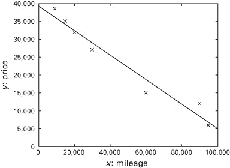


该值 –0.3427 是里程对价格的 `weight`（权重）。不仅数值本身，权重的符号也包含信息。此处，数据分析表明这种关系是负相关的——随着里程增加，价格下降——但在另一个例子中，权重也可以是正的；例如，如果我们增加发动机功率这一属性，会发现价格随发动机增大而上升。也可能从数据中估算出的权重非常接近零；在这种情况下，我们可以得出结论：相应的属性不重要，并将其从模型中剔除。

这些权重是模型的 `parameters`（参数），由数据计算得出。模型始终是固定的；可调整的是参数，而这一调整过程以更好地匹配数据，我们称之为学习。

线性模型非常流行，因为它简单；参数很少，且计算加权和很容易。它易于理解和解释。此外，它在许多不同任务中表现出惊人的良好效果。

无论我们如何改变其参数，每个模型只能用于学习一组问题，而 `model selection`（模型选择）是指在模型之间进行选择的任务。选择正确的模型比优化给定模型的参数更困难，应用相关的信息会有所帮助。

例如，在估算汽车价格时，如果范围很大，线性模型可能不适用。经验表明，车龄的影响不是算术级数而是几何级数的：每增加一年并不会使价格减少相同的金额，而是典型车辆每年损失其价值的 15%。1 在后续章节中，我们将讨论一些使用非线性模型的机器学习算法，这些模型更强大，因为它们可用于更广泛的应用。

这里有必要指出机器学习与数据库中常规数据处理的区别。表 1 可能源自数据库，其中不仅包含里程和价格，很可能还包含关于汽车的各种其他信息，甚至可能包括车主信息。有了这样的数据库，可以进行查询，例如“里程为 20,000 英里的汽车价格是多少？”，并得知为 32,000 美元。使用数据库时，我们只有信息且只关心那些特定的汽车；“里程为 25,000 英里的汽车价格是多少？”这样的查询没有意义，因为数据库中没有这辆车。

在机器学习中，或统计学中，我们将表 1 中的数据视为从所有二手车 `population`（总体）中抽取的 `sample`（样本）。我们假设存在一个潜在过程，即汽车随行驶而贬值，但我们不知道该过程如何运作，希望从示例中提取它。我们不可能获取总体中所有可能的汽车并记录它们的里程和价格；我们能获取的只是一个小子集，即我们的样本。从统计学角度来看，我们并不特别关心这个特定样本，其中可能有错误，也可能只是另一个不同的样本；我们关心的是任何样本所来自的总体。学习的优势——即从特定样本推广到总体——在于我们现在可以用 25,000 英里进行查询，这相当于在问“里程为 25,000 英里的 `typical`（典型）汽车价格会是多少？”，其中“典型”指所有里程为 25,000 英里的二手车的平均值。

### Supervised Learning（监督学习）

从一组输入值估算数值型输出值的任务，在统计学中称为 `regression`（回归）；对于线性模型，我们有线性回归。在机器学习中，回归是 `supervised learning`（监督学习）的一种类型。在这种学习类型中，对于每个示例，我们都有输入和期望输出。其名称源于这样一种假设：存在一位 `supervisor`（监督者），能为任何输入提供期望输出。当我们通过观察市场上当前销售的汽车来收集数据时，我们能够同时观察到汽车的属性及其价格。

前面，我们使用了带有权重参数的线性模型。每个模型对应输入和输出之间某种特定的依赖假设。学习对应于调整参数，使模型在数据上做出最准确的预测。在一般情况下，学习意味着根据性能标准变得更好，而在回归中，性能取决于模型预测与训练数据中观测输出值的接近程度。这里的假设是训练数据足够大且多样，能充分覆盖底层任务的特征，因此在训练数据上表现准确的模型可被认为已经学会了该任务。

文献中的不同机器学习算法，要么在于它们使用的模型不同，要么在于它们优化的性能标准不同，要么在于优化过程中调整参数的方式不同。

此时，我们应记住，机器学习的目的很少是复制训练数据，而是对新情况进行正确预测。如果市场上只有特定数量的可能汽车，且我们知道所有汽车的价格，那么我们只需存储所有这些值并进行表查找即可；这将是 `memorization`（记忆）。但通常（这也是学习有趣的原因），我们只看到所有可能实例的一个小子集，并希望从这些数据中 `generalize`（泛化）——即学习一个超越训练示例的通用模型，也能对训练期间未见过的输入做出良好预测。

既然只见过所有可能汽车的一个小子集，我们希望能为训练集之外的汽车预测正确价格，即为那些在训练集中未给出正确输出的汽车预测价格。模型在训练集上训练后，对这种新实例预测正确输出的能力，称为模型和学习算法的 `generalization ability`（泛化能力）。

我们在此做出的基本假设（正是这一假设使学习成为可能）是：相似的汽车具有相似的价格，其中相似性通过我们选择使用的输入属性来度量。随着这些属性值缓慢变化——例如里程变化——价格也预期缓慢变化。输出关于输入具有平滑性，这使得泛化成为可能。没有这种规律性，我们就无法从特定案例推导出通用模型，因为那时没有依据相信存在一个适用于所有案例（无论在训练集内还是外）的通用模型。

不仅对于估算二手车价格这一任务，对于从现实世界收集数据的许多任务——无论是商业应用、模式识别还是科学——我们都能看到这种平滑性。机器学习和预测之所以可能，是因为世界具有规律性。世界中的事物平滑变化。这是莱布尼茨的名言：“自然不做跳跃。”我们不是从 A 点“传送”到 B 点，而必须经过一系列中间位置。物体在世界中占据连续的空间块。视野中附近的点属于同一物体，因此大多具有相同颜色的色调。声音也是如此，无论是歌唱还是语音，都平滑变化。不连续性对应边界，且很罕见。我们大多数感觉系统都利用这种平滑性；我们所谓的视觉错觉，如卡尼萨三角形（见图 2），是由于我们感觉器官和大脑的平滑性假设造成的。2


### 机器学习与预测

机器学习和预测之所以成为可能，是因为世界存在规律性。世界上的事物是平滑变化的。这是莱布尼茨的名言：“自然不做跳跃。”


这种假设是必要的，因为收集到的数据不足以找到唯一的模型——学习，即将模型拟合到数据，是一个*不适定问题*。每种学习算法都会对数据做出一组假设以找到唯一模型，这组假设被称为学习算法的*归纳偏置*（Mitchell 1997）。

这种泛化能力是机器学习的基本力量；它允许模型超越训练实例。当然，不能保证机器学习模型一定能正确泛化——这取决于模型对任务的适用程度、训练数据的多少以及模型参数优化得有多好——但如果它确实能很好地泛化，我们得到的模型将远不止是数据本身。这就是我们评估学习的方式：一个只能解决老师在课堂上讲过的练习题的学生，并没有完全掌握这门学科；我们希望他们从这些例子中获得足够普遍的理解，以便也能解决关于同一主题的新问题。

#### 学习序列

让我们看一个非常简单的例子。给你一个数字序列，要求找出序列中的下一个数字。假设序列是

0, 1, 1, 2, 3, 5, 8, 13, 21, 34, 55

你可能已经注意到这是*斐波那契数列*。前两项是 0 和 1，之后的每一项都是其前两项之和，例如 `8 + 13 = 21`。一旦你确定了模型，就可以用它来进行预测，猜测下一个数字将是 `34 + 55 = 89`，然后是 `55 + 89 = 144`，以此类推。然后你可以继续使用同一个模型进行预测，生成任意长度的序列。

我们得出这个答案的原因是，我们在无意识地尝试为这些数据寻找一个*简单的解释*。这正是我们一直在做的事情。在哲学中，*奥卡姆剃刀*告诉我们要偏好更简单的解释，消除不必要的复杂性。对于这个序列，将前两项相加的线性规则已经足够简单。

如果序列更短，

0, 1, 1, 2

你不会立刻联想到斐波那契数列——我的预测会是 2。对于短序列，存在许多可能的、且更简单的规则。随着我们看到更多的数据，那些下一个值不匹配的规则就会被排除。模型拟合本质上是一个排除过程：每一个额外的观测（训练样本）都是一个约束，它会排除所有不遵守该约束的候选模型。一旦简单的模型用完了，我们就需要逐步转向复杂的解释，以涵盖所有项。

模型的复杂度是通过*超参数*来定义的。这里，模型是线性的且仅使用前两项这一事实就是超参数。

假设序列是

0, 1, 1, 2, 3, 7, 16, 65, 321

规则是将第一项的*平方*与第二项相加；例如 `7 × 7 + 16 = 65`。这不是线性的而是二次的，这是一个更复杂的规则——增加了一个乘法运算。

如果序列是

0, 1, 1, 2, 4, 7, 13, 24, 44

规则是求前*三*个值的和，给定初始三个值 0, 1, 1；例如 `4 + 7 + 13 = 24`。这也比标准的斐波那契数列更复杂，因为它使用三个值（输入）而不是两个。正如你所见，需要根据数据背后任务的复杂度来调整模型的复杂度；我们可以通过改变计算的复杂度或考虑更多的输入来实现这一点。

现在假设序列是

0, 1, 1, 2, 3, 6, 8, 13, 20, 34, 55

也许你也能找到一个解释该序列的规则，但我想那会是一个复杂的规则。另一种选择是说这是*带有两个错误*的斐波那契数列（6 代替 5，20 代替 21），仍然预测下一个数字是 89——或者我们可以预测下一个数字将落在区间 `[88,90]` 内。

与其用一个精确解释该序列的复杂模型，如果我们相信可能存在错误（还记得我们之前关于未知因素导致的随机效应的讨论），带噪声的斐波那契数列可能是一个更合理的解释。确实，错误很可能发生。我们的大多数传感器远非完美，打字员总是会打错字，虽然我们喜欢相信自己行为合理理性，但我们也会一时冲动行事，冲动购买/阅读/收听/点击/旅行。

学习还执行*压缩*。一旦你学会了序列背后的规则，就不再需要数据了。通过将规则拟合到数据，我们得到的解释比数据更简单，存储所需的内存更少，处理所需的计算也更少。一旦我们学会了乘法规则，就不需要记住每一对可能数字的乘积了。

#### 信用评分

现在让我们看另一个应用，以帮助我们讨论另一种类型的机器学习算法。*信贷*是指银行等金融机构贷出的一笔款项，需连本带息偿还，通常分期支付。银行能够预先预测与贷款相关的风险非常重要，风险衡量的是客户违约、无法全额偿还的可能性。这既是为了确保银行盈利，也是为了不给财力不足的客户发放贷款而造成不便。

通过将规则拟合到数据，我们得到的解释更简单。一旦我们学会了乘法规则，就不需要记住每一对可能数字的乘积了。

在*信用评分*中，银行根据信贷金额和客户信息计算风险。这些信息包括我们能获取的、与计算客户财务能力相关的数据——即收入、储蓄、抵押品、职业、年龄、过往财务记录等。同样，没有已知的计算评分规则；它因地因时而异。因此最好的方法是收集数据并尝试从中学习。

信用评分可以定义为一个回归问题；历史上，线性模型常被使用，其中客户的评分被写为不同属性的加权和。薪资每增加一千美元，评分增加 *S* 分；负债每增加一千美元，评分减少 *D* 分，其中参数 *S* 和 *D* 同样可以从数据中学习。一旦我们有了这样的模型，就可以在新的申请上使用它来做决策，根据估算的评分采取不同行动——例如，评分较高的客户可能拥有更高的信用卡额度。

除了回归，信用评分也可以定义为一个*分类*问题，其中有两类客户：低风险和高风险。分类是另一种监督学习类型，其输出是类别代码，而不是回归中的数值。

*类*是一组共享共同属性的实例集合，将其定义为分类问题，意味着我们假设所有高风险客户共享一些低风险客户不具备的共同特征，并且存在一个用这些特征表达的类别公式，称为*判别式*。我们可以将判别式可视化为在由客户属性定义的空间中，分隔两类样本的边界。

像往常一样，我们关注的是不知道潜在判别式，但拥有样本数据的情况，我们希望从数据中学习判别式。


### 数据准备与分类基础

在准备数据时，我们查看过去的记录，将偿还贷款的客户标记为低风险，将违约的客户标记为高风险。通过分析这些数据，我们希望学习高风险客户的类别，以便在未来有新的贷款申请时，能够检查客户是否符合该描述，并相应地拒绝或接受申请。

关于客户的信息构成了分类器的输入，其任务是将输入分配到两个类别之一。利用我们的应用知识，假设我们决定将客户的收入和储蓄作为输入（见图 3）。我们观察它们是因为有理由相信它们提供了关于客户信誉的充分信息。

一种可能的模型以 if-then 规则的形式定义判别式：

```
IF income < `X` AND savings < `Y` THEN high-risk ELSE low-risk
```

其中 `X` 和 `Y` 是针对数据微调的参数，以最好地使规则预测与数据吻合（见图 3）。

在该模型中，参数是这些阈值，而不是像线性模型中那样的权重。在回归中，任务是找到一条尽可能接近数据点的线；在分类中，则是拟合不同类别数据点之间的分离边界。

每个 if-then 规则指定一个由多个项组成的复合条件，每个项都是对输入属性之一的简单条件。规则的前件是一个包含由 AND 连接的项的表达式，即一个合取式；也就是说，所有条件都必须成立，规则才适用。

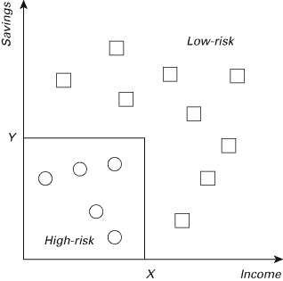

我们从规则中理解到，在满足前件的客户子集中——即收入低于 `X` **且** 储蓄低于 `Y` 的客户中——高风险客户多于低风险客户，因此他们成为高风险的概率更高；这就是为什么规则的后件以高风险作为标签。

在这个简单示例中，成为高风险只有一种方式，所有剩余情况均为低风险，因此一条规则就足够了。在另一个应用中，可能存在一个由多条 if-then 规则组成的 `rule base`，每条规则划定一个特定区域，每个类别使用这些规则的析取式来指定。成为高风险有多种方式，每种方式由一条规则指定，满足任意一条规则即可。

从数据中学习此类规则允许进行 `knowledge extraction`。规则是一个解释数据的简单模型，通过观察该模型，我们可以获得关于数据底层过程的解释。例如，一旦我们学会了区分低风险和高风险客户的判别式，我们就拥有了关于低风险客户属性的知识。然后我们可以利用这些信息更高效地定位潜在的低风险客户，例如通过定制化广告。

#### 专家系统

在机器学习成为常态之前，专家系统已然存在。20 世纪 70 年代提出并在 80 年代使用，它们是协助人类进行决策的计算机程序。

一个 `expert system` 由一个 `knowledge base` 和一个 `inference engine` 组成。知识表示为一组 if-then 规则，类似于我们之前讨论的规则，推理引擎使用逻辑推理规则进行演绎。规则是在咨询领域专家后编程的，并且是固定的。将领域知识转换为 if-then 规则的过程是手动的，因此困难且昂贵。推理引擎是用 Lisp 和 Prolog 等专门的编程语言编写的，这些语言特别适合逻辑推理。

在 20 世纪 80 年代的一段时间里，专家系统在世界范围内相当流行，不仅在美国（使用 Lisp），而且在欧洲（使用 Prolog）。日本还开展了第五代计算机系统项目，用于专家系统和人工智能（AI）的大规模并行架构。确实有一些应用，但领域相当有限，例如用于诊断传染病的 MYCIN（Buchanan and Shortliffe 1984）；商业系统也存在。

尽管进行了研究并引起了广泛兴趣，专家系统从未真正普及。基本上有两个原因。首先，知识库需要通过一个非常费力的过程手动创建；不存在从数据中学习。第二个原因是逻辑不适合表示现实世界。在现实生活中，事物不是非真即假，而是有真假程度：一个人不是要么老要么不老，而是随着年龄增长逐渐变老。逻辑规则也可能以不同程度的确定性适用：“如果 `X` 是鸟，`X` 会飞”大多是真的但不总是。

为了表示真值程度，提出了带有模糊隶属度、模糊规则和推理的 `fuzzy logic`，自诞生以来在各种应用中取得了一些成功（Zadeh 1965）。表示不确定性的另一种方法是使用概率论，正如我们在本书中所做的那样。

本书讨论的机器学习系统在决策制定方面以两种方式扩展了专家系统：首先，它们不需要编程，而是可以从示例中学习；其次，因为它们使用概率论，所以能更好地表示现实世界的设置，包括所有伴随的噪声、例外、歧义和由此产生的不确定性。

#### 期望值

当我们做决策时——例如，当我们选择类别之一时——我们可能是正确的，也可能是错误的。正确的决策未必同样好，错误的决策未必同样坏。在做贷款申请人的决策时，金融机构应同时考虑潜在收益和潜在损失。接受的低风险申请人增加利润，而拒绝的高风险申请人减少损失。被错误接受的高风险申请人造成损失，被错误拒绝的低风险申请人则是错失的利润机会。

在其他领域，如 `medical diagnosis`，情况要严峻得多，且远非对称。在这里，输入是我们掌握的关于患者的相关信息，类别是疾病。输入包含患者的年龄、性别、既往病史和当前症状。某些检查可能未对患者进行，这些输入将缺失。检查需要时间、成本高昂，且可能给患者带来不便，因此除非我们认为它们能提供有价值的信息，否则不想应用它们。

在医疗诊断中，错误的决策可能导致错误或无治疗，不同类型的错误后果不等。假设我们有一个系统收集患者信息，并基于这些信息决定患者是否患有某种疾病（例如某种癌症）。有两种可能性：患者患癌——称为阳性类——或不患癌——阴性类。


### 错误类型与决策制定

类似地，存在两类错误（见表 2）。如果系统预测患癌但患者实际上未患癌，这属于*假阳性*——系统错误地选择了阳性类别。这会导致不必要的治疗，既昂贵又给患者带来不便。如果系统预测无疾病但患者实际患病，这属于*假阴性*。假阴性的代价高于假阳性，因为患者将无法获得必要的治疗。鉴于假阴性的代价远大于假阳性，即使阳性类别的概率相对较小，我们也会选择阳性类别——启动进一步检查。这不同于预测抛硬币，我们会选择概率高于 ½ 的结果——正面或反面（因为两种可能的错误猜测后果同等严重）。

#### 表 2 决策制定中的不同错误类型

| | | Action | |
| --- | --- | --- | --- |
| Truth | | *选择阳性（开始治疗）* | *选择阴性（让患者出院）* | *总计* |
| *阳性（患者患癌）* | | TP：真阳性 | FN：假阴性 | P |
| *阴性（患者未患癌）* | | FP：假阳性 | TN：真阴性 | N |
| *总计* | | P′ | N′ | |

这是*期望值*计算的基础，我们不仅利用概率做决策，还考虑决策可能导致的损失或收益。尽管期望值计算在保险等许多领域频繁使用，但人们并不总是理性行事；如果总是理性，没人会买彩票！

在马克斯·弗里施的小说《*Homo Faber*》中，一位被蛇咬伤女孩的母亲被告知无需担心，因为蛇咬致死率仅 3%–10%。这位妇女愤怒地说：“如果我有一百个女儿……那我只会失去三到十个女儿。少得惊人！你说得很对”，接着又说，“我只有一个孩子。”在涉及伦理问题时，我们需谨慎使用期望值计算；稍后在自动驾驶汽车案例中，我们将回到自动化决策的伦理和法律层面 4。

如果假阳性和假阴性代价均高，第三种可能的行动是*拒绝*并推迟决策。例如，若计算机辅助诊断无法在两种结果间抉择，可选择拒绝，由人工专家裁决；专家可利用系统无法直接获取的额外信息。在自动邮件分拣机中，若系统无法识别信封上的数字邮政编码，邮政工人也可阅读地址。

在分类任务中，当假阳性和假阴性危害相当时，其和 `FP + FN` 即为误分类数。例如，某视觉识别系统区分汽车与坦克，假设汽车为阳性类别。则 `FP` 为被误判为汽车的坦克数，`FN` 为被误判为坦克的汽车数。二者之和除以图像总数，即 `(FP + FN)/(P + N)`，称为*分类错误率*；等价地，`(TP + TN)/(P + N)` 称为*分类准确率*。

在其他应用中，性能指标可能不同。设想一款通过声纹访问银行账户的应用。假阳性是被允许访问的冒名顶替者，假阴性是被拒服务的合法用户。前者危害远大于后者。*命中率*或*真阳性率*衡量被正确认证的合法用户比例 `TP/P`，*虚警率*或*假阳性率*衡量被错误认证的冒名顶替者比例 `FP/N`。

二者存在权衡。若修改分类器使其更倾向于选择阳性类别，会提高命中率，但也会增加虚警率风险。在决定选择哪个类别时，我们希望在尽可能降低虚警率的前提下最大化命中率。

在*信息检索*中，我们有查询（例如用关键词定义），需从数据库中检索匹配记录。例如，我们想用关键词“tiger”从图像数据库中检索老虎图像。此时，被检索的图像对应分配到阳性类别，未被检索的对应阴性类别。`TP` 对应被检索的老虎图像数，`FN` 对应数据库中存在但未被检索的老虎图像数。`FP` 是被检索但非老虎的图像数。

此场景下有两个性能指标。*精确率*是真阳性与所有检索实例之比，即 `TP/P' = TP/(TP + FP)`，表示检索实例中真正相关（匹配查询）的百分比。*召回率*是真阳性与所有阳性实例之比，即 `TP/P`，表示相关实例中实际被检索的百分比。

我们希望*精确率和召回率*均尽可能接近 1：若精确率为 1，所有检索记录可能相关，但仍可能有相关记录未被检索；若召回率为 1，所有相关记录均被检索，但也可能包含其他无关检索记录（见图 4）。同样可见精确率与召回率的权衡。我们可通过检索更多图像提高召回率，但这有降低精确率的风险。

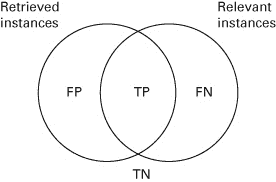

可见与分类不同，此处我们不关心真阴性；那些是正确未被检索的非老虎图像；在检索中我们不关心这些，其数量随数据库规模和范围变化而增减，不影响性能评估。

在其他领域（如医学）中，人们使用*灵敏度*和*特异性*指标。*灵敏度*等同于召回率，衡量我们检测阳性的能力。*特异性*衡量我们检测阴性的能力，即 `TN/N`，等于 `1 – 虚警率`。例如，我们开发了一种病毒检测试剂：灵敏度反映其捕捉感染者的能力，特异性反映其对未感染者保持“静默”（不报警）的能力。

本章讨论了机器学习的一般基础；下一章将介绍一种学习类型——监督学习，它用于人脸、语音等模式识别。

## 第 3 章 模式识别

### 学会阅读

不同的自动视觉识别任务复杂度各异。最简单的是*条形码*读取，信息以不同宽度的线条表示，这些形状易于识别。条形码是简单高效的技术：易于打印，也易于制造扫描仪读取；因此仍广泛使用。但条形码非自然表示，信息容量有限；近来提出二维矩阵条形码，可在更小区域编码更多信息；例如可用智能手机扫描指向网站的 QR 码。


工程中总是存在权衡。当任务难以解决时，我们可以通过对其施加约束来设计更高效的解决方案。例如，轮子是运输的一种非常好的解决方案，但它需要平坦的表面，因此也必须修建道路。受控环境使任务变得更容易。腿可以在各种地形上工作，但它们更难制造和控制，且能承载的重量显著减少。

**光学字符识别**（*Optical character recognition*）是从图像中识别印刷或手写字符。这比条形码更自然，因为没有使用额外的编码（即条形码中的条）。如果使用单一字体，每个字符只有一种书写方式；存在标准化字体，如 `OCR-A`，专门定义用于使自动识别更容易。

使用条形码或单一字体时，每个类存在单个模板，因此无需学习。对于每个字符，我们都有一个单一的原型，可以直接存储。它是该字符的理想图像，我们将看到的输入与所有原型逐一比较，并选择具有最佳匹配原型的类——这称为**模板匹配**（*template matching*）。印刷或传感过程中可能存在错误，但我们可以通过寻找最近匹配来进行识别。

如果我们有多种字体或手写体，同一个字符就有多种书写方式，我们不可能将所有这些都存储为可能的模板。相反，我们希望通过遍历同一字符的所有不同示例来“学习”该类，并找到涵盖所有示例的某种通用描述。

有趣的是，虽然书写是人类的发明，但我们没有涵盖所有“A”且不包含任何非“A”的“A”的形式化描述。由于没有它，我们从不同的书写者和字体中获取样本，并从这些示例中学习“A”性的定义。但虽然我们不知道是什么使图像成为类“A”的实例，但我们确信所有那些不同的“A”有某种共同点，这就是我们想从示例中提取的内容。

我们知道字符图像不仅仅是不同方向的随机点和笔画的集合，而是具有规律性，我们相信可以通过学习程序来捕捉。对于每个字符，我们在不同字体（印刷体）或书写（手写体）中看到示例并进行泛化；即找到一个字符所有示例共有的描述：“A”是组合特定笔画集的一种方式，“B”是另一种方式，依此类推。

使用拉丁字母及其变体时，印刷字符的识别相对容易；对于字符更多、带有重音符号和书写风格的字母表则比较棘手。在草书手写体中，字符是连在一起的，还有分割的额外问题。

存在许多不同的字体，人们有不同的手写风格。字符也可能大小不一、倾斜、用墨水印刷或用铅笔书写，因此许多可能的图像可能对应同一个字符。尽管进行了所有研究，但目前仍没有计算机程序能像人类那样准确地完成这项任务。这就是为什么仍在使用验证码（captcha），**验证码**（*captcha*）是单词或数字的损坏图像，需要输入以证明用户是人类而不是计算机程序。

### 匹配模型粒度

在机器学习中，目标是将模型拟合到数据。在理想情况下，我们有一个单一的**全局模型**（*global model*），适用于所有实例。对于所有汽车，正如我们在第 2 章所见，我们有一个单一的回归模型可用于估算价格。在这种情况下，模型使用全部训练数据进行训练，所有实例都会影响模型参数。在统计学中，这称为**参数估计**（*parametric estimation*）。

参数模型的优点在于简单——我们存储和计算单个模型——并且使用全部数据进行训练。不幸的是，它可能具有限制性，因为单一模型适用于所有情况的假设并非在所有应用中都成立。在某些任务中，我们可能有一组**局部模型**（*local models*），每个模型仅适用于特定类型的实例。这是**半参数估计**（*semi-parametric estimation*）。我们仍然有一个将输入映射到输出的模型，但仅在局部有效，对于不同类型的输入，我们有不同的模型。

例如，在估算二手车价格时，如果我们有理由相信这些不同类型汽车的折旧行为不同，我们可能有一个用于轿车的模型，另一个用于跑车，还有一个用于豪华车。在这种方法中，每个局部模型仅使用落入其范围内的训练数据进行训练——局部模型的数量是定义模型灵活性（因此也是复杂度）的超参数。

在某些应用中，甚至半参数假设也不成立；即数据可能缺乏清晰的结构，无法用少数局部模型来解释。在这种情况下，我们使用另一个极端的**非参数估计**（*nonparametric estimation*），我们假设不存在简单的模型，无论是全局还是局部。我们使用的唯一信息是最基本的假设——即相似的输入具有相似的输出。在这种情况下，我们没有将训练数据转换为模型参数的显式训练过程；相反，我们只保留训练数据作为过去案例的样本。

给定一个实例，我们找到与查询最相似的训练实例，并根据这些过去相似实例的已知输出计算输出。例如，给定一辆我们想估算价格的汽车，我们在所有训练实例中找到最相似的三辆车——基于我们使用的属性——然后计算这三辆车价格的平均值作为我们的估计。因为那些是在属性方面最相似的汽车，所以它们的价格也应该相似，这是合理的。这称为**K 近邻估计**（*k-nearest neighbor estimation*），此处 `k` 为 3。由于那些是最相似的过去“案例”，这种方法有时称为**基于案例的推理**（*case-based reasoning*）。最近邻算法很直观：相似的实例意味着相似的事物。我们都爱我们的邻居，因为他们和我们太像了——或者我们因为完全相同的原因而讨厌他们。

### 生成模型

一种最近在数据分析中变得非常流行的方法是考虑**生成模型**（*generative model*），它代表了我们关于数据如何生成的信念。我们假设存在一个具有若干**隐藏因果**（*hidden causes*），或**潜在因果**（*latent causes*）的隐藏模型，它们相互作用以生成我们观察到的数据。虽然我们观察到的数据可能看起来庞大而复杂，但它是通过一个由少数变量控制的过程产生的，这些变量就是隐藏因素，如果我们能以某种方式推断出这些因素，数据就可以用一种更简单的方式来表示和理解。如果适当选择并训练得当，这种简单的模型也能做出准确的预测。

以光学字符识别为例。从生成的角度来看，我们可以认为每个字符图像由两类因素组成：一是身份，即字符的标签；二是外观，即由书写或印刷过程引起的因素。


### 文本识别与模式识别概述

#### 印刷与手写文本的外观差异

在印刷文本中，外观部分可能源于字体；例如，Times Roman 字体的字符具有衬线且笔画宽度不一。字体属于美学范畴；在书法中，美学部分变得尤为突出。正如印刷文本中字体的选择，书写者的手写风格也会给手写文本带来差异。但这些由外观引入的特征不应大到导致身份识别混淆，否则我们称该人字迹潦草或难以辨认。外观还取决于书写材料（如钢笔与铅笔）和介质（如纸张与大理石板）1。

#### 不变性

印刷或手写字符的大小不一，这通常在归一化预处理阶段处理，将字符图像转换为固定尺寸——我们知道尺寸不影响身份。这称为**不变性**（*invariance*）。我们希望对尺寸不变（无论文本是 12pt 还是 18pt，内容相同）、对倾斜不变（如斜体文本）或对笔画宽度不变（如粗体字符）。但例如，我们不希望对大角度旋转不变：*q* 是旋转后的 *b*。

#### 身份识别与生成模型

在识别类别时，我们需要关注身份，找到代表身份的属性，并学习如何组合它们来表示字符。我们将所有与外观相关的属性——即书写者、美学、介质和传感——视为无关因素，并学会忽略它们。但请注意，在不同任务中，这些可能是重要因素；例如，在笔迹鉴定或签名识别中，书写者特有的属性变得重要，而非内容。

生成模型是**因果**的，因为它解释了隐藏因素如何生成数据。一旦训练好此类模型，我们可能想用于**诊断**，这意味着反向推理，即从观测到原因。医学领域是很好的例子：疾病是隐藏的原因；症状是患者的观测属性，如医学检测结果。从疾病到症状是因果方向——即疾病的作用；从症状到疾病是诊断——即医生的工作。一般情况下，诊断是从观测变量推断隐藏因子。

> 从疾病到症状是因果方向——即疾病的作用；从症状到疾病是诊断——即医生的工作。

#### 图形模型与贝叶斯网络

生成模型可表示为由节点组成的图，节点对应隐藏变量和观测变量，节点间的弧表示依赖关系（如因果关系）。此类**图形模型**（*graphical models*）之所以有趣，是因为它们允许问题的可视化表示，统计推断和估计过程可映射为计算机科学中已有高效过程的已知图操作（Koller and Friedman 2009）。

在图形模型中，因果链接从隐藏因子指向观测症状，而诊断有效地反转了链接方向。我们用条件概率建模依赖关系，例如，当谈论患流感的患者流鼻涕的条件概率时，我们沿因果方向推理：流感导致流鼻涕（以一定概率）。

若已知患者流鼻涕，需计算反方向的条件概率——即已知流鼻涕下患流感的概率（见图 5）。在概率论中，两个条件概率因**贝叶斯规则**（*Bayes’ rule*）2 而相关，这也是图形模型有时被称为**贝叶斯网络**（*Bayesian networks*）的原因。后续章节将回到贝叶斯估计；我们将看到模型参数也可包含在此类网络中，从而提供额外灵活性。

```
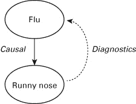
```

#### 语言信息的利用

阅读文本时，可利用的一个因素是语言信息。单词是字符序列，我们很少书写任意字符序列；而是从语言词汇表中选择单词。这具有优势：即使无法识别某字符，仍可读出单词。此类上下文依赖也可能发生在更高层级，即由语言的句法和语义规则定义的单词和句子之间。机器学习算法帮助我们学习此类依赖关系以进行自然语言处理，稍后将讨论。

### 人脸识别

在**人脸识别**（*face recognition*）中，输入是摄像头捕获的图像，类别为待识别人员。学习程序应学会将人脸图像匹配到其身份。此问题比光学字符识别更难，因为输入图像更大，人脸近似三维，姿态和光照差异导致图像显著变化。面部某些部分也可能被遮挡；眼镜遮住眼睛和眉毛，胡须遮住下巴。

正如字符识别，我们可认为有两组因素影响人脸图像：定义身份的特征，以及不影响身份但影响外观的特征，如发型；或表情（中性、高兴、愤怒等）。这些外观特征也可能源于影响捕获人脸图像的隐藏因素，如光源或姿态。若关注身份，我们希望学习仅使用第一类特征的人脸描述，学会对第二类特征不变。

然而，我们可能因其他任务对第二类特征感兴趣。识别面部表情可识别情绪，而非身份。例如，监控会议视频时，可能想追踪参与者情绪。同样，在线教育中，了解学生是否困惑或沮丧很重要，以便更好地调整教学进度。在**情感计算**（*affective computing*）中，这是一个迅速流行的领域，目标是让计算机系统能识别并考虑人类情感，即情绪的外在表现。

若目的是识别或鉴别人员（如安全用途），使用人脸图像只是可能性之一。**生物识别**（*Biometrics*）是利用生理和/或行为特征识别或鉴别人员。除人脸外，生理特征示例包括指纹、虹膜和掌纹；行为特征示例包括签名动态、声音、步态和击键。为提高决策准确性，可融合不同模态的输入。当存在多种不同输入源（不同于常规的照片、手写签名或密码识别程序）时，伪造（欺骗）变得更难，系统更准确，希望不对用户造成太多不便。

### 语音识别

在**语音识别**（*speech recognition*）中，输入是麦克风捕获的声学信号，类别为可发出的单词。此时需学习的关联是声学信号与某种语言单词之间的映射。


#### 语音识别与自然语言处理

正如我们可以将每个字符图像视为由不同方向的笔画等基本元素组成，单词也由*音素*构成，音素是基本的语音单位。在语音中，输入是*时间序列*的；单词作为这些音素的*序列*在时间中发出，且单词长短不一。

不同的人因年龄、性别或口音不同，对同一单词的发音也不同。同样，我们可以认为每个单词的声音由两组因素构成：一组与单词本身相关，另一组与说话人相关。语音识别使用第一类特征，而说话人认证使用第二类。顺便提一下，这第二类特征（与说话人相关的）不易识别或人工生成——这也是语音合成器的输出听起来依然“机械”的原因。3

正如在生物识别技术中一样，此处的研究者也依赖组合多源信息的思想。例如，为了识别语音，除了声学信息外，我们还可以利用说话人嘴唇的视频图像和说话时的口型。

#### 自然语言处理与翻译

在语音识别中，正如在光学字符识别中一样，集成考虑上下文信息的*语言模型*有显著帮助。数十年来对计算语言学中程序规则的研究表明，构建语言模型（定义语言的词汇、句法和语义规则）的最佳方法是从大量示例语料库中学习。机器学习在*自然语言处理*中的应用日益增多；近期综述可参阅 Hirschberg and Manning 2015，教材可参阅 Eisenstein 2019。

较简单的应用之一是*垃圾邮件过滤*，垃圾邮件生成器与过滤器双方不断寻找更巧妙的方法来相互博弈。这是一个两类分类问题：垃圾邮件与正常邮件。类似的应用是*文档分类*，即将文本文档分配到几个类别之一，如艺术、文化、政治等。

人脸是图像，口语句子是声学信号，那文本是什么？文本是字符序列，但字符由字母表定义，语言与字母表的关系并不直接。人类语言是一种极其复杂的信息表示形式，在不同层面上拥有词汇、句法和语义规则，以及幽默、讽刺等细微差别；更不用说句子几乎从不孤立存在或应被孤立解释，而是某个对话或一般语境的一部分。

表示文本最简单的方法是*词袋*表示法：预定义一个大型词汇表，然后用文档中出现的单词列表来表示每个文档。即在我们选定的词汇中，标记哪些出现在文档中，哪些没有。我们丢失了单词在文本中的位置信息，这视应用而定可能是好是坏。选择词汇表时，我们挑选能指示任务的单词；例如在垃圾邮件过滤中，“opportunity”（机会）和“offer”（优惠）等词具有区分度。有一个预处理步骤：移除后缀（如“-ing”、“-ed”），忽略无信息量的词（如“the”、“of”）。

近来，分析社交媒体消息已成为机器学习的重要应用领域。分析帖子以提取*热门话题*是其中之一：这意味着某种新颖的词组合突然大量出现。另一任务是*情感分析*，即判断客户对产品（如政治家）是否满意。为此，可定义包含指示两类（满意/不满意）词汇的词表，使用词袋表示法并学习它们如何影响类别描述。

或许机器学习最令人印象深刻的应用是*机器翻译*。经过数十年手工编码翻译规则的研究，最有前景的方法显而易见：提供大量双语文本对，让学习程序自动推断将一种语言映射到另一种语言的规则。在加拿大等双语国家，以及拥有多种官方语言的欧盟，相对容易找到经过精心翻译的两种或多种语言的相同文本。此类数据被机器学习翻译方法所使用。

第 4 章将讨论*深度学习*，它为此任务展现出巨大潜力，能自动学习处理自然语言所需的不同抽象层次。

#### 组合多个模型

在任何应用中，我们可以使用各种学习算法中的任意一种，与其试图挑选单一最佳算法，不如将它们全部使用并组合其预测。我们之前看到，每种算法都带有一组假设，我们称之为其归纳偏置，每种假设可能在数据的不同子集上成立。因此我们不想“把所有鸡蛋放在同一个篮子里”，而应全部使用。

为达到最佳准确率，我们组合的不同模型应各自表现良好，同时又要多样化以最好地互补。这就像现实生活中，最好的委员会由不同专业领域的人组成；如果他们都有相似的教育或背景，咨询多人就毫无意义。4

获得多样性的一种方法是让模型查看不同的信息源。我们已在生物识别中见过这一点：不同模型以不同特征（如人脸、指纹等）为输入；在语音识别中，除了声学语音信号外，我们还跟踪说话人的嘴唇。

如今，我们大部分数据是多媒体的，*多视角*模型可用于各种拥有不同但互补信息的传感器场景。在图像检索中，除了图像本身，我们可能还有文本描述或一组标签词。同时使用两个源可获得更好的检索性能。我们的智能设备（如智能手表和智能手机）配备了传感器，其读数可组合用于*活动识别*等目的。

#### 异常检测

机器学习的另一个应用领域是*异常检测*，旨在找出不遵守一般规则的实例——这些例外在特定语境下具有信息量。其思想是：典型实例共享可简单陈述的特征，不具备这些特征的实例则是非典型的。

托尔斯泰在《安娜·卡列尼娜》中写道：“幸福的家庭都是相似的，不幸的家庭各有各的不幸。”这在许多领域均成立，不仅限于十九世纪的俄罗斯家庭。例如在医学诊断中，我们同样可以说所有健康人都是相似的，而不健康的方式各不相同——每一种都是一种疾病。


在这种情况下，模型涵盖了典型实例，而任何落在其外部的实例都是异常。`outlier`（离群点）是指与样本中其他实例差异极大的实例。离群点可能表明系统的异常行为；例如，对于信用卡交易，它可能表明`fraud`（欺诈）；在图像中，离群点可能表明需要关注的`anomaly`（异常），例如肿瘤；在网络流量的情况下，它可能是黑客的入侵尝试；在医疗保健场景中，它可能表明患者正常行为的显著偏离。离群点也可能是记录错误（例如，由于传感器故障），应被检测并丢弃以获得可靠的统计数据。离群点也可能是一个新颖的、以前未见过但有效的案例，这正是相关术语`novelty detection`（新颖性检测）发挥作用的地方。例如，它可能是一种新型的有利可图的客户，表明市场上存在一个等待公司开发的新细分市场。

### 降维

在任何应用中，我们认为包含信息的观测数据属性被作为输入并用于决策。然而，其中某些特征实际上可能完全没有信息量，可以丢弃；例如，可能会发现二手车的颜色对其价格没有显著影响。或者，可能存在两个不同的属性相关且基本表达相同的含义（例如，二手车的生产年份和里程高度相关），因此保留其中一个可能就足够了。

我们有兴趣在单独的预处理步骤中进行`dimensionality reduction`（降维），原因有以下几点：

首先，在大多数学习算法中，模型的复杂度和训练算法都取决于输入属性的数量。这里的复杂度分为两类：时间复杂度，即我们进行多少计算；空间复杂度，即我们需要多少内存。减少输入的数量总是会同时降低这两者，但降低的幅度取决于具体的模型和学习算法。

其次，当某个输入被认为是不必要的时，我们节省了测量它的成本。例如，在医学诊断中，如果发现某种检测并非必要，我们就不做了，从而消除了金钱成本和患者的不适。

第三，在小数据集上，更简单的模型更稳健；也就是说，它们可以用更少的数据进行训练；或者用相同数量的数据训练时，其响应的方差更小，这意味着不确定性更低。

第四，当数据可以用更少的特征来解释时，我们就拥有了一个更简单、更易于解释的模型。

第五，当数据可以用很少（例如两个）维度来表示时，它可以被绘图并进行可视化分析，以观察结构和离群点，这同样有助于促进从数据中提取知识。一张图胜过千个点，如果我们能找到一种好的方式来展示数据，我们的视觉皮层就能完成剩下的工作，而无需任何模型拟合计算。

实现降维基本上有两种方法：特征选择和特征提取。在`feature selection`（特征选择）中，我们保留重要特征并丢弃不重要的特征。这基本上是一个子集选择过程，我们希望选择能带来最大性能的输入属性集的最小子集。特征选择最广泛使用的方法是`wrapper`（包装器）方法，我们在其中迭代地添加特征，直到不再有进一步的改进。特征选择器“包裹”在基础分类器或回归器周围，后者使用每个子集进行训练和测试。

在`feature extraction`（特征提取）中，我们定义从原始特征计算得出的新特征。这些新计算的特征数量较少，但仍保留了原始特征中的信息。这些综合的少数特征比任何原始属性都能更好地解释数据，有时它们可以被解释为隐藏或抽象的概念。

在投影方法中，每个新特征都是原始特征的线性组合；其中一种方法是`principal component analysis`（主成分分析），我们在其中寻找能保留数据最大方差量的新特征。如果方差大，数据分布广泛，使实例间的差异最为明显；而如果方差小，我们就会丢失数据实例间的差异。另一种方法，`linear discriminant analysis`（线性判别分析）是一种有监督的特征提取形式，其目的是找到能最大化类间分离度的新特征。

应该使用特征选择还是特征提取，取决于应用和特征的粒度。如果我们正在进行信用评分，并拥有客户年龄、收入、职业等特征，特征选择是有意义的。对于每个特征，我们可以单独判断它是否有信息量。但特征投影则讲不通：年龄、收入和职业的线性组合（加权和）意味着什么？另一方面，如果我们正在做人脸识别，输入是像素，特征选择就没有意义——单个像素本身不携带判别信息。在定义人脸时，查看像素的特定`combinations`（组合）更有意义，这正是特征提取所做的；例如，图像中的一个区域可能定义一种特定类型的眼睛或鼻子。

非线性降维方法超越了线性组合，能找到更好的特征；这是机器学习中最热门的主题之一。理想的特征集使用最少的数字最好地表示数据集中的（分类或回归）信息，这是一个编码过程。它也可以被视为一个抽象过程，因为这些新特征可以对应于更高层级的特征，以更简洁的方式表示数据。在第 4 章中，我们将讨论自编码器网络和深度学习，其中这种类型的非线性特征提取是在人工神经网络中学习的。

### 决策树

之前我们讨论了 if-then 规则，学习此类规则的一种方法是决策树。`decision tree`（决策树）是机器学习中最古老的方法之一，虽然在训练和预测方面都很简单，但在许多领域都很准确。树使用了自凯撒时代以来著名的“分而治之”策略，将复杂任务——例如统治高卢——划分为更简单的区域任务。出于同样的原因，即降低复杂度，树在计算机科学中被广泛用于各种应用。

前面我们介绍了非参数估计，正如你所记得的，其主要思想是找到一组与新查询最相似的邻近训练样本子集。在`k`-nearest-neighbor（k-近邻）算法中，我们通过将所有训练数据存储在内存中，逐一计算新测试查询与所有训练实例之间的相似度，并选择`k`个最相似的实例来实现这一点。当训练数据量大时，这是一项相当复杂的计算，当数据量大时可能不可行。

决策树通过对不同输入属性进行一系列测试来找到最相似的训练实例。树由决策节点和叶节点组成；从根节点开始，每个决策节点对输入应用一个分裂测试，根据结果，我们选择其中一个分支。当我们到达叶节点时，搜索停止，我们理解到已经找到了最相似的训练实例，并从这些实例中进行插值（见图 6）。

```
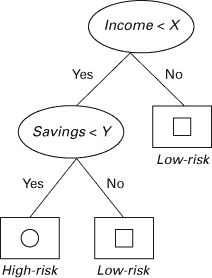
```


### 决策树

从根节点到叶节点的每条路径都对应于该路径上决策节点中测试条件的合取，这样的路径可以写成一条 if-then 规则。这是决策树的优势之一：树可以转换为 if-then 规则库，且这些规则易于解释。树是通过给定的训练数据训练而成的，其中分裂点被放置以划分具有最高“纯度”的区域，即每个区域包含的实例在输出方面是相似的。

决策树学习是非参数化的——我们没有一个预先假定结构的模型，仅更新该固定结构的参数；决策树按需生长，其大小取决于数据潜在问题的复杂性；对于简单任务，树较小，而困难任务则生长出较大的树。

根据决策节点中使用的分裂测试和叶节点处的插值方法，存在不同的决策树模型和学习算法；目前一种非常流行的方法是 `random forest`（随机森林），我们在从训练数据中随机选择的不同子集上训练许多决策树，并通过投票组合它们的预测。

树在各种机器学习应用中都取得了成功，与线性模型一样，决策树应被视为基准方法之一，在尝试任何更复杂的学习算法之前应先尝试。

#### 主动学习

在学习中，学习者了解自己知道什么和不知道什么至关重要。当训练好的模型做出预测时，如果它还能指示对该预测的确定性，将会很有帮助。

一种简单的方法是 `resampling`（重采样）。

假设我们想预测二手车的价格，并且拥有 100 个样本的数据集。让我们从中随机选择 80 个样本，使用它们训练第一个模型。然后我们可以从原始数据集中再选择另一个随机的 80 个样本子集来训练第二个模型。这两个数据集将相似但不完全相同，因此拟合出的两个模型在预测上会相似但不完全相同。

我们可以这样做十次，得到十个模型。稍后，当给定一辆新车时，我们可以将其里程作为输入提供给所有十个模型，获得十个预测。它们会略有不同，因为每个模型都是在略有不同的数据集上训练的。然后我们可以用这十个值的平均值作为点估计；我们也可以将这十个估计值从小到大排序，并定义一个区间，即所谓的 `confidence interval`（置信区间），从最小值到最大值（在实践中，最好丢弃两端的两个极端值，使用从第二个到第九个的区间）。该区间的大小是我们预测不确定性的度量；如果它很大，我们就知道我们的预测深受数据微小变化的影响，因此不太可靠。

这里的重要一点是数据点并非生而平等，我们的数据可能并非在整个输入空间中都是均匀的。例如，训练集中里程少于 100K 的车可能很多，但里程更多的车可能不多。

在估计的情况下，在我们拥有大量数据的输入空间区域，将会有许多训练样本，这意味着所有十个集合都将包含来自该区域的实例，这反过来意味着我们期望这十个模型在那里做出相似的预测，因此该区域内任何输入的置信区间将很小。在输入空间数据稀少的地方，十个模型的训练数据中可能都没有来自该区域的样本，因此这十个模型的预测可能会有较大差异，我们将得到一个较大的置信区间。

因此，置信区间大的地方，不确定性被认为很大，模型可以主动请求监督者提供该区域的训练样本。这称为 `active learning`（主动学习）。模型通过合成新输入来生成询问并请求提供标签，这很像学生在讲座中提问。

例如，在人工智能发展的早期，人们就意识到在分类中，最有信息量的样本是那些最接近当前类别边界估计的样本：`near miss`（近似反例）是一个看起来非常像正例但实际上是反例的实例（Winston 1975）。

机器学习中一个相关的研究领域称为 `computational learning theory`（计算学习理论），该领域致力于寻找普遍成立的、独立于特定学习任务的学习算法理论界限。例如，对于给定的模型和学习算法，我们可能想知道保证以足够高的概率实现至多一定误差所需的最小训练实例数量——这称为 `probably approximately correct learning`（概率近似正确学习，Valiant 1984）。

#### 学习排序

`Ranking`（排序/学习排序）是机器学习的一个应用领域，不同于回归或分类，它介于两者之间。在分类和回归中，对于每个实例，我们都有一个期望的输出绝对值；而在排序中，我们基于实例对进行训练，要求两个实例的输出顺序正确。

假设我们想为电影学习一个 `recommendation model`（推荐模型）。对于该任务，输入由电影的属性组成。输出是一个数值分数，衡量我们认为特定客户会多大程度喜欢特定电影。为了训练这样的模型，我们使用该客户过去的评分。如果我们知道客户过去更喜欢电影 `A` 而非电影 `B`，我们会进行训练，使得对于该客户，`A` 的估计分数确实高于 `B` 的估计分数。然后，当我们使用该模型根据最高分数进行推荐时，我们期望选择一部比 `B` 更类似于 `A` 的电影。

不像二手车价格那样有要求的数值，分数可以在任何范围内，只要顺序正确即可。训练数据不是以绝对值形式给出的，而是以这种排序约束的形式给出的（Liu 2011）。

我们可以在此指出排序器相对于分类器或回归器的优势和区别。如果用户将看过的电影评为喜欢与不喜欢，这将是一个二分类问题，可以使用分类器，但品味是细微的，二元评分难以获得。另一方面，如果人们在 1 到 10 的范围内为每部电影的喜爱程度打分，这将是一个回归问题，但这种数值很难分配。人们更自然、更容易说出在看过的两部电影中，他们更喜欢哪一部。在用所有这些对训练好排序器后，期望它生成满足所有这些约束的数值分数。

排序有许多应用。在搜索引擎中，给定查询时我们希望检索最相关的文档。当我们检索并显示当前前十个候选文档时，如果用户跳过前两个点击了第三个，我们就知道第三个本应比第一和第二个排名更高。这种 `click logs`（点击日志）被用来训练排序器。

#### 贝叶斯方法


### 贝叶斯估计与神经网络

### 贝叶斯估计

在某些应用和某些模型中，我们可能对参数的可能值有一些*先验信念*。当我们抛硬币时，我们期望它是一枚均匀硬币或接近均匀，因此我们期望正面朝上的概率接近 ½；在估算汽车价格时，我们期望里程数对价格有负面影响。贝叶斯方法允许我们在估计参数时考虑此类先验信念。5 *贝叶斯估计*的思想是将先验知识与数据结合起来，计算参数的*后验分布*。让我们看一个例子。

假设我们要估计人们点击公司网页上某个特定链接的概率；为此，我们收集了十位访客的样本，发现其中有六位点击了该链接。常规方法会认为概率是 0.6，并基于该值用于任何进一步的计算和处理。

现在我们可以看到，实际概率实际上可能是 0.5，只是恰巧在那个特定的十人样本中我们看到了六次点击。甚至有可能（尽管可能性小得多）实际概率是 0.1，只是发生了一个罕见事件，我们得到了六次点击。因此，我们从数据中真正能得到的不是单一数值（0.6），而是一系列可能的值，对于每个值我们还有一个数据支持程度的附加值；这就是我们所说的后验分布。一旦我们有了这样的后验分布，我们就使用所有（或合理子集的）可能值进行进一步计算，并使用它们的平均值，每个值按其可能性的大小加权。

当数据集较小时，贝叶斯方法特别有用。如果我们在 100 次试验中看到了 60 次点击，0.6 周围可能值的范围将小得多。

虽然贝叶斯方法灵活且有趣，但它有一个缺点：除简单场景和限制性假设外，必要的计算过于复杂。一种可能性是*近似*，即我们不使用难以处理的真实后验分布，而是使用一个相似但可控的分布。另一种可能性是*采样*，即我们不直接使用分布本身，而是从分布中生成有代表性的实例，并基于它们进行推断。这些流行方法——前者的*变分近似*，后者的*马尔可夫链蒙特卡洛*（MCMC）*采样*——是当前机器学习研究的重要方向之一。

贝叶斯方法允许我们在训练中融入先验信念。其中一种先验信念是潜在问题是平滑的，这使我们倾向于更简单的模型；请回顾第 2 章中关于奥卡姆剃刀和卡尼萨三角形的讨论。在*正则化*中，我们惩罚复杂性，在训练期间，除了最大化对数据的拟合外，我们还试图最小化模型复杂性。在学习过程中，我们还会摆脱那些使模型不必要地复杂且输出过于多变的参数。这意味着一种学习方案不仅涉及参数的调整，还涉及模型结构的变化。或者我们可以反其道而行之，当我们怀疑模型对于数据过于简单时，逐步增加复杂性。

在贝叶斯估计中使用这种*非参数*方法特别有趣，因为我们不再受某个参数模型类的约束，但模型复杂性也会动态变化以匹配数据中任务的复杂性（Orbanz and Teh 2010）。这意味着一个“无限大小”的模型，因为它可以像我们想要的那样复杂——它在学习时增长。

在许多领域表现良好的一个模型家族是受人脑启发的人工神经网络；在下一章中，我们将讨论此类网络如何按层组织，以及如何训练这种“深层”网络。

#### 神经网络与深度学习

##### 人工神经网络

我们的大脑使我们变得智能；我们看或听、学习和记忆、规划和行动，都归功于我们的大脑。在试图构建具有此类能力的机器时，我们直接的灵感来源是人脑，就像鸟类是我们早期飞行尝试的灵感来源一样。我们想做的是观察大脑如何工作，并试图理解它是如何完成其功能的。但我们想要一个独立于特定实现细节的解释——这就是我们在第 1 章讨论分析层次时所说的*计算理论*。如果我们能提取出这样一种抽象的数学描述，我们稍后就可以用工程师手头可用的资源来实现它——例如，用硅基芯片并靠电力运行。

早期制造飞行器的尝试失败了，直到我们理解了空气动力学理论；只有那时我们才能制造飞机。今天，我们将鸟类和飞机视为两种不同的飞行方式——我们现在称它们为飞机，而不是人造鸟，它们能做的比鸟更多；它们飞行距离更远，能载客或载货。我们的想法是为智能实现同样的目标，我们从大脑获取灵感开始。

人脑由大量处理单元组成，称为*神经元*，每个神经元通过称为*突触*的连接与大量其他神经元相连。神经元并行运行，并通过这些突触在彼此之间传递信息。人们认为处理是由神经元完成的，而记忆在于突触中，即神经元连接和相互影响的方式。

关于*神经网络*作为模拟计算模型的研究——神经元输出不是离散的 0 或 1，而是当它们被激活时，以一个连续值的频率放电——早在数字计算研究时期就已开始（McCulloch and Pitts 1943），但在数字计算机取得快速成功并广泛应用后，很长一段时间内基本未被注意。

在 20 世纪 60 年代，*感知机*模型被提出作为模式识别的模型（Rosenblatt 1962）。它是一个由人工神经元和突触连接组成的网络，其中每个神经元都有一个激活值，从神经元 `A` 到神经元 `B` 的连接有一个权重，定义了 `A` 对 `B` 的影响。如果突触是兴奋性的，当 `A` 活跃时，它也会尝试激活 `B`；如果突触是抑制性的，当 `A` 活跃时，它会尝试抑制 `B`。

在运行期间，每个神经元将所有与其形成突触的神经元的激活值按其突触权重加权求和，如果总激活值大于阈值，该神经元就会“放电”，其输出对应于该激活值；否则神经元保持静默。如果神经元放电，它会依次将其激活值发送给所有与其形成突触的神经元（见图 7）。

感知机基本上在做决策前计算加权和，这可以看作是我们之前讨论的线性模型的一种变体实现方式。此类神经元可以组织成层，其中一层中的所有神经元从前一层的所有神经元获取输入并并行计算其值，这些值一起被送给下一层的所有神经元——这称为*多层感知机*。


一些神经元是感觉神经元，它们从环境中获取数值，例如来自感知到的图像，这类似于视网膜中的感受器。然后这些数值被传递给其他神经元，随着激活在网络中传播，这些神经元在连续的层中对它们进行进一步处理。最后，有输出神经元做出最终决策，并通过执行器执行动作——例如，移动手臂、发出一个词等。

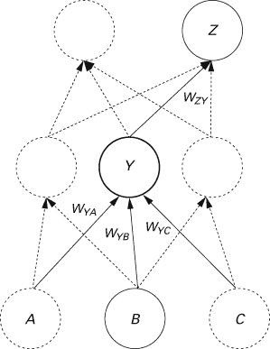

#### 神经网络学习算法

在神经网络中，学习算法调整神经元之间的连接权重。一种早期算法由 Hebb (1949) 提出，称为 `Hebbian learning`（赫布学习）规则：如果两个神经元同时活跃，它们之间的权重就会得到加强——突触权重实际上学习了这两个神经元之间的相关性。

假设我们有一个神经元检查视野中是否有圆，另一个神经元检查视野中是否有数字六“6”。每当我们看到一个六——或者在学习阅读时被告知那是一个六——我们也会看到一个圆，因此它们之间的连接得到加强；但圆神经元与数字七“7”神经元之间的连接不会得到加强，因为当我们看到其中一个时，不会同时看到另一个。所以下次我们在视野中看到一个圆时，这会增加数字六神经元的激活值，但会降低数字七神经元的激活值，使“六”比“七”成为更可能的假设。

在某些应用中，网络中的某些神经元被明确指定为输入单元，某些被指定为输出单元。我们有一个训练集，包含输入样本及其监督者指定的相应正确输出值——例如，在估算二手车价格时，我们将汽车属性作为输入，价格作为输出。在这种监督学习情况下，我们将输入单元钳制为训练集中的输入值，让活动根据权重和网络结构在网络中传播，然后查看输出单元计算出的值。

我们定义一个 `error function`（误差函数），为网络对某输入估计的实际输出与训练集中监督者指定的要求值之间差值的总和；在神经网络训练中，针对每个训练样例，我们略微更新连接权重，以降低该实例的误差。降低误差意味着下次遇到相同或相似输入时，估计输出将略微更接近其正确值。`Theoretically speaking`（理论上讲），这无非就是我们在第 2 章讨论的传统回归，只不过这里的模型是作为神经元和连接组成的神经网络被 `implemented`（实现）的。

这是神经网络学习算法的一个重要特征，即它们可以 `online`（在线）学习，当我们逐个看到训练实例时，通过对连接权重进行小幅更新来学习。在 `batch`（批量）学习中，我们拥有整个数据集，并一次性使用全部数据进行训练。一种当今流行的方法涉及 `mini batches`（小批量），即在每次更新中使用少量实例集合。

目前随着数据集变得越来越大，在线学习很有吸引力，因为它不需要收集和存储所有数据；我们可以在流式数据场景中，一次仅使用一个或少数几个样例进行学习。此外，如果数据的底层特征缓慢变化——通常确实如此——在线学习可以无缝适应，无需停止、收集新数据并重新训练。

#### 感知机能做什么和不能做什么

尽管感知机在许多任务中取得了成功——请记住线性模型在许多领域都表现得相当好——但有一些任务无法由感知机实现 (Minsky and Papert 1969)。其中最著名的是异或 (XOR) 问题：

在逻辑中，有两种 OR（或），即包含性或和异或。在日常语言中，当我们说“去机场，我将坐公交车或火车”时，我们指的是异或。有两种情况，同一时间只能有一种为真。为了表示包含性或，我们使用“和/或”结构，如“这个秋天，我将选修数学 101 和/或物理 101”。换句话说，我将选修数学 101、物理 101，或两者都选。

虽然包含性或可以由感知机实现，但异或不能。原因不难理解：如果你有两种情况，例如公交车和火车，并且你希望任意一种为真就足够，你需要给它们每一个一个大于阈值的权重，这样当任意一个为真时神经元就会激发。但当两者都为真时，总激活值将高出两倍，无法低于阈值。

尽管当时已知像异或这样的任务 `can`（可以）使用多层感知机来实现，但不知道如何训练这种网络；感知机无法实现像异或这样简单的任务——而这可以用少量（数字）逻辑门轻松实现——这一事实导致了失望，并使神经网络研究在很长一段时间内被放弃，世界上仅有少数地方例外。直到 20 世纪 80 年代中期，`backpropagation`（反向传播）算法被提出用于训练多层感知机——这一想法自 20 世纪 60 年代和 70 年代以来就已存在，但长期未被重视——才使得人们对它的兴趣复苏 (Rumelhart, Hinton, and Williams 1986)。

#### 用于学习时间的循环网络

并非所有人工神经网络都是前馈的；也存在 `recurrent networks`（循环网络），除了层与层之间的连接外，神经元还与同一层中的神经元（包括自身），甚至与前面层中的神经元相连。每次激活计算都会导致一定的延迟，因此 `recurrent connections`（循环连接）充当了上下文信息的 `short-term memory`（短时记忆），让网络能够记住过去。

假设输入神经元 `A` 连接到神经元 `X`，并且 `X` 到自身也有一个循环连接（见图 8）。该连接的效果是：在时间 `t`，`X` 的值将取决于时间 `t` 的输入 `A`，并且由于 `X` 到自身的循环连接，也将取决于时间 `t` – 1 时 `X` 的值。在下一个时间步，时间 `t` + 1 时的 `X` 将取决于时间 `t` + 1 时的输入 `A`，以及时间 `t` 时的 `X`（先前使用时间 `t` 时的 `A` 和时间 `t` – 1 时的 `X` 计算得出），依此类推。这样，`X` 在任意时刻的值将取决于直到那时为止看到的所有输入。

如果我们将网络在某一时刻所有神经元值的集合定义为网络的状态，循环连接允许当前状态不仅取决于当前输入，还取决于由先前输入计算得出的先前时间步的网络状态。因此，例如，如果我们逐个词地看到一个句子，循环允许句子中之前的单词以浓缩和抽象的形式保留在这一短时记忆中，从而在处理当前单词时被考虑在内。网络的架构和循环连接的设置方式，决定了过去在多大程度上、以何种方式影响当前输出。

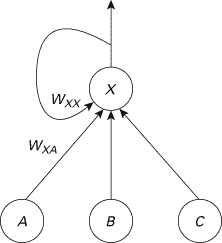

循环神经网络被用于许多时间维度很重要的任务，如语音或语言处理，我们希望识别的是序列。在将文本从一种语言翻译成另一种语言时，不仅看到的输入，而且生成的输出也是一个序列。

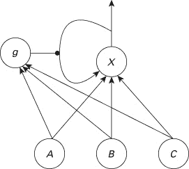


### 更复杂的循环连接

更复杂类型的循环连接也是可能的。在长短期记忆（`LSTM`）单元（Hochreiter 和 Schmidhuber，1997）中，存在一个“遗忘门”，这种效应可以在此开启或关闭（见图 9）。因此，根据门开启和关闭的位置及方式，网络可以选择性地决定从过去记住什么。

例如，比较以下两个句子：

物主代词是 "his" 还是 "her" 取决于主语的性别，即进入房间的人是男性还是女性。因此，在逐词生成此类句子时（例如生成翻译时），网络应在处理句首的主语词时存储该性别信息，并保持其完整（不受后续无关词汇影响），直到生成正确的代词。

### 认知科学中的连接主义模型

人工神经网络模型在认知心理学和认知科学中被称为 `connectionist`（连接主义）或 `parallel distributed processing`（`PDP`，并行分布式处理）模型（Feldman 和 Ballard，1982；Rumelhart、McClelland 和 PDP 研究组，1986）。其核心思想是：神经元对应概念，神经元的激活对应我们当前对该概念真实性的信念程度。连接对应概念间的约束或依赖关系：如果两个概念同时出现（例如，圆形和 '6' 的神经元之间），连接具有正权重且是兴奋性的；如果两个概念互斥（例如，圆形和 '7' 的神经元之间），连接具有负权重且是抑制性的。

被观测数值的神经元（例如，通过感知环境）会影响其连接的神经元，后者又会影响它们连接的神经元，以此类推。这种贯穿整个网络的活动传播，导致神经元输出达到一种满足连接所定义约束的状态。

连接主义模型的基本思想是：智力是一种 `emergent property`（涌现属性），高级任务（如模式识别或联想）作为相互连接的简单处理单元进行这种活动传播的基本操作的结果而自动产生。同样，学习也是在连接层面通过简单操作完成的，例如根据 Hebb 规则，而无需高级程序员的介入。

连接主义网络关注生物学合理性，但仍是大脑的抽象模型；例如，大脑中极不可能为每个概念都有一个实际的神经元——这就是 `grandmother cell`（祖母细胞）理论，该理论认为我的大脑中有一个神经元，仅当我看到或想到我的祖母时才被激活——这是一种 `local representation`（局部表示）。已知大脑中的神经元会死亡并诞生新神经元，因此更合理的观点是：概念在神经元簇上具有 `distributed representation`（分布式表示），并拥有足够的冗余度，使得概念能在底层神经元结构发生物理变化时依然存续。

智力是一种 `emergent property`（涌现属性），识别等任务作为简单处理单元网络上活动传播的结果而自动产生。

### 神经网络作为并行处理的范式

自 20 世纪 80 年代以来，拥有数千个处理器的计算机系统已商业化。然而，此类并行架构的软件发展速度并未像硬件那样迅速。原因在于，直到那时，我们几乎所有的计算理论都基于串行、单处理器机器。我们无法充分发挥并行机器的性能，因为我们无法高效地为它们编程。

`parallel processing`（并行处理）主要有两种范式。在 `single instruction, multiple data`（`SIMD`，单指令多数据流）机器中，所有处理器执行相同指令但处理不同数据片段。在 `multiple instruction, multiple data`（`MIMD`，多指令多数据流）机器中，不同处理器可在不同数据上执行不同指令。`SIMD` 机器更易编程，因为只需编写一个程序。然而，问题很少具有如此规则的结构以便在 `SIMD` 机器上并行化。`MIMD` 机器更通用，但为所有单独处理器编写独立程序并非易事；还会出现与同步、处理器间数据传输等相关的额外问题。`SIMD` 机器也更易构建，若采用 `SIMD` 架构可构建拥有更多处理器的机器。在 `MIMD` 机器中，处理器更复杂，必须构建更复杂的通信网络以便处理器任意交换数据。

假设我们拥有的机器，其处理器比 `SIMD` 处理器稍复杂，但不如 `MIMD` 处理器复杂。假设我们有简单的处理器，带有少量可存储参数的局部存储器。每个处理器实现固定功能并执行与 `SIMD` 处理器相同的指令；但通过向其局部存储器加载不同的值，每个处理器可执行不同操作，整体运算可分布在这些处理器上。我们将得到可称为 `neural instruction, multiple data`（`NIMD`，神经指令多数据流）机器，其中每个处理器对应一个神经元，局部参数对应其突触权重，整体结构即为神经网络。若每个处理器实现的功能简单且局部存储器较小，则可在单芯片上集成许多此类处理器。

现在的问题是如何将任务分布到此类处理器网络上，并确定局部参数值。学习由此发挥作用：若此类机器能从示例中学习，我们无需自行编程并确定参数值。

因此，人工神经网络是利用当前技术可构建的并行硬件的一种方式——得益于学习——它们无需编程。因此，我们也省去了为它们编程的精力。

### 多层中的分层表示

前面我们提到，单层感知机无法实现某些任务（如 `XOR`），而多层则不存在此类限制。实际上，已证明多层感知机是 `universal approximator`（通用逼近器），即给予足够神经元，它可以任意精度逼近任何函数——尽管通过训练使其完成这一点并不总是直接了当。

感知机算法仅能训练单层网络，但 20 世纪 80 年代 `backpropagation algorithm`（反向传播算法）的发明使得训练多层感知机成为可能，这在各个领域引发了大量应用，显著加速了从认知科学到计算机科学和工程等众多领域的神经网络研究。

人工神经网络是利用当前技术可构建的并行硬件的一种方式——得益于学习——它们无需编程。

多层网络符合直觉，因为它对应着操作层：我们从原始输入开始，逐步执行更复杂的变换，直到得到输出。


### 神经网络中的层级特征学习

例如，在图像识别中，我们将图像像素作为基本输入，并作为第一层的输入。下一层中的神经元将这些组合起来，以检测基本的图像描述符，例如不同方向的笔画和边缘。后续层将这些组合形成更长的线条、弧线和角点。再后面的层将它们组合以学习更复杂的形状，如圆形、正方形等。这些又与更多处理层结合，来表示我们想要学习的对象，如人脸或手写字符。

一层中的每个神经元都根据其下一层检测到的更简单模式来定义一个更复杂的特征。这些中间的特征检测单元被称为**隐藏单元**，因为它们对应于未直接观察到的隐藏属性，而是根据观察到的内容来定义。这些连续的隐藏单元层对应于不断增加的抽象层，我们从原始数据（如像素）开始，最终得到抽象概念（如数字或人脸）。

有趣的是，视觉皮层中似乎也在运行类似的机制。在对猫的实验中，Hubel 和 Wiesel（后来因在视觉神经生理学方面的工作而获得 1981 年诺贝尔奖）表明，存在**简单细胞**，它们对视野中特定位置特定方向的线条做出反应，而这些又反馈给**复杂细胞**和**超复杂细胞**以检测更复杂的形状（Hubel 1995）——尽管关于后续层发生的事情知之甚少。

在网络上强加这种结构意味着对输入做出假设，例如依赖关系。例如，在视觉中，我们知道附近的像素是相关的，并且存在局部特征，如边缘和角点。任何对象（如手写数字）都可以定义为此类基元的组合。我们知道，因为视觉场景平滑变化，附近的像素倾向于属于同一对象，而突然变化的地方——边缘——具有信息量，因为它很罕见。

同样，在语音中，局部性体现在时间上，时间上接近的输入可以被分组为语音基元。通过组合这些基元，可以定义更长的语音单位，即语音音素。它们反过来可以组合定义单词，单词又可以组合为句子。

在这种情况下，设计层间连接时，单元不连接到所有输入单元，因为并非所有输入都相关。相反，我们定义在输入空间上定义一个窗口、且仅连接到一小部分**局部**输入的单元。这减少了连接数量，从而减少了需要学习的参数数量。这种结构称为**卷积神经网络**，其中每个单元的操作被视为其输入与其权重的卷积——即匹配（Le Cun et al. 1989）。一种早期的类似架构是**新认知机**（Fukushima 1980）。

其思路是在连续层中重复此过程，其中每一层仅连接到下方少量的局部单元。每一层**特征提取器**通过在输入空间稍大的部分中组合下层特征，来检查稍微复杂的特征，直到到达查看整个输入的输出层。特征提取还实现了**降维**，因为虽然我们观察到的原始属性可能很多，但我们从数据中提取并用于计算输出的重要隐藏特征通常少得多。

这种多层网络是**分层锥**的一个例子，随着我们向上遍历网络，特征变得更复杂、更抽象、数量更少，直到到达类别（见图 10）。

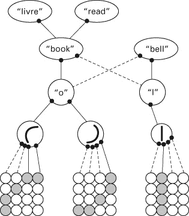

### 深度学习

在过去半个世纪的计算机视觉中，已进行了大量研究以寻找用于准确分类的最佳特征，并提出了许多不同的图像滤波器、变换和卷积来手动实现此类特征提取器。

尽管这些方法取得了一些成功，但最近学习算法凭借大数据和强大的计算机实现了更高的准确性。在极少假设和极少人工干预的情况下，类似于分层锥的结构正从大量数据中自动学习。这些学习方法特别有趣，因为它们通过学习，不针对任何特定任务固定，可用于各种应用。它们既学习隐藏特征提取器，也学习如何最佳地组合它们以定义输出。

这就是**深度神经网络**背后的思想：从原始输入开始，每个隐藏层组合其前一层中的值，并学习输入的更复杂函数。隐藏单元值不是 0 或 1 而是连续的这一事实，允许对相似输入进行更精细和分级的表示（例如，如果我们在小块区域看到的看起来像角点但不完全是，该区域角点检测隐藏单元的输出将是 0.7 等）。连续层对应于更抽象的表示，直到到达最终层，在那里输出是根据这些最抽象的概念学习的。

我们在卷积神经网络中看到了一个例子：从像素开始，到边缘，然后到角点，依此类推，直到得到一个数字。在这样的网络中，需要一些用户知识来定义连接性和整体架构。考虑一个人脸识别网络，输入是图像像素。如果每个隐藏单元都连接到**所有**像素，网络就不知道输入是人脸图像，甚至不知道输入是二维的——输入只是一组值。使用卷积网络，其中隐藏单元接收局部二维补丁，是一种输入这种局部性信息的方式，以便学习正确的抽象。

在**深度学习**中，其思想是在最少人工贡献的情况下学习抽象程度不断增加的特征层级（Goodfellow et al. 2016; LeCun, Bengio, and Hinton 2015; Schmidhuber 2015）。这是因为在大多数应用中，我们不知道输入中存在什么结构，尤其是当我们向上走、相应概念变得“隐藏”时。因此，任何类型的依赖关系都应在训练期间从大量示例样本中自动发现。正是这种从数据中提取隐藏依赖关系、模式或规律，使得抽象和学习通用描述成为可能。

在第 2 章讨论将模型拟合到数字序列的示例时，我们看到随着序列变得更复杂，我们需要更灵活的模型来进行拟合。学习基本上是一个将学习器模型的复杂度与数据底层任务的复杂度相匹配的过程。神经网络的表示能力取决于其层数和每层的单元数，因此，随着我们想要学习的任务变得复杂，我们需要具有更多层和单元的更深层网络。

训练具有多个隐藏层的网络既困难又缓慢，因为输出端的误差需要反向传播以更新所有前面层的权重，并且当参数很多时会存在干扰。在卷积网络中，每个单元仅输入给前面的一小部分单元，并输出给后面的一小部分单元，因此干扰较少，训练可以更快完成。


### 深度学习方法

深度学习方法之所以具有吸引力，主要是因为它们需要较少的人工干预。我们不需要精心设计合适的特征或适当的变换。一旦我们拥有数据——如今我们拥有“大”数据——以及足够的计算资源——如今我们拥有成千上万个处理器的数据中心——我们只需等待，让学习算法自行发现一切必要的东西。

近年来推动深度学习研究的另一个重要因素是软件库的可用性，这些库允许非常轻松地编写深度神经网络代码。这些库还能高效地利用并行硬件，从而允许非常快速地测试不同的网络架构。

深度学习所依赖的、抽象程度逐层递增的多层思想是直观的。不仅在视觉领域——如手写数字或人脸图像——而且在许多应用中，我们都可以设想出这种抽象层次。发现这些抽象表示非常有用，不仅用于预测，还因为抽象能让我们更好地描述和理解问题。

#### 学习隐藏表示

一种特殊的多层网络是 `autoencoder`（自编码器），其期望输出被设定为等于输入，且网络呈沙漏形状，中间层的隐藏单元比输入和输出层的少。这种网络由两部分组成：第一部分从输入到隐藏层，实现 `encoder`（编码器）阶段，将高维输入压缩为由较少隐藏单元的值表示的形式。第二部分从隐藏层到输出，实现 `decoder`（解码器）阶段，接收隐藏层中的低维表示，并在输出端重构出高维输入（见图 11）。

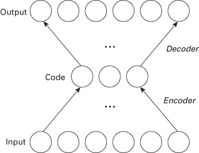

为了使网络能在其输出单元处重构输入，作为瓶颈的那些少量隐藏单元必须能够提取出最大程度保留信息的特征。`autoencoder` 是无监督的；这些隐藏单元在没有任何监督的情况下自行学习，以找到输入的良好编码——一种简短、压缩的描述，提取最重要的特征并忽略无关内容，即噪声。

研究人员提出了基本 `autoencoder` 的扩展和不同用法。例如，图 11 所示的 `autoencoder` 在输入和隐藏单元之间只有一层连接，但在实践中，`deep`（深层）`autoencoder` 的 `encoder` 中可能有多层（其结构在 `decoder` 中镜像），以便学习更抽象的隐藏表示；例如，如果输入是图像，`encoder` 的前几层通常是卷积层。

一个有趣的变体是 `noisy autoencoder`（去噪自编码器），其目标是学习一种对输入扰动具有鲁棒性的隐藏表示。假设我们有人脸图像，发现有些人戴眼镜遮挡了眼睛，这会干扰识别。我们的做法是使用一个 `autoencoder`，输入同一个人的两张图片，一张戴眼镜，一张不戴，并将不戴眼镜的图片设为两者的期望输出。为了能为两者生成相同的输出，`encoder` 必须学会为两者生成相同的编码，这意味着它必须学会丢弃眼镜遮挡的影响。`encoder` 生成的这种表示随后可被送给人脸识别器，后者便能在戴眼镜的情况下做出决策。

这可以针对我们希望获得不变性的任何输入扰动来完成，例如小幅度的旋转或平移。也就是说，如果你有一个输入 `x` 及其扰动版本 `x*`，并将 `x` 设为两者的期望输出，假设网络足够大且看到足够多的训练样本，网络将学会生成一种对该类扰动具有不变性的隐藏表示。

一般思想是：如果我们有两个不同的输入，但为它们设定相同的期望输出，`encoder` 将被迫学会为这两个输入生成相同或非常相似的编码。该思想的一个应用是在自然语言处理中学习词表示。这是一个对优秀特征提取器（即优秀的隐藏表示）需求最为明显的领域。研究人员曾致力于预定义数据库，称为 `ontologies`（本体），用于表示语言中词与词之间的关系，这些数据库有一定成效；但最终证明，最好的方法还是从大量数据中学习这些关系。

在 `word2vec` 网络中，其架构与 `autoencoder` 相同，输出是一个词，输入是该词的上下文中的一个词，即同一句子中附近的词之一（Mikolov 等人，2013）。这种训练的结果是：如果两个词出现在相同或非常相似的上下文中，`encoder` 将为它们生成相似的编码。

例如，考虑以下句子：

> 如果我们遍历一个非常大的句子语料库，极有可能也会找到非常相似的句子，只是将“Paris”（巴黎）替换为“Berlin”（柏林）、"Rome"（罗马）等。我们将会有许多关于城市的句子，它们几乎完全相同，唯一的区别在于城市名称。这将使所有这些城市的编码（`encoder` 输出）变得相似，因为需要从它们中解码出相同的上下文词。

现在考虑这个句子：

> 同样，我们将会有许多相似的句子，将“French”（法语）替换为“German”（德语），并将“Paris”替换为“Berlin”。这将导致为“French”和“German”生成相似的编码，但“German”与“Berlin”之间的表示关系也将与“French”与“Paris”之间的相同。这引出了所谓的 `vector algebra`（向量代数）：因为编码是数字，我们可以对它们进行算术运算。

假设 `vec("Paris")` 表示“Paris”的学习编码（见图 12）。训练后，我们期望 `vec("Paris")` 和 `vec("Berlin")` 相近，`vec("French")` 和 `vec("German")` 也在编码空间的其他部分相近，但我们也期望它们的关系相似。即我们期望 `vec("German") – vec("Berlin")` 与 `vec("French") – vec("Paris")` 非常相似，以至于如果我们计算 `vec("German") – vec("Berlin") + vec("Paris")`，将得到一个非常接近 `vec("French")` 的编码。

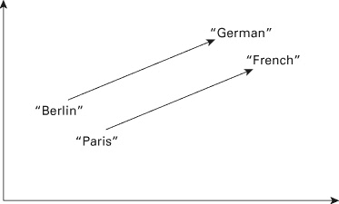

#### 端到端学习

在许多应用中，处理过程可以视为一种 `encoder-decoder`（编码器-解码器）结构，这正是我们之前讨论的 `autoencoder` 所具备的。

以机器翻译为例。从一个英语句子开始，通过从超大英语语料库中自动学习到的多层处理和抽象——编码英语的词汇、句法和语义规则——我们将得到最高层的抽象表示。现在考虑同一个句子的法语版本。这次从法语语料库中学习到的处理层次会有所不同，但如果两个句子意思相同，在最高层、与语言无关的抽象层面上，它们应具有非常相似的表示。

语言理解是一个编码过程，从给定句子中提取这种高层抽象表示；语言生成是一个解码过程，从这种高层表示合成自然语言句子。在翻译中，我们用源语言编码，用目标语言解码。在对话系统中，我们首先将问题编码到抽象层面，在该层面处理以形成抽象层面的响应，然后将其解码为响应句子。


这种结构的优势在于学习是端到端的。我们只需指定编码器的输入和解码器末端的期望输出；只需提供一组非常大的输入输出对数据集，中间所需的任何转换都会由深层网络的许多隐藏层自动学习。学习不仅调整编码器和解码器的参数，还指定了这两个模块之间的中间代码；这个中间代码是最适合生成相应输出的输入表示。

有许多有趣的端到端训练的深度神经网络应用，它们通常具有这种结构。早期模块分析输入并将其转换为中间表示，而后期模块学习从该中间表示中合成正确的输出。

一个例子是“展示并讲述”深度架构，它学习为图像生成说明文字（Vinyals 等人，2014 年）。编码器是一个卷积网络，接收一幅图像并在其多个层级中对其进行分析，以生成一个总结图像内容的代码。解码器是一个循环网络，根据该代码一次生成一个单词来生成说明文字。整个结构是端到端训练的，数据来自一大组图像和人工提供的说明文字配对示例。

另一个例子是学习玩 Atari 游戏的深度神经网络（Mnih 等人，2015 年）。输入是游戏画面，输出是正确的操纵杆动作。网络拥有早期的卷积层来分析图像以提取决定正确动作的最佳特征，以及后期的全连接层基于这些特征生成动作。

也可以使用在一个任务上训练的网络来帮助解决另一个任务，这被称为 `迁移学习`。假设我们想做人脸识别，但我们的数据集相对较小。假设我们已经有一个在某个非常大的图像数据集上训练好的非常深的卷积网络。我们的做法是取那个较大网络的前几层并复制它们，作为我们人脸识别网络的早期层。如果我们预期大问题所需的基本特征对人脸识别也有用，那么这样做是合理的。我们只训练人脸识别网络的后期层，这意味着参数会更少，我们可以使用较小的数据集来训练这些参数。

### 生成对抗网络

`生成对抗网络`（GAN）实际上由两个网络组成：一个生成器 `G` 和一个判别器 `D`（Goodfellow 等人，2014 年）。目标是学习一个生成器；`D` 仅用于训练 `G`。`G` 和 `D` 通常都是深度神经网络，但 GAN 是一种独立于这两个学习器如何实现的通用训练策略。

生成器的任务不同于回归器或分类器。假设我们有一组人脸训练集。我们希望从这些数据中学习人脸的结构，学得足够好，以便在需要时能生成一张新的人脸。输出将是一张看起来像人脸的图像，它头顶有头发，眼睛和鼻子相互之间位置合适，人脸应该是对称的，诸如此类，所有这些约束都要从数据中学习。同样，我们想要泛化能力，不想生成训练集中已有的人脸，而是想让新图像成为训练集之外某人的脸；那将是一个甚至不存在的人的人脸。或者假设我们有一组巴赫众赞歌的训练集，我们想从中训练一个生成器，以便在需要时能生成一首新的众赞歌。

在 GAN 中，生成器接收一个随机输入并将其转换为一个实例，例如一张人脸图像或一首众赞歌（见图 13）。不同的随机输入生成不同的实例。输入 `z` 具有某种预定义的分布，而 `G` 将每个 `z` 映射为一个候选 `x`。`G` 的作用是接收 `z` 的分布作为输入，并在其许多连续层中对其进行拉伸、平移、旋转等操作，使其输出尽可能接近 `x` 的分布。

由 `G` 生成的那些实例被标记为“假”。我们还有一组实际的人脸/众赞歌训练集，它们被标记为“真”。`D` 是一个二分类器，被训练用来区分假实例和真实例。`G` 就像一个伪造者，画赝品伦勃朗画作，而 `D` 就像一个善于识别赝品伦勃朗画作的艺术鉴赏家。

`G` 被训练生成会被 `D` 分类为真的假样本。两者一起训练；随着 `D` 变得更好，`G` 将利用该信息来理解 `D` 将什么分类为真，并学习生成类似的假样本。`D` 反过来会学会区分它们，这反过来又会迫使 `G` 生成更好的假样本，以此类推。

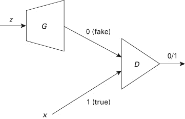

GAN 如今是机器学习中最热门的研究课题之一，并取得了非常令人印象深刻的结果。1 GAN 的一个主要问题是由于有两个网络，训练更加困难；另一个问题是生成器的优劣仍主要靠人工评估，因此 GAN 目前主要用于图像生成任务，因为在这些任务中可以进行人工评估。

直到现在，我们讨论的是有监督学习，即有输入和输出，目的是学习从输入到输出的映射。在下一章中，我们将讨论无监督学习，那里没有显式的输出，目的是学习输入空间中的规律性，学习什么类型的事物经常发生。

# 5

# 学习聚类与推荐

### 在数据中寻找群组

之前我们介绍了有监督学习，即有输入和输出——例如，汽车属性和价格——目的是学习从输入到输出的映射。监督者提供正确的数值，模型的参数被更新，使其输出尽可能接近这些期望输出。

现在我们要讨论 `无监督学习`，那里没有预定义的输出，因此也没有这样的监督者；我们只有输入数据。无监督学习的目的是发现输入中的规律性，看看通常会发生什么。输入空间有一种结构，使得某些模式比其他模式更频繁地出现，我们想看看一般会发生什么，什么不会发生。

无监督学习的一种方法是 `聚类`，其目的是寻找输入的簇或分组；在统计学中，这些被称为 `混合模型`。

对于一家公司而言，客户数据包含人口统计信息，如年龄、性别、邮政编码等，以及与公司的过往交易记录。公司可能想查看其客户画像的分布，了解哪种类型的客户经常出现。在这种情况下，聚类模型将属性相似的客户分配到同一组，为公司提供其客户的自然分组；这被称为 `客户细分`（见图 14）。一旦找到这些群组，公司可能会决定针对不同群组的策略，例如特定的服务和产品；这被称为 `客户关系管理`（CRM）。

这种分组还允许公司识别离群值，即那些与其他客户不同的人，这可能意味着市场上存在一个可以被公司进一步开发的利基市场，或者是那些需要进一步调查的客户，例如流失客户。


### 无监督学习与聚类分析

我们期望在许多不同领域中看到规律和模式以微小变化重复出现。将它们作为基元检测并忽略无关变化，也是一种压缩方式。例如，在图像中，输入由像素组成，但我们可以通过分析重复的图像模式（如纹理、物体等）来识别规律。这使得场景的描述更高级、更简单、更有用，并且比在像素级别压缩实现更好的压缩效果。扫描的文档页面并非随机的开/关像素，而是字符的位图图像；数据中存在结构，我们通过用不同方向的笔画来寻找数据的更短描述，从而利用这种冗余。更进一步，如果我们能发现这些笔画以特定方式组合形成字符，就可以仅使用字符编码，这比其图像更短。

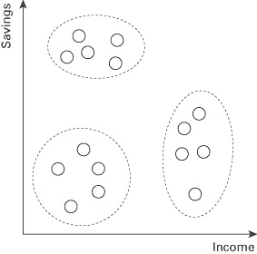

在**文档聚类**中，目标是将相似文档分组。例如，新闻报道可细分为政治、体育、时尚、艺术等类别。我们可以使用反映此类文档类型的词汇表，将文档表示为词袋，然后根据共享词汇的数量对文档进行分组。词汇表的选择当然至关重要。

无监督学习方法也用于**生物信息学**。我们基因组中的 DNA 是“生命蓝图”，是碱基序列，即 A、G、C 和 T。RNA 由 DNA 转录而来，蛋白质由 RNA 翻译而来。蛋白质构成了生命体并执行其功能。正如 DNA 是碱基序列，蛋白质是氨基酸序列（由碱基定义）。计算机科学在分子生物学中的一个应用领域是比对，即将一个序列与另一个序列匹配。这是一个困难的字符串匹配问题，因为字符串可能很长，有许多模板字符串需要匹配，且可能存在删除、插入或替换。

聚类用于学习**基序**，即在蛋白质中重复出现的氨基酸序列。基序受关注是因为它们可能对应于其表征序列中的结构或功能元素。打个比方，如果氨基酸是字母，蛋白质是句子，那么基序就像单词，即在不同句子中频繁出现的、具有特定含义的字母串。

聚类可作为**探索性数据分析**技术，用于识别数据中自然出现的群组。然后我们可以将这些群组标记为类别，并尝试对它们进行分类。公司可能对客户进行聚类以发现细分市场，然后针对特定目标（如客户流失）对其标记，并训练分类器预测新客户行为。但关键在于，可能存在专家无法预见的聚类，这就是无监督数据驱动分析的力量。

有时一个类由多个群组组成。考虑光学字符识别的情况。书写数字 7 有两种方式：美式写法是 `7`，而欧式写法中间有一横杠（以区分欧式手写体 `1` 顶部保留的小笔画）。在这种情况下，当样本包含来自两大洲的示例时，数字 7 的类别应表示为两个群组的并集/析取/混合。

语音识别中也存在类似示例：由于发音、口音、性别、年龄等差异，同一单词可有不同表达——“I say to-may-to, you say to-mah-to.”因此，当不存在单一通用方式时，所有这些不同方式都应作为同等有效的替代方案表示，以保证统计正确性。

聚类算法根据实例的相似性对实例进行分组，相似性通过输入表示（即输入属性列表）计算，实例间的相似性通过组合这些属性的相似性来度量。在某些应用中，我们可以直接根据原始数据结构定义实例间的相似性度量，而无需显式生成属性列表并计算其上的相似性。

考虑网页聚类。除了文本字段，还可使用元信息（或头部信息）的相似性，如标题或关键词，或链接到或被这两个网页链接的公共网页数量。这比基于网页文本的词袋表示计算出的相似性度量好得多。使用更适合应用的相似性度量（如果可定义）能带来更好的聚类结果；这是**谱聚类**的基本思想。

这种特定应用的相似性表示在监督学习应用中也很流行，通常归类为**核函数**。**支持向量机**（Vapnik 1998）就是这样一种用于分类和回归的学习算法。

也可以进行**层次聚类**，生成树结构而非扁平聚类列表，树中不同粒度层级包含聚类，较高层级的聚类细分为较小的聚类（见图 15）。我们从生物学研究中熟悉这种聚类树——最著名的是林奈分类法——或人类语言。将聚类细分为更小聚类的一种解释归因于**系统发育**，即进化变化——微小突变随时间逐渐累积，直到物种（或语言）分裂为两个——但在其他应用中，相似性的原因可能不同。

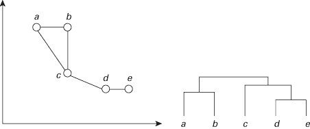

聚类特别是无监督学习的总体目标，是发现数据中的结构。在监督学习（如分类）中，这种结构由监督者施加，监督者定义不同类别并用这些类别标记训练数据中的实例。监督者提供的这种额外信息当然有用，但我们应始终确保它不成为偏差来源或强加人为边界。还存在标记错误的风险，称为“教师噪声”。

无监督学习是重要研究领域，因为未标记数据更容易、更廉价地获取。对于语音识别，脱口秀电台是未标记语音数据来源；语音非随机声音序列，而是特定声音序列频繁重复，即该语言中的单词。思路是从未标记数据中提取基本特征并学习典型模式，随后可为不同目的标记。婴儿头几年四处观看，在各种条件下反复看到事物、物体、面孔，据推测他们在此期间学习基本特征提取器及其典型组合形成物体的方式。后来学习语言时，他们为这些事物学习名称。

聚类特别是无监督学习的总体目标，是通过提取基本特征并学习典型模式，发现数据中的结构。

#### 推荐系统


# 6

# 学会采取行动

### 强化学习

在第 1 章中，我们讨论了用于预测客户行为的*推荐系统*作为机器学习的一个应用。给定一个庞大的客户交易数据集，我们可以找到形式为“购买 *X* 的人也有可能购买 *Y*”的*关联规则*。这样的规则意味着在购买 *X* 的客户中，很大一部分也购买了 *Y*。因此，如果我们发现一个购买了 *X* 但未购买 *Y* 的客户，我们可以将其作为潜在的 *Y* 客户进行定位。*X* 和 *Y* 可以是产品、作者、待访问的城市、待观看的视频等；我们每天都能看到许多此类推荐的例子，尤其是在网上冲浪时。

尽管这种定位方法经常被使用，并且已经提出了高效的算法来从超大数据集中学习此类规则，但如今提出了一些利用*生成模型*的有趣算法。

请记住，在构建生成模型时，我们会思考我们认为数据是如何生成的。因此，在客户行为方面，我们会考虑影响这种行为的原因。我们知道人们不是随机购买东西的。他们的购买取决于许多因素，例如家庭构成——即他们与多少人同住、性别、年龄——以及他们的收入、品味（而品味又是其他因素如出生地的结果）等。虽然一些公司拥有会员卡并收集其中一些信息，但在实践中，大多数这些因素是未知的、隐藏的，需要从观测数据中推断出来。

然而请注意，即使我们对这些因素有所了解，过度依赖它们也可能是错误的，因为它们往往是错误的或不完整的；也可能存在我们无法立即想到的因素，或者并不像我们认为的那么重要的因素，这就是为什么最好总是从数据中学习（发现）它们。

提取这些隐藏原因将比试图学习产品之间的关联构建出一个好得多的模型。例如，一个隐藏因素可能是“家里有婴儿”，这将导致购买尿布、牛奶、婴儿配方奶粉、湿巾等不同商品。因此，与其学习这些商品成对或成组三的关联规则，不如根据过去的购买记录来估计隐藏的“婴儿因素”，这将触发对尚未购买商品的估计。

在实践中，存在许多这样的因素；每个客户都受到（或由）这些因素中的若干个影响（或定义），每个因素触发一部分产品。因素的值不是 0 或 1，而是连续值，这种分布式表示在表示客户实例时提供了丰富性。

这种方法旨在通过将数据分解为两部分来寻找结构。第一部分，即客户与因素之间的映射，用因素（具有不同权重）来定义客户。第二部分，即因素与产品之间的映射，用产品（具有不同权重）来定义因素。在数学中，我们使用矩阵对数据建模，这就是为什么这种方法被称为*矩阵分解*，有时也称为*张量*分解，张量是指维度超过两个的矩阵。

这种带有隐藏因素的生成方法在许多其他应用中也很有意义。让我们以电影推荐为例（见图 16）。我们有租了许多电影的客户，并且有他们观看的每部电影的评分，我们想从中做出推荐。

该问题的第一个特征是我们有许多客户和许多电影，但数据是*稀疏*的。每个客户只看了很小比例的电影，而大多数电影也只被很小比例的客户看过。基于这些事实，学习算法需要能够泛化并成功预测，即使向数据中添加了新电影或新客户。

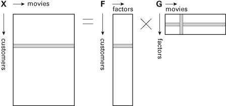

在这种情况下，我们也可以考虑隐藏因素，例如客户的年龄和性别，这使得动作、喜剧等特定类型成为更可能的选择。利用分解，我们可以用这些因素（按不同比例）来定义每个客户，而每个这样的因素会触发特定的电影（具有不同的概率）。这比试图想出电影成对之间的规则要好——更容易、更廉价。再次注意，这些因素不是预先定义的，而是在学习过程中自动发现的；它们可能并不总是容易解释或赋予含义。

另一个可能的应用领域是*文档分类*（Blei 2012）。假设我们有大量文档，每个文档都使用特定的词袋编写。同样数据是稀疏的；每个文档只使用少量单词。在这里，我们可以将隐藏因素解释为主题。当记者撰写报道时，他们想写特定的主题，因此每个文档是某些主题的组合，而每个主题使用所有可能单词的一个子集来撰写。这被称为*潜在语义索引*。很明显，这比试图想出“使用单词 *X* 的人也使用单词 *Y*”这样的规则更有意义。

思考数据如何通过隐藏因素生成，以及我们认为它们如何结合以生成可观测数据，这很重要，并且可以使估计过程容易得多。我们在这里讨论的是一个加性模型，即我们取隐藏因素效应的总和。模型并不总是线性的——例如，一个因素可能会抑制另一个因素——从数据中学习非线性生成模型是机器学习当前重要的研究方向之一。

思考数据如何通过隐藏因素生成，以及它们如何结合以生成可观测数据，这很重要，并且可以使估计过程容易得多。

在下一章中，我们将讨论另一种场景，其中学习系统是一个位于环境中的智能体。该智能体（例如机器人）拥有传感器来检测其在环境中的状态，并可以采取行动，因此它会获得奖励或不获得奖励。正如我们稍后将看到的，在这种情况下的目标是学习智能体在哪种状态下应采取什么行动，以最大化总奖励。

假设我们想构建一台学习下棋的机器。假设我们有一个摄像头来查看棋盘上己方和对方棋子的位置，目标是决定我们的走法以赢得比赛。

在这种情况下，学习之所以困难有两个原因。第一，让一位老师带我们走过许多局棋，并为每个棋盘状态指示最佳走法，成本非常高昂。第二，在许多情况下，根本不存在所谓的最佳走法；一步棋好不好取决于后续的走法。单独的一步不算数；如果下完一系列走法后我们赢了棋，那么这一系列走法就是好的。唯一真正的反馈是在游戏结束时，即游戏的结果，我们是赢还是输。

不存在所谓的最佳走法。单独的一步不算数；如果下完一系列走法后我们赢了棋，那么这一系列走法就是好的。

另一个例子是放置在迷宫中寻找目标位置的机器人。机器人可以朝四个罗盘方向之一移动，并应进行一系列移动以到达目标。可能存在静态或动态障碍物，机器人应绕行避开。只要机器人在移动，就没有反馈，机器人会尝试许多移动直到到达目标；只有到达目标时，它才会获得奖励（因正确完成任务）。在这种情况下没有对手，但我们可以偏好较短的轨迹——机器人可能靠电池供电——这意味着在这种情况下我们是在与时间赛跑。


### 强化学习概述

这两个应用有许多共同点。存在一个决策者，称为 `agent`（智能体），它被置于一个 `environment`（环境）中（见图 17）。在第一种情况下，棋盘是下棋智能体的环境；在第二种情况下，迷宫是机器人的环境。在任何时刻，环境都处于某个 `state`（状态），这分别指棋盘上棋子的位置或机器人在迷宫中的位置。决策者拥有一组可能的 `actions`（动作）：棋盘上棋子的合法移动，或机器人在不碰到任何障碍物的情况下向各个方向移动。一旦选择并执行了一个动作，状态就会发生变化。

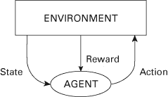

解决任务需要一系列动作，我们以 `reward`（奖励）的形式获得反馈。使学习具有挑战性的是，奖励很少出现，通常只有在完整的序列执行完毕后才会出现——我们在一长串移动之后赢或输了游戏。奖励定义了任务的目标，如果我们想要学习，它就是必需的。智能体学习解决任务的最佳动作序列，其中“最佳”被量化为尽可能早地返回最大奖励的动作序列。这就是 `reinforcement learning`（强化学习）的设定（Sutton and Barto 2018）。

强化学习在许多方面不同于我们已经讨论过的学习方法。它被称为“带评论家的学习”，这与监督学习中的“带教师的学习”相对。评论家不同于教师，因为评论家不告诉我们该做什么，而只告诉我们过去做得有多好。评论家从不事先告知！反馈是稀缺的，并且当它到来时，已经很晚了。这导致了 `credit assignment`（信用分配）问题。在采取了几个动作并获得奖励后，我们希望评估过去采取的各个动作，并找出那些让我们赢得奖励的动作，以便我们稍后能够记录并回忆它们。

实际上，强化学习程序所做的是为中间状态或动作生成一个 `internal value`（内部价值），以衡量它们引导我们达到目标并获得真实奖励的效果有多好。一旦学会了这种内部奖励机制，智能体就可以只采取局部动作来最大化它。解决任务需要以这种方式选择的一系列动作，累积地获得最高的真实奖励。

与我们之前讨论的应用不同，这里没有外部过程提供训练数据。是智能体通过在环境中尝试动作并以奖励的形式接收反馈（或不接收）来主动生成数据。然后它利用这些反馈来更新其知识，以便随着时间的推移学会执行返回最高奖励的动作。

#### K 臂老虎机

我们从一个简单的例子开始。`K-armed bandit`（K 臂老虎机）是一个假设的有 `K` 个拉杆的老虎机。动作是选择并拉动其中一个拉杆；每个拉杆返回一定金额的钱，可以为零，这就是与该拉杆（动作）相关的奖励。任务是决定拉动哪个拉杆以最大化奖励。

强化学习程序学习为中间状态或动作生成一个 `internal value`（内部价值），以衡量它们引导我们达到目标并获得真实奖励的效果有多好。

这是一个我们从 `K` 个选项中选择一个的分类问题。如果这是监督学习，教师会告诉我们正确的类别，即通向最大收益的拉杆。在强化学习的这种情况下，我们只能尝试不同的拉杆并记录最好的那个。

最初所有拉杆的估计值均为零。为了探索环境，我们可以随机选择一个拉杆并观察其奖励。如果该奖励高于零，我们可以将其存储为该动作的内部奖励估计值。然后，当我们需要再次选择拉杆时，我们可以继续拉动那个拉杆并获得正奖励。但也可能存在另一个拉杆能带来更高的奖励，因此即使找到了一个有正奖励的拉杆，我们也想尝试其他拉杆；我们需要确保在固守成规之前，已经对替代方案进行了足够彻底的探索。一旦我们尝试了所有拉杆并了解了所有情况，我们就可以选择价值最大的动作。

此处的设定假设奖励是确定性的，即我们总是为一个拉杆获得相同的奖励。在真正的老虎机中，奖励取决于运气，同一个拉杆在不同的试验中可能导致不同的奖励值。在这种情况下，我们想要最大化我们的 `expected reward`（期望奖励），我们对动作的内部奖励估计是在同一情况下所有奖励的平均值。这意味着只做一次动作不足以了解它有多好；我们需要进行许多试验并收集许多观察值（奖励）来计算平均值的良好估计。

`K-armed bandit`（K 臂老虎机）是一个简化的强化学习问题，因为只有一个状态——一台老虎机。在一般情况下，当智能体选择一个动作时，它不仅会收到奖励或不收到奖励，而且它的状态也会改变。智能体的这个下一个状态也可能是概率性的，因为环境中存在隐藏因素，这可能导致同一个动作产生不同的奖励和下一个状态。

例如，机会游戏中存在随机性，这也会影响动作，从而影响下一个状态：在某些游戏中有骰子，或者在纸牌游戏中我们从一副牌中随机抽取。在国际象棋这样的游戏中，没有骰子或牌组，但有一个行为不可预测的对手——另一个不确定性来源。在机器人环境中，障碍物可能会移动，或者可能有其他移动智能体遮挡感知或限制移动。传感器可能有噪声，控制执行器的电机可能远非完美：机器人可能想直行，但由于磨损可能会向右或向左偏转。所有这些都是引入不确定性的隐藏因素，和往常一样，我们估计期望值以平均化不确定性的影响。

`K-armed bandit`（K 臂老虎机）之所以被简化，另一个原因是我们在单个动作后就能获得奖励；奖励没有延迟，我们立即看到动作的价值。在国际象棋游戏中，或任务是在房间中寻找目标位置的机器人中，奖励只有在最后、在许多动作之后才会到来，在此期间我们没有收到任何奖励或其他反馈。

在强化学习中，我们想要能够预测任何中间动作在多大程度上有助于我们获得真实奖励——这就是我们对该动作的 `internal reward estimate`（内部奖励估计）。最初，所有动作的奖励估计均为零，因为我们还不知道任何事情。我们需要数据来学习，所以我们需要做一些 `exploration`（探索），尝试某些动作并观察是否获得任何奖励；然后我们利用这些信息更新内部估计。

随着探索的深入，我们收集更多数据，并更多地了解环境以及我们动作的优劣。当我们认为已经达到了动作奖励估计足够好的水平时，我们可以开始 `exploitation`（利用）。我们通过采取根据内部奖励估计产生最高奖励的动作来做到这一点。在一开始我们知之甚少时，我们随机尝试动作；随着学习的深入，我们通过从随机选择逐渐转向受内部奖励估计影响的选择，从探索过渡到利用。

### 时序差分学习


### 强化学习：期望累积奖励与 Q 学习

对于任意状态和动作，我们想要学习从该状态采取该动作开始的期望累积奖励。这是一个*期望*值，因为它是对奖励和未来状态中所有随机源取平均得到的。两个连续的状态-动作对的期望累积奖励通过*贝尔曼方程*相关联，我们利用它将奖励从后续动作*回传*到先前动作，具体如下。

#### 网格世界示例

在图 18 中，我们有一个网格世界。让我们考虑机器人到达目标的最后一步移动；因为我们到达了目标，所以获得奖励，假设为 100 单位。现在考虑紧接在那之前的状态和动作。在该状态下我们执行一个动作，虽然它不会给我们带来即时奖励（因为我们仍距离目标一步），但它将我们带到了这样一个状态：再采取一个动作就能获得 100 的全部奖励。这意味着该状态下的该动作具有很高的价值，但它仍距离目标一步。因此，为了计算价值，我们对真实奖励进行折扣，假设折扣因子为 0.9（因为奖励在未来，而未来从不确定），我们说该特定状态-动作对具有一个*内部奖励* 90。

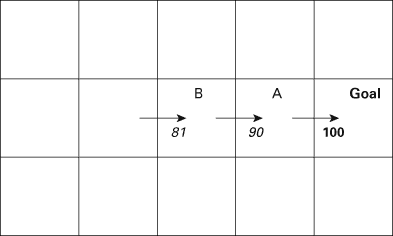

请注意，那里的真实奖励仍然是零，因为我们仍未到达目标，但我们因到达了一个距离目标仅一步之遥的状态而给自己一个内部奖励。同理，再之前的那个动作被折扣两次，获得 81 的内部奖励，我们可以继续为该序列中所有之前的动作分配内部价值。当然，这仅针对一次试验回合。我们需要进行许多试验，在每次试验中，由于不确定性，我们遵循不同的路径，访问不同的状态并观察不同的奖励，并对所有那些内部奖励估计取平均。这被称为*时序差分*（TD）学习；每个状态-动作对的内部奖励估计用*Q*表示，更新它们的算法称为*Q 学习*。

#### 探索与利用

起初，我们随机尝试动作；随着学习的深入，我们从探索转向利用，从随机选择转向受内部奖励估计影响的选择。

请注意，只有最终动作获得真实奖励；中间动作的所有价值都是模拟奖励。它们不是目的；它们只是帮助我们找到最终通向真实奖励的动作。就像在学校里，学生根据在不同课程中的表现获得成绩，但那些成绩只是模拟奖励，表明学生获得真实奖励的可能性有多大，而真实奖励只有在他们毕业并成为社区有用成员时才会获得。

#### 部分可观测环境

在某些应用中，环境是*部分可观测*的，智能体无法确切知道状态。它配备了传感器，传感器返回一个观测值，智能体利用它来估计环境的状态。假设我们有一个在房间中导航的机器人。在前面的网格世界示例中，机器人确切知道自己的位置，但情况并不总是如此。机器人可能不知道自己在哪里，也不知道房间里还有什么。机器人可能有一个摄像头，但图像并不能完整详细地告诉机器人环境的状态；它只给出关于可能状态的一些指示。例如，机器人可能只知道其左侧有一个障碍物。

在这种情况下，基于观测值，智能体预测其状态；更准确地说，它预测给定观测值下处于每个状态的概率，然后按其概率加权对所有可能状态进行更新。这种额外的不确定性使任务变得困难得多，问题也更难学习（Thrun, Burgard, and Fox 2005）。

例如，一辆在城市区域行驶的自动驾驶汽车通过访问其地理信息系统数据确切了解其环境；在农村地区，它必须更多地依赖车载传感器进行导航。

### 学习玩游戏

#### TD-Gammon

强化学习的早期应用之一是*TD-Gammon*程序，它通过自我对弈学习玩西洋双陆棋（Tesauro 1995）。该程序优于 Tesauro 早先开发的*NeuroGammon*程序，后者是基于专家棋谱以监督方式训练的。西洋双陆棋是一项复杂的任务；它包含对手，且因掷骰子而引入额外的随机性。使用相对简单的棋盘表示，TD-Gammon 通过与自身副本对弈训练一个具有一个隐藏层的多层感知机神经网络。

前面我们讨论了通过折扣未来奖励来计算中间状态价值的方法；*价值网络*是一个回归器，它以状态为输入（此处为西洋双陆棋棋盘的表示），并被训练来估计其价值（该状态之后的期望累积奖励）。我们稍后将看到的*策略网络*是一个分类器，它以状态为输入，并被训练来选择最佳动作——即带我们进入价值最大的下一状态的动作（在返回最大期望累积奖励的路径上）。

虽然强化学习算法比监督学习算法慢，但很明显，它们的应用范围更广，并有潜力构建更好的学习机器。它们不需要任何监督，这实际上可能更好，因为不会有任何教师偏见。例如，Tesauro 的 TD-Gammon 程序通过自我对弈学习，在某些情况下想出了比最佳棋手更优越的走法。

#### 深度 Q 网络（DQN）

最近一项令人印象深刻的工作将强化学习与深度神经网络结合，用于玩街机游戏（Mnih et al. 2015）。*深度 Q 网络*是一个策略网络，直接接收屏幕的 84 × 84 图像（这些是 1980 年代的街机游戏，当时图像分辨率很低），并仅利用图像和分数信息学习玩游戏。网络早期包含用于分析图像的卷积层，随后是全连接层以综合最佳操纵杆动作。训练是端到端的，从像素到动作，使用我们之前讨论的一种*Q*学习形式。

同样有趣的是，具有相同学习算法、网络架构和超参数的同一个网络可以学习 49 个游戏中的任意一个，并在其中 29 个游戏中达到或超过了人类水平。

#### AlphaGo

最近，同一团队开发了 AlphaGo 系统（Silver et al. 2016），它再次将深度卷积网络与强化学习结合，这次是为了下围棋。围棋比西洋双陆棋或国际象棋难得多，因为棋盘更大，每个位置可能的走法更多，这意味着搜索空间大得多；围棋长期以来被认为超出了我们当前的计算能力。

在 AlphaGo 中，输入是一组表示 19 × 19 围棋棋盘的专用特征，棋盘由卷积层处理，就像处理图像一样。有一个策略网络被训练用于选择最佳走法，还有一个价值网络被训练用于评估每个状态距离赢得比赛有多近。策略网络首先利用庞大的专家棋谱数据库进行训练，然后通过自我对弈的强化学习进一步改进。正如我们在前言中讨论的，AlphaGo 在 2015 年以 5 比 0 击败了欧洲围棋冠军，并在 2016 年 3 月以 4 比 1 击败了世界上最伟大的围棋棋手之一。


### 游戏与现实生活中的强化学习

#### AlphaGo 及其后继者

AlphaGo 令人印象深刻的不仅在于其算法，还在于其工程实现的高质量，例如在计算如何分配到并行处理单元方面。AlphaGo 进行并学习的对局数量远超任何人类棋手一生所能下的棋局，而且因为它通过与自己的副本对弈来学习，所以它始终在与一个越来越强的对手博弈，这迫使它不断设计出更巧妙的策略以取胜。

一个名为 `AlphaGo Zero` 的新版本（Silver 等人，2017）在更少的人类帮助下进行训练。输入仅为原始棋盘，没有任何专门的输入特征，且没有使用人类专家棋局进行初始监督训练。另一个不同之处在于策略网络和价值网络被合并为一个但更深的网络。`AlphaGo Zero` 击败了 `AlphaGo`，现在被认为是最强的围棋棋手，无论人机。最近，该方法被泛化为单一的 `AlphaZero` 算法，它不仅能学习下围棋，还能学习下国际象棋和将棋（日本象棋）（Silver 等人，2018）。

这些方法之所以有效，是因为街机游戏画面和围棋棋盘都具有二维结构，可由卷积神经网络在不同层级上分析局部特征。`DQN` 和 `AlphaGo` 的成功在于：这种局部特征提取方式与时序差分学习通过端到端训练的深度神经网络无缝耦合在了一起。

#### 纸牌游戏中的强化学习

强化学习也被应用于纸牌游戏。`DeepStack` 学会了玩一种双人扑克变体，称为“抢庄无限注德州扑克”。与西洋双陆棋或围棋双方都拥有环境完全信息（即棋盘）不同，在扑克中，除了发牌带来的随机性外，对手的手牌是隐藏的。在这种不完全信息设定下，玩家需要根据对手先前观察到的行动推断其状态并做出相应反应，这允许出现诸如诈唬等复杂策略。`DeepStack` 使用深度神经网络，在一项涉及 44,000 手牌的研究中击败了职业扑克玩家（Moravcik 等人，2017）。

`Pluribus` 通过与五个自己的副本对弈，学会了玩六人变体（即有五个对手而非一个）；当与五名职业人类玩家对战，或五个 `Pluribus` 副本对战一名人类时，在 10,000 手牌的过程中，其表现显著优于人类（Brown 和 Sandholm，2019）。

另一个重要里程碑是 `AlphaStar`，它学会了玩《星际争霸》，这是一款涉及数千次决策和不完全信息的即时战略游戏。`AlphaStar` 达到了特级大师水平，高于 99.8% 的官方排名人类玩家（Vinyals 等人，2019）。

#### 现实生活中的强化学习

当下一个重要问题是：我们如何从游戏转向现实世界的应用，并使用深度强化学习。游戏是现实生活的简化模拟：其游玩、获胜和失败的规则定义明确；当存在随机性时（例如西洋双陆棋中的骰子），应对双方公平。游戏之所以成为学习的良好测试平台，还因为可以在计算机上极快地模拟游戏，从而非常迅速地收集大量数据。

相比之下，现实生活充满各种模糊性，存在不同来源的不确定性和传感器噪声；行动需要时间且可能不完美；错误行动导致的损失意味着金钱成本，甚至可能危及人身安全。在模拟游戏中，你可以尝试任何随机行动来看看会有什么结果（实际上时序差分算法的收敛性证明就要求这一点），但在现实生活中你无法这样做。

强化学习非常适合序列决策任务，在这类任务中我们需要生成一系列决策，且每个决策都会影响后续决策。单个决策本身并非好或坏，因此我们不能总是使用监督学习。但一个决策的优劣取决于其前后所有决策，因此最终评估的是整个决策序列。也可能存在多个决策主体，它们的行动相互影响。

有许多场景符合这一描述（Li，2019）。在推荐系统中，我们需要为每位客户生成一组推荐；在医疗保健中，我们需要生成正确的治疗决策序列；在经济和金融领域，我们需要生成良好的买入/卖出决策序列，等等。

一项有趣的工作是 `神经架构搜索` 算法，它将设计最佳神经网络结构转化为一系列关于定义结构和连接性的超参数的决策，奖励是该构建网络的准确率。因此存在一个控制器神经网络，它通过强化学习训练，并学会如何一次一个超参数地构建子网络（Zoph 和 Le，2016）。

另一个有趣的应用是调节大规模数据中心内的温度和气流。空气温度通过空水热交换进行调节，可操纵的控制量是风扇转速（控制气流）和阀门开度（控制冷水进出和热水排出）。研究表明，一个几乎没有先验知识的简单模型，通过强化学习仅需几小时的探索训练即可胜任该任务，且具有成本效益（Lazic 等人，2018）。

强化学习非常适合序列决策任务，在这类任务中我们需要生成一系列决策，且每个决策都会影响后续决策。

#### 机器人技术与模仿学习

机器人技术是强化学习适用的领域，因为完成许多机器人任务需要生成一系列正确的动作。之前我们讨论过机器人在迷宫中寻找目标位置的案例，这是导航的一个特例，例如自动驾驶汽车需要在避开障碍物等约束条件下，从地点 `A` 找到通往地点 `B` 的路径，同时优化时间等指标。多足机器人需要按正确顺序移动腿部，以便在不跌倒的情况下前进。

机器人技术与机器学习相遇的一个有趣领域是 `模仿学习`。如果可能的动作很多且需要长序列，学习任务需要大量探索，因此可能很慢。盲目探索也可能很危险，因为某些动作可能对机器人或其环境造成伤害，所以一种可能性是在模拟环境中训练机器人，至少在早期阶段如此。或者，如果有人已经知道如何完成任务，机器人可以通过模仿来学习。例如，我们可以让机械臂通过观察和模仿人类，学习操作其环境中的物体（例如学习将一个物体放在另一个物体上）。

在 `行为克隆` 中，人类采取的动作被逐步记录并教给机器人；这相当于将整个任务转化为一系列监督学习任务，其中对于每个中间状态，人类的动作定义了所需的输出。例如，可以让专家人类驾驶员在各种路况、交通和天气条件下驾驶，同时记录他们在何种情况下采取何种动作，从而收集大量数据集。然后可以用该数据集训练驾驶程序。


# 7 挑战与风险

### 机器学习的另一面

正如任何新技术一样，机器学习的使用引入了新的未知因素和可能的副作用，这些需要被识别并妥善处理。一方面，机器学习解决方案的成功直接取决于拥有多少数据，因此我们希望拥有尽可能多的用户和尽可能多的数据。但要做到这一点，人们必须确信该系统——无论是产品还是服务——是“站在他们这边的”；它做出合法且负责任的决策；尊重用户的隐私权；对所有用户公平，并对其决策方式保持透明；且当其做出导致损害的决策时，制造商可被追究法律责任。如果这些条件得不到满足，人们将不愿提供信息，结果将导致无法学习，也就没有产品或服务可卖。

该系统——无论是产品还是服务——应做出合法且负责任的决策，尊重隐私，对所有用户公平且运行透明，并让制造商承担责任。

作为一条通则，法律具有技术中立性。无论使用石头还是无人机，杀人都是犯罪。英格兰及威尔士高等法院在 2019 年指出：“技术的新颖性并不意味着它超出了现有法规的范围，也不意味着总有必要为它创建一个专门的法律框架。”[¹]

例如，不因个人的种族、性别或年龄而受到歧视是一项基本人权。无论决策是由谁或什么做出的，这都应当成立；因此，理所当然，机器学习系统不得利用此类属性来做决策。

当我们从大量数据中学习时，这可能并不总是直截了当的，因为总可能存在一些不明显的相关性。例如，个人的邮政编码可能与种族相关，从而充当种族的替代指标（Favaretto, De Clercq, and Elger 2019）。学习算法擅长发现此类相关性；有时，它们还会发现虚假相关性，尤其是在数据集较小时。这表明了对可解释性的需求，这是我们稍后将讨论的要求之一。

自动化决策当然并非新事物，但过去仅用于更有限的场景；如今其应用领域正在扩大，这不仅归功于机器学习，还归功于自动化精度的提高和成本的降低。

飞机有自动驾驶仪，火车和船只有制导系统，但制造自动驾驶汽车是一项困难得多的任务；试想城市环境，不仅有许多其他汽车，还有行人、骑车人等其他动态主体。驾驶是一种日常且普遍的交通方式，自动化它将产生更大的影响。另一个例子是自动化交易，由计算机程序做出买入或卖出决策。人脸识别若助警方抓捕罪犯则是好事；若在不知情和未经同意的情况下被用于追踪人员则是坏事。自动化技术的广泛应用（越来越依赖机器学习）是有益的，但也带来了弊端，之一是我们过快、过度地依赖它们。

当人类驾驶员引发事故时，其影响是有限的，因为另一名驾驶员做出完全相同错误决策的概率极小；如果一辆自动驾驶汽车引发事故，这意味着同款的所有其他汽车若置于同一场景下，必定会引发事故。这就是为什么当一架飞机发生事故时，同款的所有其他飞机会立即停飞，直到查明并消除事故原因；未来，可能会出现这样的情况：你的自动驾驶汽车清晨拒绝启动，因为另一座城市的另一辆汽车最近发生了事故，而原因尚未查明。

除了与自动化决策相关的风险外，机器学习中的另一个风险源与数据有关，这具有不同的层面。首先是数据隐私和安全的需求。数据可能包含需要保密的个人信息；因此，任何数据的收集、存储和处理都应考虑到隐私和安全顾虑。其次是任何机器学习解决方案的质量直接取决于数据质量。如果数据有偏见或彻底损坏，基于该数据的所有决策也将如此。第三是信任因素。在高风险应用中，例如医疗领域，我们要求训练好的模型具有可解释性，以便它们不仅提供决策，还提供人类可读的解释来证明该特定决策的合理性。

现在让我们逐一讨论这些方面。

### 数据隐私与安全

当我们拥有大量数据时，其分析可产生有价值的结果，历史上，数据收集和分析在从医学到天文学的许多领域为人类带来了重大发现。当前数字技术的广泛应用使我们能够快速、准确地收集和分析数据，并在许多新领域中应用。

随着更多、更详细数据的出现，当今的关键点在于*数据隐私与安全*（Horvitz and Mulligan 2015）。我们如何确保在收集和处理数据时不侵犯人们的隐私顾虑，且数据不被用于超出其原始意图的目的？

我们期望社会中的个体意识到数据收集和分析在医疗保健、安全等领域的优势。即使在零售等其他领域，人们也总是欣赏符合其喜好和偏好的服务和产品。尽管如此，没有人喜欢感觉自己的私生活被窥探。例如，我们的智能设备不应变成数字狗仔队，记录我们生活的细节并在我们不知情的情况下公开。

过去，关于人们的信息分散在各数据收集者手中，每个收集者仅能访问其所需的部分：银行仅拥有与我们财务状况相关的数据，雇主仅拥有与我们工作相关的数据，等等。还有由不同公司提供的服务相关数据，如旅行社或公用事业提供商，同样各自只看到个人档案的一小部分，且我们的社交互动未被记录。在一个这些不同数据片段易于获取的世界里，即使每个片段仅部分有信息量且有些看似不重要，它们也能被组合起来，对一个人做出非常详细的推断。这既是从数据中学习的力量所在，也是风险所在。

[¹]: 1


#### 数据隐私

数据隐私的基本要求是：生成数据的用户应始终知晓收集了什么数据、收集了多少数据、哪部分数据会被存储、这些数据是否会被用于任何目的的分析，如果会，具体目的是什么。收集的数据不应超过绝对必要的范围。数据收集者应对收集的内容完全公开。

这种`透明度`要求意味着数据所有者在数据收集和使用期间应始终被告知。在任何分析之前，数据应经过清洗——即隐藏所有个人详细信息以使记录匿名化，这并非一个简单的过程。以人类记录为例，仅移除姓名或社会安全号码等唯一标识符是不够的；出生日期、邮政编码等字段提供了部分线索，个人可通过组合这些线索被识别出来（Sweeney 2002）。

数据正成为如此宝贵的原始资源，以至于数据收集者有责任采取一切必要措施妥善保管，并在未经数据所有者明确同意的情况下不与他人共享。

个人应对其数据拥有完全控制权。他们应始终有途径查看已收集的哪些属于自己的数据；他们应能要求更正或彻底删除这些数据。

近期一个研究方向是`隐私保护学习`算法。假设我们拥有来自不同来源的数据片段（例如，不同国家可能有患有相同疾病的患者），且它们不愿将自己的数据（关于其公民的详细信息）提供给中心用户以利用所有组合数据训练模型。在这种情况下，最简单的可能性是以充分匿名化的形式共享数据，但这并不总是容易的。

机器学习中的一个研究课题称为`差分隐私`，其思路是在共享前有意破坏数据，使得个体记录无法被识别，同时仍允许从整体中学习到正确的泛化规律。

另一种方法称为`同态加密`，数据以加密形式存储，且在不解密的情况下进行处理。因为数据始终保持加密状态，所以信息的隐私得以保留；缺点是这种处理需要大量额外的计算。

另一个有趣的隐私保护思路是`联邦学习`，其思路是为不同用户维护多个模型副本。每个模型随后从其用户处学习并由其本地数据更新，也定期与其他用户共享模型更新。因为其他用户仅看到模型更新而非数据，所以每个用户的数据得以保持私密。

对数据隐私和安全的关注应成为任何数据分析场景不可或缺的一部分，并在任何学习开始前得到解决。挖掘数据就像淘金——在开始挖掘前，你需要确保拥有所有必要的许可。未来，我们可能会有数据处理标准，其中每个数据集都包含关于此类所有权和权限信息的元数据；届时，可能要求任何机器学习或数据分析软件检查这些信息，仅在具备必要的批准印章时才运行。

#### 有偏数据

学习模型的优劣首先取决于其训练数据的优劣。数据的任何问题都将反映在模型的质量上。

问题的一个来源是数据收集过程中的潜在失误。例如，如果一个人脸识别数据集包含的白人面孔多于其他种族，那么在该数据上训练的任何人脸识别器在代表性不足的种族上表现都会很差。基本上，任何类别的错误取决于该类别有多少训练实例，因此学习算法纠正训练实例较少的类别错误的动力就会更小。这种采样误差可以通过收集包含所有种族身份范围的平衡训练样本来纠正。

基本上，我们需要确保训练数据的分布与实际应用中遇到的数据分布相匹配；任何不匹配都会导致模型表现不佳。例如，我们经常看到，实验室报告极高准确率的科学文章并不总能带来成功的商业产品。这部分是因为实验室条件接近理想，例如数据收集仔细且精度高；这种条件在现实世界中几乎不可能复制。

这种错误的采样也可能有间接原因，例如生成数据的底层过程存在偏见。例如，过去收集的数据可能缺乏多样性；过去银行的女性客户可能比男性少，或某些少数族裔的客户可能较少。通过检测和缓解此类偏见来实现`公平性`，是机器学习中的一个重要研究课题。

从数据中学习一般行为的模型无法为代表性不足的案例或异常值做出良好决策，这一事实还有其他含义。

例如，过度基于过去的使用和偏好进行推荐存在重要风险。如果一个人只听与之前听过并喜欢的歌曲相似的歌曲，或只看与之前看过并喜欢的电影相似的电影，或只读与之前读过并喜欢的书相似的书，那么将不会有新体验，这对个人和总是渴望寻找新产品销售的公司都是一种限制。因此，在任何此类推荐方案中，也应尝试引入一些多样性。

一项近期研究（Bakshy, Messing, and Adamic 2015）表明，社交媒体上的互动也存在类似风险。如果一个人只关注那些他们同意的人，并阅读与过去阅读过的相似的帖子、消息和新闻，他们将不知道其他人的观点，这将限制他们的体验，这与报纸或电视等包含相对更广泛新闻和观点的传统新闻媒体形成对比。

#### 模型可解释性

随着越来越多的计算机系统通过数据训练来做出自主决策，我们需要关注对计算机的过度依赖。一个重要要求是软件系统的验证和确认——即确保它们做该做的事，不做不该做的事。

对于从数据训练的模型，这可能尤为困难，因为训练涉及数据和优化中不同来源的随机性；这使得训练得到的软件比编程得到的软件更难预测。

我们测试训练模型的方法是检查其在训练中未使用的数据上的表现，以查看它从特定训练示例中泛化得有多好。在训练数据（即所有可能情况的一个小随机子集）上训练模型后，我们在另一个随机子集——验证数据上对其进行测试，并将此新数据上的准确率作为后续使用中预期准确率的标准。这是一个有用的标准，但它是不充分的，因为训练集和验证集都是小的且随机选择的，更改它们可能会导致准确率估计发生变化。


#### 敏感性问题

第二个问题是敏感性。例如，研究表明在深度神经网络中，有效样本的轻微扰动版本有时会导致输出发生巨大变化。这种**对抗样本**（*adversarial examples*）被视为模型未能良好泛化、但仍严重依赖单个训练实例的指标。这令人担忧，因为我们知道传感器永远不会完美，输入端总可能存在噪声。例如，我们不希望自动驾驶汽车在恶劣天气遮挡传感器或路标变脏时失控。

鉴于所有这些原因，我们应始终质疑训练模型做出的决策，并要求额外验证，尤其是在错误决策可能导致高损失的领域。我们希望模型不仅提供输出，还能解释其如何得出该决策。此类解释应采用不需要机器学习专业知识的格式，使任何系统用户都能理解和评估。

深度神经网络的内部运作不易理解；它是**黑盒**（*black box*）模型的一个例子。然而，将总分计算为不同因素加权和的线性模型，或可用 if-then 规则写出的决策树，易于理解，因此更受青睐（见图 6）。此类规则可由人类专家检查评估，以查看训练模型是否学到了有意义的规则。这是**可解释人工智能**（XAI）的主题，随着训练模型使用日益增多，该研究领域变得愈发重要（Gilpin et al. 2018）。

一个有趣的想法是“反事实”，即告知用户决策本可以如何不同：例如，“您因年收入 3 万英镑被拒贷。若收入为 4.5 万英镑，您本会获批贷款”（Wachter, Mittelstadt, and Russell 2018, 844）。当然，在生成解释和反事实时，必须保护商业机密；例如银行不愿披露其信用评分的确切公式。

我们希望模型不仅提供输出，还能以任何人都能理解的格式解释其如何得出该决策。

#### 伦理、法律及其他社会层面

作为任何工程产品，训练模型的正确行为应经过严格检查。我们已考虑过训练数据中可能存在的有害偏见。在任何基于历史数据做出自动决策的场景中（如金融、医疗、司法），我们必须保证数据收集的**透明度**（*transparency*）和决策的**公平性**（*fairness*）。我们还必须确保此类系统使用可解释的模型，其决策对用户**可解释**（*explainable*），且我们能让此类系统的制造商**负责**（*accountable*）。

当智能实体化且系统采取物理行动时，行为正确性成为更关键的问题，甚至可能危及人命。因此另一要求是**安全性**（*safety*）。系统无需是搭载武器的无人机；即便是自动驾驶汽车，若驾驶不当也会变得危险。当此类顾虑出现时，常规的期望值或功利主义方法不再适用，这在“电车难题”中有讨论，其一个变体如下。

假设您乘坐自动驾驶汽车，一名儿童突然冲过马路。假设车速极快，系统知晓无法停车。但仍可转向，向右转可避开儿童。假设儿童母亲站在路右侧。汽车该如何决定？是继续前行撞上儿童，还是右转撞上母亲？抑或左转驶向悬崖，经计算您的生命价值低于儿童或母亲？驾驶软件可被允许在决策中考量年龄或性别等因素吗？

这看似极端案例——电车难题是思想实验——但关键在于：在许多决策场景中，存在多种可能行动且可能导致有害结果，我们需找到一种为机器编程此类决策的方式，使其符合我们习惯的伦理道德标准。

因机器学习而增强的智能也可能被用于公然的恶意和犯罪行为。人脸或语音识别等模式识别技术可用于大规模监控。智能机器人可利用智能变得更擅长杀戮。收集的数据可被分析用于颠覆目的，如影响选民决策。这些是机器学习应用的其他伦理法律隐含意义。

另一个方面是，让机器更智能会导致更高自动化程度，从而造成失业。过去，工作一代代地过时——如铁匠的儿子成为汽车修理工——但现在发生在一代人内部。曾经，人们二十多岁学会一份工作，凭小幅更新做到退休。现在似乎每十或十五年就需学习新工作。为跟上机器日增的智能，我们需持续增加知识，这意味着终身教育项目未来将变得更重要。这也意味着失业应失去社会污名，被视为常态；那段间隔期是此人学习下一份工作、下一个“版本”的时期。

下一章（也是最后一章）将讨论机器学习研究和应用的可能未来方向。

## 第 8 章 我们将何去何从？

### 让它们智能，让它们学习

机器学习已证明是一项可行技术，其在许多领域的应用日益增加。这种收集和从数据中学习的趋势预计在近期将更强劲地持续（Jordan and Mitchell 2015）。数据分析让我们既能理解过去数据背后的潜在过程——正如科学家们在不同科学领域做了数百年的那样——也能预测该过程未来的行为。

几十年前，计算硬件一次进步一个微处理器；每个新微处理器——先是 8 位，后 16 位，再 32 位——单位时间内能做稍多计算，能用稍多内存，这转化为稍好的计算机。类似地，计算机软件曾一次进步一门编程语言。每种新语言使某种新类型计算更易编程。计算机用于数值计算时，我们用 Fortran；用于商业应用时，用 Cobol；后来计算机开始处理各类更复杂信息，我们开发了面向对象语言，允许定义更复杂的数据结构及操纵它们的专用算法。

接着，计算一次进步一个操作系统；每个新版本让计算机更易用，支持一组新应用。如今，计算一次进步一个智能设备或一个智能应用。曾经，定义计算进步的关键人物是硬件设计师，然后是软件工程师，然后是坐在电脑前的用户，现在是任何人在做任何事时。


### 智能设备时代的数据与机器学习

如今，没人会热切期待新款微处理器的发布，新编程语言或新操作系统版本也不再是新闻。现在我们期待的是下一款新设备或新应用，它们之所以智能，要么是因为其设计者的巧思，要么是因为它们学会了如何变智能。

我们的生活越来越多地投射到数字领域，因此我们创造的数据也越来越多。早期个人电脑的硬盘容量仅为 5 MB；现在典型电脑配备 500 GB 硬盘——大约三十年间存储容量增长了十万倍。一个规模适中的数据库现在存储数百 TB 数据，我们已经开始用 PB 作为计量单位；很快，我们将跨越到下一个量级 EB，即 1000 PB 或 100 万 TB。随着存储容量的增加，得益于更快的芯片和包含数千个并行处理器的架构，处理也变得更廉价、更快速。

从通用个人电脑向专用智能设备转变的趋势预计将加速。第 1 章讨论了组织如何从计算机中心转向由许多互联计算机和存储设备组成的分布式方案；现在，类似的变革正在单个用户身上发生。一个人不再拥有存放所有数据、执行所有处理的一台个人电脑；取而代之的是，他们的数据存储在“云端”，即某个远程异地数据中心，但以一种可从其所有智能设备访问的方式存储，每个设备只访问它所需的部分。

我们所说的*云*是一个处理所有计算需求的虚拟计算机中心。只要能随时访问，我们无需担心处理在何处、如何进行，数据在何处、如何存储。这过去被称为*网格计算*，类比由互联发电机和用户组成的电网；作为用户，我们将电视插在最近的插座上，从不费心电力来自何处。

这也意味着需要更大带宽的连接。流媒体音乐和视频已是成熟技术。我们放在架上的 CD 和 DVD（它们曾取代非数字的黑胶唱片和录像带）现在反过来变得无用，取而代之的是存储*所有*歌曲和电影的不可见源。电子书和数字订阅服务正迅速取代纸质书和书店，搜索引擎早已让厚重的百科全书沦为挡窗工具。

有了智能设备，数百万人无需在本地分别存储同一首歌、同一部电影、同一本书的副本。现在的座右铭是：别买，租！买智能设备、或应用、或服务订阅，再买允许你在需要时访问的带宽。

这种变化和访问的便利性也提供了“打包”和销售产品的新方式。例如，传统上音乐黑胶和 CD 对应一张由多首歌组成的“专辑”；现在可以单独租借单曲。同样，现在可以购买单个短篇小说，而不必买整本短篇小说集。

第 5 章讨论了推荐系统中机器学习的应用。随着共享数据和流媒体的增加，将有更多数据可供分析，而且数据将更详细。例如，现在我们还知道一个人听了一首歌多少次，或看了一部电影看到哪里，这些信息可用作衡量该人多喜欢该产品的指标。

随着移动技术的进步，可穿戴设备持续受到关注。智能手机作为一种可穿戴设备，现在远不止是个电话；它还通过让手表、眼镜等更小的智能“物”联网，充当它们的中介。手机在不久的将来可能变得更聪明，例如拥有实时翻译应用：你用母语说话，对方会自动听到翻译成其母语的声音，不仅内容在句法和语义上正确，还保留你的声音、正确的重音和语调。

机器学习将帮助我们理解日益复杂的世界。我们已暴露在传感器难以应对、大脑无法处理的海量数据中。如今可用的在线信息库包含海量数字文本，规模大到无法人工处理。将机器学习用于此目的称为*机器阅读*。

机器学习将帮助我们理解日益复杂的世界。我们已暴露在传感器难以应对、大脑无法处理的海量数据中。

我们需要比仅用关键词的搜索引擎更聪明的搜索引擎。目前信息分布在不同来源或媒介中，我们需要查询所有来源并智能地合并响应。这些来源可能使用不同语言——例如，法语来源可能包含更多相关信息，即使你的查询是英语。查询也可能触发对图像或视频数据库的搜索。无论如何，总体结果应足够精简、浓缩，以便用户消化吸收。

*网页抓取*是程序自动浏览网页并从中提取信息。这些网页可能是社交媒体，积累的信息可由学习算法分析，例如追踪热门话题、检测对产品和人物（如选举时期的政客）的情感、观点和信仰。机器学习在社交媒体中的另一个重要研究领域是识别相互连接人群的“社交网络”；分析此类网络可让我们找到志同道合的小圈子，或追踪信息如何在社交媒体上传播。

当前研究方向之一是赋予各类传统工具和设备（包括眼镜、手表等传统可穿戴设备）智能——即收集、处理、从数据推断并与其他在线设备共享数据的能力。设备越智能，可供分析并得出有意义推断的数据就越多。不同设备和传感器收集任务的不同侧面，关键任务将是组合并整合这些多模态数据。这意味着将出现各种新的有趣场景和应用，可在其中使用学习算法。

智能设备能助我们工作和生活。机器学习帮助我们构建能学习环境、适应用户的系统，以最少的监督和最高的用户满意度工作。

智能汽车领域正在进行重要工作。联网汽车让乘客能上网，并通过其数字*车载信息娱乐系统*提供流媒体视频等各类在线服务。联网汽车还可为维护交换数据，并获取路况和天气的实时信息。如果你在恶劣条件下驾驶，前方一英里处的汽车就是前方一英里处的一个传感器。


### 智能驾驶与高性能计算

#### 自动驾驶汽车

比联网更重要的是汽车何时能变得足够智能以协助驾驶本身。汽车已经拥有巡航控制、自动泊车和车道保持等辅助系统，但如今它们变得更加强大。终极目标是让它们完全接管驾驶任务，为此我们今天已经拥有此类自动驾驶汽车的原型。当然，这对公共汽车、卡车等也同样适用。例如，在人口封锁的大流行期间，自动驾驶卡车可以将产品从工厂运输到城市。

人类驾驶员的视觉系统分辨率不是很高，而且他们只能看向前方。虽然通过侧视镜和后视镜视野略有延伸，但盲区依然存在。另一方面，`自动驾驶汽车`可以拥有全方位的高分辨率摄像头，还可以使用人类没有的传感器，如 GPS、超声波、夜视仪，或配备一种特殊的雷达——`激光雷达（LIDAR）`，它使用激光测量距离。智能汽车还能更快地获取各种额外信息，如天气情况。电子驾驶员的反应时间短得多。

机器学习在自动驾驶汽车中发挥着重要作用，不仅带来更平稳的驾驶、更快的控制和更高的燃油效率，还体现在智能感知上，例如自动识别行人、骑行者、交通标志等。自动驾驶汽车不仅会更安全，也会更快；我们设定速度限制是因为人类驾驶员的反应时间相对较慢。不过仍存在问题：在恶劣天气条件下（如雨、雾、雪），激光和摄像头效果不佳，因此技术应不断进步，直到获得能在各种天气下行驶的智能汽车。

预计在未来十年内，自动驾驶汽车和机器人出租车将接管城市和高速公路的驾驶任务。在未来十年左右，汽车和无人机似乎很可能会融合，我们将拥有自动驾驶飞行汽车，其伴随的任务将最适合由机器学习来处理。

机器学习的基本优势在于任务无需显式编程即可被学习。太空也将成为机器学习的新疆域。未来的太空任务极有可能是无人驾驶的。过去我们需要派遣人类，因为没有像样的智能和多功能机器，但现在我们有了强大的机器人。如果船上没有人类，载荷会更轻、更简单，也不需要将载荷带回。如果机器人要大胆地去无人到达的地方，它只能是一个学习型机器人。

### 高性能计算

随着数据量变得越来越大，我们需要具有更高容量*和*更快访问速度的存储系统。处理能力必然会提升，以便在合理时间内处理更多数据。这意味着需要高性能计算机系统，能够存储大量数据并极快地进行大量计算。

存在物理限制，如光速和原子大小，这暗示了传输速度的上限 1 和基础电子元件尺寸的下限。显而易见的解决方案是并行处理——如果有八条并行线路，可以同时发送八个数据项；如果有八个处理器，可以在处理单个项的时间内同时处理这八个项。

如今，并行处理在计算机系统中已常规使用。我们拥有包含数千个同时运行的处理器的强大计算机。还有多核机器，单个计算元件拥有多个“核心”，可同时进行简单计算，在单个物理芯片中实现并行处理。

但高性能计算不仅仅是硬件问题；我们还需要良好的软件接口，将计算和数据分发到大量处理器和存储设备上。确实，用于大数据的并行和分布式计算的软硬件是当今计算机科学与工程的重要研究领域。

在机器学习中，学习算法的并行化变得越来越重要。模型可在不同计算机上针对数据的不同部分并行训练，然后合并这些模型。另一种可能是将单个模型的处理分发到多个处理器上。例如，对于由多层数千个单元组成的深度神经网络，不同处理器可流水线方式执行不同层或层的子集。

`图形处理单元（GPU）`最初是为图形界面中的图像快速处理和传输而设计的（例如视频游戏机），但用于图形的并行计算和传输类型也使其适合许多机器学习任务。确实，为此正在开发专用软件库，研究人员和从业者在各种机器学习应用中有效地频繁使用 GPU；例如，第 6 章讨论的 AlphaGo 网络即并行化运行在 GPU 上。还有研究致力于开发更专用的处理单元，例如执行神经网络中使用的计算；如今拥有数百层和数百万参数的深度神经网络在普通 CPU 上运行太慢。

我们在机器学习应用中也看到了向`云计算`发展的趋势，人们不再购买和维护必要的硬件，而是租用异地`数据中心`的使用权。数据中心是一个物理场所，容纳大量计算服务器，拥有许多处理器和充足存储。通常在物理位置不同的地方有多个数据中心；它们通过网络互联，任务自动在它们之间分发和迁移，以平衡不同时间、不同规模的不同客户负载。所有这些需求推动了当今的大量研究。

云的一个重要用途是扩展智能设备的能力，尤其是移动设备。这些在线、低容量设备可从任何地方访问云以交换数据或请求本地无法完成的过大或过于复杂的计算。考虑智能手机上的语音识别。手机采集声学数据，提取基本特征，并发送到云。实际识别在云中完成，结果再发回手机。

在计算领域，存在两大并行趋势。一是构建可为不同任务和目的编程的通用计算机，如数据中心服务器中使用的那些。另一趋势是构建针对特定任务的专用计算设备，与专用输入输出打包在一起。后者过去称为`嵌入式系统`，如今称为`网络物理系统`，以强调它们在物理世界中工作并与之交互。一个系统可由多个此类单元组成（其中一些可能是移动的），并可通过网络互联——例如，汽车、飞机或家庭可能包含大量此类设备用于不同任务。使此类系统变得智能——即能适应其特定环境（包括用户）——是一个重要的研究方向。


### 边缘计算与雾计算

顺着这个思路，当下一个热门的研究课题是*边缘计算*，其目标是尽可能多地将专用处理放在“边缘”完成——即更靠近数据产生的地方。随着计算成本降低、体积缩小，大部分必要的计算可在感知数据的那一刻就在本地完成，这具有无需来回传输数据的优势，从而减少了网络流量，响应也更快。这在人工智能领域尤为有趣，因为我们面临视频、图像或声音等大块数据，在现场处理它们将智能推向了边缘；因此得名“边缘 AI”。

一个相关概念是*雾计算*，它提供通用计算服务，就像云计算一样，但更靠近用户。例如，它们可能位于我们的局域网中，而不是遥远的数据中心，这类似于雾是更贴近地面、贴近我们的薄云。同样，其优势在于通信开销更小、决策更快。

### 我的 AI 有多“绿色”？

近年来，随着个人电脑、智能手机、互联网和数据中心的普及，全球为计算机供电所消耗的电力总量已达相当可观的程度。计算曾被认为环保——屏幕阅读优于纸质打印——这部分属实，但我们必须始终铭记，所有的计算、数据存储和通信都依赖电力运行。所有这些机器都需要供电和散热，这意味着碳足迹持续增加。

机器学习尤其耗电。我们需要存储大型数据集，且学习算法通常需要执行大量学习迭代，每次迭代在使用多层深度神经网络等复杂模型时都需要大量计算，从而消耗大量电力。Schwartz 等人（2019）报告称：“深度学习研究所需的计算量每隔几个月就会翻倍，导致从 2012 年到 2018 年估计增加了 300,000 倍。”

这带来诸多弊端：首先，如果模型耗电过大，就无法部署在靠电池供电的移动设备上。其次，计算量过大的模型成本高昂，无法面向广大客户群销售。第三，所有这些电力都需要以某种方式生产，我们知道各国往往需要燃烧煤炭或天然气来发电，这会对环境产生各种有害影响，包括加剧全球变暖。

更节能计算机架构的研究是计算领域的重要课题，能源效率已成为评估算法质量的重要标准；这对数据和计算双重密集型的机器学习尤为相关。

### 数据挖掘

尽管最重要，机器学习只是*数据挖掘*应用中的一步（Han 和 Kamber，2011）。此外还有事前的数据准备和事后的结果解释。

使数据具备挖掘条件涉及多个阶段。首先，从一个包含众多字段的大型数据库中，我们选择感兴趣的部分，创建一个较小的数据库用于处理。数据也可能来自不同数据库，因此需要合并它们。详细程度也可能不同——例如，从运营数据库中我们可能提取每日汇总并使用这些汇总，而不是单个交易。原始数据可能包含错误和不一致，或部分缺失，这些应在预处理阶段预先处理。

能源效率已成为评估算法质量的重要标准；这对数据和计算双重密集型的机器学习尤为相关。

提取后，数据存储在*数据仓库*中，我们在其上进行分析。一种数据分析是人工的，我们有一个假设——“购买 *X* 的人也购买 *Y*”——并检查数据是否支持该假设。数据以电子表格形式呈现，行是数据实例——购物篮，列是属性——产品。概念化数据的一种方式是*多维数据立方体*，其维度为属性，数据分析操作定义为对立方体的操作，如切片、切块等。这种人工数据分析以及结果可视化，由*联机分析处理*（OLAP）工具轻松实现。

OLAP 具有局限性，因为它是人驱动的，我们只能测试能想象到的假设。例如，在购物篮分析中，我们无法发现遥远产品对之间的关系；此类发现需要数据驱动的分析，这正是机器学习算法所做的。

我们可以使用前几章讨论的任何方法，用于分类、回归、聚类等，从数据构建模型。通常，我们将数据分为训练集和验证集两部分。用第一部分训练模型，然后在验证集上测量其预测准确率。通过在未用于训练的实例上测试，我们旨在估算训练好的模型日后在现实世界中使用时的表现。验证集准确率是我们接受或拒绝训练模型的主要标准之一。

上一章我们介绍了机器学习模型的可解释性，这是数据挖掘的重要要求。使用预测模型的人不一定懂机器学习，因此重要的是，从数据中学到的知识以他们能理解的形式呈现。在许多数据挖掘场景中——例如信用评分——这种由人进行的知识提取和模型评估过程，对于验证从数据训练出的模型可能很重要甚至必要。

可视化工具也能在此提供帮助。实际上，可视化是数据分析最好的工具之一，有时仅以聪明的方式可视化数据，就足以理解复杂数据集背后潜在过程的特征，而无需进一步复杂昂贵的统计处理；参见 Börner 2015 的示例。

随着数据和算力的增加，我们可以尝试更复杂的数据挖掘任务，试图在更复杂的场景中发现隐藏关系。目前大多数数据挖掘任务在单一领域使用单一数据源工作。特别有趣的是来自不同来源、不同模态的数据情况；挖掘此类数据并发现跨源、跨模态的依赖关系，是一个有前景的研究方向。

### 数据科学

机器学习方法在大数据上的进展与成功，以及更多成功的前景，促使业界研究者和从业者将这一事业称为科学与工程的一个新分支。关于这个新的*数据科学*领域应涵盖什么，仍有讨论，但主要主题似乎包括机器学习、高性能计算，以及数据收集、分析和数据驱动决策的社会、伦理和法律影响。

当然，并非所有学习应用都需要云、数据中心或计算机集群。人们应始终警惕炒作和公司的销售策略，它们往往发明新的、更花哨的名字来包装旧产品进行销售。


### 机器学习、人工智能与未来

机器学习是实现人工智能的一种途径。通过在数据集上训练，或利用强化学习进行反复试验，我们可以让计算机程序表现出最大化性能准则的行为，这在特定情境下显得很有智能。

一个重要的观点是，智能是一个模糊的术语，用它来评估计算机系统的性能可能会产生误导。例如，让计算机去完成人类觉得困难的任务（如下棋）并不是评估智能的好主意。下棋对人类之所以困难，是因为它需要深思熟虑和规划；而人类和其他动物一样，进化出的能力是利用有限的感官数据和有限的计算量做出快速决策。对于计算机来说，识别对手的脸比下棋难得多。计算机能否下棋赢过最优秀的人类棋手，并不能很好地说明计算机更聪明，因为人类的智能并非为下棋这类任务而进化的。

研究人员将博弈作为人工智能的测试领域，是因为游戏有明确的规则和清晰的胜负标准，定义起来相对容易。棋子或牌的数量是固定的，即使存在随机性，其形式也定义明确：骰子必须均匀，抽牌必须随机。违背这些规则的行为被视为作弊。而在现实生活中，各种随机性都会发生，为了生存，每个物种都在缓慢进化，试图比其他物种更擅长“作弊”。

人工智能所承诺的力量让许多研究者感到担忧，因此呼吁监管也就不足为奇了。在一次近期的采访中（Bohannon 2015），著名研究者、《人工智能：一种现代的方法》（Russell and Norvig 2020）的合著者 Stuart Russell 指出，无限制的智能可能像无限制的能源一样危险，失控的人工智能可能像核武器一样危险。挑战在于如何确保这一新的智能源用于造福人类、增进福祉，而不是仅增加少数人的利润。

有人跳到结论，担心人工智能研究终将导致金属怪物崛起统治我们——即弗兰肯斯坦博士创造物的电子版。我怀疑这永远不会发生。但即使在今天，我们也拥有为我们做决策的自动系统——其中一些可能是从数据中训练得到的——应用于从汽车到交易等各个领域。我认为，我们更有理由担心编写糟糕或训练不当的软件，而不是恐惧超级智能机器诞生的可能性。

### 结束语

我们拥有大数据，但明天的数据将更大。传感器变得更便宜，因此应用得更广泛、更精准。计算机也变得更强大，就计算能力而言。研究人员发现新技术和新材料（如石墨烯），有望带来更多突破，我们似乎仍远未达到物理学施加的极限。利用 3D 打印技术，新产品的设计和生产速度大大加快，且更多产品将需要具备智能。

随着数据和计算量的增加，我们训练的模型可以变得越来越智能。当前的深度网络能在某些有限情境下学习足够的抽象来识别手写数字或一部分物体，但它们距离拥有像视觉皮层那样识别场景的能力还很远——一个深度网络不等于一个大脑。它们能从大量文本中学习一些语言抽象，但我们距离真正理解语言还很远——例如，足以回答关于短篇故事的问题。我们的学习算法如何扩展是一个开放性问题。也就是说，通过不断增加深度网络的层数并用更多数据训练，我们能否训练出一个像视觉皮层一样好的模型？通过拥有一个用大量数据训练的超大模型，我们能否让模型在不同语言之间翻译？答案应该是肯定的，因为我们的大脑就是这种模型。但这种扩展可能变得越来越困难。即使我们天生拥有专用硬件，仍需经过多年的环境观察才能说出第一句话。

在视觉领域，从条形码阅读器到光学字符识别再到人脸识别器，我们定义了一系列日益复杂的任务，每个任务都解决一个需求，每个任务在其时代都是可商业化的产品。比起科学好奇心，正是这种资本化过程推动了研发。随着学习系统变得更智能，它们将应用于越来越智能的产品和服务中。


在过去的半个世纪里，我们看到随着计算机在我们生活中找到新的应用，它们也改变了我们的生活，使计算变得更加容易。同样，随着我们的设备变得更智能，我们生活的环境以及我们在其中的生活也将发生改变。每个时代都使用其当前的技术，技术定义了一个带有约束的环境，而这些约束推动了新发明和新技术的诞生。如果我们能回到两千年前，以某种方式给古罗马人手机技术，我怀疑这不会极大地提高他们的生活质量，因为他们当时仍在骑马，也就是说，他们生活的其他方面并不匹配。当我们需要机器具备人类水平智能时，世界将会截然不同。

我们何时能达到那种智能水平，以及需要多少处理和训练，仍有待观察。目前机器学习似乎是实现这一目标最有希望的途径，所以请持续关注。

## 术语表

### 对抗样本

一种轻微扰动的样本，会导致输出发生巨大变化。`Adversarial examples` 表明模型的响应高度专用于训练样本，且模型未能正确泛化。

### 匿名化

移除或隐藏信息，使得来源无法被唯一识别。这并不像人们想象的那么简单。

### 人工智能

编程让计算机做一些事情，如果由人类来做，就会说需要“智能”。这是一个以人为中心且含糊不清的术语：称计算机为“人工智能”就像称开车为“人工跑步”。

### 关联规则

在 `basket analysis`（购物篮分析）中关联两个或多个项目的 `If-then rules`（如果-那么规则）。例如，“购买尿布的人经常也买啤酒。”

### 自编码器网络

一种 `neural network`（神经网络），被训练以在输出端重构其输入。由于中间隐藏单元比输入单元少，网络被迫在隐藏单元处学习一个简短的、压缩的表示，这可以被解释为一个抽象过程。

### 反向传播

一种用于 `supervised learning`（监督学习）的人工神经网络学习算法，其中连接权重被迭代更新以减小输出单元处的近似误差。

### 词袋模型

一种文档表示方法，我们预先选择一个包含 `N` 个词的词汇表，并用一个长度为 `N` 的列表来表示每个文档，其中如果词 `i` 存在于文档中，则元素 `i` 为 1，否则为 0。

### 购物篮分析

购物篮是一组一起购买的商品（例如在超市中）。`Basket analysis`（购物篮分析）是寻找在同一个购物篮中频繁共同出现的商品。商品之间的这种依赖关系由 `association rules`（关联规则）表示。

### 贝叶斯规则

概率论的支柱之一，对于两个或多个不独立的随机变量，我们用另一个方向的条件概率来表示一个方向的条件概率：

`P(B|A) = P(A|B)P(B)/P(A)`。

例如，它用于诊断，其中我们已知 `P(A|B)` 且 `B` 是 `A` 的原因。计算 `P(B|A)` 允许进行诊断——即在给定症状 `A` 的情况下计算原因 `B` 的概率。

### 贝叶斯估计

一种参数估计方法，我们不仅使用样本，还使用由 `prior distribution`（先验分布）给出的关于未知参数的先验信息。这与数据中的信息相结合，使用 `Bayes’ rule`（贝叶斯规则）计算出 `posterior distribution`（后验分布）。

### 贝叶斯网络

见 `graphical model`（图模型）。

### 行为克隆

进行 `imitation learning`（模仿学习）的一种方式，我们观察人类如何一步步解决任务，并以监督方式学习每一步；机器人学习完全复制人类行为——即针对每个中间阶段什么是正确的动作。

### 生物信息学

用于分析和处理生物数据的计算方法，包括那些使用机器学习的方法。

### 生物识别

利用生理特征（如人脸、指纹）和行为特征（如签名、步态）对人员进行识别或认证。

### 字符识别

识别印刷体或手写文本。在光学识别中，输入是视觉的，由摄像头或扫描仪感知。在笔基识别中，书写在触摸敏感表面上进行，输入是笔尖坐标的时间序列。

### 类别

具有相同标识的一组实例。例如，‘A’ 和 ‘A’ 属于同一个类别。在机器学习中，我们从其示例集中为每个类别学习一个 `discriminant`（判别函数）。

### 分类

将给定实例分配到一组 `classes`（类别）中的一个。

### 云计算

计算领域的一种新范式，数据和计算不是本地处理，而是在某个远程的异地数据中心处理。通常有许多这样的数据中心，不同用户的任务以用户不可见的方式分布在这些中心上。这以前被称为 `grid computing`（网格计算）。

### 聚类

将相似的实例分组成簇。这是一种 `unsupervised learning`（无监督学习）方法，因为形成簇的实例是基于它们彼此之间的相似性发现的，这与 `classification`（分类）任务不同，后者由监督者通过显式标记将实例分配给类别。

### 连接主义

认知科学中的一种神经网络方法，将心智建模为许多简单处理单元并行运行的网络的操作。也称为 `parallel distributed processing`（并行分布式处理）。

### 网络物理系统

直接与物理世界交互的计算元素。其中一些可能是移动的。它们可以组织成网络以协作方式处理任务。也称为 `embedded systems`（嵌入式系统）。

### 数据分析

从大量数据中提取信息的计算方法。`Data mining`（数据挖掘）使用机器学习，更多是数据驱动的；`OLAP` 更多是用户驱动的。

### 数据挖掘

用于从大量数据中提取信息的机器学习和统计方法。例如，在 `basket analysis`（购物篮分析）中，通过分析大量交易，我们找到 `association rules`（关联规则）。

### 数据科学

计算机科学与工程中一个新近提出的领域，由机器学习、高性能计算以及数据收集和分析的社会、伦理和法律方面组成。`Data science`（数据科学）被提出旨在以系统的方式处理我们今天在许多不同场景中面临的“大数据”问题。

### 数据仓库

为特定数据分析任务而选择、提取和组织的数据子集。原始数据可能非常详细，并可能分布在多个不同的操作数据库中。数据仓库对它们进行合并和汇总。数据仓库是只读的；它用于通过 `OLAP` 和可视化工具，或通过 `data mining`（数据挖掘）软件，获取数据背后过程的高层概览。

### 数据库

用于高效存储和处理数字化信息的软件。

### 决策树

一个由决策节点和叶子节点组成的层次模型。决策树运行速度快，且可以转换为一组 `if-then rules`（如果-那么规则），因此允许 `knowledge extraction`（知识抽取）。

### 深度学习

用于训练模型的方法，这些模型从原始输入到输出具有多个抽象层次。例如，在视觉识别中，最低层是由像素组成的图像。随着层级向上，深度学习器将它们组合成不同方向的笔画和边缘，这些又可组合成更长的线、弧、角和交点，进而组合成矩形、圆形等。每一层的单元可被视为不同抽象层次的一组基元。

### 深度 Q 网络

一种使用 `Q-learning`（Q 学习）进行端到端训练的深度神经网络。

### 降维


### 减少输入属性数量的方法

在应用程序中，某些输入可能不具备信息量，而另一些可能对应提供相同信息的不同方式。减少输入数量也能降低学习模型的复杂度，使训练更容易。请参阅`feature selection`和`feature extraction`。

### 判别式

定义实例成为`class`元素条件的规则，从而将其与其他类的实例区分开来。

### 文档分类

文本文档的分类，通常基于文本中出现的单词（例如使用`bag of words`表示）。例如，新闻文档可分类为政治、艺术、体育等；电子邮件可分类为垃圾邮件与非垃圾邮件。

### 边缘计算

在数据收集处（即“边缘”）处理数据，而非将其发送到云端处理。这能带来快速响应并减少网络流量。这一想法类似于`fog computing`。

### 嵌入式系统

请参阅`cyber-physical systems`。

### 人脸识别

通过摄像头捕获的人脸图像识别人员身份。

### 特征提取

作为`dimensionality reduction`的一种方法，将多个原始输入组合以定义新的、更具信息量的特征。

### 特征选择

一种丢弃无信息量特征、仅保留有信息量特征的方法；用于`dimensionality reduction`。

### 雾计算

雾类似于云，但规模更小且为本地化。云可能很远；但组成雾的机器是本地的，因此能带来更快的响应；该想法类似于`edge computing`。

### 门控单元

根据其输入开启或关闭另一个连接的单元。因此它允许有选择地开启/关闭`neural network`的部分。

### 泛化

模型在训练集上训练后，在训练期间未见过的新数据上的表现如何。这是机器学习的核心。考试中，教师会提问教学时已解练习之外的不同问题，学生的表现通过这些新问题上的表现来衡量。只能解决教师在课堂上讲解过的问题的学生是不合格的。

### 生成模型

以某种方式定义的模型，旨在表达我们认为数据生成的方式。我们设想产生数据的隐藏原因，以及更高层级的隐藏原因。湿滑路面可能导致事故，而雨水可能导致路面湿滑。

### 生成对抗网络

这实际上由两个网络组成：生成器`G`和判别器`D`。`G`从随机输入生成“伪造”实例，`D`被训练以将此类伪造品与真实示例区分开。`G`反过来被训练生成`D`会判定为真的伪造品，这将迫使`D`更擅长识别伪造品，进而导致`G`成为更好的伪造者，如此循环。

### 图模型

表示概率概念间依赖关系的模型。每个节点是一个具有不同真值程度的概念，节点间的连接表示条件依赖。例如，我知道雨导致草地湿，我会为雨定义一个节点，为湿草定义一个节点，并从雨节点向湿草节点建立有向连接。此类网络上的概率推断可作为高效图算法实现。这种网络是可视化表示，有助于理解。也称为`Bayesian network`——此类网络中使用的一种推断规则是`Bayes’ rule`。

### 高性能计算

为在合理时间内处理当今的大数据问题，我们需要强大的计算系统，用于存储和计算。高性能计算领域包括沿这些方向的工作；一种方法是`cloud computing`。

### If-then 规则

以“IF antecedent THEN consequent”形式编写的决策规则。前件是一个逻辑条件，若对输入成立，则执行后件中的动作。在`supervised learning`中，后件对应选择特定输出。规则库由许多 if-then 规则组成。可写成 if-then 规则集合的模型易于理解，因此规则库允许`knowledge extraction`。

### 不适定问题

数据不足以找到唯一解的问题。将模型拟合到数据是一个 ill-posed problem，我们需要引入`inductive bias`以获得最终模型。

### 模仿学习

在机器人学中，这意味着训练机器人模仿人类执行任务。

### 归纳

从特定示例中学习通用模型，例如，从见过的所有椅子中学习椅子的一般概念。

### 归纳偏置

每个机器学习算法除数据外所做的那组假设，以学习模型。

### 信息检索

给定包含许多记录的数据库，我们进行查询并希望找到相关记录。例如，给定新闻文章数据库，我们可以使用关键词进行查询。

### 逆强化学习

作为`imitation learning`的一种方法，其思路是先通过观察人类解决任务的方式来提取奖励函数；一旦提取出此类奖励函数，即可正式使用`reinforcement learning`。

### 知识抽取

在某些应用中（特别是数据挖掘），训练模型后，我们希望能理解模型学到了什么；这可用于由该应用领域专家验证模型，也有助于理解生成数据的过程。某些模型是“黑箱”，难以理解；某些模型（例如线性模型和决策树）可解释，允许从训练模型中提取知识。

### 潜在语义分析

一种学习方法，旨在找到一小组隐藏（潜在）变量，以表示大量观测数据样本中的依赖关系。此类隐藏变量可能对应抽象（如语义）概念。例如，每篇新闻文章可包含若干“主题”，虽然监督数据中未显式给出主题信息，但我们可从数据中学习它们，使每个主题由特定词集定义，每篇新闻文章由特定主题集定义。

#### 模型

形式化输入与输出关系的模板。其结构固定，但也具有可修改的参数；调整参数使相同模型在不同参数下可在不同数据上训练，以在不同任务中实现不同关系。

### 自然语言处理

用于处理人类语言的计算机方法，也称为计算语言学。

### 最近邻方法

以最相似训练实例来解释实例的模型。它们使用最基本的假设：相似输入具有相似输出。也称为基于实例、基于记忆或基于案例的方法。

#### 神经网络

由称为神经元的简单处理单元网络及称为突触的神经元间连接组成的模型。每个突触有方向和权重，权重定义前一神经元对后一神经元的影响。

### 非参数方法

不对数据属性做强假设的统计方法。因此它们更灵活，但可能需要更多数据来充分约束它们。

### 奥卡姆剃刀

建议我们倾向于简单解释而非复杂解释的哲学启发式方法。

### 联机分析处理 (OLAP)


### 数据分析软件

用于从**数据仓库**中提取信息的**数据分析**软件。OLAP 是用户驱动的，这意味着用户对流程提出一些假设，并使用 OLAP 工具检查数据是否支持这些假设。机器学习更多是数据驱动的，因为自动数据分析可以发现用户之前未曾想到的依赖关系。

### 异常值检测

异常值、离群点或新颖点是指与样本中其他实例差异很大的实例。在欺诈检测等特定应用中，我们关注的正是这些作为一般规则例外的异常值。

### 并行分布式处理

一种计算范式，其中任务被划分为较小的并发任务，每个任务可在不同的处理器上运行。通过使用更多处理器，整体计算速度可大幅提升。

### 参数化方法

对数据做出强假设的统计方法。优势在于如果假设成立，它们在计算和数据方面非常高效；风险在于这些假设并不总是成立。

### 模式识别

模式是数据的一种特定配置；例如，“A”由三笔组成。模式识别就是对这类模式的检测。

### 感知机

感知机是一种组织成层的**神经网络**，每一层接收来自前一层单元的连接，并将其输出馈送给后续层的单元。

### 总体

随机实验所有可能观测值的集合，**样本**是总体的一个随机子集。

### 后验分布

在查看数据**后**，未知参数可能取值的分布。**贝叶斯法则**允许我们结合**先验分布**和数据来计算后验分布。

### 精确率和召回率

用于评估**信息检索**系统的指标。精确率是检索到的相关记录数与检索到的记录总数之比，召回率是检索到的相关记录数与所有相关记录数之比。

### 先验分布

在查看数据**前**，未知参数可能取值的分布。例如，在估算高中生平均体重之前，我们可能预先认为它在 100 到 200 磅之间。当我们数据很少时，此类信息特别有用。

### Q-learning

一种基于**时序差分学习**的**强化学习**方法，其中状态下动作的优劣值存储在表（或函数）中，常用**Q** 表示。

### 排序

这项任务与**回归**有些相似，但我们只关心输出是否顺序正确。例如，对于电影 **A** 和 **B**，如果用户更喜欢 **A**，我们希望 **A** 的评分估计高于 **B**。不像回归那样有绝对的评分值，只有对其相对值的约束。

### 循环连接

一种涉及延迟的连接类型，充当短期记忆，帮助网络记住过去。优势在于网络的输出不仅取决于当前输入，还取决于其在先前时间步见过的输入。

### 回归

为给定实例估算一个数值。例如，根据汽车属性估算二手车价格就是一个回归问题。

### 强化学习

也称为带评论者的学习。智能体执行一系列动作，仅在最后获得奖励/惩罚，中间动作无反馈。利用这些有限信息，智能体应学会生成动作以在后续试验中最大化奖励。例如下棋，我们走一系列步骤，最后输赢分晓；因此我们需要弄清是哪些动作导致了该结果，并相应地给予它们信用。

### 样本

一组观测数据。在统计学中，我们区分**总体**和样本。假设我们要研究高中生肥胖情况。总体是所有高中生，但我们不可能观测所有人的体重。相反，我们随机选取一个子集，例如 1,000 名学生，观测他们的体重。这 1,000 个值就是我们的样本。我们分析样本以推断总体。从样本计算出的任何值都是统计量。例如，样本中 1,000 名学生体重的平均值是一个统计量，也是总体均值的一个估计量。

### 智能设备

其感测数据以数字形式表示并对此数据进行某种计算的设备。该设备可能是移动的，也可能是在线的；即它可能具备与其他智能设备、计算机或**云**交换数据的能力。

### 语音识别

通过麦克风捕获的声学信息识别说出的句子。

### 监督学习

一种机器学习类型，模型学会为任何输入生成正确输出。模型使用监督者准备的数据进行训练，监督者可为给定输入提供期望输出。**分类**和**回归**是监督学习的例子。

### 时序差分学习

一组用于**强化学习**的方法，通过将当前动作的优劣值回溯至紧接在它之前的动作来进行学习。一个例子是 **Q-learning** 算法。

### 迁移学习

使用在任务 **A** 上完全或部分训练好的模型来解决任务 **B**。用于**神经网络**时，这对应于将在 **A** 上训练的网络的某些层也用于为 **B** 训练的网络。如果 **A** 和 **B** 是相似任务，且我们对 **A** 的数据比 **B** 多时，这特别有用。

### 验证

通过在训练期间未见过的数据上测试已训练模型，来测试其**泛化**性能。通常在机器学习中，我们留出一部分验证数据，训练后在此数据上测试。该验证准确率是模型日后在实际应用中预期表现的一个估计量。

### 网页抓取

自动浏览网页并从中提取信息的软件。

## 注释

### 前言

1. “围棋大师李世石称因无法战胜 AI 围棋选手而退役。” 韩联社，2019 年 11 月 27 日。 [`en.yna.co.kr/view/AEN20191127004800315`](https://en.yna.co.kr/view/AEN20191127004800315) （访问于 2020 年 1 月 29 日）。

### 第 1 章

1. 这些使用为英文字母和标点符号设计的 ASCII 码。我们今天使用的字符编码方案涵盖了不同语言的不同字母表。

2. 在制造笔记本电脑、音乐播放器和智能手机等便携式电子设备时，可充电锂离子电池的发展至关重要。2019 年诺贝尔化学奖授予了三位使该技术成为可能的研究人员。

3. 仅凭计算能力、存储容量或连接性本身并不产生附加价值，正如人口增加不一定意味着劳动力增加。发展中国家庞大的智能手机数量并不等同于财富。

4. 计算机程序由用于任务的算法和用于所处理信息数字表示的数据结构组成。一本关于计算机编程的开创性书籍的标题就是：*算法 + 数据结构 = 程序*（Wirth 1976）。


### 第 2 章

1. 参见 <https://en.wikipedia.org/wiki/Depreciation>。

2. 这种平滑性假设在图像处理中也经常被使用。例如，当科学家在 2019 年首次捕捉到黑洞图像时，他们使用了事件视界望远镜，它实际上是全球多台望远镜的组合，每台望远镜只能记录一小部分。平滑性约束被用来将这些碎片拼凑在一起以获得完整图像，就像 Kanizsa 三角错觉那样，尽管我们实际看到的只是它的小碎片，我们却能想象出一个完整的大三角形。

3. 关于人工智能的精彩历史，请参见 Nilsson 2009。

4. 关于基于期望值或期望效用的决策可能不是最佳方式的一些现实场景，请参见 Sandel 2012。*帕斯卡的赌注* 是在不应应用期望值计算的领域应用该计算的另一个例子。

### 第 3 章

1. 这里我们讨论的是*光学*字符识别，其输入是图像；还有*笔迹*字符识别，书写是在触控板上进行的。在这种情况下，输入不是图像，而是书写笔尖在触控表面上书写时的 (`x`,`y`) 坐标序列。

2. 假设 `F` 代表流感，`N` 代表流鼻涕。使用贝叶斯法则，我们可以写出在已知某人流鼻涕的条件下，该人患流感的概率：

`P(F|N) = P(N|F)P(F)/P(N)`，

这里，`P(N|F)` 是反方向的条件概率，即已知患者患有流感的条件下，患者流鼻涕的概率。`P(F)` 是患者患流感的概率，无论他们是否流鼻涕；`P(N)` 是患者流鼻涕的概率，无论他们是否患流感。

3. 有趣的是，在许多科幻电影中，尽管机器人在视觉、语音识别和自主移动方面可能非常先进，但它们仍然继续用无感情的、“机械式的”声音说话。

4. 这是由于孔多塞陪审团定理，该定理指出：在一个通过多数投票做决定的群体中，如果每个投票者以独立概率 `p` 投给正确决定，对于任意 `p` > ½（优于随机猜测），随着投票者数量的增加，多数投票正确的概率趋近于 1。这就是为什么民主优于君主制（孔多塞侯爵支持法国大革命，尽管他后来被视为叛徒并被送进监狱，最终死在狱中），但前提是投票者能够独立形成自己的观点，这也是新闻自由和言论自由等概念发挥作用的地方。

另一个含义是包容差异或对不同背景个体（如移民）持开放态度的国家的优势，因为它们知道差异是多样性的来源，进而是新思想的来源。从历史上看，我们看到无论是艺术创造力还是科学创造力，在长期作为贸易国家并持续与不同文化互动的国家，或欢迎移民的国家中都是最高的。人们常说创造力需要能够“跳出框框思考”；人们越不同，他们的框框重叠得就越少，结识不同的人会扩大一个人的框框。

5. 贝叶斯估计使用概率论中的贝叶斯法则（我们之前见过），以托马斯·贝叶斯（1702–1761）命名，他是一位长老会牧师。在观测数据之前并构成其基础的先验假设的存在，对于这份工作来说本应是自然而然的。

### 第 4 章

1. 请查看 <http://thispersondoesnotexist.com> 了解由 GAN 生成的示例人脸图像。

### 第 7 章

1. 引用自“人权与技术”讨论文件，澳大利亚人权委员会，2019 年 12 月，第 75 页，<https://www.humanrights.gov.au/our-work/rights-and-freedoms/publications/human-rights-and-technology-discussion-paper-2019>。

### 第 8 章

1. 光速约为 300,000 公里/秒，因此穿越 1,000 公里（到数据中心的距离）至少需要 3.33 毫秒。对于电子设备来说，这实际上并不是一个很小的数字。连接从来不是直接的，中间路由设备总会带来延迟；并且请记住，要获得响应，我们首先需要发送查询，所以我们需要将时间翻倍。

2. 更多内容请参见 *Frontiers in Massive Data Analysis*（华盛顿特区：国家科学院出版社，2013 年）。

## 参考文献

Bakshy, E., S. Messing, and L. A. Adamic. 2015. “Exposure to Ideologically Diverse News and Opinion on Facebook.” *Science* 348:1130–1132.

Blei, D. 2012. “Probabilistic Topic Models.” *Communications of the ACM* 55:77–84.

Bohannon, J. 2015. “Fears of an AI Pioneer.” *Science* 349:252.

Börner, K. 2015. *Atlas of Knowledge: Anyone Can Map*. Cambridge, MA: MIT Press.

Brown, N., and T. Sandholm. 2019. “Superhuman AI for Multiplayer Poker.” *Science* 365:885–890.

Buchanan, B. G., and E. H. Shortliffe. 1984. *Rule-Based Expert Systems: The MYCIN Experiments of the Stanford Heuristic Programming Project.* Reading, MA: Addison Wesley.

Eisenstein, J. 2019. *Introduction to Natural Language Processing*. Cambridge, MA: MIT Press.

Favaretto, M., E. De Clercq, and B. S. Elger. 2019. “Big Data and Discrimination: Perils, Promises and Solutions: A Systematic Review.” *Journal of Big Data* 6 (12): 1–27.

Feldman, J. A., and D. H. Ballard. 1982. “Connectionist Models and Their Properties.” *Cognitive Science* 6:205–254.

Fukushima, K. 1980. “Neocognitron: A Self-Organizing Neural Network Model for a Mechanism of Pattern Recognition Unaffected by Shift in Position.” *Biological Cybernetics* 36:93–202.

Gilpin, L. H., D. Bau, B. Z. Yuan, A. Bajwa, M. Specter, and L. Kagal. 2018. “Explaining Explanations: An Overview of Interpretation of Machine Learning.” ArXiv preprint ArXiv:1806.00069.

Goodfellow, I., Y. Bengio, and A. Courville. 2016. *Deep Learning*. Cambridge, MA: MIT Press.

Goodfellow, I. J. , J. Pouget-Abadie , B. Xu, D. Warde-Farley, S. Ozair, A. Courville, and Y. Bengio. 2014. “Generative Adversarial Networks.” ArXiv preprint ArXiv:1406.2661.

Han, J., and M. Kamber. 2011. *Data Mining: Concepts and Techniques*. 3rd ed. San Francisco, CA: Morgan Kaufmann.

Hebb, D. O. 1949. *The Organization of Behavior*. New York: Wiley & Sons.

Hirschberg, J., and C. D. Manning. 2015. “Advances in Natural Language Processing.” *Science* 349:261–266.


## 参考文献

Hochreiter, S., and J. Schmidhuber. 1997. “Long Short-Term Memory.” *Neural Computation* 9:1735–1780.

Horvitz, E., and D. Mulligan. 2015. “Data, Privacy, and the Greater Good.” *Science* 349:253–255.

Hubel, D. H. 1995. *Eye, Brain, and Vision*. 2nd ed. New York: W. H. Freeman. http://hubel.med.harvard.edu/index.html.

Jordan, M. I., and T. M. Mitchell. 2015. “Machine Learning: Trends, Perspectives, and Prospects.” *Science* 349:255–260.

Koller, D., and N. Friedman. 2009. *Probabilistic Graphical Models.* Cambridge, MA: MIT Press.

Lazic, N., T. Lu, C. Boutilier, M. Ryu, E. Wong, B. Roy, and G. Imwalle. 2018. “Data Center Cooling using Model-Predictive Control.” In *Proceedings of the 32nd Conference on Neural Information Processing Systems*, 3818–3827.

LeCun, Y., Y. Bengio, and G. Hinton. 2015. “Deep Learning.” *Nature* 521:436–444.

LeCun, Y., B. Boser, J. S. Denker, D. Henderson, R.E. Howard, W. Hubbard, and L. D. Jackel. 1989. “Backpropagation Applied to Handwritten Zip Code Recognition.” *Neural Computation* 1:541–551.

Li, Y. 2019. “Reinforcement Learning Applications.” ArXiv preprint ArXiv:1908.06973.

Liu, T.-Y. 2011. *Learning to Rank for Information Retrieval*. Heidelberg: Springer.

Marr, D. 1982. *Vision: A Computational Investigation into the Human Representation and Processing of Visual Information*. Cambridge, MA: MIT Press.

McCulloch, W., and W. Pitts. 1943. “A Logical Calculus of the Ideas Immanent in Nervous Activity.” *Bulletin of Mathematical Biophysics* 5:115–133.

Mikolov, T., K. Chen, G. Corrado, and J. Dean. 2013. “Efficient Estimation of Word Representations in Vector Space.” ArXiv preprint ArXiv:1301.3781.

Minsky, M. L., and S. A. Papert. 1969. *Perceptrons*. Cambridge, MA: MIT Press.

Mitchell, T. 1997. *Machine Learning*. New York: McGraw Hill.

Mnih, V., K. Kavukçuoğlu, D. Silver, A. Rusu, J. Veness, M. G. Bellemare, A. Graves, et al. 2015. “Human-Level Control through Deep Reinforcement Learning.” *Nature* 518:529–533.

Moravcik, M., M. Schmid, N. Burch, V. Lisý, D. Morrill, N. Bard, T. Davis, et al. 2017. “DeepStack: Expert-Level Artificial Intelligence in Heads-Up No-Limit Poker.” *Science* 356:508–513.

Nilsson, N. J. 2009. *The Quest for Artificial Intelligence: History of Ideas and Achievements.* Cambridge, UK: Cambridge University Press.

Orbanz, P., and Y. W. Teh. 2010. “Bayesian Nonparametric Models.” In *Encyclopedia of Machine Learning*. New York: Springer.

Rosenblatt, F. 1962. *Principles of Neurodynamics*. Washington, DC: Spartan Books.

Rumelhart, D. E., G. E. Hinton, and R. J. Williams. 1986. “Learning Representations by Back-Propagating Errors.” *Nature* 323:533–536.

Rumelhart, D. E., and J. L. McClelland and the PDP Research Group. 1986. *Parallel Distributed Processing: Explorations in the Microstructure of Cognition.* Cambridge, MA: MIT Press.

Russell, S., and P. Norvig. 2020. *Artificial Intelligence: A Modern Approach*. 4th ed. Hoboken, NJ: Pearson.

Sandel, M. 2012. *What Money Can’t Buy: The Moral Limits of Markets*. New York: Farrar, Straus and Giroux.

Schmidhuber, J. 2015. “Deep Learning in Neural Networks: An Overview.” *Neural Networks* 61:85–117.

Schwartz, R., J. Dodge, N. A. Smith, and O. Etzioni. 2019. “Green AI.” ArXiv preprint ArXiv:1907.10597.

Silver, D., A. Huang, C. J. Maddison, A. Guez. L. Sifre, G. van den Driessche, J. Schrittwieser, et al. 2016. “Mastering the Game of Go with Deep Neural Networks and Tree Search.” *Nature* 529:484–489.

Silver, D., T. Hubert, J. Schrittwieser, I Antonoglou, M. Lai, A. Guez, M. Lanctot, et al. 2018. “A General Reinforcement Learning Algorithm that Masters Chess, Shogi, and Go through Self-Play.” *Science* 362:1140–1144.

Silver, D., J. Schrittwieser, K. Simonyan, I. Antonoglou, A. Huang, A. Guez, T. Hubert, et al. 2017. “Mastering the Game of Go without Human Knowledge.” *Nature* 550:354–359.

Sutton, R. S., and A. G. Barto. 2018. *Reinforcement Learning: An Introduction*. 2nd ed. Cambridge, MA: MIT Press.

Sweeney, L. 2002. “K-Anonymity: A Model for Protecting Privacy.” *International Journal of Uncertainty, Fuzziness and Knowledge-Based Systems* 10:557–570.

Tesauro, G. 1995. “Temporal Difference Learning and TD-Gammon.” *Communications of the ACM* 38:58–68.

Thrun, S., W. Burgard, and D. Fox. 2005. *Probabilistic Robotics*. Cambridge, MA: MIT Press.

Valiant, L. 1984. “A Theory of the Learnable.” *Communications of the ACM* 27:1134–1142.

Vapnik, V. 1998. *Statistical Learning Theory*. New York: Wiley.

Vinyals, O., I. Babuschkin, W. M. Czarbnecki, M. Mathieu, A. Dudzik, J. Chung, D. H. Choi, et al. 2019. “Grandmaster Level in StarCraft II Using Multi-Agent Reinforcement Learning.” *Nature* 575:350–354.

Vinyals, O., A. Toshev, S. Bengio, and D. Erhan. 2014. “Show and Tell: A Neural Image Caption Generator.” Arxiv preprint ArXiv:1411.4555.

Wachter, S., B. Mittelstadt, and C. Russell. 2018. “Counterfactual Explanations without Opening the Black Box: Automated Decisions and the GDPR.” *Harvard Journal of Law and Technology,* 31:841–887.

Winston, P. H. 1975. “Learning Structural Descriptions from Examples.” In *The Psychology of Computer Vision*, ed. P. H. Winston, 157–209. New York: McGraw-Hill.

Wirth, N. 1976. *Algorithms + Data Structures = Programs*. Upper Saddle River, NJ: Prentice Hall.

Zadeh, L. A. 1965. “Fuzzy Sets.” *Information and Control* 8:338–353.

Zoph, B., and Q. V. Le. 2016. “Neural Architecture Search with Reinforcement Learning.” ArXiv preprint ArXiv:1611.01578.

## 进阶阅读

Duda, R. O., P. E. Hart, and D. G. Stork. 2001. *Pattern Classification*. 2nd ed. New York: Wiley.

Feldman, J. A. 2006. *From Molecule to Metaphor: A Neural Theory of Language*. Cambridge, MA: MIT Press.

Hastie, T., R. Tibshirani, and J. Friedman. 2011. *The Elements of Statistical Learning: Data Mining, Inference, and Prediction*. New York: Springer.

Kohonen, T. 1995. *Self-Organizing Maps*. Berlin: Springer.

Murphy, K. 2012. *Machine Learning: A Probabilistic Perspective*. Cambridge, MA: MIT Press.

Pearl, J. 2000. *Causality: Models, Reasoning, and Inference*. Cambridge, UK: Cambridge University Press.

Witten, I. H., and E. Frank. 2005. *Data Mining: Practical Machine Learning Tools and Techniques*. 2nd ed. San Francisco, CA: Morgan Kaufmann.

## 索引

问责制（决策中的），197

激活（神经），106

主动学习，96–99

活动识别，88

Adamic, L. A.，193

对抗样本，194

情感计算，83

智能体，161

算法，16，239

比对（生物信息学中的），146

字母表，73，85，239

AlphaGo（程序），ix，xvi，174，212

AlphaGo Zero（程序），175

AlphaStar（程序），176

AlphaZero（程序），175

*Anna Karenina*（小说），89

异常检测，89

匿名化，189–190

街机游戏，173

人工智能（AI），18–25，32，61，98，106，195，214，222–224

ASCII 码，239

关联规则，152

自编码器，130–135

西洋双陆棋，172

反向传播，112，121


## 索引

### A

**词袋模型**，86–87，146，148，156

**Bakshy, L.**，193

**Ballard, D. H.**，116

**条形码**，71–72，225

**Barto, A. G.**，162

**购物篮分析**，218

**批量学习**，111

**Bayes, T.**，241

**贝叶斯法则**，80，240

**贝叶斯估计**，101

**贝叶斯网络**，80

**行为克隆**，181

**贝尔曼方程**，168

**Bengio, Y.**，128

**有偏数据**，191–193

**生物信息学**，146，149

**生物识别技术**，83，88

**比特**，2

**Blei, D.**，156

**Bohannon, J.**，223

**Börner, K.**，219

**Brown, N.**，176

**Buchanan, B. G.**，61

**Burgard, W.**，172

### C

**验证码**，74

**标题生成**，137

**基于案例的推理**，76

**因果模型**，78

**中央处理器 (CPU)**，17，21，201

**分类**，57

- 准确率/错误率，66

**点击日志**，100

**云计算**，203，212

**聚类**，143–152

- 层次聚类，149
- 谱聚类，148

**Cobol**，202

**压缩**，54，144–146

**计算学习理论**，99

**计算机网络**，5–7

**置信区间**，97

**连接主义模型**，116–119

**卷积神经网络**，125，174

**反事实**，195

**信用分配**，163

**信用评分**，54–60

**客户**

- 客户行为，12，152
- 客户关系管理 (CRM)，144
- 客户细分，40
- 客户分群，144

**网络物理系统**，213

### D

**数据**，3

**数据中心**，212，215

**数据挖掘**，14，216–220

**数据隐私与安全**，187–191

**数据科学**，220–222

**数据可视化**，219

**数据仓库**，218

**数据库**，3

**数据震荡**，11

**De Clercq, E.**，184

**决策树**，94–96

**深蓝**，ix

**深度学习**，127–130，174，225

**深度 Q 网络**，173

**DeepStack (程序)**，176

**诊断**，78

**差分隐私**，190

**降维**，90–93，125

**判别式**，32，57

**文档分类**，85，156

**文档聚类**，146

**无人机**，184，197，210

### E

**边缘计算**，214

**Eisenstein, J.**，85

**Elger, B. S.**，184

**电子邮件**，6，17，85

**嵌入式系统**，213

**端到端学习**，135–138，174

**节能计算**，215–216

**误差函数**，110

**估计**，32

***k*\-近邻**，76

- 非参数，75，96，103
- 参数，74
- 半参数，75，144，147

**演化**，18，150

**期望值**，62–65，166

**专家系统**，61–62

**可解释人工智能 (XAI)**，195

**探索性数据分析**，147，218

### F

**人脸识别**，26–27，82

**公平性 (决策制定中)**，192

**虚警率**，66

**假阳性/假阴性**，64

**Favaretto, M.**，184

**特征提取**，92，125

**特征选择**，91

**联邦学习**，190

**反馈**，41，159，161–163

**Feldman, J. A.**，116

**斐波那契数列**，51

**第五代计算机系统项目**，61

**指纹识别**，83，88

**飞行**，24–25，105–106，210

**雾计算**，214

**字体**，72–73，77

**伪造**，83，139

**Fortran**，202

**Fox, D.**，172

**欺诈检测**，89

**Friedman, N.**，80

**Frisch, M.**，65

**Fukushima, K.**，125

**模糊逻辑**，62

### G

**博弈/游戏对弈**，27，137，159，172–177，223

**高斯曲线**，221

**泛化**，30，47–51

**生成对抗网络**，138–141

**生成模型**，76，152–158

**Gilpin, L.**，195

**围棋**，ix，33，174

**Goodfellow, I.**，128，138

**GPS**，209

**祖母细胞理论**，117

**图模型**，80

**图形处理器 (GPU)**，212

**图形用户界面**，4

**网格计算**，204

### H

**Han, J.**，216

**Hebb, D. O.**，109

**赫布学习**，109

**隐含因子**，76，153

**隐含单元**，123，131


## 索引

### H

层次聚类，149

层次锥体，127

层次表示，121

高性能计算，210–214

Hinton, G. E.，112，128

Hirschberg, J.，85

命中率，66

Hochreiter, S.，115

*Homo Faber*（小说），65

同态加密，190

Horvitz, E.，188

Hubel, D. H.，124

超参数，53，76，174，178

### I

If-then 规则，58，60–61，94–95，195

不适定问题，49

模仿学习，180

归纳，30

归纳偏置，51，88

推理，32

推理引擎，61

信息检索，67

内部奖励，163

互联网，6

物联网，9

区间估计，37，54，97–98

不变性，77–78，132

逆强化学习，181

### J

Jordan, M. I.，201

### K

Kamber, M.，216

卡尼萨三角，49

Kanizsa, G.，49

*K* 臂老虎机，163

Kasparov, G.，ix

核函数，148

*k* 近邻估计，76，94

知识库，61

数据库知识发现，32

知识抽取，60，219

Koller, D.，80

### L

语言模型，81，85–87，114，133，205，225

潜在因子，76

潜在语义索引，156

Lazic, N.，180

Le, Q. V.，178

#### 学习

在线、批量、小批量，111

强化，159–181

监督，45

无监督，143–158

LeCun, Y.，33，125，128

LeNet（程序），33

分析层次，22–24，105

Li, Y.，178

LIDAR，209

线性判别分析，92

#### 线性模型

41–44，56，58，96，107，111，195

Lisp，61

Liu, T.-Y.，100

长短期记忆单元，115

### M

机器阅读，206

机器翻译，87，135，205

Manning, C. D.，85

马尔可夫链蒙特卡洛采样，102

Marr, D.，22

矩阵分解，154

McClelland, J. L.，116

McCulloch, W.，106

医学诊断，63，78

记忆化，47

Messing, S.，193

微处理器，4，119–120，201–202

Mikolov, T.，133

小批量学习，111

Minsky, M. L.，111

Mitchell, T. M.，51，201

Mittelstadt, B.，197

Mnih, V.，137，173

移动计算，7

#### 模型

黑箱与可解释，195

因果，78

组合，87

拟合，52

生成式，76

可解释性，193

线性，41

混合，144，147

多视图，88

二次，53

选择，41，74–76

Moravcik, M.，176

Mulligan, D.，188

多层感知机，107

多媒体，15，88

多指令多数据（MIMD）机器，119–120

音乐，4，6，9，49，193，204，205，239

变异，20，150

MYCIN（程序），61

### N

自然语言处理，85，116，133–136，152，205，225

近似未命中实例，98

最近邻方法，76，94

新认知机，125

神经架构搜索，178

神经指令多数据（NIMD）机器，120

#### 神经网络

21，32，105–141

卷积，125

深度，127–130

循环，113

NeuroGammon（程序），172

神经元，21–23，106–123

Nilsson, N. J.，240

非参数方法，75，94，96，103，221

Norvig, P.，223

新颖性检测，90

### O

面向对象编程，202

奥卡姆剃刀，52，103

联机分析处理，218

在线连接，6

在线学习，111

本体，133

光学字符识别（OCR），33，72，77，147

Orbanz, P.，103

异常值检测，89，144

### P

Papert, S. A.，111

并行分布式处理（PDP）模型，116–119

并行处理，21，119–121


## 索引

### P

**帕斯卡赌注**，240

**模式识别**，15、25、71–103、225

**PDP 研究组**，116

**基于笔输入的字符识别**，240

**感知机**，106、111

**个人计算机**，4、202

**系统发育**，149

**Pitts, W.**，106

**Pluribus（程序）**，176

**总体**，32、45

**后验分布**，101

**精确率**，67

**主成分分析**，92

**先验分布**，101

**隐私（数据）**，187–191

**隐私保护学习**，190

**概率**，37

**概率近似正确学习**，99

**处理器**，4、21、33、119–121、129、201–203、211–213

**Prolog**，61

### Q

***Q*-学习**，171

**QR 码**，71

### R

**随机森林**，96

**排序**，99–101

**召回率**，67

**推荐系统**，99、152–158、178

**循环神经网络**，113–116

**回归**，46、110

**正则化**，48、73、103、128、143–145

**强化学习**，159–181

**拒绝判决**，65

#### 表示

- **二进制**，2
- **隐藏**，130–135
- **层级**，121–126
- **输入**，36
- **局部与分布式**，119
- **数字**，23

**重采样**，97

**逆向工程**，24

**奖励函数**，162

**风险**，56–60、63、66、187

**机器人学**，161、168、180、210

**Rosenblatt, F.**，106

**Rumelhart, D. E.**，112、116

**Russell, C.**，197

**Russell, S.**，223

### S

**安全性（决策制定中）**，197

**样本**，32、38、45

**Sandel, M.**，240

**Sandholm, T.**，176

**脱敏**，189

**Schmidhuber, J.**，115、128

**Schwartz, R.**，215

**Se-dol, L.**，ix、xvi

**搜索引擎**，100、206

**安全性（数据）**，83、187–191

**自动驾驶汽车**，30、172、208–210

**半参数方法**，75、144、147

**灵敏度**，67

**情感分析**，86

**短时记忆**，113

**Shortliffe, E. H.**，61

**签名识别**，83

**Silver, D.**，174、175

**单指令多数据流（SIMD）机器**，119–120

**智能汽车**，208

**智能设备**，9、204

**智能手机**，7、205

**社交媒体**，10

**垃圾邮件过滤**，17、85

**特异度**，67

**谱聚类**，148

**语音识别**，84、114、147、213、240

**欺骗**，83

**统计学**，37

**存储**，3、11、111、187、203、210–213、215、222–223

**流数据**，111、204–205、208

**监督学习**，45

**支持向量机**，148

**Sutton, R. S.**，162

**Sweeney, L.**，189

**突触**，22、25、106–107

### T

**TD-Gammon（程序）**，33、172

**Teh, Y. W.**，103

**模板匹配**，72

**时序差分（TD）学习**，168–172

**Tesauro, G.**，33

**Thrun, S.**，172

**Tolstoy, L.**，89

**训练集**，47–48、74–75、94、96、98、100、110、138–140、150、163、191–192、194、197

**迁移学习**，137–138

**透明度（决策制定中）**，189

**热门话题**，86

**电车难题**，198

**真阳性/真阴性**，64

### U

**普适计算**，9

**无监督学习**，143–158

### V

**Valiant, L.**，99

**验证**，194–195

**Vapnik, V.**，149

**变分近似**，102

**超大规模集成电路（VLSI）**，33

**视频**，6、15、83–84、152、204、206、208、212、214、221

**Vinyals, O.**，137、177

**视觉**，21、124、127、130、209、225、240

**视觉皮层**，124

**视觉错觉**，49

### W

**Wachter, S.**，197

**可穿戴计算**，205

**网页抓取**，206

**Wiesel, T. N.**，124

**Williams, R. J.**，112

**Winston, P. H.**，99


## 索引

Wirth, N., 239

Word2vec 网络, 133–135

万维网, 6

包装器方法, 92

XOR 问题, 112

Zadeh, L. A., 62

Zoph, B., 178

## MIT Press Essential Knowledge 系列丛书

*《AI 伦理》*, Mark Coeckelbergh 著

*《算法》*, Panos Louridas 著

*《反腐败》*, Robert I. Rotberg 著

*《标注》*, Remi H. Kalir 和 Antero Garcia 著

*《拍卖》*, Timothy P. Hubbard 和 Harry J. Paarsch 著

*《行为洞察》*, Michael Hallsworth 和 Elspeth Kirkman 著

*《书》*, Amaranth Borsuk 著

*《碳捕获》*, Howard J. Herzog 著

*《公民身份》*, Dimitry Kochenov 著

*《云计算》*, Nayan B. Ruparelia 著

*《协作社会》*, Dariusz Jemielniak 和 Aleksandra Przegalinska 著

*《计算思维》*, Peter J. Denning 和 Matti Tedre 著

*《计算简史》*, Paul E. Ceruzzi 著

*《有意识的心灵》*, Zoltan E. Torey 著

*《避孕简史》*, Donna J. Drucker 著

*《批判性思维》*, Jonathan Haber 著

*《众包》*, Daren C. Brabham 著

*《网络安全》*, Duane Wilson 著

*《愤世嫉俗》*, Ansgar Allen 著

*《数据科学》*, John D. Kelleher 和 Brendan Tierney 著

*《死亡与临终》*, Nicole Piemonte 和 Shawn Abreu 著

*《解构》*, David J. Gunkel 著

*《深度学习》*, John D. Kelleher 著

*《地外生命》*, Wade Roush 著

*《极端主义》*, J. M. Berger 著

*《假照片》*, Hany Farid 著

*《fMRI》*, Peter A. Bandettini 著

*《食物》*, Fabio Parasecoli 著

*《自由意志》*, Mark Balaguer 著

*《未来》*, Nick Montfort 著

*《GPS》*, Paul E. Ceruzzi 著

*《触觉》*, Lynette A. Jones 著

*《仇恨言论》*, Caitlin Ring Carlson 著

*《信息与社会》*, Michael Buckland 著

*《信息与现代企业》*, James W. Cortada 著

*《知识产权战略》*, John Palfrey 著

*《物联网》*, 修订更新版, Samuel Greengard 著

*《反讽与讽刺》*, Roger Kreuz 著

*《氯胺酮》*, Bita Moghaddam 著

*《机器学习》*, 修订更新版, Ethem Alpaydın 著

*《机器翻译》*, Thierry Poibeau 著

*《宏观经济学》*, Felipe Larraín B. 著

*《数字文化中的模因》*, Limor Shifman 著

*《元数据》*, Jeffrey Pomerantz 著

*《身心问题》*, Jonathan Westphal 著

*《慕课》*, Jonathan Haber 著

*《神经可塑性》*, Moheb Costandi 著

*《虚无主义》*, Nolen Gertz 著

*《开放获取》*, Peter Suber 著

*《悖论》*, Margaret Cuonzo 著

*《现象学》*, Chad Engelland 著

*《后真相》*, Lee McIntyre 著

*《量子纠缠》*, Jed Brody 著

*《推荐引擎》*, Michael Schrage 著

*《回收利用》*, Finn Arne Jørgensen 著

*《机器人》*, John Jordan 著

*《学校选择》*, David R. Garcia 著

*《科幻小说》*, Sherryl Vint 著

*《自我追踪》*, Gina Neff 和 Dawn Nafus 著

*《性同意》*, Milena Popova 著

*《智慧城市》*, Germaine R. Halegoua 著

*《太空飞行简史》*, Michael J. Neufeld 著

*《空间计算》*, Shashi Shekhar 和 Pamela Vold 著

*《可持续性》*, Kent E. Portney 著

*《联觉》*, Richard E. Cytowic 著

*《技术奇点》*, Murray Shanahan 著

*《3D 打印》*, John Jordan 著

*《理解信念》*, Nils J. Nilsson 著

*《虚拟现实》*, Samuel Greengard 著

*《视觉文化》*, Alexis L. Boylan 著

*《波浪》*, Frederic Raichlen 著

## 作者简介

Ethem Alpaydin 是 Özyeğin 大学计算机工程系教授，也是伊斯坦布尔科学院学会成员。他是广泛使用的教科书*《机器学习导论》*(MIT Press) 的作者，该书现已出版第四版。

