# 机器学习简明入门指南：Supervised and Unsupervised Learning 入门

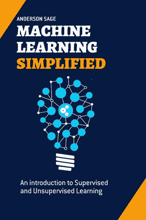

## 机器学习简化

## 机器学习入门：监督学习与无监督学习

**Jose George**

Welcome to introduction to machining learning.

Machine learning is creating rapid and exciting changes across all levels of society.

*   It is the engine behind the recent advancements in industries such as autonomous vehicles.
*   It allows for more accurate and rapid translation of the text into hundreds of languages.
*   It powers the AI assistants you might find in your home.
*   It can help improve worker safety.
*   It can speed up drug design

Machine learning is a complex subject area. Our goal in this lesson is to introduce you to some of the most common terms and ideas used in machine learning. I will then walk you through the different steps involved in machine learning and finish with a series of examples that use machine learning to solve real-world situations.

在传统的软件问题解决中，人分析问题并编写代码以解决该问题。对于许多现实问题，这一过程可能费时费力（甚至是不可能的），因为正确的解决方案需要考虑大量的边界情况。

想象一下，挑战性的任务是编写一个程序来检测图像中是否存在猫。传统方式下，需要仔细关注诸如光照条件变化、不同种类的猫以及猫可能处于的各种姿态等细节。

在机器学习中，问题解决者将解决方案的一部分抽象为一个灵活的组件，称为模型，并使用一种特殊的程序——模型训练算法，对该模型在真实数据上进行调整。结果是一个经过训练的模型，可以用于预测训练数据集中未包含的结果。

在某种程度上，机器学习自动化了传统问题解决者所做的统计推理和模式匹配。

总体目标是使用由模型训练算法创建的模型，生成预测或在数据中发现模式，以解决问题。

*   AWS 提供最全面的云服务，专为机器学习优化。
*   机器学习在 AWS 上的规模远超其他任何地方。

## AWS Machine Learning offerings

在 AI 服务方面，你不一定需要从零编写机器学习解决方案。AWS 预训练的 AI 服务提供即插即用的智能，直接用于你的应用和工作流。你只需将这些服务应用于自己的使用场景即可。

Amazon 有不同的健康 AI 服务，无需机器学习知识即可使用。其中一个例子是 `Amazon Transcribe Medical`，它将医疗语音转换为文本。医护人员与患者之间的对话构成了患者诊断和治疗的基础。准确性至关重要。`Amazon Transcribe Medical` 是一种自动语音识别（ASR）服务，用于短时录音。

### AWS AI services

通过使用 AWS 预训练的 AI 服务，你可以将即插即用的智能应用于广泛的应用场景，如个性化推荐、联系中心现代化、提升安全与安全性以及提高客户参与度。

### Industry-specific solutions

无需机器学习知识，即可为医疗、制造等不同行业的应用添加智能。

### AWS Machine Learning services

AWS 让你能够快速构建、训练和部署模型。`Amazon SageMaker` 是一个完全托管的服务，消除了 ML 工作流的复杂性，使每个开发者和数据科学家都能为各种用例部署机器学习。

### ML infrastructure and frameworks

AWS 工作流服务简化了管理和扩展底层机器学习基础设施的难度。

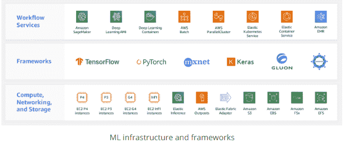

### Getting started

除了 `AWS Training and Certification` 等教育资源外，AWS 还创建了一系列教育工具，帮助开发者以独特且有趣的方式将新的机器学习技术投入使用，如 `AWS DeepRacer` 和 `AWS DeepComposer`。

*   **AWS DeepRacer**：一种设计用于通过物理赛道测试增强学习模型的自主赛车。
*   **AWS DeepComposer**：一种由生成式 AI 驱动的创作设备，能够将旋律转化为全新原创歌曲。
*   **AWS ML Training and Certification**：用于培训 Amazon 开发者的课程。

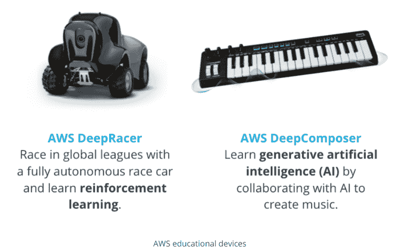

## AWS Account Requirements

### 需要 AWS 账户

要完成本课程的练习，你需要一个 `AWS Account ID`。

然而，你无需完成本课时的练习才能从基础课程毕业。本课时包含的练习标记为 `OPTIONAL ONLY`，如果你无法创建 AWS 账户，只需阅读练习模块即可了解这些工具的工作方式。

要设置新的 `AWS Account ID`，请参考“如何创建并激活新的 Amazon Web Services 账户？”的说明。

创建账户时需要提供付款方式。如需了解哪些服务免费，请参阅 `AWS Free Tier` 文档。

### 这些练习会产生费用吗？

本课时包含大量演示和练习。你 `do not` 需要购买任何 AWS 设备即可完成本课。但请仔细阅读以下可能用于演示和完成练习的 AWS 服务列表。

#### 使用 AWS DeepRacer 训练强化学习模型

*   使用 `AWS DeepRacer` 入门，你将在首月获得 `10 小时免费` 用于训练或评估模型，以及 `5GB 免费存储空间`。这足以训练第一个时间试验模型、对其进行评估、调优，然后将其提交至 `AWS DeepRacer` 联盟。`此优惠在你首次使用服务后 30 天内有效`。
*   超过 `10 小时` 的训练和评估后，你需要为训练、评估和存储机器学习模型付费。费用基于你为新模型训练和评估的时间以及存储模型的大小。想了解 `AWS DeepRacer` 计费细节，请参阅 `AWS DeepRacer Pricing`。

#### 使用 AWS DeepComposer 生成音乐

*   入门时，`AWS DeepComposer` 为首次用户提供 `12 个月免费额度`。免费额度允许你最多进行 `500 项推理任务`，即可生成 `500 件音乐`，使用 `AWS DeepComposer Music Studio`。你可以使用其中一个实例免费完成练习。想了解 `AWS DeepComposer` 的费用，请参阅 `AWS DeepComposer Pricing`。

#### 构建自定义生成式 AI 模型（GAN）使用 Amazon SageMaker（可选）

*   `Amazon SageMaker` 是独立服务，拥有自己的计费和计费等级。要训练自定义生成式 AI 模型，教练使用的实例类型不在 `Amazon SageMaker` 免费额度范围内。如果你想与教练一起编码并训练自己的自定义模型，可能会产生费用。请注意，创建自定义模型完全是可选的，完成本课程不需要完成此练习。想了解 `SageMaker` 的费用，请参阅 `Amazon SageMaker Pricing`。

请确认你已完成本课时所需的必要步骤。

*   我拥有 `AWS 账户 ID`
*   我理解，要完成本课程，无需购买 `AWS DeepRacer` 或 `AWS DeepComposer` 设备。
*   我理解，在首次使用 `AWS DeepRacer` 后的 30 天内，我有 `10 小时免费` 的模型训练和评估时间，用于完成 DeepRacer 部分的演示和练习。
*   我理解，`AWS Free Tier` 为我提供 `500 项 AWS DeepComposer 推理任务`（即 500 件音乐）免费。
*   我理解，“构建自定义 GAN” 演示是可选的，我可以观看演示而不是自己完成，因为我可能需要为完成该练习承担费用。
*   我理解，我可能需对我的 AWS 账户中产生的任何费用负责。

## 强化学习及其应用

本节介绍一种叫强化学习（RL）的机器学习类型。你会了解其实际应用，并通过 `AWS DeepRacer` 示例学习基本概念。本节结束时，你将能够在 `AWS DeepRacer` 控制台创建、训练和评估强化学习模型。

在强化学习（RL）中，代理（agent）通过与环境交互，根据收到的反馈来训练达成目标。它为每个采取的动作获得一个数值奖励。有助于代理达成目标的动作会获得更高的奖励，无帮助的动作则获得低奖励或无奖励。

以最大化总累计奖励为学习目标，随着时间的推移，代理通过试错学会在不同情境下映射有价值的动作。训练得更好的代理能更高效地选择能实现目标的动作。

### 强化学习应用

强化学习在多个领域用于解决实际问题，特别适用于具有长期目标的顺序性问题。以下是一些示例。

*   RL excels at **playing games**:
    *   Go (board game) was mastered by the AlphaGo Zero software.
    *   Atari classic video games are commonly used as a learning tool for creating and testing RL software.
    *   StarCraft II, the real-time strategy video game, was mastered by the AlphaStar software.
*   RL is used in **video game level design**:
    *   Video game level design determines how complex each stage of a game is and directly affects how boring, frustrating, or fun it is to play that game.
    *   Video game companies create an agent that plays the game over and over again to collect data that can be visualized on graphs.
    *   This visual data gives designers a quick way to assess how easy or difficult it is for a player to make progress, which enables them to find that “just right” balance between boredom and frustration faster.
*   RL is used in **wind energy optimization**:
    *   RL models can also be used to power robotics in physical devices.
    *   When multiple turbines work together in a wind farm, the turbines in the front, which receive the wind first, can cause poor wind conditions for the turbines behind them. This is called wake turbulence and it reduces the amount of energy that is captured and converted into electrical power.
    *   Wind energy organizations around the world use reinforcement learning to test solutions. Their models respond to changing wind conditions by changing the angle of the turbine blades. When the upstream turbines slow down it helps the downstream turbines capture more energy.
*   Other examples of real-world RL include:
    *   **Industrial robotics**
    *   **Fraud detection**
    *   **Stock trading**
    *   **Autonomous driving**

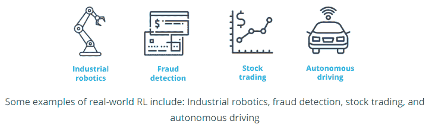

## 新术语

*   **Agent**：你正在训练的软件称为 agent。它在环境中做出决策以达成目标。
*   **Environment**：环境是代理交互的周围区域。
*   **Reward**：代理在给定状态下每个动作的反馈是数值奖励。
*   **Action**：对于每个状态，agent 需要采取动作以实现目标。

## 强化学习与 AWS DeepRacer

### 强化学习概念

本节将使用 `AWS DeepRacer` 为例，学习一些基础强化学习术语和概念。

本节介绍六个基础强化学习术语，并为每个术语在 `AWS DeepRacer` 语境中提供示例。

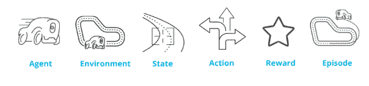

### 基础 RL 术语：Agent、environment、state、action、reward、episode

#### Agent

*   你正在训练的软件称为 agent。
*   它在环境中做出决策以达成目标。
*   在 `AWS DeepRacer` 中，agent 是 `AWS DeepRacer` 小车，其目标是在尽可能快地完成 * laps（圈数）的同时，在某些情况下避免障碍。

#### Environment

*   环境是代理交互的周围区域。
*   对于 `AWS DeepRacer`，这是模拟器中的赛道或真实世界中的赛道。

#### State

*   状态是代理当前在环境中可见或已知的位置。
*   在 `AWS DeepRacer` 的情况下，每个状态都是由它的摄像头捕获的图像。
*   车辆的初始状态是赛道的起始线，其终止状态是当车辆完成一圈、撞击障碍物或驶离赛道时。

#### 动作

*   对于每个状态，代理需要采取一个动作以实现其目标。
*   当 `AWS DeepRacer` 车辆接近一个转弯时，它可以选择加速或减速，并向左转、向右转或直行。

#### 奖励

*   代理在给定状态下执行每个动作时会收到反馈。
*   这种反馈是一个数值奖励。
*   奖励函数是一种激励计划，为赛道上的不同区域分配奖励分数。

#### 集 episode

*   集 episode 代表一个试错的时期，当代理做出决策并从其环境中获得反馈时。
*   对于 `AWS DeepRacer`，集 episode 从初始状态开始，当车辆离开起始位置时开始，并在车辆完成一圈、撞击障碍物或驶离赛道时结束。

在强化学习模型中，代理通过试错在交互式实时环境中学习，利用自身行为的反馈。反馈以奖励的形式给出。

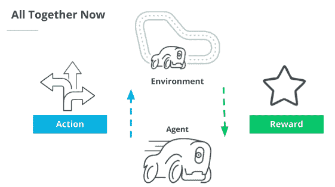

在强化学习模型中，代理通过试错在交互式实时环境中学习，利用自身行为的反馈。反馈以奖励的形式给出。

## 在 AWS DeepRacer 上加入自己的特色：

### 强化学习实践者的角色

`AWS DeepRacer` 可能是自主的，但你在模型成功中仍扮演着重要角色。本节介绍训练算法、动作空间、超参数和奖励函数，并讨论你的想法如何产生影响。

*   算法是一组指令，告诉计算机做什么。机器学习的特殊之处在于它使计算机无需被明确编程即可学习。
*   训练算法定义了你的模型的学习目标，即最大化总累计奖励。不同的算法有不同的策略来实现这一点。
*   `软 actor critic (SAC)` 拥抱探索并且数据高效，但可能缺乏稳定性。
*   `接近政策优化 (PPO)` 稳定但数据密集。
*   动作空间是代理在与环境交互时可以选择的所有有效动作或选择的集合。
    *   离散动作空间表示在每个状态中，代理可能的所有动作为有限的转向角度和油门值组合。
    *   连续动作空间允许代理从你为每个状态定义的值范围中选择动作。
*   超参数是控制你的代理在训练期间性能的变量。有多种类别可供尝试。修改值以增加或减少模型不同部分的影响。
    *   例如，`学习率` 是一个超参数，它控制每一步在学习中计数的新经验数量。更高的 `学习率` 会导致训练更快，但可能降低模型的质量。
*   奖励函数的目的是鼓励代理达到其目标。确定如何奖励哪些动作是你最重要的工作之一。

## 将强化学习与 AWS DeepRacer 结合起来

本视频通过将我们所学的概念付诸实践，将奖励函数想象为在 `AWS DeepRacer` 训练环境中映射到赛道上的网格，并将其可视化为图表上的指标。它还介绍了探索与利用之间的权衡，这是这种类型机器学习的一个重要挑战。

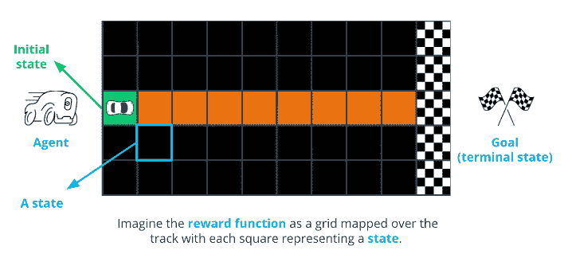

每个方块是一个状态。绿色方块是起始位置，即初始状态，而终点线是目标，即终止状态。

## 关于奖励函数的要点回顾：

*   奖励函数为赛道网格上的每个状态分配分数。你通过给予奖励最高的赛道部分来激励支持你的车辆快速完成圈的行为。
*   奖励函数是你编写的实际代码，用于帮助你的代理判断它刚刚执行的动作是好是坏，以及好或坏程度。

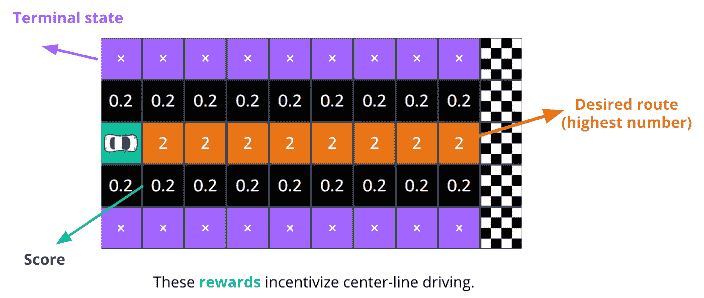


包含“x”的方块是赛道边缘，被定义为终止状态，它们告诉你的车辆它已经离开了赛道。

## 关于探索与利用的要点回顾

* 当车辆刚开始时，它通过随机方向漫游来探索。但随着代理获得更多训练，它对环境的了解也会增加。这种经验帮助它对所选动作更有信心。
* 利用（exploitation）意味着车辆开始利用从以往经验中获取的信息来帮助它达到目标。不同的训练算法利用探索与利用的方式各异。

## 关于奖励图的要点回顾

* 在 AWS DeepRacer 控制台训练你的车辆时，你的训练指标会显示在奖励图上。
* 绘制每集的总奖励可以让你观察模型随时间的表现。你获得的奖励越多，模型的表现就越好。

## 关于 AWS DeepRacer 的要点回顾

* AWS DeepRacer 是物理车辆与虚拟模拟器的结合，包括 AWS 控制台中的 AWS DeepRacer 联盟和社区赛事。
* 开始学习 AWS DeepRacer 不需要硬件设备：你可以立即在 AWS 控制台中开始。AWS 控制台中的 3D 模拟器是训练和评估的场所。

## 新术语

* **探索与利用**：代理应利用过去经验中的已知信息以获得更高的累计奖励，但它也需要探索以获取新经验，这些经验可用于未来选择最佳动作。

## 进一步阅读

* 如果你对改进模型的更多技巧、工作坊、课程和其他资源感兴趣，你会在 AWS DeepRacer 捷径页面找到大量资源。
* 为了获得详细的逐步指导和故障排除支持，请参阅 AWS DeepRacer 开发者文档。
* 如果你对阅读关于各种 DeepRacer 主题的帖子以及关注最新发布感兴趣，请查看 AWS 讨论论坛。
* 如果你想与充满活力的全球强化学习赛车爱好者社区保持联系，请加入 AWS DeepRacer Slack 社区。
* 如果你对调试 DeepRacer 的开源设备软件并与机器人创新者合作感兴趣，请查看我们的 AWS DeepRacer GitHub 组织。

# 1. 训练模型的步骤

* 在**创建模型页面**中，在“环境模拟”下，选择一个作为虚拟环境的赛道，用于训练您的 AWS DeepRacer 代理。然后，选择“下一步”。对于第一次运行，选择一个形状简单且转弯平缓的赛道。在后续迭代中，您可以选择更复杂的赛道，以逐步提升模型。如果要为特定赛事训练模型，请选择最接近该赛事赛道的赛道。
* 在**创建模型**页面，选择“下一步”。
* 在**创建模型**页面，在“赛程类型”下，选择训练类型。对于第一次运行，选择“时间试验”。默认传感器配置（单目标摄像头）适用于此类赛程，无需修改。
* 在**创建模型**页面，在“训练算法和超参数”下，选择 `Soft Actor Critic (SAC)` 或 `Proximal Policy Optimization (PPO)` 算法。在 AWS DeepRacer 控制台中，SAC 模型必须在连续动作空间中训练。PPO 模型可以在连续或离散动作空间中训练。
* 在**创建模型**页面，在“训练算法和超参数”下，使用默认超参数值。稍后若要提升训练性能，可扩展超参数并尝试修改默认值。
* 在**创建模型**页面，在“代理”下，选择 **The Original DeepRacer** 或 **The Original DeepRacer (continuous action space)** 作为首次模型。如果使用 `Soft Actor Critic (SAC)` 作为训练算法，系统会过滤车辆，以便您可以从兼容的连续动作空间代理中选择。
* 在**创建模型**页面，选择“下一步”。
* 在**创建模型**页面，在“奖励函数”下，使用默认奖励函数示例保持不变为首次模型。稍后，您可以选择奖励函数示例来选定另一个示例函数，然后选择“使用代码”接受所选的奖励函数。
* 在**创建模型**页面，在“停止条件”下，保持“最大时间”默认值不变，或设置新值以终止训练作业，帮助防止训练时间过长（可能失控）的情况。在训练早期实验时，建议先设置较小的参数值，然后逐步延长训练时间。
* 在**创建模型**页面，选择“创建模型”以开始创建模型并配置训练作业实例。
* 提交后，观察训练作业初始化并运行。初始化过程约需 6 分钟，状态即可从“初始化”变为“进行中”。
* 观察奖励图和模拟视频流，查看训练作业的进度。您可以在奖励图旁的刷新按钮旁边定期点击刷新，直至训练作业完成。

> **注意**：训练作业在 AWS 云上运行，您无需在 DeepRacer 控制台中保持页面打开。但您可以在作业进行期间随时返回控制台查看模型状态。

# 2. 检查奖励图以评估训练进度

在训练并评估首个模型时，您会想了解其质量。为此，请检查奖励图。

在奖励图中查找以下内容：

* 平均奖励
* 平均完成百分比（训练）
* 平均完成百分比（评估）
* 最佳模型曲线
* 奖励主 Y 轴
* 轨道完成百分比次要 Y 轴
* 迭代 X 轴

查看本练习的解答，获取如何解读这些指标的提示。

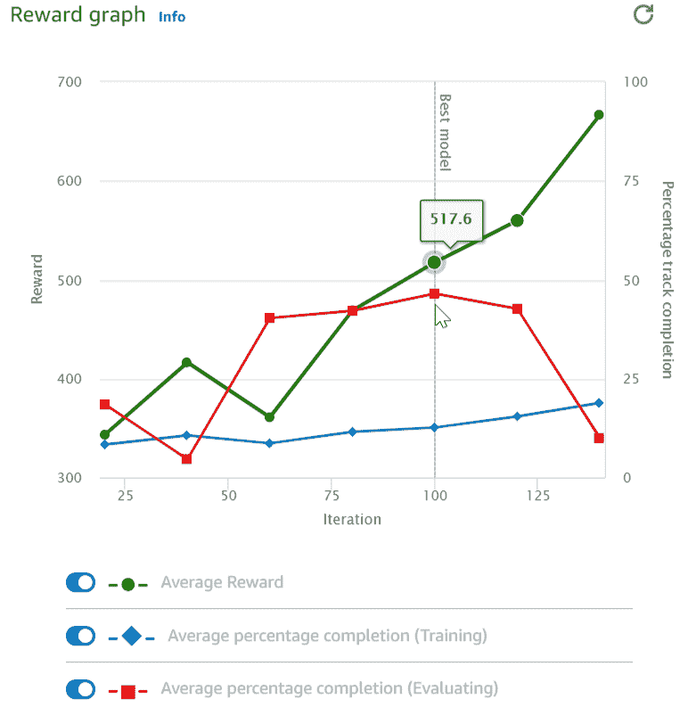

在训练并评估首个模型时，您会想了解其质量。为此，请检查奖励图。

在奖励图中查找以下内容：

* 平均奖励
* 平均完成百分比（训练）
* 平均完成百分比（评估）
* 最佳模型曲线
* 奖励主 Y 轴
* 轨道完成百分比次要 Y 轴
* 迭代 X 轴

查看本练习的解答，获取如何解读这些指标的提示。


## 奖励图解读

下面的四个示例帮助您了解如何根据奖励图判断模型的成功程度。学会阅读这些图表是一门艺术也是一门科学，需要时间，但通过以下四个示例的解读，您将获得起步。

### 需要更多训练

在下面的示例中，我们看到只有 600 次迭代，图表仍在上升。评估完成百分比已达到 100%，这是一个好迹象，但尚未完全稳定，训练完成百分比仍有提升空间。该奖励函数和模型展现出潜力，但仍需更多训练时间。

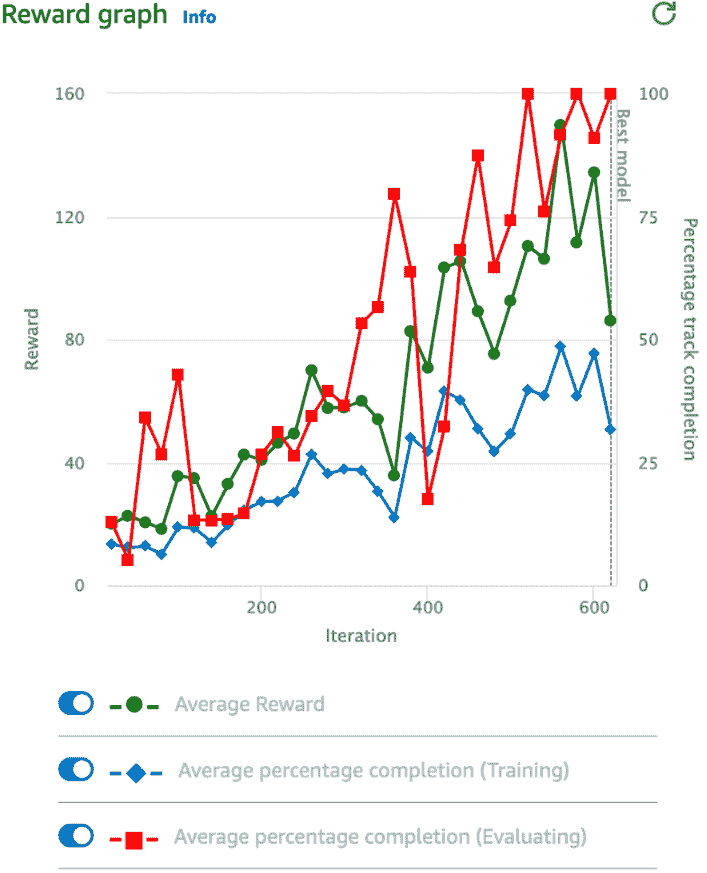

### 需要更多训练

在下一个示例中，我们可以看到完成百分比始终停留在约 15% 左右，且已训练相当长时间——大约 6000 次迭代。这不是好现象！建议放弃该模型和奖励函数，尝试不同的策略。

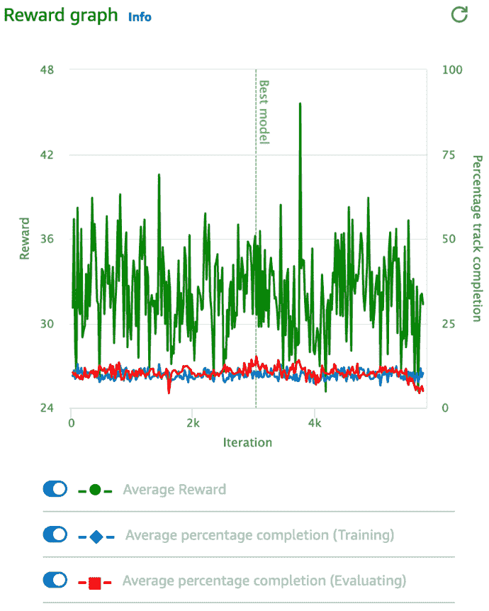

### 训练良好的模型

在下面的示例图中，我们看到评估完成百分比早已达到 100%，而训练完成百分比大约在 100 次迭代后即达 100%。此时模型已训练良好。继续训练可能导致模型过拟合到该赛道。

### 避免过拟合

过拟合（overfitting）是机器学习中的重要概念。在 AWS DeepRacer 中，如果模型在特定赛道上训练时间过长，可能出现过拟合问题。一个好的模型应能基于道路特征（如边缘和中心线）做出决策，并在几乎任何赛道上都能驾驶。

过拟合的模型会学习依赖于特定赛道的标志，例如看到独特形状的草地或墙角的特定角度时会转向特定方向。该模型在该特定赛道上表现极佳，但在其他虚拟赛道或即使是同一赛道的物理环境中因细微角度、纹理和光照变化而表现不佳。

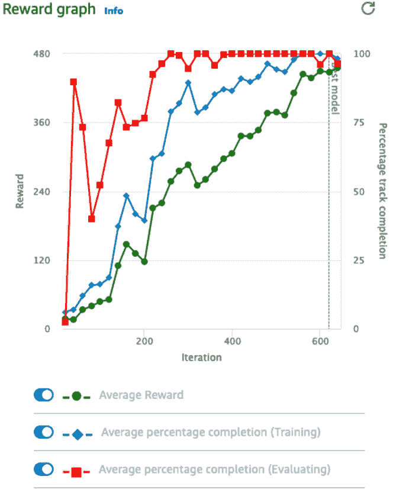

### 调整超参数

AWS DeepRacer 控制台的默认超参数效果良好，但有时您可能会考虑调整训练超参数。超参数是本质上作为训练算法设置的变量，用于控制您的代理在训练过程中的表现。例如，我们了解到学习率控制了每一步在学习中统计的新经验数量。

在本奖励图示例中，训练完成图和奖励图呈现高低起伏。这可能表明无法收敛，这可以通过调整学习率来帮助。想象一下，当前节点的权重为 .03，理想权重应为 .035，但您的学习率设置为 .01。下一次训练迭代将超过理想值达到 .04，随后的迭代则会再次下降到 .03。如果您怀疑情况如此，可以将学习率调整为 .001。较低的学习率会使学习过程更长，但可以提高模型的质量。

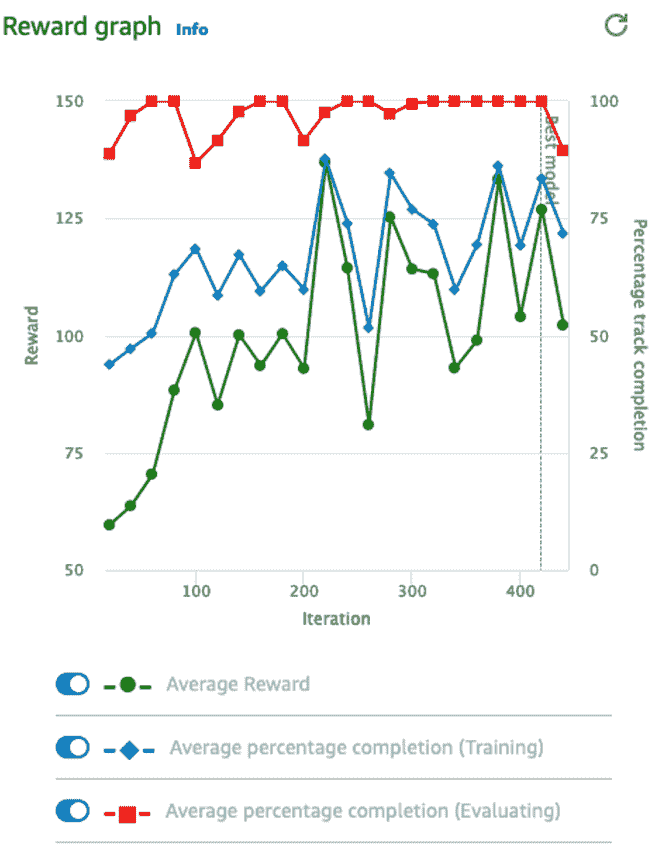

干得好，祝好运！

记住：训练经验有助于模型和强化学习实践者成为更好的团队。通过参加每月的 AWS DeepRacer 联赛，有机会赢得奖品和荣耀，同时提升机器学习开发技能！

## 生成式人工智能入门

### 生成式人工智能及其应用

生成式人工智能是人工智能最近最大的进步之一，因为它能够创造新事物。

直到最近，大多数机器学习应用都由判别模型驱动。判别模型旨在回答问题：“如果我查看某些数据，如何最好地对该数据进行分类或预测数值？”例如，我们可以使用判别模型来判断相机是否对准了一只猫。

当我们在包含一些猫和一些不包含猫的图像集合上训练该模型时，我们期望模型在图像中找到模式，以帮助做出预测。

生成式模型旨在回答问题：“我是否见过类似的数据？”在我们的图像分类示例中，我们仍然可以使用生成式模型，通过将问题表述为标记为“猫”的图像是否比标记为“无猫”的图像更接近之前见过的数据。

然而，生成式模型可以支持第二种用例。生成式模型中学习到的模式可以用于创建全新看起来与之前见过的数据相似的数据示例。

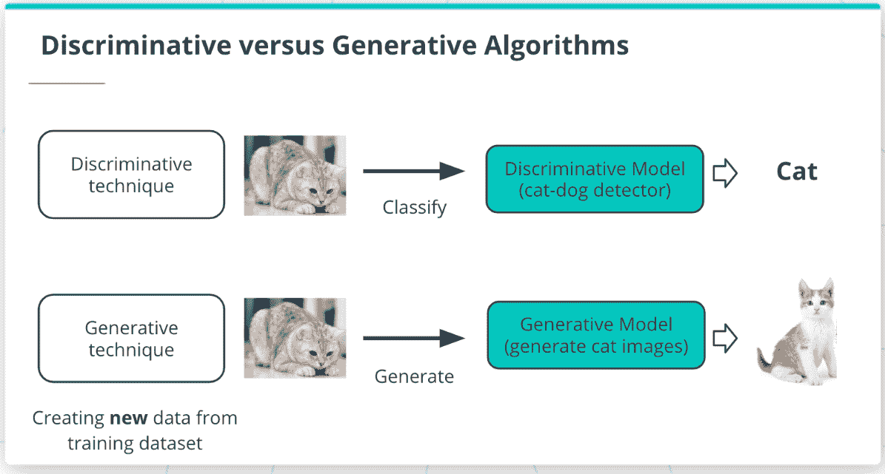

判别算法与生成式算法对比

### 生成式人工智能模型

在这节课中，您将学习如何创建三种流行的生成式模型：生成式对抗网络（GANs）、通用自回归模型和基于 Transformer 的模型。每种模型均可通过 AWS DeepComposer 获得，让您亲身体验使用这些技术生成新的音乐示例。

#### 自回归模型

自回归卷积神经网络（AR-CNNs）用于研究随时间演变的系统，并假设某些数据的概率仅取决于过去发生的情况。这是观察许多系统的有用方式，从天气预测到股票预测。

#### 生成式对抗网络（GANs）

生成式对抗网络（GANs）是一种机器学习模型格式，通过让两个网络相互竞争来生成新内容。训练算法在生成器网络（负责生成新数据）和判别器网络（负责衡量生成器网络的数据与训练数据集的相似程度）之间交替进行。

#### 基于 Transformer 的模型

Transformer 基础模型最常用于研究具有序列结构的数据（例如句子中的单词序列）。Transformer 方法如今已成为建模自然语言的常见现代工具。

本课程不会在此深入探讨该方法，但您可以了解更多关于 Transformer 以及 AWS DeepComposer 如何在学习胶囊中使用 Transformer。

## 使用 AWS DeepComposer 进行生成式人工智能

### 什么是 AWS DeepComposer？

AWS DeepComposer 为您提供了一个富有创意且易于入门的机器学习（ML）起点，特别是生成式人工智能。它包括一个 USB 键盘，连接到您的计算机以输入旋律，以及 AWS DeepComposer 控制台，其中包含 AWS DeepComposer Music Studio 用于生成音乐、学习胶囊用于深入研究生成式人工智能模型，以及 AWS DeepComposer Chartbusters 挑战用于展示您的机器学习技能。


AWS DeepComposer

AWS DeepComposer 键盘

完成本课程无需 AWS DeepComposer 键盘。您可以导入自己的 MIDI 文件、使用提供的示例旋律，或在 AWS DeepComposer Music Studio 中使用虚拟键盘。

### AWS DeepComposer 音乐工作室

要生成、创建和编辑使用 AWS DeepComposer 的作品，您使用 AWS DeepComposer Music Studio。要开始，您需要输入轨道和一个已训练的模型。

对于输入轨道，您可以使用示例轨道、录制自定义轨道，或导入轨道。

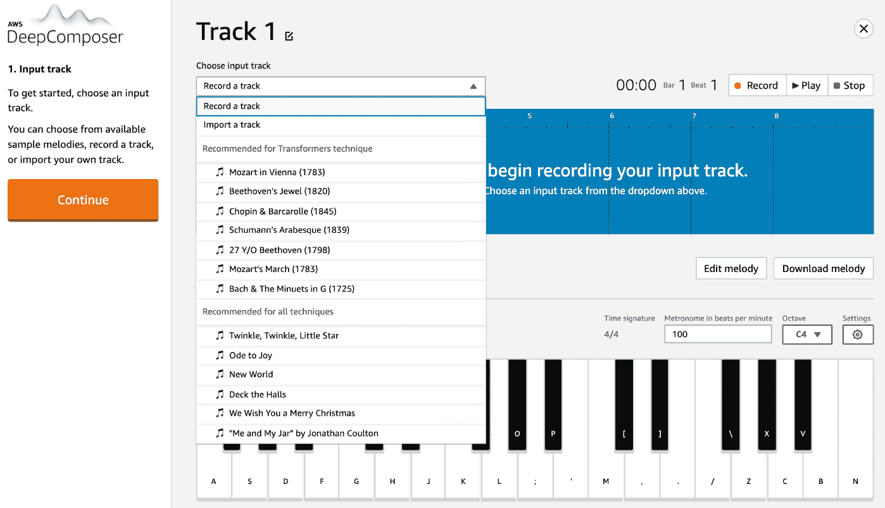

输入轨道

在机器学习技术方面，您可以使用示例模型或自定义模型。

每个 AWS DeepComposer Music Studio 体验支持三种生成式人工智能技术：生成式对抗网络（GANs）、自回归卷积神经网络（AR-CNNs）和 Transformer。

* 使用 GAN 技术创建伴奏轨道。
* 使用 AR-CNN 技术修改输入轨道中的音符。
* 使用 Transformer 技术将输入轨道延长最多 30 秒。

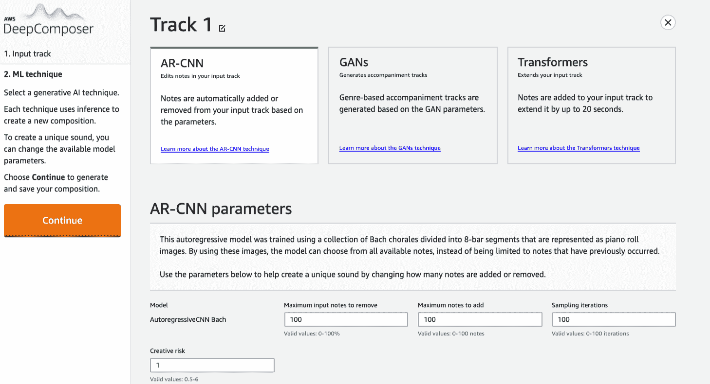

机器学习模型

### Demo: AWS DeepComposer

在这次演示中，您通过 AWS DeepComposer 控制台了解深度学习，输入音乐，并训练深度学习模型以创建新音乐。

### AWS DeepComposer 学习胶囊

要了解 AWS DeepComposer 控制台中使用的生成式人工智能和机器学习技术的详细信息，您可以使用 AWS DeepComposer 控制台中易于消费、片段式的学习胶囊。

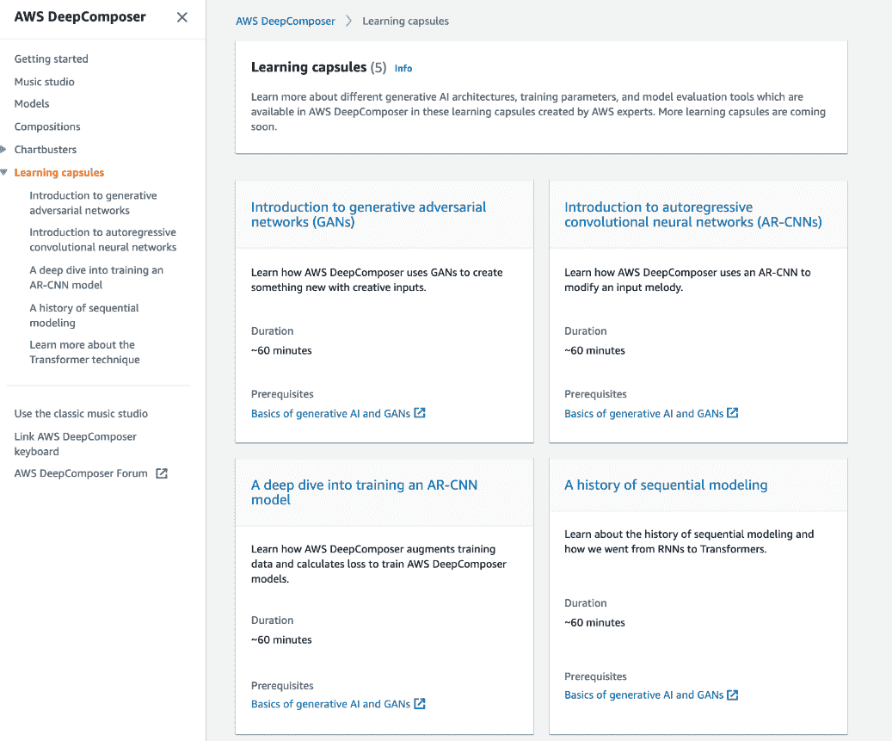

AWS DeepComposer 学习胶囊

### AWS DeepComposer Chartbusters 挑战

Chartbusters 是一项全球挑战，您可以使用 AWS DeepComposer 创建原创作品并参与每月挑战，展示您的机器学习和生成式人工智能技能。

您不需要参与此挑战即可完成本课程，但本课程教您赢得本季度我们推出的两项挑战所需的全部内容。无论您在音乐或机器学习方面的背景如何，您都可以找到适合您的竞赛。

本季度您可以在以下两种挑战中任选一种：

* 基础挑战 “Melody-Go-Round”：您可以使用 AWS DeepComposer Music Studio 中的任何机器学习技术创建新作品。
* 高级挑战 “Melody Harvest”：您使用 Amazon SageMaker 训练自定义生成式人工智能模型。

## GANs 与 AWS DeepComposer

我们将从 AWS DeepComposer 中流行的生成式模型——生成式对抗网络（GANs）开始。在 AWS DeepComposer GAN 中，模型用于解决创意任务：为您提供的输入轨道添加与其风格相匹配的伴奏。聆听输入旋律和由 AWS DeepComposer GAN 模型创建的输出作曲：

* 输入旋律
* 输出旋律

### 什么是 GANs？

GAN 是一种生成式机器学习模型，它让两个神经网络相互竞争以生成新内容：一个生成器和一个判别器。

一个生成器是一种神经网络，它学习在其训练数据集上创建与源数据相似的新数据。

一个判别器是另一种神经网络，用于区分真实数据和合成数据。

生成器和判别器在交替循环中进行训练。生成器学习生成越来越真实的数据，而判别器则逐步提升区分真实数据与新生成数据的能力。

#### 交响乐团与指挥的协作

简单的交响乐团与指挥隐喻可以用于理解 GAN。乐团进行训练、练习，并尝试生成精致的音乐，然后指挥与之合作，既是评判也是教练。指挥评估输出质量，同时提供反馈以实现特定风格。他们越多地协作，乐团的表现就越好。

AWS DeepComposer 使用的 GAN 模型工作方式类似。有两个相互竞争的网络协同工作，学习生成具有独特风格的音乐创作。

GAN 的生成器像乐团一样产生新音乐。判别器则判断生成的音乐是否真实，并提供反馈，以帮助生成器使其数据更真实，正如指挥提供反馈以提升乐团表现。

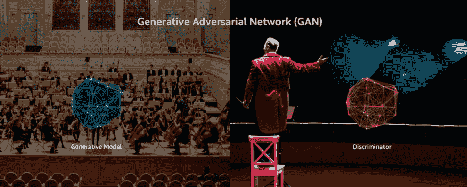

交响乐团与指挥

#### Training Methodology

让我们通过观察 GAN 在 AWS DeepComposer 中的训练和使用方式来更深入地理解。训练时，生成器和判别器在如下图所示的紧密循环中协同工作。

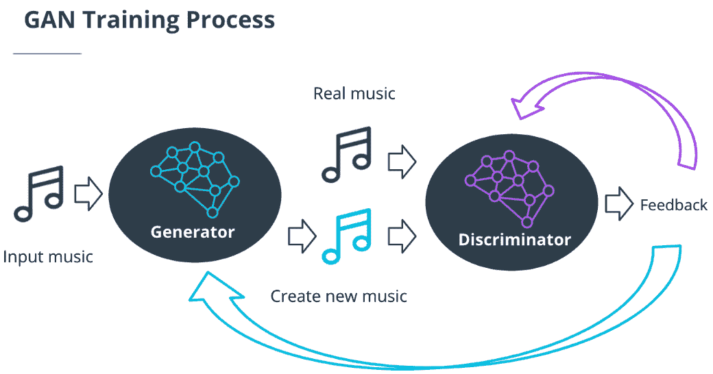

AWS DeepComposer 中 GAN 模型的示意图

> **Note**：虽然此图显示生成器左侧接收输入，但 GAN 通常可以在没有任何输入的情况下生成新数据。

##### Generator

* 生成器接收一批单轨钢琴卷帘（旋律）作为输入，并通过在每个输入音乐轨道上添加伴奏，生成一批多轨钢琴卷帘作为输出。
* 判别器随后接收这些生成的音乐轨道，预测它们与训练数据集中真实数据的偏离程度。这种偏离被称为生成器损失。生成器利用判别器的反馈不断改进生成真实输出的能力。

##### Discriminator

* 随着生成器在生成伴奏方面变得更好，它开始欺骗判别器。因此，判别器也需要重新训练。判别器通过测量判别器损失来评估其在区分真实与假数据方面的表现。

我们从第一次迭代的判别器开始，**交替训练这两个网络**，直到满足停止条件；例如，算法已看到整个数据集的特定次数，或生成器和判别器损失达到平台（如下图所示）。

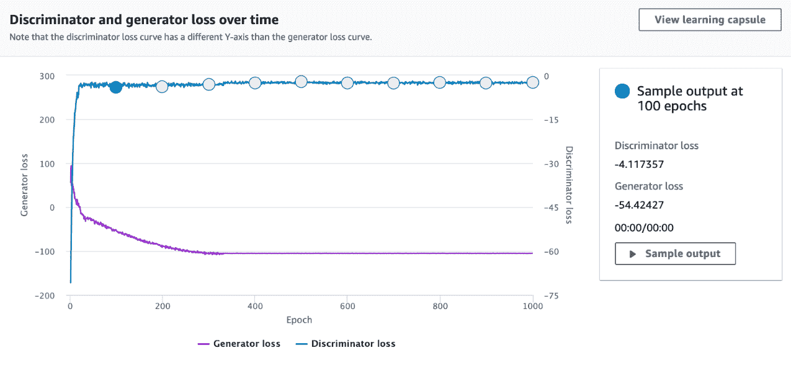

判别器损失和生成器损失达到平台

### 新术语

* **Generator**：一种神经网络，学习创建与其训练数据集相似的新数据。
* **Discriminator**：一种神经网络，用于区分真实与合成数据。
* **Generator loss**：衡量输出数据与训练数据集中真实数据的偏离程度。
* **Discriminator loss**：评估判别器区分真实与假数据的能力。

## AR-CNN with AWS DeepComposer

我们的下一个流行生成模型是自回归卷积神经网络（AR-CNN）。自回归卷积神经网络会随时间迭代修改数据以生成新数据。

要更好地理解 AR-CNN 模型的工作原理，我们首先讨论如何使音乐能够被机器读取。

### Image-based representation

几乎所有机器学习算法都以数字或数字序列的形式处理数据。在 AWS DeepComposer 中，输入音频轨道以钢琴卷帘的形式表示。在每个二维钢琴卷帘中，水平方向表示时间，垂直方向表示音高。你可能会注意到这种表示方式与图片相似。

AR-CNN 模型使用钢琴卷帘图像来表示数据集中的音频文件。下图展示了一个例子，上方是乐谱，下方是该乐谱对应的钢琴卷帘图像。

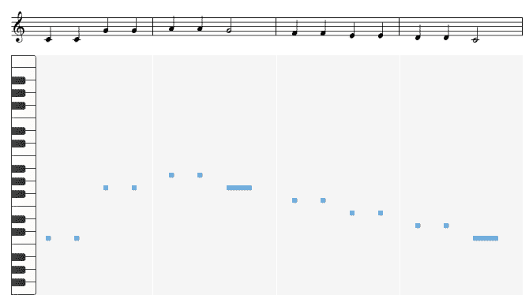

乐谱与钢琴卷帘

### How the AR-CNN Model Works


# 当在推理过程中向输入轨道中添加或移除音符时，我们称之为编辑事件

为了训练 `AR-CNN` 模型预测何时需要向输入轨道中添加或移除音符（编辑事件），模型会迭代更新输入轨道，使其更像训练数据集。在训练过程中，模型还被挑战去检测原始钢琴卷帘与新修改的钢琴卷帘之间的差异。

## New Terms

*   **Piano roll**：表示输入轨道的二维钢琴卷帘矩阵，水平方向是时间，垂直方向是音高。
*   **Edit event**：在推理过程中，音符被添加或从输入轨道中移除的操作。

## Demo: Create Music with AWS DeepComposer

下面是一个视频，演示如何使用 AWS DeepComposer 尝试 GAN 和 AR-CNN 模型。

## Important

为帮助您入门，AWS DeepComposer 为首次用户提供 12 个月的免费额度。免费额度允许您进行最多 500 次推理任务，即生成 500 首音乐，使用 AWS DeepComposer 音乐工作室。您可以使用其中一个实例免费完成练习。更多信息请参阅 AWS 账户要求页面。

在演示中，您学习如何使用 AWS DeepComposer 创建音乐。

您需要一首音乐轨道来开始。有几种方式可以实现：您可以使用 AWS 键盘设备录制自己的音乐，或使用控制台中提供的虚拟键盘。也可以输入 MIDI 文件或选择提供的音乐轨道。

输入音乐轨道后，选择“Continue”以创建模型。可选模型有 AR-CNN、GAN 和 transformers，它们各自具有略有不同的功能。选择模型后，您可以调整用于训练模型的参数。

在完成模型创建后，选择“Continue”以聆听并改进输出旋律。要编辑旋律，可以直接在钢琴卷帘上拖动或延长音符，或调整模型参数并重新训练。持续微调旋律，直到满意，然后点击“Continue”完成创作。

如果您想使用另一个生成模型进一步增强音乐，也可以这样做。只需在“Next step”部分选择一个模型，创建新模型以增强您的音乐。

祝贺您使用 AWS DeepComposer 创作了第一首音乐！现在您可以下载旋律或提交参加比赛。希望您享受使用 AWS DeepComposer 创作音乐的旅程。

## Exercise: Generate music with AWS DeepComposer

您已经看到教练如何在 AWS DeepComposer 中生成一段音乐。现在，轮到您创作属于自己的音乐。为了完成此练习，请完成以下步骤。

*   打开 AWS DeepComposer 控制台。
*   在导航栏中，选择 Music studio，然后选择 Start composing。
*   在 Input track 页面，使用虚拟键盘录制旋律，导入 MIDI 文件，或选择输入轨道。在 ML technique 页面，选择 AR-CNN。在 Inference output 页面，您可以执行以下操作：
    *   调整 AR-CNN 参数，选择 Enhance，然后选择 Play 以听听您的轨道如何变化。重复此操作，直到满意结果。
    *   选择 `Edit melody` 以修改和更改推理期间添加的音符。
    *   选择 `Continue` 以完成创建您的作品。
    *   您可以选择 `Share composition`、`Register` 或 `Sign in` 到 Soundcloud 并提交到 "Melody-Go-Round" 竞赛。参加竞赛是可选的。
    *   如果您卡住了，可以查看 `Demo: Create Music with AWS DeepComposer` 页面上的演示视频。

## Build a Custom GAN Model (Optional): Part 1

要创建自定义 GAN，您将需要使用不在 Amazon SageMaker 免费套餐覆盖范围内的实例类型。如果您想构建自定义 GAN，可能会产生费用。

您可以在 Amazon SageMaker 定价文档中了解更多关于 SageMaker 成本的信息。

**Important**：这是一个可选练习。您不需要完成此练习即可从基金会的课程毕业。如果您无法创建 AWS 账户，请移至下一个模块。

### Setting Up the AWS DeepComposer Notebook

*   转到 AWS 管理控制台并搜索 Amazon SageMaker。
*   进入 SageMaker 控制台后，查看左侧菜单并选择 `Notebook Instances`。
*   接下来，选择 `Create notebook instance`。
*   在 Notebook instance setting 部分，给笔记本命名，例如 `DeepComposerUdacity`。
*   根据您需要的 CPU、GPU 和内存类型，下一步是选择实例类型。对于我们的目的，我们将配置 `ml.c5.4xlarge`。
*   将 Elastic Inference 保留默认值 none。
*   在 Permissions and encryption 部分，使用所有默认值创建新的 IAM 角色。


当你看到角色创建成功时，向下导航到 Git 存储库部分。

*   选择 `Clone a public Git repository to this notebook instance only`。
*   将公共 URL 复制并粘贴到 Git 存储库 URL 部分：`https://github.com/aws-samples/aws-deepcomposer-samples`。
*   选择 `Create notebook instance`。
*   给 SageMaker 几分钟时间来配置实例并克隆 Git 存储库。
*   当状态显示 `InService` 时，你可以打开 Jupyter 笔记本。

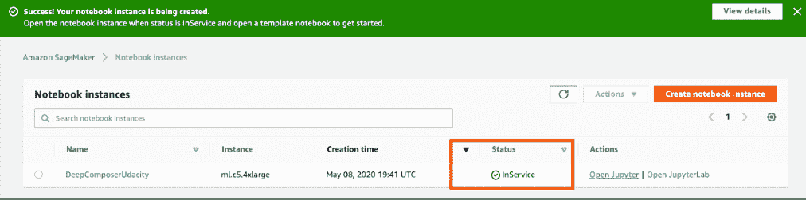

## 探索笔记本

现在它已配置完毕并可供使用，让我们花点时间调查笔记本内部的内容。

### 打开笔记本

*   点击 `Open Jupyter`。
*   当笔记本打开时...

## 机器学习概念回顾

当模型试图将数据识别为“真实”或“伪造”时，它会犯错误。任何与真实情况不同的预测都被称为错误。

预测错误的度量，在给定一组权重的情况下，称为**损失函数**。权重表示与预测准确性相关的特征的重要性。

损失函数是训练机器学习模型的重要组成部分，因为它们用于在模型的每次迭代后更新权重。更新权重后的迭代优化了模型，使错误越来越小。

## 设置并运行模型训练

*   运行定义损失函数的单元格。
*   运行设置优化器的单元格。
*   运行定义生成器步函数的单元格。
*   运行定义判别器步函数的单元格。
*   运行加载旋律样本的单元格。
*   运行设置训练参数的单元格。
*   运行训练模型的单元格。

训练和调试模型可能需要很长时间——有时需要数周甚至数月。我们的模型大约需要一个小时进行训练。

## 模型评估

现在模型已经完成训练，是时候评估其结果了。

对于分类问题，有几种评估指标可以计算，通常在工作流程组织的初期就决定。

你可以：

*   检查网络损失是否收敛。
*   查看常用的生成样本的音乐指标，并与训练数据集进行比较。

### 评估我们的训练结果

*   运行单元格以恢复保存的检查点。如果你不想等待训练完成，可以通过在单元格中设置 `TRAIN = False` 使用预训练模型的数据。
*   运行单元格以绘制损失曲线。
*   运行单元格以绘制指标曲线。

## 结果与推理

最后，我们准备好听听模型产生的音乐，并可视化钢琴卷轴输出！

当模型训练完成并产生可接受的质量时，是时候看看它在未见过的数据上的表现。我们可以在未知输入上测试模型，并将结果作为未来数据性能的代理。

### 评估生成的音乐

*   在第一个单元格中，输入 `0` 作为迭代号码：运行单元格并播放音乐片段。或者聆听这个来自迭代 0 的示例片段：

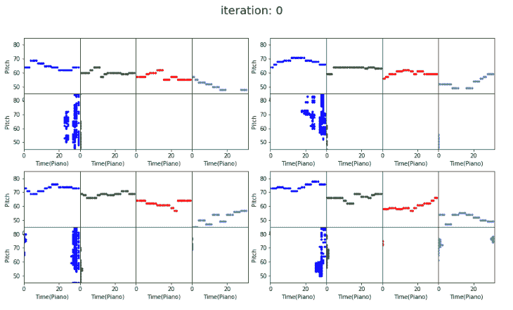

> 迭代 0 的示例钢琴卷轴

*   在第一个单元格中，输入 `500` 作为迭代号码：运行单元格并播放音乐片段。或者聆听迭代 500 的示例片段。
*   在第二个单元格中，输入 `500` 作为迭代号码：运行单元格并显示钢琴卷轴。

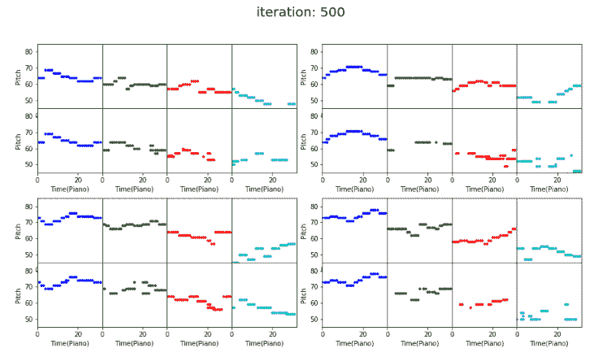

> 迭代 500 的示例钢琴卷轴

调整迭代号码，观察输出随时间变化的变化！

下面是一个在迭代 950 处的示例片段：

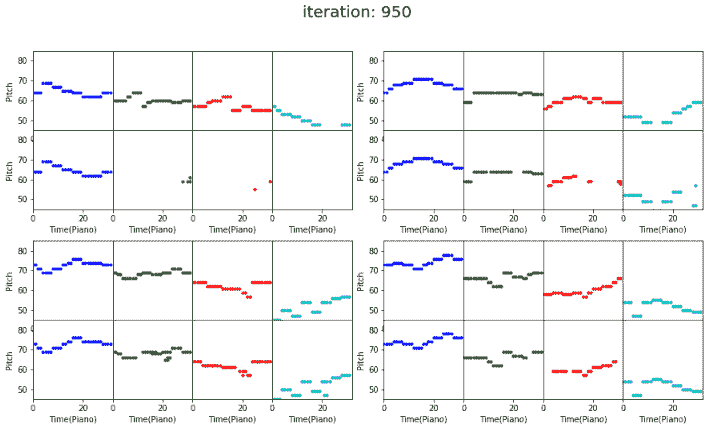

> 迭代 950 的示例钢琴卷轴

你能听到或看到迭代 500 和迭代 950 之间的质量差异吗？

### 观察模型的演变

运行下一个单元格，创建一个视频，观察生成的钢琴卷轴随时间变化的情况！

### 推理

现在 GAN 已经训练完成，我们可以在自定义输入上运行它以生成音乐。

*   运行单元格，生成一首基于 "Twinkle Twinkle Little Star" 的新歌。或者聆听生成的音乐示例。
*   运行下一个单元格并播放生成的音乐。或者聆听生成的音乐示例。

## 完成并删除 Jupyter Notebook

由于该项目不在 AWS 免费层范围内，因此只要笔记本运行，项目成本就会持续累积。

完成并删除笔记本的步骤如下：

*   返回 Amazon SageMaker 控制台。
*   选择笔记本并点击 Actions。

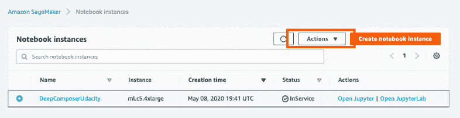

*   选择 Stop 并等待实例停止。

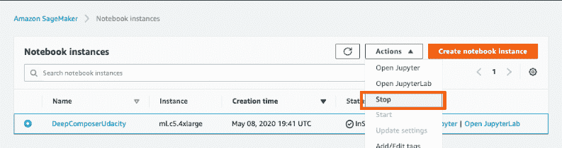

*   选择 Delete。

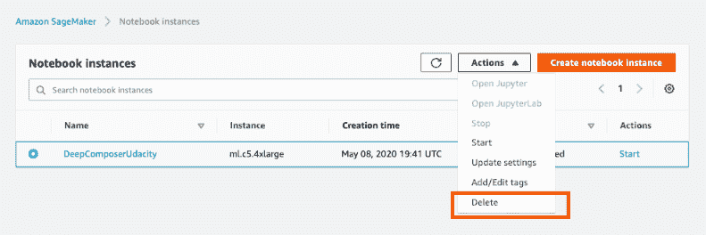

## 回顾

在这个演示中，我们学习了如何在 Amazon SageMaker 中设置 Jupyter 笔记本，回顾了机器学习代码，以及在笔记本实例中数据准备、模型训练和模型评估的过程。虽然这对我们来说是一个有趣的探索案例，但这些概念和技术可以应用于其他机器学习项目，例如目标检测器或文本情感分析。

## 术语表

*   **Action**：对于每个状态，代理需要采取行动以实现其目标。
*   **Agent**：你正在训练的软件称为代理。它在环境中做出决策以达成目标。
*   **Discriminator**：一种神经网络，用于区分真实数据和合成数据。
*   **Discriminator loss**：评估判别器在区分真实和假数据方面的表现。
*   **Edit event**：在推理过程中，输入轨迹中要么添加要么删除音符的事件。
*   **Environment**：代理交互的周围环境。
*   **Exploration versus exploitation**：代理应利用已知信息以实现更高的累积回报，但也需要探索以获取新经验，从而在未来选择最佳行动。
*   **Generator**：一种神经网络，学习创建与训练数据相似的新数据。
*   **Generator loss**：衡量输出数据与训练数据集中真实数据之间的偏差。
*   **Hidden layer**：位于输出层和输入层之间的层。隐藏层针对特定任务进行定制。
*   **Input layer**：神经网络的第一层。该层接收所有传递通过神经网络的数据。
*   **Output layer**：神经网络的最后一层。该层根据隐藏层中捕获的信息生成预测。
*   **Piano roll**：一种二维钢琴卷轴矩阵，表示输入轨迹。水平方向表示时间，垂直方向表示音高。
*   **Reward**：在给定状态下，代理采取每个行动后获得的反馈，这是一个数值奖励。

---

由于在你仍在努力让代码运行起来时写出最佳代码并不容易，因此分配时间来完成这一步骤对于产出高质量代码至关重要。尽管初始时间和精力的投入可能较大，但长期来看，这将通过加快你的开发时间而回报。

当你不断努力改进代码时，你会成为一名更强大的程序员。你越多地进行重构，就越容易在第一次编写代码时就结构清晰、编写出高质量的代码。

## 为什么重构？

*   长期来看减少工作量。
*   更易于维护代码。
*   更多地重用你的代码。
*   成为更好的开发者。

## 编写整洁的代码

### 编写整洁的代码：有意义的命名

使用有意义的名称。

*   **要描述性并隐含类型**：对于布尔值，可以在前面加上 `is_` 或 `has_` 前缀，以表明它是一个条件。也可以使用词性来隐含类型，例如使用动词作为函数名，名词作为变量名。
*   **保持一致但清晰区分**：`age_list` 和 `age` 更容易区分，而不是 `ages` 和 `age`。
*   **避免缩写和单字母**：你可以根据代码的受众来决定何时做这些例外。如果你与其他数据科学家合作，某些变量可能是共同认知的。但如果你与全栈工程师合作，可能需要提供更具描述性的名称（例外情况包括计数器和常见的数学变量）。
*   **长名字不等于有意义的名字**：你应该保持描述性，但只包含相关信息。例如，良好的函数名应清晰描述其功能，而不应包含实现细节或高度特定的用途。

通过询问同事根据函数或变量的名称猜测其用途（在不查看代码的情况下），来测试你的命名效果如何。编写有意义的名称通常需要付出努力才能做到正确。

### 编写整洁的代码：合理使用空白

正确使用空白。

*   使用一致的缩进：标准是每缩进四个空格。你可以在文本编辑器中将其设置为默认值。
*   用空行分隔代码的不同部分，以保持代码整洁、易读。
*   尽量将行长限制在约 79 个字符以内，这是 PEP 8 风格指南中的建议。许多优秀的文本编辑器都提供设置，以显示微妙的线条，指示 79 字符的上限。

如需更多指南，请参阅 PEP 8 中的代码布局部分。

## 编写模块化代码

遵循以下建议来编写模块化代码。

**Tip**：`DRY (Don't Repeat Yourself)`

不要重复自己！模块化允许你重用代码的部分。将重复的代码提取为函数或循环，进行一般化和合并。

**Tip**：`抽象出逻辑以提高可读性`

将代码抽象为函数不仅减少重复，还能通过具有描述性的函数名提高可读性。虽然抽象逻辑可以让代码更易读，但也可能导致过度工程化，产生过多的模块，因此需谨慎判断。

**Tip**：`尽量减少实体的数量（函数、类、模块等）`

函数调用与内联逻辑之间存在权衡。如果你将代码拆分为不必要的函数和模块，在想要查看实现细节时会需要来回切换。增加模块数量不一定能带来有效的模块化。

**Tip**：`函数应只做一件事`

每个函数应专注于完成一件事。如果一个函数在做多件事，它将变得更难以通用和复用。通常，如果函数名称中包含 "and"，应考虑重构。

**Tip**：`在某些函数中，任意变量名可能更有效`

在一般函数中，使用任意变量名实际上可以让代码更易读。

**Tip**：`尽量使用不超过三个参数的函数`

尽可能使用不超过三个参数。这不是硬性规则，但在很多情况下，使用较少的参数更有效。记住，我们通过模块化来简化代码并提高效率。如果函数参数很多，可能需要重新考虑如何拆分。

## 高效代码

掌握编写高效代码的技巧是软件开发的另一项重要技能。优化代码以提高效率可以意味着：

*   执行更快。
*   占用更少的内存或存储空间。

你正在进行的项目将决定你需要为公司或产品优化哪个方面。当你对大量数据进行多种转换时，性能差异可能高达数量级。

## 文档

*   **文档**：与代码一起或内嵌在代码中的额外文本或图示信息。
*   文档有助于澄清代码的复杂部分，使代码更易导航，并快速说明程序中不同组件的用途和原因。
*   你可以在程序的不同层级添加多种类型的文档：
    *   **内联注释** - 行级。
    *   **Docstrings** - 模块和函数级。
    *   **项目文档** - 项目级。

### 内联注释

内联注释是代码中跟随井号（`#`）的文本。它们用于解释代码的部分，对未来的贡献者来说非常有帮助，以便理解你的工作。

注释通常用于解释复杂代码的主要步骤。读者可能不需要完全理解代码，只要注释说明其功能即可。但也有人认为，如果代码需要注释才能理解，说明代码本身需要改进。

注释对于解释代码中无法自明的部分非常有价值。例如，某些方法实现的背后历史，或者因某些外部变量导致副作用的非常规或看似随意的处理方式。这些情况很难仅通过代码来解释。

### Docstrings

Docstring，或称文档字符串，是解释代码中任何函数或模块功能的重要文档。理想情况下，每个函数都应始终包含一个 docstring。

Docstring 用三个双引号（`"""`）包裹。docstring 的第一行是对函数用途的简要说明。

#### 一行式 docstring

```
def population_density(population, land_area):
    """Calculate the population density of an area."""
    return population / land_area
```

如果你认为函数功能足够复杂，值得更详细的描述，可以在一行总结之后添加一段更详尽的说明。

#### 多行 docstring

```
def population_density(population, land_area):
```


"""Calculate the population density of an area.

Args:
    population: int. The population of the area
    land_area: int or float. This function is unit-agnostic, if you pass in values in terms of square km or square miles the function will return a density in those units.

Returns:
    population_density: population/land_area. The population density of a particular area.
"""

return population / land_area

docstring 的下一部分是对函数参数的说明。这里，你列出参数，说明其用途，并指定参数类型。最后，通常会描述函数的返回值。docstring 的每一部分都是可选的；然而，docstring 是良好编码实践的一部分。

# 版本控制在数据科学中

如果需要复习 Git 版本控制的使用，请查看课外链接的课程。如果您已准备好，让我们看看 Git 在实际数据科学场景中的应用！

## 场景 #1

让我们逐步查看您在视频中观察到的场景中对应的 Git 命令。

### 步骤 1：您在笔记本电脑上有一个本地仓库的副本，为了获取最新的稳定版本，您从 develop 分支拉取。

切换到 develop 分支

`git checkout develop`

拉取 develop 分支的最新更改

`git pull`

### 步骤 2：当您开始在该人口统计特征上工作时，您会从 develop 分支创建并切换到名为 demographic 的新分支，并在该分支上编写代码并逐步提交。

从 develop 分支创建并切换到新分支 called demographic

`git checkout -b demographic`

在新功能上工作并随时提交

`git commit -m 'added gender recommendations'`

`git commit -m 'added location specific recommendations'`

...

### 步骤 3：但是在您工作的中途，您需要处理另一个功能。因此，您在 demographic 分支上提交您的更改，然后切换回 develop 分支。

在切换前提交更改

`git commit -m 'refactored demographic gender and location recommendations '`

切换到 develop 分支

`git checkout develop`

### 步骤 4：从这个稳定的 develop 分支，您为新功能 friend_groups 创建并切换到另一个分支。

从 develop 分支创建并切换到新分支 called friend_groups

`git checkout -b friend_groups`

### 步骤 5：在完成 friend_groups 分支的工作后，您提交更改，切换回 develop 分支，将其合并回 develop 分支，并将此更改推送到远程仓库的 develop 分支。

提交更改前切换

`git commit -m 'finalized friend_groups recommendations '`

切换到 develop 分支

`git checkout develop`

将 friend_groups 分支合并到 develop 分支

`git merge --no-ff friends_groups`

推送到远程仓库

`git push origin develop`

### 步骤 6：现在，您可以切换回 demographic 分支，继续该功能的进展。

切换到 demographic 分支

`git checkout demographic`

## 场景 #2

让我们逐步查看您在视频中观察到的场景中对应的 Git 命令。

### 步骤 1：您查看提交历史，看到关于您所做更改的消息以及代码的表现情况。

查看日志历史

`git log`

### 步骤 2：此时的模型得分最高，因此您决定查看它。

检查出一个提交

`git checkout bc90f2cbc9dc4e802b46e7a153aa106dc9a88560`

在检查代码后，您发现使其表现良好的修改，并将其用于您的模型。

### 步骤 3：现在，您对将更改合并回 development 分支并推送更新后的推荐引擎感到自信。

切换到 develop 分支

`git checkout develop`

将 friend_groups 分支合并到 develop 分支

`git merge --no-ff friend_groups`

将您的更改推送到远程仓库

`git push origin develop`

## 场景 #3

让我们逐步查看您在视频中观察到的场景中对应的 Git 命令。

### 步骤 1：Andrew 在 documentation 分支上提交他的更改，切换到 development 分支，并从云端拉取 development 分支的最新更改，包括我之前合并的 friends group 功能的更改。

提交 documentation 分支上的更改

`git commit -m "standardized all docstrings in process.py"`

切换到 develop 分支

`git checkout develop`

拉取 development 分支的最新更改

`git pull`

### 步骤 2：Andrew 将他的 documentation 分支合并到 develop 分支，然后将他的更改推送到远程仓库以更新 develop 分支。

将 documentation 分支合并到 develop 分支

`git merge --no-ff documentation`

将更改推送到远程仓库

`git push origin develop`

### 步骤 3：在团队审查您的工作和 Andrew 的工作后，他们将 development 分支的更新合并到 master 分支，然后将更改推送到 master 分支的远程仓库。这些更改现在已进入生产环境。

将 development 分支合并到 master 分支

`git merge --no-ff develop`

将更改推送到远程仓库

`git push origin master`

## 关于合并冲突的说明

大部分情况下，Git 使得合并分支之间的更改变得非常简单。但是，也有某些情况会导致 Git 混淆如何组合两个更改，从而询问您求助。这被称为合并冲突。

最常见的情况是，当两个分支修改同一个文件时会发生这种情况。

例如，在这种情况下，假设您删除了 Andrew 在其分支上修改的某行。Git 无法判断是删除该行还是修改它。您需要告诉 Git 选择哪个更改，一些工具甚至允许您手动编辑更改。如果情况不够明确，您可能需要咨询其他分支的开发者来处理合并冲突。

## 模型版本管理

在之前的示例中，您可能注意到每个提交都记录了该模型的得分。这是一种简单的方法，帮助您跟踪模型版本。数据科学中的版本控制可能很棘手，因为涉及许多组件，这些组件可能难以跟踪，例如大量数据、模型版本、随机种子和超参数。

以下资源提供了管理模型版本和大量数据的有用方法和工具。这些资源供您探索，但在此阶段开始您的数据科学之旅时并不必要了解。在工作中，您将始终在不断学习新技能，其中许多将是特定于公司流程的。

# 第五章

## 软件工程实践，第二部分

在软件工程实践的第二部分，您将学习以下软件工程实践及其在数据科学中的应用。

*   测试
*   日志记录
*   代码审查

## 测试

在部署前，测试您的代码至关重要。

-   单元测试的优势是它们与程序的其余部分相隔离，因此不涉及任何依赖。它们不需要访问数据库、API 或其他外部信息来源。但是，通过单元测试并不总是足以证明我们的程序正常工作。为了证明程序的各个部分能够正确通信并正确传输数据，我们使用集成测试。在本课程中，我们专注于单元测试；但是，当你开始构建更大的程序时，你也会想要使用集成测试。

要了解更多关于集成测试以及集成测试与单元测试的关系，请参见 Integration Testing。该文章还包含其他非常有用的链接。

### Unit Testing Tools

要安装 pytest，在终端运行 `pip install -U pytest`。你可以在这里找到更多入门信息。

*   创建一个以 `test_` 开头的测试文件。
*   在测试文件中定义以 `test_` 开头的单元测试函数。


## 在测试文件所在的目录中输入 `pytest` 到终端

它会自动检测这些测试。

`test_` 是默认前缀；如果你想修改它，可以参考 pytest 配置文档。

在测试输出中，点号（`.`）代表成功的单元测试，`F` 代表失败的单元测试。由于你只能看到哪些测试函数失败，最好在每个测试中只保留一个 `assert` 语句，否则无法确定有多少个测试失败或是哪些测试失败。

你的测试不会因失败的 `assert` 语句而停止，但会因语法错误而停止。

## Logging

日志对于理解程序运行时发生的事件很有价值。例如，如果你在晚上运行模型，而第二天得到的结果与预期不符，日志消息可以帮助你了解这些结果发生时的上下文。让我们学习一下使日志消息有效的特性。

### Log messages

日志是记录软件运行时发生事件的消息的过程。让我们看几个示例，并学习编写良好日志消息的技巧。

#### Tip: 保持专业和清晰

**Bad:** Hmmm... this isn't working???

**Bad:** idk.... :(

**Good:** Couldn't parse file.

#### Tip: 保持简洁并使用正常大小写

**Bad:** Start Product Recommendation Process

**Bad:** We have completed the steps necessary and will now proceed with the recommendation process for the records in our product database.

**Good:** Generating product recommendations.

#### Tip: 选择合适的日志级别

*   **Debug:** 用于记录程序中发生的任何事件。
*   **Error:** 用于记录发生的错误。
*   **Info:** 用于记录用户驱动或系统特定的所有操作，如定期调度的任务。

#### Tip: 提供有用的信息

**Bad:** Failed to read location data

**Good:** Failed to read location data: store_id 8324971

## Questions to ask yourself when conducting a code review

下面是一些在代码审查时可以问自己的问题，这些问题基于我们在最近两节课中学到的概念。

### Is the code clean and modular?

*   我能否轻松理解这段代码？
*   它是否使用有意义的命名和适当的空白？
*   是否存在重复代码？
*   是否可以提供另一层抽象？
*   每个函数和模块是否必要？
*   每个函数或模块是否过长？

### Is the code efficient?

*   是否有可以向量化的循环或其他步骤？
*   是否可以使用更好的数据结构来优化任何步骤？
*   是否可以减少任何步骤所需的计算次数？
*   是否可以使用生成器或多进程来优化任何步骤？

### Is the documentation effective?

*   `inline` 评论是否简洁且有意义？
*   是否缺少复杂代码的文档？
*   函数是否使用有效的 docstrings？
*   是否提供了必要的项目文档？

### Is the code well tested?

*   代码是否有高测试覆盖率？
*   测试是否检查了有趣的情况？
*   测试是否可读？
*   测试是否可以更高效？

### Is the logging effective?

*   日志消息是否清晰、简洁且专业？
*   日志消息是否包含所有相关且有用的信息？
*   日志消息是否使用了合适的日志级别？

## Tips for conducting a code review

现在我们来了解如何实际编写代码审查。当你的同事完成想要合并到团队代码库的代码时，他们可能会请求你进行审查。你提供反馈和建议，然后他们会进行修改并再次提交给你。当你对代码满意时，你会批准它，并将其合并到团队的代码库中。

正如你可能已经注意到的，代码审查涉及人而不是计算机。因此，保持对同事的想法和努力的尊重很重要。你是团队的一员，代码偏好会有所不同。代码审查的目标不是让所有代码都符合你个人的偏好，而是确保整个团队的代码质量达标。

### Tip: Use a code linter

这不是代码审查的具体建议，但使用代码静态检查工具（如 `pylint`）可以节省你大量时间。它会自动检查编码规范和 PEP 8 指南，帮助你在审查时快速发现问题。建议团队达成一致的代码风格指南，以便处理代码风格上的分歧，无论是使用现有的指南还是团队逐步共同制定的指南。

### Tip: Explain issues and make suggestions

与其命令式地要求他人以特定方式修改代码，不如解释当前代码的后果并建议改进。这样他们更容易接受你的反馈，因为他们理解你的思路并同意你的建议，而不是盲目遵守命令。他们可能有意图这样写，将其作为建议能够促进建设性讨论，而非对立。

**BAD:** Make model evaluation code its own module - too repetitive.

**BETTER:** Make the model evaluation code its own module. This will simplify `models.py` to be less repetitive and focus primarily on building models.

**GOOD:** How about we consider making the model evaluation code its own module? This would simplify `models.py` to only include code for building models. Organizing these evaluations methods into separate functions would also allow us to reuse them with different models without repeating code.

### Tip: Keep your comments objective

在评论中尽量避免使用 "I" 和 "you"，以保持评论的客观性，聚焦于代码而非个人。

**BAD:** I wouldn't groupby genre twice like you did here... Just compute it once and use that for your aggregations.

**BAD:** You create this groupby dataframe twice here. Just compute it once, save it as `groupby_genre` and then use that to get your average prices and views.

**GOOD:** Can we group by genre at the beginning of the function and then save that as a groupby object? We could then reference that object to get the average prices and views without computing groupby twice.

### Tip: Provide code examples

在代码审查中提供代码示例可以节省作者时间，让他们更容易根据你的反馈进行修改。这表明你愿意投入额外时间帮助他们，也能让你通过代码快速演示概念，而非仅用文字解释。

假设你在审查包含以下代码的文件：

```
first_names = []
last_names = []

for name in enumerate(df.name):
    first, last = name.split(' ')
    first_names.append(first)
    last_names.append(last)

df['first_name'] = first_names
df['last_names'] = last_names
```

**BAD:** You can do this all in one step by using the pandas str.split method.

**GOOD:** We can actually simplify this step to the line below using the pandas str.split method. Found this on this stack overflow post: https://stackoverflow.com/questions/14745022/how-to-split-a-column-into-two-columns

```
df['first_name'], df['last_name'] = df['name'].str.split(' ', 1).str
```

## Introduction to Object-Oriented Programming

### Procedural versus object-oriented programming

#### Lesson outline

*   Object-oriented programming syntax
*   Procedural vs. object-oriented programming
*   Classes, objects, methods and attributes
*   Coding a class
*   Magic methods
*   Inheritance
*   Using object-oriented programming to make a Python package
*   Making a package
*   Tour of scikit-learn source code
*   Putting your package on PyPi

### Why object-oriented programming?

Object-oriented programming has a few benefits over procedural programming, which is the programming style you most likely first learned. As you'll see in this lesson:

*   Object-oriented programming allows you to create large, modular programs that can easily expand over time.
*   Object-oriented programs hide the implementation from the end user.

Consider Python packages like Scikit-learn, pandas, and NumPy. These are all Python packages built with object-oriented programming. Scikit-learn, for example, is a relatively large and complex package built with object-oriented programming. This package has expanded over the years with new functionality and new algorithms.

When you train a machine learning algorithm with Scikit-learn, you don't have to know anything about how the algorithms work or how they were coded. You can focus directly on the modeling.

Here's an example taken from the Scikit-learn website:

```
from sklearn import svm

X = [[0, 0], [1, 1]]
y = [0, 1]

clf = svm.SVC()
clf.fit(X, y)
```

How does Scikit-learn train the SVM model? You don't need to know because the implementation is hidden with object-oriented programming. If the implementation changes, you (as a user of Scikit-learn) might not ever find out. Whether or not you should understand how SVM works is a different question.

In this lesson, you'll practice the fundamentals of object-oriented programming. By the end of the lesson, you'll have built a Python package using object-oriented programming.

### Objects are defined by characteristics and actions

Here is a reminder of what is a characteristic and what is an action.

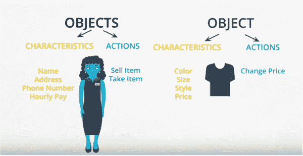

Objects are defined by their characteristics and their actions.

#### Characteristics and actions in English grammar

You can also think about characteristics and actions in terms of English grammar. A characteristic corresponds to a noun and an action corresponds to a verb.

Let's pick something from the real world: a dog. Some characteristics of the dog include the dog's weight, color, breed, and height. These are all nouns. Some actions a dog can take include to bark, to run, to bite, and to eat. These are all verbs.

### Class, object, method, and attribute

#### Object-oriented programming (OOP) vocabulary

*   **Class:** A blueprint consisting of methods and attributes.
*   **Object:** An instance of a class. It can help to think of objects as something in the real world like a yellow pencil, a small dog, or a blue shirt. However, as you'll see later in the lesson, objects can be more abstract.
*   **Attribute:** A descriptor or characteristic. Examples would be color, length, size, etc. These attributes can take on specific values like blue, 3 inches, large, etc.
*   **Method:** An action that a class or object could take.
*   **OOP:** A commonly used abbreviation for object-oriented programming.
*   **Encapsulation:** One of the fundamental ideas behind object-oriented programming is called encapsulation: you can combine functions and data all into a single entity. In object-oriented programming, this single entity is called a class. Encapsulation allows you to hide implementation details, much like how the scikit-learn package hides the implementation of machine learning algorithms.

In English, you might hear an attribute described as a property, description, feature, quality, trait, or characteristic. All of these are saying the same thing.

Here is a reminder of how a class, an object, attributes, and methods relate to each other.

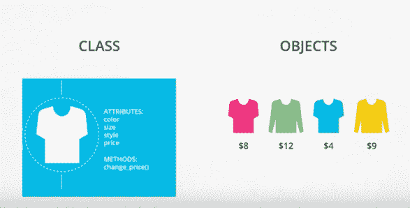

A class is a blueprint consisting of attributes and methods.

### OOP Syntax


# Object-oriented programming syntax

In this video, you'll see what a class and object look like in Python. In the next section, you'll have the chance to play around with the code. Finally, you'll write your own class.

## Function versus method

In the video above, at 1:44, the dialogue mistakenly calls `__init__` a function rather than a method. Why is `__init__` not a function?

A function and a method look very similar. They both use the `def` keyword. They also have inputs and return outputs. The difference is that a method is inside of a class whereas a function is outside of a class.

## What is self?

If you instantiate two objects, how does Python differentiate between these two objects?

```python
shirt_one = Shirt('red', 'S', 'short-sleeve', 15)
shirt_two = Shirt('yellow', 'M', 'long-sleeve', 20)
```

That's where `self` comes into play. If you call the `change_price` method on `shirt_one`, how does Python know to change the price of `shirt_one` and not of `shirt_two`?

```python
shirt_one.change_price(12)
```

Behind the scenes, Python is calling the `change_price` method:

```python
def change_price(self, new_price):
    self.price = new_price
```

`self` tells Python where to look in the computer's memory for the `shirt_one` object. Then, Python changes the price of the `shirt_one` object. When you call the `change_price` method, `shirt_one.change_price(12)`, `self` is implicitly passed in.

The word `self` is just a convention. You could actually use any other name as long as you are consistent, but you should use `self` to avoid confusing people.

## Exercise: Use the Shirt class

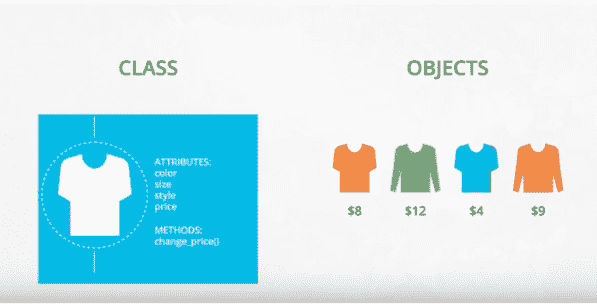

### Shirt class exercise

You've seen what a class looks like and how to instantiate an object. Now it's your turn to write code that instantiates a shirt object.

You need to download three files for this exercise. These files are located on this page in the Supporting materials section.

- `Shirt_exercise.ipynb` contains explanations and instructions.
- `Answer.py` containing solution to the exercise.
- `Tests.py` tests for checking your code: You can run these tests using the last code cell at the bottom of the notebook.

### Getting started

Open the `Shirt Exercise.ipynb` notebook file using Jupyter Notebook and follow the instructions in the notebook to complete the exercise.

## Notes about OOP

### Set and get methods

The last part of the video mentioned that accessing attributes in Python can be somewhat different than in other programming languages like Java and C++. This section goes into further detail.

The `Shirt` class has a method to change the price of the shirt: `shirt_one.change_price(20)`. In Python, you can also change the values of an attribute with the following syntax:

```python
shirt_one.price = 10
shirt_one.price = 20
shirt_one.color = 'red'
shirt_one.size = 'M'
shirt_one.style = 'long_sleeve'
```

This code accesses and changes the price, color, size, and style attributes directly. Accessing attributes directly would be frowned upon in many other languages, but not in Python. Instead, the general object-oriented programming convention is to use methods to access attributes or change attribute values. These methods are called set and get methods or setter and getter methods.

A get method is for obtaining an attribute value. A set method is for changing an attribute value. If you were writing a `Shirt` class, you could use the following code:

```python
class Shirt:
    def __init__(self, shirt_color, shirt_size, shirt_style, shirt_price):
        self._price = shirt_price

    def get_price(self):
        return self._price

    def set_price(self, new_price):
        self._price = new_price
```

Instantiating and using an object might look like the following code:

```python
shirt_one = Shirt('yellow', 'M', 'long-sleeve', 15)
print(shirt_one.get_price())
shirt_one.set_price(10)
```

In the class definition, the underscore in front of `price` is a somewhat controversial Python convention. In other languages like C++ or Java, `price` could be explicitly labeled as a private variable. This would prohibit an object from accessing the price attribute directly like `shirt_one._price = 15`. Unlike other languages, Python does not distinguish between private and public variables. Therefore, there is some controversy about using the underscore convention as well as get and set methods in Python. Why use get and set methods in Python when Python wasn't designed to use them?

At the same time, you'll find that some Python programmers develop object-oriented programs using get and set methods anyway. Following the Python convention, the underscore in front of `price` is to let a programmer know that `price` should only be accessed with get and set methods rather than accessing `price` directly with `shirt_one._price`. However, a programmer could still access `_price` directly because there is nothing in the Python language to prevent the direct access.

To reiterate, a programmer could technically still do something like `shirt_one._price = 10`, and the code would work. But accessing `price` directly, in this case, would not be following the intent of how the `Shirt` class was designed.

One of the benefits of set and get methods is that, as previously mentioned in the course, you can hide the implementation from your user. Perhaps, originally, a variable was coded as a list and later became a dictionary. With set and get methods, you could easily change how that variable gets accessed. Without set and get methods, you'd have to go to every place in the code that accessed the variable directly and change the code.

You can read more about get and set methods in Python on this Python Tutorial site.

### Attributes

There are some drawbacks to accessing attributes directly versus writing a method for accessing attributes.

In terms of object-oriented programming, the rules in Python are a bit looser than in other programming languages. As previously mentioned, in some languages, like C++, you can explicitly state whether or not an object should be allowed to change or access an attribute's values directly. Python does not have this option.

Why might it be better to change a value with a method instead of directly? Changing values via a method gives you more flexibility in the long-term. What if the units of measurement change, like if the store was originally meant to work in US dollars and now has to handle Euros? Here's an example:

#### Example: Dollars versus Euros

If you've changed attribute values directly, you'll have to go through your code and find all the places where US dollars were used, such as in the following:

```python
shirt_one.price = 10 # US dollars
```

Then, you'll have to manually change them to Euros.

```python
shirt_one.price = 8 # Euros
```

If you had used a method, then you would only have to change the method to convert from dollars to Euros.

```python
def change_price(self, new_price):
    self.price = new_price * 0.81 # convert dollars to Euros

shirt_one.change_price(10)
```

For the purposes of this introduction to object-oriented programming, you don't need to worry about updating attributes directly versus with a method; however, if you decide to further your study of object-oriented programming, especially in another language such as C++ or Java, you'll have to take this into consideration.

### Modularized code

Thus far in the lesson, all of the code has been in Jupyter Notebooks. For example, in the previous exercise, a code cell loaded the `Shirt` class, which gave you access to the shirt class throughout the rest of the notebook.

If you were developing a software program, you would want to modularize this code. You would put the `Shirt` class into its own Python script, which you might call `shirt.py`. In another Python script, you would import the `Shirt` class with a line like `from shirt import Shirt`.

For now, as you get used to OOP syntax, you'll be completing exercises in Jupyter Notebooks. Midway through the lesson, you'll modularize object-oriented code into separate files.

## Exercise: Use the Pants class


Now that you've had some practice instantiating objects, it's time to write your own class from scratch.

This lesson has two parts.

*   In the first part, you'll write a `Pants` class. This class is similar to the `Shirt` class with a couple of changes. Then you'll practice instantiating `Pants` objects.
*   In the second part, you'll write another class called `SalesPerson`. You'll also instantiate objects for the `SalesPerson`.

This exercise requires two files, which are located on this page in the Supporting Materials section.

*   `exercise.ipynb` contains explanations and instructions.
*   `answer.py` contains solution to the exercise.

## Getting started

Open the `exercise.ipynb` notebook file using Jupyter Notebook and follow the instructions in the notebook to complete the exercise.

## Commenting object-oriented code

Did you notice anything special about the answer key in the previous exercise? The `Pants` class and the `SalesPerson` class contained docstrings! A docstring is a type of comment that describes how a Python module, function, class, or method works. Docstrings are not unique to object-oriented programming.

For this section of the course, you just need to remember to use docstrings and to comment your code. It will help you understand and maintain your code and even make you a better job candidate.

From this point on, please always comment your code. Use both inline comments and document-level comments as appropriate.

To learn more about docstrings, see Example Google Style Python Docstrings.

## Docstrings and object-oriented code

The following example shows a class with docstrings. Here are a few things to keep in mind:

*   Make sure to indent your docstrings correctly or the code will not run. A docstring should be indented one indentation underneath the class or method being described.
*   You don't have to define `self` in your method docstrings. It's understood that any method will have `self` as the first method input.

```python
class Pants:

    """The Pants class represents an article of clothing sold in a store
    """

    def __init__(self, color, waist_size, length, price):

        """Method for initializing a Pants object

        Args: 
            color (str)
            waist_size (int)
            length (int)
            price (float)

        Attributes:
            color (str): color of a pants object
            waist_size (str): waist size of a pants object
            length (str): length of a pants object
            price (float): price of a pants object
        """

        self.color = color
        self.waist_size = waist_size
        self.length = length
        self.price = price

    def change_price(self, new_price):

        """The change_price method changes the price attribute of a pants object

        Args: 
            new_price (float): the new price of the pants object

        Returns: None
        """

        self.price = new_price

    def discount(self, percentage):

        """The discount method outputs a discounted price of a pants object

        Args:
            percentage (float): a decimal representing the amount to discount

        Returns:
            float: the discounted price
        """

        return self.price * (1 - percentage)
```

## A Gaussian class

### Resources for review

The example in the next part of the lesson assumes you are familiar with Gaussian and binomial distributions.

Here are a few formulas that might be helpful:

#### Gaussian distribution formulas

probability density function
