# 机器学习超级VIP速查表

## 1 监督学习

### 1.1 监督学习简介

给定一组数据点 $\{x^{(1)}, \ldots, x^{(m)}\}$ 及其对应的一组结果 $\{y^{(1)}, \ldots, y^{(m)}\}$，我们希望构建一个分类器，学习如何从 $x$ 预测 $y$。

- **预测类型** —— 不同类型的预测模型汇总如下表：

|  | 回归 | 分类器 |
|---|---|---|
| **结果** | 连续 | 类别 |
| **示例** | 线性回归 | 逻辑回归、SVM、朴素贝叶斯 |

- **模型类型** —— 不同模型汇总如下表：

|  | 判别模型 | 生成模型 |
|---|---|---|
| **目标** | 直接估计 $P(y\mid x)$ | 估计 $P(x\mid y)$ 以推断 $P(y\mid x)$ |
| **学习内容** | 决策边界 | 数据的概率分布 |
| **图示** | 分类边界图示 | 生成分布图示 |
| **示例** | 回归、SVM | GDA、朴素贝叶斯 |

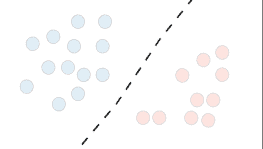

### 1.2 符号与一般概念

- **假设** —— 假设记为 $h_\theta$，是我们选择的模型。对于给定的输入数据 $x^{(i)}$，模型预测输出为 $h_\theta(x^{(i)})$。

- **损失函数** —— 损失函数是一个函数 $L : (z,y) \in \mathbb{R} \times \mathcal{Y} \longmapsto L(z,y) \in \mathbb{R}$，它以与真实值 $y$ 对应的预测值 $z$ 为输入，输出两者的差异程度。常用损失函数汇总如下表：

| 最小二乘 | 逻辑 | 合页 | 交叉熵 |
|---|---|---|---|
| $\frac{1}{2}(y-z)^2$ | $\log(1+\exp(-yz))$ | $\max(0,1-yz)$ | $-[y\log(z)+(1-y)\log(1-z)]$ |
| 线性回归 | 逻辑回归 | SVM | 神经网络 |

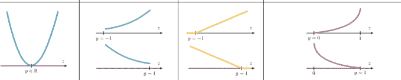

- **代价函数** —— 代价函数 $J$ 常用于评估模型性能，并与损失函数 $L$ 的关系定义如下：

$$J(\theta)=\sum_{i=1}^{m}L(h_\theta(x^{(i)}),y^{(i)})$$

- **梯度下降** —— 记 $\alpha \in \mathbb{R}$ 为学习率，则梯度下降的更新规则可用学习率和代价函数 $J$ 表示如下：

$$\theta \leftarrow \theta-\alpha\nabla J(\theta)$$

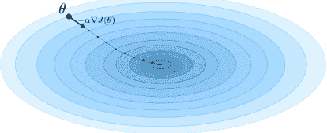

> *备注：随机梯度下降（SGD）基于每个训练样本更新参数，而批量梯度下降则基于一批训练样本进行更新。*

- **似然** —— 给定参数 $\theta$ 时模型的似然 $L(\theta)$ 用于通过最大化似然来寻找最优参数 $\theta$。实际中，我们使用更易优化的对数似然 $\ell(\theta)=\log(L(\theta))$。于是有：

$$\theta^{\mathrm{opt}}=\underset{\theta}{\arg\max}\ L(\theta)$$

- **牛顿算法** —— 牛顿算法是一种数值方法，用于求满足 $\ell'(\theta)=0$ 的 $\theta$。其更新规则如下：

$$\theta\leftarrow\theta-\frac{\ell'(\theta)}{\ell''(\theta)}$$

> *备注：其多维推广形式也称为牛顿-拉弗森方法，更新规则如下：*

$$\theta\leftarrow\theta-\left(\nabla_\theta^2\ell(\theta)\right)^{-1}\nabla_\theta\ell(\theta)$$

### 1.3 线性模型

#### 1.3.1 线性回归

这里我们假设 $y\mid x;\theta\sim\mathcal{N}(\mu,\sigma^2)$

- **正规方程** —— 记 $X$ 为设计矩阵，使代价函数最小化的 $\theta$ 值具有如下闭式解：

$$\theta=(X^TX)^{-1}X^Ty$$

### 1.4 支持向量机

**拉格朗日函数** —— 我们定义拉格朗日函数 $\mathcal{L}(w,b)$ 如下：

$$\mathcal{L}(w,b)=f(w)+\sum_{i=1}^{l}\beta_i h_i(w)$$

> *备注：系数 $\beta_i$ 称为拉格朗日乘子。*

### 1.5 生成学习

生成模型首先通过估计 $P(x|y)$ 来学习数据的生成方式，然后我们可以利用贝叶斯准则来估计 $P(y|x)$。

#### 1.5.1 高斯判别分析

设定 —— 高斯判别分析假设 $y$、$x|y=0$ 和 $x|y=1$ 满足：

$$y\sim\text{Bernoulli}(\phi)$$

$$x|y=0\sim\mathcal{N}(\mu_0,\Sigma)\quad\text{and}\quad x|y=1\sim\mathcal{N}(\mu_1,\Sigma)$$

估计 —— 下表汇总了最大化似然时得到的估计量：

| $\widehat{\phi}$ | $\widehat{\mu_j}\;(j=0,1)$ | $\widehat{\Sigma}$ |
|---|---|---|
| $\frac{1}{m}\sum_{i=1}^{m}1_{\{y^{(i)}=1\}}$ | $\frac{\sum_{i=1}^{m}1_{\{y^{(i)}=j\}}x^{(i)}}{\sum_{i=1}^{m}1_{\{y^{(i)}=j\}}}$ | $\frac{1}{m}\sum_{i=1}^{m}(x^{(i)}-\mu_{y^{(i)}})(x^{(i)}-\mu_{y^{(i)}})^T$ |

#### 1.5.2 朴素贝叶斯

假设 —— 朴素贝叶斯模型假设每个数据点的特征之间完全独立：

$$P(x|y)=P(x_1,x_2,...|y)=P(x_1|y)P(x_2|y)...=\prod_{i=1}^{n}P(x_i|y)$$

解 —— 最大化对数似然得到以下解，其中 $k\in\{0,1\}$，$l\in[[1,L]]$：

$$P(y=k)=\frac{1}{m}\times\#\{j|y^{(j)}=k\}$$

$$P(x_i=l|y=k)=\frac{\#\{j|y^{(j)}=k\text{ and }x_i^{(j)}=l\}}{\#\{j|y^{(j)}=k\}}$$

> *备注：朴素贝叶斯广泛应用于文本分类和垃圾邮件检测。*

### 1.6 基于树的方法与集成方法

这些方法既可用于回归问题，也可用于分类问题。

**CART** —— 分类回归树（CART），通常称为决策树，可以表示为二叉树。其优点是具有很强的可解释性。

**随机森林** —— 这是一种基于树的技术，利用从随机选取的特征集合构建的大量决策树。与简单的决策树相比，它高度不可解释，但其总体良好的性能使其成为一种流行的算法。

> *备注：随机森林是集成方法的一种。*

**提升方法** —— 提升方法的思想是将多个弱学习器组合成一个更强的学习器。主要的提升方法汇总如下表：

| 自适应提升 | 梯度提升 |
|---|---|
| 对错误赋予高权重，以便在下一步提升中改进 称为Adaboost | 在剩余误差上训练弱学习器 |

### 1.7 其他非参数方法

**k近邻** —— k近邻算法，通常称为k-NN，是一种非参数方法，数据点的响应由其训练集中k个邻居的性质决定。它既可用于分类，也可用于回归。

> *备注：参数k越大，偏差越高；参数k越小，方差越高。*

**核函数** —— 给定特征映射 $\phi$，我们定义核函数 $K$ 如下：

$$K(x,z)=\phi(x)^T\phi(z)$$

在实践中，由 $K(x,z)=\exp\left(-\frac{||x-z||^2}{2\sigma^2}\right)$ 定义的核函数 $K$ 称为高斯核，并且被广泛使用。

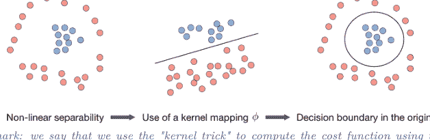

> *备注：我们之所以使用“核技巧”通过核函数计算代价函数，是因为我们实际上不需要知道通常非常复杂的显式映射 $\phi$；相反，只需要 $K(x,z)$ 的值。*

## 1.8 学习理论

**上界定理** —— 设 \(\mathcal{H}\) 是一个有限假设类，且 \(|\mathcal{H}|=k\)，令 \(\delta\) 和样本大小 \(m\) 固定。那么，以至少 \(1-\delta\) 的概率，我们有：

\[
\epsilon(\hat h)\leq \left(\min_{h\in\mathcal{H}}\epsilon(h)\right)+2\sqrt{\frac{1}{2m}\log\left(\frac{2k}{\delta}\right)}
\]

**联合界** —— 设 \(A_1,\ldots,A_k\) 为 \(k\) 个事件。我们有：

\[
P(A_1\cup\cdots\cup A_k)\leq P(A_1)+\cdots+P(A_k)
\]

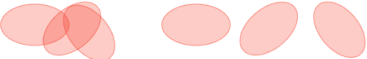

\(A_1\cup A_2\cup A_3\qquad\qquad A_1\qquad\qquad A_2\qquad\qquad A_3\)

**霍夫丁不等式** —— 设 \(Z_1,\ldots,Z_m\) 是从参数为 \(\phi\) 的伯努利分布中独立同分布抽取的 \(m\) 个变量。令 \(\hat\phi\) 为其样本均值，且 \(\gamma>0\) 固定。我们有：

\[
P(|\phi-\hat\phi|>\gamma)\leq 2\exp(-2\gamma^2m)
\]

*注：* 该不等式也称为切尔诺夫界。

**训练误差** —— 对于给定的分类器 \(h\)，我们定义训练误差 \(\hat\epsilon(h)\)，也称为经验风险或经验误差，如下所示：

\[
\hat\epsilon(h)=\frac{1}{m}\sum_{i=1}^{m}\mathbf{1}_{\{h(x^{(i)})\neq y^{(i)}\}}
\]

**可能近似正确（PAC）** —— PAC 是一个用于证明学习理论中众多结果的框架，并具有以下假设集：

- 训练集和测试集服从相同的分布。
- 训练样本是独立抽取的。

**打散** —— 给定一个集合 \(S=\{x^{(1)},\ldots,x^{(d)}\}\) 和一个分类器集合 \(\mathcal{H}\)，我们说 \(\mathcal{H}\) 打散 \(S\)，如果对于任意标签集合 \(\{y^{(1)},\ldots,y^{(d)}\}\)，我们有：

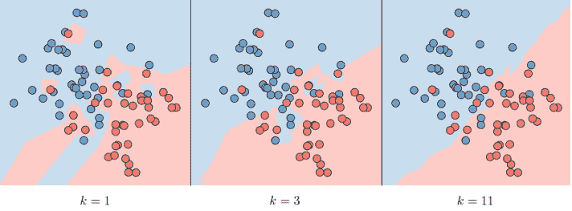

\(k=1\qquad\qquad\qquad k=3\qquad\qquad\qquad k=11\)

\[
\exists h\in\mathcal{H},\quad \forall i\in[1,d],\quad h(x^{(i)})=y^{(i)}
\]

**VC 维** —— 给定无限假设类 \(\mathcal{H}\) 的 Vapnik-Chervonenkis（VC）维，记为 \(VC(\mathcal{H})\)，是被 \(\mathcal{H}\) 打散的最大集合的大小。

*注：* \(\mathcal{H}=\{\text{二维线性分类器集合}\}\) 的 VC 维为 3。

**定理（Vapnik）** —— 给定 \(\mathcal{H}\)，其中 \(VC(\mathcal{H})=d\)，\(m\) 为训练样本数量。以至少 \(1-\delta\) 的概率，我们有：

\[
\epsilon(\hat h)\leq\left(\min_{h\in\mathcal{H}}\epsilon(h)\right)+O\left(\sqrt{\frac{d}{m}\log\left(\frac{m}{d}\right)+\frac{1}{m}\log\left(\frac{1}{\delta}\right)}\right)
\]

## 2 无监督学习

### 2.1 无监督学习简介

**动机** —— 无监督学习的目标是在未标记数据 \(\{x^{(1)},...,x^{(m)}\}\) 中发现隐藏模式。

**琴生不等式** —— 设 \(f\) 为凸函数，\(X\) 为随机变量。我们有以下不等式：

\[
E[f(X)] \ge f(E[X])
\]

### 2.2 聚类

#### 2.2.1 期望最大化

**潜变量** —— 潜变量是使估计问题变得困难的隐藏/未观测变量，通常记为 \(z\)。以下是存在潜变量的最常见场景：

| 场景 | 潜变量 \(z\) | \(x\mid z\) | 说明 |
|---|---|---|---|
| \(k\) 个高斯的混合 | Multinomial(\(\phi\)) | \(\mathcal{N}(\mu_j,\Sigma_j)\) | \(\mu_j \in \mathbb{R}^n, \phi \in \mathbb{R}^k\) |
| 因子分析 | \(\mathcal{N}(0,I)\) | \(\mathcal{N}(\mu + \Lambda z,\psi)\) | \(\mu \in \mathbb{R}^n, \Lambda \in \mathbb{R}^{n\times k}\) |

**算法** —— 期望最大化（EM）算法通过反复构造似然的下界（E 步）并优化该下界（M 步），为通过最大似然估计参数 \(\theta\) 提供了一种高效方法，具体如下：

- E 步：评估每个数据点 \(x^{(i)}\) 来自特定簇 \(z^{(i)}\) 的后验概率 \(Q_i(z^{(i)})\)，如下所示：

\[
Q_i(z^{(i)}) = P(z^{(i)}|x^{(i)};\theta)
\]

- M 步：使用后验概率 \(Q_i(z^{(i)})\) 作为数据点 \(x^{(i)}\) 上特定的簇权重，分别重新估计每个簇模型，如下所示：

\[
\theta_t = \arg\max_\theta \sum_i \int_{z^{(i)}} Q_t(z^{(i)}) \log\left(\frac{P(x^{(i)},z^{(i)};\theta)}{Q_t(z^{(i)})}\right) dz^{(i)}
\]

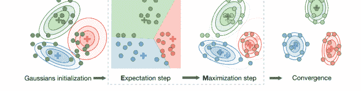

#### 2.2.2 k 均值聚类

我们用 \(c^{(i)}\) 表示数据点 \(i\) 的簇，用 \(\mu_j\) 表示簇 \(j\) 的中心。

**算法** —— 在随机初始化簇中心 \(\mu_1,\mu_2,...,\mu_k \in \mathbb{R}^n\) 后，\(k\) 均值算法重复以下步骤直至收敛：

\[
c^{(i)} = \arg\min_j \|x^{(i)} - \mu_j\|^2
\]

\[
\mu_j = \frac{\sum_{i=1}^m \mathbf{1}_{\{c^{(i)}=j\}} x^{(i)}}{\sum_{i=1}^m \mathbf{1}_{\{c^{(i)}=j\}}}
\]

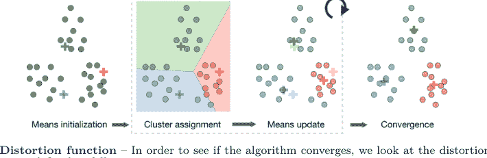

**失真函数** —— 为了判断算法是否收敛，我们查看如下定义的失真函数：

\[
J(c,\mu) = \sum_{i=1}^m \|x^{(i)} - \mu_{c^{(i)}}\|^2
\]

#### 2.2.3 层次聚类

**算法** —— 这是一种采用凝聚层次方法的聚类算法，以连续方式构建嵌套簇。

**类型** —— 存在不同类型的层次聚类算法，旨在优化不同的目标函数，总结如下表所示：

| 沃德连接 | 平均连接 | 完全连接 |
|---|---|---|
| 最小化簇内距离 | 最小化簇对之间的平均距离 | 最小化簇对之间的最大距离 |

#### 2.2.4 聚类评估指标

在无监督学习场景中，由于不像监督学习场景那样拥有真实标签，因此通常很难评估模型的性能。

**轮廓系数** —— 用 \(a\) 和 \(b\) 分别表示一个样本与同一类中所有其他点的平均距离，以及该样本与下一个最近簇中所有其他点的平均距离，则单个样本的轮廓系数 \(s\) 定义如下：

\[
s = \frac{b - a}{\max(a,b)}
\]

## 3 深度学习

### 3.1 神经网络

神经网络是一类以层为基础构建的模型。常用的神经网络类型包括卷积神经网络和循环神经网络。

- **架构** —— 神经网络架构相关的术语如下图所示：

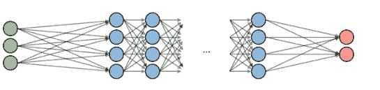

用 \(i\) 表示网络的第 \(i\) 层，用 \(j\) 表示该层的第 \(j\) 个隐藏单元，我们有：

\[
z_j^{[i]} = w_j^{[i]T} x + b_j^{[i]}
\]

其中 \(w\)、\(b\)、\(z\) 分别表示权重、偏置和输出。

- **激活函数** —— 激活函数用在隐藏单元的输出端，为模型引入非线性复杂度。以下是最常见的几种：

| Sigmoid | Tanh | ReLU | Leaky ReLU |
|---|---|---|---|
| \(g(z) = \frac{1}{1 + e^{-z}}\) | \(g(z) = \frac{e^{z} - e^{-z}}{e^{z} + e^{-z}}\) | \(g(z) = \max(0,z)\) | \(g(z) = \max(\epsilon z,z)\), \(\epsilon \ll 1\) |
| Sigmoid 曲线图 | Tanh 曲线图 | ReLU 曲线图 | Leaky ReLU 曲线图 |

- **交叉熵损失** —— 在神经网络中，交叉熵损失 \(L(z,y)\) 被广泛使用，定义如下：

\[
L(z,y) = -[ y \log(z) + (1 - y) \log(1 - z) ]
\]

- **学习率** —— 学习率通常记为 \(\eta\)，表示权重更新的速度。它可以是固定的，也可以自适应地变化。目前最流行的方法称为 Adam，这是一种自适应学习率的方法。

- **反向传播** —— 反向传播是一种考虑实际输出和期望输出来更新神经网络权重的方法。关于权重 \(w\) 的导数通过链式法则计算，形式如下：

\[
\frac{\partial L(z,y)}{\partial w} = \frac{\partial L(z,y)}{\partial a} \times \frac{\partial a}{\partial z} \times \frac{\partial z}{\partial w}
\]

因此，权重按如下方式更新：

\[
w \leftarrow w - \eta \frac{\partial L(z,y)}{\partial w}
\]

- **权重更新** —— 在神经网络中，权重按如下方式更新：

  - 步骤 1：获取一批训练数据。
  - 步骤 2：执行前向传播以获取相应的损失。
  - 步骤 3：反向传播损失以得到梯度。
  - 步骤 4：使用梯度更新网络的权重。

- **暂退（Dropout）** —— 暂退是一种通过在神经网络中丢弃单元来防止过拟合训练数据的技术。实践中，神经元以概率 \(p\) 被丢弃，或以概率 \(1 - p\) 被保留。

### 3.2 卷积神经网络

- **卷积层要求** —— 设 \(W\) 为输入体积大小，\(F\) 为卷积层神经元的大小，\(P\) 为零填充量，则适合给定体积的神经元数量 \(N\) 满足：

\[
N = \frac{W - F + 2P}{S} + 1
\]

- **批归一化** —— 这是一组超参数 \(\gamma,\beta\) 的步骤，用于对批次 \(\{x_i\}\) 进行归一化。设 \(\mu_B\)、\(\sigma_B^2\) 为我们要修正的批次均值和方差，其过程如下：

\[
x_i \leftarrow \gamma \frac{x_i - \mu_B}{\sqrt{\sigma_B^2 + \epsilon}} + \beta
\]

它通常在全连接/卷积层之后、非线性层之前进行，目的是允许更高的学习率并减少对初始化的强依赖。

### 3.3 循环神经网络

- **门类型** —— 以下是典型循环神经网络中遇到的几种不同类型的门：

| 输入门 | 遗忘门 | 输出门 | 门 |
|---|---|---|---|
| 是否写入单元？ | 是否擦除单元？ | 是否输出单元？ | 写入多少？ |

- **LSTM** —— 长短期记忆（LSTM）网络是一种 RNN 模型，通过添加“遗忘”门来避免梯度消失问题。

## 3.4 强化学习与控制

强化学习的目标是让智能体（agent）学习如何在一个环境中演化。

**马尔可夫决策过程** – 马尔可夫决策过程（MDP）是一个五元组 $(S,A,\{P_{sa}\},\gamma,R)$，其中：

- $\mathcal{S}$ 是状态集合
- $\mathcal{A}$ 是动作集合
- $\{P_{sa}\}$ 是状态转移概率，对于 $s \in \mathcal{S}$ 和 $a \in \mathcal{A}$
- $\gamma \in [0,1]$ 是折扣因子
- $R : \mathcal{S} \times \mathcal{A} \longrightarrow \mathbb{R}$ 或 $R : \mathcal{S} \longrightarrow \mathbb{R}$ 是算法希望最大化的奖励函数

**策略** – 策略 $\pi$ 是一个函数 $\pi : \mathcal{S} \longrightarrow \mathcal{A}$，它将状态映射到动作。

*备注：我们说执行一个给定的策略 $\pi$，是指给定状态 $s$ 时，我们采取动作 $a = \pi(s)$。*

**价值函数** – 对于给定的策略 $\pi$ 和给定的状态 $s$，我们定义价值函数 $V^{\pi}$ 如下：

$V^{\pi}(s) = E\left[ R(s_0) + \gamma R(s_1) + \gamma^2 R(s_2) + ... | s_0 = s, \pi \right]$

**贝尔曼方程** – 最优贝尔曼方程刻画了最优策略 $\pi^*$ 的价值函数 $V^{\pi^*}$：

$V^{\pi^*}(s) = R(s) + \max_{a \in \mathcal{A}} \gamma \sum_{s' \in \mathcal{S}} P_{sa}(s') V^{\pi^*}(s')$

*备注：我们注意到，对于给定状态 $s$，最优策略 $\pi^*$ 满足：*

$\pi^*(s) = \arg\max_{a \in \mathcal{A}} \sum_{s' \in \mathcal{S}} P_{sa}(s') V^*(s')$

**价值迭代算法** – 价值迭代算法包含两个步骤：

- 我们初始化价值：

$V_0(s) = 0$

- 我们基于之前的值进行迭代：

$V_{i+1}(s) = R(s) + \max_{a \in \mathcal{A}} \left[ \sum_{s' \in \mathcal{S}} \gamma P_{sa}(s') V_i(s') \right]$

**最大似然估计** – 状态转移概率的最大似然估计如下：

$P_{sa}(s') = \frac{\#\text{在状态 } s \text{ 中采取动作 } a \text{ 并到达 } s' \text{ 的次数}}{\#\text{在状态 } s \text{ 中采取动作 } a \text{ 的次数}}$

**Q学习** – $Q$-学习是对 $Q$ 的一种无模型估计，具体如下：

$Q(s,a) \leftarrow Q(s,a) + \alpha \left[ R(s,a,s') + \gamma \max_{a'} Q(s',a') - Q(s,a) \right]$

## 4 机器学习技巧与提示

### 4.1 评估指标

给定一组数据点 $\{x^{(1)},...,x^{(m)}\}$，其中每个 $x^{(i)}$ 有 $n$ 个特征，并关联一组结果 $\{y^{(1)},...,y^{(m)}\}$，我们希望评估一个学习如何从 $x$ 预测 $y$ 的给定分类器。

#### 4.1.1 分类

在二分类的背景下，以下是在评估模型性能时需要跟踪的主要指标。

- **混淆矩阵** – 混淆矩阵用于在评估模型性能时提供更完整的图景。其定义如下：

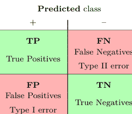

- **主要指标** – 以下指标通常用于评估分类模型的性能：

| 指标 | 公式 | 解释 |
|---|---|---|
| 准确率 | (TP + TN)/(TP + TN + FP + FN) | 模型的整体性能 |
| 精确率 | TP/(TP + FP) | 正类预测的准确程度 |
| 召回率 / 灵敏度 | TP/(TP + FN) | 实际正样本的覆盖程度 |
| 特异度 | TN/(TN + FP) | 实际负样本的覆盖程度 |
| F1分数 | 2TP/(2TP + FP + FN) | 对不平衡类别有用的混合指标 |

- **ROC** – 受试者工作特征曲线，也记为ROC，是通过改变阈值绘制的TPR与FPR的关系图。这些指标总结在下表中：

| 指标 | 公式 | 等价形式 |
|---|---|---|
| 真正例率（TPR） | TP/(TP + FN) | 召回率、灵敏度 |
| 假正例率（FPR） | FP/(TN + FP) | 1-特异度 |

- **AUC** – 受试者工作特征曲线下面积，也记为AUC或AUROC，是ROC曲线下方的面积，如下图所示：

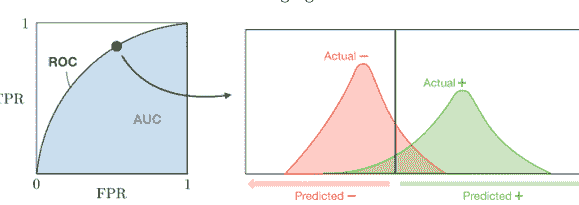

#### 4.1.2 回归

- **基本指标** – 给定一个回归模型 $f$，以下指标通常用于评估模型的性能：

| 总平方和 | 解释平方和 | 残差平方和 |
|---|---|---|
| $SS_{tot} = \sum_{i=1}^{m} (y_i - \bar{y})^2$ | $SS_{reg} = \sum_{i=1}^{m} (f(x_i) - \bar{y})^2$ | $SS_{res} = \sum_{i=1}^{m} (y_i - f(x_i))^2$ |

- **决定系数** – 决定系数，通常记为 $R^2$ 或 $r^2$，衡量模型复制观测结果的程度，其定义如下：

$R^2 = 1 - SS_{res}/SS_{tot}$

- **主要指标** – 以下指标通常用于评估回归模型的性能，同时考虑它们所纳入的变量数量 $n$：

| Mallow's Cp | AIC | BIC | 调整后的 $R^2$ |
|---|---|---|---|
| $(SS_{res} + 2(n+1)\hat{\sigma}^2)/m$ | $2[(n+2) - \log(L)]$ | $\log(m)(n+2) - 2\log(L)$ | $1 - (1 - R^2)(m - 1)/(m - n - 1)$ |

其中 $L$ 是似然函数，$\hat{\sigma}^2$ 是与每个响应相关联的方差的估计值。

### 4.2 模型选择

- **术语** – 在选择模型时，我们将拥有的数据分为以下三个不同部分：

| 训练集 | 验证集 | 测试集 |
|---|---|---|
| - 用于训练模型 - 通常占数据集的80% | - 用于评估模型 - 通常占数据集的20% - 也称为留出集或开发集 | - 模型给出预测 - 未见过的新数据 |

一旦选定了模型，它会在整个数据集上进行训练，并在未见过的测试集上进行测试。如下图所示：

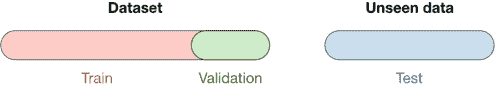

- **交叉验证** – 交叉验证，也记为CV，是一种用于选择模型的方法，它不依赖于初始训练集。不同类型总结在下表中：

| $k$折 | 留$p$出 |
|---|---|
| - 在$k-1$折上训练，在剩余的一折上评估 - 通常$k=5$或$10$ | - 在$n-p$个观测上训练，在剩余的$p$个观测上评估 - 当$p=1$时称为留一法 |

最常用的方法是$k$折交叉验证，它将训练数据分成$k$折，在$k-1$折上训练模型，在一折上验证模型，重复$k$次。然后将误差在$k$折上取平均，称为交叉验证误差。

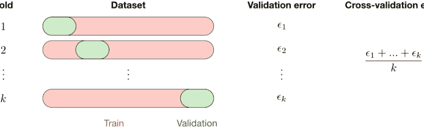

- **正则化** – 正则化过程旨在避免模型过拟合数据，因此可以处理高方差问题。下表总结了常用的不同正则化技术：

| LASSO | 岭回归 | 弹性网络 |
|---|---|---|
| - 将系数收缩到0 - 对变量选择有利 | 使系数更小 | 在变量选择和小系数之间权衡 |
| $+\ \lambda\|\theta\|_1$ $\lambda \in \mathbb{R}$ | $+\ \lambda\|\theta\|_2^2$ $\lambda \in \mathbb{R}$ | $+\ \lambda[(1-\alpha)\|\theta\|_1+\alpha\|\theta\|_2^2]$ $\lambda \in \mathbb{R},\ \alpha \in [0,1]$ |

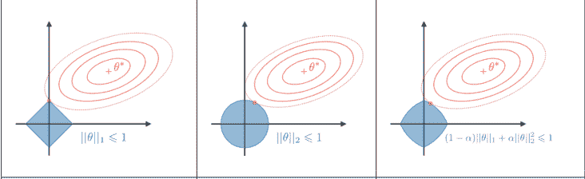

- **模型选择** – 在训练集上训练模型，然后在开发集上评估，接着在开发集上挑选性能最好的模型，并在整个训练集上重新训练该模型。

### 4.3 诊断

- **偏差** – 模型的偏差是预期预测与我们在给定数据点上试图预测的正确模型之间的差异。
- **方差** – 模型的方差是模型在给定数据点上的预测的变异性。
- **偏差/方差权衡** – 模型越简单，偏差越高；模型越复杂，方差越高。

|  | 欠拟合 | 刚好 | 过拟合 |
|---|---|---|---|
| **症状** | - 训练误差高 - 训练误差接近测试误差 - 高偏差 | - 训练误差略低于测试误差 | - 训练误差低 - 训练误差远低于测试误差 - 高方差 |
| **回归** | 回归图显示一条拟合不足的简单直线。 | 回归图显示一条合适的曲线拟合。 | 回归图显示一条高度振荡、过拟合数据的曲线。 |

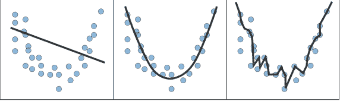

|  | 分类 |  |  |
|---|---|---|---|
| **分类** | 散点图显示两个类别被对角线线性决策边界分开。 | 散点图显示两个类别被弯曲的决策边界分开。 | 散点图显示类别周围复杂、不规则的决策边界。 |
| **深度学习** | 训练和验证误差曲线在若干轮后下降并收敛。 | 训练误差比验证误差下降得更快、更低，且差距更大。 | 训练误差趋于零，而验证误差稳定在较高值。 |
| **补救措施** | - 使模型复杂化 - 添加更多特征 - 延长训练时间 | *（空白）* | - 正则化 - 获取更多数据 |

- **错误分析** – 错误分析是分析当前模型与完美模型之间性能差异的根本原因。
- **消融分析** – 消融分析是分析当前模型与基线模型之间性能差异的根本原因。

## 5  复习

### 5.1  概率与统计

#### 5.1.1  概率与组合学导论

- **样本空间** – 实验所有可能结果的集合称为该实验的样本空间，记为 $S$。
- **事件** – 样本空间的任何子集 $E$ 称为一个事件。也就是说，事件是由实验的可能结果组成的集合。如果实验的结果包含在 $E$ 中，我们就说 $E$ 发生了。
- **概率公理** – 对于每个事件 $E$，我们用 $P(E)$ 表示事件 $E$ 发生的概率。记 $E_1,\ldots,E_n$ 为互斥事件，我们有以下 3 条公理：

$$(1)\quad 0 \le P(E) \le 1 \qquad (2)\quad P(S)=1 \qquad (3)\quad P\left(\bigcup_{i=1}^{n}E_i\right)=\sum_{i=1}^{n}P(E_i)$$

- **排列** – 排列是从 $n$ 个对象中按给定顺序选取 $r$ 个对象的一种安排。这种安排的数量由 $P(n,r)$ 给出，定义为：

$$P(n,r)=\frac{n!}{(n-r)!}$$

- **组合** – 组合是从 $n$ 个对象中选取 $r$ 个对象的一种安排，其中顺序无关紧要。这种安排的数量由 $C(n,r)$ 给出，定义为：

$$C(n,r)=\frac{P(n,r)}{r!}=\frac{n!}{r!(n-r)!}$$

> 注：我们注意到对于 $0 \le r \le n$，我们有 $P(n,r) \ge C(n,r)$。

#### 5.1.2  条件概率

- **贝叶斯法则** – 对于满足 $P(B)>0$ 的事件 $A$ 和 $B$，我们有：

$$P(A\mid B)=\frac{P(B\mid A)P(A)}{P(B)}$$

> 注：我们有 $P(A\cap B)=P(A)P(B\mid A)=P(A\mid B)P(B)$。

- **划分** – 令 $\{A_i, i\in[1,n]\}$ 满足对所有 $i$，$A_i\ne\varnothing$。如果满足以下条件，则称 $\{A_i\}$ 是一个划分：

$$\forall i\ne j,\ A_i\cap A_j=\varnothing\quad\text{and}\quad\bigcup_{i=1}^{n}A_i=S$$

> 注：对于样本空间中的任何事件 $B$，我们有 $P(B)=\sum_{i=1}^{n}P(B\mid A_i)P(A_i)$。

#### 5.1.3  随机变量

- **随机变量** – 随机变量（通常记为 $X$）是一个将样本空间中的每个元素映射到实数轴上的函数。
- **累积分布函数（CDF）** – 累积分布函数 $F$ 单调非减，且满足 $\lim_{x\to-\infty}F(x)=0$ 和 $\lim_{x\to+\infty}F(x)=1$，其定义为：

$$F(x)=P(X\le x)$$

> _注：_ 我们有 $P(a<X\le b)=F(b)-F(a)$。

- **概率密度函数（PDF）** – 概率密度函数 $f$ 是随机变量 $X$ 在两个相邻实现值之间取值的概率。
- **涉及 PDF 和 CDF 的关系** – 以下是离散（D）和连续（C）情况下需要了解的重要性质。

| 情况 | 累积分布函数 $F$ | 概率密度函数 $f$ | PDF 的性质 |
|---|---|---|---|
| (D) | $F(x)=\displaystyle\sum_{x_i\le x}P(X=x_i)$ | $f(x_j)=P(X=x_j)$ | $0\le f(x_j)\le1$ 且 $\displaystyle\sum_j f(x_j)=1$ |
| (C) | $F(x)=\displaystyle\int_{-\infty}^{x}f(y)\,dy$ | $f(x)=\displaystyle\frac{dF}{dx}$ | $f(x)\ge0$ 且 $\displaystyle\int_{-\infty}^{+\infty}f(x)\,dx=1$ |

- **方差** – 随机变量的方差（通常记为 $\operatorname{Var}(X)$ 或 $\sigma^2$）是衡量其分布函数离散程度的指标。其计算公式如下：

$$\operatorname{Var}(X)=E[(X-E[X])^2]=E[X^2]-E[X]^2$$

- **标准差** – 随机变量的标准差（通常记为 $\sigma$）是衡量其分布函数离散程度的指标，且与实际随机变量的单位一致。其计算公式如下：

$$\sigma=\sqrt{\operatorname{Var}(X)}$$

- **期望与分布的矩** – 以下是离散和连续情况下期望值 $E[X]$、广义期望值 $E[g(X)]$、$k$ 阶矩 $E[X^k]$ 和特征函数 $\psi(\omega)$ 的表达式：

| 情况 | $E[X]$ | $E[g(X)]$ | $E[X^k]$ | $\psi(\omega)$ |
|---|---|---|---|---|
| (D) | $\displaystyle\sum_{i=1}^{n}x_i f(x_i)$ | $\displaystyle\sum_{i=1}^{n}g(x_i)f(x_i)$ | $\displaystyle\sum_{i=1}^{n}x_i^k f(x_i)$ | $\displaystyle\sum_{i=1}^{n}f(x_i)e^{i\omega x_i}$ |
| (C) | $\displaystyle\int_{-\infty}^{+\infty}x f(x)\,dx$ | $\displaystyle\int_{-\infty}^{+\infty}g(x)f(x)\,dx$ | $\displaystyle\int_{-\infty}^{+\infty}x^k f(x)\,dx$ | $\displaystyle\int_{-\infty}^{+\infty}f(x)e^{i\omega x}\,dx$ |

> _注：_ 我们有 $e^{i\omega x}=\cos(\omega x)+i\sin(\omega x)$。

- **重温 $k$ 阶矩** – $k$ 阶矩也可以用特征函数计算如下：

$$E[X^k]=\frac{1}{i^k}\left[\frac{\partial^k\psi}{\partial\omega^k}\right]_{\omega=0}$$

- **随机变量的变换** – 设变量 $X$ 和 $Y$ 通过某个函数相关联。记 $f_X$ 和 $f_Y$ 分别为 $X$ 和 $Y$ 的分布函数，我们有：

$$f_Y(y)=f_X(x)\left|\frac{dx}{dy}\right|$$

- **莱布尼茨积分法则** – 设 $g$ 是 $x$（可能还有 $c$）的函数，且 $a,b$ 为可能依赖于 $c$ 的边界。我们有：

$$\frac{\partial}{\partial c}\left(\int_a^b g(x)\,dx\right)=\frac{\partial b}{\partial c}g(b)-\frac{\partial a}{\partial c}g(a)+\int_a^b\frac{\partial g}{\partial c}(x)\,dx$$

- **切比雪夫不等式** – 设 $X$ 是期望值为 $\mu$、标准差为 $\sigma$ 的随机变量。对于 $k,\sigma>0$，有以下不等式：

$$P(|X-\mu|\ge k\sigma)\le\frac{1}{k^2}$$

#### 5.1.4  联合分布的随机变量

- **条件密度** – $X$ 关于 $Y$ 的条件密度（通常记为 $f_{X\mid Y}$）定义如下：

$$f_{X\mid Y}(x)=\frac{f_{XY}(x,y)}{f_Y(y)}$$

- **独立性** – 如果两个随机变量 $X$ 和 $Y$ 满足以下条件，则称它们是独立的：

$$f_{XY}(x,y)=f_X(x)f_Y(y)$$

- **边缘密度与累积分布** – 由联合密度概率函数 $f_{XY}$，我们有：

| 情况 | 边缘密度 | 累积函数 |
|---|---|---|
| (D) | $f_X(x_i)=\sum_j f_{XY}(x_i,y_j)$ | $F_{XY}(x,y)=\sum_{x_i\le x}\sum_{y_j\le y}f_{XY}(x_i,y_j)$ |
| (C) | $f_X(x)=\int_{-\infty}^{+\infty}f_{XY}(x,y)\,dy$ | $F_{XY}(x,y)=\int_{-\infty}^{x}\int_{-\infty}^{y}f_{XY}(x',y')\,dx'\,dy'$ |

- **独立随机变量之和的分布** – 设 $Y=X_1+\cdots+X_n$，其中 $X_1,\ldots,X_n$ 独立。我们有：

$$\psi_Y(\omega)=\prod_{k=1}^{n}\psi_{X_k}(\omega)$$

- **协方差** – 我们定义两个随机变量 $X$ 和 $Y$ 的协方差（记为 $\sigma^2_{XY}$ 或更常见的 $\operatorname{Cov}(X,Y)$）如下：

$$\operatorname{Cov}(X,Y)\triangleq\sigma^2_{XY}=E[(X-\mu_X)(Y-\mu_Y)]=E[XY]-\mu_X\mu_Y$$

- **相关系数** – 记 $\sigma_X,\sigma_Y$ 为 $X$ 和 $Y$ 的标准差，我们定义随机变量 $X$ 和 $Y$ 之间的相关系数，记为 $\rho_{XY}$，如下：

$$\rho_{XY}=\frac{\sigma^2_{XY}}{\sigma_X\sigma_Y}$$

> _注：_ 对于任意 $X,Y$，我们有 $\rho_{XY}\in[-1,1]$。如果 $X$ 和 $Y$ 独立，则 $\rho_{XY}=0$。

- **主要分布** – 以下是一些需要掌握的主要分布：

| 类型 | 分布 | PDF | $\psi(\omega)$ | $E[X]$ | $\operatorname{Var}(X)$ |
|---|---|---|---|---|---|
| (D) | $X\sim\mathcal{B}(n,p)$ 二项分布 | $P(X=x)=\binom{n}{x}p^xq^{n-x}$ $x\in[0,n]$ | $(pe^{i\omega}+q)^n$ | $np$ | $npq$ |
| (D) | $X\sim\operatorname{Po}(\mu)$ 泊松分布 | $P(X=x)=\frac{\mu^x}{x!}e^{-\mu}$ $x\in\mathbb N$ | $e^{\mu(e^{i\omega}-1)}$ | $\mu$ | $\mu$ |
| (C) | $X\sim\mathcal U(a,b)$ 均匀分布 | $f(x)=\frac{1}{b-a}$ $x\in[a,b]$ | $\frac{e^{i\omega b}-e^{i\omega a}}{(b-a)i\omega}$ | $\frac{a+b}{2}$ | $\frac{(b-a)^2}{12}$ |
| (C) | $X\sim\mathcal N(\mu,\sigma)$ 高斯分布 | $f(x)=\frac{1}{\sqrt{2\pi}\sigma}e^{-\frac12((x-\mu)/\sigma)^2}$ $x\in\mathbb R$ | $e^{i\omega\mu-\frac12\omega^2\sigma^2}$ | $\mu$ | $\sigma^2$ |
| (C) | $X\sim\operatorname{Exp}(\lambda)$ 指数分布 | $f(x)=\lambda e^{-\lambda x}$ $x\in\mathbb R_+$ | $\frac{1}{1-i\omega/\lambda}$ | $\frac1\lambda$ | $\frac1{\lambda^2}$ |

#### 5.1.5  参数估计

- **随机样本** – 随机样本是由 $n$ 个与 $X$ 独立同分布的随机变量 $X_1,\ldots,X_n$ 组成的集合。
- **估计量** – 估计量 $\hat\theta$ 是数据的函数，用于推断统计模型中未知参数 $\theta$ 的值。
- **偏差** – 估计量 $\hat\theta$ 的偏差定义为 $\hat\theta$ 分布期望值与真实值之间的差，即：

$$\operatorname{Bias}(\hat\theta)=E[\hat\theta]-\theta$$

> _注：_ 当 $E[\hat\theta]=\theta$ 时，称该估计量为无偏估计量。

- **样本均值与样本方差** – 随机样本的样本均值和样本方差用于估计分布的真实均值 $\mu$ 和真实方差 $\sigma^2$，分别记为 $\bar X$ 和 $s^2$，且满足：

$$\bar X=\frac1n\sum_{i=1}^{n}X_i \qquad\text{and}\qquad s^2=\hat\sigma^2=\frac1{n-1}\sum_{i=1}^{n}(X_i-\bar X)^2$$

- **中心极限定理** – 设随机样本 $X_1,\ldots,X_n$ 服从均值为 $\mu$、方差为 $\sigma^2$ 的给定分布，则有：

$$\bar X \xrightarrow[n\to+\infty]{}\mathcal N\left(\mu,\frac{\sigma}{\sqrt n}\right)$$

### 5.2  线性代数与微积分

#### 5.2.1  一般记号

- **向量** – 我们记 $x\in\mathbb R^n$ 为具有 $n$ 个分量的向量，其中 $x_i\in\mathbb R$ 是第 $i$ 个分量：

$$x=\begin{pmatrix}x_1\\x_2\\\vdots\\x_n\end{pmatrix}\in\mathbb R^n$$

- **矩阵** – 我们记 $A\in\mathbb R^{m\times n}$ 为具有 $m$ 行和 $n$ 列的矩阵，其中 $A_{i,j}\in\mathbb R$ 是位于第 $i$ 行第 $j$ 列的元素：

$$A=\begin{pmatrix}A_{1,1}&\cdots&A_{1,n}\\\vdots&&\vdots\\A_{m,1}&\cdots&A_{m,n}\end{pmatrix}\in\mathbb R^{m\times n}$$

> _注：_ 上面定义的向量 $x$ 可以看作一个 $n\times1$ 矩阵，更具体地称为列向量。

- **单位矩阵** – 单位矩阵 $I\in\mathbb R^{n\times n}$ 是一个对角线上为 1、其余位置为 0 的方阵：

$$I=\begin{pmatrix}1&0&\cdots&0\\0&\ddots&&\vdots\\\vdots&&\ddots&0\\0&\cdots&0&1\end{pmatrix}$$

*注：*对于所有矩阵 $A\in\mathbb{R}^{n\times n}$，有 $A I = I A = A$。

### 对角矩阵
对角矩阵 $D\in\mathbb{R}^{n\times n}$ 是一个除对角线上的非零元素外、其余位置全为零的方阵：

$$D=\begin{pmatrix} d_1&0&\cdots&0\\0&\ddots&\ddots&\vdots\\\vdots&\ddots&\ddots&0\\0&\cdots&0&d_n\end{pmatrix}$$

*注：*我们也将 $D$ 记作 $\operatorname{diag}(d_1,\ldots,d_n)$。

## 5.2.2 矩阵运算

### 向量-向量乘法
向量-向量乘积有两类：

- 内积：对于 $x,y\in\mathbb{R}^n$，有：

$$x^Ty=\sum_{i=1}^{n}x_iy_i\in\mathbb{R}$$

- 外积：对于 $x\in\mathbb{R}^m,y\in\mathbb{R}^n$，有：

$$xy^T=\begin{pmatrix}x_1y_1&\cdots&x_1y_n\\\vdots&&\vdots\\x_my_1&\cdots&x_my_n\end{pmatrix}\in\mathbb{R}^{m\times n}$$

### 矩阵-向量乘法
矩阵 $A\in\mathbb{R}^{m\times n}$ 与向量 $x\in\mathbb{R}^n$ 的乘积是一个大小为 $\mathbb{R}^m$ 的向量，满足：

$$Ax=\begin{pmatrix}a_{r,1}^Tx\\\vdots\\a_{r,m}^Tx\end{pmatrix}=\sum_{i=1}^{n}a_{c,i}x_i\in\mathbb{R}^m$$

其中 $a_{r,i}^T$ 是 $A$ 的行向量，$a_{c,j}$ 是 $A$ 的列向量，$x_i$ 是 $x$ 的元素。

### 矩阵-矩阵乘法
矩阵 $A\in\mathbb{R}^{m\times n}$ 与矩阵 $B\in\mathbb{R}^{n\times p}$ 的乘积是一个大小为 $\mathbb{R}^{m\times p}$ 的矩阵，满足：

$$AB=\begin{pmatrix}a_{r,1}^Tb_{c,1}&\cdots&a_{r,1}^Tb_{c,p}\\\vdots&&\vdots\\a_{r,m}^Tb_{c,1}&\cdots&a_{r,m}^Tb_{c,p}\end{pmatrix}=\sum_{i=1}^{n}a_{c,i}b_{r,i}^T\in\mathbb{R}^{m\times p}$$

其中 $a_{r,i}^T,b_{r,i}^T$ 分别是 $A$ 和 $B$ 的行向量，$a_{c,j},b_{c,j}$ 分别是 $A$ 和 $B$ 的列向量。

### 转置
矩阵 $A\in\mathbb{R}^{m\times n}$ 的转置记为 $A^T$，其元素发生翻转：

$$\forall i,j,\qquad A^T_{i,j}=A_{j,i}$$

*注：*对于矩阵 $A,B$，有 $(AB)^T=B^TA^T$。

### 逆
可逆方阵 $A$ 的逆记为 $A^{-1}$，并且是唯一满足以下条件的矩阵：

$$AA^{-1}=A^{-1}A=I$$

*注：*并非所有方阵都可逆。另外，对于矩阵 $A,B$，有 $(AB)^{-1}=B^{-1}A^{-1}$。

### 迹
方阵 $A$ 的迹记为 $\operatorname{tr}(A)$，是其对角元素之和：

$$\operatorname{tr}(A)=\sum_{i=1}^{n}A_{i,i}$$

*注：*对于矩阵 $A,B$，有 $\operatorname{tr}(A^T)=\operatorname{tr}(A)$ 和 $\operatorname{tr}(AB)=\operatorname{tr}(BA)$。

### 行列式
方阵 $A\in\mathbb{R}^{n\times n}$ 的行列式记为 $|A|$ 或 $\det(A)$，它按 $A_{\backslash i,j}$ 递归表示，其中 $A_{\backslash i,j}$ 是删去 $A$ 的第 $i$ 行和第 $j$ 列后得到的矩阵，如下所示：

$$\det(A)=|A|=\sum_{j=1}^{n}(-1)^{i+j}A_{i,j}|A_{\backslash i,j}|$$

*注：*$A$ 可逆当且仅当 $|A|\ne0$。另外，$|AB|=|A||B|$ 且 $|A^T|=|A|$。

## 5.2.3 矩阵性质

### 对称分解
给定矩阵 $A$ 可以表示为其对称部分与反对称部分之和，如下所示：

$$A=\underbrace{\frac{A+A^T}{2}}_{\text{对称部分}}+\underbrace{\frac{A-A^T}{2}}_{\text{反对称部分}}$$

##### 范数
范数是一个函数 $N:V\to[0,+\infty[$，其中 $V$ 是一个向量空间，且对于所有 $x,y\in V$，有：

- $N(x+y)\le N(x)+N(y)$
- $N(\alpha x)=|\alpha|N(x)$，其中 $\alpha$ 为标量
- 若 $N(x)=0$，则 $x=0$

对于 $x\in V$，最常用的范数总结在下表中：

