# 机器学习：权威指南（3本合1：初学者机器学习；人工智能商业应用；商业领域的人工智能与机器学习）

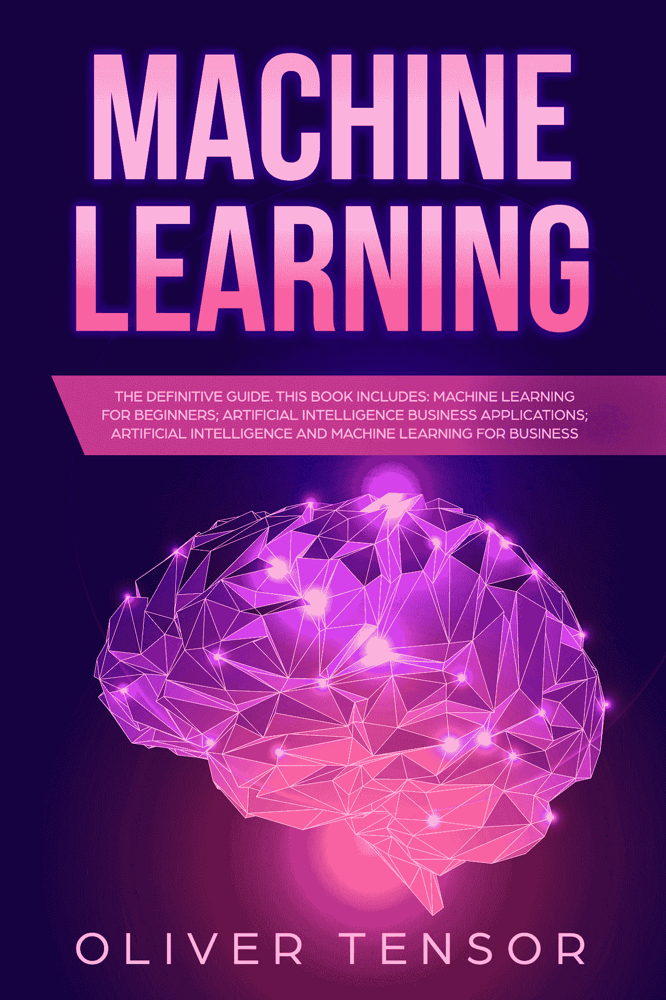


本书包含：

- 初学者机器学习
- 人工智能商业应用
- 商业领域的人智能与机器学习

## 引言


感谢你下载《机器学习入门》，感谢你的支持。接下来的章节将讨论若干适用于机器学习的不同概念。你将学习的一些有趣概念包括：

- 机器学习的基础概念
- 机器学习如何帮助业务
- 人工智能及其在当今社会中的重要性
- AI 背后的技术及其快速演变
- 深度学习的基础概念
- 数据科学的基础概念
- 算法
- 现实世界中的数据科学
- 最后，在每个章节的末，你将找到机器学习领域使用的重要术语表

你不仅将学习到这些有趣的概念，还将接触一本充满有趣且有用信息的书籍，这些信息一定会激发想象力。当你继续阅读本书时，你可能会被介绍人工智能的章节所吸引。原因在于它的内容非常易读且易于理解。对于初接触该领域的人来说，这本书提供了极具价值的信息。不仅如此，它还可以成为家人友之间极佳的话谈话题。我们意识到市场上有很多其他关于此类主题的书籍，但区别在于，没有任何一本书和这本书完全一样。所以，再次感谢你选择这本书！我们已尽全力确保它尽可能包含细节和有用信息，请尽情享受！

# 第一章：什么是机器学习？


仔细一想，所有的机器学习本质上都是教导算法或计算机程序在给定任务上逐步改进的最优方法。在研究方面，当涉及该过程时，将机器学习从数学和理论模型的层面来看是最好的。然而，将它视为构建许多能够利用这种改进的应用程序的方法更具实践意义。将这一想法变为现实有多种方法，但主要被归分为三类：强化学习、无监督学习和监督学习。

随着我们不断沉浸在机器学习和人工智能中，我们对技术也变得越来越狂热。因此，我们需要识别可能接触到的各种机器学习类型所需的所需的知识。对于初学者来说，这可能意味着他们必须理解各种机器学习类型，并在不同的应用中展示它们。对于应用创建者来说，他们知道，对于你可能遇到的所有任务，了解机器学习类型是非常重要的。这样，你就能创建一个与任务完美匹配的学习环境，并理解它是如何运作的。

## 监督机器学习

最著名的机器学习是监督学习。它也是最容易理解和最易于实现的范式。它是如此简单，以至于通常被比作学习闪卡。在谈到监督学习时，它通常被描述为以任务为导向的。因为它非常专注于某一项任务，不断向算法提供示例，直到完成预期的任务。当你使用这些应用程序时，你接触到的正是这种类型的学习：

- **广告流行度**：

  可能表现良好的广告通常被选为监督学习的任务。在浏览网络时发现的许多广告都是在一个认为它们很流行的算法帮助下放置到那里的。有时，这也是因为一个与查询搜索相关的算法，发现搜索结果与广告投放是很好的匹配项。

- **垃圾邮件分类**：

  如果你曾经发送或接收过电子邮件，那么你应该熟悉垃圾邮件文件夹。你的垃圾邮件箱就是一个监督学习系统。该系统被输入了许多邮件示例，以便过滤掉看起来恶意的邮件，从而防止用户受到骚扰。当用户添加新的邮件标签时，这些系统还能学习用户的偏好。

- **人脸识别**：

  如果你用过社交媒体，那么你的脸很有可能已经是使用人脸识别的监督学习的一部分。所以，下次当你看到一张你参与的合照并看到标签建议时，你就知道是监督学习算法为你做出的建议。

## 无监督学习

无监督学习与监督学习完全相反。它主要独立单兵作战，算法被输入数据，然后被赋予帮助其理解数据属性的工具。然后，它可以学习如何组织、分组和聚类给定数据，使人类在组织后能够区分这些数据。无监督学习有趣的地方在于，世界上流传着大量的未标记数据。一个能够收集所有这些未标记数据并将其转化为数据的算法，如果能在每个行业中持续利用，将具有巨大的盈利潜力。这可以很容易提高整体的生产力。

一个很好的例子是，如果我们把世界上已发表的所有论文都放入一个配备了无监督学习的数据库中。它会将数据分成人类可以易于区分的组，并让你意识到该领域的进展。此时，你可以开始自己的研究，将工作提交给算法。当你做笔记并完成写作时，你开始收到算法关于你工作的建议，这些工作可以帮助领域取得进展，以及你可能引用的作品。拥有这种工具可以轻松提高你的生产力。这就是为什么我们也可以说，所有基于数据和属性的无监督学习也被认为是数据驱动的。这就是为什么无监督任务的结果受数据格式和数据本身的共同控制。无监督学习可能包括的几个地方：

- **不同的推荐系统**：

  Netflix 和 YouTube 都是推荐系统的绝佳例子。这就是为什么它们通常被归类无监督学习算法的一部分。关于视频的信息和数据可以教会算法很多知识。然后你输入一个人的观看历史（说明他们看过的视频类型），并与未见过的类似视频进行匹配，这允许推荐系统根据与数据建立的关系做出建议。

- **个人购买习惯**：

  很有可能存在一个包含你购买习惯的数据库。这些信息自首次收集以来，很可能已经被买买卖了很多次。拥有这些购买习惯允许无监督算法将你分为不同的细分。这让公司能够根据收集的数据对你进行营销。

- **用户日志分组**

  尽管这些方法与用户的接触较少，但它们仍然具有相关性，因为无监督算法可以轻松地将问题和用户日志分组。这将允许公司查看客户所面临的问题类型主题，并通过产品改进或创建可以回答简单问题的常见问题解答（FAQ）列表来及时修复这些问题。无论你如何看待，这都是主动完成的。这与你曾经通过网站报告错误是一样的。你提交的问题通常会被输入到他们的无监督算法中，以便将其与其他类似的待审核提交归类在一起。

## 强化机器学习

强化机器学习算法与监督学习和无监督算法完全不同。与无监督和监督学习（基于标签是否存在）相比，强化算法看起来要复杂得多，尽管人们也将其简单地描述为一种依赖于时间的标签序列。但无论它意味着什么，只需确保你不要感到困惑即可。更好的看待方式是，它可以从自己所犯的任何错误中学习。如果你将其部署到任何类型的环境中并在它开始工作时开始犯错，这一点就是成立的。我们我们就可以通过向它发送不同的信号来控制算法。这些信号还会区分好坏行为，使我们能够强化它的良好行为而不是坏行为。然后，随着时间的推移，我们的强化算法犯的错误将比以前少得多。

由于强化机器学习是由行为驱动的，它受到了心理学和神经科学领域的严重影响。一个例子就是巴甫洛夫的狗。如果你熟悉它，那么你已经知道了智能体被强化的过程，尽管它是生物性的。但要真正理解强化机器学习，需要对一个示例进行拆解。因此，让我们假设正在教它们如何玩视频游戏。与所有其他问题一样，我们需要一个环境、代理以及通过反馈进行连接的能力。然后我们给代理动作，使其能够连接到环境并改变它。我们随后通过给出两个其遵循的信号将环境连接到代理。这些信号将是行为信号。在视频游戏期间，代理将是我们的算法，游戏本身将是我们的环境。我们的代理有几个动作来完成游戏中的按钮操作。我们将游戏的每一帧都视为一个更新的状态，奖励信号将是随之改变的游戏分数。现在，只要所有部分都连接在一起，我们就有了一个基于强化学习的游戏场景。我们在哪里能看到现实世界的强化学习发生？

### 视频游戏

视频游戏是发现强化学习算法的最佳场所。我们知道这一点，是因为我们可以观察谷歌如何使用他们的算法 `AlphaGo` 和 `AlphaZero` 来玩游戏。另一个很好的例子是我们自己的视频游戏。到目前，还没有任何类型的游戏拥有使用强化学习的代理。但我想，如果开发者将其作为一个选项，这种情况就会发生变化。

### 行业模拟

在机器人应用方面，让机器完成任务可能比将过程编码到机器中更有用。这是一种更安全、更便宜的方法，甚至失败率更低。一旦开始，我们就可以进一步，赋予它从长远来看可以节省资金的任务。此外，我们甚至可以完成模拟试验，这样机器就不会损坏。

### 资源管理

在资源管理方面，我们可以很容易利用强化学习来处理各种环境。它还可以处理某些需求数量的平衡。一个例子是位于谷歌的数据中心。它们不断使用强化学习来高效地平衡功率需求。这从长期来看立即降低了成本。那么，这对我们所有人直接影响？很简单，数据存储成本变得更便宜，而且对环境的影响最小。

## 这意味着什么

现在我们已经学习了三种机器学习分类的基础知识，必须意识到，很多时候这三个类别会合并，或者一种学习方法可能看起来像另一种学习方法。出现这种情况是因为有很多类型的任务很难准确表述。推荐系统就是一个很好的例子。正如我们看到的，我们主要将其作为无监督学习器来讨论。它也具有变为监督学习的能力。如果给它许多用户的观看历史，就会如此。它能够预测一个人可能感兴趣的几部电影或做出推荐。此此目的是承认，无论你如何看待，这都是学习。区别仅仅在于问题表述的方式。这就是为什么某些问题的表述方式比其他方式更多。我们可以轻松地结合这些学习类型，但然后赋予它们在算法内更大规模上进行整合的能力。

- 对于玩视频游戏的代理？我们可以允许它使用监督学习来标记所有识别出的敌人。
- 对系统中的句子分类？我们可以允许它理解由无监督学习算法生成的句子含义。
- 想要通过社交网络将一群人分为不同的小组和细分领域吗？添加强化过程将定义人的表征，这将允许他们以准确的方式进行聚类。

记住，对机器学习的过程有一点了解并没有什么错。即使我们可能永远不会参与到能够亲手创建这些技术的领域，也是如此。在瞬息万变的机器学习世界中，它正以如此快的速度持续进步，我们已经在现实生活中看到了它的多个实例。即使我们能够理解基本原理，我们也可能永远无法完全应对一个可能让人过时的科技世界。

# 机器学习解决问题

毫无疑问，人工智能和机器学习在这些年来一直变得越来越突出。随着 Amazon、Google 和 Microsoft Azure 等公司创建了基于机器学习的云平台，未来看起来更加明亮。但所有这一切中更令人惊讶的方面是，我们甚至没有察觉到自己正在经历它。最突出的案例是 Facebook 在标记图像时使用的技术，以及电子邮件提供商利用机器学习来检测“垃圾邮件（SPAM）”。Facebook 现在更进了一步，上传的照片通过其图像识别自动被标记，而 Gmail 现在可以识别某些允许其识别垃圾邮件的模式。现在，让我们回顾一下企业面临的、机器学习可以纠正的几个问题。

## 垃圾邮件检测

检测垃圾邮件是机器学习解决的首个问题。就在四年前，我们看到电子邮件提供者使用现有的基于规则的技术来识别垃圾邮件。但今天，我们看到垃圾邮件过滤器使用机器学习来创建它们所使用的规则。这是可能的，因为垃圾邮件过滤器现在使用了神经网络。由于使用了神经网络，Google 现在的垃圾邮件比率仅为 0.1%。在垃圾邮件过滤器中使用神经网络使其能够学习，然后应用其所学到的知识来识别任何钓鱼邮件或垃圾信息。这是通过在许多计算机之间分析规则来实现的。除了检测垃圾邮件外，社交网络也开始使用机器学习来帮助识别滥用并将其过滤掉。

## 效率低的数据输入

大量的重复和不准确性会给希望实现自动化的企业带来很多问题。这就是为什么机器学习和预测建模的算法可以轻松改善他们的状况。机器学习在进行计算时，会利用所有新数据来改进过程。这允许机器能够根据其学到的内容执行耗时的文档记录工作。这为员工留了更多时间来专注于更重要的任务。

## 制作产品推荐

使用无监督学习算法将使企业能够仅根据产品创建推荐系统。当给机器学习客户的购买历史和产品库存时，机器学习需要做的只是识别可能让客户感兴趣的产品，从而增加购买的可能性。为了做到这一点，算法会识别隐藏的产品模式并利用此对相似产品进行分组。使用这种模型进行决策可以轻松创建程序的推荐，让客户感到更有动力购买产品。这是 Amazon 处处使用的技术。对于 Facebook，他们使用此来做出用户推荐。

## 客户细分和生命周期价值预测

营销人员今天面临着三个挑战。这些是客户生命周期价值预测、流失预测和客户细分。许多企业拥有大量与营销相关的数据，这些数据源于不同的来源，包括线索数据、网站访问者和电子邮件营销活动。随着机器学习和数据挖掘的使用，它们可以在制定个性化营销提议时创建准确的预测，并实现许多激励措施。当营销人员使用机器学习时，营销中的所有猜测都可以被消除。

## 医疗/保健

许多案例表明，机器学习能够进行近乎完美的诊断、识别高风险患者、预测再次入院并推荐开具的最优药物。创建的预测围绕着由医疗记录和患者症状组成的数据集。无论存在可能的障碍，机器学习的实施在医学领域正像野火一样迅速蔓延。如果从业人员理解了所涉及的医疗、技术和法律障碍，这些障碍就可以被轻松处理。

## 银行和金融分析

银行和金融市场拥有大量数据，这些数据本质上具有历史性和定量性。这使得使用机器学习来解决银行金融领域看到的任何问题变得非常完美。目前，有相当机器学习算法用于金融分析。其中一些包括贷款承保、欺诈检测、算法交易和投资组合管理。对于贷款承保，机器学习将继续实现用于分析和检测可能的细微差别和异常的数据评估。这将允许规则和模型变得更加精确。这种精确性还将消除许多与承保相关的职位。

## 图像识别（计算机视觉）

对于图像识别，它具有从所有高维和图像数据生成并处理符号及数值信息的能力。要成功，它需要模式识别、数据挖掘、机器学习和数据库知识发现。业务中的许多应用可以在汽车和医疗领域。

### 预测性维护

在制造业中，他们可以轻松结合机器学习和人工智能，以发现具有高意义的工厂数据模式，因为预防性和纠正措施可能会变得低效且昂贵。但当使用预测性维护时，任何可能发生的故障风险都降到了最低，预防维护活动也减少了。预测性维护的机器学习架构可以使用分析环境、历史数据、操作反馈循环和工作流的可视化工具来创建。Microsoft AZURE 的机器学习平台更进一步，通过在活动期间提供模拟飞机引擎示例，展示他们如何将建模过程用于预测性维护。据称该过程具有渐进的退化模式。这种模式可以在传感器管理的资产中看到。为了能够预测未来的故障，机器学习算法需要学习传感器值变化与传感器值之间的关系。

# 机器学习使用的算法

机器学习算法是一种专门设计的程序，能够接收数据，并因此通过经验和自主对其进行学习和改进。机器学习算法通过接收数据，并根据输入变量来找到输出的分类。少数涉及的机器学习任务是在未标记数据集中发现隐藏结构。

## 线性回归

机器学习由许多输入变量组成，并用于确定输出变量。这显示了输入和输出变量的关系。在线性回归中，输入和输出变量的关系表示为 `y = a + bx`。这意味着目标是发现系数。

### 优点

- 线性回归使用简单。
- 该方法也非常直观。

### 线性回归的缺点

- **仅适用于线性关系**：线性回归使用具有独立和依赖关系的变量。
- 如果数据不是精确拟合，仍然可以使用。
- **依赖变量的均值**：线性回归通过其均值查看独立和依赖变量的关系。这在大多数情况下是不正确的。
- **离群值影响线性回归**：离群值可以是意外的数据。例如，当查看收入和年龄时，单变量离群值是一个 100 岁的人年收入为 100 万。多变量离群值，你可以看到，收入和年龄不是极端的。
- **独立数据**：假设数据是独立的。大多数情况下，这是合理的。我们可以在同一范围内看到时间和空间的聚类。空间聚类的例子是学生之间分数的相似性。
- **时间聚类**：当主体被多次测量时存在时间聚类。它的例子是研究体重和饮食。该个人可能被测量多次。这不允许独立数据，因为体重与每次情况有关。处理这种问题的方法是使用多级模型。

## CART

CART（分类和回归树）是一种实现的决策树。根节点和内部节点是非终端节点。叶子节点是终端节点。模型中的预测以以下方式进行：沿着树向上走到叶子节点并取出叶子节点中找到的值。

### 优点

- 非参数化（无概率假设）
- 自动执行变量选择
- 在任何组合中使用连续和离散变量
- 特性很好：类别变量被自动分箱
- 发现了变量间的相互作用
- 用于搜索
- 模型是混合的
- 自动处理缺失值
- 使用替代划分
- 单调变换具有变量
- 有于可视化和探索数据

### 缺点

- 模型不是连续的，而是阶跃函数
- 可能的值必须等于节点数，这通过 MARS 得到了改进
- 只有当树很大时可能出现良好的提升。这可能使解释变得困难。每次划分都使数据变稀。
- 模型结构是不稳定的
- 不同的树可能由于数据波动

## 逻辑回归

线性回归的所有预测值都是连续的。在应用转换后，逻辑回归表示离散值。二分类最佳拟合逻辑回归，因为当默认类标记为 1 时，数据集为 0 或 1。它的例子是预测事件是否发生，只有两种可能：不发生 (0) 或发生 (1)。所以，当我们对一个病人做出预测时，数据集将反映 1。逻辑回归的名字来源于逻辑函数，它是一种转换，表示为 `h(x) = 1/ (1 + e^x)` 并形成一个 S 曲线。逻辑回归的输出被视为默认类的概率（这与线性回归不同，因为它是直接产生的）。概率的输出范围也是 0-1。如果给一个病人一个 0.99 的分数，那么算法将告诉我们病人有很大比例生病。当 log 通过 `h(x)=1/ (1 + e^-x)` 转换 `x` 值时，应用一个阈值使概率被强制合并二分类。在确定恶性时，我们使用 `y` 变量作为默认（恶性）。对于 `x`，可以是肿瘤的大小或其测量值。如果概率超过 0.5 的阈值（由水平线所示），则肿瘤被分类为恶性。

### 优点

- 被认为是一种非常简单且高效的机器学习算法。
- 方差低。
- 可以使用特征提取。
- 使用新的随机下降数据轻松更新逻辑模型。
- 逻辑更新逻辑。

### 缺点

- **在识别独立变量时失败**：许多预测使用独立变量做出，但如果输入了错误的变量，预测价值将毫无意义。它的例子是如果录取基于推荐信，那么预测准确性就会失效。这把逻辑回归归类为无用的工具。
- **输出变量有限**：逻辑回归适用于分类输出结果。这发生在学生处于相同的范围内。学生来自不同的年级、地区和学校。
- **需要独立观测值**：逻辑回归假设观测值之间是独立的。
- **时间聚类**：当主体被多次测量时存在时间聚类。它的例子是研究体重和饮食。该个人可能被测量多次。

### 定义

- `P(h|d)` = 后验概率。根据数据 `d` 认为假设 `h` 为真，公式为 `P(h|d)= P(d1| h)` `P(d2| h)`….`P(dn| h)` `P(d)`。
- `P(d|h)` = 似然。即在假设真的情况下，数据 `d` 出现的概率。
- `P(h)` = 先验类别概率。在不考虑数据的情况下，假设为概率。
- `P(d)` = 先验预测器概率。在不考虑假设的情况下，数据的概率。


之所以使用“天真”（naive）一词，是因为该算法假设变量之间是相互独立的，因此在现实世界中它显得很天真。

## 优点

- 对于用于训练的数据量较少的问题，结果会更好。这是由于低倾向性导致的。
- 训练速度快，且计算中涉及先验概率和似然。
- 对所有新数据点都能进行快速预测。计算每个后验类别，应用规则，然后进行类别标记。
- 对数据点进行快速预测。
- 内存占用适中，因为不需要一次性将数据集全部保存在 RAM 中。
- CPU 使用率适中。由于采用了解析公式，不需要对参数梯度进行迭代更新或计算。
- 随所有数据点数量和特征线性缩放，易于更新新数据。
- 其轻量的 CPU 占用、小的内存需求、线性缩放和快速执行为可能计算过大的问题提供了许多可行的解决方案。
- 容易处理缺失值特征，通过预测和重新训练来实现。

## 缺点

- 无法整合特征交互。
- 对于回归问题，似然可能难以计算。由于丢弃信息，分配离散类别和数据分箱被认为是次优。
- 假设每个特征都呈正态分布且可行的，但如果不符合正态分布，性能可能会受到影响。在划分方面，只要有足够的训练数据，就可以估计似然。
- 偏斜数据会导致性能变得敏感。这意味着训练数据在代表总体方面没有提供良好的类别分布。因此，所有的先验估计都是不正确的。

## Apriori

在使用`Apriori`算法时，我们将其用于事务数据库的挖掘，以便在生成关联规则之前寻找项集。`Apriori`常用于市篮分析。这是对产品组合是否共同出现进行数据检查。通常，关联规则写为：`X -> Y`，即如果购买了`X`，则也会购买`Y`。一个例子是购买了糖和牛奶，人可能也可能买咖啡。这也可以`X -> Y`。使用`confidence`（置信度）和`support`（支持度）来评估规则。`Apriori`算法使用阈值来过滤生成的规则。

### 优点

- `Apriori`实现简单。
- `Apriori`易于理解。

### 缺点

- 对于大型数据集，`Apriori`的计算开销很大。
- `Apriori`需要对数据库进行多次扫描。

## K 近邻 (KNN)

`KNN`算法是一种用于分类和回归的非参数方法。它通过查看特征空间中最近的`k`个邻居对数据点进行分类。

### 优点

- `KNN`简单直观。
- `KNN`不需要训练阶段。
- `KNN`适应新数据。
- `KNN`轻松处理多分类问题。

### 缺点

- `KNN`在预测期间速度缓慢。
- `KNN`对噪声和离群值敏感。
- `KNN`需要特征缩放。
- `KNN`因为存储数据，是内存密集型的。

## K-Means 聚类

`K-means`是一种将数据点分分为`k`个不同类的聚类算法。在数据点分配到最近的类时，计算质心。

该算法遵循以下步骤：

1. 选择簇的数量`k`。
2. 随机初始化`k`个质心。
3. 将每个数据点分配给最近的质心。
4. 根据每个类点的平均值重新计算质心。
5. 重复步骤 3 和 4，直到质心不再显著变化。

### 优点

- `K-means`易于实现。
- `K-means`在大型数据集上表现良好。
- `K-means`保证收敛。

### 缺点

- 用户必须预先指定`k`。
- `K-means`对初始值敏感。
- `K-means`难以处理不规则的簇形状。
- 可以很容易适应新的示例。
- 泛化了不同大小和形状的簇，例如椭圆簇。

### 缺点

- `K`可以手动选择。通过使用列为“损失与聚类（Loss vs. Clusters）”的图表可以找到最佳`K`。
- 依赖初始值。
- 在使用多种值运行几次`k-means`并选取最佳结果后，可以减轻对低`k`的依赖。随着`k`的增加，需要更高级的版本，以便从质心中选出更好的值（称为初始化策略）。
- 可以聚类具有不同密度和大小的数据。
- 当簇的密度和大小不同时时，`k-means`很难对数据进行聚类。为了聚类这些数据，需要对`k-means`进行泛化。
- 离群点会被聚类。
- 离群点可能会拖拽质心，并在它们认为被忽略时形成一个簇。为了避免这种情况，可以在聚类之前对离群点进行裁剪或删除。
- 维度随缩放而增加。
- 随着维度的增加，相似性度量趋于收敛并变为示例之间的常数。通过特征数据、谱聚类或`PCA`来降低维度。这些方法中的任何一种都可以允许修改聚类算法。

## 主成分分析

`PCA`旨在通过减少变量来简化数据的可视化和探索。这是通过在数据中捕获最大方差，然后通过主成分将其添加到坐标系完成的。成分是原始变量的线性组合，并且被相互相互交。当发生正交时，表明成分之间不存在相关性。最大变性的方向在初始主成分中捕获。对于下一个主成分，数据中剩余方差被捕获，且变量与初始成分不相关。随着剩余方差被捕获，所有其他后续的`PC`将与之前的`PC`不相关。

### 优点

- 消除相关性特征：在现实世界中，数据集具有许多特征是很常见的。但重要的是算法运行的能力。不幸的是，该算法无法运行这么多特征，因此需要减少它们以获得更好的性能。
- 在执行此过程中，需要找出特征的相关性。
- 寻找特征之间的相关性似乎是不可能的，而且可能非常耗时且令人沮丧。使用`PCA`可以高效地为你完成此任务。
- 在数据集实现`PCA`后，所有的`PC`都将变为独立的。不再存在相关性。
- 算法性能提高：由于拥有无数特征，算法的性能将大幅下降。使用`PCA`可以轻松提高算法运行速度。这是通过消除相关且对决策过程没有贡献的变量实现的。这通过较少的特征显著减少了算法的训练时间。
- 因此，如果你有高输入维度，加快算法运行速度的最佳方法是利用`PCA`。
- 减少过拟合：当数据集中存在大量变量时，就会发生过拟合。使用`PCA`通过减少特征数量来帮助防止过拟合成为严重问题。
- 可视化改进：高维度使得理解和可视化数据变得非常困难。`PCA`将任何高维数据转换为低维数据。这就是`PCA`使其易于可视化。
- 使用 2D 散点图将允许你查看`PC`的高方差，并与其他相比，哪一个影响最大。

非常棒的是`PCA`甚至可以用于减少 4 维`IRIS`数据集。它可以很容易被降低到 2 维，以改进可视化。需要考虑的情况是具有 40 个特征 (`p=40`)。还存在`p(p-1)/2`个可能的图表来分析变量之间的关系。为了探索性目的对数据进行分析将非常繁琐。这就是为什么当你遇到这类问题时，拥有`PCA`是非常棒的。

### 缺点

- 独立变量的解释变得困难：在数据集上实现`PCA`后，所有的原始特征都将变成`PC`。原始特征是由主成分的线性组合组成的。原始特征比`PCs`更具可解释性和可读性。
- `PCA`之前需要对数据进行标准化：在实施`PCA`之前必须对数据进行标准化。如果不这样做，`PCA`将无法找到最佳`PC`。例如，对于以千克、百万或光年为单位测量数据的特征集，方差尺度在训练集之间将非常显著。如果对特征集应用`PCA`，那么具有高方差的特征负载也将非常显著。这将导致`PCs`与高方差特征之间产生偏差，可能导致错误的读数。这意味着在应用`PCA`之前，分类特征必须具有数值特征的代表性。尺度影响`PCA`，因此在应用`PCA`之前需要对任何数据进行缩放。学习标准化后，你可以通过将特征标准化为单位尺度（其中 0 = 平均值，1 = 标准差）将其应用于数据集特征，因为这是提供高性能的`ML`算法所必需的。
- 信息丢失：`PCs`持续尝试在数据集特征中覆盖最大方差，但我们必须记住在选择`PCs`的数量时要小心，否则一旦特征列表与其进行比较，可能会丢失某些信息。

## AdaBoost

AdaBoost 自适应提升也称为`AdaBoost`。袋法集成（Bagging）是每个独立构建的模型并行的，而提升（Boosting）代表了一种顺序构建模型的集成，其理念是修正前一个模型的分类错误。另一方面，袋法包含了一种投票系统。这是当分类器通过投票来获得结果时，且由并行模型做出最终判定。在提升法中，投票系统由每个单独分类器加权，以确定多数可以获得的结果；然而，所有顺序构建的模型都被分配了大于模型之前看到的错误实例的权重。

对于弱学习器的构建过程，它会持续直到构建了数量数量弱学习器或训练期间不再需要进一步改进。为了确定这一点，我们必须首先从一个桩（stump）决策树开始，以便在其进行决策。为了确保应用了等权重，数据点必须显示这种尺寸，以便被正确分类为三角形或圆形。

对于`stump`，在顶部生成一条水平线用于对点分类。通过这一点，我们看到一些被预测错误的圆圈。为此，必须分配更高的权重并结合另一个决策桩进行决策。接下来，我们转到决策树的另一个决策桩，进行另一个变量决策。这次，观察到一个被分类错误的圆圈的尺寸大于剩余的点。这棵决策树也将尝试以正确的方式预测圆圈。增加更高权重的结果显示，圆圈被垂直线正确分类了。坏的部分是顶部的圆圈之间发生了分类错误。这些也将获得更高的权重以及一个决策桩。

现在，训练另一个树桩来做出另一个输入变量决策。通过此，我们看到被分类错误的圆圈现在大于数据点。现在放置了一条垂直线，以显示三角形和圆圈已被分类。现在，应该合并决策桩。分割符现在从所有 3 个模型中合并，并与弱学习器相比，可以看到模型的规则以正确的方式分类了数据点。

### 优点

- 速度快
- 程序简单易用。
- 无需调整参数
- 灵活性使其能够适用于所有算法。
- 不需要弱学习器知识。
- 有效且可证明地持续发现与思维转变相符的粗略经验规则。目标是找到所有比随机猜测更好的分类器。
- 多功能
- 可以使用离散、文本、数值型数据
- 学习已经扩展，因此可以学习并分类许多问题

### 缺点

- `AdaBoost`的性能取决于弱学习器和数据。
- 理论是一致的，但分类器复杂且过拟合时可能会失效。
- 分类器太弱、过拟合、欠拟合、低间隔
- 均匀噪声会导致`AdaBoost`非常敏感

## 随机森林的袋法

使用袋法，我们首先需要的是通过`Bootstrap sampling`方法结合数据集创建多个模型。通过这种方法，使用数据集生成训练集以创建随机子集。这些数据集的大小与训练集相同，但很多记录没有出现而其他记录多次重复。如果发生这种情况，它只能作为测试集。为了使其工作，每个训练集必须设置为`N`，数据集设置为`N`，因为唯一记录大约是`(2N/3)`；测试集也必须是`N`。

袋法的第二步涉及使用算法在以不同方式生成的各种训练集上进行多个模型创建。这就是`Random Forests`发挥作用的时候。与决策树相比，`Random forests`是完全不同的设计。这是因为`Random forests`允许对分裂进行随机选择，而决策树的节点是在误差最小的最佳特征处进行分裂。随机性出现的原因是，无论决策树如何选择特征，袋法都会产生相关性和相似的结构。然而，如果对随机子集进行袋法，则子树预测的相关性将会降低。分裂点将被视为随机森林算法的参数。因此，当我们对随机森林进行袋法时，每个随机记录创建树，而随机预测器创建分裂。

### 优点

- 随机森林使用了集成学习作为袋法算法的一部分。基于数据子集创建许多树，并将所有树整合到输出中。这将减少决策树的过拟合，并通过减少方差来提高准确性。
- 使用`Random Forest`可以解决回归和分类问题。
- 连续型和类别变量在随机森林中效果良好。
- 随机森林可以自动处理缺失值。
- 不需要任何特征缩放：由于使用了基于规则的方法，随机森林不需要归一化和标准化。
- 高效处理非线性参数：随机森林的性能不受线性参数的影响，与基于曲线的算法不同。因此，如果独立变量具有高非线性，`Random Forest`可能会产生更优性能，而基于曲线的算法则不然。
- 随机森林可以自动处理缺失值。
- 随机森林是强大且健康的，能够自动处理它们。
- 随机森林是一种非常稳定的算法。因此，如果数据集中出现了新的数据点，算法整体不会发生变化，因为只有一个树可能会受到新数据的影响，因此也很难以影响所有树。
- 噪声无法对随机森林产生重大影响。

### 缺点

- 非常复杂：随机森林创建许多树（与只一棵树的决策树不同），并合并它们的输出。在 Python 的`Sklearn`库中，默认创建 100 棵。为了实现这一点，算法必须具有所需的资源和计算能力。在分裂方面，决策树所需的计算资源很少，非常简单。

## 训练周期更长

`Random Forest`（随机森林）的训练周期需要更多时间，与决策树的训练时间不同，这是因为创建的树的数量（与`decision tree`决策树不同）以及基于多数投票所做出的决策。

## 机器学习如何帮助业务

机器学习有许多资源和算法可供，可以通过许多开源渠道进行访问。服务包括云计算，并允许企业利用机器学习来帮助他们确保其改进的服务能够交付给所有客户，而无需对基础设施资源进行任何前期投资。随着技术趋于成熟，许多机构已经开始利用这些方式带来的优势：

### 消除手动任务

在 20 世纪的大部分时间里，机器是所有工业自动化的重点，因为它能够减少被视为重复和可预测的手动任务。不仅如此，由于需要某些手动参数、系统内部变化以及被视为不可预测的等外部因素，工业自动化在完全替代手动操作方面变得越来越不可靠。机器学习的引入使得该技术能够通过使用预测性且可应用于实时数据点的模型来填补空白，从而执行相应的自动化任务并提供决策支持。在过去的几十年里，许多涉及机器学习的应用已经超越了自动化行业，进入了为客户和组织自身终端用户提供软件支持的企业。

### 实时决策

企业依赖准确的信息，以便在那个时刻做出尽可能好的决策。由于连接非常紧密，如果没有足够智能的技术从大数据中提供这些信息，获取外部最准确的信息似乎是非常不可能的。机器学习不仅能让转型发生，还能将机构的数据集转化为可操作的智能和知识。这些信息随后被整合并转化为每天可用于任何运营活动的流程，以跟上市场和业务需求。其结果是，使用机器学习的企业将能够保持监控竞争对手的能力，并采取重要措施，以帮助他们维持其相对于竞争对手的实时优势。

### 减少运营成本

当你考虑任何客户支持案例时，拥有庞大用户群的企业似乎总会为客户的高需求而挣扎。这也包括通过网络聊天或电话持续存在的高昂客户支持需求。为了应对这种高需求，公司被迫雇佣许多新的支持岗位来满足需求。这还包括所需的设备，如连接和电话系统，以及能够优化支持有效性和速度的良好策略。当机器学习与汽车或聊天机器人等技术结合时，可以自动执行任务以识别客户可能遇到的问题，从而引导他们找到符合问题的信息。这将降低成本，提供更高的准确性，并减少与人类交流的等待时间。

### 服务和业务模式得到改进

随着巨型企业继续统治每一个市场，许多机构继续在其他市场寻求优势，以至于不被完全排除在所属行业之外。对于中小型企业来说，这种优势源于业务模式、服务以及提供的创新产品类型。一个例子包括`AirBnB`和`Uber`，它们都利用了与机器学习相关的技术来开发其业务模式。机器学习让这些公司能够赋能，提供准确的体验和搜索结果。这也可以发生在任何未来可能有机器学习计划的其他公司身上。

### 网络和安全性能增强

每天都会发生许多异常、网络威胁和入侵，如果它们是实时发生的，就很难防止它们。为了维护机构的网络并保持其安全，任何被认为不当或可疑的行为必须在演变成导致服务中断和数据泄露泛滥的全面攻击之前被主动识别。拥有基于机器学习的算法将使更易于为了实时行为之目的对网络进行监控，并确保措施被主动自动执行。此外，随着算法开始自训练，网络安全领域发生了改进，手动研究和适应性开始出现。然后，分析被用于揭示每个机构网络所需的安全特定见解。

你只是刚刚开始接触`AI`吗？也许你已经接触了，但想进一步探索更多机器学习的世界，以便增加你对每个可用主题的了解，但直到现在没有时间？这份机器学习术语表将让你对这个我们称为机器学习的世界有一个良好的介绍。你将学习机器学习中一些最具技术性的术语，这些术语既适用于技术学习者也适用于对商业感兴趣的学习者。这绝不会让你无所不包，但如果作为准备工具阅读，它会给你一个很好的优势，也许是在工作面试之前或重要的供应商会议之前。

### 自然语言处理或 NLP

通过`NLP`（`Natural Language Processing`），这是一个在许多机器学习方法中非常常见的概念，它允许计算机通过使用书写或口说的自然人类语言来完全执行并理解操作。

### 数据集

数据是机器学习的一个至关重要的部分。为了构建任何机器学习系统，你需要从某个来源获取数据，或者自己找到它。一旦你找到并收集了所有用于测试或构建你的机器学习的数据，那么它就被称为`dataset`（数据集）。所有数据科学家基本上将所有数据集分为三类。

### 训练数据

所有用于训练的数据都用于模型训练。这意味着机器学习模型学习观察数据，并学习确定特征或检测被认为重要的模式。

### 验证数据

（注：原文为 Data for Validation，此处翻译为验证数据）

### 测试数据

（注：原文为 Test Data，此处翻译为测试数据）

### 计算机视觉

（注：原文为 Computer Vision，此处翻译为计算机视觉）

### 分类

（注：原文为 Classification of Image，此处翻译为图像分类）

### 检测目标

（注：原文为 Detecting Objects，此处翻译为检测目标）

### 图像分割

（注：原文为 Segmentation of Image，此处翻译为图像分割）

### 显著性检测

（注：原文为 Saliency，此处翻译为显著性检测）

### 监督学习

（注：原文为 Supervised Learning，此处翻译为监督学习）

### 无监督学习

（注：原文为 Unsupervised Learning，此处翻译为无监督学习）

### 强化学习

（注：原文为 Reinforcement Learning，此处翻译为强化学习）


神经网络由许多各种 `ML` 模型组成。其想法是模仿人类大脑，正如数据被顺序处理一样。这类似于神经元的连接，其输入直接连接到第一层。然后，每一层都根据前一层的输出来检测特征。如果层数迅速增加，那么模型被认为是 `Deep Learning`（深度学习）。正因如此，确定确切的层数可能是困难的。今天，数量超过了 20，但在 10 年前只有 3。

# 第 2 章：什么是人工智能？

AI 或人工智能（Artificial Intelligence）是指让机器能够执行人类通常完成的任务。它们能够从获得的所有经验中进行调整和学习。今天，大多数的人工智能被用于计算机玩游戏，或安装在汽车中实现自动驾驶。这些实例也高度依赖于其深度学习和处理自然语言的能力。当这些技术被使用时，你可以通过处理大量数据并识别数据模式，轻松地训练计算机来完成特定任务。

## 人工智能在 2019 年的重要性

似乎每个市场领域都想分得一杯 AI 的羹，帮助他们占据优势地位。从保险公司到金融公司，他们都希望确保 AI 技术能够执行许多功能，从法律简报审查、欺诈检测，到撰写吸引读者眼球的新闻文章。

## 商业受人工智能的影响

随着商业界不断向人工智能竞以争夺先机，他们还计划通过节省资金和时间来实现目标。不仅如此，它通过提供新的能力、流程和产品正在改变许多企业。对于像喜尼啤酒（Heineken）这样的公司，他们才刚刚开始在营销计划和决策中实施 AI，以对其客户服务和运营进行必要的改进。从升级配送路线和供应链管理，人工智能的帮助已开始扩展许多规模和目的各异的公司。拥有 AI 将允许他们提高整体生产力。它还让许多企业能够设计出比过去生产得好得多的产品设计方案。

## AI 可以拯救生命

人工智能不仅在为生活带来重要的改进，还在帮助救救生命。许多不同的公司开始在研究开发方面投入巨资，探索 AI 如何提供更好的方法来改善医疗保健。这包括确定使药物方案更具个性化的最佳方法，拥有更好的诊断工具，并最终能够协助复杂的手术。这就是人工智能如何在医疗保健领域创造积极良性的变革。

AI 不仅让医疗保健变得更好，在环境和全球变暖方面也变得至关重要。这源于更好的基础设施、高效利用可用资源的能力，以及增加农业以更好地喂养人口。AI 还能对人类的努力进行增强，以帮助应对全球范围内发生的许多挑战。

## 用于娱乐的人工智能

人工智能已以多种方式实施，增强了我们的生活。这包括许多娱乐领域，如食谱、音乐、书籍，甚至艺术创作。人工智能还将为如 `Spotify` 和 `Netflix` 这样基于推荐的网站，并在我们搜索下载喜欢的电影或将什么歌曲添加到播放列表时简化决策过程。可以说，如果人工智能被夺走，我们的社会和世界将会有完全不同的面貌。但是，由于对人工智能投入了大量资金以及已经进行的大量研究，我们预计随着时间的推移，AI 技术将更深地交织在我们的社会中，以及我们工作和娱乐的地方。

## 人工智能背后的技术及其快速演变

我们只能想象 Netflix、Facebook 和 Google 的研发部门正在发生什么，他们正在开发最革命性的 AI 技术，使用最先进的数据收集系统，这些系统可以帮助在未来让这一切成为现实。但要到达那里，在通往 AI 的道路上，我们必须知道它将涉及什么。

### 数据收集

人工智能对数据有高需求。它很容易与人脑相类比，因为它从环境中接收数以吨的信息并对其进行处理以得出结论和观察。如果没有所需的信息，AI 就是毫无用处的。在 AI 栈的世界中，这些数据不仅限于单一来源。这主要是由于物联网持续接收的可用数据，其中数百万个技术设备都相互连接。

在 AI 栈的收集层中，是让这些连接成为可能的软件，不仅如此，对于基于网络的服务，它们还接收来自第三方供应商和数据库的数据，其中包含有关社交媒体 `API`、天气和新闻的信息。通过 `VPA`（虚拟个人助手），它们允许通过人类语音进行数据收集。语音将通过自然语言识别转换为数据，无论指令是指向机器的指令还是背景噪音。

### 数据存储

在收集数据或设置好数据流以将信息实时注入业务中之后，你必须能够将其放在某处。当涉及到 AI 数据时，我们说的是 `Big Data`（大数据）。这是因为需要一个巨大的存储空间，并且需要在短时间内可以访问。通常，云技术在这一方面掌握了主权。少数企业利用资源和能力创建自己的数据中心进行分发。通过 `Spark` 或 `Hadoop` 等不同技术，可以轻松处理这么多信息。然而，来自第三方的云基础设施（如 `Microsoft Azure` 或 `Amazon Web Services`）可以轻松提供更合适的解决方案。存储可以根据需要扩大或缩小，这将为企业节省资金，因为平台将显示许多集成方法。

### 分析与数据处理

这可能是人们在谈论 AI 时认为重要的一点，如果他们没有完整的栈，那么他们拥有的洞察将太有限而无法工作。在 AI 处理中，包含了许多类型的技术，如推荐引擎、图像识别、深度学习、自然语言处理和机器学习。这些主题都是我们经常听到的当前热点……（注：原文此处存在大量重复短语，翻译已根据核心含义进行处理）。

# 第 3 章：什么是深度学习？

深度学习是机器学习中的一种特定技术，用于帮助计算机学习基于示例的类人类行为。这使其成为自动驾驶汽车背后的驱动力，教它们如何以及何时停止，或者如何识别重要物体并区分它们之间的差异。它也出现在所有语音控制设备中，包括平板电脑、手机、电视和许多免提设备。最近，深度学习通过取得意想不到的成果而取得了巨大进展。

## 深度学习的基础概念

人工神经网络、算法、预测性统计学和决策树。

### 逻辑回归

据估计，回归分析源于统计输入中不同变量之间的关系，这种关系将允许对某个变量进行预测。它也是一种用于输入变量的模型，可以根据类别预测结果，并可以构成不同的值，例如“无患癌-患癌”，或对图像进行分类，如“汽车-自行车-房屋-猫-狗-鸟”。逻辑回归也适用于名为 `logistic sigmoid` 的函数，该函数对输入值进行加权，帮助生成关于输入数据将属于哪两个类别的预测（或者如果逻辑回归是多项的，则是属于哪多个类别）。

这与非线性感知器或没有层结构的神经网络具有类似的属性。与基础模型相比，区别在于逻辑回归并不难解释，并且当某些统计输入值全部成立时，它是非常可靠的。只要统计属性成立一个可靠的模型，就可以在极少或没有数据输入的情况下产生。这将导致逻辑回归当数据难以获得时成为宝贵的资产，正如我们可以想象的社会和医学领域，在这些领域中逻辑回归主要用于实验结果的分析和解释。由于其使用快速且简单，我们可以看到它是如何用于大型数据集的。

深度学习还被认为是用于分类的神经网络的一部分，通常被认为是逻辑回归的另一种形式。因此，深度学习算法可以很容易由多个阶段的学习组成，在这些阶段中，它们可以在逻辑回归内部传递的所有特征，逻辑回归中可以对输入进行分类。

### ANN

人工神经网络或 `ANN` 通过对几个输入进行加权求和来转换某些输入数据，然后对整个过程应用非线性函数以获得中间计算结果。这个三步过程就是我们所说的 `layer`（层），其中课程的函数通常描述为 `unit`（单元）。对于中间结果，通常被称为 `feature`（特征），其目的是作为另一层的输入。随着步骤的重复，`ANN` 能够学习许多构成非线性层的层，因此随后可以将它们结合起来，从最后一层创建预测。神经网络能够学习的方法是通过生成误差信号，这种信号可以很容易地测量所需值与网络预测之间的差异，并使用该误差信号进行权重调整以做出准确的预测。

#### Unit

单元被称为层中用于激活的函数，在层中输入发生转换。这些通常通过非线性激活函数发生。一个单元还由许多输入和输出连接组成。尽管如此，单元被认为是复杂的，与 `LSTM` 单元相比，激活函数是使用所有连接到所有非线性源的所有激活函数的特定布局来工作的。这种单元被称为 `maxout unit`（maxout 单元），它们计算整个输入值区域的整体输出。卷积、池化以及所有其他输入函数都与单元无关。

#### Artificial Neurons

人工神经元可以被认为与神经生物学有密切的联系。`neuron`（神经元）一词在人工智能兴趣极低的时期被强烈推荐，并被视为一种将失败的感知器与日益普及的神经网络隔离开来的方法。遗憾的是，由于深度学习在 2012 年后取得了巨大的成功，媒体机构经常在将其与人类大脑进行比较时使其听起来具有误导性。今天，它不再被称为神经元，标准做法应该是将其标记为单元。

#### Layer

深度学习中可触及的最大级别是层（layer）。层被认为是接收所有加权输入的容器，通过非线性函数对其进行更改，然后将这些值作为下一层的输出传递。层通常也是均匀的，因为它通常只包含一种激活函数（卷积、池化等），这使其很容易与其他网络部分进行比较。与所有层一样，第一层是输入层，最后一层总是输出层，而隐藏层位于它们之间。

## 人工神经网络的基础概念

`ANN` 或人工神经元网络更通被称为神经网络，它是基于计算结构的模型，但运行方式与大脑神经元相似。它们的功能如此相似，以至于几乎像真实的神经系统，但只是人工用于所有信息的处理、传输和接收。神经网络中仅由以下三层组成：

1. 输入层（模型的所有输入都以这种方式馈入）。

2. 隐藏层（这些层总是由许多层组成，对馈入的输入进行所有的处理）。

3. 输出层（这是处理完成后的最终数据）。

下面，我们将详细介绍这些层的作用。

### 输入层

一切的起点是输入层，它负责与外部环境进行的所有通信，并呈现出良好的神经网络模式。它的唯一目的就是输入数据。一旦输入完成，它们就会被传递到隐藏层。通过输入层，它应该为神经网络训练的方式奠定基调。这就是为什么输入层必须像一个既与输出独立又对输出有影响的变量。

### 隐藏层

这是中间层（或称隐藏层），它包含了所有的神经元以及应用于它们所有神经元的激活函数。作为中间层，它位于输入层和输出层之间。它的唯一目的设计是针对输入到输入层的输入进行处理的。因此，隐藏层被赋予了更多责任，用于从所有输入数据中提取特征。关于隐藏层神经元数量的评估，已经投入了大量研究，但目前尚未发现准确的结论。此外，一直存在多个隐藏层的可能性。因此，这可能会让你认为，既然中间有很多层，就会出现许多特定于每一层的不同问题。举个例子，如果我们有可以线性分割的数据，那么由于在输入层添加了激活函数来解决问题，就不需要隐藏层了。但如果你面临一个包含复杂决策的问题，你可以根据复杂程度或所需的准确率应用至少 5 个隐藏层。但记住，这并不意味着由于层数的增加准确率就会提高。总会有一个时刻，准确率达到某个水平，或者在添加更多层后将保持不变。此外，每个网络中的神经元数量也需要进行计算。如果该数量小于问题的复杂性，那么隐藏层神经元的数量也会较少，这可能导致它们无法检测复杂数据集中的任何信号。如果神经元的数量超过了网络空间，则可能会发生过拟合。

### 输出层

第三层是每个神经网络的输出层，它负责按照其设计对信息进行收集和传输。输出层的模式也可以追溯到它的来源，即输入。输出层中可用神经元的数量通常与它在神经网络涉及的工作直接相关。为了确定输出层神经元的数量，我们必须首先考虑它们在网络中的意图。

## 算法基本概念

### 分解

分解是一个问题在被分解后变得易于处理的过程。在编程中，这意味着需要将算法分解以创建更小的问题，以便它们能够独立解决。在较大的程序中，问题的分解持续进行，直到容易识别如何将其作为程序中的单个子程序进行编写。这允许开发团队使用这些信息，因为它们很容易在他们之间分配。因此，对于每个被分解的问题，每个子程序都可以反复地用于其他类似的问题。

### 抽象

通过抽象，我们从问题中去除了所有不必要的细节，以便可以将重点放在问题的细节上。这使得解决问题变得简单得多。这的一个很好的例子是伦敦地铁图。你可以清楚地看到所有的站点、站点提供的服务以及任何其他地铁线路的细节。当乘客开始规划站点之间的行程时，这就是他们所需的。未包含在内的细节是站点之间的距离、站台数量、位置以及它们在地下方的深度。它们因为与规划过程无关而被排除了。

### 预测统计

一种计算机化的 AI 分析形式被称为预测统计，它利用历史数据和当前数据（这种状态是实时的、基于性能的信息），或者利用能够对未来可能发生的事件做出准确预测的算法。许多领域目前都在使用预测统计。这包括医疗保健领域涉及疾病风险评分的许多企业、高价值行业对预约缺席的预测，或用于欺诈预防和检测。使用预测统计在其应用方面具有以下优点：

- **获得竞争优势**：由于每个人都可以访问数据，因此并没有多少企业能有效利用这些数据来获得关于未来行为的良好见解。对于已经具有竞争优势的企业来说，这些信息可以用于生产更以客户为中心的服务产品，从而允许它们在市场中赢得更多。

- **降低风险**：预测统计被广泛用于减少发生的风险数量。许多专门从事服务和零售的企业可以利用预测统计来获取关于如何生产更多产品的想法。

- **降低成本**：预测统计可以通过降低风险来帮助降低成本。此外，只要影响程度不是负面的且处于低水平，未来就可以被预测得更好。

- **提高运营和生产效率**：在识别操作中的新生产效率方面，预测统计是一项价值巨大的工具。企业还可以利用预测统计对潜在产品进行市场评估，从而使生产非常高效。

- **改进安全和合规性**：企业可以使用预测统计来解决安全和公用事业方面的各种问题。获得的结果被认为在监管过程中具有更高水平的合规性，并降低了公司的风险。

- **理解需求**：许多公司可以声称他们真的了解自己的客户。他们可能对理想和典型的客户有一个概括的想法，但预测统计可以将这种见察提升到更高的水平。

- **数据处理处理**：毫无疑问，随着 AI 被更广泛使用，公司收集的数据将显著增加。这将使得数据处理变得更加。预测统计使用的 AI 算法能够以更快的速度处理数据，同时保持有效性。

### 决策树

决策树是一种非参数化的监督学习方法，用于回归和分类。决策树的学习方法源于近似 `if-then-else` 曲线的数据。因此，随着决策树变得越来越深，规则变得越来越复杂，模型也变得越来越拟合。

## 深度学习基础术语

深度学习作为一种较新的机器学习形式，一直在持续增长并在媒体中受到广泛关注。这在部分归功于它在 AI 中的作用，以及它的许多应用，包括自动驾驶、图像识别和 AlphaGo 的对战。最近，深度学习技术在解决涉及 NLP 的问题变得流行，正如我们在情感分析中所看到的那样。下面，我们列了一些简单的深度学习术语，将为你提供基础且简单的理解。希望你能够将阅读的内容像阅读它们一样轻松地应用出来。

### 感知机

`perceptron` 被等同于脑神经元，能够在简化的水平上传输和处理所有信息。`perceptron` 通过接收许多输入并对其进行加权，以产生单个输出。每个输入的权重基于输出决策有多重要。

### 人工神经网络

`Artificial Neural Network` 简称 `ANN`，是一种受生物源性不同神经网络（如 `CNS` 中枢神经系统）影响的模型。`ANN` 是一种用于处理的设备，类似于物理硬件或算法，它们是针对哺乳动物大脑进行建模的，尽管尺寸要小得多。

### 反向传播

`Backpropagation` 是一种训练和教授神经网络的算法。为了训练神经网络，需要向它提供输入以产生输出。首先，你必须教会神经网络实现预期输出的正确方法，以及当输出不符合预期时它本应该是什么样的。然后 `ANN` 获取此输出并将其调整到权重，以增强输出的产量和精度。这一过程不断重复，直到错误率达到一个更可以接受的水平。

### 输出层

第三层是每个神经网络的输出层，它负责按照其设计收集和传输所有信息。输出层的模式也可以追溯到它的来源，即输入。输出层中可用神经元的数量通常与它在神经网络中涉及的工作直接相关。为了确定输出层神经元的数量，我们必须首先考虑它们在网络中的意图。

## 算法基本概念

### 分解

分解是一个问题在被分解后变得易于处理的过程。在编程中，这意味着将算法分解以创建更小的问题，以便它们能够独立解决。在较大的程序中，问题的分解持续进行，直到容易识别如何将其作为程序中的单个子程序进行编写。这允许开发团队使用这些信息，因为它们很容易在他们之间分配。因此，对于每个被分解的问题，每个子程序都可以反复地用于其他类似的问题。

### 抽象

通过抽象，我们从问题中去除了所有不必要的细节，以便可以将重点放在问题的细节上。这使得解决问题变得简单得多。这的一个很好的例子是伦敦地铁图。你可以清楚地看到所有的站点、站点提供的服务以及任何其他地铁线路的细节。当乘客开始规划站点之间的行程时，这就是他们所需的。未包含在内的细节是站点之间的距离、站台数量、位置以及它们在地下方的深度。它们因为与规划过程无关而被排除了。

### 预测统计

一种计算机化的 AI 分析形式被称为预测统计，它利用历史数据和当前数据（这种状态是实时的、基于性能的信息），或者利用能够对未来可能发生的事件做出准确预测的算法。许多领域目前都在使用预测统计。这包括医疗保健领域涉及疾病风险评分的许多企业、高价值行业对预约缺席的预测，或用于欺诈预防和检测。使用预测统计在其应用方面具有以下优点：

- **获得竞争优势**：由于每个人都可以访问数据，因此并没有多少企业能有效利用这些数据来获得关于未来行为的良好见解。对于已经具有竞争优势的企业来说，这些信息可以用于生产更以客户为中心的服务产品，从而允许它们在市场中赢得更多。

- **降低风险**：预测统计被广泛用于减少发生的风险数量。许多专门从事服务和零售的企业可以利用预测统计来获取关于如何生产更多产品的想法。

- **降低成本**：预测统计可以通过降低风险来帮助降低成本。此外，只要影响程度不是负面的且处于低水平，未来就可以被预测得更好。

- **提高运营和生产效率**：在识别操作中的新生产效率方面，预测统计是一项价值巨大的工具。企业还可以利用预测统计对潜在产品进行市场评估，从而使生产非常高效。

- **改进安全和合规性**：企业可以使用预测统计来解决安全和公用事业方面的各种问题。获得的结果被认为在监管过程中具有更高水平的合规性，并降低了公司的风险。

- **理解需求**：许多公司可以声称他们真的了解自己的客户。他们可能对理想和典型的客户有一个概括的想法，但预测统计可以将这种见察提升到更高的水平。

- **数据即时处理**：毫无疑问，随着 AI 被更广泛使用，公司收集的数据将显著增加。这将使得数据处理变得更加困难。预测统计使用的 AI 算法能够以更快的速度处理数据，同时保持有效性。

### 决策树


决策树是一种非参数化的监督学习方法，用于回归和分类。决策树的学习方法源于近似 `if-then-else` 曲线的数据。因此，随着决策树变得越来越深，规则变得越来越复杂，模型也变得越来越拟合。

## 深度学习基础术语

深度学习作为一种较新的机器学习形式，一直在持续增长并在媒体中受到广泛关注。这在部分归功于它在 AI 中的作用，以及它的许多应用，包括自动驾驶、图像识别和 AlphaGo 的对战。最近，深度学习技术在解决涉及 NLP 的问题变得流行，正如我们在情感分析中所看到的那样。下面，我们列了一些简单的深度学习术语，将为你提供基础且简单的理解。希望你能够将阅读的内容像阅读它们一样轻松地应用出来。

### 感知机

`perceptron` 被识别为等同于脑神经元，能够在简化的水平上传输和处理所有信息。`perceptron` 通过接收许多输入并对其进行加权，以产生单个输出。每个输入的权重基于输出决策有多重要。

### 人工神经网络

`Artificial Neural Network` 简称 `ANN`，是一种受生物源性不同神经网络（如 `CNS` 中枢神经系统）影响的模型。`ANN` 是一种用于处理的设备，类似于物理硬件或算法，它们是针对哺乳动物大脑进行建模的，尽管尺寸要小得多。

### 反向传播

`Backpropagation` 是一种训练和教授神经网络的算法。为了训练神经网络，需要向它提供输入以产生输出。首先，你必须教会神经网络实现预期输出的正确方法，以及当输出不符合预期时它本应该是什么样的。然后 `ANN` 获取此输出并将其调整到权重，以增强输出的产量和精度。这一过程不断重复，直到错误率达到一个更可以接受的水平。

### 卷积神经网络

`CNN` 或 `卷积神经网络` 是一种通过卷积学习抽象表示的神经网络。在处理图像标记时，`CNNs` 变得非常有用。`CNN` 或 `卷积神经网络` 是一种利用卷积进行学习的神经网络。在识别对象时，`CNNs` 是从原始像素开始的。

### 循环神经网络

`Recurrent Neural Networks` 或 `RNN` 利用序列信息。与传统的神经网络相比，假设输入和输出是相互独立的。`RNN` 同样依赖于之前的计算，这使得 `RNNs` 看起来像是一个逐渐展开的神经网络。

### 递归神经网络

`Recursive Neural Network` 是基于 `Recurrent Neural Network` 的概念，通过连接固定且递归或重复的权重出现。`Recursive Neural Network` 有许多树形特征，但 `Recurrent Neural Network` 代表链。`Recursive Neural Network` 也是 NLP 任务中的一部分。

### 监督神经网络

为了让 `SNN` 产生理想输出，它必须与输出某些先验关系。这就是它通过预定义数据集并基于当前数据集进行训练的方式，从而允许创建准确的输出。这最终可以被视为有监督的，因为它在给出答案。

### 无监督神经网络

`Unsupervised Neural Network` 或 `UNN` 涉及向机器提供未标记且从未训练过的数据集，其目标是通过聚类发现各种趋势和模式。

### 梯度下降

`Gradient Descent` 是一种用于确定函数局部最小值的算法。这是通过猜测一个解并应用该处的梯度来实现的。然后我们沿着梯的反方向引导每个解，并重复，直到算法在梯度为零的局部极值处收敛。

# 第 4 章：什么是数据科学？


当我们谈论数据科学时，我们指的是原则、算法以及许多其他目标相同的工具，即发现隐藏在原始数据中的模式。那么，这与统计学家发现的数据之间有什么区别呢？可能的答案可以很容易从“预测”与“解释”的区别中找到。

从数据分析师的角度来看，他们通常被视为在处理数据历史时解释正在发生的事情。而另一方面，数据科学家使用各种先进的 `ML` 技术，这些技术可以与探索性分析结合，从而发现对某一事件的各种洞察。通过数据科学，其主要用途是通过因果分析（包括预测性分析、机器学习和规范性分析，即决策与预测科学的结合）来得出预测和决策。

## 数据科学基础概念介绍及其应用

数据科学的基础概念包括数据科学在业务中的重要性及其应用。首先，你必须理解回归分析以及数据集的挖掘过程如何运作，以及每天会使用的算法和工具，以便精通这门学科。

### 基础 Python 编程

[基础 Python 编程](https://www.coursera.org/learn/python-for-applied-data-science)

基础 Python 编程是通过应用来接受统计学介绍并学习数据科学的绝佳方法。Python 提供了理解该领域所需要的基础技能。但在你开始处理任何数据之前，必须牢牢地理解数据是如何被提取的。这就是 Python 能够将自己表现为精炼和处理所有数据的基础工具。

从你学习的第一门课程开始，你就应该被教授 `Python` 程序的基础知识，以便你对 `CSV` 文件有清晰的理解，并掌握处理许多数据结构的最佳方法。这些核心基础包括对查询、`t-tests`、表格数据处理过程以及分布和抽样的理解。

### SQL 与数据库

[数据库](https://www.coursera.org/learn/sql-data-science)

我们今天看到的所有数据很大程度上是从数据库中挖掘出来的，而数据库中以结构化形式存在的数据极少。`SQL` 或“结构化查询语言”是一种强大的语言，用于与数据库通信，以便我们理解它们、提取它们持有的丰富数据并探索它们的每一个方面，以确保你为当前的问题准备了正确的数据。能够使用 `SQL`、通过云创建数据库实例、运行 `SQL` 查询以及访问现实世界中的许多数据集和数据库，是每个数据科学家都应该具备的必要技能。

### 贝叶斯方法与统计学

必须具备某些统计学知识才能完全理解数据科学。由于统计学是一个如此广泛的领域，数据科学家必须掌握概率论的一些概念，以便为公司提供实用的洞察。这种理论需要与大量实践相结合，通过学习核心基础，如回归、检验、分布、贝叶斯概率理论和假设。

大多数 `ML` 模块大部分都是基于贝叶斯概率模型的。通过贝叶斯法，这种方法被认为是直观的，因为它直接从概率跨越到数据分析，从而能够更好地考虑不确定性，并提供可操作且付诸实践的假设和陈述。

### 算法编程技术

为了精通数据科学领域，你必须学会使用现有的算法技术解决问题的多种方法。当使用算法时，你能够操作存储在数据结构中的数据。你还需要学习这些结构在各种编程语言中是如何实现的、如何将大问题拆分为较小问题的最佳方法，以及预期的结果。有很多策略可以用来学习和设计算法。这些包括学习递归解决问题、平衡二叉树以及动态数组如何调整大小。

## 数据科学如何帮助业务

在业务中，力量是通过知识获得的，而产生这种力量的燃料是数据。据估计，到 2020 年，数据量将超过 45 兆兆字节。因此，能够通过数据科学掌握这些数据将是一项非常宝贵的资产。

通过数据科学，它利用多种方法、算法、系统和流程，以便从可用数据中提取知识，并利用这些数据来做出决策。如果你采取基于数字、统计和事实分析的方法，你将获得一个合理且显而易见的解决方案。由于数据科学提供的洞察，许多公司已经利用数据科学来进行基于证据的决策，更好地了解客户并培训员工。在投资数据科学时，你从开始就能在五个方面看到巨大的价值增长：

### 定制化与动态化的学习计划

动态定制化计划将使许多学生受益，这些计划是通过收集展示其学习历史的学生数据创建的。这将有助于个人结果的提升。

### 课程材料重构

根据所有收集的数据，并基于对课程的学生学习和实时监控对课程材料进行重构，将对学生非常有益。

### 评分系统

由于对数据的分析，许多评分系统已经得到了引入或改进。

### 职业预测

通过对学生记录进行分析，我们可以看到他们的兴趣、进展、弱点和优势。这也有助于确定学生在毕业后最合适的职业选择。

### 医疗保健领域数据科学

医疗保健行业充满了与患者护理相关的各种类型信息的数据。

- 数据通过减少诊断量，降低了各种治疗的成本。
- 数据可用于预测任何爆发或可能的流行病，并帮助决定应采取什么适当措施。
- 通过早期检测，数据可以帮助避免所有可预防疾病的发生。这将实现早期治疗并防止病情恶化。
- 数据可以根据以往结果的证据和研究，帮助决定开具什么药物。

#### 示例

可穿戴传感器和设备已许多引入医疗领域，并能够直接向患者记录提供实时反馈。Apple 目前已提供此类技术。Apple 目前为医疗领域提供 3 种技术，即 `Apple ResearchKit`、`HealthKit` 和 `CareKit`。这些工具包的目标是允许 iPhone 用户通过手机上传他们的记录信息。

### 政府领域数据科学

无论你称呼哪个国家的政府为自己的，总会有大量数据可供查看。这是由于政府需要通过不同类型的数据库和记录来跟踪其公民，包括人口统计数据、地理和调查以及人口增长。所有这些数据都是关重要的，通过适当的分析和研究，可以在以下方面为政府提供极大帮助：

#### 福利服务

- 关于不同社会和福利计划的决策速度更快。
- 识别出需要立即关注的区域。
- 监控农业并更新有关牲畜和农用地的数据。
- 能够应对挑战，并降低能源剥削、恐怖主义和失业的风险。

#### 网络安全

- 数据科学在检测和识别欺骗方面起着主要作用。
- 它可以用于逃税。

#### 示例

`FDA` 在联邦指南的指导下，受益于数据科学，通过分析可能检测模式的数据，以便在发生大规模食品污染时有效地监控食品源。

### 媒体与娱乐领域数据科学

随着许多人至少拥有一台数字设备，大量数据的随之产生。这使其成为数据增加的首要原因。此外，许多社交媒体平台提供了收集数据的替代方式。这些行业中的许多企业已经意识到这些数据的重要性，因此从中受益已成为习成自然。

科学数据在媒体和娱乐中的益处：

- 高效预测观众兴趣。
- 所有媒体流都通过媒体和数字平台进行了分发方面的优化。
- 通过评论获得洞察。
- 广告能够有效触达消费者。

#### 示例

点播音乐巨头 `Spotify` 通过收集订阅者数据来使用数据科学和分析。在分析数据后，他们能够为个人用户创建推荐。

### 天气模式领域数据科学

各种气象卫星和传感器目前环绕地球。这意味着每天都会收集大量的天气数据。这些数据随后被用于监控所有天气状况。收集这些数据是因为数据科学在以下方面发挥了巨大作用：

- 准确的天气预报
- 全球变暖的研究和监测
- 监控和分析自然灾害模式
- 制定应急准备计划
- 预测干旱地区何时有可用水

#### 示例

`IBM` 的 `Deep Thunder` 技术是一项正在进行的研究，通过使用数据科学进行高度准确的预测。`IBM` 也忙于东京改进天气预报。

### 交通领域数据科学

自从数据科学投入使用以来，它在交通行业一直非常普及。它不仅提高了效率，还在以下方面发挥了主要作用：

#### 路线规划

数据科学用于根据采取特定路线或使用不同交通模式的用户需求进行路线规划。

#### 拥堵管理与交通控制

数据科学的使用提供了交通拥堵的实时预测，以及拥堵最严重的时间段。我们已经通过 `Google Maps` 看到这种应用。

#### 交通安全水平

数据科学提供实时分析，以确定更容易发生事故的区域。这最终将在减少事故数量的同时提高安全性。

#### 示例

一个很好的例子是 `Uber`。`Uber` 利用了大量关于司机、位置、车辆和行程的数据。这些数据随后经过分析，并被用于衡量供需、定位司机以及计算未来的票价。

### 银行领域数据科学

银行和金融领域正处于数据蓬勃发展的阶段，预计到 2020 年至少增长 200%。良好的分析将有助于检测欺诈和其他所有涉及资金的活动，例如：

- 信用卡/借记卡欺诈
- 伪造
- 业务透明度
- 客户统计数据的篡改
- 洗钱
- 风险缓解

#### 示例

有很多用于防止洗钱的软件，其中一种名为 `SAS AML` 的软件，它利用数据分析来监控可疑交易，并对客户数据进行分析。

## 数据分析、大数据、数据挖掘、计算机科学及其在业务数据分析中的应用介绍

`Data analytics`（数据分析，简称 `DA`）是一种通过检查多组数据集的方法，以便从其信息中得出结论。数据分析的技术和手段在商业行业被广泛应用，使能够根据研究做出明智决策，从而验证或反驳某个模型、假设或理论的有效性。

### 数据分析过程内部

分析过程涉及数据收集过程，其中 `data scientist` 将帮助识别分析应用所需的信息，完成后，他们将独立工作或与 `data engineer` 共同开展应用。如果数据来自不同的系统源，则可能需要使用 `data integration routine` 进行整合，将其转换为通用格式，然后加载到像 `Hadoop`、`data warehouse`（数据仓库）或 `NoSQL` 数据库之类的分析系统中。对于其他用途，收集过程可能包括从流入 `Hadoop` 的原始数据流中提取相关的子集，然后将其移动到与系统隔离的分区中，这样在不影响整个数据集的情况下即可轻松进行分析。

## 大数据

要理解什么是大数据，了解其背景历史是有帮助的。根据 `Gartner` 的定义（这仍然是最新的定义）：大数据是一种种类更多、数量巨大且增长速度极迅猛的数据类型。简单来说，这种大数据的规模是以前的 5 倍，且源于新形成的数据源的数据集具有更高的复杂度。由于这些新数据集充满了数据，以至于用于传统数据处理的软件无法处理所有内容。好处是，这些数据量可以解决以前无法解决的业务问题。

## 大数据的历史

大数据的原始想法仍然相当新，尽管大数据的主要起源可以追溯到 20 世纪 60 年代，当时数据正在第一个数据中心被创建和组织，关系型数据库也在开发中。2005 年，人们开始意识到通过 `YouTube`、`Twitter` 和 `Facebook` 等社交网络产生了大量数据。这正是 `Hadoop`（一个用于分析和存储海量数据集的开源框架）开发的年份。我们也看到 `NoSQL` 在此时变得流行。当这些开源框架开发出来时，由于它们能够降低存储成本并简化工作，变得对大数据的增长至关重要。在随后的几年里，大数据飞速增长。随着许多用户继续产生这些数据，似乎没有尽头。但是，人类并不是产生大数据的唯一来源。当 `Internet of Things`（物联网）诞生时，许多设备和物体连接起来，并立即开始收集有关客户使用模式和产品整体性能的大数据。随着 `machine learning`（机器学习）的引入，产生的数据量继续增长。大数据已经走了很远，而它的充分利用仅处于婴儿阶段。随着 `Cloud`（云端）计算能力的扩展，为大数据的进一步发展创造了更多可能。由于 `Cloud` 的可扩展性，开发者如果想测试子集，可以轻松创建临时集群。

## 数据挖掘

通过数据挖掘，我们使用一种过程，通过有用信息的多种分类视角来分析数据的隐藏模式。这些信息在公共区域（如数据仓库）被汇总、组装和收集，以便进行高效分析；通过数据挖掘算法、辅助业务决策以及其他各种需求，最终实现削减成本和增加收入。它也被称为知识发现或数据发现。数据挖掘过程涉及四个主要步骤，分别是：

- 将数据提取、转换并加载到大数据仓库中。
- 在 `Cloud` 数据库中管理和存储数据。
- 通过软件应用程序为分析师提供数据访问。
- 以易于理解的方式呈现经过分析的数据。

# 数据挖掘与计算机科学

数据挖掘始于收集与业务相关且对业务至关的数据。涉及公司的数据被视为 `metadata`（元数据）、非操作数据或事务数据。`transactional data`（事务数据）是指业务的日常交易，如成本、库存和销售。非操作性数据被视为 `forecast`（预测），而 `metadata` 涉及数据库的逻辑设计。包含关系和模式的数据元素随后能够呈现相关信息，从而增加组织的收入。

当业务通过使用数据挖掘技术侧重于消费者时，他们能够对销售的产品、产品价格、客户的人口统计和竞争信息提供可视化方案。`WalMart`（沃尔玛）就是这样一个例子。这家零售巨头能够使用数 TB 级的数据将相关信息传输到大数据仓库中。然后，供应商可以轻松访问这些数据，使他们具备识别客户购买模式的能力。这些购物模式涉及购物天数最多、最受欢迎的产品以及数据挖掘可以识别的其他数据。

## 数据挖掘中的算法

其次，必须选择适用于数据挖掘的算法。该算法必须能够识别数据集中的趋势，并使用输出来定义 `parameter`（参数）。对于更流行的算法，它们被用于识别数据元素之间的关系。通过 `SQL` 和 `Oracle` 等供应商，数据挖掘结合了如 `regression tree`（回归树）或 `clustering`（聚类）等算法，以满足数据挖掘的需求。

## 计算机科学及其在商业的应用

自从计算机发明以来，它们以戏剧性的改变了许多人的生活。在商业中，它们对运营产生了巨大影响。这种影响以至于，任何拥有计算机科学学位的人都可以轻松在几乎任何领域找到工作。此外，如果你更倾向于创业型，那么计算机科学学位将成为开启自己业务的绝佳工具。

## 软件开发

所有计算机都是软件驱动的；这就是为什么计算机科学学位很大程度上是由对软件的理解组成的。`software`（软件）中包含很多内容，包括足以处理数据的庞 `operating system`（操作系统），或一个可以下载到手机的简单 `app`（应用程序）。广泛的选择也为创建成功的软件公司提供了机会。或者，你想要帮助他人，因此决定编写自己的实用性足够以供他人使用的软件。或者，你开发下一个大热门的应用程序或视频游戏如何？你甚至可以与客户合作开发根据其需求定制的内容。

## Web 开发

今天，似乎每个人都希望在在线时保持处于可用状态。这解释了为什么 Web 开发领域如此流行。公司不仅可以为其他公司开发、维护和上传网站，还可以为个人客户进行个性化。如果你计划扩大业务，可以轻松升级以利用 `SEO`（搜索引擎优化）和其他提高在线存在感的策略。

随着对网站需求的不断增长，专门从事 Web 开发的公司对于那些希望主修计算机科学的人来说是更好的选择。许多人已经具备了创建网站的基础技能，但他们缺乏的是编码或实施代码的高级知识。

## IT 支持


随着越来越多的计算机和电子设备在日常被使用，它们也需要更多支持来维护设备。由于计算机非常有用，如果它们停止运行，可能会导致重大问题。虽然许多公司聘用由`IT professionals`（IT 专业人员）组成的员工，但较小的业务很可能会使用`outsourcing`（外包）。由于设备数量多，拥有更大的客户群体，专门从事`IT support`（IT 支持）的业务可以与许多品牌合作，提供直接服务，或根据兴趣提供更广泛的支持。

## 营销

营销现在已成为业务的一部分。因此，这意味着计算机科学现在可以成为营销业务的一部分。这对所有相关方都是有利的，因为`web developer`（Web 开发人员）可以轻松让营销人员在所有媒体（包括他们自己的个人网站）上可见。你将利用仅在网上找到的工具帮助营销人员推销他们的名字和品牌。这些包括社交媒体活动和`email marketing`（电子邮件营销），它们在当今的营销世界被认为是重要的。

## 互联网市场

如果你计划在线经营业务，那么你的计算机科学学位也可以帮助创建你的在线商店。无论你想销售什么物品，你的学位都允许你开设一个吸引人的网站，包含一个盈利的在线商店。克服在线商店提出的技术需求可能比认为的困难，因此如果你有`website maintenance`（网站维护）的能力，你就应该能够节省大量成本，使你的业务精简化化。

# 数据科学基础术语


（注：原文包含一个损坏的图像引用/字符串 `technology-3402365__3402` 和 `image172.jpg`）

如果你刚刚进入数据科学领域，你应该意识到你将经历许多阶段。`data science`（数据科学）这个术语似乎相当模糊，因此随着它继续变得流行，幸运的是，我们创建了一份`data science`术语列表供参考。希望你能够很好地利用它，并在需要某个术语时查阅它。

### 基础 (Fundamentals)

基础是基础概念，对你开始时有所帮助。尽管你可能不会看到自己正在处理其中的每一个项。

### 算法 (Algorithms)

算法是给计算机的一系列特定指令，使其可用。

### 后端 (Back End)

`back end`（后端）是一项涉及但从不可见的技术，用于填充信息。这些包括`servers`（服务器）和`databases`（数据库）。

### 大数据 (Big Data)

`big data`（大数据）是指多到几乎无法全部使用的数据。大数据的特点在于它是基于辅助分析的工具和策略。为了解决问题，它必须分为四类：`velocity`（速度）、`variety`（多样性）、`volume`（数量）和`veracity`（真实性）。

### 分类 (Classification)

该术语与`machine learning`（机器学习）相关。它的功能是利用相似性帮助对数据点进行分类。该过程的工作原理是通过获取已分类的数据集来寻找是否存在共性。

### 数据库 (Database)

`database`（数据库）正如其名称所意：一个存储空间。它被广泛用于`DBMS`（数据库管理系统）。

### 数据仓库 (Data Warehouse)

`Data warehouses`（数据仓库）是用于快速分析来自其他来源趋势的系统。它们的设计是为了提供答案。

### 前端 (Front End)

`front end`（前端）是客户看到并直接交互的内容。这可能包括`web pages`（网页）或`dashboards`（仪表）。

### 模糊算法 (Fuzzy Algorithms)

`fuzzy algorithms`（模糊算法）使用模糊逻辑，因此与其他算法相比并不精确。

### 模糊逻辑 (Fuzzy Logic)

`fuzzy logic`（模糊逻辑）被认为是一种抽象，允许“大部分”和“少量”。

### 贪心算法 (Greedy Algorithms)

`greedy algorithms`（贪心算法）将问题分解以创建最合适的解决方案。一个例子是`Dijkstra algorithm`（迪杰斯特算法），它在搜索可能的最短路径。

### 机器学习 (Machine Learning)

`machine learning` 或 `ML`（机器学习）是在计算机中使用算法来帮助理解。所做的预测被归类为无监督或有监督。

### 过拟合 (Overfitting)

`Overfitting`（过拟合）是指对模型考虑了过的信息。一个很好的例子是当你尝试用显微镜看页面时。

### 回归 (Regression)

`regression`（回归）是由`machine learning`（机器学习）解决的问题。它关注变量目标值的变化。

### 统计学与统计量 (Statistics vs. Statistic)

`statistics`（统计学）由分析数据集的方法组成。`statistic`（统计量）是从我们使用的数据中计算出的值。

### 训练与测试 (Training and Testing)

`training and testing`（训练与测试）与`ML`相关。当制作预测目的模型时，你必须先提供训练数据。接下来，你给它一个测试，看看模型是否能够。

### 欠拟合 (Underfitting)

`Underfitting`（欠拟合）当模型没有获得足够信息时发生。一个例子是使用数据展示温度变化。

### 关注领域 (Fields of Focus)

随着越来越多的人关注数据，出现了许多机会给那些具有特定技能的人。

### 人工智能 (Artificial Intelligence)

`AI`（人工智能）是一项涉及大量开发的领域。使用`AI`的数据科学家通常在专门中心解决复杂问题。

### 商业智能 (Business Intelligence)

`Business intelligence` 或 `BI`（商业智能）有时会与数据分析混淆。在技术方面，它涉及如何使用`software`生成报告。它被认为是描述性的而非预测性的。

### 数据分析 (Data Analysis)

`data analysis`（数据分析）被认为是数据科学的小兄弟。它关注过去和现在的问题。它还使用了复杂的统计数据来改进公司。

### 数据工程 (Data Engineering)

`data engineering`（数据工程）始终发生在幕后。这些`data engineers`构建系统，并在数据科学家开始分析时提供便利。如果存在较小的团队，数据科学家也可以成为数据工程师。对于较大的团队，数据工程师将时间花在加速分析过程和维护数据上。

### 数据新闻 (Data Journalism)

`data journalism`（数据新闻）是你使用数据方法讲述故事。故事必须是自然的，可用的信息越多，就越是数据。

### 数据科学 (Data Science)

`data science`（数据科学）以快速速度扩张，使得准确定义变得困难。在基本术语中，`data science`的设计是关注让混乱的数据被整理以便机器读取。

### 数据可视化 (Data Visualization)

`data visualization`（数据可视化）被定义为数据的可视化传播。这通过使用`data dashboards`（数据仪表）、`plots`（图表）或`infographic`（信息图）来实现。

### 定量分析 (Quantitative Analysis)

`quantitative analysis`（定量分析）利用算法在金融世界中获得优势。这些类型的算法根据数据和财务信息做出交易决策，通常在皮秒级进行。定量分析师通常被称为`quant`。

### 统计工具 (Statistical Tools)

数据专业人士使用了用于推理和交流信息的统计方法。这些是一些帮助你开始的最基础且最重要的统计工具。

### 相关性 (Correlation)

`correlation`（相关性）被定义为项目之间的关系以及一个值依赖于另一个值的程度。因此，如果值增加，它们就是相关的。

# 结语

感谢读完《初学者机器学习》。希望这本书对你来说非常有启发性，并能够为你提供实现目标（无论这些目标为何）所需的所有工具。下一步是向他人传播你在书中发现的所有有趣信息。这样，其他人也能对这个曾一度被视为科幻小说、如今看来已成为现实的领域产生兴趣并痴迷。再次，我希望你喜欢这本书，就像我喜欢写它一样。希望你继续你的机器学习之旅，也许有一天你会成为一名与 AI 打交道的数据科学家。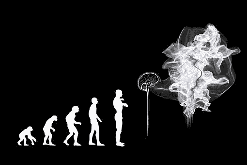

# 第 2 本：人工智能业务应用

如何学习应用人工智能并使用数据科学进行业务。包含数据分析、商业机器学习和 Python。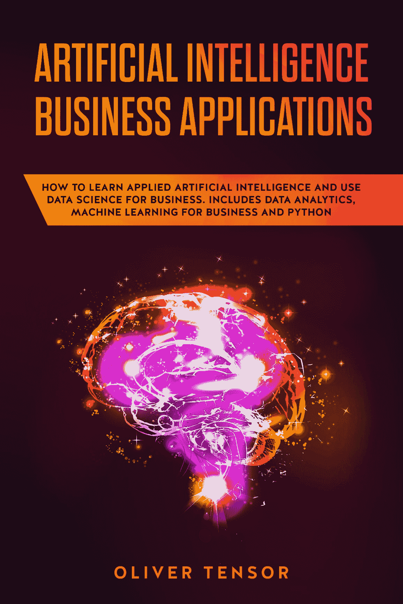

## 引言


恭喜你下载了《人工智能业务应用：如何学习应用人工智能并使用数据科学进行业务；内包含数据分析、商业机器学习和 Python》，感谢你的支持。接下来的章节将讨论人工智能（AI）技术的基础知识，包括英国计算机科学家艾兰·图灵（Alan Turing）对人工智能领域的开创性贡献。你将了解到第四次工业革命已在我们临头，并计划在未来十年内引发全球性的社会转型。作为未来的商业领袖，你将学习人工智能技术在我们数字生活的各个方面的重要性及其广泛的应用。如今的机器在不同程度上受人类的控制，但随着机器学习和人工智能技术的承诺，创造独立运行的机器可能成为现实。因此，对于你们未来的商业领袖来说，理解各种 AI 工具和技术的细微差别至关重要。

## 第 2 章：人工智能的重要性

在本书的第 2 章“人工智能的重要性”中，你将学习到现今广泛使用的 12 种不同的 AI 工具和技术。这个高度技术性的主题经过精心设计，专门针对非技术背景的商业导向型人员。你将发现大量的现实案例，帮助你全面理解所讨论的话题。我们付出了特别努力，用简单通俗的语言解释技术术语。

# 第 3 章：人工智能的工业应用

第 3 章名为“人工智能的工业应用”，是本书的核心所在。你将学习人工智能技术在每个现有工业领域的优缺点。你将了解到机器人和聊天机器人如何增强和提升人类能力，以便在日常任务中实现更高的效率和准确性。你将接触到可以在有限人工辅助下在人体上操作的“机器”。今天的企业正处于一场无休止的竞争中，寻找能够让它们在竞争中脱颖而出的“X 因素”。这种灵药正以人工智能技术的形态被应用于海量的客户相关数据，以揭示隐藏的知识和洞察，这些信息在海量数据中很容易丢失。

我们的数字生活使我们变成了更精明的消费者，在每天访问的每个网站上寻求更好、更有吸引力的用户体验。这使得互联网充斥着虚拟助手或聊天机器人，它们编写了机器学习算法，并能够通过每一次人类互动进行学习，以提高它们“表现和听起来更像人类”的能力。对虚拟个人或家庭助手的需求产生了如`Amazon Echo`、`Google Home`和`Apple Pods`等设备，它们是人工智能和机器学习技术最佳实典范。

你将概述人工智能技术在营销领域的应用，例如使用`GetResponse Autofunnel`等基于 AI 的工具，这些工具已经实现了创建特定行业和业务营销漏斗的传统流程，以吸引新客户或潜在客户并将其转化为付费客户。作为领袖，你必须关注有助于你增长和扩大业务的工具和技术，正如你将通过这本书的帮助所学到的，未来在于 AI、机器学习和大数据分析等尖端技术之中。因此，我们详尽解释了什么是大数据，以及现代分析工具和技术如何应用于这一数据宝库，以获得无价的洞察并将你的业务推向新的高度。当你读完这本书时，你将熟悉熟悉一些最流行的计算机编程语言和机器学习库，你可以选择性地将它们整合到公司的软件平台中，以提高销售并获得更多利润。市场上有许多关于这个主题的书，再次感谢你选择这一本！我们已尽一切确保它包含尽可能多的有用信息。请享受阅读吧！

# 第一章：人工智能基础

人类，又称智人（Homo Sapiens），经常标榜自己是地球上出现过的最优越的物种，这主要归功于他们的“智能”。即使是最复杂的动物行为也从未被认为具有智能性。然而，人类最简单的行为也被归类为智能。例如，当雌性泥瓦蜂带着食物回到巢穴时，它会将食物放在门槛上，并在进入内部之前检查是否有入侵者。这听起来像是一只聪明的蜜蜂，对吧？但对这些蜜蜂进行的一个实验显示，当蜜蜂在巢穴内部，科学家将食物移至巢穴入口不远的地方，结果发现，每当食物从原位置移动时，蜜蜂都会继续重复整个程序。该实验得出结论：蜜蜂显然缺乏适应变化状况的能力，因此“智能”在蜜蜂中并不存在。

那么，所谓的“人类智能”是什么？心理学家将人类智能描述为多种能力的综合，例如从经验中学习并进行相应的适应、理解抽象概念、推理、解决问题、语言使用和感知。开发能够由人类控制和操作的机器（如数字计算机或机器人），使其能够模仿人类智能、适应新输入并执行类人任务的科学被称为“人工智能”（AI）。得益于好莱坞，大多数人在听到“人工智能”一词时，会想到机器人获得生命并在地球上大肆破坏。但这并非事实。人工智能的核心原理是人工智能驱动的机器能够理性化（像人类一样思考）并采取行动（模仿人类动作）以实现目标目标。简单来说，人工智能就是创建一个能够像人类一样思考和行动的机器。人工智能三大核心目标是学习、推理和感知。

## 人工智能的历史

虽然“人工智能”一词诞生于 1956 年，但英国计算机科学先驱艾兰·马森·图灵（Alan Mathison Turing）在 20 世纪中期就在人工智能领域取得了突破性工作。1935 年，图灵开发了一种具有扫描器和符号形式无限内存的抽象计算机器。扫描器能够在内存中来回移动读取现有的符号并写入更多的内存符号。编程指令会规定扫描器的动作，并存储在内存中。因此，图灵生成了一种具有隐性学习能力的机器，它可以修改和改进自身的程序。这一概念被广为人知为通用“图灵机”，是所有现代计算机的基础。图灵声称，计算机可以从自己的经验中学习，并使用名为“启发式问题解决”的指导原则来解决问题。

20 世纪 50 年代，早期人工智能研究侧重于问题解决和符号方法。到 20 世纪 60 年代，人工智能的研究兴趣发生了重大飞跃，“美国国防部”开始致力于训练计算机镜像人类推理。20 世纪 70 年代，“国防高级研究计划署”（DARPA）成功完成了其街道制图项目。你可能会感到惊讶，DARPA 实际上在著名的 Siri 和 Alexa 出现很久以前，于 2003 年就生产出了智能个人助手。不而喻，人工智能领域的这一突破性工作为现代计算机中观察到的自动化和推理铺平了道路。

## 人工智能中的核心人类特征

以下是我们希望在机器中模仿的人类核心特征：

1. **知识** – 为了让机器能够像人类一样行动和反应，它们需要大量关于周围世界的数据和信息。为了实现知识工程，人工智能必须能够无缝访问数据对象、数据类别、数据属性，以及它们之间的关系，这些关系可以在数据存储器中管理和存储。

2. **学习** – 在所有适用于人工智能的不同学习形式中，最简单的是“试错法”。例如，一个象棋学习计算机程序会尝试所有可能的步法，直到找到结束游戏的一步杀法（mate-in-one）。然后程序会存储这一步法，以便在下次遇到相同位置时使用。这种相对容易实现的学习方面被称为“机械记忆学习”，涉及对单个项目和程序的简单记忆。学习中最具挑战性的部分被称为“泛化”，涉及将过去的经验应用于相应的新场景。

3. **问题解决** – 通过搜索一系列可能的行动来达到预定义目标或解决方案的系统过程可以被称为问题解决。问题解决技术可以为特定问题定制，也可以用于各种问题。人工智能中经常使用的一种通用问题解决方法是“目标分析”，它涉及逐步推导出当前状态与目标最终状态之间的差异。想一下机器人的一些基本功能，来回移动或捡取物品，这些功能导致了目标的实现。

4. **推理** – 推理行为可以定义为得出适用于给定情况的结论的能力。推理的两种形式被称为“演绎推理”和“归纳推理”。在演绎推理中，如果前提是真的，则结论假设为真。相反，在归纳推理中，即使前提是真的，结论也可能不为真。尽管在编程计算机执行演绎推理方面已取得成功，但实现“真正的推理”仍然遥不可及，并且是人工智能面临的最大挑战之一。

5. **感知** – 通过各种感官器官产生物体多维视图的过程可以定义为感知。这种环境意识的形成受到许多因素的影响，例如视角、光线的方向和强度，以及物体与周围环境产生的对比度。人工智能感知领域已取得突破性进展，并随着自动驾驶汽车和在建筑中移动收集空苏乐罐机器人的出现，在日常生活中被很容易观察到。

# 第四次工业革命

18 世纪的“第一次工业革命”标志着世界经济从以农业为基础向以工业和机械制造为主导的转变。今天，我们正处于第四次工业革命的边缘。回想，“第二次工业革命”将科学应用于大化生产和制造，而“第三次工业革命”（或数字革命）为我们带了数字技术。

“第四次工业革命”预示着一系列社会和经济剧变，这些剧变将在 21 世纪展开，涉及如`人工智能`、`3-D 打印`、`增强现实`和`基因编辑`等技术。第四次工业革命将迅速改变我们生产、交换和分配价值的方式。`CRISPR`技术通过提供低成本的基因测序和靶向机制彻底改变了基因编辑领域。自动化继续颠覆运输和制造范式，而`区块链`技术正日益消除物理世界与数字世界之间的边界。当然，`人工智能`在想象所及的每一个行业中的应用可以被认为是无限的。

正如在之前的几次工业革命中观察到的那样，第四次工业革命将在未来 50 到 100 年内深刻改变我们的世界。我们今天对这场革命的思考方式以及对其投入，最终将引导人类近将来的转型。第四次工业革命的全球社会转型可以通过影响经济的激励机制、规则和规范来引导，反过来又改变我们交流、学习和娱乐自己。随着“物联网”（`IoT`）和“万联网”（`IoS`）等“信息物理系统”的采用，我们对人类物种以及人与人关系的理解将迎来更新。新技术正在以惊人的速度开发和实施，并将影响人类身份认同、社区以及政治结构。因此，我们对这些革命性技术的参与，与我们自我实现的机会以及对世界留下持久积极影响的能力紧密相连。

除了`人工智能`之外，驱动第四次工业革命的一些突出技术包括：

* **区块链**：如“比特币”等数字货币的出现归功于`区块链`技术，它允许使用去中心化的服务器而非第三方中介对数据进行安全、透明的记录和共享。`区块链`技术还可以用于使供应链具有追溯性、保护敏感医疗数据，甚至打击选举欺诈。


**智能计算**：现代计算机能够在几分钟内处理海量数据。“云”技术的出现使得公司能够随着`互联网技术`的到来，从世界上任何角落无缝地安全存储和访问信息。随着`量子计算`技术的使用，未来的计算机将变得更加强大。这些强大数百万倍的计算机可能能够增强`AI`，在几秒钟内创建极其复杂的数据模型，并加速新材料的发现。

**增强现实与虚拟现实**：如其名，`增强现实`将通过物理世界和数字世界合为一体，重新定义并扩展我们的现实。例如，欧莱雅（L’Oréal）推出的妆容应用程序允许用户在线尝试和体验产品，而无需亲临商店。另一方面，`虚拟现实`模拟真实世界以创造沉浸式数字体验。例如，您可以在任何电子商店购买用于增强在线游戏体验的`虚拟现实`或`VR`头设备。

**生物技术**：新疾病需要新治疗方法的恶性循环在可预见的未来将继续困扰我们。但`生物技术`的进步正推动我们利用细胞和生物分子技术来开发新药物和生物材料。我们对清洁高效的能源（如`生物燃料`）以替代枯竭的不可再生化石燃料的迫切需求，取决于并由`生物技术`驱动。例如，一些科学家正致力于生产史上最强的生物材料。

**机器人学**：开发和使用机器人用于个人及商业目的科学被称为`机器人学`。日本机器人工程师正致力于开发日益复杂的“类人”机器人并引发了多次媒体关注，这些机器人可以作为酒店和医院的人类助手，或有望彻底改变工业制造领域。

**3D 打印**：今天现代技术的新宠儿是`3D 打印机`。我们可以在家里以低成本打印定制的三维物体。企业现在有能力在不需要大量模具的情况下打印自己的部件，且速度比传统工艺更快，成本更低。

**物联网（IoT）**：如果你认为汽车能够追踪冰箱里有什么这种想法是科幻小说？再想想！`IoT`技术构成了我们日常物品与互联网的连接，允许网络上的所有其他设备对其进行识别。这项技术通过收集客户所有连接设备的数据并量身定制营销产品以更好地满足客户需求，正在彻底改变营销行业。`IoT`传感器也被应用于农业领域，允许农民更好地监测土壤属性，并做出如是否需要施肥和灌溉农场的明智决策。

考虑到这些技术带来的变革，客户的期望也在随之转变。

可以很容易相信，在未来 5 年内，我们与企业的互动方式将发生变化。客户正在寻求更具个性化且更高价值的增强用户体验。因此，对于公司来说，获取并留住新客户变得越来越挑战性，因为他们总是在寻找下一个更好的选择。企业需要创造独特的体验，并将其与竞争对手区分来。

社交媒体和同行评审网站让不满的客户能够向其他潜在客户传播他们的糟糕经历，这可能会损害公司的声誉。近期影响几乎所有行业领先者的数据泄露事件，也让客户对公司存储个人数据变得日益警惕。这种对数据被泄露的恐惧，对于那些依赖收集大量高质量客户数据来提供个性化体验的公司来说构成了挑战。

因此，为了留住客户，公司需要在在线和店内提供卓越的销售和服务，同时要向客户证明他们考虑了客户的最佳利益，并以先进的安全工具和措施提供支持。特别是人工智能，极大地依赖于公司思考数据隐私和安全的方式。机器对我们自己和世界的了解越多，它就能越好地预测我们的需求。

“当数据成为我们数字生活的货币时，公司必须确保客户信息的隐私和安全。而且，没有透明就没有信任——公司必须让客户清楚他们的个人数据是如何被使用的。” —— Marc Benioff，Salesforce 联合首席执行官。

一些经济学家（如 Erik Brynjolfsson 和 Andrew McAfee）认为，“第四次工业革命可能会导致更大的经济不平等，特别是它在颠覆全球劳动力市场方面的潜力。”随着自动化在整个经济中倾向的日益增加，机器对劳动的净替代可能会加剧劳动回报与资本回报之间的差异。然而，硬币的另一面也预示着技术对工人的替代将带来更有回报且风险更低的工作的净增长。这与之前的工业革命对我们世界产生的积极和消极影响并无二。

尽管全球各国已变得更加富有，将整个社会从贫困中解放出来，但经济分配的普遍差异每天都在扩大。为了确保我们作为人类首要获得第四次工业革命的收益，我们必须将我们的核心人类价值观与技术进步保持一致。我们必须意识到技术进步带来的风险，例如网络安全威胁、利用数字媒体在大范围内以闪速传播误导性或错误信息，以及自动化导致的潜在失业，并采取措施减轻这些风险。

“这些变化是如此深刻，从人类历史的角度来看，从未有过比现在更有前景或更具危险的时期。然而，我担心的是决策者往往陷入传统的、线性的（且非破坏性的）思维中，或者沉迷于眼前利益，而无法对塑造我们未来的破坏和创新力量进行战略性思考。” —— Klaus Schwab 教授。

## 第二章：人工智能的重要性


为了感受人工智能在生活中有多重要，不如说明现代生活方式中哪些部分还没有被它触及。人类生活的方方面面都被它触及了。

### AI 在日常生活中的作用

机器对我们自己和世界的了解越多，它就能越好地预测我们的需求。以下是人工智能之所以重要的几个原因：

- **自动化与效率**：技术对工人的替代将带来更有回报且风险更低的工作的净增长。
- **个性化**：为现有产品增加智能功能可以增强用户体验。例如，我们越频繁使用`Alexa`和`Google Search`，它们就变得越准确，因为它们基于深度学习。
- **数据驱动的洞察**：数据对机器就像汽油之车辆，你提供的数据越多，结果越快越准确。深度学习模型在过量数据中茁壮成长，因为它们直接从数据中学习。
- **医学进步**：通过 AI 的深度神经网络实现了难以置信的准确性。图像分类和物体识别现在能够以与经过训练的放射科医生类似的准确率在 MRI 上发现癌症。
- **竞争优势**：AI 帮助挖掘数据的最大价值。今天，数据本身就是一种货币，当算法能够自我学习时，它可以很容易变成知识产权。只需将`AI`应用于数据，就能帮助你更快地获得正确答案，并形成竞争优势。

“谷歌”和“亚马逊”等科技巨头正在大力投入 AI 研发，这表明了 AI 对普通企业以及并扩展到整个经济的重要性。

AI 将带来全球范围内的法律影响，各国需要根据 AI 政策审查并更新其法律法规。AI 在医疗健康和交通领域的应用将要求政府对 AI 使用的受保护信息进行审查。

全球范围内私营部门与公共部门之间的强力合作（而不仅仅是大型科技公司）对于成功实施 AI 以更好地服务人类至关重要。我们的旅游和酒店行业已经在经历这场革命了。

人们经常将机器学习、数据科学、深度学习和 AI 混为一谈，因为它们都是机器智能的有效示例。然而，它们的用途和潜在影响各不相同。现在，让我们来看一些最受欢迎的 AI 工具和技术，请记住，这些技术的演进速度非常快，因此尽可能熟悉许多技术将是一项巨大的优势。

### 1. 基于规则的系统

基于规则的系统（RBS）利用`if`和`then`语句为推理引擎提供关于问题的信息的“工作记忆”。这些规则的条件和动作部分源自专家知识。推理引擎具有一个模式匹配器，用于对相关的规则做出决策，以及一个规则应用器，用于选择性地应用这些规则。应用于规则的动作（`then`）创建新信息并添加到“工作记忆”中。知识库与“工作记忆”之间的“匹配-选择-执行”循环不断重复，直到成功找到所有相关规则。由于规则往往是模糊的，可以通过可能性理论、确定性因子或 Cohen 的支持理论等多种技术将不确定性集成到 RBS 中。这些方法简单由人类专家为规则和事实分配不确定性值，例如：“概率、信念函数、隶属度”。正向链和反向链这两个规则系统。“正向链”是数据驱动的，利用规则从初始事实推导出结论。相反，“反向链”是目标驱动的，基于其初始假设，然后需要通过相应的规则进行验证。简单来说，“反向链”的作用是证明其决策是合理的，而“正向链”则是发现从给定数据中可以得出的信息。RBS 不涉及学习，解决方案完全基于根据人类知识建立的条件规则。但由于同样的原因，它们很容易理解、实施和维护。RBS 无法自动添加或修改规则，只能在对主题有全面了解的情况下实施。它们也往往更难扩展。RBS 用于疾病诊断、动植物鉴定以及区域环境评估工具。

### 2. 基于案例的推理

“基于案例的推理”（CBR）利用记忆回溯处理与系统遇到过的过去问题相似的问题。CBR 承认相似的问题可能有相似的解决方案，随着积累的学习和多次尝试，问题变得更容易解决。CBR 本质上有一个四个步骤的过程：1) 搜索数据库并检索类似的过去案例。2) 使用检索到的案例为新问题产生解决方案。3) 通过仿真或测试执行，修订建议的解决方案。4) 保留并存储新解决方案以备将来使用。CBR 只能从问题的相似过去案例中推理。它对系统内部或正在发生的过程没有洞察，因此这是一种黑箱方法。这对于不需要甚至无法进行深入理解和洞察的复杂过程是有益的。CBR 用于诊断、控制、规划以及预测。CBR 在环境应用中的一些示例包括火灾规划、废水处理管理、天气预测和空气质量监测。

### 3. 人工神经网络

人工神经网络（ANN）的灵感源于人类大脑的结构，并采用多个像人类神经元或节点协同工作的处理单元。每个 ANN 都有多个隐藏层以及一个输入层和一个输出层。这些神经元通过权重连接相互连接在一起。单个神经元可以接受来自多个神经元的输入。当一个神经元激活时，它会投出加权票来引导收集该输入的神经元的激活。算法根据训练数据调整这些权重以优化学习。一种称为“一起触发，一起连接”（fire together, wire together）的简单算法在其中一个神经元的激活导致另一个神经元的后续激活时，增加两个连接神经元之间的权重。“概念”通过共享神经元的子网络形成并分布。最常见的 ANN 以单向信息流工作，被称为“前馈 ANN”。然而，ANN 能够实现双向和循环信息流以达到状态平衡。ANN 通过调整连接权重从过去案例中学习，并依赖较少的先验假设。这种学习可以是监督的或无监督的。在监督学习中，每个输入模式都将产生正确的 ANN 输出。为了最小化给定输出与 ANN 生成输出之间的误差，可以改变权重。例如，强化学习（作为“监督学习”的一种形式）会告知 ANN 生成的输出是否正确，而不是直接提供正确输出。另一方面，无监督学习向 ANN 提供多个输入模式，然后 ANN 自身探索这些模式之间的关系并学习对它们进行相应分类。也有结合了监督和无监督学习的 ANN。为了解决算法或规则未知或难以理解的数据密集型问题，由于其数据结构和非线性计算，ANN 是非常有用的。ANN 对多变量数据错误具有鲁棒性，并可以轻松地并行处理复杂信息。尽管 ANN 的黑箱模型是一个主要缺点，这使得它们不适用于需要对实际过程有深层理解和洞察的问题。ANN 可用于解决以下类型的问题：

- **模式分类**：通过将输入模式分配到预定义的类别之一来实现。例如，基于卫星图像的土地分类。
- **聚类**：本质上是无监督的模式分类。例如，河流生态学状态的预测。
- **函数拟合或回归**：可以从给定的训练模式集中创建函数。例如，大气中臭氧浓度的预测、地下水硝酸量的估计以及水供应建模。
- **预测**：使用时间序列中的过去样本来估计输出。例如，空气和水质的预测。
- **优化**：在约束条件下最大化或最小化“成本函数”。例如，渗透方程的校准。
- **内容检索**：即使输入不完整或变形，也能回想起记忆。例如，利用卫星图像产生水质指标。
- **过程控制**：旨在通过改变节气门角度，在数据负载变化时保持近恒定的速度。例如，发动机速度控制。

### 4. 遗传算法

顾名思义，遗传算法（GA）通过将更适应解决方案的性状传递给后代并替换较差的解决方案来模拟自然选择理论。遗传算法不断进化，直到获得问题的满意解决方案。就像人类染色体一样，每个潜在解决方案都被编码为字符的“二进制字符串”，每一组连续的种群被称为“代”。初始或原始种群是随机生成的，所有后续种群都通过选择和繁殖产生。然后，对种群中的选择性子集进行育种以产生新的染色体。选择过程基于个体解的适应度，其中包括与完美解的接近程度和确定性采样。与完美选择的接近程度通常通过“轮盘选择”来实现，这会根据其适应度计算出的概率随机选择父本。然后，确定性采样为所选有机体的子集分配值。传统的繁殖通过遗传交叉进行，通过交换两个父本的染色体并变异染色体来产生后代，变异会随机改变父本染色体的一部分。变异发生并不频繁，并在基因池中引入新的遗传材料。在搜索进展中，变异的重要性低于交叉，但对于维持遗传多样性是至关重要的，而遗传多样性是持续进化的关键。在稳态遗传算法中，较适应的成员被新后代取代，导致更高的平均适应度。繁殖和选择的循环重复直到满足停止标准；例如达到最大适应度或所有有机体相同，或进化不再产生新结果。通过仅关注检查适应度而忽略其他衍生因素，遗传算法可以很好地平衡负载和效率，并在计算上具有高度稳健性。遗传算法的另一个重要特征是它们能够间接采样大量实际测试的代码序列。遗传算法存储解群，而不是像大多数随机搜索技术那样调整单个解决方案，这使其能够搜索噪声和多峰关系。遗传算法的一些应用示例包括空气质量预测、水质模型校准、土壤容密度估计和水管理系统。

### 5. 细胞自动机

细胞自动机（CA）是在空间、时间和状态上不连接的动态模型。细胞自动机由规则细胞网格组成，能够与其相邻网格相互作用。局部规则在时间上同步更新细胞状态，并利用细胞自身的状态和相邻细胞的状态计算`T+1`时细胞的新状态。细胞自动机的一个主要局限性在于其边界条件。在周期性条件下，当一侧边缘细胞与对侧边缘细胞成为邻居时，就会产生环面。或者，边界条件也可以被反射和吸收。这允许细胞自动机不考虑网外邻居并为边界状态分配唯一值。这些边界条件无法描述真实世界的场景。为了避免这个问题，可以将网格做得比研究区域大得多，但这会增加资源和计算开销。细胞自动机可以模拟复杂的物理系统并整合相互作用和空间变化。这些简单的数学模型也能够随时间进行空间扩展。它们对初始状态和转移函数具有高敏感性，通常用于理解真实环境，但做出精确预测的能力有限。细胞自动机应用的示例包括动物迁移模型、地震活动模型、火灾模型和景观变化。

### 6. 模糊系统

顾名思义，模糊系统（FS）使用“模糊集”处理不精确和不完整的数据，成员对象取 0 到 1 之间的值。这与对象要么是集合成员要么不是的“传统集合理论”不同。因此，模糊集能够将模糊陈述转化为凝聚的自然语言。例如，“植被模型”将植物群分配给它们的种类，而“模糊隶属度”指示植被符合每种定义的程度。模糊推理机生成模糊化数据，然后将其与先验规则结合创建模糊模型。这种称为“模糊化”的过程将清晰的输入值转换为模糊隶属度，而产生的模糊输出则转换为清晰的数值。模糊系统不是最容易理解的，但它们处理类似于人类推理的模糊和不精确信息的能力使其比所有其他 AI 技术都更强大。确定良好的隶属函数是开发模糊系统面临的最大挑战之一。模糊系统最大的局限性是它们无法学习和记忆信息。因此，模糊系统通常与其他 AI 技术结合使用以开发“混合系统”。例如，神经网络可以与模糊系统结合产生神经模糊系统。在“函数近似、分类/聚类、控制和预测”等应用中不完整和扭曲的数据可以很容易被模糊系统管理。模糊系统的应用示例包括土壤水力属性估计、泻湖生态状况识别、利用卫星图像识别海洋溢油、废水处理控制以及对钻井废物排放引起的环境风险进行评估。

### 7. 多智能体系统

“多智能体系统”由一组可以相互交互的智能体网络组成，旨在实现预定义的目标。包含代码和数据的软件组件被称为“智能体”。单个智能体无法独立解决分配给多智能体系统的问题。智能体之间可以使用名为“智能体通信语言”（ACL）的高级语言共享信息、请求服务并进行协商。“知识查询与操纵语言”（KQML）是最常用的“智能体通信语言”。KQML 包含一个“通信层”，其中包含如发送者、接收者和通信标识符等低级参数。它还拥有一个可以指定执行语法和解释协议的“消息层”，以及一个包含有关执行语法进一步信息的“内容层”。消息中继和响应处理在智能体之间异步进行。因此，智能体之间的平滑协调至关重要。系统基础设施通过控制信息流、资源使用、并发程度以及智能体之间交互的性质来决定智能体协调的效率。所有智能体都可以直接通信的“点对点”网络是最基础的基础设施。需要快速并发处理以找到解决方案且不产生冲突的问题非常适合点对点基础设施。其他常见的多智能体系统包括：包含一个用于协调智能体活动的中央控制器的“多智能体黑板”、所有智能体共享数据的“公共黑板空间”以及包含被称为“促进者智能体”的介质的“联邦智能体”。自治与动态实体之间存在大量交互的复杂系统可以通过多智能体系统进行建模。智能体的组织驱动了这些系统的有效性。在点对点基础设施中，网络维护相当繁琐；因为每当添加新网络时，所有智能体都需要更新。另一方面，具有中央协调的基础设施仅需在促进者的目录中更新新添加的内容。开发多智能体系统的另一个挑战源于智能体之间高度复杂的交互以及内在的动态趋势，这可能导致任务与资源分配之间的冲突。多智能体系统应用的一些示例包括：牧场管理、灌溉农耕系统管理、土地用途变化的森林生态系统管理，以及渔业和乳制品业的管理。

### 8. 群体智能

一种受蚂蚁和蜜蜂等动物群落启发的基于智能体的模型被称为群体智能。单个智能体往往是简单的，但作为一个群体，这些智能体表现出更高的智能性。这些模型缺乏集中式控制或全局模型，因此局部交互创建了全局模式，使得自组织变得至关重要。智能体之间的直接通信以及通过环境进行的通信或间接通信都可以导致这些交互。群体智能模型的一个重要特征是其通过改变环境进行通信的能力，这被称为“信息迹”。例如，蚂蚁在前往食物源的途中留下信息素，以便其他蚂蚁能够轻松识别并遵循它们的足迹。群体智能算法的一种类型称为蚁群算法，它基于蚂蚁的行为。蚂蚁个体沿随机方向移动，直到遇到“信息素足迹”，它们倾向于遵循并通过释放自己的信息素来强化足迹。信息素浓度最高的路径更有可能被选择，从而导致自催化行为。高浓度的信息素意味着更高的流量，反过来变得更有吸引力。通往目的的短路径也会导致信息素高浓度并被强化为主优势。随着自催化行为的显现，最终所有蚂蚁都选择了最短的路径。蚁群算法可以处理离散组合优化。它产生多种可能的解决方案，每种方案代表一个具有多个决策节点的个体路线。另一个经常使用的群体智能算法是“粒子群优化”（PSO），它灵感来自鱼群和鸟群。该系统有多个点，每个点代表一个解。为了初始化系统，将各种可能的解决方案“飞”过多维“问题-参数”空间。在每次迭代中，通过解相对于目标的位置来评估适应度，并将其最佳位置的信息与群体共享。这使得后续的解决方案根据它们自身之前的最佳位置以及群体内最佳解的位置来更新其速度和位置。群体智能应用的示例包括：项目调度、模式识别、预测性温度控制以及降雨径流模型中的参数优化。

### 9. 强化学习


强化学习可以定义为一种基于“学习智能体”与其环境之间交互的机器学习类型。智能体使用试错法来学习如何实现目标。环境、“奖励函数”和“价值函数”是“强化学习”问题的组成部分。

环境拥有一组可能的状态，并且在本质上是动态的。奖励函数有三类：“纯延迟奖励”（在到达终止状态之前不给予奖励）、“到达目标的最小时间”（智能体必须找到到达目标的最短路径）和“游戏”（搜索“奖励函数”的最大值、最小值或鞍点）。当两个或多个智能体具有相反的目标且动作被独立选择但并发执行时，会使用游戏的“奖励函数”。

与指定即时愿望的“奖励函数”不同，“价值函数”通过考虑可能随动作发生的状态来决定长期愿望。强化学习创建新行为而不是模拟现有行为，这使得它非常适用于机器人和游戏。通过强化学习，计算机程序可以逐步提高结果和效率。

强化学习本身在解决环境问题方面作用有限，但正越来越多与其他人工智能技术结合使用以解决其他问题。例如，神经网络（ANN）结合强化学习被用于模拟渔民和蜜蜂的行为。

## 10. 混合系统

将两个或多个系统或“范式”结合起来，以克服各自的弱点并发挥优势，这被称为混合系统。根据技术结合的方式，混合系统主要分为三种类型：“顺序式、辅助式和嵌入式”。

- 在“顺序混合系统”中，输出从第一个范式传递到下一个范式，后者会生成自己的输出，整个过程按顺序持续进行。
- 在“辅助混合系统”中，第一个范式将从相邻的范式获取某些输入以生成输出。
- 另一方面，在“嵌入式混合系统”中，两种范式简单地相互包含。

最常见的混合系统是通过人工神经网络和模糊系统结合产生的，形成了神经模糊系统。模糊系统缺乏学习的能力通过`ANNs`补偿，而`ANN`无法衰减数据中噪声的问题则由模糊系统支持。这种组合非常有效、快速，并且易于理解和实现。

另一个成功的混合系统例子是多智能体系统与细胞自动机的结合。细胞自动机已成功用于空间景观变化的建模，但通过与多智能体系统相结合，该混合系统能够纳入驱动这些景观变化的人类决策。

**其他成功的混合系统示例还有：**

- 在水质管理和降雨径流建模中人工神经网络与遗传算法的结合；
- 在污染防治策略开发中`Genetic Algorithm`与`Particle Swarm Optimization`的结合；
- 在水分配优化中人工神经网络、`Reinforcement learning`和模糊系统的结合。

## 11. 统计学

统计学可以定义为“收集数据、分析数据并从数据中得出推断的科学”。统计学主要关注描述数据集的属性并建立现有数据点之间的关系。因此，它不被认为是人工智能的一部分。然而，许多统计技术被用作高级机器学习技术的基础。

统计主要有两种类型：“描述性统计”和“推断统计”。

- “描述性统计”用于描述所研究数据的基本特征。例如，在定义范围内寻找零售店中的最畅销商品。
- “推断统计”得出的结论不仅不仅限于所研究的数据。当真实总体太大且难以研究，且只能对总体的子集进行分析时，这至关重要。通过这种技术得出的结论具有概率性，绝不完全准确。例如，选举出口民调查依靠对极小比例公民进行调查，来衡量整个人口的决策。

## 12. 概率编程

概率编程是一种高级编程语言，允许创建概率模型，并能够从分布中提取值并将这些值条件化到程序中。基于概率编程的学习系统可以从先验知识中进行推理，允许在面对不确定性时做出决策。目标系统的知识以定量和概率术语捕获。通过充分训练，模型可以应用于特定的查询，并通过称为`inference`的过程生成答案。

这种编程语言还可以自动求解概率模型，无需外部辅助。概率编程语言允许模型库的无限制访问和重用。它还支持交互式建模和形式化验证。

概率算法内部的抽象层对于促进通用高效的推理至关重要，因为人工智能中的许多问题要求代理处理不完整和扭曲的数据集。概率算法越来越多地用于过滤数据流以生成预测并帮助感知系统分析底层过程。

概率编程应用的示例包括医学影像、财务预测、机器感知和天气预报。最常用的概率模型称为`Bayesian network`，它使用`Bayesian inference`计算概率。在`Bayesian network`上进行推断有两种形式：

1. 第一种是对网络中每个变量特定赋值的联合概率进行评估。
2. 第二种是找到在给定另一组变量赋值的情况下，变量子集的的概率。

`Bayesian networks`在解决涉及程序推理、学习、规划和感知的问题方面有广泛的应用。`Bayesian inference`算法可解决推理问题，而`expectation and maximization`算法可处理学习问题。`dynamic Bayesian networks`允许无缝感知，而`decision networks`可解决规划问题。


# 第 3 章：人工智能的工业应用

人工智能凭借其对日常消费品日益增长的影响力，引领着第四次工业革命。人工智能通过新产品、新流程和新能力改变了制造业、零售业和金融业。物理和医疗领域的一些重大突破也归功于人工智能。在这一技术进步的时代，随着我们走向科幻小说描绘的未来，人工智能已成为我们世界不可或缺的一部分。

得益于我们每天产生的海量在线数据以及前所未有的强大计算机，人工智能近年来经历了爆发式增长。商业领袖和创新者正在追求人工智能的承诺，以便在节省成本和时间的同时获得竞争优势。从优化交付路线到全球供应链管理，人工智能正在帮助各行业各种规模的公司通过提高生产力来增加底线。公司能够在减少支出的同时，设计、生产和交付卓越的产品和服务。这难道不是每个创业者的梦想成真吗？？！

在本章中，我们将探索人工智能在所有主要行业的应用，以及业务流程如何变化以适应人工智能。

## 医疗保健行业

随着医疗数据可用性的增加，人工智能为医疗保健带来了范式转变。人工智能在医疗行业的主要关注点是分析患者结果与所使用的治疗或预防技术之间的关系。人工智能程序已成功用于患者诊断、治疗方案生成、药物开发以及患者监测和护理。强大的人工智能技术可以筛选大量的临床数据，并帮助解锁与临床相关的信息以协助决策。

1965 年，人工智能研究员“爱德华·费根鲍”（Edward Feigenbaum）和遗传学家“约书亚·莱德伯格”（Joshua Lederberg）开发了第一个用于化学分析启发式编程的主要应用，称为`DENDRAL`。这是第一个具有现实应用的规则系统。分子结构说明一直是有机化学中的一个实质性问题，因为化合物的物理性质不仅取决于组成原子，还取决于它们的几何排列。质谱可以提供有关组成原子的信息，但对原子的几何形状不敏感。`DENDRAL`假设化合物分子结构的能力可以与化学专家的水平媲美。

`DENDRAL`为医学领域人工智能最重要的应用之一奠定了基础，形式是一个名为“MYCIN”的专家系统。1972 年，斯坦福大学开始在`MYCIN`帮助治疗血液感染。患者的症状和医学检查结果被输入`MYCIN`，随后它可以建议额外的实验室检查，并请求有关患者的进一步信息以得出可能的诊断，甚至创建治疗方案的建议。如果需要，`MYCIN`可以解释其诊断背后的推理。据报道，`MYCIN`的能力与血液感染专家相当，并明显优于普通医生。但由于学习局限性，`MYCIN`未能获得普及。

一些人工智能研究和使用日益增加的医学分支包括：

- **放射学**：人工智能解读影像结果的能力补充了医生检测图像中人眼极易遗漏变化的能力。斯坦福大学最近创建的一种人工智能算法可以检测肺炎患者肺部的特定区域。
- **电子健康档案**：对数字健康记录以优化信息传播和访问的需求，需要在系统中快速准确地记录所有健康相关数据。人类容易出错，并可能受到认知过载和职业倦怠的影响。这一过程已通过人工智能成功自动化。在电子健康记录上使用预测模型允许以 70-72%的准确率预测个性化的治疗反应。
- **影像**：持续的人工智能研究正在帮助医生评估矫颌手术的结果，以及通过评估腭治疗来预测面部吸引力。

以下是医疗保健领域一些最强大的的人工智能进展：

- **AI 辅助机器人手术**：机器人辅助手术最大的吸引力在于它们不需要大型切口，被认为是微创的，且术后恢复时间短。机器人能够分析术前患者病历的数据，并随后引导医生的器械。这些机器人辅助手术报告显示患者住院时间减少了多达 21%。机器人还可以使用过去手术的数据，并利用人工智能告知医生任何新的可能的技术。最先进的手术机器人`Da Vinci`允许外科医生比传统方法更高的精度和更大的控制力来执行复杂的手术程序。
- **补充临床诊断**：尽管人工智能在诊断中的应用仍处于处于阶段，但已经报告了许多成功案例。斯坦福大学创建的一种算法能够以类似于人类皮肤科专家的能力检测皮肤癌。丹麦的一个人工智能软件程序被用于听打给人类调度员的紧急电话。底层算法分析了呼者的语气、词汇以及背景噪音，以检测心脏病病例。该人工智能程序的成功率为 93%，比人类对手高出 20%。
- **虚拟护理助手**：虚拟护士 24/7 全候可用，不会疲劳或判断失误。它们提供持续的患者监测和最有效的护理指导，同时快速高效地回答患者的所有问题。患者与其护理提供者之间定期交流的增加可以归于虚拟护理应用。这防止了不必要的就和再次入院。`Care Angel`的虚拟护理助手可以通过人工智能和语音提供健康检查。
- **行政任务自动化**：人工智能驱动的技术（如语音转文字转录）正在帮助点检查、处方药物甚至编写病历注释。IBM 与克利夫兰医学中心的伙伴关系允许 IBM 的`Watson`对临床健康数据进行挖掘，帮助医生制定个性化和更高效的治疗方案。

## 新闻业

新闻业，听起来有点惊讶，对吧？报道正在被计算机取代？很难想象像新闻这样具有主观性且受情感驱动的工作是如何由机器完成的。但目前，“彭博新闻”（Bloomberg News）发布的三分之一之一内容正在使用某种形式的人工智能。

彭博正在使用一种名为`Cyborg`的系统，旨在帮助记者在每个季度撰写数千篇关于公司财报的新闻文章。一旦程序获取到财务数据，它就会剖析报告并生成一篇包含最相关事实和数字的新闻报道。与大多数认为这类报道枯燥且乏味的商业记者不同，`Cyborg`的工作准确且不知疲倦。

在高速商业财经新闻领域，彭博正面临着来自路透社（`Reuters`）的竞争，而在`Cyborg`的帮助下，彭博注将大获胜。

金融信息竞争中的最新入场者是对冲基金（`Hedge Funds`），他们已经在利用 AI 为客户提供最新的事实和数据。机器人记者还成功为“美联社”（The Associated Press）撰写了小联盟棒球的新闻，为《华盛顿邮报》（The Washington Post）撰写了高中橄榄球，并为《洛杉矶时报》（The Los Angeles Times）报道了地震。

例如，周二标题为“微策略公司”（`MSTR`）的新闻报道其第四季度净利润为 330 万（去年同期为亏损），而“乔纳森·戴维斯击全垒，新罕布州渔鱼猫队在周二以 10-3 击败波特兰海狗队”都是由美联社的 AI 驱动机器生成的。

最近，“卫卫报”（The Guardian）的澳大利亚编辑部成功发布了第一篇关于向澳大利亚政党年度政治捐款的机器人辅助新闻文章。福布（Forbes）也加入了人工智能的行列，并宣布他们正在测试一种名为`Bertie`的机器人，它可以协助记者撰写故事模板和草稿。

新闻业最早采用人工智能的标志之一，是 2014 年`Automated Insights`与美联社之间的合作伙伴关系。`Automated Insights`是一家专门从事“语言生成软件”的技术公司，能够在一年内产生数百万篇机器生成的报道。这项合作使得美联社每季度产生的财报新闻文章从之前的 300 篇增加到 3,700 篇，增长了 10 倍以上。

> “新闻工作是创造性的，它关于好奇心、关于讲故事、关于挖掘和追究政府责任、关于批判性思维和判断——这些正是我们希望记者投入精力的地方。”——莉莎·吉布斯，美联社

《邮报》（The Post）在 2016 年夏季奥运会以及 2016 年美国大选期间，使用了其内部的名为`Heliograf`的机器人记者。`Heliograf`甚至为《邮报》赢“全球比格奖”（The Annual Global Biggie Awards）的“机器人使用卓越奖”。

全球比格奖旨在认可现代行业在利用 AI 和大数据方面的成就。据报道，《邮报》利用 AI 推广对特定地区读者具有当地影响的新闻文章，这通常被称为“地理定位营销”。

彭博、美联社和《邮报》都对他们的 AI 设置了内部警报，以指示任何数据异常，触发人类记者决定是否有必要对该主题进行更深入的报道。《邮报》在 2016 年夏季奥运会期间测试了这一警报系统，每当结果高或低 10% 时，就会通过其名为`Slack`的业务消息系统向记者发送警报。

## 金融行业

在尖端进步方面，科技巨头往往占据大部分风头。但金融部门（包括老牌银行机构）正对人工智能表现出日益增长的兴趣和采用迹象。银行或金融业对几乎所有消费者和企业都有深远影响，对国家经济有直接影响，因此寻求洞察并跟上金融科技与人工智能的融合对于每家企业来说至关重要。银行业正投入基于人工智能的解决方案来服务大量客户。

### 客户服务的自动化与个性化

随着语言处理技术的进步，消费者区分人声和机器人声音的能力日益减弱。最好的方法似乎是由聊天机器人增强的人工客户服务代表。

例如，著名的瑞士联合银行（`UBS`）资产规模排名全球 35 位，已与`Amazon`合作。Amazon 成功地在其名为`Amazon Echo`（`Alexa`）的 AI 扬箱上整合了`Ask UBS`服务。全球的`UBS`客户只需“询问”`Alexa`关于全球金融市场的建议和分析，而无需参考《华尔街日报》。

`Ask UBS`服务还旨在为金融相关术语和缩写提供定义和示例。然而，由于缺乏访问个人投资组合和客户持仓权限，`Ask UBS`应用无法为`UBS`提供个性化建议。这种无能源于对客户数据的安全和隐私担忧。

凭借丰富的客户数据（包括在线和线下交易记录以及详细的人口统计数据），银行业正坐拥一座金矿，需要基于 AI 的分析力量通过数据挖掘来提取黄金。对来自离散数据库的信息进行整合和分析，使银行能够独特地利用`Machine learning`（机器学习）获取客户需求的全景，并提供卓越的个性化服务。

> “数字服务模型的下一步是让银行为个人定价，并实时协商该价格，将个性化推向极致。”——詹姆斯·埃德利，SAP 营销总监

对于所有金融机构而言，客户个性化已从营销和产品定制进入了网络安全领域。生物识别数据（如指纹）越来越多地用于增强或取代传统的密码和其他身份验证方式。

“谷歌智能”（Google Intelligence）最近的一项研究报告指出，到 2021 年，约有 20 亿银行客户将使用某种形式的生物识别。科技巨头之一的`Apple`已进入支付平台，现在正使用其人工智能驱动的“面部识别技术”来解锁设备并验证支付，使用其名为`Apple Pay`的“数字钱包”服务。

### 反欺诈

人工智能迅速分析海量数据并识别人类观察者可能无法发现模式的内在能力，使 AI 成为欺诈检测和预防的有力武器。根据`McAfee`最近的报告，全球经济仅通过网络犯罪就遭受了 6000 亿美元的损失。

实时欺诈检测是防止欺诈发生的唯一直接途径。基于 AI 和机器学习的解决方案为服务提供提供了实时欺诈检测能力，并减少了合法交易被标记为欺诈的频率。

### 风险管理

银行和其他机构在发放贷款时承担着高风险。这种复杂的承保过程需要准确性和高机密性。`Master Chase`仅在 2016 年就在尖端技术上投入了 30 亿美元。他们最近引入了一个 AI 驱动的平台来审查和分析法律文件，名为`COiN`。`COiN`能够在几秒内审查信用协议。

今天，有超过 3 万亿美元的资产由对冲基金管理。投资者（有限伙人）与专业基金经理之间的投资伙伴负责最小化风险和最大化收益。`Morgan Chase`引入了`Emerging Engine`，它可以对股票资本市场的客户数据进行自动分析。这种基于 AI 的解决方案预计将扩展到债务资本市场等领域。

### 旅游业

在 20 世纪 60 代，为了协调旅行社的预订，随着计算机订票系统的出现，旅游业引领了大规模工业计算。大多数旅游公司都在收集用户数据，通过适当的人工智能工具，他们根据过去的搜索为客户提供相关的未来旅游计划。

根据市场需求、天气和其他决定因素自主调整机票价格的人智能定价工具正在帮助航空公司优化业务。当潜在旅行者浏览、购物、预订、飞行甚至更改旅行计划时，公司会收集这些数据，并通过人工智能驱动的解决方案进行分析，以获取可操作的见解。

### JP Morgan

`Morgan Chase`在尖端技术上投入了巨资。他们最近引入了自然语言处理界面来解决软件相关的请求。

### Wells Fargo

2019 年 2 月，`Wells Fargo`宣布成立了一个专注于人工智能的新团队，以增强其组织结构。自 2009 年以来，`Wells Fargo`一直利用 Facebook 平台与客户交流。2019 年 4 月，该公司通过 Facebook Messenger 应用程序推出了一个人工智能驱动的聊天机器人。

该机器人能够为用户提供虚拟帮助，帮助他们重置密码并获取相关的账户信息。

人工智能技术应用的一个新兴趋势是，由 AI 驱动的机器人进行未来感的面对面客户服务互动。巨型酒店连锁希尔顿酒店（Hilton Hotels）推出了名为`Connie`的自主 AI 驱动机器人，它利用语音识别和人工智能与能够直接交谈的客户互动，并为客户提供相关信息。

通过每一次互动，`Connie`都能学习并利用这些经验，以进一步改进和增强未来所有的质量。

## 提高机械效率

许多旅行公司正在利用人工智能来分析自身数据并提高安全性，同时最大限度地减少机器维护的停机时间。据报道，波音（Boeing）正在尝试增强现实技术，该技术允许其工程师将飞机电路图与真实电路叠加，以检测潜在故障。一些邮轮维护团队还利用人工智能在潜在故障发生前多达 10 个月发现引擎故障的潜在原因。

大多数航空中断是其无法控制的，是由雪暴或火山灰云等恶劣天气条件，以及偶尔的空中交通管制罢工引起的。易捷航空（EasyJet Airline Company）正在利用一种名为`Unbabel`的 AI 驱动解决方案，为他们的日常运营提供多语言客户服务，并在航班中断期间建立应急队列。

例如，在德国发生当地航班中断的情况下，易捷遍全球的客服人员可以为他们的德国同事提供支持。


某些旅行安全公司正在尝试 AI 驱动的工具，这些工具允许他们监控社交媒体，并识别前往世界上一些最危险地区旅行的风险，以便更好地定位并采取必要措施，确保客户的留宿安全。旅游业也利用人工智能来快速应对世界各地的旅游危机和中断。由一家名为 `Cornerstone` 的技术公司开发的 AI 驱动软件正在做这些工作，它利用客户数据识别全球受影响的客户，并找到让他们安全回家的最佳方式。

## 运输业

运输业极易受到人为错误、交通和事故引发的两个问题的影响。由于这些问题具有本质的不可预测性，它们难以建模，但可以使用人工智能驱动的工具轻松克服，这些工具可以分析观察到的数据并做出或预测适当的决策。

旅行需求增长、安全担忧、二氧化碳排放和环境退化的挑战可以通过人工智能的力量来应对。从神经网络到蜂群算法，人工智能在增强道路基础设施和辅助驾驶员方面的潜力应用，运输业正专注于实现一个更可靠的运输系统，该系统对环境的影响有限或没有影响，同时具有成本效益。使用传统方法完全理解各种运输系统特征之间的关系是一场艰巨的战斗。人工智能再次出现并提供了灵妙药，将路上的交通传感器转换为智能代理，该代理能够潜在检测事故并预测未来的交通状况。

智能交通系统（ITS）领域已观察到快速发展，其目标是通过利用多种技术和通信系统来缓解交通拥堵并改善驾驶体验。它们能够收集和存储可以与机器学习技术轻松整合的数据。提高警察巡逻效率和为公民安全收集犯罪数据至关重要，这可以通过正确的 AI 驱动工具来实现。人工智能还可以通过提供准确的预测方法来预测流量，从而简化道路货运运输系统的运输规划。

## 现实案例

以下是人工智能在运输业中使用的一些真实案例：

- 当地汽车公司与 IBM 的 Watson 合作，推出了一种名为 `Olli` 的 AI 驱动自动驾驶全电动汽车。
- 由 Rapid Flow Technologies 开发的一种极具前景的交通控制被称为 `SURTRAC`，它允许交叉路口的交通灯根据个体车辆流量做出反应，而不是作为中心化系统的一部分。
- 一家名为 `TuSimple` 的中国公司带着他们的自动驾驶卡车进入美国市场，这些车辆可以使用具有完整观察范围的长距离传感器，其深度学习人工智能技术允许使用多个摄像头对物体进行无缝检测和跟踪。
- 罗莱斯·莱（Rolls-Royce）预计到 2020 年推出无人驾驶货船，这些船可以被远程控制，并为不久后的全自动船舶开辟先河。
- 2019 年初，伦敦地铁系统测试了第一批自动驾驶列车，它们可以取代驾驶舱承载更多乘客。
- 据报道，瑞典的一些通勤者正在测试体内植入微芯片作为车票。
- 中国在州州市启动了轨道式快速交通系统（ART），该系统不需要轨道，火车而是沿着涂漆虚线创建的虚拟轨道行驶。
- 自动驾驶送货卡车很快就能为我们送食物和邮件，而不是由人类驾驶的配送服务。
- 迪拜正在尝试使用智能技术驱动的汽车数字车牌，在发生事故时可以立即向当局发出警报。
- 美国的一些机场正在使用人工智能和人脸扫描技术在允许乘客登机前验证其身份，并抛弃传统的护照。
- 革命性的 Google 航班技术能够通过对之前航班的可用数据使用先进机器学习技术，在航空公司之前预测航班延误，并为乘客提供更准确的预计到达。
- 在实时客户服务方面，Trainline 应用程序超过了市场上所有的 AI 驱动应用，其 `BusyBot` 技术可以帮助乘客办理改签预订和购买，并实时找到火车上的空位。该机器人从车上乘客处收集车厢繁忙程度，然后分析这些数据为其他乘客提供潜在空座的建议。
- `JOZU` 应用程序旨在再次解放喜欢独自旅行并担心自身安全的现代女性。它收集用户数据为女性提供最安全的路线和运输方式。
- 带有内置 GPS 定位器和连接手机体重秤的智能行李已经在市场上出售。
- 中国领先开发了智能公路，可以在电动汽车行驶时为它们进行充电，澳大利亚也将效仿其后。智能道路的设计整合了传感器以监控交通模式，以及用于车辆充电的太阳能板。

## 交通领域的 AI 创新

- 福特近期宣布计划为其基于人工智能的无人驾驶“机器人警车”申请专利，该车辆能够通过扫描车辆注册信息并访问 CCTV 监控画面，对驾驶员开具超速或其他违规的罚单。
- 日本很快将体验一种新的网约车服务。索尼最近宣布推出其新服务，该服务将利用人工智能管理车队，并对公共活动导致的拥堵和绕行等潜在交通问题提供概述。
- 福特设计了一个“智慧城市”系统，该系统允许智能车辆之间进行连接和协作，同时降低碰撞和其他事故的风险。该智慧城市将收集居民的数据，并将其与多个协同工作的智能技术共享，以创造出一个数字乌托邦。

## 教育行业

人工智能和机器学习技术的出现注将改变并振兴教育工具和机构，同时重塑教育的未来。随着 AI 驱动工具在教育中应用日益增加，教师的工作以及教育最佳实践都可能发生多种变化，但教师的关键作用将是不可替代的。随着人工智能在教育中的应用日益广泛，学术世界将变得更加便利和个性化。人们学习的方式正在以快速速度变化；教育材料可以通过计算机和智能设备轻松获取。传统的在教室接受教育的方法正受到学生电脑家庭网络连接便利性的挑战。AI 还通过缩短可以使用人工智能轻松自动化的行政任务所花费的时间，为各项指标和学术机构带来了便利。

## 智能内容

从小学到企业环境，“智能内容”正在以数字教科书指南和易于自定义的“数字学习界面”的形式快速创建。名为 `Content Technologies` 的人工智能开发公司专门从事业务流程自动化和智能化建筑设计。该公司已成功为中等及以上教育生产了大量的“智能内容服务”。例如，一种名为 `Cram101` 的 AI 驱动工具能够将教科书内容拆解为更短、更智能的学习指南，其中包括章节摘要、闪闪卡、判断题和多选择练习测试。类似的 AI 驱动工具 `JustThefacts101` 可以在创建特定文本和章节摘要的同时突出关键要点；这些摘要随后被作为数字集合存储并发布在 `Amazon` 上。

一些机构已经开发了“智能数字内容”平台，这些平台能够提供内容交付、练习考试以及实时反馈和评估。例如，一个名为 `Netex Learning` 的基于 AI 的平台通过提供视频和音频等富媒体的集成并使内容跨设备可用，增强了教育工作者的数字课程和内容设计。教育工作人员还可以通过平台为学生提供自测或在线导师评估。`Netex` 是一个云平台，越来越多被企业利用，以为其员工提供学习和在职培训。现代工作场所雇主能够开发具有以下特征的定制化学习系统：“模拟、虚拟课程、自测、互动游戏和视频会议。”

> “在安德玛，我们认为你需要像深度了解宾客的酒店宾侍一样去接触消费者。宾侍了解你所有的偏好和背景。你将获得不可思议的体验，因为它是高度个性化且令人记忆的。”  
> ——Paul Fipp，Under Armour 智能辅导系统

20 世纪 70 年代，教育心理学家本杰明·布鲁姆提出了某些被称为“掌握学习法”的原则，以支持个性化和定制课堂教学及辅导的效能。掌握学习实践的基础包括“围绕学生的学习进度组织课程，并结合及时的针对性反馈、即时的纠错机会和丰富活动”。自 20 世纪 70 年代以来，人工智能研究人员一直在追求开发基于掌握学习原则的面对面智能辅导系统（ITS）。例如，卡内基·梅隆大学开发的软件利用人工智能技术和认知科学，为高等教育学生提供个性化辅导和实时反馈。该工具对于需要补习课程的大一新生特别有用。卡内基估计，涵盖此类补习课程的年度支出高达 67 亿美元，但成功率非常有限。智能辅导系统提供的易于访问性和不同学习模式的更高个性化便利，有助于提高学生以及这些系统的成功率。卡内基·梅隆大学工程并测试了另一种由人工智能驱动的模型自适应系统，名为 `iTalk2Learn system16`。这些自适应系统允许教育工作者理解系统的决策过程，并被证明是课堂教学更有力的工具。`iTalk2Learn system16` 通过应用包含学生情绪状态、数学知识、认知需求、收到的反馈以及学生对反馈反应等信息的学习模型，检查其对学生学习部分的影响。

## 虚拟引导者与学习环境

创建一个能够通过语言和非语言交流像我们一样思考、行动、互动和反应的虚拟类人机器人的任务仍然远未实现。为教育和治疗目的创建虚拟人类指南和引导者是一个引人入胜的研究课题，由“南加州大学（USC）创意技术研究所”正在开拓这一领域。它正利用人工智能、3D 游戏和计算机动画开发真实的虚拟角色和真实的社交互动。例如，其名为“引人入胜的虚拟训练”（`CVIT`）的分布式学习策略工具，能够将传统的课堂教学方法与最适用的虚拟技术（如“增强现实”、智能 Twitter 和虚拟引导者）相结合。

## 行政任务的简化与自动化

教师和教育工作者在阅改考试、辅导作业和为学生提供宝贵反馈方面花费的时间甚至更多。这些繁琐的行政任务可以使用基于人工智能的工具和技术轻松实现。为了学校招生委员会能够开发出更高效的入学和录取流程，文书分类和处理的自动化几乎是必须的。

## 娱乐行业

人工智能越来越多地运行在从视频游戏到电影等娱乐内容的背景中，为我们提供更丰富、更吸引人且更真实的体验。`Netflix` 和 `Hulu` 等娱乐提供者正在利用人工智能根据个人用户的历史活动和行为为用户提供个性化推荐。计算机图形和数字媒体内容生产者一直在利用基于人工智能的工具来提高其制作流程的速度和效率。电影公司日益在电影预告片、广告以及制作后期的开发中使用机器学习算法。例如，一种名为 `RivetAI` 的人工智能驱动工具允许制片人自动并高效地完成电影剧本分解、分镜以及预算、进度安排和分镜列表生成的流程。电影后期制作期间的某些耗时任务（如电影片段的同步和剪辑）可以使用人工智能轻松自动化。最近，来自伊利诺伊大学和华盛顿大学的 AI 研究人员小组成功训练了他们的人工智能模型，使用一个包含 25,000 多部《宠物石石》视频的标注视频字幕数据库创建了新的《宠物石石》视频内容。

## 营销与广告

机器学习算法很容易用文本、静态图像和视频片段作为数据源进行训练。它随后可以从这些源中提取对象和概念，并推荐高效的营销和广告解决方案。例如，阿里巴巴开发了一种名为 `Luban` 的人工智能工具，与人类设计师相比，它可以极速创建横幅。2016 年，在中国的在线购物盛宴“双十一”期间，`Luban` 以每秒 8000 张的速度生成了 1.17 亿张横幅设计。

二十世纪福与 `IBM` 合作，使用其 AI 系统 `Watson` 为恐怖片《摩根》（Morgan）创作预告片。为了学习标准恐怖电影预告片中应该出现的适当“时刻”或片段，`Watson` 被训练用于分类和分析来自百多部恐怖电影的视听及其他组成元素的输入“时刻”。这种训练使得 `Watson` 在短短 24 小时内就创建了一段长六分钟的电影预告片，而这需要专业人员花费一周才能完成。

通过使用机器学习、计算机视觉技术、自然语言处理和预测分析，营销过程可以通过 AI 营销平台实现指数级加速。例如，由 `Albert Intelligence Marketing` 开发的人工智能营销平台能够生成自主活动管理策略、创建客户解决方案并执行受众定位。该公司报告称，得益于其基于 AI 的平台，客户交易率提升了 183%，转化效率提高了 600% 以上。

2016 年 3 月，麦肯伦德日本日本推出了名为 `AI-CD ß` 的人工智能创意总监，这是史上第一个机器人创意总监。`AI-CD ß` 对各种电视节目的精选元素以及过去 10 年日本收视电视广告节的获奖作品进行了训练。利用数据挖掘能力，`AI-CD ß` 可以提取想法和主题，满足每个客户个人的活动需求。

## 用户体验的个性化

点播娱乐用户对丰富且吸引人的个性化体验的期待日益增长。领先的点播娱乐平台之一 `Netflix` 推推出了一种名为 `Meson` 的人工智能工作流管理和调度应用程序，该程序由各种“机器学习流水线”组成，能够创建、训练和验证个性化算法，为用户提供个性化推荐。`Netflix` 与南加州大学合作开发了一种名为 `Dynamic Optimizer` 的新型机器学习算法，可以在不降低图像质量的情况下压缩视频以进行高质量流媒体传输。这种人工智能技术将通过优化视频的流畅度和清晰度，解决发展中国家移动设备用户的流媒体问题。`IBM Watson` 最近与 `IRIS. TV` 合作，为 `CBS`、《好莱坞记者》和 `Hearst Digital Media` 等媒体公司提供 B2B 服务，通过跟踪和改进客户与其网络内容的互动来进行。`IBM Watson` 正在增强 `IRIS.TV` 公司的机器学习算法，这些算法可以从用户的搜索历史中“学习”并推荐相似内容。据报道，《好莱坞记者》在使用 `IRIS.TV` 应用后，观看量或留存率在三个月内增加了 50%。

## 搜索优化与分类

将文本、音频和视频内容转换为数字副本的能力导致了网上可用内容的爆炸式增长，使人们难以找到他们确切想要。为了优化搜索结果的准确性，机器学习技术正在取得进展。例如，`Google` 正在利用人工智能增强其图像搜索平台。现在人们只需向 `Google Image` 上传示例图片，而无需输入关键词搜索。`Google image` 使用的图像识别技术会自动识别和管理用户上传图片的特征，并提供相似图片的搜索结果。`Google` 还在整个平台中使用人工智能技术进行广告投放。例如，宠物食品的广告只会出现在宠物相关的网站上，而鸡翅广告则不会出现在针对素食者的网站上。

`Vintage Cloud` 与一家名为 `ClarifAI` 的人工智能初创公司合作开发了一个电影数字化平台。通过使用 `ClarifAI` 提供的计算机视觉 API，`Vintage Cloud` 成功提升了电影内容分类和归类的速度。

## 行业概述

一家名为“Zorroa”的公司开发了一个集成了机器学习算法的视觉资产管理平台。该平台允许用户在名为“分析流水线”（Analysis Pipeline）的大型数据库中搜索特定内容。该数据库包含可以对每个视觉资产进行唯一标记的处理器，以及经过“训练”以识别视觉数据中特定组件的机器学习算法。随后，这些视觉内容将被进行组织和编目，以提供高质量的搜索结果。

## 游戏行业

人工智能是游戏行业的核心，其拥有突破性的模拟和虚拟体验技术。1949 年，数学家克劳德·香农（Claude Shannon）利用原始的机器学习算法开发了一个“单人国际象棋游戏”，人们可以与计算机而非真人进行竞争。1989 年，《模拟城市》（Sim City）游戏通过对人工智能技术的使用，成功地激发了不可预测性等真实且深层的人性特征。2000 年，《全战》（Total War）游戏将类人情感融入到他们的虚拟战士中，模仿了现实战场上的士兵。2017 年，领先的游戏公司电子艺动（Electronic Arts）宣布成立名为“SEED”的新型研发部门。该部门专门致力于探索未来产品的人工智能技术和创意机会。另一家价值数十亿美元的游戏公司 Epic Games（史诗之战）与 CubicMotion、3Lateral、腾讯和 Vicon 合作，开发了名为“Siren”的写实虚拟人，这标志着游戏行业以及电影行业都迈出了巨大一步。

### 降低成本

自 20 世纪 80 年代初以来，程序化内容生成成为游戏开发中一个至关重要的领域。这涉及游戏关卡和规则、任务与故事、空间地图、音乐以及车辆、武器、技能等道具和游戏角色的生成。这种游戏内容的创作传统上由高技能的游戏艺术家和开发者完成，他们他们通常成本高昂且需求旺盛。开发单一游戏需要数百人工作数几年，这增加了游戏开发的高成本。因此，游戏行业被利润丰厚的人工智能技术所吸引，旨在以极低的成本创建高质量的游戏内容。

2018 年，英伟达（Nvidia）与一家名为 Remedy Entertainment 的独立游戏开发公司合作，开发了一种自动实时深度学习技术，可以从音频中创建三维面部动画。这项技术在低成本本地化、游戏内对话和虚拟现实化身的开发中将非常有用。2019 年，意大利米兰理工学院（Politecnico di Milano）推出了一种使用生成对抗网络（GAN）的游戏关卡设计人工智能，这是一种由两个相互竞争的网络组成的深度神经网络。广受欢迎的第一人称射击视频游戏《毁灭战士》（DOOM）现在包含了使用这种技术设计的地图。

### 增强游戏体验

游戏行业正在利用人工智能技术来理解玩家在游戏中的行为和感受，以便对人类玩家建模。为了衡量和建立玩家体验模型，使用了监督式机器学习技术，如“人工神经网络”和“支持向量机”。游戏的特定方面以及玩家与游戏的互动作为训练数据资源。例如，视频游戏《盗贼猎手》（Grand Theft Auto）被用于自动驾驶汽车的学习，通过训练它们识别停止标志。另一个 AI 研究人员利用游戏技术来辅助机器学习的例子是沙盒视频游戏《我的世界》（Minecraft），它允许玩家使用各种积木构建虚拟的 3D 世界。

## 制造业

人工智能技术具有改进制造业所有方面的潜力，这从英特尔（Intel）、微软（Microsoft）、西门子（Siemens）、英伟达（Nvidia）和通用电气（GE）等大型公司的大额投资中可见。使用 AI 驱动的工具和技术来降低劳动力成本、缩短非计划停机时间、提高生产速度和减少产品缺陷前景广良好。智能制造市场将在 2019 年增长超过 2000 亿美元，预计到 2020 年将超过 3200 亿美元。这种智能制造技术可以用于设备的实时维护、开发智能供应链以及创建虚拟设计以生成新的、改进的定制化产品。

配备摄像头的智能机器能够发现肉眼无法发现的细微缺陷。创业科技公司 Landing.ai 成功开发了机器视觉工具，这些视觉工具由机器学习算法驱动，并在遇到产品缺陷时，触发到名为“自动化问题识别”的人工智能过程的实时警报。

人工智能在制造业的另一个成功应用是名为“生成式设计”的新流程，它能够处理工程师提供的输入设计目标以及各种制造参数，并快速提供设计方案。随着每次迭代，生成式设计软件都会不断学习并改进自身。

被称为“数字孪生”（Digital Twin）的过程、产品或服务的虚拟模型连接了物理世界和虚拟世界，允许数据分析和持续系统监控，以预测潜在的机械问题并帮助防止停机。数字孪生将机器学习技术与物联网技术相结合，在远程操作设备时变得极其有用。实际设备集成了传感器，以实时收集有关设备工作状态或位置的数据，并将这些数据发送到云端系统进行进一步分析。


根据设备工作状态的实时情况，人工智能技术可以预测未来的维护需求。这种预测性维护模式为公司节省了数百万美元的资源和宝贵的时间，同时确保了最佳制造性能。

例如，用于制造钛植入物的设备使用金刚头切削硬钛，但评估金刚头保持锐利的最佳时间一直很难。通过使用嵌入式振动和声音传感器以及扭矩监测器，人工智能技术可以根据刀头变钝时运动和声音的差异，成功评估设备状态。

人工智能技术还为新的质量检测程序打开了大门。机器学习技术和先进的图像识别系统允许制造商实现产品视觉检测和故障检测自动化。通过分析，缺陷产品会自动从生产线上检测出来。这为制造商节省了大量成本并提高了产量。根据麦肯锡的数据，与传统的人工检查方法相比，人工智能驱动的质量检测可使缺陷检测率提高 90%，整体生产率提高 50%。

## 制造业中的人工智能

大型制造公司通常拥有复杂的供应链，涵盖了成百上万种不同的组件和特种工具。即使是微小的延迟、错误或故障也可能导致生产线完全停滞。

人工智能技术允许制造商更准确地预测每个生产单元之间复杂的相互作用，并自动下达所需的零件、工具和劳动力采购订单。麦肯锡称，制造公司可以减少 65% 的缺货导致的销售损失，并减少 20% 到 50% 的预测误差。

## 行业领导者

### 西门子（Siemens）

西门子在开发制造业和工业应用人工智能技术方面处于优势，这主要归功于他们十年来利用人工神经网络监测自己的钢厂并提高效率。

2016 年 3 月，西门子发布了针对制造业的“智能云”测试版本，名为“Mindsphere”。这种基于人工智能的工具将允许制造公司在全球范围内监控其维护所需的`Machine fleets`。

最近，西门子推出了新型燃气轮机，配备了 500 多个传感器，能够监测设备的温度、压力、应力和其他变量。所有这些数据随后被输入到他们的人工神经网络，这些网络正在学习如何不断调整燃料阀以创造最佳燃烧条件。

西门子人工智能技术的终极目标是为制造商实现产品的大规模定制。这一目标将随着他们正在进行的名为“制造即服务”技术的“Click2Make”项目的成功交付而实现。

通过这项技术，公司可以将小批量产品设计提交到系统，系统随后将在拥有所需资源和设备的合格设施之间自动启动招标程序，以准时交付订单。该平台的理念是提供从设计到交付的快速周转时间。

### 通用电气（GE）

通用电气（GE）是世界上多元化程度最高且规模最大的制造公司之一。它已经启动了一项将其 500 多家工厂转型为智能设施的计划。

GE 的工业“物联网”平台名为“Predix”，能够利用传感器自动捕捉整个制造过程并监控每一台复杂设备。2015 年，GE 向外部客户推出了其用于端到端制造过程跟踪的内部整体系统——“Brilliant Manufacturing Suite”（卓越制造套件）。

GE 计划将此`Predix`驱动的系统开发为全球可扩展的智能系统，作为设计、工程、制造以及供应链、分销和服务的一站式商店。

### 发那科（Fanuc）

2015 年，日本领先的工业机器人公司发那科收购了基于人工智能的初创公司“Preferred Networks”6% 的股份，将其深度学习技术集成到其机器人中。

2016 年，发那科与`Cisco`和`Rockwell Automation`合作，开发了一个用于制造业的工业物联网平台，名为“FIELD”（发那科智能边缘链路与驱动）。

同年，发那科与`Nvidia`合作，将其人工智能芯片应用于发那科的“未来工厂”，并最终让多个机器人能够以团队的形式进行学习。这种方法将缩短机器人的学习时间，从而转化为更少的停机时间和提高在同一工厂处理各种产品的能力。

## 政府机构中的人工智能

人工智能技术已经进入公共部门。多个联邦机构开始部署人工智能驱动的接口，用于客户服务和简单行政任务的自动化。

政府正在进行的数字化阶段的特征，是对欺诈检测、基础设施规划、法律裁决和公民响应系统的投资不断增加。随着人工智能成为一种主流技术，所有机构，尤其是政府，都将被要求将人工智能有效整合到 21 世纪的决策过程中。

随着数字革命达到顶点，政府的某些功能将从根本上被消除。但在第四次工业革命的浪潮中，人工智能有望通过为开放政府和智能公民提供新工具来增强民主。

例如，“美国国土安全部下属部门美国公民和移民服务局（USCIS）”启动了基于人工智能技术的虚拟助手`Emma`，它可以准确地响应人类语言。`Emma`使用监督式机器学习，随着她回答的每一个问题而变得越来越聪明。

人工智能技术将对政府的运作产生深远影响，从降低成本到识别犯罪嫌疑人。以下是政府通过使用人工智能应用程序可以克服的一些潜在问题：

- 减少积压工作
- 克服资源限制并削减成本
- 欺诈检测与保护
- 自动化行政任务
- 提高预测和预测的准确性
- 对数百万文档进行实时分析
- 使用人脸识别识别并验证犯罪嫌疑人

人工智能技术拥有解决全球政府三个共同痛点的方案：积压工作、文书负担和资源限制。

根据一项研究，简单的信息记录和记录每年消耗五亿个联邦员工的工作时。这仅在工资方面就相当于每年高达惊人的 160 亿美元，采购和处理工作还额外产生 150 亿美元工资。

人工智能驱动的机器人有可能复制人类的行为和判断，使人们能够从事需要独特人类能力的任务。例如，手写识别软件可以自动完成数据录入和规划，优化算法可以用于调度。

人工智能技术以闪电般速度处理海量数据的能力，将允许政府重新分配资源并优化其劳动力结构。

# 第四章：网络营销中的人工智能


超过 26 亿且仍在增加的活跃社交媒体用户包含了世界上每家公司的客户和潜在客户。竞争已经开始，通过人工智能技术驱动创建更有效的营销和社交媒体策略，旨在提供增强的客户体验，将潜在客户转化为狂热的粉丝。

筛选和分析海量数据的过程不仅变得可行，而且现在实际上非常简单。人工智能营销解决方案弥补了执行与数据科学之间的差距。

使人工智能营销如此强大的关键要素是：

## AI 营销核心概念

- **大数据**：营销公司以极少的人工工作对海量数据进行聚合和细分的能力被称为大数据。营销人员随后可以利用所需的媒介，确保在正确的时间将适当的信息传递给目标受众。

- **机器学习**：机器学习平台使营销人员能够识别趋势或常见发生的情况，并收集有效的见解和响应，从而破解事件的根源和发生概率。

- **直觉平台**：运行极快且易于操作的应用是 AI 营销不可或缺的一部分。人工智能技术能够解释情感并像人类一样交流，让基于 AI 的平台能够理解邮件回复和社交媒体等开放格式的内容。

以下是主导该领域的一些受欢迎且最具前景的 AI 营销应用：

## 潜在客户生成（Lead Generation）

人工智能技术结合机器学习，不仅可以预测销售和库存，还能创造更优质的潜在客户和销售。为了业务增长，公司需要产生新的、更好的潜在客户并将其转化为销售。

AI 驱动的工具可以实时生成相关的客户信息，并考虑到当前市场趋势的变化。它可以将更有可能购买的潜在客户与仅浏览或咨询的客户区分开来。

例如，名为`CaliberMind`的 AI 驱动系统可以分析社交媒体平台和营销自动化中的人类语言，生成买家画像并推荐可能更有效的沟通类型。

最近，哈雷戴维森（Harley-Davidson）在其纽约分店尝试了人工智能，结果该周末的销售额是该公司此前以来最佳销售周末的两倍。

人工智能技术不仅能够评估哪些广告更有效，还能评估广告中产生较高影响的特定部分。通过对目标区域进行少量修改，公司可以使其社交媒体网站变得更具影响力。这反过来有助于通过社交媒体活动成功生成潜在客户。

例如，名为`Netra`的基于 AI 的系统可以分析社交媒体广告视觉内容，如标志和人口统计兴趣，以理解用户的兴趣并生成更好的潜在客户。

一些可以为公司生成新潜在客户的人工智能基础系统包括：

- `Node`：它评估人、产品和公司之间的连接，发现可能成为客户的个人。
- `Siftrock`：该软件可以与公司现有的营销自动化软件集成，从电子邮件签名和自动回复等客户数据点生成新的潜在客户。
- `LinkedIn Sales Navigator tool`：LinkedIn 系统使用算法识别新潜在客户，并根据个人用户的独特配置定制潜在客户推荐。

哈佛商业评论的一项研究得出结论：在销售系统中整合了人工智能技术的企业，其潜在客户生成量增加了 50%。

某些基于人工智能技术的系统可以帮助进一步挖掘现有客户的价值并完成销售。例如，`eRelevance Corporation`可以通过高转化营销活动针对现有客户，并使用预测数据分析产生更多的重复业务。`OneSpot`可以通过生成个性化的网站内容来提高访问者的参与度。参与度的增加反过来会导致更高的转化率。

## 营销漏斗（Marketing Funnel）

客户从了解业务的初始阶段到最终购买阶段的旅程描述被称为`marketing funnel`。营销漏斗从潜在客户生成开始，并将潜在客户转化为产品购买。

营销漏斗分为五个阶段：认知、兴趣、评估、承诺和销售。这一概念适用于在线销售，也适用于实体店的客户互动。

营销漏斗提供了可衡量性，并为每个阶段带来了可见性，使公司能够调整其营销策略和社交媒体活动以实现更高的转化率。成功的旅程需要漏斗的五个阶段作为一个统一整体发挥作用。

营销漏斗框架源自其他的效应层次模型，如`AIDA`，代表`Attention, Interest, Desire, Action`，它认为客户在最终购买产品之前会经历一系列阶段。

埃森哲的一项研究估计，企业主通过采用人工智能技术每天可以节省高达 54% 的开支。

与依靠经验和直觉决定向客户推荐什么产品的销售人员不同，AI 赋予了销售人员基于客户洞察决策的能力，从而获得更高的转化率。

销售人员可以花更多时间在完成销售以及建立和维护关系上，而不是花在潜在客户生成、客户管理等可以使用人工智能自动化的任务上。这反过来增加了客户忠诚度并带来了重复业务。

通过在业务中引入人工智能，公司可以获得所需的助力，推动潜在客户更快地通过营销漏斗。

基于人工智能的工具，如`GetResponse Fununnel`，通过消除猜测并提供预设计的模板和漏斗场景，帮助公司识别包含在营销漏斗中的最佳步骤。

传统上，公司必须通过运行社交媒体广告、设置自动回复邮件序列、开发着陆页、设置退出意图表单以及创建追加销售或弃购优惠，然后通过集成和插件连接所有这些元素及更多元素来创建自己的营销漏斗。

使用`GetResponse Fununnel`，公司可以在单一平台上获得所有这些元素，并节省支持不同元素，如邮件自动回复、着陆页生成器和社交媒体广告器等独立工具的时间和资金。

## 智能搜索（Smart Searches）

就在十年前，如果你在`Nike.com`上输入`women’s flip flops`，你找到所寻找内容的概率几乎为零。但今天的搜索引擎不仅准确，而且快得多。

这种升级在很大程度上归功于`semantic search`（语义搜索）和`natural language processing`（自然语言处理）等创新，它们能够识别产品之间的链接并提供相关的搜索结果、推荐相似物品并自动纠正输入错误。

人工智能技术和大数据解决方案能够快速分析用户的搜索模式，并识别营销公司应该关注的关键领域。

2015 年，谷歌推出了首个名为“RankBrain”的基于人工智能的搜索算法。在谷歌的引领下，包括亚马逊在内的大型电子商务网站已将人工智能整合到其搜索引擎中，为客户提供智能搜索体验，使用户即使在不知道确切寻找什么时，也能找到心仪的产品。

即使是小型电商商店也能使用“Elasticsearch”等智能搜索技术。诸如“Indix”等数据服务公司允许企业从其他更大型的数据源学习，以训练它们自己的产品搜索模型。

## 推荐引擎

推荐引擎已迅速进化为深受喜爱的工具，客户和营销公司同样喜爱它们。“Apple Music”对你音乐品味的了解甚至比你的伴侣还深入，而亚马逊总是为你呈现一份你可能真的感兴趣购买的产品列表。

这种能够从数百万可用选项中筛选并锁定个人需求的发现辅助，对于拥有海量实体和数字库存的大型公司来说是不可或缺的。

1998 年，瑞典计算语言学家 Jussi Karlgren 在其名为《数字书架》的报告中探索了通过聚类客户行为来预测未来行为的做法。亚马逊也是如此，实施了协同过滤来为其客户生成推荐。

基于人工智能的系统通过收集和分析消费者数据，结合个人资料信息和人口统计数据，使系统能够根据消费者对产品点赞或不喜欢等实时活动，不断学习和适应。

例如，“Sky”公司实施了一种基于人工智能的模型，能够根据观众的观看模式推荐内容。精明的客户不仅希望从他们的音乐和点播娱乐供应商处获得这种增强的体验，还希望从所有其他电子商务网站处获得。

## 产品分类与定价

电子商务企业和营销公司在库存的分类和标记过程中，越来越多地采用了人工智能。营销公司处理糟糕数据的频率可能不亚于甚至多于处理组织良好的整洁数据。这些正、反面示例的集合充当了基于 AI 的分类工具的训练资源。

例如，不同的细分人员对同一件产品，如运动鞋、篮球鞋、训练鞋或乔丹鞋，可能有不同的描述，但 AI 算法可以识别出这些都是同一种产品并进行相应标记。

或者，如果数据缺少“裙子”或“衬衫”等主要关键词，人工智能算法也可以仅根据上下文识别并将物品或产品分类为裙子或衬衫。

我们对酒店房价格的季节性变化很熟悉，但随着人工智能的出现，产品价格可以优化到以全新的精度水平来满足需求。

机器学习算法正被用于动态定价，通过分析客户数据模式，并对他们对特定产品愿意支付的金额以及对特殊优惠的接受程度做出近乎准确的预测。

这使得企业能够以高精度定位目标消费者，并计算是否需要折扣来确认销售。动态定价还允许企业将其产品价格与市场领导者和对手进行比较，并相应调整价格以吸引销售。

例如，Airbnb 开发了自己的动态定价系统，通过为房主提供“价格建议”，帮助他们确定物业最佳可能的挂牌价格。

该系统考虑了多种影响因素，如地理位置、当地活动、房屋照片、房屋评论、挂牌特色，以及最重要的预订时间和市场需求。

房主对遵循或忽略提供的“价格建议”的最终决定以及挂牌的成功也会受到系统的监控，系统随后将处理结果并相应调整其算法。

## 预测分析

所有基于人工智能技术的解决方案都能够从数据资产中提取信息以预测未来趋势。AI 技术使以前只能事后确定的趋势建模成为可能。

这些预测分析模型可以可靠地用于决策和分析客户的购买行为。模型可以成功确定消费者何时更有可能购买新物品或重复购买旧物品。

营销公司现在能够反向工程化客户的体验和行动，以创建更有利润的营销策略。例如，FedEx 和 Sprint 正在使用预测分析来识别潜在流向竞争对手的客户。

## 客户定位与细分

为了让营销公司能够以高度个性化的方式触达客户，他们需要针对日益细分的市场。

人工智能技术可以利用现有的客户数据，并针对“金标准”训练集训练机器学习算法，以识别共同属性和显著变量。

数据分段可以简单到位置、性别和年龄，也可以复杂到买家画像和过去行为。有了 AI，动态细分是可行的，这考虑了客户行为是不断变化的，并且人在不同情况下可以扮演不同的角色。

## 增强现实

计算机现在能够通过数字图像和视频“看懂”世界，并对外部事物产生高层次的理解。为了实现真正的“计算机视觉”，需要人工智能、机器学习算法和海量数据集来训练机器对各种物体进行成功的识别和鉴定。

增强现实（AR）的概念是由计算机视觉技术驱动的。为了在物理世界上实现真实准确的增强现实叠加，计算机需要能够以更高的精度检测和识别现实世界。

基于增强现实的广告能够真实地整合人们周围的环境，同时又不具有侵入性，这可能为互动式购物、产品洞察、优惠以及业务信息等营销技术开启新的大门。

像`IKEA`、`Lowe’s`、`Home Depot`这样的家居和家具公司已经在其营销策略中成功部署了增强现实。

2013 年，`Home Depot`将增强现实集成到其移动应用程序中，允许客户查看家具、门、浴室柜和水龙头在自己家中的视觉效果。

2015 年，`Home Depot`启动了“Project Color”，这是一个基于增强现实的应用程序，允许用户可视化不同颜色的漆在墙面上的实际效果。

`Lowe’s`开发了一个名为“Measured”的人工智能应用程序，允许客户使用增强现实测量物体或距离。`Lowe’s`和`IKEA`的移动应用程序中也拥有与`Home Depot`类似的基于增强现实的功能。

化妆品行业也通过引入基于增强现实的应用程序来吸引消费者并降低退货率，加入了增强现实的浪潮。

如`Sephora`、`L’Oréal`、`Estee Lauder`和`Lancôme`等领先化妆品品牌已在其移动应用程序中部署了增强现实，允许消费者在应用程序增强现实功能生成的虚拟化身上虚拟试用口红、眼线液或指甲油等化妆品。

消费者无需访问商店即可在自己的脸上感受产品效果。他们还可以在几分钟内根据自己的心意随地尝试各种产品，并根据其购买历史和搜索标准进行个性化产品推荐。

用户还可以在舒适的家中进行全妆尝试，同时学习他们所需的产品以及如何使用它们。

## 销售与营销预测

营销中最直接的人工智能应用之一是销售和营销预测模型的开发。点击、购买、电子邮件回复和在网页上花费的时间等大量可量化数据为机器学习算法提供了训练资源。

市场上领先的商业智能和生产公司包括`Sisense`、`Rapidminer`和`Birst`。营销公司不断升级其营销工作，在`AI`和机器学习的帮助下，他们可以预测营销举措或电子邮件活动的成功率。

人工智能技术可以分析过去的销售数据、经济趋势以及行业范围内的比较，以预测短期和长期销售业绩并预测销售结果。销售预测模型有助于估计产品需求，并帮助公司管理生产以优化销售。

## 语音识别

由于过去几年语音识别技术的进步，它已成为营销行业的热门话题。2016 年为营销世界带来了大量惊人的语音驱动和基于聊天的设备或接口。

`Amazon Echo`成功地将物联网技术变为现实，使客户能够通过简单的语音命令进行购买。客户只需对设备说话即可订购披萨或叫 Uber 车。

`Google`和`Apple`分别发布了名为“Google Home”和“Apple HomePod”的个人助理家用设备。另一个例子是“百度小度”，它是一个允许客户在其界面内订购产品的机器人。

`Facebook Messenger`也针对“基于聊天购买”的在线到线下营销策略，允许客户仅通过聊天即可下单。


2017 年，`Google` 报告其语音识别准确率已达到 95% 的阈值，但随后被另一公司超越，后者声称其语音识别技术已达到 97%，并目标是达到 99%。一家名为“Trainline”的旅行公司为 `Google Assistant` 开发了一个基于人工智能的语音应用程序，被认为是英国最先进的语音人工智能技术，具有 12 层的对话深度。它在每次迭代中不断学习和训练，随着通勤者使用频率的增加而变得越来越准确。

## 程序化广告投放

随着人工智能技术的引入，基于程序的广告竞价和投放变得显著高效得多。程序化广告可以定义为“向连接广告主和发布者的交易平台自动买卖广告库存的过程”。为了在程序化投放中能够对跨社交媒体渠道、移动设备以及电视的广告库存进行实时竞价，使用了人工智能技术。这也可以追溯到预测性分析以及对以前只能事后确定的数据进行建模的能力。人工智能能够帮助在一天中的最佳时间投放特定广告、预测广告转化为销售的概率、用户的接受程度以及与广告互动的可能性。

程序化公司有能力收集和分析访问客户的数据和行为，以优化实时活动并更精确地定位受众。程序化媒体购买包括使用“需求方平台”（用于便于在开放市场购买广告库存的过程）和“数据管理平台”（为营销公司提供触达目标受众的能力）。为了赋能营销代表就其潜在客户做出明智决策，数据管理平台被设计用于收集和分析大量的网站“cookie 数据”。例如，通过 `Facebook`、`Twitter` 和 `Google` 等渠道进行的搜索引擎营销（`SEM`）广告。为了高效管理来自网站和应用程序观众的巨大库存，程序化广告提供了相对于竞争对手的显著优势。`Google` 和 `Facebook` 是高效有效广告的黄金标准，并旨在提供一个易于使用的平台，允许非技术营销公司在线启动、运行和衡量他们的举措和活动。

## 视觉搜索与图像识别

基于人工智能的图像识别和分析技术的飞速发展，产生了令人惊叹的视觉搜索功能。随着 `Google Lens` 等技术和 `Pinterest` 等平台的引入，人们现在可以使用视觉搜索功能找到相互相似的结果。视觉搜索的工作方式与显示相关主题结果传统文本搜索相同。主要零售商和营销公司正越来越多使用视觉搜索来提供更增强、更有吸引力的客户体验。视觉搜索可用于改进商品经营，并根据产品风格而非消费者的过去行为或购买情况提供产品推荐。

`Target` 和 `Asos` 在其电子商务网站的视觉搜索技术开发投入了巨资。2017 年，`Target` 宣布与 `Pinterest` 达成合作伙伴关系，允许将其名为“Pinterest lens”的视觉搜索应用集成到 `Target` 的移动应用程序中。结果是购物者在外出时可以为他们想要购买的产品拍照，并在 `Target` 的电子商务网站上找到相似商品。同样，`Asos` 启动了名为“Asos’ Style Match”的视觉搜索应用程序，允许购物者在 `Asos` 网站或应用程序上拍摄或上传图像，并在其产品目录中搜索相似物品。这些工具通过帮助购物者在杂志上或外出时遇到物品时能够买到理想的产品（即使他们并不知道该产品是什么），从而吸引购物者前往零售商处购买。

图像识别极大地帮助了营销公司在社交媒体上占据优势，使他们能够在紧跟视觉趋势的同时，发现其品牌 Logo 和产品的各种用途。这种现象也被称为“视觉社交倾听”，它允许公司在没有被直接提及名称的情况下，也能识别并理解客户在何地以及如何与他们的品牌、Logo 和产品进行互动。

### 智能邮件内容策展

根据 demand metric 2016 年的一项研究可以得出结论：80% 的营销公司声称，个性化内容在挖掘潜在客户方面比通用内容更有效。营销团队花费大量时间为公司广泛的客户细分群体编写并安排每周邮件。即使使用了智能订阅者细分，要向每一位客户发送个性化邮件也绝非一项艰巨的任务。现在，人工智能技术登场了！先进的 AI 算法能够将用户与网站的互动以及邮件浏览数据进行映射，以收集有关每个用户对公司在线内容参与和体验的洞察。这些信息随后会触发算法，通过对超上下文内容的识别，为所有客户生成高度个性化且具有针对性的电子邮件。这些动态的个性化邮件可以根据个人的愿望清单、历史记录、在特定网页停留的时间、过去阅读过的博客和文章、相似访问者的兴趣、之前与公司邮件的互动以及当时最流行的内容来编写。对消费者阅读模式和兴趣领域的分析可用于生成与个人相关的特定内容推荐，并向所有消费者发送个性化的策展邮件。

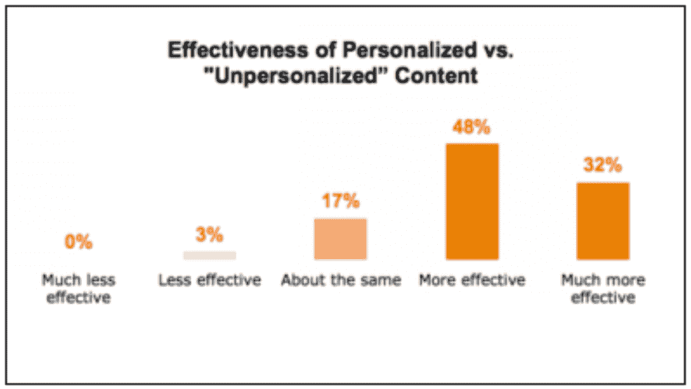

### 实时客户服务

良好的在线体验中，客户的基本需求之一是快速响应和解决他们的问题。人工智能技术可以通过 AI Chatbots（聊天机器人）为客户提供这种无缝体验，这很容易给客户留下他们正在与人类客户服务代表交流的印象。聊天机器人可以轻松回答基本的客户查询、跟踪并履行订单，以及处理简单问题；全程使用熟悉的术语以显得更具“人性化”。例如，“Facebook Messenger”最近已集成到公司官方 `Facebook` 页面的聊天机器人功能中，为其他企业提供增强的实时客户服务。聊天机器人对于减少遇到复杂问题客户的电话等待时间极其有用，并且 24/7 全天可用且不会疲劳。

### 内容创建与优化

人工智能技术在从零构建新网站方面还有很长的路要走，但它已经精了推送通知、网页、销售页面和“感谢”页面等网页内容的创建。这通过公司网站的智能定制化增强了用户体验。人工智能技术可以分析关于个人用户的各种数据点，例如他们的位置、性别、人口统计数据和在线足迹，以显示最合适的内容和优惠。它可以生成针对特定用户的推送通知，并及时提供相关信息。2017 年，“Evergage”进行了“实时个性化调查”，报告称由 AI 驱动的网站个性化使转化率提升了 63%。

目前，AI 驱动的机器可以根据预定义的规则和格式创建内容，如体育比赛回顾、损益表、实时股票分析和其他标准业务报告。例如，一种名为“Rocco”的 AI 驱动营销工具能够生成公司“粉丝”更有可能互动的新社交媒体内容。另一个名为“WordSmith”的 AI 工具在 2016 年生成了 15 亿条内容。像“Narrative Science”和“Automated Insights”这样的公司正在开发可以根据特定信息集创建的文章，这些文章与人类写的无异。然而，人工智能仍然无法创作政治评论或任何需要观点和情感的内容。

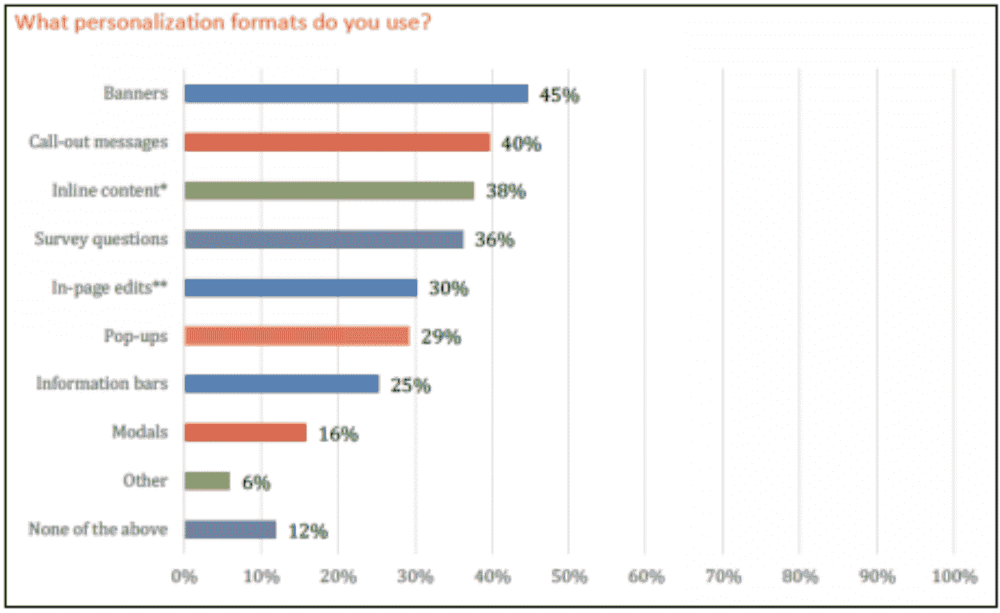

# 第 5 章：数据分析 101

## 大数据

在我们深入数据分析之前，让我们先了解“大数据”的概念，这个概念已经存在多年，甚至在第三次工业革命之前。在 20 世纪 50 年，公司使用基本的分析工具（如手动检查电子表格中的数字）来发现趋势和信息。大多数机构正日益捕捉和收集流入的所有数据，并应用分析从中获得重大价值。大数据是一个用于海量结构化和非结构化数据的聚合术语。今天，企业可以从其数据中收集洞察以支持中期决策。这种更快的工作能力为企业提供了以前没有的竞争优势。

“大数据是高容量、高速度和/或高多样性的信息资产，需要具有成本效益、创新的信息处理形式，以增强洞察、决策和流程自动化。”——Gartner。

企业日益日益分析来自不同数据源的数据，例如网络日志、社交媒体、交易数据、商店自有品牌信用卡数据以及忠诚度计划数据，以收集洞察并获得竞争优势。金融和银行业严重依赖大数据。大多数信用卡公司、私人财富管理顾问、银行、风险投资基金和保险公司都利用大数据提供其服务，提供客户分析、欺诈分析、运营分析和合规性分析。大数据在电信行业也有多个应用，例如通过汇总和分析大量的客户和机器生成的数据来针对新客户并留住现有客户。

## 数据分析 / 大数据分析

“数据分析”或“大数据分析”是指用于检查海量数据并发现隐藏洞察和模式的一系列定量和定性方法。它是通过分析原始数据来收集趋势和指标的科学，这些指标在大量信息中很容易丢失，并使用了已自动化到算法中的分析技术和过程。通过大数据分析并利用它，识别新的增长机会、提高运营效率并做出更明智的业务决策以获得更高的利润和更满的客户。企业从大数据实现价值的方式有：

## 大数据分析的优势

- **降低成本** – 基于云的分析和如 `Hadoop` 等大数据技术能够以极低的成本存储大量数据，从而实现显著的成本节省；作为额外收益，它们还可以帮助识别更高效的业务模式。
- **改进决策** – 组织能够利用 `Hadoop` 提供的高速性以及内存分析技术，结合对新源数据源进行分析的能力，快速地收集和分析数据。结果，组织能够根据所学到的知识做出更好、更快速的决策。
- **新产品和服务** – 大数据分析使企业能够衡量客户需求和满意度，从而赋予他们为客户提供理想的产品和服务的能力。
- **识别瓶颈** – 公司可以记录所有设备和机器的运行时间、停机时间和工作队列，然后分析这些数据以改进工作规划，确保机器运行状态接近峰值容量。

## 大数据分析涉及的步骤

1. 确定数据需求以及如何组织数据。数据可以根据年龄、性别、收入和人口统计特征进行组织。数据值可以按类别划分，并可能是数值型的。
2. 收集数据。可以从各种来源收集数据，如摄像头、环境源、在线源，通过人员和计算机进行收集。
3. 数据组织。可以使用处理统计数据的复杂软件组织数据，也可以在简单的 `Excel` 表格上进行组织。
4. 数据清洗。在分析之前，必须对数据进行清洗和检查，以确保没有错误或重复，并且数据集是完整的。现在数据已准备可以使用许多大数据分析工具之一进行分析。

## 大数据分析的类型

数量、速度和多样性构成了大数据分析三个最重要的属性。我们的数字生活预计到 2020 年底，每人每秒将产生 1.7 Mb 的数据，这将使大数据更加庞大。这增加了通过大数据分析来理解此类海量且不断增长的数据的需求。不同类型的数据分析有：

1. **规范性分析** – 基于规则和建议的分析，可以为组织“开方”选择性的分析路径。这种分析阐明了组织的各个方面，并对数据分析方面需要完成的工作提供了锐重点。它通过增加领域的特定性和简洁性，为任何组织增加了大量价值。
2. **预测性分析** – 进行分析以确保对未来的行动路线进行预测。它确保了大数据领域可以根据现有数据预测组织的未来状态。例如，将分析工具部署到企业的销售部门。它始于线索来源分析，然后分析通信的类型、数量和渠道，并结合机器学习算法进行情感分析，为任何组织提供完美的预测分析方法。
3. **描述性分析** – 对输入数据进行分析，并根据结果生成描述。这种分析主要用于发现可能为组织增加价值的模式。例如，信用风险评估涉及根据客户的信用历史预测其违约的概率。这种评估考虑了多个因素，例如客户可能访问过的过去金融机构的输入、客户的财务状况以及社交媒体平台和在线存在情况。
4. **诊断性分析** – 对过去事件进行分析，以确定该事件发生的原因以及如何防止其再次发生。例如，对特定的社交媒体活动进行访谈，解释帖子提及次数、页面访问量、粉丝数和关注人数、评论以及其他相关指标，以诊断事件为何发生。

## 大数据分析工具

- `Python` – 最多功能的编程语言之一，越来越多地用于机器学习以及其他应用。
- `Hadoop` – 全球范围内迅速部署的最流行的大数据数据框架。
- `Apache Spark` – 一种实时数据分析框架，是 `Hadoop` 生态系统的一部分。
- `SAS` – 一种高级分析工具，用于处理大量数据以获取价值见解。
- `SQL` – 结构化查询语言（`SQL`）是一种可以从关系型数据库管理系统中提取数据的编程语言。
- `Tableau` – 最流行的工智能工具，用于数据可视化和业务分析。
- `Splunk` – 最流行的解析机器生成数据并获取有价值业务见解的工具。
- `R-programming` – 数据科学家用于统计计算和图形应用的最广泛使用的编程语言。

## 各行业用例

大数据分析涉及每项业务，其核心在于快速且敏捷的决策以保持竞争力。可以使用大数据分析的不同类型组织包括：

- **医疗保健** – 患者记录、保险信息、健康计划和其他类型的信息往往较难以管理。通过对这些信息使用大数据分析，可以发现有价值的见解。这使医疗提供者能够更快的速度提供救生命的诊断和治疗方案。通过收集和分析仪器和机器数据，可以跟踪并优化医院使用的设备以及患者流量和治疗。估计，全球医疗保健系统效率提高 1%，就能在全球范围内节省 630 亿美元。
- **旅游业** – 大数据分析可以通过社交媒体和移动数据分析增强客户体验。通过收集对消费者预期和偏好的见解，旅游网站可以通过个性化报价和旅游套餐增加“浏览到购买的转化率”，从而有效提升销量。
- **生命科学** – 临床研究领域是一个资本密集型且极其缓慢的过程，由于各种原因，试验进展缓慢。人工智能和医疗物联网技术通过提供更智能、更自动的解决方案，为提高临床研究每个阶段的速度和效率开启了新视野。
- **金融或银行** – 大数据分析工具为金融机构提供了足够快速的价值见解，以便纳入即时决策过程中。它允许消除重叠和冗余的工具与系统，提供了更高的运营效率和所需信息的即时可用性。
- **制造业** – 制造业每天都在应对困难的问题，从复杂的供应链到劳动力限制和设备故障。制造业大数据分析的出现让具有竞争力的组织发现了新的扩张和节约机会，而这些机会可能在海量信息中被轻易遗漏。

## 零售业

随着精明的消费者变得越来越聪明，他们对零售商准确理解其需求什么以及何时需要的期望也日益增长。大数据分析技术允许零售商通过提供来自购物者购买习惯、客户忠诚计划和购物者订单历史等数据源的有价值的见解，来满足这些需求。凭借这些信息，零售商不仅对客户有了深入的理解，而且能够预测趋势、提高盈利能力、增强购物体验，并为消费者推荐个性化的新产品。

对于 `Amazon`、`Facebook` 和 `Google` 这样的公司来说，大数据分析工具是它们军库中最重要的武器。这些数字化优先的企业将无法生存。`Amazon` 是为消费者提供高度定制化和个性化便利服务的领导者。`Amazon` 已广泛部署了大数据分析，利用所有可用数据来构建和完善客户画像，并根据订单历史等其他因素为他们提供产品推荐。`Google` 拥有的海量数据是不可想象的。得益于 `Google` 搜索引擎上数以亿计的搜索，该公司已发展为世界上数据密集型公司之一。这些海量数据需要大数据分析工具为 `Google` 提供有价值的见解，反过来进一步增强和改善我们的数字生活。`Facebook` 正在考虑使用大数据分析来洞察用户在讨论什么，以便理解他们对哪些产品和服务感兴趣。免费的 `Facebook` 平台通过来自中小企业的数百万个赞助广告获利，因此对公司而言，理解用户的脉搏并确保网站上显示的广告是实时的且定制的以满足每位用户的期望至关重要。

## 数据分析与数据科学

数据科学和数据分析这两个术语经常被混用。然而，这些术语是完全不同的，对不同的业务具有不同的含义。数据科学涵盖了各种科学模型和方法，这些方法可以处理和分析结构化、半结构化和非结构化数据。用于从高度复杂、无组织和原始数据集中意义并获取见解的工具和过程都属于数据科学的范畴。与针对验证假设的数据分析不同，数据科学归结为连接数据点，以识别新的模式和见解，这些模式和见解可以用于未来的未来规划。

数据科学通过对结构化和非结构化数据提供新视角，识别允许业务提高效率、降低成本并发现新市场机会的模式，将业务从“查询”转向“洞察”。数据科学是技术、机器学习算法开发、统计分析和数据推理的多学科融合，为企业提供了解决其最复杂业务问题的增强能力。数据分析属于数据科学的范畴，更多地涉及审查和分析历史数据以将其背景化。与数据科学不同，数据分析的特点是人工智能、预测模型和机器学习算法的使用率较低，它通常使用标准的 `SQL` 查询命令从处理过的结构化数据中收集见解。

# 机器学习

机器学习可以定义为人工智能技术的一个分支，其驱动假设是：机器能够通过识别模式并在几乎或完全没有人工帮助的情况下从数据中学习并做出决策。机器学习科学的诞生基于一种理论，即计算机有潜力在使用模式识别技术的情况下，在不需要编程的情况下对特定任务进行自学习。随着机器机器接触到新数据，独立适应的能力是机器学习的迭代方面。它们可以从先前的计算中学习并自我训练，以生成可信且可重复的决策和结果。

机器学习算法的使用时间比人们想象的要长得多，但其通过自动快速且反复应用高度复杂且复杂的数学计算来分析“大数据”的增强能力是最近才发展的。机器学习允许对海量数据进行分析，并提供更快、更准确的结果。通过适当的训练，这项技术可以允许组织识别盈利机会和业务风险。机器学习与认知技术和人工智能相结合，在处理海量数据时更加有效和准确。

机器学习算法可以分为四类：

### 监督式机器学习算法

这些算法能够使用标记示例将以前运行的教训应用于新数据集，以成功地对未来事件做出预测。例如，可以为机器程序编写标记为“F”（失败）或“S”（成功）的数据点。学习算法将接收带有相应正确输出的输入，并运行其自身实际输出与预期或正确输出的比较，试图识别可以修复的错误，以使模型更高效、准确。通过充分训练，这些算法能够通过回归、分类、预测和特征增强等方法为任何新数据输入提供“目标”。分析从已知的训练数据集开始，然后机器学习算法产生一个“推理函数”，以对输出值进行未来预测。例如，基于监督学习算法的系统足够智能，可以预测和检测处理欺诈信用卡交易的可能性。

### 无监督机器学习算法

这些算法用于缺乏分类和标记的训练数据源的情况。根据 SAS 的说法，“无监督学习算法用于研究系统如何从未标记数据中推断出描述隐藏结构的函数，即：探索数据并识别其中的某些结构。”与监督学习算法类似，这些算法能够探索数据并从数据集中得出推论，但无法确定正确的输出。例如，识别具有相似购物属性的个体，他们可以被划分在一起并针对类似的营销活动进行投放。这些算法被广泛用于识别数据离群值、提供产品推荐并使用奇异值分解、自组织映射和 `k-means` 聚类等技术划分文本主题。

# 机器学习算法

### 半监督机器学习

顾如名，这些算法介于监督学习和无监督学习之间，能够利用有标记数据和未标记数据作为训练源。一个典型的训练集将包含大量的未标记数据和少量的标记数据。运行基于预测、回归和分类等方法的半监督机器学习算法的系统，能够显著提高其学习准确性。在获取的标记数据需要相关且专业的资源才能供机器进行训练或学习的情况下，半监督机器学习算法最为适用。例如，网络摄像头上的个人人脸识别。

### 强化学习

这些算法能够通过产生动作以及发现错误或奖励与其环境进行交互。强化学习的主要特征是试错法和延迟奖励。通过这些算法，机器可以通过自动确定特定语境下的理想行为来使其性能最大化。强化信号只是机器或软件代理所需的奖励反馈，用以学习哪些动作能产生最快且准确的结果。这些算法经常用于机器人领域、游戏和导航。

## 机器学习技术的应用

### 虚拟个人助手


虚拟个人助手最流行的例子是 `Siri` 和 `Alexa`。这些系统能够通过简单的语音命令提供相关信息。机器学习是这些设备和系统的核心，因为它们收集并定义了每次用户交互产生的信息，并将这些信息作为训练数据来学习用户偏好，提供增强的体验。

## 驾驶中的预测

如今大多数车辆都在利用 `GPS` 导航服务，该服务将我们的当前位置和行驶速度等信息收集到中央服务器上，并用于生成当前流量地图。这有助于交通管理和缓解拥堵。通过机器学习，系统可以估计交通拥堵频繁发生的区域和时间。机器学习算法允许 `Lyft` 和 `Uber` 等网约车服务最大限度地减少其路线上的绕路，并为用户提供行程费的预估。

## 视频监控

机器已经接管了监控多个视频摄像头的单调工作，以确保场所的安全。机器可以跟踪异常行为，例如长时间静止不动、在长椅上睡觉以及步履蹒跚。随后它可以向安全人员发送警报，安全人员可以根据线索做出最终行动决策并避免意外。随着报告的每次迭代，机器学习算法不断学习和自我改进，监控服务也得到了提升。

## 社交媒体

诸如“Facebook”、“Twitter”和“Instagram”等社交媒体平台正在使用机器学习算法从用户活动和行为中训练系统，以提供引人入胜且增强的用户体验。机器学习算法驱动的功能示例包括：`Facebook` 上的“可能认识的人”功能（它收集并学习用户活动，例如他们经常访问的资料、自己的资料以及朋友，以推荐其他可以成为朋友的 Facebook 用户）以及 `Pinterest` 上的“相似针”功能（由计算机视觉技术与机器学习协同驱动，识别用户保存的“针”图像中的物体并推荐类似的“针”）。

## 电子邮件垃圾邮件和恶意软件过滤

所有邮件客户端如 `Gmail`、`Yahoo Mail` 和 `Hotmail` 都使用机器学习算法确保垃圾邮件过滤功能持续更新，且不会被垃圾邮件发送者和恶意软件渗透。某些由机器学习驱动的垃圾过滤技术包括`多层感知器`和 `C 4.5` 决策树归。

## 在线客户服务

如今，大多数电子商务网站为用户提供与客户服务代表聊的选项，这些通常由 `Chatbot` 而不是人工执行支持。这些机器人使用机器学习技术来理解用户查询并从网站中提取信息，以解决客户问题。随着每次交互，`Chatbots` 变得更智能、更像人类。

## 搜索引擎结果的优化

诸如“Google”、“Yahoo”和“Bing”等搜索引擎使用机器学习算法提供与用户关键词相关的改进搜索结果。对于每个搜索结果，算法都会观察并从用户活动中学习，例如打开建议链接、打开链接的顺序以及在打开链接上花费的时间。这有助于搜索引擎理解哪些搜索结果更优，以及为了进一步改进搜索结果需要任何修改。

## 产品推荐

产品推荐功能现在已成为在线购物体验的核心灵魂。机器学习算法结合人工智能驱动了产品推荐功能。系统观察并从消费活动和行为中学习，例如过去的购买记录、愿望清单、最近查看的物品以及点赞或加入购物车的物品。

## 在线欺诈检测

金融机构严重依赖机器学习算法和人工智能，通过跟踪在线潜在的欺诈资金交易来确保网络安全。例如，`PayPal` 正在使用机器学习算法防止通过其平台进行洗钱。他们使用一组人工智能工具结合机器学习算法来分析数百万交易，区分买卖双方之间合法与非法的交易。每笔交易，系统都会学习哪些交易是合法的，哪些可能是潜在的欺诈交易。


# 第 6 章：各种编程语言概览

就像人类使用语言相互交流一样，为了让我们能够与计算机交互，我们需要一种计算机编程语言，使能够用计算机可以处理的语言向其提供上下文和指令，从而生成所需的结果。如今市场上上有多种计算机编程语言可用于与计算设备进行“通信”。编程语言中被计算机处理和理解的部分被称为“二进制代码”。将编程语言转换为“二进制”格式的过程被称为“编译”。

建筑工人根据手头的工作选择工具的方式，与软件开发人员选择最符合项目要求的编程语言的方式是相相似的。不同的编程语言具有不同的属性，如函数式、过程式、命令式、声明式和面向对象等。开发任务的需求决定了哪些属性是至关重要的，这使得某些语言比其他语言更适用。以下是一些最流行的编程语言及其用途：

## Python

Python 首次于 1989 年，被誉为一种对业爱好者和初级编码员极其友好且易于学习的编程语言。对于新开始对编程或编码感兴趣并需要理解编程基础的人来说，它是完美的。这是因为 Python 读起来几乎就像英语一样。因此，理解该语言如何运作所需的时间较少，可以将精力放在学习编程基础上。

Python 是一种解释型语言，支持自动内存管理和面向对象编程。这种高度直观且多功能的编程语言可用于编码项目，如机器学习算法、Web 应用程序、数据挖掘与可视化、游戏开发。

## Java

Java 现在归 Oracle 公司拥有，由 Sun Microsystems 公司于 1991 年推出，最初称为一种名为“Oak”的高级内存管理语言，旨在为 `C++` 语言增加功能。它是领先的开发语言和框架，具有通用型、面向对象等特性，使其成为 Web 应用程序开发的理想选择。Java 遵循 WORA（一次编写，随处运行）原理并具有跨平台能力，使其成为企业级移动应用和游戏开发的理想选择。Java Server Pages (`JSP`) 用于开发基于 Web 的应用程序。Java 允许通过浏览器访问应用程序并方便地下载。

Java 字节码由 Java 语言编译并运行在 Java 虚拟机 (`JVM`) 上。这些 JVM 适用于大多数操作系统，如 Windows 和 Mac。使用 Java 开发的一些程序包括 `Eclipse`、`Lotus Notes`、`Minecraft`、`Adobe Creative Suite` 和开源办公软件。Google 的 Android 操作系统和应用开发主要由 Java 驱动。它是一种健壮的解释型语言，具有高应用程序移植性、广泛的网络库和自动内存管理。

## JavaScript

由于名称相似，人们通常认为它与 Java 之间存在联系，但事实并非如此。JavaScript 是由 Netscape 公司于 1995 年开发的，称为“LiveScript”。JavaScript 在计算机而非服务器上处理命令，并运行在客户端浏览器内部。它主要用于 Web 开发，使网页更具动态，并操作各种元素，例如：创建日历功能、打印时间和日期、添加网页滚动功能以及其他无法使用纯 HTML 开发的功能。

名为 `NodeJS` 的 Web 服务器完全在服务器端运行 JavaScript。JavaScript 经常被前端 Web 开发人员和游戏开发者广泛应用于营销、信息技术、工程、医疗保健和金融等多个领域。一个名为 `Cyber-Duck` 的英国机构使用 JavaScript 开发，并利用公共 API 访问有关犯罪的数据，使能够审查并保护当地地区。Pete Smart 和 Robert Hawkes 创建了“Tweet map”，它作为一个根据每个国家生成的“推文”数量比例绘制的世界地图描述。JavaScript 的基本特性被认为相对容易理解和掌握。一个包含多个框架的综合 JavaScript 库 `JQuery` 被开发者广泛用作参考。

## C 语言

C 语言可以定义为一种面向结构（函数被存储为自包含的单元）的中级编程语言，广泛应用于“低级”应用（涉及计算机硬件组件）的开发。1972 年，贝尔实验室开发了 `C` 语言以便在 `UNIX` 系统中实现。许多复杂且先进的语言如 `Java`、`JavaScript`、`C++`、`C#` 和 `Perl` 都源自“祖母级” `C` 语言。在 `Java` 引入之前，`C` 语言一直是行业中最主导的高级语言。一些唯一的操作系统如 `IBM System/370` 也是使用 `C` 语言开发的。在学习难度标准上，`C` 语言的评分较低，主要是因为需要掌握的关键字数量有限（仅 32 个），因此它经常作为编程初学者的基础语言。它经常用于开发需要与 `UNIX`、`Linux` 和 `Windows` 等操作系统集成的软件应用程序。最流行的基于 `C` 语言的应用包括文字处理器、操作系统开发、数据库系统、网络驱动程序和解释器、编译器和汇编器、电子表格和图形软件包。Facebook 的 `TAO` 系统是使用 `C` 语言开发的。

## C++

`C++` 于 1983 年作为 `C` 语言的扩展而开发，`C++` 可以定义为一种面向对象（将函数和相关数据集分组为对象）的“中级”（与计算机编程层交互）编程语言，用于通用软件的开发。它允许使用与 `C` 语言类似的语法进行编码，使得 `C++` 成为“混合语言”的完美典例。`C++` 语言拥有强大的标准库（`STL`）以及快速处理和编译机制，用于开发各种应用套件，如“Microsoft Office”、图形编辑工具、视频编辑器、游戏包甚至整个操作系统。。“黑莓”操作系统和最新的 `Microsoft Office` 套件都是完全基于 `C++` 语言开发的。`C++` 语言被广泛认为是 `C` 语言的增强版，具有面向对象的方法，可以生成高效且精简的代码。它还提供了高层次的抽象，允许改进大型开发项目的管理。`C++` 语言往往是大学水平教授的第一门编程语言。使用 `C++` 的主要公司和组织包括 `Amazon`、`Google`、`Adobe software`、`Mozilla`、`Winamp` 和 `Lockheed Martin`。`C++` 语言专门用于嵌入式固件、客户端服务器应用程序、驱动程序和系统程序的开发。

## C#

2000 年，微软发布了 `C#`（读作 `C-sharp`）作为其 .Net 框架的一部分，该框架是用 `C`、`C++` 和 `Java` 等其他语言作为基础开发的。2003 年，`C#` 成为一种 ISO 认证的多范式编程语言，具有强大的功能，包括高功能性、面向对象、命令式、声明式属性和组件导向。开发者经常使用 `C#` 为 `XML` Web 服务应用程序编写代码，以及连接到 `Windows` 操作系统的 `Microsoft .Net` 。`C#` 语言是 `Microsoft` 应用的首选编程语言，也是 `Windows Presentation Foundation`（`WPF`）的选用语言。随着 `.Net Standard` 和 `.Net Core` 的引入，`.Net` 生态系统演变为跨平台框架和标准，能够在 `Windows`、`Linux` 和 `Mac` 上运行。`C#` 语言非常适合初学者，并具有与 `Java` 相似的能力。它是一种高级编程语言，阅读起来与英语非常相似，易于学习和使用。它仍然没有那么高级且易于学习（注：此处原文可能存在逻辑转折，译文保留原意），与 `Java` 类似。

## PHP

`PHP` 是一种多功能编程语言，用于与数据库交互以创建动态网页。它于 1995 年发布，作为一种可以在 `HTML` 中嵌入的服务器端语言，其官方缩写为“Hypertext Preprocessor”。`PHP` 语言最初由 `Rasmus Lerdorf` 创建，主要用于在主流操作系统上的 Web 服务器。`PHP` 语言已成功应用于如 `WordPress`、`Tumblr`、`Drupal` 和 `Joomla` 等平台。约 80% 的顶级网站使用 `PHP` 语言，`Facebook` 和 `Yahoo` 也是。作为类似于 `Python` 和 `Perl` 类似的服务器端语言，它可以用于开发登录页面、讨论论坛、画廊以及更多内容。

## Ruby

`Ruby` 语言于 2990 年代中期引入，作为一种解释型的、动态的面向对象的语言。它基于 `Lisp`、`Perl` 和 `ADA` 等其他相似语言。用 `Ruby` 语言编写的模型视图控制器服务器端框架被称为 `Ruby on Rails`，现在简单称为 `Rails`。`Ruby` 语言用于 3D 建模、模拟以及管理和跟踪信息。你可能会惊讶地发现 `Amazon`、`Groupon`、`Twitter` 和 `Basecamp` 等平台都是使用 `Ruby on Rails` 开发的。机器人技术、网络、系统管理和安全以及 Web 应用开发也大量使用 `Ruby` 语言。`Ruby` 语言非常直观、灵活且相当容易学习。编程学者和业爱好者可以利用 `Ruby on Rails` 框架从零快速开发 Web 应用。它在初创公司和小型企业中非常流行。

# 机器学习库

机器学习库是用任何给定语言编写的敏感程序和函数。软件开发人员需要强大的函数库来执行复杂任务，而无需重写多行代码。机器学习很大程度上基于数学优化、概率和统计，`Python` 因其持续的开发时间和灵活性成为机器学习领域的首选语言。它非常适合开发可以直接插入到生产系统的复杂模型和生产引擎。它最大的资产之一是丰富的库，这可以帮助开发知识较少的研究人员轻松执行机器学习。机器学习中最常用的库包括：

```
Tensorflow for Deeper Learning
```

## Tensorflow

Tensorflow 可以被定义为一个提供各种免费开源资源的端到端服务的机器学习平台。它有一套多层节点系统，允许使用大型数据集快速构建、训练和部署人工神经网络。它被誉为一种“简单且灵活的架构，能够以快速速度将新想法从概念转化为代码，并达到最先进的模型和发表”。例如，Google 在其图像识别和语音识别工具及技术中使用了 `Tensorflow` 库。

## 用于经典机器学习的 Scikit-learn

`Scikit-learn` 是一个极其流行的机器学习库。它可以支持监督学习和无监督机器学习算法。例如决策树、聚类、线性回归和逻辑回归以及 K-means。`Scikit-learn` 使用了两个基础 Python 库：`NumPy` 和 `SciPy`，并为数据挖掘任务添加了一系列算法，包括分类、回归和聚类。它还能仅用几行代码就实现特征选择、数据转换和集成方法等任务。`Scikit-learn` 在机器学习初学者中非常受欢迎，帮助他们开始实现简单的算法。

# 用于深度学习的 Theano

`Theano` 类似于 `NumPy`，非常适合数值计算。它允许开发者高效地定义、优化和评估需要多维数组的数学表达式。`Theano` 可以结合计算机的 GPU（图形处理器）和 CPU（中央处理器），使数据密集计算的速度提高一百倍。由于这种计算速度的提升，`Theano` 对于深度学习和其他复杂的计算任务极具价值。

## 用于数据提取和准备的 Pandas

`Pandas` 提供了直观且易于使用的高级数据结构。凭借内置的数据聚合、分组和过滤方法，以及时间序列分析的性能，`Pandas` 在机器学习算法开发者社区中广受欢迎。`Pandas` 库中有两种主要结构：一维的“Series”和二维的“Data Frames”（帧）。

# 用于数据可视化的 Matplotlib

`Matplotlib` 是数据科学家用于创建 2D 图表和图形的标准 Python 库。与某些高级库相比，它生成图形和图像需要更复杂的命令。然而，这里的优势在于，通过足够的命令，开发者可以使用 `Matplotlib` 生成各种直方图、散点图、非笛卡尔坐标图以及其他多种图表。它支持所有主要操作系统上的多种图形用户界面（GUI）后端。它甚至可以将这些图形导出为 PDF、JPG、PNG、GIF 和 BMP 等标准图形格式。

## 用于数据可视化的 Seaborn

`Seaborn` 源自 `Matplotlib` 库，是一个极其流行的可视化库。它是一个高级库，可以生成特定类型的图形，包括热力图、时间序列和小提琴图。

# 结论

感谢你读完《人工智能商业应用：如何学习应用人工智能以及使用数据科学进行商业》这本书。本书涵盖了数据分析、商业机器学习和 Python，希望它能为你提供丰富的信息，并为你提供实现目标（无论这些目标为何）所需的所有工具。下一步是充分利用你新学的人工智能技术以及它在跨越广泛各行业的中小型企业中的众多应用。第四次工业革命据称将改变我们所知的世界，如今由人类以有限能力操作的机器，未来将转变为一个科幻电影中的乌托邦世界，在那里，机器可以与人类无二致。通过了解其中的利害关系，以及这一代人肩负的决定未来几代人世界命运的巨大责任，你可以评估并为这段旅程做出自己的贡献。让我们一步一步来，审慎地在自己的公司中使用机器学习和大数据分析等人工智能技术的力量，在不损害人类智能的情况下增强人类能力，并创造新的高薪且有回报的工作。

# 第三本书：商业人工智能与机器学习：通过应用人工智能使用数据科学进行商业的终极指南。涵盖商业大数据和商业数据挖掘

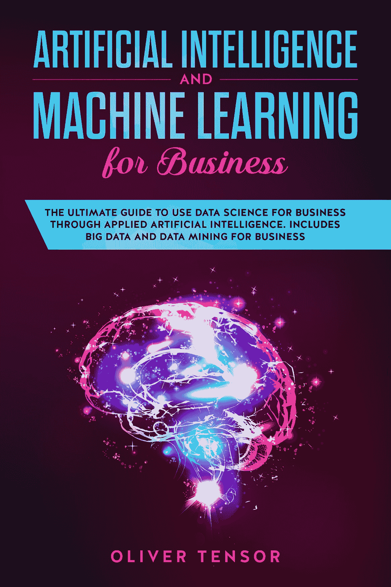

## 引言

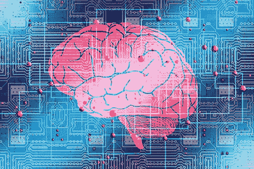

恭喜你下载《商业人工智能与机器学习：通过应用人工智能使用数据科学进行商业的终极指南。涵盖商业大数据和商业数据挖掘》，感谢支持。接下来的章节将讨论各种数据科学技术的基础知识，这些技术可以帮助你将业务推新的高度。数据科学是一个伞术语，用于涵盖今日的尖端技术，如大数据或大数据分析、数据挖掘技术、机器学习，甚至是人工智能技术。本书将为你提供总体的指导，教你如何在业务模型中采用任何或所有这些技术来加速你的增长率。你将从对人工智能技术基础以及即临的第四次工业革命建立牢固理解开始本书。掌握人工智能技术概念并学习研究人员如何突破数据科学的边界以在机器中模拟人类智能是非常重要的。人工智能的力量已经开始在我们环境中和你的日常物品中显现。

在本书的第 2 章“数据科学基础”中，我们不仅将学习数据科学的基础和重要性，还将彻底解决人工智能技术与数据科学之间的区别。你将极其详尽地学习数据科学生命周期，从而充分准备好在你的业务中启动并完成数据科学实施项目。你还将简要了解商业智能与数据科学之间的区别。

在第 3 章“大数据的热潮”中，你将学习关于大数据的切知识，从其历史发展到该领域的现状爆发。书中详细解释了不同的大数据分析方法，以及大数据分析的功能和应用。你还将学习所有关于数据可视化技术以及它与大数据分析的区别。标题为“数据挖掘”的章节将深入探讨数据挖掘过程、使用数据挖掘技术的益处、数据挖掘技术面临的挑战，并学习一些你可以利用来开展业务的数据挖掘工具。第 5 章“机器学习与数据科学”将为你提供对各种机器学习算法的深入理解，并理清机器学习概念与数据科学以及机器学习与大数据分析之间的关系。非常重要的数据科学和机器学习决策树概念适用于跨越工业领域的中小型企业，书中通过真实案例进行了详尽解释，以便于理解。


所有企业都依赖于营销策略和活动的效率与敏锐度来生存。对于电子商务企业而言，这一点变得尤为重要。第 6 章“网络营销”将详细介绍销售漏斗和营销漏斗的概念，以及目前市场上可用的销售漏斗分析工具。书中将详细解释个性化营销和预测性分析的概念，并介绍用于个性化营销的各种人工智能工具。客户分析和探索性数据分析的概念将向你展示如何理解公司收集的所有客户行为数据。最后，我们将简要概述数据科学、大数据分析、机器学习算法和人工智能技术在一些重要工业领域中的应用，包括医疗保健、金融和银行、娱乐、旅游和运输业。本书充满了真实案例，帮助你理解这些概念的细节、名称以及多种工具的描述，你可以进一步探索并选择性将它们实施到你的业务中，从而从这些尖端技术中获益。市场上有许多关于该主题的书，再次感谢你选择本书！我们已尽全力确保其包含尽可能有用的信息。请尽情阅读！

# 第 1 章：人工智能导论

你是否曾好奇过什么是“智能”，以及为什么我们有些人被认为比其他人更聪明？我们如何声称某些人的大脑结构与我们这些“普通人”不同，并最终成为世界的“爱因斯坦”和“牛顿”？不言而喻，人类处于生物进化金字塔的顶端，是进化过程中创造的最优物种。但是，即使是动物所表现出的高度复杂且复杂的行为活动，也从未被归类为智能。我们未能承认蚁群奇人的协调与纪律，或者蜂群所展现的完美无缺的等级制度和自组织能力。

一些研究人员开启了这段旅程，旨在发现动物究竟能有多智能，因此他们对雌性泥胡蜂进行了实验。研究人员在胡蜂将食物存入巢穴之前，操纵了其采集食物的位置。胡蜂天生会检查巢穴是否有入侵者，并在放入内部之前将食物放在入口附近。但当食物被移离入口几英寸处时，胡蜂无法适应这种变化的情况，因此未能将食物放入穴内。这一观点对于确保“学习和适应”是“智能”不可或缺的部分至关重要。

心理学专家将“人类智能”分类为各种心理能力的完美融合，包括从生活经验中学习的能力、适应变化环境的能力、理解抽象概念的能力、逻辑推理、感知、使用语言的能力以及解决问题的能力。人类不仅在动物身上进行实验以检测智能的迹象；我们还在机器上进行实验，以赋予它们类人的智能。这就是“人工智能”概念诞生的地方。

20 世纪中期，先驱的英国计算机科学家艾兰·图灵（Alan Turing）奠定了人工智能技术的基础，他开发出了一种具有扫描器和无限内存的抽象机器，这种机器能够更改和改进自己的程序，意味着具有学习能力。今天，这台机器作为现代计算机开发和增强的基础，广为人知被称为“图灵机”。最终在 1956 年，“人工智能”或`AI`一词被创造，可以定义为：开发机器和计算机的科学，这些机器由人类控制和操作，但能够镜像和体现人类智能以实现一系列目标。

与娱乐业在我们脑海中描绘的画面不同，人工智能远不止活过来的机器人来报复并压制人类。基于人工智能的机器和计算机正在被开发，具有像人类一样思考和行动的表层能力。它们从字面上来说被布线为能够合理化想法并复制人类通常为了实现目标目标而采取的行动。学习、推理和感知能力被认为是人工智能的三大基本目标。研究人员渴望在计算机和机器中模拟的一些核心人类能力包括：

1. **知识** —— 机器需要大量数据来理解和处理世界的原本状态。无缝访问使用数据存储存储和管理的数据对象、类别、属性和关系，对于开发人工智能的知识工程至关重要。

2. **学习** —— 永恒的试错法往往是适用于人工智能技术的最简单的学习形式。你将在题为“机器学习与人工智能”的章节中深入学习机器学习。

3. **解决问题** —— “通过搜索一系列可能的行动以达到预定义的目标或解决方案的系统过程”可以定义为解决问题。一种通用的解决问题方法可以解决不同类型的问题，并经常用于人工智能领域。

4. **推理** —— 根据手头的情况进行推论的能力被称为推理行为。两种广为人知的推理形式是“演绎推理”（假设前提为真，则结论为真）和“归纳推理”（即使前提为真，结论可能可能也可能假）。实施“真推理”是人工智能技术开发和进步中最困难的挑战之一。

5. **感知** —— 感知涉及使用各种感官器官生成物体三维视图的过程，并受周围环境的影响。人工智能感知已经产生了自动驾驶汽车及其收集和交付产品的能力。

## 第四次工业革命

在 18 世纪，“第一次工业革命”改变了世界经济的面貌，使其从依赖农民和农业（基于农业）转变为由工业及其机器化制造过程驱动。“第二次工业革命”以科学应用于大规模生产和制造实践为标志，而“第三次工业革命”或数字革命则通过取代机械和模拟电子技术引入了先进的数字计算机。

现在，我们发现自己正站在“第四次工业革命”的门槛，这将与以往任何一次工业革命都不同。在 21 世纪，先进的计算机技术如`Artificial Intelligence`、`3-D printing`、`Augmented Reality`和`Genome Editing`将引发一系列我们可能尚未设想和社会经济变革。我们现有的价值生产、交换和分配系统注将在第四次工业革命的过程中经历大改造。

我们已经见证了基因编辑领域随着`CRISPR technology`的出现而发生了翻天覆地的变化，该技术成功创建了一种低成本的基因测序和靶向机制。制造业和运输业已经被极具前景的高级自动化技术打破。物理世界似乎正在溶解在`blockchain technology`等“数字世界”技术中，这种技术催生了如`Bitcoin`之类的加密货币，被视为我们所知的银行系统的终结。

当涉及到人工智能技术的应用时，我们的限制仅限于想象力。人类将在未来 50 到 100 年内经历一场深刻的变革。基于这一理解，我们对待这场革命的方式以及我们投入其中的投资将决定并主导我们后代的未来。

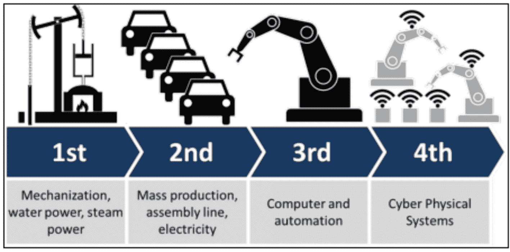

为了领导第四次工业革命的全球社会经济转型，经济的标准规则、规范和激励结构必须被改变，从而彻底革新我们交流、学习和娱乐自己。随着`Internet of Things`（`IoT`）和`Internet of Systems`（`IoS`）等“信息物理系统”的日益采用，社会结构以及我们理解和联系他人以及环境的方式将经历严峻的变化。

这意味着我们的汽车将仅通过互联网就能与冰箱对话并检查状态。不仅是人类身份、社会和社区，甚至政治结构也受到新型、先进和智能技术解决方案的巨大影响。我们发现自己处于一个独特的地位，基于对这些革命性技术的参与，能够对世界留下持久的影响。我们自我意识和认知的机会不能被浪费。人工智能技术处于第四次工业革命的前沿，但绝不是对我们的未来产生持久影响的唯一技术。因此，这里是驱动第四次工业革命的其他一些主要技术的简述。

### 主要技术

- **区块链** —— 它旨在通过去中心化服务器安全地记录和共享数据，为用户社区提供百分之百的控制和透明度，而不是由第三方中间机构，这导致了区块链技术的巨大爆发。区块链技术提供的某些活动功能包括供应链追溯性、敏感医疗数据的安全存储，甚至对抗选民欺诈。大多数数字货币或加密货币如`Bitcoin`、`Riot Blockchain`、`HIVE Blockchain`、`Block One Capital`和`Hash Chain Technology`都归于区块链技术。

- **智能计算** —— 我们对计算机器能够在几秒钟处理海量数据的期望催生了`cloud technology`。通过标准的互联网服务，公司可以随时随地无缝地存储和访问大量数据。

- **增强现实与虚拟现实** —— `Augmented Reality`的概念侧重于通过与数字世界融合重新定义边界并扩展我们的现实。例如，如`Sephora`等家领先的美容化妆品公司已经部署了自己的移动应用程序，让消费者可以在在家中方便地数字尝试妆容。另一方面，`Virtual Reality`技术正如其名所示，试图为用户提供沉浸式的数字体验……在任何电子产品商店都可以购买的 VR 头设备在游戏社区中非常流行。

- **生物技术** —— 随着人体对自然流逝仍然保持脆弱，生物技术领域的重大进展是延长人类寿命的必要要求。细胞和生物分子技术正在发生变革，以开发出突破性的药物和生物材料，不仅能保护人体，还能保护环境。随着全球变暖对环境造成破坏，对清洁高效能源（如生物燃料）的需求至关重要。

- **机器人学** —— 开发具有人类肢体和面部等解剖特征的机器，并将这些机器或机器人用于个人和商业用途的科学被称为机器人学。日本机器人工程在开发日益复杂和“类人”机器人方面取得了成就，这些机器人能够担任酒店和医院的助手。

- **3D 打印** —— 这是每个人都想尝试的热门新技术。制造一种可以轻松定制以满足你所有期望和欲望的三维物体的能力简直是突破性的。

## 物联网（`IoT`）

今天，我们的智能手机已经能够识别汽车在停车场内的位置，甚至可以实现泊车和召唤车辆。这得益于“物联网”技术的应用，该技术允许通过互联网对我们所有的电子设备进行无缝识别和连接。网络营销行业正高度利用这项技术从商场收集消费者数据。他们连接了各种设备，旨在为客户提供定制化和个性化的产品和服务。在农业领域，`IoT` 传感器的使用让农户能够更好地监测土壤属性，并就农场的施肥和灌溉做出明智决策。

随着新型先进技术的进入市场，客户的期望也随之演变。在未来的 10 年里，我们与电子设备及环境交互的方式将发生巨大变化。一个时刻寻找更高性价比的智能消费者的诞生，要求企业必须提供更高的个性化以及高度参与感且增强的用户体验。这是全球公司在获取新客户和留住现有客户方面面临的最大挑战，因为客户的忠诚度仅取决于最优的用户体验。因此，企业正处于竞争，通过为客户提供区别于竞争对手的独特体验来赢得竞争优势。

当公司忙于利用先进技术维持和扩大业务时，智能客户也日益意识到这些技术对我们的安全和隐私带来的负面影响。这在许多数据泄露事件中显而易见，这些事件影响了从“Target”这样的零售店到“Equifax”这样的信誉局的全球顶级公司。客户担心个人数据被非法存储、窃取，并被用来在社交和财务上造成伤害。这种恐惧使得公司必须通过实施先进的数据安全软件和协议，向客户证明维护客户的个人数据安全和隐私是他们的首要任务。对于人工智能技术的发展来说，这一点尤为重要，因为该技术高度依赖于客户产生的海量数据。

> “网络犯罪分子发现地方政府机构是网络攻击的首要目标。亚特兰大市就是最近的例子，勒索软件导致该市损失了数百万美元，并中断了关键服务并删除了多年的敏感数据。这一事件表明，如果没有数据，我们的社区将无法以今天公民所接受的方式运作。无论社区或机构规模大小，数据保护都必须是重中之重。”
>
> —— SecurityFirst 首席执行官兼总裁 Jim Varner。

一些经济学家，如“埃里克·布恩尔夫森”（Erik Brynjolfsson）和“安德鲁·麦阿菲”（Andrew McAfee）建议，“第四次工业革命”可能会通过破坏全球劳动力市场并重新定义机器在目前由人类执行的工作中的角色，从而导致更大的经济差距。一方面，自动化可能导致许多低技术工作机会的消失，并增加公司资金回报与劳动力回报之间的差异。另一方面，技术对劳动力的取代可能会导致高回报、低风险职位的净增加。随着世界经济的增长，一些国家变得越来越富有，而许多国家仍在为满足基本需求而挣扎，这预示着全球性的经济差距，而这种差距很容易被第四次工业革命所放大。为了更好地理解并对我们的技术进步做出明智决策，深入理解人工智能、机器学习、大数据、数据分析和数据科学等尖技术是至关重要的。

# 第 2 章：数据科学基础

在技术领域，数据被定义为“由计算机处理和存储的信息”。我们的数字世界已经用数据充斥了现实。从点击网站，到智能手机每天每秒都在追踪和记录我们的位置，我们的世界正淹没在数据之中。从这些海量数据的深度中，可以提取出我们尚未遇到的问题的解决方案。这种利用数学方程和统计学从可测量的数据集中收集见解的过程可以被定义为“数据科学”。

数据科学家的角色往往是多才的，经常与计算机科学家和统计学家混淆。本质上，任何（无论是人还是公司）只要愿意深入挖掘海量数据以收集信息，都可以被称为数据科学从业者。例如，像“沃尔玛”（Walmart）这样的公司跟踪并记录客户在店内和在线的购买情况，以对产品和服务提供个性化建议。像“Facebook”那类允许用户列出当前位置的社交媒体平台，能够通过分析用户自己提供的丰富数据来识别全球迁移模式。

“数据科学”一词最早的记录可以追溯到 1960 年，归于“彼得·纳尔”（Peter Naur），据报道他将数据科学作为计算机科学的替代，并最终引入了“数据学”（datalogy）。1974 年，纳尔出版了一本名为《计算机方法简明调查》的书，在书中大量使用了数据科学一词。1992 年，数据科学的现代定义在“第二次日法统计研讨会”上提出，承认了一个主要关注数据类型、维度和结构的新学科的出现。

> “数据科学不断演进，成为优秀专业人士极具前景且需求量最大的职业路径之一。今天，成功的数据专业人员明白，他们必须超越分析海量数据、数据挖掘和编程技能等传统技能。为了为组织发现有用的智能，数据科学家必须掌握数据科学生命周期的全貌，并具备足够的灵活性和理解力，以在流程的每个阶段实现收益最大化。”
>
> —— 加州大学伯伯克利分校

业务高管对数据科学日益增长的兴趣显著推动了近期“数据科学”这一术语的兴起。然而，大量的记者和学术专家并不认为数据科学是一个完全独立于统计学之外的研究领域。同一社区内的另一群人则认为数据科学是“数据挖掘”和“大数据”的流行术语。数据科学的定义在技术社区内部存在争议。这一研究领域需要组合技能，包括计算机编程技能、领域知识以及对统计和数学算法的精通，以便从海量原始数据中提取有价值的见解，被称为数据科学。

## 数据科学生命周期

最推荐的结构化数据科学项目生命周期是“团队数据科学流程”（TDSP）。该过程被广泛用于需要部署基于人工智能和/或机器学习算法的项目。它也可以定制并用于执行“探索性数据科学”项目以及“即时分析”项目。TDSP 生命周期被设计为一种敏捷且顺序的的迭代步骤，为使用预测模型所需的任务提供指导。这些预测模型需要部署在公司的生产环境中，以便用于基于人工智能的应用程序开发。该数据科学生命周期的目标是朝着定义的业务终点，高速交付并完成数据科学项目。任何数据科学项目的无缝执行都要求团队内部以及利益相关者之间进行有效的任务沟通。“团队数据科学流程”的核心组成部分是：

### 数据科学生命周期的定义

TDSP 生命周期的五个主要阶段概述了从开始到结束执行项目所需的交互步骤，分别是：“业务理解”、“理解中的数据获取”、“建模”、“部署”和“客户验收”。请继续向下阅读，关于此内容的详细信息将很快给出！

### 标准化项目结构

为了让团队成员能够无缝且方便地访问项目文档，以便快速检索信息，使用模板和共享目录结构将大有益处。所有项目文档和项目代码都存储在“版本控制系统”中，如`TFS`、`Git`或`Subversion`，以改进团队协作。业务需求以及相关的任务和功能存储在如`JIRA`、`Rally`和`Azure DevOps`等敏捷项目跟踪系统中，以便增强对每个单一功能代码的跟踪。这些工具还有助于估计整个项目生命周期中涉及的资源和成本。为了确保每个项目的有效管理、信息安全和团队协作，TDSP 允许在版本控制系统上为每个项目创建独立的存储空间。在组织内所有项目中采用标准化结构，有助于建立跨机构的机构知识库。TDSP 生命周期为所有所需文档提供了标准模板，并在中心位置提供了文件夹结构。包含用于数据探和和功能提取的编程代码的文件可以使用提供的文件夹结构进行组织，该结构还存储了与模型迭代相关的记录。这些模板允许团队成员轻松理解他人已完成的工作，并方便新团队成员无缝加入给定项目。Markdown 格式支持易于访问，并方便于对文档模板进行编辑或更新。为了确保项目目标和目的得到充分定义，并确保交付物的预期质量，这些模板为每个项目提供了带有重要问题的各种清单。例如，“项目章程”可用于记录项目范围和项目正在解决的业务问题；标准化数据报告则用于记录数据的“结构和统计信息”。

### 数据科学项目的基础设施和资源

为了有效存储基础设施和管理共享分析，TDSP 建议使用工具如：“机器学习服务”、数据库、“大数据集群”和云系统来存储数据集。托管原始以及处理过或清洗的数据集的分析和存储基础设施可以是云端的也可以是本地的。数据分析和存储基础设施允许分析的可重复性，并防止数据的重复和冗余，这些可能会导致不一致和不必要的基础设施成本。提供的工具可以为共享资源授予特定权限并跟踪其活动，从而允许团队每个成员安全地访问资源。

### 项目执行的工具和实用程序

在大多数组织中，对现有流程引入任何更改往往面临挑战。为了鼓励并提高采用这些更改的一致性，可以实施 TDSP 提供的几种工具。数据科学生命周期中的一些基础任务，包括“数据探索”和“基线建模”，可以使用 TDSP 提供的工具轻松自动化。为了能够无忧地贡献到团队的“共享代码库”，TDSP 提供了一个定义良好的结构。这允许组织内的其他项目团队重用和改造这些共享工具和实用程序，从而节省成本。TDSP 生命周期作为一个标准模板，拥有一套定义良好的产物集，可用于获得跨领域的团队协作和沟通。该生命周期包含了来自“微软”的一系列最佳实践和结构，有助于成功交付预测分析解决方案和智能应用程序。

让我们查看 TDSP 生命周期五个阶段的每个阶段细节，即：“业务理解”、“理解中的数据获取”、“建模”、“部署”和“客户验收”。

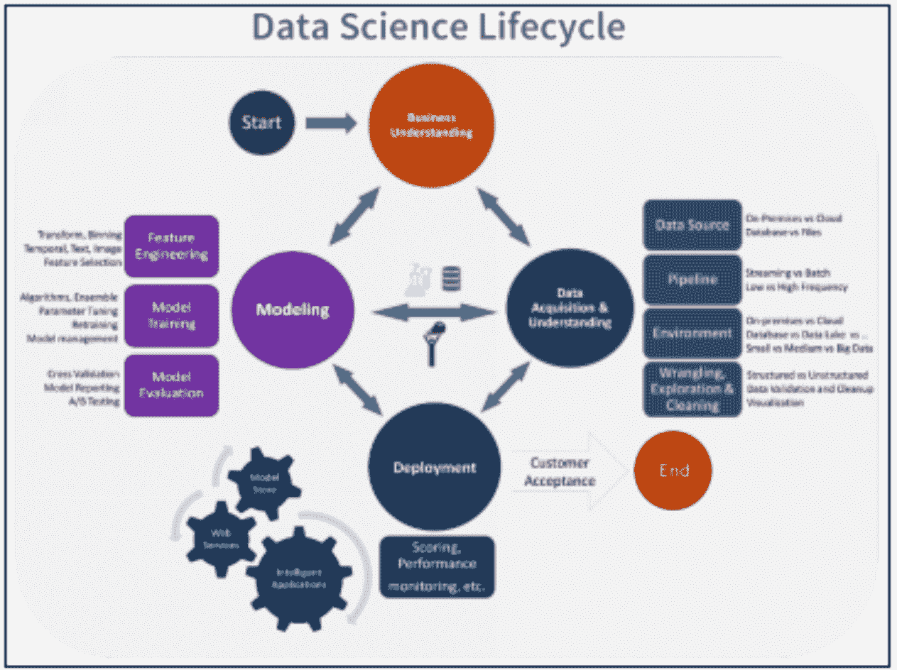

## 第一阶段 —— 业务理解

该阶段的目标是收集并深入分析将作为模型目标的关键变量，与这些变量相关的指标最终将决定项目的整体成功。该阶段的另一个重要目标是识别公司已经拥有或可能需要采购的数据源。在此阶段，需要完成的两个主要任务是：“定义对象和识别数据源”。

### 定义目标

所有项目都必须从识别分析工具需要预测的关键业务变量开始。这些变量被称为“模型目标”，与这些模型目标相关的指标（如`sales forecast`和`prediction of fraudulent orders`）被用作衡量项目的标准。为了定义项目目标和目的，必须与利益相关者和最终用户合作，并提出可能非常具体甚至模糊的相关问题。为了回答这些问题，数据科学方法采用了名称和数字。主要用于数据科学或机器学习的五类问题涉及：`regression`（多少量或多少个？）、`classification`（哪些类别？）、`clustering`（哪几组？）、`anomaly detection`（这是否不寻常吗？）、`recommendation`（应该采取哪个选项？）。为你的项目确定正确的问题并理解这些问题的答案将如何帮助你实现业务或项目目标至关重要。


项目团队中每个成员的角色和职责的规范与对齐对于项目的成功至关重要。这可以通过一个包含重大里程碑的高级项目计划来实现，该计划可以根据项目进展根据需要进行修改。项目此阶段应达成的另一个重要定义是所有的关键性能指标（KPI）和指标。例如，一个预测客户流失率的项目要求在项目完成时达到“ABC”百分的准确率，这可以帮助你理解必须满足的达成项目成功标准的要求。因此，为了达到“ABC”百分的准确率，公司可能会开展优惠活动和促销。开发指标时使用的全行业标准被称为“SMART”，代表“特定的（Specific）、可衡量的（Measurable）、可实现的（Achievable）、相关的（Relevant）、有时限的（Time-bound）”。

## 数据源识别

必须识别并考虑可能包含定义阶段提出的五类问题答案之“已知示例”的数据源。你必须寻找与所提问题直接相关的数据，并评估你是否拥有可衡量的目标以及与这些目标相关的特征。作为模型目标及其特征的准确衡量的数据对于确定项目的成功至关重要。例如，你可能会遇到一种情况：现有系统无法收集和记录完成项目目标所需的数据类型。这应该立即通知你你需要开始寻找外部数据源或运行系统更新，以便现有系统能够收集额外类型的数据。

## 本阶段创建的交付物

- **章程文档 (Charter document)** – 这是一个“活动文档”，需要根据项目过程中新发现和不断变化的业务需求在整个项目期间进行更新。TDSP“项目结构定义”提供了一个标准模板。重要的是，在整个项目过程中通过添加更多细节来构建此文档，同时及时向利益相关者更新所有更改。
- **数据源 (Data sources)** – 在 TDSP“项目数据报告文件夹”中，可以在“数据定义报告”的“原始数据源”部分找到数据源。“原始数据源”部分还规定了原始数据的初始和最终位置，并提供了额外的细节，如将数据移动到任何所需环境的`coding scripts`。
- **数据字典 (Data dictionaries)** – 利益相关者提供的数据特性和特征描述（如“数据架构图”和可用的“实体关系图”）记录在数据字典中。

## 第二阶段 – 数据获取与理解

此阶段的目标是产生高质量的经过处理的数据集，定义其与模型目标之间的关系以及数据集在所需分析环境中的位置。在此阶段，还必须开发数据流水线的“解决方案架构”，这将允许对数据进行定期更新和评分。在此阶段必须完成的三项主要任务是：“数据摄取、数据探索和数据流水线建立”。

### 数据摄取

在此阶段应建立数据从源位置传输到目标位置的过程。目标位置由允许你执行训练和预测等分析活动的环境决定。

### 数据探索

在使用训练数据模型之前，必须对数据集进行清洗以消除差异和错误。为了检查数据质量以及建模前处理数据所需的汇总信息，应使用数据摘要和可视化等工具。由于此过程会重复多次，可以使用 TDSP 提供的名为`IDEAR`的自动化工具进行数据可视化和创建数据摘要报告。随着处理后的数据达到满意的质量，就可以观察内在的数据模式。这反过来有助于为目标选择和开发适当的“预测模型”。现在你必须评估是否有足够的数据来启动建模过程，该过程具有迭代性质，并可能需要你识别新的数据源以获得更高的相关性和准确性。

### 数据流水线

为了补充数据建模的迭代过程，必须通过建立“数据流水线或工作流”来建立对新数据进行评分和刷新现有数据集的标准流程。在该阶段结束之前，必须开发数据流水线的解决方案架构。根据业务需求和现有系统的限制，可以使用三类型的流水线：“批处理的”、“实时或流式”和“混合式”。

## 本阶段创建的交付物

- **数据质量报告 (Data quality report)** – 该报告必须包含“数据摘要”、业务需求与其属性之间的关系以及变量排名等其他细节。TDSP 提供的`IDEAR`工具能够对关系型表、CSV 文件或任何其他表格数据集生成数据质量报告。
- **解决方案架构 (Solution architecture)** – 在模型构建后，用于对新数据进行评分并生成预测的数据流水线的描述或图表可被称为“解决方案架构”。该图表还可以提供根据新数据`retrain`模型所需流水线。
- **检查点决策 (Checkpoint decision)** – 在实际模型构建过程之前，必须重新评估项目，以确定通过开展项目是否可以获得预期价值。这些被称为“通过或否（Go or No-Go）”决策。

# 第三阶段 – 建模

此阶段的目标是为机器学习模型找到“最优数据特征”，这些特征包含足够的信息以准确预测目标变量，并能够部署在生产环境中。此阶段必须完成的三个主要任务是：“特征工程、模型训练以及模型对生产环境的适用性确定”。

## 特征工程

必须通过“包含、聚合和转换”的过程从原始数据变量中创建数据特征。为了理解模型的运行机制，必须对这些数据特征之间的关系，以及它们与将使用这些特征的机器学习算法之间的关系有清晰的理解。从数据探索阶段收集的见解可以与领域知识相结合，进行创造性的特征工程。在确定并包含信息丰富的变量的同时，确保数据集中不包含大量无关的变量，这种精细的操作被称为特征工程。过多的无关变量会给数据模型引入噪声，因此必须尝试添加尽可能多的信息变量以获得更好的结果。此外，还为评分过程中收集的任何新数据生成特征。

## 模型训练

如今市场上提供了多种建模算法。必须选择符合项目标准的算法。“模型训练”过程可以分为四个步骤：

1. 通过适当划分输入数据，创建“训练数据集”和“测试数据集”。
2. 使用“训练数据集”开发模型。
3. 通过采用各种机器学习算法以及相关的“调优参数”，对训练数据集和测试数据集进行评估，这些参数旨在帮助回答现有数据集中之前讨论的五类问题。
4. 通过关键性能指标和指标比较所有可用方法，评估出解决业务问题的最佳拟合方案。

TDSP 提供了一个“自动化建模和报告工具”，该工具能够运行多种算法和“参数扫描”，以开发出“基准模型”以及“基准建模报告”，该报告可以作为每个“模型和参数组合”的性能总结。

## 此阶段要创建的交付物

- **特征集** – 包含“数据定义报告特征集章节”中描述的所有特征的文档。程序员大量使用该文档提供的描述来编写所需代码并开发特征。
- **模型报告** – 此文档必须根据标准模板报告包含每个评估过的模型的细节。
- **检查点决策** – 必须根据不同模型的性能，对将模型部署到生产环境做出决策。

# 第四阶段 – 部署

此阶段的目标是将解决方案模型发布到较低的类生产环境（如预生产环境和用户验收测试环境），最终将模型部署到生产环境中。此阶段要完成的主要任务是“模型的操作化”。

## 模型操作化

一旦获得了一组具有预期性能水平的模型，就可以对这些模型进行操作化，供其他应用程序使用。根据业务需求，可以实时或分批进行预测。为了部署模型，必须将其与开放的“应用程序编程接口”（`API`）集成，以便根据需要允许模型与其他应用程序及其组件进行交互。

## 此阶段要创建的交付物

- 使用关键性能指标和指标评估系统健康的仪表板报告。
- 包含最终模型部署计划细节的文档或运行手册（run book）。
- 包含最终模型解决方案架构的文档。

# 第五阶段 – 客户验收

此阶段的目标是确保项目的最终解决方案符合利益者的预期，并满足在数据科学生命周期第一阶段收集的业务需求。此阶段必须完成的两个主要任务是：“系统验证和项目交接”。

## 系统验证

部署在生产环境中的最终解决方案必须根据业务需求和数据管道进行评估，以确保满足利益者的需求。利益者必须验证系统是否满足其业务需求，并解决了启动项目的问题。所有文档必须在此阶段结束前经过彻底审查并定稿。

## 项目交接

在此阶段，项目必须从开发团队转移给生产后和维护团队。例如，IT 支持团队或利益者团队的成员将为生产环境中的解决方案提供日常支持。

## 此阶段要创建的交付物

在此阶段创建的最重要的文档是面向利益者的，称为“退出报告”。该文档包含了项目中对于理解系统运行具有意义的所有可用细节。TDSP 提供了一个标准的“退出报告”模板，可以很容易地定制以满足特定的利益者需求。

# 数据科学的重要性

现在你已经了解了数据科学是如何工作的，让我们来看看为什么你需要了解关于数据科学的所有知识！

- 在过去的 20 年里，数据趋势发生了巨大变化，预示着非结构化数据的不断增长。估计到 2020 年，“我们收集的数据中将有超过 80% 的数据是非结构化的”。传统上，我们获取的数据主要是结构化的，可以使用简单的业务智能工具轻松进行分析，但如下所示所示，非结构化和半结构化数据正在上升。这反过来促使人们开发和使用比现有业务智能工具更强大、更先进的分析工具，后者无法处理如此大量且多样化的数据。显然，我们需要更复杂的分析工具和算法，能够处理和分析非结构化及半结构化数据以提供价值贵的见解。

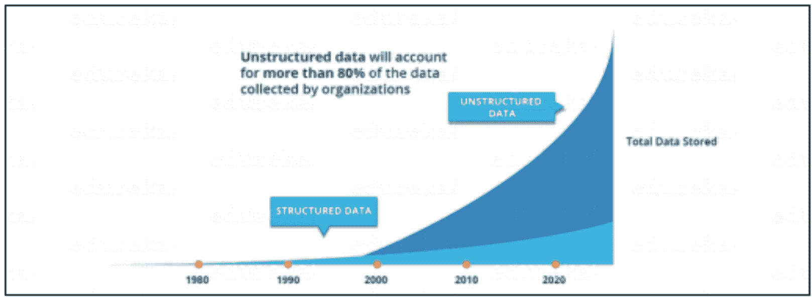

- 公司总是试图更好地理解客户的需求。现在可以通过从现有来源（如客户订单历史、最近查看的物品、性别、年龄和人口统计）收集数据，并在数据上应用先进的分析工具和算法来获取价值见解。通过使用机器学习算法，系统可以为单个客户生成更准确的产品推荐。聪明的消费者总是在寻找最具吸引力和增强的用户体验，因此公司可以使用这些分析工具和算法来获得竞争优势并扩大业务。
- 数据科学使得使用先进的机器学习算法成为可能，这在多个工业领域具有广泛的适用性。例如，自动驾驶汽车的开发，它们能够利用先进的摄像头和传感器收集实时数据以创建周围环境地图，并对车辆速度和其他驾驶操作做出决策。

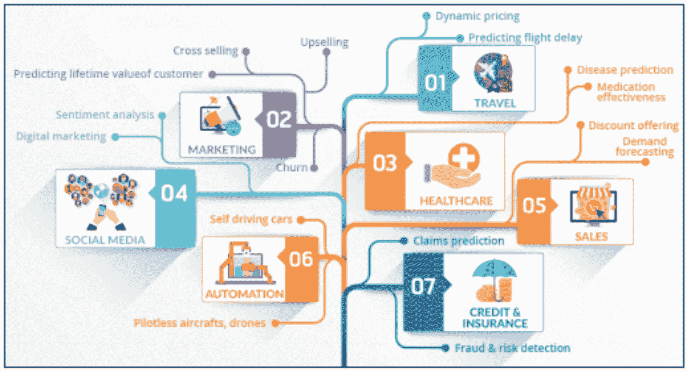

- 数据科学被广泛应用于预测分析。例如，天气预报需要从卫星、雷达和飞机等多种来源收集并分析数据，以构建数据模型，这些模型甚至能够预测飓风、龙卷风和闪洪等自然灾害的发生。
- 数据科学的另一个“分支”是大数据大数据分析，组织利用它们解决复杂的技术问题以及进行资源管理。你将在本书后续部分学习更多关于大知识。
- 数据科学分析医疗、旅游、金融、零售和电子商务等任何及所有行业所面临挑战的能力，使其在企业高管层中变得越来越受欢迎。

## 数据类型

现在你已经理解了数据科学的重要性，让我们来看看不同类型的数据，以便根据需要处理的数据类型选择最合适的分析工具和算法。数据类型在宏观上可以分为两类：定性与定量。

### 定性数据

定性数据——任何无法测量、只能通过对对象添加定性特征进行主观观察的数据都称为“定性数据”。使用不可测的特征对对象进行分类就会产生定性数据。例如，颜色、气味、质地和味道等属性。

定性数据有三种：

1. **二元或二项数据**：指示互斥事件的数据值，其中两个类别或选项中只有一个是正确且有效的。例如，真或假、是或否、正或负。考虑一盒混合茶包，你尝试了所有不同的口味，并将你喜欢的归类为“好”，将不喜欢的归类为“坏”。在这种情况下，“好或坏”被归类为二项数据类型。这类数据被广泛用于预测分析的统计模型开发。
2. **名义或无序数据**：缺乏“隐含或自然价值”的数据特征可以称为名义数据。考虑一盒 M&Ms 巧克力豆，你可以在工作表中记录盒中每颗 M&Ms 巧克力豆的颜色，这将作为名义数据。此类数据被广泛用于通过“卡方分析”等技术来评估数据集中的统计差异，该技术可以告诉你一盒中不同颜色 M&Ms 巧克力豆数量之间是否存在“统计学上的显著差异”。
3. **有序或序数数据**：这种数据类型的特征具有特定的“隐含或自然价值”，例如小、中、大。例如，在“Yelp”、“Amazon”和“Trip Advisor”等网站上的在线评论具有 1 到 5 的评分量级，这意味着 5 星优于 4 星，4 星优于 3 星，依此类推。

### 定量数据

定量数据——数据中任何可以客观测量的特征都称为“定量数据”。使用可测特征对对象进行分类并赋予其数值就会产生定量数据。例如，产品价格、温度、长度等尺寸等。

定量数据有两种：

1. **连续数据**：可以进一步定义到更低级别的数据值，例如公里、米、厘米等测量单位，被称为连续数据类型。例如，你可以根据重量购买 500 克或 8 盎司的杏仁。这属于连续数据类型，主要用于测试和验证各种假设，例如评估杏仁袋上打印重量的准确性。
2. **离散数据**：不能划分且还原到更高精度的数值数据值，例如一个人拥有的汽车数量，只能以不可分割的数字计数（你不能拥有 1.5 辆或 2.3 辆汽车），被称为离散数据。例如，你可以根据包装内冰淇棒的数量（如四根或六根）购买另一袋冰淇淋。这属于离散数据类型，可以与连续数据结合进行回归分析，以验证冰淇淋盒的总重量（连续数据）是否与内部冰淇淋棒的数量（离散数据）相关。

## 商业智能 vs 数据科学

如你现在所学到的，数据科学是一种跨学科的方法，应用数学算法和统计工具从原始数据中提取有价值的见解。另一方面，商业智能（BI）是指应用分析工具和技术来更深入地理解公司的现状，并将其与历史表现相结合。简单来说，BI 通过分析公司的当前和历史数据为公司提供智能，而数据科学要强大得多，能够分析海量的原始数据以做出未来预测。

从各种输入源涌入的海量定性和定量数据，使得企业必须依赖数据科学，以理解这些数据并利用其来维护和扩展业务。数据科学作为终极决策工具的出现，表明了企业在许多商业智能任务中对数据的依赖性日益增加，而这些任务可能可以通过使用数据科学驱动的工具和技术来实现自动化。利用互联网从世界任何地方获取洞察的能力，将进一步推动普通业务用户对“集中式数据存储库”的使用。

商业智能传统上被用于“描述性分析”，并为企业提供回顾性的智慧。另一方面，数据科学则更具未来感，被用于“预测性和启发性分析”。当数据科学试图回答诸如“事件为什么发生？未来还会再次发生吗？”之的问题时，商业智能则侧重于“事件发生了什么？可以改变什么来修复它？”等问题。正是这两个领域所解决的“W（要素）”问题之间的这种根本区别，使得它们与众不同。

商业智能的领域曾一度由具有计算机科学知识的技术用户主导。然而，数据科学通过允许非技术人员和核心业务用户进行分析和 BI 活动，正在重塑商业智能领域。一旦数据被数据科学家运营化，这些工具对于主流业务领域来说就易于使用，并且可以支持团队轻松维护，而不需要任何数据科学专业知识。商业智能专家日益与数据科学家紧密合作，为企业开发最佳的数据模型和解决方案。

商业智能主要用于创建数据报告（主要是关键性能指标和指标仪表板），并为数据管理策略提供支持信息；而数据科学则使用高级工具和统计学来创建预测和预测，并为数据治理提供补充信息。数据科学与商业智能之间的关键区别在于“内置机器学习库”的范围和规模，它们赋予了普通业务用户执行半自动化或自动化分析活动的能力。可以将数据科学想象为“加强版的商业智能”，它将把业务分析世界变为民主化！

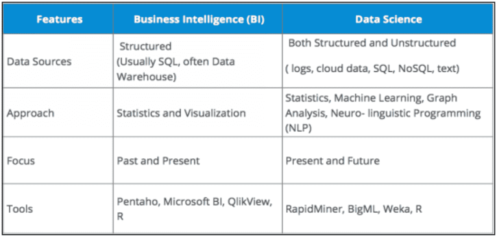

## 网络安全中的数据科学

利用机器学习算法分析和密切检查数据趋势与模式的能力，导致数据科学在网络安全领域的广泛应用。通过使用数据科学，公司不仅能够识别发起网络攻击特定终端，还能预测系统未来可能遭受的攻击，并采取必要措施防止攻击发生。

使用能够监控任何所选网络上的用户和设备并标记任何异常活动的“主动入侵检测系统”，是对抗黑客和网络攻击者的强大武器。而那些能够在历史数据上使用机器学习算法来检测潜在安全威胁的“预测性入侵检测系统”，则是对抗网络掠食者的强有力盾牌。

网络攻击可能导致无价数据和信息的丢失，从而对组织造成巨大损害。为了安全和保护数据集，可以使用复杂的加密和复杂的签名来防止未经授权的访问。数据科学可以帮助开发此类不可破解的协议和算法。通过分析针对不同行业公司的过往网络攻击趋势和模式，数据科学可以帮助检测被最频繁攻击的数据集，甚至预测未来的潜在网络攻击。

公司高度依赖客户生成并授权的数据，但在网络攻击日益增加背景下，客户对个人信息泄露极其担忧，并正转向那些通过实施先进数据安全工具和技术来确保其数据安全和隐私的公司。这正是数据科学成为公司救星之处，帮助他们增强网络安全措施。

## 数据科学策略

数据科学主要通过使用“预测性因分析”、“启发性分析”和机器学习进行精确预测，应用于决策制定。

### 预测性因分析

“预测性因分析”可以用于开发模型，该模型能够准确预测和估计未来发生特定事件的概率。例如，金融机构使用基于预测性因分析的工具来评估客户信用卡还款违约的概率，通过生成模型来分析客户在所有借贷机构的还款历史。

### 启发性分析

“启发性分析”广泛应用于“智能工具和应用程序”的开发，这些工具能够根据动态参数进行修改和学习，并做出自己的“决策”。工具不仅能预测未来事件的发生，还能对各种行动及其结果提供建议。例如，自动驾驶汽车在每次驾驶体验中收集与驾驶相关的数据，并利用其训练自己，以做出更好的驾驶和操控决策。

### 使用机器学习进行预测

为了开发能够根据公司获取的交易数据确定未来趋势的模型，机器学习算法是必不可少的。这被认为是“监督机器学习”，我们将在书后面详细阐述。例如，欺诈检测系统对涉及欺诈购买的历史数据使用机器学习算法，以检测交易是否为欺诈。

### 使用机器学习进行模式发现

为了开发能够识别隐藏数据模式但缺乏进行未来预测所需参数的模型，需要采用“无监督机器学习算法”，例如“聚类”。例如，电信公司经常使用“聚类”技术，通过识别目标区域具有最佳信号强度的网络塔位置来扩展其网络。

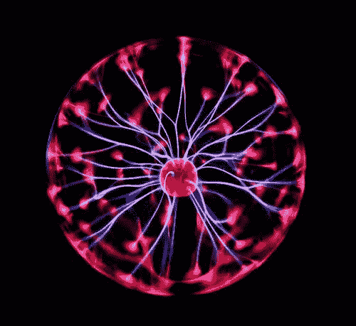

# 第 3 章：大数据的爆发

2001 年，`Gartner` 将大数据定义为“包含更多多样性、数据量不断增长且速度不断加快的数据”。这导致了“三个 V”概念的形成。大数据指的是海量的、结构化和非结构化数据，这些数据源自无尽的数据源并源源不断地涌入。这些数据集的规模太大，无法用传统的分析工具和技术进行分析，但其内部隐藏着大量有价值的洞察。

## 大数据的“V”

### 体量 (Volume)

要被分类为大数据，给定数据集的数据必须远大于传统数据集。这些数据集主要由非结构化数据组成，结构化和半结构化数据有限。非结构化数据或价值未知的数据可以从网页、搜索历史、移动应用程序和社交媒体平台等输入源中收集。公司的规模和客户群数量通常与公司获取的数据量成正比。

### 速度 (Velocity)

数据收集和采取行动的速度是大数据的“V”之一。公司越来越多地使用本地服务器和云服务器的组合来提高数据收集速度。现代的“智能产品和设备”需要实时访问消费者数据，以便能够提供更具参与感且增强的用户体验。

### 多样性 (Variety)

传统上，数据集包含大部分结构化数据，非结构化和半结构化数据较少，但大数据的出现引发了新的非结构化数据类型，如视频、文本、音频，这需要复杂的工具和技术对这些数据类型进行清洗和处理，以从中提取有意义的洞察。


### 真实性（Veracity）

大数据分析必须考虑的另一个“V”是真实性。这指的是数据的“可靠性或质量”。例如，“Facebook”和“Twitter”这样的社交媒体平台，其带有标签、缩写和各种拼写错误的博客和帖子会显著降低数据集的可靠性和准确性。

### 价值（Value）

数据已经演变成一种具有内在价值的货币。就像传统的货币一样，大数据的最终价值与其从中收集的洞察直接正比。

## 大数据的历史

海量数据的起源可以追溯到 20 世纪 60 年代和 70 年代，当时第三次工业革命刚刚开始，关系型数据库的发展也随着数据中心的建设而开始。但大数据概念之所以最近成为舞台中心，主要是由于`Google`和`Yahoo`等免费搜索引擎、`YouTube`等免费在线娱乐服务以及`Facebook`等社交媒体平台的出现。

2005 年，企业开始意识到通过这些平台和服务生成了惊人的用户数据量，同年，一种名为`Hadoop`的开源框架被开发出来，用于收集和分析公司可用的这些大型数据转储。在此期间，一种名为`NoSQL`的非关系或分布式数据库由于其存储和提取非结构化数据的能力而开始流行。`Hadoop`使得公司能够以非常容易且廉价的成本处理大数据。

今天，随着尖端技术的崛起，不仅是人类，机器也在产生数据。诸如“物联网”（`IoT`）和“系统网”（`IoS`）等智能设备技术使大数据量激增。我们日常家居用品和智能设备连接到互联网，能够跟踪和记录我们的使用模式以及与这些产品的互动，并将所有这些数据直接馈入大数据中。机器学习技术的出现进一步增加了每天产生的数据量。估计到 2020 年，“每个人每秒将产生 1.7 MB 的数据”。随着大数据的持续增长，其可用性仍有许多待跨越的领域。

## 大数据的重要性

为了从数据集中获得可靠信任的信息，拥有一个完整的数据集非常重要，而这通过大数据技术的使用成为可能。我们拥有的数据越多，从中提取的信息和细节就越多。为了对问题及其潜在解决方案获得 360 度的全景视图，大数据的前景非常广阔。以下是大数据应用的一些例子：

### 产品开发

中小型电子商务企业日益依赖大数据来理解客户的需求和期望。公司可以利用其过去和现有产品服务的原始特征，开发预测模型来推出新产品和服务，并生成一个描述这些特征与这些产品和服务的商业成功之间关系的模型。例如，领先的快速制造消费品公司“宝华”（Procter & Gamble）广泛利用从社交媒体网站、测试市场和焦点小组收集的大数据，为其新产品的发布做准备。

### 预测性维护

为了规避项目潜在的机械和设备故障，必须对大量的非结构化数据（如错误消息、日志条目和机器正常温度）以及可用的结构化数据（如设备的品牌、型号和制造年份）进行分析。通过使用所需的分析工具分析这一大数据集，公司可以提前准备计划维护并预测未来潜在机械故障的发生，从而延长设备的使用寿命。

### 客户体验

精明的客户了解所有的技术进步，并且只忠于可用的最具参与感且增强的用户体验。这引发了公司之间的竞争，通过分析从客户与公司产品服务的互动中收集的数据，来提供独特的客户体验。提供个性化的推荐和优惠，以降低客户流失率，并有效地将潜在客户转化为付费客户。

### 欺诈与合规

大数据有助于识别数据模式并从之前的欺诈交易评估历史趋势，以有效检测和防止潜在的欺诈交易。银行、金融机构和“PayPal”等在线支付服务不断监控和收集客户交易数据，以防止欺诈。

### 运营效率

借助大数据预测分析，公司可以通过分析生产能力、客户反馈以及与畅销商品和产品退货相关的数据，学习并预测未来的需求和产品趋势，从而改进决策并生产符合当前市场趋势的产品。

## 机器学习

为了让机器能够自主学习和训练，它需要海量数据，即大数据。一个包含结构化、半结构化和非结构化数据的可靠训练集，将帮助机器对现实世界及其旨在设计所要解决的问题建立多维视角。（有关机器学习的详细信息将在本书后面提供。）

### 驱动创新

通过研究和理解人与其电子设备以及这些设备制造商之间的关系，公司可以通过研究当前产品趋势并满足客户期望来开发改进和创新产品。“大数据的意义不在于你拥有多少数据，而在于你如何利用这些数据。你可以从任何来源获取数据并进行分析，以找到能够实现 1）降低成本、2）缩短时间、3）新产品开发和优化方案以及 4）智能决策的答案。”——SAS

## 大数据的运行机制

从大数据中获取洞察需要三个重要的步骤：

### 集成

传统的数据集成方法（如`ETL`（提取、转换、加载））无法从各种不相关的来源和应用程序中汇集数据，而这些正是大数据的核心。分析比传统数据集呈指数级增长的数据集需要先进的工具和技术。通过整合来自这些不同来源的大数据，公司能够分析并提取价值的洞察，以增长和维护其业务。

### 管理

大数据管理可以定义为“对大量结构化和非结构化数据的组织、管理和治理”。大数据需要高效且廉价的存储，这可以通过本地服务器、云端或两者结合来实现。公司可以从世界任何地方无缝访问所需数据，然后根据需要使用所需的处理引擎对数据进行处理。目标是确保数据质量处于高水平，并且可以被所需的工具和应用程序轻松访问。

数据收集自各种来源，包括社交媒体平台、搜索引擎历史和通话日志。大数据通常包含大量的非结构化数据和以各种格式存储的半结构化数据。由于数据复杂，为了能够处理和存储这些复杂的数据，公司需要比传统关系型数据库和数据仓库平台更强大、更先进的数据管理软件。市场上出现了许多新平台，能够将大数据与传统数据仓库系统结合，构建“逻辑数据仓库架构”。作为这项工作的一部分，公司需要决定哪些数据必须为了监管和合规目的而保护，哪些数据必须为了未来的分析目的而保留，哪些数据没有未来用途可以丢弃。这一过程被称为“数据分类”，它允许对数据子集进行快速高效的分析，并纳入公司的即时决策过程中。

### 分析

一旦收集了大数据并易于访问，就可以使用先进的分析工具和技术进行分析。这种分析将提供有价值的洞察和可操作的信息。可以探索大数据，利用人工智能和机器学习算法做出新的发现，并开发数据模型。

### 大数据分析

“大数据”和“大数据分析”这两个术语经常互用，因为大数据的内在目的就是被分析。“大数据分析”可以定义为一组定性和定量方法，这些方法用于检查大量的非结构化、结构化和半结构化数据，以发现数据模式和价值的隐藏洞察。大数据分析是一门分析大数据的科学，通过使用机器学习算法和自动化分析技术，收集指标、关键性能指标和数据趋势，这些趋势在原始数据的洪流中很容易丢失。由于“大数据分析”涉及的不同步骤是：

### 收集数据需求

理解需要收集哪些信息或数据来满足业务目标和任务是非常重要的。数据组织对于高效准确的数据分析也至关重要。数据组织的某些类别包括性别、年龄、人口统计、位置、种族和收入。还必须对用于分析的所需数据类型（定性和定量）和数据值（可以是数字或字母数字）做出决定。

### 收集数据

原始数据可以从不同的来源收集，例如社交媒体平台、计算机、摄像头、其他软件应用程序、公司网站甚至第三方数据提供商。大数据分析本质上需要大量数据，其中大部分是非结构化的，结构化和半结构化数据量有限。

### 数据组织与分类

根据公司的基础设施，数据组织可以在简单的 Excel 表格上完成，也可以使用能够处理统计数据的工具和应用程序。必须根据大数据分析过程第一步收集的数据需求对数据进行组织和分类。

### 清洗数据

为了充分且快速地执行大数据分析，确保数据集没有任何冗余和错误非常重要。只有符合数据要求的完整数据集才能进入最终分析步骤。需要对数据进行预处理，以确保分析的只有高质量数据，并确保公司资源得到良好利用。“大数据是高容量、高速度和/或高变性的信息资产，它需要具有成本效益、创新的信息处理形式，以增强洞察、决策和流程自动化。”——Gartner

### 分析数据

根据完成分析后预期的洞察，可以采用以下四种不同类型的大数据分析方法之一：

#### 预测性分析

此类分析是为了对公司的未来计划生成预测和预判。通过对公司大数据完成预测性分析，可以从公司的当前状态更精确地预测和推导出公司的未来状态。业务高管对这种分析非常感兴趣，以确保公司的日常运营符合公司的未来愿景。例如，在公司的销售部门部署先进的分析工具和应用程序，第一步是分析领先的数据源。一旦完成数据源分析，就必须分析销售团队的渠道类型和数量。随后在客户数据上使用机器学习算法，以获得有关现有客户如何与公司的产品或服务交互的洞察。这种预测性分析将以部署基于人工智能的工具结束，从而使公司的销售额飞速增长。

### 分析类型

#### 规范性分析（Prescriptive analysis）

主要通过关注业务规则和建议来进行分析，旨在生成由行业标准规定的选择性分析路径，以提升公司绩效。这种分析的目标是理解组织内部各个部门的复杂性，以及公司应该采取哪些措施，以便通过规定的分析路径从其客户数据中获取洞察。这允许公司通过对其现有和未来的大数据分析过程提供敏锐关注，从而拥抱领域特定性和简洁性。

#### 描述性分析（Descriptive analysis）

可以对公司接收并存储的所有输入数据进行分析，并根据获得的结果产生具洞察力的描述。这种分析的目标是识别数据模式和当前市场趋势，公司可以采纳这些趋势来扩大业务。例如，信用卡公司通常要求对所有潜在客户进行风险评估结果，以便预测客户未能按时偿还贷款的概率，并决定是否批准其信贷申请。这种风险评估主要基于客户的信贷历史，但也考虑其他影响因素，包括客户申请信贷的其他金融机构的意见、客户收入和财务状况，以及他们的数字足迹和社交媒体个人资料。

#### 诊断性分析（Diagnostic analysis）

顾名思义，这类分析是为了“诊断”或理解为什么某个特定事件会发生，以及如何防止该事件在未来发生，或者在需要时对其进行复制。例如，网络营销策略和活动通常利用社交媒体平台来获得宣传并增加品牌美誉。并非所有活动都能如预期那样成功；因此，从失败的活动中学习同样重要，甚至更为重要。公司可以通过收集与活动相关的“社交媒体提及”数据、活动页面访问量、个人在活动页面上花费的平均时间、活动的社交媒体粉丝和关注者数量、在线评论以及相关指标，对他们的活动进行诊断性分析，以理解活动为何失败，以及未来的活动如何才能变得更有效。

可以使用下面列出的一种或多种工具进行大数据分析：

- `Hadoop`——开源数据框架。
- `Python`——广泛用于机器学习的编程语言。
- `SAS`——主要用于大数据分析的进阶分析工具。
- `Tableau`——主要用于数据可视化的基于人工智能的工具。
- `SQL`——用于从关系型数据库中提取数据的编程语言。
- `Splunk`——用于分类机器生成数据的分析工具。
- `R-programming`——主要用于统计计算的编程语言。

# 大数据分析 vs 数据可视化

在更广泛的数据社区中，数据分析和数据可视化越来越多地被同义使用。专业数据分析师被认为能够熟练地使用视觉工具和格式来表示数据。另一方面，名为“数据可视化专家”和“数据艺术家”的新型职业岗位已进入市场。但公司仍然需要专业人员分析他们的数据并从中提取价值的洞察。

正如你现在所学到的，数据分析或大数据分析是一个“探索性过程”，具有明确的目标和需要从给定大数据回答的特定问题。数据可视化涉及数据的视觉化表示，使用的工具从简单的 Excel 表格到使用`Tableau`创建的高级仪表板不等。业务高管总是很忙，需要捕捉大量的细节；因此，数据分析师需要使用有效的可视化手段，以显著减少理解所呈现的数据所需的时间并从数据中收集价值的洞察。

通过从数据中开发各种视觉展示，分析师可以从不同的视角查看数据，并识别潜在的数据趋势、异常值、缺口以及任何脱颖而出值得进一步分析的内容。这一过程被称为“视觉分析”。一些广泛使用的数据视觉表示形式包括“仪表板报告”、“信息图”和“数据故事”。这些视觉表示被认为是大数据分析过程的最终交付物，但现实中，它们经常作为未来决策活动的起点。数据可视化和大数据分析这两项完全不同的活动本质上是相互相关的，它们可以作为服务的起点，也可以作为活动的终点。

# 大数据在数据科学中的应用

大数据应用正惠及各个行业领域的小型和大型公司。一些广泛使用的行业应用包括：

## 教育行业

大数据允许根据学生的需求和学习能力定制学习计划，以加速其学术增长。对课堂互动的实时监控和分析可用于增强课程。在数据分析的帮助下，标准化测试得到了升级。

## 医疗健康

医疗领域产生的数据量正在急剧增加。数字化患者记录、医疗保险供应商信息、雇主提供的各种健康计划以及相关信息构成了大数据，管理起来非常困难。随着大数据分析的出现，医疗提供者可以从这些数据中发现价值的洞察，并利用这些洞察开发救命的工具和治疗方案，与遵循标准方案相比周期短得多。医院设备、患者出入、实施的治疗方案和其他相关活动可以进行实时跟踪并优化，以提供更好的患者护理。据估计，通过大数据分析将医疗系统效率提高 1%，在全球范围内可以节省 630 亿美元的医疗成本。

## 旅游业

社交媒体平台通常作为我们数字生活的日志，用户生成的易访问数据可以由公司进行分析，以发现隐藏的数据趋势并提取对客户期望和偏好的价值洞察。旅游业（包括酒店和航空公司）利用大数据分析来理解客户如何与公司的产品和服务互动。这些公司一直在寻找方法，通过提高潜在客户向付费消费者的转化率来增加利润。

## 制造业

产品制造商经常面临复杂的供应链管理问题以及设备故障和失效问题。制造业公司能够预测近期内可能发生的设备故障，并提前计划设备维护，以最大限度地延长设备的使用寿命并提高效率。通过收集和分析与公司产品线相关的所有供应链数据，利用先进的分析工具和算法，公司可以为其产品确定最佳物流路径，以及可能节约成本的第三方供应商。公司还可以从海量数据中挖掘容易被忽视的新节约机会和扩张领域的见解。

## 零售

如今的精明客户对零售商有高期望，希望他们能准确理解客户需求，并提供符合这些预期的产品和服务。公司需要深入了解客户想要什么、产品应该如何营销，以及根据当前市场趋势发布产品的最佳时机。实现这一目标所需的客户洞察只能通过对所有可用的消费者数据进行大数据分析来获取，这些数据收集自各种来源，如消费者画像、购买历史、客户忠诚计划、社交媒体活动、客户与公司网站的互动。每个公司都有自己的客户数据库，根据应用在数据上的分析工具、算法以及寻求的信息，他们可以轻松通过增加客户忠诚度并实现潜在客户向付费消费者的高转化率来领先竞争。


# 第 4 章：数据挖掘

数据挖掘可以定义为“探索和分析海量数据以收集有意义的模式和规则的过程”。数据挖掘属于数据科学范畴，被广泛用于构建基于人工智能的机器学习模型，例如搜索引擎算法。尽管通过“挖掘数据”来发现隐藏模式并预测未来事件的过程已经存在很长时间并被称为“数据库中的知识发现”，但“数据挖掘”这一术语直到 20 世纪 90 年代才被创造。

数据挖掘由三个基础且高度交织的科学学科组成，即“统计学”（对数据关系的数学研究）、“机器学习算法”（具有内在学习能力的受训练算法）和“人工智能”（能够表现出人类智能的机器）。随着大数据的到来，数据挖掘技术已经进化以跟上“大数据的无限潜力”和负担得起的计算能力。曾经被认为枯燥、劳动密集型且耗时的活动，已经通过现代计算系统的先进处理速度和力量实现了自动化。“数据挖掘是在大型数据集中寻找异常值、模式和相关性以预测结果的过程。使用广泛的技术，你可以利用这些信息增加收入、降低成本、改善客户关系、减少风险等。”——SAS。根据 SAS 的说法，“非结构化数据仅占了数字宇宙的 90%。”这种大数据的洪啸并不一定意味着更多的知识。数据挖掘技术的应用允许过滤所有冗余和不需要的数据噪声，以获得可用于现场决策过程的相关信息的理解。

### 数据挖掘的应用

数据挖掘技术的应用非常广泛，涵盖了从零售定价和促销到金融机构和银行的信誉风险评估。每个行业都从数据挖掘技术的应用中受益。以下是工业应用和数据挖掘的一些示例：

#### 医疗保健

生物信息学预测患者患上一种或多种疾病的概率。通过使用数据挖掘工具，医疗专业人员分析遗传、家庭和人口统计等数据。在发展中国家，医疗专业人员匮缺。因此，辅助诊断和优先级变得至关重要。基于数据挖掘的模型已部署在此类领域。

#### 信誉风险管理

金融机构和银行部署数据挖掘模型来预测信用卡客户未能及时还款的概率。这些模型从各种来源收集并提取信息，包括个人信息和人口统计数据。模型随后为机构或银行提供利率。例如，数据挖掘模型会考虑申请人的信用评分，个人具有。

#### 垃圾邮件过滤

许多邮件客户端如`Google mail`和`Yahoo mail`依赖数据挖掘工具来检测和标记邮件及恶意软件。通过分析成百上万垃圾邮件和恶意软件的共享特征，数据挖掘工具提供的见解可用于开发增强的安全措施和工具。这些应用不仅能够检测垃圾邮件，在分类垃圾邮件并将其存储在单独文件夹中也非常高效，这样它们永远不会进入用户的收件箱。

## 营销

零售公司不断需要理解客户的需求和期望。通过使用数据挖掘工具，企业可以分析客户相关数据，如购买历史、人口统计数据、性别和年龄，以收集宝贵的客户见解，并根据共同的购物属性将他们分组。公司然后制定独特的营销策略和活动来针对特定群体，例如折扣优惠和促销。

#### 情感分析

通过使用名为`text mining`技术，公司可以分析来自所有社交媒体平台的数据，以理解客户群的`sentiment`（情感）。这种理解大量人群对特定话题感受的过程被称为`sentiment analysis`，可以使用数据挖掘工具进行。通过使用模式识别技术，利用`text mining`技术收集社交媒体平台和其他相关公共内容网站的输入数据，并识别出通向通用理解的数据模式。为了进一步深入这些数据，可以使用`natural language processing`技术来理解特定语境下的人类。

#### 定性数据挖掘

`text mining`技术也可用于定量研究，并从海量非结构化数据中获得见解。最近伯克利大学进行的一项研究揭示了数据挖掘模型在儿童福利计划研究中的。

#### 产品推荐系统

先进的“推荐系统”是在线零售商的赖以生存。为了在市场中获得竞争优势，中小型在线企业对预测性客户行为分析的使用正日益增加。一些最大的电子商务企业，包括“亚马逊（Amazon）”、“梅西百（Macy’s）”和“诺登（Nordstrom）”，已投入数百万美元开发自己的专有数据挖掘模型，以预测市场趋势，这一切为了给客户提供更具吸引力且增强的用户体验。按需娱乐巨头“Netflix”购买了价值超过百万美元的算法，以提高其视频推荐系统的准确性，据报道，这使“Netflix”的推荐准确率提高了 8%以上。

## 数据挖掘过程


大多数常用的数据挖掘过程可以分解为下列出的六个步骤：

1. **业务理解**：理解项目目标以及你试图通过数据挖掘过程实现的目标至关重要。公司总是从建立明确的目标和项目计划开始，该计划包括诸如个人团队成员的角色和责任、项目里程碑、项目时间表以及关键绩效指标和指标等细节。
2. **数据理解**：数据来自各种输入源并以不同的格式存在。通过使用数据可视化工具，可以评估数据的属性和特征，以确保现有数据集能够满足既定的业务需求和项目目标。
3. **数据准备**：对以多种格式收集的数据进行预处理非常重要。在数据被认为适合挖掘之前，必须对数据集进行清洗以消除数据冗余并识别差距。考虑到要分析的数据量，数据预处理和处理步骤可能会花费很长时间。为了提高数据挖掘过程的速度，公司倾向于使用分布式系统作为其“数据库管理系统”的一部分，而不是使用单一系统。分布式系统还通过将数据隔离到多个设备而非单个数据仓库，提供了更增强的安全措施。在这一阶段，考虑到在数据处理阶段可能发生数据丢失的情况，考虑备份选项和故障备措施也是至关重要的。
4. **数据建模**：将适用的数学模型和分析工具应用于数据集以识别模式。
5. **评估**：根据项目目标和任务对建模结果和数据模式进行评估，确定数据发现是否可以发布并在全范围内使用。
6. **部署**：一旦从数据中收集的洞察被评估为适用于组织的运行和操作，这些洞察就可以在公司范围内共享，并纳入日常运营中。通过使用商业智能（BI）工具，数据发现可以存储在中央位置，并在需要时使用 BI 工具访问。

## 数据挖掘的优点

### 自动化决策

通过使用数据挖掘技术，企业可以无缝地自动化繁琐的人工任务，并分析大量数据，以为例行和关键决策过程收集洞察。例如，金融信贷机构、银行和在线支付服务使用数据挖掘技术来检测潜在的欺诈交易、验证用户身份并确保数据隐私，以保护客户免受身份盗窃。当公司的运营算法与数据挖掘模型协同工作时，公司可以独立地对数据进行收集、分析并采取行动，以改进和简化其运营决策过程。

### 准确的预测与预测

项目规划是任何公司成功的根本。经理和高管可以利用数据挖掘技术收集对未来市场趋势的可靠预测和预测，并将其纳入未来的规划过程中。例如，领先零售公司之一的“梅西百（Macy’s）”实施了需求预测模型，为各门店的梅士服装类别生成可靠的需求预测，以便通过将预测的库存路由到每家商店来提高供应链效率，并更有效地满足市场需求。

### 降低成本

在数据挖掘技术的帮助下，公司可以通过在业务模型中智能地分配资源来最大限度地利用其资源。在规划以及自动化决策过程中使用数据挖掘技术导致了准确的预测，从而显著降低了成本。例如，一家主要的航空公司“达美航空（Delta）”在旅客托运的行李中实施了 `RFID` 芯片，收集了用于数据挖掘技术分析的处理数据，以识别改进机会。这不仅在丢失行李的搜索和重新路由过程中节省了成本，还转化为更高的客户满意度。

### 客户洞察

不同行业的公司已部署数据挖掘模型，以从现有客户数据中收集价值洞察，这些洞察可用于通过相似的营销策略和活动对客户进行细分。可以使用数据挖掘技术创建客户画像，为客户提供更具吸引力和个性化的用户体验。例如，“迪士尼（Disney）”近期投入了十亿美元开发和部署“魔法手环”，为迪士尼度假区提供便利和增强的体验。同时，这些手环可用于收集游客与不同“迪士尼”产品和服务互动的数据，以进一步提升“迪士尼体验”。

“当[数据挖掘和]预测分析执行得当时，分析并不是通往预测结果的手段；相反，所期望的预测变成了通往分析洞察和发现的手段。我们能够更好地分析真正需要分析的内容并预测我们真正想要预测的内容。” —— 哈佛商业评论洞察报告

## 数据挖掘的挑战

### 1. 大数据

我们的数字生活给公司带来了大量数据，预计到 2020 年每人秒将达到 1.7 MB。大数据量和复杂性的指数级增长为数据挖掘技术带来了挑战。公司希望通过快速高效地提取和分析数据，从其数据宝库中获得价值洞察，以加速其决策过程。数据挖掘技术的最终目标是克服这些挑战，解锁数据价值的真实潜力。大数据的“4V”——速度、多样性、数量和真实性是数据挖掘技术面临的四大主要挑战。

新数据产生速度的增加（速度）对存储需求提出了挑战。收集和存储的不同数据类型（多样性）需要先进的数据挖掘能力以便同时处理多种数据格式。无法处理此类多变大数据的数据挖掘工具由于其效率低下且混合分析非结构化和结构化数据，提供的价值较低。

海量大数据不仅对存储构成了挑战，由于数据挖掘工具和算法的速度大幅降低，及时识别正确数据也变得更具挑战性。更雪上加霜的是，数据的“真实性”（veracity）意味着所有收集到的数据并不准确，且可能不完整，甚至存在偏差。数据挖掘工具在分析海量数据或大数据时，正挣扎于如何提供高质量的结果。

### 2. 模型过载

描述数据集中自然误差而非底层模式的数据模型往往会“过拟合”或过载。这些模型往往具有高度复杂性，并需要大量的独立中介变量来精确预测未来事件。数据量和多样性进一步增加了过载的风险。过多的变量往往会将数据模型限制在已知样本数据的范围内。另一方面，变量数量不足会损害模型的关联性。为了给数据挖掘模型获取所需的变量数量，并在结果的准确性和预测能力之间取得平衡，是当今数据挖掘技术面临的主要挑战之一。

### 3. 数据隐私与安全

为了应对每日产生的海量大数据，公司正在投资云存储服务器以及其本地服务器。云计算技术在市场上仍然相对较新，该服务的本质导致了多重安全和隐私担忧。数据隐私和安全是明智消费者最大的关注点之一，他们愿意将业务交给那些承诺保护其个人信息和数据安全的公司。这要求组织评估其客户关系，并将客户隐私置于开发可能损害客户数据安全的策略之上。

### 4. 扩展成本

随着数据生成速度的加快导致复杂数据量增加，组织被要求扩展其数据挖掘模型并将其部署到整个组织。为了释放数据挖掘工具的全部潜力，公司需要大量投资计算基础设施和处理能力，以高效运行数据挖掘模型。为了扩展组织的分析能力，必须进行包括数据服务器、软件和先进计算机在内的昂贵采购。

## 数据挖掘类型

数据挖掘过程两种主要类型是：“监督学习”和“无监督学习”。

### 监督学习

“监督学习”主要用于对数据进行分类和收集预测。所有设计用于生成预测和预测的模型都有单一输出变量，并由监督学习过程驱动。例如，电子邮件垃圾过滤使用“监督学习”来评估并分类所有收到的邮件为“垃圾邮件”或可疑内容，并从用户的收件箱中删除。在监督数据挖掘过程中，一些广泛使用的分析模型包括：

### 线性回归

在线性回归中，可以使用单个或多个独立输入来预测“连续变量”的值。例如，房地产中介使用线性回归模型，根据房产的尺寸、位置、建筑年份和床卫比来估计和预测房产价值。

### 逻辑回归

在逻辑回归模型中，可以使用单个或多个独立输入来预测“类别变量”的概率。例如，金融机构和银行使用逻辑回归模型，根据客户收入、信用评分、其他金融机构的备注和其他影响因素，预测信用卡客户未能还款的概率。

### 时间序列

在时间序列模型中，使用“时间”作为唯一的独立变量进行预测。例如，“梅西百（Macy’s）”在其系统中部署了“时间序列模型”，以精确预测市场趋势，并根据时间函数预测特定商店内每个品类服装的需求。这使得梅西百能够高效地规划供应链，并确保根据各个商店的要求提供库存和现货供应。

### 决策树

决策树是一种极具价值的预测分析技术，广泛用于预测“类别”以及“连续”目标变量的值。决策树模型创建“二分类规则”集，并将共享属性的最高部分“目标变量”进行分离和聚类。

### 人工神经网络

“人工神经网络”（`ANN`）的结构模仿人类大脑的结构，由神经网络或连接组成。尽管 `ANN` 的开发可以追溯到 20 世纪 40 年代，但它们最近在数据科学社区获得了关注。根据输入数据的规模和一组阈值要求，`ANN` 将按照指示触发信号。这种触发信号或未触发信号的过程反复迭代，直到生成输出。例如，“谷歌（Google）”推出的自动驾驶汽车使用人工神经网络模型来收集处理驾驶数据，并自动做出关键驾驶和操控决策。

### K 最近邻

对于根据过去的执行对新输出进行分类，`K` 最近邻法是理想的。这种方法是唯一的数据驱动监督学习数据挖掘过程。该模型不考虑任何关于分析数据的底层假设，简单地根据其最近的“K 邻居”对新输入数据进行分类，并赋予其与大多数数据相同的值。例如，电子商务企业使用的“推荐系统”利用 `k` 最近邻模型来识别和分类相似内容。

### 无监督学习

“无监督学习”用于理解和描述数据，以发现隐藏的数据模式和洞察。例如，“推荐系统”使用无监督学习过程分析相似内容，使用 `k` 最近邻法将其分类为组，并识别数据模式以向用户提供个性化推荐，这与组内其他个人经常查看和/或喜欢的的内容保持一致。在无监督数据挖掘过程中，一些广泛使用的分析模型是：

### 聚类

聚类模型用于划分和分组相似数据。它们被广泛用于描述复杂数据集中的单一实体。例如，“相似用户建模”，通过识别相似性并聚类类似于现有组的数据，在不同段之间进行分组。

### 关联分析

“关联分析”或“购物篮分析”用于识别通常一起出现的物品。例如，食品超市使用这种方法识别“成对产品”，并将这些产品在商店的不同过廊中展示，以鼓励顾客逛更多商品并可能购买更多产品。

### 主成分分析

“主成分分析”广泛用于阐明输入变量之间的相关性，以创建被称为“主成分”的新变量。这些“组件”可以用更少的变量从原始数据收集并传递相同的信息，从而提高了“监督数据挖掘模型”的实用性和准确性。

## 数据挖掘趋势

### 计算速度加快

随着大数据量和复杂性的不断增加，数据挖掘工具需要更强大、更快的计算机来高效分析数据。现有的统计技术如“聚类”等设备，只能处理具有有限变量的数千条输入数据。然而，公司正在收集超过数百万条具有数百个变量的新数据观测值，这使得分析变得过于复杂，计算系统无法处理。大数据将继续爆炸式增长，这需要强大的超级计算机，能够快速高效地分析不断增长的大数据。

### 语言标准化

数据科学社区正积极寻求为数据挖掘过程制定标准语言。这项正在进行的工作将使分析师能够通过掌握一种标准数据挖掘语言，方便地与各种数据挖掘平台进行工作。

### 科学挖掘

数据挖掘技术在工业领域的成功引起了科学和学术研究社区的关注。例如，心理学家正在使用“关联分析”来捕捉并识别人类行为模式以用于研究目的。经济学家正在使用预测分析算法，通过分析当前市场变量来预测未来的市场趋势。

### 网络挖掘

网络挖掘可以定义为“使用与数据挖掘相似的技术，来发现隐藏的数据模式和链，并将其直接应用于互联网的过程”。网络挖掘的三种主要类型是：“内容挖掘”、“使用挖掘”和“结构挖掘”。例如，“亚马逊”利用网络挖掘来了解客户与其网站及移动应用程序的交互情况，从而为客户提供更具吸引力和更增强的用户体验。

## 数据挖掘工具

一些使用最广泛的数据挖掘工具包括：

- **Orange**：Orange 是一种“用 `Python` 编写的开源组件化软件”。它最常用于基础数据挖掘分析，并提供顶尖的数据预处理功能。
- **RapidMiner**：RapidMiner 是一种“用 `Java` 编写的开源组件化软件”。它最常用于“预测性分析”，并为“机器学习”、“深度学习”和“文本挖掘”提供集成环境。
- **Mahout**：Mahout 是一个主要用于“无监督学习过程”的开源平台，由“Apache”开发。它最常用于开发“用于聚类、分类和协同过滤的机器学习算法”。”。该软件需要先进的知识和专业技能才能充分利用平台的所有功能。
- **MicroStrategy**：MicroStrategy 是一种“商业智能和数据分析软件，可以补充所有数据挖掘模型”。该平台提供多种驱动程序和网关，可以无缝连接任何企业资源，并通过将其转换为易于组织内共享的可视化结果来分析复杂的大数据。

# 第 5 章：机器学习与数据科学

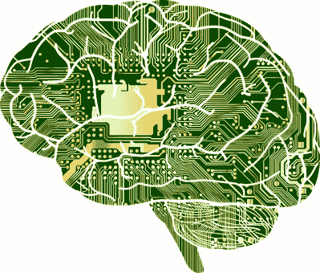

人工智能是一个理念的体现，即机器能够具有人类的智能，并模拟人类的思维处理和学习能力，以适应新的输入并在无需人类帮助的情况下执行任务。机器学习是人工智能概念中不可或的一部分。机器学习可以被定义为人工智能技术的概念，它主要关注机器学习和自我训练的工程化能力，通过识别数据模式来改进底层算法并做出独立决策。机器学习假设现代计算机具有使用训练数据集进行训练的能力，该数据集可以很容易地定制以满足所需的功能。机器学习由模式识别技术驱动，其中机器记录并重新审视过去的交互和结果，而这些结果被认为与其当前的情况一致。鉴于机器需要处理无穷无尽的数据，且新数据不断涌入，它们必须具备在无需人类编程的情况下适应新数据的能力，这正体现了机器学习的迭代特性（ative aspect）。

机器能够利用先前的计算和底层算法从过去中学习并进行自我训练，产生高质量且易于复制的决策和结果。机器学习的概念已经存在了几十年，但最近机器学习算法的进展使得机器处理和分析大数据成为可能。这是通过使用高速、高频率的自动化应用先进复杂的数学计算来实现的。如今的先进计算机能够快速分析海量数据并交付更快、更准确的结果。采用机器学习算法的公司具有增强的灵活性，可以修改数据集以满足其业务需求并据此训练机器。这些定制的机器学习算法允许企业识别潜在风险以及增长机会。机器学习算法通常与人工智能技术和认知技术协作使用，使机器在处理大量数据或大数据时非常高效，并产生高度准确的结果。鉴于人工智能与机器学习之间的内在联系，为了使本书更于理解，以后我们将交替使用“机器学习”和“人工智能”这两个术语。

## 现有的机器学习算法类型

### 监督机器学习算法

这些算法广泛应用于预测性大数据分析，因为它们能够将从之前的迭代和交互中学到的教训应用于新的数据集。这些算法可以根据提供的指令对其所有正在运行进行标记，以成功地预测未来事件。例如，人类可以编写程序将其数据点标记为 `R`（运行）、`N`（负）或 `P`（正）。机器学习算法随后将按照程序对输入数据进行标记，并接收带有相应正确输出的数据输入。算法将将其生成的输出与“预期或正确”输出进行比较，以识别可以进行的潜在改进和可以修复的错误，从而使模型更准确、更智能。通过应用“回归”、“预测”、“分类”和“集成提升”等方法很好地训练机器学习算法，可以将任何新的输入数据作为“目标”数据集输入机器，按所需编排学习程序。这种“已知训练数据集”启动了分析过程，随后由学习算法产生“推断函数”，该函数可以根据输出值生成未来事件的预测和预报。例如，金融机构和银行严重依赖监督机器学习算法来检测信用卡欺诈交易，并预测潜在信用卡客户未能及时偿还信用卡款的概率。

### 无监督机器学习算法

公司经常遇到这样的情况：无法获取生成带标记和分类训练数据集所需的数据源。在这些情况下，使用无监督机器学习算法是理想的。无监督机器学习算法用于识别机器创建“推断函数”的方法，从而从大量未标记和未分类的数据集中阐明隐藏结构。这些算法能够探索数据，以在海量信息中识别结构。与监督机器学习算法不同，无监督算法无法识别正确输出，尽管它们在探索输入数据和得出推论方面与监督学习算法一样高效。这些算法可以识别数据离群值、生成定制化和个性化的产品推荐，以及使用“自组织映射”、“奇异值分解”和“k-means 聚类”等技术对文本主题进行分类。例如，识别具有共同购物属性的客户，并将他们划分为特定的组，以便针对相似的营销策略和活动进行目标触达。因此，无监督学习算法在在线营销领域非常流行。

### 半监督机器学习算法

半监督机器学习算法具有很高的通用性，能够利用带标记和未标记的数据进行学习和自我训练。这些算法是监督学习和无监督学习算法的“混合体”。通常，训练数据集主要由未标记数据组成，辅有少量的标记数据。将“预测”、“回归”和“分类”等分析方法与半监督学习算法相结合，允许机器显著提高其学习准确性和训练能力。这些算法被广泛应用于从原始数据生成标记训练数据集耗费大量资源且对公司成本效益不高的情况。因此，为了避免额外的人员和设备成本，公司在其系统中使用半监督学习算法。例如，人脸识别应用需要分布在多个输入源的大量面部数据。从网络摄像头等源获取原始数据进行预处理、处理、分类和标记需要大量的人力以及数千小时的工作，才能作为训练数据集使用。

### 强化学习算法

强化学习算法的独特之处在于它们能从环境中学习。这些算法执行动作并勤勉地记录每个动作的结果，这些结果可能是导致错误的失败，也可能是成功执行的奖励。区分强化学习算法的两个主要特征是：“试错法”研究方法和“延迟奖励”。机器通过各种计算反复分析输入数据，并对每个正确或预期的输出发送强化信号，最终优化结果。系统开发了简单的动作和奖励反馈循环，以评估、记录并学习哪些动作是成功的，并在更短时间内获得准确的结果。这些算法的使用允许系统在特定背景限制内自动确定理想行为，从而增强其能力并最大化其性能。因此，强化学习算法被大量用于游戏行业、机器人工程以及导航系统。

## 机器学习 vs 大数据

“机器学习”、“大数据”以及“大数据分析”都属于“人工智能”技术的范畴，而人工智能又归类于“数据科学”领域。以下是机器学习与数据或大数据分析之间的一些主要区别：

### 应用领域

机器学习用于开发先进的推荐引擎和模型，通过分析现有数据来预测和预测未来事件。例如，“Google”正在利用先进的机器学习算法来开发其自动驾驶汽车。虚拟个人和家庭辅助设备（如“Amazon Alexa”、“Google Home”和“Apple HomePod”）都由先进的机器学习算法驱动，与人工智能技术紧密协作。数据具有更广泛的适用性，可用于通用研究，收集有关特定业务查询的信息，例如收集销售数据、构建用户画像和金融研究等跨工业领域的应用。

### 学习能力

机器学习算法是自给自足，能够在没有人工帮助的情况下从训练数据集以及新输入数据中学习。它们足够强大，可以为系统学习和自我改进建立所需的基础。

大数据分析能够收集现有数据并进行分析，以识别可以用于其决策过程的新兴模式。它始终由人工控制的分析工具和技术驱动，没有自我学习范围。

### 模式识别

大数据分析利用回归、聚类和分类等统计方法来识别数据模式，通过分析这些模式产生逻辑信息。机器学习不仅可以识别出现的数据模式，还可以在这些模式上应用先进算法，从数据模式中学习，并在每次连续迭代中最大化系统性能。

### 数据量和数据类型

大数据涉及海量的非结构化、半结构化和结构化数据。需要先进的分析工具和技术来处理这些大部分是非结构化数据的大型数据集，以收集价值信息。机器学习利用规模较小、经过分类和标记的数据集作为算法学习和自我改进的指导指令。

### 基本目的


机器学习的主要目标完全根据输入数据在几乎完全没有人工帮助的情况下进行自我改进。这些算法的前景应用以及智能机器的发展有一天可能帮助解决人类面临的严峻挑战，例如全球变暖。大数据旨在收集和存储我们不断演变的数字生活产生的激增数据。大数据分析使用模式识别技术来揭示在大量信息中容易丢失的隐藏模式和洞察。

# 机器学习 vs. 数据科学

数据科学是一个包含机器学习算法的统术语。以下是这两个术语之间的基本区别。

## 数据组件

数据科学涉及数据的完整生命周期，涉及多种组件，包括：用于收集和分类数据的“ETL”（提取、转换、加载）流水线、数据可视化、分布式计算、机器学习、人工智能、数据工程、仪表板以及系统部署介绍和环境等组件。机器学习模型提供输入数据，并包含各种组件，包括数据分离、数据探索、问题解决和适当模型选择等。

## 性能衡量

数据科学没有标准的性能衡量标准，而是根据具体情况来定的。通常，性能指标是数据质量、数据及时性、数据可访问性、数据可视化能力以及数据查询能力的指示。机器学习模型具有标准的性能指标，每种算法都有相应的指标来指示模型的成功并描述给定的训练数据集。例如，在“线性回归分析”中，“均方根误差（RME）”作为模型误差的指标。

## 开发方法

数据科学项目的实施是在定义的阶段内进行的，必须达到项目里程碑，以便在时间和资源限制内完成设定的目标和任务。机器学习项目是基于研究的，从一个假设开始，该假设预计在可用数据的范围内得到验证。

### 数据可视化

在数据科学项目中，使用条形图和饼图等标准图形表示法对数据进行可视化。

机器学习不仅使用标准的图形表示工具来可视化数据，还会使用数据集的数学模型。

## 编程语言

数据科学项目中最常用的编程语言是`SQL`、`PERL`以及某些特定数据框架的语言，如用于 Hadoop 的`Java`和用于 Spark 的`Scala`。机器学习算法中最广泛使用的编程语言是`Python`和`R-programming`。对于数据探索活动，`SQL`可以与机器学习算法配合使用。

## 输入数据

数据科学项目使用`人类可用数据`，人类可以使用分析工具和技术轻松地读取和分析这些数据。

机器学习算法需要高度分类和标记的训练数据集。

## 决策树与机器学习

如果你在想这棵决策树与现实生活中的树是否有任何关系，那么你是正确的。树有几个基本部分，主要包括分支、叶子、树干和根。同样，决策树有多个元素来帮助决策过程。数据科学`决策树`可以被定义为决策过程的树形图形表示，它考虑了可能影响决策的所有条件或因素以及这些决策的后果。决策树被认为是最简单的`监督机器学习算法`之一，具有三个主要元素：代表条件的`分支节点`、表示正在进行的决策过程的`边`，以及表示决策结束的`叶子节点`。

决策树有两种类型：`分类树`用于根据系统中的现现有数据对数据进行信息分类；`回归树`用于根据系统中的现有数据对未来事件进行预测预测。这两种树在机器学习算法中都被广泛使用。决策树的一个广泛使用的术语是`分类与回归树`或`CART`。让我们看看如何根据现实生活的示例构建一个简单的决策树。

**第 1 步**：识别需要做出的决策，这将作为决策树的`根节点`。对于这个例子，需要做出的决策是“周末你想做什么？”。与真实的树不同，决策树的根在顶部而不是底部。

**第 2 步**：识别决策的条件或影响因素，这些将作为决策树的`分支节点`。对于这个例子，条件可能包括“你想独自度过周末还是和朋友在一起？”以及“天气如何？”

**第 3 步**：当你回答这些条件问题时，可能会遇到之前忽略的额外条件。现在你通过逐个处理所有条件问题来得出最终决策；这些分叉将作为你决策树的`边`。

**第 4 步**：一旦你处理了所有的排列组合并最终做出了决策，该最终决策将作为决策树的`叶子节点`。与`分支节点`不同，`叶子节点`不再可能产生进一步的分叉。以下是上述示例决策的图形表示：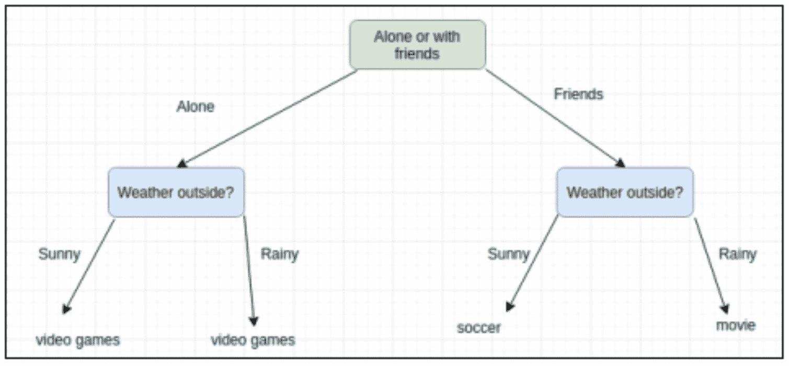

正如你对决策树所预期的，你获得了一个`表示一组顺序和层次决策的模型，这些决策最终导致某些结果`。这个示例处于非常高的水平，旨在帮助你理解决策树的概念。数据科学和机器学习决策树要复杂得多，更大，拥有成百上千个分支节点和边。

市场上用于可视化和理解决策树的最佳工具是`Scikit Learn`。机器学习决策树模型可以通过两个步骤开发：`归纳`和`剪枝`。

### 归纳

在这一步中，通过基于现有数据集选择和建模所有顺序和层次决策边界来实际开发决策树。为了方便你理解，这里是开发树所需的 4 个高级步骤：

1. 使用`特征变量`和`分类或回归输出`收集、分类并标记训练数据集。

2. 在训练数据集中识别最佳且最具效益的特征，将其作为数据分叉的点。

3. 根据所选`最佳特征`的可能值，通过分叉数据集创建数据子集。这些分叉将定义决策树的`分支节点`，其中每个节点都根据数据集中的特定特征作为分叉点。

4. 使用从第 3 步收集的数据子集迭代开发新的树节点。这些分叉将持续进行直到达到最优点，在该点处可以在最小化分叉或节点数量的同时实现最大准确率。

### 剪枝

决策树的本质目的是支持系统的训练和自学，这通常需要过度加载影响最终结果的所有可能条件和影响因素。为了克服为每个节点设置最少实例正确输出的挑战，开发者通过将该“最少数量”设定得很小来做出“稳妥之举”。这导致在必要时产生大量分叉，形成非常复杂且庞大的决策树。这就是`树剪枝`出现场的地方。`剪枝`这个动词字面意思是“减少，特别是通过消除多余的部分”。这是从现实树中引入并应用于数据科学和机器学习决策树剪枝的概念。

剪枝过程通过“将严格僵硬的决策边界转换为泛化和平滑的边界”有效地减少决策树的整体复杂度。决策树的分叉数量决定了树的整体复杂度。最简单且常用的剪枝方法是审查单个分支节点并评估将其移除对决策树成本函数的影响。如果移除对成本函数的影响很小或没有，那么被审查的分支节点就可以轻松移除或`剪枝`。

## 决策树的优势

* 决策树具有很高的透明度，易理解和解释。

* 容易评估特征值对生成输出的影响。

* 收集对数据准确性和误差来源的完整理解。

* 与大多数机器学习模型不同，决策树对数据的预处理要求最少，且对选择参数进行少量微调后即可开箱可用。

* 用于训练树的数据点数量与从树中获取推理的成本成反比。

## 决策树的缺点

* 考虑到训练树的固有特性，很容易发生过拟合现象。

* 决策树可能对数据集中占据大多数数据点的特征产生偏差。

* 决策树可能是不可靠的。对数据进行即使微小的错误变化，也可能导致生成一个与需求完全不同的树。这被称为“方差”，可以使用“袋装法”（bagging）和“提升”（boosting）等方法进行管理。

* “贪心算法”无法保证返回“全局最优”决策树。为了缓解这个问题，应该通过从训练数据集中随机选择数据特征和样本来创建并训练多棵树。

## 第 6 章：人工智能驱动的网络营销

估计目前有 30 亿活跃的社交媒体账户，并且并将继续增长。这些账户的所有者已经是市场中所有电子商务企业的客户或潜在客户。企业正处于一场无止境的竞争中，通过设计有效的社交媒体营销策略和活动来获取更多客户并扩大市场。人工智能技术的崛起为公司提供了深入客户及其潜在客户的需求和期望，这极大改变了销售和营销领域。公司正在利用这些宝贵的见解为所有客户提供定制和个性化的用户体验，以赢得他们的忠诚并吸引最终转化为付费消费者的潜在客户。曾经被认为艰巨且几乎不可能完成的收集和分析海量数据的过程，现在不仅可行，而且极具成本效益且快速。这是通过使用`人工智能`、`机器学习`和`大数据分析`等尖端技术实现的。

## 数据科学的革命

数据科学世界正在经历一场革命，人工智能技术处于前沿。工业级大数据分析的执行与数据科学前景之间的现有差距，已经通过基于人工智能的营销工具和平台得到了弥补。在现有客户数据上应用`机器学习`和`大数据分析`等人工智能驱动的技术，以预测客户未来的需求和期望，同时确保他们在购物旅程中获得增强的用户体验，这种方法被称为“人工智能营销”或“AI 营销”。营销机构通过简单应用人工智能工具和技术提供的宝贵见解，在几乎没有额外投入的情况下，显著提升了活动表现，并实现了更高的投资回报。

## 人工智能营销的基础要素

以下是人工智能营销的基础要素，它们使其成为当今最强大的营销工具：

### 大数据分析

所有电子商务企业都淹没在海非结构化且复杂的数据中，但这些数据可能提供有价值的信息和见解，以改进和发展业务。处理此类分析的数据部分被称为“大数据分析”。大数据分析使营销能够能够自动化工具收集并分析大量客户数据，生成宝贵的客户信息，这些信息可以被用于他们的营销策略和活动中，以便在适当的时间针对特定受众。

# 机器学习

为了有效管理营销活动，公司寻求对具有相似购物属性的客户进行细分。这就是机器学习平台发挥作用的地方，它们通过分析数据识别数据模式和未来市场趋势来帮助公司。公司不仅可以使用这些数据模式在未来的活动中脱颖而出，还可以回溯性识别失败活动的根本原因，并从过去的错误中吸汲训。

### 基于人工智能的直觉平台

人工智能营销以其易用和超敏捷的用户界面平台而闻名。通过使用人工智能技术，公司现在能够执行“情感分析”，并解读客户对与其产品或服务相关的特定话题的情绪。这允许公司定制产品以满足消费的需求和期望。这些强大平台的另一个方面是虚拟助手聊天机器人，它们正在进化为使用“自然语言处理”技术像人类一样交流，处理社交媒体帖子和电子邮件回复等开放格式的内容。这一功能进一步增强了人工智能技术在销售和营销领域的力量。

> “创造人工智能将是人类历史上最大的事件。不幸的是，除非我们学会如何规避风险，否则它可能是最后一次。完全人工智能的发展可能意味着人类种的终结。它将自主运行，并以不断加快的速度自我重新设计。受限于缓慢的生物演化的人类将无法竞争并被取代。” – 斯蒂芬·霍金

## 营销漏斗

潜在客户从获知或意识到公司产品到最终花钱购买的端到端旅程被称为“营销和销售漏斗”。它是客户为了转化为产品购买者而所经过的各种路线和阶段的视觉化表示。通过仔细评估他们的营销和销售漏斗，公司可以提高销售、增加品牌知名度并获得更多忠诚的客户。

营销漏斗的概念源于 20 世纪后期由 Elias St. Elmo Lewis 引入的经典“效应层次”模型框架“AIDA”。根据这种业务和客户关系模型，每个新客户在进行实际购买之前都会经历四个阶段。让我们来看看 Patrick（潜在客户）在“AIDA”模型中将经历的四个阶段。

### 第一阶段：意识

Patrick 从朋友或在线广告中获知了一个令人兴奋的新产品，并有足够的好奇心了解产品特性和制造商。

### 第二阶段：兴趣

Patrick 获取的关于该产品的信息激发了他购买的兴趣，但他还没有做出承诺，仍在探索其他选择。

### 第三阶段：欲望

在这一阶段，Patrick 开始考虑实际购买该产品的可能性，并评估自己的现状状况以确保能够进行购买。

### 第四阶段：行动

Patrick 最终决定购买该产品并完成了实际购买。

# 营销漏斗的基础已从这一模型演变而来，并在很大程度上保持不变。营销漏斗的妙之处在于，它可以针对不同行业领域的不同公司进行轻松定制，以最好地满足其公司愿景和市场需求。目前并没有一个所有企业普遍接受的标准营销漏斗模型。公司根据其产品和服务的复杂程度以及认知度来选择并定制自己的营销模型。一个相对简单的营销漏斗被称为“TOFU-MOFU-BOFU”模型，代表“漏斗顶部、漏斗中部和漏斗底部”，体现了公司采用的营销漏斗的 3 个不同阶段。

随着尖端技术的兴起，日常消费者变得更加聪明，并期望投入金钱获得更多价值。当今智能客户的忠诚度取决于顶尖数据隐私和安全措施支持下，最具吸引力和最增强的用户体验。人们不再害怕尝试新产品，并愿意放弃他们可能已经使用了多年的常规产品选择。这导致了营销漏斗的改进，营销大师们在最终阶段之后增加了额外的阶段，即“忠诚度”和“拥护”，以改进他们的整体营销策略。据估计，“当现有客户离开时，企业每年损失高达 1.6 万亿美元。”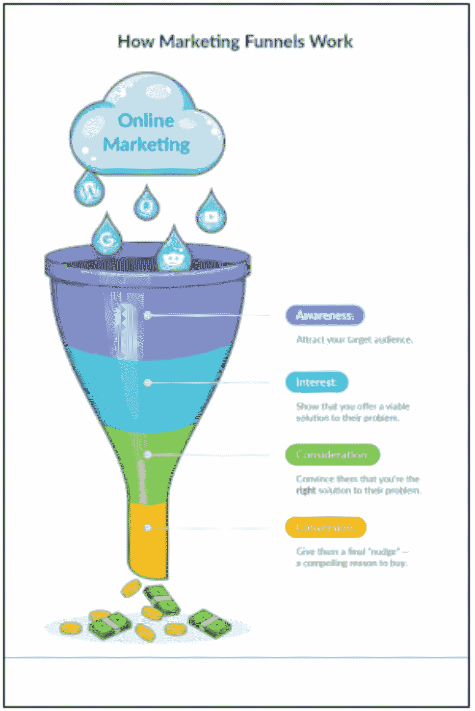 营销漏斗阶段

## I – 意识 (Awareness)

所有营销漏斗的第一阶段都是意识。在这一阶段，寻找问题解决方案或升级生活方式的人会获知某个可能满足他们需求的特定产品、公司或品牌。有多种方法可以将潜在客户带入意识阶段并标记他们进入营销漏斗，例如：

* 来自朋友或家人的口碑。

* 在使用一个或多个搜索引擎在网上搜索信息时，发现公司网站是搜索结果之一。

* 收听播客，其中提到该产品或服务。

* 在 Facebook 等社交媒体平台上看到公司的广告。

* 在电视或 YouTube 上观看公司的视频广告。

无论通过何种媒介，潜在客户现在已经意识到这家公司以及他们可能感兴趣的产品和服务的存在。潜在客户现在还在脑中将他们的问题或需求与该公司联系起来。

## II – 兴趣 (Interest)

营销漏斗的第二阶段是“兴趣”，潜在客户对公司提供的产品和服务感到好奇，并想要进一步深入了解更多信息。这通常通过访问公司网站或移动应用程序来实现。在此过程中，潜在客户需要一点推力被引导到下一个阶段。

## III – 考虑 (Consideration)

在营销漏斗的第三阶段“考虑”中，潜在客户已经确定他们一直在了解的公司为他们的问题提供了潜在解决方案，或者有他们需要的产品。但他们尚未对该公司做出承诺，仍在探索市场上的所有可用选项。

## IV – 转化 (Conversion)

到了第四阶段“转化”时，潜在客户已经权衡了所有选项，并认为选择公司的产品或服务“最适合”满足他们的需求。现在客户只需寻找一个令人信服的理由，并需要最后的推力完成实际购买。这是潜在客户“转化”为付费用户的阶段。

## 营销与销售漏斗分析

公司总是寻求增长并优化其销售流程，考虑到所有影响因素，例如销售和营销团队的绩效、他们的销售管道，以及最重要的销售和营销漏斗。分析销售和营销漏斗不同阶段之间转化率的过程被称为“销售漏斗分析”。公司主要从漏斗顶部开始分析，并向下进行，同时计算后续阶段之间的转化率。一些最广泛使用的销售漏斗分析工具包括：

* `Google Analytics` —— 正如你预期的，`Google Analytics`平台是顶级的，内置了销售漏斗分析功能。它允许公司通过可视化强大的仪表板和报告，来理解客户与其在线内容及移动应用程序的互动和参与情况。该平台的机器学习能力可预测哪些客户更有可能转化为付费买家，哪些客户潜力产生更高的收入。“Google Analytics 帮助我们优化了艺术品市场，使我们的艺术业务收入同比增长了 400%。” - Mariam Naficy，Minted 创始人兼首席执行官。

* `Hotjar` —— `Hotjar`漏斗主要用于生成网站热图，但也提供内置的漏斗指标。它高度可定制，并且能够每小时自动刷新一次漏斗数据。“在看了大量录像、热图并从调查中获得反馈后，我们很好地了解了用户想要什么，成员从大约 8 万增加到现在的 15 万。Hotjar 是其中非常重要的一部分。” - Inbound.org。

* `GetResponse Autofunnel` —— 最近`GetResponse`公司发布了他们新的内置`Autofunnel`工具，可以轻松创建定制和自动化的销售漏斗以满足特定的业务需求。通过这个工具，公司可以自动化沟通电子邮件、开发网站着陆页、找回遗弃订单并提高转化率。“通过 Autofunnel，你可以通过简单有效的销售漏斗在网上推广、销售和交付你的产品。销售任何东西——实体产品、电子书、在线课程——任何东西。使用快速销售漏斗将流量直接引向销售页面，或者在使用完整的销售漏斗提供报价之前通过自动电子邮件培养新联系人。” - GetResponse 客户分析为组织提供了必要的客户洞察，以交付预期、相关且及时的报价。

## 客户分析的重要性

客户分析已发展成为营销行业的支柱。这是“智能消费者”出现的直接结果，他们比以往任何时候都更有意识、联系紧密，并愿意随时将业务转向其他地方。因此，公司需要保持主动，并预测消费者在与其产品互动时的行为，以便采取必要的行动将潜在客户转化为付费客户。为了对客户行为产生更准确的预测和判断，公司必须对客户的购买习惯和生活方式选择有深入的理解。这些准确的预测将为公司提供竞争优势，并帮助在其销售和营销漏斗中实现更高的转化率。

当今市场上最好的客户分析解决方案之一是“SAS Customer Intelligence”，它声称具有以下应用：

* 实现更高的客户忠诚度和响应率。

* 生成个性化的客户优惠和信息，以便在正确的时间触达正确的客户。

* 识别具有相似属性且高转化概率的潜在客户，使公司能够降低其针对性营销策略和活动的成本。

* 通过对可能流失业务的客户进行准确预测，并制定主动的营销活动来留住他们，从而减少客户流失。

“从我们新的分析能力中获得的洞察使我们能够找到持续驱动忠诚度、盈利和可持续增长的黄金平衡点。” —— Carrie Gray，Verizon（Verizon）预测性分析营销中型业务营销执行董事。

根据 SAS 的说法，预测性分析是“利用数据、统计算法和机器学习技术，根据历史数据识别未来结果发生的概率。其目标是超越仅仅知道发生了什么，对未来将发生什么提供最佳评估。”今天，公司正放眼未来挖掘过去，这正是营销人工智能发挥作用的地方，即预测性分析技术的应用。预测性分析的成功与公司所收集的大数据质量成正比。

## 营销预测性分析应用

以下是一些广泛使用的营销预测性分析应用：客户行为预测分析

对于“亚马逊（Amazon）”、“苹果（Apple）”和“Netflix”等工业巨头来说，分析客户活动和行为是日常运营的基础。小型企业正日益追随他们的脚步，在业务模型中实施预测分析。为公司开发定制的预测模型组合不仅是资本密集型的，还需要大量的人力和精力和。像“AgilOne”这样的营销公司提供相对简单的预测模型类型，在各个工业领域具有广泛的适用性。他们确定了分析客户行为的三种主要预测模型，分别是：

* “倾向模型”（Propensity models）——这些模型用于对客户行为生成“真实或准确”的预测。一些常见的倾向模型包括：“预测生命周期价值”、“购买倾向”、“流失倾向”、“转化倾向”、“参与概率”和“取消订阅倾向”。

* “聚类模型”（Cluster models）——这些模型用于根据性别、年龄、购买历史和人口统计数据等共同属性对客户进行分离和分组。一些常见的聚类模型包括：“基于产品或类别的聚类”、“基于行为习惯聚类”和“基于品牌的聚类”。


“协同过滤”（Collaborative filtering）——这些模型用于根据先前的客户活动和行为生成产品和服务推荐，以及推荐的广告。一些常见的协同过滤模型包括：“向上销售（up sell）”、“交叉销售（cross sell）”和“下次销售（next sell）”推荐。

公司执行客户行为预测性分析最重要的工具是“回归分析”，它允许公司在特定产品的销售与购买客户所显示的特定属性之间建立联系。这是通过使用“回归系数”（描述客户行为受不同变量影响程度的数值）以及为产品的未来销售开发“概率评分”来实现的。

## 客户线索的鉴定与优先级排序

在企业对企业（B2B）预测性分析营销中，主要采用三类方法对潜在客户或“线索”进行鉴定和优先级排序。这些类别是：

- “预测评分”（Predictive scoring）——用于根据潜在客户进行实际购买的概率对其进行优先级排序。
- “识别模型”（Identification models）——用于根据公司现有客户共享的属性来识别和获取新的潜在客户。
- “自动细分”（Automated segmentation）——用于根据共同属性对潜在客户进行分离和分类，以便针对相同的个性化营销策略和活动。

预测性分析技术需要大量的销售数据作为构建基础和训练材料，以提高预测模型的准确性和效率。小型实体公司无法负担扩大计算资源的费用，因此无法从店内销售中高效地收集客户行为数据。这转化为具有更先进计算系统的大型公司的竞争优势，加剧了大型公司与小型企业相比的过度增长。

## 客户细分与目标定位

优化产品报价以实现公司投资回报率快速回升的最简单且非常有效的方法之一，是在“正确的时间”通过适当的产品报价触达“正确的客户”。这恰恰也是预测性分析在营销领域最常见且应用最广泛的。根据“阿伯丁咨询集团”（Aberdeen Group）的一项研究，，在营销策略中使用预测性分析的公司，成功识别“高价值客户”的可能性是其他公司的两倍。这时，公司现有数据集的质量就变得至关重要。推荐的做法是使用所有现有客户的历史消费者行为数据并对其进行分析，对具有相似购买属性的客户进行细分，并通过个性化推荐和营销活动进行目标触达。一些最常用的预测性分析模型包括“关联性分析”、“流失分析”和“响应建模”。通过使用这些应用，公司可以获得洞察，例如“将产品或目录的数字订阅和打印订阅相结合是一个好主意”，或“产品或服务以按月订阅模式还是一次性付费模式提供会更成功”。领先的销售和营销平台公司之一是“Salesforce”，它提供了一个基于云的平台，企业可以使用该平台从独立来源（包括客户关系管理（CRM）应用程序和其他公司应用程序）收集的数据生成客户画像。通过选择性且有意识地将输入数据添加到此平台，公司可以无缝跟踪其客户行为，随着时间的推移开发客户行为模型，该模型可以实时且长期地辅助公司的决策过程。

## 营销策略的发展

预测性分析和营销的另一个应用是访问各种客户相关数据，例如从社交媒体平台收集的数据以及公司内部的结构化数据。然后通过汇总所有可用数据并对其进行“行为评分”，即可生成客户行为模型。不同行业领域的所有公司都需要通过不断增加的营销媒介或渠道来适应不断变化或演变的客户行为。例如，公司可以使用上述任何预测性分析模型，精确预测其计划的营销活动是在社交媒体平台还是在其移动应用程序上更具成功。

公司能够利用预测性分析模型，了解客户如何根据他们在社交媒体平台上针对特定话题分享的感受或情绪，与其产品或服务进行互动。这一过程被称为“情感分析”或“文本分析”。客户数据的探索性分析——“探索性数据分析”（EDA）为与客户数据源相关的现有客户数据（如产品价格、当前和历史客户调查、产品使用情况、购买历史和人口统计数据）提供了全面的视图。它被认为是一种在不使用统计模型和数据推断的情况下查看数据的方法。“探索性数据分析”一词是由约翰·特克基（John Tukey）在其 1977 年出版的书中提出的。使用探索性数据分析的一些主要原因包括：

- 初步筛选适用的“预测模型”。
- 验证底层假设。
- 确保公司正在为扩大客户群而提问正确的问题。
- 检测潜在的数据异常、冗余和错误。
- 确定“解释变量”之间的关系关系。
- 评估“解释变量”与“结果变量”之间关系的方向和大小。

数据库中收集的客户数据以矩形数组的形式存在，单独列代表“主体标识符”、“结果变量”和“解释变量”。要查看充满数值的电子表格并从数据中确定重要信息是相当挑战性的，而这正是使用探索性数据分析技术来选择性地显示数据重要特征的地方。探索性数据分析技术有四种：

1. “单变量非图形化”——该技术一次查看一个变量或数据列，并以统计摘要的形式显示结果。
2. “多变量非图形化”——该技术一次查看两个或多个变量或数据列，并以统计摘要的形式显示结果。
3. “单变量图形化”——该技术一次查看一个变量或数据列，并以图表或插图的形式显示结果。
4. “多变量图形化”——该技术一次查看两个或多个变量或数据列，并以图表或插图的形式显示结果。

EDA 通过生成一份低风险、低成本且全面的数据发现报告，以及针对最适合的客户数据模型的解决方案建议，帮助确定解决业务问题的最佳预测模型。对客户行为的深度探索性分析可以揭示隐藏的数据模式和市场趋势，而这些趋势在海量信息中很容易被遗失。使用 EDA 对客户行为数据进行分析可以得出的一些结论包括：

- 识别购买次数最多和花费金额最大的客户。
- 找到按每天、每周和每月生成的订单数量。
- 识别公司所有产品的单价分布。
- 根据客户的人口统计和位置识别购买交易模式。

## 人工智能下的个性化营销

在由“Researchscape International”赞助的一项研究中，约 75%的营销机构表示，个性化营销在推进其公司和客户关系方面发挥了巨大作用，高达 97%的人表示他们将继续投入个性化营销工作。这主要由于公司能够通过使用预测性分析和机器学习算法从客户行为数据中收集有价值的洞察，从而与目标市场进行有效沟通。通常，个性化从单个客户开始，但潜在地适用于具有共同属性的客户群体，并实现“规模化个性化”。基于人工智能的工具和应用程序可以结合图像识别、语音分析和客户行为分析，让公司更深入地理解客户的需求，并通过提供精确的产品推荐来满足这些需求。

以下是个性化营销的一些工业应用：

### 广告投放

公司可以根据用户的购物属性（例如最近对特定产品或类别的浏览以及购买历史）针对特定用户或客户群体投放广告。市面上可用的广告投放应用包括：“ReFUEL4”——由营销公司“ReFUEL4”开发的“广告分析仪”利用计算机的视觉能力来预测广告的性能。如果公司现有的广告性能开始下降，广告分析仪可以帮助公司开发新的更好的广告。广告性能的下降通常意味着受众疲劳，即人们因为广告变得太熟悉且无味而停止关注该广告。

### “Match2one”

这款广告应用程序可以集成到公司的电子商务网站中，用于跟踪潜在客户并留住现有客户。“Match2One”应用程序使用机器学习算法来定位那些更有可能成为消费者的潜在客户。该公司声称，其“引擎经过训练，可以结合网站访问者行为和历史数据来生成销售线索并寻找新客户。”通过分析网站访问者数据，该应用程序可以对对特定产品表现出兴趣的客户展示针对性的广告。

## 个性化消息

个性化消息中最重要的方面是情境营销。为了确保向目标受众发送相关信息，公司会收集客户数据，包括他们的行为、网页浏览历史、偏好内容、社交媒体帖子和人口统计学特征等变量。市场上现可用的一些个性化消息应用程序包括：

“Dynamic yield” – 该公司提供的电子邮件解决方案利用订单历史、邮件点击、社交媒体活动等客户行为数据及其他功能，为单个客户生成个性化的邮件内容。该电子邮件解决方案提供了动态邮件模板，可以轻松自定义以反映相关信息。该应用涵盖多个工业领域，包括旅游、电子商务、游戏行业和社交媒体。

“Yoochoose” – 该公司为在线零售商提供电子商务服务，允许公司利用个性化邮件，或通过客户行为自动触发的带有时事通讯和产品推荐的针对性通知，为消费者创建“个性化购物体验”。该应用程序能够识别一段时间未进行购买的客户，并触发通知提醒他们购买。它还可以识别最近购买过产品的客户，并触发“售后感谢”邮件。该公司提供“目标通知”功能，以及产品推荐引擎和“个性化搜索”，所有这些都被封装成在一个“个性化套件”中。

### 产品推荐

任何公司增长业务最简单、最智能的方法就是提供与客户需求和要求相关的准确产品推荐。公司还可以通过新产品、重复购买以及重定向营销来吸引新的潜在客户并提高客户忠诚度，同时减少产品退货的数量和频率。市场上现可用的一些产品推荐应用程序包括：

“Recombee” – 该应用程序基于先进的机器学习算法，能够在“客户活动后 200 毫秒内”生成推荐。该公司声称，通过结合专为客户行为分析开发的“协同过滤算法”和用于分析产品标题及描述的“基于内容的算法”，其应用程序每秒可以生成超过 500 条推荐。随着每一次人类互动，学习算法都会不断改进，并通过客户的迭代使用不断精炼推荐。该应用被广泛用于房地产、招聘网站、分类广告、游戏行业、旅游业和娱乐行业等。

“Sentient Aware” – “Sentient Aware”提供的产品推荐引擎通过分析消费者的视觉活动和行为交互来激活公司网站内的“深度学习算法”。该应用程序利用“意图和策划驱动算法”来识别相似产品和公司目录，以对客户偏好生成预测，并做出符合这些偏好的产品推荐。该公司声称，由于能够在不使用历史数据的情况下生成推荐，其应用程序在为首次用户推荐产品方面同样高效。

## 动态网站

一种通过底层脚本驱动动态更改内容，从而即时满足每位客户个人站点偏好的网站被称为“动态网站”。重复性任务（包括照片标记和照片渲染）使用“图像识别”和“机器学习”等人工智能技术完成。今天市场上现可用的一些动态网站应用有：“Bookmark” – “Bookmark”公司成功将机器学习技术应用于网页设计。该公司声称，其“AI 设计助手”或 `(AIDA)` 可以根据公司特定的行业信息，定制化构建涉及各种网站元素、板块、图像以及网站上应有的整体网页设计。`AIDA` 能够通过对公司名称、位置和业务类型进行搜索，在互联网上收集有关客户公司的更多信息。该应用程序收集客户在社交媒体上的行为和活动信息，并分析这些信息以为公司的电子商务平台确定最佳网站元素和设计。

“LiftIgniter” – 由“LiftIgniter”开发的动态网站推荐系统可以直接集成到客户在线的电子商务平台和移动应用程序，并由名为“真并行多变量算法基础设施”的机器学习算法驱动。该集成系统从客户与电子商务平台的交互中学习，并筛选公司所有的在线内容，根据客户在平台上的实时活动，在 150 毫秒内显示客户可能感兴趣的推荐产品。

# 第 7 章：人工智能的工业应用

“数据科学”这一伞术语涵盖了各种尖端技术和方法，包括人工智能、机器学习算法、大数据或大数据分析等。在讨论任何这些技术时，如果没有直观观察它们在各行业和业务中的应用，讨论就是不完整的。为了让这一部分易于理解，我们将交替使用上述所有术语。机器学习算法和大数据分析的使用通过引入新的流程、产品和能力，彻底改变了电子商务业务以及零售和制造业。随着人工智能领域持续且快速的进展，我们今天所知的世界正在迎接另一场革命。随着每天产生的海量数据，大数据分析和机器学习算法将重新定义客户关系的行业标准。公司正严重依赖基于人工智能的工具和技术，通过向客户提供独特且高参与度的增强用户体验来获得竞争优势。他们在设计和开发优质产品和服务方面显著节省了大量金钱和时间，从而增加了底线并提高了生产力。以下是大数据分析和机器学习算法在各个工业领域的一些最重要的应用：

## 金融或银行业

尽管金融机构的技术进展被“硅谷”所掩盖，但该领域基于人工智能的工具和技术的某些应用是具有突破性的。

考虑到金融业不仅对普通消费者产生深远影响，对跨越工业领域的其他企业也是如此。一些传统的银行业问题，如欺诈检测与预防、服务全球数百万客户、数据隐私与安全考量，以及假阳性交易标记等，正在通过使用机器学习算法和大数据分析得到解决。

金融行业中最受欢迎的数据科学驱动趋势包括：

- 使用虚拟个人个人助手实现客户服务的自动化和个性化。
- 欺诈交易的实时检测。
- 市场趋势分析。
- 使用聊天机器人进行客户交互。

这些技术的目标是提高整个金融领域的效率和安全性。

所有主要航空公司都在收集潜在旅行者的数据，涵盖他们浏览、购物、预订、乘过飞机甚至更改旅行计划的情况。这些数据可以使用人工智能驱动的解决方案进行分析，以生成可操作的洞察，并提供个性化服务以满足客户的需求和要求。精明的航空旅客可以使用各种工具和网站来浏览和比较航班、酒店、巴士、租汽车和火车，通过获取最优惠的价格来使资金价值最大化。竞争激烈的旅游业正在采用基于数据科学的技术，通过高度定制和个性化的服务来迎合特定客户的偏好，彻底改变旅游体验。

## 跨领域的虚拟助手

从医疗行业到金融行业，虚拟助手已成为增强客户服务的新行业标准。领先的在线旅游预订公司 `Expedia` 推出了其 `Expedia Skill` 应用程序，为客户提供即将到行程的信息和航班详情，甚至可以通过简单的语音命令预订租汽车。他们最近与 `Amazon` 合作，允许客户使用 `Amazon Alexa` 设备通过实时更新查看即将的旅行计划和航班详情。另一家旅行公司 `ATPI` 部署了名为 `Zeno by ATPI` 的人工智能工具，该工具存储了频繁旅行者的信息，如座椅偏好、首选出发机场、首选租车和服务和喜欢的酒店，以为每位客户提供个性化体验。该工具还支持 `Zeno Chatbot` 解决基础客户问题，并将复杂的查询引导至客服代表。

酒店业的虚拟助手，如 `Hijiffy`（它作为酒店 Facebook Messenger 应用程序的集成运行），正在改变僵化、单调的酒店预订网站。通过 `Hijiffy` 应用程序，潜在客户可以获取酒店服务信息、解决客服问题、接收目的城市的提示、获取实时酒店房价，甚至直接从他们的 Facebook Messenger 应用程序中预订机票和酒店房。

酒店业的另一个具有突破性的虚拟助手平台 `Watson assistant for hospitality` 由 `IBM` 开发。该平台可以存储酒店宾客数据并具有高度定制性，允许各酒店开发自己的针对特定酒店且命名独特的聊天机器人。这种强大的技术旨在预测客户需求，并根据他们之前在同一酒店的住宿经历和其他相关信息生成产品和服务建议。`IBM Watson` 还能根据宾客日历中反映的预先安排安排交通，并设置闹钟提醒他们酒店早餐的开始时间。

## 交通行业

交通行业日常运营面临的两个主要问题是事故和拥堵，这两者都可以归因于人为错误。考虑到这些问题固有的不可预测的本质，它们往往极难建模，但通过使用大数据分析和机器学习算法，机器可以分析海量数据并生成预测，这些预测可以被纳入决策过程。为了应对日益增长的高旅行需求、安全担忧、二氧化碳排放增加以及环境灾难性恶化所带来的挑战，使用基于人工智能的工具和技术提供了一个有前景的解决方案。交通部门正深挖数据科学的海洋，以发现强大的分析工具宝藏，这些工具可以缓解交通拥堵，并让通勤者的旅行时间更加可靠。人工智能技术有望帮助改善道路基础设施的发展，并为驾驶员提供帮助，以负担得起的价格建立一个整体可靠的运输系统，且对环境几乎没有负面影响。人工智能在交通行业中的一些现实应用包括：

- 开发了第一种名为 `Olli` 的全自动电动汽车，它由 `IBM Watson` 驱动。
- `Ford` 设计了一个由 `smart system` 驱动的 `Smart City`（城市），允许 `smart vehicles` 相互连接和协调，同时减少碰撞和其他事故的风险。该 `Smart City` 设计用于收集居民的数据，并将其与多个协同工作的智能技术共享，以创建一个数字乌托邦。
- `Rapid Flow Technologies` 开发了一种名为 `SURTRAC` 的先进交通控制系统，允许交通灯对车辆流量做出实时响应，而不是由中央操作系统进行解析。
- `Rolls-Royce` 预计在 2020 年前推出其可远程控制的新型货轮。
- 伦敦地铁系统在 2019 年初测试了他们的第一列自动列车，可以在没有任何人工帮助的情况下将乘客从一个点运到另一个点。
- `Google Flights` 技术能够在航空公司之前就精确预测航班延误，它通过利用可用历史航班数据上的机器学习算法来生成航班预计到达时间（ETA）的准确预测。
- 对于喜欢独自旅行且总是担心个人安全的女性，`JOZU` 应用程序旨在帮助女性识别最安全的路线和交通方式，以安全到达目的地。

## 娱乐行业

人工智能技术流淌在娱乐行业的血管，为我们提供了更具参与感和更真实的用户体验。数字媒体内容生产者利用大数据分析和机器学习算法提高了其内容制作流程的速度和效率。按需娱乐领导者 `Netflix` 和 `Hulu` 在其平台中整合了人工智能和机器学习技术，通过根据用户的历史活动和与平台的互动提供个性化视频推荐，为用户提供高度定制的体验。`Netflix` 推出了一种基于人工智能的工作流管理和调度应用程序 `Meson`，它由各种 `machine learning pipelines` 组成，能够创建、训练和验证个性化算法，为用户提供个性化推荐。`Netflix` 与 `南加州大学` 合作开发了一种名为 `Dynamic Optimizer` 的新型机器学习算法，该算法能够在不损害图像质量的情况下对视频进行压缩以便高清流。这项人工智能技术旨在通过优化视频的流畅度和清晰，解决发展中国家和移动设备用户视频流效率低下的问题。电影公司已成功利用机器学习算法制作电影预告片和广告。例如，来自`伊利诺伊大学`和`华盛顿大学`的数据科学研究小组成功训练了他们的人工模型创建新的 `Flintstones` 视频内容，使用的是一个包含 25,000 多个 `Flintstones` 视频的标注视频字幕数据库。

将文本、图像和视频段作为机器学习算法的训练数据集，可以从这些大数据源中提取对象和内容概念，并将其用于生成关于营销和广告解决方案的见解和建议。

### IBM Watson 案例研究

据报道，`IBM Watson` 在为`20 世纪福克斯`制作的恐怖电影`Morgan` 制作预告片之前，经过了数据集训练，其中包含了相关的视听元素和其他恐怖电影元素，例如标准恐怖电影预告片中出现的片段或时刻。结果，`IBM Watson` 仅用 24 小时就创建了一个 6 分钟的电影预告片；而这项任务对于人类专业人士完成需要几周的时间。


`IBM Watson` 最近与 `IRIS.TV` 合作，后者为 `CBS`、`The Hollywood Reporter` 和 `Hearst Digital Media` 等媒体公司提供企业对企业的服务，通过分析和增强客户与其网页内容的互动来实现。据报道，`Watson` 正在助力 `IRIS.TV` 公司的机器学习算法，这些算法可以从客户的搜索历史中“学习”并推荐相似的内容。`The Hollywood reporter` 报告说，在使用 `IRIS.TV` 程序的三个月短时间内，观看量或留存率增长了 50%。


# 结论


感谢你读完《商业人工智能与机器学习：通过应用人工智能将数据科学用于业务的终极指南》。本书还涵盖了商业大数据和商业数据挖掘，希望它能为你提供有益的信息，并为你提供实现目标（无论目标为何）所需的所有工具。

下一步是充分利用你对今日尖端技术所获得的新智慧，这些技术催生了硅谷这一强大力量。机器能够在完全没有人类协助的情况下独立运行的那一天可能并没有你想象的那么远。

今天，机器学习和人工智能催生了复杂的机器，它们可以研究人类行为和活动，以识别潜在的人类行为模式，并精确预测消费者对哪些产品和服务感兴趣。展望未来的企业正在其预期业务模式的外下逐渐转变为科技公司。如今精明干练的客户很容易被那些具有独特优势的现代公司所吸引，这些公司为消费者提供了独特、丰富且吸引人的体验。如果不采用书中解释的一项或多项尖端技术，传统企业留住客户将变得越来越具有挑战性。

一旦你理解了你的业务面临的风险，以及你如何定位自己不仅能留住现有客户，还能吸引更多潜在客户并最终将他们转化为付费消费者，你就已经准备好将业务推向新的高度。从一步一步开始，了解你业务的现状和挑战，然后在公司内部审慎地使用人工智能、机器学习、数据挖掘和大数据分析等数据科学技术的力量，在不损害人类智能的情况下增强人类能力，并创造新的高薪且有报酬的工作岗位。
