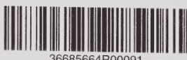

# 机器学习：从初学者到专家，高效学习与理解机器学习、人工神经网络和数据挖掘的终极初学者指南

https://archive.org/details/machinelearningu0000den

作者：Denny Novikov

许多动物行为的一个大部分似乎深深植根并受经验的影响，以至于可以被描述为先天的、本能的仅仅是未习得。也就是说，许多动物在某种程度上是以先天的方式编程的，当它们感知到环境的变化并{由于这种感知}改变了行为模式时，就可以说它们在学习。从这个观点来看，学习可以定义为由于个体经验而对行为（面对某种情境或刺激模式时）进行的组织（或重组）。前者指出了一个现象为了被分类为学习示例而必须具备的最少特征，并尽可能避免由于试图偏离学习过程的执行方式而可能造成的混淆。即使需要在行为通过获取新知识而不断修改的情境下解释这一过程，该定义仍然保持不变。一些作者建议有必要先用行为术语解释动物学习，如果可能，再从认知术语解释。

在文献中，学习经常被认为是一个适应过程，也就是说，它表现为微小的、渐进的改变。在这里，学习的适应性被视为行为调整的程度。此外，假设所学的内容会在记忆中保持较长的时间，以确保所学行为的可观察性（作为一种相对稳定的状态）。

动物能学习什么并不完全取决于它的能力，因为还有许多其他限制和局限塑造了这种能力（例如感觉系统的局限性）。因此，由于这些限制，动物更倾向于对某一类刺激做出反应而非其他，并能从这些刺激中学习到比其他更多的知识。此外，个体在特定语境下产生的所有刺激在其他语境下可能无法有效产生学习行为。

定义学习和解释观察到的行为的方法根本上取决于考虑学习者本质的方式。结果是，学习应该被认为是系统中最显著的特征之一。

## 动物学习的类型

几乎不可能将各种类型的学习划分为互斥的类别，并使这些类别精确地嵌套并涵盖动物学习的整个谱系。这并不是为了穷尽，而只是提供现状的概述。

- 习惯化（Habituation）：这是一种学习类型，表现为对一系列不与任何类型的奖励或强化相关的重复刺激（或接触）产生减弱的反应。习惯化的特征可以表述为与特定刺激有关，其相对持久性使其区别于时间性的表现，如疲劳或感官适应（例如对低光照或极度嘈杂空间的适应）。习惯性意味着倾向于消除所有对生存没有意义的刺激的反应。尽管是最简单的学习类型，但它是非常有效的，特别是在最简单的生物中，因为它作为对无关刺激组的过滤器，避免了某些器官必要的专门化。然而，习惯化作为一种学习机制存在于所有类型的生物中，无论其复杂程度如何。但是，当生物变得越来越复杂时，习惯化过程背后的机制变得更加复杂。

- 关联学习（Associative learning）：在动物活动的环境中，某个事件经常允许它们确定地预测另一个事件的发生（或不发生）。景观中某些特征的出现可能预示着季节的变化，某些物种个体行为的变化可能宣布炎热季节的到来，或者摄入某些植物（或动物）可能导致某些疾病（或产生后果）。知了这些关系的动物可以通过预测这些事件并采取恰当的行为来获益。但是，这些知识是如何获取的？

尽管关联概念{刺激与反应之间在生物行为中原先不存在的连接}具有很长的历史且可以易于追溯，尽管在19世纪80年代这一概念已应用于人类学习的实验研究中，但现代对动物关联学习的心理学研究直到19世纪末才开始。那时，一群俄罗斯心理学家开始给出第一批解释，关于习得行为（可能也包括遗传行为）是如何在训练（学习）过程中通过将其与新刺激关联而被修改和适应的。

- 条件反射（Conditioning）：I. 帕洛夫利用狗对消化的研究使他成为上世纪末最著名的俄罗斯研究人员，他的实验导致了条件反射理论（或经典条件反射）的形成。

- 自动学习（Automatic Learning）：本质上，经典条件反射的概念是指动物在两种刺激同时呈现若干次后，通过过程获得对给定刺激做出反应的能力的过程。

- 试错学习（Learning through trial and error）：这种类型的学习通过观察某些动物的行为被识别出来，这些动物在没有奖励的情况下，保持活跃并尝试所有想象中的可能性，直到或或少偶然地解决任务。要定义这一点，这需要强化（或奖励）的存在，以鼓励从各种行为中选择适当的反应。在这种情况下，强化发生在刺激和所需的反应之前，这在经典条件反射中并不一定发生。这种学习被赋予许多其他名称，如操作性条件、器性条件反射等。

- 潜伏学习（Latent learning）：潜伏学习是在没有奖励的情况下发生的一种关联学习。一个经典实验是对大鼠进行的，将它们释放到迷宫中几天而没有任何奖励。当将它们的学习与另一组未进过迷宫并立即开始奖励的组进行比较时，第一组的结果令人惊讶：它们比另一组学得更快，错误更少。这表明第一组在留在迷宫期间学了一些东西，这些东西在需要时保持休眠状态。

- 模仿（Imitation）：模仿经常被认为是高度相关行为存在的证据，尽管各种现象都被包含在“模仿”的标签下。最常见的模仿类型之一是所谓的社会促进，它描述了个体行为库中已存在的行为模式，因为当同种类的其他成员执行相同行为时，它也会执行该行为。例如，人类的打哈欠。但真正的模仿涉及复制新的行为、动作或表达，如果不从另一个个体那里复制就无法学习，这特别发生在人类以及一些黑猩猩和猴子身上。特别是，可以想象这种类型学习的一个例子是当个体被训练跳远时发生的情况。在其他动物（如猫科动物和其他猎者）中，学习如何准确地杀死猎物是通过模仿父母并通过游戏来强化的。尽管事实所立，模仿并不只意味着意识地复制另一个个体执行的行为、动作或表达，它还与试图从他人的经验中获有关。

- 烙印（Imprint）：印记是一个说明特定范围的刺激如何引发反应的典型示例，并且可以通过被限制和放弃。

经验。

尽管印记与其他学习形式并无异，但它具有一些使其与众不同的属性。这是一个新生儿变得非常依赖父母的过程，以获得食物和热量，它必须与他们保持眼神交流，并可能无意中对不同于自身物种的（动物或物体）产生偏好。这种偏好通过跟随所选对象的行为表现出来。尽管这种现象主要发生在鸟类身上，但也发生在哺乳动物身上，但在这些动物中由于其他感官（尤其是嗅觉）的发育程度更高，发生率较低。

印记最相关的特征之一是其持续时间限制在所谓的敏感期，这段时期相对很短，可能只有几小时。在实验情况下，这一时期的持续时间被了，它在发育出足够追踪对象的运动技能后就会出现（小鸡通常会被移动物体吸引）。然而，在实验室中，这些偏好通过适当的强化得到了修正。

简而言之，印记的大致似乎由对移动物体产生一种以家庭为中心的本性组成。奖励（如食物或与移动物体或模型的接触）并非必要的。印记是理解行为感知方面起源的有效工具，因为在敏感期内学到的知识可以在其他语境下显现。这似乎表明印记与感知的发展之间存在关系。一旦建立了熟悉感，在没有物体的情况下，鸟会表现出搜索行为。

一个经常没有被充分考虑以区分个体间学习技能的方面是：由食物、水等引起的强化效应不是刺激的内在属性，而是动物自身的属性。也就是说，物种的每个个体都会根据其用处对这些刺激赋予价值。这里没有强调游戏在某些动物发育中的重要性及其与学习的近期关系。另一个案例是鸟类通过模仿对歌曲（音符）的复制。

“印记”（imprint）一词被用来翻译英文术语“imprinting”，而后者反而是德语词汇“Pragung”的翻译。对这一现象的最早书面引用追溯到大普林尼。特别是那些刚出生破壳后就离开巢的鸟类。在某些鸭子和鸡种中，这一时期在破壳后 13 到 16 小时有效。研究人员对印记对个体成年生活中社会、性及父性态度发展的影响感兴趣。

自动生存学习：特别是适应这些价值的能力可以在圈养动物中观察到，它们似乎在环境引起的新奇性刺激下移动。探索已被证明是个体在学习过程中回报最丰厚的行为之一。这种行为在环境中没有出现新变化（外部刺激）时往往会停止。这表明，由新奇引起刺激的探索行为会由于某些可解释的内部变化（如刺激失去了其新奇性）而结束。

## 自动学习

正如所示，学习指的是一系列广泛的情况，在这些情况下，学习者增加了其知识或完成任务的能力。学习对某些信息进行推理，以构建出对现实某些相关方面或某些过程的适当表征。

人工智能中机器学习领域一个常见的比喻是将解决问题视为一种学习类型，这种学习表现为能够识别问题情境 Attica 并使用所学策略做出反应。目前，动物与问题解决机制之间可以得出的最大区别是，某些动物能够通过解决某个特定问题，在广泛的任务中提高它们的性能。

在这种方法中，假设一个自动代理必须具备以多种方式执行相同任务的能力（如果可能的话），并取决于情况。你必须能够对解决问题的最合适方案做出决策，并在需要时修改这些决策。因此，该领域的核心目标之一是构建能够动态适应且无需先训练即可适应新情况的系统（代理）。

机器学习（也称为机器学习）是一个感兴趣的领域，在人工智能中非常发达。在生物学、心理学等其他领域，这种性质也得到了研究。理解学习，例如使用计算机来复制人类这种学习过程，是一个极具雄心的目标。尽管一些研究人员已经探索了这种可能性，结果仍然很糟糕。

正如我们看到的，学习是一个非常通用的术语，表示动物（或机器）增加知识并提高性能能力的形式或形式。通过这种方式，学习过程可以被视为系统变化的发生器，这些变化是缓慢的、自适应的并且可以撤销或扩展的。

在这种背景下，据说以自动方式（或学徒）学习的系统是一种制品（或一组算法），它们根据积累的经验解决问题做出决策。这些系统必须处理广泛的输入数据类型，可能包括不完整、不确定、噪声、不一致等。我们对机器学习过程的描述是：

学习 = 选择 + 适应

从这个角度来看，机器学习是一个分两个阶段的过程。一个阶段选择（选取）对象（或事件）最相关的特征，并通过某种比对过程（模式匹配）与已知信息进行比较（如果存在），当差异显著时，则根据比对结果调整对该对象（或事件）的模型。正如提到的，学习的重要性在于其结果通常转化为系统性能的提高。人工智能学习系统可以采用许多不同的技术来利用计算机的能力，无论其与人类认知过程的关系如何。设计和构建自动学习系统的最重要的动机之一在于：在许多领域，经验是稀缺的，而且描述它的知识编码是有限的、碎片化的，因此是不完整的或几乎不存在的。

# 第 1 章 - 历史回顾

AI 领域机器学习研究发展的简史如下：

1. 初始阶段（1955-1965）
   - 无后验知识的学习
   - 神经建模
   - 演化学习

这一时期最重大的里程碑包括感知器，以及将自组织、自稳定和模式匹配作为学习过程的基本工具的概念。这一时期开发的系统特点是几乎完全缺乏支持性知识或初始知识。`ANALOG` 系统可以被视为一个过渡阶段。

2. 黑暗纪元（1965-1976）
   - 符号概念的获取
   - 语言的获取

在第二个时代，问题本质上转移到了表示方案的获取上，以确保新知识的正确获取（即在学习过程之后知道哪些知识问题）。与这一趋势相关的结构被称为“层次结构”（hierarchies），被设计用于组织概念（见第 2.5 节）。这种学习包含对由概念、通用规律、程序等组成的新材料的推理和同化。这些系统依赖于一个监督学习的人类教师的存在。

3. 复兴时期（1976-1986）
   - 探索不同的策略
   - 知识密集型学习
   - 成功应用

此时，人们开始探索如何结合符号学习技术来提高所学内容的“质量”。通过使用大量的支持性知识进行探索。第一个真正的应用出现。

4. 发展阶段（1986 至今）
   - 连接主义学习
   - 多策略系统
   - 实验比较

目前该领域最活跃的研究领域可能列表如下：

- 神经模型和认知模型 [ARBI91]
- 理论计算模型 [VALI84]
- 演化学习算法 [KOZA92]

## 1.1 机器学习范式

根据系统对可用信息执行的筛选和适应（转换）类型，可以识别出几种机器学习的范式。这种分类法在过去的十年中演变迅速。

## 1.2 演绎学习

这种类型的学习通过一系列使用已知事实或规则的演绎推理来完成。从已知事实逻辑性地推导出新事实或新关系。在这类系统中，知识库嵌套理论的单调性非常重要。

## 1.3 分析学习

这种类型学习使用的方法试图在根据系统知识分析某些实例后制定泛括性结论。与经验学习技术（通常是基于相似性的方法）相比，分析学习要求为系统提供广泛的领域知识。这些知识被用于指导解决新问题的演绎链。因此，这些方法侧重于提高系统的科学性，而不是像归纳学习那样获取概念的新描述。

## 1.4 逻辑学习

这种类型的学习试图模拟人类一些最惊人的能力：能够通过其与之前已知情况的相似性来理解这种情况，能够创建并理解意义，或者通过注意到其与之前看到的问题的可能相似性来解决问题，并方便地适应（转换）为这些问题找到解决方案。这种类型的系统需要大量的知识。一些作者认为，模拟学习是解释性学习的一种专门化，将在后面予以讨论。

## 1.5 归纳学习

它是机器学习中研究最广泛的范式。通常，这些系统缺乏领域理论，也就是说它们预先不知道所处理的对象或其数量。它处理的问题包括：从一系列示例和反例中归导出概念的描述，或确定一组对象的层次结构描述或分类。

## 1.6 通过发现学习

发现的类型是一种受限的学习形式，代理体在没有教师帮助的情况下获取知识。当不存在拥有代理体所寻求知识的可用“源”时就会发生这种过程。当代理体尝试将其假设来自同一集合的对象进行分组时，就会进行特定类型的发现。

## 1.7 遗传算法

遗传算法的灵感来自生物在生殖过程中代与代之间发生的突变和其他变化，以及达尔文的自然选择过程。他试图解决的主要问题是规则的发现，而他遇到的最大困难是给规则分配信用（credit allocation）。最后一点在于根据规则对系统的用处进行正向或负面的评估。这种评估决定了应用何种规则来解决给的问题。

## 1.8 连接主义

构想自动学习系统的另一种方法是所谓的连接主义方法。在这种方法中，系统是一个互连节点的网络，它具有关联的值传播规则，其弧标记有权重。在面对一组示例时，系统通过修改弧的权重来做出反应。如果系统能够调整调整连接权重，使其对所有（或绝大多数）提供的输入给出正确输出，则认为系统正在学习。

在 AI 中探索的学习方法的另一种可能的分类方法（考虑到策略类型和学习系统接受的辅助）是：

- 监督学习：这类方法的根本假设是提供的输入示例对于满足学习目标是必要的。这就像有老师学习一样。在这类方法中，会给出示例并指定它们属于什么概念。

- 无监督学习：它们设计用于通过发现数据中的规律性来开发新知识（数据驱动）。这些方法不受目标导向（非目标驱动）。

- 强化学习：这种学习方法介于前两种之间。系统提出要解决的问题。学习仅通过教师或环境提供的、指示问题是否解决正确的强化信号来完成。

## 1.9 性能衡量

在随后的章节中，将讨论不同的系统，作为在不同阶段设计的、具有不同构型的学习范式的示例。然后，值得思考如何评估系统的性能并与其他进行比较。在这方面，相关工作较少，尽管有一些尝试系统化测试集（基准）以便比较。以下列出的特征不是唯一的衡量标准，但它们反映了社区的趋势：

### 泛化性

学习系统的性能衡量指标之一是方法的泛化性或范围。这指的是方法适应不同领域不同应用的易易程度。泛化的理想状态是系统能够根据任务或环境的要求进行调整。另一端是那些仅适用于领域的系统。

方法的科学性可以衡量为：从初始表示结构构建描述目标（目标概念）的表示结构的时间成本。

### 鲁健性

这是系统处理包含噪声和部分错误信息的训练集的能力衡量。一个鲁健的系统还必须能够在新证据到达之前修改假设。

### 效率

它是系统整体能力的衡量，是前面衡量指标的函数。其想法是为系统之间产生某种顺序，允许认为系统 X 比系统 Y 更高效。

这一特征意味着推理操作具有某种非单调性。

其他作者提供了操作性衡量标准，例如有效性和抽象性，这些标准取决于要执行的任务；此外，初始支持知识也从知识增益和过程科学方面进行了研究。

知识增益被衡量为当前知识与初始知识之间的差异，在某些学习类型中相对容易测量，例如归纳学习，其初始知识为零或几乎为零。在类比学习的情况下也是如此，该领域的限制和局限使得初始状态和最终状态变得已知。

学习过程的科学并不总是容易衡量。存在一些孤立的尝试，例如针对 `PRODIGY` [MINT89] 的研究，其中对所学规则的适用性、应用频率以及从科学角度考虑的增益进行评估。在基于问题的学习（SBL）方法方法中，也有一些比较尝试，例如 [MORE92]。对于概念聚类，有一些算法性能的衡量标准 [GENA89] 以及不同算法之间的比较。

## 第二章 - 基础学习策略

最基础的学习策略包括：

- 通过学习来学习（机械记忆）
- 通过教学学习（直接教学）
- 通过模仿学习（模仿学习）
- 通过被告知学习

这类方法在很大程度上取决于所提供描述的质量。因此，它们也需要良好的方法来对描述进行完全或部分的比较。

在记忆学习（Memorial Learning）中，可以突出两个重要特征：a) 存储信息时良好的组织，以及 b) 快速访问信息。这类方法的泛化能力较差或不存在。通常，直接复制知识库的主题被用作推理方法并被使用，即重复已知内容。这些方法的一个示例（在人类中）是学习诵乘法表。

一种稍微复杂一点的学习策略是在通过教学学习时遵循的策略。在这里，所需的推理量更大。它们也可以被看作定性衡量标准。对于一个认为自己公正且不欺骗学徒的老师来说，人类在将知识整合到知识库之前，将其转换为操作形式（可能是算法）。当老师以结构化的方式呈现一组事实，并在简单的过程中指示其中每个事实的用途时，人类就会使用这种策略。最常见的（也称为教示性学习，Ostensive Learning）是老师用手指指向一个物体，并读出命名该对象的单词。学徒的任务是将名称与物体（而不是手指）联系。基于示例的学习可能变成一项复杂的任务，并值得专门处理。

## 2.1 - 文本组织

本文主要由加泰罗尼亚理工大学语言与系统信息系人工智能部门的知识库与学习系统小组的成员开发。

文本的组织如下：在第一章中，对该领域进行了历史性回顾，并引入了主导范式。下文讨论了基础学习策略。

有一章专门介绍归纳学习。它始于对不同类型归纳学习的分类，并详细阐述该领域的几个子领域。具体而言，描述并比较了获取概念的主要方法（从示例及其反例中归纳概念的描述）。然后发展了决策树理论，这种结构用于表示分类过程中涉及的决策过程。

有了这些结构，出现了属性相关性的问题：即知道在概念描述中，哪些特征是重要的，哪些是不重要的。有一节专门讨论这个问题。在章节的结束处，讨论了概念形成领域的主要方法。本章部分基于 A.Moreno 和 Ll. Belanche 的论文，以及 J. Bejar 对无监督学习方法的研究工作。

另一章基于 J.Meno 在该领域开展探索性工作，提出了推理和类比学习的概念。描述了不同的类比策略，如转换性和推导性，并用使用这些技术的系统具体示例对其进行说明。我们还讨论了一个统一不同类比形式的模型。


## 2.2 - 总结

学习是一个认知过程，代理通过该过程获取知识，或增加知识的质量和/数量，或提高执行任务的能力。在某些情况下，其他代理拥有此类知识，并可以担任老师。

获取概念或运动或智力行为被认为是学习过程的标准情况，但所学习的概念或行为并不一定需要由代理进行证明才算作学习。换句话说，代理（或过程）不需要对该过程制定解释，也不需要提出（或证明）过程中使用的假设（如果有的话）。甚至（在很多情况下），你并不需要担心所学知识的真实性（或有用性）。

学习可以被理解为一种以创建和维护世界内部模型为导向的任务。通常，这项任务具有巨大的维度，但幸运的是，有非常简单的变体可以很容易研究。在这些中，我们在这里提到它们将学习视为一种特殊的问题解决机制，其中搜索（在空间中）和知识表示的任务非常重要。

出于简单性考虑，知识的表示被推到了边缘：假设知识是被表示的或可以从环境中获得。但正如提到的，可用知识的质量取决于所学知识的质量。在这个意义上，专注于学习系统部分努力的两个方面是：

- 1. 了解表示结构中可能发生的错误类型。
- 2. 如何检测、定位和修正这些错误。

除了已经发生的分类（见图 1.1）之外，可以尝试根据知识的量对学习方法进行分类。所谓的“弱方法”包括遗传算法或神经网络。这些方法的特点是极其机械化。在所谓的“富知识方法”方面，有后续章节描述的方法，它们基于搜索启发式算法和大量的支持知识。

## 第三章 - 归纳学习

### 3.1 - 定义

归纳学习过程包括在对环境或老师提供的数据进行归纳推理（归纳）后获取新知识。这一过程可以被表征为状态空间中的启发式搜索，其中：

状态是具有不同程度概括性的符号描述。初始状态是输入数据。

算符是推理规则，根本上是泛化规则（从一个符号描述到另一个更通用的描述）和特化规则（它们将一个描述转换为更具体的描述）。

具有以下属性的断言：

- $\implies$ 输入数据。这一条件保证了获得的结果来自于归纳过程，而不是对可用数据的推演。
- 满足问题的支持知识。背景知识是指程序关于你正试图解决的问题的知识。这一条件要求归纳出的结果不违反所处理领域内对象必须遵守的规则。例如，如果你正在处理积木世界，程序在背景知识中可能拥有的事实之一是在圆形上方有一个物体。
- 最大化用于评估所发现描述质量的偏好标准。该标准可以是寻找最具体的描述、最简单的、或包含最少描述符的等。

选择规则是指那些泛化表达式中出现的所有描述符都已出现在初始描述中的规则。

概念。最常见的有：

- **联合抑制（Joint suppression）**：由消除合取中的一个元素组成，从而获得更通用的表达式（`a` 比 `a ^ b` 更通用）。例如，从“桌子上有一个沉甸的绿色物体”变为“桌子上有一个绿色物体”这是一种泛化行为。
- **添加析取项（Adding disjunctures）**：由在析取中添加一个元素组成（`a _ b` 比 `a` 更通用）。例如，它可以从“桌子上有一个绿色物体”变为“桌子上有一个绿色或蓝色的物体”。
- **紧闭合区间（Close intervals）**：如果对同一类别的存在两种描述在单一线性描述符的值上存在差异，则可以将它们替换为单一描述，其中该描述符的引用是这两个值之间的区间。例如，如果你在一个描述中你有“有一个重量为 2 的物体”，在另一个描述中是“有一个重量为 7 的物体”，你可以泛化为“有一个重量在 2 到 7 之间的物体”。
- **变量替换常量（Change of constants by variables）**：由将概念描述中出现的某些常量替换为全称量化变量组成，从而获得最通用的表达式。应用此规则可以从“这本鲁德姆的书很好”变为“所有鲁德姆的书都很好”。
- **上载泛化树（Upload the generalization tree）**：一种结构化类型的属性，其域可以用分层的方式表示（使用所谓的泛化树）。如果存在多个描述，其中结构化类型的属性具有不同的值，则可以将它们泛化为一个描述，其中该属性的值为泛化树中作为这些值的先驱的最低节点。例如，“有一个正方形物体”和“有一个矩形物体”可以泛化为“有一个多边形”。

## 3.2 - 构建性规则 (Constructive Rules)

这些规则生成归纳断言，这些断言包含原始描述中不存在的描述符。最常见的有：

- **统计满足特定条件的物体数量**。例如，在积木世界中，可能会包含一个新的一元描述符（`Number-of-blue-objects x`），用于计算处理场景内蓝色积木的数量。
- **在元素（物体）链中生成属性**（在链的开头、结尾或某个特定位置）。例如，在积木世界中，你可以从仅出现 `ABOUT` 关系的二元关系（表示一个物体在另一个上方）的描述中，生成出现谓词 (`TOP`) `x` 的描述（表示 `x` 上方没有物体）。
- **检测描述符之间的依赖关系**。例如，如果有两个整数属性 `A1` 和 `A2` 且它们相互依赖，则可以创建值为值为 `a1 + A2`、`A1 - A2`、`A1 * A2` 或 `A1 / A2` 的新属性。这种技术被 `Bacon` 系统使用过。

关于不同归纳泛化规则（包括选择性和构建性）的更广泛描述，可以查阅 [MICH93]。

归纳学习过程可以描述为一种搜索方法（包括算符和初始状态）、一种控制策略（包括缩小搜索空间的启发式方法）和一个最大化函数。

## 3.3 - 归纳学习类型 (Types Of Inductive Learning)

可以区分两种主要的归纳学习类型：

**概念获取（Acquisition of concepts）**：也称为示例学习。它的特征是有一个教师为程序提供某些物体的描述，这些物体已经归类为一类或多类（概念）。归纳出的假设可以被视为该概念的识别规则。这意味着，如果一个物体满足规则的条件，那么它代表了给定的概念。

这类学习解决的一些问题包括：

- 学习某一类物体的特征描述，指定该类中所有已知物体的共同属性。
- 学习某一类物体的判别描述，将其与少数几个不同类区分开来。
- 从序列中推断外推规则，能够预测给定序列的下一个元素。

**观察学习（Learning from observation）**也称为描述性泛化。其目标是确定一个能够表征一组观测的通用描述。这种学习类型的示例包括：

- 制定一个理论来表征一组元素（例如 [LENA84]）。
- 发现数据中的规律（例如 [LANG84]）。
- 确定一组物体的分类分类描述（omic taxon description，分类）。这一过程也称为概念聚类。

在本章的剩余部分，将详细描述在这些领域中使用的某些技术。在概念获取领域，将解释了几种经典算法，用于从概念的正例（有时也包括负例）中获取该概念的特征描述。这些算法是 `Mitchell`（版本空间）、`Winston`、`Hayes-Roth`、`Vere` 和 `Michalski` 的算法。接下来，将讨论决策树，这是一种层次结构，允许利用信息论技术，根据属性值及其对应的类别以最有效的方式对物体进行分类。最后，将描述概念聚类的基本技术，或通过（属性，值）对对物体进行分类。

# 第 4 章 - 概念获取方法 (Methods Of Acquisition Of Concepts)

本章描述了概念获取的一些经典方法。它们都试图在研究了一系列正例（有时也包括负例）实例后，归纳出类对象的描述。

### 4.1 - Winston 方法 (Winston Method)

下文讨论的方法由 `Winston` 在 20 世纪 70 年代开发（[WINS70], [WINS75]），并被认为是基于相似性的学习（SBL）这一整个分支的基础。这种学习类型旨在让机器在看到一系列示例（以及可能的反例）后学习特定概念的描述。因此，它是监督学习，由教师以最方便的顺序和形式向机器展示示例。

这项工作的一个核心贡献是引入了“接近”（near-misses）的概念，这是对可以提供的负例（或实例）类型的限制。因此，给定一个由正例和负例组成的训练序列，后者只能与要学习的概念有显著差异。如果是这种情况，负例被称为准示例（quasi-examples）。

`Winston` 的程序运行在几何物体领域，如积木、球体和通用物体（积木领域）。`Winston` 面临的第一个问题是如何表示场景，他决定使用语义网络，认为它们足够简单，能够正确表示场景。在这些语义网络中，每个物体相对于场景中的其他物体以及程序已的概念（例如大小）进行表示。

必须区分场景描述和概念模型之间的区别。模型与普通描述相似，因为它具有关于配置各个部分的信息，但它包含更多内容，因为它必须指示该概念的任何示例必须满足哪些关系和属性。描述必须指示哪些关系是强制性的，哪些不是。这可以通过语义网络中使用支持（support）和必须支持（must-support）等关系来实现。这种关系的使用在以下 `Winston` 算法的描述中是清晰的：

1. 取第一个正例的描述作为初始模型。将该描述称为概念定义。
2. 检查其他已知正例的描述。泛化该概念。将它们包含在定义。
3. 检查概念的准示例（quasi-examples）的描述。限制（特化）定义以排除它们。

步骤 2 和步骤 3 是交替进行的，通过处理目标概念的正例和反例来贯穿其中。该系统拥有一种校对机制，允许比较两个语义网络，这两个网络分别是概念和示例的结构描述。此外，根据示例类型（正例或反例）的信息，你将引导你的搜索尝试通过反例对概念进行特化，或者在另一种情况下对其进行泛化。

这些任务在概念的结构部分上执行，因此只能通过修改连接节点的标签来完成。这些修改的结果是正在学习的概念的模型演化。通过这个模型，`Winston` 引入了两种作用于标签的启发式：要求链接（`require-link`，要求描述中必须存在某种关系）和禁止链接（`forbid-link`，禁止在描述中存在特定关系）。其应用非常简单：

- **Require-link (要求链接)**：当正在学习（演化中）的概念模型在某处有一个标签 `k`，而准示例没有时，使用该启发式。那么在代表概念的语义网络中，该标签就变成了必选的。
- **Forbidden-link (禁止链接)**：当准示例在某处具有 `i` 标签，而模型没有时，应用该启发式。那么在当前概念模型中必须放置一个“非此”（`must-not`）标签。构成该学习系统的元素可以总结为：
  - 一种表示语言，几乎总是是框架系统（frame system）。
  - 一个用于校对结构的定向机制。
  - 一个泛化过程。
  - 一个特化过程。
  - 一个节点为框架的语义网络。

由于准示例通过使一个对象被视为某个概念示例的条件变得更加严格，因此它们限制了概念的外延范围。特化算法包含以下步骤：

1. 将当前概念模型与提供的准示例进行比较。建立双方现有的对应关系，并定位不相等之处。
2. 确定两者是否存在差异：
   2.1 如果只有一个差异，确定是当前概念模型还是准示例拥有对方不具备的标签。
   2.1.1 如果当前概念模型具有一个准示例中不存在的标签，则使用要求链接启发式。此操作的含义是：必须要求该标签的存在，以识别该概念的任何其他正例。例如，如果采用了该实例的描述
   2.1.2 如果准示例具有一个当前概念模型中不存在的标签，则使用禁止链接启发式。此操作的含义是：明确禁止该标签出现在该类的成员中。
   2.2 如果没有单一差异，则忽略该反例，因为它不是准示例。此操作的含义是：如果存在多个重要差异，则很难决定采取什么行动或按什么顺序采取。

步骤 2.2 引入了一个新问题：示例的呈现顺序。所学内容的质量直接取决于这种学习；如果序列不恰，概念就无法被学会。因此，在这种学习中，教师的参与是决定性的。

泛化过程允许扩展所学概念所涵盖的对象（实例）范围。`Winston` 提出了两种策略来使这一操作可执行。这些策略是爬树（`climb-tree`，提升泛化树）和扩大集（`enlarge-set`，增加属性可能值的集合）。在下面所示泛化算法中，你可以看到它们在什么情况下适用以及产生的效果：

1. 比较当前概念模型和一个正例。
2. 对于每个差异，确定其类型。
   2.1 如果差异在于标签 `{属于当前概念模型}` 指向一个不同的类。如果该类属于某个泛化树（某个层级结构），则当前概念模型将向泛化演化。有两种情况：
       2.1.1 如果类属于同一个泛化树的一部分，则使用爬树策略。当两个表示在结构上等效时，这种策略是有意义的，因为在这种情况下差异必须在某些属性的值中寻找。如果从初始弧描述开始，引入正例，则算法会将过梁（lintel）的形状泛化为形状属性泛化树中直角和三角形的前驱节点，即多边形。
       2.1.2 如果新标签不在泛化树中，则删除该标签。这种策略在爬树策略失效时应用。这种消除（标签）的含义是：根据当前信息（当前的备用知识）无法构建抽象，那么，可能它并不重要。
       2.1.3 应用扩大集。该策略的工作原理如下：假设在初始弧描述中，过梁是蓝色的。如果发现另一个正例实例，其过梁是白色的，且颜色属性没有泛化树，那么 `Winston` 的算法将修改当前的弧模型，使过梁可以是蓝色的或白色的。这样，概念就被泛化了，因为接受实例作为弧的可能情况范围正在扩大。
   2.2 如果差异在于当前概念模型或示例中缺失标签，则移除该标签。例如，如果在弧模型中没有找到颜色属性，那么即使该属性在之后看到的概念正例中出现，该属性也不会被考虑在内。
   2.3 如果差异出现在与属性（或插槽）关联的值上，则必须限制范围（闭合区间）。例如，如果弧模型的某处颜色属性是嵌套的但没有值，而在正例中它具有某个值，则将该值包含在模型中。
   2.4 在任何其他情况下，忽略该差异。

示例条目。

除非你几乎已经知道了某些内容，否则你无法学习到任何东西。除非在教你之前你几乎知道了某事，否则你无法学习它。

在温斯顿的方法中，第一个泛化可以表述为：在具有尺寸和纹理的物体上有一个中尺寸且没有阴影的多边形。另一个具有尺寸和纹理的物体。第二个泛化等同于：有一个没有阴影的大物体。

通过温斯顿方法发现的第一个泛化的有趣之处是，它提到有一个中尺寸的多边形。“多边形”一词出现是因为温斯顿使用的泛化规则之一是“爬树规则”。在这种特定情况下，泛化的层级指的是形状属性可以拥有的值，并且仅有一层。

因此，如果在新示例和当前概念模型中存在两个执行相同函数的节点（它们代表概念中的同一个对象，可以说它们在某一属性上具有不同的值），这些特定值在泛化中仍会被替换为泛化树中的最低值，即这两个值的共同先驱。在这种情况下，属性中的任何两个不同值总是被它们唯一的共同先驱所替换，即“多边形”。

## Hayes-Roth 方法

`Hayes-Roth` 和 `McDermott` ([HAY77], [HAY78]) 关于归纳学习的工作尝试从一组正实例中找到最具体的合取泛化（在其最大命名法抽象或干扰匹配中）。他们用于表示这些实例和泛化的结构被称为参数化结构表示 (PSRs)。本节中使用的目标概念实例将描述如下：

`E1`: `{{box: a} {circle: b} {rhombus: c} {smooth: a} {shaded: b} {smooth: c} {large: a} {medium: b} {medium: c} {about: b, below: a} {about: c, below: b}}`

`E2`: `{{rectangle: d} {circle: e} {circle: f} {square: g} {large: d} {small: e} {small: f} {medium: g} {smooth: d} {shaded: e} {shaded: f} {smooth: g} {over: g, under: d} {out: d, inside: e} {out: d, inside: f}}`

`E3`: `{{ellipse: h} {rectangle: i} {triangle: j} {plain: h} {shading: i} {plain: j} {large: h} {medium: i} {medium: j} {about: i, below: h} {about: j, below: i}}`

该表示的每个组件都是案例帧（case frame），由案例标签（`small`, `circle`）和参数（`a`, `b`）组成。假设所有案例帧都是连接在一起的。泛化过程如下：第一组合取泛化 `G1` 用条目中的第一个示例初始化。给定一个新示例和上一步获得的泛化集 `$G_i$`，通过在 `$G_i$` 的每个元素与当前训练示例之间进行部分匹配（干扰匹配）来获得 `$G_{i+1}$`。这种比较试图找到参数和案例帧之间最长的一一关联。这通过两个步骤完成：

1. 以所有可能的方式检查 `E1` 和 `E2` 案例帧，以获得集合 `M`，`M` 中的每个元素都是案例帧以及一组参数之间的运行报告（runs - reports），允许与两个案例帧进行匹配。从上述前两个示例得到的集合 `M` 如下：

```markdown
M = {{circle: ((b / e) (b / f))},
{plain: ((a / d) (a / g) (c / d) (c / g))},
{shading: ((b / e) (b / f))}
{large: ((a / d))}
{medium: ( (b / g) (c / g))}
{over, under: ((b / g / d) (c / g / d))}}
```

2. 选择 `M` 中参数对应关系的一个子集，使得所有参数都能一致地链接。此选择通过在可能链接空间的宽广路径进行，并剪掉没有前景的节点。

一致的链接意味着不将一个实例的同一个参数与另一个实例的多个参数链接。图中的每个数字代表在泛化过程中将生成的节点之一。节点 18 是通向合取泛化的链接。具体而言，链接 `aad`（获取 `v1`）、`bae`（获取 `v2`）和 `cag`（获取 `v3`）产生了合取式：

`{{{circle: v2}} {smooth: v1} {shading: v2}{smooth: v3} {large : v1} {medium: v3}}`.

该合取式将被解释为：“有一个阴影的圆，一个没有阴影的大物体和一个没有阴影的中物体”。`Hayes-Roth` 算法从本章标题考虑的 3 个示例找到了以下泛化：

- 有一个物体在另一个物体上方（`over: v1, below: v2, large: v2, iso: v2`）
- 在没有阴影的大物体上方有一个中尺寸的物体（`medium: v1, iso: v1, large: v3, iso: v3, name: v3`）


- 有一个阴影的圆，一个没有阴影的大物体和一个没有阴影的中物体（`over: v1`, `below: v2`, `large: v2`, `medium: v3`）

## 4.2 方法

在你的归纳学习工作中，也尝试从一组正实例中找到最具体的合取泛化（在其最大命名法抽象或干扰匹配中）。他们用于表示这些实例和泛化的结构被称为参数化结构表示 (PSRs)。本节目标概念实例描述如下：

`E1: {{box: a} {circle: b} {rhombus: c} {smooth: a} {shaded: b} {smooth: c} {large: a} {medium: b} {medium: c} {about: b, below: a} {about: c, below: b}}`

`E2: {{rectangle: d} {circle: e} {circle: f} {square: g} {large: d} {small: e} {small: f} {medium: g} {smooth: d} {shaded: e} {shaded: f} {smooth: g} {over: g, under: d} {out: d, inside: e} {out: d, inside: f}}`

`E3: {{ellipse: h} {rectangle: i} {triangle: j} {plain: h} {shading: i} {plain: j} {large: h} {medium: i} {medium: j} {about: i, below: h} {about: j, below: i}}`

该表示的每个组件都是案例帧，由案例标签（`small`, `circle`）和参数（`a`, `b`）组成。假设所有案例帧都是连接在一起的。泛化过程如下：第一组合取泛化 `G1` 用条目的第一个示例初始化。给定一个新示例和上一步获得的泛化集 `$G_i$`，通过在 `$G_i$` 的每个元素与当前训练示例之间进行部分匹配（干扰匹配）来获得 `$G_{i+1}$`。这种比较试图找到参数和案例帧之间最长的一一关联。这通过两个步骤完成：

1. 以所有可能的方式检查 `E1` 和 `E2` 案例帧，以获得集合 `M`，`M` 中的每个元素都是案例帧以及一组参数之间的运行报告（`runs - reports`），允许与两个案例帧进行匹配。从上述前两个示例得到的集合 `M` 如下：

```
M = {{circle: ((b / e) (b / f))},
{plain: ((a / d) (a / g) (c / d) (c / g))},
{shading: ((b / e) (b / f))}
{large: ((a / d))}
{medium: ( (b / g) (c / g))}
{over, under: ((b / g / d) (c / g / d))}}
```

2. 选择 `M` 中参数对应关系的一个子集，使得所有参数都能一致地链接。此选择通过在可能链接空间的宽广路径进行，并剪掉没有前景的节点。

一致的链接意味着不将一个实例的同一个参数与另一个实例的多个参数链接。图中的每个数字代表在泛化过程中将生成的节点之一。节点 18 是通向合取泛化的链接。具体而言，链接 `aad`（获取 `v1`）、`bae`（获取 `v2`）和 `cag`（获取 `v3`）产生了合取式：

`{{{circle: v2}} {smooth: v1} {shading: v2}{smooth: v3} {large : v1} {medium: v3}}`.

该合取式将被解释为：“有一个阴影的圆，一个没有阴影的大物体和一个没有阴影的中物体”。Hayes-Roth 算法从本章标题考虑的 3 个示例找到了以下泛化：

- 有一个物体在另一个物体上方（`over: v1`, `below: v2`, `large: v2`, `iso: v2`）

- 在没有阴影的大物体上方有一个中尺寸的物体（`medium: v1`, `iso: v1`, `large: v3`, `iso: v3`, `name: v3`）

- 有一个阴影的圆，一个没有阴影的大物体和一个没有阴影的中物体（`over: v1`, `below: v2`, `large: v2`, `medium: v3`）

清楚地描述了该泛化算法的第 2 步和第 3 步是如何执行的，但不应该使用穷举搜索，因为那样效率非常低。

4. 产生的对集变成了文字面的合取，将每对组合形成一个文字面。不匹配的项被转换为新项，这些项在形式上可以视为变量。例如，`((circle a), (circle c))` 变成 `(circle v1)`。这种创建文字面的方法以及不区分谓词和常量会导致产生奇怪的结果。之前已经看到，在文字面对的扩展阶段，可能会添加像 `((on ab), (within ed))` 这样的内容。现在通过将这一对泛化以形成一个文字面，你将得到一个像 `(v1 v2 v3)` 这样的文字面，这也没有什么意义。

在考虑各种方法的示例中，Vere 得到了许多泛化，其中一些如下：

`(ENVELOPE v1 v2) (MEDIUM v1) (LARGE v2) (SMOOTH v2) (SMOOTH v3) (SHADOW v4) (v5 v4) sized`

在一个大型非阴影物体上有一个中等物体。另一个物体没有阴影。有一个阴影物体。

`(ENVELOPE v1 v2) (SMOOTH v1) (MEDIUM v1) (v9 v1) (v5 v3 v4) (SHADOW v3) (v7 v3) (v6 v3) (LISO v4) (LARGE v4) (v8 v4)`

在一个物体上没有中等大小的阴影。有两个以某种方式相关的物体，其中一个是阴影的，另一个是大的且没有阴影。

`(ON v1 v2) (MIDDLE v1) (SMOOTH v2) (BIG v2) (v5 v2) (SHADED v3) (v7 v3) (SMOOTH v4) (v6 v4)`

有一个平均大小的物体没有遮挡一个大型物体。有一个阴影物体，还有一个无阴影物体。从这些结果可以看出，像 `(v5 v4)` 这样的文字面的出现，或者像最后一次泛化中多达 7 个不同的变量会导致很多困惑，但如果删除空文字面（那些只包含变量的文字面），得到的泛化与其它方法得到的泛化非常相似。

## 4.3 - Michalski-Dietterich 方法

本节将讨论由 Michalski 和 Dietterich 在 `[DIET81]` 中描述的确定更具体的合取泛化的方法。他们描述了语言 `V L21` 的条目示例，这是一阶谓词逻辑的扩展。每个示例都是选择器的合取，选择器通常包含一个谓词描述符（带有参数等变量）以及该谓词可以拥有的值列表。选择器的另一种形式是方括号中的谓词 `n` 元元，以通常的方式进行解释。

在这种方法中，一元描述符（或属性描述符）和非一元描述符（或结构描述符）被区别对待。其思想是首先在结构空间中寻找合理的泛化，然后搜索属性空间以填充这些泛化的细节。基本上，他们这样做是为了在仅考虑示例的结构方面的情况下，减少泛化的搜索空间。

所研究方法中获取泛化的部分工作原理如下 `[DIET81]`。该算法在结构空间中搜索束搜索类型 (`[RUBI77]`)。这种搜索是一种首先寻找最佳（搜索）结果的方法，其中维护了目前为止获得的一组最佳候选描述。

首先，消除示例中的所有一元描述符，因此只剩下它们的结构部分。随机选择一个示例并将初始泛化集取为 `$B_0$`。在每一步，首先从 `$B_i$` 中移除没有希望的泛化。评估泛化的标准可以由用户给出，程序还具有内置标准，例如泛化覆盖的示例数量或选择器的数量。

然后检查 `$B_i$` 的任何泛化是否覆盖了所有示例。如果是，将它们传递到集合 `$C$`，并在其中存储合取泛化。

最后，通过取每个 `$B_i$` 元素并以所有可能的方式泛化为 `$B_i+1$`，当集合 `$C$` 达到某个大小时搜索结束。集合 `$C$` 包含示例的合取泛化。

一旦构建了泛化集，必须通过寻找属性描述符的值来完成它们。每个泛化都定义了一个在结构空间中进行的类似的属性空间。

在算法第一阶段的所有合取泛化中，可能有些是不够具体的。`[DIET81]` 中，在大多数情况下，当在第二阶段填充属性时，这些泛化将变成具体的。

通过这种方法得到的一些泛化如下：

`(ENVELOPE v1 v2) (MEDIUM v1) (LARGE v2) (SMOOTH v2) (SMOOTH v3) (SHADOW v4) (v5 v4) sized`

任何概念获取算法（`concept acquisition`）的关键点在于，必须根据所给示例之间的相似性来计算概念的描述。

Winston 假设他需要比较的语义网络将非常相似，因此校对算法不需要面对多种可能性。这种想法源于准示例（近似项）的使用，这些示例与要学习概念的正例仅在微小细节上不同。如果 Winston 承认反例，那么无论比较语义网络的算法是什么，其代价都将昂贵得多。

在 Hayes-Roth 算法的第一步中，根据表示概念示例的案例框架（`case frames`，其中包含了对象之间的关系及其属性）计算出所有可能的对应形式，因此可以以多种组合的形式生成。

在 Vere 的算法中，执行了类似的操作，因为在第一步构建了一个包含所有相同位置共享术语的字文字对（`literals`）的集合。这里可能存在很多可能性，但在下一步中，这个数量通常会增加，因为需要研究字文字对集合的所有可能子集。

字文字还涵盖了对象之间的关系和属性。在 Michalski 的方法中，最感兴趣的一点是在结构空间中寻求泛化，而在第一阶段不考虑属性。这意味着相对于之前的方法，可能性的数量减少了。

## 4.5 - 版本空间

Mitchell `[MITC82]` 提出了用于学习概念的统一框架，称为版本空间（`version space`）。该方法假设学习概念的过程发生在 `G` 和 `S` 两个假设集之间的嵌套空间 `H` 中。集合 `G` 包含 `H` 中最通用的元素。相反，在 `S` 中积累了更具体的元素。该方法的一个基本假设是：给定一组正例和负例，可以构建一个一致公式版本的空间，在该空间中进行待学习的概念的构建。这里，一致公式集可以作为嵌套公式和完整公式的集合，即它们识别所有正例和相干实例，但不识别负例实例。该空间的构建是通过根据正例和负例的存在，对概念 `C` 进行泛化（`generalization`）和特化（`specialization`）完成的。此外，任何与可学习概念一致的描述应以与 `H` 一致的术语表示。这一过程的结果产生了一棵特化树和一棵泛化树，每个节点都关联一个概念模型。这些节点的解释如下：

1. 泛化树的节点连接到一个覆盖所有正例的模型。

2. 特化树中的节点连接到一个不覆盖反例的模型。

版本空间允许你保留训练集中的所有额外有用信息，而无需保存任何示例。此外，这种方法允许我们找到泛化的精确状态，在该状态下，必须使用描述符来优化在解决问题中使用它的算符的效率。泛化 `g` 包含在 `G` 和 `S` 之间的嵌套空间中，当且仅当：

- `g` 比 `G` 的某个成员更具体或相等，且

- `g` 比 `S` 的任何成员更通用或相等

# 第5章 - 决策树归纳

## 5.1 - 决策树

决策树是归纳分类任务中涉及决策过程的一种可能表示。属性被用于创建样本集的划分；树的节点对应属性的名称或标识符，而节点的分支代表与该节点相关的属性的可能值。叶节点已经分类为示例集。

树的构建策略在于始终选择对分类可能最有用的属性，将其理解为能够从这一刻起有望生成最佳树的那个属性。评估决策树有两个标准：

- 成本（`Cost`）：从根节点到叶节点的平均代价是多少。它取决于两个因素：路径长度（即查询的属性数量）和每次查询的成本。

- 良良性（`Goodness`）：预测树区分独立新示例集的能力（通常以每类的成功率百分比衡量）。

通常也会考虑的另一个方面是树的可读性，尽管该标准仅在上述两个标准出现“平局”时适用。

决策树可以正式定义为：

1. 一个标记有类名的叶节点（或响应节点）。

2. 一个标记有属性名的内部节点（或决策节点），对于该属性的每个值，都有一个分支连接到另一个标记有该值的决策树。

因此，分支代表了关于父节点属性值的疑问或决策。通过这种方式，决策树可以被看作一棵树和/或，其中深度标记与，宽度标记与。该算法最初由 Quinlan `[QUIN79]` 开发，属于 `TDID3` 族。输入算法的输入序列中的每个元素或实例都以属性值对列表的形式呈现，构成一个复合描述。每个实例还附带其所属的类。目标是根据前一节概述的标准，用最紧凑的方式解释所有实例的决策树。算法通过在每个时刻根据某种启发式度量选择最佳属性来构建树，这可以看作是一种不回溯所有可能树的爬山搜索。设 `X` 为初始实例集，`A` 为描述这些实例的属性集，`C` 为可能的类集合，并用运算符 `#` 表示集合的基数。在全文中，位于任何节点处的，我们将 `X` 称为实例集 `{X 的子集使得使得其值与从根节点到该节点对应涉及属性的路径值一致`。我们将该路径称为判别路径。让我们来看一个例子：

| 类 | 元素 | 高度 | 头发 | 眼睛 |
| --- | --- | --- | --- | --- |
| | 1 | 低 | 金发 | 蓝色 |
| `C+` | 2 | 高 | 红发 | 蓝色 |
| | 3 | 高 | 金发 | |
| | 4 | 高 | 棕金发 | |
| | 5 | 低 | ~ 不是蓝色 | |
| `C-` | 6 | 高 | 种族 ~ 不是 | 蓝色 |
| | 7 | 高 | 种族 ~ 不是 | 棕色 |
| | 8 | 低 | 棕金色 | |

因此，`C = FC+; C-; g`, `X = {f1; 2; 3; 4; 5; 8}` 其在两个现有类中的参与为 `PC (X) = {f1; 2; 3; 4; 5; 8}`。因此，`I (PC (X)) = 3log2 3; 5 = 5log2 5 = 5`。

现在我们分析属性：

`E (X; Height) = 3I(f1; 5; 8) + 5I(f2; 3; 4; 6; 7) = 3log2 3; 5log2 5 = 5`。

最后，高度产生的增益将：

`G (X; Height) = 3log2 3; 5log2 5 = 5`。

同样，

`E (X; Hair) = 4`

`E (X; Eyes) = 3`

因此将选择头发属性。现在现在继续生成对应于 3 个头发值的 3 个子树，分别使用相应的实例集 `A; 1 (X; 棕色)`、`A; 1 (X; 红发)` 和 `A; 1 (X; 金发)`。

## 5.2 - 标准化 ID3 算法

上述方法的缺点是间接地偏向于那些具有许多值的属性，而这些属性并不是最用的。已经提出了（在 `[CEST86]`）属性的二值化。存在二叉决策树，属性值的数量变得独立。一个人的身高属性可以有很多不同的值，但对于确定例如他所从事的职业类型可能是没用的。

Quinlan 本人提出了一种替代方案 `[QUIN86]`，通过一个因子对该方法的增益 `G` 进行归一化，该因子代表了{对于任何元素}确定某一属性值所需的信息量。

`IV(X; A) = $\sum_{v \in V(A)} p(X; v) \log2 p(X; v) / V(A)$`

其中 `p(X; v) = 在给定 x \in X; A(x) = v 条件下的概率`：新的增益 `GN` 定义为：

`G(X; A) = IV(X; A):`

这种新方法的缺点在于，在分母异常低的情况的情况下，即使在没有大增益 `G` 的情况下，商值也会变得很大。一种解决方案是仅对增益 `G` 高于平均值的属性应用 `GN`。

## 5.3 - RLM 算法

另一种方法是由 R. Lopez de Mantras `[LOPE91]` 提出的，我们称之为 `RLM` 算法。它的核心是：选择一个使得 `X` 的划分更接近正确划分的属性，这里的正确划分是指每个划分子中的所有元素都属于类别 `C` 的同一类的划分，即 `PC` 划分 (`X`)。因此，需要一种划分之间的距离。以下过程将引导我们得出它：

设 `PA(X)` 和 `PB(X)` 为 `X` 的两个划分。你的平均信息{将衡量 `X` 的元素在 `PA(X)` 和 `PB(X)` 类别之间分布的随机性}由公式给出：

```
I (PA (X)) = -\sum_{a \in PA(X)} p (X; a) \log2 p (X; a)
I (PB (X)) = -\sum_{b \in PB(X)} p (X; b) \log2 p (X; b)
```

现在考虑这两个划分的交集，得到表达式：

```
I (PA (X) \cap PB (X)) = -\sum_{a \in PA(X), b \in PB(X)} p (X; a \cap b) \log2 p (X; a \cap b)
```

最后，给定 `PA(X)` 时 `PB(X)` 的条件信息为：

`I(PB(X) | PA(X)) = I(PB(X) \cap PA(X)) / I(PA(X))`。这种情况由于 `IV(X; A)` 是 `X` 的元素在 `A` 值上的平均集中程度的度量，属性在其值上的分布越分散。

很容易证明，尺度 `d(PA(X); PB(X)) = I(PB(X) | PA(X)) + I(PA(X) | PB(X))` 是一个距离。如果我们现在将上述表达式除以 `I(PA(X) \cap PB(X))`，就可以实现归一化：

`dN(PA(X); PB(X)) = d(PA(X); PB(X)) / I(PA(X) \cap PB(X))` 在 `[0; 1]`，这显然仍然是一个距离。因此，该准则将选择使正确划分与属性生成的划分之间的距离最小的属性，使得新的增益{我们称之为 `GRLM`}如下：

`GRLM (X; A) = dN (PC(X); Part(X; A)):`

将此尺度与 Quinlan 准则进行比较很有启发性。根据属性 `A` 划分时，信息增益为 `G(X; A) = I(PC(X)); E(X; A)`，其中 `I(PC(X))` 准确是 `X` 正确划分的平均信息。

## 5.4 - 增量算法

迄为止介绍的方法的最明显的局限之一是它们都是一次性运行，也就是说，如果给出一个已经构建好的树，并希望以适应新示例的方式更新它，你必须重新构建它。这种工作方法适用于预先已知一组实例的学习任务。当这种情况不发生时，理想情况下是树能够{尽可能高效地}被审查和修改以适应新示例。此外，观察树随着实例的提供而演变可能很有趣。

## 5.5 - ID4 和 ID4R 算法

这是增量构建决策树首次的重要尝试，该算法由 Schlimmer 和 Fisher `[SCHL86]` 作为 `ID3` 的派生算法开发，尽管{正如所见}某些 `ID3` 可以学习的概念 `ID4` 无法学习。


因此，该方法将决策树和实例作为输入参数，返回一个适应它的新树。每个节点都维护每个属性每个值对应类别中实例数量的信息，这些信息可以作为该节点上`X`实例之间的决策（即在通往根节点的路径之前没有出现过的），以便重新计算其相应的`E`函数。这些计数器在引入新实例后最终会被修改。这样，如果所考虑的子树根的属性不是保持`E`最小的那个，它就会被使`E`最小的属性替换，而无需更改与节点相关的计数器。

现在，当这种替换发生时，我们对从节点上掉下的子树怎么办？唯一明确的是这些树不再有用了。有两种策略：

- 仅扩展新属性的取值（即只创建一层）。这是原始的`ID4`算法。
- 继续到最后。这个版本是`ID4R`。

注意，如果该节点是叶子节点，则不需要扩展子树。在这种情况下，不需要重建结果树。如果有多个`E`测量值相似，很有可能的替代方案是`ID3`。

## 5.6 - ID5 和 ID5R 算法

这两个算法源于 Utgo [UTGO90]，与之前的两种算法的区别在于，在扩展子树时（由于属性发生变化）它们不会丢弃现有的子树。这种技术（被称为上提）的优点是它会重构每个节点。实现这些算法的决策树包含的信息：

- 1. 如果是叶子节点（响应），一个类别名称和一组区分性实例集。
- 2. 如果是决策节点，一个属性名称，每个属性值对应一个指向决策树的分支。
- 3. 该节点中所有可能的测试属性（包括当前属性），以及这些属性每个值对应每个类别的实例数量计数器。

如你所见，与`ID4 (R)`相同，但额外还需要保存区分性实例。`ID5`和`ID5R`之间的区别在于，后者（在重构子树将所需属性带到树中后）会递归地对其子树继续重构，而前者没有这样做，这再次导致它不等同于`ID3`，而`ID5R`是。

相反，更倾向于强调其基本原理，特别是它们之间的区别。对于读者来说，文中给出了所有描述方法的引用。

## 与节点 N 关联的属性

在更新其计数器时，在`N`中选择新属性

作为主方案：

```
for any node N 2 Cx (根叶子节点) do update-counters (N);
```

对整个以`N`为根的子树 (`ID5R`) 上的所有内容递归地应用上拉（pull-up）。上拉算法非常简单，因此我们将比之前的方案进行更详尽的形式化。我们将使用以下辅助函数：

- `root (X)`: 返回树`X`的根节点。
- `is-leaf (Y)`: 如果节点`Y`是叶子节点则返回`true`，否则返回`false`。
- `subtree (Z, V)`: 返回对应于标记为`V`的`Z`分支的树。
- `expand (Z, A)`: 返回使用`A`扩展`Z`一级后得到的树。

让我们来看这个算法：

```
fS: 正在处理的子树 ^ A: 待处理的属性

向上并上拉的函数 (S: 决策树; A: 属性)

返回 T: 决策树 var T: 决策树;

if is-leaf (root (S)) then T: Expand (S, A)

but (* 是一个决策节点 *)

if A = Spider (S) then T: S

but

for all v 2 V (Spider (S)) make

S = add-branch (S, Pull-up (sub-tree (S, v), A), v)

for everything;

T = Transpose (S)

fsi 返回任何方法都是好的：ID3、归一化 ID3、RLM 等。
```

当然，如果使用`RLM`，生成的树将等同于`ID3`。

上拉函数`T`是一个由`S`和`A`作为根的子树。`Transpose (S)`函数由于所有`S`子树都标记有相同的属性（该属性已上传到所有子树中），它将其与根`S`的属性进行交换。还有更复杂的方法，例如 W. van de Velde [VELD90] 的`IDL`，它易于使用决策树中的三个基本运算符：扩展、剪枝和转置。`IDL`过程分两个阶段进行：

- 1. 首先，使用`ID3`风格的扩展来对新实例进行分类。需要注意的是，选择度量是基于`RLM`分区之间的距离。
- 2. 一旦存在一致的判别假设，就开始对实例的判别路径进行审查，但这次的方向与上一步相反，即从叶子到根节点。这里使用了拓扑相关性概念：该过程使用转置重新制作判别路径，并尽可能通过剪枝获得显著更短的路径。

## 5.7 - 总结

所提出的算法代表了 Quinlan 提出的原始模型的清晰演进。这些改进中的一部分已被注意到或实现。在几个已成为该领域经典的领域中，可以找到许多理论上（至少从成本而言）和实证方面的比较。某些问题对于所有算法来说都是共有的（例如数据本身存在的问题，在这里被假设为理想的（并且在书的其他章节中进行处理，因为它们涉及通用概念的形成）。

# 第 6 章 - 属性的相关性

分类的本质在学习领域已得到广泛研究，特别是那些可以由机器自动完成的过程。第一代成功的许多专家系统都是实用的分类器。这类系统使用一组规则（表示为决策树），根据给定条目的一系列特征来确定其类别。在经典方法中，人类专家负责决定哪些是分类及后续规则形成所需的相关属性。几位作者指出的这种方法的局限性（例如 [HAYE84], [BAIM88] 等）刺激了系统的开发，这些系统能够负责决定一个属性是否潜在有用，使用归纳推理方法发现数据之间可能的模式或关系，这些关系在形成分类规则时可能是有用的。在学习中，已经开发了多种启发式方法，根据属性的潜在效用（这被等同于其相关性）对其进行评估，以决定条目所属的类别。绝大多数基于经典信息理论（例如 [QUIN79], [QUIN86], [SCHL86], [BAIM88], [LOPE91] 等）。

## 6.1 - 零属性 (Nought Attributes)

有人说，一组属性的相关性并非其固有的，而是取决于分类。经常面临这样的情况：即一个属性或广义地说，一组属性对于给定的分类过程并不重要（但对另一个过程可能重要），即它们对特定分类没有相关性。这种零相关性被称为“零相关性” [SANC89]。从现在起，我们将非相关属性称为“零属性”。在这些情况下，这些属性是给定的且不能被忽略。意图是，在只考虑不需要的属性时，它们不会扭曲分类。

根据相关性定义，零属性是那些没有判别能力的属性。因此，任何零集具有零相关性，并且是空集`[]`的元素。一个属性集是零属性，当且仅当`[]`。注意，任何零属性添加到`[]`中，并不意味着该集合是零属性。可以通过以下示例看到：令`U`是一个包含内容的全空间：

| 类对象 A1 | A2 | A3 | A4 |
| --- | --- | --- | --- |
| o1 | | | |
| C1 | | | |
| o2 | | | |
| C2 | | | |
| o3 | | | |
| o4 | | | |
| o5 | | | |
| o6 | | | |

因此，显然`A3`属性不是零属性。然而，我们可以看到具有相同相关性的（正如我们所见，属于同一类别）。在每情况下，目标都是找到工作最小的集合。为了完成这一概念的形式化以及对相关性的研究，我们最终建立了以下标准：

- 最小基`[A]`元素是`[A]`的最优。
- 这正是我们要寻找的元素。

# 观察学习与概念形成

本节介绍的方法论是迄为止最具挑战且最有雄心的学习策略。其原始方法并不预设任何关于你想学习内容的先验知识。与上一节的学习算法不同（上一节是从不同实例的展示中推导出概念描述，有时还包括选定的反例），在这一组策略中，它是基于一组示例，从中推导出不确定数量的概念。也没有预先知道要学习的概念。

对一组观测进行分类可以被视为对它们建立理论的第一种方法，因此开发能够自动执行这些任务的技术很重要。这些技术的目标是发现数据中的共同模式，从而将示例分离到类别或类别层次中。从这些中可以提取特征，或者允许预测特征或推导出有用的关系，这就是所谓的聚类。

## 6.2 - 心理组成

所有这些技术都基于认知心理学发展的观点和理论，即人类如何建立事物以及我们对属于同一概念的对象的 [MEDI89], [LAK87], [SMIT81]。我们将简要总结一下解释人类如何构建类别的理论。

## 6.3 - 经典视角

人类心理学中分类的经典视角基于：一个类别的所有实例都具有决定其属于该类别的本质特征。因此，一个类别通过其属性列表或特征来表征，决定成员是否属于该类别。例如，类别的成员身份是由其所具备的属性来决定的，如果其中任何一个属性不符合，它就不属于该类别。

许多研究已经证明了这种分类视角的局限性。其主要问题在于：

- 1. **无法确定类别的特征**。多项研究发现，对于许多概念，尽管人们认为可以基于必要条件进行分类，但在这些论文中，尝试在多个领域建立一个涵盖类别所有实例的属性集，但未能实现这一点。
- 2. **实例之间的差异**。分类法被否认了，因为存在一组代表类别的属性，但这些属性之间是有差异的。
- 3. **模糊赋值的存在**。分类的经典视角假定存在一种无歧的方式来确定我们眼前的任何概念是否属于某个类别。然而，在许多情况下，这种赋值是困难的。

## 6.4 - 概率视角

所有这些问题促使心理学理论向概率视角演进。这种观点认为类别的结构是弥散的，并假设它们是由一组相关的属性组织的，而不仅仅是特定的特征。

这种视角解决了经典视角的某些问题。现在，由于成员并不需要符合所有特征，实例之间的差异使得成员身份也变得可以解释了。

这种视角假设类别是根据所谓的**家族相似性**（family resemblance）组织的。这种相似性可以被定义为总结类别所有对象特征的理想元素，通常被称为**原型**（prototype）。对类别的分配基于实例与原型之间的相似性来决定的。该理论的基础在于，人们从实例中提取中心趋势并将其作为概念的表征。

扩展之前的观点，其他理论基于通过实例组来表征类别，而不是总结的单一元素。对这两种视角进行的研究得出的结论是：原型表对于缺乏经验的赋值是足够的，而基于实例的分类将由经验丰富的受者使用。然而，两种理论都基于同一个原理：类别的成员取决于实例与原型或与实例组的相似性。

这两种理论基于的相似性概念基于四个基本原则：

1. 两个元素之间的相似性是它们所共享属性的递增函数。
2. 所有属性都可以被视为是相互独立的。
3. 所有使用的属性都属于同一个抽象水平。
4. 一个概念在某种程度上等同于其属性列表。

研究显示，在大多数关于相似性和如何处理类别特征信息的真实案例中，这些假设是错误的。

基于原型的理论的第一个问题是它们孤离上下文地处理概念。当仅从类别的中心趋势提取信息时，它们没有考虑到实验证明人们用于分类的信息，例如类别的大小、实例的变异性或属性之间的相关性。它们无法区分哪些类别更难或更易学习，因为在建模类别时，线性可分的类别应该比线性不可分的类别更容易学习，但实验证明并非如此。

基于实例的理论更符合实际，因为它们比基于原型的理论保留了更多信息，并且对上下文更敏感。它们还能根据部分信息推断信息，因为如果两个类别是线性可分的，则存在一个建立它们之间边界的线性函数。

然而，概率视角分类理论最大的问题在于其对相似性的概念。尽管相似性概念非常直观，但它包含的内容比简单的属性重合要得多。描述实例的属性重要性可能取决于它们所处的上下文，某些属性比其他属性更重要，并在它们之间建立关系。这打破了构成类别的属性相互独立的观点。也有必要以某种方式确定哪些属性应该被用于分类一组实例，因为如果不加限制，提供的属性数量可能是无尽的。因此，分类将取决于对必要的定义，以及建立每个属性重要性的关系，而这决定了如何衡量实例之间的相似性。

然而，仅有理论不足以解释分类，仍然有必要将“相似性”作为一种工具，但其构想必须与理论和原型中所使用的有截然不同。为了使相似性与这种新的分类概念保持一致，必须遵循以下四条规则：

- 1. 在描述中必须包含属性、关系和描述。
- 2. 属性之间通常不是独立的，而是相互关联的。
- 3. 属性通常存在于不同的抽象层级。
- 4. 概念不仅仅是属性的列表。

通过引入这种相似性的新视角，能够将基于专家提示（pro-tip）的理论转化为一种由概念和理论引导的分类理论，并通过对对其特征进行更深层次的探索来确定示例的归属。

## 6.6 - 计算方法

与心理学家的研究并行，研究人员已经开发了一些算法，这些算法可以部分纳入上述讨论的某些模拟人类特征表征[sic: characterization]的理论中。这些算法属于不同的领域，但它们有着共同的目标，即从示例中提取簇，并从中提取关于示例底层结构以及描述这些示例的属性之间存在关系的信息。

它们大多数从一个共同的知识表示开始，旨在提取有用的类别。这通常基于一组由这些描述中的属性对描述的示例。定义了引导学习过程的准则。使用的属性类型多种多样。在文献[MICH84a]中，三种尤为突出：

- 分类性或名性描述符：此类类型描述符的值由符号组成，符号之间没有某种顺序或层次结构（例如：人的头发颜色：金色、棕色、无色、红发）。
- 线性或定量描述符：其值对应于一个全序集合，包括离散值（例如：月份）和连续值（例如：重量）。
- 结构化描述符：这些属性的值形成了一个层级，代表了值之间的通用关系。

每个示例的属性值可以显示不同的状态，取决于信息的质量或描述它们的不同属性之间的关系。它们如下：

- 正常值（Normal values）：指属性的通常值，即已知值。
- 缺失值（Missing Values）：指由于丢失或错误导致的未知值。
- 无关值（零值）：对描述特定示例不重要的值。这包括属性与示例其余部分之间关系的额外信息。

对此类表示法的局限性存在许多批评。目前正在包含处理由关系和属性组合描述的复合对象[THOM91]的可能性。

- 非法或禁止性值：它们出现在与其他属性相关的属性中，取决于后者的值，它们可能有值，也可能没有。例如，在论述人时，出生次数这一属性与性别属性相关，而在性别具有特定值的情况下，将使第一个属性变得毫无意义。

这些属性值的这些特殊状态有不同的处理方法，这些方法在某种程度上包含了数据集中呈现的信息或缺失信息。这些算法在两个领域得到了开发：数字分类学和机器学习。

机器学习技术旨在对分类学中出现的科学技术进行演进和改进。接下来的章节将描述这两个领域出现的技术，并将重点放在机器学习上。

## 6.7 - 数字分类学

研究从示例中分析和信息提取的第一个领域是数字分类学，在该领域已开发了多种用于将对象分组为类的算法。从这些技术中，无监督学习算法开始使用一些思想和准则。

分类学开发的算法基于将相似对象归在同一类别中。对于对象之间的相似性测量，它们使用了基于对象描述的函数。可以使用许多类型的距离来估计对象之间的相似性或差异性[DUBE88]，取决于属性的类型。其中突出的是：

- 闵可夫斯基距离（Minkowski metric）：它们位于`Rn`空间，通常用于线性属性，其通用表达式为：

`d(i; k) = (\sum_{j=1}^{k} |x_{ij} - x_{kj}|^r)^{1/r}`

其中`x_{ij}`和`x_{kj}`是属性的值。常用的是欧几里得距离（Euclid，`r=2`）和汉明距离（Hamming，`r=1`）。*注：原文此处表述为`n`和`n`，应根据语境理解为参数`r`*。常用的是欧几里得（`n=2`）和汉明（`n=1`）。

- 马哈拉宾距离（Mahalanobis distance）：这种距离也基于线性属性，其表达式如下所示：

`d(i; k) = (x_i - x_k)^T \Sigma^{-1} (x_i - x_k)`

其中`\Sigma`是属性之间的协方差矩阵，从而数据之间的相关性。

## 6.8 – 算法

基于这些测量方法，构建了从示例构建层次结构的算法，即层次方法。它们可以使用自下而上的策略（聚类方法）或自上而下的策略（分裂方法）。

聚类算法包括创建一个层次结构来计算所有对象之间的相似性，并在每一步中将最相似的一对组合成新对象，用新对象替换原来的两个对象。

分裂算法执行相反的步骤，从所有对象作为一个类开始，并在每一步中决定类的划分，直到所有的类都由单个元素组成。

这两种策略的结果是相同的，都是一棵指示从单个对象到包含所有对象的过程的树。并没有得到具体的描述，需要数据分析师来选择簇的层级。

最常用的方法试图最大化每个组内对象的相似性，同时最小化组之间的相似性。在许多情况下，这些类型的测量并没有足够有效，因此某些算法需要用户说明要形成的类别数量。

用户在可能划分空间内执行的部分搜索工作。

## 6.9 - 自动学习技术

在人工智能领域，无监督学习尝试从一个非数值化的角度进行观察，采用源自认知心理学的观点，并构建人类如何对对象组进行分类和构建概念的计算模型。

这些方法的起源也源于试图解决分类算法转向数值算法时出现的问题，因此，一些开发出的算法吸收了这些方法的思想，但对用于对象分组的信息、允许决定类形成和连贯性的标准，以及结果的表征和解释引入了改进。此外，还尝试将分类方法中留给用户的部分搜索和分析工作整合到算法中。

所有这些方法的起点都是一组由属性-值对表征的数据，并可以在其中添加关于分类领域的限制信息、属性的属性（因果关系）、相关性以及评估结果分组质量的标准。同时还考虑到，所工作的领域不能仅由数值数据组成。结果可以是类集合或类层次结构，其特征由描述这些类中最相关的属性及其所取的值来决定。描述的类型取决于采用的方法。有的方法通过经典的表征观点，产生一组必要属性的组合，这对于属于每个类是足够的。另一些方法采用概率视角，产生客户的一系列特征，要属于某类必须以一定的概率拥有这些特征。在某些方法中，由于已知对象所属的类，就可以以最大的精度预测该类对象的属性；而在另一些方法中，寻求让表征能够对未来的实例进行分类，以便将这种表征作为知识库。

无监督学习方法分为两类，取决于获取是否是增量方式进行的。两种方法论各有优缺点。非增量变体被称为概念聚类（conceptual clustering），即概念的增量形成。接下来，将详细描述这两种方法，以及它们所产生的主要系统。

## 6.10 - 概念分组

概念分组（conceptual grouping）一词归功于 Michalski [MICH80a]。它是考虑到所有关于关系的知识，根据属性值将对象分组为概念上简单的类。因此，概念分组的独特特征是尝试引入关于学习执行背景的最大知识。这些方法的起源基于对相似性度量缺乏背景的验证。这些度量在比较两个对象时，只考虑它们属性的值，而不考虑可以帮助描述它们的概念。

允许描述属于某一类的对象组的特征，并不只存在每对对象所拥有的属性对比中。因此，需要更多信息来构建类别。


概念分组尝试将对象分配到类，不是基于它们之间的距离，而是基于它们属于某个对其有意义的概念，这被称为概念成员身份（concept membership）。正如此，对象的划分和分类任务不是相互独立的。一组对象划分若干类，当且仅当对这些类有良好的解释时，划分才是好的。

这些思想产生的函数，从仅以两个待比较对象作为参数的函数（`f(A; B)`），转变为关于这两个对象、与其相关的对象（我们称之为环境 `E`）以及一组用于描述它们的可用概念 `C` 的函数（`f(A; B; E; C)`）。这种类型的函数的生成从许多不同的角度进行，范围从信息论的函数，通过相似性函数的概率近似，再到用于统计方法的、包含计算中领域信息的相似性函数。

Michalski 表示，相似性度量无法捕捉对象组的形状属性（格式塔 Gestalt）。Michalski 将这种函数称为概念连贯性（conceptual cohesiveness）。

一种典型的相似性度量在不考虑任何额外信息的情况下将对象 `A` 和 `B` 分在同一类中；而前一点所述的度量则将包含几何图形的概念。

为了说明这些思想，我们将就三个相互非常不同的模型进行研究，这些基于它们所依据的基础假设、所提出的限制以及它们希望获得的结果。第一个（`CLUSTER`）基于创建描述性的类，这些类基于充分且必要的属性，并使用一个函数对创建的描述进行优化。第二个（`WITT`）其算法基于源自信息论的函数，倾向于选择描述性较不那么僵硬的类，这更符合认知心理学的倾向，包括允许动态修改所得类别的算符。第三种方法（`AUTOCLASS`）基于贝叶斯定理和描述数据属性的分布函数。得到的类别不是互斥的，观测值对每个类都有程度的归属。

## 6.11 - 聚类

这种方法论实际上是一整代工具，它们留下了许多限制和假设，扩展了工作范围，直到采纳概念分组的所有思想。

该家族中第一个可以包含在概念分组中的工具是 `CLUSTER`，其结果是由不相交概念构成的类层次结构，通过属性合取进行描述。这意味着对可以获取的概念类型存在限制。这种类型的概念分组被称为合取概念聚类（conjunctive conceptual clustering）。表征由属于不同类的充分必要必要条件组成。正如我们所看到的，这种限制极大地限制了你可以工作的领域类型。

对观测值的描述是通过上述的属性-值对完成的，而用于评估类相似性的合成距离函数是基于描述这些类的属性的个体距离之和。这种距离取决于所使用的不同类型的属性：

- 如果属性是分类的（categorical），如果它们对应相同的值，则差异为 0，否则反之。
- 如果属性是线性的（linear），它们的距离是值之差的绝对值，并按属性值的范围进行归一化。

属性是否结构化取决于层次层级。表中值之间的距离取决于它们是分类的还是线性的。

类的描述基于逻辑条件的合取。每个条件被称为关系陈述或选择器（selector），它由一个属性、一个关系算符和一个或多个值组成。

在分类属性的情况下，关系算符简化为等号（`=`）和不等号（`!`），并且可以取值的集合，例如：

```
color = green _ yellow
shape= square_rectangular
```

在定量属性的情况下，操作符扩展了 `>`、`<` 和范围，例如：

```
height > 1:5
temperature = 15 :: 25
```

选择器的组合被称为逻辑复合（逻辑复合（s-complex））。当一个观测值满足其所有的选择器时，它满足该逻辑复合；所有满足 s-complex 的观测值称为复合集（set s-complex）。覆盖一系列观测值的复合集合被称为星（star）。它还通过一种针对复合的质量衡量标准——离散度（稀疏性）来定义，该衡量标准衡量了复合的通用性（它能够描述的不同对象）与实际符合它的观测值数量之间的关系。

`CLUSTER` 使用的算法基于 s-complex 和星相对于符合它们的观测值数量的优化。这种优化通过一系列操作符实现，这些操作符允许从观测值创建 s-complex，通过复合的并集生成覆盖观测值并集的复合，以及复合的泛化和特异化。

此优化所遵循的标准基于一种评估函数，该函数用于衡量所得分组的质量。最大的问题在于决定使用哪些参数来衡量它。

很显然，获得的描述必须是简单的，以便能够给出清晰的解释，但这可能与数据需要被描述充分覆盖的需求相矛盾，因为为了精确地做到这一点，描述可能需要某些复杂性。

当我们试图最小化类内对象之间的相似性并最大化不同类之间的差异时，发现了与数值分类法相同的问题。因此，所得类的优性必须是所提取特征描述的简单性与这些描述对所需的充分性之间的平衡。

为了衡量观测值对描述的充分性，使用了上述复合之间的离散度衡量标准。描述的简单性计算为所有描述中选择器的总数。要找到组之间的距离，需要加上不同描述中互不相交的复合数量，从而倾向于具有最多不同属性的组。判别能力计算为在所有类中取不同值的属性数量。最小维数的减少被衡量为区分不同类所需的属性数量。

该算法基于一个结合了所有标准的函数的优化。每个标准都有一个权重，指示其在评估分类时的重要性。这些权重标记在所谓的带容差的字典序评估函数中。

## 6.12 - 字典序评估泛函（LEF）

它被定义为一组标准-容差对列表，其中每对都表示分类相对于每个标准必须遵守的遵循程度。给定一组相互竞争的分类，将选择同时满足所有标准的分类。

从数据集中构建分类的算法由两部分组成。第一步是根据评估函数（`LEF`）从观测值集中构建最优划分的基类；第二步是从这些基类构建一个层次结构。

划分初始观测值的基本算法如下：

我们从以下项开始：

- 一组观测值（`O`）。
- 你想要得到的类数量（`k`）。
- 评估标准（`LEF`）。

算法：

1. 确定一组来自集合 `O` 的 `k` 个初始种子，这些种子可以随机选择，也可以根据某些预定义的标准选择。
2. 为每个种子生成一个星（star）。即一个包含每个种子但不包含其他任何种子的复合集合。
3. 修改这些星使其互不相交，使形成的复合体更具特异性，从而确保它们之间没有交集。
4. 此时，存在一个由 `k` 个互不相交的星所表示的对象可能划分。如果这是算法的第一步，则保存此划分；如果不是，则应用评估函数（`LEF`）查看其是否优于之前的任何最佳划分。如果多个划分满足评估函数，则保留所有划分。如果在预定的步数后，没有部分看起来优于当前的最优结果，则算法在此处终止。
5. 如果尚未达到最优，则为每个类选择一个新种子。使用两个标准：或者在类内选择更靠近其几何中心的对象，或者选择最远的对象。每当这种策略能增加划分质量时，就选择第一种策略；当这种情况不再发生时，选择最远的对象。从这里开始重复步骤 2 的算法。

算法的结果是 `k` 个复合，它们不相交地覆盖所有观测值，并使 `LEF` 函数的标准最大化。层次结构的生成通过递归地将类生成算法应用于最初获得的每个类来完成，直到某个标准确定层级足够。因此，层次结构是从最通用的类到最特异的类创建的（自顶向下）。

`CLUSTER / 2` 的继者是 `CLUSTER / S` [MICH86]。在这里，观测表示的表达能力从属性-值表示扩展到基于一阶谓词计算（`CP1`）的表示，这被称为带注释的谓词演算（Annotated predicate calculus（`APC`））。这允许你对结构化对象（由部分组成）进行描述。

`APC` 包含了每个谓词、变量和函数的谓词注释计算，其中其他信息还指示了其类型及其相关的属性。这扩展了 `CLUSTER / 2` 中使用的 s-complex 的表达能力，同时也赋予了在属性之间进行推理的能力。

这种改进强调了为了获得更好分类所需的包含的背景知识。除了已使用的评估函数（`LEF`）外，还加入了新的知识，它由分类目标、推理规则以及从对象描述、属性值域及其类型推导出更通用描述的启发式组成。该网络被称为目标依赖网络（`GDN`）。

在进行分类时，引入一个目标作为输入数据，它与注释和 `GDN` 共同用于指导分类算法，并允许从现有属性推导出新属性，从而改进分类并帮助决定哪些属性是有用的。

上下文。

`WITT` [HANS86] [HANS90] 中观测值的表示是以属性-值对的形式进行的，其变体是观测值对一个属性可能有多个值，且仅限于分类属性。

而 `Oc` 表示类 `c` 与其他现有类之间的平均凝聚力。这种衡量标准可以解释为：类内部对象之间的平均距离与该类到其余类之间平均距离之间的对比。这种距离考虑了对象属性之间的相关性，与典型的欧洲衡量方法不同，后者假设属性之间是相互独立的。

一旦获得一组类，就会进入强化阶段，此时我们所解释的类别的质量衡量标准将发挥作用。执行此算法需要两个额外的用户参数，我们将其称为 `P2` 和 `P3`，分别用于控制对象添加到现有类（第一个参数）以及创建新类（第二个参数）和合并现有类。

强化算法如下：

1. 计算每对未分类对象与现有类之间组合的 `C` 凝聚力函数值。
2. 选择具有该函数（`C`）最佳值的实例-类别对。
3. 如果 `C` 值大于 `P2`，则将对象添加到类别 `a` 中，并返回步骤 1。
4. 如果没有这样的对，则调用类生成算法，对剩余对象进行排序以创建新类。
   - (a) 对于创建的每个新类别 `c`，计算其与每个现有类别的 `Wi` 函数值，如果该值始终小于参数 `P3`，则将其添加到类别集合中。
   - (b) 如果至少添加了一个类别，继续执行步骤 1。
5. 如果无法添加新类别，则计算所有现有类别对的 `Wij` 值，并选择具有最佳值的对子。
6. 如果此值大于 `P3`，则合并这两个类别并继续步骤 1，但算法将停止。

在向类别添加对象的过程中，如果没有哪一个对超过了参数 `P2`，这被解释为：到目前创建的类是不够的，需要新类来补充现有的类。

这通过开始时使用的类创建算法来解决。为了将一个新类别添加到集合中，必须确保它不占用现有类的区域。为此，计算了可能的新类别与每个现有类并集时的类内凝聚力（`Wcj`）。如果它没有超过用户参数 `P3`，则意味着它没有占据任何现有类别所覆盖的空间。

如果没有实现新的新类别，则意味着现有类别已经覆盖了整个观测空间，这就是为什么会考虑它们之间的并集。为了做到这一点，还计算了所有可能的并集的类内凝聚力（`Wij`）。如果这些值中的任何一个超过了参数 `P3`，意味着它们是两个交叉的类别并且是合并的候选。如果没有发生这种情况，则意味着没有类别重叠，因此形成更多类别没有意义。

参数 `P2` 和 `P3` 决定了算法执行结束时获得的类的形状。如果 `P2` 和 `P3` 之间的比例很大，形成的类别倾向于呈现具有充分且必要条件的特征。随着该比例的减小，这种限制会放宽，获得显示不同程度聚类的类别。

这些参数还控制了用于构建类别的不同算子（插入、创建和合并）。`WITT` 基于这样一个原理：重组（类别的创建和合并）在人类分类中是一种稀有现象，因此有必要倾向于简单的算子。这一原理与认知心理学的观点一致，而后将研究的其他方法对所有算子的使用赋予相同的权重。

值得注意的是，与 `CLUSTER` 提供的方法不同，要创建的类数量不是预先确定的，而是从分类的数据中自然产生的，尽管它们在很大程度上取决于参数 `P2` 和 `P3`。

# 第 8 章 - AUTOCLASS

该系统开始的理论基础（[DUDA73]）基于贝叶斯理论，利用了概率理论领域大量的广泛工作。使用这种技术比以前的方法具有优势：

- 类的数量是自动决定的。类的产生来自于对属性分布先验知识的使用。先验概率倾向于更简单的类，而获得的后验概率需要不复杂的类。这两者之间的平衡提供了最适合数据的类数量。
- 对象不是唯一地分配给类。得到的分类不是互斥的类，每个对象对每个类都有与其相关的所属概率。这更符合对象到类分配的模糊性存在，以及认知心理学发现的类成员身份的等级划分。
- 你可以混合同时由定量和定性属性描述的数据。许多方法只允许两种类型属性中的一种，或者从一种类型转换为另一种，并伴随这暗示的信息丢失。

`AUTOCLASS` 的作者指出另一个额外优势是所有属性的价值相等的。从人类分类的角度来看，这个优势是非常现实的，因为人们倾向于关注最相关的属性，因为我们无法处理大量属性之间的关系。认知心理学在决定将观测值分配到类别时，关于属性选择性的证据是压倒性的。然而，能够考虑到所有可用信息被标记为一项优于人类分类的优势。

分类算法基于贝叶斯定理进行概率组合。给定一组观测值 `O` 和一个假设 `H`，假设解释数据的概率 `p(Oj|H)`（给定数据的假设后验概率）正比于假设确定时观测到数据的概率 `p(Oj|H)`（数据的似然性）乘以假设概率 `p(H)`（其先验概率）。数据的先验概率 `p(O)` 是一个可以忽略的常数，因为对于我们需要进行的计算，我们对不同概率之间的相对值感兴趣。其通常公式为：

```
p(Hj|O) = p(Hj) p(O|Hj) / p(O)
```

为了分类的目的，观测值中存在的描述符被视为假设 `H`。因此，找到使概率 `p(Hj|O)` 最大化的划分。应用该方法的限制如下：数据之间必须相互独立，也就是说，它们不能来自时间序列。属性分布必须由正态概率分布近似。同一观测值的损失属性值在这些假设之间必须是独立的。然而，这些假设在某些领域可能非常严格，限制了该方法的适用范围。

分类算法的理论基础简要描述如下。集合中的每个观测值必须属于 `J` 个可能的现有类之一，因此它对每个类都有一个概率分布。

该类给出了每个数据如果属于类 `j` 时，其属性的概率分布。在假设类 `j` 的属性服从正态分布的情况下，该类的分布通过其均值 `μj` 和方差 `σj²` 来描述。任何对象属于类 `j` 的概率被称为类 `(j)` 的概率。一个对象属于一组类别的概率是它分别属于其中每个类别的概率之和。

```
p(xij | Θ) = Σ(j=1 to J) p(xij | Cj)
```

在观测值之间相互独立的假设下，整个数据集的似然性应该是每个对象概率的乘积。

```
p(X | Θ) = Π(i=1 to N) p(xi | Θ)
```

对于给定的分类参数，你可以应用贝叶斯定理计算对象 `i` 属于类 `j` 的概率：

```
p(Cj | xi)
```

得到的分类为每个对象到每个现有的类分配了一个属于的概率。

分类问题分为两个部分：估计参数 `Θ` 以及确定最优的 `J` 个类的数量。对于这两种情况，都遵循概率函数的搜索和优化过程，以使对象属于类别的概率最大化，并使用启发式方法防止搜索过程陷入局部极大值。

在类数量的特殊情况下，你可以从比预期数量的类数开始搜索。如果对象属于 `j` 个类的概率不显著，则可以减少数量，但会尝试从更大的类数开始。

这种方法与统计方法的区别在于，它对类中待估计参数的先验概率进行了选择。在缺乏更多信息的情况下，分配简单的分布更符合逻辑。此外，这允许我们确定所需的类别的数量。

## 8.1 - 概念形成

概念形成的目标与对观测集合进行分组和表征以获得分类的目标相同。这些技术还强调了层次结构的构建，这种结构允许概念之间能够建立联系。

与之前的方法的根本区别在于将学习视为一种增量任务的方法。它旨在模拟智能体的行为，即智能体通过累积收到的观测经验来获取知识。

这就是为什么所有概念形成方法都采用了一种策略，使得每个新观测都被放置在构建的概念层次结构中，这种构建方式补充了直到该时刻为止已有的知识。层次结构所需的修改是通过一组优化关于学习内容的某些标准的函数来引导的。

因此，概念形成算法在概念层次结构的空间中进行搜索，其方法是上升法（hill-climbing）。

与经典的提升法搜索方法的根本区别在于，与这些方法不同，通过启发式评估函数要达到的目标并不是保持不变的。知识的获取改变了全局环境，因此改变了必须学习的内容。另一个区别是，这些方法将你的内存限制在一个正在进行中的解决方案上，它们不会尝试不同的替代方案来获得解决方案。增量性付出的代价是所有这些方法对观测输入顺序的敏感性 [FISH92] 以及对它们描述可能呈现的噪声的敏感。为了减少这些影响，人们建议提供能够算符，当新观测允许我们检测到已学习内容的错误时，能够修改概念层次结构。这使得能够进行双向搜索，产生回溯的效果，但不需要承担回溯所需的空间代价。无论如何，这些算符的影响仍然是的。概念形成方法的演变留下了一系列试图捕捉所有这些思想的方法。

## 第 9 章 – EPAM

`EPAM` 可以被认为是最早的概念形成模型之一。它旨在作为人类学习的模型。

`EPAM` 的知识表示使用了属性-值对，其中每个节点都可以有一个列表，这允许对对象进行描述。与决策树不同，它不假设所有属性值都是已知的，因此在非终端节点中存在可能出现的值。学习算法从根节点开始对层次结构进行检查，直到到达终端节点。过程如下：

- 如果所在的节点是非终端节点，则检查观测的属性值。
- 如果存在指向该值的分支，则从该节点递归应用过程。
- 如果没有这样的分支，则跟随标记为“其他”的分支，并从该节点递归应用。
- 如果所在的节点是终端节点，如果观测与节点中的概念一致，则执行熟悉过程。该过程包括向节点添加观测所具有但不具备的属性。
- 如果观测的任何属性与节点不匹配，则执行判别过程。这种差异可能由于两个原因：1. 观测可能通过某个标记为“其他”的分支进行分类。如果是这样，检测该分支并添加一个考虑观测值的新分支，从而增加树的宽度。2. 如果发生在终端节点而非通往该节点的路径上，则创建一个新的决策节点，考虑该属性的两个不同值。为节点的值创建一个分支，为观测创建另一个分支，并为每一个创建一个终端节点。这种方法增加了树的深度。

这种方法的重要性在于它对之后开发的方法的影响。它首次引入了概念层次的使用，并将分类和学习任务整合到增量算法中。

## 第 10 章 - UNIMEM 和 CYRUS

`UNIMEM` [LEBO87] 和 `CYRUS` [KOLO83] 是概念形成系统的下一代。它们采用了 `EPAM` 关于构建层次和增量引入实例的思想。主要的区别在于，在这两种情况下，层次结构的每一层都通过一组属性与后续进行区分，而在 `EPAM` 中，每一层仅通过一个属性进行区分。

代表属性置信度（信任度）的关联数值。除了此值外，每个属性还包含了该属性在层级结构节点中出现的次数，该值被用作属性可预测性的衡量。

`UNIMEM` 算法从层级根开始对实例进行分类，与每个非终止节点进行比较，直到它们被整合。该方法如下：

给定一个节点，将其属性与实例的属性进行比较。计算实例与节点之间的相似性时使用距离函数，并使用用户确定的参数来限制它们应保持相似的属性数量。通过这种方法，实例可能会被归类到几个不同的分支中。

无论后代是否一致，置信度和可预测性的值都会根据实例的情况进行修改。


- 如果存在与实例匹配的后代，则遵循彼此最相似且匹配实例值的节点路径。
- 如果没有后代达到相似性界限（阈值），则检查该节点下存储的实例。
- 如果这些实例中的任何一个与新实例共享当前值，则根据另一个用户参数，将创建一个新节点来对相似实例进行泛化，并将这些实例存储在新节点下。当这种情况发生时，算法会增加此新节点中出现属性的可预测性。

如果没有足够相似的实例，则将新实例存储在当前节点下。通过这种算法，实例可以被归入多个类别，因此不同类别之间存在重叠。这对于某些领域可能是一个优势，因为它允许同时保留在某些时刻有用的类别，并且随着新实例的加入，这些类别可能会消失并只留下最好的，从而帮助在可能的层级空间内进行搜索。算法中还有用户指定的某些参数，通过修改节点中的属性来帮助引导搜索。属性的置信值根据实例是否与每个属性一致而增加或减少。如果该值超过某个特定参数，则相应的属性被固定，新实例将不再修改它，其值被视为安全的。如果该值小于另一个参数，则将其从节点描述中消除。如果节点中某个属性的可预测性变得很高，则该节点后代的属性将被消除，从而减少一个概念用于引导分类的频率。最后，如果节点描述中的属性数量小于另一个参数，则将其消除，因为该节点将过于泛，对分类实例没有太大帮助。

这些方法相对于其前身（`EPAM`）具有多个主要优点。第一是为层级结构中的每个节点（而不仅仅是终止节点）引入描述。另一个是在每个层级之间引入了一个属性作为决策元素。它们还引入了衡量每个属性对分类实例有多有用的标准，动态地修改每个属性的权重。尽管有了这些进展，但仍然存在许多问题，例如用户必须使用大量的参数来引导用于修改层级和引导学习的不同算子的应用。

## 第 11 章 - 结论

感谢你读完《机器学习》的最后部分，希望这本书对你有所启发，并能够为你提供实现目标所需的所有工具，无论这些目标可能是什么。

总之，机器学习的基本范式是基于解释的学习，即 `EBL`（基于解释的学习）。这种学习旨在通过单个输入示例以及对领域大量的经验（理论）来捕捉人类的学习类型，使我们能够进行泛化。`EBL`的输入是完整的领域理论、一个示例和一个目标概念。结果是初始领域理论的改进，通常表现为引入一个目标概念的新操作概念，即一个更高效的计划。演绎方法优于归纳方法的优点是，所提出的泛化总是正确的。主要的缺点是需要大量的领域知识。此外，这种理论必须是完备的，否则无法保证系统在面对新问题时的行为。

新的趋势是构建集成演绎学习和归纳学习的架构。通过这种整合，旨在利用已解决的案例来完善理论。

最后，如果你发现这本书在任何方面对你有帮助，非常欢迎在 Amazon 上给出评论！

`Denny Novikov`

制作于美国

康涅狄格州，北哈顿

2023年5月18日



`36685664R000091`

# 机器学习

你是否认为，尽管我们想要寻找智能的逻辑框架，但并没有确定性或科学证明证明智能像我们所相信的那样具有结构？

就像在进化过程中，混沌与秩序明智地共存一样，我看到了与我们大脑和思维相关的研究空白，这通常与关注仅基于秩序的模型有关。

但如果我们正在研究人工智能，为什么我们如此执着于应该是我们大脑的秩序和模型呢？

或者，我们为什么如此紧紧抓住我们所看到的，而不去开启那些只要只考虑微小混沌就能看到的视觉空间？

对于这种开放性和愿景，当涉及到智能时，我提出了一个新概念：非结构化智能，我将尝试在书中解释它。

我们实际上讨论的是机器学习 - 通过无监督学习为机器学习生成标签。

而且在我看来，创造力是在理解和形式化新机器学习模型方面进行进化的关键纽带之一。

`DENNY NOVIKOV`


