# 资源约束下的机器学习：第1卷 资源约束下的机器学习 - 基础篇

## 基础篇

### 贡献者名单

#### 编辑

#### 贡献者

#### 技术编辑

#### 致谢

这是一个页码索引列表，包含从第 182 页到第 327 页的交叉引用链接。原文为纯导航性质的目录条目，无标题层级、代码块或技术变量，故保留核心结构并优化为有序列表格式：

1.  318
2.  320
3.  322
4.  324
5.  326

**注意**：原文第 329 行链接文本为 `[321]` 但指向 `page-321`，第 330 行文本为 `[322]` 指向 `page-322`，此处按原文链接目标修正了列表序号（第 139 项对应原文第 329 行），并保留了所有原始 URL 片段标识符。

这是一个电子书的页码索引/目录列表，包含从第 328 页到第 480 页的内部链接映射。原文为纯链接列表，无标题层级、代码块或技术变量，故保留核心链接内容并优化为简洁的 Markdown 列表格式。

- 405
- 406
- 407
- 408
- 409
- 410
- 411
- 412
- 413
- 414
- 415
- 416
- 417
- 418
- 419
- 420
- 421
- 422
- 423
- 424
- 425
- 426
- 427
- 428
- 429
- 430
- 431
- 432
- 433
- 434
- 435

#### 第四部分：`backmatter-001.xhtml` (页码 437-480)

- 437
- 438
- 439
- 440
- 441
- 442
- 443
- 444
- 445
- 446
- 447
- 448
- 449
- 450
- 451
- 452
- 453
- 454
- 455
- 456
- 457
- 458
- 459
- 460
- 461
- 462
- 463
- 464
- 465
- 466
- 467
- 468
- 469
- 470
- 471
- 472
- 473
- 474
- 475
- 476
- 477
- 478
- 479
- 480

# 前言

机器学习自人工智能诞生之初就是其组成部分。只有完美的存在无需学习；所有其他存在，无论是人类还是机器，都需要通过学习来增强其能力。在 20 世纪 80 年代，从示例中学习和对人类学习策略的建模曾被协同研究 [\[490\]](#backmatter-001.xhtml#b_9783110785944-010_ref_490)。许多学习方法的形式化统计基础后来被提出，至今仍是机器学习不可或缺的一部分 [\[298\]](#backmatter-001.xhtml#b_9783110785944-010_ref_298)。神经网络始终位于方法工具箱之中。将机器学习过程中的所有预处理、核函数利用及转换步骤整合到深度神经网络的架构中，显著提升了该模型类型的性能 [\[265\]](#backmatter-001.xhtml#b_9783110785944-010_ref_265)。现代机器学习面临着数据量巨大和实时推理需求的挑战。这最近引发了对计算架构和现代处理器的关注。多年来，机器学习研究可以将冯·诺依曼架构视为理所当然。所有算法均为经典 CPU 设计。特定架构上的实现问题被忽视。这不再可能。独立研究机器学习和计算架构的时代已经结束。

计算架构经历了类似的迅猛发展，从上世纪的大型机或个人计算机，发展到超大规模计算集群和物联网中嵌入式系统的泛在计算。网络物理系统的传感器产生海量流式数据，这些数据需要被存储和分析。其执行器需要实时响应。这确立了与机器学习的紧密联系。网络物理系统和物联网系统由多样化的组件组成，在硬件和软件层面均具有异构性 [\[470\]](#backmatter-001.xhtml#b_9783110785944-010_ref_470)。现代多核系统、图形处理器、存储技术以及软硬件协同设计，为机器学习模型的更优实现提供了机遇。

机器学习与嵌入式系统如今共同构成了一个研究领域，致力于解决机器学习、算法工程和嵌入式系统中的前沿问题。当今的机器学习需要使学习和推理的资源需求满足所用计算机架构和平台的资源约束。针对同一学习方法的多种算法，以及针对特定计算架构的算法多样化实现，在保持一定精度保证的前提下，针对资源效率优化学习过程。仅举一例：训练模型和模型推理中，能耗降低与错误率增加之间的权衡需要在理论上得到证明。剪枝和量化是通过压缩或近似模型来降低资源需求的方法。除了内存和能耗，及时性也是一个重要问题，因为许多嵌入式系统集成在与物理世界交互的大型产品中。如果结果交付过晚，可能就毫无用处。因此，此类系统需要实时保证。为了高效利用可用资源（如处理能力、内存和加速器），在响应时间、能耗和功耗方面，需要开发不同的调度算法和资源管理策略。

我们已将三本书专门献给这一新兴研究领域。它们展示了在多特蒙德工业大学协同研究中心 CRC 876（“资源受限数据分析提供信息”）开展的 12 个项目中 12 年研究的成果，该中心由德国研究基金会 (DFG) 资助。协同研究中心是 DFG 资助中最具选择性的类型。提案通过两步程序提交。提案勾勒出 12 年的展望，由共同塑造一个影响巨大的研究领域的多个项目组成。如果第一步被接受，则提交第一阶段的详细提案并进行仔细评审。第一阶段结束后，其结果连同第二阶段的详细提案一起接受评审，评审结果可能导致 CRC 终止。否则，第二阶段开始，并在其结束时提交结果和第三阶段的提案。最多资助三个阶段。CRC 是德国研究资助的一项战略举措。CRC 876 推动了项目负责人的职业发展。总体而言，CRC 876 有 36 位项目负责人，其中只有 8 位从始至终都是成员。因此，为更多同事提供了职业发展机会。CRC 876 及其研究生院推动了博士生的职业发展：截至 2021 年，已有 80 多篇博士论文成功完成。无数学士和硕士论文得到了指导。我们从这一丰硕成果中汲取了三本书的内容。此外，特邀作者还贡献了受邀章节。

*   **第一卷** 奠定了这一新领域的基础。它涵盖了从数据获取、摘要、聚类到资源感知学习各个方面的所有步骤。从资源需求以及如何在多样化计算架构上增强其可扩展性的角度，考察了多种学习方法：深度神经网络、图神经网络、树集成、矩阵分解和概率图模型。
*   **第二卷** 关注天体粒子物理和粒子物理中的机器学习。大型强子对撞机、切伦科夫望远镜或 IceCube 等仪器在海量数据（PB 级）中收集相关数据，往往需要实时检测并存储以供进一步分析。这建立在第一卷的基本问题之上，并深入到数据获取、存储和访问、特征提取及学习的流水线中。在这里，机器学习是认识论中概率理性主义的一部分。物理知识编码在蒙特卡洛模拟中，并标注了仪器记录的观测数据。对学习模型的解释旨在增强物理知识。这形成了一个由机器学习支持的理论发展循环。
*   **第三卷** 描述了资源感知机器学习方法如何解决医学、工业 4.0、交通与智慧城市以及任务关键型通信领域的实际问题。

每本书都是独立成篇的。它们共同提供了一项关于机器学习和嵌入式系统成为实时系统、节约能源并为其他领域提供解决方案的综合研究。它们代表了对研究机器学习与嵌入式系统设计相互依赖关系的最新技术水平的概览。这一概览的呈现得益于对链接这两个领域重要性的早期洞察。我们为 CRC 876 创建基础的愿景已成为全球主要研究路线之一而感到振奋。早期的开始使我们能够深入研究这些联系。现在，我们希望将 CRC 876 漫长旅程中所学到的知识托付给新手和大师，希望他们能受到启发，致力于机器学习与嵌入式系统的实现。

祝阅读愉快！

Katharina Morik

Peter Marwedel

# 1 绪论

Katharina Morik, Jian-Jia Chen

## 摘要

世界各地不断产生着海量数据，既表现为大容量，也表现为大速度。将数据转化为信息需要数据分析的许多步骤：用于过滤和清洗数据的方法、融合异构数据源、提取和选择特征、汇总和聚合数据、学习预测、估计学习模型的不确定性以及监控模型在部署中的适配性。所有这些过程都需要规模化，无论长分析工作流是否集成到深度学习架构中。数据生态系统不再允许我们理所当然地采用冯·诺依曼架构，即仅由编译器或应用系统解决硬件问题。用于加速机器学习的专用架构已被开发出来，机器学习算法也已针对新型计算机架构进行了定制。这两大趋势都旨在提高效率，特别是对给定资源的高效利用：执行的实时性、能量消耗、内存和通信。在争取可持续性的斗争中，资源限制至关重要。特别是能源消耗受到了广泛关注。我们认为，仅靠更好的机器学习算法或更好的硬件架构无法实现资源效率。它需要硬件与算法的智能结合。

本章介绍资源约束下机器学习的基础。资源感知机器学习是一个新的重要研究领域。其动机源于以下三个问题。

*   需从多种科学视角审视和研究`资源约束`，涉及能耗、内存需求、实时处理和通信。
*   `物联网`的趋势以及网络物理系统或`嵌入式系统`等众多数据生产设备，给数据处理带来了挑战。这催生了分布式分析和联邦分析的编程范式，使数据摘要或压缩成为热门话题。
*   `机器学习与现代硬件`的融合已开始引起国际关注和研究努力。

我们旨在描述这一新领域，并重点介绍协同研究中心 (CRC) 876 在创建该领域方面的贡献。资源约束下机器学习的专题概览分为三节。首先，我们在第 1.1 节中讨论嵌入式系统与可持续性研究。然后，在第 1.2 节中聚焦机器学习及其能耗。第 1.3 节探讨减少机器学习内存需求这一重要资源的方法。最后，在第 1.4 节中，我们概述本书各章节，这些章节遵循数据分析过程的步骤（第 1.4 节）。

## 1.1 嵌入式系统与可持续性

### 高效与高速计算

高效和高速计算始终在信息与通信技术（ICT）的创新中扮演核心角色。其根源可追溯至约翰·冯·诺伊曼广为流传的文档《EDVAC 报告初稿》（电子离散变量自动计算机）[\[527\]](#backmatter-001.xhtml#b_9783110785944-010_ref_527)。数十年来，由处理器单元、控制单元、存储单元和输入/输出外设组成的冯·诺依曼架构，被用于高效执行程序。

尽管 ICT 实现了许多对人类社会影响深远的应用，但全球耗电量却与日俱增。ICT 的增长还对全球电力可持续性和二氧化碳足迹产生了影响。预计到 2030 年，在乐观和预期估算场景下，ICT 将分别占全球需求的 7% 和 20% [\[18\]](#backmatter-001.xhtml#b_9783110785944-010_ref_018)。因此，硬件和软件的研究人员及工程师在评估其系统和工作负载时，不能再简单地忽视能效。

在摩尔定律和丹纳德标度定律的推动下，中央处理器（CPU）的时钟频率提升持续了数十年，直到大约 2005–2007 年。如今，集成电路中的晶体管数量仍在增长，但频率提升已停滞，因为功耗和热耗散已成为规模扩展的瓶颈。

丹纳德标度定律的失效，导致现代计算机中专用硬件加速器的兴起，以实现高效和高速计算。图形处理单元（GPU）于 1999 年由 Nvidia 推出时，最初仅设计用于加速图形渲染。如今，专用 GPU 已成为通用向量处理器。针对机器学习算法，专用加速器包括 Google 的张量处理单元（TPU）和 Apple 的神经网络引擎。直到 20 世纪 80 年代末，信息处理只能在大型主机上进行。后来，系统集成创新和技术小型化催生了`嵌入式系统`，即嵌入封装产品中的信息处理。

如今，嵌入式系统在人类社会中无处不在，广泛应用于汽车、列车、飞机、电信、制造、环境智能和决策制定。此类嵌入式系统通常与物理环境交互，以收集信息和/或控制/影响物理环境。无论应用领域如何，它们共享某些共同特征，并必须遵守特定的资源约束。嵌入式系统是许多创新的核心，如网络物理系统（CPS）、物联网（IoT）和工业 4.0。

嵌入式系统和传感器的普及促成了`大数据`计算范式，即在云端收集和处理数据。然而，将数据传输到云端会消耗时间和能源，且因隐私顾虑可能不可行。为解决此类问题，`边缘计算`应运而生：嵌入式边缘节点在本地处理数据，并可能在彼此间共享抽象模型。这种范式转变也源于隐私和安全顾虑，并受政府政策推动，如《加州消费者隐私法案》和欧盟《通用数据保护条例》（GDPR），这些法规禁止将敏感用户数据发送/存储到中央服务器。例如，Gaia-X 是一项旨在建立符合 GDPR 的下一代数据基础设施生态系统的倡议。

这种范式转变也由 IoT 和嵌入式设备的进步驱动。国际数据公司（IDC）2021 年发布的年度 DataSphere 和 StorageSphere 预测显示：“IoT 数据（不含视频监控摄像头）是增长最快的数据细分领域，其次是社交媒体。”¹

嵌入式系统和 IoT 设备不仅意味着计算能力不足。此外，它们通常受到严格的资源约束，这是由于在不牺牲可靠性的前提下，为`资源效率`进行设计优化所致。具体而言，其能耗需特别低。一项研究 [\[282\]](#backmatter-001.xhtml#b_9783110785944-010_ref_282) 分析了以 MobileNet v1 吞吐量衡量的性能，与 Google、华为和 Apple 移动设备碳足迹之间的权衡。研究结论指出：“从 2017 年到 2019 年，软硬件优化主要集中于最大化性能，忽视了碳足迹的增长趋势。” [\[282\]](#backmatter-001.xhtml#b_9783110785944-010_ref_282)

在资源约束下，内存无论对代码大小还是运行时栈大小都至关重要，因为更大的片上内存容量通常意味着更高的成本和更高的能量/功耗。如今，片外内存速度远慢于处理器，导致`内存墙`问题。为此，过去几十年发展出了内存层级，以实现大容量内存的假象，而不显著损失效率。在此方案下，现代嵌入式处理器可能拥有硬件管理的缓存或软件管理的暂存存储器（SPM），可通过利用时间和空间局部性来提升性能和能效。

在冯·诺依曼架构下，物理分离的处理单元和存储单元间的数据移动，可能成为能耗和性能的瓶颈。通过采用处理能力集成的硬件，可避免此类瓶颈，使数据无需移动即可驻留。这包括存算一体（LiM）和存内计算（PiM）。LiM 可通过常规 CMOS [\[8\]](#backmatter-001.xhtml#b_9783110785944-010_ref_008) 和新兴超越 CMOS [\[535\]](#backmatter-001.xhtml#b_9783110785944-010_ref_535) 技术实现布尔逻辑（如 XNOR、NAND 等）来达成。PiM 可通过利用存储器作为交叉阵列进行高效的向量-矩阵运算来实现。例如，TSMC 最近在 22 nm 节点展示了一款专用集成电路（ASIC）芯片，提供基于 SRAM 的全精度 PiM 宏 [\[138\]](#backmatter-001.xhtml#b_9783110785944-010_ref_138)。2022 年 1 月，三星发布了用于存内计算的自旋扭矩磁阻随机存取存储器（MRAM）交叉阵列 [\[352\]](#backmatter-001.xhtml#b_9783110785944-010_ref_352).²

综上所述，边缘计算被视为支撑人工智能和机器学习的关键支柱，推动我们的社会迈向前所未有的技术革命。鉴于上述讨论，嵌入式系统设计者必须理解机器学习算法的工作原理，而机器学习算法设计者必须理解如何高效利用底层硬件执行机器学习算法。

在本书中，我们探讨了旨在实现资源效率以达成可持续未来的协作工作。聚焦于嵌入式系统，第 6 章中的贡献讨论了硬件感知机器学习，包括 6.1 节 中的 FPGA 学习、6.4 节 和 6.3 节 中的多核系统学习优化，以及 6.2 节 中的处理器特定变换。此外，第 7 章 探讨了内存感知，涵盖 7.1 节 中的内存占用减少、7.2 节 中基于新兴存储器的机器学习（可能超越经典冯·诺依曼架构），以及 7.3 节 中的缓存友好型机器学习。

当设备互联时，通信、同步和卸载至关重要。考虑到这一点，8.1 节 探讨了带有资源共享的有效同步、潜在故障下的通信以及概率时间信息。8.2 节 考虑了不同执行模型的带宽限制和协处理器加速优化。

接下来的章节聚焦于机器学习，并介绍关于节能和节存机器学习方法的章节。

## 1.2 机器学习的能耗

机器学习始终是人工智能（AI）的核心部分。艾伦·图灵早已论证，为计算机编程无法扩展至学习机器所能达到的性能水平 [\[673\]](#backmatter-001.xhtml#b_9783110785944-010_ref_673)。根据斯坦福大学 2022 年的 AI 指数，模式识别和机器学习领域的出版物自 2015 年以来已翻了一番多。其他深受深度学习影响的领域，如计算机视觉、数据挖掘和自然语言处理，增幅较小。³

此处无法对机器学习中的算法类别进行穷举表征。机器学习领域涵盖范围广泛。从宏观角度来看，可以看到不同的 `approaches`（方法）：几何方法（如决策树、支持向量机）、概率方法（如概率图模型、贝叶斯模型）、组合方法（k-means、频繁项集）、逻辑方法（如归纳逻辑编程）、强化模型（如老虎机模型）和神经网络（深度学习）。

在更技术的层面上，我们看到 `learning tasks`（学习任务），它们规定了机器学习方法的形式基础，定义了学习什么（分类、回归、概率密度、聚类模型）、从什么中学习（实值向量、时间序列、分类数据、计数数据）、在什么约束下学习（质量标准、流式/在线、分布式）。正如统计学中的惯例，“模型”一词不仅用于指代给定输入、输出类型和质量标准下可能的学习结果类别，也用于指代特定的实例，即学习结果。

结合 `approaches`（方法）和 `learning tasks`（学习任务），我们看到了机器学习的各个领域。所有这些领域都在增长。这些领域内已开发出多种算法。其中许多使用算法作为底层内部过程，或使用 `building blocks`（构建模块）（如核函数、矩阵分解、优化、正则化或采样）来组合学习方法。从模型到硬件架构，在所有层面上探究机器学习，是协同研究中心 876 (CRC 876) 所承担研究的特定画像。


如今，资源限制至关重要。特别是能耗受到了广泛关注。机器学习被善用于节约能源以实现可持续性。Google 认为将 DeepMind 的机器学习应用于其数据中心是其最重要的应用。通过机器学习，用于冷却的能源可减少多达 40%。⁴

总体而言，`green computing`（绿色计算）和 `sustainable computing`（可持续计算）受到了广泛关注。一方面，机器学习在许多应用中减少了流程的生态足迹（见如 [\[418\]](#backmatter-001.xhtml#b_9783110785944-010_ref_418)）。另一方面，机器学习本身可能消耗巨量能源。这对于 GPT-3 等大语言模型尤为真实。Patterson 等人 [\[556\]](#backmatter-001.xhtml#b_9783110785944-010_ref_556) 的一项仔细分析比较了不同自然语言学习器的 `CO`[2] 足迹。训练运行时间、处理器数量及其平均功耗，加上执行机器学习算法的特定计算中心的电源使用效率，共同给出估算的 kWh。这进而用于计算 `CO`[2] 当量吨数：`tCO`[2]`e` = `kWh` × `kgCO`[2]`e` per `kWh` : 1000，其中 `CO`[2]`e` 核算二氧化碳和其他温室气体，而 `CO`[2] 仅涵盖二氧化碳。使用 V100 处理器时，GPT-3 为训练其 1750 亿参数消耗 552.1 吨 `CO`[2]。其单纯能耗为 1287 mWh，历时 14.8 天训练。总体而言，机器学习的生态足迹应予以报告 [\[305\]](#backmatter-001.xhtml#b_9783110785944-010_ref_305)。用于估算特定机器学习算法能耗的工具已在常规计算集群上实现 [\[650\]](#backmatter-001.xhtml#b_9783110785944-010_ref_650)。

与大型数据中心深度学习的研究努力形成对比的是，对小型设备能耗的研究尚未得到足够重视。然而，正如我们上面所示，物联网连接了数十亿个小型设备并产生海量数据。它们的能耗需特别小。对于未接入电网的嵌入式系统，能源的可用性是其寿命的关键约束。即使对于接入电网的嵌入式系统，因计算性能提升带来的能源成本也可能至关重要。为延长嵌入式系统寿命，也应避免不必要的能耗。物联网设备上信息处理的功耗感知和能效对可持续计算至关重要。本书主要聚焦于小型设备。

## 1.2.1 能耗测量

### 调查能源效率

调查能源效率需要测量能耗。直接测量真实能耗很困难，因为存在噪声采样，且传感本身需要使用最少的资源。硬件集成的传感仪器通常不够精确，无法确定嵌入式系统上运行的软件所消耗的能量。人们已经开发出了一种易于使用的直接能量传感系统，以及一种基于线性回归的 ARM 处理器能量模型 [105, 106]。物流中使用的超低功耗设备（例如附着在集装箱上的设备）受到极大限制。基于可靠的测量，可以实现带有光伏元件的设备的能量采集，从而延长运行时间。本书的第 2.2 节展示了用于能量中性传感器网络的 PhyNet 测试平台。第 2.3 节介绍了一个无电池系统、其室内光能采集以及能量测量。其中甚至包括了轻量级深度学习算法的实现。预测通信网络中的功耗具有特殊的挑战性。第 9.2 节介绍了针对不同无线通信技术的嵌入式设备功耗建模方法，包括一种基于机器学习的方法，用于根据可用的性能指标（如接收信号的强度和质量）来估算发射功率。

## 1.2.2 不同的处理器

不同处理器的能耗差异巨大。以进化算法（EA）实现的二次无约束二进制优化（QUBO）为例，显示了在不同数据集和参数设置下，能耗呈现稳定的数量级 [[510]](#backmatter-001.xhtml#b_9783110785944-010_ref_510)。我们在此列出这些数字，因为通常科学论文在机器学习方面需要提供此类信息。此外，QUBO 实验中发现的瓦特数值显示了典型的数量级模式：

*   **现场可编程门阵列（FPGA）**：`10⁰W`
*   **CPU（Intel Core i7-9700K）**：`10¹W`
*   **GPU（Nvidia GEFORCE RTX 2080 Ti）**：`10²W`
*   **QA（量子退火机，IBM）**：`10⁴W`

我们的计算集群平均消耗 `6.25 kWh`，数量级约为 `10³W`。当然，具体的能耗还取决于变量数量（此处为：`1024`）和 EA 的参数，例如每代的子代数量。然而，仅凭这些数字就已经可以估算出 FPGA 的优势。由于计算集群消耗的能量是 FPGA 的 `10³` 倍，它需要在更短的时间内解决学习问题——此处数量级为 `10^(−9)` 秒——才能消耗大致相同的能量，这并不现实。另一个例子研究了应用学习到的决策树（DT）模型的不同实现 [[110]](#backmatter-001.xhtml#b_9783110785944-010_ref_110)。分类以两种不同方式实现。一种按原样实现算法，另一种将树展开为 if-else 结构，即编译。随后测量了 FPGA（Xilinx Artix-7 Z-7020 FPGA，具有 `53 200` 个查找表，总共 `106 400` 个触发器（FF），结合 `4.9 MB` 块 RAM 和 `220` 个 DSP 单元）和 ARM 处理器（Cortex-A9，`666 MHz`，`512 MB` DDR RAM 和 `512 kB` 缓存）的能耗。每棵学习到的树平均包含 `1349` 个节点，以及约 `675` 条从根节点到叶节点的不同路径。吞吐量以每毫秒元素数衡量，能耗以每元素纳焦耳衡量。FPGA 上的原生实现分类每元素使用 `0.008 W` 或 `6.84 纳焦耳`，ARM 处理器上分类每元素使用 `1.53 W` 或 `105.5 纳焦耳`。展开的树在 FPGA 上分类每元素使用 `0.068 W` 或 `45.95 纳焦耳`，在 ARM 处理器上分类每元素使用 `1.53 W` 或 `52.76 纳焦耳`。

这种能耗数量级的总体排名使 FPGA 对机器学习具有吸引力。本书中，第 6.1 节研究了 FPGA 上的可重构多层感知机训练，并将其与 PyTorch 实现进行了比较。此外，第 6.1 节还探讨了多层感知机（MLP，一种用于机器学习的基本神经网络结构）的 FPGA 实现。FPGA 特别适合深度学习，因为它们支持自定义数据类型，而 GPU 仅支持有限数量的数据类型。

## 1.2.3 缩短运行时间与实时处理

许多降低机器学习能耗的方法都是通过缩短学习方法的运行时间来实现的。我们不仅从时间复杂度，还从实时能力的角度来考虑学习程序和学习模型的执行。由于许多嵌入式系统集成在与物理世界交互的大型产品中，及时性是一个重要问题。如果结果交付得太晚，它们可能已经变得毫无用处。第 3.1 节中介绍的“即时”计算摘要旨在节省内存和能量。一般来说，数据流算法需要快速计算和内存减少，我们将在下文讨论。

第 4.3 节中图深度学习的方法将通用消息传递扩展到任意大的图，这清楚地说明了能量与内存减少之间的联系。第 5.1 节中演示的聚类运行时间显著加快，当然也节省了能量。第 6.2 节利用并行性（即使对于非均匀工作负载）作为减少运行时间和增加数据库查询执行数据吞吐量的关键。第 6.3 节描述了极端多核计算，它利用了为数千个标签进行训练的独立性。它使用数千个核心，每个核心学习预测众多类别中的一个，采用一对其余（one-versus-all）的方式训练每个类别。随着核心数量的增加，硬件感知的并行训练求解器加速直到达到饱和，此后加速比仅呈亚线性增长。

通过自适应调度缩短运行时间，将多核计算架构与机器学习结合在了一起。第 6.4 节研究了在多核架构上并行执行多种机器学习算法的优化。优化本身也使用了机器学习，即基于贝叶斯模型的优化。资源感知型基于模型的优化（RAMBO）框架通过缩短运行时间来节省能量。

## 1.2.4 最小化机器学习过程的能耗

如果建立在对算法分析的基础上，将机器学习过程的能量最小化，则可以给出统计保证。指数族是一种涵盖许多学习任务的学习模型，例如概率密度的估计（主题模型即使用此方法），或最大似然状态的预测（朴素贝叶斯或条件随机场即使用此方法）。对学习模型的仔细分析可能使得在非常受限甚至超低能耗设备上运行极其复杂的机器学习任务成为可能。本书在第 9.1 节中提供了这样一种方法，该节描述了`整数马尔可夫随机场 (IntMRF)`及其理论基础。请注意，受限于整数的是底层模型类；这不仅仅是将状态空间限制为整数。在这里，状态空间可以是一个随机离散空间，无需任何额外约束。运行时间缩短和节能归因于更廉价的操作。新颖的位长传播算法（`BL-Prop`）允许仅使用整数进行计算，即实数不是事后量化的，而是所有学习处理仅使用整数。除了先前的工作（567）外，第 9.1 节还引入了用于凸目标函数的新型数值优化方法`IntGD`。它基于一种针对非光滑和非凸惩罚项的加速近端算法。对于通过`BL-Prop`计算的整数梯度，`IntGD`保证提供一个纯整数学习过程，其中最终参数向量以及所有中间结果均为整数。整数马尔可夫随机场的表达能力几乎与实值马尔可夫随机场相当，但可以在不提供浮点运算的超低功耗设备上执行（570）。

正如我们所见，减少机器学习能耗有多种途径：为更节能的处理器（`FPGA`）开发算法、定制机器学习算法、优化其执行以缩短运行时间，甚至开发旨在节能的新型学习算法。

## 1.3 机器学习的内存需求

### 1.3.1 深度学习

深度学习因其众多超参数、张量对齐、特定的卷积算法和算子调度，对`GPU`内存构成了挑战。在对 4960 次失败的深度学习运行进行详细分析中，Yanjie Gao 及其同事发现其中 8.8% 是由`GPU`内存耗尽导致的（242）。随后，他们开发了一种深度学习模型`GPU`内存需求的估算方法。在本书中，`图神经网络 (GNN)`的内存需求是第 4.2 节和第 4.3 节所呈现工作的一部分。由于相邻节点的相互依赖性，常规的小批量训练在`GNN`中变得困难。图的指数级增长已在文献（455）中得到证实，该文献提出了边采样。第 4.3 节提出了适用于多种`GNN`架构的更通用解决方案。新颖的`GNN AutoScale`消息传递框架成功使`GNN`甚至适用于流式设置，因为对于单个周期和层，每条边仅被处理一次。

深度学习的量化导致权重和激活值变为二进制值，从而大幅降低内存消耗（325）。`二值神经网络 (BNN)`提供了更轻量级的处理。将机器学习与计算机体系结构工作相结合，催生了用于天体粒子物理超大流式数据快速推理的`FPGA`上的`BNN`（112）。朝着算法与硬件紧密互动更进一步的步骤是考虑现代内存技术。我们再次看到，在近似或非易失性内存（它们降低能耗但增加位错误率）的情况下，能耗与内存架构之间存在密切关系。对于`BNN`，权重或网络激活值中的位翻转会降低模型精度。隐藏层能容忍多少位错误？为`支持向量机 (SVM)`开发的最大间隔优化思想（680），启发了一种位错误容忍度指标的构想，该指标可被整合进`BNN`训练中（113）。机器学习预判硬件错误，从而为节能计算架构生成鲁棒的学习模型。第 7.2 节更详细地解释了在`BNN`训练中降低位错误率的这种方法。

### 1.3.2 摘要与聚类

为了从分布式传感器流中学习，数据摘要或聚合是必要的。草图或采样已针对数据流聚类进行了理论研究 [70, 103]。`核心集`和草图对数据进行摘要，使其可被任何学习算法分析，并且与在完整数据集上训练相比，它们能提供大致相同的结果（516）。第 3.2 节分析了用于分布式和流式数据的`核心集`和草图。该分析涵盖了贝叶斯和广义线性回归的方法。证明了原始高维数据空间的一个稀疏子空间是样本高效的。数据缩减不仅节省内存，还节省运行时间和能量需求。

固定内存大小的摘要通常使用亚模函数开发。对于视频摘要，可以在隐私约束下优化亚模集合函数（495）。在第 3.1 节中，固定大小内存的筛流采样得到了增强，用于“即时”采样最有信息量的观测值。除了节省资源外，新颖的`ThreeSieves`算法还为人机交互式数据探索提供摘要。

无监督学习以多种不同方式对数据进行分区。本书在第 5.1 节中介绍了图数据的聚类，在第 5.2 节中介绍了曲线的聚类。`BETULA`算法在第 5.3 节中显著增强了层次凝聚聚类的可扩展性。

一些问题作为学习算法的构建模块出现。`矩阵分解`就是其中之一。第 5.4 节介绍了一种对噪声鲁棒的二值和布尔`矩阵分解`方法。它使用`近端梯度下降优化`并允许重叠聚类。

另一个是`最大有向割 (max dicut)`问题：将有向图划分为两个子集，使得两个子集之间边权重之和最大化。第 4.4 节研究了该问题的并行算法，这些算法可扩展至超大图。

### 1.3.3 执行机器学习

### 1.3.4 正则化与重参数化

关于学习模型，指数族分布的内存需求降低已被研究。`Markov Random Fields (MRFs)`（马尔可夫随机场）的内存消耗主要取决于其参数向量的大小。由于在推理过程中每个参数通常会被多次访问，因此它们应存储在缓存内存中。压缩的关键在于正则化和重参数化，它们利用了真实参数中的冗余。这一通用思想可应用于离散马尔可夫随机场和多元高斯模型 [[575]](#backmatter-001.xhtml#b_9783110785944-010_ref_575)。第 4.1 节介绍了时空随机场。它们将空间网络建模为图，并将这些图的连接层建模为时间关系。团（图的一部分）参数的分段线性重参数化由衰减向量加权，完整模型则由相应的衰减矩阵加权。在时空随机场中，假设节点处的值变化不会随时间发生突变。基于这一假设的时空随机场重参数化被证明是通用的，即它是一个双射。

## 1.4 本书结构

本书涵盖了机器学习和嵌入式系统的贡献，此外还包括支持资源受限数据分析总体目标的算法和数据库研究。其结构遵循工作流程。从不同类型的数据开始，然后转向执行机器学习及特定的资源约束，即内存、通信和能源。每章都提供了其各节的介绍性摘要。

本书组织如下：

*   **第 2 章** (数据收集)：本书从 第 2 章 的嵌入式系统部署 `data collection`（数据收集）开始。第 2.1 节 展示了用于收集复杂操作系统数据的系统 `kCQL`。`kCQL` 在保持低开销的同时获取并组合操作系统的事件流和系统状态。第 2.2 节 展示了一个物理传感器网络测试平台，可用于大规模能量核算、位置跟踪、应用测试和系统数据收集。第 2.3 节 展示了无电池室内能量采集系统的建模、分析、校准和评估。

*   **第 3 章** (数据流)：第 3 章 考虑资源受限嵌入式系统中的 `data streams`（数据流）。关于从流中提取摘要，第 3.1 节 展示了一种基于最大化子模函数的仅插入数据流学习算法。第 3.2 节 简要介绍了 `coresets`（核心集）和 `sketches`（草图）的技术细节，并强调了它们对数据流算法设计的重要性。

*   **第 4 章** (结构化数据模型)：第 4 章 展示了以资源感知方式学习 `models for structured data`（结构化数据模型）的方法和技术。在 第 4.1 节 中，介绍了一种 `spatio-temporal random fields`（时空随机场）的概率学习模型，该模型通过通用重参数化在不损失精度的情况下降低内存消耗。在 第 4.2 节 中，将 `Weisfeiler-Leman algorithm`（Weisfeiler-Leman 算法）与 `graph kernels`（图核）和 `Graph Neural Networks (GNNs)`（图神经网络）等学习方法联系起来。在 第 4.3 节 中，提出了一个用于 `GNNs` 中 `message passing`（消息传递）的统一且可扩展的框架。第 4.4 节 展示了在共享内存中扩展性良好的有向图高质量割计算算法。第 4.5 节 展示了一种基于 `GNNs` 搜索科学论文的新技术，利用关键数学公式而非关键词。

*   **第 5 章** (聚类)：第 5 章 从四个互补部分考虑 `clustering`（聚类）。第 5.1 节 利用数据的稀疏性来降低内存需求和运行时间。第 5.2 节 使用 `Fréchet distance`（弗雷歇距离）处理点序列，并详述了其聚类的一种近似方法。第 5.3 节 描述了适合在资源有限的边缘设备上进行流数据处理的层次聚类方法。第 5.4 节 提供了一种受二进制约束的 `matrix factorization`（矩阵分解）新型优化方法，该方法包含在许多学习算法中。

*   **第 6 章** (执行平台)：第 6 章 处理嵌入式系统 `execution platforms`（执行平台）的异构性。第 6.1 节 展示了在 `Field-Programmable Gate Arrays (FPGAs)`（现场可编程门阵列）上加速学习神经网络。第 6.2 节 和 第 6.3 节 分别展示了利用图形处理器 (`GPU`) 进行高效数据库查询处理的并行执行，以及利用多核系统加速极端多标签分类。第 6.4 节 讨论了可在异构分布式系统上高效优化机器学习模型的 `RAMBO framework`（RAMBO 框架）。

## 第 7 章：针对内存的机器学习算法优化

第 7 章介绍了针对*内存*的机器学习算法优化。

*   第 7.1 节演示了如何通过利用特定应用知识有效减小内存占用。
*   第 7.3 节从概率角度出发，在机器学习模型的实现中主动优化内存布局，以适应底层缓存存储器。
*   第 7.2 节阐述了如果在机器学习训练期间考虑位错误，学习模型如何在不可靠内存环境中准确处理数据。

## 第 8 章：通信约束下的嵌入式系统

第 8 章探讨了在*通信*约束下的嵌入式系统。

*   第 8.1 节涵盖了带资源共享的同步、潜在故障下的通信以及概率时序信息。
*   第 8.2 节讨论了不同执行模型的带宽限制以及协处理器加速优化。

## 第 9 章：能效

第 9 章关注*能效*。

*   第 9.1 节展示了如何通过纯整数运算降低马尔可夫随机场等复杂学习模型的功耗。新颖的 `Bit-Length Propagation (BL-Prop)` 和 `integer gradient descent (IntGD)` 算法甚至可在超低功耗 (ULP) 微控制器上执行。
*   第 9.2 节利用机器学习估算无线系统中摆脱电网束缚的多种通信技术以及轻量级小型可穿戴设备的功耗。


# 数据收集与资源测量

本书首先按照数据分析工作流的顺序安排章节，随后再深入探讨特定资源。数据是所有机器学习应用的原材料。因此，收集数据是第一步。在机器学习初期，表格和后来的数据库是唯一的数据来源，而如今，海量数据由种类繁多的嵌入式系统产生。然而，收集嵌入式系统部署（如无线传感器网络、工业 4.0 和物联网环境）的数据因其严格的资源限制而面临诸多约束。本章讨论了在嵌入式系统中处理数据收集的方法和工具。

首先，介绍了一个基于 `kCQL` 的复杂操作系统数据收集框架。基于可扩展的数据模型，`kCQL` 的声明式数据库类查询可以在保持低开销的同时获取和组合事件流与系统状态。这简化了复杂分析的开发。

其次，介绍了 `PhyNetLab`，一个大规模物理传感器网络测试平台。`PhyNetLab` 支持从真实嵌入式系统部署中获取数据。面向移动工业 4.0 应用，它能够大规模实现能耗核算、位置跟踪、应用测试和系统数据收集。

第三，在 Andres Gomez 的客座贡献中探讨了无电池系统。他提供了一个室内光能采集数据集，支持能量采集系统的建模、分析、校准和评估。此外，利用智能卡进行手势检测，采用了轻量级深度神经网络 (DNN)。

## 2.1 基于 kCQL 的声明式流式操作系统数据获取与处理

*Christoph Borchert*

*Jochen Streicher*

*Alexander Lochmann*

*Olaf Spinczyk*

**摘要：** 计算机操作系统的日志记录和调试工具以及子系统专用工具无法提供足够的信息，也无法应对操作系统内部数据采集所需的数据量和频率。这催生了多个高度通用的动态操作系统内核插桩框架，如 `SystemTap` 和 `DTrace`。这些框架将对正常运行的性能影响降至最低，并允许进行复杂分析。然而，此类基于事件的分析需要以一种复杂的命令式方式、在相当低的抽象层级上进行编程。相反，一个较新的框架 `PiCO QL` 提供了声明式的、因此更强大的数据库类内核状态接口。然而，它无法追踪事件。我们提出了 `kCQL`，这是一种旨在兼具两者优势的方法。基于可扩展的数据模型，声明式数据库类查询可以获取和组合事件流与系统状态。这简化了复杂数据分析的开发。同时，通用的数据模型和架构提供了查询执行优化和不同查询公共子表达式的复用。本节末尾讨论了该方法的众多实际应用。

### 2.1.1 引言

计算机操作系统随时暴露大量信息、内部状态、事件日志，甚至事件和资源利用的基本统计数据，供开发人员和系统管理员检查。通常，这伴随着一套用于进一步处理和解读数据的工具。此类系统数据接口的一个著名例子是 `procfs`，它存在于许多类 Unix 操作系统中。

使用这些接口无疑会对正常运行造成一定影响。然而，虽然状态访问仅在实际发生时才产生影响，但持续追踪事件或函数调用会导致持续的开销，即使生成的数据未被使用。因此，这种方式受到限制，并非所有有趣的数据都能通过这种方式访问。

作为补救措施，存在动态插桩或追踪框架以及操作系统数据采集框架 (OSDAF)，如 `SystemTap` 和 `DTrace`，它们可以在更高的抽象层级上检索更多信息，甚至部分以声明式方式检索。

较新的 `PiCO QL` 支持在内核状态的关系表示上进行（非修改性）SQL 查询，这是现有基于事件的数据采集工具无法做到的。然而，`PiCO QL` 不允许追踪事件。

### 2.1.2 操作系统数据采集框架

#### 2.1.2.1 现有框架分析

设计了大量方法和工具，用于从操作系统中提取数据，而无需重复的手动插桩和重新编译。例如，LTTng 和 ftrace 支持对性能关键型插桩进行静态激活和停用。然而，这些框架在所获取的数据方面缺乏灵活性。例如，函数追踪器 `ftrace` 仅涵盖函数调用、相应的函数参数以及上下文信息（如进程标识符）。

通用插桩框架（如 `kprobes`）允许按需追踪 Linux 内核中几乎任何指令，但使用繁琐且潜在危险，因为它们允许任意修改数据结构。与 `kprobes` 不同，`ExtOS` 和 `AnyCall` 专注于在操作系统内核中安全执行用户级代码，从而促进了近数据处理。然而，这两种方法都使用命令式编写的代码。

理想情况下，OSDAF 应提供高层视图和语言来定义插桩、数据收集以及可能的现场处理。为简化起见，我们将所有这些定义统称为“查询”，即使它们是以命令式编写的。通用 OSDAF 必须在无需重新编译的情况下提供对操作系统（OS）潜在任何部分的访问，且运行时应仅施加最小开销。现有 OSDAF 中常见的以下概念和处理步骤：

*   **事件** 是主要信息来源。起点通常是低层事件，即操作系统控制流中的点。可以追踪函数调用，某些框架也允许追踪单条指令。高层事件抽象自低层控制流事件。例如，它们可能指示网络数据包的接收或系统服务的调用。事件可以具有关联的上下文数据。对于函数边界，这些是调用参数和相应函数的返回值。相应地，高层事件提供更高层的上下文数据，例如网络数据包的目标地址，这可能无法直接作为函数参数获得。可用于数据采集任务的事件的提供是框架的一部分，或属于其可扩展库。某些框架还允许基于其他高层事件添加新的高层事件。

*   **操作系统状态** 是操作系统状态的任意部分。低层状态直接引用变量和数据结构的内容，而高层状态提供某种解释，例如，直接访问发出操作系统调用的进程名称。可用于数据采集任务的状态的提供类似于事件的提供。

*   **流** 由从事件及其关联上下文数据生成的数据流组成。例如，追踪所有关于 I/O 系统的系统调用可能已足以完成某些任务。对于其他任务，需要进一步处理或与状态结合，例如在追踪系统调用时提供调用进程的名称。

在下面列出的前三个事件驱动的 OSDAF 中，查询通常由一组探针组成。探针处理从事件（或探针点）生成数据。它由一个声明式的事件规范（指定要探测的事件）和一个生成数据的探针体组成。

**SystemTap** `SystemTap` 探针体是一段命令式编写的代码，用于处理事件数据、将其与操作系统状态结合，并通过 `printf` 语句生成输出。它用一种类 C 语言编写，并编译为带有额外安全检查的实际 C 代码，该代码使用 `kprobes` 来插桩内核代码。除了探针，`SystemTap` 还允许用户定义函数和全局状态。它也可以包含普通但不安全的 C 代码。可追踪事件和可访问状态的集合是可扩展的。其中大部分是库（tapsets）的一部分，该库使用与脚本相同的语言编写。

**DTrace** `DTrace` 查询用类 C 且受限（控制流图中无循环）的 D 语言编写。D 程序仅由一组探针组成，这些探针被编译为字节码以在虚拟机中执行。可通过内置变量访问内核状态。事件和状态的提供由提供者负责，这将数据提供的细节与查询解耦。虽然 D 是一种命令式语言，但关联数组和聚合函数允许半声明式的单行查询。

**Fay** 也存在允许完全声明式指定数据检索的框架。声明式规范允许转换和优化查询以提高性能。`Fay` 为 Windows 机器集群提供追踪功能。热补丁 机制作为探针的挂钩，探针负责数据收集。`Fay` 既可以通过 Windows `PowerShell` 编写脚本，也可以通过声明式接口编写 SQL 查询（针对可能的追踪点），这些查询随后被转换为一组探针并分布式处理到多个主机上。查询被表述为在已有探针输出上的关系运算。`Fay` 不允许将基于事件的数据与上下文信息作为语言机制进行结合。相反，探针独自负责在插桩代码中收集所有相关状态信息，并将其作为事件上下文数据提供。

**PiCO QL** `PiCO QL` 完全不处理事件。相反，它提供了一个关系接口来访问内核数据结构，可通过 SQL 查询进行检查。尽管这种接口有广泛的应用范围，但基于事件（如传入网络数据包）的查询无法通过这种方式回答。因此，及时的数据采集需要高频轮询。其作者称其为一种互补方法，用于补充那些不允许基于模型的声明式访问内部数据结构的现有基于事件的系统。

#### 2.1.2.2 对比

`DTrace` 提供提供者，它们隐式地扩展可用数据模型，且不绑定任何特定的低层数据提供方式。`SystemTap` 也是可扩展的，因为它基于现有的高层抽象提供高层状态和事件。相比之下，`Fay` 提供事件流上的声明式查询，可自动优化。`PiCO QL` 具有互补性，因为它以关系数据模型表示状态，可通过 SQL 查询。

我们的目标是将事件流和状态集成到一个通用模型中，并提供语言机制，支持具有 `PiCO QL` 和 `Fay` 结合的表达能力、以及 `DTrace` 和 `SystemTap` 的可扩展性的查询，且不损失性能。这将在一个框架中提供所有模型的优势。

### 2.1.3 kCQL：面向操作系统数据的关系流式接口

关系接口提供了一种表达能力强且功能有力的方式来访问内核数据，正如 `PiCO QL` 的工作所述。以此为基础，我们展示了如何将流集成到关系数据模型中，以及我们的查询语言 `kCQL`。

#### 2.1.3.1 数据模型

##### 高级语言与操作系统数据模型

一种用于获取并访问操作系统数据的高级语言，基于某种可用事件模型、其上下文数据以及可用内核状态进行工作。该模型可以是隐式给出的，例如通过 SystemTap tapset 中的探点定义。DTrace 甚至允许为探点参数（即事件的上下文数据）定义复杂的数据类型。所有可追踪函数及其参数，以及原始内核数据结构，也都构成了该模型的一部分。

##### 关系模型

在关系模型中，关系和流都包含具有固定属性集的元组。图 2.1 展示了内核数据结构子集和事件流的一种可能的关系表示。进程 ID 和套接字 ID 在进程关系和套接字关系中充当主键，并在套接字关系和数据包流中作为外键使用。

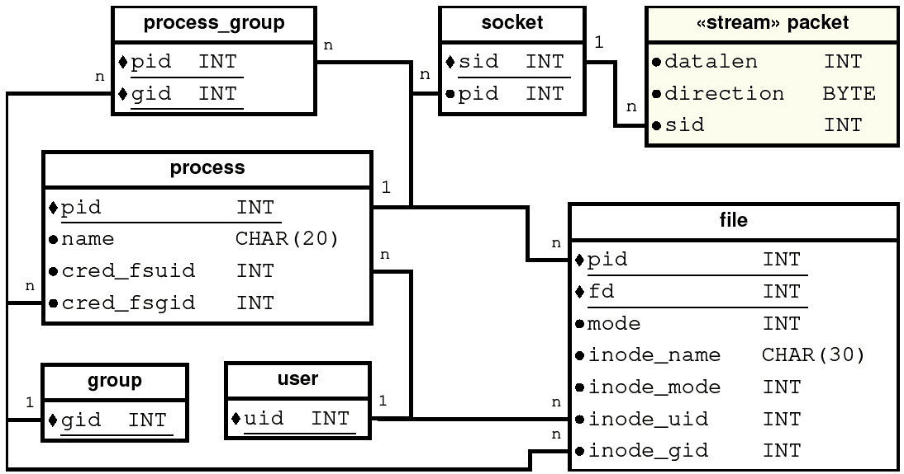

**图 2.1** 内核状态和事件流的（非详尽）关系表示。

因此，数据包流看起来像关系数据库表定义。其列代表事件的上下文数据。关系和流的区别在于：元组可以从前者中移除，但不能从后者中移除。流是单调且无限的。概念上，它们可以被视为不断增长的关系。

#### 2.1.3.2 关系流查询语言

对于数据采集，我们不考虑修改关系或流的查询。因此，将流纳入上述关系模型，使我们能够像对待数据库表一样对待它们。例如，关系代数中的以下操作可以在一个流的每个元组上执行，以产生另一个流：

*   **投影**（例如 `SELECT datalen FROM packet`）

*   **过滤**（例如 `SELECT * FROM packet WHERE datalen > 100`）

*   **连接关系**（例如 `SELECT pid, datalen FROM packet JOIN socket ON packet.sid = socket.sid`）

*   **流的并集**（具有相同模式）

将两个流 `S1` 和 `S2` 连接（与将流连接到关系相反），可以基于它们作为无删除关系的概念视图来定义。`S1` 中的每个元组都与 `S2` 目前包含（或“已生成”）的每个元组进行连接，反之亦然。一个应用场景是读系统调用的追踪，并通过信息扩展它们是否实际触发了磁盘 I/O，后者也是一个事件流。然而，没有必要永久存储所有曾经发生的读系统调用，而只需保留这些调用的一个有限窗口。这样的窗口（见下文）是一个随时间变化的关系，可以与 I/O 事件流进行连接。

#### 2.1.3.3 CQL

我们的工作建立在斯坦福大学的持续查询语言（CQL）之上。CQL 与标准 SQL 非常相似。与其他流查询语言（如 Aurora）不同，它不包含直接的流到流操作符（例如过滤或投影流）。流必须先转换为关系，然后才能由关系操作符处理。因此，CQL 通过四个操作符扩展了 SQL，用于在流和关系之间转换：

*   **窗口** 生成一个随时间变化的关系，包含属于当前窗口的所有流元组。窗口大小可以由其包含的元组数量（**行** 窗口）或其中最旧和最新元组之间的最大时间戳差值（**范围** 窗口）指定。一个 **slide** 参数（分别为元组数或持续时间）决定了沿着流移动窗口的步长。

*   **ISTREAM** 从关系生成一个流，包含插入到该关系中的每个元组（换句话说，即行）。

*   **DSTREAM** 为删除的元组生成一个流。

*   **RSTREAM** 从关系生成一个流。每当关系发生变化时，其所有元组都被插入到流中。

将所有其他操作限制在关系上，似乎是一个劣势，使得基于 CQL 的数据流管理系统（DSMS）无法高效实现。然而，这些限制仅适用于语言层面，而内部查询处理可能看起来完全不同。

#### 2.1.3.4 示例

本节展示了一些查询及其输出。

##### 流查询

数据包记录工具（如 `tcpdump`）通常在不将数据包分配给相关进程的情况下追踪数据包。尽管如此，通过查看传输协议的套接字编号并使用其他工具（如 `lsof`）查找使用这些套接字的进程，这是可能的。然而，在一步中完成此操作更为方便。查询如清单 2.1 所示。由于我们不能直接对数据包流进行操作，因此使用窗口将其转换为随时间变化的关系。由一种特殊形式的窗口——`now` 窗口——生成的关系相当特殊，因为它包含内容的总时间为零。来自数据包流的元组被插入窗口，随后直接从中删除。通过将窗口与 `socket` 和 `process` 关系连接而产生的关系也表现出相同的行为。使用 `RSTREAM` 操作符，随后从这些元组生成一个流。该查询的结果是如表 2.1 所示的元组连续流。

```
Packets: RSTREAM (
SELECT packet.datalen AS len,
packet.direction AS dir,
process.pid AS pid,
process.name AS pname
FROM packet [now], socket,
process
WHERE packet.sid = socket.sid
AND socket.pid = process.pid
);
```

**清单 2.1** *Packets*：将网络数据包分配给进程。

**表 2.1** *Packets* 查询的示例输出（清单 2.1）。

| **Timestamp** | **len** | **dir** | **pid** | **pname** |
| --- | --- | --- | --- | --- |
| 14...546486 | 1474 | > | 3728 | nc |
| 14...551490 | 32 | < | 3728 | nc |
| 14...556010 | 114 | > | 3378 | sshd |
| 14...559973 | 70 | > | 3736 | wget |
| ... | ... | ... | ... | ... |

```
PacketAggr: RSTREAM (
SELECT pname, COUNT(*), SUM(len)
FROM Packets [RANGE 5 minutes SLIDE 5 minutes]
WHERE dir = '>' GROUP BY pid
);
```

**清单 2.2** *PacketAggr*：在 5 分钟间隔内，按进程汇总出站网络流量（数据包数和字节数）。

我们可以以此为基础进行聚合和汇总。例如，清单 2.2 展示了一个查询，它使用 `Packets` 查询作为数据流源，在 5 分钟间隔内收集累积的出站网络流量（字节和数据包）。

##### 持续查询

在某些情况下，我们不想要一个流，而是实际上想要一个关系作为输出，其中元组也可以被删除。例如，

```
SELECT pid, name FROM process;
```


看起来像进程列表的关系快照，但在 CQL 中它是一个持续查询。因此，其输出包含插入和删除，如表 2.2 所示。此外，还捕获了查询的初始状态（具有虚构时间戳 1 的元组，因为我们无法知道真实时间）。

##### 访问其他地址空间

为了分析特定应用程序的性能问题，仅靠内核数据是不够的。如果应用程序提供相应的数据源，它们可以与内核数据结合使用。例如，清单 2.3 中的查询 `ApacheIO` 汇总了 Apache Web 服务器所服务的每个文件的磁盘操作数量和平均持续时间。

**表 2.2** “SELECT pid, name FROM process;” 的示例输出。

| **时间戳** | **插入/删除** | **pid** | **name** | **(注释)** |
| --- | --- | --- | --- | --- |
| 1 | + | 1 | init | |
| 1 | + | 2 | kthreadd | |
| ... | ... | ... | ... | 初始关系 |
| 1 | + | 4260 | man | |
| 1 | + | 4281 | kcql.elf | |
| 1439915918621953832 | \- | 4260 | man | 退出的进程 |
| 1439915923580930234 | \- | 3679 | bash | |
| 1439915928436850678 | + | 4285 | screen | 启动进程 |
| 1439915928439601848 | \- | 4285 | screen | screen 调用 |
| 1439915928439601848 | + | 4285 | bash | exec 系统调用 |
| ... | ... | ... | ... | |

```
ApacheIO:
SELECT Apache_HttpReqs.file, Apache_HttpReqs.ipSrc, COUNT(IO.duration),
AVG(IO.duration) AS avgduration
FROM Apache_HttpReqs, IO
WHERE Apache_HttpReqs.pid = IO.pid GROUP BY Apache_HttpReqs.file;
```

**清单 2.3** *ApacheIO*：输出 Apache 所服务的每个文件的 I/O 负载摘要。

##### 数据源的多实例

关系模型很容易扩展到数据源的多个实例，例如多个网络接口。从建模角度来看，这只是在相应的关系或流中增加一个标识列。因此，`Packets` 查询（清单 2.1）和后续的聚合（清单 2.2）仍然有效，甚至可以通过按网络接口聚合来扩展。

### 2.1.4 实现

kCQL 架构概览见 图 2.2。我们区分客户端和 kCQL 核心。客户端向核心提交查询，并持续接收数据，直到显式撤销查询。核心生成查询执行计划，并根据正在运行的查询处理数据。然而，必要的数据源也是由（其他）客户端提供的。在这方面，客户端类似于 DTrace 的提供者。由于客户端可以在内核空间和任何用户进程中运行，数据必须跨地址空间传输。查询计划被划分为多个部分，以尽量减少地址空间之间的数据流，而不是将数据移动到一个中心位置进行处理，然后将查询结果分发给客户端。因此，每个地址空间都有自己的 DSMS 引擎实例，每个实例处理查询的不同部分。

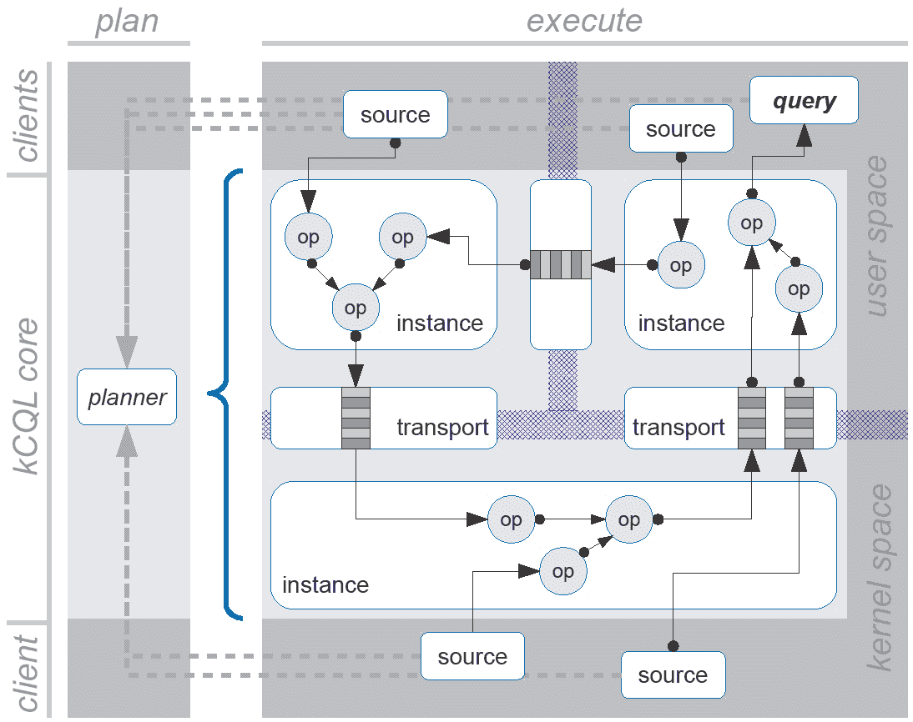

**图 2.2** kCQL 架构

#### 2.1.4.1 DSMS 引擎

kCQL 的核心，其 DSMS 引擎，基于斯坦福的数据流管理系统 STREAM [\[21\]](#backmatter-001.xhtml#b_9783110785944-010_ref_021)。它负责查询计划生成和查询执行。STREAM 是为从按需生成新元组的同步数据源拉取数据而构建的。相比之下，kCQL 使用异步操作系统事件。必要的修改在 第 2.1.4.2 节 中描述。

时变关系表示为更新流，包含带有时间戳和插入或删除标记的元组。这不仅适用于查询输出（如 表 2.2 所示），也适用于查询输入（数据源）和由关系算子（例如连接）生成的中间关系。因此，基于实际操作系统数据的关系（如进程表）也必须转换为这种更新流。

**查询计划生成** 在解析查询和数据源描述后，STREAM 从数据源到查询输出生成一个有向无环的关系算子数据流图。此时，我们引入一个步骤，将该图划分到参与的地址空间中。之后，向查询计划添加辅助结构，然后将其实例化以供执行。引擎实例包含以下元素：

*   **摘要** 提供当前与算子相关或包含在关系中的所有元组的视图。它们还维护索引，以便使用谓词高效地扫描它们（例如，查找连接伙伴）。

*   **算子** 执行关系操作或流与关系之间的转换。对于某些算子（如连接），流形式的关系表示是不够的，因为它们需要在处理当前输入元组时，查看包含在关系中的所有元组。它们通过*摘要*来实现这一点。*源算子*和输出算子在客户端和引擎实例之间建立接口。对于 kCQL，我们添加了发送器和接收器，以跨地址空间传输流和关系。

*   **队列** 缓冲算子之间的元组流。队列元素包含元组的时间戳，对于关系，还包含类型（插入或删除）。为了避免复制元组内容，队列元素不包含内容，而是指向共享存储中的位置。

*   **存储** 包含实际的元组内容，并在通信算子之间共享。它们由算子及其摘要使用。元组内容通过引用计数等元信息进行扩展。

除了查询计划的基本优化（如将合并、过滤和投影融入其他算子）外，STREAM 还在适当的地方用纯流算子替换关系算子。对于 清单 2.1 中的 `Packets` 查询，STREAM 不从数据包流生成实际窗口；而是直接将流元组与关系连接。过滤和投影也是如此。

**通过时间单调性保证一致性** 如果我们将来自流（例如数据包）的元组与关系（例如进程列表）进行连接，连接伙伴（例如进程）可能在实际的操作系统数据结构中不再存在（例如，因为进程可能已经终止）。使用 STREAM，这不会导致不一致，因为算子按时间戳顺序逐个出队并处理元素。这意味着连接总是先从流中出队元素，并将其与其摘要中的元组连接。只有在此之后，它才处理关系中的删除并更新其摘要。这样，也确保了所有其他算子（包括纯关系连接和窗口）的一致性。

然而，这要求所有队列都按时间戳排序：算子不得在出队时间戳为 `t`[1] 的元组后，再入队时间戳为 `t`[0] 的元组（其中 `t`[1] > `t`[0]）。对于处理算子，这意味着输出元组的时间戳总是其所基于的元组时间戳的最大值。对于关系 `R` 和 `S` 的全连接，这意味着：如果带有时间戳 `t` 的元组 `x` 被插入 `R`，那么生成的输出元组（即将 `{x}` 与 `S` 连接的结果）具有时间戳 `t`。

##### 查询执行

在 STREAM 中，单个线程以轮询方式调度算子，在我们的改造中，即每个地址空间一个线程。时间片以可从输入队列处理的最大元素总数给出。

如果算子的输入队列为空、输出队列已满，或遇到时间单调性停顿，则该算子被阻塞。后一种情况仅在多输入时发生。对于单输入算子（如过滤或窗口），保持时间单调性很简单：每步从队列取下一个元素，记下其时间戳并处理。若产生输出元素，它们都获得该记忆的时间戳。

多输入算子必须确定其头部元素具有最旧时间戳的队列，然后像单输入算子一样处理该元素。如果某个队列为空，算子不能从非空队列取最旧元素，因为相应的上游前驱仍可能将具有更旧时间戳的元素入队到空队列中。

#### 2.1.4.2 启用异步事件

除了跨地址空间分发算子外，我们还将 DSMS 引擎适配到异步操作系统事件流。

##### 异步源

通常，源算子在每个执行步骤从其关联源拉取一个元组。因为这对异步发生的事件没有意义，kCQL 中的数据源将元组写入缓冲区，相应的源算子从中读取。查询执行开始时，所有提供关系的源必须转储完整关系。对于所有操作系统进程的关系，这意味着遍历整个进程列表并将每个进程作为插入元素传递，如表 2.2 所示。此后，当关系需要更新时，它必须生成新元组。我们使用 `kprobes` 对生成流和关系更新的事件进行插桩。

##### 调度

STREAM 中的调度线程持续运行，直到处理给定数量的元组或被显式停止。只要数据源每次被请求时都提供新元素，这工作良好。然而，我们的异步数据源缓冲区可能变空。在这种情况下，持续运行的调度器会浪费 CPU 时间。

因此，我们修改后的调度器仅运行实际有工作可做的算子（即未被阻塞的算子，如第 2.1.4.1 节所述）。如果没有此类算子，调度器挂起。它可在异步源产生元组后恢复，也可在传输层收到来自另一地址空间的通知后恢复。

##### 打破时间单调性停顿

时间单调性停顿不会阻止其他上游算子继续填充非空队列。由于队列有界，停顿会向上游传播到数据源。与同步操作不同，我们不能在停顿清除前停止从这些源拉取数据，否则会错过事件。

因此，如果我们至少有一个非空输入队列，但需要从空队列取下一个元素，我们尝试找到入队到该空队列的元素可能具有的最旧时间戳。之后，我们用该时间戳重新评估单调性条件。

为找到最旧可能时间戳，算子询问相应的上游输入算子。每个算子都实现该方法，根据算子类型略有不同：

*   **源**：返回环形缓冲区头部元素的时间戳。若缓冲区为空，返回一个同步变量（每地址空间一个）的值，该变量始终包含任何新生成数据的最新时间戳。

*   **单输入算子**：返回输入队列头部的时间戳。若队列为空，询问其上游输入算子。

*   **多输入算子**：返回所有队列头部中最旧的时间戳。若*所有*队列均为空，询问所有上游输入算子，并返回最小值。

*   **接收器**：返回传输层中头部元素的时间戳。若无元素，发送端无法直接返回任何可打破停顿的内容。但它提示对端地址空间中的相应发送端发送一个仅包含所需时间戳的空元素。这样，下一轮即可打破停顿。

#### 2.1.4.3 跨地址空间传输

队列元素需要有序的基于流的进程间通信，但不一定是同步的。使用现有的同步进程间通信机制要么需要每个元组一次系统调用，要么需要在每边手动实现缓冲区。因此，我们决定使用共享内存段中的环形缓冲区。我们仅使用同步通信（内核-用户用 `procfs`，用户-用户用消息队列）来唤醒休眠的发送端和接收端：接收端在环形缓冲区为空时休眠，调度线程在无其他算子有工作可做时休眠。当相应发送端向环形缓冲区写入新元素时，它发信号唤醒调度器以唤醒接收端。发送端因传输环形缓冲区满而休眠时，反之亦然。为避免不同地址空间间的共享和同步存储，我们也将元组（除时间戳和类型外）直接写入环形缓冲区。

### 2.1.5 评估

为评估 kCQL，我们检查整体运行时开销以及将内核控制流转移到事件处理后才能恢复正常操作所施加的同步延迟。我们也为 SystemTap 和 PiCO QL 测量这两个量以作比较。

我们的评估平台是一台配备 Intel Core i5-3570 处理器和 Ubuntu Server 14.04 的台式计算机。四个核心的时钟频率固定为 3.4 GHz。我们使用 Vanilla Linux 内核 3.14.17 进行实现，配置为 Ubuntu 的通用配置。我们在以下负载下进行评估：SysBench 的[[382]](#backmatter-001.xhtml#b_9783110785944-010_ref_382)素数计算（仅 CPU 和用户模式）以及完整的 Linux 内核构建（`x86_64-defconfig`，CPU 和 I/O 活动）。

#### 2.1.5.1 查询

我们使用两个查询对我们的方法进行定量评估。两者均实现为 SystemTap 脚本，导致代码行数大幅增加。对于 Packets 查询，我们实现了两个版本：一个紧密模仿 kCQL 的操作模式，使用增量更新的进程列表副本（182 行代码），另一个在接收数据包时直接访问进程列表（159 行代码）。Files 查询的 SystemTap 实现包含 46 行代码。

##### 将网络数据包分配给进程（“Packets”）

第一个查询已在第 2.1.3.4 节的清单 2.1 中展示。为进行定量评估，第二台机器通过直接千兆以太网连接连接到被测机器，以全速发送 TCP 数据包。

##### 查找当前以权限不足方式打开的文件（“Files”）

第二个查询收集由不具备必要访问权限的进程为读取而打开的文件。该查询仅作用于关系，但这些关系会被持续处理，一旦发生上述情况，立即传递一个元组。该查询如清单 2.4 所示。

#### 2.1.5.2 总体运行时开销

为了量化数据采集施加的总体运行时开销，我们测量了在没有数据采集、以及使用 `kCQL`、`SystemTap` 和 `PiCO QL` 执行不同查询时，SysBench 和内核构建所花费的时间。

```
Files:
SELECT DISTINCT P.name, F.inode_name, F.inode_mode & 0400,
F.inode_mode & 040, F.inode_mode & 4
FROM process AS P, file AS F, process_group AS PG
WHERE P.pid = F.pid AND P.pid = PG.pid AND F.mode & 1 = 1
AND (F.inode_uid != P.cred_fsuid OR F.inode_mode & 0400 = 0)
AND (P.cred_fsgid != PG.gid OR F.inode_mode & 040 = 0)
AND F.inode_mode & 4 = 0;
```

**清单 2.4** *Files*：一个持续更新的关系，包含当前以权限不足方式打开的文件。

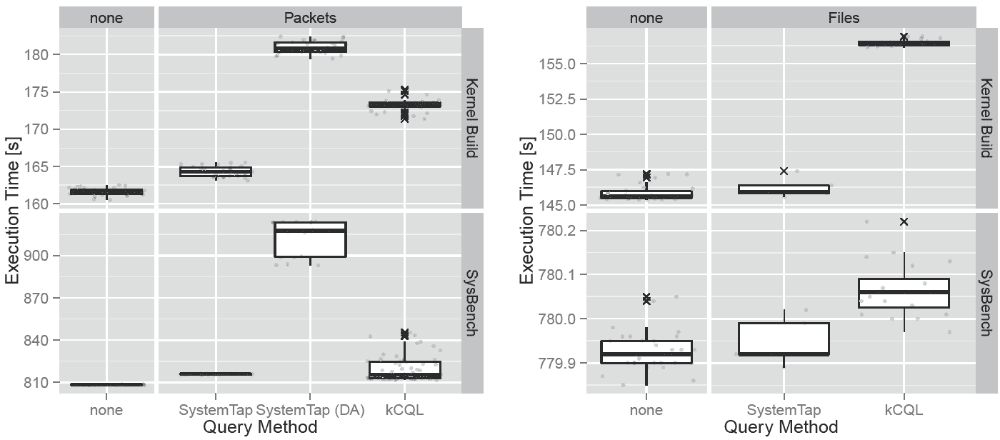

**图 2.3** 干净运行的内核构建和 SysBench 与同时执行 `SystemTap` 或 `kCQL` 并带有 *Packets* 查询（左）和 *Files* 查询（右）的运行对比。不同的基线是由于传入 TCP 数据包的存在（左）或不存在（右）。

**与 SystemTap 对比** 图 2.3 包含使用 `kCQL` 和 `SystemTap` 执行两个查询时 SysBench 和内核构建执行时间的箱线图。我们在生成 *Packets* 查询的基线时，也向测试机器发送了网络数据包。图 2.4 基于相同的数字，显示了与基线相比的相对运行时间和开销。

显而易见，直接访问内核状态（DA）不利于 *Packets* 查询。定制的 `SystemTap` 脚本通过使用内核状态的增量更新副本，产生的开销比 `kCQL` 更小。虽然 `kCQL` 在这里表现不佳，但开销仍在合理范围内。

`SystemTap` 实现的 *Files* 查询可以利用一个不变量：我们在查询中跟踪的情况只能直接在调用 `setuid` 之后发生。我们将在第 2.1.6.1 节进一步讨论这一点。

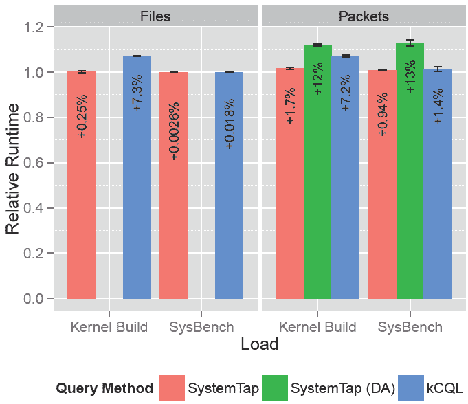

**图 2.4** 与干净运行的内核构建和 SysBench 相比的平均相对运行时间和开销百分比对比。

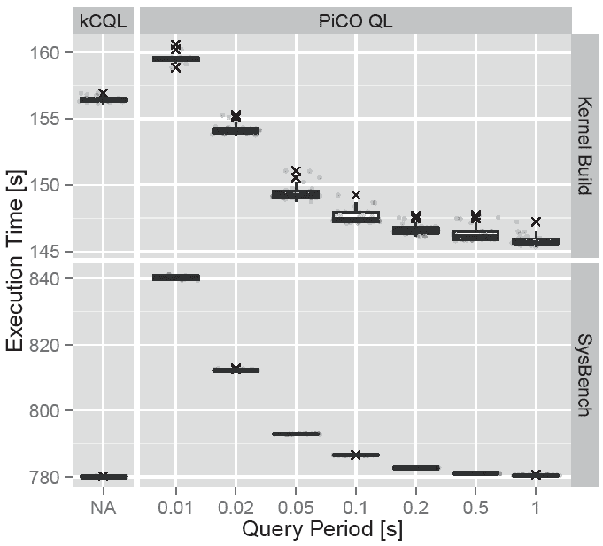

**图 2.5** 与具有不同调用周期的 `PiCO QL` 相比的 *Files* 查询运行时开销。

**与 PiCO QL 对比** `PiCO QL` 基于传统的关系接口，没有数据流的概念。因此，我们尝试通过频繁轮询来实现相同的功能。`PiCO QL` 的轮询频率加上查询执行时间对应于延迟。此外，轮询频率控制着延迟和性能开销之间的权衡，这就是我们评估 `PiCO QL`⁵ 的原因。

图 2.5 显示了不带查询、带有使用 `kCQL` 的查询以及带有使用具有不同调用周期（x 轴）的 `PiCO QL` 的查询时，内核构建和 SysBench 运行时间的箱线图。每 10 到 20 毫秒调用一次带有 *Files* 查询的 `PiCO QL`，对于内核构建施加的开销大致与使用 `kCQL` 运行持续查询相同。

#### 2.1.5.3 同步开销

图 2.6 显示了同步开销的直方图（基于每次运行 100,000 个样本），即事件发生后直接在同一上下文中（例如相应的中断上下文）由查询处理消耗的部分时间。不出所料，*Packets* 的直接访问变体表现最差，因为每个网络数据包都会导致对进程列表的一次完整迭代。对于其他查询实现，

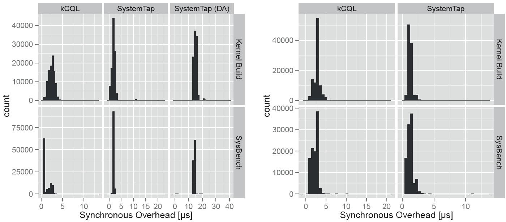

**图 2.6** `SystemTap` 和 `kCQL` 下 *Packets*（左）和 *Files*（右）的同步开销。

通常低于 `kCQL`，这可能是因为 `kCQL` 尚未在查询处理的同步部分使用 per-CPU 缓冲区。

由于 `PiCO QL` 的查询执行是异步触发而非由事件触发，因此不存在“同步延迟”。然而，`PiCO QL` 在执行查询前会调用 `stop_machine()`，从而在整个查询执行时间内延迟所有 CPU 上的正常操作。`PiCO QL` 在我们的机器上回答文件查询大约需要 730 微秒。

### 2.1.6 讨论

本节详细阐述查询语言 `kCQL` 的接口、安全方面以及我们方法的实际应用。

#### 2.1.6.1 查询接口


声明性语言的主要优势在于能够形式化地指定“做什么”而不是“怎么做”。其理念是最佳的“怎么做”可以自动推导出来。在我们的案例中，这包括查询计划的推导、算子的放置以及数据访问方式。当我们有多个同时执行的查询时，这变得特别有趣。由于数据模型和查询的严格语义，查询的公共子表达式可以被重用 [[620]](#backmatter-001.xhtml#b_9783110785944-010_ref_620)。考虑到非专家，直接指定“怎么做”也给低效实现甚至致命错误留下了更多空间。后一点通常通过受限语言和动态检查的结合来避免，正如第 2 节所讨论的。尽管如此，对于特定查询，专家通过直接指定“怎么做”能获得更好的结果。

手工编写的 `Files` 查询 `SystemTap` 变体利用了专家知识：感兴趣的条件（进程打开了一个它没有读取权限的文件）只能在特定事件之后直接发生。当然，`kCQL` 查询可以使用 `setuid` 调用流，从而实现相同的技巧。我们可以用两个性能不同的声明性查询实现相同的输出，这似乎违背了自动寻找最佳“怎么做”的初衷。然而，这不是声明性的问题，而是由于不同操作系统数据源之间固有的关系尚未对 `kCQL` 可见，属于未来工作的主题。

#### 2.1.6.2 安全性

目前，仅允许 `root` 用户使用 `kCQL`。要允许普通用户使用 `kCQL`，我们可以检查用户是否拥有查询所需的内核状态部分的读取权限或能力。我们还可以强制执行过滤元组的谓词。例如，用户可能只被允许接收包含相应用户 ID 属性的 `process` 关系中的元组。然而，当用户无法访问的元组或属性出现在谓词求值中（例如，在查询计划深处的连接操作中），但不在实际输出中时，该如何处理并不明显。

#### 2.1.6.3 实际应用

本节展示了我们项目中的三个案例研究，说明如何利用在 Linux 内核上下文中收集的数据来更好地理解和改进系统。其中两个案例研究涉及基于 Android 的智能手机的 Linux 内核。第三个旨在总体上改进 Linux 内核。

**开放智能手机数据收集** 智能手机上收集的数据不仅揭示了大量用户信息，还揭示了底层系统软件的行为和效率。在为期 4 个月的研究中，我们在 Android 智能手机上收集了一个匿名的开放数据集，现已免费提供给研究人员使用。⁶

**可复现的负载测试** 基于另一次在 Android 的 Linux 内核和用户级服务中的数据收集，我们为任意 Android 应用创建了具有代表性的资源使用概况 [[445]](#backmatter-001.xhtml#b_9783110785944-010_ref_445)。这是通过记录发送给应用的低级事件跟踪来完成的，例如 GPS 定位或网络数据包的到达，应用作为反应执行的动作，如文件 I/O 或显示活动，以及暂停。这些跟踪可以混合以创建任意应用概况。此处的挑战在于调整暂停持续时间和模拟事件时间戳，使混合概况切合实际。系统软件开发人员可以回放混合跟踪作为可复现的负载测试，而无需任何真实应用，从而避免了对现有服务器连接、用户活动等的要求。

**学习操作系统锁规则** 随着多核和众核系统的普及，Linux 内核的复杂性急剧增加，因为并发控制必须以细粒度的方式进行协调。为此使用了各种类型的锁。即使对于经验丰富的系统软件开发人员，要确定在安全访问内核数据结构的特定成员之前必须获取的正确锁序列也变得非常困难。极少有内核组件拥有其锁规范，且大多数已过时。基于内核级数据采集，即锁的创建和使用事件，我们开发了 `LockDoc` [[446]](#backmatter-001.xhtml#b_9783110785944-010_ref_446) 作为解决内核开发人员困境的可能方案。`LockDoc` 学习数据结构的锁规则。因此它可以（1）生成文档，（2）识别现有文档中的过时规则，以及（3）通过识别违反学习规则的罕见事件序列来发现 Linux 中的 Bug。一些文档和代码改进已被贡献并集成到 Linux 内核中。

### 2.1.7 结论

挖掘操作系统的控制流和数据流存在风险，正如篡改任何复杂系统一样。然而，它能为我们提供至关重要的信息，这些信息几乎无法通过其他方式获得。合适的工具和抽象有助于降低风险。

在数年时间里，我们因此开发了 `kCQL`，它将现有框架的最佳理念结合成一个独特的工具。它拥有高度表达力的查询语言、资源高效的实现，并支持在极靠近数据源头的位置进行数据聚合。

已探索了不同的应用领域。结果表明，在系统软件上下文中收集的数据可用于深入了解用户和应用行为，我们可以精确模拟应用概况，甚至可以改进 Linux 内核及其文档。

## 2.2 PhyNetLab 测试床

*Mojtaba Masoudinejad*

*Markus Buschhoff*

**摘要：** 无线传感器网络已成熟到可以集成到工业应用中的地步。然而，在进行任何实际部署之前，某些方面需要详细分析。除了对应用性能和耐久性的检查外，系统模块化和能量中性是需要精确分析的两个重要关注点。这些需求促成了 `PhyNetLab` 的开发，这是一个用于无线传感器网络上物料流和仓储应用的测试床。

工业系统中的实体应具有高度模块化，以实现灵活且可复用的系统，并简化部署后更新或升级系统组件的过程。这提供了易于搭建的系统，这些系统可动态改进，同时将部署后的修改工作量和成本降至最低。因此，通过 `PhyNetLab` 测试床的案例研究，解释了硬件和软件所需的设计原则。

能量中性是物流和生产中无线传感器网络的基本要求，因为对成千上万个网络节点进行电池管理的不可行性将扼杀在此实现无线化的任何尝试。本节展示了通过使用能量采集、自动生成的能量模型和在线能量核算来实现能量中性的多种途径。

除了硬件要求，工业规模的无线传感器网络还有若干软件要求，而在实现此类用例的测试床时，这些要求被进一步缩小。最重要的是，`PhyNetLab` 使用 `Kratos`，一个基于 `C++` 和 `AspectC++` 的实时操作系统，它允许模块化、可维护和高度可配置的代码。除了语言和框架特性外，`Kratos` 还在严重资源受限的情况下运行时，为外围设备采用了能耗核算。

通过展示一个完全使用 `PhyNetLab` 构建的生产系统的物料搬运过程，进一步证明了 `PhyNetLab` 测试床的有效性和可用性。它不仅作为此类测试床的概念验证，还为本节末尾讨论的可能未来工作提供了见解。

### 2.2.1 介绍

无线传感器网络（`WSN`）的研究在过去几年中持续进步 [[209]](#backmatter-001.xhtml#b_9783110785944-010_ref_209)。这些网络来自不同应用领域，具有不同的目标、规格和限制。除了单独开发的单一 `WSN` 外，还构建了 `WSN` 联邦，其中 `MoteLab` [[702]](#backmatter-001.xhtml#b_9783110785944-010_ref_702)、`FIT/IoT-Lab` [[231]](#backmatter-001.xhtml#b_9783110785944-010_ref_231)、`Indriya` [[180]](#backmatter-001.xhtml#b_9783110785944-010_ref_180) 和 `WISEBED` [[304]](#backmatter-001.xhtml#b_9783110785944-010_ref_304) 是其著名实现。虽然这些平台展示了概念验证并支持 `WSN` 的测试和开发，但某些方面仍未解决。其中包括针对特定应用的通信协议开发，以及大规模部署中的能量感知系统设计和运行。此外，工业部署需要更密集的系统分析，以确保在工业环境下长期连续满载运行的可靠性。

# 面向仓储的无线传感器网络测试床

在各个应用领域中，内部物流或室内物料流转与仓储是完美的候选者。一方面，去中心化和模块化被认为是未来物料搬运和仓储应用的关键要素[[599]](#backmatter-001.xhtml#b_9783110785944-010_ref_599)。另一方面，已开发出多种电子实体，以实现该领域物体的智能操作和通信[[472]](#backmatter-001.xhtml#b_9783110785944-010_ref_472)。因此，工业用例的基础已然具备，且可在该领域评估可获取的科学概念。

由于无法为大量设备充电以及此类移动实体的尺寸限制所导致的能量约束，使它们成为具有极端约束的硬件。同时，此类流程具有极高的动态性且节奏非常快，导致硬编码算法效率低下。因此，这些应用和 `PhyNetLab` 成为在资源极度受限的硬件上开发、优化和评估机器学习算法的完美候选者。

本节部分内容取自[[104]](#backmatter-001.xhtml#b_9783110785944-010_ref_104)和[[471]](#backmatter-001.xhtml#b_9783110785944-010_ref_471)，经作者同意转载。

设计了一套实验性物料搬运和仓储平台，作为工业 WSN 案例研究的开发、测试和优化测试床。此处使用了多特蒙德工业大学一座面积超过 600 m² 的研究大厅。鉴于未来内部物流对灵活性的要求，该区域内没有任何组件是永久固定的。为实现物体运输，提供了五台移动机器人。除了两种标准尺寸的典型周转箱外，还有移动工位，可根据生产工艺需求动态定位。这些要素为复制不同的内部物流场景提供了基础，包括：非固定物料流、不同的动态仓储，以及动态生产计划和工艺设计。

连接这些实体并建立动态智能系统所缺失的环节，是增加具有通信功能的智能电子元件。这些解决方案应体积小、重量轻、免维护（或低维护）且自主运行。此外，它们必须实现能量中性，以消除定期充电或更换电池的需求。开发此类系统的过程将在本节其余部分讨论。然而，尽管我们讨论设计过程，此类系统的主要目标是开发、优化和评估采用 WSN 的物料流系统。

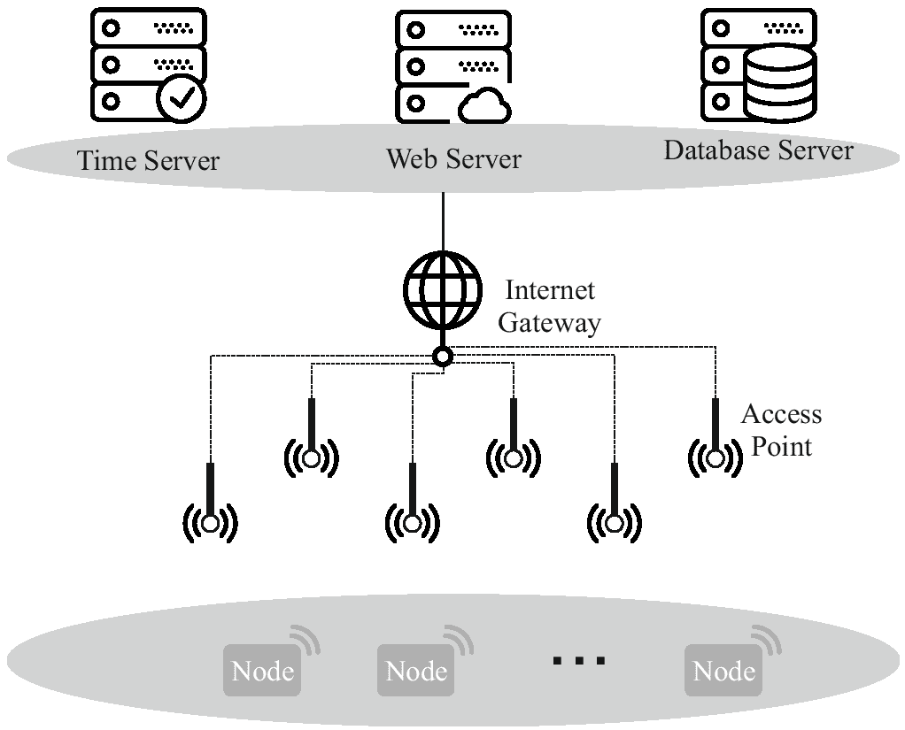

**图 2.7** `PhyNetLab` 测试床的示意图结构。

### 2.2.2 测试床的总体结构

该实验测试床由三个主要层组成。虽然大量实体驻留在安装于运输箱和工位等物体上的物理层，但中间层由六个接入点（AP）组成，它们使用 866 MHz 的无线电接口实现通信。通过一个网关提供对外部世界（互联网）的访问，该网关主要访问用于时间和数据的服务器，此外还有一个作为用户界面的 Web 服务器。`PhyNetLab` 结构的抽象概览见图 2.7。

除了 WSN 的整体结构外，`PhyNetLab` 还包含一些额外基础设施，使其成为理想的实验测试床。首先，有一个运动捕捉系统，可在环境中以亚毫米级精度和高达 300 Hz 的频率跟踪物体。该系统包含大量发射红外光的摄像机。待跟踪物体标记有特定的反射标记，可被摄像机观测。每个物体获得一组具有独特物理分布的反射标记。这些反射标记的构型存储在运动捕捉系统的软件中。结合不同摄像机的视角，可在该系统中提供每个物体的精确定位。该位置数据可通过 `PhyNetLab` 中两个底层的所有节点访问。

评估节点能量中性（由光伏 (PV) 和能量采集供能）的基本必要条件是受控照明。这在 `PhyNetLab` 内可通过智能照明管理实现，该管理提供受控光强以复制多样化的工作和仓储照明场景。

### 2.2.3 硬件

虽然 `PhyNetLab` 的上层硬件使用为此目的专门开发软件的商用服务器，但中间层 AP 基于改装的 `Raspberry Pi` 开发板。这些开发板配备两个 868 MHz 收发器，外加两个 WiFi 模块。在与顶层和互联网进行 WiFi 通信的同时，专用收发器实现与现场层节点的通信。然而，所有使用的硬件均为专门为 `PhyNetLab` 测试床应用编程的现货组件。

`PhyNetLab` 的关键硬件方面是大规模现场层节点的异构性。同时，这些节点应支持快速修改，同时最好使用相同的接口。因此，由电池供电的现场层节点（称为 `PhyNode`）采用模块化设计，包含一块主板（`MNB`）和一块可更换板（`SB`）。所有节点具有相似的 `MNB`，支持通过 ZigBee 进行基本通信交互。此外，`MNB` 用于系统刷写和供电，而每个 `SB` 具有特定的硬件配置，可随时间更改。`PhyNode` 板正视图的总体概览见图 2.8，清晰地展示了两个模块通过单个 8 针端口连接的分离情况。

`MNB` 是 `PhyNode` 的固定部分，通过空中软件刷写提供基础功能。因此，它具有简单的结构，其示意图结构见图 2.9。

`MNB` 拥有一个由 1 250 mA h 锂离子聚合物电池组成的电源模块，典型电压范围为 3 V 至 4.2 V。其电压控制器使系统保持在安全工作范围内，同时保护电池。它还包含一个用于 ZigBee 通信的 RF 收发器，选择它主要是因为其低能量需求和通用性。这种结构改进了新软件的刷写过程。

对于其核心功能，`SB` 可拥有大量具有不同配置的组件。`PhyNode` 组件最先进版本的示意图结构见图 2.10。某些模块（如传感器、用户界面和能量采集设备）为可选项，并非所有批次均具备。然而，所有节点均使用来自德州仪器 (TI) 的 `MSP430FR5969` MCU，该芯片还提供 64 KiB 的 FRAM。

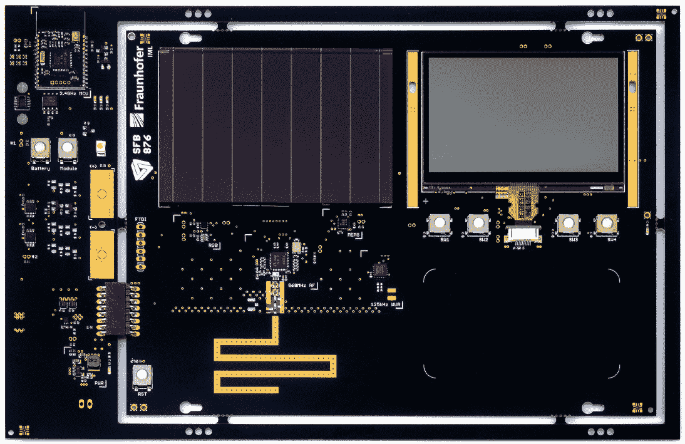

### 2.2.4 软件

#### 2.2.4.1 测试床需求

作为 IoT 应用测试床的能量中性嵌入式系统有若干需求，这些需求超出了典型嵌入式系统工程的范畴。因此，为了提供一个用于硬件访问和调度的稳定且可复用的代码库，PhyNetLab 专门开发了一个名为 `Kratos` 的嵌入式实时操作系统。`Kratos` 满足 PhyNetLab 应用的以下需求：

*   **裁剪**：`Kratos` 中大量的特性和变体，结合嵌入式低功耗系统中的高资源约束，需要一种简便的方法来为应用选择和配置组件。

*   **关注点分离**：操作系统代码库应保持稳定且可维护。这要求将 `Kratos` 开发者、驱动/组件开发者和应用开发者的关注点分离开来。

*   **控制反转**：作为 SoC 策略的一部分，IoC 实现了从操作系统到应用代码的调用，而无需修改操作系统代码库。结合裁剪功能，这允许对驱动进行（可配置的）调用，例如在系统启动时进行初始化，以及调用应用代码。

*   **横切关注点**：与 SoC 范式相矛盾的是，复杂系统中也存在*横切关注点*。在此，通用功能（如函数调用日志记录）应作为一个独立组件在现有代码库之上开发。以日志功能为例，此类功能不得修改源代码，以保持 SoC。稍后将详细展示的另一个例子是在驱动调用期间进行能耗核算，而不修改原始驱动代码。这在纯命令式或面向对象语言中几乎无法实现。

*   **能量分析**：为了收集 PhyNode 性能数据，需要进行详细的能耗分析。在线能量测量无法满足这一需求，因为它无法针对单个系统组件（例如与微控制器位于同一芯片上的外围硬件组件）进行。

基于这些需求，`Kratos` 采用 `AspectC++` [644, 645] 进行开发，后者是 C++ 的面向切面编程（AOP）语言扩展。`AspectC++` 编译器作为目标平台工具链的预编译器工作。`AspectC++` 可以在编译时通过一个称为“代码织入”的过程将源代码注入或替换到现有代码库中。为此，`AspectC++` 提供了自己的语言来标识代码位置（“连接点”），以及一种结构良好、类 C++ 的语言来定义要织入的代码片段，称为“通知”。连接点和通知的组合称为*切面*。

`AspectC++` 在 PhyNetLab 中的一个应用示例是 PhyNode 显示屏的使用，该显示屏的总线信号需要比处理器在低功耗模式下提供的电压更高。PhyNode 的显示代码没有修改显示驱动（从而使其依赖于处理器类型并导致无法用于其他硬件平台），而是将低/高功耗模式切换切面织入驱动中，保持其原始代码不变。此外，这种行为实现了*裁剪*：仅通过选择是否编译该切面，就足以启用或禁用功耗模式切换，而无需接触代码库。因此，代码开发者无需通过使用 `#ifdef` 语句进行配置来预测可能的未来扩展。

AOP 还有助于实现 IoC 范式。回到之前的驱动初始化示例，驱动现在可以利用切面将对其初始化代码的调用插入 `Kratos` 中。为此，`Kratos` 具有一组空的“钩子”函数，切面应将其代码织入其中。同样，禁用驱动仅需不编译其代码和该切面即可。

总之，使用 `AspectC++` 实现了 SoC、IoC 和横切关注点，并支持在极细粒度级别上进行裁剪，且没有 `#ifdef` 指令难以维护的语法开销 [63]。

#### 2.2.4.2 能量核算（能量模型）

测试床实验的分析和评估的一个重要参数是其能耗。在能量供应高度受限的系统中，了解能量用于何处以及哪个组件负责消耗非常重要。然而，仅靠简单测量很难回答这个问题。此外，“在线”测量，即在板载测量设备并在运行时执行测量，有几个缺点，包括：

1.  它本身会消耗功率。

2.  它无法区分不同的消费者。

3.  它需要 CPU 时间来存储数据。

4.  它需要通往 CPU 的通信通道，占用一项重要资源。

作为替代方案，软件能量模型有助于估算每个硬件组件的功耗。由于软件模型需要计算开销，存在若干设计替代方案。*离线*模型在设计时计算能耗，从而实现高度详细和精确的模型。然而，它们只能在统计层面预测外部事件，例如传入的通信请求和用户交互。相比之下，*在线*模型可以动态适应情况，但似乎在计算需求和准确性之间存在权衡。尽管如此，文献 [105] 表明，在许多现实场景中，只需很少的计算工作就能获得高度准确的结果。

为实现这一点，组件的能量模型必须遵循特定的方法论。在所采用的建模方案中，每个组件被建模为一个带成本标注的有限状态机（FSM），由能量状态组成。FSM 具有两类成本标注：状态标注平均*功率*成本，因此状态的能耗可通过将成本乘以机器停留在该状态的时间来计算；而转换标注平均*能量*成本，因此状态间的切换可能产生能量影响。


在给定的建模方案中，驱动函数调用和中断服务程序会导致状态变化。因此，驱动功能与能量模型之间存在映射关系，且能量模型必须据此构建。在其他操作系统上的驱动实现中，这可能不可行，因为驱动函数调用接口与能量模型之间存在`语义鸿沟`（参见图 2.11）。Kratos 允许我们通过使用能量模型的映射方案来弥合语义鸿沟。然而，驱动接口实现通常仍必须可映射到模型的转换。

![图 2.11 相干与非相干驱动。左侧的非相干驱动不允许代码到模型的映射（语义鸿沟）。右侧通过在代码中遵循模型结构实现了这一点。来源：[104]](graphic/b_9783110785944-002_fig_011.png)

图 2.11 相干与非相干驱动。左侧的非相干驱动不允许代码到模型的映射（语义鸿沟）。右侧通过在代码中遵循模型结构实现了这一点。来源：[[104]](#backmatter-001.xhtml#b_9783110785944-010_ref_104)

并非显而易见的是，这种建模形式在保持足够精度的同时始终可行，因为对于任意复杂的硬件，这可能成为一个问题。然而，能量中性系统中硬件的复杂性是有限的，在第 2.2.4.3 节所示自动化能量建模系统的指导下，对无线电收发器、传感器、CPU、串行总线驱动、不同 MCU 平台等典型组件的模型进行的实际调查，在实践中产生了准确的结果。

组件的能量模型可用于组件驱动程序和其他操作系统模块中的在线能量核算。一种低开销的实现仅计算转换的次数，即驱动调用的次数，并为有限状态机（`FSM`）的每个状态维护一个时间流逝。当从核算系统请求能量值时，计算组件的能量消耗的复杂度仅相当于将每个被调用驱动的计数乘以相应的转换能量，并将每个状态的时间流逝乘以相应的状态功率。

CPU 能量消耗是一个特殊情况，因为 CPU 通常没有驱动实现。然而，在 Kratos 中，CPU 能量是使用相同的建模方案进行核算的。CPU 模型将不同的电源模式或睡眠模式隔离为 `FSM` 状态。Kratos 调度器（控制所有 CPU 能量状态转换）被用于核算，而不是对驱动进行插桩。

能量核算代码通过面向切面编程（`AOP`）中的`插桩`技术注入到原始驱动和调度器代码中。为了自动化这一过程，开发了一套工具，能够导入能量模型文件以及驱动与转换之间的映射，并为相应驱动生成 `AspectC++` 切面。同样，这使得应用开发者无需更改驱动代码库，即可快速决定是使用插桩驱动还是原始驱动。

#### 2.2.4.3 能量模型闭环

前述的插桩系统允许快速修改模型的成本注解，也允许将代码自动重新部署到实际硬件。这可用于在一个监督学习过程中确定状态和转换的成本。

因此，将实际功率测量值与核算能量进行比较可以优化能量模型。这可以通过使用如图 2.12 所示的测量环路来实现。被测设备被烧录了插桩固件。使用的模型是一个初步的带有转换映射但无成本注解的状态机。操作系统额外被一个测试模式发生器插桩，该发生器按预配置顺序调用驱动函数。运行此固件的设备外部配备了一个功率测量单元。核算值和测量值均被传递给外部分析引擎，该引擎确定成本解的质量并自动创建新模型以重复该过程。当达到期望精度或在多次运行中无法实现显著质量提升时，循环结束。此外，分析引擎可以识别 `FSM` 内部的结构问题，例如功率消耗方差很大的状态。

![图 2.12 测量环路。实线代表自动步骤；虚线允许人工干预。来源：[104]](graphic/b_9783110785944-002_fig_012.png)

图 2.12 测量环路。实线代表自动步骤；虚线允许人工干预。来源：[[104]](#backmatter-001.xhtml#b_9783110785944-010_ref_104)

这种自动化模型注解过程为更复杂的模型打开了大门。直到 2019 年，模型仅限于核算驱动调用，而不考虑函数调用参数。引入调用参数成本（作为参数集的数学函数）可以极大地提高模型的精度[[106]](#backmatter-001.xhtml#b_9783110785944-010_ref_106)。然而，这也带来了代价：驱动能量消耗的在线评估现在可能变得与参数成本函数一样复杂。

为目标硬件生成的测量应用程序由`运行表`驱动，如图 2.12 所示。运行表定义了所有驱动函数参数的有效范围。合成的测量应用程序遍历这些范围的幂集。生成的数据分三步分析：

1.  **识别：** 在此阶段，选择所有影响能量消耗的参数。为此，在保持观察参数恒定的情况下进行参考测量。之后，在多次迭代中改变观察参数。如果改变后的参数导致的能量消耗超出了参考测量的噪声界限，则认为该观察参数有影响。

2.  **单参数回归：** 通过使用八种回归方法（线性、对数、平移对数、指数、平方、分数、平方根、单比特计数）来确定单个参数的成本函数。选择具有最低`残差平方和`（`SSR`）的函数 `f(p⃗)` 进入下一步。

3.  **多参数回归：** 所有识别出的函数 $f(\\overset{\\rightarrow}{p}) \\in F$ 都在方程 2.1 所示的复合函数中组合。该函数的系数通过最小化误差的回归来确定。结果即为假设的成本函数。

(2.1) $g(\\overset{\\rightarrow}{p}) = \\sum\\limits\_{F^{\\prime} \\in \\mathcal{P}(F)}\\left( {a\_{F^{\\prime}} \\cdot \\prod\\limits\_{f \\in F^{\\prime}}f(\\overset{\\rightarrow}{p})} \\right)\\,\\,\\,\\,\\,\\,\\,\\,\\,\\,\\,\\,\\,\\,\\,\\,\\,\\,\\,\\,\\left( 2.1 \\right)$

表 2.3 CC1200 和 nRF24 收发器在蒙特卡洛交叉验证中静态模型与参数感知模型（右）属性的对称模型误差。中间显示参数影响。

| **模型属性** | | | **影响参数** | | | **误差** | | |
| --- | --- | --- | --- | --- | --- | --- | --- | --- |
| | | **数据速率** | **负载长度** | **发射功率** | **静态模型** | **参数感知模型** |
| CC1200 发射功率 | | ✓ | ✓ | ✓ | 12% | 0.7% |
| CC1200 发射时间 | | ✓ | ✓ | – | 87% | 0.1% |
| CC1200 接收功率 | ✓ | ✓ | – | 0.2% | <0.1% |
| nRF24 发射功率 | ✓ | – | ✓ | 34% | 1.2% |
| nRF24 发射时间 | ✓ | – | – | 16% | <0.1% |
| nRF24 接收功率 | ✓ | – | – | 2.2% | <0.1% |

为验证该方法的有效性，对 TI `CC1200` 和 `nRF24L01+` 无线电收发器、一款低功耗 I²C 温度传感器（`LM75B`）以及一款具有可编程功耗行为的合成外设进行了建模和测试 [[106]](#backmatter-001.xhtml#b_9783110785944-010_ref_106)。这两款收发器均包含 `IDLE`、`RX`、`TX` 和 `SLEEP` 状态。在对动态模型方法进行评估时，存在三个可调参数：发射功率、比特率和发射数据长度。

表 2.3 显示了参数对模型属性的已确定影响，以及静态和动态模型属性的模型误差。模型误差通过 200 次蒙特卡洛交叉验证运行进行评估。数据按 2/3 用于训练、1/3 用于验证进行划分。

结果表明，函数参数显著影响能耗，有时甚至以意想不到的方式。例如，预期 `CC1200` 在 `TX` 期间的功耗是恒定的，且载荷长度仅通过 `TX` 时长影响能耗。但实际上，实际功耗也取决于载荷长度。原来 `CC1200` 具有固定前导码且发射功率单独设置，因此前导码/载荷时长比（进而 `TX` 功率）也取决于载荷大小。相比之下，`nRF24` 发射默认使用固定包长，因此数据包发射的能耗完全独立于载荷长度。

利用合成外设，测试了多个状态功耗函数。所用函数在小于 0.7% 的模型误差内被可靠检测出来。即使在悲观的参数感知交叉验证设置中（即训练集和验证集的参数组合互斥，这在实际使用中很少见），也至少在 90% 的情况下确定了正确的函数，且模型误差不超过 1.4%。

对于大多数与参数无关的收发器状态和温度传感器，观测到的状态功耗模型误差低于 0.8%。唯一的例外是 `CC1200` `SLEEP` 状态，其显示出 7% 的随机偏差，与参数设置无关；以及少数超低功耗状态，因可用测量设备的精度有限而受到影响。此处绝对误差低于 1.2 μW。

建模的转换能量显示 1% 到 10%（5 μJ）的误差，转换时长误差高达 2.5%。只有持续时间超过 100 μs 的转换误差才能根据测量设备的水平精度正确测量。假设平均每秒发生两次转换，总体模型误差低于 1.5%。

### 2.2.5 实验示例

在开发、构建并评估了 `PhyNet-Lab` 的硬件和软件之后，我们利用测量信息进行粗略室内定位，开展了一个简单的案例研究 [[473]](#backmatter-001.xhtml#b_9783110785944-010_ref_473)。在该评估实验中，除了从动作捕捉室内定位系统获取每个节点的确切位置外，还测量了光照强度、温度、加速度，以及接收信号强度指示（`RSSI`）等被动指标。利用大量此类信息，随后采用了不同的机器学习应用。这些方法不仅包括决策树和随机森林，还包括 k-近邻、支持向量机（`SVM`）和朴素贝叶斯分类器。尽管它们在预测位置方面表现良好，但由于极其受限的内存、计算和能量资源，只有极少数能在 `PhyNode` 上实现。这表明有必要进一步研究面向极端资源受限设备的机器学习模型开发与优化。在为 `PhyNetLab` 的使用和实现可能性提供概念验证后，该平台向现实世界的案例研究开放。

在 `PhyNetLab` 的首个工业评估应用中，测试了将网络物理系统（`PhyNodes`）集成到用于生产线的动态物料流系统中的效果。这些实验的结果见 [[730]](#backmatter-001.xhtml#b_9783110785944-010_ref_730)，已支持利用网络物理设备进行去中心化生产规划的初步分析。此外，这些结果有助于确立 `AuDePrOC` 作为系统去中心化策略分析工具 [[730]](#backmatter-001.xhtml#b_9783110785944-010_ref_730)。

在下一步中，`PhyNodes` 被集成到移动工作站中，不仅实现了灵活的物料流，还实现了动态工厂和生产系统 [[285]](#backmatter-001.xhtml#b_9783110785944-010_ref_285)。此类工厂可根据当前生产需求以最佳方式重组其整体结构以实现自我适应。因此，此类生产系统可利用 `PhyNetLab` 提供的基础设施，动态地从整体系统中移除或添加额外实体。这两个初步实验展示了去中心化和模块化系统的潜力，以及为其使用而设计的系统未来面临的可能挑战。总而言之，`PhyNetLab` 和 `PhyNode` 为现实世界的评估（如 第 9.2.2 节 中的通信方面应用）和推广提供了基础测试平台。此外，其开发过程中收集的工具和经验将为更具前瞻性的测试平台铺平道路，以收集数据并据此调整设计。

## 2.3 零功耗/低功耗感知

*Andres Gomez*

*Lars Suter*

*Simon Mayer*

**摘要：** 过去几十年来，电池在无线感知系统的设计中扮演了核心角色。大容量存储设备提供稳定的能量供应，即使能耗高度变化，也能确保系统长久运行。这种存储容量是基于时间的感知应用设计的核心原则，此类应用可定期收集关于系统周围环境的信息。虽然大容量储能有其优势，但也存在诸多缺点。它们充电循环次数有限、制造成本高昂，且可能包含有害、有毒材料。它们还会显著增加外形尺寸，并限制工作温度范围。当前趋势指向部署数十亿个相互连接的感知设备，从周围环境收集信息，即物联网（`IoT`）。为实现这一愿景，电源系统需要小巧、廉价、免维护、可靠、高效且可扩展。虽然能量流动对 `IoT` 设备运行绝对必要，但大容量储能并非必需。最小化的能量供给将使 `IoT` 在经济上更可行、在环境上更友好。这也限制了高功耗外设的使用，并引入了间歇性，给应用开发带来了新挑战。本文概述了有限储能条件下低功耗感知的主要挑战。从高效能量采集的硬件考量出发，探讨了无电池传感器的优势与局限。有必要采用新的软件技术来应对这些局限，这要求低功耗软硬件组件之间建立紧密的协同。

### 2.3.1 简介

# Energy Harvesting and Batteryless Sensing Systems

## Overview

Information has become one of the most important factors in the modern economy, playing a key role in numerous fields such as healthcare, infrastructure, and supply chains. Whenever information from the physical domain is required, sensing systems must be employed to collect relevant data in a scalable and economical manner. Designing these systems for long-term deployment is a daunting challenge because traditional battery-powered devices have limitations in size, cost, reliability, and maintenance. Large energy storage elements can provide a stable power supply, potentially enabling long system lifetimes even if the system's power requirements are highly variable. However, current trends point toward deploying billions of interconnected embedded systems that sense data from their surroundings and will be integrated into the Internet of Things. In many IoT use cases, it is desired that these sensing devices "disappear" both physically and mentally, and require almost no maintenance, which drives the use of mobile wireless sensor nodes. Energy harvesting is widely recognized to play an increasingly important role in providing sufficient energy for such resource-constrained devices. However, despite decreasing costs, few IoT products adopt energy-harvesting-based solutions. This is partly attributed to the mismatch between the power density and timeliness of energy production and consumer demand.

## Batteryless Sensing Systems

A new class of batteryless sensing systems has recently emerged, offering a sustainable long-term solution for providing sufficient operating power to the anticipated vast number of IoT devices. These opportunistic energy systems operate only when the environment provides sufficient operating energy; otherwise, they consume zero energy. This paper focuses on the design challenges of efficient execution for batteryless sensing applications, particularly those powered by light. The work presented here perfectly complements the detailed mathematical models of indoor photovoltaics discussed in Volume 3, Section 3.6.

## Design Optimization Criteria


# 无电池传感系统的能量约束与优化

从室内环境施加的能量约束研究出发，介绍了无电池平台的主要优化标准。基于这一形式化方法，展示了可穿戴和静态放置传感器的不同应用场景。详细讨论了这些应用及其硬件考量，以及在无电池系统中可靠高效地执行它们所需的软件优化。

## 环境能量动态分析

如果系统运行依赖于从周围环境提取的能量，理解环境条件的动态变化变得至关重要。在最坏情况下，环境条件是非确定性且高度可变的。因此，依赖能量采集的系统需要容忍[[261]](#backmatter-001.xhtml#b_9783110785944-010_ref_261)或适应[[11]](#backmatter-001.xhtml#b_9783110785944-010_ref_011)可变的采集条件，以实现稳健运行。来自时空可变环境的数据以及通过采集可提取的能量，对于此类系统的规模确定、校准和测试极具价值。全球气象站提供的室外太阳能采集辐照度数据丰富，往往可追溯至几十年前。相比之下，室内太阳能采集数据仅零星可用，但其重要性对于针对楼宇自动化和辅助生活等部署环境的许多物联网应用日益凸显。

## 室内能量采集数据集

我们讨论了一个广泛的室内能量采集数据集，该数据集首次见于文献[[632]](#backmatter-001.xhtml#b_9783110785944-010_ref_632)，解决了长期室内太阳能采集轨迹缺乏的问题。虽然其他工作已在室内环境中进行照度测量[[267]](#backmatter-001.xhtml#b_9783110785944-010_ref_267)，但这项工作联合监测了从太阳能电池板提取的能量、存储在电容器中的能量以及环境条件。使用真实采集系统实现的功率测量，结合丰富的环境传感器数据，为分析和评估提供了多样化的机会，包括功率估计、能量采集源建模和采集系统效率分析。该数据集的一个关键洞察是对室内光伏采集器在两年多时间内能量变异性的定量理解。同一个室内太阳能电池单元，根据地理位置、建筑设计和许多其他变量，单日产生的能量范围可从 0 到潜在的数百焦耳。

## 机会主义能量操作范式

遵循无电池传感范式，这种潜在的大能量流应在采集时立即消耗。这种机会主义能量操作的主要原因是，替代方案（存储能量以备将来使用）需要昂贵的可充电储能设备。例如，即使批量采购，一个 500 mAh 的锂聚合物电池也可能花费几美元，而一个 47 µF 的陶瓷贴片电容仅需 $0.10。最小化能量配置将使物联网在经济上更可行、环境更友好，并可能更节能。当电池供电设备让应用电路持续供电数年时，存储能量的很大一部分消耗在*睡眠*模式上。即使这是高度优化的低功耗模式，大多数商用微控制器在假设所有其他外设均可关闭的情况下，也只能将功耗降至几 µW 以内。因此，这些 µW 级功耗在数年间累积可达数千焦耳，这些能量并未用于实际应用，仅用于维持系统供电。维持系统开启对许多传感应用至关重要，但并非全部。能量驱动的传感器将通过尽可能快地运行应用来消耗采集到的能量。在没有能量的夜晚，无电池传感器无法支持节能的*睡眠*模式，而是完全关机，消耗零瓦特，直到环境能再次供能。因此，无电池系统仅花费极少量能量维持*睡眠*状态；绝大多数能量实际用于执行应用。

# 无电池传感系统

当周围环境提供足够能量时，无电池传感系统会执行高效的数据采样。然而，即使换能器足够大，能够在正确的电压和电流范围内直接为应用电路供电，也无法保证其能在最大功率点进行采集[[631]](#backmatter-001.xhtml#b_9783110785944-010_ref_631)。如果应用电路调整其工作点以从换能器提取最大功率，这极有可能不是应用电路的最佳工作点。应用电路的最高能效运行仅取决于应用本身及其使用的外设，而与环境条件无关。为了最大化采集能量并最小化应用的能量成本，系统架构需要为采集电路和应用电路设置独立的电压域。这样，功率调理电路即可与换能器解耦，实现用于最大功率传输的阻抗匹配，而不影响应用电路。应用电路也可根据应用需求动态调整自身的工作电压。这些架构要求将结合能量管理单元（`EMU`）解决方案进行详细讨论，该方案最早见于文献[[259]](#backmatter-001.xhtml#b_9783110785944-010_ref_259)。多年来，该架构已在实验中被证明在广泛的工作条件下既节能又稳健。

基于 `EMU` 的传感系统利用电压和电流解耦来高效执行基于任务的应用。因此，一个仅在 `1 V` 下提供 `10 μW` 的环境，仍可为在 `3 V` 下运行、任务消耗高达 `100s of mW` 的应用电路供电。因此，即使在不利的环境条件下，无电池应用也能可靠执行。我们将展示两个基于 `EMU` 架构的无电池应用场景。一个详述了可使用蓝牙低功耗（`BLE`）无线电异步传输数据的静态定位环境传感器。另一个则专注于运行在无电池系统上的可穿戴传感应用，用于基于加速度计的手势检测。我们将展示该嵌入式学习应用的完整流程，从数据采集到模型训练及系统性能优化。

本文其余部分结构如下：室内光伏数据集见第 2.3.2 节，能量管理单元（`EMU`）架构见第 2.3.5 节，首个用于环境监测的无电池传感系统见第 2.3.8 节，第二个用于手势检测的无电池系统见第 2.3.9 节，两个系统的分析见第 2.3.14 节，结论见第 2.3.17 节。

### 2.3.2 室内光伏的能量可用性

大型数据集可辅助面向户外场景的能量采集物联网系统的设计与评估过程。由于室内环境的采集特性差异显著，这些数据集不适用于设计和评估面向室内应用的采集式系统。在室内环境中，可采集能量严重受限，从而给基于采集的系统施加了严格的能量约束。此外，即使部署在相邻位置的系统，其采集特性也可能发生剧烈变化。为了解室内能量情况并适当设计基于采集的物联网系统，需要来自各种室内位置的长期室内采集数据。此类数据还能对室内能量采集系统进行广泛评估。我们将讨论一个室内采集数据集的收集过程，该数据集包含太阳能电池板采集功率的测量值、能量存储中缓存的能量，以及描述系统环境条件的传感器数据。

### 2.3.3 测量设置与部署

室内采集数据集首次见于文献[[632]](#backmatter-001.xhtml#b_9783110785944-010_ref_632)，是利用图 2.13 所示的定制监测平台收集的。该平台包含一个太阳能电池板（`AM-5412`，`50 mm x 33mm`），用于测量其输出。`bq25505` 采集芯片包含一个带有最大功率点跟踪（`MPPT`）的升压转换器，确保太阳能电池板高效运行，并将采集到的能量存储在虚拟电池电路中。由于测量平台不包含消耗采集能量的应用，能量存储元件会溢出，与之相关的测量值将不符合能量采集物联网系统的典型行为。取而代之的是，虚拟电池电路模拟系统的能量存储持续在 `4.2 V` 的典型电压下运行。它维持采集管理组件的一致工作点，并提供与基于采集的系统行为一致的采集测量值。为了记录环境条件，平台包含两个 `TSL45315` 光照传感器和一个 `BME280` 湿度传感器。光照传感器位于太阳能电池板的两侧，提供太阳能电池板在采集能量时所暴露的照度条件。湿度传感器测量环境相对湿度、气压和温度。

定制平台设计为与 `Rocketlogger` 平台[[631]](#backmatter-001.xhtml#b_9783110785944-010_ref_631) 配合使用。`Rocketlogger` 是一种体积小巧的测量设备，可为广泛电流范围无缝提供高精度测量。这些特性使 `Rocketlogger` 能够用于长期部署，记录室内环境中高度多变的条件。因此，`Rocketlogger` 可测量太阳能电池板采集并流入采集芯片的能量、`bq25505` 组件的输出以及环境传感器数据。传感器、能量提取及虚拟电池所需的电路均由 `Rocketlogger` 供电，确保采集系统不受影响。作为独立观察者，`Rocketlogger` 对被测系统影响极小，并提供将环境条件与电功率信号关联所需的数据。

由定制监测平台和 `Rocketlogger` 组成的五个测量平台（如图 2.13 所示）部署在瑞士苏黎世联邦理工学院（`ETH Zurich`）一栋办公楼的一层楼内。图 2.14 描绘了测量平台的位置。因施工原因，一个平台被移动，图中显示了其初始位置和后续位置。部署覆盖了多样化的环境。因此，平台在一天中的不同时段暴露于不同混合的人工光与自然光、直射与间接阳光下。此外，平台在房间内的朝向各异，房间的占用模式从定期且长期占用的办公室到仅偶尔占用不等。所有部署位置详见表 2.4。

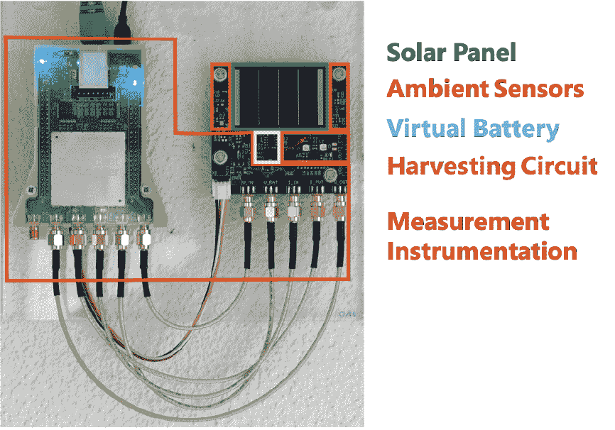

图 2.13 测量装置包括 RocketLogger、太阳能电池板、能量采集电路和虚拟电池。传感器测量环境条件。

### 2.3.4 能量采集数据集

收集的长期室内采集数据集已公开可用。该大规模室内能量采集数据集[[632]](#backmatter-001.xhtml#b_9783110785944-010_ref_632) 包含功率轨迹和环境传感器数据，覆盖了从 2017 年 7 月开始的两年多时间。各位置的可用数据时间跨度列在表 2.4 中。

各位置的日平均采集能量已确定并汇总在表 2.4 中。该表还显示了相对于平均值的绝对偏差的 75% 分位数。尽管各位置距离相近，但采集能量在不同位置间差异巨大，凸显了室内采集特有的强空间变异性。此外，室内环境能量可用性的时间变异性也可见于该分位数跨越的宽广范围。A 站主要从人造光采集能量。该处的照度水平呈现特定模式，如非工作日采集能量减少。D 站在有限时段内接收直射阳光，导致其最大日采集能量比主要由人造光主导的其他站高出 20 倍以上。

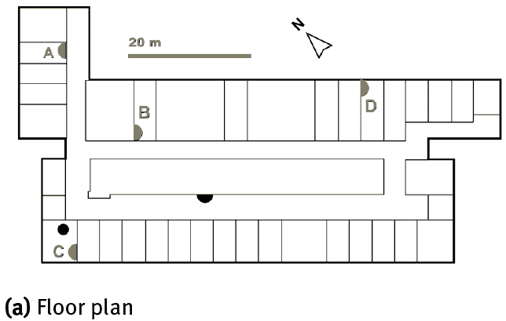

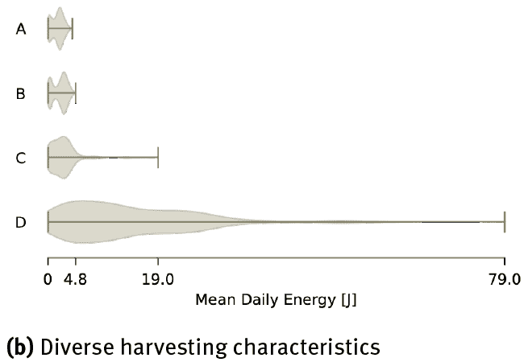

图 2.14 测量平台安装在办公楼层的墙上。这些安装点经历了影响日采集能量的多样化条件。某些位置（如 D 站）接收大量自然光，因此拥有较大的能量预算。其他位置（如 A 站）主要从人造光采集能量，日采集能量显著较低。

**表 2.4 四个测量平台部署总结：环境特征、测量时间跨度和日平均能量产出。**

| **站点** | **位置** | **自然光** | **时间跨度** | **日平均能量** |
| --- | --- | --- | --- | --- |
| A | 办公室 | 少 | 22 个月 | 2.02 ± 1.64 J |
| B | 办公室 | 少 | 24 个月 | 1.57 ± 1.28 J |
| C | 办公室 | 中 | 24 个月 | 2.87 ± 2.36 J |
| D | 实验室 | 高 | 24 个月 | 14.18 ± 11.67 J |

### 2.3.5 无电池系统设计


在上一节中，我们已经看到能量采集可能具有高度的空间和时间变异性。即使在同一楼层部署相同的太阳能电池，它们也会有截然不同的能量预算，且难以预测。如果嵌入式系统未设计为处理这种变异性，环境条件可能会对整体系统性能造成灾难性影响。电池供电设备可吸收这种变异性，但能量采集系统的当前趋势因成本、尺寸和环境因素考量，指向大幅减少存储容量。这样做的权衡是无法长期保证最低服务。这是因为随着存储能力下降，这些系统的行为会更直接地受环境影响。

占空比控制是一种常见的动态功率管理技术，允许系统通过引入低功耗模式 (`LPM`) 来调整其平均能量消耗。然而，为了执行读取传感器数值或发送数据包等单个任务，这些系统需要能够缓冲所需能量。否则，环境条件可能迅速变化，在负载完成任务前将其关断。因此，我们认为需要一种新型能量管理单元 (`EMU`)，以高效、与换能器无关的方式为此类不利场景提供能量保证。鉴于无电池系统的有限能量摄入，该单元应能以尽可能少的时间和能耗自启动。在能量摄入有限的短时段内，它通过在源头的最优功率点采集能量来最大化能量积累。当以短促能量脉冲为负载供电时，它向负载提供控制接口，以便跟踪其最优功率点。本节介绍一种满足这些要求的 `EMU`，如图 2.15 所示。

## 2.3.6 无电池系统架构

近年来，研究界聚焦于能量存储容量极其有限的系统。在最极端的情况下，能量存储极其有限，以至于保证的应用进展发生在非常精细的粒度上，每个激活周期可能仅执行几条指令。根据环境、换能器和应用的不同，可能需要不同类型的电路，以在支持的电压范围内为系统提供程序进展所需的能量。一般来说，无电池传感系统有三类架构：

### 直接耦合

当换能器的 `I-V` 曲线与应用电路兼容时，可直接连接。这些系统通常使用小的去耦电容 (<20 *μ*F) 缓冲少量能量。如果能量存储太小，则不支持传感器测量和无线电传输等原子任务，因为它们的能量需求对于具有有限能量存储的小型换能器来说太大了。在文献 [39, 341] 中，作者提出了一种软硬件结合的方法，在源头能在短时间内直接维持计算负载时执行计算。这些工作使用需要状态保持机制的易失性逻辑。在文献 [424, 698] 中，作者提出了无存储和无变换器的采集系统，其中负载利用频率缩放来跟踪源头的最大功率点。虽然频率缩放可在基于 `CPU` 的应用中最大化能量输入，但它并不能最小化负载的能量消耗，且仅限于狭窄的有源功率范围。即使直接耦合系统避免了变换器损耗，如果输入功率低于这个狭窄的有源范围，负载就无法供电，系统效率会立即降至 0%。不幸的是，这在无电池系统中经常发生。当能量源和负载的工作点不兼容时，使用变换器进行解耦就成为必要。与传统的电池供电系统不同，解耦的无电池系统在源头和负载之间只有有限的能量缓冲。

### 仅升压变换器

文献 [158, 159] 的作者提出了一种需要极低输入电压和电流的低功耗管理系统。这些工作能在极低输入功率电平下启动能量转换，但需要在变换器输入端使用大缓冲电容。因此，两种方法都面临至少 18 分钟的漫长冷启动时间，这是由于在恒定 2.5 *μ*W 输入功率下为 140 *mF* 的大输入电容充电所致。正如将要解释的，我们的电容选择旨在最小化冷启动能量和时间。

### 升压-降压转换器组合

文献 [152, 524] 的作者使用升压转换器进行最大功率点跟踪。然而，第一个提出的系统利用射频采集在超级电容器中积累电荷，然后使用降压转换器为相机应用供电。第二个系统使用可重构能量架构，可根据应用的能量模式调整能量容量。带有能量缓冲的升压/降压转换器拓扑是本文提出方法的基础，并在许多其他工作中得到了成功验证，如 [262, 630]。

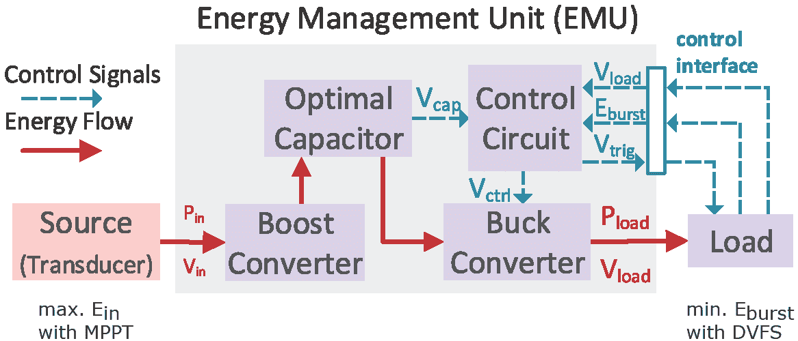

图 2.15 动态能量突发缩放同时优化能量输入和输出，即使换能器和应用电路在不同的电压和电流下运行。

## 2.3.7 能量管理单元 (EMU)

基于 `EMU` 的系统将负载与能量源解耦，并无论负载的工作点如何都能高效地积累电荷。我们现在描述基于 `EMU` 系统的模型，该模型捕捉了能量存储装置随时间演变的过程，将其作为环境和应用电路的函数。主要目标之一是推导出可适用于各种能量源和负载的方程。该模型可用于优化重要的系统参数，即 `EMU` 的启动成本和能量突发大小。

### EMU 性能

`EMU` 中缓冲的能量量取决于多个参数，包括输入功率和负载功率，以及系统的非理想特性。电容器中随时间变化的能量水平所遵循的方程如下：

(2.2)

```
E_cap'(t) = d/dt E_cap(t) = η_boost(V_in(t), I_in(t)) × P_in(t) - P_load(S_i)/η_buck - P_leak(t)
```

在该方程中，正项代表能量摄入，而负项代表能量消耗。

### 输入功率

系统仅有一个功率输入 `P_in(t)`，由换能器提供。我们关注不利场景，即 `P_in < P_load` 且 `V_in < V_load,min`。这意味着无法直接将换能器耦合到负载，因为无法满足电压要求。此外，无电池传感系统可能部署在动态环境中。在这些情况下，最大化系统的整体能量流要求跟踪能量源的最大功率点。

### 负载功率

在所提出的模型中，负载可以有两种状态 (`S_i`)：激活或非激活。当激活时，负载由三个量表征：`E_burst,i`、`V_load,i`、`P_load,i`；其中 `E_burst,i` 定义执行任务 `i` 所需的能量突发大小，`V_load,i` 为其供电电压，`P_load,i` 为执行任务 `i` 期间的功耗。这些参数通过实验表征得出。在非激活状态下，负载处于深度睡眠，等待来自能量管理单元的触发。尽管深度睡眠期间的实际功耗取决于硬件，但复杂的传感系统通常消耗几微瓦。如果深度睡眠功耗较高，可能是由于额外启用的外设，`EMU` 积累下一次突发所需能量的时间就会相应变长。

### 转换器效率

由于解耦系统的能量源和负载可以在不同电压下运行，因此需要转换器。这一步虽然必要，但会引入不可忽视的损耗，由升压和降压转换器效率 `η_boost(V, I)` 和 `η_buck` 表示。升压转换器的效率对工作电压和电流特别敏感，意味着必须对其进行参数化。这些效率也通过实验表征得出，仿真中使用简单的查找表。

### 其他能量损耗

不幸的是，转换器效率低并不是唯一的能量损耗来源。最大功率点跟踪单元和控制电路也会消耗能量。控制电路 `I_ctrl` 和降压转换器 `I_buck` 的消耗包含恒定电流分量和电阻分量，因此取决于 `V_cap`。对于能量缓冲器，假设使用电容 `C_cap` 和电阻漏电 `R_cap`。考虑到这些组件，系统漏电总结如下：

(2.3)

```
P_leak(t) = V_cap(t) × (I_ctrl(V_cap(t)) + I_buck(V_cap(t))) + V_cap(t)² / R_cap
```

方程 (2.2) 和 (2.3) 可以准确描述系统能量水平的时间演变。它们将在本节其余部分用于估算不同参数如何影响系统损耗，并计算使损耗最小化的最优参数。

鉴于上述系统模型，我们可以开始优化冷启动能量和启动时间。根据定义，这是开启无电池系统的固定启动成本。为了在给定输入功率下最小化这些固定成本，我们需要最小化启动时间，定义如下：


图 2.16 基于 `EMU` 的系统在特定输入功率范围内效率最高。优化的 `EMU` 实现可在 380 *mV* 下实现近 10 *μ*W 的 `P_sys,min`，以及近 500 *mW* 的 `P_load,max`。

(2.4)

```
t_start-up = { t | V_cap(t) = sqrt(2 ∫_0^t E_cap'(τ) dτ / C_cap) = V_load }
```

然而，最小电容受限于 `EMU` 支持的最大电压摆动，如下式所示：

(2.5)

```
C_min,i = 2 E_load,i / (η_buck (V_max² - V_load,i²))
```

其中 `E_load,i` 和 `V_load,i` 是执行任务 `i` 所需的能量和电压，`V_max` 是 `EMU` 支持的最大电压。然后，最优电容值被选为所有任务 `i` 中最高的 `C_min,i`。优化的能量存储既能保证任务执行的原子性，又能最小化启动时间。这构成了无电池应用可靠执行的基础，即使在多变且不可预测的能量采集条件下也是如此。

一旦针对任何特定应用调整了电容大小，`EMU` 就可以“抽象掉”环境并吸收其功率变化。通过将应用与环境解耦，整体系统能量效率和应用执行率可以被视为输入源功率（`P_source`）的函数，如图 2.16 所示。当输入功率 `P_source` 低于激活阈值 `P_sys,min` 时，基于 `EMU` 的系统将保持完全断电状态，能量效率为零。满足输入功率条件是必要但不充分的，因为采集子系统自启动通常还需要最低电压要求，即 `V_source` > 380 *mV*。系统开启后，整体能量效率会跃升并保持相对恒定，直到负载达到其最大功耗 `P_load,max`。超过此阈值后，能量效率会下降，因为存在因无法消耗或存储能量以备后用而被浪费的能量盈余。这可以在图 2.16b 中看到，应用的执行率及其占空比从 `P_sys,min` 处的 0% 线性增加到 `P_load,max` 处的 100%。不同应用之间的主要区别在于斜率，这取决于单次激活所消耗的能量。功耗大的应用斜率较低，在 `P_sys,min` 和 `P_load,max` 之间覆盖更大的输入功率范围。

## 2.3.8 使用无电池传感器进行环境感知

带有射频识别（`RFID`）卡等无源元件的无电池系统已流通数十年，但它们仅执行简单计算，存储容量小，且需要专用读写器为其供电并通信。最近，研究人员研究了带有有源元件的无电池系统，以采集更丰富的一次能量（自然存在的能量），从而执行复杂的感知、处理和广播。带有光伏电池[[152]](#backmatter-001.xhtml#b_9783110785944-010_ref_152)、热电发电机[[593]](#backmatter-001.xhtml#b_9783110785944-010_ref_593)或动能采集器[[313]](#backmatter-001.xhtml#b_9783110785944-010_ref_313)等有源元件的无电池系统可具有高功率密度。

### 2.3.8.1 MiroCard 平台

`MiroCard` 最早见于文献[[260]](#backmatter-001.xhtml#b_9783110785944-010_ref_260)，是一款由光供电的无电池智能卡。由于被任何遮光材料覆盖的 `MiroCard` 无法被远程激活，因此其激活完全是按需进行的：即当用户*选择*将其暴露在光线下时。`MiroCard` 厚度小于 2 *mm*，表面积仅为 45 *mm* × 60 *mm*，如图 2.17 所示。正面覆盖着一个有效面积为 35 *mm* × 53 *mm* 的有机太阳能电池板，所有电子元件均放置在背面。得益于其优化的软硬件，`MiroCard` 能采集足够的能量进行无线通信，即使在低至 170 *lx* 的室内弱光条件下也是如此。虽然其大批量生产时的元件成本仅为几瑞士法郎，但确实比 `RFID` 等无源自动识别和数据采集（`AIDC`）技术更昂贵。然而，`MiroCard` 背后的有源无电池技术除了提供更高的功率密度外，还提供了关键优势。`MiroCard` 的 `Cortex M3` 为采用安全通信协议的高级应用提供了强大的处理能力，并且拥有足够的内存来支持受限应用协议（`CoAP`）等互联网应用协议。

### 2.3.8.2 概述

`MiroCard` 项目是瞬态 `BLE` 传感器节点项目[[630]](#backmatter-001.xhtml#b_9783110785944-010_ref_630)的演进。硬件设计基于文献[[259]](#backmatter-001.xhtml#b_9783110785944-010_ref_259)中首次提出的 `EMU`，该文献提出了通过*能量脉冲*实现换能器与应用电路之间的电流和电压解耦。这样，通过 `MPPT` 优化能量采集，并通过动态电压频率调节（`DVFS`）优化应用能量，同时优化成为可能。

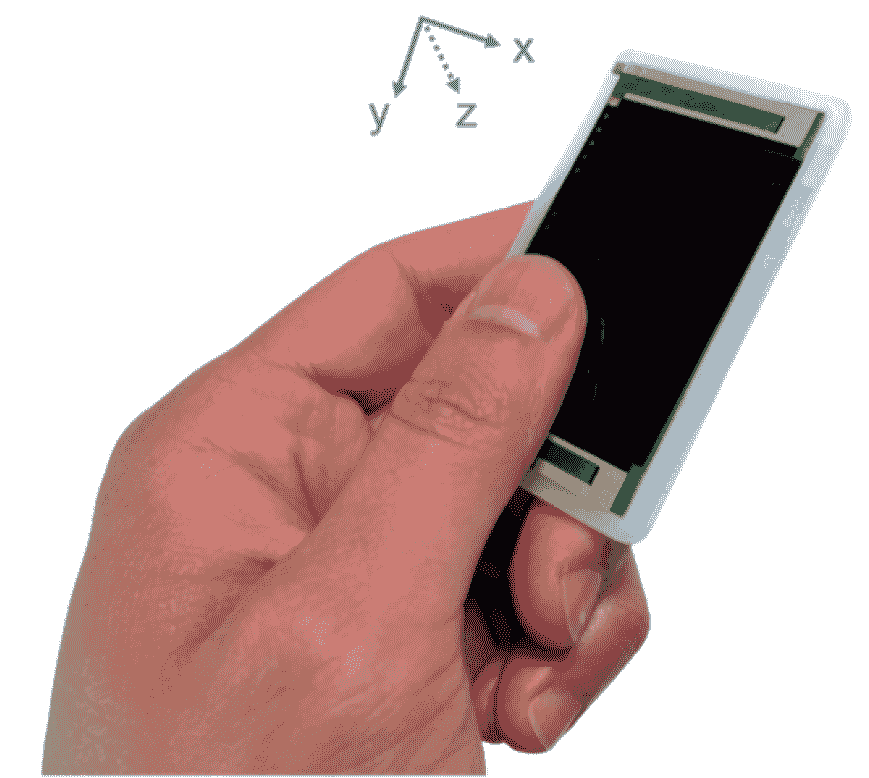

图 2.17 无电池 `MiroCard` 集成了多个环境传感器（包括加速度计），但仅在暴露于光线下时才能工作。由于覆盖太阳能电池的任何非透明材料都会阻止设备进行感知、处理和传输，因此它免疫 `RF` 窃取。

### 2.3.8.3 能量表征

`MiroCard` 的功耗是使用 `RocketLogger` 测量设备[[631]](#backmatter-001.xhtml#b_9783110785944-010_ref_631) 记录的。直流电源连接在 `V_cap` 点，意味着它为整张卡供电，包括采集芯片和应用电路（包括降压转换）。因此，该测量涵盖了无电池运行期间存在的所有漏电源和转换器低效率。单次激活的测量功率轨迹可见于图 2.18，其中的标注指示了系统状态。使用外部触发器记录多次激活，测得基础 `BLE` 应用的平均能耗为 175.31 *μJ*，包含转换器低效率。增加温度和湿度传感会使应用能耗增加约 30 *μJ*[[631]](#backmatter-001.xhtml#b_9783110785944-010_ref_631)。当 `V_cap ∈` [2.8 *V*, 4.37 *V*] 时，两个 47 *μF* 陶瓷电容足以保证这些规模的能量脉冲，即使这小于芯片规格规定的 150 *μF*。

### 2.3.8.4 启动时间测量

如前所述，将能量存储在小电容中的一个好处是 `RC` 充电时间常数非常低，因此系统可以快速充电。实际上，这意味着当系统完全耗尽能量时，即使环境零星地产生少量能量，它也能以机会主义方式运行。为了公平地测量基于 `EMU` 的设备唤醒有多快，系统必须首先完全耗尽，因为任何残余电荷都会人为地缩短启动时间。因此，我们将启动定义为：完全耗尽的 `MiroCard` 在暴露于光线后，从完全耗尽状态直到发送第一个 `BLE` 数据包所需的时间。为确保可重复性和公平性，在暴露于不同照度条件之前，`MiroCard` 的 `V_cap` 和地被短路。然后将它们放入太阳能测试平台[[629]](#backmatter-001.xhtml#b_9783110785944-010_ref_629)中，该平台提供受控的照度环境。测量并记录了五种不同照度条件下的启动时间。

图 2.19 展示了一次样本测量。当一个完全断电的 `MiroCard` 首次暴露在光线下时，它会进入一个启动阶段，在此阶段太阳能电池板电压 `V_src` 首先被钳位在 330 *mV*，以便为其内部电容充电。在此阶段，`AEM10941` 能量采集芯片优化了向其小型存储电容的电荷传输，并快速稳定了稳压后的 `V_cc` 电压，如图 2.19 所示。随后，`MiroCard` 进入由能量驱动的执行阶段，它停留在 `LPM` 中，仅消耗 2.47 *μA*，等待 `EMU` 触发。一旦达到 4.37 *V* 的最大电容电压，`EMU` 就会触发应用程序，并发送三个识别信标。在本实验中，原始 `BLE` 数据包大小为 42 字节，包含 25 字节的广播数据。`MiroCard` 可以以稍大的能量消耗为代价整合当前和历史传感器数据（例如温度和湿度），详见 [[630]](#backmatter-001.xhtml#b_9783110785944-010_ref_630)。随着环境提供的光照增多，`MiroCard` 的执行速率会自动增加，这得益于 `EMU` 的能量比例性和应用程序的无状态特性，即每次激活都是独立的。在动态环境中，`MPPT` 在优化能量输入方面发挥着重要作用，特别是当 `MiroCard` 仅在短时间内暴露于光照下时。不同光照等级下的测量结果汇总在表 2.5 中。

## 2.3.9 无电池 MiroCard 上的手势检测

本节介绍在无电池智能卡上实现手势识别的文档。以下论述简要概述了手势检测的不同方法。随后，将详细讨论为无电池嵌入式系统开发手势检测模型的方法论。

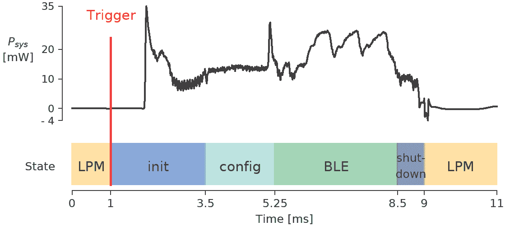

图 2.18 在 `LPM` 中，`MiroCard` 的平均系统电流仅为 2.47 *μA*。触发后，单次激活广播 3 个 `BLE` 数据包，持续时间不到 8 *ms*。


图 2.19 `MiroCard` 的上电轨迹，室内自然光与人造光混合环境（2 600 *lx*）。它在 2.9 秒内完成启动，并以平均 16.25 *pkt/s* 的速率发送 `BLE` 信标。当 `V_cap` = 4.37 *V* 时触发 `BLE` 传输（黑框）。

**表 2.5** 室内光照条件下环境感知应用的性能。

| **光照度** | **启动时间** | **平均输入功率** | **平均通信速率** |
| --- | --- | --- | --- |
| 2 600 *lx* | 2.88 *s* | 978 *μW* | 16.25 *pkt/s* |
| 1 000 *lx* | 7.17 *s* | 372 *μW* | 6.17 *pkt/s* |
| 500 *lx* | 13.62 *s* | 181 *μW* | 2.92 *pkt/s* |
| 250 *lx* | 33.49 *s* | 85 *μW* | 1.9 *pkt/s* |


| 170 lx | 60.04 s | 60 μW | 0.75 pkt/s |

### 2.3.10 手势检测方法

“手势识别”这一术语需要加以限定，因为存在不同类型的手势。[\[498\]](#backmatter-001.xhtml#b_9783110785944-010_ref_498) 区分了人类手势检测的多种形式。例如，全身动作分析人们在运动或康复中的身体运动。面部表情，即头部手势，可用于追踪眼球运动或估计一个人的情绪。第三类手势指的是手部或手臂手势。本文重点关注后者，因为人们会用手来操作信用卡大小的智能卡。因此，在本文后续内容中，手势识别一词将作为手部手势识别的同义词使用。以下部分将解释用于检测手部手势的不同方法。

**摄像头** 一种方法是使用摄像头进行手势检测。多项工作 \[125, 641, 667\] 已演示了处理来自摄像头视频流的手势检测系统。一旦检测到特定手势，系统即可触发不同动作。

**加速度** 如前所述，光能驱动的 `MiroCard` 包含一个加速度计，可测量手势运动产生的力。一种竞争技术称为肌电图（EMG）技术，它通过测量肌肉产生的电活动来检测特定手势，但有人认为从财务、计算和功耗角度来看，该技术仍过于昂贵 [\[380\]](#backmatter-001.xhtml#b_9783110785944-010_ref_380)。虽然我们专注于检测手持设备上执行的手势，但其他工作也研究了在不同位置使用一个或多个加速度计进行手势检测。在 [\[181\]](#backmatter-001.xhtml#b_9783110785944-010_ref_181) 中，作者使用了从手腕记录的加速度计数据进行手势检测。[\[677\]](#backmatter-001.xhtml#b_9783110785944-010_ref_677) 提出在每根手指上配备一个加速度计，向训练好的支持向量分类器模型输入加速度数据。这种方法能识别每根手指的位置，以检测聋人语言字母，从而简化翻译和交流。上述所有方法均在电池供电或有线供电条件下工作。一些相关工作建议采用无电池手势识别。[\[653\]](#backmatter-001.xhtml#b_9783110785944-010_ref_653) 引入了一种 `SmartWheelTag`，基于 RFID 模式的变化识别手势。[\[670\]](#backmatter-001.xhtml#b_9783110785944-010_ref_670) 展示了 `CapBand`，一种超低功耗设计的腕带，利用环境采集能量和电容感测系统检测手势。用于演示的原型利用太阳能电池板采集能量。[\[360\]](#backmatter-001.xhtml#b_9783110785944-010_ref_360) 展示了一种覆盖整个腕带的柔性太阳能电池板腕带架构。在这种情况下，手势识别依赖于 EMG 技术。[\[436\]](#backmatter-001.xhtml#b_9783110785944-010_ref_436) 使用光电二极管进行能量采集和手势检测。所有光电二极管采集足够的能量来处理一个算法，该算法基于环境光供应波动的数据预测手势。这种方法允许检测手指运动。由于大多数展示的原型佩戴在手腕上或固定在手指上，因此哪种方法最适合智能卡上的手势识别成为一个问题。一项相关工作来自 [\[551\]](#backmatter-001.xhtml#b_9783110785944-010_ref_551)，他们提出了一种结合加速度计的 RFID 标签，用于门禁权限检查的手势识别。一个训练好的 k-近邻模型在传输后识别来自 RFID 标签的外部数据。尽管如此，本文采用了一种不同的方法，将在下一部分讨论。

### 2.3.11 无电池机器学习

#### 轻量级神经网络

在无电池系统中运行机器学习模型会对模型施加严格的限制。模型必须执行迅速，并具有低内存和低能耗要求，以实现光能供电的实时手势识别。`infXL` 提供了一种称为轻量级（Lt-Wt）网络的深度神经网络（DNN），该网络在文献 [\[370\]](#backmatter-001.xhtml#b_9783110785944-010_ref_370) 中被引入。Lt-Wt 网络是专门为资源受限应用开发的。卷积神经网络（CNN）通常需要多得多的运算和内存。然而，专有的 Lt-Wt 模型减少了运算量、内存占用和逻辑复杂度，以提高网络速度并降低存储和处理成本。这些改进带来了更高的能效，并允许在低功耗设备上进行本地处理。其轻量级架构简化了将模型代码移植到不同平台的过程。它基本包含四个要素：一个用于输入和输出的 RAM 数组、一个作为 ROM 的查找表、作为 ROM 的网络定义以及控制规则。

在设计新的机器学习应用时，第一步通常是数据获取。在我们的场景中，加速度计数据将被分类为不同的手势，因此使用 `MiroCard` 采集高质量数据至关重要。由于即使卡片上的重量分布也会改变用户运动的记录方式，因此不同手势的现有数据集会有不同的特征。因此，我们招募了多名用户，使用 `MiroCard` 记录了一个包含三类手势的新数据集。记录的原始数据在使用 `infXL` 工具链之前需要进行预处理，该工具链可自动训练、测试和验证模型。我们现在将详细讨论这些步骤及其结果。一个准确的手势分类模型可以作为简单的人机界面集成到 `MiroCard` 中，以触发不同的动作。

#### 数据获取

我们实施了以下数据获取流程。`MiroCard` 通过一根连接到树莓派的电缆供电。这也允许将加速度计数据从 `MiroCard` 传输到树莓派，并存储在单独的文件中。数据记录由多名用户执行，他们与 `MiroCard` 进行物理交互。首先，一个简短的讲解环节旨在向参与者介绍任务。然后，参与者必须为每个手势记录数据。用户左右摇晃卡片，然后上下摇晃，最后以一种明显不同于左右或上下的方式随机移动卡片。必须说明的是，参与者不能保持一个固定位置，而必须改变卡片的朝向。因此，上下摇晃 `MiroCard` 也可能沿着不同的轴发生。单个手势的记录时长约为三分钟。参与者在每次 3 分钟的记录后休息，以重新开始数据记录。这种分割手势记录的方式简化了数据标注。因此，每位参与者的总记录时间在十到十五分钟之间。最后，每个文件包含约 1800 个数据样本的时间序列，因为加速度计以 10 Hz 的频率运行了 3x60 秒。一个数据样本包含一个 x 值、一个 y 值和一个 z 值。共有 12 名用户参与了数据获取过程。

图 2.20b 和 2.20a 展示了使用与上述图像相同用户的每个手势 4 秒窗口的数据。这些图表提供了每个手势数据行为的更好视图。第一张 图 2.20a 显示 z 值的峰值和谷值之间存在巨大差异，而 x 值和 y 值保持几乎稳定，相应地代表了上下摇晃卡片。此外，观察到 z 值的平均值约为 1g，可以推断该图代表上下摇晃。图 2.20b 中的图表显示了左右摇晃，因为 z 值的变化与 y 轴的值相比相对较小。`random`（随机）手势提供了一个不同于前两种模式的参考运动。这些包括在三维空间中的随机运动，以及在不同朝向下的静止状态。

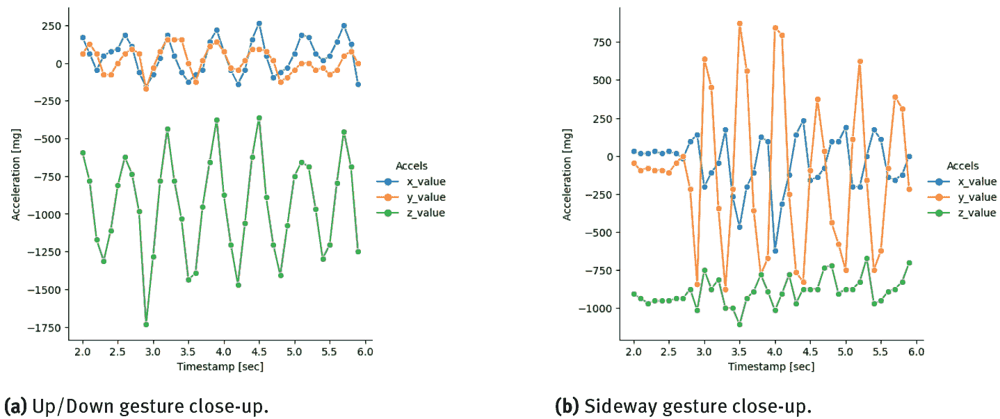

图 2.20 两种手势 XYZ 数据值的四秒特写。所有数据通道均可见振荡，振幅因运动方向而异。

#### 模型训练与验证

要训练 Lt-Wt 模型，必须将整个标记数据集划分为训练集和测试集。训练子集被分割为特征和标签，然后通过 `TensorFlow` 和补充算法训练多个 Lt-Wt 模型。使用测试数据集评估模型，以估算精确率、召回率、F1 分数和准确率等指标。模型选择器会找到满足应用要求的最终网络。此处我们展示最终 Lt-Wt 网络的评估结果。

表 2.6 显示了包含来自 12 名参与者（2 名女性，10 名男性）记录的 68,000 多个数据样本的原始数据集。`infXL` 工具链将平衡子集按 69:31 的比例分割为训练数据和测试数据。训练数据集的 30% 用于验证。因此，总平衡子集的 48.3%（即 32,865 个数据样本）用于训练。表 2.6 还显示了三个类别的分布是均匀的。出现差异的原因是某些记录并未恰好在三分钟时结束。溢出部分未被切除，以在保持平衡的同时最大化最终可用的数据集。

##### 分类模型准确率

使用测试数据集评估模型性能，以估算精确率、召回率、F1 分数和准确率指标。模型准确率的评估结果见 表 2.7。所有三个类别的 F1 分数均稳定在 90% 以上。总体而言，分类模型的准确率为 94%。模型在区分左右摇晃和上下摇晃方面表现最好，而最大的弱点在于区分左右摇晃和随机运动，因为在 14,379 个样本中有 581 个被错误分类。重要的是要记住，该模型能够泛化设备运动，而与朝向无关。这意味着分类相当稳健，能够识别不同用户的手势。

###### 表 2.6 数据集中标签与数据的分布

| **标签** | **分布** |
| --- | --- |
|  | **绝对数量** | **相对比例** |
| 总样本数 | 68,036 | 100% |
| 类别 0 | 22,583 | 33.2% |
| 类别 1 | 22,357 | 32.9% |
| 类别 2 | 23,096 | 33.9% |
| **数据** | **分布** |
| --- | --- |
|  | **绝对数量** | **相对比例** |
| 训练样本 | 32,865 | 48.3% |
| 验证样本 | 14,085 | 20.7% |
| 测试样本 | 21,086 | 31% |
| 总计 | 68,036 | 100% |

###### 表 2.7 模型性能评估

| **类别** | **精确率** | **召回率** | **F1 分数** | **样本量** |
| --- | --- | --- | --- | --- |
| 类别 0 | 0.92 | 0.93 | 0.92 | 6933 |
| 类别 1 | 0.95 | 0.95 | 0.95 | 6707 |
| 类别 2 | 0.95 | 0.94 | 0.95 | 7446 |

### 2.3.12 无电池时间序列数据分类

手势检测模型都需要包含 20 个数据样本的*时间序列数据*，共计 60 个输入值（1 个样本包含一个 X、Y 和 Z 点）。由于加速度计以 10 Hz 工作，20 个数据样本相当于 2 秒的时间窗口。选择这些数值是为了适应不同长度的人造手势。尽管加速度计有广泛的可能采样频率范围，但选择 10 Hz 作为功耗与人体运动所需采样频率之间的良好折衷。

这种分类任务的数据依从性从根本上改变了传统基于 EMU 的无电池感知系统的能量驱动行为。如图 2.21 所示，仅缓冲分类任务所需的能量已不再足够，因为现在需要 20 个数据样本。实际上，带有手势分类的行为是时间触发的，只有当环境能量足以支持时才会发生。如果是这种情况，则这 20 个样本会在准备好后尽快从加速度计的 FIFO 缓冲区复制到微控制器中。在其最简单的形式中，无电池手势检测不允许重叠窗口方法，即步长可以小于窗口大小。原因在于数据分类将不再是无状态的，并且会要求更高频率地处理 `Lt-Wt` 网络，从而导致能耗增加。


图 2.21 处理时间序列数据的无电池系统不仅需要来自 EMU 的 `energy ready` 信号。手势分类施加了一个数据要求，该要求必须与能量要求同时满足。

### 2.3.13 实验评估

为了表征手势检测应用的主动能量需求，使用了类似于第 2.3.8.3 节中介绍的设置。一个直流电源为 `MiroCard` 提供稳定电压，其电流和电压由 `RocketLogger` 记录。应用程序使用额外的 GPIO 来指示其内部状态。然后利用这些信息对功耗轨迹进行标注。图 2.22 显示了手势检测和 BLE 传输的能耗。如果有足够的收集能量来处理 `Lt-Wt` 并将结果作为 BLE 信标发送，EMU 会在 2 秒后触发 MCU。2 秒的时间窗口依赖于加速度计 10 Hz 的感知频率，并确保 20 个数据样本的可用性。此触发由红线标记。分类过程在初始启动和配置后大约需要 27 ms。`Lt-wt` 网络的功耗相对稳定，在 20 到 35 mW 之间。末尾 10 mW 到 20 mW 之间的三个峰值代表单独的 BLE 传输。整个激活消耗了 723 μJ，主要由分类任务主导。能耗突发结束后，处理器关闭以最小化消耗。然而，加速度计保持持续启用以收集数据，这使得两次能量突发之间的睡眠电流消耗达到 26 μA。

在此能量表征之后，确定系统需要 1mF 的等效电容，当 `V[cap] ∈ [2.8V, 4.37V]` 时，这足以保证所需大小的能量突发。为了了解该存储元件如何影响响应性，测量了启动时间。与第 2.3.8.4 节描述的方法类似，在暴露于光线前对电容器进行了短路。此测量在室内环境中进行，结合了自然光和人造光，使用照度计测量的综合照度为 900 lx。使用 `RocketLogger` 测量了太阳能电池板的电流和电压以及电容器电压。图 2.23 显示了测量轨迹，表明手势检测应用可在 11 秒内启动，并可在该照度条件下维持数据采集、分类和传输。

### 2.3.14 分析

在前几节中，我们介绍了在光供电的 `MiroCard` 平台上运行的两个无电池应用：环境感知和手势检测。第一个是纯粹的能量驱动应用，其中无线传感器传输关于环境的信息。第一个应用是能量驱动的，因为每次传感器激活都是无状态的，因此彼此独立。传感器的激活频率会自动调整以平衡能量流，因为环境能量会在一天中发生变化。这种能量比例性一直是大多数无电池感知系统（包括 `MiroCard`）的关键特征。得益于这一原则，`MiroCard` 用户对设备的操作拥有完全的自主权。如果用户将 `MiroCard` 存放在不透光的位置，则无法为无电池 `MiroCard` 供能。然而，一旦用户决定将其暴露在光线下，传感器就能产生能量，只有那时 `MiroCard` 才会开始感知和传输数据。

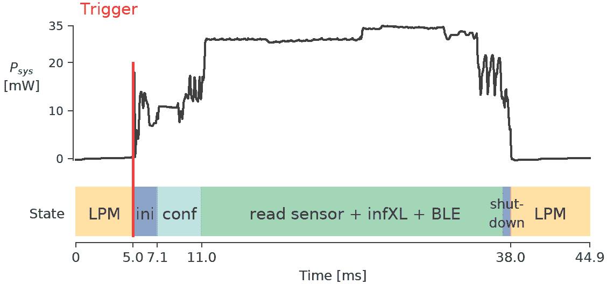

图 2.22 手势应用在分类过程激活之间保持加速度计启用，使睡眠电流达到 26 μA。当缓冲了足够的数据后，一次激活对运动进行分类并广播 3 个 BLE 数据包，持续时间不到 33 ms。

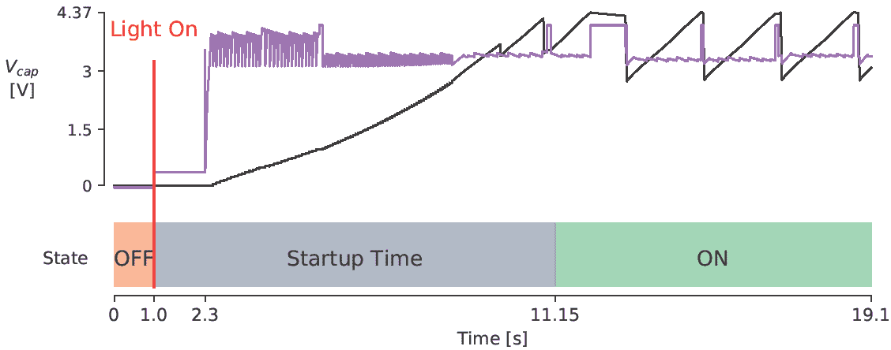

图 2.23 手势检测应用的启动时间，在自然光和人造光（900 lx）的室内环境中测量。它在 10.15 秒内启动。此后，运动分类和 BLE 信标传输每两秒发生一次。

### 2.3.15 能量比例性与时间序列处理

我们讨论的第二个应用是无电池 `Miro-Card` 上的手势检测。与环境感知场景不同，每次传感器激活都严格依赖于前一次的时序和数据。分类模型需要 20 个数据样本。在指定的采样频率下，这需要 2 秒。如果 `MiroCard` 在这两秒内无法采集足够的能量进行分类，则数据将丢失或处理失败。这是使用无电池传感器的一个根本局限性：无法保证能量采集速度足够快，以维持最低服务水平。然而，我们已经证明，在环境条件能够维持 `MiroCard` 运行的那些时间段内，它能够在不重叠的数据窗口中正确分类手势。不重叠这一部分是所选微控制器低功耗模式 (LPM) 缺乏数据保留而产生的局限性。实际上，可以保持一个 SRAM 块与加速度计数据缓冲区一起处于开启状态。然而，这会进一步增加睡眠电流，并可能降低系统的整体能效。非重叠检测窗口的一个副作用是，如果手势恰好被这种人为划分拆分，分类器可能无法检测到它。因此，如果手势过短，模型的高准确率将不会直接体现出来。幸运的是，用户使用 `MiroCard` 进行手势操作通常持续数秒，因此该问题得以缓解。

### 2.3.16 室内能量采集的情境化分析

在本贡献的开头，我们论证了室内光伏技术使感知系统能够利用大量的一次能源。这种一次能源有两种形式：射入室内空间的自然阳光和为人类使用而安装的人造照明。尽管一天内采集的平均能量会因位置、季节和人员在场情况而有很大差异，但最高可达每天数十焦耳。对于执行环境感知的静态部署 `MiroCard`，即使仅按人造照明的保守估计，这也可转化为每天超过 28,000 次激活，或在工作时间内大约每秒 1 次激活（及三个数据包）。实质上，`MiroCard` 充当了一个无电池的信息喷泉，即使在光线昏暗的环境中也能提供长期、免维护的数据。提高能效只是无电池传感器的优势之一。对于可穿戴应用，快速启动时间是另一个关键的差异化特征。用户出于隐私和安全考虑，只需遮挡光伏面板，即可确保 `MiroCard` 完全断电。当用户选择使用 `MiroCard` 时，必须将其暴露在光线下，并且它应尽可能快地自供电。这自然取决于照度条件。我们已经展示了手势检测 `MiroCard` 在环境提供 900 lx 照度时可在 11 秒内开机，这在室内自然光与人造光的组合下很容易实现。

### 2.3.17 结论


本贡献提出了一类新的无电池感知系统，能够以节能、可扩展且环保的方式采集数据。由于其高功率密度和低成本，我们主要关注光伏能量采集，它可以利用人员活动区域广泛存在的室内照明。我们还展示了办公楼内多年的室内能量采集测量数据集，证明了每日能量预算潜在巨大但高度可变。即使瞬时采集功率在短时间内可能显著变化，基于 `Energy Management Unit (EMU)` 的设计也能可靠地执行无电池感知应用。虽然设计师无法直接控制可用能量的多少，但可以控制应用程序在何种条件下执行。通过缓冲少量能量，设计师可以控制工作电压，并最大化单位能量完成的工作量。这些少量能量足以执行各种感知应用。我们演示了一个无电池环境传感器，可部署在固定位置，每天生成数千个数据包。这些无电池传感器比其电池供电的对应产品更高效，因为在夜间它们完全断电，消耗零功耗。本贡献还介绍了无电池智能卡上的手势检测应用。利用手工采集的数据，训练了一个机器学习模型并将其部署到智能卡上。广泛的实验评估验证了基于 `EMU` 设计的可靠性和能效。这类新型无电池感知系统能够执行复杂的感知应用，并为物联网系统的分布式数据采集提供了一种更具可扩展性和成本效益的方法。

# 3 流式数据，小型设备

大数据通常源于持续流式传输测量值的传感器。例如，设想一个根据特定传感器输入采取行动的嵌入式系统。`Data streams` 自然出现在物联网、嵌入式系统和网络物理系统中。特别是，我们在各种资源受到严格限制的 `small devices`（小型设备）中遇到它们，如有限的能量、通信带宽、内存和计算能力。

为了从算法角度对这些场景建模，并量化学习算法所需资源与可达精度之间的权衡，算法界引入了流模型 [[523]](#backmatter-001.xhtml#b_9783110785944-010_ref_523)。流数据算法进行一次遍历⁷

## 仅插入数据流

新项目仅被*添加*到数据流中。算法依次处理每个项目，并将每个项目视为一个新实例。

## 动态数据流

项目可以被*添加*到数据流中，也可以从数据流中*删除*。算法依次处理项目的插入或删除。新项目可以添加到流中，或者已处理的项目可以从流中移除。

## 旋转门数据流

数据项目的每个特征或坐标都可以通过*添加*或*减去*值来修改，以更新当前状态。这是最一般的情况，算法需要处理流中新项目的插入和旧项目的更新（包括后续更新累积为零时将其从流中移除）。

本章展示了处理和汇总流式数据的通用算法方法，并综述了该领域的最新研究，包括 CRC 876 的若干贡献。它还强调了这些主题对教学的重要性，以便下一代研究人员和从业者能够应对该领域未来的挑战。

第 3.1 节介绍了从流中提取摘要的仅插入数据流算法，用于最大化子模函数，这些函数非常重要且应用广泛。突出的例子包括最大化熵和所选数据子集的互信息。该节综述了该问题的几种最先进算法，并给出了自己的技术贡献。它涵盖了数据流的算法与分析方法，以及通过概率假设放宽最坏情况条件以建模*典型*行为。该节可作为一节课的基础。

## 3.2 核心集与草图

第 3.2 节介绍了针对回归、分类和聚类等特定计算问题，利用核心集和草图对数据流进行摘要的一般概念。它涵盖了核心集和草图的简要技术介绍，并强调了它们对数据流算法设计的重要性。它以 CRC 876 内的贡献为重点，综述了当前的研究现状。每一小节介绍主要研究方向之一，并简要提供结果背后的核心思想。本节可作为该主题研讨会或短期讲座系列的基础。

## 3.1 从数据流中提取摘要

*Sebastian Buschjäger*

*Katharina Morik*

**摘要：** 随着处理能力的提升，每天在地球各地收集的数据越来越多。虽然机器处理这些海量数据的能力越来越强，但人类无法跟上每天生成的数据量。他们需要小而全面的数据代表性样本，这些样本能捕捉数据中所有信息丰富的部分，换句话说：数据摘要。形式上，我们将数据摘要问题表述为一个带有基数约束的函数最大化问题，即在总共选择最多 `K` 个元素的同时，最大化效用函数 `f`。

由于具有引人注目的理论特性，亚模函数已被广泛采用作为数据摘要的效用函数。亚模函数是集合函数，与向较大集合添加相同元素相比，它们对向较小集合添加新元素给予更多奖励，从而自然地产生小而全面的摘要。这符合小型设备受限的资源。我们想更进一步，将摘要建模为流式算法。流式算法对每个数据项仅评估一次，并立即在有限的内存预算下即时决定是否应将某项添加到摘要中。这些算法可以在数据生成*时*在小型嵌入式设备上运行，从而以最小的计算成本*随时*提供数据摘要。

在本贡献中，我们将更详细地讨论亚模函数框架，并综述流式亚模函数最大化的当前研究现状。我们从性能保证、运行时和内存消耗方面分析每种算法。我们以在有无概念漂移的数据流上进行真实世界摘要任务的算法综合比较作为本贡献的结尾。

### 3.1.1 引言

虽然计算机可以在几秒钟内处理 TB 级数据，但人类往往会被海量的可用信息淹没。人类可以很好地检查和交互小型的、有代表性的数据样本。这样的*数据摘要*必须在保持小型和全面的同时捕捉数据中所有信息丰富的部分。

近年来，亚模优化已进入机器学习和数据挖掘的工具箱。它为各种不同任务选择小型且可理解的摘要提供了一个成熟的数学框架。在线亚模优化领域研究的算法仅查看每个项目一次，然后将其添加到摘要中或丢弃。

利用亚模优化进行摘要面临算法挑战，恰恰是在最需要的地方，即物联网 (IoT) 环境中，特别是关于传感器网络和分布式处理，这需要通信感知和节能。大部分数据由处理和存储能力有限的小型嵌入式电子设备产生。因此，数据摘要应在数据生成*时*即时捕获，并在存储之前完成。目前，表现最好的在线算法提供 $\mathcal{O}\left( {\frac{1}{2} - \varepsilon} \right)$ 的近似比，其中 `ε` 也会影响算法的内存消耗。即使是中等的 `ε` 选择也会迅速导致无法控制的资源消耗。Feldman 等人 [[220]](#backmatter-001.xhtml#b_9783110785944-010_ref_220) 证明了该近似比是数据流算法所能达到的最优值，任何具有更好最坏情况近似保证的算法本质上都会存储流中的所有元素（最多多项式因子 `K`，其中 `K` 是摘要大小）。

现有算法是为数学上的*最坏情况*设计的，因此具有最坏情况近似保证。我们认为，大多数实际应用表现得更加良好。这一洞察使我们能够超越最坏情况，设计出一种在适度假设下能提供良好数据摘要的算法。该算法以高概率 (1−`α`)^`K` 提供概率近似比 (1−`ε`)(1−1/exp(1))，其中 `α` 是用户期望的确定性，`K` 是摘要大小。它每个项目执行 $\mathcal{O}(1)$ 次函数查询，并需要 $\mathcal{O}(K)$ 内存。注意，这一结果并不与 [[220]](#backmatter-001.xhtml#b_9783110785944-010_ref_220) 中 $\mathcal{O}\left( {\frac{1}{2} - \varepsilon} \right)$ 的上界相矛盾，因为我们的算法以高概率提供更好的近似质量，但并非针对最坏情况。

在下一节中，我们将讨论亚模函数最大化框架。之后，我们将讨论现有算法，而 第 3.1.4 节 详述了新颖的 ThreeSieves 算法。第 3.1.5 节 展示了实际实验，第 3.1.6 节 总结了本贡献。部分文本此前已作为会议论文发表于 [[109]](#backmatter-001.xhtml#b_9783110785944-010_ref_109)。

### 3.1.2 数据流上的亚模函数最大化

在本贡献中，我们考虑在数据流上最大化亚模函数的问题，并专注于数据摘要任务。更正式地说，我们考虑从基础集 `D` 中选择 `K` 个代表性元素到摘要集 `S ⊆ D` 中的问题。为此，我们最大化一个非负、单调的亚模集合函数 `f` : 2^`D` → **ℝ**[+]，该函数为每个子集分配一个效用分数：

```
(3.1) S^⋆ = argmax_{S ⊆ D,|S| = K} f(S) (3.1)
```

对于空集，我们假设效用为零 `f(∅)` = 0。我们用 `OPT` = `f`(`S`^(*)) 表示 `f` 的最大值。集合函数可以与边际增益相关联，边际增益表示将元素 `e ∈ D` 添加到 `S` 时 `f`(`S`) 的增加量：

```
Δf = f(S ∪ {e}) − f(S)
```

当且仅当对于所有 `A ⊆ B ⊆ D` 和 `e ∈ D \ B` 都成立

```
Δf ≥ Δf
```

时，我们称 `f` 为*亚模*。

当且仅当对于所有 `e ∈ D` 和所有 `S ⊆ D` 都成立 `Δ[f]`(`e|S`) ≥ 0 时，函数 `f` 称为*单调*。

通常，子模集合函数的最大化是 NP-hard 问题 [[214]](#backmatter-001.xhtml#b_9783110785944-010_ref_214)，这使得求解公式 3.1 变得困难。因此，一种自然的方法是寻找近似解。Nemhauser 等人 [[230]](#backmatter-001.xhtml#b_9783110785944-010_ref_230) 提出了一种简单的 (1 − (1/ exp(1))) ≈ 63% 的贪心近似算法（在本文中称为 `Greedy`），用于求解公式 (3.1)，该算法在线性时间内运行且需要固定的内存预算。`Greedy` 提供了常数近似保证，且仅需 𝒪(*K*) 内存。其缺点是需要对整个基础集进行 *K* 次迭代，如果基础集非常大，则代价高昂。此外，对于流式数据，多次迭代是不可能的。已经提出了几种流式算法，它们精确读取每个项目一次（当 *D* 存储在磁盘上时）或到达时处理一次（“真正的”流式设置）。这些算法及其理论属性的概述见 表 3.1。值得注意的是，这些算法大多能达到 1/2 − *ε* 的近似保证，其中 *ε* 是期望的近似质量。Feldman 等人在 [[220]](#backmatter-001.xhtml#b_9783110785944-010_ref_220) 中的最新分析表明，在流式设置中，该近似比是最优的，任何具有更好*最坏情况*近似保证的算法本质上都会存储流中所有元素（最多多项式因子 *K*）。不幸的是，对于所有这些算法，内存预算和每个项目的函数评估次数都取决于 *ε*。即使是中等的 *ε* 选择，也会使小型设备的内存和运行时需求变得无法控制。

我们认识到，最坏情况通常是病态情况，而实际应用通常表现得更加良好。因此，最近一些论文提出*忽略*这些病态情况，开发在*大多数*情况下具有*更好*近似保证的算法，同时使用更少的函数查询和更少的内存 [109, 485, 517]。第一个忽略边缘情况的、针对带基数约束的单调子模函数最大化的算法是 [109] 中提出的 `ThreeSieves` 算法。它即时估计找到更多信息量数据项的概率，并仅将那些未来不太可能被“超越价值”的项添加到解中。该算法提供了一个*概率*近似比 (1 − *ε*)(1 − 1/ exp(1)) > 1/2 − *ε*，概率为 (1 − *α*)^*K*，其中 *α* 是用户期望的确定性。它对每个项目执行 𝒪(1) 次函数查询，并需要 𝒪(*K*) 内存。

**表 3.1** 用于非负、单调子模函数最大化且带基数约束 *K* 的算法。`ThreeSieves` 在流式设置中提供最小的内存消耗和每个元素最少的查询次数。改编自 [[109]](#backmatter-001.xhtml#b_9783110785944-010_ref_109)。

| **Algorithm** | **Approx. Ratio** | **Memory** | **Queries** | **Stream** | **Ref.** |
| --- | --- | --- | --- | --- | --- |
| `Greedy` | 1 − 1/ exp(1) | 𝒪(*K*) | 𝒪(1) | ✗ | [230] |
| `StreamGreedy` | 1/2 − *ε* | 𝒪(*K*) | 𝒪(*K*) | ✗ | [258] |
| `Random` | 1/4 | 𝒪(*K*) | 𝒪(1) | ✓ | [215] |
| `PreemptionStreaming` | 1/4 | 𝒪(*K*) | 𝒪(*K*) | ✓ | [91] |
| `IndependentSetImprovement` | 1/4 | 𝒪(*K*) | 𝒪(1) | ✓ | [121] |
| `SieveStreaming` | 1/2 − *ε* | 𝒪(*K* log(*K*)/*ε*) | 𝒪(log(*K*)/*ε*) | ✓ | [32] |
| `SieveStreaming++` | 1/2 − *ε* | 𝒪(*K*/*ε*) | 𝒪(log(*K*)/*ε*) | ✓ | [367] |
| `Salsa` | 1/2 − *ε* | 𝒪(*K* log(*K*)/*ε*) | 𝒪(log(*K*)/*ε*) | (✓) | [540] |
| `ThreeSieves` | (1 − *ε*)(1 − 1/ exp(1))<br>with prob. (1 − *α*)^*K* | 𝒪(*K*) | 𝒪(1) | ✓ | [109] |

### 3.1.3 相关工作

关于子模函数最大化的一般介绍，我们建议感兴趣的读者参考 [[393]](#backmatter-001.xhtml#b_9783110785944-010_ref_393)；关于流式子模函数最大化主题的更深入介绍，请参考 [[124]](#backmatter-001.xhtml#b_9783110785944-010_ref_124)。与本文最相关的是带基数约束的非负、单调子模流式算法。据我们所知，存在六种不同的算法，我们在此进行综述。每种算法的理论属性总结在 表 3.1 中。

虽然 `Greedy` 算法 [[230]](#backmatter-001.xhtml#b_9783110785944-010_ref_230) 不是流式算法，但它构成了许多算法的基础。它对整个数据集迭代 *K* 次，并在每次迭代中贪心地选择具有最大边际增益 `Δf` 的元素。它提供 (1−(1/ exp(1))) ≈ 63% 的近似率，并存储 *K* 个元素。`StreamGreedy` [[258]](#backmatter-001.xhtml#b_9783110785944-010_ref_258) 是其对流式数据的适配。如果某元素能使当前解至少改进 *ν*，则用该元素替换当前摘要中的元素。它提供 1/2 − *ε* 的近似率，内存为 𝒪(*K*)，其中 *ε* 取决于子模函数和一些用户指定的参数。仅当允许多次遍历数据时，才能达到最优近似因子。否则，`StreamGreedy` 的性能会随 *K* 任意退化（参见 [[32]](#backmatter-001.xhtml#b_9783110785944-010_ref_032) 的附录中的示例）。因此，我们不认为 `StreamGreedy` 是真正的流式算法。与 `StreamGreedy` 类似，`PreemptionStreaming` [[91]](#backmatter-001.xhtml#b_9783110785944-010_ref_091) 将每个边际增益与阈值 *ν*(𒮮) 进行比较。这里，阈值根据当前摘要 𒮮 动态变化，从而提高整体性能。它使用常数内存，提供 1/4 的近似保证。Feige 等人在 [[215]](#backmatter-001.xhtml#b_9783110785944-010_ref_215) 中证明，对于任何非负子模函数，均匀随机选择的集合都是 1/4 的近似。数据流上的均匀随机集可通过水库采样 [[688]](#backmatter-001.xhtml#b_9783110785944-010_ref_688) 获得。Chakrabarti 和 Kale 在 [[121]](#backmatter-001.xhtml#b_9783110785944-010_ref_121) 中也提出了一种近似保证为 1/4 的流式算法。他们的算法存储每个元素到达时的边际增益，并使用这个“权重”来衡量每个项目的重要性。我们称该算法为 `IndependentSetImprovement`。Norouzi-Fard 等人 [[540]](#backmatter-001.xhtml#b_9783110785944-010_ref_540) 提出了一种名为 `Salsa` 的子模函数最大化元算法，它使用不同的最大化算法作为子过程。作者认为，存在不同类型的数据流，对于每种流类型，不同的阈值规则是合适的。他们的算法提供 1/2 − *ε* 的近似率，但某些阈值规则需要关于数据流的额外信息，如其长度或密度。由于在真正的流式设置中这些未知，因此该算法并非完全具备流式能力。

第一个具有 1/2 − *ε* 近似保证的真正流式算法由 Badanidiyuru 等人 [[32]](#backmatter-001.xhtml#b_9783110785944-010_ref_032) 提出，称为 `SieveStreaming`。`SieveStreaming` 试图在观察数据项之前估计其潜在增益。假设事先知道最大函数值 *OPT* 且 *|S|* < *K*，则如果满足以下条件，将元素 *e* 添加到摘要 *S* 中：

```
\Delta_{f}(e \mid S) \geq \frac{OPT/2 - f(S)}{K - |S|} \tag{3.2}
```


由于 `OPT` 事先未知，因此必须在运行算法前对其进行估计。假设预先知道单例集合的最大函数值 `m = max_{e \in D} f(\{e\})`，则根据次模性，包含 `K` 个项的集合的最优函数值可估计为 `m \le OPT \le K \cdot m`。作者提出并行管理不同的摘要，每个摘要使用集合 `O = \{(1 + \varepsilon)^i \mid i \in \mathbb{Z}, m \le (1 + \varepsilon)^i \le K \cdot m\}` 中的一个阈值，以便对于至少一个 `v \in O`，满足：`(1 - \varepsilon)OPT \le v \le OPT`。从某种意义上说，这种方法筛选掉了边际增益低于给定阈值的元素——因此作者将其方法命名为 **SieveStreaming**（筛流算法）。注意，该算法要求在运行前知道 `m = max_{e \in D} f(\{e\})`。作者还提出了一种即时估计 `m` 的算法，这不会改变 **SieveStreaming** 的理论性能。最近，Kazemi 等人在文献 [367] 中提出了 **SieveStreaming** 的扩展，称为 **SieveStreaming++**。作者指出，当前表现最好的筛 `S[v] = \arg\max_{v} \{f(S[v])\}` 为函数值提供了更好的下界，并建议使用 `[\max_{v} \{f(S[v])\}, K \cdot m]` 作为采样阈值的区间。这导致了一种算法：一旦某些筛被其他筛超越就会被移除，并引入新的筛以利用对 `OPT` 更好的估计。**SieveStreaming++** 并未提高 **SieveStreaming** 的近似保证，但仅需要 $\mathcal{O}(K/\varepsilon)$ 内存，而非 $\mathcal{O}(K \log K / \varepsilon)$。

### 3.1.4 以少博多

**SieveStreaming** 及其扩展提供了最坏情况下的性能保证，确实可以认为它们是最优的，前提是在 $\varepsilon$ 和 `K` 的多项式内存约束下存在 $1/2 - \varepsilon$ 的近似保证 [220]。然而，我们也注意到，这种最坏情况通常包含病态案例，而实际应用通常表现得更加良好。一个常见的实际假设是，数据由同一来源生成，因此遵循相同的分布，例如在某个时间范围内。在本文中，我们想仔细研究这些表现更好的情况。这使我们能够提出一种算法，在提高近似保证的同时，降低这些情况下的内存和运行时成本。更正式地说，我们现在假设给定样本（批处理）中的项或数据流（流处理）中的项是独立同分布的。注意，我们*不*假设任何特定分布。从数据流的角度来看，这一假设意味着我们忽略概念漂移，并假设已有适当的*概念漂移检测*机制，以便定期重新选择摘要。对于批处理，这意味着批次中的所有项应来自同一个（但未知的）分布。请注意，在这种情况下，我们*不*假设所有可能的样本来自同一分布，而仅假设我们得到的样本是一致的，即所有项来自*同一个*分布。对于所有数据项相互独立的数据样本，这都是成立的，因为我们可以简单地将整体分布定义为简单分布的混合。我们现在利用这一假设推导出一种具有高概率 $(1 - \varepsilon)(1 - 1/\exp(1))$ 近似保证的算法。

**SieveStreaming** 及其扩展并行维护 $\mathcal{O}(\log(K)/\varepsilon)$ 个筛，即使对于中等的 `K` 和 $\varepsilon$ 选择，这也很快变得难以管理。这两种算法表现出以下行为：**SieveStreaming** 中的许多筛如果其新颖性阈值*太小*，会迅速被无趣的事件填满。**SieveStreaming++** 利用这一观察，早期移除较小的阈值，并专注于流中最有希望的筛。如果新颖性阈值*太大*，两种算法都会产生从未包含任何项的筛。实际上，只有少数阈值能产生小而全面的摘要。

管理许多具有各自阈值的筛可能是不必要的。我们不使用许多具有不同阈值的筛，而是仅使用单个摘要并仔细校准阈值：我们从一个拒绝大多数项的大阈值开始，然后逐渐降低该阈值，直到它接受一些——希望是最有信息量的——项。

如前所述，集合 `O = \{(1 + \varepsilon)^i \mid i \in \mathbb{Z}, m \le (1 + \varepsilon)^i \le K \cdot m\}` 提供了对 `OPT` 足够好的近似。我们从 `O` 中的最大阈值开始，并决定对于每个项是否要将其添加到摘要中。如果我们没有将这些项中的任何一个（添加到 `S` 的确切阈值 `T` 将稍后讨论）添加到 `S` 中，我们可以将阈值降低到 `O` 中的下一个较小值，并重复该过程，直到 `S` 满。

现在的关键问题是：如何适当选择阈值 `T`？如果 `T` 太小，我们会在任何有趣的项到达之前就迅速填满摘要，而这些有趣的项本会超过原始阈值。如果 `T` 太大，我们可能会拒绝有趣的项。当然，在不知道数据流其余部分或完全不知道基础集的情况下，我们无法绝对确定何时降低阈值，但我们可以以有界概率做到这一点。更正式地说，我们旨在估计对于给定摘要 `S` 和函数 `f`，找到超过新颖性阈值 `v` 的项 `e` 的概率 `p(e \mid f, S, v)`。一旦 `p` 低于用户定义的确定性边界 $\tau$，即

$$ p(e \mid f, S, v) \le \tau $$

我们就可以安全地降低阈值。现在，我们已将选择正确效用阈值的原始问题转化为选择 `T` 的正确长度的问题，并到达了估计做出正确选择概率的问题。此外，该概率必须即时估计。大多数时候，我们拒绝 `e`，因此 `S` 和 `f(S)` 保持不变，我们基于负面结果继续估计 `p(e \mid f, S, v)`。然而，如果 `e` 超过了当前的新颖性阈值，我们将其添加到 `S` 中，`f(S)` 发生变化。在这种情况下，我们没有新摘要的任何估计，必须从头开始估计 `p(e \mid f, S, v)`。因此，随着被拒绝项数量的增加，`p(e \mid f, S, v)` 倾向于接近 0，关键问题是我们需要多少观测值才能以足够的证据确定 `p(e \mid f, S, v)` 将为 0。

计算估计概率的*置信区间*是统计学中的一个著名问题。例如，二项分布的置信区间可以用正态分布、Wilson 得分区间或 Jeffreys 区间来近似。不幸的是，这些方法通常在接近 0 的概率下失效 [81]。然而，当项的新颖性独立同分布时，存在一种更直接的方法来计算概率接近零的严重单侧二项分布的置信区间 [351]。那么，在 `T` 次试验中不添加任何一项的概率为：

$$ \alpha = (1 - p(e \mid f, S, v))^{(T)} \iff \ln(\alpha) = T \ln(1 - p(e \mid f, S, v)) $$

$\ln(1 - p(e \mid f, S, v))$ 的一阶泰勒近似揭示了

#### 数学推导

$$

\ln(1 - p(e \mid f, S, v)) \approx -p(e \mid f, S, v)

$$

因此 $\ln(\alpha) \approx T(-p(e \mid f, S, v))$，从而得到：

$$

\frac{-\ln(\alpha)}{T} \approx p(e \mid f, S, v) \leq \tau

$$

因此，在观察到 $T$ 个事件后，$p(e \mid f, S, v)$ 的置信区间为 $\left[0, \frac{-\ln(\alpha)}{T}\right]$。例如，以 95% 的置信度，$p(e \mid f, S, v)$ 的置信区间为 $[0, -\ln(0.05)/T]$，近似为 $[0, 3/T]$，由此得出该估计的“三倍法则”术语 [[351]](#backmatter-001.xhtml#b_9783110785944-010_ref_351)。我们可以利用三倍法则来量化在观察到 $T$ 个项目后，数据流中不再出现新项目的确定性。

请注意，我们可以设定 $\alpha$ 和用户定义的阈值 $\tau$，然后利用上述关系计算所需的最小观察次数 $T$。或者，我们可以直接将最大观察次数 $T$ 指定为用户参数，而非 $\alpha$ 和 $\tau$，从而减少一个超参数。我们因使用三倍法则而将该算法命名为 `ThreeSieves`。其伪代码见算法 1，理论分析见定理 1。

**算法 1：** `ThreeSieves` 算法。

```
1  O ← {(1 + ε)^i | i ∈ ℤ, m ≤ (1 + ε)^i ≤ K · m}
2  v ← max(O); O ← O \ {max(O)}
3  S ← ∅; t ← 0
4  for next item e do
5    if Δ_f(e | S) ≥ (v/2 - f(S)) / (K - |S|) and |S| < K then
6      S ← S ∪ {e}
7      t ← 0
8    else
9      t ← t + 1
10   if t ≥ T then
11     v ← max(O)
12     O ← O \ {max(O)}
13     t ← 0
```

**定理 1.** `ThreeSieves` 具有以下性质 [[109]](#backmatter-001.xhtml#b_9783110785944-010_ref_109)：

*   给定固定基集 $D$ 或一个其中每个项目独立同分布的无限数据流，
*   `ThreeSieves` 输出一个集合 $S$ 使得 $|S| \leq K$，且以概率 $(1-\alpha)^K$ 满足：对于非负、单调子模函数 $f$，有 $f(S) \geq (1 - \varepsilon)(1 - 1/\exp(1)) \text{OPT}$。
*   它对数据进行一次遍历（真正的流式处理）并最多存储 $\mathcal{O}(K)$ 个元素。

### 3.1.5 实验

我们现在通过实验评估以下四个问题：

| 问题 | 内容 |
| :--- | :--- |
| Q1 | `ThreeSieves` 的性能在概率保证下，相较于其他算法是否具有竞争力？ |
| Q2 | 如果 `ThreeSieves` 具有竞争力，它与均匀随机选择摘要有何关系？ |
| Q3 | `ThreeSieves` 在不同 $T$ 和不同 $\varepsilon$ 下表现如何？ |
| Q4 | `ThreeSieves` 的资源消耗与其他算法相比如何？ |

我们要求每个算法选择恰好包含 $K$ 个元素的摘要。由于大多数算法可以拒绝项目，它们可能选择少于 $K$ 个元素的摘要。这使得不同算法间的比较变得困难，因为这有利于摘要较大的算法（$f$ 是单调的，因此向摘要添加项目总是增加函数值），但不一定是更好的摘要。为公平比较，我们通过按需重复遍历整个数据集（最多 $K$ 次）直到选出 $K$ 个元素，确保所有算法选择的摘要大小均为 $K$。我们将所有算法的相对最大化性能与 `Greedy` 算法的解进行比较。我们还测量每个算法的运行时间和内存消耗。运行时间测量包含所有重跑，因此对数据集的多次重跑会导致更大的运行时间。

我们将重点关注两个真实世界数据集。首先，`ForestCover` 数据集 [[157]](#backmatter-001.xhtml#b_9783110785944-010_ref_157) 包含 286,048 个不同森林覆盖类型的样本。森林覆盖是指被森林覆盖的土地面积比例，该比例被结构化为多个类别。该数据集的学习任务是利用通过遥感获得的 10 个制图变量预测每种覆盖的类别。其次，`Creditfraud` 数据集 [[443]](#backmatter-001.xhtml#b_9783110785944-010_ref_443) 包含 284,807 笔欺诈和合法银行交易。该数据集的学习任务是利用其 29 个特征对每笔交易进行分类。然而，我们关注的是为用户人工检查数据提供数据摘要。因此，在实验中我们忽略类别信息，旨在基于特征选择一组多样化的样本。更多使用新型 `ThreeSieves` 算法的实验见 [[109]](#backmatter-001.xhtml#b_9783110785944-010_ref_109)。

我们提取不同大小 $K \in \{5, 10, \dots, 100\}$ 的摘要，以最大化对数行列式：

$$

f(S) = \frac{1}{2} \log \det \left( \mathcal{I} + a \Sigma_S \right) \tag{3.3}

$$

其中 $\Sigma_S = [k(e_i, e_j)]_{ij}$ 是包含 $S$ 中所有点相似度对的核矩阵，$a \in \mathbb{R}_+$ 是缩放参数，$\mathcal{I}$ 是单位矩阵。文献 [[619]](#backmatter-001.xhtml#b_9783110785944-010_ref_619) 证明了该函数是子模的。其函数值不依赖于基集 $D$，而仅依赖于摘要 $S$，这使其成为流式设置下数据摘要的理想候选。文献 [[111]](#backmatter-001.xhtml#b_9783110785944-010_ref_111) 证明了 $m = \max_{e \in D} f(\{e\}) = 1+aK$ 且对于满足 $k(\cdot,\cdot) \leq 1$ 的核有 $\text{OPT} \leq K \log(1+a)$。该性质可通过归一化 [[268]](#backmatter-001.xhtml#b_9783110785944-010_ref_268) 对每个正定核强制满足。在实验中我们设定 $a=1$ 并使用 RBF 核：

$$

k(e_i, e_j) = \exp\left( -\frac{1}{2l²} \| e_i - e_j \|_2² \right)

$$

其中 $l = \frac{1}{2\sqrt{d}}$，$d$ 为数据维度。我们变化 $\varepsilon \in \{0.001, 0.005, 0.01, 0.05, 0.1\}$ 和 $T \in \{500, 1000, 2500, 5000\}$ [[8]](#fn8)。

我们展示两组不同的图表。图 3.1 [[9783110785937_007154.xhtml#b_9783110785944-003_fig_001]] 包含固定 $\varepsilon = 0.001$ 时随 $K$ 变化的图表（顶部）以及固定 $K = 50$ 时随 $\varepsilon$ 变化的图表（底部）。两图均展示了不同算法的相对性能、运行时间和内存消耗。注意，我们在变化 $\varepsilon$ 的实验中排除了 `Random`、`IndependentSetImprovement` 和 `Greedy`，因为它们的性能与 $\varepsilon$ 无关。

#### 不同 K 下的性能

`ThreeSieves`（$T=5000$）和 `Salsa` 通常表现最佳，对于 $K \geq 20$ 时性能非常接近 `Greedy`。对于较小的摘要（$K < 20$），所有算法似乎都表现不佳，但 `Salsa` 和 `SieveStreaming` 表现最好。对 `ThreeSieves` 使用 $T \leq 1000$ 似乎会降低性能，这反映了该算法较弱的保证。在 `Creditfraud` 数据集上，`ThreeSieves` 表现**优于** `Greedy`，相对性能超过 100。注意，只有 `ThreeSieves` 表现出这种行为，而其他算法从未超过 `Greedy`。正如预期，均匀随机选择显示最弱性能。`SieveStreaming` 和 `SieveStreaming++` 表现出相同行为。

请注意运行时间的对数刻度。此处可见，`ThreeSieves` 和 `Random` 方法速度最快。使用 `T = 1000` 有一定性能优势，但最大化性能的下降使其难以被证明合理；而 `T = 5000` 速度仅略慢，却提供了好得多的最大化性能。`SieveStreaming` 和 `SieveStreaming++` 运行时间非常相似，但比 `Random` 和 `ThreeSieves` 慢几个数量级。最后，`Salsa` 是最慢的方法。

关于内存消耗，请再次注意对数刻度。此处，所有版本的 `ThreeSieves` 均使用最少资源，因为我们的算法在所有配置中仅存储单个摘要。这些曲线与 `Random` 重合，因此只能看到 4 条曲线而非 7 条。`SieveStreaming` 及其变体使用的内存大约多两个数量级，因为它们并行跟踪多个筛选器。符合预期，`SieveStreaming++` 使用的内存少于 `SieveStreaming`，后者又少于 `Salsa`。

#### 不同 ε 下的性能

不同近似比下算法的表现呈现出与之前略有不同的图景。对于较大的 `ε > 0.05`，非概率算法的性能保持相对稳定，但 `ThreeSieves` 的性能开始下降。对于较小的 `ε ≤ 0.05` 和较大的 `T`，`ThreeSieves` 和 `Salsa` 在所有情况下再次表现最佳。同样，`SieveStreaming` 和 `SieveStreaming++` 表现出相同的行为。关于运行时间和内存消耗，我们看到的图景与之前类似：`ThreeSieves` 以巨大优势成为最快且使用资源最少的方法，其次是 `SieveStreaming(++)` 和 `Salsa`。同样请注意，`ThreeSieves` 在所有配置中需要相同数量的内存，因此在图中呈现重叠。

#### 实验总结

总之，`ThreeSieves` 与其他算法具有竞争力，有时甚至优于它们。该算法的概率保证在许多情况下伴随着有竞争力的性能，同时使用更少资源。在某些情况下，`ThreeSieves` 甚至优于 `Greedy` 算法。`ThreeSieves` 最适合小 `ε` 和大 `T`。与其他算法不同，`ThreeSieves` 的资源消耗和总运行时间不会因 `ε` 减小或 `T` 增大而受损。


![Fig. 3.1 Comparison of IndependentSetImprovement, SieveStreaming, SieveStreaming++, Salsa, Random, and ThreeSieves for different K values with fixed ε = 0.001 (top figure) and different ε with fixed K = 50 (bottom figure). The first row shows the relative performance to Greedy (larger is better), the second row shows the total runtime in seconds (logarithmic scale, smaller is better), and the third row shows the maximum memory consumption (logarithmic scale, smaller is better). Each column represents one data-set.](img/b_9783110785944-003_fig_001.png)

**图 3.1** 不同 `K` 值下（固定 `ε = 0.001`，顶部图形）和不同 `ε` 下（固定 `K = 50`，底部图形）`IndependentSetImprovement`、`SieveStreaming`、`SieveStreaming++`、`Salsa`、`Random` 和 `ThreeSieves` 的对比。第一行显示相对于 `Greedy` 的相对性能（越大越好），第二行显示总运行时间（秒，对数刻度，越小越好），第三行显示最大内存消耗（对数刻度，越小越好）。每列代表一个数据集。

### 3.1.6 结论

数据摘要是人类快速浏览、检查和理解大量数据的宝贵工具。对于复杂且长时间运行的过程，这些摘要必须在数据生成过程中在线选取。虽然摘要的质量高度依赖于任务和人员（主观性强），但子模函数为生成适用于各种不同任务的小型、可理解摘要提供了成熟的数学框架。在本节中，我们讨论了用于数据摘要的子模函数及其最大化问题。我们专注于流摘要任务，即每个项目仅被评估一次，且必须即时决定是否将其添加到摘要中。我们回顾了该领域现有算法及其理论属性。这些算法针对最坏情况进行优化，而实际问题通常表现得更加良好，特别是流内的数据通常是独立同分布的。这使得 `ThreeSieves` 算法能够以高概率计算出良好的摘要。我们通过实验表明，`ThreeSieves` 不仅优于当前最先进水平，而且资源消耗降低了一个数量级。该算法设计允许选择核函数。这使得人类用户能在极短时间内通过查看具有不同核函数的多个摘要，实现更具交互性的数据探索。

## 3.2 面向数据流和分布式数据回归问题的核心集与草图

*Alexander Munteanu*

**摘要：** 核心集和草图是针对给定计算问题（如回归或聚类）的小型数据摘要。它们在微小失真范围内保留任意可能解的代价函数，因此在优化或推理过程中可作为海量原始数据集的代理。它们具有很强的聚合属性（如线性或可合并性），因此便于在数据流和分布式数据上构建。一旦计算出数据摘要，即可使用经典算法对其进行分析，所得结果将被证明接近最优解。总之，这提高了效率和可扩展性，并支持使用标准离线算法进行流式和分布式计算。

我们将展示线性草图如何实现流式和分布式数据处理，并展示如何通过“合并与缩减”原则，将静态离线核心集构建扩展到这些灵活的计算设置中。接下来，我们综述普通线性回归的经典草图和核心集结果，并展示如何将其扩展到更复杂的模型，如贝叶斯回归、广义线性模型和依赖网络。我们还将通过互补下界展示数据摘要的局限性，以及自然假设和参数化超最坏情况分析如何帮助克服这些局限。

### 3.2.1 引言

#### 开发高效回归方法

开发高效回归方法是一个重要的研究方向，旨在使现代统计回归方法能够扩展到大规模和高维数据，以及计算资源稀缺的场景，这在物联网（`IoT`）中经常出现。我们通过现代数据缩减方法来追求这一目标：我们在第 3.1 节中已经看到，直接采样方法如何总结数据流中呈现的项目。这里我们重点关注另外两种称为*草图*和*核心集*的方法。这三种方法可以说是最有前途且应用最广泛的方法，可在可证明的精度保证下促进海量数据的分析。详见文献 565 的广泛综述。

近年来，一种称为*草图求解*的新范式已建立起来，用于处理海量数据。草图求解背后的思想是，在第一步中应用一种简单快速的降维技术，将数据压缩为规模至多为多项式对数大小的显著更小的*草图*。接下来，作为第二步，我们将草图作为输入提供给该问题的标准求解器。理论挑战在于证明从草图获得的解相对于原始海量数据集的近似保证。通用的算法原理如下图所示：

```
$\begin{matrix} X & \overset{\text{Π}}{\rightarrow} & {\Pi(X)} & \\ \downarrow & & \downarrow & \\ {f(\beta \mid X)} & \approx_{\varepsilon} & {f(\beta \mid \Pi(X)).} & \\ \end{matrix}$
```

经典的数据分析方式由左侧路径指示，即我们将海量数据集 *X* 直接输入算法，并执行由 *f* (*β|X*) 指示的计算量大的数据分析或学习任务。当数据无法放入主存或遇到其他计算限制时，这甚至可能根本不可行。相反，我们遵循右侧路径，通过降维映射 *Π* 缩减海量数据集 *X*，以获得显著更小的数据摘要 *Π*(*X*)，该摘要易于计算。后者现在适合主存，并可作为输入提供给经典算法以进行高效的数据分析。底部一行表明，分析海量数据的结果接近于从草图获得的结果。文献 245 给出了一个综合示例，其中 2 TB 数据被压缩至仅 140 MB，针对流式贝叶斯线性回归任务，参数估计误差小于 4 × 10^(−6)。

基于草图求解范式，我们关注数据缩减 *Π* 的算法方法，这些方法可以在流式设置和分布式环境中高效实现。特别是，我们开发了通过随机线性投影利用草图聚合数据并减少观测值数量的方法，以及通过重要性采样获得的核心集方法。

大规模数据回归的草图和核心集方法是重要的研究领域，有许多有趣的开放问题。尽管基本模型目前已被很好地理解，但对更复杂的现代统计和机器学习方法的研究才刚刚开始。

#### 3.2.1.1 核心集简介

核心集是小型的、可能带权重的数据集，旨在相对于计算问题近似输入数据集。关于获取核心集的常用技术综述见文献 516。核心集通常依赖于所考虑的目标函数或更广泛的一类目标函数。最初的定义只是隐式给出的，或仅限于特定问题，如形状拟合或聚类 [35, 295]。我们给出一个更通用的定义。

**定义 2**（见文献 516）。*设 X 为来自全集 U 的点集，Γ 为候选解集。设 f* : *U* × *Γ* → **ℝ**^(≥0) *为非负损失函数。则若集合 C ⊆ X 对于 f 和某个 ε* ≥ 0*，满足*

```
∀γ∈Γ:|f(X,γ)−f(C,γ)|≤ε⋅f(X,γ).
```

*则称 C 为 X 的 ε-核心集。*

![图 3.2 来自文献 [246] 的合并与缩减原理示意图。](graphic/b_9783110785944-003_fig_002.png)

**图 3.2** 来自文献 246 的合并与缩减原理示意图。

请注意，原始点集是一个完全精确的 0-核心集，但其规模是线性的。要成为有用的数据缩减，核心集要求规模为亚线性，例如相对于输入点数为多项式对数甚至常数。其对维度的依赖通常允许为小多项式。

近二十年来，核心集作为一种数据聚合和缩减工具，被广泛研究以解决大量计算问题的可扩展性问题。核心集已针对形状拟合问题 [6, 7, 33, 34, 218, 402]、聚类 [35, 216, 219, 453, 485]、分类 [294, 297, 594]、*ℓ*[2]\-回归 [147, 188, 189, 432]、*ℓ*[1]\-回归 [141, 142, 637]、*ℓ[p]*\-回归 [161, 709]、*M*\-估计量 [144, 146]、广义线性模型 [327, 501, 517, 594, 664] 及其他领域进行了开发。关于广泛综述请参阅文献 565，关于核心集的技术介绍请参阅文献 516。

##### 聚合属性与合并与缩减

大多数核心集构建具有强大的聚合属性，如文献 295 所述：

**定义 3.** *若核心集满足以下性质，则称其为可合并的：*

1.  *若 C*[1] *和 C*[2] *分别为输入集 P*[1] *和 P*[2] *的 ε-核心集，则 C*[1] *∪ C*[2] *为 P*[1] *∪ P*[2] *的 ε-核心集。*

2.  *若 C*[1] *为 C*[2] *的 ε-核心集，且 C*[2] *为 C*[3] *的 δ-核心集，则 C*[1] *为 C*[3] *的* (*ε* + *δ*)*\-核心集。*

给定一个满足这些性质的离线核心集构建方法，我们可以通过*合并与缩减*作为黑盒技术轻松处理数据流和分布式（或并行）数据。合并与缩减最早见于文献 47，作为一种将静态数据结构扩展以处理插入操作的通用方法。最近，它已被改编用于流式设置下的核心集 [6, 295]。如今，它是设计用于海量数据分析的高效流式和分布式算法的主要工具之一。虽然通常只是隐式提及，但合并与缩减已成为核心集文献中的标准技术。**合并**(*C*[1], *C*[2]) 操作如定义 3 第一项所述简单地取并集，而**缩减**(*P*) 操作在点集 *P* 上调用离线核心集构建算法，可利用定义的第二项递归地从 ε-核心集计算 ε-核心集等。此时，误差在 *k* 次递归应用后累积为 *εk*，因此应通过例如采用如图 3.2 所示的二叉树构建来控制 *k* = *O*(log *n*) 的值。

#### 3.2.1.2 合并与缩减数据流算法

图 3.2 说明了合并与缩减数据流算法的原理。请注意，所有核心集均按照其在顺序数据流应用中生成的顺序进行编号。首先，包含固定数量点的块 1 从流中读入内存，并计算核心集 `C[1]`。相同的过程产生核心集 `C[2]`，它源自流中块 2 所包含的数据。由于 `C[1]`、`C[2]` 在树中是同级节点，它们被合并为 `C[3] := reduce(merge(C[1], C[2]))`。此时不再需要 `C[1]`、`C[2]`，因此将它们从内存中删除。图 3.2 中的箭头指示了合并与缩减操作。现在我们继续处理源自块 3 的 `C[4]` 和源自块 4 的 `C[5]`。由于 `C[4]`、`C[5]` 在树中是同级节点，它们被合并为 `C[6] := reduce(merge(C[4], C[5]))` 并被删除。同样，我们在同一层级上有同级节点 `C[3]`、`C[6]`，它们被合并为 `C[7] := reduce(merge(C[3], C[6]))` 并被删除。该过程以相同方式继续，直到到达流的末尾。假设在处理完块 6 后出现这种情况。请注意，此时 `C[8]`、`C[9]` 已被合并并缩减为 `C[10]` 并已删除。数据结构的当前状态是它仅分别在存储桶 `B[2]`（即第 2 层）中保存核心集 `C[10]`，在存储桶 `B[3]`（即第 3 层）中保存核心集 `C[7]`。此时存储桶 `B[0]` 和 `B[1]` 为空，且第 3 层以上没有更多层级。现在，一个后处理步骤通过工作存储桶 `B[0]` 隐式地将 `C[11] = reduce(merge(C[7], C[10]))` 合并。

该构建过程也可以在并行或分布式环境中计算。实现这一目标的一种可能方案是并行计算同一层级上的所有核心集，从第 1 层的核心集 `C[1]`、`C[2]`、`C[4]`、`C[5]`、`C[8]`、`C[9]` 开始，接着并行计算第 2 层的 `C[3]`、`C[6]`、`C[10]`，然后是第 3 层的 `C[7]`，最后从 `C[7]` 和 `C[10]` 推导出最终核心集 `C[11]`。

类似于合并与缩减的技术曾被用于关系数据库的物理设计领域 [[88]](#backmatter-001.xhtml#b_9783110785944-010_ref_088)。合并与缩减的另一个有趣变体直接组合统计模型，而不是组合诸如核心集之类的数据摘要 [[246]](#backmatter-001.xhtml#b_9783110785944-010_ref_246)。有关详细信息，请参阅本书系列第 3 卷的 2.4.3 节。

#### 3.2.1.3 概要简介

概要技术是在流式算法理论的背景下引入的。流行的示例包括 Count-Sketch [[123]](#backmatter-001.xhtml#b_9783110785944-010_ref_123)、CountMin-Sketch [[154]](#backmatter-001.xhtml#b_9783110785944-010_ref_154) 和 Rademacher-Sketch [[145]](#backmatter-001.xhtml#b_9783110785944-010_ref_145)。许多现代概要技术是这些基础技术的变体或后代；综述和技术介绍请参见 [[708]](#backmatter-001.xhtml#b_9783110785944-010_ref_708)。与核心集类似，概要是一种简洁的数据摘要，但它不限于输入的子样本或代表性替代数据点。相反，任何具有处理新点的高效更新过程的亚线性大小数据结构都可被视为概要。通常，在文献中会遇到线性映射，即概要矩阵。确实，大多数已知的数据流算法都由线性概要表示，且有证据表明，在特定条件下，线性概要对此类算法而言近乎最优 [[429]](#backmatter-001.xhtml#b_9783110785944-010_ref_429)。线性概要可在数据流中动态维护。此外，它们具有强大的聚合属性，允许将源自分布式数据的单个概要组合成整个数据的单个概要。与核心集相比，概要方法更适合处理高速流、高度非结构化的海量数据库 [249, 628] 以及任意分布的数据 [[648]](#backmatter-001.xhtml#b_9783110785944-010_ref_648)。线性概要允许在单遍顺序流和分布式环境中高效应用，参见例如 [145, 354, 709]。流式和分布式计算设置都是超大数据集分析的基础，且对嵌入式系统和网络物理系统非常重要。

线性概要可以在最动态的流式设置中更新，这通常被称为 `turnstile` 模型，参见 [[523]](#backmatter-001.xhtml#b_9783110785944-010_ref_523)。在该模型中，我们将矩阵 `X` 初始化为全零矩阵。流由形式为 (`i`, `j`, `v`) 的 (`key`, `value`) 更新组成，意味着 `X[ij]` 将更新为 `X[ij] + v`。任何条目可以由单次更新定义，也可以由不一定连续的更新子序列定义。例如，序列 `...`、(`i`, `j`, 25)、`...`、(`i`, `j`, −7)、`...` 将导致 `X[ij] = 18`。通过使用与先前插入匹配的负更新，可以实现删除。由于线性性，线性概要支持在概要空间中高效地执行添加、减去和缩放整个数据库 `X[j]`（即矩阵或向量）等操作，因为 `ΠX = Π[Σj] α[j]X[j] = [Σj] α[j]ΠX[j]`。例如，如果 `X[t[1]]` 和 `X[t[2]]` 分别是时间步 `t[1] < t[2]` 的银行账户余额，则 `ΠT = ΠX[t[2]] − ΠX[t[1]]` 是周期 `t ∈ (t[1], t[2]]` 内交易 `T` 的概要。

### 3.2.2 我们的贡献

我们的研究重点在于开发用于频率学派和贝叶斯线性回归以及广义线性回归模型的流式算法。一个共同主题在于开发数据缩减技术，如通过随机线性投影进行概要构建或通过重要性子采样构建核心集，在仅有微小失真的情况下保留统计信息。在此，我们解决了内存访问、通信成本和运行时间等资源限制问题。CRC 876 开发的一些亮点包括针对特定类别广义线性模型的核心集 [501, 513, 515, 517] 以及图模型 [[501]](#backmatter-001.xhtml#b_9783110785944-010_ref_501)。我们为贝叶斯线性回归模型开发了概要 [[245]](#backmatter-001.xhtml#b_9783110785944-010_ref_245)，并将其扩展至分层先验 [[247]](#backmatter-001.xhtml#b_9783110785944-010_ref_247) 和定义在 `ℓ[p]`-空间上的广义正态分布 [511, 513, 637]。我们将合并与缩减原理从数据摘要转移到流式模型中统计摘要的维护 [[246]](#backmatter-001.xhtml#b_9783110785944-010_ref_246)，并引入了渐近数据流模型 [[303]](#backmatter-001.xhtml#b_9783110785944-010_ref_303)。另一个重要贡献在于基于概要嵌入的低维子空间中高维贝叶斯优化的降维 [[512]](#backmatter-001.xhtml#b_9783110785944-010_ref_512)。一个有趣的进一步研究方向是开发用于减小神经网络宽度的降维技术并研究其局限性 [[514]](#backmatter-001.xhtml#b_9783110785944-010_ref_514)。

#### 3.2.2.1 广义线性回归的流式算法

##### 广义线性模型与逻辑回归

###### 广义线性模型 (GLMs)

广义线性模型 (GLMs) 将经典线性回归扩展到了更灵活的生成分布类，参见 479。通常假设因变量的实现值基于独立观测，源自指数族分布的某个成员。此类分布的著名例子包括正态分布、二项分布、泊松分布和伽马分布。因变量目标 `Y` 的期望通过链接函数 `h` 与线性预测器 `Xβ` 相连：

```
h(𝔼(Y)) = Xβ
```

其中 `X` 是自变量特征变量，`β` 是未知参数向量。


关于用于近似回归问题的采样方法有大量研究，包括 `ℓ2`-回归 [188, 189] 和 `ℓ1`-回归 [141, 142, 637]。这些被推广到所有 `p ∈ [1,∞)` 的 `ℓp`-回归 [161, 709]。较新的工作研究了用于 `M`-估计量 [143, 144, 146] 和广义线性模型 327 的采样方法。我们在核心集和逻辑回归 [515, 517] 以及 `p`-广义 Probit 回归 513 的草图方面继续了这条研究路线。

### 逻辑回归

逻辑回归是广义线性模型的一个重要实例 479。逻辑回归的目标是基于观测数据估计隐式定义伯努利分布的参数 `β`。一个典型任务是评估变量在预测患者患某种疾病概率方面的影响和交互作用，依据为其个人、生理和诊断数据。该学习任务基于一组固定的患者数据 `X ∈ ℝ^n^(×d)` 和相应的标签 `Y ∈ {−1, +1}[n]`，指示患者是否健康。将标签折叠进数据中，我们为所有 `1 ≤ i ≤ n` 定义行向量 `Z[i] = Y[i]X[i]`。

我们在 517 中的第一个结果表明，在最坏情况下，对于任何数据缩减技术，都不可能以亚线性方式（相对于输入规模）压缩数据。为了绕过这一限制，我们引入了一个新参数，可用于限制压缩数据集 `Z` 进行逻辑回归的复杂度。该参数定义为

```
μ(Z) = sup_{β ∈ ℝ^d \ {0}} ||(Zβ)^+||_1 / ||(Zβ)^-||_1
```

其中 `(Zβ)^+`、`(Zβ)^-` 分别仅包含 `Zβ` 的正项和负项。如果数据集满足 `μ(Z) ≤ μ`，我们称其为 `μ`-复杂。如果数据对于一个较小的、不一定是常数的 `μ` 是 `μ`-复杂的，则基于 [219, 416] 的敏感度框架，存在一种重要性采样和重加权方案，能以高概率生成大小为 `O(ε^(-2) μ √n d^(3/2) log^O(1)(μnd))` 的 `ε`-核心集。一种更复杂的递归采样方案可生成大小为 `O(ε^(-4) μ³ d³ log^O(1)(μnd))` 的 `ε`-核心集，如果数据表现良好且输入规模特别大，这将更有利。这些是逻辑回归首个可证明的亚线性核心集构造。

参数 `μ(Z)` 具有直观的统计学解释，正如 517 详述的那样，可能具有独立的研究价值。在实践中，`μ(Z)` 很小的情况并不罕见，因为否则逻辑回归会表现出方法论上的弱点。

我们在 517 中基于真实世界基准数据的实验评估表明，存在一种基于草图 QR 分解的高效实现，其准确性优于均匀随机采样和最先进的启发式方法（如 327 所述），同时在运行时间方面具有竞争力。

同时，通过将重要性采样分布中的杠杆分数替换为 `ℓ1`-Lewis 权重 462，核心集大小已减少至 `Õ(ε^(-2) μ² d)`。这也略微提高了实验准确性，尽管以增加运行时间为代价。

然而，已知核心集构造的一个局限性是它们需要对数据进行两次遍历：一次用于近似重要性采样分布，另一次用于子采样和收集数据。递归改进到对数多项式大小，或计算 Lewis 权重，甚至需要 `O(log log n)` 次遍历。由于假设 `μ(Z)` 很小，Merge & Reduce 框架在此无济于事。有人可能会辩称，随机顺序流对每个数据批次都满足此条件，但在最坏情况下，即使 `μ(Z) = 1`，对于某个批次 `Z[i]` 也会有 `μ(Z[i]) → ∞`。

### 逻辑回归草图

为了针对温和的 `μ`-复杂数据创建具有所有计算灵活性的单遍历交错流算法，我们开发了首个逻辑回归线性草图。我们的主要结果 515 是一个堆叠稀疏随机矩阵的分布

```
Π = [ S_0
      S_1
      ⋮
      S_O(log n)
      T ]
```

此处，在每一层 `i`，`S[i]` 首先对输入点进行 `2^(-i)` 比例的子采样，然后将它们哈希到少量的桶中，通过求和处理同一桶中的碰撞。该构造由一个小的均匀采样矩阵 `T` 补充。生成的草图将 `d` 维中的 `n` 个输入点减少到仅 `O(poly(μd log n)) × d`。我们证明 `ΠZ` 可以在交错流上以输入稀疏度时间计算，即每个非零输入元素花费 `O(1)` 时间。此外，以高概率（取决于 `Π` 的随机构造），对于 `β̃ ∈ argmin_β f(ΠZβ)`，有

```
f(Zβ̃) ≤ O(1) min_β f(Zβ)
```

其中 `f` 表示逻辑损失函数 515。该方法背后的直觉是：坐标根据*权重类别*分组，即具有相似损失的类别，可在分析中分别处理。成员数量少的权重类别将在元素数量多的草图层级上得到良好近似，因为大致需要对所有成员进行子采样以获得良好估计。成员数量多的权重类别将在子采样样本较少的层级上得到良好近似。因为如果太多成员在子采样中幸存，在均匀哈希下也会有太多碰撞，这要么导致它们相加时产生大的高估，要么由于不对称性相互抵消导致大的低估。处理逻辑损失的不对称性是另一个需要控制的问题。如果元素的符号被混淆，误差无法被界定，因为对于无约束逻辑回归的损失函数 `ℓ(·)`，比率 `ℓ(x)/ℓ(-x)` 是无界的。最后，可能有太多接近零的微小贡献。与范数不同，逻辑回归给它们分配非零常数损失。因此它们的贡献可能变得显著。这由大小为 `Õ(μd)` 的小均匀样本 `T` 来处理。

#### 泊松回归

泊松回归是广义线性模型（GLM）的另一个实例，旨在对计数变量进行建模 [479, 706]。CRC 876 中的一个显著示例可见于本书系列第 3 卷的第 4.1 节，其中泊松模型被用于预测每分钟通过科隆市环城高速公路传感器的车辆数量。对单个传感器位置的预测是基于所有其他位置的测量值以及从泊松回归模型中学习到的参数进行的 [284, 286]。这可以形式化为泊松依赖网络（DN）[[301]](#backmatter-001.xhtml#b_9783110785944-010_ref_301)。依赖网络是由一组广义线性模型组成的图模型，其中一组 `d` 个变量中的每个元素都回归到所有其他变量上。依赖网络有几个有趣的应用，在 [[501]](#backmatter-001.xhtml#b_9783110785944-010_ref_501) 中进行了综述，例如协同过滤和密度估计、系统发育分析、遗传分析、来自测序数据的网络推断，以及交通建模和主题建模。

在我们的工作 [[501]](#backmatter-001.xhtml#b_9783110785944-010_ref_501) 中，我们为依赖网络开发了核心集。假设依赖网络中的所有广义线性模型均为普通线性回归模型，我们可以像 [[188]](#backmatter-001.xhtml#b_9783110785944-010_ref_188) 中那样对输入点进行子采样和重新加权来构建核心集。令人惊讶的是，我们不需要为每个 `d` 个广义线性模型单独构建核心集。相反，我们可以利用所有广义线性模型的公共子空间结构来证明：构建一个大小为 `O(ε^(−2) d log d)` 的单一核心集就足够了。

对于泊松广义线性模型，情况则不同。同样，我们可以证明在最坏情况下，任何数据缩减技术要么产生线性大小的摘要，要么无法在较大的超常数因子范围内近似目标函数 [[501]](#backmatter-001.xhtml#b_9783110785944-010_ref_501)。回顾计数数据的统计建模，我们注意到泊松对数正态模型是普通泊松模型的一种统计松弛 [[706]](#backmatter-001.xhtml#b_9783110785944-010_ref_706)。它引入了与线性 `ℓ₂` 回归的联系，我们可以利用这一点来证明：大小为 `O(ε^(−2) d log² d)` 的重加权样本能给出该模型中一致最大似然估计量的良好近似 [[501]](#backmatter-001.xhtml#b_9783110785944-010_ref_501)。

我们的实验评估 [[501]](#backmatter-001.xhtml#b_9783110785944-010_ref_501) 表明，对于正态广义线性模型，重要性采样方案优于均匀采样。对于泊松广义线性模型，结果不那么显著，乍看之下，对数似然近似在大样本量下似乎更差。但当子样本量降至 20% 以下时，我们的方法能捕捉到更多的数据结构。一个显著但非直观的特性是，该近似能够比最优模型做出更好的预测 [[501]](#backmatter-001.xhtml#b_9783110785944-010_ref_501)。在广义线性代数随机算法的一般设定中，也独立观察到了类似效果 [[461]](#backmatter-001.xhtml#b_9783110785944-010_ref_461)，并归因于一种隐式正则化效应，因为近似引入的扭曲防止了模型对原始数据过拟合。

### 3.2.2.2 贝叶斯回归的草图与核心集

现在让我们关注贝叶斯回归数据压缩的理论方面。我们建议感兴趣的读者参考本书系列第 3 卷的第 2.4 节，以获取更多方法论结果和应用。贝叶斯回归不像频率学派方法那样假设数据集存在一个固定的*最优*解。相反，它在参数空间上引入了一个分布。*似然*函数 `ℒ(Y|X, β)` 对来自数据的信息进行建模。*先验*分布 `p_pre(β)` 对特定问题的先验知识进行建模。我们的目标现在是探索和表征*后验*分布 `p_post(β)`，根据贝叶斯定理，它是观测数据信息与我们对参数假设的先验知识之间的折衷⁹

```
p_post(β ∣ X, Y) ∝ ℒ(Y ∣ X, β) ⋅ p_pre(β).
```

#### 贝叶斯回归的随机投影

我们关于贝叶斯回归随机投影的工作 [[245]](#backmatter-001.xhtml#b_9783110785944-010_ref_245) 将理论计算机科学中关于频率学派 `ℓ₂` 回归 [[145]](#backmatter-001.xhtml#b_9783110785944-010_ref_145) 的先前工作扩展到了贝叶斯设定。理论计算机科学中研究的某些类型的随机投影形成了所谓的 `ε`-子空间嵌入。这些是 `ℓ₂` 空间的线性草图，能以很小的失真保留线性子空间中所有向量的 `ℓ₂` 范数。我们获得的保证是：存在一个关于草图矩阵 `Π` 的分布，其目标维度降低为 `O(d/ε)`，使得

```
∀β ∈ ℝ^d: (1 - √ε) ∥Xβ∥₂ ≤ ∥ΠXβ∥₂ ≤ (1 + √ε) ∥Xβ∥₂
```

以高概率在 `Π` 的随机选择下成立。这意味着它将 `ℓ₂` 回归误差保留在 (1 + `ε`) 的因子范围内 [[145]](#backmatter-001.xhtml#b_9783110785944-010_ref_145)，即如果我们求解压缩回归问题以获得 `β̃ ∈ argmin[β ∈ ℝ^(d)] ∥Π(Xβ − Y)∥`，则 `β̃` 满足

```
∥Xβ̃ - Y∥₂ ≤ (1 + ε) min_{β ∈ ℝ^d} ∥Xβ - Y∥₂.
```

对于贝叶斯回归，我们同样应用 `ε`-子空间嵌入 `Π` 来压缩数据矩阵 `[X, Y] ∈ ℝ^n^(×(d+1))` 为草图 `[ΠX, ΠY] ∈ ℝ^k^(×(d+1))`，其中 `k ∈ O(poly(d)/ε²)` 略大，其维度值得注意的是不依赖于 `n`。我们的主要发现是，在草图和原始数据集上进行*贝叶斯*分析的结果也相似，仅存在很小的失真，这取决于近似参数 `ε`。更具体地说，如果我们用 `p = p_post(β|X, Y)` 和 `q = p_post(β|ΠX, ΠY)` 分别表示原始数据和草图上的后验分布，则 `p ≈[ε] q`，即它们彼此接近。我们可以通过 Wasserstein 距离 [[245]](#backmatter-001.xhtml#b_9783110785944-010_ref_245) 来量化该近似。这种选择特别吸引人，因为它将概率测度的距离与它们所定义的 `ℓ₂` 空间上的性质联系起来。对于正态分布，这意味着它们的位置参数以及协方差都接近于原始分布。

上述结果仅限于贝叶斯线性回归最显著的情况，即基于高斯分布的似然和多元正态分布作为先验的基本情况。先验的模型类包括退化但常见的非信息性选择，即 `ℝ^d` 上的均匀分布。

#### 分层模型

分层回归模型将前一结果扩展到了更广泛的先验分布类 [[247]](#backmatter-001.xhtml#b_9783110785944-010_ref_247)。它们提供了一种现代统计方法，当存在不同层级的信息时特别有用，例如在荟萃分析中，某些研究有原始数据可用，而其他研究只有平均值可用 [[699]](#backmatter-001.xhtml#b_9783110785944-010_ref_699)。分层模型由

#### 广义正态先验分布

广义正态先验是我们研究的另一种现代统计扩展 [247, 511]。它们源于将诱导范数从 `ℓ₂` 推广到 `ℓₚ`（其中 `p ∈ [1, ∞)`）。其概率密度函数由下式给出：

```
f(x) = \frac{p}{2\varsigma\Gamma(1/p)}\exp\left( {- \frac{| x - \mu |^{p}}{\varsigma^{p}}} \right),
```

其中 `μ` 是位置参数，`ς` 是尺度参数。参数 `p` 决定了形状和尾部的厚度。特殊情况包括：`p = 2` 时为正态分布，`p = 1` 时为拉普拉斯分布，以及 `p → ∞` 时为区间 `[μ − ς, μ + ς]` 上的均匀分布。广义正态分布已被建议并用作建模偏离正态性的稳健替代方案 [[438]](#backmatter-001.xhtml#b_9783110785944-010_ref_438)，以及用于建模 LASSO 回归的贝叶斯类比 [[554]](#backmatter-001.xhtml#b_9783110785944-010_ref_554)。或者，它们也可用于建模对异常值的更高敏感性 [[513]](#backmatter-001.xhtml#b_9783110785944-010_ref_513)。这在修正统计模型的背景下也很重要 [[518]](#backmatter-001.xhtml#b_9783110785944-010_ref_518)。

#### 广义正态似然分布

广义正态似然也可以用子空间嵌入来处理。我们注意到，针对 `ℓ₁` 的首个此类推广是在 CRC 876 中开发的 [[637]](#backmatter-001.xhtml#b_9783110785944-010_ref_637)。`p ∈ [1, ∞)` 的情况可以通过针对 `ℓₚ` 的进一步广义子空间嵌入技术，以类似于正态分布情况的方式进行近似 [[709]](#backmatter-001.xhtml#b_9783110785944-010_ref_709)。然而，这在技术上更具挑战性 [[511]](#backmatter-001.xhtml#b_9783110785944-010_ref_511)。一个复杂之处在于，对于 `p > 2`，嵌入尺寸比 `p ≤ 2` 大得多。另一个问题是畸变高达 `O((d log d)^(1/p))`，而不是 `(1 ± ε)`。因此，我们仅在预处理步骤中使用随机投影 [[511]](#backmatter-001.xhtml#b_9783110785944-010_ref_511) 以获得所谓的*良态基*，这可以被视为 `ℓ₂` 的标准正交基在 `ℓₚ` 下的类比。由此我们可以推导出采样概率，使得通过采集 `O(d^(2p+3) log² d log(1/ε)ε^(−2))` 个重加权随机样本，我们能达到期望的 `(1 ± ε)` 畸变。这对于 `p > 2` 与 [[709]](#backmatter-001.xhtml#b_9783110785944-010_ref_709) 一致，但对于 `p ∈ [1, 2]` 略弱。然而，我们更简单的统一算法普遍适用于这两种情况。类似的方法最近被开发用于获取 `p`-广义 Probit 模型的核心集 [[513]](#backmatter-001.xhtml#b_9783110785944-010_ref_513)，并目前正在扩展到贝叶斯设置中。

### 3.2.2.3 嵌入子空间中的贝叶斯优化

贝叶斯优化（BO）已成为全局优化代价高昂的黑箱函数的强大技术 [[80, 235, 624]](#backmatter-001.xhtml#b_9783110785944-010_ref_80)。这里的“黑箱”意味着我们可以在任意点评估一个未知但固定的目标函数 `f` 以观察其值，可能带有噪声但无导数信息。目标是在集合 `C`（优化域，可表示约束，例如大型 `D` 维域上的盒约束 `C = [−1, 1]^D`）上寻找

```
x* ∈ argmin[x ∈ C] f(x)
```

贝叶斯优化的优势在于样本效率高、可证明收敛到全局最优以及计算开销低。一个关键限制是 BO 可优化的参数数量。这对于最常见的使用高斯过程（GP）回归作为目标函数代理模型的 BO 形式尤其如此。因此，将 BO 扩展到高维搜索空间被公认为该领域最重要的目标之一 [[235]](#backmatter-001.xhtml#b_9783110785944-010_ref_235) 也就不足为奇了。我们的工作 [[512]](#backmatter-001.xhtml#b_9783110785944-010_ref_512) 从理论和提升实际性能两方面推动了该领域的发展。

贝叶斯优化的思路是在先前评估点上学习一个高斯过程代理模型，以通过对*获取准则*（如期望提升 EI）的较简单优化来获知下一步在何处评估。假设目标函数本质上仅依赖于环境高维空间中一个低 `d[e]` 维的*有效*子空间，我们使用稀疏子空间嵌入矩阵在维度为 `O(d[e]²/ε²)` 的中间子空间中执行优化。这解决了该领域的几个开放问题 [[512]](#backmatter-001.xhtml#b_9783110785944-010_ref_512)：

1.  它修复了导致先前高斯嵌入矩阵将评估点投影到优化可行域之外的大膨胀问题。

2.  我们提供了严格证明，表明底层高斯过程在其均值和方差函数方面得到了良好近似，这表明样本效率得以保留。

3.  我们在温和假设下将结果扩展到了几个高度非线性的核空间，这可能具有独立的研究价值。

4.  由于稀疏嵌入，其计算速度比先前和当代方法快得多。


## 3.2.3 结论

我们介绍了核心集和素描的概念，这些是汇总数据的方法，使得缩减后的数据集保留了针对给定计算或统计学习问题的可证明近似保证。这使得在资源受限环境（如数据流、分布式系统、传感器网络等）中分析数据成为可能，这些环境常见于嵌入式系统和网络物理系统。通过在聚合或分析前缩减数据，我们的方法有助于节省计算时间和内存需求，并支持通信感知。因此，这也在较低技术层面节省了资源，例如能量和带宽。

这些方法起源于 21 世纪初的计算理论社区，自 *Big Data*（大数据）热潮以来，在过去十年中已渗透进机器学习和统计社区。预计在不久的将来，它们将扩散到各种技术和应用领域。这也凸显了将它们纳入当代本科和研究生培训计划的重要性。

关于数据缩减技术（如核心集和草图）的研究，无论从理论还是应用视角来看，都是一个不断发展的领域。对于线性回归等相对简单但重要的基础问题，其局限性和可能性现已被充分理解。但将研究扩展到更复杂、计算需求更高的方法（如贝叶斯统计和神经网络）在许多情况下仍然是开放且极具挑战性的。

我们预计贝叶斯统计领域将取得重大进展。这些方法的优势在于其坚实的理论统计基础、模型的可解释性以及内置的不确定性量化能力。然而，通常贝叶斯方法需要消耗巨量资源。我们的基础研究已展示出使这些方法具备可扩展性和资源高效性的初步途径，并为未来研究留下了巨大的潜力。

## 备注

# 4 结构化数据

在本章中，我们将展示在资源感知环境下学习结构化数据模型的方法与技术。在实践中，数据模型通常可以构建为图，其中不同的数据点表示为节点，数据点之间的关系由边捕获。图出现在许多应用中，因为它们非常适合将物理世界的对象表示为部件的组合。例如，分子可以用图来描述，其中原子由节点表示，化学键由边表示。另一个例子是数学公式，其组合结构可由图在语义上进行良好建模（参见第 4.5 节）。此外，图中节点间的交互甚至可以随时间构建结构，从而形成时空概率图（参见第 4.1 节）。

一旦确定了特定类型的图模型，就可以训练模型来执行机器学习任务，如图分类；或者当我们将图解释为转移系统时，预测从一种状态变化到另一种状态的概率。本章使用的学习方法主要可分为*判别式*图神经网络（GNN）和*生成式*随机场。GNN 采用的学习方法源自卷积神经网络（CNN），通过消息传递函数聚合每个节点邻域的信息（参见第 4.2 节、4.3 节、4.5 节）。随机场是一种概率模型，它捕获多个随机变量之间的依赖关系，并经过训练以回答在事件 *B* 已发生的条件下事件 *A* 的概率查询（参见第 4.1 节）。GNN 和随机场是不同的方法，但两者都可用于表达同类问题。例如，要推断每个事件的条件概率，我们可以采用分层方法使用多个 GNN [[376]](#backmatter-001.xhtml#b_9783110785944-010_ref_376)。然而，它们处理计算资源的方式截然不同。

以下是本章概览。第 4.1 节提出了一种利用随机场训练时空网络的新模型，称为*时空随机场*。该模型通过理论基础扎实的通用重参数化，在不损失精度的情况下降低了内存消耗。第 4.2 节重点从理论运行时间和算法可扩展性角度解释了*Weisfeiler-Leman 算法*。随后，综述了 Weisfeiler-Leman 算法与使用图核和 GNN 的学习方法之间的联系。第 4.3 节引入了 GNN 中可微消息传递的统一框架，并提出了提高其可扩展性的技术。第 4.4 节提出了一个在有向图中计算高质量割的框架，该框架在共享内存中扩展性良好，可用于半监督学习和数据压缩。第 4.5 节介绍了一种搜索科学论文的新技术，该技术使用数学公式而非词语。一个 GNN 在从 arXiv 提取的海量数据集上训练，结果表明该模型在实践中扩展性良好。

## 4.1 时空随机场

*Nico Piatkowski*

*Katharina Morik*

**摘要：** 参数共享是各种最先进机器学习方法中的关键技术。其核心思想简单而有效。给定一个高度过参数化的模型，其输入数据服从某种重复结构，则将多个参数子集绑定在一起。一方面，这减少了参数数量，简化了相应的估计问题。另一方面，信息从数据空间的一个部分传递到另一个部分，从而使模型能够学习训练数据中从未显式出现的模式。在资源受限的数据分析背景下，主要关注点在于由较低的参数空间维度和推测较低的样本复杂度所带来的内存需求减少。在本贡献中，参数共享的基础概念被迁移到了时空领域。更确切地说，针对有限长度的非平稳时间序列，提出了一种无向概率图模型（即马尔可夫随机场，MRF）的重参数化方法。MRF 等价于深度潜变量模型 [[568]](#backmatter-001.xhtml#b_9783110785944-010_ref_568)，但具有更易于解释的结构。此类时空模型的数据自然产生于分布式传感器网络。然而，相应的机器学习模型过大，无法直接在传感器层面处理。重参数化的概率模型表现出非常稀疏的参数空间，这有助于直接从压缩模型进行概率推断。本节研究了底层重参数化的不同变体，并在基准数据上通过数值实验对它们进行了比较。此外，我们提出了如何将学习过程直接嵌入到传感器网络中：在分布式设置中应用近端优化。结果表明，参数优化纯粹是局部的，传感器节点间的通信仅用于梯度计算。包括交通模型和传感器网络模型在内的不同实际应用，印证了压缩时空随机场（STRF）的实用相关性。

### 4.1.1 引言

# 时空传感器数据与状态预测

时空传感器数据是结构化数据的典型实例。跨越空间和时间的固有依赖关系，在旨在以合理的资源需求构建可靠模型时，构成了严峻的挑战。在此，我们考虑*时空状态预测*任务，其中时空结构由一个无向图 `G = (V, E)` 表示，该图要么是已知的，要么是从数据中推断出来的。网络中的节点代表有限时间范围 `T` 内不同时间点 `t` 的位置。基于一组 `N` 个部分观测到的联合实现，学习一个生成模型 `ℙ[θ]`，其中 `θ` 是可训练参数。该任务频繁出现在传感器网络的分析中，例如通信网络 [[577]](#backmatter-001.xhtml#b_9783110785944-010_ref_577) 或卫星图像数据 [[229]](#backmatter-001.xhtml#b_9783110785944-010_ref_229)。为了清晰起见，对高速公路网络中的交通流建模将作为我们的贯穿示例。也就是说，模型必须回答网络所有部分和所有时间点的查询。此类预测的示例包括：

*   给定街道网络中所有道路在离散时间点 `t[1]`、`t[2]`、`t[3]`（例如周一、周二、周三的上午 8 点）的交通密度：指示某特定道路 `A` 在其他某个时间点（不一定在给定时间点之后，例如周四上午 7 点）的交通水平概率。

*   给定地点 `A` 在时间 `t[s]` 发生拥堵：输出在时间区间 `t[s] < t < t[t]` 内处于“拥堵”状态概率高于 0.7 的其他地点。

一个特别的兴趣点在于学习用于在资源受限环境中回答此类查询的概率模型。这涉及在快速计算设施上处理海量数据，以及在嵌入式或普适设备上处理中等数据量。本文呈现的结果和方法基于 [[566]](#backmatter-001.xhtml#b_9783110785944-010_ref_566) 和 [[567]](#backmatter-001.xhtml#b_9783110785944-010_ref_567)。

### 4.1.2 相关工作

本节概述了时空建模方面的先前贡献。*交通预测*任务通常通过仿真 [[467]](#backmatter-001.xhtml#b_9783110785944-010_ref_467) 来解决。这预设了一个模型，而不是学习它。在城市交通控制过程中，仅传播已经观测到的事件，例如，某高速公路路段的拥堵导致另一高速公路路段拥堵，或者预测基于一种物理规则，该规则根据特定的拥挤模式预测交通拥堵 [[287]](#backmatter-001.xhtml#b_9783110785944-010_ref_287)。许多方法应用统计时间序列方法，如自回归和移动平均模型 [[705]](#backmatter-001.xhtml#b_9783110785944-010_ref_705)。它们不考虑空间关系，而是将自己限制在给定特定位置的一系列观测值的情况下，预测该位置的状态。Whittaker、Garside 和 Lindveld 的早期方法 [[703]](#backmatter-001.xhtml#b_9783110785944-010_ref_703) 依赖街道网络拓扑来推导空间关系。训练通过卡尔曼滤波器完成，这意味着一种严格线性的条件独立性结构，其表达能力不足以回答上述此类查询。一种用于交通预测的统计关系学习方法使用显式规则来建模时空依赖 [[441]](#backmatter-001.xhtml#b_9783110785944-010_ref_441)。在这里，训练通过马尔可夫逻辑网络完成，给出拥堵类别的条件概率。该判别模型仅限于二分类任务，且空间依赖需要通过手工定制的规则给出。此外，该模型不是稀疏的，训练不可扩展。即使对于少量传感器，训练也需要数小时的计算。当考虑在普适设备上估计时空数据模型时，例如基于时间和访问地点学习预测智能手机使用模式，分钟级才是所需的量级。因此，即使这种先进的方法仍无法满足资源受限环境下时空预测任务的需求。

一些地理加权回归或非参数 k-近邻（`kNN`）方法建模与时空状态预测类似的任务 [[263]](#backmatter-001.xhtml#b_9783110785944-010_ref_263)，[[477]](#backmatter-001.xhtml#b_9783110785944-010_ref_477)，[[743]](#backmatter-001.xhtml#b_9783110785944-010_ref_743)。回归表达时间动态，权重表达空间距离。将空间关系引入回归的另一种方法是将空间网络编码到核函数中 [[440]](#backmatter-001.xhtml#b_9783110785944-010_ref_440)。[[409]](#backmatter-001.xhtml#b_9783110785944-010_ref_409) 的 `kNN` 方法不仅通过空间距离，还通过时间距离来建模时空数据中的相关性。正如针对时空状态预测任务所述，感兴趣的特定地点和时间不必预先已知，因为惰性学习器 `kNN` 在查询时确定预测。然而，这种方法也不提供带有预测的概率。对于某些应用，如面向车辆驾驶员的交通预报，概率性断言并非必要。然而，在灾害管理应用中，关于可能性的附加信息是可取的。

显而易见，生成式马尔可夫模型适合时空状态预测任务。为便于符号表示，假设仅有一个变量 `X`。任何*生成式概率模型*都表示联合分布 `ℙ(X, Y)`，并允许我们推导出

```
ℙ(Y | X) = ℙ(X,Y) / ℙ(X)
```

以及

```
ℙ(X | Y) = ℙ(X,Y) / ℙ(Y)。
```

相反，*判别式概率模型*直接表示 `ℙ(Y|X)`，并且必须专门针对每个 `Y` 进行训练——这一特性是固有的，因为 `Y` 的每种实现都需要不同的归一化常数。在我们的示例中，需要为每个地点训练一个不同的模型。因此，需要一大组判别模型来表达一个生成模型。关于判别模型与生成模型的讨论可参见 [[531]](#backmatter-001.xhtml#b_9783110785944-010_ref_531) 的研究。在此，我们指的是生成模型的插值能力（例如时间点之间的插值）及其提供概率估计而非仅仅二元决策的信息量。

空间关系自然地由*图模型*表达。例如，判别式图模型如条件随机场（CRF）已被用于随时间的目标识别 [[182]](#backmatter-001.xhtml#b_9783110785944-010_ref_182)，而生成式图模型如马尔可夫随机场（MRF）已被应用于视频或图像数据 [[322]](#backmatter-001.xhtml#b_9783110785944-010_ref_322)，[[723]](#backmatter-001.xhtml#b_9783110785944-010_ref_723)。训练实例的数量不影响 MRF 的模型复杂度。然而，参数数量很容易超过数百万。特别是当使用 MRF 进行时空状态预测时，大量的空间和时间关系很快会导致效率低下。

我们主张使用同时建模空间和时间依赖性的生成式图模型。然而，迄今为止一些问题阻碍了这一点：

*   原始参数化不适合生成稀疏模型。
*   训练出的模型倾向于过拟合训练数据。
*   训练高维模型不可行。

### 4.1.3 图模型

概率图模型的形式化提供了一个统一框架，用于捕捉随机变量之间的复杂依赖关系，并构建大规模多元统计模型 [[692]](#backmatter-001.xhtml#b_9783110785944-010_ref_692)。设 `G = (V, E)` 为一个无向图，具有顶点集 `V` 和边集 `E ⊂ V × V`。注意子集关系是严格的，因为不允许自环。此外，我们将无向边表示为集合（而非有序元组）。对于每个节点（或顶点）`v ∈ V`，设 `X[v]` 为一个随机变量，取值 `x[v]` 属于某个空间 `𝒳[v]`。所有 `n = |V|` 个变量的拼接产生一个多元随机变量 `X`，其状态空间为 `𝒳 = 𝒳[1] × 𝒳[2] × · · · × 𝒳[n]`。训练产出随机变量 `X` 上的完整概率分布。设 `ϕ` 为*指示函数*或*充分统计量*，指示配置 `x` 是否满足某个事件 `{X[α] = x[α]}`，其中 `α ⊆ V`。我们使用简写符号 `{x[α]}` 表示事件 `{X[α] = x[α]}`。下文定义的 `x` 的函数也可视为 `X` 的函数。当这样做能使其含义更清晰时，我们用 `X` 替换 `x`。将 `α` 限制为顶点和边，¹⁰

```
ϕ_{v = x}(x) = { 1 if x_V = x; 0 otherwise, }
ϕ_{(v,w) = (x,y)}(x) = { 1 if (x_v, x_w) = (x,y); 0 otherwise }
```

其中 `x ∈ 𝒳`，`x[v] ∈ 𝒳[v]` 且 `y ∈ 𝒳[w]`。现在让我们为这些指示函数的集合定义向量：

(4.1)

```
ϕ_v(x) := [ϕ_{v = x}(x)]_{x ∈ x_v},
ϕ_{(v,w)}(x) := [ϕ_{(v,w) = (x,y)}(x)]_{(x,y) ∈ X_v × x_w},
ϕ(x) := [ϕ_v(x), ϕ_e(x) : ∀ v ∈ V, ∀ e ∈ E]                                          (4.1)
```

这些向量是针对 `V`、`E` 和 `𝒳` 的固定但任意顺序构建的。因此 `ϕ(x)` 的维度为 `d = ∑[v ∈ V] |X[v]| + ∑[(v, u) ∈ E] |X[v]| × |X[u]|`。现在，考虑一个数据集 `𝒟 = {x¹, x², …, x^(N)}`，包含实例 `x^i`。每个 `x^i` 由图中每个节点的一个赋值组成。它定义了随机变量 `X` 的一个完整联合状态。

以下量

(4.2)

```
μ̂_{v = x} = (1/N) ∑_{i=1}^N ϕ_{v = x}(x^i),
μ̂_{(v,w) = (x,y)} = (1/N) ∑_{i=1}^N ϕ_{(v,w) = (x,y)}(x^i)                                          (4.2)
```

被称为*经验矩*，它们反映了相应事件的经验频率估计。我们称给定的概率密度函数 `p` 具有基础测度¹¹

```
𝔼[p][ϕ[{x[α]}](x)] = μ̂[{x[α]}], ∀ α ∈ V ∪ E,
```

即密度 `p` 就经验矩而言与数据一致。

该问题是欠定的，因为存在许多与数据一致的密度 `p`，因此我们需要一个原则来从中进行选择。最大熵原则是在与数据一致的密度中，选择*香农熵* `ℋ(p)` 最大的密度 `p^(*)`。`ℋ` 由下式给出：

```
ℋ(p) := - ∫_x p(x) log_2(p(x)) dv(x).
```

这转化为一个约束优化问题：

```
max_{p ∈ ℙ} ℋ(p) subject to 𝔼_p[ϕ_{x_α}(x)] = μ̂_{x_α}, ∀ α ∈ V ∪ E.
```

可以证明，最优解 `p^(*)` 采用指数族密度的形式：

```
p_θ(X = x) = exp[⟨θ, ϕ(x)⟩ − A(θ)],
```

由向量 `θ ∈ ℝ^d` 参数化。注意参数向量 `θ` 和充分统计量向量 `ϕ(x)` 具有相同的长度 `d`。项

```
A(θ) := log ∫_x exp[⟨θ, ϕ(x)⟩] dv(x)                                          (x)
```

称为*对数配分函数*。它是相对于参考测度 `ν` 定义的，使得对于任何可测集 `S`，有 `ℙ(X ∈ S) = [∫_S] p_θ(x) dν(x)`。通过方程 4.1 展开 `ϕ(x)` 可得成对无向图模型的常用密度，也称为*成对 MRF*：

```
p_θ(X = x) = (1 / exp A(θ)) ∏_{v ∈ V} exp[⟨θ_v, ϕ_v(x)⟩] ∏_{(v,w) ∈ E} exp[⟨θ_{(v,w)}, ϕ_{(v,w)}(x)⟩]
= (1 / Ψ(θ)) ∏_{v ∈ V} ψ_v(x) ∏_{(v,w) ∈ E} ψ_{(v,w)}(x).
```

此处，`Ψ = exp A` 是 `p_θ` 的累积生成函数，`ψ_α` 指*势函数*。


推断，即计算每个顶点的边缘概率或最大后验状态，可以通过消息传播算法 [404, 560, 690]、变分方法 [[692]](#backmatter-001.xhtml#b_9783110785944-010_ref_692) 或求积法 [572, 573] 进行。为了在某个数据集上拟合模型，必须估计模型参数。如果数据集仅包含完全观测的实例，则参数可通过最大似然原则估计。部分未观测数据情况下的参数估计本身就是一个具有挑战性的课题。此处我们假设数据集 `𝒟` 仅包含完全观测的实例。给定一组 i.i.d. 数据 `𝒟`，参数 `θ` 的*似然* `ℒ` 和*平均对数似然* `ℓ` 定义为：

(4.3)

```
ℒ(θ; 𝒟) := ∏_{i=1}^N p_θ(x^i) and ℓ(θ; 𝒟) := (1/N) ∑_{i=1}^N log p_θ(x^i) = ⟨θ, μ̂⟩ - A(θ).                                          (4.3)
```

由于 `ℒ` 存在数值不便，通常最大化后者。最常用的优化方法包括迭代比例拟合 [[160]](#backmatter-001.xhtml#b_9783110785944-010_ref_160)、梯度下降和拟牛顿法，如 `L-BFGS` 或共轭梯度法 [[538]](#backmatter-001.xhtml#b_9783110785944-010_ref_538)。第 4.1.5 节将展示如何在此形式化框架内对时空依赖关系建模。

### 4.1.4 正则化

正如我们所见，随着考虑更复杂的图模型，`θ` 中的参数数量会相当快速地增长。大量参数通常是不可取的，因为它可能导致过拟合，且不利于实现内存高效的预测器。因此，有必要进行某种正则化以获得稀疏且稳健的模型。

正则化项的常见选择是参数向量的 `l1` 和 `l2` 范数，即 `‖θ‖1` 和 `‖θ‖2`。通过最小化 `L1` 范数，我们迫使信息量较小的参数值变为零（类似于 LASSO [[660]](#backmatter-001.xhtml#b_9783110785944-010_ref_660)），而通过 `l2` 范数，我们可以找到由 `θ` 参数化的光滑函数（类似于惩罚样条 [[559]](#backmatter-001.xhtml#b_9783110785944-010_ref_559)）。两者结合使用通常被称为 `elastic net`（弹性网）[[748]](#backmatter-001.xhtml#b_9783110785944-010_ref_748)。对于图模型，弹性网出现在结构学习（估计邻域）[[156]](#backmatter-001.xhtml#b_9783110785944-010_ref_156) 的背景下，其方式类似于 [[484]](#backmatter-001.xhtml#b_9783110785944-010_ref_484) 的方法。对于状态预测任务，存在两篇简短的研讨会论文 [569, 571] 使用了弹性网。然而，它们对此类方法的分析性和实证性验证相当有限。

![Fig. 4.1 A spatio-temporal model consisting of multiple snapshot graphs Gt for t = 1, 2, . . . , T. The spatial and temporal edges are represented by solid and dotted lines, respectively. (a) A layer Lt is shown as the shaded region with simple temporal edges (Lt does not include the elements of Gt+1), along with the corresponding sufficient statistic and parameter subvectors ϕ(t , X) and θ(t). (b) An extended model with “crossing” temporal edges between consecutive snapshots. This extended model is adopted in our experiments.](img/b_9783110785944-004_fig_001.png)

图 4.1 由多个快照图 `G[t]`（`t` = 1, 2, `...` , `T`）组成的时空模型。空间边和时间边分别用实线和虚线表示。(a) 层 `L[t]` 显示为带有简单时间边的阴影区域（`L[t]` 不包含 `G[t+1]` 的元素），以及相应的充分统计量和参数子向量 `ϕ(t , X)` 和 `θ(t)`。(b) 具有连续快照间“交叉”时间边的扩展模型。我们在实验中采用了这一扩展模型。

### 4.1.5 从线性链到时空模型

序列无向图模型，也称为线性链，是自然语言处理社区中一种流行的方法 [[407, 654]](#backmatter-001.xhtml#b_9783110785944-010_ref_407)。在那里，连续的单词或相应的单词特征被连接到一个标签序列，该序列反映了感兴趣的底层领域，如实体或词性标签。如果我们考虑一个产生空间测量值（如单词）的传感器网络 `G`，那么将不同时间点的 `G` 实例（如句子中的单词）视为形成一条时间链 `G[1]−G[2]−· · ·−G[T]` 将颇具吸引力。我们现在将对这一想法进行形式化，并指出一些显而易见的缺点。随后，我们将讨论如何解决这些缺点，并推导出一类可处理的生成图模型，用于时空状态预测任务。

我们首先将对应于时间步 `t` 的图部分定义为 `快照图 G[t]` = (`V[t]`, `E[t]`)，其中 `t` = 1, 2, `...` , `T`。每个快照图 `G[t]` 复制给定的 `空间图 G[0]` = (`V[0]`, `E[0]`) 恰好一次，后者表示传感器的底层物理布局，即不随时间变化的随机变量的空间结构。我们还为 `t` = 2, `...` , `T` 定义时空边集 `E[t-1;t] ⊂ V[t-1] × V[t]` 以及 `E[0;1] = ∅`，它们表示相邻快照图 `G[t-1]` 和 `G[t]` 之间的依赖关系，假设快照间满足马尔可夫性质，因此对于任意 `t`，当 `h > 1` 时 `E[t;t+h] = ∅`。注意，任意两个时间帧 `t` 和 `t + 1` 之间的实际时间间隔可以任意选择。

整个图用 `G` 表示，由按时间帧 `t` = 1, 2, `...` , `T` 的顺序堆叠的快照图 `G[t]` 以及连接它们的时间边组成：`G` := (`V`, `E`)，其中 $V := \cup_{t=1}^{T} V_t \text{ and } E := \cup_{t=1}^{T} \{ E_t \cup E_{t-1;t} \}$。我们在图 4.1 中勾勒了 `G` 的结构。


图 4.2 随时间变化的节点和状态对索引示例。由空间图 `G[0]` 中节点 `v` 建模的传感器，在时间帧 `t` − 1 和 `t` 分别显示其测量值 `v[t-1]` 和 `v[t]`。配对 `v[t-1] = s` 和 `v[t] = q` 位于子向量 `θ(t − 1)` 和 `θ(t)` 中相同的索引 `j` 处。

为了便于描述，我们定义 `层 L[t]` 为 `G` 的部分子图，包含 `V[t]` 的所有顶点和 `E[t] ∪ E[t;t+1]` 的所有边，其中 `t` = 1, 2, `...` , `T`。例如，层 `L[t]` 在图 4.1 中显示为阴影区域。令 `a ∈ 𝒳[v]` 和 `b ∈ 𝒳[w]`，定义对应于层 `L[t]` 的 `ϕ(X)` 和 `θ` 的子向量如下：

(4.4)

```
ϕ(t, X) := ( ϕ_{v=a}(X_v), ϕ_{(v,w)=(a,b)}(X_v, X_w) | v ∈ L_t, (v,w) ∈ L_t ),
θ(t) := ( θ_{v=a}, θ_{(v,w)=(a,b)} | v ∈ L_t, (v,w) ∈ L_t ). (4.4)
```

由这种构造可知，层 `L[1]`、`L[2]`、...、`L[T]` 定义了图 `G` 的一个不重叠划分，这使我们能够写成

```
⟨ϕ(X), θ⟩ = ∑_{t=1}^{T} ⟨ϕ(t, X), θ(t)⟩.
```

对于所有 `t` = 1, 2, `...` , `T`，子向量 `ϕ(t, X)` 和 `θ(t)` 具有相同的长度 `d′ := d/T`。注意子向量应当是“对齐”的，即所有子向量中的第 `j` 个元素必须指向随时间变化的同一节点:状态或边:状态对。我们在图 4.2 中说明了这一点。

空间图 `G[0]` 和顶点状态空间 `𝒳[v]` 的大小决定了模型参数的数量 `d`。为了计算该数量，我们考虑从 `G[0]` 构建 `G` 的过程（如图 4.1 (b) 所示）。首先，将 `G[0]` 中的所有顶点 `v` 和所有边 (`u`, `v`) 精确复制 `T` 次并添加到 `G` = (`V`, `E`) 中，每个副本按时间步 `t` 索引，即 `v ∈ V[0] ⇒ v[t] ∈ V[t]`，1 ≤ `t` ≤ `T`，边亦同理。然后，对于每个 `t ≤ T − 1` 的顶点 `v[t] ∈ V`，向 `G` 添加一条时间边 (`v[t]` , `v[t+1]`)。最后，对于每条 `t ≤ T −1` 的边 (`v[t]`, `u[t]`) ∈ `E`，也向 `G` 添加两条时空边 (`v[t]`, `u[t+1]`) 和 (`v[t+1]`, `u[t]`)。每个顶点 `v` 的参数数量为 `|𝒳[v]|`，相应地，每条边 (`v`, `u`) 为 `|𝒳[v]||𝒳[u]|`。因此，模型参数的总数为

### 4.1.6 时空随机场

现在我们描述如何修改上述讨论的朴素时空图模型。我们有两个目标：(i) 实现保持相同预测能力的紧凑模型，以及 (ii) 通过可扩展的分布式优化找到此类最佳模型。

#### 4.1.6.1 迈向更好的稀疏化

MRF 的内存消耗主要由其参数向量的大小决定：图 `G` 可以在 `O(|V| + |E|)` 空间内存储（时序边无需显式构建），而推理所需的中间变量大小为 `O(2|E||X[v]|)`。也就是说，如果所有 `v` 的 `|X[v]| >= 2`，则公式 4.5 中的维度 `d`，进而参数向量的内存消耗，始终是主导因素。此外，由于推理过程中每个参数通常会被多次访问，因此最好将它们存放在快速存储中，例如缓存内存。

关于参数子向量 `θ(t)` 的一个重要观察是，当它对信息量大的分布建模时，不太可能是零向量。例如，如果节点可以具有两种状态之一 `{high, low}`，假设时间 `t` 对应的参数满足 `[θ(t)][v] = 0` 对所有 `v` 成立，边权重同理。那么这意味着 `P(X[v] = high) = P(X[v] = low)`，即均匀边缘分布。经典 MRF 的参数越趋近于 `0`，相应的边缘分布就越接近均匀分布。

当所有连续层在时间上足够接近时，在许多实际应用中，跨层的分布转换将是平滑的。但最优 `θ` 很可能是一个稠密向量，当我们处理大型图模型时，它将需要大量内存，且用它进行预测可能耗时很长。这创造了对不同参数化方法的必要性。

#### 4.1.6.2 重参数化

在我们的重参数化中，我们考虑 `θ(t)` 的分段线性表示，引入新的参数向量 `Δ[·i] ∈ R[d']`，其中 `i = 1, 2, ..., T`，

(4.6) `θ(t) = Σ_{i=1}^{t} (1/(t - i + 1)) Δ_{.i},  t = 1,2,...,T.  (4.6)`

我们的动机最好通过两个连续层之间 `θ` 的差异来展示，`Δ_{(t-1):t} := θ(t) - θ(t - 1) = Δ · t - Σ_{i=1}^{t-1} (1/((t - i + 1)(t - i))) Δ_{·i}`。也就是说，差异（斜率）主要由第一项 `Δ[·t]` 捕获，以及余项 `Δ[·(t-i)]`，其权重按 `O(i^(-2))` 二次衰减，其中 `i = 1, 2, ..., t`。我们注意到，一种更简单的替代方案可能是设定 `θ(t) = Σ_{i=1}^{t} Δ_{·i}`，但我们的方法能带来更好的优化条件，从而实现更快的收敛。

有了新参数，如果两个连续层之间的变化接近于零，即 `θ(t) ≈ θ(t - 1)`，那么我们期望 `Δ[·t] ≈ 0`。这是新参数化的一个新颖特性，因为使用经典参数 `θ` 时，该条件并不一定意味着 `θ(t) ≈ 0`。换句话说，`Δ[·t] = 0` 意味着从 `t - 1` 到 `t` 分布没有变化，但 `θ(t) = 0` 意味着第 `t` 层的分布突然变为均匀分布，而与第 `t - 1` 层的先前状态无关。图 4.3 给出了一个示例。

由于我们已将 `θ` 定义为向量 `θ(1), θ(2), ..., θ(T)` 的拼接，重参数化可表示如下：

```
θ = [θ(1); θ(2); ...; θ(T)] = [Δ_{.1}; (1/2)Δ_{.1} + Δ_{.2}; ...; Σ_{i=1}^{T} (1/(t - i + 1)) Δ_{.i}],  Δ := [| | ... |; Δ_{.1} Δ_{.2} ... Δ_{.T}; | | ... |]。
```

为方便起见，我们如上定义*斜率矩阵* `Δ ∈ R^(d' × T)`，其列向量为 `Δ[·1], Δ[·2], ..., Δ[·T]`。在下文中，当有必要强调 `θ` 和 `θ(t)` 是 `Δ` 在新参数化下的函数时，我们有时使用 `θ(Δ)` 和 `θ(t, Δ)` 符号。最后，我们重参数化的另一个特性是它是线性的。因此，一个重要的优化特性得以保留：`A(θ(Δ))` 在 `Δ` 中是凸的，因为 `A(θ)` 在 `θ` 中是凸的 [[692]](#backmatter-001.xhtml#b_9783110785944-010_ref_692)。

![图 4.3 子向量 θ(t) 中第 j 个元素 [θ(t)]_j 的重参数化简化示例，时间帧 t = 1, 2, 3, 4。我们存储斜率 Δ_jt，而不是两个连续时间帧 t - 1 和 t 之间分段线性函数 [θ(t)]_j 的实际值（Δ_j1 除外，它作为截距起作用）。接近零的斜率 Δ_jt ≈ 0（上图中 Δ_j3 = 0）可以从计算和内存中移除。](graphic/b_9783110785944-004_fig_003.png)

#### 4.1.6.3 分析

我们定义斜率矩阵 $\mathbf{\Delta}$ 的 $l_1$ 和 $l_2$ 正则化项如下，

(4.7) $\parallel \mathbf{\Delta} \parallel_{1}: = \sum\limits_{j = 1}^{d}\left\| \mathbf{\Delta}_{j.} \right\|_{1},\quad \parallel \mathbf{\Delta} \parallel_{F}^{2}: = \sum\limits_{j = 1}^{d}\left\| \mathbf{\Delta}_{j.} \right\|_{2}^{2}.\qquad (4.7)$

正如我们在 第 4.1.4 节 中讨论的那样，这两个正则化项分别诱导稀疏性和平滑性。不同之处在于，由于重参数化，现在受到惩罚的是参数 $\boldsymbol{\theta}(t - 1)$ 和 $\boldsymbol{\theta}(t)$ 之间的差异，而非它们包含的实际值（后者不太可能为零）。

所提出的重参数化可以在模型内存消耗方面带来巨大的改进。显然，减少的量取决于具体的数据集。因此，更令人惊讶的是，重参数化本身可以在不造成任何损害的情况下应用——它可以表示任何自然参数。让我们考虑一下我们先前直觉的一个恰当定义。为了通用性，设 $C$ 为底层图的任意团（例如一条边）。

**定义 4** (分段线性重参数化 [[567]](#backmatter-001.xhtml#b_9783110785944-010_ref_567))。*设 $G$ 为长度为 $T$ 的时空图，且 $\mathbf{D}(h) \in [0; 1]^{h \times h}$ 为下单位三角矩阵*¹²

(4.8) $\theta[C = x'] = \eta\mathbf{D}(h) = \mathbf{D}(h)\mathbf{\Delta}[C = x'] \qquad (4.8)$

*其中 $h = T - (\max\{t' \mid v(t') \in C\} - \min\{t' \mid v(t') \in C\})$ 称为时空随机场。*

基于该定义，我们可以推导出一些有用的性质。

**引理 5** (重参数化的普适性)。*时空重参数化是普适的。即，分段线性重参数化是一个双射。*


**证明** 确实，根据定义 4，任意 $\mathbf{\Delta} \in \mathbb{R}^d$ 都可以通过与 $\mathbf{D}$ 相乘映射到某个 $\boldsymbol{\theta} \in \mathbb{R}^d$。要看到逆命题也成立，请注意对于每个 $t \in [T]$，由于单位三角性，$\det \mathbf{D}(h) = \prod_{i = 1}^{T}\mathbf{D}(h)_{i,i} = 1$。因此每个 $\mathbf{D}(h)$ 都是可逆的，分块对角矩阵 $\mathbf{D}^\circ$ 也是如此。因此，对于任何给定的自然参数 $\boldsymbol{\theta}[C = y]$，我们可以通过 $\mathbf{\Delta}[C = y] = \mathbf{D}^{-1}\boldsymbol{\theta}[C = y]$ 找到对应的重参数化。即 $\eta[\mathbf{D}]$ 是双射的，因此是普适的。 ◼

由于 $\eta[\mathbf{D}]$ 是普适的，任何自然参数都可以通过某个 $\mathbf{\Delta}$ 来表示。此外，$\eta[\mathbf{D}]$ 是 $\mathbf{\Delta}$ 的线性函数。函数的凸性在与线性函数复合时得以保持。因此，重参数化后的负平均对数似然 $\ell(\eta\mathbf{D};\mathcal{D}) = A(\eta\mathbf{D}) - \langle \eta\mathbf{D}, \tilde{\boldsymbol{\mu}} \rangle$ 是 $\mathbf{\Delta}$ 的凸函数。

到目前为止，我们尚未节省任何内存，因为 $\mathbf{\Delta}$ 和 $\boldsymbol{\theta}$ 具有相同的维度。通过在重参数化目标上施加 $l_1$ 和 $l_2$ 正则化，我们得到如下问题

(4.9) $\min\limits_{\mathbf{\Delta} \in \mathcal{R}^{d}}\underbrace{A\left( {\eta_{D}(\mathbf{\Delta})} \right) - \left\langle {\eta_{D}(\mathbf{\Delta}),\widetilde{\boldsymbol{\mu}}} \right\rangle + \frac{\lambda_{2}}{2} \parallel \mathbf{\Delta} \parallel_{F}^{2} + \lambda_{1} \parallel \mathbf{\Delta} \parallel_{1}}_{\mathcal{l}^{\text{ST}}(\mathbf{\Delta};\mathcal{D})}.\qquad (4.9)$

以下定理表明，我们用于设计重参数化的直觉确实产生了预期的效果——它允许我们通过检测连续自然参数中可忽略不计的变化，将冗余转化为稀疏性。此外，多项式数量的样本足以以高概率实现较小的估计误差。

**定理 6** (STRF 一致性)。*考虑一个具有指数族密度的随机变量 $\mathbf{X}$，参数 $\boldsymbol{\theta}^* \in \mathbb{R}^d$ 其重参数化在所有等价参数中范数最小，以及一个长度为 $T$ 的广义序列结构。我们得到一个包含 $N = |\mathcal{D}|$ 个来自 $\mathbf{X}$ 的样本的数据集 $\mathcal{D}$。假设 $\|\nabla^2 A(\boldsymbol{\theta}^*)^{-1}\|_\infty \le \kappa$ 和 $\|\mathbf{\Delta}\|_\infty \le \gamma$，并设 $\lambda_1 = 4T\sqrt{\log(d)/N} \text{ and } \lambda_2 = \gamma^{-1}\lambda_1$。如果 $N \ge 324\kappa^4 d^{12} \log(d)/(T - d^2)^2$，则对于任意衰减矩阵 $\mathbf{D}$：*

*   *真实参数 $\boldsymbol{\theta}^*$ 与估计值 $\eta\mathbf{D}$ 之间的距离是有界的，即*

    $\|\eta\mathbf{D} - \boldsymbol{\theta}^*\|_\infty \le 3\kappa d^2 \lambda_1$，

*   *估计值中的任何稀疏性都意味着真实参数中存在某些冗余，即* $\hat{\mathbf{\Delta}}C = x' = 0 \Rightarrow$

    $$

    \begin{matrix}

    \left| {\theta_{C = x'}^*(t - 1) - \theta_{C = x'}^*(t)} \right| \\

    \leq \frac{3d^2 \kappa \lambda_1}{T} + (t - 1)\left( {\max\limits_{i = 1}^{t - 1}\left| {\hat{\Delta}_{C = x'}(i)} \right| + \frac{3d^2 \kappa \lambda_1}{T}} \right),

    \end{matrix}

    $$

    *对于任意团 $C$ 和时间点 $t$ 均成立。上述两个陈述至少以 $1 - (2/d)$ 的概率成立。*

该陈述的证明见 [[567]](#backmatter-001.xhtml#b_9783110785944-010_ref_567)。

### 4.1.7 实验

我们在两个真实世界数据集上评估了我们提出方法的性能，其中每个数据集由一个空间图 $G_0 = (V_0, E_0)$ 描述，该图包含一组传感器 $V_0$ 和连接 $E_0$，以及一组历史传感器读数 $\mathcal{D}$。我们评估两种方法：具有原始参数化的 MRF (MRF) 和时空随机场¹³。

首先我们讨论模型训练。我们研究了生成模型的预测质量和稀疏性与正则化参数的关系。我们还展示了可分优化对训练时间的影响。接下来，讨论测试集上的预测质量，涉及训练模型的稀疏性（从而包括内存中的大小）。最后，我们讨论关于 STRF 模型可解释性的定性结果。

在整个实验过程中，我们的 `STRF` 算法在十次迭代内就产生了满足目标最优性 `< 10^(-5)` 的解。关于交通和温度数据集的描述，以及用于此评估的质量度量（准确率 `Acc` 和非零比率 `NNZ`），可参见 [\[566\]](#backmatter-001.xhtml#b_9783110785944-010_ref_566)。


图 4.4 不同稀疏参数 `λ`[1] 下正则化对模型的影响（左：交通数据，右：温度数据，上：`NNZ` 比率，下：负对数似然）。所有测量均在十次迭代后获得，这足以使 `STRF` 达到目标最优性。

### 4.1.8 时空随机场的正则化训练

在我们的模型中，`l`[2] 正则项在时间上对参数动态施加了“平滑性”，提供了一种可控的方式来避免过拟合噪声观测。平滑度由 `λ`[2] 控制，而压缩比由 `λ`[1] 控制。`λ`[2] 的正值有助于我们的方法，因为曲率估计变得更加适定。

#### 4.1.8.1 训练模型的稀疏性及其训练准确率

图 4.4 展示了 `STRF`（我们的方法）和 `MRF`（经典参数化）在一系列 `λ`[1] 值下的负对数似然和 `NNZ` 比率方面的表现。参数 `λ`[2] 固定为 `10^(-1)`（我们在 `[0, 1]` 范围内尝试的各种 `λ`[2] 值的特征几乎相同）。对于 `MRF`，我们用 4.1.4 节 中讨论的 `l`[1] 和 `l`[2] 正则项增广了目标函数，然后应用了固定步长（`η` = `10^(-2)`）的次梯度下降法。我们的结果表明：（i）无论 (`λ`[1], `λ`[2]) 如何选择，次梯度法都无法为 `MRF` 正确执行正则化；（ii）随着 `λ`[1] 的增加，负对数似然降低，这是预期内的，因为最强的 `l`[1] 正则化会迫使所有边缘分布变为均匀分布；（iii）我们的方法 `STRF` 根据给定的正则化强度识别稀疏模型，同时保持与 `MRF` 相似的似然值。更准确地说，关注 `STRF` 的曲线，似然值持续改善直到 `λ`[1] 达到 0.47。超过此值后，模型被过度压缩，失去了预测能力。总体而言，对于交通数据，(`λ`[1], `λ`[2]) = (0.4655, 1.0) 且 `NNZ` 比率为 0.101573 被确定为一个好的选择；对于温度数据，(`λ`[1], `λ`[2]) = (0.0255, 1.0) 且 `NNZ` 比率为 0.248136 被确定为一个好的选择，因为两者都能得到具有合理似然值的稀疏模型。我们在后续实验中使用这些值。

由于边参数的数量是参数空间维度 `d` 的主要因素，因此希望 `STRF` 能充分压缩边参数。分别考虑顶点和边参数的 `NNZ` 比率，结果表明 `STRF` 具有这一特性：使用上述良好的参数值，顶点的 `NNZ` 比率约为 0.95，而边的约为 0.09。

### 4.1.9 测试集上的预测

这里我们研究：（i）使用在训练中找到的良好 `λ`[1] 和 `λ`[2] 参数值获得的稀疏模型在测试集上的表现，以及（ii）训练模型的稀疏性如何影响测试时间。

由第 4.1.8.1 节所述正则化参数获得的模型的测试集准确率见 图 4.5。这里比较了我们的方法 `STRF`、经典 `MRF`、具有若干 `k` 值的 `k`NN 算法以及随机猜测法。`STRF` 产生的模型的预测质量与 `MRF` 几乎相同，尽管 `STRF` 模型的规模小得多（对于交通和温度数据，分别仅为 `MRF` 模型规模的 10.2% 和 24.8%）。`k`NN 算法有时表现优于 `STRF` 和 `MRF`，但请记住 `k`NN 无法捕捉概率关系，且需要访问完整的训练数据，而 `STRF` 和 `MRF` 则不需要。

### 4.1.10 结论

在本贡献中，我们提出了一种改进的图模型，旨在高效地对时空数据进行概率建模。它基于参数化和正则化的结合，使得估计参数稀疏且估计边缘概率平滑，同时不损失预测准确性。我们在真实数据集上研究了模型的稀疏性、平滑性、预测准确性和可扩展性。实验表明，通常原始模型规模的 10% 左右足以达到几乎相同的预测准确性。此外，该方法适合并行化，并能随着 CPU 数量的增加良好扩展。


图 4.5 `STRF`、`MRF` 和 `k` 近邻算法在交通数据集上四种场景下的测试准确率：无条件（第一列，前两行）、随机观测层（第二列，前两行）、条件为周一（第一列，后两行）、条件为周一至周六（第一列，后两行）。

## 4.2 用于图机器学习的 Weisfeiler-Leman 方法

*Nils Kriege*

*Christopher Morris*

**摘要：** Weisfeiler-Leman 方法是一种用于图同构测试的经典启发式算法，它通过顶点颜色迭代编码半径不断增加的顶点邻域。顶点颜色不匹配的两个图被称为非同构图。该方法是图机器学习近期进展的基础，例如图核和图神经网络。本文综述了基于 Weisfeiler-Leman 算法的图核发展，这些核函数是当今最成功的图核之一。我们描述了用于图同构测试的 Weisfeiler-Leman 启发式算法，经典 Weisfeiler-Leman 子树核直接由此得出。此外，我们总结了最优分配核的理论，并介绍了用于图的 Weisfeiler-Leman 最优分配核及相关的 Wasserstein Weisfeiler-Leman 图核。我们讨论了基于 `k` 维 Weisfeiler-Leman 算法的核函数，这是 Weisfeiler-Leman 启发式算法的严格推广。我们展示了该算法的一种局部的、稀疏感知变体如何能够产生可扩展且富有表达力的核。此外，我们综述了基于 Weisfeiler-Leman 细化原则的其他核。最后，我们阐述了基于 Weisfeiler-Leman 的核与面向图结构输入的神经架构之间的联系。

### 4.2.1 引言

# 图结构数据在各应用领域普遍存在

图结构数据在从化学信息学与生物信息学 [40, 647] 到图像 [633] 和社交网络分析 [193] 等各应用领域中普遍存在。在药物发现中，分子被表示为图 [379]，通过适用于图数据的机器学习方法，可以极大地加速寻找能与特定靶标蛋白结合的有前景药物候选物的过程。此外，蛋白质本身 [64] 以及它们的相互作用和复合物 [646]（另见第 3 卷 2.6 节）也可以被充分建模为图。这些领域数据量的不断增加，为研究疾病及其治疗方法提供了巨大潜力。然而，由于数据的规模和复杂性，需要自动化的分析方法。

为了在这些领域开发成功的机器学习模型，我们需要能够利用图结构中固有的丰富信息以及顶点和边中包含的特征信息的技术。近年来，针对图的机器学习提出了许多方法——最著名的是基于图核 [398] 和图神经网络 (GNN) [122, 252, 272] 的方法。在此，基于 `1 维 Weisfeiler-Leman 算法` (1-WL) [28, 271] 的图核，以及相应的 GNN [509, 714] 最近在有监督节点和图学习方面推动了最先进水平的发展。

1-WL 作为图同构问题的一种启发式算法被引入，并被广泛用作遵循个体化-细化范式 [480] 的图同构和规范化算法中的子程序。它能识别出两个图是非同构的。更准确地说，1-WL 通过一个迭代过程为两个图的节点分配颜色，使得同构图被分配匹配的节点颜色。每当两个图获得不同的着色时，它们保证是非同构的。然而，具有匹配颜色的两个图仍可能是非同构的。关于 1-WL 在此任务上的能力和局限性已被研究数十年，且已被充分理解 [271]。在图结构数据的机器学习中，目标不那么明确，一个总体目标是计算图之间有意义的相似性。例如，两个非同构但仅相差一条边的图，仍应被视为高度相似。在实际应用中，观察到 Weisfeiler-Leman 技术通常适合于近似计算量要求高的图相似度度量，这些度量基于将一个图转换为另一个图所需的最少编辑操作数 [397, 646]。（详见第 3 卷 2.6 节。）此外，Weisfeiler-Leman 类算法在机器学习任务中表现出了显著的成功。然而，它们在这些应用中的能力和局限性尚未被充分理解，是当前研究的主题。

在此，我们概述了基于 Weisfeiler-Leman 范式的图核的最新进展。即，我们回顾 1-WL 及其表达能力更强的推广——`k-WL`。从 Weisfeiler-Leman 子树核 [627]（一种基于 1-WL 的简单图核）出发，我们重点调查了基于赋值的核及基于 `k-WL` 的扩展领域。此外，我们概述了 Weisfeiler-Leman 算法与图神经网络之间的联系。

### 4.2.2 预备知识

在下文中，我们介绍符号并给出关于图的必要背景知识。照例，令 `[n] = {1, ..., n} ⊂ ℕ`（`n ≥ 1`），并令 `{{...}}` 表示多重集。

#### 4.2.2.1 图

`图 G` 是一个二元组 `(V, E)`，包含一个有限的 `顶点集 V` 和一个 `边集 E ⊆ {{u, v} ⊆ V | u ≠ v}`。我们分别用 `V(G)` 和 `E(G)` 表示 `G` 的顶点集和边集。为便于表示，我们用 `(u, v)` 或 `(v, u)` 表示 `E(G)` 中的边 `{u, v}`。在 `有向图` 的情况下，节点的顺序是有区别的，且 `E ⊆ {(u, v) ∈ V×V | u ≠ v}`。`带标签图 G` 是一个三元组 `(V, E, l)`，带有一个标签函数 `l: V(G)∪E(G) → Σ`，其中 `Σ` 是某个有限字母表。则 `l(v)` 是 `V(G) ∪ E(G)` 中 `v` 的 `标签`。`V(G)` 中 `v` 的 `邻域` 记为 `δ(v) = N(v) = {u ∈ V(G) | (v, u) ∈ E(G)}`。令 `S ⊆ V(G)`，则 `G[S] = (S, E[S])` 且 `E[S] = {(u, v) ∈ E(G) | u, v ∈ S}` 是由 `S` 诱导的 `G` 的子图。`树` 是一个无环的连通图。`有根树` 是一棵指定了一个称为 `根` 的顶点的树，其中边被定向为指向远离根的方向。设 `p` 为有根树中的一个顶点；我们称其出邻居为 `子节点`，`p` 为其父节点。

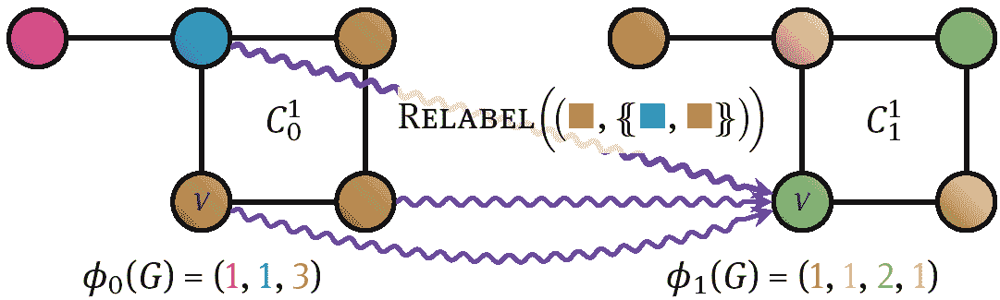

**图 4.6** 1-WL 着色方案示意图。


我们称两个图 `G` 和 `H` 为 `同构`，如果存在一个双射 `φ: V(G) → V(H)` 保持边不变，即对于 `V(G)` 中所有的 `u` 和 `v`，`(u, v)` 在 `E(G)` 中当且仅当 `(φ(u), φ(v))` 在 `E(H)` 中。如果 `G` 和 `H` 同构，我们记作 `G ≃ H` 并称 `φ` 为 `G` 和 `H` 之间的一个 `同构`。此外，我们称由 `≃` 诱导的等价类为 `同构类型`。在带标签图的情况下，我们额外要求对于 `V(G)` 中所有的 `v` 有 `l(v) = l(φ(v))`，对于 `E(G)` 中所有的 `(u, v)` 有 `l((u, v)) = l((φ(u), φ(v)))`。

### 4.2.2.2 核

非空集 `𝒳` 上的 `核` 是一个对称的、半正定函数 `k: 𝒳×𝒳 → ℝ`。等价地，如果存在一个 `特征映射 ϕ: 𝒳 → ℋ`，其中 `ℋ` 是一个赋予内积 `(·,·)` 的希尔伯特空间，使得对于 `𝒳` 中所有的 `x` 和 `y` 有 `k(x, y) = ⟨ϕ(x), ϕ(y)⟩`，则函数 `k` 是一个核。令 `𝒢` 为所有图的集合，则 `𝒢` 上的核称为 `图核`。

### 4.2.3 Weisfeiler-Leman 算法

1-WL 是图同构问题的一种经典启发式算法 [28, 273, 700]。在此，我们正式介绍 1-WL 及其推广——`k-WL`，它们构成了下文所述图核的基础。

#### 4.2.3.1 1 维 Weisfeiler-Leman 算法

直观上，1-WL 旨在通过迭代聚合相邻顶点的标签或 `颜色` 来捕捉图的结构。如果两个颜色相同的顶点的邻域颜色不同，它们将获得不同的颜色。示意图见 图 4.6。

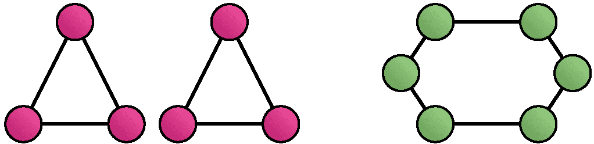

**图 4.7** 两个无法被 1-WL 区分的图。

形式上，设 `(G, l)` 为一个带标签图。在每次迭代 `i ≥ 0` 中，算法计算一个 `着色 C[i]¹: V(G) → 𝕊`，其中 `𝕊` 是某个任意陪域。在第一次迭代中，我们根据标签 `l` 为顶点着色，即对于 `V(G)` 中的 `v`，`C[0]¹(v) = l(v)`。对于 `i ≥ 0`，`C[i+1]¹` 定义为

```
C[i+1]¹(v) = RELABEL(C[i]¹(v), {{C[i]¹(w) | w ∈ δ(v)}})
```

此处，`Relabel` 是一个单射，它将当前颜色与相邻顶点颜色的多重集组成的有序对映射到一种新颜色。因此，如果某种颜色的邻居数量不同，则在迭代 *i* 中具有相同颜色的两个顶点在下一次迭代中将获得不同的颜色。请注意，将 1-WL 扩展到带标签的有向图是很直接的。我们运行算法直到收敛，即

```
C[i]¹(v)=C[i]¹(w)⇔C[i+1]¹(v)=C[i+1]¹(w)
```

对 `V(G)` 中的所有 `v` 和 `w` 成立。我们称由 `C[i]¹` 诱导的 `V(G)` 的划分为*稳定划分*。对于这样的 `i`，我们定义 `V(G)` 中 `v` 的 `C[∞]¹(v) = C[i]¹(v)`。对于两个图 `G` 和 `H`，我们在两个图上“并行”运行算法。如果

```
|V(G)∩(C[∞]¹)^(−1)(c)| ≠ |V(H)∩(C[∞]¹)^(−1)(c)|
```

对 `C[∞]¹` 的陪域中的某个颜色 `c` 成立，则 1-WL *区分* 这两个图。如果 1-WL 区分两个图，则这两个图不同构。

#### 4.2.3.2 *k* 维 Weisfeiler-Leman 算法

1-WL 无法区分所有非同构图对。请参见 图 4.7 了解这样一对图。*k*-WL 是 1-WL 的自然推广，它通过对顶点集上定义的 *k* 元组进行着色而变得更强大。

形式上，设 *G* 为一个图，且 *k* ≥ 2。此外，设 **v** 为 `V(G)^k` 中的一个元组，则 `G[v]` 是由 **v** 的分量诱导的子图，其中顶点用来自 `{1, ..., k}` 的整数标记，对应于 **v** 的索引。在每次迭代 `i ≥ 0` 中，算法计算一个*着色* `C[i]^(k): V(G)^k → 𝕊`，其中 `𝕊` 是某个任意陪域。在第一次迭代中（`i = 0`），如果映射 `v[i]↦w[i]` 是 `G[v]` 和 `G[w]` 之间的一个同构，则 `V(G)^k` 中的两个元组 **v** 和 **w** 获得相同的颜色。现在，对于 `i ≥ 0`，`C[i+1]^(k)` 定义为

```
C[i+1]^(k)(v) = RELABEL(C[i]^(k)(v), M_i)
```

其中多重集

```
(4.10) M_i(v) = ({{C_i^k(ϕ_1(v,w)) | w ∈ V(G)}}, ..., {{C_i^k(ϕ_k(v,w)) | w ∈ V(G)}})
```

以及

```
ϕ_j = (v[1], ..., v[j−1], w, v[j+1], ..., v[k])
```

即，`ϕ_j(v, w)` 用顶点 `w` 替换元组 **v** 的第 `j` 个分量。我们运行算法直到收敛，即

```
C[i]^(k)(v)=C[i]^(k)(w)⇔C[i+1]^(k)(v)=C[i+1]^(k)(w)
```

对所有 **v** 和 **w** 在 `V(G)^k` 中成立，并称由 `C[i]^(k)` 诱导的 `V(G)^k` 的划分为*稳定划分*。对于这样的 `i`，我们定义 `V(G)^k` 中 **v** 的 `C[∞]^(k)(v) = C[i]^(k)(v)`。判断两个图是否非同构的过程与 1-WL 相同。随着 *k* 的增加，算法变得越来越强大 [[117]](#backmatter-001.xhtml#b_9783110785944-010_ref_117)。即，对于每个 *k* ≥ 2，都存在一对图使得 *k*-WL 无法区分但 (*k* + 1)-WL 可以区分。

设 *A* 和 *B* 为图同构问题的两个启发式算法，例如 *k*-WL，则我们记作 `A ⊑ B` (`A ⊏ B`, `A ≡ B`)，如果在区分非同构图方面算法 *A* 不弱于（严格强于、等价于）算法 *B*。使用此符号，我们记为

```
(k+1) − WL ⊏ k − WL
```

对于 *k* ≥ 2，以陈述上一段提到的结果。

### 4.2.4 基于 Weisfeiler-Leman 算法的核

Weisfeiler-Leman 算法构成了几个最成功的图核的基础。在此，我们概述基于 1-WL 的核，随后是基于 *k*-WL 的核。此外，我们综述与 Weisfeiler-Leman 范式相关的其他核。

#### 4.2.4.1 Weisfeiler-Leman 子树核

*Weisfeiler-Leman 子树图核* [[627]](#backmatter-001.xhtml#b_9783110785944-010_ref_627) 的思想是对 `h ≥ 0` 次迭代计算 1-WL，从而为每次迭代 `0 ≤ i ≤ h` 得到一个标签函数 `C[i]¹: V(G) → 𝕊[i]`。现在，在每次迭代之后，我们为每个图 `G` 计算一个*特征向量 ϕ[i](G)* 在 `ℝ^|𝕊[i]|` 中。每个分量 `ϕ[i](G)[c]` 计算标记为 `𝕊[i]` 中 `c` 的顶点的出现次数。总体特征向量 `ϕ_WL` 定义为所有 `h` 次迭代的特征向量的连接，即

```
ϕ_WL = [ϕ[0], …, ϕ[h]]
```

`h` 次迭代的 Weisfeiler-Leman 子树核随后计算为

```
k_WL = ⟨ϕ_WL, ϕ_WL⟩
```

其中 `⟨·,·⟩` 表示标准内积。单个特征向量计算的运行时间为 `𝒪(hm)`，而一组 `N` 个图的 Gram 矩阵计算时间为 `𝒪(Nhm + N²hn)` [[627]](#backmatter-001.xhtml#b_9783110785944-010_ref_627)，其中 `n` 和 `m` 分别表示所有 `N` 个图中的最大顶点数和边数。

#### 4.2.4.2 Weisfeiler-Leman 最优赋值核

Weisfeiler-Leman 子树核计算具有相同标签的顶点对数量。另一种方法是将 `G` 的每个顶点*赋值*给 `H` 的一个顶点。构建一个最大化结构重叠和顶点属性一致性的赋值，是比较图的一般概念，也是*图匹配*或*网络对齐*的基础。该原则被提出用于获得图核，其中两个顶点之间的相似度由任意基核决定 [[236]](#backmatter-001.xhtml#b_9783110785944-010_ref_236)。然而，很快观察到由此产生的相似度度量通常不是半正定的 [[685]](#backmatter-001.xhtml#b_9783110785944-010_ref_685)。后续研究确定了一类特定的基核，对于这类基核，源于最优赋值的相似度保证是一个有效核，即半正定 [[395]](#backmatter-001.xhtml#b_9783110785944-010_ref_395)。我们总结有效赋值核的理论，然后描述如何从 1-WL 获得合适的基核。

**有效最优赋值核** 我们考虑一般设定，即要将两个集合的元素相互赋值。设 `[𝒳]^n` 表示集合 `𝒳` 的所有 `n` 元子集的集合，`ℬ(X, Y)` 表示 `[𝒳]^n` 中 `X` 和 `Y` 之间所有双射的集合，`n` 在 `ℕ` 中。*最优赋值核* `K_𝔅^(k)` 在 `[𝒳]^n` 上定义为

```
(4.11) K_𝔅^k(X,Y) = max_{B ∈ ℬ(X,Y)} ∑_{(x,y) ∈ B} k(x,y)
```

其中 `k` 是 `𝒳` 上的*基核*。对于基数不同的集合的应用，可以通过添加满足 `k(d, ·) = 0` 的虚拟元素 `d` 来扩充较小的集合。

## 强核与层级结构

类似于必须满足强三角不等式的超度量概念，所谓的**强核**被引入为一种满足 `k(x, y) ≥ min{k(x, z), k(z, y)}` 的核函数，适用于 `𝒳` 中所有的 `x`、`y`、`z`。研究表明，如果 `k` 是强核，则函数 `K_𝔅^(k)` 是一个有效核 [[395]](#backmatter-001.xhtml#b_9783110785944-010_ref_395)。强核等价于从其定义域的层级划分中获得的核。形式上，设 `T` 为一棵有根树，使得 `T` 的叶节点为 `𝒳` 的元素，且 `ω: V(T) → ℝ[≥0]` 为权重函数。我们称元组 `(T, ω)` 为**层级结构**。`𝒳` 上的层级结构按如下方式为 `𝒳` 中的 `x` 和 `y` 诱导出相似度 `k(x, y)`。对于 `V(T)` 中的 `v`，设 `P(v) ⊆ V(T)` 表示 `T` 中从 `v` 到根节点 `r` 路径上的顶点集合。则 `𝒳` 中 `x` 和 `y` 之间的相似度为

```
k(x,y) = ∑_{v ∈ P(x) ∩ P(y)} ω(v).
```

对于每一个强核 `k`，都存在一个诱导出 `k` 的层级结构；反之，每一个层级结构都诱导出一个强核 [[395]](#backmatter-001.xhtml#b_9783110785944-010_ref_395)。

基核 `k` 的层级结构 `(T, ω)` 可通过直方图交集在线性时间内计算公式 4.11 的最优赋值核。对于 `V(T)` 中的节点 `v` 和集合 `X ⊆ 𝒳`，设 `X[v]` 表示包含在以 `v` 为根的子树中的 `X` 的子集。则最优赋值核为

```
(4.12) K_𝔅^k(X,Y) = ∑_{v ∈ V(T)} min{|X_v|, |Y_v|} · ω(v)
```

这可以看作是为在强基核 `k` 下表示集合 `X` 和 `Y` 而适当定义的直方图的直方图交集核 [[395]](#backmatter-001.xhtml#b_9783110785944-010_ref_395)。

### 从 1-WL 导出的最优赋值核

1-WL 在（一组）图的顶点上产生一个层级结构，其中第 `i` 层由节点 `𝕊[i][+1]` 组成，第 0 层为人工根节点。父子关系由颜色细化过程给出，其中根节点的子节点为 `𝕊[1]`。具有均匀权重函数的该层级结构在顶点上诱导出强基核

```
(4.13) k(u,v) = ∑_{i=0}^h k_δ(C_i¹(u), C_i¹(v)),  k_δ(x,y) = { 1 if x = y; 0 otherwise }
```

该核计算给顶点分配不同颜色所需的迭代次数，反映了顶点具有结构相似邻域的程度。使用该基核的最优赋值核被称为**Weisfeiler-Leman 最优赋值核**，并在许多分类实验中被证明比 Weisfeiler-Leman 子树核取得了更好的准确率结果。此外，与强基核相关联的层级结构的权重可通过多核学习进行优化 [[396]](#backmatter-001.xhtml#b_9783110785944-010_ref_396)。

#### 4.2.4.3 Wasserstein Weisfeiler-Leman 图核

与赋值核相关的是基于 Wasserstein 距离的技术。给定两个向量 `a` 和 `b` 在 `ℝ[+]^(n)` 中，其条目之和相等，以及一个基代价矩阵 `D` 在 `ℝ[+]^(n × n)` 中，**Wasserstein 距离**（或**土方距离**、**最优传输距离**）¹⁴

```
(4.14) W(a,b) = min_{T ∈ Γ(a,b)} ⟨T, D⟩,  Γ(a,b) = { T ∈ ℝ_+^{n × n} : T1 = a, T^⊤1 = b }
```

其中 `Γ(a, b)` 是所谓**传输计划**的集合，`⟨·,·⟩` 表示 Frobenius 点积。虽然 `Γ(a, b)` 允许双随机矩阵，但 Wasserstein 距离是公式 4.11 最小版本的推广。提供 `a` 和 `b` 条目之间差异度的基代价矩阵，其作用类似于基核。

Wasserstein 距离可利用由 1-WL 获得的基代价应用于两个图的顶点 [[663]](#backmatter-001.xhtml#b_9783110785944-010_ref_663)。`D` 的条目由下式给出

```
(4.15) d(u,v) = 1/(h + 1) ∑_{i=0}^h ρ(C_i¹(u), C_i¹(v)),  ρ(x,y) = { 0 if x = y; 1 otherwise }
```

公式 4.15 与公式 4.13 密切相关，可视为其相关联的归一化距离。公式 4.14 的 Wasserstein 距离 `W(a, b)` 随后与基于距离的核 [[283]](#backmatter-001.xhtml#b_9783110785944-010_ref_283) 相结合，具体为 Laplacian 核的一个变体。证明了所得函数为半正定。作者还提出将 1-WL 扩展到连续属性，用实值向量替代离散颜色。此时，Wasserstein 距离的基代价由这些向量间的欧氏距离获得。然而，在这种情况下，无法保证所得函数为半正定。

Weisfeiler-Leman 赋值核和 Wasserstein Weisfeiler-Leman 核均采用 1-WL，并在许多数据集上提高了实践中观察到的分类准确率，优于 Weisfeiler-Leman 子树核。然而，它们在区分非同构图方面并不更强大。获得在此意义上表达能力更强的核的一种方法是使用 `k`-WL。

#### 4.2.4.4 基于 k-WL 的核

`k`-WL 也被用于推导图核 [[504], [506]]。本质上，核计算的工作方式与一维情况相同，即基于颜色计数为每个图计算特征向量。为了使算法更具可扩展性，[[506]](#backmatter-001.xhtml#b_9783110785944-010_ref_506) 的作者采用对 `k` 个顶点上的所有子图着色，而非对所有 `k` 元组着色，从而得到一个表达能力较弱的算法。此外，作者提出仅考虑原始邻居的一个子集，以利用底层图的稀疏性。进一步，他们提供了一种基于采样的近似算法以加速大图的核计算，表明该核可在常数时间内近似，即与顶点和边的数量无关，且具有加性近似误差。最后，他们在实验上证明了所提核在测试基准数据集的一个子集上优于 Weisfeiler-Leman 子树核。


类似地，Morris、Rattan 和 Mutzel [[504]](#backmatter-001.xhtml#b_9783110785944-010_ref_504) 提出了基于 `k`-WL 的图核。他们又提出了 `k`-WL 的一个局部变体，称为 `δ`-`k`-LWL，该变体仅考虑原始邻域的一个子集。然而，他们考虑的是 `k` 元组，并证明了其方法的一个变体比原始 `k`-WL 稍强，同时考虑了原始图的稀疏性。即，代替公式 4.10，`δ`-`k`-LWL 使用

```
M[i]^(δ)(v) = ({{C[i]^(k, δ)(ϕ1) | w ∈ δ(v[1])}}, …, {{C[i]^(k, δ)(ϕk) | w ∈ δ(v[k])}}).
```

因此，标记函数定义为

(4.16) `C[i + 1]^(k, δ)(v) = RELABEL(C[i]^(k, δ)(v), M[i]^(δ)(v))`. (4.16)

实验上，他们展示了其 `k-WL` 的一个变体在许多标准基准数据集上达到了新的最先进水平，同时比 `k-WL` 快几个数量级。

### 4.2.4.5 基于 Weisfeiler-Leman 算法的其他核

在下文中，我们综述了其他建立在 Weisfeiler-Leman 范式之上的图核。

**Weisfeiler-Leman 核框架** 修改和增强图核的一种通用技术是修改其标签，以便编码额外信息。这可以通过计算 `1-WL` 的前 `h ≥ 0` 个颜色 `C[0]¹, …, C[h]¹` 来实现 [[627]](#backmatter-001.xhtml#b_9783110785944-010_ref_627)。然后，给定一个用作基础核的任意图核，相应的 Weisfeiler-Leman 核是将基础核应用于具有标签 `C[i]¹`（其中 `i` 在 `{0, ..., h}` 中）的图对的求和。*Weisfeiler-Leman 子树核*（见 第 4.2.4.1 节）是通过计算公共顶点标签的基础核获得的。另一种常用的实例是通过使用最短路径核 [[65]](#backmatter-001.xhtml#b_9783110785944-010_ref_065) 获得的。

**哈希图核框架** 在化学信息学或生物信息学中，图的边和顶点通常带有实值信息注释，例如物理测量值 [[508]](#backmatter-001.xhtml#b_9783110785944-010_ref_508)。能够考虑这些属性的先前图核相对较慢，并采用核技巧 [65, 222, 394]。因此，这些方法无法扩展到大型图和数据集。此外，由于离散本质，Weisfeiler-Leman 子树核等核无法充分处理此类连续信息。为了克服这一问题，引入了哈希图核框架 [[507]](#backmatter-001.xhtml#b_9783110785944-010_ref_507)。其思路是使用随机哈希函数迭代地将连续属性转化为离散标签。这允许应用快速、显式的图特征映射（例如 Weisfeiler-Leman 子树核），而这些映射仅限于离散注释。在每次迭代中，算法采样新的哈希函数并计算特征映射。最后，将所有迭代的特征映射组合成一个特征映射。为了获得 `ℝ^d` 中属性之间有意义的相似度，要求两个独立选择的随机哈希函数 `h[1], h[2] : ℝ^d → ℕ` 的碰撞概率 `Prh[1 = h2]` 等于 `ℝ^d` 上的一个合适的核。配备这样一个哈希函数，为几个能够处理连续信息的最先进核推导出了近似结果 [[507]](#backmatter-001.xhtml#b_9783110785944-010_ref_507)。特别地，我们推导出了一个 Weisfeiler-Leman 子树核的变体，它可以处理连续属性。广泛的实验研究表明，哈希核框架的实例在达到最先进分类准确率的同时，比专门设计用于处理连续信息的核快几个数量级。

**图核中的邻域聚合** 邻域聚合的思想被广泛使用，且定义上往往存在细微差别。为求完备，我们提及几个遵循这一通用思想的图核。*邻域哈希核* [[314]](#backmatter-001.xhtml#b_9783110785944-010_ref_314) 在精神上类似于 Weisfeiler-Leman 子树核，但用位向量表示简单标签，并使用逻辑运算和哈希来编码直接邻域以提高效率。[[528]](#backmatter-001.xhtml#b_9783110785944-010_ref_528) 中提出的传播核提供了一个通用框架，基于标签和属性的信息传播方案来定义图核。传播（例如基于随机游走）在两个输入图上单独执行，并通过比较每次传播步骤后的标签分布来获得核。在连续（多维）属性的情况下，使用单个哈希函数来获得离散标签。[[537]](#backmatter-001.xhtml#b_9783110785944-010_ref_537) 中提出了一个用于核的通用消息传递框架，其中在邻域聚合步骤中引入了最优赋值的概念（见第 4.2.4.2 节）。*持久 Weisfeiler-Leman 核* [[597]](#backmatter-001.xhtml#b_9783110785944-010_ref_597) 将 `1-WL` 与持久同调相结合，以提取环等拓扑特征。将 `1-WL` 与图同态联系起来的最新理论结果 [[167]](#backmatter-001.xhtml#b_9783110785944-010_ref_167) 被用来定义具有与 `1-WL` 相同表达能力但不同特征空间的图核 [[533]](#backmatter-001.xhtml#b_9783110785944-010_ref_533)。

### 4.2.5 图神经网络及其与 Weisfeiler-Leman 算法的联系

GNNs 作为图核在图分类和其他图机器学习任务（如节点分类或回归）中的替代方案而出现。标准 GNNs 可以被视为 `1-WL` 的神经网络版本，其中颜色被连续特征向量取代，并使用神经网络聚合节点邻域 [252, 292, 375]。实际上，GNN 框架可以被视为实现了一种基于图的连续形式的“消息传递”，其中局部邻域信息被聚合并传递给邻居 [[252]](#backmatter-001.xhtml#b_9783110785944-010_ref_252)。通过部署可训练的神经网络来聚合局部节点邻域中的信息，GNNs 可以与分类或回归算法的参数一起以端到端的方式进行训练，与经典 `1-WL` 的核对应物相比，这可能允许更大的适应性和更好的泛化能力。

GNN 模型由一堆神经网络层组成，其中每一层聚合每个节点周围的局部邻域信息（即邻居的特征），然后将聚合后的信息传递给下一层。有关架构示意图，请参见 图 4.8。

![图 4.8 GNN 特征聚合方案示意图。节点 `v[4]` 的新特征由其旧特征及其邻居 `v[2]` 和 `v[5]` 的特征计算得出。](graphic/b_9783110785944-004_fig_008.png)

图 4.8 GNN 特征聚合方案示意图。节点 `v[4]` 的新特征由其旧特征及其邻居 `v[2]` 和 `v[5]` 的特征计算得出。

在下文中，我们正式定义 GNNs 并概述其与 Weisfeiler-Leman 算法的联系。设 `G = (V, E, l)` 为一个带标签的图，具有与 `l` *一致* 的初始节点着色 `f^((0)) : V(G) → ℝ^(1×d)`。这意味着每个节点 `v` 都带有 `ℝ^(1×d)` 中的特征 `f^((0))(v)`，使得当且仅当 `l(u) = l(v)` 时，`f^((0))(u) = f^((0))(v)`。或者，`f^((0))(v)` 可以是与 `v` 关联的任意实值特征向量。示例包括化学信息学应用中的连续原子属性或社交网络应用中的文本向量表示。基本 GNN 模型可以按如下方式实现 [[292]](#backmatter-001.xhtml#b_9783110785944-010_ref_292)。在每一层 `t > 0` 中，我们计算一个新特征

(4.17) $f^{(t)}(v) = \sigma\left( {f^{(t - 1)}(v) \cdot W_{1}^{(t)} + \sum\limits_{w \in N(v)}f^{(t - 1)}(w) \cdot W_{2}^{(t)}} \right) \quad (4.17)$

在 $\mathbb{R}^{1 \times e}$ 中针对 $v$，其中 $W_{1}^{(t)}$ 和 $W_{2}^{(t)}$ 是来自 $\mathbb{R}^{d \times e}$ 的参数矩阵，$\sigma$ 表示逐分量非线性函数，例如 sigmoid 或 ReLU。[¹⁵]

也可以用不同的排列不变、可微函数（例如 mean 或 max）替换上述方程中定义在邻域上的求和，并可以用列向量拼接等方式替换外层求和 [[252]](#backmatter-001.xhtml#b_9783110785944-010_ref_252)。因此，从全局来看，新特征 $f^{(t)}(v)$ 的计算方式为

(4.18) $f_{\text{merge}}^{W_{1}}(f^{(t-1)}(v), f_{\text{aggr}}^{W_{2}}(\{f^{(t-1)}(w) \mid w \in N(v)\})), \quad (4.18)$

其中 $f_{\text{aggr}}^{W_{2}}$ 聚合邻域特征集合，$f_{\text{merge}}^{W_{1}}$ 将节点在第 $(t-1)$ 步的表示与计算出的邻域特征进行合并。$f_{\text{aggr}}^{W_{2}}$ 和 $f_{\text{merge}}^{W_{1}}$ 均可为任意可微函数，例如神经网络，类比方程 4.17，我们分别将它们的参数记为 $W_{1}$ 和 $W_{2}$。

可以通过聚合所有节点计算出的向量表示，获得整个图的向量表示 $f_{\text{GNN}}$，例如

$$f_{\text{GNN}}(G) = \sum\limits_{v \in V(G)}f^{(T)}(v),$$

其中 $T > 0$ 表示最后一层。更精细的方法使用基于排序 [[736]](#backmatter-001.xhtml#b_9783110785944-010_ref_736) 或软分配 [[724]](#backmatter-001.xhtml#b_9783110785944-010_ref_724) 的差分池化算子。为了将方程 4.17 和 4.18 的参数 $W_{1}$ 和 $W_{2}$ 适配给定的数据分布，它们连同用于分类或回归的神经网络参数，以端到端的方式（通常通过随机梯度下降）进行优化。许多 GNN 架构的高效基于 GPU 的实现可见于 [[225]](#backmatter-001.xhtml#b_9783110785944-010_ref_225) 和 [[696]](#backmatter-001.xhtml#b_9783110785944-010_ref_696)。另请参阅 第 4.3 节.

#### 4.2.5.1 与 Weisfeiler-Leman 算法的联系

近期的一系列工作 [[468, 509, 714]](#backmatter-001.xhtml#b_9783110785944-010_ref_468) 将 GNN 的能力或表达性与 Weisfeiler-Leman 算法联系起来。结果表明，GNN 架构通常不比 1-WL 具有更强的区分非同构（子）图的能力。

形式上，设 $(G, l)$ 为一个带标签图，令 $\mathbf{W}^{(t)} = (W_{1}^{(t')}, W_{2}^{(t')})_{t' \le t}$ 表示由方程 4.17 和 4.18 给出的、直到迭代 $t$ 的 GNN 参数。我们使用 one-hot 编码，将初始标签 $l(v)$ 编码为 $\mathbb{R}^{1 \times d}$ 中的向量 $f^{(0)}(v)$。文献 [[509]](#backmatter-001.xhtml#b_9783110785944-010_ref_509) 中展示的第一个理论结果表明，GNN 架构不比 1-WL 具有更强的区分非同构（子）图的能力。更正式地说，设 $f_{\text{merge}}^{W_{1}}$ 和 $f_{\text{aggr}}^{W_{2}}$ 为方程 4.18 中选取的任意两个函数。对于标签 $l(v)$ 作为向量 $f^{(0)}(v)$ 的每一种编码，以及每一种 $\mathbf{W}^{(t)}$ 的选择，1-WL 的着色 $C_{i}^{1}$ 总是细化由参数 $\mathbf{W}^{(t)}$ 参数化的 GNN 所诱导的着色 $f^{(t)}$。

**定理 7.** *设 $(G, l)$ 为一个带标签图。则对于所有 $t \ge 0$、所有与 $l$ 一致的初始着色 $f^{(0)}$ 选择，以及所有权重 $\mathbf{W}^{(t)}$，有*

$c_{l}^{(t)} \sqsubseteq f^{(t)}$。

文献 [[509]](#backmatter-001.xhtml#b_9783110785944-010_ref_509) 的第二个结果表明，存在一系列参数矩阵 $\mathbf{W}^{(t)}$，使得 GNN 在区分非同构（子）图方面具有与 1-WL 相同的能力。只要我们选择初始标记 $l$ 的编码方式，使得线性无关向量编码不同标签，这甚至对简单的架构方程 4.17 也成立。

**定理 8.** *设 $(G, l)$ 为一个带标签图。则对于所有 $t \ge 0$，存在一系列权重 $\mathbf{W}^{(t)}$ 和一种 1-GNN 架构，使得*

$c_{l}^{(t)} \equiv f^{(t)}$。

因此，根据上述结果，GNN 可被视为 1-WL 的一种扩展，二者原则上具有相同的能力，但 GNN 在适应当前学习任务方面更灵活，且能处理连续节点特征。

#### 4.2.5.2 高阶图神经网络

上述结果也已推广到 $k$ 维情况。例如，Maron、Ben-Hamu、Serviansky 和 Lipman [[468]](#backmatter-001.xhtml#b_9783110785944-010_ref_468) 设计了一种基于简单矩阵运算的架构，其能力等同于 3-WL。在最近的工作中，Morris、Rattan 和 Mutzel [[504]](#backmatter-001.xhtml#b_9783110785944-010_ref_504) 设计了称为 $\delta$-$k$-LGNN 的神经架构，其构造类似于 GNN。

形式上，给定一个带标签图 $G$，令 $V(G)^{k}$ 中的每个元组 $\mathbf{v}$ 由 $G[\mathbf{v}]$ 的同构类型决定，带有初始特征 $f^{(0)}(\mathbf{v})$。在每一层 $t > 0$ 中，我们按如下方式计算元组 $\mathbf{v}$ 的新特征 $f^{(t)}(\mathbf{v})$：

$$

\begin{array}{r}

f_{\text{merge}}^{W_{1}}\left( f^{(t - 1)}(\mathbf{v}), f_{\text{agg}}^{W_{2}}\left( \left\{ \left\{ f^{(t - 1)}\left( \phi_{1}(\mathbf{v},w) \right) \mid w \in \delta(v_{1}) \right\} \right\}, \ldots, \right. \right. \\

\left. \left. \left\{ \left\{ f^{(t - 1)}\left( \phi_{k}(\mathbf{v},w) \right) \mid w \in \delta(v_{k}) \right\} \right\} \right) \right),

\end{array}

$$

在 $\mathbb{R}^{1 \times e}$ 中针对元组 $\mathbf{v}$，其中 $W_{1}^{(t)}$ 和 $W_{2}^{(t)}$ 是来自 $\mathbb{R}^{d \times e}$ 的可学习参数矩阵。[¹⁶]

**定理 9.** *设 $(G, l)$ 为一个带标签图。则对于所有 $t \ge 0$，存在一系列权重 $\mathbf{W}^{(t)}$，使得*

$C_{t}^{(k, \delta)}(\mathbf{v}) = C_{t}^{(k, \delta)}(\mathbf{w}) \iff f^{(t)}(\mathbf{v}) = f^{(t)}(\mathbf{w})$。

*因此，对于所有图，以下对所有 $k \ge 1$ 均成立：*

$\delta$-$k$-LGNN $\equiv$ $\delta$-$k$-LWL。

### 4.2.6 结论与未来工作

Weisfeiler-Leman 方法在图论中已被研究数十年，最近被证明是图机器学习中的一项关键技术 [[505]](#backmatter-001.xhtml#b_9783110785944-010_ref_505)，在许多真实世界数据集上实现了高准确率 [[508]](#backmatter-001.xhtml#b_9783110785944-010_ref_508)。虽然 Weisfeiler-Leman 算法的表达性将机器学习方法限制在区分非同构图上，但此类方法的泛化能力在较小程度上被理解，这指明了未来研究的方向。此外，具有不同边类型的异构网络或带有时间信息的图将变得越来越重要。将 Weisfeiler-Leman 范式适配到此类场景中只是最近才被考虑，例如针对时序图 [[544]](#backmatter-001.xhtml#b_9783110785944-010_ref_544)，开发新的合适学习方法才刚刚起步。

## 4.3 深度图表示学习

*Matthias Fey*

*Frank Weichert*

## 摘要


# 学习基于图结构的数据

学习基于图结构的数据（如分子、社交、生物和金融网络）需要有效的表示，以成功捕捉其丰富的结构属性。近年来，针对图上机器学习的方法层出不穷——最著名的莫过于基于图核和 `Graph Neural Networks (GNNs)`（图神经网络）的方法。图神经网络通过遵循可微分的神经消息传递方案，利用底层数据的关系归纳偏置，并因其在捕捉不同图结构方面的表达能力，在各类任务上展现出良好的性能。然而，尽管 GNNs 在学习此类表示方面潜力毋庸置疑，但迄今为止阻碍其在工业和社会应用中广泛采用的挑战之一，是难以将其扩展到大型图上。特别是，给定节点的嵌入递归地依赖于其所有邻居的嵌入，导致节点间的高相互依赖性随层数呈指数级增长。

在此，我们通过一个适用于广泛算子和学习任务的统一框架，展示了消息传递的通用性。这种消息传递的通用性促成了 `PyTorch Geometric` 的开发，这是一个用于实现和处理基于图的神经网络构建模块的知名深度学习库。此外，我们讨论了将图神经网络应用于大规模图的可扩展方法。特别是，我们表明基于边子采样或非可训练传播的可扩展方法会削弱消息传递的表达能力。为了克服这一限制，我们提出了 `GNN AutoScale`，一个用于将任意消息传递神经网络扩展到大型图的框架。`GNN AutoScale` 通过利用先前训练迭代中的历史节点嵌入来剪枝整个计算图子树，同时在理论上能够保持原始架构的表达能力。

## 4.3.1 引言

图被广泛用于抽象相互作用对象的复杂系统，如社交网络、知识图谱、分子图和生物网络，以及用于建模 3D 物体、流形和源代码 [[320]](#backmatter-001.xhtml#b_9783110785944-010_ref_320)。为了在这些领域开发成功的机器学习模型，我们需要能够利用图结构中固有的丰富信息，以及图的节点和边所包含的特征信息的技术。最近，图神经网络作为一种强大的方法和图上表示学习的事实标准应运而生。GNNs 能够以可训练的方式捕捉局部图结构和特征信息，从而推导出适合特定任务的强大节点表示 [[291], [455]]。为实现这一目标，它们遵循一个简单的邻域聚合过程或神经消息传递方案，该方案受两大主要视角驱动：将经典 CNN 推广到非规则域，以及它们与 Weisfeiler-Lehman 算法的紧密联系 [[226], [509], [715]]（参见 第 4.2.5 节）。

`几何深度学习` 和 `关系表示学习` 领域的最新研究提供了大量基于图的算子，允许精确控制提取的基于图的特征属性 [[134], [225], [252], [292], [375], [378], [588], [683], [697], [714], [715]]。尽管如此，所有这些最新算子均可用一个简单的消息传递公式来描述，从而形成了一个适用于广泛算子和学习任务的统一框架 [[252]](#backmatter-001.xhtml#b_9783110785944-010_ref_252)。消息传递的通用性促成了 `PyTorch Geometric` 库的开发，这是一个用于实现和处理基于图的神经网络的深度学习框架 [[225]](#backmatter-001.xhtml#b_9783110785944-010_ref_225)。

虽然 GNNs 已被更好地理解且模型变得更加复杂，但随着数据量的增加，该领域的进步本应更加显著。然而，应用 GNNs 的小批量训练颇具挑战，因为给定节点的嵌入递归地依赖于其所有邻居的嵌入，导致节点间的高相互依赖性随层数呈指数级增长 [[455]](#backmatter-001.xhtml#b_9783110785944-010_ref_455)。近期多项工作通过不同的采样技术（导致边的子采样）[[455], [600]]，或通过将传播与预测解耦 [[234], [321], [378], [710], [726]] 来解决这一问题。尽管实证结果表明上述方法可将 GNN 训练扩展到大型图，但这些技术要么局限于浅层网络、不可交换算子，要么表达能力降低。特别是，现有方法仅考虑特定的 GNN 算子，目前尚不清楚这些技术能否成功应用于现有的广泛 GNN 架构。

在接下来的章节中，我们将讨论并介绍上述通用神经消息传递框架，并展示常见 GNN 算子如何融入该方案。随后我们介绍 `PyTorch Geometric` 库 [[225]](#backmatter-001.xhtml#b_9783110785944-010_ref_225)，它使得在实践中实现这些 GNN 算子变得容易。此外，我们提出了用于将任意消息传递 GNNs 扩展到大规模图的 `GNN AutoScale` 框架 [[224]](#backmatter-001.xhtml#b_9783110785944-010_ref_224)。

## 4.3.2 通过神经消息传递在图上进行表示学习

我们首先完善 第 4.2.5 节 中的通用神经消息传递方案，该方案被最先进的图神经网络所采用，并在过程中引入必要的符号和背景知识。设 `𝒢 = (𝒱, ℰ)` 或 `A ∈ {0, 1}^|V|×|V|` 表示一个 `graph`（图），其具有所有 `v ∈ 𝒱` 的节点特征向量 `x[v]` 以及（可选的）边特征 `e[v, w]`（当 `(v, w) ∈ ℰ ⊆ 𝒱 × 𝒱` 时）。此处，我们主要关注以端到端的方式为所有 `v ∈ 𝒱` 学习最终节点表示 `h[v] ∈ ℝ^D`，使其适合给定的下游任务（如节点、链接或图分类）。在节点分类中，每个节点 `v ∈ 𝒱` 关联一个标签 `y[v]`，目标是学习一个能从中轻松预测 `y[v]` 的表示 `h[v]`。在链接预测中，我们旨在发现不完整图中的缺失链接，并可直接使用 `h[v]` 和 `h[w]`（`v, w ∈ 𝒱`）来预测给定节点对之间边的存在性。在图分类中，每个单独的图关联一个标签 `y`，我们可以将 `{h[v] : v ∈ 𝒱}` 作为整体以排列不变的方式来预测标签 `y`。

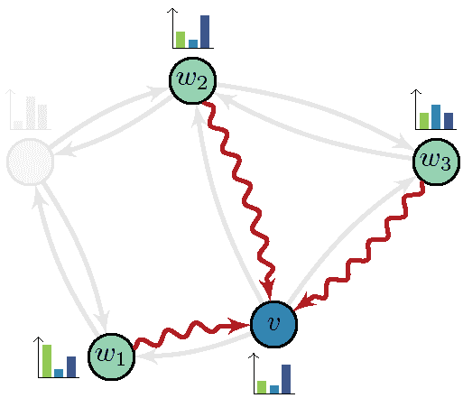

**图 4.9** GNN 层中的消息传递流程。节点的每个直接邻居构造一条消息，并沿给定边发送。每个节点聚合其传入的消息以更新其当前节点表示。

### 图神经网络

图神经网络通过遵循*神经消息传递方案*在图结构数据 $\mathcal{G}$ 上运行，其中节点的表示通过聚合其邻居的表示进行迭代更新 [252]。经过 $L$ 次聚合迭代后，节点的表示捕获了其 $L$ 跳邻域内的结构*和*特征信息。形式上，GNN 的第 $(\ell + 1)$ 层定义为

(4.19) $h_v^{(\ell+1)} = f_\theta^{(\ell+1)}\left(h_v^{(\ell)}, \{\{ (h_w^{(\ell)}, h_v^{(\ell)}, e_{w,v}^{(\ell)}) : w \in \mathcal{N}(v) \}\}\right)$ (4.19)

(4.20) $= \text{UPDATE}_\theta^{(\ell + 1)}\left( h_v^{(\ell)}, \underset{w \in \mathcal{N}(v)}{\bigoplus} \text{MESSAGE}_\theta^{(\ell + 1)}\left( h_w^{(\ell)}, h_v^{(\ell)}, e_{w,v}^{(\ell)} \right) \right)$ (4.20)

其中 $h_v^{(\ell)}$ 表示在第 $\ell$ 层获得的节点 $v$ 的特征向量，$\mathcal{N}(v) = \{w : (w, v) \in \mathcal{E}\}$ 定义了 $v$ 的邻域集合。我们初始化 $h_v^{(0)} = x_v$。由于不同节点可能具有相同的特征向量，GNN 在*多重集* $\{\{ \dots \}\}$ 上运行，多重集定义为一个二元组 $\mathcal{X} = (\mathbb{P}^d, c)$，其中 $\mathbb{P}^d$ 表示 $\mathcal{X}$ 的底层集合，$c : \mathbb{P}^d \to \mathbb{N}_{\ge 1}$ 计算其重数。图 4.9 给出了此消息传递流程的通用示意图。大多数最新的 GNN 算子 $f_\theta^{(\ell)}$ 可以分解为由权重 $\boldsymbol{\theta}$ 参数化的可微且参数化的 $\text{MESSAGE}_\theta^{(\ell)}$ 和 $\text{UPDATE}_\theta^{(\ell)}$ 函数，以及排列不变聚合函数 $\oplus$，例如对特征求和、求平均或求最大值 [225]。根据手头的任务，可以用不同的方式选择 MESSAGE 和 UPDATE。例如，$\text{MESSAGE}$ 函数可以线性或非线性地变换传入特征 [252, 588, 697]；聚合函数可以建模静态 [714]、结构相关 [375] 或数据相关聚合 [683]；而 $\text{UPDATE}$ 通常用于通过跳跃连接 [292] 或残差连接 [134, 378] 来保留中心节点信息。

理想情况下，一个最大能力的 GNN 可以通过将非同构图结构映射到嵌入空间中的不同表示来区分它们。在最近的研究 [509, 714] 中，已经表明 GNN 的表达能力受限于 *Weisfeiler-Leman (WL)* 图同构测试 [701] 的能力（见第 4.2.3 节），该测试根据邻居的颜色唯一地细化节点的着色 $c_v^{(\ell)} : \mathcal{V} \to \Sigma$。事实上，如果 GNN 的所有层 $f_\theta^{(\ell)}$ 都是单射的，即如果它们*从不*将两个不同的邻域映射到同一个表示，那么 GNN 的表达能力等同于 WL 测试。因此，提出了许多与 WL 测试能力相当的 GNN 算子 [155, 714]，以及更高阶的变体以进一步增强其表达能力 [67, 227, 468, 504, 509, 519]（见第 4.2 节）。我们现在简要回顾当前最先进的 GNN 算子如何融入给定的神经消息传递方案中（为简化起见，省略最终的非线性变换）。

### 图神经网络 (GNN)

**图神经网络 (GNN)** [375] 可被视为图结构深度学习方法的先驱之一，其动机源于谱图卷积的一阶近似。其底层 GNN 算子使用对称归一化的均值聚合来聚合线性变换后的邻居节点表示

(4.21) $h_v^{(\ell + 1)} = \overbrace{\frac{1}{c_{v,v}} W h_v^{(\ell)} \underset{\oplus}{\underbrace{\sum_{w \in \mathcal{N}(v)}}} \underset{\text{MESSAGE}_\theta^{(\ell + 1)}}{\underbrace{\frac{1}{c_{w,v}} W h_w^{(\ell)}}}}^{\text{UPDATE}_\theta^{(\ell + 1)}}$ (4.21)

其中 $c_{w,v} = \sqrt{\deg(w) + 1}\sqrt{\deg(v) + 1}$，$\deg(\cdot)$ 表示节点度，$\mathbf{W}$ 为可训练权重矩阵。

### 图注意力网络 (GAT)

**图注意力网络 (GAT)** [683] 建立在 GCN 的思想之上，用由注意力引导的各向异性、可学习聚合替代了结构相关的归一化系数

(4.22) $h_v^{(\ell + 1)} = \overbrace{\alpha_{w,v} W h_v^{(\ell)} \underset{\oplus}{\underbrace{\sum_{w \in \mathcal{N}(v)}}} \underset{\text{MESSAGE}_\theta^{(\ell + 1)}}{\underbrace{\alpha_{w,v} W h_w^{(\ell)}}}}^{\text{UPDATE}_\theta^{(\ell + 1)}}$ (4.22)

其中注意力系数通过以下方式计算

(4.23) $\alpha_{w,v} = \frac{\exp\left( \text{LeakyReLU}\left( \mathbf{a}^\top \left[ W h_v^{(\ell)}, W h_w^{(\ell)} \right] \right) \right)}{\sum_{k \in \mathcal{N}(v) \cup \{ v \}} \exp\left( \text{LeakyReLU}\left( \mathbf{a}^\top \left[ W h_v^{(\ell)}, W h_k^{(\ell)} \right] \right) \right)}$ (4.23)

包含额外的可训练参数 $\mathbf{a}$。

### 基于样条的卷积神经网络

**基于样条的卷积神经网络** [226] 利用边信息 $e_{w,v}$ 学习一个数据相关的滤波器矩阵

(4.24) $h_v^{(\ell + 1)} = \overbrace{W h_v^{(\ell)} \underset{\oplus}{\underbrace{\sum_{w \in \mathcal{N}(v)}}} \underset{\text{MESSAGE}_\theta^{(\ell + 1)}}{\underbrace{g_\theta(e_{w,v}) h_w^{(\ell)}}}}^{\text{UPDATE}_\theta^{(\ell + 1)}}$ (4.24)

通过参数化且连续的 B-样条核函数 $g_\theta(\cdot)$。

### 图同构网络 (GIN)

**图同构网络 (GIN)** [714] 利用求和聚合和 MLP 获得一个最大能力的 GNN 算子

(4.25) $h_v^{(\ell + 1)} = \overbrace{\text{MLP}_\theta\left( (1 + \epsilon) h_v^{(\ell)} \underset{\oplus}{\underbrace{\sum_{w \in \mathcal{N}(v)}}} \underset{\text{MESSAGE}_\theta^{(\ell + 1)}}{\underbrace{h_w^{(\ell)}}} \right)}^{\text{UPDATE}_\theta^{(\ell + 1)}}$ (4.25)

其中 $\epsilon$ 是一个可训练标量，用于区分邻居节点和中心节点。

### 主要邻域聚合 (PNA)

**主要邻域聚合 (PNA)** [155] 网络利用结合度缩放器的多个聚合器，以更好地捕捉图结构属性

(4.26) $$h_{v}^{(l + 1)} = \overset{\text{UPDATE}_{\theta}^{(l + 1)}}{\overbrace{W_{2}\left[h_{v}^{(l)} \underset{w \in \mathcal{N}(v)}{\oplus} \underset{\text{MESSAGE}_{\theta}^{(l + 1)}}{\underbrace{W_{1}\left\lbrack {h_{v}^{(l)},h_{w}^{(l)}} \right\rbrack}}\right]}}$$

其中 `W[1]` 和 `W[2]` 表示可训练权重矩阵，且

(4.27) $$\oplus = \underset{\text{Scalers}}{\underbrace{\begin{bmatrix} 1 \\ s(\deg(v),1) \\ s(\deg(v), -1) \\ \end{bmatrix}}} \otimes \underset{\text{Aggregators}}{\underbrace{\begin{bmatrix} \text{mean} \\ \min \\ \max \\ \end{bmatrix}}}$$

其中 `⊗` 为张量积，且

(4.28) $$s(d,\alpha) = \left( \frac{\log(d + 1)}{\frac{1}{|\mathcal{V}|}\sum_{v \in \mathcal{V}}\log(\deg(v) + 1)} \right)^{\alpha}$$

表示基于度的缩放器。在介绍了 GNN 中消息传递的基本概念后，我们现在更仔细地看看它们的实际实现（第 4.3.3 节）和资源效率（第 4.3.4 节）。

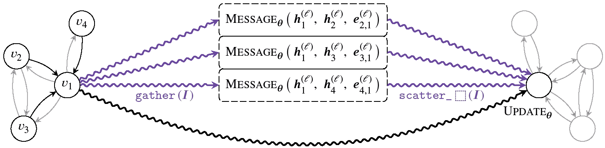

**图 4.10** 基于边索引 `I` 利用 `gather` 和 `scatter` 方法的 GNN 层计算方案，因此在节点并行空间和边并行空间之间交替。

## 4.3.3 PyTorch Geometric：实现图神经网络

图神经网络的实际实现具有挑战性，因为需要在高度稀疏、不规则且大小各异的数据上实现高 GPU 吞吐量。在此，我们介绍并讨论 *PyTorch Geometric* 库 [225]，这是一个建立在 PyTorch [555] 之上的、用于不规则结构数据深度学习的库。除了通用的图数据结构和处理方法外，它还包含来自关系学习和 3D 数据处理领域的多种近期发布的方法。PyTorch Geometric 通过利用稀疏 GPU 加速、提供专用 CUDA 内核，以及为不同大小的输入样本引入高效的 mini-batch 处理，实现了高数据吞吐量。所有实现的方法均支持 CPU 和 GPU 计算，并遵循不可变数据流范式，该范式支持图结构随时间的动态变化。PyTorch Geometric 遵循 MIT 许可证发布，并在 GitHub 上可用。[¹⁷]


在 PyTorch Geometric 中，我们用节点特征矩阵 $X \in \mathbb{R}^{N \times F}$ 表示图 $\mathcal{G} = (X, (I, E))$，该矩阵包含 $N$ 个节点，每个节点拥有 $F$ 个特征；以及一个包含 $E$ 条边的稀疏邻接元组 $(I, E)$，其中 $I \in \mathbb{N}^{2 \times E}$ 以 COOrdinate (COO) 格式编码边索引，$E \in \mathbb{R}^{E \times D}$ （可选）保存 $D$ 维边特征。所有面向用户的 API，例如数据加载例程、多 GPU 支持、数据增强和模型实例化，均深受 PyTorch 启发，以使其尽可能熟悉易用。

在实践中，公式 4.20 的实现可以通过收集和分散节点特征以及 `MESSAGE` 和 `UPDATE` 函数的向量化逐元素计算来实现，如图 4.10 所示。尽管处理的是不规则结构的输入，但该方案可以通过 GPU 大幅加速。与通过稀疏矩阵乘法实现的方式相反，`gather` 和 `scatter` 的用法对于低度图和非合并输入具有优势，并且允许在聚合时直接整合中心节点和多维边信息。我们通过专用 CUDA 内核实现了邻居节点特征分散的不同归约操作，尽管在其他硬件上执行也是适用的。更多内容请参见第 6 章。

我们为用户提供了一个通用的 `MessagePassing` 接口，以允许快速、整洁地原型化新的研究想法。为了使用该接口，用户只需定义 `MESSAGE[θ]`（即 `message`）和 `UPDATE[θ]`（即 `update`）方法，并选择 `⨁` 聚合方案。对于 `message` 的实现，节点特征会自动映射到相应的源节点和目标节点。几乎所有最近提出的邻域聚合函数都可以提升到该接口，包括（但不限于）已集成在 PyTorch Geometric 中的方法。总体而言，PyTorch Geometric 目前捆绑了文献中提出的 40 多种不同的 GNN 算子，以及 15 多个完整模型。

### （分层）池化

PyTorch Geometric 还通过提供多种图级池化函数 [435, 687, 736] 来支持图级输出，而非节点级输出。为了进一步提取分层信息并允许更深的 GNN 模型，可以通过确定性或数据依赖的方式应用各种池化方法 [118, 175, 205, 241, 588, 633, 697, 724]。

### Mini-Batch 处理

我们的框架通过自动创建单个（稀疏）块对角邻接矩阵并在节点维度上拼接特征矩阵，支持多个图实例（可能大小不同）的批次处理。因此，邻域聚合方法无需任何修改即可应用，因为不连通图之间不交换消息。此外，自动生成的分配向量确保在执行全局聚合算子时，节点级信息不会跨图聚合。

### 数据集处理

我们为数据集的创建和处理提供了一致的数据格式和易用的接口，无论是大型数据集还是训练期间可保留在内存中的数据集均适用。为了创建新数据集，用户只需读取/下载其数据，并通过相应的 `process` 方法将其转换为 PyTorch Geometric 数据格式。此外，可以通过使用 `transforms` 来修改数据集，`transforms` 接收单独的图并对其进行转换，例如用于数据增强、用合成结构图属性增强节点特征、从点云自动生成图或从网格采样点云。

### 经验评估

我们通过在同质评估场景中进行全面的比较研究来评估所实现方法的正确性，在多个图基准任务上达到了最先进的性能。例如，常见 GNN 的半监督节点分类性能实验

**表 4.1** 跨 100 次运行的固定划分和随机划分下半监督节点分类实验的性能（准确率和标准差）。

| **方法** | **Cora** | | **CiteSeer** | | **PubMed** | |
| :--- | :---: | :---: | :---: | :---: | :---: | :---: |
| | **固定** | **随机** | **固定** | **随机** | **固定** | **随机** |
| Cheby [164] | 81.4±0.7 | 77.8±2.2 | 70.2±1.0 | 67.7±1.7 | 78.4±0.4 | 75.8±2.2 |
| GCN [\[375\]](#backmatter-001.xhtml#b_9783110785944-010_ref_375) | 81.5±0.6 | 79.4±1.9 | 71.1±0.7 | 68.1±1.7 | 79.0±0.6 | 77.4±2.4 |
| GAT [\[683\]](#backmatter-001.xhtml#b_9783110785944-010_ref_683) | 83.1±0.4 | 81.0±1.4 | 70.8±0.5 | 69.2±1.9 | 79.0±0.3 | 77.5±2.3 |
| SGC [\[710\]](#backmatter-001.xhtml#b_9783110785944-010_ref_710) | 81.7±0.1 | 80.2±1.6 | 71.3±0.2 | 68.7±1.6 | 78.9±0.1 | 76.5±2.4 |
| ARMA [\[52\]](#backmatter-001.xhtml#b_9783110785944-010_ref_052) | 82.8±0.6 | 80.7±1.4 | **72.3**±1.1 | 68.9±1.6 | 78.8±0.3 | 77.7±2.6 |
| APPNP [\[378\]](#backmatter-001.xhtml#b_9783110785944-010_ref_378) | **83.3**±0.5 | **82.2**±1.5 | 71.8±0.5 | **70.0**±1.4 | **80.1**±0.2 | **79.4**±2.2 |

这些架构在每次运行中均可在 1–2 秒内轻松完成，无论是使用固定还是随机的训练集划分。表 4.1 展示了最先进的 GNN 在多个引用数据集 [\[621, 718\]](#backmatter-001.xhtml#b_9783110785944-010_ref_621) 上的结果。值得注意的是，所有实验均显示出所报告结果的高可复现性。

## 4.3.4 可扩展且富有表达力的图神经网络

虽然 GNN 中的全梯度易于计算，因为我们可以访问*所有*层中*所有*节点的隐藏表示，但由于内存限制和收敛缓慢，这在大规模图中不可行 [\[455\]](#backmatter-001.xhtml#b_9783110785944-010_ref_455)。因此，给定损失函数 *ϕ*，希望能随机近似其全批次梯度

(4.29) $\nabla\mathcal{L} = \frac{1}{\left| \mathcal{V} \right|}\sum\limits_{v \in \mathcal{V}}\nabla\phi\left( {h_{v}^{(L)},y_{v}} \right) \approx \frac{1}{\left| \mathcal{B} \right|}\sum\limits_{v \in \mathcal{B} \subseteq \mathcal{V}}\nabla\phi\left( {h_{v}^{(L)},y_{v}} \right)$

该公式仅考虑用于损失计算的节点小批次 $\mathcal{B} \subseteq \mathcal{V}$。然而，由于节点表示在各层上的依赖关系呈指数级增长，这种随机梯度的计算代价依然高昂，这种现象被称为*邻居爆炸* [\[292\]](#backmatter-001.xhtml#b_9783110785944-010_ref_292)。具体而言，给定节点的表示递归地依赖于其所有邻居的表示，且依赖数量随层数呈指数级增长。

近期的工作试图通过提出各种采样技术 [\[455\]](#backmatter-001.xhtml#b_9783110785944-010_ref_455) 来缓解这一问题，这些技术大体可分为节点级、层级和子图采样策略。总体而言，这些技术均可视为丢弃边的不同变体 [\[600\]](#backmatter-001.xhtml#b_9783110785944-010_ref_600)。*节点级采样* [\[126, 292\]](#backmatter-001.xhtml#b_9783110785944-010_ref_126) 递归地采样固定数量 *k* 个 1 跳邻居，从而为每个节点带来整体有界的 *L* 跳邻域 $\mathcal{O}(k^L)$。与追踪层间连接不同，*层级采样* 技术为每一层独立采样节点，从而在每层中保持恒定的采样规模 [\[126, 323, 747\]](#backmatter-001.xhtml#b_9783110785944-010_ref_126)。此处，通过重要性采样或自适应采样技术进一步降低了方差。在*子图采样* [\[137, 731, 732\]](#backmatter-001.xhtml#b_9783110785944-010_ref_137) 中，在由采样节点批次 $\mathcal{B} \subseteq \mathcal{V}$ 诱导的整个子图 $\mathcal{G}[\mathcal{B}]$ 上运行完整的 GNN。值得注意的是，大多数采样方法消除了邻居爆炸问题，但在保留呈现有意义拓扑结构的边方面存在挑战。

另一条研究路线基于将传播与预测解耦的思想 [\[234, 378, 710, 726\]](#backmatter-001.xhtml#b_9783110785944-010_ref_234)。在此方法中，输入节点特征首先通过若干轮传播（例如通过归一化拉普拉斯矩阵或个性化矩阵）进行增强，然后再输入 `Multilayer Perceptron (MLP)` 进行最终预测。虽然该方案享有快速的训练和推理时间，但不能应用于任意 GNN，特别是因为传播过程是不可训练的。最近，Huang、He、Singh、Lim 和 Benson [\[321\]](#backmatter-001.xhtml#b_9783110785944-010_ref_321) 提出了一个简单的后处理步骤，通过标签传播来校正和平滑简单的图无关模型的预测。虽然该步骤与近期 GNN 的进展正交，但它只能应用于归纳式学习场景。

众所周知，最强大的 GNN 在区分非同构结构方面具有与 WL 检验 [\[701\]](#backmatter-001.xhtml#b_9783110785944-010_ref_701) 相同的表达能力 [\[509, 714\]](#backmatter-001.xhtml#b_9783110785944-010_ref_509)，即当 $C[V]^{(L)} \neq C[W]^{(L)}$ 时，$h[v]^{(L)} \neq h[w]^{(L)}$，其中 $c[v]^{(L)}$ 表示节点经过 *L* 轮颜色细化后的着色。然而，为了利用这种表达力，GNN 需要能够在训练*期间*直接推理邻域间的结构差异。研究表明，通过子采样边进行扩展的 GNN 无法做到这一点 [\[224\]](#backmatter-001.xhtml#b_9783110785944-010_ref_224)：

**命题 10。** *设* $f[\theta]^{(L)}:\mathcal{V}\to\mathbb{R}^{(d)}$ *为一个 L 层 GNN，其在区分每个节点 v ∈* $\mathcal{V}$ *周围的 L 跳邻域方面与 WL 检验一样富有表达力。则存在一个图* $\mathbf{A} \in \{0, 1\}^{|V|\times|V|}$ *，使得* $f[\theta]^{(L)}$ *在采样变体* $\tilde{\mathbf{A}}$ *上运行时，其中* $\tilde{a}[v,w] = \left\{ \begin{matrix} {\frac{\left| \mathcal{N}(v) \right|}{\left| \tilde{\mathcal{N}}(v) \right|},\quad\text{若~}w \in \tilde{\mathcal{N}}(v)} \\ {0,\quad\quad\quad\quad\quad\quad\quad\text{否则~}} \\ \end{matrix} \right.$ *，会产生非等价的着色，即* $\tilde{h}[v]^{(L)} \neq \tilde{h}[w]^{(L)}$ *而* $c[V]^{(L)}= C[W]^{(L)}$ *对于节点 v*, $w \in \mathcal{V}$ *。*

因此，特别关注是否存在与其全批次对应物一样富有表达力的可扩展 GNN 变体。

### 4.3.4.1 通过历史嵌入扩展图神经网络

我们现在介绍 *GNNAutoScale (GAS)* 框架 [\[224\]](#backmatter-001.xhtml#b_9783110785944-010_ref_224)，该框架通过剪枝计算图的整个子树，并利用前几次训练迭代中获得的历史嵌入来填补缺失信息，从而扩展图神经网络 [\[126, 153\]](#backmatter-001.xhtml#b_9783110785944-010_ref_126)，实现了相对于输入节点规模恒定的 GPU 内存消耗，且不丢弃任何数据。由于 GNNAutoScale 考虑了所有数据，它证明能够保持底层图神经网络的表达能力。

设 $h[v]^{(\ell)}$ 表示小批次 $\mathcal{B} \subseteq \mathcal{V}$ 中节点 $v \in \mathcal{B}$ 在第 $\ell$ 层的节点嵌入。对于公式 4.20 中给出的一般消息传递方案，$f[\theta]^{(\ell+1)}$ 的执行可表述为：


##### 图 4.11 基于历史嵌入的 GNN 小批量处理

■ 表示当前小批量中的节点，■ 代表其直接 1 跳邻居。对于给定的小批量（左图），GPU 内存和计算开销随 GNN 深度呈指数级增长（中图）。历史嵌入的使用通过*剪枝*计算图中的整个子树来避免此问题，从而使 GPU 内存消耗相对于输入节点规模保持恒定（右图）。此处，当前小批量中的节点将其更新后的嵌入*推送*至历史 ${\overline{H}}^{(\mathcal{l})}$，而它们的直接邻居则从 ${\overline{H}}^{(l)}$ *拉取*其最近的历史嵌入以供后续处理。

```
h_{v}^{(\mathcal{l} + 1)} = f_{\theta}^{(\mathcal{l} + 1)}\left( {h_{v}^{(\mathcal{l})},\left\{ \left\{ {h_{w}^{(\mathcal{l})}:w \in \mathcal{N}(v)} \right\} \right\}\right)}
= f_{\theta}^{(\mathcal{l} + 1)}\left( {h_{v}^{(\mathcal{l})},\left\{ \left\{ {h_{w}^{(\mathcal{l})}:w \in \mathcal{N}(v) \cap \mathcal{B}} \right\} \right\} \cup \left\{ \left\{ {h_{w}^{(\mathcal{l})}:w \in \mathcal{N}(v) \smallsetminus \mathcal{B}} \right\} \right\}\right)}
\approx f_{\theta}^{(\mathcal{l} + 1)}(h_{v}^{(\mathcal{l})},\underset{\text{(1) 局部嵌入}}{\underbrace{\left\{ \left\{ {h_{w}^{(\mathcal{l})}:w \in \mathcal{N}(v) \cap \mathcal{B}} \right\} \right\}}} \cup \underset{\text{(2) 历史嵌入}}{\underbrace{\left\{ \left\{ {\overline{h}_{w}^{(\mathcal{l})}:w \in \mathcal{N}(v) \smallsetminus \mathcal{B}} \right\} \right\}}})
```

此处，我们将多重集的邻域信息分离为*两*部分：**(1)** 属于当前小批量 $\mathcal{B}$ 的邻居 $\mathcal{N}(v)$ 的局部信息，以及 **(2)** 未包含在当前小批量中的邻居的信息。随后，我们用其历史嵌入 $\overline{h}_{w}^{(\mathcal{l})}$ 来近似小批量外节点的嵌入。每个训练步骤结束后，新计算的嵌入 $h[v]^{(\mathcal{l} + 1)}$ 被推送至历史，并在未来的迭代中作为历史嵌入 $\overline{h}_{w}^{(\mathcal{l} + 1)}$ 发挥作用。


## 4.3.4 GAS：基于历史嵌入的可扩展 GNN 训练

其计算流程的高层示意图可视化于图 4.11。可以看出，在没有历史嵌入的原始数据流中，所需的 GPU 内存随模型加深而增加。经过几层后，即使仅考虑一小批节点进行损失计算，也需要存储整个输入图的嵌入。相比之下，历史嵌入通过近似计算图的整个子树消除了这一问题。所需的历史嵌入从离线存储中拉取，而非在每次迭代中重新计算，这使得每个批量所需的信息保持局部性。对于单个批量 $\mathcal{B} \subseteq \mathcal{V}$，单个训练步骤的 GPU 内存占用由 $\mathcal{O}(|\bigcup_{v \in \mathcal{B}} \mathcal{N}(v) \cup \{v\}| \cdot L)$ 给出，因此仅随层数 $L$ 线性扩展。绝大多数数据（历史嵌入）可存储在内存或硬盘存储中，而非 GPU 内存。

与基于边子采样的现有扩展方案相比，GAS 提供了以下优势：

1.  **GAS 在所有数据上训练：** 在 GAS 中，GNN 将利用所有可用的图信息，即*不*丢弃任何边，从而导致更低的方差和更准确的估计。尽管如此，对于单个周期和单层，每条边仅被处理一次，使其时间复杂度 $\mathcal{O}(|\mathcal{E}|)$ 与全批量对应物持平。值得注意的是，更准确的估计将进一步强化反向传播过程中的梯度估计。具体而言，由于 $\partial h[V]^{(\mathcal{l} + 1)}/\partial \theta$ 也依赖于 $\left\{ \left\{ {\overline{h}_{w}^{(\mathcal{l})}:w \in \mathcal{N}(v) \smallsetminus \mathcal{B}} \right\} \right\}$，模型参数将基于*所有*邻居的节点嵌入进行更新。

2.  **GAS 实现常数推理时间复杂度：** 模型推理的时间复杂度降低为常数因子，因为我们可以直接利用最后一层的历史嵌入为测试节点推导预测结果。

3.  **GAS 易于实现：** 我们的方案无需维护递归的逐层计算图，这使得其整体实现简单直接，可与全批量训练相媲美。仅需少量修改即可从历史中*拉取*信息并向历史*推送*信息。

4.  **GAS 提供理论保证：** 特别地，如果模型权重保持固定，$\overline{h}_{v}^{(l)}$ 在固定迭代次数后最终等于 $h[v]^{(l)}$ [[126]](#backmatter-001.xhtml#b_9783110785944-010_ref_126)。

虽然采样策略因边的子采样而损失表达能力，但基于历史嵌入的可扩展 GNN 在邻域聚合过程中利用了*所有*边。因此，一个特别的问题是：基于历史的 GNN 是否与其全批量对应物一样具有表达力。此处，一个最大表达力*且*可扩展的 GNN 需满足以下两个要求：**(1)** 它在区分非同构结构方面需与 WL 测试一样具有表达力，且 **(2)** 它需考虑到历史嵌入使用所引入的近似误差 $\left\| {\overline{h}_{v}^{(\mathcal{l} - 1)} - h_{v}^{(\mathcal{l} - 1)}} \right\|$。由于已知存在大量最大表达力的 GNN [155, 509, 714]，我们可将分析局限于后一个问题。

**定理 11.** *设* $f[\theta]^{(L)}$ *为一个 L 层 GNN。若历史嵌入不过于陈旧，即* $\left\| {\overline{h}_{V}^{(\mathcal{l} - 1)} - h_{V}^{(\mathcal{l} - 1)}} \right\| \leq \epsilon,$ *则存在* `MESSAGE[\theta]^{(\mathcal{l})}` *和* `UPDATE[\theta]^{(\mathcal{l})}` *函数，$\ell \in \{1, \dots, L\}$，使得存在映射 $\phi: \mathbb{R}^D \to \Sigma$ 满足* $\phi(\tilde{h}[V]^{(L)}) = c[V]^{(L)}$ *对所有 $v \in \mathcal{V}$ 成立。*

非正式地讲，定理 11（证明见 Fey 等人 [[224]](#backmatter-001.xhtml#b_9783110785944-010_ref_224)）表明，使用历史嵌入的可扩展 GNN 能够在训练过程中直接区分非同构结构（即 WL 测试可区分的结构），这使得推理结构属性成为可能。

尽管如此，为实现高表达力，我们需要收紧历史嵌入使用所引入的近似误差的上界。如前所述，若 $|\bigcup_{v \in \mathcal{B}} \mathcal{N}(v) \cup \{v\}| = |\mathcal{B}|$，即 $\mathcal{B}$ 中节点的所有邻居也都属于 $\mathcal{B}$，则 $f[\theta]^{(\mathcal{l} + 1)}$ 的输出嵌入是精确的。然而在实践中，这仅能针对全批量 GNN 得到保证。受此观察驱动，我们旨在最小化采样小批量之间的互连性，即最小化历史访问，从而降低整体陈旧度。

我们利用诸如 `METIS` [175, 361] 之类的图划分方法来实现这一目标。其旨在构建图中节点的划分，使得簇内的链接（intra-links）出现频率远高于不同簇之间的链接（inter-links）。直观上，这导致节点的邻居位于同一簇中的概率很高。值得注意的是，现代图聚类方法既快速又可扩展，其时间复杂度为 `𝒪(|ℰ|)`，且仅需应用一次，从而在预处理阶段产生微不足道的计算开销。然而，这种方法能加速训练，因为位于 `ℬ` 之外的邻居数量大幅减少，且将信息推送到历史记录中可实现连续内存传输。

### 4.3.4.2 快速历史嵌入

我们的方法通过访问历史记录来处理当前 mini-batch 之外的任何数据，这需要频繁地在 GPU 之间传输数据。因此，优化从历史记录中拉取（pulling）和推送（pushing）数据显得尤为重要。我们通过利用*非阻塞*设备传输来实现这一点。具体而言，我们在每个优化步骤开始时立即异步拉取每一层的历史嵌入，这确保了 GPU 在等待内存传输完成时不会空闲。一个单独的工作线程将历史信息收集到多个锁页 CPU 内存缓冲区（记为 `PULL`）中的一个，随后可通过 `CUDA` 流将其传输至 GPU，而不会阻塞任何 CPU 或 `CUDA` 执行。同步通过在将传输数据输入 `GNN` 层前同步相应的 `CUDA` 流来完成。相同的策略也适用于将信息推送到历史记录。考虑到 `${\\overline{H}}^{(\\mathcal{l} - 1)}` 的设备传输速度快于 `*f*[*θ*]^((𝓁))` 的执行速度，利用历史嵌入时该方案不会带来任何运行时开销，且速度可比其串行非重叠对应方案快两倍（参见 图 4.12）。我们使用自定义 `C++`/`CUDA` 代码实现了非阻塞传输方案，以避免 `Python` 的全局解释器锁。

### 4.3.4.3 实验评估

对于大规模 `GNNs` 的训练，GPU 内存消耗直接决定了给定方法的可扩展性。在 Fey 等人 [[224]](#backmatter-001.xhtml#b_9783110785944-010_ref_224) 中，我们证实了通过 `GAS` 训练的 `GNNs` 能够学习到富有表达力的节点表示，其性能与非扩展版本非常接近，并在大规模图上达到了最先进的性能。在此，我们展示 `GAS` 如何在保持低 GPU 内存占用的同时，与其他可扩展性方法不同，利用数据中存在的所有信息。我们直接对比了三个大规模数据集 [320, 731] 上 `GCN`+`GAS` 训练、全批次 `GCN` [[375]](#backmatter-001.xhtml#b_9783110785944-010_ref_375)、mini-batch `GRAPHSAGE` [[292]](#backmatter-001.xhtml#b_9783110785944-010_ref_292) 以及 `CLUSTER-GCN` [[137]](#backmatter-001.xhtml#b_9783110785944-010_ref_137) 训练的内存使用情况（表 4.2）。值得注意的是，`GAS` 能轻松将所需数据放入 GPU，且内存消耗仅随层数线性增长。虽然 `CLUSTER-GCN` 的总体内存占用低于 `GAS`，但它仅利用了可用信息的一小部分，即平均约 23%。


**图 4.12** 串行与并发 mini-batch 执行的示例运行时性能对比，以及与全批次 `GNN` 执行的对比。在全批次方法 (a) 中，所有必要数据首先通过 `Host2Device` (`H2D`) 引擎传输到设备，随后 `GNN` 层在内核引擎中串行执行。如 (b) 所示，串行 mini-batch 执行遭遇 `I/O` 瓶颈，特别是因为每个内核引擎都必须等待内存传输完成。并发 mini-batch 执行 (c) 通过利用额外的工作线程和重叠数据传输避免了这一问题，与串行执行相比实现了两倍的性能提升，性能与标准全批次方法持平。

我们现在分析 `GAS` 如何通过快速 mini-batch 执行实现大规模训练。具体而言，我们关注的是我们的并发内存传输方案如何减少从离线存储访问历史嵌入所带来的开销。为此，我们在合成图数据上评估了 4 层 `GIN` 模型的运行时间，这允许对簇内连接节点与簇间连接节点的比例进行细粒度控制（图 4.13）。此处，给定的 mini-batch 由恰好 4000 个节点组成，这些节点随机内连至 60 个其他节点。我们通过添加随机连接到批次内 60 个节点的批次外节点来改变簇间连接的数量（与批次外节点的连接）。值得注意的是，朴素的串行内存传输使运行时间增加高达 250%，这表明频繁的历史访问可能导致严重的 `I/O` 瓶颈。相比之下，我们的并发访问模式*完全*没有 `I/O` 开销，执行时间的开销仅由消息传播期间聚合更多消息的计算开销解释。考虑到可用的额外数据量增加，这种开销是微不足道的，特别是因为大多数真实世界数据集的簇间/簇内连接比在 0.1 到 2.5 之间 [[224]](#backmatter-001.xhtml#b_9783110785944-010_ref_224)。此外，预处理阶段计算 `METIS` 划分的额外开销可以忽略不计。计算一个拥有 200 万节点的图的划分仅需约 20-50 秒（取决于簇的数量）。

**表 4.2** 不同 `GNN` 执行技术的 GPU 内存消耗（GB）和数据使用量（%）。`GAS` 在利用所有数据的同时消耗低内存。

| | | **节点数** | | **717K** | | **169K** | | **2.4M** |
| --- | --- | --- | --- | --- | --- | --- | --- | --- |
| | | **边数** | | **7.9M** | | **1.2M** | | **61.9M** |
| | | **方法** | | **Yelp** | | **ogbn-arxiv** | | **ogbn-products** |
| | | 全批次 | | 9.44GB/ | 100% | 2.11GB/ | 100% | 31.53GB/ | 100% |
| | | 2 层 | `GraphSAGE` | 2.19GB/ | 14% | 0.93GB/ | 33% | 4.34GB/ | 5% |
| | | | `Cluster-GCN` | 0.23GB/ | 13% | 0.22GB/ | 40% | 0.23GB/ | 16% |
| | | | **`GAS`** | 0.79GB/ | 100% | 0.34GB/ | 100% | 0.59GB/ | 100% |
| | | 全批次 | | 12.24GB/ | 100% | 2.77GB/ | 100% | 41.10GB/ | 100% |
| | | 3 层 | `GraphSAGE` | 4.31GB/ | 19% | 1.55GB/ | 37% | 11.23GB/ | 8% |
| | | | `Cluster-GCN` | 0.30GB/ | 13% | 0.29GB/ | 40% | 0.29GB/ | 16% |
| | | | **`GAS`** | 1.07GB/ | 100% | 0.46GB/ | 100% | 0.82GB/ | 100% |

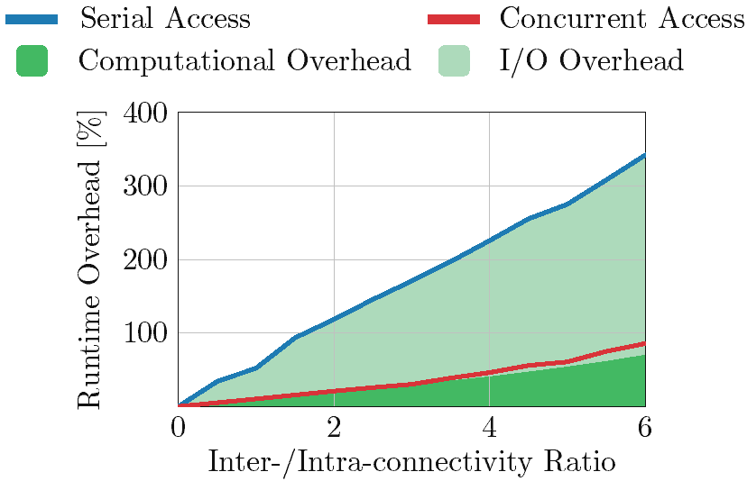

**图 4.13** 串行与并发历史访问模式在 mini-batch 的互连/内连比率方面的运行时开销对比。总运行时开销进一步分为计算开销（聚合额外消息的开销）和 I/O 开销（从历史中拉取和向历史中推送的开销）。我们的并发内存传输方案大幅降低了由历史引起的开销。

### 4.3.5 结论

我们介绍了基于深度学习技术的用于图机器学习的图神经网络。我们证明了图神经网络遵循通用的消息传递方案，该方案适用于广泛的算子和学习任务。`PyTorch Geometric` 库展示了消息传递的通用性，这是一个用于实现和处理基于图的神经网络的知名深度学习库。此外，我们讨论了将图神经网络应用于大规模图的可扩展方法。特别是，我们表明基于边子采样或不可训练传播的可扩展方法会削弱消息传递的表达能力。相比之下，我们提出的框架 `AutoScale` 通过利用历史节点嵌入克服了这一限制，同时在训练过程中既快速又内存高效。虽然该方案允许在同一台机器的单个或多个 GPU 上进行可扩展的图机器学习，但当数据以分布式方式布局时，需要考虑额外的因素（第 8.2 节）。

## 4.4 面向共享内存的高质量并行 Max-Cut 近似算法

*Nico Bertram*
*Jonas Ellert*
*Johannes Fischer*

**摘要：** 我们设计了用于在大型有向图中近似最大割的并行算法。我们的通用方法是首先将图划分为 *p* 个部分，其中 *p* 表示处理元素的数量。然后各个处理器独立地使用高质量的顺序近似算法计算其所负责的图的局部部分的近似解。在最后一步，定义并精确求解一个规模为 𝒪(*p*²) 的单个 `MAX-DICUT` 实例，该实例捕获处理器间的边，使用快速并行整数规划求解器或计算良好近似的慢速近似算法来求解。通过将输入图划分为 *p*^′ > *p* 个部分，我们在割的质量和运行时间之间获得了平滑的权衡。我们还展示了我们的算法在并行基于语法的文本压缩中的应用。

### 4.4.1 简介

现实世界应用中出现的数据通常可以构建为*图*结构，其中数据点表示为节点，不同数据点之间的关系由边捕获。图出现在许多应用中，例如路网、社交网络中的关系 [193] 和生物信息学 [40]。

将*有向图*划分为两个子集 *S* 和 *T* 使得两个子集之间边权重之和最大化的问题，是经典的 NP 完全问题之一。我们用 `MAX-DICUT` 表示该问题。它与其在*无向图*中的对应问题 Max-Cut 密切相关，Karp [359] 证明了 Max-Cut 是 NP 完全的。事实上，`MAX-DICUT` 似乎比 Max-Cut 困难得多，因为 Max-Cut 的每个实例都可以很容易地转换为 `MAX-DICUT` 的一个实例。可以证明，这种转换也定义了从 Max-Cut 实例到 `MAX-DICUT` 实例的归约，从而证明了 `MAX-DICUT` 的 NP 困难性。这意味着可能不存在计算 `MAX-DICUT` 最优解的多项式时间算法。

理论和实践中一种常见的方法是使用近似算法来求解此类困难问题。这些算法允许存在一个乘法误差 *α*（0 < *α* < 1），使得计算出的割在最坏情况下比最优割差 *α* 倍。我们称这个因子 *α* 为算法的*性能保证*。

一种简单的随机算法以概率 $\frac{1}{2}$ 将每个节点分配给 *S* 或 *T*，从而得到期望性能保证为 $\frac{1}{4}$ 的解。该算法可以使用*条件期望法* [590, 643] 进行去随机化。Buchbinder 等人描述了一种线性时间算法，其性能保证为 $\frac{1}{3}$ [90]，也可以随机化以达到 $\frac{1}{2}$ 的期望性能保证。

目前，最已知的性能保证 0.874 使用将 `MAX-DICUT` 表述为整数规划，然后将其松弛为*半定规划*，并达到 0.79607 的性能保证 [256]。该算法也可以去随机化 [459]。后来，通过进一步改进这种方法，性能保证提高到了 0.859 [750]。最已知的性能保证 0.874 是通过进一步改进这种方法实现的 [426]。如果*唯一游戏猜想* [372] 成立，性能保证可以提高到 0.878。

也有尝试使用机器学习方法求解 MAX-CUT。Gu 和 Yang 描述了一种结合了监督学习和强化学习等学习策略的深度神经网络 [275]。Yao 等人 [719] 使用图神经网络 [291] 求解 MAX-CUT，并将其与 Goemans 针对无向图的算法 [256] 和局部搜索过程 [59] 进行了比较。这两种机器学习方法的结果都很有希望。然而，它们仅在小图上进行了评估；如何将这些方法应用于有向图仍然是一个开放问题。


MAX-CUT 也可用于基于图的半监督学习方法。Wang 等人 [695] 表明，一个二元代价函数可以归约为一个受约束的 MAX-CUT 表述。由于该表述对节点有线性约束且边权重可以为负，大多数近似算法无法直接使用。作者建议改用贪心梯度 MAX-CUT 算法。

## 4.4.2 预备知识

首先，我们定义有向图中的割。然后，我们描述一些用于 MAX-DICUT 的重要近似算法。


图 4.14 具有两个示例割的图。位于 `S` 中的节点着色为白色，位于 `T` 中的节点着色为灰色。未计入割的边用虚线表示。(a) 中的割值为 4。(b) 中的割值为 16，即最优值。

### 4.4.2.1 符号定义

这里，我们定义图和有向图中割所需的符号。一个*有向*且*加权图 `G`* 是一个元组 `(V, E, w)`，其中 `V = {1, ..., n}` 是*顶点*集合，`E ⊆ V²` 是*边*集合，`|E| = m`，`w: E → ℝ[>0]` 定义每条边的非负*权重*。

在有向加权图 `G = (V, E, w)` 中，一个*割*是将 `V` 划分为子集 `S` 和 `T`，使得起点在 `S` 且终点在 `T` 的边的权重之和最大化。关于 `S` 和 `T` 的割值定义为 `C(S, T) = Σ[i∈S][,j∈T] w(i, j)`。如果上下文清楚，我们省略 `S` 和 `T`。最大割则定义为 `C[max] = max[S][,T] C(S, T)`。我们称满足 `u ∈ S` 且 `v ∈ T` 的边 `(u, v)` 为*割边*。在图 4.14 中，我们可以看到有向图中割的示例。

### 4.4.2.2 算法

下面，我们将描述在框架中实现的算法。首先，我们描述一个朴素的随机近似及其去随机化。然后，我们描述 Goemans 和 Williamson 的算法。

#### 随机划分

产生图 `G` 划分的一种简单算法是，以概率 `1/2` 独立决定每个节点 `v` 分配给 `S` 还是 `T`。该算法在线性时间内计算出具有期望性能保证 `1/4` 的割。

**定理 12**。 *所述算法在 `O(n)` 时间内计算出具有期望性能保证 `1/4` 的割。*

*证明。* 由于我们在常数时间内将每个节点分配给 `S` 或 `T`，运行时间为 `O(n)`。现在，我们必须证明性能保证。设 `G = (V, E, w)` 为有向图。设 `W = Σ[i][,j∈V] w[ij]`。首先，我们观察到

(4.30) `C[max] ≤ W`。 (4.30)

接下来，设 `e = (u, v) ∈ E` 为任意一条边。只有当 `u ∈ S` 且 `v ∈ T` 时，这条边才是割边。由于我们以概率 `1/2` 随机将每个节点分配到分区的任一侧，`e` 成为割边的概率恰好为 `1/4`。因此，按期望我们计算出的割值为 `E[C] = 1/4 W`。由方程 4.30 可得 `1/4 W ≥ 1/4 C_max`，最后 `E[C] / C_max ≥ 1/4`。

▫

#### 去随机化

上述随机算法可以去随机化，使其确定性地产生具有 `1/4` 性能保证的割。这可以通过*条件期望法* [590, 643] 完成。假设我们已经将节点 1, ..., `i` − 1 放入 `S` 或 `T` 中。我们用 `E[C | 1, ..., i − 1]` 表示当将节点 `i`, ..., `n` 随机放入每个分区时割的期望值。现在，我们要将节点 `i` 分配给 `S` 或 `T`。假设值 `E[C | 1, ..., i − 1] ≥ 1/4 C_max`（当 `i` = 0 时，此假设显然成立）。直观上，我们尝试将 `i` 放入导致最佳期望结果的分区。由于 `E[C | 1, ..., i − 1] ≥ 1/4 C_max`，两个决定中至少有一个必须导致割的期望值为 `1/4 C_max`。我们可以按如下方式计算节点 `i` 每个决定的期望增量：

(4.31) `A = Σ_{j < i, j ∈ T} w_ij + 1/2 Σ_{j > i} w_ij` (4.31)

(4.32) `B = Σ_{j < i, j ∈ S} w_ji + 1/2 Σ_{j > i} w_ji` (4.32)

方程 4.31 描述了将 `i` 放入 `S` 时割的期望增量，方程 4.32 描述了将 `i` 放入 `T` 时割的期望增量。在两个求和式中，第一项指的是已计算的 1, ..., `i` − 1 的划分。第二项指的是将 `i`+1, ..., `n` 随机分配给 `S` 或 `T` 时的期望值。当我们选择 `A` 和 `B` 的最大值时，我们有 `E[C | 1, ..., i] ≥ 1/4 C_max`，并且当分配完所有节点时，`E[C] ≥ 1/4 C_max`。

**定理 13**。 *所述算法在 `O(m)` 时间内计算出具有 `1/4` 性能保证的割。*

#### Goemans 和 Williamson 算法

下面，我们描述 Goemans 和 Williamson 算法 [[256]](#backmatter-001.xhtml#b_9783110785944-010_ref_256)，其在原始描述中具有 0.79607 的性能保证，但后来进一步提高到了 0.874 [[426]](#backmatter-001.xhtml#b_9783110785944-010_ref_426)。为了说明该算法，我们描述用于*无向*图且具有 0.878 性能保证的算法，并在最后展示如何修改算法以用于*有向*图。

首先，我们需要一些额外的符号。用 `Prob[A]` 表示事件 `A` 发生的概率。函数 `sgn(x)` 表示*符号*函数，定义如下：

```
sgn(x) = { 1   x > 0
         { 0   x = 0
         { -1  x < 0
```

该算法的总体思想是将 MAX-CUT 的松弛公式化作为整数二次规划 (IQP) 求解，然后根据计算出的解将每个节点分配给 `S` 或 `T`。该算法有趣的部分在于我们将公式化松弛为*半定规划*。这种方法由 Goemans 和 Williamson 首次引入，也为其他问题（如 MAX-2-SAT [[256]](#backmatter-001.xhtml#b_9783110785944-010_ref_256)）带来了改进的性能保证。

##### Max-Cut 作为 IQP 及 SDP 松弛

设 `G = (V, E, w)` 为一有向图。我们从将 Max-Cut 表述为 IQP 的以下公式开始：

**公式 4.33**

```
maximize     1/2 ∑_{i < j} w_{ij} (1 - x_i x_j)
subject to   x_i ∈ {-1, 1}  ∀ i ∈ {1, ..., n}
```

每个节点 `i` 由一个变量 `x[i]` 表示，当 `i` 被放入 `S` 时该变量取值 −1，当 `i` 被放入 `T` 时取值 1。当我们观察项 `(1 - x[i]x[j])` 时，可以看到如果节点 `i` 和 `j` 在不同的分区中，其值为 2，否则为 0。因此，每条割边被计算了两次，这就是为什么我们要用 `1/2` 对计算值进行归一化。求解公式 4.33 仍然是 NP-hard 的，但现在我们考察将其变量松弛为 `n` 维向量时该公式的性质。设 `S[n]` 为 `n` 维单位球面。在公式 4.34 中我们看到了松弛后的公式。

**公式 4.34**

```
maximize     1/2 ∑_{i < j} w_{ij} (1 - v_i · v_j)
subject to   |v_i| ∈ S_n  ∀ i ∈ {1, ..., n}
```

注意，公式 4.34 的最优解是公式 4.33 最优解的一个上界，因为公式 4.33 的每一个解也是公式 4.34 的解（我们可以通过将第一个元素设为 `x[i]`、其他所有值设为 0，将 `x[i]` 转换为向量 `v[i]`）。在图 4.15a 中，为简单起见，我们看到五个嵌入在单位圆中的向量。乍一看，很难看出我们应该如何将这些向量划分到分区 `S` 和 `T` 中。直观上，`v[1]` 和 `v[2]` 彼此相对相似，因此它们被放在同一个分区中的可能性应该更大，就像 `v[2]` 和 `v[4]` 一样。这种相似性可以用向量 `u` 和 `v` 的标量积来表示，其定义为 `u · v = |u| · |v| · cos(α) = cos(α)`，其中 `α` 是 `u` 和 `v` 之间的夹角。

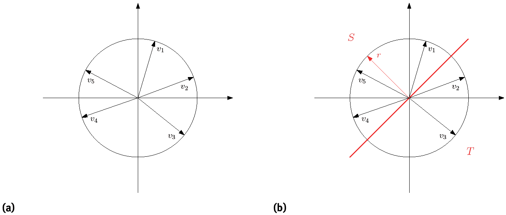

**图 4.15** 如何将节点分配给 `S` 或 `T` 的示例。在 (a) 中我们看到公式 4.34 的一个解。在 (b) 中我们看到一个定义节点划分的随机向量 `r`。由于 `v[1]`、`v[4]` 和 `v[5]` 位于 `r` 的同一侧，我们设定 `S = {1, 4, 5}` 和 `T = {2, 3}`。为简单起见，所有向量均嵌入在二维单位圆中。

计算最优划分仍然很难，但我们可以计算出一个以高概率产生良好解的划分。我们选择一个在 `S[n]` 上均匀分布的随机向量 `r`。利用 `r`，我们可以通过将位于 `r` 同一侧的所有向量 `v[i]` 放入 `S`（即 `S = {i | v[i] · r ≥ 0}`）以及将所有其他向量放入 `T`（即 `T = {i | v[i] · r < 0}`）来定义一个划分。该划分可视化于图 4.15b。直观上，采用这种划分，相似的向量更有可能被放在同一个分区中，从而产生一个良好的解。这种直觉可以在以下引理中形式化。

**引理 14**。 设 `v[i]` 和 `v[j]` 为公式 4.34 的最优解向量，`r ∈ S[n]` 为从 `n` 维单位球面均匀抽取的随机向量。则

```
Prob[sgn(v_i · r) ≠ sgn(v_j · r)] = (1/π) arccos(v_i · v_j).
```

根据引理 14，我们计算出的割的期望值为

```
E[C] = (1/π) ∑_{i < j} w_{ij} arccos(v_i · v_j).
```

根据 `arccos(v_i · v_j) / π ≥ α (1/2) (1 - v_i v_j)` 且 `α > 0.878` 这一事实，我们可以推导出以下定理：

**定理 15**。 设 `v[i]` 和 `v[j]` 为公式 4.34 的最优解向量。则

```
E[C] ≥ α (1/2) ∑_{i < j} w_{ij} (1 - v_i v_j) ≥ α C_max.
```

现在，我们仍需展示如何获得公式 4.34 的最优解。我们可以将该公式转化为一个*半正定规划 (SDP)*。首先，我们必须定义*半正定矩阵*。

**定义 16**。 设 `M ∈ ℝ^{n×n}` 为一个对称矩阵。如果 `M` 的所有特征值均为非负，则称 `M` 为**半正定**。如果 `M` 是半正定的，我们用 `M ⪰ 0` 表示。

以下重要性质成立。

**引理 17** ([257, 410])。 设 `M ∈ ℝ^{n×n}` 为一个半正定矩阵。存在一个矩阵 `B ∈ ℝ^{n×n}` 使得 `M = B^T B`。我们可以在 `O(n³)` 时间内通过 Cholesky 分解计算 `B`。

*半正定规划* 具有以下形式，其中 `A[1], ..., A[m], B[1], ..., B[m] ∈ ℝ^{n×n}` 为常数矩阵，`b[1], ..., b[m] ∈ ℝ`。变量矩阵 `X[i] ∈ ℝ^{n×n}` 具有约束条件，即它们应为半正定矩阵。为了相乘矩阵，我们使用*弗罗贝尼乌斯内积*，定义为：`A · B = Σ_{i,j} A[ij]B[ij]`。

**公式 4.35**

```
maximize     A_1 · X_1 + ... + A_m · X_m
subject to   X_i ⪰ 0        ∀ i ∈ {1, ..., m}
             B_i · X_i = b_i ∀ i ∈ {1, ..., m}
```

最优解可以通过使用*内点法* [[343]](#backmatter-001.xhtml#b_9783110785944-010_ref_343) 在 `O(n^c log(1/ε))` 时间内计算得出，其中 `c > 0` 且 `ε > 0` 为误差参数。

要将公式 4.34 转化为公式 4.35 形式的 SDP，我们设定 `y[ij] = v[i] · v[j]`。我们观察到 `y[ij]` 描述了向量 `v[i]` 和 `v[j]` 之间夹角的余弦值，且 `y[ij] = y[ji]`。因此矩阵

```
Y = ( y_11  y_12  ...  y_1n )
    ( y_21  y_22  ...  y_2n )
    (  ...   ...  ...   ... )
    ( y_n1  y_n2  ...  y_nn )
```

是一个对称矩阵，描述了每个向量之间夹角的余弦值。元素 `y[ii]` 描述了向量 `v[i]` 的长度。由于每个向量都位于单位球面 `S[n]` 上，我们为每个 `i ∈ {1, ..., n}` 添加条件 `y[ii] = 1`。因此 MAX-CUT 作为 SDP 的公式如下。

##### (4.36)

$$
\begin{matrix}
{\text{maximize}\quad\frac{1}{2}W \cdot \left( {(1)}_{n \times n} - Y \right)} \\
{\text{subject to}\quad Y \succcurlyeq 0} \\
{\quad y_{ii} = 1\quad\forall i \in \{ 1,\ldots,n \}}
\end{matrix}
\qquad (4.36)
$$

此处 `W` 定义为 `G` 的权重矩阵，`(1)_{n \times n}` 为每个分量均为 1 的矩阵。根据引理 17，我们可以通过 Cholesky 分解在 𝒪(`n`³) 时间内获得一组最优向量 `v[i]`。

现在，我们将展示如何修改公式以获得一个近似算法，该算法产生的割对于 MAX-DICUT 具有 0.79607 的性能保证。我们再次从 MAX-DICUT 作为 IQP 的公式开始：

##### (4.37)

$$
\begin{matrix}
{\text{maximize}\quad\frac{1}{4}\sum\limits_{i < j}w_{ij}\left( {1 + x_{0}x_{i} - x_{0}x_{j} - x_{i}x_{j}} \right)} \\
{\text{subject to}\quad x_{i} \in \{ -1,1 \}\quad\forall i \in \{ 1,\ldots,n \}}
\end{matrix}
\qquad (4.37)
$$

此处，我们引入了一个额外变量 `x[0]`，用于标记哪一侧位于 `S` 中。更精确地说，如果 `x[0]` 等于 −1，则所有满足 `x[i]` = −1 的其他节点 `i` 应被分配到 `S`，否则分配到 `T`。项 `(1 + x[0]x[i] - x[0]x[j] - x[i]x[j])` 在 `x[i]` 被分配到 `S` 时取值为 4，否则为 0。这就是为什么我们必须用值 $\frac{1}{4}$ 进行归一化。类似于无向 MAX-CUT，我们放宽方程 4.37 中的变量，使其成为 `n` 维向量。

##### (4.38)

$$
\begin{matrix}
{\text{maximize}\quad\frac{1}{4}\sum\limits_{i < j}w_{ij}\left( {1 + v_{0}v_{i} - v_{0}v_{j} - v_{i}v_{j}} \right)} \\
{\text{subject to}\quad |v_{i}| \in S_{n}\quad\forall i \in \{ 1,\ldots,n \}}
\end{matrix}
\qquad (4.38)
$$

对于其 SDP 公式，我们使用矩阵 `X ∈ ℝ^{(n+1)×(n+1)}` 和 `Y`、`Z ∈ ℝ^{n×n}`，它们定义如下：

```
X = ( y_00  y_01  ...  y_0n )
    ( y_10  y_11  ...  y_1n )
    (  ...   ...  ...   ... )
    ( y_n0  y_n1  ...  y_nn )

Y = ( y_11  y_12  ...  y_1n )
    ( y_21  y_22  ...  y_2n )
    (  ...   ...  ...   ... )
    ( y_n1  y_n2  ...  y_nn )

Z = ( y_10  y_10  ...  y_10 )
    ( y_20  y_20  ...  y_20 )
    (  ...   ...  ...   ... )
    ( y_n0  y_n0  ...  y_n0 )
```


则 MAX-DICUT 可以表述为如下 SDP：

##### (4.39)

```
maximize (1/4)W · ((1)_{n×n} + Z - Z^T - Y)
subject to X ≽ 0
y_{ii} = 1 ∀ i ∈ {0,...,n}
```

当我们计算方程 4.39 的解时，选择一个在 `S[n]` 上均匀分布的随机向量 `r`。由于 `v[0]` 标记了分区 `S` 的一侧，我们将 `v[i]` 和 `v[0]` 位于同一侧的所有节点 `i` 分配给 `S`。更精确地说，我们设定 `S = {i | sgn(v[i] · r) = sgn(v[0] · r)}` 和 `T = {i | sgn(v[i] · r) ≠ sgn(v[0] · r)}`。

通过类似于无向 MAX-CUT 的算法分析，我们发现我们的算法具有 0.79607 的性能保证。以下定理总结了我们的结果。

**定理 18**。 所述算法在多项式时间内计算出一个具有 0.79607 性能保证的割。

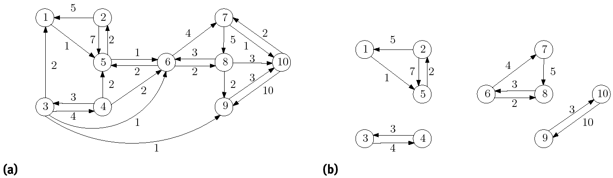

图 4.16 输入图在 (a) 中被划分为 4 个子图，如 (b) 所示，使得子图之间的边权重之和最小化。

### 4.4.3 框架

在本节中，我们介绍一个并行框架，该框架在共享内存中计算高质量的 MAX-DICUT。首先，我们给出整个框架的概述，然后单独介绍每个步骤。

我们的方法是将输入图 `G` 划分为大小大致相等的 `k` 个子图 `G[i]`，使得子图之间的依赖关系最小化，即子图之间的边权重最小化。然后，在每个计算出的子图上，我们并行运行一个顺序 MAX-DICUT 算法来计算多个局部割。在最后一步，我们必须合并局部计算的割。我们通过定义一个新图来实现这一点，在该图上求解 MAX-DICUT，其中每个节点代表由局部 MAX-DICUT 算法计算出的一个分区。

#### 4.4.3.1 图划分

我们框架的第一步是将输入图 `G = (V, E, w)` 划分为 `k` 个子图，以便我们可以在每个子图上独立运行 MAX-DICUT 算法。我们的目标是将尽可能多的边信息包含在每个子图中，以提高计算出的 MAX-DICUT 的质量。我们通过最大化每个子图中边权重之和来实现这一点，反之，则是通过最小化子图之间的边权重之和。也就是说，我们要最小化 Σ`[i,j∈{1,...,k}] E[ij]`，其中 `E[ij]` 是子图 `G[i]` 和 `G[j]` 之间边权重之和。要在共享内存中计算平衡良好的图划分，已经存在多种方法。在我们的框架中，我们使用图划分器 `KaHIP` [[13]](#backmatter-001.xhtml#b_9783110785944-010_ref_013)，它将 `G` 划分为子图 `G[i] = (V[i], E[i], w)`，`i ∈ {1, ..., k}`，使得每个子图大小大致相等，即 `|V_i| ≤ (1 + ϵ)⌈|V|/k⌉`。我们还使用一种朴素地将节点或边划分为 `k` 个大小相等的块的划分算法。我们也可以使用 `Metis`，如 第 4.3 节 所示。然而，`KaHIP` 优于 `Metis`，且更适合我们的应用。在 图 4.16 中，我们可以看到一个被划分为 4 个子图的示例输入图。

![Fig. 4.17 在图 4.16 中计算出的每个子图上我们计算一个 MAX-DICUT。位于 `S[i]` 中的节点着色为白色，位于 `T[i]` 中的节点着色为灰色。](graphic/b_9783110785944-004_fig_017.png)

图 4.17 在图 4.16 中计算出的每个子图上我们计算一个 MAX-DICUT。位于 `S[i]` 中的节点着色为白色，位于 `T[i]` 中的节点着色为灰色。

#### 4.4.3.2 计算局部解

将输入图划分为多个子图后，我们在每个子图上并行运行一个顺序 MAX-DICUT 算法，以计算每个子图的局部割。当我们使用具有更好性能保证的算法时，可以计算出质量更高的割。由于这些算法也较慢，我们必须考虑哪种算法在割的质量和框架的运行时间之间实现了最佳权衡。

我们实现了期望性能保证为 1/4 的随机算法及其去随机化变体、`Buchbinder` 引入的性能保证为 1/2 的算法 [[90]](#backmatter-001.xhtml#b_9783110785944-010_ref_090)，以及 `Goemans` 和 `Williamson` 提出的期望性能保证为 0.79607 的算法 [[256]](#backmatter-001.xhtml#b_9783110785944-010_ref_256)。作为示例，我们在图 4.17 中展示了在图 4.16 中计算的所有子图的最优 MAX-DICUT。

#### 4.4.3.3 合并

在最后一步，我们必须将计算出的局部割合并为一个全局割。一种朴素的方法是定义 `S = ⋃[i] S[i]` 和 `T = ⋃[i] T[i]` 作为平凡割。这种方法的问题在于它不考虑子图之间的边。在全局图中，交换子集 `S[i]` 和 `T[i]` 甚至将 `S[i]` 和 `T[i]` 放入同一个分区可能更有利。为了考虑合并割的每一种可能组合，我们将合并局部解的问题归约为另一个 MAX-DICUT 实例。我们构建一个包含 `2*k` 个节点的完全图 `H`，其中每个节点代表一个局部计算的分区 `S[i]` 或 `T[i]`。设 `X` 和 `Y` 为 `H` 的两个节点。我们向 `H` 添加一条边 `(X, Y)`，其权重为 `Σ[i∈X][,j∈Y] w(i, j)`。然后，我们可以在 `H` 上运行一个 MAX-DICUT 算法。由于该图只有 `2*k` 个节点，我们可以使用昂贵的算法来计算精确解。在我们的框架中，我们实现了一个简单的暴力算法和一个将 MAX-DICUT 表述为整数规划求解的算法。我们也可以使用 `Goemans` 和 `Williamson` 提出的性能保证为 0.79607 的近似算法。在图 4.18 中，我们可以看到如何将图 4.17 中计算的局部割合并为一个新的 MAX-DICUT 实例。然后，我们在此实例上计算全局解。


图 4.18 我们通过合并图 4.17 后位于同一分区中的节点，计算一个包含 8 个节点的新 MAX-DICUT 实例（图 4.18a）。我们在此实例上运行一个精确 MAX-DICUT 算法，并在图 4.18b 中计算全局 MAX-DICUT。位于 `S` 中的节点着色为白色，位于 `T` 中的节点着色为灰色。

**表 4.3** 我们使用的输入图汇总。

| **图** | **|V|** | **|E|** |
| :--- | :---: | :---: |
| recomp_dna1GB_5 | 28 245 | 1 439 986 |
| road-luxembourg-osm | 114 600 | 239 332 |
| rt-retweet-crawl | 1 112 703 | 4 557 704 |

### 4.4.4 评估

在本节中，我们评估我们的框架。我们在多特蒙德工业大学的 `LiDO3` 集群上进行实验¹⁸。

我们在表 4.3 汇总的输入图上评估我们的框架。图 `recomp_dna1GB_5` 是通过使用 `Pizza & Chili` 文本语料库中 `dna.txt` 文本的 1 GiB 前缀，由 `recompression` 工具 [[342]](#backmatter-001.xhtml#b_9783110785944-010_ref_342) 生成的。¹⁹

#### 4.4.4.1 实验

在实验中，我们分别评估框架的每个部分。首先，我们比较我们的划分算法 `KaHIP`、`NodeSlice` 和 `EdgeSlice`。然后，我们比较我们的局部 MAX-DICUT 算法 `Derandomization`、`Buchbinder` 和 `Goemans`。对于 `Goemans` 算法，我们比较两种变体：一种精确求解 SDP，我们称之为 `Goemans`；另一种以较小误差求解 SDP，其中我们设置 `ϵ = 0.01`，我们将其称为 `Goemans(ϵ = 0.01)`。对于我们的合并算法，我们比较 `Buchbinder` 算法、上述两种 `Goemans` 变体，以及一个求解 `整数线性规划` (ILP) 的精确算法。当我们评估框架某一部分的算法时，所有其他部分均固定，即划分使用 `KaHIP`，局部 MAX-DICUT 算法使用 `Buchbinder`，合并算法使用 `Goemans (ϵ = 0.01)`。我们进行了五次所有实验，并取计算出的割以及框架中每一步运行时间的平均值。我们将图划分为多达 2048 个部分。最多 16 个部分时，我们使用与部分数量相同的核心数。对于超过 16 个部分的情况，我们固定使用 16 个核心。


图 4.19 在框架的其他步骤固定为固定算法时，我们的划分算法的计算割与运行时间。缺失的数据点表明整个框架的运行时间超过了时间限制，或者内存超过了 RAM 容量。

在图 4.19 中，我们可以看到划分算法的结果。我们看到，使用 `KaHIP` 作为划分器，对于图 `road-luxembourg-osm` 和 `rt-retweet-crawl`，在每个子图数量下割质量几乎保持恒定，而使用朴素划分算法 `NodeSlice` 和 `EdgeSlice` 时，随着子图数量增加，割质量会变差。然而，在图 `recomp_dna1GB_5` 上，使用 `NodeSlice` 和 `EdgeSlice` 时割质量随规模增长的表现优于 `KaHIP`。`KaHIP` 的运行时间在所有输入上都明显慢于 `NodeSlice` 和 `EdgeSlice`，且扩展性不如朴素算法好。


图 4.20 在框架的其他步骤固定为固定算法时，我们的局部 MAX-DICUT 算法的计算割与运行时间。缺失的数据点表明整个框架的运行时间超过了时间限制，或者内存超过了 RAM 容量。

在图 4.20 中，我们可以看到局部 MAX-DICUT 算法的结果。我们可以看到，通过使用 `Goemans` 算法的变体，我们的框架产生了总体最好的割质量。然而，这些算法仅在将图划分为大量子图或子图较小时才能计算出解。对于较大的子图，`Goemans` 算法要么耗时过长，要么消耗过多内存。`Goemans` 算法的运行时间明显大于线性时间算法，但随着子图变小，其速度会变快。

在图 4.21 中，我们可以看到合并算法的结果。请注意，由于我们的框架使用了一些随机变量，计算出的质量在不同配置之间可能会有所不同。总体而言，合并对割质量只有很小的影响。正如预期的那样，求解 ILP 的精确算法在大多数情况下给出最佳解，紧随其后的是精确 `Goemans` 算法。使用 `Goemans`（`ϵ` = 0.01），我们的框架在大多数情况下也能产生良好的割质量。然而，对于 128 个或更多的分区，在 `road-luxembourg-osm` 上割质量会显著变差。

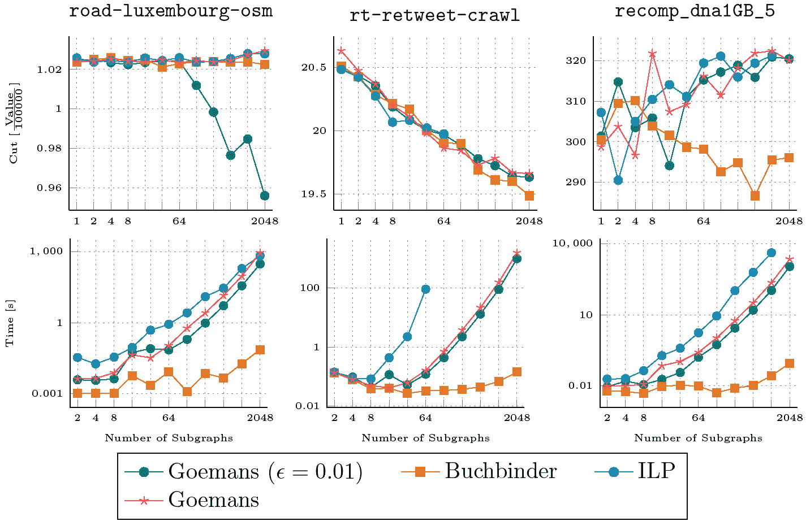

图 4.21 我们合并算法的计算割与运行时间；框架的其他步骤为固定算法。缺失的数据点表示整个框架的运行时间超过了时间限制，或者内存超过了 RAM。

ILP 的运行时间总体上最慢，并且在 `rt-retweet-crawl` 上对于 128 个及以上的分区变得太慢。`Goemans` 变体比 IPL 快，但仍比 `Buchbinder` 慢。我们可以看到，随着图 `H` 变大，ILP 和 `Goemans` 变体会变慢。

### 4.4.5 字符串压缩中的应用

MAX-DICUT 用于在字符串上构建简洁数据结构，以高效地回答*最长公共扩展（LCE）查询*。字符串 `S` 上的 LCE 查询询问两个位置 `i` 和 `j` 处开始的后缀的最长公共前缀。

为了高效回答此类查询，可以使用 `Jez` 描述的*重压缩*技术[[342]](#backmatter-001.xhtml#b_9783110785944-010_ref_342)。利用该技术，字符串 `S` 被压缩成一个恰好生成 `S` 的上下文无关文法。然后，我们在文法之上构建一个 LCE 数据结构[[330]](#backmatter-001.xhtml#b_9783110785944-010_ref_330)。内存用量为 $\mathcal{O}\left( {z\log\left( \frac{n}{z} \right)} \right)$，查询时间为 $\mathcal{O}(\log(n))$，其中 `z` 是 Lempel-Ziv 77 分解[[746]](#backmatter-001.xhtml#b_9783110785944-010_ref_746)的大小，`n` 是 `S` 的大小。

在将 `S` 压缩为上下文无关文法的过程中，我们尝试寻找字符对 `ab` 并构建规则 `X` → `ab`，以便尽可能多的字符对被规则覆盖。为此，我们构建一个有向图 `G`，其中每个节点代表 `S` 的一个字符，如果字符对 `ab` 出现在 `S` 中，则从 `a` 向 `b` 插入一条边。然后，`G` 中的一个割表示将字符划分为两个子集 `Σ`[1] 和 `Σ`[2]，以便我们可以在不产生重叠字符对的情况下，压缩尽可能多的满足 `a ∈ Σ`[1] 且 `b ∈ Σ`[2] 的字符对 `ab`。因此，计算出的割的质量与 `S` 的压缩率之间存在直接相关性。

**表 4.4** 不同重压缩算法的结果。我们比较了在 `Pizza & Chili` 文本语料库中选取的不同文本上，使用 8 个核心时的运行时间（秒）和压缩率（压缩文本长度除以原始文本长度）。在所有实验中，我们对每个文本使用 200 MiB 的前缀。我们用粗体文本标记了各文本上的最佳结果。此外，我们还提供了每个文本的大小和字母表大小 `σ`。

| 文本 | `σ` | **max-dicut_recomp** | | **lp_recomp** | |
| :--- | :---: | :---: | :---: | :---: | :---: |
| | | **时间** | **比率** | **时间** | **比率** |
| cere | 5 | 290.75 | **4.9%** | **21** | 4.91% |
| dna | 16 | 286.2 | 42.42% | **26** | **42.29%** |
| einstein.en | 139 | 211.75 | **0.17%** | **26** | **0.17%** |
| english | 239 | 277.4 | **41.23%** | **36** | 42.72% |
| para | 5 | 256.6 | **6.81%** | **22** | 6.82% |
| sources | 230 | 288.2 | **37.79%** | **33** | 39.91% |

我们将计算 MAX-DICUT 的框架集成到一个在共享内存中使用*重压缩*计算压缩的工具中。我们比较了使用我们 MAX-DICUT 框架的算法 `max-dicut_recomp` 与算法 `lp_recomp`，后者首先计算一个朴素的 MAX-CUT（`S`，`T`），然后在有向图中比较 `C`(`S`, `T`) 和 `C`(`T`, `S`) 并取较大值。此外，`lp_recomp` 尝试采用产生较少生成规则的解。


同样，我们在多特蒙德工业大学的 LiDO3 集群上进行了实验，节点配备 Intel Xeon CPU E5-2640 处理器（20 核，2.4 GHz，L1 32K，L2 256K，L3 256M）和 64 GB 内存。我们比较了我们的算法在 8 个核心上对 Pizza & Chili 文本语料库中多个文本的压缩率和运行时间。²⁰

表 4.4 展示了我们的结果。我们可以看到，`max-dicut_recomp` 在几乎所有文本上实现的压缩率与 `lp_recomp` 相似或更好。在 english 和 sources 上，压缩率提高了 1-2%。然而，要提高 `max-dicut_recomp` 的压缩率，我们在所有文本上使用 8 个核心时需要比 `lp_recomp` 多约 10 倍的运行时间。

### 4.4.6 结论

在本节中，我们描述了一个在共享内存中计算高质量 MAX-DICUT 且易于扩展的框架。我们实现了该框架，并在真实世界图上对其在共享内存中的表现进行了评估。实验表明，我们的图划分算法 KaHIP 在共享内存中扩展性不佳，因此我们计划未来使用其他划分算法。我们框架的最佳配置是将图划分为小图，并使用 Goemans 作为局部 MAX-DICUT 算法。

我们还将框架集成到一个计算基于文法压缩的软件中。通过使用我们的框架，我们在大多数情况下实现了更好的压缩率。然而，我们的新算法比其他压缩算法慢得多。

## 4.5 数百万个公式

*Lukas Pfahler*

## 摘要

随着研究出版物数量的增加，查找相关论文变得繁琐。特别是跨学科或跨思想流派的搜索得不到支持。这主要是因为检索依赖于关键词查询，而技术术语在不同科学领域和不同时期有所不同。相关文章或许最好通过其数学问题描述来识别。仅查看论文中的公式就能暗示该论文是否相关。因此，我们提出了一种基于机器学习的数学表达式检索新方法。我们设计了一个无监督表示学习任务，结合了嵌入学习、对比学习和自监督学习。我们希望学到的表示能够自动识别相关的、相关的数学表达式。利用图卷积神经网络，我们将数学表达式嵌入到低维向量空间中，从而支持高效的最近邻查询。为了训练模型，我们从 arXiv.org 上的 900,000 多篇出版物中收集了包含 2900 多万个数学表达式的大规模数据集。数学内容被转换为 XML 格式，我们将其视为图数据。在此数据中，我们能够自动识别等式和不等式，用于模型的训练和测试。此外，我们的实证评估涉及一个手动标注搜索查询的数据集，展示了使用嵌入模型进行数学检索的优势。本贡献基于一篇会议论文 [[563]](#backmatter-001.xhtml#b_9783110785944-010_ref_563)，更多细节请见 [[562]](#backmatter-001.xhtml#b_9783110785944-010_ref_562)。

### 4.5.1 引言

机器学习为许多搜索引擎的成功故事做出了贡献。遗憾的是，搜索通常基于单词或文本。然而，不同学科的技术术语可能具有不同的含义，或者相同的含义可能由不同的术语指代。例如，贝叶斯定律在不同科学领域有各种用法，且可在不同名称下找到。例如在天体物理学中，它被称为*信息场论* [[200]](#backmatter-001.xhtml#b_9783110785944-010_ref_200)。如果不了解物理学知识或“贝叶斯”这个名字，人们仍能通过公式 `P(d|s) = P(d, s)/P(s)` 在任何论文中轻松识别出该定律。另一个例子是 Ising 1925 年发表在物理期刊上、标题为 *Ferromagnetismus* 的论文。如今，Ising 模型在机器学习中也很流行，但它最初被称为*霍普菲尔德网络*，后来称为*玻尔兹曼机*。这说明了时间因素：特定主题的用词会随时间变化。Ising 论文的语言是德语；1906 年引入 Jensen 不等式的论文是用法语写的。同样，不等式 `f((a + b)/2) ≤ f(a)/2 + f(b)/2` 在两种情况下都能被轻松理解。我们得出结论，在计算机科学或物理学等学科中，传递科学手稿主要思想最紧凑、最全面的方式是所用的方程。因此，在搜索科学手稿时，这也应是我们构思搜索查询的方式。为了判断数学表达式对搜索查询的相关性，系统必须能在不同符号之间进行泛化，并匹配描述相同概念的方程部分，即使它们以不同形式出现。人类阅读者依赖多年领域训练获得的领域知识来判断相关性。我们想知道，拥有海量数学内容访问权限的机器学习模型如何帮助自动化这一过程。

在本工作中，我们提出使用图神经网络学习数学表达式的表示，以捕捉语义相关性。为此，我们设计了两个无监督学习任务：一个基于上下文相似性的经典嵌入学习任务，以及一个受掩码语言模型启发的自监督学习任务。我们从 arXiv.org 上的 90 多万篇论文中策划了一个包含 2890 多万个方程的数据集，并将方程表示为具有独热编码特征的图。然后我们在这个大规模方程集合上训练模型。我们编制了一个包含来自多个不同学科的标注搜索查询的评估数据集，并展示了我们的方法在部署数学表达式搜索引擎方面的实用性。

### 4.5.2 数学搜索与 KDD

在文档集合中挖掘和索引数学表达式是一项具有挑战性的任务，主要由信息检索社区解决 [[277]](#backmatter-001.xhtml#b_9783110785944-010_ref_277)，[[745]](#backmatter-001.xhtml#b_9783110785944-010_ref_745)。我们将概述如何利用数据知识发现和数据挖掘的工具来处理数学搜索问题，并介绍我们所选机器学习方法的相关工作。

#### 表示

我们首先要考虑的是如何表示数学表达式。方法可分为两类：视觉表示和语义表示。前一类关注表达式的布局。最突出的选择是 `LaTeX`（arXiv.org 出版物使用的一种图灵完备语言）和 `Presentation MathML`[²¹]。

#### 相似度度量

第二个问题是如何计算公式之间的相似性。Zanibbi 等人将其区分为基于文本、基于树和基于谱的方法 [[729]](#backmatter-001.xhtml#b_9783110785944-010_ref_729)。基于文本的方法通过先序遍历等方式将树结构的数学转换为序列，然后使用序列方法（如词袋余弦相似度或最长公共子串长度）估计相似度。基于树的方法侧重于匹配树或子树。通常，使用子结构（子序列或子树）计算相似度涉及解决动态规划问题。谱方法作用于树中的路径或部分子树。一个例子是 Zhong 和 Zanibbi 的工作 [[745]](#backmatter-001.xhtml#b_9783110785944-010_ref_745)，该工作对算子树的根-叶路径进行索引。通过匹配根-叶路径，他们计算最大公共子表达式以对两个方程的相似度进行评分。为了将数学从 `LaTeX` 转换为算子树的语义表示，作者使用了由领域专家创建的约 100 条语法规则。

一种新趋势是使用机器学习来学习相似度度量。机器学习模型将方程映射为稠密的低维向量。这些所谓的嵌入之间的相似度可通过其内积计算，这支持使用各种索引结构（包括 `faiss` 和 `annoy`）进行快速索引，这些结构专为高效处理数百万个此类稠密低维向量而设计。Mansouri 等人 [[464]](#backmatter-001.xhtml#b_9783110785944-010_ref_464) 提出使用 `fastText`（一种最初设计用于计算词嵌入的方法）对方程进行嵌入，而在我们之前的工作 [[564]](#backmatter-001.xhtml#b_9783110785944-010_ref_564) 中，我们使用类似的嵌入学习任务和卷积神经网络计算嵌入（见 第 4.2 节）。

[²¹]: 保留自原文的脚注引用标记。

### 图卷积神经网络

我们提出了一种基于图神经网络（GNN）的嵌入模型[\[563\]](#backmatter-001.xhtml#b_9783110785944-010_ref_563)，该模型在本文中被引入。它们是该任务的一个极具吸引力的模型选择，因为正如经典卷积神经网络（CNN）用于图像处理一样，它们基于局部邻域计算特征图，因此可以处理公式中符号之间的关系。在 CNN 中，我们有与像素网格中每个像素相关联的特征，邻域由该网格定义；而在 GNN 中，我们有与图中每个节点相关联的特征，邻域由图中的边定义。我们将图结构 `x = (X, E)` 定义为节点特征 `X` 和边 `E` 的元组。设 `|x|` 表示 `x` 中节点的数量。我们假设 `X ∈ ℝ^(|x|)×d`，其中 `X[i]` 是第 `i` 个节点的特征。GNN 将输入图映射到具有变换后特征向量的输出，该输出位于 `d'` 维输出空间中，但具有相同的边结构。我们使用图网络通过平均池化操作计算数学表达式的向量值嵌入，该操作将图的所有节点嵌入聚合为单个图嵌入。

此外，我们还研究了 Transformer 架构[\[681\]](#backmatter-001.xhtml#b_9783110785944-010_ref_681)的使用，更具体地说是双向编码器表示（BERT）模型[\[173\]](#backmatter-001.xhtml#b_9783110785944-010_ref_173)，用于将数学表达式嵌入向量空间的任务。Transformer 可以被视为在全连接图上的 GNN，其中每一层使用自注意力机制聚合邻域[\[681\]](#backmatter-001.xhtml#b_9783110785944-010_ref_681)。

### 自监督学习

我们进一步从最近提出的一类称为自监督学习的表征学习任务中汲取灵感。自监督学习任务是无监督学习任务，其中输入的部分被用来构建代理任务。在这些代理任务中学到的表征随后可用于下游任务。例如，我们可以旋转图像并训练模型预测旋转角度，正如 Gidaris 等人[\[251\]](#backmatter-001.xhtml#b_9783110785944-010_ref_251)所提出的。利用现成的海量未标注数据，我们可以拟合解决此类任务的模型。

我们特别关注**掩码语言建模**，其中输入的部分对模型隐藏，模型的任务是预测被隐藏的部分。这由 BERT 模型在自然语言表征的预训练中推广开来[\[173\]](#backmatter-001.xhtml#b_9783110785944-010_ref_173)，此后已被采用于其他输入，如用于图像分类的卷积神经网络预训练[\[669\]](#backmatter-001.xhtml#b_9783110785944-010_ref_669)。我们为数学表达式构建了一个掩码任务，并使用图卷积神经网络来预测被掩码的部分。

### 4.5.3 数据

我们概述了如何从 arxiv.org 收集数据并将其转换为图结构化数据，以供我们的图卷积神经网络使用。

#### 4.5.3.1 数据集

我们正在处理从 arxiv.org 获取的数据，这是一个科学家可以上传其手稿或预印本而无需审稿过程的服务。我们已从官方批量数据存储库下载了截至 2019 年 4 月所有出版物的 LaTeX 源文件。²²

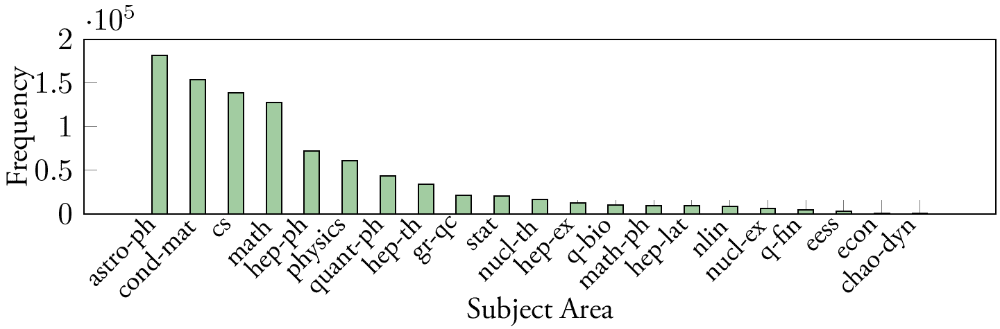

**图 4.22** 我们样本中各学科领域的论文数量。

从所有出版物中，我们通过使用正则表达式提取数学表达式，这些正则表达式针对最常见的数学环境，如 `equation`、`align` 等。我们不使用行内数学片段，而是专注于独立成行的表达式，因为它们倾向于描述更重要的概念。此外，我们提取用户定义的命令和宏。使用 `Katex` 库²³

为确保可复现性，我们在 `https://github.com/Whadup/arxiv_library`²⁴ 提供了用于处理公共 arXiv 数据转储、提取数学表达式并将其转换为 MathML 以及收集元数据和引用的脚本。

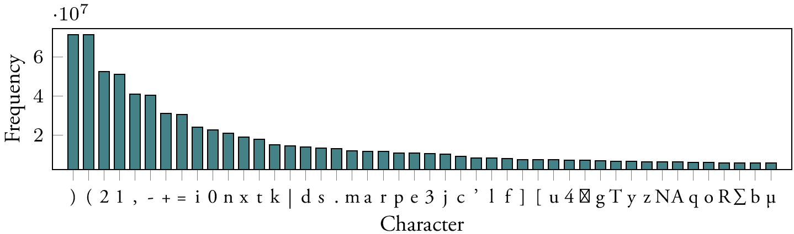

**图 4.23** 数学环境中出现频率最高的 50 个字符。

#### 4.5.3.2 数据表示

为了将 MathML 输入图卷积神经网络，我们必须将其转换为具有向量化节点特征的图。MathML 标准定义了约 30 种不同的 XML 标签，例如用于数学标识符的 `<mi>` 或用于数学运算符的 `<mo>`。其中一些标签使用属性来更改字体或间距等。叶节点包含文本，如数字、括号或字母（希腊文、拉丁文等……）。我们将 XML 结构视为一棵树，并使用其节点和边，根据标签、属性和文本派生特征。对于每个节点，我们使用维度为 256 的独热编码特征向量。首先，我们将每个节点表示为单个标记，该标记通过连接标签、属性和文本来派生，并使用涵盖数据中大多数标记的 256 个最频繁标记。属性值通常包含数字，例如用于更改字体大小。我们将这些数字四舍五入到小数点后一位，以减少可能的值的数量。除了独热编码特征外，我们还存储节点在其同级节点中的位置。

然后，为了配合 Transformer 模型使用，我们通过树的先序遍历计算树结构数据的序列表示。

### 4.5.4 学习寻找相关公式

在本节中，我们将介绍用于计算嵌入的图卷积神经网络，并展示两个用于训练网络的无监督学习任务。

#### 公式嵌入模型

##### 图神经网络

我们为将数学表达式嵌入低维向量空间的任务定义了一个图卷积神经网络。原始 MathML 按 4.5.3.2 节 所述转换为具有向量化特征的图。我们建议使用一个特殊的第一层，将节点处的独热编码信息与十进制位置属性相结合。遵循 Vaswani 等人[\[681\]](#backmatter-001.xhtml#b_9783110785944-010_ref_681)的方法，我们使用位置嵌入对第 `i` 个节点的位置 `p[i] ∈ ℕ` 进行编码。我们使用固定的正弦位置嵌入[\[681\]](#backmatter-001.xhtml#b_9783110785944-010_ref_681)，记为 `E(p[j])`，但为了仍允许模型控制位置嵌入的影响，我们引入了一个可学习的缩放系数 `α`，初始化为 1。

```
x_i¹ = ReLU(∑_{j ∈ N(i) ∪ i} W¹ x_j + α E(p_j) + b¹)
```

第一层之后跟着 3 个宽度为 512 的全连接图卷积层，其中第 `l` 层定义为

```
x_i^(l) = ReLU(∑_{j ∈ N(i) ∪ i} W^(l) x_j^(l-1) + b^(l))
```

它使用权重矩阵 `W^((l))` 对所有节点进行线性变换，添加偏置项 `b^((l))`，通过计算所有邻居 `𝒩(i)` 的和进行聚合，并逐元素应用 ReLU 激活函数。所有图卷积层均输出 512 维的特征图。在我们的树结构数据中，我们假设所有边均为双向的；因此邻居集合由父节点和所有子节点组成。我们在第一层和第三层图卷积层之前应用批归一化。在本文的其余部分，令 `ϕ(x) ∈ ℝ^(|x|×512)` 表示给定输入 `x` 时最后一层图卷积层的输出。为了获得输入图的单个嵌入，我们计算所有节点特征的平均值。该平均值通过另一个线性层进行变换，将维度降至 64。在本文的其余部分，令 `¯ϕ(x) ∈ ℝ⁶⁴` 表示 `x` 的该嵌入。

当使用边界损失对嵌入间的相似度进行评分时，我们需要控制嵌入的范数，否则遵循边界的概念将变得毫无意义。Ding 等人 [[179]](#backmatter-001.xhtml#b_9783110785944-010_ref_179) 及其他人提出将所有嵌入归一化为单位长度。我们提出了一种受批归一化[335]启发的更柔和的归一化方法，它也允许我们获得范数小于 1 的嵌入。对于每个图训练批次，我们计算范数的均值及其标准差。然后，我们用均值加标准差来对每个嵌入进行逆缩放。这样，大多数嵌入的范数都小于 1。我们保留均值和标准差的滑动平均值。在推理时，我们使用这些滑动平均值进行缩放。

##### Transformer

最初的 Transformer 模型——由 Vaswani 等人 [[681]](#backmatter-001.xhtml#b_9783110785944-010_ref_681) 提出——在 BERT [[173]](#backmatter-001.xhtml#b_9783110785944-010_ref_173) 中经过了轻微修改，后者仅使用编码器层。在我们的工作中，我们使用与 BERT 相同的 Transformer 模型架构——包括相同的编码器层、激活函数、优化算法和学习率调度。Transformer 架构引入多头注意力层作为学习输入序列中每对标记之间关系的关键机制。这也适用于数学公式，因为理解数学公式中符号之间的关系对于理解公式的含义至关重要。我们还扩展了词汇表，增加了特殊的分类、分隔、掩码和未知标记——正如 [[173]](#backmatter-001.xhtml#b_9783110785944-010_ref_173) 所做的那样——以预测被掩码的标记，从而将修正数学表达式的能力集成到模型中。

我们探索了三种不同规模的 BERT 架构变体，用于嵌入数学表达式。虽然 BERT 的注意力头数量取决于隐藏层大小，但我们将其保持恒定。我们将不同的多头注意力头数量 `D` 设为 4。这样做使得隐藏层大小 `H` 对多头注意力的性能产生最大影响。至于中间投影大小，我们始终将其保持大于隐藏层大小，以便我们可以在更高维的空间上进行线性投影。生成的模型汇总在表 4.5 中。

**表 4.5 Math-BERT 模型配置。**

| 模型 | L | H | I | D | 参数量 | GFLOP |
| --- | --- | --- | --- | --- | --- | --- |
| SMALL | 4 | 128 | 768 | 4 | 1.2m | 0.7 |
| BASE | 8 | 256 | 768 | 4 | 6.0m | 3.6 |
| LARGE | 12 | 512 | 768 | 4 | 25.0m | 15 |

#### 4.5.4.1 表征学习任务

我们提出通过添加各自的损失函数，同时使用两个自监督学习任务来训练我们的嵌入。


## 上下文相似性

为了学习方程之间的关系，我们依赖于成熟的上下文相似性任务，该任务最初由词嵌入推广，因此已被许多表征学习方法采用，包括我们用于学习方程间相似性的方法。主要思想是频繁出现在共享上下文中的对象是相关的。我们将数学表达式的上下文定义为包含该方程的论文，并推测如果两个方程出现在同一篇论文中，则它们是相关的，这最初是在文献中提出的。我们扩展了这一做法，进一步定义：如果一篇论文通过引用图引用了另一篇论文，则这两个方程是相关的。这样我们希望连接描述相同上下文但使用不同符号的方程。此外，我们区分从同一篇论文采样表达式和从同一章节采样表达式。我们希望在章节内，方程之间的关联性更强。为了获得相关方程的正例，我们：

1. 均匀随机采样一篇论文，并从该论文中均匀随机选择一个表达式；
2. 随机选择是从同一章节、同一论文还是沿引用进行采样；
3. 使用该方法采样一个正例；当我们无法使用该方法找到正例时，跳回步骤 (1)。

为了学习相似性，我们还需要负例。为了获得这些负例，我们均匀随机采样一篇论文，并从该论文中均匀随机选择一个表达式。生成这些用于相似度学习的弱标签的随机过程引入了大量噪声，因为我们声称相关的许多方程实际上无关，而我们声称无关的一些配对实际上是相关的。我们将更高级采样方案的研究留待未来工作。

使用采样的方程 `x` 及其正例 `x⁺` 和负例 `x⁻`，我们应用相似度学习。我们必须选择一个合适的损失函数，并研究了两种不同的损失：三元组损失和直方图损失。我们之前使用过的三元组损失，对比了一对正例和一对负例之间的相似度，并要求相似对的相似度比不相似对高出一个用户定义的边界 `Δ`，通常设为 1。

(4.40)
$$
\mathcal{l}_{t}\left( {x,x^{+},x^{-}} \right) = \max\left( {0,\Delta - \left\langle {\overline{\phi}(x),\overline{\phi}\left( x^{+} \right)} \right\rangle + \left\langle {\overline{\phi}(x),\overline{\phi}\left( x^{-} \right)} \right\rangle} \right) \qquad\qquad\qquad\qquad\qquad\qquad\qquad\qquad\qquad\qquad\qquad\left( 4.40 \right)
$$

我们提出使用直方图损失，该损失最早由 Ustinova 和 Lempitsky 发表。它不作用于方程三元组，而是作用于大小为 `m` 的正例对小批量 `X⁺` 和相对于锚点示例 `X` 的负例对批量 `X⁻`。我们将所有正例对之间的相似度收集到向量 $s^{+} = \left( \left\langle {\overline{\phi}\left( x_{i} \right),\overline{\phi}\left( x_{i}^{+} \right)} \right\rangle \right)_{i = 1,\ldots,m}$ 中，将所有负例对的相似度收集到 `s⁻` 中。我们将区间 `[-1, 1]` 划分为 `R - 1` 个等宽的箱，边界为 `-1 = t[1], t[2], ..., t[R] = 1`，宽度为 `Δ = 2 /(R - 1)`，并为正相似度和负相似度构建直方图。现在我们要求正直方图比负直方图更倾向于 +1 的相似度。我们将这一直觉形式化为：

### 4.5.4.1 直方图损失与掩码任务

(4.41)
$$
\mathcal{l}_{h}\left( {s^{+},s^{-}} \right) = \frac{1}{m^{2}}\sum\limits_{r = 1}^{R}\sum\limits_{r^{\prime} = 1}^{r}\left( {\sum\limits_{i = 1}^{m}\delta_{r}\left\lbrack s_{i}^{-} \right\rbrack} \right)\left( {\sum\limits_{i = 1}^{m}\delta_{r^{\prime}}\left\lbrack s_{i}^{+} \right\rbrack} \right)
$$

其中我们不使用硬分配，而是使用三角核：
$$
\delta_{r}\lbrack s\rbrack = \left\{ \begin{array}{ll} {\left( {s - t_{r - 1}} \right)/\Delta} & {\text{if }s \in \left\lbrack {t_{r - 1},t_{r}} \right\rbrack} \\ {\left( {t_{r + 1} - s} \right)/\Delta} & {\text{if }s \in \left\lbrack {t_{r},t_{r + 1}} \right\rbrack} \\ {0} & {\text{otherwise}} \\ \end{array} \right.
$$
将相似度放入箱中。这样我们就获得了一个可微的损失函数。我们希望直方图损失对标签中的海量噪声更具鲁棒性，因为每个正样本都与所有负样本进行对比。

#### 掩码任务

我们提出通过另一个任务来扩展上下文相似度任务，并优化这两个任务之和以训练我们的嵌入模型。我们第二个任务的主要思想是：数学表达式中的符号并非相互独立出现，而是具有强依赖关系。因此，如果我们隐藏方程中的一部分符号，我们应该能够从剩余符号中大致重建出被隐藏的符号。该任务让人联想到 BERT 在自然语言处理中普及的掩码语言建模任务。为了成功解决此任务，模型必须从数据中学习符号的频率及其依赖关系，如图 4.24 所示。

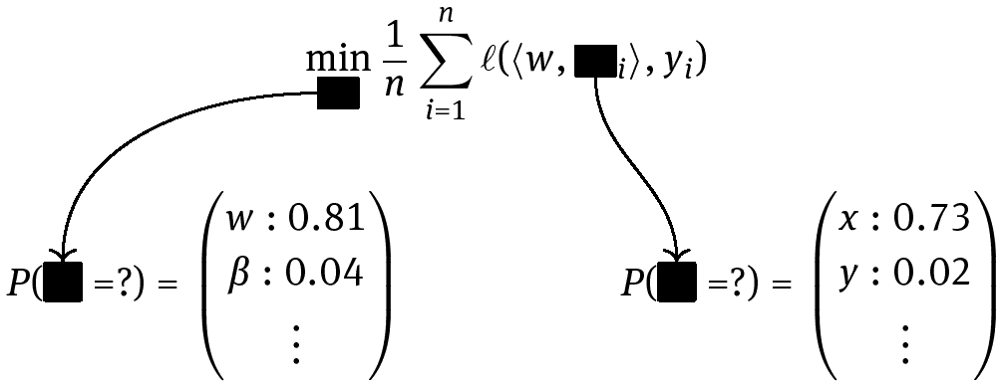

**图 4.24** 使用虚构值的掩码任务示例。

更正式地说，我们按如下方式进行。对于每个具有特征 `X` 的输入图 `x`，我们随机将 15% 节点的特征向量设为全零，从而获得图 `x[■]`。然后我们计算 `ϕ(x[■]) ∈ ℝ^(|x|)×512`。现在，对于每个被掩码的节点，我们解决一个分类任务：给定 `ϕi`，预测正确的 token，即 XML 标签、XML 属性和字符的组合。该分类任务使用一个维度为 256 的单层线性层配合 softmax 激活函数和交叉熵损失来求解。

```
𝓁[i] = 𝓁(softmax(W)ϕi+b, X[i])
```

损失仅针对被掩码的 token 进行评估，我们计算所有被掩码 token 的平均值以获得 `x[■]` 的损失值。

将此任务添加到上下文相似度任务中还有一个额外优势：我们现在学习到的表示不仅捕获上下文信息，还保留了关于原始输入符号的信息。

#### 4.5.4.2 数据增强

数据增强有利于机器学习模型的泛化，在图像分类任务中尤为流行，我们可以通过随机旋转、缩放、填充等方式增强图像。对于数学表达式，我们提出以下随机数据增强方法。由于我们知道重命名方程中的符号极少改变语义，我们提议随机排列所有对应数学标识符的节点的字符特征，这些标识符根据 MathML 标准编码在 `<mi>` 标签中。对于处理的每个方程，我们从期望值为 32 的泊松分布中采样一个翻转次数。然后从不改变 192 个特征顺序的恒等排列开始，我们通过逐步交换两个随机字符来构建一个具有所需翻转次数的排列。

### 4.5.5 实验结果

在本节中，我们对嵌入模型进行实验评估。特别地，我们关注数学表达式搜索引擎的用例。我们首先在一个小的、封闭的数据子集上研究模型各个组件的影响。然后我们在所有 2990 万个方程上研究我们方法的有效性。

#### 4.5.5.1 机器学习子集上的分析

我们开始仅对主要学科分类为机器学习（cs.LG）的 arXiv 论文进行分析。这是一个自然的选择，因为我们具备一定的专业知识来判断结果的质量，而这对于所有学科领域来说是我们完全无法胜任的任务。

在这 9936 篇出版物中，我们采样了两个子集，训练集和测试集的大小分别为 7949 和 1987，方程总数分别为 237,335 和 54,767。我们使用训练集构建嵌入模型，并使用测试集研究泛化性能。

对于训练，我们采样了 100 万个三元组（`x`、`x⁺`、`x⁻`）。在这些三元组中，45.9% 的正样本对来自同一节，42.2% 来自同一篇论文，13.9% 来自引用图中的边。我们采样了 10 万个三元组用于测试，其正样本分布相似。

我们对提出的嵌入模型进行消融研究，并将其与先前的工作进行比较。本节研究我们设计选择的影响。我们决定（a）使用直方图损失代替三元组损失，（b）增加掩码任务，（c）使用数据增强。

我们测量排序得分，即训练数据中所有三元组里同类方程对的相似度高于跨类方程对的相似度的比例。正如表 4.6 所示，我们的评估表明，所有设计选择都对保留数据的整体性能有积极贡献，因为禁用任何组件都会降低得分。我们注意到，最大的增益来自于从三元组损失切换到直方图损失。我们认为这是由于标签中存在海量噪声。

我们还与我们之前的模型进行了比较，发现我们以微弱优势胜出。然而，这种比较并不完全公平，因为他们的模型是在约 25,000 篇论文的更大数据集上训练的，很可能包含我们测试集中的一些论文。我们使用他们的代码在我们的方程子集上重新训练，获得了 6.5 个百分点的显著优势。

**表 4.6** 消融研究。

| 影响因子 | 保留集排序 | 评估排序 | 评估准确率 |
| :--- | :--- | :--- | :--- |
| 完整模型 | 76.5 (±0.0) | 57.7 (±0.0) | 60.6 (±0.0) |
| 无直方图损失 | 72.5 (−4.0) | 49.6 (−8.1) | 30.9 (−29.7) |
| 无掩码 | 75.2 (−1.3) | 54.3 (−3.4) | 50.0 (−10.6) |
| 无增强 | 75.3 (−1.2) | 53.6 (−4.1) | 50.0 (−10.6) |
| 位图 CNN 原始 | 76.2 (−0.3) | 71.9 (+14.2) | 68.3 (+7.7) |
| 位图 CNN 重训练 | 70.0 (−6.5) | 50.0 (−7.7) | 52.9 (−7.7) |

我们还使用了之前的评估数据。它包含 103 个方程，标记为与机器学习相关的 13 个类别，包括 k-means、LSTM、经验风险最小化等。由于仅有位图可用，我们手动转录了这些方程。该评估集存在三个问题。首先，它太小，无法产生显著的数字。其次，数据集中的某些方程出现在训练数据中。这不仅发生在我们的子集中，也发生在先前工作使用的训练数据中。第三，一个类别内的许多方程显然来自同一篇论文，因此我们在训练数据中已经见过其中一些配对。尽管如此，我们仍然使用了该评估数据。确实，在我们的搜索引擎用例中，爬取的方程将始终存在于训练数据中，只有用户查询会是未见过的方程。从某种意义上说，我们用评估数据模拟了这种情况。

遵循原始实验协议，我们测量了在留一法验证中获得的 1-最近邻准确率（称为 Accuracy）以及上述的 Ranking 分数。在表 4.6 中，我们再次看到，我们的模型仅被使用更大训练数据集的预训练模型超越。这促使我们使用大得多的数据集。

#### 4.5.5.2 大规模实验

为了在我们数据集的所有论文上进行训练，我们采样了两组不同的训练三元组，一组包含 500 万个三元组，另一组包含 2000 万个三元组。我们在一块拥有 8 GB 显存的 Nvidia GTX1080 GPU 上训练模型，这使我们能够处理包含 128 个三元组（即 384 个方程）的小批量。在训练期间，我们每秒处理约 1300 个三元组，不计算从硬盘读取数据的时间。总共在我们的系统上，对 2000 万个三元组进行 20 个 epoch 的训练其中之一耗时 6 小时 30 分钟。我们使用 `annoy` 来构建用于近似最近邻检索的索引。总共，我们的索引使用 13 GB 的硬盘存储空间来管理数据集中的所有数学表达式。

**表 4.7 评估分数。**

| 数据集 | Ranking 评估 | Accuracy 评估 |
| --- | --- | --- |
| 100 万 ML 子集三元组 | 57.7 | 60.6 |
| 500 万完整 ArXiv 三元组 | **76.2** | 80.9 |
| 2000 万完整 ArXiv 三元组 | 75.3 | **84.0** |
| Bitmap CNN 原始版 | 71.9 | 68.3 |

在我们通过搜索引擎研究评估模型之前，我们再次检查了模型在上述评估数据上的表现。表 4.7 中的结果表明了使用大量训练数据的威力，尽管不清楚使用 2000 万训练三元组是否比仅使用 500 万具有优势。我们的大规模模型击败了所有在较少数据上训练的模型。即使较小的模型仅在机器学习相关数据上训练，我们通过在所有学科上训练，在机器学习评估数据上获得了更好的分数。

现在让我们检查两个示例搜索查询。在图 4.25 和 4.26 中，我们看到了引言中的两个例子——贝叶斯定律和伊辛模型，以及它们在基于 500 万三元组训练的模型下的最近邻。我们看到，我们可以找到贝叶斯定律的其他定义，以及相关的全概率公式。当我们查询伊辛模型并查看前 20 个结果时，我们发现了一些论文称该模型为玻尔兹曼机，也有一些论文提及伊辛模型。这说明了查询数学表达式而非使用关键词的强大功能。

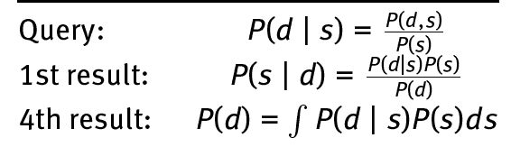

**图 4.25** 示例：贝叶斯定律。我们报告第一个结果以及第一个不显示贝叶斯定律、而是显示相关全概率公式的结果。第一个结果来自：R. H. Leike, T. A. Enßlin, *Charting nearby dust clouds using Gaia data only*, 2019。

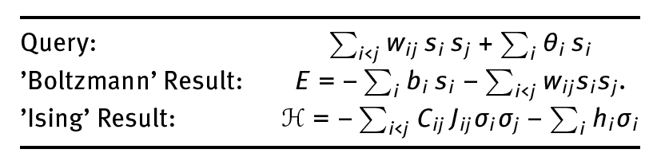

**图 4.26** 示例：伊辛模型。我们找到了与伊辛模型和玻尔兹曼机均相关的方程。第一个结果来自：Weinstein, *Learning the Einstein-Podolsky-Rosen correlations on a Restricted Boltzmann Machine*, 2017。第二个结果来自：Ferrari et al., *Finite size corrections to disordered systems on Erdős–Rényi random graphs*, 2013。

因此，我们策划并发布了自己的评估数据集。为了减少人工标注工作量，我们希望应用一种启发式方法进行相关性判断。为此，我们请求我们的同事（许多人来自计算机科学和数据科学以外的学科）提供我们应该查询的方程。对于每个方程，他们提供了一组应出现在结果周围段落中的关键词或关键短语。如果存在其中一个关键词，我们将该结果计为正确。通过这种方式，我们可以在不手动检查结果列表的情况下评估搜索结果。如果一个关键词超过 10 个字符，我们也将其计入，如果我们找到一个编辑距离小于 2 的子串。总共，我们有 53 个公开可用且可在线编辑的评估查询。

我们检查了两种不需要预先知道相关文档数量的信息检索指标：Precision@`k` 和未归一化平均精度均值。Precision@`k` 定义为前 `k` 个结果中相关文档的比例。我们报告了结果列表长度为 10、100 和 1000 时的数值，并计算了其在评估查询上的平均值。

未归一化平均精度均值源自标准的平均精度均值指标。由于我们预先不知道相关文档的数量，我们省略了这一项，将搜索限制在最多 1000 个结果，并得到以下定义：

```
$\text{uMAP} = \sum\limits_{k = 1}^{1000}P(k)\Delta_{k}$
```

其中 `P(k)` 为 Precision@`k`，`Δ[k]` 指示第 `k` 个结果是否相关。我们再次计算所有评估查询的平均值。与 Precision@`k` 相比，uMAP 考虑了搜索结果的顺序，并奖励结果列表前部的相关结果。

##### 表 4.8 搜索引擎性能

| | | P@10 | P@100 | P@1000 | uMAP |
|---|---|---|---|---|---|
| BoW | | 0.4567 | 0.3170 | 0.2083 | 106.17 |


| 5Mio | | **0.5038** | **0.3817** | **0.2984** | **165.04** |
| 20Mio | | 0.4547 | 0.3709 | 0.2897 | 156.51 |

为参考，我们纳入了基于词袋（BoW）表示的检索。为此，我们使用第 4.5.3.2 节中的数据表示，但计算图中所有节点的总和，以获得整棵树的单个 256 维向量。我们使用余弦相似度检索最近邻。

在表 4.8 中，我们看到我们的方法优于词袋基线，特别是对于较大的 `k` 值。我们看到对于 Precision@10，BoW 和我们的嵌入模型之间的性能非常相似。这是因为对于许多查询，前 10 个结果大多是容易识别的近乎完美的匹配。然而，当查看更多结果时，我们能够找到近 50% 更多的相关公式。

#### 4.5.5.4 等式与不等式的检索

我们使用正则表达式从数据的测试集中提取了等式和不等式。使用一个简单的启发式方法，我们对生成的（不）等式进行过滤，使得左侧（LHS）和右侧（RHS）在长度上没有显著差异，从而消除诸如定义之类的公式，其中 LHS 仅为单个符号。我们得出三个不同的数据集：一个仅包含等式（在 `=` 处分割 LHS 和 RHS），一个包含不等式（在 `<` 和 `≤` 处分割），一个包含混合关系（在 `=<>≤` 和 `≥` 处分割）。这些数据允许我们将（不）等式的 LHS 用作查询，希望检索到 RHS。我们也已在 `https://whadup.github.io/arxiv_learning/` 提供了我们的微调数据。

遵循其他基于机器学习的数学检索方法 [464, 563, 564]，我们使用模型将公式编码到稠密向量空间中，并使用近似最近邻搜索检索结果 [[48]](#backmatter-001.xhtml#b_9783110785944-010_ref_048)。对于我们的 BERT 模型，我们使用 CLS 标记的输出嵌入作为整个公式的表示，并微调模型以使该第一个标记输出有意义的嵌入。我们在一半可用数据上微调模型，在剩余的一半上测试。

**微调任务** 我们提议使用对比学习来学习在给定 LHS 的情况下识别 RHS。对比学习中的学习任务是在一个数据点小批量中为每个输入识别正确的配对。因此，表示学习问题被表述为一个分类问题。设 `X^l`, `X^r ∈ ℝ^(m×d)` 分别包含一批 LHS 和 RHS 的输出嵌入。我们将每个嵌入归一化为单位长度，并用 `X̄^l` 和 `X̄^r` 表示归一化后的嵌入。我们使用 InfoNCE 损失 [547]，即由 LHS 和 RHS 之间成对余弦相似度参数化的 softmax 概率的负对数似然：

```
(4.42) ℒ_τ(X̄^l, X̄^r) = m^(-1) ∑_{i=1}^m log (exp(⟨X̄_i^l, X̄_i^r⟩/τ) / ∑_{j≠i} exp(⟨X̄_i^l, X̄_j^r⟩/τ)) (4.42)
```

其中 `τ > 0` 是一个控制输出概率分布温度的超参数，我们将其设为 `10^(-2)`。对于更大的批量大小 `m`，对比学习任务更难，因为有更多的候选 RHS 可供选择，因此底层分类问题变得更难。但已有研究表明，模型的效用随批量大小的增加而提高 [134, 496]，我们也在应用中对此进行了研究。

**基线模型** 除了我们的模型，我们还纳入了几个基线模型：

*   首先，我们测试一个简单的*词袋*（BoW）模型，该模型在 MathML 树节点词袋上训练。该模型不使用预训练阶段，仅在微调数据上调优。BoW 模型通过单次矩阵乘法将稀疏 BoW 表示映射到 `d` 维向量嵌入。与我们的 BERT 模型相比，我们不限制输入的词汇表大小。表示使用相同的对比学习任务和 InfoNCE 损失进行训练。我们测试 `d ∈ {64, 128, 256}`，并在网格搜索中改变学习率和训练轮数后报告最佳结果。

*   其次，我们评估一种基于 BoW 模型的预训练方法。Joulin 等人 [350] 基于词嵌入的方法 *fastText* 通过预测哪些标记一起出现在上下文中来训练。Mansoury 等人将其用于学习公式嵌入，方法是序列化 MathML 布局树，类似于我们在本工作中使用的树 [[464]](#backmatter-001.xhtml#b_9783110785944-010_ref_464)，因此我们将其纳入比较。我们通过学习一个到 `d` 维向量空间的线性映射（`d ∈ {64, 128, 256}`）来微调这些嵌入，使用相同的对比学习任务。

我们首先使用 1024 的小批量大小训练我们的模型和基线模型。然后我们还研究了改变批量大小的影响。我们所有方法的实现可在 `http://github.com/Whadup/arxiv-learning` 获取。

**结果** 对于测试，我们计算测试数据中所有 LHS 和 RHS 的嵌入并将它们存储在索引结构中。我们使用 annoy [[48]](#backmatter-001.xhtml#b_9783110785944-010_ref_048)，一种基于随机投影树集成的近似最近邻搜索索引方法。我们使用包含 16 棵树的集成和默认超参数，但我们发现结果对我们特定的参数选择非常不敏感。

然后我们为测试集中的每个公式查询 `k` 近邻（`k ∈ {1, 10, 100}`），并检查对应的（不）等式的另一侧是否在结果集中。这样我们就可以计算召回值来衡量嵌入的质量。

##### 表 4.9 数学检索实验结果。我们报告 `K ∈ {1, 10, 100}` 的 recall@K。

| | | 等式 (36864) | | | 关系 (40960) | | | 不等式 (13312) | | |
|---|---|---|---|---|---|---|---|---|---|---|
| 模型 | | R@1 | R@10 | R@100 | R@1 | R@10 | R@100 | R@1 | R@10 | R@100 |
| SMALL-PRE | | 0.379 | 0.577 | 0.714 | 0.432 | 0.626 | 0.749 | 0.397 | 0.661 | 0.795 |
| SMALL-NO-PRE | | 0.400 | 0.584 | 0.700 | 0.405 | 0.632 | 0.769 | 0.371 | 0.632 | 0.769 |
| BASE-PRE | | **0.511** | 0.71 | 0.805 | 0.503 | 0.697 | 0.791 | 0.484 | 0.765 | 0.86 |
| BASE-NO-PRE | | 0.434 | 0.623 | 0.729 | 0.446 | 0.63 | 0.734 | 0.409 | 0.682 | 0.797 |
| LARGE-PRE | | 0.507 | 0.704 | 0.799 | 0.496 | 0.683 | 0.777 | 0.489 | 0.765 | 0.864 |
| LARGE-NO-PRE | | 0.452 | 0.637 | 0.737 | 0.46 | 0.640 | 0.736 | 0.427 | 0.703 | 0.817 |
| BOW | | 0.483 | 0.653 | 0.739 | 0.491 | 0.658 | 0.743 | 0.503 | 0.738 | 0.821 |
| FASTTEXT [[350]](#backmatter-001.xhtml#b_9783110785944-010_ref_350) | | 0.480 | 0.650 | 0.739 | 0.488 | 0.651 | 0.742 | 0.488 | 0.713 | 0.810 |
| GNN [[563]](#backmatter-001.xhtml#b_9783110785944-010_ref_563) | | 0.507 | **0.833** | **0.884** | **0.512** | **0.834** | **0.883** | **0.504** | **0.870** | **0.922** |

我们在表 4.9 中总结了我们的发现。我们的 `BERT` 方法在没有预训练 (`BOW`) 和有预训练 (`FASTTEXT`) 的情况下，均大幅优于 `BoW` 方法。这表明我们的模型能够基于超越单纯计算匹配标记数量的特征来匹配公式。然而，图神经网络 `GNN` 在大多数场景下均优于序列模型，有时甚至优势巨大。不过值得注意的是，在 Transformer 模型中，中等规模的模型最为有用。

对于中等规模和大规模模型，我们观察到了预训练的益处，因为从头训练的模型表现不如其预训练的对应模型。对于小规模模型，我们并未一致地观察到这种效应。

总体而言，我们方法的 Recall@10 已经相当高，这表明我们在结构化数据上的表征学习在搜索引擎应用中很有用，因为用户通常只想查看少量结果。

### 4.5.6 结论

跨学科查找相关文献对于研究至关重要。搜索结果应包含既相关又具启发性的论文。通常，查看论文中的公式能对其讨论的问题和解决方案给出紧凑的描述。因此，目标是基于数学表达式查找相关论文。这项任务不同于数学信息检索，但二者共享确定数学表达式正确表征这一问题。

为了处理搜索引擎应用中常见的大量数据，我们需要能够高效计算向量表征的模型。我们基于图神经网络的方法非常适合这一需求，因为它利用了稀疏连接的输入图。因此，它比我们在本文中考虑的其他 Transformer 模型在计算上效率高得多。

我们已经证明，在结构化输入上的表征学习是数学检索的一种有用方法。自监督和嵌入学习成功地学习了树结构的实值表征，从而实现了高效的最近邻搜索。

## 注释

# 5 聚类分析

分析新数据集时的一个重要过程是了解数据集的属性、特征和内容。此处的一个基本要素是所谓的“领域专业知识”，即关于数据领域特有特性的知识，以便将其预处理为适合分析的形式。但即使是理解数据含义的领域专家，也可能不知道其某些特征。在探索性数据分析 (`EDA`) 中，数据现已被预处理、清洗并转换为适合进一步分析的形状——例如整齐的表格形式，并经过缩放，以便我们可以应用距离度量。我们现在可以探索数据集以识别有趣的子结构，这些子结构可能是已知的（并且可能是后续分类标记的良好候选），可能是未知的但与手头问题无关，或者理想情况下是尚未知晓但有趣的。发现关于数据的此类新知识被称为“知识发现在数据库中” (`KDD`) 过程中的“数据挖掘”步骤。新知识就是我们在数据堆积如山中寻找的金子。我们可能在寻找几种模式：这些可能是频繁模式（如组合或序列）、异常（也称为离群点，因为我们假设这些对象是正常数据的罕见偏差）和聚类。

在本章中，我们关注聚类，它们是数据集的子集，组内更连贯，且组间表现出较大的偏差。根据连贯性和偏差的概念，我们可以得出截然不同的聚类概念——从而得出不同的算法。此外，模型和算法可能因假设而异，例如数据是否必须划分为不相交的子集，或者聚类是否可以重叠。聚类可能形成层次结构，或者仅在特定子空间或投影中明显。一些方法将聚类简化为单个中心点（例如无处不在的 `k`-means，以及 `k`-medoids 等），而其他模型则允许任意形状的非凸聚类，只要数据是连通的（例如 `DBSCAN` 和支持向量聚类中的密度连通，谱聚类也是如此）。存在大量的算法，它们可能产生截然不同的结果。模型和算法的适当选择取决于要解决的问题。在许多情况下，即使 `k`-means 似乎是最容易使用的，它也是一个糟糕的选择。它总是将点分配给最近的聚类中心，甚至无法很好地处理直径变化的聚类。

本书的重点是资源效率，这在聚类中包含许多方面，因为这是一个非常昂贵的问题。许多聚类问题精确求解是 `NP` 难的，因此对于大型数据集，寻找最优解是不可行的。相反，通常使用启发式算法，例如 `k`-means 的标准算法，它只能找到一个局部不动点解（甚至可能不是局部最优解），或者对数据进行近似。

在第 5.1 节 中，我们将重点关注 `k`-medoids 聚类，它在概念上与 `k`-means 聚类相关，但不限于平方欧几里得距离。该问题的常用算法所需的运行时间和内存是数据点数量的二次方，因此按照聚类的通常预期（考虑到流行的 `k`-means 算法被认为在数据点数量 `N` 上是线性的），它们不被认为非常高效。此处讨论的解决方案利用了这样一个事实：当处理结构化数据而非坐标数据时，数据集可以是稀疏的（即具有许多缺失值），因此我们可以避免使用全矩阵。

在第 5.2 节 中，我们考虑 `k`-聚类问题的输入由时间序列或点序列组成，两者都可以解释为折线曲线。由于点的顺序很重要，我们选择的距离度量是 Fréchet 距离，它广为人知的“牵绳遛狗”类比：假设一条轨迹是狗的，另一条是主人的。需要多长的最短牵引绳才能始终连接这两条轨迹，从而确定这两个对象必须具有的最大距离？然而，在这种情况下，单次距离计算代价高昂，因此我们可能没有资源计算所有成对的 Fréchet 距离。人们普遍认为，对于每个具有 `m` 个顶点的两条轨迹，不存在运行时间为 `O` (`m`^(2−`η`)) 的算法，对于任何常数 `η` > 0 均成立。为了提高资源效率，我们研究了通过以更紧凑的形式近似这些曲线来进行聚类的算法，这种形式允许对距离进行界定。

## 5.3 层次聚类的可扩展性与资源效率

第 5.3 节 通过将数据聚合为基于树的摘要数据结构，提高了层次聚类（常见的 AGNES 算法复杂度为 `O(N³)`）的可扩展性和资源效率。这些摘要的构建时间呈线性，且仅使用常数内存，我们将展示如何使用不同的距离和算法对这些摘要进行聚类。随后，聚类过程取决于摘要存储的大小（受限于常数），给定 `m` 个摘要，若采用最近邻链算法等改进算法，复杂度则为 `O(N + m²)`。由于这些数据摘要可在一次遍历数据集且使用常数内存的情况下构建，因此生成的方法非常适合在资源受限的边缘设备上进行流数据处理。它们也可以在多个处理器上并行构建，随后再进行聚合，因此是在较小系统上继续分析前，在集群中聚合大数据的良好选择。

## 5.4 布尔矩阵分解

在 第 5.4 节 中，我们转向另一种数据类型，即随后被分解的布尔矩阵数据。矩阵分解是许多方法的核心技术，其应用范围从谱聚类到词嵌入（`word2vec` 可视为词共现矩阵的分解）。布尔矩阵是一种特殊情况，用于指示项目的存在与缺失，例如文档中的词汇、购物篮中的商品，或指示基因表达水平。虽然基于矩阵的方法在存储上相对消耗内存，但现代硬件的进步（如利用图形处理器 GPU 加速）极大地提高了此类方法的可扩展性。此类处理能力现已以移动 CPU 中 GPU（如麒麟 CPU）以及嵌入式张量处理单元（如 Google Coral Edge TPU）的形式，在嵌入式系统中变得可用。

## 聚类分析作为探索性方法

聚类分析是一种数据分析的探索性方法，因此通常在数据分析过程中执行多次。其结果不应被视为终极真理（不幸的是，对于真实数据，“验证”通常无法以有意义的方式进行）。但它们有助于识别数据属性和数据问题（特别是关于预处理方面），并可作为进一步处理和分析的灵感来源。例如，聚类可能导致发现数据的适当分类，尽管单个聚类结果往往过于不可靠，无法用于完全自动化的分类，用户在研究聚类后，最好根据需要手动标记数据。

## 5.1 围绕 medoids 的稀疏划分

**Lars Lenssen**

**Erich Schubert**

**摘要：** 围绕 medoids 划分（PAM，`k`-medoids）是一种流行的聚类技术，可用于任意距离函数或相似度，其中每个簇由其最中心的对象（称为 medoid 或离散中位数）表示。在运筹学中，这类问题也称为设施选址问题（FLP）。FastPAM 最近引入了一种针对大 `k` 的加速方法，使其适用于更大规模的问题，但该方法的运行时间仍随 `N` 呈二次方增长。在本贡献中，我们讨论了该问题的一种*稀疏且非对称*变体，可用于路网等图数据。

通过利用稀疏性，我们可以避免二次方的运行时间和内存需求，使该方法可扩展至更大规模的问题，前提是我们能够构建一个连接性足够、规模足够小的图以执行局部优化。此外，我们还考虑了非对称情况，即 medoids 集合与待覆盖点集合不相同（或按设施选址的解释，可能的设施位置与消费者位置不相同）。由于稀疏性，当 `k` 值过小时，可能无法仅用 `k`-medoids 覆盖所有点，这会导致问题无解，并破坏寻找良好初始条件的常用启发式方法。因此，我们将确定 `k` 视为优化问题的一部分，并建议先用较大的 `k` 构建贪心初始解，然后通过在 PAM 风格的“交换”操作（用更好的替代品替换 medoids 以改进结果）和“移除”操作（减少 `k` 的数量）之间交替，优化问题，直到两者均无法进一步提升结果质量。

我们通过一个源自电气工程的问题（输入图源自制图数据）展示了该方法的实用性。

### 5.1.1 简介

围绕 medoids 划分算法（PAM，[363, 365]），也称为 `k`-medoids，是一种流行的聚类算法，当人们希望最小化除平方误差距离以外的其他距离时，常将其作为 `k`-means 聚类的替代方案。与 `k`-means 类似，它旨在最小化数据点到簇中心的距离之和，但 `k`-medoids 中的簇中心是数据点之一，称为 medoid，且距离函数可以是任意的。这比使用算术平均值作为簇中心的 `k`-means 更具灵活性。平均值最小化平方误差，因此 `k`-means 仅最小化 Bregman 散度（如平方欧几里得距离）。即使在一维数据上，它也不最小化线性误差，这从算术平均值与中位数的差异中可见一斑。`k`-means 最小化平方误差之和，而带有 `k` 个代表性 medoids `m[i]` 的 `k`-medoids 最小化绝对误差准则（“总偏差”，TD）：

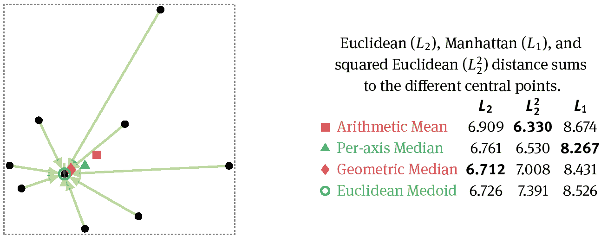

**图 5.1** 四种不同的中心点：算术平均值、逐轴中位数、几何中位数和欧几里得 medoid。

```
(5.1) TD := ∑_{i = 1}^{k}∑_{x_c ∈ C_i}d(x_c, m_i)  (5.1)
```


其中 `d(x[c], m[i])` 是簇 `C[i]` 的数据点 `x[c]` 与 medoid `m[i]` 之间的距离；该距离不一定是欧几里得距离，也不一定是度量。数据集的算术平均值、逐轴中位数、几何中位数和 medoid 之间的差异在图 5.1 中举例说明。可以看出，medoid 对异常值的敏感度低于算术平均值，且 `k`-means 并不最小化欧几里得距离（而是最小化平方距离）。

在运筹学中，`k`-medoids 问题也称为（离散）设施选址问题。该问题已有多种变体被研究。变体主要在于要最小化的目标函数不同。例如，`k`-center 则改为最小化所有点到其分配簇中心的最大距离。在寻找所有这些不同问题的近似算法方面，已有大量研究。

不幸的是，常用的 `k`-medoids 算法对大规模问题的可扩展性不佳，我们将在下一节讨论这一点。

## 5.1.2 围绕 medoids 划分的运行时间复杂度

*k*-medoids 问题是 NP-hard（NP 难）问题 [[357]](#backmatter-001.xhtml#b_9783110785944-010_ref_357)；因此我们不得不求助于近似解，使用贪心和局部优化技术。`PAM` 算法就是一种此类方法：其初始化（称为 `BUILD`）是对 *k*-medoids 问题的一种贪心近似，随后使用局部搜索（称为 `SWAP`）进行细化。贪心初始化 *k* 次选择使误差减少最多的点；然后局部搜索通过寻找将某个聚类中心与非中心点进行交换的最佳方式来优化该解。虽然 *k*-medoids 这个名字类似于 *k*-means，但标准 `PAM` 算法的工作方式与标准 *k*-means 算法不同。针对 *k*-medoids 的类 *k*-means 交替优化策略已被多次提出 [[299, 465, 553, 595]](#backmatter-001.xhtml#b_9783110785944-010_ref_299)，但已被证明产生的解比基于交换的方法（如 `PAM`）[[603, 616, 658]](#backmatter-001.xhtml#b_9783110785944-010_ref_603)更差。Kanungo、Mount、Netanyahu、Piatko、Silverman 和 Wu [[355]](#backmatter-001.xhtml#b_9783110785944-010_ref_355) 提出了一种基于交换的方法来改进 *k*-means 的结果，但正如我们下面将看到的，它相当昂贵。

贪心初始化和局部搜索都要求所有成对距离都存储在距离矩阵中。贪心初始化执行 *k* 次迭代，每次迭代的代价为 *O*(*N*²)，以找到要添加的最佳类中心。`PAM` 的交换评估 *O*(*k*(*N* − *k*)) 个潜在交换，通过仅计算损失函数的变化，每个交换的工作量减少为 *O*(*N* − *k*) 次操作。因此，寻找每次交换需要 *O*(*k*(*N* − *k*)²) 时间，这已经比 *O*(*k*²(*N* − *k*)²) 的朴素方法有所改进。`PAM` 最终的运行时复杂度为 *O*(*kN*²*i*)，其中 *i* 是收敛所需的迭代次数，除了通常相当小之外，人们对它知之甚少，并且很可能像 *k*-means 一样具有不利的高最坏情况。

我们最近提出了 `PAM` 的改进版本，名为 `FastPAM` [[617]](#backmatter-001.xhtml#b_9783110785944-010_ref_617) 和 `FasterPAM` [[616]](#backmatter-001.xhtml#b_9783110785944-010_ref_616)，它们通过消除对 *k*-medoids 的嵌套循环，在 `PAM` 的基础上提供了大幅加速。通过贪心地执行第一个能改进损失的交换（而不是最佳交换）以及随机初始化，我们将运行时复杂度降低到了 *O*(*N*²*i*)，且经验上 *i* 要小得多（但理论最坏情况相似）。

因为这两种方法都要多次使用每个成对距离——特别是当使用更复杂、因此更昂贵的距离函数时，该方法很有意义——所以如果不使用成对距离矩阵，代价将过高。因此，这两种方法也都需要 *O*(*N*²) 内存。

## 5.1.3 围绕类中心的稀疏划分

这些成对距离中的很大一部分可能不需要精确知道。很容易看出，给定点到类中心的某种分配，以及该分配的最大距离 *τ*，我们可以将此输入距离矩阵中所有大于 *τ* 的值替换为 *τ*，而解不会改变。因此，距离存在某种天然的“截断”，更大的值不会对解产生贡献。如果我们的距离函数满足三角不等式，我们可能能够省略计算其中一些大距离（例如，使用 Newling 和 Fleuret 的算法 [[530]](#backmatter-001.xhtml#b_9783110785944-010_ref_530)）。

在本研究中，我们想关注另一种场景，即截断值可能预先给定（并且可能因点而异），但距离不一定是度量的。第 5.1.4 节将介绍此类问题的一个真实案例。虽然我们可以（并且实际上将）把应用中认为无关的距离视为无穷大（或足够大）的值，但使用距离的稀疏存储仅能立即减少内存使用量，而不能减少运行时间。不幸的是，这也很容易破坏优化过程，该过程依赖于首先找到一个可行的初始解，然后执行改进解的局部变更。如上所述的贪心策略通常无法为较小的 *k* 找到有效的初始解（特别是对于非常小的 *k*，该问题可能变得无法用有限损失求解）。在这种情况下，局部优化也无济于事，因为邻域解通常仍然无效，因此无法取得进展。当数据集由许多未通过有限长度边连接的分量组成时，这一点最容易看出来。

我们不直接搜索具有 *k* 个中心的解，而是可以同时解决 *k*-medoids 聚类的第二个问题：如何选择 *k*？与 *k*-means 聚类一样，选择“最优” *k* 一直未能找到通用解，主要通过一些粗糙的启发式方法来执行，例如臭名昭著的肘部法则，它经常被误用。

如果我们允许算法改变 *k*，我们可以更容易地找到有效的初始解（例如，通过选择最佳的未连接顶点，直到所有内容都被覆盖）。但当然，这通常会产生比期望多得多的聚类数 *k*。但如果我们在细化阶段执行多准则优化，我们可能能够在最小化主要目标的同时减少聚类数量。

当改变 *k* 时，我们将获得一组帕累托前沿解，它们都以某种方式是最优的。这可以形式化为不存在在所有准则上同时“支配”它们的其他解。为了减少剩余候选解的集合，最好有一些基于待解决特定问题的额外约束条件来满足。

## 5.1.4 用例：电气变电站仿真

我们使用 `OSMOGrid` 获取网络，它基于公共数据（OpenStreetMap，OSM）实现了 Kays 等人 [[366]](#backmatter-001.xhtml#b_9783110785944-010_ref_366) 的配电网络生成思路。电网被建模为沿街道分布，建筑物用于建模消费者。基于分区和建筑物大小估算功耗，并用于模拟网络中的负荷流。为了下面提出的问题，我们对图进行了一些简化。我们移除了死胡同，并将消费者位置（即建筑物）移至街道网络中的下一个点。图 5.2 显示了基于 Witten Stockum 镇的仿真。

基于这种图结构，有不同的计算任务需要资源高效的聚类模型。其中一项任务是在图中模拟电气变电站。我们想要确定电力变电站的最佳位置，以使网络中的电力损耗最小化。由于电力损耗与负载、电压和电缆长度有关，我们使用变电站与其连接消费者之间的距离（按消费者负载加权）来近似它。我们将其描述为一个设施选址问题，源自城市和公共服务规划。设施和需求点的目标函数 `FL` 为

(5.2) `FL = ∑[i ∈ Demands] d(i, m(i)) + ∑[j ∈ Centers] c(j)`

## 5.1.5 设施选址问题与电网仿真

设施选址问题（FL）的目标函数为：

$$ \sum_{j \in M} c(j) + \sum_{i=1}^{N} d(i, m(i)) $$

其中 `c(j)` 为开设设施的成本，`d(i, m(i))` 为消费者 `i` 与其分配中心 `m(i)` 之间的距离。FL 与 `k`-medoids 的目标函数有很强的相似性。我们将设施视为电力变电站，将消费者视为需求点。图 5.3 展示了使用 Faster-PAM 对生成的 Witten Stockum 图进行聚类的结果，设定 `k` = 4 个变电站。我们可以观察到，簇分配遵循道路网络，消费者不一定被分配给“直线距离”最近的中心。

即使有 FasterPAM 的改进，运行时复杂度仍为 `O(N²i)`，其中 `N` 为图中的节点数，`i` 为优化过程的迭代次数。底层的 OSM planet 文件包含约 1.2 TB 数据。尽管我们只对建模世界较小区域感兴趣，但仍需降低复杂度，以便在可接受的运行时间内解决整个城市或地区的任务，因为这些区域仍包含数千栋房屋。我们利用典型电网的一些特性。我们仅将至少有 3 条出边的节点视为可能的最优变电站位置（孤立点除外）。单条边上的最优位置易于计算，此处忽略不计。因此，将其表述为非对称问题（需求点与设施位置不再是同一集合）是有益的。距离矩阵不再需要为所有节点对计算，而只需为所有需求点和变电站位置连接计算。这将复杂度降低至 `O(Nmi)`，其中 `N` 为消费者数量，`m` 为可能的变电站位置数量，且 `m < N`。如果我们进一步限制消费者与变电站之间的最大距离（以限制功率损耗），该距离矩阵变为稀疏，即我们有缺失值，可视为无穷大。如果不存储这些缺失值并使用适当的稀疏数据结构进行迭代，可望将运行时间进一步降低至 `O((e + N + m) · i)`，其中 `e` 为边数。假设房屋和道路密度处处相似，我们预期边数 `e` 与我们处理的地图面积近似成线性关系。

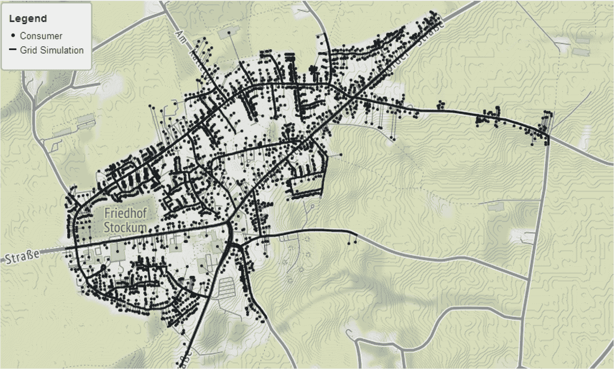

**图 5.2** 基于 Witten Stockum OSM 数据的电网仿真。

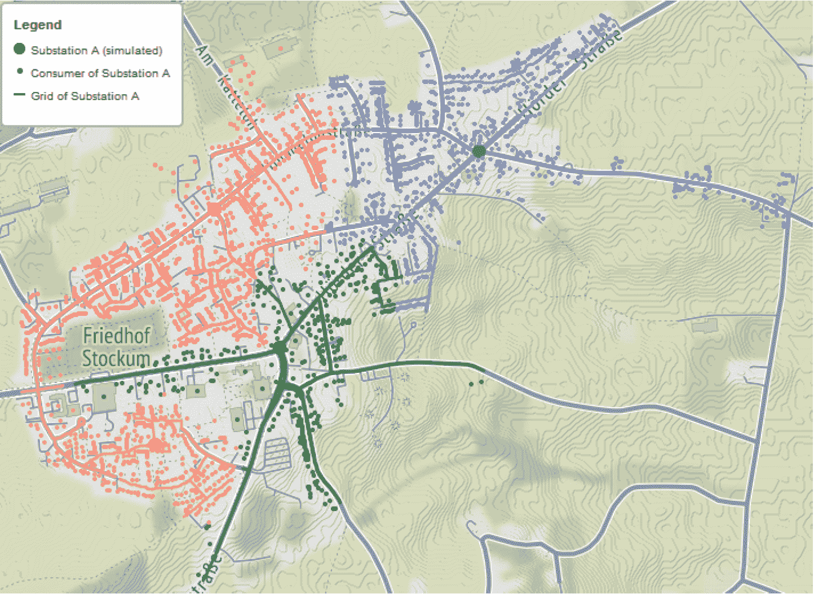

**图 5.3** 使用 FasterPAM 根据最优变电站位置对生成图结构的需求点进行聚类，`k` = 4。

## 5.1.6 稀疏 `k`-Medoids

要将 `k`-medoids 聚类用于具有非对称和稀疏输入数据的问题，我们必须调整 `k`-medoids 的目标函数。我们仍希望最小化所有数据点 `{x[1], ..., x[N]}` 相对于当前 medoids 集合 `M ⊆ {y[1], ..., y[m]}` 的“总偏差”，但不再像传统 `k`-medoids 那样假设 `M ⊂ X`。此外，对于某些点，当前可能不存在最近的可达 medoid `m(x[i])`，且该 `x[i]` 到所有 medoids `m[i] ∈ M` 的距离均未定义。在这种情况下，我们必须在损失 `ℓ` 中引入惩罚 `π(x[i])`：

$$ \mathcal{l} := \sum_{i = 1}^{N} \begin{cases} \pi(i) & \text{if } m(x_i) = \text{undefined} \\ d(x_i, m(x_i)) & \text{otherwise} \end{cases} \quad (5.3) $$

注意，我们允许集合 `M` 的大小发生变化。惩罚 `π(i)` 可用于权衡未覆盖所有可能数据点的损失与拥有更大距离的情况。我们不再进一步考虑调整此参数，而是使用 `π(i) = π = const → ∞` 以强制完全覆盖。由于此类极端值可能导致数值问题，我们的实现始终使用数对 `(i, d)` 来存储损失（及损失变化）：整数 `i` 计算未分配点的数量，`d` 为已分配点距离之和，使得数学上 `ℓ = i · π + d`，但避免了数值问题。

基于该目标函数，我们引入 **DynBUILD**（动态非对称 BUILD 初始化），作为 Kaufman 和 Rousseeuw 的 BUILD 算法针对非对称稀疏输入数据集的改编。如果在选择 `k` 个 medoids 后，某些对象（仍）无法被当前 medoids 集合到达，贪婪 BUILD 方法将通过动态增加 `k` 来补充。因此，该算法始终至少选择 `k` 个 medoids 并覆盖所有消费者。作为基线，记为 **Random** 的策略仅使用给定百分比的点作为初始簇中心，因此可能产生违反约束的初始解，但我们改进的 **DynSWAP** 过程将在优化分配时修复这些违规。**Sparse++** 是将著名的 `k`-means++ 方法改编为稀疏数据，按簇中心覆盖的点数比例选择中心（同样，我们继续选择额外中心直到满足所有约束）。

我们引入 **DynSWAP**（面向非对称稀疏数据的动态 SWAP），作为基于 FasterPAM 的动态 SWAP 算法，改编用于在高效处理非对称和稀疏输入数据的同时动态减少 `k`。DynSWAP 与 FasterPAM 的 SWAP 有两点不同：为根据约束动态改变 `k`，我们在每次交换后检查是否可在不违反约束的情况下减少 `k`（第 30 行）；如果当前对象不适合交换但作为新 medoid 添加（第 34 行）可减少违反约束的数量，则将其作为额外 medoid。我们刻意选择仅在执行交换时才减少 `k`，以在优化现有 medoids 与学习簇数 `k` 之间交替。这两种检查实现起来非常高效，因为我们已经知道所有 medoids 的移除损失变化（`Δℓ^(−m[1]), …, Δℓ^(−m[k])`，这也是 FastPAM 改进 PAM 所需的），并且在 `Δℓ^+` 中也有添加新 medoid 时的损失变化。如果 `π` 分量为零：`Δℓ[π]^(−m[i]) = 0`，则可在不破坏任何约束的情况下移除 medoid `m[i]`；如果当前候选 `y[j]` 的 `Δℓ[π]^+ < 0`，则将其作为新 medoid 是有益的。每当添加、移除或交换 medoid 时，我们需要为所有数据点 `x[o]` 更新最近 medoid `n1`、到最近 medoid 的距离 `d[n[1]](o)` 以及到第二近 medoid 的距离 `d[n[2]](o)`。这可以通过更新先前值更高效地完成，完全同 FasterPAM。基于此信息，我们也可以高效更新 `Δℓ^(−m[1]), …, Δℓ^(−m[k])`（即移除每个 medoid 的损失变化）：对于每个对象，移除最近 medoid 会导致损失变化为 `(0, d[n[2]](o) − d[n[1]](o))`（若存在第二近 medoid），否则为 `(π(o), −d[n[1]](o))`。移除除最近 medoid 以外的其他 medoid 不会导致损失变化。

在计算添加新候选中心点 `y[c]` 的损失变化时，我们用每个现有中心点的移除损失初始化数组 `Δℓ`，这是来自 FastPAM [[617]](#backmatter-001.xhtml#b_9783110785944-010_ref_617) 的一种优化。为了避免对所有中心点 `k` 进行内层循环，我们还结合了来自 FasterPAM [[616]](#backmatter-001.xhtml#b_9783110785944-010_ref_616) 的一个思路，即在变量 `Δℓ⁺` 中累积适用于所有中心点的损失变化。`Δℓ⁺` 的一个有趣性质是，它代表了添加新中心点的损失变化，我们也利用这一点来动态增加聚类数量。我们受益于该方法中的稀疏性，因为不必考虑那些不是候选点 `y[c]` 邻居的对象：移除现有中心点的损失变化已经计入，且由于它们无法从 `y[c]` 到达，添加替代中心点时不存在损失变化。因此，我们的循环只需遍历邻居即可。对于每个邻居 `x[o]`，我们区分四种情况：(1) 该点当前尚未被覆盖，因此我们在行 12 获得 `π(o)` 但产生 `d(x[o], y[c])`；(2) 新中心点比所有现有中心点都近，因此我们在行 14 获得 `dn₁ − d(x[o], y[c])`。对于移除最近中心点的情况，我们已经包含了 `dn₁`，因此必须将其抵消（要么用 `−π(o)` 要么用 `dn₂`）。如果新中心点只是第二近的，且 (3) 之前不存在第二近的，则只需在行 20 更新移除最近中心点的损失。如果 (4) 存在之前的第二近中心点，但它比新中心点远，我们还需要在行 22 通过产生的差值来调整移除最近中心点的损失，该差值源于分配给新中心点而非之前的第二近中心点。类似的情况区分——除了处理未定义的第二近情况——在 FasterPAM [[616]](#backmatter-001.xhtml#b_9783110785944-010_ref_616) 中已可找到。

我们观察到行 5 和行 9 的两个循环都遍历所有边，因此该过程的复杂度为 `O((e + N · k) · i)`，其中 `e` 是边的数量，`i` 是迭代次数。在街道网络示例中，我们可以论证当将方法扩展到更大网络时（因为我们会保持最大距离不变，但增加区域），`e ∈ O(N)`。因此，这种稀疏 `k`-中心点版本在此应用中呈线性扩展。如果我们拥有一个稠密连接图，则 `e ∈ O(N²)`，运行时间与标准 FasterPAM 相匹配。

## 5.1.7 实验

在实验中，我们预期相比 FasterPAM 能看到加速效果。我们还想检查在考虑约束条件下 `k` 的动态变化如何工作。我们必须评估稀疏 `k`-中心点在满足约束条件下寻找最小可能 `k` 的能力如何。因此，我们分析了三种初始化方法：DynBUILD、Random 和 Sparse++。最后，我们通过将模拟结果与 OSM 中的原始变电站位置进行比较，执行定性评估。

### 算法 2 DynBUILD：动态非对称 BUILD 初始化


### 算法 2 DynBUILD：面向非对称稀疏数据的动态 BUILD

```
1 ℓ, M ← (∞,∞), ∅
/* 选择第一个中心点： */
2 // 计算每个 y[j] 的损失 foreach y[j] do
3  // 一切均未分配
4  // 检查邻居（稀疏）
5 
6 if ℓ[j] < ℓ then ℓ, M ← ℓ[j], {y[j]} // 当前最优
/* 选择剩余中心点： */
7 for i = 1 ... k − 1 do
8  Δℓ^(*), y^(*) ← (0, 0), ∅ // 存储最佳解
9 foreach y[j] ∉ M do
10  Δℓ[j] ← (0, 0) // 损失变化累加器
11 foreach x[o] ∈ N(y[j]) do // 检查邻居（稀疏）
12  δπ ← −π(o) if dn₁ = ∞ else 0
13  δd ← d(x[o], y[j]) − dn₁
14 if δπ < 0 or δd < 0 then Δℓ[j] ← Δℓ[j] + (δπ, δd)
15 if Δℓ[j] < Δℓ^(*) then Δℓ^(*), y^(*) ← Δℓ[j], y[j] // 当前最优
16 ℓ, M ← ℓ + Δℓ^(*), M ∪ {y^(*)} // 使用最佳新中心点
17 if i = k − 1 and ℓ[π] > 0 then k ← k + 1 // 增加 k
18 return ℓ, {m₁, ..., mₖ}
```

### 算法 3 DynSWAP：面向非对称稀疏数据的动态 SWAP

```
1 y[last] ← invalid
2 foreach x[o] do compute n₁(o), dn₁, dn₂
3  Δℓ^(−m₁), …, Δℓ^(−mₖ) ← compute loss change removing m[i]
4 while still changing do
5 foreach y[c] ∉ {m₁, ..., mₖ} do
6  break outer loop if y[c] = y[last] // 未发现改进
7  Δℓ ← (Δℓ^(−m₁), …, Δℓ^(−mₖ)) // 移除损失
8  Δℓ⁺ ← 0 // 累加器 (FasterPAM)
9 foreach x[o] ∈ N(y[c]) do // 检查邻居（稀疏）
10  d[oc] ← d(x[o], y[c]) // 到候选点的距离
11 if dn₁ = ∞ then // x[o] 尚未被覆盖
12  Δℓ⁺ ← Δℓ⁺ + (−π(o), d[oc])
13 else if d[oc] < dn₁ then // 新的最近
14  Δℓ⁺ ← Δℓ⁺ + (0, d[oc] − dn₁)
15 if dn₂ = ∞ then // 无第二近
16  Δℓ[n₁(o)] ← Δℓ[n₁(o)] + (−π(o), dn₁)
17 else
18  Δℓ[n₁(o)] ← Δℓ[n₁(o)] + (0, dn₁ − dn₂)
19 else if dn₂ = ∞ then // 无第二近
20  Δℓ[n₁(o)] ← Δℓ[n₁(o)] + (−π(o), d[oc])
21 else if d[oc] < dn₂ then // 新的第二近
22  Δℓ[n₁(o)] ← Δℓ[n₁(o)] + (0, d[oc] − dn₂)
23 i ← arg min({Δℓ[i]}) // 当前最佳中心点
24 Δℓ[i] ← Δℓ[i] + Δℓ⁺ // 加上累加器
25 if ΔTD[i] < (0, 0) then // 急切交换 (FasterPAM)
26  swap roles of medoid m^(*) and non-medoid y[c]
27  ℓ ← ℓ + Δℓ[i]
28  update n₁(o), dn₁, dn₂, Δℓ^(−m₁), …, Δℓ^(−mₖ)
29  y[last] ← y[c] // 新的停止位置
// 每次交换后，尝试减小 k：
30 if min(Δℓ[π]^(−m₁), …, Δℓ[π]^(−mₖ)) = 0 then // Dyn↓
31  r ← arg min({Δℓ^(−m[i])})
32  remove medoid m[r]
33  update n₁(o), dn₁, dn₂, Δℓ^(−m₁), …, Δℓ^(−mₖ)
34 else if Δℓ[π]⁺ < 0 then // Dyn↑
35  add new medoid y[c] as it fixes at least one constraint
36  update n₁(o), dn₁, dn₂, Δℓ^(−m₁), …, Δℓ^(−mₖ)
37  y[last] ← y[c] // 新的停止位置
38 return ℓ, M
```

### 数据集

为了验证算法，我们需要足够大的测试数据集，并选择约束条件以获得稀疏距离矩阵。在本工作中，我们专注于由 `OSMOGrid` 生成的能量网格的处理和评估。对于质量评估，我们选择 OSM 中记录了许多变电站的区域。图 5.4 显示了 `OSMOGrid` 为维滕市生成的电网剖面图，使用了来自 OSM 的 127 个变电站位置（尽管这很可能不完整，如图 5.5 所示）。然后我们可以将计算模型的质量与基于真实变电站的模型进行比较，但我们需要记住，OSM 中可能缺少额外的变电站，并且真实电网是历史演变而来的，必须满足额外的约束条件，因此并非最优。为了生成“现实”的网络，期望达到可比的质量，而不必过拟合到我们拥有的示例数据。在该数据集上，我们评估选择 `k` 的动态方法。“最优” `k` 取决于约束条件，从而取决于距离矩阵的稀疏性。图 5.5 显示了满足电网中最大电缆长度约束的最小 `k`。随着电缆长度增加，矩阵中缺失距离的数量减少，但最佳变电站数量下降得快得多。


**图 5.4** 维滕市的电网仿真和 OSM 中已知变电站位置。道路网络包含 37,287 条边和 36,844 个节点，`N` = 35,713 个消费者和 `m` = 1,130 个可能的变电站位置。OSM 中记录了 127 个变电站的位置，但很可能还有几个缺失，特别是在东部。

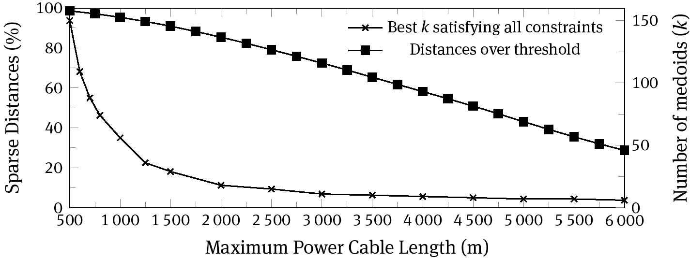

**图 5.5** 维滕市仿真中消费者和变电站之间最大电缆长度约束下的距离矩阵稀疏性，以及不违反约束的最小变电站数量 `k`。

我们在 Java 语言的 `ELKI` 开源工具包 [[618]](#backmatter-001.xhtml#b_9783110785944-010_ref_618) 中评估算法。为了可比性，我们在 `ELKI` 中执行所有计算，并使用 `FasterPAM` 的原始实现作为参考。这样可以避免不同实现导致的副作用 [[399]](#backmatter-001.xhtml#b_9783110785944-010_ref_399)。我们在 `AMD EPYC 7302` 处理器上使用单线程运行 100 次重启，并评估平均值、最大值和最小值。

**表 5.1** 生成维滕市电网时，初始化和交换算法对 `k` 的影响比较。所有结果均为 100 次重启的平均值。

| Algorithm | | | | *k* after | | | Runtime | in ms | Medoid | |
| --- | --- | --- | --- | --- | --- | --- | --- | --- | --- | --- |
| Init. | | SWAP | Init | SWAP | Init | SWAP | changes | Success |
| | Dyn*^↓* | 56 | 56 | **0.2** | 6919.2 | 205.3 | 0% |
| Random⁵ | Dyn*^(↓↑)* | 56 | 77.9 | **0.2** | 7862.3 | 287.9 | 100% |
| Random¹⁰ | Dyn*^↓* | 113 | 82.8 | **0.1** | 11578.8 | 354.9 | 100% |
| | Dyn*^(↓↑)* | 113 | 82.5 | **0.1** | 11044.4 | 372.9 | 100% |
| Sparse++ | Dyn*^↓* | 182.3 | 80.3 | 16.3 | 8632.2 | 269.2 | 100% |
| | Dyn*^(↓↑)* | 182.2 | 80.6 | 3.6 | 8640.3 | 268.4 | 100% |
| | Dyn*^↓* | 93 | **76.3** | 389.9 | **4296.3** | 141.9 | 100% |
| DynBUILD | Dyn*^(↓↑)* | 93 | **76.2** | 394.6 | 4320.3 | 141.4 | 100% |

### 动态 `k`

为了评估可变 `k` 的质量，我们将算法找到的解与所有运行中已知的最佳解进行比较。我们还比较了不同的初始化算法和动态 `SWAP` 的变体。我们测量解的 `k`、初始化和 `SWAP` 的运行时间，以及结果是否满足所有约束。汇总结果见表 5.1。只有不带动态增加 `k` 的 `Random⁵` 初始化无法满足约束。这是意料之中的，因为它仅使用 5% 的可能变电站作为类心，但似乎不存在仅使用这么少聚类的解。由于 `DynBUILD` 是确定性的，它在初始化后总是产生 `k` = 93 个聚类。经过 `SWAP` 阶段后，平均 `k` 为 76.2，比已知最佳 `k` = 74 多 2.2（我们在 `SWAP` 中按随机顺序迭代以避免依赖输入数据顺序）。由于初始解已经满足所有约束，且 `SWAP` 保持这一属性，`k` 只能减少。在随机初始化中，带 `DynSWAP^(↓↑)` 的 `Random⁵` 平均找到了最佳结果。`SWAP` 阶段后 `k` = 77.9，站点数量平均比最佳 `k` 大 3.9 倍。最后，`DynBUILD` 后的 `SWAP` 平均需要随机初始化后 `SWAP` 运行时间的 48.4%。由于随机初始化，`SWAP` 期间类心变更的平均数量从 141 显著增加到 310，表明与随机采样和 `Sparse++` 相比，`DynBUILD` 具有更优越的起始条件。

### 运行时间加速

为了评估不同方法的运行时间，我们对不同的约束条件和 `k` 值进行实验。图 5.6 显示了 `DynBUILD`、`Random⁵`、`Random¹⁰` 和 `Sparse++` 初始化的总运行时间（初始化和 `SWAP`）。我们再次使用维滕数据集，并选择距离约束，使所有方法都能达到所需的 `k`。我们将运行时间与带随机初始化的 `FasterPAM` 实现进行比较（这是 `FasterPAM` 的推荐方式）。对于 `DynBUILD`，我们评估动态减少 `k` 的 `SWAP`（`Dyn^↓`），对于所有随机初始化，评估动态增加和减少 `k` 的 `SWAP`（`Dyn^(↓↑)`）。我们在此图上使用对数刻度，因为差异巨大：所有初始化上的稀疏性优化 `DynSWAP` 平均仅使用带随机初始化的原始 `FasterPAM` 运行时间的 7%；`DynBUILD` 和 `DynSWAP^↓` 组合平均仅使用 4%。这是预期的，因为 `FasterPAM` 必须处理大得多的稠密矩阵。随着 `k` 增加，我们可以使用更稀疏的矩阵，这就是 `DynSWAP` 方法变快而 `FasterPAM` 因聚类数量增加而变慢的原因。各种随机初始化在运行时间上仅略有差异，但平均需要约 `DynBUILD` 两倍的时间。除了快速运行时间外，`DynBUILD` 配合 `Dyn^↓ SWAP` 相比已知最佳 `k` 产生的额外聚类数量最少，平均比已知最佳 `k` = 74 多 2.2 个站点。


图 5.6 DynBUILD、Random⁵、Random¹⁰ 和 Sparse++ 初始化的初始化和 SWAP 运行时间，取决于 Witten 网格模拟的最佳 `k` 数量。作为参考，包含了 FasterPAM 实现的随机初始化和 SWAP 运行时间，其中选择的 `k` 是我们已知的最佳值。最佳 `k` 由约束集间接控制，如图 5.5 所示。除了运行时间外，SWAP 后与最佳已知 `k` 的偏差也一并展示。

### 质量

为了评估结果质量，我们将优化后的变电站位置与 OSM 中标记的变电站进行比较（这些标记可能不完整）。表 5.2 展示了目标 `k` = 127 的结果，与 127 个标记变电站的损失进行比较，如图 5.4 所示。`Sparse++` 和 `Random¹⁰` 初始化配合 `Dyn*^(↓↑)*SWAP` 产生了最低损失 1.3149×10⁷，比标记变电站的损失低 29%。然而，随机初始化之间的质量差异并不显著（`SWAP` 能足够好地始终达到一个良好的解）。此处的主要区别在于运行时间，其中采样比必要数量更多中心点然后减少的策略似乎优于其他策略。100 次重启中的最小损失由 `Sparse++` 和 `Random⁵` 获得，为 1.3083 × 10⁷。`DynBUILD` 初始化配合 `Dyn*^↓*SWAP` 找到的损失略高，为 1.3271 × 10⁷，但产生了最快的总运行时间 9 551.0 ms，尽管其使用了迄今为止最慢的初始化。

**表 5.2** 127 个标记变电站的网格损失与 `k` = 127 的计算损失对比。所有结果均为 100 次重启的平均值。`SWAP` 阶段后所有约束均得到满足。

| 算法 | | | | SWAP 后损失 ×10⁷ | | | 运行时间 (ms) | | 中心点 |
| --- | --- | --- | --- | --- | --- | --- | --- | --- | --- |
| | | | | 平均 | | 最小 | | | |
| 初始化 | SWAP | d | `π` | d `π` | 初始化 | SWAP | 变化 |
| Random⁵ | Dyn*^(↓↑)* | 1.3155 | **0** | **1.3083 0** | **0.1** | 12418.6 | 469.6 |
| --- | --- | --- | --- | --- | --- | --- | --- |
| Random¹⁰ | Dyn*^(↓↑)* | **1.3149** | **0** | 1.3085 **0** | **0.1** | 10395.5 | 339.8 |
| Sparse++ | Dyn*^(↓↑)* | **1.3149** | **0** | **1.3083 0** | 16.4 | 10796.5 | 279.4 |
| DynBUILD | Dyn*^↓* | 1.3171 | **0** | 1.3092 **0** | 525.6 | **9225.4** | 294.9 |
| **标记变电站** | 1.86 | **0** | | | | | |

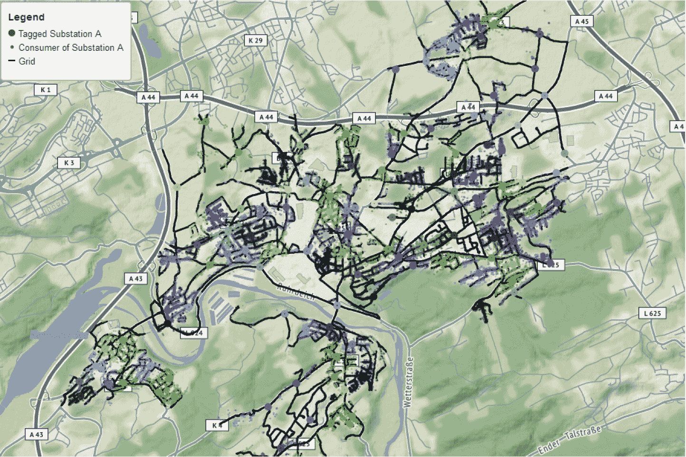

图 5.7 基于 Witten OSM 数据的电网模拟。根据表 5.2，使用 `Sparse++` 和 `Dyn*^(↓↑)*SWAP` 计算出 127 个变电站。所有用户按其最近的变电站进行颜色编码。

所有方法找到的解（1.31 对 1.86）都明显优于 OSM 标签给出的“黄金标准”解。考虑到推测存在的缺失标签，这在预料之中，但也因为真实电网是随着时间增长的，变电站是一个个建设的，而非自动优化。在我们的模拟中，我们拥有关于网格结构的完整信息，因此可以计算出最优的变电站分布（绿地规划），这在实践中无法现实地实现，因为现有电网不能简单替换，且必须遵守额外约束。尽管如此，生成的网络可用于模拟不同场景下的电力网络，例如在研究大幅扩展电动汽车充电基础设施的影响时。

### 5.1.7 展望


在实验中，我们专注于能源网格模拟这一特定用例。除了针对稀疏问题优化 `FasterPAM` 方法外，我们还开始研究将参数 `k` 的自动寻找作为优化问题的一部分。为此，我们在损失函数中结合了两种损失：一种对应于处理不善位置（也可能是离群点）的成本，另一种是经典的 `k`-medoids 问题。很容易加入一个额外的成本项来表示位置的开启或关闭，并对这些成本赋予不同的权重。在本实验中，我们使用了覆盖所有位置的严格要求（即 `π` → ∞），但使用较小的权重可能会产生有趣的近似。

到目前为止，我们在没有变电站最大容量约束的情况下考虑了最优变电站位置问题。现实中，变电站可服务的负载存在上限。因此，在人口稠密地区，我们可能需要更多变电站。这导致了一个带容量约束的设施选址问题，包含此类额外的容量约束，值得在未来工作中探索。

## 5.2 多边形曲线与时间序列的聚类

*Amer Krivošija*

**摘要：** 传感器测量值可以表示为 `ℝ^d` 中的点。按这些测量的时间戳排序，这些点产生一个时间序列，可解释为 `d` 维环境空间中的多边形曲线。

Fréchet 距离是曲线常用的不相似度度量，包含连续和离散版本。若需观察曲线的内在结构，这些是首选的不相似度度量。其局限性之一在于计算 Fréchet 距离固有的复杂性。据信不存在算法能在关于 `m` 亚二次运行时间内计算两条各有 `m` 个顶点的曲线（称为曲线的复杂度）之间的 Fréchet 距离。

聚类是曲线上的基本计算任务。我们考虑在具有 Fréchet 距离的（度量）空间中的聚类。Driemel、Krivošija 和 Sohler [[185]](#backmatter-001.xhtml#b_9783110785944-010_ref_185) 开展了关于聚类中心有界复杂度的曲线 `k`-聚类问题的研究，其结果仅限于一维环境曲线。这些结果引发了一系列出版物，我们在本节第一部分对此进行综述。

与 `k`-聚类相关的是中间曲线问题 [[12]](#backmatter-001.xhtml#b_9783110785944-010_ref_012)。Buchin、Funk 和 Krivošija [[98]](#backmatter-001.xhtml#b_9783110785944-010_ref_098) 基于 Buchin 等人 [93, 95] 的先前工作，研究了该问题的计算复杂度，并证明了中间曲线问题是 `NP` 完全的。该结果在本节第二部分呈现。

### 5.2.1 简介

传感器和其他测量设备每天产生大量数据。我们考虑按测量顺序记录的数据。此类数据描述事件的趋势（如股市、心电图等），或某些物体的轨迹（如鸟类迁徙、船舶航线等）。按时间戳排序的传感器测量值定义了一个时间序列。通过按顺序用直线段连接表示为 `ℝ^d` 中点的传感器测量值，我们可以将时间序列解释为 `d` 维环境空间中的多边形曲线。²⁶

数据挖掘社区通过分析信号测量值，提供了另一种观察曲线的视角。时间序列是一系列测量值 `(w[1], t[1]), ..., (w[m], t[m])`，其中 `w[i] ∈ ℝ^d` 是在时刻 `t[i] ∈ ℝ` 采集的信号测量值。我们假设 `1 = t[1] < t[2] < ... < t[m] = m` 且 `m` 为有限值。通过按 `t[i]` 的顺序对 `w[1], ..., w[m]` 进行线性插值，时间序列可视为连续函数 `τ : [1, m] → ℝ^d`，从而成为环境空间 `ℝ^d` 中的多边形曲线。此符号不指定测量发生的具体时间点。鉴于我们所使用的不相似度度量的选择，这是合理的，因此我们不区分 `ℝ^d` 中时间序列和曲线的概念。我们用 `Δ^d` 表示环境空间 `ℝ^d` 中所有多边形曲线的集合，用 `Δ[m]^(d)` 表示 `ℝ^d` 中复杂度至多为 `m` 的所有多边形曲线的集合。

在曲线集合上选择不相似度度量至关重要。若使用著名的豪斯多夫距离（将曲线视为集合），即使时间戳顺序完全随机，由相同测量值组成的两条曲线距离也为 0。在观察有序结构的前提下比较曲线的自然方法是使用（连续或离散）弗雷歇距离。弗雷歇距离是将一条曲线转换为另一条曲线的最小代价，其中转换的代价度量是两条曲线上对应映射点之间的最大距离。文献中常用“一个人牵着狗沿两条曲线奔跑且从不后退所需的最短牵引绳”这一隐喻来说明此概念。

形式上，令 `ℋ` 表示连续且单调递增函数 `f : [1, m′] → [1, m″]` 的集合，满足 `f(1) = 1` 且 `f(m′) = m″`。`ℋ` 中的函数均为双射。对于两个给定函数 `σ : [1, m′] → ℝ^d` 和 `τ : [1, m″] → ℝ^d`，它们的（连续）弗雷歇距离定义为：

```
(5.4) $d_F(\sigma,\tau) = \inf_{f \in \mathcal{H}}\max_{t \in {[1,m^{\prime}]}} \parallel \sigma(t) - \tau(f(t)) \parallel_2,\qquad\qquad\qquad\qquad\qquad\qquad\left( 5.4 \right)$
```

两条曲线之间的弗雷歇距离定义为其对应连续函数的弗雷歇距离。注意，任意 `f ∈ ℋ` 都在两条曲线之间诱导一个双射。我们称实现弗雷歇距离的函数 `f` 为匹配。²⁷

连续弗雷歇距离要求完整的定义域区间映射。一种相关的不相似度度量是离散弗雷歇距离，它仅要求输入曲线顶点之间的映射。设 `ℝ^d` 中的两条曲线 `σ`、`τ` 由其顶点序列给出：`σ = ⟨v[1], …, v[m′]⟩` 和 `τ = ⟨w[1], …, w[m″]⟩`。`σ` 和 `τ` 的遍历 `T` 是顶点对 `(v[i], w[j]) ∈ σ × τ` 的索引对 `(i, j)` 序列，满足：

1.  i) 遍历 `T` 以 `(1, 1)` 开始，以 `(m′, m″)` 结束；
2.  ii) `T` 中的对 `(i, j)` 后面只能跟随 `(i + 1, j)`、`(i, j + 1)` 或 `(i + 1, j + 1)` 中的一个。

每个遍历都是单调的。若 `𝒯` 是 `σ` 和 `τ` 所有遍历 `T` 的集合，则 `σ` 和 `τ` 之间的离散弗雷歇距离定义为：

```
(5.5) $d_{dF}(\sigma,\tau) = \min_{T \in \mathcal{T}}\max_{(i,j) \in T}\left\| {v_{i} - w_{j}} \right\|_2.\qquad\qquad\qquad\qquad\qquad\qquad\left( 5.5 \right)$
```

我们可以重载该概念，称实现离散弗雷歇距离的遍历为匹配。

与离散弗雷歇距离相关的另一种不相似度度量是动态时间规整（DTW）距离。两条曲线间 DTW 变换的代价度量是*所有匹配点对距离之和*，而非最大值。DTW 常用于机器学习领域。然而，DTW 不是度量，而连续和离散弗雷歇距离都是集合 `Δ^d` 上的度量 [14, 197]。²⁸

讨论两条曲线 `σ` 和 `τ` 的弗雷歇距离时，为简化起见，我们假设两者复杂度均为 `m`。弗雷歇距离通常使用 Alt 和 Godau 的算法 [[14]](#backmatter-001.xhtml#b_9783110785944-010_ref_014) 计算连续情况（时间复杂度 `O(m² log m)`），使用 Eiter 和 Mannila 的算法计算离散情况（时间复杂度 `O(m²)`）。最先进算法的运行时间在 `m` 上大致呈二次方关系 [5, 92]。基于条件下界，人们普遍认为不存在运行时间显著优于 `O(m²)` 的算法来计算任一距离度量。

Bringmann [[77]](#backmatter-001.xhtml#b_9783110785944-010_ref_077) 表明，除非 SETH²⁹

### 5.2.2 (k, ℓ)-Center 和 (k, ℓ)-Median 聚类

**问**：能否找到 `k` 条代表性曲线，每条曲线最多包含 `ℓ` 个顶点？

**答**：精确求解属于 `NP` 难问题，但可以在输入曲线数量的线性时间内获得良好的近似解。

给定配备不相似度度量 `d` 的基础集合 `𝒳`，以及两个正整数 `k` 和 `n`。对于众所周知的 `k` 聚类问题，输入为集合 `P ⊂ 𝒳` 且 `|P| = n`，目标是找到集合 `C ⊂ 𝒳` 且 `|C| = k`，使得 `P` 的元素被分配（聚类）到 `C` 中的一个中心，并使某个目标函数最小化。研究最多的三个问题是 `k`-center、`k`-median 和 `k`-means 问题，分别最小化输入元素到分配中心的最大距离、距离之和、距离平方和。³⁰

这些问题在欧几里得空间和一般度量空间中均有深入研究。我们重点关注 `k`-center 和 `k`-median 问题。这两个问题在欧几里得空间和一般度量空间中均为 `NP` 难 [213, 483]。`k`-center 在近似因子优于 2 时属于 `NP` 难 [[213]](#backmatter-001.xhtml#b_9783110785944-010_ref_213)。除非 `NP ⊆ DTIME [n^O(log log n)]`，否则一般度量空间中的 `k`-median 无法获得优于 `1 + 2/e ≈ 1.736` 的近似因子 [[337]](#backmatter-001.xhtml#b_9783110785944-010_ref_337)。即使离散 `k`-median 在欧几里得空间中也是 `NP` 难的，从而在一般度量空间中隐含为 `NP` 难 [[550]](#backmatter-001.xhtml#b_9783110785944-010_ref_550)。

在欧几里得空间 `ℝ^d` 中，存在一系列针对 `k`-聚类问题的 `(1+ε)`-近似算法。许多算法基于核心集的概念；即核心集是一个比输入小的（加权）集合，它关于任意 `k` 个中心的选择（强核心集），或仅关于最优 `k` 个中心的选择（弱核心集），对输入的聚类成本进行 `(1+ε)`-近似。关于 `k`-聚类核心集方法的综述，请参阅 Munteanu 和 Schwiegelshohn 的工作 [[516]](#backmatter-001.xhtml#b_9783110785944-010_ref_516)。

我们现在讨论一般度量空间中 `k`-聚类问题的最新进展。对于 `k`-中心问题，存在一个简单的贪心 2-近似算法，由 Gonzalez 提出 [[264]](#backmatter-001.xhtml#b_9783110785944-010_ref_264)（Hochbaum 和 Shmoys 也独立给出 [[317]](#backmatter-001.xhtml#b_9783110785944-010_ref_317)），该算法也是最优的。直观上，该算法从输入中随机选取第一个中心，然后 `k-1` 次选取使到已选中心距离最大化的输入点。

对于一般度量空间中的 `k`-中位数，通常研究的是离散版本。注意，由于三角不等式，离散情况的每个 `α`-近似都是无限制情况的 `2α`-近似。Chen [[130]](#backmatter-001.xhtml#b_9783110785944-010_ref_130) 给出了一个运行时间为 `O(nk) + k⁷ε^(−5) log⁵ n` 的 `(10 + ε)`-近似算法。Chen [[130]](#backmatter-001.xhtml#b_9783110785944-010_ref_130) 的近似因子在两篇论文中得到了进一步改进，但运行时间不再是 `n` 的线性函数。Li 和 Svensson [[433]](#backmatter-001.xhtml#b_9783110785944-010_ref_433) 给出了一个 `(1 + √3 + ε) ≈ (2.732 + ε)`-近似，时间为 `O(n^((1/ε)²))`。Byrka 等人 [[116]](#backmatter-001.xhtml#b_9783110785944-010_ref_116) 将 Li 和 Svensson [[433]](#backmatter-001.xhtml#b_9783110785944-010_ref_433) 的结果改进为 `(2.675 + ε)`-近似算法，运行时间为 `O(n^((1/ε) log(1/ε)))`。

一条重要的研究路线建立在 Kumar、Sabharwal 和 Sen [[405]](#backmatter-001.xhtml#b_9783110785944-010_ref_405) 针对 `k`-中位数问题的 `(1 + ε)`-近似算法之上，其运行时间为 `O(n^d ⋅ 2^((k/ε)^O(1)))`，基于随机采样。他们的结果最初是为欧几里得 `k`-中位数问题开发的。Kumar 等人 [[405]](#backmatter-001.xhtml#b_9783110785944-010_ref_405) 表明，一个小的均匀样本（包含常数个输入点，与 `n` 无关：`O((1/ε)^O(1))`）足以构建一个大小为 `O(2^((1/ε)^O(1)))` 的候选集，该集合包含 1-中位数问题的 `(1 + ε)`-近似（然后递归构建 `k`-中位数问题的 `(1 + ε)`-近似）。Indyk 和 Thorup [[333, 659]](#backmatter-001.xhtml#b_9783110785944-010_ref_333) 表明，要在 `n` 个点上将离散度量 1-中位数近似到 `(1 + ε)` 因子内，大小为 `O((1/ε²) ⋅ log n)` 的均匀样本就足够了。Ackermann、Blömer 和 Sohler [[2]](#backmatter-001.xhtml#b_9783110785944-010_ref_002) 展示了如何将该论证适应于具有有限倍增维数的度量空间 [[31]](#fn31)。

Ackermann、Blömer 和 Sohler [[2]](#backmatter-001.xhtml#b_9783110785944-010_ref_002) 表明，如果可以通过采取常数大小的随机样本并在样本上精确求解 1-中位数问题来找到 1-中位数问题的 `(1 + ε)`-近似，则可以在一般度量空间中高效地找到 `k`-中位数问题的 `(1 + ε)`-近似。此结果不仅适用于具有有限倍增维数的度量空间（如 `ℓ₂^d`），也适用于那些不一定是度量但其非相似性度量满足采样性质的空间。然而，由于无界倍增维数，上述结果不直接适用于具有 `d_F` 或 `d_dF` 度量的空间 [[185]](#backmatter-001.xhtml#b_9783110785944-010_ref_185)。

在处理度量空间 `(Δ^d, d_F)` 或 `(Δ^d, d_dF)` 中的 `k`-聚类问题之前，我们需要解决过拟合问题：即使我们仅在 Fréchet 距离下为 `Δ[m]^d` 中的 `n` 条曲线输入寻找单个簇代表（中心），最优解的复杂度也可能为 `O(mn)`，正如 Ahn 等人 [[12]](#backmatter-001.xhtml#b_9783110785944-010_ref_012) 所指出的。考虑到资源限制，这通常是不可取的，且对于现实问题建模往往是不必要的。因此，我们按照 Driemel 等人 [[185]](#backmatter-001.xhtml#b_9783110785944-010_ref_185) 的引入，通过将聚类中心曲线的复杂度限制为常数 `ℓ ∈ ℕ` 来调整经典问题。

形式上，给定一组 `n` 条曲线 `𝒲 = {τ₁, …, τₙ} ⊆ Δ[m]^d` 和参数 `k, ℓ ∈ ℕ, ℓ ≥ 2`（我们假设它们为常数），我们定义 `(k, ℓ)`-聚类问题是从 `Δ[ℓ]^d` 中找到一组 `k` 条曲线 `𝒞 = {ς₁, ..., ςₖ}`，使以下成本函数之一最小化：

```
cost_∞(𝒲, 𝒞) = max_{1 ≤ i ≤ n} min_{1 ≤ j ≤ k} d_F(τ_i, ς_j)  (5.6)
```

```
cost_1(𝒲, 𝒞) = ∑_{i=1}^n min_{1 ≤ j ≤ k} d_F(τ_i, ς_j)  (5.7)
```

我们分别将该聚类问题称为 `(k, ℓ)`-中心（公式 5.6）和 `(k, ℓ)`-中位数（公式 5.7）。

`(k, ℓ)`-聚类问题是 `NP` 难的。当 `k` 是输入的一部分时，Driemel 等人 [[185]](#backmatter-001.xhtml#b_9783110785944-010_ref_185) 通过从 `ℝ^d` 中的经典对应问题归约，证明了 `(k, ℓ)`-中心和 `(k, ℓ)`-中位数问题的难度结果。在这种情况下，`(k, ℓ)`-中心问题 `NP` 难以在因子 2 以内近似。


当 `ℓ` 是输入的一部分时，正如 Buchin 等人 [\[95\]](#backmatter-001.xhtml#b_9783110785944-010_ref_095) 所示，不存在针对 (`k`, `ℓ`)-中心问题的多项式时间近似方案，他们通过从*最短公共超序列*（SCS）问题（参见第 205 页 SCS 问题的定义）归约得出此结论。近似因子界取决于环境空间的维度 `d` 以及 Fréchet 距离是离散还是连续。来自 Buchin 等人 [\[95\]](#backmatter-001.xhtml#b_9783110785944-010_ref_095) 的下界因子列于表 5.3 中。即使 `k` = 1，即针对最小包围球问题，这些界依然成立。如果 `ℓ` 是输入的一部分，(`k`, `ℓ`)-中位数问题也是 **NP** 难的。这由 Buchin、Driemel 和 Struijs [\[93\]](#backmatter-001.xhtml#b_9783110785944-010_ref_093) 通过从 SCS 问题归约证明。在 Driemel 等人 [\[185\]](#backmatter-001.xhtml#b_9783110785944-010_ref_185) 定义 (`k`, `ℓ`)-聚类问题之前，仅存在为一组 `n` 条输入曲线寻找单一代表曲线的方法。因此，Buchin 等人 [\[96\]](#backmatter-001.xhtml#b_9783110785944-010_ref_096) 仅利用输入曲线的部分寻找中位数曲线；Har-Peled 和 Raichel [\[296\]](#backmatter-001.xhtml#b_9783110785944-010_ref_296) 定义了最小化到输入曲线距离的平均曲线；而 Ahn 等人 [\[12\]](#backmatter-001.xhtml#b_9783110785944-010_ref_012) 定义了中间曲线。我们将在 5.2.3 小节 中更详细地讨论中间曲线。

**表 5.3** 当 `ℓ` 是输入的一部分时，针对 (`k`, `ℓ`)-中心问题的近似算法的近似因子下界 [\[95\]](#backmatter-001.xhtml#b_9783110785944-010_ref_095)。

| | | 连续 Fréchet 距离 | 离散 Fréchet 距离 |
| --- | --- | --- | --- |
| `d` = 1 | | 1.5 | 2 |
| `d` ≥ 2 | | 2.25 | 2.598 |

Driemel 等人 [\[185\]](#backmatter-001.xhtml#b_9783110785944-010_ref_185) 在一维环境空间下，给出了针对连续 Fréchet 距离下的 (`k`, `ℓ`)-中心和 (`k`, `ℓ`)-中位数问题的首个 (1 + `ε`)-近似算法。他们的结果基于称为“签名”的曲线简化，签名捕捉曲线的重要顶点，同时保持与原始曲线的连续 Fréchet 距离较小。签名限制了 (`k`, `ℓ`)-中心和 (`k`, `ℓ`)-中位数问题的候选聚类中心的搜索范围。尽管签名技术仅限于一维环境空间，但最近它被用于获得近邻问题的近似算法（\[78, 186\]）。Driemel 等人 [\[185\]](#backmatter-001.xhtml#b_9783110785944-010_ref_185) 的技术仅为离散 Fréchet 距离情况提供了常数因子近似算法。

在多维（`d` ≥ 2）环境空间中，存在由 Buchin 等人 [\[95\]](#backmatter-001.xhtml#b_9783110785944-010_ref_095) 提出的针对 (`k`, `ℓ`)-中心问题的常数因子近似算法。他们改编了 Gonzalez [\[264\]](#backmatter-001.xhtml#b_9783110785944-010_ref_264) 的算法，在离散 Fréchet 距离下近似因子为 3（耗时³²

针对 (`k`, `ℓ`)-中位数问题，Buchin、Driemel 和 Struijs [\[93\]](#backmatter-001.xhtml#b_9783110785944-010_ref_093) 改进了 Driemel 等人 [\[185\]](#backmatter-001.xhtml#b_9783110785944-010_ref_185) 的结果。他们在离散 Fréchet 距离下，为 `d` > 1 给出了一个 (1 + `ε`)-近似算法，耗时 `Õ`(`nm^(dkl)`^(+1))。Nath 和 Taylor [\[525\]](#backmatter-001.xhtml#b_9783110785944-010_ref_525) 进一步将该结果改进为在离散 Fréchet 距离下的 (1 + `ε`)-近似算法，运行时间为 `Õ`(`mn`)。他们的方法可扩展到 Hausdorff 距离下的 `k`-中位数问题。

我们注意到，对于 (`k`, `ℓ`)-中位数问题，Driemel 等人 [\[185\]](#backmatter-001.xhtml#b_9783110785944-010_ref_185)（针对连续 Fréchet 距离）改编了 Ackermann 等人 [\[2\]](#backmatter-001.xhtml#b_9783110785944-010_ref_002) 的采样性质，以保证采样候选曲线的复杂度。Nath 和 Taylor [\[525\]](#backmatter-001.xhtml#b_9783110785944-010_ref_525)（针对离散 Fréchet 距离）通过引入*可覆盖性*概念，规避了 Ackermann 等人 [\[2\]](#backmatter-001.xhtml#b_9783110785944-010_ref_002) 的局限性，该概念推广了倍增维的概念。然而，可覆盖性是否适用于连续 Fréchet 距离仍是一个开放问题。

对于 `d` > 1，在连续 Fréchet 距离下寻找 (`k`, `ℓ`)-中位数聚类的 (1+`ε`)-近似仍是一个开放问题。然而，对于 `d` > 1，Meintrup、Munteanu 和 Rohde [\[485\]](#backmatter-001.xhtml#b_9783110785944-010_ref_485) 以及 Buchin、Driemel 和 Rohde [\[97\]](#backmatter-001.xhtml#b_9783110785944-010_ref_097) 近期都获得了在连续 Fréchet 距离下 (`k`, `ℓ`)-中位数聚类的 (1 + `ε`)-近似解，但均有附带条件。Meintrup、Munteanu 和 Rohde [\[485\]](#backmatter-001.xhtml#b_9783110785944-010_ref_485) 的结果假设离群输入曲线的数量是有界的，这是一种自然的超越最坏情况假设。然而在最坏情况下，他们的界仅保证因子 (2 + `ε`)。Buchin、Driemel 和 Rohde [\[97\]](#backmatter-001.xhtml#b_9783110785944-010_ref_097) 的结果对输入无假设，但给出了一个双准则近似解，每条中心曲线的复杂度至多为 2`ℓ` − 2，耗时随 `n` 线性且随 `m` 为多项式。Buchin、Driemel 和 Rohde [\[97\]](#backmatter-001.xhtml#b_9783110785944-010_ref_097) 的工作利用与签名相关的*捷径*曲线简化技术，避免了先前工作 \[2, 185, 525\] 中出现的问题，以保证良好的近似中位数，但代价是增加了中心曲线的复杂度。

我们在表 5.4 中总结了本小节讨论问题的最佳已知结果.

**表 5.4** (`k`, `ℓ`)-中心和 (`k`, `ℓ`)-中位数问题的最佳已知近似算法。给出了每个结果的参考文献、近似因子和运行时间。

| | `d` | 连续 Fréchet 距离 | | | 离散 Fréchet 距离 | | |
| --- | --- | --- | --- | --- | --- | --- | --- |
| | | 参考 | 因子 | 运行时间 | 参考 | 因子 | 运行时间 |
| (`k`, `ℓ`)**-中心** | 1 | \[185\] | 1 + `ε` | `Õ`(`mn`) | \[93\] | 1 + `ε` | `Õ`(`mn`) |
| | 2 | \[95\] | 3 | `Õ`(`mn` + `m`³) | \[93\] | 1 + `ε` | `Õ`(`mn`) |
| | > 2 | \[95\] | 6 | `Õ`(`mn` + `m`³) | \[93\] | 1 + `ε` | `Õ`(`mn`) |
| (`k`, `ℓ`)**-中位数** | 1 | \[185\] | 1 + `ε` | `Õ`(`mn`) | \[525\] | 1 + `ε` | `Õ`(`mn`) |
| | ≥ 2 | ? | ? | ? | \[525\] | 1 + `ε` | `Õ`(`mn`) |
| 双准则 | ≥ 2 | \[97\] | 1 + `ε` | `O` (`m^O`^((1))`n`) | | | |
| 离群值有界 | ≥ 2 | \[485\] | 2 + `ε` | `O` (`m^O`^((1))`n`) | | | |

对于 (*k*, *ℓ*)-均值问题（即已知 *k*-均值问题的类似推广），Driemel 等人 [185] 的技术可产生一个常数因子近似算法（在 *d[F]* 和 *d[dF]* 下均成立），但其运行时间关于 *n* 为多项式 [401]。目前尚无关于该问题的其他已知结果。对于 DTW 距离下的 *k*-聚类问题，唯一已知的理论结果是 Brill 等人 [76] 的工作，他们给出了一维空间中 1-中位数的精确算法，但其运行时间关于 *m* 为指数级。

### 5.2.3 中间曲线聚类

**问：能否仅使用输入曲线的顶点找到一条代表性曲线？答：精确求解是 NP-hard 的。** 给定一组 *n* 条多边形曲线 𝒲 = {*τ*[1], …, *τ*[*n*]} ⊆ Δ[*m*]^(*d*)，一个值 *δ* ≥ 0，以及一条多边形曲线的不相似度度量 **d**。我们采用 Ahn 等人 [12] 的工作中使用的 **d** = *d[dF]*，对于连续 Fréchet 距离 **d** = *d[F]*，定义完全同理。距离 𝒲 为 *δ* 的（无序）**中间曲线** 是一条曲线 *μ* = *⟨m*[1], …, *m*[ℓ]⟩*，其顶点 *m*[*i*] ∈ ∪[*τ*[*j*] ∈ 𝒲] ∪[*w* ∈ *τ*[*j*]]{*w*}，1 ≤ *i* ≤ ℓ，满足 max*{d[dF]* (*μ*, *τ*[*j*]) : *τ*[*j*] ∈ 𝒲*} ≤ *δ*。

如果中间曲线 *μ* 的顶点遵循 𝒲 中曲线给定的顺序，则称 *μ* 为**有序中间曲线**。形式上，对于所有 1 ≤ *j* ≤ *n*，若 *μ* 中的顶点 *m*[*i*] 与 *τ*[*j*] 中的 *w*[*o*] 匹配并实现了 *d[dF]* (*μ*, *τ*[*j*])，则对于 *μ* 中的顶点 *m*[*i*′]，*i* < *i*′，有 *m*[*i*′] ∈ (*U*[*τ*[*x*] ∈ 𝒲 ∖ {*τ*[*j*]}] *U*[*w* ∈ *τ*[*x*]]{*w*}) ∪ (*U*{*w*[*o*′] : *w*[*o*′] ∈ *τ*[*j*], *o*′ > 0})。如果 *μ* 的顶点在实现 *d[dF]* (*μ*, *τ*) ≤ *δ* 的匹配中，与其在原始曲线 *τ* ∈ 𝒲 中的自身匹配，则称为**受限中间曲线**。这三种中间曲线概念存在层级关系：有序中间曲线同时也是无序中间曲线。受限中间曲线同时也是有序中间曲线。

我们定义寻找此类曲线对应的判定问题。设多边形曲线集合 𝒲 = {*τ*[1], …, *τ*[*n*]} 和 *δ* ≥ 0 作为输入。**无序中间曲线** 问题当且仅当存在距离 𝒲 为 *δ* 的中间曲线 *μ* 时返回 TRUE。**有序中间曲线** 和 **受限中间曲线** 问题当且仅当分别存在距离 𝒲 为 *δ* 的有序中间曲线和受限中间曲线时返回 TRUE。否则，这些问题返回 FALSE。

Ahn 等人 [12] 为中间曲线问题的每个变体（在离散 Fréchet 距离下）提出了动态规划算法。对于复杂度（至多）为 *m* 的 *n* ≥ 2 条曲线，这些算法的运行时间分别为：无序情况 *O* (*m^n* log *m*)，有序情况 *O* (*m*^(2*n*))，受限中间曲线情况 *O* (*m^n* log^n *m*)。然而，目前尚无已知算法可在连续 Fréchet 距离下计算中间曲线。Ahn 等人 [12] 指出，对于该问题的所有三个变体，取任意一条输入曲线即可得到一个简单的 2-近似。由于三角不等式，这在 *d[F]* 和 *d[dF]* 下均成立。

Ahn 等人 [12] 提出的三种算法的运行时间均关于 *n* 为指数级，这引出了一个问题：这些问题是否存在下界？我们在本小节中给出证明，即在 *d[F]* 和 *d[dF]* 下，中间曲线问题的所有三个变体均为 **NP**-完全。这一难度结果最初由 Buchin、Funk 和 Krivošija [98] 给出。

证明所有 MIDDLE CURVE 变体为 **NP**-hard 的技术基于 Buchin 等人 [95] 以及 Buchin、Driemel 和 Struijs [93] 关于曲线在 Fréchet 距离下最小包围球和 1-中位数问题 **NP**-hardness 的证明。他们的证明是从最短公共超序列（SCS）问题归约而来的，该问题已被 Pietrzak [578] 证明为 **NP**-hard。SCS 问题的输入是一个包含 *n* 个序列的集合 𝒮 = {*S*[1], …, *S*[*n*]}，这些序列基于二进制字母表 *Σ* = {*A*, *B*}，以及 *t* ∈ **ℕ**。当且仅当存在长度至多为 *t* 的序列 *S*^(\*)，即超序列[³³] 时，SCS 返回 TRUE。

我们的 **NP**-hardness 证明与 Buchin 等人 [93, 95] 的证明有三点不同。首先，序列字符的映射通过额外点进行了扩展。其次，为了验证我们问题的所有三个变体，必须满足受限中间曲线的条件，即每个顶点必须与其自身（在原始曲线中）匹配。第三，我们的代表曲线仅限于输入曲线的顶点。我们展示了从 SCS 到受限中间曲线的归约，以及从无序中间曲线到 SCS 的归约。中间曲线的层级关系完成了该问题所有三个变体的循环等价性证明。

给定一个序列集合 𝒮 = {*S*[1], …, *S*[*n*]}，基于 *Σ* = {*A*, *B*}，以及定义 SCS 实例并返回 TRUE 的 *t* ∈ **ℕ**。我们为 𝒮 中的每个序列 *S*[*i*] 构造一条 **ℝ** 中的多边形曲线，从而得到一个 MIDDLE CURVE 实例。我们在 **ℝ** 中使用以下点：

```
v_{-3} = -3,  v_{-2} = -2,  v_{-1} = -1,  v_0 = 0, and
v_1 = 1,      v_2 = 2,      v_3 = 3.
(5.8)
```

我们使用符号 (*v*[*i*] , … , *v*[*j*])^*t* 表示顶点序列 *v*[*i*] , … , *v*[*j*] 重复 *t* 次的连接。𝒮 中的每个序列 *S*[*i*] 的每个字符映射为 **ℝ** 中的一条曲线，如下所示：

```
η(A) = ⟨v_0 (v_{-1} v_1)^t v_{-2} v_{-3} v_{-2} (v_1 v_{-1})^t v_0⟩.
η(B) = ⟨v_0 (v_1 v_{-1})^t v_2 v_3 v_2 (v_{-1} v_1)^t v_0⟩.
(5.9)
```

表示序列 *S*[*i*] ∈ 𝒮 的曲线 *η*(*S*[*i*]) 通过连接每个字符映射产生的曲线来构造。所有结果曲线的集合记为 𝒢 = {*η*(*S*[*i*]): *S*[*i*] ∈ 𝒮*}。我们称子曲线 *⟨v*[−2]* v*[−3]* v*[−2]*⟩* 和 *⟨v*[2]* v*[3]* v*[2]*⟩* 分别为 **字母 A** 和 **字母 B 小工具**，而两个字母小工具之间（或位于曲线开头和结尾）由 *v*[−1]、 *v*[1] 和 *v*[0] 组成的子曲线为 **缓冲小工具**。

我们定义集合 ℐ*[t]* = {(*a*, *b*) ∈ **ℤ**² : *a*, *b* ≥ 0, *a*+*b* = *t*}。序对 (*a*, *b*) ∈ ℐ*[t]* 表示长度为 *t* 的可能超序列中 *A* 和 *B* 的数量。对于某个 (*a*, *b*) ∈ ℐ*[t]*，我们在 **ℝ** 中构造曲线 *ζ* (*A^a*) 和 *ζ* (*B^b*)，

#### (5.10)

$$
\begin{array}{l}
\zeta\left( A^{a} \right) = \left\langle {v_{1}\left( {v_{- 3}v_{1}} \right)^{a}} \right\rangle \\
\zeta\left( B^{b} \right) = \left\langle {v_{- 1}\left( {v_{3}v_{- 1}} \right)^{b}} \right\rangle.
\end{array}
$$


我们利用这些曲线为一对 $(a, b) \in \mathcal{I}[t]$ 构造（分别为无序和受限）中间曲线实例 $(\mathcal{G} \cup \{\zeta(A^{a}), \zeta(B^{b})\}, 1)$。我们证明 SCS 实例 $(\mathcal{S}, t)$ 返回 TRUE 当且仅当存在一对 $(a, b) \in \mathcal{I}[t]$ 使得该实例是一个分别返回 TRUE 的无序和受限中间曲线实例。我们首先考虑离散弗雷歇距离情况，然后讨论连续情况的差异。

**引理 19。** 若 $(\mathcal{S}, t)$ 是一个返回 TRUE 的 SCS 实例，则存在一对 $(a, b) \in \mathcal{I}[t]$ 使得 $(\mathcal{G} \cup \{\zeta(A^{a}), \zeta(B^{b})\}, 1)$ 是一个针对离散弗雷歇距离返回 TRUE 的受限中间曲线实例。

*证明。* 若 $(\mathcal{S}, t)$ 是一个返回 TRUE 的 SCS 实例，则存在 $\mathcal{S}$ 中序列的一个超序列，其长度至多为 $t$。设 $S^{\star}$ 为该超序列，其字母为 $s[i]^{\star}$，其中 $i \in \{1, \dots, t\}$。

我们利用 $\mathcal{G}$ 中曲线的顶点构造一条曲线 $\mu(S^{\star}) = \langle m[1], \dots, m[2t+1]\rangle$，使得 $\mu(S^{\star})$ 代表 $S^{\star}$。对于 $j \in \{1, \dots, 2t + 1\}$，顶点 $m[j]$ 定义为：

```
m_{j} = \begin{cases}
v_{0} & \text{j 为奇数,} \\
v_{- 2} & \text{j 为偶数且 } s_{j/2}^{\star} = A, \\
v_{2} & \text{j 为偶数且 } s_{j/2}^{\star} = B.
\end{cases}
```

$\mu(S^{\star})$ 中索引为偶数的顶点代表 $S^{\star}$ 中的字符，而索引为奇数的顶点充当它们之间的缓冲。对于每个 $S[i] \in \mathcal{S}$，都存在曲线 $\eta(S[i]) \in \mathcal{G}$。我们在 $\eta(S[i])$ 和 $\mu(S^{\star})$ 之间构造一个遍历，实现 $d_{dF}(\eta(S[i]), \mu(S^{\star})) \le 1$。由于 $S[i]$ 是 $S^{\star}$ 的子序列，我们从第一个字母开始迭代 $S^{\star}$ 和 $S[i]$ 的字母，只要 $S^{\star}$ 中仍有字母就执行以下操作：

如果 $S^{\star}$ 和 $S[i]$ 中的当前字母相同，将 $\mu(S^{\star})$ 中的 $v_{0}$ 映射到 $\eta(S[i])$ 中的下一个缓冲小工具（以及之前未使用的缓冲小工具的可能剩余部分）。然后，将 $\mu(S^{\star})$ 中的 $v_{2}$ 映射到 $\eta(S[i])$ 中的字母 $A$ 小工具（或将 $\mu(S^{\star})$ 中的 $v_{-2}$ 映射到 $\eta(S[i])$ 中的字母 $B$ 小工具）。移至 $S^{\star}$ 和 $S[i]$ 中的下一个字母。注意 $\eta(S[i])$ 中的缓冲小工具尚未被映射。

如果 $S^{\star}$ 和 $S[i]$ 中的当前字母不同，则将 $\mu(S^{\star})$ 中的 $v_{0}$ 映射到 $\eta(S[i])$ 中之前缓冲小工具的可能剩余部分，并：

*   若 $S^{\star}$ 中为 $A$ 而 $S[i]$ 中为 $B$，则将 $\mu(S^{\star})$ 中的 $v_{0}$ 映射到 $\eta(S[i])$ 中的 $v_{0}, v_{1}$，并将 $\mu(S^{\star})$ 中的 $v_{-2}$ 映射到 $\eta(S[i])$ 中的 $v_{-1}$。移至 $S^{\star}$ 中的下一个字母。
*   若 $S^{\star}$ 中为 $B$ 而 $S[i]$ 中为 $A$，则将 $\mu(S^{\star})$ 中的 $v_{0}$ 映射到 $\eta(S[i])$ 中的 $v_{0}, v_{-1}$，并将 $\mu(S^{\star})$ 中的 $v_{2}$ 映射到 $\eta(S[i])$ 中的 $v_{1}$。移至 $S^{\star}$ 中的下一个字母。

如果 $S[i]$ 中不再有字母，则取决于 $S[i]$ 中的最后一个字母，我们有以下情况（在所有情况下，之后移至 $S^{\star}$ 中的下一个字母）：

*   若 $A$ 是 $S[i]$ 中的最后一个字母，且 $S^{\star}$ 中为 $A$，则将 $\mu(S^{\star})$ 中的 $v_{0}$ 映射到 $\eta(S[i])$ 中的 $v_{1}$，并将 $\mu(S^{\star})$ 中的 $v_{-2}$ 映射到 $\eta(S[i])$ 中的 $v_{-1}$。
*   若 $A$ 是 $S[i]$ 中的最后一个字母，且 $S^{\star}$ 中为 $B$，则将 $\mu(S^{\star})$ 中的 $v_{0}, v_{-2}$ 映射到 $\eta(S[i])$ 中的 $v_{-1}$，并将 $\mu(S^{\star})$ 中的 $v_{0}$ 映射到 $\eta(S[i])$ 中的 $v_{1}$。
*   若 $B$ 是 $S[i]$ 中的最后一个字母，且 $S^{\star}$ 中为 $A$，则将 $\mu(S^{\star})$ 中的 $v_{0}, v_{2}$ 映射到 $\eta(S[i])$ 中的 $v_{1}$，并将 $\mu(S^{\star})$ 中的 $v_{0}$ 映射到 $\eta(S[i])$ 中的 $v_{-1}$。
*   若 $B$ 是 $S[i]$ 中的最后一个字母，且 $S^{\star}$ 中为 $B$，则将 $\mu(S^{\star})$ 中的 $v_{0}$ 映射到 $\eta(S[i])$ 中的 $v_{-1}$，并将 $\mu(S^{\star})$ 中的 $v_{2}$ 映射到 $\eta(S[i])$ 中的 $v_{1}$。

我们以将 $\mu(S^{\star})$ 中的 $v_{0}$ 映射到 $\eta(S[i])$ 中最后一个缓冲小工具的未使用剩余部分作为结束。注意 $\mu(S^{\star})$ 中的顶点在 $\eta(S[i])$ 中映射到其自身（在它们所源自的曲线中），而 $\mu(S^{\star})$ 中的顶点 $v_{0}, v_{2}$ 或 $v_{-2}$ 遵循原始曲线中的顶点顺序，因此满足受限中间曲线的条件。映射点之间的距离至多为 1，因此对于所有 $S[i] \in \mathcal{S}$，有 $d_{dF}(\eta(S[i]), \mu(S^{\star})) \le 1$。示例见图 5.8。

令 $a$ 和 $b$ 分别为 $S^{\star}$ 中 $A$ 和 $B$ 的出现次数，因此 $a + b = t$。根据定义，$\mu(S^{\star})$ 恰好包含 $a$ 次 $v_{-2}$，因此我们可以将这些 $v_{-2}$ 与 $\zeta(A^{a})$ 中的顶点 $v_{-3}$ 匹配，而 $\mu(S^{\star})$ 中剩余的顶点 $v_{0}, v_{2}$ 可以与 $\zeta(A^{a})$ 中的顶点 $v_{1}$ 匹配，同时尊重 $\mu(S^{\star})$ 和 $\zeta(A^{a})$ 上顶点的顺序。同理，$\mu(S^{\star})$ 中有 $b$ 个顶点 $v_{2}$，它们可以映射到 $\zeta(B^{b})$ 中的顶点 $v_{3}$。$\mu(S^{\star})$ 中的顶点 $v_{0}, v_{-2}$ 可以映射到 $\zeta(B^{b})$ 中的 $v_{-1}$。因此成立 $d_{dF}(\mu(S^{\star}), \zeta(A^{a})) \le 1$ 和 $d_{dF}(\mu(S^{\star}), \zeta(B^{b})) \le 1$。所以 $\mu(S^{\star})$ 是 $\mathcal{G} \cup \{\zeta(A^{a}), \zeta(B^{b})\}$ 在距离 1 处的一个受限中间曲线，如所断言。

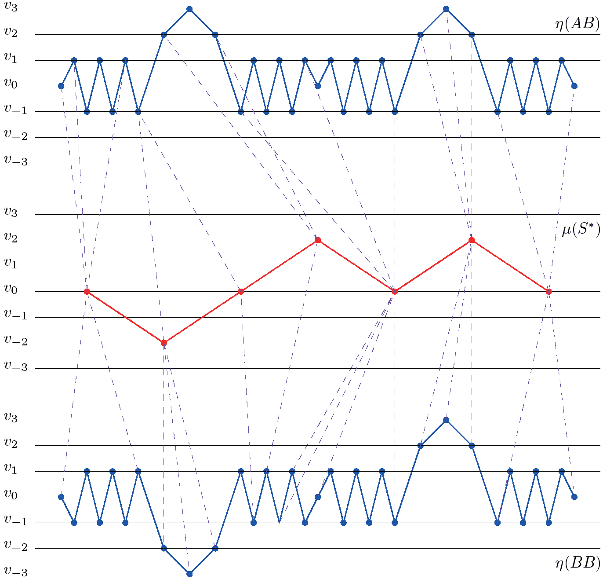

人们可能会问为什么在引理 19 中需要曲线 $\zeta(A^{a})$ 和 $\zeta(B^{b})$。下一个引理解答了这个问题。

**引理 20。** 若存在一对 $(a, b) \in \mathcal{I}[t]$ 使得 $(\mathcal{G} \cup \{\zeta(A^{a}), \zeta(B^{b})\}, 1)$ 是一个针对离散弗雷歇距离返回 TRUE 的无序中间曲线实例，则 $(\mathcal{S}, t)$ 是一个返回 TRUE 的 SCS 实例。

*证明。* 给定一对 $(a, b) \in \mathcal{I}[t]$，设 $\mu$ 为集合 $\mathcal{G} \cup \{\zeta(A^{a}), \zeta(B^{b})\}$ 在距离 1 处的一个无序中间曲线。我们构造一个代表曲线 $\mu$ 的序列，并证明每个 $S[i] \in \mathcal{S}$ 都是该序列的子序列。

我们观察到 `μ` 和 `ζ(A[a])` 之间存在一个匹配，该匹配实现了 `ddF(μ, ζ(A[a])) ≤ 1`。由于 `ζ(A[a])` 仅由顶点 `v[1]` 和 `v[−3]` 组成，且在 `ℝ` 中不存在到这两个顶点距离均至多为 1 的点，因此 `μ` 中的每个顶点只能匹配到 `ζ(A[a])` 中的一个顶点。由于在 `ζ(A[a])` 中任意两个 `v[−3]` 顶点之间都有一个 `v[1]` 顶点，`μ` 中的一个顶点最多只能匹配到 `ζ(A[a])` 中的一个 `v[−3]`。对于 `ζ(A[a])` 中的 `v[1]` 顶点也同理。因此 `μ` 中的每个顶点恰好匹配到 `ζ(A[a])` 中的一个顶点。类似地，`μ` 中的每个顶点也恰好匹配到 `ζ(B[b])` 中的一个顶点。

我们可以将 `μ` 的顶点划分为 `2a + 1` 个子集 `M[i]^(a)`，`i ∈ {1,…,2a+1}`，其中同一子集 `M[i]^(a)` 内的所有顶点都映射到 `ζ(A[a])` 中的第 `i` 个顶点（在实现 `ddF(μ, ζ(A[a]))` 的匹配中）。类似地，我们可以将 `μ` 的顶点划分为 `2b + 1` 个子集 `M[j]^(b)`，`j ∈ {1,…,2b+1}`（使用实现 `ddF(μ, ζ(B[b]))` 的匹配）。

我们将这些划分合二为一。我们将代表 `v[−3] ∈ ζ(A[a])` 的子集 `M[i]^(a)` 称为 **A-子集**，将代表 `v[3] ∈ ζ(B[b])` 的子集 `M[j]^(b)` 称为 **B-子集**。

我们注意到，`μ` 中不存在同时属于某个 A-子集和某个 B-子集的顶点，否则该顶点将同时到 `v[3]` 和 `v[−3]` 的距离至多为 1。我们将 A-子集和 B-子集纳入新的划分中（并称之为字母子集）。根据构造，共有 `a + b = t` 个字母子集。`μ` 中剩余的顶点——位于沿 `μ` 的第一个字母子集之前、最后一个字母子集之后，或两个字母子集之间——形成两两不相交的缓冲子集，从而与字母子集一起定义了 `μ` 顶点的一个划分。最多可以有 `t + 1` 个缓冲子集，因此构造的 `μ` 顶点划分中最多有 `2t + 1` 个子集。图 5.9 展示了这样一个划分的示例。

序列 `S[*]` 可以利用 `μ` 的构造划分来生成，方法是将 A-子集替换为字母 `A`，将 B-子集替换为字母 `B`。缓冲子集直接省略。序列 `S[*]` 的长度为 `t`。我们需要证明 `S[*]` 是 `𝒮` 中所有序列的超序列。

设 `S[i] ∈ 𝒮` 中的某个序列为 `η(S[i]) ∈ 𝒢` 其代表曲线。由于 `μ` 是 `𝒢 ∪ {ζ(A[i]), ζ(B[j])}` 在距离 1 处的中间曲线，存在 `η(S[i])` 和 `μ` 的一个匹配，实现 `ddF(η(S[i]), μ) ≤ 1`。在这个匹配中，某个 A-子集（`μ` 顶点划分中的）中的一个顶点不能匹配到两个不同字母工具（在 `η(S[i])` 中）中的顶点，因为分隔两个字母工具的缓冲工具包含顶点 `v[1]`，该顶点无法以距离至多 1 的方式匹配到 A-子集中的顶点。类似地，某个 B-子集中的一个顶点也不能匹配到两个不同字母工具中的顶点。

`η(S[i])` 中的每个字母 `A` 工具都包含顶点 `v[−3]`，它必须匹配到 `μ` 的某个 A-子集中的顶点（否则根据构造，它将到 `v[1]` 的距离至多为 1）。类似地，`η(S[i])` 中的每个字母 `B` 工具都包含顶点 `v[3]`，它必须匹配到某个 B-子集中的顶点。因此 `η(S[i])` 中的每个字母工具都与 `μ` 中的一个字母子集一一对应，且 `η(S[i])` 中字母工具的序列对应于 `μ` 中字母子集的序列。因此 `S[i]` 是 `S[*]` 的子序列，正如所声称的。


引理 19 和引理 20 展示了一个从 SCS 问题（已知为 **NP-hard**）到（每种变体的）MIDDLE CURVE 问题的有效归约。给定 SCS 实例 $(\mathcal{S}, t)$，对于一对 $(a, b) \in \mathcal{I}[t]$，MIDDLE CURVE 实例 $(\mathcal{G} \cup \{\zeta(A^{a}), \zeta(B^{b})\}, 1)$ 可以在输入规模的线性时间内构造。由于对于给定长度为 $t$ 的超序列，可能的配对 $(a, b) \in \mathcal{I}[t]$ 的数量在 $t$ 中是线性的，因此不同的 MIDDLE CURVE 实例数量也是 $t$ 的线性函数。因此该归约可以在 SCS 实例输入规模的多项式时间内计算。因此，对于离散 Fréchet 距离，以下定理成立。

**定理 21。** 对于离散和连续 Fréchet 距离，MIDDLE CURVE 问题的每种变体均为 **NP-hard**。

与 Buchin 等人 [[95]](#backmatter-001.xhtml#b_9783110785944-010_ref_095) 的证明类似，针对离散 Fréchet 距离所示的归约可以改编以证明定理 21 对连续 Fréchet 距离同样成立。引理 22 和引理 23 分别取代了引理 19 和引理 20。其余证明原文照搬。

**引理 22。** 若 $(\mathcal{S}, t)$ 为返回 TRUE 的 SCS 实例，则存在一对 $(a, b) \in \mathcal{I}[t]$ 使得 $(\mathcal{G} \cup \{\zeta(A^{a}), \zeta(B^{b})\}, 1)$ 为连续 Fréchet 距离下返回 TRUE 的 RESTRICTED MIDDLE CURVE 实例。

*证明。* 给定返回 TRUE 的 SCS 实例 $(\mathcal{S}, t)$，引理 19 蕴含存在一对 $(a, b) \in \mathcal{I}[t]$，使得对于其证明中构造的受限中间曲线 $\mu = \mu(S^{\star})$，有 $d_{dF} \le 1$ 对所有 $\tau \in \mathcal{G} \cup \{\zeta(A^{a}), \zeta(B^{b})\}$ 成立。由于离散 Fréchet 距离是连续 Fréchet 距离的上界，我们有 $d_{F} \le d_{dF} \le 1$ 对所有 $\tau \in \mathcal{G}\cup\{\zeta(A^{a}), \zeta(B^{b})\}$ 成立。这意味着 $\mu$ 也是连续 Fréchet 距离下的受限中间曲线。


**引理 23。** 若存在一对 $(a, b) \in \mathcal{I}[t]$ 使得 $(\mathcal{G}\cup\{\zeta(A^{a}), \zeta(B^{b})\}, 1)$ 为连续 Fréchet 距离下返回 TRUE 的 UNORDERED MIDDLE CURVE 实例，则 $(\mathcal{S}, t)$ 为返回 TRUE 的 SCS 实例。

*证明。* 给定一对 $(a, b) \in \mathcal{I}[t]$，设 $\mu$ 为集合 $\mathcal{G} \cup \{\zeta(A^{a}), \zeta(B^{b})\}$ 在距离 1 处的无序中间曲线。我们将引理 20 的证明改编为连续情况。由于 $d_{F}(\mu, \zeta(A^{a})) \le 1$，曲线 $\mu$ 上必须存在一个点 $q_{a}$，它到 $\zeta(A^{a})$ 中的顶点 $v_{-3}$ 的距离至多为 1，针对每个这样的顶点均成立。因此 $q_{a} \in [-2, -3]$。但由于 $d_{F}(\mu, \zeta(B^{b})) \le 1$，$\zeta(B^{b})$ 上必须存在一个点到 $q_{a}$ 的距离至多为 1，因此这样的点位于 $[-2, -1]$ 中。由于 $\zeta(B^{b})$ 上的所有点都位于 $[-1, 3]$ 中，这蕴含该点必须恰好位于 $-1$ 处，因此 $q_{a} = v_{-2}$。我们称该点为 $\mu$ 的一个 A-子集。曲线 $\mu$ 可能在 $v_{-2}$ 处包含若干连续顶点，在这种情况下，由这些顶点定义的整条子曲线即为 $\mu$ 的一个 A-子集。类似地，我们得出结论：对于每个 $v_{3} \in \zeta(B^{b})$，存在一个点 $v_{2} \in \mu$，并称其为 $\mu$ 的一个 B-子集。


同引理 20 一样，我们将曲线 `μ` 划分为 `2a + 1` 条（或 `2b + 1` 条）子曲线（子集）`M[i]^(a)`，`i ∈ {1,…,2a+1}`（或 `M[j]^(b)`，`j ∈ {1,…,2b+1}`）。若对它们编号，偶数索引的子曲线为 `μ` 的 A-子集（相应地为 B-子集），而 `μ` 的其余部分定义了奇数索引的子曲线。同样，我们将这两个 `μ` 的划分合二为一，因为 `μ` 上的任何点不能同时属于 A-子集和 B-子集。序列 `S[*]` 通过将 `μ` 中的每个字母子集替换为相应字母来构造。

引理 20 的其余证明部分成立，因为对于每个 `S[i] ∈ 𝒮` 以及实现 `d[F]` 的匹配 (`η(S[i])`, `μ`) ≤ 1，`μ` 中某个 `A`-子集中的顶点不可能被映射到 `η(S[i])` 中两个不同字母 `B` 小工具里的顶点 `v[−3]`，且 `η(S[i])` 中的每个顶点 `v[−3]` 都必须被映射到某个 `A`-子集中的顶点。对于 `B`-子集也可以提出类似的论断。`η(S[i])` 中的字母小工具与 `μ` 中的字母子集之间存在一一对应关系，因此 `S[i]` 是 `S[*]` 的子序列。


利用定理 21，我们现在可以证明 MIDDLE CURVE 判定问题每个变体的 **NP** 完全性。给定一个包含 `n` 条复杂度为 `m` 的曲线的 MIDDLE CURVE 实例 (`𝒫`, `δ`)，我们非确定性地猜测一条复杂度为 `ℓ` 的中间曲线 `μ`。我们可以利用 Alt 和 Godau [[14]](#backmatter-001.xhtml#b_9783110785944-010_ref_014) 的算法（针对连续 Fréchet 距离）以及 Eiter 和 Mannila [[197]](#backmatter-001.xhtml#b_9783110785944-010_ref_197) 的算法（针对离散 Fréchet 距离），在 `O(mℓ)` 时间内判定 `μ` 与曲线 `τ ∈ 𝒫` 之间的 Fréchet 距离是否至多为 `δ`。我们注意到，Alt 和 Godau [[14]](#backmatter-001.xhtml#b_9783110785944-010_ref_014) 的算法需要稍作修改，因为它使用的是随机存取机而非图灵机，这允许在常数时间内计算平方根。但通过比较平方根的平方来比较距离是可行的，因此这为 UNORDERED MIDDLE CURVE 问题产生了一个非确定性 `O(nmℓ)` 时间算法。

为了判定 ORDERED MIDDLE CURVE 问题，有必要将中间曲线与输入曲线进行比较，这可以在 `O(nm)` 时间内完成。对于受限的 RESTRICTED MIDDLE CURVE 问题，必须知道对应于 Fréchet 距离 ≤ `δ` 的匹配。该匹配是 Alt 和 Godau [[14]](#backmatter-001.xhtml#b_9783110785944-010_ref_014) 的判定算法的结果。给定该匹配，可以在 `O(m + ℓ)` 时间内检查某个顶点是否匹配到其自身。这产生了以下定理。

**定理 24。** *对于离散或连续 Fréchet 距离，MIDDLE CURVE 问题的每个变体均为* **NP** *完全。*

### 5.2.4 延伸阅读

在本小节中，我们引用了源自 CRC876-A2 的其他理论聚类结果以供延伸阅读，这些结果与本节主题相关。

Driemel 和 Krivošija [[184]](#backmatter-001.xhtml#b_9783110785944-010_ref_184) 研究了通过随机投影将 Fréchet 距离嵌入低维空间时，曲线信息损失与计算资源节省之间的关系。Fréchet 距离的概念可以推广到图和曲面。Buchin 等人 [[99]](#backmatter-001.xhtml#b_9783110785944-010_ref_099) 给出了计算树之间 Fréchet 距离的算法。

如果定义曲线的点 `w[1], ..., w[m] ∈ ℝ[d]`（按其索引顺序作为顶点观察时）被这样观察：它们定义了 `ℝ[d]` 中有限数量位置上点可能出现的离散分布，那么我们就得到了概率点聚类。在这里，聚类中心的质量是在随机输入上按期望来评估的。特别地，对于概率 1-center 聚类问题（最小包围球），之前最好的算法是 Munteanu 等人 [[218]](#backmatter-001.xhtml#b_9783110785944-010_ref_218) 的 PTAS，其运行时间随点数呈线性，但随环境空间维度 `d` 呈指数级增长。Krivošija 和 Munteanu [[402]](#backmatter-001.xhtml#b_9783110785944-010_ref_402) 利用随机技术和次梯度下降技术的新颖组合，将对 `d` 的依赖降低到了线性。这进一步使得该方法能应用于 SVDD 问题的概率版本，并扩展到甚至无限大环境维度的核空间。

与 1-center 聚类问题相关，Bury 和 Schwiegelshohn [[102]](#backmatter-001.xhtml#b_9783110785944-010_ref_102) 研究了集合相似性 Jaccard 中心问题，其输入包含一个集合族。他们证明了该问题是 **NP** 难的，并给出了一个 PTAS。

如果输入曲线仅为单例点，那么我们就得到了 `ℝ[d]` 中的欧几里得 `k`-聚类问题。一条关于 `k`-median 的 (1 + `ε`)-近似算法的研究路线基于强核集（连同 Kumar 等人 [[405]](#backmatter-001.xhtml#b_9783110785944-010_ref_405) 的框架，参见第 5.2.2 小节）。此前 Feldman 和 Langberg [[217]](#backmatter-001.xhtml#b_9783110785944-010_ref_217) 已知的最小强核集规模仍依赖于维度 `d`：其规模为 `O((dk log k)/ε[2])`，这导致 `k`-median 算法的总运行时间为 `O(nd + 2[poly(k,1/ε)])`。Sohler 和 Woodruff [[636]](#backmatter-001.xhtml#b_9783110785944-010_ref_636) 给出了规模与维度无关的欧几里得 `k`-median 强核集：`O((k[2] log k)/ε[4])`。这些核集可在 `Õ((n + d)poly(k/ε) + exp(poly(k/ε)))` 时间内计算。在 Sohler 和 Woodruff [[636]](#backmatter-001.xhtml#b_9783110785944-010_ref_636) 的结果之后，`k`-median 强核集规模的界进一步降低，最近的改进是 Cohen-Addad、Saulpic 和 Schwiegelshohn [[149]](#backmatter-001.xhtml#b_9783110785944-010_ref_149) 的新框架，该框架适用于多种设置。对于欧几里得 `k`-median 问题，最优已知核集规模为 `O((k log k)/ε[3])`，这接近 `Ω(k/ε[2])` 的下界。这两个结果均由 Cohen-Addad 等人 [[148]](#backmatter-001.xhtml#b_9783110785944-010_ref_148) 给出。

对于 `k`-means 问题，Feldman、Schmidt 和 Sohler [[219]](#backmatter-001.xhtml#b_9783110785944-010_ref_219) 给出了一种将强核集规模缩减为与输入空间维度 `d` 无关的常数规模的方法。Cohen-Addad 和 Schwiegelshohn [[150]](#backmatter-001.xhtml#b_9783110785944-010_ref_150) 在 *beyond-worst-case*（超越最坏情况）场景下研究了经典的 `k`-median 和 `k`-means 问题。他们为稳定输入实例给出了基于局部搜索的 PTAS，适用于这两个问题。Becchetti 等人 [[45]](#backmatter-001.xhtml#b_9783110785944-010_ref_045) 表明，`k`-means 聚类代价的 (1+`ε`)-近似可以通过数据无关的随机投影到大约 `Õ((log k + log log n)/ε[6])` 维，以及通过数据相关的随机投影到大约 `Õ(log k/ε[4])` 维来获得。

如果输入点不是同时释放，而是逐个释放，那么我们就处于流式设置中。对于离散欧几里得空间中动态流式场景下的 `k`-median 问题，Braverman 等人 [[70]](#backmatter-001.xhtml#b_9783110785944-010_ref_070) 给出了 `O(dk/ε[2])` 空间/时间算法。此前所有算法所需的空间/时间均随维度 `d` 呈指数级增长。Cohen-Addad、Schwiegelshohn 和 Sohler [[151]](#backmatter-001.xhtml#b_9783110785944-010_ref_151) 在滑动窗口流式场景下研究了一般度量空间中的直径和 `k`-center 问题，并给出了首个常数因子近似算法。Fichtenberger 等人 [[228]](#backmatter-001.xhtml#b_9783110785944-010_ref_228) 基于核集和著名的 BIRCH 算法，设计了一个在实践中效果良好的 `k`-means 问题高效数据流算法。


图 5.9 中间曲线 `μ`（黑色）与曲线 `ζ(A1)`（蓝色）和 `ζ(B2)`（红色）之间的一种可能匹配。**(a)**：基于 `ζ(A1)` 和 `ζ(B2)` 的 `μ` 的单独映射和划分（分别为蓝色和红色方框）。**(b)**：`μ` 的组合划分。字母部分为铺砖紫色（`A` - 上升，`B` - 下降铺砖），缓冲部分为灰色。

## 5.3 用于层次聚类的数据聚合

*Erich Schubert*

*Andreas Lang*

**摘要：** 层次凝聚聚类（HAC）很可能是最早且最灵活的聚类方法，因为它可以与许多距离、相似度以及各种链接策略一起使用。当数据集形成的聚类数量未知且数据中存在某种层次结构似乎合理时，通常会使用它。大多数 HAC 算法在完整距离矩阵上运行，因此需要平方级内存。标准算法生成完整层次结构还需要立方级运行时间。内存和运行时间在嵌入式或其他资源极其受限的系统中尤为成问题。在本节中，我们将介绍如何使用 BETULA 进行数据聚合——一种众所周知的 BIRCH 数据聚合算法的数值稳定版本——使 HAC 能够在资源受限的系统上运行，且聚类质量仅有微小损失，从而允许对超大数据集进行探索性数据分析。

### 5.3.1 简介

层次凝聚聚类（HAC）是一种流行的聚类方法，当数据集中存在聚类层次结构时特别有用。最初，每个数据条目被视为一个单元素聚类。在每个层次级别，距离最近的两个聚类（参见 5.3.2 节）被合并，直到整个数据集位于一个聚类中。另一个常用名称“简单凝聚层次嵌套”（SAHN）反映了这一易于理解的核心思想。用于 HAC 的标准算法称为 AGNES [[364]](#backmatter-001.xhtml#b_9783110785944-010_ref_364)，要求所有数据点之间的成对距离存储在距离矩阵中，并且在合并聚类时，使用 Lance-Williams 方程 [411, 412] 合并该矩阵中的两列和两行。AGNES 可以与不同的主要距离函数一起使用，也可以与不同的聚类距离（通常称为链接）一起使用，请参见 5.3.2 节。层次凝聚聚类与许多其他聚类方法一样，是一个相当消耗资源的过程，通常使用 `O(N²)` 内存和 `O(N²)` 到 `O(N³)` 时间来实现，具体取决于所实现的确切算法。减少大数据或使用小型嵌入式系统时资源需求的一种可能性是数据聚合。BIRCH（利用层次结构的平衡迭代缩减和聚类）[737, 738] 算法是一种著名的用于聚类的数据聚合技术。BIRCH 是一种多步聚类算法，它在实际聚类之前将数据聚合到一种称为 CF 树的树结构中。我们将首先回顾层次聚类的一些基础知识，然后讨论 BIRCH 的一个改进版本，称为 BETULA [413, 414]，它避免了原始 BIRCH 中的一些数值问题。然后我们将展示如何利用它来加速大数据的 HAC，并降低其内存需求。

### 5.3.2 层次聚类链接

因为层次凝聚聚类基于始终合并两个最近聚类的思想，所以我们需要定义聚类之间的合适距离，而不仅仅是单个点之间的距离。通常，我们希望该距离与单个点之间的距离保持一致。这种“聚类距离”的概念通常称为“链接”准则。链接的选择极大地影响生成的聚类外观，但也影响可使用的算法。

两种最广为人知的链接策略是单链接和全链接，其中两个聚类的距离被定义为任意两点之间的最小距离或最大距离。然而，文献中还提出了许多其他链接，许多可以追溯到 1950 年代，例如由 McQuitty [[482]](#backmatter-001.xhtml#b_9783110785944-010_ref_482)、Sneath [[634]](#backmatter-001.xhtml#b_9783110785944-010_ref_634)、Sokal 和 Sneath [[638]](#backmatter-001.xhtml#b_9783110785944-010_ref_638) 以及 Wishart [[707]](#backmatter-001.xhtml#b_9783110785944-010_ref_707) 提出。较新的提议包括 Mini-Max [[19]](#backmatter-001.xhtml#b_9783110785944-010_ref_019) 和类中心链接 [307, 499, 613]。几种（但并非所有）链接可以用 Lance-Williams 递推公式 [411, 412] 来表示，这提供了计算优势。WPGMA（McQuitty）和 WPGMC（中位数链接）只能用递推公式定义，没有仅基于点集的闭式解。Lance-Williams 公式如下：

(5.11) `d(A∪B,C)=α[A]d(A,C)+α[B]d(B,C)+βd(A,B)+γ|d(A,C)−d(B,C)|`

不同的链接策略可以用因子 `α[A]`、`α[B]`、`β` 和 `γ` 来定义，如表 5.5 所示。这些因子可能取决于聚类 `A`、`B` 和 `C` 的大小，我们将其表示为 `n[A]`、`n[B]` 和 `n[C]`。为简洁起见，我们使用简写 `n[AB] := n[A∪B] = n[A]+n[B]`，和 `n[ABC] := n[A∪B∪C] = n[A]+n[B]+n[C]`。一个额外的——且经常被忽视的——细节是距离矩阵的初始化。虽然单链接、全链接和组平均链接适用于任何距离，但类心链接、Ward 链接和中位数链接方法需要用平方距离进行初始化，并与欧几里得距离和方差紧密相关。忽略这一初始化差异（以及对输出的解释）很容易导致错误的结果 [[521]](#backmatter-001.xhtml#b_9783110785944-010_ref_521)。考虑聚类的目标函数以及公式 5.12 到 5.14 中的闭式解，原因就变得显而易见了。首先考虑单链接（通过将 min 替换为 max，即可得到全链接）。其目的是合并其点之间距离最小的聚类 `A` 和 `B`，即具有最小 `dsingle := min[a∈A,c∈C] d(a, c)` 的聚类。如果两个聚类都由单个元素组成，我们显然有 `dsingle = d(a, c)`，并且可以使用 `dsingle = min{dsingle, dsingle}` 递归计算此链接。很容易看出，表 5.5 中给出的权重对应于使用最小值或最大值。

#### 表 5.5 Lance-Williams 因子形式的常见链接

| 链接 | `α[A]` | `α[B]` | `β` | `γ` | 初始化 |
| :--- | :--- | :--- | :--- | :--- | :--- |
| 单链接 | 1/2 | 1/2 | 0 | −1/2 | `d(a, b)` |
| 全链接 | 1/2 | 1/2 | 0 | 1/2 | `d(a, b)` |
| 组平均 (UPGMA) | `n_A / n_AB` | `n_B / n_AB` | 0 | 0 | `d(a, b)` |
| McQuitty (WPGMA) | 1/2 | 1/2 | 0 | 0 | `d(a, b)` |

#### 表 5.5（续）：聚类链接方法的递推公式参数

| 方法 | `α_A` | `α_B` | `β` | `γ` | 初始距离 |
| :--- | :--- | :--- | :--- | :--- | :--- |
| Centroid (UPGMC) | `n_A / n_AB` | `n_B / n_AB` | `-n_A * n_B / n_AB²` | 0 | `d(a, b)²` |
| Median (WPGMC) | 1/2 | 1/2 | −1/4 | 0 | `d(a, b)²` |
| Ward | `n_AC / n_ABC` | `n_BC / n_ABC` | `-n_C / n_ABC` | 0 | `d(a, b)²` |


# 组平均链接

组平均链接，也称为**算术平均无权成对分组法**（Unweighted Pair Group Method with Arithmetic mean，UPGMA），是另一种非常直观的链接方法，在实践中常被认为是最好的选择之一。其思想是捕获不同簇中元素之间的平均距离，即：

$$d_{\text{avg}}(A,C) := \frac{1}{n_A n_C} \sum_{a \in A} \sum_{c \in C} d(a,c)$$

显然，对于单元素簇，有 $d_{\text{avg}}(\{a\}, \{c\}) = d(a, c)$。递推计算公式易于推导：

$$

\begin{array}{l}

d_{\text{avg}}(A \cup B, C) = \frac{1}{n_{AB} n_C} \left( \sum_{a \in A} \sum_{c \in C} d(a,c) + \sum_{b \in B} \sum_{c \in C} d(b,c) \right) \\

\quad = \frac{1}{n_{AB} n_C} \left( n_A n_C d_{\text{avg}}(A,C) + n_B n_C d_{\text{avg}}(B,C) \right) \\

\quad = \frac{n_A}{n_{AB}} d_{\text{avg}}(A,C) + \frac{n_B}{n_{AB}} d_{\text{avg}}(B,C) \qquad (5.12)

\end{array}

$$

术语“weighted”（可追溯至 Sokal and Sneath [634, 638]）容易引起混淆：它指的是每个点所拥有的影响力。在“unweighted”组平均法中，每个*对象*具有相同的权重（因此每个簇的权重与其包含的对象数量成正比）；而在“weighted”版本（即 McQuitty 和 Median 链接）中，每个*簇*具有相同的权重（因此较大簇中的每个对象权重会降低）。正如表 5.5 所示，如果我们将簇大小固定为常数 $n_A = n_B := 1$（即合并时忽略簇大小），两种“weighted”版本均对应其“unweighted”对应版本。

McQuitty 的**算术平均加权成对分组法**（Weighted Pair-Group Method with Arithmetic mean，WPGMA [[482]](#backmatter-001.xhtml#b_9783110785944-010_ref_482)）可递归定义为：

$$d_{\text{McQ}}(A \cup B, C) = \frac{1}{2} \left( d_{\text{McQ}}(A,C) + d_{\text{McQ}}(B,C) \right)$$

这引入了一个不幸的依赖，即依赖于子簇 $A$ 和 $B$ 的“合并历史”。给定三个对象 $a, b, c$，先合并 $a$ 和 $b$ 再与 $c$ 合并，可能产生与先合并其他对不同的结果。类似的论证也适用于下文讨论的 median linkage (WPGMC)。

**基于质心的无权成对分组法**（Unweighted Pair-Group Method using Centroids，UPGMC），也称为 centroid linkage，通过簇均值的距离来合并簇：

$$\mu_A = \frac{1}{|A|} \sum_{x \in A} x$$

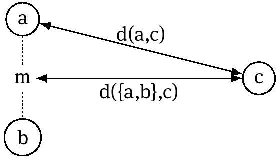

**图 5.10** 示例说明为何 median 和 centroid 链接是非单调的：合并簇 $\{a, b\}$ 的中点 $m$ 比其簇成员 $a$ 和 $b$ 中的任意一个都更接近 $c$。

即它总是合并最小的 $d_{\text{cent}}(A, C) = \|\mu_A - \mu_C\|$。显式计算均值间的距离需要大量额外的距离计算，因此比递推方法更慢且资源效率更低。但均值、方差和平方欧氏距离之间存在一种特殊关系，我们可以利用它通过递推优雅地计算这一特殊情况。我们不失一般性地仅针对单变量数据讨论这一关系，因为平方欧氏距离仅仅是平方变量的和。我们有：

$$\|\mu_A - \mu_C\|² = \mu_A² + \mu_C² - 2\mu_A\mu_C$$

并得到：

$$

\begin{array}{l}

d_{\text{cent}}(A \cup B, C) = \frac{n_A}{n_{AB}} d_{\text{cent}}(A,C) + \frac{n_B}{n_{AB}} d_{\text{cent}}(B,C) - \frac{n_A n_B}{n_{AB}²} d_{\text{cent}}(A,B) \\

\quad = \mu_{AB}² + \mu_C² - 2\mu_{AB}\mu_C = \|\mu_{AB} - \mu_C\|² \qquad (5.13)

\end{array}

$$

这意味着对于平方欧氏距离，我们可以在不计算均值本身的情况下计算均值间的距离。因此，我们需要用平方欧氏距离初始化距离矩阵，并将最终的链接距离解释为这些平方值。

Median linkage（或**基于质心的加权成对分组法**，Weighted Pair-Group Method using Centroids，WPGMC）的思想是最小化中位数的距离 $\|m_{A \cup B} - m_C\|$，其中中位数递归定义为：

$$m_{A \cup B} = \frac{1}{2} (m_A + m_B)$$

即前两个中位数的中点。对于平方欧氏距离，我们同样有递推公式：推导过程与 centroid linkage 完全相同，但固定 $n_A = n_B = 1$。Median linkage 和 centroid linkage 有一个怪癖：距离 $d(A \cup B, C)$ 可能小于 $d(A, C)$，这会产生非单调的树状图。如果我们绘制一棵表示簇合并的树，并用链接距离作为分支的高度，生成的树不会单调增长。树中的此类异常也称为 inversions（逆序），仅当链接不具备 Bruynooghe 的可约性质 [[89]](#backmatter-001.xhtml#b_9783110785944-010_ref_089) 时才会存在。直观上，当新中心位于两个间隔良好的簇之间，且比这两个簇中的任意一个都更接近第三个簇时，就会发生这种情况，如图 5.10 所示。这可能导致不良结果，因此应谨慎使用这些链接方法。

流行的 Ward linkage 优化以下准则 [[16, 364, 707]](#backmatter-001.xhtml#b_9783110785944-010_ref_016)：

$$d_{\text{Ward}}(A,B) = \frac{2 n_A \cdot n_B}{n_{AB}} \|\mu_A - \mu_B\|² \qquad (5.14)$$

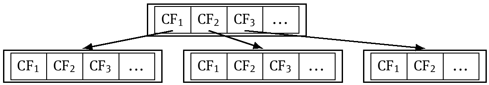

**图 5.11** CF-Tree 的基本结构

该方程中的因子 2 确保了 `dWard = a, b[2]`，这正是单元素簇所期望的。该准则可描述为“平方和的最小增加” [\[582\]](#backmatter-001.xhtml#b_9783110785944-010_ref_582)，考虑到该方程仅使用均值，且似乎不包含平方和，这可能会让人感到惊讶。读者可能已经注意到，`k`-means 聚类也最小化平方和。此处的主要区别在于，Ward 连接在结果上施加了层次结构，而 `k`-means 则施加了扁平的划分，分成 `k` 个分区。通常，在 `k` 个分区处切割 Ward 连接的结果会比 `k`-means 差（通常差距很大）（关于类似 medoid 连接情况的一致性原因，参见 Schubert [\[613\]](#backmatter-001.xhtml#b_9783110785944-010_ref_613)），但不同 `k` 值的 `k`-means 结果通常不会嵌套成簇的层次结构。方程 5.14 可通过 König-Huygens 定理重写平方和的增加而获得：

```
\begin{array}{l} {d_{\text{Ward~}}\left( {A,B} \right) = {\sum\limits_{x \in A \cup B}\left\| {x - \mu_{AB}} \right\|^{2}} - {\sum\limits_{a \in A}\left\| {a - \mu_{A}} \right\|^{2}} - {\sum\limits_{b \in B}\left\| {b - \mu_{B}} \right\|^{2}}} \\ {\,\,\,\,\,\,\,\,\,\,\,\,\,\,\,\,\,\,\,\,\,\,\,\,\,\,\,\,\,\,\,\,\,\,\,\,\,\,\,\,\,\,\,\,\,\,\,\,\,\,\,\, = \frac{2n_{A}n_{B}}{n_{AB}}\left\| {\mu_{A} - \mu_{B}} \right\|^{2}} \\ \end{array}
```

Tab. 5.5 中给出的 Lance-Williams 递推公式如下（完整推导省略）：

```
\begin{array}{l} {d_{\text{Ward~}}\left( {A \cup B,C} \right) = \frac{2n_{AB}n_{C}}{n_{ABC}}\left\| {\mu_{AB} - \mu_{C}} \right\|^{2} = \frac{2n_{AB}n_{C}}{n_{ABC}}\left\| {\frac{n_{A}}{n_{AB}}\mu_{A} + \frac{n_{B}}{n_{AB}}\mu_{B} - \mu_{C}} \right\|^{2}} \\ {\,\,\,\,\,\,\,\,\,\,\,\,\,\,\,\,\,\,\,\,\,\,\,\,\,\,\,\,\,\,\,\,\,\,\,\,\,\,\,\,\,\,\,\,\,\,\,\,\,\,\,\,\,\,\,\,\,\,\,\,\,\,\,\,\,\,\,\,\,\, = \frac{n_{AC}}{n_{ABC}}d_{\text{Ward~}}\left( {A,C} \right) + \frac{n_{BC}}{n_{ABC}}d_{\text{Ward~}}\left( {B,C} \right) - \frac{n_{C}}{n_{ABC}}d_{\text{Ward~}}\left( {A,B} \right)} \\ \end{array}
```

## 5.3.3 簇特征树（CF-Tree）

我们现在简要介绍改进版 BETULA 的 CF-Tree \[413, 414\]，它提高了原始 BIRCH CF-Tree \[737, 738\] 的数值精度。

CF-Tree（簇特征树）是一种存储簇特征（CF）的基本高度平衡树。每个 BETULA 簇特征 [\[414\]](#backmatter-001.xhtml#b_9783110785944-010_ref_414) 是一个三元组

(5.15) CF : = (n, μ, SSE)

其中在该语境下 `n` 是数据点的数量或其聚合权重，`μ` 表示均值向量，SSE 是偏离均值的平方和。两个 BETULA 簇特征可以高效地合并为一个：

(5.16) n[AB] = n[A] + n[B]

(5.17) μ_AB = μ_A + (n_B / n_AB)(μ_B - μ_A) (5.17)

(5.18) SSE[AB] = SSE[A] + SSE[B] + nB(μ[B]−μ[AB])。

单个数据点 `x` 可以用簇特征 (1, x, 0) 简单表示。这些规则也源自 König-Huygens 定理，可在 Lang 和 Schubert [\[413\]](#backmatter-001.xhtml#b_9783110785944-010_ref_413) 中找到。原始 BIRCH 方法的数值不准确性此前已被 Schubert 和 Gertz [\[614\]](#backmatter-001.xhtml#b_9783110785944-010_ref_614) 观察到。

CF-Tree 是一棵高度平衡树：每个叶节点都是一个代表数据点的簇特征。内部节点存储其子节点的聚合信息。该树通过顺序插入所有数据点来构建。当向树中添加数据点或簇特征时，通过遍历树并在每一层选择距离最近的节点来插入。当到达叶条目时，如果不违反吸收阈值（参见 5.3.4 节），则将数据添加到该叶条目。如果数据无法添加到现有的叶条目，则生成一个新的叶条目。阈值可基于专家输入设定，从而生成大小可变但具有固定精度保证的树。但因为我们也可以以相同方式向 CF-Tree 添加簇特征，所以一旦达到选定的最大叶条目数，我们就可以用增加的阈值从其叶条目动态重建树，以减少树的内存使用量。在这种情况下，树在固定大小范围内构建，但精度可变，这对于存在内存资源限制的场景很有利。

## 5.3.4 簇特征的距离

Zhang 等人 \[737, 738\] 最初为 BIRCH 簇特征提出了几种距离函数和吸收准则。两者本质上都度量一种距离，但距离函数用于选择插入子树，而吸收准则用于决定何时添加到现有节点，或何时创建新节点。正如 Lang 和 Schubert [\[414\]](#backmatter-001.xhtml#b_9783110785944-010_ref_414) 所建议的，我们在下文中不区分距离和吸收准则，因为这样做没有好处。

欧氏距离：

(5.19) D0(A,B) = ∥μ[A]−μ[B]∥

曼哈顿距离：

(5.20) D1(A, B) = ∥μ[A]−μ[B]∥[1]

簇间距离：

(5.21) D2(A,B) = √(1/(n_A n_B) ∑_{x ∈ A} ∑_{y ∈ B} ∥x - y∥²) (5.21)

表 5.6 用于（平方）欧氏距离的连接策略及相应的 BIRCH 距离及其目标函数。

| 连接方式 | 闭式解 | BIRCH 距离 |
| --- | --- | --- |
| UPGMA | (1/(n_A n_B)) ∑_{x ∈ A} ∑_{y ∈ B} ∥x - y∥² | D2² |
| UPGMC | μA − ‖μB‖ | D0² |
| Ward | (2 n_A n_B / n_AB) ∥μ_A - μ_B∥² | 2 · D4² |

簇内距离（= 直径吸收准则）：

(5.22) D3(A,B) = √(1/(n_AB (n_AB - 1)) ∑_{x,y ∈ AB} ∥x - y∥²) (5.22)

方差增加距离：

(5.23) D4(A,B) = √(∑_{x ∈ AB} ∥x - μ_AB∥² - ∑_{x ∈ A} ∥x - μ_A∥² - ∑_{x ∈ B} ∥x - μ_B∥²) (5.23)

半径吸收准则：

(5.24) R(A,B) = √(1/n_AB ∑_{x ∈ AB} ∥x - μ_AB∥²) (5.24)

这些距离可以基于存储在 `BETULA` 簇特征中的摘要统计量高效计算。相应的方程及其推导见 Lang 和 Schubert [\[413\]](#backmatter-001.xhtml#b_9783110785944-010_ref_413) 的文献。

## 5.3.5 基于簇特征的层次聚类

虽然 `CF-Tree` 本身是一种层次聚类形式，但其层级和内部结构并非易于解释的形式。因此，它通常仅用于数据聚合，作为实际聚类的准备工作，此时仅使用叶节点条目。一种朴素的方法是直接使用叶节点条目的中心，并应用标准的层次聚类算法。这种方法丢弃了簇特征的方差信息。

现在的一个有趣观察是，链接策略和 `CF` 距离并没有太大区别。我们将展示，文献中已知的某些链接策略与 `BIRCH` 距离及其相应的目标函数之间存在对应关系，这种关系可以被用于聚类，即在仅使用中心之外，还结合了存储在簇特征中的额外信息。在 表 5.6 中，我们总结了已识别的链接策略与 `BIRCH` 距离及其各自目标函数之间的关系。最明显的相似性体现在质心欧氏距离（`D0`，公式 5.19）和质心链接（公式 5.13）上，二者几乎相同。Ward 链接（公式 5.14）与方差增大距离（`D4`，公式 5.23）的区别仅在于符号表示，以及 `D4` 的平方等于 Ward 距离，但由于 `BETULA` 出于计算原因内部使用平方距离，这一差异微不足道。最后一个可表示为 `BETULA` 距离的链接策略是 `UPGMA`，它实际上是平方簇间距离（`D2`，公式 5.21）。当用平方欧氏距离的 `UPGMA` 通用方程替换时，这种相显而易见：

(5.25) $d\_{\text{UPGMA}}\left( {A,B} \right) = \frac{1}{n\_{A} \cdot n\_{B}}{\sum\_{a \in A}{\sum\_{b \in B}d}}\left( {a,b} \right)\left( 5.25 \right)$

(5.26) $= \frac{1}{n\_{A} \cdot n\_{B}}{\sum\_{a \in A}{\sum\_{b \in B}\left\| a - b \right\|^{2}}}.\left( 5.26 \right)$

虽然 `WPGMA` 无法找到完全匹配，但由于它们之间的密切关系，我们仍可分别选择 `D2` 和 `D0` 作为其相应的“非加权”对应形式。利用这一知识，我们现在可以通过基于簇特征间对应距离计算距离矩阵，利用 Lance-Williams 公式，有意义地从簇特征过渡到层次聚类。


我们也可以采取相反的做法，不使用经典的链接策略，而是对簇特征执行以下层次聚类改进，同时使用 5.3.4 节中的距离函数，而不是单独的链接策略。与标准层次聚类（如 `AGNES`）一样，我们在距离矩阵中寻找最小的非对角值，以确定下一步最佳合并。但我们不使用 Lance-Williams 方程组合距离，而是可以使用更新公式 5.16 至 5.18 组合相应的两个簇特征，并针对新的 `CF` 计算新距离。

对于这两种情况（Lance-Williams 和 `CF` 距离），我们都可以使用 Anderberg [[16]](#backmatter-001.xhtml#b_9783110785944-010_ref_016) 和 NN-chain [[520]](#backmatter-001.xhtml#b_9783110785944-010_ref_520) 方法进行加速。前者虽不改善 *O*(|*CF*|³) 的最坏情况复杂度，但实际运行时间通常更接近二次方。后者对于不可约距离（参见 [[89]](#backmatter-001.xhtml#b_9783110785944-010_ref_089)，质心链接和中位数链接）可能产生不同结果，但保证 *O*(|*CF*|²) 的运行时间；此外，对于某些链接策略，它可以仅用线性内存实现。由于 `CF-Tree` 允许我们将数据缩减为小于 $O\left( \sqrt{N} \right)\text{~or~}O\left( \sqrt[3]{N} \right)$（视情况而定）的常数数量的簇特征，我们随后可以在与原始数据输入规模 *N* 成线性的时间内、且在常数内存限制下执行层次聚类，这使得该方法适用于资源受限的数据处理。

### 5.3.6 实验

我们评估了使用和不使用 `BETULA` 簇特征的层次聚类。我们关注的是对比聚合与非聚合算法的运行时间和质量，但不比较不同的链接策略。作为基线，我们使用 Anderberg [[16]](#backmatter-001.xhtml#b_9783110785944-010_ref_016) 和 NN-Chain [[520]](#backmatter-001.xhtml#b_9783110785944-010_ref_520) 算法（后者采用仅使用线性内存的实现）。对于 `BETULA`，我们允许最多 25,000 个叶节点条目，这样对于最小的数据集就不会发生数据聚合。这两种 `HAC` 算法都可以通过不同方式与 `BETULA` 结合。不使用 `BETULA` 聚合时我们称为“全数据”；“CF centers”表示使用簇特征中心的欧氏距离且不加权的朴素方法（见于许多 `BIRCH` 实现）。对于“CF linkage”，初始距离使用完整的簇特征信息计算，但之后算法使用 Lance-Williams 方程进行层次聚合。“CF aggregation”方法则在整个层次聚类过程中维护簇特征。

**表 5.7** 不同算法和数据生成器在 *N* = 50,000 和 *d* = 5 维下的平均运行时间（秒）及 `BETULA` 初始化后的簇特征数量。

| Algorithm | Input | Uniform | | Gaussian | |
| --- | --- | --- | --- | --- | --- |
| | | Runtime | \|CF\| | Runtime | \|CF\| |
| Anderberg | full data | 142.96 | \- | 147.05 | \- |
| Anderberg | CF centers | 12.99 | 17482.4 | 4.88 | 9496.7 |
| Anderberg | CF linkage | 12.85 | 17482.4 | 4.71 | 9496.7 |
| NN-Chain | full data | 49.64 | \- | 49.44 | \- |
| NN-Chain | CF aggregation | 11.39 | 17482.4 | 4.36 | 9496.7 |
| NN-Chain | CF linkage | 7.18 | 17482.4 | 3.15 | 9496.7 |

所有算法均在 Java 框架 `ELKI` [[618]](#backmatter-001.xhtml#b_9783110785944-010_ref_618) 中实现。通过对所有实现使用同一框架，我们试图最小化实现差异带来的影响，这符合比较算法的推荐做法 [[399]](#backmatter-001.xhtml#b_9783110785944-010_ref_399)。每个实验在 AMD EPYC™ 7302 CPU 的单核上重复 10 次，且输入顺序各异。由于我们专注于提升可扩展性，本实验可能依赖合成数据。我们从 5 维均匀分布的超立方体和 500 个 5 维高斯簇的组合中采样数据（视情况而定）。均匀分布旨在不利于 `BETULA` 的聚合质量，而高斯簇则非常适合此类聚合。

首先，我们看一下包含 50,000 个数据点的运行时间分析，这是基线 Anderberg 实现能处理的最大数据集。³⁴

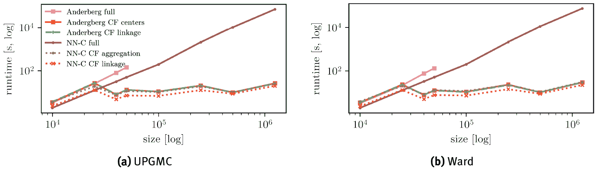

图 5.12 均匀分布数据上运行时间与数据集大小的关系。

表 5.8 不同链接方法、算法和数据集在 *N* = 50 000 时的均方根偏差。所有数值均为 10 次运行的平均值加减标准差。

| Algorithm | Input | Generation | UPGMC | UPGMA | Ward |
| --- | --- | --- | --- | --- | --- |
| Anderberg | full data | Uniform | 10.34 ± 0.00 | 10.11 ± 0.00 | 10.12 ± 0.00 |
| Anderberg | CF linkage | Uniform | 10.53 ± 0.03 | 10.29 ± 0.02 | 10.27 ± 0.01 |
| NN-Chain | full data | Uniform | 10.17 ± 0.04 | \- | 10.17 ± 0.04 |
| NN-Chain | CF linkage | Uniform | 10.36 ± 0.03 | \- | 10.35 ± 0.02 |
| Anderberg | full data | Gaussian | 3.56 ± 0.00 | 3.51 ± 0.00 | 3.38 ± 0.00 |
| Anderberg | CF linkage | Gaussian | 3.56 ± 0.00 | 3.53 ± 0.03 | 3.40 ± 0.01 |
| NN-Chain | full data | Gaussian | 5.25 ± 0.05 | \- | 5.25 ± 0.05 |
| NN-Chain | CF linkage | Gaussian | 5.09 ± 0.05 | \- | 4.95 ± 0.08 |

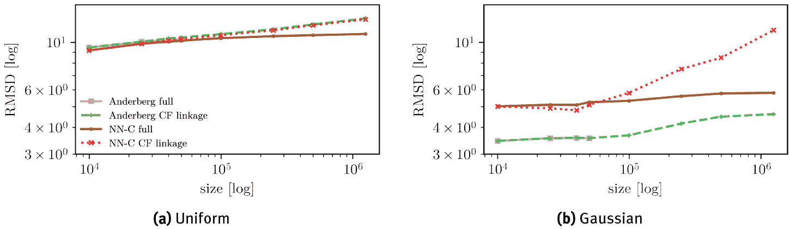

图 5.13 使用质心 (UPGMC) 链接方法在两种数据集生成器和 *k* = 500 时的均方根偏差与数据集大小的关系。

表 5.8 展示了包含 50 000 个数据点的数据集上所有相关算法的均方根偏差 (RMSD)。在此，使用 `BETULA` 带来的运行时间提升显著，但对于均匀数据集，所有算法的质量差异非常小（处于 `NN-Chain` 因使用不同于 `Anderberg` 的处理顺序所导致的变异范围内）。高斯数据上的评估结果值得进一步讨论。在这个有利于 `BETULA` 假设的数据集上，数据聚合结合 `Anderberg` 算法产生的负面影响甚至更小。`UPGMC` 没有可测量的差异，而 `UPGMA` 和 `WARD` 仅略微变差。相比之下，`NN-Chain` 算法受其与 `Anderberg` 算法的已知差异影响（贪婪地做局部最优选择，而非选择全局最优）。

最后，我们评估了该方法的可扩展性。图 5.13 展示了 *k* = 500 个簇的均方根偏差。对于 *N* = 25 000（无聚合发生的情况），无论是否使用 `BETULA`，结果均相同。对于条目更多的数据集，结果也相似。当使用的簇特征数量保持在 25 000 以下时，质量仅受轻微影响。在均匀数据上，算法间的质量差异很小。高斯数据表明，`NN-Chain` 和 `Anderberg` 算法之间的差异大于 `BETULA` 数据聚合带来的差异。唯一的异常值是 `BETULA` 和 `NN-Chain` 的组合，其结果明显较差。

### 5.3.7 结论

在本节中，我们讨论了如何通过集成来自 `BIRCH`（或其更稳定的变体 `BETULA`）的数据聚合技术来提高层次聚类的可扩展性。我们展示了层次链接方法如何与特定的 `BIRCH` 距离准则相关联，以及某些准则如何改善相同度量下的聚类效果。我们利用这种关系来加速层次聚类，在对聚类质量影响很小的情况下，保留了层次方法的大部分优势，并将其扩展到了标准方法不切实际的数据集规模。这种优化通过使用数据聚合将总数据规模与开销大得多的层次聚类步骤的输入数据规模解耦，使得层次聚类能够在内存有限的小型或嵌入式系统上使用，从而实现更好的可扩展性。虽然聚类质量有所损失，但对于探索性数据分析的大多数用例来说，这种损失足够小，即我们仍能为后续的数据分析步骤做出有意义的选择。

## 5.4 带二元约束的矩阵分解

*Sibylle Hess*

**摘要：** 处理大数据的一种自然策略是对其进行压缩。压缩可用作预处理步骤，如降维任务中所知；也可用于识别数据中提取核心信息的潜在模式。这两种学习任务均可表述为矩阵分解。在此，我们讨论至少在一个因子矩阵上施加二元约束的矩阵分解。此类分解在聚类领域尤为相关，因为数据通过一组称为簇的群组进行汇总。遗憾的是，能够整合二元约束的优化方法大多仅在一个条件下工作：*互斥性*。对于聚类应用，这意味着每个观测值恰好属于一个簇，这在许多应用中是不适用的。

我们提出了一种用于带二元约束矩阵分解的通用优化方法，无需额外约束（如互斥性）。我们的方法基于近端梯度下降理论，并支持使用 `GPU`。我们通过合成数据和真实世界数据表明，即使在高噪声水平下，我们的方法也适合发现有意义的簇。

### 5.4.1 引言

在聚类领域，以及更广泛的数据挖掘领域，最相关的挑战之一是受二元约束的优化。特别是就资源效率而言，二元约束因二元模型降低的存储需求而变得更加重要。然而，它们也有助于使数据挖掘结果具有可解释性。一张图片是否显示猫？是否应向该用户推荐一部电影？二元结果为解决数据挖掘任务时出现的问题提供了明确的答案。

许多方法能够解决带二元约束的问题。然而，它们大多仅在一个条件下工作：*互斥性*。在此条件下，我们假设如果一张图片显示猫，则它不能显示狗；或者如果一部电影被分配到一个簇（例如一种流派），则它不能属于另一个簇（即另一种流派）。从这些例子中，我们可以很容易地观察到互斥性假设并不总是合理的。例如，一部电影通常属于不止一个簇，如一种流派。互斥性不切实际的影响在高维数据应用中最常被观察到。高维数据的聚类需要同时进行特征选择以规避*维度灾难*，即在高维空间中所有实例彼此近似等价地相似。这引入了*双聚类*任务，即对行和列进行同时聚类，例如电影和用户、特征和观测值。双簇内的用户对双簇中的电影给出相似的评分。然而，科幻迷（通常）并不只喜欢科幻电影。在这方面，互斥性假设显然施加了严格且不切实际的约束。

在其他双聚类应用中也可以得出类似的观察结果。例如，基因表达数据的双聚类被用于识别由相似表达水平紧密关联的基因组和患者组。这种分析可以发现与临床性状相关的基因功能。然而，一个基因在生物体内通常不具有单一功能，而是实际上参与多个生物过程 [[580]](#backmatter-001.xhtml#b_9783110785944-010_ref_580)。反过来说，并非每个基因在考虑的条件下都必然发挥重要作用。在这种情况下，排他性假设会强制每个基因都属于某一个簇。因此，在存在排他性假设时，`outliers`（离群点）或 `isolated objects`（孤立对象）可能会被不当建模。

规避二元优化困难的一种流行方法是，要么对组合二元问题应用贪心启发式算法，要么将二元约束松弛为非负和/或正交约束（参见 第 5.4.3 节）。然而，启发式算法无法保证理论性质，而松弛后的 `fuzzy`（模糊）簇需要后处理为二元结果，此时理论保证也随之丢失。

在本贡献中，我们讨论了两种方法，并提出了一种作为协同研究中心 CRC 876 一部分的、具有理论基础的双聚类方法优化。第一种方法 `PAL-TILING` [[309]](#backmatter-001.xhtml#b_9783110785944-010_ref_309)[[310]](#backmatter-001.xhtml#b_9783110785944-010_ref_310)[[311]](#backmatter-001.xhtml#b_9783110785944-010_ref_311) 优化布尔矩阵分解，指示二元数据的一种聚类，该聚类特别允许簇重叠和离群点建模。第二种方法 `BROCCOLI`（通过交替线性化最小化实现的二元鲁棒协同聚类优化）[[312]](#backmatter-001.xhtml#b_9783110785944-010_ref_312) 优化实值数据的双聚类，以获得能够处理簇重叠和离群点存在的模型。这两种方法都采用惩罚方法，即在惩罚二元约束违反的情况下优化松弛目标。

我们重点介绍了所提方法的合成实验和定性实验，表明这两种方法都能检测各种结构的双聚类，并且对数据中的噪声和其他参数具有鲁棒性。定性检查显示，这两种方法都能得出有意义的簇，这些簇凭借其模块化结构具有可解释性。

### 5.4.2 矩阵分解——聚类之母

即使是不直接从事矩阵分解研究的研究人员，大概也知道两个著名的实例：奇异值分解（`SVD`）和 `k`-means 聚类（`k`-均值聚类）。`SVD` 将给定的数据矩阵 `D ∈ ℝ^(N×d)`（汇集了 `d` 个特征的 `N` 个观测值）分解为三个矩阵的乘积 `D = UΣV^⊤`。矩阵 `U ∈ ℝ^(N×N)` 和 `V ∈ ℝ^(d×d)` 是正交的，这意味着它们可逆，且逆矩阵由转置矩阵给出。矩阵 `Σ ∈ ℝ^(N×d)` 是一个矩形对角矩阵，其对角线上按降序排列着奇异值 `σ_1 = Σ_11 ≥ σ_2 = Σ_22 ≥ ... ≥ 0`。奇异值指示了 `U` 和 `V` 中所指方向的*重要性*。为了看出这一点，我们将 `SVD` 写为 `U` 和 `V` 中列向量外积的加权和（我们用 `U_·s` 或 `V_·s` 表示 `U` 或 `V` 的第 `s` 列）。令 `k = min{N, d}`，则有

```
D = σ_1 U_·1 V_·1^⊤ + … + σ_k U_·k V_·k^⊤.
```

正交矩阵 `U` 和 `V` 的列向量范数均为 1。因此，奇异值指示了每个外积 `U_·s V_·s^⊤` 对 `D` 的近似有多大意义。如果奇异值等于零，则相应的外积与 `D` 的表示无关。同理，接近零的奇异值指示可省略的外积。这为通过低秩乘积压缩矩阵（如截断 `SVD`）提供了可能性。

截断 `SVD` 通过求解以下优化问题，为给定秩 `r < min{N, d}` 计算矩阵 `D` 的近似：

```
(5.27) min_{X,Y} ||D − Y X^⊤||²  s.t.  Y ∈ ℝ^(N×r), X ∈ ℝ^(d×r).  (5.27)
```

该优化问题的解由将 `SVD` 截断为因子矩阵的前 `r` 列给出：`Y X^⊤ = U_·R Σ_RR V_·R^⊤` ³⁵。

例如，如果数据矩阵是均值中心化的（即 `D` 中所有观测值的均值等于零），则 `V` 的列指示数据的主成分，奇异值的平方与主成分方向上的数据方差相关。这里，数据在主成分上的低维投影（由 `U_·R Σ_RR` 给出）常被用作降维技术。

`SVD` 的主要缺点是其可解释性。原则上，方程 5.27 中的矩阵 `X` 表示数据中的一种模式。观测值 `D_j·` 表现出模式 `X_·s` 的程度由值 `Y_js` 表示。然而 `Y` 和 `X` 中正负值的混合使得模式及其出现的解释变得困难。这就是为什么要对矩阵 `X` 和 `Y` 引入约束的原因。

其中一种约束是将因子矩阵限制为非负值，即非负矩阵分解（`NMF`）。`NMF` 最初由 Paatero 和 Tapper [[548]](#backmatter-001.xhtml#b_9783110785944-010_ref_548) 在“正矩阵分解”名称下提出。自 Lee 和 Seung [[423]](#backmatter-001.xhtml#b_9783110785944-010_ref_423) 的出版物发表以来，它引起了关注，他们展示了非负约束和由此产生的基于部分的数据解释增强了结果的可解释性。`NMF` 的缺点是，非负值约束使得截断 `SVD` 可多项式求解的目标变为 NP-hard（NP 难）[[682]](#backmatter-001.xhtml#b_9783110785944-010_ref_682)。特别是，局部极小值的数量随着非负约束的引入而增加。因此，`NMF` 的优化在获得结果的质量中起着重要作用。

**表 5.9** 流行聚类和双聚类模型的矩阵分解目标概览。矩阵 `D` 为数据矩阵，`K` 为半正定二次矩阵（例如核矩阵，或在谱聚类情况下为负图拉普拉斯矩阵）。我们用 `X^†` 表示 `X` 的 Moore-Penrose 广义逆。

| | | **聚类目标** |
| --- | --- | --- |
| `k`-means | | `min_{X,Y} ||D − Y X^⊤||²  s.t. X ∈ ℝ^(d×r), Y ∈ {0,1}^(N×r)` |


| 核 `k`-means（及谱聚类） | | `min_{X,Y} ||U − Y X^⊤||² s.t. X ∈ ℝ^(d×r), Y ∈ {0,1}^(N×r), K = UU^⊤, U ∈ ℝ^(N×k)` |

| 棋盘格 | | `min_{X,C,Y} ||D − Y C X^⊤||² s.t. X ∈ {0,1}^(d×u), Y ∈ {0,1}^(N×r), C ∈ ℝ^(r×u)` |

| Plaid | | `min_{X,Y} ||D − Y Y^† D − D X X^† + Y C X^⊤||² s.t. X ∈ {0,1}^(d×u), Y ∈ {0,1}^(N×r), C = Y^† D X` |

| 块对角 | | `min_{X,C,Y} ||D − Y C X^⊤||² s.t. X ∈ {0,1}^(d×r), Y ∈ {0,1}^(N×r), C = diag(C_11, ..., C_rr)` |

| 二元 | | `min_{X,Y} ||D − Y X^⊤||² s.t. X ∈ {0,1}^(d×r), Y ∈ {0,1}^(N×r)` |

| 布尔 | | `min_{X,Y} ||D − Y ⊙ X^⊤||² s.t. X ∈ {0,1}^(d×r), Y ∈ {0,1}^(N×r)` |

#### 与聚类的关系

NMF 被认为是模糊聚类。矩阵 `X` 表示数据的特征值模式，而 `Y[js]` 指示模式 `X[·s]` 属于观测 `D[j][·]` 的程度。然而，从模糊聚类中筛选出最重要的信息仍然需要对结果进行后处理。例如，要提取属于索引为 `s` 的簇的观测值，必须指定一个阈值，该阈值定义模糊聚类指示器 `Y[js]` 需要多大才能指示簇成员资格。如果我们在矩阵分解目标中引入二元约束，则可以缓解这一后处理步骤。

表 5.9 总结了定义相应表示的聚类任务的矩阵分解目标。我们看到因子矩阵 `Y` 通常被约束在集合 `𝟙[N×r]` 中。该集合表示所有分区指示矩阵：

```
1^(N×r) = {Y ∈ {0,1}^(N×r) | |Y[j·]| = 1, 1 ≤ j ≤ N}
```

其中 `|Y[j·]|` 表示 `Y` 第 `j` 行的 `L1` 范数。由矩阵 `Y ∈ 𝟙[N×r]` 指示的聚类将每个观测 `D[j·]` 精确地分配到一个簇：即满足 `Y[js] = 1` 的索引为 `s` 的簇。我们称在这种情况下聚类实现了*排他性约束*。

我们在表 5.9 中看到，许多流行的聚类方法都是带有二元约束的矩阵分解的实例。特别是流行的 `k`-均值聚类计算簇分配矩阵 `Y` 和由 `X` 的列指示的质心的矩阵分解。核 `k`-均值和谱聚类等非凸聚类方法也是矩阵分解的实例。在这里，目标是在核矩阵（或图拉普拉斯矩阵）`K = UU[⊤]` 的对称分解因子 `U` 上计算 `k`-均值分解。谱聚类这种基于 `k`-均值目标的表述填补了一个长期存在的空白，这解释了为什么在图拉普拉斯矩阵的特征分解上应用 `k`-均值如此成功 [[308]](#backmatter-001.xhtml#b_9783110785944-010_ref_308)。

棋盘、块对角和格子聚类的模型是双聚类模型。同样，二值和布尔矩阵分解计算双聚类，它们甚至更适合二值数据 `D ∈ {0, 1}^(N×d)`。双聚类对特征和观测进行同时聚类。特别是对于高维数据，其中所有观测倾向于同样相似，会应用双聚类。双聚类的思想是，对于每个观测簇，都会识别出一组特征，使得点在由所选特征张成的子空间中聚类。

二值矩阵分解的一个变体，即显式允许簇重叠，是布尔矩阵分解。在这里，矩阵乘法在布尔代数中计算，得到 `1 ⊕ 1 = 1`。请注意，在二值矩阵分解中，两个双簇重叠的区域由 `1 + 1 = 2` 近似，三个双簇重叠的区域由 `1 + 1 + 1 = 3` 近似，依此类推。因此，二值双簇的重叠给二值数据矩阵引入了近似误差。在布尔代数中，这种情况不会发生，我们总是得到一个二值矩阵作为二值矩阵布尔乘积的结果。

### 5.4.3 受约束矩阵分解优化综述

总的来说，处理聚类这一计算挑战性任务主要有三种方法。如果应用排他性假设，则目标可以用劳埃德 `k`-均值算法已知的交替最小化方案进行优化。如果排他性假设不适用，这在双聚类应用中经常发生，则优化通常依赖于二元约束的松弛。这种方法的问题是，在后处理步骤中必须推断出清晰的簇分配。然而，在此步骤之后，最优性保证就丢失了。第三种可能性是应用（通常是贪婪的）启发式方法，它们在二元空间中搜索最优化器。然而，启发式方法的问题是缺乏理论基础。通常，对找到的解没有任何保证。

在下文中，我们将回顾这些方法，然后提出我们的优化方案，该方案基于带有非二值值惩罚的松弛目标。

#### 交替最小化

排他性假设支持一种遵循 *k*-均值算法方案的高效交替最小化 [[444]](#backmatter-001.xhtml#b_9783110785944-010_ref_444)。在每次迭代中，优化一个因子矩阵，而其他因子矩阵保持固定。在这里，排他性假设支持在每次迭代中解析地推导出最优化器 [243, 494]。也就是说，我们不需要在每个优化步骤中应用梯度下降，而是可以直接给出其中一个矩阵的最优解。这促进了受二元约束的优化。该优化方案已用于棋盘双聚类 [139, 475, 694] 和对角双聚类 [293, 640] 的实现。Koyutürk 和 Grama [[391]](#backmatter-001.xhtml#b_9783110785944-010_ref_391) 以及 Li [[434]](#backmatter-001.xhtml#b_9783110785944-010_ref_434) 为二值矩阵分解提出了交替最小化方案，将其中一个因子矩阵限制为排他性假设。在这种情况下，行簇总是不重叠，但列簇可能重叠，反之亦然。交替最小化是一种优雅且有理论基础的优化方法，但其可行性仅限于具有排他性假设的聚类。

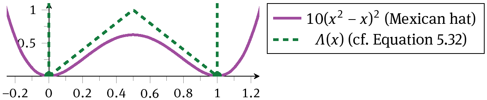

**图 5.14** 二值惩罚函数：墨西哥帽函数和 `Λ`。

#### 基于松弛的方法

如果我们不想应用排他性假设，并希望反映异常值或簇的重叠，则无法以基于 `k`-均值的计算高效方式使用交替最小化方法（或者至少我们不知道如何做）。在这种情况下，一种常用的策略是松弛二元约束，以便应用数值优化方法。最常见的是将二元约束松弛为非负约束，并辅以因子矩阵列的硬或软正交约束 [165, 176, 178, 536, 725, 733]。正交性约束越强，生成的模糊聚类越类似于具有排他性假设的聚类。在最极端的情况下，因子矩阵列是正交的，每个非零条目都指示一个二值簇分配。相反，如果我们允许更多模糊簇指示器，则允许簇重叠，但模糊簇的离散化是非平凡的。

为数不多的尝试之一是在不使用排他性假设的情况下解决二值矩阵任务，即为二值双聚类提出的惩罚方法 [740, 741, 742]。到目前为止，乘法更新已被用于最小化近似误差以及非二值值的惩罚项（称为墨西哥帽函数，参见图 5.14）。

基于松弛的乘法更新优化方法可以被视为一种梯度下降法，其中步长的选择足够小，以确保不违反约束条件。遗憾的是，这导致了收敛速度缓慢，并对初始化表现出特别强的敏感性。

**启发式方法** 大多数启发式方法遵循贪婪策略，即逐个添加簇，并以贪婪方式选择下一个簇。贪婪方法不一定就是启发式方法。例如，对于截断奇异值分解（SVD），计算最优秩-*r* 分解可归结为在给定最优秩-(*r* − 1) 分解的情况下，计算最优秩-1 分解。然而，如果引入非负性或二值约束，这一性质不再成立。尽管如此，如果最优秩-1 分解比高秩分解更容易计算，贪婪优化方案仍可能得到令人满意的解。

存在依赖贪婪启发式方法的格子（plaid）[135, 419, 674]、二值[[391]](#backmatter-001.xhtml#b_9783110785944-010_ref_391)和布尔矩阵分解[244, 491]方法。贪婪方法的缺点是缺乏质量保证，而可比较的数值优化方法至少能保证收敛到目标函数的局部最小值。

### 5.4.4 一种用于优化受二值约束矩阵分解的新型近端梯度下降法

矩阵分解的目标函数是非凸的。这意味着存在多个局部最优解，它们通常并不都适合反映良好的聚类结构。此外，矩阵上的二值约束使这一问题更加明显：每个二值矩阵都诱导出一个局部最优解。事实上，对于足够小的 *ϵ*，每个二值矩阵都是其 *ϵ*-球邻域内唯一可行（因此也是最优）的优化器。另外，如果允许其他分解矩阵取连续值（如在 *k*-均值或棋盘式双聚类中），即使二值簇分配矩阵远离全局最优，对连续矩阵的优化也可能导致近似误差显著下降。这一现象使得仅通过目标函数值（即观察近似误差）难以区分局部最优与全局最优。换句话说，拥有一个“良好”的优化器通常是不够的：我们需要一个“非常好”的优化器，能同时 *i)* 处理许多局部最优的存在（仅观察目标函数时，它们几乎与全局最优无法区分），*ii)* 整合二值约束，以及 *iii)* 对噪声鲁棒并能处理异常值的存在。

**近端梯度下降** Bolte、Sabach 和 Teboulle [[60]](#backmatter-001.xhtml#b_9783110785944-010_ref_060) 将凸优化中已知的优化结果扩展到了非凸情况，提出了*近端交替线性化最小化*（PALM）。该技术专注于可分解为光滑部分 *F* 和可能非光滑部分 *ϕ* 的目标函数：

```
min[X, Y] F(X, Y) + ϕx + ϕy s.t. X ∈ ℝ^(d × r), Y ∈ ℝ^(N × r). (5.28)
```

我们暂时假设 `F(X, Y) = D − YX[⊤][2]` 返回基于 Frobenius 范数的近似误差。非光滑部分 `ϕ` 可返回 ∞，这可用于建模搜索空间的限制，例如 NMF 的非负性约束。PALM 执行关于 `F` 的梯度下降更新的交替*近端映射*。即，对 `t ∈ {1, ...}` 重复以下步骤：

```
(5.29) X[t + 1] = prox[α[x]ϕ[x]](X[t] − α[x]∇[X]F(X[t], Y[t])); (5.29)
(5.30) Y[t + 1] = prox[α[y]ϕ[y]](Y[t] − α[y]∇[Y]F(X[t + 1], Y[t])). (5.30)
```

函数 `ϕ` 的近端映射返回一个满足以下最小化准则的矩阵：

```
(5.31) ${prox}_{\phi}(X) \in \underset{X^{\star}}{\arg\min}\left\{ {\frac{1}{2}\left\| {X - X^{\star}} \right\|^{2} + \phi\left( X^{\star} \right)} \right\}. (5.31)
```

粗略地说，近端映射给其参数一个小小的推力，朝着最小化 `ϕ` 的方向。详细讨论请参见，例如 [[552]](#backmatter-001.xhtml#b_9783110785944-010_ref_552)。正如我们在公式 5.29 和 5.30 中所见，该算子的求值是一项基本操作。在每次迭代中通过数值方法寻找近端映射的最小值在实践中是不可行的。因此，诀窍在于仅使用近端映射可用闭式计算的简单函数 `ϕ`。

PALM 优化方案还提供了一种步长策略，保证收敛到局部最小值 [[60]](#backmatter-001.xhtml#b_9783110785944-010_ref_060)。此处步长由 `F(X, Y)` 的 Lipschitz 常数的倒数给出。

**惩罚非二值值** 通过惩罚项将矩阵上的二值约束纳入松弛目标函数中。我们在此采用惩罚函数：

```
(5.32) $\Lambda(x) = \begin{cases} \left. - \middle| 1 - 2x \middle| + 1 \right. & {x \in \lbrack 0,1\rbrack} \\ \infty & \text{~otherwise~} \\ \end{cases}\text{.}\quad(5.32)
```

函数 `Λ` 如图 5.14;所示；它在 0.5 处达到最大值 1.0，在二值处达到最小值 0.0，并在区间 [0, 1] 之外返回无穷大。此外，我们定义函数 `Λ` 作用于矩阵 `X` 时，返回同维度的矩阵 `Λ(X) = (Λ(X[is]))`。

函数 `Λ` 是非光滑的，但适合通过近端梯度下降进行优化。Hess、Morik 和 Piatkowski [[310]](#backmatter-001.xhtml#b_9783110785944-010_ref_310) 证明了对于 `x ∈` **ℝ**，`Λ` 的近端算子满足：

```
(5.33) ${prox}_{\lambda\Lambda}(x) = \begin{cases} {\max\left\{ 0,x - 2\lambda \right\}} & {x \leq 0.5,} \\ {\min\left\{ 1,x + 2\lambda \right\}} & {x > 0.5.} \\ \end{cases}\quad(5.33)
```

参数 `λ > 0` 是正则化权重。`λ` 越大，值 `x` 被推向二值的程度越高。

### 5.4.5 PAL-TILING – 优化布尔矩阵分解

布尔矩阵分解中普遍使用启发式方法的一个可能原因是：人们合理地认为，松弛为非负或其他连续值不适合近似布尔算术中的乘积。与这一观点相反，我们主张相反的观点：非负松弛特别适合推导重叠聚类，因此也适合近似布尔矩阵分解，其主要特征是允许簇之间重叠。现在我们需要对 *近似* 一词稍加谨慎。布尔矩阵分解（BMF）问题是 NP-hard 的，且在常数因子内近似也是 NP-hard 的 [[491]](#backmatter-001.xhtml#b_9783110785944-010_ref_491)。因此，除非 NP=P，否则我们无法产生一个能任意接近最优布尔解的高效算法。然而，我们能够在松弛空间中找到良好的局部布尔最优解。

首先，我们可以借助阈值函数，用初等代数计算布尔矩阵乘积

$\theta_{\rho}(x) = \left\{ {\begin{array}{ll} 1 & {\text{~if~}x \leq \rho} \\ 0 & \text{~otherwise~} \\ \end{array}\quad\text{~and~}\quad\theta(x) = \theta_{0.5}(x).} \right.$

我们定义函数 `θ`(`X`) = (`θ`(`X[is]`))`[is]` 将输入矩阵映射为同维度的二值矩阵。性质 1 *⊕* 1 = 1 保持成立，因为阈值函数 `θ` 将所有大于 1 的值映射为 1。因此，布尔矩阵乘积 `Y ⊕ X[⊤]` = `θ`(`YX[⊤]`) 可通过初等代数配合阈值运算来计算。

我们在图 5.15 中演示了松弛矩阵分解与布尔乘积之间的关系。二值数据矩阵 `D` 拥有两个重叠的双聚类，并如顶部两个方程所示由 NMF 近似。图 5.15 中的矩阵 `D [A]` 和 `D [B]` 展示了由此产生的二值近似和布尔近似，其中 `θ` 将所有大于或等于二分之一的值映射为 1。我们发现，当阈值处理后的 NMF 因子在初等代数中相乘时，重构误差最大，这对应于二值矩阵分解。相比之下，NMF 给出的模糊聚类指示适合指示布尔代数意义上的确定聚类。

总之，我们提出一个两步流程。第一步，通过 PALM 优化松弛的、但非二值的惩罚目标。第二步，将近似二值的因子矩阵四舍五入为二值，使得布尔乘积最小化。

**算法规范 1** (PAL-Tiling)**。** *给定数据矩阵 `D ∈ {0, 1}[N][×d]` 和一个布尔优化问题，例如*

min[`X`, `Y`]∥`D`−`Y`⊙`X`^⊤∥² s.t. `X` ∈ {0,1}^(`d` × `r`), `Y` ∈ {0,1}^(`N` × `r`)。


图 5.15 采用 NMF 对具有两个重叠双聚类的二值矩阵 `D` 进行近似（顶部），以及将因子矩阵阈值化为初等代数（倒数第二）和布尔代数（底部）中的二值矩阵所得到的分解。双聚类已高亮显示。

1.  *使用近端梯度下降优化以下目标：*

    min[`X`, `Y`]∥`D`−`Y``X`^⊤∥² + `λ`[`x`]⟨**Λ**(`X`),**1**⟩ + `λ`[`y`]⟨**Λ**(`Y`),**1**⟩ s.t. `X` ∈ ℝ^(`d` × `r`), `Y` ∈ ℝ^(`N` × `r`)

    *即，对 `F`(`X`, `Y`) = `‖D` − `YX[⊤]‖`[2] *和正则化函数执行公式 5.29 和 5.30 中的 PALM 更新步骤：*

    `ϕ``x` = `λ`[`x`]⟨**Λ**(`X`),**1**⟩, `ϕ``y` = `λ`[`y`]⟨**Λ**(`Y`),**1**⟩。

2.  *返回通过对松弛结果进行适当阈值操作而得到的二值矩阵。即，在集合* `𝒯` = `{0, 0.05, 0.1, ..., 1}` *上执行网格搜索：*


## 数学公式

```
(ρ_x^⋆, ρ_y^⋆) = argmin_{ρ_x, ρ_y} { ||D - θ_{ρ_y}(Y_t) ⊙ θ_{ρ_x}(X_t^⊤)||² | ρ_x, ρ_y ∈ 𝒯 } (X,Y) = (θ_{ρ_x^⋆}(X_t), θ_{ρ_y^⋆}(Y_t))
(ρ_x^⋆, ρ_y^⋆) = argmin_{ρ_x, ρ_y} { ||D - θ_{ρ_y}(Y_t) ⊙ θ_{ρ_x}(X_t^⊤)||² | ρ_x, ρ_y ∈ 𝒯 } (X,Y) = (θ_{ρ_x^⋆}(X_t), θ_{ρ_y^⋆}(Y_t))
```

矩阵或向量 `1` 表示常数全 1 矩阵，其维度可从上下文推断。弗罗贝尼乌斯内积 `⟨Λ(X), 1⟩ = Σ[i][,s] Λ(X[is])` 对所有矩阵条目的惩罚项求和。作为默认值，我们采用正则化权重 `λ[x] = λ[y] = 1` 的自然选择。

PAL-TILING 的过程描述了布尔矩阵分解误差优化的通用框架。布尔矩阵分解领域的最新贡献还结合了自动确定分解秩的机制。为此，在 BMF 中通常优化除弗罗贝尼乌斯范数近似误差以外的目标函数。到目前为止，我们提出了两种促进 PAL-TILING 优化的方法。秩确定可以集成到 PAL-TILING 的外层循环中，在那里比较不同秩的模型。一种方法使用成熟的最小描述长度（MDL）原则，将产生最小模型描述长度的秩确定为最优秩。这里，布尔代数中的目标即为所用的描述长度 [[310]](#backmatter-001.xhtml#b_9783110785944-010_ref_310)。另一种方法是优化布尔近似误差，并对至少有一个聚类由噪声生成的概率进行统计检验 [[311]](#backmatter-001.xhtml#b_9783110785944-010_ref_311)。

### 5.4.6 BROCCOLI – 优化三因子分解双聚类

虽然布尔分解优化的最终阈值步骤是将模糊聚类结构转换为布尔代数所必需的，但棋盘格和块对角聚类的双聚类模型使用初等代数矩阵乘积。因此，如果惩罚权重 `λ[x]` 和 `λ[y]` 足够大，则带有非二值惩罚项的目标松弛公式（公式 5.34）将与相应的二值矩阵分解目标具有相同的优化器（参见表 5.9）。

在每一次聚类指示矩阵的梯度下降步骤之后，都会应用近端算子，将矩阵推向二值。因此，如果非二值惩罚权重 `λ[x]` 和 `λ[y]` 足够大，我们将在几次迭代后得到二值矩阵。然而，在这种情况下，我们也面临收敛到接近初始化的局部最优的风险。这会使我们的方法比因目标非凸性而已经存在的对初始化敏感度更高。反之，如果我们选择的 `λ` 值太小，则惩罚目标的最优解可能不会返回二值矩阵。我们通过在整个优化过程中逐渐增加正则化权重来规避这些问题。此外，我们采用单独的正则化权重。为此，我们将正则化权重作为优化参数引入，使其在最优解中尽可能大。我们通过从目标函数值中减去正则化参数之和 `⟨λ[x], 1⟩ + ⟨λ[y], 1⟩` 来实现这一点（参见公式 5.35）。

**算法规范 2** (Broccoli)**。** *给定数据矩阵 `D ∈ ℝ[N][×d]` *和一个双聚类优化问题，例如*

```
min[X, Y, C]∥D−YCX^⊤∥² + ϕC s.t. Y ∈ {0,1}^(N × r), X ∈ {0,1}^(d × r), C ∈ ℝ^(r × r)。
```

1.  *使用近端梯度下降优化以下目标：*

```
min_{X,Y,C,λ_x,λ_y} ‖D − YCX^⊤‖² + ⟨λ_x, Λ(X) − 1⟩ + ⟨λ_y, Λ(Y) − 1⟩ + ϕ_c(C)
s.t. (λ_x)_is, (λ_y)_js ≤ λ_+ for all 1 ≤ i ≤ d, 1 ≤ j ≤ N, 1 ≤ s ≤ r.
Y ∈ ℝ^(N × r), X ∈ ℝ^(d × r), C ∈ ℝ^(r × r)  (5.35)
```

也就是说，以交替方式对 `X`、`C`、`λ[x]`、`Y`、`C` 执行 PALM 更新步骤，最后对 `λ[y]` 执行。其中 `F*(X, Y, C) = ‖D − YCX[⊤]‖[2]`，正则化函数为

`ϕx = ⟨λ[x], Λ(X)⟩` `ϕy = ⟨λ[y], Λ(Y)⟩`

公式 5.35 中的参数 `λ[+]` 用作所需最大正则化权重 `λ[x]` 和 `λ[y]` 的占位符，使得公式 5.35 的优化因子矩阵 `Y` 和 `X` 为二值矩阵。通过参数 `λ[+]` 对正则化权重进行上界约束，可确保公式 5.35 中的目标函数定义良好。然而，在实践中我们不需要确定参数 `λ[+]`。

参数矩阵 `λ[x]` 和 `λ[y]` 是非二值惩罚项 `Λ(X)` 和 `Λ(Y)` 的正则化权重。弗罗贝尼乌斯内积

```
⟨λ, Λ(X)⟩ = Σ[i,s] λ_is Λ(X_is)
```

对按参数 `λ` 加权的逐元素惩罚项求和。

BROCCOLI 优化方案的实现细节可参见 Hess、Pio、Hochstenbach 和 Ceci [[312]](#backmatter-001.xhtml#b_9783110785944-010_ref_312) 的文献。与布尔分解框架 PAL-TILING 相反，初始化在 BROCCOLI 中起着重要作用。BROCCOLI 采用随机近端梯度下降 [[187]](#backmatter-001.xhtml#b_9783110785944-010_ref_187)，而非普通的 PALM 优化方法。

### 5.4.7 实验

我们在此重点介绍 PAL-TILING 实例 PRIMP [[310]](#backmatter-001.xhtml#b_9783110785944-010_ref_310) 以及使用非负矩阵分解进行初始化的 BROCCOLI 实现 [[312]](#backmatter-001.xhtml#b_9783110785944-010_ref_312) 在应用中的部分结果。更多实验结果可参见相关文献 [309, 310, 311, 312]。

我们将 PAL-TILING 实例 PRIMP（以下简称 PAL-TILING）与 BMF 方法 PANDA+³⁶ 的可用实现进行比较。

我们将 BROCCOLI 与六种竞争方法进行比较：两种基于非负松弛的方法（以下分别记为 N [[447]](#backmatter-001.xhtml#b_9783110785944-010_ref_447) 和 NN [[165]](#backmatter-001.xhtml#b_9783110785944-010_ref_165)），两种基于正交松弛的方法（以下分别记为 O [[725]](#backmatter-001.xhtml#b_9783110785944-010_ref_725) 和 OO [[165]](#backmatter-001.xhtml#b_9783110785944-010_ref_165)），以及双聚类方法 Fabia [[318]](#backmatter-001.xhtml#b_9783110785944-010_ref_318) 和 Floc [[716]](#backmatter-001.xhtml#b_9783110785944-010_ref_716)。由于 N、NN、O 和 OO 为每个观测值返回模糊隶属度值，我们将结果二值化以便比较。对于每个样本（观测值或特征），我们将前 `k` 个模糊聚类指示值设为 1，其中 `k` 是该样本所属的真实聚类数量。请注意，通过这种方式，我们为竞争方法提供了额外的背景知识，而这些知识在现实场景中是不可用的。目的是评估如果得到额外知识（例如来自领域专家）支持，从松弛结果得出的聚类效果最多能有多好。

**质量指标** 我们通过改编自多类分类任务的微平均 `F[1]` 测度，量化计算出的聚类指示矩阵与真实标签的匹配程度。我们计算计算出的聚类与真实聚类之间的一一匹配 `τ`，并计算匹配聚类的平均 `F[1]` 测度。即，

```
F_y = (1/r) Σ[s=1 to r] F_1(Y_·s, Y_·τ_y(s)^⋆)
F_χ = (1/r) Σ[t=1 to r] F_1(X_·t, X_·τ_χ(t)^⋆)
```

我们返回特征聚类和观测聚类的平均 `F[1]` 分数：

```
F = (1/2)(F_y + F_x).
```

`F[1]` 测度的取值在 0 到 1 之间。值越接近 1，表示计算出的聚类与真实标签匹配得越好。显示 `F` 测度的图表用误差棒表示其平均值，误差棒长度为两倍标准差。

### 5.4.8 合成数据集实验

**PAL-TILING** 我们按照 Karaev、Miettinen 和 Vreeken [[356]](#backmatter-001.xhtml#b_9783110785944-010_ref_356)、Lucchese、Orlando 和 Perego [[451]](#backmatter-001.xhtml#b_9783110785944-010_ref_451) 以及 Miettinen 和 Vreeken [[492]](#backmatter-001.xhtml#b_9783110785944-010_ref_492) 确立的方案生成数据矩阵。我们按照 Hess、Morik 和 Piatkowski [[310]](#backmatter-001.xhtml#b_9783110785944-010_ref_310) 的大纲生成 (1600 × 500) 和 (1000 × 800) 维的数据集。给定维度 `d`、`N` 和噪声参数 `p`，秩为 `r[*] = 25` 的分解通过从所有大小为 `|X[⋅]^(*)| ∈ [0.01d, 0.1d]` 和 `|Y[⋅]^(*)| ∈ [0.01N, 0.1N]` 的瓦片中均匀随机抽取每个瓦片 (`X[s]^⋆`, `Y[⋅ s]^⋆`) 来生成。最后，每个位条目 (`Y[*] ⊙ X[*⊤])[ji]` 以概率 `p` 翻转。

我们比较矩阵维度的影响，并汇总 10 个生成矩阵（维度为 1000 × 800 和 1600 × 500）的结果。图 5.16 绘制了 `F[1]` 测度和返回的 BMF 秩与噪声百分比的关系。对于 1600 × 500 维矩阵，NASSAU 特别严重地低估了秩。在此情况下，即使噪声很低，NASSAU 返回的瓦片数也接近或等于零。如果对矩阵进行转置，实际上可以缓解这种影响，这使得 NASSAU 的表现类似于 MDL4BMF，但仍有更强的低估秩倾向。我们观察到，随着噪声增加，所有算法都倾向于低估秩。这导致在最高噪声水平下，PANDA+ 和 NASSAU 等算法几乎无法复现任何瓦片。PANDA+ 在噪声高达 15% 时能给出正确的秩估计，但其波动的 `F` 测度表明植入的瓦片并未被正确恢复。MDL4BMF 表现出稳健的行为。其在噪声高达 15% 时的合理秩估计体现在较高的 `F` 测度中。PAL-TILING 的特点是总体上具有较高的 `F[1]` 测度值。实验证明了所提议的 BMF 优化方案 PAL-TILING 对合成数据上噪声的高鲁棒性。

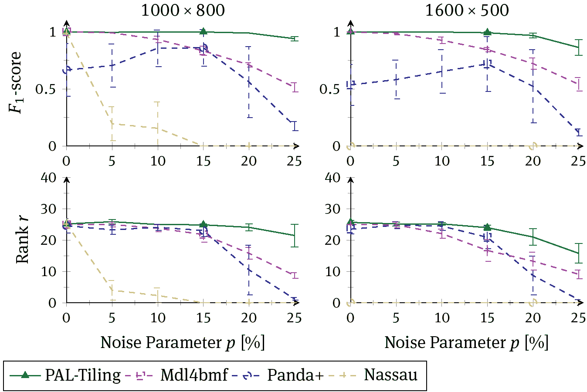

#### 图 5.16 伯努利噪声参数 `p` 在 1000 × 800 和 1600 × 500 维数据上的变化

不同噪声水平下 `F`[1]-度量（越高越好）和计算出的布尔矩阵分解的估计秩（越接近 25 越好）的对比，即 x 轴表示 `p`（最好彩色查看）。

#### BROCCOLI

对于由三因子分解生成的双聚类，我们通过用伯努利分布对每个簇指示矩阵进行采样，创建了一组带有重叠和异常值的合成聚类。当概率 `q = 0.2` 时，条目 `X[i*t*]^⋆` 和 `Y[j*s*]^⋆` 等于 1。这样可确保一个簇至少包含 1% 的数据点/特征，且这些数据点/特征专门分配给这个特定簇。核心矩阵作为包含均匀分布值 `C[st] ∈ [0, 5]` 的稀疏矩阵进行采样。非对角元素不等于零的概率等于 `1/r`。通过向真实因子分解添加随机高斯噪声来生成数据矩阵：

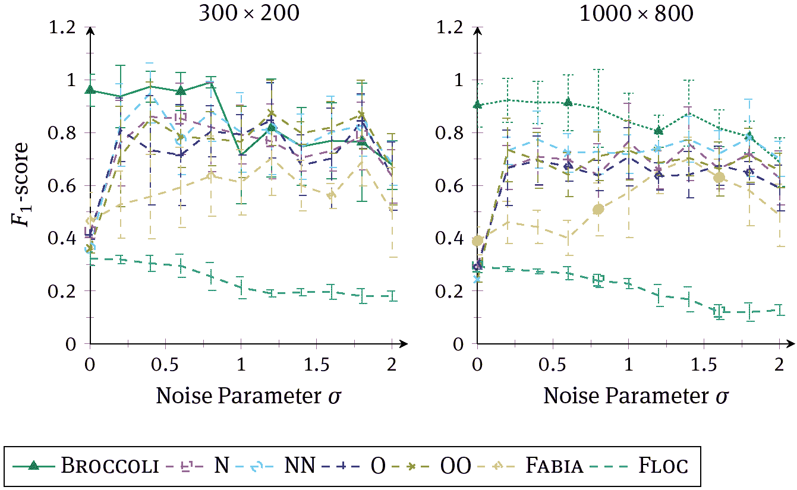

**图 5.17** 高斯噪声参数 `σ` 的变化，300 × 200 数据矩阵（具有三个行和列簇）以及 1000 × 800 数据矩阵（具有五个行和列簇）的 `F`-度量对比（越高越好）。

```
D[j*i*] = [Y[j*.]^⋆ C X[i*]^⋆ + ϵ[j*i*]][≥ 0]
```

其中 `ϵ[ji] ∼ N(0, σ)`，算子 `[·][≥0]` 将负值投影为零。我们为每个噪声方差 `σ ∈ {0, 0.2, 0.4, ..., 2}` 和维度 `(N, d) ∈ {(300, 200), (1000, 800)}` 生成五个数据集。对于较小的 300 × 200 数据集，我们选择秩 `r = 3`；对于较大的 1000 × 800 数据集，我们选择秩 `r = 5`。

在图 5.17 中，我们绘制了 `F`[1]-度量随高斯噪声参数 `σ` 的变化。`σ` 的最大值为 2.0。当 `σ = 2` 时，大约 1/3 的噪声样本大于或等于 1.0，按期望约 2/3 的所有噪声样本的绝对值大于或等于 1.0。我们看到，随着噪声参数的增加，BROCCOLI 达到了接近 1.0 的高 `F`-度量，当噪声方差超过 1.0 时略有下降。基于正交和非负松弛的方法 N、NN、O 和 OO 似乎基本不受噪声参数影响，平均获得的 `F`[1]-得分在 0.7 到 0.8 之间。FABIA 和 Floc 的 `F`[1]-得分在所有竞争者中最低，其中 FABIA 的 `F`-得分倾向于随噪声参数增加而上升至 0.7。这可能是因为 FABIA 和 FLOC 并未显式处理数据中可能存在的噪声。

### 5.4.9 定性实验

#### PAL-Tiling

在本实验中，我们探讨算法如何与其对结构和噪声的实际认知相关联，并展示其双聚类的样貌。图像数据允许我们直观地检查生成的因子分解，并直观地评估捕获的相关子结构。

我们采用图像的标准表示：RGB888 像素格式。每个 `w × h` 像素用 24 位表示，每种颜色（红、绿、蓝）使用 8 位。为了将图像转换为一组观测值，我们将其划分为 4 × 4 像素的块（补丁），每幅图像共产生 `w/4 × h/4` 个观测值。我们采用计算机视觉中的这种表示方法，其中图像补丁是原始像素数据的标准预处理步骤 [[340]](#backmatter-001.xhtml#b_9783110785944-010_ref_340)。在每个块内，令 `(r, g, b)[l,k]` 表示第 `l` 行第 `k` 列的像素，其中 `r, g, b ∈ {0, 1}⁸` 分别是其红、绿、蓝色值的 8 位二进制表示。我们将一个块内所有 16 个像素的拼接建模为一个观测值

(5.36) `[(r, g, b)[1,1], (r, g, b)[1,2], (r, g, b)[1,3], (r, g, b)[1,4], (r, g, b)[2,1], …, (r, g, b)[4,4]]` (5.36)

其长度为 24 · 16 = 384 位。

这样，我们处理了经典游戏 *Space Invaders* 中一组“外星人”的选择。重构结果和 Space Invaders 图像的前 4 个模式如图 5.18 所示。所有方法至少重构了外星人的形状。然而在颜色方面，结果有所不同。PANDA+ 和 NASSAU 将所有颜色解释为对白色的负面噪声影响；白色的二进制表示为 24 个 1。PAL-TILING 和 MDL4BMF 重构了原始图像的所有三种颜色，但 MDL4BMF 的重构显示出白色块的注入。因此，只有 PAL-TILING 能够正确重构颜色信息。

查看衍生的双聚类，PANDA+ 和 NASSAU 的贪婪过程变得尤为明显：PANDA+ 和 NASSAU 将所有形状信息过度加载到第一个因子上。其余因子减少了定量重构误差，但没有更深层的解释性。MDL4BMF 试图用每个双聚类建模一种类型的外星人。虽然这会产生对图像的合理描述，但实际的瓦片提取受贪婪实现的影响。例如，我们可以看到第一个瓦片捕获了关于黄色外星人的信息，以及其他外星人的离散部分。这种不幸的瓦片分配导致了重构图像中白色块的注入。PAL-TILING 通过其瓦片分离了实际用于混合原始图像中出现颜色的三个基本颜色通道。该定性实验的结果说明了非贪婪最小化过程的优势。


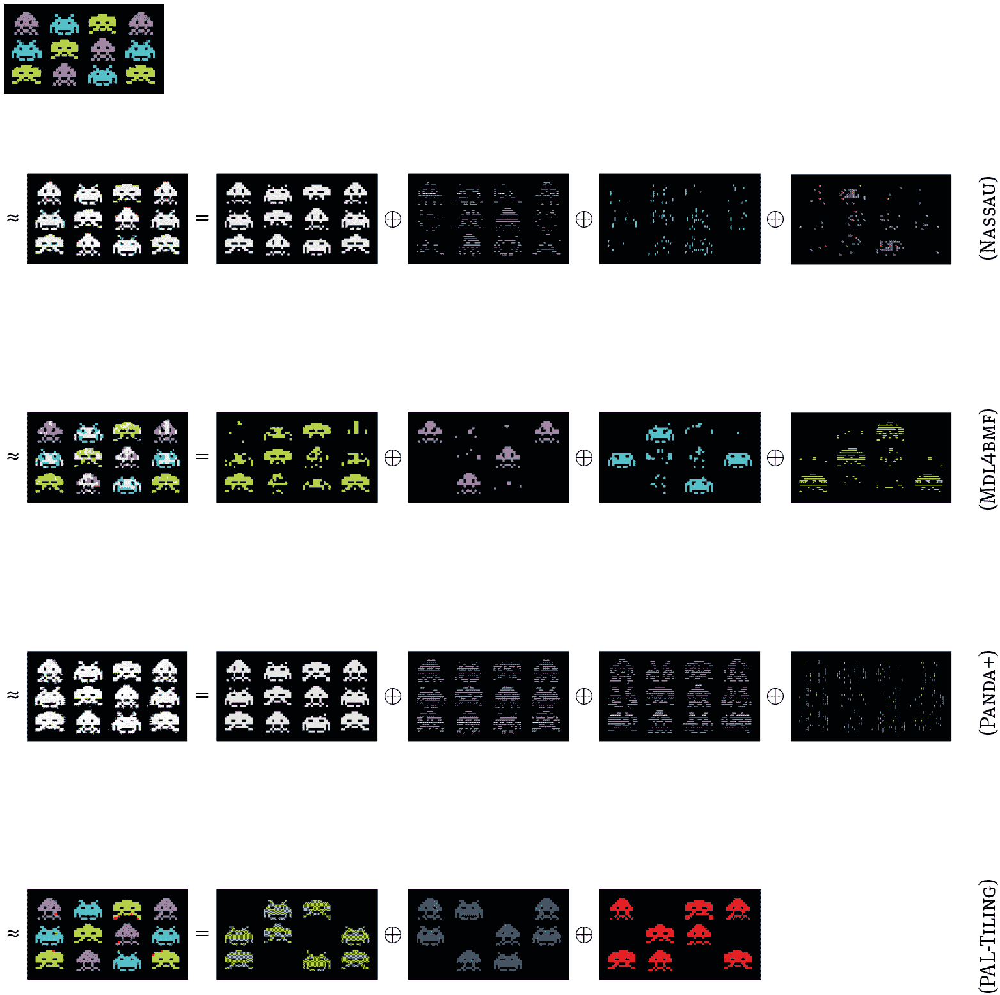

**图 5.18** Space Invaders 图像的重构和前 4 个外积的可视化。最好彩色查看。

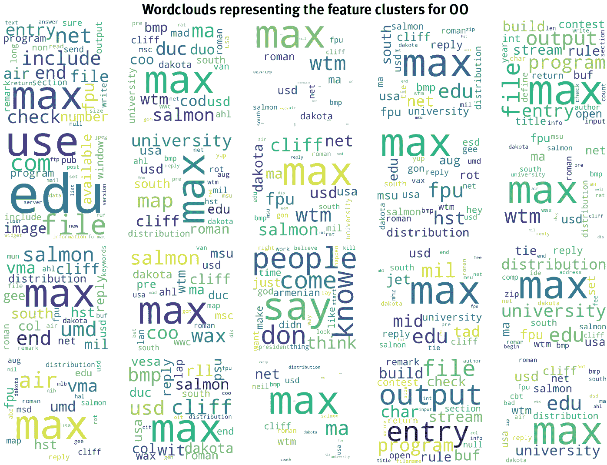

**图 5.19** 方法 OO 在 20 Newsgroups 数据集上衍生出的词簇示意。词的大小反映了其在相应簇中的权重 (`X[·s]`)。

#### Broccoli

我们通过 *20 Newsgroups* 数据集³⁷ 对结果进行定性检查。

获得的列簇（本例中即词簇的特征簇）如图 5.19–5.20 所示。此处仅展示正交松弛法 OO 的模糊簇指示器；NN 的结果非常相似[[312]](#backmatter-001.xhtml#b_9783110785944-010_ref_312)。模糊簇 *s* 的词云中词 *i* 的大小对应于分配的权重 `X[is]` ≥ 0。反过来，BROCCOLI 的二值词指示器可视化为：词云中词的大小与该词被分配到的簇数量的倒数成正比。即，仅属于各自簇的词比分配到多个簇的词更大。观察簇的可视化，我们看到词 `max` 在许多簇中显著出现。词 `max` 获得了相对非常高的词频。平均词频为 1.59，99% 的词的词频小于或等于 8。词 `max` 出现在 149 篇帖子中，词频在 \[1, 800\] 区间内。因此，词 `max` 在少数帖子中达到异常高的词频，从而扮演了特殊角色。不同聚类方法对词 `max` 这种异常高词频的处理方式不同。OO 几乎在所有簇中都给该词很高的权重，而 BROCCOLI 则忽略了该词的高频。这展示了基于二值簇指示矩阵的双聚类更模块化的方法及其对异常值的鲁棒性。


图 5.20 BROCCOLI 在 20 Newsgroups 数据集上派生词簇的示意。词的大小反映其在对应簇中的权重（`X[·s]`）。

所有聚类方法均可检测到针对特定主题的有意义簇。比较各方法涉及的主题，可见 BROCCOLI 提供了数据集的独特视角，例如识别出了方法 OO 未包含的 `religion` 簇。因此，尽管 BROCCOLI 的优化利用了松弛目标，其结果相对于松弛对应物仍提供了另一种数据视角。

### 5.4.10 应用、影响与未来工作

本工作回顾了具有矩阵分解目标的聚类优化方法。我们对流行聚类目标的比较表明，大多数方法旨在寻找划分簇，遵循排他性约束：每个点恰好分配到一个簇。Lloyd 算法的合理改进保证了在划分约束特别是二值约束下，目标函数收敛到局部最优。这相较于松弛二值约束或启发式的其他实用替代方案具有不可否认的优势。松弛方法的主要缺点在于离散化步骤，其中针对松弛目标解可能提供的理论保证通常会丢失。然而，在某些应用中，支持按 Lloyd 交替最小化的排他性约束是不可行的。在文本或基因组数据聚类等方面，重叠和非穷尽聚类更有可能代表“真实”模型。在这种情况下，相应目标高效优化的理论基础尚不完善。

我们提出了一个基于近端交替最小化的重叠聚类通用优化框架。特别地，我们提出了两种优化双聚类目标的方法，此时排他性假设最常失效。方法 `PAL-TILING` 旨在优化布尔矩阵分解，用于推导二值数据的重叠和非穷尽簇。方法 `BROCCOLI` 旨在基于三因子分解对实值数据进行双聚类。

我们的实验分析在两个实例上凸显了所提优化方法的威力：基于 MDL 的 BMF 方法 `Primp`（此处记为 `PAL-TILING`）[[310]](#backmatter-001.xhtml#b_9783110785944-010_ref_310) 和 `BROCCOLI` 框架的 NMF 初始化[[312]](#backmatter-001.xhtml#b_9783110785944-010_ref_312)。合成数据实验特别表明了我们所提优化方法对噪声、重叠程度和异常值数量的鲁棒性（参见图 5.16 和 5.17）。对发现簇的定性检查表明了发现簇的意义性（参见图 5.20 和 5.18）。

这使得 `PAL-TILING` 和 `BROCCOLI` 成为一种理论基础扎实、实践表现良好且灵活的方法，有潜力激发对非排他聚类优化特别是离散结构学习的进一步研究。

**未来工作** 所提优化方法灵活，有潜力确立一种基于矩阵分解的聚类结构优化标准方法，且不要求排他性假设。注意，许多流行聚类方法基于（或可视为）矩阵分解：`k-means`、谱聚类及深度聚类变体。此外，矩阵分解中应对特定数据特征的技术可轻松迁移至 `PAL-TILING` 和 `BROCCOLI` 采用的优化方案。

此外，非凸优化是持续研究领域。存在 `PALM` 优化方案的随机[[163, 187]]、加速[[427]](#backmatter-001.xhtml#b_9783110785944-010_ref_427)和惯性[[581]](#backmatter-001.xhtml#b_9783110785944-010_ref_581)变体。即，所提优化框架的威力随底层优化方案的研究而增长。针对二值约束特别是聚类的非凸优化方案分析，将是进一步研究课题。

## 注释

# 6 硬件感知执行

高效学习数十年来一直是研究重点。许多研究探索各种软/硬件技术以提高学习过程效率，同时保持所得学习模型的准确性。随着当今应用的各种需求，从简单的图像识别到高级的基础转向，如何部署学习模型并高效执行已成为业界关注焦点。考虑到目标场景和采用的硬件平台施加的吞吐量、时效性和能耗等各种资源约束，大多数依赖高性能计算机和集群的机器学习技术，必须经过仔细重新设计，以在边缘设备上完成指定任务，同时解决资源使用效率问题。

## 6.1 基于 FPGA 的前馈神经网络反向传播引擎

**Wayne Luk**

**Ce Guo**

**摘要：** 前馈网络（FFN），即多层感知机，是深度学习的基础网络结构。尽管前馈网络在结构上并不复杂，但其训练过程计算开销巨大。由于前向和反向传播过程中操作的多样性，为训练设计定制化硬件颇具挑战。本文提出了一种利用现场可编程门阵列（FPGA）训练此类网络的方法。该方法通过在反向传播中为不同操作复用同一组硬件资源，促进了可重构架构的设计。在我们的实证研究中，该架构在 Xilinx UltraScale+ VU9P FPGA 上的原型实现，相比运行在配备两颗 Intel Xeon E5-2643 v4 CPU 的工作站上、使用 8 线程的 PyTorch 平台，实现了高达 5.2 倍的加速。

### 6.1.1 引言

大多数基于 FPGA 的深度学习架构面向推理过程，即使用预训练网络进行预测。然而，训练是一个计算需求巨大的过程，限制了深度神经网络的应用。反向传播是神经网络训练过程中的核心环节。本文讨论了一种用于前馈网络（FFN）反向传播的基于 FPGA 的架构。FFN 由多层连接的节点组成。某层中的每个节点接收来自上一层激活信号的加权和，并通过计算非线性激活函数生成激活信号。

我们研究 FFN 主要有两个原因。首先，作为独立模型，它们适用于包含非结构化信息（如非图像和非序列数据）的学习问题。例如，在希格斯玻色子的事件分类问题中[[3]](#backmatter-001.xhtml#b_9783110785944-010_ref_003)，属性间的相关性难以用卷积神经网络（CNN）等其他神经网络捕捉，而 FFN 可提供相当可观的准确率。其次，作为深度网络组件，FFN 通常作为卷积神经网络中的决策器出现；它们在生成对抗网络（GAN）[[266]](#backmatter-001.xhtml#b_9783110785944-010_ref_266)中也充当生成器和判别器。

尽管 FFN 看起来比其他类型的神经网络简单，但在 FPGA 上高效训练 FFN 仍具挑战性。例如，在卷积神经网络中，一层节点可能共享一小组参数。这种参数共享特性天然降低了片上内存使用量。然而，FFN 不具备类似特性，因为每一对节点之间的连接都携带一个唯一的标量参数，导致高内存带宽占用。

与针对神经网络训练的通用硬件设计研究（如[[431]](#backmatter-001.xhtml#b_9783110785944-010_ref_431)和[[374]](#backmatter-001.xhtml#b_9783110785944-010_ref_374)）不同，我们关注可重构硬件的特性与局限。以下总结了我们面临的挑战。

1.  **多样化算术运算的挑战。** FPGA 芯片上的硬件资源保持不变，而反向传播过程中算术运算频繁变化。为复用硬件资源并最小化重配置开销，需设计多功能硬件模块，使其在无需运行时重配置的情况下支持多种运算。

2.  **硬件适应性的挑战。** 不同应用中的网络规模和硬件资源差异巨大。合理的硬件设计应能适应所有合理的网络规模和硬件平台。

3.  **复杂控制逻辑的挑战。** 当多功能硬件模块支持更多运算时，控制逻辑变得更加复杂。特别是，很难定义一组命令来控制硬件模块在反向传播的不同阶段协同工作。

由于大多数用于梯度计算和训练的现成系统均运行在 CPU 和 GPU 上，因此难以找到现成的解决方案。本文涵盖的创新点包括：

1.  **针对不同运算复用硬件资源。** 我们扩展了[[278]](#backmatter-001.xhtml#b_9783110785944-010_ref_278)中的多功能乘法模块，使不同运算能在无需运行时重配置的情况下共享同一组硬件资源，从而应对多样化算术运算的挑战。此外，该架构的资源使用量与网络布局无关，解决了硬件适应性挑战。

2.  **控制硬件的命令。** 为在不显著降低效率的前提下，利用同一组硬件资源执行不同运算，有必要寻找一组合适的命令来控制硬件。本节定义了一小组命令，应对复杂控制逻辑的挑战。

3.  **实证评估。** 我们进行实验，将 FPGA 平台上的硬件实验实现与运行在 CPU 和 GPU 上的 PyTorch 深度学习框架进行对比。

### 6.1.2 背景与相关工作

本节简要介绍前馈网络及其基于硬件的训练方法。

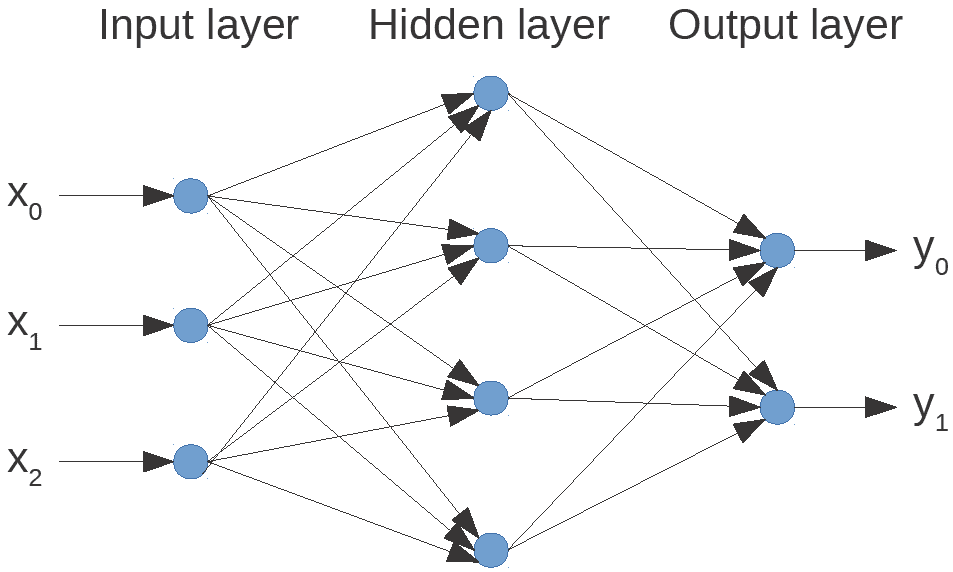

**图 6.1** 一个前馈网络示例。

#### 6.1.2.1 前馈网络与反向传播

前馈网络包含按层排列的节点。例如，图 6.1 展示了一个包含三层节点和两层连接的 FFN 布局。输入层中的每个节点将数据点的一个特征馈送给网络。第 `l` 层的所有节点接收来自上一层（`l` − 1）所有节点的信号，并以向量形式产生输出信号。输出信号的生成包含两步。第一步是计算加权和向量：

```
t[l] = W[l−1]x[l−1]  (6.1)
```

#### 6.1.2.1 神经网络训练背景

其中 `x[l]` 是一个包含第 `l` 层所有节点输出的向量；`W[l][-1]` 是一个实数矩阵，指定 `N[l]` 个权重向量。第二步是产生一个输出信号 `x[l]`

(6.2) `x[l] = fact`

其中 `fact` 是定义在实向量上的非线性函数。

在使用网络进行预测之前，必须指定权重 `W = {W[0] ... W[L][-1]}`。可以通过训练利用数据找出权重。训练算法搜索一组权重，使其相对于误差度量 `E(W, D)` 拟合数据集 `D`。高效的训练算法通常使用梯度

(6.3) `∇W = ∂E(W,D) / ∂W`

来更新参数集，以最小化训练数据上的误差。计算梯度 `∇W` 的既定方法是反向传播 [[422]](#backmatter-001.xhtml#b_9783110785944-010_ref_422)。

一次反向传播过程包括信号的前向传递和后向传递。在前向传递中，网络接收一个数据点并沿着网络方向计算预测结果。在后向传递中，网络沿相反方向传播误差信号以计算梯度。请注意，反向传播过程不包括优化算法，后者使用梯度来更新权重 [[421]](#backmatter-001.xhtml#b_9783110785944-010_ref_421)。

反向传播过程计算量巨大。海量的网络参数导致算法和硬件层面出现问题。就算法而言，参数空间的高维度降低了优化过程的收敛速度。因此，优化算法需要调用大量反向传播回合才能获得准确的网络模型。就硬件而言，由于节点不共享参数，参数在计算过程中消耗大量内存空间和 IO 带宽。

图形处理单元 (GPU) 可以说是实现神经网络训练算法最广泛使用的硬件平台。GPU 平台以相对较低的硬件成本和较短的设计周期提供高性能。然而，机器学习的发展趋势表明，FPGA 可能因两个原因比 GPU 更具前景。首先，更多神经网络将基于定制数据类型，尤其是量化数字 [[326]](#backmatter-001.xhtml#b_9783110785944-010_ref_326)。GPU 只能原生支持有限数量的数据类型。相比之下，FPGA 可以高效支持定制数据类型。其次，GPU 和 FPGA 之间的性能差距正在迅速缩小 [[541]](#backmatter-001.xhtml#b_9783110785944-010_ref_541)。特别是片上内存大小、时钟频率、硬件 DSP 单元数量、内存带宽以及 FPGA 的工艺技术都有了显著进步。

#### 6.1.2.2 用于神经网络训练的重构计算

在用于分类和回归的统计模型中，神经网络是重构加速最流行的候选者之一 [[488]](#backmatter-001.xhtml#b_9783110785944-010_ref_488)。因为我们关注训练过程，所以不涵盖仅执行推理的硬件引擎。涵盖推理引擎的综述包括 [408, 497, 500, 546]。第一类解决方案是通用神经网络架构训练过程的加速。Eldredge 和 Hutchings [[198]](#backmatter-001.xhtml#b_9783110785944-010_ref_198) 将反向传播算法分为三个阶段，并为每个阶段分别设计硬件。在训练过程中，硬件在每个阶段开始时执行运行时重构。Paul 和 Rajopadhye [[558]](#backmatter-001.xhtml#b_9783110785944-010_ref_558) 提出了一种收缩式反向传播引擎，避免了运行时重构。在他们的设计中，完整背景过程中的所有计算都被映射到硬件上。Murugan 等人 [[522]](#backmatter-001.xhtml#b_9783110785944-010_ref_522) 为一个具有五个节点的网络设计了训练架构。在 Xilinx Virtex-E FPGA 上的实现运行频率为 5.332 MHz。Li 和 Pedram [[437]](#backmatter-001.xhtml#b_9783110785944-010_ref_437) 提出了一种粗粒度架构，主要用于实现训练中的矩阵乘法运算。Langhammer 和 Pasca [[417]](#backmatter-001.xhtml#b_9783110785944-010_ref_417) 讨论了使用不同近似方法评估常见激活函数的架构。Kim 等人 [[374]](#backmatter-001.xhtml#b_9783110785944-010_ref_374) 提出了 DeepTrain 平台，用于对各类深度网络执行节能训练。DeepTrain 平台提供工具，利用从 TensorFlow 深度学习框架提取的网络描述，为硬件架构生成操作序列。Maeda 和 Tada [[458]](#backmatter-001.xhtml#b_9783110785944-010_ref_458) 提出了一种使用同步扰动规则 [[457]](#backmatter-001.xhtml#b_9783110785944-010_ref_457) 的神经网络训练引擎，以避免训练过程中的梯度计算。

### 6.1.3 反向传播架构

本节介绍反向传播引擎的硬件架构以及控制序列的自动生成。在反向传播过程中，两项主要操作消耗了绝大部分执行时间。

1.  **线性组合。** 一个节点接收来自上一层所有节点输出的线性组合。在前向传递中，该操作组合激活信号。在后向传递中，该操作组合误差信号并计算梯度。

2.  **非线性函数求值。** 一个节点对实值非线性函数进行求值。在前向传递中，该操作对激活函数求值。在后向传递中，该操作对激活函数的导数求值。

这两项主要操作在计算上要求很高，因为它们的时间复杂度取决于网络布局[[421]](#backmatter-001.xhtml#b_9783110785944-010_ref_421)。具体而言，线性组合所花费的时间随网络参数数量线性增长。相比之下，函数求值所花费的时间随网络节点数量线性增长。反向传播中的其他操作比这两项主要操作的计算开销小。例如，有必要比较训练数据的实际标签与预测值，以计算后向传递的初始误差信号。然而，该比较在一个反向传播周期中仅运行一次，且该计算通常关于数据维度具有线性复杂度。

就算术运算而言，这两项主要操作有着根本区别。定制硬件架构的一种直接方法是为这两种操作分别创建独立的算术模块[[437]](#backmatter-001.xhtml#b_9783110785944-010_ref_437)。然而，计算之间的顺序依赖性仅允许同一时间执行一种类型的操作。因此，当一种操作的算术模块处于活动状态时，相应的算术模块满负荷工作，但所有其他操作的模块都处于空闲状态。换句话说，只有一小部分逻辑单元在工作，导致硬件资源浪费。诚然，可以准备单独的比特流，使每种操作都占用所有硬件资源[[198]](#backmatter-001.xhtml#b_9783110785944-010_ref_198)，[[744]](#backmatter-001.xhtml#b_9783110785944-010_ref_744)。然而，这需要重新配置硬件以在操作间切换。频繁的运行时重新配置可能会消耗大量执行时间。


我们设计了一个适用于所有反向传播操作的硬件模块。我们的目标是让不同操作尽可能多地共享算术设施。我们使用命令序列，通过调整一小部分算术单元的行为来动态切换操作，而无需承担运行时重新配置的开销。图 6.2 显示了该架构的顶层图，该架构同时支持线性组合和函数求值。主要组件包括缓冲区交叉开关和算术模块。

*   **缓冲区交叉开关：** 缓冲区交叉开关与两个缓冲区通信。在任意时刻，来自命令的缓冲区控制信号指定一个源缓冲区和一个目标缓冲区。交叉开关从源向量读取一个向量并将其传递给算术模块。交叉开关还将来自算术模块的输出向量累加到目标缓冲区。

*   **算术模块：** 算术模块扩展了文献[[278]](#backmatter-001.xhtml#b_9783110785944-010_ref_278)中提出的多功能乘法模块。算术模块中的修饰器对应于文献[[278]](#backmatter-001.xhtml#b_9783110785944-010_ref_278)中的覆盖器。该模块有两种执行模式：线性模式，执行矩阵向量乘法；函数求值模式，对向量中所有元素求非线性函数值。我们的扩展包括梯度累加器和行求和模块。来自命令的一个二进制信号控制乘法器是否将逐元素乘积累加到梯度中。逐元素乘法器将其结果送入行求和模块，后者在线性模式下计算每行的和。

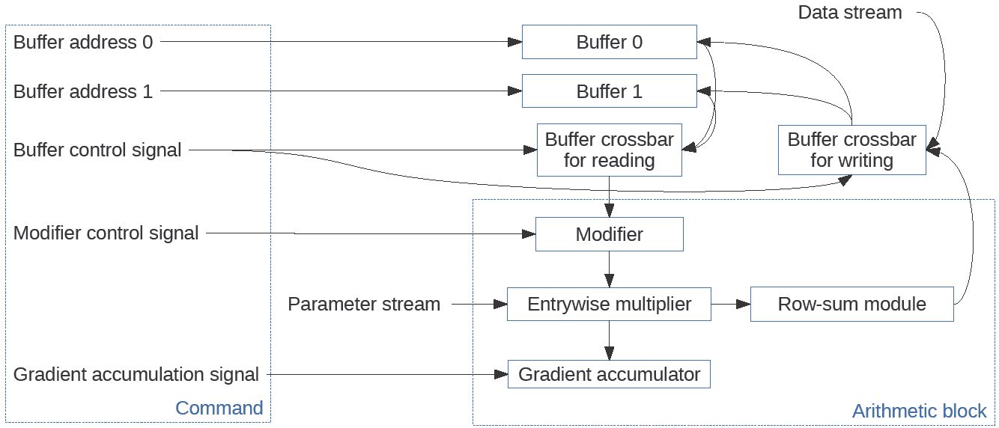

### 6.1.4 组件协作

在本节中，我们解释组件如何协作以执行反向传播中的不同操作。算术块中的修饰符决定系统执行线性组合还是非线性函数求值。

*   **线性模式**：修饰符切换到线性模式以进行线性组合。线性组合操作的核心计算非常直接。具体而言，算术块使用一个 `b` 维输入向量 **x** 和一个 `b` × `b` 权重矩阵来计算加权和向量。

*   **函数求值模式**：修饰符切换到函数求值模式以进行非线性函数求值。算术块不是按照数学定义来求值激活函数，而是以分段线性函数的形式求值一个近似版本。

在运行硬件之前，有必要定义一组命令来控制硬件架构。我们简要讨论一组可用于以直接方式执行反向传播的命令。该命令集解决了第 1 节中讨论的复杂控制逻辑挑战。我们首先描述两个对同一缓冲区进行读写的命令，包括数据加载和内存复位。然后我们介绍线性组合和函数求值的命令，其中算术块读写不同的缓冲区。

该架构支持两个对单个缓冲区操作的命令。第一个命令将目标缓冲区中寻址的位置设置为零。由于算术块总是累加到目标缓冲区，因此有必要将目标缓冲区中的 `N[l]` 个条目初始化为零，以确保计算正确。复位内存位置的命令需要将源缓冲区设置为与目标缓冲区相同，并将两个地址都指向要复位的位置。参数存储器提供一个 `b` × `b` 负单位矩阵。通过这些设置，行求和模块的输出是原始值的相反数 `−x[t]`。将该值累加回目标内存位置会将内容复位为零。第二个命令将来自 `g` 个数据点的 `d` 个维度加载到目标位置。内存交叉开关直接从数据流中读取一个数据点，忽略算术块的输出。

另外两个命令对两个缓冲区进行操作。第一个命令用于线性组合操作。在每个批次中，算术块接收 `b` 个信号作为输入，并开始并行地将信号传播到相邻层中的 `b` 个节点。第二个命令用于函数求值操作。每个修饰符获取变量的一个副本，并求值逼近激活函数的分段线性函数。

#### 表 6.2 资源使用情况

| 资源 | 总计 | 已用 | 百分比 |
| :--- | ---: | ---: | ---: |
| 逻辑利用率 | 1,182,240 | 382,256 | 32.33% |
| DSP 模块 | 6,840 | 4,105 | 60.01% |
| 块存储器 (BRAM18) | 4,320 | 1,292 | 29.91% |
| 块存储器 (URAM) | 960 | 150 | 15.63% |

### 6.1.5 评估

我们在本节中通过实证评估该架构，方法是将该架构的 FPGA 实现与双 CPU 工作站上的 PyTorch 机器学习平台进行比较。

#### 6.1.5.1 实验设置

我们将运行在基于 FPGA 的加速卡上的架构与运行在多核 CPU 上的 CPU 实现进行比较。该架构运行在采用 16 nm 工艺的 Xilinx UltraScale+ VU9P FPGA 上。我们以 120 MHz 的频率运行 FPGA 芯片。该架构以维度批次大小 `b` = 8 并行执行命令序列以处理 `g` = 16 个数据实例。表 6.2 显示了该实现的资源使用情况。软件实现运行在配备两颗 Intel Xeon E5-2643 v4 CPU 和 128 GB DDR4 内存的工作站上的 PyTorch 1.0 机器学习平台上。CPU 的工艺技术为 14 nm，比 FPGA 略微先进。该工作站共有 12 个物理核心，支持 24 个线程。CPU 核心的基础频率为 3.4 GHz，最大睿频为 3.8 GHz。

我们在实验中考虑了两种具有代表性的网络布局类型。为便于讨论，我们分别称它们为*桶状*网络和*锥状*网络。在“桶状”网络中，所有层包含相同数量的节点。这些网络通常出现在独立分类器、生成模型和强化学习中。在“锥状”网络中，某一隐藏层的节点数不超过其前一层。这些网络学习压缩的特征和表示，因为每一层都以受控方式引入信息损失。

表 6.3 展示了我们设计的测试用例，其网络布局类似于真实应用中的布局。我们针对每种布局测试了两种激活函数——修正线性单元函数（`relu`）和双曲正切函数（`tanh`）。由于我们硬件平台的对齐要求，我们将每层的大小向上取整到 32 的下一个倍数。我们还通过线性缩放所有层的大小，为每个应用生成了具有挑战性的测试用例。具体而言，测试用例的设计如下。

*   **桶状网络：**

    “桶状”网络实验包含 12 个测试用例。测试用例 `B0` 和 `B1` 对应文献 [\[276\]](#backmatter-001.xhtml#b_9783110785944-010_ref_276) 中强化学习的网络结构。该网络有 2 个隐藏层，每层包含 200 个节点。测试用例 `B2` 和 `B3` 对应文献 [\[454\]](#backmatter-001.xhtml#b_9783110785944-010_ref_454) 中的交通流预测研究。层规模最大的网络包含 3 个隐藏层，每层包含 400 个节点。测试用例 `B4` 和 `B5` 对应文献 [\[23\]](#backmatter-001.xhtml#b_9783110785944-010_ref_023) 中生成对抗网络的网络。该网络包含 4 个隐藏层，每层包含 512 个节点。测试用例 `B6`–`B11` 是 `B0`–`B5` 的挑战版本，其中每个用例的层规模是原版本的 8 倍。

*   **锥状网络：**

    “锥状”网络实验包含 8 个测试用例。测试用例 `C0` 和 `C1` 对应文献 [\[713\]](#backmatter-001.xhtml#b_9783110785944-010_ref_713) 中的堆叠自编码器。该网络有两个隐藏层，分别包含 400 和 225 个隐藏节点。测试用例 `C2` 和 `C3` 对应文献 [\[221\]](#backmatter-001.xhtml#b_9783110785944-010_ref_221) 中用于语音数据识别的去噪自编码器。该网络包含两个隐藏层，一个有 1000 个节点，另一个有 500 个节点。测试用例 `C4`–`C7` 是 `C0`–`C3` 的挑战版本，其中每个用例的层规模是原版本的 4 倍。

我们使用随机生成的数据和网络参数来测试系统的效率。假设函数评估过程对不同输入耗时相同，则每个反向传播过程的总执行时间与数据分布和网络参数无关。换句话说，给定相同的数据规模，无论数据来源如何，总执行时间应保持不变。因此，使用随机生成的数据和网络参数便于在不影响观测结果的情况下进行各种数据规模的实验。每个测试用例的数据实例数量为 220。在每个测试用例中，我们计算针对 100 组权重的梯度。

#### 6.1.5.2 结果与讨论

表 6.3 记录了实验结果。在该表中，基准列记录数据实例的数量；`CPU-1T`、`CPU-4T` 和 `CPU-8T` 列包含相应实现的执行时间（秒）。`SU` 列给出了 FPGA 实现相对于 1 线程、4 线程和 8 线程 CPU 的加速比。

除一个测试用例外，本文讨论的架构在所有测试用例中均快于 CPU 系统。在桶状网络测试中，与单线程、4 线程和 8 线程的软件参考实现相比，该架构分别实现了高达 9.4 倍、5.4 倍和 5.2 倍的加速。在锥状网络测试中，与单线程、4 线程和 8 线程的软件参考实现相比，该架构分别实现了高达 7.8 倍、4.6 倍和 4.7 倍的加速。除了架构的整体速度优势外，我们还有以下额外观察：

1.  软件实现随线程数扩展效果不佳。4 线程运行的软件相对于单线程仅实现约 2 倍加速。8 线程相对于 4 线程的速度优势微乎其微。在测试用例 `B10` 和 `B11` 中，8 线程运行的软件甚至比 4 线程运行时还要慢。

2.  软件对激活函数的选择比架构更敏感。在相同的网络布局下，软件使用修正线性单元函数往往比使用双曲正切函数更快。当软件运行在 4 线程和 8 线程上时，这种速度优势尤为显著。这一观察证实了修正线性单元函数在 CPU 上的速度优势 [\[255\]](#backmatter-001.xhtml#b_9783110785944-010_ref_255)。相比之下，FPGA 上的架构使用相同数量的命令评估任意激活函数。因此，对于给定布局，架构的执行时间与激活函数无关。

3.  实验实现在携带更多网络参数的大规模网络上实现了略高的加速比。例如，在使用 `tanh` 函数的桶状网络实验中，随着层规模从 224 扩展到 4096，相对于 8 线程的加速比从 2.2 上升到 5.2。该观察的一个例外是，架构在测试用例 `B0` 中相对于单 CPU 线程实现了高加速比。可能的原因是，当网络较小时，软硬件的内存初始化等伪影会占用显著时间。在这种情况下，对比的可靠性不如其他测试高。

**表 6.3** 执行时间（秒）与加速比。

| ID | 层结构 | 激活函数 | CPU-1T | CPU-4T | CPU-8T | FPGA | SU-1T | SU-4T | SU-8T |
| --- | --- | --- | --- | --- | --- | --- | --- | --- | --- |
| B0 | 224x2 | tanh | 0.285 | 0.219 | 0.155 | 0.071 | 4.0 | 3.1 | 2.2 |
| B1 | 224x2 | relu | 0.181 | 0.104 | 0.090 | 0.071 | 2.5 | 1.5 | 1.3 |
| B2 | 416x3 | tanh | 0.731 | 0.356 | 0.274 | 0.105 | 7.0 | 3.4 | 2.6 |
| B3 | 416x3 | relu | 0.521 | 0.202 | 0.162 | 0.104 | 5.0 | 1.9 | 1.6 |
| B4 | 512x4 | tanh | 1.020 | 0.504 | 0.430 | 0.138 | 7.4 | 3.7 | 3.1 |
| B5 | 512x4 | relu | 0.786 | 0.320 | 0.235 | 0.137 | 5.7 | 2.3 | 1.7 |
| B6 | 1792x2 | tanh | 4.102 | 2.493 | 2.109 | 0.615 | 6.7 | 4.1 | 3.4 |
| B7 | 1792x2 | relu | 3.715 | 2.163 | 1.820 | 0.615 | 6.0 | 3.5 | 3.0 |
| B8 | 3328x3 | tanh | 21.758 | 13.120 | 13.176 | 2.576 | 8.4 | 5.1 | 5.1 |
| B9 | 3328x3 | relu | 20.827 | 13.783 | 12.400 | 2.574 | 8.1 | 5.4 | 4.8 |
| B10 | 4096x4 | tanh | 45.501 | 24.847 | 25.286 | 4.822 | 9.4 | 5.2 | 5.2 |
| B11 | 4096x4 | relu | 44.755 | 24.036 | 24.320 | 4.817 | 9.3 | 5.0 | 5.0 |
| C0 | 416,256 | tanh | 0.179 | 0.125 | 0.167 | 0.089 | 2.0 | 1.4 | 1.9 |
| C1 | 416,256 | relu | 0.137 | 0.086 | 0.102 | 0.087 | 1.6 | 1.0 | 1.2 |
| C2 | 1024,512 | tanh | 0.577 | 0.339 | 0.421 | 0.169 | 3.4 | 2.0 | 2.5 |
| C3 | 1024,512 | relu | 0.494 | 0.266 | 0.299 | 0.169 | 2.9 | 1.6 | 1.8 |
| C4 | 1664,1024 | tanh | 2.092 | 1.189 | 1.259 | 0.375 | 5.6 | 3.2 | 3.4 |
| C5 | 1664,1024 | relu | 2.121 | 1.104 | 1.021 | 0.375 | 5.7 | 2.9 | 2.7 |
| C6 | 4096,2048 | tanh | 13.467 | 7.997 | 8.147 | 1.732 | 7.8 | 4.6 | 4.7 |
| C7 | 4096,2048 | relu | 13.207 | 7.643 | 7.636 | 1.725 | 7.7 | 4.4 | 4.4 |

除了上述观察结果外，基于硬件设计和实验结果，我们还有两点推测。首先，如果有更多的 DSP 模块可用，架构的速度将会提升。算术模块包含并行的 `b*[2]*g` 个标量乘法器。我们的综合工具主要使用 DSP 模块来实现这些乘法器。因此，如表 6.2 所示，DSP 模块成为设计的关键资源。并行处理的数据点数量随乘法器数量线性增长。因此，当有更多 DSP 模块可用时，我们可以设置更大的 `g` 来部署更多乘法器，从而提高速度。其次，给定相同的硬件资源集，我们的架构能够处理比某些现有解决方案（如 [[558]](#backmatter-001.xhtml#b_9783110785944-010_ref_558) 和 [[522]](#backmatter-001.xhtml#b_9783110785944-010_ref_522)）具有更多节点和参数的网络，主要有两个原因。一是乘法器的数量与网络布局无关。二是片上存储器只需保存两个相邻层的激活和误差信号。

### 6.1.6 结论

我们提出了一种硬件架构，用于执行反向传播以训练多层感知机。加速的关键在于复用同一组硬件资源来处理反向传播中涉及的不同操作。我们的架构在操作切换时不会产生运行时重配置。硬件资源使用量与网络布局无关。该架构在 Xilinx UltraScale+ VU9P FPGA 上的原型实现，相比于在配备两颗 Intel Xeon E5-2643 v4 CPU 的工作站上运行 8 线程的 PyTorch，实现了高达 5.2 倍的加速。

## 6.2 面向处理器的代码变换

*Henning Funke*

*Jens Teubner*

**摘要：** 过去十年间，将数据库查询编译为机器代码已成为传统基于解释的查询处理模式的一种非常高效的替代方案 [[529]](#backmatter-001.xhtml#b_9783110785944-010_ref_529)。编译后的代码能更好地利用现代 CPU 指令集的高级特性；避免解释开销；并且——最重要的是——最小化数据 I/O（例如对主存的访问）。

这一成功案例让人们期望编译策略也能推广到非标准架构（如 GPU 或其他加速器），以及支持其他数据密集型处理任务。然而，正如我们在本节中将看到的，设备的数据并行本质与查询编译中的既定技术相冲突，如果过于天真地应用编译策略，会导致大量资源利用不足。

作为补救措施，我们提出了两种新颖机制，以恢复编译代码在数据并行硬件上的计算效率：*车道重填* 和 *下推并行性* 是“虚拟算子”，它们参与优化和代码生成，就像真正的查询算子一样（使我们的方法能与现有系统无缝集成）。在运行时，它们通过即时调整并行化策略，来弥补潜在的资源利用不足。其结果是资源利用率接近硬件理论最大值，即使在不利情况下也只产生可忽略不计的开销。

*车道重填* 和 *下推并行性* 是我们编译器平台 `DogQC` 的一部分，该平台利用现代图形处理器实现高效的数据库查询处理。

### 6.2.1 数据并行处理模型

数据并行处理模型是在硬件技术约束（功耗和散热）下，将可实现的计算性能发挥到极致的一种极具前景的方式。数据并行架构不将芯片资源用于控制流管理，而是以吞吐率为目标。例如，与标量执行相比，一次为 32 个字段执行一条指令，可将控制流管理工作量减少 32 倍。

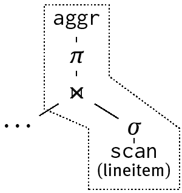

图 6.4 计划片段。

#### 6.2.1.1 数据并行架构中的发散

`GPU` 是这一理念的一种流行体现，各个应用领域均报告了惊人的性能成果。然而，以有益的方式实际利用可用的硬件资源可能颇具挑战。*发散效应* 可能在数据不完全规则时出现，从而抵消上述优势。

在本节中，我们将探讨应对发散效应导致的性能损失的机制。为理解发散问题，让我们考虑数据库查询的执行，如图 6.4 所示，以 TPC-H 基准测试集中的查询 Q10 为例。查询编译器会尝试将计划区域 `` 编译为一条直线代码序列，即 *流水线*。这样做的动机是将元组在寄存器中传播，而不是将数据溢出到（缓慢的）内存中。


执行过程中，并非所有 `lineitem` 元组都会实际遍历完整个流水线。一些元组可能会被算子（如过滤 `σ` 或连接 `⋊⋉`）*消除*。若发生这种情况，顺序处理器会立即中止流水线，继续处理下一个输入项，从而使 CPU 效率保持在峰值。

相比之下，数据并行执行后端没有提前中止流水线的选项，除非同一批工作中的*所有*元组都被消除。

图 6.5 以基于 GPU 的后端为例说明了这一效应（为便于说明，假设批次——或*“warp（线程束）”*——大小为 8）。在某次 warp 迭代中，只有 *warp 车道（lane）* 1、5 和 7 可能通过了过滤器 `σ`，导致其余五个 warp 车道处于*非活跃*状态（用虚线箭头 −−〉表示）。随后的连接操作又使另外两个 warp 车道失活，在本例中将 GPU 效率降至 [1]/[8]。

实际设置中，GPU 欠利用情况甚至更糟。要扫描一个包含 1.5 亿行的 `lineitem` 表，实际 GPU 需要 500 万次 *warp 迭代*，每次包含 32 个 warp 车道。虽然 `σ` 过滤掉了约 [2]/[3] 的行，但一个 warp 内的所有车道都变为非活跃的可能性极小。因此，（几乎）所有 500 万次 warp 迭代都会进入连接算子 `⋊⋉`。剩余行中仅有 1% 在连接时找到匹配。在实际数据集中，连接后剩余 290 万行，但它们分散在 110 万次 warp 迭代中。理想情况下，投影 `π` 和聚合 `aggr` 算子本可仅用 2.9M/32 = 90 K 次 warp 迭代处理完毕。换句话说，最先进的查询编译技术将导致 92% 的 GPU 处理能力闲置。

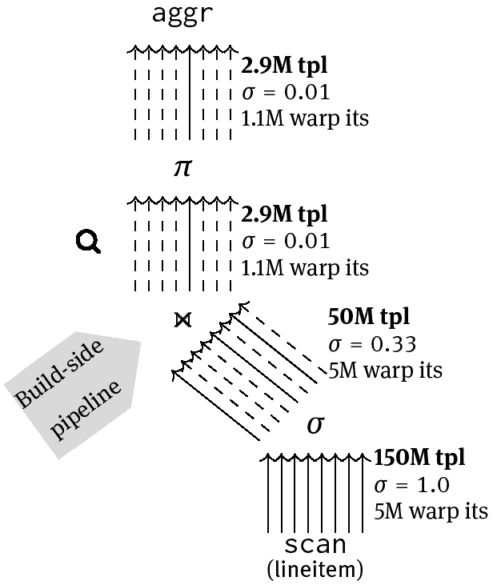

图 6.5 因过滤发散导致的 GPU 欠利用。

#### 6.2.1.2 DogQC：面向 GPU 的数据库查询编译器

由我们的查询编译器 *DogQC*[³⁸] 生成的 GPU 代码

### 6.2.2 车道重填技术

#### 发散效应与缓解技术

##### 过滤发散

发散效应（此处指：**过滤发散**）是所有现代图形处理器所体现的 SIMT（“单指令，多线程”）执行范式的结果。若干线程（或 **通道**，通常为 32 个）被分组为一个 **线程束**。在执行过程中，线程束内的 **所有** 通道执行 **相同** 的 GPU 指令。

每当某些通道或数据元素所需的处理量或处理类型与其他通道不同时，SIMT 模型就会遇到问题。在这种情况下，控制流将会 **发散**。由于线程束内的所有通道 **仍然** 执行相同的指令，部分通道将被置为 **非活跃** 状态，其计算结果将被丢弃。如上图所示，这可能导致资源利用率不足。

为了说明该效应的严重性，我们对前面展示的查询计划（图 6.5）进行了插桩，以监控标有放大镜的计划节点处的线程束利用率。图 6.6 显示了一个直方图，统计了以 1 到 32 个活跃通道的线程束利用率通过该计划阶段的线程束数量。很容易看出，只有极小部分的可用计算能力被利用；在大多数线程束中，32 个通道中仅有一两个执行了实际工作。

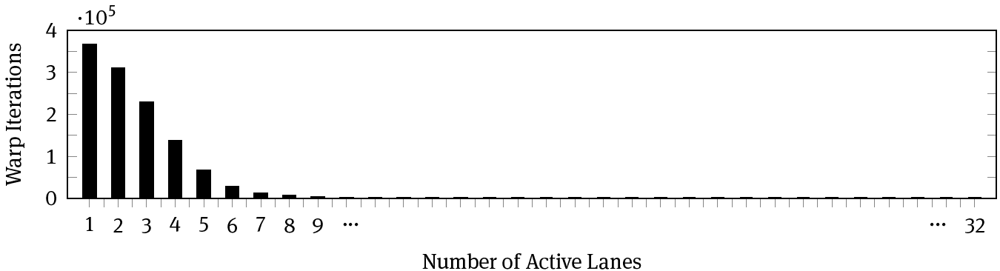

图 6.6 过滤发散下的通道活跃度分布。


图 6.7 **通道回填**：来自三次低活跃度迭代的元组被挂起至 **回填缓冲区**，并在第四次迭代中恢复以实现完全的通道活跃度。

##### 平衡算子与回填缓冲区

为应对这种情况，`DogQC` 将 **平衡算子** 注入关系查询计划。为这些算子生成的代码会在运行时检测线程束利用率不足的情况。每当利用率降至配置阈值以下时，所有剩余活跃通道的状态将被挂起至 **回填缓冲区**，并使用一组新的输入元组重新启动流水线。

图 6.7 说明了连续三次线程束迭代 ❶ 至 ❸ 的这一过程。由于这些迭代分别仅剩 2、1 和 3 个通道保持活跃，它们的状态被刷入回填缓冲区。刷新后，这些线程束迭代均被终止，处理随即使用下一组输入元组重新开始。


图 6.8 利用通道回填缓冲区整合过滤发散后的通道活跃度分布。

##### 回填

一旦足够数量的通道状态已存入回填缓冲区，该缓冲区即可用于 **回填** 已变为非活跃状态的通道。这一次，利用率不足的线程束迭代不会终止，而是在回填后以完全利用率继续处理。这在图 6.7 的步骤 4 ④ 中得以可视化。此处，下游连接算子执行后，八个线程束通道中仅剩两个保持活跃。利用回填缓冲区，剩余的六个通道可填充有效工作，从而在上游实现完全的线程束利用率。

实现层面上，`DogQC` 通过 CUDA 的 `__ballot_sync`、`__popc`（“人口计数”）和洗牌原语来支持刷新和回填。这些原语效率极高；即使只有少数线程束利用率低于阈值，平衡算子也只会带来极小的开销。

##### *通道回填* 的效果

**通道回填** 将线程束利用率恢复至较高的计算效率。在平衡算子之后，所有执行的线程束（每个网格块中的最后一个线程束除外） **保证** 具有高于配置阈值的线程束利用率。

图 6.8 通过直方图对此进行了说明，该直方图针对我们之前分析的同一计划节点（图 6.6），但这次应用了平衡算子。直方图证实了：**(a)** （几乎）不存在利用率低于 26 个通道（我们配置的阈值）的线程束；**(b)** 执行的线程束总数减少了约 10 倍。就总体执行性能而言，**通道回填** 将图 6.5 所示示例计划的执行时间提升了约 2 到 3 倍。


图 6.9 扩展发散。此处，探测侧关系中的某些行在探测侧找到的连接匹配比另一侧更多。

#### *下推并行度* 技术

`DogQC` 的 **下推并行度** 技术解决了另一种可能正交于上述过滤发散而产生的发散。**扩展发散** 是指处理线程束内每个项所需工作量不同时产生的效应。数据库 **连接操作** 是该效应常见的场景。图 6.9 右侧展示了该效应。来自右侧的探测侧元组可能各自找到不同数量的连接匹配。具体而言，在示例中，通道 6 将比其余通道有显著更多的元组需要处理。在这种情况下，现有的查询编译器会在 **同一个** 线程束通道内顺序处理单个探测侧元组的所有匹配。在示例中，执行时间将由通道 6 所有匹配的顺序处理主导。

**下推并行度** 通过将单个探测侧元组匹配的处理并行化 **跨越** 可用的线程束通道来缓解这一情况。为此，探测侧通道的执行状态被 **广播** 至各通道，如图 6.10 所示。构建侧匹配被 **分区** 分配。同样，我们利用了高效的 CUDA 原语，如 `__ballot_sync` 和 `__shfl_sync`（“洗牌同步”）。详情请参阅文献 [237]。

如图 6.11 和 6.12 所示，**下推并行度** 提高了通道利用率，并减少了完成查询所需的总迭代次数。**通道回填** 与 **下推并行度** 相辅相成，图 6.9 展示了两种发散风味共存的示例。扩展发散的另一个典型场景是 **变长数据** 的处理，特别是字符串。如果可能，`DogQC` 会将字符串的处理并行化跨越线程束通道，以提高资源利用率。


图 6.10 下推并行度示意图，将四个线程束通道的连接匹配进行扩展。


图 6.11 扩展发散下的通道活跃度。


图 6.12 采用下推并行来合并扩展分歧的通道活动分布图。


图 6.13 `DogQC` 在 TPC-H 基准测试查询（比例因子 25）上的执行时间。分歧优化提升了查询性能。

### 6.2.4 评估

借助 `DogQC`，我们提供了一个功能广泛的查询编译器，足以支持 TPC-H 基准测试集中的所有查询。在此，我们利用 `DogQC` 和数据库领域来说明上述反分歧机制，这些机制同样适用于其他数据密集型任务，包括与机器学习相关的任务。

#### 6.2.4.1 TPC-H 性能

为评估遏制分歧措施的收益，我们使用 TPC-H 基准测试集进行了一系列测量。测量基于配备 46 个流式多处理器和 8 GB 显存的 NVIDIA RTX2080 GPU，该 GPU 安装在配备 Intel i7-9800X CPU 和 32 GB 主内存的宿主系统中。作为参考，我们将 `DogQC` 与混合 CPU/GPU 系统 `OmniSci` [[545]](#backmatter-001.xhtml#b_9783110785944-010_ref_545) 进行了对比。

基准测试结果如图 6.13 所示。对于 22 条 TPC-H 查询中的每一条，柱状图表示假设数据集驻留在 GPU 内存中的查询执行时间。

对于 `OmniSci`，我们报告了执行查询所需的总挂钟时间以及 GPU 处理所花费的时间。`OmniSci` 是一种混合执行引擎，其中 CPU 和 GPU 将协同回答查询。正如图 6.13 所示，在 `OmniSci` 中，有几个查询实际上无法从 GPU 中获益太多。还请注意，`OmniSci` 仅能成功执行 22 条 TPC-H 基准测试查询中的 13 条。相比之下，`DogQC` 可以完全在 GPU 上运行所有 22 条 TPC-H 查询，执行时间最多可比 `OmniSci` 快 86 倍。

### 6.2.5 总结

在本研究中，我们测试了数据并行协处理器针对非均匀、数据密集型工作负载的处理能力。`DogQC` 引入了一些技术，使我们能够将并行处理单元与工作项优雅地对齐，即使问题严重倾斜也是如此。我们观察到，`Lane Refill`（通道回填）和 `Push-Down Parallelism`（下推并行）能够提高这些非均匀工作负载的处理效率，有时对处理吞吐量产生显著影响。

现有的查询协处理器通常通过在统一的代理（如字典键或物化屏障）上工作来避免不平衡。这导致了一种认知，即 GPU 处理不规则问题的能力有限。`DogQC` 避免了维护此类额外数据结构的开销，而是在非均匀处理过程中恢复平衡。

在此，我们基于数据库查询处理应用展示了 `Lane Refill` 和 `Push-Down Parallelism`。与最先进的平台相比，我们的原型 `DogQC` 在真实基准测试上实现了更好的资源利用率、更广的功能范围和更好的运行时性能。展望未来，我们的反分歧措施可适用于许多机器学习场景，特别是在涉及的问题严重倾斜和/或依赖非线性计算时。

## 6.3 极端多核分类

*Erik Schultheis*

*Rohit Babbar*

**摘要：** 存在一些分类问题，例如为维基百科文章分配类别，其中可能的标签集合非常大，数量达数百万。略显惊人的是，这些所谓的极端多标签分类（XMC）问题可以通过对每个标签单独应用线性分类器来相当成功地解决。这种分解为二元问题的过程称为一对其余归约。由于这些问题完全独立，简化后的任务极易并行化，可以毫不费力地分散到多个核心和节点上。训练完成后，可以通过剔除微小权重来稀疏化模型，从而仅需极小部分的内存和计算能力即可对新样本进行预测。

### 6.3.1 极端多标签分类简介

极端多标签分类（XMC）是指目标标签集合很大的监督学习，其中每个训练/测试实例仅用一小部分相关标签进行标注。包含数十万个标签的机器学习问题在各个领域很常见，例如大规模百科全书标注 [[585]](#backmatter-001.xhtml#b_9783110785944-010_ref_585)、社交媒体话题标签推荐 [[171]](#backmatter-001.xhtml#b_9783110785944-010_ref_171) 和图像分类 [[168]](#backmatter-001.xhtml#b_9783110785944-010_ref_168)。例如，所有维基百科页面都标记了一小组相关标签，这些标签从集合中一百多万个可能的标签中选择。研究表明，除了自动标注外，XMC 框架还可有效用于解决推荐系统、排序和网络广告中出现的学习问题 [9, 585]。

**符号与设定** 设训练数据 `D` := {(`x`^((1)), `y`^((1))), ..., (`x`^((`N`)), `y`^((`N`)))} 由输入特征向量 `x`[(`i`)] *∈* 𝒳 *⊆* **ℝ**[`d`] 及相应的输出向量 `y`[(`i`)] *∈* 𝒴 := {0, 1}[`m`] 组成，使得当且仅当第 `l` 个标签属于训练实例 `x`[(`i`)] 时，`y`[`l`]^((`i`)) = 1。特征向量构成特征矩阵 `X` 的行。在 XMC 设定中，目标标签集合的基数 `m`、输入维度 `d` 和数据集大小 `N` 都可能达到数十万甚至数百万的量级。

对于文本数据，输入可用词频-逆文档频率（tf-idf）特征表示。此时，特征空间的维度由词汇表大小决定，且对于每个文本 `x` *∈* 𝒳，仅当对应单词出现在文本中时，特征 `x`[`j`] 才为非零。因此，输入特征高度稀疏。特征的大小由单词在文档和整个语料库中出现的频率决定。有关 tf-idf 的详细信息，请参阅 Manning、Raghavan 和 Schütze 的著作 [[463]](#backmatter-001.xhtml#b_9783110785944-010_ref_463)。


图 6.14 XMLC 数据集中的标签频率。X 轴显示按正实例频率排序后的标签秩，Y 轴给出数量。

同样，对于任何给定实例 `x`[(`i`)]，仅一小部分标签是相关的，`‖y`[(`i`)]`‖`[1] *≪ m*。此外，某标签相关的实例数量极不平衡：少数标签与许多实例相关，但大多数标签仅适用于极小比例的实例。这导致了如图 6.14 所示的*长尾*标签分布。极少正例的标签称为*尾部标签*。XMC 中知名基准数据集的特征见表 6.4。

在传统的多标签分类中，目标是学习一个形式为向量值输出函数 `h: ℝ^d ↦ {0,1}^m` 的多标签分类器。在 XMC 中，通常希望将分类器限制为预测固定数量的标签，因为例如 Web 界面中用于建议相关搜索的槽位数量可能是固定的。这导致了分类函数 `h_k: ℝ^d ↦ y_k := {y ∈ y : ||y||_1 = k}`。此类函数通常通过首先学习评分函数 `r: ℝ^d ↦ ℝ^m`，然后将得分最高的 `k` 个标签作为预测来构建。

#### 评估指标

由于标签向量的极度稀疏性，准确率等指标在 XMC 中不具备信息量。相反，通常使用关注预测的 `k` 个标签的指标。最常用的是 `k` 时的精确率，记为 P@k，以及归一化折损累积增益，记为 nDCG@k [\[50\]](#backmatter-001.xhtml#b_9783110785944-010_ref_050)。设 `ℝ^m ∋ ŷ = r(x)` 为具有相应标签向量 `y` 的实例的预测分数。这些指标定义如下：

**表 6.4** 来自 XMC 存储库的多标签数据集 [\[50\]](#backmatter-001.xhtml#b_9783110785944-010_ref_050)。APpL 和 ALpP 分别代表每个标签的平均点数和每个点的平均标签数。

| Dataset | #Training | #Features | #Labels | APpL | ALpP |
| --- | --- | --- | --- | --- | --- |
| AmazonCat-13K | 1,186,239 | 203,882 | 13,330 | 448.6 | 5.0 |
| AmazonCat-14K | 4,398,050 | 597,540 | 14,588 | 1,330.1 | 3.5 |
| Amazon-670K | 490,449 | 135,909 | 670,091 | 4.0 | 5.5 |
| Wiki10-31K | 14,146 | 101,938 | 30,938 | 8.5 | 18.6 |
| Delicious-200K | 196,606 | 782,585 | 205,443 | 72.3 | 75.5 |
| WikiLSHTC-325K | 1,778,351 | 1,617,899 | 325,056 | 17.5 | 3.2 |
| Wikipedia-500K | 1,813,391 | 2,381,304 | 501,070 | 24.8 | 4.8 |

(6.4) `P@k(y, ŷ) := (1/k) ∑_{l ∈ rank_k(ŷ)} y_l` (6.4)


(6.5) `nDCG@k(y, ŷ) := (∑_{l ∈ rank_k(ŷ)} y_l / log(R_l(ŷ) + 1)) / (∑_{l=1}^{min(k, ||y||_1)} 1 / log(l + 1))` (6.5)

其中 `rank_k(y)` 返回按降序排列的 `y` 中最大的 `k` 个索引，`R_l` 给出第 `l` 个索引的排序。注意，与 P@k 不同，nDCG@k 考虑了正确预测标签的排序。例如，如果五个标签中只有一个被正确预测，无论该正确预测的标签位于第 1 位还是第 5 位，P@5 给出的分数相同。相比之下，如果预测在第 1 位，nDCG@5 给出较高分数，在第 5 位则给出最低的非零分数。

### 6.3.2 线性一对多模型的并行训练

上述引入的 P@k（公式 6.4）和 nDCG@k（公式 6.5）指标是不可微的，因此不能直接用于典型的基于梯度的经验风险最小化过程中。然而，可以证明为了实现 `k` 时精确率的最优预测，只需以一种方式训练评分函数 `r`，使得分数成为标签边缘概率的严格单调变换 [\[486\]](#backmatter-001.xhtml#b_9783110785944-010_ref_486)。因此，可以通过独立应用分类校准³⁹ 损失函数 `l_BC` 来训练分类器：

(6.6) `min_r ∑_{i=1}^N ∑_{l=1}^m l_BC(y_l^(i), r_l(x^(i)))` (6.6)

这种分解称为“一对多”归约。

#### 线性一对多的目标函数

如果评分函数 `r` 是线性的，这个表达式会变得特别有利。在这种情况下，最小化任务分解为 `m` 个完全独立的子任务：

`∀ l ∈ [m] : min_{w^(l) ∈ R^d} ∑_{i=1}^N l_BC(y_l^(i), x^(i)^T w^(l))` (6.7)

由于训练任务具有“令人尴尬的并行”特性，计算可以轻松扩展以使用数千个计算核心。通过 DiSMEC 算法 [\[30\]](#backmatter-001.xhtml#b_9783110785944-010_ref_030) 演示了这种方法的可扩展实现，该算法是围绕 Liblinear 求解器 [\[210\]](#backmatter-001.xhtml#b_9783110785944-010_ref_210) 的多标签包装器，并产生了最先进的预测性能。在 DiSMEC 中，底层的二元损失是带有额外 `l_2` 正则化项的平方合页损失。其目标函数为：

(6.8) `∀ l ∈ [m] : min_{w^(l) ∈ ℝ^d} (||w^(l)||_2² + c ∑_{i=1}^N (max(0, 1 - s_l^(i) x^(i)^T w^(l)))²)` (6.8)

其中 `c ∈ ℝ[>0]` 是控制经验误差与模型复杂度之间权衡的参数，`s_l^(i) := 2 y_l^(i) - 1` 是表示为 `{+1, -1}` 的标签。

一种类似的方法是 ProXML [\[29\]](#backmatter-001.xhtml#b_9783110785944-010_ref_029)，它将 `l_2` 正则化切换为 `l_1` 正则化，以诱导对输入样本中 `l_∞` 扰动的鲁棒性。这种鲁棒性对于尾部标签特别有帮助，因为尾部标签拥有极少的正向训练实例。因此，ProXML 的目标函数为：

(6.9) `∀ l ∈ [m] : min_{w^(l) ∈ ℝ^d} (||w^(l)||_1 + c ∑_{i=1}^N (max(0, 1 - s_l^(i) x^(i)^T w^(l)))²)` (6.9)

假设我们现在有一个方法 `𝒜: (X, s) ↦ w_*^(l)` 可用于在单线程中高效解决这些单独的问题（这将在 第 6.3.3 节 中讨论）。那么可以使用以下框架将训练过程扩展到多个核心和节点：

#### 两级并行化

由公式 (6.8) 和 (6.9) 定义的优化问题的分布式训练是使用两层并行化架构实现的。在顶层，标签被分成批次，例如 `M = 1000`，这些批次可以在可用的计算节点上独立并行处理，如果批次数量超过节点数量，则顺序处理。在每个节点上，使用多线程并行化一个包含 `M` 个标签的批次的训练，这构成了第二层并行化。

在每个 `W[⋆]^(l)` 训练完成后，会剪除幅度较小的权重，从而大幅减小整体模型尺寸，通常超过 99%。由于这可以在 `W[⋆]^(l)` 计算完成后立即执行，因此无需存储完整的稠密模型，即使是针对单个批次也是如此，这降低了算法对 RAM 的需求。遗憾的是，在典型的稀疏矩阵格式（如压缩稀疏行/列矩阵）中，无法由多个线程并行插入新值，因为这可能需要重新分配内存并移动矩阵其他部分的数据。因此，我们将稀疏权重矩阵表示为一个独立分配的稀疏向量数组，这些向量可以独立写入。

双层分布式训练框架总结在算法 4 中。

**算法 4：** DiSMEC 和 ProXML 求解器中面向硬件的极易并行训练框架。两个循环的迭代均相互独立，因此可以并行运行。

**输入：** 稀疏表示的训练数据 `D = {(x¹, y¹) ... (x^(N), y^(N))}`，输入维度 `d`，标签集 `{1 ... m}`，批次大小 `M`

**输出：** 稀疏格式的学习矩阵 `W ∈ ℝ^(d×m)`

```
// 第 1 层并行化；独立节点
1 for {b = 0; b < floor(m/M) + 1; b++} do
2   将特征矩阵 X 的单个副本加载到主内存
3   准备包含 M 个稀疏向量的数组 W[b]
// 第 2 层并行化；独立线程
4 for {l = b × M; l ≤ (b + 1) × M; l++} do
5   生成二进制符号向量 s^(l) = {+1,−1}[i=1]^(N)
6   在单个核心上使用 A(X, s^(l)) 训练权重向量 W[⋆]^(l)
7   剪除 w^(l) 中的小权重
8 return W[d, M]
9 return W
```

与仅运行 `m` 个现成的二分问题求解器实例相比，双层并行化的一个优势在于，特征矩阵 `X` 可以在同一节点上运行的所有训练作业之间共享。这使我们能够将整个数据集（可能高达数 GB）保留在主内存中。然而，在拥有大量核心的现代 CPU 上，或在双路配置的节点上，这可能会因*非一致性内存访问*（NUMA）而导致问题。在这样的系统中，整体 RAM 被划分为多个区域，称为 *NUMA 域*。尽管系统中的所有核心都可以访问全部内存，但访问不同域的延迟会因核心到域的距离而异。图 6.15 给出了一个 NUMA 设置的示例。


图 6.15 双路 64 核 AMD Rome 7H12 系统中的 NUMA 内存。每个 CCD 包含 8 个核心，每个核心仅对其自身 NUMA 域（虚线标记）内的内存拥有最快访问速度。图片由 CSC - IT Center for Science 提供，遵循 CC-BY-4.0 协议。

在这样的设置中，特征矩阵的单个副本将被系统上的所有核心访问，迅速成为内存总线的瓶颈，导致程序无法高效利用可用的 CPU 核心。这可以通过将线程绑定到其 CPU 核心，并在每个 NUMA 域中复制一份特征矩阵来缓解。这样，每个线程都可以从其本地域读取特征矩阵，降低延迟，并将内存读取分散到不同的内存模块中，提高吞吐量。为了实现这一点，外层并行化必须针对 NUMA 域而非物理节点来执行。

### 6.3.3 使用共轭梯度的二阶优化

目标方程 6.8 可以使用二阶优化在批量模式下进行最小化。与流行的（随机）梯度下降策略相比，二阶优化能够考虑损失地形的曲率，因此能在少得多的迭代次数内收敛到最小值。然而，每次迭代的计算量要大得多，因为二阶信息编码在可能非常大的海森矩阵中。幸运的是，可以在从未实际形成海森矩阵的情况下实现此过程，下文将对此进行描述。

去掉标签索引后，我们可以写成

(6.10) `R_D[w] = w^⊤w + c∑_{i=1}^N l_SH(s_i x^(i)⊤w)` (6.10)

其中 `l_SH` 是平方合页损失

`l_SH(r) = max(0, 1 − r)²`。 (6.11)

注意该目标函数是凸的。因此，无论起始点如何，优化器都将收敛到全局最优。

**确定下降方向** 二阶优化的主要思想是使用目标函数的二次泰勒近似在局部对其进行逼近

(6.12) `R_D[w + δ] ≈ R_D[w] + ∇R_D[w]δ + 0.5δ^⊤∇²R_D[w]δ`。 (6.12)

因此，在此近似下理想的（即通向最小值的）步长 `δ[⋆]` 可以通过求解线性系统来计算

(6.13) `∇²R_D[w]δ[⋆] = −∇R_D[w]`。 (6.13)

对于方程 6.8，梯度和海森矩阵具有简单的结构形式 [239, 368]

`∇R_D[w] = 2w + c∑_{i=1}^N l'_SH(s_i x^(i)T w) s_i x` (6.14)

(6.15) `∇²R_D[w] = 2I + cX^⊤DX`， (6.15)

其中 `I` 是单位矩阵，`X = [x¹, ..., x^(N)]^T` 是数据矩阵，`D` 是对角矩阵，其元素为 `D[ii] = l''_SH(s_i x^(i)T w)`。

海森矩阵的大小为 `N × N`，因此将大到无法存储在内存中。幸运的是，方程 6.13 可以使用共轭梯度过程求解，该过程仅需要海森-向量积。由于 `X` 是一个非常稀疏的矩阵，这些积可以通过以下方式高效计算

(6.16) `∇²R_D[w]δ = 2δ + cX^⊤D X δ`， (6.16)

在实践中，方程 6.13 仅近似求解，从而大幅减少了需要计算的共轭梯度迭代次数，进而减少了海森-向量积的计算次数。

**确定步长** 生成的步向量 `δ` 可能位于二次近似（见方程 6.13）无法准确建模真实风险地形 `R_D[w]` 的区域之外。因此，通常需要一种步长机制，即使用信域法或进行线搜索。

由于排序函数 `r(x; w) = x^T w` 的线性性质，线搜索可以通过以下方式高效实现

(6.17) `r(x; w + λδ) = x^⊤w + λw^⊤δ` (6.17)

(6.18) `||w + λδ||_2² = ||w||_2² + 2λw^⊤δ + λ²δ^⊤δ`。 (6.18)

通过缓存 `∥w∥[2]²`、`w^⊤δ`、`δ^⊤δ`、`x^⊤w` 和 `x^⊤δ` 的值，首次评估后，针对任意 `λ` 值评估损失的开销降为 `O(N)` 次 `ℓ[SH]` 评估，以及公式 6.17 和 6.18 中缓存值对应的加法和乘法运算。

#### 铰链损失中的隐式困难实例挖掘

当使用平方铰链损失（见公式 6.11）作为 `ℓ[SH]` 时，一旦样本被正确分类且具有足够的间隔，损失及其所有导数均变为零。

因此，完整特征矩阵 `X` 每步仅需用于一次确定梯度 `∇R[D][w]`、`D` 和困难样本 `ℰ`。之后，每次 CG 迭代仅需缩减矩阵 `X̃`。这可以理解为在每步开始时执行的一个隐式困难实例挖掘步骤。随着权重向量 `w` 接近最优权重 `w[*]`，大多数实例将拥有足够的间隔，仅剩少量困难实例，即 `|ℰ| ≪ N`（参见图 6.16）。因此，后期迭代所需的计算时间显著少于早期迭代。事实上，正如下文所述，使用一个使得困难样本集 `𝒜` 已经很小的初始向量 `w[0]`，可以极大地加快总体计算时间。

### 6.3.4 进一步的性能改进

#### 均值分离初始化

改进初始权重向量的一种简单尝试是选择一个超平面，该超平面将该标签下正负实例的均值分开。记 `P := {x^(i): i ∈ [N], y^(i) = 1}` 和 `x̄ := N^(-1) Σ_(i=1)^N x^(i)`，则均值为：

(6.19) `p̄ := (1/|P|) Σ_(x∈P) x`，`n̄ := (N x̄ - |P| p̄) / (N - |P|)`。


图 6.16 海森矩阵计算的稀疏性 `|ℰ|/N`（左）和每次优化迭代的平均持续时间（右）随迭代索引变化的曲线，对比零初始化和均值分离初始化。

由于 `x̄` 仅需针对数据集计算一次，且因数据不平衡 `|P| ≪ N`，`p̄` 可快速计算，因此这些值可高效得出。

此过程可视为数据摘要（参见第 3 章）的一个极端情况，其中整个数据集被缩减为仅两个实例。思路是求解这个极小的分类问题，并将其解作为求解完整问题的起点。如果简单的解已经正确分类了许多简单的负实例，这将特别有用，因为在这种情况下困难样本集 `ℰ` 将很小。

对于两个数据点，分类问题可显式求解，我们称其结果为*均值分离初始化*（msi）向量 `w[msi]`。该向量是达到预设间隔 `μ[±]` 以对这两个数据点进行分类的最小范数向量。因此，它位于由 `x̄` 和 `p̄` 张成的平面内，并由以下方程刻画：

(6.20) `w_msi = α x̄ + β p̄`

(6.21) `p̄^⊤ w_msi = μ_+`，`n̄^⊤ w_msi = μ_-`

根据经验，`μ_+ = +1`，`μ_- = −2` 效果较好，其依据是负样本在实例空间覆盖更大的体积，因此初始决策边界应更靠近正样本均值而非负样本均值。

该方法的有效性可从图 6.16 看出，该图在 AMD Rome 7H12 CPU 上使用 AmazonCat-13k 数据集评估了两种初始化策略。

*   从零初始向量开始，非零元素比例起始于 100%，并随训练进展而下降；
*   从均值分离初始向量开始，稀疏性在初期即已很高；且
*   稀疏性的增加转化为显著的计算时间减少和相应的节能。

就时钟训练时长 `t_wc` 而言，从 `0` 切换到 `w[msi]` 所能达到的加速比，定义为 `t_wc(0)/t_wc(w[msi])`，如表 6.5 所示，介于 150% 和 500% 之间。

#### 特征排序

每次迭代开始时，计算初始间隔 `X[T]w` 占据了大部分计算时间。由于 `X` 是稀疏矩阵，该计算的算术密度较低；又因特征维度通常极大，向量 `w` 无法放入 L2 缓存。这两个特性意味着该操作严重受限于内存带宽。

通过利用数据集特性——特别是典型 XMC tf-idf 数据集的特征向量呈长尾分布，即某些特征拥有大量非零条目，但大多数特征非零很少——可以显著改善 `w` 的缓存行为。通过按特征出现频率对特征索引进行排序，`w` 中对应的条目在内存地址空间中被拉近，从而改善了缓存行为。

虽然这对性能随线程数的扩展规律无影响，但确实带来了绝对加速，如图 6.17 中虚线所示。

#### 内存瓶颈

在多核机器上，此处所呈现计算的性能受限于内存带宽。这在图 6.17 中可见，尽管计算具有“尴尬并行”特性，但一旦核心数超过一定阈值，性能扩展即呈亚线性。

在 2 路 AMD Rome 7H12（每 CPU 64 核，参见图 6.15）机器上运行计算的具体情况下，图 6.17 显示从 8 线程（对应每 NUMA 节点 1 线程）到 32 线程（对应每 L3 缓存 1 线程）几乎完美扩展。对于更高的线程数，加速比趋于饱和，某些情况下线程过多甚至会损害性能。

#### 6.3.4.1 与深度学习方法的比较

如表 6.6 所示，算法 4 中描述的、极易并行化的“一对其余”框架的 DiSMEC 实例化可以成为一个有竞争力的基线。与通常采用 Transformer 编码器[\[174\]](#backmatter-001.xhtml#b_9783110785944-010_ref_174)的最先进深度学习方法相比，其性能并无显著劣势。与需要仔细调整超参数的深度学习模型不同，DiSMEC 所依赖的线性二分类从理论角度来看更易于解释且理解透彻。对于稀疏的 tf-idf 数据表示，线性 XMC 分类器的表现也与基于树的方法[\[371, 584\]](#backmatter-001.xhtml#b_9783110785944-010_ref_371)以及涉及稠密低维标签嵌入的方法[\[51, 279\]](#backmatter-001.xhtml#b_9783110785944-010_ref_051)不相上下。

### 6.3.5 总结与展望

在本节中，我们介绍了用于极端多标签分类的线性分类算法。线性模型使得训练能在不同标签间完美并行化，尽管在实践中，当单个节点内的核心数过多时，扩展性会趋于平稳。这是因为尽管训练本身不需要线程间的任何通信或同步，但机器内的不同核心仍会竞争内存访问等资源。通过在每个 NUMA 域中放置一份特征矩阵的副本，可以确保每个 CPU 都能从其访问速度最快的内存部分读取数据，并且内存接口的负载分散在不同的 NUMA 域中。此外，通过重新排序稀疏特征矩阵中的列，可以提高数据局部性，从而改善缓存效率。结合这些技术的实现可在 `https://doi.org/10.5281/zenodo.6699587` 找到。关于机器学习与内存层级交互的进一步讨论，请参见第 7 章。

通过从良好的初始化开始权重，可以大幅减少为 XMC 典型的高度不平衡数据训练线性分类器所需的工作量。寻找此类权重向量的一种方法是将数据集缩减为仅两个训练实例，即原始数据集中正负训练点的质心，这可以高效计算。通过用分离该汇总数据的权重向量初始化完整训练过程，可以利用共轭梯度优化器因铰链损失的隐式难例挖掘而带来的加速。该过程可视为第 3.2 节中介绍的“草图求解”原则的一种变体。主要区别在于，此处基于草图的解被用于初始化完整训练，因此不会在精度上做出妥协。


本书的阐述侧重于 XMC 问题的计算与实现挑战。然而，标签空间的规模也导致了有趣的统计后果，例如长尾标签分布及尾部标签相应的数据稀缺，以及带有缺失标签的不完整训练数据。关于这些问题的讨论，请参阅 Babbar 和 Schölkopf[\[29\]](#backmatter-001.xhtml#b_9783110785944-010_ref_029)、Jain、Prabhu 和 Varma[\[336\]](#backmatter-001.xhtml#b_9783110785944-010_ref_336) 以及 Qaraei、Schultheis、Gupta 和 Babbar[\[587\]](#backmatter-001.xhtml#b_9783110785944-010_ref_587) 的著作。

## 6.4 现代多核系统上的机器学习优化

**Helena Kotthaus**

**Peter Marwedel**

## 摘要

本节演示了底层硬件平台知识与学习算法知识的融合如何提供仅靠单一类型知识无法实现的结果。具体而言，本节展示了多核系统上机器学习算法的优化，并以此解决了第 6.3 节中涉及的同类架构问题。该优化基于并行机器学习算法的资源感知调度策略。重点在于基于模型的优化（MBO），也称为贝叶斯优化，这是一种资源需求巨大的机器学习算法，包含大量计算作业。通过估算这些作业的执行时间，以实现它们在并行处理器上的调度。本节证明了这种调度能够在给定时间预算内处理更大规模的问题，并减少固定问题规模下的端到端墙钟时间。

### 6.4.1 动机

资源受限系统的概念通常与小型、集成的特殊用途设备相关联，这些设备在计算能力、尺寸或嵌入式及网络物理系统中的电池寿命等方面存在限制。然而，将资源限制的理解局限于此类系统是不明智的。事实上，即使是高性能计算机和集群，在解决需要海量资源的高难度问题时，也会遭受资源约束 [166, 666]。因此，对于通常在大型系统上执行的应用，考虑资源约束也是合理的。

此处以*并行* MBO 为例进行说明。MBO 是一种用于评估代价高昂的黑盒函数的最先进全局优化方法。为减少对黑盒函数的必要评估次数，传统 MBO 利用一组已评估配置上迭代细化的回归模型来近似目标函数。然而，此类方法忽略了模型空间中评估不同配置的异构资源需求，这往往导致资源利用率低下。这呼唤新的资源感知调度策略，以根据配置的资源需求高效地将其映射到底层并行架构上。与经典调度问题不同，MBO 的调度需要与配置提议机制交互，以选择资源需求适合并行评估的配置。

并行 MBO 的基础及相关方法见第 6.4.2 节。第 6.4.3 节概述了 RAMBO（资源感知 MBO）框架，包括资源感知调度策略，以及在同构多处理器集群系统上的相应评估结果。第 6.4.4 节提出了异构嵌入式系统上资源感知调度策略的概念。结果见第 6.4.5 节。

### 6.4.2 并行 MBO 的基础与现状

在机器学习中，为给定优化问题选择最佳算法并同时调整这些算法的相应超参数，计算量可能非常大。已开发出许多超参数优化策略。（综述见例如 [[55]](#backmatter-001.xhtml#b_9783110785944-010_ref_055)）。超参数优化是指寻找模型的最佳配置 `θ`，例如针对预测问题，寻找在独立测试集上具有高预测性能的模型。当单个配置的评估已需要大量资源（例如极长的运行时间）时，像进化算法这样非常浪费的优化方法就不适用了。算法选择的一种流行方法是 F-racing [[448]](#backmatter-001.xhtml#b_9783110785944-010_ref_448)，其中一组配置相互竞争，表现不佳的候选者被迭代淘汰。该方法在算法早期阶段也需要大量评估。

在昂贵的时间约束情况下，一种成熟的替代方案是基于模型的优化（MBO），也称为贝叶斯优化，这是一种用于昂贵黑盒优化的最先进技术。在此优化过程中，对一个未知函数（例如机器学习算法）进行评估，以在有限的时间预算内，根据给定的性能标准，找到输出质量最高的参数配置。由于需要考虑的巨大参数空间，该过程在计算上极具挑战性，并可能导致极长的响应时间。因此，在保持预测质量的同时减少优化时间是可取的，即 `θ* := argmin[θ∈Θ] f(θ)`，其中 `Θ` 为搜索空间，`f(θ)` 为输入 `θ ∈ Θ` 时黑盒的评估 [[348]](#backmatter-001.xhtml#b_9783110785944-010_ref_348)。为了减少寻找最佳配置 `θ*` 所需的 `f` 评估次数，我们使用了一个迭代细化和更新的回归模型（代理模型），它试图基于 `f` 的先前评估来预测 `f(θ)`，从而近似黑盒函数。在每次迭代中，一个所谓的*填充准则*（获取函数）会提议新的有前景的配置进行评估。

在其原始公式中，MBO 算法纯粹按顺序运行，依次提议一个配置进行评估 [[348]](#backmatter-001.xhtml#b_9783110785944-010_ref_348)。对于机器学习算法的超参数调优或计算机仿真等应用，MBO 的并行化已成为一种日益有趣的方法，以降低总体执行时间 [[288]](#backmatter-001.xhtml#b_9783110785944-010_ref_288)。为了在并行 MBO 设置中同时提议多个点（配置），已建议对填充准则或通用技术进行多种修改。这些修改导致每次迭代中提议多个配置 [54, 254, 328]。同时提议的配置数量通常选择与可用 CPU 核心数相匹配。然而，这些修改通常忽略了并行评估模型空间中不同配置的异构资源需求。根据所应用机器学习算法的参数配置，CPU 利用率或内存占用等资源需求可能会有很大差异 [[666]](#backmatter-001.xhtml#b_9783110785944-010_ref_666)。

MBO 最重要的并行扩展以同步或异步方式更新回归模型。这两种变体均基于不同的填充准则，并各有优缺点。

#### 同步执行

为了允许在同步模型更新中实现并行化，人们提出了每次迭代提出多个配置的填充准则和技术（常数骗子法、克里金信徒法、qEI [\[254\]](#backmatter-001.xhtml#b_9783110785944-010_ref_254)、qLCB [\[328\]](#backmatter-001.xhtml#b_9783110785944-010_ref_328)、MOI-MBO [\[54\]](#backmatter-001.xhtml#b_9783110785944-010_ref_054)）。*多点建议*能够从*代理模型*同时推导出 *q* 个配置建议 **x**[1]^⋆, …, **x**[*q*]^⋆，而不仅仅是提出一个配置 **x**[\*]。在这里，模型在一次迭代内的所有评估完成后进行更新。Hutter 等人 [\[328\]](#backmatter-001.xhtml#b_9783110785944-010_ref_328) 引入了 qLCB 准则，这是单点 LCB 准则的扩展，它利用指数分布随机变量，通过从指数分布中抽取 *λ[j]* ∼ Exp(*λ*) (*j* = 1, ..., *q*) 的随机值来生成 *q* 个不同的候选建议：

(6.22) *q**L**C**B*(**x**,*λ*[*j*])=*μ̂*(**x**)−*λ*[*j*]*Ŝ*(**x**) with *λ*[*j*] ∼ *E**x**p*(*λ*). (6.22)

*λ* 变量指导探索-利用权衡。采样多个不同的 *λ[j]* 可能会通过改变标准差项的影响而导致不同的“良好”配置。

另一种流行的多点填充准则是 qEI 准则 [\[254\]](#backmatter-001.xhtml#b_9783110785944-010_ref_254)，它直接在 *q* 个点上优化单点 EI 准则。由于 EI 的计算使用蒙特卡洛采样，因此计算成本相当高 [\[136\]](#backmatter-001.xhtml#b_9783110785944-010_ref_136)。因此，通常会选择一种开销较小的替代方案，即*克里金信徒*法 [\[254\]](#backmatter-001.xhtml#b_9783110785944-010_ref_254)。在这里，第一个配置是基于标准单点 EI 准则提出的。其后验均值被视为 *f* 的真实值，用于重新拟合代理模型，通过再次使用 EI 以降低标准差来惩罚下一个点建议周围的区域。这会重复进行，直到生成 *q* 个建议。

当并行执行的评估具有异构执行时间时，上述多点填充准则可能导致资源利用效率低下。在提出新配置之前，会收集一次迭代内所有评估的结果以更新模型。因此，最慢的评估成为瓶颈，所有其他并行工作进程在完成评估后都会空闲等待，直到新的 MBO 迭代开始。然而，每次 MBO 迭代仅执行一次模型更新也会导致较少的计算开销。Snoek 等人 [\[635\]](#backmatter-001.xhtml#b_9783110785944-010_ref_635) 已经解决了并行评估执行时间变化的问题，他们建议用一个额外的代理模型来建模这些时间，从而得出“每秒预期改进”，倾向于开销较小的配置。本节介绍的并行 MBO 资源感知调度策略也使用回归模型来估算资源需求，但它们不是调整填充准则，而是利用它们来指导并行评估的调度。目标是以更快、更资源高效的方式引导 MBO 进入有趣的区域，而不直接偏向开销较小的配置。

#### 异步执行

为了避免 CPU 空闲，异步执行用每次评估后重新拟合模型来替代批量评估多个配置和同步重新拟合模型。在这里，工作进程的数量等于可用 CPU 核心的数量，但每个工作进程独立提出下一个待评估的点，即使配置 **x**[busy] 当前正在其他 CPU 核心上接受评估。主要挑战是通过修改填充准则来处理当前正在评估的点，以避免对非常相似的配置进行评估。基于 EI 的快速克里金信徒法 [\[254\]](#backmatter-001.xhtml#b_9783110785944-010_ref_254)（也用于多点建议）可以应用于屏蔽这些区域。

另一种评估待定值的方法是*期望* EI (EEI) [253, 339, 635]。在这里，通过蒙特卡洛采样计算 *y*[busy] 的期望值，将未知的 *f* (**x**[busy]) 值积分掉，这与 qEI 类似，计算量很大。对于每次蒙特卡洛迭代，从代理回归模型在 **x**[1,busy], ..., **x**[*μ*][,busy] 处的后验分布中抽取值 *y*[1,busy], ..., *y*[*μ*][,busy]，其中 *μ* 表示待定评估的数量。这些值与已知评估集合结合，用于拟合代理模型。然后可以通过平均每个蒙特卡洛样本形成的单个期望改进值来简单地计算 EEI（*n*[sim] 表示蒙特卡洛迭代次数）：

(6.23) $\\hat{{EEI}(\\mathbf{x})} = \\frac{1}{n\_{\\text{sim~}}}{\\sum\\limits\_{i = 1}^{n\_{\\text{sim~}}}\\text{EI}\_{i}}(\\mathbf{x})$ (6.23)

除了提高 CPU 利用率的优势外，异步执行还可能由于模型更新次数增加和新点建议的计算成本而导致额外的运行时开销，尤其是在可用 CPU 核心数量增加时。此外，作业配置的异构执行时间可能导致基于相似历史的模型更新产生非常相似的点建议。本节介绍的新方法不是使用异步执行来高效利用并行计算机架构，而是结合同步执行与资源感知调度。下一节将把这种方法 (RAMBO) [385, 389, 390, 666] 与上述 MBO 的同步和异步并行变体进行比较。

### 6.4.3 资源感知调度策略

为了实现资源感知调度策略与通用 MBO 过程之间的交互，提出了 RAMBO 框架。其基础基于 `mlrMBO` 库 [\[53\]](#backmatter-001.xhtml#b_9783110785944-010_ref_053)。图 6.18 所示的框架旨在以资源高效的方式减少并行 MBO 所需的端到端墙钟时间，从而更快地收敛到最优配置。RAMBO 包含三个主要步骤：

![Fig. 6.18 资源感知模型优化框架中的关键步骤（蓝色显示）[\[385\]](#backmatter-001.xhtml#b_9783110785944-010_ref_385)：构建回归模型、选择评估作业和作业调度。支持异步执行（虚线）和同步执行（实线）。](graphic/b_9783110785944-006_fig_018.png)

图 6.18 资源感知模型优化框架中的关键步骤（蓝色显示）[\[385\]](#backmatter-001.xhtml#b_9783110785944-010_ref_385)：构建回归模型、选择评估作业和作业调度。支持异步执行（虚线）和同步执行（实线）。

首先，通过 `MBO 方法` 构建一个先前初始化的回归模型。同时，`作业效用估计器` 通过一个额外的回归模型为配置（`作业`）的评估创建概况。这些 `作业概况` 包含运行时间估计，稍后将作为相应调度策略的输入。在传统的同步 MBO 方法中，此类运行时间估计是不可用的。因此，最慢的评估会成为一个 MBO 迭代中的瓶颈，而已经完成的并行工作进程则保持空闲。结果，所有空闲进程的反馈以及模型更新都会被延迟。

第二步，即 `作业选择`，遵循 MBO 原则进行配置提议。通常，使用如公式 (6.22) 中的 `qLCB` 这样的 `填充准则` 来提出配置，这些配置在预测输出（`开发`）和对搜索空间区域的不确定性（`探索`）之间提供适当的折衷，即具有优化回归模型质量的高潜力。为此，`RAMBO` 提供了与作业提议机制交互的机制，通过推迟或跳过被认为前景不足或具有不合适作业概况的建议配置。作为该过程的一部分，可以应用基于背包的启发式算法来选择最有前景且最合适的配置。

最后，可配置的 `调度策略` 根据作业特定的资源需求，将作业分配给可用资源（系统描述）。此外，基于填充准则的执行优先级是必需的，以确保模型 i) 使用最有前景的配置以及 ii) 尽快更新。此模型更新遵循同步方法，即在收集到一个 MBO 迭代中执行的所有作业的结果时执行。简而言之，回归模型基于所有先前迭代的结果迭代更新，直到运行时间预算耗尽。

#### 作业选择的优先级

为了建模候选者对目标函数的有用性，使用 `Kriging` 作为替代回归模型，并使用 `qLCB` (6.22) 作为多点填充准则来生成一组作业提议。与多点提议 `qEI` [\[254\]](#backmatter-001.xhtml#b_9783110785944-010_ref_254) 相比，`qLCB` 准则更为合适，因为它能够提出一组独立的候选者。`qLCB` 可以通过从指数分布中抽取 `q` 个 `λ[j] ∼ Exp(λ)` (`j` = 1, ..., `q`) 的随机值，同时生成 `q` 个候选者。每个 `λ[j]` 都会导致开发（`λ[j] ↓`）和探索（`λ[j] ↑`）之间的不同权衡，从而在求解后得到不同的最优配置 **x**[j]^⋆：

```
(6.24) x_j^* := argmin_x [ LCB(x, λ_j) ] = argmin_x [ ŷ(x) - λ_j ŝ(x) ]  (6.24)
```

其中 ŷ(**x**) 表示替代模型在点 **x** 处的后验均值，ŝ(**x**) 表示替代模型在点 **x** 处后验标准差的平方根。

由于提议的候选者集合 **x**[j]^⋆ 无法直接按候选者的前景程度排序，因此引入了额外的顺序，以引导对最佳候选者的搜索向更有前景的区域。因此，使用最小 `λ[j]` 值提出的候选者 **x**[j] 获得最高优先级，因为它最接近最优解（开发）。每个作业的优先级定义为 `p[j] := −λ[j]`。

然而，`qLCB` 不包含对所选配置邻近性的惩罚，如果并行评估的数量很高，这可能会成为一个问题。因此，使用欧几里得距离将 `p[j]` 重新排序为 `p̃[j]`，鼓励选择在域空间中更分散的配置。

首先，从 `qLCB` 准则中采样一组 `q > m` 个配置。然后，使用全链接法，根据这些配置在目标函数域空间中的距离对其进行层次聚类。该过程从先前被分配最高优先级的配置开始，并将其分配到选定作业列表 `J̃` 的第一个位置。对于每个后续步骤 `i ≥ 2`，根据层次聚类将所有候选者分成 `i` 个簇。在这 `i` 个簇中，丢弃已包含已分配位置候选者的 `i − 1` 个簇，剩下一个簇。将位置 `i` 在 `J̃` 中分配给该簇中优先级最高的作业。此过程持续进行，直到所有 `q` 个候选者都被分配了位置。

由此生成一个遵循聚类诱导的层次结构的排序。最后，根据 `J̃` 的顺序分配新的优先级 `p̃[j]`，即 `J̃` 中的第一个作业获得最高优先级 `q`，最后一个作业获得优先级 1。

结果，候选者集合包含具有相似优先级且在域空间中分散的作业批次。这些优先级作为调度的输入，利用运行时间估计 `t̑` 将 `q` 个作业分组到 `m` 个 CPU 核心上。

#### 资源效用估计

每次 MBO 迭代中提议的作业集合的运行时间估计是调度所需的，以避免执行运行时间方差大的作业，从而减少工作进程空闲。这是通过使用一个额外的回归模型来实现的。与 MBO 算法本身一样，在每次迭代中，基于所有先前评估作业的运行时间来预测作业的运行时间，以构建黑盒函数的运行时间模型。对于该模型，对于同构 CPU 系统使用 `Kriging`，因为运行时间预期是一个连续函数。对于具有异构 CPU 的并行架构，则改用 `Random Forest` 作为模型。在此，针对不同的 CPU 类型估计作业的运行时间（如 第 6.4.4 节 所述）。运行时间估计的准确性也会影响调度决策。因此，运行时间估计质量也包含在评估结果中。

#### 基于背包问题的调度策略


基于背包问题的调度策略的目标同样是在获取工作者反馈的最短可能时间内减少工作者上的 CPU 空闲时间，以避免模型更新延迟。此处使用 `qLCB` 多点填充准则来形成一组作业 *J* = {1, ..., *q*}，这些作业应在可用的 CPU 核心 *K* = {1, ..., *m*} 上执行。每个作业提案的预估运行时间由 `t̂[j]` 给出，相应的优先级由 `p[j]` 给出。每次 MBO 迭代的时间界限（截止时间）由优先级最高的作业的运行时间定义。目标是在每次 MBO 迭代中最大化并行作业执行的收益，收益由优先级给出。为解决此问题，我们应用 0-1 多重背包算法用于全局优化例程 [[62]](#backmatter-001.xhtml#b_9783110785944-010_ref_062)。此处，背包是可用的 CPU 核心，其容量是最大允许计算时间，由优先级最高的作业的运行时间定义。物品是作业 *J*，其重量是预估运行时间 `t̂[j]`，其价值是优先级 `p[j]`。因此，每个 CPU 核心的容量为 `t̂[j*]`，其中 `j* := argmax[j] p[j]`。为选择最佳作业子集，算法最大化收益 *Q*：

```
(6.25) Q = ∑_{j ∈ J} ∑_{k ∈ K} p_j c_kj
```

它是所选作业优先级之和，受限于每个 CPU 的容量约束

```
(6.26) t̂_{j*} ≥ ∑_{j ∈ J} t̂_j c_kj ∀ k ∈ K
```

带有决策变量 `c[kj] ∈ {0, 1}` 的约束条件

```
(6.27) 1 ≥ ∑_{k ∈ K} c_kj ∀ j ∈ J, c_kj ∈ {0, 1}
```

确保作业 *j* 至多映射到一个 CPU。

优先级最高的作业定义了时间界限（截止时间）`t̂[j*]`，因此被专门映射到第一个 CPU 核心 *k* = 1，而执行时间较长的单个作业则被直接丢弃（如果丢弃的作业足够有前景，将在下一次 MBO 迭代中再次被提议）。然后，将背包算法应用于将 *J* 中剩余的候选作业分配给剩余的 *m* − 1 个 CPU 核心。这将得出可并行运行的 *J* 的最佳子集，从而最小化模型更新的延迟。如果某个 CPU 核心没有分配到作业，可以选择性地查询回归模型，寻找预估运行时间小于或等于 `t̂[j]` 的作业以填补空缺。然而，预估运行时间*短于*截止时间的作业可能会导致空闲时间，如果在下一次模型更新前剩余时间内无法执行其他作业。通过启用抢占和迁移，可以额外利用因资源使用不佳而产生的空闲时间。更准确地说，允许作业被抢占并迁移到其他核心，提供了在一个 MBO 迭代中利用未使用的时间槽来执行原本会被跳过的高优先级作业的机会。因此可以执行更大规模的作业集。RAMBO 灵活迁移机制的详细信息见 [[389]](#backmatter-001.xhtml#b_9783110785944-010_ref_389)。

### 评估

为了评估 RAMBO 框架中包含的资源感知 MBO 调度策略，将其与不同的同步和异步并行 MBO 方法进行了比较。比较包括两种异步执行的 MBO 策略 [[253]](#backmatter-001.xhtml#b_9783110785944-010_ref_253)，[[338]](#backmatter-001.xhtml#b_9783110785944-010_ref_338)，它们旨在利用所有可用的 CPU 时间并行求解优化问题。它们都使用克里金作为代理模型，分别采用 EEI 准则 6.23 [[339]](#backmatter-001.xhtml#b_9783110785944-010_ref_339) 和克里金置信者 [[254]](#backmatter-001.xhtml#b_9783110785944-010_ref_254) 准则。在 Kotthaus 等人 [[390]](#backmatter-001.xhtml#b_9783110785944-010_ref_390) 的研究中，RAMBO 还与第三种异步执行策略进行了比较，该策略包含在 SMAC（顺序模型算法配置）工具 [[329]](#backmatter-001.xhtml#b_9783110785944-010_ref_329) 中，使用随机森林代理模型。结果显示，RAMBO 和其他两种异步执行策略收敛到最优解的速度总是比 SMAC 快，因此 SMAC 未包含在以下展示中。除了与异步策略的比较外，以下展示还包括两种同步执行的 MBO 方法。其中一种使用了 `qLCB` 多点填充准则 6.22，另一种使用了 `qEI` 准则 [[254]](#backmatter-001.xhtml#b_9783110785944-010_ref_254)。包括新 RAMBO 方法在内的所有并行 MBO 方法均在一组成熟的连续合成函数上进行了评估，并结合了模拟执行时间，以确保公平且无干扰的环境。

使用合成函数排除了多用户系统上出现的技术问题（交换、网络拥塞、CPU 周期窃取、其他用户占用快速缓存等）。此外，合成函数简化了在不同难度级别上对 MBO 方法的评估。考虑了两类不同的目标函数（在 R 库 `smoof` [[66]](#backmatter-001.xhtml#b_9783110785944-010_ref_066) 中实现）：

1. 表面光滑的函数：`rosenbrock(d)` 和 `bohachevsky(d)`，维度 *d* = 2, 5, 10，这些函数很可能被 MBO 很好地拟合。
2. 高度多模态函数：`ackley(d)` 和 `rastrigin(d)`（*d* = 2, 5, 10），MBO 预计难以在这些函数上取得好结果。

对于每个目标函数，分别使用了 2 维、5 维和 10 维版本，每个版本均使用 4 和 16 个 CPU 核心并行优化，以研究可扩展性。图 6.19 可视化了 *d* = 2 时的合成测试函数 [[385]](#backmatter-001.xhtml#b_9783110785944-010_ref_385)。

![Fig. 6.19 Synthetic test functions used for the evaluation for d = 2. (a) and (b) show a smooth surface; (c) and (d) are highly multimodal [385].](graphic/b_9783110785944-006_fig_019.png)

图 6.19 用于评估的合成测试函数，*d* = 2。(a) 和 (b) 显示光滑表面；(c) 和 (d) 为高度多模态 [[385]](#backmatter-001.xhtml#b_9783110785944-010_ref_385)。

由于合成函数是用于说明的测试函数，因此它们没有显著的运行时间。因此，这些函数也被用来模拟不同的运行时行为。对于每个基准测试，组合了两个不同的合成函数。一个函数决定计算另一个函数的目标值需要多少秒。例如，对于组合 `rastrigin(2) .rosenbrock(2)`，需要 `rosenbrock(2)(x)` 秒来检索任意建议配置 `x` 所需的目标值 `rastrigin(2)(x)`。从技术上讲，基准测试在返回目标值之前会休眠 `rosenbrock(2)(x)` 秒。运行时间通过 `rosenbrock(d)` 或 `rastrigin(d)` 进行模拟，并分析了四个目标函数的所有组合，除了目标函数和时间函数相同的情况。为了统一输入空间，将目标函数输入空间中的值映射到模拟运行时行为的函数的输入空间中。运行时函数的输出被缩放为返回 5 分钟到 60 分钟之间的值。

为了研究并行方法在有限时间预算内收敛到基准函数最优解的速度，测量了时间 `t` 时找到的最佳配置与预定义目标值（最优配置）之间的距离。该测量反映了在给定时间预算内响应式 MBO 方法的准确性。为了使该测量对所有目标函数具有可比性，函数值被缩放到 `[0, 1]`。其中，0 是目标值，定义为任何优化方法在给定时间预算内达到的最佳配置 `y`。上界 1 是在初始已评估配置集合中找到的最佳 `y`，对于每个给定基准测试，所有方法的该值相同。这两个值均在 10 次重复中取平均。如果一个优化需要 2 小时才能达到 0.5 的准确度，这意味着在 2 小时内，从 1 起步，已经完成了通往最佳配置 0 的一半路程。在三个准确度水平 0.5、0.1 和 0.01 处比较了各方法之间的差异。优化重复了 10 次，并在 `m` = 4 和 `m` = 16 个 CPU 上进行，以考察可扩展性。时间预算为 4 个 CPU 核心 4 小时，16 个 CPU 核心 2 小时，总计包括所有计算开销和 CPU 空闲时间。所有实验均在 Docker Swarm 集群上使用 R 库 `batchtools` [[415]](#backmatter-001.xhtml#b_9783110785944-010_ref_415) 执行。初始集通过拉丁超立方采样 [[481]](#backmatter-001.xhtml#b_9783110785944-010_ref_481) 生成，包含 `n` = 4 · `d` 个配置，随后的所有优化在所有 10 次重复中均从相同的初始集开始：

* **rs**：随机搜索，作为基线。
* **qLCB**：同步执行的 MBO，使用 `qLCB`，每次 MBO 迭代提出 `q` = `m` 个配置。
* **ei.bel**：同步执行的方法，使用 Kriging 置信者，每次 MBO 迭代提出 `m` 个配置。
* **asyn.ei.bel**：异步执行的 MBO，使用 Kriging 置信者。
* **asyn.eei**：异步执行的 MBO，使用 EEI（100 次蒙特卡洛迭代）。
* **rambo**：新的同步执行 MBO，使用带有作业优先级细化和基于背包的资源感知调度策略的 `qLCB`，每次迭代提出 `q` = 8 · `m` 个候选配置。

优化 `qLCB` 和 `ei.bel` 在 R 库 `mlrMBO` [[53]](#backmatter-001.xhtml#b_9783110785944-010_ref_053) 中实现。优化 `asyn.eei`、`asyn.ei.bel` 和 `rambo` 也基于 `mlrMBO`。对于所有 MBO 方法，使用了来自库 `DiceKriging` [[605]](#backmatter-001.xhtml#b_9783110785944-010_ref_605) 的 Kriging 模型 [25]，带有 Matern $1\frac{5}{2}\text{.}$ 核 [[474]](#backmatter-001.xhtml#b_9783110785944-010_ref_474) 和 10[−8] · Var(`y`) 的块金效应，其中 `y` 表示所有观测函数结果的向量。

资源感知调度的质量取决于资源估计的准确性。如果没有可靠的运行时间预测，调度器就无法针对高效利用进行优化。所有基准测试的运行时间均通过 `rosenbrock(d)` 或 `rastrigin(d)` 进行模拟。图 6.20 展示了一个示例，其中 `rosenbrock(5)` 时间函数的运行时间估计效果良好（左侧部分）。此处，已评估配置的运行时间估计残差随时间减小。然而，`rastrigin(5)` 的运行时间预测（右侧部分）则不精确。对于 2 维和 10 维版本，结果相似。

![图 6.20 在 4 个 CPU 核心上，结合 bohachevsky(5) 作为目标函数时，rosenbrock(5) 和 rastrigin(5) 时间函数的运行时间估计随时间变化的残差。正值表示运行时间被高估，负值表示运行时间被低估 [\[385\]](#backmatter-001.xhtml#b_9783110785944-010_ref_385)。](graphic/b_9783110785944-006_fig_020.png)

图 6.20 在 4 个 CPU 核心上，结合 `bohachevsky(5)` 作为目标函数时，`rosenbrock(5)` 和 `rastrigin(5)` 时间函数的运行时间估计随时间变化的残差。正值表示运行时间被高估，负值表示运行时间被低估 [[385]](#backmatter-001.xhtml#b_9783110785944-010_ref_385)。

这促使我们考虑单独的场景：运行时间估计质量高的场景（`rosenbrock(·)`），以及运行时间估计通常容易出错的场景（`rastrigin(·)`）。在下文中，我们将重点关注资源估计质量高的场景。运行时间估计质量低场景的评估结果见 [[385]](#backmatter-001.xhtml#b_9783110785944-010_ref_385)，并通过灵活调度机制 [[389]](#backmatter-001.xhtml#b_9783110785944-010_ref_389) 进一步优化。

图 6.21 展示了在 4 个 CPU 核心上、4 小时预算内、10 次重复中达到三个不同准确度水平所需时间的箱线图，图 6.22 展示了在 16 个 CPU 核心上、2 小时预算内的结果。方法达到所需准确度水平的速度越快，箱体越低，方法越好。如果某方法无法在给定时间预算内达到某准确度水平，则记入相应的时间预算加上 1000 秒的惩罚。表 6.7 列出了按方法、准确度水平和 CPU 核心数分组的所有目标函数上的聚合排名。为此计算，首先根据各方法在每次重复和每个基准测试上的表现进行排名，然后取平均值进行聚合。如果图 6.21 和 6.22 中出现并列（例如未达到准确度水平），则所有并列值均分配最差可能的排名。基准测试表明，新的资源感知 MBO 算法 `rambo` 具有整体优势。平均而言，`rambo` 始终最快。在 4 个 CPU 核心上，对于准确度水平 0.5 和 0.1，`rambo` 紧随异步 MBO 变体 `asyn.ei.bel` 之后，但在 16 个 CPU 核心上，尤其是在最高准确度水平 0.01 时，领先优势变得更加明显。

![图 6.21 不同目标函数在使用 rosenbrock(·) 时间函数时，准确度水平作为函数的 4 核执行时间 [\[385\]](#backmatter-001.xhtml#b_9783110785944-010_ref_385)。中等准确度水平下执行时间较低，且对 RAMBO（蓝色显示）有利。](graphic/b_9783110785944-006_fig_021.png)

## 6.4.3 针对同构架构的调度策略

图 6.21 使用时间函数 `rosenbrock(·)` [[385]](#backmatter-001.xhtml#b_9783110785944-010_ref_385)，展示了在 4 个核心上不同目标函数的执行时间随精度水平的变化。对于中等精度水平，执行时间较低，且对 RAMBO（蓝色显示）有利。

与传统的同步 MBO 方法 `ei.bel` 和 `qLCB` 相比，`rambo`、`asyn.eei` 和 `asyn.ei.bel` 在 16 个 CPU 核心上能在更短的时间内达到给定的精度水平。对于代理模型难以建模的高度多模态目标函数（`ackley(·)`、`rastrigin(·)`），这一点尤为明显，如图 6.22 所示。

表 6.7 显示，在 16 个 CPU 上，开销较小的 `asyn.ei.bel` 方法表现优于计算量大的 `asyn.eei`。在 4 个 CPU 上，对于最高精度水平 0.01，同步 `qLCB` 方法比异步方法更快。这一结果受 `qLCB` 在光滑表面函数上的良好表现影响，如图 6.21 中 `bohachevsky(·)` 基准测试的 5 维和 10 维版本所示。在比较基准测试 2 维版本与 10 维版本的方法性能时，图 6.22 显示，与低维问题相比，`rambo` 方法在高维问题上优于所有其他方法。

![图 6.22 使用时间函数 rosenbrock(·) [385]，在 16 个核心上不同目标函数的执行时间随精度水平的变化。](graphic/b_9783110785944-006_fig_022.png)

图 6.22 使用时间函数 `rosenbrock(·)` [[385]](#backmatter-001.xhtml#b_9783110785944-010_ref_385)，展示了在 16 个核心上不同目标函数的执行时间随精度水平的变化。

图 6.23 以基准测试的 5*d* 版本为例，可视化了所有 MBO 方法在 16 个 CPU 核心上的并行配置评估（作业）映射。每个灰色方框代表相应 CPU 上作业的执行时间。间隙代表 CPU 空闲时间。对于同步执行的 MBO 方法 `rambo`、`qLCB` 和 `ei.bel`，垂直线代表一个 MBO 迭代的结束。红色方框表示 CPU 正在进行点提议计算。

由于同步变体 `qLCB` 和 `ei.bel` 会将运行时差异巨大的作业排在一起，从而导致长时间的空闲，因此对运行时各异的作业进行资源估计的必要性显而易见。`rambo` 中的调度能够减少这种空闲时间。这种高效资源利用的效果随 CPU 数量的增加而增强。`rambo` 达到了与异步方法近乎相同的有效资源利用率，同时最快达到精度水平。蒙特卡洛方法 `asyn.eei` 产生了高计算开销（红色方框所示），这降低了有效评估次数。此处，新点提议的开销有时需要与作业评估相同的时间。空闲发生的原因是 EEI 的计算被鼓励等待正在进行的 EEI 计算以纳入其提议。这种开销也随评估点数的增加而增加。相比之下，`asyn.ei.bel` 的开销相对较低，因此基本没有空闲时间。这似乎是 `asyn.ei.bel` 在 16 个 CPU 核心上的优势，平均而言，它在所有精度水平上的表现优于计算量大的 `asyn.eei`，尤其是在高维问题上。

表 6.7 使用 `rosenbrock(·)` 时间函数，在 4 个和 16 个 CPU 核心上，时间预算分别为 4 小时和 2 小时的情况下，所有基准测试在精度水平 0.5、0.1、0.01 下的平均执行时间 [[385]](#backmatter-001.xhtml#b_9783110785944-010_ref_385)。列内相对排名在括号中给出。


| 算法 | 0.5 | 0.1 | 0.01 | 0.5 | 0.1 | 0.01 |
| --- | --- | --- | --- | --- | --- | --- |
| | **4 CPUs** | | | **16 CPUs** | | |
| `asyn.eei` | 3.53 (3) | 3.91 (3) | 4.91 (3) | 3.64 (3) | 4.30 (3) | 5.30 (3) |
| `asyn.ei.bel` | 3.21 (2) | 3.66 (2) | 5.04 (4) | 2.93 (2) | 3.31 (2) | 4.48 (2) |
| **`rambo`** | **2.47 (1)** | **3.40 (1)** | **4.23 (1)** | **2.54 (1)** | **2.98 (1)** | **3.72 (1)** |
| `ei.bel` | 3.64 (4) | 4.36 (5) | 5.31 (5) | 3.81 (4) | 4.57 (4) | 5.70 (5) |
| `qLCB` | 4.02 (5) | 4.24 (4) | 4.83 (2) | 4.27 (5) | 5.04 (5) | 5.40 (4) |
| `rs` | 5.57 (6) | 5.89 (6) | 5.89 (6) | 5.17 (6) | 5.71 (6) | 5.82 (6) |

**观察** `rambo` 优于传统的同步 MBO。`rambo` 中调度获得的资源利用率带来了更快、更好的结果，特别是在问题维度（可配置参数）和可用 CPU 核心数量增加时。平均而言，`rambo` 收敛到最优解的速度比所有考虑的异步方法都快。这表明 RAMBO 方法获得的资源利用率改进了 MBO，尤其是在可用 CPU 核心数量增加时。即使难以预先确定运行时间估计的质量，对于机器学习方法的超参数优化等实际应用，也可以假设运行时间是可预测的。结果还表明，在某些设置中，填充准则的选择决定了并行化策略以获得更好的性能。

### 6.4.4 针对异构架构的调度策略

正如第 6.4.3 节所述，MBO 的资源感知调度使用两个输入：估计的资源利用率和提议候选的优先级。虽然候选的优先级按上述方式计算，但异构系统需要增强资源利用率的估计。

**异构系统的资源估计** 之前用于估计候选执行时间的回归模型基于克里金法；现在改用随机森林。随机森林更适合异构系统，因为由于表示处理器类型的额外分类变量，作业执行时间构建了一个不连续模型。回归模型现在需要为提议的作业集 `J = {1, ..., q}` 中的每个候选作业，以及每个可用的 CPU 核心 `K = {1, ..., m}` 估计运行时间 `t̂[j]`。这是必需的，因为作业的执行依赖于处理器。如果底层异构架构已知，每个作业的运行时间估计数量可以减少到不同处理器类型的数量。因此，基于所有先前评估作业的运行时间来构建黑盒函数的运行时间模型，在每次 MBO 迭代中，为每个可用处理器类型 `k ∈ K` 预测作业 `j ∈ J` 的运行时间，因此表示为 `t̂[kj]`。

![图 6.23 MBO 算法的调度：x 轴显示时间，y 轴显示候选映射到 m = 16 个 CPU 核心。每个灰色方框是一个作业。每个红色方框代表点提议的开销。间隙代表 CPU 空闲时间 [385]。](graphic/b_9783110785944-006_fig_023.png)

图 6.23 MBO 算法的调度：*x* 轴显示时间，*y* 轴显示候选映射到 *m* = 16 个 CPU 核心。每个灰色方框是一个作业。每个红色方框代表点提议的开销。间隙代表 CPU 空闲时间 [\[385\]](#backmatter-001.xhtml#b_9783110785944-010_ref_385)。

#### 基于背包的调度

要将 0-1 多重背包算法应用于异构架构上的调度，需要扩展 第 6.4.3 节 中的原始公式。现在代表作业 `J` 的项目具有不同的权重，由每种处理器类型 `k` 不同的运行时间估计 `t̂[jk]` 表示。由于 CPU 核心的容量现在是异构的，因此需要重新构建公式。为此，引入了一个比率变量，表示不同处理器类型产生的运行时间差异的近似比率。

为了最小化使用最有希望的候选者的结果进行模型更新的延迟，优先级最高的作业 `j* := argmax[j] p[j]` 现在总是被放置在能为 `j*` 带来最短估计运行时间的 CPU 核心 `k* := argmin[k] t̂[kj*]` 上。剩余 CPU 的容量（从而也是每次 MBO 迭代的时间界限）相应地由最高优先级作业的最短估计运行时间 `t̂[k*j*]` 定义。我们引入比率变量 `t̂[k*j*]/t̂[kj*]`，表示最高优先级作业在剩余 `k` 个 CPU 核心上的运行时间差异。

不同 CPU 类型上的运行时间相差一个常数因子这一假设，源自 Pinedo 描述的统一处理器模型，这是真实硬件的一个简化模型 [[579]](#backmatter-001.xhtml#b_9783110785944-010_ref_579)。例如，某个 CPU 可能提供一些作业受益的向量指令，而其他作业则完全不使用它们。我们不依赖静态预计算的比率（例如源自 CPU 频率比的比率），而是在给定的 MBO 迭代中，使用选定的作业 `j*` 作为比较 CPU 速度的“基准”，假设在此迭代中 CPU `k` 上的速度与 `k*` 上的速度相差一个因子 `t̂[k*j*]/t̂[kj*]`。因此，剩余 CPU 核心容量限制的公式如下，而背包算法的其余部分保持 第 6.4.3 节 中所述不变：

```
(6.28) ${\hat{t}}_{k^{\star}j^{\star}}\frac{{\hat{t}}_{k^{\star}j^{\star}}}{{\hat{t}}_{kj^{\star}}} \geq {\sum\limits_{j \in J}{\hat{t}}_{k^{\star}j}}c_{kj}\forall k \in K. (6.28)
```

这里，方程 6.28 右侧剩余候选者在最快 CPU 核心 `t̂[k*j]` 上的估计执行时间，预期近似等于作业在剩余 CPU 核心 `t̂[kj]` 上的估计运行时间乘以比率变量：

```
(6.29) ${\hat{t}}_{k^{\star}j} \approx {\hat{t}}_{kj}\frac{{\hat{t}}_{k^{\star}j^{\star}}}{{\hat{t}}_{kj^{\star}}}\forall k \in K,\forall j \in J. (6.29)
```

这种公式化是必要的，旨在将每个项目 `j` 的权重数量（每种 CPU 类型的运行时间估计数量）减少为单个权重 `t̂[k*j]`，以便应用原始的背包算法。

#### 评估

异构 RAMBO 方法的有效性通过针对 ARM big.LITTLE 架构⁴³ 进行评估。

实验设置由 第 6.4.3 节 中描述的设置的一个子集组成。RAMBO 与使用 `qLCB` 多点填充准则的传统同步 MBO 方法，以及旨在利用所有可用 CPU 时间并行求解优化问题并使用 Kriging 置信准则 [[254]](#backmatter-001.xhtml#b_9783110785944-010_ref_254) 的异步 MBO 方法进行比较。所有 MBO 方法均在合成函数的 2 维版本上进行评估，并在 4 个 CPU 核心上执行。目标函数的运行时间先前通过休眠给定时间来模拟，该时间由一个额外的合成函数确定，该函数代表相应目标函数的运行时间行为。对于功耗测量，需要真实的计算。这是通过反复执行一个提取随机数的函数来实现的。该真实计算的运行时间仍通过一个额外的合成函数控制，该函数定义重复次数并模拟计算目标值所需的时间。对于模拟目标函数运行时间的合成函数，使用了 `rosenbrock(d)` 函数，因为它比 `rastrigin(d)` 提供更可靠的运行时间估计（参见 图 6.20)。`rosenbrock(2)` 函数的输出被缩放为返回 5 分钟到 50 分钟的值。MBO 方法在 `m = 4` 个 CPU 核心上运行 2 小时，并包含所有计算开销和 CPU 空闲时间。初始集的生成方式与同构实验相同，使用拉丁超立方采样 [[481]](#backmatter-001.xhtml#b_9783110785944-010_ref_481)，配置数 `n = 4 * d`。所有方法在所有 10 次重复中都从相同的初始集开始。

**表 6.8** 在 4 个 CPU 核心上使用 `rosenbrock(2)` 时间函数、时间预算为 2 小时的情况下，所有问题在准确度水平 0.5、0.1、0.01 下的平均排名 [[385]](#backmatter-001.xhtml#b_9783110785944-010_ref_385)。

| 算法 | | 0.5 | | 0.1 | | 0.01 |
| --- | --- | --- | --- | --- | --- | --- |
| **rambo** | | **1.90 (1)** | | **1.77 (1)** | | **1.90 (1)** |
| asyn.ei.bel | | 2.07 (2) | | 2.43 (2) | | 2.63 (2) |
| qLCB | | 2.67 (3) | | 2.63 (3) | | 2.70 (3) |

表 6.8 列出了按准确度水平分组的所有 2 维目标函数的聚合排名。正如 第 6.4.3 节 所述，这些方法针对每个基准的 10 次重复中的表现进行排名，然后汇总为平均值。图 6.24 展示了达到三个不同准确度水平所需时间的相应箱线图，如 第 6.4.3 节 所述。方法达到所需准确度水平的速度越快，显示的箱体越低，方法越好。

基准测试表明，新的基于背包的异构系统算法具有总体优势，尤其是在最高准确度水平 0.01 时。平均而言，`rambo` 在达到这三个准确度水平中的每一个时都是最快的，因此在 2 小时的时间预算内收敛到最优解的速度更快。与 `rambo` 相比，传统的同步 MBO 方法 `qLCB` 在所有 10 次重复中均无法为 `rastrigin(2)` 和 `ackley(2)` 函数达到 0.01 的准确度水平（参见 图 6.24）。对于 `bohachevsky(2)` 和 `rastrigin(2)` 函数，异步 MBO 方法 `asy.ei.bel` 也存在同样的情况。

![图 6.24 使用时间函数 rosenbrock(2) 的 2 维目标函数的准确度水平与执行时间的关系（越低越好）[385]。](graphic/b_9783110785944-006_fig_024.png)

## 6.4.5 总结：多核上机器学习的资源感知调度

我们提出了多核系统上并行机器学习算法的资源感知调度策略。介绍并评估了资源感知的基于模型的优化框架 `RAMBO`。`RAMBO` 能够充分发挥并行架构的潜力。这是通过为黑盒函数每次评估的运行时间建立估计模型，以指导将配置调度到可用资源上来实现的。此外，利用反映黑盒评估估计收益的执行优先级，引导 MBO 以更快、更节省资源的方式探索感兴趣的区域，而不直接偏向开销较小的配置。评估结果表明，`RAMBO` 比现有的并行方法收敛到最优解的速度更快。`RAMBO` 对于复杂的高维问题特别高效，并且在可用 CPU 核心数量增加时，在可扩展性方面显著优于现有方法。总体而言，结果表明，将底层硬件使用理论（如调度）的知识与机器学习算法的知识相结合，取得了在不跨越传统知识领域界限的情况下无法实现的成果。

## 6.4.6 结论

将底层硬件平台信息与算法知识相结合的优势，据推测不仅存在于这一特定案例中。降低学科间的壁垒，在其他情况下也很可能带来收益。

# 7 存储感知

由于涉及海量数据且训练模型规模不断增长，大多数机器学习技术都是存储密集型的。作为当今广泛使用的冯·诺依曼架构中的基本组件之一，存储是执行时间上公认的瓶颈，这主要归因于“存储墙”问题。也就是说，存储的访问时间远大于处理器周期时间。此外，存储所需的能量和功耗在整个系统中占比显著。在嵌入式系统中（本书的关注重点），此类设计约束被放大，并给机器学习技术带来了巨大挑战。尽管新兴非易失性存储器因其诱人特性（如低漏电功耗、高密度和低单位成本）而显得前景广阔，但它们也带来了新的设计约束，如更高的错误率，这可能会降低机器学习技术的性能。为此，已提出多种优化和架构感知方法，以改善存储使用并增强学习算法的可靠性。

## 7.1 高效内存占用减少

**Helena Kotthaus**

**Peter Marwedel**

**摘要：** 本节讨论了用 GNU R 编程语言编写的机器学习算法在高效内存占用减少方面的优化方法。所提出的优化策略针对 R 解释器与操作系统之间的内存管理层，通过确保仅为确实需要的内存页分配内存，从而减少大型数据结构的内存开销。所提出的方法利用运行时环境的附加信息（例如内存块的短期使用模式）来指导优化。评估基于统计机器学习算法。当内存消耗达到操作系统开始换出内存的程度时，优化策略能将计算速度提升数个数量级。

### 7.1.1 动机

为了在资源受限设备上执行机器学习算法，高效利用可用资源非常重要。这些资源包括处理器（含运行时间）、内存、通信带宽和能量。本书包含旨在实现资源效率的示例优化算法。特别是第 6 章至第 9 章展示了此类示例优化。本节演示了内存作为资源的优化潜力。理想情况下，内存具有无限容量，但其大小可能对某些技术的适用性产生相关影响。这对于资源受限的嵌入式系统尤其如此。本节重点关注用 R 语言编写的机器学习算法对内存的高效利用。R 语言被用于许多机器学习应用，因此在此予以考虑。如文献 [387, 503] 所示，R 环境存在若干缺点，导致程序执行缓慢且内存效率低下。在 R 程序中，大多数数据结构是向量。当向量大小超过特定阈值时，R 解释器会分配一个大向量。对于每个大向量，都会分配一个专用内存块，可能跨越多个页面。这些页面即使未被使用，也会占用内存。当计算所需内存量超过应用程序可用的物理内存时，频繁的页面换入换出（需要 I/O）会大幅降低执行速度，这种现象也称为“颠簸”。由颠簸导致的性能损失可能使复杂计算完全变得不可行。

本贡献基于 Kotthaus 等人 [383, 385, 386] 的工作。第 7.1.2 节综述了相关工作并解释了 R 内存管理的基础知识。第 7.1.3 节讨论了用于 R 机器学习算法高效内存利用的页面共享策略。最后，第 7.1.4 节展示了评估结果并以总结结束。

### 7.1.2 相关工作与基础：内存占用减少与 R 环境

**相关工作 - 内存占用减少** 第 7.1.3 节中提出的内存优化工作在 R 解释器环境与操作系统之间的一个层面上。这使得仅需对 R 解释器进行少量修改且无需更改应用程序，即可优化任意 R 应用程序，尤其是内存饥渴型机器学习应用程序。因此，下文将讨论用于减少内存利用的相关系统级方法。

总体而言，关于更高效利用主存的相关工作可分为两类：内存压缩方法（常受嵌入式系统资源约束影响）和内存去重（主要用于虚拟化）。

内存压缩试图通过压缩内存内容而非将页面换出到辅助存储来减少系统的换入换出活动。压缩方法共享一个缺点：大量处理器时间被花费在压缩和解压缩内存内容上。

相比之下，内存通过去将具有相同内容的虚拟页面映射到单个物理页面来减少内存开销。这在虚拟化环境中通常是有益的，因为大量只读内存（如共享库）被多个虚拟机使用 [[626]](#backmatter-001.xhtml#b_9783110785944-010_ref_626)。然而，去重可能引入显著的计算开销，因为必须定期扫描页面内容以识别具有相同内容的页面。一种常用的去重实现是 Linux 中的 `Kernel Samepage Merging` (KSM) [[22]](#backmatter-001.xhtml#b_9783110785944-010_ref_022)，它一直是多项改进的主题。文献 [[133]](#backmatter-001.xhtml#b_9783110785944-010_ref_133) 通过引入基于访问特征的分类方案对 KSM 进行了优化，仅比较同一类别内的页面以减少页面扫描的开销。Deng 等人 [[169]](#backmatter-001.xhtml#b_9783110785944-010_ref_169) 提出了基于内存追踪的不同去重和压缩方法的评估，结果表明去重产生的效果优于内存压缩。

#### 共享内存页面与 R 环境基础

##### 内存页面共享概念

在单个进程内共享内存页面似乎是一个很少使用的概念：在 Linux 上，它会自动用于将一组新分配的虚拟页面映射到一个填充了空字节的单个物理页面。这可能会在高性能环境中导致性能问题，因为对任何新分配页面的每次写入都会触发缺页中断。在此，Valat 等人 [[678]](#backmatter-001.xhtml#b_9783110785944-010_ref_678) 提出了一项增强，当应用程序知道它将在不久的将来覆盖某个页面时，可避免不必要的页面移除。这种 `copy-on-write`（写时复制）技术的语言级版本，作用于对象而非内存页面，有时使用引用计数器实现 [[665]](#backmatter-001.xhtml#b_9783110785944-010_ref_665)。R 语言也实现了一种写时复制方案。在此，当对象被修改时，会复制完整的对象（可能跨越多个页面），导致部分修改时出现页面重复。

操作系统级别的优化缺乏关于运行时环境特定内存行为的知识。尽管某些信息可用于改进检测重复项所需的时间，但数据最初被复制的原因这一应用程序特定的知识却被忽略了。相比之下，第 7.1.3 节 中提出的内存优化利用了关于解释器状态的特定知识，以减少需要扫描以查找相同内容的页面数量，并通过针对部分对象修改优化写时复制机制，`proactively`（主动地）避免了对象分配和复制产生相同内容页面的主要来源。

##### 基础知识 – R 环境


# 对象的生命周期与内存管理

对象的生命周期（例如向量数据结构）在 R 运行时环境中始于其分配。在 R 中，假设向量由一块连续的（虚拟）内存组成。根据对象的大小，R 解释器使用一个包含多个内存池的系统来管理数据大小不超过 128 B 的向量对象。对于较大的向量，内存直接通过 C 库函数 `malloc` 分配，而不是池化分配。这减少了当创建许多小对象并释放其中一些时的内存碎片。R 语言不要求程序员显式管理内存；需要垃圾回收来自动释放内存。R 中的垃圾收集器是一个标记-清除、非移动、分代收集器。它可以手动触发，但当解释器面临堆空间耗尽的危险时，也会自动启动。

R 解释器确保已分配的对象总是被初始化——要么通过显式初始化，要么通过将计算结果隐式写入其中来初始化。对象分配并初始化后，可作为各种 R 函数（如加法运算符）的输入。函数可以修改对象这一事实，结合 R 实现 `call-by-value`（按值调用）语义，意味着在将对象传递给函数时需要复制对象。然而，此时会触发写时复制优化：复制对象仅通过共享引用完成；实际复制被延迟到对象被修改时（如果有的话）。解释器现在有两个指向同一对象的引用，该对象稍后可能被修改。当发生这种修改时，复制过程被触发，使用解释器内部的 `duplicate` 函数创建受影响对象的完整副本（可能跨越多个页面）。这在图 7.1 中进行了说明。

左侧显示了一个由头部 `H` 和四个页面 `A` 到 `D` 组成的大型 R 向量对象，既显示在顶部的 `virtual memory`（虚拟内存）中（用虚线标记），也显示在底部对应分配的 `physical memory`（物理内存）中（用实线标记）。右侧显示了由写访问触发复制后的情况。现在有两个 R 对象，显示在顶部的虚拟内存中及其对应的底部物理内存中。在其中一个副本中，页面 `C` 被修改，现在标记为 `X`，该副本拥有自己的头部 `H'`。尽管未修改，R 解释器仍需使用额外内存来创建页面 `A`、`B` 和 `D` 的副本（标记为灰色），因为它假设对象被组织为连续的内存块，因此必须在 `object-level granularity`（对象级粒度）进行复制。

![Fig. 7.1 Example of the copy-on-write mechanism in the R interpreter. R copies (duplicates) at object level instead of page level granularity [385].](graphic/b_9783110785944-007_fig_001.png)

图 7.1 R 解释器中写时复制机制的示例。R 在对象级而非页面级粒度进行复制（重复）[[385]](#backmatter-001.xhtml#b_9783110785944-010_ref_385)。

本贡献中提出的内存优化旨在通过仅复制对象的部分来减少这种内存开销，只要内存页面未被修改，就在多个对象之间共享相同的内存页面。该方案对解释器的内存管理（包括垃圾回收）是透明的，仅需在内存分配和释放以及 `duplicate` 函数中进行少量更改。该优化将在下一节中介绍。

## 7.1.3 基于页面共享策略的内存占用减少

不同的优化策略相结合，用于高效减少用 R 语言实现的机器学习算法的内存占用。第一种策略 `proactively avoids the duplication`（主动避免复制）内存页面，基于优化 R 解释器的分配和复制机制。该方法通过第二种策略进一步细化，即使用 `static annotations`（静态注解）来减少优化开销，并通过使用页面内容分析进行页面去重的 `dynamic refinement`（动态细化）来增加共享内存的数量。

### 页面复制避免

如上一节所示，R 解释器只能分配潜在跨越多个页面的完整对象。内存优化的第一部分基于 R 的对象分配机制。为了实现内存的分配从而实现在 `page-level granularity`（页面级粒度）而非对象粒度上的共享，当必须分配大型向量时，会采用自定义内存分配器，如图 7.2 所示。当调用 R 解释器的内部函数 `allocVector` 来分配大型向量时，优化后的解释器会在 `custom allocator`（自定义分配器）以在页面粒度上共享内存，或在不需要时使用 `default malloc`（默认 malloc）函数之间进行选择。在这两种情况下，分配的内存都可在 R 解释器的地址空间内访问。自定义分配器使用一种内存管理方案

![Fig. 7.2 Memory allocation scheme for dynamic page sharing [385].](graphic/b_9783110785944-007_fig_002.png)

图 7.2 动态页面共享的内存分配方案 [[385]](#backmatter-001.xhtml#b_9783110785944-010_ref_385)。

类似于操作系统（OS）内核中常用的标准虚拟内存方案。为便于实现，它完全在用户空间实现。这种用户空间实现的缺点是，它需要复制操作系统中已存在的某些数据结构（例如，用于将虚拟内存映射到物理内存），因为这些操作系统内核数据结构未充分暴露给用户空间。通过在操作系统内核中实现该优化可以避免这种复制（参见 [[383]](#backmatter-001.xhtml#b_9783110785944-010_ref_383)），但这具有显著的侵入性，且不适用于许多用户无法控制操作系统内核的环境。由于用户空间无法直接访问物理内存，因此使用位于 RAM 磁盘上的单个文件（参见 Figure 7.2 中的 `custom heap`）。

从该文件分配物理内存通过一个基于简单空闲位图的分配器实现。如有需要，该文件可以动态扩大。将物理页面映射到 R 解释器的虚拟地址空间，可以通过利用 `mmap` Unix 系统调用来完成。要更改这些物理页面的访问权限，则采用修改处理器内存管理单元设置的 `mprotect` 系统调用。除了这些系统调用外，还需要一个额外的页表来实现从虚拟地址到物理地址的映射。为求简单，实现了一个具有与处理器相同四级结构的分级页表。为了实现页面共享，用户空间内存管理系统需要将同一个物理页面映射到虚拟内存中的多个位置。因此，每个物理页面都需要一个引用计数器。引用计数器大于 1 表示该页面在多个对象之间共享，或在一个对象内被多次共享。

为避免分配的大向量对象进行零初始化，使用了一个 `global shared zeroed page`。这也确保了内存仅为稍后实际被写入的页面分配。Figure 7.3 举例说明了这种优化的 R 对象分配。在此，自定义内存分配器被要求分配一个总大小为五个页面的对象。虽然该对象在虚拟内存中具有请求的五个页面大小（虚线，左上部分），但物理上它仅由两个页面组成（左下部分）。这两个页面分别是：开头标记为 `H`（header）的单个非共享页面，以及一个标记为 `0` 的共享页面，称为全局零页。物理页面下方小字的数字是 `reference counters`。零页的引用计数器为 4，因为它在分配的对象内被共享了四次（映射到虚拟内存四次）。共享零页填充了零字节。预准备零页的概念已在操作系统内核中实现。然而，标准 R 解释器无法从这一概念中受益，因为它会立即写入其为初始化而分配的所有内存。非共享的初始页面 `H` 是必需的，因为它不仅包含数据，还包含对象头。R 解释器将此对象头写入分配区域的前端。由于它会频繁更新（例如，在垃圾回收期间），因此不在多个对象之间共享。由于头页面 `H` 仅映射一次，其引用计数为 1。

R 解释器现在产生了一种错觉，即它分配了五个页面的内存，尽管物理上仅分配了两个页面。为了维持这种错觉，优化的分配机制必须确保能够检测并处理对指向共享物理页面的虚拟页面的任何写访问。如果此类写访问未被正确处理，它不仅会影响预期的虚拟页面，还会影响共享同一物理页面的所有虚拟地址。因此，引用计数器大于 1 的所有页面均被标记为 `read-only`，确保写访问触发段错误。该错误由 `signal handler` 捕获，后者执行受影响页面的取消共享。为了确定受影响的物理页面，处理程序使用写访问的虚拟地址。然后它分配一个新页面，将原始页面的内容复制到新页面，并用新页面替换导致段错误的页面。结果情况如 Figure 7.3 右侧所示：被写入的零页实例之一被替换为一个标记为 `X` 的新页面。这会更新零页和新分配页面的引用计数。由于新页面仅映射一次，现在可将其标记为 `read-write`，因此后续访问不再需要特殊处理。

如前所述，R 解释器只能在对象级别进行复制。因此，如果一个对象由多个页面组成，复制的部分可能最终与原始对象具有相同的内容（参见 Figure 7.1）。为避免这种情况，通过将复制粒度从对象级别提升到页面级别，优化了解释器的 `duplicate mechanism`。

虽然分配优化通过使用全局零页避免了页面的即时分配，但复制优化允许重用原始对象中已分配的页面，而不是分配新页面。Figure 7.4 展示了复制优化的一个示例。

左侧显示了复制前的情况：一个对象占据五个虚拟页面，其中两个引用全局零页。与原始 R 解释器需要为该对象的副本分配五个新页面不同，优化版本将其减少为单个分配的物理页面。这在右侧显示，顶部为原始对象，底部为其副本。此处，不创建包含对象头的第一个页面的 `virtual-only copy`，因为副本的头会在复制后立即由 R 解释器更新。否则这会触发该页面的取消共享。为避免此事件的开销，优化的复制会立即创建头页面的物理副本。原始对象的大多数页面现在在虚拟内存中映射了两次，且其引用计数器已更新。原始对象和副本均被标记为 `read-only`，以允许在写访问时取消共享。

总体而言，优化后的更精细复制粒度使得示例中的原始对象和复制对象仅需五页内存即可存储。相比之下，原始 R 解释器存储相同对象需要十页内存。尽管上述分配和复制期间共享页面的机制始终为解释器提供有效的内存视图，但仍存在会导致额外开销的情况，可通过下一小节所述的进一步改进来避免。

### 通过注解进行静态改进

为减少因主动避免页面复制而导致的运行时开销，应用了包含两种注解的静态改进。第一种注解基于分配后对象的预期利用率，第二种注解基于分配对象的大小。

优化的内存分配（参见图 7.3）通过使用全局零页来减少内存占用，其假设是并非所有分配的对象页面都会被立即写入。然而，此假设并不总是成立。例如，R 解释器中的（内置）向量算术函数会分配一个新对象并立即向其所有页面写入结果。这将导致每个页面的首次写入触发段错误，进而触发该对象所有页面的内存分配。这些段错误会产生运行时开销，而使用非共享页面分配对象则不会发生这种情况。

为避免此开销，在 R 解释器内置函数的 C 源代码中，新分配的内存在分配后直接被完全覆盖的位置放置了注解。此时，自定义分配器返回的对象中，每个虚拟页面均引用一个新的物理页面，因此写入访问不会触发段错误。尽管这些 R 对象在分配时不节省内存，但它们仍有后续优化的机会（例如被复制时）。目前，这些“全覆盖”函数的注解需要通过定位对 `allocVector` 的调用，以及向新分配对象的每个元素写入的循环结构，手动放置在 R 解释器的 C 源代码中。这些手动放置的注解也可通过静态代码分析实现自动化，即检查分配调用后是否跟随向新分配对象写入的循环。

用于减少优化带来的运行时开销的第二种注解与分配对象的大小有关。R 解释器可分配各种大小的对象，并非所有对象都跨越多个页面。因此，优化的自定义分配器仅针对显示出页面共享潜力的对象大小启用。对于较小对象，这种潜力是有限的。对象的第一页不仅存储数据，还存储频繁修改的对象头（因此永不共享）。因此，小于两页内存的 R 对象将被传递给标准的非共享内存分配器。此大小限制也可用作可调参数，以在内存节省和运行时开销之间权衡。

### 通过页面内容进行动态改进

除了上述静态改进外，还应用了一种额外的动态改进以增加共享页面数量。在 R 程序执行期间，分配的对象会随计算结果更新。这些更新可能导致多个内容相同的不同页面，从而为共享这些页面提供机会。在系统中定位相同对象并通过将其减少为单个对象来节省内存占用的通用思路称为去重。

内存优化采用了受限版本的相同内容定位。此处，内容扫描仅检查与已有全局零页相同的页面。零页去重如图 7.5 所示。左侧显示页面内容扫描前的情况：一个对象包含两个相同的零页。其中一个已映射到全局零页（粗体显示），另一个使用单独的物理页面。右侧显示去重后的情况。此处，内容检查检测到单独的副本并将其虚拟页面映射到全局零页，释放了不必要副本占用的内存。

![图 7.5 零页去重优化 [385]。](graphic/b_9783110785944-007_fig_005.png)

图 7.5 零页去重优化 [[385]](#backmatter-001.xhtml#b_9783110785944-010_ref_385)。

尽管可应用能够检测任意内容重复页面的通用扫描，但与仅扫描零页相比，此类扫描会产生显著的运行时开销（例如因计算哈希值）。零页扫描一旦发现非零元素即可使用提前终止条件，而任意内容扫描则需检查系统中所有页面的完整内容。零页去重产生的开销受内容检查频率和需扫描页面数量影响。为减少此开销，扫描仅在解释器的垃圾回收完成后激活。这避免了扫描即将被丢弃的页面，且因垃圾回收频率取决于执行程序的内存需求，为内容检查频率提供了自然调节机制。

借助去重优化，先前因算术向量操作等被排除在全局零页共享之外的页面，现在可动态共享。因此，内存优化的静态和动态改进相辅相成。关于改进策略与通用页面复制避免策略交互的详细信息，见单独出版物 [[384]](#backmatter-001.xhtml#b_9783110785944-010_ref_384)。

## 7.1.4 评估：内存占用减少策略

本节展示将针对 R 的内存优化策略应用于真实机器学习基准测试所得结果。将讨论与内存消耗和页面共享优化策略运行时效果相关的评估结果。

### 实验设置

以下实验使用配备 2.67 GHz Intel Core i5 M480 CPU 和 6 GB RAM 的计算机，运行 64 位 Debian Linux 7.0 作为操作系统。该系统内存页面大小为 4096 字节。虽然可对内存优化使用大于系统页面大小的页面，但选择相同大小是因为预期能最大化可共享内存量（使用小于系统大小的页面效率低下，因为优化依赖硬件内存管理单元 (MMU) 进行高效的页面访问保护）。为评估所提内存优化方法，对比了包含上述优化的 R 解释器与标准 GNU R 解释器的内存使用和运行时。标准解释器和优化解释器均使用 GCC 4.7.2 版本编译，采用 R 3.1.0 构建系统默认选择的标志 (-O2)。

### 内存测量方法论

Linux 中用户空间函数的标准内存测量函数仅测量进程的虚拟内存。由于优化方法将同一物理页面多次映射到虚拟内存中，这些函数不足以进行评估。它们无法测量节省的物理内存量，因为它们只计算共享物理页面的每个虚拟实例。因此，创建了一个单独的内存测量函数。

为了测量默认分配器分配的内存量，标准分配函数（如 `malloc`）被重写为跟踪当前分配的内存总量的版本，随后调用原始函数。对于优化的自定义分配器，直接跟踪需要保留的物理页面数量以及内存管理数据结构的大小。通过这些机制，可以准确测量分配的物理内存。

### 基准测试集

为了评估优化效果，应用了两组不同的基准测试。

#### 杂项基准测试集（表 7.1）

第一组是一组运行时间较短的基准测试，选自 R 基准测试 2.5 套件 [[274]](#backmatter-001.xhtml#b_9783110785944-010_ref_274)，该套件最初是为测量 R 解释器各种配置的性能而开发的（以下简称 GU），外加一个额外的基准测试，如表 7.1 所列。R 基准测试 2.5 套件也被应用于其他专注于 R 动态编译的优化方法中 [[353]](#backmatter-001.xhtml#b_9783110785944-010_ref_353)。为了分析内存优化是否也有利于那些试图利用特定应用知识减少内存占用的算法，额外包含了基准测试 `glmnet`。该基准测试利用了一个作为 R 包实现的现有稀疏矩阵优化。为了进行准确测量，每个基准测试外层循环的迭代次数被缩放，以使标准 R 解释器的运行时间约为 1 分钟。

**表 7.1：杂项基准测试集**

| 基准测试 | 描述 |
| --- | --- |
| GU/08a-1 | 3000 × 3000 矩阵上的线性回归 |
| GU/08a-2 | 2,400,000 个随机值的 FFT |
| GU/08a-3 | 1600 × 1600 随机矩阵的求逆 |
| GU/08a-4 | 400,000 对的最大公约数（递归） |
| glmnet | 在稀疏 20,000 × 1000 矩阵上使用 glmnet 进行回归 |

#### 机器学习基准测试集（表 7.2）

第二组基准测试基于一组公开可用的长时间运行的真实世界机器学习基准测试 [[384]](#backmatter-001.xhtml#b_9783110785944-010_ref_384)，列于表 7.2。选择这些分类算法是基于其流行度及其实现的可用性。使用默认参数或（如果可用）实现的内部自动调优过程来配置算法参数。输入数据集是一个二分类问题，并拥有足够多的观测值以获得准确结果。机器学习基准测试被配置为使用 20 折交叉验证。输入数据集的大小（15,000 个样本，200 个数值特征）的选择是为了确保最快算法在标准解释器上的运行时间约为一分钟。为了更好地比较内存需求，同一数据集被应用于所有机器学习算法。

**表 7.2：机器学习基准测试集**

| 基准测试 | 描述 |
| --- | --- |
| ada | 分类树提升 |
| gbm | 梯度提升机 |
| kknn | `k` 近邻分类 |
| lda | 线性判别分析 |
| logreg | 逻辑回归（使用概率截断点 0.5 推导出的二分类决策） |
| lssvm | 最小二乘支持向量机 |
| naiveBayes | 朴素贝叶斯分类 |
| randomForest | 随机分类森林 |
| rda | 正则化判别分析 |
| rpart | 用于分类树的递归划分 |

### 实验设置


每个基准测试在标准版和优化版 R 解释器上各执行了 10 次。结果给出为这 10 次执行的算术平均值。为了使结果可复现，随机数种子被选为一个固定值，并作为每个基准测试中的第一条语句放置。每次重复都在一个全新的解释器进程中启动；因此初始化成本包含在测量中（预期开销在 1 秒或更少）。R 解释器不使用自适应优化。所有可能干扰测量的系统服务均被禁用。运行时间和内存使用量被同时测量。对于这些测量，我们使用百分位数自助法计算了 95% 置信区间和均值比率。我们在此使用几何平均数以减少异常值的影响。

#### 内存消耗分析

为了分析页面共享优化技术在内存消耗方面的收益，我们评估了每个基准测试的全局峰值内存使用量和平均内存使用量。

*   **峰值使用量** 表示基准测试执行期间消耗的最大内存量。然而，峰值内存消耗并不代表随时间变化的内存使用信息，因为峰值内存使用可能仅在瞬间发生，这取决于基准测试。
*   **平均使用量** 以 1 秒间隔测量的短期峰值使用量的算术平均值计算（生成内存随时间变化的概要），并作为第二个指标，以便更容易地比较内存行为。

图 7.6 显示了运行页面共享优化的每个基准测试的峰值（*Peak usage*）和平均（*Average usage*）内存消耗。100% 基线代表无优化的标准 R 解释器。低于此基线的数值表示页面共享策略实现的相对内存节省。误差条已省略，因为所有数值的置信区间均小于 0.5%。详细数值见表 7.3，包括内容检查识别出的可共享页面数量。它们表明了动态细化（零页面去重）的优化潜力。

![图 7.6 页面共享优化与标准 R 的相对内存使用量对比（越低越好）。100% 基线代表无优化的标准 R 解释器。峰值和平均内存使用量的几何平均节省分别为 13.6% 和 18.0% [[385]](#backmatter-001.xhtml#b_9783110785944-010_ref_385)。](graphic/b_9783110785944-007_fig_006.png)

**图 7.6：** 页面共享优化与标准 R 的相对内存使用量对比（越低越好）。100% 基线代表无优化的标准 R 解释器。峰值和平均内存使用量的几何平均节省分别为 13.6% 和 18.0% [[385]](#backmatter-001.xhtml#b_9783110785944-010_ref_385)。

标准 R 解释器 (`StdPeak`) 的峰值内存使用量减少增益 (`GainP`) 从 gbm 的 −0.9 % 到 lssvm 的 53.8 % 不等。然而，表 7.3 中 `GainP` 和 `GainA` 列的负值表明，页面共享优化并未为三个基准测试带来内存节省。在此，两个基准测试（gbm、GU/08a-2）的峰值内存消耗和一个基准测试（naiveBayes）的平均内存消耗略有增加。这是由于内部处理内存页面所需的额外数据结构导致的。

**表 7.3** 内存优化结果：`StdPeak` – 标准 R 解释器的峰值内存使用量；`OptPeak` – 优化解释器的峰值内存使用量；`GainP` – 优化实现的相对峰值内存减少量；`StdAvg` – 标准解释器的平均内存使用量；`OptAvg` – 优化解释器的平均内存使用量；`GainA` – 优化实现的相对平均内存减少量；`ZPG` – 内容检查发现的零页数量 [[385]](#backmatter-001.xhtml#b_9783110785944-010_ref_385)。

| 基准测试 | StdPeak | OptPeak | GainP | StdAvg | OptAvg | GainA | ZPG |
| --- | --- | --- | --- | --- | --- | --- | --- |
| | [MB] | [MB] | [%] | [MB] | [MB] | [%] | [#] |
| GU/08a-1 | 296.2 | 228.1 | 23.0 | 259.6 | 192.2 | 25.9 | 13 |
| GU/08a-2 | 131.1 | 131.4 | −0.2 | 128.8 | 128.0 | 0.6 | 13 |
| GU/08a-3 | 197.2 | 164.8 | 16.4 | 157.7 | 112.6 | 28.6 | 37 919 |
| GU/08a-4 | 134.2 | 119.7 | 10.8 | 127.2 | 114.6 | 9.9 | 194 892 |
| glmnet | 354.9 | 332.8 | 6.2 | 249.5 | 246.0 | 1.4 | 46 877 |
| ada | 187.2 | 170.1 | 9.1 | 156.0 | 126.2 | 19.1 | 2 031 992 |
| gbm | 191.5 | 193.2 | −0.9 | 147.7 | 136.0 | 7.9 | 464 |
| kknn | 316.5 | 287.6 | 9.1 | 274.0 | 231.0 | 15.7 | 421 |
| lda | 216.2 | 208.2 | 3.7 | 184.8 | 175.1 | 5.3 | 20 447 |
| logreg | 213.0 | 186.7 | 12.3 | 184.7 | 162.8 | 11.9 | 955 |
| lssvm | 1365.1 | 631.0 | 53.8 | 820.2 | 381.1 | 53.5 | 3 972 699 |
| naiveBayes | 143.6 | 126.2 | 12.1 | 80.8 | 81.3 | −0.6 | 78 |
| randomForest | 565.5 | 520.4 | 8.0 | 390.8 | 242.7 | 37.9 | 1 130 650 |
| rda | 254.1 | 227.7 | 10.4 | 197.0 | 177.3 | 10.0 | 707 |
| rpart | 144.5 | 125.8 | 12.9 | 130.7 | 103.3 | 20.9 | 56 214 |

对于 gbm，平均内存使用量减少了 7.9% (`GainA`)。对于 naiveBayes，情况相反：优化节省了 12.1% 的峰值内存使用量，而其平均内存使用量 (−0.6%) 略有增加。由于去重恢复的页面数量（见 `ZPG` 列）较低（78），假定峰值内存使用量的节省是由优化的分配和复制策略主动避免页面重复所导致的。对于 GU/08a-2，优化未能为峰值内存使用量节省内存，且未为平均内存使用量节省有意义的数量 (`GainA`)。GU/08a-2 无法从优化中获益的原因是，尽管它使用了包含 240 万个元素的大向量，但它分配了一个立即用随机数填充的向量。因此，它无法从优化分配中获益，且如 `ZPG` 列所示（13），内容检查只能恢复少量零页。GU/08a-2 不使用任何对象复制。因此，优化复制没有节省内存的潜力。

尽管页面共享优化导致上述三个基准测试的峰值或平均内存使用量略有增加，但其他所有十二个基准测试均从优化中受益，在峰值和平均内存使用量上均实现了节省。我们计算了所有 15 个基准测试的几何平均值，从而避免了异常值对几何平均值的影响。结果显示峰值内存使用量减少了 13.6%，平均内存使用量减少了 18.0%。其中，可节省的最高内存量出现在 lssvm 基准测试中，峰值使用量节省 53.8%，以及 randomForest 中，平均内存使用量节省 37.9%。这两个基准测试均通过内容检查恢复了大量零页。因此，对于这些基准测试，内存占用的减少不仅由分配和复制优化触发，还由动态细化触发，后者对零页进行去重。

表 7.3 显示了所有基准测试完整运行时内存消耗的汇总值。为了获得对内存消耗行为的更多洞察，还将分析运行时内存使用的完整概况。基准测试（glmnet、gbm、randomForest 和 naiveBayes）中四个最有趣的内存消耗概况如图 7.7 所示。对于每个基准测试，选择执行时间最接近其 10 次执行平均值的那次运行。所有 10 次运行中每个基准测试的置信区间小于 1%，因此图中仅显示单次运行的数据。x 轴表示运行时间（秒），y 轴表示基准测试相应的内存消耗。图中同时展示了标准 R 解释器（黄色曲线）和包含页面共享优化的解释器（绿色曲线）的概况。顶部的直线表示峰值内存使用量，而虚线标记平均内存使用量。

##### glmnet

如前所述，glmnet 基准测试利用了针对稀疏矩阵的现有内存优化。将其纳入评估是为了确定页面共享优化在存在应用专用知识的专门优化时，是否能提供额外的内存节省。在图 7.7 左上角展示了该基准测试的内存随时间变化行为。虽然平均内存使用量仅有微小改善（见绿色虚线），但节省了 6.2% 的峰值内存消耗（见顶部直线）。内存消耗曲线显示，在所有局部内存峰值处，优化版 R 解释器均节省了少量内存，而执行其余部分的内存消耗基本不受影响。这导致平均内存消耗仅略微减少。尽管如此，即使存在针对稀疏矩阵的特定优化，页面共享优化仍可提供额外的内存节省。正如 表 7.3 `ZPG` 列所示，节省是由大量通过去重恢复的页面触发的（46 877）。

##### gbm

不过，并非所有基准测试都能从内容检查中受益。例如，表 7.3 显示 gbm 仅恢复了 464 个零页。该基准测试更多地受益于分配和复制方面的优化。相应的内存随时间变化行为如图 7.7 右上角所示。此处，优化并未减少内存消耗的峰值，但在峰值之间的谷值处内存使用量显著减少，使平均内存消耗减少了 7.9%。

![图 7.7 标准 R 解释器与带页面共享优化的解释器在不同内存行为基准测试下的随时间变化的内存消耗概况。顶部的线表示峰值内存使用量；虚线标记平均内存使用量 [385]。](graphic/b_9783110785944-007_fig_007.png)

图 7.7 标准 R 解释器与带页面共享优化的解释器在不同内存行为基准测试下的随时间变化的内存消耗概况。顶部的线表示峰值内存使用量；虚线标记平均内存使用量 [[385]](#backmatter-001.xhtml#b_9783110785944-010_ref_385)。

##### naiveBayes

另一个无法从内容检查中受益的基准测试是 `naiveBayes`，仅恢复了 78 个归零页面。其随时间变化的内存概况如 图 7.7 左下所示。在 `naiveBayes` 中，只有峰值内存使用量因优化而减少（顶部直线间的大距离），但平均内存使用量（虚线间的小距离）未受影响。该概况还显示，`naiveBayes` 的峰值比 `gbm` 小得多。因此，这些峰值处内存使用量的大幅减少仅导致平均内存消耗产生微小影响。

##### randomForest

最后，图 7.7 右下角的 `randomForest` 代表了恢复归零页面触发高内存节省的基准测试之一。此处，内容检查回收了 1 130 650 个页面，相当于略多于 4 GB 的内存。`randomForest` 概况显示优化后的解释器呈锯齿状曲线（见绿色曲线）。这表明该基准测试使用大块内存并缓慢写入数据。对于页面共享优化而言，这代表了一种理想的内存使用模式，因为内存分配会延迟到基准测试向其中写入数据时才进行。这导致平均内存消耗提高了 37.9%（虚线间的大距离）——因此基准测试具有高内存消耗的平均时间缩短了。

回顾 **glmnet** 的概况（左上），显示优化后解释器概况的绿色曲线比标准解释器的黄色曲线更长，并且两条曲线的峰值之间随时间推移存在越来越大的偏移。其原因在于提供页面共享优化所需的额外 CPU 时间。由内存优化引起的运行时开销将在下一段中提及。

##### 运行时开销

优化导致运行时开销有多种原因。对于迄今所示的 15 个基准测试，有 4 个的运行时开销 ≤ 1%，另外 6 个的开销 ≤ 5%，另外 2 个的开销约为 8%，其余 3 个的开销在 13% 到 17% 之间。关于开销的更多详细信息可在单独的出版物 [[385]](#backmatter-001.xhtml#b_9783110785944-010_ref_385) 中找到。

##### 运行时减少

在之前的所有测量中，系统中的可用 RAM 足以容纳基准测试使用的所有数据。如果并非如此，运行时开销可能变得微不足道。下文将对此进行说明。当系统中的 RAM 量太小，无法容纳所需的所有数据时，存在这样一种情况：所提出的内存优化不仅不会增加开销，反而能减少基准测试的运行时间。这是由于当总内存容量被超额使用时，频繁的页面换出需要 I/O 操作，即所谓的“颠簸”。为分析这种情况，考虑了两个基准测试。第一个是 `lssvm` 基准测试，优化能大幅降低其内存消耗。第二个基准测试是 `logreg` 的一个实例，优化仅提供较小的内存收益。

为进行分析，需要将基准测试的内存需求增加到超出系统 RAM 容量。我们没有增加两个基准测试的数据集大小，而是将系统限制为仅 1 GB RAM，因为基准测试的运行时间不随数据集大小线性扩展，会导致执行时间过长。然而，由于 `logreg` 基准测试的内存消耗远小于 1 GB，因此将 `logreg` 的数据集大小增加到 70 000 个样本和 300 个数值特征。这将该基准测试的内存需求增加到与 `lssvm` 大致相同的水平。这仍为 `logreg` 带来了可接受的执行时间。

**表 7.4** 两种 RAM 配置下的评估结果；`Std` – 标准 R 解释器；`Opt` – 优化 R 解释器；`Gain` – 相对收益；`Speedup`：运行时加速因子 (`Std` / `Opt`)。显示运行时的置信区间 (`C`)；其他 ≤ 0.8% [[385]](#backmatter-001.xhtml#b_9783110785944-010_ref_385)。

| Benchmark | Std | Opt Gain | Std | Opt | Gain |
| --- | --- | --- | --- | --- | --- |
| | Peak [MB] | Peak [MB] Peak [%] | Avg [MB] | Avg [MB] | Avg [%] |
| logreg-2, 1 GB | 1228.2 | 1094.8 10.9 | 965.7 | 789.6 | 18.2 |
| logreg-2, 6 GB | 1228.2 | 1094.8 10.9 | 967.8 | 823.2 | 14.9 |
| lssvm, 1 GB | 1365.1 | 631.1 53.8 | 970.0 | 381.3 | 60.7 |
| lssvm, 6 GB | 1365.1 | 631.0 53.8 | 820.2 | 381.1 | 53.5 |
| **Benchmark** | **Std [s]** | **Opt [s] Speedup (CI)** |
| --- | --- | --- |
| logreg-2 1 GB | 6395.5 | 5785.6 1.105[1.071]^(1.144) |
| logreg-2, 6 GB | 579.8 | 598.5 0.969[0.967]^(0.971) |
| lssvm, 1 GB | 3080.3 | 593.8 5.188[5.029]^(5.350) |
| lssvm, 6 GB | 530.5 | 601.2 0.882[0.880]^(0.885) |

将可用内存从 6 GB 减少到 1 GB 会大幅增加标准 R 解释器 (`Std`) 和包含内存优化的解释器 (`Opt`) 两个版本的运行时间。尽管如此，`logreg-2` 内存消耗的减少已将其在 6 GB 配置下的减速（因子 0.969）转变为 RAM 限制为 1 GB 时的轻微加速（因子 1.105）。根据基准测试及其内存使用模式的不同，也可能出现不同情况。在最坏情况下，优化解释器的内容检查会触及大量页面，迫使它们被换入。这种额外的换出活动会增加运行时间，以至于减少内存占用带来的收益可能变得无关紧要。第二个基准测试 `lssvm` 展示了更接近优化最佳情况的场景：在此，页面共享优化设法节省了足够的内存以避免换出。在这种情况下，如 表 7.4 下部所示，在 `lssvm` 的 1 GB 配置下获得了显著加速。

## 7.1.5 总结

由于浪费性的内存分配，R 解释器在机器学习应用中会产生巨大的内存开销 [[387]](#backmatter-001.xhtml#b_9783110785944-010_ref_387)。所呈现的内存优化旨在实现高效的内存利用，特别是针对内存饥渴型 R 应用程序，如机器学习算法。为达成此目标，本贡献提出了一种应用透明的内存优化，在 R 解释器与操作系统内存管理之间的内存管理层采用页面共享。该优化惠及大量应用程序，因为它保持了与大多数 R 程序所依赖的可用软件库的兼容性，并覆盖了机器学习算法最重要的资源瓶颈之一。通过专注于收益最高的优化——零填充页面的共享以及在页面级而非对象级进行去重——避免了更通用的操作系统级内存优化方法（如去重和压缩）的开销。通过所提出的优化，大量典型真实世界基准测试的内存消耗得到了显著降低。这是朝着处理更大输入规模迈出的重要一步。在先前因主存不足而必须换出页面的情况下，它还能显著加速计算。

## 7.1.6 结论

机器学习应用的设计者应当能够专注于其算法的功能性。为了在资源受限的嵌入式系统上执行这些算法，应当对实现进行可能的优化。所呈现的工作证明了此类针对内存资源优化的益处。除了本贡献中的其他优化外，我们推测还存在更多面向内存的优化，并建议应加以利用，以便特别是在内存有限的硬件上执行机器学习算法。

## 7.2 基于新兴存储器的机器学习

*Mikail Yayla*

*Sebastian Buschjäger*

*Hussam Amrouch*


**摘要：** 由于深度学习近期的卓越发展，许多领域都受益于人工神经网络（ANN）的应用。然而，ANN 面临的最大挑战之一是资源需求。为实现高精度，ANN 依赖深层架构和海量参数。因此，内存子系统是 ANN 中最显著的瓶颈之一。

为克服内存瓶颈，近期研究提出使用近似存储器，通过调整供电电压和访问延迟参数来降低能耗并缩短访问时间。然而，这些近似存储器在读取过程中频繁出现位错误。监控并纠正这些错误的典型软件解决方案需要巨大的处理开销，这可能会抵消在该类设备上执行 ANN 所带来的性能增益。因此，需要能在未纠错错误下良好工作的容错 ANN，以防止精度和处理速度方面的性能下降。

在本贡献中，我们回顾了可用于 ANN 的现有及新兴存储器（重点关注近似存储器），并呈现了针对容错优化 ANN 的方法。在存储器方面，我们综述了静态随机存取存储器（`SRAM`）和动态随机存取存储器（`DRAM`）等现有存储技术，同时也介绍了铁电场效应晶体管（`FeFET`）等新兴存储技术，并解释了如何在器件层面进行建模，以便利用 ANN 进行容错评估。由于大多数近似存储器具有相似的错误模型，我们假设一个通用错误模型，并将其用于 ANN 的容错优化与评估。我们采用一种基于 ANN 边界的新型合页损失函数进行容错优化，并将其与传统的翻转正则化进行比较。我们专注于二值神经网络（BNN），它是 ANN 中最高效的变体之一。

### 7.2.1 引言

人工神经网络已在众多领域成功应用，并运行于从大型计算集群到小型电池驱动嵌入式系统的各类系统上。在大多数情况下，最先进的神经网络模型依赖大量参数以实现高性能。这导致了昂贵、缓慢且耗能的*内存瓶颈*。在基于 `SRAM` 的神经网络加速器上，存储器的能耗占系统能耗的最大比例，而存储带宽的进步显著滞后于处理速度。因此，改善 ANN 的内存消耗和内存子系统对于进一步推动 ANN 的应用至关重要。改善内存子系统的一种设计范式是使用近似存储器，通过允许读取和/或写入过程中的位错误来实现资源效率。同样，减少 ANN 的内存消耗是深度学习研究的既定组成部分。在此，可以说最极端的形式是使用二值神经网络（BNN），其仅使用二值权重 `{0, 1}`，与浮点数同类产品相比，最多可实现 32 倍的内存减少。有趣的是，研究表明，通过训练期间的位翻转注入，BNN 可以被训练为容忍位错误。然而，该方法开销巨大，且随着模型规模增大和位错误率升高，扩展性不佳。

在本文中，我们首先总结了当前可用的以及可能用于神经网络推理系统的新兴存储器。在此，我们重点关注近似存储器，由于位错误，这类存储器不可靠，因此需要采取对策。最有前景的新兴存储器组件之一是 `FeFET`，它具有高速、低能耗的特点，但面临可靠性问题。我们解释了尽管存在由温度和读取电压引起的位错误，`FeFET` 如何仍可用作神经网络的近似存储器。最后，我们展示了如何基于裕度最大化在无需位翻转注入的情况下实现人工神经网络（ANN）的位错误容忍度，并将其与优化 ANN 位错误容忍度的传统方法进行比较。本文此前曾作为会议论文发表于 [\[113\]](#backmatter-001.xhtml#b_9783110785944-010_ref_113)。

### 7.2.2 新兴存储器

近期关于高效基于 ANN 推理系统的研究探索了近似存储器的使用，后者通过降低存储器供电电压和调整延迟参数来实现，目标是降低功耗并加快访问速度。如果将这些方法推向极限，可能会出现高位错误率（BER）。在更详细地讨论位错误及其应对方法之前，我们将在此快速综述易失性存储器（`SRAM`、`DRAM`）和其他新兴非易失性存储器（`FeFET`、电阻式随机存取存储器（`RRAM`）、自旋扭矩传输磁阻随机存取存储器（`STT-RAM`）或磁阻随机存取存储器（`MRAM`））。

#### SRAM

对于使用片上 `SRAM` 的 ANN 推理系统，文献中的工作主要采用缩放各种器件参数的方法。为了降低能耗，文献 [\[306\]](#backmatter-001.xhtml#b_9783110785944-010_ref_306)、[\[652\]](#backmatter-001.xhtml#b_9783110785944-010_ref_652) 对 `SRAM` 电压进行了缩放。Yang 等人 [\[717\]](#backmatter-001.xhtml#b_9783110785944-010_ref_717) 分别调整 BNN 的权重和激活值，以实现对能耗的细粒度控制。Sun 等人 [\[652\]](#backmatter-001.xhtml#b_9783110785944-010_ref_652) 为三元 ANN 提出了类似的技术。Henwood 等人 [\[306\]](#backmatter-001.xhtml#b_9783110785944-010_ref_306) 采用了类似的方法，在该方法中按层选择 `SRAM` 的最佳能耗-精度权衡。

#### DRAM

对于 `DRAM`，Koppula 等人 [\[381\]](#backmatter-001.xhtml#b_9783110785944-010_ref_381) 的研究提供了使用不同 `DRAM` 技术的 ANN 相关研究的概述，并提出了一个框架，用于评估在各种不同设置和推理系统中使用近似 `DRAM` 时的 ANN 精度。具体而言，该研究表明，可以调整 `DRAM` 参数，使能耗和性能得到优化并实现显著改进，而由于 ANN 在重新训练中的适应性，ANN 精度下降可保持在可忽略不计的水平。其他研究，例如 [\[532\]](#backmatter-001.xhtml#b_9783110785944-010_ref_532)、[\[672\]](#backmatter-001.xhtml#b_9783110785944-010_ref_672)，也通过优化 `DRAM` 的刷新率来实现节能。

#### RRAM

Hirtzlin 等人 [\[316\]](#backmatter-001.xhtml#b_9783110785944-010_ref_316) 提出利用具有存内计算能力的 `RRAM` 进行 BNN 运算。他们降低了 `RRAM` 的写入能量，并表明 BNN 可以通过容错训练来容忍由此产生的错误。这种低能量设置还增加了 `RRAM` 单元的寿命，因为低能量写入对单元的应力较小。Yu 等人 [\[727\]](#backmatter-001.xhtml#b_9783110785944-010_ref_727) 的工作也使用 `RRAM` 实现片上 BNN。他们表明，在有限位产出率下，BNN 仍能以令人满意的精度运行。Sun 等人 [\[651\]](#backmatter-001.xhtml#b_9783110785944-010_ref_651) 提出了一种 `RRAM` 突触阵列来部署 BNN。他们研究了因工艺变异导致偏移的感测放大器产生的错误对精度的影响。

#### MRAM 或 STT-RAM

文献中的另一个分支是关于 `STT-RAM` 或 `MRAM` 上的 ANN。Hirtzlin 等人 [\[315\]](#backmatter-001.xhtml#b_9783110785944-010_ref_315) 提出在低能量编程设置下将 BNN 部署在 `MRAM` 上，该设置导致相对较低的错误率，且没有显著的精度下降，但将写入能量降低了两倍。Tzoufras 等人 [\[675\]](#backmatter-001.xhtml#b_9783110785944-010_ref_675) 也提出在降低电压下于 `MRAM` 上运行 BNN，并获得了类似的结果。他们测试了广泛的错误率范围，并讨论了 BNN 位错误容忍度对 `MRAM` 寿命、性能和密度的影响。Pan 等人 [\[549\]](#backmatter-001.xhtml#b_9783110785944-010_ref_549) 采用不同的方法来降低能耗，研究了多电平单元 `MRAM` 对 BNN 存内加速的益处。针对更通用的 ANN 模型，Vincent 等人 [\[686\]](#backmatter-001.xhtml#b_9783110785944-010_ref_686) 提出了可调 `STT-RAM` 以节省资源。

#### FeFET

`FeFET` 被认为是最有前景的存储器技术之一。`FeFET` 之所以能存储逻辑“0”和逻辑“1”，是因为铁电层（FE）内部存在可用的偶极子。如果施加足够强的电场，这些偶极子的方向就会发生翻转。当电场关闭时，偶极子保持其方向，因此该状态是非易失性的。可以根据 `FeFET` 返回电流的强度（例如高或低）读取逻辑“0”和逻辑“1”，并通过感测电路将其转换为数字域。

`FeFET` 相较于其他非易失性存储器的三大主要优势如下：

![图 7.9 由底层 `FeFET` 器件引起的温度误差被建模，然后在 ANN 推理期间注入 [\[720\]](#backmatter-001.xhtml#b_9783110785944-010_ref_720)。](graphic/b_9783110785944-007_fig_009.png)

**图 7.9** 由底层 `FeFET` 器件引起的温度误差被建模，然后在 ANN 推理期间注入 [\[720\]](#backmatter-001.xhtml#b_9783110785944-010_ref_720)。

1.  `FeFET` 完全兼容 CMOS 工艺，这意味着它可以使用当前的制造工艺进行生产。GlobalFoundries [\[668\]](#backmatter-001.xhtml#b_9783110785944-010_ref_668) 已对此进行了演示。

2.  基于 `FeFET` 的存储器可在 1ns 延迟内执行读取操作。这缩小了与传统 `SRAM` 技术的差距，而 `FeFET` 的能耗显著更低 [\[668\]](#backmatter-001.xhtml#b_9783110785944-010_ref_668)。

3.  `FeFET` 存储器有望实现极高密度的存储，因为其核心单元仅由单个晶体管组成。

`FeFET` 的主要缺点之一是易受错误影响。制造变异性（即生产过程中的工艺变异）和运行时的温度波动会导致 `FeFET` 特性的变化。这会压缩可用的噪声裕度并可能导致错误。为了尽管存在这些错误仍能使用 `FeFET`（例如用于二值化神经网络（BNN）推理系统的片上存储器），有必要提取存储位的错误模型。利用错误模型，可以评估温度诱导的位错误对 BNN 推理精度的影响。

在图 7.9 中，展示了提取 `FeFET` 晶体管温度相关误差模型的步骤。整个 `FeFET` 器件已在技术计算机辅助设计 (TCAD) 框架中实现并建模（Synopsys Sentaurus [[656]](#backmatter-001.xhtml#b_9783110785944-010_ref_656)）。考虑了底层晶体管的变异和添加的铁电层。在将温度和变异效应纳入校准后的 TCAD 模型后，对整个 `FeFET` 器件执行蒙特卡洛仿真。然后提取特定读取电压下的误差概率，即逻辑“0”被读为逻辑“1”以及逻辑“1”被读为逻辑“0”的概率。关于 `FeFET` 在温度变异（运行时）和制造（设计时）变异影响下的器件物理建模和可靠性分析的详细信息，分别见文献 [[280]](#backmatter-001.xhtml#b_9783110785944-010_ref_280) 和 [[534]](#backmatter-001.xhtml#b_9783110785944-010_ref_534)。

### 7.2.3 二值化神经网络

传统神经网络使用浮点数（例如 32 位）或整数值（例如 8 位）来表示 ANN 参数（即权重、激活值、输入等）。在这种情况下，发生位错误的位置（即数值中的位翻转）确实很重要。具体而言，在浮点数 ANN 中，一个权重中的单比特错误可能导致 ANN 的预测变得毫无用处（参见例如 [[381]](#backmatter-001.xhtml#b_9783110785944-010_ref_381)）。这通常发生在浮点表示的指数部分发生位翻转时，导致幅度不可接受的错误。如前所述，BNN 是资源高效的神经网络，非常适合小型设备。此外，它们可以被训练得对位错误具有鲁棒性，这使它们成为近似存储的理想候选者。在 BNN 中，每个权重（可能还有每个激活值）都存储在单个比特 `{0, 1}` 中。因此，二值权重或二值输入中的位错误仅导致计算结果变化 1，从而降低了其整体影响。除了降低位错误的影响和因权重变小而减少内存占用外，BNN 的执行也变得更简单。例如，考虑带有激活函数 `σ` 和权重 `W[l]` 的全连接 `l` 层的输出

(7.1) `f^(l)(X) = σ(W^(l)X)` (7.1)

在常规浮点神经网络中，执行该层需要反复计算矩阵-向量乘积 `W[l]X` 以及应用 `σ`。在 BNN 中，该运算变为

(7.2) `2 popcount (XNOR(W^(l),X)) − B > T` (7.2)

其中 `popcount` 统计 XNOR 结果中 1 的个数，`B` 是 XNOR 操作数中的位数，`T` 是一个可学习的阈值参数（如果使用批归一化层），其比较产生二值（表示移位的二值化函数）[325, 609]。

训练 ANN 的常用方法是应用带有小批量的随机梯度下降 (SGD)。设 `𝒟 = {(x[1], y[1]), ..., (x[I] , y[I])}` 为训练数据，其中 `x[i] ∈ 𝒳` 为输入，`y[i] ∈ 𝒴` 为标签，`ℓ : 𝒴×𝒴 → ℝ` 为损失函数。`W = (W[1], ..., W[L])` 为第 1 到 `L` 层的权重张量，`fW` 为 ANN 的输出。目标是利用计算梯度的小批量 SGD 策略，寻找以下优化问题的解

(7.3) `argmin_W (1/I) ∑_{(x,y) ∈ 𝒟} ℓ(f_W(x), y)` (7.3)

为了训练 BNN，Hubara 等人 [[325]](#backmatter-001.xhtml#b_9783110785944-010_ref_325) 提出在前向传播期间确定性地二值化权重和激活值。对于反向传播，则使用浮点数进行参数更新。这导致训练时间与常规 ANN 相似，但在前向传播期间假设二值。更正式地，设 `b : ℝ → {−1, +1}` 为二值化函数，满足

(7.4) `b(x) = 1 if x > 0 else -1` (7.4)

并设 `B(W)` 表示将 `b` 逐元素应用于张量 `W`。现在我们只需在前向传播期间对每个权重张量应用 `B`。在反向传播期间，作者建议使用全浮点精度，而在反向传播期间，他们用直通估计器替换 `b` 的梯度。考虑前向计算 `Y = B(X)`。设 `∇[Y] ℓ` 表示关于 `Y` 的梯度。直通估计器近似为

(7.5) `∇[X]ℓ := ∇[Y]ℓ` (7.5)

本质上是假装 `B` 是恒等函数。算法 5 总结了这种方法。

**算法 5：** 具有 `L` 层网络的二值化前向传播，每层具有权重张量 `W[l]` 并执行通用操作 `∘[l]`（例如卷积）。

```
1 for l ∈ {1, ..., L} do
2 x ← B(B(W[l]) ∘[l] x)
```

#### 7.2.3.1 翻转正则化

为了使 BNN 具有位错误容忍度，最先进的方法是在前向传播期间向二值化值注入位翻转，这是由 Hirtzlin 等人 [[316]](#backmatter-001.xhtml#b_9783110785944-010_ref_316) 提出的。思路很简单：为了使 BNN 对位错误具有鲁棒性，我们在训练期间模拟错误。在每次前向传播计算期间，我们生成一个随机位翻转掩码并将其应用于二值化权重。

设 `M` 表示一个与 `W` 尺寸相同、条目为 ±1 的随机位翻转掩码，我们将其逐分量乘以二值化权重。我们首先考虑将位翻转运算计算为 `H = (B(W) · M) ∘ X`，其中 `∘` 表示将 ANN 应用于输入 `X`。对作为 `H` 函数的损失 `ℓ` 进行标准反向传播，得到 `ℓ` 关于 `B(W)` 的梯度如下

(7.6) `∇[B(W)]ℓ = M ⋅ ∇[B(W) ⋅ M^ℓ]` (7.6)

对于全连接层，这相当于梯度更新

(7.7) `∇[B(W)]ℓ = M ⋅ (∇[H]ℓ X^(T))` (7.7)

我们看到，以这种方式计算的更新考虑了执行的位翻转。我们建议改用具有直通梯度近似的特殊翻转算子。我们用 `e[p]` 表示以概率 `p` 翻转其输入的位错误函数，并用 `E[p]` 表示其逐分量版本。在训练期间，我们更改前向传播，使其计算

`X^(l+1) := B(Ep))^∘ X^(l))` (7.8)

我们用直通近似替换 `E[p]` 的梯度。这样，在上面的示例中，我们现在有 `H = Ep) ∘ X`，梯度更新为 `∇[B][(W)]ℓ = ∇E[p)]ℓ`，对于全连接层，这产生更新

(7.9) `∇[B(W)]ℓ = ∇[H]ℓ X^(T)` (7.9)

该更新不知晓位翻转，仅使用损坏的输出 `H`。

文献[\[316\]](#backmatter-001.xhtml#b_9783110785944-010_ref_316)中提出的原始比特翻转正则化方法报告了对训练期间使用的翻转概率存在极端过拟合。正如我们稍后在实验中将看到的，我们并未观察到这种过拟合。我们认为，使用直通梯度近似的方法更为优越，且极端过拟合归因于朴素梯度的使用。

#### 7.2.3.2 用于比特错误容忍度优化的边界最大化

比特翻转正则化通过在前向传播期间模拟比特错误，提高了网络的错误容忍度。这给训练引入了两个目标：给定一组带标签的输入数据，训练一个 BNN 以实现高准确率和高比特错误容忍度。因此，另一种方法是将高准确率和高比特错误容忍度直接结合到单一损失函数中，以便在训练期间联合优化这两个目标。为此，我们现在引入一种基于边界的神经元级比特错误容忍度度量指标，并将其扩展以构建输出层的比特错误容忍度度量指标。


### 7.2.3 基于边界的损失函数

在下文中，我们使用描述卷积层神经元属性的符号，但我们的分析也适用于全连接层中的神经元。设 `n` 为人工神经网络（ANN）中某个神经元的索引，`x ∈ 𝒳` 为 ANN 的输入。卷积层中神经元的输出是一个高度为 `U`、宽度为 `V` 的特征图。设 `h[x][n,u,v] ∈ ℤ` 为神经元 `n` 在位置 `(u, v) ∈ {0, ..., U} × {0, ..., V}` 处的**预激活值**，即在应用激活函数**之前**的值。对于 BNN，神经元的预激活值由取值为 ±1 的输入和权重的加权和计算得出。因此，一个权重中的单个比特翻转会使预激活值变化 2。

**定理 25。** *设 `n ∈ {0, ..., N}` 为某个神经元的索引。此外，设 `q` 为神经元 `n` 权重中诱导的比特翻转数量。诱导这些比特翻转后，神经元 `n` 在位置 `(u, v)` 处的预激活值落在区间 `[h[x][n,u,v] − 2q, h[x][n,u,v] + 2q]` 内。*

证明见文献[\[113\]](#backmatter-001.xhtml#b_9783110785944-010_ref_113)。

文献[\[114\]](#backmatter-001.xhtml#b_9783110785944-010_ref_114)已对隐藏层神经元的错误容忍度进行了详细分析，但据报道，利用定理 25 在神经元层面优化比特错误容忍度并不成功。我们假设，神经元输出的比特翻转只有在其影响传达到输出层并导致预测类别改变时，才会影响 BNN 的预测。因此，我们现在将重点转移到将边界概念应用于输出层，即索引在 `N[O]` 中的神经元。

输出层中的每个神经元仅有一个输出值 `h[x][n,1,1]`，它是预测向量 `ŷ` 中的一个条目。这些神经元的输出值不应用激活函数。`ŷ` 中值的数量与最后一层神经元的数量相同。`ŷ` 中最大值条目的索引决定了类别预测，我们假设平局任意打破。

如果比特错误修改了输出层中的输出值，导致另一个神经元提供最高的输出值，则类别预测会发生改变。设 `h[x][n′,1,1]` 和 `h[x,n′′,1,1]`（其中 `n′, n′′ ∈ N[O]`）分别为输出层神经元的最高输出值和第二高输出值。以下推论表明，边界

(7.10) `m := h[x,n′,1,1] − h[x,n′′,1,1]` (7.10)

可作为输出层的比特错误容忍度度量指标。

**推论 26。** *若 `m > 0`，则 BNN 的输出层可容忍 `max(0, ⌊m/2⌋ - 1)` 次比特翻转。*

证明见文献[\[113\]](#backmatter-001.xhtml#b_9783110785944-010_ref_113)。

我们现在致力于基于推论 26 和支持向量机（SVM）中已知的合页损失来构建损失函数。用于最大边界分类的合页损失 [\[602\]](#backmatter-001.xhtml#b_9783110785944-010_ref_602) 定义为

(7.11) `ℓ(y, f) = max(0, 1 − y ⋅ f)` (7.11)

其中真实标签 `y = ±1`，预测值 `f ∈ ℝ`。当预测值与预测类别符号相同且幅度接近 1 时，该损失变小。对于大于 1 的预测值，损失变为 0。损失中的“1”迫使分类器最大化两个类别预测之间的边界。

对于最后一层的 BER 容忍度，如公式 7.10 所引入的边界 `m` 需要足够大，以便输出层能容忍的最大比特翻转数较高。边界可通过从输出向量 `ŷ` 的最高条目 `ŷ[c′]` 中减去第二高条目 `ŷ[c′′]` 直接计算得出，即 `m = ŷ[c′] − ŷ[c′′]`。然而，在不考虑 `ŷ` 的其他条目 `ŷ[c]` 的情况下针对 `m` 进行优化，可能无法充分发挥 `ŷ[c′]` 与其他类别输出 `ŷ[c]` 之间边界的潜力。`ŷ[c′]` 与其他类别 `c` 的 `ŷ[c]` 之间的边界 `m[C] = ŷ[c′] − ŷ[C]` 越大，计算 `ŷ[c]` 的神经元在不改变预测的情况下能容忍的比特错误就越多。简言之，对于比特错误容忍的输出层，`ŷ[c′]` 需要尽可能大，而其他 `ŷ[c]` 需要尽可能小。

然而，在用于多类问题的 BNN 情况下，公式 7.11 中的合页损失版本无法直接使用。为了将合页损失扩展到多类，我们定义 `y[enc]` 为一个元素在 `{−1, 1}` 中的独热向量，在真实标签索引处为 `+1`，其余为 `−1`。`y[enc]` 与 `ŷ` 具有相同数量的元素。然后计算逐元素乘积 `y[enc] · ŷ`。在此乘积中，若预测正确，正确类别的正预测保持为正，而本应尽可能为负的负预测变为正。若预测错误，即正确类别为高负值、错误类别为高正值，则值变为负。为了在错误情况下施加高惩罚、在正确情况下施加小惩罚，我们从参数 `b` 中减去乘积 `y[enc] · ŷ`，得到 `(b − y[enc] · ŷ)`。由于我们不要求预测值高于 `b`，我们使用 max 函数将负值设为零，并将其称为修正合页损失（MHL）：

```
ℓMHL = max{0, (b − y[enc] ⋅ ŷ)}.
```

### 7.2.4 实验

我们根据表 7.6 所示配置，在数据集 `FashionMNIST` 和 `CIFAR10`（见表 7.5）上评估全连接二值化神经网络（`FCBNNs`）和卷积二值化神经网络（`CBNNs`）。在所有实验中，我们对 `FashionMNIST` 运行 `Adam` 优化器 100 个周期，对 `CIFAR10` 运行 250 个周期。我们使用 128 的批量大小和 10[−3] 的初始学习率。为稳定训练，我们每 25 个周期将学习率按指数衰减 50%。下文中，我们将基于边界的方法（`MHL`）与翻转正则化（`FR`）进行比较。`FR` 默认使用交叉熵损失（`CEL`）。我们首先比较无 `FR` 的 `MHL` 与 `FR`。第二步，我们比较无 `FR` 的 `MHL` 与 `MHL` 结合 `FR` 的情况。

#### 7.2.4.1 仅 MHL 对比 FR

图 7.10 展示了不同 BNN 在准确率随 BER 变化（图 7.10(a) 和 (b) 中为 0% 至 15%，图(c) 中为 0% 至 5%）方面的实验结果。针对每个数据集，我们使用 `MHL`（无任何 `FR`）和 `FR`（在不同 BER 下进行位翻转注入）分别训练了五个 BNN。此外，对于所有使用 `MHL` 训练的 BNN，我们对参数 `b` 进行了参数搜索，测试 2 的幂次方，上限为输出层神经元最大计算值的两倍（输出层神经元的最大输出值为输出层前一层的神经元数量）。在这些 `b` 的配置中，选择了最优者。我们观察到，使用无 `FR` 的 `MHL` 训练的 BNN 在 BER 下的准确率优于使用 `FR` 训练的 BNN，即在图(a)和(b)中高达 10%，在图(c)中高达 5%。当训练期间的 BER 较高时，使用 `FR` 训练的 BNN 在较低 BER 下会遭受显著的准确率下降，例如低 BER 下的 `CEL` 20% 和/或 `CEL` 30%。然而，使用 `MHL` 训练的 BNN 不存在这种准确率下降。尽管在 图 7.10(b) 中，使用 `FR` 20% 和位翻转注入训练的 BNN 在错误率高于 10% 时对 Fashion `CBNN` 具有更好的准确率，但 BNN 的准确率会大幅下降，这可能是不可接受的。下文我们将展示进一步的研究。

#### 7.2.4.2 MHL 结合 FR

我们评估在不同 BER 下使用 `MHL` 和 `FR` 训练的 BNN。此外，使用 `MHL` 无 `FR` 训练的 BNN（即 图 7.11 中在 0% BER 下使用 `MHL` 生成的那些 BNN）作为本小节的基线。对于所有配置，我们采用了与上一节相同的 `b` 参数搜索。图 7.11 展示了不同 BNN 在准确率随 BER 变化（图 7.11(a) 和 (b) 中为 0% 至 30%，(c) 中为 0% 至 6%）方面的实验结果。在所有实验中，我们观察到，使用 `MHL` 和 `FR` 训练的 BNN 在 BER 下的准确率显著高于仅由 `MHL` 训练的基线。例如，对于 图 7.11 中的 Fashion，准确率显著下降的 BER 从 5%（基线，绿色曲线）分别延伸至 20% 和 15%，且在 0% BER 下的准确率仅有微小折损。如果在低误码率下牺牲更多准确率，准确率陡降的 BER 甚至可以进一步后移。对于 图 7.11 中的 `CIFAR10`，该临界点也可提高。然而，与前几种情况相比，需要牺牲更多的准确率。如果 `b` 高于所示数值，较低 BER 下的准确率会受损，类似于使用高 BER 的 `CEL`。如果 `b` 较低，则与 `CEL` 0% BER 相比无显著变化。我们仅展示最优 `b` 的结果。

### 7.2.5 结论

深度学习以极度贪婪的内存需求著称，因此必须开发新的内存子系统，以将人工神经网络（ANN）的应用推向小型设备。同样，新的 ANN 架构有助于降低内存消耗，并提供更节省资源的深度网络执行方式。铁电场效应晶体管（`FeFET`）等非易失性存储器是新型内存子系统的有前景技术。`FeFET` 实现了更快、更节能的读/写操作，但会在执行过程中引入位错误。虽然标准软件解决方案可以监测和纠正位错误，但它们通过引入额外的处理开销，抵消了非易失性存储器的优势。相比之下，设计上对随机位错误具有鲁棒性的神经网络，能够保留非易失性存储器的优势，从而带来潜在的更快、更节能的解决方案。`BNNs` 是一类新颖的小型、资源高效的神经网络，非常适合此类场景。在 `BNNs` 中，每个权重由 `{0, 1}` 组成，因此它们所需内存比其浮点对应物少 32 倍，同时对随机位翻转更具鲁棒性。在本文中，我们深入讨论了 `BNNs` 中的位错误，并由此推导出一种新颖的最大边界优化方法。我们的方法在大多数错误率下提供更好的准确率，同时防止 `BNN` 过拟合到特定错误率。因此，我们的方法允许在具有未知和变化错误率的各种不同设备上部署 `BNNs`。


图 7.10 使用 `FR` 在给定位翻转注入率（图例中指定，0%、5%、10% 等）下训练的 BNN 以及使用无 `FR` 的 `MHL` 在公式 7.12 中指定 `b` 下训练的 BNN 的准确率随位错误率变化曲线.


图 7.11 使用 `MHL` 和 `FR` 训练的 BNN（标记为 `FR` 0%、1% 等）的准确率随位错误率变化曲线。`b` 后的数字是训练期间 `MHL` 中参数 `b` 设定的值（见公式 (7.12)）。

## 7.3 面向缓存友好的树集成执行

*Sebastian Buschjäger*

*Kuan-Hsun Chen*

**摘要：** 决策树集成是机器学习中最常用的分类器之一，并在许多实际应用中经常达到最先进性能，例如天体物理学中的天体分类、行人检测等。机器学习从业者通常关注模型训练，反复重新训练不同模型以达到最佳性能。然而，一旦学习到的模型经过训练和验证，其持续应用的执行成本可能成为主要关注点。

### 7.3.1 简介

应用决策树进行推理在运行时非常高效，但需要许多内存访问来检索节点。例如，通常会训练数千棵树，如深度为 15 的树，每棵树导致 $2^{15} = 32,768$ 个节点。这会产生数百万个决策节点，必须存储在内存中并进行处理。缓存通常被采用来隐藏主存与处理器之间的长延迟。然而，不当的内存布局可能会带来额外的缓存未命中，导致性能下降。因此，设计适合树集成的内存布局对于实现树集成的高效推理至关重要。

在本文中，我们讨论了在不同硬件架构上部署树集成的问题。给定一个预训练的决策树集成，我们首先介绍文献中常用的不同实现技术。随后，我们研究不同的布局策略以优化节点在内存中的放置，重点关注不同硬件架构上可用的缓存。最后，我们展示了不同配置下的评估结果，并将所有方法整合到一个框架中，该框架能自动为目标硬件架构生成优化的实现。

高效学习一直是研究的重点，但对所学模型进行*高效应用*的需求只是最近才出现的。以自动驾驶汽车为例。当前的原型使用机器学习 (ML) 进行图像识别和基础转向。[⁴⁴]

虽然深度学习擅长处理非结构化图像数据，但树集成常被称为针对结构化数据可用的最佳黑盒方法之一。它们仅需调整少量参数即可提供高准确性 [120, 223]，并经常在数据科学竞赛中名列前茅。[⁴⁵]

然而，这些树通常存储在主存中并直接从内存中处理。这种内存密集型应用的运行时间主要由 CPU 各级缓存的使用情况决定。令人惊讶的是，随着实现细节与算法贡献之间的界限在现代计算系统上变得模糊，缓存行为对已实现算法性能的决定性影响甚至超过了算法差异本身 [615]。对于树集成，我们可以预见，一种针对高效内存布局的分析方法是可取的。给定一个预训练的树集成，我们提出了几种缓存感知的方法来优化内存布局（所谓的树框架），同时保持原始集成的准确性。所提出的方法被封装在一个代码生成器中，该生成器能自动适应底层架构以生成优化的代码片段。总体而言，我们提出了以下贡献：

**缓存感知的树框架方法** 我们分析了两种常见树实现（即*原生*树和*if-else*树）中缓存未命中的来源，并讨论了在应用层面通过人为创建指令/数据局部性来优化内存布局的几种方法。

**架构感知的代码生成器** 我们提出了一个代码生成器，利用分析洞察为给定的树集成生成优化的实现。该代码生成器公开可用，地址为 `https://github.com/sbuschjaeger/fastinference`。

**实证评估** 我们在三种不同的计算机架构上进行了 1800 次实验，结果表明，在不改变给定训练模型预测准确性的前提下，我们的方法平均提供了 2-4 倍的加速因子。

本文此前曾作为会议论文发表于 [108]，后在学位论文 [107] 中进行了扩展。

### 7.3.2 相关工作

树集成是最常用的机器学习算法之一，因此在文献中已被广泛研究。在模型应用和快速推理的背景下，主要有两种原则性方法。第一类方法改变决策树 (DT) 集成的训练过程，以生成更节省资源的模型。这有助于在给定计算资源下达到最高准确性，但通常会导致更长的训练时间和更复杂的训练过程。该方法的常见例子包括树的预剪枝和后剪枝规则（参见如 [43]）或整个集成成员的剪枝 [347, 449, 589, 739]。

第二类方法研究给定 DT 集成的实现及其执行。这种方法原样使用集成，因此不影响训练过程。我们将在本文中专注于这种方法论。请注意，这两种方法也可以结合使用。例如，Van Essen 等人在 [679] 中展示了在 CPU、FPGA 和 GPU 上实现随机森林 (RF) 的不同架构的综合研究。基于 CATE 算法 [586]，作者训练了一个由固定高度约束的决策树组成的随机森林。通过固定树深度，作者展示了一种在 CPU、FPGA 和 GPU 上执行决策树的实用流水线方法。

Asadi 等人在学习排序任务的背景下介绍了基于树模型的不同实现方案 [26]。他们引入了两种不同的实现方案，稍后将详细讨论：第一种使用 `while` 循环遍历树的各个节点，而第二种方法将每棵树分解为其 `if-else` 结构。对于第一种实现，作者还考虑了连续数据布局（即*结构体数组*）以增加数据局部性，但并未直接优化每种实现。还请注意，作者主要考虑梯度提升树。在那里，单个树通常是“弱”学习器，意味着它们相对较小，这与随机森林中的大树形成对比。

同样在排序模型的背景下，Lucchese 等人提出了用于梯度提升树的 QuickScorer 算法 [162, 450]。在这种方法中，作者丢弃了树结构，将每棵树分解为其比较操作。然后，他们根据特征值对整个集成的比较进行排序，并依次执行它们，而不是以经典方式遍历树。为此，他们引入了一个 $2\Delta$ 维的位向量，其中 $\Delta$ 是树的高度，最高有效位 (MSB) 表示该树的预测叶节点。这样，算法可以在最小化缓存未命中的同时跨所有集成成员重用比较。在 [452] 中，作者通过增加跨多个样本的向量化进一步增强了他们的方法，以实现更高效的批处理。为了缓解固定高度的限制，Ye 等人在 [721] 中提出使用一种称为 epitome 的编码方案，在保持向量化的同时即时解码位向量。我们注意到，虽然这些方法通常提供巨大的加速，但在最坏情况下它们会执行整个集成中*所有*可能的比较。因此，它们对于梯度提升算法常产生的大量小树集成特别有效。


Kim 等人在文献 [\[373\]](#backmatter-001.xhtml#b_9783110785944-010_ref_373) 中展示了一种利用 Intel CPU 向量化单元实现二叉搜索树的方法，并将其实现与 GPU 实现进行了比较。作者深入分析了如何通过考虑寄存器大小、缓存大小和页面大小，将实现方案专门针对 Intel CPU 进行定制。他们的工作专门针对 Intel CPU，因此不直接适用于不同的 CPU 架构。Lucchese 及其同事早已注意到，许多节点极少被访问 [\[450\]](#backmatter-001.xhtml#b_9783110785944-010_ref_450)。Buschjäger 和 Morik 在文献 [\[110\]](#backmatter-001.xhtml#b_9783110785944-010_ref_110) 中通过估算树遍历期间特定路径的概率，将这一观察形式化。基于这种模型执行或推理的概率视角，作者考虑了不同的树遍历实现方案，并从理论上分析了它们的运行时间。然而请注意，这种计算模型仍停留在软件层面，并未包含内存布局。Buschjäger 等人在文献 [\[108\]](#backmatter-001.xhtml#b_9783110785944-010_ref_108) 中通过在其模型中加入内存布局，对该模型进行了增强。他们展示了如何最小化缓存未命中，以及不同实现方案在执行随机森林（RF）中常见的大型树集成时，对指令缓存和数据缓存产生的不同影响。我们现在将更详细地讨论这篇论文。

### 7.3.3 决策树执行的概率视角

我们考虑监督学习问题，即从带标签的训练数据 `{`(**x**[i] , `y[i]`)`|i` = 1, `. . .` , `N`}` 中推断出一个模型 `f` : **ℝ**[d] → 𝒴，以预测新的、未见过的观测值 `f` (**x**)。当 𝒴 = **ℝ** 时，我们面临回归问题；当 𝒴 = `{`0, 1, `. . . `}`` 时，我们面临分类问题。

树集成训练一组单独的树并组合它们的预测以建立联合模型。在 Breiman [\[72\]](#backmatter-001.xhtml#b_9783110785944-010_ref_072) 提出的经典随机森林（RF）方法中，使用不同的输入特征样本训练 `K` 棵决策树（DT）。人们还探索了其他 RF 变体，例如在数据样本上训练树（装袋法/袋式采样）[\[71\]](#backmatter-001.xhtml#b_9783110785944-010_ref_071) 的变体，或在训练时随机生成分裂点的变体 [\[250\]](#backmatter-001.xhtml#b_9783110785944-010_ref_250)。提升法 [\[610\]](#backmatter-001.xhtml#b_9783110785944-010_ref_610) 也经常使用决策树作为其弱基学习器，但按顺序训练它们以相互修正。

决策树是一种简单的、树结构的模型，由具有两个子节点的内部节点和叶节点组成。每个内部节点将当前样本 **x** 的特征值 `x[f]` 与一个阈值 `t` 进行比较，其中 `f` 和 `t` 是在树训练期间计算得出的。根据比较结果，使用该节点的左子节点或右子节点，直到找到叶节点。叶节点存储一个常数预测值（例如落入该叶节点的估计类别概率），并将其返回。

我们的目标是在遍历决策树时，分析执行特定比较的概率。基于此分析，我们可以为每棵树决定哪种实现方案和哪种数据布局是最佳的。我们的符号约定如下：每个节点接收一个唯一标识符（例如按广度优先顺序）`i`。我们用 `l`(`i`) 表示节点 `i` 的左子节点，用 `r`(`i`) 表示右子节点。请注意，每个观测值从根节点到某个叶节点恰好走一条路径 `π`(**x**)。如果我们不关心特定观测值的路径，为了简化符号，我们将省略参数 **x**。如文献 [\[110\]](#backmatter-001.xhtml#b_9783110785944-010_ref_110) 所确立的，我们将节点 `i` 处的每次比较建模为一个伯努利实验：以概率 `p`(`i` → `l`(`i`)) 走向左子节点，以概率 `p`(`i` → `r`(`i`)) 走向右子节点。成立 `p`(`i` → `l`(`i`)) = 1 − `p`(`i` → `r`(`i`))。示例可见 图 7.12。


**图 7.12** 带有路径概率的决策树。

概率 `p`(`i` → `l`(`i`)) 和 `p`(`i` → `r`(`i`)) 可以通过训练数据估算，方法是统计在每个节点 `i` 处走左、右路径的样本数量。假设一条长度为 `L` 的路径 `π` = (`i`[1], `i`[2], `. . .` , `i[L]`)，其中 `i[j]`[+1] 是路径上第 `j` 个节点的左子节点或右子节点。遵循这条路径包含一系列伯努利实验，每个实验的概率为 `p`(`i[j]` → `i[j]`[+1])。令 𝒫 表示树中所有路径的集合。走路径 `π ∈` 𝒫 的概率由下式给出：

$$p(\pi) = p\left( i_{0}\rightarrow i_{1} \right) \cdot \ldots \cdot p\left( i_{L - 1}\rightarrow i_{L} \right) = {\prod\limits_{j = 0}^{L}p}\left( i_{j}\rightarrow i_{j + 1} \right)$$

同样，令 `i` 为一个节点，存在且仅存在一条以节点 `i` 结尾的路径 `π` = (0, `. . .` , `i`)。我们称通向节点 `i` 的路径的概率为该节点的概率，即 `p`(`i`) = `p`((0, `. . .` , `i`))。令 𝒯 为树中所有节点的集合。我们为每个节点子集 `T ⊆` 𝒯 定义概率为：

(i) $$p(T) = {\sum\limits_{i \in T}p}(i)$$

### 7.3.4 内存局部性与树实现

如前所述，树集成可能包含数百万个节点，这些节点必须存储和管理在主存中。因此，树集成的内存布局是高效树遍历最关键的方面之一。为了缓解主存与处理器之间的性能差距，现代计算机架构中常引入更小、更快的内存子系统（以缓存和擦板存储器的形式）来隐藏漫长的读/写延迟。此处我们重点关注现代计算系统中常见的缓存存储器。

缓存存储器基本上充当主存与 CPU 之间的缓冲区，存储 CPU 更频繁使用的数据和指令。这样，频繁访问的内存部分可以从更小但快得多的缓存存储器加载，从而减少内存访问延迟。然而，对缓存存储器的任何误用可能比内存层级中完全没有缓存甚至更糟，因为一次缓存未命中会触发两条加载指令：一条从主存到缓存，另一条从缓存到处理器。缓存未命中有三种类型 [\[183\]](#backmatter-001.xhtml#b_9783110785944-010_ref_183)：

**强制性未命中** 是由于首次访问缓存尚未有机会缓冲的内存块而导致的。

**容量未命中** 发生在由于容量限制，某些内存块被从缓存存储器中挤出时，即程序处理的数据量超过了缓存容量。

**冲突未命中** 发生在组相联或直接映射缓存中，当多个块映射到同一个缓存组时。

缓存的基本假设是 *内存局部性*：

**时间局部性** 近期访问的数据将在不久的将来再次被访问，例如在小的程序循环中。

**空间局部性** 与近期访问数据地址相邻的数据将在不久的将来被访问，例如对数组元素的顺序访问。

这些是缓存设计的一般假设，但请注意，确切了解缓存的行为是困难的，甚至是不可能的。缓存作为 CPU 制造商封闭 IP 的一部分被制造出来，因此缓存的确切设计是未知的。此外，由于通常有多个竞争进程在单个 CPU 上运行，因此很难确定性地预测缓存行为。在本文中，我们假设缓存行为的设计无法更改。我们要解决的问题是：**如何在保持给定 DT 功能行为不变的前提下，实现对缓存友好的执行？**

首先，我们分析了 DT 两种常见实现方式的内存使用情况，即原生树和 If-else 树，它们在执行过程中均未利用 DT 结构的内存局部性。然后我们讨论如何使这两种实现更加对缓存友好。

#### 原生树

原生树实现使用`while`循环来遍历存储在连续数据结构（例如一维数组）中的各个树节点。示例代码见清单 7.1。虽然使用简单循环和少量代码行保留了时间局部性，但对 DT 节点的访问不具备空间局部性。节点通常根据索引顺序分配，而这些索引可能未考虑 DT 的执行过程，例如，同一路径上的节点可能并未顺序分配。此外，如果路径上每个节点之间的距离大于一个缓存组可容纳的节点数，某些节点将被加载到缓存中却完全不被使用，导致大量*容量缺失和冲突缺失*。

```cpp
struct Node {
    bool isLeaf;
    unsigned int prediction; // 预测标签
    unsigned char feature; // 目标特征
    float split; // 阈值
    unsigned short leftChild, rightChild;
};
Node tree[] = {{0,0,0,8191,1,2},{0,0,1,2048,3,4},..]};
bool predict(short const x[3]){
    unsigned int i = 0;
    while(!tree[i].isLeaf) {
        if (x[tree[i].feature] <= tree[i].split) {
            i = tree[i].leftChild;
        } else {
            i = tree[i].rightChild;
        }
    }
    return tree[i].prediction;
}
```

清单 7.1 C++中原生树结构的示例。

#### If-Else 树

另一种选择是 If-else 树，它将节点的分裂值静态编码在指令中。这种实现本质上避免了原生树所需的间接内存访问，通常能显著提高运行时效率。示例代码见清单 7.2。然而，指令缓存中时间局部性的优势可能会完全丧失。由于 DT 天然由许多分支组成，某些编码指令可能被预取到指令缓存中却不被使用。此外，如果一个 DT 的指令大小大于指令缓存的大小，缓存的指令可能会因加载其他指令而被驱逐，导致*容量缺失和冲突缺失*。

```cpp
bool predict(short const x[3]){
    if(x[0] <= 8191){
        if(x[1] <= 2048){
            return true;
        } else {
            return false;
        }
    } else {
        if(x[2] <= 512){
            return true;
        } else {
            return false;
        }
    }
}
```

清单 7.2 C++中 If-else 树的示例。

### 7.3.5 内存布局优化

下文中，我们将分析这两种不同实现的缓存行为，并相应地提出我们的树框架算法，以在应用层优化内存布局。

#### 原生树

如清单 7.1 所示，DT 可以通过在一维数组中顺序分配树节点来实现，一个简单的循环可以根据特征与分裂值的比较来访问它们。我们首先观察到，实际上树中有一半的节点是存储预测值的叶子节点。然而，这种朴素实现假设每个节点具有相同的数据类型，从而导致不必要的内存使用。其次，DT 的访问模式为每个输入数据形成一条从根到叶的唯一路径，但节点通常根据广度优先搜索（BFS）顺序在数组中顺序分配。[⁴⁶]

当一个节点被加载时，数组中后续的节点会被顺序预取到数据缓存中。如果每个节点的内存大小可以减小，一次性加载到缓存中的节点就越多，从而减少整体的强制缺失。为了减少内存消耗，我们可以完全移除`isLeaf`和`prediction`字段，并通过编码带有指示符的节点类型，将子节点的预测标签直接存储在相应的字段中，即通过增加一个无符号短整型来移除一个布尔变量和两个无符号短整型。

如前所述，存储节点的顺序与树执行过程中的访问模式不一致，因此无法充分利用缓存的优势。一个合理的解决方案是利用 DT 执行的概率视角，识别出可能连续执行的节点，并据此将它们放置在内存中。设`τ`为缓存组大小，`A`为存放`𝒯`中所有节点的数组。此外，设`𝒞`为`𝒯`中尚未放入`A`的候选节点列表，`𝒮`表示应放置在同一缓存组中的节点。对于每个节点，我们贪婪地选择当前路径上概率最高的子节点并将其放入`𝒮`。一旦`𝒮`包含`τ` − 1 个元素（即已满），我们将`𝒮`中的所有节点追加到数组`A`，清空`𝒮`，并为下一个组重复上述过程。详情总结在算法 6 中。

##### 算法 6 优化路径布局

**数据：** 树节点 `𝒯`，每组最大节点数 `τ`

**结果：** 具有面向路径布局的数据数组 `A`

1. `A = []`

2. `𝒞 ← {0}`

3. **while** `𝒞 ≠ ∅` **do**

4.   `i ← arg max[j∈𝒞]{p(π(j))}`

5.   `𝒞 ← 𝒞 \ {i}`

6.   `𝒮 ← {i}`

7.   **while** `|𝒮| ≠ τ` **do**

8.     **if** `i` is leaf-node and `𝒞 ≠ ∅` **then**

9.       

10.      `𝒞 ← 𝒞 \ {i}`

11.    **else**

12.      `𝒞 ← 𝒞 ∪ arg min{p(i → l(i)), p(i → r(i))}`

13.      `i ← arg max{p(i → l(i)), p(i → r(i))}`

14.    **if** `|S| = τ − 1` **then**

15.      `𝒞 ← 𝒞 ∪ {l(i), r(i)}`

16.    `𝒮 ← 𝒮 ∪ {i}`

17.  `A.append(S)`

请注意，向`𝒮`添加新节点（第 7 行）在编码过程中有两种可能的动作：

*   **当前节点是分裂节点。** 算法根据子节点的概率选择下一个节点，将概率较大的子节点放入`𝒮`，将另一个子节点放入候选列表`𝒞`。

*   **被检查的节点是叶子节点，即路径的终点。** 只要候选列表`𝒞`不为空，算法就从中选取概率最高的子根节点。遍历再次开始，直到`𝒮`装满。

如果当前`𝒮`已满，但路径尚未结束（第 14 行），当前节点的两个子节点将被放回候选列表`𝒞`（第 16 行）。从`𝒞`中选取概率最高的子根节点，用于下一个新的组`𝒮`。算法输出节点的优化内存布局，其中面向路径的组被顺序分配到数组中。

#### If-Else Tree

如清单 7.2 所示，可以通过将 DT 的比较展开为带有 `if-else` 块的条件语句来实现 DT。此版本避免了间接内存访问，且不考虑 DT 的执行模式。所提出的优化也是双重的：1) 通过减少分支执行来减少强制性缓存未命中，以及 2) 通过将大部分时间使用的节点（例如根节点）分组来减少容量和冲突缓存未命中。

当发生强制性缓存未命中时，即使其中一些指令可能因分支而不被执行，也会将几条连续指令取入指令缓存。对相应汇编代码的分析表明，通常只会为 `else` 语句生成分支。为了增加使用预取指令的机会，应减少分支执行的可能性。为此，我们建议遍历 DT 中的所有路径，当 `p(i → l(i)) ≥ p(i → r(i))` 时交换每个节点 `i` 的子节点。

此外，与原生树不同，展开节点的位置不能自由分配。DT 中节点的大小可能大于指令缓存的大小。由于容量和冲突缓存未命中，缓存的指令可能会被取入的其他指令驱逐。我们建议将节点划分到不同的计算内核函数中，并利用 `goto` 语句打破 `if-else` 块之间的联系，以便将可能的节点放在一起。

设 $\mathcal{K}$ 表示内核函数，设 $s(i)$ 为返回节点 $i$ 指令大小的映射函数。我们构建了以下优化问题：

$$

\mathcal{K} = \arg\max\left\{ {p(T) \mid T \subseteq \mathcal{T}_{\text{s.t.~}}{\sum\limits_{i \in T}s}(i) \leq \beta} \right\},

$$

其中 $\beta$ 是与目标架构上指令缓存大小相关的给定预算。给定 $\mathcal{K}$，这些节点一旦被取入，很可能会保留在缓存中，而剩余节点 $\mathcal{L} = \mathcal{P} \setminus \mathcal{K}$ 可能会被更频繁地驱逐。为了避免遍历 $\mathcal{T}$ 的所有可能子集（这在计算上可能效率低下），我们提出了一种贪心算法，以路径为单位划分节点，总结见算法 7。首先，算法根据概率交换子节点，并按概率对树中的所有路径进行排序。之后，该方法贪心地将节点逐个追加到 $\mathcal{K}$ 中，直到添加节点的累积大小 $b$ 大于给定预算 $\mathcal{B}$。其余节点全部添加到 $\mathcal{L}$ 中。一旦节点被分组到 $\mathcal{K}$ 和 $\mathcal{L}$ 中，我们就可以使用 `goto` 语句来打破 `if-else` 块的顺序生成。首先，为 $\mathcal{K}$ 中的所有节点生成 `if-else` 块。一旦这些节点之一的左/右子节点在 $\mathcal{L}$ 中，就在同一位置生成一条 `goto` 语句来替换原来的 `if-else` 语句。然后，将该节点及其子节点对应的 `if-else` 语句全部生成到末尾的一个标签块中，该标签块从 `goto` 语句分支而来。清单 7.3 显示了一个基于清单 7.2 应用算法 7 的示例。

##### 算法 7：优化的 `if-else` 树


**数据：** 树 $\mathcal{T}$，路径 $\mathcal{P} = \{\pi[1], \dots, \pi[M]\}$

**结果：** 内核 $\mathcal{K}$，标签 $\mathcal{L}$

1. `swapChildren(\mathcal{T})`
2. $\mathcal{P} \leftarrow \text{sortByProbabilities}(\mathcal{P})$
3. $b \leftarrow 0$
4. **for** $\pi \in \mathcal{P}$ **do**
5. &nbsp;&nbsp;&nbsp;&nbsp;**for** $i \in \pi$ **do**
6. &nbsp;&nbsp;&nbsp;&nbsp;&nbsp;&nbsp;&nbsp;&nbsp;**if** $b + s(i) > \mathcal{B}$ **then**
7. &nbsp;&nbsp;&nbsp;&nbsp;&nbsp;&nbsp;&nbsp;&nbsp;&nbsp;&nbsp;&nbsp;&nbsp;将 $i$ 添加到 $\mathcal{L}$
8. &nbsp;&nbsp;&nbsp;&nbsp;&nbsp;&nbsp;&nbsp;&nbsp;**else**
9. &nbsp;&nbsp;&nbsp;&nbsp;&nbsp;&nbsp;&nbsp;&nbsp;&nbsp;&nbsp;&nbsp;&nbsp;将 $i$ 添加到 $\mathcal{K}$
10. &nbsp;&nbsp;&nbsp;&nbsp;&nbsp;&nbsp;&nbsp;&nbsp;&nbsp;&nbsp;&nbsp;&nbsp;$b \leftarrow b + s(i)$

```cpp
bool predict(short const x[3]){
    if(x[0] > 8191){
        if(x[2] <= 512){
            return true;
        } else {
            return false;
        }
    } else {
        goto Label0;
    }
    Label0:
    {
        if(x[1] <= 2048){
            return true;
        } else {
            return false;
        }
    }
}
```

**清单 7.3** 带有 `goto` 语句的 C++ If-else 结构。

剩下的问题是如何估算每个节点的指令大小 $s(\cdot)$。一般来说，两种不同类型节点的指令集大小不同：

**分裂节点** 需要三类指令。首先，目标特征的值和相应的阈值被加载到寄存器中。其次，寄存器内的值与常量值进行比较。最后，根据比较结果执行跳出当前块的跳转。

**叶节点** 需要两类指令。首先，预测的返回值被存储在寄存器中，其次，执行跳回 `if-else` 树调用者的跳转。

因此，我们可以通过计算为树节点生成的指令数量来估算 $s(\cdot)$。表 7.7 总结了在一个独立示例中 ARM、X86 (Intel) 和 PPC 的预期指令大小。[⁴⁷]

**表 7.7** 决策树中分裂节点和叶节点在 ARM (Raspberry PI 2)、PPC (NXP T4240 处理器) 和 Intel (Intel Core i7-6700) 处理器上的预期指令大小。

| | | ARM | [Bytes] | PPC | [Bytes] | Intel | [Bytes] |
|---|---|---|---|---|---|---|---|
| 类型 | | 整型 | 浮点型 | 整型 | 浮点型 | 整型 | 浮点型 |
| 分裂 | | 20 | 32 | 20 | 48 | 28 | 17 |
| 叶 | | 8 | 8 | 8 | 8 | 10 | 10 |

### 7.3.6 架构感知代码生成器

如前所述，对于树集成和目标硬件架构的每种组合，不同的实现可能提供最佳的推理解决方案。因此，我们在一个单一的代码生成器框架中实现了所讨论的树框架方法，该框架为给定的森林和目标平台生成优化实现。图 7.13 给出了整个工作流程的概览。首先，加载预训练的森林（采用 JSON 格式）。随后，生成 ML 模型的相应中间表示，并执行所提出的优化，例如分支交换、节点重新索引等。最后，我们提供一组 C 风格的模板，代表特定的实现类型（例如 `native` 或 `if-else`）。提供了若干辅助脚本来自动化上述过程，例如选择相应的交叉编译器。默认以 sci-kit learn 模型为目标 [[561]](#backmatter-001.xhtml#b_9783110785944-010_ref_561)，但也支持其他模型定义，例如 ONNX 格式。更多详情请见 `https://github.com/sbuschjaeger/fastinference`。


**图 7.13** 我们代码生成器的工作流程。模型配置被加载到内部表示中。如果选择，在代码生成前对模型执行优化。之后，选择目标架构和合适的模板进行最终代码生成。

### 7.3.7 实验评估

我们通过在 12 个不同数据集上训练决策树（DT）[\[73\]](#backmatter-001.xhtml#b_9783110785944-010_ref_073)、随机森林（RF）[\[72\]](#backmatter-001.xhtml#b_9783110785944-010_ref_072) 和极端随机树（ET）[\[250\]](#backmatter-001.xhtml#b_9783110785944-010_ref_250)，并采用不同的树深度，共进行了 1800 次实验，以生成不同架构（即 X86、PPC 和 ARM CPU）上述的实现。表 7.8 展示了实验中使用的数据集。除 MNIST [\[420\]](#backmatter-001.xhtml#b_9783110785944-010_ref_420)、IMDB [\[456\]](#backmatter-001.xhtml#b_9783110785944-010_ref_456) 和 FACT [\[17\]](#backmatter-001.xhtml#b_9783110785944-010_ref_017) 外，所有数据集均可在 UCI 机器学习存储库 [\[31\]](#backmatter-001.xhtml#b_9783110785944-010_ref_031) 中获取。除了测试时的特征数量和样本数量外，我们还报告了 DT、RF 和 ET 三种不同模型的准确率范围。所有实验均使用基于基尼系数准则的 CART 算法进行节点分裂，并使用 `sklearn` 包[561]训练模型。对于 RF 和 ET，我们使用了 25 棵树。如果数据集自带预计算的训练/测试集划分，我们直接使用；否则，我们用 75% 的数据进行训练，25% 的数据进行测试。DT 通常无法达到高准确率，而 RF 和 ET 在大树上表现最佳。我们未针对分类准确率进行任何超参数优化，此处报告准确率仅用于验证我们的代码生成器。

由于 `sklearn` 可以说是最常用的机器学习库之一，我们还将其性能与我们的实现进行了比较。结果显示，我们的实现平均比 `sklearn` 快 500 到 1500 倍。不过，我们承认这种比较存在偏见，因为 `sklearn` 的大部分代码用 Python 编写，且针对批量执行进行了优化。因此，我们在后续讨论中排除了这些比较。由于篇幅限制，我们将评估重点放在 RF 模型上，但发现 DT 和 ET 在所有系统上表现出相似的行为。我们以 `naive native` 实现作为所有实验的基线，并测量每种优化在每个数据集上相对于该实现的平均加速比。为最大程度减少缓存带来的不公平性，我们对测试集中的所有样本分类两次，但仅报告第二次运行的运行时间。我们重复整个过程 50 次，并报告这 50 次重复的平均加速比。

对于 `native` 优化，我们在 X86 上选择 `τ` = 25，在 ARM 上选择 `τ` = 8，在 PPC CPU 上选择 `τ` = 8。对于 `if-else` 优化，我们在 X86 上使用指令缓存大小 `β` = 128,000 字节，在 ARM 和 PPC CPU 上均使用 `β` = 32,000 字节。实验分别在以下硬件上进行：配备 16 GB 内存的 Intel Core i7-6700 台式机（X86）；配备 T4240 处理器和 6 GB 内存的 NXP 参考设计板（PPC）；配备 ARMv7 CPU 和 1 GB 内存的 Raspberry PI 2（ARM）。

#### X86 CPU 架构实验

图 7.14 描绘了 Intel 上四种不同优化的平均加速比。首先我们注意到，`if-else` 树在 Intel 上速度最快，在所有树深度下提供约 3 倍的加速比。对于深度为 1-10 的较小树，优化 `if-else` 树仅提供边际加速。然而，对于深度约为 15 和 20 的较大树，我们可以看到优化后的 `if-else` 树能保持其加速比，并以大于 3 的加速因子超越未优化的 `if-else` 树。

##### 表 7.8 基于 UCI 数据集[\[31\]](#backmatter-001.xhtml#b_9783110785944-010_ref_031)、IMDB[\[456\]](#backmatter-001.xhtml#b_9783110785944-010_ref_456)、MNIST[\[420\]](#backmatter-001.xhtml#b_9783110785944-010_ref_420)、FACT[\[17\]](#backmatter-001.xhtml#b_9783110785944-010_ref_017) 的实验数据集汇总

| Dataset | # Examples | # Features | Accuracy |
| :--- | :---: | :---: | :---: |
| adult | 8141 | 64 | 0.76 - 0.86 |
| bank | 10,297 | 59 | 0.86 - 0.90 |
| covertype | 145,253 | 54 | 0.51 - 0.88 |
| fact | 369,450 | 16 | 0.81 - 0.87 |
| imdb | 25,000 | 10,000 | 0.54 - 0.80 |
| letter | 5000 | 16 | 0.06 - 0.95 |
| magic | 4755 | 10 | 0.64 - 0.87 |
| mnist | 10,000 | 784 | 0.17 - 0.96 |
| satlog | 2000 | 36 | 0.40 - 0.90 |
| sensorless | 14,628 | 48 | 0.10 - 0.99 |
| wearable | 41,409 | 17 | 0.57 - 0.99 |
| wine-quality | 1625 | 11 | 0.49 - 0.68 |

在 Intel CPU 上，`native` 树的表现不如 `if-else` 树。总体而言，与 `naive native` 树相比，深度低于 15 的较小树的加速比仅是边际的。这里两个版本（即 `StandardNativeTree` 和 `OptimizedNativeTree`）提供的加速比均不超过 1.5 倍。有趣的是，对于深度在 15 左右及以上的较大树，我们再次注意到我们的优化提升了性能。

#### PPC CPU 架构实验

图 7.15 描绘了 PPC 上四种不同优化的平均加速比。我们可以观察到，此处的结果与图 7.14 相似，`if-else` 树始终优于 `native` 树，加速比在 2-5 倍范围内。随着树深度的增加，两种 `if-else` 树版本的加速比均有所下降。未优化的 `if-else` 树性能下降尤为严重，降至近 2 倍，而优化版本能保持约 3.5 倍的加速比。

与 X86 CPU 类似，`native` 实现似乎并非最佳选择，因为在所有情况下其加速比均低于 2 倍。然而，随着树深度增加，优化变得更为重要。值得注意的是，我们观察到当树深度大于 15 时，存在 `native` 树优于 `if-else` 树的情况。

#### ARM CPU 架构实验

图 7.16 描绘了 ARM 上四种不同优化的平均加速比。我们观察到，ARM 上的情况比 X86 和 PPC 更加碎片化。总体而言，对于小树我们能实现约 4 倍的加速比，对于较大树则下降至约 2-3 倍。两种实现在小树时的加速因子大致相同，但随后在树深度约 5-15 时迅速分化。在这个树深度范围内，我们看到 `if-else` 树是 ARM 上最快的选择。此外，我们注意到随着树深度增加，缓存优化变得更加重要，并持续优于其未优化的对应版本。一旦树足够大，我们看到 `native` 树再次达到 `if-else` 树的性能，甚至在某些情况下在树深度 15 和 20 时超越它们。从这个意义上说，结果与我们在 PPC 架构上看到的相似。


**图 7.14** 树深度 1-20 时，Intel 上实时执行与 `naive native` 实现相比的平均加速因子。


**图 7.15** 树深度 1-20 时，PPC 上实时执行与 `naive native` 实现相比的平均加速因子。


**图 7.16** 树深度为 1−20 时，实时执行与 ARM 上朴素原生实现相比的平均加速因子。

### 7.3.8 实验讨论

实验展示了三种架构间的差异与相似之处。此处，我们希望结合特定架构的属性以及实验所用的特定 CPU 型号来讨论这些现象。我们注意到，X86、ARM 和 PPC 之间主要的架构差异之一在于可用指令。由于 `native` 树仅使用少量热代码，因此 CPU 架构间的差异在此处可能影响不大。然而，在观察 `if-else` 树时，我们预期会有更大的差异。为进一步探究 CPU 架构与代码大小之间的相互作用，我们参考 表 7.9 [⁴⁸](#fn48)

**表 7.9** 在 O3 优化选项下，不同架构上执行 `if-else` 树内核函数的实际指令大小。

**(a)** covertype 数据集上整数特征的内核大小

| DataType | | DT-1 | DT-5 | DT-10 | DT-15 | DT-20 |
| --- | --- | --- | --- | --- | --- | --- |
| Intel | | 224 | 575 | 8185 | 51005 | 167644 |
| PPC | | 232 | 604 | 7732 | 51840 | 170772 |
| ARM | | 204 | 604 | 9040 | 55012 | 180628 |

**(b)** fact 数据集上浮点特征的内核大小

| DataType | | DT-1 | DT-5 | DT-10 | DT-15 | DT-20 |
| --- | --- | --- | --- | --- | --- | --- |
| Intel | | 96 | 415 | 17023 | 127330 | 404722 |
| PPC | | 96 | 556 | 20996 | 169696 | 577952 |
| ARM | | 88 | 428 | 18436 | 154992 | 542020 |

与 X86 架构类似，我们发现 `if-else` 树在 PPC 架构上也表现良好，但程度较轻。PPC CPU 架构属于精简指令集计算机（RISC），并针对高性能计算进行了性能增强。RISC 不像 CISC 那样提供专用操作的指令。因此，编译器必须主要依靠（相对）简单指令的组合来实现 `if-else` 树。这反过来导致代码体积变大，不太可能完全放入指令缓存。对比 表 7.9 中 PPC 与 X86 的指令大小，我们发现 PPC 架构确实比 X86 需要更多指令。有趣的是，对于整数特征，这种情况不那么严重，这是由于该指令集架构的增强所致。考虑到实验中使用的 T4240 处理器的缓存大小，我们看到它只有 32 KiB 指令缓存，但也配备了 2 MiB 共享 L2 缓存，甚至比 Intel Core i7-6700 CPU 的还要大。对于深度 5−10 左右的较小树，缓存大小仍足以容纳所有树，因此 `if-else` 树仍是最快的选择。如果树变大（深度 10 或更深），指令缓存不足以容纳所有树，我们必须依赖更大的 L2 缓存。然而，该缓存较慢，这与较大的代码体积相结合，解释了大树性能下降的原因。


最后，我们讨论 ARM 架构的碎片化行为。与其 PPC 对应物类似，ARM 也采用 RISC 架构。然而，ARM 的 RISC 不附带针对高性能计算的专用指令，因此编译器必须完全依赖简单指令的组合来实现 `if-else`。这反过来导致整数特征的代码体积甚至更大，如表 7.9 所示，不太可能放入指令缓存。有趣的是，对于浮点特征，我们发现 ARM CPU 使用的指令比 PPC CPU 少，这归因于实验中使用的特定 CPU 型号。T4240 处理器针对低功耗嵌入式计算环境（如网络应用）中的高性能计算进行了优化，因此针对整数运算进行了优化。相比之下，树莓派 2 的 ARMv7 CPU 是面向普通用户需求的通用 CPU，因此与 T4240 处理器相比，它更侧重于浮点运算。它拥有 32 KiB 指令缓存，配合明显更小的 512 KiB L2 共享缓存。与其他 CPU 相比，这意味着 ARM CPU 可用的 L2/L3 缓存少了 2−16 倍。对于深度 5−10 左右的较小树，缓存大小仍足以容纳所有树，因此 `if-else` 树仍是最快的选择。然而，对于更大的树深度，指令缓存不足，使用数据缓存的 `native` 结构变得更快。然而，由于数据缓存也很小，两个缓存都会迅速填满至最大值。有趣的是，如果我们同时优化 `if-else` 和 `native` 树，最终性能大致相同。

### 7.3.9 结论

决策树构成现代机器学习的基础构建块之一，决策树集成是最成功的分类器之一，在现实应用中经常达到最先进的性能。决策树通常被视为“简单”的分类器，甚至可以在最微小的硬件上执行。然而，一棵树轻易就包含多达数百万个决策节点，必须存储和管理这些节点，即使对于大型服务器硬件也可能是一个挑战。缓存存储在当今的冯·诺依曼计算架构中被普遍采用，用于隐藏主存与处理器之间的长延迟。因此，给定树集成的高效实现必须尊重这种内存层次结构，并为决策节点提供合适的内存布局以实现最优性能。在每种现代编程语言中，实现决策树至少有两种方法：要么将树分解为其 if-else 结构，要么使用 while 循环迭代连续的节点数组。这两种方法提供不同的缓存行为，可通过本文讨论的树框架方法进一步增强。这些方法的核心在于决策树没有确定性的运行时间，其执行时间可能因当前样本而异。因此，决策树执行的概率视图估计树中最可能的路径，并对树进行框架划分，使这些路径可能保留在缓存中。实验评估显示，在三种不同的硬件架构和多种数据集上，速度提升约为 2−4 倍，且没有任何准确率损失。

## 注释

# 8 通信感知

连接设备和并行计算平台的普及，对机器学习算法的高效可靠执行提出了挑战。如果机器学习工作负载仅在本地执行，系统并不总能拥有足够的资源以足够快的速度执行必要操作。此外，在较小规模下，如今多个硬件组件通过片上或片间网络互连，以创建多核系统。因此，通信、同步和卸载已成为在通信和资源约束下设计嵌入式系统的关键要素。

## 8.1 定时可预测的学习与多处理器同步

*Kuan-Hsun Chen*

*Junjie Shi*

**摘要：** 随着对时间可预测的机器学习应用（例如自动驾驶系统中的目标检测）需求的增加，这一趋势给实时系统中的资源同步带来了若干新挑战，特别是当图形处理单元（GPU）等硬件加速器被视为共享资源时。当共享资源具有相对较高的利用率时，传统的同步机制可能会导致性能下降。

因此，我们提出了新兴的**依赖图方法（DGA）**，其中所有计算段的优先级约束均被预先处理。这种非保留工作的方法可以调度长临界区，其长度甚至可能超过另一个任务的周期。而在通常使用的所有其他保留工作协议中，情况并非如此。通过数值实验，我们表明当共享资源高度利用时，DGA 在所有评估配置中均优于所有其他传统协议。

此外，如果仅在本地执行机器学习工作负载，系统并不总是拥有足够的资源以足够快的速度执行必要的操作。一种可行的方法是将繁重的工作负载卸载到功能强大的远程服务器，并期望能及时收到推理结果。然而，由于这种方法高度依赖网络连接和响应能力，通常只卸载非关键任务，其时间要求不如关键任务严格。针对这种悲观的设计，我们提出了两种新颖的卸载协议，它们可卸载关键和非关键任务。它们在处理不确定连接的同时，提供确定的时间保证。

为了实现定时可预测的设计，典型的定时分析总是考虑最坏情况执行模式以推导时间保证。但对于具有软时间约束的某些机器学习应用，这种方法往往过于严格。为了缓解这种悲观性，我们开发了若干关于截止时间错过概率和截止时间错过率的定时分析，这两个指标在文献中被认为是量化及时性的重要指标。

### 8.1.1 简介

在冯·诺依曼编程模型下，需要互斥访问的共享资源（例如共享文件、数据结构等）必须通过应用同步（如 `二进制信号量`）或锁定（如 `互斥锁`）机制来保护。必须互斥访问共享资源的受保护代码段称为 `临界区`。对于单处理器实时系统，90 年代开发的长期协议是当前的最先进技术。它们分别是 Sha 等人提出的**优先级继承协议（PIP）**和**优先级上限协议（PCP）** [\[623\]](#backmatter-001.xhtml#b_9783110785944-010_ref_623)，以及 Baker 提出的**栈资源策略（SRP）** [\[37\]](#backmatter-001.xhtml#b_9783110785944-010_ref_037)。

随着多处理器平台的发展，多处理器资源同步和锁定协议已被提出并得到广泛研究。这些包括**分布式 PCP (DPCP)** [\[592\]](#backmatter-001.xhtml#b_9783110785944-010_ref_592)、**多处理器 PCP (MPCP)** [\[591\]](#backmatter-001.xhtml#b_9783110785944-010_ref_591)、**多处理器 SRP (MSRP)** [\[238\]](#backmatter-001.xhtml#b_9783110785944-010_ref_238)、**灵活多处理器锁定协议 (FMLP)** [\[58\]](#backmatter-001.xhtml#b_9783110785944-010_ref_058)、`O(m)` **锁定协议 (OMLP)** [\[69\]](#backmatter-001.xhtml#b_9783110785944-010_ref_069) 以及**多处理器资源共享协议 (MrsP)** [\[101\]](#backmatter-001.xhtml#b_9783110785944-010_ref_101)。

然而，上述协议的性能高度依赖于 1) 任务如何划分和优先级排序，2) 资源如何在本地和全局共享，以及 3) 被阻塞的作业/任务应该自旋还是挂起自身。在文献中，传统的同步机制可能会导致性能下降，因为它们大多是为临界区利用率相对较低的零星任务设计的，这些任务通常无法代表新兴的重负载机器学习应用。因此，我们提出了一个称为 DGA 的新概念，它能很好地服务于临界区的高利用率。

此外，当临界区的工作负载（例如 GPU 上的机器学习工作负载）极高时，系统并不总是拥有足够的资源以足够快的速度执行必要的操作。一个可行的解决方案是将繁重的工作负载卸载到功能强大的远程服务器，并等待推理过程的结果。然而，这种方法的性能和稳定性高度依赖于网络质量。为了提高灵活性，我们提出了几种自适应协议，以确保即使在出现连接问题的情况下，安全关键和任务关键型任务的时间要求也不被违反，同时获得卸载计算份额的益处。

最后但同样重要的是，为了实现定时可预测的设计，传统的定时分析总是关注最坏情况执行模式以推导硬时间保证。然而，当系统可以接受罕见的截止时间错过（例如软实时系统）时，这种分析有时过于悲观。许多机器学习应用上有限的截止时间错过可能仅导致性能下降（例如智能边缘设备上的图像和语音识别）。一些最终用户可能仅感到不便，而没有进一步的严重后果。然而，人们可能仍会好奇，从概率论角度来看，所考虑系统对截止时间错过的弹性如何。为了获得截止时间错过的概率，我们基于多项式分布创新了一种著名的基于卷积的方法，并采用了若干浓度不等式来推导解析上界，以进一步提高计算效率。

总体而言，本章提出的贡献如下：

**依赖图方法（DGA）** 我们为周期性实时任务系统提出了一种新方法，该方法预先确定任务访问资源的序列。所进行的数值模拟表明，DGA 在大多数评估配置中均优于所有最先进的方法，特别是在临界区利用率相对较高时。

**面向不可靠连接的卸载协议** 我们提出了两种卸载关键和非关键任务的卸载协议。它们在处理不确定连接的同时，提供确定的时间保证。一个机器人系统的案例研究证明了所提协议在各种配置下的适用性。

# 截止时间未达成分析

提出了一种基于多项式分布的新方法，该方法能够在不损失任何精度的情况下，以大幅缩短的分析运行时间计算截止时间未达成概率。此外，我们还基于各种浓度不等式提出了若干解析界限。评估表明，与传统的基于卷积的方法相比，我们的方法适用于规模大得多的任务集，同时保持了推导结果的质量。

### 8.1.2 相关工作

对于多处理器系统，许多资源同步和锁定协议都是上述众所周知的单处理器协议的扩展。例如，Rajkummar 等人 [[592]](#backmatter-001.xhtml#b_9783110785944-010_ref_592) 提出了 `DPCP`，其中每个资源被静态分配到一个处理器上，临界区在所请求资源被分配到的相应处理器上执行。扩展协议 `MPCP` [[591]](#backmatter-001.xhtml#b_9783110785944-010_ref_591) 允许任务在本地执行其临界区。为了最小化实时系统中的栈内存使用，Gai 等人 [[238]](#backmatter-001.xhtml#b_9783110785944-010_ref_238) 提出了 `MSRP`。Block 等人 [[58]](#backmatter-001.xhtml#b_9783110785944-010_ref_058) 引入了 `FMLP`，其中资源被分为两组，即长资源和短资源。对于短资源，临界区以不可抢占的方式执行，任务在其处理器上自旋等待资源。对于长资源，任务将自己挂起到先进先出（`FIFO`）队列中等待。Brandenburg 和 Anderson [[69]](#backmatter-001.xhtml#b_9783110785944-010_ref_069) 提出了 `OMLP`，该协议确保任何任务集的最大 pi-阻塞为 `O(m)`。Burns 等人 [[101]](#backmatter-001.xhtml#b_9783110785944-010_ref_101) 提出了 `MrsP`，该协议允许任务推进占用了同一请求资源的其他任务，以减少阻塞时间。关于多处理器实时锁定协议的综合综述可参见 [[68]](#backmatter-001.xhtml#b_9783110785944-010_ref_068)。

除了完全依赖本地计算能力外，将计算卸载到远程服务器是缓解嵌入式系统资源约束压力的合理方案。2012 年，Kumar 等人 [[406]](#backmatter-001.xhtml#b_9783110785944-010_ref_406) 首先研究了用于自动驾驶的云辅助系统。2015 年，Esen 等人 [[203]](#backmatter-001.xhtml#b_9783110785944-010_ref_203) 提出了一种名为*控制即服务*的软件架构，其中所有控制功能完全移至云端。2018 年，Adiththan 等人 [[4]](#backmatter-001.xhtml#b_9783110785944-010_ref_004) 针对控制应用提出了一种自适应卸载技术，该技术基于网络性能监视器在线做出所有卸载决策。最近，Al Maruf 和 Azim [[469]](#backmatter-001.xhtml#b_9783110785944-010_ref_469) 在过载条件下，针对具有动态调度策略的多处理器混合关键性系统提出了一种任务卸载策略。对于允许卸载的实时系统，建模这种特定本地系统视角的一个概念是*自挂起* [[127]](#backmatter-001.xhtml#b_9783110785944-010_ref_127)。可以应用最先进的模型，例如动态自挂起模型（如 [[324]](#backmatter-001.xhtml#b_9783110785944-010_ref_324)、[[442]](#backmatter-001.xhtml#b_9783110785944-010_ref_442)）、分段自挂起模型（如 [[611]](#backmatter-001.xhtml#b_9783110785944-010_ref_611)）或混合模型（如 [[84]](#backmatter-001.xhtml#b_9783110785944-010_ref_084)）。详细概述请参见 [127, 128]。

为了安全地推导概率时间保证，从而在系统安全性和硬件成本之间实现权衡，文献中已经开发了多种技术。Diaz 等人 [[177]](#backmatter-001.xhtml#b_9783110785944-010_ref_177) 开发了一个基于卷积的框架，用于计算周期性任务系统的截止时间未达成概率。此外，Tanasa 等人 [[657]](#backmatter-001.xhtml#b_9783110785944-010_ref_657) 使用魏尔斯特拉斯逼近来逼近任意执行时间分布，并应用定制的分解过程搜索所有可能的组合。然而，这两种方法分别只能推导出超周期内包含 7 个和 25 个作业时的截止时间未达成概率。对于零星实时任务系统（其中任务的两个连续作业不必周期性释放），Axer 等人 [[27]](#backmatter-001.xhtml#b_9783110785944-010_ref_027) 提出评估响应时间分布并迭代作业释放的激活，用于非抢占式固定优先级调度。Maxim 等人 [[476]](#backmatter-001.xhtml#b_9783110785944-010_ref_476) 通过假设概率最小到达间隔以及固定优先级调度策略下的概率最坏情况执行时间（`WCETs`），提供了概率响应时间分析。Ben-Amor 等人 [[46]](#backmatter-001.xhtml#b_9783110785944-010_ref_046) 通过考虑带有优先级约束的任务，扩展了 [[476]](#backmatter-001.xhtml#b_9783110785944-010_ref_476) 中的概率响应时间分析。由于关注区间内存在大量作业，这些基于卷积的方法通常不可扩展。

### 8.1.3 依赖图方法

本小节详细介绍依赖图方法，包括 `DGA` 的主要设计、支持周期性任务系统的扩展以及相应的调度算法。

#### 8.1.3.1 DGA 的主要设计

我们考虑一组 *n 个* *基于帧的* 实时任务 **T** = {`τ`[1], ..., `τ`[n]}，它们被调度在 *M* 个相同的（同构）处理器上。每个任务由 `τ[i]` = ((`C[i]`[,1], `A[i]`[,1], `C[i]`[,2]), `T[i]`, `D[i]`) 描述。给定任务在同一时刻释放作业，并具有相同的周期和相对截止时间。具体而言，每个任务 `τ[i]` 释放一个作业（为简化符号，释放时间为 0），具有以下属性：

*   `C[i]`[,1] 是作业第一个非临界区的执行时间。
*   `A[i]`[,1] 是作业（第一个）非嵌套临界区的执行时间，其中使用二元信号量或互斥锁 `σ(τ[i]`[,1]) 来控制对临界区的访问。
*   `C[i]`[,2] 是作业第二个非临界区的执行时间。

子作业是指临界区或非临界区。因此，任务 `τ[i]` 的每个作业包含三个子作业。我们假设任务集 **T** 是给定的，并考虑受限截止时间，即 `D[i]` ≤ `T[i]`。我们还做出以下假设：

*   对于 **T** 中的每个任务 `τ[i]`，`C[i]`[,1] ≥ 0，`C[i]`[,2] ≥ 0，且 `A[i]`[,1] ≥ 0。
*   由同一个二元信号量 `s` 保护的临界区的执行必须按全序顺序依次执行。也就是说，如果两个任务共享同一个信号量，它们的临界区必须依次执行，不能有任何交错。
*   作业的执行不能并行化，即作业必须按 `C[i]`[,1]、`A[i]`[,1]、`C[i]`[,2] 的顺序依次执行。
*   总共有 `Z` 个二元信号量。

依赖图方法包含以下两个步骤：

*

#### 8.1.3.2 周期性任务系统的扩展

为了提高适用性，我们将 DGA 扩展以处理*周期性*实时任务系统的多处理器同步。也就是说，我们在一个超周期内展开所有任务的作业，然后构建这些作业的依赖图。假设任务集的超周期 *H* 是该集合中所有任务周期的最小公倍数 (LCM)。对于每个请求（至少）一种资源的任务 `τ[i]`，我们创建 `H / T[i]` 个任务 `τ[i]` 的作业。对于任务 `τ[i]` 的第 `ℓ` 个作业，我们将其释放时间设为 `(ℓ − 1) * T[i]`，其绝对截止时间不得晚于 `(ℓ − 1) * T[i] + D[i]`。由于同一任务的作业之间不应有任何执行重叠，因此我们只需为它们分配一个虚拟处理器或专用车间，但会为每个作业添加释放时间约束。第 8.1.3.1 节 中的三种方法仍可通过为每个作业添加释放时间约束来应用。随后，生成一个超周期内所有作业的依赖图。最终，离线生成调度计划。生成的调度计划将在后续的超周期中重复执行。

请注意，这种扩展可应用于任何周期性实时任务系统，但会以空间和计算开销为代价，这是由于一个超周期内的作业数量增加所致。

#### 8.1.3.3 调度算法

下面，我们展示在不同系统规格下针对相同依赖图的三种调度算法。

##### List-EDF


这里，我们展示如何在超周期内调度展开的依赖图。对于 `τ[i]` 的第 `ℓ` 个作业，`J[i, 1]^ℓ`、`J[i, 2]^ℓ`、`J[i, 3]^ℓ` 分别代表相关的子作业 `C[i][,1]`、`A[i][,1]`、`C[i][,2]`。第一个子作业的释放时间为 `(ℓ − 1) * T[i]`，最后一个子作业 `J[i, 3]^ℓ` 的绝对截止时间为 `(ℓ − 1) * T[i] + D[i]`。关于第二个和第三个子作业的释放时间，我们根据其他子作业的 WCET 初始设定为作业可能释放的最早时间。同时，关于第一个和第二个子作业的截止时间，我们初始分配为在保证可调度性的前提下子作业可完成的最晚时间。具体而言，`J[i, 2]^ℓ` 的释放时间设为 `(ℓ − 1) * T[i] + C[i][,1]`，`J[i, 3]^ℓ` 的释放时间设为 `(ℓ − 1) * T[i] + C[i][,1] + A[i][,1]`，`J[i, 2]^ℓ` 的绝对截止时间设为 `(ℓ − 1) * T[i] + D[i] − C[i][,2]`，`J[i, 1]^ℓ` 的绝对截止时间设为 `(ℓ − 1) * T[i] + D[i] − C[i][,2] − A[i][,1]`。

我们假设二元信号量 `s` 的每个依赖图 `G[s]` 均针对在一个超周期 `H` 内（严格）释放的相应作业构建。如果 `H[s] < H`，则按连续顺序应用 `H / H[s]` 个 `G[s]` 的副本，以表示临界区的优先级约束。为简化符号，我们用 `r[i, j]^ℓ` 表示子作业 `J[i, j]^ℓ` 的释放时间，用 `d[i, j]^ℓ` 表示 `J[i, j]^ℓ` 的绝对截止时间。如果 `J[i, j]^ℓ` 的直接前驱（记为 `IPre(J[i, j]^ℓ)`）的绝对截止时间大于 `d[i, j]^ℓ`，则应将该直接前驱的绝对截止时间重新分配为 `d[i, j]^ℓ` 减去 `J[i, j]^ℓ` 的 WCET。这是针对受释放日期和优先级约束的作业进行调度的标准过程。详情请见 [[36]](#backmatter-001.xhtml#b_9783110785944-010_ref_036)。

我们假设绝对截止时间分配会相应调整，以便子作业 `J[i, j]^𝓁` 的 `d[i, j]^𝓁` 始终大于 `IPre(J[i, j]^𝓁)` 的绝对截止时间。在 `M` 个同构（相同）处理器上调度 `G[1]`、`G[2]`、...、`G[z]` 是经典调度问题 `P|prec; r[j]|L[max]` 的一个特例，即在 `M` 个相同处理器上调度一组具有指定释放时间和优先级约束的作业，以最小化最大延迟。一种可能的调度策略是结合最早截止时间优先调度（EDF）使用 Graham [[269]](#backmatter-001.xhtml#b_9783110785944-010_ref_269) 开发的列表调度。列表调度的工作原理如下：每当处理器空闲且有合格执行的子作业（即，其在依赖图中的所有前驱均已完成）时，其中一个合格子作业将在该处理器上执行。如果可用子作业多于处理器，我们优先调度绝对截止时间较早的子作业。如果两个子作业具有相同的绝对截止时间，则剩余工作量较大的子作业具有更高优先级。我们称该调度算法为 List-EDF。

### 基于联邦的划分算法

联邦调度由 Li 等人 [[430]](#backmatter-001.xhtml#b_9783110785944-010_ref_430) 提出，旨在调度具有内部优先级约束且可建模为有向无环图（DAG）的并行实时任务系统。该调度算法的首要目的是在考虑实现约束（如运行时的缓存命中率和内存访问）的同时，提供相对于最优调度算法可证明的良好近似。联邦调度的思想是将需要利用多个处理器的 DAG（在我们的情况下，是由依赖图构建产生的 DAG，即所谓的*重型*图）独占地分配给这些处理器。类似地，可在单个处理器上可行调度的图称为*轻型*图，并在剩余处理器上联合调度，即非独占分配的处理器。在此初始划分之后，实际调度由分配处理器上的保持工作调度器完成。如果*重型*组和*轻型*组中的图均可被可行调度，则返回相应的划分。否则，不存在可行划分。

### 基于最差适应的启发式算法

此外，还提出了一种最差适应启发式算法，其中任务逐个进行划分。首先根据排序策略对任务进行排序。之后，使用最差适应策略将它们划分到可用处理器上，即每个任务被分配给当前利用率最低的处理器。再次应用分区 EDF（P-EDF）调度来验证在 `M` 个处理器上基于当前划分的任务集是否可调度。

我们提出了两种排序策略：

1.  无论任务请求哪些资源，均按任务利用率降序对所有任务进行排序。
2.  按图利用率降序对图进行排序，然后按任务利用率降序对每个图内的任务进行排序。

在我们提出的启发式算法中，应用了这两种排序策略。如果第一种排序策略生成的划分 `P` 不适用，即基于当前划分 `P` 使用 P-EDF 时任务集在 `M` 个处理器上不可调度，则考虑第二种排序策略及其生成的划分 `P'`，并再次应用 P-EDF 验证新划分 `P'`。只有当上述两种排序策略均无法生成可调度划分时，算法才返回不可行。否则，任务集可调度并返回划分。同样，如果创建了时间驱动调度，也可返回该调度。

#### 8.1.3.4 评估

我们基于处理器数量 `M`、共享资源数量 `Z` 和临界区相对利用率 `H` 作为参数，随机生成了任务集。在评估中，我们考虑了 `M ∈ {4, 8, 16}`、`Z ∈ {4, 8, 16}` 和 `H ∈ {[5%− 10%], [10%− 40%], [40%− 50%]}`。

对于给定的 `M`、`Z` 和 `H` 配置，我们使用 RandFixedSum 方法 [[199]](#backmatter-001.xhtml#b_9783110785944-010_ref_199) 生成了总利用率值 `∑_{τ_i ∈ T} U_{τ_i} ∈ [0, M]` 步长为 5% 时、每个值包含 `10 × M` 个任务的任务集。我们强制每个任务 `τ[i]` 的总利用率 `U[τ[i]] ≤ 0.5`。为确定一个任务的子任务利用率，即 `U[C[i, 1]]`、`U[C[i, 2]]` 和 `U[A[i, 1]]`，我们首先根据参数 `H` 通过从任务总利用率 `U[τ[i]]` 中随机抽取一个百分比来决定临界区利用率 `U[A[i, 1]]`。接下来，通过从 `[0, U[C[i]]]` 中随机均匀抽取 `U[C[i, 1]]` 并将 `U[C[i, 2]]` 设为 `U[C[i]] − U[C[i, 1]]` 来分割剩余利用率 `U[C[i]]`。每个任务的临界区所请求的资源从所有可用资源中随机选择。此外，根据可用周期的设置，我们生成了两类任务集：

**具有半谐波周期的周期性任务集**

任务周期 `T[i]` 从一组半谐波周期中随机选择，即 `T[i] ∈ {1, 2, 5, 10}`，这是汽车系统中使用的周期的一个子集 [86, 290, 392, 606, 662]。

**基于帧的任务集**

作为周期性任务集的一个特例，所有任务具有公共周期 1。因此，即 `C[i, 1] = U[C[i, 1]]`、`A[i, 1] = U[A[i, 1]]` 和 `C[i, 2] = U[C[i, 2]]`。

针对这些周期设置中的每一种，总共考虑了 54 种配置。对于每个利用率步长值，随机生成了 1000 个任务集。

##### 评估方法

为构建依赖图，应用了 POTTS [[583]](#backmatter-001.xhtml#b_9783110785944-010_ref_583)。其他评估的任务集调度方法包括：

1.  **FED-P-EDF**：基于联邦调度的算法。
2.  **WF-P-EDF**：基于全局最差适应划分的算法。
3.  **LIST-EDF**：基于列表调度的方法。
4.  **ROP-FP**：固定优先级下的面向资源划分 [[82]](#backmatter-001.xhtml#b_9783110785944-010_ref_082)。
5.  **ROP-EDF**：动态优先级下的 ROP。
6.  **LP-GFP-FMLP** [[58]](#backmatter-001.xhtml#b_9783110785944-010_ref_058)。
7.  **LP-GFP-PIP** [[194]](#backmatter-001.xhtml#b_9783110785944-010_ref_194)。
8.  **GS-MSRP** [[704]](#backmatter-001.xhtml#b_9783110785944-010_ref_704)。

##### 评估结果

仅展示了部分结果，因为其他结果显示出相似的趋势。周期性任务系统的评估结果如图 8.2 所示。如果临界区工作量增加（图 8.2-(a) 至 (c)），所有方法的性能均下降，且方法间的差异也随之减小。原因在于，当 `β = [40%− 50%]` 时，周期为 10 个时间单位的任务的临界区执行时间可能很大，即长于 2 个时间单位。因此，无论应用何种划分算法，周期为 1 个时间单位的任务默认都会直接错过截止时间。正如图 8.2 (c)所示，当利用率增加且临界区工作量大时，性能会迅速下降。


图 8.2 不同方法针对周期性任务集的可调度性。

基于帧的任务系统的评估结果如 图 8.3 所示。所提出的最差适应启发式算法 `WF-P-EDF` 显著优于 `ROP-EDF` 和其他分区调度方法。此外，图 8.3 表明 `WF-P-EDF` 与 `LIST-EDF` 相比具有良好的性能。在大多数情况下，`LIST-EDF` 和 `WF-P-EDF` 即使在每个处理器 95% 的利用率下也能达到 100% 的接受率。


图 8.3 不同方法针对基于帧的任务集的可调度性(1)。

### 8.1.4 针对不可靠连接的卸载协议

在本小节中，详细介绍了两种卸载协议，分别针对两个系统需求：1) `service protocol`（服务协议），它在任何时间点尽可能为非关键任务提供最大程度的服务；2) `return protocol`（返回协议），它在卸载操作不成功时允许快速恢复正常系统行为。

#### 8.1.4.1 系统模型

我们考虑一个网络物理系统，包含一组任务 `𝒯`，可划分为两个具有不同需求的子集，即 `critical`（关键）任务集 `𝒯_crit` 和 `non-critical`（非关键）任务集 `𝒯_non`，满足 `𝒯 = 𝒯_crit ∪ 𝒯_non` 且 `𝒯_crit ∩ 𝒯_non = ∅`。对于每个 `τ_k ∈ 𝒯_crit`，必须在任何时间点满足时序约束；而对于每个 `τ_k ∈ 𝒯_non`，时序违规可能令人不悦但不构成危害。根据任务分为两个子集的分类，我们规定了两种不同的系统执行行为，即 `normal`（正常）和 `local`（本地）执行行为。当系统表现出正常


图 8.4 任务 `τ_k` 的一个作业在本地执行（本地执行行为）。


图 8.5 任务 `τ_k` 的一个作业的卸载操作成功执行（正常执行行为）。

执行行为时，所有任务的所有时序要求在任何时间点均得到满足；而如果系统表现出本地执行行为，则只能为所有关键任务 `τ_k ∈ 𝒯_crit` 提供时序保证。

假设每个周期性实时任务 `τ_k ∈ 𝒯` 具有零星到达模式 ()，并由一个元组 `C_k,1`、`C_k,s`、`C_k,2`、`S_k`、`p_k`、`q_k`、`D_k`、`T_k` 表征：

*   每个 `τ_k` 释放无限数量的任务实例，称为 `jobs`（作业）。`T_k` 表示 `τ_k` 的最小到达间隔时间。
*   `D_k` 描述 `τ_k` 的相对截止时间。考虑受限截止时间任务系统，其中每个任务 `τ_k` 满足 `D_k ≤ T_k`。
*   `C_k,1` 和 `C_k,2` 分别表示第一和第二 `computation segments`（计算段）的最坏情况执行时间（WCET）。
*   `C_k,s` 是通常卸载的任务份额若在 `local`（本地）系统上执行时的 WCET。
*   `p_k` 和 `q_k` 分别是任务 `τ_k` 的一个作业在卸载操作前后执行的预处理和后处理例程的 WCET。
*   `S_k` 是 `τ_k` 的卸载或 `suspension`（挂起）时间。

我们假设 `T_k ≥ D_k > 0` 且 `C_k,1`、`C_k,s`、`C_k,2`、`S_k`、`p_k`、`q_k ≥ 0`。此外，我们假设预处理和后处理例程的 WCET 小于或等于本地执行的 WCET，即 `p_k + q_k ≤ C_k,s`。再者，任务 `τ_k` 的一个作业在任何可能执行场景下的 WCET 均大于 0，即 `C_k,1 + C_k,s + C_k,2 > 0` 和 `C_k,1 + p_k + q_k + C_k,2 > 0`。为简化符号，我们记 `C_k^# = C_k,1 + C_k,s + C_k,2` 和 `C_k^(b) = C_k,1 + p_k + q_k + C_k,2`。

此外，我们假设本地网络物理实时系统（称为 `local system`，本地系统）是一个单处理器系统，其中任务根据抢占式

固定优先级策略进行调度。更准确地说，每个任务被分配一个唯一优先级，即任务 `τ_k` 的所有作业具有相同优先级。如果在任何时间点有多个作业就绪（即有资格在本地系统上执行），则执行优先级最高的作业。对于每个任务 `τ_k`，其唯一的高优先级任务集记为 `hp(τ_k)`。

对于在时间 `r_k` 到达的任务 `τ_k` 的一个作业，可能存在以下执行场景：

*   作业 `executed locally`（在本地执行）（图 8.4）。在这种情况下，在时间 `r_k` 释放的作业的 WCET 为 `C_k,1 + C_k,s + C_k,2`，即 `C_k^#`。
*   作业 `offloaded`（被卸载）。在这种情况下，作业首先在本地执行最多 `C_k,1` 个执行时间单位，随后进入预处理例程执行最多 `p_k` 个执行时间单位。假设第一计算段和预处理例程在时间 `ρ` 完成。然后，该作业在时间 `ρ` 被卸载到远程系统。实际的卸载操作可以是 `successful`（成功）或 `unsuccessful`（不成功）：
    *   `Offloading is successful`（卸载成功）：如果计算结果或 `offloading response`（卸载响应）在时间 `ρ + S_k` 之前返回到本地系统。在这种情况下，卸载响应被后处理最多 `q_k` 个时间单位，并执行第二计算段最多 `C_k,2` 个时间单位（图 8.5）。相应地，`τ_k` 的作业在本地系统上的执行时间最多为 `C_k^(b)`。
    *   `Offloading is unsuccessful`（卸载不成功）：否则。在这种情况下，在时间 `ρ + S_k`，对卸载的任务份额进行本地重新执行最多 `C_k,s` 个时间单位，随后执行第二计算段最多 `C_k,2` 个时间单位。在这种情况下，任务 `τ_k` 的作业在本地系统上的执行时间最多为 `C_k^# + p_k`。

#### 8.1.4.2 恢复协议

#### 8.1.4.3 评估

在本小节中，我们对一个机器人系统进行案例研究，以比较不同协议下的可调度性接受比。更全面的数值仿真可参见原始论文 [[612]](#backmatter-001.xhtml#b_9783110785944-010_ref_612)。

##### 表 8.1 周期性、隐式截止任务；Robotnik RB-1 Base 机器人平台的测量数据

请注意任务 `τ[laser]` 的频率为 15.5 Hz。

| 任务 | WCET [ms] | 周期 [ms] |
| --- | --- | --- |
| `τ[laser]` | 6.732 | 64.516 |
| `τ[odom]` | 1.046 | 60.0 |
| `τ[tf]` | 0.333 | 60.0 |


图 8.7 在服务协议和返回协议下，每个任务 40% 的工作负载被卸载时，机器人在仿真过程中表现出本地执行行为的时间百分比，针对不同的卸载操作失败概率和不同的卸载工作负载百分比。

##### 机器人系统案例研究


我们采用 Robotnik RB-1 Base 机器人平台 [\[598\]](#backmatter-001.xhtml#b_9783110785944-010_ref_598)，该平台使用广为人知的机器人操作系统 (ROS) [\[601\]](#backmatter-001.xhtml#b_9783110785944-010_ref_601)。我们在虚拟地图中模拟了机器人的导航，并利用面向 ROS 的实时调度框架 (ROSCH) [\[607\]](#backmatter-001.xhtml#b_9783110785944-010_ref_607) 和 RESCH [\[362\]](#backmatter-001.xhtml#b_9783110785944-010_ref_362)，在 60 秒的时间帧内测量了 `move_base` 节点的时序数据。我们获得了三个周期性隐式截止期任务，如表 8.1 所示，这些任务类似于实验 1) 中的任务被转换为自挂起任务，并且我们考虑了任务工作量 40% 和 60% 被卸载的情况。此外，我们假设 `𝒯[crit] = {τ[odom]}` 和 `𝒯[non] = {τ[laser], τ[tf]}`。我们使用实验 1) 中基于事件的截止期错失率模拟器（`λ = 0.1 · 1/ms`）来模拟系统行为。对于每种卸载情况，模拟重复了 100 次。

在返回协议下，图 8.8 显示卸载工作量的大小对系统表现出本地执行行为的时间没有显著影响。在服务协议下，我们可以观察到，随着卸载工作量的增加，系统表现出本地执行行为的时间也随之增加。总体而言，得出的结果表明，每个任务的卸载工作量在服务协议下对系统执行行为有强烈影响，因此应在系统设计阶段予以考虑。


**图 8.8** 模拟过程中机器人表现出本地执行行为的时间百分比，针对不同的卸载操作失败概率、不同的卸载工作量百分比，在服务协议和返回协议下，每个任务 40% 和 60% 的卸载工作量。

### 8.1.5 基于概率的时序分析

在本小节中，我们提出了一种基于多项式分布的方法，以高效计算截止期错失概率。此外，还介绍了三种分析方法，即切尔诺夫界、霍夫丁不等式和伯恩斯坦不等式。

#### 8.1.5.1 系统模型与符号

我们考虑单处理器系统中给定的一组 `n` 个独立周期性（或零星）任务 `Γ = {τ[1], τ[2], · · · , τ[n]}`。每个任务 `τ[i]` 释放无限数量的任务实例，称为作业，并由一个元组 `((C[i][,1], ..., C[i][,h]), D[i], T[i])` 定义，其中 `D[i]` 是 `τ[i]` 的相对截止期，`T[i]` 是其最小到达间隔。此外，每个任务有一组 `h` 个不同的执行模式 `ℳ`，每个模式 `j`（其中 `j ∈ {1, ..., h}`）与不同的最坏情况执行时间 (WCET) `C[i][,j]` 相关联。我们假设这些执行模式按照其 WCET 递增排序，即 `C[i][,m] ≤ C[i][,m+1] ∀m ∈ {1, ..., h − 1}`。此外，我们假设 `τ[i]` 的每个作业都在其中一种不同的执行模式下执行。为了满足第 `j` 个执行模式下的时序要求，在时刻 `t[a]` 释放的 `τ[i]` 作业必须能在 `t[a] + D[i]` 之前执行 `C[i][,j]` 个时间单位。`τ[i]` 的下一个作业对于周期性任务必须在 `t[a] + T[i]` 释放，对于零星任务则在 `t[a] + T[i]` 或之后释放。在本工作中，我们关注*隐式截止期*任务集，即所有任务的 `D[i] = T[i]`，以及*约束截止期*任务集，即所有任务的 `D[i] ≤ T[i]`。我们假设一旦达到绝对截止期，作业执行即被中止，以确保没有“多米诺效应”危及其他作业的执行。

我们假设所考虑系统中使用抢占式固定优先级调度策略。任务按其优先级索引，即 `τ[1]` 优先级最高，`τ[n]` 优先级最低。此外，`hp(τ[k])` 表示优先级高于 `τ[k]` 的任务集合，`hep(τ[k])` 为 `hp(τ[k]) ∪ {τ[k]}`。`ℙi` 表示任务 `τ[i]` 的作业在模式 `j` 下执行的概率，相关 WCET 为 `C[i][,j]`，我们假设每个作业恰好在其中一种不同的执行模式下执行，即 `∑_{j=1}^{h} ℙi = 1`。此外，根据以下定义，我们假设这些概率彼此独立：

**定义 27（独立随机变量）。** 如果一个随机变量的实现对另一个随机变量的概率没有任何影响，则这两个随机变量在概率意义上是独立的。

特别地，对于新到达的作业，其执行模式的概率独立于前序作业的执行模式。

#### 8.1.5.2 截止期错失概率的定义

为了推导截止期错失的概率，我们寻找长度为 `t` 的区间内累积工作量 `S[t]` 至多为 `t` 的概率，其中 `S[t]` 可以通过随机变量之和计算，即来自所有任务 `τ[i] ∈ hep(τ[k])` 的概率 WCET 之和。也就是说，对于长度为 `t` 的区间，`S[t]` 大于 `t` 的情况，因此 `ℙ(S[t] > t)` 是时刻 `t` 的过载概率。为了给该测试失败的概率求上界，应推导出测试可能失败的所有时间点中的最小概率。因此，截止期错失概率 `Φ[k]` 可以由以下公式上界：

`Φ[k] = min_{0 < t ≤ D[k]} ℙ(S[t] > t)`

当使用分析界时，我们寻求 `ℙ(S[t] ≥ t)` 而不是 `ℙ(S[t] > t)`。根据定义 `ℙ(S[t] ≥ t) ≥ ℙ(S[t] > t)`，因此在寻找 `ℙ(S[t] > t)` 的上界时，这些值可以直接使用。

#### 8.1.5.3 基于多项式分布的方法

传统上，截止期错失概率可以从基于卷积的方法 [\[476\]](#backmatter-001.xhtml#b_9783110785944-010_ref_476) 中推导。在这些方法中，底层随机变量代表每个单个作业的执行模式。通过证明考虑每个任务的等价类时的不变性，该状态空间实际上可以转换为一个等价空间，该空间在任务级别描述状态。因此，我们引入了一种基于多项式分布的新方法。为便于展示，我们仅强调上述转换的见解。

传统的基于卷积的方法通过依次计算分析区间内所有其他关注点的概率来确定 `overload probability`（过载概率）。然而，`t` 时刻的概率是在分析区间内所有作业卷积后的结果状态基础上进行评估的。关于 `t`，中间状态不予考虑。通过利用这一洞见，我们可以合并状态，以高效地计算表示时间 `t` 可能状态的向量。如果某任务的作业数量已知，则可以直接使用多项式分布计算所有可能的组合及其相关概率。其基本原理是基于任务构建一棵树，这意味着每一层的子节点数量取决于相关任务释放的作业数量。

#### 8.1.5.4 解析上界

下文将演示机器学习、统计学和离散数学中常用的浓度不等式如何被用于推导 **ℙ**(`S[t]` ≥ `t`) 的解析界。

**切尔诺夫界** 可被用来过度近似随机变量超过给定值的概率。该论述总结在以下引理中：

**引理 28**（引用自 Chen 和 Chen [[131]](#backmatter-001.xhtml#b_9783110785944-010_ref_131) 的引理 1）。*假设 `S[t]` 是时间 `t` 时 `hep`(`τ[k]`) 中 $\rho_{k,t} + {\sum\limits_{\tau_{i} \in hp{(\tau_{k})}}\rho_{i,t}}$ 个作业执行时间的总和。在这种情况下*

```
${\mathbb{P}}\left( {S_{t} \geq t} \right) \leq min_{s > 0}\left( \frac{{\prod{\tau_{i} \in hep\left( \tau_{k} \right)}}\left( {mgf_{i}(s)} \right)^{\rho_{i,t}}}{\exp(s \cdot t)} \right)$
```

这通常比较悲观，且无法保证近似的质量。为了找到使公式 8.2 右侧最小化的 `s` 的最优值，这已被证明是一个对数凸优化问题 [[129]](#backmatter-001.xhtml#b_9783110785944-010_ref_129)。

**霍夫丁不等式** 推导了独立随机变量之和超过给定值的目标概率。为求完备，此处给出原始定理：

**定理 29**（引用自 [[319]](#backmatter-001.xhtml#b_9783110785944-010_ref_319) 的定理 2）。*假设给定 `M` 个独立随机变量，即 `X[1]`、`X[2]`、...、`X[M]`。令*  $S = {\sum_{i = 1}^{M}X_{i}},\overline{X} = S/M\text{~and~}\mu = \mathbb{E}[\overline{X}] = \mathbb{E}[S/M].$  *若 `a[i]` ≤ `X[i]` ≤ `b[i]`，`i` = 1, 2, ... , `M`，则对 `s` > 0 有*

```
${\mathbb{P}}(\overline{X} - \mu \geq s) \leq \exp\left( {- \frac{2M^{2}s^{2}}{\sum_{i = 1}^{M}\left( {b_{i} - a_{i}} \right)^{2}}} \right)\,\,\,\,(8.3)$
```

*令 `s[′]` = `sM`，即 `s` = `s[′]` / `M`。霍夫丁不等式也可以针对 `S` 表述为：*

```
(8.4) ${\mathbb{P}}\left( {S - \mathbb{E}[S] \geq s^{\prime}} \right) \leq \exp\left( {- \frac{2s^{\prime 2}}{\sum_{i = 1}^{M}\left( {b_{i} - a_{i}} \right)^{2}}} \right)\,\,\,\,(8.4)$
```

通过采用定理 29，我们可以推导出从时间 0 到时间 `t`，`hep`(`τ[k]`) 中作业执行时间之和不小于 `t` 的概率。详细证明见 [[85]](#backmatter-001.xhtml#b_9783110785944-010_ref_085)。

**伯恩斯坦不等式** 推广了切尔诺夫界以及霍夫丁和阿祖马的相关不等式。原始推论也陈述于此：

**定理 30**（引用自 [[232]](#backmatter-001.xhtml#b_9783110785944-010_ref_232) 的推论 7.31）。*假设给定 `L` 个独立随机变量，即 `X[1]`、`X[2]`、...、`X[L]`，每个均值为零，使得对于 `i` = 1, 2, ... , `L` 和某个常数 `K` > 0，`|X[i]|` ≤ `K` 几乎必然成立。令*  $S = {\sum_{i = 1}^{L}X_{i}}.$  *此外，假设*  𝔼[`X[i]`²] ≤ `θ[i]`²  *对某个常数 `θ[i]` > 0 成立。则对 `s` > 0 有*

```
(8.5) ${\mathbb{P}}(S \geq s) \leq \exp\left( {- \frac{s^{2}/2}{{\sum_{i = 1}^{L}\theta_{i}^{2}} + Ks/3}} \right)\,\,\,(8.5)$
```

证明见 [[232]](#backmatter-001.xhtml#b_9783110785944-010_ref_232)。但请注意，[[232]](#backmatter-001.xhtml#b_9783110785944-010_ref_232) 中的结果是针对双侧不等式陈述的，即作为 **ℙ**(`|S|` ≥ `s`) 的上界。此处给出的单侧结果是 [[232]](#backmatter-001.xhtml#b_9783110785944-010_ref_232) 中证明（第 198 页）的直接推论，且更紧致。类似地，它也可用于推导截止时间错失概率。详细证明也见 [[85]](#backmatter-001.xhtml#b_9783110785944-010_ref_085)。

**结束语** 考虑到不同方法所需的运行时间和准确性，当需要分析给定任务集时，我们建议首先运行 `Chernoff’s`、`Hoeffding’s` 和 `Bernstein’s` 界。如果这些解析界无法保证足够低的截止时间错失概率，我们提议通过均等划分时间点，在多台机器上并行运行基于多项式分布且结合等价类并集的方法。

### 8.1.6 小结

在本节中，我们展示了一种用于多处理器的新型资源共享协议，称为 `DGA`，它能在保证给定硬实时约束的前提下，服务于临界区的高利用率。此外，我们还提出了用于计算卸载的自适应协议，能够应对不可靠的连接。与硬实时系统的常规分析不同，我们创新的基于卷积的方法能够在软实时约束下，高效推导截止时间错失概率的安全上界。

## 8.2 异构硬件的通信架构

*Henning Funke*

*Jens Teubner*

**摘要：** 在本节中，我们将在较小规模上探讨分布式处理。即使是当今的单机系统，在内部看来——且表现得——也像一个分布式系统：多个不同类型的 `processing modules`（处理模块，如 CPU、GPU、FPGA）通过一个由 QPI、PCIe 或“真正的”网络链路组成的 `interconnect`（互连）与分散在系统各处的 `memory modules`（内存模块）进行交互。在这样的环境中，`communication`（通信）很快就会成为限制因素——不仅限于可观测的性能，还包括其他系统方面，如能耗。

我们专门研究异构 CPU/GPU 环境中的通信模式，并阐述新型处理模型如何最小化此类系统中的通信开销，从而为实际场景带来显著的性能提升。

在 GPU 加速的数据密集型系统中，PCIe 链路通常被视为限制因素。细粒度 GPU 内核调用的连续执行往往会加剧这一问题，因为它们倾向于导致在带宽受限的链路上进行多次往返。正如本节所示，通过将细粒度内核融合为可隐藏昂贵 PCIe 传输时间的大工作单元，可以避免不必要的往返（查询编译可作为实现内核融合的一种手段）。

### 消除 PCIe 瓶颈

然而，消除 PCIe 瓶颈仅会暴露 GPU 的 `片上通信` 成为 GPU 辅助数据处理的新瓶颈。在此，图形处理器的数据并行处理模式以及并行单元之间的同步导致了在宝贵的片上通信接口上进行冗余的往返传输。当处理模型被刻意设计为 `通信感知型` 时，这些瓶颈是可以避免的。一个具体的例子是流水线/流式处理模型与 GPU 的数据并行特性的新颖结合，这与数据库查询执行的语义特别契合。在实际场景中，这导致内存访问量最多减少 7.5 倍，GPU 内核执行时间最多缩短 9.5 倍。

### 8.2.1 简介

图形处理单元 (GPU) 经常被用作数据库查询处理的强大加速器。随着协处理器的算术吞吐量达到万亿次浮点运算 (teraflop) 量级，提供足够的数据成为一项挑战。因此，硬件供应商为显卡配备了高带宽内存，其读写速率高达数百 GB/s。尽管如此，由于不同原因，查询处理等内存密集型应用在数据移动成本方面仍显不足。图 8.9 展示了关系数据在典型协处理器系统中通过层级内存层级的路径。在此路径上，需要考虑多个带宽和容量约束，以实现可扩展性和性能：


**图 8.9** 元组在协处理器环境内存层级中的路径。

**PCIe / OpenCAPI / NVLink** 一个广为人知的问题是主机系统与协处理器之间的数据传输瓶颈 [[270]](#backmatter-001.xhtml#b_9783110785944-010_ref_270)，通常通过 PCIe 连接。由于协处理器的内存容量有限，计算 `期间` 需要进行数据传输。由于内部和外部内存带宽相差一个数量级，数据库开发者面临着设计能够高效利用处理器间通信的数据局部性感知算法的挑战。近期技术，即 OpenCAPI 和 NVLink，提高了 PCIe 的带宽，将瓶颈转移到了 GPU 全局内存。

**GPU 全局内存** GPU 的细粒度数据并行性通常要求内核对数据执行额外的遍历。然而，执行多次遍历会显著增加内存负载，并可能导致带宽瓶颈，特别是对于随机内存访问。

**主内存** 集成 GPU 风格的协处理器是一项最新发展，允许直接访问主机 CPU 的内存。这种 `加速处理单元 (APU)` 无需额外数据传输即可使用大规模并行处理。然而，可用的内存带宽低于独立 GPU（30 GB/s 对比数百 GB/s）。

**暂存内存**[[49]](#fn49)

### 8.2.2 贡献

通过 `HorseQC`，我们开发了一个数据库查询编译器，该编译器考虑了现代协处理器环境的层级内存结构及其固有的带宽限制。在本节中，我们将详细阐述 `HorseQC` 的关键构建模块，这些模块也可作为带宽感知系统在其他应用场景中的典范。

具体而言，我们 *(a) 分析不同数据库执行模型中的带宽限制*；*(b)* 演示一个面向协处理器加速数据库引擎的 `查询编译器`；*(c)* 展示如何在 `对数据的单次遍历` 中实现数据库子任务（从而避免昂贵的内存往返）；以及 *(d)* 将这些贡献集成在一个 `功能完备的系统` 中，并用其评估我们的工作。

协处理器启用的数据库引擎通常根据其用于编排查询计划处理的 `宏执行模型` 进行分类。正交地，我们设计了一种 `微执行模型`，它可以与不同的现有宏执行模型配对，增强其通信感知和资源感知能力。

### 8.2.3 宏执行模型


我们首先回顾过去采用的宏执行模型。为了评估关系查询算子，最先进的系统将选择若干原语，并在 GPU 上执行相应的内核序列。为了向内核提供数据，宏执行模型定义了数据传输如何与内核执行交织进行。在此，内核之间的数据移动与传统系统相比可能产生额外的带宽需求。为了理解其影响，我们研究了现有宏执行模型对多层级带宽使用（PCIe、GPU 全局内存等）的影响。我们以星模式基准测试 (SSB) [[543]](#backmatter-001.xhtml#b_9783110785944-010_ref_543) 中的查询 3.1 为典型代表进行了剖析。该查询在 CoGaDB [[74]](#backmatter-001.xhtml#b_9783110785944-010_ref_074) 上按比例因子 10 执行，硬件为 NVIDIA GTX970 GPU。[[50]](#fn50)

#### 算法 8：两个连续内核的运行至完成执行。

```
1 RUN-TO-FINISH – input: R, output: P
2 move R Host → GPU
3 tmp ← op1(R) /* invoke first GPU kernel */
4 P ← op2(tmp) /* invoke second GPU kernel */
5 move P GPU → Host
```

#### 8.2.3.1 运行至完成 (不可扩展)

执行内核序列的一种直接方法是先传输所有输入，执行内核，最后传输所有输出。如算法 8 所示，该方法的优势在于中间数据在内核执行之间保留在 GPU 全局内存中，无需大量的 PCIe 传输。然而，运行至完成的缺点是仅当 `所有` 输入、输出和中间数据都足够小以适应 GPU 内存时才有效。运行至完成宏执行模型被 Ocelot [[302]](#backmatter-001.xhtml#b_9783110785944-010_ref_302)、CoGaDB [[74]](#backmatter-001.xhtml#b_9783110785944-010_ref_074) 等系统使用。`缺乏可扩展性` 促使我们评估以下执行模型。

#### 算法 9：逐内核执行通过为每个内核通过 PCIe 传输 I/O 实现可扩展性。

```
1 KERNEL-AT-A-TIME – input: R, output: P
2 foreach r[i] in R=r[1] ∪ · · · ∪ r[m] do
3   move r[i] Host → GPU
4   m[i] ← op1(r[i]) /* invoke first GPU kernel */
5   move m[i] GPU → Host (assemble into M)
6 foreach m[j] in M=m[1] ∪ · · · ∪ m[n] do
7   move m[j] Host → GPU
8   p[j] ← op2(m[j]) /* invoke second GPU kernel */
9   move p[j] GPU → Host (assemble into P)
```

#### 8.2.3.2 逐内核执行

为了在协处理器上处理大规模数据，我们可以在数据块上执行每个内核。该方法的伪代码如算法 9 所示。处理数据块需要能够处理分区输入的算法选择。例如，连接或聚合只能在其内部状态（如哈希表）能放入 GPU 全局内存时，才能在此模式下处理。


图 8.10 处理 SSB 查询 3.1 的数据移动。虽然 a 的吞吐量受限于 PCIe 传输，但 b 暴露了 GPU 全局内存访问作为下一个瓶颈。

##### 数据移动分析：SSB Query 3.1 的 Kernel-at-a-time 模式

我们分析 SSB Query 3.1 在 kernel-at-a-time 模式下的数据移动情况。数据块首先通过 PCIe 从主机传输到协处理器，然后由内核从 GPU 全局内存读取（输出过程则相反，经历两个层级）。因此，GPU 全局内存访问的数据量等于通过 PCIe 传输的数据量，加上在 GPU 全局内存中构建哈希表的开销（此处为 0.4 GB）。图 8.10a 展示了由此产生的数据移动。

在该图中，标注了数据量的箭头代表 PCIe 传输和 GPU 全局内存访问。我们按内核类型（如 scan、gather）聚合了数据量，并仅展示了占内存流量 88.2% 的最重要内核。给定 16 GB/s 的 PCIe 带宽，所有 PCIe 传输总共至少需要 350 ms 才能完成。这比 GPU 全局内存访问的总时间高出 5.8 倍。对于 kernel-at-a-time 处理，**PCIe 链路显然是瓶颈**。

Kernel-at-a-time 处理用于扩展单个算子 [\[358\]](#backmatter-001.xhtml#b_9783110785944-010_ref_358)。统一虚拟寻址（UVA）产生相同的底层访问模式，但这对系统开发者是透明的。

#### 8.2.3.3 批处理

我们可以通过重新排列 kernel-at-a-time 的操作来缓解 PCIe 带宽限制。与其运行内核直到处理完一列，不如将中间结果传输到主机的过程短路。批处理通过将前一个操作（op1）的输出作为下一个操作（op2）的输入来复用，而不是传输到主机，从而实现这一点。只要中间批处理结果能保留在 GPU 全局内存中，这种方法就适用。相应的伪代码如算法 10 所示。

**算法 10** 批处理为每个通过 PCIe 传输的块执行多个内核。

```
1  BATCH PROCESSING – input: R, output: P
2  foreach r[i] in R = r[1] ∪ · · · ∪ r[m] do
3      move r[i] Host → GPU
4      tmp[i] ← op1(r[i])  /* invoke first GPU kernel */
5      p[i] ← op2(tmp[i])  /* invoke second GPU kernel */
6      move p[i] GPU → Host (assemble into P)
```

我们以 SSB Query 3.1 为例分析数据移动成本。GPU 全局内存加载与 kernel-at-a-time 处理相同，因为每个内核都对 GPU 全局内存进行读写 I/O。我们使用查询输入列的传输量和最终结果的输出来计算 PCIe 传输成本。图 8.10b 展示了由此产生的数据移动成本。批处理将 PCIe 传输量减少了 8.8 倍。这表明，分块传输数据**并**对每个块执行多个算子，相比 kernel-at-a-time 能实现可扩展性并提高效率。

批处理宏执行模型已被 GPUDB [\[728\]](#backmatter-001.xhtml#b_9783110785944-010_ref_728) 和 Hetero-DB [\[735\]](#backmatter-001.xhtml#b_9783110785944-010_ref_735) 用于协处理。Wu 等人 [\[711\]](#backmatter-001.xhtml#b_9783110785944-010_ref_711) 将该概念描述为 *kernel fission*，并识别出自动省略 PCIe 传输的机会。

**局限性** 较低的 PCIe 流量可能会暴露 GPU 全局内存带宽作为下一个限制。批处理降低了 PCIe 传输成本，但 GPU 全局内存访问量保持不变。设备内部的内存访问量现在大一个数量级。尽管带宽很高，但处理时间比 PCIe 总线传输更长（图 8.10b）。因此，批处理 SSB Query 3.1 **不**受 PCIe 传输限制，而是受（高速）GPU 全局内存访问限制。由于在典型查询计划中，I/O 和哈希操作都寻址同一个 GPU 全局内存，这种情况在实际工作负载中可能经常出现。

**表 8.2** 基准查询的输入数据遍历次数。在 25 个查询中，有 9 个肯定受 GPU 全局内存限制。

| Query | Passes | Query | Passes | Query | Passes |
| --- | --- | --- | --- | --- | --- |
| ssb11 | 7.5 | ssb34 | 2.2 | tpch5 | 7.2 |
| ssb12 | 6.9 | ssb41 | 7.4 | tpch6 | 6.2 |
| ssb13 | 6.7 | ssb42 | 3.9 | tpch7 | **9.0** |
| ssb21 | **9.6** | ssb43 | 3.5 | tpch9 | **9.0** |
| ssb22 | **9.2** | tpch1 | **15.5** | tpch10 | 5.8 |
| ssb23 | **9.1** | tpch2 | **14.5** | tpch15 | 6.3 |
| ssb31 | **11.0** | tpch3 | 5.2 | tpch18 | **38.5** |
| ssb32 | 7.9 | tpch4 | 6.6 | tpch20 | **10.5** |
| ssb33 | 7.5 | | | | |

### 8.2.4 微执行模型

调优宏层面有助于消除可扩展性的主要瓶颈：PCIe 上的数据传输。然而，宏层面的变化暴露了一个新瓶颈：GPU 全局内存的内存带宽。为了更高效地利用 GPU 全局内存带宽，我们需要应用额外的微层面优化，使用 `micro execution models`（微执行模型）并将它们与宏执行模型（批处理）结合，以实现可扩展性**和**性能。

现有的微层面优化，如 `vector-at-a-time`（向量一次）处理 [\[749\]](#backmatter-001.xhtml#b_9783110785944-010_ref_749) 和 `query compilation`（查询编译）[\[529\]](#backmatter-001.xhtml#b_9783110785944-010_ref_529)，通过利用片上处理器缓存中的流水线，更高效地利用内存带宽。因此，这两种技术都是打开有限 GPU 全局内存带宽瓶颈的有希望的候选者。然而，`vector-at-a-time` 处理和 `query compilation` 是在 CPU 环境下设计的。虽然在 GPU 环境下应用这两种技术非常可取，但将技术从 CPU 映射到 GPU 具有挑战性，我们将在下文讨论。

**Vector-At-A-Time** 为了调和 Volcano 的解释开销和 operator-at-a-time 的物化开销，`vector-at-a-time` 使用适合处理器缓存的批次。首先，这将 `getNext()` 调用的次数从每元组一次减少到每批次一次。其次，这使得物化变得廉价，因为算子拾取前一个算子的缓存结果。在 CPU 上，`vector-at-a-time` 受益于批次大小：足够大以限制函数调用开销，足够小以适应 CPU 缓存。

在 GPU 上，tuple-at-a-time 和全物化策略之间的折衷并非最佳选择。内核调用比 CPU 函数调用贵一个数量级。此外，GPU 需要大得多的批次大小以促进过度订阅和乱序执行。这导致的问题是，适合 GPU 缓存的批次太小，无法高效处理。或者，较新的 GPU 支持 `pipes` 将本地执行上下文从一个内核移动到另一个内核。GPL [\[557\]](#backmatter-001.xhtml#b_9783110785944-010_ref_557) 已将其用于查询处理。然而，该技术仍然引入了切换执行上下文的开销。此外，根据微架构不同，其深度限制在 2–32 个内核。

#### 查询编译

查询编译是一种常用工具，用于避免查询处理期间过多的内存传输。借助低级代码生成，为传入查询编译代码成为可能，并能达到接近手写代码的性能。Neumann 的编译策略 [\[529\]](#backmatter-001.xhtml#b_9783110785944-010_ref_529) 将中间结果保存在 CPU 寄存器中，并在算子之间传递数据，完全无需访问内存。生成的代码使用顺序紧凑循环处理完整关系或元组块。

要在 GPU 上使用查询编译，我们必须将细粒度数据并行性集成到编译查询中。然而，HyPer 的并行化策略 [\[425\]](#backmatter-001.xhtml#b_9783110785944-010_ref_425) 采用粗粒度方法，因此不会打破紧凑循环的概念。事实上，HyPer 不使用 SIMD 指令 [\[529\]](#backmatter-001.xhtml#b_9783110785944-010_ref_529)，因此省略了细粒度数据并行性。即使在具有中等程度 SIMD 指令并行性的 CPU 上，数据库研究者在整合查询编译和 SIMD 指令方面仍面临挑战 [487, 639]。

总之，使用微级技术在 GPU 上实现高效的片上流水线仍是一项挑战。应用任何通用技术都需要结合至少三种难以兼容的要素：细粒度数据并行处理、大量乱序执行和深度算子流水线。为了实现缓解 GPU 全局内存瓶颈的目标，我们需要开发一种新的微执行模型。

### 8.2.5 数据并行查询编译

下文中，我们将展示一种微级执行策略，通过片上内存中的流水线来减少 GPU 全局内存访问量。为此，我们将展示我们的查询编译器 `HorseQC` 的方法及其与 CoGaDB [[74]](#backmatter-001.xhtml#b_9783110785944-010_ref_074) 的算子一次执行引擎的集成。

#### 8.2.5.1 融合算子

`HorseQC` 通过*融合算子* 的概念扩展了算子一次方法，融合算子是包含多个关系运算的算子。融合算子在物理执行计划中用一个微级优化的流水线替换一系列传统算子。融合算子内部的数据移动可以通过应用不同的微级执行模型来改进。


图 8.11 算子一次执行。

#### 8.2.5.2 微级流水线布局

为保持简单，我们首先应用 He 等人 [\[300\]](#backmatter-001.xhtml#b_9783110785944-010_ref_300) 描述的算子一次原语进行查询编译。这种选择并无限制性，因为也可使用其他数据并行原语。然而，不同原语集的共同点在于它们使用具有关系功能的*关系原语*（如 select）和具有线程协调功能的*线程原语*（如 map、前缀和、gather）。

**现状** 我们来看一个包含两个输入表、共四个关系算子 `op[1]`、`op[2]`、`op[3]`、`op[4]` 的查询。算子一次执行每个算子运行三个原语（参见右侧 图 8.11）：第一遍执行关系原语（如 select、project）并统计每个线程的输出数量。第二遍计算*前缀和*以获得每个线程唯一的写入位置。第三遍执行*对齐写入*。这意味着输出值被写入稠密数组，并可能包括第二次执行关系原语以生成输出值。因此，查询在十二个操作中处理完毕，且具有单独的 GPU 全局内存 I/O。


图 8.12 多遍查询编译。

**多遍查询编译** 通过将应用于同一输入表的操作分组，查询可使用两个融合算子进行处理。在每个融合算子内，我们应用以下查询编译策略（参见 图 8.12）：我们从算子中提取前缀和，并在所有关系原语和所有对齐写入之间仅执行一次。然后将关系原语编译为一个名为 `count` 的内核，在前缀和之前执行。将对齐写入编译为一个名为 `write` 的内核，在前缀和之后执行。这样，我们对四个关系原语和四个对齐写入应用了*内核融合* [\[689\]](#backmatter-001.xhtml#b_9783110785944-010_ref_689)。同一查询仅用六个操作即可处理完毕，且编译内核中的操作通过片上内存而非 GPU 全局内存进行通信。

### 8.2.6 内存访问与局限性

在 图 8.13 中，我们展示了使用三阶段代码生成时示例查询的带宽特征。该图显示了上述三阶段微执行模型与批处理宏执行模型结合时的行为。为了分析在生成的内核中通过寄存器和暂存内存转发中间结果的含义，我们在图示中增加了一个额外的 GPU 内部内存层。

GPU 全局内存访问此前一直是查询执行的瓶颈。此处 `count` 内核访问 GPU 全局内存 1.7 GB，前缀和计算访问 GPU 全局内存 0.8 GB，`write` 内核访问 GPU 全局内存 1.9 GB。与批处理相比，这减少了 1.9 倍。在生成的内核中，大量内存流量已转移到片上内存。在片上内存中，14.4 GB 的访问量因暂存内存高达 1.2 TB/s 的极高带宽而非限制因素。


图 8.13 三阶段数据并行查询编译的数据移动。

尽管减少的 GPU 全局内存流量可能暗示该方法消除了瓶颈，但实际查询仍存在局限性。事实上，第 8.2.10.6 节表明，对于 12 个 SSB 查询中的 9 个，三阶段编译仍无法使 PCIe 饱和。这是因为查询复杂度阻碍了该策略利用满 GPU 全局内存带宽。因此，我们在下一节探讨进一步提高处理效率的方法。

### 8.2.7 一遍处理流水线


之前的执行模型依赖于 GPU 的典型编程概念，即使用多个内核执行操作。执行操作实际工作的内核与执行前缀和计算的内核交错执行。为进一步提高处理效率，我们必须打破这一概念。通过新的微执行模型，我们避免了多遍实现导致的 GPU 全局内存往返。这使我们能够大幅减少 GPU 全局内存流量并消除带宽瓶颈。


图 8.14 复合内核。

### 复合内核

内核融合将归约操作（例如前缀和）作为边界推到了聚光灯下。此前，我们在两个生成的内核*之间*计算前缀和以获取写入位置。我们现在不再生成两个独立的内核，而是仅生成一个集成了前缀和计算的*复合内核*（参见图 8.14），这消除了多次遍历。在生成的内核*内部*计算写入位置，使得无需中间物化即可在一次遍历中处理流水线。这样，每个融合算子都由单个复合内核执行。在下文中，我们将探讨实现归约操作的策略，以实现全流水线处理。

### 原子前缀和

带有中间物化的多个归约内核的分离阻碍了流水线处理。为了引入流水线实现，让我们首先看一个非常简单的顺序前缀和：

```
for(i=0; i<n; i++)
if(flags[i]) prefix_sum[i] = sum++;
```

顺序前缀和遍历数组 `flags`，同时为每个有效条目写入*并*递增 `sum`。图 8.15a 展示了利用前缀和对选定输入元素进行密集写入的过程。当并行化 `for` 循环时，该实现会遇到许多线程尝试同时递增 `sum` 的问题。为了解决这种并行依赖，可以使用原子操作来隔离对同一内存地址的并行修改。原子操作确保状态一致，但以未定义的顺序执行。以下代码执行*原子前缀和*以计算无序、密集的写入位置：


图 8.15 为将选定元素写入密集数组而计算前缀和 (a) 可使用原子操作并行化 (b)。

```
if(is_selected) wp = atom_add(&sum, 1);
```

线程通过有条件地执行表达式，向地址 `&sum` 处的 sum 贡献 1 的偏移量。每个 `atomic_add(..)` 返回 `sum` 的先前状态。因此，线程立即在寄存器中获得一个唯一的全局写入偏移量 `wp`。这在图 8.15b 中进行了说明。

原子操作的使用打破了前缀和的语义，因为结果*没有定义的顺序*。然而，对于关系语义而言，输出位置的*唯一性*至关重要。输出排列会导致非对齐的 GPU 全局内存访问，即相邻线程不写入相邻的内存地址。然而，对写入吞吐量的影响是有限的，因为过滤语义也会导致单独前缀和的非对齐访问。

### 8.2.7.1 内存访问与局限性

复合内核微执行模型进一步将 GPU 全局内存访问减少了 2.4 倍，降至 1.8 GB（参见图 8.13 和 8.16）。与逐个算子执行相比，这是 4.7 倍的减少。流水线化前缀和避免了三阶段微执行模型中必需的 GPU 全局内存往返。复合内核仅具有用于输入、输出和哈希表访问的最小 GPU 全局内存访问量。现在，当将每个内存量与可用带宽相关联时，片上流量与 GPU 全局内存流量实现了平衡。

所述方法严重依赖原子操作。这有一个缺点，即导致并行性的局限性。尽管执行顺序未定义，但操作*确实*被串行化了，归约 *n* 个值需要 *O*(*n*) 个并行步骤。然而，Egielski 等人 [\[195\]](#backmatter-001.xhtml#b_9783110785944-010_ref_195) 表明，最近的硬件支持使原子操作具有与并行算法竞争的性能。尽管如此，集成前缀和仍给原子功能单元带来了巨大压力，这阻碍了流水线内核利用满 GPU 全局内存带宽。在下文中，我们将解决这个问题，并展示如何提高复合内核中并行归约的效率。


图 8.16 单遍查询编译的数据移动。复合内核将数据移动减少了 4.7 倍。

### 8.2.8 高效流水线归约

我们展示了一种使用原子操作在生成的内核中流水线化归约的方法。这有利于内存效率，但也暴露了 GPU 的原子功能单元是一个瓶颈。这尤为关键，因为复合内核中组合的多个操作也依赖原子隔离。具体而言，哈希连接和哈希聚合的最先进实现 [\[358\]](#backmatter-001.xhtml#b_9783110785944-010_ref_358) 使用原子操作来隔离哈希表插入。

本节解决利用原子归约来流水线化关系算子时出现的性能瓶颈。我们展示了一种称为*局部解析，全局传播*的新技术，该技术被 `HorseQC` 用于高效地流水线化前缀和、单元组聚合和分组聚合。该方法降低了对原子功能单元的压力，并提供了关于硬件和线程组粒度的可调性。我们在下文中描述该方法。


图 8.17 使用局部解析（局部偏移量）、全局传播（全局偏移量）计算写入位置。

### 8.2.8.1 局部解析，全局传播

与 CUB [\[489\]](#backmatter-001.xhtml#b_9783110785944-010_ref_489) 等其他高效 GPU 实现一样，局部解析与全局传播包含两级归约。然而，与其他技术不同的是，它在*两个*层级上始终使用流水线技术。局部解析是由局部线程组计算的额外预归约步骤，而全局传播则是第 8.2.7 节中描述的相同原子归约。我们使用术语*协作线程阵列*（CTA）来表示局部解析中的线程组。CTA 可以匹配 GPU 内核的工作组（AMD）或线程块（NVIDIA）大小，也可以在更细的粒度上工作。

以下代码（如图 8.17 所示）使用局部解析、全局传播执行原子前缀和：

```
l_os = cta_prfx(flags, &cta_total); //局部解析

if(cta_thread_idx == 0)
g_os = atom_add(&sum, cta_total); //全局传播

wp = l_os + g_os;
```

首先，每个 CTA 执行 `cta_prfx` 以在 `flags` 上计算局部前缀和。这是局部解析步骤。我们使用 SIMD 归约实现 `cta_prfx`（参见 Sengupta 等人 [\[622\]](#backmatter-001.xhtml#b_9783110785944-010_ref_622) 的 Warp 内扫描算法）。该函数返回局部偏移量 `l_os` 和分配给 CTA 的所有标志之和 `cta_total`。其次，每个 CTA 的一个线程将 `cta_total` 原子地加到全局计数器 `sum` 上。这是全局传播步骤。


### 8.2.9 DBMS 集成

我们将查询编译器 `HorseQC` 集成到开源 DBMS CoGaDB 中，利用其内置的代码生成器 `Hawk` [[75]](#backmatter-001.xhtml#b_9783110785944-010_ref_075)。该 DBMS 采用列式数据布局，并在 GPU 和 CPU 上以逐算子（operator-at-a-time）的方式处理完整列。我们使用 CoGaDB 的前端和存储层；`HorseQC` 增加了一个基于编译器的执行引擎。

我们向 DBMS 添加了两个组件：

1. 一个查询编译器，将融合算子编译为 GPU 代码（参见 第 8.2.4 节）。

2. 一个 `translation layer`（翻译层），用于识别融合算子并驱动查询编译器。

目前，翻译层有两种不同的工作流程：

1. CoGaDB 解析查询的 SQL 代码并生成查询计划。翻译层将生产/消费模型 [[529]](#backmatter-001.xhtml#b_9783110785944-010_ref_529) 应用于查询计划以确定融合算子。我们对 SSB 查询和 TPC-H Q6 使用此方法。

2. 翻译层解析一个描述包含融合算子的查询计划的 JSON 文件。当方法 (1) 无法通过 SQL 处理查询时（例如关联子查询或自动展开），这使我们能够处理查询。这用于其他 TPC-H 查询。

当融合算子被定义后，翻译层驱动查询编译器进行编译和执行。最后，字典压缩列的解压缩和排序由 CoGaDB 的原始执行引擎执行。

### 8.2.10 评估

第 8.2.3.1 节 表明，在现有的宏执行模型中，查询协同处理在各个层级的内存带宽瓶颈方面是敏感的。我们提出了几种微执行模型，允许消除内存间接访问，以实现更高效的带宽利用。在本节中，我们评估我们的方法，并通过识别若干优势，仔细评估带宽和吞吐量。

实验研究的结构如下。首先，我们评估 `micro execution models`（微执行模型），并执行特定查询以分析实验 1 和 2 中所提技术的 `reduction performance`（归约性能）。然后，我们在实验 3 和 4 中针对 SSB 和 TPC-H 基准测试评估微执行模型。接下来，我们分析我们的微执行模型与批处理 `macro execution model`（宏执行模型）的 `integration`（集成）。在此过程中，我们通过实验 5 中的端到端性能对比和实验 6 中的可扩展性分析，分析我们方法的 `real-world benefits`（实际收益）。请注意，除实验 6 外，所有实验均在比例因子 10 下执行。

### 8.2.10.1 处理技术

本节描述了内置于 `HorseQC` 中的三种微执行模型。目标是在宏执行模型中使用它们以提高性能。因此，在执行查询时实现高于 PCIe 的吞吐量至关重要。我们通过将它们与逐算子微执行模型进行比较，来展示我们方法的优势。通过这种方式，我们分析将关系算子之间的数据传输移至片上级别的收益。

**表 8.3** 评估中使用的协处理器。

| 型号 | 类型 | 架构 | 核心数 | 片上存储 (KB) | 带宽 (GB/s) |
| :--- | :--- | :--- | :--- | :--- | :--- |
| **GTX970** (NV) | GPU | Maxwell | 13 | 96 | 146.1 |
| **GTX770** (NV) | GPU | Kepler | 8 | 48 | 167.6 |
| **RX480** (AMD) | GPU | Ellesmere | 32 | 32 | 104.9 |
| **A10** (AMD) | APU | Godavari | 8 | 32 | 18.7 |

**Multi-pass（多遍）** 第一种方法将归约从生成的内核中分离出来，从而导致多遍执行（第 8.2.5 节）。每个归约都在物化数据上使用 `boost::compute` 库执行。

**Pipelined（流水线）** 第二种方法使用原子操作将归约集成到完全流水线的内核中（第 8.2.7 节）。通过为每个归约输入使用原子操作，该方法是局部归约、全局传播的一个实例，且没有局部归约步骤。

**Resolution（归约优化/分辨率）** 第三种方法通过局部归约方法（如预聚合）提高流水线归约的效率（第 8.2.8 节）。我们区分使用 `Resolution:SIMD` 进行 SIMD 归约和 `Resolution:WE` 进行工作高效归约的局部归约实现。

**Operator-at-a-time（逐算子）** 我们使用 CoGaDB 0.4.1，它使用 CUDA 内核在每个算子中处理完整的数据列。它具有运行至完成的宏执行模型和逐算子微执行模型。

### 8.2.10.2 基准线

**PCIE transfer（PCIe 传输）** `PCIe transfer time`（PCIe 传输时间）是指在主机主存与 GPU 全局内存之间传输输入和输出数据所需的时间。它是微执行模型用于平衡吞吐量和 PCIe 带宽的目标时间。每个图表中用虚线显示 PCIe 传输时间。

**Memory bound（内存受限）** `GPU global memory bound execution time`（GPU 全局内存受限执行时间）是访问数据所需的时间。由于每种方法都必须读取输入列并写入输出列，因此该基准线是内核执行时间的下界。我们在每个图表中用实线表示它。

### 8.2.10.3 系统配置

实验中，我们使用了三块通过 PCIe gen 3.0 链路连接的专用 GPU 以及一块直接访问主存的 APU。表 8.3 列出了 GPU 型号并展示了硬件属性。共享内存的大小是指*每个核心*可用的量。报告的带宽对于 GPU 指 GPU 全局内存，对于 APU 指主存。该带宽通过在 GPU 上对 1 GB 数据进行 memcpy 测得。我们测量的 CPU 与 GPU 之间的双向 PCIe 传输带宽为 12.1 GB/s。

两块 NVIDIA GPU（GTX770 和 GTX970）运行在配备 Intel Xeon E5-1607 CPU 的系统中。我们使用 NVIDIA 364.19 驱动程序和带有 OpenCL 驱动的 CUDA Toolkit 7.5。AMD RX480 GPU 放置在一个配备 A10-7890K APU 的独立系统中。我们为 GPU 使用 AMDGPU-Pro 16.40 驱动程序，为 APU 使用 fglrx 15.201 驱动程序。每个系统均运行 Ubuntu 14.04 并使用 boost 库 1.61 版本。

我们使用 NVIDIA 硬件的 nvprof 2.0.28 和 AMD 硬件的 CodeXLGpu-Profiler V4.0.511 分析工具来测量内核执行时间、PCIe 传输和 GPU 全局内存访问。对于内核执行时间的测量，我们使用这两种工具分别对各个内核进行分析，并在涉及多个内核时将它们的执行时间相加。

### 8.2.10.4 实验 1：流水线前缀和

我们将多种流水线前缀和技术与一种非流水线技术进行比较，针对的是一个过滤并投影单张表的查询。这使我们能够分析将前缀和计算集成到单遍内核中的收益。我们执行清单 8.1 所示的查询 1，并通过 x 在 [0, 1] 范围内改变选择率。通过在四块 GPU 上运行实验，我们旨在评估给定硬件的最佳局部归约机制。图 8.19 展示了结果。

#### 观察

在大多数情况下，流水线技术的表现优于多遍技术。将前缀和计算集成到单遍内核中，最多可将内核执行时间减少 6.3 倍。多遍处理耗时高达 PCIe 时间的 328.6%，而 Resolution:SIMD 在最坏情况下（选择率 1.0，RX480）仅使用了 PCIe 时间的 101.3%。这表明该方法能为多种配置饱和总线带宽。在 A10 上没有 PCIe 传输，Resolution:SIMD 使总体吞吐量比多遍技术最高提高了 1.6 倍。

结果表明，局部归约步骤降低了原子操作的性能影响。这一点在较高选择率因子下变得明显。Pipelined 执行时间较高，因为该策略为每个输出执行一次原子加法。得益于局部归约，Resolution:SIMD 和 Resolution:WE 在所有选择率下均表现出良好的性能。

Resolution:SIMD 在大多数情况下实现了最短的内核执行时间，并允许 GTX970 进行内存受限处理。在 GTX770 上，将输出大小降至 0 不会影响执行时间。我们得出结论，GTX770 比 GTX970 更早达到计算受限状态。GTX770 更高的内存带宽导致原子操作的吞吐量增加，使得 Pipelined 在选择率低于 10% 时能优于 Resolution:SIMD。在 RX480 和 A10 上，没有一种归约技术具有绝对优势。在下文中，为了清晰呈现，我们仅使用 Resolution:SIMD 而略过其他技术。


图 8.19 使用不同方法执行的投影查询。将前缀和集成到内核中可实现最快执行。

### 8.2.10.5 实验 2：流水线 GROUP BY

我们使用 Operator-at-a-time、Pipelined 和 Resolution 评估流水线 GROUP BY 聚合的效果。该查询根据计算属性 `lo_orderkey%x` 对 lineorder 的所有元组进行分组求和。我们通过将 x 从 2 增加到 16 384 来改变分组数量。我们在 图 8.20 中展示了在 GTX970 GPU 上的实验结果。

#### 观察

Operator-at-a-time 的执行时间不依赖于分组大小。主要成本因素是对输入列进行排序。Pipelined 显示出高达 11.1 倍的更低执行时间，但仅限于较大的分组大小。对于小于 64 的分组大小，我们观察到较高的执行时间。这是由并行聚合哈希表插入的激烈争用引起的。

Resolution 通过使用预聚合来减少争用，解决了这一瓶颈。结果显示，执行时间最多减少了 126 倍。然而，局部预聚合对较大的分组数量影响有限。这解释了在 128 个分组处出现的尖峰，此时预聚合和争用都有影响。虽然这些方法在聚合全表时无法饱和 PCIe，但过滤器降低了实际查询中分组的成本。


图 8.20 分组聚合的性能。


图 8.21 SSB 查询的性能。

### 8.2.10.6 实验 3：星型模式基准测试

前面的实验表明，流水线特定的归约操作有助于提高查询处理的吞吐量。在本实验中，我们分析这种行为是否延伸到真实场景。为此，我们执行 SSB 查询⁵¹。


我们使用 `Operator-at-a-time` 和我们查询编译器的两个变体。`HorseQC`：Multi-pass 对归约使用打破流水线的实现（A1、B1 和 C1）。`HorseQC`：Fully pipelined 将所有流水线操作集成在一个内核中（使用 A3、B3 和 C2）。我们在图 8.21 中展示实验结果。


图 8.22 TPC-H 查询的性能。

### 观察

第 8.2.3.1 节中的带宽分析显示，在 `Operator-at-a-time` 处理中，12 个查询中有 4 个受限于 GPU 全局内存访问。

*   `Operator-at-a-time` 的内核执行时间表明，计算和延迟使问题恶化。虽然 PCIe 允许的执行时间在 60.6 ms 到 90.9 ms 之间，但 12 个查询中有 10 个的内核执行时间更长，最高达 295.5%。
*   `HorseQC`：Multi-pass 优于 `Operator-at-a-time`，最佳情况下仅使用 50.5% 的 PCIe 带宽传输时间，最坏情况下为 215.5%。这表明，如果没有高效的归约操作流水线，查询编译的收益是有限的。
*   `HorseQC`：Fully pipelined 将所有内核执行时间降低到始终低于 PCIe 传输时间的水平。这表明，采用局部归约、全局传播将流水线编译为一个内核，提供了一种具有足够吞吐量的执行方法。处理时间在最佳情况下为 PCIe 传输时间的 9.7%，最坏情况下为 78.1%。对于查询 1.1、1.2 和 1.3，内核执行受限于 GPU 全局内存访问。

#### 8.2.10.7 实验 4：TPC-H 查询

我们执行并分析了来自 TPC-H 基准测试的查询，以展示放宽星型模式基准测试的特定假设（例如使用一个中心化表）时的效果。我们根据 Boncz 等人 [[61]](#backmatter-001.xhtml#b_9783110785944-010_ref_061) 的工作选择了一组查询子集，以捕捉 TPC-H 基准测试的挑战性方面：Q1、Q4、Q13 和 Q21 包含繁重的聚合操作；Q9 和 Q18 包含繁重的连接操作；Q4、Q19 和 Q21 包含并行性瓶颈。我们修改了 4 个查询，因为 `HorseQC` 目前不支持所有操作，例如 like 表达式。实验结果如图 8.22 所示。对于 Q1，`HorseQC`：多遍 没有结果，因为该策略耗尽了 GPU 显存。`Operator-at-a-time` 显示的结果是针对 DBMS 支持的所有 TPC-H 查询。

**观察结果** PCIe 和内存受限的基线比 SSB 基准测试显示出更大的变化。这主要是由连接结构引起的，例如，Q13 连接三个小表，而 Q17、Q18 和 Q21 连接最大 `lineitem` 表的多个实例。

内核执行时间显示，`HorseQC` 相比 `Operator-at-a-time` 最高可提升 8.6 倍。对于 Q1、Q4 和 Q9，存在 `Operator-at-a-time` 的内核执行时间短于编译策略的情况。进一步调查显示，在这些情况下，`Operator-at-a-time` 将某些算子移至 CPU 执行，这意味着测量仅涵盖了有限数量的操作。

对比查询编译器的各个变体，我们观察到 `HorseQC`：全流水线 始终优于 `HorseQC`：多遍，最高提升 5.4 倍。`HorseQC`：全流水线 在 11 个查询中的 8 个查询上实现了低于 PCIe 传输时间的执行时间。对于 Q1、Q13 和 Q18，PCIe 带宽无法完全饱和。这是因为这些查询包含未过滤列的分组聚合（参见实验 2）。`HorseQC`：全流水线 的执行时间在最好情况下仅为 PCIe 传输时间的 5.6%，在最坏情况下为 268.1%。

#### 8.2.10.8 实验 5：可扩展性

由于宿主 DBMS CoGaDB 深度集成的存储层实现，我们无法构建一个完全可扩展的 `HorseQC` 版本。因此，我们进行了一项单独的实验，将 `Resolution` 微执行模型与批处理宏执行模型相结合，用于 SSB 查询 3.1 的星型连接。解耦该实验使我们能够应用 Yuan 等人 [[728]](#backmatter-001.xhtml#b_9783110785944-010_ref_728) 的协处理器数据管理规则，并测量更大数据集的端到端性能。

星型连接以总体 3.4% 的选择率重组三个维度表和一个事实表。我们在 GPU 全局内存中为维度表构建哈希表。事实表驻留在页锁定主机内存中，每列被划分为 0.5 MB、2 MB 或 8 MB 的块。这些块通过 PCIe 异步传输到一个内部内核中，该内核通过探测每个维度哈希表来计算星型连接。

图 8.23 显示了执行实验时每种块大小的端到端执行时间。我们观察到执行时间随着规模因子的增加而线性增长，并且大于 2 MB 的块大小可以饱和 PCIe 带宽。在所检查的规模因子下，计算不会成为瓶颈。当块大小为 4 MB 且规模因子为 300 时，GPU 全局内存中中间数据的大小仅为 473 MB。因此，我们预期该方法能以线性性能扩展到更大的数据库。

#### 8.2.10.9 实验 6：端到端性能

为了与其他数据库系统进行比较，我们使用不同的数据库系统执行 TPC-H 查询并测量端到端性能。我们对比了在 CPU 上执行的 MonetDB5 Dec2016-SP3，以及在 GPU 上执行的 CoGaDB 0.41 和 `HorseQC`。两个竞争对手都采用 `Operator-at-a-time` 方法。我们在热缓存条件下进行测量。MonetDB 运行在配备 Intel Xeon E5-1607 CPU 和 32 GB 内存的工作站级系统上。CoGaDB 和 `HorseQC` 运行在 GTX970 上。结果如图 8.24 所示。


图 8.23 不同规模因子下星型连接计算的端到端性能。


图 8.24 TPC-H 查询的端到端性能。

**观察结果** 对于支持的查询，`HorseQC` 比 CoGaDB 快达 5.8 倍。虽然 CoGaDB 使用 GPU 全局内存作为频繁使用列的缓存，但 `HorseQC` 不在查询间缓存数据。这表明 `HorseQC` 利用内存和互连的效率更高。对于 Q6 没有性能提升，因为查询执行受限于 PCIe 带宽。

`HorseQC` 的执行时间比 MonetDB 低达 26.9 倍。尽管数据通过 PCIe 瓶颈移动，但 GPU 全局内存的额外带宽资源提供了加速。对于 Q19，MonetDB 的执行时间低于 `HorseQC`。这表明对于低复杂度的查询，直接处理数据比通过 PCIe 移动数据更有效。

### 8.2.11 讨论

在之前的实验中，我们评估了面向协处理器的查询编译新方法。在所有实验中，我们都展示了查询编译相对于 `Operator-at-a-time` 处理的改进。`Operator-at-a-time` 由于大量的物化数据和重复操作，内存效率低。因此，该方法无法高效利用协处理器周围的内存系统。

虽然朴素编译技术提高了内存效率，但归约和前缀和将算子流水线拆分为多个遍数。这样，该方法继承了 `Operator-at-a-time` 的缺点。这表现为内核执行时间经常超过 PCIe 传输时间。

我们演示了一种查询编译技术，将流水线的算子合并为一个复合内核。结合高效的归约技术，复合内核相较于其他处理方法实现了显著优势。随着即将到来的 OpenCAPI 和 NVLink 互连技术，这些对 GPU 本地处理的改进对于利用新硬件的增加带宽至关重要。在评估设置中，所有 SSB 查询都能饱和 PCIe 带宽。对于 TPC-H 基准测试，该方法优于 `Operator-at-a-time` 和朴素编译，但在 11 个查询中仅有 8 个查询饱和了 PCIe。我们得出结论，复合内核特别适合星型连接查询。

### 8.2.12 总结

在本节中，我们展示了有助于在 GPU 风格协处理器上平衡数据移动成本和计算吞吐量的查询处理技术。我们测量了不同可扩展处理方法中的数据传输量，以评估带宽瓶颈。虽然朴素的可扩展执行技术受限于 PCIe 带宽，但批处理受限于 GPU 本地吞吐量。为了解决瓶颈，我们提出了受益于片上流水线的微执行模型。朴素查询编译技术允许简单的代码生成，但继承了 `Operator-at-a-time` 的内存密集型特性。我们引入了将多个流水线阶段合并为一个高效内核的复合内核。

## 注释

# 9 能量感知

# 网络物理系统与机器学习中的能量约束

能量是一种几乎无处不在的基本资源约束。前面的许多章节间接讨论了网络物理系统和机器学习的能量需求。从更宏观的角度审视网络物理系统，我们会发现，解决特定问题所需的总能量为（假设 `P` 恒定）

```
W = P * t
```

其中 `P` 是运行硬件的功率，`t` 是该硬件执行给定软件所需的时间。因此，能量消耗通常由以下因素决定：

1.  所用硬件（即 `P`）
2.  在硬件上运行的算法（这会影响 `P` 和 `t`）
3.  硬件执行实现算法的时间（即 `t`）

在实践中，这些量之间往往存在权衡。处理能力强的硬件可以非常快地执行软件，但通常也需要更多的能量。同样，性能较弱的硬件执行软件流水线可能需要更长时间，但由于所需功率较小，总体能量消耗反而更低。最后，某些实现可能会利用特定的硬件特性（例如 GPU），从而影响执行所需的能量和时间。随着机器学习（ML）持续融入网络物理系统，必须探索两个研究方向。

首先，为了在小型设备上应用和训练机器学习模型，必须降低 ML 算法本身的能量消耗。这需要一种全面的方法，将 ML 流水线的所有步骤都纳入考量，从其理论模型一直到其在特定硬件平台上的具体实现。

其次，必须探索将 ML 模型应用于降低网络物理系统*其他*部分的能量消耗。这需要一种跨领域的方法，将领域专业知识与针对特定问题的 ML 相结合。

本章将对这两种方法进行示范性讨论。第 9.1 节讨论了如何用纯整数运算重述概率无向模型，从而不再需要浮点协处理器。它介绍了位长传播（BL-Prop），并将其与一种用于带整数约束的数值优化的新型 `IntGD` 算法相结合。该算法使得马尔可夫随机场能够在小型设备上仅使用整数运算进行训练和推理。

第 9.2 节讨论了如何将 ML 模型集成到网络物理系统的无线通信中。更具体地说，讨论了针对不同通信技术（包括 LTE、LTE-A 和 NB-IoT）的功耗建模方法。进一步探讨并结合实际场景讨论了在用户设备（UE）中集成 ML 模型，以在外部影响（如信号强度或信号质量）下估算上行传输功率。

## 9.1 整数指数族

*Nico Piatkowski*

**摘要：** 本文研究如何将底层计算架构的知识直接融入学习问题中。更准确地说，我们考虑了超低功耗（ULP）微控制器单元（MCU）的算术限制。此类系统不包含算术协处理器，这意味着大多数算术运算必须通过整数逻辑来模拟。然而，这给严重依赖浮点运算的任何机器学习方法带来了巨大的性能损失。为缓解这一问题，我们展示了如何用纯整数运算重述模型本身，从而不再需要浮点协处理器。我们以概率无向模型（即马尔可夫随机场）为例说明这一过程。文中讨论了学习和推理的所有步骤。文中提出了一种近似但纯整数的概率推理过程，称为位长传播（BL-Prop）。BL-Prop 基于信念传播，但不是传播完整的消息，而是沿着模型的条件独立性结构仅传播消息的位长。我们分析了该算法，并指出了对近似质量影响最大的因素。

此外，我们推导了 `IntGD`——一种用于带整数约束的凸目标函数的数值优化方法。该方法基于一种针对非光滑和非凸惩罚项的加速近端算法。对于通过 BL-Prop 计算的整数梯度，`IntGD` 能够保证提供一个整数学习过程，其中最终参数向量以及所有中间结果均为整数。基准数据上的数值实验表明，整数模型使我们能够在低端硬件上实现具有竞争力的预测质量，同时相比其双精度对应物保持了巨大的加速比——从而彻底消除了因缺少浮点单元而产生的性能损失。

### 9.1.1 引言

流式传感器数据的大数据分析在多方面挑战着算法的资源效率。在资源受限的计算环境中运行数据挖掘方法，在执行时间和能量消耗方面产生了挑战。幸运的是，减少 CPU 忙碌周期数的优化也能节省能量消耗。查看处理单元的规格时会发现，整数运算在指令延迟方面通常更廉价，即它需要更少的时钟周期才能使算术指令的结果就绪。表 9.1 显示了以时钟周期衡量的 Intel CPU、ARM CPU 和 Nvidia GPU 的算术指令延迟。请注意，超越函数由多条指令组成，因此所需周期数可能比表 9.1 中报告的要多得多。这促使我们在设计新的资源感知学习算法时，减少代码执行的周期数。

如今，大数据产生于社交媒体、工业以及基本上所有的科学研究领域。由于无处不在的信息感知移动设备越来越多地收集数据，数据集规模不断增长。基于多个观测输入联合预测各种未知量，是计算生物学、计算机视觉和自然语言处理等各领域实际问题中无处不在的子任务。概率图模型非常适合此类任务，但它们受困于概率推理的高复杂性。过去十年中，基于信念传播（BP）[[404]](#backmatter-001.xhtml#b_9783110785944-010_ref_404)[[560]](#backmatter-001.xhtml#b_9783110785944-010_ref_560) 的许多近似概率推理方法被提出，例如计数 BP [[369]](#backmatter-001.xhtml#b_9783110785944-010_ref_369)、提升 BP [[10]](#backmatter-001.xhtml#b_9783110785944-010_ref_010)、随机 BP [[539]](#backmatter-001.xhtml#b_9783110785944-010_ref_539)、树加权 BP [[691]](#backmatter-001.xhtml#b_9783110785944-010_ref_691)、树块坐标下降 [[642]](#backmatter-001.xhtml#b_9783110785944-010_ref_642) 和粒子 BP [[331]](#backmatter-001.xhtml#b_9783110785944-010_ref_331)。求积法 [[572]](#backmatter-001.xhtml#b_9783110785944-010_ref_572)[[573]](#backmatter-001.xhtml#b_9783110785944-010_ref_573) 取得了有希望的结果，但不适合嵌入式或资源受限环境。相比之下，这里的基础模型类被限制在整数范围内，这在保持良好性能的同时，减少了运行时间并节省了能量。渐近来看，新方法与原始 BP 具有相同的复杂度，但使用了更廉价的操作。

### 9.1.1 简介

这种新方法不应与为整数状态空间设计的模型混淆，在后一种情况下，状态空间 $\mathcal{X}$ 是自然数的子集，或者更一般地说，是一个度量空间。而在这里，状态空间可以是一个没有任何额外约束的随机离散空间。

Chaorat 和 Seri [[140]](#backmatter-001.xhtml#b_9783110785944-010_ref_140) 最近研究了离散参数模型中的估计问题。他们讨论了一致性、渐近分布理论、信息不等式，以及这些内容与一类通用 *m*-估计量的效率和超效率之间的关系。遗憾的是，我们不考虑真实估计量不包含在搜索空间中的情况，因此，他们的分析无法用于在优化器必须被近似时估计误差。

Tschiatschek 等人 [[671]](#backmatter-001.xhtml#b_9783110785944-010_ref_671) 提出了具有降低精度参数的贝叶斯网络分类器。他们在经验上评估了降低贝叶斯网络概率参数精度时的分类性能。在按常规于 $\mathbb{R}$ 中学习参数（表示为 64 位双精度浮点数）后，他们改变了尾数和指数的位宽，并以正确分类的测试实例的归一化数量来报告预测准确率。他们发现，学习后，参数可以乘以一个足够大的整数常数（$10^9$）将概率转换为整数。然而，Tschiatschek 等人忽略了一个重要观点，即实值概率参数仅对贝叶斯网络是必要的。

**表 9.1** 三种处理架构的浮点（FP）和整数（INT）标量算术运算指令延迟（以时钟周期为单位）[[24]](#backmatter-001.xhtml#b_9783110785944-010_ref_024)[[334]](#backmatter-001.xhtml#b_9783110785944-010_ref_334)[[542]](#backmatter-001.xhtml#b_9783110785944-010_ref_542)。*x*/*y* 表示 32 位操作数延迟为 *x*，64 位操作数延迟为 *y*。单个值表示两者延迟相同，或者对于 ARM 和 GPU，表示不支持 64 位整数运算。对于 GPU，数值基于运算吞吐量。Intel Sandy Bridge 整数除法和 ARM11 整数乘法的周期数取决于其操作数的长度。

| | Sandy Bridge | | ARM | | GPU | |
| :--- | :---: | :---: | :---: | :---: | :---: | :---: |
| | FP | INT | FP | INT[32] | FP | INT[32] |
| 加法 | 3 | 1 | 8 | 1 | 3/7 | 3 |
| 乘法 | 5 | 3 | 8/9 | 4-5 | 3/7 | 14 |
| 除法 | 14/22 | 13-25 | 19/33 | - | 7/- | - |
| 位移 | - | 3 | - | 2 | - | 7 |
| 平方根 | 14/22 | - | 19/33 | - | 14/- | - |

对于无向图模型，情况并非如此。因此，无向图模型的通用框架 [[692]](#backmatter-001.xhtml#b_9783110785944-010_ref_692) 可以映射到整数域。提出了一种新的优化方案，允许在无需浮点计算的情况下进行资源受限的整数参数学习。这为在资源受限设备上运行数据挖掘任务提供了机会。更准确地说，仅基于整数，就可以计算以下内容的近似值：

*   边缘概率，
*   模型的最大后验（MAP）赋值，
*   最大似然估计（MLE），无论是通过近似闭式解还是随机梯度下降的整数变体。

在本文中，推导了整数模型的算法。结果表明，整数近似确实能提供合理的质量，且速度比其浮点对应物快约一倍。本文基于 [[574]](#backmatter-001.xhtml#b_9783110785944-010_ref_574) 和 [[567]](#backmatter-001.xhtml#b_9783110785944-010_ref_567)，结构安排如下。第 9.1.2 节简要介绍概率图模型。第 9.1.3 节解释整数无向图模型的直觉并推导相应算法。此外，还给出了训练误差的一个界。第 9.1.4 节对合成数据和真实世界数据评估了整数框架的两个实例：*整数马尔可夫随机场* 和 *整数条件随机场*。

### 9.1.2 概率图模型


下文介绍概率图模型的基本符号和概念。设 $G = (V, E)$ 为一个图，其中 $|V| = n$，且 $\mathcal{N}[v] := \{w \in V : (v, w) \in E\}$ 为顶点 $v \in V$ 的邻居。每个顶点 $v \in V$ 对应一个随机变量（RV）$X[v]$，其取值为 $x[v]$，定义域为 $\mathcal{X}[v]$。考虑 $n$ 维随机变量 $\mathbf{X} = (X[V])_{v \in V}$，其取值 $\mathbf{x} \in \mathcal{X} = \bigotimes_{v \in V} \mathcal{X}[v]$。事件 $\{\mathbf{X} = \mathbf{x}\}$ 的概率记为 $p(\mathbf{X} = \mathbf{x})$。在本报告其余部分中，使用 $p(\mathbf{x})$ 作为 $p(\mathbf{X} = \mathbf{x})$ 的简写。对于顶点集合 $A \subseteq V$，$\mathbf{X}[A]$ 表示 $\mathbf{X}$ 中对应于 $A$ 中顶点的分量。为便于表示，$\mathbf{X}[v]$ 和 $\mathbf{X}[\{v\}]$ 视为相同。对于无向图模型，$\mathbf{X}$ 的联合概率质量函数由下式给出：

$$
p_{\mathbf{\theta}}(\mathbf{x}) = \frac{1}{Z(\mathbf{\theta})} \prod_{C \in \mathcal{C}(G)} \psi_{C}(\mathbf{x}_{C}) \tag{9.1}
$$

$$
Z(\mathbf{\theta}) = \sum_{\mathbf{x} \in \mathcal{X}} \prod_{C \in \mathcal{C}(G)} \psi_{C}(\mathbf{x}_{C}) \tag{9.2}
$$

其中 $\mathcal{C}(G)$ 是所有团[⁵²]的集合

$$
\psi_{C}(\mathbf{x}_{C}) = \exp(\langle \mathbf{\theta}_{C}, \phi_{C}(\mathbf{x}) \rangle)
$$

因为这保证了 $p_{\mathbf{\theta}}$ 的正性，并导出了对应指数族成员的规范形式。

$$
p_{\mathbf{\theta}}(\mathbf{x}) = \exp(\langle \mathbf{\theta}, \phi(\mathbf{x}) \rangle - A(\mathbf{\theta}))
$$

函数 $\phi$ 是 $\mathbf{x}$ 的*充分统计量*，可理解为将 $\mathbf{x}$ 变换到二值特征空间 $\phi : \mathcal{X} \to \{0, 1\}^d$ 中。为方便起见，$\mathbf{\theta}$ 和 $\phi$ 的分量由 $C$ 索引，以表示对应于团 $C$ 的权重或特征子向量。要访问 $\mathbf{\theta}$ 或 $\phi$ 的某个特定分量，使用相应的事件 $\{\mathbf{X}[C] = \mathbf{x}[C]\}$ 作为索引，即 $\mathbf{\theta}[\mathbf{X}[C] = \mathbf{x}[C]]$ 甚至 $\mathbf{\theta}[C = \mathbf{x}[C]]$。如果参数 $\mathbf{\theta}$ 已知，则所有顶点最可能联合状态的最大后验预测可通过以下公式计算：

$$
\mathbf{x}^{\star} = \underset{\mathbf{x} \in \mathcal{X}}{\arg\max} p_{\mathbf{\theta}}(\mathbf{x}) = \underset{\mathbf{x} \in \mathcal{X}}{\arg\max} \langle \mathbf{\theta}, \phi(\mathbf{x}) \rangle. \tag{9.3}
$$

#### 参数估计

学习无向模型参数 $\mathbf{\theta}$ 的常见选择是最大似然估计，其中给定独立同分布数据[⁵³] 时参数 $\mathbf{\theta}$ 的似然函数为

$$
\mathcal{L}(\mathbf{\theta} \mid \mathcal{D}) = \prod_{\mathbf{x} \in \mathcal{D}} p_{\mathbf{\theta}}(\mathbf{x}) \tag{9.4}
$$

### 9.1.3 整数近似

在其关于图模型的奠基之作中，Wainwright 和 Jordan [[655]](#backmatter-001.xhtml#b_9783110785944-010_ref_655) 指出：“重要的是要理解，对于一般的无向图，相容函数 `ψ[C]` 不必与定义在图团上的边缘分布或条件分布有任何明显或直接的关系。这一性质应与有向分解形成对比，在有向分解中，因子对应于子父集上的条件概率。”这解释了为什么可能存在由整数参数化的无向图模型。但整数参数的识别还不足以排除所有浮点计算。此外，训练和预测所需的计算必须基于整数运算。最后，整数近似在训练误差和测试误差方面仍应提供合理的质量。

第一步直接关联上述陈述。势函数

```
(9.10) ${\overline{\psi}}_{C}\left( \mathbf{x}_{C} \right): = 2^{\langle{\mathbf{\theta}_{C},\phi_{C}(\mathbf{x})}\rangle} = \exp\left( {\ln(2)\left\langle {\mathbf{\theta}_{C},\phi_{C}(\mathbf{x})} \right\rangle} \right)\,\,\,\,\,\,\,\,\,\,\,\,\,\,\,\,\,\,\,\,\,\,\,\,\,\,\,\,\,\,\,\,\,\,\,\,\,\,\,\,\,\,\,\,\,\,\,\,\,\,(9.10)
```

的定义方式使得只要参数为正整数，其值即仅为整数。很容易看出，只要参数按 `1/ ln 2` 缩放，用 `${\overline{\psi}}_{C}\left( \mathbf{x}_{C} \right)$` 替换 `ψ[C]`(`x[C]`) 不会改变边缘概率。可以将用 `ψ[C]`(`x[C]`) 估计的参数转换为 `${\overline{\psi}}_{C}\left( \mathbf{x}_{C} \right)$`，反之亦然，而不改变结果概率。注意，`${\overline{\psi}}_{C}\left( \mathbf{x}_{C} \right)$` 可通过逻辑左移位计算，这比相应的超越函数消耗的时钟周期更少。正如上文所述，这要求 `θ ∈ ℕ[d]`，以使 `${\overline{\psi}}_{C}\left( \mathbf{x}_{C} \right)$` 为整数，且相容函数的乘积和归一化常数（见公式 9.2）可通过非负整数运算计算。这将 `p(x)` 及其边缘分布限制在 `[0, 1] ∩ ℚ` 范围内。虽然计算概率需要浮点除法，但估计整数模型参数并不需要其实际值。

#### 推理

回顾消息更新公式 9.8，可以看出，如果 `ψ[C]`(`x[C]`) 被 `${\overline{\psi}}_{C}\left( \mathbf{x}_{C} \right)$` 替换且初始消息设为 1，则所有消息均为整数值。因此，整个消息计算和传播过程已无需浮点计算即可陈述。然而，回想一下 CPU 的整数宽度受其字长 `ω` 限制。`m[v]`→`u` 很容易超过机器的整数精度 `2[ω]`。因此，消息计算过程中可能发生许多溢出，这会破坏消息的语义，导致最终的置信度不再可用。

最初尝试使计算更稳健地抵抗溢出，依赖于这样一个事实：消息 `m[v]`→`u` 可以任意缩放，只要对所有 `x` 使用相同的缩放，生成的边缘概率就不会改变。尽管如此，消息不能像浮点运算那样简单地除以它们的和，因为整数除法会将所有消息钉死在 0。许多尝试通过位移操作来缩放整数消息，仅在相对较小的图结构上有效，但所有这些方法都遭受了信息丢失的问题，每当为了防止溢出必须移出太多位时，就会发生这种情况。


图 9.1 具有 50 个节点且每个节点 2 个状态的 50 棵随机树的边缘概率估计。边缘概率由位长度近似 ( ^`p`) 和标准 BP (`p`) 在相同的参数向量 `θ` 上计算得出。

作为该问题的解决方案，定义了新的消息。我们不计算原始的和积消息，而是提议计算整数消息位长度的近似值。近似位长度 `β[vu]` (`y`) 和相应的消息 `m̂`^`vu` 由下式给出：

```
(9.11) βv u := max[x] θ[v u = x y] + θ[v = x] + θ[u = y] + ∑[w ∈ N[v] ∖ {u}] βw v (9.12)
(9.13) m̂v u := 2^(βv u) (9.13)
(9.14) = max[x] ψv u ∏[w ∈ N[v] ∖ {u}] m̂w u (9.14)
```

`m` 和 `m̂` 如何相互关联是一个自然的问题。由位长度近似产生的消息 `m̂` 类似于最大积消息 [[404]](#backmatter-001.xhtml#b_9783110785944-010_ref_404)。它们的量级通过以下引理与原始消息 `m` 相关联。

**引理 1。** *设* (`v`, `u`) *为 G* = (`V`, `E`) *的一条边，h[v]* := `|`𝒳`[v]|` 为 v 状态空间的大小，且 n[v]* := `|`𝒩`[v]|` 为其邻居的数量。若 h[v]* ≥ 2 *∧ ∀y ∈* 𝒳`[u]` *: ∃x ∈* 𝒳`[v]` *: θ*[`vu`][`=xy`] + `θ`[`v`][`=x`] + `θ`[`u`][`=y`] > 0*，则*

```
m̂v u < mv u ≤ m̂[v u]^(h[v])(x).
```

该陈述可通过顶点度数的数学归纳法证明。注意，这意味着 `Mv = ∏[w ∈ n[v]] mw v ≤ ∏[w ∈ n[v]] m̂[w v]^(h[v])(x) = M̂[v]^(h[v])(y)`。当涉及到边缘概率的逐点估计时，会发现由于近似消息，某些边缘概率根本无法出现。图 9.1 显示了分别由 `m` 和 `m̂` 生成的随机参数的边缘概率。人们清楚地看到概率空间是如何被近似消息离散化的。也可以看到，用 `m̂` 计算的近似边缘概率存在误差，因为如果误差为零，所有点都将位于对角线上。

前面的引理有助于推导真实推理结果与由消息更新方程 9.14 产生的结果之间距离的估计。

**定理 1。** *设* `β[v]`^⋆ := `max[y] max[u] βu v` *为 v 处的最大传入位长度，并假设引理 1 的前提条件成立，则*

```
D(p[v]∥p̂[v]) ∈ 𝒪(n[v] h[v] β[v]^⋆),
```

*其中 D* (`p[v]‖` ^`p[v]`) *表示由消息更新 m[vu]* (`y`)* 计算的边缘概率质量函数 p[v] 与由 m̂*^`vu`* 计算的* *p̂[v] 之间的 Kullback-Leibler (KL) 散度。*

该结果可通过将 BP 边缘概率（方程 9.9）代入 KL 散度的定义并两次应用引理 1 来推导。KL 仍然是无界的，因为 `β[v]`^⋆ 没有界。尽管如此，它表明 `p[v]` 和 `p̂[v]` 的 KL 散度取决于状态空间大小 `|`𝒳`[v]|` 和邻域大小 `|`𝒩`[v]|`。这种关系也可以在 第 9.1.4 节 的数值实验中观察到。关于消息误差如何普遍影响信念传播结果的综合讨论见 [[332]](#backmatter-001.xhtml#b_9783110785944-010_ref_332)。

#### 9.1.3.1 参数估计

在下文中，推导了一种基于 MLE 闭式解的整数参数估计方法。回顾 $\mathbb{E}_{\mathcal{D}}[\phi(\mathbf{x})] = \frac{1}{|\mathcal{D}|}{\sum_{\mathbf{x} \in \mathcal{D}}\phi}(\mathbf{x})$ 并设 `f` := ∑[`x` ∈ 𝒟]`ϕ`(`x`) 和 bl (`a`) = ⌊log[2]`a`⌋ + 1 为 `a` 的位长度。利用此，可以找到最优参数的整数上界。

```
(9.15) log[2]𝔼[𝒟]ϕ[v = x] = log[2]f[v = x] − log[2]|𝒟| (9.15)
(9.16) ≤ bl f[V = x] − bl|𝒟| =: θ̃[v = x] (9.16)
(9.17) log[2]𝔼[𝒟]ϕ[v u = x y] ≤ bl f[v u = x y] (9.17)
(9.18) − bl f[v = x] − bl f[v u = x y] + bl |𝒟| =: θ̃[v u = x y] (9.18)
```

不幸的是，这些估计中的大多数是负数，由于整数限制这是不允许的。设 `s` := `max[1 ≤ i ≤ d]` − `θ̃`[`i`] 为幅度最大的 `θ̃` 的负分量。现在，考虑权重

```
θ̃[v = x]^+ := s + θ̃[v = x], θ̃[v u = x y]^+ := s + θ̃[v u = x y]
```

带有 `s` := (`s`, `s`, `. . .` , `s`)[⊤] ∈ **ℝ**[`d`]。显然，用 bl 替换 log[2] 会在 `θ̃` 中引入误差 `θ̃`。以下引理表明，移位 `s` 不会引入新的误差。

**引理 2。** *设 **s*** := (`s`, `s`, `. . .` , `s`)[⊤] ∈ **ℝ**[`d`] 且 ϕ 为过完备充分统计量，则 ℓ*(`θ` + `s`) = `ℓ`(`θ`)*."

**证明**：由于 `ϕ` 是过完备的，因此有 ⟨`s`, `ϕ`(`x`)⟩ = const，`∀x`，因而：

```
ℓ(θ) − ℓ(θ + s)
= 1/D ∑[x ∈ 𝒟] log (∑[y ∈ x] exp ⟨θ + s, ϕ(y)⟩) / (exp ⟨s, ϕ(x)⟩ ∑[y' ∈ X] exp ⟨θ, ϕ(y')⟩) = 0. (9.19)
```

第 9.1.2 节 中定义的 `ϕ` 实际上是过完备的。这现在可用于限制移位整数参数 `θ̃`^+ 的训练误差。

##### 定理 2

设 $-s$ 为向量 $\mathbb{E}[\mathcal{D}][\phi(\mathbf{x})]$ 中的最小值。此外，令 $\theta[i]^\star := s + \log\mathbb{E}[\mathcal{D}]\phi[i]$ 且 $\tilde{\theta}[i]^+ := s + \text{bl}\mathbb{E}[\mathcal{D}]\phi[i]$。则

$$

\mathcal{l}(\theta^\star) - \mathcal{l}(\tilde{\theta}^+) \le \|\nabla f(\tilde{\theta}^+)\|_1.

$$

该结果由前面的引理、凸性和柯西-施瓦茨不等式得出。由于梯度的每个分量都是两个概率之差，其大小不可能大于 1。因此，梯度范数最大为 $d$。在下一节中，将通过数值方法评估梯度大小相对于 $d$ 的情况。

无论是由于字长 $\omega$ 的限制，还是为了扩大可表示的边缘概率数量，可能都需要对参数进行最终缩放。为了允许适当的整数缩放，引入了参数 $K$。令 $s := \max_{1 \le i \le d} -\tilde{\theta}[i]$ 为 $\tilde{\theta}$ 中幅度最大的负分量，令 $m := \max_{1 \le i \le d} \tilde{\theta}[i]$ 为 $\tilde{\theta}$ 中幅度最大的正分量。最终的整数参数按以下方式计算：

$$

\overline{\theta}_{v = x} := \left\lfloor \frac{K}{s + m} \tilde{\theta}_{v = x}^+ \right\rfloor, \quad \overline{\theta}_{vu = xy} := \left\lfloor \frac{K}{s + m} \tilde{\theta}_{vu = xy}^+ \right\rfloor. \tag{9.20}

$$

因此，$\tilde{\theta}^+$ 被重新缩放，使得 $\overline{\theta} \in \{ 0,1,\ldots,K \}^d$，这也可被解释为隐式基变换。请注意，除非 $K = (s+m)$，否则参数向量会被缩放，并给梯度带来额外误差。因此，$K$ 的影响将在 第 9.1.4 节 中进行实证评估。根据公式 9.20 选择参数的方法称为*直接整数估计*。

##### 基于梯度的估计

正如在 第 9.1.2 节 中已提到的，在某些情况下，可能希望使用基于梯度的方法来估计参数。遗憾的是，公式 9.7 中的偏导数不是整数。因此，必须重新排列表达式以获得整数形式。令 $\mathbf{f} := \sum_{\mathbf{x} \in \mathcal{D}} \phi(\mathbf{x})$，从而得到

```

\left[ \sum_{x \in X_v} \hat{M}_v^\star(x) \right] \mid \mathcal{D} \mid \frac{\partial \mathcal{l}(\theta \mid \mathcal{D})}{\partial \theta_{X_v = x_v}} \tag{9.21}
```


$$
= \left[ \sum_{x \in x_v} \hat{M}_v^\star(x) \right] \mathbf{f}_{v = x} - \mid \mathcal{D} \mid \hat{M}_v^\star(x_v).
\end{array}
$$

该偏导数的缩放版本是一个整数表达式，仅使用整数加法、乘法和二进制位移即可计算。通用的梯度下降更新利用步长 $\eta$ 来确定当前权重向量应沿梯度方向移动多远。整数空间中最小的可能步长为 1。这意味着任何参数只能增加或减少 1。因此，在整数基于梯度的优化开始时，所有模型参数均为 0，梯度将倾向于增加大量参数。这导致收敛速度相当缓慢，因为由于固定的步长为 1，更新后大多数参数反而比之前更差。为了补偿这一问题，我们建议对于每个团，仅更新对应偏导数幅度最大的那个参数。在下一节估计 CRF 参数时将使用此方法。

### 9.1.4 数值结果

前几节指出了可能影响训练误差、测试性能或整数近似运行时的各种因素。为了表明整数无向模型是离散状态空间中近似学习的一种通用方法，将在合成数据和真实数据上评估无向模型的生成式和判别式变体。我们特别考虑以下方法：

*   **RealMRF**：经典生成式无向模型，如第 9.1.2 节所述。
*   **RealCRF**：判别式分类器，如文献 [407, 655] 定义。
*   **IntMRF**：生成式无向模型的整数近似，如第 9.1.3 节所述。
*   **IntCRF**：判别式无向模型的整数近似。更多细节请见第 9.1.4.5 节。

两种真实变体均基于浮点运算。在 MRF 实验中，模型参数通过公式 9.5 和 9.20 从经验期望中估计。判别式模型的参数通过随机梯度方法 [655] 估计。每个 MRF 实验在随机输入分布和图上重复了 100 次。在大多数情况下，仅报告平均值，因为标准差太小，无法在图表中可视化。每当报告 MAP 准确率时，它对应于正确标记顶点的百分比，其中预测是通过公式 9.3 计算的。

当然，上述方法的实现效率相当；例如，消息计算（因此概率计算）对所有方法执行完全相同的代码，仅算术指令除外。部分结果呈现如下。除非另有明确说明，实验均在 `Intel Core i7-2600K 3.4 GHz`（Sandy Bridge 架构，表 9.1）配备 16 GB 1333 MHz DDR3 内存的环境下进行。整数马尔可夫随机场的实现可作为 Python 包 `pxpy` 的一部分获得。[⁵⁴]

#### 9.1.4.1 合成数据

为了获得能够捕捉整数近似*平均行为*的稳健结果，实现了一个合成数据生成器，用于采样具有相应 MAP 状态的随机经验边缘概率。因此，采用给定度数的随机树的序贯算法 [57] 生成随机树结构图。对于随机图，权重 $\theta[i]^\star \sim \mathcal{N}(0, 1)$ 从高斯分布中采样。此外，为每个顶点选择一个随机状态，该状态获得恒定的额外权重，从而强制低熵。然后使用双精度浮点变体的信念传播，利用这些权重生成边缘概率和 MAP 状态。这样生成的边缘概率提供经验输入分布。然后将 MAP 状态与针对给定经验边缘概率由 `IntMRF` 和 `RealMRF` 估计的 MAP 状态进行比较。

#### 9.1.4.2 CoNLL-2000 数据

该数据集是为 2000 年计算自然语言学习会议的共享任务而提出的。训练数据和测试数据由三列组成，列之间以空格分隔。每个词单独占一行，每个句子后有一个空行。第一列包含当前词，第二列包含其词性标注（由 Brill 标注器得出），第三列包含其块标注（源自《华尔街日报》语料库）。块标注包含块类型的名称——例如名词短语词为 `I-NP`，动词短语词为 `I-VP`。大多数块类型有两种块标注：`B-CHUNK` 表示块的第一个词，`I-CHUNK` 表示块中的其他每个词。总共有 22 个块标签，对应于顶点状态，即 `|𝒳| = 22`。对于逐块 F1 分数的计算，仅当属于同一块的所有连续标签均正确时，该块才被视为正确。数据集包含 8,936 个训练实例和 2,012 个测试实例。对于每个词，周围的词和词性标注被用作特征。由于相邻顶点状态之间固有的依赖关系，如果整数近似保留了顶点之间的依赖结构，则该数据集特别适合用于评估。

#### 9.1.4.3 `|𝒳|` 和 `|𝒩[v]|` 对质量和运行时间的影响

在 9.1.3 节中，关于用位长 `BP` 计算的边缘概率误差的估计表明，顶点状态空间的大小 `|𝒳[v]|` 和度 `|𝒩[v]|` 对训练误差有影响。图 9.2 展示了在合成数据上，随着顶点数量增加，不同 `|𝒳[v]|` 和 `|𝒩[v]|` 值下的训练误差（归一化负对数似然）、测试误差（MAP 准确率）以及运行时间（秒）。每条曲线是在 `K = 8` 的情况下，对 100 棵具有随机参数的随机树取平均得到的。变化 `|𝒳[v]|` 的结果是在最大度为 8 的情况下生成的，而变化 `|𝒩[v]|` 的结果是在 `|𝒳[v]| = 4` 的情况下生成的。

就训练误差而言，左上图显示了在相同状态数下，整数估计与浮点估计之间存在明显的偏移。就变化度而言（左中图），整数模型的训练误差对不同的邻域大小有响应，而浮点模型的似然对度不变。对于测试准确率对 `|𝒳|` 和 `|𝒩[v]|` 的依赖关系（右上图、中上图），呈现出类似的图景。浮点 MAP 估计不随状态数和邻居数的增加而改变，而整数 MRF 显示出明显的响应。整数 MRF 的准确率实际上随着度的增加而提高。总体而言，模型的质量似乎与图中顶点的数量无关。

在 MAP 准确率和负对数似然方面，浮点模型优于近似整数模型。然而，图 9.2 底部的两个图显示，整数模型在时钟周期方面的资源消耗大幅减少。时间测量包括参数估计、似然计算和执行 MAP 预测。由于两种算法（`RealMRF` 和 `IntMRF`）在这些过程中的渐近复杂度完全相同，结果所显示的运行时间大幅减少必定归因于时钟周期的减少。


图 9.2 不同状态空间大小 (𝒳) 和最大度选择下的 MRF 训练误差、测试准确率及运行时间（秒），作为顶点数量的函数。前两行共享图例，且 x 轴为对数刻度。

#### 9.1.4.4 `K` 对质量的贡献

将整数参数缩放使得生成的参数向量 $\overline{\theta}$ 落在集合 `{0, 1, ..., K}` 中可能比较方便。我们通过整数模型在训练质量和测试误差方面的响应来说明这种缩放的效果，如图 9.3 顶部的两个图所示。训练误差似乎是 `K` 的平滑函数，而 MAP 准确率对 `K` 的选择敏感。这是我们预期的，因为较大的 `K` 基本上意味着可以表示更多的边缘概率。还可以看到，一旦 `K` 足够大（即图 9.3 顶部右图中的 `K = 8`），进一步增加 `K` 对训练误差和测试准确率均无显著影响。这两个结果均在最大度为 8 的图上生成，但正如前一个实验已知的那样，不同度对模型质量的影响可以忽略不计。图 9.3 左下图显示了内在参数空间的宽度，即重缩放前最小和最大整数参数之和。结果表明，参数空间的宽度是天然有界的，因为对于各种 `n` 和 `𝒳` 配置，`s + m` 似乎收敛于同一值。单独绘制 `s` 和 `m` 显示，`s + m` 的动态主要受最小参数 `s` 影响，即参数空间的宽度必须增加以表示更小的概率。

#### 9.1.4.5 `K` 对梯度范数的影响

正如 9.1.3 节对训练误差的分析所指出的，最大似然估计与直接整数参数估计结果之间的距离基本上由整数参数 `¯θ` 的梯度范数界定。由于梯度的分量不能超过 1，参数向量维度 `d` 是梯度范数的一个平凡上界。在最右侧的图中可以做出一个非常有力的观察，该图显示了随着顶点数量增加和不同 `K` 值下的相对梯度范数。这一结果表明，存在一个与顶点数量无关的相对梯度范数上界，且该上界随 `K` 的增加而减小。

#### 9.1.4.6 资源受限设备上的整数模型

整数模型的动机是为了节省时钟周期方面的资源。我们现在可以证明，如果底层架构较弱，即浮点运算较慢，则这种减少的影响更大。图 9.4 中的两个条形图展示了整数 MRF 在两种不同 CPU 架构上的运行时对比。一种是 Sandy Bridge，它也是所有其他实验的平台；另一种是采用 ARM11 架构的树莓派设备。正如预期的那样，整数模型在树莓派设备上的加速效果实际上比在另一种架构上更明显，即树莓派获得了 2.56× 的加速比，而 Sandy Bridge 为 2.34×。就标准差而言，ARM11 架构比 Sandy Bridge 更稳定，这可能是后者架构具有更复杂的乱序指令执行所致。


图 9.3 上图：MRF 的负对数似然和 MAP 准确率作为 `K` 的函数。下图：左图展示了参数空间宽度如何作为顶点数量的函数（对数刻度）对于不同状态空间大小而变化，其中 `−s` 是对应估计参数向量中最小的元素，`m` 是最大的元素。不同 `K` 值下的梯度相对范数显示在右侧。

#### 9.1.4.7 使用随机整数梯度下降训练整数 CRF

在最后的评估中，研究了判别模型的随机随机梯度训练。构建了一个整数线性链 CRF，并通过随机梯度下降算法进行训练。对于整数 CRF，参数更新是通过缩放整数梯度计算的（参见 9.1.3 节末尾）。两种算法都对训练数据进行 20 次遍历，每次遍历以随机顺序循环遍历训练实例。这重复了 50 次，以计算随机训练过程预期质量的估计值。浮点 CRF 的参数更新是用步长 `η = 10^(−1)` 计算的。质量与运行时的比率呈现在图 9.4 中，其中负对数似然在所有训练实例上取平均，准确率是针对块标签计算的。表 9.2 展示了块类型的精确率、召回率和 F[1]-score，其中参数 `θ = 0` 的模型的总体 F[1]-score 约为 26%。正如所期望的，整数近似的性能是合理的。除一种块类型 (INTJ) 外，精确率、召回率和 F[1]-score 的标准差相对较小，约为 2%。使用整数 CRF 时精确率高出三倍；使用整数 CRF 时召回率和 F[1]-score 高出一倍，优于实数 CRF。仅对于动词短语 (VP)，IntCRF 明显比 RealCRF 差。对于许多实际应用而言，这是可以接受的代价，因为 IntCRF 的速度大约是 RealCRF 的两倍。


图 9.4 上图：整数和浮点 MRF 在两种架构上针对不同状态数量的运行时对比。左侧：Raspberry PI@700 MHz (ARM11)。右侧：Intel Core i7-2600K@ 3.4 GHz (Sandy Bridge)。下图：随机梯度训练在运行秒数下的训练误差和 CRF 测试准确率方面的进展。

### 9.1.5 结论

在本文中，介绍了整数无向图模型，以及仅依赖整数运算的概率推断和参数估计算法。从预测质量和运行时两方面评估了生成模型和判别模型。我们了解到，最优整数模型参数通常取幅度较小的值，与 64 位双精度数相比，降低了存储需求。这使我们能够从高维生成模型中采样，并使用结构化判别分类器，即使在没有浮点运算单元或浮点运算单元较慢的计算设备上，或在需要节省能量的情况下也是如此。

**表 9.2** 在 CoNLL-2000 数据集上，RealCRF 和 IntCRF 的精确率、召回率和 F[1]-score 差异在 50 次重复中的平均值。数值单位为百分比，即 −0.29 意味着整数 CRF 在相应指标上平均比其浮点对应物好 0.29%。

| | **ADJP** | **ADVP** | **CONJP** | **INTJ** | **LST** | **NP** | **PP** | **PRT** | **SBAR** | **VP** | **Overall** |
| --- | --- | --- | --- | --- | --- | --- | --- | --- | --- | --- | --- |
| Prec | −0.29 | −0.46 | 4.81 | −15.56 | 0 | 1.11 | 0.33 | 3.78 | 1.15 | 6.09 | 0.73 |
| Rec | 1.61 | 2.69 | −3.55 | 0 | 0 | 0.34 | 0.13 | 1.82 | 1.78 | 6.31 | 0.48 |
| F[1] | 0.74 | 1.17 | 1.60 | −4.03 | 0 | 0.73 | 0.23 | 2.85 | 1.50 | 6.20 | 0.61 |

## 9.2 功耗分析与上行链路发射功率

*Robert Falkenberg*

**摘要：** 由于灵活和移动的应用可能性，无线通信系统在工业和私人环境中的渗透率在不断提高。可穿戴设备、智能手机，或用于标记、跟踪和传感的工业系统，只是此类系统庞大种类中的几个例子。然而，使这些系统摆脱电网供电也意味着可用能量是一种有限资源，必须节约并审慎管理。

通信系统的能耗估计与其他组件有显著不同，因为它强烈依赖于外部影响。这些影响包括无线信道质量、信道接入方案，以及其他参与者对共享传输介质的利用，这些参与者通常不是实际系统的一部分。数据传输可能持续更长时间、需要更高的发射功率，或因冲突而失败，从而不得不重传。其后果是收发器的活跃时间变长，而在高效省电模式下的驻留时间变短。因此，在设计阶段需要现实的仿真模型，这些模型要同时考虑通信接口的特性和外部环境。

下文将讨论针对不同通信技术建模功耗的方法。这包括短距离设备 (SRD) 频段内的分散式窄带通信，以及通过上下文感知功耗模型 (CoPoMo) 对长期演进 (LTE)、LTE-Advanced (LTE-A) 和窄带物联网 (NB-IoT) 等蜂窝技术进行的全面建模。

研究表明，如果要持续跟踪信道占用情况以使传输延迟尽可能低，无线电信道上活跃的去中心化信道接入会导致所有等待用户的功耗增加。相反，在中心组织的蜂窝无线网络中，`User Equipment (UE)`（用户设备）的能耗主要由上行传输决定，尤其是在需要高传输功率时。然而，接收所占的比例主要取决于传输时长。事实上，通过 `Carrier Aggregation (CA)`（载波聚合）增加额外的接收路径，不仅能提高数据速率，还能降低 `UE` 的能耗。

由于发射功率的知识对于估算功耗至关重要，但大多数 `UE` 不向应用层提供此信息，因此也提出了一种基于 `Machine Learning (ML)`（机器学习）的方法，利用可用参数（如接收信号的强度和质量）来估算发射功率。

![Fig. 9.5 Warehouse scenario. ©[2018] IEEE. Reprinted, with permission, from [206].](graphic/b_9783110785944-009_fig_005.png)

图 9.5 仓库场景。©[2018] IEEE. Reprinted, with permission, from [[206]](#backmatter-001.xhtml#b_9783110785944-010_ref_206)。

### 9.2.1 简介

未来的智能仓库将不再把库存物品视为静态资源，而是将容器转变为 `Cyber Physical Systems (CPSs)`（网络物理系统），使其主动、自主地参与物流流程的优化。因此，必须解决大规模 `Internet of Things (IoT)`（物联网）固有的新挑战，例如共享通信介质中的信道接入问题。

此类仓库场景的一个示例如图 9.5 所示。各种自主运输系统用于将货物运入或运出仓库。单个货物存放在智能容器中，它们可以随时通过无线电提供关于其当前内容及所含货物的信息。对于此目的所用的嵌入式系统而言，能量供应是一个特殊的挑战。由于场地面积大，市电和电池供电均被排除，因此平台必须通过*能量采集*（例如利用光伏）获取运行和通信所需的能量，并必须对其进行极高效的管理。


为了提取特定库存，分布式`Access Points (APs)`（接入点）向仓库发送库存查询。内容匹配的容器会回答这些查询，并指明所含数量。随后，运输系统将请求的数量运送到拣选点以供进一步使用。

由于此类请求可能导致大量回复（取决于货物和库存的分布），必须协调信道接入以避免传输过程中的碰撞。分布式信道接入方法很快会达到其容量极限，并因碰撞、重复传输和长时间等待空闲信道而增加网络用户的能耗。在这方面，`CRC 876`开发并汇聚了用于记录、分析和优化能耗的创新方法[206, 209]，将在以下小节中进行讨论。

这与具有中心组织信道接入的移动通信网络形成对比，后者将在本节后面讨论。如果我们接受仅在一个频段上运行一种特定技术的限制，则可以换取更高的频谱效率。中心功率控制或小区间干扰协调等技术即使在高用户密度下也能实现资源高效的传输。`CRC 876`的大量研究表明，当前移动无线终端（`UE`）的能耗主要由数据传输决定，尤其是在高传输功率下。专门开发的`CoPoMo`支持各种权衡，例如针对不同频率范围、建筑密度和移动性配置文件，在传输时间、能耗和频谱资源需求之间进行权衡。第 9.2.4 节介绍了`CoPoMo`的基本概念，并展示了两项研究：一项涉及传输带宽与能耗之间的权衡，另一项则提出了一种基于`ML`的、利用可用质量指标进行`UE`侧发射功率估算的方法。

## 9.2.2 分布式信道接入下的功耗

在非授权频段中，通常使用分布式信道接入方法以实现不同技术的公平共存。这些频段包括 2.4 GHz 的`Industrial Scientific Medical (ISM)`（工业、科学、医疗）频段和 868 MHz 的`SRD`频段。后者用于`PhyNode`的通信。分布式信道接入基于`Listen Before Talk (LBT)`（监听后发送）原则，该原则以类似形式作为`Carrier Sense Multiple Access Collision Avoidance (CSMA/CA)`（载波监听多路访问/冲突避免）用于`WLAN`和`ZigBee`网络。对于`SRD`频段，信道接入由`European Telecommunications Standards Institute (ETSI)`（欧洲电信标准协会）规定，其示意图如图 9.6 所示。有传输意图的站点会保留传输，直到传输信道空闲。当信道变为空闲时，系统会额外等待一个退避时间 `t[L]` = `t[F]` + `t[PS]`，其中 `t[F]` = 5 ms。`t[PS]`在每次启动时从 0 ms 到 5 ms 的区间内随机选择。如果经过 `t[L]` 后信道仍然空闲，则执行传输。否则，系统会再次等待空闲信道，包括一个新选择的退避时间 `t[L]`。为了在信道利用率低时加速，如果信道在初始传输请求和 `t[F]` 到期之间持续空闲，站点可以将首次传输尝试的 `t[PS]` 设置为 0 ms。

图 9.7 展示了无线电频谱中三个站点的信道占用情况。记录开始时，信道被干扰源持续占用。三个站点已有传输意图，暂时保留传输。关闭干扰源后，三个站点根据接入方案和随机退避间隔依次传输。

然而，短 s 会导致信道利用率低，并因相对较长的等待时间而降低频谱效率。此外，信道接入方法要求在传输意图到达和实际执行传输之间持续监控无线电信道。这种监控的持续时间随信道利用率的增加而增加。由于接收电路在此期间必须处于激活状态，所有竞争站点的功耗显著增加。

![Fig. 9.6 Timeline of the LBT access scheme. Dashed blocks represent back-off intervals and solid blocks indicate an occupied channel by a transmission over the air. ©[2017] IEEE. Reprinted, with permission, from [209].](graphic/b_9783110785944-009_fig_006.png)

图 9.6 LBT 接入方案的时间线。虚线块代表退避间隔，实线块表示空中传输占用的信道。©[2017] IEEE. Reprinted, with permission, from [[209]](#backmatter-001.xhtml#b_9783110785944-010_ref_209)。

图 9.8 展示了在仓库场景下（参见 图 9.5），收发器能量消耗的分布，作为同时响应 10 个产品请求的活动设备数量的函数。能量核算源自能量感知驱动模型。测量包括接收 10 个请求的恒定部分，以及在 11.75 s 后终止测量的额外消息，还有发送回复的可变能量消耗。与空闲信道相比，当站点数超过 30 个时，能量消耗最多增加 10 倍。

为了在稀缺资源条件下实现能量消耗的优化，开发了一个仿真硬件在环设计空间探索框架，将在下一节中详细讨论。

## 9.2.3 仿真接入方案优化

在本节中，我们提出了一种多方法论系统模型，该模型将用于测量真实硬件特性的测试床实验与用于大规模考量的仿真评估相结合 [[206]](#backmatter-001.xhtml#b_9783110785944-010_ref_206)。作为案例研究，我们重点关注基于 802.15.4 的无线通信系统的参数化，该系统因收集到的能量稀缺而必须节能高效，但又要避免延迟以维持上层仓库系统的可扩展性。结果表明，与标准相比，修改初始退避时间可使能量和时间均节省约 50%。


图 9.7 LBT 方案运行时的频谱视图。当信道变为空闲时（通过禁用干扰信号模拟），三个站点组织其待发送的传输。

图 9.9 展示了底层建模原理。右侧是以 `PhyNetLab` 形式存在的物理系统，可在其中进行现场评估 [[206]](#backmatter-001.xhtml#b_9783110785944-010_ref_206)。左侧包含 `OMNeT++` 仿真系统，它以仿真形式对包括应用层在内的通信系统进行建模。对于给定的系统场景（包含能量消耗、各工作状态驻留时间、数据量、可用能量及网络用户数等信息），将对通信系统进行仿真优化，从而在相互冲突的目标变量（如延迟和能量消耗）之间实现权衡。该配置被传输到物理测试床并在现场实验中进行评估。

`PhyNode` 通信系统的能量消耗在仿真中被建模为具有四种状态的状态机（参见 图 9.10）。在 `LISTEN` 状态下，设备周期性地监听信道上的前导码，以指示用于接收的新数据包的开始。发生这种情况时，收发器进入接收模式（`RX`）以接收数据包，然后返回 `LISTEN`。如果要发送数据包，它将进入 `BACKOFF` 状态，并在 `RX` 模式下反复短暂驻留以等待空闲信道。退避定时器到期后，最终在 `TX` 模式下发送数据包。利用硬件在环方法和能量感知驱动模型，各个能量状态的消耗值可被自动采集并输入仿真。

基于所提出的框架，可针对给定的仓库场景优化信道接入过程。自盘点仓库中最常见的过程之一是按所需数量请求特定产品。为此，将请求作为广播发出，并由匹配的容器（即位于其上的通信系统）进行应答。根据仓库的设备配置和通常请求的数量，只需一小部分应答即可满足所请求的产品数量。该值称为最小查询应答比（`QRR[min] ∈ [0, 1]`）。

![Fig. 9.8 无线电收发器在恒定的 11.75s 间隔内接收 11 个数据包（查询）并发送 10 个回复的能量消耗。©[2017] IEEE. Reprinted, with permission, from [209].](graphic/b_9783110785944-009_fig_008.png)

图 9.8 无线电收发器在恒定的 11.75s 间隔内接收 11 个数据包（查询）并发送 10 个回复的能量消耗。©[2017] IEEE. Reprinted, with permission, from [[209]](#backmatter-001.xhtml#b_9783110785944-010_ref_209)。

发出的请求导致大量参与者尝试同时发送其响应。它们选择一个随机退避，然后发送数据包。然而，如果与用户数量相比，退避只能取少数离散值，则不可避免地会发生冲突，导致传输必须重复，从而增加达到 `QRR[min]` 的响应时间。为解决此类冲突，802.15.4 标准定义了以退避指数 `BE` 形式呈现的退避窗口指数增长，该指数在发生冲突时依次增加，随后重置为初始值 `BE[0]`。最小退避指数 `BE[0]` 是一个优化参数，必须根据预期参与者数量以及参与者数量较少时允许的延迟来选择。

图 9.11 展示了该框架在针对不同 `QRR[min]` 优化初始退避指数 `BE[0]` 时的示例应用。

结果表明，对于 `QRR[min] = 0.8`，与 `BE[0] = 3` 相比，420 个响应节点下初始 `BE[0] = 8` 可将能量消耗降低 49%，同时将满足请求的时间缩短 56%。然而，即使节点数量较少，选择较大的 `BE[0]` 对两项目标也有积极影响。不过，在较低的 `QRR[min] = 0.2` 下，较大的 `BE[0]` 会导致更高的能量消耗，以换取响应时间的减少。

![Fig. 9.9 设计空间探索的系统模型。©[2018] IEEE. Reprinted, with permission, from [206].](graphic/b_9783110785944-009_fig_009.png)

图 9.9 设计空间探索的系统模型。©[2018] IEEE. Reprinted, with permission, from [[206]](#backmatter-001.xhtml#b_9783110785944-010_ref_206)。

![Fig. 9.10 收发器的状态机模型。©[2018] IEEE. Reprinted, with permission, from [206].](graphic/b_9783110785944-009_fig_010.png)

图 9.10 收发器的状态机模型。©[2018] IEEE. Reprinted, with permission, from [[206]](#backmatter-001.xhtml#b_9783110785944-010_ref_206)。

## 9.2.4 蜂窝网络中的功耗

由于蜂窝无线网络用于联网最小型移动设备的普及度和受欢迎程度不断提高，在此领域分析和优化能效的重要性也日益凸显。由静态基础设施（即基站和回程网）进行的集中控制，无需终端设备干预即可实现资源优化。例如，可以考虑让信道条件差的远距离站点获得更多短期频谱资源配额来执行传输，而信道条件好、仍可使用较低发射功率实现高数据率的站点则获得较少配额。

然而，功耗优化需要精确的功耗模型，这些模型一方面要提供准确的估算，另一方面又能高效计算。为此，`CRC 876`贡献了`CoPoMo` [[192]](#backmatter-001.xhtml#b_9783110785944-010_ref_192)，这是一种马尔可夫功耗模型，用于计算当前 LTE 和 LTE-A 终端的功耗。该计算考虑了设备特定的消费特性、频谱资源利用率、使用的频率范围、移动性、建筑环境以及数据业务类型。

![Fig. 9.11 Simulation results of the energy consumption (left) and query response time (right) as a function of the number of concurrently replying nodes for different backoff configurations and minimum query response ratio. ©[2018] IEEE. Reprinted, with permission, from [206].](graphic/b_9783110785944-009_fig_011.png)

**图 9.11** 不同退避配置和最小查询响应比下，能量消耗（左）和查询响应时间（右）作为并发回复节点数量函数的仿真结果。©[2018] IEEE. 经许可转载自 [[206]](#backmatter-001.xhtml#b_9783110785944-010_ref_206)。

以下章节介绍`CoPoMo`的基本概念，随后展示用于资源优化的扩展和案例研究。

### 9.2.4.1 感知上下文的功耗建模

本节介绍`CoPoMo`的基本概念 [[192]](#backmatter-001.xhtml#b_9783110785944-010_ref_192)。与所有通信系统一样，`UE`的功耗取决于当前的工作状态，而工作状态又受到众多上下文和系统参数的影响。功耗由数字信号处理以及用于接收和发射无线信号的高频（`HF`）元件的运行引起。由于使用了专用集成电路（`ASIC`），信号处理的特点是功耗相对较低，仅随有效数据吞吐量微不足道地缩放，因此在许多情况下，正在进行的传输过程中可假设其为常数。`HF`接收机的消耗通常也不受接收场强和有效数据吞吐量的影响，因此在接收期间，针对各自的频段也假设为一个常数值 [[191]](#backmatter-001.xhtml#b_9783110785944-010_ref_191)。

`UE`的功耗主要由发射功率放大器在上行链路发送消息时的消耗主导，特别是在为克服高路径损耗而需要高发射功率时 [[191]](#backmatter-001.xhtml#b_9783110785944-010_ref_191)。图 9.12 显示了智能手机的平均功耗作为发射功率放大器发射功率的函数关系。测量涵盖整个系统，即包括主处理器、显示屏、信号处理和所有有源`HF`元件。后台活动和显示亮度均降至恒定最小值。

可以观察到，在低发射功率下功率略微增加，在高发射功率下功耗陡增。原因是典型地使用了两个工作范围不同的功率放大器，它们根据阈值`γ`进行切换以提高效率。由于在各自的工作范围内功耗近似呈线性，`CoPoMo`使用两个线性模型进行功率估算，分别由各自的斜率`α`、y 轴截距`β`和切换点`γ`组成，这些参数通过针对每个系统和频段的实测系列确定。

![Fig. 9.12 Power consumption of a Samsung Galaxy S5 smartphone at 800 MHz in relation to transmission power. ©[2017] IEEE. Reprinted, with permission, from [208].](graphic/b_9783110785944-009_fig_012.png)

**图 9.12** 三星 Galaxy S5 智能手机在 800 MHz 下的功耗与发射功率的关系。©[2017] IEEE. 经许可转载自 [[208]](#backmatter-001.xhtml#b_9783110785944-010_ref_208)。

![Fig. 9.13 Markovian power state model of LTE User Equipment (UE). ©[2017] IEEE. Reprinted, with permission, from [208].](graphic/b_9783110785944-009_fig_013.png)

**图 9.13** LTE 用户设备（`UE`）的马尔可夫功率状态模型。©[2017] IEEE. 经许可转载自 [[208]](#backmatter-001.xhtml#b_9783110785944-010_ref_208)。

进一步研究表明，可以使用线性模型的四个参考点`P̄[1]`、`P̄[2]`、`P̄[3]`和`P̄[4]`准确估算功耗，因此 LTE `UE`的功耗可以用由四个相应状态组成的状态模型来描述 [[190]](#backmatter-001.xhtml#b_9783110785944-010_ref_190)。状态模型如图 9.13 所示。状态 1 表示无外发数据传输时的空闲状态功耗。状态 2 表示低发射功率下的传输（0 dB 处的点），状态 3 表示高发射功率下的传输（`γ`与最大发射功率之间的中点），状态 4 表示最大发射功率 23 dBm 下的传输。

状态间的转移以转移概率`λ[i]`和`μ[i]`给出，且总是经过状态 1，因为状态 2、3 和 4 代表具有外发传输的状态，在此期间`UE`保持在当前状态，无法切换到不同的传输相关功率状态。状态转移源自增广的整体模型，如图 9.14 所示。`λ[i]`计算为`λ[i] = λ · ϑ[i]`，其中`1/λ`对应外发数据传输的到达率，`ϑ[i]`满足`∑_{i=2}^{4} ϑ_i = 1`，指示状态 2、3 和 4 中的驻留时间分布。后者取决于小区环境`κ`、移动性`ρ`和载波频率`f[c]`，可通过射线追踪分析和路径损耗的统计评估来确定。`μ[i]`是服务率的倒数，计算公式为`μ_i = R_i / D`，其中`D`为平均文件大小，`R[i]`为状态`i`下达到的平均上行数据速率。数据速率反过来取决于分配的`RB`数量`M(i)`和调制编码方案（`MCS`）`ID(i)`，这些是根据基站的调度策略动态分配的。

![Fig. 9.14 Overview of CoPoMo. ©[2013] IEEE. Reprinted, with permission, from [192].](graphic/b_9783110785944-009_fig_014.png)

**图 9.14** `CoPoMo`概览。©[2013] IEEE. 经许可转载自 [[192]](#backmatter-001.xhtml#b_9783110785944-010_ref_192)。

最后，可以从转移概率确定状态概率，进而描述在每个状态中的平均驻留时间。结合特定状态的功耗，即可确定`UE`的平均功耗。


![Fig. 9.15 Uplink power control of UE and its underlying system parameters are typically hidden to the application layers. However, this knowledge is crucial for predictions and estimations of the involved power consumption in energy-aware applications and system-level simulations. The proposed model derives this information from passive connectivity indicators. ©[2018] IEEE. Reprinted, with permission, from [207].](graphic/b_9783110785944-009_fig_015.png)

### 9.2.5 基于机器学习的上行链路功率预测

本节根据文献[\[207\]](#backmatter-001.xhtml#b_9783110785944-010_ref_207)总结了基于机器学习的上行链路功率预测工作。面向能量的系统设计是针对静态和移动物联网传感器节点的一项重要优化任务，特别是对于资源高度受限的车辆，如移动机器人系统。对于基于 4G/5G 的蜂窝通信系统，上行链路数据传输的有效发射功率对整体系统功耗至关重要。遗憾的是，该信息通常隐藏在现成的调制解调器和移动终端中，因此无法用于绿色通信。此外，移动设备的动态发射功率控制行为在大多数成熟的仿真框架中并未显式建模。

为了弥补这一空白，我们提出了一种基于机器学习的新方法，用于根据可用的被动网络质量指标和应用层信息预测用于数据传输的上行链路发射功率。图 9.15 显示了所提解决方案的示意图。核心思想是利用基于`SDR`（软件定义无线电）的测量装置——能够同时确定上行链路发射功率 `P_TX` 和不同的网络上下文指标——以推导出一种基于机器学习的预测模型，该模型从上下文测量中推断 `P_TX`。然后，该模型可以部署到其他无法自行确定 `P_TX` 的平台上。

所需的机器学习模型源自在公共蜂窝网络中进行的驾驶测试的综合现场测量，并可进行参数化，以整合给定目标平台能够为预测过程提供的所有测量数据。图 9.16 显示了沿车辆轨迹的测量点路线图，该轨迹覆盖了城市、郊区和农村环境。总共在真实世界测量中获取了 6172 个数据样本。聚焦于平台的感知能力，我们考虑了四种不同的特征集变体。表 9.3 给出了特征集及其所含特征隐含影响因素的摘要。

![Fig. 9.16 Road map with locations of all data samples of the measurement campaign between two larger cities in Germany. Each blue point represents an intermediate status logging of all measured variables (cf. Table 9.3) during ongoing uplink transmissions. (Map: ©OpenStreetMap contributors, CC BY-SA). ©\[2018\] IEEE. Reprinted, with permission, from \[207\].](graphic/b_9783110785944-009_fig_016.png)

**图 9.16** 德国两座大城市之间测量活动的所有数据样本位置路线图。每个蓝点代表正在进行的上行链路传输期间所有测量变量的中间状态记录（参见表 9.3）。（地图：©OpenStreetMap 贡献者，CC BY-SA）。©\[2018\] IEEE. 经许可转载自 [\[207\]](#backmatter-001.xhtml#b_9783110785944-010_ref_207)。

对于实际预测任务，考虑了不同的回归模型：

*   **随机森林**，包含 64 棵树，最大深度为 32。
*   **深度学习**，包含三个全连接隐藏层，每层 64 个神经元，以及修正线性单元（`ReLU`）激活函数。
*   **岭回归**，包含 12 个模型参数（每个特征一个加上一个偏置项）。

10 折交叉验证的结果总结在图 9.17 中。虽然特征集变体之间的差异相对较小，但可以观察到机器学习模型之间存在较大差异。随机森林模型表现最佳，平均绝对误差为 3.166 dB。还可以看到，不同交叉验证运行之间的标准差很小，这表明模型对未知和独立数据有良好的拟合度。

**表 9.3** 捕获的特征及其与基于全特征集 `F`、实用集 `P1`/`P2` 和仿真集 `S` 的应用专用预测模型的关联。©\[2018\] IEEE. 经许可转载自 [\[207\]](#backmatter-001.xhtml#b_9783110785944-010_ref_207)。

| 参数 | 模型 | 指示影响因素 |
| --- | --- | --- |
| 速度 | `F`, `P1`, `P2`, `S` | 快衰落造成的失真 |
| 上传大小 | `F`, `P1`, `P2`, `S` | TCP 慢启动的影响 |
| RSRP | `F`, `P1`, `P2`, `S` | 信号强度、距离 |
| RSRQ, SINR | `F`, `P1`, `P2` | 信号清晰度、干扰 |
| 数据速率 | `F`, `P1` | 信号强度、已分配资源块 `M` |
| RSSI | `F` | 信号强度、距离 |
| 频段 | `F` | 环境 [\[349\]](#backmatter-001.xhtml#b_9783110785944-010_ref_349) |
| 邻区数量（同频/异频） | `F` | 环境、小区密度、干扰 |
| 小区带宽 | `F` | 发射功率余量耗尽 |

![Fig. 9.17 Cross-validated error of trained prediction models for each feature subset (F, P1, P2, S) and each machine learning method (Random Forest, Deep Learning, Ridge Regression) in terms of Root Mean Squared Error (RMSE) (left) and Mean Absolute Error (MAE) (right). Lower is better. ©\[2018\] IEEE. Reprinted, with permission, from \[207\].](graphic/b_9783110785944-009_fig_017.png)

**图 9.17** 每个特征子集（`F`、`P1`、`P2`、`S`）和每种机器学习方法（随机森林、深度学习、岭回归）的训练预测模型的交叉验证误差，以均方根误差（`RMSE`）（左）和平均绝对误差（`MAE`）（右）表示。越低越好。©\[2018\] IEEE. 经许可转载自 [\[207\]](#backmatter-001.xhtml#b_9783110785944-010_ref_207)。

## 注释

# 参考文献

[1] D. J. Abadi 等. “Aurora: 数据流管理的新模型与架构”。载于：*The VLDB Journal – The Int. Journal on Very Large Data Bases* 12.2 (2003 年 8 月)，第 120–139 页（引用见第 21 页）。→

[2] M. R. Ackermann, J. Blömer, and C. Sohler. “度量与非度量距离度量下的聚类”。载于：*ACM Transactions on Algorithms* 6.4 (2010)。早前见于 2008 年离散算法研讨会论文集，59:1–59:26（引用见第 201, 203, 204 页）。a, b, c, d

[3] C. Adam-Bourdarios, G. Cowan, C. Germain, I. Guyon, B. Kégl, and D. Rousseau. “希格斯玻色子机器学习挑战赛”。载于：*Advances in Neural Information Processing Systems: Procs. of the Workshop on High-energy Physics and Machine Learning 2015*. 2015, pp. 19–55 (cit. on p. 250). →

# 参考文献

[4] A. Adiththan, S. Ramesh, and S. Samii. “Cloud-assisted control of ground vehicles using adaptive computation offloading techniques”. In: *Procs. of the Design, Automation and Test in Europe Conference 2018*. Mar. 2018, pp. 589–592 (cit. on p. 363). →

[5] P. K. Agarwal, R. Ben Avraham, H. Kaplan, and M. Sharir. “Computing the Discrete Fréchet Distance in Subquadratic Time”. In: *SIAM Journal on Computing* 43.2 (2014). Previously appeared in the Procs. of the Symposium on Discrete Algorithms 2013, pp. 429–449 (cit. on p. 199).

[6] P. K. Agarwal, S. Har-Peled, and K. R. Varadarajan. “Approximating extent measures of points”. In: *Journal of the Association for Computing Machinery* 51.4 (2004), pp. 606–635 (cit. on pp. 87, 88).

[7] P. K. Agarwal and R. Sharathkumar. “Streaming Algorithms for Extent Problems in High Dimensions”. In: *Algorithmica* 72.1 (2015), pp. 83–98 (cit. on p. 87).

[8] A. Agrawal, A. Jaiswal, C. Lee, and K. Roy. “X-SRAM: Enabling In-Memory Boolean Computations in CMOS Static Random Access Memories”. In: *IEEE Transactions on Circuits and Systems I: Regular Papers* 65.12 (2018) (cit. on p. 4). →

[9] R. Agrawal, A. Gupta, Y. Prabhu, and M. Varma. “Multi-label learning with millions of labels: Recommending advertiser bid phrases for web pages”. In: *Procs. of the Int. Conference on World Wide Web 2013*. 2013, pp. 13–24 (cit. on p. 272).

[10] B. Ahmadi, K. Kersting, and S. Natarajan. “Lifted Online Training of Relational Models with Stochastic Gradient Methods”. In: *Procs. of the European Conference on Machine Learning and Principles and Practice of Knowledge Discovery in Databases 2012*. Ed. by P. Flach, T. D. Bie, and N. Cristianini. Vol. 7523. Bristol, UK: Springer, Sept. 2012, pp. 585–600. url: [`link.springer.com/chapter/10.1007/978-3-642-33460-3_43`](http://link.springer.com/chapter/10.1007/978-3-642-33460-3_43) (cit. on p. 407). →

[11] R. Ahmed, B. Buchli, S. Draskovic, L. Sigrist, P. Kumar, and L. Thiele. “Optimal Power Management with Guaranteed Minimum Energy Utilization for Solar Energy Harvesting Systems”. In: *ACM Transactions on Embedded Computing Systems* 18.4 (2019), pp. 1–26 (cit. on p. 47). →

[12] H.-K. Ahn, H. Alt, M. Buchin, E. Oh, L. Scharf, and C. Wenk. “Middle curves based on discrete Fréchet distance”. In: *Computational Geometry: Theory and Applications* 89 (2020). Previously appeared in LATIN 2016, p. 101621 (cit. on pp. 197, 201, 202, 204, 205). a, b, c, d, e, f, g

[13] Y. Akhremtsev, P. Sanders, and C. Schulz. “High-Quality Shared-Memory Graph Partitioning”. In: *IEEE Transactions on Parallel and Distributed Systems* 31.11 (2020), pp. 2710–2722 (cit. on p. 152). →

[14] H. Alt and M. Godau. “Computing the Fréchet distance between two polygonal curves”. In: *Int. Journal of Computational Geometry and Applications* 5 (1995), pp. 75–91 (cit. on pp. 199, 211). a, b, c, d

[15] F. Álvaro Muñoz, J. Sánchez Peiró, and J. Benedí Ruiz. “Recognition of On-line Handwritten Mathematical Expressions Using 2D Stochastic Context-Free Grammars and Hidden Markov Models”. In: *Pattern Recognition Letters* (2014), pp. 58–67 (cit. on p. 162).

[16] M. R. Anderberg. *Cluster analysis for applications*. Academic Press, 1973 (cit. on pp. 218, 222). a, b

[17] H. Anderhub et al. “Design and operation of FACT - the first G-APD Cherenkov telescope”. In: *Journal of Instrumentation* 8.06 (June 2013), P06008. url: [`iopscience.iop.org/1748-0221/8/06/P06008/`](http://iopscience.iop.org/1748-0221/8/06/P06008/) (cit. on pp. 351, 352). a, b

[18] A. Andrae and T. Edler. “On Global Electricity Usage of Communication Technology: Trends to 2030”. In: *Challenges* 6.1 (2015), pp. 117–157 (cit. on p. 2). →

[19] S. I. Ao et al. “CLUSTAG: hierarchical clustering and graph methods for selecting tag SNPs”. In: *Bioinformatics* 21.8 (2005), pp. 1735–1736 (cit. on p. 216). →

[20] A. Arasu, S. Babu, and J. Widom. “The CQL Continuous Query Language: Semantic Foundations and Query Execution”. In: *The VLDB Journal – The Int. Journal on Very Large Data Bases* 15.2 (June 2006), pp. 121–142 (cit. on p. 21). →


# 参考文献

[21] A. Arasu et al. *STREAM: The Stanford Data Stream Management System*. Tech. rep. 2004-20. Stanford InfoLab, 2004. url: [`ilpubs.stanford.edu:8090/641/`](http://ilpubs.stanford.edu:8090/641/) (cit. on p. 24).

[22] A. Arcangeli, I. Eidus, and C. Wright. “Increasing memory density by using KSM”. In: *Procs. of the Ottawa Linux Symposium 2009*. 2009, pp. 19–28 (cit. on p. 307).

[23] M. Arjovsky, S. Chintala, and L. Bottou. “Wasserstein Generative Adversarial Networks”. In: *Procs. of the Int. Conference on Machine Learning 2017*. 2017, pp. 214–223. url: [`proceedings.mlr.press/v70/arjovsky17a.html`](http://proceedings.mlr.press/v70/arjovsky17a.html) (cit. on p. 260).

[24] ARM Limited. *Introducing NEON - Development Article*. url: [`developer.arm.com/documentation/dht0002/a/`](https://developer.arm.com/documentation/dht0002/a/) (cit. on p. 408).

[25] D. Arthur and S. Vassilvitskii. “*k*\-means++: The advantages of careful seeding”. In: *Procs. of the ACM-SIAM Symposium on Discrete Algorithms 2007*. Association for Computing Machinery, 2007, pp. 1027–1035 (cit. on p. 188).

[26] N. Asadi, J. Lin, and A. P. De Vries. “Runtime optimizations for tree-based machine learning models”. In: *IEEE Transactions on Knowledge and Data Engineering* 26.9 (2014), pp. 2281–2292 (cit. on p. 340).

[27] P. Axer and R. Ernst. “Stochastic response-time guarantee for non-preemptive, fixed-priority scheduling under errors”. In: *Procs. of the Design Automation Conference 2013*. 2013, 172:1–172:7 (cit. on p. 363).

[28] B. Weisfeiler and A. Leman. “The reduction of a graph to canonical form and the algebra which appears therein”. In: *Nauchno-Technicheskaya Informatsia* 2.9 (1968). English translation by G. Ryabov is available at [`www.iti.zcu.cz/wl2018/pdf/wl_paper_translation.pdf`](https://www.iti.zcu.cz/wl2018/pdf/wl_paper_translation.pdf), pp. 12–16 (cit. on pp. 117, 118).

[29] R. Babbar and B. Schölkopf. “Data scarcity, robustness and extreme multi-label classification”. In: *Machine Learning* 108.8 (2019), pp. 1329–1351 (cit. on pp. 275, 281, 284).

[30] R. Babbar and B. Schölkopf. “Dismec: Distributed sparse machines for extreme multi-label classification”. In: *Procs. of the ACM Int. Conference on Web Search and Data Mining 2017*. 2017, pp. 721–729 (cit. on p. 275).

[31] K. Bache and M. Lichman. *UCI Machine Learning Repository*. 2013. url: [`archive.ics.uci.edu/ml`](http://archive.ics.uci.edu/ml) (cit. on pp. 351, 352).

[32] A. Badanidiyuru, B. Mirzasoleiman, A. Karbasi, and A. Krause. “Streaming submodular maximization: Massive data summarization on the fly”. In: *Procs. of the ACM SIGKDD Conference on Knowledge Discovery and Data Mining 2014*. 2014 (cit. on pp. 76, 77).

[33] M. Badoiu and K. L. Clarkson. “Optimal core-sets for balls”. In: *Computational Geometry: Theory and Applications* 40.1 (ay 2008), pp. 14–22 (cit. on p. 87).

[34] M. Badoiu and K. L. Clarkson. “Smaller core-sets for balls”. In: *Procs. of the Symposium on Discrete Algorithms 2003*. 2003, pp. 801–802 (cit. on p. 87).

[35] M. Badoiu, S. Har-Peled, and P. Indyk. “Approximate clustering via core-sets”. In: *Procs. of the ACM Symposium on Theory of Computing 2002*. 2002, pp. 250–257 (cit. on pp. 86, 87).

[36] K. R. Baker, E. L. Lawler, J. K. Lenstra, and A. H. G. R. Kan. “Preemptive Scheduling of a Single Machine to Minimize Maximum Cost Subject to Release Dates and Precedence Constraints”. In: *Operations Research* 31.2 (1983), pp. 381–386. doi: [`doi.org/10.1287/opre.31.2.381`](https://doi.org/10.1287/opre.31.2.381) (cit. on p. 366).

[37] T. P. Baker. “Stack-based Scheduling of Realtime Processes”. In: *Real-Time Systems* 1 (1991), pp. 67–99 (cit. on p. 361).

[38] V. Balntas, E. Riba, D. Ponsa, and K. Mikolajczyk. “Learning local feature descriptors with triplets and shallow convolutional neural networks”. In: *Procs. of the British Machine Vision Conference 2016*. Ed. by R. C. Wilson, E. R. Hancock, and W. A. P. Smith. BMVA Press, 2016, pp. 119.1–119.11 (cit. on p. 168).

[39] D. Balsamo, A. S. Weddell, G. V. Merrett, B. M. Al-hashimi, D. Brunelli, and L. Benini. “Hibernus : Sustaining Computation during Intermittent Supply for Energy-Harvesting Systems”. In: *IEEE Embedded Systems Letters* 7.1 (2015) (cit. on p. 53).

[40] A.-L. Barabasi and Z. N. Oltvai. “Network biology: Understanding the cell’s functional organization”. In: *Nature Reviews Genetics* 5.2 (2004), pp. 101–113 (cit. on pp. 116, 144).

[41] A. Barbalace, A. Iliopoulos, H. Rauchfuss, and G. Brasche. “It’s Time to Think About an Operating System for Near Data Processing Architectures”. In: *Procs. of the Workshop on Hot Topics in Operating Systems 2017*. HotOS ’17. New York, NY, USA: Association for Computing Machinery, 2017, pp. 56–61. doi: [`doi.org/10.1145/3102980.3102990`](https://doi.org/10.1145/3102980.3102990) (cit. on p. 17).

[42] A. Barbalace, J. Picorel, and P. Bhatotia. “ExtOS: Data-Centric Extensible OS”. In: *Procs. of the ACM SIGOPS Asia-Pacific Workshop on Systems 2019*. APSys ’19. New York, NY, USA: Association for Computing Machinery, 2019, pp. 31–39. doi: [`doi.org/10.1145/3343737.3343742`](https://doi.org/10.1145/3343737.3343742) (cit. on p. 17).

[43] R. C. Barros, A. C. P. L. F. de Carvalho, and A. A. Freitas. “Decision-Tree Induction”. In: *Automatic Design of Decision-Tree Induction Algorithms*. Springer International Publishing, 2015, pp. 7–45 (cit. on p. 340).

[44] P. L. Bartlett, M. I. Jordan, and J. D. McAuliffe. “Convexity, classification, and risk bounds”. In: *Journal of the American Statistical Association* 101.473 (2006), pp. 138–156 (cit. on p. 274).

[45] L. Becchetti, M. Bury, V. Cohen-Addad, F. Grandoni, and C. Schwiegelshohn. “Oblivious dimension reduction for *k*\-means: beyond subspaces and the Johnson-Lindenstrauss lemma”. In: *Procs. of the ACM SIGACT Symposium on Theory of Computing 2019*. Ed. by M. Charikar and E. Cohen. ACM, 2019, pp. 1039–1050. doi: 10. 1145/3313276.3316318. url: [`doi.org/10.1145/3313276.3316318`](https://doi.org/10.1145/3313276.3316318) (cit. on p. 213).

[46] S. Ben-Amor, D. Maxim, and L. Cucu-Grosjean. “Schedulability analysis of dependent probabilistic real-time tasks”. In: *Procs. of the Int. Conference on Real-Time Networks and Systems 2016*. 2016, pp. 99–107 (cit. on p. 363).

[47] J. L. Bentley and J. B. Saxe. “Decomposable Searching Problems I: Static-to-Dynamic Transformation”. In: *Journal of Algorithms* 1.4 (1980), pp. 301–358 (cit. on p. 87).

[48] E. Bernhardsson. *Annoy: Approximate Nearest Neighbors in C++/Python*. Python package version 1.13.0. 2018. url: [`pypi.org/project/annoy/`](https://pypi.org/project/annoy/) (cit. on pp. 174, 175).

[49] N. Bertram, J. Ellert, and J. Fischer. “A Parallel Framework for Approximate MAX-DICUT in Partitionable Graphs”. In: *Procs. of the Int. Symposium on Experimental Algorithms 2022*. Ed. by C. Schulz and B. Uçar. Vol. 233. LIPIcs. Schloss Dagstuhl - Leibniz-Zentrum für Informatik, 2022, 10:1–10:15. doi: 10.4230/LIPIcs.SEA.2022.10. url: [`doi.org/10.4230/LIPIcs.SEA.2022.10`](https://doi.org/10.4230/LIPIcs.SEA.2022.10) (cit. on p. 145).

[50] K. Bhatia, K. Dahiya, H. Jain, Y. Prabhu, and M. Varma. *The Extreme Classification Repository: Multi-label Datasets and Code*. 2016. url: [`manikvarma.org/downloads/XC/XMLRepository.html`](http://manikvarma.org/downloads/XC/XMLRepository.html) (cit. on pp. 274, 282, 283).

[51] K. Bhatia, H. Jain, P. Kar, M. Varma, and P. Jain. “Sparse Local Embeddings for Extreme Multi-Label Classification”. In: *Procs. of the Int. Conference on Neural Information Processing Systems 2015*. NIPS’15. Montreal, Canada: MIT Press, 2015, pp. 730–738 (cit. on p. 283).

[52] F. M. Bianchi, D. Grattarola, L. Livi, and C. Alippi. “Graph Neural Networks with Convolutional ARMA Filters”. In: *arXiv: Computing Research Repository* (2019). doi: arXiv:1901.01343 (cit. on p. 136).


# 参考文献

[53] B. Bischl, J. Bossek, D. Horn, and M. Lang. *Model-Based Optimization for mlr*. 2014. url: [`github.com/berndbischl/mlrMBO`](https://github.com/berndbischl/mlrMBO) (cit. on pp. 289, 294). a, b

[54] B. Bischl, S. Wessing, N. Bauer, K. Friedrichs, and C. Weihs. “MOI-MBO: Multiobjective Infill for Parallel Model-Based Optimization”. In: *Procs. of the Learning and Intelligent Optimization Conference 2014*. 2014 (cit. on p. 287). →

[55] B. Bischl 等. “超参数优化：基础、算法、最佳实践与开放挑战”. In: *arXiv: 计算研究存储库* (2021). doi: arXiv:2107.05847v2 (cit. on p. 286). SFB876-A3 →

[56] G. E. Blelloch. *前缀和及其应用*. 技术报告. 卡内基梅隆大学, 1990 (cit. on p. 394). →

[57] J. Blitzstein 和 P. Diaconis. “一种用于生成具有指定度数的随机图的序贯重要性采样算法.” In: *互联网数学* 6.4 (2011), pp. 489–522 (cit. on p. 416). →

[58] A. Block, H. Leontyev, B. Brandenburg, 和 J. Anderson. “面向多处理器的灵活实时锁协议”. In: *IEEE 嵌入式与实时计算系统及应用国际会议论文集 2007*. 2007 (cit. on pp. 361, 362, 368). a, b, c

[59] S. Boettcher 和 A. G. Percus. “极值优化：源自协同进化的方法”. In: *1999 年遗传与进化计算会议论文集*. GECCO’99. San Francisco, CA, USA: Morgan Kaufmann Publishers Inc., 1999, pp. 825–832 (cit. on p. 145). →

[60] J. Bolte, S. Sabach, 和 M. Teboulle. “用于非凸和非光滑问题的近端交替线性化最小化”. In: *数学规划* 146.1-2 (2014), pp. 459–494 (cit. on pp. 233, 234). a, b

[61] P. Boncz, T. Neumann, 和 O. Erling. “TPC-H 解析：来自一个有影响力的基准测试的隐藏信息与经验教训”. In: *2018 年性能评估与基准测试技术会议论文集*. Springer, 2018, pp. 61–76 (cit. on p. 400). →

[62] H. Borchers. *adagio: 离散与全局优化例程*. R 包版本 0.6.5. 2016. url: [`CRAN.R-project.org/package=adagio`](https://CRAN.R-project.org/package=adagio) (cit. on p. 291). →

[63] C. Borchert, D. Lohmann, 和 O. Spinczyk. “CiAO/IP: 一个高度可配置的面向切面的 IP 协议栈”. In: *2012 年移动系统、应用与服务国际会议论文集*. New York, NY, USA: ACM, 2012 年 6 月, pp. 435–448. doi: [`doi.acm.org/10.1145/2307636.2307676`](http://doi.acm.org/10.1145/2307636.2307676) (cit. on p. 40). SFB876-A1, SFB876-A4 →

[64] K. M. Borgwardt, C. S. Ong, S. Schönauer, S. Vishwanathan, A. J. Smola, 和 H.-P. Kriegel. “基于图核的蛋白质功能预测.” In: *生物信息学* 21 Suppl 1 (2005), pp. i47–i56 (cit. on p. 116). →

[65] K. Borgwardt 和 H.-P. Kriegel. “图上的最短路径核”. In: *2005 年 IEEE 数据挖掘国际会议论文集*. 2005, pp. 74–81 (cit. on p. 124). →

[66] J. Bossek. *smoof: 单目标与多目标优化测试函数*. R 包版本 1.4. 2016. url: [`CRAN.R-project.org/package=smoof`](https://CRAN.R-project.org/package=smoof) (cit. on p. 293). →

[67] G. Bouritsas, F. Frasca, S. Zafeiriou, 和 M. M. Bronstein. “通过子图同构计数提高图神经网络的表达能力”. In: *2020 年国际机器学习会议论文集*. 2020 (cit. on p. 132).

[68] B. B. Brandenburg. “多处理器实时锁协议：系统性综述”. In: *arXiv: 计算研究存储库* (2019). doi: arXiv:1909.09600 (cit. on p. 362). →

[69] B. B. Brandenburg 和 J. H. Anderson. “多处理器实时锁的最优性结果”. In: *IEEE 实时系统研讨会论文集 2010*. 2010, pp. 49–60. doi: [`dx.doi.org/10.1109/RTSS.2010.17`](http://dx.doi.org/10.1109/RTSS.2010.17) (cit. on pp. 361, 362). a, b

[70] V. Braverman, G. Frahling, H. Lang, C. Sohler, 和 L. F. Yang. “高维动态数据流聚类”. In: *2017 年国际机器学习会议论文集*. Ed. by D. Precup 和 Y. W. Teh. PMLR, 2017, pp. 576–585. url: [`proceedings.mlr.press/v70/braverman17a.html`](http://proceedings.mlr.press/v70/braverman17a.html) (cit. on pp. 10, 213). SFB876-A2 →

[71] L. Breiman. “装袋预测器”. In: *机器学习* 24.2 (1996 年 8 月), pp. 123–140. doi: [`doi.org/10.1023/A:1018054314350`](https://doi.org/10.1023/A:1018054314350) (cit. on p. 341). →

[72] L. Breiman. “随机森林”. In: *机器学习* 45.1 (2001 年 10 月), pp. 5–32 (cit. on pp. 341, 351). a, b

[73] L. Breiman, J. H. Friedman, R. A. Olshen, 和 C. J. Stone. *分类与回归树*. Belmont, CA: Wadsworth, 1984 (cit. on p. 351). →

[74] S. Breß, H. Funke, 和 J. Teubner. “协处理器加速数据库中的鲁棒查询处理”. In: *2016 年 ACM SIGMOD 数据管理会议论文集*. San Francisco, CA, USA: ACM, 2016 年 6 月 (cit. on pp. 381, 382, 386). SFB876-C5 a, b, c

[75] S. Breß, B. Köcher, H. Funke, S. Zeuch, T. Rabl, 和 V. Markl. “为异构处理器上的高效查询执行生成定制代码”. In: *VLDB Journal – 国际超大型数据库期刊* 27.6 (2018 年 12 月), pp. 797–822 (cit. on p. 394). SFB876-A2 →

[76] M. Brill, T. Fluschnik, V. Froese, B. J. Jain, R. Niedermeier, 和 D. Schultz. “动态时间规整空间中的精确均值计算”. In: *数据挖掘与知识发现* 33.1 (2019), pp. 252–291. doi: [`doi.org/10.1007/s10618-018-0604-8`](https://doi.org/10.1007/s10618-018-0604-8) (cit. on p. 204). →

[77] K. Bringmann. “为什么遛狗要花时间：除非 SETH 失效，否则 Fréchet 距离不存在强亚二次算法”. In: *2014 年 IEEE 计算机科学基础研讨会论文集*. 2014, pp. 661–670 (cit. on p. 199). →

[78] K. Bringmann, A. Driemel, A. Nusser, 和 I. Psarros. “Fréchet 距离下时间序列近似近邻搜索的紧界”. In: *2022 年离散算法研讨会论文集*. SIAM, 2022, pp. 517–550. doi: 10.1137/1.9781611977073.25 (cit. on p. 203).

[79] K. Bringmann 和 W. Mulzer. “离散 Fréchet 距离的可近似性”. In: *计算几何杂志* 7.2 (2016). 早前发表于 2015 年计算几何国际研讨会论文集, pp. 46–76. url: [`jocg.org/index.php/jocg/article/view/261`](http://jocg.org/index.php/jocg/article/view/261) (cit. on p. 200). →

[80] E. Brochu, V. M. Cora, 和 N. De Freitas. “昂贵代价函数贝叶斯优化教程，及其在主动用户建模和分层强化学习中的应用”. In: *arXiv: 计算研究存储库* (2010). doi: arXiv:1012.2599 (cit. on p. 95).

[81] L. D. Brown, T. T. Cai, 和 A. DasGupta. “二项比例的区间估计”. In: *统计科学* (2001), pp. 101–117 (cit. on p. 79). →

[82] G. von der Brüggen, J.-J. Chen, W.-H. Huang, 和 M. Yang. “面向资源的分区调度在多处理器系统中的释放强制执行”. In: *2017 年实时网络与系统国际会议论文集*. 2017 (cit. on p. 368). SFB876-B2 →

[83] G. von der Brüggen, K.-H. Chen, W.-H. Huang, 和 J.-J. Chen. “不确定和错误执行环境中具有动态实时保证的系统”. In: *2016 年 IEEE 实时系统研讨会论文集*. IEEE, 2016, pp. 303–314 (cit. on p. 372). SFB876-A1

[84] G. von der Brüggen, W.-H. Huang, 和 J.-J. Chen. “实时嵌入式系统中的混合自挂起模型”. In: *2017 年 IEEE 嵌入式与实时计算系统和应用国际会议论文集*. IEEE, 2017, pp. 1–9. doi: [`dx.doi.org/10.1109/RTCSA.2017.8046328`](http://dx.doi.org/10.1109/RTCSA.2017.8046328) (cit. on p. 363). SFB876-B2 →

[85] G. von der Brüggen, N. Piatkowski, K.-H. Chen, J.-J. Chen, 和 K. Morik. “高效近似实时系统中截止时间遗漏的概率”. In: *2018 年欧微实时系统会议论文集*. LIPIcs, 2018 (cit. on pp. 377, 378). SFB876-A1, SFB876-B2 a, b

[86] G. von der Brüggen, N. Ueter, J. Chen, 和 M. Freier. “汽车系统中隐式截止时间周期任务的参数化利用率界限”. In: *2017 年实时网络与系统国际会议论文集*. 2017, pp. 108–117 (cit. on p. 368).

[87] G. v. d. Brüggen, L. Schönberger, 和 J.-J. Chen. “什么都不做, 但要小心做: 无在线适应的多处理器系统的带时序保证的容错”. In: *2018 年 IEEE 环太平洋可靠计算国际研讨会论文集*. 中国台湾台北, 2018 年 12 月. url: [`ieeexplore.ieee.org/document/8639554`](https://ieeexplore.ieee.org/document/8639554) (cit. on p. 372).

[88] N. Bruno 和 S. Chaudhuri. “物理设计细化：‘合并-缩减’方法”. In: *ACM 数据库系统事务* 32.4 (2007), p. 28 (cit. on p. 88). →

[89] M. Bruynooghe. “大量分类数据自动分类的新方法”. In: *统计与数据分析* 2.3 (1977), pp. 24–42. url: [`www.numdam.org/item/SAD_1977__2_3_24_0/`](https://www.numdam.org/item/SAD_1977__2_3_24_0/) (cit. on pp. 218, 222). a, b

[90] N. Buchbinder, M. Feldman, J. Naor, 和 R. Schwartz. “无约束子模函数最大化的紧线性时间 (1/2)-近似算法”. In: *2012 年 IEEE 计算机科学基础研讨会论文集*. 2012, pp. 649–658 (cit. on pp. 145, 153). →

[91] N. Buchbinder, M. Feldman, 和 R. Schwartz. “带抢占的在线子模函数最大化”. In: *2015 年 ACM-SIAM 离散算法研讨会论文集*. 工业与应用数学学会. 2015, pp. 1202–1216 (cit. on p. 76). →

[92] K. Buchin, M. Buchin, W. Meulemans, 和 W. Mulzer. “四个苏联人遛狗: 计算 Fréchet 距离的改进界限”. In: *离散与计算几何* 58.1 (2017). 早前见于 2014 年离散算法研讨会, pp. 180–216. doi: [`doi.org/10.1007/s00454-017-9878-7`](https://doi.org/10.1007/s00454-017-9878-7) (cit. on p. 199).

[93] K. Buchin, A. Driemel, 和 M. Struijs. “计算平均曲线的难度”. In: *2020 年斯堪的纳维亚算法理论研讨会及研讨会论文集*. Ed. by S. Albers. Vol. 162. Schloss Dagstuhl - Leibniz 信息学中心, 2020, 19:1–19:19 (cit. on pp. 197, 202–205). a, b, c, d

[94] K. Buchin, T. Ophelders, 和 B. Speckmann. “SETH 表明: 弱 Fréchet 距离更快, 但仅当它是连续且一维时”. In: *2019 年 ACM-SIAM 离散算法研讨会论文集*. Ed. by T. M. Chan. SIAM, 2019, pp. 2887–2901. doi: [`doi.org/10.1137/1.9781611975482.179`](https://doi.org/10.1137/1.9781611975482.179) (cit. on p. 200). →

[95] K. Buchin 等. “针对曲线的 (*k* *ℓ*)-中心聚类近似”. In: *2019 年离散算法研讨会论文集*. Ed. by T. M. Chan. ACM-SIAM, 2019, pp. 2922–2938. doi: [`doi.org/10.1137/1.9781611975482.181`](https://doi.org/10.1137/1.9781611975482.181) (cit. on pp. 197, 202–205, 210). a, b, c, d, e, f, g

[96] K. Buchin 等. “中位数轨迹”. In: *Algorithmica* 66.3 (2013). 早前见于 ESA 2010, pp. 595–614 (cit. on p. 202). →

[97] M. Buchin, A. Driemel, 和 D. Rohde. “多边形曲线的 (*k* *ℓ*)-中位数聚类近似”. In: *2021 年离散算法研讨会论文集*. Ed. by D. Marx. ACM-SIAM, 2021, pp. 2697–2717. doi: [`doi.org/10.1137/1.9781611976465.160`](https://doi.org/10.1137/1.9781611976465.160) (cit. on pp. 199, 203, 204). a, b, c, d


# 参考文献

[98] M. Buchin, N. Funk, 和 A. Krivošija。“中间曲线问题复杂性研究”。载于：*arXiv: 计算研究存储库* (2020)。在 EuroCG 2020 上展示。doi: `arXiv: 2001.10298`（引用见第 197, 205 页）。SFB876-A2 a, b

[99] M. Buchin, A. Krivošija, 和 A. Neuhaus。“计算有界树宽的树和图的 Fréchet 距离”。载于：*arXiv: 计算研究存储库* (2020)。在 EuroCG 2020 上展示。doi: `arXiv:2001.10502`（引用见第 212 页）。SFB876-A2 →

[100] A. Buluç, H. Meyerhenke, I. Safro, P. Sanders, 和 C. Schulz。“图划分的最新进展”。载于：*算法工程: 精选结果与综述*。编辑：P. Kliemann Lasseand Sanders。Cham: Springer 国际出版, 2016，第 117–158 页（引用见第 145 页）。→

[101] A. Burns 和 A. J. Wellings。“一种可调度兼容的多处理器资源共享协议 - MrsP”。载于：*2013 年欧微实时系统会议论文集*。2013，第 282–291 页。doi: [`dx.doi.org/10.1109/ECRTS.2013.37`](http://dx.doi.org/10.1109/ECRTS.2013.37) （引用见第 361, 362 页）。a, b

[102] M. Bury 和 C. Schwiegelshohn。“寻找 Jaccard 中心”。载于：*2017 年自动机、语言与编程国际学术会议论文集*。编辑：P. Indyk, F. Kuhn, 和 A. Muscholl。2017（引用见第 212 页）。SFB876-A2 →

# 参考文献

[103] M. Bury, C. Schwiegelshohn, and M. Sorella. “Sketch ’Em All: Approximate Similarity Search for Dynamic Data Streams”. In: *Procs. of the ACM Int. Conference on Web Search and Data Mining 2018*. Ed. by Y. Maarek and Y. Liu. ACM, 2018 (cit. on p. 10). SFB876-A2

[104] M. Buschhoff. “Energy-Aware Design of Hardware and Software for Ultra-Low-Power Systems”. PhD thesis. Dortmund: TU Dortmund University, 2019. doi: [`dx.doi.org/10.17877/DE290R-20241`](http://dx.doi.org/10.17877/DE290R-20241) (cit. on pp. 35, 42, 43). a, b, c

[105] M. Buschhoff, R. Falkenberg, and O. Spinczyk. “Energy-Aware Device Drivers for Embedded Operating Systems”. In: *SIGBED Review* 16.3 (Nov. 2019), pp. 8–13. doi: [`doi.org/10.1145/3373400.3373401`](https://doi.org/10.1145/3373400.3373401) (cit. on pp. 6, 41). SFB876-A4 →

[106] M. Buschhoff, D. Friesel, and O. Spinczyk. “Energy Models in the Loop”. In: *Procedia Computer Science* 130 (2018), pp. 1063–1068 (cit. on pp. 6, 43, 44). SFB876-A4 a, b

[107] S. Buschjäger. “Ensemble Learning with Discrete Classifiers on Small Devices”. PhD thesis. TU Dortmund University, 2022 (cit. on p. 339). →

[108] S. Buschjäger, K.-h. Chen, J.-j. Chen, and K. Morik. “Realization of Random Forest for Real-Time Evaluation through Tree Framing”. In: 2018. url: [`ieeexplore.ieee.org/document/8594826`](https://ieeexplore.ieee.org/document/8594826) (cit. on pp. 339, 341). SFB876-A1, SFB876-B2, SFB876-C3 a, b

[109] S. Buschjäger, P.-J. Honysz, L. Pfahler, and K. Morik. “Very Fast Streaming Submodular Function Maximization”. In: *Procs. of the European Conference on Machine Learning and Principles and Practice of Knowledge Discovery in Databases 2021*. Berlin, Heidelberg: Springer-Verlag, 2021, pp. 151–166. doi: [`doi.org/10.1007/978-3-030-86523-8_10`](https://doi.org/10.1007/978-3-030-86523-8_10). url: [`2021.ecmlpkdd.org/wp-content/uploads/2021/07/sub_178.pdf`](https://2021.ecmlpkdd.org/wp-content/uploads/2021/07/sub_178.pdf) (cit. on pp. 74–76, 80, 81). SFB876-A1 a, b, c, d, e

[110] S. Buschjäger and K. Morik. “Decision Tree and Random Forest Implementations for Fast Filtering of Sensor Data”. In: *IEEE Transactions on Circuits and Systems I: Regular Papers* 65-I.1 (Jan. 2018), pp. 209–222. doi: [`doi.org/10.1109/TCSI.2017.2710627`](https://doi.org/10.1109/TCSI.2017.2710627) (cit. on pp. 7, 341, 342). a, b, c

[111] S. Buschjäger, K. Morik, and M. Schmidt. “Summary Extraction on Data Streams in Embedded Systems”. In: *Procs. of the ECML Workshop on IoT Large Scale Learning From Data Streams 2017*. 2017. url: [`ceur-ws.org/Vol-1958/IOTSTREAMING3.pdf`](http://ceur-ws.org/Vol-1958/IOTSTREAMING3.pdf) (cit. on p. 81). SFB876-A1 →

[112] S. Buschjäger, L. Pfahler, J. Buss, K. Morik, and W. Rhode. “On-Site Gamma-Hadron Separation with Deep Learning on FPGAs”. In: *Procs. of the Joint European Conference on Machine Learning and Knowledge Discovery in Databases 2020*. Springer, 2020. url: [`link.springer.com/content/pdf/10.1007/978-3-030-67667-4_29.pdf`](https://link.springer.com/content/pdf/10.1007/978-3-030-67667-4_29.pdf) (cit. on p. 10). SFB876-A1, SFB876-C3 →

[113] S. Buschjäger et al. “Margin-Maximization in Binarized Neural Networks for Optimizing Bit Error Tolerance”. In: *Procs. of the Design, Automation and Test in Europe Conference 2021*. 2021. url: [`ls12-www.cs.tu-dortmund.de/daes/media/documents/publications/downloads/2021dateyayla.pdf`](https://ls12-www.cs.tu-dortmund.de/daes/media/documents/publications/downloads/2021dateyayla.pdf) (cit. on pp. 10, 326, 331, 332). SFB876-A1 a, b, c, d

[114] S. Buschjäger et al. *Towards Explainable Bit Error Tolerance of Resistive RAM-Based Binarized Neural Networks*. 2020. url: [`www-ai.cs.tu-dortmund.de/PublicPublicationFiles/buschjaeger_etal_2020b.pdf`](https://www-ai.cs.tu-dortmund.de/PublicPublicationFiles/buschjaeger_etal_2020b.pdf) (cit. on p. 331). SFB876-A1 →

[115] J. Buss, C. Bockermann, K. Morik, W. Rhode, and T. Ruhe. “FACT-Tools – Processing High-Volume Telescope Data”. In: *Procs. of the Astronomical Data Analysis Software and Systems Conference 2019*. Ed. by M. Molinaro, K. Shortridge, and F. Pasian. Vol. 521. Astronomical Society of the Pacific, 2019, p. 584. url: [`www.aspbooks.org/a/volumes/article_details/?paper_id=39082`](http://www.aspbooks.org/a/volumes/article_details/?paper_id=39082) (cit. on p. 339). SFB876-C3 →

[116] J. Byrka, T. Pensyl, B. Rybicki, A. Srinivasan, and K. Trinh. “An Improved Approximation for *k*-Median and Positive Correlation in Budgeted Optimization”. In: *ACM Transactions on Algorithms* 13.2 (2017), 23:1–23:31. doi: [`doi.org/10.1145/2981561`](https://doi.org/10.1145/2981561) (cit. on p. 201). →

[117] J. Cai, M. Fürer, and N. Immerman. “An optimal lower bound on the number of variables for graph identifications”. In: *Combinatorica* 12.4 (1992), pp. 389–410 (cit. on p. 120). →

[118] C. Cangea, P. Veličković, N. Jovanović, T. N. Kipf, and P. Liò. “Towards Sparse Hierarchical Graph Classifiers”. In: *Advances in Neural Information Processing Systems 31: Procs. of the 2018 Conference*. 2018 (cit. on p. 135).

[119] B. M. Cantrill, M. W. Shapiro, and A. H. Leventhal. “Dynamic instrumentation of production systems”. In: *Procs. of the Conference on USENIX Annual Technical Conference 2004*. Berkeley, CA, USA: USENIX Association, 2004, pp. 2–2 (cit. on pp. 17, 18). a, b

[120] R. Caruana, N. Karampatziakis, and A. Yessenalina. “An empirical evaluation of supervised learning in high dimensions”. In: *Procs. of the Int. Conference on Machine Learning 2008*. ACM. 2008, pp. 96–103 (cit. on p. 339).

[121] A. Chakrabarti and S. Kale. “Submodular Maximization Meets Streaming: Matchings, Matroids, and More”. In: *arXiv: Computing Research Repository* (2013). doi: [arXiv:1309.2038](https://arxiv.org/abs/1309.2038) (cit. on p. 76). →

[122] I. Chami, S. Abu-El-Haija, B. Perozzi, C. Ré, and K. Murphy. “Machine Learning on Graphs: A Model and Comprehensive Taxonomy”. In: *arXiv: Computing Research Repository* (2020). doi: [arXiv:2005.03675](https://arxiv.org/abs/2005.03675) (cit. on p. 116).

[123] M. Charikar, K. Chen, and M. Farach-Colton. “Finding frequent items in data streams”. In: *Theoretical Computer Science* 312.1 (2004), pp. 3–15 (cit. on p. 88). →

# 参考文献

[124] C. Chekuri, S. Gupta, and K. Quanrud. “Streaming algorithms for submodular function maximization”. In: *arXiv: Computing Research Repository* (2015). doi: `arXiv:1504.08024` (cit. on p. 76). →

[125] F. Chen, J. Deng, Z. Pang, M. Baghaei Nejad, H. Yang, and G. Yang. “Finger angle-based hand gesture recognition for smart infrastructure using wearable wrist-worn camera”. In: *Applied Sciences* 8.3 (2018), p. 369 (cit. on p. 61).

[126] J. Chen, J. Zhu, and L. Song. “Stochastic Training of Graph Convolutional Networks with Variance Reduction”. In: *Procs. of the Int. Conference on Machine Learning 2018*. 2018 (cit. on pp. 136, 137, 139). →


### 参考文献

[127] J.-J. Chen, G. von der Brüggen, W.-H. Huang, and C. Liu. “State of the art for scheduling and analyzing self-suspending sporadic real-time tasks”. In: *Procs. of the IEEE Int. Conference on Embedded and Real-Time Computing Systems and Applications 2017*. (invited paper). IEEE, 2017, pp. 1–10. url: `10.1109/RTCSA.2017.8046321` (cit. on p. 363). SFB876-B2 →

[128] J.-J. Chen et al. “Many suspensions, many problems: a review of self-suspending tasks in real-time systems”. In: *Real-Time Systems* (2018). preprint. url: [`link.springer.com/article/10.1007%5C%2Fs11241-018-9316-9`](https://link.springer.com/article/10.1007%5C%2Fs11241-018-9316-9) (cit. on p. 363). SFB876-B2

[129] K. Chen, N. Ueter, G. v. der Brüggen, and J. Chen. “Efficient Computation of Deadline-Miss Probability and Potential Pitfalls”. In: *Procs. of the Design, Automation and Test in Europe Conference 2019*. 2019, pp. 896–901 (cit. on p. 377). →

[130] K. Chen. “On Coresets for *k*\-Median and *k*\-Means Clustering in Metric and Euclidean Spaces and Their Applications”. In: *SIAM Journal on Computing* 39.3 (Aug. 2009). Previously appeared in Symposium on Discrete Algorithms 2006, pp. 923–947. url: [`link.aip.org/link/?SMJ/39/923/1`](http://link.aip.org/link/?SMJ/39/923/1) (cit. on p. 201). a, b

[131] K.-H. Chen and J.-J. Chen. “Probabilistic schedulability tests for uniprocessor fixed-priority scheduling under soft errors”. In: *Procs. of the IEEE Int. Symposium on Industrial Embedded Systems 2017*. 2017, pp. 1–8. doi: [`doi.org/10.1109/SIES.2017.7993392`](https://doi.org/10.1109/SIES.2017.7993392) (cit. on p. 377). SFB876-B2 →

[132] K.-H. Chen et al. “Efficient Realization of Decision Trees for Real-Time Inference (to appear, accepted)”. In: *ACM Transactions on Embedded Computing Systems* (2022) (cit. on p. 349). SFB876-A1 →

[133] L. Chen, Z. Wei, Z. Cui, M. Chen, H. Pan, and Y. Bao. “CMD: Classification-based Memory Deduplication Through Page Access Characteristics”. In: *Procs. of the ACM SIGPLAN/SIGOPS Int. Conference on Virtual Execution Environments 2014*. VEE ’14. ACM, 2014, pp. 65–76 (cit. on p. 307). →

[134] M. Chen, Z. Wei, Z. Huang, B. Ding, and Y. Li. “Simple and Deep Graph Convolutional Networks”. In: *Procs. of the Int. Conference on Machine Learning 2020*. 2020 (cit. on pp. 130, 132, 175).

[135] Y. Cheng and G. M. Church. “Biclustering of expression data.” In: *Procs. of the Int. Conference on Intelligent Systems for Molecular Biology 2000*. Vol. 8. 2000, pp. 93–103 (cit. on p. 233).

[136] C. Chevalier and D. Ginsbourger. “Fast Computation of the Multi-Points Expected Improvement with Applications in Batch Selection”. In: *Learning and Intelligent Optimization*. Ed. by G. Nicosia and P. Pardalos. Springer, 2013, pp. 59–69 (cit. on p. 287). →

[137] W. L. Chiang, X. Liu, S. Si, Y. Li, S. Bengio, and C. J. Hsieh. “Cluster-GCN: An Efficient Algorithm for Training Deep and Large Graph Convolutional Networks”. In: *Procs. of the ACM SIGKDD Conference on Knowledge Discovery and Data Mining 2019*. SIGKDD. 2019 (cit. on pp. 136, 141). →

[138] Y.-D. Chih et al. “An 89TOPS/W and 16.3 TOPS/mm 2 All-Digital SRAM-Based Full-Precision Compute-In Memory Macro in 22nm for Machine-Learning Edge Applications”. In: *Procs. of the IEEE Int. Solid-State Circuits Conference 2021*. Vol. 64. IEEE. 2021, pp. 252–254 (cit. on p. 4). →

[139] H. Cho, I. S. Dhillon, Y. Guan, and S. Sra. “Minimum sum-squared residue co-clustering of gene expression data”. In: *Procs. of the SIAM Int. Conference on Data Mining 2004*. SIAM. 2004, pp. 114–125 (cit. on p. 232).

[140] C. Choirat and R. Seri. “Estimation in Discrete Parameter Models”. In: *Statistical Science* 27.2 (2012), pp. 278–293 (cit. on p. 407). →

[141] K. L. Clarkson. “Subgradient and sampling algorithms for *ℓ*[1] regression”. In: *Procs. of the ACM-SIAM Symposium on Discrete Algorithms 2005*. 2005, pp. 257–266 (cit. on pp. 87, 90).

[142] K. L. Clarkson, P. Drineas, M. Magdon-Ismail, M. W. Mahoney, X. Meng, and D. P. Woodruff. “The Fast Cauchy Transform and Faster Robust Linear Regression”. In: *SIAM Journal on Computing* 45.3 (2016), pp. 763–810. doi: [`doi.org/10.1137/140963698`](https://doi.org/10.1137/140963698) (cit. on pp. 87, 90).

[143] K. L. Clarkson, R. Wang, and D. P. Woodruff. “Dimensionality Reduction for Tukey Regression”. In: *Procs. of the Int. Conference on Machine Learning 2019*. 2019, pp. 1262–1271 (cit. on p. 90).

[144] K. L. Clarkson and D. P. Woodruff. “Input Sparsity and Hardness for Robust Subspace Approximation”. In: *Procs. of the IEEE Symposium on Foundations of Computer Science 2015*. 2015, pp. 310–329. doi: [`doi.org/10.1109/FOCS.2015.27`](https://doi.org/10.1109/FOCS.2015.27) (cit. on pp. 87, 90).

[145] K. L. Clarkson and D. P. Woodruff. “Numerical linear algebra in the streaming model”. In: *Procs. of the ACM Symposium on Theory of Computing 2009*. 2009, pp. 205–214 (cit. on pp. 89, 93, 94). a, b, c

[146] K. L. Clarkson and D. P. Woodruff. “Sketching for *M*\-Estimators: A Unified Approach to Robust Regression”. In: *Procs. of the ACM-SIAM Symposium on Discrete Algorithms 2015*. 2015, pp. 921–939. doi: [`doi.org/10.1137/1.9781611973730.63`](https://doi.org/10.1137/1.9781611973730.63) (cit. on pp. 87, 90).

[147] M. B. Cohen, Y. T. Lee, C. Musco, C. Musco, R. Peng, and A. Sidford. “Uniform Sampling for Matrix Approximation”. In: *Procs. of the Conference on Innovations in Theoretical Computer Science 2015*. 2015, pp. 181–190 (cit. on p. 87).

[148] V. Cohen-Addad, K. G. Larsen, D. Saulpic, and C. Schwiegelshohn. “Towards optimal lower bounds for *k*\-median and *k*\-means coresets”. In: *Procs. of the ACM SIGACT Symposium on Theory of Computing 2022*. Ed. by S. Leonardi and A. Gupta. ACM, 2022, pp. 1038–1051. doi: 10.1145/3519935.3519946. url: [`doi.org/10.1145/3519935.3519946`](https://doi.org/10.1145/3519935.3519946) (cit. on p. 212). →

[149] V. Cohen-Addad, D. Saulpic, and C. Schwiegelshohn. “A new coreset framework for clustering”. In: *Procs. of the Symposium on Theory of Computing 2021*. Ed. by S. Khuller and V. Vassilevska Williams. ACM, 2021, pp. 169–182. doi: [`doi.org/10.1145/3406325.3451022`](https://doi.org/10.1145/3406325.3451022) (cit. on p. 212). →

[150] V. Cohen-Addad and C. Schwiegelshohn. “On the Local Structure of Stable Clustering Instances”. In: *Procs. of the IEEE Symposium on Foundations of Computer Science 2017*. Ed. by C. Umans. 2017 (cit. on p. 213). SFB876-A2 →

[151] V. Cohen-Addad, C. Schwiegelshohn, and C. Sohler. “Diameter and k-Center in Sliding Windows”. In: *Procs. of the Int. Colloquium on Automata, Languages, and Programming 2016*. Ed. by M. Mitzenmacher, Y. Rabani, and D. Sangiorgi. Vol. 55. 2016, 19:1–19:12. doi: [`doi.org/10.4230/LIPIcs.ICALP.2016.19`](https://doi.org/10.4230/LIPIcs.ICALP.2016.19) (cit. on p. 213). SFB876-A2 →

[152] A. Colin, E. Ruppel, and B. Lucia. “A reconfigurable energy storage architecture for energy-harvesting devices”. In: *Procs. of the Int. Conference on Architectural Support for Programming Languages and Operating Systems 2018*. ACM, 2018 (cit. on pp. 53, 57). →

[153] W. Cong, R. Forsati, M. Kandemir, and M. Mahdavi. “Minimal Variance Sampling with Provable Guarantees for Fast Training of Graph Neural Networks”. In: *Procs. of the ACM SIGKDD Conference on Knowledge Discovery and Data Mining 2020*. 2020 (cit. on p. 137).

[154] G. Cormode and S. Muthukrishnan. “An improved data stream summary: The Count-Min sketch and its applications”. In: *Journal of Algorithms* 55 (2004), pp. 29–38 (cit. on p. 88). →

[155] G. Corso, L. Cavalleri, D. Beaini, P. Liò, and P. Veličković. “Principal Neighbourhood Aggregation for Graph Nets”. In: *Advances in Neural Information Processing Systems 33: Procs. of the 2020 Conference*. 2020 (cit. on pp. 132, 133, 139). →

[156] M. Cucuringu, J. Puente, and D. Shue. *Model Selection in Undirected Graphical Models with the Elastic Net*. 2011 (cit. on p. 105). →


# 参考文献

[157] A. Dal Pozzolo, O. Caelen, R. A. Johnson, and G. Bontempi. “Calibrating probability with undersampling for unbalanced classification”. In: *Procs. of the IEEE Symposium Series on Computational Intelligence 2015*. IEEE. 2015, pp. 159–166. url: [`www.kaggle.com/mlg-ulb/creditcardfraud`](https://www.kaggle.com/mlg-ulb/creditcardfraud) (cit. on p. 81).

[158] E. Dallago, A. Barnabei, A. Liberale, P. Malcovati, and G. Venchi. “An Interface Circuit for Low-Voltage Low-Current Energy Harvesting Systems”. In: *IEEE Transactions on Power Electronics* 30.3 (2015) (cit. on p. 53).

[159] E. Dallago, A. Lazzarini Barnabei, A. Liberale, G. Torelli, and G. Venchi. “A 300 mV Low-Power Management System For Energy Harvesting Applications”. In: *IEEE Transactions on Power Electronics* PP.99 (2015) (cit. on p. 53).

[160] J. N. Darroch and D. Ratcliff. “Generalized iterative scaling for log-linear models”. In: *The Annals of Mathematical Statistics* 43.5 (1972), pp. 1470–1480 (cit. on p. 105).

[161] A. Dasgupta, P. Drineas, B. Harb, and R. K. and Michael W. Mahoney. “Sampling algorithms and coresets for *ℓ[p]*\-regression”. In: *SIAM Journal on Computing* 38.5 (2009), pp. 2060–2078 (cit. on pp. 87, 90).

[162] D. Dato et al. “Fast ranking with additive ensembles of oblivious and non-oblivious regression trees”. In: *ACM Transactions on Information Systems* (2016) (cit. on p. 340).

[163] D. Davis, B. Edmunds, and M. Udell. “The Sound of APALM Clapping: Faster Nonsmooth Nonconvex Optimization with Stochastic Asynchronous PALM”. In: *Advances in Neural Information Processing Systems 29: Procs. of the 2016 Conference*. Vol. 29. 2016 (cit. on p. 247).

[164] M. Defferrard, X. Bresson, and P. Vandergheynst. “Convolutional Neural Networks on Graphs with Fast Localized Spectral Filtering”. In: *Advances in Neural Information Processing Systems 29: Procs. of the 2016 Conference*. 2016, pp. 3844–3852 (cit. on p. 136).

[165] N. Del Buono and G. Pio. “Non-negative Matrix Tri-Factorization for co-clustering: An analysis of the block matrix”. In: *Information Sciences* 301 (2015), pp. 13–26 (cit. on pp. 232, 238, 239). a, b

[166] C. Delimitrou and C. Kozyrakis. “Quasar: Resource-efficient and QoS-aware Cluster Management”. In: *Procs. of the Int. Conference on Architectural Support for Programming Languages and Operating Systems 2014*. ACM, 2014, pp. 127–144 (cit. on p. 285).

[167] H. Dell, M. Grohe, and G. Rattan. “Lovász Meets Weisfeiler and Leman”. In: *Procs. of the Int. Colloquium on Automata, Languages, and Programming 2018*. 2018, 40:1–40:14 (cit. on p. 125).

[168] J. Deng, A. C. Berg, K. Li, and L. Fei-Fei. “What does classifying more than 10,000 image categories tell us?” In: *Procs. of the European Conference on Computer Vision 2010*. Springer, 2010, pp. 71–84 (cit. on p. 272).

[169] Y. Deng, L. Song, and X. Huang. “Evaluating Memory Compression and Deduplication”. In: *Procs. of the IEEE Int. Conference on Networking, Architecture and Storage 2013*. IEEE Computer Society, 2013, pp. 282–286 (cit. on p. 307).

[170] Y. Deng, A. Kanervisto, J. Ling, and A. M. Rush. “Image-to-Markup Generation with Coarse-to-Fine Attention”. In: *Procs. of the Int. Conference on Machine Learning 2017*. 2017, pp. 980–989 (cit. on p. 162).

[171] E. Denton, J. Weston, M. Paluri, L. Bourdev, and R. Fergus. “User Conditional Hashtag Prediction for Images”. In: *Procs. of the ACM SIGKDD Conference on Knowledge Discovery and Data Mining 2015*. 2015 (cit. on p. 272).

[172] M. Desnoyers and M. R. Dagenais. “The LTTng tracer: A low impact performance and behavior monitor for GNU/Linux”. In: *Procs. of the Ottawa Linux Symposium 2006*. 2006, pp. 209–224 (cit. on p. 17).

[173] J. Devlin, M.-W. Chang, K. Lee, and K. Toutanova. “BERT: Pre-training of Deep Bidirectional Transformers for Language Understanding”. In: *Procs. of Conference of the North American Chapter of the Association for Computational Linguistics 2019*. Association for Computational Linguistics, 2019, pp. 4171–4186. doi: arXiv:1810.04805 (cit. on pp. 163, 166, 167, 169). a, b, c, d, e

[174] J. Devlin, M.-W. Chang, K. Lee, and K. Toutanova. “Bert: Pre-training of deep bidirectional transformers for language understanding”. In: *arXiv: Computing Research Repository* (2018). doi: arXiv:1810.04805 (cit. on p. 283).

[175] I. S. Dhillon, Y. Guan, and B. Kulis. “Weighted Graph Cuts without Eigenvectors: A Multilevel Approach”. In: 2007, pp. 1944–1957 (cit. on pp. 135, 140).

[176] I. S. Dhillon. “Co-clustering documents and words using bipartite spectral graph partitioning”. In: *Procs. of the ACM SIGKDD Conference on Knowledge Discovery and Data Mining 2001*. ACM. 2001, pp. 269–274 (cit. on p. 232).

[177] J. L. Díaz et al. “Stochastic Analysis of Periodic Real-Time Systems”. In: *Procs. of the IEEE Real-Time Systems Symposium 2002*. 2002, pp. 289–300 (cit. on p. 363).

[178] C. Ding, T. Li, W. Peng, and H. Park. “Orthogonal nonnegative matrix t-factorizations for clustering”. In: *Procs. of the ACM SIGKDD Conference on Knowledge Discovery and Data Mining 2006*. ACM. 2006, pp. 126–135 (cit. on p. 232).

[179] S. Ding, L. Lin, G. Wang, and H. Chao. “Deep feature learning with relative distance comparison for person re-identification”. In: *Pattern Recognition* 48.10 (2015), pp. 2993–3003 (cit. on p. 166).

[180] M. Doddavenkatappa, M. C. Chan, and A. L. Ananda. “Indriya: A Low-Cost, 3D Wireless Sensor Network Testbed”. In: *Testbeds and Research Infrastructure. Development of Networks and Communities*. Ed. by T. Korakis, H. Li, P. Tran-Gia, and H.-S. Park. Lecture Notes of the Institute for Computer Sciences, Social Informatics and Telecommunications Engineering. Springer, 2012, pp. 302–316 (cit. on p. 35).

[181] W. Dong, L. Yang, R. Gravina, and G. Fortino. “Soft wrist-worn multi-functional sensor array for real-time hand gesture recognition”. In: *IEEE Sensors Journal* (2021) (cit. on p. 61).

[182] B. Douillard, D. Fox, and F. T. Ramos. “A spatio-temporal probabilistic model for multi-sensor object recognition”. In: *Procs. of the IEEE/RSJ Int. Conference on Intelligent Robots and Systems 2007*. 2007, pp. 2402–2408 (cit. on p. 102).

[183] U. Drepper. *What Every Programmer Should Know About Memory*. 2007 (cit. on p. 343).

[184] A. Driemel and A. Krivošija. “Probabilistic embeddings of the Fréchet distance”. In: *Procs. of the Int. Workshop on Approximation and Online Algorithms 2018*. Ed. by L. Epstein and T. Erlebach. Vol. 11312. LNCS. Springer, 2018, pp. 218–237. doi: [`doi.org/10.1007/978-3-030-04693-4_14`](https://doi.org/10.1007/978-3-030-04693-4_14) (cit. on p. 212). SFB876-A2

[185] A. Driemel, A. Krivošija, and C. Sohler. “Clustering time series under the Fréchet distance”. In: *Procs. of the Symposium on Discrete Algorithms 2016*. Ed. by R. Krauthgamer. SIAM, 2016, pp. 766–785. url: [`epubs.siam.org/doi/10.1137/1.9781611974331.ch55`](http://epubs.siam.org/doi/10.1137/1.9781611974331.ch55) (cit. on pp. 197, 201–204). SFB876-A2 a, b, c, d, e, f, g, h, i

[186] A. Driemel and I. Psarros. “ANN for Time Series Under the Fréchet Distance”. In: *Procs. of the Int. Symposium on Algorithms and Data Structures 2021*. Ed. by A. Lubiw and M. R. Salavatipour. Vol. 12808. Lecture Notes in Computer Science. Springer, 2021, pp. 315–328. doi: [`doi.org/10.1007/978-3-030-83508-8_23`](https://doi.org/10.1007/978-3-030-83508-8_23) (cit. on p. 203).

[187] D. Driggs, J. Tang, M. Davies, and C.-B. Schönlieb. “SPRING: A fast stochastic proximal alternating method for non-smooth non-convex optimization”. In: *arXiv: Computing Research Repository* (2020). doi: arXiv:2002.12266 (cit. on pp. 238, 247).

[188] P. Drineas, M. W. Mahoney, and S. Muthukrishnan. “Relative-Error CUR Matrix Decompositions”. In: *SIAM Journal on Matrix Analysis and Applications* 30.2 (2008), pp. 844–881. doi: [`doi.org/10.1137/07070471X`](https://doi.org/10.1137/07070471X) (cit. on pp. 87, 90, 92).


# 参考文献

[189] P. Drineas, M. W. Mahoney, and S. Muthukrishnan. “Sampling algorithms for *ℓ*[2] regression and applications”. In: *Procs. of the ACM-SIAM Symposium on Discrete Algorithms 2006*. 2006, pp. 1127–1136 (cit. on pp. 87, 90)。

[190] B. Dusza. “Context-Aware Power Consumption Modeling for Energy Efficient Mobile Communication Services”. PhD thesis. TU Dortmund University, 2014. url: [`www.shaker.de/de/content/catalogue/index.asp?lang=de&ID=8&ISBN=978-3-8440-2683-2`](http://www.shaker.de/de/content/catalogue/index.asp?lang=de&ID=8&ISBN=978-3-8440-2683-2) (cit. on p. 431)。SFB876-A4 →

[191] B. Dusza, C. Ide, L. Cheng, and C. Wietfeld. “An Accurate Measurement-Based Power Consumption Model for LTE Uplink Transmissions”. In: *Procs. of IEEE INFOCOM 2013*. Turin, Italy: IEEE, Apr. 2013 (cit. on p. 430)。SFB876-A4, SFB876-B4 a, b

[192] B. Dusza, C. Ide, L. Cheng, and C. Wietfeld. “CoPoMo: A Context-Aware Power Consumption Model for LTE User Equipment”. In: *Transactions on Emerging Telecommunications Technologies* 24.6 (Oct. 2013), pp. 615–632. url: [`onlinelibrary.wiley.com/doi/10.1002/ett.2702/full`](http://onlinelibrary.wiley.com/doi/10.1002/ett.2702/full) (cit. on pp. 429, 430, 432)。SFB876-A4, SFB876-B4 a, b, c

[193] D. Easley and J. Kleinberg. *Networks, Crowds, and Markets: Reasoning About A Highly Connected World*. Cambridge University Press, July 2010 (cit. on pp. 116, 144)。a, b

[194] A. Easwaran and B. Andersson. “Resource Sharing in Global Fixed-Priority Preemptive Multiprocessor Scheduling”. In: *Procs. of the IEEE Real-Time Systems Symposium 2009*. 2009, pp. 377–386. doi: [`dx.doi.org/10.1109/RTSS.2009.37`](http://dx.doi.org/10.1109/RTSS.2009.37) (cit. on p. 368)。→

[195] I. J. Egielski, J. Huang, and E. Z. Zhang. “Massive Atomics for Massive Parallelism on GPUs”. In: *ACM SIGPLAN Notices* 49.11 (2015), pp. 93–103 (cit. on p. 391)。→

[196] F. C. Eigler et al. *Architecture of systemtap: a Linux trace/probe tool*. 2005. url: [`www.cs.ucsb.edu/~grze/papers/profile/eigler05systemtap.bib`](http://www.cs.ucsb.edu/~grze/papers/profile/eigler05systemtap.bib) (cit. on pp. 16, 18)。a, b

[197] T. Eiter and H. Mannila. *Computing discrete Fréchet distance*. Tech. rep. CD-TR 94/64. Christian Doppler Laboratory, 1994 (cit. on pp. 199, 211)。→

[198] J. G. Eldredge and B. L. Hutchings. “Density enhancement of a neural network using FP-GAs and run-time reconfiguration”. In: *Procs. of the IEEE Workshop on FPGAs for Custom Computing Machines 1994*. IEEE. 1994, pp. 180–188 (cit. on pp. 253, 255)。→

[199] P. Emberson, R. Stafford, and R. I. Davis. “Techniques for the synthesis of multiprocessor tasksets”. In: *Procs. of the Int. Workshop on Analysis Tools and Methodologies for Embedded and Real-time Systems 2010*. 2010, pp. 6–11 (cit. on p. 368)。→

[200] T. A. Ensslin, M. Frommert, and F. S. Kitaura. “Information field theory for cosmological perturbation reconstruction and nonlinear signal analysis”. In: *Physical Review D* 80 (2009). doi: [`dx.doi.org/10.1103/PhysRevD.80.105005`](http://dx.doi.org/10.1103/PhysRevD.80.105005) (cit. on p. 160)。→

[201] D. Eriksson, M. Pearce, R. Gardner Jacob R. and Turner, and M. Poloczek. “Scalable Global Optimization via Local Bayesian Optimization”. In: *Procs. of the Conference on Neural Information Processing Systems 2019*. 2019, pp. 5497–5508 (cit. on p. 96). →

[202] Ú. Erlingsson, M. Peinado, S. Peter, M. Budiu, and G. Mainar-Ruiz. “Fay: Extensible Distributed Tracing from Kernels to Clusters”. In: *ACM Transactions on Computer Systems* 30.4 (Nov. 2012), 13:1–13:35 (cit. on p. 18). →

[203] H. Esen, M. Adachi, D. Bernardini, A. Bemporad, D. Rost, and J. Knodel. “Control as a Service (CaaS): Cloud-Based Software Architecture for Automotive Control Applications”. In: *Procs. of the Int. Workshop on the Swarm at the Edge of the Cloud 2015*. Swarm at the Edge of the Cloud 2015. New York, NY, USA: Association for Computing Machinery, 2015, pp. 13–18. doi: [`doi.org/10.1145/2756755.2756758`](https://doi.org/10.1145/2756755.2756758) (cit. on p. 363). →

[204] A. Esper, G. Nelissen, V. Nélis, and E. Tovar. “How Realistic is the Mixed-Criticality Real-Time System Model?” In: *Procs. of the Int. Conference on Real Time and Networks Systems 2015*. Real Time and Networks Systems 2015. New York, NY, USA: Association for Computing Machinery, 2015, pp. 139–148. doi: [`doi.org/10.1145/2834848.2834869`](https://doi.org/10.1145/2834848.2834869) (cit. on p. 372). →

[205] B. O. Fagginger Auer and R. H. Bisseling. “A GPU Algorithm for Greedy Graph Matching”. In: *Facing the Multicore - Challenge II - Aspects of New Paradigms and Technologies in Parallel Computing*. 2011 (cit. on p. 135).

[206] R. Falkenberg, J. Drenhaus, B. Sliwa, and C. Wietfeld. “System-in-the-loop Design Space Exploration for Efficient Communication in Large-scale IoT-based Warehouse Systems”. In: *Procs. of the IEEE Int. Systems Conference 2018*. Vancouver, Canada: IEEE, Apr. 2018 (cit. on pp. 424, 426, 427, 429, 430). SFB876-A4 a, b, c, d, e, f

[207] R. Falkenberg, B. Sliwa, N. Piatkowski, and C. Wietfeld. “Machine Learning Based Uplink Transmission Power Prediction for LTE and Upcoming 5G Networks using Passive Downlink Indicators”. In: *Procs. of the IEEE Vehicular Technology Conference 2018*. Chicago, USA, Aug. 2018 (cit. on pp. 433–435). SFB876-A4, SFB876-B4, SFB876-A1 a, b, c, d, e

[208] R. Falkenberg, B. Sliwa, and C. Wietfeld. “Rushing Full Speed with LTE-Advanced is Economical - A Power Consumption Analysis”. In: *Procs. of the IEEE Vehicular Technology Conference 2017*. June 2017, pp. 1–7 (cit. on p. 431). SFB876-A4 a, b

[209] R. Falkenberg et al. “PhyNetLab: An IoT-based warehouse testbed”. In: *Procs. of the Federated Conference on Computer Science and Information Systems 2017*. Sept. 2017 (cit. on pp. 35, 424, 426, 428). SFB876-A4 a, b, c

[210] R.-E. Fan, K.-W. Chang, C.-J. Hsieh, X.-R. Wang, and C.-J. Lin. “LIBLINEAR: A library for large linear classification”. In: *Journal of Machine Learning Research* 9 (2008), pp. 1871–1874 (cit. on p. 275). →

[211] G. Fanelli, M. Dantone, J. Gall, A. Fossati, and L. J. V. Gool. “Random Forests for Real Time 3D Face Analysis”. In: *Int. Journal of Computer Vision* 101.3 (2013), pp. 437–458 (cit. on p. 339). →

[212] C. Farabet, C. Poulet, J. Y. Han, and Y. LeCun. “CNP: An FPGA-based processor for convolutional networks”. In: *Procs. of the Int. Conference on Field Programmable Logic and Applications 2009*. IEEE. 2009, pp. 32–37 (cit. on p. 254). →

[213] T. Feder and D. Greene. “Optimal algorithms for approximate clustering”. In: *Procs. of the Symposium on Theory of Computing 1988*. ACM, 1988, pp. 434–444 (cit. on p. 200). →

[214] U. Feige. “A Threshold of Ln N for Approximating Set Cover”. In: *Journal of the Association for Computing Machinery* 45.4 (July 1998), pp. 634–652. doi: [`doi.acm.org/10.1145/285055.285059`](http://doi.acm.org/10.1145/285055.285059) (cit. on p. 75). →

[215] U. Feige, V. S. Mirrokni, and J. Vondrák. “Maximizing non-monotone submodular functions”. In: *SIAM Journal on Computing* 40.4 (2011), pp. 1133–1153 (cit. on p. 76). →

[216] D. Feldman, M. Faulkner, and A. Krause. “Scalable Training of Mixture Models via Coresets”. In: *Advances in Neural Information Processing Systems 24: Procs. of the 2011 Conference*. 2011, pp. 2142–2150. url: [`papers.nips.cc/paper/4363-scalable-training-of-mixture-models-via-coresets`](http://papers.nips.cc/paper/4363-scalable-training-of-mixture-models-via-coresets) (cit. on p. 87)。

[217] D. Feldman and M. Langberg. “A unified framework for approximating and clustering data”. In: *Procs. of the ACM Symposium on Theory of Computing 2011*. Ed. by L. Fortnow and S. P. Vadhan. ACM, 2011, pp. 569–578. doi: [`doi.acm.org/10.1145/1993636.1993712`](http://doi.acm.org/10.1145/1993636.1993712) (cit. on p. 212)。→


# 参考文献

[218] D. Feldman, A. Munteanu, and C. Sohler. “Smallest enclosing ball for probabilistic data”. In: *Procs. of the Symposium on Computational Geometry 2014*. 2014, p. 214 (cit. on pp. 87, 212).

[219] D. Feldman, M. Schmidt, and C. Sohler. “Turning Big Data Into Tiny Data: Constant-Size Coresets for k-Means, PCA, and Projective Clustering”. In: *SIAM Journal of Computing* 49.3 (2020), pp. 601–657 (cit. on pp. 87, 91, 212). SFB876-A2

[220] M. Feldman, A. Norouzi-Fard, O. Svensson, and R. Zenklusen. “The one-way communication complexity of submodular maximization with applications to streaming and robustness”. In: *Procs. of the ACM SIGACT Symposium on Theory of Computing 2020*. 2020, pp. 1363–1374 (cit. on pp. 74, 75, 77). a, b, c, d

[221] X. Feng, Y. Zhang, and J. Glass. “Speech feature denoising and dereverberation via deep autoencoders for noisy reverberant speech recognition”. In: *Procs. of the IEEE Int. Conference on Acoustics, Speech and Signal Processing 2014*. IEEE. 2014, pp. 1759–1763 (cit. on p. 260).

[222] A. Feragen, N. Kasenburg, J. Petersen, M. de Bruijne, and K. Borgwardt. “Scalable kernels for graphs with continuous attributes”. In: *Advances in Neural Information Processing Systems 26: Procs. of the 2013 Conference*. Erratum available at [`image.diku.dk/aasa/papers/graphkernels_nips_erratum.pdf`](http://image.diku.dk/aasa/papers/graphkernels_nips_erratum.pdf). 2013, pp. 216–224 (cit. on p. 124).

[223] M. Fernández-Delgado, E. Cernadas, S. Barro, and D. Amorim. “Do we need hundreds of classifiers to solve real world classification problems?” In: *Journal of Machine Learning Research* 15.1 (2014), pp. 3133–3181 (cit. on p. 339).

[224] M. Fey, J. E. Lenssen, F. Weichert, and J. Leskovec. “GNNAutoScale: Scalable And Expressive Graph Neural Networks via Historical Embeddings”. In: *Procs. of the Int. Conference on Machine Learning 2021*. 2021 (cit. on pp. 130, 137, 139, 140, 142). SFB876-A6 a, b, c, d, e, f

[225] M. Fey and J. E. Lenssen. “Fast Graph Representation Learning with PyTorch Geometric”. In: *Procs. of the ICLR Workshop on Representation Learning on Graphs and Manifolds 2019*. 2019. doi: arXiv:1903.02428 (cit. on pp. 126, 130, 131, 134). SFB876-A6,SFB876-B2 a, b, c, d, e

[226] M. Fey, J. E. Lenssen, F. Weichert, and H. Müller. “SplineCNN: Fast Geometric Deep Learning with Continuous B-Spline Kernels”. In: *Procs. of the IEEE Conference on Computer Vision and Pattern Recognition 2018*. 2018. doi: arXiv:1711.08920 (cit. on pp. 130, 133). SFB876-B2, SFB876-A6

[227] M. Fey, J.-G. Yuen, and F. Weichert. “Hierarchical Inter-Message Passing for Learning on Molecular Graphs”. In: *Procs. of the ICML Graph Representation Learning and Beyond (GRL+) Workhop 2020*. 2020 (cit. on p. 132).

[228] H. Fichtenberger, M. Gillé, M. Schmidt, C. Schwiegelshohn, and C. Sohler. “BICO: Birch meets Coresets for k-means”. In: *Procs. of the European Symposium on Algorithms 2013*. Ed. by H. L. Bodlaender and G. F. Italiano. Springer, 2013. url: [`link.springer.com/chapter/10.1007%5C%2F978-3-642-40450-4_41`](http://link.springer.com/chapter/10.1007%5C%2F978-3-642-40450-4_41) (cit. on p. 213). SFB876-A2

[229] R. Fischer, N. Piatkowski, C. Pelletier, G. Webb, F. Petitjean, and K. Morik. “No Cloud on the Horizon: Probabilistic Gap Filling in Satellite Image Series”. In: *Procs. of the IEEE Int. Conference on Data Science and Advanced Analytics 2020*. Ed. by G. Webb, L. Cao, Z. Zhang, V. S. Tseng, G. Williams, and M. Vlachos. Environmental and Geo-spatial Data Analytics. The Institute of Electrical and Electronics Engineers, Inc. (IEEE), Oct. 2020, pp. 546–555. url: [`ieeexplore.ieee.org/document/9260084`](https://ieeexplore.ieee.org/document/9260084) (cit. on p. 101).

[230] M. L. Fisher, G. L. Nemhauser, and L. A. Wolsey. “An analysis of approximations for maximizing submodular set functions—II”. In: *Polyhedral combinatorics* (1978), pp. 73–87 (cit. on pp. 75, 76). a, b

[231] FIT consortium. *FIT IoT-LAB*. FIT IoT-LAB, 2021. url: [`iot-lab.info/`](https://iot-lab.info/) (cit. on p. 35).

[232] S. Foucart and H. Rauhut. *A Mathematical Introduction to Compressive Sensing*. Springer New York, 2013 (cit. on p. 378). a, b, c, d

[233] M. Fragkoulis, D. Spinellis, P. Louridas, and A. Bilas. “Relational Access to Unix Kernel Data Structures”. In: *Procs. of the European Conference on Computer Systems 2014*. EuroSys ’14. New York, NY, USA: Association for Computing Machinery, 2014. doi: [`doi.org/10.1145/2592798.2592802`](https://doi.org/10.1145/2592798.2592802) (cit. on pp. 17, 19). a, b

[234] F. Frasca, E. Rossi, D. Eynard, B. Chamberlain, M. M. Bronstein, and F. Monti. “SIGN: Scalable Inception Graph Neural Networks”. In: *Procs. of the Int. Conference on Machine Learning 2020*. 2020 (cit. on pp. 130, 137).

[235] P. I. Frazier. “A tutorial on Bayesian optimization”. In: *arXiv: Computing Research Repository* (2018). doi: arXiv:1807.02811 (cit. on pp. 95, 96).

[236] H. Fröhlich, J. K. Wegner, F. Sieker, and A. Zell. “Optimal Assignment Kernels for Attributed Molecular Graphs”. In: *Procs. of the Int. Conference on Machine Learning 2005*. 2005, pp. 225–232 (cit. on p. 121).

[237] H. Funke and J. Teubner. “Data-Parallel Query Processing on Non-Uniform Data”. In: *Procs. of the VLDB Endowment* (2020) (cit. on pp. 265, 268). SFB876-A2 a, b

[238] P. Gai, G. Lipari, and M. D. Natale. “Minimizing Memory Utilization of Real-Time Task Sets in Single and Multi-Processor Systems-on-a-Chip”. In: *Procs. of the IEEE Real-Time Systems Symposium 2001*. 2001, pp. 73–83. doi: [`dx.doi.org/10.1109/REAL.2001.990598`](http://dx.doi.org/10.1109/REAL.2001.990598) (cit. on pp. 361, 362). a, b

[239] L. Galli and C.-J. Lin. “A Study on Truncated Newton Methods for Linear Classification”. In: *IEEE Transactions on Neural Networks and Learning Systems* (2021) (cit. on p. 278).

[240] P. R. Gankidi and J. Thangavelautham. “FPGA architecture for deep learning and its application to planetary robotics”. In: *Procs. of the IEEE Aerospace Conference 2017*. Mar. 2017, pp. 1–9 (cit. on p. 254).

[241] H. Gao and S. Ji. “Graph U-Net”. In: *Procs. of the Int. Conference on Machine Learning 2019*. 2019 (cit. on p. 135).

[242] Y. Gao et al. “Estimating gpu memory consumption of deep learning models”. In: *Procs. ACM Joint Meeting on European Software Engineering Conference and Symposium on the Foundations of Software Engineering 2020*. 2020, pp. 1342–1352. url: [`www.microsoft.com/en-us/research/uploads/prod/2020/09/dnnmem.pdf`](https://www.microsoft.com/en-us/research/uploads/prod/2020/09/dnnmem.pdf) (cit. on p. 9).

[243] W. Gaul and M. Schader. “A new algorithm for two-mode clustering”. In: *Data Analysis and Information Systems*. Springer, 1996, pp. 15–23 (cit. on p. 231).

[244] F. Geerts, B. Goethals, and T. Mielikäinen. “Tiling databases”. In: *Procs. of the Int. Conference on Discovery Science 2004*. Springer. 2004, pp. 278–289 (cit. on p. 233).

[245] L. N. Geppert, K. Ickstadt, A. Munteanu, J. Quedenfeld, and C. Sohler. “Random projections for Bayesian regression”. In: *Statistics and Computing* 27.1 (2017), pp. 79–101. doi: [`doi.org/10.1007/s11222-015-9608-z`](http://doi.org/10.1007/s11222-015-9608-z) (cit. on pp. 86, 89, 93, 94). SFB876-C4 a, b, c, d

[246] L. N. Geppert, K. Ickstadt, A. Munteanu, 和 C. Sohler. “通过合并与缩减进行流式统计建模”. In: *Int. Journal of Data Science and Analytics* 10.4 (2020), pp. 331–347. doi: [`doi.org/10.1007/s41060-020-00226-0`](https://doi.org/10.1007/s41060-020-00226-0) (cit. on pp. 87, 88, 90). SFB876-C4 a, b, c

[247] L. N. Geppert. “面向超大数据集的贝叶斯和频率学派回归方法”. PhD thesis. 多特蒙德工业大学, 2018. doi: [`dx.doi.org/10.17877/DE290R-19931`](http://dx.doi.org/10.17877/DE290R-19931) (cit. on pp. 89, 94, 95). a, b


# 参考文献

[248] L. Gerhorst, B. Herzog, S. Reif, W. Schröder-Preikschat, 和 T. Hönig。“AnyCall：快速灵活的系统调用聚合”。载于：*Procs. of the Workshop on Programming Languages and Operating Systems 2021*。美国纽约：Association for Computing Machinery，2021，第 1–8 页。doi：[`doi.org/10.1145/3477113.3487267`](https://doi.org/10.1145/3477113.3487267) (引用见第 17 页)。→

[249] F. Gessert, W. Wingerath, S. Friedrich, 和 N. Ritter。“NoSQL 数据库系统：综述与决策指南”。载于：*Computer Science - Research and Development* 32.3-4 (2017)，第 353–365 页 (引用见第 89 页)。

[250] P. Geurts, D. Ernst, 和 L. Wehenkel。“极度随机树”。载于：*Machine Learning* 63.1 (2006)，第 3–42 页 (引用见第 341, 351 页)。a, b

[251] S. Gidaris, P. Singh, 和 N. Komodakis。“通过预测图像旋转进行无监督表征学习”。载于：*Procs. of the Int. Conference on Learning Representations 2018*。2018，第 1–16 页 (引用见第 163 页)。→

[252] J. Gilmer, S. S. Schoenholz, P. F. Riley, O. Vinyals, 和 G. E. Dahl。“用于量子化学的神经消息传递”。载于：*Procs. of the Int. Conference on Machine Learning 2017*。2017，第 1263–1272 页 (引用见第 116, 125, 126, 130–132 页)。a, b, c, d

[253] D. Ginsbourger, J. Janusevskis, 和 R. Le Riche。*处理基于高斯过程的并行全局优化中的异步性*。技术报告。2011。url：[`hal.archives-ouvertes.fr/hal-00507632`](https://hal.archives-ouvertes.fr/hal-00507632) (引用见第 288, 292 页)。

[254] D. Ginsbourger, R. Le Riche, 和 L. Carraro。“克里金法非常适合并行化优化”。载于：*Computational Intelligence in Expensive Optimization Problems*。Springer，2010，第 131–162 页 (引用见第 287, 288, 290, 292, 301 页)。a, b, c, d, e, f, g, h

[255] X. Glorot, A. Bordes, 和 Y. Bengio。“深度稀疏修正神经网络”。载于：*Procs. of the Int. Conference on Artificial Intelligence and Statistics 2011*。2011，第 315–323 页 (引用见第 261 页)。→

[256] M. X. Goemans 和 D. P. Williamson。“利用半定规划改进最大割和可满足性问题的近似算法”。载于：*Journal of the Association for Computing Machinery* 42.6 (1995)，第 1115–1145 页 (引用见第 145, 147, 148, 153 页)。a, b, c, d, e

[257] G. H. Golub 和 C. F. Van Loan。*矩阵计算*。The Johns Hopkins University Press，1983 (引用见第 150 页)。

[258] R. Gomes 和 A. Krause。“来自数据流的预算非参数学习”。载于：*Procs. of the Int. Conference on Machine Learning 2010*。第 1 卷。2010，第 3 页 (引用见第 76 页)。→

[259] A. Gomez, L. Sigrist, M. Magno, L. Benini, 和 L. Thiele。“面向瞬态供电系统的动态能量突发缩放”。载于：*Procs. of the Design, Automation and Test in Europe Conference 2016*。DATE ’16。美国加利福尼亚州圣何塞：EDA Consortium，2016，第 349–354 页。url：[`dl.acm.org/citation.cfm?id=2971808.2971888`](http://dl.acm.org/citation.cfm?id=2971808.2971888) (引用见第 49, 57 页)。a, b

[260] A. Gomez。“面向无电池 MiroCard 的按需通信：演示摘要”。载于：*Procs. of the Conference on Embedded Networked Sensor Systems 2020*。2020 (引用见第 57 页)。→

[261] A. Gomez, L. Sigrist, T. Schalch, L. Benini, 和 L. Thiele。“利用瞬态传感器节点高效、长期记录丰富数据传感器”。载于：*ACM Transactions on Embedded Computing Systems* 17.1 (2017)，4:1–4:23 (引用见第 47 页)。→

[262] A. Gomez, A. Tretter, P. A. Hager, P. Sanmugarajah, L. Benini, 和 L. Thiele。“面向无电池系统最优能量利用的机器学习应用数据流驱动划分”。载于：*ACM Transactions on Embedded Computing Systems* (2022 年 2 月)。doi：[`doi.org/10.1145/3520135`](https://doi.org/10.1145/3520135) (引用见第 54 页)。

[263] X. Gong 和 F. Wang。“用于交通流预测的 KNN-NPR 三项改进”。载于：*Procs. of the Int. Conference on Intelligent Transportation Systems 2002*。2002，第 736–740 页 (引用见第 102 页)。

[264] T. F. Gonzalez。“聚类以最小化最大类间距离”。载于：*Theoretical Computer Science* 38 (1985)，第 293–306 页 (引用见第 200, 203 页)。a, b

[265] I. Goodfellow, Y. Bengio, 和 A. Courville。*深度学习*。MIT Press，2016。url：[`www.deeplearningbook.org`](http://www.deeplearningbook.org) (引用见第 XI 页)。→

[266] I. Goodfellow 等。“生成对抗网络”。载于：*Advances in Neural Information Processing Systems 27: Procs. of the 2014 Conference*。2014，第 2672–2680 页。url：[`papers.nips.cc/paper/5423-generative-adversarial-nets.pdf`](http://papers.nips.cc/paper/5423-generative-adversarial-nets.pdf) (引用见第 250 页)。→

[267] M. Gorlatova, A. Wallwater, 和 G. Zussman。“低功耗能量收集设备联网：测量与算法”。载于：*IEEE Transactions on Mobile Computing* 12.9 (2013)，第 1853–1865 页 (引用见第 47 页)。→

[268] A. B. Graf 和 S. Borer。“支持向量机中的归一化”。载于：*Pattern Recognition: Procs. of the German Association for Pattern Recognition Symposium 2001*。Springer。2001，第 277 页 (引用见第 81 页)。→

[269] R. L. Graham。“多处理器时序异常的界限”。载于：*SIAM Journal of Applied Mathematics* 17.2 (1969)，第 416–429 页 (引用见第 366 页)。→

[270] C. Gregg 和 K. Hazelwood。“数据在哪里？没有答案你无法争论 CPU 与 GPU 的性能”。载于：*IEEE 系统与软件性能分析国际研讨会论文集 2011*。IEEE Press，2011，第 134–144 页（引用见第 380 页）。→

[271] M. Grohe。*描述性复杂性、规范化与可定义图结构理论*。逻辑讲义。剑桥大学出版社，2017（引用见第 117 页）。→

[272] M. Grohe。“Word2vec、Node2vec、Graph2vec、X2vec：迈向结构化数据向量嵌入理论”。载于：*arXiv：计算研究库*（2020）。doi: arXiv:2003.12590（引用见第 116 页）。

[273] M. Grohe、K. Kersting、M. Mladenov 和 A. E. Selman。“通过颜色细化进行降维”。载于：*2014 年欧洲算法研讨会论文集*。2014。url: [`link.springer.com/chapter/10.1007/978-3-662-44777-2_42`](http://link.springer.com/chapter/10.1007/978-3-662-44777-2_42)（引用见第 118 页）。

[274] P. Grosjean 和 S. Urbanek。*R 基准测试 2.5 套件*。2008。url: [`r.research.att.com/benchmarks/R-benchmark-25.R`](http://r.research.att.com/benchmarks/R-benchmark-25.R)（引用见第 315 页）。→

[275] S. Gu 和 Y. Yang。“一种基于指针网络结构的最大割问题深度学习算法，结合监督学习与强化学习策略”。载于：*Mathematics* 8.2（2020）（引用见第 145 页）。→

[276] S. Gu、T. Lillicrap、I. Sutskever 和 S. Levine。“基于模型加速的连续深度 Q 学习”。载于：*2016 年国际机器学习会议论文集*。2016，第 2829–2838 页（引用见第 259 页）。→

[277] F. Guidi 和 C. Sacerdoti Coen。“数学知识检索综述”。载于：*2015 年智能计算机数学国际会议论文集*。Springer，2015，第 296–315 页（引用见第 161 页）。

[278] C. Guo、W. Luk 和 W. Xu。“复用矩阵-向量乘法器的非线性函数求值”。载于：*2019 年 IEEE ASIC 国际会议论文集*。IEEE，第 1–4 页（引用见第 251、256 页）。a，b，c

[279] C. Guo 等。“打破基于嵌入的分类器在大输出空间中的玻璃天花板”。载于：*神经信息处理系统进展 32：2019 年会议论文集*。第 32 卷。2019（引用见第 283 页）。

[280] A. Gupta、K. Ni、O. Prakash、X. S. Hu 和 H. Amrouch。“铁电 FET 中的温度依赖性与温度感知传感”。载于：*2020 年 IEEE 国际可靠性物理研讨会论文集*。2020（引用见第 328 页）。→

[281] A. Gupta、R. Krauthgamer 和 J. R. Lee。“有限几何、分形与低失真嵌入”。载于：*2003 年 IEEE 计算机科学基础研讨会论文集*。IEEE。2003，第 534–543 页。doi: 10.1109/SFCS.2003.1238226（引用见第 201 页）。→

[282] U. Gupta 等。“追踪碳足迹：计算的隐性环境足迹”。载于：*2021 年 IEEE 高性能计算机架构国际研讨会论文集*。2021，第 854–867 页。doi: [`doi.org/10.1109/HPCA51647.2021.00076`](https://doi.org/10.1109/HPCA51647.2021.00076)（引用见第 3 页）。a，b

[283] B. Haasdonk 和 C. Bahlmann。“基于距离替换核的学习”。载于：*模式识别*。第 3175 卷。计算机科学讲义。Springer Berlin Heidelberg，2004，第 220–227 页（引用见第 123 页）。→

[284] L. Habel、A. Molina、T. Zaksek、K. Kersting 和 M. Schreckenberg。“基于实证数据的交通仿真——如何替换缺失的交通流？”载于：*交通与颗粒流 ’15*。V. L. Knoop 和 W. Daamen 编。Springer，2016 年 5 月，第 491–498 页。doi: [`dx.doi.org/10.1007/978-3-319-33482-0_62`](http://dx.doi.org/10.1007/978-3-319-33482-0_62)（引用见第 92 页）。SFB876-B4

[285] Haci Bayhan、Dietmar Ebel、Timo Erler、Lorenz Kiebler、Kira Schmeltzpfenning 和 Robert Schulze Forsthövel。*物流 IT 变革：以网络物理生产系统 (CPPS) 为例的分散式 IT 结构集成*。2021。url: [`leistungszentrumlogistik-it.de/wp-content/uploads/2021/02/Whitepaper_Logistik-IT-im-Wandel.pdf`](https://leistungszentrumlogistik-it.de/wp-content/uploads/2021/02/Whitepaper_Logistik-IT-im-Wandel.pdf)（引用见第 45 页）。→

[286] F. Hadiji、A. Molina、S. Natarajan 和 K. Kersting。“泊松依赖网络：多元计数数据的梯度提升模型”。载于：*Machine Learning Journal* 100.2（2015），第 477–507 页。doi: [`dx.doi.org/10.1007/s10994-015-5506-z`](http://dx.doi.org/10.1007/s10994-015-5506-z)（引用见第 92 页）。SFB876-B4

[287] S. F. Hafstein、R. Chrobok、A. Pottmeier 和 M. S. 及 F. Mazur。“一种应用于高速公路交通信息系统的高分辨率元胞自动机交通仿真模型”。载于：*Computer-Aided Civil and Infrastructure Engineering* 19.5（2004），第 338–350 页（引用见第 101 页）。→

[288] R. T. Haftka、D. Villanueva 和 A. Chaudhuri。“昂贵函数的并行代理辅助全局优化——综述”。载于：*Structural and Multidisciplinary Optimization* 54.1（2016），第 3–13 页（引用见第 287 页）。→

[289] L. A. Hall 和 D. B. Shmoys。“单机调度的 Jackson 规则：让一个好的启发式算法变得更好”。载于：*Mathematics of Operations Research* 17.1（1992），第 22–35 页。doi: [`doi.org/10.1287/moor.17.1.22`](https://doi.org/10.1287/moor.17.1.22)（引用见第 365 页）。a，b，c

[290] A. Hamann、D. Dasari、S. Kramer、M. Pressler 和 F. Wurst。“复杂汽车嵌入式系统中的以通信为中心的设计”。载于：*2017 年欧微实时系统会议论文集*。2017，10:1–10:20（引用见第 368 页）。

[291] W. L. Hamilton。“图表示学习”。载于：*人工智能与机器学习综合讲座* 14.3（2020），第 1–159 页（引用见第 130、145 页）。→

[292] W. L. Hamilton、R. Ying 和 J. Leskovec。“大规模图上的归纳表示学习”。载于：*arXiv：计算研究库*（2017）。doi: arXiv:1706.02216（引用见第 125、126、130、132、136、141 页）。a，b，c，d

[293] J. Han、K. Song、F. Nie 和 X. Li。“用于快速协同聚类的双边 K-Means 算法”。载于：*2017 年 AAAI 人工智能会议论文集*。2017，第 1969–1975 页（引用见第 232 页）。


## 参考文献

[294] S. Har-Peled。“最大间隔分类的简单算法，重访”。载于：*arXiv：计算研究库*（2015）。doi: `arXiv:1507.01563`（引用见第 87 页）。

[295] S. Har-Peled 和 S. Mazumdar。“关于 K-Means 和 K-Median 聚类的核心集”。载于：*2004 年 ACM 计算理论研讨会论文集*。ACM，2004，第 291–300 页（引用见第 86–88 页）。

[296] S. Har-Peled 和 B. Raichel。“重访与扩展弗雷歇距离”。载于：*ACM Transactions on Algorithms* 10.1 (2014)。早前发表于 2011 年计算几何国际研讨会论文集，3:1–3:22。doi: [`doi.acm.org/10.1145/2532646`](http://doi.acm.org/10.1145/2532646) (引用见第 202 页)。

[297] S. Har-Peled, D. Roth 和 D. Zimak。“用于主动和抗噪学习的最大边界核心集”。载于：*2007 年人工智能国际联合会议论文集*。2007，第 836–841 页 (引用见第 87 页)。

[298] T. Hastie, R. Tibshirani 和 J. Friedman。《统计学习基础：数据挖掘、推断与预测》。第 2 版。统计学系列。Springer, 2009 (引用见第 XI 页)。

[299] T. Hastie, R. Tibshirani 和 J. Friedman。《统计学习基础：数据挖掘、推断与预测》。统计学系列丛书。美国纽约：Springer, 2001 (引用见第 184 页)。

[300] B. He 等。“图形处理器上的关系连接操作”。载于：*2008 年 ACM SIGMOD 国际数据管理会议论文集*。加拿大不列颠哥伦比亚省温哥华，2008 年 6 月，第 511–524 页 (引用见第 387 页)。

[301] D. Heckerman, D. M. Chickering, C. Meek, R. Rounthwaite 和 C. M. Kadie。“用于协同过滤和数据可视化的依赖网络”。载于：*2000 年人工智能不确定性会议论文集*。2000，第 264–273 页。url: [`dslpitt.org/uai/displayArticleDetails.jsp?mmnu=1%5C&smnu=2%5C&article_id=31%5C&proceeding_id=16`](https://dslpitt.org/uai/displayArticleDetails.jsp?mmnu=1%5C&smnu=2%5C&article_id=31%5C&proceeding_id=16) (引用见第 92 页)。

[302] M. Heimel, M. Saecker, H. Pirk, S. Manegold 和 V. Markl。“面向内存列存的硬件无关并行性”。载于：*VLDB Endowment 论文集* 6.9 (2013)，第 709–720 页 (引用见第 382 页)。

[303] M. Heinrich, A. Munteanu 和 C. Sohler。“渐近精确的流式算法”。载于：*arXiv: Computing Research Repository* (2014)。doi: `arXiv:1408.1847` (引用见第 90 页)。

[304] H. Hellbrück, M. Pagel, A. Köller, D. Bimschas, D. Pfisterer 和 S. Fischer。“使用 WISEBED 运行无线传感器网络测试床”。载于：*2011 年 IFIP 地中海自组网研讨会年会论文集*。2011，第 171–178 页 (引用见第 35 页)。

[305] P. Henderson, J. Hu, J. Romoff, E. Brunskill, D. Jurafsky 和 J. Pineau。“迈向机器学习能源与碳足迹的系统性报告”。载于：*Journal of Machine Learning Research* 21.248 (2020)，第 1–43 页。url: [`jmlr.org/papers/v21/20-312.html`](http://jmlr.org/papers/v21/20-312.html) (引用见第 6 页)。

[306] S. Henwood, F. Leduc-Primeau 和 Y. Savaria。“分层噪声最大化以训练低能耗深度神经网络”。载于：*arXiv: Computing Research Repository* (2019)。doi: `arXiv:1912.10764` (引用见第 326, 327 页)。

[307] D. Herr, Q. Han, S. Lohmann 和 T. Ertl。“通过基于层次的高维标记数据投影减少视觉杂乱”。载于：*2016 年图形界面会议论文集*。2016，第 109–116 页 (引用见第 216 页)。

[308] S. Hess, W. Duivesteijn, P.-J. Honysz 和 K. Morik。“非凸聚类的 SpectACl：一种基于谱的密度聚类方法”。载于：*2019 年 AAAI 人工智能会议论文集*。2019 (引用见第 231 页)。SFB876-C1

[309] S. Hess 和 K. Morik。“C-SALT：布尔矩阵分解中挖掘类别特定的变更”。载于：*2017 年欧洲机器学习与数据库知识发现联合会议论文集*。Springer, 2017。url: [`link.springer.com/content/pdf/10.1007/978-3-319-71249-9_33.pdf`](https://link.springer.com/content/pdf/10.1007/978-3-319-71249-9_33.pdf) (引用见第 228, 238 页)。SFB876-C1

[310] S. Hess, K. Morik 和 N. Piatkowski。“PRIMPING 例程——通过近端交替线性化最小化进行平铺”。载于：*Data Mining and Knowledge Discovery* 31.4 (2017 年 7 月)，第 1090–1131 页。doi: [`doi.org/10.1007/s10618-017-0508-z`](https://doi.org/10.1007/s10618-017-0508-z) (引用见第 228, 234, 237–239, 246 页)。SFB876-A1, SFB876-C1 a, b, c, d, e

[311] S. Hess, N. Piatkowski 和 K. Morik。“可信伙伴：控制布尔矩阵分解中的假发现率”。载于：*2018 年 SIAM 国际数据挖掘会议论文集*。SIAM. 2018，第 405–413 页。doi: [`doi.org/10.1137/1.9781611975321.46`](https://doi.org/10.1137/1.9781611975321.46) (引用见第 228, 237, 238 页)。SFB876-A1, SFB876-C1

[312] S. Hess, G. Pio, M. Hochstenbach 和 M. Ceci。“BROCCOLI：通过近端随机梯度下降实现重叠且抗异常值的双聚类”。载于：*Data Mining and Knowledge Discovery* (2021)，第 1–35 页 (引用见第 228, 238, 244, 246 页)。a, b, c, d, e

[313] J. Hester 和 J. Sorber。“Flicker：面向无电池物联网的快速原型设计”。载于：*2017 年 SenSys 会议论文集*。ACM, 2017 (引用见第 57 页)。

[314] S. Hido 和 H. Kashima。“一种线性时间图核”。载于：*2009 年 IEEE 国际数据挖掘会议论文集*。2009，第 179–188 页 (引用见第 125 页)。

[315] T. Hirtzlin 等。“在无错误纠正的情况下利用磁阻 RAM 实现二值化神经网络”。载于：*arXiv: Computing Research Repository* (2019)。doi: `arXiv:1908.04085` (引用见第 327 页)。

[316] T. Hirtzlin 等。“基于阻变存储器的二值化神经网络卓越的位错误容忍度”。载于：*2019 年人工智能电路与系统国际会议论文集*。2019 (引用见第 327, 330, 331 页)。a, b, c

[317] D. S. Hochbaum 和 D. B. Shmoys。“*k*\-中心问题的一个最佳可能启发式算法”。载于：*Mathematics of Operations Research* 10.2 (1985)，第 180–184 页 (引用见第 200 页)。

[318] S. Hochreiter 等。“FABIA：用于双聚类获取的因子分析”。载于：*Bioinformatics (Oxford, England)* 26 (2010 年 4 月)，第 1520–7 页 (引用见第 239 页)。

[319] W. Hoeffding。“有界随机变量求和的概率不等式”。载于：*Journal of the American Statistical Association* 58.301 (1963)，第 13–30 页 (引用见第 377 页)。

[320] W. Hu 等。“开放图基准：面向图机器学习的数据集”。载于：*arXiv: Computing Research Repository* (2020)。doi: `arXiv:2005.00687` (引用见第 129, 141 页)。SFB876-A6

[321] Q. Huang, H. He, A. Singh, S. N. Lim, and A. R. Benson. “Combining Label Propagation and Simple Models Out-performs Graph Neural Networks”. In: *Procs. of the Int. Conference on Learning Representations 2021*. 2021 (cit. on pp. 130, 137).

[322] R. Huang, V. Pavlovic, and D. Metaxas. “A New Spatio-Temporal MRF Framework for Video-based Object Segmentation”. In: *Procs. of the Int. Workshop on Machine Learning for Vision-based Motion Analysis 2008*. Marseille, France, 2008 (cit. on p. 102).

[323] W. Huang, T. Zhang, Y. Rong, and J. Huang. “Adaptive Sampling Towards Fast Graph Representation Learning”. In: *Advances in Neural Information Processing Systems 31: Procs. of the 2018 Conference*. 2018 (cit. on p. 136).

[324] W.-H. Huang, J.-J. Chen, H. Zhou, and C. Liu. “PASS: Priority Assignment of Real-Time Tasks with Dynamic Suspending Behavior under Fixed-Priority Scheduling”. In: *Procs. of the Design Automation Conference 2015*. 2015 (cit. on p. 363). SFB876-B2

[325] I. Hubara, M. Courbariaux, D. Soudry, R. El-Yaniv, and Y. Bengio. “Binarized Neural Networks”. In: *Advances in Neural Information Processing Systems 29: Procs. of the 2016 Conference*. 2016, pp. 4107–4115 (cit. on pp. 10, 329). a, b

[326] I. Hubara, M. Courbariaux, D. Soudry, R. El-Yaniv, and Y. Bengio. “Quantized Neural Networks: Training Neural Networks with Low Precision Weights and Activations”. In: *Journal of Machine Learning Research* 18 (2018) (cit. on p. 253).

[327] J. H. Huggins, T. Campbell, and T. Broderick. “Coresets for Scalable Bayesian Logistic Regression”. In: *Advances in Neural Information Processing Systems 29: Procs. of the 2016 Conference*. 2016, pp. 4080–4088. url: [`papers.nips.cc/paper/6486-coresets-for-scalable-bayesian-logistic-regression`](http://papers.nips.cc/paper/6486-coresets-for-scalable-bayesian-logistic-regression) (cit. on pp. 87, 90, 91). a, b

[328] F. Hutter, H. H. Hoos, and K. Leyton-Brown. “Parallel Algorithm Configuration”. In: *Learning and Intelligent Optimization*. Ed. by Y. Hamadi and M. Schoenauer. Lecture Notes in Computer Science 7219. Springer Berlin Heidelberg, 2012, pp. 55–70. url: [`link.springer.com/chapter/10.1007/978-3-642-34413-8_5`](http://link.springer.com/chapter/10.1007/978-3-642-34413-8_5) (cit. on p. 287). a, b

[329] F. Hutter, H. H. Hoos, and K. Leyton-Brown. “Sequential Model-Based Optimization for General Algorithm Configuration”. In: *Learning and Intelligent Optimization*. Ed. by C. A. Coello. Lecture Notes in Computer Science 6683. Springer Berlin Heidelberg, 2011, pp. 507–523. url: [`link.springer.com/chapter/10.1007/978-3-642-25566-3_40`](http://link.springer.com/chapter/10.1007/978-3-642-25566-3_40) (cit. on p. 292).

[330] T. I. “Longest Common Extensions with Recompression”. In: *Procs. of the Symposium on Combinatorial Pattern Matching 2017*. Ed. by J. Kärkkäinen, J. Radoszewski, and W. Rytter. Vol. 78. Leibniz Int. Proceedings in Informatics (LIPIcs). Dagstuhl, Germany: Schloss Dagstuhl–Leibniz-Zentrum für Informatik, 2017, 18:1–18:15 (cit. on p. 157).

[331] A. Ihler and D. McAllester. “Particle Belief Propagation”. In: *Procs. of the Int. Conference on Artificial Intelligence and Statistics 2009*. Ed. by D. van Dyk and M. Welling. 2009, pp. 256–263 (cit. on p. 407).

[332] A. T. Ihler, J. W. Fischer III, and A. S. Willsky. “Loopy Belief Propagation: Convergence and Effects of Message Errors”. In: *Journal of Machine Learning Research* 6 (Dec. 2005), pp. 905–936 (cit. on p. 413).


## 参考文献

[333] P. Indyk. “High-dimensional Computational Geometry”. PhD thesis. Stanford University, 2000 (cit. on p. 201).

[334] Intel Corporation. *Intel 64 and IA-32 Architectures Optimization Reference Manual*. 2016. url: [`www.intel.de/content/www/de/de/architecture-and-technology/64-ia-32-architectures-optimization-manual.html`](http://www.intel.de/content/www/de/de/architecture-and-technology/64-ia-32-architectures-optimization-manual.html) (cit. on p. 408).

[335] S. Ioffe and C. Szegedy. “Batch Normalization: Accelerating Deep Network Training by Reducing Internal Covariate Shift”. In: *Procs. of the Int. Conference on Machine Learning 2015*. 2015, pp. 448–456. url: [`jmlr.org/proceedings/papers/v37/ioffe15.html`](http://jmlr.org/proceedings/papers/v37/ioffe15.html) (cit. on p. 166).

[336] H. Jain, Y. Prabhu, and M. Varma. “Extreme multi-label loss functions for recommendation, tagging, ranking & other missing label applications”. In: *Procs. of the ACM SIGKDD Conference on Knowledge Discovery and Data Mining 2016*. 2016, pp. 935–944 (cit. on p. 284).

[337] K. Jain, M. Mahdian, and A. Saberi. “A New Greedy Approach for Facility Location Problems”. In: *Procs. of the Symposium on Theory of Computing 2002*. ACM, 2002, pp. 731–740. doi: [`doi.acm.org/10.1145/509907.510012`](http://doi.acm.org/10.1145/509907.510012) (cit. on p. 200).

[338] J. Janusevskis, R. Le Riche, and D. Ginsbourger. *Parallel Expected Improvements for Global Optimization: Summary, Bounds and Speed-Up*. Tech. rep. 2011, pp. 1–21. url: [`hal.archives-ouvertes.fr/hal-00613971`](https://hal.archives-ouvertes.fr/hal-00613971) (cit. on p. 292).

[339] J. Janusevskis, R. Le Riche, D. Ginsbourger, and R. Girdziusas. “Expected Improvements for the Asynchronous Parallel Global Optimization of Expensive Functions: Potentials and challenges”. In: *Learning and Intelligent Optimization*. Springer, 2012, pp. 413–418 (cit. on pp. 288, 292).

[340] K. Jarrett, K. Kavukcuoglu, M. Ranzato, and Y. LeCun. “What is the best multi-stage architecture for object recognition?” In: *Procs. of the IEEE Int. Conference on Computer Vision 2009*. IEEE Computer Society, 2009, pp. 2146–2153 (cit. on p. 242).

[341] H. Jayakumar, A. Raha, and V. Raghunathan. “QUICKRECALL: A Low Overhead HW/SW Approach for Enabling Computations across Power Cycles in Transiently Powered Computers”. In: *Procs. of the Int. Conference on VLSI Design 2014* (2014) (cit. on p. 53).

[342] A. Jez. “Recompression: A Simple and Powerful Technique for Word Equations”. In: *Journal of the Association for Computing Machinery* 63.1 (Feb. 2016) (cit. on pp. 154, 157).

[343] H. Jiang, T. Kathuria, Y. T. Lee, S. Padmanabhan, and Z. Song. “A Faster Interior Point Method for Semidefinite Programming”. In: *Procs. of the IEEE Symposium on Foundations of Computer Science 2020*. 2020, pp. 910–918 (cit. on p. 150).

[344] W. Jiang and S. G. Kong. “Block-based neural networks for personalized ECG signal classification”. In: *IEEE Transactions on Neural Networks* 18.6 (2007), pp. 1750–1761 (cit. on p. 254).

[345] W. Jiang, S. G. Kong, and G. D. Peterson. “Continuous heartbeat monitoring using evolvable block-based neural networks”. In: *Procs. of the IEEE Int. Joint Conference on Neural Networks 2006*. IEEE. 2006, pp. 1950–1957 (cit. on p. 254).

[346] W. Jiang, S. G. Kong, and G. D. Peterson. “ECG signal classification using block-based neural networks”. In: *Procs. of the IEEE Int. Joint Conference on Neural Networks 2005*. Vol. 1. IEEE. 2005, pp. 326–331 (cit. on p. 254).

[347] Z. Jiang, H. Liu, B. Fu, and Z. Wu. “Generalized ambiguity decompositions for classification with applications in active learning and unsupervised ensemble pruning”. In: *Procs. of the AAAI Conference on Artificial Intelligence 2017*. 2017, pp. 2073–2079 (cit. on p. 340).

[348] D. R. Jones, M. Schonlau, and W. J. Welch. “Efficient Global Optimization of Expensive Black-Box Functions”. In: *Journal of Global Optimization* 13.4 (1998), 455–492. url: [`link.springer.com/article/10.1023/A:1008306431147`](http://link.springer.com/article/10.1023/A:1008306431147) (cit. on p. 286).

[349] P. Joshi, D. Colombi, B. Thors, L. E. Larsson, and C. Törnevik. “Output Power Levels of 4G User Equipment and Implications on Realistic RF EMF Exposure Assessments”. In: *IEEE Access* 5 (2017), pp. 4545–4550 (cit. on p. 435).

[350] A. Joulin, E. Grave, P. Bojanowski, and T. Mikolov. “Bag of Tricks for Efficient Text Classification”. In: *Procs. of the Conference of the European Chapter of the Association for Computational Linguistics 2017*. 2017, pp. 1–55. doi: arXiv:1511.09249 (cit. on pp. 175, 176).

[351] B. D. Jovanovic and P. S. Levy. “A Look at the Rule of Three”. In: *The American Statistician* 51.2 (1997), pp. 137–139. url: [`www.tandfonline.com/doi/abs/10.1080/00031305.1997.10473947`](https://www.tandfonline.com/doi/abs/10.1080/00031305.1997.10473947) (cit. on p. 79).

[352] S. Jung et al. “A crossbar array of magnetoresistive memory devices for in-memory computing”. In: *Nature* 601.7892 (2022), pp. 211–216 (cit. on p. 4).

[353] T. Kalibera, P. Maj, F. Morandat, and J. Vitek. “A Fast Abstract Syntax Tree Interpreter for R”. In: *Procs. of the ACM SIGPLAN/SIGOPS Int. Conference on Virtual Execution Environments 2014*. VEE ’14. ACM, 2014, pp. 89–102 (cit. on p. 315).

[354] R. Kannan, S. Vempala, and D. P. Woodruff. “Principal Component Analysis and Higher Correlations for Distributed Data”. In: *Procs. of the Conference on Learning Theory 2014*. 2014, pp. 1040–1057 (cit. on p. 89).

[355] T. Kanungo, D. M. Mount, N. S. Netanyahu, C. D. Piatko, R. Silverman, and A. Y. Wu. “A local search approximation algorithm for *k*\-means clustering”. In: *Computational Geometry: Theory and Applications* 28.2-3 (2004). Previously appeared in Procs. of the Int. Symposium on Computational Geometry 2002, pp. 89–112 (cit. on p. 184).

[356] S. Karaev, P. Miettinen, and J. Vreeken. “Getting to know the unknown unknowns: Destructive-noise resistant Boolean matrix factorization”. In: *Procs. of the SIAM Int. Conference on Data Mining 2015*. SIAM. 2015, pp. 325–333 (cit. on p. 239).

[357] O. Kariv and S. Hakimi. “An Algorithmic Approach to Network Location Problems. II: The p-Medians”. In: *SIAM Journal on Applied Mathematics* 37.3 (1979), pp. 539–560 (cit. on p. 183).

[358] T. Karnagel, R. Mueller, and G. M. Lohman. “Optimizing GPU-Accelerated Group-By and Aggregation”. In: *Procs. of the Int. Workshop on Accelerating Data Management Systems at the Int. Conference on Very Large Data Bases 2015*. 2015, pp. 13–24 (cit. on pp. 384, 392).

[359] R. M. Karp. “Reducibility among Combinatorial Problems”. In: *Complexity of Computer Computations: Proceedings of a symposium on the Complexity of Computer Computations*. Springer US, 1972, pp. 85–103 (cit. on p. 144).

[360] V. Kartsch, S. Benatti, M. Mancini, M. Magno, and L. Benini. “Smart wearable wristband for EMG based gesture recognition powered by solar energy harvester”. In: *Procs. of the Int. Symposium on Computer Architecture 2018*. IEEE. 2018, pp. 1–5 (cit. on p. 61).

[361] G. Karypis and V. Kumar. “A Fast and High Quality Multilevel Scheme for Partitioning Irregular Graphs”. In: *SIAM Journal on Scientific Computing* 20.1 (1998), pp. 359–392 (cit. on p. 140).

[362] S. Kato, R. Rajkumar, and Y. Ishikawa. “A loadable real-time scheduler suite for multicore platforms”. In: *Technical Report CMU-ECE-TR09-12* (2009) (cit. on p. 374).

[363] L. Kaufman and P. J. Rousseeuw. “Clustering by means of medoids”. In: *Statistical Data Analysis Based on the L*[1] *Norm and Related Methods*. Ed. by Y. Dodge. North-Holland, 1987, pp. 405–416 (cit. on pp. 182, 188).

[364] L. Kaufman and P. J. Rousseeuw. *Finding Groups in Data: An Introduction to Cluster Analysis*. John Wiley & Sons, 1990 (cit. on pp. 215, 218).


# 参考文献

[365] L. Kaufman and P. J. Rousseeuw. “Partitioning Around Medoids (Program PAM)”. In: *Finding Groups in Data*. John Wiley&Sons, 1990. Chap. 2, pp. 68–125 (cit. on pp. 182, 188)。

[366] J. Kays, A. Seack, T. Smirek, F. Westkamp, and C. Rehtanz. “The Generation of Distribution Grid Models on the Basis of Public Available Data”. In: 32.3 (2017), pp. 2346–2353 (cit. on p. 185)。 →

[367] E. Kazemi, M. Mitrovic, M. Zadimoghaddam, S. Lattanzi, and A. Karbasi. “Submodular Streaming in All Its Glory: Tight Approximation, Minimum Memory and Low Adaptive Complexity”. In: *Procs. of the Int. Conference on Machine Learning 2019*. 2019, pp. 3311–3320. url: [`proceedings.mlr.press/v97/kazemi19a.html`](http://proceedings.mlr.press/v97/kazemi19a.html) (cit. on pp. 76, 77)。 →

[368] S. S. Keerthi, D. DeCoste, and T. Joachims. “A modified finite Newton method for fast solution of large scale linear SVMs.” In: *Journal of Machine Learning Research* 6.3 (2005) (cit. on p. 278)。

[369] K. Kersting, B. Ahmadi, and S. Natarajan. “Counting belief propagation”. In: *Procs. of the Conference on Uncertainty in Artificial Intelligence 2009*. 2009, pp. 277–284 (cit. on p. 407)。 →

[370] A. H. Khan. “Lightweight Neural Networks”. In: *arXiv: Computing Research Repository* (2017). doi: arXiv:1712.05695 (cit. on p. 61)。 →

[371] S. Khandagale, H. Xiao, and R. Babbar. “Bonsai: diverse and shallow trees for extreme multi-label classification”. In: *Machine Learning Journal* 109.11 (2020) (cit. on p. 283)。

[372] S. Khot, G. Kindler, E. Mossel, and R. O’Donnell. “Optimal Inapproximability Results for MAX-CUT and Other 2-Variable CSPs?” In: *SIAM Journal on Computing (SICOMP)* 37.1 (2007), pp. 319–357 (cit. on p. 145)。 →

[373] C. Kim et al. “FAST: Fast architecture sensitive tree search on modern CPUs and GPUs”. In: *Procs. of the ACM SIGMOD Int. Conference on Management of Data 2010*. ACM. 2010, pp. 339–350 (cit. on p. 341)。 →

[374] D. Kim, T. Na, S. Yalamanchili 和 S. Mukhopadhyay。“DeepTrain：用于训练深度神经网络的可编程嵌入式平台”。载于：*IEEE Transactions on Computer-Aided Design of Integrated Circuits and Systems*（IEEE 集成电路与系统计算机辅助设计汇刊）37.11 (2018)，第 2360–2370 页（引用见第 251, 253 页）。a, b

[375] T. N. Kipf 和 M. Welling。“基于图卷积网络的半监督分类”。载于：*Procs. of the Int. Conference on Learning Representations 2017*（2017 年国际学习表征会议论文集）。2017（引用见第 125, 130, 132, 136, 141 页）。a, b, c, d

[376] T. Kipf, E. Fetaya, K.-C. Wang, M. Welling 和 R. Zemel。“用于交互系统的神经关系推理”。载于：*Procs. of the Int. Conference on Machine Learning 2018*（2018 年国际机器学习会议论文集）。编辑：J. Dy 和 A. Krause。第 80 卷。Procs. of Machine Learning Research（机器学习研究论文集）。PMLR，2018 年 6 月，第 2688–2697 页（引用见第 99 页）。→

[377] H. Kise, T. Ibaraki 和 H. Mine。“六种单机最大延迟调度问题（带释放时间）近似算法的性能分析”。载于：*Journal of the Operations Research Society of Japan*（日本运筹学会杂志）22.3 (1979)，第 205–224 页（引用见第 365 页）。→

[378] J. Klicpera, A. Bojchevski 和 S. Günnemann。“先预测后传播：图神经网络遇上个性化 PageRank”。载于：*Procs. of the Int. Conference on Learning Representations 2019*（2019 年国际学习表征会议论文集）。2019（引用见第 130, 132, 136, 137 页）。→

[379] O. Koch, N. M. Kriege 和 L. Humbeck。“化学相似性与子结构搜索”。载于：*Encyclopedia of Bioinformatics and Computational Biology - Volume 2*（生物信息学与计算生物学百科全书 第 2 卷）。编辑：S. Ranganathan, M. Gribskov, K. Nakai 和 C. Schönbach。Elsevier，2019，第 640–649 页。doi: [`doi.org/10.1016/b978-0-12-809633-8.20195-7`](https://doi.org/10.1016/b978-0-12-809633-8.20195-7)（引用见第 116 页）。→

[380] P. Koch, M. Dreier, M. Maass, M. Böhme, H. Phan 和 A. Mertins。“基于加速度计数据的手势识别循环神经网络”。载于：*Procs. of the Int. Conference of the IEEE Engineering in Medicine and Biology Society 2019*（2019 年 IEEE 医学与生物学工程学会国际会议论文集）。IEEE。2019，第 5088–5091 页（引用见第 61 页）。→

[381] S. Koppula 等。“EDEN：利用近似 DRAM 实现节能、高性能的深度神经网络推理”。载于：*Procs. of the Int. Symposium on Microarchitecture 2019*（2019 年国际微架构研讨会论文集）。2019（引用见第 327, 329 页）。a, b

[382] A. Kopytov。*SysBench：系统性能基准测试工具*。2004。url: [`github.com/akopytov/sysbench`](https://github.com/akopytov/sysbench)（引用见第 28 页）。→

[383] I. Korb, H. Kotthaus 和 P. Marwedel。“mmapcopy：利用应用知识高效减少内存占用”。载于：*Procs. of the ACM Symposium on Applied Computing 2016*（2016 年 ACM 应用计算研讨会论文集）。2016。doi: [`dl.acm.org/doi/pdf/10.1145/2851613.2851736`](https://dl.acm.org/doi/pdf/10.1145/2851613.2851736)（引用见第 307, 310 页）。SFB876-A3 →

[384] H. Kotthaus 和 M. Lang。*BenchR：R 语言基准测试集*。TU Dortmund University（多特蒙德工业大学）。2018。url: [`github.com/allr/benchR`](https://github.com/allr/benchR)（引用见第 314, 315 页）。a, b

[385] H. Kotthaus。“统计机器学习算法中高效资源利用的方法”。博士学位论文。多特蒙德：TU Dortmund University（多特蒙德工业大学），2018。doi: [`dx.doi.org/10.17877/DE290R-18928`](http://dx.doi.org/10.17877/DE290R-18928)（引用见第 289, 293, 295–299, 301–303, 307, 309–312, 314, 317, 318, 320–323 页）。SFB876-A3 a, b, c, d, e, f, g, h, i, j, k, l, m, n, o, p, q, r, s, t, u, v, w

[386] H. Kotthaus, I. Korb, M. Engel 和 P. Marwedel。“R 语言的动态页面共享优化”。载于：*Procs. of the Symposium on Dynamic Languages 2014*（2014 年动态语言研讨会论文集）。DLS ’14。美国俄勒冈州波特兰：ACM，2014，第 79–90 页。doi: [`dl.acm.org/doi/10.1145/2661088.2661094`](https://dl.acm.org/doi/10.1145/2661088.2661094)（引用见第 307 页）。SFB876-A3

[387] H. Kotthaus, I. Korb, M. Lang, B. Bischl, J. Rahnenführer 和 P. Marwedel。“机器学习 R 程序的运行时与内存消耗分析”。载于：*Journal of Statistical Computation and Simulation*（统计计算与仿真杂志）85.1 (2014)，第 14–29 页。url: [`www.tandfonline.com/eprint/T3mgYXAWdY4kWuDeSv2A/full`](http://www.tandfonline.com/eprint/T3mgYXAWdY4kWuDeSv2A/full)（引用见第 306, 323 页）。SFB876-A3 →

[388] H. Kotthaus, J. Richter, A. Lang, M. Lang 和 P. Marwedel。*RAMBO：面向异构运行时的资源感知模型优化与调度*。美国加利福尼亚州帕洛阿尔托斯坦福大学，2016 年 7 月，第 195 页。url: [`user2016.r-project.org/files/abs-book.pdf`](http://user2016.r-project.org/files/abs-book.pdf)（引用见第 11 页）。→

[389] H. Kotthaus, L. Schönberger, A. Lang, J.-J. Chen 和 P. Marwedel。“灵活的多核调度能否帮助以资源高效的方式执行机器学习算法？”载于：*Procs. of the Int. Workshop on Software and Compilers for Embedded Systems 2019*（2019 年嵌入式系统软件与编译器国际研讨会论文集）。SCOPES ’19。ACM，2019，第 59–62 页。doi: [`dl.acm.org/doi/10.1145/3323439.3323986`](https://dl.acm.org/doi/10.1145/3323439.3323986)（引用见第 289, 292, 295 页）。SFB876-A3, SFB876-C5 a, b

[390] H. Kotthaus 等。“RAMBO：面向异构运行时的资源感知模型优化与调度及其与异步模型优化的比较”。载于：*Procs. of the Int. Conference on Learning and Intelligent Optimization 2017*（2017 年国际学习与智能优化会议论文集）。2017，第 180–195 页。url: [`www.springerprofessional.de/en/rambo-resource-aware-model-based-optimization-with-scheduling-fo/15164982`](https://www.springerprofessional.de/en/rambo-resource-aware-model-based-optimization-with-scheduling-fo/15164982)（引用见第 289, 292 页）。SFB876-A3 →

[391] M. Koyutürk and A. Grama. “PROXIMUS: a framework for analyzing very high dimensional discrete-attributed datasets”. In: *Procs. of the ACM SIGKDD Conference on Knowledge Discovery and Data Mining 2003*. ACM. 2003, pp. 147–156 (cit. on pp. 232, 233). a, b

[392] S. Kramer, D. Ziegenbein, and A. Hamann. “Real world automotive benchmark for free”. In: *Procs. of the Int. Workshop on Analysis Tools and Methodologies for Embedded and Real-time Systems 2015*. 2015 (cit. on p. 368).

[393] A. Krause and D. Golovin. *Submodular function maximization.* 2014. url: <http://www.cs.cmu.edu/afs/.cs.cmu.edu/Web/People/dgolovin/papers/submodular_survey12.pdf> (cit. on p. 76). →

[394] N. Kriege and P. Mutzel. “Subgraph Matching Kernels for Attributed Graphs”. In: *Procs. of the Int. Conference on Machine Learning 2012*. Omnipress, 2012 (cit. on p. 124).

[395] N. Kriege, P. Giscard, and R. C. Wilson. “On Valid Optimal Assignment Kernels and Applications to Graph Classification”. In: *arXiv: Computing Research Repository* (2016). doi: arXiv:1606.01141 (cit. on pp. 121, 122). SFB876-A6 a, b, c, d

[396] N. M. Kriege. “Deep Weisfeiler-Lehman Assignment Kernels via Multiple Kernel Learning”. In: *Procs. of the European Symposium on Artificial Neural Networks 2019*. 2019 (cit. on p. 122). SFB876-A6 →

[397] N. M. Kriege, P.-L. Giscard, F. Bause, and R. C. Wilson. “Computing Optimal Assignments in Linear Time for Approximate Graph Matching”. In: *Procs. of the IEEE Int. Conference on Data Mining 2019*. 2019 (cit. on p. 117). SFB876-A6


## 参考文献

[398] N. M. Kriege, F. D. Johansson, and C. Morris. “A Survey on Graph Kernels”. In: *Applied Network Science* 5.1 (2020), p. 6. doi: <https://doi.org/10.1007/s41109-019-0195-3> (cit. on p. 116). SFB876-A6 →

[399] H. Kriegel, E. Schubert, and A. Zimek. “The (black) art of runtime evaluation: Are we comparing algorithms or implementations?” In: *Knowledge and Information Systems (KAIS)* 52.2 (2017). Online first 2016, paginated 2017, pp. 341–378. doi: <https://doi.org/10.1007/s10115-016-1004-2> (cit. on pp. 192, 223). a, b

[400] R. Krishnakumar. “Kernel Korner: Kprobes – a Kernel Debugger”. In: *Linux Journal* 2005.133 (May 2005), p. 11 (cit. on pp. 17, 18). a, b

[401] A. Krivošija. “On clustering and related problems on curves under the Fréchet distance”. PhD thesis. TU Dortmund University, 2021. doi: <http://dx.doi.org/10.17877/DE290R-22055> (cit. on p. 204).

[402] A. Krivošija and A. Munteanu. “Probabilistic smallest enclosing ball in high dimensions via subgradient sampling”. In: *Procs. of the Int. Symposium on Computational Geometry 2019*. Ed. by G. Barequet and Y. Wang. Vol. 129. LIPIcs. Schloss Dagstuhl - Leibniz-Zentrum fuer Informatik, 2019, 47:1–47:14. doi: <https://doi.org/10.4230/LIPIcs.SoCG.2019.47> (cit. on pp. 87, 212). SFB876-A2, SFB876-C4 →

[403] A. Krizhevsky, I. Sutskever, and G. E. Hinton. “ImageNet Classification with Deep Convolutional Neural Networks”. In: *Advances in Neural Information Processing Systems 25: Procs. of the 2012 Conference*. Ed. by F. Pereira, C. J. C. Burges, L. Bottou, and K. Q. Weinberger. Curran Associates, Inc., 2012, pp. 1097–1105 (cit. on p. 254). a, b

[404] F. Kschischang, S. Member, B. J. Frey, and H.-a. Loeliger. “Factor Graphs and the Sum-Product Algorithm”. In: *IEEE Transactions on Information Theory* 47.2 (2001), pp. 498–519 (cit. on pp. 105, 407, 411, 413). a, b

[405] M. Kumar, R. Ghani, and Z.-S. Mei. “Data mining to predict and prevent errors in health insurance claims processing”. In: *Procs. of the ACM SIGKDD Conference on Knowledge Discovery and Data Mining 2010*. ACM. 2010, pp. 65–74 (cit. on pp. 201, 212). a, b, c

[406] S. Kumar, S. Gollakota, and D. Katabi. “A Cloud-Assisted Design for Autonomous Driving”. In: *Procs. of the MCC Workshop on Mobile Cloud Computing 2012*. MCC ’12. New York, NY, USA: Association for Computing Machinery, 2012, pp. 41–46. doi: <https://doi.org/10.1145/2342509.2342519> (cit. on p. 363). →

[407] J. D. Lafferty, A. McCallum, and F. C. N. Pereira. “Conditional Random Fields: Probabilistic Models for Segmenting and Labeling Sequence Data”. In: *Procs. of the Int. Conference on Machine Learning 2001*. Ed. by C. E. Brodley and A. P. Danyluk. Morgan Kaufmann, 2001, pp. 282–289 (cit. on pp. 106, 416).

[408] K. P. Lakshmi and M. Subadra. “A survey on FPGA based MLP realization for on-chip learning”. In: *International Journal of Scientific & Engineering Research* 4.1 (2013), pp. 1–9 (cit. on p. 253).

[409] W. H. K. Lam, Y. F. Tang, and M. Tam. “Comparison of two non-parametric models for daily traffic forecasting in Hong Kong”. In: *Journal of Forecasting* 25.3 (2006), pp. 173–192 (cit. on p. 102). →

[410] P. Lancaster and M. Tismenetsky. *The Theory of Matrices*. Academic Press, 1985 (cit. on p. 150).

[411] G. N. Lance and W. T. Williams. “A General Theory of Classificatory Sorting Strategies: 1. Hierarchical Systems”. In: *The Computer Journal* 9.4 (Feb. 1967), pp. 373–380. doi: <https://doi.org/10.1093/comjnl/9.4.373> (cit. on pp. 215, 216).

[412] G. N. Lance and W. T. Williams. “A Generalized Sorting Strategy for Computer Classifications”. In: *Nature* 212.5058 (Oct. 1966), pp. 218–218. doi: <https://doi.org/10.1038/212218a0> (cit. on pp. 215, 216).

[413] A. Lang and E. Schubert. “BETULA: Fast Clustering of Large Data with Improved BIRCH CF-Trees”. In: *Information Systems* (2021). doi: <https://doi.org/10.1016/j.is.2021.101918> (cit. on pp. 216, 219–221). SFB876-A2 a, b

[414] A. Lang and E. Schubert. “BETULA: Numerically Stable CF-Trees for BIRCH Clustering”. In: *Procs. of the Int. Conference on Similarity Search and Applications 2020*. best paper candidate. 2020, pp. 281–296. doi: <https://doi.org/10.1007/978-3-030-60936-8_22> (cit. on pp. 216, 219, 220). SFB876-A2 a, b

[415] M. Lang, B. Bischl, and D. Surmann. “batchtools: Tools for R to Work on Batch Systems”. In: *The Journal of Open Source Software* 2.10 (2017) (cit. on p. 294). →

[416] M. Langberg and L. J. Schulman. “Universal *ϵ*-approximators for Integrals”. In: *Procs. of the ACM-SIAM Symposium on Discrete Algorithms 2010*. 2010, pp. 598–607 (cit. on p. 91)。

[417] M. Langhammer and B. Pasca. “Activation Function Architectures for FPGAs”. In: *Procs. of the Int. Conference on Field Programmable Logic and Applications 2017*. IEEE. 2017, pp. 1–6 (cit. on p. 253)。

[418] J. Lässig, K. Kersting, and K. Morik. *Computational Sustainability*. Ed. by J. Lässig, K. Kersting, and K. Morik. Springer, 2016. url: [`link.springer.com/book/10.1007/978-3-319-31858-5`](http://link.springer.com/book/10.1007/978-3-319-31858-5) (cit. on p. 6)。

[419] L. Lazzeroni and A. Owen. “Plaid models for gene expression data”. In: *Statistica sinica* (2002), pp. 61–86 (cit. on p. 233)。

[420] Y. LeCun. “The MNIST database of handwritten digits”. In: [`yann.lecun.com/exdb/mnist/`](http://yann.lecun.com/exdb/mnist/) (1998) (cit. on pp. 351, 352)。

[421] Y. LeCun, Y. Bengio, and G. Hinton. “Deep learning”. In: *Nature* 521.7553 (2015), pp. 436–444 (cit. on pp. 253, 255)。

[422] Y. A. LeCun, L. Bottou, G. B. Orr, and K.-R. Müller. “Efficient backprop”. In: *Neural networks: Tricks of the trade*. Springer, 2012, pp. 9–48 (cit. on p. 252)。

[423] D. D. Lee and H. S. Seung. “Learning the parts of objects by non-negative matrix factorization”. In: *Nature* 401.6755 (1999), pp. 788–791 (cit. on p. 229)。

[424] H. G. Lee and N. Chang. “Powering the IoT: Storage-less and converter-less energy harvesting”. In: *Procs. of the Asia and South Pacific Design Automation Conference 2015*. Jan. 2015, pp. 124–129 (cit. on p. 53)。

[425] V. Leis, P. Boncz, A. Kemper, and T. Neumann. “Morsel-Driven Parallelism: A NUMA-Aware Query Evaluation Framework for the Many-Core Age”. In: *Procs. of the SIGMOD Int. Conference on the Management of Data 2014*. ACM, 2014, pp. 743–754 (cit. on p. 386)。

[426] M. Lewin, D. Livnat, and U. Zwick. “Improved Rounding Techniques for the MAX 2-SAT and MAX DI-CUT Problems”. In: *Procs. of the Int. Conference on Integer Programming and Combinatorial Optimization 2002*. Ed. by W. J. Cook and A. S. Schulz. Berlin, Heidelberg: Springer Berlin Heidelberg, 2002, pp. 67–82 (cit. on pp. 145, 147)。

[427] H. Li and Z. Lin. “Accelerated proximal gradient methods for nonconvex programming”. In: *Advances in Neural Information Processing Systems 28: Procs. of the 2015 Conference*. 2015, pp. 379–387 (cit. on p. 247)。

[428] H. Li, X. Fan, L. Jiao, W. Cao, X. Zhou, and L. Wang. “A High Performance FPGA-based Accelerator for Large-Scale Convolutional Neural Networks”. In: *Procs. of the Int. Conference on Field-Programmable Logic and Applications 2016*. 2016 (cit. on p. 254)。

[429] H. L. Li Yi and Nguyen and D. P. Woodruff. “Turnstile streaming algorithms might as well be linear sketches”. In: *Procs. of the Symposium on Theory of Computing 2014*. 2014, pp. 174–183 (cit. on p. 89)。

[430] J. Li, J.-J. Chen, K. Agrawal, C. Lu, C. D. Gill, and A. Saifullah. “Analysis of Federated and Global Scheduling for Parallel Real-Time Tasks”. In: *Procs. of the Euromicro Conference on Real-Time Systems 2014*. 2014, pp. 85–96 (cit. on p. 367)。

[431] J. Li, T. Luong, and D. Jurafsky. “A Hierarchical Neural Autoencoder for Paragraphs and Documents”. In: *Procs. of the Meeting of the Association for Computational Linguistics and the Int. Joint Conference on Natural Language Processing 2015*. Vol. 1. 2015, pp. 1106–1115 (cit. on p. 251)。


## References

[432] M. Li, G. L. Miller, and R. Peng. “Iterative Row Sampling”. In: *Procs. of the IEEE Symposium on Foundations of Computer Science 2013*. 2013, pp. 127–136 (cit. on p. 87).

[433] S. Li and O. Svensson. “Approximating *k*-Median via Pseudo-Approximation”. In: *SIAM Journal on Computing* 45.2 (2016). Previously appeared in the Procs. of the Symposium on Theory of Computing 2013, pp. 530–547. doi: [`doi.org/10.1137/130938645`](https://doi.org/10.1137/130938645) (cit. on p. 201).

[434] T. Li. “A general model for clustering binary data”. In: *Procs. of the ACM SIGKDD Conference on Knowledge Discovery and Data Mining 2005*. ACM. 2005, pp. 188–197 (cit. on p. 232).

[435] Y. Li, D. Tarlow, M. Brockschmidt, and R. Zemel. “Gated Graph Sequence Neural Networks”. In: *Procs. of the Int. Conference on Learning Representation 2016*. 2016 (cit. on p. 135).

[436] Y. Li, T. Li, R. A. Patel, X.-D. Yang, and X. Zhou. “Self-powered gesture recognition with ambient light”. In: *Procs. of the ACM Symposium on User Interface Software and Technology 2018*. 2018, pp. 595–608 (cit. on p. 61).

[437] Y. Li and A. Pedram. “CATERPILLAR: Coarse Grain Reconfigurable Architecture for Accelerating the Training of Deep Neural Networks”. In: *Procs. of the Int. Conference on Application-specific Systems, Architectures and Processors 2017*. IEEE. 2017, pp. 1–10 (cit. on pp. 253, 255).

[438] F. Liang, C. Liu, and N. Wang. “A robust sequential Bayesian method for identification of differentially expressed genes”. In: *Statistica Sinica* (2007), pp. 571–597 (cit. on p. 95).

[439] P. Libuschewski. “Exploration of Cyber-Physical Systems for GPGPU Computer Vision-Based Detection of Biological Viruses”. PhD thesis. Dortmund, Germany: TU Dortmund University, 2017. doi: [`dx.doi.org/10.17877/DE290R-17952`](http://dx.doi.org/10.17877/DE290R-17952) (cit. on p. 339).

[440] T. Liebig, Z. Xu, M. May, and S. Wrobel. “Pedestrian Quantity Estimation with Trajectory Patterns”. In: *Procs. of the European Conference on Machine Learning and Principles and Practice of Knowledge Discovery in Databases 2012*. Springer, 2012, pp. 629–643. url: [`link.springer.com/chapter/10.1007%5C%2F978-3-642-33486-3\_40`](http://link.springer.com/chapter/10.1007%5C%2F978-3-642-33486-3_40) (cit. on p. 102).

[441] M. Lippi, M. Bertini, and P. Frasconi. “Collective Traffic Forecasting”. In: *Machine Learning and Knowledge Discovery in Databases*. Ed. by J. L. Balcázar, F. Bonchi, A. Gionis, and M. Sebag. Vol. 6322. LNCS. Springer, 2010, pp. 259–273 (cit. on p. 101).

[442] C. Liu and J.-J. Chen. “Bursty-interference analysis techniques for analyzing complex real-time task models”. In: *Procs. of the IEEE Real-Time Systems Symposium 2014*. IEEE. 2014, pp. 173–183 (cit. on p. 363).

[443] F. T. Liu, K. M. Ting, and Z. Zhou. “Isolation Forest”. In: *Procs. of the IEEE Int. Conference on Data Mining 2008*. Dec. 2008, pp. 413–422 (cit. on p. 81).

[444] S. P. Lloyd. “Least squares quantization in PCM”. In: *IEEE Transactions on Information Theory* 28.2 (Mar. 1982), pp. 129–137 (cit. on p. 231).

[445] A. Lochmann, F. Bruckner, and O. Spinczyk. “Reproducible Load Tests for Android Systems with Trace-based Benchmarks”. In: *Procs. of the ACM/SPEC on Int. Conference on Performance Engineering Companion 2017*. ICPE ’17 Companion. New York, NY, USA: ACM Press, 2017, pp. 73–76 (cit. on p. 32). SFB876-A1

[446] A. Lochmann, H. Schirmeier, H. Borghorst, and O. Spinczyk. “LockDoc: Trace-Based Analysis of Locking in the Linux Kernel”. In: *Procs. of the ACM SIGOPS/EuroSys European Conference on Computer Systems 2019*. 2019 (cit. on p. 33). SFB876-A1

[447] B. Long, Z. Zhang, and P. S. Yu. “Co-Clustering by Block Value Decomposition”. In: *Procs. of the ACM SIGKDD Conference on Knowledge Discovery and Data Mining 2005*. KDD ’05. New York, NY, USA: Association for Computing Machinery, 2005, pp. 635–640 (cit. on p. 238).

[448] M. López-Ibáñez, J. Dubois-Lacoste, L. P. Cáceres, M. Birattari, and T. Stützle. “The irace package: Iterated racing for automatic algorithm configuration”. In: *Operations Research Perspectives* 3 (2016), pp. 43–58. doi: [`doi.org/10.1016/j.orp.2016.09.002`](https://doi.org/10.1016/j.orp.2016.09.002) (cit. on p. 286).

[449] Z. Lu, X. Wu, X. Zhu, and J. Bongard. “Ensemble pruning via individual contribution ordering”. In: *Procs. of the ACM SIGKDD Conference on Knowledge Discovery and Data Mining 2010* (2010), pp. 871–880 (cit. on p. 340).

[450] C. Lucchese, F. M. Nardini, S. Orlando, R. Perego, N. Tonellotto, and R. Venturini. “Quickscorer: A fast algorithm to rank documents with additive ensembles of regression trees”. In: *Procs. of the Int. ACM SIGIR Conference on Research and Development in Information Retrieval 2015*. ACM. 2015, pp. 73–82 (cit. on pp. 340, 341).

[451] C. Lucchese, S. Orlando, and R. Perego. “A Unifying Framework for Mining Approximate Top-*k* Binary Patterns”. In: *IEEE Transactions on Knowledge and Data Engineering* 26.12 (2014), pp. 2900–2913 (cit. on p. 239).

[452] C. Lucchese, R. Perego, F. M. Nardini, N. Tonellotto, S. Orlando, and R. Venturini. “Exploiting CPU SIMD extensions to speed-up document scoring with tree ensembles”. In: *Procs. of the Int. ACM SIGIR Conference on Research and Development in Information Retrieval 2016*. 2016 (cit. on p. 340).

[453] M. Lucic, O. Bachem, and A. Krause. “Strong Coresets for Hard and Soft Bregman Clustering with Applications to Exponential Family Mixtures”. In: *Procs. of the Int. Conference on Artificial Intelligence and Statistics 2016*. 2016, pp. 1–9 (cit. on p. 87).

[454] Y. Lv, Y. Duan, W. Kang, Z. Li, F.-Y. Wang, et al. “Traffic flow prediction with big data: A deep learning approach.” In: *IEEE Trans. Intelligent Transportation Systems* 16.2 (2015), pp. 865–873 (cit. on p. 260).

[455] Y. Ma and J. Tang. *Deep Learning on Graphs*. Cambridge University Press, 2020 (cit. on pp. 9, 130, 136). a, b, c, d

[456] A. L. Maas, R. E. Daly, P. T. Pham, D. Huang, A. Y. Ng, and C. Potts. “Learning Word Vectors for Sentiment Analysis”. In: *Procs. of the Meeting of the Association for Computational Linguistics: Human Language Technologies 2011*. Portland, Oregon, USA: Association for Computational Linguistics, June 2011, pp. 142–150. url: [`www.aclweb.org/anthology/`](http://www.aclweb.org/anthology/) P11-1015 (cit. on pp. 351, 352). a, b

[457] Y. Maeda, H. Hirano, and Y. Kanata. “A learning rule of neural networks via simultaneous perturbation and its hardware implementation”. In: *Neural Networks* 8.2 (1995), pp. 251–259 (cit. on p. 254).

[458] Y. Maeda and T. Tada. “FPGA implementation of a pulse density neural network with learning ability using simultaneous perturbation”. In: *IEEE Transactions on Neural Networks* 14.3 (2003), pp. 688–695 (cit. on p. 254).

[459] S. Mahajan and H. Ramesh. “Derandomizing Approximation Algorithms Based on Semidefinite Programming”. In: *SIAM Journal on Computing* 28.5 (1999), pp. 1641–1663 (cit. on p. 145).

[460] M. Mahdavi, R. Zanibbi, H. Mouch, and C. Viard-gaudin. “ICDAR 2019 CROHME + TFD : Competition on Recognition of Handwritten Mathematical Expressions and Typeset Formula Detection”. In: *Procs. of the IAPR Int. Conference on Document Analysis and Recognition 2019*. 2019 (cit. on p. 162).

[461] M. W. Mahoney. “Randomized Algorithms for Matrices and Data”. In: *Foundations and Trends in Machine Learning* 3.2 (2011), pp. 123–224. doi: [`doi.org/10.1561/2200000035`](https://doi.org/10.1561/2200000035) (cit. on p. 93).

[462] T. Mai, C. Musco, and A. Rao. “Coresets for Classification - Simplified and Strengthened”. In: *Advances in Neural Information Processing Systems 34: Procs. of the 2021 Conference*. 2021, pp. 11643–11654 (cit. on p. 91).

[463] C. Manning, P. Raghavan, and H. Schütze. “Introduction to information retrieval”. In: *Natural Language Engineering* 16.1 (2010), pp. 100–103 (cit. on p. 273).


# 参考文献

[464] B. Mansouri, D. W. Oard, C. L. Giles, and R. Zanibbi. “Tangent-CFT: An Embedding Model for Mathematical Formulas”. In: *Procs. of the ACM SIGIR Int. Conference on Theory of Information Retrieval 2019*. 2019 (cit. on pp. 162, 174, 175). a, b

[465] F. E. Maranzana. “On the Location of Supply Points to Minimize Transportation Costs”. In: *IBM Systems Journal* 2.2 (1963), pp. 129–135 (cit. on p. 184).

[466] J. Marín, D. Vázquez, A. M. López, J. Amores, and B. Leibe. “Random Forests of Local Experts for Pedestrian Detection”. In: *Procs. of the IEEE Int. Conference on Computer Vision 2013*. 2013, pp. 2592–2599 (cit. on p. 339). →

[467] S. F. Marinosson, R. Chrobok, A. Pottmeier, J. Wahle, and M. Schreckenberg. “Simulation Framework for the Autobahn Traffic in North Rhine-Westphalia”. In: *Cellular Automata – Procs. of the Int. Conf. on Cellular Automata for Research and Industry 2002*. Springer, 2002, pp. 2977–2980 (cit. on p. 101). →

[468] H. Maron, H. Ben-Hamu, H. Serviansky, and Y. Lipman. “Provably Powerful Graph Networks”. In: *Advances in Neural Information Processing Systems 32: Procs. of the 2019 Conference*. 2019 (cit. on pp. 127, 132). →

[469] M. A. Maruf and A. Azim. “Extending resources for avoiding overloads of mixed-criticality tasks in cyber-physical systems”. In: *IET Cyber-Physical Systems: Theory Applications* 5.1 (2020), pp. 60–70 (cit. on p. 363). →

[470] P. Marwedel. *嵌入式系统设计——嵌入式系统：网络物理系统与物联网基础*。第 4 版。Springer, 2021. URL: [`link.springer.com/book/10.1007/978-3-030-60910-8`](https://link.springer.com/book/10.1007/978-3-030-60910-8) (引用见第 XI 页)。SFB876-A3 →

[471] M. Masoudinejad. “基于室内光伏采集的超低功耗设备能量供给单元建模”。博士学位论文。多特蒙德工业大学, 2020. URL: [`eldorado.tu-dortmund.de/handle/2003/39765`](https://eldorado.tu-dortmund.de/handle/2003/39765) (引用见第 35 页)。SFB876-A4 →

[472] M. Masoudinejad, A. K. Ramachandran Venkatapathy, J. Emmerich, and A. Riesner. “2016 年传感器系统与软件国际会议论文集”。载于：*传感器系统与软件*。Springer, 2016. 第 4 章, 第 41–52 页 (引用见第 35 页)。SFB876-A4 →

[473] M. Masoudinejad, K. A. Venkatapathy Ramachandran, D. Tondorf, D. Heinrich, R. Falkenberg, and M. Buschhoff. “基于环境数据的 PhyNetLab 仓库机器学习室内定位”。载于：*2018 年智能对象、系统与技术欧洲 SysTech 会议论文集*。2018 年 6 月 (引用见第 45 页)。SFB876-A4 →

[474] B. Matérn. “空间变异：随机模型及其在森林调查和其他抽样调查中的应用”。载于：*Meddelanden fran Statens Skogsforskningsinstitut* 49.5 (1960), 第 144 页 (引用见第 294 页)。→

[475] V. Maurizio. “用于对象和变量同时分类的双重 k-means 聚类”。载于：*分类与数据分析进展*。Springer, 2001, 第 43–52 页 (引用见第 232 页)。

[476] D. Maxim and L. Cucu-Grosjean. “具有多个概率参数的固定优先级任务响应时间分析”。载于：*2013 年 IEEE 实时系统研讨会论文集*。2013, 第 224–235 页 (引用见第 363, 376 页)。a, b, c

[477] M. May, D. Hecker, C. Körner, S. Scheider, and D. Schulz. “一种基于向量几何的空间 kNN 算法，用于交通频率预测”。载于：*2008 年 IEEE 国际数据挖掘会议论文集*。IEEE Computer Society, 2008, 第 442–447 页 (引用见第 102 页)。

[478] J. McAuley and J. Leskovec. “隐藏因素与隐藏主题：利用评论文本理解评分维度”。载于：*2013 年 ACM 推荐系统会议论文集*。第 7 卷. RecSys ’13. New York, NY, USA: ACM, 2013, 第 165–172 页 (引用见第 280, 282 页)。a, b

[479] P. McCullagh and J. Nelder. *广义线性模型*。第 2 版。Chapman and Hall/CRC, Boca Raton, 1989 (引用见第 90, 92 页)。a, b

[480] B. D. McKay and A. Piperno. “实用图同构，II”。载于：*符号计算杂志* 60 (2014), 第 94–112 页. DOI: [`doi.org/10.1016/j.jsc.2013.09.003`](https://doi.org/10.1016/j.jsc.2013.09.003) (引用见第 117 页)。→

[481] M. D. McKay, R. J. Beckman, and W. J. Conover. “计算机代码输出分析中输入变量值选择三种方法的比较”。载于：*技术指标* 42.1 (2000), 第 55–61 页 (引用见第 294, 301 页)。a, b

[482] L. L. McQuitty. “用于分离正交型与斜交型及类型相关性的初级链接分析”。载于：*教育与心理测量* 17.2 (1957), 第 207–229 页. DOI: [`doi.org/10.1177/001316445701700204`](https://doi.org/10.1177/001316445701700204) (引用见第 216, 217 页)。a, b

[483] N. Megiddo and K. J. Supowit. “一些常见几何位置问题复杂性探讨”。载于：*SIAM 计算杂志* 13.1 (1984), 第 182–196 页 (引用见第 200 页)。

[484] N. Meinshausen and P. Bühlmann. “高维图与套索变量选择”。载于：*统计年刊* 34.3 (2006), 第 1436–1462 页 (引用见第 105 页)。→

[485] S. Meintrup, A. Munteanu, and D. Rohde. “用于高维多边形曲线聚类的随机投影与采样算法”。载于：*神经信息处理系统进展 32：2019 年会议论文集*。2019, 第 12807–12817 页. URL: [`papers.nips.cc/paper/9443-random-projections-and-sampling-algorithms-for-clustering-of-high-dimensional-polygonal-curves`](https://papers.nips.cc/paper/9443-random-projections-and-sampling-algorithms-for-clustering-of-high-dimensional-polygonal-curves) (引用见第 75, 87, 203, 204 页)。SFB876-A2, SFB876-C4 a, b

[486] A. K. Menon, A. S. Rawat, S. Reddi, and S. Kumar. “多标签归约：我的损失函数在优化什么？” 载于：*神经信息处理系统进展 32：2019 年会议论文集*。第 32 卷. 2019 (引用见第 274 页)。→

[487] P. Menon et al. “面向内存数据库的松弛算子融合：让编译、向量化与预取终于协同工作”。载于：*VLDB 基金会论文集* 11.1 (2017) (引用见第 386 页)。

[488] S. G. Merchant and G. D. Peterson. “面向动态环境应用的可进化基于块的神经网络设计”。载于：*VLSI 设计* 2010 (2010), 第 4 页 (引用见第 253, 254 页)。a, b

[489] D. Merrill. *CUB v1.7.0: CUDA Unbound, 一种包含 Warp 级、Block 级和 Device 级 GPU 并行原语的库*。2017 (引用见第 393 页)。→

[490] R. Michalski, J. Carbonell, and T. Mitchell. *机器学习：一种人工智能方法*。Kaufman Publishers Inc., 1983 (引用见第 XI 页)。→

[491] P. Miettinen, T. Mielikainen, A. Gionis, G. Das, and H. Mannila. “离散基问题”。载于：*知识与数据工程, IEEE Transactions on* 20.10 (2008), 第 1348–1362 页 (引用见第 233, 235 页)。→

[492] P. Miettinen and J. Vreeken. “MDL4BMF: 布尔矩阵分解的最小描述长度”。载于：*ACM 知识发现与数据挖掘汇刊 2014* 8.4 (2014), 第 18 页 (引用见第 239 页)。→

[493] T. Mikolov, K. Chen, G. Corrado, and J. Dean. “向量空间中词表示的高效估计”。载于：*arXiv: 计算研究存储库* (2013). DOI: arXiv:1301.3781 (引用见第 167 页)。→

[494] B. Mirkin, P. Arabie, and L. J. Hubert. “加法双模聚类：误差方差法再探讨”。载于：*分类杂志* 12.2 (1995), 第 243–263 页 (引用见第 231 页)。

[495] B. Mirzasoleiman, S. Jegelka, and A. Krause. “流式非单调子模块最大化：个性化视频摘要即时生成”。载于：*2018 年 AAAI 人工智能会议论文集*。2018. URL: [`www.aaai.org/ocs/index.php/AAAI/AAAI18/paper/view/17014/15832`](https://www.aaai.org/ocs/index.php/AAAI/AAAI18/paper/view/17014/15832) (引用见第 10 页)。→

[496] I. Misra and L. v. d. Maaten. “Self-supervised learning of pretext-invariant representations”. In: *Procs. of the IEEE/CVF Conference on Computer Vision and Pattern Recognition 2020*. 2020, pp. 6707–6717 (cit. on p. 175)。

[497] J. Misra and I. Saha. “Artificial neural networks in hardware: A survey of two decades of progress”. In: *Neurocomputing* 74.1 (2010), pp. 239–255 (cit. on p. 253)。

[498] S. Mitra and T. Acharya. “Gesture recognition: A survey”. In: *IEEE Transactions on Systems, Man, and Cybernetics, Part C (Applications and Reviews)* 37.3 (2007), pp. 311–324 (cit. on p. 60)。→

[499] S. Miyamoto, Y. Kaizu, and Y. Endo. “Hierarchical and Non-Hierarchical Medoid Clustering Using Asymmetric Similarity Measures”. In: *Procs. of the Int. Symposium on Soft Computing and Intelligent Systems 2016*. 2016, pp. 400–403 (cit. on p. 216)。

[500] P. Moerland and E. Fiesler. *Neural network adaptations to hardware implementations*. Tech. rep. The Idiap Research Institute, Switzerland, 1997 (cit. on p. 253)。

[501] A. Molina, A. Munteanu, and K. Kersting. “Core Dependency Networks”. In: *Procs. of the AAAI Conference on Artificial Intelligence 2018*. 2018. url: [`www.aaai.org/ocs/index.php/AAAI/AAAI18/paper/view/16847`](https://www.aaai.org/ocs/index.php/AAAI/AAAI18/paper/view/16847) (cit. on pp. 87, 89, 92, 93)。SFB876-B4, SFB876-C4 a, b, c, d, e, f, g

[502] S.-W. Moon and S.-G. Kong. “Block-based neural networks”. In: *IEEE Transactions on Neural Networks* 12.2 (2001), pp. 307–317 (cit. on p. 254)。→

[503] F. Morandat, B. Hill, L. Osvald, and J. Vitek. “Evaluating the design of the R language: objects and functions for data analysis”. In: *Procs. of the European Conference on Object-Oriented Programming 2012*. Springer-Verlag, 2012, pp. 104–131 (cit. on p. 306)。

[504] C. Morris, G. Rattan, and P. Mutzel. “Weisfeiler and Leman Go Sparse: Towards Scalable Higher-Order Graph Embeddings”. In: *Procs. of the Int. Conference on Machine Learning 2020*. 2020 (cit. on pp. 123, 127, 128, 132)。a, b, c

[505] C. Morris, M. Fey, and N. M. Kriege. “The Power of the Weisfeiler-Leman Algorithm for Machine Learning with Graphs”. In: *Procs. of the Int. Joint Conferences on Artifical Intelligence 2021*. 2021 (cit. on p. 128)。SFB876-A6 →


## 参考文献

[506] C. Morris, K. Kersting, and P. Mutzel. “Glocalized Weisfeiler-Lehman Graph Kernels: Global-Local Feature Maps of Graphs”. In: *Procs. of the IEEE Int. Conference on Data Mining 2017*. 2017, pp. 327–336 (cit. on p. 123)。SFB876-A6 →

[507] C. Morris, N. M. Kriege, F. Bause, K. Kersting, P. Mutzel, and M. Neumann. “Faster Kernels for Graphs with Continuous Attributes via Hashing”. In: *Procs. of the IEEE Int. Conference on Data Mining 2016*. 2016, pp. 1095–1100 (cit. on p. 124)。SFB876-A6 a, b

[508] C. Morris, N. M. Kriege, F. Bause, K. Kersting, P. Mutzel, and M. Neumann. “TUDataset: A collection of benchmark datasets for learning with graphs”. In: *Procs. of the Int. Conference on Machine Learning Workshop on Graph Representation Learning and Beyond 2020*. 2020. url: www.graphlearning.io (cit. on pp. 124, 128)。SFB876-A6 a, b

[509] C. Morris et al. “Weisfeiler and Leman Go Neural: Higher-order Graph Neural Networks”. In: *Procs. of the AAAI Conference on Artificial Intelligence 2019*. 2019. doi: arXiv:1810.02244 (cit. on pp. 117, 127, 130, 132, 137, 139)。SFB876-A6 a, b

[510] S. Muecke, N. Piatkowski, and K. Morik. “Hardware Accelerated Learning at the Edge”. In: *Procs. of Decentralized Machine Learning at the Edge 2019*. Ed. by M. Kamp, D. Paurat, and Y. Krishnamurthy. Springer, 2019. url: [`dmle.iais.fraunhofer.de/papers/muecke2019hardware.pdf`](https://dmle.iais.fraunhofer.de/papers/muecke2019hardware.pdf) (cit. on p. 7)。→

[511] A. Munteanu. “On large-scale probabilistic and statistical data analysis”. PhD thesis. TU Dortmund University, 2018. doi: [`dx.doi.org/10.17877/DE290R-19112`](http://dx.doi.org/10.17877/DE290R-19112) (cit. on pp. 90, 95)。a, b

[512] A. Munteanu, A. Nayebi, and M. Poloczek. “A Framework for Bayesian Optimization in Embedded Subspaces”. In: *Procs. of the Int. Conference on Machine Learning 2019*. Ed. by K. Chaudhuri and R. Salakhutdinov. Vol. 97. Procs. of Machine Learning Research. Long Beach, California, USA: PMLR, June 2019, pp. 4752–4761. url: [`proceedings.mlr.press/v97/nayebi19a.html`](http://proceedings.mlr.press/v97/nayebi19a.html) (cit. on pp. 90, 96)。SFB876-C4 a, b, c

[513] A. Munteanu, S. Omlor, and C. Peters. “p-Generalized Probit Regression and Scalable Maximum Likelihood Estimation via Sketching and Coresets”. In: *Procs. of the Int. Conference on Artificial Intelligence and Statistics 2022*. 2022 (cit. on pp. 89, 90, 95)。SFB876-C4 a, b, c

[514] A. Munteanu, S. Omlor, Z. Song, and D. P. Woodruff. “Bounding the Width of Neural Networks via Coupled Initialization - A Worst Case Analysis”. In: *Procs. of the Int. Conference on Machine Learning 2022*. 2022 (cit. on p. 90)。SFB876-C4 →

[515] A. Munteanu, S. Omlor, and D. P. Woodruff. “Oblivious Sketching for Logistic Regression”. In: *Procs. of the Int. Conference on Machine Learning 2021*. 2021. url: https://proceedings.mlr.press/v139/munteanu21a.html (cit. on pp. 89–92)。SFB876-C4 a, b

[516] A. Munteanu and C. Schwiegelshohn. “Coresets - Methods and History: A Theoreticians Design Pattern for Approximation and Streaming Algorithms”. In: *KI - Künstliche Intelligenz* 32.1 (2018). KI special issue on ’Algorithmic Challenges and Opportunities of Big Data’, pp. 37–53. doi: [`doi.org/10.1007/s13218-017-0519-3`](https://doi.org/10.1007/s13218-017-0519-3) (cit. on pp. 10, 86, 87, 200)。SFB876-A2, SFB876-C4 a, b, c, d, e

[517] A. Munteanu, C. Schwiegelshohn, C. Sohler, and D. P. Woodruff. “On Coresets for Logistic Regression”. In: *Advances in Neural Information Processing Systems 31: Procs. of the 2018 Conference*. 2018. url: [`papers.nips.cc/paper/7891-on-coresets-for-logistic-regression`](http://papers.nips.cc/paper/7891-on-coresets-for-logistic-regression) (cit. on pp. 75, 87, 89–91). SFB876-A2, SFB876-C4 a, b, c

[518] A. Munteanu and M. Wornowizki. “Correcting statistical models via empirical distribution functions”. In: *Computational Statistics* 31.2 (June 2016), pp. 465–495. url: [`doi.org/10.1007/s00180-015-0607-5`](http://doi.org/10.1007/s00180-015-0607-5) (cit. on p. 95). SFB876-C3, SFB876-C4 →

[519] R. L. Murphy, B. Srinivasan, V. Rao, and B. Ribeiro. “Relational Pooling for Graph Representations”. In: *Procs. of the Int. Conference on Machine Learning 2019*. 2019 (cit. on p. 132).

[520] F. Murtagh. “A Survey of Recent Advances in Hierarchical Clustering Algorithms”. In: *The Computer Journal* 26.4 (Nov. 1983), pp. 354–359. doi: [`doi.org/10.1093/comjnl/26.4.354`](https://doi.org/10.1093/comjnl/26.4.354) (cit. on p. 222). a, b

[521] F. Murtagh and P. Legendre. “Ward’s Hierarchical Agglomerative Clustering Method: Which Algorithms Implement Ward’s Criterion?” In: *Journal of Classification* 31.3 (2014), pp. 274–295. doi: [`doi.org/10.1007/s00357-014-9161-z`](https://doi.org/10.1007/s00357-014-9161-z) (cit. on p. 216)。→

[522] S. Murugan, K. P. Lakshmi, J. Sundar, and K. MathiVathani. “Design and Implementation of Multilayer Perceptron with On-chip Learning in Virtex-E”. In: *AASRI Procedia* 6 (2014), pp. 82–88 (cit. on pp. 253, 262)。a, b

[523] S. Muthukrishnan. “Data Streams: Algorithms and Applications”. In: *Foundations and Trends in Theoretical Computer Science* 1.2 (2005) (cit. on pp. 71, 89)。a, b

[524] S. Naderiparizi, A. N. Parks, Z. Kapetanovic, B. Ransford, and J. R. Smith. “WISPCam : A Battery-Free RFID Camera”. In: *Procs. of the IEEE Int. Conference on RFID 2015*. 2015 (cit. on p. 53)。

[525] A. Nath and E. Taylor. “*k*\Median Clustering Under Discrete Fréchet and Hausdorff Distances”. In: *Procs. of the Int. Symposium on Computational Geometry 2020*. Ed. by S. Cabello and D. Z. Chen. Vol. 164. Leibniz Int. Proceedings in Informatics (LIPIcs). Schloss Dagstuhl–Leibniz-Zentrum für Informatik, 2020, 58:1–58:15 (cit. on pp. 203, 204)。a, b

[526] O. Neugebauer. *Energy Measurement made Simple on Embedded Systems*. Technical Report No. 2 for Collaborative Research Center SFB 876 - Graduate School. 2017. url: [`sfb876.tu-dortmund.de/auto?self=%5C%24egw1pio6bk`](https://sfb876.tu-dortmund.de/auto?self=%5C%24egw1pio6bk) (cit. on p. 300)。→

[527] J. von Neumann. “First Draft of a Report on the EDVAC”. In: 1945 (cit. on p. 2)。→

[528] M. Neumann, R. Garnett, C. Bauckhage, and K. Kersting. “Propagation Kernels: Efficient Graph Kernels from Propagated Information”. In: *Machine Learning* 102.2 (Feb. 2016), pp. 209–245 (cit. on p. 125)。SFB876-A6 →

[529] T. Neumann. “Efficiently Compiling Efficient Query Plans for Modern Hardware”. In: *Procs. of the VLDB Endowment* 4.9 (2011), pp. 539–550. url: [`www.vldb.org/pvldb/vol4/p539-neumann.pdf`](http://www.vldb.org/pvldb/vol4/p539-neumann.pdf) (cit. on pp. 263, 385, 386, 395)。a, b, c, d, e

[530] J. Newling and F. Fleuret. “A Sub-Quadratic Exact Medoid Algorithm”. In: *Procs. of the Int. Conference on Artificial Intelligence and Statistics 2017*. 2017, pp. 185–193. url: [`proceedings.mlr.press/v54/newling17a.html`](http://proceedings.mlr.press/v54/newling17a.html) (cit. on p. 184)。→

[531] A. Y. Ng and M. I. Jordan. “On discriminative vs. generative classifiers: A comparison of logistic regression and naive bayes”. In: *Advances in Neural Information Processing Systems 14: Procs. of the 2001 Conference*. Ed. by S. B. T. G. Dietterich and Z. Ghahramani. Vol. 14. Cambridge, MA: MIT Press., 2002, pp. 841–848 (cit. on p. 102)。→

[532] D. Nguyen, N. Ho, and I. Chang. “St-DRC: Stretchable DRAM Refresh Controller with No Parity-overhead Error Correction Scheme for Energy-efficient DNNs”. In: *Procs. of the Design Automation Conference 2019*. 2019, pp. 1–6 (cit. on p. 327)。

[533] H. Nguyen and T. Maehara. “Graph Homomorphism Convolution”. In: *Procs. of the Int. Conference on Machine Learning 2020*. 2020, pp. 7306–7316 (cit. on p. 125)。→


# 参考文献

[534] K. Ni, A. Gupta, O. Prakash, S. Thomann, X. S. Hu, and H. Amrouch. “Impact of Extrinsic Variation Sources on the Device-to-Device Variation in Ferroelectric FET”. In: *Procs. of the IEEE Int. Reliability Physics Symposium 2020*. 2020 (cit. on p. 328).

[535] K. Ni et al. “Ferroelectric ternary content-addressable memory for one-shot learning”. In: *Nature Electronics* 2.11 (2019), pp. 521–529 (cit. on p. 4).

[536] F. Nie, X. Wang, C. Deng, and H. Huang. “Learning a structured optimal bipartite graph for co-clustering”. In: *Advances in Neural Information Processing Systems 30: Procs. of the 2017 Conference*. 2017, pp. 4129–4138 (cit. on p. 232).

[537] G. Nikolentzos, P. Meladianos, and M. Vazirgiannis. “Matching Node Embeddings for Graph Similarity”. In: *Procs. of the AAAI Conference on Artificial Intelligence 2017*. 2017, pp. 2429–2435 (cit. on p. 125).

[538] J. Nocedal and S. J. Wright. *Numerical Optimization*. Second. Springer Series in Operations Research and Financial Engineering. Springer, 2006. url: [`books.google.de/books?id=epc5fX0lqRIC`](https://books.google.de/books?id=epc5fX0lqRIC) (cit. on p. 105).

[539] N. Noorshams and M. Wainwright. “Stochastic belief propagation: Low-complexity message-passing with guarantees”. In: *Procs. of the Allerton Conference on Communication, Control, and Computing 2011*. 2011, pp. 269–276 (cit. on p. 407).

[540] A. Norouzi-Fard, J. Tarnawski, S. Mitrovic, A. Zandieh, A. Mousavifar, and O. Svensson. “Beyond 1/2-Approximation for Submodular Maximization on Massive Data Streams”. In: *Procs. of the Int. Conference on Machine Learning 2018*. July 2018, pp. 3829–3838. url: [`proceedings.mlr.press/v80/norouzi-fard18a.html`](http://proceedings.mlr.press/v80/norouzi-fard18a.html) (cit. on pp. 76, 77).

[541] E. Nurvitadhi 等人。“FPGA 能否在加速下一代深度神经网络方面击败 GPU？”载于：*ACM/SIGDA 国际现场可编程门阵列研讨会论文集 2017*。ACM。2017，第 5–14 页（引用见第 253 页）。

[542] NVIDIA 公司。*CUDA 工具包文档 v8.0，CUDA C 编程指南*。2016（引用见第 408 页）。

[543] P. E. O’Neil, E. J. O’Neil 和 X. Chen。“星型模式基准测试 (SSB)”。载于：*先进技术聚合物* 200.0 (2007)，第 50 页（引用见第 381 页）。

[544] L. Oettershagen, N. M. Kriege, C. Morris 和 P. Mutzel。“用于传播过程分类的时序图核”。载于：*SIAM 国际数据挖掘会议论文集 2020*。2020（引用见第 128 页）。SFB876-A6

[545] OmniSci 公司。*OmniSciDB.* [`www.omnisci.com/.`](https://www.omnisci.com/.) 2019。url: [`www.omnisci.com/platform/omniscidb`](https://www.omnisci.com/platform/omniscidb)（引用见第 270 页）。

[546] A. Omondi 和 J. Rajapakse。*神经网络的 FPGA 实现*。Springer，2006（引用见第 253 页）。

[547] A. V. D. Oord, Y. Li 和 O. Vinyals。*基于对比预测编码的表征学习*。技术报告。2018。doi: arXiv:1807.03748（引用见第 175 页）。

[548] P. Paatero 和 U. Tapper。“正矩阵分解：一种利用数据值误差估计的非负因子模型”。载于：*环境度量学* 5.2 (1994)，第 111–126 页（引用见第 229 页）。

[549] Y. Pan 等人。“一种基于多电平单元 STT-MRAM 的二进制卷积神经网络存内计算加速器”。载于：*IEEE 磁学汇刊* 54 (2018)，第 1–5 页（引用见第 327 页）。

[550] C. H. Papadimitriou。“几何定位问题的最坏情况与概率分析”。载于：*SIAM 计算学报* 10.3 (1981)，第 542–557 页（引用见第 200 页）。

[551] R. Parada 和 J. Melia-Segui。“利用被动 RFID 标签进行手势检测以实现以人为中心的物联网应用”。载于：*IEEE 通信杂志* 55.2 (2017)，第 56–61 页（引用见第 61 页）。

[552] N. Parikh 和 S. Boyd。“近端算法”。载于：*优化基础与趋势* 1.3 (2014 年 1 月)，第 127–239 页。doi: [`dx.doi.org/10.1561/2400000003`](http://dx.doi.org/10.1561/2400000003)（引用见第 234 页）。

[553] H. Park 和 C. Jun。“一种简单快速的 K-medoids 聚类算法”。载于：*专家系统及应用* 36.2 (2009)，第 3336–3341 页（引用见第 184 页）。

[554] T. Park 和 G. Casella。“贝叶斯套索”。载于：*美国统计协会杂志* 103 (2008)，第 681–686 页（引用见第 95 页）。

[555] A. Paszke 等人。“PyTorch：一种命令式风格的高性能深度学习库”。载于：*神经信息处理系统进展 32：2019 年会议论文集*。2019（引用见第 134 页）。

[556] D. Patterson 等人。*碳排放与大规模神经网络训练*。arXiv。2021。doi: 10.48550/arXiv.2104.10350（引用见第 6 页）。

[557] J. Paul, J. He 和 B. He。“GPL：一种基于 GPU 的流水线查询处理引擎”。载于：*ACM SIGMOD 国际数据管理会议论文集 2016*。2016，第 1935–1950 页（引用见第 386 页）。

[558] K. Paul 和 S. Rajopadhye。“在 Virtex-E 上实现 5 GOPs 的反向传播算法”。载于：*神经网络的 FPGA 实现*。Springer，2006，第 137–165 页（引用见第 253, 262 页）。a, b

[559] N. D. Pearce 和 M. P. Wand。“惩罚样条与再生核方法”。载于：*美国统计学家* 60.3 (2006)，第 233–240 页（引用见第 105 页）。

[560] J. Pearl。*智能系统中的概率推理：似然推理网络*。第 1 版。美国加利福尼亚州旧金山：Morgan Kaufmann Publishers Inc.，1988（引用见第 105, 407 页）。

[561] F. Pedregosa 等人。“Scikit-learn：Python 中的机器学习”。载于：*机器学习研究杂志* 12 (2011)，第 2825–2830 页（引用见第 350, 351 页）。

[562] L. Pfahler。“一些表征学习任务及其模型的检验”。博士学位论文。多特蒙德工业大学，2022（引用见第 160 页）。SFB876-A1

[563] L. Pfahler 和 K. Morik。“海量方程中的语义搜索”。载于：*ACM SIGKDD 知识发现与数据挖掘会议论文集 2020*。ACM，2020。doi: [`dl.acm.org/doi/pdf/10.1145/3394486.3403056`](https://dl.acm.org/doi/pdf/10.1145/3394486.3403056)（引用见第 160, 162, 174, 176 页）。SFB876-A1 a, b, c

[564] L. Pfahler, J. Schill 和 K. Morik。“方程搜索——学习识别数学表达式间的相似性”。载于：*欧洲机器学习与数据库知识发现联合会议论文集 2019*。Springer，2019。url: [`link.springer.com/chapter/10.1007/978-3-030-46133-1\_42`](https://link.springer.com/chapter/10.1007/978-3-030-46133-1_42)（引用见第 162, 167, 168, 170–172, 174 页）。SFB876-A1 a, b, c, d, e, f, g, h

[565] J. M. Phillips。“核心集与草图”。载于：*离散与计算几何手册*。Chapman and Hall/CRC，2017（引用见第 85, 87 页）。a, b

[566] N. Piatkowski, S. Lee 和 K. Morik。“时空随机场：可压缩表征与分布式估计”。载于：*机器学习* 93.1 (2013)，第 115–139 页。url: [`link.springer.com/article/10.1007%5C%2Fs10994-013-5399-7`](http://link.springer.com/article/10.1007%5C%2Fs10994-013-5399-7)（引用见第 101, 112 页）。SFB876-A1 a, b

[567] N. Piatkowski。“资源受限系统上的指数族分布”。博士学位论文。多特蒙德：多特蒙德工业大学，2018。url: [`eldorado.tu-dortmund.de/handle/2003/36877`](https://eldorado.tu-dortmund.de/handle/2003/36877)（引用见第 9, 101, 111, 112, 408 页）。a, b, c, d

[568] N. Piatkowski。“基于深度玻尔兹曼树的无超参数生成建模”。载于：*欧洲机器学习会议论文集 2019*。Springer，2019（引用见第 100 页）。

[569] N. Piatkowski. “iST-MRF: Interactive Spatio-Temporal Probabilistic Models for Sensor Networks”. In: *Procs. of the Int. Workshop at ECML PKDD 2012 on Instant Interactive Data Mining 2012*. 2012 (cit. on p. 105). SFB876-A1

[570] N. Piatkowski, S. Lee, and K. Morik. “Integer undirected graphical models for resource-constrained systems”. In: *Neurocomputing* 173.1 (Jan. 2016), pp. 9–23. url: [`www.sciencedirect.com/science/article/pii/S0925231215010449`](http://www.sciencedirect.com/science/article/pii/S0925231215010449) (cit. on p. 9). SFB876-A1, SFB876-C1

[571] N. Piatkowski, S. Lee, and K. Morik. “Spatio-Temporal Models For Sustainability”. In: *Procs. of the SustKDD Workshop within ACM SIGKDD Conference on Knowledge Discovery and Data Mining 2012*. Ed. by M. Marwah, N. Ramakrishnan, M. Berges, and Z. Kolter. ACM, 2012. url: [`wan.poly.edu/KDD2012/forms/workshop/SustKDD12/doc/SustKDD12_1.pdf`](http://wan.poly.edu/KDD2012/forms/workshop/SustKDD12/doc/SustKDD12_1.pdf) (cit. on p. 105). SFB876-A1, SFB876-C1

[572] N. Piatkowski and K. Morik. “Fast Stochastic Quadrature for Approximate Maximum-Likelihood Estimation”. In: *Procs. of the Conference on Uncertainty in Artificial Intelligence 2018*. 2018 (cit. on pp. 105, 407). SFB876-A1

[573] N. Piatkowski and K. Morik. “Stochastic Discrete Clenshaw-Curtis Quadrature”. In: *Procs. of the Int. Conference on Machine Learning 2016*. JMLR: W&CP. JMLR.org, June 2016. url: [`jmlr.org/proceedings/papers/v48/piatkowski16.html`](http://jmlr.org/proceedings/papers/v48/piatkowski16.html) (cit. on pp. 105, 407). SFB876-A1

[574] N. Piatkowski, L. Sangkyun, and K. Morik. “The Integer Approximation of Undirected Graphical Models”. In: *Procs. of the Int. Conference on Pattern Recognition Applications and Methods 2014*. Ed. by M. De Marsico, A. Tabbone, and A. Fred. SciTePress, 2014, pp. 296–304. url: [`www-ai.cs.uni-dortmund.de/PublicPublicationFiles/piatkowski_etal_2014a.pdf`](http://www-ai.cs.uni-dortmund.de/PublicPublicationFiles/piatkowski_etal_2014a.pdf) (cit. on p. 408). SFB876-A1, SFB876-C1

[575] N. Piatkowski and F. Schnitzler. “Compressible Reparametrization of Time-Variant Linear Dynamical Systems”. In: *Solving Large Scale Learning Tasks. Challenges and Algorithms -Essays Dedicated to Katharina Morik on the Occasion of Her 60th Birthday*. 2016, pp. 234–250. doi: [`dx.doi.org/10.1007/978-3-319-41706-6_12`](http://dx.doi.org/10.1007/978-3-319-41706-6_12) (cit. on p. 11). SFB876-A1


## 参考文献

[576] N. Piatkowski, J. Streicher, S. Olaf, and K. Morik. “Open Smartphone Data for Structured Mobility and Utilization Analysis in Ubiquitous Systems”. In: *Mining, Modeling and Recommending Things in Social Media*. Ed. by M. Atzmueller, A. Chin, C. Scholz, and C. Trattner. Vol. 8940. Lecture Notes in Computer Science. Springer, 2014. Chap. Open Smartphone Data for Structured Mobility and Utilization Analysis in Ubiquitous Systems, pp. 116–130. url: [`link.springer.com/chapter/10.1007%5C%2F978-3-319-14723-9_7`](http://link.springer.com/chapter/10.1007%5C%2F978-3-319-14723-9_7) (cit. on p. 32). SFB876-A1 →

[577] N. Piatkowski et al. “Generative Machine Learning for Resource-Aware 5G and IoT Systems”. In: *Procs. of the IEEE Int. Conference on Communications 2021*. 2021, pp. 1–6. url: [`doi.org/10.1109/ICCWorkshops50388.2021.9473625`](https://doi.org/10.1109/ICCWorkshops50388.2021.9473625) (cit. on p. 101). →

[578] K. Pietrzak. “On the parameterized complexity of the fixed alphabet shortest common supersequence and longest common subsequence problems”. In: *Journal of Computer and System Sciences* 67.4 (2003), pp. 757–771. url: [`www.sciencedirect.com/science/article/pii/S0022000003000783`](http://www.sciencedirect.com/science/article/pii/S0022000003000783) (cit. on p. 205). →

[579] M. L. Pinedo. *Scheduling: Theory, Algorithms, and Systems*. 3rd. Springer Publishing Company, Incorporated, 2008 (cit. on p. 300). →

[580] G. Pio, M. Ceci, D. Malerba, and D. D’Elia. “ComiRNet: a web-based system for the analysis of miRNA-gene regulatory networks”. In: *BMC Bioinformatics* 16.S-9 (2015), S7 (cit. on p. 228). →

[581] T. Pock and S. Sabach. “Inertial proximal alternating linearized minimization (iPALM) for nonconvex and nonsmooth problems”. In: *SIAM journal on imaging sciences* 9.4 (2016), pp. 1756–1787 (cit. on p. 247). →

[582] J. Podani. “New combinatorial clustering methods”. In: *Numerical syntaxonomy*. Ed. by M. B. Mucina L.and Dale. Dordrecht: Springer Netherlands, 1989, pp. 61–77 (cit. on p. 219). →

[583] C. N. Potts. “Analysis of a Heuristic for One Machine Sequencing with Release Dates and Delivery Times”. In: *Operations Research* 28.6 (1980), pp. 1436–1441 (cit. on pp. 365, 368). a, b

[584] Y. Prabhu, A. Kag, S. Harsola, R. Agrawal, and M. Varma. “Parabel: Partitioned label trees for extreme classification with application to dynamic search advertising”. In: *Procs. of the World Wide Web Conference 2018*. 2018, pp. 993–1002 (cit. on p. 283).

[585] Y. Prabhu and M. Varma. “Fastxml: A fast, accurate and stable tree-classifier for extreme multi-label learning”. In: *Procs. of the ACM SIGKDD Conference on Knowledge Discovery and Data Mining 2014*. ACM. 2014, pp. 263–272 (cit. on p. 272). →

[586] R. Prenger, B. Chen, T. Marlatt, and D. Merl. *Fast map search for compact additive tree ensembles (cate)*. Tech. rep. Lawrence Livermore National Laboratory (LLNL), Livermore, CA, 2013 (cit. on p. 340). →

[587] M. Qaraei, E. Schultheis, P. Gupta, and R. Babbar. “Convex Surrogates for Unbiased Loss Functions in Extreme Classification With Missing Labels”. In: *Procs. of the World Wide Web Conference 2021*. 2021, pp. 3711–3720 (cit. on p. 284). →

[588] C. R. Qi, L. Yi, H. Su, and L. J. Guibas. “PointNet++: Deep Hierarchical Feature Learning on Point Sets in a Metric Space”. In: *Advances in Neural Information Processing Systems 30: Procs. of the 2017 Conference*. 2017 (cit. on pp. 130, 132, 135).

[589] C. Qian, Y. Yu, and Z. H. Zhou. “Pareto ensemble pruning”. In: *Procs. of the National Conference on Artificial Intelligence* 4 (2015), pp. 2935–2941. url: [`cs.nju.edu.cn/zhouzh/zhouzh.files/publication/aaai15prun.pdf`](https://cs.nju.edu.cn/zhouzh/zhouzh.files/publication/aaai15prun.pdf) (cit. on p. 340).

[590] P. Raghavan. “Probabilistic construction of deterministic algorithms: Approximating packing integer programs”. In: *Journal of Computer and System Sciences* 37.2 (1988), pp. 130–143 (cit. on pp. 145, 147).

[591] R. Rajkumar. “Real-time synchronization protocols for shared memory multiprocessors”. In: *Procs. of the Int. Conference on Distributed Computing Systems 1990*. 1990, pp. 116–123. doi: [`dx.doi.org/10.1109/icdcs.1990.89257`](http://dx.doi.org/10.1109/icdcs.1990.89257) (cit. on pp. 361, 362). a, b

[592] R. Rajkumar, L. Sha, and J. P. Lehoczky. “Real-Time Synchronization Protocols for Multiprocessors”. In: *Procs. of the IEEE Real-Time Systems Symposium 1988*. 1988, pp. 259–269 (cit. on pp. 361, 362). a, b

[593] Y. K. Ramadass et al. “A batteryless thermoelectric energy-harvesting interface circuit with 35mV startup voltage”. In: *IEEE J Solid-State Circuits* (2010) (cit. on p. 57). →

[594] S. J. Reddi, B. Póczos, and A. J. Smola. “Communication Efficient Coresets for Empirical Loss Minimization”. In: *Procs. of the Conference on Uncertainty in Artificial Intelligence 2015*. 2015, pp. 752–761. url: [`auai.org/uai2015/proceedings/papers/141.pdf`](http://auai.org/uai2015/proceedings/papers/141.pdf) (cit. on p. 87).

[595] A. P. Reynolds, G. Richards, B. de la Iglesia, and V. J. Rayward-Smith. “Clustering Rules: A Comparison of Partitioning and Hierarchical Clustering Algorithms”. In: *Journal of Mathematical Modelling and Algorithms* 5.4 (2006), pp. 475–504 (cit. on p. 184).

[596] J. Richter, H. Kotthaus, B. Bischl, P. Marwedel, J. Rahnenführer, and M. Lang. “Faster Model-Based Optimization through Resource-Aware Scheduling Strategies”. In: *Procs. of the Int. Conference: Learning and Intelligent Optimization 2016*. Vol. 10079. Lecture Notes in Computer Science (LNCS). Springer Int. Publishing, 2016, pp. 267–273. url: [`link.springer.com/chapter/10.1007/978-3-319-50349-3_22`](http://link.springer.com/chapter/10.1007/978-3-319-50349-3_22) (cit. on p. 11). SFB876-A3 →

[597] B. Rieck, C. Bock, and K. M. Borgwardt. “A Persistent Weisfeiler-Lehman Procedure for Graph Classification”. In: *Procs. of the Int. Conference on Machine Learning 2019*. 2019, pp. 5448–5458 (cit. on p. 125). →

[598] Robotnik. *Mobile Robot RB-1 Base*. 2021. url: [`www.robotnik.eu/mobile-robots/rb-1-base-2/`](https://www.robotnik.eu/mobile-robots/rb-1-base-2/) (cit. on p. 374). →

[599] M. Roidl et al. “Performance Availability Evaluation of Smart Devices in Materials Handling Systems”. In: *Procs. of the IEEE ICCC Workshops on Internet of Things 2014*. Shanghai, China, Oct. 2014 (cit. on p. 35). →

[600] Y. Rong, W. Huang, T. Xu, and J. Huang. “DropEdge: Towards Deep Graph Convolutional Networks on Node Classification”. In: *Procs. of the Int. Conference on Learning Representation 2020*. 2020 (cit. on pp. 130, 136). →

[601] ROS. *Robot Operating System (ROS)*. 2021. url: [`www.ros.org/`](https://www.ros.org/) (cit. on p. 374). →

[602] L. Rosasco, E. De, V. A. Caponnetto, M. Piana, and A. Verri. “Are loss functions all the same”. In: *Neural Computation* 15 (2004), p. 2004 (cit. on p. 332). →

[603] K. E. Rosing, E. L. Hillsman, and H. Rosing-Vogelaar. “A Note Comparing Optimal and Heuristic Solutions To the p-Median Problem”. In: *Geographical Analysis* 11.1 (1979), pp. 86–89 (cit. on p. 184).

[604] R. A. Rossi and N. K. Ahmed. “The Network Data Repository with Interactive Graph Analytics and Visualization”. In: *Procs. of the AAAI Conference on Artificial Intelligence 2015*. 2015. url: [`networkrepository.com`](http://networkrepository.com) (cit. on p. 154). →

[605] O. Roustant, D. Ginsbourger, and Y. Deville. “DiceKriging, DiceOptim: Two R packages for the Analysis of Computer Experiments by Kriging-based Metamodeling and Optimization”. In: *Journal of Statistical Software* 51.1 (2012), pp. 1–55 (cit. on p. 294). →

[606] A. Sailer, S. Schmidhuber, M. Deubzer, M. Alfranseder, M. Mucha, and J. Mottok. “Optimizing the task allocation step for multi-core processors within AUTOSAR”. In: *Procs. of the Int. Conference on Applied Electronics 2013*. Sept. 2013, pp. 1–6 (cit. on p. 368).


# 参考文献

[607] Y. Saito, F. Sato, T. Azumi, S. Kato, and N. Nishio. “ROSCH: Real-Time Scheduling Framework for ROS”. In: *Procs. of the IEEE Int. Conference on Embedded and Real-Time Computing Systems and Applications 2018*. Aug. 2018, pp. 52–58 (cit. on p. 374).

[608] F. Saki, A. Sehgal, I. M. S. Panahi, and N. Kehtarnavaz. “Smartphone-based real-time classification of noise signals using subband features and random forest classifier”. In: *Procs. of the Int. Conference on Acoustics, Speech and Signal Processing 2016*. 2016, pp. 2204–2208 (cit. on p. 339).

[609] E. Sari, M. Belbahri, and V. P. Nia. “How Does Batch Normalization Help Binary Training?” In: *arXiv: Computing Research Repository* (2019). doi: `arXiv:1909.09139` (cit. on p. 329).

[610] R. E. Schapire and Y. Freund. “Boosting: Foundations and algorithms”. In: *Kybernetes* (2012) (cit. on p. 341).

[611] L. Schönberger, W.-H. Huang, G. v. d. Brüggen, K.-H. Chen, and J.-J. Chen. “Schedulability Analysis and Priority Assignment for Segmented Self-Suspending Tasks”. In: *Procs. of the IEEE Int. Conference on Embedded and Real-Time Computing Systems and Applications 2018*. Hakodate, Japan, Aug. 2018 (cit. on p. 363). SFB876-B2

[612] L. Schönberger et al. “Offloading Safety- and Mission-Critical Tasks via Unreliable Connections”. In: *Procs. of the Euromicro Conference on Real-Time Systems 2020*. 2020 (cit. on p. 373). SFB876-A1, SFB876-A3, SFB876-A4, SFB876-B4

[613] E. Schubert. “HACAM: Hierarchical Agglomerative Clustering Around Medoids – and its Limitations”. In: *Procs. of the Lernen.Wissen.Daten.Analysen Workshops: FGWM, KDML, FGWI-BIA, and FGIR 2021*. Ed. by T. Seidl, M. Fromm, and S. Obermeier. Vol. 2993. CEUR Workshop Proceedings. CEUR-WS.org, 2021, pp. 191–204. url: [`ceur-ws.org/Vol-2993/paper-19.pdf`](http://ceur-ws.org/Vol-2993/paper-19.pdf) (cit. on pp. 216, 219).

[614] E. Schubert and M. Gertz. “Numerically Stable Parallel Computation of (Co-)Variance”. In: *Procs. of the Int. Conference on Scientific and Statistical Database Management 2018*. SSDBM 2018 best paper award. 2018, 10:1–10:12. doi: [`doi.org/10.1145/3221269.3223036`](https://doi.org/10.1145/3221269.3223036) (cit. on p. 220).

[615] E. Schubert, H.-P. Kriegel, and A. Zimek. “The (black) art of runtime evaluation: Are we comparing algorithms or implementations?” In: *Knowledge and Information Systems* 52.2 (2017), pp. 341–3778 (cit. on p. 339).

[616] E. Schubert and P. J. Rousseeuw. “Fast and Eager k-Medoids Clustering: O(k) Runtime Improvement of the PAM, CLARA, and CLARANS Algorithms”. In: *Information Systems* 101 (2021), p. 101804. doi: [`doi.org/10.1016/j.is.2021.101804`](https://doi.org/10.1016/j.is.2021.101804) (cit. on pp. 184, 188, 189, 191). SFB876-A2 a, b, c

[617] E. Schubert and P. J. Rousseeuw. “Faster k-Medoids Clustering: Improving the PAM, CLARA, and CLARANS Algorithms”. In: *Procs. of the Int. Conference on Similarity Search and Applications 2019*. 2019, pp. 171–187. doi: [`doi.org/10.1007/978-3-030-32047-8_16`](https://doi.org/10.1007/978-3-030-32047-8_16) (cit. on pp. 184, 188, 189). a, b

[618] E. Schubert and A. Zimek. “ELKI: A large open-source library for data analysis - ELKI Release 0.7.5 'Heidelberg'”. In: *arXiv: Computing Research Repository* (2019). doi: `arXiv:1902.03616` (cit. on pp. 192, 223). a, b

[619] M. Seeger. *Greedy forward selection in the informative vector machine*. Tech. rep. Technical report, University of California at Berkeley, 2004 (cit. on p. 81).

[620] T. K. Sellis. “Multiple-Query Optimization”. In: *ACM Transactions on Database Systems* 13.1 (1988), pp. 23–52 (cit. on p. 31).

[621] G. Sen, G. Namata, M. Bilgic, and L. Getoor. “Collective Classification in Network Data”. In: *AI Magazine* 29 (2008) (cit. on p. 136).

[622] S. Sengupta, M. Harris, and M. Garland. *Efficient Parallel Scan Algorithms for GPUs*. Tech. Rep. NVR-2008-003. NVIDIA, Santa Clara, CA, 2008 (cit. on pp. 393, 394). a, b

[623] L. Sha, R. Rajkumar, and J. P. Lehoczky. “Priority Inheritance Protocols: An Approach to Real-Time Synchronization”. In: *IEEE Transactions on Computers* 39.9 (1990), pp. 1175–1185. doi: [`dx.doi.org/10.1109/12.57058`](http://dx.doi.org/10.1109/12.57058) (cit. on p. 361).

[624] B. Shahriari, K. Swersky, Z. Wang, R. P. Adams, and N. de Freitas. “Taking the Human Out of the Loop: A Review of Bayesian Optimization”. In: *Procs. of the IEEE* 104.1 (Jan. 2016), pp. 148–175 (cit. on p. 95).

[625] S. Shao and W. Luk. “Customised pearlmutter propagation: A hardware architecture for trust region policy optimisation”. In: *Procs. of the Int. Conference on Field Programmable Logic and Applications 2017*. IEEE. 2017, pp. 1–6 (cit. on p. 254).

[626] P. Sharma and P. Kulkarni. “Singleton: System-wide Page Deduplication in Virtual Environments”. In: *Procs. of the Int. Symposium on High-Performance Parallel and Distributed Computing 2012*. HPDC ’12. ACM, 2012, pp. 15–26 (cit. on p. 307).

[627] N. Shervashidze, P. Schweitzer, E. van Leeuwen, K. Mehlhorn, and K. Borgwardt. “Weisfeiler–Lehman Graph Kernels”. In: *Journal of Machine Learning Research* 12 (2011), pp. 2539–2561 (cit. on pp. 117, 120, 121, 124). a, b, c, d

[628] A. Siddiqa, A. Karim, and A. Gani. “Big Data storage technologies: A survey”. In: *Frontiers of Information Technology & Electronic Engineering* 18.8 (2017), pp. 1040–1070 (cit. on p. 89).

[629] L. Sigrist et al. “Environment and Application Testbed for Low-Power Energy Harvesting System Design”. In: *IEEE Transactions on Industrial Electronics* (2020) (cit. on p. 59).

[630] L. Sigrist, R. Ahmed, A. Gomez, and L. Thiele. “Harvesting-aware optimal communication scheme for infrastructure-less sensing”. In: *ACM Transactions on Internet of Things* (2020) (cit. on pp. 54, 57, 59). a, b

[631] L. Sigrist, A. Gomez, R. Lim, S. Lippuner, M. Leubin, and L. Thiele. “Measurement and Validation of Energy Harvesting IoT Devices”. In: *Procs. of the Design, Automation and Test in Europe Conference 2017*. 2017, pp. 1159–1164 (cit. on pp. 48, 50, 58). a, b, c, d

[632] L. Sigrist, A. Gomez, and L. Thiele. *Long-Term Tracing of Indoor Solar Harvesting*. Aug. 2019. doi: [`doi.org/10.5281/zenodo.3363925`](https://doi.org/10.5281/zenodo.3363925) (cit. on pp. 47, 49, 51). a, b, c

[633] M. Simonovsky and N. Komodakis. “Dynamic Edge-Conditioned Filters in Convolutional Neural Networks on Graphs”. In: *Procs. of the Conference on Computer Vision and Pattern Recognition 2017*. 2017 (cit. on pp. 116, 135).

[634] P. H. A. Sneath. “The Application of Computers to Taxonomy”. In: *Journal of General Microbiology* 17.1 (Aug. 1957), pp. 201–226 (cit. on pp. 216, 217).

[635] J. Snoek, H. Larochelle, and R. P. Adams. “Practical Bayesian Optimization of Machine Learning Algorithms”. In: *Advances in Neural Information Processing Systems 25: Procs. of the 2012 Conference*. Ed. by F. Pereira, C. J. C. Burges, L. Bottou, and K. Q. Weinberger. Curran Associates, Inc., 2012, pp. 2951–2959. url: [`papers.nips.cc/paper/4522-practical-bayesian-optimization-of-machine-learning-algorithms.pdf`](http://papers.nips.cc/paper/4522-practical-bayesian-optimization-of-machine-learning-algorithms.pdf) (cit. on p. 288).

[636] C. Sohler and D. P. Woodruff. “Strong Coresets for *k*-Median and Subspace Approximation: Goodbye Dimension”. In: *Procs. of the IEEE Symposium on Foundations of Computer Science 2018*. Ed. by M. Thorup. IEEE Computer Society, 2018, pp. 802–813. doi: [`doi.org/10.1109/FOCS.2018.00081`](https://doi.org/10.1109/FOCS.2018.00081) (cit. on p. 212). SFB876-A2 a, b

[637] C. Sohler and D. P. Woodruff. “Subspace embeddings for the *L*[1]-norm with applications”. In: *Procs. of the ACM Symposium on Theory of Computing 2011*. Ed. by L. Fortnow and S. P. Vadhan. ACM, 2011, pp. 755–764 (cit. on pp. 87, 90, 95). SFB876-C4

[638] R. Sokal and P. Sneath. *Principles of Numerical Taxonomy*. Books in biology. W. H. Freeman, 1963 (cit. on pp. 216, 217).


# 参考文献

[639] J. Sompolski, M. Zukowski, and P. A. Boncz. “Vectorization vs. Compilation in Query Execution”. In: *Procs. of the Int. Workshop on Data Management on New Hardware 2011*. Athens, Greece, June 2011, pp. 33–40 (cit. on p. 386).

[640] K. Song, X. Yao, F. Nie, X. Li, and M. Xu. “Weighted Bilateral K-means Algorithm for Fast Co-clustering and Fast Spectral Clustering”. In: *Pattern Recognition* (2020), p. 107560 (cit. on p. 232).

[641] S. Song, D. Yan, and Y. Xie. “Design of control system based on hand gesture recognition”. In: *Procs. of the IEEE Int. Conference on Networking, Sensing and Control 2018*. IEEE. 2018, pp. 1–4 (cit. on p. 61).

[642] D. Sontag and T. Jaakkola. “Tree Block Coordinate Descent for MAP in Graphical Models”. In: *Procs. of the Int. Conference on Artificial Intelligence and Statistics 2009*. Vol. 8. 2009, pp. 544–551 (cit. on p. 407).

[643] J. Spencer. *Ten Lectures on the Probabilistic Method*. 2nd Edition. Society for Industrial and Applied Mathematics, 1994 (cit. on pp. 145, 147).

[644] O. Spinczyk, A. Gal, and W. Schröder-Preikschat. “AspectC++: An Aspect-Oriented Extension to C++”. In: *Procs. of the Int. Conference on Technology of Object-Oriented Languages and Systems 2002*. Sydney, Australia, Feb. 2002, pp. 53–60 (cit. on p. 40).

[645] O. Spinczyk and D. Lohmann. “The Design and Implementation of AspectC++”. In: *Knowledge-Based Systems, Special Issue on Techniques to Produce Intelligent Secure Software* 20.7 (2007), pp. 636–651 (cit. on p. 40).

[646] B. K. Stöcker, T. Schäfer, P. Mutzel, J. Köster, N. M. Kriege, and S. Rahmann. “Protein Complex Similarity Based on Weisfeiler-Lehman Labeling”. In: *Procs. of the Int. Conference on Similarity Search and Applications 2019*. Ed. by G. Amato, C. Gennaro, V. Oria, and M. Radovanovic. Cham: Springer Int. Publishing, 2019, pp. 308–322 (cit. on pp. 116, 117). SFB876-A6, SFB876-C1

[647] J. Stokes et al. “A Deep Learning Approach to Antibiotic Discovery”. In: *Cell* 180 (Feb. 2020), 688–702.e13 (cit. on p. 116).

[648] M. Stolpe, K. Bhaduri, K. Das, and K. Morik. “Anomaly Detection in Vertically Partitioned Data by Distributed Core Vector Machines”. In: *Procs. of the European Conference on Machine Learning and Knowledge Discovery in Databases 2013*. Ed. by H. Blockeel, K. Kersting, S. Nijssen, and F. Železný. Springer, 2013, pp. 321–336 (cit. on p. 89). SFB876-B3

[649] J. Streicher. *Data Modeling of Ubiquitous System Software*. Tech. rep. 7. TU Dortmund University, Aug. 2014 (cit. on p. 32). SFB876-A1

[650] E. Strubell, A. Ganesh, and A. McCallum. “Energy and Policy Considerations for Modern Deep Learning Research”. In: *Procs. of the AAAI Conference on Artificial Intelligence 2020, The Innovative Applications of Artificial Intelligence Conference 2020, The AAAI Symposium on Educational Advances in Artificial Intelligence 2020*. AAAI Press, 2020, pp. 13693–13696. url: [`https://aaai.org/ojs/index.php/AAAI/article/view/7123`](https://aaai.org/ojs/index.php/AAAI/article/view/7123) (cit. on p. 6).

[651] X. Sun, X. Peng, P. Chen, R. Liu, J. Seo, and S. Yu. “Binary neural network with 16 Mb RRAM macro chip for classification and online training”. In: *Procs. of the Asia and South Pacific Design Automation Conference 2018*. 2018, pp. 574–579 (cit. on p. 327).

[652] X. Sun et al. “Low-VDD Operation of SRAM Synaptic Array for Implementing Ternary Neural Network”. In: *Procs. of IEEE Transactions on Very Large Scale Integration Systems 2017* 25.10 (2017), pp. 2962–2965 (cit. on p. 326).

[653] Y. Sun, Y. Zhang, and G. Xue. “SmartWheelTag: Flexible and Battery-less User Interface for Drivers”. In: *Procs. of the IEEE Vehicular Networking Conference 2018*. IEEE. 2018, pp. 1–2 (cit. on p. 61).

[654] C. Sutton and A. McCallum. “An Introduction to Conditional Random Fields for Relational Learning”. In: *Introduction to Statistical Relational Learning*. Ed. by L. Getoor and B. Taskar. MIT Press, 2007. url: [`http://www.cs.umass.edu/~mccallum/papers/crf-tutorial.pdf`](http://www.cs.umass.edu/~mccallum/papers/crf-tutorial.pdf) (cit. on p. 106).

[655] C. Sutton and A. McCallum. “An Introduction to Conditional Random Fields”. In: *Foundations and Trends in Machine Learning* 4.4 (2012), pp. 267–373 (cit. on pp. 410, 416). a, b

[656] Synopsys, Inc. *www.synopsys.com/silicon/tcad.html* 2022 (cit. on p. 328).

[657] B. Tanasa, U. D. Bordoloi, P. Eles, and Z. Peng. “Probabilistic Response Time and Joint Analysis of Periodic Tasks”. In: *Procs. of the Euromicro Conference on Real-Time Systems 2015*. 2015, pp. 235–246 (cit. on p. 363).

[658] M. B. Teitz and P. Bart. “Heuristic Methods for Estimating the Generalized Vertex Median of a Weighted Graph”. In: *Operations Research* 16.5 (1968), pp. 955–961 (cit. on p. 184).

[659] M. Thorup. “Quick *k*\-Median, *k*\-Center, and Facility Location for Sparse Graphs”. In: *SIAM Journal on Computing* 34.2 (2005), pp. 405–432 (cit. on p. 201).

[660] R. Tibshirani. “Regression Shrinkage and Selection via the Lasso”. In: *Journal of the Royal Statistical Society: Series B (Statistical Methodology)* 58.1 (1996), pp. 267–288 (cit. on p. 105).

[661] R. M. Timoney. *OpenMath LaTeX to OpenMath Converter*. Tech. rep. 1999, pp. 1–9. url: [`https://www.maths.tcd.ie/%7B~%7Drichardt/openmath/ml2om.pdf`](https://www.maths.tcd.ie/%7B~%7Drichardt/openmath/ml2om.pdf) (cit. on p. 162).

[662] S. Tobuschat, R. Ernst, A. Hamann, and D. Ziegenbein. “System-level timing feasibility test for cyber-physical automotive systems”. In: *Procs. of the IEEE Symposium on Industrial Embedded Systems 2016*. May 2016, pp. 1–10 (cit. on p. 368).

[663] M. Togninalli, E. Ghisu, F. Llinares-López, B. Rieck, and K. M. Borgwardt. “Wasserstein Weisfeiler-Lehman Graph Kernels”. In: *Advances in Neural Information Processing Systems 32: Procs. of the 2019 Conference*. 2019, pp. 6436–6446 (cit. on p. 123).

[664] E. Tolochinsky and D. Feldman. “Coresets For Monotonic Functions with Applications to Deep Learning”. In: *arXiv: Computing Research Repository* (2018). doi: arXiv:1802.07382 (cit. on p. 87).

[665] A. Tozawa, M. Tatsubori, T. Onodera, and Y. Minamide. “Copy-on-write in the PHP Language”. In: *Procs. of the ACM SIGPLAN-SIGACT Symposium on Principles of Programming Languages 2009*. POPL ’09. ACM, 2009, pp. 200–212 (cit. on p. 308).

[666] P. Tözün and H. Kotthaus. “Scheduling Data-Intensive Tasks on Heterogeneous Many Cores”. In: *IEEE Data Engineering Bulletin* 42.1 (2019), pp. 61–72. url: [`http://sites.computer.org/debull/A19mar/p61.pdf`](http://sites.computer.org/debull/A19mar/p61.pdf) (cit. on pp. 285, 287, 289). SFB876-A3, SFB876-C5

[667] D.-S. Tran, N.-H. Ho, H.-J. Yang, E.-T. Baek, S.-H. Kim, and G. Lee. “Real-time hand gesture spotting and recognition using RGB-D camera and 3D convolutional neural network”. In: *Applied Sciences* 10.2 (2020), p. 722 (cit. on p. 61).

[668] M. Trentzsch et al. “A 28nm HKMG super low power embedded NVM technology based on ferroelectric FETs”. In: *Procs. of the IEEE Int. Electron Devices Meeting 2016*. IEEE. 2016, pp. 11–5 (cit. on p. 328). a, b

[669] T. H. Trinh, M.-t. Luong, Q. V. Le, and G. Brain. “Selfie : Self-supervised Pretraining for Image Embedding”. In: (2019) (cit. on p. 163).

[670] H. Truong et al. “Capband: Battery-free successive capacitance sensing wristband for hand gesture recognition”. In: *Procs. of the ACM Conference on Embedded Networked Sensor Systems 2018*. 2018, pp. 54–67 (cit. on p. 61).

[671] S. Tschiatschek, P. Reinprecht, M. Mücke, and F. Pernkopf. “Bayesian Network Classifiers with Reduced Precision Parameters”. In: *Procs. of the European Conference on Machine Learning and Principles and Practice of Knowledge Discovery in Databases 2012*. 2012 (cit. on p. 407).


# 参考文献

[672] F. Tu, W. Wu, S. Yin, L. Liu, and S. Wei. “RANA: Towards Efficient Neural Acceleration with Refresh-Optimized Embedded DRAM”. In: *Procs. of the Int. Symposium on Computer Architecture 2018*. 2018, pp. 340–352 (cit. on p. 327)。

[673] A. Turing. “Computing Machinery and Intelligence”. In: *Mind*. New Series 59.236 (1950), pp. 433–460. url: [`www.jstor.org/stable/2251299`](http://www.jstor.org/stable/2251299) (cit. on p. 5)。

[674] H. Turner, T. Bailey, and W. Krzanowski. “Improved biclustering of microarray data demonstrated through systematic performance tests”. In: *Computational Statistics & Data Analysis* 48.2 (2005), pp. 235–254 (cit. on p. 233)。

[675] M. Tzoufras, M. Gajek, and A. Walker. “Magnetoresistive RAM for error resilient XNOR-Nets”. In: *arXiv: Computing Research Repository* (2019). doi: arXiv:1905.10927 (cit. on p. 327)。

[676] E. Ustinova and V. Lempitsky. “Learning Deep Embeddings with Histogram Loss”. In: *Advances in Neural Information Processing Systems 29: Procs. of the 2016 Conference*. 2016 (cit. on p. 168)。

[677] O. Vaidya, S. Gandhe, A. Sharma, A. Bhate, V. Bhosale, and R. Mahale. “Design and Development of Hand Gesture based Communication Device for Deaf and Mute People”. In: *Procs. of the IEEE Bombay Section Signature Conference 2020*. IEEE. 2020, pp. 102–106 (cit. on p. 61)。

[678] S. Valat, M. Pérache, and W. Jalby. “Introducing Kernel-level Page Reuse for High Performance Computing”. In: *Procs. of the ACM SIGPLAN Workshop on Memory Systems Performance and Correctness 2013*. MSPC ’13. ACM, 2013, 3:1–3:9 (cit. on p. 307)。

[679] B. Van Essen, C. Macaraeg, M. Gokhale, and R. Prenger. “Accelerating a random forest classifier: Multi-core, GP-GPU, or FPGA?” In: *Procs. of the IEEE Int. Symposium on Field-Programmable Custom Computing Machines 2012*. IEEE. 2012, pp. 232–239 (cit. on p. 340)。

[680] V. N. Vapnik. *The Nature of Statistical Learning Theory*. New York: Springer, 1995 (cit. on p. 10)。

[681] A. Vaswani et al. “Attention is All you Need”. In: *Advances in Neural Information Processing Systems 30: Procs. of the 2017 Conference*. Ed. by I. Guyon et al. Vol. 30. Curran Associates, Inc., 2017. url: [`proceedings.neurips.cc/paper/2017/file/3f5ee243547dee91fbd053c1c4a845aa-Paper.pdf`](https://proceedings.neurips.cc/paper/2017/file/3f5ee243547dee91fbd053c1c4a845aa-Paper.pdf) (cit. on pp. 163, 165, 166)。

[682] S. A. Vavasis. “On the complexity of nonnegative matrix factorization”. In: *SIAM journal on optimization* 20.3 (2009), pp. 1364–1377 (cit. on p. 229)。

[683] P. Veličković, G. Cucurull, A. Casanova, A. Romero, and Y. B. Liò. “Graph Attention Networks”. In: *Procs. of the Int. Conference on Learning Representation 2018*. 2018 (cit. on pp. 130, 132, 136)。

[684] S. I. Venieris and C.-S. Bouganis. “fpgaConvNet: A Framework for Mapping Convolutional Neural Networks on FPGAs”. In: *Procs. of the Int. Symposium on Field-Programmable Custom Computing Machines 2016*. 2016 (cit. on p. 254)。

[685] J.-P. Vert. “The optimal assignment kernel is not positive definite”. In: *arXiv: Computing Research Repository* (2008). url: arXiv:0801.4061 (cit. on p. 121)。

[686] A. F. Vincent et al. “Spin-Transfer Torque Magnetic Memory as a Stochastic Memristive Synapse for Neuromorphic Systems”. In: *Transactions on Biomedical Circuits and Systems* 9 (2015), pp. 166–174 (cit. on p. 327)。

[687] O. Vinyals, S. Bengio, and M. Kudlur. “Order Matters: Sequence to Sequence for Sets”. In: *Procs. of the Int. Conference on Learning Representation 2016*. 2016 (cit. on p. 135)。

[688] J. S. Vitter. “Random sampling with a reservoir”. In: *ACM Transactions on Mathematical Software (TOMS)* 11.1 (1985), pp. 37–57 (cit. on p. 76)。

[689] M. Wahib and N. Maruyama. “Scalable Kernel Fusion for Memory-Bound GPU Applications”. In: *Procs. of the Int. Conference for High Performance Computing, Networking, Storage and Analysis 2014*. IEEE Press, 2014, pp. 191–202 (cit. on p. 388)。

[690] M. Wainwright, T. Jaakkola, and A. Willsky. “A new class of upper bounds on the log partition function”. In: *IEEE Transactions on Information Theory* 51.7 (2005), pp. 2313–2335 (cit. on p. 105)。

[691] M. J. Wainwright, T. S. Jaakkola, and A. S. Willsky. “Tree-reweighted belief propagation algorithms and approximate ML estimation by pseudo-moment matching”. In: *Procs. of the Int. Conference on Artificial Intelligence and Statistics 2003*. 2003 (cit. on p. 407)。

[692] M. J. Wainwright and M. I. Jordan. “Graphical Models, Exponential Families, and Variational Inference”. In: *Foundations and Trends in Machine Learning* 1.1–2 (2008), pp. 1–305. doi: [`dx.doi.org/10.1561/2200000001`](http://dx.doi.org/10.1561/2200000001) (cit. on pp. 103, 105, 110, 408, 411)。

[693] A. X. Wang, C. Tran, N. Desai, D. Lobell, and S. Ermon. “Deep Transfer Learning for Crop Yield Prediction with Remote Sensing Data”. In: *Procs. of the ACM SIGCAS Conference on Computing and Sustainable Societies 2018*. COMPASS ’18. New York, NY, USA: ACM, 2018, 50:1–50:5. doi: [`doi.acm.org/10.1145/3209811.3212707`](http://doi.acm.org/10.1145/3209811.3212707) (cit. on p. 162)。

[694] H. Wang, F. Nie, H. Huang, and F. Makedon. “Fast nonnegative matrix tri-factorization for large-scale data co-clustering”. In: *Procs. of the Int. Joint Conference on Artificial Intelligence 2011*. 2011, p. 1553 (cit. on p. 232)。

[695] J. Wang, T. Jebara, and S.-F. Chang. “Semi-supervised learning using greedy max-cut”. In: *The Journal of Machine Learning Research* 14.1 (2013), pp. 771–800 (cit. on p. 145)。

[696] M. Wang et al. “Deep Graph Library: Towards Efficient and Scalable Deep Learning on Graphs”. In: *Int. Conference on Learning Representations Workshop on Representation Learning on Graphs and Manifolds* (2019). url: [`arxiv.org/abs/1909.01315`](https://arxiv.org/abs/1909.01315) (cit. on p. 126)。

[697] Y. Wang, Y. Sun, Z. Liu, S. E. Sarma, M. M. Bronstein, and J. M. Solomon. “Dynamic Graph CNN for Learning on Point Clouds”. In: *ACM Transactions on Graphics (TOG)* (2019) (cit. on pp. 130, 132, 135)。

[698] Y. Wang et al. “Storage-less and Converter-less Photovoltaic Energy Harvesting with Maximum Power Point Tracking for Internet of Things”. In: *IEEE Transactions on Computer-Aided Design of Integrated Circuits and Systems* PP.99 (2015) (cit. on p. 53)。

[699] S. Weber, A. Gelman, D. Lee, M. Betancourt, A. Vehtari, and A. Racine-Poon. “Bayesian aggregation of average data: An application in drug development”. In: *Annals of Applied Statistics* (2018) (cit. on p. 94)。

[700] B. Weisfeiler. *On Construction and Identification of Graphs*. Lecture Notes in Mathematics, Vol. 558. Springer, 1976 (cit. on p. 118)。

[701] B. Weisfeiler and A. A. Lehman. “A Reduction of a Graph to a Canonical Form and an Algebra Arising During this Reduction”. In: *Nauchno-Technicheskaya Informatsia* 2.9 (1968) (cit. on pp. 132, 137)。

[702] G. Werner-Allen, P. Swieskowski, and M. Welsh. “MoteLab: A Wireless Sensor Network Testbed”. In: *Procs. of the Int. Symposium on Information Processing in Sensor Networks 2005*. IPSN ’05. IEEE Press, 2005. url: [`dl.acm.org/citation.cfm?id=1147685.1147769`](http://dl.acm.org/citation.cfm?id=1147685.1147769) (cit. on p. 35)。

[703] J. Whittaker, S. Garside, and K. Lindveld. “Tracking and predicting a network traffic process”. In: *Int. Journal of Forecasting* 13.1 (Mar. 1997), pp. 51–61. url: [`www.sciencedirect.com/science/article/B6V92-3SWXN18-6/2/97477ccea59869520e0f7a0fcd1c19bc`](http://www.sciencedirect.com/science/article/B6V92-3SWXN18-6/2/97477ccea59869520e0f7a0fcd1c19bc) (cit. on p. 101)。


# 参考文献

[704] A. Wieder and B. B. Brandenburg. “Efficient partitioning of sporadic real-time tasks with shared resources and spin locks”. In: *Procs. of the Int. Symposium on Industrial Embedded Systems 2013*. 2013, pp. 49–58. doi: [`dx.doi.org/10.1109/SIES.2013.6601470`](http://dx.doi.org/10.1109/SIES.2013.6601470) (cit. on p. 368)。

[705] B. Williams and L. Hoel. “Modeling and Forecasting Vehicular Traffic Flow as a Seasonal ARIMA Process: Theoretical Basis and Empirical Results.” In: *Journal of Transportation Engineering* 129.6 (2003), pp. 664–672 (cit. on p. 101)。

[706] R. Winkelmann. *Econometric Analysis of Count Data*. 5th ed. Springer, 2008 (cit. on pp. 92, 93)。

[707] D. Wishart. “256. Note: An Algorithm for Hierarchical Classifications”. In: *Biometrics* 25.1 (1969), pp. 165–170. url: [`www.jstor.org/stable/2528688`](http://www.jstor.org/stable/2528688) (cit. on pp. 216, 218)。

[708] D. P. Woodruff. “Sketching as a Tool for Numerical Linear Algebra”. In: *Foundations and Trends in Theoretical Computer Science* 10.1-2 (2014), pp. 1–157 (cit. on p. 89)。

[709] D. P. Woodruff and Q. Zhang. “Subspace Embeddings and *ℓ[p]*\-Regression Using Exponential Random Variables”. In: *Procs. of the Conference on Learning Theory 2013*. 2013, pp. 546–567 (cit. on pp. 87, 89, 90, 95)。a, b

[710] F. Wu, T. Zhang, A. H. de Souza Jr., C. Fifty, T. Yu, and K. Q. Weinberger. “Simplifying Graph Convolutional Networks”. In: *Procs. of the Int. Conference on Machine Learning 2019*. 2019 (cit. on pp. 130, 136, 137)。

[711] H. Wu, G. Diamos, J. Wang, S. Cadambi, S. Yalamanchili, and S. Chakradhar. “Optimizing Data Warehousing Applications for GPUs Using Kernel Fusion/Fission”. In: *Procs. of the Parallel and Distributed Processing Symposium Workshops and PhD Forum 2012*. IEEE, 2012, pp. 2433–2442 (cit. on p. 384)。

[712] J. Xie and J. Yang. “A survey of join processing in data streams”. In: *Data Streams: Models and Algorithms*. Ed. by C. C. Aggarwal. Springer, Jan. 2007, pp. 209–236 (cit. on p. 20)。

[713] J. Xu et al. “Stacked sparse autoencoder (SSAE) for nuclei detection on breast cancer histopathology images”. In: *IEEE transactions on medical imaging* 35.1 (2016), pp. 119–130 (cit. on p. 260)。

[714] K. Xu, W. Hu, J. Leskovec, and S. Jegelka. “How Powerful are Graph Neural Networks?” In: *Procs. of the Int. Conference on Learning Representation 2019*. 2019 (cit. on pp. 117, 127, 130, 132, 133, 137, 139)。a, b

[715] K. Xu, C. Li, Y. Tian, T. Sonobe, K. Kawarabayashi, and S. Jegelka. “Representation Learning on Graphs with Jumping Knowledge Networks”. In: *Procs. of the Int. Conference on Machine Learning 2018*. 2018 (cit. on p. 130)。

[716] J. Yang, H. Wang, W. Wang, and P. Yu. “An Improved Biclustering Method for Analyzing Gene Expression Profiles”. In: *Int. Journal on Artificial Intelligence Tools* 14 (Oct. 2005), pp. 771–790 (cit. on p. 239)。

[717] L. Yang, D. Bankman, B. Moons, M. Verhelst, and B. Murmann. “Bit Error Tolerance of a CIFAR-10 Binarized Convolutional Neural Network Processor”. In: *Procs. of the Int. Symposium on Computer Architecture 2018*. 2018, pp. 1–5 (cit. on p. 326)。

[718] Z. Yang, W. Cohen, and R. Salakhutdinov. “Revisiting Semi-supervised Learning with Graph Embeddings”. In: *Procs. of the Int. Conference on Machine Learning 2016*. 2016 (cit. on p. 136)。

[719] W. Yao, A. S. Bandeira, and S. Villar. “Experimental performance of graph neural networks on random instances of max-cut”. In: *Procs. of the SPIE Optical Engineering + Application Conference, Wavelets and Sparsity XVIII, 2019*. Ed. by D. V. D. Ville, M. Papadakis, and Y. M. Lu. Vol. 11138. Int. Society for Optics and Photonics. SPIE, 2019, pp. 242–251 (cit. on p. 145)。

[720] M. Yayla et al. “FeFET-based Binarized Neural Networks Under Temperature-dependent Bit Errors”. In: *IEEE Transactions on Computers* (2021). doi: 10.1109/TC.2021.3104736. url: [`ieeexplore.ieee.org/document/9513530`](https://ieeexplore.ieee.org/document/9513530) (cit. on p. 328)。SFB876-A1

[721] T. Ye, H. Zhou, W. Y. Zou, B. Gao, and R. Zhang. “RapidScorer: Fast tree ensemble evaluation by maximizing compactness in data level parallelization”. In: *Procs. of the ACM SIGKDD Conference on Knowledge Discovery and Data Mining 2018*. 2018 (cit. on p. 340)。

[722] Y. Ye, K. A. Ross, and N. Vesdapunt. “Scalable Aggregation on Multicore Processors”. In: *Procs. of the Int. Workshop on Data Management on New Hardware 2011*. 2011, pp. 1–11 (cit. on p. 394)。

[723] Z. Yin and R. Collins. “Belief Propagation in a 3D Spatio-temporal MRF for Moving Object Detection”. In: *IEEE Computer Vision and Pattern Recognition (CVPR)* (June 2007) (cit. on p. 102)。

[724] R. Ying, J. You, C. Morris, X. Ren, W. L. Hamilton, and J. Leskovec. “Hierarchical Graph Representation Learning with Differentiable Pooling”. In: *Advances in Neural Information Processing Systems 31: Procs. of the 2018 Conference*. 2018 (cit. on pp. 126, 135)。SFB876-A6

[725] J. Yoo and S. Choi. “Orthogonal nonnegative matrix tri-factorization for co-clustering: multiplicative updates on Stiefel manifolds”. In: *Information processing & management* 46.5 (2010), pp. 559–570 (cit. on pp. 232, 239)。

[726] L. Yu, J. Shen, J. Li, and A. Lerer. “Scalable Graph Neural Networks for Heterogeneous Graphs”. In: *arXiv: Computing Research Repository* (2020). doi: arXiv:2011.09679 (引用见第 130, 137 页)。

[727] S. Yu et al. “Binary neural network with 16 Mb RRAM macro chip for classification and online training”. In: *Procs. of the Int. Electron Devices Meeting 2016*. 2016, pp. 16.2.1–16.2.4 (引用见第 327 页)。

[728] Y. Yuan, R. Lee, and X. Zhang. “The Yin and Yang of processing data warehousing queries on GPU devices”. In: *Procs. of the VLDB Endowment* 6.10 (2013), pp. 817–828 (引用见第 384, 401 页)。a, b

[729] R. Zanibbi, G. Topi, M. Kohlhase, and K. Davila. “NTCIR-12 MathIR Task Overview”. In: *Procs. of the NTCIR Conference on Evaluation of Information Access Technologies 2016*. Tokyo, Japan, 2016 (引用见第 162, 172 页)。a, b

[730] F. Zeidler. *Beitrag zur Selbststeuerung cyberphysischer Produktionssysteme in der auftrags-bezogenen Fertigung*. Praxiswissen Service, 2019 (引用见第 45 页)。a, b

[731] H. Zeng, H. Zhou, A. Srivastava, R. Kannan, and V. Prasanna. “GraphSAINT: Graph Sampling Based Inductive Learning Method”. In: *Procs. of the Int. Conference on Learning Representation 2020*. 2020 (引用见第 136, 141 页)。

[732] H. Zeng et al. “Deep Graph Neural Networks with Shallow Subgraph Samplers”. In: *arXiv: Computing Research Repository* (2020). doi: arXiv:2012.01.380 (引用见第 137 页)。

[733] H. Zha, X. He, C. Ding, H. Simon, and M. Gu. “Bipartite graph partitioning and data clustering”. In: *Procs. of the Int. Conference on Information and Knowledge Management 2001*. ACM. 2001, pp. 25–32 (引用见第 232 页)。

[734] C. Zhang, P. Li, G. Sun, Y. Guan, B. Xiao, and J. Cong. “Optimizing FPGA-based accelerator design for deep convolutional neural networks”. In: *Procs. of the ACM/SIGDA Int. Symposium on Field-Programmable Gate Arrays 2015*. ACM. 2015, pp. 161–170 (引用见第 254 页)。

[735] K. Zhang et al. “Hetero-DB: Next Generation High-Performance Database Systems by Best Utilizing Heterogeneous Computing and Storage Resources”. In: *Journal of Computer Science and Technology* 30.4 (2015), pp. 657–678 (引用见第 384 页)。

[736] M. Zhang, Z. Cui, M. Neumann, and Y. Chen. “An End-to-End Deep Learning Architecture for Graph Classification”. In: *Procs. of the AAAI Conference on Artificial Intelligence 2018*. 2018 (引用见第 126, 135 页)。

[737] T. Zhang, R. Ramakrishnan, and M. Livny. “Birch: A new data clustering algorithm and its applications”. In: *Data Mining and Knowledge Discovery* 1.2 (June 1997), pp. 141–182. url: [`www.ece.nwu.edu/~harsha/Clustering/newkbspaper.ps`](http://www.ece.nwu.edu/~harsha/Clustering/newkbspaper.ps) (引用见第 215, 219, 220 页)。


# 参考文献

[738] T. Zhang, R. Ramakrishnan, and M. Livny. “BIRCH: An Efficient Data Clustering Method for Very Large Databases”. In: *Procs. of the ACM SIGMOD Int. Conference on Management of Data 1996*. 1996, pp. 103–114. url: [`www.ece.nwu.edu/~harsha/Clustering/sigmodpaper.ps`](http://www.ece.nwu.edu/~harsha/Clustering/sigmodpaper.ps) (引用见第 215, 219, 220 页)。

[739] Y. Zhang, S. Burer, and W. N. Street. “Ensemble pruning via semi-definite programming”. In: *Journal of Machine Learning Research* 7 (2006), pp. 1315–1338. url: [`www.jmlr.org/papers/volume7/zhang06a/zhang06a.pdf`](http://www.jmlr.org/papers/volume7/zhang06a/zhang06a.pdf) (引用见第 340 页)。

[740] Z.-Y. Zhang, T. Li, C. Ding, X.-W. Ren, and X.-S. Zhang. “Binary matrix factorization for analyzing gene expression data”. In: *Data Mining and Knowledge Discovery* 20.1 (2010), pp. 28–52 (引用见第 232 页)。

[741] Z.-Y. Zhang, Y. Wang, and Y.-Y. Ahn. “Overlapping community detection in complex networks using symmetric binary matrix factorization”. In: *Physical Review E* 87.6 (2013), p. 062803 (引用见第 232 页)。

[742] Z. Zhang, C. Ding, T. Li, and X. Zhang. “Binary matrix factorization with applications”. In: *Procs. of the IEEE Int. Conference on Data Mining 2007*. IEEE. 2007, pp. 391–400 (引用见第 232 页)。

[743] F. Zhao and N. Park. “Using Geographically Weighted Regression Models to Estimate Annual Average Daily Traffic”. In: *Journal of the Transportation Research Board* 1879.12 (2004), pp. 99–107 (引用见第 102 页)。

[744] W. Zhao et al. “An FPGA-based Framework for Training Convolutional Neural Networks”. In: *Procs. of the Int. Conference on Application-specific Systems, Architectures and Processors 2016*. 2016 (引用见第 254, 255 页)。

[745] W. Zhong and R. Zanibbi. “Structural similarity search for formulas using leaf-root paths in operator subtrees”. In: *Procs. of the European Conference on Information Retrieval 2019*. Springer, 2019, pp. 116–129 (引用见第 161, 162 页)。

[746] J. Ziv and A. Lempel. “A universal algorithm for sequential data compression”. In: *IEEE Transactions on Information Theory* 23.3 (1977), pp. 337–343 (引用见第 157 页)。

[747] D. Zou, Z. Hu, Y. Wang, S. Jiang, Y. Sun, and Q. Gu. “Layer-Dependent Importance Sampling for Training Deep and Large Graph Convolutional Networks”. In: *Advances in Neural Information Processing Systems 32: Procs. of the 2019 Conference*. 2019 (引用见第 136 页)。

[748] H. Zou and T. Hastie. “Regularization and variable selection via the Elastic Net”. In: *Journal of the Royal Statistical Society B* 67 (2005), pp. 301–320 (引用见第 105 页)。

[749] M. Zukowski, P. A. Boncz, N. Nes, and S. Héman. “MonetDB/X100–A DBMS In The CPU Cache”. In: *IEEE Data Engineering Bulletin* 28.2 (2005), pp. 17–22 (引用见第 385 页)。

[750] U. Zwick. “Analyzing the MAX 2-SAT and MAX DI-CUT approximation algorithms of Feige and Goemans”. In: (2000) (引用见第 145 页)。

# 索引

*   **5G**, 1
*   **加速处理单元 (APU)**, 1
*   **加速**, 1
*   **加速器**, 1, 2, 3
*   **专用集成电路 (ASIC)**, 1
*   **反向传播**, 1, 2, 3, 4, 5
*   **Bagging (装袋法)**, 1
*   **电池供电设备**, 1, 2, 3, 4
*   **贝叶斯**
    *   **朴素贝叶斯分类器**, 1, 2
    *   **优化**, 1, 2
*   **贝叶斯网络**, 1
*   **信念传播**, 1, 2, 3, 4
*   伯努利实验, 1
*   双向编码器表示 (BER), 1, 2, 3, 4, 5
*   比特
    *   误码率 (BER), 1, 2, 3
    *   翻转, 1, 2, 3, 3
*   提升法, 1, 2
*   蜂窝网络, 1
*   中央处理器 (CPU), 1, 2, 3, 4, 5, 6, 7, 8, 9, 10, 11, 12, 13, 14, 15, 16, 17, 18, 19, 20, 21, 21, 22, 23, 23, 24, 25, 26, 27, 28
    *   架构, 1
*   信道
    *   分布式信道接入, 1
*   分类, 1, 2, 3, 4, 5
    *   多标签, 1
*   分类与回归树 (CART), 1
*   聚类特征树 (CF-Tree), 1, 2, 3
*   聚类, 1, 2, 3, 4, 5, 6, 7, 8, 9, 10, 11
    *   (k,l), 1
    *   双聚类, 1
    *   图, 1
    *   层次, 1, 2
    *   k-means, 1, 2, 3
    *   k-medoids, 1, 2
*   代码生成, 1, 2
*   通信
    *   感知, 1
    *   网络, 1, 2, 3
    *   技术, 1
*   压缩, 1, 2, 3, 4, 5, 6, 7
*   置信区间, 1
*   协处理器, 1, 2, 3
*   核心集, 1, 2, 3, 3, 4, 5, 6
*   协方差, 1
*   网络物理系统, 1, 2, 3, 4, 5, 6
*   数据
    *   采集, 1, 2, 3, 4, 5, 6
    *   数据包, 1, 2
    *   数据并行, 1
    *   流, 1, 2, 3, 4, 5, 6, 7, 8, 9
    *   流算法, 1, 2, 3, 4, 5, 6, 7
    *   摘要, 1, 2, 3
    *   量, 1, 2
*   截止时间, 1, 2, 3
*   决策树, 1, 2, 3, 4, 5, 6, 7, 8
*   依赖图方法 (DGA), 1, 2
*   设计空间探索, 1
*   有向无环图 (DAG), 1
*   动态电源管理 (DPM), 1
*   动态电压缩放, 1
*   嵌入式系统, 1, 2, 2, 3, 4, 5, 6, 7, 8, 9, 10, 11, 12, 13
*   能量
    *   感知, 1, 2, 3, 4, 5, 6, 7, 8, 9, 10, 11, 12
    *   消耗, 1, 2, 2, 3, 4, 5, 6, 7, 8, 8, 9, 10, 11, 12, 13, 14, 15, 16, 17, 17, 18, 19, 20, 21, 22
    *   效率, 1, 2, 3, 4, 5, 5, 6, 7, 8, 9, 10, 11, 12, 13
    *   采集, 1, 2, 3, 4, 4, 5, 6, 6
    *   测量, 1, 2, 3, 4, 5
*   集成学习/集成模型, 1, 2, 3
    *   树, 1
*   误差度量, 1
    *   准确率, 1, 2
    *   平均精度均值, 1
    *   精度, 1
*   欧几里得距离, 1, 2, 3, 4, 5, 6
*   事件流, 1, 2, 3, 4
*   进化算法, 1, 2
*   指数族分布, 1, 2, 3, 4, 5
*   铁电场效应晶体管 (FeFET), 1, 2
*   现场可编程门阵列 (FPGA), 1, 2, 3, 4, 5, 6
*   有限状态机 (FSM), 1, 2, 3
*   浮点运算, 1
*   梯度下降, 1, 2
    *   随机, 1, 2
*   图划分, 1, 2, 3
*   图模型, 1, 2, 3, 4, 5, 6, 7
    *   概率, 1
*   图形处理单元 (GPU), 1, 2, 3, 4, 5, 6, 7, 8, 8, 9, 10, 11, 12, 13, 14, 15, 16
*   异构处理器, 1
*   空闲状态, 1
*   指示函数, 1
*   推理, 1, 2, 3, 4, 5, 6, 7, 8, 9
*   **概率的**, 1, 2, 3, 4, 5
*   **基于求积的**, 1
*   **变分的**, 1
*   **仪器/仪表技术**, 1, 2, 3, 4, 5
*   **物联网**, 1, 2, 3, 4, 5, 5, 6, 7, 8
*   **K 近邻**, 1, 2, 3
*   **卡尔曼滤波**, 1
*   **核函数**, 1, 2, 3, 4, 5, 6, 7, 7, 8, 9
    *   **图**, 1, 2, 3, 4, 5
    *   **哈希图**, 1
    *   **RBF**, 1
    *   **三角**, 1
    *   **Weisfeiler Leman 图**, 1, 2, 2
*   **知识**, 1
    *   **先验**, 1, 2
    *   **背景**, 1
*   **L1 范数**, 1, 2, 3, 4
*   **L2 范数**, 1, 2, 3, 4
*   **延迟**, 1, 2, 3, 4, 5, 6
*   **学习**
    *   **对比**, 1, 2
    *   **嵌入**, 1, 2, 3
    *   **自监督**, 1, 2, 3
    *   **监督**, 1, 2, 3
    *   **无监督**, 1, 2
*   **学习任务**, 1, 2, 3, 4, 5, 6
    *   **掩码任务**, 1
*   **留一法**, 1
*   **光**, 1, 2, 3, 4
*   **链接**
    *   **质心**, 1, 2
    *   **完全**, 1, 2
    *   **中位数**, 1, 2
    *   **单**, 1
    *   **Ward**, 1
*   **锁定协议**, 1
*   **对数似然**, 1, 2
*   **长期演进**, 1
*   **马尔可夫随机场**, 1, 2, 3, 4, 5, 5, 6, 7, 8
*   **矩阵分解**, 1
    *   **二元**, 1
    *   **布尔**, 1
    *   **非负**, 1
    *   **目标**, 1
*   **最大割**, 1
*   **最大后验**, 1, 2, 3, 4, 5
*   **最大似然**, 1, 2, 3, 4, 5, 6
*   **McQuitty 加权成对组算术平均法**, 1, 2, 3
*   **内存**, 1, 2, 3, 4, 4, 5, 6, 7, 8, 9, 10, 11, 12, 13, 14, 15
    *   **分配**, 1, 2, 3, 4
    *   **架构**, 1, 2, 3
    *   **瓶颈**, 1, 2, 3, 4
    *   **缓存**, 1, 2, 3, 4, 5, 5
    *   **容量**, 1
    *   **占用空间**, 1, 2, 3, 4, 5, 6, 7, 8, 9, 10, 11
    *   **层次结构**, 1, 2, 3, 4, 5
    *   **布局**, 1, 2, 3, 4, 5
    *   **局部性**, 1, 2, 3
    *   **磁阻随机存取存储器 (MRAM)**, 1
    *   **非一致性内存访问 (NUMA)**, 1
    *   **非易失性**, 1, 2
    *   **物理**, 1, 2
    *   **暂存存储器**, 1, 2
    *   **共享**, 1, 2, 3, 4, 5
    *   **静态随机存取存储器 (SRAM)**, 1, 2, 3, 4
    *   **虚拟**, 1, 2
*   **合并与归约**, 1, 2
*   **消息传递**, 1, 2, 3, 4, 5, 6, 6, 7, 8, 9
*   **模型执行**, 1
*   **蒙特卡洛**, 1, 2, 3, 4
*   **多核**, 1, 2, 3, 4, 5, 6, 7, 8
*   **多层感知机**, 1, 2, 3
*   **最近邻链算法**, 1
*   **最近邻搜索**, 1
*   **神经网络**
    *   **二值化神经网络 (BNN)**, 1, 2, 3, 4
    *   **卷积神经网络 (CNN)**, 1, 2, 3, 4, 5
    *   **深度神经网络 (DNN)**, 1, 2, 3, 4
    *   **图神经网络 (GNN)**, 1, 2, 2, 3, 4, 5, 5, 6, 6, 7, 8, 9, 9
*   **神经网络**
    *   **卷积神经网络 (CNN)**, 1
*   **卸载**, 1, 2, 3
*   **一对其余分类**, 1
*   **操作系统内核**, 1, 2, 3, 4, 5, 6, 6, 7, 8
    *   **数据**, 1, 2
*   **并行性**, 1, 2, 3, 4, 5
*   **配分函数**, 1
*   **外设组件互连高速 (PCIe)**, 1
*   **权限**, 1, 2, 3
*   **泊松依赖网络**, 1
*   **势函数**, 1, 2
*   **功耗**
    *   **消耗**, 1, 2, 3, 4, 5, 6, 7, 8, 9, 10, 11, 12, 13, 14, 15
    *   **测量**, 1, 2, 3, 4, 5, 6, 7, 8, 9
*   概率密度函数 (pdf), 1, 2
*   处理器利用率, 1
*   近端优化, 1
*   剪枝, 1
*   量化, 1
*   查询编译, 1
*   无线电, 1, 2, 3
    *   移动无线电网络, 1
    *   软件定义无线电 (SDR), 1
*   随机森林, 1, 2, 3
*   实时系统, 1, 2, 3, 4, 5
*   回归, 1, 2, 3, 4, 5, 6, 6, 7, 8, 9, 9, 10, 11, 12, 13
    *   贝叶斯, 1, 2, 3
    *   广义线性回归模型, 1, 2, 3
    *   分层, 1
    *   LASSO, 1
    *   线性, 1, 2, 3, 4, 5, 6, 7
    *   逻辑, 1, 2, 2
    *   普通最小二乘, 1
    *   泊松, 1
    *   Probit, 1, 2
*   正则化, 1, 2, 3, 4, 5, 6, 7, 7, 8, 9, 9, 10, 11
*   表示
    *   词频-逆文档频率 (Tf-idf), 1
*   表征学习, 1, 2, 3, 4, 5
*   资源
    *   感知, 1, 2, 3
    *   效率, 1, 2
    *   高效传输, 1
    *   优化, 1, 2
    *   同步, 1
    *   利用率, 1, 2, 3, 4, 5, 6, 7, 8, 9
*   资源块 (RB), 1
*   资源受限, 1, 2
*   资源受限学习, 1, 2, 3, 4, 5, 6, 7
*   三法则, 1, 2
*   运行时
    *   估计, 1, 2


采样,1, 2, 3, 4, 5, 6, 7, 8, 9, 10, 10, 11, 12, 13, 14, 15, 16, 17, 18, 19, 20, 21

–重要性,1, 2, 3, 4, 5

–逐层,1

–逐节点,1

–水库,1

–子采样,1, 2

–子图,1

–均匀,1

# 索引

*   **可扩展性**，1，2，3，4，5，6，7，8，9，10，11，12，13

*   **调度**，1，2，3，4，5，6，7，8，9，9，10，11，12，12，13，14，15，16

    *   **最早截止时间优先（EDF）**，1

    *   **联邦调度**，1

    *   **列表最早截止时间优先（List-EDF）**，1

    *   **非抢占固定优先级**，1

    *   **分区最早截止时间优先（P-EDF）**，1

    *   **抢占式固定优先级**，1

    *   **最差适配分区最早截止时间优先（WF-P-EDF）**，1

*   **安全性**，1，2

*   **传感器网络**，1，2，3，4，5，6

*   **香农熵**，1

*   **信号**

    *   **数字处理**，1

    *   **接收信号强度指示器（RSSI）**，1

*   **相似度度量**，1，2，3，4，5，6，7

    *   **余弦**，1，2，3

    *   **动态时间规整**，1

    *   **弗雷歇距离**，1，2

*   **单指令多数据流（SIMD）**，1

*   **素描**，1，2，3，4，5，5，6

*   **时空状态预测**，1，2，3，4，5，6，7

*   **频谱效率**，1

*   **加速比**，1，2，3，4，5，6

*   **星型模式基准测试（SSB）**，1

*   **亚模函数**，1，2，3，3，4

*   **充分统计量**，1，2，3，4

*   **支持向量数据描述**，1

*   **支持向量机（SVM）**，1，2，3，4

*   **同步**，1，2，3

*   **任务周期**，1

*   **张量处理单元（TPU）**，1

*   **测试床**，1，2，2，3

*   **线程并行性**，1

*   **分块**，1

*   **时间序列数据**，1，2，3，4，5

*   **Transformer**，1，2，3，4，5

*   **发射功率**，1，2，3，4

*   **超低功耗设备**，1

*   **超低功耗状态**，1，2，3，4

*   **上行链路功率**，1

*   **用户设备（UE）**，1，2，3，4

*   **方差**，1，2，3

*   **冯·诺依曼架构**，1，2

*   **瓦瑟斯坦距离**，1，2，3

*   **无线传感器网络（WSN）**，1，2

*   **最坏情况执行时间（WCET）**，1，2

*   **最差适配启发式**，1

### 贡献者名单

#### 编辑

#### 贡献者

**Morik, Katharina, Prof. Dr.** 多特蒙德工业大学，计算机科学系，人工智能讲席主任 & 协同研究中心 876 “资源受限数据分析提供信息” 发言人，katharina.morik@tu-dortmund.de

**Marwedel, Peter, Prof. Dr.** 多特蒙德工业大学，计算机科学系，CRC 876，peter.marwedel@tu-dortmund.de

#### 贡献者

**Amrouch, Hussam, Jun.-Prof. Dr.-Ing.** 斯图加特大学，amrouch@iti.uni-stuttgart.de

**Babbar, Rohit, Ph.D.** 阿尔托大学，计算机科学系助理教授，rohit.babbar@aalto.fi

**Bertram, Nico, M. Sc.** 多特蒙德工业大学，计算机科学系，CRC 876，nico.bertram@tu-dortmund.de

**Borchert, Christoph, Dr.-Ing.** 奥斯纳布吕克大学，计算机科学研究所，CRC 876，christoph.borchert@uni-osnabrueck.de

**Buschhoff, Markus, Dr.-Ing.** 多特蒙德工业大学，计算机科学系，嵌入式系统设计自动化研究组，CRC 876，markus.buschhoff@tu-dortmund.de

**Buschjäger, Sebastian, M. Sc.** 多特蒙德工业大学，计算机科学系，人工智能研究组，CRC 876，sebastian.buschjaeger@tu-dortmund.de

**Chen, Jian-Jia, Prof. Dr.** 多特蒙德工业大学，计算机科学系，嵌入式系统设计自动化讲席主任，CRC 876，jian-jia.chen@cs.uni-dortmund.de

**Chen, Kuan-Hsun, Dr.-Ing.** 特文特大学，电气工程、数学与计算机科学学院，CRC 876，k.h.chen@utwente.nl

**Ellert, Jonas, M. Sc.** 多特蒙德工业大学，计算机科学系，第 11 讲席 算法工程，CRC 876，jonas.ellert@tu-dortmund.de

**Falkenberg, Robert, M. Sc.** 多特蒙德工业大学，通信网络研究所，CRC 876，robert.falkenberg@tu-dortmund.de

**Fey, Matthias, M. Sc.** 多特蒙德工业大学，计算机科学系，计算机图形学实验室，CRC 876，matthias.fey@tu-dortmund.de

**Fischer, Johannes, Prof. Dr.** 多特蒙德工业大学，计算机科学系，第 11 讲席 算法工程，CRC 876，johannes.fischer@cs.tu-dortmund.de

**Funke, Henning, M. Sc.** 多特蒙德工业大学，计算机科学系，数据库与信息系统研究组，CRC 876，henning.funke@cs.tu-dortmund.de

**Gómez, Andrés, Ph.D.** 圣加仑大学，交互与基于通信的系统研究组，andres.gomez@unisg.ch

**Guo, Ce, Professor** 伦敦帝国理工学院，工程学院，计算机系，c.guo@imperial.ac.uk

**Hess, Sibylle, Dr.** 埃因霍温理工大学，助理教授，数学与计算机科学，数据挖掘，CRC 876，s.c.hess@tue.nl

**Kotthaus, Helena, Dr.** 多特蒙德工业大学，计算机科学系，人工智能研究组，CRC 876，helena.kotthaus@cs.tu-dortmund.de

**Kriege, Nils M., Prof. Dr.** 维也纳大学，计算机科学学院，数据挖掘与机器学习 (DM)，CRC 876，nils.kriege@univie.ac.at

**Krivošija, Amer, Dr.** 多特蒙德工业大学，统计系，生物测量学应用数理统计，FAIR 项目，CRC 876，amer.krivosija@tu-dortmund.de

**Lang, Andreas, M. Sc.** 多特蒙德工业大学，计算机科学系，人工智能研究组，CRC 876，andreas.lang@tu-dortmund.de

**Lenssen, Lars, M. Sc.** 多特蒙德工业大学，计算机科学系，人工智能研究组，CRC 876，lars.lenssen@tu-dortmund.de

**Lochmann, Alexander, M. Sc.** 多特蒙德工业大学，计算机科学系，嵌入式系统软件研究组，CRC 876，alexander.lochmann@tu-dortmund.de

**Luk, Wayne, Prof. Dr.** 伦敦帝国理工学院，工程学院，计算机系，w.luk@imperial.ac.uk

**Masoudinejad, Mojtaba, Dr.-Ing.** 多特蒙德工业大学，计算机科学系，嵌入式系统设计自动化研究组，CRC 876，mojtaba.masoudinejad@tu-dortmund.de

**Mayer, Simon, Prof. Dr.** 圣加仑大学，交互与基于通信的系统研究组，simon.mayer@unisg.ch

**Morris, Christopher, Dr.** 亚琛工业大学，电气工程与信息技术学院，CRC 876，christopher.morris@tu-dortmund.de

**Munteanu, Alexander, Dr.** 多特蒙德工业大学，多特蒙德数据科学中心，统计学院与计算机科学院，CRC 876，alexander.munteanu@tu-dortmund.de

**Pfahler, Lukas, M. Sc.** 多特蒙德工业大学，计算机科学系，人工智能研究组，CRC 876，lukas.pfahler@tu-dortmund.de

**Piatkowski, Nico, Dr.** 弗劳恩霍夫智能分析与信息系统研究所，CRC 876，nico.piatkowski@iais.fraunhofer.de

**Schubert, Erich, Prof. Dr.** 多特蒙德工业大学，计算机科学系，人工智能研究组，CRC 876，erich.schubert@cs.tu-dortmund.de

**Schultheis, Erik, M. Sc.** 阿尔托大学，计算机科学系，erik.schultheis@aalto.fi

**Shi, Junjie, M. Sc.** 多特蒙德工业大学，计算机科学系，嵌入式系统设计自动化研究组，CRC 876，junjie.shi@tu-dortmund.de

**Sliwa, Benjamin, Dr.-Ing.** 多特蒙德工业大学，通信网络研究所高级研究员，CRC 876，benjamin.sliwa@tu-dortmund.de

**Spinczyk, Olaf, Prof. Dr.-Ing.** 奥斯纳布吕克大学，数学与计算机科学系，嵌入式软件系统研究组组长，CRC 876，olaf@uos.de

**Streicher, Jochen, Dipl.-Inf.** 多特蒙德工业大学，计算机科学系，嵌入式系统软件研究组，CRC 876，jochen.streicher@tu-dortmund.de

**Suter, Lars, M.A.** 圣加仑大学，交互与基于通信的系统研究组，larskai.suter@student.unisg.ch

**Teubner, Jens, Prof. Dr.** 多特蒙德工业大学，计算机科学系，数据库与信息系统研究组，CRC 876，jens.teubner@cs.tu-dortmund.de

**Weichert, Frank, Priv.-Doz. Dr.** 多特蒙德工业大学，计算机科学系，计算机图形学中的智能感知，CRC 876，frank.weichert@tu-dortmund.de

**Yayla, Mikail, M. Sc.** 多特蒙德工业大学，计算机科学系，嵌入式系统设计自动化研究组，CRC 876，mikail.yayla@tu-dortmund.de

#### 技术编辑

**Becker, Andreas, Dr.** 多特蒙德工业大学，计算机科学系，CRC 876，andreas3.becker@tu-dortmund.de

**Buß, Jens, Dr.** 多特蒙德工业大学，计算机科学系，协同研究中心 876 执行董事，jens.buss@tu-dortmund.de

#### 致谢

本书部分工作是协同研究中心 876 “资源受限数据分析提供信息” 研究成果的结果，该中心于 2011–2022 年由德国研究基金会 (DFG) 资助，DFG 项目编号 124020371，详见：[`gepris.dfg.de/gepris/projekt/124020371?language=en`](https://gepris.dfg.de/gepris/projekt/124020371?language=en)。

---

1. [`www.idc.com/getdoc.jsp?containerId=prUS47560321`](https://www.idc.com/getdoc.jsp?containerId=prUS47560321)↩

2. [`news.samsung.com/global/samsung-demonstrates-the-worlds-first-mram-based-in-memory-computing`](https://news.samsung.com/global/samsung-demonstrates-the-worlds-first-mram-based-in-memory-computing)↩

3. [aiindex.stanford.edu](http://aiindex.stanford.edu)↩

4. [`deepmind.com/blog/deepmind-ai-reduces-google-data-centre-cooling-bill-40/`](https://deepmind.com/blog/deepmind-ai-reduces-google-data-centre-cooling-bill-40/)↩

5.

此处基于 git 提交哈希值 `7b2ad66e4a89229f6be392e73c1bda21e2b01434`。↩

6.

[`sfb876.tu-dortmund.de/mobidata`](http://sfb876.tu-dortmund.de/mobidata)。↩

7.

对于单遍算法无法获得、或多遍算法能显著优于单遍算法的问题，遍历次数通常会放宽为一个小常数或对数量级。↩

8.

这些实验的代码可在 <https://github.com/sbuschjaeger/SubmodularStreamingMaximization/> 获取。↩

9.

此处，`a ∝ b` 表示存在常数 `c` > 0，使得 `a` = `cb`。↩

10.

一般来说，指示函数不仅可用于节点和边，还可用于 `G` 中的所有团（全连通子图）。我们的描述仍适用于高阶模型，因为我们可以将它们转换为仅使用节点和边的模型 [692, Appendix E]。↩

11.

请注意，当底层状态空间 `𝒳` 为离散时，`ν` 即为计数测度，我们可以将密度 `p` 与测度 `P` 等同视之。↩

12.

单位三角矩阵是一种三角矩阵，且其主对角线上的所有元素均为 1。↩

13.

相关实现包含在 Python 包 `pxpy` 中，可在 <https://pypi.org/project/pxpy> 获取。↩

14.

根据上下文不同，文献中使用的定义略有差异。通常要求 `a` 和 `b` 为分布。↩

15.

为便于表述，我们省略了偏置项。↩

16.

为便于表述，我们省略了偏置项。↩

17.

GitHub 仓库：<https://github.com/rusty1s/pytorch_geometric>。↩

18.

<https://www.lido.tu-dortmund.de/cms/de/LiDO3/9783110785944-011>，访问于 2022 年 6 月 9 日。↩

19.

<http://pizzachili.dcc.uchile.cl/>，访问于 2022 年 6 月 9 日。↩

20.

<http://pizzachili.dcc.uchile.cl/>，访问于 2022 年 6 月 9 日。↩

21.

<https://www.w3.org/TR/MathML3/>。↩

22.

<https://arxiv.org/help/bulk_data_s3>。↩

23.

<http://katex.org>。↩

24.

本研究使用的数据集可在 <http://github.com/Whadup/arxiv-learning> 找到。我们还分享了引用图，这在其他应用中可能也有参考价值。↩

25.

众包评估数据可在此访问和编辑：<https://www.overleaf.com/8721648589nrjxgwmtzfvm>。↩

26.

环境空间是指包围物体的空间，例如此处的 `R^d`。↩

27.

这种匹配可能仅在极限情况下存在。通过对函数施加微小扰动可消除这一技术性问题。证明见 Buchin 等人的论文 [[97]](#backmatter-001.xhtml#b_9783110785944-010_ref_097)。↩

28.

连续 Fréchet 距离是一种伪度量，因为两个不同的函数之间的距离可以为 0。通过观察函数的等价类可以轻松修正此问题，因此我们也称 Fréchet 距离为度量。↩

29.

强指数时间假设（SETH）声称不存在 `η` > 0，使得对于所有 `k`，都存在一个算法能在 `O`((2 − `η`)^`N`) 时间内判断一个具有 `N` 个变量且子句最多含 `k` 个文字的合取范式公式是否可满足。SETH 是证明条件下界的有力工具。它也被用于证明 DTW 距离的类似结论。↩

30.

对于这些问题中的每一个，都可以考虑其离散版本。此时中心点集合 `C` 需要是 `P` 的子集。特别地，离散 `k`-中位数问题被称为 `k`- medoids 问题。↩

31.

度量空间的倍增维数是指最小的正整数 `d`，使得该度量空间中的每个球都可以被半径减半的 2^`d` 个球覆盖，参见 [[281]](#backmatter-001.xhtml#b_9783110785944-010_ref_281)。↩

32.

波浪号记法 `Õ(X)` 隐藏了 `X` 中的多项式对数因子，即 `Õ(X)` = `O`(`X` polylog(`X`))。↩

33.


若序列 `S''` 是序列 `S'` 的子序列，则称序列 `S'` 是序列 `S''` 的超序列。

34.

这是因为数组大小达到了 Java 的 `2³¹` 数组长度限制。

35.

矩阵 `U[·ℛ]` 包含 `U` 中所有索引在集合 `ℛ` 内的列。

36.

<http://hpc.isti.cnr.it/~claudio/web/archives/20131113/9783110785944-011>。

37.

<http://qwone.com/~jason/20Newsgroups/>。

38.

<https://github.com/Henning1/dogqc>。

39.

参见例如 Bartlett、Jordan 和 McAuliffe [[44]](#backmatter-001.xhtml#b_9783110785944-010_ref_044)。直观上，这意味着最小化 `ℓ[BC]` 的分类器也最小化二元 0-1 损失。

40.

实例的边界是指其得分距离分类边界有多远。边界为 0 的实例虽分类正确，但其特征或分类器权重的微小扰动都可能改变分类结果。

41.

计算资源由 CSC – IT Center for Science, Finland 提供。

42.

鉴于计算受内存带宽限制，即使使用 128 个核心运行，CPU 的执行端口也将有相当长一段时间处于空闲状态。在我们的实验环境中，仅发生了适度的降频，约至 3.18 GHz。

43.

ARM big.LITTLE 技术：<https://developer.arm.com/technologies/big-little>（访问于 2022 年 2 月 22 日）。

44.

<https://towardsdatascience.com/teslas-deep-learning-at-scale-7eed85b235d3>。

45.

<https://www.kdnuggets.com/2016/01/anthony-goldbloom-secret-winning-kaggle-competitions.html>。

46.

请注意，该问题不局限于 BFS。此处我们指出在将节点分配到内存时，需考虑访问模式这一需求。

47.

我们采用 GNU C++ (g++) 编译器，ARM 版本为 4.8.3，PPC 版本为 4.9.2，Intel 版本为 5.4.0，均带有 `-O0` 选项。

48.

尽管由于激进的编译器优化 (O3)，编译器生成的指令可能与表 7.7 中呈现的节点大小 (O0 优化) 有所不同，但最终代码生成器会选择 O3 选项，以最大程度加速实现。

49.

我们使用术语 `scratchpad memory`（暂存内存/擦除内存）以区分 CUDA 的 `shared memory`（共享内存）和 OpenCL 的 `local memory`（本地内存）。

50.

在具有 16 GB/s 双向 PCIe 带宽的主机系统中，我们测得 GPU 全局内存带宽为 146.1 GB/s。

51.

我们无法处理 SSB Query 2.2，因为我们尚不支持字典压缩列上的范围谓词。

52.

团对应一个全连通子图。

53.

假设 `𝒟` 中的每个训练实例均为完全观测。

54.

<https://pypi.org/project/pxpy>。
