# 资源约束下的机器学习：第2卷 物理发现中的资源约束机器学习


## 1. 编辑

## 2. 贡献者

## 3. 技术编辑

## 4. 致谢

# 1. I

# 2. III


## 页码索引

| 页码 | 链接 |
| :--- | :--- |
| V | V |
| VI | VI |
| VII | VII |
| IX | IX |
| X | X |
| XI | XI |
| XII | XII |
| XIII | XIII |
| 1 | 1 |
| 2 | 2 |
| 3 | 3 |
| 4 | 4 |
| 5 | 5 |
| 6 | 6 |
| 7 | 7 |
| 8 | 8 |
| 9 | 9 |
| 10 | 10 |
| 11 | 11 |
| 12 | 12 |
| 13 | 13 |
| 14 | 14 |
| 15 | 15 |
| 16 | 16 |
| 17 | 17 |
| 18 | 18 |
| 19 | 19 |
| 20 | 20 |
| 21 | 21 |
| 22 | 22 |
| 23 | 23 |
| 24 | 24 |
| 25 | 25 |
| 26 | 26 |
| 27 | 27 |
| 28 | 28 |
| 29 | 29 |
| 31 | 31 |
| 32 | 32 |
| 33 | 33 |
| 34 | 34 |
| 35 | 35 |
| 36 | 36 |
| 37 | 37 |
| 38 | 38 |
| 39 | 39 |
| 40 | 40 |
| 41 | 41 |
| 42 | 42 |
| 43 | 43 |
| 44 | 44 |
| 45 | 45 |
| 46 | 46 |
| 47 | 47 |
| 48 | 48 |
| 49 | 49 |
| 50 | 50 |
| 51 | 51 |
| 52 | 52 |
| 53 | 53 |
| 54 | 54 |
| 55 | 55 |
| 56 | 56 |
| 57 | 57 |
| 58 | 58 |
| 59 | 59 |
| 60 | 60 |
| 61 | 61 |
| 62 | 62 |
| 63 | 63 |
| 64 | 64 |
| 65 | 65 |
| 66 | 66 |
| 67 | 67 |
| 68 | 68 |
| 69 | 69 |
| 70 | 70 |
| 71 | 71 |
| 72 | 72 |
| 73 | 73 |
| 74 | 74 |
| 75 | 75 |
| 77 | 77 |
| 78 | 78 |
| 79 | 79 |
| 80 | 80 |
| 81 | 81 |
| 82 | 82 |
| 83 | 83 |
| 84 | 84 |
| 85 | 85 |
| 86 | 86 |
| 87 | 87 |
| 88 | 88 |
| 89 | 89 |
| 90 | 90 |
| 91 | 91 |
| 92 | 92 |
| 93 | 93 |
| 94 | 94 |
| 95 | 95 |
| 96 | 96 |
| 97 | 97 |
| 98 | 98 |
| 99 | 99 |
| 100 | 100 |
| 101 | 101 |
| 102 | 102 |
| 103 | 103 |
| 104 | 104 |
| 105 | 105 |
| 106 | 106 |
| 107 | 107 |
| 108 | 108 |
| 109 | 109 |
| 110 | 110 |
| 111 | 111 |
| 112 | 112 |
| 113 | 113 |
| 114 | 114 |
| 115 | 115 |
| 116 | 116 |
| 117 | 117 |
| 118 | 118 |
| 119 | 119 |
| 120 | 120 |
| 121 | 121 |
| 122 | 122 |
| 123 | 123 |
| 124 | 124 |
| 125 | 125 |
| 126 | 126 |
| 127 | 127 |
| 128 | 128 |
| 129 | 129 |
| 130 | 130 |
| 131 | 131 |
| 132 | 132 |
| 133 | 133 |
| 134 | 134 |
| 135 | 135 |
| 136 | 136 |
| 137 | 137 |
| 138 | 138 |
| 139 | 139 |
| 140 | 140 |
| 141 | 141 |
| 142 | 142 |
| 143 | 143 |
| 145 | 145 |
| 146 | 146 |


154. 147

155. 148

156. 149

157. 150

158. 151

159. 152

160. 153

161. 154

162. 155

163. 156

164. 157

165. 158

166. 159

167. 160

168. 161

169. 163

170. 164

171. 165

172. 166

173. 167

174. 168

175. 169

176. 170

177. 171

178. 172

179. 173

180. 174

181. 175

182. 176

183. 177

184. 178

185. 179

186. 180

187. 181

188. 182

189. 183

190. 184

191. 185

192. 186

193. 187

194. 188

195. 189

196. 190

197. 191

198. 193

199. 194

200. 195

201. 196

202. 197

203. 198

204. 199

205. 200

206. 201

207. 202

208. 203

209. 204

210. 205

211. 206

212. 207

213. 208

214. 209

215. 210

216. 211

217. 212

218. 213

219. 214

220. 215

221. 216

222. 217

223. 218

224. 219

225. 220

226. 221

227. 222

228. 223

229. 224

230. 225

231. 226

232. 227

233. 228

234. 229

235. 230

236. 231

237. 232

238. 233

239. 234

240. 235

241. 236

242. 237

243. 238

244. 239

245. 240

246. 241

247. 242

248. 243

249. 244

250. 245

251. 246

252. 247

253. 248

254. 249

255. 250

256. 251

257. 252

258. 253

259. 254

260. 255

261. 256

262. 257

263. 258

264. 259

265. 260

266. 261

267. 262

268. 263

269. 264

270. 265

271. 266

272. 267

273. 268

274. 269

275. 270

276. 271

277. 272

278. 273

279. 274

280. 276

281. 275

282. 278

283. 277

284. 279

285. 280

286. 281

287. 282

288. 283

289. 284

290. 285

291. 286

292. 287

293. 288

294. 289

295. 290

296. 291

297. 292

298. 293


# 1 引言

### 摘要

如何获得科学上可靠的知识这一问题，自研究伊始便始终伴随左右。视科学背景与历史时期而定，人们给出了各异的回答，其本质取决于对真理程度的要求以及科学方法论。近来，一种新的科学方法论应运而生，其最显著的特征可被描述为“概率理性主义”。这种方法论正是本书的主题：在过去几十年里，计算机科学与物理学领域通力合作，创造了基于 AI-机器学习的方法，用于分析现代实验中采集的海量数据的概率特性。人工智能或机器学习是当下的方法论。此处呈现的思考基于对科学陈述概率本质的理解。在多特蒙德，我们研究的不仅是这些分析的孤立层面，而是知识扩展的完整演化过程。在本第一章中，我们从物理学、人工智能和哲学的视角出发，将认识论的跨学科方面融合为一个最新且自洽的知识获取模型。借助该模型，可克服现有认识论方法的一些已知问题，例如实验结果不一致的问题。理论的可证伪性基于检验，正如波普尔范式所述。然而，结论不再是二元决策，而是一种概率。

Wolfgang Rhode

Katharina Morik

## 1.1 基础、问题与动机


本书描述并讨论了作为协同研究中心（CRC）“资源约束下的数据分析”一部分而开发的新数据科学方法，旨在解决天体/粒子物理学领域的问题。这些方法有助于解决一个根本的认识论问题：如何从对自然的观察或实验中的测量得出解释性理论的结论。尽管在方法论上必须解决许多截然不同的子问题，但我们关注的中心是算法的方法论性啮合，即整个分析周期。在第一章中，我们勾勒了我们制定的解决方案序列，并将其置于认识论背景中，随后再转向具体问题和典型方法。

经典上，待解决的问题首先以柏拉图的“洞穴寓言”形式出现，其中研究者被固定在墙后的长凳上，只能看到对面洞壁上的图案。他们无法回头看清，这些在他们面前舞动的形状，其实是提线木偶师在火前移动人偶所投射的。在这个图景中，理解所需的几何光学代表了理论。显而易见，我们既不能通过逻辑运算，也不能通过数学运算，直接从影子推断出理论并证明其真理性。然而，正如我们将看到的，该问题可以通过克服推断链的线性观点，转而支持循环网络化的解释，并通过计算概率区间来取代对真理的要求而得以解决。其根本的认识论问题在于：是否存在一种从结果（图中即“从影子”）*反向推断*其原因的途径。

牛顿要求以此作为该问题的解决方案：相似的结果必定由相同的原因引起。

从实验到理论的实践路径，似乎总包含从实验测量中抽象出少数（最好是）事实性且清晰陈述的必要性。这些命题将观测到的现象（例如，在已知磁场中云室里粒子的螺旋轨迹）解释为某种事物（“该粒子是能量在区间 `E[1]` 和 `E[2]` 之间的电子”），它们是波普尔依据逻辑规则建立并检验的（基本）句子，并在批判理性主义中通过证伪或确证，决定结构最好简单、自由参数极少的理论的命运。既然所有测量都是有限数量离散信息（数据点）的记录，那么就不存在通向描述理论的泛化数学函数的逻辑结论。因此，在自然科学中，批判理性主义的基本概念——证伪主义——在很大程度上占了上风。在此背景下，从理性构想的理论出发，预测实验可测量量之间的函数联系，并在实验中加以检验，试图证伪假设的联系及其预测理论（见图 1.1）。


图 1.1：批判理性主义中物理理论与测量的联系。只要必要的科学资源可用，该过程将持续进行。问题在于，在许多现实情况下，决策点无法给出明确的逻辑答案。

若证伪成功，则必须开发新的、更好的理论。若实验确证了理论，则应在更严格的条件下继续实验检验。卡尔·波普尔于 1933 年在其著作《科学发现的逻辑》[[315]](#9783110785951_034588.xhtml#b_9783110785968-011_ref_315) 中提出的这一认识论模型，基于定义明确的逻辑条件。然而，正如卡尔·波普尔与其批评者的各种讨论所言，批判理性主义既不打算，也不适合描述物理研究的真实时间进程。波普尔因这一逻辑结构受到批评，因为在试图阐明在现代极其复杂的实验和理论世界中，理论在何种条件下可以或必须被视为被证伪时，该结构显得力不从心。如果实验产生不一致的结果，或不同实验相互矛盾，实验结果该如何分类？实验陈述必须满足哪些实际要求才能证伪一个理论？实验要求可以多么奇特，以使理论仍可被实验证伪，从而被称为科学？

## 1.2 机器学习作为科学过程的模型

人工智能（AI）始于对认知过程的建模。这适用于几个层面：亚符号层面的神经元、个体层面的学习与决策模型，以及认识论层面的科学发现过程，这正是我们此处关注的。

### 1.2.1 科学发现的早期方法

作为科学过程的模型，机器学习早期便开始致力于从数据中发现规律、生成假设并加以检验。统计学被用于假设检验，但机器学习对建模的整体过程有更广阔的视野，包括假设生成、学习算法的自我监督、表征的创建，以及通过自动进行实验生成新数据 [[320]](#9783110785951_034588.xhtml#b_9783110785968-011_ref_320)。增强给定或已学习模型的方法，称为“基于解释的学习”，也被发现属于该领域 [[140]](#9783110785951_034588.xhtml#b_9783110785968-011_ref_140)。

`ABACUS` 系统从数据中学习方程，旨在对科学发现进行建模 [[158]](#9783110785951_034588.xhtml#b_9783110785968-011_ref_158)。`ABACUS` 系统从观测中学习方程并推导其适用条件。如果数据中的变量一起上升（或下降），或一个上升而另一个下降，而其他变量保持不变，则这些变量是*定性成比例*的。这些假设经过检验，允许用户指定的异常比例，或将数据分割为可被刻画的相关子组。对于方程构建，求和、求积、平方及其逆运算符生成假设。所有可能假设的空间受冗余和同义反复约束的限制。学习被形式化为在假设空间中的搜索。结果是一组规则，每条规则都带有适用性的逻辑描述。例如，在包含 6 个变量 `PV/nT = 8.314 J K^(−1) mol^(−1)` 的数据集中检测理想气体状态方程，其中 `P/hPa` 为压强，`V/m³` 为体积，`T/K` 为温度，`n` 为物质的量。另一个例子是不同大小的球体穿过不同流体的实验规则集：

若物质 = 真空，则 `v = 9.8175 ms^(−2) × t`

若物质 = 甘油，则 `v × r = 0.9556 ms^(−2) × m`

若物质 = 蓖麻油，则 `v × r = 0.7336 ms^(−2) × m`

其中 `v/ms^(−1)` 为速度，`r/m` 为下落小球的半径，`m/kg` 为物体质量。该例展示了针对不同物质学习到的规则分割。


经典著作《机器学习——一种人工智能方法 III》（1990）的第三卷概述了统计学习、将领域理论整合到从示例中学习、通过实验学习、增强不完美领域理论、因果模型、亚符号学习和计算学习理论。主题的多样性涵盖的内容远不止统计分析。对科学发现的视角是宽广且多面的。

这一早期机器学习方法的简短总结听起来似乎这就是科学研究模型所需的一切。然而，事实并非如此。所有这些主题至今仍是研究课题。为了支持人类的科学发现，机器学习在三个方面超越了早期作品，我们将在下文中解释。

### 1.2.2 知识表示——什么是理论？

首先，单一的定律或判定函数不足以表示一个理论。理论由许多整合的规则组成。如果机器学习过程旨在建模科学过程——即如何从观察中获取意义并将新概念整合到已有知识中——它就需要处理的不仅仅是单一的孤立概念。它需要一种合理的方式来表达相互关联的概念及其解释。没有形式推理的表示只是纸上墨迹，需要人类去解读。

因此，人工智能开发了用于知识表示的形式化方法，以表达和解释概念及其关系。其中之一是描述逻辑，它通过概念定义以及它们之间的两种主要关系来表示理论：用于定义其他概念的概念，以及在泛化层级中包含其他概念的概念 [73]。描述逻辑在尽可能少地限制数学逻辑的前提下，保持推理的可处理性。理论是一致的，即矛盾能被高效识别并禁止。理论不仅在概念空间执行推理，还判断一个观察或测量是否被某个概念覆盖。在此演绎推理的基础上，机器学习增加了归纳，它从观察中学习概念并将其置入概念层级。遵循波普尔的范式，机器学习利用矛盾来学习一个精炼的模型。审视矛盾甚至被用来将新概念引入表示中，使理论能连贯地覆盖更多观察 [279]。

知识表示的另一个家族是霍恩逻辑，它用一组共同构成程序的规则来表示理论。编程语言 Prolog [126] 本身就是一种霍恩逻辑，并被用于编程具有演绎推理的大型知识库，从而得出理论陈述或预测观察。反之，从观察中推断规则集，被称为归纳推理。当然，如果我们能自动找到覆盖所有观察的最小可能模型，那将是件好事。这种敏锐的理论形成将是一种严格的公理化。然而，归纳学习是一个过程，在某个时刻，可能缺少压缩模型所需的谓词或函数，从而导致无法找到最小模型。

1. `ℋ` 的最小逻辑模型在示例 `ε` 的所有最小模型中为真（可能连同背景知识的模型）；
2. 不存在 `h` ∈ `ℋ` 使得所有示例都能从 `ℋ`（可能连同背景知识）中演绎出来而不需要 `h`；
3. 所有满足 1) 和 2) 的规则都能从 `ℋ` 中演绎出来；
4. `ℋ` 是最小的。

Helft [195] 基于逻辑的这一从示例学习规则集的定义，也可以转化为分类学习的描述 [283]。在这个范式中，从观察中归纳规则集类似于科学过程，因为规则被用来演绎或预测观察。学习——即归纳步骤——从观察推导出原因。此外，它还包含已获取的知识作为背景知识。学到的规则集被演绎推理用来从原因推断结果。这里归纳推理的关键在于谓词甚至高阶逻辑数学框架中的*泛化*。

### 1.2.3 走向概率

早期方法不足的第二个原因是它们的二值逻辑。我们可以说，与严格的牛顿观点的分歧已经发生在逻辑推理之中。与仅提供一个真模型的牛顿不同，现象的替代解释必须被表达并存储，以供后续理论发展 [151]。既然我们不想表达任意概念，真理和一致性的概念就需要被保留。然而，纯二值逻辑不足以应对非单调推理，也无法因新观察而修正逻辑程序的命题。这里的知识获取模型通过用概率进化评估的循环取代纯粹的逻辑决策，实质上区别于波普尔的批判理性主义（尽管它在其他方面深受其影响）。同波普尔一样，完全错误的解释模型可以轻易被排除。作为特定理论方法标准的、必须放弃的概率取决于所考虑物理问题的重要性、相关物理学科的惯例以及可用资源。在方法论上，基于解释方法概率仅有中等差异的决策是没有必要的。由于对自然的物理描述质量非常高，实践中许多长期使用的模型和理论具有非常高的概率。这样，经典知识方法可以被理解为一种边界情况。而且，一如既往，当习惯的结果被理解为更一般考量的边界情况时，我们就成为了新科学阶段的观察者和推动者。

支持假设的证据与反对假设的证据建模的新范式，允许我们在一定程度上将命题表征为未知、已知或预测，或其否定或排他状态。Emde 更具概率性的推理引擎允许在建模过程中进行修正和表示学习 [150]。新概念可以被引入表示理论，但这次无需牺牲替代方案 [390]。相反，有助于解决矛盾的可能修正和新概念作为替代方案被保留下来，连同它们的推导路径。整个建模过程已基于受限一阶逻辑中的可靠推理引擎进行了研究。此外，支持其中所有步骤的工具被集成在一起，使得人机能够交互式地构建复杂的知识库 [281]。


这种认识论观点与物理学观点非常契合，物理学中没有绝对空间、没有绝对时间、也没有绝对真理。由于热力学效应和量子效应必然耦合于探测过程中的电磁相互作用，即使是在自上而下计算中固定的理论参数组合，也无法使测量结果达到任意期望的精度和无歧义性。我们相对于现有知识来改进我们的知识，而现有知识本身也是相对于其语境的，具有相同的意义。

不确定性需要显性化以允许持续的建模过程这一洞见，指向了科学的概率观，正如 Dempster[[142]](#9783110785951_034588.xhtml#b_9783110785968-011_ref_142)、Shafer 和 Pearl[[347]](#9783110785951_034588.xhtml#b_9783110785968-011_ref_347) 所提出的。*人工智能中的不确定性*会议自 1985 年起每年举办一次。从哲学角度来看，一些机器学习方法早早就采用了概率观，例如[[280]](#9783110785951_034588.xhtml#b_9783110785968-011_ref_280)。

这将我们带入了将理论表示为贝叶斯网络和图模型的概率表示中。对于我们的讨论，贝叶斯方法最重要的特征是：i) 它们将先验概率形式的知识与从数据中学习相结合；ii) 可以将多个假设组合起来，以概率形式输出结果的预测。贝叶斯推理和学习都建立在贝叶斯定律之上：

```
(1.1) $P(h \mid D) = \frac{P(D \mid h)P(h)}{P(D)}\,\,\,\,\,\,\,\,\,\,\,\,\,\,\,\,\,\,\,\,\,\,\,\,\,\,\,\,\,\,\,\,\,\,\,\,\,\,\,\,\,\,\,\,\left( 1.1 \right)$
```

给定数据后概率最高的假设 `h`，即最大后验概率（MAP）假设，是最终得到的假设。对于固定的数据集，这表现为

```
(1.2) arg max[h ∈ H] P(D ∣ h)P(h)                  (1.2)
```

如果我们只考虑假设在给定数据条件下的概率，并假设所有假设概率相等，则 `P(h)` 会被省略，因为此时即为最大似然。对于所有可能假设空间中的假设（例如所有待预测的类别），都会计算其概率，并选择概率最高的那个。贝叶斯网络以及一般图模型的网络结构，由在给定第三个变量（或网络节点）条件下两个变量（或网络节点）的条件独立性决定。这连同先验知识，反映了科学知识。

贝叶斯模型可以刻画其他学习模型，从而为它们提供坚实的基础。实际上，许多机器学习算法的输出就是 MAP 假设。这是对学习的一种非常通用的描述。虽然最小二乘误差的最小化——以统计方式计算——通常不是按照贝叶斯定律执行的，但如果所有类别的先验概率相同，它也会给出 MAP，此时即为最大似然。理解神经网络、为其提供坚实的理论基础，也采用贝叶斯统计。其中一个例子是证明：神经网络结合 Dropout 的推理，在贝叶斯意义上近似于深度高斯过程[[174]](#9783110785951_034588.xhtml#b_9783110785968-011_ref_174)。

因果推理在机器学习中再次成为热门话题[[301]](#9783110785951_034588.xhtml#b_9783110785968-011_ref_301)，也已以贝叶斯方式进行了研究[[222]](#9783110785951_034588.xhtml#b_9783110785968-011_ref_222)。当前的方法可以很好地描述为概率理性主义。

### 1.2.4 大数据转向

早期方法不再足够的第三个原因，源于当今物理学知识获取中一种根本不同的局面，即数据量和粒度要求新颖的方法，具体如下所述。

**数据量** 我们不再处理少数个别的观测或测量，而是面对数据量的收集，其规模之大、结构之复杂，使得人类不再可能编译出少量可分类的个别陈述。对海量数据的分析，在认识论处理上提出了如此不同的定性要求，以至于整体不再能有效地描述为纯粹逻辑可解释的单一陈述之和。

**粒度** 以如此大数量电子记录或测量的内容是简单的。它由电荷、时间和位置组成——别无其他。测量仅间接关联到要用物理理论语言研究的依赖关系（如能谱、角分布、质量分布或其时间波动中的规律性）。通常，大部分测量数据不仅与研究现象完全无关；甚至可能具有干扰性。尽管记录了大量数据，测量空间可能非常稀疏。因此，除了将数据映射到理论上，还必须首先研究与待分析物理问题相关的数据子集的选择。在这种观点下，现象与测量通过概率分布联系起来，并可能在少数测量点上悬置（如射电天文学中）。

**背景知识与模型检验** 我们已经拥有了一个非常成熟且成功的世界模型概念，并将其固定在数学理论中。因此任务不再是首次从“观察到的某事”推导出解释性关系，而在于检验一个模型

现代可扩展的机器学习方法是作为对大数据局面的回应而开发的。如何整合认知层级的研究问题仍然悬而未决。神经网络建模识别和行动的低层过程（这些过程是无意识的），在图像或视觉理解方面取得了巨大成功。解释识别模式并允许对训练好的神经网络进行批判性检查，不仅对计算学习的人工监督具有吸引力；其目标还在于建立神经认知与语义认知交互的模型[[358]](#9783110785951_034588.xhtml#b_9783110785968-011_ref_0357)。再次，利用矛盾发挥着关键作用。

为了将这些普遍洞见应用于实验数据记录与物理理论之间的关系，我们将首先介绍基于物理学大数据的通用知识获取循环。在本书其余部分介绍近期方法论发展之前，将首先在此框架内单独概述数据分析中的关键问题。

## 1.3 从物理理论到物理可观测量

现代物理学中使用的统计方法与计算机科学中开发的机器学习方法的核心，在于确定所需的概率密度，以建立记录值的世界与理论物理学公式世界之间的联系。这种知识获取形式的原则是 `top down`（正向）；其目标是基于所有现有的物理知识，通过创建一个包含所有已知涨落和振荡的完整虚拟现实，在模拟中从因推导现象。一方面，这样计算出的测量结果预测可以直接与实验测量进行比较。


### 范式

该范式概述于图 1.2 中。如果理论中给定了一个初始情况（蓝球的初始位置），它穿过广义“高尔顿钉板”的下落过程可以*自上而下*地计算。在每一个黑钉（根据高尔顿）或红钉（在广义情况下），球体向右或向左偏转，直到落入其中一个方形探测器中——或者像现实生活中那样，当探测器未识别出信号时——在两者之间丢失。

因此，对于给定的理论值，其特征值的概率分布可以在预设理论知识的前提下计算得出。然而，测量后仅给出实验特征值（蓝色方格中的球）。反之，认识论问题要求根据测得的特征值，以理论术语体系中表述的初始值为基础，*自下而上*地确定其概率分布。如果满足特定的方法论边界条件，这种计算是可能的。其认识论意义及条件将在本章中解释。

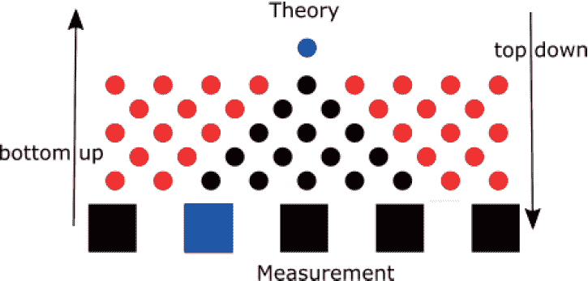

**图 1.2：** 简单模型中理论与测量关系的示意图。

为理解该过程，我们首先考虑*自上而下*计算由假设函数 `f(x)` 在物理模型框架内研究所产生的实验效应。随后，需计算待由合适探测器探测并记录的数据的具体概率分布。

### 通用探测器

我们以电子方式采集实验数据，因此不受主观影响，如人为读数误差。这一事实也意味着我们所能测量的一切最终都必须源于电磁相互作用，即源于电荷的存在或其变化。电荷与探测器的相互作用被电子方式读出并（如有必要）存储。这种以电子方式探测特定探测器敏感区域内电荷的测量形式，总是发生在特定的时间点，例如在电荷先前沉积在该敏感体积内的一个已定义时间间隔结束时。这样，便可比较例如待测定的电压是否落在参考电压区间内。参考电压区间的宽度与测量精度相关。

利用电振荡器，可构建高精度时钟。如有必要，可利用这些时钟使上述读出过程在极短的时间间隔内进行。

探测器通常由大量子探测器（像素）组成。在每个子探测器中，上述过程均会发生。我们知晓这些电学敏感元件的位置、形状和尺寸。因此，可为每个时间间隔创建所观测现象的空间图像。由于子探测器的离散性质，该图像在空间上也被划分为区间，即*像素化*。探测器敏感的时间区间和空间区间不必无缝衔接。信号丢失始终是可能的。理论上可能的信号只会以一定概率被记录。

因此，测量结果始终是一个在空间和时间上离散的数字序列（整数）。其相对精度取决于实验设计和数据采集电子学，但无论如何都是有限的。电子记录的精确电荷量将始终取决于热学的、问题相关的数值或量子力学的涨落，这些涨落会在数字化结果中产生差异。最后，始终会存在若干（可能是不想要的）物理上可能的原因改变探测器的电荷状态。无论如何，除其他原因外，期望信号也会受到电子噪声的影响。

我们对世界的测量所依据的一切、我们能作为单次测量无可争议结果的一切，因此都是测得电荷、位置和时间的多维、在空间和时间上离散的频率或概率分布。要基于此类测量做出陈述，必须重复测量，直到概率分布的形状被以足够精度知晓。在理想化形式下，我们可将测得的概率分布写为连续函数 `g(y)`，同时考虑到实际测量结果由向量 `⃗g` 的离散元素组成，该向量的每个元素 `i` 包含归一化频率分布，即最小值和最大值 `y[i]` 之间条目的归一化总和。

### 理论与测量的联系

理论物理预测与上述讨论的联系：

```
(1.3) g(y) = ∫_a^b A(y,x) · f(x) dx + b(y)  (1.3)
```

在该方程中，`x` 是物理理论的变量，其与测量的联系必须被审视。例如，`x` 可以是一种基本粒子的能量，其存在性和性质必须在探测器中研究。测量的是整数 `y`（特定位置上时间间隔内的电荷）。经过足够多次的测量重复后，可给出包含 `y` 的（许多）单次测量的 `g(y)` 频率分布。此外，`x` 的出现是一个离散事件，要么因为它本身是离散的（原子核衰变导致待研究基本粒子的发射），要么因为 `x` 的强度在测量时间区间内被平均化。

因此，`x` 的一次出现导致对状态 `y` 的一次测量。理论世界与测量结果世界之间，可以存在许多层级的理论描述（“各种可想象形式和不规则性的高尔顿钉板”）。例如，我们考虑一个探测来自不同源的高能中微子的望远镜：如果此处的第一个粒子是缪中微子，它可能通过弱相互作用产生一个缪子，该缪子在传播过程中到达探测器，并通过各种形式的电磁相互作用在那里沉积能量，其中一部分以切伦科夫光的形式发射出去。如果探测器设计为透明，这些光子可能穿过探测器。它们可能被散射或吸收，直到在探测仪器中引起光电效应，后者进而可能触发电子，经放大后可被测量电子学探测到。

上述所有过程必须在理论上被高精度理解。这一事实预设了这种理论理解建立在由其他实验确立的、得到充分验证的背景知识之上。由于热力学、量子物理或量子场论的随机要素迟早会出现在所有描述性理论的阶梯中（如示例所示），即使固定的 `x` 也将始终以测量过程特有的频率分布 `g(y)` 产生不同的 `y`，前提是重复测量若干次。

正如在考虑通用探测器时已讨论的，我们可以假设每次测量都重复多次，因此必须始终考虑测量结果 `g(y)` 的集合。单次测量——科学哲学中经典认识论讨论的核心，或单次测量分析的意义——将不得不作为特殊情况处理。因此，方程 1.3 的各组成部分可解释如下：

*


### 频率分布与测量模型

**g**(**y**) 是一个频率或概率分布，**由极多次测量重复获得或推导而来**。该分布代表测量结果。由于数据是以电子方式记录的，因此它只能基于位置、电荷和时间的分布，或由它们计算得出的量。测量结果的这一频率分布由两个含义不同的分量加性组成：

*   **b**(**y**) 是**无意中测量到的分量**的贡献。这指的是仅出于技术原因而记录的信号，因为*先验*上未知探测器电荷状态的变化是由研究现象引起的，还是由与研究问题无关的其他原因引起的。原因可能是某种形式的电子噪声，也可能由各种可进行物理分析的信号组成，这些信号对于回答其他问题很重要，但与当前问题无关。这一潜在由不同分量组成的贡献称为*本底*。该本底可从理论推导，或直接用探测器测得（例如在信号关闭时，若可行）。`b(y)` 必须是频率或概率分布，这是由上述技术原因决定的。

*   **f**(**x**) 是实验中**待推断变量** *x* 的**频率分布**，它导致了测量结果。变量 *x* 以物理单位写在物理理论的世界中。因此必须将其转换到电子记录的位置、电荷和时间或由它们计算得出的量的世界中，`g(y)` 即在该世界中给出。这种转换描绘了对测量过程的理解。`x` 的固定值虽可设想，但在实践中无法实现。在实验中，几乎总是只能实现期望值周围非常窄的概率密度。

*   将单个值 **x** **转换为对测量频率分布** `g(y)` **的贡献**，是通过所谓的设计函数 **A**(**y**, **x**) 执行的。该函数描绘了实验的所有物理属性，包括子探测器。它总结了所有相互作用的序列及其随机生成的结果；在我们的例子中，这对应于初级中微子能量 `x` 与电子学记录的频率分布 `g(y)` 之间的所有中间过程。只有在罕见且简单的情况下，`A(y, x)` 才能作为嵌套积分的解析解给出。该函数如何数值确定将在下文蒙特卡洛计算一节中解释。

*   通过积分 ∫ **A**(**y**, **x**) · **f**(**x**) **dx**，所有包含待研究问题**相关信息**的贡献被求和为测量分布。为计算贡献，因果理论函数 `f(x)` 与设计函数 `A(y, x)` 进行折叠，后者将 `f(x)` 中的值转换为 `g(y)` 的测量单位。积分必须通过所有可能贡献的 `x` 的概率（或频率）`f(x)`（例如待探测中微子的能谱）来进行，以获得待测特征 `g(y)` 的所有贡献之和。

如果物理函数 `f(x)` 已知，且设计函数 `A(y, x)` 和本底 `b(y)` 也已知，则可推导出测量值的期望分布 `g(y)`。将公式 1.3 诠释为柏拉图洞穴寓言的现代符号，从全知视角描述了理论到实验的映射，因为所有涉及的函数均已知，实验结果才能归因于理论。如果蓝球在高尔顿板上方的位置已知，就能计算出它落入这或那个罐探测器的频率。此过程描述了从因到果的推断。

### 蒙特卡洛模拟

从中微子探测的例子可以看出，前面的讨论表明核心问题在于设计函数 `A(y, x)` 的计算。出于实际目的，不能指望该函数能通过解析求解描述不同相互作用阶段的大量嵌套积分来给出。在寻找设计函数的数值表示时，采用了通过随机评估求解积分的*蒙特卡洛*方法。

为说明该方法，设想一个未知面积和包绕它的已知面积均匀地覆盖着随机分布的点。可以计算两个表面上点的数量及其比率，以确定未知表面积。

为此，再次以基本粒子 μ 子的传播为例：μ 子是“重电子”，其相互作用概率极低，因此在适当的初始能量下，它们可以穿透数公里的石头或水等材料。可能发生各种过程（最重要的包括电离、对生成、轫致辐射和核相互作用）。每个过程都以特定概率发生（取决于能量和材料）。它们对 μ 子损失的能量和相互作用过程中 μ 子轨迹的偏转具有特定性质。相应的概率已在量子场论中计算得出。在穿过物质的过程中，μ 子像高尔顿板上的球一样，经历大量相应的相互作用 [148, 229]。

由于（量子场）相互作用本质上具有随机性，μ 子的路径无法确定性地确定。然而，通过对所有涉及的概率分布进行适当的平均和积分，可以计算出其某些性质。这些包括平均位置、平均速度、μ 子穿过一定厚度材料后偏离直线路径的平均偏差及其他量。这种计算形式对应于经典方法和产生可检验预测的尝试 [[155]](#9783110785951_034588.xhtml#b_9783110785968-011_ref_155)。除了该过程涉及的工作量外，该方法的缺点是只能为所研究性质（`g(y)`）的结果概率分布提供中心值，或许还有矩。

然而，正如上文讨论的，我们关注的是特定特征的完整概率分布。通过使用蒙特卡洛方法随机生成单个 μ 子轨迹，可获得这一期望结果。在我们的例子中，可以基于量子场论确定相互作用概率，并推导出下一次相互作用将发生在何处。然后，可以找出上述哪个部分截面（对生成、轫致辐射等）将被用到，物质中将释放多少能量，以及 μ 子以什么角度继续其路径。通过这种方式，可能的 μ 子轨迹可逐步计算，直到 μ 子停止或衰变。


随着可能的缪子轨迹大量产生，初始条件（缪子从位置 $\overset{\rightarrow}{p}$ 沿方向 $\overset{\rightarrow}{a}$ 以能量 E 开始）可以与探测器处（部分）缪子撞击的电荷、时间或位置 `y[i]` 的分布，或同时撞击的子探测器数量 `y[j]` 的分布相关联。这始终是可能的，且独立于特定路径的所有个体属性。几何特性（不同位置的不同材料、几何边界条件等）可以轻松集成到该过程中，从而最终生成非常逼真的模拟结果。结果 `y` 的分布始终被分配给一个初级 `x`。因此，设计函数 `A(y, x)` 是通过确定分配给初级 `x` 的最终 `y` 的分布而获得的。

### 从积分到矩阵

进一步的一步对于理解认知过程具有重要意义，因为它为认知方向的反转（*自上而下* → *自下而上*）做好了准备。到目前为止，我们将洞穴寓言写成了一个卷积**积分**，考虑了理论计算概率分布的连续性质。然而，由于测量结果必然具有离散性质，方程 1.3 也可以用线性代数的语言写成方程 1.4：

(1.4) $\overset{\rightarrow}{g} = A\overset{\rightarrow}{x} + \overset{\rightarrow}{b} \quad (1.4)$

向量 $\overset{\rightarrow}{g}, \overset{\rightarrow}{x} \text{ 和 } \overset{\rightarrow}{b}$ 的每个元素包含作为分箱频率分布在各自特定区间内计数的条目数。区间的大小是任意的，可根据问题选择。在 $\overset{\rightarrow}{b}$ 中计入本底贡献，在 $\overset{\rightarrow}{g}$ 中计入所有待测量的贡献，在 $\overset{\rightarrow}{x}$ 中将最初主要连续的函数 `f(x)` 从下区间边界到上区间边界逐箱积分。将带物理单位的数字转换为探测器单位下的数字，此处是通过设计矩阵 `A` 完成的，其中（如前所述）所有蒙特卡洛结果被分配并计数。在这个图景中，矩阵 `A` 的性质可以理解如下。

*   **理想探测器**：理想探测器将记录每一个穿过其几何体积的粒子，并以绝对精度测量其所有属性的可观测量。在这样的探测器中，粒子能量的确定可以通过粒子撞击的单元数来实现，且根据定义，这与能量完美相关。此时矩阵 `A` 是一个对角矩阵，其中主对角线上包含的概率（除归一化因子外）将等于 1。所有其他元素均等于 0。
*   **低效探测器**：探测器可能被某些粒子穿过，这些粒子撞击了其机械结构但未撞击其敏感体积。如果现有测量绝对精确，矩阵 `A` 也将由一个对角矩阵表示。由于较低的重构概率，主对角线的概率小于或等于 1。此处所有其他元素同样为零。
*   **不完美分辨率**：如果此外测量精度不完美，即**一个**能量被分配了多个可能的撞击数（可能是因为相同能量粒子在探测器中的轨迹长度不同，导致撞击单元数也因几何原因而*变化*），则主对角线旁的元素将开始填充非 0 值。分辨率越差（错配概率越高），这个范围就越宽，主对角线外的概率就越大。

因此，矩阵 `A` 是通过在矩阵的每个元素中计算物理量 `x`（在我们的例子中对应能量）和探测器量 `y`（在我们的例子中对应子探测器中的撞击数）的组合，作为蒙特卡洛模拟的结果而确定的。某元素中模拟条目数量高意味着该数量由低统计误差确定。条目稀少意味着该组合极少发生，因此仅以相对较大的统计误差为人所知。归一化为生成事件数量会在矩阵中产生概率。

总之，可以断言单次测量产生相关概率分布的单一条目。大量测量决定这些分布的形状。基于所有已知物理知识的数值高精度蒙特卡洛模拟，可以为已知函数 `f(x)` 计算（演绎推导）出预期的测量结果。整个复杂过程可用一个简单的线性代数关系来概括。

## 1.4 从测量变量到测量点

怀着从测量推断理论的目标，人们可以反向阅读积分形式的方程 1.3：测得 `g(y)`，`A` 和 `b(y)` 随后被计算或测量，而 `f(x)` 未知且待确定。在这种知识状态下，未知的物理函数 `f(x)` 可以从测量数字中推断出来。在这种解读下，方程 1.3 是第二类弗雷德霍姆积分方程。因为正向描述的过程是一个卷积积分，所以这个逆问题的求解也称为去卷积。

其代数形式的方程 (1.4) 符号性地说明了解决该问题所需的数学步骤。因此，在将这些步骤置于利用机器学习方法进行大量数据多维分析的最终语境之前，将单独讨论这些数学步骤：

1.  **设计矩阵 A 的蒙特卡洛计算**：如上所述，为确定矩阵 `A`，首先必须解决正向方向的模拟问题。为此，必须以一种方式编写问题，使得模拟仅包含可假设为当前分析已知的相关性。

    从认识论的角度来看，必须注意到推断方向的反转也改变了读取矩阵 `A` 的方向。对于从因到果的推断，`A` 决定了将哪个实验特征的概率分布 $\overset{\rightarrow}{g}$ 分配给一个专用的理论值 `x`。而在这里，对于从果到因的推断，`A` 将一个专用的测量特征 `g` 分配给可能的理论因 $\overset{\rightarrow}{x}$ 的概率分布。这也适用于测量特征由信号事件而非本底事件触发的概率。此外，这也适用于物理理论世界中的一个属性大小（能量）可以分配给测量特征（撞击计数）的概率。

2.  **本底扣除**：要扣除本底 `b(y)`，它必须要么已通过蒙特卡洛方法模拟，要么在特殊条件下用探测器测量得到。然后可以在方程 (1.4) 中（符号性地）从 `g(y)` 中扣除它：

    (1.5) $\overset{\rightarrow}{g} - \overset{\rightarrow}{b} = A\overset{\rightarrow}{x} \quad (1.5)$

    真实测量数据中信号与本底的区分将在下文讨论。


### 3. 逆问题的求解

通过从左侧将方程 1.5 与逆矩阵 $\mathbf{A}$ 相乘，即可实现根据 $\vec{g}$ 的测量值计算向量 $\vec{x}$ 的目标：

(1.6) $\mathbf{A}^{-1}(\vec{g} - \vec{b}) = \vec{x} \quad (1.6)$

除了矩阵求逆可能出现的数学困难外，还有一个核心问题有待讨论：在计算矩阵 $\mathbf{A}$ 时，我们已经看到其元素基于大量条目的模拟。在 $\mathbf{A}$ 的主对角线附近，存在接近概率 1 的数值，其统计不确定性很小，源于大量条目。远离主对角线处，仅有少数条目的元素基于少量条目生成接近 0 的概率，并相应地具有较大的统计误差。图 1.3 给出了构建真实矩阵 $\mathbf{A}$ 的相关性示例，展示了通用中微子望远镜中缪子能量估计的可能呈现形式。

在 图 1.3 的模拟探测器中，“测量”到的是 100,000 个不同能量缪子在许多位置的时间和电荷。然后，使用训练好的神经网络。

![Fig. 1.3: Example: Estimation of the muon energy as it might appear in a generic neutrino telescope. The figure shows the inference from a neural net output (x-axis) to the true energy (y-axis). The difference between a simple calibration function (right) and a frequency distribution (left) for the same data is obvious. The Monte Carlo simulations were executed with the program PROPOSAL [148, 229, 355].](graphic/b_9783110785968-001_fig_003.png)

图 1.3：示例：通用中微子望远镜中缪子能量估计的可能呈现形式。图展示了从神经网络输出（x 轴）到真实能量（y 轴）的推断。同一数据的简单标定函数（右）与频率分布（左）之间的差异显而易见。蒙特卡洛模拟是用程序 PROPOSAL [148, 229, 355] 执行的。

在 图 1.3 左侧，出现组合的频率以颜色编码。罕见的单个条目显示为单个黑点。下方表明它们导致了问题的不适定性。在经典分析方法中，人们会尝试寻找一个拟合相关性分布均值和宽度的唯一标定函数，如 图 1.3 右侧所示的同一数据。然而，这种标定函数会导致对推导量（神经网络输出）与待寻找的物理量之间指派的唯一性产生错误认识。

当矩阵 $\mathbf{A}$ 被求逆时，大数变小，小数变大。尽管如此，大的不确定性保持大，小的保持小。因此，正向过程中无关紧要的 $\mathbf{A}$ 中的单个随机条目，在求逆后可能变成大的、有噪声的项（具有相当大不确定性的大数），干扰结果的清晰确定。因此，这类逆问题属于“不适定问题”，其中自变量的微小数值差异（$\mathbf{A}$ 中的单个随机条目）可能导致结果的巨大差异。通过抑制 $\mathbf{A}$ 中的干扰项，可以改善这种令人不快的情况。这种所谓的正则化基于关于为消除波动而选择的解的性质的额外假设。这样就创建了一个类似但非不适定的问题。然而，这不可避免地将关于解的性质的“偏见”引入数学问题。因此，必须研究正则化对问题解的影响。绝不允许改变展开结果的物理解释。作为示例，我们考虑在 20 个测量点（箱）中对函数 $f(x) = N \cdot x \cdot e^{-ax}$ 的测量。我们不使用模拟来确定探测器特性，而是假设一个简单的说明性矩阵 $\mathbf{A}$：我们的测量是用一个不丢失任何信号、但以概率 $\epsilon$（以友好的方式对称地）将信号指派给相关矩阵元素的探测器进行的。如果错配概率 $\epsilon$ = 0，矩阵将是对角矩阵，探测器将是理想的。矩阵如方程 1.7 所示。

(1.7) 
$$
A = \begin{pmatrix} 
{1 - \epsilon} & \epsilon & 0 & 0 & \cdots & 0 \\ 
\epsilon & {1 - 2\epsilon} & \epsilon & 0 & \cdots & 0 \\ 
0 & \epsilon & {1 - 2\epsilon} & \epsilon & \cdots & 0 \\ 
\vdots & & & \ddots & & \vdots \\ 
0 & \cdots & 0 & \epsilon & {1 - 2\epsilon} & \epsilon \\ 
0 & \ldots & 0 & 0 & \epsilon & {1 - \epsilon} \\ 
\end{pmatrix} \quad (1.7)
$$

在 图 1.4 中，待测函数 $f(x)$ 显示为实线。如果 $\mathbf{A}$ 被求逆并应用方程 1.6，可能会得到剧烈振荡的蓝色测量点，因为这是一个不适定问题。如果通过正则化适度抑制相关的不确定项，则得到绿色测量点，与最初假设的函数非常吻合。然而，过强的正则化会迫使（现为紫色的）测量点越来越趋向于一条水平直线。

从认识论角度来看，值得注意的是，从结果推断原因会导致逆问题。逆问题本质上是不适定的，并可能产生波动的解。波动可以通过正则化来抑制，即创建待求解数学函数的一个合适变体。然而，这不可避免地要求在测量结果的物理上可能的波动与作为解的平滑条件的正则化偏差强度之间进行权衡。

#### 多维性

在讨论用计算机科学手段求解该问题之前，应取消对观测量限制为一维的约束。在实际探测器的每次测量动作中，许多测量变量都被电子读出。其他量则由这些原始数字计算得出。类似于上述讨论，核心数据分析问题是如何从（高度）多维的测量特征中计算出被研究事件的物理属性的概率密度。不仅测量数据，而且物理世界中待重建的属性通常也是多维的（尽管维度较少）。

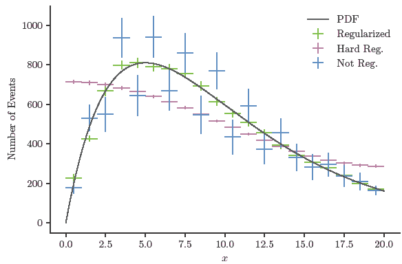

图 1.4：逆问题求解示例：无正则化（蓝色测量点）、适当正则化（绿色测量点）和过强正则化（紫色测量点）。


# 信号-背景分离

在数据分析的第一步中，必须从整个数据集中筛选出感兴趣的信号事件（背景 `b` 的减除，见上文）。由于不需要但技术上不可避免的背景往往比搜寻的信号大许多个数量级，这相当于在巨大的干草堆中寻找一根微小的针。在典型的天体粒子物理数据分析中，背景可能超过信号达 10 个数量级。在我们的例子中，万亿分之一的事件才可能做出错误决策。即使对于要求不那么高的问题，也需要快速、高精度且可复现的决策程序，其中错误率也是可计算的。此类任务已无法通过人工决策达到必要的精度。相反，它们需要使用在机器学习框架下开发的高精度鲁棒评分算法。

这些**机器学习**评分算法是根据待研究的质量标准进行优化的。首先，在模拟世界中定义信号-背景分离任务。在这个世界中，已知哪些多维特征以何种频率出现，以及这些特征中哪些被分配给信号类，哪些被分配给背景类。为此，利用蒙特卡洛方法生成大量待寻信号事件示例及所有可能的背景事件变体。

机器学习的目标是确定需应用于生成的、原则上可测量变量的多个维度（探测器中的击中数、其空间分布和时间序列、沉积电荷大小等）的数学运算，然后在一个至少一维的有限标度上为每个事件赋予一个值。（在高级应用中，如第 9 章所述，多维输出赋值也是可能的。）变量、数学运算及其内部结构经过优化，以最大化该标度上信号与背景事件之间的距离。为进行此优化，模拟的信号和背景事件由算法依次评估。这些示例的数量越大，算法的优化效果越好。拟人化地说，输入示例的过程称为“展示”，优化的过程称为“学习”。

因此，算法针对分离任务进行了优化。由于必要的决策是统计过程，必须指明决策的准确度。此外，必须检验算法相对于实验确定的数据，对不可避免的模拟缺陷是否具有足够的容忍度。如果最终确定了该程序，就能知道在应用分离算法后，数据集中预期有多少模拟信号和背景事件，包括这些数字的不确定性。将确定的算法应用于测量数据的世界，就可以将在模拟中确定的选择率转移到测量世界中。

在机器学习研究中，已经开发了许多算法，它们采用完全不同的方法来构建表示，以将多维测量结果映射为一维序参数。它们的正则化和对微小变化的鲁棒性由机器学习理论进行研究，见第 3 章。

算法在识别结构方面的性能及其对蒙特卡洛事件精度和数量的依赖，取决于为解决任务必须计算多少个自由参数。*判别分析*仅使用极少的自由参数，在其中为分离任务将**平坦**的 `n` − 1 维超平面最优地放置在测量信号和背景分布的 `n` 维空间中。弯曲且相互嵌套的分布显然难以用这种方法分离。因此，引入了径向基函数等核函数，将测量映射到允许通过超平面正确分离的空间，即正确地将信号与背景分离 [[380]](#9783110785951_034588.xhtml#b_9783110785968-011_ref_380)。“核技巧” [[343]](#9783110785951_034588.xhtml#b_9783110785968-011_ref_343) 在神经网络中间接存在。

在极端情况下，能够学习非线性函数的算法的优化可能导致在模拟世界中分离效果过好，其意义在于*所有*生成事件的位置都被参数化或“学习”了。这种效应称为*过训练*或过拟合。如果将这种学习到的模型应用于真实数据，甚至另一组模拟数据，它都会失败，因为它找不到与模拟中学习到的特征*完全相同*的特征。

选择哪种机器学习方法，以及如何验证其能提供充分且预期的结果，必须针对每个分离任务单独分析。

我们要考虑的此类算法的第一个例子是简单决策树。决策树是一组分层条件，它定义：如果测量参数位于特定的逻辑嵌套区间内，则数据集（事件）按一种或另一种形式分类。非常简单的分类可以用条件数量很少的单个决策树来执行。信号-背景分离越复杂，就需要在树中嵌套和插入越多的条件。然而，这些条件是基于模拟的蒙特卡洛事件确定的。如果选择了足够多的条件，就会映射蒙特卡洛事件的个别属性，从而可以存储所有模拟事件的分类。在这种情况下，算法将无法学会拓扑的泛化。这种泛化将表现为对所搜寻的信号-背景分离面的放置进行鲁棒参数化。没有这种泛化，分离在所有实际应用中都将失败。


## 1.5 机器学习视域下的物理学认识论

或者，也可以应用所谓的随机森林。在随机森林中，定义的是一组具有适度分支可能性的决策树集成，而不是一棵分支繁多、层级深邃的单一树。并非森林中的所有树都获得相同的信息。此外，树只获得随机选取的信息（一些模拟可观测量加上显示真实类别归属的标签）。而且，在哪个分支层级决策过程中使用哪条信息也是随机决定的。在用模拟事件对随机森林进行数值优化（称为“训练”）后，森林中的所有树通过计算其对某事件的尺度值来进行“投票”，回答该事件属于信号还是背景的问题。这产生了上述所需的一维尺度，在该尺度的一侧，树理想情况下投票为“背景”（尺度值接近 0），而在另一侧，树理想情况下投票为“信号”（尺度值接近 1）。然后可以对该尺度进行切割，以确定信号与背景事件的比率、最终选定信号样本的纯度、选择效率（有多少信号事件通过了切割？）、鲁棒性（森林是否如预期那样对蒙特卡洛波动不敏感？），或蒙特卡洛与实测数据之间的一致性。最后，在实测数据上执行专门训练和测试过的随机森林的决策过程。如预期那样，获得了一个样本，其中信号和背景事件的数量及其统计不确定度都是已知的。

通过这种方式，找到了一个从（真实或模拟的）测量数据的高维空间到一维序参量的映射。测量数据的多维特性得以保留，并通过随机森林计算出的序参量得以补充。将测量变量视为多维概率分布的载体，信号-背景分离可以理解为对信号和背景样本的多维概率分布进行变换，从而通过简单的线性切割实现两种拓扑结构的分离。选定信号的强度现在可以表示为该信号与随机背景波动不一致的概率。然后可以选取该信号数据集用于进一步分析。

### 逆问题的求解

在信号-背景分离之后，可以假设得到一个数据集，其中仅包含已知的少量背景事件，对于我们的目的而言可以视为可忽略不计。在该示例中，现在可以确信拥有一个由作为信号事件的目标中微子特征组成的数据集。现在，必须针对其他性质（如中微子的能谱）来检验这些信号事件。

信号-背景分离的范式要求，除了各类别中的相对事件数量外，信号和背景在所有性质上都必须是完美已知的。因此，它们在模拟中可以被同样精确地描述。然而，如果要测量能量等物理量，则（至少）单个事件的能量分布不可能完全已知。因此，模拟无法完美描述待测分布。对于去卷积，提出了一个较弱的范式，根据该范式，只需知道所搜寻现象的实验效应。只有探测器在其所有性质（例如对能量的响应）上的模拟，必须在自然界和蒙特卡洛世界中保持一致。

无论如何，展开分析基于与信号-背景分离相同的测量和模拟数据情境：我们考虑位置、时间、电荷及衍生变量的多维时空模式。蒙特卡洛数据集对于每个事件还包含待测物理量（能量）的真实信息，这在实验记录数据的世界中是未知的。同样，寻求一个从多维空间到一维参数的映射。同样，这是一个可以在数学上表述为优化任务的任务：将模拟示例逐个“展示”给机器学习算法，以调整学习算法的内部参数，从而使待测物理量（在我们的例子中是中微子的能量）能以尽可能高的精度被确定。取代用于分离的双极有限尺度，计算的是一个连续且无限的量级（例如与能量相关）（参见 图 1.3 及其给出的示例）。然而，机器学习的主要考量不会改变。假设在许多技术量（电荷、时间、位置及由此衍生的量）与待测物理量（能量）之间建立了一种关系，那么在受控添加假设以抑制解的不良性质（正则化）的条件下，逆问题（公式 1.6）就得到了求解。在蒙特卡洛世界中优化的分析随后同等地应用于实测数据。如有必要，将对待测信号进行修正，以补偿那些未能在探测器中留下痕迹的特征。此外，通过所谓的接受度修正，将迄今考虑的事件数量归一化为包含单位在内的物理理论量。

因此，去卷积导致多维测量数据向理论物理学预测的物理量的一维或少维空间投影。由于模拟或测量数据的统计特性在任何时刻都未被限制或切断，因此可以为每个物理单位下的测量点给出期望值及相应的置信区间。分析结果由带有统计误差的测量点组成。如果在测量前理论物理学已对某测量值做出明确预测，现在就可以给出该预测与测量结果吻合的概率。如果理论包含无法预测的参数，可以根据物理测量点对其进行调整（拟合）。这些参数随后可引入进一步计算并在其中再次接受检验。

作为**认识论教训**，在波普尔证伪主义方法的推广中，我们看到——即使某些结果显而易见——只有对测量和理论的概率评估才适合于对结果及其后果的进一步讨论。

自波普尔的《科学发现的逻辑》基本思想提出以来，对理论物理学的思考方式已经改变。最初，从托勒密到哥白尼、开普勒、牛顿，最后到爱因斯坦的演变，可以被视为一种发展，它暗示了目标是利用新方法和数学手段优雅地发展理论，并仅增加少量可测量的新参数。因此，这似乎成为了理论物理学进一步发展的范式。如今，整个理论类别被同时提出并计算。这些理论类别可能包含许多具有巨大不确定度的自由参数，因此几乎不可能完全证伪这样一类理论。如果你愿意，现代本轮（epicycles）从一开始就被构建在理论结构中，以至于它们不必作为额外的构造而突显出来。尽管如此，这些被提出的理论类别中当然存在参数范围，这些范围可以通过实验进行有意义的探究。


这并不妨碍将理论理解为理性思考的产物，这些思考的目标仍然可能是发展出一种尽可能完整且统一的世界数学描述。然而，由于一类理论很少能被完全检验，这将是一个非常苛刻的要求。

由于理论中自由参数数量庞大及其依赖关系可能的复杂性，哪个参数范围在哪种组合下具有实验可检验性，往往只能通过蒙特卡洛方法来确定。

在这些方法中，自由参数的数值被随机抽取，在此基础上可以确定实验可验证的值，例如潜在存在的暗物质粒子的质量或粒子通量（中微子）。因此，蒙特卡洛方法之所以适合检验潜在出现的测量结果范围，主要有两个原因。首先，参数与可能的测量结果之间的关系并不总是显而易见的。其次，其他实验排除的参数区域可以很容易地被纳入考量。

这与上文提到的机器学习建模观点非常契合[276]。在那里，在*松散建模*的标题下，每一种当前的知识状态都被视为初步的。在本文提出的观点中，知识是以迭代和演化的方式扩展的：问题的定义、基于现有知识的测量结果模拟、在实验中寻找偏差、从理论物理角度解释测量概率，以及最后对问题的修正，循环往复地相继进行（图 1.5）。知识获取不再基于从果到因的完整推断，而是基于演练所有理论上可设想的可能性，并利用新的测量数据不断比较和优化这些预测。为此所依据的具体且坚实的经验基础，由测量到的位置、时间、电荷以及直接由它们计算出的物理量组成。

请注意，这一图景很好地补充了数据分析中众所周知的跨行业标准流程（CRISP）[117]。首先，数据并非以现成数据库的形式给出。相反，数据是基于物理知识通过模拟产生的，也基于物理探测器和触发过程产生。这两个数据生成过程都可能利用机器学习方法。使用生成模型的对抗训练可能会产生有益的额外数据。另一方面，主动采样可能会选择对学习最有用的数据。原则上，触发器的优化也是一项学习任务。循环继续进行四项学习任务，其中前两项与 CRISP 建模有显著不同，因为它们在流式数据和实时条件下工作。后两项学习任务使用可以预先分层的数据库。对结果的物理解释可能会引出新问题，或启发新的分析方法。

上述考量表明，如果没有人为干预，问题是无法得到首次解决的。一旦解决，选择和重构问题就可以一次又一次地自动求解。在此基础上，参与知识获取的研究人员现在必须执行专门的任务。理论物理学家将开发新概念来解释观测到的现象，约束参数范围。实验物理学家将发明新技术以实现定性新颖的测量，并进一步优化现有技术。计算机科学家将开发新算法和方法，使得以越来越少的资源更精确地分析不断增长的数据量成为可能。

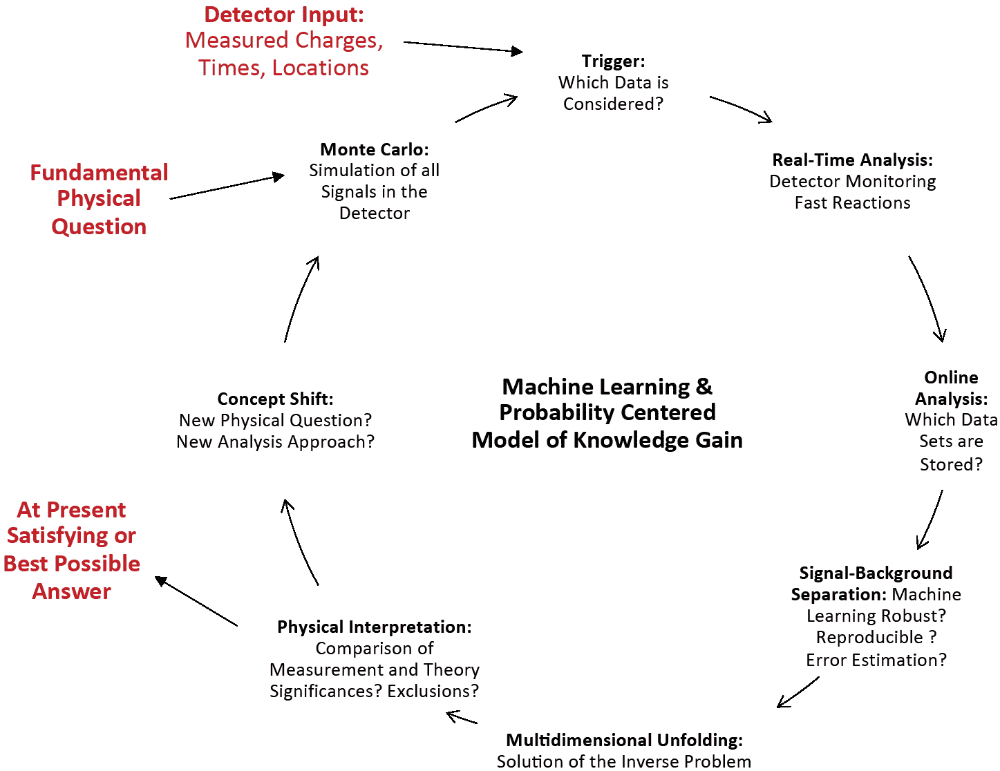

图 1.5：知识扩展的方法论步骤循环。图中标示了基于测量的多维概率分布被研究和转换以进行质量保证和知识获取的最重要方面。该图象征着一个过程，其细节取决于所研究的问题。特别是，可以设想出跳过某些步骤或需要额外步骤（例如用于数据缩减或性质估计）的循环。

### 1.5.1 本书中的延伸阅读

我们从认识论角度讨论的这一过程，在本书中通过更具技术性的贡献得到了详细阐述。这些贡献的呈现顺序遵循图 1.5 中所示的方法论步骤。从数据获取（包括探测器的准备和校准）、数据采样和预处理，到分类器学习和展开，各章节提供了如何在实践中实施概率理性主义的方法。

本书介绍和讨论的方法适用于天体粒子物理和粒子物理环境中的问题。因此，相关的物理问题在第 2 章中进行了介绍和解释。

第 3 章概述了将在后续使用的机器学习关键概念。

每个物理实验要解决的第一组问题，从数据获取、数据结构到首次触发决策，实验数据由此被送入分析循环。关于此方面新开发的概念在第 4 章中进行了介绍和讨论。

物理知识已发展到这样一个程度：原则上所有可测量的信号都可以被模拟。然而，计算量如此巨大以至于机器学习方法也可用于此以减少工作量。数据与蒙特卡洛世界之间的对应关系也必须在技术和物理上得到证明，以便能在蒙特卡洛数据上训练机器学习器。该领域的发展在第 5 章中介绍。

如何在不同时间尺度上访问研究数据？数据分析期间对海量数据的高速访问、实验结束后十年内对所有研究数据的长期访问，以及对所有物理结果的永久访问，这些都构成了挑战。针对该问题的示例方法在第 6 章中讨论。

表征学习的问题仍然是科学过程的关键。它可以通过从信号中自动提取特征来显式建模[270]。物理实验的特征提取在第 7 章中介绍。


由于记录的本底往往比待研究的信号大几个数量级，因此用于信号本底分离的新型高效稳健方法变得至关重要。这些方法在第 8 章中介绍。

鉴于其在应用中的重要性，第 9 章解释了几种新的深度学习应用。由于我们可以将隐藏层中权重较高的内部节点解释为表示，因此表示是通过基于神经网络的学习隐式学习的。关于无监督学习中表示学习的参考文献见[205]。玻尔兹曼机是为表示学习而设计的[307, 335]。图神经网络将概率图的优势与神经网络的优势相结合，并成功学习表示，因为它们将结构引入了深度学习[162, 395]。概述和当前研究见第 1 卷第 4.3 节。在本书中，隐式方法在 9.4 节中针对伽马射线天文学进行了详细阐述。

逆问题和反卷积问题，即从频率分布到物理表述的途径，在第 10 章中进行了研究。在那里，表示被显式设计用于学习，作为整体流式学习过程中的一个额外步骤。

# 2 粒子物理与天体粒子物理中的挑战

### 摘要

粒子物理和天体粒子物理这两个物理学科研究基本粒子、历史以及我们宇宙的结构。由于宇宙的膨胀，这两个学科为了研究这些基本过程和结构而紧密相连。为此，可以研究高温环境中粒子的高能相互作用，或者分析来自宇宙中遥远事件和源头的信使粒子传递的信息。前者在欧洲核子研究中心（CERN）的大型强子对撞机实验中研究，后者在各类天体粒子探测器或望远镜中研究。这两个物理学科在可获取的信息方面相互补充，在数据分析和数据质量所需资源的极端要求方面相似，但由于探测器的设计和运行方式不同，所收集数据的通用特性也有所不同。由于探测器的运行旨在回答特定的基本问题，本章将介绍并解释粒子物理和天体粒子物理的指导性问题。由于后文讨论的许多（如果不是全部）CRC 876 计算机科学研究成果的典型应用都是为 LHCb、IceCube、MAGIC、FACT 和 CTA 探测器开发的，因此将特别强调利用这些探测器可研究的问题。

Bernhard Spaan

Wolfgang Rhode

## 2.1 物理动机、问题与示例

一般来说，第 1 章中概述的认识论考量不仅适用于特定研究领域问题的处理；它们声称具有普遍有效性。然而，本书面向不同科学背景的读者，因此呈现一个天体粒子物理的范式动机似乎是合适的，后文给出的示例均可参照此动机。

我们对物理世界的理解主要由宇宙学和粒子物理这两个非常成功的理论标准模型塑造。前者关注宇宙在时空中的演化，后者关注其最小粒子的相互作用。这两个模型在许多方面相互关联，使得它们的陈述相互补充，也相互制约。基本上，这两个模型最初都是或曾经适应人类的认知偏好，在理论上是对称的——对称到如今，为世界上观测到的不对称性提供理由已成为天体物理学和粒子物理学领域的核心研究焦点。

许多基本问题只能通过向标准模型添加不对称性来解决。基本粒子为何具有质量？为何物质比反物质多？为何（迄今）未探测到磁单极子？为何宇宙以不同速度尺度膨胀？为何物质在宇宙中分布如此不均？暗物质为何存在？宇宙射线如何（以及在何处）获得能量？

粒子物理和天体粒子物理这两个物理学科试图通过不同类型的实验来阐明这些问题。在粒子物理中，高能基本粒子在极其受控的条件下在地面加速器中相互碰撞，以便在早期宇宙的能量条件下研究相互作用的对称性。在天体粒子物理中，天体被用来将粒子加速到最高能量。这些信使粒子本身或其相互作用产物随后在地球上被探测并解释。天体粒子物理和粒子物理中的挑战是互补的。在粒子物理中，实验中首次相互作用发生的条件受到非常好的控制。实验由功能各异的非均匀子探测器组成，记录具有不同物理解释的数据。在天体粒子物理中，探测器以及记录的数据具有相对均匀性。然而，实验条件（如粒子类型、相互作用位置及其能量）无法被控制。此外，探测器的特性可能随天气条件、穿过周围自然介质的入射路径或测量过程中的时间而发生变化。

## 2.2 天体粒子物理

天体粒子物理是一个约有三十年历史的研究领域[157]，它源于天文学通过实验方法和粒子物理的理论概念的扩展。没有当前粒子物理和宇宙学的理论标准模型及其可能的扩展，就无法理解它。因此，它基于经典场论（用于引力）和量子场论（用于粒子相互作用），这两者尚未统一。天体粒子物理的基本组成部分如图 2.1 所示。


在天体物理源（如恒星、超新星遗迹、活动星系核及许多其他天体）中，温度极高，以至于物质必须被视为等离子体（原子核与电子分离并独立运动）。带电粒子产生无规则磁场，反之亦然，被这些磁场加速至极高能量。来自等离子体的电子和原子核可与其他粒子相互作用或发射辐射，使得这些源最终可通过探测无线电至伽马频段之间的电磁辐射光子而被观测到。此外，源中强子相互作用产生的中微子也可被探测到。天空中普遍存在的天体粒子物理学辉光由带电原子核产生，它们在飞行途中穿越不同磁场时大多丢失了方向信息，因此对天文用途的价值有限。经过反复相互作用后，天体物理加速的后续产物可利用卫星、不同设计的地面望远镜和地下探测器，通过不同技术进行探测。这些独立且全球分布的探测器也采用了粒子物理学中开发的技术。要全面理解天体物理源，必须结合所有探测器的信息。最迟在此结合之后，必须分离并理解宇宙线的不同成分。

![图 2.1：天体粒子物理学示意图。图中展示了天文源、信使粒子及不同的探测场景（改编自 [385]）。](graphic/b_9783110785968-002_fig_001.png)

图 2.1：天体粒子物理学示意图。图中展示了天文源、信使粒子及不同的探测场景（改编自 [385]）。

根据对测量有贡献的三个组分（源属性、源与地球间的辐射传播、或基本粒子相互作用）中哪一个被视为未知，可分别在天体粒子天体物理学、宇宙学或粒子物理学中获得洞见。由于所需物理描述的复杂性，尽管许多事情已知得很精确，但该领域无法假设完全可控的初始条件。探测到的是由不同理论和现象学近似所描述的一系列过程的结果。最终，这些结果可能是精密测量，可用于填补实验间的测量空白、检验预测特征，或发现只能通过扩展物理概念来解释的意外新现象。在其存在的三十年里，天体粒子物理学通过众多观测促成了过时理论观念的修正，这既是因为也尽管其复杂性。因此它非常适合利用大数据科学来探讨当前物理学的认识论边界条件。

在物理学的历史发展中，人们反复发现新物理洞见与应用于其上的新数学方法之间存在依赖关系。机器学习方法的发展与天体粒子物理学同步进行。直到计算机科学早期关于分析结果必然具有概率本质的洞见 [280] 在物理学界被接受，经历了一段时间。

### 2.2.1 实验

在天体粒子物理学领域，两类实验在我们的工作中催生并典型体现了机器学习方法的发展：中微子望远镜和伽马望远镜，它们以用于将信息从天体物理源传输到地球的信使粒子命名。因此，这两类望远镜都不直接探测天空中的天体物理源。它们探测到的不是初级信使粒子，而是带电的高能次级粒子穿透透明介质（水、冰）时发射的切伦科夫光。对于初级伽马射线，这些次级粒子以电�级联的形式在大气层中产生。在初级中微子的带电流相互作用中，会产生带电轻子（电子、缪子、陶子）。此外，两类望远镜的主要不需要本底主要来自同一来源：以原子核形式存在的宇宙线在高层大气中相互作用，同样产生电磁级联和强子级联（包括中微子）。本底由这些粒子诱导的切伦科夫光组成——取决于数据采集的细节——其强度比信号高出数个数量级。

#### 2.2.1.1 中微子天文学

*Tim Ruhe*

如上所述，中微子无法被直接探测，因此其探测依赖于探测其与原子核相互作用时产生的轻子伴侣。取决于中微子种类，相互作用可能发生在探测器内部或周围介质中。尽管如此，由于中微子极小的相互作用概率，其探测仍具挑战性。然而，这一小概率可通过长曝光时间、利用大体积探测器，或理想情况下两者的优化组合来弥补。由于带电粒子以约 *c*（真空中光速）的速度运动，其探测依赖于切伦科夫效应，进而依赖于切伦科夫光子的探测，因此可能的探测介质也必须对蓝光尽可能透明。

这种对立方公里量级体积的透明探测介质的需求，基本上指向了两种可用于建造中微子望远镜的天然介质：水和冰。两种方案均已付诸实践，并各自带来独特的实验挑战。水已被用于贝加尔湖 [72]、ANTARES [39] 和 KM3NeT [37] 中微子望远镜，而冰则被用于 AMANDA 和 IceCube [21]。

利用冰时，主要挑战之一是望远镜的偏远位置，这在建设和运行期间需要复杂的后勤保障。幸运的是，南极提供了大体积冰层，并通过阿蒙森-斯科特南极站提供科研基础设施。额外的实验挑战源于冰中冻结的气泡导致显著的光散射。然而，气泡数量随深度减少，通过在 1500 米以下部署传感器，可在一定程度上缓解这一挑战。传感器部署通过热水钻探进行，单个钻孔部署传感器约需 48 小时。部署后，传感器被冻结固定，无法进行维护。这因此要求使用极其可靠的传感器，无论在机械还是电子意义上。IceCube 使用的传感器被证明运行极其可靠，事实上，大多数传感器故障都发生在部署过程中。


##### 部署与维护

在部署和维护方面，水下环境的挑战相对较小，因为传感器和传感器单元可以通过船只部署，必要时也可回收进行维护。望远镜运行所需的研究基础设施通常位于海岸，靠近安装的望远镜。虽然切伦科夫光子在水中的散射作用较小，但仍存在两个主要实验挑战。

第一个挑战与 `⁴⁰K` 的衰变有关，由于其天然丰度，会导致传感器观测到的噪声率增加。第二个挑战源于海洋中生物发光的存在，这也会增加单个传感器记录的背景噪声。

##### IceCube 探测器简介

冰和水中的中微子望远镜对于中微子天文学同等重要，它们在利用技术和观测天空特定区域方面相互补充。本节其余部分将简要介绍 IceCube 探测器，因为本书所有与中微子相关的分析均使用 IceCube 中微子望远镜获得的数据。因此，对探测器本身的基本了解是理解这些分析的前提。

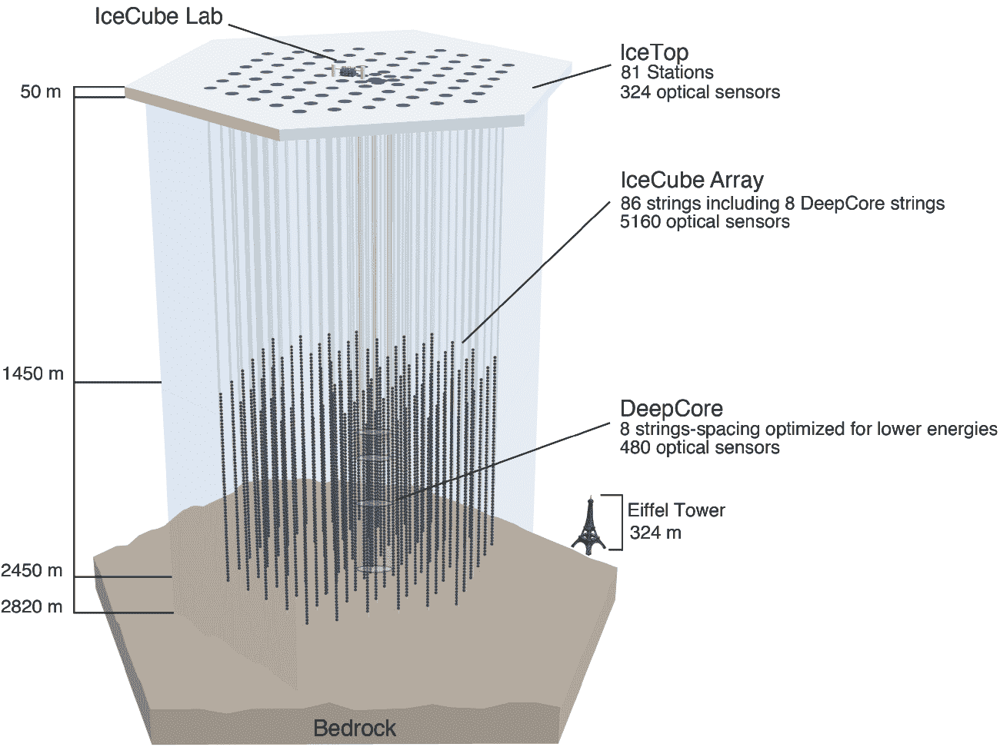

**Fig. 2.2: IceCube 中微子天文台示意图。图片由 IceCube 合作组提供。**

Figure 2.2 展示了位于地理南极的 IceCube 中微子天文台示意图。探测器由 86 根弦组成，呈三角网格排列，弦间距约 125 m。探测器中心的弦间距较小，约 70 m，构成 DeepCore 子探测器。虽然整个冰下阵列的能量阈值为 `E[ν] ≈ 100 GeV`，但 DeepCore 针对低至 `E[ν] ≈ 10 GeV` 的中微子能量进行了优化。

IceCube 弦配备数字光学模块（DOM），内含一个向下的 10 英寸光电倍增管、高压电源和读出电子学。弦上 DOM 间距为 17 m，DeepCore 弦除外，其 DOM 间距仅 7 m。为利用南极清澈的深层冰，DOM 部署在距表面 1450 m 至 2450 m 深度之间。地面分量 IceTop 作为大气簇射阵列，完善了探测器 `[21]`。IceCube 主要设计用于探测来自天体物理源的高能中微子，但也是一个多用途探测器，拥有广泛的科学组合，如 Figure 2.3 所示。

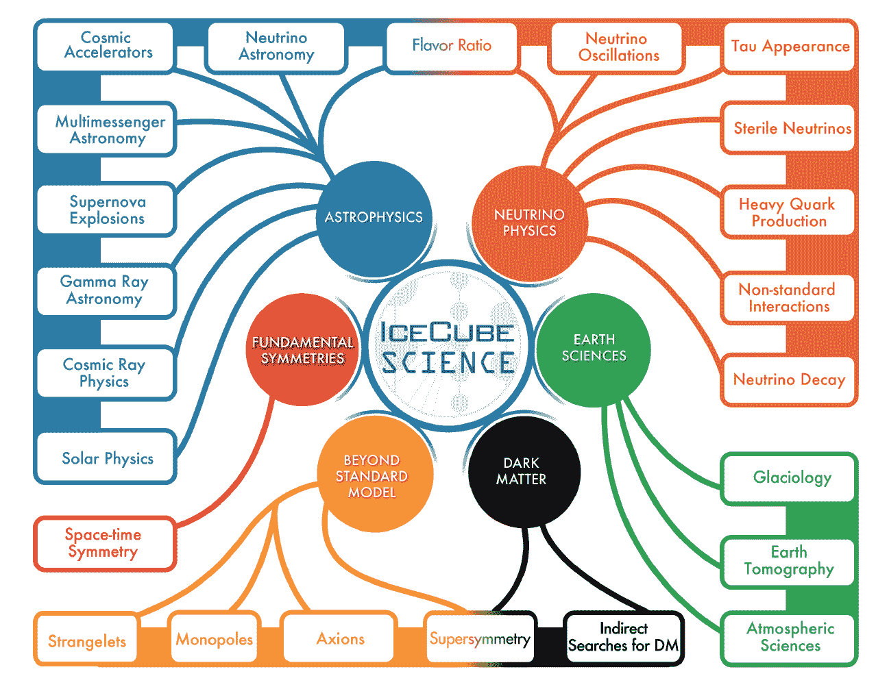

**Fig. 2.3: IceCube 科学组合。图表由 IceCube 合作组提供。**

尽管探测器的仪器化体积为一立方公里，但实际探测器大小可能更大或更小，取决于分析的粒子类型和相互作用。一方面，电子中微子和中性流相互作用可能需要定义否决区。通常使用外层 DOM 层作为此类否决区，这自然会降低可用于探测粒子相互作用的体积。另一方面，缪子可在冰中穿越长距离，因此可能在仪器化体积远外产生。虽然这增加了可用于粒子相互作用的体积，但缪子产生的相互作用顶点位置未知，对中微子能谱重构构成重大挑战（见 Section 10.6）。此外，缪子的长程使得宇宙射线在大气中相互作用产生的大气缪子大量进入探测器。尽管它们本身很有趣，但这些大气缪子基本上是所有中微子分析中最大的背景成分。

根据事件特征，大气缪子无法与中微子诱导的缪子区分，但最简单的背景抑制可通过几何论证实现：因地球对缪子不透明，向上飞行的中微子必然源于中微子相互作用。因此，丢弃所有向下飞行的缪子是一种有前景的背景抑制策略。

然而，该策略有个注意事项：一小部分向下飞行的缪子会被错误重构为向上飞行。由于大气缪子数量相对于大气中微子极其庞大，这个“小比例”仍导致信噪比约为 `10^(−3)`。剩余背景更难剔除，但可通过基于机器学习的分析技术高效抑制。这些方法及其经验教训正是本书的主题。

##### 物理分析与能谱重构

物理分析在背景充分抑制后并未结束。为从数据样本获取物理洞察，需对其进行分析并提取物理参数。天体粒子物理学中特别具挑战性的分析类型是能谱重构。挑战源于不同方面。首先，粒子产生的基础过程由随机过程支配，数学上由第一类 Fredholm 积分方程描述。这意味着只能通过反褶积技术，从测量可观测量的分布中成功恢复目标能谱。进一步挑战源于探测器本身引入的次要模糊。对中微子望远镜而言，这种额外模糊主要源于缪子可在探测器远外产生。在等待探测并向探测器传播过程中，这些缪子会损失部分能量。入射缪子（中微子诱导或非诱导）的能量因此略小于其产生顶点处的缪子能量。电子噪声和冰中杂质描述的不确定性只会加剧这一问题。反褶积算法的任务是从不准确测量的中微子诱导缪子分布中恢复中微子能谱。显然这是项具有挑战性的任务，需要一定的算法开发。我们因此专门用一整章深入探讨反褶积主题（见 Chapter 10）。

光谱重构质量随基础能量重构质量提高而改善，但中微子望远镜也受限于相对较差的角分辨率。例如，IceCube 对径迹的角分辨率约为 `0.7°`，对级联约为 `15°`。相比之下，太阳和月球在天空中的视大小约为 1°。良好的角分辨率是探测天体物理中微子源的前提。过去十年间，深度神经网络在图像重构等各任务领域极为成功。本书也将展示神经网络如何应用于中微子天文学的重构任务（见 Section 9.2）。


虽然分布在几个主题章节中，但本书将引导读者完成中微子天文学中的完整分析过程，范围涵盖从数据获取（第 4.2.3 节）、特征选择与径迹重建（第 7.2 节）到本底抑制（第 8.3.1 节），最后到中微子能谱的去卷积（第 10.6 节）。

#### 2.2.1.2 伽马射线天文学

**Lena Linhoff**

**Alicia Fattorini**

正如中微子天文学一样，地基伽马射线天文学也利用切伦科夫效应来可视化那些无法直接观测的粒子。在这种情况下，地球大气层被用作探测介质，以观测能量范围大致从 50 MeV 到 30 TeV 的伽马射线，这些伽马射线源自遥远的星系或超新星。通过测量和分析这些粒子，我们能够了解宇宙中伽马射线源的信息、它们的成分以及驱动其行为的机制。

如果一个高能粒子（无论是伽马射线还是带电粒子）撞击地球大气层，它会产生一个带电粒子级联。这些所谓的二次粒子继承了初级粒子一部分能量，并以高速在空气中传播，其速度可能超过该介质中的光速。粒子级联发射切伦科夫辐射，在几纳秒内可见为一个巨大的蓝至紫外光锥。通过这个切伦科夫锥的大小、形状和方向，可以推导出初级粒子的能量、类型和来源信息。

由于切伦科夫光极其微弱，且光锥仅可见几纳秒，因此需要一个大型集光器和相机，它们能够分辨这些极短的时间尺度。这些要求在技术上通过成像大气切伦科夫望远镜（`IACT`）得以实现。`IACT` 由直径达数米的大型球面镜组成，将切伦科夫光反射到配备有能够探测单光子像素的相机中。在超高能伽马射线天文学中，相机像素通常由数百个光电倍增管（`PMT`）或硅光电倍增管（`SiPM`）组成。

当相机被入射光触发时，每个像素会记录约 100 纳秒的时间序列。基于这些时间序列，计算击中像素的光子数量及其到达时间。一旦得出这些值，就根据光子电荷和到达时间，从整个相机图像中选出包含实际切伦科夫簇射的像素。然后对选定的像素群进行参数化，考虑其形状、在相机中的位置以及光分布。数据以这种方式简化后，最终得到一组属于单个事件的参数。在现代望远镜配置中，两台或更多切伦科夫望远镜同时从略微不同的位置观测同一个簇射。这样，所有望远镜的参数集被组合起来，利用所有观测望远镜的信息可以改进位置和能量重建。生成的数据集随后用于通过后续章节进一步解释的数据分析技术，估算初级粒子的类型、能量和来源。一旦重建出能量和来源，就可以计算并进一步研究光源的谱能量分布及其随时间变化的通量。

正如中微子天文学中所述，伽马射线天文学家也必须处理巨大的本底，必须在第一步中将其与实际信号分离。本底以约 10⁵ 的因子占主导地位，在这种情况下主要由强子粒子组成，它们产生的簇射与伽马射线相似。与伽马射线诱导的簇射不同，这些簇射无法追溯到特定源，因为带电粒子在穿越宇宙的途中会被磁场偏转。因此它们不携带任何源特异性信息，必须将其与伽马射线事件分离开来。

`IACT` 的观测能力主要受阳光和月光及其地球位置的限制，这限制了可观测的源。由于切伦科夫簇射非常暗淡，且相机电子学极其灵敏，地基伽马射线观测只能在无月或月光适中的夜晚进行，且必须远离城市地区的人造光源。此外，天空必须对切伦科夫光透明，这意味着恶劣天气条件和云层严重影响观测质量。因此 `IACT` 大多建在偏远地区，海拔几百到几千米处，以确保稳定的观测条件。

在其他 `IACT` 中，大气切伦科夫成像望远镜（`MAGIC` [47, 48]）是世界上最大的运行中的双望远镜系统。`MAGIC` 位于加那利群岛拉帕尔马岛的主火山罗克德洛斯穆查乔斯，海拔 2200 米处。每台望远镜拥有一个直径 17 米的镜面，将光聚焦到装有 1039 个 `PMT` 的相机中。望远镜对能量在 30 GeV 到 100 TeV 之间的伽马射线敏感，具体取决于观测和触发设置。第一台望远镜于 2004 年建成，第二台望远镜于 2009 年开始运行。通过 2011 年和 2012 年的一系列升级，`MAGIC` 获得了双望远镜触发和读出系统，以执行双望远镜模式下的测量。

多年来 `MAGIC` 提供了许多科学洞见。2017 年探测到来自已知耀变体 TXS 0506+056 的超高能伽马射线 [55]，在高能宇宙线起源的问题上为天体物理学界取得了突破。观测到的伽马射线与 IceCube 报告的一个中微子事件在时间和空间上相关，这证实了耀变体是中微子源最有希望的候选者。凭借基于碳纤维管的轻量化结构，`MAGIC` 能以 7 °/s 的速度重新指向。2019 年 Swift-BAT 卫星探测到一个伽马射线暴（`GRB`）后，警报被发送至伽马射线坐标网络（`GCN`），`MAGIC` 仅在暴发后 50 秒就开始了观测。通过这一努力，`IACT` 首次探测到了伽马射线暴 [365, 383]。

在 `MAGIC` 旁边是第二台望远镜，首台 G-APD 切伦科夫望远镜（`FACT` [53]），它最初是为采用和测试新型相机技术而设计的。它是第一台使用 `SiPM`（1440 像素）而非 `PMT` 作为相机的 `IACT`。`FACT` 镜面直径为 3.5 米。该望远镜对能量从几百 GeV 到约 10 TeV 的伽马射线敏感。

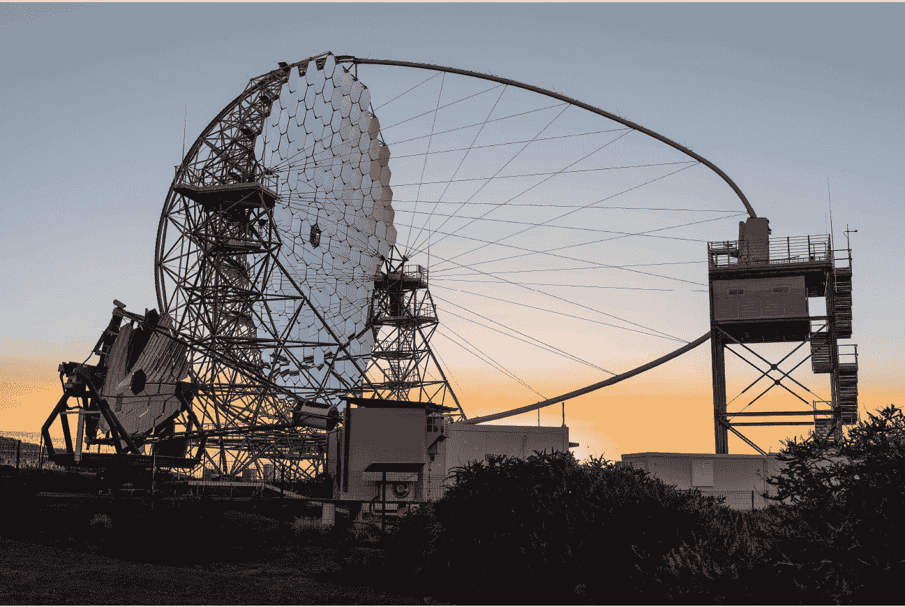

图 2.4：位于西班牙拉帕尔马岛罗克德洛斯穆查乔斯天文台的 LST-1（后）和 FACT（前）。照片：Maximilian Linhoff/多特蒙德工业大学，2021 年。


与此同时，新一代成像大气切伦科夫望远镜（IACT）正在建设中。切伦科夫望远镜阵列（CTA）[120]将由位于西班牙拉帕尔马岛和智利帕拉纳尔的 100 多台望远镜组成，可观测北半球和南半球的天空。计划建设三种类型的望远镜：大型、中型和小型望远镜，分别称为 LST、MST 和 SST。每种类型都有特定的反射面尺寸，并覆盖特定的能量范围，使整个望远镜阵列的总能量范围宽达 20 GeV 至 300 TeV。CTA 的灵敏度将比当前一代 IACT 高十倍，并将拥有更高的能量分辨率。拉帕尔马岛首台 LST 的建设于 2018 年完成，在调试阶段结束后，该地点将再建设三台 LST。凭借 IACT 系统前所未有的灵敏度，CTA 将为观测宇宙开启一扇新窗口，并有望发现新的伽马射线源。

## 2.3 粒子物理学

*Bernhard Spaan*

*Holger Stevens*

1939 年核裂变的发现是建立粒子物理学的主要原因之一。如今，研究重点不再在于原子层面，而是在于亚原子基本粒子。这些基本粒子受多种力的影响。20 世纪 70 年代，一种描述粒子及其相应力的理论被建立起来，称为粒子物理学标准模型。利用该模型，可以对各种物理过程进行预测。最直接的预测是所谓母粒子不同衰变模式的比率。为验证此类预测，必须观测到这些衰变。由于感兴趣的粒子不稳定且衰变极快，因此需要在探测器中产生它们。粒子由加速器产生，加速器使高能粒子发生碰撞。利用碰撞中的自由能，可以形成新粒子。这种转化可能性通常被称为爱因斯坦的方程`E = mc²`。值得注意的是，产生粒子的类型、能量和飞行方向在先验上是未知的。因此，粒子物理探测器的主要挑战之一是重建和识别粒子。由于它们衰变迅速，这是通过重建和组合其子粒子来间接完成的。蒙特卡洛模拟是一种重要工具。它在探测器建设前后用于模拟预期性能。然而，模拟也用于交叉检查和误差估计，以分析实际数据。

### 2.3.1 实验

欧洲核子研究中心（CERN）大型强子对撞机（LHC）上的 LHCb 实验旨在通过高精度测量来探测标准模型。该实验的主要焦点是分析至少包含一个重夸克的粒子，即`b`夸克或其反粒子`b̄`夸克——有时也称为美夸克或底夸克。所谓的 b-强子（B 介子或 b-重子）寿命较短，约为 1.5 ps，因此在平均飞行约 1 厘米后衰变为寿命较长的其他几个粒子，从而可被实验探测到。在大型强子对撞机中，质子束团与质子束团在高达 14 TeV 的质心能量下碰撞。重离子与重离子或重离子与质子的碰撞也是可能的。LHCb 可在所有运行场景下收集数据。然而，实验主要收集质子碰撞数据。在这些碰撞中，成对的`b`夸克，即一个`b`和一个`b̄`（反`b`夸克），被大量产生。然而，涉及轻夸克或胶子产生的过程要频繁得多，大约高出 100 倍。此外，单次 2 个质子的碰撞会产生许多其他粒子。例如，在产生`b̄`对的 2 个质子碰撞中，探测器中可见的所有粒子中，仅有几百分比源自 B-强子的衰变。`b`-强子通常有几百种不同的衰变模式，而 LHCb 数据分析感兴趣的模式发生的比例仅为 10⁻³或更低，有时甚至为 0 或更低。

特别感兴趣的过程涉及中性`B`介子`(Bₛ⁰: b̄s, B_d⁰: b̄d)`衰变为对粒子与反粒子对称性破坏敏感的终态。这些衰变的分析有望进一步揭示`CP`破坏的起源，从而揭示宇宙中物质与反物质表观不对称之谜，这是粒子物理学标准模型无法解释的。对这类衰变进行精密测量的需求是 LHCb 实验设计的驱动因素。由于一种非常微妙的机制，中性`B`介子在产生与衰变之间的短暂时间内可以在粒子和反粒子态之间振荡（`B B̄`振荡）。由于存在某些类型的`B`介子衰变，`B⁰`和反`B⁰`介子`(B̄⁰)`具有共同的终态（`CP`本征态），`B B̄`振荡与衰变为此类`CP`本征态之间的干涉产生了可测量的`CP`破坏效应。然后利用这些`CP`不对称性的大小测量值，以高精度探测粒子物理学标准模型。测量原理是确定`B`介子和`B̄`介子在产生时刻`t = 0`的衰变率差异，作为衰变前时间的函数。这种可测量的不对称性`A[CP]`可表示如下：

(2.1) `A_CP = (Γ(B⁰(→ f_CP) - Γ(B̄⁰(→ f_CP))) / (Γ(B⁰(→ f_CP) + Γ(B̄⁰(→ f_CP)))` (2.1)


#### LHCb 探测器设计与 B 介子物理

其中 `f[CP]` 表示 `CP` 本征态，如 `J/ψ K[S]⁰` 或 `D⁺ D⁻`。显然，从衰变终态无法判断最初产生的介子是 `B` 介子还是 `B̄` 介子。同样，在衰变时刻也无法知道衰变介子是 `B` 还是 `B̄` 介子。然而，确定最初产生介子的“味道”，即 `B` 或 `B̄`，至关重要。正如所指出的，实验的设计反映了进行这些精密测量的需求。

与 LHC 上的其他大型粒子物理探测器（如 ATLAS 或 CMS）相比，LHCb 具有不同的形状，如 **图 2.5** 所示，其中展示了 CMS 和 LHCb 的横截面。CMS 是一个所谓的 4π 探测器，在质子碰撞的相互作用点周围具有最大的对称覆盖范围。相比之下，LHCb 的相互作用点不是探测器的中心，而几乎位于一侧。探测器拓扑类似于通常用于固定靶实验的前向谱仪。因此，它仅探测从相互作用点发射、在光束轴周围约 15 到约 300 mrad 角度范围内的粒子。尽管只能探测到碰撞中产生的极小一部分粒子，但结果表明，所有 `b b̄` 夸克对（因此它们的衰变产物）中约有 ¼ 导向该区域。

这一现象的成因在于质子是非常复杂的物体，由所谓的部分子组成，后者包含 3 个价夸克、大量夸克-反夸克对以及胶子。当两个质子碰撞时，LHC 上的主要相互作用通常是 2 个胶子的相互作用，这可能产生一个 `b b̄` 夸克对，而质子的其余部分最初不参与这一过程。质子的动量是质子内所有部分子动量之和。因此，参与主要相互作用的部分子可能携带截然不同的动量，导致 `b b̄` 夸克对沿光束轴获得推动。

强相互作用的另一个特性是自由夸克无法被观测到。事实证明，夸克和反夸克之间的束缚势作为夸克间距离 `r` 的函数可描述为：

```
(2.2) V_q q̄(r) ∝ - α/r + κ r, (2.2)
```

其中 `α` 是强相互作用的（流动）耦合常数，`κ` ≈ 1 GeV/fm。因此，将两个夸克仅分开 10⁻¹⁵ m 就需要 ≈ 1 GeV 的能量。

现在考虑在碰撞部分子的静止参考系中，一个 `b b̄` 对以相反方向的高动量被产生。分离的夸克之间将产生巨大的场能。根据爱因斯坦著名的公式 `E = mc²`，从能量角度看，利用场能产生大量 `q q̄` 对是更优选的，这些对随后寻找伙伴形成强子，如介子（`q q̄` 对）、重子（3 个夸克）和反重子（3 个反夸克）。这些新产生的粒子随后在探测器中可见。这种简化的图景应被用来理解 LHC 事件的样貌。因此，在 LHC 的高能质子-质子碰撞中，几百个粒子可以在主要为几飞米的范围内产生，因此看起来似乎源自单一点，称为主顶点。

这将我们带回具有动量的 `b b̄` 对产生，这指向了 LHCb 探测器的接受度。它们将伴随大量其他粒子形成 `B` 强子。约 1.5 · 10⁻¹² s 的寿命使这些粒子独一无二。许多其他粒子几乎会立即衰变。因此，它们将在上述几飞米的范围内衰变。`B` 强子平均将飞行 ≈ 1 cm 后衰变。只有极少数带电粒子种类的寿命允许它们穿越整个探测器：电子（`e±`）、缪子（`μ±`）、π 介子（`π±`）、K 介子（`K±`）和质子（`p, p̄`），以及极轻的核（如氘核），后者极少产生。

由于 `B` 介子（如 `B_d⁰ or B̄_s⁰`）的衰变遵循指数分布，产生与衰变之间的平均时间即为寿命。实际衰变时间 `t` 可通过其飞行距离 `ℓ` 确定：

```
(2.3) ℓ = β γ t, (2.3)
```

其中 `β` 是 `B` 介子速度 `v` 与光速 `c` 之比，洛伦兹因子 `γ` 为：

```
(2.4) γ = 1/√(1 - β²). (2.4)
```

由于 `B` 介子最终衰变为长寿命粒子，我们可以利用来自 `B` 介子衰变的带电长寿命粒子的测量轨迹来推断其衰变位置，称为次级顶点。同样，主顶点也可通过类似方式定位。因此，我们得出了 LHCb 探测器的一个关键设计标准，即**具备精确重构主顶点和次级顶点的能力**。

下一个设计标准很容易推导出来：必须识别 `B` 介子，并精确测量其动量，以从飞行距离 `ℓ` 推导出衰变时间。**图 2.6** 展示了 LHCb 探测器。多个径迹探测器测量带电粒子的轨迹。在相互作用点，可以找到顶点定位器（VELO），它能够测量非常靠近束流线的径迹点。最内层传感器距离光束的径向距离仅为 5 毫米，与其他探测器相比，这处于危险的近距离。利用顶点定位器，可以高精度地测量径迹参数，使我们能将它们外推至光束以寻找主衰变顶点和次级衰变顶点。

从相互作用点看去，磁铁前方有一个径迹探测器（TT，Turicensis 径迹探测器），磁铁后方还有一个径迹探测器，由内径迹探测器（IT）和外径迹探测器（OT）组成。随着实验的当前升级，所有三个径迹探测器都将被一个新的径迹探测器取代。IT/OT 探测器将被 ScFi 探测器（闪烁纤维）取代，而上游径迹探测器（UT）采用与 TT 非常相似的传感器技术。升级后的 VELO 将包含像素化传感器，显著增加通道数量。

利用磁铁前后的径迹探测器，可以测量带电径迹在磁场中的弯曲，从而确定其动量。然而，仍缺少几个要素，因为我们需要知道测量到的是哪种粒子。这对 `CP` 破坏或 `B` 介子罕见衰变的测量高度相关。因此，下一个设计标准是具备**在给定事件中识别不同粒子的能力**。

#### 图 2.5：探测器横截面：CMS（左）和 LHCb（右） [244]

#### 图 2.6：LHCb 探测器 [51]


有几个子探测器专门用于此任务。距离相互作用点最远的子探测器称为缪子系统，这是一个专用的缪子鉴别系统。该系统通过粒子穿越探测器来识别缪子，因为所有其他粒子种类都将以最高概率被热量计和缪子系统的吸收体吸收。通常，粒子对撞机上的所有探测器都会配备缪子系统，因为缪子的存在是事件中发生激动人心的物理过程的极佳指示。上述热量计由电磁热量计和强子热量计组成。与所有其他高动量带电粒子不同，电子将在热量计中被阻挡，从而沉积其全部能量。沉积能量的测量结合动量，提供了关于电子存在的信息。其他大型探测器也配备了热量计和缪子系统。

鉴别π介子、K 介子和质子要复杂一些，因为与电子和缪子不同，它们没有允许其被识别的特定性质。然而，它们具有不同的质量，这导致具有相同动量的粒子具有不同的速度。因此，在已知动量的情况下，速度的测量可用于推断粒子的质量。由于高动量粒子的相对论性质，不同质量粒子的速度非常相似，使得直接测量速度变得困难。然而，利用环成像切伦科夫探测器，可以推断高动量粒子的速度信息。LHCb 拥有两种此类探测器，称为 `RICH1` 和 `RICH2`。它们利用这样一个事实：当带电粒子以大于该介质中光速的速度穿越介质时，会发出光。光相对于轨迹以一个与速度相关的角度发射。通过复杂的光学系统，该光被投影到传感器平面上，与轨迹相关的光呈现为一个环。

热量计的目的似乎主要是识别电子并吸收其他粒子。电磁热量计负责测量较轻粒子（如电子和光子）的能量，而强子强子热量计对强子（即质子、中子和其他包含夸克的粒子）的能量进行取样。原则上，现在已具备执行测量所需的探测器组件。然而，子探测器的数据必须转化为分析中使用的物理量。例如，事件中的单个击中需要与一个径迹关联，并确定其动量。这将在后面讨论。

现在将描述 `A[CP]` `B`⁰→`J`/`ψ``K`[`S`]⁰ 的测量，以说明各个子探测器组件的相互作用。该衰变道被称为“黄金模式”，具有较大的 `CP` 不对称性，且在测量解释方面理论不确定性极小。`J`/`ψ` 是一种短寿命介子，在衰变模式 `J`/`ψ` → `μ`^+`μ`^− 中重构。因此，卓越的缪子鉴别能力确保了信号的正确选择。`K`[`S`]⁰ 介子在衰变模式 `K`[`S`]⁰→`π`^+`π`^− 中重构。电中性的 `K`[`S`]⁰ 寿命约为 10^(−10)s，与 `B`⁰ 介子相比，这导致其衰变飞行距离大得多，可达 O(1m) 量级。因此，`B`⁰ 介子二级衰变顶点的确定精度主要依赖于 `J`/`ψ` 衰变顶点的正确重构。根据测量到的缪子动量 `${\\overset{\\rightarrow}{p}}\_{\\mu\\mu} = p\_{\\mu^{+}} + p\_{\\mu^{-}}$` 和能量 `E[μμ]` = `E[μ]`^+ + `E[μ]`^−，可以直接确定体系的不变质量 `m[μμ]`：

```
$m\_{\\mu\\mu}c^{2} = \\sqrt{E\_{\\mu\\mu}^{2} - p\_{\\mu\\mu}^{2}c^{2}}.$
```

重构的不变双缪子质量谱形状类似于背景之上的高斯分布。典型的不变质量谱指示信号（`J`/`ψ`）和背景。图 2.7 描绘了谱的一般形状和一定的背景水平。背景的存在有多种来源。例如，如果两个缪子候选者结合，其中一个或两个缪子候选者并非源自 `J`/`ψ` 衰变，则会产生组合背景。它们各自的不变质量将覆盖宽广的质量范围，而在信号情况下，不变质量形状主要遵循质量分辨率。

此外，存在强子被误识别为缪子的可能性。例如，如果强子未被吸收，这种情况以相对较低的概率发生。尽管单个存活概率非常低，但事件中强子的数量显著多于真实缪子的数量。数据分析有手段改变背景水平。例如，二级顶点重构质量信息可用于降低组合并非源自同一（二级）顶点的粒子的概率。类似地，`K`[`S`]⁰ 介子将从两个电荷相反的π介子候选者重构。存在一些可能的背景，例如其他寿命相似的长寿命粒子衰变，如衰变为质子和π介子。同样，粒子的误识别导致了背景水平。如前所述，使用各种子探测器进行粒子鉴别伴随着一定的误识别概率。为了最小化误识别概率，所有子探测器提供的信息被结合形成一个称为 `ProbNN` 的单一变量。这种结合被证明是复杂的，并基于神经网络方法，这也赋予了该变量其名称。

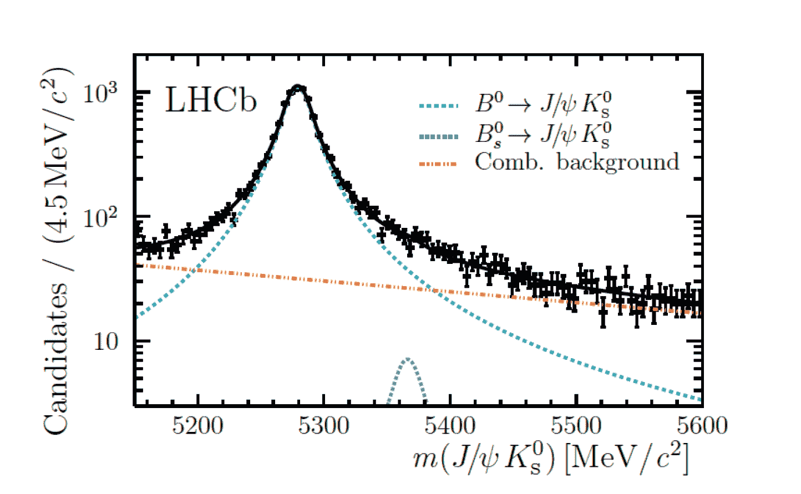

图 2.7：典型不变 `μ`^+`μ`^− 质量分布示意图，描绘了信号和背景。

原则上，从 `J`/`ψ` 和 `K`[`S`]⁰ 候选者重构 `B`⁰ 介子候选者遵循相同的过程，即通过将 `J`/`ψ` 和 `K`[`S`]⁰ 候选者的能量和动量相加来确定 `B`⁰ 候选者的能量和动量。然而，对于几乎所有分析，最小化背景对测量（例如 `CP` 不对称性）的影响至关重要。仅接受质量在分辨率函数定义范围内的 `J`/`ψ` 和 `K`[`S`]⁰ 候选者是标准做法。许多其他准则也可用于进一步优化选择。在大多数分析中，使用机器学习方法以实现最优选择。通常使用提升决策树或神经网络。


选择用于测量 *CP*\-不对称性的信号道只是第一步。正如所指出的，有必要确定动量和飞行距离以推导粒子的衰变时间。动量在选择后已知。为了确定飞行距离，利用与重构的 *B*\-候选粒子相关的带电径迹来重构 *B*\-介子的二级顶点。因此，利用径迹的测量径迹参数将径迹轨迹外推至束流线。由于 *K*[*S*]⁰ 介子寿命较长，在 *B* 衰变顶点处，π 介子径迹参数的外推将具有相当大的误差。因此，测量顶点位置的精度主要来自 μ 子径迹参数。初级顶点的位置可以通过事件中大量其他径迹轻松确定。衰变拓扑结构示意图如 图 2.8 所示。

![图 2.8：典型 B 衰变拓扑结构示意图。从初级顶点和其他顶点发出的带电径迹描绘为实心直线。径迹利用跟踪系统确定的径迹参数进行外推。 *B*⁰ 介子（虚点红线）平均飞行 ≈ 1 cm 后衰变——本例中：*B*⁰→*J*/*ψ**K*[*S*]⁰。*J*/*ψ* 几乎瞬间衰变，对于分析而言，衰变为两个轻子（μ+μ−, e+e−）是相关的。*K*[*S*]⁰ 介子（虚点绿线）的寿命比 *B* 介子长得多。](graphic/b_9783110785968-002_fig_108.png)

图 2.8：典型 B 衰变拓扑结构示意图。从初级顶点和其他顶点发出的带电径迹描绘为实心直线。径迹利用跟踪系统确定的径迹参数进行外推。*B*⁰ 介子（虚点红线）平均飞行 ≈ 1 cm 后衰变——本例中：*B*⁰→*J*/*ψ**K*[*S*]⁰。*J*/*ψ* 几乎瞬间衰变，对于分析而言，衰变为两个轻子（μ+μ−, e+e−）是相关的。*K*[*S*]⁰ 介子（虚点绿线）的寿命比 *B* 介子长得多。

分析的下一个要素称为标记，即确定所考虑的 *B*⁰ 介子在产生时的“味”。判断它是 *B*⁰ 还是 依赖于这样一个事实： *b* 夸克以 ${\overline{B}}^{0}\text{~at~}t = 0$ 对的形式产生。由于只有部分产生的 *b* 夸克最终会形成中性 *B* 介子，同一反应中产生的另一个 *B* 强子的信息将提供答案。事件中还有更多可用信息，例如来自靠近所考虑的中性 *B* 介子产生的介子。为了获取所需信息，卓越的粒子识别能力是必要的——这是 LHCb 实验设计标准的另一个强约束。尽管探测器性能优异，在给定事件中拥有合适标记的概率非常小。

所谓标记能力 *ϵ[eff]* 量化了由于标记不完美导致的数据样本有效统计量的减少。因此，在大小为 *N* 的样本上测量的时间依赖不对称性的统计不确定度 *σ* 依赖于 *ϵ[eff]*，关系为 $\sigma \propto 1/\sqrt{N}$。标记能力取决于测量 *CP*\-不对称性的道。尽管付出了所有努力，其值通常远低于 10%。因此，LHCb 投入持续巨大的努力来提高标记能力。标记能力翻倍相当于在无进一步改进的情况下将数据样本翻倍，这相当于数年的数据采集。为了获得尽可能高的标记能力，基于深度神经网络的新标记方法正在开发中。

显然，有必要确定探测和提取物理可观量（如 *CP*\-不对称性）的效率。此外，需要高精度地了解数据集中背景的影响。对于这类任务，通常使用大量的蒙特卡洛模拟。

# 3 机器学习与数据分析中的关键概念

### 摘要

全书中，机器学习被用于增强我们对宇宙结构的认识，并通过大型产生数据的物理实验来理解粒子相互作用。本章概述了机器学习作为一门科学学科的结构。由于我们无法详述方法及其基础，我们增加了相关教科书和综述论文的指引。我们的目标是提高对机器学习理论基础的认知，以便机器学习慷慨提供的软件始终在适当的谨慎下使用。

Katharina Morik

Mirko Bunse

## 3.1 机器学习领域概述

机器学习（ML）是人工智能（AI）的一个领域，用于构建或增强某些现象的模型。我们将在此给出一个简短的概述，展示这一大型领域的结构。我们讨论的机器学习层级及其相关理论包括：

*   最常由待优化的目标函数给出的学习任务，在统计学中也广为人知，见 3.1.1 节。
*   算法和库遵循处理范式，见 3.1.2 节。它们定义了总体学习中步骤的流水线，如 3.1.3 节 所述。特征选择这一特定步骤通过最小冗余最大相关性方法在 3.1.4 节 中进行说明。
*   优化方法，特别是 `Newton-Raphson` 和 `Stochastic Gradient Descent`，在 3.2 节 中解释。

通过指出机器学习的理论问题（见 3.3 节），完成了结构性视角。对于学习方法的类别，我们选择在 3.4 节 中介绍树模型（包括树集成），在 3.5 节 中介绍深度神经网络，因为这些是物理数据分析中最常用的方法。

### 3.1.1 学习任务

许多机器学习方法可以描述为寻找一个预测函数 *h* : 𝒳 → 𝒴，其中学习任务由 𝒳（输入数据的域）、𝒴（输出或标签的域）以及量化预测质量的风险度量来指定。实例化学习任务的通用方案给出了最重要的学习任务类别的定义。

**定义 1. 无监督学习**

*给定一组观测值* $D\_{U} = \left\{ {{\overset{\rightarrow}{x}}\_{i} \in X:1 \leq i \leq N} \right\}$ *和一个函数 ext* : 𝒞 → 2^X *返回所有映射到 c 的对象 ⃗x* ∈ 𝒳*，找到概念 c[j]* 𝒞 : 1 ≤ *j* ≤ {∈ *k*} *使得每个* ${\overset{\rightarrow}{x}}\_{i} \in X$ *都映射到一个概念 c[j]* ∈ 𝒞*，并使得某个质量函数通过此映射得到优化。*

**定义 2. 有监督学习**


#### 学习任务的三个组成部分

给定一组标记观测值 $D_{L} = \left\{ {\left( {\overset{\rightarrow}{x}_{i},y_{i}} \right) \in X \times y:1 \leq i \leq N} \right\}$，寻找一个映射 $h : X \to y$ 使得质量度量得到优化。

虽然学习任务的方案看起来很简单，但如果我们详细阐述其三个部分，就会发现它所涵盖的空间有多么广阔。

##### 输入

首先，**输入**被表征，范围涵盖从公式、数据库记录、数值序列、序列、图像和语言输入，到图甚至其他模型。通常，输入数据是向量样本 $D[U]$，其中 $\mathcal{X}$ 是一个 $d$ 维随机变量。每个分量是某个领域的特征或属性。如果所有特征均为实数，则 $\overset{\rightarrow}{x} \in \mathcal{R}^{d}$。向量可能被组织成某个矩阵 $A$ 或索引 $t[0], t[1], \dots, t[T]$ 上的序列。对于图，除了节点的向量外，还有边，甚至可能有边特征。

仅包含这些输入数据的学习任务称为无监督学习。聚类分析和矩阵分解是流行的无监督学习方法。聚类产生一组概念 $c[1], \dots, c[k]$，其中每个概念覆盖一组数据点。

选择合适特征集的方法将在第 3.1.4 节中描述。

##### 目标

其次，指定**目标**。如果为每个 ${\overset{\rightarrow}{\chi}}_{i}$ 给出目标值或标签 $y[i]$，我们称该任务为监督学习。分类为示例分配一个类，$h : \mathcal{X} \to y, y \in \{+1, -1\}$。回归为实例分配一个实数，即 $y \in \mathcal{R}$。对于时间序列数据，任务要么是分类，即时间序列是类 $y$ 的一个实例；要么是预测，即给定序列 ${\overset{\rightarrow}{x}}_{t_{0}},{\overset{\rightarrow}{x}}_{t_{1}},\dots{\overset{\rightarrow}{x}}_{t_{T}}$，寻找时间跨度 $s$ 对应的 ${\overset{\rightarrow}{x}}_{T + S}$。

也可能有更复杂的输出 [[370]](#9783110785951_034588.xhtml#b_9783110785968-011_ref_370)。例如在语音识别中，音频输入的数值序列必须映射到单词序列，$h : \mathcal{X} \to \mathcal{Y}$。

由于为所有给定数据 $D[U]$ 获取标签 $y[i]$ 可能代价高昂，半监督学习使用一小组观测值 $x[1], \dots, x[m]$ 及其标签 $y[1], \dots, y[m]$，外加一大组未标记观测值 $x[m+1], \dots, x[N]$。它最初以通过专家建议指导聚类的形式引入 [[127]](#9783110785951_034588.xhtml#b_9783110785968-011_ref_127)，随后推广到文本数据 [[340]](#9783110785951_034588.xhtml#b_9783110785968-011_ref_340) 和图 [[266]](#9783110785951_034588.xhtml#b_9783110785968-011_ref_266)。

主动确定哪些标记数据对学习效用最大的方法称为主动学习。它们针对标注成本优化标注对学习的效用。自监督学习更进一步，不需要人工标注。相反，学习者基于给定数据形成学习任务。示例向量的一个分量或数值序列的某一部分被用作待预测的标签。模型在遮盖标签部分的示例上进行测试。一种更复杂的方法是干扰示例，在改变后的数据和真实数据上训练模型，并学习如何区分模型 [[75]](#9783110785951_034588.xhtml#b_9783110785968-011_ref_075)。

##### 损失函数、质量度量或风险函数

第三，指示**损失函数**、**质量度量**或**风险函数**，即学习模型必须满足的条件。$R[D] : \mathbb{R}^{(d)} \to \mathbb{R}$。它在标记数据 $D[L]$ 或未标记数据 $D[U]$ 上进行评估。这为优化技术 [[95], [293]] 提供了舞台。广泛的优化领域范围从进化算法 [[74]](#9783110785951_034588.xhtml#b_9783110785968-011_ref_074) 到（随机）梯度下降 [[92]](#9783110785951_034588.xhtml#b_9783110785968-011_ref_092)。

除了最小化损失或最大化似然外，目标还在于最小化模型复杂度并防止其过拟合训练数据。通常，正则化向损失函数添加一个惩罚项。这也可称为多目标优化 [[269]](#9783110785951_034588.xhtml#b_9783110785968-011_ref_269)。质量度量和优化将在第 3.2 节中描述。

#### 示例：线性回归

让我们通过回归来说明学习任务的三个部分，以更清晰地看到它们的相互作用。学习线性回归函数是一个简单但广泛的任务。回归函数以三种符号出现：求和形式、矩阵乘积形式和标量积形式：

$$
\hat{y} = h_{\overset{\rightarrow}{\beta}}(\overset{\rightarrow}{x}) = \sum\limits_{i = 1}^{d}\beta_{i}x_{i} = {\overset{\rightarrow}{x}}^{T}\overset{\rightarrow}{\beta} = \overset{\rightarrow}{x} \cdot \overset{\rightarrow}{\beta}
$$

我们看到参数向量 $\overset{\rightarrow}{\beta}$ 通过在加权求和中对特征 $x[i]$ 进行加权来影响预测。

要从数据集 $D[L]$ 学习模型，我们必须确定风险度量。对于线性回归，一个流行的选择是预测值与真实值之间的均方误差。

$$
\text{MSE}\left( {\overset{\rightarrow}{\beta};D_{L}} \right) = \frac{1}{N}\sum\limits_{i = 1}^{N}\left( {y_{i} - h_{\overset{\rightarrow}{\beta}}\left( {\overset{\rightarrow}{x}_{i}} \right)} \right)^{2}
$$

由于线性回归模型的简单性，可以找到一个在 MSE 意义下最优的参数向量 ${\overset{\rightarrow}{\beta}}^{\star} = \left( {X^{\top}X} \right)^{- 1}X^{\top}Y$。然而，通常情况下，寻找解并不那么容易。更复杂的模型和损失函数需要数值优化技术来选择最优参数向量。

风险度量通常定义为逐示例损失值的平均值。这些损失值通过损失函数 $\ell : \mathcal{Y} \times \mathcal{Y} \to \mathbb{R}$ 指定，该函数为每个单独预测分配一个分数。即，经验风险 $R[D]$ 定义为：

(3.1) $R_{D}(\overset{\rightarrow}{\beta}) = \frac{1}{N}\sum\limits_{i = 1}^{N}\mathcal{l}\left( {h_{\overset{\rightarrow}{\beta}}\left( x_{i} \right),y_{i}} \right) \quad (3.1)$

例如，线性回归的均方误差基于损失函数 $\mathcal{l}_{\text{MSE}}(\hat{y}, y) = (\hat{y} - y)^{2}$。另一种选择是零一损失，$\mathcal{l}_{01}(\hat{y}, y) = 0$ 如果 $\hat{y} = y$，否则 $\mathcal{l}_{01}(\hat{y}, y) = 1$。后一种选择导致 $R[D]$ 估计错误分类的概率，因此是分类任务的合适度量。$\ell$ 的其他选择包括 hinge loss、Huber loss 等 [[327]](#9783110785951_034588.xhtml#b_9783110785968-011_ref_327)。

无论采用哪种特定的损失函数，我们都希望得到的风险尽可能小，使得预测值 $\hat{y}$ 尽可能接近真实结果 $y$。然而，我们必须记住，经验风险 $R[D]$ 只是一个更大目标的替代品：即对整个数据分布有效的最小**期望风险** $R$。


### 3.1.1 正则化与模型复杂度

(3.2) $R = \int\limits_{x \times y}\,\mathbb{P}(x,y) \cdot \ell\left( {f_{\beta}(x),y} \right)\text{d}x\text{d}y\left( 3.2 \right)$

这一更高层面的目标源于我们希望预测未标记的未来数据。换句话说：我们旨在学习能从观测数据 `D[L]` 泛化到同分布任意数据集的预测函数。当我们将数据拆分为训练集和验证集时，`R` 与 `R[D]` 之间的差异变得显而易见：如果模型类 `ℋ` 足够强大以至于能记住训练集，使得 `R[D]` = 0，我们通常会观察到大于零的验证误差。

从观察 `R` 和 `R[D]` 的差异中得到的一个教训是，我们通常希望防止模型仅仅记住训练集 `D`。为此，我们可以采用正则化技术，对模型结构施加额外约束。带有正则化函数 `r` : `ℝ^d` → `ℝ` 和正则化强度 `λ` ∈ `ℝ` 的正则化优化任务的目标是：

(3.3) ${\overset{\rightarrow}{\beta}}^{\star} = \underset{\overset{\rightarrow}{\beta}}{\arg\min}R_{D}(\overset{\rightarrow}{\beta}) + \lambda r(\overset{\rightarrow}{\beta})\,\left( 3.3 \right)$

函数 `r` 通常不依赖于训练数据 `D`，而是依赖于结构性质（如稀疏性），这些是预期解中所期望的。我们通过两个典型的正则化项——即 L1 范数和 L2 范数——来阐述这一讨论。L2 范数，也称为欧几里得范数，是一个常用的惩罚项，它施加较小的参数值。它还有一个额外好处，即由于其强凸性而有利于优化。在神经网络中，L2 范数正则化也称为“权重衰减”。

$r_{\text{L}2}(\overset{\rightarrow}{\beta}) = \parallel \overset{\rightarrow}{\beta} \parallel_{2} = \sqrt{\sum\limits_{i = 1}^{d}\beta_{i}^{2}} = \sqrt{{\overset{\rightarrow}{\beta}}^{T}\overset{\rightarrow}{\beta}} = \sqrt{\overset{\rightarrow}{\beta} \cdot \overset{\rightarrow}{\beta}}$

以线性回归模型为例，L2 范数正则化引出了流行的岭回归技术：

$\min\limits_{\overset{\rightarrow}{\beta}}\,\underset{i = 1}{\sum\limits^{N}}\,\left( {y_{i} - \underset{j = 1}{\sum\limits^{d}}\, x_{ij}\beta_{j}} \right)^{2} + \lambda\underset{j = 1}{\sum\limits^{d}}\,\beta_{j}^{2}$

L1 范数，也称为曼哈顿距离，为解促进了一种不同的结构。它不施加较小的参数值，而是促使某些参数接近零，同时保持其他参数不变。在线性模型中，L1 范数正则化从而可在学习预测模型的同时执行特征选择。

$r_{\text{L}1}(\overset{\rightarrow}{\beta}) = \parallel \overset{\rightarrow}{\beta} \parallel_{1} = \sum\limits_{i = 1}^{d}\beta_{i} = {\overset{\rightarrow}{\beta}}^{T}\overset{\rightarrow}{1}$

关于线性回归模型，L1 范数正则化引出了流行的 LASSO 回归技术。对于线性动态系统（LDS），L1 正则化已通过基于时变动力学估计的重参数化方法得到增强 [[310]](#9783110785951_034588.xhtml#b_9783110785968-011_ref_310)。

贝叶斯统计通过给定的先验概率分布实现正则化，从而降低模型复杂度。SVM 甚至同时选择使误差和模型复杂度最小化的模型 [378, 381]，这由 VC 维度衡量（见 3.3.1 节）[[379]](#9783110785951_034588.xhtml#b_9783110785968-011_ref_379)。将机器学习视为最小描述长度下的数据压缩 [325, 326]，进一步导致了在超大数据量中的频繁集挖掘 [[384]](#9783110785951_034588.xhtml#b_9783110785968-011_ref_384)。

### 3.1.2 机器学习的处理范式

数据可能作为大型数据集给出，也可能作为数据流流入。无法装入单机内存的超大数据集需要分布式处理。在大型分布式计算集群上进行计算催生了**映射 & 归约**编程范式。一个小例子说明了这一思想。在映射步骤中，一个函数被应用于列表的每个元素，例如，`map(+1)[1, 2, 3]` 产出 `[2, 3, 4]`。在归约步骤中，一个函数被应用于整个列表，例如，`reduce(+)` 随后产出 `[2 + 3 + 4]` [[135]](#9783110785951_034588.xhtml#b_9783110785968-011_ref_135)。

在极端情况下，流式计算不允许算法查看某个数据点超过一次。潜在的无限流穿过算法，算法处理一个数据点然后将其释放。然而，处理这些流的数据结构，像任何其他数据结构一样，必须是有限的。因此，在实践中通常需要采用仅能近似数据流真实属性的算法，例如近似计数 [[259]](#9783110785951_034588.xhtml#b_9783110785968-011_ref_259)。第 1 卷第 3 章 提出了用于从流式数据学习的新算法。用于海量数据流的学习算法开源库是 MOA [[83]](#9783110785951_034588.xhtml#b_9783110785968-011_ref_083)。

天体物理数据属于*大数据*。大数据的概念意味着具有高*速度*到达且类型*多样*的超大*体量*数据，这些数据需要被处理。像 Apache Hadoop 这样的开源软件“允许使用简单的编程模型跨计算机集群对大型数据集进行分布式处理”。

### 3.1.3 机器学习流水线

一般来说，数据科学流水线始于最繁重的步骤：从科学问题到学习任务的映射。通常，科学问题会被拆分为若干个子问题，每个子问题都有其自己的学习任务。第 1 章 从认识论的角度描述了理论发展与数据分析的相互作用。

从所有观测中*采样*待分析的数据遵循科学关切，例如，根据特定概念构建观测结构。例如在中微子探测中，我们可能对缪子、电子或陶中微子感兴趣，因此为这些概念分别构建独立的学习过程。这对模拟数据同样适用。如果某一类别占主导地位，我们可能会改变给定的分布。5.2.2 节展示了主动类别选择如何从倾斜分布中不成比例地采样，以实现可靠的分类。

给定的数据格式通常需要转换以用于学习。例如，带时间戳数据的标准表示可以通过多种方式转换，以允许特定学习任务的成功训练 [[277]](#9783110785951_034588.xhtml#b_9783110785968-011_ref_277)。整个学习过程需要连同所有元参数一起记录下来。像 RapidMiner 这样的机器学习框架


成功进行机器学习最重要的是观测项的特征。选择易于学习的特征是第一步。特征选择有三种类型。

首先，*过滤方法* 如 t 检验 [[168]](#9783110785951_034588.xhtml#b_9783110785968-011_ref_168) 或 SAM 统计量 [[372]](#9783110785951_034588.xhtml#b_9783110785968-011_ref_372) 计算特征上的评分函数，忽略特征间的相互作用。

其次，*包装方法* [[230]](#9783110785951_034588.xhtml#b_9783110785968-011_ref_230) 使用可能的特征集训练学习器，并通过嵌入式学习的准确性评估每个特征集。每次特征集评估都需要对所用学习算法进行交叉验证训练。

第三，一些学习算法为用户提供了*隐式特征排序*，可轻松用于特征选择。此类嵌入式方法使用线性 SVM [[381]](#9783110785951_034588.xhtml#b_9783110785968-011_ref_381) 的权重向量，或随机森林 (RF) [[97]](#9783110785951_034588.xhtml#b_9783110785968-011_ref_097) 的特征使用频率。它们感知特征相互作用，比包装方法快，但依赖于所用的学习算法。在第 3.1.4 节中，我们描述了一种通用且高效的特征选择方法。

从原始数据提取特征的过程通常针对特定的科学问题量身定制。第 7 章和第 8.4.1 节针对特定的天体物理数据介绍了这一点。

无监督学习可为后续的监督学习提供特征。无监督学习提供伪标签，用于优化总体代价函数，这与监督学习类似。该方法也已被推广用于神经网络 [[114]](#9783110785951_034588.xhtml#b_9783110785968-011_ref_114)。

这种两步程序已被推向*单样本学习* [[249]](#9783110785951_034588.xhtml#b_9783110785968-011_ref_249) 的极致。*单样本学习* 将给定的知识（可能是先前学习的）适应于少量样本。贝叶斯方法特别适合图像数据，因为存在感兴趣区域，可解释为形状和外观特征，例如一组纹理。首先，展示一组类别的图片以训练先验概率密度函数。类别的形状和外观概率是形成特征空间的给定知识。然后，仅需一个标记样本即可在学习到的特征空间中正确分类所有与其接近的实例。这是单样本学习的一种类型。

提取允许高精度分类器学习的特征可自动化为一个过程，其中学习的外层循环及其关于质量度量的评估嵌入了一个内层循环，该循环基于给定数据创建新特征。自主特征提取依赖于结构良好的可能特征空间。形状和纹理构建了结构化图像分类。对于数值序列，已开发并使用了基础变换和曲线形状的结构，通过进化算法进行自主特征提取 [[270]](#9783110785951_034588.xhtml#b_9783110785968-011_ref_270)。在那里，特征表示为方法树。进化算法通过向树添加方法或组合树来创建新特征。它优化方法树的种群，从而执行特征选择。

一些学习算法为用户提供可轻松用于特征选择的隐式特征排序。此类嵌入式方法使用线性支持向量机 (SVM) [[381]](#9783110785951_034588.xhtml#b_9783110785968-011_ref_381) 的权重向量或随机森林 (RF) [[97]](#9783110785951_034588.xhtml#b_9783110785968-011_ref_097) 的特征使用频率。正如 Tom Mitchell 所强调的，神经网络中的隐藏层发现有用的中间表示 [[274]](#9783110785951_034588.xhtml#b_9783110785968-011_ref_274)。这对应于使用进化算法的自主特征提取，其中嵌套循环是神经网络的反向传播，外层学习是最后一层，隐藏层创建可能的表示。前馈网络的监督训练被视为表征学习，因为它们在隐藏层中从数据中提取模式并对其进行优化，使得学习到的权重增强相关的局部模式 [[183]](#9783110785951_034588.xhtml#b_9783110785968-011_ref_183)。

最后，我们可能想要优化学习到的模型本身。与物理学中的术语相反，机器学习中的*量化* 是指通过将实值数字转换为二进制或整数来压缩模型。二值化神经网络 (BNN) 现在将权重量化为二进制值 [[207]](#9783110785951_034588.xhtml#b_9783110785968-011_ref_207)。TensorFlow 的量化方案将实数映射到二进制表示，推理时使用纯整数运算，训练时使用浮点运算，同样是为了节省资源 [[214]](#9783110785951_034588.xhtml#b_9783110785968-011_ref_214)。一种仅使用整数值完全训练马尔可夫随机场 (MRF) 的方法已被开发出来以节省能量 [[308]](#9783110785951_034588.xhtml#b_9783110785968-011_ref_308)。它允许在使用纯整数运算的超低功耗设备上进行学习和推理。

### 3.1.4 最小冗余最大相关性 (MRMR)

特征张成了可以在其中学习概念的空间。过多的特征会带来高维灾难。拥有许多特征可能会减慢学习速度。因此，特征选择的目标是找到一个特征子集，它能很好地预测目标概念且具有最小冗余。基于相关性的特征选择 (CFS) [[190]](#9783110785951_034588.xhtml#b_9783110785968-011_ref_190) 迭代地添加特征，该特征在预测相关性与其与已选特征相关性之间具有最佳比率。预测性和相关性均由基于熵的对称不确定性度量：

```
(3.4) $SU\left( {f_{i},f_{j}} \right) = \frac{2 \cdot IG\left( {f_{i} \mid f_{j}} \right)}{H\left( f_{i} \right) + H\left( f_{j} \right)}\,\,\,\,\,\,\,\,\,\,\,\,\,\,\,\,\,\,\,\,\,\,\left( 3.4 \right)$
```

其中特征 `f[i]` 关于特征 `f[j]` 的信息增益 `IG` 除以 `f[i]` 和 `f[j]` 的熵 `H` 之和。Ding 和 Peng [[144]](#9783110785951_034588.xhtml#b_9783110785968-011_ref_144) 推广了 CFS，使其具备处理数值变量的能力，称之为*最小冗余最大相关性 FS* (MRMR)。对于数值特征，使用 F 检验。它反映了类间方差与这些类内平均方差的比率。对于连续特征 `X` 和名义类变量 `y` ∈ `Y`（具有 `C` 个类），均来自含有 `n` 个样本的数据集，定义如下：

```
(3.5) $F(X,Y) = \frac{(n - C)\sum\limits_{c}n_{c}\left( {\overline{X}_{c} - \overline{X}} \right)^{2}}{(C - 1)\sum\limits_{c}\left( {n_{c} - 1} \right)\sigma_{c}^{2}}\,\,\,\,\,\,\,\,\,\,\,\,\,\,\,\,\,\,\,\,\,\,\,\,\,\,\,\,\,\,\,\,\,\,\,\,\left( 3.5 \right)$
```

其中 `σ[c]²` 为类内方差，`n[c]` 为类 `c` ∈ {1,.., `C`} 中的样本数。数值特征集的冗余由皮尔逊相关系数的绝对值度量


## 3.1 相关系数估计

(3.6) $R(X,Y) = \frac{{cov}(X,Y)}{\sqrt{Var(X) \cdot Var(Y)}}\quad (3.6)$

或其估计量

(3.7) $r(X,Y) = \frac{\sum\limits_{i}\left( {x_{i} - \overline{x}} \right)\left( {y_{i} - \overline{y}} \right)}{\sqrt{\sum\limits_{i}\left( {x_{i} - \overline{x}} \right)^{2}\sum\limits_{i}\left( {y_{i} - \overline{y}} \right)^{2}}}.\quad (3.7)$

为了稳定特征选择方法，通过 Bagging（装袋法）降低其方差，即在数据的不同子样本上并行执行特征选择算法，从而得到一个特征集合的集成 [96]。已经创建了一种 MRMR 特征选择集成的快速实现，它非常适合高维数据 [344]。在集成中被较早选择且被许多集合选中的特征会被组合成最终的选定特征集。

## 3.2 优化

到目前为止，我们已将从数据中学习预测模型的任务表示为最小化经验风险函数的任务。在下文中，我们通过两种最流行的方法——随机梯度下降和牛顿-拉夫逊方法——来举例说明数值优化。这两种方法都通过在多次迭代中更新中间估计量 ${\overset{\rightarrow}{\beta}}^{(k)}$ 来搜索最优参数向量 ${\overset{\rightarrow}{\beta}}^{*}$，如算法 3.1 所述。这两种算法在搜索方向 ${\overset{\rightarrow}{p}}^{(k)}$ 的选择上有所不同，见该算法第 3 行。

**算法 3.1：** 数值优化的标准算法。

**输入：** 初始猜测 ${\overset{\rightarrow}{\beta}}^{(0)} \in {\mathbb{R}}^{d}$ 和风险函数 $R_D: \mathbb{R}^d \to \mathbb{R}$

**输出：** 极小化点 $\overset{\rightarrow}{\beta} \in {\mathbb{R}}^{d} \text{ of } R_D$

**1** $k \leftarrow 1$ **while** *a stopping criterion is not met* **do**

**2** 选择搜索方向 ${\overset{\rightarrow}{p}}^{(k)} \in {\mathbb{R}}^{d}$，使用 ${\overset{\rightarrow}{\beta}}^{(k - 1)}$ 和 $R_D$

**3** 选择步长 $\alpha^{(k)}$，使用 ${\overset{\rightarrow}{\beta}}^{(k-1)}$ 和 $R_D$

**4** ${\overset{\rightarrow}{\beta}}^{(k)} \leftarrow {\overset{\rightarrow}{\beta}}^{(k - 1)} + \alpha^{(k)} \cdot {\overset{\rightarrow}{p}}^{(k)}$

**5** $k \leftarrow k + 1$

**6** **end**

**7** **return** ${\overset{\rightarrow}{\beta}}^{(k)}$

### 3.2.1 随机梯度下降

机器学习任务通常具有大量需要在有限资源下处理的训练样本。根据公式 3.3，数值优化方法需要解决这一特点。随机梯度下降（SGD）是一类优化方法，特别适用于训练样本数量 $N$ 很大的情况。

我们考虑 SGD 的流行小批量变体，它基于具有随机索引的 $b \ll N$ 个样本的小批量来选择每个搜索方向。由于这些小批量 $I[k] = \{1 \le i_j \le N : 1 \le j \le b\}$ 是从完整数据集 $D$ 中随机抽取的，因此 SGD 算法的估计值是一个随机（马尔可夫）过程。这种行为与完整批量算法形成对比，后者在每次迭代中访问 $D$ 的所有实例，从而产生确定性的估计序列。SGD 的另一个特点是只访问目标函数的梯度 $\nabla R_D$，而不访问 $R_D$ 的任何高阶导数。因此，小批量 SGD 的每次迭代成本非常低廉，即它线性依赖于 $b$ 但不依赖于 $N$。该变体的搜索方向由以下公式给出，其中所有梯度均针对参数向量计算：

$$
{\overset{\rightarrow}{p}}^{(k)} = -\frac{1}{b} \sum_{i \in I[k]} \nabla L(f(x_i; {\overset{\rightarrow}{\beta}}^{(k-1)}), y_i)
$$

在每次迭代中仅访问 $b$ 个样本会导致参数更新中产生大量噪声。可以通过适当选择步长来处理此问题，例如使用衰减值 $\alpha^{(k)} < \alpha^{(k-1)}$。然而，由于小步长会减慢学习过程，还有其他几种技术能更直接地解决梯度噪声问题。

例如，基于动量的 SGD 变体修改了上述标准优化算法的参数更新规则。具体来说，这些变体将算法 3.1 的第 5 行修改为以下赋值，引入了一个额外的步长：

$$
{\overset{\rightarrow}{v}}^{(k)} = \gamma^{(k)} {\overset{\rightarrow}{v}}^{(k-1)} + \alpha^{(k)} {\overset{\rightarrow}{p}}^{(k)}, \quad {\overset{\rightarrow}{\beta}}^{(k)} = {\overset{\rightarrow}{\beta}}^{(k-1)} + {\overset{\rightarrow}{v}}^{(k)}
$$

额外的步长 $\gamma^{(k)}$ 对另一个方向的贡献进行加权，该方向是前几次更新的差值。因此，参数更新被“稳定”了，即它们保持早期搜索方向的程度由标量步长序列 $\{\gamma^{(k)}\}$ 配置。基于动量的技术在实践中被广泛应用。例如，著名的优化方法 Adam [227]（常用于学习深度神经网络）基于两阶动量以实现更高的稳定性。

SGD 适用于大 $N$ 的原因在于迭代次数和每次迭代的成本都不依赖于 $N$ [93]。这一特性与全批量算法形成对比，后者的每次迭代成本确实与 $N$ 成正比。由于 SGD 的每次迭代成本相对低廉，它能很好地扩展到大型数据集。

除了理想的扩展行为外，SGD 相对于全批量算法还有两个优势：首先，它不仅优化经验风险 $R_D$，还直接优化期望风险 $R$。在这方面，SGD 与学习泛化预测模型的实际目标更一致。其次，如果非凸函数在不那么严格的条件下表现良好，SGD 也可以对其进行优化 [93]。

### 3.2.2 牛顿-拉夫逊优化

牛顿-拉夫逊方法 [293] 在两个核心方面不同于 SGD。首先，它不仅使用梯度信息，还使用目标函数 $R_D$ 的二阶导数。因此，它能够以参数数量的平方成本为代价来评估搜索空间的曲率。其次，牛顿-拉夫逊算法是批量变体，即每次迭代使用 $D$ 中的所有样本计算 $R_D$ 的完整导数。由于这些差异，牛顿-拉夫逊的每次迭代成本明显高于 SGD。然而，由于完整导数比 SGD 更新包含更多信息，通常需要的迭代次数较少。因此，如果训练样本数 $N$ 和参数数 $d$ 都足够小，牛顿-拉夫逊在寻找精确解所需的计算资源方面可以优于 SGD。在公式 3.1 的经验风险最小化框架中，小 $N$ 和小 $d$ 的优化任务并不典型，但此类任务在数据分析的其他方面（如第 10 章提出的去卷积问题）中具有相关性。


## 3.3 机器学习理论

机器学习研究旨在回答以下问题：

*   能对误差给出哪些保证？（误差界）
*   哪类模型最适合该问题？（模型选择）
*   需要多少样本？（样本复杂度）
*   如果样本数量和维度数量增加，模型在运行时间、内存和能耗方面如何扩展？（资源界）

在最抽象的层面上，机器学习作用于*公式*，如上述公式 3.1 和 3.3 中回归函数的正则化误差最小化。就这些函数而言，学习任务被指定出来。证明学习模型的误差界是机器学习与统计学的共同研究课题。正如已经陈述的，优化领域也发挥着作用。在 ICML 或 ECML PKDD 等机器学习会议上，几乎每篇论文都展示了误差界的证明，或至少将其结果实质性地建立在误差界的证明之上。作为入门，我们推荐关于机器学习统计和概率方法的书籍 [192, 284]。

给定一个物理问题和实验数据，没有任何一类学习理论是先验地适用的。正如*免费午餐定理*所指出的，每一种学习方法的选择一方面伴随着其要求，另一方面伴随着其理论保证 [388, 389]。

在选定的一般类别内，存在有助于选择特定方法的标准。算法最重要的特征在于批处理与在线处理、或分布式与集中式处理的区别。对于应用开发，需要研究高效的*算法*。同一模型类的不同算法，其最坏情况复杂度和经证明的紧精度界是已知的。频繁项集挖掘的实现竞赛——即寻找数据库项目所有频繁共现的任务 [163]——广为人知。文献报道了 12 个不同层级的实现及其各异的资源消耗，例如内存使用、运行时间和生成模型的压缩。

如今，我们甚至深入到了*在特定硬件上的实现*层面。在早期，学习算法是从 CPU 移植到 GPU 的，如 [309] 所述。现在，硬件专门为机器学习的低延迟和高吞吐量计算需求而设计。非冯·诺依曼架构的存内计算（IMC）/ 存内处理（PIM）正在被广泛研究 [78]。目前，FPGA 是常用的机器学习加速器。针对冯·诺依曼架构和 FPGA 的算法不同实现已被仔细探索 [107]。针对特定架构的快速执行优化也受到关注 [231]，特别是多核架构上的计算（见第 1 卷 第 6.4 节）。特别是对于卷积神经网络，其基于开放神经网络交换格式（ONNX）的抽象描述，允许在 FPGA 的高层接口上综合实现并进行优化 [176]。

最近，机器学习算法与硬件架构的联系变得更加紧密：给定的学习算法不仅适应给定的架构；学习算法本身在其训练过程中还负责处理可能的硬件故障。这对于以准确率换取节能的硬件尤为重要。例如，存内计算节省能源但可能产生错误结果。一种新型的最大间隔优化二值化神经网络成功优化了位错误容忍度 [110]。

模型类层面及其与统计学习理论的联系固然重要，但机器学习通过与计算机科学其他领域的合作，研究更多层次的抽象。用于分布式或流式学习的模型类算法基于理论计算机科学工作，如 [129, 130]。特定硬件上的实现层面将机器学习与计算架构联系起来 [260]。甚至有专门为机器学习设计的特定硬件 [217]。机器学习研究并贡献于所有层面：从模型类到算法，再到实现，甚至计算机架构。学习正交于计算机科学的层级体系。

**表 3.1：** 由布尔字面量合取组成的概念类示例。

| *c*[1] | *rainy* | *AND* | *not play golf;* |
| :--- | :--- | :--- | :--- |
| *c*[2] | *rainy* | *AND* | *play golf;* |
| *c*[3] | *not rainy* | *AND* | *not play golf;* |
| *c*[4] | *not rainy* | *AND* | *play golf;* |
| *c*[5] | *sunny* | *AND* | *not play golf;* |
| *c*[6] | *sunny* | *AND* | *play golf;* |
| *c*[7] | *not sunny* | *AND* | *not play golf;* |
| *c*[8] | *not sunny* | *AND* | *play golf;* |
| *c*[9] | *rainy* | *AND* | *not sunny;* |
| *c*[10] | *rainy* | *AND* | *sunny;* |
| *c*[11] | *not rainy* | *AND* | *not sunny;* |
| *c*[12] | *not rainy* | *AND* | *sunny;* |

### 3.3.1 计算学习理论

除了机器学习的统计理论外，一种称为“概率近似正确”（PAC）学习的与分布无关的理论，提供了可学习性的界 [375]。它基于假设空间的思想。在特定的形式表示系统中，哪些假设可以被表达？一个简单的概念类是布尔字面量的合取。字面量包括 *rainy, sunny* 和 *play golf*。假设空间 𝒞 则为概念 *c*[1] 到 *c*[12] 的集合。


学习在假设空间中识别出与示例一致的概念，即真假设与所有示例之间不存在逻辑矛盾。换句话说，一个概念是由它所覆盖的实例集合决定的假设。如果存在与假设矛盾的示例，则将其计为错误。对于所有领域，我们将拥有定义概念的不同字面量。这不是学习理论所关心的。理论旨在说明用这种表示法所能表达的所有概念类是否可从示例中学习。可学习性是根据在最坏情况下识别目标概念所需的计算步骤数来定义的。

**定义 3.** 如果对于所有 `c ∈ 𝒞`、实例空间 `X` 上的分布 `D`、满足 `0 < ϵ < 1/2` 的 `ϵ`、满足 `0 < δ < 1/2` 的 `δ`，学习算法 `𝒜` 使用假设空间 `ℋ` 能以至少 `(1 − δ)` 的概率输出一个假设 `h ∈ ℋ`，使得误差 `errorD ≤ ϵ`，且所需时间在 `1/ϵ`、`1/δ`、实例空间大小和概念空间复杂度大小上是多项式有界的，则概念类 `𝒞` 可由学习算法 `𝒜` 使用假设空间 `ℋ` 进行 PAC 学习。

PAC 学习以多项式方式限制了在最坏情况下为一类概念学习分类器所需的计算步骤数。PAC 可学习性证明通常首先表明 `𝒞` 中的每个目标概念都可以从一定数量的示例中学习，该数量由 `ϵ` 和 `δ` 多项式有界。这个示例数量的下多项式界称为学习算法的样本复杂度 [191, 349]。它表明处理一个示例的时间也是多项式有界的。总体思路在 [[273]](#9783110785951_034588.xhtml#b_9783110785968-011_ref_273) 中有更详尽的描述，许多证明可在 [[286]](#9783110785951_034588.xhtml#b_9783110785968-011_ref_286) 中找到。

PAC 学习通常用 *Vapnik Chervonenkis (VC)* 维度 [[379]](#9783110785951_034588.xhtml#b_9783110785968-011_ref_379) 来衡量模型复杂度。然后要求 PAC 学习算法在假设空间的 VC 维度上以多项式时间学习一个概念类。

**定义 4.** 如果 `D` 的每个子集都能被某个 `h ∈ ℋ` 分离，则假设集 `ℋ` 打破示例集 `D`。假设集 `ℋ` 的 VC 维度等于能被 `ℋ` 打破的 `D` 中示例的最大数量 `d`。

我们通过二维数据和分离平面形式的假设来说明这一点，如 图 3.1 所示。一组三个点可以被直线打破，但不存在任何一组四个点能被直线打破。因此，对于直线假设空间，VC 维度为 3。

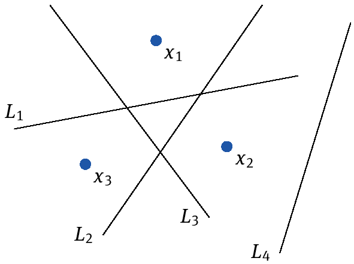

图 3.1: 存在一组三个点 `{x[1], x[2], x[3]}`，对于该组点的任何二值标记，都可以被单条直线 `L ∈ {L[1], L[2], L[3], L[4]}` 分离。因此，直线的 VC 维度至少为三。

对于 VC 维度 `d` 的证明，必须表明以下几点：

*   存在一个包含 `d` 个点的集合 `D`，它能被 `ℋ` 打破。`VCdim(ℋ) ≥ d`
*   不存在包含 `d + 1` 个点的集合 `D'`，它能被 `ℋ` 打破。`VCdim(ℋ) ≤ d`

VC 维度表示模型复杂度，因此允许我们选择仍能学习目标概念的最低复杂度模型。它也给出了我们对学习结果可置信度的提示。较大的 VC 维度意味着较大的置信度。甚至有一种学习方法通过正则化其内部优化来利用 VC 维度，从而保证唯一且最优的学习结果。这种方法是支持向量机 [[380]](#9783110785951_034588.xhtml#b_9783110785968-011_ref_380)。

VC 维度允许我们写出样本复杂度的下界。该定理已针对所有学习者和概念类得到证明 [[149]](#9783110785951_034588.xhtml#b_9783110785968-011_ref_149)。根据 Mitchell [[274]](#9783110785951_034588.xhtml#b_9783110785968-011_ref_274) 的表述如下。

**定理 1.** 样本复杂度的下界。考虑任意满足 `VCdim(C) ≥ 2` 的概念类 `C`、任意学习者 `𝒜` 和任意 `δ ∈ (0, 1)`。则存在分布 `D` 和 `C` 中的目标概念，使得如果 `𝒜` 观察到的示例少于

```
m < max[1/ϵ log(1/δ), (VCdim(C) - 1) / (32ϵ)]
```

则 `𝒜` 输出的假设 `h` 其误差 `errorD > ϵ` 的概率至少为 `δ`。

该定理指出，如果示例较少，没有学习者能 PAC 学习 `C` 中的每个目标概念。当模型类的 VC 维度已知时，这个针对所有学习者的非常通用的界会转化为更具体的界。

从一开始，PAC 学习就研究了神经网络的学习 [[256]](#9783110785951_034588.xhtml#b_9783110785968-011_ref_256)，并成功证明了神经网络能够逼近任意函数 [[224]](#9783110785951_034588.xhtml#b_9783110785968-011_ref_224)。正如 第 3.5 节 概述的那样，给出紧致界并深入理解深度学习的理论分析仍然是一个活跃的研究领域。

## 3.4 树模型

决策树是最成功的学习方法之一：应用广泛、基于概率理论且易于实现。它们将特征空间递归地划分为越来越小的超矩形，直到超矩形中只包含某一类的成员（使其成为叶节点），或直到满足其他停止准则 [[319]](#9783110785951_034588.xhtml#b_9783110785968-011_ref_319)。虽然通常用于监督学习中的分类，但决策树也可建模回归任务。训练一棵树（其中每个节点覆盖一组示例）的过程是：选择用于分裂当前节点的最佳特征，为每个特征值创建子节点，并将示例传递给与其特征值匹配的子节点，直到某节点仅覆盖同一类的示例或某一类占明显多数。学习到的模型通过根据先前未见示例的特征值将其传递到其叶节点来进行分类。

选择分裂特征 `X[j]` 通常遵循信息增益准则。示例属于类 `+` 的概率 `p[+]` 即为熵 `I`：

```
I = -p[+] log2(p[+]) - (1 - p[+]) log2(1 - p[+])
```

具有 `k` 个值的特征 `X[j]` 将示例集 `X` 划分为 `k` 个子集 `X[1], ..., X[k]`。对于实值特征，数值被划分为若干区间，以便这些区间与离散特征一起处理。二叉决策树总是分裂为左、右两个分支。对于数值，使用阈值 `t` 即 `x[j] ≤ t`。根据诸如信息增益之类的质量准则选择最佳特征 `X[j]` 或最佳阈值 `t`：

```
Gain(X[j]) = I(X) - Σ (|X[i]| / |X|) * I(X[i])
```

信息增益是按 `X[j]` 分割前后示例熵的差值。它是针对每个子树处的特定示例集计算的。


信息增益越高，特征离根节点越近。从这个意义上说，树中的位置似乎表明了特征重要性。然而，选定特征的顺序*不是*精确的特征加权算法。特别是，树路径上的相关特征不共享重要性，而是将其相加。因此，它们违反了备选特征权重之和必须为常数的条件，该常数与实际使用的备选特征数量无关。这一条件很重要，因为它保证了一组备选特征并不比单个特征更重要 [271]。

决策树学习器对样本到达的顺序不具备鲁棒性。因此，在其原始形式下，它们不适用于数据流。针对数据流场景，引入了 `VeryFastDecisionTree` (VFDT) 方法 [146]。它们很高效，因为运行时间与特征数量成正比；此外，流的样本不被存储，而是仅被处理一次。开始时，会在节点处保留一部分观测样本。对这些样本评估分裂标准。要求排名靠前的特征之间的差异大于某个 *ϵ*。继续读取额外样本并评估分裂标准，直到达到 Hoeffding 界。从那时起，节点处仅存储聚合统计量。Hoeffding 界保证独立随机变量的和或差极不可能偏离期望值超过一个常数。这里它表明：以概率 1 − *δ*，在看到 *n* 个样本后，评估值（如信息增益）比次优特征大 *ϵ* 的特征，确实也是未来样本的最佳分裂标准。*ϵ* 可按如下方式计算：

```
R 为特征值的范围，例如类别数量的对数。
```

### 3.4.1 集成方法

并行训练多棵决策树并让每棵树对一个类别投票，从而将多数表决作为结果，这种思想被称为 `Random Forest` (RF) [97]。许多简单模型的集成比覆盖相同样本的复杂模型具有更高的鲁棒性。由于集成是并行训练的，其运行时间也是一大优势。训练随机森林的算法如算法 3.2 所示。随机森林的应用提供了分类功能。

**算法 3.2：** `Random Forest` 算法。

**输入：** 决策树数量 *l* 和 *n* 个样本以及期望的特征数量 *k*

**输出：** *h*[1]...*h[l]* 将 X 映射到 Y

**1 forall** *the i* = 1...*l decision trees in the forest* **do**

**2** 采样 *n* 个样本（不放回）

**3** 从给定的 *K* 个特征中随机选择 *k ≪ K* 个特征，

**4** 根据最佳分裂（例如由信息增益给出）在节点处分裂样本集

**5 if** *the resulting nodes have enough examples of the same class* **then**

**6** 停止并输出 *h[i]*

**7 else**

**8** 转到第 3 行

**9 end**

**10 end**

分类公式：

```
公式图片：graphic/b_9783110785968-003_ingr_058.png
```

该过程是一种 bootstrap 聚合——简称 bagging。统计 bootstrap 方法抽取样本并为每个样本拟合模型。Bagging 的输出是所有模型的平均输出或多数表决。无论哪种情况，数据上的预测方差都会降低。`Random Forests` 的许多成功应用包括天体物理学领域，即 `IceCube` 实验 [16, 18, 331] 和几个成像大气切伦科夫望远镜 [48, 258, 294]。

另一种集成方法是 boosting，最初作为 `AdaBoost` 引入 [169]。与 `Random Forest` 一样，它也由多个学习器组成，并降低学习结果的方差。与 bagging 不同，boosting 是一种增量方法，它将训练引导到难以学习的样本空间区域。它基于 PAC 学习，在那里已证明：拥有仅比纯随机在训练数据上略好的假设就足够了，因为这些假设可以被提升为任意正确。`AdaBoost` 的算法如算法 3.3 所示。一方面，弱分类器由 *α* 加权。另一方面，样本权重 *w[m]* 会被更新，使得被 *h[m]*(*x*) 错误分类的样本通过 *exp*(*α[m]*) 获得更大影响。因此，下一个弱分类器 *h[m]*+1 将拟合先前未被良好覆盖的样本空间区域。物理学中有几个提升决策树的应用。见 第 8 章。

**算法 3.3：** `AdaBoost` 算法。

**输入：** *N* 个样本和期望的决策树数量 *M*

**输出：** 预测规则 *h* : 𝒳 → 𝒴

**1** 初始化样本权重：

```
公式图片：graphic/b_9783110785968-003_ingr_059.png
```

**2 forall** *m* = 1, 2,*... M* **do**

**3** 使用加权样本训练弱分类器 *h[m]*(*x*)

**4** 在所有数据上计算误差 *error[m]*

**5** *α[m]* ← *log*((1 − *error[m]*)/*error[m]*)

**6** *w[m]*[+1,*i*] ← *w[m]*[,*i*] *exp*(−*α[m]y[i]h[m]*(*x[i]*)) ∀ *i* = 1, 2,*... N*

**7 end**

**8 return**

```
公式图片：graphic/b_9783110785968-003_ingr_060.png
```

### 3.4.2 实现与硬件考量

决策树及其集成具有如上所述的统计或 PAC 学习描述。这一抽象层面由算法挑战及其在各种硬件上的实现来补充。最高性能由 `gradient-boosted trees` 实现。实现 `XGBoost` 是一种真正可扩展的算法，它使用外部内存，并利用梯度下降优化（参见 3.2.1 节）在 GPU 上并行处理训练 [119]。

其他方法优化学习模型的应用或评估。如果训练可能在大型计算中心运行，但学习模型要应用于物理实验的实际环境中（如 `Cherenkov Telescope Array` (CTA) 或 `IceCube`），这尤为重要。模型的执行在运行时间和内存方面均受限。针对快速推理，已开发出大型决策树集成的遍历方法 [242]。为了优化数据布局并增强缓存使用，已开发出执行决策树的概率视角 [107]。该改进基于系统地使用树使用统计量。研究了决策树的两种不同实现，即优化的 if-then-else 树和优化的路径布局。这些实现能更好地利用计算架构，应考虑用于资源受限的实时应用。第 1 卷的 7.3.3 节提供了更多信息，并解释了如何为特定计算架构生成优化代码。


机器学习模型通常会经过压缩或量化，以减少资源占用。对于决策树，子树剪枝的方法从一开始就已被提出[319]。此外，集成成员的选择也受到关注，例如[371]，但这是一个活跃的研究领域。在部署树模型之前，值得确定合适的剪枝方法。

## 3.5 神经网络

神经网络自诞生起就备受关注。在此，我们将介绍该领域的结构，并指引部分文献供进一步学习。

神经网络通常是——最常见为无环的——有向图，其节点按层组织。输入层由输入特征的节点 `x[i]` 组成。输出层给出网络的结果 `y`，或拥有多个所谓的 `heads`，每个 head 是多项式神经网络中的一个目标。输入层和输出层之间的层称为 `hidden layers`（隐藏层）。具有隐藏层的神经网络称为深度神经网络（DNN）。图 3.2 展示了一个神经元，包含求和后的传入节点权重以及非线性激活函数，此处为修正线性单元，其计算公式为 `ReLU(z) = max{0, z}`。其他激活函数包括 sigmoid、tanh 和 softmax。单个这样的神经元也称为感知机。拥有多个此类感知机的层则称为多层感知机（MLP）。后续层节点间的连接方式可能是前一层的每个节点都与下一层的每个节点相连，从而形成全连接层。也存在层间连接较少的网络类型。由于推理过程将计算值从传入信号传递到下一个隐藏层，直到到达输出层，因此它是前馈神经网络。如果计算还包含反馈连接，则该神经网络称为循环网络。

“神经网络”一词源于这样一种想法：加权求和与非线性激活函数的组合让人联想到生物神经元细胞。事实上，人脑的神经元细胞在接收来自输入神经元的足够强信号时会被激活。然而，神经元细胞比我们此处称为“神经元”的简单数学函数复杂得多。此外，大脑也比简单的神经元层拼接复杂得多。因此，不应将神经网络误解为生物大脑的合适模型。

训练神经网络是通过优化后续层节点间的权重来完成的。这些参数的目标是使网络对所有可能的输入都返回相应的真实输出值。不符合真实标签的输出会从最后一层向第一层启动误差的 `backpropagation`（反向传播）。我们将 DNN 视为一个函数链。因此，我们可以利用链式法则传播损失函数的梯度。`f(g(x))` 的导数为

```
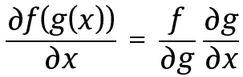
```

![图 3.2：神经元的总体图示，包含传入单元 `x[i]`、对加权传入值求和的激活函数，以及非线性 ReLU 函数，二者共同计算出结果单元 `y[i]`[+1]。](graphic/b_9783110785968-003_fig_002.png)

图 3.2：神经元的总体图示，包含传入单元 `x[i]`、对加权传入值求和的激活函数，以及非线性 ReLU 函数，二者共同计算出结果单元 `y[i]`[+1]。

反向传播算法存储 `f` 对所有变量 `x = f(w)`、`y = f(x)`、`z = f(y)` 的导数。对于 `x`，其为

```
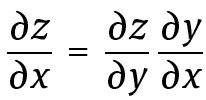
```

对于 `w`，其为

```
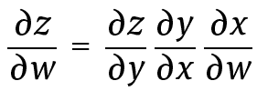
```

如所见，对于这三个乘数，只需额外计算其中一个，其余均已存储。这使得反向传播非常高效。

一旦计算出导数，优化过程便会利用它们。通过迭代更新参数矩阵，直到找到一个足够好的矩阵。最常用的优化方法是随机梯度下降（参见第 3.2.1 节）。

关于通过误差反向传播和权重更新来优化网络的神经网络训练的抽象描述，请参见[192]。然而，这只是 DNN 内容的一小部分，也是其取得成功的部分原因。正是算法的设计与开发，以及它们在各种计算平台上的实现，造就了其卓越的性能。对于全面的描述，强烈建议阅读 Goodfellow、Bengio 和 Courville 合著的*《Deep Learning》*[183]。

### 3.5.1 DNN 的架构

DNN 由一系列层组成，每层可执行不同的计算。当我们提到 `architecture`（架构）时，指的是特定的层序列，不考虑用于训练该架构的优化算法或数据。

最基础的层类型称为 `dense layer`（稠密层/全连接层）；它将权重矩阵 `W` 与传入值的完整向量 `` 相乘，并可能加上偏置项 `b ∈ ℝ`。然后将加权和输入非线性激活函数 `u`，使得稠密层的输出为 `u(W^⊤h + b)`，如图 3.2 所示。权重矩阵随后在学习过程中被优化，非线性函数使模型能够学习数据中的非线性依赖关系。然而，稠密权重矩阵 `W` 给模型引入了大量参数，其训练在资源消耗方面可能是低效的。

`Convolutional layers`（卷积层）通过在输入输出对之间共享参数来规避这一问题。即，一个远小于输入维度的参数核在输入上滑动。这种层类型的名称源于两个函数的 `convolution`（卷积），其中输入函数 `x(a)` 和核函数 `w(a)` 关于测量值 `a` 产生特征图

```
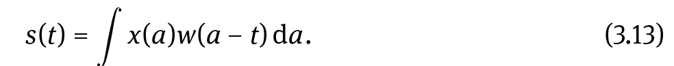
```

整数值 `t` 上的离散卷积为

```
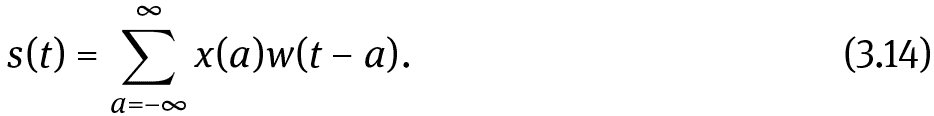
```

这种参数复用减少了前后层节点间的连接数。此外，计算易于并行化。卷积层的另一个重要特性是其平移不变性。对于图像中的物体识别，物体的确切位置并不重要。类似地，音频输入中的模式可能出现在不同的宽度和高度，但无论如何都应被识别。使用卷积层的 DNN 架构称为 `convolutional neural network`（CNN，卷积神经网络）。

`dropout`（丢弃）层能更大幅度地减少连接数。该层在后续层随机忽略一定比例的传入值及其权重。Dropout 可被视为模型的一种正则化。

对于图像处理，`pooling`（池化）层被广泛使用。它通过最大值或平均值等方式，汇总矩形邻域内节点的值。

`batch normalization`（批量归一化）层接收传入值 `z[1], ..., z[m]` 并计算均值和方差。

```
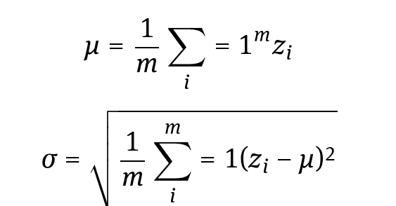
```


如何组合这些构建模块或定义新模块，是当前活跃的研究课题。已有多种网络架构被提出。从 `AlexNet` [233] 在 `ImageNet` 上取得的巨大成功开始，后者提供了标注为 1000 个物体类别的图像，如键盘、鼠标、铅笔和许多动物 [143]，牛津视觉几何组提出了一种名为 `VGG-19` 的 19 层 CNN，非常适合图像中的物体识别 [350]。**残差网络** 将 CNN 结构化为卷积和批归一化的重复块，其中每个块从块的第一层添加一条捷径到最后一层。这使得在没有优化困难的情况下增大网络深度成为可能 [193]。

`EfficientNets` 同时在宽度、深度和（图像）分辨率上缩放学习到的基础模型 [363]。实验表明，对于两种截然不同的网络架构，即深层 `ResNet` 和节能型 `MobileNet`，缩放效果均良好。Bello 等人再次将架构与分辨率解耦 [81]。他们根据过拟合的程度缩放深度和宽度，并应用比 `EfficientNets` 更慢的分辨率增长。因此，为在训练神经网络中获得更好的速度和准确性而进行的竞争仍在继续。

### 3.5.2 DNN 的鲁棒性

神经网络在许多方面都很脆弱。一方面，架构上的微小变化可能导致预测性能的巨大变化。另一方面，数据上的微小变化可能极大地改变神经网络的分类。著名的例子是那些难以察觉变化的图像，却输出了完全不同的类别 [362]。优化导致最差准确率的最小变化被称为 **对抗攻击**。已经研究了多种扰动类型，不仅针对数据，还针对被感知的物理对象。在 [154] 中，一些贴纸被贴在停车标志上，结果被分类为“限速 45”。为了使神经网络更鲁棒，发明了防御机制。最近，开发出了针对特定扰动证明鲁棒性的保证 [132]。最后，鲁棒性也可能指数据分布的变化 [124]。

### 3.5.3 深度学习理论

已证明，具有 *n* 个节点的单隐藏层神经网络是任何可测函数的通用逼近器，假设激活函数 *Ψ* : ℛ → [0, 1] 拥有可数多个不连续点 [203]。隐藏节点的数量通常未知，但取决于待逼近的函数。在最坏情况下，每个输入配置需要一个隐藏节点，即如果我们只有一个隐藏层，隐藏节点的数量呈指数级增长。应用 `VCdim`（见 3.3.1 节），证明了 DNN 样本复杂度的界，该界同时取决于网络的深度和宽度。更深的模型每层所需的隐藏节点更少。这是更深网络的优势 [364]。DNN 的复杂性可以在不涉及层宽度的情况下展示，但通常取决于其深度。对于 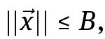*d* 层，以及矩阵 *W*[1], ..., *W[d]*，复杂性已通过 *W[j]* 的 Frobenius 范数至多为 *M[F]*(*j*) 和 *m* 来展示，如 [181] 中的例子所示：

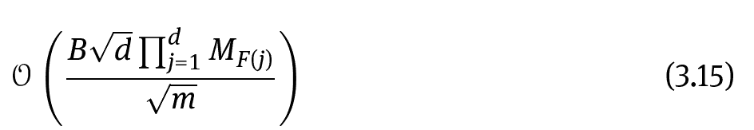

随后作者将依赖深度的界转换为与深度无关的界，后者基于对参数矩阵范数的某种控制。

具有大容量的学习算法能够拟合随机标记的数据。随着深度增加，神经网络具有越来越强的表征能力，即它们逼近越来越复杂的函数。因此，它们能够拟合纯噪声。这会与 DNN 泛化的说法相矛盾吗？一般来说，机器学习不应过拟合训练数据，甚至不应死记硬背，而应在先前未见过的数据上表现良好！通过检查优化过程，发现真实模式在过拟合发生前就已被学习，而 dropout 和其他正则化防止了优化过程死记硬背 [58]。解释 DNN 泛化的其他方法包括相似示例的相干梯度指向同一方向 [118] 以及网络的刚度，它衡量一个示例的小参数变化对另一个示例损失中梯度步骤的影响。如果基于一个示例的网络权重有助于更好地分类另一个示例，则其泛化效果好 [167]。

表征 DNN 的一种方法是通过与贝叶斯模型的类比。已证明，带有 dropout 的 DNN 的推断近似于高斯过程，因此贝叶斯模型的不确定性解释了 DNN 的 dropout [174]。贝叶斯模型估计 DNN 模型的不确定性。然而，它们扩展性不佳。因此，提出了 **谱归一化神经高斯过程**，它用高斯过程替换输出层，并在训练中包含权重归一化 [251]。

### 3.5.4 解释

可解释 AI 已针对各类黑盒算法进行了研究 [187]。选择边界示例或根据学习模型显示特征重要性，可在不查看训练过程的情况下解释学习到的模型。然而，如果解释仅指代代理模型，而非学习并部署的模型本身，它们实际上并未解释学习结果 [177]。模型无关方法由验证和解释 DNN 的方法加以补充。特别是对于科学数据，我们要对真实过程建模，建模过程本身必须是可信的。


关于验证和解释 DNN 的综述已从理论上进行了框架构建 [[206]](#9783110785951_034588.xhtml#b_9783110785968-011_ref_206)。存在多种解释 DNN 的方法 [[337]](#9783110785951_034588.xhtml#b_9783110785968-011_ref_337)。其中一种最著名的方法是逐层相关性传播及其可视化。它展示了训练好的模型利用图像的哪些区域进行分类 [[275]](#9783110785951_034588.xhtml#b_9783110785968-011_ref_275)。对于图像数据，这有助于用户理解学习到的模型。逐层权重变化有助于理解 DNN 的训练过程 [[41]](#9783110785951_034588.xhtml#b_9783110785968-011_ref_041)。可以在每一层——每一个中间表示层——检查 DNN 的训练过程，以找到最有影响力的样本，并确定对分类贡献最大的类别 [[305]](#9783110785951_034588.xhtml#b_9783110785968-011_ref_305)。

### 3.5.5 硬件考量

AI 加速硬件是一个蓬勃发展的市场。许多公司提供专用芯片，这些芯片被内置于手机、平板电脑和许多其他设备中。我们在本书系列的第 1 卷中探讨了其中的几项发展。

特别是关于 DNN，加速硬件的一个核心方面是能耗。专为 DNN 设计的处理器的一个例子是 Google 为 `TensorFlow` 软件设计的处理器，专门用于其矩阵乘法运算。`张量处理单元 (TPU)` 为机器学习提供了每瓦特性能数量级更优的优化表现。

即使使用 `TPU`，DNN 仍然需要大量能量。特别是对于边缘计算和物联网，使用 `现场可编程门阵列 (FPGA)` 作为平台具有优势。已开发出用于 `CNN` 的 `FPGA` 程序自动综合，参见例如 [[176]](#9783110785951_034588.xhtml#b_9783110785968-011_ref_176)。

一般来说，`二值化神经网络 (BNN)`，即那些使用二值化权重和激活函数值进行计算的网络，消耗的能量更少，所需内存也更少。近似内存的使用使 DNN 训练的能耗进一步降低。然而，这种节省是以内存偶尔翻转比特为代价的。一种利用近似内存进行 `BNN` 训练的新方法，在 `BNN` 学习的优化中包含了对比特错误的鲁棒性，从而直接结合了近似内存和 `BNN` 的优势 [[110]](#9783110785951_034588.xhtml#b_9783110785968-011_ref_110)。

神经网络如何利用天体粒子物理和粒子物理研究的示例见 第 9 章。学习方法的资源消耗是所有章节的核心主题。

# 4 数据获取与数据结构

Wolfgang Rhode

Bernhard Spaan

Hans Dembinski

## 4.1 引言

天体粒子物理和粒子物理中科学问题的通用方法，也导致了在数据获取所需的低级技术以及待分析的结果数据结构方面有着极大的技术相似性。在本章中，将讨论数据获取的一般方法（第 4.3.3 节）。

在对撞机的粒子物理实验中，事件率通常非常高，因为大多数分析都在寻找罕见过程。事件率是由发现罕见过程的愿望驱动的，例如希格斯玻色子的产生或标准模型中被抑制、并可能被标准模型以外的物理增强的罕见衰变。通常，粒子束团被安排在特定的相互作用点碰撞。这意味着事件率不是恒定的；它反复达到峰值然后回落到零。射频电场加速强制了这种结构。单个束粒子碰撞的平均速率 `N ˙` 由每个束团的粒子数、束团重叠区的粒子密度分布、束团交叉频率以及两个束粒子碰撞的总截面 `σ` 定义。所有束团参数可以合并为一个称为亮度 `𝓛` 的单一变量，从而得出简单关系：

```
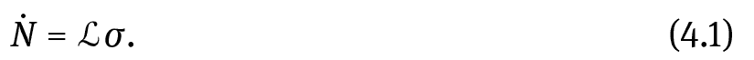
```

截面 `σ` 本质上是一个有效面积，通常以靶 (barn) 为单位给出，`1 b = 10^(−24) cm²`。总截面是发生任何碰撞概率的度量，但人们通常更关注具有特定终态的碰撞。此时，指的是该过程的速率，而 `σ` 是相应的（部分）截面。

在一段时间 `t` 内采集的数据集由积分亮度 `dt` 表征，单位为反靶 `1/b`。在 LHC 中，束团间距为 7.5 米，以光速运动，因此每 25 ns 碰撞一次，碰撞率为 40 MHz。LHC 的峰值亮度和总截面非常大，以至于每次束团交叉会发生多次质子-质子相互作用。例如，ATLAS 实验在 LHC 的第二运行期中观测到平均每次束团交叉超过 30 次相互作用，最多达 80 次。在 LHC 能量下，每次相互作用产生数十个粒子，因此一次束团交叉会产生数百到数千个二次粒子。

在技术上无法记录每次束团交叉的所有粒子。例如，ATLAS 实验在第一运行期拥有 1.4 亿个通道，导致平均事件大小约为 1.5 MB。按 40 MHz 计算，探测器的全量读出将导致约 60 TB/秒的数据率需要存储，即使对于像 CERN 这样的实验室也是不可能的。然而事实证明，绝大多数碰撞都不感兴趣，也不必存储。低动量转移的强相互作用截面占总截面的最大比例，但对这些相互作用的研究并非 ATLAS、CMS 和 LHCb 等实验物理计划的首要任务。因此，实验利用所谓的触发器来减少记录的事件数量，同时确保保留感兴趣的事件。触发器是一种算法，它能快速（在 25 ns 内）决定一次束团碰撞是否产生了有趣的终态。此类有趣终态的示例将在后面给出。

理想情况下，对事件的彻底分析将为触发器决策提供完美信息，但由于两个束团之间的时间窗口很短，这具有挑战性。在此窗口内，需要完成全探测器的读出，且计算机集群必须处理原始数据，以便从探测器击中信息中重建粒子轨迹。

第 4.2.1 节 描述了指导 LHC 实验在之前的第一、二运行期中读出电子学和数据获取设计的经典触发器概念。直到最近，人们仍认为在 LHC 对每个事件都这样做是不可能的，但作为 LHCb 实验在第二次长期停运期间升级的一部分，新开发的读出和触发方案将使其成为现实。第 4.4 节 将概述这种新架构，其中触发器的第一阶段将基于 GPU。LHCb 由此产生的数据结构将在 第 4.3.1 节 中讨论。


## 4.2 数据获取

粒子天体物理和粒子物理实验中的数据获取系统旨在处理不断增加的数据量和数据速率。在两个领域中，这都是由在大量无趣的本底中搜索稀有事件所驱动的。由于可以合理存储并由分析人员进一步处理的数据量是有限的，实验采用触发算法来选择有趣的事件并丢弃大量本底。一个实验可以有多个触发器，以选择不同种类的有趣事件。

过去，触发器通常用硬件实现，因为它必须应对巨大的数据速率，但这两个领域都有一个共同的发展趋势，即在软件中实现越来越多的触发器部分。这使得可以按需添加新触发器并实现更精细的触发算法。

另一个共同点是使用临时缓冲区，它们存储在触发器处理前一个事件的时间窗口内到达的事件。由于两个感兴趣事件之间的时间间隔服从指数分布，如果没有缓冲区，将会丢失相当一部分有趣的事件。

以下三小节分别描述 LHCb（作为现代粒子物理实验的例子）、成像大气切伦科夫望远镜（IACTs）和 IceCube（作为中微子天文台的例子）的数据获取系统。

### 4.2.1 LHCb 的数据获取

*Bernhard Spaan*

*Hans Dembinski*

LHCb 数据获取系统被设计为一个可扩展的计算网络，拥有强大的软件触发级，用于选择有趣的事件，并为分析人员提供可直接使用而无需进一步处理的高层对象。近年来，通过转向全软件触发和全在线重建，这些能力得到了进一步扩展，后者还在线执行探测器的标定和对准。这些步骤使 LHCb 能够从原始数据的全持久化转变为仅对更高层的物理对象（如可直接用于物理分析的衰变）进行选择性持久化。我们首先讨论触发概念，然后讨论读出。

加速器实验的经典触发概念使用多个连续阶段。每个阶段做出决策所需的时间比前一阶段长，这通过每个阶段后事件率的降低来补偿。LHCb 的第一级触发称为 `L0`（“第 0 级”）。它速度非常快，可将事件率降低 40 倍。专用硬件用于分析量能器信息以及缪子系统中的击中，这与 ATLAS 和 CMS 的第一级触发器类似。缪子系统中的击中常被用作触发，因为产生缪子的事件相对罕见。由于 `B` 异重子是 LHCb 实验的主要关注点，量能器触发也很重要。它利用了这样一个事实：重 `b` 和 `c` 夸克的衰变产生的粒子相对于束轴具有比平均初级质子-质子相互作用产生的粒子更高的横向动量 `p[T]`。因此，`L0` 触发要求要么有一个具有数 GeV 横向能量的量能器簇，要么有一个 `p[T]` 超过 1.4 GeV/`c` 的单缪子候选体，要么有两个在横向平面上背靠背且各自 `p[T]` 为数百 MeV/`c` 的缪子。读出电子学被设计为临时存储自上次读出以来发生的最近事件的信息，直到发出下一个 `L0` 触发信号。临时存储要么通过按需放大模拟信号实现（如顶点定位器的情况），要么通过每 25 ns 对每个有效通道的探测器响应进行数字化并存储在环形缓冲区中实现。

![图 4.1：LHCb 在线系统的总体架构及其三大主要组件：时序与快速控制（TFC）、数据获取和实验控制系统（ECS）（根据 CC BY 4.0 许可，经小幅修改转载自 [243]）。](graphic/b_9783110785968-004_fig_001.png)

图 4.1：LHCb 在线系统的总体架构及其三大主要组件：时序与快速控制（TFC）、数据获取和实验控制系统（ECS）（根据 CC BY 4.0 许可，经小幅修改转载自 [[243]](#9783110785951_034588.xhtml#b_9783110785968-011_ref_243)）。

下一级通常称为 `L1`，在 LHCb 中称为 `HLT1`（“高层触发 1”），因为它在计算机集群上以软件运行，且在 `L0` 级触发读出后即处理完整事件。在运行初期（运行 1），事件过滤集群逐步发展以每秒产生更多输出事件。从最初计划的 2 kHz，输出速率逐步增加到 5 kHz。这导致 LHCb 可用的亮度也相应增加。对于 LHC 运行的第二阶段（运行 2），事件过滤集群进行了重大升级，由 62 个子集群组成，总计拥有超过 50,000 个逻辑核心，逻辑核心数量几乎是第一阶段的两倍。

2018–2019 年升级前，LHC 运行第一和第二阶段所用的 LHCb 在线系统规划如图 4.1 所示。LHCb 实验及其子探测器（图中顶层节点表示）的描述已在 2.3.1 节中给出。在线系统的目的是，如果某次簇射被触发条件选中，则将属于该簇射的数据从探测器前端电子学传输到永久存储。设计基于简洁性、可扩展性原则，并在可能的情况下使用商用现成产品以及成熟的组件和协议。因此，LHCb 在线系统可靠且稳健，拥有足够的灵活性以应对真实数据经验带来的新需求。


#### LHCb 读出与数据获取

读出时，每个 LHCb 子探测器的探测器上/附近电子学（图中的 *FE electronics*）将信息复用，并通过光纤或作为模拟信号发送到所谓的电子学，后者由标准化的*读出板*组成。对于光传输，许多通道的信息通过单根光纤以 1.6 Gbit/s 的速率传输，LHCb 共使用约 6000 条光链路。读出板最多可处理 64 路模拟信号或 24 路光链路。它们利用 `FPGA` 处理光信号或模拟信号，执行错误检查并应用各种形式的数据压缩（最简单的形式是不转发无击中通道的信息），具体取决于各个探测器的需求。生成的数据片段由另一个 `FPGA` 收集，并格式化为原始 IP 数据包，通过快速以太网发送到*读出网络*。多个事件被打包进单个帧中，以进一步最小化下游的 I/O 开销。时钟和同步信号（如触发信号）从时序与快速控制（`TFC`）系统接收。如果出现拥塞且触发速率需要限制，读出板也可向 `TFC` 发回命令。读出网络汇集来自读出板的数据流，并将其传递给事件滤波场，高级触发（`HLT`）在其上以软件形式运行。`HLT` 算法在拥有数千个 CPU 的场上运行，并以高达 1MHz 的速率从硬件 L0 触发接收事件。场选出的事件随后被永久存储（图中的 *STORAGE*）。

获取数据的质量在单独的监控场（*MON farm*，图中所示）中通过用户定义的算法自动检查，以跟踪探测器通道的效率或特定衰变的质量分辨率。L0 触发发出的随机触发也以低速率被接受，用于监控触发本身。LHCb 在线系统的所有组件均连接到实验控制系统（`ECS`），使科学家能够进行控制和监控。

此后，LHCb 实验已转移到无触发读出系统和全软件触发 [245]，因为整个触发链中最大的低效率出现在 L0 触发决策中。新读出系统具有相似的架构，但跳过了硬件 L0 触发，并使用带宽大得多的读出网络。它能够利用事件滤波场和 4 TB/s 的带宽处理完整的 30 MHz 非弹性碰撞率。完整径迹重建在 1 到 2 MHz 下执行。更高层级的对象（如衰变顶点）以 20 到 100 kHz 的速率重建。

在 LHC 的 Run 2 期间，引入了实时对准和标定，使其可供 `HLT` 算法使用 [248]。从 Run 2 开始，`HLT` 分为两个阶段。第一阶段 `HLT1` 以高达 1MHz 的速率从 L0 触发接收事件。此阶段执行首次完整径迹重建并筛选事件。中间数据被缓冲到磁盘，并用于在异步过程中获得高质量的标定和对准。第二阶段 `HLT2` 随后利用这些数据以获得最佳的径迹重建。该方案不仅提高了 `HLT` 筛选的效率和纯度，还允许跳过离线重建。

因此，此阶段的离线数据处理仅限于数据过滤，在 LHCb 中称为*剥离*。在剥离过程中，许多筛选算法（*剥离线*）并行执行。每条线筛选事件并生成一组高层重建物理对象流，直接用于物理分析（例如完全重建的衰变）。剥离减小了事件大小以简化分析，故得此名。

下一步进展同样在 Run 2 期间引入，即在线执行剥离以生成*极速流*，除包含原始事件数据的传统完整流外。极速流仅保留特定分析所需的高层对象及监控信息，而不包含原始数据和其他无关的高层对象。极速流在 `HLT2` 阶段在线生成，并以针对写入速度优化的内部压缩格式保存。极速流的离线处理需要极少的 CPU 资源，仅为总量的千分之一级别，因为它仅涉及将内部数据格式转换为 `ROOT` 并包含光度信息。

事件大小取决于存储的信息量，范围从极速事件的几 kB 到完整事件持久化时的 200–250 kB。2018 年，完整事件以 7 kHz 的速率写入，极速流为 3.1 kHz，平均完整事件大小为 70 kB，吞吐量达到 0.65 Gbit/s [248]。共产生了数 PB 数据。

### 4.2.2 成像大气切伦科夫望远镜的数据获取

*Maximilian Linhoff*

一般来说，成像大气切伦科夫望远镜（`IACTs`）的数据获取由两部分组成：一个缓冲系统，保持长达数微秒的时间范围；一个触发系统，决定何时可能记录到了大气簇射，从而导致缓冲系统在触发时间附近被读出。在最常见的 `IACT` 触发系统中（`FACT`、`MAGIC` 和部分 `CTA` 望远镜以不同变体使用），前置放大的模拟信号被复制并分流至两个系统，缓冲系统存储模拟电荷。

触发系统将多个像素的模拟信号组合成所谓的触发斑块，并对这些斑块应用阈值，将每个斑块的触发信号转换为二进制。可以应用不同的规则，规定同时有多少个斑块必须高于阈值以及时间重叠必须持续多久。当满足这些规则时，缓冲系统被读出，模拟值被数字化。

对于望远镜阵列，通常还有第二步阵列触发，要求至少一定数量的望远镜触发报告事件。由于望远镜间的距离和所需的处理时间，立体阵列，特别是像 `CTA` 这样的大型阵列，要求望远镜具有更大的缓冲。下文将描述 `IACTs` 的通用硬件和触发系统。

成像大气切伦科夫望远镜最常见的结构是单个分段的主反射面和一台极快的相机，能以亚纳秒分辨率探测单光子。反射面的尺寸在不同的现有和规划设施中差异很大。


光电探测器主要采用两种技术：光电倍增管（`PMTs`）和硅光电倍增器（`SiPMs`）。虽然如今，与光子探测一样，波长范围内的效率对 `IACTs` 至关重要，但其他特性却截然不同。`PMTs` 需要高压，通常为数千伏，且在暴露于过量光照时易受损坏，这在月光之夜就可能发生。长期以来，`PMTs` 在光子探测效率上相较于 `SiPMs` 具有优势，而后者直到最近才达到可比水平，特别是在探测切伦科夫光至关重要的紫外至蓝光波段。`SiPMs` 仅需 30 V 至 100 V 范围内的电压，且在高光强下几乎不可损坏。`SiPMs` 的一大缺点是尺寸受限，这使得在没有复杂电子学或导光器的情况下，难以拼接 `CTA LSTs` 等所需视场的大型相机。关于这些技术的详细综述，请参见 [[186]](#9783110785951_034588.xhtml#b_9783110785968-011_ref_186)。

观测期间相机持续读出。然而，存储所有相机信号的数据量远超即使是短期存储所能承受的范围。一台具有 2000 个像素、以 1 GSample/s 读出并以 16 位数字化的 `IACT` 将产生高达 4 TB/s 的惊人数据率。因此，所有 `IACT` 相机都配备了触发器，它监测连续信号并决定何时对数据进行数字化和永久存储。这需要一个用于模拟或数字化值的缓冲区，以便在触发器做出决定前存储相关数据。触发器通常通过将多个像素的信号组合成组，然后对组信号的高度和高于该阈值的组数量施加阈值来工作。图 4.2 展示了 `FACT` 相机的单个像素和触发组。在多台 `IACTs` 作为阵列运行的情况下，还存在立体触发器，它结合所有望远镜的触发信息。关于 `FACT` 触发系统的更多细节，请参见 [[53]](#9783110785951_034588.xhtml#b_9783110785968-011_ref_053)；关于 `CTA` 触发系统的信息，请参见 [[172]](#9783110785951_034588.xhtml#b_9783110785968-011_ref_172)。在这种情况下需要更大的缓冲区，因为不同望远镜间的信号延迟导致数据记录与最终触发决定之间的延迟增大。如果触发器决定记录数据，则通常会读出所有具有触发信号的望远镜的所有像素，持续时间为触发时间前后几十纳秒，随后进行数字化，并连同必要的元数据存储到磁盘。这是软件分析可访问的第一级数据：每个单独像素的光电传感器时间序列信息——本质上是一个极短的视频。`IACT` 数据的典型数据结构见 4.3.2 节 讨论。

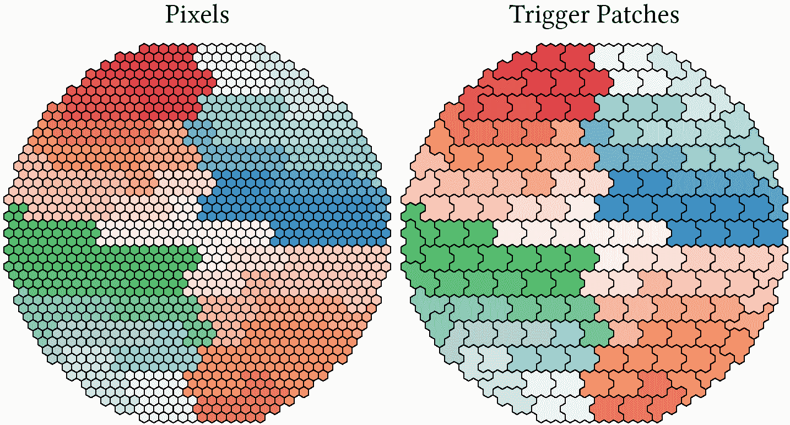

图 4.2：FACT 像素（左）和触发斑块（右）。每个触发斑块计算 9 个像素的模拟和。

表 4.1：当前运行中和计划中的 `IACTs` 关键属性

| 望远镜 | MAGIC | FACT | CTA-LST | CTA-MST | CTA-SST |
| --- | --- | --- | --- | --- | --- |
| 镜面直径 | 17m | 4m | 23m | 12m | 4m |
| 像素数量 | 1039 | 1440 | 1855 | 1855 | 2048 |
| 技术 | `PMTs` | `SiPMs` | `PMTs` | `PMTs` | `SiPMs` |
| 视场 | 3.5° | 4.5° | 4.5° | 8° | 9° |

表 4.1 列出了当前运行中和计划中的望远镜类型的关键属性。

### 4.2.3 IceCube 的数据获取

*Tim Ruhe*

`IceCube` 的数据获取基于切伦科夫效应的利用，该效应导致蓝光波段光子的发射。这些光子随后被数字光学模块（`DOMs`）收集，通过使用具有重叠动态范围和不同采样速度的多个数字化器，将其转换为电荷的时间序列，通常称为波形。触发算法持续搜索符合预定义标准的模式，并将单个 `DOMs` 返回的波形组合成事件。随后，这些事件经过校准，并由基本重建算法处理，以检查是否满足特定假设（径迹或簇射）。数据进一步被处理以搜寻可能源于天体物理起源的事件，这将触发社区警报，以便利用其他仪器进行后续观测。此外，数据被压缩以满足卫星通信标准，并为长期归档做准备。

尽管 `IceCube` 是一个中微子天文台 [[21]](#9783110785951_034588.xhtml#b_9783110785968-011_ref_021)，但它实际上并不直接探测中微子，因为中微子只能通过中微子-核子相互作用产生的轻子伴侣来观测。这些中微子-核子相互作用可以作为所谓的带电流（`CC`）或中性流（`NC`）相互作用进行。带电流相互作用由以下方程描述

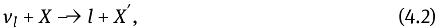

而中性流相互作用由以下方程描述

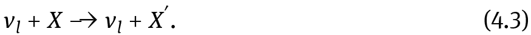

在两种情况下，`ν[l]` 均为特定轻子味 `l` 的入射中微子，`l` 表示产生的轻子。发生相互作用的原子核记为 `X`，而 `X'` 表示作为相互作用后果产生的强子或电磁簇射。与方程 4.2 不同，中性流相互作用（方程 4.3）中不产生出射轻子。

由于带电荷，产生的轻子连同簇射中产生的二次轻子会导致介质极化，在轻子通过后，介质通过发射特征辐射来弛豫。对于 `IceCube` 相关的能量，这些轻子的速度超过探测介质中的光速，介质发出的辐射将发生相长干涉。这种效应称为切伦科夫效应，发出的辐射称为切伦科夫辐射。在水中，这种辐射的波长在 400 至 700 nm 之间。因此，为了用 `IceCube` 观测中微子，必须探测光，探测器也需相应设计。

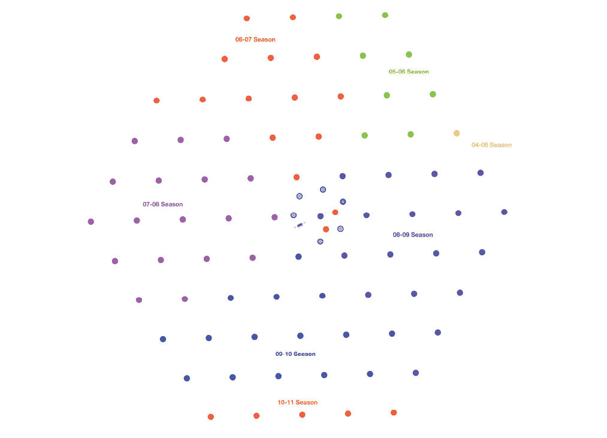

图 4.3：IceCube 探测器俯视图，不同颜色表示不同建设季节。图片由 IceCube 合作组提供。


#### IceCube 探测器概述

##### 数字光学模块 (DOM)

嵌入在数字光学模块 (DOM) 中的光传感器是 IceCube 探测器的基本单元。总共部署了 5160 个此类 DOM，位于地理南极点深冰中，深度介于 1450 米和 2450 米之间。DOM 排列在 86 根称为“串”的垂直电缆上，这些串本身则按三角网格排列。虽然 DOM 与 DOM 之间的距离为 17 米，但单个串之间的距离约为 125 米。每个 DOM 内置一个 10 英寸 PMT、高压电源、闪烁 LED 和读出电子学。DOM 采集的数据通过双绞线对传输到 IceCube 实验室 (ICL) 的计算机，这些线对也为 DOM 运行提供必要的电力。同一串上 DOM 发送的信号会被合并并在专用计算机上收集，这些计算机被称为 DOMHub [21]。

由于 IceCube 探测器的建设跨越了多个极地季节，在此期间采集了不完整配置下的数据。具体而言，在探测器于 2010 年完工前，分别采集了 22 串、40 串、59 串和 79 串配置下的数据。这种不完整的配置导致各季节之间的几何形状不同。为了区分不同的几何结构，使用串的数量进行标识。例如，*IceCube-22* 指 22 串配置下的 IceCube。若未指定串的数量，则指完全配置的探测器。不同颜色指示不同建设季节的探测器俯视图见 第 4.3 节。

##### 事件拓扑

在 IceCube 中观测到两种不同类型的事件模式。第一种称为*径迹型*，源于 *ν[μ]* CC 相互作用；第二种称为*级联型*，源于 *ν[e]* 和 *ν[τ]* CC 相互作用以及所有中微子味道的 NC 相互作用。由于缪子在冰中的射程很长，径迹型事件的相互作用顶点可以位于仪器化体积之外，甚至发生在探测器下方的基岩中。然而，级联型事件必须发生在探测器内部或至少非常接近探测器的位置。所有光量均沉积在探测器内部的事件称为完全包容事件。在仪器化体积内发生相互作用的中微子具有特殊意义，因为这些*起始事件*极有可能起源于天体物理源，特别是在其能量超过特定阈值的情况下。高能起始事件 (HESE) 是发现高能天体物理中微子弥散通量的基础（详见 [211]、[19] 和 [31]）。

##### 波形数字化

在 DOM 内部，到达的切伦科夫光子被 PMT 转换为电荷，最终形成波形，基本上是一个电荷的时间序列。波形的数字化也在各个 DOM 内部进行。由于光子可能从 500 米外到达，且入射粒子能量范围很大（通常为 10 GeV 至数 PeV），DOM 中的波形振幅范围也很大（数 mV 至 ≈ 2 V）。为了处理这种多样的信号，每个 DOM 配备了多个数字化器，具有重叠的动态范围和不同的采样速率。当 DOM 记录到一个或多个光子时，通常称为一个“命中”，每个 DOM 单独探测光子。然而，这些光子中的大多数是由暗噪声引起的 [21]。

##### 命中分类与符合要求

由于暗噪声引起的命中将在整个探测器中呈现随机分布模式，因此可以通过符合要求将其与源自粒子相互作用的光子区分开来。IceCube 中有两种符合要求。第一种是*硬局部符合* (HLC)，当两个相邻或次相邻的 DOM 被击中时满足。HLC 命中通常具有复杂的波形，表明单个 DOM 被多个光子击中，因此会完整保存详细信息。孤立命中被标记为*软局部符合* (SLC) 并进行更激进的压缩 [21]。

##### 触发算法

DAQ 触发算法持续在空间和时间上寻找 HLC 命中的簇，这指示粒子相互作用而非暗噪声。所有算法都搜索给定重数的 HLC 命中，也可能包含几何要求。触发的时间尺度由冰中光速和相应触发算法的几何要求决定。某些触发器仅限于一部分光学模块，例如所有冰内

*简单重数触发* (SMT) 要求在数 μs 的时间窗口内有 *N* 个或更多 HLC 命中，对命中的位置无约束。*N* 根据特定子探测器的能量阈值进行调整，该阈值由串间距决定。*体积触发* 在每个被击中 DOM 周围定义一个固定大小的圆柱体，并要求该圆柱体内达到给定重数。这使得无法满足 SLC 条件的低能事件也能被触发。此外，体积触发还有一个简单重数参数，当定义体积内达到一定命中数时触发。*串触发* 要求在给定串上一定跨度的光学模块内达到一定命中数。这使得垂直穿过探测器的低能缪子能够被触发。虽然上述触发器是为以约光速运动的粒子设计的，但 *SLOP* 触发器旨在触发缓慢运动的粒子，如磁单极子。关于 IceCube 对相对论性和非相对论性磁单极子的搜索详情，请分别参阅 [20] 和 [27]。

*固定速率触发* 以固定间隔读取全探测器 10 ms 的命中数据。由于许多事件满足不止一个触发条件，子触发器会被合并，全局触发器组合时间窗口并形成不重叠的触发请求，随后事件构建器将其作为模板用于检索完整的命中信息并组装事件。全局触发器还确保同一个命中不会出现在多个事件中 [21]。

##### 事件构建与处理

一旦事件构建器收到来自全局触发器的请求，它会提取读出时间窗口。时间窗口随后被转发给相应的 StringHubs，后者返回给定时间窗口内的所有命中列表。当所有集线器都返回命中列表后，这些命中被打包形成一个事件，并写入临时文件，一旦达到预设大小，该文件会按标准方式重命名。随后文件被传递给*在线处理与过滤* (PnF) [21]。


#### 在线处理与过滤

在线处理与过滤负责处理所有触发事件，并将数据量缩减至可通过卫星传输的规模。数据处理包括应用标定常数，以及事件表征与筛选。此外，还会提取数据质量信息。针对天体物理学意义上有趣的事件，系统会生成实时警报（详见文献 22 中关于 IceCube 实时警报的细节）。最后，创建数据文件和元数据信息用于长期归档 21。

第一步数据处理是波形标定。此步骤需要几何信息和探测器状态信息，这些信息存储在数据库中。第二步，基于已知的 DOM 对单光子的响应，对波形进行去卷积。去卷积是提取振幅和到达时间所必需的 21。提取出的波形振幅时间序列是所有进一步重建的基础，并以特定格式（`SuperDST`）存储，与完整波形大小相比，该格式仅使用 9% 的存储空间。对于 `SuperDST` 表示被发现精度不足，或记录了高光照水平的 DOM，完整波形信息也会被存储 21。

随后，事件通过重建算法进一步处理，试图将观测到的光模式与径迹和簇射假设相匹配。提取的顶点位置、重建方向和能量，以及拟合优度被各类过滤器用于筛选有趣事件。过滤选择由合作组设定，并每年调整一次。2016 年，有 25 个过滤器在运行，约 15% 的所有事件被一个或多个过滤器选中。专用过滤器例如搜索可能源于天体物理起源的事件并发出警报，供其他实验进行后续观测 [21, 22]。

PnF 还汇总数据采集的质量与稳定性信息，这些信息用于探测器监控。此外，还会生成用于卫星传输和长期归档的文件 21。

IceCube 中微子望远镜获取的原始数据总量为 1 TB/d。使用 `SuperDST` 和在线过滤分别将数据量缩减至 170 GB/d 和 90 GB/d 21。

## 4.3 数据结构

数据必须存储在内存和磁盘上，并组织好以便轻松检索。在粒子和天体粒子实验中，按处理的不同阶段存储数据是常见做法。最低阶段包含来自探测器的原始数据，而较高阶段包含重建的物理对象，如单个粒子的径迹或粒子簇射。

面向对象是一个通用主题。数据通常按逻辑单元组织。例如，径迹对象存储位置和方向。相关类通常被链接，径迹对象可能包含指向其形成所依据的较低层级信息的指针。

除了这些通用的一般概念外，在细节上存在巨大差异，因为每个实验通常都会为其特定目的从头开发数据结构。数据持久化的格式也因实验而异。下文将描述 LHCb、IACTs 和 IceCube 所使用的数据结构。

### 4.3.1 LHCb 的数据结构

*Bernhard Spaan*

*Hans Dembinski*

LHCb 软件主要采用经典的面向对象设计，将数据和复杂变换封装在对象中。数据对象与变换对象（后者称为算法）之间有着明确的关注点分离。数据对象不能自我变换，而算法不能存储事件数据。模拟产生的数据对象与重建产生的数据对象之间也有明确分离。数据对象在所谓的瞬态数据存储中从算法传递给算法，这些存储灵活且通用。存储中的对象通过键（字符串）访问，同一类的多个实例可存储在不同的键下。算法只能向存储中添加新数据对象，而不能修改存储中已有的对象。相关数据对象也可存储在数据容器中，通常为向量。最近，一些容器已从结构数组转换为数组结构配置，以提高并行处理大量数据的向量化算法的性能。

分析师使用的高层对象重建（径迹、重建衰变等）由 LHCb 在线系统实时从原始事件数据执行，因为这些对象也是高级触发器的输入。在 LHC 的运行 1 和运行 2 期间，也执行了离线重建以利用标定和对准数据。传统上重建在离线处理，但随着在线对准和标定的引入，最高质量的高层物理对象现在在线生成。现在只有部分事件以完整原始事件数据持久化，称为*完整流*，而许多分析使用所谓的*Turbo 流*，它仅持久化某个特定分析所需的事件中选定的高层对象。还有一个*TurCal 流*被持久化以监控在线标定和对准。

LHCb 软件架构区分瞬态（内存中）和持久（磁盘上）数据表示 57。这种分离有几个优势。持久数据格式可在不影响物理代码的情况下更改，且两种表示可遵循不同标准进行优化。利用这一点，上述流以不同的内部数据格式写入磁盘，随后在离线进一步转换为基于 ROOT 的 DST（数据汇总磁带）和 MDST（微型 DST）格式供用户分析。两种格式均包含重建的物理对象，如径迹、顶点等，而 DST 还可包含原始数据。

LHCb 中的数据处理通过*算法*流水线执行，算法是 LHCb 软件架构中的基本数据处理模块，执行重建、过滤或分析。数据在*瞬态存储*中从算法传递给算法，这些存储以类似 Unix 文件系统的树状结构组织。树的每个节点拥有其下方的所有内容，因此删除一个节点也会删除其所有子节点。原本独立节点间的关联通过链接实现，这将被链接节点的生命周期延长至持有链接的节点。

有三类具有不同访问模式和生命周期的数据。每类都有对应的存储。存储用于在算法间传递数据，并作为持久或图形化等衍生表示的中间缓冲区。零个或多个持久或图形化表示对应一个瞬态表示。

*


#### 瞬态存储

**瞬态事件存储 (TES)** 包含从粒子碰撞（真实或模拟）及其后续处理中获得的事件数据，这些数据仅在处理一个事件所需的时间内有效。按照惯例，算法不得修改 TES 中已有的数据，也不得向现有容器添加新对象。这确保了算法可以按任意顺序运行（算法序列要么失败，要么成功产生相同的结果，而不会根据顺序不同而产生潜在的不同结果）。

*   **瞬态探测器存储**：包含描述 LHCb 探测器在数据采集期间可能变化的参数的数据，例如其校准和对准参数。它存在于处理许多事件的一个数据采集周期内。

*   **瞬态直方图存储**：包含在一个作业的生命周期内，通过处理跨越多个数据采集周期的一组事件而生成的统计数据（直方图或表格）。


**图 4.4：** LHCb 中对象的处理。直接链接仅存在于该图中相邻的对象之间。模拟事件和真实事件的处理完全分离，如垂直虚线所示。重构事件在最低抽象层级（即数字化信号）与模拟事件匹配。

存储中包含的软件对象通常对应物理对象。一个物理粒子、径迹、探测器击中、簇、顶点等，由相应的软件对象表示。相关对象可以组合在一起形成**数据容器**，通常是一段连续内存的向量。TES 中的数据对象被组织成若干子树。

*   **MC**：探测器模拟的输出，击中、沉积、来自物质相互作用或粒子衰变的粒子和顶点。
*   **Raw**：来自真实或模拟探测器的原始数据，格式相同。
*   **Rec**：（子探测器）重构的输出（簇、径迹等）。
*   **Phys**：用于物理分析的最高层级对象（粒子、顶点等）。

模拟对象由不同于重构对象的类表示，并严格分离，如图 4.4 所示。

LHCb 架构预见数据对象拥有方便访问其状态所需的最小接口。以非平凡方式转换数据的代码则放入前述的算法中，算法也是对象，但具有转换数据对象的互补目的。LHCb 软件利用现代微处理器中的向量单元，可在单个 CPU 周期内对整个数字向量执行数学运算。为便于使用向量化数学，在适当的情况下，传统的**结构体数组 (AoS)** 会被转换为**数组结构体 (SoA)** [[247]](#9783110785951_034588.xhtml#b_9783110785968-011_ref_247)。部分算法被转换为在 GPU 上运行，以利用大规模并行执行。

### 4.3.2 IACT 的数据结构

*Maximilian Linhoff*

大多数现代 IACT 记录的原始数据由相机中每个像素的时间序列信息组成，通常分辨率在 1 到 2 GSample/s 之间，持续时间在 30 到 150 纳秒之间。一些望远镜为每个像素使用两种不同的信号放大增益以增加其动态范围。这导致单个望远镜事件成为一个维度为 (`N[gains]`, `N[pixels]`, `N[samples]`) 的规则数组，其中对于不使用多种放大增益的望远镜（如 FACT 和 MAGIC），第一个维度可能不存在。由于 IACT 相机的像素通常不在规则的方形网格上（六边形网格更常见），因此数据存储在扁平数组中。

这些原始数据伴随着额外的元数据，例如观测时间戳、触发决策信息，以及执行探测器属性校准所需的信息。IACT 阵列事件包含属于同一气簇射的若干此类望远镜事件，以及额外的阵列级元数据，例如立体触发的时间戳。

在典型的 IACT 分析中，这些原始数据首先必须经过校准，例如以协调像素间的制造差异。对于多增益情况，会选择合适的通道。然后将时间序列信息简化为每个像素仅两个聚合值：估计光子数及其平均到达时间。该数据通常称为**图像级**。对于基于经典特征提取的分析，见第 7.3 节。这些图像随后被参数化，生成每个事件的一组数字或多个事件的二维表，这是大多数经典机器学习算法的输入。更多信息见第 8.4 节。

近年来，从更早数据层级（如图像级或校准后的时间序列）开始的深度学习方法逐渐受到青睐，详见第 9.4 节。

除了事件数据本身，还需要描述望远镜和环境状态的较慢变化数据。这包括望远镜指向方向、校准系数和大气透射率。

IACT 数据的基本单元是**阵列事件**，即望远镜记录的属于一个大气簇射的数据。一个阵列事件由若干**望远镜事件**（阵列中单个望远镜记录的数据）和阵列级元数据组成。


**图 4.5：** FACT 单个相机像素在校准前后的时间序列。垂直线是拐点，用作切伦科夫脉冲的到达时间，阴影区域显示了用于估计光子数的积分。这两个属性显示在图 4.6 中。


#### IACT 的数据结构

本节我们将遵循 CTA 的术语，该术语为分析中逐步更高的处理阶段定义了若干*数据级别*。第一个数据级别 R0 是由相机电子学和读出服务器产生的原始数字化信号。对于包括 MAGIC 和 FACT 在内的多个 IACT，这是用于长期保存的数据级别，也是异地数据处理的起点。该数据级别的主要内容是对阵列事件有贡献的每个望远镜中每个相机像素的电压时间序列。通常，这以形状为 (`N`[gains], `N`[pixels], `N`[samples]) 的三维数组存储。`N`[gains] 是用于读出信号的前置放大通道数，通常为 1 或 2。`N`[pixels] 是像素数，`N`[samples] 是每个像素时间序列中的采样点数。`R`[0] 数据特定于每台望远镜，必须针对多种效应进行校准，包括光电传感器间的生产差异、电子学的温度依赖性、PMT 的老化等。在存在多增益通道的情况下，会选择最合适的通道。结果是 R1 数据级别，即预校准、均质化的仅具单通道的时间序列数据，形状为 (`N`[pixels], `N`[samples])。对于 CTA，从 `R`0 到 `R`1 的校准在数据传输到中央阵列计算中心之前就在望远镜服务器上执行；而对于大多数其他望远镜，`R`1 是一个不存储、仅作为处理中间步骤产生的中间数据级别。

包含大气簇射切伦科夫信号的像素通常只是相机中极小的一部分子样本。为了减少数据量，CTA 计划不存储望远镜事件中所有像素的时间序列信息，而仅存储那些可能包含切伦科夫信号的像素。经过*数据量缩减*后的数据级别称为 DL0，这是 CTA 预期用于长期保存的第一个数据级别。其形状通常与 R1 相同，但数组现在是稀疏的，即不包含所有像素的值。

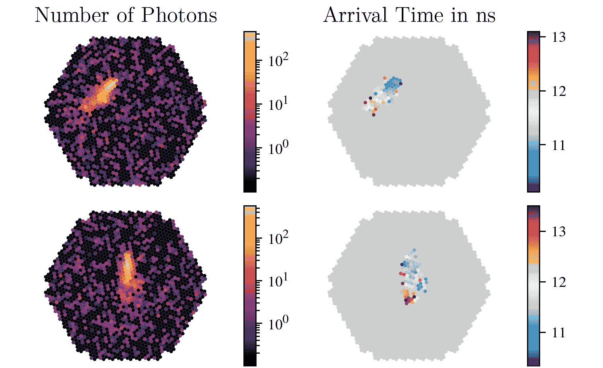

**图 4.6：** 两台 CTA 大型望远镜观测到的单个 500 GeV 簇射。每个像素中的时间序列已转换为估计光子数（左）及其平均到达时间（右）。右图中，未被镜像清洗选中的像素显示为灰色。

在通用的“经典”分析方法中，该数据现通过三个步骤进行缩减：

1.  **镜像提取：** 从每个像素的时间序列中估计光子数和切伦科夫脉冲的到达时间。每个像素中的光子数称为*镜像*，这与我们对该术语的经典理解相符：单色亮度图像。
2.  **镜像清洗：** 选择可能包含切伦科夫信号的像素。
3.  **镜像参数化：** 从选定的像素值中计算出若干聚合量，得到每个事件的若干*镜像参数*。

这些步骤详见第 7.3 节。在数据结构的语境下，只需强调我们获得了 IACT 数据的两种额外表示：具有两个形状为 `N`[pixels] 数组的镜像级别（每个事件），以及包含前述所有信息单一聚合量集合的镜像参数级别。CTA 将这两个中间数据级别合并为 DL1。

DL1 参数是基于经典机器学习的分析重建原初粒子性质的入口点，将在第 8.4 节中讨论。深度学习方法（见第 9.4 节）通常从 DL1 镜像级别开始，但也有直接从时间序列阶段开始的方法正在开发中。

事件性质估计步骤的结果是 DL2 数据级别。在此阶段，可能由不同算法估计出每个性质的多个值。

最终的基于事件的数据级别是 DL3，它包含伴随仪器响应函数的伽马射线候选体重建事件列表。这是伽马射线分析最后一步——求解第 10.5 节中讨论的逆问题——的输入数据级别。这也是 CTA 将提供给天文台科学用户的数据级别。所有之前的数据级别均为内部或中间数据级别，由 CTA 处理以生成 DL3。

此前我们讨论的是 IACT 数据的抽象数据结构，而非存储该数据的具体数据或文件格式。虽然所有 IACT 的数据结构和分析方法本质上相同，但目前低级别 IACT 数据尚无通用数据格式。每个正在运行的 IACT 合作组都使用自己的软件栈和相关数据格式，最常基于 ROOT 框架 [[56]](#9783110785951_034588.xhtml#b_9783110785968-011_ref_056) 构建。这也包括更高数据级别和科学分析，但近年来该领域已发起一项倡议，旨在为伽马射线天文学开发通用的高级数据格式和开源分析工具，主要动机是 CTA 将作为开放天文台运行，同时也出于结合当前运行望远镜数据以实现多仪器分析的愿望，以及需要一种更适合长期归档、且独立于往往为专有分析软件的格式。“伽马射线天文学数据格式”倡议（GADF）[[138]](#9783110785951_034588.xhtml#b_9783110785968-011_ref_138) 正在开发基于 FITS [[121]](#9783110785951_034588.xhtml#b_9783110785968-011_ref_121) 文件存储 DL3 的规范，该格式是伽马射线数据开源分析框架 Gammapy [[139]](#9783110785951_034588.xhtml#b_9783110785968-011_ref_139) 的输入格式。`ctapipe` [[296]](#9783110785951_034588.xhtml#b_9783110785968-011_ref_296) 是一个用于从 R1 到 DL3 处理 IACT 数据的开源库和命令行工具集，目前处于为 CTA 开发的原型阶段，但通过插件系统也支持非 CTA 望远镜或原型的数据分析。`ctapipe` 使用 hdf5。

### 4.3.3 IceCube 的数据结构

*Tim Ruhe*

IceCube 使用其自有的文件格式，即 i3 文件。在文件内部，所有必需信息以逐事件的方式存储在帧中。专用帧还包含探测器几何结构、校准常数以及数据采集物理配置详情的元信息。此外，数据按级别分层组织。以下将解释 i3 文件的基本特征以及不同级别的含义。


#### IceCube 文件格式与数据组织

IceCube 合作组使用其自有的文件格式，该格式用于实验数据和模拟数据。这种标准化的文件格式是 **i3-file**，也用于并行文件处理。由于 IceCube 中的每次物理运行通常持续约八小时，因此会将该运行拆分为若干子运行，以加快整体处理速度。文件中的基本单元是 **帧**，每个帧恰好包含一个 IceCube 事件，对应约 10 ms 的 IceCube 数据。在 IceCube 中，事件由所谓的 **触发器** 形成，并以物理上有意义的方式组合来自 **数字光学模块（DOM）** 的信息（详见 第 4.2.3 节）。文件中存在不同类型的帧，可分为两大类。

##### 元数据帧

第一类是 **元数据**，通常每个文件仅需一次。

*   **I 帧**（也称为 **TrayInfo**）包含文件先前处理方式的信息。
*   **G 帧**（Geometry）包含基本探测器几何结构，特别是所有 DOM 的几何坐标。常规 IceCube 串的标称间距约为 125 m，但实际距离可能相差几米。填充阵列 **DeepCore** 具有密得多的串和 DOM 间距。精确了解 DOM 位置对于事件的准确重建至关重要。此处的 **重建** 是指一系列算法链。例如，要计算 **时间残差**，需要 DOM 位置作为输入（有关 IceCube 中事件属性重建的更多细节，请参见 第 7.2 节）。引入 **G 帧** 是为了在实验建设期间更新几何结构，并允许细化位置信息。DOM 位置是相对于南极坐标网格（北向和东向坐标）测量的。在第一阶段，`x` 和 `y` 坐标由钻塔位置得出。`z` 坐标则通过在 DOM 部署期间利用压力传感器得出。部署后，利用 **闪光灯数据** 来校正几何结构的初始测量值。
*   **C 帧**（Calibration）包含光电倍增管的校准常数，后者是 DOM 的核心组件。
*   数据采集时的探测器状态保存在 **D 帧**（Detector）中，通常涵盖整个 8 小时运行。除其他信息外，该帧存储了数据采集期间哪些 DOM 和串处于激活状态。虽然 IceCube DOM 通常非常稳定，且大多数 DOM 故障发生在部署期间，但个别 DOM 或整串可能会暂时失效，导致其信息无法用于重建。

##### 物理帧

单个事件的信息保存在 **P 帧** 和 **Q 帧** 中。

*   **Q 帧** 包含事件的记录波形。
*   **P 帧**（Physics）保存事件重建结果。可以对同一原始数据独立应用多种重建，从而产生多个 **P 帧**。在 **P 帧** 中，可以访问单个重建算法的中间结果。

##### 数据级别

此外，IceCube 数据按 **级别** 进行层级组织。级别越高，数据越接近物理分析，且运行在其上的重建算法越多。

*   **Level 0**（常被称为 **触发级别**）旨在极快运行，旨在将任何类型的粒子相互作用与探测器中的噪声事件区分开来。这是通过应用专用触发算法实现的（详见 第 4.2.3 节）。
*   **Level 1**（有时也称为 **滤波级别**）包含约 3 kHz 采集率的数据，主要由大气缪子主导。在此阶段，大气中微子（IceCube 探测到的第二丰富粒子类型）仅占约 10 到 20 mHz。通过使用选择不同能量和拓扑结构数据的专用滤波器，在此级别已可实现一定量的背景抑制。例如，**DeepCore 滤波器** 选择 100 GeV 以下、在探测器底部发生相互作用的事件。
*   **Level 2** 专用于全合作组范围的处理，此级别不丢弃任何事件。相反，应用重建算法，并针对每个滤波器处理事件。
*   **Level 3** 处理延续自 Level 2，变为特定工作组专用。Level 3 存在三条主要滤波链（**级联**、**缪子**、**低能量**），对通过一组滤波器子集的事件应用切选。此外，还应用新的重建算法，这些算法通常比 Level 1 应用的更复杂且消耗更多资源。在 Level 3（即 Level 2 重建的输出级别），数据率降至约 1 Hz。
*   **Level 4 及以上**：事件选择和处理变为分析专用，例如对数据进行滤波以获得中微子主导的样本。级别的编号以及清理过程的哪些阶段被归纳为一个级别，取决于分析者的个人偏好，本身不一定有深意。所应用的切选和使用的（机器学习）算法也是如此。然而，随着时间的推移，某些选择得以保留并确立下来，作为不同类型分析的输入。IceCube 的一个事件选择在第 8.3.1 节中介绍。

## 4.4 基于 GPU 的触发决策

*Holger Stevens*

**LHCb 实验** 目前正在进行升级。一项重大变革是采用纯软件触发。所有子探测器将以 40 MHz 的频率无触发读出，这将导致数据中心产生 40 Tbit/s 的输入数据率。该数据率将通过第一触发阶段的全 GPU 实现来降低。相应项目名为 **Allen**。LHCb 合作组将成为高能物理界首个拥有完整高吞吐量 GPU 触发器的实验。在触发的第一阶段，需要以最高速度解码来自子探测器的复杂原始数据，并为后续阶段做准备，在后续阶段中将推导粒子轨迹，这些轨迹是确定其产生顶点以及将粒子识别为缪子或强子的基础。由于多特蒙德参与了 **SciFi 径迹器** 的建设，初期重点放在了相应解码算法的开发上。

**Allen 项目** 是 LHCb 第一触发阶段（**HLT1**）的基于 GPU 的实现。触发器是 LHCb 整体数据获取系统的重要工具，如 第 4.2.1 节 所述。触发器的总体必要性及第二阶段（**HLT2**）在 第 4.1 节 和 第 4.2.1 节 中已作介绍。为做出触发决策，将各子探测器的原始通道信息组合以构建轨迹和伪粒子。实验内的不同数据类型在 第 4.3.1 节 中解释。本节首先介绍 Allen 的总体结构和任务并行化的不同方法。随后展示不同 GPU 在事件吞吐量方面的性能。


触发过程的流程图如图 4.7 所示。HLT1 必须将 40 Tbit/s 的输入数据率降低至 1 Tbit/s。输出速率的限制因素是磁盘缓冲区。在预期的触发方案中，GPU 位于事件构建器（EB）中。EB 服务器配备 32 核 AMD EPYC (7502) CPU，大约需要 173 台这样的服务器。因为这些服务器本身就有空闲的 PCIe 插槽，所以它们非常适合托管 GPU。在升级触发器的初始计划中，并未预见使用 GPU。因此 HLT1 位于 EFF 中，类似于 HLT2。由于将 HLT1 移至 EB，第一次数据缩减在 EFF 之前完成。这使得可以通过服务器的板载网卡连接 EB 和 EFF。GPU 的使用降低了成本；在纯 CPU 方案中，将不得不额外购买 100 GB 网卡。纯 CPU 触发器与混合 GPU 和 CPU 版本的详细对比发表于[[246]](#9783110785951_034588.xhtml#b_9783110785968-011_ref_246)。

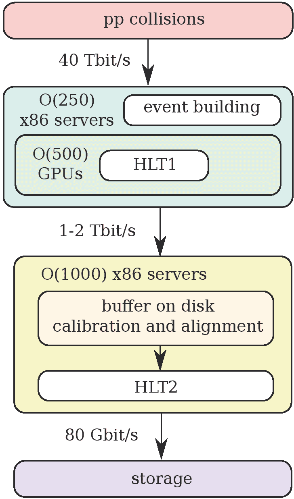

**图 4.7：基于 GPU 的 HLT1 级的数据获取系统。**

现代指令集如 `SIMD` 和 `SIMT` 在 Allen 项目中得到应用，这使得可以在多个数据值上并行执行相同的数学运算。单个 LHCb 事件相当小，约 100 kB。在 EB 内部，构建多事件包；每个包包含 1000 个事件。这些包随后被复制到 GPU，系统不受 I/O 限制。由于包中的事件完全独立，它们可以并行处理。在此也提到，各个 GPU 之间不需要通信。HLT1 序列如图 4.8 所示。在此序列中，不同的内核使用多线程。算法以矩形表示，缩减步骤以菱形表示。原始数据从主机 CPU 复制到 GPU，并应用第一次切选。全局事件切选删除击中数极多的拥挤事件。这样做是因为在此无法进行显著的径迹分离。在后续步骤中，对来自不同子探测器的击中进行解码，并应用找径算法。从而确定粒子的飞行方向。最重要的特征之一是主顶点，即质子-质子相互作用发生的位置。VELO 是唯一一个在探测器读出中不进行聚类的组件，因此聚类在触发器中进行。构建三个击中的三元组，并将其作为径迹候选的种子。由于所有径迹都是独立的，VELO 找径针对多个种子进行了并行化。找到的径迹用于下一步，即 UT 找径。径迹外推到 UT，并将找到的击中与径迹匹配。当然，不同的径迹是并行处理的。接下来的算法对应于 SciFi 径迹器。首先，对击中进行解码；其次，利用击中延伸先前找到的径迹。硅光电倍增管被用作 SciFi 的传感器。最小读出单元是一个 96 像素的通道，该子探测器总共有 500,000 多个通道。这些通道分布在三个站，每站四层。在读出电子学中，处理通道的信号并形成簇。这改善了信噪比。簇数据被打包在所谓的原始数据块中。解码的任务是将来自各个原始数据块的簇转换并变换为物理击中坐标。整体触发序列的一项重要要求是击中需要按 `x` 排序。SciFi 解码分为三个算法：计算簇计数、预解码和原始数据块解码器[[359]](#9783110785951_034588.xhtml#b_9783110785968-011_ref_359)。对于基于线程的解码，簇的数量至关重要。对簇进行计数是因为其数量事先未知。由于特殊的数据处理，直接相邻的簇被合并，仅存储起点和终点。在解码过程中，恢复合并的信息。为了识别需要恢复的簇，需要评估实际簇数据中的一个特殊位。这在预解码中完成。数据也在此处排序。这是必要的，因为每第二层的数据对齐方向不同。在最后一步，将簇通道标识符实际转换为 `x`、`y`、`z` 坐标。数值被写入预定义的内存位置。由于预解码器中的排序，击中已排序。在 SciFi

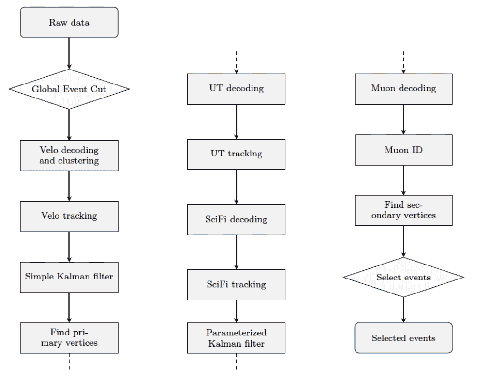

**图 4.8：HLT1 Allen 应用的序列。**

![Fig. 4.9: Allen sequence throughput against theoretical GPU performance [11].](graphic/b_9783110785968-004_fig_009.png)

**图 4.9：Allen 序列吞吐量与理论 GPU 性能对比 [[11]](#9783110785951_034588.xhtml#b_9783110785968-011_ref_011)。**

找径中，将找到的 VELO 径迹延伸。在此考虑了带电粒子的动量，因为 SciFi 位于弯曲磁铁之后。缪子站是 HLT1 中唯一被评估的粒子识别系统。这是由于 LHCb 物理领域对缪子的特殊关注。对缪子数据进行解码，并计算粒子为缪子的概率。所有生成的信息用于寻找次级顶点。最后应用多条选择线，选中的事件被复制回主机 CPU 并存储在缓冲区中，直到 HLT2 开始。HLT1 的关键属性是其事件吞吐量，因为计算时间有限。Allen HLT1 应用的吞吐量在不同 GPU 上进行了测试。图 4.9 显示了理论 GPU 性能（32 位 TFLOPS）与实现的 HLT1 吞吐量的对比。可以看出，吞吐量与 GPU 的理论性能良好地成比例，未来 GPU 代际预计将带来显著的性能增长。

图 4.9 中显示的吞吐量值为平均数，但由于粒子过程的随机性质，探测器中的击中数变化显著。触发器中的大多数计算是组合性的，因此每个事件的处理时间强烈依赖于事件大小。图 4.10 显示了按 SciFi 原始数据大小分箱的事件吞吐量。

![Fig. 4.10: Allen sequence throughput in bins of the SciFi Raw bank size [11].](graphic/b_9783110785968-004_fig_010.png)

**图 4.10：按 SciFi 原始数据块大小分箱的 Allen 序列吞吐量 [[11]](#9783110785951_034588.xhtml#b_9783110785968-011_ref_011)。**

# 5 蒙特卡洛模拟

## 5.1 LHCb：粒子物理中的蒙特卡洛模拟与库

*Bernhard Spaan*

*Hans Dembinski*

*Gerwin Meier*


LHCb 模拟是一个软件链，它利用了多个专用软件包。质子-质子碰撞由 `Pythia` [353, 354] 生成。强子衰变由 `EVTGEN` [239] 模拟，光子辐射由 `PHOTOS` [133, 180] 模拟。粒子与探测器材料的相互作用由 `GEANT4` [40, 50] 模拟。最后，探测器中电子学的内部响应由软件 `BOOLE` [128] 模拟。在此之后，模拟事件的处理方式与真实事件相同。LHCb 数据获取系统见第 4.2.1 节。下文将进一步讨论各个步骤。

`Pythia` 的任务是尽可能准确地模拟高能质子-质子碰撞及其产生的粒子。与模拟链中的任何程序一样，它使用蒙特卡洛方法，一般来说，该方法将一个复杂过程分解为依次发生的小型随机过程。在质子-质子碰撞中，模拟始于来自碰撞质子的夸克和胶子的一次或多次硬散射。起初，部分子（部分子是夸克或胶子的统称）具有高能量。部分能量以胶子形式辐射出去，部分胶子转化为夸克-反夸克对。这些过程级联并形成部分子簇射。部分子-部分子相互作用以及与未发生碰撞的束流中其他质子的相互作用也被考虑在内。当部分子簇射中产生的夸克单位能量降至某一阈值以下时，簇射结束，夸克结合形成色中性强子，这由强相互作用的禁闭性质决定。强子化是一个复杂的过程，存在多种有效算法。为了正确获得强子的性质，使用了局部部分子-强子对偶性，这意味着强子的动量流和量子数主要与相应的部分子相同。更多细节请参阅 Lund 串碎裂模型 [54]。

产生的大多数强子是不稳定的。强子衰变由 `EVTGEN` 模拟。该程序旨在准确描述与旨在研究味物理的实验相关的衰变所涉及的所有基础物理，例如角依赖和时间依赖、`CP` 破坏、与量子真空的相互作用，以及中性粒子混合为其反粒子。该程序确保衰变产物的动量和自旋正确相关。正确模拟这些相关性很重要，因为某些物理分析会利用它们，例如所谓的味标记，这是一种判断母强子是粒子还是反粒子的算法。更多细节请参阅文献 [239]。

![图 5.1：入选候选事件的 `m(e+e−K+K−)` 分布，(左) 零个和 (右) 两个电子均带有轫致辐射修正。蓝色实线显示由信号（红色短虚线）和背景贡献组成的总拟合。组合背景由绿色长虚线指示，而来自衰变的部分重构背景分别由粉色和紫色点划线指示。[13]。](graphic/b_9783110785968-005_fig_101.png)

图 5.1：入选候选事件的 `m(e+e−K+K−)` 分布，(左) 零个和 (右) 两个电子均带有轫致辐射修正。蓝色实线显示由信号（红色短虚线）和背景贡献组成的总拟合。组合背景由绿色长虚线指示，而来自衰变的部分重构背景分别由粉色和紫色点划线指示。[13]。

下一步是用 `PHOTOS` 模拟带电粒子的光子辐射。该程序负责模拟发射光子的能量和方向，以及发射粒子动量和能量的变化。轫致辐射对多项 LHCb 分析很重要，因此需要准确的模拟。LHCb 触发器使用探测到的量热器中的光子。此外，粒子和共振的产生与衰变中的轫致辐射会改变测量分布的形状。而且，LHCb 重构包含一个算法，将来自轫致辐射的光子与其电子发射体结合，从而近似恢复电子发射前的能量和动量。这减小了由其子粒子的能量和动量重构的祖先粒子质量中的偏差，如图 5.1 所示。

模拟所有粒子在探测器材料中的传播和相互作用是链中的下一步，由 `GEANT4` 完成。需要对整个探测器的几何结构以及不同子探测器中的各种材料进行建模。这不仅包括用于探测粒子的有源材料，还包括被动支撑结构、电子学、电缆——粒子可能与之相互作用的每一处物质。外部电磁场的影响，特别是 LHCb 磁铁，也被考虑在内。这些过程可能导致粒子被吸收而损失，也可能产生新粒子，例如光子在原子核电场中转化为电子-正电子对。最终，这些相互作用导致不同子探测器中的击中。

随后，探测器响应由 `BOOLE` 模拟。该程序使用上一步的数据（主要是有源材料中的能量沉积）来模拟探测器对这些输入的响应。它还将记录的信号与模拟的沉积关联起来。

这种最底层的关联用于将重构径迹与模拟中的原始粒子匹配，如第 4.3.1 节所述。不同的背景源也需要被模拟，例如来自前一个事件的溢出、电子波动产生的噪声、长期辐射或串扰，以及敏感体积变得具有放射性的可能性。由于 LHCb 子探测器是独立的，因此每个子探测器的模拟可以并行运行。

此时，LHCb 事件的模拟完成。后续步骤以相同方式应用于模拟事件和真实事件。LHCb DAQ 见第 4.2.1 节。

### 5.1.1 Astro：蒙特卡洛模拟，库

*Jean-Marco Alameddine*


#### 天体粒子物理模拟

### 摘要

在天体粒子物理学中，从大气层外缘到探测电子学信号的所有相互作用的级联序列，必须用蒙特卡洛模拟来描述。触发此类级联的第一批粒子可以是高能光子、电子、中微子或宇宙线原子核。根据所考虑的问题，这些粒子中的任意一种或其任意衍生物都可以是待分析的信号。因此，什么是信号、什么是背景取决于物理问题。因此，这些信号必须从理论上进行完整的物理模拟。由于天气导致的测量条件变化，以及切伦科夫望远镜的天顶角变化，特别是大气层中相互作用的模拟需要大量资源。通过将计算机科学方法与模拟智能结合，可以将资源消耗降至最低。在本节中，将介绍所应用和开发的模拟程序，并阐述协同研究中心（CRC）中开发的机器学习与蒙特卡洛模拟相结合的动机。

##### 模拟在天体粒子物理中的作用

在天体粒子物理学中，粒子产生于遥远的银河系或河外源，这些源无法直接观测，且先验性质未知。它们以任何当前运行的（实际上在技术上可行的）人造粒子加速器都无法企及的能量到达地球。因此，模拟在天体粒子物理领域起着至关重要的作用。天体粒子物理学家必须依赖这些模拟对信号和背景事件的描述是完整且准确的，以便进行有意义的分析。然而，正如本节所述，物理学家面临的挑战，特别是在资源管理和效率方面，是多方面的。

##### 广延大气簇射与模拟挑战

由于地球大气层对高能光子和宇宙线不透明，它们与空气中的原子核相互作用，产生称为广延大气簇射的次级粒子级联。虽然其基础物理原理当然与描述粒子物理实验中相互作用所用的原理相同，但仍有一些重要差异需要考虑。

首先，簇射中的相互作用通常被强烈推向前向，而最高能量的粒子物理实验则在正碰撞构型下运行和观测，如`大型强子对撞机`。这也意味着，天体粒子物理感兴趣的区域无法用加速器实验轻松测量，因为前向粒子会在束管中丢失。

其次，涉及的能量可比对撞机实验达到的能量高出几个数量级，这意味着需要对物理进行合理推演，将其外推到更高能量。

##### CORSIKA 模拟框架

原则上，该级联的每个物理相互作用都需要单独采样，以创建完整的大气簇射模拟。这一想法由大气簇射模拟工具 `CORSIKA` 实现，它是用于此目的最常用的模拟框架，且在天体粒子物理学的许多实验中已使用了 30 多年。

基础物理的描述主要由外部工具提供，可分为两个不同组件：

1.  **电磁分量**：描述电子、正电子和光子在粒子簇射中的相互作用。该分量可用 `EGS4` 的修改版描述，提供直接蒙特卡洛模拟；或用 `NKG 公式` 描述，该公式提供了一种描述电磁分量的解析方法。
2.  **强子相互作用**：包含低能和高能分量。
    *   低能强子相互作用可用 `FLUKA`、`GHEISHA` 或 `UrQMD` 模型描述。
    *   高能强子相互作用可用 `DPMJET`、`HDPM`、`QGSJET01`、`QGSJET II-04`、`SIBYLL`、`VENUS`、`NEXUS` 或 `EPOS LHC` 模型描述 [194]。

使用不同模型描述强子相互作用，可能导致簇射模拟结果显著不同。这是不同模型将对撞机实验结果外推到粒子物理实验目前技术上无法企及的能量和快度区域时，提供了不同外推结果的效应。这显示了簇射物理挑战与粒子物理之间的重要联系，即所谓的**缪子谜题**更凸显了这一点：广延大气簇射实验测得的缪子数量与簇射模拟结果相比存在高度显著的差异。该缪子谜题及其对粒子物理和天体粒子物理的影响详见第 5.4 节。

##### 计算效率与优化策略

由于广延大气簇射中的每个相互作用都需要单独采样，其完整模拟是一项高度耗时的任务。此外，这种随机性质使得即使初始条件相同的簇射，其发展过程也可能不同，从而看起来完全不同。这意味着必须模拟大量簇射才能获得统计上完整的描述，特别是如果需要全天宇宙线描述时。

在 CRC 876 的背景下，已投入巨大努力寻找提高模拟效率的方法。

###### 早期终止策略

一种可能的方法是限制对特定目的不重要的簇射的模拟时间，例如，它们未击中探测器。为此，可以训练模型，确定在何时可以提前终止簇射或簇射一部分的模拟。该策略详见第 5.2.1 节。

###### 主动类别选择

当为分类任务（如信号-背景分离）模拟一组大气簇射时，底层初始状态的分布可以自由选择。然而，为了优化所需的计算资源，希望找到一种对底层分类模型训练最优的分布。一种利用机器学习技术解决此问题的方法称为**主动类别选择**，详见第 5.2.2 节。

###### 硬件效率

虽然上述方法侧重于在软件层面寻找改进，但也可以在底层硬件中寻找潜在改进。这尤为重要，因为电力成本是计算密集型任务的主要限制因素。为此，正在研究并展示在 `CORSIKA` 模拟中使用低功耗硬件来提高资源效率的改进，详见第 5.2.4 节。

##### 现代化：CORSIKA 8

随着软件框架 `CORSIKA` 的改进日益先进，其底层代码库（部分最初开发于 30 年前）已达极限。`CORSIKA 8` 的开发代表了向现代代码库过渡的必要性。此过程旨在内在提供现代功能，如硬件加速或并行化，并通过提供模块化、可扩展的代码结构，为开发者实现新功能创造更便捷的途径。这一可视为现代化科学软件典范努力的过渡，详见第 5.2.3.2 节。


在粒子物理学中，通常可以在很大程度上控制实验的环境条件，但对于天体粒子物理学实验，这种控制可能很困难，甚至是不可能的。这对于利用大气作为探测介质的实验（如`IACTs`或荧光探测器）尤其如此。这些实验高度依赖于温度、背景光照射或局部磁场等效应。如果在模拟中不考虑这些效应，可能会导致显著的偏差，但为每种可能的环境条件重新进行完整模拟的运行时间太长，不可行。相反，可以通过将现有的模拟结果适应不断变化的环境条件，例如将夜空背景噪声添加到`IACT`图像的无噪声模拟中。这种方法是在本`CRC`中开发的，详见第 5.3.2 节。

天体粒子物理学的一个特殊方面是位于地下的实验，如中微子天文台`IceCube`。对于这些实验，地球表面的粒子（如大气簇射中的缪子）或探测器附近产生的粒子（如弱相互作用中微子产生的粒子）需要被传播直到它们在探测器内发生相互作用。在此背景下，缪子扮演着特殊角色，因为它们可以在致密介质中传播很长的距离，因此在地下探测器中仍然很丰富。因此，它们的模拟至关重要，特别是作为需要考虑的背景。由于缪子在致密介质中的相互作用数量可能非常高，缪子模拟的要求既包括高精度，也包括高性能。用于此目的的工具之一是软件模拟框架`PROPOSAL`，它提供最新的缪子物理参数化，以及一种允许在速度和精度之间找到权衡的算法。`PROPOSAL`在第 5.2.3.2 节中有更详细的描述。

除了上述提到的模拟工具——被天体粒子物理学中许多不同实验使用的框架——许多实验还使用自己的、通常是特定于探测器的模拟工具。这些工具特别用于描述探测器的非常低层级部分，如特定探测器部件的响应函数。

特别是对于高度复杂或新安装的探测器，需要付出很大努力才能使真实测量数据与模拟事件达到可接受的一致性水平。这种数据/MC 一致性很重要，因为否则机器学习模型可能会在仅存在于模拟数据而不存在于真实数据的特征上进行训练。由于天体粒子物理学实验中的校准测量在大多数情况下只能在有限程度上进行，因此有必要直接比较观测到的特征和模拟的特征。然而，简单地比较一维特征并不总是足够的，因为失配可能只在高维相关性中可见。因此，利用机器学习方法来寻找数据/MC 失配是值得的，例如分析那些被训练用来区分真实事件和模拟事件的模型。这种方法在第 5.3.3.1 节中有描述，并已应用于`IceCube`模拟。

## 5.2 模拟效率研究

### 5.2.1 Corsika – 主动学习

*Dominik Baack*

**摘要：** 高能宇宙射线撞击大气层的模拟是许多天体粒子实验的要求。对于大多数实验，这些模拟包括跟踪穿过大气层的单个入射粒子，包括相互作用等随机效应，相互作用可以产生新粒子。这些新粒子必须以相同方式处理，从而产生一个不断扩展的粒子级联，必须将其传播穿过大气层。由于这些蒙特卡洛模拟的高复杂性，现实案例的计算时间每个簇射可能从几个 CPU 秒到几个 CPU 月不等，具体取决于特定设置。对于具有统计学意义的事件数量的完整集合，累积计算时间甚至更高。

由于蒙特卡洛模拟固有的随机性质，初始粒子的固定约束必须保持宽泛，以允许边界情况的模拟。这导致大量模拟粒子甚至整个事件在实验中未被触发，因此被丢弃。在模拟和分析流程的后几步中，分类器或展开方法的训练可能会偏向于很少发生的特定事件，这与前面的情况不同。

在模拟批次之后执行的学习算法可以训练模型以减少模拟相空间，即减少模拟但未触发的事件数量。在扩展中，不仅可以提前停止整个级联；生成的簇射的单个部分（称为子簇射）也可以根据模型进行检查。

#### 5.2.1.1 简介 - 级联

天体粒子物理学是一个基于星际起源粒子的相对较新的研究领域。这涵盖了从几个`eV`到几个`PeV`的广泛能量范围。在从`GeV`左右开始的较高能量区间，单个粒子太稀有，无法用相对较小的卫星实验直接观测。地面探测器的困难在于宇宙射线不穿过大气层，而是与之相互作用。在每个相互作用点，能量被传递给更多的粒子，这些粒子本身又在大气层中相互作用。这导致了如图 5.2 所示的粒子级联。

#### 5.2.1.2 简介 - 实验

鉴于级联内部的巨大多样性，有几种不同的实验探测方法可用。次级粒子可以直接测量，或通过其发射的电磁波（以荧光光、切伦科夫光或无线电发射的形式）进行测量。稍后描述的优化方法是为簇射规模（见图 5.3）比仪器覆盖面积大一个数量级的实验量身定制的。这种条件可以由切伦科夫望远镜（如`MAGIC`、`CTA`或`FACT`）和较小的水探测器（如`HAWK`）满足。此外，不仅有上述那些观测和测量簇射的实验，对于更多的实验，产生的粒子在其实际测量中形成干扰背景。一个例子是中微子望远镜。在这两种情况下，完整的模拟对于为后续分析提供坚实基础都是必要的。

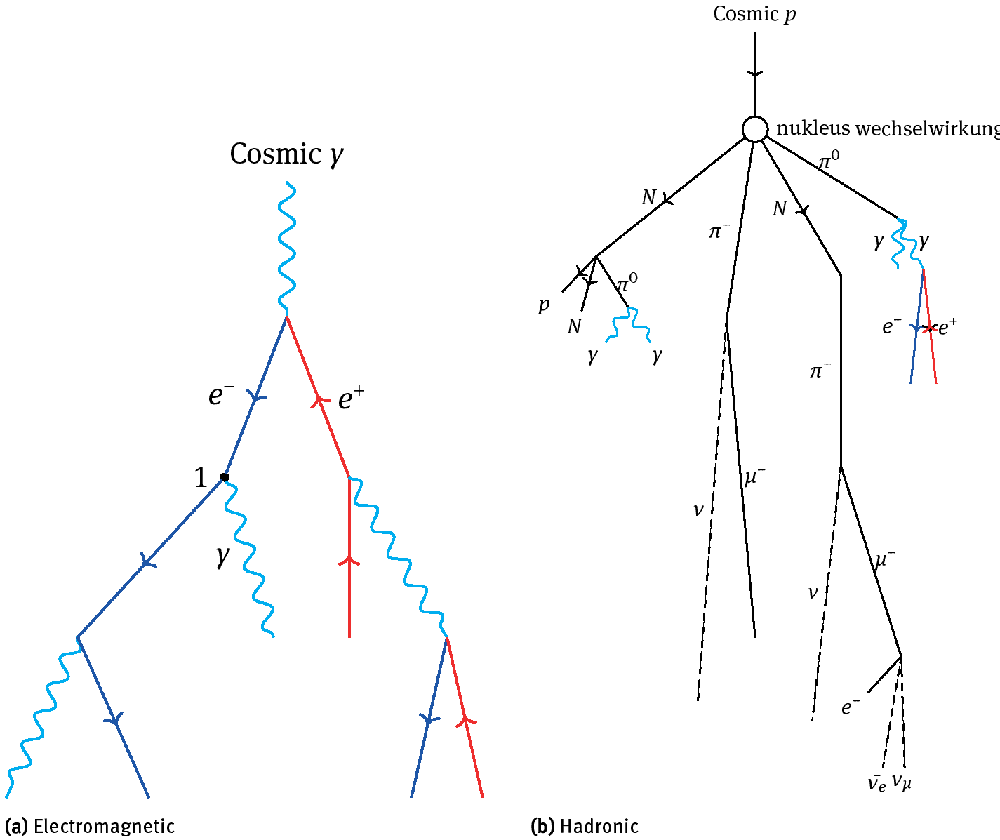

图 5.2：大气层中电磁和强子级联的示意图。簇射的真实表示显示在图 5.3 中。

#### 5.2.1.3 简介 - 模拟


物理分析所关注的信号，在几乎所有此类实验中，都被本底信号以数个数量级的幅度所叠加。为了能够从测量中得出结论，有必要对信号事件进行分类。鉴于信号的复杂性和数量，这只能在合理范围内自动完成。训练这些自动分类器需要数据集，其中所有输入变量均已知。然而，由于这些变量无法在实验中确定，我们只能基于理论考量来预测单个事件。由于粒子簇射中每次相互作用及实验中的其他非线性效应都基于大量统计过程，因此无法给出解析闭式解，以将可观测量的分布作为输入变量的函数进行预测。因此，开发了利用蒙特卡洛方法描述单个相互作用的模拟程序。每次相互作用均从源于物理测量或理论结果的随机分布中采样。通过这一逐步过程，所有粒子均被追踪，并应用物理效应。


图 5.3：10 TeV 能量下不同原初粒子的簇射级联。簇射以正交投影显示，这意味着图像的高度/宽度对应 64 516 m 的真实高度和 32 000 m 的累积宽度。

鉴于粒子数量众多且复杂度高，所需的计算时间同样巨大。可以通过级联方程传播平均值或简化分布，从中在观测层面采样单个参数。这能实现更快的计算时间，但该模拟无法用于在传播过程中生成可观测参数的实验（如无线电辐射或切伦科夫光）。

#### 5.2.1.4 级联裁剪策略

为了减少每个级联所需的计算时间，可以减少应用的物理效应数量，但这也会降低模拟的真实性，从而影响可能的结果。另一种听起来简单的方法是减少级联本身所需的计算量。直到现在，大气簇射模拟、实验属性模拟（如光学性质）以及后续计算可观测参数向量的构建，一直被完全分开处理。因此，无法将关于探测器或分析属性的知识应用于簇射模拟本身。因此，完整的大气簇射始终必须被完整模拟。

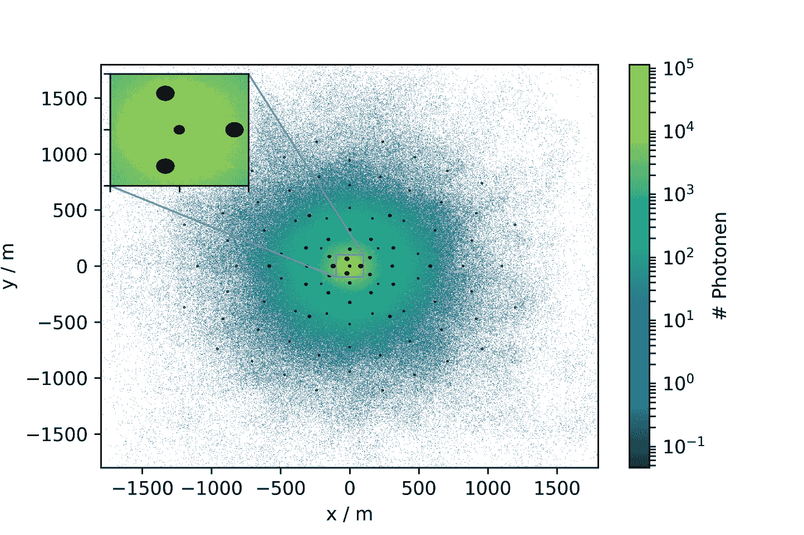

图 5.4：CTA 南半球站点一种可能的望远镜配置，灰色显示真实望远镜尺寸，并展示了 1 TeV 簇射的光子分布。

采用这种新方法，可以利用诸如哪个光子对重建有贡献等信息，来训练一个专门的机器学习过程，从而实现对级联中不参与模拟后期阶段或不给自动分类器提供任何信息增益的部分的早期移除。

### 5.2.2 模拟控制——主动采样

*Mirko Bunse*

**摘要：** 天体粒子物理中的模拟是依赖标签的数据生成器；它们根据原初粒子的类型、能量、方向以及待预测的其他潜在量来产生观测特征。因此，当通过此类模拟生成训练数据时，我们可以自由选择生成的训练集中标签的分布。事实上，我们在数据生成前*必须*选择此分布。对于分类问题（如信号与本底分离），此问题被称为主动类别选择。我们综述了在此设定下选择类别比例的现有启发式方法，并提出了一种近期的选择策略。该策略充分考虑了类别比例的不确定性（例如未知的信噪比），并在 PAC 学习理论中得到了证明。因此，我们的策略是控制蒙特卡洛模拟所生成类别分布的一个有前景的候选者。

![Fig. 5.5: Strategies for active class selection optimize class-conditioned data acquisition [103].](graphic/b_9783110785968-005_fig_005.png)

图 5.5：主动类别选择策略优化类条件数据获取 [[103]](#9783110785951_034588.xhtml#b_9783110785968-011_ref_103)。

#### 5.2.2.1 简介

主动类别选择（ACS）[[254]](#9783110785951_034588.xhtml#b_9783110785968-011_ref_254) 允许机器学习从业者主动选择其训练数据的标签比例。这种选择自由源于*类条件*数据生成器（例如实验或模拟），它可以为任意选定的类别获取特征向量。在粒子物理和天体粒子物理中，我们必须定义一个原初粒子，并模拟粒子探测器对其的响应。这一输入正是我们稍后需要从探测器响应中预测的内容 [[88]](#9783110785951_034588.xhtml#b_9783110785968-011_ref_088)。

Lomasky 等人 [[254]](#9783110785951_034588.xhtml#b_9783110785968-011_ref_254) 提出，可以在一系列多个获取步骤中利用此类生成器，如图 5.5 所示：(i) 在每一步中，基于迄今获取的所有样本（从一个小的初始数据集开始）训练并评估一个分类器；(ii) 基于分类器的性能，数据获取*策略*被允许选择下一获取步骤的标签比例；(iii) 由生成器（例如粒子或天体粒子探测器的模拟）根据策略的选择，生成一批带标签的数据以实现期望的比例。该批次将添加到训练集中，分类器将在所有后续迭代中基于该训练集进行训练。这种顺序且知情的数据获取的前景在于，与使用某种预定类别比例进行训练相比，分类器可在数据获取成本和性能方面获益。ACS 框架与经典主动学习 [[346]](#9783110785951_034588.xhtml#b_9783110785968-011_ref_346) 有显著不同，后者假设未标记数据在获取后可由（如人工标注者）进行标记。

#### 5.2.2.2 类依赖数据获取策略

Lomasky 等人 [[254]](#9783110785951_034588.xhtml#b_9783110785968-011_ref_254) 在其关于 ACS 的开创性工作中，提出了五种用于类依赖数据获取的启发式方法。这些启发式方法基于当前预测模型 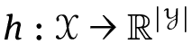 对每个类别 *y* ∈ 𝒴 的逆相对效用。即，每个类别 *y* 按权重采样。

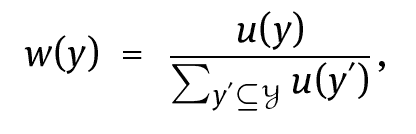

其中 *u* : 𝒴 → ℝ 为效用启发式函数，它可能依赖当前预测模型 *h*，也可能不依赖。

**均匀** 给所有类别分配相同的效用 *u*(*y*) = 1。


#### 5.2.2.2 启发式方法

**自然** 使用部署时也会出现的类别比例进行采样，即 `w(y) = u(y) = P(Y = y)`。虽然自然策略在准确率方面通常表现得极具竞争力，但有时会被其他启发式方法击败。

**逆向** 按类别准确率的倒数采样，`u(y) = Acch^−1`。该策略基于这样一个假设：低准确率完全是由训练数据量不足导致的。

**改进** 类似于逆向方法，但基于上一次迭代中准确率的提升 `u(y) = (Acch − lastAcch)^−1`。该策略假设具有“稳定”准确率的类别在未来的迭代中将保持稳定。

**重新划分** 统计上一次迭代中预测发生变化的样本数量 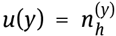。该策略背后的思想是：靠近决策边界的样本可能比其他样本更有信息量。预测频繁变化的类别被假定包含许多靠近该边界的样本。

多项后续研究 [113, 204, 299, 391] 已在不同设置中应用了这些启发式方法。还提出了一种额外的启发式方法，称为“PAL-ACS” [232]，它将经典主动学习策略嵌入 ACS 中。其思路是评估一组伪实例 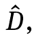，然后根据主动学习效用度量 `u[AL] : 𝒳 → ℝ` 聚合类别效用。这种方法需要一个生成模型来产生伪实例，以及一个主动学习效用函数（如熵）。

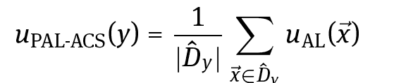

然而，这些复杂的 ACS 策略往往无法超越*自然*策略，后者甚至不考虑 图 5.5 中 ACS 框架所提出的模型性能 [232, 254]。事实上，我们在理论上已经评估了，在数据获取的极限情况下，自然类别比例能产生最优的分类器性能 [106]。这些发现表明，复杂策略相对于自然类别比例的潜在优势在获取过程中正在丧失。

#### 5.2.2.3 认证

除*自然*策略外，现有的 ACS 策略 [232, 254] 并未考虑训练模型在部署期间需要处理的类别比例；它们仅关注类别的感知*难度*。然而，*自然*策略要求从业者精确地预先知道部署类别比例。如果我们不精确知道部署类别比例，而是带有一定程度的不确定性知道它们，该怎么办？例如，天体粒子物理学家只能粗略估计其信号类与背景类的比率，大约为 1 : 10³ 甚至 1 : 10⁴ [88]。

解决这些不确定性的一种方法是对 ACS 训练模型进行*认证* [104]。为此，我们认证一组类别比例 P，使得在 ACS 诱导的源分布 S 上训练的固定假设 `h` 可以安全地应用于这些比例。“安全地”是指：在目标分布 T 上部署时，`h` 仅以高概率诱导很小的 ACS 诱导误差。

**定义 5**（认证假设 [104]）。**如果概率至少为 `1 − δ` 且 `ε`, `δ` > 0，则假设 `h` ∈ ℋ 对集合 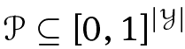 中的所有类别比例 `p` 均为 (`ε`, `δ`)-认证的：**

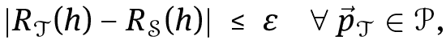

**其中 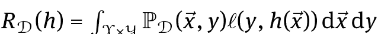 是根据分布 `D` 和损失函数 `ℓ` 计算的 `h` 的期望风险。**

在二分类中，P 只是一个类别比例范围。该 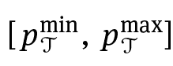 范围由满足以下条件的最大 `Δp^(*)` 定义：

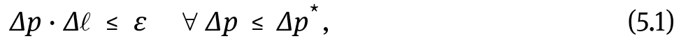

**其中 `Δp` 表示类别比例之差，`Δℓ` = 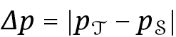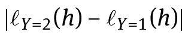 表示类别损失之差。** 后一项对于分布 S 和 T 均为常数。反过来，`Δp · Δℓ` 关于训练集 `D` 的随机抽取是常数，因此独立于 `ε`、`δ` 和 `N`。它反映了分类器 `h`、数据分布和损失函数之间的相互作用。

此处，真实差值 `Δℓ` 未知，但我们可以从 ACS 生成的数据中估计该量的上界 `Δℓ^(*)`。我们提出了一个 PAC 界 [104]，它是 `Δℓ` 的最小上界，至少以 `1 − δ` 的概率成立。该上界的概率性质源于 `Δℓ^(*)` 是从有限数据量中估计得出的事实。

#### 5.2.2.4 针对不确定类别比例的策略

证书可以帮助从业者评估 ACS 训练模型的实用价值。然而，当部署类别比例不确定时，它对如何获取数据——即 ACS 策略——没有直接的启示。因此，我们提出了一种 ACS 策略 [103]，旨在根据部署类别比例 `p[T]` 的先验分布 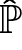，尽可能减小公式 5.1 中的域间差距 `Δp · Δℓ`。这一目标将允许任何二分类算法根据领域专家的先验信念，学习目标域的准确预测。例如，在天体粒子物理学中，这种信念可以是关于伽马粒子和强子粒子比例的先验分布。

形式上，我们假设给定正类先验概率 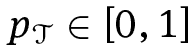 的先验 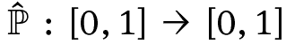。我们根据公式 5.2，通过边缘化该先验来纳入 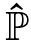。由于我们不知道真实的 `Δℓ`，因此改用估计的上界 `Δℓ^(*)`。因此，根据 `Δℓ^(*)` 进行的边缘化是真实 `Δℓ` 边缘化的上界，其概率为 `1 − δ`。

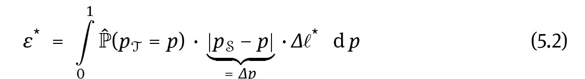

在每次 ACS 迭代中，我们可以在一定程度上改变 ACS 生成训练集的类别比例 `p[S]`，具体取决于我们每批获取多少数据以及已经获取了多少数据。事实上，我们可以将 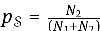 理解为类别样本数 `N[1]` 和 `N[2]` 的函数。上界 `Δℓ^(*)` 也适合解释为样本量的函数：在两个类别中获取的数据越多，我们对该量的估计就越紧致。最终，我们将 `ε^(*)` 视为 `N[1]` 和 `N[2]` 的函数，以便通过在每个数据获取批次中最优地选择 `N[1]` 和 `N[2]` 来最小化 `ε^(*)`。

我们的策略沿着 `ε^(*)` 最陡峭下降的方向减小它，即相对于获取向量 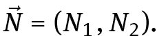 采取简单的梯度步长。定义最陡峭下降的梯度通过乘积法则计算：


### 5.2.2.5 概要

对于小数据量或高度不平衡的类别，我们的 ACS 策略主要由 `Δℓ^(\*)` 分量主导；小类别需要额外的数据，直到该上界以某个期望概率 `1 − δ` 成立。相比之下，当总数据量较大时，我们的策略主要由 `f` 分量主导。为此，Beta 先验倾向于接近其均值 `α / (α + β)` 的类别比例。这两种行为之间的转折点在支撑 `Δℓ^(\*)` 估计的 PAC 学习理论中有着坚实的基础。

鉴于这些特性，我们的 ACS 策略是控制物理模拟（就其生成的类别分布而言）的一个极具前景的候选方案。我们的策略不再以固定比例模拟信号事件和背景事件，而是有潜力通过 PAC 学习理论所证明的最优类别比例，来提升信号与背景的分类性能。从业者对现实世界中信噪比的不确定性，通过 Beta 先验得到了充分考量。

### 5.2.3 Corsika 8 新模块化库

**Dominik Baack**

**Jean-Marco Alameddine**

**摘要：** 天体粒子物理学中的分类与重构算法依赖于对模拟事件的精确描述，因为利用河外源进行校准测量是不可行的。由于粒子在传播过程中的随机行为，需要大量基于蒙特卡洛的模拟来覆盖相空间的大部分区域并描述测量到的事件特征。

对于大气簇射事件，模拟框架 CORSIKA 已成为使用最广泛的工具。CORSIKA 向现代化、模块化框架的过渡，允许采用进一步的优化方法，如并行化、GPU 编程，以及更多地使用外部物理相互作用库。在这些新的外部库中，有 PROPOSAL，这是一个用于中微子望远镜中传播轻子的模拟库。

在本节中，我们描述了多特蒙德开发的模拟库 PROPOSAL，从一个简单的缪子传播器，转型为一个模拟高能轻子和光子的电磁及弱相互作用的模块化库。此外，还描述了 CORSIKA 框架为核心过程使用外部库而进行的开发，特别是关于将 PROPOSAL 用于电磁簇射。

#### 5.2.3.1 广延大气簇射的蒙特卡洛模拟

广延大气簇射是由高能宇宙射线与地球大气层相互作用引发的粒子级联（参见 5.2.1.1 节）。对大气簇射的准确理解，对于所有致力于重构初级粒子性质的实验，或需要将其作为其他观测背景的实验都至关重要。

1989 年，CORSIKA（KASCADE 宇宙射线模拟）的第一个版本发布 [[194]](#9783110785951_034588.xhtml#b_9783110785968-011_ref_194)，这是一款用于模拟大气簇射事件的蒙特卡洛软件。CORSIKA 最初是为大气簇射阵列 KASCADE 提供模拟而开发的，现已演变为一个在全球物理学家中广泛使用的工具。其核心代码由四个组件组成：低能和高能粒子强子相互作用的物理描述、电磁相互作用的物理描述，以及一个负责所有其他物理过程和程序控制的通用框架。随着时间的推移，CORSIKA 不断改进，其功能也持续扩展。然而，新发展受到两个主要制约因素的阻碍：CORSIKA 使用 FORTRAN 77 编写，其语言特性与现代编程语言相比有限。此外，CORSIKA 的代码库并非考虑到当今的需求而开发，这带来了严重的概念性局限。这意味着当前的代码库难以维护，且难以纳入新开发。考虑到这些因素，2018 年制定了一份阐述下一代 CORSIKA 需求的白皮书，最终促成了 CORSIKA 8 的开发 [[153]](#9783110785951_034588.xhtml#b_9783110785968-011_ref_153)。

#### 5.2.3.2 CORSIKA 8：大气簇射模拟的未来

CORSIKA 8 是簇射模拟框架 CORSIKA 的最新版本。随着 CORSIKA 8 的开发，代码被完全重写为现代 C++，提供了一个面向未来且最先进的框架。考虑到创建蒙特卡洛模拟所投入的大量计算资源（这些资源也将用于 CORSIKA 8），开发过程中的一个关键重点在于代码库的内在效率。这意味着采用了静态多态等运行时高效的设计，而并行计算和 GPU 支持等技术是代码固有的组成部分。


##### CORSIKA 8 设计与 ARM 集群评估

###### CORSIKA 8 设计理念

对于 CORSIKA 8 的设计，其驱动思想是提供一个灵活的代码库，不仅满足当前需求，而且能高度适应未来的发展。CORSIKA 的早期版本仅以创建模拟大气簇射程序为目的进行开发，导致了一个高度专业化、单体的代码结构。然而，CORSIKA 8 被设计为一个用于粒子级联模拟的通用框架，不局限于大气簇射模拟。

这种灵活性的思想也体现在代码结构中，该结构由四个主要部分组成：

- **粒子栈**：存储并提供对所有传播粒子信息的访问
- **过程序列**：提供模拟物理输入的所有模块的组合
- **环境**：存储环境的所有介质和几何属性
- **传输代码**：结合代码的所有部分并模拟粒子展现过程

代码的每一部分都高度模块化，可以被调整、扩展或完全替换。一个相关的例子是 **PROPOSAL**，这是一个在 CORSIKA 8 中用于模拟电磁簇射成分的外部库。

###### PROPOSAL 集成

**PROPOSAL**（PRopagator with Optimal Precision and Optimized Speed for All Leptons，面向所有轻子的最优精度与优化速度传播程序）作为一款科学软件，在其开发过程中经历了多次转型。最初，PROPOSAL 是作为传播高能缪子和陶轻子的工具开发的，即提供这些粒子在冰等致密介质中传播时的能量损失信息。随着开发的继续，这一概念被推广。PROPOSAL 现在也能模拟电子、正电子和光子的相互作用。

PROPOSAL 的一个主要优势在于，在其当前版本中，物理参数化可以轻松切换，用户可以以模块化的方式添加新的参数化。此外，最新的粒子相互作用参数化被直接提供并定期更新。

为了准备将 PROPOSAL 作为外部模块集成到 CORSIKA 8 中，对代码进行了重构。最初，PROPOSAL 提供了一个单一的 `Propagator` 类，负责单个粒子的完整模拟。虽然该类仍然可用，但物理计算已被分离到各个独立模块中。每个模块负责解决单个任务，例如采样随机或连续能量损失、计算时间步长或执行粒子衰变 [45]。CORSIKA 8 使用 PROPOSAL 提供的这些自主模块来模拟粒子级联的电磁和缪子成分。

因此，PROPOSAL 取代了 CORSIKA 中原有的电磁簇射成分处理方式，后者是通过使用 **EGS4** 的修改版本执行的，EGS4 是 1985 年发布的 FORTRAN 代码。PROPOSAL 相对于 EGS4 的明显优势在于其现代代码结构（采用现代 C++ 编写）、其灵活性（允许针对特定用例进行调整）以及所包含的最新物理描述。

###### 开源开发

CORSIKA 8 作为一个开源社区项目正在积极开发中。

### 5.2.4 用于 Corsika 的 ARM 集群

*Jens Teubner*  
*Thomas Lindemann*

**摘要：** 几年来，**功耗**已成为几乎所有计算系统中的限制因素。**电力成本**已成为现代数据中心的一个经济问题；必须投入巨大精力来散发**过量热量**；而且——常被忽视的是——所有现代微处理器设计在极小的芯片尺寸内所能管理的能量数量都是有限的 [89]。

针对单线程性能优化的强核芯片设计（Intel 的 x86 系列最为流行）比精简核心设计（基于 ARM 的芯片是众所周知的代表）更深受这些限制。后者在设计时更密切地关注其功耗，通常以较差的单线程性能为代价。因此，精简核心设计可以完美契合许多模拟问题，这些问题通常不依赖单线程性能，但具有内在并行性。

正如我们在本节所示，由精简处理器核心构建的系统确实能在性能上超越其强核对应物，后者仍占据市场主导地位。通过 **Eriador**，我们基于 ARM 处理器构建了一个大规模并行的盒式集群解决方案。对于许多相关的（模拟）问题，**Eriador** 提供的运行时特性可与最先进的（强核）服务器系统相媲美，但能耗占用显著更低。这更为引人注目，因为 **Eriador** 在原始硬件成本方面也更便宜。

#### 5.2.4.1 简介

几十年来，软硬件的进步由集成电路的微型化驱动。根据**摩尔定律**，每一代硬件都会使计算资源翻倍，从而导致硬件性能呈指数级增长。更重要的是，从能源角度来看，这种性能增长是“免费”的：作为**丹纳德缩放**的结果，新一代硬件不需要比其前代消耗更多电力，从而使性能功耗比翻倍。

然而，随着时间的推移，丹纳德缩放走到了尽头，**能耗**成为了硬件技术的“问题儿童”。事实上，能耗是现代芯片设计中*最*关键的限制因素 [89]。不断增长的能源需求以两种关键方式阻碍了性能进步：

1. 首先提供能源然后通过制冷移除它的**货币成本**已成为数据中心设计中的关键成本因素。
2. 更重要的是，小芯片几何尺寸下的高能耗会导致巨大的**热量散发**。如果过量热量无法通过制冷移除，芯片就会直接熔化。

硬件制造商采取不同策略应对这一新限制。主要用于台式机和服务器系统的处理器通常针对单线程性能进行优化。为此，设计师构建了复杂的缓存和控制逻辑，以馈送“强核”处理器设计中的少数指令流水线，使其能执行尽可能多的工作。相比之下，在移动和嵌入式市场，出现了优先考虑能效的处理器。“精简”处理器设计比其强核对应物显著更节能，但仅提供有限的单线程性能。

精简处理器有利的能效特性为将其用于传统上由服务器级强核 CPU 主导的应用提供了动力。至少在概念上，精简处理器设计的较慢速度可以通过增加**并行性**来补偿。

CORSIKA 模拟是遵循高并行度路线以提高模拟能效的良好候选者。图 5.6 说明了花费在单个事件上的处理工作量分布。除了一些高工作量事件外，大多数事件需要的处理成本相对较短且可预测。因此，单个事件可以相互独立地处理，从而能够利用并行性。基于这些前提，我们评估了用低功耗、节能替代方案（即大量精简处理器而非少量强核处理器）取代普遍存在的服务器级计算基础设施所能获得的能效提升。


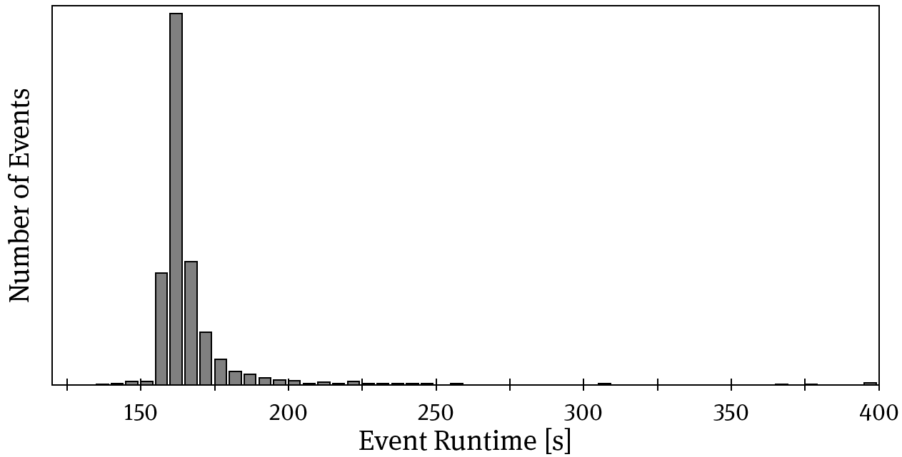

图 5.6：CORSIKA FACT 事件计数与其处理时间（在 Intel Xeon 上）的分布。

具体而言，通过 `Eriador`，我们提出了一种平台，该平台可用由 40 个低能耗 ARM 处理器组成的集群来替代通用的双路服务器系统。与通用系统相比，这种低能耗替代方案提供了相同的外形规格（两个机架单位）、小得多的能耗包络，以及可比拟（有时甚至显著更好）的应用性能。

在下文中，我们将勾勒 `Eriador` 平台背后的设计决策，并演示通过在低能耗硬件上运行计算密集型工作负载所能获得的能效优势。

#### 5.2.4.2 相关工作

将感知能耗的硬件用于特定计算密集型任务的想法并非完全新颖。2021 年，Ou *等人* 利用基于 ARM 的 PandaBoards 构建了一个集群 [298]。他们的系统被证明对于 Web 服务器、内存数据库和视频转码应用具有高效率，但对于计算密集型工作负载则不然。Göddeke *等人* [179] 同样观察到，计算繁重的应用是（他们）低功耗硬件设计的一个弱点。

Kruger [234] 证明了 ARM A9 CPU 与基于 Epiphany 的协处理器的组合，能够在仅为 Intel 处理器三分之一功耗的情况下，匹配 Intel i5 的性能。

#### 5.2.4.3 面向仿真任务的 CPU 架构

ARM 处理器常被视为能效的典范。在多特蒙德工业大学的一个学生项目中，我们评估了各种基于 ARM 的架构，以及其他架构的低功耗产品。

表 5.1 列出了四款流行单板计算机产品的几个关键特性（基于 ARM 的 Raspberry Pi 3 可能是最广为人知的）。

表 5.1：基于 ARM 和 Intel Celeron 的单板计算机的选定性能与功耗特性 [184]。

| 开发板 | 内存 | CPU | 网络 | 功耗 |
| --- | --- | --- | --- | --- |
| Odroid-C2 | 2 GB DDR3 | 4 × 1.5 GHz ARM A53 | 1 GBit | 2.0–4.2W |
| Odroid-XU4 | 2 GB LPDDR3 | 4 × 2 GHz ARM A15<br>4 × 1.4 GHz ARM A7 | 1 GBit | 3.8–10.5W |
| 树莓派 3 | 1 GB LPDDR2 | 4 × 1.2 GHz ARM A53 | 100 MBit | 1.3–4.2W |
| ASRock | 4 GB DDR3L | 4 × 2.2 GHz Int. Cel. J3160 | 1 GBit | 10.6–16.0W |

正如在这个小小的选择范围内所见，性能特性（包括 CPU 和网络速度）的差异程度，与平均功耗的差异程度一样大。

一组主要基于 `Phoronix Test Suite` 的原始性能实验，证实了 表 5.1 所暗示的内容：ARM 处理器确实比其 Intel Celeron 对应产品更节能。鉴于广受欢迎的树莓派资源极其有限，以及 Odroid-XU4 功耗相对较高，我们决定基于 Odroid-C2 单板计算机构建我们自己的 `Eriador` 平台。

#### 5.2.4.4 基于 ARM 的 Eriador 集群系统

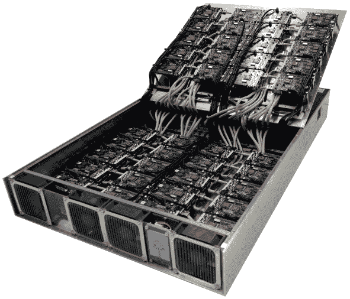

图 5.7：`Eriador` 集群。

`Eriador` 是一个将 40 块 Odroid-C2 单板计算机（即 160 个 ARM Cortex-A53 核心）封装在单个机箱中的平台。安装在标准 19 英寸机柜中时，`Eriador` 占用两个高度单位，类似于通用（例如基于 Intel 的）“大核”服务器。`Eriador` 的图片如 图 5.7 所示。

该平台在逻辑上提供了一个由 40 台独立机器组成的*集群*。专用的集群管理软件有助于在集群内调度工作负载，并提供对硬件性能分析功能的访问。

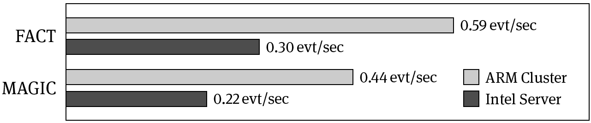

图 5.8：在 160 个 ARM 核心（“`Eriador`”）与 48 个 Intel Xeon 核心上处理 FACT/MAGIC 事件时观测到的 CORSIKA 吞吐量。

除了实际的处理板卡，`Eriador` 的机箱还包括网络硬件、风扇和散热管理，以及一个独立的、基于 Odroid 的*管理服务器*。管理服务器可访问一个定制的能量测量组件，从而在不干扰工作负载处理器的情况下，实现细粒度的功耗测量。最后，管理服务器驱动一个 LCD 显示屏，在机箱前面板报告当前系统状态。

#### 5.2.4.5 Eriador 与传统服务器架构的对比

我们设计 `Eriador` 旨在研究：通过使用低功耗硬件，粒子仿真的性能和能效是否确实能够得到提升。

为了评估*性能*方面，我们对 CORSIKA FACT 和 MAGIC 粒子仿真器进行了基准测试，并将我们在 `Eriador` 上的测量结果与通用 Intel 服务器进行了比较。具体而言，我们的参考平台是一个双路 Intel Xeon E5-2695 v2 系统，主频 2.4 GHz，配备 256 GB 主内存。因此，我们的参考平台不仅是我们实验当时数据中心部署硬件的良好代表。此外，该机器在外形规格和货币成本（约 6000 欧元）方面也与 `Eriador` 相似。

图 5.8 展示了两个平台的吞吐量（以每秒模拟事件数衡量）。很容易看出，`Eriador` 的性能比通用 Intel 服务器高出约两倍。

为了评估*能耗*，我们可以依赖直接内置在 `Eriador` 中的功耗测量功能。通过专用逻辑，`Eriador` 可以高分辨率地测量单个集群区域的能耗。在 Intel 方面，我们使用了 EnerGenie EGM-PWM-LAN 能量计。

在两个平台上，我们测量的均为*全系统功耗*，即包括内存或存储等组件。尽管我们在 Intel 系统中关闭了尽可能多的硬件组件，但这可能在一定程度上低估了可实现的能效。不过，我们要指出的是，`Eriador` 的现成 Odroid-C2 构建模块，以及我们小组开发的基础设施（网络、电源分配等），均未针对能效进行激进优化。因此，`Eriador` 方面也很可能存在改进空间。

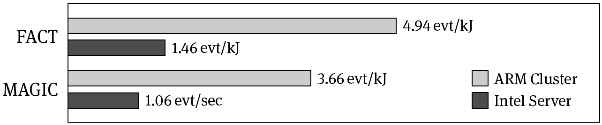

图 5.9：在 160 个 ARM 核心（“`Eriador`”）与 48 个 Intel Xeon 核心上处理 FACT/MAGIC 事件时观测到的 CORSIKA 能效。

表 5.2：评估 `k`-means 时 `Eriador` 与通用 Intel 服务器的运行时性能与能耗对比。

| 系统 | 执行时间 | 能耗 |
| --- | --- | --- |
| `Eriador` | 2.194 秒 | 314.36 kJ |
| Intel Xeon E5-2695 v2 | 1.139 秒 | 462.35 kJ |

图 5.9 直观展示了我们的测量结果。`Eriador` 的更高吞吐量伴随着系统负载下的更低功耗。因此，当观察两个平台的能效时，`Eriador` 的优势变得更加显著。


值得注意的是，`Eriador` 每模拟事件消耗的能量更少（`per simulated event`）。在像 `CORSIKA` 这样可并行化的工作负载中，吞吐量始终可以通过配置更多或更少的计算资源来控制。因此，`Eriador` 的低能耗特性可用于以相同速度进行模拟但功耗更低，或者在给定功耗预算内实现更快的模拟速度。

#### 5.2.4.6 超越粒子模拟

像 `CORSIKA` 这样的工作负载青睐 `Eriador` 这样的并行架构，因为独立的模拟几乎可以在各个机器上轻松并行化。

并非所有现实世界的用例都表现得如此良好。为了说明 `Eriador` 在其他数据分析场景中的表现，我们使用基于 MPI 的 `k`-means 实现和一个包含 159 万个样本、每个样本 20 个特征的数据集（总数据集大小约 780 MB；详见 [184]）对集群进行了基准测试。

表 5.2 展示了我们获得的测量结果。这一次，`Eriador` 明显比基于 Intel 的参考系统慢。尽管执行时间较长，但 `Eriador` 在整个基准测试中消耗的能量更少。

关键原因在于 `k`-means 以难以并行化而著称。在我们的案例中，实现可充分利用可用并行性的阶段，与需在并行单元间交换中间结果的阶段交替出现。

#### 5.2.4.7 总结

我们的评估表明，低功耗硬件确实可以显著提高粒子模拟的资源效率。我们的原型平台 `Eriador` 在执行 `CORSIKA` 模拟时，速度更快且能耗低于通用服务器。

## 5.3 模拟验证

**摘要：** 高能天体物理学中的分析严重依赖蒙特卡洛模拟，从探测器校准到能谱重构，基本所有分析步骤都会用到。因此，模拟数据与实验数据之间的良好一致性对于这些实验的科学成功至关重要。尽管存在这一必要性，但数据与蒙特卡洛模拟之间的完全一致并不总能得到保证。结果是，某些模拟特征的差异大于实验特征，而另一些则较小。捕捉、量化并可能消除这些差异（其来源可能多种多样）正是模拟验证的目的。本节解释了如何验证模拟，并进一步指出了一种基于机器学习的方法，用于在无法完全解决差异来源的情况下，将其对分析的影响降至最低。

### 5.3.1 简介

创建有意义的蒙特卡洛模拟是一个迭代过程，尤其是在新仪器初期，这一过程非常复杂。当今的物理仪器（如粒子探测器或切伦科夫望远镜）是极其复杂的机器，拥有许多子系统，由此产生无数可调参数，这些参数会影响模拟的有效性。

许多参数可直接从设计文档、组件实验室测量或校准数据中获取，但也有许多无法直接获取。模拟验证的主要挑战在于：一旦在模拟的高层数据输出中，甚至在处理模拟数据后发现问题，需要识别出那些需要调整的低层“旋钮”。

在本节中，我们简要介绍了识别和解决这些问题的方法，并展示了一种基于机器学习的方法，用于识别模拟数据与观测数据之间的不匹配。

### 5.3.2 观测数据与模拟数据之间的不匹配

*Maximilian Linhoff*

物理学中观测数据与模拟数据的差异主要源于四个领域：物理机制理解不足（见第 5.4 节）、探测器系统属性理解不足、模拟中的近似与简化，以及随时间变化的环境条件和探测器属性。

任何模拟至少都会在一定程度上受到这些问题的影响。在使用模拟数据作为标记训练数据集的机器学习背景下，这些问题会在训练数据和模型应用的目标数据之间引入差异，如果模型对差异敏感，就会导致预测偏差。关于反问题，这些系统误差将影响探测器响应函数，后者同样基于标记模拟数据计算，从而产生有偏结果。

一个简单的差异示例是：成像大气切伦科夫望远镜在模拟中使用的镜面反射率高于实际望远镜。这一缺陷导致模拟中的图像更亮，进而导致将模拟训练的模型应用于观测数据时，能量估计出现负偏差。可以采取三种互补的方法来缓解这些问题：

- 调整模拟，
- 转换观测数据，或
- 转换模拟数据。

第一种方法最为根本，但需要重新运行模拟；因此它是计算开销最大的方法，但也最有可能产生最佳结果。

第二种方法主要用于校准探测器电子学的低层属性，这些属性模拟成本极高，因此通常在模拟软件中被过度简化。

第三种方法的一个典型例子是夜空本底光子对 IACT 图像噪声的贡献。视场内的月光和星光不影响大气簇射物理过程，因此也不影响切伦科夫光的产生。然而，这却是模拟中计算资源消耗最大的部分。因此，先模拟低夜空本底光子量甚至完全无夜空本底的 IACT 图像，然后仅在数据处理中添加额外噪声以匹配观测数据的噪声特征，比进行多次不同噪声水平的大气簇射模拟和探测器模拟要高效得多。此外，除了模拟额外噪声，还可以使用无簇射的观测事件（称为随机触发或本底事件）中的噪声。这能显著改善模拟与观测数据噪声特征之间的一致性。该方法是作为 CRC 工作 [102, 111] 的一部分开发的。

模拟验证及应用于观测数据的转换，是通过比较数据处理不同层级的参数分布来完成的。在端到端分析（例如深度学习，见第 9 章）中，这变得困难得多，因为数据的中间可解释表示可能不易获取。

现代粒子物理和高能天体物理仪器包含大量子系统，特别是高能天体物理实验不具备易于控制的环境条件。这导致模拟拥有庞大的组合参数空间，无法完全探索以找到正确的组合。创建具有足够统计不确定度的模拟的计算复杂度，导致改进模拟的迭代过程中反馈回路非常缓慢。这使得创建合适的模拟数据集成为规划和调试新实验时的主要任务之一。


最终，观测数据与模拟数据之间的不匹配将导致系统性偏差，即将基于这些模拟数据集训练的算法应用于观测数据时，所得结果会产生系统性偏差。有时，这些系统误差相对直接，如前文所述反射率降低的 IACT（成像大气切伦科夫望远镜）示例。但大多数情况下，由于探测器的组合性质和复杂性，因果关系的关联要间接得多，一旦发现不匹配，就很难确定根本原因。

### 5.3.3 不匹配的检测

**Tim Ruhe**

**Maximilian Linhoff**

对于模拟良好的数据，模拟事件按其属性应与观测事件无法区分。传统上，对模拟与观测数据集之间可能存在的不匹配进行调查，依赖于一维参数分布。然而，模拟中的系统误差也会影响参数间的相关性，因此仅查看单参数分布是不够的。鉴于粒子物理和天体粒子物理中典型中间数据表示的高维性，人工检查所有可能的参数组合是不可行的。

因此，量化模拟与观测一致性的一种方法是尝试对数据集进行分类，目标是预测每个事件是模拟的还是观测的，然后应用监督分类任务的常用质量指标，如准确率或 ROC 曲线下面积。对于模拟良好的数据集，这种分类任务应该是困难甚至不可能的，因此分类指标应与随机猜测的结果相符。

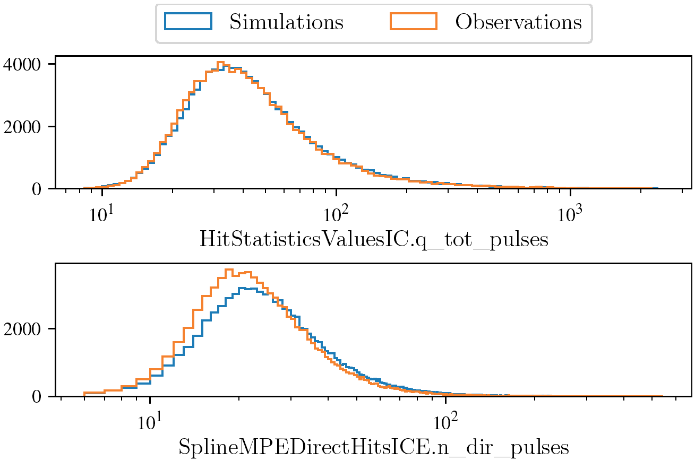

图 5.10：IceCube 数据集中*观测*与*模拟*的两个示例特征。上图：DOM 中的总电荷，模拟良好的特征之一。下图：DOM 中的脉冲数量，模拟不太好的特征之一。


图 5.11：用于分类为*观测*或*模拟*的 20 个最重要特征的特征重要性


图 5.12：分类为*观测*或*模拟*的 ROC 曲线。从数据集中移除对该分类最重要的 12 个特征后，任务变得难解得多。

除了量化模拟与观测的匹配度外，该方法还允许通过计算单个特征对整体分类的重要性，来识别模拟不佳的特征。基于决策树的算法可以通过在相应特征上分裂所实现的总损失函数减少量，提供单个特征的重要性。对于所有算法，均可采用基于排列的方法 97, [第 10 节]。为量化单个特征的重要性，将该特征的值进行排列，并在排列后的数据集上评估分类器；若该特征对分类重要，则得到的指标将比基线更差。

识别出有问题的特征后，有两种可行途径：移除模拟不佳的特征直到分类不再可能，或利用获得的洞察来改进模拟。这两种途径类似于医学上的对症治疗或治本治疗。如果可行，后者总能产生更好的结果，而前者在短期内更容易实施。同样，这两种途径相辅相成。该方法是作为 [91] 的一部分开发的，更多细节见 [90]。

#### 5.3.3.1 基于 IceCube 高层数据集的应用

下面，我们将这种方法应用于一个 IceCube 高层数据集，该数据集通常具有极佳的模拟与观测数据一致性。利用该方法，我们将识别出数据集中显示不匹配的几个列，并通过迭代移除相对于*观测*和*模拟*分类具有高特征重要性的特征，使分类变得不可能。


图 5.13：*观测*或*模拟*分类的得分分布。

该数据集包含模拟的中微子诱导事件，以及将大气缪子背景抑制到极低水平后的观测数据。由于模拟不直接遵循预期的能谱，且观测时长不等价，因此需要模拟数据集的样本权重以获得现实的比较。由于截面小，IceCube 中的中微子相互作用相对于大气缪子非常罕见。初级中微子也以人为增加的截面进行模拟，以强制其在探测器内发生相互作用，从而获得足够的中微子事件统计量（这是大多数 IceCube 分析中搜寻的信号）。计算这些事件的样本权重时，必须考虑这种人为增加的截面。虽然数据集中的大多数特征在模拟和观测之间显示出非常好的一致性，但有少数特征并非如此，如图 5.10 底部所示。

作为质量指标，使用 ROC 曲线下面积（*A*[ROC]），其中 *A*[ROC] ≈ 0.5 代表随机猜测，即期望的结果。基于树模型的损失减少特征重要性和适用于所有分类算法的基于排列的特征重要性均已在 `scikit-learn` 中实现。本例中，我们将使用随机森林分类器，并依赖基于损失的特征重要性，因为训练后 `scikit-learn` 即可直接提供这些重要性。我们使用十折交叉验证训练随机森林分类器。

在第一次迭代中，我们使用所有可用特征进行训练。交叉验证迭代的平均特征重要性如图 5.11 所示。可以看到有几个特征脱颖而出，包括图 5.10 中所示的特征。我们现在移除重要性最大的四个特征，并重复该过程三次。图 5.12 显示了每次交叉验证迭代的 ROC 曲线及平均曲线下面积。正如预期，对分类器而言问题逐渐变得难以求解；移除 12 个特征后，平均 ROC 曲线下面积从完整数据集上的 [ROC] = 0.67 降至 [ROC] = 0.55。


在查看 图 5.13 中的得分分布时，也可以观察到相同的行为。虽然对于整个数据集，模型分配了较大似然概率为模拟事件的事件数量相当可观，但对于缩减后的数据集，分布趋近于均值为 0.5 的正态分布。

对于进一步的研究，查看那些被高似然概率分类为模拟的事件，可能会为这些事件为何被清晰识别提供有价值的见解，这意味着它们属于一类在实测数据中未被观测到、或仅极少被观测到的事件。对于相反的情况也可以说同样的话：被高置信度识别为实测的事件可能是模拟中缺失的一类事件，但在这里似乎并非如此。

作为最后的评论，应当指出，这种方法仅适用于观测与模拟之间具有极佳总体一致性的数据集。例如，我们并未考虑特征对我们主要分析目标的重要性。假设算法会移除对后续科学分析至关重要的特征。在这种情况下，我们唯一的选择是提高模拟的质量（治本），而不是保留特征集缩减后的数据集（治标）。

## 5.4 核心议题：缪子谜题

*Hans Dembinski*

**摘要：** 高能宇宙射线是通过广延大气簇射（大气中的强子级联）进行间接研究的。基于强子相互作用模型（这些模型根据固定靶实验和对撞机数据进行调优）的模拟大气簇射显示出缪子亏缺。这被称为缪子谜题。这给将机器学习应用于天体粒子物理实验带来了挑战，因为机器学习需要精确的模拟来生成训练样本。近年来，在以高精度实验测量缪子差异方面取得了进展。理论研究已将缪子产生与强子相互作用的基本性质联系起来。研究表明，只有减少用于中性介子产生的能量相对于长寿命强子产生的能量，才能解决这一差异。大型强子对撞机（LHC）上的 ALICE 实验最近在 LHC 的质子-质子和质子-铅碰撞中发现了奇异性产生的增强，这在定性上符合这一要求。在 LHC 前向区进一步研究奇异性增强，有可能最终解决缪子谜题。

### 5.4.1 引言

在超过约 100 TeV 的宇宙射线能量下，宇宙射线通量极低，以至于利用卫星和气球实验进行直接观测变得不可行。在这些高能量下，宇宙射线是通过大气簇射进行间接观测的，大气簇射是由高能宇宙射线在大气中引发的强子级联。间接观测需要精确的大气簇射模拟，因为必须从大气簇射的特征推断宇宙射线的性质。这对于将人工模型拟合大气簇射数据的传统分析，以及直接从模拟中利用机器学习创建模型的现代分析均适用。宇宙射线界构建了复杂的模拟包，集成了电磁和强子相互作用的最先进模型。用这些程序模拟的大气簇射相当成功地描述了真实簇射，但在模拟与观测到的大气簇射中的缪子产生之间，存在一个长期存在的差异。

在缪子产生的几个方面中，观测到了模拟与实验之间的张力，但最突出且研究最深入的偏差是到达地面的缪子总数 `N[μ]`。模拟中的缪子丰度显著低于实验，这被称为缪子谜题。像 `CORSIKA` 这样的大气簇射模拟代码使用多种强子相互作用模型，但所有模型都无法再现超高能大气簇射中观测到的大量缪子。这是该领域的一个主要障碍，因为缪子数量和簇射最大值深度 `X[max]` 是推断宇宙射线质量组成随能量变化的两个主要特征。由于这一差异，从这两个大气簇射特征获得的质量组成估计彼此不一致。这也是皮埃尔·奥杰天文台和 IceCube 中微子天文台 [3, 137, 314] 采用机器学习分析大气簇射数据面临的挑战。大气簇射建模的不准确可能会给机器学习到的模型引入微妙的偏差。

从高能粒子物理的角度来看，缪子谜题也很有趣，因为它可能表明当前描述导致缪子产生的强子级联的最先进强子相互作用模型中缺失了物理机制。大气簇射中的主要相互作用具有低动量转移，无法用微扰量子色动力学从第一性原理计算。人们使用有效理论来描述这些相互作用，这些理论中可能缺少了一个重要效应。

在此背景下，ALICE 合作组最近在 LHC 的质子-质子和质子-铅碰撞中半快度区发现的普遍奇异性增强 [36] 尤为引人关注。这种效应此前仅在重离子碰撞中观测到，解释这些数据的标准模型基于夸克-胶子等离子体（QGP）的形成及其随后的冻结。理论界对于 QGP 是否也能在质子-铅或质子-质子等较小碰撞体系中形成存在分歧。尽管导致奇异性增强的机制目前尚不清楚，但该效应在现象学上改变了强子组成，从而增加了大气簇射中的缪子数量。人们已用玩具模型 [77, 312] 探索了这一现象学，结论是这种效应可能是缪子谜题中缺失的一环。

这篇特约文章基于一篇关于缪子谜题及其与 LHC 关联的近期综述 [46]，该综述总结了关于大气簇射中缪子差异的当前认知、大气簇射模拟的现状、我们对微观强子物理与大气簇射中缪子产生关联的了解，以及我们已经从 LHC 了解到什么、还需要什么样的测量。更多细节请读者参考该综述。

### 5.4.2 大气簇射中缪子测量的元分析

模拟的大气簇射缪子分量与测量之间存在多个偏差方面。最引人注目且研究最深入的是粒子探测器地面阵列观测到的 GeV 缪子平均数的偏差。这一物理量或其替代量已被多个实验测量，最初结果相互矛盾。这些表面上的矛盾在很大程度上已由强子相互作用与簇射物理工作组（WHISP）的元分析消除，该工作组于 2018 年由八个（现为九个）大气簇射实验的成员组建 [116, 141, 356]。

![图 5.14：校正能标偏移后，九个实验测得的大气簇射产生的缪子（点）转换为 z 标度，作为簇射能量的函数，针对不同的强子相互作用模型。为参考，图中显示了对大气簇射数据进行全局拟合的期望值（线）和簇射最大值深度的光学测量（带）。图片取自 [356]。](graphic/b_9783110785968-005_fig_014.png)


图 5.14：九个实验测量的大气簇射产生的缪子，在校正能标偏移后（数据点），转换为 `z` 标度，作为簇射能量的函数，针对不同的强子相互作用模型。作为参考，图中显示了对大气簇射数据进行全局拟合得到的预期值（线条）以及簇射最大值深度光学测量的预期值（色带）。该图取自 [356]。

由于实验和数据分析方法在许多细节上存在差异，不同实验的缪子测量结果无法直接比较。因此，它们被转换为对数 `z` 标度，其定义公式为：

```
z = (ln N[μ] - ln N[μ],[p]) / (ln N[μ],[Fe] - ln N[μ],[p])
```

其中 `ln N[μ]` 是探测器测得的缪子数量的对数，或与缪子数量成正比的任何可测量量的对数，而 `ln N[μ],[p]` 和 `ln N[μ],[Fe]` 是采用特定强子相互作用模型进行大气簇射模拟得到的相应模拟数值（在探测器层面）。虽然 `N[μ]` 强烈依赖于实验条件，但 `z` 大约与实验条件无关。此外，不同实验的结果经过交叉校准，以避免各实验独立能量校准之间的相对偏移。这很重要，因为缪子数量与（视）簇射能量近似呈线性关系。

图 5.14 中展示了九个实验和八种强子相互作用模型的能标校正 `z` 值。在 10 EeV 以上，所有模型的 `z` 值均超过纯铁簇射的值，这在天体物理学上是不可信的。此外，这些值应与基于簇射最大值深度 `X[max]` 光学测量的预测一致，后者约束了宇宙线质量成分，这是除簇射能量外 `z` 值所依赖的唯一其他方面。在 10¹⁷ eV 以上，测得的 `z` 值超过了这些预测。

可以排除实验失误导致缪子差异，因为该效应被多个独立实验观测到。统计波动也可以以极高的置信度被排除。其他潜在的差异来源也已被排除；详见 [46]。GeV 缪子在空气中传播的重大误差也可被排除。然而，目前正在努力提高 TeV 缪子在水、冰等致密介质中传播的精度 [148, 159, 229, 338, 339]，这也将有益于这些研究。试图用奇异物理（如洛伦兹不变性破缺 [34]）或奇异天体粒子来解释缪子差异，面临挑战：这会改变簇射最大值深度涨落 [1, 2] 和缪子数量 [4]，而这些目前都能被模拟很好地描述。差异的早期出现（约 4 · 10¹⁶ eV，对应首次相互作用的质心系能量 `√s ≈ 300 TeV`）是奇异理论面临的另一挑战。此类质心系能量的强子碰撞已在 LHC 被观测到，若奇异物理在这些能量下起作用，早已应发现其特征。

最合理的剩余可能性是模拟强子级联（导致缪子产生）中存在微妙偏差。近年来，在理解大气簇射物理及该差异可能的微观起源方面取得了进展，下文将讨论。由强子级联放大的模拟中相对较小的偏差，无法被当前 LHC 测量排除，甚至可能被其暗示。

### 5.4.3 大气簇射中的缪子产生

大气簇射是一个强子级联过程，宇宙线的动能通过与大气的非弹性相互作用，逐步转化为二次粒子。Heitler-Matthews 模型 [262] 是大气簇射的一个简化模型。其示意图如图 5.15 左侧所示。该模型中仅产生 π 介子（寿命最长的强子）。带电 π 介子寿命长，再次相互作用形成强子级联。中性 π 介子立即衰变为光子，形成解耦的电磁级联。电磁级联通过光核相互作用向强子级联有微弱反馈，但此处忽略该效应。

在该模型中，母 π 介子的能量均匀分配给其子代。因此，每个 π 介子的能量在每次相互作用后都会降低。经过级联的 `k` 步后，能量降至临界能量以下，此时衰变比再次碰撞更可能发生。此时，π 介子衰变为缪子。在此简化模型中，缪子数量 `N[μ]` 作为宇宙线能量 `E` 和核质量 `A` 的函数可计算为：

```
N[μ] = A · (E / (A · ξ[h]))^(β)
```

其中 `α` 是产生的带电 π 介子分数，`N[mult]` 是强子多重度（每次碰撞产生的平均强子数），`ξ[h]` 是 π 介子的临界能量（衰变比再次相互作用更可能时的能量）。


缪子数 `N[μ]` 对 `α` 非常敏感。对于一个 EeV 广延大气簇射，`α` 发生 10% 的变化会大致引入缪子数 50% 的变化。因此，需要在宽能量范围内知道 `α` 才能正确计算缪子数。在简化模型中，由于同位旋对称性，`α` 为 2/3，但在真实的大气簇射中该值有所不同。会产生质子、中子和奇异强子，它们的寿命足够长，能够参与级联过程。如果将 `α` 更广泛地视为长寿命强子携带的能量分数，简化模型的结果大致仍然适用。实验上测量密切相关的量很方便：

```
R = (E_em - E_had) / (E_em + E_had)
```

其中 `E_em` 是来自光子和电子的电磁能量流，而 `E_had` 是强子能量流，平均值取自二次粒子的相空间。

这些基本的解析结果已通过完整的大气簇射模拟得到确认 [[373]](#9783110785951_034588.xhtml#b_9783110785968-011_ref_373)。要增加模拟中的缪子数，必须增加强子多重度 `N_mult` 或减少产生的中性介子分数。然而，事实证明，增加强子多重度会以一种无法消除差异的方式改变簇射极大值深度。这在右侧的图 5.15 中有说明。强子多重度的修改会使模型线沿自身平移；无法弥合与数据点的垂直差距。只有通过修改 `R` 才能做到这一点。因此，根据这项研究，减少中性介子携带的能量分数（减少 `R`）是唯一的解决方案，尽管这可以通过适度改变强子多重度 `N_mult` 来适应。目前来自 LHC 的 `R` 数据尚未将该值限制在大气簇射相关相空间所需的精度。然而，有强烈迹象表明 `R` 可能低于强子相互作用模型中目前使用的值。

### 5.4.4 CERN LHC 的相关测量

关于与大气簇射模拟相关的现有 CERN LHC 测量的全面概述见于 [[46]](#9783110785951_034588.xhtml#b_9783110785968-011_ref_046)。LHC 主要加速质子和铅离子，并在短时间内也加速了氙离子。未来几年批准的加速氧束计划对于大气簇射物理至关重要，可用于测量 `p-O` 和 `O-O` 碰撞 [[99]](#9783110785951_034588.xhtml#b_9783110785968-011_ref_099)，[[125]](#9783110785951_034588.xhtml#b_9783110785968-011_ref_125)。大气簇射中最常见的相互作用是 `π-N`，`p-O` 碰撞是其极佳的参考。尽管当前最先进的模型已调整至 `pp` 数据，但它们对 `p-O` 碰撞中强子产生的预测仍显示出相当大的差异，反映了从 `pp` 参考外推的理论不确定性。除了必要的 `p-O` 直接测量外，对 `pp` 和 `p-Pb` 数据的研究对于探测潜在的标度定律和强子-离子碰撞的普遍特征也很重要。

大气簇射物理面临的一个普遍挑战是，前向区发射的强子主导大气簇射的发展，但前向区的数据稀疏。这在图 5.16 中说明，其中粒子密度作为伪快度（与发射角相关，如图注所述）的函数显示。前向发射的粒子数量较少但能量更高，因此在强子级联的下一步中产生更多二次粒子。最终，大部分粒子（和缪子）是由相互作用中能量最高的粒子产生的，即那些在前向区产生的粒子。LHC 实验在中快度（`|η| < 2`）装备完善，而极前向区 `|η| > 5` 仅由热量计覆盖。LHCb 是覆盖范围 `2 < η < 5` 最前向的通用强子谱仪，得益于其专注于测量魅夸克和底夸克的衰变，因此特别受关注。在极前向区重要的是 CMS 及其 CASTOR 热量计系统、TOTEM 和 ALICE 的前向计数器，以及用于光子和中子的 LHCf 零度热量计。

![Fig. 5.16: Density of pions, neutrons, long-lived hadrons, photons and electrons as function of pseudorapidity η in p-O collisions (solid lines) at 10 TeV, which is related to the emission angle θ relative to beam axis, η = − ln tan(θ/2). Shown for comparison is the expected muon yield from these particles if they form a shower in the atmosphere (dashed lines) and the acceptances of several LHC experiments (bands). Image taken from Ref. [46].](graphic/b_9783110785968-005_fig_016.png)

图 5.16：10 TeV 下 `p-O` 碰撞中介子、中子、长寿命强子、光子和电子的密度作为伪快度 `η` 的函数（实线），`η` 与相对于束轴的发射角 `θ` 相关，`η = − ln tan(θ/2)`。虚线显示了如果这些粒子在大气中形成簇射，预期的缪子产额以供比较，带状区域显示了几个 LHC 实验的接受度。图片取自参考文献 [[46]](#9783110785951_034588.xhtml#b_9783110785968-011_ref_046)。

正如上一节所讨论的，大气簇射中的缪子产生取决于强子多重度和电磁能量流与强子能量流的比率 `R`——或者更一般地说，取决于强子组成。

强子多重度的实验替代量是带电粒子多重度和能量流，它们已在 LHC 的 `pp`、`p-Pb`、`Pb-Pb` 和 `Xe-Xe` 碰撞中由 ALICE、CMS、LHCb 和 TOTEM 测量至 `η = 6.4`。详见 [[46]](#9783110785951_034588.xhtml#b_9783110785968-011_ref_046)。这些前向测量很重要，因为当前一代强子相互作用模型在 `pp` 碰撞的 `|η| < 1` 处偏差小于 5%（它们已调整至旧的 LHC 数据），但在前向区偏差高达 20%。最新数据强烈约束了 `pp` 碰撞前向区的模型预测。对于 `p-O` 碰撞，仍发现 20% 的模型差异，预计随着即将到来的 `p-O` 数据将大幅减少。

强子组成对缪子产生影响最大。ALICE 和 CMS 在中快度 `|η| < 1` 提供了 `pp`、`p-Pb` 和 `Pb-Pb` 碰撞中介子、K 介子和质子相对产额的高精度数据。特别是，ALICE 在中快度 `|η| < 1` 研究了奇异强子的产生截面，并发现奇异强子与介子的产生比率随带电粒子多重度增加而上升，这一现象是普遍的（与碰撞能量和体系无关）[[36]](#9783110785951_034588.xhtml#b_9783110785968-011_ref_036)，[[382]](#9783110785951_034588.xhtml#b_9783110785968-011_ref_382)，如图 5.17 所示。这种行为此前仅从重离子碰撞中得知，在 `p-Pb` 和 `pp` 碰撞中是意料之外的。中心区的强子密度随碰撞能量迅速上升；因此，奇异性产生的相对量也随之上升。奇异性增强伴随着中性介子的减少，从而降低了 `R`。通过玩具模拟 [[77]](#9783110785951_034588.xhtml#b_9783110785968-011_ref_077) 研究了这种效应对大气簇射的影响，发现这种修改有可能解决大气簇射中的缪子谜题。


![图 5.17：在 pp、p-Pb 和 |η| Pb-Pb 碰撞中，在中快度 < 0.5 处测量的奇异强子与 π 介子的比率，作为带电粒子密度 dNch/dη 的函数。图片取自 [36]。](graphic/b_9783110785968-005_fig_017.png)

图 5.17：在 `pp`、`p`-Pb 和 |`η`| Pb-Pb 碰撞中，在中快度 < 0.5 处测量的奇异强子与 π 介子的比率，作为带电粒子密度 d`N`[ch]/d`η` 的函数。图片取自 [36]。

ALICE 数据集对于模型调优和验证至关重要。然而，它们并不直接约束前向区域的强子组成，在该区域，弦碎裂和残余碎裂这两种强子产生机制都有贡献。在前向区域，π 介子、K 介子和质子的产额只能由 LHCb 研究，因为其他探测器缺乏粒子识别能力。LHCb 已发表了高达 7 TeV 的 `pp` 碰撞数据。13 TeV `pp` 碰撞和 8.16 TeV `p`-Pb 碰撞的分析正在进行中，预计将对大气簇射产生重要影响。

带有 CASTOR 的 CMS 研究了电磋能量流与强子能量流的能量比 `R`，作为 `pp` 碰撞中中快度带电粒子多重度的函数 [77, 351]，覆盖极前向区域。CMS 在 `pp` 中观测到较高的 `R` 值，

**图 5.18：** 在 `π`-C 碰撞中，反质子（左）和 `ρ`⁰-介子（右）所携带的能量分数，由 NA61/SHINE 测量（数据点）和强子相互作用模型预测，覆盖与大气簇射相关的整个束流能量范围（图片来自 [316, 374]）。

这比所有当前模型预测的值都大，但该值也具有约 20% 相当大的系统不确定性。CMS 发现的 `pp` 碰撞中 `R` 的显著值令人惊讶，因为它倾向于大气簇射模拟中甚至比当前最先进水平更低的 μ子 含量。相比之下，解决 μ子 差异需要相反的情况。未观测到 `R` 随中快度带电粒子密度变化的显著趋势。

后续利用 `p`-O 和 `p`-Pb 碰撞的研究对于理解 `R` 在离子碰撞中相较于 `pp` 是否降低至关重要。不幸的是，未来使用 CASTOR 进行 `p`-O 碰撞测量已不可能，因为 CASTOR 已退役。在极前向区域，LHCf 通过测量 `pp` 和 `p`-Pb 碰撞中的光子产生、`π`⁰ 产生和中子产生，也对 `R` 进行了约束。LHCf 计划在即将到来的高亮度 LHC 运行中，利用升级后的探测器，基于衰变 2`π`⁰ → 4`γ`，在零度角度研究奇异性产生 [265]。

### 5.4.5 SPS 和 LHC 的固定靶实验

由于大气簇射中的强子相互作用跨越了核子-核子碰撞系统中心-of-mass 能量的许多数量级，因此在固定靶实验 [268] 可达到的较低中心-of-mass 能量下，也存在改进我们知识的机会。固定靶实验的一个优势是靶材选择的灵活性，这使其成为研究各种系统中核效应的理想选择。

超质子同步加速器（LHC 的前加速器）上的 NA61/SHINE 实验已测量了 `pp`、`π`-C 和 `p`-C 碰撞中的强子产生，其中碳被用作空气的替代表。在众多测量中，我们重点介绍前向 `ρ`⁰ 和反质子产生的测量 [38, 317]，见 图 5.18。`ρ`⁰ 产生很重要，因为它是在电荷交换反应 `π`^− + `p` → `π`⁰ + `n` + `X` 中产生 `π`⁰ 介子的一种替代途径。`ρ`⁰/`π`⁰ 比率的增大会降低 `R` 并增加大气簇射中的 μ子 数。反质子是大气簇射中重子生成的度量，会降低 `R`。尽管在每次相互作用中流向这些粒子种类的能量流很小，但多次相互作用的累积效应导致，与不包含这些效应的 SIBYLL-2.1 相比，运行包含这些效应的最新版 SIBYLL-2.3d 产生的大气簇射 μ子 数增加高达 60% [324]。虽然这一变化显著，但并未解决 μ子 差异，因为 SIBYLL-2.1 以前产生的大气簇射 μ子 特别少。用 SIBYLL-2.3d 模拟的大气簇射 μ子 产生现在与用 EPOS-LHC 模拟的相当。

在 LHC，固定靶实验由带有 SMOG 装置 [15] 的 LHCb 执行，该装置将少量气体注入探测器。该原始系统旨在研究束流剖面，但已被用于限制质子内部的固有魅 [12] 并测量 `p`-He 碰撞中的反质子产生截面 [14]，这对于建模太空中的宇宙射线相互作用是必要的。作为 LHCb 为第 3 运行期升级的一部分，原始装置已被一个开放储存池取代，该储存池允许更高的气体密度和更多靶气体，包括氮和氧 [76]。利用固定靶模式下的 LHCb，将能够在核子-核子中心-of-mass 系中，研究中快度 −2.5 < `η`[cms] < 0.5 处的强子产生 。

### 5.4.6 总结与展望

宇宙射线界发现了由超高能宇宙射线引发的大气簇射中 μ子 产生的差异。在大气簇射模拟中观测到 μ子 赤字，经过仔细评估，这只能归因于大气簇射中强子级联的建模错误，从而导致 μ子 产生的差异。解决这一差异最合理的方法是，随着碰撞能量增加，适度降低前向区域中性 π 介子相对于长寿命强子的能量流。

前向区域中性 π 介子和长寿命强子的相对能量流，可以通过 LHC 的质子-质子和质子-离子碰撞测量来约束。即将进行的 LHC 质子-氧和氧-氧碰撞先导运行尤为重要。具有前向接受度的实验——ALICE、CMS、LHCb、LHCf 和 TOTEM——提供了最好的实验约束。LHCb 是前向区域唯一完全装备的、具备强子识别能力的通用谱仪。其他实验在极前向区域提供能量测量和粒子计数信息。

ALICE 发现的在中快度高密度碰撞中普遍存在的、依赖于多重度的奇异性增强，可能是解决 μ子 谜题的潜在方案。这一效应背后的确切机制目前尚不清楚。利用 LHCb 和 LHCf 在前向区域进一步测量可能的奇异性增强正在进行中。以固定靶模式运行 LHCb 研究 LHC 束流与氮、氧的碰撞，将为大气簇射研究提供进一步的机会。


预计来自 LHC 的数据将改进大气簇射模拟并解决缪子谜题，这很可能会促进机器学习在天体粒子物理学中的应用前景。未来几年将探索的一个引人入胜的想法是，利用对撞机数据和大气簇射数据同时约束强子相互作用模型的参数。这在技术上具有挑战性，因为需要完整的大气簇射模拟才能将参数变化的影响与大气簇射特征的变化联系起来，而这些模拟非常耗时。目前，仅使用对撞机数据来约束模型，并预测大气簇射数据。未来，基于神经网络的快速模拟技术有可能加速大气簇射模拟步骤。

# 6 数据存储与访问

## 6.1 引言

*Wolfgang Rhode*

在第 1 章中，我们认识到在现代知识发现中，必须将分析周期作为一个整体来考虑。数据存储可能发生在这个周期的不同节点，从开始时海量的原始数据，到为特定分析目的而选取的数据，再到作为逆问题解的去卷积数据。存储的数据越基础，为了获得物理上有意义的结果，能够且必须执行的分析就越多。因此，数据始终与所需的程序和分析密不可分。

考虑到这一点，在本章中，我们将首先从资源高效数据分析的角度审视研究数据管理框架。然后将讨论两个例子，并以 FACT 开放数据项目为例展示一种面向原始数据的开放方法。DeLorean 架构的例子将展示如何实现对实验内部数据结构的快速数据访问。

## 6.2 研究数据管理

*Wolfgang Rhode*

*Dominik Elsässer*

**摘要：** 天体粒子物理和粒子物理分析通常依赖于处理大量以高频记录和处理的可观测量或特征。数据可能是实验记录的，也可能是使用蒙特卡洛方法计算的。数据可能包含在科学上无法恢复的信息，要么是因为触发事件是独一无二的（如超新星爆发），要么是因为实验不再以相同形式存在。因此，无论其性质如何，数据也代表了巨大的物质价值。在本章中，我们将讨论数据在数据分析中的流向，同时牢记必须根据数据分析的特定目的找到适当的访问手段：从数据采集期间的实时分析，到采集后数周和数月的精密分析，甚至可能是采集多年后的再分析。

### 6.2.1 大量研究数据的管理

现代科学家似乎很自然地能够获取托勒密、伽利略或第谷的观测结果——但与此同时，几年前完成的研究成果，甚至可能是正在进行的实验的数据，却无法复现，因为必要的信息不再可用，或者所需的程序不再可执行。

在本书中，我们讨论的是源自数百名科学家历经数十年设计和实施的实验的数据分析。此外，确定描述相关实验的虚拟现实（蒙特卡洛模拟）也需要大致相当的工作量。在这里，工作的物质价值很可能在于生成和测试模拟所花费的大量 CPU 小时。真实和理想的财力投入最终大致相同，总计可能达数亿欧元。

这里引入物质价值的概念是恰当的，因为它立即表明：那些需要大量时间和财力资源、因此只能由大型国际合作实现的实验，原则上必须是可重复的。然而，实际上没有人愿意或能够为其提供资助。这也是因为未来的实验无疑会考虑到在此期间发生的技术进步。特别是在天体物理观测中，瞬变现象本身就会发生，实际上只能观测一次。这就提出了一个问题：如何处理这些宝贵的数据，使它们以最优形式尽可能长久地保持对人类的可访问性，从而获得最大收益。这是一个研究数据管理问题。

对于未来几个世纪或千年的长远愿景，显然只能是将以物理单位表示、并尽可能精确计算了不确定度的测量点留给后人，使这些测量即使在不了解实验或分析方法细节的情况下，也能在物理上被解释。这些是由测量提出的逆问题的最优解，包括相应的误差考量。

一个相对适度的要求是许多科研资助机构规定：研究数据必须以科学界可访问和可使用的方式保留至少十年，以供再分析。这一时期可视为启动对原始实验的再分析以考虑新发现或改进发现的时间。接收数据的科学家中可能会提出新问题，且必须能够为不幸偶尔会发生的诉讼证实分析过程。在此期间，实验记录的数据会经历一个逐步发布的过程，获取数据的研究人员圈子不断扩大，用户资格范围也随之变化。这一过渡过程需要周密的规划。

第 1 章中图 1.5 概述的本研究领域典型分析流程图，包含三个与研究数据管理相关的元层面。首先，是在实验或分析过程中必然发生的、数量级上大幅降低的数据缩减。其次，是数据公开程度不断提高的层面。第三是通常高度专业化的软件层面，它不仅必须让其他研究人员越来越容易地访问以便他们能接触到分析，而且原则上必须从一开始就设计成尽管条件发生变化（计算机硬件、操作系统、软件的进一步开发以及所用的库）仍能保持可执行性。

在本书中，我们探讨的是大型国际研究联盟（如粒子物理中的 LHCb 探测器，或天体粒子物理和粒子物理中的 IceCube、MAGIC 和切伦科夫望远镜阵列 [CTA] 实验）的情况。尽管如何管理大型研究联盟所有研究数据总量的问题只能由国际联盟自身来回答，但我们为单个分析或单个研究人员的贡献开发了解决方案途径。即使在实验内部，已分析数据的管理也是在分析执行所在的大学或研究所的研究人员责任范围内。


因此，这种情况与那些收集的数据量仍然非常适中的科学领域有着根本区别。在这些领域中，原则上在技术上可以将分析所需的所有数据存储所要求的十年期限。当然，这也简化了上述数据管理的相关次要任务。

下面我们将就电子存储和机器处理的大量研究数据的管理，从数据缩减、公开性和软件等方面进行抽象讨论。

#### 6.2.1.1 数据源与数据流

自然科学和工程实验中的数据分析，通常基于处理包含大量特征的数据集，这些特征在每次测量中并行收集。出于存储空间原因，单个测量以极高频率记录，并且至少在较低层级必须实时处理。除了数据量大之外，数据的特点还在于具有复杂程度差异极大的结构。

数据的收集和存储是一个多步骤过程。在第一步中，通常以潜在的极高频率（GHz）读取数千到数百万个电子传感器。此处的原始数据率可达每年数千拍字节。该信号可被视为连续数据流的起始。存储主要包含噪声信号的数据量既不可能也不合理。因此，在纳秒到微秒级别内，必须初步决定哪种时空信号配置可能包含有意义的信息。

在此触发决策中选定的信号由剩余噪声和对不同分析感兴趣的物理信号组成。在随后的步骤中，不同的特征通常利用机器学习方法逐步分离，并以作为逆问题解决方案的、具有科学可解释性的函数关系形式呈现。可用于分析的时间取决于数据的压缩程度和可用的计算能力。

利用数据挖掘方法开发的用于数据缩减的决策模型，基于对模拟结果（蒙特卡洛事件）的分析，这些模拟结果作为“虚拟现实”，以足够的精度代表预期的物理情况。

研究数据管理的目标是长期存储相关数据。所执行的分析应具有可重复性。在数学或物理边界条件知识可能得到改进的情况下，以重新运行分析链形式进行的再分析也应当是可行的。

至少在最初的分析步骤中，数据必然会丢失（触发）。此外，可以假设单个研究论文（博士论文）的重要性不一定能证明拥有拍字节级数据存储的合理性。在此类场景中，选择和解卷积步骤前后的整个数据流数据至少可以示例性地存储。因此，虽然选择无法撤销，但选择算法的效果是可追溯的。这对于模拟的蒙特卡洛数据和用于决策的模型尤其适用。

#### 6.2.1.2 数据格式与软件

数据格式、用于分析的操作系统和专用软件正如计算机硬件一样迅速演变，甚至可能在实验运行期间发生变化。这通常导致在很短的时间后，数据无法再被读取，分析程序也无法在当时更现代的计算机上运行。一种解决方案是连同数据一起存储包含用于分析的完整软件的虚拟机。这种做法尤为必要，因为专用软件往往比任何书面文档（例如探测器组件的效率校正）更精确地记录了数据的特殊性质和处理方式。为此，必须开发合适的标准目录，用于数据和软件的联合存储。

#### 6.2.1.3 隐私保护

科学数据优先提供给参与其收集的科学家（合作组）。数据（例如望远镜图像）应在适当期限后向感兴趣的科学界公开。然而，在合作组内部分析数据期间，可能需要不同的访问权限。最初，为避免分析中受心理诱导效应的影响，仅使用整个数据的一小部分进行所谓的盲分析，科学家在其中调查、讨论并测试分析方法的错误。

只有当合作组内所有参与的科学家达成一致时，数据的“盲态”才会被解除。博士生可能被允许查看数据的不同部分或属性，具体取决于其分析的进展状态。由于研究数据的规模和复杂性巨大，人工解决问题在未来将越来越容易出错。

数据的其他特征，以及用于分析的程序（可能是科学家个人的、未发表的知识产权），可以发布给公众，也可以不发布。

因此，必须在研究数据管理中集成一个发布系统，该系统还能以个性化和时间依赖的方式同时管理访问权限。这样的系统最终必须满足将医疗数据用于研究所必需的相同要求。

#### 6.2.1.4 可持续性

许多基础研究实验不仅涉及巨大且有时是一次性的支出；它们的运行时间也长达数十年。同时，整个探测器的实验室标定通常是不可能的。因此，极有兴趣能够跨实验代际比较对充分理解的事件或源的测量和观测——即通量和谱随时间恒定的天体物理源——并用于同时运行的实验之间的“交叉标定”。原则上，这开启了令人振奋的可能性，例如将探测器端或分析端此前未被识别的系统误差与“新物理”区分开来，从而要么改进现有方法，要么直接为新发现铺平道路。同样原则上，通过结合来自不同实验的许多数据集，积分灵敏度的提高也是可能的。这种研究数据的可持续利用直接要求长期保存数据集及相关程序和文档，这类似于上述概述的标准和程序。同时，理想情况下还包括对数据集、仪器响应函数和分析工具的开放获取。一个最佳实践例子是为地基切伦科夫天文学的高层级数据开发通用数据格式，以及利用开源包 `gammapy` 分析的部分蟹状星云（梅西耶 1）观测数据的开放获取，参见文献[[1]](#9783110785951_034588.xhtml#b_9783110785968-011_ref_001)。已经给出了 Fermi-LAT、MAGIC、VERITAS、FACT 和 H.E.S.S. 实验结果比较的单独拟合和联合拟合（见图 6.1）。这代表了迈向长期复用现有观测数据时代的重要一步，例如在未来切伦科夫望远镜阵列的天文台运行期间。

![图 6.1：蟹状星云（梅西耶 1）谱能量分布的拟合；单个仪器的比较，以及联合拟合。该图取自 Nigro 等人 [292] 第 5 页（图 2），经许可复制 ©ESO。](graphic/b_9783110785968-006_fig_001.png)


## 6.3 FACT 开放数据项目作为公共数据访问的示例

**摘要：** 在粒子物理和天体粒子物理中，运行仪器的合作组观测或模拟的数据几乎总是被视为专有数据，作为严守的秘密。没有任何合作组公开其原始数据。这也可以用数据的巨大数量来解释，这使得像 Web 服务器这样的简单解决方案变得不可行；同时也源于数据的复杂性、所需的大量领域知识，以及分析数据通常需要专有工具。

然而，2017 年 FACT 合作组（第 2.2.1.2 节）发布了一组蟹状星云观测数据，总观测时长达 17.7 小时，并附带相应的模拟数据。该数据在多个处理步骤中均可获取，从望远镜的原始数据、切伦科夫图像提取的中间步骤，直到特征层级，在该层级每个图像均由一组适合作为经典机器学习算法输入的属性进行参数化。

从原始数据到图像参数的步骤在第 7.3 节中讨论，使用机器学习估计事件特性在第 8.4 节中描述，而利用该数据样本作为示例，从这些观测中展开蟹状星云能谱的最后一步在第 10.5 节中执行。

### 6.3.1 可用数据

**表 6.1：作为 FACT 开放数据集一部分发布的模拟数据集关键属性。**

| 初级粒子 | *E*[min] / GeV | *E*[max] / TeV | *R*[max] / m | *N*[模拟数] | *N*[触发数] |
| --- | --- | --- | --- | --- | --- |
| 伽马射线 | 200 | 50 | 270 | 12 000 000 | 1 914 812 |
| 质子 | 100 | 200 | 400 | 780 046 520 | 509 652 |

观测数据由 218 个运行周期组成，主要在有利的环境条件下采集，少数运行周期受云层覆盖或其他恶劣天气条件影响。随附的模拟数据作为分析中多个环节所需的标注数据集，主要用于训练机器学习模型和计算展开所需的仪器响应函数。

观测原始数据使用自定义压缩扩展存储在 FITS 文件中，可用 Python 读取器进行读取。

模拟原始数据存储在标准符合的 FITS 文件中。处理后的数据以单个运行周期的 FITS 格式或整个数据集的 HDF5 文件形式提供。Python 模块 `pyfact` 提供了将 HDF5 文件读取为 pandas DataFrames 的实用方法。

使用软件 `CORSIKA` [194] 模拟了大气中的粒子级联，得出到达望远镜的切伦科夫光。随后使用 `CERES` [98] 进行了望远镜模拟。这些模拟最重要的属性见表 6.1。

总共发布了 1.1 TB 模拟原始数据和 0.9 TB 观测原始数据。

如此短暂的观测时间却产生如此大量的原始数据，这体现了使原始科学数据可访问所面临的挑战。一般来说，向更广泛的受众发布原始数据既不可行也无益处。科学仪器在发布原始数据时面临的几个挑战是：

*   巨大的数据量。
*   处理这些低层级数据所需的专家知识水平。
*   为了高效存储大量数据而需要的非标准数据格式。

由于这些原因，通常只能发布更高抽象层级的数据。这些数据可被该领域的大多数研究人员访问。

对于伽马射线天文学，抽象层级是伽马射线候选事件列表，其中每个事件具有相关物理量（如能量和方向）的单一估计值。要从此获得科学结果，需要解决反问题。这需要了解仪器响应（卷积核）。因此，这也包含在此抽象层级的数据发布中。

一个例子，也包含 FACT 开放数据集所讨论的数据层级，是多个正在运行的伽马射线天文台对蟹状星云数据的联合分析，如图 6.1 所示。这也是即将到来的切伦科夫望远镜阵列的计划，该天文台的主要用户将能够公开获取这一抽象层级的数据。

对于 FACT 数据集，原始数据与高层事件列表之间的中间数据层级也已发布。这被证明非常富有成果，本书中的大多数示例都利用了该数据集在不同处理层级上的数据。

## 6.4 DeLorean 系统架构作为实验内部访问的示例

*Jens Teubner*

**摘要：** 现代高能物理研究依赖于在短时间内分析海量数据的能力。`DeLorean` 是粒子物理领域大容量数据处理的一种新系统架构。它将关系数据库技术的简洁性和性能与现代云执行平台（就此而言即 Apache Drill）的大规模可扩展性相结合。`DeLorean` 的关键要素是一个紧凑的 `data synopsis`（数据摘要），可用于近似复杂分析查询的结果集。该近似允许通过引导搜索以最小的 I/O 成本获取大型数据集的实际查询结果。


**图 6.2：** LHCb 处理流水线。数据以 40 MHz 的速率采集，然后使用触发系统预过滤并持久化。存储的数据随后可供各种形式的分析使用。

### 6.4.1 LHCb 的数据量问题

欧洲核子研究中心（CERN）的实验常因其惊人的数据量和速率被引用。事实上，`LHCb` 实验的探测器（参见第 2.3.1 节）每秒采集约 1 TB 的数据——这一数据量远超当前硬件的全量分析能力。尽管精心设计的 `trigger system`（触发系统，参见第 4.2.1 节）丢弃了 99.99% 以上的原始数据量，但仍有 10–20 PB 量级的数据需要永久存储并可供分析。

作为日常任务，世界各地的物理学家访问这些数据以验证假设。在此过程中，他们通常寻找*罕见*事件，其发生概率低至 10^(−15)。


表征（潜在）相关数据项的*标准*可以多种多样，范围从简单的谓词（如“返回所有产生能量至少为*x*的μ子粒子的碰撞事件”）到可从观测中推断出的粒子轨迹上的复杂条件。借助*DeLorean*系统（其概念将在本节详述），我们旨在以极高的效率为简单类别的谓词提供答案——预期简单谓词能将完整数据集缩减到这样的体量：即使使用常规方法，计算密集型标准也变得可行。

我们的处理管线总结在图 6.2 中。事件数据以 40 MHz 的速率采集，并输入触发系统。每年持久存储 10–20 PB 数据并可供分析。从海量数据中，分析通常仅选取几 KB 或 MB 的数据。

#### 6.4.1.1 LHCb 的“剥离”机制

考虑到涉及的数据量，为每次分析筛选完整数据集是不可行的。因此，LHCb 物理学家部署了一种他们称为“剥离”的机制。


图 6.3：LHCb“剥离”概念。数据采集后，输入流被划分为几百条“剥离”线（事件也可能存储在多条剥离线中）。唯一允许的访问机制是扫描完整的剥离线。

该机制在图 6.3 中进行了说明。数据采集后，一个单独的预处理阶段将所有事件数据隔离到存储集群上所谓的*剥离线*中；每条剥离线对应一个预定义的选择标准。在图 6.3a 中，来自左侧的高容量输入流被划分并存储到多个文件（“剥离线”）中。

迄今为止，LHCb 系统中注册了几百条剥离线，这被发现是在选择性和预处理成本之间的一种折衷。事实上，剥离线的选择性需低于 0.5%，以使将数据物化到剥离线中的成本保持在可控范围内。

“剥离”方法的一个关键局限在于，任意访问完整数据集仍然不可行。任何过滤标准必须提前声明，以便在预处理期间填充专用的剥离线。如果能允许科学家进行灵活的*临时查询*，那将是非常理想的。

#### 6.4.1.2 数据库技术来救场？

数据库系统在浏览海量数据方面可以极其高效。这是通过提供高效的数据表示、访问方法和可用资源分配来实现的。特别是，索引技术有望快速识别相关数据。当维度数量高且查询未知或为*临时*（即与查询相关的维度频繁变化）时，在海量数据集合中搜索小子集本质上具有挑战性。然而，即使不考虑特定的索引技术，底层存储介质的硬件限制在试图获得比简单数据*扫描*合理的加速比时，已经构成了相当大的障碍。

##### 数据库索引入门

在大规模场景下，当数据远超主内存可合理容纳的量时，数据库访问的成本由存储设备上所需的*I/O 操作*数量来衡量。与主内存相比本就*缓慢*的大容量存储介质（如磁盘或磁带设备），当数据不是按顺序或*连续*访问时，性能会进一步下降。例如，从基于磁盘的硬盘驱动器读取特定字节，需要检索一个包含多个 KB 或 MB 的完整块，更重要的是，需要磁盘臂物理移动到磁盘上的正确位置。由于感兴趣的数据很少位于单个连续位置，更可能*随机*分散在整个存储空间中，因此索引识别的项目数量必须非常少，才能抵消这种*随机访问*导致的硬件性能下降。

##### 多维数据的索引

此外，首先*评估索引*的成本也必须得到补偿。流行的多维索引（如 R\*-树 [[80]](#9783110785951_034588.xhtml#b_9783110785968-011_ref_080) 或 k-d 树）可以在合理的访问成本下将数据点减少到相关集合，前提是维度足够低。然而，当维度变得过高，或者查询中仅使用了索引维度的一个子集时，其访问成本加上结果检索期间因随机访问产生的成本，会迅速超过其收益 [[386]](#9783110785951_034588.xhtml#b_9783110785968-011_ref_386)。由于这种*维度灾难*，多维索引要么需要超线性搜索时间，要么规模呈超线性增长，往往两者兼有 [[361]](#9783110785951_034588.xhtml#b_9783110785968-011_ref_361)。

Weber 等人 [[386]](#9783110785951_034588.xhtml#b_9783110785968-011_ref_386) 认识到，这一困境使得*扫描*成为回答高维数据查询的唯一可行途径。在此思路下，研究表明，即使是在垂直分区（内存）数据库（每列单独存储）上进行简单扫描，其性能也优于选择率低至 1% 的多维索引 [[196]](#9783110785951_034588.xhtml#b_9783110785968-011_ref_196)。得益于垂直分区或*列式存储*，查询中未涉及的维度可以被忽略，从而有效减少扫描量。当多维索引中仅使用了索引维度的一个子集时，这种扫描几乎总是更优选 [[361]](#9783110785951_034588.xhtml#b_9783110785968-011_ref_361)。

解决此索引问题的一个本质方法是位图索引，如 Fast-Bit [[392]](#9783110785951_034588.xhtml#b_9783110785968-011_ref_392)。它们为每个属性使用一组位图，其二进制条目数等于数据库中的元组数，以指示哪个元组与特定属性值相关联。检索每个属性符合条件值对应的位图，然后通过逻辑组合来识别符合查询条件的数据。索引结果随即用于访问存储并检索实际查询结果。因为它们单独处理维度，且位图可通过位运算高效组合，所以位图索引被称为能*战胜维度灾难* [[360]](#9783110785951_034588.xhtml#b_9783110785968-011_ref_360)。


然而，位图索引的`size`（大小）带来了另一个重要问题，许多多维索引也面临这一问题。位图索引中的位图数量与被索引属性的不同值的数量成正比。为了处理高基数属性（最著名的是浮点数据），会使用量化策略来减少有效的不同值的数量，从而减少位图。此外，压缩是位图索引不可或缺的一部分。尽管使用了压缩，且它们的空间需求不会随着维度数量呈超线性增长，但它们通常仍消耗与被索引数据大致相同的空间 [237]。此外，在此语境下也称为`binning`（分箱）的量化，会引入误报候选项，通过膨胀索引访问的选择率来增加 I/O 访问次数。

#### 6.4.1.3 高效数据库扫描

由于简单的列式扫描是评估高维数据查询最高效的方式之一，因此开发了许多技术来加速它。

一种直接的方法是并行化。大型集群中的机器可以独立筛选数据，这最终催生了诸如 `MapReduce` [136] 之类的框架，它们允许在由商用机器组成的大型集群上以直接且容错的方式实现扫描密集型工作负载。然而，在有限的项目预算下，仅通过扩展集群来提升性能的能力也是有限的。

当系统发出许多查询时，扫描工作通常可以在 `concurrent workloads`（并发工作负载）之间共享，从而更高效地利用存储有限的 I/O 带宽 [238, 397]。

其他方法试图减少查询的有效扫描量。实现这一点的一种方法是首先考虑关于硬件块（在磁盘上）的紧凑摘要统计信息。例如，在 `ADIOS` I/O 系统 [252] 中实现的 `BlockIndex` [393]，将每个块中值的范围作为元信息存储。将值范围与给定查询的谓词进行比较，允许在扫描期间跳过那些不可能包含符合条件元组的块。然而，只有当块中值的范围对数据存储顺序表现出统计依赖性时，该技术才能高效。尽管某些时空数据集的某些属性具备这一特性，但像 `LHCb` 这样的项目中来自独立事件的数据不太可能提供这种特性。

在顺序扫描期间减少考虑的数据量的另一种方法是扫描数据点的 `reduced representation`（简化表示）。`ColumnSketches` [196] 通过量化值来表示列的值，使得每个值所需的位数更少，但仍允许谓词求值。同样，这以膨胀选择率为代价，因为某些数据点可能被 `ColumnSketch` 误判为符合条件。然而，与普通的列式扫描相比，必须考虑的有效数据量可能会大幅减少。相同的技术以前也曾以 `VA-files` [386] 的形式用于最近邻查询。


图 6.4：`DeLorean` 架构。在数据采集时，`DeLorean` 从原始数据中提取紧凑的 `synopsis`（摘要/概要）。在分析时，`DeLorean` 允许临时选择标准，并仅从原始数据部分获取相关的数据子集。

### 6.4.2 DeLorean：面向高效数据访问的优化扫描

为了使上述数据库技术进步在物理学领域可用，我们在多特蒙德工业大学构建了 `DeLorean` 平台原型。`DeLorean` 假设存在一个大容量数据存储——例如 CERN `LHCb` 实验基于 `ROOT` 的存储——并将其与一个新颖的 `acceleration`（加速）引擎配对，该引擎基于关系数据库技术。

后者即 `DeLorean` 的“关系部分”，是通过从原始数据集中提取 `synopsis`（摘要/概要）或 `summary`（摘要）获得的。图 6.4a 说明了这一想法（其中我们将现有的 `ROOT` 存储称为“原始数据”）。摘要保存了我们稍后可以用来以非常审慎的方式访问“原始数据部分”的信息，即从潜在的海量数据集中仅挑选少数选定项目（参见 图 6.4b）。我们将在下文中详述可能的摘要实现。

**可行性与所需选择率** 为了使 `DeLorean` 架构可行，`synopsis` 的 `size`（大小）必须足够小，以免超出可用的存储预算。`DeLorean` 可以替代占用空间的剥离线，从存储空间角度来看，这通常使该概念具有可行性。

与在数据分析时访问原始数据存储所达到的 `selectivity`（选择率）相比，该方法要敏感得多。从数据存储中进行的每一次“拾取”都会产生相对较高的 `access latency`（访问延迟）。在实践中，这意味着只有当实际获取的存储事件 ≪ 1% 时，`DeLorean` 才比读取完整 (!) 数据集更廉价（参见 图 6.4b）。

表 6.2：针对极小的 `LHCb` 数据摘录及分析 `J`/`ψ` → `μ` + `μ`− 衰变的初始切割所观测到的过滤选择率（从 `JPsi2MuMu` 剥离线提取）。

| Cut（切割） | Candidates（候选数） | Survivors（幸存数） | Selectivity（选择率） |
| --- | --- | --- | --- |
| First（第一次） | 7 325 531 | 170 858 | 2.33% |
| Second（第二次） | 170 858 | 2 542 | 1.49% |
| Total（总计） | 7 325 531 | 2 542 | 0.03% |

我们遇到的所有分析都满足这一要求。

**基于扫描的加速** 正如之前详述的，多维数据集倾向于基于扫描的处理。当数据集上的查询模式变化剧烈时（如 `LHCb` 的情况），这一点尤为正确。因此，`DeLorean` 的加速器主要基于扫描构建。

CERN 的软件框架严重依赖 `ROOT`，在我们当前的语境下，它为 `C++` 对象提供了一种持久化机制。也就是说，CERN 现有的存储层由序列化的 `C++` 对象组成。为了分析，这些对象被反序列化，然后移交给 `C++`/`Python` 代码进行处理。为了节省磁盘空间，`ROOT` 文件被积极压缩。

`ROOT` 的优势在于其与现有分析代码的无缝交互。随着时间的推移，一个主要用 `C++` 编写的庞大分析例程库已经演变而来。然而，要使该方法在超大规模下高效运行却颇具挑战。这主要有两个原因：

1.  `C++` 对象的（反）序列化导致磁盘和内存上出现相对复杂的数据结构。因此，该策略难以从现代硬件进步和深层内存层级中获益。相比之下，关系数据库引擎有意坚持非常严格且定义明确的数据模型——这是其卓越可扩展性的关键要素之一。


#### 6.4.2.1 优化扫描

ROOT 反序列化机制始终将 C++ 对象作为一个整体读取。在实践中，即使一个非常简单的特征（例如 `charge` 值）就足以决定可以为特定分析跳过该对象，也必须从存储中读取数千字节。

为了避免——或至少缓解——上述两个问题，*DeLorean* 的摘要采用了关系存储模型。因此，摘要包含那些被频繁查询（使用简单的、“可求值”谓词）且具有高选择性的数据集字段。通过在关系端进行扫描，我们选择*候选匹配项*，然后仅从 ROOT 部分反序列化那些仍然有希望的 C++ 对象。

##### 使用 Drill/HDFS 进行并行化

基于扫描的处理的一个优势是扫描可以轻松并行化，甚至可以大规模并行化。在 *DeLorean* 中，我们使用 Apache Drill 来实现关系部分。基于 Hadoop 分布式文件系统 (HDFS)，Drill 提供了一种在超大规模下并行化典型分析查询的自然方式。Drill 的面向列的 `Parquet` 存储格式有助于优化 *DeLorean* 典型的扫描类型。使用基于 Hadoop 的方法的一个巨大优势是其容错性，这允许使用具有成本效益的消费级硬件。

##### 列式存储

表 6.2 中的特征使得 *DeLorean* 中的选择查询成为应用*列存储技术*的绝佳候选者。以列式方式存储数据有两个重要优势：

1. 查询只需从磁盘读取那些与特定过滤任务（如 `charge` 和 `position` 向量）实际相关的列。
2. 当查询包含多个选择谓词（“切割”）时，只有在早期谓词得到满足的行中，后续属性的数据才需要从磁盘获取。查询优化器可相应地优化谓词求值的顺序。

这两个特性都导致必须为过滤而扫描（从磁盘读取）的数据量减少。对于我们在此讨论的简单查询，减少 I/O 量可能直接转化为整体性能的提升。

##### 轻量级压缩

面向列的存储与*轻量级压缩*非常契合。由于整体磁盘内存占用减少，系统可能能够用更少的 I/O 请求并以更快的速度从磁盘读取相关数据。当然，只有当隐含的开销——特别是解压缩的 CPU 成本——不超过 I/O 成本的降低时，这种改进才是有益的。为此，早期的工作开发了特别轻量且能提供高吞吐量的压缩方案。最著名的例子是 Żukowski 等人 [[398]](#9783110785951_034588.xhtml#b_9783110785968-011_ref_398) 的 PFOR 压缩方案家族。在 *DeLorean* 中，我们选择了 Google 的 `Snappy` 库和 `gzip`，因为它们与我们的基础平台 Apache Drill 集成得特别好。


图 6.5: *DeLorean* 与 *DaVinci* 相比的单节点可扩展性。

### 6.4.3 评估 *DeLorean*

为了测试 Apache Drill 是否是 *DeLorean* 可行的后端选项，进行了初步实验，以便比较 *DaVinci*（LHCb 合作组使用的现有软件栈）和 *DeLorean*。在该实验中，两种方法都执行“索引部分”以展示 *DeLorean* 的可扩展性。所有实验均在 Intel Xeon E5-2609v2 双路工作站（8 个物理核心，无超线程）上进行，配备 64 GB 内存和 7200 rpm SATA HDD，运行 Scientific Linux 6.7。

使用开箱即用的嵌入式 Drill 实例，我们实现了高达 4.6 倍的事件吞吐量增长（单线程）。遗憾的是，在我们的实验室环境中，目前无法获得 *DaVinci* 的多线程配置。为了公平起见，我们假设 *DaVinci* 具有线性可扩展性（最佳情况）。图 6.5 显示了不同压缩算法的可扩展性与 *DaVinci* 预测值的对比。实验的一个显著结果是，*DeLorean* 甚至优于 *DaVinci* 的线性预测。

图 6.5 清楚地表明，受 HDD 限制的实验触及了 I/O 障碍。

### 6.4.4 展望

LHCb 的海量数据量是现代数据密集型应用规模和复杂性的典型例子。该例子还表明，经典数据库技术（特别是索引）几乎无法支持给定的复杂性；但简单的方法无法应对这里遇到的数据规模。

*DeLorean* 基于数据库文献中经过验证的技术，展示了一种走出困境的可能途径。“简单”（即基于扫描）的访问机制与紧凑的数据表示相结合，可以帮助掌握手头数据的规模和复杂性。因此，扫描易于实现、并行化和扩展。我们紧凑的摘要使该方法适用于 LHCb 的数据量。

不难看出，*DeLorean* 背后的模式——对紧凑数据结构的基于扫描的访问——具有高度通用性。它不仅同样适用于其他应用类别。我们还在积极研究 *DeLorean* 方案的变体，例如应用（有损）压缩（以进一步减少扫描量，代价是低误报率）或打破 *DeLorean* 严格的面向列视图。小属性组的组合表示实际上可以导致进一步的体积减少，而对结果质量的影响可忽略不计。相反，通过预物化信息扩展摘要可能会在一定程度上增加扫描量；回报是当查询那些之前已预物化的片段时，可以获得更好的响应时间和降低的 CPU 复杂度。

# 7 监测与特征提取

## 7.1 简介

*Wolfgang Rhode*

首先，实验记录的数据由单个子探测器中空间和时间上受限的电磁相互作用的个别探测组成。这些信号以两种方式用于数据分析。

特别是，使用蒙特卡洛方法（如第 1 章和第 5 章所述）开发和优化用于数据分析的机器学习方法，需要蒙特卡洛中对探测器的完美描述。对未处理或仅略微预处理（例如，如有必要进行校准）的数据进行专门分析，可以提供对探测器功能的空间和时间监测。实验各部分的故障、失灵或渐变被探测到，并可被修正或整合到蒙特卡洛模拟中。


通常，低级数据包含最初为信号背景分离而寻求的信息，或稍后用于寻找与物理属性的相关性（仅间接相关）的信息。因此，第二条分析路径通向这些特征的提取。当然，所选路径的灵感将来自分析物理学家的领域知识。此外，在此特征提取的基础上，不同的机器学习方法会被针对具体问题进行评估和优化。反之，这一过程也导致所有不包含任何可用于后续分析信息的记录信号都可能从数据集中移除。这显著减少了需存储的数据量。特征提取的这两个部分为后续分析节省了各方面的资源（CPU、内存、存储、网络流量等）。

本章呈现的示例取自用于监测的伽马天文学，以及用于特征提取的伽马和中微子天文学。

## 7.2 IceCube 中的特征提取与选择

*Tim Ruhe*

**摘要：** 在中微子天文学中，数据可以表示为简单表格的形式，具有大量列和更多的行。列代表由所谓的重建算法提取的事件属性，包括例如入射粒子的估计能量和方向。在分析的后期阶段，这些事件属性或*特征*作为机器学习分类器的输入。然而，并非所有提取的特征都可用，原因有几个。某些特征在分类中可能完全无用，特别是如果它们是常量；而其他特征预计会导致自动分类产生偏差。此外，某些特征包含的信息可能是冗余的，例如，可能由多个重建算法提取同一事件属性（如天顶角）引起。最后但同样重要的是，模拟数据和实验数据之间的分布可能不同。上述论据要求在通过机器学习模型对事件进行分类之前，进行详细的特征选择。在保持足以获得稳定可靠分类的信息量的同时降低维度，是一个活跃的研究领域。本章将概述用于分析 IceCube 中微子望远镜获得的数据的特征选择技术。


图 7.1：切伦科夫光锥示意图，浅灰色显示，从右侧进入 IceCube 探测器。当粒子穿过探测器时，多个光学模块记录切伦科夫光并将其转换为电荷时间序列。图片：IceCube 合作组提供。特征选择需在通过机器学习模型对事件进行分类之前进行。在保持足以获得稳定可靠分类的信息量的同时降低维度，是一个活跃的研究领域。本章将概述用于分析 IceCube 中微子望远镜获得的数据的特征选择技术。

在 IceCube 中（参见第 2.2.1.1 节），物理分析后期使用的特征是从带电二次粒子的切伦科夫辐射产生的光模式中提取的。图 7.1 描绘了一个切伦科夫光锥（浅灰色显示），从右侧进入探测器。当发起光锥的带电粒子穿过探测器时，光锥随之而行。光学模块被切伦科夫光子击中，因此记录所谓的*命中*。这些命中被转换为电荷时间序列，通常称为波形（参见图 7.1 的插图）。波形本身是由于南极冰是一种天然介质，包含深度相关的杂质这一事实造成的。杂质（主要是尘埃）导致大量光散射。结果，切伦科夫辐射谱的峰值被涂抹成所谓的波形。深度相关的光学性质实际上是 IceCube 探测器最大的系统不确定性来源之一。关于南极冰光学性质的确定及其对 IceCube 光子探测影响的详细信息，请参阅文献 [[35]](#9783110785951_034588.xhtml#b_9783110785968-011_ref_035) 和 [[26]](#9783110785951_034588.xhtml#b_9783110785968-011_ref_026)。总之，光学模块将光信号转换为电信号，随后用于特征提取。

一些提取的特征相对简单，不需要复杂的重建。所有光学模块在事件期间累积的总电荷（`Q_tot`）是一个直接的例子，事件中被击中的光学模块数量 `N_Ch`（有时称为通道数）也是如此。

第二类特征是通过使用简单算法提取的，这些算法假设粒子在探测器中的轨迹是一条直线。因此，这些算法被称为线性拟合。线性拟合忽略了探测介质的光学性质以及切伦科夫锥的几何形状，并试图最小化如下形式的 `χ²` [[44]](#9783110785951_034588.xhtml#b_9783110785968-011_ref_044)：

```
公式 7.1 图片
```

在公式 7.1 中，`r[i]` 对应光学模块的位置，`r_LineFit` 表示提取的粒子轨迹。`v_LineFit` 描述介质中的光速，也由线性拟合算法提取。这三个变量通过光子从粒子轨迹 `r` 上的某个起源点传播到最终被探测到的光学模块所需的时间 `t` 联系在一起 [[44]](#9783110785951_034588.xhtml#b_9783110785968-011_ref_044)：

```
公式 7.2 图片
```

尽管线性拟合算法的假设简化了问题，但其结果已提供了对探测事件的宝贵见解。例如，提取的光速可用于区分径迹型和级联型事件。由于级联型事件的几何形状（基本上是探测器内膨胀的光球），重建的 `v_LineFit` 值明显小于径迹型事件。此外，线性拟合算法提供了一个初步猜测，用作更复杂重建算法的种子值。

使用似然描述，特征提取的任务可以推广为：给定一些测量可观测量 `⃗x`，估计一组参数 `θ`。对于独立分量，`θ` 可以通过最大化如下形式的似然来估计 [[44]](#9783110785951_034588.xhtml#b_9783110785968-011_ref_044)：

```
公式 7.3 图片
```


其中  是在给定  的条件下测量 *x[i]* 的概率密度函数。为简化起见，假设一个由无限长缪子轨迹发起的切伦科夫锥。根据文献 [[44]](#9783110785951_034588.xhtml#b_9783110785968-011_ref_044)，该缪子轨迹可描述为：


在公式 7.4 中， 是缪子轨迹上的任意一点，缪子于时间 *t*[0] 以能量 *E*[0] 沿方向  通过该点。沿此轨迹，切伦科夫光子以固定角度 *θ*[C]（亦称为切伦科夫角）相对于  发射。实际的特征提取随后通过使 − log  关于  最小化来执行。

测量可观测量包括某光学模块被击中的时间 *t[i]*。在这种情况下，公式 7.3 中的似然函数变为 [[44]](#9783110785951_034588.xhtml#b_9783110785968-011_ref_044)：


其中所谓的时间余量 *t*[res,*i*] 定义为未散射光子的到达时间（在 IceCube 语境中常称为*直接*光子）与实际到达时间之差。作为重建的一部分，会评估不同的似然函数。这些包括*击中与未击中似然*、*振幅似然*以及天顶角加权的*贝叶斯似然* [[44]](#9783110785951_034588.xhtml#b_9783110785968-011_ref_044)。

除了入射粒子的到达方向外，其能量在许多分析中也很重要。由于测量的间接性质，粒子能量无法直接获取，因此改为推导与能量相关的可观测量。这些依赖能量的可观测量对于重建中微子能谱尤为重要（见第 10 章）。在 IceCube 中，使用各种算法重建依赖能量的变量（例如见 [[32]](#9783110785951_034588.xhtml#b_9783110785968-011_ref_032)）。总电荷 (*Q*[tot]) 是一个特别直观的例子。数字光学模块 (DOM) 收集的电荷量（见第 2.2.1.1 节）与该 DOM 观测到的切伦科夫辐射量成正比，后者又与入射粒子的能量成正比。*Q*[tot] 因此为粒子能量提供了一个直观的近似，且重建相对简单。然而，该替代指标并未考虑探测器几何结构或探测介质的性质。显而易见，一条穿越整个探测器的长轨迹，将在探测器内发射比所谓的*擦边通过事件*更多的切伦科夫光，后者仅穿越探测器的一小部分。比较穿越深层清澈冰层的粒子与穿越大量尘埃层的粒子时，情况也是如此，后者会吸收相当一部分光线。为了考虑这些效应，需要更复杂的重建算法。

一种更复杂的能量重建示例是所谓的*截断平均* [[32]](#9783110785951_034588.xhtml#b_9783110785968-011_ref_032)，它丢弃了沿轨迹随机发生的大能量损失（主要通过*制动辐射*），从而避免了能量重建的畸变。另一个例子是使用缪子能量作为替代指标，它比中微子能量更容易直接获取，但也受到上述探测器几何结构和探测介质限制的影响。通过利用深度神经网络（见第 9.2.2 节），可以获得更精确的粒子能量重建及其他某些性质的重建。

对于基于机器学习的分析，除了现有特征外生成新特征通常是有益的。这些新特征可以基于现有特征，这还有一个额外优势：将两个或多个重建变量中包含的信息浓缩为一个特征。这种方法的优势在于，在训练、测试和应用所用分类算法时，可以节省一定的计算资源。IceCube 中入射粒子的天顶角 *θ* 是一个相对简单的例子。由于该性质由多个重建算法提取，不同算法关于 *θ* 的一致性为区分重建良好与重建不佳的事件提供了有价值的判据 [[16]](#9783110785951_034588.xhtml#b_9783110785968-011_ref_016)。IceCube 中更复杂的特征工程方法见文献 [[91]](#9783110785951_034588.xhtml#b_9783110785968-011_ref_091)。

### 特征选择

虽然 DOM 获得的波形可直接用于深度学习应用（见第 9.2 节），但更传统的特征提取要求事件通过标准化重建算法处理至内部所谓的 3 级 [91, 329, 341, 342]。所用处理算法的类型（因此也用于特征提取）强烈依赖于观测通道（见第 4.2.3 节）。关于 IceCube 数据级别的详情，请参阅第 4.3.3 节。在 3 级（即本节讨论的基于机器学习分析的起点），每个事件由 1200 多个属性表征 [91, 329, 341, 342]。为了降低后续机器学习分析的计算成本，减少特征空间的维数是有益的。然而，挑战在于如何在信息损失最小的情况下实现这种降维。需要一种能够考虑特征交互、提升学习性能、针对大型特征集扩展良好，且对未见总体数据保持稳定的方法。*FastEnsemble* 算法提供了此类方法的快速计算 [[344]](#9783110785951_034588.xhtml#b_9783110785968-011_ref_344)。它已成功应用于 IceCube 数据 [[332]](#9783110785951_034588.xhtml#b_9783110785968-011_ref_332)。以下将详细描述该方法，重点关注特征选择及其稳定性对中微子物理分析的影响。

比较在 59 串、79 串和 86 串配置下 IceCube 采集数据所进行的特征选择，可以发现存在某些反复出现的模式，而差异主要源于可用特征提取算法的改进以及探测器本身的改进。与 59 串配置相比，79 串和 86 串配置表现出更均匀的仪器布置（有关不同探测器配置的详情见第 4.2.3 节）。此外，随着时间的推移，人们对某些探测器性质（如冰的性质）有了更深入的理解。


### 特征选择步骤

#### 步骤 1：移除常量和潜在偏倚属性
在第一步中，从特征集中移除那些要么是常量，要么可能成为潜在 `bias` 来源的属性。常量属性显然无法用于区分信号事件和背景事件，而潜在的偏倚特征则被排除以实现无偏选择。选择中的潜在偏倚可能例如源于包含时间信息或标识符。如果这些在模拟信号事件和背景事件之间存在差异，分类器可能会捕捉到这些差异。这种行为可能导致分类器无法泛化到未见事件。同一步骤还排除了仅存在于模拟事件中的特征（例如真实天顶角或真实粒子能量）以及带有连续编号的属性（主要是 ID）。

#### 步骤 2：处理缺失值 (NaNs)
在第二步中，处理 NaNs（非数字）和其他缺失值。然而，处理这些值的策略因不同分析而异。直接的方法是简单地排除缺失值比例超过特定阈值的特征 [16]。虽然 NaNs 在数据分析中常是一种麻烦，因为许多数值算法无法有效处理它们，但它们也可以成为有价值的信息来源。例如在 IceCube 中，重建算法的失败通常编码为 NaN。然而，这种失败可以提供关于事件质量的有价值信息，特别是当不止一个重建失败，或失败发生在相当一部分事件中时。为了保留这些稍后可由机器处理的信息，用真实数字替换缺失值因此是有益的。但在这样做时，应力求选择特征范围之外的数字，否则会构建偏倚。

#### 步骤 3：移除冗余属性
在下一步中，排除携带相同或几乎相同信息的属性。在两个或更多不同特征中编码相同信息不会为特征空间增加任何价值。通过计算不同特征间的相关性（例如通过皮尔逊相关系数），即可轻松实现这种排除。计算相关性后，会得到 `n` 组高度相关的特征，其中每组仅保留一个此类特征 [91, 329, 341, 342]。

### 降维结果
应用上述讨论的特征选择步骤，将数据集的维度从 1000 多个降低到 200–400 个特征。确切数量取决于探测器配置以及所选阈值。原则上，机器学习算法可以处理这个数量，但应记住，在大多数实际分析中，算法将被多次训练、验证和测试。即使在极少数不需要进一步优化或调试机器学习流程设置的情况下，也必须在使用不同模拟设置生成的示例集上执行该流程，以避免因特定模拟事件选择而导致事件选择中的巨大不确定性。因此，建议致力于高效的机器学习流程，以及不包含关于目标变量无用信息的特征集。此外，某些类型的学习算法在使用如此大量变量训练时注定会失败。

### 自动化特征选择
从这一点开始，手动特征选择变得相当具有挑战性，因为除了属性的判别能力外，还应考虑其与其他属性的相关性，以避免冗余信息。一个简单的例子包括重建特征，它们由各种重建算法返回，单独来看可能在信号事件和背景事件之间提供相对较强的分离。然而，添加不止一个此类属性将无助于选择，因为这些属性编码的信息或多或少是冗余的。因此，通常在分析的这一点应用自动化特征选择方法 [344]。

### 最小冗余最大相关性 (MRMR)
存在许多特征选择算法，在许多情况下使用简单的前向选择是一种可行的解决方案。然而，在天体粒子物理学背景下，使用前向选择（或后向消除）是不够的。原因不在于上述算法，而在于数据，数据表现出许多具有相似信息的特征。正如上文所述，当使用前向选择时，选择此类 `redundant` 特征会以原生方式发生（仅仅因为它们与目标变量有很强的相关性），这并不会——或者至少不会显著地——改进事件选择。最小冗余最大相关性 (MRMR) 算法 [144, 190] 是一种迭代算法，它通过考虑特征相对于目标变量的相关性，以及其相对于前几次迭代中已选变量的冗余性，来解决这一问题。关于 MRMR 的详细信息，请参阅第 3.1.4 节和 [144, 190, 344]。MRMR 已应用于大气缪子 [170, 171] 和缪子中微子 [16, 18, 91] 的分析中。

### 特征选择稳定性
由于任何特征选择都是在具有有限事件数量的示例集上进行的，选择可能受到统计波动的影响。为了避免偏倚，应通过稳定性度量（如 Jaccard 指数 [213] 或 Kuncheva 指数 [235]）仔细监控特征选择的稳定性。

Jaccard 指数定义为 [213]：

```
J(A, B) = |A ∩ B| / |A ∪ B|
```

而 Kuncheva 指数定义为 [235]：

```
CI(A, B) = (|A ∩ B| - k²/n) / (k - k²/n)
```

在两个方程中，`A` 和 `B` 代表特征子集。在公式 7.7 中，`k` 是子集的大小，而 `|A|` 表示子集的基数。特征总数记为 `n`。虽然 Jaccard 指数取值在 0 和 1 之间，但 Kuncheva 指数有下界 -1，最大值为 1。应注意公式 7.7 在 `k = 0` 和 `k = n` 时未定义。由于这些是选择零个或所有特征的平凡情况，这会使特征集比较失去意义，因此这不构成问题。当指数接近 1 时，表明选定子集之间有良好的一致性；而当指数接近 0 (Jaccard) 或 -1 (Kuncheva) 时，则观察到较差的一致性。关于使用 MRMR 和简单前向选择进行的特征选择稳定性的示例分别见图 7.2 (MRMR) 和图 7.3 (前向选择)。可以发现，对于 MRMR，选择的稳定性随选定属性数量的增加而增加。前向选择观察到相反的情况，两个指数均随选定属性数量的增加而减小。对于选择算法，当仅选择一个属性时，两个指数均等于 1。这表明存在（并被选择）一个与类别变量有极强相关性的特征。

![图 7.2：MRMR 的特征选择稳定性。选择的稳定性随属性数量的增加而增加，并在 nAtt ≥ 20 时开始饱和。图片取自 [329]。](graphic/b_9783110785968-007_fig_002.png)


## 7.3 成像大气切伦科夫望远镜的特征提取

**Maximilian Linhoff**

**Jens Buß**

**Lukas Nickel**

**摘要：** 成像大气（或空气）切伦科夫望远镜（IACT）数据分析的经典方法为物理学家提供了一个多阶段数据分析链，该链负责从原始望远镜数据中估算每个大气簇射的物理属性。该链中的一个关键步骤是将每个像素的时间序列简化为一组特征，这些特征表征了由 IACT 记录的事件。在本节中，我们描述了如何处理来自 IACT 的原始数据，以确定簇射图像的参数化。这些特征在分析链的后续阶段中用于估算入射宇宙粒子的物理属性（参见第 8.4 节）。为了给出此类低级分析的一个示例，我们讨论了分析包 `fact-tools` 中的实现。该包作为 `streams` 框架 [87] 的扩展，在 CRC 876 内开发，用于 FACT 实验 [88] 数据的低级分析。

通常，每个 IACT 的原始数据事件包含其相机像素的数字化且未校准的电子信号，这通常是一个时间序列。事件被定义为 IACT 数据采集的单次触发，如第 4.2.2 节所述。在本节中，我们展示了 `fact-tools` 执行的连续步骤：

i) 校准原始数据并去除时间序列中的伪影，

ii) 将像素的时间序列简化为每个像素的光子数及其平均到达时间，

iii) 选择属于簇射图像的那些像素（即图像清洗），最后

iv) 将所选像素的信息（光子到达时间）简化为每个事件的一组特征。

这些特征利用描述性统计、光子分布拟合以及领域专家称为 Hillas 参数的手工特征，表征了簇射图像中光子的时空分布。这些特征在后续步骤中用于确定原初粒子的类别、能量和方向。特征提取的主要目标是在保留与手头任务最相关的大部分信息的同时减少数据量，即构建与分类或回归任务相关且不与其他特征冗余的特征。

### 7.3.1 简介

IACT 的“经典”分析方法旨在通过使用多阶段数据分析链来降低望远镜数据的维度。遵循 CTA 的术语，该链负责从数据级 RØ 到数据级 DL2 的过渡。目标是提取观测到的粒子簇射图像的有意义参数化。通过应用在模拟数据上训练的机器学习模型，所提供的特征被用于估算伽马射线事件的属性（DL3）。机器学习应用在第 8.4 节中讨论。

如第 4.3.2 节所述，IACT 光传感器的测量值被数字化并存储（或流式传输）为数据级 RØ，以供分析链的进一步步骤使用。这些数据必须经过校准，以获得数据级 DLØ 的电压时间序列。然而，校准所需的操作因每个 IACT 的硬件而异。因此，本节不再进一步解释校准过程。一些当前运行的 IACT 的原始数据校准示例可参见：[334, 352]。

### 7.3.2 图像提取

IACT 数据事件重构的第一步是校准原始波形，以补偿电子模块的差异。固有地，不同像素在电子噪声、时间偏移和信号增益方面将具有不同的特性。利用激光或闭合相机快门的校准测量，可以纠正这些差异，并将电荷转换为光电子计数。

通过在波形的选定窗口上积分，将数据从一系列归一化电荷简化为图像。由于切伦科夫脉冲仅持续几纳秒，读出窗口通常大于包含光子信号的波形部分。虽然积分窗口的宽度通常可视为常数，但其位置需要为每个像素单独选择，或通过将波形与周围像素平均来确定。


### 7.3.3 图像清洗

典型的伽马射线簇射不会覆盖整个相机。在图像清洗步骤中，会选取一部分可能包含切伦科夫信号的像素。该选择基于提取步骤中获得的图像值，假设包含信号的像素比仅包含噪声的像素更亮。此外，正如簇射发展所显示的那样，信号像素在到达时间方面也需要是相关的。完整的图像清洗通常由以下步骤的某种组合构成：

1.  选择电荷高于特定阈值的像素
2.  移除选中邻居像素数少于给定值的像素
3.  如果相邻于已选中像素，则选择电荷高于第二个（较低）阈值的像素
4.  移除在相似时间到达的选中邻居像素数少于给定值的像素

作为该步骤的结果，不太可能包含切伦科夫信号的像素被丢弃，后续分析步骤仅聚焦于图像的选中部分。图 7.5 通过在完整（光子计数）图像上构建掩码，展示了信号像素的选择。


**图 7.5：** 已记录切伦科夫图像的局部放大视图，显示切伦科夫信号附近的像素。从完整图像中，选取了一部分光子计数高的像素（白色边框）。

### 7.3.4 图像参数化

与强子主粒子产生的簇射图像相比（强子主粒子构成了伽马射线数据分析中的主要本底类别），伽马射线产生的簇射图像相当均匀，呈单团块状，并沿簇射方向拉长。为了参数化这些特性，迈克尔·希拉斯在为第一台成像大气切伦科夫望远镜（IACT）——惠普尔望远镜 [[199]](#9783110785951_034588.xhtml#b_9783110785968-011_ref_199) 工作时，引入了一组特征。他最初的参数集随着时间的推移得到了扩展。然而，经典参数集仍在常规使用，并被认为是在基于现代机器学习的分析中也最重要的特征。希拉斯参数可通过对二维图像执行主成分分析来计算。设 `x[i]` 和 `y[i]` 为焦平面上相机第 `i` 个像素的坐标，`w[i]` 为该像素的光子数，`𝒞` 为图像清洗选出的像素集合。第一个希拉斯参数仅仅是权重之和：


**图 7.6：** FACT 相机中模拟伽马射线事件计算出的经典希拉斯特征。


我们首先通过计算各坐标的加权平均值来计算簇射的*重心*（cog）：


并平移到以重心为原点的坐标系


现在我们需要计算像素坐标的加权协方差矩阵：


并相应地计算 `Cov(x, x)` 和 `Cov(y, y)`，从而得到 2 × 2 协方差矩阵 `V`。

作为最后一步，我们计算 `V` 的特征值和特征向量。设 `λ[0]` 为较大的特征值，`λ[1]` 为较小的特征值。我们随后按如下方式计算希拉斯参数长度和宽度：


它们分别对应于光分布主成分方向上的标准差。

主成分相对于 `x` 轴的旋转角通过对应的特征向量 `v[0]` 获得，通常称为 `δ`：


特别是对于估计簇射方向，沿主成分计算偏度和峰度很有帮助。通常，也会在旋转后的坐标系中对到达时间执行线性回归。清单 7.1 展示了一个计算希拉斯参数的简化 Python 函数。

**清单 7.1：** 给定像素坐标和图像计算希拉斯参数的简化 Python 代码。该代码不处理 size = 0 或 width = 0 等边缘情况，也不计算主轴方向上的高阶矩。改编自 ctapipe [[296]](#9783110785951_034588.xhtml#b_9783110785968-011_ref_296)。

```python
import numpy as np

def hillas(pixel_x, pixel_y, image):
    '''Calculate hillas parameters'''
    size = np.sum(image)

    cog_x = np.average(pixel_x, weights=image)
    cog_y = np.average(pixel_y, weights=image)
    
    delta_x = pixel_x - cog_x
    delta_y = pixel_y - cog_y
    
    cov = np.cov(delta_x, delta_y, aweights=image)
    
    # eigh assumes a hermitian matrix (here real and symmetric)
    # and guarantees the order of the eigenvalues
    eig_vals, eig_vecs = np.linalg.eigh(cov)
    width, length = np.sqrt(eig_vals)
    
    delta = np.arctan(eig_vecs[1, 1] / eig_vecs[0, 1])
    
    return size, cog_x, cog_y, length, width, delta
```

可以计算描述图像形态的附加特征。这包括选中像素集合中的像素组数量、相机边缘处的光量比例，以及图像某些区域的光量相对于 size 的比例，例如椭圆内的光量比例，该椭圆的半长轴为长度和宽度，如图 7.6 所示。

## 7.4 通过数据摘要监测望远镜

*Sebastian Buschjäger*


### 摘要

在天体粒子物理学中，我们自然面临着长寿命机器和长期运行的进程，因为像望远镜这样的探测器仪器通常需要建造、使用和维护数十年。因此，监测探测器的行为以确保其整个生命周期内的数据质量至关重要。虽然操作员密切监控探测器的行为，但他们不可能实时审查，例如，每秒 60 个事件。然而，少量且精心挑选的测量样本有助于监测探测器的行为，并在处理流水线的早期定位意外结果。为了使这种数据摘要具有意义，它必须体量小、内容全面且计算及时。由于具有引人注目的理论特性，亚模函数一直是数据摘要算法的研究焦点，因为它们自然地捕捉了数据摘要的许多方面，同时提供了理论保证。然而，在天体物理学中应用亚模函数进行数据摘要的一个挑战在于数据表示。正如我们将讨论的，亚模函数需要测量之间的相似性概念，以便从数据流中为摘要选择最具信息量的事件。因此，必须在摘要选择之前获得事件的适当表示。这种表示可以通过自编码器获得，自编码器将高维原始特征空间嵌入到有意义的低维嵌入空间中。然而，无法保证嵌入空间非常适合数据摘要。在本节中，我们将首先回顾数据摘要背景下的亚模函数，然后介绍一种自编码器算法，该算法计算专门针对摘要任务的嵌入。

### 7.4.1 简介

天体粒子物理实验自然地处理多年连续观测测量的大量数据。随着时间的推移，测量会受到自然概念漂移的影响，例如传感器损坏、环境变化或望远镜操作模式的变化。因此，必须密切监控健康状态和实际观测，以便尽早发现变化和有趣的事件。

虽然存在许多概念漂移检测机制，但它们无法通过表征发生的概念漂移类型等方式直接向操作员提供反馈。可视化大量数据和可能的概念漂移的一种方法是向人工操作员提供一份小而全面的测量摘要。这样，操作员可以通过查看数据摘要与数据交互，并直接推断数据或探测器中可能发生的变化。

亚模优化已成为机器学习和数据挖掘中的宝贵工具。亚模函数奖励向较小集合添加新元素的程度高于向较大集合添加同一元素的程度。这使它们成为解决数据摘要任务的理想选择，在这些任务中，亚模集合函数 `f` 为摘要 `S` 分配一个效用分数 `f(S)`。然后，利用亚模最大化，可以选择最优摘要。为数据摘要设计的亚模函数利用两个观测值 `x[i]` 和 `x[j]` 之间的距离概念。不幸的是，随着维度的增加，距离度量会失去其表达力，因此随着维度数量的增加，通过亚模优化进行数据摘要变得越来越困难 [[82]](#9783110785951_034588.xhtml#b_9783110785968-011_ref_082)。

规避这一问题的一种方法是将高维数据嵌入到低维嵌入空间中。为此，我们可以使用一种称为自编码器的专用深度学习架构（参见第 9 章），它由两部分组成，即编码器和解码器。编码器尝试将数据编码到低维空间，而解码器尝试从编码器的输出中重构原始数据。这两部分以端到端的方式联合训练，以便编码器尝试将关于数据的大部分信息编码到低维空间中。相比之下，解码器尝试尽可能多地重构原始数据（参见 [[183]](#9783110785951_034588.xhtml#b_9783110785968-011_ref_183)，第 14 章）。自编码器及其变体已被广泛研究，在嵌入任务中取得了巨大的实际成功。不幸的是，虽然自编码器表现良好，但无法保证嵌入空间保留与原始数据空间相同的相似性概念。简单来说，无法保证在原始空间中接近的对象在嵌入空间中仍然彼此接近，这使得它们难以与数据摘要技术一起使用。

在本节中，我们将讨论如何应用自编码器进行后续的数据摘要。首先，我们在下一节介绍亚模函数的框架。然后，我们一般性地讨论自编码器及其在聚类分析相关任务中的应用。从这些聚类自编码器中，我们推导出专门针对数据摘要任务的亚模自编码器。最后，我们展示 FACT 数据的实验摘要并结束本节。

### 7.4.2 亚模函数数据摘要

亚模优化提供了一个成熟的数学框架，可在线性时间内为各种任务选择小而全面的摘要。形式上，我们考虑从基础集 `V` 中选择 `K` 个代表性元素到摘要集 `S ⊆ V` 中的问题。为此，我们最大化一个非负、单调的亚模集合函数 `f : 2^V → ℝ[+]`，该函数为每个子集分配一个效用分数：


对于空集，我们假设效用为零 `f(∅) = 0`。我们用 `OPT = f(S*)` 表示 `f` 的最大值。集合函数可以与边际增益相关联，边际增益表示将元素 `x ∈ V` 添加到 `S` 时 `f(S)` 的增加量：


当且仅当对于所有 `A ⊆ B ⊆ V` 都成立以下条件时，我们称 `f` 为亚模：

(7.10) `Δf ≥ Δf`

当且仅当对于所有 `x ∈ V` 和所有 `S ⊆ V` 都成立 `Δf ≥ 0` 时，函数 `f` 称为单调。一般来说，亚模集合函数的最大化是 NP-hard [[160]](#9783110785951_034588.xhtml#b_9783110785968-011_ref_160) 的，这使得求解公式 7.8 变得困难。因此，一种自然的方法是寻找近似解。Nemhauser 等人在 [[164]](#9783110785951_034588.xhtml#b_9783110785968-011_ref_164) 中提出了一种简单的 `(1 − (1/exp(1))) ≈ 63%` 贪心近似算法，称为 Greedy，用于求解公式 7.8，该算法在线性时间内运行并需要固定的内存预算。Greedy 提供了一个常数近似保证，且仅需要 `𝒪(K)` 内存。顾名思义，它以贪心方式工作。从空摘要开始，它计算基础集中每个元素的边际增益 `Δf`，并选择增益最大的那个。此过程重复 `K` 次，直到摘要填满。该算法如算法 7.1 所示。

**算法 7.1：** 贪心算法。

```
1 S ← ∅
2 for 1, ..., K do
3     x = arg max{Δf | x ∈ V}
4     S ← S ∪ {x}
5 end
6 return S
```


贪心算法的缺点在于它需要对整个数据集进行 *K* 次迭代，如果基础集合非常大，这将耗费巨大。相比之下，子模块流式最大化算法（概述请参见第 1 卷中的 3.1 节）仅检查数据集中的每个项目一次，并即时决定是否应将新项目添加到摘要中，将总运行时间从 𝒪(*NK*) 降低到 𝒪(*N*)。作为一个例子，请考虑第 1 卷 3.1 节 中介绍的 ThreeSieves 算法。该算法的主要思想是，如果我们将整个数据集的 *K* 个副本堆叠在一起并逐个处理，就可以模拟贪心算法。如果我们预先知道摘要中每个项目的增益（即贪心算法将选择的元素的增益），那么我们就可以检查堆叠数据集中的每个项目，并将其与最优增益进行比较，以决定是否应将其添加到摘要中。当然，预先知道确切的增益是不可能的，事实上，这正是我们想要解决的问题的一部分。子模块性允许我们估计最优增益应位于区间 \[*m*, *K* · *m*\] 内，其中 *m* = max*[x∈V] f* ({*x*}) 是最大单例元素。给定这个区间，我们可以从中采样不同的阈值到集合 *O* 中，并希望其中一个阈值足够接近真实增益。现在的问题变成了从这个集合 *O* 中选择哪个阈值来比较各个增益。请注意，如果阈值太大，我们将永远不会选择任何项目；如果太小，我们将很快用次优项目填满摘要。正如所述，我们无法绝对确定地判断给定阈值是否被超越。然而，我们可以以高概率做到这一点。

更正式地说，我们旨在估计对于给定摘要 *S* 和函数 *f*，找到一个增益超过 *v* 的项目 *x* 的概率 *p*(*f* |*x*, *S*, *v*)。一旦 *p* 低于用户定义的确定性边界 *τ*，我们就选择 *O* 中下一个最小的阈值并重复该过程。对 *p*(*x*|*f* , *S*, *v*) 的估计是直接的，因为我们观察每个项目时，无论它是否超过当前阈值。然而，这种估计本身带有不确定性，因此我们需要估计其置信区间以做出可靠的决策。估计概率的置信区间是统计学中的一个著名问题。假设我们从 *O* 中最大的阈值开始。在这种情况下，大多数项目的增益不会超过阈值，所以我们拒绝该项目。在这种情况下，我们得到一个严重偏态的二项分布，概率接近 0。我们可以使用“三数法则”来估计这类分布的置信区间。它指出，在观察到 *T* 个事件后，*p*(*x*|*f*, *S*, *v*) 的置信区间为  $\\left\\lceil {0,\\frac{- \\ln(\\alpha)}{T}} \\right\\rceil$  。例如，以 95% 的确定性，*p*(*x*|*f* , *S*, *v*) 的置信区间为  \[0,  − ln (0.05)/*T*\]  ，大约为 \[0, 3/*T*\]，因此得名“三数法则” \[218\]。我们可以利用三数法则量化这样的确定性：以高概率，在观察到 *T* 个项目后，数据流中不会出现新项目。一旦 ThreeSieves 以足够的可信度确定当前阈值不太可能被超越，它就会选择下一个最小的阈值并继续估计。完整算法如算法 7.2 所示。

**算法 7.2：** ThreeSieves 算法。

```
1 
2 
3 S ← ∅; t ← 0
4 for next item x do
5 Δ_f(x | S) ≥ (v/2 - f(S)) / (K - |S|) and |S| < K if then
6 S ← S ∪ {x}; t ← 0
7 else
8 t ← t + 1
9 
10 v ← max(O); O ← O \ {max(O)}; t ← 0
11 end
12 end
13 end
14 return S
```

(7.11) $k\\left( {x\_{i},x\_{j}} \\right) = \\exp\\left( {- \\frac{1}{2l^{2}} \\cdot \\left\\| {x\_{i} - x\_{j}} \\right\\|\_{2}^{2}} \\right)\\,\\,\\,\\,\\,\\,\\,\\,\\,\\,\\,\\,\\,\\,\\,\\,\\,\\,\\,\\,\\,\\,\\left( 7.11 \\right)$ 

其中 *l* ∈ ℝ 是一个缩放常数，∥⋅∥[2] 表示欧几里得范数。核函数生成核矩阵 *Σ[S]* = \[*k*(*x[i]* , *x[j]*)\]*[ij]*，其中包含 *S* 中所有点的所有相似度对。该矩阵在对角线上具有最大值，因为项目与自身最相似。相比之下，非对角线上的值表示不同元素之间的相似度，因此通常较小。由于我们寻求一个全面的摘要，我们对 *Σ[S]* 非对角线上值接近 0 的那些对更感兴趣。这种直觉已在信息向量机（IVM）\[197\] 的背景下得到形式化处理。IVM 是一种高斯过程（GP）\[322\]，它贪婪地选择数据点的一个子集并跟踪 GP 的后验分布。基于多样性论证，作者提出迭代地选择最能覆盖训练数据的点。这种直觉可以形式化为最大化核矩阵的对数行列式：

$f(S) = \\frac{1}{2}\\log\\det\\left( {\\mathcal{J} + a\\Sigma\_{S}} \\right)\\,\\,\\,\\,\\,\\,\\,\\,\\,\\,\\,\\,\\,\\,\\,\\,\\,\\,\\,\\,\\,\\,\\,\\,\\,\\,\\,\\,\\,\\,\\,\\,\\,\\,\\,\\,\\left( 7.12 \\right)\\,\\,\\,\\,\\,\\,\\,\\,\\,\\,\\,\\,\\,\\,\\,\\,\\,\\,\\,\\,$ 

其中 *a* ∈ ℝ[+] 是用于数值稳健性的缩放参数，I 是 *K* × *K* 单位矩阵。

在文献 \[345\] 中，该函数被证明是子模块的。其函数值不依赖于 *V*，而仅依赖于核函数 *k* 的选择和摘要大小 *K*。这使其成为流式设置下数据摘要的理想候选者。在文献 \[108\] 中，证明了 *m* = max*[x∈V] f*({*x*}) = 1 + *aK* 且对于满足 *k*(·,·) ≤ 1 的核，*OPT* ≤ *K* log(1 + *a*)。通过归一化 \[185\]，这一性质可被强制应用于每一个正定核。

### 7.4.3 使用自编码器进行降维


#### 子模自编码器

子模函数为选择精心挑选的数据摘要提供了一个极佳的框架。公式 7.12 中的对数行列式是一个子模函数，它侧重于一组多样化的候选项，使其成为监控任务的理想选择。然而，该函数需要使用一个必须适合当前任务的相似度核。虽然子模函数保证了摘要问题在数学上合理的解，但核编码了项目之间的相似度，因此决定了数据摘要在实践中有多大价值。

针对不同应用场景的不同核函数已在文献中得到广泛研究。然而，对于图像或时间序列等高维、非结构化数据，它们有时会产生次优结果。在这些情况下，基于深度学习的方法通常表现出更好的效果。最近，结合这两种方法的方式也已被成功探索 [219, 236]。结合这两种方法的一种途径是，首先通过深度自编码器将原始数据投影到一个低维的 `embedding`（嵌入）空间，然后将这些嵌入作为核的输入来计算实际相似度。这样，嵌入可能能够捕捉数据点之间的高层交互，而核则提供了一种数学上可证明的表达相似度的方式。自编码器是一种特殊的神经网络架构，旨在将输入编码为压缩的 `embedding`，然后用该嵌入来解码重构原始输入。图 7.7 给出了自编码器通用结构的概览，其中 `w` ≪ `r` 为嵌入大小，`r` 为原始数据的维度。形式上，我们联合训练编码器 `e`：ℝ^r → ℝ^w 和解码器 `d`：ℝ^w → ℝ^r，使得重构损失 `ℓ`：ℝ^r × ℝ^r → ℝ 最小化：

```
(7.13) L(e,d) = (1/N) Σ_{i=1}^N ℓ(x_i, e(d(x_i)))  (7.13)
```

其中 `x[1]`、`x[2]`、...、`x[N]` 是从数据分布 `D` 中抽取的样本。在实践中，`e` 是期望的编码架构，通常 `d` 以相反的顺序镜像 `e`。两者通过随机梯度下降联合训练。

自编码器是一种简单的无监督方法，可以降低运行时间，并改进后续使用嵌入而非非结构化输入数据的摘要方法的效果。然而，数据摘要中的一个基本假设是相似事件具有相似的特征表示。虽然这对于原始数据可能成立，但对于潜在嵌入空间则不一定成立。换句话说，不能保证相似的观测值位于潜在空间的同一区域，从而拥有相似的嵌入。聚类任务与数据摘要任务密切相关，在聚类任务中我们想要找到数据的簇。两者的主要区别在于：在聚类中，人工质心代表一簇数据；而在数据摘要中，报告的是实际的观测值。这使得数据摘要更具挑战性，因为我们不能像在聚类中那样自由优化质心来改进摘要。然而，我们仍然可以从聚类嵌入中借鉴一些见解，用于我们期望的摘要嵌入。


**图 7.7：** 自编码器架构概览。编码器 `e` 接收原始数据作为输入并将其嵌入到低维空间中。然后解码器 `d` 利用该嵌入来重构原始输入。

聚类嵌入是专门为后续聚类分析而训练的嵌入 [[394]](#9783110785951_034588.xhtml#b_9783110785968-011_ref_394)。主要思想是：一旦具有足够重构能力的自编码器训练完成，我们就可以对其进行细化以用于聚类分析。对于聚类而言，一个点到簇质心的距离大致服从学生 t 分布可能是理想的，即一个质心非常近，而其他质心很远 [[376]](#9783110785951_034588.xhtml#b_9783110785968-011_ref_376)。给定质心的初始猜测 `S` = {`μ[j]` | `j` = 1, ..., `K`}，文献 [[394]](#9783110785951_034588.xhtml#b_9783110785968-011_ref_394) 的作者使用软簇分配，并测量嵌入点 `e(x)` = `z` ∈ ℝ^w 与质心 `μ` ∈ ℝ^w 之间的距离：

```
(7.14) q(z,μ) = (1 + ||z - μ||²/α)^{-(α+1)/2} / Σ_{i=1}^K (1 + ||z - μ_j||²/α)^{-(α+1)/2}  (7.14)
```

此处 `α` 是学生 t 分布的自由度，`q(z, μ)` 可解释为将样本 `x` 分配给簇 `μ` 的概率。给定这些分配，作者提出最小化这些分配与目标学生 t 分布 `p` 之间的 KL 散度：

```
(7.15) KL(P(S,e) || Q(S,e)) = Σ_{i=1}^N Σ_{j=1}^K p(z_i, μ_j) log(p(z_i, μ_j) / q(z_i, μ_j))  (7.15)
```

其中 `S` 是选定簇的集合，`p(z[i], μ[j])` 由下式给出：

```
p(z_i, μ_j) = (q(z_i, μ_j)² / c_i) / Σ_{k=1}^K q(z_i, μ_k)² / c_k, with c_j = Σ_{i=1}^N q(z_i, μ_j)
c(x) = argmin_{μ ∈ S} ||x - μ||_2²  (7.16)
```

为距离 `x` 最近的簇中心。聚类嵌入遵循三步过程：

```
(7.17) e,d = argmin_{e,d} L(e,d)  (7.17)
(7.18) S = argmin_{S ⊆ ℝ^w, |S|=K} Σ_{j=1}^N ||x - μ_{c(x)}||_2²  (7.18)
(7.19) e,S = argmin_{e,S} KL(P(S,e) || Q(S,e))  (7.19)
```

在第一个优化步骤中，通过随机梯度下降训练编码器/解码器对。然后，获得 k-means 聚类（例如通过 Lloyd 算法 [[253]](#9783110785951_034588.xhtml#b_9783110785968-011_ref_253)）。最后，再次通过随机梯度下降细化编码器。注意，在初始编码器/解码器对训练完成后，解码器*不再*改变。

### 7.4.4 子模自编码器

聚类嵌入在已经存在一个优秀的自编码器且仅需对其进行细化以用于后续聚类分析的情况下效果很好。然而，它们有四个独立的缺点，我们现在将详细解决这些问题。


#### 选择有意义的代表元

最后优化步骤中对 `S` 和 `e` 的联合优化可能导致聚类中心与数据分布中的实际测量值不对应。换句话说，`μ[k]` 可能是优化步骤（例如 k-means 中的平均操作）的结果——一旦解码，这在原始数据分布中永远不会出现。数据摘要提供了一种从数据集中选择有意义代表元的方法，这自然避免了这一问题。初始聚类分配可以直接由数据摘要算法（如通过贪心算法最大化子模函数）来替代。在这种情况下，最后的优化步骤不应改变选定的质心，从而得到：

(7.20) $e,d = \underset{e,d}{\arg\min}L(e,d) \quad (7.20)$
(7.21) $S = \underset{S}{\arg\max}f(S) \quad (7.21)$
(7.22) $\left. e,S = \underset{e}{\arg\min}KL(P(S,e) \right\| Q(S,e)) \quad (7.22)$

#### 重构损失的联合优化

聚类嵌入使用后处理步骤，在为最小重构损失训练后细化嵌入。然而，没有理由直接训练自编码器以最小化重构损失，同时计算良好的聚类嵌入。我们提出了一个正则化训练目标，平衡重构误差和聚类性能。设 `λ` ∈ ℝ 为正则化强度，且

(7.23) $e,d = \underset{e,d}{\arg\min}L(e,d) \quad (7.23)$
(7.24) $S = \underset{S}{\arg\max}f(S) \quad (7.24)$
(7.25) $\left. e,d = \underset{e,d}{\arg\min}L(e,d) + \lambda KL(P(S,e) \right\| Q(S,e)) \quad (7.25)$

#### 融入领域特定知识

与聚类类似，数据摘要将相似项目分配给同一个代表元。因此，正如已讨论的，自编码器应将相似项目放置在潜在空间 ℝ*^w* 的同一区域。我们可以利用原始域 ℝ*^d* 中的相似性和结构来进一步强制执行这些类型的相似性。正如第 7.3 节所述，我们通常可以将探测器的测量值表示为图像（参见图 7.7）。这些图像的内容具有旋转不变性，例如，非常相似的簇注可能来自不同方向。这导致图像截然不同，簇注可能描绘在图像的左上角或右上角，而从物理学家的角度来看，两者可能非常相似。此外，外观相似的簇注可能具有截然不同的强度。一个簇注每像素可能包含多达 400 个光子，而形态非常相似的另一个簇注可能相对较弱，每像素仅多达 100 个光子。同样，这两个事件产生的图像截然不同，但具有相似的物理解释。我们可以通过引入噪声过程 `Θ` 更正式地利用这一见解，该过程对原始图像应用领域特定的改变，并要求原始图像的嵌入 `e(x)` 以及改变后图像的嵌入 `e(x̃)` 接近。设 `λ[1]`、`λ[2]` ∈ ℝ 为正则化参数。则可使用：

(7.26) $e,d = \underset{e,d}{\arg\min}L(e,d) + \lambda_{2}\frac{1}{N}{\sum\limits_{i = 1}^{N}\mathbb{E}_{\widetilde{x}\sim\Theta}}\left\lbrack \left\| {e\left( x_{i} \right) - e\left( {\widetilde{x}}\_{i} \right)} \right\|_{2}^{2} \right\rbrack \quad (7.26)$
(7.27) $S = \underset{S}{\arg\max}f(S) \quad (7.27)$
(7.28) $\left. e,d = \underset{e,d}{\arg\min}L(e,d) + \lambda_{1}KL(P(S,e) \right\| Q(S,e)) + \lambda_{2}\frac{1}{N}{\sum\limits_{i = 1}^{N}\mathbb{E}_{\widetilde{x}\sim\Theta}}\left\lbrack \left\| {e\left( x_{i} \right) - e\left( {\widetilde{x}}\_{i} \right)} \right\|_{2}^{2} \right\rbrack \quad (7.28)$

#### 交替极小化

到目前为止，我们将自编码器的训练和摘要选择呈现为两个独立的训练步骤。如果摘要选择算法（如贪心算法）相对较慢，在自编码器训练和聚类细化之间执行一次摘要选择是有益的。然而，有了更快的摘要选择算法（如 ThreeSieves），我们可以在交替极小化-极大化方案中执行多次摘要选择，在两个目标之间交替：

(7.29) $\left. e,d = \underset{e,d}{\arg\min}L(e,d) + \lambda_{1}KL(P(S,e) \right\| Q(S,e)) + \lambda_{2}\frac{1}{N}{\sum\limits_{i = 1}^{N}\mathbb{E}_{\widetilde{x}\sim\theta}}\left\lbrack \left\| {e\left( x_{i} \right) - e\left( {\widetilde{x}}\_{i} \right)} \right\|_{2}^{2} \right\rbrack \quad (7.29)$
$S = \underset{S}{\arg\max}f(S) \quad (7.30)$

在这里，在对 `S` 进行首次初始猜测后，我们训练自编码器，例如一个 epoch。然后，我们通过 ThreeSieves 重新选择摘要（如果数据集较小则通过贪心算法），并继续训练自编码器进入下一个 epoch，重复整个过程。这使我们能够在简化整体训练过程的同时，同时细化聚类分配、编码器/解码器对以及实际摘要。

### 7.4.5 实验

已证明 ThreeSieves 在概念漂移下表现良好 [[110]](#9783110785951_034588.xhtml#b_9783110785968-011_ref_110)。在此，我们关注子模自编码器在物理数据背景下的可解释性。为此，我们在公开可用的蟹状星云观测数据上评估我们的子模自编码器，其中 FACT 望远镜指向该源 [53, 84]。数据包含总共 17.7 小时的记录，共 3,972,043 个记录事件。在训练子模自编码器之前，我们执行以下预处理（更详细的解释见第 9.4 节）：

*   **传感器校准：** 探测器的传感器在不同环境条件下表现不同。例如，温度可能影响传感器，这应当被校正。
*   **提取光子计数：** FACT 望远镜产生 1440 条时间序列，每条长度为 150 纳秒。我们从时间序列中去除噪声，并聚焦于包含大部分相关切伦科夫光子的 55 纳秒时间窗口。传感器的校准测量描绘了单个光子撞击传感器时的典型电压曲线。这一基线测量从实际测量中反复减去，直到不再有信号 [[282]](#9783110785951_034588.xhtml#b_9783110785968-011_ref_282)。减法次数可被视为时间序列期间到达的光子数量。生成的图像随后显示每个传感器在每个像素中的光子计数。
*   –


#### 图像映射

FACT 传感器呈六边形排列。在六边形网格中，每个像素最多有六个邻居，而常规欧几里得网格中只有四个。卷积自编码器应用矩形卷积滤波器来提取和生成高层特征。尽管矩形网格和六边形网格中像素的邻域略有不同，但在一系列预实验和学生工作中，未发现将矩形和六边形滤波器用于 FACT 时存在性能差异 [263, 328]。因此，我们选择将数据转换为 `45 × 45` 的图像，其中六边形网格略微旋转至图像中心。这使我们能够将常规卷积神经网络（`CNN`）架构和滤波器与标准框架结合使用。

#### 过滤

蟹状星云的数据仅包含一小部分有趣的伽马射线事件。强度为 `1000–10 000` 倍的强子本底噪声淹没了测量值，这些噪声在整个天空中呈各向同性分布。由于其高频率，这些事件主导了重构误差和聚类，因此我们决定移除不包含至少一个像素光子数超过 `29` 的事件。过滤后，数据集中保留了 `157 420` 个有趣事件。

作为编码器，我们使用一种 VGG 风格的神经网络架构 [[350]](#9783110785951_034588.xhtml#b_9783110785968-011_ref_350)，包含三个卷积块，后接一个单独的线性块。每个卷积块包含两个 `3 × 3` 卷积层，每个卷积层后接一个批归一化层和一个 `ReLU` 激活函数，以及一个步长为 `2` 的最大池化层。线性块包含一个具有 `64` 个隐藏神经元的线性层，后接一个批归一化层和一个 `ReLU` 激活函数。最后，我们再添加一个大小为 `64` 的线性层，以获得 `*w* = 64` 维的嵌入向量。我们的解码器按相反顺序镜像编码器结构。我们使用均方误差通过随机梯度下降进行训练（使用 `PyTorch` [[300]](#9783110785951_034588.xhtml#b_9783110785968-011_ref_300)），并实现了近乎完美的重构损失。然而，我们怀疑一种更适合像素值分布的损失函数（例如泊松损失）可能会进一步提高性能。

我们在训练期间对图像应用以下噪声过程：

1.  FACT 望远镜的图像具有旋转不变性，因此气簇射可以从任何方向发生。我们从 `[0, 360)` 度中随机选择一个旋转角度，并按给定角度旋转输入图像。
2.  我们主要关注形态不同的气簇射。因此，此处能量水平不同但形态相似的气簇射应被视为相似。我们的噪声过程从 `(0, 2]` 中随机选择一个缩放因子，并按给定因子缩放图像中所有光子计数。

我们总共训练 `100` 个周期，初始学习率为 `10^(−3)`，每 `25` 个周期减半，批量大小为 `128`。在实验中，我们设置 `*λ*[1] = *λ*[2] = 1` 和 `*α* = 1`（参见 [[257]](#9783110785951_034588.xhtml#b_9783110785968-011_ref_257)）。如前所述，我们在每个周期后重新选择摘要。为此，我们使用贪心算法，利用 `RBF` 核（公式 7.12）和（公式 7.11）最大化对数行列式，其中 `*a* = 1` 和 `*l* = 1`。我们发现大小为 `*K* = 25` 的摘要能提供一个易于管理且准确度合理的数据概览。为了更好的展示，本章重点关注一组图像的选择，并建议有兴趣的读者访问 <https://www-ai.cs.tu-dortmund.de:5443/>，该网站允许用户选择并查看不同大小和不同参数的摘要。

图 7.8 显示了本实验中选取的摘要。为了展示目的，此处仅描绘了 `25` 个事件中的 `5` 个。左列描绘原始事件，右列描绘解码器重构的对应图像。平均而言，我们获得了每像素约 `1.5` 个光子的重构误差，这在图中也可见。对于大多数事件，重构图像与原始图像几乎无法区分，尽管重构图像似乎不如原始事件细腻。唯一的例外是事件 `(5)`，其重构似乎略微高估了光子数量。结合领域专家意见，我们识别出以下类型的事件：`(1)` 是一个小型、聚焦的中等强度伽马气簇射；`(2)` 是一个小型、低强度伽马气簇射；`(3)` 是一个所谓的边缘切割事件，即只有部分大气簇射击中望远镜；`(4)` 是一个高度破碎的中等强度气簇射，可能由质子事件引起；`(5)` 是一个大型、高强度伽马气簇射。物理学家得出结论，这些图像提供了一定形式的可解释性，并能清晰区分不同类型的事件，使其适用于监测。


**图 7.8：** 使用子模自编码器对蟹状星云数据进行的数据摘要（节选）。

### 7.4.6 讨论与展望

在天体物理实验中，我们面临着多年连续观测测量的海量数据。这些数据自然包含概念漂移，原因可能是传感器损坏、环境变化或望远镜操作模式的改变。虽然经典的概念漂移检测方法能准确检测概念漂移，但它们无法以有意义的方式呈现当前测量值，以便人类与之交互。数据摘要技术将大量数据浓缩成一个小型的、综合的数据摘要，随后可由人类在考量当前测量值时进行审查。子模函数是摘要算法的核心，因为它们奖励向较小集合添加新元素的程度高于向较大集合添加相同元素的程度。为数据摘要设计的子模函数通常利用两个观测值之间的距离。不幸的是，随着维度增加，距离度量开始失去其表达力，因此通过子模优化进行数据摘要变得越来越困难。相比之下，自编码器是一种非常适合将高维测量嵌入低维嵌入空间的技术，随后可用于计算数据摘要。

不幸的是，虽然自编码器在将信息压缩到低维潜在空间方面表现出色，但无法保证嵌入空间保留与原始数据空间相同的相似性概念。为了解决这个问题，我们提出了子模自编码器。我们的方法在通过子模最大化进行摘要选择和为获得更好嵌入而细化自编码器之间交替进行。此外，我们增加了一种新颖的、领域特定的正则化，以进一步加强数据中相似事件之间的相似性。我们的子模自编码器生成的嵌入非常适合数据摘要，且得益于子模流式最大化的最新进展，通常训练快速且简便。生成的摘要为物理学家提供了易于解释的选定事件。

# 8 事件属性估计与信号本底分离

## 8.1 简介

*Wolfgang Rhode*


### 摘要

成像大气切伦科夫望远镜和中微子望远镜的数据获取速率高达每秒数千个事件。然而，对于大多数科学案例而言，触发事件的大部分由不需要的粒子组成，通常称为背景，必须将其剔除，以便进行精密分析并解答物理问题。

尽管可以通过简单的切割拒绝一定比例的背景，但仍有相当大比例的背景保留下来。剩余的信噪比强烈依赖于分析的细节，范围从 `10^(−9)`（用于 tau 中微子搜索）到 `10^(−3)`（用于大气缪子的谱分析）。在最先进的分析中，这些剩余背景通常通过使用监督机器学习算法（如随机森林 RFs）来拒绝。

本章描述了所使用的算法，并以 IceCube 中微子天文台以及成像大气切伦科夫望远镜 MAGIC、FACT 和 CTA 的分析为例，讨论了在天体粒子物理学中应用监督学习技术时出现的实际挑战。我们讨论了现有方法如何被修改以满足天体粒子物理学大规模实验的要求，并展示了整个资助期内获得的部分结果。

在将无信息含量的测量数据从分析数据集中移除，并从信息载体中提取出物理上有意义的特征后，下一步是提取与分析相关的信号事件。此时，数据集通常包含几类具有物理信息含量的事件。为了分析一个特定的物理问题，必须将感兴趣的事件类别作为信号从所有其他事件类别的总和中分离出来。这种分离可以源于单阶段或多阶段的 ML 选择过程。所使用的特定机器学习器的选择也将取决于与进一步分析相关的质量标准。

出于物理原因，技术上用于分离的特征可能与物理相关特性相关，这是显而易见的。因此，在分析的这一点上，针对特定物理特性（方向、能量等）优化估计器通常会有所帮助。这些估计器可以在此处作为领域知识的载体用于分离，稍后（第 10 章）作为求解逆测量问题（能谱或角分布的反褶积）的基础。

本章介绍了来自粒子物理学（LHCb 和 ATLAS）和天体粒子物理学（IceCube 和 IACTs）领域的不同方法。

## 8.2 LHC 的提升决策树

**Margarete Schellenberg**

**Bernhard Spaan**

### 摘要

相关数据点的分类是粒子物理学中数据分析最常见的用途，那里观测到数十亿个数据点，其中只有不到一千个可能是有趣的。数据的主要部分是组合背景，其中不相关的径迹被组合在一起并模仿一个有趣的信号数据点。这种背景可以通过对单个变量施加要求来减少。然而，使用提升决策树可以获得好得多的效率。在 LHCb 实验中，这通常通过监督学习来完成。信号代理通常是建模良好的模拟或记录数据，而背景代理是信号区之外的记录数据。在衰变 `B⁰→J/ψK[S]⁰` 的分析中，约 90% 的信号数据被保留，而使用提升决策树移除了 99% 以上的背景数据。衰变 `B⁰→D^(⋆±)D^∓` 的分析需要更复杂的选择，保留了 92% 的信号数据并抑制了 98% 以上的背景数据。总之，如果不使用提升决策树等机器学习器，现代粒子物理分析将无法进行。

在本节中，将在 `B⁰→D^⋆±D^∓` 衰变分析的背景下描述 LHCb 中提升决策树的使用。这里的一个挑战是识别并减少主导记录数据集的背景候选者。尽管如此，通过使用提升决策树，约 92% 的信号数据被保留，而 98% 以上的背景数据被移除。

在衰变 [[10]](#9783110785951_034588.xhtml#b_9783110785968-011_ref_010) 的分析中，进行了随时间依赖的 `B⁰→D^⋆±D^∓` 电荷宇称（*CP*）破坏测量，这是理解我们宇宙中观测到的物质-反物质不对称性的关键之一。重构通过衰变 `D^−→K^+π^−π^−` 和 `D^(⋆+)→D⁰π^+` 完成，其中 `D⁰` 衰变为 `K^−π^+`。

自由传播的 `B⁰` 介子可以混合为其反粒子态（`B̄⁰`），反之亦然。此外，电荷共轭终态 `D^(⋆+)D^−` 和 `D^(⋆−)D^+` 同时存在于 `B⁰` 和介子衰变中。直接 `B̄⁰` 衰变振幅与 `B⁰ - B̄⁰` 混合后衰变振幅之间的干涉导致了衰变时间依赖的 *CP* 不对称性：

```
(8.1) A_f(t) = (Γ(B̄⁰(t)→f) - Γ(B⁰(t)→f)) / (Γ(B̄⁰(t)→f) + Γ(B⁰(t)→f)) = (S_f sin(Δmt) - C_f cos(Δmt)) / (cosh(ΔΓt/2) + D_f sinh(ΔΓt/2)) (8.1)
```

衰变时间依赖的不对称性由衰变为终态 *f* 的 `B⁰` 和 `B̄⁰` 介子的衰变时间依赖衰变宽度 *Γ*(*t*) 之差给出，并归一化为它们的和。终态 `f̄` 存在类似的不对称性。`B⁰(t)` 和 `B̄⁰(t)` 表示初始 *B* 味，参数 *Δm* 和 *ΔΓ* 是关于 `B⁰ - B̄⁰` 系统的重、轻质量本征态之间的质量差和衰变宽度差。在某些假设下，衰变时间依赖的不对称性变为：

```
(8.2) A_f(t) = S_f sin(Δmt) - C_f cos(Δmt), A_f̄(t) = S_f̄ sin(Δmt) - C_f̄ cos(Δmt) (8.2)
```

其中 `S_f`、`S_f̄`、`C_f` 和 `C_f̄` 是通过对 `B⁰` 介子衰变时间分布进行最大似然拟合来测量的 *CP* 可观测量。为了从如此大的数据样本中提取信息，有必要对不同背景实现良好的控制。根据背景的种类，通常使用不同的选择方法。


#### 背景分类与 BDT 训练

除了相关且有趣的数据点（称为信号数据）外，LHCb 的数据样本还包含许多无趣的数据点，称为背景数据。这些背景可分为两类：物理背景和组合背景。

##### 物理背景

物理背景可进一步分为不同种类：

*   **独占背景**：当末态粒子被错误识别或错误重建时产生，从而模仿信号。
*   **部分重建背景**：另一种衰变的单个粒子未被重建，剩余径迹与信号候选错误组合。
*   **不同 *B* 介子衰变至相同末态**：不同的 *B* 介子衰变成相同的末态。

所有这些物理背景在质量分布中均表现为峰值结构。在大多数情况下，可通过单变量的矩形要求高效抑制。此处“矩形”是指事件的某些测量量必须位于定义明确的范围内，且不随事件中的其他量变化，这与使用多变量分析形成对比。若贡献无法完全消除，则必须用概率密度函数（pdfs）描述。

##### 组合背景

当不相关的粒子径迹（不一定源自同一顶点）组合在一起并模仿信号数据点时，产生组合背景。组合背景无峰值结构，呈现平坦、指数下降的形状，无法完全去除，必须用 pdf 描述。由于 LHCb 的高径迹重数，数据主要由组合背景主导。

##### 图示说明

为说明上述情况，**图 8.1** 展示了应用 Boosted Decision Tree (BDT) 选择后，不变量 *D*^(⋆±)*D*^∓ 质量的分布。

*   信号成分以虚线蓝色显示。
*   其右侧，源自 *B*[*S*]⁰ 介子衰变至 *D*^(⋆±)*D*^∓ 末态的背景成分显现，以点线绿色表示。
*   其左侧，源自 *B*⁰→*D*[*S*]^+*D*^⋆ 的独占背景存在，以棕色显示。由于 *D*[*S*]^+→*K*^−*K*^+*π*^+ 衰变中的 K/π 错误识别，信号衰变被重建。
*   向较低质量方向，源自 *B*⁰→*D*^(⋆+)*D*^⋆− 和 *B*[*S*]⁰→*D*^(\*)+*D*^⋆− 的部分重建背景分别以品红和青色显示。其中一个 *D*^(⋆±) 介子衰变为 *D*^±*π*⁰，中性 *π*⁰ 未被重建，导致 *D*^(±)*D*^∓ 末态被错误重建。
*   组合背景成分由贯穿全范围的深绿线描述。

![Fig. 8.1: Distribution of the invariant  D^{\\star \\pm}D^{\\mp}  mass after the application of the BDT requirement [10]. The fitted pdf is overlaid in black; the figure displays projections of the components of the pdf.](graphic/b_9783110785968-008_fig_101.png)

**图 8.1**：应用 BDT 要求后不变量 *D*^(⋆±)*D*^∓ 质量分布 [[10]](#9783110785951_034588.xhtml#b_9783110785968-011_ref_010)。拟合 pdf 以黑色叠加；图中显示了 pdf 成分的投影。

##### BDT 训练与背景抑制

与物理背景类似，组合背景水平也可通过单变量要求降低。但使用 Boosted Decision Trees 可获得更高效率。在 LHCb，这通常通过监督学习完成。信号代理通常为建模良好的模拟或记录数据，背景代理为信号区外的记录数据。在 *B*⁰→*D*^(⋆±)*D*^∓ 分析中，使用模拟信号衰变作为信号代理。

**图 8.1** 中不变量 *D*^(⋆±)*D*^∓ 质量分布显示，5400 MeV/*c*² 以上（上侧质量边带）仅存在组合背景。向较低质量方向，物理背景开始贡献。因此，背景代理由不变量质量高于 5400 MeV/*c*² 的重建 *B*⁰ 候选表示。BDT 训练使用 TMVA 框架 [[200, 201]](#9783110785951_034588.xhtml#b_9783110785968-011_ref_200) 并采用 Freund-Schapire 方法 [[169]](#9783110785951_034588.xhtml#b_9783110785968-011_ref_169)。

###### 2-折叠法

为避免上侧质量边带过训练效应（因其不仅用于 BDT 训练，还用于后续分析步骤的质量拟合），采用 2-折叠法。数据集随机分成两等份。在每一半上分别训练一个 BDT，但使用完全相同的训练选项。然后将每个 BDT 应用于未用于其训练的数据集。

###### 输入特征选择

训练 BDT 需要一组输入特征。首先使用大量在信号和背景分布中显示可见差异的特征训练 BDT。这是通过比较信号数据分布并统计减去背景 [[313]](#9783110785951_034588.xhtml#b_9783110785968-011_ref_313) 及上侧质量边带背景来完成。训练后，通过计算变量在节点上用于决策的频率，并按其达到的分离能力和节点事件数加权，计算变量重要性。显示低重要性的所有可观测量被丢弃，留下最终特征选择。最终训练共使用 26 个特征，列于**表 8.1**。

**表 8.1**：BDT 训练使用的输入变量列表，按重要性排序。

| 变量 | 变量 | 变量 |
| --- | --- | --- |
| *D*^+ 衰变时间显著性 | *K*(*D*^+) ProbNN | *B*⁰ IP |
| *χ*² | *D*^+ FD *χ*² | *π*2 *p*[T] |
| *D*⁰ FD *χ*² | *m*(*D*^(⋆+)) − *m*(*D*⁰) | *K*(*D*^+) *p*[T] |
| *K*(*D*⁰) ProbNN | DTF *χ*² | *D*⁰ 衰变时间显著性 |
| cos(∠(*D*^+, *π*[2])) | cos(∠(*D*^+, *K*)) | *D*^(⋆+) *p*[T] |
| cos(∠(*D*⁰, *π*)) | *B*⁰ *p*[T] | cos(∠(*B*⁰, *D*^(⋆+))) |
| *D*^+ IP *χ*² | *D*^+ *p*[T] | cos(∠(*D*^+, *π*[2])) |
| *π*2 ProbNN | *π*1 ProbNN | *π*(*D*^(⋆+)) ProbNN |
| *D*⁰ IP *χ*² | *π*1 *p*[T] | *π*(*D*⁰) ProbNN |

#### 特征详解

##### 衰变时间与飞行距离

特征集中包含 *D*^+ 和 *D*⁰ 介子的衰变时间显著性变量，定义为衰变时间除以其不确定性，以及 *D*^+ 介子飞行距离的 *χ*²。这些特征表征 *D* 介子衰变前飞行的距离。*D* 介子有限寿命，即衰变前飞行一定距离。相比之下，背景候选的重建衰变时间低得多，飞行距离通常接近零。

##### 粒子识别

所有末态粒子的 ProbNN 变量均被包含。它们提供粒子为 K 或 π 的概率，可用于抑制 π/K 错误识别。

##### 衝擊參數

另一特征为 *B*⁰、*D*^+ 和 *D*⁰ 介子的衝擊參數 (IP) *χ*²。IP 表示重建径迹与初级质子-质子相互作用顶点 (PV) 间的最短距离。它确保 *B*⁰ 介子源自 PV，而 *D*^+ 和 *D*⁰ 介子不源自 PV 而是源自离脱顶点。

##### 横向动量

额外特征为部分末态粒子的横向动量 *p*[T]。通常信号的 *p*[T] 高于背景。此外，信号存在 *p*[T] 与其他末态粒子运动学的相关性，而背景无此相关性。


`D*+` 和 `D⁰` 介子的质量差是一个强有力的特征。`D*+` 和 `D⁰` 介子分别通过末态粒子 `K⁻π⁺π⁺` 和 `K⁻π⁺` 重构，其中用于两个介子重构的 `K⁻π⁺` 粒子是相同的。因此，两个标称质量之差仅略高于 π 介子质量。通过相减这两个质量，可以减小质量分辨效应。正确重构的 `D*+ → D⁰π⁺` 衰变在真实质量差附近呈现尖锐分布，而质量差较大的候选事件很可能是由错误重构引起的背景。

此外，完整衰变链拟合的 `χ²` 也被纳入特征。虽然信号的典型值相对较小，但背景的值较高。

描述重构径迹之间夹角余弦的特征也利用了信号与背景之间不同的相关性。

为了优化训练中使用的超参数，采用了 ROC（受试者工作特征）曲线，该曲线表示背景拒绝率作为信号选择效率的函数。ROC 曲线下面积越大，BDT 性能越好。超参数会迭代更改，直到曲线下面积不再增大。在最终的 BDT 训练中，BDT 由 800 棵树组成，树的深度限制为三层。在树的每个节点处，必须包含 3% 的训练数据集。每个变量在 40 个点处进行扫描以寻找最佳切分点。对于提升，采用 Freund 和 Schapire 的方法 [[169]](#9783110785951_034588.xhtml#b_9783110785968-011_ref_169)，因子为 `β = 0.1`。为确保更稳健的预测并避免过训练，采用了装袋法。在此，该方法通过为每棵树创建大小为原始数据集 80% 的子集来降低 BDT 的方差。在该重采样中，事件可被多次选取。此外，对于每棵树，仅使用整个特征集中随机选取的十个特征。

图 8.2 展示了某一折叠中 BDT 分类器分布，训练样本和测试样本叠加显示。训练样本和测试样本吻合良好，可认为不存在过训练。当将两个训练好的 BDT 的分类器分布应用于其未训练过的候选事件时，它们在数据上相互兼容。因此，两个折叠的 BDT 分类器可以合并，并在后续中视为一个整体。BDT 响应被添加到数据样本中。随后，通过对 BDT 响应施加切分来进行选择。


**图 8.2：** BDT 分类器在（数据点）训练样本和（阴影区域）测试样本上的对比，分别针对（蓝色）信号和（红色）背景分量。

为了最大化对 `CP` 参数的灵敏度，必须找到 BDT 响应上的最佳切分点。一个称为“优值”（FOM）的度量，代表关注的 `CP` 参数的逆方差，通过关于 BDT 响应的要求来最大化。由于 FOM 仅反映灵敏度，`CP` 参数的中心值不会产生偏差。在这种情况下，参数 `sin ϕ[d]^(eff)`（结合了 `CP` 参数 `S` 和 `C`）被用作单一参考参数。FOM 考虑了数据样本的若干特性，这些特性直接影响 `CP` 测量中样本的统计功效。除了较大的有效信号规模和良好的风味标记性能外，较小的衰变时间误差估计将带来更精确的测量。此外，`CP` 参数的灵敏度取决于 `B⁰` 候选事件的重构衰变时间。不同 BDT 切分点下这些可观测量分布的差异被纳入考量。

通过对所有事件求和，FOM 定义为

(8.3) $$\text{FOM} = \frac{\left( {\sum\limits_{i}s_{wi}} \right)^{2}}{\sum\limits_{i}s_{wi}^{2}}\overline{\text{D}} \qquad (8.3)$$

其中 `s[wi]` 表示所谓的 sWeights [[313]](#9783110785951_034588.xhtml#b_9783110785968-011_ref_313)，并以统计学方式减去剩余的背景数据。它们通过对 `D*±D∓` 质量分布进行扩展最大似然拟合来确定。项 `D` 定义为

(8.4) $$\overline{\text{D}} = \frac{1}{\sum\limits_{i}s_{wi}}{\sum\limits_{i}\left( {1 - 2\omega_{i}} \right)^{2}}\text{e}^{- {({\Delta m_{d}\sigma{(t_{i})}})}^{2}} \cdot \text{X}_{i} \cdot s_{wi}. \qquad (8.4)$$

它是在考虑衰变时间不确定度估计 `σ(t[i])`（其中 `t[i]` 表示衰变时间）和错标概率 `B⁰ - B̄⁰ ω[i]` 的情况下，对所有候选事件取平均得到的。`Δm[d]` 表示体系中的质量差，为外部常数输入。项 `X[i]` 包含关注参数 `sin ϕ[d]^(eff)`，该参数同样为外部常数输入，定义为

(8.5) $$\text{X}_{i} = \left\lbrack \frac{\left. 2d_{i} \middle| \lambda \middle| s \right.}{\left. 1 + \middle| \lambda \middle| {}_{2} + d_{i}D_{\text{FT}}\text{e}^{- {({\Delta m_{d}\sigma{(t_{i})}})}^{2}/2}\left( - 2 \middle| \lambda \middle| s\sin\phi_{d}^{\text{eff}} - \left( \left. 1 - \middle| \lambda \right|^{2} \right)c \right) \right.} \right\rbrack^{2}, \qquad (8.5)$$

其中 `d[i]` 表示 `B⁰` 介子产生风味的判定，并引入简写 `s = sin(Δm[d]t[i])`、`c = cos(Δm[d]t[i])` 和 `D[FT] = (1 − 2ω[i])` 以便更紧凑地定义该项。

首先，通过将 FOM 分解为以下各个单独分量，研究单个贡献的影响。有效风味标记项效率由下式给出

(8.6) $$\text{FOM}_{\epsilon D^{2}} \equiv \frac{1}{\sum\limits_{i}s_{wi}}{\sum\limits_{i}\left( {1 - 2\omega_{i}} \right)^{2}} \cdot s_{wi}, \qquad (8.6)$$

衰变时间误差估计的影响由以下项描述

(8.7) $$\text{FOM}_{\sigma_{t}} \equiv \frac{1}{\sum\limits_{i}s_{wi}}{\sum\limits_{i}\text{e}^{- {({\Delta m_{d}\sigma{(t_{i})}})}^{2}}} \cdot s_{wi}. \qquad (8.7)$$

有效信号规模由下式给出

(8.8) $$\text{FOM}_{S_{\text{eff}}} \equiv \frac{\left( {\sum\limits_{i}s_{wi}} \right)^{2}}{\sum\limits_{i}s_{wi}^{2}}, \qquad (8.8)$$

而

(8.9) $$\text{FOM}_{B^{0}} \equiv \frac{1}{\sum\limits_{i}s_{wi}}{\sum\limits_{i}X_{i}} \cdot s_{wi}, \qquad (8.9)$$

表示与 `sin ϕ[d]^(eff)` 相关的项。

随后，完整计算 FOM。图 8.3 展示了在 BDT 切分扫描中确定的总 FOM 及其各个单独分量。


最优切点位于 BDT 分类器值 0.18 处。它偏向比有效信号规模分量最大值处更严格的切值。这是由风味标记分量和包含 sin *ϕ*[*d*]^(eff) 的 FOM[B]⁰ 分量引起的。由于由 2*π*/*Δm[d]* 给出的振荡周期与 *B*⁰ 介子的衰变时间相比很大，包含衰变时间误差估计的分量对最优切值没有影响。这表现为该项在整个扫描范围内是常数。


Fig. 8.3: 不同 BDT 响应切值下记录数据的 FOM。完整 FOM 以紫色显示。其他图显示单个分量：蓝色为有效信号规模项；绿色为衰变时间误差估计项；红色为标记能力项；青色为取决于 sin *ϕ*[*d*]^(eff) 的项。所有图均归一化到最高值。

虽然本衰变时间相关分析中使用的 FOM 优化了 *CP* 可观测量的不确定度，但根据测量类型的不同，会使用不同的 FOM。粒子物理学中常用的一种 FOM 最大化信号候选事件 *N*[signal] 的显著性

(8.10) $\\text{FOM} = \\frac{N\_{\\text{signal~}}}{\\sqrt{N\_{\\text{signal~}} + N\_{\\text{background~}}}}.\\,\\,\\,\\,\\,\\,\\,\\,\\,\\,\\,\\,\\,\\,\\,\\,\\,\\,\\,\\,\\,\\,\\,\\,\\,\\,\\,\\,\\left( 8.10 \\right)$

为了进行发现，常用一种独立于信号存在预期的 FOM，

$\\text{FOM} = \\frac{\\varepsilon\_{\\text{signal~}}}{\\frac{3}{2}\\sqrt{N\_{\\text{background~}}}},\\,\\,\\,\\,\\,\\,\\,\\,\\,\\,\\,\\,\\,\\,\\,\\,\\,\\,\\,\\,\\,\\,\\,\\,\\,\\,\\,\\,\\,\\,\\,\\,\\,\\left( 8.11 \\right)$  其中包含信号效率 *ε*[signal] \[318\]。

BDT 响应切值应用于所有数据样本。应用优化的 BDT 要求前后的 *D*^(⋆±)*D*^∓ 质量分布如图 8.4 所示。对比表明，组合本底水平显著降低，而信号峰值几乎保持不变。随后，使用模拟 *B*⁰→*D*^(⋆±)*D*^∓ 样本计算信号效率，并利用记录数据的上侧质量边带确定本底抑制能力。通过这个优化的 BDT 要求，可以在保留 92% 信号的同时去除 98% 的本底。如果不使用多变量分析，这是不可能实现的。


Fig. 8.4: 应用优化的 BDT 要求前（左）和后（右）不变 *D*^(⋆±)*D*^∓ 质量分布

## 8.3 IceCube 中的事件选择

*Tim Ruhe*

**摘要：** 如果满足 IceCube 触发条件，当 DOM 的波形被读出时，就会形成一个事件。然后将各个波形的信息组合起来，重建入射粒子的能量和方向。由于 IceCube 是一个多用途探测器，会触发不同类型的事件。本介绍性章节解释了不同类型的事件及其来源。

在开始分类任务之前，建议清楚地理解类别变量和类别数量。当物理分析应用分类算法时，任务通常是区分物理上有趣和物理上不有趣的事件，它们通常被称为*信号*（有趣）和*本底*（不有趣）。信号的定义取决于具体实验，并且通常也因使用完全相同仪器获得的数据进行的单个分析而异。例如在 IceCube 中，大气缪子对许多不同的分析构成本底，但它们本身也很有趣，因此在大气缪子分析中它们是信号。本章通过两个例子讨论 IceCube 中信号事件的选择：缪子中微子（ *ν*[μ] ）和陶中微子（ *ν*[τ] ）。由于不同的事件拓扑是区分不同类型事件的重要标准，下面解释不同的事件拓扑。

在 IceCube 内部，观测到源自不同相互作用、具有不同几何特性的事件。

**径迹类事件** *径迹类*事件源自冰中的缪子，它们沿轨迹发射切伦科夫光。因此，光学模块探测到拉长的光模式。IceCube 中大多数缪子源自两个来源。第一个来源是中微子诱导的缪子，即它们产生于如下形式的带电流（CC）中微子相互作用：

(8.12) *v*[*μ*]+*X*→*μ*^−+*X*^′.                            (8.12)

由于缪子射程相对较长（1 TeV 能量的缪子射程为 500 米），公式 8.12 中的相互作用可能发生在仪器化体积外部的冰中，甚至发生在周围的基岩中。

第二个来源是宇宙线气簇射产生的大气缪子。

**簇射类事件** 簇射类事件呈现更球形的光模式，产生于两类相互作用。第一类是 *ν*[e] CC，形式如下：

(8.13) *v*[*e*]+*X*→*e*^−+*X*^′,                   (8.13)

由于电子射程短，这导致相互作用顶点周围产生电磁簇射。簇射类事件进一步源自 *ν*[τ]\-CC 相互作用。但在罕见情况下，这些相互作用表现出非常独特的光模式，通常称为双簇射。由于其独特性，双簇射在下文单独讨论。第二类是所有中微子味的中性流（NC）相互作用。

簇射类事件可进一步细分为完全包容和部分包容事件。对于完全包容事件，整个切伦科夫光都在探测器内发射，整个簇射对光学模块可见。对于部分包容事件，只有部分切伦科夫光在仪器化体积内发射，只有簇射的某一部分对光学模块可见。虽然完全包容事件要求相互作用发生在仪器化体积内部，但部分包容事件的顶点可以位于探测器边缘。


### 双级联

这种特定类型的事件表现出一种相当独特的光模式，由两个级联组成，在理想情况下，它们由一条轨迹连接。双级联是探测 tau 中微子的“确凿证据”，因为这种事件拓扑结构只能通过 `ν[τ]` 的相互作用产生。两个级联中的第一个源于 `ν[τ]` 的相互作用，在此过程中形成一个 `τ` 轻子。随后，`τ` 轻子将穿过冰层并产生类轨迹结构，类似于由 μ 子产生的结构。由于 `τ` 寿命相对较短，该轻子将在产生后不久衰变，若发生强子衰变，将导致一个强子级联。

双级联探测面临的挑战源于两个限制因素的相互作用，第一个因素是 `τ` 的短寿命，第二个因素是 `ν[τ]` 能谱的陡峭下降。由于 `τ` 的短寿命，轨迹长度相当有限（≈ 50 米/拍电子伏特），这意味着如果 `ν[τ]` 的能量小于几拍电子伏特，两个单独的级联将不会有足够的距离以被单独分辨。此外，预期的幂律（谱指数 `γ` ≈ −2）将导致在探测器的整个生命周期内，仅有极少数事件具有足够的能量来产生一个清晰可分辨的双级联。

通过应用机器学习技术来筛选 μ 中微子和 τ 中微子的内容将在以下章节中讨论。

### 8.3.1 μ 中微子筛选

*Tim Ruhe*

**摘要：** 由于 μ 中微子无法直接测量，因此通过它们与冰层或基岩中的原子核相互作用来探测。在这些相互作用中，会形成一个 μ 子——μ 中微子的轻子伙伴。在 IceCube 中，μ 子将激发切伦科夫光的发射，随后由数字光学模块（DOM）探测到。不幸的是，μ 子也会在宇宙线大气簇射中产生。由于这些所谓的大气 μ 子比中微子诱导的 μ 子多出几个数量级，它们在 μ 中微子搜索中构成了不可避免的本底。由于地球对 μ 子不透明，通过施加几何切割可以去除相当一部分本底，这实际上是利用地球作为 μ 子屏蔽层。应用此类切割可去除 99.9% 的本底 μ 子，但由于其数量巨大，这还远远不够。此外，剩余的大气 μ 子本底被错误重建，且更难剔除。本节将描述 IceCube 实验在大气中微子能谱分析中用于筛选 μ 中微子的工具和技术。特别关注随机森林的利用及其优化，这被发现对此类应用特别有用。

首先，了解此类分析的目标会有所帮助。此处呈现的 μ 中微子分析的物理目标是通过使用去卷积技术（详见第 10 章）来测量 μ 中微子能谱。此类分析不仅要求最终选定事件集具有高纯度（如果可能，优于 99%），还要求对剩余本底有清晰的理解。由于中微子能谱预计遵循 `dΦ/dE ∝ E^(-γ)` 形式的幂律，大气中微子的 `γ` ≈ 3.7，天体物理中微子的 `γ` ≈ 2，因此预期在高能量下只有少量事件。由于最终数据集中不可避免地存在一定量的本底示例，必须确保它们不会在很大程度上填充高能箱。最高能箱中显著的本底贡献会导致展开后的中微子能谱出现明显的变平。由于预期谱的主导成分发生转移（低能量下为大气中微子，高能量下为天体物理中微子），实际上会预期一定程度的变平，这种额外的变平将显著改变对能谱的物理解释。

在作为本节示例的大气 μ 中微子分析中，直接的定义将中微子事件标记为信号，将 μ 子事件标记为本底。然而，情况并非如此简单。μ 中微子只能通过其轻子伙伴——μ 子来探测，后者是在中微子与冰层或基岩中的原子核相互作用时产生的。在该类型的分析中，μ 子因此既是信号*又是*本底。问题在于：如何区分这两种 μ 子，它们可以更清晰地标记为大气诱导 μ 子和中微子诱导 μ 子？

在回答这个问题之前，考虑分析起点的数据是有用的。像许多其他 IceCube 分析一样，此处呈现的分析并非从*原始数据*开始，后者由光学模块作为对探测到的切伦科夫光的响应而记录的电脉冲组成。相反，这些分析使用具有更高抽象层级的数据。在内部，这种更高的抽象层级被称为第 3 级。在第 3 级上，数据清洗、高级重建以及一些初步的本底抑制已经应用。关于 IceCube 数据获取的细节见第 4.2.3 节，而应用的重建简要概述见第 7.2 节。不同数据层级的概述见第 4.3.3 节。

地球可作为过滤器，用于区分大气 μ 子和中微子诱导 μ 子。中微子可穿越地球，能量高达拍电子伏特量级。

然而，一部分向下（`θ` ≤ 90°）的大气 μ 子被错误地重建为向上（`θ` > 90°）。由于大气 μ 子的数量远超相互作用的中微子数量，错误重建的大气 μ 子仍比中微子诱导的 μ 子多出两个数量级以上。因此，机器学习算法执行的分类任务是区分正确重建和错误重建的 μ 子事件。


**图 8.5：** 每秒事件数作为重建天顶角的函数。虚线和实线分别表示应用的切割和地平线。图片改编自 [91]。

图 8.5 显示了大气 μ 子的真实（蓝色）和重建（绿色）天顶角。为比较起见，也展示了大气 `ν[μ]` 的真实和重建天顶角。红色实线描绘地平线（`θ` = 90°），而 IC86 分析应用的切割（`θ` ≥ 86°）[91] 显示为红色虚线。可以发现，探测到的大气 μ 子数量比探测到的大气中微子多出几个数量级。通过应用上述切割，可去除 97.7% 的本底 μ 子，同时保留 76.9% 的 `ν[μ]` [91]。由于大气 μ 子的总体数量较大，应用切割后的信噪比仍为 1:18 [91]。


#### 特征选择与分类

单个 IceCube 事件由 1000 多个特征描述，缪子中微子分析的下一步是选择被认为适合作为所用分类算法输入的属性。特征选择通常是一个迭代过程，详见 第 7.2 节。

##### 自动化分类

选定输入特征后——这种降维使整个分析更省资源——自动化分类开始。在 IceCube 和本 CRC 的背景下，缪子中微子分析针对 59 串 [[16]](#9783110785951_034588.xhtml#b_9783110785968-011_ref_016)、79 串 [[18]](#9783110785951_034588.xhtml#b_9783110785968-011_ref_018) 和 86 串 [[91]](#9783110785951_034588.xhtml#b_9783110785968-011_ref_091)、[[341]](#9783110785951_034588.xhtml#b_9783110785968-011_ref_341) 配置采集的数据进行。所有分析均使用随机森林 [[97]](#9783110785951_034588.xhtml#b_9783110785968-011_ref_097) 作为分类器。IC59 和 IC79 分析使用嵌入在 RapidMiner [[321]](#9783110785951_034588.xhtml#b_9783110785968-011_ref_321) 框架中的 Weka [[189]](#9783110785951_034588.xhtml#b_9783110785968-011_ref_189) 随机森林，而 86 串分析使用 sklearn [[302]](#9783110785951_034588.xhtml#b_9783110785968-011_ref_302) 的随机森林。

##### 模拟事件训练与验证

由于不存在带标签的历史数据，IceCube 基于机器学习的事件选择需要使用模拟事件来训练和验证选定的分类器。对于 IceCube 分析，大气缪子使用空气簇射代码 CORSIKA [[194]](#9783110785951_034588.xhtml#b_9783110785968-011_ref_194) 生成（另见 第 5 章），而中微子事件（本例中为中微子诱导的缪子）使用 ANIS 包 [[175]](#9783110785951_034588.xhtml#b_9783110785968-011_ref_175) 生成。使用模拟示例存在模拟数据与实验数据不一致的风险，可能导致分类器偏差。因此，必须注意验证模拟与实验数据之间是否有足够的一致性，或确保分类器不受可能观察到的差异影响。关于如何检测和处理此类不匹配的细节见 5.3.2 节和 5.3.3 节。

##### 随机森林参数设置

由于使用了不同的数据以及随机森林的不同实现，各分析所用的设置略有不同。树的数量是随机森林最重要的参数之一，IC-59 分析使用了 500 棵树 [[16]](#9783110785951_034588.xhtml#b_9783110785968-011_ref_016)。然而，IC-79 发现 200 棵树已足够 [[18]](#9783110785951_034588.xhtml#b_9783110785968-011_ref_018)，而 IC-86 使用了 503 棵树 [[91]](#9783110785951_034588.xhtml#b_9783110785968-011_ref_091)。所有三个分析中，每个节点选择的属性数量均按默认值选取。此外，三个分析均未限制树的深度。

##### 信号与背景比例

各分析在训练所用的信号与背景示例比例上有所不同。IC-79 分析发现 10:1（信号对背景）的比例为最优 [[18]](#9783110785951_034588.xhtml#b_9783110785968-011_ref_018)，而 IC-59 和 IC-86 使用了 1:1 的比例 [[16]](#9783110785951_034588.xhtml#b_9783110785968-011_ref_016)、[[91]](#9783110785951_034588.xhtml#b_9783110785968-011_ref_091)。这两种比例均不代表真实的信噪比。不同的信噪比主要用于两个原因。第一个原因是实际考量：生成足够多的模拟缪子事件以模拟实验数据上的预期比例将消耗过多资源。第二个原因是，使用可用模拟缪子事件的预期比例将导致仅有极少数中微子事件，这显然不足以训练机器学习算法。1:1 和 10:1 的比例也分别用于测试和验证。选定的中微子事件数量和估计纯度是物理分析的两个优势指标，计算这两个数字时需考虑真实的信噪比。此时应注意，这些当然不是唯一的优势指标。准确率、精确率和 `AUC` 等指标当然也在优化过程中予以考虑。然而，这些指标并不总在物理论文中报告，因此不同的事件选择方法往往只能通过其达到的纯度和中微子候选事件总数来比较。

##### 能量谱与加权

尽管大多数选定的中微子候选事件预计源于大气，但模拟示例的能量分布遵循 `E^(-2)` 谱而非大气谱。出于实际原因，中微子 $\left( {\frac{d\Phi}{dE} \propto E^{-3.7}} \right)$ 事件按幂律 `E^(-1)` 或 `E^(-2)` 生成，以在高能量下产生足够数量的事件。在缪子中微子分析中，使用 `E^(-2)` 分布而非大气分布也被发现有利于随机森林训练。此时训练样本中包含足够数量的高能事件，随后可从整个实验数据集中选出。此外，若使用大气谱，IC-59 中观察到召回率显著下降 [[329]](#9783110785951_034588.xhtml#b_9783110785968-011_ref_329)。为在计算这些优势指标时获得可靠的预期事件数和纯度，需根据特定大气模型（如 Honda [[255]](#9783110785951_034588.xhtml#b_9783110785968-011_ref_255) 和 ERS [[152]](#9783110785951_034588.xhtml#b_9783110785968-011_ref_152)）为事件分配权重并进行评估。所有三个分析中，分类器的训练和测试均采用交叉验证进行。交叉验证的使用也允许估算预期事件数的不确定度。由于预期背景示例数量较小，推导出的置信区间在将实验数据上观测到的事件数与预期事件数进行比较时提供了有价值的信息。

##### 分类器应用与置信度计算

训练后，将分类器应用于模拟数据以验证其性能。在大多数情况下，此阶段也会将分类器应用于实验数据，以检查数据与模拟之间可能的不一致。在随机森林中，所有事件由每棵树处理，第 `i` 个事件最终分配的置信度由下式给出：

```
(8.14) c_i = (1/n) * Σ_{j=1}^{n} c_{ij}  (8.14)
```

其中 `n` 是森林中的树的数量，`c_{ij}` 是第 `j` 棵树分配给第 `i` 个示例的分类分数。对于此处讨论的事件选择，森林设置使得 `c_{ij}` 可取值 0 和 1，其中 1 对应信号分类，0 对应背景事件分类。不过也可使用其他设置，此时 `c_{ij}` 可取 0 到 1 之间的值。使用分类器默认设置时，`c_i` ≥ 0.5 的示例被随机森林分类为信号事件。


##### 分类得分分析

图 8.6 描绘了信号（向上 `ν[μ]`，蓝色）和各种可能的本底来源所获得的分类得分。尽管主要本底成分是大气缪子（青色），但其他可能的本底来源也可能存在于样本中。这些成分包括 `ν[e]` 和 `ν[τ]`，它们将在探测器中产生级联类事件。对于源自 NC 而非 CC 相互作用的 `ν[μ]` 也是如此。观察 图 8.6 可以发现，低分类得分主要由本底事件主导（特别是大气缪子），而信号事件则主要集中在高分类得分处。在 `c[i] = 0`（大气缪子）和 `c[i] = 1`（`ν[μ]`）处观察到的两个明显的极大值是此类分析的典型特征。

还可以发现，分类器应用于切分（`c[i] ≥ 0.5`）的默认设置在这种情况下是不够的。以这种方式选择的样本将由大气缪子主导，后者在此得分下仍然丰富一个数量级。相反，需要在 `c[i]` 上设置用户定义的切分，以达到足够高的纯度（`P ≥ 99%`），这是谱重构所要求的。然而，应注意正确理解纯度要求，因为重要的不是数值本身。由于大气和天体物理中微子的能谱陡峭下降，必须针对各个能量箱考虑大气缪子的污染。过多的大气缪子事件会改变重构谱的形状，从而也改变其物理解释，尤其是在高能量下。由于中微子诱导的缪子数量在低能量下显著较大，因此在这些箱中可以允许一定的缪子污染。

![Fig. 8.6: Classification score obtained for signal (upgoing νμ) and various possible sources of background. Figure adapted from [91].](graphic/b_9783110785968-008_fig_006.png)

**图 8.6：** 信号（向上 `νμ`）和各种可能的本底来源所获得的分类得分。图片改编自 [[91]](#9783110785951_034588.xhtml#b_9783110785968-011_ref_091)。

从 图 8.6 还可以发现，即使在高分类得分下，大气缪子也是主要的本底成分。所有其他本底成分的贡献比大气缪子小 1–2 个数量级，因此在后续的展开中可以忽略不计。

如前所述，在此阶段通常将训练好的分类器应用于实验数据，以便将分类得分的结果与模拟预期的结果进行直接比较。为了获得 图 8.7 中所示的结果，使用了与 图 8.6 完全相同的分类器。实验数据的分类得分用绿色表示，而模拟数据获得的得分用蓝色表示。与 图 8.6 不同，这里仅显示所有模拟成分的总和。可以发现，这两个分布吻合良好。特别是 `c[i] = 0.0` 和 `c[i] = 1.0` 处的两个明显极大值得到了很好的复现。

虽然在基本所有此处讨论的分析中都存在对获得的 `c[i]` 应用额外切分的必要性，但该切分的选择在各个分析之间有所不同。在使用 59 串配置 IceCube 获得的数据分析 [[212]](#9783110785951_034588.xhtml#b_9783110785968-011_ref_212) 中，选择了极其严格的 `c[i] = 1.0` 切分；而在使用 79 串配置 IceCube 获得的数据分析 [[18]](#9783110785951_034588.xhtml#b_9783110785968-011_ref_018) 中，则选择了相对宽松的 `c[i] ≥ 0.92` 切分。为了观察高能量下谱可能的变平，从而实现对高能天体物理中微子通量的与模型无关的确证，必须确保有足够数量的高能事件通过事件筛选。

![Fig. 8.7: Classification score obtained for data and simulation. For simulations the sum of all contributing components is shown. Figure adapted from [91].](graphic/b_9783110785968-008_fig_007.png)

**图 8.7：** 数据和模拟获得的分类得分。对于模拟，显示所有贡献成分的总和。图片改编自 [[91]](#9783110785951_034588.xhtml#b_9783110785968-011_ref_091)。

为实现这一点，在 [[341]](#9783110785951_034588.xhtml#b_9783110785968-011_ref_341) 和 [[91]](#9783110785951_034588.xhtml#b_9783110785968-011_ref_091) 中应用了二维切分，这也考虑了分类器输出的能量依赖性。在 [[341]](#9783110785951_034588.xhtml#b_9783110785968-011_ref_341) 中，如果事件的估计能量被发现在 10 TeV 以下，则选择 `c[i] ≥ 0.87` 的事件通过筛选。对于所有其他情况，选择 `c[i] ≥ 0.7` 的事件通过筛选。[[91]](#9783110785951_034588.xhtml#b_9783110785968-011_ref_091) 中呈现的最终筛选稍微复杂一些。为了在样本中获得足够多的事件数量，置信度切分在宽度为 `w` 的 `N` 个重叠窗口中进行优化。切分经过优化，以达到 `P ≥ 99.7%` 的纯度。

分类得分与估计缪子能量的相关性如 图 8.8 所示。实验数据的结果显示在左侧较大的面板中，而不同模拟谱成分的结果显示在右侧较小的面板中。黑色和灰色实线分别表示针对 `86° ≤ θ ≤ 111°` 和 `111° ≤ θ ≤ 180°` 天顶带应用的二维切分。`c[i] = 0.0` 和 `c[i] = 1.0` 处的两个明显极大值在此可视化中也清晰可见。然而，与 图 8.6 不同，可以发现具有高分类得分的大气缪子集中在约 `10³ GeV` 的缪子能量附近。这清楚地表明了研究分类得分与其他关注变量之间相关性的好处，这允许应用更复杂的切分，从而选择更多的中微子候选事件。优化过程中为不同天顶区域获得的不同切分表明，在切分优化中纳入更多维度是有益的。

尽管所讨论的各分析之间的具体选择在一定程度上有所不同，但可以总结出：选择中微子诱导缪子所需的基本概念步骤保持不变。这些步骤始于对入射粒子估计到达方向应用一个基本且直接的几何切分。随后是专门的特征选择（本节未涵盖，详见 第 7.2 节），旨在为基于机器学习的事件筛选选择输入变量。最后，必须对分类器输出应用切分，以应对压倒性多数的大气缪子。

![Fig. 8.8: Correlation of the obtained classification score to the estimated muon energy for experimental data (large left panel) and simulated components (smaller panels on the right). Figure adapted from [91].](graphic/b_9783110785968-008_fig_008.png)


### 8.3.2 Tau 中微子选择

**Tim Ruhe**

**Maximilian Meier**

**摘要：** IceCube 中理想的 tau 中微子相互作用会产生一种非常独特的光模式，由两个级联组成——第一个源于 tau 中微子相互作用本身，第二个源于新生 tau 轻子的非缪子衰变——以及沿 tau 轻子路径出现的类径迹特征。这种特征通常被称为双级联。然而，对于这种理想情况，两个级联都需要包含在探测器内。此外，tau 径迹的长度为每 PeV 中微子能量 50 m。因此，随着能量增加，双级联将比单级联更易于区分，但由于中微子能谱陡峭下降，其发生概率也会降低。通过观察单个 DOM 波形中的双脉冲，可以规避这一挑战。本节介绍一种基于随机森林的 tau 中微子选择及其通过模型拒绝因子进行的优化。本节将特别关注与 tau 中微子识别相关的挑战。与缪子中微子搜索相比，这些挑战源于显著更大的本底率（信噪比为`10^(−10)`）和额外的本底来源。

Tau 中微子不在地球大气中产生，因此它们的探测是天体物理源发射高能中微子的直接证据。在 PeV 量级的能量下，预期`ν[τ]`在探测器内表现出一种被称为双级联的独特事件特征。这种独特的特征由两个单级联通过一个类径迹特征连接而成。第一个级联源于如下形式的`ν[τ]`带电流（CC）相互作用：

```
(8.15) v[τ]+X→τ^−+X^′.                        (8.15)
```

在公式 8.15 中，`X`表示冰或周围基岩中的原子核，而`X^′`表示新生的强子级联。在衰变前，新生的`τ`轻子沿直线穿越探测器，随后的`τ`衰变导致第二个强子级联。与缪子不同，由于其相对较大的静止质量，`τ`不仅可以衰变成较轻的轻子（`e`和`μ`），还可以衰变成强子。

尽管具有这种非常独特的特征，`ν[τ]`仍极难探测。由于`τ`寿命相对较短，轻子在产生后会迅速衰变，这对观测到的径迹长度施加了严格限制。将每 PeV 约 50 m 的径迹长度与约 125 m 的串间距相比，会发现大多数情况下，两个新生级联的距离不够远，无法被区分。此外，谱指数为`γ` ≈ −2 的预期幂律将导致在探测器整个寿命期内，仅有少数几个事件具有足够高的能量来产生分辨良好的双级联。


**图 8.9：** 作为施加双脉冲得分切值函数的每年预期事件数（右侧 y 轴）和性能参数（纯度，左侧 y 轴）。图片取自 264。

然而，通过寻找*双脉冲*而非双级联，可以应对这一挑战。双脉冲是具有两个明显峰值的波形，即使`τ`轻子的径迹太短而无法产生可区分的双级联，也可以在单个光学模块中观测到。因此，第一个脉冲源于第一个级联，第二个脉冲源于第二个级联。为了探测双脉冲，许多用于缪子中微子选择的分析技术（如通过`MRMR`进行特征选择）可以直接应用。

`ν[μ]`和`ν[τ]`选择的主要区别之一是需要在分析中考虑额外的本底事件类别。虽然大气缪子是`ν[μ]`分析中的主要本底源，但`ν[e]`（CC 和 NC）和`ν[μ]`（仅 NC）相互作用也需要在`ν[τ]`分析中考虑，因为这些相互作用产生单级联事件，需要将其与双级联区分开。双级联也可能被缪子模拟，此时第一个脉冲源于中微子-核子相互作用，而第二个脉冲源于大的随机能量损失（大多数情况下为轫辐射）。这些挑战通过采用两阶段事件选择来解决，在每个阶段拒绝不同类别的本底事件。

由于在 IceCube 模拟中没有双脉冲波形的明显标签，分析的第一项任务是手动定义信号波形。此手动定义包括对每个事件和每个波形的总电荷应用切值。需要应用这些切值，因为需要`E[ν]` ≈ 10 TeV 的能量，双级联才能在一个或多个相邻 DOM 中被识别为两个不同的脉冲。`ν[τ]`相互作用中是否探测到双脉冲波形，关键取决于沉积能量、相互作用的顶点位置以及随后的衰变。因此，对模拟事件应用一组几何切值，以拾取具有显著双脉冲特征的波形。应用上述几何切值后，选出了 6874 个波形，它们被用作分析后续步骤中应用的机器学习算法的输入。


**图 8.10：** 两个随机森林中第一个获得的分类得分。图片取自 264。

基于机器学习的两个分析步骤中的第一步，包含训练、优化和应用一个随机森林，以区分双级联和单级联。这里我们使用包含 200 棵树的随机森林。输入森林的大多数特征基于导数，旨在表征波形的斜率变化。图 8.9 描绘了所得模型应用的结果。虽然双脉冲得分切值（从随机森林获得的置信度）显示在 x 轴上，但性能参数——本例中为事件选择的纯度（红色显示）——显示在左侧 y 轴上。右侧 y 轴描绘了作为双脉冲得分函数的每年事件数。Tau 中微子 CC 事件用蓝色表示，而单级联事件用橙色显示。可以发现，两个分布都随得分切值下降。然而，在双脉冲得分切值 0.0 到 0.1 之间，单级联的数量出现了相对陡峭的下降。


#### 双脉冲评分切分与事件选择

选择了双脉冲评分 0.2 的较软切分。该切分抑制了大部分单级联背景。与文献 [387] 相比，保留的信号事件增加了 90%，预期事件率为每年 0.63 个 *ν[τ]* 事件。所选切分进一步将样本纯度从 90% 提高到 97%。虽然在此阶段单级联事件被有效拒绝，但样本仍以大气和中微子诱导的缪子为主。因此，需要第二步选择。幸运的是，构成前一分析步骤不可约背景的径迹类事件，可以通过考虑其独特的事件拓扑来减少。为此，数据从 Level 2（仅包含最少重建）处理到专用的级联 Level 3，后者允许额外的级联重建。作为模型输入的变量（再次使用随机森林）是通过 MRMR 算法选择的。模拟数据与实验数据的一致性使用文献 [90] 提出的方法进行了验证（详见第 5.3.2 节）。

![Fig. 8.11: Distribution of scores obtained with a random forest. The forest was trained to distinguish between single and double cascade events. Figure taken from [264].](graphic/b_9783110785968-008_fig_011.png)

**图 8.11：** 使用随机森林获得的评分分布。该森林经过训练以区分单级联和双级联事件。图片取自文献 [264]。

与之前的分析不同，此处呈现的 *ν[τ]* 选择未定义否决区，因为定义此类区域会大幅减小探测器的有效体积。*不* 使用否决区还提供了保留部分容器事件的可能性，预计这将进一步增加事件率。然而，为了获得可行的分类任务，采取了两项措施。首先，选择仅限于 *ν[τ]* 相互作用顶点和 *τ* 衰变顶点均包含在探测器边界内的事件。探测器边界由最外层弦或 DOM 给出。其次，应用切分移除所有重建相互作用顶点在探测器外 60 m 处的事件。背景由大气缪子和 *ν[μ]* CC 相互作用中诱导的缪子组成。此时由于计算限制，使用 CORSIKA 变得不可行。取而代之的是，使用 MuonGun [377] 模拟大气缪子，它允许对 IceCube 探测器周围的入射缪子进行有效参数化，以降低计算成本。

训练模型的应用结果如图 8.10 所示。大气缪子用蓝色表示，中微子诱导的缪子用橙色表示。容器和非容器 *ν[τ]* CC 事件分别用绿色和红色显示。可以看到，缪子径迹的速率作为分类评分（x 轴）的函数而下降。大气缪子的速率下降得比中微子诱导的缪子更快。在分类评分约 0.0 处出现尖峰后，容器和非容器 *ν[τ]* 事件的速率作为分类评分的函数而增加。对于超过 ≈ 0.8 的评分，预期样本将以 *ν[τ]* CC 事件为主。

为了获得最终事件样本，需要对第二个随机森林的分类评分应用额外的切分。在本讨论的分析中，最终切分是基于模型拒绝因子（mrf）[198] 选择的，其定义如下：

(8.16) $mrf = \frac{{\overline{\mu}}_{90}}{n_{\text{s}}}\,\,\,\,\,\,\,\,\,\,\,\,\,\,\,\,\,\,\,\,\,\,\,\,\,\,\,\,\,\,\,\,\,\,\,\,\,\,\,\,\,\,\,\,\,\,\,\,\,\,\,\,\,\,\,\,\,\,\left( 8.16 \right)$

其中

(8.17) ${\overline{\mu}}_{90} = {\sum\limits_{n_{\text{ons}} = 0}^{\infty}\mu_{90}}\left( {n_{\text{obs}},n_{\text{b}}} \right)P_{n_{\text{b}}}\left( n_{\text{obs}} \right),\,\,\,\,\,\,\,\,\,\,\,\,\,\,\,\,\,\,\,\,\,\,\,\,\,\,\,\,\,\,\,\,\,\,\,\,\,\,\,\,\,\,\,\,\,\,\,\,\,\,\,\,\,\,\,\,\,\,\,\,\,\,\,\,\,\left( 8.17 \right)$

这里 $\overline{\mu}_{90}$ 表示所有可能可观测计数 ($n_{\text{obs}}$) 的平均上限，加权相应的泊松概率 $P_{n_{\text{b}}}(n_{\text{obs}})$，假设未观测到信号 [264]。

选择模型拒绝因子作为优化标准，以避免潜在偏差，该偏差可能源于基于观测事件选择切分。由于 mrf 仅使用期望值，所选切分将导致当前分析的最优上限。图 8.11 描绘了分析的 mrf 作为应用评分切分的函数。阴影区域表示获得值的不确定性。观察图 8.11 可知，在评分切分 0.62 处获得最优（最小）mrf 为 1.39 ± 0.20。

应用评分切分后，从 2011 年至 2019 年 86 弦配置下获得的 IceCube 数据中（总计 7.5 年），选出了两个 *ν[τ]* 候选事件。对于在 2014 季观测到的第一个事件，有三个波形通过双脉冲选择标准。中心 DOM 获得的波形达到了最高可能的双脉冲评分 1.0。其余两个波形获得的双脉冲评分分别为 0.45 和 0.81。该事件被分类为级联评分 0.92。观测到的级联评分和双脉冲评分的组合使该事件成为样本中最有趣的一个。

图 8.12 显示了针对该特定事件观测到的具有明显双脉冲形状的波形。可以看到，所有三个 DOM 都位于同一根弦上（弦 20）。最明显的双脉冲结构出现在 DOM 26（橙色），但在两个相邻 DOM（蓝色的 DOM 25 和绿色的 DOM 27）中变得不那么明显。

![Fig. 8.12: Waveforms exhibiting a double-pulse structure for the ντ-candidate observed in the 2014 data-taking season of IceCube. The double-pulse structure is most prominent for DOM 26 on string 20 and becomes less distinct for the two neighbouring DOMs (25 and 27) on the same string. Figure taken from [264].](graphic/b_9783110785968-008_fig_012.png)

**图 8.12：** 2014 年 IceCube 数据采集季观测到的 *ν[τ]* 候选事件表现出双脉冲结构的波形。双脉冲结构在弦 20 的 DOM 26 上最为明显，在同一弦上的两个相邻 DOM（25 和 27）中变得不那么明显。图片取自文献 [264]。


图 8.13 展示了这一特别有趣的 `ν[τ]` 候选事件的事件显示。该事件完全包含在探测器的仪器化体积内，因为靠近探测器边界的 DOM 并未观测到大量光信号。图中的颜色代表观测到的切伦科夫光子的到达时间，范围从红色（早）到蓝色（晚）。带颜色编码的 DOM 的大小代表特定 DOM 收集的光量。从事件显示中可以清晰地看到事件的球形形状，其特征是早期收集到大量光（中央 DOM 显示为红色），而外部 DOM 在较晚时间探测到的光量较少。

对于第二个事件，单个波形观测到的双脉冲得分为 0.565，整个事件观测到的级联得分为 0.675。因此，该事件极有可能是背景事件。


图 8.13：IceCube 在 2014 数据采集季观测到的 `ντ` 候选事件的事件视图。该事件完全包含在仪器化体积内。图中的颜色代表探测到的切伦科夫光子的时间，从红色（早）到蓝色（晚），而 DOM 的大小对应于特定 DOM 观测到的光量。图片由 IceCube 合作组提供。

## 8.4 IACT 的事件性质估算

**Maximilian Linhoff**

**Jens Buß**

**摘要：** 为了能够开展伽马射线天文学研究，并利用 IACT 数据获取关于源的谱信息，必须估算每个记录的大气簇射事件的三个性质：原初粒子的能量、其类型及其方向。估算能量是一维回归任务。粒子类型通常是多分类问题。然而，对于标准伽马射线分析，它被简化为“伽马”（信号类）和“强子”（背景类）的二分类。方向是二维回归，因为需要估算球面天球坐标系的两个角度。在 MAGIC 或 CTA 等 IACT 阵列中，利用大气簇射从多个角度被观测这一事实的几何方法通常能提供最佳结果。然而，对于单独运行的望远镜（如 FACT 或 LST-1 原型机），这一任务要困难得多。在此，机器学习方法而非几何方法提供了最具竞争力的结果。

在本节中，我们将介绍基于第 7 章特征提取的分析链，使用经典机器学习方法为 FACT、CTA 和 LST-1 原型机解决这些任务。

我们将展示该分析链所用的算法和获得的结果，包括依赖于能量的分析基准，如方向重建的角分辨率、能量估算的偏差和方差、伽马/强子分类的 ROC 曲线，以及总体的点源通量灵敏度。

对于望远镜阵列，一个额外的挑战是如何最佳地将单个望远镜的数据和/或预测结合起来，形成对观测到的大气簇射的统一预测。

在本节中，我们将讨论如何根据第 7.3 节所述提取的特征，估算诱发大气簇射的原初粒子的相关性质。本节部分改编自 CRC 876 背景下撰写的两篇博士论文 \[101, 294\]。

为了开展伽马射线天文学和伽马射线源的谱分析，必须为每个记录的大气簇射事件估算三个主要性质：

**粒子类型** IACT 每测量到一个伽马射线，就会测量到数千个由带电宇宙射线诱发的大气簇射。为了尽可能有效地减少这一背景，事件被分类为由伽马射线或强子诱发。这是一个分类任务。

**原初能量** 虽然展开等技术可以直接从多个输入特征估算谱分布，但使用原初能量的直接估算器通常能改善反问题的条件。使用单一估算值也使得为事件列表和仪器响应函数定义通用数据格式变得容易得多，因为低层图像特征在不同天文台和软件包之间会有所不同，但估算出的能量具有很强的通用性。这是一个一维回归任务。

**粒子来源** 为了开展伽马射线天文学，我们需要知道粒子实际来自何处。最终，我们希望在国际天球参考系（ICRS）的固定坐标系中表示这个方向。通常，估算是在探测器的局部坐标系中进行的，例如使用地平坐标系，然后将其转换为天球固定坐标系。粒子方向在背景抑制中也起着关键作用，因为宇宙射线背景是各向同性的，而伽马射线源则是紧凑或类点源的。

对于单望远镜 IACT，估算伽马射线来源的二维回归尤为困难，因为多望远镜允许更简单、更精确的几何重建方法。我们将讨论这两种方法：基于机器学习的单望远镜解决方案和多种立体阵列方法。

历史上，这些任务是通过应用事件选择标准（通常称为 `cuts`）进行粒子分类，以及拟合模拟的手工回归公式进行能量估算和来源重建来完成的，见例如 \[43\]。现代机器学习方法提高了性能，并消除了这些步骤中的人为偏差。

此外，还需要事件到达时间的高精度时间戳，这对于脉冲星（如蟹状星云中心的脉冲星，其周期约为 30 ms）尤为重要 \[79\]。这通常由望远镜的触发电子学产生，可直接使用而无需进一步处理，并能达到亚微秒精度。

在立体观测的情况下，会出现何时以及如何将单个望远镜的数据结合起来，形成对大气簇射的统一预测的问题。存在多种不同复杂度的方法，将在本节末尾进行讨论。这也是一个持续研究的课题，旨在改进分析，特别是针对 CTA 的复杂阵列。

### 8.4.1 带标签的训练数据

由于我们有明确定义的重建任务，且可从蒙特卡洛模拟（见第 5 章）或无（已知）伽马射线源区域的测量（因此预期只有背景事件）中获得带标签的数据，因此监督式机器学习是首选方法。


伽马射线的标注数据始终来自蒙特卡洛模拟，而背景训练数据则有两种途径。第一种可能性是同样使用蒙特卡洛模拟，但由于这些模拟计算成本高昂且更容易出现失配（参见第 5.3.2 节），另一种可能的方法是使用天空中没有伽马射线源位置的观测数据。但第二种方法也带来了自身的挑战，即如何确保“关源数据”在与关注数据可比的条件下进行测量。

区分两种不同类型的伽马射线模拟：望远镜视场中某一位置点源的模拟，以及弥散模拟，后者在视场中均匀采样伽马射线。

如果仅分析视场中特定位置的已知点源，模拟点源的效率更高。由于距离遥远、辐射区域相对紧凑以及望远镜的角分辨率，这通常是河外观测的情况。然而，也存在大量延伸源，主要位于我们自己的银河系内，以及未知源或宽视场观测。对于这些类型的观测，模型需要能够对整个视场进行预测，仪器响应函数也必须在整个视场上进行评估。

然而，由于宇宙线背景各向同性地到达，粒子起源和类型的估计应始终基于弥散伽马射线模拟进行训练，以避免产生针对视场中特定位置的偏差。

背景粒子类型的模拟始终是弥散的。伽马射线分析的完整背景由所有带电宇宙线和弥散伽马射线辐射组成。这包括质子、氦核、较重核、电子和正电子。两个假设减少了我们所需的不同训练数据集：

1.  氦核和较重核与质子相似，更准确地说，区分伽马射线诱导簇射与质子诱导簇射的特征在较重核中表现得甚至更加明显。

2.  电子或正电子诱导的大气簇射在个体基础上无法与伽马射线诱导的大气簇射区分，因为除了大气簇射中最先发生的相互作用外，完全相同的过程都会发生。

有了这两个假设，仅在伽马射线和质子模拟或包含所有类型背景粒子的观测关源数据上训练粒子分类模型就已足够。

这使我们训练机器学习模型需要两个或三个数据集：

1.  弥散质子模拟或标记为粒子类型分类背景数据的关源数据；

2.  用于起源估计的弥散伽马射线模拟，作为粒子类型分类的信号类，以及在无法假设视场中固定位置存在已知点源的情况下，可能还用于能量回归；以及

3.  在上述假设成立的情况下，用于能量回归的点源伽马射线模拟。

在以下章节中，将介绍基于 FACT 开放蟹状星云数据集开发的分析。分析配置和软件依赖项在“Open Crab Sample analysis”仓库中有描述。

该分析从存储在 HDF5 文件中的特征层级开始，如（第 4.3.2 节和第 7.3 节）所述。这些预处理步骤是使用 `FACT-Tools` 软件执行的。对于当前的机器学习任务，使用了 `aict-tools`。这个 Python 包构建在 `scikit-learn` 中实现的机器学习算法之上，并提供命令行工具来训练、应用和评估上述三个任务的机器学习模型。这些工具通过 yaml 文件进行配置，指定使用哪些算法、包含哪些特征、随机种子和其他重要选项。这种分析方法是作为...的一部分开发的，并在那里进行了更详细的讨论。

### 8.4.2 粒子分类


图 8.14：FACT 开放蟹状星云数据集上伽马/强子分离的接收者操作特征曲线。

最常见的是，粒子分类使用基于决策树的集成方法，包括提升决策树和随机森林，它们被训练用以区分伽马射线诱导的簇射（信号）和质子诱导的簇射（背景）。输出分数通常称为“伽马度”，接近 1 的值表明簇射很可能由伽马射线诱导。对于使用 `aict-tools` 对 FACT 开放蟹状星云数据集的分析，在模拟的弥散伽马射线作为信号类、质子作为背景类的情况下，使用五折交叉验证训练了一个随机森林分类器。该分类的 ROC 曲线如图 8.14 所示。

### 8.4.3 能量估计


图 8.15：FACT 开放蟹状星云数据集的能量迁移。

能量估计也最常使用基于决策树的集成方法，这次是回归类型。预测能量的自然对数并以 MSE 作为损失函数，比直接预测能量更有益。选择使用对数而非数值本身，是因为初级能量的范围很大。如果在数值上评估，损失函数将完全被少数极高能量事件主导。使用能量的对数，低能量粒子也对损失有贡献，从而提高了整个能量范围的整体性能。

在 FACT 开放蟹状星云数据集上，也使用了随机森林。图 8.15 展示了以及由此产生的能量混淆，所得的 `R`² 分数为 0.7811 ± 0.0036。

### 8.4.4 起源估计

一般来说，伽马射线起源的估计是一个二维回归任务，因为必须估计探测器平面或天球上的两个坐标。对于拥有多台望远镜的立体观测，几何方法是可行且表现良好的。对于单望远镜，无法进行立体方向重建，必须从单张图像或图像参数中估计方向。最直接的方法是二维回归。然而，在伽马射线数据分析的早期，就发明了所谓的“disp 方法”，该方法利用 Hillas 图像参数化，将问题简化为一维回归和一个分类任务。最初通过简单的参数化求解，这些回归和分类任务适合像其他任务一样使用监督机器学习来求解。“disp 方法”也可用于阵列，并已被证明在望远镜极少的情况下（例如双望远镜 MAGIC 系统）优于几何方法。


为了简化任务，假设源位置位于重建的簇射轴上。如果簇射轴重建不当，这种简化会引入误差来源。然而，它也使得起源估计能够分解为两个更容易求解的任务。首先，回归任务的目标是找到簇射图像重心到簇射起源（称为 `disp`）的绝对距离。其次，分类任务是找到簇射轴上的方向，这可以解释为 `disp` 的符号。这也被称为“头尾消歧”，如图 8.16 所示。

该方法是为 Whipple 望远镜开发的[241]，与之前使用的方法相比，极大地提高了点源的灵敏度，但这并不能预测源位置；它仅利用 Hillas 椭圆朝向假设源位置的方向。`disp` 通过以下公式参数化：

```
(8.18) disp = ξ (1 - width/length), [241,(7)] (8.18)
```

这也是 FACT-Tools 分析所使用的参数化。参数 `ξ` 要么通过优化已知强源的观测数据获得，如[241]所示；要么通过模拟获得，如 FACT-Tools 所用。由于该参数 `ξ` 只是一个固定数值，公式 (8.18) 无法在宽能量范围内很好地预测 |disp|。FACT-Tools 中使用的值 `ξ` = 1.38° 在约 3 TeV 能量附近表现最佳，见图 8.17，但在更高能量下表现差得多。FACT-Tools 的头尾消歧使用了依赖于点源已知位置的特征。虽然这极大地提高了预测效率——特别是对低能伽马射线——但也增加了假阳性率，因为包括弥散强子本底在内的所有簇射更多地被预测为朝向疑似伽马源方向。由于预测并不独立于源位置，因此必须对 off 位置重复预测，每增加一个 off 位置计算成本就会增加。这也阻碍了天图的创建，因为单个事件没有唯一的预测位置。


图 8.16：给定 |disp| 的两个可能重建源位置。选择正确者是头尾消歧的目标。


图 8.17：基于机器学习的方法与先前使用的方法在角分辨率上的比较，角分辨率定义为估计起源与真实起源之间距离的 68% 包含半径。改进显著，尤其是在高能量下。

MAGIC 实验利用依赖于图像参数（如 size）的参数，改进了公式 8.18 中的简单参数化，以建模能量依赖性和溢出效应，从而更好地处理未完全包含在相机视野内的簇射。最终在 2009 年，在 MAGIC-II 建成并转向立体重建技术之前，评估了使用随机森林回归器估计 `disp` 的方法，发现其性能优于之前的参数化。在这种情况下，`sgn disp` 的预测是利用图像重心与其最亮像素之间的差值完成的，这与光分布的偏度有关。为了将这些方法适配到 FACT-Tools 分析链中，`disp` 估计被构建进了 `aict-tools`。为了进一步改进先前的工作，头尾消歧采用了随机森林分类器。这导致在探测器坐标系中每个事件都有一个单一的起源预测，该预测可转换为 ICRS 中的位置。基于机器学习的方法与先前使用方法的结果对比见图 8.17。

### 8.4.5 组合多台望远镜

有了多台望远镜，起源重建变得简单得多。每台望远镜相机中的主簇射轴连同望远镜位置定义了一个平面。初级粒子的方向现在是由各个望远镜定义的所有平面的交线。[101] 提出的解决方案是取所有可能的双望远镜交点的加权平均，从而对 `N` ·(`N`−1)/2 条两平面交线进行平均。各望远镜的权重使用 `w[i]` = size · length/width，这给更亮（大 size）和更细长的事件赋予更大权重，因为对于这些事件簇射轴的确定更精确。

这种几何方法在望远镜数量较多时（即 `N` ≥ 4）表现最佳。对于望远镜较少的立体阵列（如两台 MAGIC 望远镜）或 CTA 中的极低能量簇射，`disp` 方法的立体版本能产生略好一些的结果[289]。

在此方案中，每台望远镜单独估计 `disp`，每台望远镜产生两个可能的源位置。然后，仅使用每台望远镜的一个源位置，采用最小二乘法求解。

对于其他参数，使用单望远镜预测的加权平均值。然而，机器学习模型可以接收来自立体重建的特征和阵列的聚合值，与单望远镜情况相比，极大地提高了学习器性能。

![Fig. 8.18: Squared distance between estimated and assumed source position. The Crab Nebula is in the region called “On”, while “Off” is the background estimated from 5 geometrically equivalent positions in the field of view. A likelihood-ratio [250] test is performed to test the null hypothesis of no gamma-ray emission in the on-region. The null hypothesis is here rejected with a p-value corresponding to 26.5 σ.](graphic/b_9783110785968-008_fig_018.png)

图 8.18：估计源位置与假设源位置之间的平方距离。蟹状星云位于称为“On”的区域，而“Off”是从视场内 5 个几何等效位置估计的本底。执行似然比检验[250] 以检验 on 区域无伽马射线发射的零假设。此处零假设被拒绝，p 值对应 26.5 *σ*。

### 8.4.6 最终事件选择

事件重建的最后一步——或者更确切地说是任何后续分析的第一步——是选择用于进一步处理的事件，根据估计的 gammaness（伽马度）丢弃事件，如果分析点源，还根据估计的方向丢弃事件。

一如既往，这是本底抑制与信号保留之间的权衡。针对不同类型的研究，需要做出不同的权衡。谱分析和空间分析通常可以容忍较高的本底，而弱源探测通常需要更强的本底抑制，以便根本找到显著信号。


在一定程度上，不同重建任务的性能也会随着能量的增加而提高。因此，不应在 gammaness 和重建源位置上应用单一的选择阈值。相反，需要一个取决于估计能量的阈值。

图 8.18 显示了所有 `gammaness > 0.8` 事件的估计源位置与蟹状星云星表位置之间距离的分布。相对于从偏离区估计的背景，朝向 0 方向存在大量超额事件，偏离区是视场内几何上等同于蟹状星云位置但不存在伽马射线源的位置。

## 8.5 核心篇：ATLAS 实验中的数据分析

*Johannes Erdmann*

**摘要：** 机器学习在 ATLAS 实验数据分析的许多方面发挥着关键作用。ATLAS 是 CERN 大型强子对撞机（LHC）上的多用途粒子物理探测器之一，旨在开展多元化的科学研究计划。本节重点介绍 ATLAS 中机器学习的几个方面，这些内容取自两个科学领域：罕见顶夸克过程的搜索和新重粒子的搜索。机器学习的主要应用源于对卓越分类性能的需求，以高效抑制巨大的背景过程，从而提高对信号过程的灵敏度。所有应用中一个特殊的挑战在于：分类器是在模拟数据上训练的，而其在真实碰撞数据中的效应必须建模良好，才能在数据分析中可靠地使用。

### 8.5.1 简介

ATLAS 实验 [71] 是 CERN 大型强子对撞机（LHC）上的四个大型实验之一。ATLAS 是一个全功能探测器，具有对撞机探测器典型的洋葱状结构。粒子碰撞发生在其中心，探测器由围绕相互作用点的不同圆柱形探测器部件组成。第一个探测器部件是在磁场中的径迹探测器。带电粒子的弯曲轨迹在径迹探测器的不同层留下击中点，测量粒子径迹的方向以及通过径迹曲率测量其动量。第二个探测器部件由量能器组成，用于测量电子沉积的能量

ATLAS 探测器旨在追求广泛的粒子物理目标，这些目标主要集中在分析 LHC 提供的质子-质子相互作用。目标包括对粒子物理标准模型（SM）预言的精密测试，以及搜索超越标准模型（BSM）理论中预言的新粒子。前者将表现为相对于仅含 SM 假设的共振偏差，后者将导致非共振偏差。LHC 中的每一次质子团簇交叉都可能产生一个“事件”。然而，碰撞中发生的大多数事件都不感兴趣。即使利用触发器以约 1000 Hz 的速率选择事件进行永久存储，记录的事件绝大多数仍是背景事件。因此，分析数据的主要任务是对事件进行优秀的选择，以用信号事件丰富事件样本。基于机器学习（ML）的分类因此对数据分析至关重要。其用途主要集中在（尽管不限于）事件层面上信号与背景事件的分离，以及探测器中粒子（电子、光子、缪子……）与误识别的其他粒子（称为假信号）的区分。

在搜索罕见过程时，所有其他 SM 过程及其各自的截面均被视为背景。实际上，如果罕见过程仅存在于 BSM 理论中（例如新粒子的产生），则所有 SM 过程都是背景的一部分。无论如何，背景建模至关重要。在许多情况下，它依赖于蒙特卡洛（MC）模拟（参见 第 5 章）。这些模拟在给定的微扰论阶次（例如 `α[S]` 的次领阶）下模拟相关过程，并模拟夸克和胶子在部分子簇射中的演化、它们的强子化以及探测器的响应，使得 MC 模拟的输出格式与真实的原始碰撞数据相同（例如单个探测器单元中的数字化电压或电流）。然后，用于从原始探测器输出重建粒子特征的相同算法被用于真实碰撞数据和模拟数据。通常，这些 MC 模拟已经能对 SM 过程提供极佳的建模。然而，预测质量取决于具体过程，并且已知生成相空间的某些部分受到巨大的不确定性影响。所有 MC 模拟都通过数据驱动的修正得到改进，使得例如缪子在数据和 MC 模拟中的识别经过修正后基于洁净参考过程（本例中为 `Z` → `μ`^+`μ`^− 和 `J`/`ψ` → `μ`^+`μ`^−）的测量结果一致。MC 模拟和数据驱动修正带有各自的系统不确定性集，因此完整的背景模型包含一个标称预测和一组定义明确的系统不确定性。

在搜索罕见过程时，通过假设检验来检验信号的存在。目标是以较大的显著性拒绝仅背景假设。然而，假设未发现偏离仅背景假设的情况，则会以不同程度的信号检验信号加背景假设，从而设定一个信号最小量的上限，即如果该信号存在，将与观测数据不相容。假设检验通常基于带有似然比作为检验统计量的轮廓似然拟合 [131]。拟合可以是分箱或不分箱的，系统不确定性作为恼人参数纳入其中。为避免过于乐观的排除限制，采用了 `CL[s]` 技术 [323]。

在本文中，介绍了 ATLAS 实验中搜索罕见过程的两个代表性示例，重点关注分析策略和 ML 的使用

### 8.5.2 罕见顶夸克过程：搜索 FCNC 过程

具有改变味中性流（FCNC）相互作用的过程是极其罕见的 SM 过程示例，因为这些过程在树级被禁止，并因 Glashow-Iliopoulos-Maiani 机制 [178] 在环级受到强烈抑制。对于顶夸克，这些耦合非常微弱，导致顶夸克的分支比（BR，ℬ）约为 10^(−17) 到 10^(−12) [42] 量级。然而，BSM 理论可以引入新粒子，有效地引入更强的 FCNC 相互作用，这些相互作用可能在顶夸克过程中被探测到。这些可能导致顶夸克衰变为一个上夸克或魅夸克加一个中性玻色子，例如光子。然而，同一个顶点也会导致顶夸克与中性玻色子伴生的异常产生。在我们的例子中这是光子，如费曼图所示


#### 利用神经网络分类器的 FCNC 过程分析

这是本分析中搜索的过程 [67]。这是一个采用 MC 驱动的背景估计的分析示例，该估计被用于分箱的轮廓似然拟合中，以在标准模型背景假设之上搜索 BSM 信号增强。这也是一个基于神经网络的事件级分类器示例，用于将罕见信号过程（FCNC 产生）与背景区分开来。如图 8.19 所示，出射粒子（“终态”）由一个顶夸克和一个高横向动量（*p*[T]) 光子组成。

##### 背景过程

标准模型背景过程包含不可约背景和可约背景。一个重要的不可约背景是 *W* + *γ* 产生，伴随夸克或胶子强子化产生的额外喷注，包括 *b* 夸克强子化可能产生的 *b* 喷注。一个重要的可约背景是 *t* $\\overline{t}$ 在双轻子衰变道中的产生，即两个顶夸克均轻子衰变，其中一个轻子是被误识别为光子的电子。电子和光子都会产生电磁簇射，主要区别在于电子簇射预期会有一条指向能量在热量计中沉积中心的径迹。如果该径迹测量错误，电子就容易被误识别为光子。不同的背景贡献如图 8.20 所示，其中“*e* → *γ* 假信号”主要来自双轻子 *t* $\\overline{t}$ 事件。所有背景贡献最初均由 MC 模拟估计，但会使用数据进行检查和调整。特别地，*W* + *γ* 背景在一个控制区中估计，该控制区在运动学上接近用于搜索 FCNC 信号的相空间（信号区），但富集了 *W* + *γ* 产生。*e* → *γ* 假信号概率的建模通过比较 *Z* → *e*^+*e*^− 事件（即不变量质量 *m*[ee] 接近 *Z* 玻色子质量 *m*[Z] 的 *e*^+*e*^− 事件）与具有相似不变量质量的 *eγ* 事件来检查。这些满足 *m*[eγ] ≈ *m* [Z] 的 *eγ* 事件源于 *Z* → *e*^+*e*^− 产生且有一个被误识别的电子。比较数据和 MC 中 *ee* 与 *eγ* 事件的比率，得到一个应用于 MC 模拟的修正因子，该因子修正了数据与 MC 之间假信号概率的差异。

##### 图 8.19

![Fig. 8.19: Example Feynman diagram for the FCNC process [67]. The FCNC vertex is highlighted with the red dot.](graphic/b_9783110785968-008_fig_019.png)

**图 8.19：** FCNC 过程的示例费曼图 [67]。FCNC 顶点用红点高亮显示。

##### 信号区分

现在背景贡献已得到良好估计，任务是将背景与信号过程区分开，以对尽可能小的信号截面保持敏感。原因在于信号截面在标准模型中极小，以至于无法在 LHC 测量到它。然而，通过针对尽可能小的信号截面，我们探测预测至少该数值截面的 BSM 理论。这意味着我们需要极佳的信号与背景区分能力，本分析通过一个全连接前馈神经网络（NN）作为二元分类器来实现。该 NN 基于利用控制区数据修正过的 MC 模拟进行训练，使用一组十个区分度良好的输入变量。这些变量大多是运动学变量，例如光子的横向动量 *p*[T]（图 8.20 左），该粒子在信号过程中的平均横向动量比背景大得多。另一个输入变量是带电轻子电荷符号（图 8.20 右）。大多数背景是电荷对称的，特别是 *t* $\\overline{t}$ 产生，它构成了 *e* → *γ* 假信号背景的主要部分。然而，FCNC 信号将顶夸克分别与一个上夸克或一个魅夸克耦合（参见图 8.19）。本分析分别搜索这两种对上夸克和魅夸克的耦合。在上夸克耦合的情况下，倾向于产生顶夸克而非反顶夸克，因为质子包含上夸克作为价夸克，而反上夸克仅作为海夸克存在。这导致来自顶夸克衰变的带正电轻子更受青睐，如图 8.20 右侧所示。

##### 图 8.20

![Fig. 8.20: Data-MC comparison of input variables to the FCNC neural network: transverse momentum of the photon (left) and sign of the lepton charge (right). The signal is overlaid with an arbitrary cross-section and the bottom panel shows the ratio of data over MC prediction [67].](graphic/b_9783110785968-008_fig_020.png)

**图 8.20：** FCNC 神经网络输入变量的数据-MC 对比：光子横向动量（左）和轻子电荷符号（右）。信号以任意截面叠加显示，底部面板显示数据与 MC 预测的比率 [67]。

##### 图 8.21

![Fig. 8.21: Output of the event-level neural network in the FCNC search for signal and background, for training and test datasets in each case [67].](graphic/b_9783110785968-008_fig_021.png)

**图 8.21：** FCNC 搜索中事件级神经网络针对信号和背景的输出，分别针对训练和测试数据集 [67]。


可用的 MC 数据集随后被划分为训练、验证和测试数据集，其中训练数据集是三者中最大的。神经网络在训练数据集上使用不同的超参数集（隐藏节点数量、隐藏层数量、神经网络优化器的超参数等）进行训练，最佳超参数集是根据在验证数据集上评估的判别力来选择的。通过比较训练和测试数据集的神经网络输出分布来检验可能的过拟合，如图 8.21 所示。在神经网络输出分布中，背景和信号的分离程度远优于各个输入变量的分布，信号在神经网络输出值接近 1 处达到峰值。此外，对于信号和背景，训练和测试分布在 MC 样本的统计不确定性范围内一致，表明不存在过拟合。实际上，图 8.21 中仅展示了一种 FCNC 信号类型的此项测试，即与左手性上夸克耦合的 FCNC。实际上，整个分析（包括神经网络训练）针对右手性 FCNC 耦合以及与左、右手性魅夸克耦合的 FCNC 重复进行。这是必要的，因为输入变量的分布取决于 FCNC 耦合的选择。上夸克和魅夸克耦合之间的差异（源于与价上夸克的耦合，相反，魅夸克来自质子海）导致不同的运动学和轻子电荷输入分布。耦合手征性的影响较小，但仍会影响顶夸克衰变产物的运动学分布。由于弱相互作用的特定性质（仅与左手性粒子耦合），弱顶夸克和 W 玻色子衰变导致轻子 `p`[T] 的运动学分布不同，具体取决于 FCNC 耦合的手征性。

解盲后，对信号区的神经网络输出分布和两个控制区的分布执行分箱轮廓似然拟合。该拟合的结果针对信号区和 `W` + `γ` 控制区展示在图 8.22 中。此拟合包含受各自系统不确定性约束的系统变化的恼人参数。同时对所有区域进行拟合允许这些恼人参数被调整以最佳拟合数据。控制区的数据允许我们调整并潜在地约束背景建模的恼人参数。

确实，某些恼人参数在拟合中可能完全不受约束，在本分析中这是为了归一化 `W` + `γ` 过程而进行的。其归一化完全由数据决定，因此信号区的 `W` + `γ` 归一化主要由 `W` + `γ` 控制区的数据决定。然而，人们需要小心，以确保这种外推是合理的。实际上，信号区的 `W` + `γ` 事件主要与 `b`\-jets 关联产生，而控制区的 `W` + `γ` 事件则不然。一种解决方案是为控制区和信号区的 `W` + `γ` 归一化引入单独的恼人参数，使归一化完全解耦。本分析采用的解决方案是根据其系统不确定性，为伴随 `b`\-jets 产生的 `W` + `γ` 施加一个额外的恼人参数。该额外恼人参数随后主要由控制区的数据解除约束。

正如图 8.22 所示，控制区和信号区的神经网络输出分布均由拟合后的 MC 预测很好地描述，即在轮廓似然拟合中所有恼人参数调整后。![图 8.22：FCNC 搜索中神经网络输出的数据-MC 对比，针对 W + γ 控制区（左）和信号区（右）。信号以任意截面叠加，底部面板显示数据与 MC 预测的比值 [67]。](graphic/b_9783110785968-008_fig_022.png)

图 8.22：FCNC 搜索中神经网络输出的数据-MC 对比，针对 `W` + `γ` 控制区（左）和信号区（右）。信号以任意截面叠加，底部面板显示数据与 MC 预测的比值 [67]。

### 8.5.3 搜寻新重粒子：矢量型夸克

上一节讨论了在 SM 背景之上搜寻非共振 BSM 贡献的一个例子。这意味着我们在寻找无法在 LHC 分辨的新粒子，因为例如它们的质量太大。然而，LHC 提供了实验室粒子物理实验中迄今达到的最高质心能量，这意味着我们可以通过它们对 SM 谱的共振贡献直接搜寻新的重粒子。

在 LHC 可能观测到的一种新重粒子是矢量型夸克（VLQ）。SM 的一个大问题是为什么恰好有三代费米子。先验地，没有充分的理由说明代数必须是三，人们可以询问是否存在第四代夸克。然而，在希格斯玻色子发现后，很明显第四代不能只是另一个更重的手征夸克双重态 [145]，因为希格斯玻色子与费米子的耦合与其质量成正比，如此重的第四代将通过环显著贡献于希格斯玻色子产生截面和若干衰变分支比。然而，如果重夸克是矢量型的，即它们的电弱耦合不遵循典型的 V−A 结构，而是作为矢量（V）耦合，SM 拉格朗日量可以简单地包含一个直接质量项。它们的质量不源于希格斯机制，来自希格斯玻色子截面和分支比的约束将不再适用！实际上，这些 VLQ 存在的动机更多。特别是，它们出现在解释电弱尺度（246 GeV）和普朗克尺度（𝒪(10¹⁹) GeV）之间巨大差异的模型中 [221]，以及如果它们主要与第三代夸克耦合（即顶夸克和底夸克），解释费米子质量巨大层级的模型中 [220]。这意味着它们的主要衰变道将是一个第三代夸克加一个玻色子：`tZ`、`tH`、`tW`、`bZ`、`bH` 和 `bW`。此处讨论的搜寻重点是具有与 SM 夸克相同电荷（+2/3*e* 和 −1/3*e*）的 VLQ，传统上分别用符号 `T` 和 `B` 表示。这些粒子的质量是搜寻的自由参数，因为它们未被预测，但有充分的动机认为它们处于 1 TeV 量级。

![图 8.23：VLQ 搜寻的示例费曼图 [70]。](graphic/b_9783110785968-008_fig_023.png)

图 8.23：VLQ 搜寻的示例费曼图 [70]。


#### VLQ 对生成与多类别受激物体标记器 (MCBOT)

##### LHC 上的 VLQ 对生成

由于 VLQ 是有色粒子，它们可以通过强相互作用在 LHC 上成对产生，就像其他任何夸克一样。图 8.23 展示了一个费曼图以及一些可能的衰变。VLQ 衰变的分支比（BR）仅在特定模型中被预测，原则上是搜索的自由参数。其中一种模型是 VLQ 的特定电弱表征。例如，在包含单重态 `T` 或单重态 `B` 的模型中，对于大质量 VLQ，其对夸克 + `Z` / 夸克 + `H` / 夸克 + `W` 的分支比约为 25% : 25% : 50%。这意味着 VLQ 对生成有许多可能的终态，为每个可能的终态（`ZtZt`、`ZtHt`、`ZtWb`、`HtHt` 等）设计搜索将是低效的。因此，ATLAS VLQ 搜索计划被划分为几个分析，每个分析专注于第一个 VLQ 的一种特定衰变，并尽可能覆盖成对产生的第二个 VLQ 的所有衰变。此处讨论的分析是所谓的“`Zt`/`b` + `X` 搜索”，它覆盖至少有一个 VLQ 衰变为 `Z` 玻色子和第三代夸克的终态 [[70]](#9783110785951_034588.xhtml#b_9783110785968-011_ref_070)。

该搜索由其他搜索互补，后者专注于至少有一个 VLQ 衰变为 `Ht`（“`Ht` + `X` 搜索”）等。对于 `Zt` + `X` 搜索，最有希望的策略是选择 `Z` 玻色子衰变为 `e`^+`e`^− 或 `μ`^+`μ`^− 的事件，因为优异的电子能量和缪子动量分辨率使得重构出一个尖锐的 `Z` 玻色子峰值，从而降低了非 `Z` 玻色子事件的本底。因此，终态由两个异号电荷轻子组成。

##### 喷注亚结构与分类

随后可以分析热量计单元中能量沉积的结构，以区分源自重共振的喷注与源自胶子或上、下、魅、奇、底夸克喷注（“QCD 喷注”）的喷注。顶夸克衰变为三个夸克（`t` → `Wb` → `qq`^′`b`），倾向于具有三叉状的亚结构。`Z`、`W` 和希格斯玻色子衰变为两个夸克，倾向于具有双叉状的亚结构。此外，希格斯玻色子主要衰变为一对底夸克，因此与喷注关联的 `b`-标记数量有助于将其与 `Z` 和 `W` 玻色子喷注区分开来。后两种类型难以区分，通常被一起视为矢量玻色子（`V` 玻色子）喷注。

##### 多类别受激物体标记器 (MCBOT)

此处讨论的搜索的主要开发成果是基于深度学习的算法，用于区分这些多类别的喷注——因此得名：**多类别受激物体标记器 (MCBOT)**。

MCBOT 是一个深度神经网络（DNN），具有四个不同的输出节点：一个用于受激顶夸克，一个用于受激 `V` 玻色子，一个用于受激希格斯玻色子，一个用于 QCD 喷注。作为四个输出节点的激活函数，使用了 softmax 函数，使得每个输出位于 [0, 1] 范围内，且所有四个输出值之和为 1。MCBOT 使用基本变量作为 DNN 的输入，而非设计特征：`p`[T] 最高的三个喷注成分的四矢量、这些成分是否关联 `b`-标记的信息，以及喷注不变质量及其 `p`[T]。成分的运动学和 `b`-标记信息编码了底层共振衰变的衰变运动学及其夸克味道，而喷注质量由于不同共振的质量不同，自然地区分了它们。然而，喷注 `p`[T] 并非判别变量，而是 MCBOT 的一个参数：算法必须在低和高 `p`[T] 下都表现良好，因此所有不同的输入类别都被重加权为具有相同的底层喷注 `p`[T] 分布。

然而，由于洛伦兹受激强烈影响喷注内部的模式，将此信息传递给 DNN 训练至关重要。MCBOT 的另一个特点是，其喷注不是由单个热量计沉积构建的，而是由已经校准过的较小喷注构建的 [[285]](#9783110785951_034588.xhtml#b_9783110785968-011_ref_285)。这对于评估与强子共振识别效率相关的系统不确定性非常重要，这些不确定性是从 MC 模拟中估计的。MC 模拟与数据之间效率的任何潜在差异都必须通过系统不确定性来考虑，后者通常通过在参考过程中比较数据和 MC 预测来估计。然而，很难识别具有极高 `p`[T] 的强子共振，其 `p`[T] 可能高到任何标准模型（SM）参考过程都耗尽了统计量，使得无法以有意义的方式与 MC 预测进行比较。从带有明确系统不确定性校准的小喷注构建喷注规避了这个问题，因为可以直接利用小喷注的不确定性来估计大喷注的不确定性。这非常值得，尽管代价是无法利用喷注内部更高的分辨率，而如果使用缺乏适当系统模型的更小喷注成分本可以实现这一点。

##### MCBOT 架构与性能

最终的 DNN 具有四个隐藏层的结构，节点数分别为 32、27、14 和 12 个。图 8.24 展示了 `V` 玻色子喷注、希格斯玻色子喷注和顶夸克喷注的输出分布，以及 QCD 本底喷注的分布。MCBOT 明显区分了不同的共振与本底喷注。在分布中可以观察到几个显著特征，例如希格斯玻色子分布中 0.9 和 0.8 附近的峰值。这些特征已被详细研究，例如，希格斯玻色子在 0.9 和 0.8 附近的峰值分别源自恰好有两个和仅有一个 `b`-标记成分的希格斯玻色子喷注，即位于 0.8 附近峰值中的喷注缺少了来自衰变  所预期的第二个 `b`-标记。为了明确地将每个喷注分配给一个输出类别，选择 softmax 输出最大的类别。此外，为每个输出类别优化了成功分类的最小阈值，在 图 8.24 中显示为虚线垂直线。通过这些阈值的喷注形成顶、 `V` 或希格斯类型的 MCBOT 标记。

![图 8.24：不同 DNN 输出节点的输出，分别针对各自的信号粒子（实线曲线）和 QCD 本底喷注（虚线曲线）：V 玻色子喷注输出（顶部）、H 玻色子喷注输出（中部）和顶夸克喷注输出（底部）。虚线垂直线表示 VLQ 搜索中使用的阈值 [70]。](graphic/b_9783110785968-008_fig_024.png)

**图 8.24：** 不同 DNN 输出节点的输出，分别针对各自的信号粒子（实线曲线）和 QCD 本底喷注（虚线曲线）：`V` 玻色子喷注输出（顶部）、`H` 玻色子喷注输出（中部）和顶夸克喷注输出（底部）。虚线垂直线表示 VLQ 搜索中使用的阈值 [[70]](#9783110785951_034588.xhtml#b_9783110785968-011_ref_070)。


### 8.5.3 使用 MCBOT 进行 VLQ 搜索

`MCBOT` 现在如何用于 `VLQ` 搜索？`VLQ` 搜索基于 `MCBOT` 标签的数量和类型、相关 `b` 标签的数量，以及两个或至少三个带电轻子的存在情况，使用了许多分析区域。不同类别的概览连同每个区域的 `MC` 预测和观测数据一起展示在图 8.25 中。还展示了一个示例信号，它由一个质量为 1.2 TeV 且分支比按单重态模型预测的矢量型 `T` 夸克组成。显然，预期和观测到的事件数量因类别而异，差异很大，不同背景过程的贡献以及信噪比也是如此。一般来说，拥有许多 `MCBOT` 标签的区域具有更好的信噪比，且事件数量较少，伴随较大的统计不确定性。在总体假设检验中结合所有类别，可为 `VLQ` 信号提供最佳灵敏度。

此外，在每个不同的分析类别中，都会选择一个“最终判别变量”，以进一步将背景与信号事件分开。这种最终判别变量的一个例子展示在图 8.26 中，该区域包含两个 `MCBOT` 标签、两个 `b` 标签和两个带电轻子。最终判别变量是 `Z` 玻色子（由两个带电轻子重建）和一个 `b` 标记的小半径喷注的不变质量。这正是矢量型 `B` 夸克的重建不变质量。正如本节开头所述，我们正在下降的背景谱上搜索共振！实际上，由于存在两个 `MCBOT` 标签，背景预期非常低。图中叠加的信号是矢量型 `T` 信号，但它不太可能在这个最终判别变量中显示出尖锐的共振。`T` 衰变为 `Zt`，导致最终态除了 `Z` 玻色子和 `b` 夸克外，还包含来自顶夸克衰变的一个额外 `W` 玻色子。然而，与 `SM` 背景相比，`T` 信号在判别变量的较大值处也显示出增强。原则上，可以为不同的信号使用不同的优化最终判别变量。这已进行过测试，与基本上做两次分析（即针对每个信号各一次）的额外复杂性相比，收益很小。

![Fig. 8.25: Data-MC comparison for the different analysis regions in the VLQ search. In each region, the inclusive event yield is shown. The vector-like T signal is overlaid for an example mass of 1.2 TeV and singlet branching ratios. The bottom panel shows the ratio of data over MC prediction [70].](graphic/b_9783110785968-008_fig_025.png)

**图 8.25：** `VLQ` 搜索中不同分析区域的数据-`MC` 对比。每个区域显示了包含性事件产额。矢量型 `T` 信号叠加展示，示例质量为 1.2 TeV，采用单重态分支比。底部面板显示数据与 `MC` 预测的比值 [[70]](#9783110785951_034588.xhtml#b_9783110785968-011_ref_070)。

然后对所有类别中所有最终判别变量进行联合拟合，在仅背景假设下检验 `VLQ` 信号的存在性。实际上，有几个区域背景丰富，作为控制区，就像 `FCNC` 搜索的情况一样。在这里，数据和 `MC` 预测的良好建模也让人对整体背景建模充满信心。未发现显著超过 `SM` 背景的过剩，这意味着使用信号加背景拟合，作为 `VLQ` 质量的函数（分别针对 `T` 和 `B` 信号），在 95% 置信度下设定了 `VLQ` 产生截面的上限。既然我们知道来自 `QCD` 的 `VLQ` 对生成截面，上限截面与理论截面的交点便给出了 95% 置信度下 `VLQ` 质量的下限。假设 `VLQ` 为单重态分支比，例如 `B` 夸克的下限质量约为 1200 GeV（图 8.27 左）。当我们想摆脱特定的 `BR` 假设时，可以扫描所有可能的衰变到 `SM` 粒子的 `BR`，从而得到一个“`BR` 三角图”，如图 8.27（右）所示，针对 `B` 夸克。`x` 轴显示衰变到 `Wt` 的 `BR`，`y` 轴显示衰变到 `Hb` 的 `BR`，而衰变到 `Zb` 的 `BR` 由 1 − ℬ(`Wt`) − ℬ(`Hb`) 给出，即 ℬ(`Zb`) 的高值填充左下角的“`Z` 角”，该搜索对此特别敏感。对于非常大的 ℬ(`Zb`) 值，低于 1400 GeV 的质量在 95% 置信度下被排除。在撰写本文时

![Fig. 8.26: Data-MC comparison of the final discriminant in an example signal region of the VLQ search. The vector-like T signal is overlaid for an example mass of 1.2 TeV and singlet branching ratios. The bottom panel shows the ratio of data over MC prediction [70].](graphic/b_9783110785968-008_fig_026.png)

**图 8.26：** `VLQ` 搜索中一个示例信号区域最终判别变量的数据-`MC` 对比。矢量型 `T` 信号叠加展示，示例质量为 1.2 TeV，采用单重态分支比。底部面板显示数据与 `MC` 预测的比值 [[70]](#9783110785951_034588.xhtml#b_9783110785968-011_ref_070)。

![Fig. 8.27: Left: 95% confidence level upper limit on the cross section for vector-like B production as a function of the B mass. Shown are expected limits from the 2ℓ and 3ℓ channels as well as their combination (dashed/dotted lines) and the observed limit (solid black curve). The theory expectation for singlet branching ratios is also shown. Right: 95% confidence level lower limit on the B mass as a function of the branching ratios into Wt (x-axis) and Hb (y-axis). The branching ratio into Zb is calculated via B(Zb) = 1 − B(Wt) − B(Hb), i.e. it is 100% in the lower left corner [70].](graphic/b_9783110785968-008_fig_027.png)

**图 8.27：** 左：矢量型 `B` 产生截面随 `B` 质量变化的 95% 置信度上限。展示了来自 2`ℓ` 和 3`ℓ` 道的预期上限及其组合（虚线/点线）以及观测上限（实心黑曲线）。单重态分支比的理论预期也已展示。右：`B` 质量的 95% 置信度下限作为衰变到 `Wt`（`x` 轴）和 `Hb`（`y` 轴）分支比的函数。衰变到 `Zb` 的分支比通过 `B`(`Zb`) = 1 − `B`(`Wt`) − `B`(`Hb`) 计算得出，即在左下角为 100% [[70]](#9783110785951_034588.xhtml#b_9783110785968-011_ref_070)。

### 8.5.4 结论

`ATLAS` 实验对稀有过程的搜索关键依赖于良好的背景建模，以及利用分类算法将信号与背景进行优秀的区分。浅层神经网络和提升决策树在对撞机实验中有着悠久的传统，并在 `ATLAS` 中取得了成功，例如利用早期 `LHC` 数据测量稀有单顶夸克产生 [[8]](#9783110785951_034588.xhtml#b_9783110785968-011_ref_008)、观测到极其稀有的 $t\\overline{t}H$ 产生过程 [[6]](#9783110785951_034588.xhtml#b_9783110785968-011_ref_006)，或搜索新粒子，如轻子夸克 [[9]](#9783110785951_034588.xhtml#b_9783110785968-011_ref_009)。然而，越来越多的先进机器学习技术正被利用来提高分析的精度。多类别提升物体标记器就是一个利用深度学习来区分多类喷注的例子。


在撰写本章时，FCNC 搜索已使用更大的数据集进行了更新 [68]，结果表明，如果信号由多个分量组成（在本例中为 FCNC 产生和衰变过程），多分类方法在信号-本底区分方面也很有用。将深度神经网络的三分类输出组合成一个受似然比启发的判别量，与二分类 DNN 分类器相比，将对 FCNC 信号的灵敏度提高了多达 30% [68]。

在 ATLAS 中，人们已经并正在探索更多方法。这里仅列举一些成功的例子：利用卷积神经网络将喷注分类为源自夸克或胶子强子化，将热量计单元中的能量沉积视为图像处理 [66]；利用循环神经网络进行 *b*-标记，将与喷注相关的径迹集合视为有序序列处理 [64]；利用深度集合进行 *b*-标记，将径迹集合视为点云处理 [60]；利用弱监督在不假设特定共振模型的情况下搜索双喷注事件中的新共振 [7]；以及利用生成对抗网络模拟热量计中的簇射，以近似精确但相当缓慢的 `GEANT4` 模拟 [61]。

机器学习及其在对撞机物理中的应用的进一步改进，有可能进一步提升实验的灵敏度，从而更好地探索（昂贵的！）对撞机数据。然而，重要的是要确保更复杂的算法不会利用训练数据中非物理的特征。这些特征可能是蒙特卡洛模拟中存在但在真实碰撞数据中不同的相关性，或者是控制区中存在但在实际信号区中不同的数据特征。在利用新的令人兴奋的方法论时，对输入变量、它们的相关性以及机器学习算法输出的极佳建模进行验证仍然至关重要。

# 9 深度学习应用

## 9.1 简介

*Wolfgang Rhode*

“深度学习”是机器学习方法之一，因此在本书提及机器学习方法时，它总是被包含在内。然而，深度学习占据特殊地位，因为它基于被称为“神经网络”的算法，因此拥有大量可优化的自由参数以完成学习任务。经验表明，由于参数数量庞大，过训练的风险比其他算法更高，但这种风险是可以避免的。物理学家常担心最终最优参数集的物理意义不一定显而易见，这种担忧可以通过对学习成功的统计检验来最小化。然而，为算法提供进一步的结构性算法帮助，可能对学习成功有利，甚至是必要的。

在三个应用领域中，我们展示了深度学习如何用于天体粒子物理和粒子物理的示例。在中微子望远镜 IceCube 中，卷积神经网络被应用于低抽象层级的数据，在算法层面引入领域知识的情况下重建不同类别的事件。在 LHCb 中，B 介子被识别和解释。来自伽马天文学领域的基于深度学习的分析链构建被呈现出来。

## 9.2 IceCube 的深度学习

*Mirco Hünnefeld*

**摘要：** 高能物理实验（如 IceCube）的数据在机器学习语境中显得罕见，因为其生成机制及其遵循的定律和对称性通常被很好地理解。重建方法的目标是利用这些信息从测量数据中推断物理性质。传统方法显式地使用这些信息，而大多数机器学习方法则从训练数据中隐式地学习底层模式。

在本节中，我们将说明如何将深度卷积神经网络 (CNN) 应用于 IceCube 数据以进行事件重建。由于系统不确定性固有于蒙特卡洛模拟，因此重点在于研究所采用方法的*鲁棒性*及其对基线蒙特卡洛模拟系统变化的响应。尽管取得了成功，CNN 仍无法充分利用可用信息。为弥补这一缺陷，提出了一种混合重建方法，将基于最大似然的传统方法与深度学习的优势相结合。

高能物理实验的数据伴随着对底层数据生成过程的广泛知识。大多数实验利用复杂的蒙特卡洛模拟（见第 5 章），这种方法要求数据中表现出的固有模式、对称性和科学定律被很好地理解。这种丰富的详细领域知识为专用的深度学习架构提供了机会，以充分发挥物理探测器的潜力。在应用方法中利用领域知识是该任务成功的关键。

机器学习在物理实验中的出现，说明了从显式利用领域知识到隐式利用的范式转变。在传统数据分析中，物理和统计方法（最著名的是基于最大似然的重建方法）被实施，旨在直接利用可用的*领域知识*。相比之下，标准机器学习应用和深度学习架构不直接使用这些信息；相反，它们从训练数据中隐式地学习这些信息。通常这些方法处于直接竞争关系，双方都有强有力的支持者。特别是在物理实验中，*可解释性*以及理解算法的内部运作及其对分析结果的影响至关重要，深度学习的出现最初比在其他领域更受冷遇。然而，正如以下各节所示，经典方法和深度学习方法不必相互排斥；相反，它们可以共生使用。

### 9.2.1 IceCube 中的领域知识

在本节中，通过级联事件角度重建的例子，说明了深度学习方法在 IceCube 数据中的应用。级联是由中微子在仪器化体积内的相互作用诱导的、扩展范围达数米的短程粒子簇射（见第 8.3 节）。鉴于 IceCube 稀疏的仪器布局，粒子簇射呈现近似点状，因此这些事件在 IceCube 中固有地难以重建 [17, 21]。因此，重建方法必须对沉积光模式的细微差别敏感，才能达到高精度。


在神经网络架构中直接利用现有的对称性和先验知识，可以通过提升模型性能来辅助重建任务。由于这些领域知识已内嵌于架构之中，因此无需在训练过程中隐式学习，这加快并促进了收敛。同时，直接引入对称性使得神经网络能够沿这些对称性进行外推。因此，只要这些区域被内置的对称性所覆盖，模型就能在训练数据覆盖的相空间之外提供有意义的内插和外插。这使得可用信息的利用更加稳健和完整。如果采样足够密集，标准神经网络能够在训练数据上进行内插，因此可以适当地对对称性建模。然而，除非架构本身支持这一点，否则它们无法真正提取并利用这些对称性。例如，`卷积神经网络 (CNNs)` 利用平移等变性来利用输入数据的平移不变性 [240]，这在图像识别领域取得了突破 [233]。标准多层感知机理论上可以学习相同的映射。然而，在实践中，它在图像识别任务上的表现并不理想。

![Fig. 9.1: The IceCube detector encompasses three main parts: the main array, consisting of 78 strings arranged on an approximate triangular grid and another eight strings in the center, which comprise upper and lower DeepCore. Data from the three detector components is separated, padded with zeros and transformed to fit into an orthogonal grid. This transformation allows for the utilization as input data to a CNN. [31] © 2021 IOP Publishing Ltd and Sissa Medialab](graphic/b_9783110785968-009_fig_001.png)

图 9.1：IceCube 探测器包含三个主要部分：主阵列，由排列在近似三角网格上的 78 根弦组成，以及中心的另外 8 根弦，构成上、下 DeepCore。将三个探测器组件的数据分离、用零填充并转换以适配正交网格。这种转换使其能作为输入数据供 CNN 使用。[31] © 2021 IOP Publishing Ltd and Sissa Medialab

IceCube 中可用的领域知识和对称性包括粒子簇射中的平移和旋转不变性。中微子相互作用的基础物理在平移和旋转下是不变的——它们不依赖于探测器的位置或方向。然而，由于探测器介质中的灰尘杂质和各向异性 [25] 以及探测器网格的几何结构（见 图 9.1），这种对称性在测量数据中仅近似成立。除了这些对称性外，其他领域知识（如沉积能量与探测到的电荷之间的线性关系，或探测器本身的特性）也是先验已知的。

正如 7.2 节 所述，IceCube 记录每个 `数字光学模块 (DOM)` 中光电倍增管记录的光子。这些就是测量数据。光子被转换为随时间变化的电信号——电荷，也称为 `波形`。在后续步骤中，再从 `波形` 中提取单个脉冲，每个脉冲包含一个时间和电荷。每个 DOM 可能测量任意长度的脉冲序列。指定时间窗口内此类脉冲序列的集合称为 `事件`。重建方法旨在基于脉冲序列和给定的领域知识，提取原初中微子的属性。

### 9.2.2 IceCube 中的卷积神经网络

为了使神经网络 (NNs) 能够给出可靠且稳健的估计，NNs 必须学习数据中的潜在模式。这可以通过训练过程中从训练数据中隐式推断来实现，也可以通过选择合适的网络架构显式实现。IceCube 中主要的对称性之一是 `x`-`y` 平面（平行于冰面）上的平移对称性，以及一阶近似下沿 `z` 轴的平移对称性。卷积层在平移下是等变的，因此可以利用输入数据中的平移对称性。因此，`卷积神经网络 (CNN)` 是 IceCube 事件重建的合适选择。

然而，将 CNN 应用于 IceCube 数据存在一些挑战。IceCube 数据由 5160 个 DOM 中收集的脉冲序列组成。DOMs 安装在总共 86 根垂直弦上，这些弦大致分为三个探测器部分，如 图 9.1 所示。数据必须经过转换以适配 CNN 应用所需的正交张量。这是通过分离各个探测器组件的数据来实现的。主阵列的弦经过平移和零填充，将三角网格转换为正交网格（见 图 9.1）。生成的三个输入数组随后被提供给三个独立的卷积层堆栈，如 图 9.2 所示。每个卷积层的结果在一个扁平化层中合并，并传递给两个小型全连接 NNs，分别输出关注的物理量及其预测的估计不确定度。用于主阵列的卷积核与输入数据类似地进行了转换，使得卷积操作有效地卷积了一个六边形的核。六边形卷积更适合 IceCube 的几何结构，原则上能够利用六重旋转对称性，尽管为简化起见此处不再进一步探讨（关于六边形卷积和网络架构的更多细节见 [31]）。

此时，DOM 的空间坐标已按适合 CNN 的方式进行了转换。图 9.1 中输入数组的每个元素对应一个 DOM。剩下的就是对时间维度进行转换，即将给定 DOM 处的脉冲序列转换为固定长度的特征向量。

![Fig. 9.2: A sketch of the neural network architecture is shown. Data from the three subarrays is sequenced into convolutional layers. The result is flattened, combined, and passed on to two fully-connected subnetworks that perform the reconstruction and uncertainty estimation. The uncertainty-estimating sub-network also obtains the prediction output as an additional input. The figure and caption are taken from [31]. © 2021 IOP Publishing Ltd and Sissa Medialab](graphic/b_9783110785968-009_fig_002.png)

图 9.2：展示了神经网络架构的草图。来自三个子阵列的数据被送入卷积层。结果被扁平化、合并，并传递给两个全连接子网络，分别执行重建和不确定度估计。不确定度估计子网络还将预测输出作为额外输入。图片和说明取自 [31]。© 2021 IOP Publishing Ltd and Sissa Medialab


给定 DOM 处的脉冲序列长度可以是任意的，这取决于沉积能量的大小以及 DOM 到探测器中能量沉积位置的距离。这导致脉冲数量跨越数个数量级。虽然可变输入长度适合循环架构，但此处应用的 CNN 需要固定大小的输入张量。因此，脉冲被转换为包含九个变量的特征向量，以总结特定 DOM 处的脉冲分布。这些变量包括总电荷（与 DOM 周围的能量沉积相关）和时间信息（如首个脉冲的时间）等量。首个脉冲的时间对于方向重建至关重要，因为在给定 DOM 处的首个脉冲最不可能在撞击光电倍增管之前发生过散射。基于到达时间，可以估算发射体到接收 DOM 的距离。所有九个输入特征如图 9.3 所示。请注意，这些输入特征是一种通用选择，适用于广泛的任务。特定的分类或回归任务可能受益于专用的输入特征，以强调与手头任务相关的信息。

为了获得逐事件的不确定度，网络使用高斯似然作为损失函数进行训练（省略了常数项）：

```
(9.1) $\mathcal{l} = \ln\left( y_{\text{unc}} \right) + 0.5 \cdot \left( \frac{y_{\text{true~}} - y_{\text{pred~}}}{y_{\text{unc~}}} \right)^{2}\,\,\,\,\,\,\,\,\,\,\,\,\,\,\,\,\,\,\,\,\,\,\,\,\,\,\,\,\,\,\,\,\,\,\,\,\,\,\,\,\,\,\,\,\,\,\,\,\,\,\,\,\,\,\left( 9.1 \right)$
```

![图 9.3：展示了一个示例脉冲序列及单个 DOM 对应的输入数据。由于长度可变，测量到的脉冲序列无法直接被 CNN 利用。因此，脉冲被简化为九个输入参数（`c`[total], `c`[500ns], `c`[100ns], `t`[first], `t`[last], `t`[20%], `t`[50%], `t`[mean], `t`[std]），以总结脉冲分布。该图及说明取自 [31]。© 2021 IOP Publishing Ltd and Sissa Medialab](graphic/b_9783110785968-009_fig_003.png)

图 9.3：展示了一个示例脉冲序列及单个 DOM 对应的输入数据。由于长度可变，测量到的脉冲序列无法直接被 CNN 利用。因此，脉冲被简化为九个输入参数（`c`[total], `c`[500ns], `c`[100ns], `t`[first], `t`[last], `t`[20%], `t`[50%], `t`[mean], `t`[std]），以总结脉冲分布。该图及说明取自 [31]。© 2021 IOP Publishing Ltd and Sissa Medialab

其中 `y`[pred] 和 `y`[unc] 分别是两个子网络针对重建量及其不确定度估计的输出。结果是，网络不仅提供点估计，还提供后验分布估计。这假设残差 `Δy` = `y`[pred] − `y`[true] 服从宽度为 `y`[unc] 的高斯分布。

可以通过绘制拉分布来检验这一假设，拉分布是逐事件残差除以估计不确定度的直方图：`Δy`/`y`[unc]。对于高斯分布的残差和正确的不确定度估计，这应呈现正态分布。如图 9.4 所示，三个重建量的拉分布均可用正态分布很好地描述，除了分布尾部的偏差。

验证神经网络不确定度估计的另一种方法是计算覆盖率。基于假设的高斯分布，可以计算真实值落在预测值特定分位数内的事件数量。然后将其与假设估计的高斯分布正确时、真实值应落在特定分位数内的事件数量进行比较。如图 9.5 所示，覆盖率表明神经网络提供了适当的不确定度估计。

在图 9.6 中，CNN 方法的角分辨率与 IceCube 的默认重建方法进行了比较，后者基于最大似然估计（MLE）。CNN 能够显著改善 10 TeV 以上级联事件的方向重建。这是寻找地外中微子源时感兴趣的能量范围，因为随着能量增加，天体物理中微子的贡献变得更具主导性。除了分辨率提高外，所需计算时间相比 IceCube 的标准重建方法减少了两到三个数量级。包括能量重建在内的更多性能比较见 [31]。

![图 9.4：展示了重建量的拉分布与指示良好不确定度估计器的正态分布的对比。两者匹配良好，除了分布尾部的轻微偏差。该图及说明取自 [31]。© 2021 IOP Publishing Ltd and Sissa Medialab](graphic/b_9783110785968-009_fig_004.png)

图 9.4：展示了重建量的拉分布与指示良好不确定度估计器的正态分布的对比。两者匹配良好，除了分布尾部的轻微偏差。该图及说明取自 [31]。© 2021 IOP Publishing Ltd and Sissa Medialab

![图 9.5：展示了覆盖率（即落在特定分位数内的事件数量）作为基于不确定度估计计算出的中心分位数的函数。完美覆盖位于虚线对角线上。底部面板显示了每个重建量的覆盖率与完美一对一关系的差异。该图及说明取自 [31]。© 2021 IOP Publishing Ltd and Sissa Medialab](graphic/b_9783110785968-009_fig_005.png)

图 9.5：展示了覆盖率（即落在特定分位数内的事件数量）作为基于不确定度估计计算出的中心分位数的函数。完美覆盖位于虚线对角线上。底部面板显示了每个重建量的覆盖率与完美一对一关系的差异。该图及说明取自 [31]。© 2021 IOP Publishing Ltd and Sissa Medialab

图 9.6 中的性能增益计算基于蒙特卡洛模拟。然而，模拟只是现实的近似——它包含固有的不确定度。一些不确定度来源可能是已知的，例如影响 IceCube 中光子传播的冰属性，但其他来源可能仍未被发现。对于物理分析而言，因此重要的是要充分理解这些潜在系统不确定度的影响。由于这些不确定度内在于物理实验，分析的构建方式旨在将对结果的影响最小化。因此，重建方法（其输出常直接用于分析）理想情况下应对系统不确定度具有鲁棒性。这对于基于机器学习的方法尤为重要，因为它们依赖于训练数据的正确性。


对数据/蒙特卡洛一致性的研究以及系统不确定性的影响，在解读分析结果中起着至关重要的作用。首先，需要量化数据/蒙特卡洛一致性的程度。这通常通过比较重构或测量量的一维分布来完成。为了在高维空间中也考虑相关性，我们可以训练一个机器学习分类器来区分真实数据事件和模拟事件。理想情况下，分类器不应能够分离这两者。如果分离成为可能，则表明模拟数据与真实数据之间存在某种不匹配。更多细节请参见第 5.3.2 节。

![图 9.6：对比了 IceCube 默认重构 (MLE) [17]、基于 CNN 的方法 [31] 以及混合方法 [208]（见第 9.2.3 节讨论）在典型级联事件选选下带电流 *νe* 相互作用的角分辨率。与 IceCube 标准方法 (MLE) 相比，CNN 在 10 TeV 以上提高了分辨率。由于引入了额外的领域知识，混合方法在整个能量范围内实现了显著改进的角分辨率。高能端的平台期是由系统不确定性引起的。[208]。](graphic/b_9783110785968-009_fig_006.png)

图 9.6：对比了 IceCube 默认重构 (MLE) [[17]](#9783110785951_034588.xhtml#b_9783110785968-011_ref_017)、基于 CNN 的方法 [[31]](#9783110785951_034588.xhtml#b_9783110785968-011_ref_031) 以及混合方法 [[208]](#9783110785951_034588.xhtml#b_9783110785968-011_ref_208)（见第 9.2.3 节讨论）在典型级联事件选选下带电流 *νe* 相互作用的角分辨率。与 IceCube 标准方法 (MLE) 相比，CNN 在 10 TeV 以上提高了分辨率。由于引入了额外的领域知识，混合方法在整个能量范围内实现了显著改进的角分辨率。高能端的平台期是由系统不确定性引起的。[[208]](#9783110785951_034588.xhtml#b_9783110785968-011_ref_208)。

此测试既可对 `CNN` 的输入执行，也可对 `CNN` 的输出执行。将随机森林分类器应用于 `CNN` 的输出时，未发现显著不匹配 [[31]](#9783110785951_034588.xhtml#b_9783110785968-011_ref_031)。除了该测试外，还可研究已知系统不确定性对 `NN` 输出的影响。IceCube 中系统不确定性的主要来源是冰川冰的光学性质。各种光学性质实现下对角分辨率的影响如图 9.7 所示。蒙特卡洛模拟中修改了冰的光学性质。随后在这些系统数据集上计算角分辨率，并与基准蒙特卡洛集上的分辨率进行比较。分辨率的微小偏移表明重构方法对这些修改不敏感。如图 9.7 所示，`CNN`（右图）比标准重构方法（左图）对所研究的系统不确定性更具鲁棒性。[[31]](#9783110785951_034588.xhtml#b_9783110785968-011_ref_031) 中进行了进一步的测试和修改，此处为简洁起见略去不述。

`CNN` 提供了一种鲁棒的重构方法，在显著降低所需计算成本的同时，改进了 IceCube 目前的标准方法。

![图 9.7：对比了标准重构方法（左）和基于 CNN 的方法（右）在基准模拟 *ΔΨ*[base, 50%] 与系统变化 *ΔΨ*[sys, 50%] 下的中位角分辨率。比值接近 1.0 表明重构方法鲁棒，对变化的系统参数不敏感。对每种系统变化，均通过 执行数据/MC 测试。每种变化产生的曲线下面积 (AUC) 显示在图例的括号中。该图及说明取自 [31]。© 2021 IOP Publishing Ltd and Sissa Medialab](graphic/b_9783110785968-009_fig_007.png)

图 9.7：对比了标准重构方法（左）和基于 `CNN` 的方法（右）在基准模拟 *ΔΨ*[base, 50%] 与系统变化 *ΔΨ*[sys, 50%] 下的中位角分辨率。比值接近 1.0 表明重构方法鲁棒，对变化的系统参数不敏感。对每种系统变化，均通过 执行数据/MC 测试。每种变化产生的曲线下面积 (AUC) 显示在图例的括号中。该图及说明取自 [[31]](#9783110785951_034588.xhtml#b_9783110785968-011_ref_031)。© 2021 IOP Publishing Ltd and Sissa Medialab

因此，`CNN` 方法已被用于级联事件的中微子发射搜索 [[24]](#9783110785951_034588.xhtml#b_9783110785968-011_ref_024)，以及高能级联事件的新型实时警报流。这些事件极可能源于天体物理起源，因此更受科学界关注。通过 `CNN` 进行重构可在实时完成，使得警报能在南极探测到事件后几秒至几分钟内发送给全球望远镜（所需时间主要由在线过滤和卫星数据传输主导）。这使得利用不同信使粒子进行快速后续观测成为可能。

尽管 `CNN` 在 IceCube 中取得了成功，但该方法存在固有局限性。平移不变性在 IceCube 数据中仅近似成立，且 `CNN` 所需的规则网格假设，也因探测器布局的微小不规则性而被破坏。虽然 `DOM` 处脉冲的摘要特征能提供鲁棒的特征，但它们会导致信息丢失，且需要人工选择。此外，还存在无法被 `CNN` 直接利用的额外对称性和领域知识。

其中一些局限性可通过其他标准 `NN` 架构解决。例如，`循环神经网络` 消除了对脉冲摘要特征的需求，并支持直接从提取的脉冲进行端到端训练。这将避免潜在的信息丢失，但可能导致 `NN` 对蒙特卡洛模拟中微妙的系统不确定性更敏感。同时，`图神经网络` 可用于更妥善地处理 IceCube 的不规则几何结构。然而，没有一种标准深度学习架构能显式地纳入大量可用的领域知识。如前所述，对于 IceCube 这类物理实验，对数据生成过程的详细了解远胜于图像识别等其他领域。需要专门的解决方案来充分发挥潜力。下一节将介绍一种解决这些缺陷的混合重构方法。

### 9.2.3 将深度学习与最大似然估计相结合


前文所述的 CNN 方法利用了平移不变性，但缺乏有效利用额外领域知识的能力。IceCube 目前的标准重构方法原则上能够充分利用可用信息，但往往受限于计算约束 [17, 29, 30, 122, 188]。这些方法通过使用最大似然估计优化观测数据的似然度来推断事件属性。在该 MLE 方法中，探测器中观测到的光模式会与特定事件假设下的预期模式进行比较。MLE 方法的主要局限之一在于，难以准确描述给定事件假设下每个 DOM 处高维脉冲到达时间概率密度函数（pdf）和预期电荷。IceCube 默认重构方法中脉冲到达时间的概率密度函数（pdf）是通过拟合表格化的蒙特卡洛模拟获得的样条函数得到的 [17, 29]。由于维度高，必须使用简化方法，例如 `x`-`y` 平面上的近似旋转对称性，来减小查找表的规模。通过直接重模拟的 MLE 方法也存在 [[122]](#9783110785951_034588.xhtml#b_9783110785968-011_ref_122)，但它们通常难以在大量事件上运行。相比之下，神经网络是通用逼近器，擅长插值高维数据。下文定义了一种混合重构方法，它利用这一特性，用生成式神经网络替换查找表。以下讨论完全采用自 [[208]](#9783110785951_034588.xhtml#b_9783110785968-011_ref_208) 的原文。

#### 生成模型 `G`

(9.2) $G(\\overset{\\rightarrow}{\\xi}) = \\left\\{ \\overset{\\rightarrow}{\\lambda},\\overset{\\rightarrow}{\\mathbb{P}}(t) \\right\\}\\,\\,\\,\\,\\,\\,\\,\\,\\,\\,\\,\\,\\,\\,\\,\\,\\,\\,\\,\\,\\,\\,\\,\\,\\,\\,\\,\\,\\,\\,\\left( 9.2 \\right)$

该模型被训练用于将级联假设映射到每个 DOM 处的预期电荷 $\\overset{\\rightarrow}{\\lambda}$ $\\overset{\\rightarrow}{\\xi} = (x,y,z,\\theta,\\Phi,E,t)$ 和脉冲到达时间 pdf $\\overset{\\rightarrow}{\\mathbb{P}}(t)$。第 $d$ 个 DOM 处的脉冲到达时间 pdf $P_{d}(t)$ 由一种混合模型参数化：

(9.3) ${\\mathbb{P}}_{d}(t) = {\\sum\\limits_{j}^{K}w_{j}} \\cdot \\text{AG}\\left( {t \\mid \\mu_{(d,j)},\\sigma_{(d,j)},r_{(d,j)}} \\right)\\,\\,\\,\\,\\,\\,\\,\\,\\,\\,\\,\\,\\,\\,\\,\\,\\,\\,\\,\\,\\,\\,\\,\\,\\,\\,\\,\\,\\left( 9.3 \\right)$

该模型包含 $K$ 个非对称高斯分布 [[223]](#9783110785951_034588.xhtml#b_9783110785968-011_ref_223)：

(9.4) $\\text{AG}(x \\mid \\mu,\\sigma,r) = N \\cdot \\begin{cases} {\\exp\\left( {- \\frac{{(x - \\mu)}^{2}}{2\\sigma^{2}}} \\right),} & {x \\leq \\mu} \\\\ {\\exp\\left( {- \\frac{{(x - \\mu)}^{2}}{2{(\\sigma r)}^{2}}} \\right),} & \\text{~otherwise~} \\\\ \\end{cases}\\,\\,\\,\\,\\,\\,\\,\\,\\,\\,\\,\\,\\,\\,\\,\\,\\,\\,\\,\\,\\,\\,\\,\\,\\left( 9.4 \\right)$

(9.5) $N = \\frac{2}{\\sqrt{2\\pi} \\cdot \\sigma(r + 1)}\\,\\,\\,\\,\\,\\,\\,\\,\\,\\,\\,\\,\\,\\,\\,\\,\\,\\,\\,\\,\\,\\,\\left( 9.5 \\right)$

其中 $r$ 参数化不对称性。混合模型在保持自由参数数量合理较低的同时，能够很好地描述 pdf，如 图 9.8 所示。

![Fig. 9.8: The pulse arrival time pdf at a specific DOM gives insight into the incident angle and the distance of the origin of the arriving photons. The legend indicates the string and DOM number, the distance to the cascade vertex, incident angle, and the average charge collected over 1000 simulations. A mixture model of only three to five asymmetric Gaussians (five shown here) is enough to provide a good description of the pdf. The generator neural network (NN) is able to model the pdf on unseen data. The figure and caption are taken from [208].](graphic/b_9783110785968-009_fig_008.png)

**图 9.8：** 特定 DOM 处的脉冲到达时间 pdf 揭示了入射角度和到达光子源的距离。图例指示了弦号和 DOM 号、到级联顶点的距离、入射角，以及 1000 次模拟的平均收集电荷。仅由三到五个非对称高斯分布（此处展示五个）组成的混合模型足以很好地描述该 pdf。生成器神经网络（NN）能够对未见数据上的 pdf 进行建模。该图及说明取自 [[208]](#9783110785951_034588.xhtml#b_9783110785968-011_ref_208)。

生成器 NN 的架构设置为输出每个 DOM 的混合模型参数 $\\left\\{ {{\\overset{\\rightarrow}{\\mu}}_{d},{\\overset{\\rightarrow}{\\sigma}}_{d},{\\overset{\\rightarrow}{r}}_{d},{\\overset{\\rightarrow}{w}}_{d}} \\right\\}$ 和预期电荷 $\\lambda_{d}$。为了利用精确的探测器几何结构以及中微子相互作用物理参数空间中的旋转和平移不变性，计算相对位移向量和相对于每个单独 DOM 的角度，并将其作为输入提供给 NN，如 图 9.9 所示。神经网络执行一系列具有 1 × 1 卷积核的卷积层。在内部，这是通过 `TensorFlow` 框架 [[28]](#9783110785951_034588.xhtml#b_9783110785968-011_ref_028) 中的二维卷积实现的。第一层使用局部连接层，即它不在 DOM 间共享权重。这使得 NN 能够建模依赖于位置和方向的、打破对称性的冰光学特性。后续层使用带有权重共享的标准卷积操作。因此，在初始的局部连接层之后，每个 DOM 都受到同等对待。额外的领域知识，例如收集电荷随级联能量线性缩放或 DOM 间不同的量子效率 $\\epsilon_{d}$，通过缩放预期电荷输出直接融入架构中：

![Fig. 9.9: A sketch of the generator neural network architecture is shown. Due to the construction in "forward direction", similar to the Monte Carlo simulation, domain knowledge (examples indicated in orange) can be explicitly included in the architecture. The figure and caption are taken from [208].](graphic/b_9783110785968-009_fig_009.png)

**图 9.9：** 展示了生成器神经网络架构的草图。由于采用了类似于蒙特卡洛模拟的“前向”构建方式，领域知识（示例用橙色标示）可以显式地包含在架构中。该图及说明取自 [[208]](#9783110785951_034588.xhtml#b_9783110785968-011_ref_208)。

(9.6) $\\lambda_{d}^{\\prime} = \\lambda_{d} \\cdot \\frac{E}{10\\text{TeV}} \\cdot \\epsilon_{d}.\\,\\,\\,\\,\\,\\,\\,\\,\\,\\,\\,\\,\\,\\,\\,\\,\\,\\,\\,\\,\\,\\,\\,\\,\\,\\,\\,\\,\\,\\left( 9.6 \\right)$


通常，架构的配置方式类似于蒙特卡洛（MC）模拟，但计算量大的部分被神经网络近似所取代。因此，输入蒙特卡洛模拟的任何领域知识也可用于生成器神经网络（generator NN）。与标准深度学习架构相反，这在此处成为可能，是因为生成器神经网络的定义方向与模拟相同，均为“正向”。标准深度学习应用（如基于 CNN 的方法）试图直接从测量数据推断关注的物理量，即相对于模拟而言的“逆向”方向。然而，在这个“逆向”方向上，利用底层物理相互作用的对称性等信息具有挑战性，因为观测数据已经与探测器效应卷积，这可能会破坏对称性并导致简并。

尽管重点在于级联的重建，但该方法可推广至任意光源。在 IceCube 中，任何事件拓扑均可由级联和轨迹段的线性叠加构建，因此仅需这两种基本源类型的生成模型。系统不确定性也可作为惰性参数包含在事件假设 $\\overset{\\rightarrow}{\\xi}$ 中。另一种处理系统不确定性的方法是在生成器神经网络的训练过程中对其进行边缘化。这通过使用采用 SnowStorm 方法（23）的训练数据集来实现，该方法为每一批模拟事件从连续先验分布中采样新的系统参数。

对于训练过程，使用基于测量脉冲的扩展非聚类似然。对于无系统参数或系统参数作为惰性参数的情况，单事件似然定义为：

(9.7) $\\mathcal{l}\_{\\text{event~}}(\\overset{\\rightarrow}{x} = \\left\\{ \\overset{\\rightarrow}{c},\\overset{\\rightarrow}{t} \\right\\} \\mid \\overset{\\rightarrow}{\\xi}) = {\\prod\\limits\_{d}^{D}\\text{~Poisson~}}\\left( {{\\sum\\limits\_{i}^{N\_{d}}c\_{d,i}} \\mid \\lambda\_{d}(\\overset{\\rightarrow}{\\xi})} \\right) \\cdot {\\prod\\limits\_{i}^{N\_{d}}P\_{d}}\\left( {t\_{d,i} \\mid \\overset{\\rightarrow}{\\xi}} \\right)^{c\_{d,i}},\\,\\,\\,\\,\\,\\,\\,\\,\\,\\,\\,\\,\\,\\,\\,\\,\\,\\,\\,\\,\\,\\,\\left( 9.7 \\right)$

其中 *D* = 5160 为 DOM 总数，*N[d]* 为第 *d* 个 DOM 处的脉冲数，*c[d]*[,*i*] 和 *t[d]*[,*i*] 分别为第 *d* 个 DOM 处第 *i* 个脉冲的电荷和时间。当对系统误差进行边缘化时，必须考虑测量电荷的过离散性。此时，某 DOM 处的测量电荷不再服从泊松分布，可改用 Gamma-Poisson 混合分布。Gamma-Poisson 混合分布是负二项分布的实值对应形式，能够建模过离散性。此处采用文献 336 中的参数化：

(9.8) ${GammaPoisson}(z \\mid \\lambda,\\alpha) = \\frac{\\Gamma\\left( {z + \\frac{1}{\\alpha}} \\right)}{\\Gamma(z + 1)\\Gamma\\left( \\frac{1}{\\alpha} \\right)}\\left( \\frac{1}{1 + \\alpha\\lambda} \\right)^{\\frac{1}{\\alpha}}\\left( \\frac{\\alpha\\lambda}{1 + \\alpha\\lambda} \\right)^{z}\\,\\,\\,\\,\\,\\,\\,\\,\\,\\,\\,\\,\\,\\,\\,\\,\\left( 9.8 \\right)$

该公式引入形状参数 *α*，当 *α* > 0 时导致过离散性。因此，生成器神经网络还必须为每个 DOM 输出形状参数 $\\overline{a}$，且似然函数修改为：

(9.9) $\\mathcal{l}\_{\\text{event~}}(\\overset{\\rightarrow}{x} = \\left\\{ \\overset{\\rightarrow}{c},\\overset{\\rightarrow}{t} \\right\\} \\mid \\overset{\\rightarrow}{\\xi}) = {\\prod\\limits\_{d}^{D}\\text{~GammaPoisson~}}\\left( {{\\sum\\limits\_{i}^{N\_{d}}c\_{d,i}} \\mid \\lambda\_{d}(\\overset{\\rightarrow}{\\xi}),\\alpha\_{d}(\\overset{\\rightarrow}{\\xi})} \\right) \\cdot {\\prod\\limits\_{i}^{N\_{d}}P\_{d}}\\left( {t\_{d,i} \\mid \\overset{\\rightarrow}{\\xi}} \\right)^{c\_{d,i}}.\\,\\,\\,\\,\\,\\,\\,\\,\\,\\,\\,\\,\\,\\,\\,\\,\\,\\,\\left( 9.9 \\right)$

### 9.2.4 模型性能与应用

与标准深度学习架构相比，生成器神经网络的另一优势在于模型的*可解释性*得到提升。可对模型的各个组件进行研究和交叉验证。图 9.8 表明该模型能正确建模未见数据上的到达时间概率密度函数（pdf）。还可研究修改事件假设时，单个 DOM 的 pdf 如何变化。图 9.10 展示了一个示例，其中级联天顶角值和相互作用顶点的 *z* 坐标发生偏移。符合预期，生成器神经网络对从一种假设到另一种假设的平滑过渡进行了建模。

训练好的生成模型可用于最大似然设置，通过公式 9.7 和 9.9 提供的似然函数重建事件。混合方法在全能量范围内均优于 CNN 和标准重建方法，显著提升了角分辨率（见图 9.6）。这得益于混合方法不受简化假设限制，且能利用现有的领域知识。生成模型的其他应用包括似然扫描、马尔可夫链蒙特卡洛以及事件模拟。


图 9.10：生成模型近似的脉冲到达时间 pdf，针对同一事件的三个不同 DOM 展示。左图展示了修改级联相互作用顶点 *z* 坐标的影响，右图说明了天顶角变化引起的变化。图片及说明取自 208。

## 9.3 基于深度学习的 LHC 风味标记

*Bernhard Spaan*

*Vukan Jevtic*


### 摘要

对于中性 *B* 介子衰变中 *CP* 对称性破坏的时间相关衰变测量而言，了解中性 *B* 介子是作为粒子还是反粒子产生的至关重要。用于此目的的方法称为 *风味标记*。它允许我们通过分析事件中不属于被分析的中性 *B* 介子的其他粒子来推断其产生态。在 LHC 中，会产生大量粒子，其中大多数携带的关于中性 *B* 介子产生态的信息极少或没有，这使得推断其产生态变得极其困难。因此，LHCb 实验使用多种针对特定衰变特征进行优化的算法，从而确定产生时刻粒子类型的概率。最近的发展产生了一种新型的风味标记算法，称为 *全包容风味标记*。与仅使用少数选定径迹的标准算法不同，全包容风味标记算法分析碰撞中测量到的所有径迹。该技术也是 *全事件解释* 可行性的一个例子，即利用机器学习方法、循环神经网络和门控循环单元，对质子-质子对撞机上的碰撞进行整体观察和解释。

### 9.3.1 中性 *B* 介子振荡与 *CP* 破坏

LHCb 实验的主要研究重点之一是研究中性 *B*[*d*]⁰（简称 *B*⁰）和 *B*[*s*]⁰ 介子的物理特性。介子是由两个 *价夸克* 组成的粒子。*B*⁰ 介子包含一个 *b* 夸克（因此得名）和一个 *d*（下）夸克，并以两种 *风味* 形式存在：$B = (\overline{b},d)$ 和 $\overline{B} = (b,\overline{d})$，其中粒子上方的横线表示反粒子态。*B*[*s*]⁰ 介子包含一个 *b* 夸克和一个奇异夸克 *[s]s*，而不是 *d*。携带底夸克等重夸克的介子，其寿命通常极短，导致它们在质子-质子束流碰撞点产生后立即衰变。相比之下，*B* 介子的寿命为 1.52 ps，使它们能在衰变前飞行几毫米到一厘米的距离，从而产生独特的偏移衰变顶点特征。在它们相对 *漫长* 的生命周期中，*B* 介子（以及一般的中性介子）以周期性的、时间相关的概率在两种状态 $\left. B^{0}\leftrightarrow\overline{B^{0}}\text{~and~}B_{s}^{0}\leftrightarrow\overline{B_{s}^{0}} \right.$ 之间振荡。因此，它们的产生风味并不总是等于其衰变风味，在这种情况下，我们称该介子发生了 *混合*。这种时间相关概率由下式给出

(9.10) $P^{\text{mix}}(t) = \frac{1}{2}\left( {1 - \frac{\cos(\Delta mt)}{\cosh(\Delta\Gamma t)}} \right)\qquad\left( 9.10 \right)$

在领先阶精度下。此处，*Δm* 表示 *B* 振荡频率，*ΔΓ* 是中性 *B* 介子 *B*[L] 和 *B*[H] 两个量子叠加态的衰变宽度差，其物理意义将不在本文中进一步探讨，因为 *ΔΓ* 的大小几乎可以忽略不计。对于 *B*[0] 介子，*Δm* = 0.5065 ps^(−1)；对于 *B*[*s*]⁰ 介子，*Δm* = 17.757 ps^(−1)，因此 *Bs* 介子的振荡速度比 *B* 介子快约 35 倍。尽管 *B*⁰ 的振荡相对较慢，但凭借现有数据，LHCb 仍能测量多达一个完整的振荡周期。

测量这种时间相关的振荡为一系列迷人的物理现象打开了窗口，例如电荷-宇称对称性的破坏。在实验中，这种风味振荡通过时间相关的不对称性 𝒜 来测量，如下所示

(9.11) $\mathcal{A} = \frac{\left. \Gamma(\overline{B}(t)\rightarrow\overline{f}) - \Gamma(B(t)\rightarrow f) \right.}{\left. \Gamma(\overline{B}(t)\rightarrow\overline{f}) + \Gamma(B(t)\rightarrow f) \right.}\qquad\left( 9.11 \right)$

此处，*Γ*(*B*(*t*) → *f*) 表示以风味 *B*⁰ *产生*的 *B* 介子衰变为某未指定终态 *f* 的速率。类似地，$\left. \Gamma(\overline{B}(t)\rightarrow\overline{f}) \right.$ 表示以 $\overline{B}$ 产生并衰变为反终态 $\overline{f}$ 的介子的时间相关衰变速率。

在电子-电子对撞机中，*B* 介子的产生机制与强子对撞机不同：在那里，以高速率产生 $Y(4S) = (b,\overline{b})$ 粒子，它们主要衰变为一个 *B* 和 $\overline{B}$ 对。由于子粒子的性质完全继承自其祖先 *Υ*(4*S*) 粒子，两个 *B* 介子处于量子纠缠态，测量其中一个介子的产生风味会同时决定其未衰变伙伴的产生风味。这就是为什么在这类实验中，风味测量是以 *B* 介子衰变时间差来进行的，即首先衰变的介子 *标记* 其伙伴。在强子对撞机中，*b* 夸克的产生机制不会导致纠缠 *B* 介子的产生。这种强子产生环境将是本节剩余部分的重点。

通过用具有特定产生风味的介子衰变来表达公式 (9.11)，我们可以研究 *f* 和 $\overline{f}$ 相同的衰变道。这些道具有特殊意义，因为它们允许测量衰变与振荡过程干涉中的 *CP* 破坏。该表达式随后可重写为

(9.12) $\mathcal{A} = \frac{S\sin(\Delta mt) - C\cos(\Delta mt)}{\cosh\left( {\frac{1}{2}\Delta\Gamma t} \right) + \mathcal{A}_{\Delta\Gamma}\sinh\left( {\frac{1}{2}\Delta\Gamma t} \right)}\qquad\left( 9.12 \right)$

在不深入细节的情况下，参数 *S*、*C* 和 𝒜*ΔΓ* 结合其他自然常数，可以参数化表征宇宙中 *CP* 对称性被破坏的程度。*CP* 对称性是电荷 *C* 和宇称 *P* 的组合对称性。如果电荷确实是一种基本对称性，那么一个在电荷方面呈镜像关系的宇宙将在各方面都与我们自己的宇宙无法区分；类似地，一个宇称反转（即镜像）的宇宙将显示与非镜像宇宙相同的现象。虽然这些对称性在经典物理学中成立，但两者在量子物理学中均已被证明会被破坏。弱相互作用（由弱力介导的相互作用）中的宇称不守恒由 C. Wu 于 1956 年发现，而电荷不守恒已知发生在弱衰变中。尽管组合对称性 *C*·*P* 是一种稳健得多的对称性，并曾被假设在所有可能的相互作用中均守恒，但 J. Cronin、V. Fitch、R. Turlay 和 J. Christenson 于 1964 年在中性 K 介子衰变中发现了 *CP* 破坏 [[123]](#9783110785951_034588.xhtml#b_9783110785968-011_ref_123)。

### 9.3.2 风味标记技术


#### 风味标记

正如上一节所解释的，测量产生风味是获取 *CP* 破坏和介子振荡参数的关键任务。风味标记是粒子探测器（此处特指质子-质子对撞机）用来确定中性介子产生风味的技术。由于混合的存在，衰变风味并不总是等于产生风味，因此无法从 *B* 介子在其各自寿命结束时衰变成的粒子中推断出产生风味。相反，产生风味是从产生瞬间产生的信息中得出的。在 *b* $\overline{b}$ 产生过程之后，*b* 夸克与从真空中产生的轻夸克配对，形成多种 *B* 强子类型，因为没有夸克能以非束缚态（即孤立形式）存在。在图 9.11 中，这种强子化过程通过费曼图进行了说明，其中时间从左向右流逝。*b* 和 $\overline{b}$ 夸克在质子-质子碰撞后，通过胶子-胶子融合成对产生。上方的夸克随后与胶子场相互作用，产生额外的 $d\overline{d}$ 和 $u\overline{u}$ 对，它们形成一个中性 $\overline{B^{0}}$ 介子和一个带电介子，以红色标记。中性 $\overline{B^{0}}$ 是感兴趣的信号粒子，与之相关的所有过程被称为同侧（SS）过程，而来自 $\overline{b}$ 强子化 $\overline{b}$ 的过程被称为对侧（OS）过程。在对侧，$\overline{b}$ 与胶子场相互作用形成一个 $d\overline{d}$ 对。产生的 $d\overline{b}$ 对随后形成一个中间 *B*⁰ 介子，该介子经历弱衰变（由 *W* 玻色子介导）变为带魅介子 *D*⁻，*W* 衰变为一个缪子和一个中微子。

![Fig. 9.11: Example of a $b\overline{b}$ hadronization. In this (incomplete) Feynman diagram, time passes from left to right. Feynman diagrams do not allow any conclusions about the spatial relations or the temporal order of any two subprocesses if they happen acausally from each other. The upper (same side) b quark hadronizes into the signal meson and a (tagging) pion π−, while the lower (opposite $\overline{B^{0}}$ side) quark hadronizes differently to produce, among other particles, a charged tagging muon μ+.](img/b_9783110785968-009_ingr_142.png)

图 9.11：$b\overline{b}$ 强子化的示例。在这个（不完整的）费曼图中，时间从左向右流逝。如果两个子过程相互之间非因果地发生，费曼图不允许得出关于它们空间关系或时间顺序的任何结论。上方（同侧）*b* 夸克强子化为信号介子和一个（标记）介子 *π*⁻，而下方（对侧 $\overline{B^{0}}$ 侧）夸克以不同方式强子化，产生（除其他粒子外）一个带电标记缪子 *μ*⁺。

现在必须牢记，电磁电荷在每个衰变顶点都守恒，因此同侧介子的电荷与风味 $\overline{B^{0}}$ 完全相关。因此，通过识别这些伴随的信使粒子并测量它们的电荷，就可以推断出产生风味，这正是*风味标记*背后的核心思想。

在 LHCb，此类过程发生在强子环境中。它们包含来自初级相互作用点（PV）的更多径迹，这些径迹由质子解体及随后的强子化和衰变产生。因此，碰撞事件中的许多径迹可能带电且测量良好，但仍与信号介子本身无关。即使找到了正确的径迹集合，也无法像图 9.11 所示过程中那样，明确地将其关联到某个顶点，因为这些相互作用在很大程度上是瞬时发生且在单一点发生的。像混合这样的物理过程也会起作用，因为如果对侧的中间 *B*⁰ 在衰变前发生了混合，例如，它将导致终态 $D^{+}\mu^{-}\overline{v_{\mu}}$ 而不是 *D*⁻*μ*⁺*ν[μ]*，从而为信号介子暗示错误的风味。最后，并非每个径迹都能被测量和保存，当被测量时，粒子动量、粒子类型和测量电荷的不确定性被确定，导致一些径迹的重建质量优于其他径迹。

考虑到这些挑战，显然风味标记无法产生对产生风味的精确测量。同时，它也是唯一的方法。相当大程度的风味误识别存在于大多数事件中，因此精确确定误识别概率（*误标记*概率）反而成为该技术的进一步优化目标。如果每个风味估计的误识别概率被精确知道，就可以在不扭曲底层物理的前提下，*平均*正确地对整个数据集进行风味标记。表征给定标记算法质量的参数将在下文中解释。

### 9.3.3 风味标记形式化

风味标记算法接收重建的粒子径迹，并返回两个数字：标记判决 *d* 和误标记估计 *η* ∈ [0, 0.5]。误标记是指风味未被正确确定的概率。对于 *η* > 0.5 的事件，这些输出总是被转换为 *η* ↦ 1−*η* 和 *d* ↦ −*d*。标记效率 *ϵ*[tag] 由下式给出：

(9.13) $\epsilon_{\text{tag}} = \frac{N_{r} + N_{w}}{Nr + N_{w} + N_{u}} = \frac{N_{\text{tagged}}}{N_{\text{total}}} \quad (9.13)$

其中 *N [r]*、*N [w]*、*N [u]* 分别为正确标记、错误标记和未标记事件的数量，量化了已标记事件的分数。量化风味标记算法质量所需的最后一个指标是风味标记*稀释因子*，D = (1 − 2*η*)，它通过为每个事件分配一个有效权重来考虑误标记概率，当 *η* = 0.5 时权重为零，当 *η* = 0 时权重为 1。数据集的*标记能力*，*ϵ*[tag,eff]，测量了用于 *CP* 破坏测量的有效样本量，由下式给出：

(9.14) $\epsilon_{\text{tag,eff}} = \epsilon_{\text{tag}}\mathcal{D}^{2} = \frac{\epsilon_{\text{tag}}}{N_{\text{tagged}}}{\sum\limits_{i,\text{tagged}}\left( {1 - 2\eta_{i}} \right)^{2}}. \quad (9.14)$

该性能指标用于通过以下公式估算测量的时间依赖 *CP* 不对称度 *σ*(𝒜) 的不确定度：

(9.15) $\sigma(\mathcal{A}) \propto \frac{1}{\sqrt{\epsilon_{\text{tag},\text{eff}}N_{\text{total}}}}. \quad (9.15)$

由此方程可知，标记能力给出了有效样本量的估计。因此，不完美的风味标记有两个效应，为了测量正确的物理参数，必须精确知道它们：它引入了一个*平均稀释因子*


⟨*D*⟩ 用于衡量观测到的 *CP*\-不对称振幅被压平的程度，并给测量得到的自然常数 *S*（主要是振荡振幅）、*C* 以及 𝒜*[ΔΓ]* 引入了不确定性。标准风味标记算法的标记能力约为 1%，通过组合多种不同的算法，根据具体数据集的不同，标记能力可达 4% 到 6%。这些较低的有效样本量表明风味标记确实极具挑战性。

在实践中，*η* 由多变量分类器的输出获得，在统计意义上并不真正具备实际不确定度的特性。因此，上述性能估计通常不使用原始 *η* 分布来计算。相反，首先对 *η* 进行校准，使得实际的、真实的误识别概率 *η*^(true) = *ω* 与 *η* 分箱中的平均误标记率相匹配。为此，在 *B*^+ → *J*/*ψK*^+ 等风味特定衰变道上优化校准多项式 *ω*(*η*)，在这些衰变道中，*B* 介子的风味（*B*^+ 或 *B*^−）实际上可以通过其子粒子明确确定。之所以可行，是因为带电 *B* 介子不发生振荡，且 *K* 介子的电荷可以高精度测量。

### 9.3.4 风味标记算法

LHCb 实验的所有风味标记算法（*标记器*）均为多变量分类器，即提升决策树或神经网络。这些网络使用所有重构径迹或其子集进行训练，分类标签为产生风味。标记器在风味特定样本 *B*^+ → *J*/*ψK*^+ 或 *B*^+ → *J*/*ψK*^(\*)(→ *K*^+*π*^−) 上进行训练，在这些样本中产生风味可高精度估计，且 *CP* 破坏不可能发生或小到无法测量。对于 *B*⁰ 训练道，振荡效应起作用，因此真实的训练标签需利用公式 9.10 进行估计，由于量子力学的概率本质，这显然是不完美的，但仍被证明是可行的。得益于这些训练道的物理特性，既可使用真实数据训练，也可使用蒙特卡洛生成的样本训练。以下标记器正在使用中：

**OS*μ*** OS 缪子标记器在对侧识别标记缪子。

**OS*e*** OS 电子标记器在对侧识别标记电子。

**OS*K*** OS *K* 介子标记器在对侧识别标记 *K* 介子。

**OScharm** OS 魅标记器以对侧的魅介子衰变为目标。

**OSVtxCh** OS 顶点电荷标记器利用对侧所有径迹及其电荷产生标记。

**SS*π*** SS *π* 介子标记器识别伴随信号 *B* 介子强子化产生的 *π* 介子。

**SS*p*** SS 质子标记器识别伴随信号 *B* 介子强子化产生的质子。

**SS*K*** SS 质子标记器识别伴随信号 *B*[*S*]⁰ 介子强子化产生的 *K* 介子。

这些算法远未涵盖 *b* $\\overline{b}$ 产生中预期的所有物理过程，但覆盖了最可能且最易识别的过程。要训练这些标记器之一，需为每次质子-质子碰撞选择一条径迹作为标记径迹。视算法而定，标记器往往无法给出标记判定，因为相应粒子不存在于数据集中。标记径迹选择通常利用简单的固定选择切分，利用动量守恒（SS 粒子通常沿信号相同方向飞出）和位移顶点的衰变特征将其与信号介子匹配。产生风味直接由径迹电荷决定，误标记率由多变量分类器确定。

这种方法的后果是：标记算法仅使用其擅长的那一条径迹进行标记。若有价值的径迹在选择中丢失，或确实需要不止一条径迹才能给出可靠的标记判定，它们便无法给出正确结果。若两个标记器给出相互矛盾或一致的结果，多变量分类器无法利用这些相关性进行标记。这就是为什么近年来，开发一种分析整个事件的通用标记器已成为 LHCb 风味标记组的主要研究重点。

### 9.3.5 包容性风味标记

包容性风味标记是一种技术，它不只分析一条径迹，而是分析给定质子-质子碰撞中所有潜在的重构径迹，以便为信号事件产生标记判定。这给多变量分类模型的选择带来了挑战，因为每次碰撞中重构径迹的数量各不相同：某些碰撞重构出的径迹少至 30 条，而另一些则多达约 200 条。因此，只要存在这种径迹数量的可变性，就无法使用具有固定输入向量的经典神经网络或提升决策树。取而代之的是，选择了一种架构，其中分类器不作用于固定维度的向量，而是作用于上述向量的序列。循环神经网络（RNN）的特性在于，它不仅将输入向量通过固定数量的层，还将网络输出反馈至输入，并与下一个输入实例（在我们的例子中为粒子径迹特征向量）配对，直至处理完所有输入。在每次迭代中，这些网络更新其“隐藏”信息向量，最终可将其解读为网络输出。

为此任务选用的一种更复杂的循环神经网络是所谓的*门控循环单元*（GRU），它包含内部机制，可选择性地学习在每个输入实例中遗忘无关信息，并通过另一机制将剩余的相关信息与下一个输入实例结合以更新其隐藏状态。这种网络类型的优势在于，初始信息（即首批输入径迹）的衰减比纯 RNN 小得多，且网络学会识别包含物理过程信息的模式。

每条径迹的 18 个特征集最显著地包括：

*   **重构粒子电荷**，由 LHCb 磁场中径迹曲率重构得出。
*   **径迹横向动量**，其中 *z* 轴指向 $p\_{T} = \\sqrt{p\_{x}^{2} + p\_{y}^{2}}$ 方向，即质子束方向。该特征被充分理解为与重构质量相关。
*   **粒子识别概率**，量化粒子为电子、缪子、*K* 介子、质子、*π* 介子的可能性，或径迹在无实际粒子情况下被重构的可能性。
*   **LHCb 探测器 *ϕ*\-*η* 平面上相对于重构信号 *B* 介子的角度差**。由于动量守恒，SS 侧径迹倾向于沿信号 *B* 介子大致相同的方向飞出。相比之下，在 *b* $\\overline{b}$ 碰撞参考系中，OS 径迹飞向相反方向。
*   相对于 a) 质子-质子碰撞的原始相互作用点和 b) 重构信号 *B* 介子的**撞击参数**。撞击参数是径迹到给定点的最近距离。这有助于网络识别相关 *B* 介子的径迹，以及与信号 *B* 产生相关的原始相互作用点，因为单个事件中可能存在多个天然不相关的质子-质子碰撞。


最终的网络架构选择如图 9.12 所示。在轨迹进入网络之前，轨迹特征会被转换，使得所有轨迹特征均服从标准正态分布，随后每条轨迹再通过一个深度为二的扁平神经网络进行进一步转换。转换后的轨迹序列被送入一个序列 GRU，这意味着隐藏状态同时被送入第二个 GRU。当网络完成对轨迹的迭代后，第二个 GRU 的最后一个隐藏状态再通过另一个包含 3 层的经典扁平神经网络进行转换。最后一层网借助 sigmoid `∈` 激活函数输出一个标量 `Ω` (0, 1)。该输出随后通过以下公式直接转换为错误标记 `η` 和标记决策 `d`：


图 9.12：全包容标记器的神经网络架构。一组输入轨迹被送入网络，经过一系列序列层和非序列层后，产生一个标量输出 `Ω` ∈ (0, 1)。

(9.16) $\left. \Omega\mapsto\left\{ {\begin{array}{ll} {(1 - \Omega,1)} & {\text{~if~}\Omega > \frac{1}{2}} \\ {(\Omega, - 1)} & \text{~else~} \\ \end{array} = (\eta,d).} \right.\,\,\,\,\,\,\,\,\,\,\,\,\,\,\,\,\,\,\,\,\,\,\,\left( 9.16 \right) \right.$

这种方法与经典方法有显著不同，因为标记决策是由网络决定的，而不是纯粹从一个精心挑选的粒子的电荷及其假设的产生过程中推断出来的。

网络在特定风味衰变的数据集上进行训练。例如 `B`^± → `J`/`ψK`^±，该数据集经过处理，移除了 `B`^+ 介子衰变产生的粒子，因为这些轨迹会瞬间泄露初始风味。这是不可取的，因为风味标记算法应适用于一般的 `B` 衰变，并解释强子化轨迹，而不应仅适用于某一种特定衰变。在该例中，来自 `J`/`ψ` 的两个缪子轨迹和 `K`^+ 轨迹从训练数据的每个事件中移除。训练标签是产生风味，在该衰变道中通过 `K`^± 的电荷已知，随后网络使用约 150 万个模拟事件进行训练，每个事件平均包含 40 条轨迹。对于验证样本，分配了总统计量的 30%，对于性能评估，另外保留 10%，且不以任何方式参与训练。

在开发过程中，稠密层激活函数的选择被证明至关重要。这是因为广为人知的线性修正单元，定义为

(9.17) `${ReLU}(x) = \begin{cases} x & {x \geq 0} \\ 0 & \text{~else~} \\ \end{cases}\,\,\,\,\,\,\,\,\,\,\,\,\,\,\,\,\,\,\,\,\,\,\,\,\,\,\,\,\,\,\,\,\,\,\,\,\,\,\,\,\,\,\,\,\,\,\,\left( 9.17 \right)$

在该分类问题中产生的输出分布呈现出多种特征。这些特征包括意外的峰值和形状，这令人担忧，因为物质与反物质之间不应存在如此极端的差异，即正负电荷的测量不应有此类差异。在开发过程中，这引发了关于可能的网络缺陷或不完美模拟样本的大量讨论和调查。该问题最终通过使用指数线性单元得以解决，其定义为

(9.18) `${ELU}(x) = \begin{cases} x & {x \geq 0} \\ {{alpha}\left( {e^{x} - 1} \right)} & \text{~else~} \\ \end{cases}\,\,\,\,\,\,\,\,\,\,\,\,\,\,\,\,\,\,\,\,\,\,\,\,\,\,\,\,\,\,\,\,\,\,\,\,\,\,\,\,\,\,\,\,\,\,\,\,\,\,\,\,\left( 9.18 \right)`

ELU 具有平滑的导数，但除此之外与 ReLU 激活函数具有非常相似的优势。另一个主要的调查重点是理解输出分布向其中一个训练标签偏移的原因。同样，这是意料之外的，因为网络使用数量非常相似的训练标签进行训练，且无法用物理学解释。最终表明，该网络架构对训练标签不对称性极其敏感，千分位级别的差异就能导致高达 15% 的标记不对称性。不言而喻，倾向于将事件标记为某种风味的有偏标记器会被拒绝。通过为每种风味使用*完全相同*数量的训练标签，并确保每个训练批次中的训练标签完美平衡，观测到的平均不对称性降低到了 1% 以下。

图 9.13 展示了最终训练网络的输出分布。总输出以黑色显示，彩色直方图分别显示由 `B`^− 和 `B`^+ 标记介子组成的输出分量。风味分离清晰可见，且输出分布呈对称性，符合第一性原理的预期。该网络的性能估计约为 `ϵ`[tag,eff] = 10.5%，这是一个优异的结果，因为经典方法只能达到 `ϵ`[tag,eff] = 6%。考虑到 LHC 在 Run 2 期间已采集了四年数据，这种标记能力的相对提升效果相当于再采集约两年的数据。此后已证明，该特定网络在 LHCb 探测器采集的真实数据上也表现出类似的良好性能。将该方法应用于关键衰变道（如 `B`⁰ → `J`/`ψK`^(\*)(892) 和 `B`[*S*]⁰→`D`[*S*]^+`π`^−）的进一步研究正在进行中。鉴于这些衰变道中伴随轨迹（即强子化轨迹）的产生非常相似，预计能达到类似的性能提升。


图 9.13：在 `B`^+ → `J`/`ψK`^+ 模拟上训练的网络应用于测试样本后的神经网络输出。黑色直方图显示总输出分布，蓝色（红色）直方图分别显示属于 `B`^− 和 `B`^+ 两种风味的数据。

## 9.4 面向伽马射线天文学的深度学习分析流水线

*Lukas Pfahler*

*Sebastian Buschjäger*

**摘要：** 正如第 1 章所述，机器学习是现代伽马射线天文学数据分析的基石之一。我们展示了如何在一个联合神经网络架构中解决伽马射线天文学中的三项重要机器学习任务，即 `gamma-hadron separation`、`origin estimation` 和 `energy estimation`。当前的解决方案严重依赖专家设计的手工特征。这些特征在漫长的数据处理流水线中计算得出，并被用于为不同任务训练单独的随机森林。

相比之下，我们构建了一个单一的神经模型，直接作用于光子计数数据，并利用卷积层学习合适的特征表示。该网络包含三个预测头，分别对应三个学习任务，它们共享所有卷积层。因此，我们学到的表示不仅对单一任务有用，而且对所有三个任务都有用。我们为每个任务设计了损失函数，更重要的是，提出了一种结合不同损失函数的新方法，以适应它们不同的尺度和行为。


我们针对 FACT 望远镜的实验表明，与手工设计的特征和随机森林相比，该方法在模拟数据上以较大优势胜出。此外，我们还证明了该方法不仅在模拟数据上表现良好，在源自蟹状星云（一个超新星遗迹）的真实宇宙射线事件上也同样有效。

本节基于一篇先前的会议论文 [109]。其长文版本最初发表于 [304]。

### 9.4.1 简介

为了研究宇宙，现代天文学通过观测天体发射的高能粒子，对辐射源及其关键特征进行分类。例如，通过观测高能射流可以发现不同类型的超新星遗迹 [115]。大型国际合作项目部署了各种探测器硬件，包括望远镜 [53, 226, 303]，以观测不同范围的电磁射流。在高能伽马射线天文学中，我们需要解决三个机器学习问题。第一是区分伽马射线（指示天体）和背景噪声（主要由强子宇宙射线产生，无法得出特定源的结论）。这被称为*伽马-强子分离*问题。其次，我们要估算记录粒子的能量。第三，我们需要重建其来源，这在 FACT 实验的单望远镜设置中尤具挑战性。

正如我们在前几章所见，机器学习已确立为分析现代高能粒子实验并解决上述预测问题的有效工具 [88, 294]。当前方法使用基本的硬件触发，即当足够的能量撞击探测器时开始记录事件。然后，复杂的分析流水线校准数据并提取预定义特征，用于将存储的事件分类为强子或伽马射线。

我们自问能否用深度学习流程取代这一漫长的流水线。深度学习本应减轻特征工程的负担，因为网络本身就会学习合适的特征表示。这在伽马射线天文学中成立吗？其他望远镜项目的研究表明使用深度学习有益处 [215, 291, 348]。然而，深度学习众所周知地“资源饥渴”，不仅需要海量训练数据，还需要大量 GPU 小时进行训练和应用模型。未来的监测设施将遍布全球，以实现对天空的全天候观测 [330]。它们需要*快速*探测到有趣的伽马事件，以便通知其他望远镜调整方向，从各自角度记录该事件。在现代多信使天体物理学中，甚至不同类型的探测器相互通报，以便通过不同测量验证同一事件。因此，我们不仅要考虑模型预测的质量，还必须考虑执行模型的*资源约束*。

### 9.4.2 事件标记流水线

本节描述首台 G-APD 切伦科夫望远镜（FACT）数据分析流水线中多任务深度网络的应用。在训练数据中，每个事件表示为一幅图像，其中 1440 个像素中的每一个都包含一个以正整数表示的光子计数。


图 9.14：六边形数据转换为正方形网格。该变换在绿色（和蓝色）区域是双射的，且不改变原始值。然而，它仅近似原始六边形图像的邻域关系。红色区域用零填充。

该光子计数表示基于 Mueller 等人 [282] 提出的 FACT SiPM 传感器单光子提取方法，并在 `photon-stream` 软件库 [287] 中实现。

在相机中，这些像素排列成六边形网格。我们选择将这些像素嵌入到一个规则的 45 × 45 正方形网格中，额外的像素填充零值，如图 9.14 所示。这使我们能够使用常规卷积神经网络，而非针对六边形网格的专用网络。给定图像数据，应解决第 8.4 节中已介绍的三个学习任务，为后续下游分析生成带标注的事件。这些任务——伽马-强子分离、能量估计和来向重建——将由单个深度神经网络解决，无需人工特征工程。

### 9.4.3 多任务深度神经网络

我们设计了一个同时解决所有三个学习任务的模型，这也是 Jacquemont 等人 [216] 提出的。它采用共享编码器架构从原始光子计数图像中提取特征，并将这些特征传递给三个独立的预测头。整个网络在所有任务上联合训练。我们首先单独讨论每个任务，并展示相应的预测头和损失函数。然后介绍我们将损失函数结合以训练三个预测头的方法。

#### 伽马-强子分离

**伽马-强子分离**是一个二分类任务。基于手工设计决策规则的早期方法已相当成功。基于直方图特征的简单机器学习规则也已取得良好的分类性能。第 8.4.2 节概述的随机森林方法取得了优异的分类结果，但在模拟数据上却被 Buschjaeger 等人 [109] 提出的深度学习方法超越。对于真实望远镜记录的应用，这种在模拟数据上的性能优势并未提升源探测性能，暗示了对模拟特性的过拟合 [109]，这一问题可通过领域自适应技术 [147] 解决。

对于分类任务，我们依赖标准的交叉熵损失函数。分类头输出记录事件为伽马事件的概率 `ŷ`。我们最小化真实标签的负对数似然

(9.19) ℒ(`ŷ`, `y`) = −`y`log `ŷ` + (1 − `y`)log (1 − `ŷ`)

为确保输出为有效概率，我们在最后的仿射层后应用 Sigmoid 激活函数 `σ(a) = 1/(1 + exp(−x))`。

#### 能量估计

**能量估计**是一个单变量回归任务。我们使用仿射函数根据最后的隐藏表示输出预测。我们不使用绝对误差，而倾向于使用相对误差，它通过真实能量水平归一化目标值与预测值的差异。我们使用的损失函数为


### 9.4.3 多头架构与损失函数

(9.20) $\mathcal{l}(\hat{y},y) = \frac{\left| y - \hat{y} \right|}{y}. \left( 9.20 \right)$

并在最后一层之后应用指数函数作为激活函数，以适应能量的幂律分布。这为最小化对数目标值与预测值之间的平方差提供了一种替代方案，第 8.4.3 节提出了另一种处理幂律的方法。

**源位置估计** 是一个二维回归任务。在第 8.4.4 节中，我们已经见过一种基于 disp 方法的途径，该方法假设事件起源于重建淋浴轴的主轴上，从而将任务分离为一维回归任务和一个分类任务。然而，由于我们不再估计 Hillas 参数，而是希望依赖一个由深度网络参数化的完全学习型分析流程，因此我们将该问题作为二维回归任务来处理，并尝试预测光源在相机平面上的位置。这种方法使用的领域知识较少，这可能是一个劣势，但我们可能会消除淋浴轴重建存在缺陷时产生的误差。

我们的预测头使用一个仿射映射，根据最后的隐藏表示来计算坐标。对于源探测等下游任务而言，预测源位置与实际位置之间的角度 $\theta$ 尽可能小非常重要。我们考虑望远镜的几何结构来计算这个角度 $\theta$，并将其作为训练期间最小化的损失函数。

**多头架构** 我们的多任务网络结构如 图 9.15 所示：我们使用一个共享的基础编码器，即一个卷积神经网络，它接收输入图像并将其映射到一个潜在向量空间。然后，该向量表示被送入三个独立的预测头，即多层感知机，它们接收该表示并为每个任务计算一维或二维输出。


图 9.15：我们的多头架构示意图。

在本研究中，我们依赖不同的 `EfficientNet` 架构 [[363]](#9783110785951_034588.xhtml#b_9783110785968-011_ref_363) 作为基础编码器。预测头交替使用固定宽度的全连接层、批量归一化层和 `ReLU` 激活函数，层数为指定数目。如上所述，它使用一个具有所需输出数量的单层仿射层来计算输出。

**多头损失** 结合上述三个损失函数并非易事，因为它们具有截然不同的损失数值范围。这导致神经网络训练期间使用的梯度量级不同。因此，具有大梯度的任务会主导训练过程。一种权宜之计是找出一组权重并优化损失的加权和。然而，这项工作非常繁琐，特别是在尝试不同的损失函数或目标变换时。

我们提出使用一种受批量归一化启发的归一化层，为每个损失学习一个归一化常数。该常数应对应于短暂训练后易于获得的损失值的倒数，即一种默认损失。因此，我们测量相对于默认损失的*相对*损失。

设第 $t$ 次权重更新时观测到的各个损失向量为 $l^{(t)} = (l_1^{(t)},\dots,l_k^{(t)})$，其中 $t \in \mathbb{N}_0$。我们计算以下聚合损失 $\overline{l}^t$：

(9.21) $w^{(t)} \leftarrow (1-t^{-\alpha})w^{(t-1)} + t^{-\alpha}l^{(t)} \quad (9.21)$

(9.22) $\overline{l}^t \leftarrow \frac{1}{k}\sum_{i=1}^{k} w_i^t l_i^t \quad (9.22)$

其中 $\alpha \ge 1$ 控制 $w$ 收敛到默认损失的速度。我们在所有实验中使用 $\alpha = 1.2$，但初步研究发现改变此超参数影响甚微。

**表 9.1：** 本研究中使用的不同 `EfficientNet` 模型架构在运行时间方面的对比。

| 模型 | 参数数量 | 训练时间（秒） |
| :--- | :--- | :--- |
| `efficientnet-b0` | 13,540,617 | 4,542.39 |
| `efficientnet-b1` | 16,046,253 | 6,694.09 |
| `efficientnet-b2` | 18,062,479 | 7,892.63 |
| `efficientnet-b3` | 21,877,725 | 10,367.49 |
| `efficientnet-b4` | 30,345,765 | 14,079.15 |
| `efficientnet-b5` | 42,721,037 | 18,886.73 |
| `efficientnet-b6` | 56,666,077 | 24,860.95 |
| `efficientnet-b7` | 81,234,685 | 33,882.70 |

### 9.4.4 模型性能与应用

我们研究两个关键问题：首先，CNN 能否在模拟数据上以合理的精度替代手工设计的特征？其次，这些模型能否泛化得足够好以用于真实数据？

**数据** 在天体物理学中应用机器学习时，很难获得标记数据。解决此问题的常用方法是将蒙特卡洛模拟（见 第 5 章）与分类器的精心训练相结合。天体物理学对大气中的粒子相互作用有深刻的理解。给定某个母粒子（伽马射线、质子等）的能量和方向，其相互作用可以用概率模型来描述，该模型给出粒子碰撞的概率，可能产生次级粒子，后者又可能相互作用。这导致形成气簇射的相互作用级联，可以使用 `CORSIKA` 模拟器 [[194]](#9783110785951_034588.xhtml#b_9783110785968-011_ref_194) 等软件进行模拟。输出是一个模拟的气簇射，需要通过望远镜和相机设备的模拟来生成逼真的原始数据，模拟使用望远镜记录到的簇射。这使我们能够模拟感兴趣的粒子（如伽马射线）和不感兴趣的粒子（如质子），并相应地标记生成的原始数据。此外，我们还可以模拟不同能量水平的粒子，并控制模拟伽马射线的源位置。

对于本研究，模拟在所谓的漫射模式下运行，该模式模拟源自相机平面上均匀分布位置的伽马粒子（见第 8.4.1 节）。与仅模拟源自“摆动”环位置的粒子相比，这允许训练源重建模型，并减少了伽马-强子分类器中对摆动位置伽马射线的偏向。

**模型架构与超参数** 我们的研究探讨了基于 `EfficientNet` 架构的深度网络，这些网络是为我们的应用从头训练的。这一系列深度网络包含七个不同规模的模型。我们不使用传统的分类头，而是使用我们的多头架构。我们使用深度为 3、固定宽度为 512 个神经元的头。在 表 9.1 中，我们可以看到本研究中考虑的架构的不同资源需求。深度网络的训练运行时间是在单个 GPU 的 Nvidia DGX-A100 上测量的。


#### 模拟研究

在表 9.2 中，我们看到在所有架构上，保留模拟数据的性能都非常好。伽马-强子分离任务的分类性能传统上通过 ROC 曲线下面积来衡量，所有模型的得分大致相同。同样，来向估计也不依赖于架构。然而，对于三个最小的架构，能量估计误差较大。此外，`efficientnet-b7` 的一次训练运行未能为能量估计产生一个好的模型，导致平均值和标准差得分出现异常值。

来向估计的性能通过真实来向与估计来向之间的平均角度 `θ` 来衡量。图 9.16（左）中的更详细分析显示，对于较低能量，深度网络分析的表现大幅优于基于随机森林的分析，但对于较高能量则不具竞争力。该角分辨率图显示了不同能量水平下真实来向与估计来向之间夹角的 68% 分位数。对于能量估计也可以观察到类似的效果。我们在图 9.16（右）中看到，对于较低能量粒子，我们的深度网络方法比随机森林分析具有更低的偏差，而对于较高能量，这种效应会反转。此处偏差定义为相对 L1 误差的中位数，分辨率定义为相对 L1 误差的 84.1% 分位数与 15.9% 分位数之差，直观上即中位数误差周围置信区间的宽度 [294, Equation 6.5]。

有两种正交方法可进一步提升性能：使用加权采样，我们可以在训练期间增加稀有的高能量粒子的重要性，期望改善尾部结果。此外，将随机森林模型与我们的深度网络相结合，有望在所有能量水平上获得良好的性能。

查看我们模型的资源消耗，我们注意到最小的 `efficientnet-b0` 仍可高效快速地执行。在一台 2020 款 Apple Macbook Pro 上，使用单个 Intel i7 CPU 核心，利用 `onnx-runtime`[297] 标记单个事件需要 4.48237±0.3082ms，这对于 FACT 实验中典型的到达时间来说已足够快，无需专用硬件。

#### OpenCrab 源探测

现在我们在 FACT 望远镜在位于西班牙加那利群岛拉帕尔马岛的 Roque de Los Muchachos 天文台收集的真实数据上，评估上一节训练的模型。望远镜曾一次指向一个已知的伽马源——蟹状星云。因此，来自已知伽马射线源方向的伽马射线候选体数量显著高于其他方向。在这些记录的数据上，我们运行 FACT 实验的完整源探测流程，并研究伽马-强子分离模型对源探测整体质量的影响。


**图 9.16：** 不同能量水平下来向估计器的角分辨率（左）以及能量估计器的偏差和分辨率。透明标记显示基于随机森林的估计器的性能。

**表 9.2：** 不同多任务模型架构在模拟数据上三个预测头的性能。

| 模型 | AUC-ROC ↑ | 方向 `θ` ↓ | 能量误差 ↓ |
| :--- | :--- | :--- | :--- |
| efficientnet-b0 | 0.8939 ± 0.0020 | 0.3253 ± 0.0035 | 0.3646 ± 0.0856 |
| efficientnet-b1 | 0.8972 ± 0.0026 | 0.3194 ± 0.0040 | 0.3540 ± 0.0767 |
| efficientnet-b2 | 0.8968 ± 0.0038 | 0.3236 ± 0.0079 | 0.3407 ± 0.0603 |
| efficientnet-b3 | 0.8953 ± 0.0040 | 0.3226 ± 0.0061 | 0.3273 ± 0.0515 |
| efficientnet-b4 | 0.8898 ± 0.0066 | 0.3477 ± 0.0606 | 0.3248 ± 0.0543 |
| efficientnet-b5 | 0.8883 ± 0.0083 | 0.3263 ± 0.0100 | 0.3383 ± 0.0530 |
| efficientnet-b6 | 0.8929 ± 0.0035 | 0.3190 ± 0.0020 | 0.3294 ± 0.0345 |
| efficientnet-b7 | 0.8897 ± 0.0041 | 0.3237 ± 0.0059 | 0.3936 ± 0.1476 |
| efficientnet-b8 | 0.8876 ± 0.0087 | 0.3281 ± 0.0130 | 0.3217 ± 0.0103 |
| SOTA 随机森林 | 0.7720 ± 0.0004 | 0.6127 ± 0.0006 | 0.3275 ± 0.0006 |

评估按以下步骤进行。我们获取公开可用的蟹状星云观测数据 [53, 84]，包含 17.7 小时或 3,972,043 个记录事件。我们的多任务模型应用于这些事件，估计事件为伽马粒子的概率及其来向。

根据来向，我们计算任意入射射线轨迹与蟹状星云已知方向之间的夹角。伽马射线的数量可视为取决于角度的分布。小角度处预期会有高计数。相对于蟹状星云方向的分布称为 `on-distribution` [165]。将计数分布与五个无已知伽马源位置的分布进行对比，得到 `off-distributions`。预期计数在角度上呈均匀分布，其中大多数计数射线可归因于误分类的强子射线。我们提出零假设：on-distribution 和 off-distribution 服从同一分布，直观上即蟹状星云方向上不存在伽马源。显著性检验拒绝该零假设的程度给出了探测显著性 `S[Li&Ma]`，以标准差 `σ` 的数量报告 [250]。

##### 定义 6（Li & Ma 统计量）

设 `N_on`、`N_off` 为 on-位置和 off-位置的事件数。设 $\alpha = \frac{1}{k}$，其中 k 为考虑的 off-区域数量。则定义

$$
\begin{array}{l}
S_{Li\& Ma}\left( N_{on},N_{off} \right) = \left\lbrack 2N_{on} \cdot \ln\left( \frac{1 + \alpha}{\alpha} \cdot \frac{N_{on}}{N_{on} + N_{off}} \right) \right. \\
\left. + 2N_{off} \cdot \ln\left( (1 + \alpha) \cdot \frac{N_{off}}{N_{on} + N_{off}} \right) \right\rbrack^{1/2}.
\end{array}
$$

此 `S[Li&Ma]` 为伽马源探测的性能指标，数值越大越好。关于该统计量的更详细讨论将留至下一节。

训练好的分类器输出事件为伽马射线的概率。我们可以通过改变预测伽马的阈值来控制分类行为。较大的阈值产生的事件较少，误分类事件也较少，因为分类器更确定。如果阈值设得过大，总事件数过少，导致统计显著性较小。反之，如果降低阈值，会获得更多事件但也伴随更多误分类。如果设得过小，会计入过多噪声事件，on- 和 off-分布的差异缩小，同样会导致较低的探测显著性。遵循伽马射线天文学的通用做法，我们选择使探测 `significance` 最大化的阈值。


正如我们在表 9.3 中所见，对于我们测试的所有模型，检测显著性均较大。特别是 `efficientnet-b3` 及更小的模型，获得了较大的平均检测显著性，似乎优于当前最先进的随机森林模型。然而，我们必须注意到不同运行示例之间存在巨大的方差。标准差比随机森林模型大一个数量级。不幸的是，我们经常在深度网络中观察到这种模式 [94, 306]。另一个缺点是，在模拟数据上测量的性能（表 9.2）并不能近似预测检测得分。然而，对于从业者而言，优势依然存在。如果我们有预算训练多个候选模型，就可以挑选一个效果真正好的。查看报告的最大检测得分，我们发现它们超过了 `29.0σ`，这标志着在最先进水平上的实质性提升。


**图 9.17：** 作为入射射线轨迹与天空中某位置之间平方角距离函数的伽马预测频率直方图，左图为 `efficientnet-b0`，右图为使用随机森林的标准分析。On-events 显示相对于蟹状星云位置的频率，而 off-events 反映无已知源的位置。检测检验的显著性仅考虑小于 0.025 的角度（虚线垂直线左侧）。

**表 9.3：** 不同模型架构在蟹状星云数据上的检测显著性（定义 6）。

| 模型 | 平均值 ± 标准差 | 最小值 | 最大值 |
| --- | --- | --- | --- |
| efficientnet-b0 | 26.85 ± 0.57 | 26.07 | 29.51 |
| efficientnet-b1 | 27.28 ± 1.38 | 23.71 | 29.26 |
| efficientnet-b2 | 27.02 ± 1.17 | 25.03 | 28.77 |
| efficientnet-b3 | 26.73 ± 1.10 | 25.49 | 29.24 |
| efficientnet-b4 | 26.80 ± 1.04 | 24.87 | 28.44 |
| efficientnet-b5 | 26.49 ± 1.16 | 24.40 | 27.75 |
| efficientnet-b6 | 25.64 ± 0.90 | 24.33 | 26.85 |
| efficientnet-b7 | 25.64 ± 1.21 | 23.01 | 27.12 |
| efficientnet-b8 | 25.66 ± 0.41 | 25.18 | 26.10 |
| 最先进随机森林 | 26.25 ± 0.15 | - | - |

我们得出结论，我们的多任务模型不仅在模拟数据上有效，而且在真实世界的源探测任务上也提供了有意义的结果。在图 9.17 中，我们看到 `efficientnet-b0` 模型实现的检测显著性高于当前基于随机森林的方法。通过比较 on-events 和 off-events 的数量，我们发现它在 on-zone 预测了更多的伽马事件，从而产生了更强的源信号。

### 9.4.5 讨论

机器学习是现代高能天体粒子实验的基本构建模块之一。一项重要任务是伽马-强子分离，旨在将有趣的伽马事件与强子本底分开。FACT 望远镜测量伽马射线撞击地球大气层时发出的切伦科夫光。望远镜以每秒 60 个事件的速率进行测量；更好的望远镜甚至能快几个数量级，这促使了对快速处理管道的需求。对于在一个位置部署的大型望远镜阵列或全球分布的站点，这点甚至更为关键，因为这些站点可能是在资源受限和偏远的位置部署的。当前的方法通过使用冗长的处理管道来提取手工设计的特征，然后由随机森林使用这些特征，从而解决 FACT 的事件标记问题。在本节中，我们成功地用 CNN 替换了冗长的分类管道。

# 10 反问题

## 10.1 简介

*Tim Ruhe*

*Mirko Bunse*

*Wolfgang Rhode*

**摘要：** 实验上不可直接测量量的重构是粒子物理和天体粒子物理中的常见挑战。这一挑战出现在初级粒子的能谱上，例如伽马射线或中微子，它们只能通过探测器记录的二次粒子能量损失间接获得。不幸的是，初级粒子能量与二次粒子能量损失之间的依赖关系受随机过程支配。此类过程的数学描述由第一类 Fredholm 积分方程提供，求解该方程可获得所需的能谱。解可以通过反卷积算法获得，这些算法通过引入正则化技术来抑制原本巨大的方差，从而提供稳定且准确的估计。在本章中，我们描述了在 CRC 876 中开发的两种反卷积算法——DSEA+（多特蒙德谱估计算法）和 TRUEE（面向经济学和工程学的时变正则化展开）。虽然这两种算法都能获得稳定且准确的结果，但它们的区别在于求解反问题的方式。在 TRUEE 中，反问题通过最大似然方法求解，而 DSEA 将反问题解释为多项分类任务。因此，每种算法适用于不同的应用领域。

在粒子物理和天体粒子物理中，测量实验上不可直接测量量的分布是一项既常见又在数学上具有挑战性的任务。感兴趣的不可直接测量量只能从相关的可观测量推断出来，液体温度计的简单情况就是一个例子。从本质上讲，这种温度计并不直接测量温度，而是测量狭窄玻璃圆筒中液体柱的高度。幸运的是，存在一个线性表达式，将液体高度与周围介质的温度联系起来。为了方便，制造商已经利用这个线性表达式给温度计标上了温标，使我们能直接读取温度，尽管我们实际读取的是液体高度。

在粒子物理和天体粒子物理中，情况往往没有这么幸运。感兴趣的量和测量的可观测量并非由简单的线性（或简单的非线性）方程联系。相反，涉及随机过程，例如粒子相互作用，这构成了测量不可直接测量量的最大挑战之一。幸运的是，存在一些工具和算法使我们能够克服这些挑战。这些工具和算法被称为 `unfolding`（展开）或 `deconvolution`（反卷积）方法。其中一些工具，特别是在 CRC 876 背景下开发的工具，是本章的主题。


本章的组织结构如下：本引言的其余部分简要概述了去卷积分析的范围，而去卷积的数学背景见第 10.2 节。第 10.3 节概述了基于似然的去卷积方法，而基于机器学习的方法见第 10.4 节。通过成像切伦科夫天文学（第 10.5 节）和中微子天文学（第 10.6 节）的分析，从实践角度举例说明了去卷积分析。

**备注（命名法）** 在进一步详述去卷积分析的范围之前，有必要对本书中的命名法做一说明。与第 2 章相比，此处变量 `x` 和 `y` 的含义互换，以符合机器学习中的标准记法。在本章中，`y` 代表待求的目标变量，而 `x` 是可测量的观测量。然而，这两个变量含义的互换纯粹是句法层面的，不影响前几章关于去卷积论述的有效性。

在中微子天文学以及天体粒子物理学的许多其他领域中，大多数去卷积分析的结果是针对某种粒子类型（有时也针对这些粒子的某种源）获得的能谱。简化来看，这些能谱遵循 $\frac{d\Phi}{dE} = \Phi_{0}E^{- \gamma}$ 形式的幂律，其中 `Φ`[0] 和 `γ` 对不同粒子取不同值，甚至对于同一粒子，若由不同产生机制产生，也取不同值。例如，缪中微子 `ν[μ]` 即是这种情况，其测量谱预期为三个分量之和。也就是说，这些分量分别是常规大气中微子、瞬发大气中微子和来自天体物理源的高能中微子。

然而，去卷积分析的目的并非测量此类分量各自的 `Φ`[0] 和 `γ`。例如，正向折叠方法更适合完成此任务。为此，这些方法必须假设源自理论模型（常规和瞬发）的特定通量分布，或干脆假设遵循幂律（天体物理）。此类理论考量虽为去卷积分析提供了宝贵输入，但对于通量的某些小尺度特征可能是不正确的。

去卷积分析不存在这些局限性，尽管建模响应函数时使用了按特定分布生成的模拟事件，但此类分析的结果具有更强的模型无关性。例如，利用去卷积谱，曾在模型无关的分析中确认了高能天体物理中微子通量的观测结果 [18]。所得去卷积结果的一个特别优势在于，它们允许理论家校准其理论，使预测与实验结果一致。这一优势对于使用外推来预测高能通量的理论模型尤为重要。去卷积结果还能实现不同实验所得谱之间的比较，尽管在某些情况下此机会需谨慎对待。例如，对于中微子望远镜，多次测量的角度范围可能不同，这种差异会导致其观测通量出现偏差。

## 10.2 核心提示：逆问题导论

*Michael Schmelling*

**摘要：** 粒子物理和天体粒子物理中的一个共同挑战是重建因测量过程而失真的谱。该问题的数学描述由第一类弗雷德霍姆积分方程给出，求解该方程即可获得感兴趣的信息。此处我们给出一个总体介绍，定义记法，描述需处理的效应类型，并用信息论术语对其进行量化。随后几节将讨论基于似然或分类方法为逆问题提供解的算法。

任何数据驱动推断的一个核心问题在于：测量几乎总是仅对感兴趣量的间接探测。即使是用尺子测量两点间距离这种看似显而易见的情况也适用，此时实际读数是真实厚度的替代指标，并受尺子标度校准及读数精度的影响。

当感兴趣量并非简单标量，而是离散状态向量或由概率密度描述的连续体时，复杂性会急剧增加。粒子或天体粒子物理领域的例子包括高能碰撞中产生的末态粒子的多重度分布或能谱，此时每次单一测量都可能源于真实值向量。必须求解的逆问题是：在已知测量过程造成的失真情况下，从测量分布推断真实分布。

当给出真实分布的参数模型时，可通过将这些参数拟合至数据来求解逆问题。此法称为“正向折叠”。然而，更棘手的情况是不存在此类模型。由于真实连续体无法用有限次测量探测，更模型无关的展开将基于密度的离散化版本，例如可用直方图表示的阶跃函数，或展开为高阶样条函数，或展开为合适的正交多项式基。

以下我们聚焦于连续展开问题，并假设探测器响应为线性。记 `𝒳` 为可观测量空间，`𝒴` 为感兴趣真实量空间，密度 `f` (`y`) 描述真实分布，`g`(`x`) 为可观测密度。假设 `f` 为概率密度函数 (pdf)，此处其在 `𝒴` 上的积分归一化。`g`(`x`) 仅当测量过程保持归一化时才成立。测量过程由响应函数 `A`(`x`|`y`) 描述，该函数给出每个 `y` 对应的可观测量 `x` 的分布。`g`(`x`) 与 `f` (`y`) 之间的关系由第一类弗雷德霍姆积分方程给出：

```
(10.1) g(x) = ∫[y]dy A(x | y) f(y). (10.1)
```

当响应函数 `A`(`x`|`y`) 已知（如来自标定测量或精确的探测器模拟），且给定 `g`(`x`)，则可对方程 10.1 求逆以提取 `f` (`y`)。


典型实验并不测量 `g(x)`，而是记录从与 `g(x)` 成正比的概率密度函数（pdf）中抽取的 `N` 个单独测量值 `x[n]` ∈ 𝒳（`n` = 1,... , `N`）的有限样本。精确密度 `g(x)` 是未知的，但可以将测量值汇总为估计值 `ĝ(x)`，进而用于构建真实 pdf 的估计值 `f̂`。或者，也可以直接将测量值从观测空间 𝒳 映射到 𝒴，并将映射结果汇总为估计值 `f̂`。无论哪种情况，推断 `f(y)` 的主要量都是测量值 `D` = {`x[n]` ∈ 𝒳 : 1 ≤ `n` ≤ `N`}。

### 10.2.1 信息

为了定量讨论响应函数如何影响测量，将通用的真实 pdf `f` 展开为一组完备的正交函数会很有帮助，这样各项可以与 `f` 的明确特征相关联。这里我们考虑定义在有限区间上的函数，在不失一般性的前提下，该区间可取为 [0, `π`]。真实分布随后可展开为简单的谐函数：

```
f(y) = ∑_{k=0}^{∞} a_k cos(ky)  (10.2)
```

其中基函数在范围 [0, `π`] 上有 `k` 个等距零点穿越。系数 `a[k]` 关于其探测密度 `f` 的分辨率有一个简单的直观解释，其定性表达为 `π`/(`k` + 1)，并与具有 `k` + 1 个等宽箱的直方图所包含的信息密切相关。图 10.1 展示了 `k` = 0,... , 6 时的这些基函数。

![图 10.1：用于量化定义在范围 `y` ∈ [0, `π`] 上的 pdf `f(y)` 形状信息的谐基。](graphic/b_9783110785968-010_fig_001.png)

图 10.1：用于量化定义在范围 `y` ∈ [0, `π`] 上的 pdf `f(y)` 形状信息的谐基。

关于 `f(y)` 的信息由系数 `a[k]` 给出，每个实验的关键问题是这些系数能从一组测量值中估计得有多好。以方差作为测量精度的度量，最优值是克拉美-罗下限，它指出 `a[k]` 的无偏估计量的最小方差由费舍尔信息的倒数给出。费舍尔信息 `I` 与测量次数 `N` 成正比，比例因子取决于描述测量值 `x` 分布且依赖于所关心参数 `a` 的 pdf `ρ`。给定 `ρ` 和 `a`，每次测量的费舍尔信息由下式给出：

```
I_ρ(a) = ⟨ (d ln ρ / da)² ⟩ = ∫ dx (1/ρ(x)) (d ρ(x) / da)²  (10.3)
```

信息量随 pdf 对所关心参数的灵敏度增加而增长。例如，若关心位置参数，则来自窄分布的单次测量所携带的信息比来自宽分布的单次测量更多。

一个用于表征将真实 pdf `f(y)` 关联到可观测 pdf `g(x)` 的响应函数 `A(x|y)` 影响的有用变量是衰减因子 `ω[k]`，定义为：

```
ω_k = I_g(a_k) / I_f(a_k)  (10.4)
```

它量化了从 `g` 中抽取的单次测量包含关于 `a[k]` 的信息量，相对于从真实 pdf `f` 中抽取的单次测量。由于数据集中的信息与测量次数成正比，因此使用实际探测器进行的 `N` 次测量关于 `a[k]` 所包含的信息，等同于使用完美探测器进行的 `Nω[k]` 次测量。用粒子物理学的语言来说，这转化为积分亮度有多少……

### 10.2.2 响应函数的影响

理想响应函数为 `A(x|y)` = `δ(x − y)`，其中 `δ(0)` = 1 且 `δ(z)` = 0 ∀ `z` ≠ 0。此时描述测量值的 pdf `g(x)` 等于真值 `f(y)`，因此任何估计值 `ĝ` 即刻也是 `f̂` 的估计值。通常情况并非如此，`g(x)` 相对于 `f(y)` 会出现不同类型的畸变，称为偏差、效率损失或迁移效应。下面我们将依次讨论它们，并从单次测量携带的信息与理想探测器测量相比的角度，推导其影响。

由于测量的费舍尔信息不仅是响应函数的函数，还取决于 `f(y)` 的形状，我们将以均匀 pdf `f(y)` = 1/`π`（`y` ∈ [0, `π`]）这一简单情况为例，讨论问题的一般特征。所考虑的响应函数为：

```
A(x | y) = δ(x - b(y))  with  b(y) = π ln(2e^y - 1) / ln(2e^π - 1)  (10.5)
A(x | y) = ε(y) δ(x - y)  with  ε(y) = 4y(π - y) / π²  (10.6)
A(x | y) = 1/(√(2π) σ) e^{-(x - y)²/2σ²}  with  σ = 0.2  (10.7)
```

此处公式 10.5 描述仅由测量偏差引起的畸变；公式 10.6 描述由效率损失引起的畸变；公式 10.7 描述由测量值围绕各自真值的模糊（散布）引起的畸变。偏差函数 `b(y)` 的构造使其在 (`x`, `y`) = (0, 0) 和 (`x`, `y`) = (`π`, `π`) 之间单调，且在端点处具有有限但不同的斜率。效率函数 `ε(y)` 具有简单的抛物线形状，中心值为 1，边界处为 0。对于模糊函数 `A(x|y)`，选择了一个简单的高斯函数。图 10.2 可视化了响应矩阵，展示了可观测密度 `g(x)` 与真实 `f(y)` 的差异，并说明了测量值如何围绕 `g(x)` 波动。


图 10.2：不完美探测器不同效应的可视化。左列展示不同的响应函数；右列展示可观测密度 `g(x)` 与假设的均匀真实 pdf `f` 的对比，以及对应 25,000 个事件的 `g(x)` 直方图估计。第一行说明偏差测量的情况；中间行说明效率损失的情况；最后一行说明有限分辨率的情况。

#### 10.2.2.1 偏差


图 10.2 的顶行展示了有偏测量的效应，其中响应函数中微小的非线性就导致了显著的畸变。通用响应函数 `A(x|y) = δ(x − b(y))` 保留归一化，且若函数 `b(y)` 严格单调，则每个测量值 `x` 都能无歧义地关联到一个真值 `y`。对于 `b'(y) > 0` 及给定示例，可得

(10.8) $g(x) = \frac{f\left( {b^{- 1}(x)} \right)}{b^{\prime}\left( {b^{- 1}(x)} \right)} = \frac{\beta}{\pi\left( {1 + e^{- x\beta}} \right)}\quad\text{~with~}\quad\beta = \frac{\ln\left( {e^{2\pi} - 1} \right)}{\pi},\,\,\,\,\,\,\,\,\,\,\,\,\,\,\,\,\,\,\,\,\,\,\,\,\,\,\,\,\,\,\,\left( 10.8 \right)$

对展开系数 `a[k]` 的每次测量的费舍尔信息进行计算可得

(10.9) $I_{g}\left( a_{k} \right) = {\int d}x\frac{1}{g(x)}\left( \frac{\partial g(x)}{\partial a_{k}} \right)^{2} = {\int_{0}^{\pi}d}z\frac{1}{f(z)}\cos^{2}(kz) = I_{f}\left( a_{k} \right)\,\,\,\,\,\,\,\,\,\,\,\,\,\,\,\left( 10.9 \right)$

其中 `z = b^(−1)(x)`。该结果实际上独立于关于 `f(y)` 的任何特定假设。关于仅存在偏差项情况下的信息含量，可得

(10.10) `ω[k] = 1 ∀k.` (10.10)

观测值 `x` 与真值 `y` 之间的一一映射不会导致信息损失。

#### 10.2.2.2 效率

接下来我们考虑无偏差且分辨率完美，但允许存在效率损失的情况。此情况下描述测量过程的响应函数为 `A(x|y) = δ(x − y)ϵ(y)`，其中函数 `ϵ(y)` 为真值 `y` 实际被记录的概率。此处归一化不守恒。与真概率密度函数（pdf）一样，观测密度定义在 `x ∈ [0, π]` 上，且有

(10.11) `g(x) = f(x)ϵ(x)`，归一化为 `G = ∫dx g(x).` (10.11)

计算测量值 `x` 关于参数 `a[k]` 的费舍尔信息时，必须考虑归一化 `G`。可得

(10.12) $I_{g}\left( a_{k} \right) = {\int d}x\frac{1}{g(x)/G}\left( \frac{dg(x)/G}{da_{k}} \right)^{2} = \frac{1}{G}{\int_{0}^{\pi}d}x\frac{\epsilon(x)}{f(x)}\cos^{2}(kx).\,\,\,\,\,\,\,\,\,\,\,\,\,\,\left( 10.12 \right)$

若效率为常数 `ϵ(x) = ϵ`，则 `G = ϵ`，每次测量的信息量又变回 `If`。在这种情况下，每个记录的测量值所贡献的信息量与完美探测器的测量值相同。效率函数仅导致测量总数相对于理想记录数量的整体减少。

对于非均匀效率函数，单次测量的信息含量会受到影响。以方程 10.6 的特定情况为例，这很容易看出。对于 `k = 0`，有 `If = Ig = π²`，而对于 `k > 0`，显式表达式为

(10.13) $I_{f}\left( a_{k} \right) = \frac{\pi^{2}}{2}\quad\text{~and~}\quad I_{g}\left( a_{k} \right) = \frac{\pi^{2}}{2} - \frac{3}{2k^{2}}.\,\,\,\,\,\,\,\,\,\,\,\,\,\,\,\,\,\,\,\,\,\,\,\,\,\,\,\,\,\,\,\,\,\,\,\,\,\left( 10.13 \right)$

可得 `ω[0] = 1`，且

(10.14) $\omega_{k} = 1 - \frac{3}{k^{2}\pi^{2}}\,\,\,\,\,\,\,\,\,\,\,\,\,\,\,\,\,\,\,\,\,\,\,\,\,\,\,\,\,\,\,\,\,\,\,\,\,\left( 10.14 \right)$

适用于 `k > 0`。低阶系数存在少量信息损失，但渐近而言，每次测量包含的信息量与由理想探测器记录时一样多。主要损失源于平均效率，导致可用数据总数整体减少。

#### 10.2.2.3 分辨率

最后要讨论的效应是有限分辨率。此处我们仅讨论方程 10.7 的特例：均匀真密度和高斯响应函数，其无偏差且守恒归一化。如前所述，真 pdf 的信息量为 `If = π²`，且 `k > 0` 时 `If = π²/2`。剩下的工作是确定每次实际测量 `x` 关于系数 `a[k]` 的信息量，这需要可观测密度 `g(x)` 及其关于 `a[k]` 的导数。对于 `y ∈ [0, π]` 上的 `f(y) = 1/π`，可得

(10.15) $g(x) = \frac{1}{\sqrt{2\pi}\sigma}{\int_{0}^{\pi}d}ye^{- {(x - y)}^{2}/2\sigma^{2}}f(y) = \frac{1}{2\pi}\left( {{erf}\left( \frac{x}{\sqrt{2}\sigma} \right) - {erf}\left( \frac{x - \pi}{\sqrt{2}\sigma} \right)} \right)\,\,\,\,\,\,\,\,\,\,\,\,\,\,\,\,\,\,\,\,\,\,\,\,\,\,\,\left( 10.15 \right)$

以及

(10.16) $\frac{dg(x)}{da_{k}} = \frac{1}{\sqrt{2\pi}\sigma}{\int_{0}^{\pi}d}ye^{- {(x - y)}^{2}/2\sigma^{2}}\cos(ky).\,\,\,\,\,\,\,\,\,\,\,\,\,\,\,\,\,\,\,\,\,\,\,\,\,\,\,\,\,\,\,\,\,\,\,\,\,\,\,\,\,\,\,\,\left( 10.16 \right)$

即使对于此处考虑的简单情况，也不存在用初等函数表示的信息闭式表达式。然而，相应积分可通过数值计算，通过考察 `k → 0` 和 `k → ∞` 的极限情况，可对 `σ ≪ π` 的情形获得定性理解。

正如 图 10.2 底行所示，条件 `σ ≪ π` 导致 `g(x) ≈ f(x)`，因为在 `σ → 0` 的极限下，涂抹函数 `A(x|y)` 趋近于 δ 函数。此外，对于较小的 `k` 值，导数 `dg(x)/da[k]` 由区间 `[0, π]` 内部的贡献主导，由于该区间远大于 `σ`，可得

(10.17) $\frac{dg(x)}{da_{k}} \approx \frac{1}{\sqrt{2\pi}\sigma}{\int_{- \infty}^{\infty}d}ye^{- {(x - y)}^{2}/2\sigma^{2}}\cos(ky) = \cos(kx)e^{- \sigma^{2}k^{2}/2},\,\,\,\,\,\,\,\,\,\,\,\,\,\,\,\,\,\,\,\,\,\,\,\,\,\,\,\,\,\,\,\,\,\,\,\,\left( 10.17 \right)$

主要系数的结果变为

(10.18) $I_{g}\left( a_{k} \right) \approx e^{- k^{2}\sigma^{2}}I_{f}\left( a_{k} \right)\text{~and~thus~}\lim\limits_{k\rightarrow 0}\omega_{k} = e^{- k^{2}\sigma^{2}}.\,\,\,\,\,\,\,\,\,\,\,\,\,\,\,\,\,\,\,\,\,\,\,\,\,\,\,\,\,\,\,\,\,\,\,\,\,\,\,\,\,\,\left( 10.18 \right)$

对于 `k → ∞`，则观测到不同的行为。此时余弦函数的快速振荡导致 `[0, π]` 内部的贡献可忽略不计，方程 10.16 定义的导数 `dg(x)/da[k]` 由端点的贡献主导。这源于恒等式


图 10.3：`k = 0, 8 和 18` 时导数 `dg(x)/dak` 的示意图。

(10.19) ${\int_{0}^{\pi}d}yf(y)\cos(ky) = {\sum\limits_{m = 1}^{\infty}\frac{{( - 1)}^{m}}{k^{2m}}}\left\lbrack {f^{(2m - 1)}(0) - {( - 1)}^{k}f^{(2m - 1)}(\pi)} \right\rbrack,\,\,\,\,\,\,\,\,\,\,\,\,\,\,\,\,\,\,\,\,\,\,\,\,\,\,\,\,\,\left( 10.19 \right)$

代入 `f(y) = A(x|y)` 且仅保留首项 `m = 1` 可得

(10.20) $\frac{dg(x)}{da_{k}} \approx \frac{1}{k^{2}\sigma^{2}}\frac{1}{\sqrt{2\pi}\sigma}\left( {{( - 1)}^{k}(x - \pi)e^{- {(x - \pi)}^{2}/2\sigma^{2}} - xe^{- x^{2}/2\sigma^{2}}} \right).\,\,\,\,\,\,\,\,\,\,\,\,\,\,\,\,\,\,\,\,\,\,\,\,\,\,\,\,\,\,\,\,\,\,\,\,\,\left( 10.20 \right)$


这是一个非常有趣的结果，因为它表明概率密度函数 `f(y)` 存在硬边界，构成了关于高阶系数 `a[k]` 的大量信息。对于 `k → 0` 发现的信息快速指数衰减被减缓为幂律衰减。对于 `σ ≪ π`，端点的贡献是独立的，费舍尔信息变为

(10.21) $I_g\left( a_{k} \right) \approx \frac{1}{k^{4}\sigma^{3}}{\int_{- \infty}^{\infty}dz}\frac{2z^{2}e^{- z^{2}}}{1 - {erf}^{2}(z/\sqrt{2})} \approx \frac{6.933}{k^{4}\sigma^{3}},\quad\left( 10.21 \right)$

其中因子 6.933 是对 `z` 积分的数值。由此可得

(10.22) $\lim\limits_{k\rightarrow\infty}\omega_{k} \approx \frac{1.405}{k^{4}\sigma^{3}}.\quad\left( 10.22 \right)$

图 10.4 显示了此处讨论的示例中高斯展宽的衰减因子 `ω[k]` 与其渐近期望值的比较。


图 10.4：有限分辨率导致的信息衰减。低阶系数呈指数阻尼；高阶贡献呈幂律抑制。

#### 10.2.2.4 概要

上述考察展示了探测器响应如何影响对真实分布的信息。测量中的纯单调偏差不会导致任何信息损失。效率损失导致记录测量数量的减少，但对于足够光滑的效率函数，信息损失是微乎其微的。逆问题的真正难点在于展宽效应。在此，对于方差为 `σ²` 的高斯分辨率，关于第 `k` 阶傅里叶系数的信息随 `exp(−k²σ²)` 指数下降。如果已知真实分布是有界的，高阶系数的信息衰减将减缓为与 `1/k⁴` 成正比的幂律。尽管如此，关于未知真实分布精细结构的任何信息通常都会被阻尼许多数量级，因此可能无法通过有限统计量的测量来获取。

当必须修正分辨率效应时，对真实分布的推断通常需要额外信息，例如参数模型，或另一种先验信息，如正定性或光滑性。正则化方法提供了一个受控地纳入此类约束的框架。即使通过注入先验信息获得的结果有偏，也总是可以确保该偏差与统计不确定性相比很小。正如上述例子所示，即使是看似柔和的约束，如真实分布的支撑集区域，所贡献的信息量在涉及解的精细结构时，已相当于多个数量级更多的数据。

### 10.2.3 补充说明

上述讨论假设 `D[X]` 中的所有元素均源自 `g(x)`。在实际应用中，必须处理某些测量来自其他源的本底并需加以处理的情况。虽然某些测量（如中微子物理中的测量）几乎无本底，但其他粒子或天体粒子物理测量可能主要由本底主导。此处，任何分析的重要部分是控制本底，要么通过“离源”测量——利用不含信号的数据样本探测本底性质，要么通过研究具有不同已知信号与本底混合比的数据样本。这为展开问题增加了一个新的离散维度。

迄今讨论的逆问题涉及一维真实分布和一维观测分布。虽然原则上通过合适的分箱和相应的映射，高维逆问题也可以转化为这种形式，但这并不总是切合实际。结果，响应函数可能会获得对未知分布的依赖，导致系统不确定性，因为响应函数 `A(x|y)` 并不精确已知。

为了说明这一点，考虑测量 `x` 受两个变量 `y[1]` 和 `y[2]` 值影响的情况，例如能量测量 `x` 取决于粒子的真实能量 `y[1]` 以及其入射探测器的倾角 `y[2]`。在这种情况下，方程 10.1 变为

(10.23) `g(x) = ∫[y]dy[1]dy[2]A(x|y[1],y[2])f(y[1],y[2]).`

为了处理仅涉及 `x` 和 `y[1]` 的一维问题，可以通过对 `y[2]` 积分来重写方程 10.23，得到

(10.24) $g(x) = {\int d}y_{1}\left( \frac{{\int d}y_{2}A\left( {x \mid y_{1},y_{2}} \right)f\left( {y_{1},y_{2}} \right)}{{\int d}y_{2}f\left( {y_{1},y_{2}} \right)} \right) \cdot {\int d}y_{2}f\left( {y_{1},y_{2}} \right)\quad\left( 10.24 \right)$

或

(10.25) `g(x) = ∫dy[1]A(x|y[1])f(y[1]),`

其中真实能谱为 `f(y[1])`，响应函数为 `A(x|y[1])`

(10.26) $f\left( y_{1} \right) = {\int d}y_{2}f\left( {y_{1},y_{2}} \right)\text{~and~}A\left( {x \mid y_{1}} \right) = \frac{{\int d}y_{2}A\left( {x \mid y_{1},y_{2}} \right)f\left( {y_{1},y_{2}} \right)}{{\int d}y_{2}f\left( {y_{1},y_{2}} \right)}.\quad\left( 10.26 \right)$

通过降低逆问题的维度，响应函数获得了对 `y[1]` 和 `y[2]` 中未知真实密度的依赖。如果真实概率密度函数可分解，`f(y[1], y[2]) = f1 f2`，则可得

(10.27) `A(x|y[1]) = ∫dy[2]A(x|y[1],y[2])f2,`

即响应函数仅依赖于 `y[2]` 中的真实分布。

### 10.2.4 数学附录：余弦函数积分

对于 `k > 0 ∈ N`，恒等式

(10.28) ${\int_{0}^{\pi}dy}f(y)\cos(ky) = {\sum\limits_{m = 1}^{\infty}\frac{{( - 1)}^{m}}{k^{2m}}}\left\lbrack {f^{(2m - 1)}(0) - {( - 1)}^{k}f^{(2m - 1)}(\pi)} \right\rbrack\quad\left( 10.28 \right)$

可由以下式子得出

(10.29) ${\int d}yy^{n}\cos(ky) = {\sum\limits_{m = 0}^{n}m}!\begin{pmatrix} n \\ m \\ \end{pmatrix}\frac{y^{n - m}}{k^{m + 1}}\sin\left( {ky + \frac{m\pi}{2}} \right)\quad\left( 10.29 \right)$

通过在 `y = 0` 处对 `f(y)` 进行泰勒展开

(10.30) $f(y) = {\sum\limits_{n = 0}^{\infty}f^{(n)}}(0)\frac{y^{n}}{n!}.\quad\left( 10.30 \right)$

可得


#### 数学推导

$$
\begin{array}{l}
{\int_{0}^{\pi}dy\,f(y)\cos(ky) = \sum\limits_{n = 0}^{\infty}\frac{f^{(n)}(0)}{n!}\int_{0}^{\pi}dy\,y^{n}\cos(ky)} \\
{\quad = \left. {\sum\limits_{n = 0}^{\infty}{\sum\limits_{m = 0}^{n}\frac{f^{(n)}(0)}{n!}}}m!\left( \begin{array}{l} n \\ m \\ \end{array} \right)\frac{y^{n - m}}{k^{m + 1}}\sin\left( {ky + \frac{m\pi}{2}} \right) \right|_{0}^{\pi}} \\
{\quad = \left. {\sum\limits_{m = 0}^{\infty}\sin}\left( {ky + \frac{m\pi}{2}} \right)\frac{1}{k^{m + 1}}{\sum\limits_{n = m}^{\infty}f^{(n)}}(0)\frac{y^{n - m}}{(n - m)!} \right|_{0}^{\pi}\quad\quad\quad\quad\quad\quad\quad\quad\quad\quad\quad\quad\quad\quad\quad\quad\quad\quad\quad\quad\quad\quad\quad\left( 10.31 \right)}
\end{array}
$$

其中在最后一步中，对 `m` 和 `n` 的求和顺序进行了交换。现在，对 `n` 的求和可以识别为 `f(y)` 的 `m` 阶导数，

$$
\begin{array}{l}
{\sum\limits_{n = m}^{\infty}f^{(n)}(0)\frac{y^{n - m}}{(n - m)!} = \frac{d^{m}}{dy^{m}}\sum\limits_{n = m}^{\infty}f^{(n)}(0)\frac{y^{n}}{n!}} \\
{\quad\quad\quad\quad\quadquad\quad\quad\quad\quad\quad\quad\quad\quad\quad = \frac{d^{m}}{dy^{m}}\sum\limits_{n = 0}^{\infty}f^{(n)}(0)\frac{y^{n}}{n!} = \frac{d^{m}}{dy^{m}}f(y)\quad\quad\quad\quad\quadquad\quad\quad\quad\quad\quadquad\quad\quad\quad\quad\quadquad\quad\quad\quad\left( 10.32 \right)}
\end{array}
$$

上述表达式简化为

$$
\begin{array}{l}
{\int_{0}^{\pi}dy\,f(y)\cos(ky)} \\
{\quad = \sum\limits_{m = 0}^{\infty}\frac{1}{k^{m + 1}}\left( {\sin\left( {k\pi + \frac{m\pi}{2}} \right)f^{(m)}(\pi) - \sin\left( \frac{m\pi}{2} \right)f^{(m)}(0)} \right).\quad\quad\quad\quad\quadquad\quad\quad\quad\quad\quadquad\left( 10.33 \right)}
\end{array}
$$

这里偶数 `m` 值不做贡献，通过替换 `m` → 2`m` − 1 可得出结果公式 10.28。

## 10.3 基于似然的去卷积

**Mirko Bunse**

**Tim Ruhe**

**Maximilian Linhoff**

**摘要：** 基于似然的去卷积方法产生的估计值，在明确定义的先验假设方面，最有可能反映数据生成过程。在伽马射线天文学中，一些合理的假设是：伽马粒子相互独立地被测量，其真实率取决于粒子能量和研究的天体。探测器会“模糊”这些潜在的率，因为真实的粒子能量从未被直接测量，只能通过不确定性进行估计。似然函数捕捉了这些假设，并可代入第一类 Fredholm 积分方程，该方程对去卷积任务进行建模。它们通常伴随着正则化函数，确保方法对数据中的噪声具有鲁棒性，主要是在观测数量较少时。我们重点回顾了现有的基于似然的去卷积方法，聚焦于我们的软件 `TRUEE`。

### 10.3.1 简介

基于似然的去卷积方法是通过最大化似然函数来产生去卷积结果的算法。这种似然函数基于一个统计模型 ${\mathbb{P}}(\overset{\rightarrow}{x} \mid \overset{\rightarrow}{\theta})$，该模型在给定参数向量 $\overset{\rightarrow}{\theta}$ 的情况下，为每个观测值 $\overset{\rightarrow}{x}$ 分配一个概率。利用该模型，似然最大化方法本质上选择使所有观测值集合的概率最大化的那些参数。换句话说，如果一组参数给观测数据分配了很高的概率，我们就称这组参数“似然”大。在这种情况下，我们也称数据与参数之间有良好的“一致性”。

最大似然法的两个关键假设是：所有 $\overset{\rightarrow}{x} \in X$ *i)* 彼此统计独立，且 *ii)* 服从相同的分布 ${\mathbb{P}}(\overset{\rightarrow}{x} \mid \overset{\rightarrow}{\theta})$，具有相同的 $\overset{\rightarrow}{\theta}$ 向量。似然函数 `L` 的定义反映了这样一种直觉：当一组参数给随机样本分配很高的概率时，该组参数就是似然的

(10.34) $L(\overset{\rightarrow}{\theta} \mid D) = {\mathbb{P}}(D \mid \overset{\rightarrow}{\theta}) = {\prod\limits_{\overset{\rightarrow}{x} \in D}{\mathbb{P}}}(\overset{\rightarrow}{x} \mid \overset{\rightarrow}{\theta}).\quad\quad\quad\quad\quadquad\quadquad\quadquad\quadquad\quadquad\quadquad\left( 10.34 \right)$

某些似然函数可以解析地最大化。然而，通常我们需要使用数值优化方法来寻找使 `L` 最大化的参数。不幸的是，通过数值优化方法直接最大化 `L` 会引入一个可描述为缺乏“数值稳定性”的问题。即，`L` 中 ${\mathbb{P}}(\overset{\rightarrow}{x} \mid \overset{\rightarrow}{\theta})$ 的许多微小值在相乘后变得更小，难以用典型的浮点变量表示。这种困难极易导致结果估计中出现压倒性的噪声水平。事实上，直接数值最大化 `L` 会导致许多解不足以服务于其预期目的。

幸运的是，通过最大化 `L` 的对数而不是直接最大化 `L`，可以规避这种数值稳定性的缺失。对数产生的数值计算机更容易表示，但两个最大化任务的解是相同的。按照数值优化的惯例，我们进一步选择*最小化*负对数，而不是最大化 `L` 的对数。同样，该解与我们实际寻找的解相同：

$$
\begin{array}{l}
{\overset{\rightarrow}{\theta}_{\max L} = \underset{\overset{\rightarrow}{\theta}}{\arg\max}L(\overset{\rightarrow}{\theta} \mid D)} \\
{\quad = \underset{\overset{\rightarrow}{\theta}}{\arg\min}( - \ln L(\overset{\rightarrow}{\theta} \mid D)) = \underset{\overset{\rightarrow}{\theta}}{\arg\min}\left( {- {\sum\limits_{\overset{\rightarrow}{x} \in D}\ln}{\mathbb{P}}(\overset{\rightarrow}{x} \mid \overset{\rightarrow}{\theta})} \right)\quadquad\quadquad\quadquad\quadquad\quadquad\quadquad\left( 10.35 \right)}
\end{array}
$$

公式 10.35 右侧定义了许多现成的优化技术可用来寻找最大似然估计的优化任务。对于似然最大化的一般概念而言，解决去卷积问题所剩下的只是定义一个特定于去卷积的统计模型。


我们希望该模型能够理解关于数据的合理假设。此外，`\overset{\rightarrow}{\theta}` 中的参数值应有助于我们理解观测结果背后的物理过程。为此，我们将模型的自由参数与真实底层分布的分箱 `{\overset{\rightarrow}{f}}_{i} = {\overset{\rightarrow}{\theta}}_{i}` 相对应。在本例中，该分布即为我们想要估计的能谱，因此绘制 `\overset{\rightarrow}{\theta}` 将得到我们所追求的谱 *f* (*y*) 的离散变体。此外，我们将观测量的分箱建模为 `{\overset{\rightarrow}{g}}_{j} = {\overset{\rightarrow}{x}}_{j}`。因此，统计模型需要将目标分箱（真实能量）与观测量的分箱（能量估计或特征）联系起来。最大化似然函数随后允许我们向模型输入观测值 `\overset{\rightarrow}{g}` 以获得最可能的谱 `\overset{\rightarrow}{f}`。

`\overset{\rightarrow}{g}` 的内容是离散化步骤产生的统计独立事件的整数计数，这将在下一节详细说明。此处的重要特性是泊松统计描述了这种计数实验。每个 `{\overset{\rightarrow}{g}}_{i}` 预期遵循其自身的泊松分布，该分布通过响应矩阵 *A* 将 `\overset{\rightarrow}{f}` 中的真实量与我们观测到的计数 `\overset{\rightarrow}{g}` 联系起来。这种联系给出了以下似然函数：

```
(10.36) $L(\overset{\rightarrow}{f} \mid \overset{\rightarrow}{g}) = {\prod\limits_{j = 1}^{J}e^{- A_{.j}^{\top}\overset{\rightarrow}{f}}}\frac{\left( {A_{.j}^{\top}\overset{\rightarrow}{f}} \right)^{{\overset{\rightarrow}{g}}_{j}}}{{\overset{\rightarrow}{g}}_{j}!}. \left( 10.36 \right)$
```

虽然泊松似然能很好地描述该问题——针对小计数——但它尚未解决逆问题的病态性。此外，似然函数的优化仍会产生振荡结果，这些结果 i) 偏离真实的 `\overset{\rightarrow}{f}` 且 ii) 通常是*非物理的*。特别是能谱，不期望其相邻条目 `{\overset{\rightarrow}{f}}_{i},{\overset{\rightarrow}{f}}_{i + 1}` 之间存在巨大差异。相反，预期起作用的物理过程会产生*平滑*的谱。为解决此问题，向似然函数添加了一个额外的正则化项，用于惩罚 `\overset{\rightarrow}{f}` 的大二阶导数：

```
(10.37) $r_{\tau}(\overset{\rightarrow}{f}) = \frac{\tau}{2} \cdot {\sum\limits_{i = 2}^{I - 1}\left( {- {\overset{\rightarrow}{f}}_{i - 1} + 2 \cdot {\overset{\rightarrow}{f}}_{i} - {\overset{\rightarrow}{f}}_{i + 1}} \right)^{2}} = \frac{\tau}{2} \cdot {(C\overset{\rightarrow}{f})}^{2} \left( 10.37 \right)$
```

重要的是要强调，必须引入额外假设以改善原始逆问题的条件。此处的假设是结果 *f* 应当是*平滑*的，由低二阶导数定义。这些包含在似然函数中的额外假设将因问题而异，因领域而异。上述方法是 Tikhonov 正则化 [366, 367] 的一种特殊形式，它利用离散二阶导数来产生平滑解。矩阵 *C* 的另一种常见选择是单位矩阵，这将惩罚 `\overset{\rightarrow}{f}` 的大范数。

对于实际解决方案，重要的是要考虑 *f* 中的值代表什么，以及可以做出哪种平滑性或小范数假设。如上所述，必须处理的效应之一是有限的探测效率：并非所有到达探测器的事件都被记录，也并非所有记录的事件都被成功分析。在天体物理学中，平滑性假设通常只能针对未受这些效应影响的原始物理谱 *f* 做出。此问题将在第 10.5 节中更详细地讨论，届时将基于似然的展开应用于 FACT 开放数据集。

最小化以下目标函数等价于最大化带有公式 10.37 正则化项的公式 10.36 似然函数：

```
(10.38) $\mathcal{l}(\overset{\rightarrow}{f};\overset{\rightarrow}{g},\tau) = - \ln L(\overset{\rightarrow}{f} \mid \overset{\rightarrow}{g}) + r_{\tau}(\overset{\rightarrow}{f}) \left( 10.38 \right)$
```

### 10.3.2 可观测量的离散化

到目前为止，我们尚未指定什么是“观测分箱” `{\overset{\rightarrow}{g}}_{j}`。公式 10.36 的统计模型旨在处理这些分箱中的整数计数。因此，每个分箱对应观测事件可能处于的一个离散状态，我们统计待去卷积数据集中各状态出现的次数。从连续空间 𝒳 到离散空间的变换选择权在我们手中。当我们定义了一个映射 𝒳 → *S*，其中 *S* 是一个有限的不相交状态集合时，我们可以将每个事件映射到一个状态，并统计每个状态中发生的事件数量。基本上，我们对特征空间进行量化并计数。

量化可以通过不同方法实现。粒子物理学中最传统的方法是选择单个观测或重构特征维度，最好是与目标量 𝒴 相关性良好的维度，并仅通过等距分箱对该维度进行量化。虽然局限于单一维度会忽略数据中的大部分信息，但等距分箱可能导致量化误差。由于这些原因，这种方法如今大多已被弃用。

一种更有效的方法是通过无监督聚类进行量化，例如 k-means 算法。该算法将特征空间中的每个点映射到其最近的质心。质心的数量由用户预先确定，质心位置的选择使得训练集的重构误差最小化。因此，k-means 是一维量化向多维的推广。k-means 算法能够使用任意数量的特征，但其目标——重构误差——不一定与去卷积的实际目标一致：即为 𝒴 产生准确的预测。


因此，我们提出以监督方式进行量化，使用模拟且带标签的训练集。总体思路是将目标箱 $\overset{\rightarrow}{f}_i$ 解释为类别，并训练一个分类器，根据给定特征预测 $\overset{\rightarrow}{f}_i$。要作为一种量化方法，分类模型需要对特征空间进行划分以进行预测。作为这一总体提议的一个实例，我们评估了决策树 [90]，它递归地划分特征空间，直到达到预定深度。我们将这种树的叶子节点解释为每个事件被分配到的簇。我们统计每个叶子节点中的事件数量，从而获得计数向量 $\overset{\rightarrow}{g}$。与 k-means 量化一样，树可以使用所有特征。但与 k-means 量化不同的是，这些簇与目标量 $\mathcal{Y}$ 高度相关。事实上，它们被设计用来预测 $\mathcal{Y}$，因此与展卷目标高度一致。

### 10.3.3 优化

我们 TRUEE 软件 [272] 的核心是 RUN 算法 [85, 86]，它通过牛顿-拉夫逊法 [293] 数值最大化方程 10.38。回顾第 3.2.2 节，该方法在迭代 $k$ 中评估目标函数 $\ell$ 的局部二阶近似 $\hat{\mathcal{l}}^{(k)}$。每个 $\hat{\mathcal{l}}^{(k)}$ 的最小值被选为相应的下一个估计值 $\hat{\overset{\rightarrow}{f}}(k + 1)$。执行多次迭代最终将达到实际目标函数 $\ell$ 的局部最小值。这种迭代方法是必要的，因为在基于似然的展卷情况下，实际函数 $\ell$ 无法解析地最大化。令 $\overset{\rightarrow}{f}_i = \overset{\rightarrow}{\theta}_i$，我们得到以下局部模型：

$$
\hat{\mathcal{l}}^{(k)}(\overset{\rightarrow}{f}) = \frac{1}{2}\overset{\rightarrow}{f}^{\top}H\overset{\rightarrow}{f} - \overset{\rightarrow}{f}^{\top}\left( H\hat{\overset{\rightarrow}{f}}^{(k)} - \overset{\rightarrow}{h} \right),
$$

其中 $\overset{\rightarrow}{h} = \nabla\mathcal{l}\left( \hat{\overset{\rightarrow}{f}}^{(k)} \right)$ 是最新展卷估计值 $\hat{\overset{\rightarrow}{f}}^{(k)}$ 处 $\ell$ 的梯度，$H = \nabla^{2}\mathcal{l}\left( \hat{\overset{\rightarrow}{f}}^{(k)} \right)$ 是海森矩阵。

### 10.3.4 固定自由度数的正则化

RUN 不像机器学习、优化和统计学中的其他方法那样固定正则化参数 $\tau$ 的值。相反，它通过另一个参数 $n_{df}$（有效自由度数）来控制正则化强度。该参数具有更清晰的解释性，但它仍然是一个超参数，需要像固定 $\tau$ 值一样进行调优。

为了固定 $n_{df}$，RUN 必须在算法的每次迭代中改变 $\tau$。为给定的 $n_{df}$ 计算 $\tau$ 的值需要对海森矩阵 $H$ 进行特征分解 $H = U^{\top}VU$。基于此分解，定义一个新矩阵 $C^{\prime} = V^{- \frac{1}{2}}U^{\top}C^{\top}CUV^{- \frac{1}{2}}$ 并进行特征分解 $C^{\prime} = U^{\prime\top}V^{\prime}U^{\prime}$。通过设定 $\overset{\rightarrow}{f}^{\prime\prime} = U^{\prime\top}V^{\frac{1}{2}}U^{\top}\overset{\rightarrow}{f}$，正则化局部模型 $\hat{\mathcal{l}}_{r}^{(k)}$ 可以重新表述为

$$
\hat{\mathcal{l}}_{r}^{(k)}(\overset{\rightarrow}{f}) = \frac{1}{2}\overset{\rightarrow}{f}^{\prime\prime\top}\left( I + \tau \cdot V^{\prime} \right)\overset{\rightarrow}{f}^{\prime\prime} - \overset{\rightarrow}{f}^{\prime\prime\top}\left( UV^{- \frac{1}{2}}U^{\prime} \right)^{\top}\left( H\overset{\rightarrow}{f}^{(k)} - \overset{\rightarrow}{h} \right),
$$

其中 $\hat{\mathcal{l}}_{r}^{(k)}$ 的最小值为 $\hat{\overset{\rightarrow}{f}} = UV^{- \frac{1}{2}}U^{\prime}\hat{\overset{\rightarrow}{f}}^{\prime\prime}$。反过来，$\hat{\overset{\rightarrow}{f}}^{\prime\prime}$ 是重新表述问题的最小值，由下式给出：

$$
\begin{array}{l}
\hat{\overset{\rightarrow}{f}}_{i}^{\prime\prime} = \frac{1}{1 + \tau V_{ii}^{\prime}}\hat{\overset{\rightarrow}{f^{i}}}_{i}^{\prime\prime} \\
\hat{\overset{\rightarrow}{\overset{\rightarrow}{f}}}^{\prime\prime} = \left( UV^{- \frac{1}{2}}U^{\prime} \right)^{\top}\left( H\overset{\rightarrow}{f}^{(k)} - \overset{\rightarrow}{h} \right).
\end{array}
$$

最后，最小值 $\hat{\overset{\rightarrow}{f}}$ 的有效自由度数为 $n_{df} = \sum\limits_{i}\frac{1}{1 + \tau V_{ii}^{\prime}}$。当 $\tau = 0$ 时，$\hat{\overset{\rightarrow}{f^{\prime}}}^{\prime\prime}$ 的 $I$ 个分量每个都以 $n_{df} = I$ 完全贡献于解。因此，每当 $\tau$ 大于零时，$\hat{\overset{\rightarrow}{\overset{\rightarrow}{f}}}^{\prime\prime}$ 对 $\hat{\overset{\rightarrow}{\overset{\rightarrow}{f}}}$ 的总贡献就会减少。较低的 $n_{df}$ 值将通过惩罚高曲率来平滑展卷结果。

RUN 算法的牛顿-拉夫逊步骤假设有一个有意义的起始点 $\overset{\rightarrow}{f}^{(1)}$。这个初始估计实现为基本最小二乘解，它尚未考虑逐箱泊松分布和平滑性的假设，但已经给出了一个足够接近真实解的起始点。这里，$\overset{\rightarrow}{h}_{LSq}$ 是梯度，$H_{LSq}$ 是零向量处最小二乘损失 $\ell_{LSq}$ 的海森矩阵：

$$
\mathcal{l}_{LSq}(\overset{\rightarrow}{f}) = \frac{1}{2}(A\overset{\rightarrow}{f} - \overset{\rightarrow}{g})^{2}\rightarrow\min
$$

RUN 算法的原始实现是用 Fortran77 编写的，最后更新于 1996 年。这导致了一些兼容性问题，特别是与分析框架 ROOT [56] 的兼容性问题。尽管 ROOT 仍广泛用于高能粒子物理，例如在 LHC 实验中，但在天体粒子物理领域，它已在很大程度上被指定的 Python 包所取代。TRUEE（面向经济学和工程学的时变正则化展卷）是 RUN 算法基于 ROOT 的 C++ 重写版本，但包含一些显著改进。从方法论角度来看，有两项改进特别有趣。


这些改进中的第一项是一个验证步骤，其中展开结果通过重加权过程进行交叉检查。在此重加权方案中，模拟的能量相关变量根据展开谱进行重加权。然后将获得的分布与实验分布进行比较，且该交叉检查分为两方面。首先，对于作为展开输入的变量，预期重加权后的模拟分布与实验分布一致。不一致将暗示存在严重问题，例如涉及展开设置的问题。然而，应记住，此类问题也很可能通过蒙特卡洛模拟验证设置而变得可见。因此，第二种交叉检查选项更有价值。这里基本上进行相同的比较，但这次将实验分布与*未*用于展开的变量的模拟重加权分布进行比较。这些分布的一致性当然不一定意味着展开成功，但可被视为整个过程总体正确性的有力暗示。该过程在天体粒子物理学中尤为重要，因为模拟分布和实验获得的分布不一定一致（见第 5.3.2 节）。关于该验证过程的应用及实际示例的详细信息，请参见 [[272]](#9783110785951_034588.xhtml#b_9783110785968-011_ref_272)、[[16]](#9783110785951_034588.xhtml#b_9783110785968-011_ref_016) 和 [[329]](#9783110785951_034588.xhtml#b_9783110785968-011_ref_329)。

第二项算法改进是 `TRUEE` 中称为 `pull mode` 的自助法过程。在此自助法过程中，从模拟事件样本中随机抽取固定数量的事件并随后进行展开。此过程执行 `n` 次，并将结果与每个箱的真实事件数进行比较。该过程验证了关于展开结果与真实底层分布一致性的正确结果并非偶然获得，而是仔细优化展开参数的结果。此外，还可以检查展开结果是否存在潜在偏差。在这种情况下，将所有 `n` 次展开的平均值与特定箱的真实事件数进行比较。观察到的不一致表明展开结果存在偏差，这可能会高估或低估真实的箱内容。此外，`pull mode` 可用于验证推导出的统计不确定度，除了系统不确定度外，统计不确定度还影响展开谱的物理解释，因此既不应过大也不应过小。根据定义，只要估计正确，2/3 的 `pull mode` 结果将包含在统计不确定度内。关于 `pull mode` 及一些实际示例的详细信息，请再次参见 [[212]](#9783110785951_034588.xhtml#b_9783110785968-011_ref_212) 和 [[329]](#9783110785951_034588.xhtml#b_9783110785968-011_ref_329)。

`TRUEE` 软件包还包含若干实用改进，极大地增强了软件包的易用性，包括使用多达三个输入变量，以及考虑本底分布和执行自动接受度修正的可能性。为 `TRUEE` 后期版本之一实现的可视化单个样条贡献的功能，允许进行额外的交叉检查，从而也极大地增强了展开结果的可靠性和可解释性。

### 10.3.5 采用最小全局相关性的正则化

作为 `RUN` 算法的替代方案，可以通过现成的优化算法来最小化公式 10.38 的似然目标函数。这种方法易于实现，但要求我们将正则化强度 `τ` 固定为一个预定值。通常，我们希望从一组候选值中选择 `τ`，以执行网格搜索：用所有候选值进行去卷积，并从候选集中选择最佳的去卷积结果。

全局相关系数是一种判据，通过它我们可以决定候选集中什么是“最佳”去卷积结果。该判据定义为：

(10.39) $\rho_{\text{global}} = {\sum\limits_{j = 1}^{N_{\text{true}}}\sqrt{1 - \left( {\left( V_{f} \right)_{jj} \cdot \left( V_{f}^{- 1} \right)_{jj}} \right)^{- 1}}}. \left( 10.39 \right)$

其中 `V[f]` 是 $\overset{\rightarrow}{f}$ 的协方差矩阵，我们将其估计为负对数似然最小值处海森矩阵的逆矩阵。

我们要寻找最小的全局相关性，即所有目标箱之间相关性尽可能小的去卷积结果。这一诉求源于这样一个事实：所有目标箱*本应*是不相关的。任何表观相关性仅仅源于去卷积方法从观测箱估计目标箱，而非直接观测目标箱这一事实。除了对 `ρ`[global] 这一合理的动机外，实践者通常还观察到，具有最小全局相关性的结果在物理上也是合理的。

## 10.4 作为分类任务的去卷积

*Tim Ruhe*

*Mirko Bunse*

**摘要：** 给定一组不同的事件，例如探测器中的粒子衰变或大气簇射，我们通过聚合为每个事件预测的类别标签来解决去卷积问题。这种方法与基于似然的去卷积方法形成对比，后者首先聚合事件，然后为整个数据集产生单一估计。将去卷积建立在分类而非似然函数之上，其优势在于单事件信息不丢失——它可用于产生依赖于时间等其他因素的估计。对文本分析的简短探讨揭示了我们由此产生的算法 `DSEA+` 的巨大灵活性。


图 10.5：给定一组观测值 `D`，目标谱 $\overset{\rightarrow}{f}$ 可通过两种方式估计。`RUN` 和其他基于似然的去卷积方法首先聚合 `D`，然后从中提取估计。`DSEA` 采用监督机器学习模型，首先估计每个单独事件的目标量。在第二步中聚合这些预测，并考虑预测模型的所有不确定度。

### 10.4.1 简介

迄今为止，我们已经见过一些方法，它们首先将所有观测值聚合为一个观测概率密度函数 $\overset{\rightarrow}{g}$，然后利用该密度来估计目标谱 $\overset{\rightarrow}{f}$。将所有观测值聚合为 $\overset{\rightarrow}{g}$ 后，去卷积问题就简化为求解线性方程组 $\overset{\rightarrow}{g} = A\overset{\rightarrow}{f}$，这对应于第一类弗雷德霍姆积分方程的离散变体。然而，从一组 `N` 个观测值 $D = \left\{ {{\overset{\rightarrow}{x}}_{n} \in X:} \right.$ 1≤`n`≤`N`} 出发，我们也可以采取另一种途径。


我们不在开始时进行聚合，而是为每个单独的观测值预测目标量（例如初级粒子的能量），并在最后聚合预测集合 $D_{\hat{y}} = \left\{ {\hat{\mathbb{P}}\left( {Y \mid {\overset{\rightarrow}{x}}_{n}} \right):1 \leq n \leq N} \right\}$（见图 10.5）。与基于似然的方法不同，单个样本对解卷积结果的贡献保留在 $D[\hat{y}]$ 中。这一优势可用于将解卷积结果作为其他可观测量（如时间或天顶角）的函数进行研究。

这种“后期聚合”是*多特蒙德谱估计算法*（DSEA）的一个关键属性。此外，只要底层分类器支持实值特征，DSEA 还支持非离散化输入 $\overline{\chi}$。因此，该算法规避了基于似然的算法通常通过 $\overset{\rightarrow}{x}$ 的离散化引入的一个不确定性层。最后但同样重要的是，每当分类器 $\hat{\mathbb{P}}(y \mid \overset{\rightarrow}{x})$ 已经是分析管道的一部分时，该方法也可用于其他用例，例如政治学。

为了理解 DSEA 估计 $\overset{\rightarrow}{f}$ 的方式为何有效，请考虑以下边缘化过程，其中仅对 $\mathcal{Y}$ 进行离散化，而不对 $\mathcal{X}$ 进行离散化。

(10.40) $\hat{\mathbb{P}}(y \equiv i) = {\sum\limits_{\overset{\rightarrow}{x} \in D}\hat{\mathbb{P}}}(y \equiv i \mid X = \overset{\rightarrow}{x}) \cdot \hat{\mathbb{P}}(\mathcal{X} = \overset{\rightarrow}{x}) \quad \left( 10.40 \right)$

在 DSEA 中，条件概率 $\hat{\mathbb{P}}(y \equiv i \mid X = \overset{\rightarrow}{x})$ 由底层分类器（如随机森林）的置信度值 $c_{h}(i \mid \overset{\rightarrow}{x})$ 估计。通常，此类值表示训练好的分类器 $h$ 认为观测值 $\overset{\rightarrow}{x} \in D_{\text{obs}}$ 实际属于类别 $i$ 的置信程度。此外，鉴于 $\mathcal{X}$ 是 $\mathbb{R}^d$ 的闭子集，对 $\overset{\rightarrow}{\chi}$ 施加了均匀先验。结果是 DSEA 估计器，它从置信度值中恢复 $\hat{\overline{f}}$：

(10.41) ${\hat{\overset{\rightarrow}{f}}}_{i} = \frac{1}{N}{\sum\limits_{n = 1}^{N}c_{h}}\left( {i \mid {\overset{\rightarrow}{x}}_{n}} \right) \quad \left( 10.41 \right)$

### 10.4.2 基于分类计数方法的定量分析

基于分类的解卷积也称为*定量分析* [166, 182]，这是一种学习任务，为此提出了与 DSEA 非常相似的方法。最接近的联系之一是概率分类计数法（PCC），它如公式 10.41 所示聚合置信度分数。然而，PCC 不像 DSEA 那样迭代地对训练数据进行重新加权。相反，它在一次分类器训练、预测和聚合的迭代后就结束。事实上，当且仅当仅取出单次迭代时，PCC 等同于 DSEA。

分类计数法（CC）的非概率版本与 PCC 非常相似，但忽略了分类器的不确定性。它不聚合置信度分数（后者很少为零或一），而是对分类器的*确性*预测进行计数。“确性”是指那些为每个实例精确分配一个类别的预测；在多类别设置中，这些预测通常通过选择置信度分数最高的类别标签来获得。CC 方法随后产生相对频率 $\hat{\mathbb{P}}(y \equiv i) = \frac{{\hat{N}}_{i}}{N}$，其中 $\hat{N}[i]$ 是预测为类别 $i$ 的事件数量。然而，忽略仅通过置信度值表达的分类器不确定性，会产生比聚合置信度质量更差的解卷积结果 [333]。因此，DSEA 建立在公式 10.41 的 PCC 聚合基础之上。

### 10.4.3 通过迭代重新加权获得准确估计

为 $D_{\text{obs}}$ 中的观测值返回的置信度值由 $D_{\text{train}}$ 中标签的频率决定。例如，朴素贝叶斯显式地包含了对此先验密度 $\hat{\mathbb{P}}(y \equiv i)$ 的估计。然而，解卷积的实践者希望估计的目标密度 $\hat{\overset{\rightarrow}{f}}$ 独立于先验密度，因为解卷积的最终目标是从观测中推断 $\hat{\overset{\rightarrow}{f}}$，而不是从先验假设中推断。为了减轻先验密度的影响，DSEA 迭代 $\hat{\overset{\rightarrow}{f}}$ 的恢复过程，用 $D_{\text{obs}}$ 的最新密度估计更新训练集密度。这种更新通过用权重 $w[n] \in \mathbb{R}$、$1 \leq n \leq N'$ 对数据点进行重新加权来执行，这些权重被分配给 $D_{\text{train}}$ 中的 $N'$ 个事件中的每一个。在训练分类器 $h$ 时会考虑这些权重，从而为 $D_{\text{obs}}$ 中的观测值给出更新后的置信度值。

DSEA 的最新版本 DSEA+ [105] 根据估计概率与无权重训练集所呈现的相应概率 ${\overset{\rightarrow}{f}}_{i(n)}^{t}$ 之间的比率对每个样本进行加权。这种修正考虑了非均匀分布的训练集，并促进了迭代过程的快速收敛：

```
w_{n}^{(k) +} = {\hat{\overset{\rightarrow}{f}}}_{i(n)}^{(k - 1)}/{\overset{\rightarrow}{f}}_{i(n)}^{t} \quad 1 \leq n \leq N^{\prime}
```

为了进一步加快收敛速度，DSEA+ 引入了基于以下基本原理的迭代间可缩放步长：通过迭代更新估计值 $\hat{\overset{\rightarrow}{f}}$，在所有可能的目标密度空间中搜索真实密度 $\overset{\rightarrow}{f}$ 的合适近似。向量 $p^{(k)} \in \mathbb{R}^I$（也称为*搜索方向*）描绘了穿越该空间的一步。下一次迭代 ${\hat{\overset{\rightarrow}{f}}}^{(k) +}$ 由按 $\alpha^{(k)} \geq 0$ 缩放的此类步长计算得出。

```
p^{(k)} = {\hat{\overset{\rightarrow}{f}}}^{(k)} - {\hat{\overset{\rightarrow}{f}}}^{(k - 1)}, \quad \text{where} {\hat{\overset{\rightarrow}{f}}}^{(k) +} = {\hat{\overset{\rightarrow}{f}}}^{(k - 1)} + \alpha^{(k)} \cdot p^{(k)}
```

任何常数步长 $\alpha > 0$ 和若干衰减步长策略（$\alpha^{(k)} < \alpha^{(k-1)}$）均可插入此通用框架。

为了找到每次迭代的最佳步长，我们提出了一种自适应策略，该策略考虑最新的估计值和搜索方向。该策略通过基于似然的 RUN 方法的正则化目标函数 $\ell[r]$ 计算 $\alpha_{\text{RUN}}^{(k)}$，见公式 10.38。与 RUN 不同，这里 $\ell[r]$ 仅沿由公式 10.41 的 DSEA 估计器确定的搜索方向进行最小化。$\alpha_{\text{RUN}}^{(k)}$ 的选择由 $\ell[r]$ 中包含的正则化强度 $\tau \geq 0$ 参数化。与 RUN 不同，为了简化，我们在最小化 $\ell[r]$ 时选择固定 $\tau$ 而非 $n_{\text{df}}$。

```
\alpha_{\text{RUN}}^{(k)} = \underset{\alpha \geq 0}{\arg\min}\mathcal{l}\left( {{\hat{\overset{\rightarrow}{f}}}^{(k - 1)} + \alpha \cdot p^{(k)};\overset{\rightarrow}{g},\tau} \right)
```


根据设计，自适应策略会在给定搜索方向上无法改进似然时立即收敛。因此，可以采用 *χ*² 停止准则，假设如果两次连续迭代之间的概率对称 *χ*² 距离低于某个阈值 *ϵ* > 0，则认为已收敛：

```
\left. {\chi^{2}\left( {{\hat{\overset{\rightarrow}{f}}}^{(k)},{\hat{\overset{\rightarrow}{f}}}^{(k - 1)}} \right) = 2 \cdot {\sum\limits_{i = 1}^{1}\left( {{\hat{\overset{\rightarrow}{\overset{\rightarrow}{f}}}}\_{i}^{(k)} - {\hat{\overset{\rightarrow}{f}}}\_{i}^{(k - 1)}} \right)^{2}}/{\hat{\overset{\rightarrow}{\overset{\rightarrow}{f}}}}\_{i}^{(k)} + {\hat{\overset{\rightarrow}{f}}}\_{i}^{(k - 1)}} \right)
```

通常，`DSEA^+` 会以 *α* > 1 迈出较大的第一步，然后由于其快速收敛的特性迅速减小步长。一旦达到 *χ*² 停止准则，它将在仅经过几次迭代后停止。这通常会产生对真实目标谱 $\overset{\rightarrow}{f}$ 的准确估计。

### 10.4.4 分类器选择

`DSEA` 的一个优势是可以使用任何返回置信度分数的分类器，例如神经网络、随机森林、逻辑回归、朴素贝叶斯、


图 10.6：将时依赖去卷积结果的众数作为单变量时间序列进行研究。该图清晰地展示了通过排列两组观测值而人为引入的概念漂移。

最近邻等。如果针对特定用例已有约定俗成的分类器，这一特性尤为有益。例如，随机森林是多个切连科夫望远镜合作组中的标准学习方法，它们也可以继续用于 `DSEA`。此外，能够接入多种不同的分类方法，使从业者能够轻松尝试和测试多种现成的替代实现。

考虑到公式 10.40 中的边缘化，最好使用置信度分数 $c\_{h}(i \mid \overset{\rightarrow}{x}$ 类似于条件概率 ${\mathbb{P}}(y \equiv i \mid X = \overset{\rightarrow}{x})$ 的分类器。特别是，我们倾向于使用*校准过的* [[134]](#9783110785951_034588.xhtml#b_9783110785968-011_ref_134) 分类器。此类分类器的置信度值（近似）匹配长期经验概率 $\hat{\mathbb{P}}(y \equiv i \mid X = \overset{\rightarrow}{x})$，即

```
\left. \hat{\mathbb{P}}\left( {Y \equiv i \mid c\_{h}(i \mid \overset{\rightarrow}{x}) = c} \right)\rightarrow c\text{~for~}N\rightarrow\infty \right.
```

任何未充分校准的分类器都可以通过*概率校准* [[396]](#9783110785951_034588.xhtml#b_9783110785968-011_ref_396) 转化为校准过的分类器。这一额外的训练步骤使用一个与训练实际分类器的训练集不相交的带标签校准数据集。我们的经验表明，概率校准在准确性方面并不能改进分类器，但在去卷积性能方面能取得显著提升。

### 10.4.5 利用逐事件贡献

由于 `DSEA` 聚合的是预测而非观测，我们可以自由地将聚合方式从 `D`[Y] 改为 $\overset{\rightarrow}{f}$（参见图 10.5），以纳入天顶角或时间等其他变量。例如，我们可以通过在滑动时间窗口中聚合 `D`[*ŷ*] 中的逐事件贡献，来研究伽马射线源的谱如何随时间变化。

我们认识到，由于 `DSEA` 中的重加权，这种滑动窗口聚合不等同于多次独立的、每窗口一次的去卷积结果。尽管如此，滑动窗口聚合使从业者能够高效地获得关于去卷积结果在额外变量方面的洞察，因为所有逐事件贡献都已现成计算。基于似然的方法不具备这一特性，因为它们的估计已经基于聚合；它们可以在单独的窗口上运行，但无法保证其逐窗口估计的聚合等于对完整数据集的估计。

`DSEA^+` 进行时依赖去卷积的可行性已在图 10.6 的玩具研究中得到验证。在该研究中，通过排列模拟 MAGIC 数据的两个子集（一个能量值低，一个能量值高）人为地产生了概念漂移。开始时仅观测到低粒子能量。突然，概念发生变化，随后仅出现高能量值。这种概念漂移类似于瞬变事件，例如伽马射线暴。`DSEA^+` 将两组一起去卷积，返回整个数据集中每个观测值的贡献。事实上，它并不知晓这两个人为分组。然后将返回的贡献在每个滑动窗口位置进行聚合，该窗口沿时间排序的贡献移动。为简单起见，每个重构谱仅用其众数（即峰值位置）表示。图 10.6 清楚地表明，`DSEA^+` 成功重构了人为生成的概念漂移。

保留逐事件贡献的另一个好处是结果的检查和验证。如果去卷积结果看起来不符合物理合理性，我们可以利用这些贡献将错误追溯到 `D`[obs] 和 `D`[train] 中的各个事件组。是否存在阻碍成功去卷积的模拟与真实数据之间的特定不匹配？是否存在可能描绘背景但贡献很大的事件？分类器是否无法预测某一组事件？我们可以利用逐事件贡献来追踪和调试这些问题。

### 10.4.6 专题：政治学中的文档分析

竞选纲领使政治学家能够刻画政党、追踪其立场随时间的变化并识别其策略等 [[267]](#9783110785951_034588.xhtml#b_9783110785968-011_ref_267)。手工标注竞选纲领等文档的高昂成本促使了文本分析自动化方法的产生。然而，政治学家和社会学家感兴趣的很少是单个标签。相反，许多工作选择标签在集合中的频率作为更合适的表示 [[202]](#9783110785951_034588.xhtml#b_9783110785968-011_ref_202)。例如，竞选纲领中政治议题的频谱有助于政党的刻画和研究。估计这一频谱，就像粒子物理和天体粒子物理中估计能谱一样，实际上是一个去卷积问题。


与基于似然的方法相比，DSEA 在政治学等用例中的一大优势在于其嵌入式分类器基本上是任意的。每当已有分类器被使用时，例如用于对竞选纲领中的句子进行分类，应用 DSEA 就非常直接。此外，我们还可以利用上文已介绍的任意聚合方法，将句子对集合中每篇文档的贡献进行聚合。相比之下，基于似然的方法难以定义可观测的箱（需要定义有意义的“文本箱”），且每篇文档的句子数量较少，这可能导致估计效果不佳。DSEA 能够利用全文集合，并使用已针对用例调优的现有分类器，为每篇文档提供其聚合光谱。

## 10.5 IACT 数据的解卷积

*Maximilian Linhoff*

*Mirko Bunse*

*Marlene Doert*

**摘要：** 一旦完成了源的初始探测，伽马射线天文学的主要兴趣点在于观测源的能谱。在完成 7.3 节 中的特征提取步骤和 8.4 节 中的逐事件伽马射线属性估计后，我们现在拥有的事件列表仅包含每个重建簇射的少数物理属性。由此，我们可以从模拟事件中估计仪器响应，然后通过展开来估计源的能谱。在伽马射线天文学中，即使在伽马/强子分离后，几乎总是存在残留本底，这在展开过程中需要予以考虑。由于我们处理的是事件计数，正则化泊松似然方法是求解成像大气切伦科夫望远镜（IACT）逆问题的最常用手段。

在 8.4 节 的事件属性估计之后，我们的数据简化为每个大气簇射的少数参数。这些参数包括估计能量 `Ê`、天固定坐标系下的估计方向赤经（`α̂`）和赤纬（`δ̂`）。对于观测事件，我们额外拥有观测时间；对于模拟事件，则已知真实能量 `E`、真实方向（`α`、`δ`）和真实粒子类型。此外，还需要模拟中生成簇射的分布来计算探测效率。

严格来说，展开过程并不一定需要使用能量估计器。可以直接使用低层特征，例如 7.3 节 中讨论的 Hillas 参数，作为展开的输入。但使用粒子能量的直接估计有一些优势：

*   通过将大量特征组合成单一估计值，在（希望）保留大部分相关信息的同时降低了问题的维度。这减小了仪器响应的维度，“维度灾难”降低了以足够精度计算它所需的标注数据量。伴随维度的降低，使用一个分辨率更好的属性往往比使用多个分辨率较差的属性能带来逆问题条件的改善。
*   虽然不同 IACT 实验的低层特征各不相同，但估计的初级能量是一个通用的物理量，对所有实验都易于解释且定义明确。这有利于以标准化数据格式（如 GADF [[138]](#9783110785951_034588.xhtml#b_9783110785968-011_ref_138)）交换事件列表和预计算的仪器响应。

正如之前关于伽马射线分析的章节（8.4、9.4）一样，我们提供了一个基于 FACT 开放数据集的分析示例，其详情见 6.3 节。

### 10.5.1 IACT 仪器响应函数

仪器响应函数（IRF）`R` 对 IACT 的完整测量过程建模，起始于初级粒子，包括其大气相互作用、辐射、切伦科夫光探测、预处理、特征提取和事件筛选，直到完成初级粒子能量的最终预测。因此，IRF 反映了 IACT 对给定属性的初级粒子重建的有效性。在解卷积的背景下，IRF 承担了之前在公式 10.1 中见到的卷积核 `R = A(x⃗ | y⃗)` 的角色。

在伽马射线天文学中，我们将初级粒子的真实参数（即其真实能量和天球坐标）建模为解卷积任务的（向量值）目标量 `y⃗ = (E, α, δ)`。鉴于我们已从望远镜记录中估计了这些参数，我们将解卷积任务的观测量建模为 `x⃗ = (Ê, α̂, δ̂)`。IRF 或卷积核连接这两个量，因此 Fredholm 方程变为：

(10.42) `g(Ê, α̂, δ̂) = ∭ R(Ê, α̂, δ̂ | E, α, δ) ⋅ f(E, α, δ) dE dα dδ + b(Ê, α̂, δ̂)`

通常，`R` 被分解为各量独有的分量，假设所有量均独立测量。做出这一假设必然忽略了估计量之间潜在的相关性。利用这一分解，我们得到

(10.43) `R(Ê, α̂, δ̂ | E, α, δ) = A_eff(E, α, δ) ⋅ M(Ê | E, α, δ) ⋅ P(α̂, δ̂ | E, α, δ)`


图 10.7：FACT 开放数据的能量迁移 `M` 和有效面积 `A_eff`。此处 `M` 期望接近单位矩阵，这相当于一个完美的能量预测器。有效面积指示了望远镜在每个能量箱中能看到实际事件的比例。低值需要更高的修正因子，而这反过来又需要更多的观测才能在相应的能量箱中获得良好的信噪比。

其中 `A_eff(E)` 是有效面积，它将能量依赖的探测效率与探测器能观测的面积结合起来。此外，我们还有能量迁移 `M(Ê | E)` 和点展布函数（PSF）`P(α̂, δ̂ | α, δ)`，它们表征了从望远镜记录中估计伽马射线能量和方向时的误差。能量迁移矩阵可以通过分类器混淆矩阵的归一化来计算，该归一化确保观测量之和为真实量每个箱的接受度值。


### 10.5.2 正则化似然去卷积的应用

当分析已知的伽马射线点源时，情况会变得极其简化。点源的位置由单一天空坐标即可充分表征，该源的所有伽马射线均源于此坐标。因此，只需在此坐标周围定义一个小区域，并对该 `on` 区域内的能谱进行去卷积即可。在这种情况下，我们无需考虑 PSF，因为我们可以安全地假设方向重构的展宽已被 `on` 区域充分覆盖。因此，在分析伽马射线点源时，可以从上述方程中去除 PSF。但请注意，有效面积此时必须考虑到 `on` 区域外的所有事件均被丢弃这一事实；错误地丢弃信号事件会降低我们 IACT 的有效面积。没有 PSF 时，Fredholm 方程简化为


**图 10.8：** 记录的伽马射线事件估计位置的天图。望远镜在每次观测中指向蟹状星云附近的两个位置之一（on-区域）。这允许选择相对于 on-区域对称的 off-区域以估计剩余背景（假阳性）。

(10.44) `g(Ê) = ∫ Aeff ⋅ M(Ê | E) ⋅ f(E) dE + b(Ê)` (10.44)

在 `on` 区域分析点源的一个额外好处是，我们可以定义额外的 `off` 区域，望远镜可同时观测这些区域。只要这些区域中没有其他伽马射线源，这些 `off` 区域就允许我们从用于估计信号的同一望远镜记录中估计背景 `b`。同时观测 `on` 和 `off` 区域被称为望远镜的“摆动模式运行”。包含指向、ON 和 OFF 位置的天图如图 10.8 所示。

由于有效面积现在仅取决于真实能量，我们可以推迟对其的考虑，并在第一步去卷积中忽略它。我们的最终能谱将为

(10.45) `f̂ = f̂' / A[eff]` (10.45)

前提是 `f̂'` 是简化去卷积方程的解

(10.46) `g'(Ê) = ∫ M(Ê | E) ⋅ f'(E) dE + b(Ê)` (10.46)


**图 10.9：** 展开事件能谱的平均相关性随正则化强度 `τ` 的变化。每个蓝点代表一次去卷积结果。选择 `τ` 的一个公认启发式方法是选择使平均相关性最小化的值，此处由垂直橙线表示。

这通常被称为“接受度修正”。只有当所有观测共享相同的 IRF 时，才能单独应用这种接受度修正。否则，必须为每次观测在似然函数中包含完整的 IRF。

我们通过在对数空间等距的箱中离散化真实能量和估计能量，将上述简化方程转化为矩阵方程：

(10.47) `$\overset{\rightarrow}{g} = M \cdot {\overset{\rightarrow}{f}}^{\prime} + \overset{\rightarrow}{b}.` (10.47)

例如，由 `E` 中的 `N[true] = 5` 个箱和 `Ê` 中的 `N[est] = 10` 个箱产生的迁移矩阵和有效面积如图 10.7 所示。背景 `$\overset{\rightarrow}{b}$` 由 off 位置估计得出。我们只需要一个专门的去卷积算法来求解方程 10.46。最终能谱通过将去卷积结果代入方程 10.45 来计算。

### 10.5.2 正则化似然去卷积的应用

我们现在使用第 10.3 节中介绍的正则化似然方法求解方程 10.46。通过重写方程以考虑估计背景 `$\overset{\rightarrow}{b}$`，我们在数值上最小化负对数似然

![Fig. 10.10: 使用 FACT 开放数据集获得的展开能谱（蓝色十字）。该结果与同一天体——蟹状星云——使用更大的一对望远镜 MAGIC [49] 的数据获得的前向折叠参数化（黑线）进行了比较。](graphic/b_9783110785968-010_fig_010.png)

**图 10.10：** 使用 FACT 开放数据集获得的展开能谱（蓝色十字）。该结果与同一天体——蟹状星云——使用更大的一对望远镜 MAGIC [[49]](#9783110785951_034588.xhtml#b_9783110785968-011_ref_049) 的数据获得的前向折叠参数化（黑线）进行了比较。

(10.48) `$- \ln\mathcal{L}\left( {{\hat{f}}^{\prime} \mid M,\overset{\rightarrow}{g},\overset{\rightarrow}{b}} \right) = {\sum\limits_{i = 1}^{N_{\text{est~}}}\left( {\left( {\lambda_{i} + - g_{i} \cdot \ln\lambda_{i}} \right) + r_{\tau}(\ln\overset{\rightarrow}{f})} \right.},` (10.48)

其中

(10.49) `$\lambda_{i} = \left( {M \cdot {\overset{\rightarrow}{f}}^{\prime}} \right)_{i} + b_{i}.` (10.49)

此处，`r[τ]` 是方程 10.37 中定义的 Tikhonov 正则化。请注意，我们对估计值的对数 ln `$\overset{\rightarrow}{f}$` 进行正则化，因为我们只想惩罚接受度修正计数能谱的对数-对数空间中的非平坦度。我们预期只有在这种表示下，源的能谱才会陡峭下降。

为了找到最优正则化强度 `τ`，我们执行网格扫描，寻找估计值各维度之间最小的全局相关性，详见第 10.3.5 节。多个 `τ` 值扫描的全局相关性结果如图 10.9 所示。

使用选定 `τ` 值获得的展开结果如图 10.10 所示。在此，我们还将该结果与使用 MAGIC 获得的能谱进行了比较，MAGIC 是一对比 FACT 望远镜大得多的 IACT 望远镜。

## 10.6 大气中微子能谱的去卷积

*Tim Ruhe*

*Karolin Hymon*


### 摘要

由于中微子无法被直接探测，其能量是通过其轻子伴侣（如μ子）来评估的，后者在中微子与冰或周围基岩发生相互作用时产生。然而，从能量为 `E[ν]` 的中微子产生能量为 `E[μ]` 的μ子是一个随机过程，它取决于中微子能谱以及中微子相互作用的细节。此类过程可通过第一类 Fredholm 积分方程来描述，该方程可通过基于似然或基于机器学习的去卷积来求解。本节将探讨应用基于机器学习的去卷积算法 `DSEA` 的细节与挑战。`DSEA` 的应用通过其在利用 IceCube 探测器 86-string 配置获取的数据重建μ子中微子能谱中的应用得以例证。虽然先前的分析侧重于整体能谱，但此处呈现的分析研究了大气温度季节性变化对大气中微子能谱的可能影响。

#### 中微子能谱重建

由于中微子无法被直接观测，其能谱无法直接获取，其重建需要去卷积技术。与γ射线类似，大气中微子的能谱预计遵循幂律形式 $\frac{d\Phi}{dE} \propto E^{-\gamma}$，其中 `γ` ≈ 3.7。然而，在重建各自能谱的挑战和所用方法方面，γ射线和中微子之间存在某些差异。本节将首先概述这些差异与相似之处，然后利用 IceCube 中微子望远镜获取的数据（见第 2.2.1.1 节）[210]进行大气中微子通量季节性变化的谱分析，提供一个中微子能谱重建的示例。

#### ν[μ] 能谱重建中的挑战

由于中微子通量季节性变化的分析通常利用μ子中微子（`ν[μ]`），本节将仅讨论与重建 `ν[μ]` 能谱相关的挑战和技术。与电子中微子和τ中微子相比，重建 `ν[μ]` 能谱的挑战主要源于间接测量过程和对中微子相互作用顶点了解不准确。这两个过程详述如下。尽管测量过程对 `ν[e]` 和 `ν[τ]` 也是间接的，但对这些中微子味而言，相互作用顶点的知识和能量分辨率要好得多。这是因为这两种中微子味表现为粒子簇射，其能量几乎完全沉积在探测器内部。关于能谱重建，`ν[e]` 和 `ν[τ]` 的主要挑战源于探测器对这些中微子味灵敏度的降低。这种灵敏度降低是因为 `ν[μ]` 也可能在探测器外部产生。相比之下，`ν[e]` 和 `ν[τ]` 必须在仪器化体积内发生相互作用才能被探测到（见第 4.2.3 节）。

#### ν[τ] 和 ν[e] 在谱分析中的局限性

由于 `ν[τ]` 不在地球大气中产生，它们仅对高能宇宙中微子通量有贡献，预计每年仅有少数事件。在分析中，由于应用质量切割，该数量进一步减少，使得该中微子味的能谱重建变得不可行。电子中微子确实在地球大气中产生，但其探测率也远低于μ子中微子。两个物理效应对此有贡献。首先，探测器对簇射的有效体积小得多；其次，只有来自特定衰变道（三体 K 介子衰变）的电子中微子能被 IceCube 探测到。来自低能大气μ子衰变的更为丰富的 `ν[e]` 远低于 IceCube 的能量阈值。然而，研究地球大气季节性温度变化引起的谱变化需要尽可能大的分辨率，这需要足够数量的事件。因此，此处讨论的分析利用μ子中微子来研究谱效应。

#### 季节性变化与能谱

大气μ子和中微子的速率变化源于地球大气温度的季节性变化（参见[173, 368, 369]）。这些季节性温度变化不仅预期会影响大气μ子和中微子的总体速率，还会影响其能谱，这是由于其母介子（π介子和 K 介子）临界能量的温度依赖性所致[173]。

#### 带电流相互作用中的μ子产生

如前所述，`ν[μ]` 无法被直接观测，因此其探测通过其轻子伴侣——μ子（`μ`）进行，后者在入射中微子与核子的带电流（CC）相互作用中产生（见第 4.2.3 节）。CC 中微子相互作用中μ子的产生受以下方程支配[173]：

**方程 (10.50)**
```
\frac{dN_{\mu}}{dE_{\mu}} = {\int_{E_{\mu}}^{\infty}\left( \frac{dN_{v}}{dE_{v}} \right)}\left( \frac{dP\left( E_{v} \right)}{dE_{\mu}} \right)dE_{v}. \qquad (10.50)
```

在方程 10.50 中，$\frac{dN_{\mu}}{dE_{\mu}}$ 对应观测到的μ子能谱，$\frac{dN_{v}}{dE_{v}}$ 是所寻求的中微子能谱。项 $\frac{dP\left( E_{v} \right)}{dE_{\mu}}$ 包含中微子相互作用的物理过程，描述了在 CC 相互作用中从能量为 `E[ν]` 的中微子获得能量为 `E[μ]` 的μ子的概率。将方程 10.50 与第一类 Fredholm 积分方程（方程 10.1）进行比较，可以发现中微子能谱的重建确实是一个反问题，因此需要使用去卷积算法。


然而，μ子能量 `E[μ]` 无法直接测量，必须从探测器仪器化体积内切伦科夫辐射形式沉积的能量中推断出来。可以从原始数据中提取几个依赖于 `E[μ]` 的可观测量，通常称为能量代理，它们具有不同的抽象层级。击中光学模块的总数以及所有击中模块累积的总电荷尤为直观。因此，与 γ 射线不同，后者利用的变量直接近似 γ 能量，中微子能谱重构面临额外的一层间接性，这表现为能量代理相对于入射中微子能量具有更大的模糊（smearing）。图 10.11 描绘了三个输入变量与真实中微子能量的相关性。图 10.11a 显示了与击中 DOM 数量的相关性，而 图 10.11b 描绘了与直接光子数 `N[dir]` 的相关性。在 IceCube 中，如果光子可被视为未发生散射，则称为*直接*光子。因此，未散射光子将从其发射点沿直线传播到 DOM，并最终被记录。为了估计光子是否可被视为直接光子，会相对于重构径迹计算其到达相应光学模块的传播时间 `t[travel]`。然而，由于重构径迹只是一个估计值，如果光子在其预期到达时间周围的给定窗口内被探测到，则被视为未散射。直接光子的典型时间窗为 −15 ns ≤ `t[travel]` ≤ 75 ns。图 10.11c 描绘了真实中微子能量与一种能量估计器（通常称为截断能量 [32]）的相关性。两层间接性的影响直接体现在这三个变量相对较大的模糊中。[图 10.11a] 和 [图 10.11b] 中观察到的水平线，源于这两个输入变量均为离散的。然而，这种离散性并不影响反褶积结果。


图 10.11：真实中微子能量与击中 DOM 数量 (a)、直接光子数 `N[dir]` (b) 以及能量估计器 `E[Doms]` (c) 的相关性。由两层间接性导致的强烈模糊清晰可见。顶部面板中的水平条纹源于这两个变量均为离散的。图片来自 [209]。

由于 μ子拥有数公里长的径迹长度，它不一定在探测器的仪器化体积内产生，而是在周围的冰层甚至基岩中产生。因此，中微子相互作用的精确顶点在许多情况下固有地未知，μ子在到达探测器途中损失的能量也未知。这引入了额外的一层模糊。随机能量损失的发生以及读出电子学引起的噪声进一步使问题复杂化。从数学上讲，所有模糊源（间接探测、未知相互作用点、μ子传播和读出电子学）均包含在公式 10.1 的核 `A(x|y)` 中。`γ` 射线能谱重构的另一个区别在于本底水平。虽然对于 γ 射线，一定数量的本底事件是可容忍的，并通过公式 10.1 中的额外项 `b(E)` 处理，但所用中微子样本的纯度通常远高于 99%（见 第 8.3 节）。

与许多其他反褶积分析一样，使用 DSEA 的分析通常始于选择一组合适的输入变量。输入变量的选择对展开结果的准确性至关重要，所选输入变量需要与目标变量表现出尽可能好的相关性。然而，变量选择应谨慎处理，因为选择与目标变量相关性最强的 `n` 个变量不一定能产生最准确的展开结果。原因在于，以这种方式选出的变量将通过它们共同的能量依赖性而在彼此之间表现出一定程度的相关性。这可能导致不同能量估计器中编码的高度冗余信息被使用。由于 IceCube 的探测介质是天然介质，其性质随深度变化。因此，利用几何信息，例如事件在探测器内的深度，可为谱重构提供有价值的信息 [170, 171]。

此处呈现的反褶积的输入变量是通过尝试-错误法，研究不同变量组合及其对展开能谱的影响来选择的。这样做的好处显然不是速度，而是有可能理解反褶积算法如何处理不同的变量选择。然而，如果候选变量列表变得太长，这种方法将变得不可行，此时建议改用自动变量选择（见 第 7.2 节）。尽管 DSEA 中分类算法的使用允许使用任意数量的输入变量，但对于此处呈现的分析，发现三个与能量相关的变量是最优的。下一步，必须找到最优参数设置，因为 DSEA 允许选择众多参数组合。参数优化需要与真实中微子能谱进行比较，因此优化需使用模拟样本进行。为了解各个箱（bin）中反褶积的质量，优化过程中使用的模拟事件数量应与实验数据中的事件数量相符。然后可以通过距离度量（例如 Wasserstein 距离）量化真实能谱与反褶积结果之间的一致性。此处呈现的分析通过网格搜索优化了参数设置。最终设置包括一个随机森林作为分类器和一个指数衰减的步长，由以下公式控制：

(10.51) `α[k] = s ⋅ ξ^(k − 1)`


图 10.12：以归一化 `s` 为例的 DSEA 参数优化。WD 表示各个设置获得的 Wasserstein 距离，而 `ξ` 代表衰减率。

其中 `k` 代表迭代次数，`ξ` 是衰减率，`s` 表示衰减率的归一化。


#### DSEA 中的分箱考量

分箱的选择——至少在原则上——是任意的，因为 DSEA 将整个反褶积过程解释为一个分类任务。事件类别随后由分类算法处理，其中忽略了类别的顺序。忽略 DSEA 中箱与箱之间的邻域关系是该算法为数不多的缺点之一。位于箱 `i+1` 下边缘附近的示例，可能比位于箱 `i+1` 上边缘附近的事件，更类似于位于箱 `i` 中心的事件。如果使用对数分箱，这种情况尤为明显，由于重构谱预期呈幂律行为，这在中微子天文学中通常是如此。然而，迄今为止，这一缺点尚未对重构谱的准确性产生负面影响。

在选择箱的数量及各自的箱边缘时，建议确保每个箱都有足够数量的事件可供训练和验证。*足够*在此语境下的含义略显模糊，因为所需事件数量在很大程度上取决于具体问题。如果所选分类算法能轻易区分各个类别，则可选择较少的事件；反之，若分类任务困难，则需要更多事件。从机器学习的角度来看，应利用尽可能多的示例，以确保分类器的准确且稳健的性能。然而，这在一定程度上与物理学的观点相悖，后者力求尽可能多的箱，以确保最佳的谱分辨率。此外，高能天体物理学中的标注示例是通过蒙特卡洛模拟生成的，这在计算上非常昂贵。

由于高能天体物理学中的模拟事件往往延伸至分析所关注的能量范围之上和之下，因此应添加一个溢出箱和一个下溢箱来解释此类事件。这些额外的箱包含所有高于和低于相应关注能量范围的事件。如果省略这些箱，分类器很容易高估关注能量范围内最外侧箱的箱含量。

图 10.12 展示了以 `ξ = 0.5` 为例的步长优化。`α[k]` 的归一化 `s` 以 0.5 为步长变化，并针对每个 `s` 计算了相对于真实中微子能量谱的瓦瑟斯坦距离 (WD)。真实能量分布以黑色显示，`s = 0.5`、`s = 1.0` 和 `s = 1.5` 得到的谱分别以蓝色、橙色和绿色描绘，并显示在 图 10.12 的上部面板中。估计谱 `f_est` 与真实能量分布 `f_true` 的比值显示在 图 10.12 的下部面板中。最高和最低箱中的阴影区域分别突出了溢出箱和下溢箱。通过检查不同设置并考虑计算出的瓦瑟斯坦距离，可以发现对于 `s = 1`，中微子能量谱得到了足够好的重现。

在下一步中，优化后的参数设置被用于 `n` 次独立的 DSEA 应用。所需的 `n` 个数据集通过自助法从原始数据集获得。获得的逐箱分布随后可用于验证反褶积过程的稳定性并估计统计不确定度。由于准确估计统计不确定度需要大量的自助法重复，因此仔细考虑每次自助法的资源消耗（CPU 时间和内存）并确保每次自助法尽可能高效地利用资源非常重要。

通常会发现，所有箱的反褶积结果分布均可用正态分布描述，表明算法性能稳定。偏离正态分布或其他意外甚至非物理的特性将表明性能不稳定，应重新审视算法设置。双峰结构是一个特别直观的例子，它表明分箱选择非最优。当最高能量箱中仅有一两个事件填充时，可以观察到这种行为。自助法的应用会导致这一两个事件要么在样本内要么在样本外，并可能导致观测到的拉分布中出现两个或更多峰值。当所有分布（包括下溢和溢出箱）均显示稳定行为时，可以拟合分布以估计统计不确定度。完成所有验证步骤后，即可将反褶积应用于实验数据。由于反褶积算法仅返回每箱的事件数，该数字需转换为中微子通量。该通量通常以 `1/(cm² GeV sr s)` 为单位给出。在简单场景下，反褶积结果需除以测量时间、测量覆盖的立体角以及箱宽。反褶积结果还需除以所谓的有效面积 `A_eff` 以获得单位面积通量。由于 IceCube 是一个三维仪器，`A_eff` 无法简单地从探测器本身的面积获得，而必须从蒙特卡洛模拟中推断。有关此过程的详细信息见文献 [[329]](#9783110785951_034588.xhtml#b_9783110785968-011_ref_329) 和 [[91]](#9783110785951_034588.xhtml#b_9783110785968-011_ref_091)。

![图 10.13：所呈现分析的结果。在可用数据的 10% 上获得的展开结果，分别展示了夏季（六月至八月）和冬季（十二月至二月）的情况，并与年度平均值进行了比较。图片取自 [210]](graphic/b_9783110785968-010_fig_013.png)

**图 10.13：** 所呈现分析的结果。在可用数据的 10% 上获得的展开结果，分别展示了夏季（六月至八月）和冬季（十二月至二月）的情况，并与年度平均值进行了比较。图片取自 [[210]](#9783110785951_034588.xhtml#b_9783110785968-011_ref_210)。

图 10.13 展示了此处呈现的季节性变化分析中获得的反褶积结果。通量显示在上部面板中，夏季（六月至八月）的结果以蓝色显示，冬季（十二月至二月）的结果以橙色显示。由于幂律谱中的小尺度变化往往肉眼不可见，图中描绘的中微子通量按能量的三次方加权。可以发现，正如季节性变化所预期的那样，两个季节之间存在一定的差异。然而，由于不确定度较大，无法对该差异的大小做出定量陈述。相对较大的统计不确定度源于根据 IceCube 盲分析策略，展开仅在可用数据的 10% 上进行。

所讨论的季节性变化分析是一个示例，展示了将反褶积解释为分类任务这一新方法如何在实践中应用。可以发现，该方法甚至可用于解决涉及相对大量涟漪（见 图 10.11）的问题。该方法的应用包括选择合适的输入变量以及优化算法参数（如步长）。此外还包括结果验证和统计不确定度估计。

## 参考文献


## 参考文献

[1] A. Aab 等。“皮埃尔·奥热天文台大气簇射剖面的最大深度。II. 成分暗示”。载于：*Physical Review D* 90.12 (2014)，第 122006 页（引用见第 136 页）。

[2] A. Aab 等。“皮埃尔·奥热天文台大气簇射剖面的最大深度：高于 10^(17.8) eV 能量的测量”。载于：*Physical Review D* 90.12 (2014)，第 122005 页（引用见第 136 页）。

[3] A. Aab 等。“利用循环神经网络提取皮埃尔·奥热天文台表面探测器记录的缪子信号”。载于：*Journal of Instrumentation* 16.07 (2021)，P07016（引用见第 134 页）。

[4] A. Aab 等。“利用皮埃尔·奥热天文台测量大气簇射中缪子数目的涨落”。载于：*Physical Review Letters* 126.15 (2021)，第 152002 页（引用见第 136 页）。

[5] A. Aab 等。“皮埃尔·奥热天文台大气簇射中的缪子：大倾角事件中的平均数目”。载于：*Physical Review D* 91.3 (2015)。[勘误：Phys.Rev.D 91, 059901 (2015)]，第 032003 页（引用见第 137 页）。

[6] M. Aaboud 等。“ATLAS 探测器在 LHC 中观测到顶夸克对关联产生的希格斯玻色子”。载于：*Physics Letters B* 784 (2018)，第 173–191 页（引用见第 243 页）。

[7] G. Aad 等。“ATLAS 探测器中利用弱监督进行的双喷流共振搜索，使用 TeV *pp* 碰撞”。载于：*Physical Review Letters* 125.13 (2020)，第 131801 页（引用见第 244 页）。

[8] G. Aad 等。“ATLAS 探测器在 TeV *pp* 碰撞中测量 *t*\-道道单顶夸克产生截面”。载于：*Physics Letters B* 717 (2012)，第 330–350 页（引用见第 243 页）。

[9] G. Aad 等。“ATLAS 探测器在 TeV 质子-质子碰撞中搜索标量轻子夸克对产生并衰变为第一代或第二代轻子和顶夸克”。载于：*European Physical Journal C* 81.4 (2021)，第 313 页（引用见第 243 页）。

[10] R. Aaij 等。“衰变中 *CP* 破坏的测量”。载于：*Journal of High Energy Physics (JHEP)* 03 (2020)，第 147 页（引用见第 194, 196 页）。

[11] R. Aaij 等。“Allen：面向 LHCb 基于 GPU 的高级触发器”。载于：*Computing and Software for Big Science* 4 (2020 年 4 月)（引用见第 101, 102 页）。

[12] R. Aaij 等。“LHC 固定靶型配置下魅夸克产生的首次测量”。载于：*Physical Review Letters* 122.13 (2019)，第 132002 页（引用见第 142 页）。

[13] R. Aaij 等。“衰变中 *CP* 破坏相位的首次测量”。载于：*arXiv: Physics* (2021)。DOI: arXiv:2105.14738（引用见第 104 页）。

[14] R. Aaij 等。“GeV pHe 碰撞中反质子产生的测量”。载于：*Physical Review Letters* 121.22 (2018)，第 222001 页（引用见第 142 页）。

[15] R. Aaij 等。“LHCb 的精密亮度测量”。载于：*Journal of Instrumentation* 9.12 (2014)，P12005（引用见第 142 页）。

[16] M. G. Aartsen 等。“发展通用分析与展开方案及其在 IceCube 中测量大气中微子能谱中的应用”。载于：*European Physical Journal C* 75 (2015 年 3 月)，第 116 页。URL: <https://link.springer.com/article/10.1140/epjc/s10052-015-3330-z>（引用见第 68, 167–169, 206, 207, 297 页）。

[17] M. G. Aartsen 等。“IceCube 中微子望远镜中的能量重构方法”。载于：*Journal of Instrumentation* 9.3 (2014 年 3 月)，P03009。DOI: <http://arxiv.org/pdf/1311.4767v3.pdforhttp://iopscience.iop.org/1748-0221/9/03/P03009/>（引用见第 246, 252, 254 页）。

[18] M. G. Aartsen 等。“利用 IceCube-79 测量 *ν[μ]* 能谱”。载于：*European Physical Journal C* 77 (2017 年 10 月)，第 692 页。URL: <https://link.springer.com/article/10.1140/epjc/s10052-017-5261-3>（引用见第 68, 169, 206, 207, 209, 281 页）。

[19] M. G. Aartsen 等。“利用三年 IceCube 数据观测高能天体物理中微子”。载于：*Physical Review Letters* 113.10 (2014 年 9 月)，第 101101 页（引用见第 87 页）。

[20] M. G. Aartsen 等。“IceCube 中相对论性磁单极子的搜索”。载于：*European Physical Journal C* 76 (2016 年 3 月)，第 133 页（引用见第 88 页）。

[21] M. G. Aartsen 等。“IceCube 中微子天文台：仪器与在线系统”。载于：*Journal of Instrumentation* 12 (2017 年 3 月)，P03012（引用见第 35, 37, 85–89, 246 页）。

[22] M. G. Aartsen 等。“IceCube 实时警报系统”。载于：*Astroparticle Physics* 92 (2017 年 6 月)，第 30–41 页（引用见第 88, 89 页）。

[23] M. Aartsen 等。“利用 IceCube 中的 SnowStorm 方法高效地将系统不确定性从校准传播到分析”。载于：*Journal of Cosmology and Astroparticle Physics (JCAP)* 10 (2019)，第 048 页（引用见第 256 页）。

[24] M. Aartsen 等。“利用七年 IceCube 级联事件搜索天体物理中微子源”。载于：*The Astrophysical Journal* 886 (2019)，第 12 页（引用见第 253 页）。

[25] M. Aartsen 等。“基于多钻孔激光颗粒层析的南极冰川气候重建”。载于：*J. Glaciol.* 59.218 (2013)，第 1117–1128 页（引用见第 247 页）。


[26] M. Aartsen 等人。“利用 IceCube LED 校准系统测量南极冰的透明度”。载于：*核仪器与物理研究方法 A* 711（2013 年 5 月），第 73–89 页。URL：[`www.sciencedirect.com/science/article/pii/S0168900213001460`](http://www.sciencedirect.com/science/article/pii/S0168900213001460)（引用见第 165 页）。→

[27] M. Aartsen 等人。“利用 IceCube 搜寻非相对论性磁单极子”。载于：*欧洲物理杂志 C* 74.7（2014 年），第 1–19 页（引用见第 88 页）。→

[28] M. Abadi 等人。“TensorFlow：异构分布式系统上的大规模机器学习”。载于：*arXiv：计算研究存储库*（2016 年）。doi：arXiv:1603.04467（引用见第 255 页）。→

[29] R. Abbasi 等人。“利用随机损耗进行缪子径迹重构，用于大型切伦科夫探测器”。载于：*仪器学杂志* 16.08（2021 年），P08034（引用见第 254 页）。

[30] R. Abbasi 等人。“IceCube DeepCore 中的低能事件重构”。载于：（2022 年 3 月）（引用见第 254 页）。

[31] R. Abbasi, M. Huennefeld, K. Morik 等人。“基于卷积神经网络的 IceCube 中微子观测站级联重构”。载于：*仪器学杂志* 16.07（2021 年 7 月），P07041。DOI：[`doi.org/10.1088/1748-0221/16/07/p07041`](https://doi.org/10.1088/1748-0221/16/07/p07041)（引用见第 87, 247–253 页）。a, b, c, d, e, f, g, h, i, j, k, l

[32] R. Abbasi 等人。“利用 dE/dx 截断平均值测量缪子能量的改进方法”。载于：*核仪器与物理研究方法 A* 703（2013 年 3 月），第 190–198 页。URL：[`www.sciencedirect.com/science/article/pii/S0168900212014234`](http://www.sciencedirect.com/science/article/pii/S0168900212014234)（引用见第 166, 313 页）。a, b, c

[33] R. Abbasi 等人。“IceTop：IceCube 的地面组件”。载于：*核仪器与物理研究方法 A* 700（2013 年），第 188–220 页（引用见第 87 页）。→

[34] P. Abreu 等人。“利用皮埃尔·奥杰天文台测量的大气簇射缪子含量约束洛伦兹不变性破缺”。载于：*科学会议录* ICRC2021（2021 年），第 340 页（引用见第 136 页）。→

[35] M. Ackermann 等人。“南极深层冰川冰的光学性质”。载于：*地球物理研究杂志：大气* 111.D13（2006 年）（引用见第 165 页）。→

[36] J. Adam 等人。“高多重度质子-质子碰撞中多奇异强子的增强产生”。载于：*自然物理* 13（2017 年），第 535–539 页（引用见第 134, 139, 140 页）。a, b

[37] S. Adrián-Martínez 等人。“KM3NeT2.0 意向书”。载于：*ArXiv：物理*（2016 年 1 月）。doi：arXiv:1601.07459（引用见第 35 页）。→

[38] A. Aduszkiewicz 等人。“SPS 能区 *π*^−\+ C 相互作用中介子共振产生的测量”。载于：*欧洲物理杂志 C* 77.9（2017 年），第 626 页（引用见第 141 页）。

[39] M. Ageron 等人。“ANTARES：首个海底中微子望远镜”。载于：*核仪器与物理研究方法 A* 656.1（2011 年 11 月），第 11–38 页（引用见第 35 页）。→

[40] S. Agostinelli 等人。“GEANT4：一种模拟工具包”。载于：*核仪器与物理研究方法* A506（2003 年），第 250–303 页（引用见第 103 页）。

[41] A. M. Agrawal, A. Tendle, H. Sikka, S. Singh 和 A. Kayid。“利用逐层权重变化研究深度神经网络中的学习”。载于：*神经信息处理系统进展 33：2020 年会议论文集*。2020 年。URL：[`www.researchgate.net/publication/353050395\_Investigating\_Learning\_in\_Deep\_Neural\_Networks\_Using\_Layer-Wise\_Weight\_Change`](https://www.researchgate.net/publication/353050395_Investigating_Learning_in_Deep_Neural_Networks_Using_Layer-Wise_Weight_Change)（引用见第 75 页）。→

[42] J. A. Aguilar-Saavedra。“顶夸克味改变中性相互作用：理论预期与实验探测”。载于：*Acta Physica Polonica B* 35（2004 年），第 2695–2710 页（引用见第 231 页）。→

[43] F. Aharonian 等人。“500 GeV 至 80 TeV 之间的蟹状星云与脉冲星：利用 HEGRA 立体空气切伦科夫望远镜的观测”。载于：*天体物理学杂志* 614.897（2004 年）（引用见第 220 页）。→

[44] J. Ahrens 等人。“AMANDA 中的缪子径迹重构与数据选择技术”。载于：*核仪器与物理研究方法 A* 524（2004 年 5 月），第 169–194 页（引用见第 165, 166 页）。a, b, c, d, e, f

[45] J.-M. Alameddine, J. Soedingrekso, A. Sandrock, M. Sackel 和 W. Rhode。“PROPOSAL：一个用于传播轻子和高能光子的库”。载于：*物理学杂志：会议系列* 1690（2020 年 12 月），第 012021 页（引用见第 120 页）。SFB876-C3 →

[46] J. Albrecht 等人。“宇宙射线诱导大气簇射中的缪子谜题及其与大型强子对撞机的关联”。载于：（2021 年 5 月）（引用见第 134, 136, 138, 139 页）。a, b, c, d, e

[47] J. Aleksić 等人。“通过 2011 年和 2012 年前所未有的宽带观测，深入了解耀星 1ES 1011+496 的辐射”。载于：*ArXiv：物理*（2016 年 3 月）。doi：arXiv:1603.06776（引用见第 40 页）。SFB876-C3

[48] J. Aleksić 等人。“MAGIC 望远镜的重大升级，第二部分：利用蟹状星云观测的性能研究”。载于：*粒子天体物理学* 72（2016 年 1 月），第 76–94 页（引用见第 40, 68 页）。SFB876-C3

[49] J. Aleksić 等人。“利用 MAGIC 望远镜测量蟹状星云能谱，跨越三个数量级的能量”。载于：*高能天体物理学杂志* 5（2015 年），第 30–38 页（引用见第 309 页）。→

[50] J. Allison, K. Amako, J. Apostolakis, H. Araujo, P. Dubois 等人。“Geant4 的发展与应用”。载于：*IEEE 核科学汇刊* 53（2006 年），第 270 页（引用见第 103 页）。

[51] A. A. Alves Jr., B. Spaan 和其他人（LHCb 合作组）。“LHC 上的 LHCb 探测器”。载于：*仪器学杂志* 3（2008 年），S08005（引用见第 46 页）。→


[52] A. A. Alves Junior 等。“新型 CORSIKA 8 广延大气簇射模拟框架的现状”。载于：*Proceedings of Science* ICRC2021 (2021)，第 284 页（引用见第 120 页）。→

[53] H. Anderhub 等。“FACT 的设计与运行——首台 G-APD 切伦科夫望远镜”。载于：*Journal of Instrumentation* 8.06 (2013 年 6 月)，P06008。URL: <http://iopscience.iop.org/1748-0221/8/06/P06008/>（引用见第 41、83、187、269、276 页）。a，b

[54] B. Andersson, G. Gustafson, G. Ingelman 和 T. Sjöstrand。“部分子碎裂与弦动力学”。载于：*Physics Reports* 97.2 (1983)，第 31–145 页。URL: <https://www.sciencedirect.com/science/article/pii/0370157383900807>（引用见第 103 页）。→

[55] S. Ansoldi 等。“与高能中微子相关的耀变体 TXS 0506+056：对河外喷流和宇宙线加速的洞见”。载于：*The Astrophysical Journal Letters* 863.1 (2018)，第 L10 页（引用见第 40 页）。→

[56] I. Antcheva 等。“ROOT——用于 PB 级数据存储、统计分析和可视化的 C++ 框架”。载于：*Computer Physics Communications* 180 (2009 年 12 月)，第 2499–2512 页（引用见第 95、296 页）。a，b

[57] R. Antunes-Nobrega 等。“LHCb TDR 计算技术设计报告”。载于：(2005 年 6 月)（引用见第 90 页）。→

[58] D. Arpit 等。“深度观察深度网络中的记忆效应”。载于：*Procs. of the Int. Conference on Machine Learning 2017*。2017。DOI: arxiv:1706.05394（引用见第 74 页）。→

[59] ATLAS 合作组。“利用 ATLAS 探测器在  TeV 下对第三代夸克矢量类伙伴成对产生的搜索组合”。载于：*Physical Review Letters* 121 (2018)，第 211801 页（引用见第 242 页）。→

[60] ATLAS 合作组。*基于深度集合神经网络的 ATLAS 衰变长度参数重味标记*。技术报告。ATL-PHYS-PUB-2020-014。2020。URL: <https://cds.cern.ch/record/2718948>（引用见第 243 页）。→

[61] ATLAS 合作组。*利用生成对抗网络快速模拟 ATLAS 量能器系统*。技术报告。ATL-SOFT-PUB-2020-006。2020。URL: <https://cds.cern.ch/record/2746032>（引用见第 244 页）。→

[62] ATLAS 合作组。“利用 ATLAS 探测器在 13 TeV 下识别衰变为 *b*\-夸克对的受激希格斯玻色子”。载于：*The European Physical Journal C* 79 (2019)，第 836 页（引用见第 238 页）。

[63] ATLAS 合作组。“利用 ATLAS 探测器在  TeV 的 *pp* 碰撞中识别高横向动量顶夸克”。载于：*Journal of High Energy Physics* 06 (2016)，第 093 页（引用见第 238 页）。

[64] ATLAS 合作组。*ATLAS 实验中利用循环神经网络识别包含 b-强子的喷注*。技术报告。ATL-PHYS-PUB-2017-003。2017。URL: <https://cds.cern.ch/record/2255226>（引用见第 243 页）。→

[65] ATLAS 合作组。“LHC 第二运行期间 ATLAS 对顶夸克和 *W*\-玻色子标记的性能”。载于：*The European Physical Journal C* 79 (2019)，第 375 页（引用见第 238 页）。

[66] ATLAS 合作组。*利用 ATLAS 探测器基于喷注图像进行夸克与胶子喷注标记*。技术报告。ATL-PHYS-PUB-2017-017。2017。URL: <https://cds.cern.ch/record/2275641>（引用见第 243 页）。→

[67] ATLAS 合作组。“利用 ATLAS 实验在  TeV 下 81 fb^(−1) 的 *pp* 碰撞中，搜索单顶夸克伴光子过程中的味变中性流”。载于：*Physics Letters B* 800 (2020)，第 135082 页（引用见第 231–234、236 页）。a，b，c，d，e

[68] ATLAS 合作组。*利用 ATLAS 探测器在*  *TeV 下搜索顶夸克与光子之间的味变中性流耦合*。技术报告。ATLAS-CONF-2022-003。2022。URL: <https://cds.cern.ch/record/2802004>（引用见第 243 页）。a，b

[69] ATLAS 合作组。“利用 ATLAS 探测器在  TeV 的 *pp* 碰撞中，搜索重矢量类夸克成对产生并衰变为强子终态的过程”。载于：*Physical Review D* 98 (2018)，第 092005 页（引用见第 238 页）。→

[70] ATLAS 合作组。*在*  *TeV 的 pp 碰撞事件中，搜索至少有一个轻子衰变的 Z 玻色子和一个第三代夸克的矢量类夸克成对产生过程*。技术报告。ATLAS-CONF-2021-024。2021。URL: <https://cds.cern.ch/record/2773300>（引用见第 237、240–243 页）。a，b，c，d，e，f

[71] ATLAS 合作组。“CERN 大型强子对撞机上的 ATLAS 实验”。载于：*Journal of Instrumentation* 3 (2008)，S08003（引用见第 229 页）。→

[72] A. Avrorin 等。“BAIKAL-GVD：贝加尔湖中的新一代中微子望远镜”。载于：*Bulletin of the Russian Academy of Sciences: Physics* 83.8 (2019)，第 921–922 页（引用见第 35 页）。→

[73] F. Baader, D. Calvanese, D. McGuinness, D. Nardi 和 P. Patel-Schneider。*描述逻辑手册*。纽约，美国：剑桥大学出版社，2003（引用见第 5 页）。→

[74] T. Back, U. Hammel 和 H.-P. Schwefel。“演化计算：历史与现状评述”。载于：*IEEE Transactions on Evolutionary Computation* 1.1 (1997)，第 3–17 页（引用见第 53 页）。→

[75] A. Baevski, Y. Zhou, A. Mohamed 和 M. Auli。“wav2vec 2.0：语音表征自监督学习框架”。载于：*Advances in Neural Information Processing Systems 33: Procs. of the 2020 Conference*。H. Larochelle, M. Ranzato, R. Hadsell, M. F. Balcan 和 H. Lin 编。Curran Associates, Inc.，2020（引用见第 53 页）。→

[76] C. Barschel 等。*LHC 固定靶实验：CERN 物理超越对撞机论坛 LHC 固定靶工作组报告*。第 4/2020 卷。CERN Yellow Reports: Monographs。日内瓦：CERN，2020（引用见第 142 页）。→


## 参考文献

[77] S. Baur, H. Dembinski, M. Perlin, T. Pierog, R. Ulrich, and K. Werner. “Core-corona effect in hadron collisions and muon production in air showers”. In: (Feb. 2019) (cit. on pp. 134, 137, 140). a, b

[78] S. Bavikadi, P. R. Sutradhar, K. N. Khasawneh, A. Ganguly, and S. M. Pudukotai Dinakarrao. “A Review of In-Memory Computing Architectures for Machine Learning Applications”. In: *Procs. of the Great Lakes Symposium on VLSI 2020*. ACM, 2020, pp. 89–94. DOI: [`doi.org/10.1145/3386263.3407649`](https://doi.org/10.1145/3386263.3407649) (cit. on p. 63). →

[79] W. Becker and B. Aschenbach. “OSAT HRI observations of the Crab pulsar: An improved temperature upper limit for PSR 0531+21”. In: *The Lives of Neutron Stars* (1995) (cit. on p. 220). →

[80] N. Beckmann, H.-P. Kriegel, and B. Schneider Ralf und Seeger. “The R\*-tree: An efficient and robust access method for points and rectangles”. In: *Procs. of the ACM SIGMOD Int. Conference on Management of Data 1990*. ACM Press, 1990, pp. 322–331 (cit. on p. 155). →

[81] I. Bello et al. “Revisiting ResNets: Improved Training and Scaling Strategies”. In: *arXiv: Computing Research Repository* (Mar. 2021). DOI: arXiv:2103.07579 (cit. on p. 73). →

[82] K. S. Beyer, J. Goldstein, R. Ramakrishnan, and U. Shaft. “When Is ”Nearest Neighbor” Meaningful?” In: *Procs. of the Int. Conference on Database Theory 1999*. ICDT’99. London, UK: Springer-Verlag, 1999, pp. 217–235 (cit. on p. 179). →

[83] A. Bifet et al. “MOA: A Real-Time Analytics Open Source Framework”. In: *Procs. of the European Conference on Machine Learning and Principles and Practice of Knowledge Discovery in Databases 2011*. Springer, 2011, pp. 617–620. DOI: 10.1007/978-3-642-23808-6\_41 (cit. on p. 56). →

[84] A. Biland et al. “Calibration and performance of the photon sensor response of FACT – the first G-APD Cherenkov telescope”. In: *Journal of Instrumentation* 9.10 (2014), P10012. URL: [`stacks.iop.org/1748-0221/9/i=10/a=P10012`](http://stacks.iop.org/1748-0221/9/i=10/a=P10012) (cit. on pp. 187, 276).

[85] V. Blobel. “An Unfolding Method for High Energy Physics Experiments”. In: *ArXiv: High Energy Physics - Experiment* (Aug. 2002). DOI: arXiv:hep-ex/0208022 (cit. on p. 295).

[86] V. Blobel. *Unfolding methods in high-energy physics experiments*. Tech. rep. CERN, 1985 (cit. on p. 295).

[87] C. Bockermann. “Mining Big Data Streams for Multiple Concepts”. PhD thesis. TU Dortmund University, 2015. URL: [`eldorado.tu-dortmund.de/handle/2003/34363`](https://eldorado.tu-dortmund.de/handle/2003/34363) (cit. on pp. 56, 172). a, b

[88] C. Bockermann et al. “Online Analysis of High-Volume Data Streams in Astroparticle Physics”. In: *Procs. of the European Conference on Machine Learning and Principles and Practice of Knowledge Discovery in Databases 2015*. Honored with the Best Paper Award of the Industrial Track. Springer Berlin Heidelberg, 2015 (cit. on pp. 56, 113, 115, 172, 269). SFB876-C3 a, b, c, d

[89] S. Borkar and A. A. Chien. “The Future of Microprocessors”. In: *Communications of the ACM* 54.5 (May 2011), pp. 67–77 (cit. on pp. 120, 121). a, b

[90] M. Börner, T. Hoinka, M. Meier, T. Menne, W. Rhode, and K. Morik. “Measurement/Simulation Mismatches and Multivariate Data Discretization in the Machine Learning Era”. In: *Procs. of the Astronomical Data Analysis Software and Systems Conference 2019*. Ed. by P. Ballester, J. Ibsen, M. Solar, and K. Shortridge. Vol. 522. ASP Conference Series. Astronomical Society of the Pacific. 2019, pp. 431–434 (cit. on pp. 130, 215, 295). a, b, c

[91] M. Börner. “Bestimmung des Energiespektrums von atmosphärischen Myonneutrinos mit 3 Jahren Daten des IceCube-Detektors”. PhD thesis. TU Dortmund University, 2018 (cit. on pp. 130, 167–169, 206, 207, 209–211, 317). a, b, c, d, e, f, g, h, i, j, k, l, m

[92] L. Bottou. “Online Algorithms and Stochastic Approximations”. In: *Online Learning and Neural Networks*. Cambridge, UK: Cambridge University Press, 1998 (cit. on p. 53). →

[93] L. Bottou, F. E. Curtis, and J. Nocedal. “Optimization Methods for Large-Scale Machine Learning”. In: *SIAM Review* 60.2 (2018), pp. 223–311 (cit. on pp. 61, 62). a, b, c

[94] X. Bouthillier et al. “Accounting for Variance in Machine Learning Benchmarks”. In: (2021). DOI: arXiv:2103.03098 (cit. on p. 278).

[95] S. Boyd and L. Vandenberghe. *Convex Optimization*. Cambridge University Press, 2004 (cit. on p. 53).

[96] L. Breiman. “Bagging Predictors”. In: *Machine Learning* 24.2 (Aug. 1996), pp. 123–140. DOI: [`doi.org/10.1023/A:1018054314350`](https://doi.org/10.1023/A:1018054314350) (cit. on p. 59). →

[97] L. Breiman. “Random Forests”. In: *Machine Learning* 45.1 (Oct. 2001), pp. 5–32 (cit. on pp. 57, 58, 67, 130, 206). a, b, c, d

[98] T. Bretz and D. Dorner. “MARS - CheObs goes Monte Carlo”. In: *Procs. of the Int. Cosmic Ray Conference 2009*. 2009 (cit. on p. 151). →

[99] R. Bruce, M. A. Jebramcik, J. M. Jowett, T. Mertens, and M. Schaumann. “Performance and luminosity models for heavy-ion operation at the CERN Large Hadron Collider”. In: *The European Physical Journal - Plus* 136.7 (2021), p. 745 (cit. on p. 138).


## 参考文献

[100] Bruegge, K. and Adam, J. and Ahnen, M. and Baack, D. and Balbo, M. and Bergmann, M. and Biland, A. and Bockermann, C. and Buss, J. and Blank, M. and Bretz, T. and Dmytriiev, A. and Dorner, D. and Egorov, A. and Einecke, S. and Hildebrand, D. and Hughes, G. and Linhoff, L. and Mannheim, K. and others. “Real Time Streaming Analysis of IACT Data”. In: *Procs. of the Astronomical Data Analysis Software and Systems Conference 2019*. Ed. by K. S. Marco Molinaro and F. Pasian. Vol. 521. Astronomical Society of the Pacific, 2019, p. 335. URL: <http://www.aspbooks.org/a/volumes/article_details/?paper_id=39026> (cit. on p. 221). SFB876-C3 →

[101] K. Brügge. “Unmasking the gamma-ray sky: comprehensive and reproducible analysis for Cherenkov telescopes”. PhD thesis. TU Dortmund University, 2019. DOI: 10.17877/DE290R-20440 (cit. on pp. 219, 226). →

[102] M. Bulinski. “OBASS – Observed Background and Artificial Signal Superposition”. MA thesis. TU Dortmund University, 2018 (cit. on p. 128).

[103] M. Bunse and K. Morik. “Active Class Selection with Uncertain Deployment Class Proportions”. In: *Procs. of the Workshop on Interactive Adaptive Learning 2021*. To appear. CEUR Workshop Proceedings, 2021 (cit. on pp. 113, 115). SFB876-C3 a, b

[104] M. Bunse and K. Morik. “Certification of Model Robustness in Active Class Selection”. In: *Procs. of the European Conference on Machine Learning and Principles and Practice of Knowledge Discovery in Databases 2021*. To appear. Springer, 2021. URL: <https://2021.ecmlpkdd.org/wp-content/uploads/2021/07/sub_598.pdf> (cit. on pp. 115, 116). SFB876-C3 a, b, c, d

[105] M. Bunse, N. Piatkowski, T. Ruhe, W. Rhode, and K. Morik. “Unification of Deconvolution Algorithms for Cherenkov Astronomy”. In: *Procs. of the Int. Conference on Data Science and Advanced Analytics 2018*. 2018. URL: <https://ieeexplore.ieee.org/document/8631454> (cit. on p. 301). SFB876-C3, SFB876-A1 →

[106] M. Bunse, D. Weichert, A. Kister, and K. Morik. “Optimal Probabilistic Classification in Active Class Selection”. In: *Procs. of the Int. Conference on Data Mining 2020*. IEEE, 2020, pp. 942–947. URL: <https://ieeexplore.ieee.org/abstract/document/9338430> (cit. on p. 114). SFB876-C3 →

[107] S. Buschjäger and K. Morik. “Decision Tree and Random Forest Implementations for Fast Filtering of Sensor Data”. In: *IEEE Transactions on Circuits and Systems I: Regular Papers* 65-I.1 (Jan. 2018), pp. 209–222. DOI: <https://doi.org/10.1109/TCSI.2017.2710627> (cit. on pp. 63, 69). a, b

[108] S. Buschjäger, K. Morik, and M. Schmidt. “Summary Extraction on Data Streams in Embedded Systems”. In: *Procs. of the ECML Workshop on IoT Large Scale Learning From Data Streams 2017*. 2017. URL: <http://ceur-ws.org/Vol-1958/IOTSTREAMING3.pdf> (cit. on p. 182). SFB876-A1 →

[109] S. Buschjäger, L. Pfahler, J. Buss, K. Morik, and W. Rhode. “On-Site Gamma-Hadron Separation with Deep Learning on FPGAs”. In: *Procs. of the European Conference on Machine Learning and Knowledge Discovery in Databases 2020*. Springer, 2020. URL: <https://link.springer.com/content/pdf/10.1007%5C%2F978-3-030-67667-4_29.pdf> (cit. on pp. 268, 271). SFB876-A1, SFB876-C3 a, b, c

[110] S. Buschjäger et al. “Margin-Maximization in Binarized Neural Networks for Optimizing Bit Error Tolerance”. In: *Procs. of the Design, Automation and Test in Europe Conference 2021*. 2021. URL: <https://ls12-www.cs.tu-dortmund.de/daes/media/documents/publications/downloads/2021dateyayla.pdf> (cit. on pp. 63, 75, 187). SFB876-A1 a, b, c

[111] J. B. Buß. “Bad Moon Rising?” 1.0. PhD Thesis. TU Dortmund University, Dec. 2020. DOI: 10.17877/DE290R-21918 (cit. on p. 128). SFB876-C3

[112] A. Butter et al. “The Machine Learning landscape of top taggers”. In: *SciPost Physics* 7 (2019). Ed. by G. Kasieczka and T. Plehn, p. 014 (cit. on p. 238). →

[113] M. Cakmak and A. L. Thomaz. “Designing Robot Learners That Ask Good Questions”. In: *Procs. of the Int. Conference on Human-Robot Interaction 2012*. ACM, 2012, pp. 17–24 (cit. on p. 114).

[114] M. Caron, P. Bojanowski, A. Joulin, and M. Douze. “Deep clustering for unsupervised learning of visual features”. In: *Procs. of the European Conference on Computer Vision 2018*. Springer, 2018. DOI: <https://doi.org/10.1007/987-3-030-01264-9_9> (cit. on p. 57). →

[115] B. W. Carroll and D. A. Ostlie. *An introduction to modern astrophysics*. Cambridge University Press, 2017 (cit. on p. 269). →

[116] L. Cazon. “Working Group Report on the Combined Analysis of Muon Density Measurements from Eight Air Shower Experiments”. In: *Proceeding of science* ICRC2019 (2020), p. 214 (cit. on p. 135).

[117] P. Chapman, J. Clinton, T. Khabaza, T. Reinartz, and R. Wirth. *The CRISP–DM Process Model*. Tech. rep. Mar. 1999 (cit. on p. 27). →

[118] S. Chatterjee. “Coherent Gradients: An Approach to Understanding Generalization in Gradient Descent-based Optimizatio”. In: *Procs. International Conference on Learning Representations*. 2019 (cit. on p. 74). →

[119] T. Chen and C. Guestrin. “Xgboost: A scalable tree boosting system”. In: *Procs. of the ACM SIGKDD Conference on Knowledge Discovery and Data Mining 2016*. ACM. 2016, pp. 785–794 (cit. on p. 69). →

[120] Cherenkov Telescope Array Consortium et al. “Science with the Cherenkov Telescope Array”. In: *arXiv: Physics* (Sept. 2017). DOI: arXiv:1709.07997 (cit. on p. 41). →

[121] L. Chiapetti et al. *Definition of the Flexible Image Transport System (FITS)*. 2016 (cit. on p. 95). →

[122] D. Chirkin. “Event reconstruction in IceCube based on direct event re-simulation”. In: *Procs. of the Int. Cosmic Ray Conference 2013*. 2013, p. 0581 (cit. on p. 254). →

[123] J. Christenson, J. Cronin, V. Fitch, and R. TURLAY. “Evidence for the 2*π* Decay of the Meson”. In: *Physical Review Letters* 13 (1964), pp. 138–140. DOI: 10.1103/PhysRevLett.13.138 (cit. on p. 260). →


[124] C.-Y. Chuang, A. Torralba, and S. Jegelka. “Estimating Generalization under Distribution Shifts via Domain-Invariant Representations”. In: *Procs. of the Int. Conference on Machine Learning 2020*. PMLR, 2020. URL: [`proceedings.mlr.press/v119/chuang20a/chuang20a.pdf`](http://proceedings.mlr.press/v119/chuang20a/chuang20a.pdf) (cit. on p. 73). →

[125] Z. Citron et al. “Report from Working Group 5: Future physics opportunities for high-density QCD at the LHC with heavy-ion and proton beams”. In: *CERN Yellow Reports: Monographs* 7 (2019). Ed. by A. Dainese, M. Mangano, A. B. Meyer, A. Nisati, G. Salam, and M. A. Vesterinen, pp. 1159–1410 (cit. on p. 138).

[126] W. F. Clocksin and C. S. Mellish. *Programming in Prolog*. Berlin: Springer, 2003 (cit. on p. 6). →

[127] D. Cohn, R. Caruana, and A. McCallum. *Semi-Supervised Clustering with User Feedback*. Tech. rep. TR2003-1892. Cornell University, 2000 (cit. on p. 53). →

[128] L. Collaboration. *The Boole Project*. 2020. URL: [`lhcbdoc.web.cern.ch/lhcbdoc/boole/`](http://lhcbdoc.web.cern.ch/lhcbdoc/boole/) (cit. on p. 103). →

[129] G. Cormode. “Continuous Distributed Monitoring: A Short Survey”. In: *Procs. of the Int. Workshop on Algorithms and Models for Distributed Event Processing 2011*. ACM, 2011, pp. 1–10 (cit. on p. 63).

[130] G. Cormode and S. Muthukrishnan. “An improved data stream summary: the count-min sketch and its applications”. In: *Journal of Algorithms* 55.1 (Apr. 2005), pp. 58–75 (cit. on p. 63).

[131] G. Cowan, K. Cranmer, E. Gross, and O. Vitells. “Asymptotic formulae for likelihood-based tests of new physics”. In: *The European Physical Journal C* 71 (2011). [Erratum: Eur. Phys. J. C 73 (2013) 2501], p. 1554 (cit. on p. 230). →

[132] F. Croce and M. Hein. “Provable robustness against all adversarial *l[p]*\-perturbations for *p* >= 1”. In: *Procs. of the Int. Conference on Learning Representation 2020*. ICLR 2020 Conference Blind Submission, NeurIPS 2019 Workshop "Machine Learning with Guarantees". 2020. URL: [`openreview.net/forum?id=rklk_ySYPB`](https://openreview.net/forum?id=rklk_ySYPB) (cit. on p. 73). →

[133] N. Davidson, T. Przedzinski, and Z. Was. “PHOTOS Interface in C++: Technical and Physics Documentation”. In: (2010) (cit. on p. 103).

[134] A. P. Dawid. “The well-calibrated Bayesian”. In: *Journal of the American Statistical Association* 77.379 (1982), pp. 605–610 (cit. on p. 302). →

[135] J. Dean and S. Ghemawat. “MapReduce: Simplified Data Processing on Large Clusters”. In: *Procs. of the Symposium on Operating System Design and Implementation 2004*. USENIX Association, 2004 (cit. on p. 56). →

[136] J. Dean and S. Ghemawat. “MapReduce: Simplified Data Processing on Large Clusters”. In: *Communications of the ACM* 51.1 (2008), pp. 107–113 (cit. on p. 156). →

[137] K. L. DeHolton. “Low energy event classification in IceCube using boosted decision trees”. In: *Journal of Instrumentation* 16.12 (2021), p. C12007 (cit. on p. 134).

[138] C. Deil et al. *Data formats for gamma-ray astronomy - version 0.2*. 2018. DOI: 10.5281/zenodo.1409831 (cit. on pp. 95, 305). a, b

[139] C. Deil et al. “Gammapy - A prototype for the CTA science tools”. In: *Procs. of the Int. Cosmic Ray Conference 2017*. 766. Proceedings of Science, 2017 (cit. on p. 95). →

[140] G. DeJong and R. Mooney. “Explanation-Based-Learning: An Alternative View”. In: *Machine Learning* 2.1 (1986), pp. 145–176 (cit. on p. 4). →

[141] H. P. Dembinski et al. “Report on Tests and Measurements of Hadronic Interaction Properties with Air Showers”. In: *EPJ Web of Conferences* 210 (2019). Ed. by I. Lhenry-Yvon, J. Biteau, O. Biteau, and P. Ghia, p. 02004 (cit. on p. 135).

[142] A. P. Dempster. “A generalization of Bayesian inference”. In: *Journal of the Royal Statistical Society* 30 (1968), pp. 205–247 (cit. on p. 8). →

[143] J. Deng, W. Dong, R. Socher, L.-J. Li, K. Li, and L. Fei-Fei. “Imagenet: A large-scale hierarchical image database”. In: *Procs. of the Conference on Computer Vision and Pattern Recognition 2009*. 2009 (cit. on p. 73). →

[144] C. H. Q. Ding and H. Peng. “Minimum Redundancy Feature Selection from Microarray Gene Expression Data”. In: *Procs. of the IEEE Computer Society Bioinformatics Conference 2003*. Vol. 0. Los Alamitos, CA, USA: IEEE Computer Society, 2003, pp. 523–529 (cit. on pp. 59, 169). →

[145] A. Djouadi and A. Lenz. “Sealing the fate of a fourth generation of fermions”. In: *Physics Letters B* 715 (2012), pp. 310–314 (cit. on p. 236). →

[146] P. Domingos and G. Hulten. “Mining high-speed data streams”. In: *Procs. of the ACM SIGKDD Conference on Knowledge Discovery and Data Mining 2000*. New York, NY, USA: ACM, 2000, pp. 71–80 (cit. on p. 67). →

[147] R. D. Drew. “Deep Unsupervised Domain Adaptation for Gamma-Hadron Separation”. MA thesis. TU Dortmund University, 2021 (cit. on p. 271). →

[148] M. Dunsch, J. Soedingrekso, A. Sandrock, M. Meier, T. Menne, and W. Rhode. “Recent improvements for the lepton propagator PROPOSAL”. In: *Computer Physics Communications* 242 (Sept. 2019), pp. 132–144. DOI: [`dx.DOI.org/10.1016/j.cpc.2019.03.021`](http://dx.DOI.org/10.1016/j.cpc.2019.03.021) (cit. on pp. 16, 20, 136). SFB876-C3

[149] A. Ehrenfeucht, D. Haussler, M. Kearns, and L. Valiant. “A general lower bound on the number of examples needed for learning”. In: *Information and Computation* 82.3 (1989), pp. 247–261. URL: [`www.sciencedirect.com/science/article/pii/0890540189900023`](https://www.sciencedirect.com/science/article/pii/0890540189900023) (cit. on p. 66). →

[150] W. Emde. “An Inference Engine for Representing Multiple Theories”. In: *Knowledge Representation and Organization in Machine Learning*. Ed. by K. Morik. auch: KIT-Report Nr. 64, TU Berlin, 1988. New York, Berlin, Tokio: Springer, 1989, pp. 148–176 (cit. on p. 7). →

[151] W. Emde, C. U. Habel, and C.-R. Rollinger. “The Discovery of the Equator or Concept Driven Learning”. In: *Procs. of the Int. Joint Conference on Artificial Intelligence*. Los Altos, CA: Morgan Kaufman, 1983, pp. 455–458 (cit. on p. 7). →

[152] R. Enberg, M. H. Reno, and I. Sarcevic. “Prompt neutrino fluxes from atmospheric charm”. In: *Physical Review D* 78 (Aug. 2008), p. 043005 (cit. on p. 208). →

[153] R. Engel et al. “Towards A Next Generation of CORSIKA: A Framework for the Simulation of Particle Cascades in Astroparticle Physics”. In: *Computing and Software for Big Science* 3 (Dec. 2018) (cit. on p. 119). →


[154] K. Eykholt 等。“面向目标检测器的物理对抗样本”。载于：*arXiv: 计算研究存储库*（2018 年 10 月）。DOI: arXiv:1807.07769（引用见第 73 页）。→

[155] B. Falkenburg。“从波到粒子径迹与量子概率”。载于：*从超射线到天体粒子物理*。B. Falkenburg 和 W. Rhode 编。2012 年，第 265 页（引用见第 16 页）。→

[156] B. Falkenburg。“天体粒子物理中的实用统一、观测与实在论”。载于：*科学哲学通刊* 43.2（2012 年），第 327–345 页（引用见第 33 页）。→

[157] B. Falkenburg 和 W. Rhode。*从超射线到天体粒子物理*。B. Falkenburg 和 W. Rhode 编。荷兰多德雷赫特：Springer，2012 年（引用见第 32 页）。→

[158] B. C. Falkenhainer 和 R. S. Michalski。“整合定量与定性发现：ABACUS 系统”。载于：*机器学习* 1（1986 年），第 367–401 页（引用见第 4 页）。→

[159] A. Fedynitch, R. Engel, T. K. Gaisser, F. Riehn 和 T. Stanev。“极高能下常规与瞬发轻子通量的计算”。载于：*EPJ 会议录* 99（2015 年）。D. Berge, A. de Roeck, M. Mangano 和 B. Pattison 编，第 08001 页（引用见第 136 页）。

[160] U. Feige。“用于近似集合覆盖的 Ln N 阈值”。载于：*计算机协会期刊* 45.4（1998 年 7 月），第 634–652 页。DOI: [`doi.acm.org/10.1145/285055.285059`](http://doi.acm.org/10.1145/285055.285059)（引用见第 180 页）。→

[161] R. C. Fernandez 等。“Liquid：统一近线与离线大数据集成”。载于：*2015 年创新数据系统研究会议论文集*。2015 年（引用见第 56 页）。→

[162] M. Fey, J. E. Lenssen, F. Weichert 和 H. Müller。“SplineCNN：基于连续 B 样条核的快速几何深度学习”。载于：*2018 年 IEEE 计算机视觉与模式识别会议论文集*。2018 年。DOI: arXiv: 1711.08920（引用见第 29 页）。SFB876-B2, SFB876-A6

[163] *FIMI’04, 2004 年 11 月 1 日英国布莱顿 IEEE ICDM 频繁项集挖掘实现研讨会论文集*。第 126 卷。CEUR 研讨会论文集，2004 年。URL: [`ceur-ws.org/Vol-126/`](http://ceur-ws.org/Vol-126/)（引用见第 63 页）。→

[164] M. L. Fisher, G. L. Nemhauser 和 L. A. Wolsey。“最大化亚模集合函数近似算法分析——II”。载于：*多面体组合数学*（1978 年），第 73–87 页（引用见第 180 页）。→

[165] V. P. Fomin, A. A. Stepanian, R. C. Lamb, D. A. Lewis, M. Punch 和 T. C. Weekes。“用于伽马射线天文学的大气切伦科夫成像新方法。I. 假源方法”。载于：*天体粒子物理* 2.2（1994 年），第 137–150 页（引用见第 276 页）。→

[166] G. Forman。“通过分类量化计数与代价”。载于：*数据挖掘与知识发现* 17.2（2008 年），第 164–206 页（引用见第 300 页）。

[167] S. Fort, P. Nowak, S. Jastrzebski 和 S. Narayanan。“刚度：神经网络泛化的新视角”。载于：*2020 年表征学习国际会议论文集*。2020 年。DOI: arXiv:1901.09491（引用见第 74 页）。→

[168] R. J. Fox 和 M. W. Dimmic。“用于微阵列数据的双样本贝叶斯 t 检验”。载于：*BMC 生物信息学* 7.126（2006 年）（引用见第 57 页）。→

[169] Y. Freund 和 R. E. Schapire。“在线学习的决策理论泛化及其在提升算法中的应用”。载于：*计算机与系统科学期刊* 55.1（1997 年），第 119–139 页。URL: [`www.research.att.com/~schapire/papers/FreundSc95.ps.Z`](http://www.research.att.com/~schapire/papers/FreundSc95.ps.Z)（引用见第 68, 197, 198 页）。a, b, c

[170] T. Fuchs 等。“基于机器学习的分析链开发，用于利用 IceCube 测量大气缪子能谱”。载于：*ArXiv: 物理学*（2017 年）。DOI: arXiv: 1701.04067（引用见第 169, 313 页）。

[171] T. Fuchs。“冰中的迷人缪子”。博士学位论文。多特蒙德工业大学，2016 年。URL: [`eldorado.tu-dortmund.de/handle/2003/35194`](https://eldorado.tu-dortmund.de/handle/2003/35194)（引用见第 169, 313 页）。

[172] M. Füßling 等。“切伦科夫望远镜阵列阵列控制与数据采集系统的现状”。载于：*天文学软件与网络基础设施 IV 论文集*。G. Chiozzi 和 J. C. Guzman 编。第 9913 卷。国际光学与光子学学会。SPIE，2016 年，第 1220–1231 页（引用见第 83 页）。→

[173] T. K. Gaisser, R. Engel 和 E. Resconi。*宇宙线与粒子物理*。剑桥大学出版社，2016 年（引用见第 311 页）。a, b

[174] Y. Gal 和 Z. Ghahramani。“Dropout 作为贝叶斯近似：在深度学习中表征模型不确定性”。载于：*2016 年国际机器学习会议论文集*。JMLR，2016 年。URL: [`proceedings.mlr.press/v48/gal16.pdf`](http://proceedings.mlr.press/v48/gal16.pdf)（引用见第 8, 74 页）。a, b

[175] A. Gazizov 和 M. Kowalski。“ANIS：用于中微子望远镜的高能中微子发生器”。载于：*计算机物理通讯* 172（2005 年 11 月），第 203–213 页（引用见第 207 页）。→

[176] A. Ghaffari 和 Y. Savaria。“CNN2Gate：具有自动化设计空间探索的卷积神经网络推理在 FPGA 上的实现”。载于：*电子学* 9（2020 年）。DOI: DOI:10.3390/electronics9122200（引用见第 63, 75 页）。a, b

[177] L. H. Gilpin, C. Testart, N. Fruchter 和 J. Adebayo。“向社会解释解释”。载于：*神经信息处理系统进展 31：2018 年 AI 伦理、社会与治理问题研讨会论文集*。2018 年，第 1–6 页。DOI: arXiv:1901.06560（引用见第 74 页）。→

[178] S. L. Glashow, J. Iliopoulos 和 L. Maiani。“具有轻子-强子对称性的弱相互作用”。载于：*物理评论 D* 2（1970 年），第 1285–1292 页（引用见第 231 页）。→

[179] D. Göddeke 等。“PDE 数值求解的能效与性能：基于低功耗 ARM 集群的应用研究”。载于：*计算物理学期刊* 237（2013 年），第 132–150 页。DOI: [`doi.org/10.1016/j.jcp.2012.11.031`](https://doi.org/10.1016/j.jcp.2012.11.031)（引用见第 122 页）。→

[180] P. Golonka 和 Z. Was。“PHOTOS 蒙特卡洛：Z 和 W 衰变中 QED 修正的精密工具”。载于：*欧洲物理杂志* C45（2006 年），第 97–107 页（引用见第 103 页）。


[181] N. Golowich, A. Rakhlin, and O. Shamir. “Size-Independent Sample Complexity of Neural Networks”. In: *Procs. of the Conference On Learning Theory 2018*. Ed. by S. Bubeck, V. Perchet, and P. Rigollet. Proceedings of Machine Learning Research. PMLR. PMLR, 2018, pp. 297–299. URL: <https://proceedings.mlr.press/v75/golowich18a.html> (cit. on p. 74). →

[182] P. González, A. Castaño, N. V. Chawla, and J. J. del Coz. “A Review on Quantification Learning”. In: *ACM Computing Surveys* 50.5 (2017), 74:1–74:40 (cit. on p. 300).

[183] I. Goodfellow, Y. Bengio, and A. Courville. *Deep Learning*. MIT Press, 2016. URL: <http://www.deeplearningbook.org> (cit. on pp. 58, 71, 179). a, b, c

[184] M. D. Görtz et al. “Energy Efficiency of a Low Power Hardware Cluster for High Performance Computing”. In: *Procs. of INFORMATIK 2017*. Ed. by M. Eibl and M. Gaedke. Gesellschaft für Informatik, Bonn, Sept. 2017, pp. 2537–2548. URL: <https://dl.gi.de/handle/20.500.12116/4032> (cit. on pp. 123, 125). a, b

[185] A. B. Graf and S. Borer. “Normalization in support vector machines”. In: *Pattern Recognition: Procs. of the DAGM Symposium 2001*. Springer. 2001, p. 277 (cit. on p. 183). →

[186] D. Guberman and R. Paoletti. “Silicon photomultipliers in Very High Energy gamma-ray astrophysics”. In: *Journal of Instrumentation* 15.05 (2020), p. C05039 (cit. on p. 83). →

[187] R. Guidotti, A. Monreale, S. Ruggieri, F. Turini, F. Giannotti, and D. Pedreschi. “A Survey of Methods for Explaining Black Box Models”. In: *ACM Computing Surveys* 51.5 (Aug. 2018). DOI: <https://doi.org/10.1145/3236009> (cit. on p. 74). →

[188] C. Haack, L. Lu, and T. Yuan. “Improving the directional reconstruction of PeV hadronic cascades in IceCube”. In: *EPJ Web Conference* 207 (2019). Ed. by C. Spiering, p. 05003 (cit. on p. 254).

[189] M. Hall, E. Frank, G. Holmes, P. Pfahringer Bernhard and Reutemann, and I. H. Witten. “The WEKA Data Mining Software: An Update”. In: *SIGKDD Explorations Newsletter* 11.1 (Nov. 2009), pp. 10–18. DOI: <http://doi.acm.org/10.1145/1656274.1656278> (cit. on p. 206). →

[190] M. A. Hall. “Correlation-based Feature Selection for Discrete and Numeric Class Machine Learning”. In: *Procs. of the Int. Conference on Machine Learning 2000*. Ed. by P. Langley. Morgan Kaufmann Publishers Inc., 2000, pp. 359–366 (cit. on pp. 58, 169). →

[191] S. Hanneke. “The optimal sample complexity of PAC learning”. In: *Journal of Machine Learning Research* 17.1 (2016), pp. 1319–1333 (cit. on p. 65).

[192] T. Hastie, R. Tibshirani, and J. Friedman. *The Elements of Statistical Learning: Data Mining, Inference and Prediction*. 2nd. Statistics. Springer, 2009 (cit. on pp. 62, 71). →

[193] K. He, X. Zhang, S. Ren, and J. Sun. “Deep Residual Learning for Image Recognition”. In: *Procs. of the IEEE Conference on Computer Vision and Pattern Recognition 2015*. 2015. DOI: <https://arxiv.org/pdf/1512.03385.pdf> (cit. on p. 73). →

[194] D. Heck, J. Knapp, J. N. Capdevielle, G. Schatz, and T. Thouw. *CORSIKA: a Monte Carlo code to simulate extensive air showers*. Feb. 1998 (cit. on pp. 106, 118, 151, 207, 273). a, b, c, d, e

[195] N. Helft. “Induction as Nonmonotonic Inference”. In: *Procs. of the Int. Conference on Principles of Knowledge Representation and Reasoning 1989*. Morgan Kaufmann, 1989, pp. 149–156 (cit. on p. 6). →

[196] B. Hentschel, M. S. Kester, and S. Idreos. “Column Sketches: A scan accelerator for rapid and robust predicate evaluation”. In: *Procs. of the Int. Conference on Management of Data 2018*. 2018, pp. 857–872 (cit. on pp. 155, 156). a, b

[197] R. Herbrich, N. D. Lawrence, and M. Seeger. “Fast sparse Gaussian process methods: The informative vector machine”. In: *Advances in Neural Information Processing Systems 16: Procs. of the 2003 Conference*. 2003, pp. 625–632 (cit. on p. 182). →

[198] G. C. Hill and K. Rawlins. “Unbiased cut selection for optimal upper limits in neutrino detectors: the model rejection potential technique”. In: *Astroparticle Physics* 19.3 (June 2003), pp. 393–402 (cit. on p. 216). →

[199] A. M. Hillas. “Cerenkov light images of EAS produced by primary gamma”. In: *Procs. of the Int. Cosmic Ray Conference 1985*. Ed. by F. C. Jones. Vol. 3. International Cosmic Ray Conference. Aug. 1985, pp. 445–448 (cit. on p. 175). →

[200] A. Hocker, J. Stelzer, F. Tegenfeldt, H. Voss, K. Voss, et al. “TMVA - Toolkit for Multivariate Data Analysis”. In: *Proceeding of science* ACAT (2007), p. 040 (cit. on p. 197).

[201] A. Hoecker et al. “TMVA 4 — Toolkit for Multivariate Data Analysis with ROOT. Users Guide.” In: (2009) (cit. on p. 197).

[202] D. J. Hopkins and G. King. “A method of automated nonparametric content analysis for social science”. In: *American Journal of Political Science* 54.1 (2010), pp. 229–247 (cit. on p. 303). →

[203] K. Hornik, M. Stinchcombe, and H. White. “Multilayer Feedforward Networks are Universal Approximators”. In: *Neural Networks* 2.5 (1989), pp. 359–366. URL: <https://cognitivemedium.com/magic_paper/assets/Hornik.pdf> (cit. on p. 73). →

[204] I. Hossain, A. Khosravi, and S. Nahavandi. “Weighted informative inverse active class selection for motor imagery brain computer interface”. In: *Procs. of the Canadian Conference on Electrical and Computer Engineering 2017*. IEEE, 2017, pp. 1–5 (cit. on p. 114).

[205] W. Hu, T. Miyato, S. Tokui, E. Matsumoto, and M. Sugiyama. “Unsupervised Discrete Representation Learning”. In: *Explainable AI: Interpreting, Explaining and Visualizing Deep Learning*. Springer, 2019, pp. 97–119 (cit. on p. 29). →

[206] X. Huang et al. “A Survey of Safety and Trustworthiness of Deep Neural Networks: Verification, Testing, Adversarial Attack and Defence, and Interpretability”. In: *Computer Science Review* 37 (Aug. 2020). URL: <https://www.sciencedirect.com/science/article/pii/S1574013719302527> (cit. on p. 75). →

[207] I. Hubara, M. Courbariaux, D. Soudry, R. El-Yaniv, and Y. Bengio. “Quantized Neural Networks: Training Neural Networks with Low Precision Weights and Activations”. In: *Journal of Machine Learning Research* 18 (2018) (cit. on p. 58). →


[208] M. Huennefeld. “Combining Maximum-Likelihood with Deep Learning for Event Reconstruction in IceCube”. In: *Proceeding of science* ICRC2021 (2021), p. 1065 (cit. on pp. 252, 254–256, 258). a, b, c, d, e, f

[209] K. Hymon. “Measurements of Seasonal Variations of the Unfolded Atmospheric Neutrino Energy Spectrum with IceCube”. MA thesis. Ruhr University Bochum, 2020 (cit. on p. 312). →

[210] K. Hymon and T. Ruhe. “Seasonal Variations of the Unfolded Atmospheric Neutrino Spectrum with IceCube”. In: *arXiv: Physics* (July 2021). DOI: arXiv:2107.09349 (cit. on pp. 310, 316). a, b

[211] IceCube Collaboration. “Evidence for High-Energy Extraterrestrial Neutrinos at the IceCube Detector”. In: *Science* 342 (Nov. 2013) (cit. on p. 87). →

[212] IceCube Collaboration and K. Morik. “Development of a General Analysis and Unfolding Scheme and its Application to Measure the Energy Spectrum of Atmospheric Neutrinos with IceCube”. In: *European Physical Journal C* (2014) (cit. on pp. 209, 297). a, b

[213] P. Jaccard. “The distribution of the flora in the alpine zone. 1”. In: *New phytologist* 11.2 (1912), pp. 37–50 (cit. on p. 169). a, b

[214] B. Jacob et al. “Quantization and training of neural networks for efficient integer-arithmetic-only inference”. In: *Procs. of the Conference on Computer Vision and Pattern Recognition 2018*. 2018, pp. 2704–2713 (cit. on p. 58). →

[215] M. Jacquemont, T. Vuillaume, A. Benoit, C. Maurin, P. Lambert, and G. Lamanna. *First Full-Event Reconstruction from Imaging Atmospheric Cherenkov Telescope Real Data with Deep Learning*. Tech. rep. 2021. DOI: arXiv:2105.14927 (cit. on p. 269).

[216] M. Jacquemont, T. Vuillaume, A. Benoît, G. Maurin, and P. Lambert. “Single Imaging Atmospheric Cherenkov Telescope Full-Event Reconstruction with a Deep Multi-Task Learning Architecture”. In: *Procs. of the Astronomical Data Analysis Software and Systems Conference 2020*. 2020 (cit. on p. 270). →

[217] N. P. Jouppi, C. Young, N. Patil, and D. Patterson. “A domain-specific architecture for deep neural networks”. In: *Communications of the ACM* 61.9 (2018), pp. 50–59 (cit. on p. 63). →

[218] B. D. Jovanovic and P. S. Levy. “A Look at the Rule of Three”. In: *The American Statistician* 51.2 (1997), pp. 137–139. URL: [`www.tandfonline.com/DOI/abs/10.1080/00031305.1997.10473947`](https://www.tandfonline.com/DOI/abs/10.1080/00031305.1997.10473947) (cit. on p. 181). →

[219] M. Kampffmeyer, S. Løkse, F. M. Bianchi, R. Jenssen, and L. Livi. “The deep kernelized autoencoder”. In: *Applied Soft Computing* 71 (2018), pp. 816–825. URL: [`www.sciencedirect.com/science/article/pii/S1568494618304174`](https://www.sciencedirect.com/science/article/pii/S1568494618304174) (cit. on p. 183).

[220] D. B. Kaplan. “Flavor at SSC energies: A New mechanism for dynamically generated fermion masses”. In: *Nuclear Physics B* 365 (1991), pp. 259–278 (cit. on p. 237). →

[221] D. B. Kaplan, H. Georgi, and S. Dimopoulos. “Composite Higgs Scalars”. In: *Physics Letters B* 136 (1984), pp. 187–190 (cit. on p. 237). →

[222] A.-H. Karimi, B. J. von Kügelgen, B. Schölkopf, and I. Valera. “Algorithmic recourse under imperfect causal knowledge: a probabilistic approach”. In: *Advances in Neural Information Processing Systems 33: Procs. of the 2020 Conference*. 2020. URL: [`proceedings.neurips.cc/paper/2020/hash/02a3c7fb3f489288ae6942498498db20-Abstract.html`](https://proceedings.neurips.cc/paper/2020/hash/02a3c7fb3f489288ae6942498498db20-Abstract.html) (cit. on p. 8). →

[223] T. Kato, S. Omachi, and H. Aso. “Asymmetric Gaussian and Its Application to Pattern Recognition”. In: *Lecture Notes in Computer Science* (2002), pp. 405–413. DOI: [`doi.org/10.1007/3-540-70659-3_42`](https://doi.org/10.1007/3-540-70659-3_42) (cit. on p. 254). →

[224] M. Kearns and U. Vazirani. *An Introduction to Computational Learning Theory*. MIT Press, 1994 (cit. on p. 66). →

[225] V. Khachatryan, I. Bediaga, B. Spaan, others (CMS, and L. Collaborations). “Observation of the rare decay from the combined analysis of CMS and LHCb data”. In: *Nature* 522 (2015), pp. 68–72 (cit. on p. 153). →

[226] D. Kieda, V. Collaboration, et al. “Status of the VERITAS ground based GeV/TeV Gamma-Ray Observatory”. In: *Bulletin of the American Astronomical Society*. Vol. 36. 2004, p. 910 (cit. on p. 269).

[227] D. P. Kingma and J. L. Ba. “Adam: A Method for Stochastic Optimization”. In: *Procs. of the Int. Conference on Learning Representation 2015*. 2015 (cit. on p. 61). →

[228] S. Kleene. “Finite axiomatizability of theories in the predicate calculus using additional predicate symbols. – Two Papers on the Predicate Calculus”. In: *Memoirs of the American Mathematical Society* 10 (1952) (cit. on p. 6). →

[229] J.-H. Koehne et al. “PROPOSAL: A tool for propagation of charged leptons”. In: *Computer Physics Communications* 184.9 (Sept. 2013), pp. 2070–2090 (cit. on pp. 16, 20, 136). SFB876-C3

[230] R. Kohavi and G. H. John. “Wrappers for feature subset selection”. In: *Artificial Intelligence* 97.1-2 (1997), pp. 273–324 (cit. on p. 57). →

[231] H. Kotthaus, L. Schönberger, A. Lang, J.-J. Chen, and P. Marwedel. “Can Flexible Multi-Core Scheduling Help to Execute Machine Learning Algorithms Resource-Efficiently?” In: *Procs. of the Int. Workshop on Software and Compilers for Embedded Systems 2019*. SCOPES’19. ACM, 2019, pp. 59–62. DOI: [`dl.acm.org/DOI/10.1145/3323439.3323986`](https://dl.acm.org/DOI/10.1145/3323439.3323986) (cit. on p. 63). SFB876-A3, SFB876-C5 →

[232] D. Kottke et al. “Probabilistic Active Learning for Active Class Selection”. In: *Advances in Neural Information Processing Systems 29: Procs. of the Workshop on the Future of Interactive Learning Machines 2016*. 2016 (cit. on p. 114). →

[233] A. Krizhevsky, I. Sutskever, and G. E. Hinton. “ImageNet Classification with Deep Convolutional Neural Networks”. In: *Advances in Neural Information Processing Systems 25: Procs. of the 2012 Conference*. Ed. by F. Pereira, C. J. C. Burges, L. Bottou, and K. Q. Weinberger. Curran Associates, Inc., 2012, pp. 1097–1105 (cit. on pp. 72, 247). a, b

[234] M. J. Kruger. *Building a Parallella Board Cluster*. Bachelor Thesis, Rhodes University, Grahamstown, South Africa. Nov. 2015 (cit. on p. 122). →


## 参考文献

[235] L. I. Kuncheva. “A stability index for feature selection”. In: *Procs. of the Int. Conference on Artificial Intelligence and Applications 2007*. Ed. by V. Devedzic. IASTED/ACTA Press, 2007, pp. 421–427 (cit. on p. 169). a, b

[236] P. Laforgue, S. Clémençon, and F. d’Alché-Buc. “Autoencoding any data through kernel autoencoders”. In: *Procs. of the Int. Conference on Artificial Intelligence and Statistics 2019*. PMLR. 2019, pp. 1061–1069 (cit. on p. 183).

[237] S. Lakshminarasimhan et al. “ISABELA-QA: query-driven analytics with ISABELA-compressed extreme-scale scientific data”. In: *Procs. of Int. Conference for High Performance Computing, Networking, Storage and Analysis 2011*. 2011, pp. 1–11 (cit. on p. 156). →

[238] C. A. Lang, B. Bhattacharjee, T. Malkemus, S. Padmanabhan, and K. Wong. “Increasing buffer-locality for multiple relational table scans through grouping and throttling”. In: *Procs. of the IEEE Int. Conference on Data Engineering 2007*. IEEE. 2007, pp. 1136–1145 (cit. on p. 156)。

[239] D. Lange. “The EvtGen particle decay simulation package”. In: *Nuclear Instruments and Methods in Physics Research* A462 (2001), pp. 152–155 (cit. on pp. 103, 104)。 a, b

[240] Y. LeCun et al. “Handwritten Digit Recognition with a Back-Propagation Network”. In: *Advances in Neural Information Processing Systems 2: Procs. of the 1990 Conference*. Morgan-Kaufmann, 1990, pp. 396–404. URL: [`papers.nips.cc/paper/293-handwritten-digit-recognition-with-a-back-propagation-network.pdf`](http://papers.nips.cc/paper/293-handwritten-digit-recognition-with-a-back-propagation-network.pdf) (cit. on p. 247)。 →

[241] R. W. Lessard, J. H. Buckley, V. Connaughton, and S. Le Bohec. “A new analysis method for reconstructing the arrival direction of TeV gamma rays using a single imaging atmospheric Cherenkov telescope”. In: *Astroparticle Physics* 15.1 (2001), pp. 1–18. DOI: 10.1016/s0927-6505(00)00133-x (cit. on p. 224)。 a, b, c

[242] F. Lettich et al. “Parallel Traversal of Large Ensembles of Decision Trees”. In: *IEEE Transactions on Parallel and Distributed Systems* 30.9 (2019), pp. 2075–2089. DOI: [`doi.org/10.1109/TPDS.2018.2860982`](https://doi.org/10.1109/TPDS.2018.2860982) (cit. on p. 69)。 →

[243] LHCb Collaboration. “Addendum to the LHCb online system technical design report”. In: (Nov. 2005) (cit. on p. 80)。 →

[244] LHCb Collaboration. “For LHCb Talks”. General Photo. June 2012. URL: [`cds.cern.ch/record/1463546`](https://cds.cern.ch/record/1463546) (cit. on p. 44)。 →

[245] LHCb Collaboration. *LHCb Trigger and Online Upgrade Technical Design Report*. May 2014. URL: [`cds.cern.ch/record/1701361/files/LHCB-TDR-016.pdf`](https://cds.cern.ch/record/1701361/files/LHCB-TDR-016.pdf) (cit. on p. 81)。 →

[246] LHCb Collaboration, CERN. “A Comparison of CPU and GPU Implementations for the LHCb Experiment Run 3 Trigger”. In: *Computing and Software for Big Science* 6.1 (2022), p. 1. DOI: arXiv:2105.04031 (cit. on p. 98)。 →

[247] LHCb Collaboration, CERN. *Upgrade Software and Computing*. Tech. rep. Geneva: CERN, Mar. 2018. URL: [`cds.cern.ch/record/2310827`](https://cds.cern.ch/record/2310827) (cit. on p. 92)。 →

[248] LHCb Collaboration, CERN (Meyrin). *Computing Model of the Upgrade LHCb experiment*. Tech. rep. Geneva: CERN, May 2018. URL: [`cds.cern.ch/record/2319756`](https://cds.cern.ch/record/2319756) (cit. on p. 82)。 a, b

[249] F.-F. Li, R. Fergus, and P. Perona. “One-shot learning of object categories”. In: *IEEE Transactions on Pattern Analysis and Machine Intelligence* 28.4 (2006), pp. 594–611. URL: [`vision.stanford.edu/documents/Fei-FeiFergusPerona2006.pdf`](http://vision.stanford.edu/documents/Fei-FeiFergusPerona2006.pdf) (cit. on p. 57)。 →

[250] T.-P. Li and Y.-Q. Ma. “Analysis methods for results in gamma-ray astronomy”. In: *The Astrophysical Journal* 272 (1983) (cit. on pp. 227, 276)。 a, b

[251] J. Z. Liu, Z. Lin, S. Padhy, D. Tran, T. Bedrax-Weiss, and B. Lakshminarayanan. “Simple and Principled Uncertainty Estimation with Deterministic Deep Learning via Distance Awareness”. In: *arXiv: Computing Research Repository* (Oct. 2020). DOI: arXiv:2006.10108 (cit. on p. 74)。 →

[252] Q. Liu et al. “Hello ADIOS: the challenges and lessons of developing leadership class I/O frameworks”. In: *Concurrency and Computation: Practice and Experience* 26.7 (2014), pp. 1453–1473 (cit. on p. 156)。 →

[253] S. P. Lloyd. “Least squares quantization in PCM”. In: *IEEE Transactions on Information Theory* 28.2 (Mar. 1982), pp. 129–137 (cit. on p. 185)。 →

[254] R. Lomasky, C. E. Brodley, M. Aernecke, D. Walt, and M. Friedl. “Active Class Selection”. In: *Procs. of the European Conference on Machine Learning and Principles and Practice of Knowledge Discovery in Databases 2007*. 2007, pp. 640–647 (cit. on pp. 113, 114)。 a, b, c

[255] M. Honda et al. “New calculation of the atmospheric neutrino flux in a three-dimensional scheme”. In: *Physical Review D* 70 (Aug. 2004), p. 043008 (cit. on p. 208)。 →

[256] W. Maass. “Bounds on the computational power and learning complexity of analog neural nets”. In: *Procs. of the ACM Symposium on the Theory of Computing 1993*. 1993, pp. 335–344 (cit. on p. 66)。 →

[257] L. van der Maaten. “Learning a Parametric Embedding by Preserving Local Structure.” In: *Journal of Machine Learning Research - Proceedings Track* 5 (Jan. 2009), pp. 384–391 (cit. on p. 188)。 →

[258] G. Maier et al. “Performance of the Cherenkov Telescope Array”. In: *Procs. of the Int. Cosmic Ray Conference 2017*. 2017 (cit. on p. 68)。

[259] G. S. Manku and R. Motwani. “Approximate frequency counts over data streams”. In: *Procs. of the Int. Conference on Very Large Data Bases 2002*. VLDB Endowment, 2002, pp. 346–357 (cit. on p. 56)。 →

[260] P. Marwedel. *Embedded System Design - Embedded Systems Foundations of Cyber-Physical Systems, and the Internet of Things*. 4th ed. Springer, 2021. URL: [`link.springer.com/book/10.1007/978-3-030-60910-8`](https://link.springer.com/book/10.1007/978-3-030-60910-8) (cit. on p. 63)。 SFB876-A3 →

[261] N. Marz and J. Warren. *Big Data – Principles and Best Practices of Scalable Realtime Data Systems*. Manning Publications, 2015 (cit. on p. 56)。 →


## 参考文献

[262] J. Matthews. “A Heitler model of extensive air showers”. In: *Astroparticle Physics* 22 (2005), pp. 387–397 (cit. on pp. 136, 137). a, b

[263] M. May. “Effizente Bildverarbeitung hexagonaler Strukturen mittels Deep Convolutional Neural Networks”. MA thesis. 2018 (cit. on p. 188)。

[264] M. Meier. “Search for Astrophysical Tau Neutrinos using 7.5 years of IceCube Data”. PhD thesis. TU Dortmund University, 2019 (cit. on pp. 213–217). SFB876-C3 a, b, c, d, e

[265] H. Menjo et al. “Status and Prospects of the LHCf and RHICf experiments”. In: *Procs. of Int. Cosmic Ray Conference 2021*. Vol. 395. 2021, p. 301 (cit. on p. 141)。 →

[266] P. Mercado, F. Tudisco, and M. Hein. “Generalized Matrix Means for Semi-Supervised Learning with Multilayer Graphs”. In: *Advances in Neural Information Processing Systems 32: Procs. of the 2019 Conference*. Vol. 32. Vancouver, Canada, 2019. URL: [`uni-tuebingen.de/securedl/sdl-eyJ0eXAiOiJKV1QiLCJhbGciOiJIUzI1NiJ9.eyJpYXQiOjE2MTYzNjk1ODEsImV4cCI6MTYxNjQ1OTU3NywidXNlciI6MCwiZ3JvdXBzIjpbMCwtMV0sImZpbGUiOiJmaWxlYWRtaWVzeaDxQgwYIMOvZslNQCND1AsX3MRue-vmeC8j8fQ_M/2019_GeneralizedMatrixMeansforSemi-SupervisedLearningwithMultilayerGraphs.pdf`](https://uni-tuebingen.de/securedl/sdl-eyJ0eXAiOiJKV1QiLCJhbGciOiJIUzI1NiJ9.eyJpYXQiOjE2MTYzNjk1ODEsImV4cCI6MTYxNjQ1OTU3NywidXNlciI6MCwiZ3JvdXBzIjpbMCwtMV0sImZpbGUiOiJmaWxlYWRtaWVzeaDxQgwYIMOvZslNQCND1AsX3MRue-vmeC8j8fQ_M/2019_GeneralizedMatrixMeansforSemi-SupervisedLearningwithMultilayerGraphs.pdf) (cit. on p. 53)。 →

[267] N. Merz, S. Regel, and J. Lewandowski. “The Manifesto Corpus: A new resource for research on political parties and quantitative text analysis”. In: *Research & Politics* 3.2 (2016) (cit. on p. 303)。 →

[268] C. Meurer, J. Bluemer, R. Engel, A. Haungs, and M. Roth. “Muon production in extensive air showers and its relation to hadronic interactions”. In: *Czechoslovak Journal of Physics* 56 (2006). Ed. by J. Ridky, M. Bohacova, D. Nosek, J. Rames, R. Smida, and P. Travnicek, A211 (cit. on p. 141)。 →

[269] I. Mierswa. “Non-Convex and Multi-Objective Optimization in Data Mining”. PhD thesis. TU Dortmund University, 2008 (cit. on p. 53)。 →

[270] I. Mierswa and K. Morik. “Automatic Feature Extraction for Classifying Audio Data”. In: *Machine Learning Journal* 58 (2005), pp. 127–149 (cit. on pp. 29, 58)。 a, b

[271] I. Mierswa and M. Wurst. “Efficient Feature Construction by Meta Learning – Guiding the Search in Meta Hypothesis Space”. In: *Procs. of the Int. Conference on Machine Learning, Workshop on Meta Learning 2005*. 2005 (cit. on p. 67)。 →

[272] N. Milke, M. Doert, S. Klepser, D. Mazin, V. Blobel, and W. Rhode. “Solving inverse problems with the unfolding program TRUEE: Examples in astroparticle physics”. In: *Nuclear Instruments and Methods in Physics Research A* 697 (Jan. 2013), pp. 133–147 (cit. on pp. 295, 297)。 SFB876-C3 a, b

[273] T. Mitchell. “Introduction to machine learning”. In: *Machine Learning* 7 (1997), pp. 2–5 (cit. on p. 65)。 →

[274] T. M. Mitchell. *Machine Learning*. New York: McGraw Hill, 1997 (cit. on pp. 58, 66)。 a, b

[275] G. Montavon, A. Binder, S. Lapuschkin, W. Samek, and K.-R. Mueller. “Layer-wise relevance propagation: an overview”. In: *Explainable AI: Interpreting, Explaining and Visualizing Deep Learning*. Springer, 2019, pp. 193–209 (cit. on p. 75)。 →

[276] K. Morik. “Sloppy Modeling”. In: *Knowledge Representation and Organization in Machine Learning*. Ed. by K. Morik. Berlin, New York: Springer Verlag, 1989, pp. 107–134 (cit. on p. 27)。 →

[277] K. Morik. “The Representation Race - Preprocessing for Handling Time Phenomena”. In: *Procs. of the European Conference on Machine Learning and Principles and Practice of Knowledge Discovery in Databases 2000*. Ed. by R. L. de Mántaras and E. Plaza. Vol. 1810. Lecture Notes in Artificial Intelligence. Berlin, Heidelberg, New York: Springer Verlag Berlin, 2000, pp. 4–19. URL: [`www.springerlink.com/content/n51nhla4f82ygk4t/?p=19f2b4ad2ab849db84e3794d32036c89%5C&pi=0`](http://www.springerlink.com/content/n51nhla4f82ygk4t/?p=19f2b4ad2ab849db84e3794d32036c89%5C&pi=0) (cit. on p. 57)。 →

[278] K. Morik, C. Bockermann, and S. Buschjäger. “Big Data Science”. In: 32.1 (Dec. 2017), pp. 27–36. DOI: [`doi.org/10.1007/s13218-017-0522-8`](https://doi.org/10.1007/s13218-017-0522-8) (cit. on p. 56)。 SFB876-A1, SFB876-C3 →

[279] K. Morik and J.-U. Kietz. “Constructive Induction of Background Knowledge”. In: *Procs. of the IJCAI-Workshop on Evaluating and Changing Representations in Machine Learning* (1991) (cit. on p. 6)。 →

[280] K. Morik and C.-R. Rollinger. “The Real Estate Agent - Modeling Users by Uncertain Reasoning”. In: *The AI Magazine* 6.2 (1985), pp. 44–52. URL: [`www.aaai.org/ojs/index.php/aimagazine/article/view/479`](http://www.aaai.org/ojs/index.php/aimagazine/article/view/479) (cit. on pp. 8, 34)。 a, b

[281] K. Morik, S. Wrobel, J.-U. Kietz, and W. Emde. *Knowledge Acquisition and Machine Learning - Theory, Methods, and Applications*. London: Academic Press, 1993 (cit. on p. 7)。 →

[282] S. A. Mueller et al. “Single photon extraction for FACT’s SiPMs allows for novel IACT event representation”. In: *Proceedings of Science*. 2017 (cit. on pp. 187, 270)。 SFB876-C3 a, b

[283] S. Muggleton. “Inductive Logic Programming: Derivations, Successes and Shortcommings”. In: *Procs. of the European Conference on Machine Learning and Principles and Practice of Knowledge Discovery in Databases 1993*. Ed. by P. Brazdil. 1993 (cit. on p. 6)。 →

[284] K. P. Murphy. *Machine Learning: a Probabilistic Perspective*. MIT Press, 2013 (cit. on p. 62)。

[285] B. Nachman, P. Nef, A. Schwartzman, M. Swiatlowski, and C. Wanotayaroj. “Jets from Jets: Re-clustering as a tool for large radius jet reconstruction and grooming at the LHC”. In: *Journal of High Energy Physics* 02 (2015), p. 075 (cit. on p. 239)。 →

[286] B. K. Natarajan. *Machine Learning. A Theoretical Approach*. San Mateo, CA: Morgan Kaufmann, 1991 (cit. on p. 65)。 →

[287] D. Neise, L. Tani, M. Nöthe, M. Bunse, K. Brügge, and J. Buß. *photon-stream*. 2021. URL: [`github.com/fact-project/photon_stream`](https://github.com/fact-project/photon_stream) (cit. on p. 270)。 →


## 参考文献

[288] I. Newton. *The Principia: mathematical principles of natural philosophy. 3rd ed. Quoted after: The Principia: A New Translation by I. B. Cohen and A. Whitman*. Berkeley, California: University of California Press, 1999 (引用见第 2 页)。→

[289] L. Nickel. “Stereo Reconstruction for the Early Days of CTA”. 硕士学位论文。多特蒙德工业大学，2020 年（引用见第 224、226 页）。a, b

[290] S.-H. Nienhuys-Cheng and R. de Wolf. “Foundations in Logic Programming”。载于：LNAI 系列第 1228 号。1997 年（引用见第 6 页）。→

[291] D. Nieto 等。“Studying deep convolutional neural networks with hexagonal lattices for imaging atmospheric Cherenkov telescope event reconstruction”。载于：*Proceedings of Science* (2019)，第 1–7 页。DOI: arXiv:1912.09898（引用见第 269 页）。

[292] Nigro, C. 等。“Towards open and reproducible multi-instrument analysis in gamma-ray astronomy”。载于：*A&A* 625 (2019)，A10。DOI: [`doi.org/10.1051/0004-6361/201834938`](https://doi.org/10.1051/0004-6361/201834938)（引用见第 150 页）。SFB876-C3 →

[293] J. Nocedal and S. J. Wright. *Numerical Optimization*。第二版。Springer Series in Operations Research and Financial Engineering。Springer，2006 年。URL: [`books.google.de/books?id=epc5fX0lqRIC`](https://books.google.de/books?id=epc5fX0lqRIC)（引用见第 53、61、62、295 页）。a, b, c

[294] M. Nöthe. “Monitoring the high energy universe – Open, reproducible, machine learning based analysis for the First G-APD Cherenkov Telescope”。博士学位论文。多特蒙德工业大学，2020 年。DOI: [`dx.DOI.org/10.17877/DE290R-21143`](http://dx.DOI.org/10.17877/DE290R-21143)（引用见第 68、219、222、269、274 页）。SFB876-C3 →

[295] M. Nöthe, K. Brügge, and J. Buß. *fact-project/aict-tools: v0.27.1 – 2021-05-05*。2021 年 5 月。DOI: [`doi.org/10.5281/zenodo.4738501`](https://doi.org/10.5281/zenodo.4738501)（引用见第 221 页）。→

[296] M. Nöthe, K. Kosack, L. Nickel, and M. Peresano. “Prototype Open Event Reconstruction Pipeline for the Cherenkov Telescope Array”。载于：*Procs. of the Int. Cosmic Ray Conference 2021*。第 395 卷。744。Proceedings of Science，2021 年。DOI: 10.22323/1.395.0744（引用见第 95、177 页）。SFB876-C3 a, b

[297] *onnx-runtime*。2021 年。URL: [`onnxruntime.ai/`](https://onnxruntime.ai/)（引用见第 274 页）。→

[298] Z. Ou, B. Pang, Y. Deng, J. K. Nurminen, A. Ylä-Jääski, and P. Hui. “Energy- and Cost-Efficiency Analysis of ARM-Based Clusters”。载于：*Procs. of the IEEE/ACM Int. Symposium on Cluster, Cloud and Grid Computing 2012*。IEEE Computer Society，2012 年，第 115–123 页。DOI: [`doi.org/10.1109/CCGrid.2012.84`](https://doi.org/10.1109/CCGrid.2012.84)（引用见第 122 页）。→

[299] T. D. Parsons and J. L. Reinebold. “Adaptive virtual environments for neuropsychological assessment in serious games”。载于：*Transactions on Consumer Electronics* 58.2 (2012)，第 197–204 页（引用见第 114 页）。

[300] A. Paszke 等。“PyTorch: An Imperative Style, High-Performance Deep Learning Library”。载于：*Advances in Neural Information Processing Systems 32: Procs. of the 2019 Conference*。2019 年（引用见第 188 页）。→

[301] J. Pearl and D. Mackenzie. *The book of why: The new science of cause and effect*。Basic Books，2018 年（引用见第 8 页）。→

[302] F. Pedregosa 等。“Scikit-learn: Machine Learning in Python”。载于：*Journal of Machine Learning Research* 12 (2011)，第 2825–2830 页（引用见第 206、221 页）。a, b

[303] D. Petry. “The MAGIC Telescope-prospects for GRB research”。载于：*Astronomy and Astrophysics Supplement Series* 138.3 (1999)，第 601–602 页（引用见第 269 页）。

[304] L. Pfahler. “Some Representation Learning Tasks and the Inspection of their Models”。博士学位论文。多特蒙德工业大学，2022 年（引用见第 268 页）。SFB876-A1 →

[305] L. Pfahler and K. Morik. “Explaining Deep Learning Representations by Tracing the Training Process”。载于：*arXiv: Computing Research Repository*（2021 年 9 月）。DOI: arXiv:2109.05880（引用见第 75 页）。→

[306] H. V. Pham, J. Wang, T. Lutellier, J. Rosenthal, and L. Tan. “Problems and Opportunities in Training Deep Learning Software Systems: An Analysis of Variance”。载于：*Procs. of the IEEE/ACM Int. Conference on Automated Software Engineering 2020*。URL: [`www.cs.purdue.edu/homes/lintan/publications/variance-ase20.pdf`](https://www.cs.purdue.edu/homes/lintan/publications/variance-ase20.pdf)（引用见第 278 页）。

[307] N. Piatkowski. “Hyper-Parameter-Free Generative Modelling with Deep Boltzmann Trees”。载于：*Procs. of the European Conference on Machine Learning and Principles and Practice of Knowledge Discovery in Databases 2019*。Springer，2019 年（引用见第 29 页）。

[308] N. Piatkowski, S. Lee, and K. Morik. “Integer undirected graphical models for resource-constrained systems”。载于：*Neurocomputing* 173.1 (2016 年 1 月)，第 9–23 页。URL: [`www.sciencedirect.com/science/article/pii/S0925231215010449`](http://www.sciencedirect.com/science/article/pii/S0925231215010449)（引用见第 58 页）。SFB876-A1, SFB876-C1 →

[309] N. Piatkowski and K. Morik. “Parallel Inference on Structured Data with CRFs on GPUs”。载于：*Procs. of the Int. Workshop at ECML PKDD on Collective Learning and Inference on Structured Data 2011*。希腊雅典，2011 年（引用见第 63 页）。SFB876-A1 →

[310] N. Piatkowski and F. Schnitzler. “Compressible Reparametrization of Time-Variant Linear Dynamical Systems”。载于：*Solving Large Scale Learning Tasks. Challenges and Algorithms - Essays Dedicated to Katharina Morik on the Occasion of Her 60th Birthday*。2016 年，第 234–250 页。DOI: [`dx.DOI.org/10.1007/978-3-319-41706-6_12`](http://dx.DOI.org/10.1007/978-3-319-41706-6_12)（引用见第 55 页）。SFB876-A1 →

[311] T. Pierog, I. Karpenko, J. M. Katzy, E. Yatsenko, and K. Werner. “EPOS LHC: Test of collective hadronization with data measured at the CERN Large Hadron Collider”。载于：*Physical Review C* 92.3 (2015)，第 034906 页（引用见第 137 页）。→

[312] T. Pierog, S. Baur, H. Dembinski, M. Perlin, R. Ulrich, and K. Werner. “When heavy ions meet cosmic rays: potential impact of QGP formation on the muon puzzle”。载于：*Procs. of the Int. Cosmic Ray Conference 2021*。第 395 卷。2021 年，第 469 页（引用见第 134 页）。

[313] M. Pivk and F. R. Le Diberder. “SPlot: A Statistical tool to unfold data distributions”。载于：*Nuclear Instruments and Methods in Physics Research Section A* 555 (2005)，第 356–369 页（引用见第 197、199 页）。a, b

[314] M. Plum. “Cosmic ray composition study using machine learning at the IceCube Neutrino Observatory”。载于：*Proceeding of science* ICRC2019 (2020)，第 394 页（引用见第 134 页）。

[315] K. R. Popper. *The Logic of Scientific Discovery*。英国伦敦：Routledge，1934 年（引用见第 4 页）。→


[316] R. R. Prado. “NA61/SHINE 实验宇宙线计划的最新结果”。载于：*EPJ Web of Conferences* 208 (2019)。B. Pattison, Y. Itow, T. Sako 和 H. Menjo 编，第 05006 页（引用见第 141 页）。

[317] R. R. Prado. “利用 CERN SPS 的 NA61/SHINE 测量正负介子-碳相互作用中的强子产生”。载于：*Proceeding of science* ICRC2017 (2018)，第 315 页（引用见第 141 页）。

[318] G. Punzi. “新信号搜索的灵敏度及其优化”。载于：*eConf: Electronic Conference Proceedings Archive* C030908 (2003)，MODT002（引用见第 201 页）。→

[319] J. R. Quinlan. *C4.5: Programs for Machine Learning*（C4.5：机器学习程序）。Machine Learning。San Mateo, CA: Morgan Kaufmann, 1993（引用见第 66, 69 页）。a, b

[320] S. Rajamoney, G. DeJong, and B. Faltings. “通过定向实验获取概念知识的模型初探”。载于：*Procs. of the Int. Joint Conference on Artificial Intelligence 1985*（1985 年国际人工智能联合会议论文集）。Los Altos, CA: Morgan Kaufman, 1985，第 688–690 页（引用见第 4 页）。→

[321] RapidMiner, Inc. *RapidMiner*. 2017 年 3 月。URL: [`rapidminer.com/`](https://rapidminer.com/) （引用见第 206 页）。→

[322] C. Rasmussen and C. Williams. *Gaussian processes for machine learning*（机器学习的高斯过程）。The MIT Press, 2006，第 95 页。URL: [`gaussianprocess.org/`](http://gaussianprocess.org/) （引用见第 182 页）。→

[323] A. L. Read. “搜索结果的呈现：*CL[s]*技术”。载于：*Journal of Physics G* 28 (2002)，第 2693–2704 页（引用见第 230 页）。→

[324] F. Riehn, R. Engel, A. Fedynitch, T. K. Gaisser, and T. Stanev. “强子相互作用模型 Sibyll 2.3d 与大气簇射”。载于：*Physical Review D* 102.6 (2020)，第 063002 页（引用见第 142 页）。→

[325] J. Rissanen. “整数的通用先验及基于最小描述长度的估计”。载于：*The Annals of statistics*（统计年刊） (1983)，第 416–431 页（引用见第 55 页）。

[326] J. Rissanen. “基于最短数据描述的建模”。载于：*Automatica* 14 (1978)，第 465–471 页（引用见第 55 页）。

[327] L. Rosasco, E. De, V. A. Caponnetto, M. Piana, and A. Verri. “损失函数是否都一样”。载于：*Neural Computation* 15 (2004)，第 2004 页（引用见第 54 页）。→

[328] S. Rötner. “原始望远镜数据上的深度学习”。硕士论文。2017（引用见第 188 页）。

[329] T. Ruhe. “岩石上的数据挖掘——利用 59 串配置的 IceCube 测量大气中微子通量及基于数据挖掘的新型展开方法”。博士论文。TU Dortmund University, 2013（引用见第 167, 168, 170, 171, 208, 297, 317 页）。a, b, c, d, e, f

[330] T. Ruhe, D. Elsässer, W. Rhode, M. Nöthe, and K. Brügge. “切伦科夫望远镜环——全天候监测 VHE 天空的构想”。载于：*EPJ Web of Conferences* 207 (2019 年 1 月)，第 03002 页（引用见第 269 页）。SFB876-C3 →

[331] T. Ruhe, K. Morik, and W. Rhode. “RapidMiner 在中微子天文学中的应用”。载于：*RapidMiner: Data Mining Use Cases and Business Analytics Applications*（RapidMiner：数据挖掘用例与商业分析应用）。M. Hofmann 和 R. Klinkenberg 编。CRCPress Book, 2013。章节：特征选择与分类在天体粒子物理和医学领域中的应用（引用见第 57, 68 页）。→

[332] T. Ruhe, K. Morik, and B. Schowe. “冰上的数据挖掘”。载于：*Procs. of the Workshop on Astro-statistics and Data Mining in Large Astronomical Databases*（大型天文数据库中的天文统计与数据挖掘研讨会论文集）。L. Sarro, C. Bailer-Jones, L. Eyer, W. O’Mullane, and J. de Ridder 编。2011（引用见第 167 页）。SFB876-C3 →

[333] T. Ruhe, M. Schmitz, T. Voigt, and M. Wornowizki. “DSEA：一种基于数据挖掘的展开方法”。载于：*Procs. of the Int. Cosmic Ray Conference 2013*（2013 年国际宇宙线会议论文集）。2013（引用见第 300 页）。SFB876-C3 →

[334] “切伦科夫望远镜阵列首台大型望远镜的标定”。载于：*Procs. of the Int. Cosmic Ray Conference 2019*（2019 年国际宇宙线会议论文集）。S. Sakurai, D. Depaoli, R. López-Coto 等编。第 358 卷。780。2019。DOI: 10.22323/1.358.0780（引用见第 173 页）。

[335] R. Salakhutdinov and G. Hinton. “深度玻尔兹曼机”。载于：*Procs. of the Int. Conference on Artificial Intelligence and Statistics 2009*（2009 年国际人工智能与统计会议论文集）。2009，第 448–455 页（引用见第 29 页）。

[336] D. Salinas et al. “DeepAR：基于自回归循环网络的概率预测”。载于：*International Journal of Forecasting* 36.3 (2020)，第 1181–1191 页。URL: [`www.sciencedirect.com/science/article/pii/S0169207019301888`](https://www.sciencedirect.com/science/article/pii/S0169207019301888) （引用见第 257 页）。→

[337] W. Samek and K.-R. Müller, eds. *Towards Explainable Artificial Intelligence*（迈向可解释人工智能）。Springer, 2019（引用见第 75 页）。→

[338] A. Sandrock and W. Rhode. “高能缪子在延伸原子核上制动辐射和电子对产生截面的库仑修正”。载于：(2018 年 7 月)（引用见第 136 页）。

[339] A. Sandrock, S. R. Kelner, and W. Rhode. “高能缪子平均制动辐射能量损失的辐射修正”。载于：*Physics Letters B* 776 (2018)，第 350–354 页（引用见第 136 页）。

[340] T. Scheffer. “基于半监督文本分类的电子邮件回复辅助”。载于：*Intelligent Data Analysis* 8.5 (2004)，第 481–493 页（引用见第 53 页）。→

[341] F. Scheriau. “天体粒子物理中的数据挖掘”。博士论文。TU Dortmund University, 2014（引用见第 167, 168, 206, 210 页）。a, b

[342] M. Schmitz. “来自太空的新型信使”。博士论文。TU Dortmund University, 2014（引用见第 167, 168 页）。

[343] B. Schölkopf and A. J. Smola. *Learning with Kernels – Support Vector Machines, Regularization, Optimization, and Beyond*（核方法学习——支持向量机、正则化、优化及更多）。Adaptive computation and machine learning。Cambridge MA: MIT Press, 2002（引用见第 23 页）。→

[344] B. Schowe and K. Morik. “最小冗余特征选择的快速集成”。载于：*Ensembles in Machine Learning Applications*（机器学习应用中的集成方法）。O. Okun, G. Valentini, and M. Re 编。Studies in Computational Intelligence。Springer, 2011，第 75–95 页（引用见第 59, 167, 169 页）。a, b, c

[345] M. Seeger. *Greedy forward selection in the informative vector machine*（信息向量机中的贪婪前向选择）。Tech. rep. 技术报告, University of California at Berkeley, 2004（引用见第 182 页）。→

[346] B. Settles. *Active Learning*（主动学习）。Synthesis Lectures on Artificial Intelligence and Machine Learning。Morgan & Claypool Publishers, 2012（引用见第 113 页）。→

[347] G. Shafer and J. Pearl. “导论：不确定性推理”。载于：*Readings in Uncertain Reasoning*（不确定性推理读本）。G. Shafer and J. Pearl 编。Morgan Kaufmann, 1990。第 I 章，第 1–6 页（引用见第 8 页）。→


## 参考文献

[348] I. Shilon 等. “深度学习方法在成像大气切伦科夫望远镜数据分析中的应用”. 刊于：*arXiv: Physics* (2018). URL: arXiv: 1803.10698 (引用见第 269 页).

[349] H. Simon. “一种近乎最优的 PAC 算法”. 刊于：*学习理论会议 2015 论文集*. 2015 (引用见第 65 页).

[350] K. Simonyan 和 A. Zisserman. “用于大规模图像识别的非常深的卷积网络”. 刊于：*arXiv: 计算研究库* 1409 (2014). DOI: arXiv:1409.1556 (引用见第 73, 188 页). a, b

[351] A. M. Sirunyan 等. “质子-质子碰撞中中心伪快度区带迹多重度函数关系的平均极前向能量测量，碰撞能量为  TeV”. 刊于：*欧洲物理杂志 C* 79.11 (2019), 第 893 页 (引用见第 140 页).

[352] J. Sitarek, M. Gaug, D. Mazin, R. Paoletti 和 D. Tescaro. “基于多米诺环形采样器版本 4 读出的 MAGIC 望远镜分析技术与性能”. 刊于：*核仪器与物理研究方法 A 类* 723 (2013), 第 109–120 页 (引用见第 173 页).

[353] T. Sjöstrand, S. Ask, J. R. Christiansen, R. Corke, N. Desai 等. “PYTHIA 8.2 简介”. 刊于：*计算机物理通讯* 191 (2015), 第 159–177 页 (引用见第 103 页).

[354] T. Sjöstrand, S. Mrenna 和 P. Z. Skands. “PYTHIA 6.4 物理与手册”. 刊于：*高能物理杂志* 0605 (2006), 第 026 页. DOI: [`doi.org/10.1088/1126-6708/2006/05/026`](https://doi.org/10.1088/1126-6708/2006/05/026) (引用见第 103 页).

[355] J. Soedingrekso, A. Sandrock 和 W. Rhode. *改进的高能缪子截面的效应*. 2019 (引用见第 20 页).

[356] D. Soldin. “九个大气簇射实验缪子测量联合分析的更新”. 刊于：*第 37 届国际宇宙线会议论文集 2021*. 卷 395. 2021, 第 349 页 (引用见第 135 页). →

[357] I. Stahl. “谓词发明作为 ILP 中偏移操作的适宜性”. 刊于：*机器学习杂志* 20 (1995), 第 95–117 页. DOI: [`doi.org/10.1007/BF00993476`](https://doi.org/10.1007/BF00993476) (引用见第 6 页). →

[358] W. Stammer, P. Schramowski 和 K. Kersting. “因正确概念而正确：通过与解释交互修正神经符号概念”. 刊于：*2021 年计算机视觉与模式识别会议论文集*. 计算机视觉基金会 IEEE, 2021. DOI: [`dblp.org/rec/conf/cvpr/2021.bib.`](https://dblp.org/rec/conf/cvpr/2021.bib.) URL: [`openaccess.thecvf.com/CVPR2021`](https://openaccess.thecvf.com/CVPR2021) (引用见第 10 页). →

[359] H. Stevens. “SciFi 遇上 GPU，SciFi 跟踪器的跟踪性能与 GPU 触发研究”. 博士学位论文. 多特蒙德工业大学, 2021. DOI: 10.17877/DE290R-22182 (引用见第 100 页). →

[360] K. Stockinger 和 K. Wu. “数据仓库的位图索引”. 刊于：*数据仓库与 OLAP：概念、架构与解决方案*. IGI Global, 2007, 第 157–178 页 (引用见第 155 页). →

[361] K. Stockinger, K. Wu 和 A. Shoshani. “大型数据仓库临时查询处理策略”. 刊于：*2002 年 ACM 数据仓库与 OLAP 国际研讨会论文集*. 2002 (引用见第 155 页). a, b

[362] C. Szegedy 等. “神经网络的迷人特性”. 刊于：*2014 年国际学习表征会议论文集*. 2014. DOI: arXiv:1312.6199 (引用见第 73 页). →

[363] M. Tan 和 Q. V. Le. “EfficientNet：重新思考卷积神经网络的模型缩放”. 刊于：*2019 年国际机器学习会议论文集*. 2019. DOI: arXiv:1905.11946 (引用见第 73, 272 页). a, b

[364] M. Telgarsky. “神经网络深度的益处”. 刊于：*2016 年学习理论会议论文集*. V. Feldman, A. Rakhlin 和 O. Shamir 编. 卷 49. 机器学习研究论文集. 美国纽约哥伦比亚大学: PMLR, 2016 年 6 月, 第 1517–1539 页. URL: [`proceedings.mlr.press/v49/telgarsky16.html`](https://proceedings.mlr.press/v49/telgarsky16.html) (引用见第 74 页). →

[365] “*γ*\-射线暴 GRB190114C 的太电子伏特辐射”. 刊于：*自然* 575.7783 (2019), 第 455–458 页 (引用见第 41 页).

[366] A. N. Tikhonov. “关于不适定问题的解法与正则化方法”. 刊于：*苏联科学院学报*. 卷 151. 3. 1963, 第 501–504 页 (引用见第 294 页).

[367] A. N. Tikhonov, A. Goncharsky, V. Stepanov 和 A. G. Yagola. *不适定问题数值解法*. Springer Science & Business Media, 1995 (引用见第 294 页).

[368] S. Tilav, P. Desiati, T. Kuwabara, F. Rocco Dominick and Rothmaier, M. Simmons 和 H. a. o. Wissing. “IceCube 观测到的大气变化”. 刊于：*2009 年国际宇宙线会议论文集*. 2009 (引用见第 311 页).

[369] S. Tilav, T. K. Gaisser, D. Soldin 和 P. Desiati. “IceCube 中大气缪子的季节性变化”. 刊于：*arXiv: Physics* (2019 年 9 月). DOI: arXiv:1909.01406 (引用见第 311 页).

[370] I. Tsochantaridis, T. Joachims, T. Hofmann 和 Y. Altun. “用于结构化和相互依赖输出变量的大间隔方法”. 刊于：*机器学习研究杂志* 6 (2005), 第 1453–1484 页 (引用见第 53 页). →

[371] G. Tsoumakas, I. Partalas 和 I. Vlahavas. “集成剪枝入门”. 刊于：*有监督与无监督集成方法的应用*. Springer, 2009 (引用见第 69 页). →

[372] V. G. Tusher, R. Tibshirani 和 G. Chu. “微阵列显著性分析在电离辐射响应中的应用”. 刊于：*美国国家科学院院刊* 98.9 (2001 年 4 月), 第 5116–5121 页. DOI: [`dx.DOI.org/10.1073/pnas.091062498`](http://dx.DOI.org/10.1073/pnas.091062498) (引用见第 57 页). →

[373] R. Ulrich, R. Engel 和 M. Unger. “超高能强子多粒子产生与大气簇射”. 刊于：*物理评论 D* 83 (2011), 第 054026 页 (引用见第 137, 138 页). a, b

[374] M. Unger. “CERN SPS NA61/SHINE 设施宇宙线计划的新结果”. 刊于：*科学会议录* ICRC2019 (2020), 第 446 页 (引用见第 141 页).

[375] L. G. Valiant. “可学习理论”. 刊于：*ACM 通讯* 27.11 (1984), 第 1134–1142 页 (引用见第 64 页). →

[376] L. Van Der Maaten 和 G. Hinton. “使用 t-SNE 可视化数据”. 刊于：*机器学习研究杂志* (2008) (引用见第 184 页). →

[377] J. Van Santen. “IceCube 中 1 TeV 以上的中微子相互作用：对大气魅介子产生的约束及利用 2010–2012 年两年 IceCube 数据对天体物理中微子通量的研究”. 博士学位论文. 威斯康星大学麦迪逊分校, 2014 (引用见第 216 页). →


## 参考文献

[378] V. Vapnik and A. Sterin. “On structural risk minimization or overall risk in a problem of pattern recognition”. In: *Automation and Remote Control* 10.3 (1977), pp. 1495–1503 (引用见第 55 页)。

[379] V. N. Vapnik and A. Y. Chervonenkis. “On the Uniform Convergence of Relative Frequencies of Events to Their Probabilities”. In: *Theory of Probability and its Applications* 16.2 (1971), pp. 264–280. URL: [`link.aip.org/link/?TPR/16/264/1`](http://link.aip.org/link/?TPR/16/264/1) (引用见第 55, 65 页)。

[380] V. N. Vapnik. *The Nature of Statistical Learning Theory (Information Science and Statistics)*. 2nd. New York: Springer, 1999 (引用见第 23, 65 页)。

[381] V. N. Vapnik. *Statistical Learning Theory*. Chichester, GB: Wiley-Interscience, Sept. 1998. URL: [`www.amazon.com/exec/obidos/redirect?tag=citeulike07-20%5C&path=ASIN/0471030031`](http://www.amazon.com/exec/obidos/redirect?tag=citeulike07-20%5C&path=ASIN/0471030031) (引用见第 55, 57, 58 页)。

[382] M. Vasileiou. “Strangeness production with ALICE at the LHC”. In: *Physica Scripta* 95.6 (2020), p. 064007 (引用见第 139 页)。

[383] P. Veres et al. “Observation of inverse Compton emission from a long*γ*\-ray burst”. In: *Nature* 575.7783 (2019), pp. 459–463 (引用见第 41 页)。

[384] J. Vreeken, M. van Leeuwen, and A. Siebes. “Krimp: mining itemsets that compress.” In: *Data Mining and Knowledge Discovery* 23 (2011), pp. 169–214 (引用见第 55 页)。

[385] W. Wagner. “Design and Realisation of a new AMANDA Data Acquisition System with Transient Waveform Recorders”. PhD thesis. TU Dortmund University, Oct. 2004 (引用见第 33 页)。

[386] R. Weber, H.-J. Schek, and S. Blott. “A quantitative analysis and performance study for similarity-search methods in high-dimensional spaces”. In: *VLDB – International Conference on Very Large Data Bases* 98 (1998), pp. 194–205 (引用见第 155, 157 页)。

[387] D. Williams, D. Xu, and P. Zarzhitsky. “Detecting Tau Neutrinos in IceCube with Double Pulses”. In: *Proceeding of science (ICRC2013)* 643 (2013) (引用见第 214 页)。

[388] D. Wolpert and W. Macready. “No Free Lunch Theorems for Optimisation”. In: *IEEE Transactions on Evolutionary Computation* 1 (1997), pp. 67–82 (引用见第 62 页)。

[389] D. H. Wolpert. “The Lack of A Priori Distinctions Between Learning Algorithms”. In: *Neural Computation* 8.7 (Oct. 1996), pp. 1341–1390. DOI: [`doi.org/10.1162/neco.1996.8.7.1341`](https://doi.org/10.1162/neco.1996.8.7.1341) (引用见第 62 页)。

[390] S. Wrobel. *Concept Formation and Knowledge Revision*. Dordrecht: Kluwer Academic Publishers, 1994 (引用见第 7 页)。

[391] D. Wu, B. J. Lance, and T. D. Parsons. “Collaborative filtering for brain-computer interaction using transfer learning and active class selection”. In: *PloS one* 8.2 (2013) (引用见第 114 页)。

[392] K. Wu et al. “FastBit: interactively searching massive data”. In: *Journal of Physics: Conference Series* 180.1 (2009) (引用见第 155 页)。

[393] T. Wu, H. Shyng, J. Chou, B. Dong, and K. Wu. “Indexing blocks to reduce space and time requirements for searching large data files”. In: *Procs. of the IEEE/ACM International Symposium on Cluster, Cloud and Grid Computing 2016*. IEEE. 2016, pp. 398–402 (引用见第 156 页)。

[394] J. Xie, R. Girshick, and A. Farhadi. “Unsupervised Deep Embedding for Clustering Analysis”. In: *Procs. of the Int. Conference on Machine Learning 2016*. Vol. 1. 2016, pp. 740–749. DOI: arXiv:1511.06335 (引用见第 184 页)。

[395] R. Ying, J. You, C. Morris, X. Ren, W. L. Hamilton, and J. Leskovec. “Hierarchical Graph Representation Learning with Differentiable Pooling”. In: *Advances in Neural Information Processing Systems 31: Procs. of the 2018 Conference*. 2018 (引用见第 29 页)。

[396] B. Zadrozny and C. Elkan. “Transforming classifier scores into accurate multiclass probability estimates”. In: *Procs. of the ACM SIGKDD Conference on Knowledge Discovery and Data Mining 2002*. ACM, 2002, pp. 694–699 (引用见第 302 页)。

[397] M. Zukowski, S. Héman, N. Nes, and P. Boncz. “Cooperative scans: dynamic bandwidth sharing in a DBMS”. In: *Procs. of the Int. Conference on Very Large Data Bases 2007*. 2007, pp. 723–734 (引用见第 156 页)。

[398] M. Zukowski, S. Héman, N. Nes, and P. A. Boncz. “Super-Scalar RAM-CPU Cache Compression”. In: *Procs. of the IEEE Int. Conference on Data Engineering 2006*. Atlanta, GA, USA, Apr. 2006, pp. 59–70 (引用见第 159 页)。

# 索引

*   **ABACUS**, 1

    *   **加速**, 1, 2, 3, 4, 5

    *   **加速器**, 1, 2, 3, 4, 5, 6

    *   **主动类别选择**, 1

    *   **活动星系核**, 1

    *   **主动学习**, 1, 2, 3

    *   **大气簇射**, 1, 2, 3, 4, 5, 6, 7, 8, 9, 10, 11, 12

        *   **大型**, 1, 2

        *   **涨落**, 1

    *   **ALICE**, 1

    *   **Antares**, 1

    *   **反质子**, 1, 2

    *   **反物质**, 1, 2, 3, 4

    *   **反粒子**, 1, 2, 3, 4, 5

    *   **天文学**, 1


*   **天体粒子物理学**， 1， 2， 3， 4， 5， 6， 7， 8， 9

*   **ATLAS**， 1， 2， 3

*   **大气层**， 1， 2

*   **自编码器**， 1， 2， 3

*   **本底**， 1， 2， 3， 4

*   **反向传播**， 1， 2

*   **装袋法**， 1， 2， 3

*   **贝加尔湖**， 1

*   **重子生成**， 1

*   **基函数**， 1

*   **贝叶斯**

    *   **——定律**， 1

    *   **——朴素贝叶斯分类器**， 1

*   **贝叶斯**

    *   **——网络**， 1

    *   **——统计**， 1

*   **偏差**， 1， 2， 3， 4， 5， 6， 7

*   **生物发光**， 1

*   **布尔**， 1， 2

*   **提升法**， 1， 2

*   **自助法**， 1， 2， 3

*   **制动辐射**， 1， 2， 3

*   **级联事件**， 1， 2

*   **CASTOR**， 1

*   **中央处理器 (CPU)**， 1， 2

*   **认证**， 1

*   **带电粒子**， 1， 2， 3， 4， 5， 6， 6， 7， 8， 9， 9

*   **切伦科夫**

    *   **——天文学**， 1， 2

    *   **——锥**， 1

    *   **——效应**， 1， 2， 3

    *   **——光**， 1， 2， 3， 4， 5， 6， 7， 8， 9， 10， 11， 11

    *   **——脉冲**， 1

    *   **——辐射**， 1， 2， 3

    *   **——簇射**， 1， 2

    *   **——信号**， 1， 2， 3

    *   **——望远镜**， 1， 2， 3， 4

*   **切伦科夫望远镜阵列 (CTA)**， 1， 2， 3， 4， 5， 6， 7， 8， 9

*   **卡方**， 1

*   **分类**， 1， 2， 3， 4， 5， 6， 7， 8， 9， 9

*   **分类与计数**， 1

*   **云室**， 1

*   **聚类分析**， 1

*   **聚类**， 1， 2， 3

*   **CMS**， 1

*   **成分**， 1， 2， 3， 4， 5， 6

*   **压缩**， 1， 2

*   **欧洲核子研究中心 (CERN)**， 1， 2， 3， 4

*   **CORSIKA**， 1， 2， 3， 4， 4， 5， 5， 6， 7， 8， 9


# 索引

*   **宇宙射线** 1, 2, 2, 3, 4, 4, 5, 6, 7, 8
    *   **通量** 1

*   **宇宙学** 1, 2, 3

*   **计数器** 1

*   **覆盖范围** 1, 2

*   **CP 破坏** 1

*   **蟹状星云** 1, 2, 2, 3, 4

*   **克拉默-拉奥极限** 1

*   **临界能量** 1

*   **批判理性主义** 1, 2, 2

*   **跨行业标准流程 (CRISP)** 1

*   **交叉验证** 1, 2, 3, 4

*   **暗物质** 1, 2

*   **数据**
    *   **获取** 1, 2, 3, 4, 4, 5, 6, 7, 8
    *   **流** 1, 2, 3, 4
    *   **摘要** 1, 2, 3, 4, 5, 6, 7
    *   **数据量** 1, 2, 3, 4

*   **数据/MC 一致性** 1

*   **决策树** 1, 2, 3, 4, 5, 6, 7, 8, 9, 10

*   **反卷积** 1, 2

*   **DeepCore** 1, 2, 3

*   **DeLorean** 1, 2, 3

*   **探测器** 1, 2, 3, 4, 5, 6, 7, 8, 9, 10, 11, 12, 12, 13, 14, 15, 16
    *   **响应** 1, 2, 3
    *   **子探测器** 1

*   **漫射通量** 1

*   **数字光学模块 (DOM)** 1, 2, 3, 4, 5, 6, 7, 8, 9, 10, 11, 11, 12

*   **发现** 1, 2, 3

*   **多特蒙德谱估计算法 (DSEA)** 1, 2, 3, 3, 4, 5

*   **电磁**
    *   **级联** 1, 2, 3, 4, 5
    *   **辐射** 1
    *   **簇射** 1, 2, 2, 3
    *   **波** 1

*   **电子** 1, 2, 3, 4

*   **能量**
    *   **消耗** 1, 2, 3, 4
    *   **效率** 1, 2, 2
    *   **估计** 1
    *   **损失** 1, 2, 3
    *   **测量** 1
    *   **能谱** 1, 2, 3, 4, 4, 5, 6, 7

*   **集成方法** 1, 2, 3


# 索引

*   **集成学习** 1
*   **认识论** 1, 2, 3, 4, 5, 6, 7
*   **误差**
*   **– 均方误差** 1, 2
*   **误差度量** 1
*   **进化算法** 1, 2
*   **曝光量** 1, 2
*   **证伪** 1, 2, 3
*   **特征选择** 1, 2, 3, 4, 5, 6, 6, 7, 8
*   **现场可编程门阵列 (FPGA)** 1, 2, 3
*   **首台盖革模雪伦科夫望远镜 (FACT)** 1, 2, 3, 4, 5, 6, 7, 8, 9
*   **费舍尔信息量** 1, 2, 3
*   **固定靶实验** 1
*   **风味标记** 1
*   **荧光** 1, 2
*   **前向区** 1
*   **弗雷德霍姆积分** 1, 2
*   **星系** 1
*   **伽马-强子分离** 1, 2, 3, 4, 5
*   **伽马射线**
*   **– 天文学** 1, 2, 3, 4, 5, 6, 7, 8, 9, 10, 11
*   **– 源** 1, 2, 3, 4, 5, 6, 7, 8
*   **伽马射线** 1, 2, 3, 4, 5, 6, 7
*   **GEANT** 1, 2, 3
*   **生成模型** 1, 2
*   **全局相关性** 1
*   **图模型** 1
*   **图形处理单元 (GPU)** 1, 2
*   **引力** 1
*   **Hadoop** 1
*   **强子** 1, 2, 2, 3, 4, 5, 6, 7, 8
*   **– 组分** 1
*   **– 衰变** 1, 2
*   **– 多重度** 1
*   **强子的**
*   **– 簇射** 1, 2, 3, 4, 5
*   **– 衰变** 1
*   **– 相互作用** 1
*   **– 共振** 1
*   **氦** 1
*   **高能物理** 1
*   **高能起始事件 (HESE)** 1
*   **希拉斯特征** 1, 2
*   **IceCube** 1, 2, 3, 4, 5, 6, 7, 8, 9, 10, 11
*   **IceTop** 1, 2
*   **成像大气雪伦科夫望远镜 (IACT)** 1, 2, 3, 4, 5, 6, 7, 8
*   **推断** 1, 2, 3, 3, 4, 5, 5, 6, 7
*   **仪器响应函数** 1
*   **仪器** 1
*   **积分亮度** 1
*   **相互作用**
*   **– 带电流 (CC)** 1


*   **味改变中性流（FCNC）**，1，2
*   **中性流（NC）**，1
*   **反问题**，1，2，3，3，4，5，6，7，8，9，10，11，12
*   **电离**，1
*   **同位旋**，1
*   **k-means**，1
*   **K 介子**，1，2，3
*   **核函数**，1，2，3，4，5，6，7，8
    *   **RBF**，1，2
*   **KM3NetT**，1
*   **知识**，1，2
    *   **先验**，1，2，3，4，5
    *   **背景**，1，2，3
    *   **发现**，1
    *   **增益**，1，2
    *   **推断**，1，2，3，4，5，6，7
    *   **表示**，1，2
    *   **科学**，1
*   **L1 范数**，1
*   **L2 范数**，1
*   **大尺寸望远镜（LST）**，1
*   **学习**
    *   **自监督学习**，1
    *   **监督**，1，2，3，4
    *   **无监督**，1，2
*   **学习任务**，1，2，3，4
*   **轻子**，1，2，3，4
*   **LHC**，1，2，3，4，5
*   **LHCb**，1，2，3，4，5，6，7，8，9，10，11，12，13，14
*   **LHCf**，1，2
*   **寿命**，1，2，3，4，5，6，7，8，9，10，11，12
*   **光**，1，2，3，4，5，6，7，8，9
*   **似然**，1
*   **似然最大化**，1
*   **极限**，1
*   **损失函数**，1，2
*   **磁**
    *   **场**，1，2，3，4，5，6，7，8，9
    *   **单极子**，1，2
*   **大气切伦科夫成像望远镜（MAGIC）**，1，2，3，4，5，6，7
*   **Map & reduce**，1
*   **质量**，1，2，3，4，5
*   **最大后验概率（MAP）**，1
*   **最大似然**，1，2，3，4，5，6，7


*   **测量**，1，2，3，4，5，6，7，8，9

*   **存储器**，1，2，3，4，5，6，7，8，9

*   **介子**，1，2，3，4

*   **最小冗余最大相关性**，1，2

*   **模型拒绝因子**，1

*   **蒙特卡洛**，1，2，3，4，5，6，7，8，9，10，11，12，13，14

*   **多层感知机**，1，2，3

*   **多信使天体物理学**，1

*   **μ子**，1，2，3，4，5

    *   **含量**，1，2

    *   **谜题**，1，2

*   **NA61/SHINE**，1

*   **神经网络**

    *   **二值化神经网络**，1，2，3

    *   **卷积神经网络**，1，2，3，4，5

    *   **深度神经网络**，1，2，3，4

    *   **图神经网络**，1

    *   **循环神经网络**，1，2，3，4

    *   **残差网络模型**，1

*   **中性粒子**，1

*   **中微子**，1，2，3，3，4，5，6，7，8，9，10，11，12，13，14，15，16

    *   **天文学**，1，2，3，4，5

    *   **探测**，1，2，3

    *   **能谱**，1，2，3，4，4，5，6，7

    *   **事件**，1，2，3，4，5

    *   **味**，1，2，3

    *   **通量**，1

    *   **相互作用**，1，2，3，4，5，6，7，8，9

    *   **搜寻**，1，2

    *   **源**，1，2，3，4，5，6

    *   **望远镜**，1，2，3，4，4，5，6，7，8，9

*   **中子**，1，2，3，3

*   **牛顿-拉夫逊优化**，1

*   **核子**，1，2，3，4，5

*   **原子核**，1，2，3，3，4，5，6，6，7，8，9

    *   **碰撞**，1


*   单样本学习，1

*   操作系统内核，1

*   光模块，1，2，3，4，5，6，7

*   振荡，1，2，3，4，5，6

*   并行性，1，2，3

*   奇偶校验，1，2

*   粒子，1，2

*   粒子物理学，1，2，3，4，5，6，7，8，9，10

*   皮尔逊相关系数，1，2

*   光电倍增管 (PMT)，1，2，3，4，5，6，7，8

*   光电倍增器，1，2，3

*   – 硅光电倍增器 (SiPM)，1，2

*   光子，1，2，3，4，5，6，7

*   – 切伦科夫，1，2，3，4，5

*   PHOTOS，1，2

*   π介子，1，2，3，4，5

*   柏拉图洞穴寓言，1，2，3

*   点源，1，2，3，4

*   波普尔范式，1，2，3

*   正电子，1，2，3，4

*   概率理性主义，1，2，3，4

*   概率，1，2，3，3，4，5，6，7

*   – 标定，1

*   概率密度函数 (pdf)，1，2，3，4

*   近似正确学习，1，2，3

*   PROPOSAL，1，2，3

*   质子，1，2，3，4，5，6，7

*   伪实例，1

*   假快度，1

*   脉冲星，1

*   Pythia，1

*   质量度量，1

*   量化，1

*   量化，1，2，3，4

*   量子

*   – 色动力学，1，2

*   – 力学，1，2

*   – 物理学，1

*   夸克-胶子等离子体，1

*   无线电，1，2，3，4，5

*   – 天文学，1

*   随机森林，1，2，3，4，5，6

*   重新划分选区，1

*   可证伪性，1

*   回归，1，2，3，3，4，5

*   – 线性，1

*   – 逻辑，1

*   – 普通最小二乘法，1

*   正则化，1，2，3，3，4

*   表征学习，1，2


# 索引

*   **共振**，1，2，3，3，4
*   **风险度量**，1，2
*   **采样**，1，2，3，4，5，6，7，8，9
*   **卫星**，1，2，3，4，5，6，7
*   **可扩展性**，1，2，3，4
*   **信号**
    *   **背景分离**，1，2，3，4，5，6，7
*   **单指令多数据流 (SIMD)**，1
*   **SMOG**，1
*   **自旋**，1，2
*   **标准模型**，1，2，3，4，5，6，7，8
*   **统计方法**，1
*   **随机梯度下降**，1
*   **奇异性增强**，1
*   **弦**，1，2，3，4
*   **子模函数**，1，2，2
*   **超级质子同步加速器**，1
*   **超新星**，1，2
*   **支持向量机 (SVM)**，1，2
*   **同步**，1
*   **望远镜阵列**，1，2，3，4
*   **张量处理单元 (TPU)**，1
*   **理论**，1，2，3，4，5，6，7，7，8
*   **时间序列数据**，1
*   **TOTEM**，1
*   **径迹**，1，2
*   **触发器**，1
*   **TRUEE**，1，2，3，4
*   **二值逻辑**，1
*   **不确定性**，1，2
*   **展开**，1
*   **方差**，1，2，3，4，5，6，7
*   **瓦瑟斯坦距离**，1，2
*   **惠普尔**，1

# 贡献者名单

## 编辑

**Morik, Katharina, Prof. Dr.** 多特蒙德工业大学，计算机科学系，人工智能讲席主任及协同研究中心 876“资源受限数据分析中的信息提供”发言人，katharina.morik@tu-dortmund.de

**Rhode, Wolfgang, Prof. Dr. Dr.** 多特蒙德工业大学，物理系，天体粒子物理组组长，波鸿鲁尔大学荣誉教授，CRC 876，wolfgang.rhode@tu-dortmund.de

## 贡献者

**Alameddine, Jean-Marco, M. Sc.** 多特蒙德工业大学，物理系，天体粒子物理组，CRC 876，jean-marco.alameddine@tu-dortmund.de

**Albrecht, Johannes, Prof. Dr.** 多特蒙德工业大学，物理系，实验味物理讲席 (LHCb)，CRC 876，johannes.albrecht@tu-dortmund.de

**Baack, Dominik, M. Sc.** 多特蒙德工业大学，计算机科学系，人工智能组及物理系，天体粒子物理组，CRC 876，dominik.baack@tu-dortmund.de

**Bunse, Mirko, M. Sc.** 多特蒙德工业大学，计算机科学系，人工智能组，CRC 876，mirko.bunse@cs.tu-dortmund.de

**Buschjäger, Sebastian, M. Sc.** 多特蒙德工业大学，计算机科学系，人工智能组，CRC 876，sebastian.buschjaeger@tu-dortmund.de

**Dembinski, Hans, Dr.** 多特蒙德工业大学，物理系，粒子物理组 (LHCb)，hans.dembinski@tu-dortmund.de

**Doert, Marlene, Dr.** 多特蒙德工业大学，物理系，天体粒子物理组，CRC 876，marlene.doert@tu-dortmund.de

**Elsässer, Dominik, PD Dr.** 多特蒙德工业大学，物理系，天体粒子物理组，dominik.elsaesser@tu-dortmund.de

**Erdmann, Johannes, Prof. Dr.** 亚琛工业大学，第三物理研究所 A，johannes.erdmann@physik.rwth-aachen.de

**Fattorini, Alicia, M. Sc.** 多特蒙德工业大学，物理系，天体粒子物理组，CRC 876，alicia.fattorini@tu-dortmund.de

**Hünnefeld, Mirco, M. Sc.** 多特蒙德工业大学，物理系，天体粒子物理组，CRC 876，mirco.huennefeld@tu-dortmund.de

**Hymon, Karolin, M. Sc.** 多特蒙德工业大学，物理系，天体粒子物理组，CRC 876，karolin.hymon@tu-dortmund.de

**Jevtic, Vukan, M. Sc.** 多特蒙德工业大学，物理系，粒子物理组 (LHCb)，CRC 876，vukan.jevtic@tu-dortmund.de

**Lindemann, Thomas, M. Sc.** 多特蒙德工业大学，计算机科学系，数据库与信息系统组，CRC 876，thomas.lindemann@cs.tu-dortmund.de


## 作者

**Linhoff, Lena, Dr.** 多特蒙德工业大学，物理系，天体粒子物理组，lena.linhoff@tu-dortmund.de

**Linhoff, Maximilian, Dr.** 多特蒙德工业大学，物理系，天体粒子物理组，CRC 876，maximilian.linhoff@tu-dortmund.de

**Meier, Gerwin, M. Sc.** 多特蒙德工业大学，物理系，粒子物理组 (LHCb)，CRC 876，gerwin.meier@tu-dortmund.de

**Meier, Maximilian, M. Sc.** 多特蒙德工业大学，物理系，天体粒子物理组，CRC 876，mmeier@icecube.wisc.edu

**Nickel, Lukas, M. Sc.** 多特蒙德工业大学，物理系，天体粒子物理组，CRC 876，lukas.nickel@tu-dortmund.de

**Pfahler, Lukas, M. Sc.** 多特蒙德工业大学，计算机科学系，人工智能组，CRC 876，lukas.pfahler@tu-dortmund.de

**Ruhe, Tim, Dr.** 多特蒙德工业大学，天体粒子物理组，物理系，天体粒子物理组，CRC 876，tim.ruhe@tu-dortmund.de

**Schellenberg, Margarete, Dr.** 多特蒙德工业大学，物理系，粒子物理组 (LHCb)，CRC 876，margarete.schellenberg@tu-dortmund.de

**Schmelling, Michael, aplProf. Dr.** 多特蒙德工业大学和海德堡马克斯·普朗克核物理研究所，粒子物理 (LHCb)，michael.schmelling@mpi-hd.mpg.de

**Soedingrekso, Jan, Dr.** 多特蒙德工业大学，物理系，天体粒子物理组，CRC 876，jan.soedingrekso@tu-dortmund.de

**Stevens, Holger, Dr.** 多特蒙德工业大学，物理系，粒子物理组 (LHCb)，CRC 876，holger.stevens@tu-dortmund.de

**Spaan, Bernhard, Prof. Dr. †** 多特蒙德工业大学，物理系，粒子物理组 (LHCb) 组长，CRC 876

**Teubner, Jens, Prof. Dr.** 多特蒙德工业大学，计算机科学系，数据库与信息系统组，CRC 876，jens.teubner@cs.tu-dortmund.de

## 技术编辑

**Becker, Andreas, Dr.** 多特蒙德工业大学，计算机科学系，CRC 876，andreas3.becker@tu-dortmund.de

**Buß, Jens, Dr.** 多特蒙德工业大学，计算机科学系，协同研究中心 876 执行董事，jens.buss@tu-dortmund.de

## 致谢

本书部分工作成果源自协同研究中心 876“面向资源受限分析的信息提供”的研究项目，该项目于 2011–2022 年由德国研究基金会 (DFG) 资助，DFG 项目编号 124020371，详见：[`gepris.dfg.de/gepris/projekt/124020371?language=en`](https://gepris.dfg.de/gepris/projekt/124020371?language=en)。

## 注释

