# 资源受限下的机器学习：第 3 卷资源受限下的机器学习 - 应用

## 概述

### 6. 隐私

#### 6.1 主旨演讲：防推理交互

##### 6.1.1 前言：目标读者群体

##### 6.1.2 保密性与防推理性

##### 6.1.3 更改的通用方法论

##### 6.1.4 更改的特定构造

##### 6.1.5 计算复杂性管理

##### 6.1.6 结论：天真的幻觉还是充满希望？

##### 6.1.7 精选参考文献注释

### 9. 贡献者列表

#### 10. 编辑者

#### 11. 贡献者

#### 12. 技术编辑

#### 13. 致谢

- i
- ii
- iii
- iv
- v
- vi
- 1
- 2
- 3
- 4
- 5
- 7
- 6
- 8
- 9
- 11
- 10
- 12
- 13
- 14
- 15
- 16
- 17
- 18
- 19
- 20
- 21
- 22
- 23
- 24
- 25
- 26
- 27
- 28
- 29
- 30
- 31
- 32
- 33
- 34
- 35
- 36
- 37
- 38
- 39
- 40
- 41
- 42
- 43
- 44
- 45
- 46
- 47
- 48
- 49
- 50
- 51
- 52
- 53
- 54
- 55
- 56
- 57
- 58
- 59
- 60
- 61
- 62
- 63
- 64
- 65
- 66
- 67
- 68
- 69
- 70
- 71
- 72
- 73
- 74
- 75
- 76
- 77
- 78
- 79
- 80
- 81
- 82
- 83
- 84
- 85
- 86
- 87
- 88
- 89
- 90
- 91
- 92
- 93
- 94
- 95
- 96
- 97
- 98
- 99
- 101
- 100
- 102
- 103
- 104
- 105
- 106
- 107
- 108
- 109
- 110
- 111
- 112
- 113
- 114
- 115
- 116
- 117
- 118
- 119
- 120
- 121
- 122
- 123
- 124
- 125
- 126
- 127
- 128
- 129
- 130
- 131
- 132
- 133
- 134
- 135
- 136
- 137
- 138
- 139
- 140
- 141
- 142
- 143
- 144
- 145
- 146
- 147
- 148
- 149
- 150
- 151
- 152
- 153
- 154
- 155
- 156
- 157
- 158
- 159
- 160
- 161
- 162
- 163
- 164
- 165
- 166
- 167
- 168
- 169
- 170
- 171
- 172
- 173
- 174
- 175
- 176
- 177
- 178
- 179
- 180
- 181
- 182
- 183
- 184
- 185
- 186
- 187
- 188
- 189
- 190
- 191
- 192
- 193
- 194
- 195
- 196
- 197
- 198
- 199
- 200
- 201
- 202
- 203
- 204
- 205
- 206
- 207
- 208
- 209
- 210
- 211
- 212
- 213
- 214
- 215
- 216
- 217
- 218
- 219
- 220
- 221
- 222
- 223
- 224
- 225
- 226
- 227
- 228
- 229
- 230
- 231
- 232
- 233
- 234
- 235
- 236
- 237
- 238
- 239
- 240
- 241
- 242
- 243
- 244
- 245
- 246
- 247
- 248
- 249
- 250
- 251
- 252
- 253
- 254
- 255
- 256
- 257
- 258
- 259
- 260
- 261
- 262
- 263
- 264
- 265
- 266
- 267
- 268
- 269
- 270
- 271
- 272
- 273
- 274
- 275
- 276
- 277
- 278
- 279
- 280
- 281
- 282
- 283
- 284
- 285
- 286
- 287
- 288
- 289
- 290
- 291
- 292
- 293
- 294
- 295
- 296
- 297
- 298
- 299
- 300
- 301
- 302
- 303
- 304
- 305
- 306
- 307
- 308
- 309
- 310
- 311
- 312
- 313
- 314
- 315
- 316
- 317
- 318
- 319
- 320
- 321
- 322
- 323
- 324
- 325
- 326
- 327
- 328
- 329
- 330
- 331
- 332
- 333
- 334
- 335
- 336
- 337
- 338
- 339
- 340
- 341
- 342
- 343
- 344
- 345
- 346
- 347
- 348
- 349
- 350
- 351
- 352
- 353
- 354
- 355
- 356
- 357
- 358
- 359
- 360
- 361
- 362
- 363
- 364
- 365
- 366
- 367
- 368
- 370
- 369
- 371
- 372
- 373
- 374
- 375
- 376

`www.degruyter.com`

本书是致力于 DFG 联合研究中心 876“资源受限下的机器学习”研究成果的系列丛书中的第三本。该系列的第一本书讨论了机器学习理论和算法的基础性创新。第二本书涵盖了机器学习在物理学中的应用。本书则关注于第一书中介绍的机器学习方法的应用。

核心思想是通过具体示例证明，机器学习在解决从医学、机器人技术到道路交通和通信网络等不同应用领域的现实问题时已变得至关重要且实用。各种现实世界的应用示例表明，使用定制的机器学习方法提高相应流程和系统的性能具有显著影响。现实环境施加的一个关键边界条件是资源（如能量、存储、计算能力、计算时间等）通常是有限的，且所提机器学习解决方案的可行性取决于对这些资源的有效利用。因此，书中讨论的解决方案的成功不仅要从性能提升来衡量，同时还要从其资源效率和相应的持续性来衡量。

对于许多领域专家来说，海量的机器学习方法使其很难为特定问题选择“正确”的方法。虽然软件工具的可用性降低了非专家使用机器学习方法的门槛，但书中包含的应用示例表明，真正重大的影响往往只能通过领域知识与机器学习方法的适当跨学科结合来实现。因此，本书旨在提高使用机器学习方法的熟练程度，而不仅仅是盲目使用随潮流的方法来获得“快速胜利”。

书中描述的应用将涉及多种机器学习选项，涵盖了从数据采集、特征提取、通过各种学习方法选择模型到模型验证和模型评估的完整流程链。它将展示，虽然目前流行的深度学习方法对某些领域的许多问题有益，但在其他领域，替代方法（如带有随机森林的集成学习）具有更高的精度，且资源利用率更低。

书的第一部分涉及健康与医学应用领域。在受邀作者 Catherine Jutzeler 和 Karsten Borgwardt 对医学中的机器学习进行概述后，介绍了来自 CRC 876 的若干研究成果，涵盖了病毒检测、蛋白质分析以及癌症诊断与治疗。

书的第二部分致力于机器学习在工业用例中的应用。一方面，机器学习实现了主动质量评估；另一方面，它在精确定位、能量采集和群控控制中的应用展示了将机器学习方法嵌入当前及未来工业环境制造和物流过程中几乎任何环节的潜力。

书的第三部分通过各种示例说明了机器学习在智能城市和交通用例方面的巨大潜力，例如交通流预测、保护隐私的车辆流检测以及智能城市中资源高效的人群感知。

书的第四部分关于如何通过机器学习提高通信网络的性能。这包括用于高资源效率车对云通信的新方法，以及基于机器学习的移动数据网络分析和 5G 网络切片的合理划分。由于许多机器学习应用涉及个人数据并可能影响隐私问题，书中还包含了一个关于通用方法论的章节，用于作为机器学习流程链的一部分，分类和处理数据管理中的隐私方面。对数据处理的关注与保护隐私的机器学习技术形成了补充。

通过这些广泛的应用和实际实施示例，我们希望本书能为不同应用领域的领域专家提供灵感，使其利用机器学习解决其特定的应用问题。为了最大化影响，书中许多解决方案以开源形式发布，并附带开放数据集，以实现可重复性和可持续转化。同时，希望机器学习专家受到其工作对现实问题产生巨大影响的激励，在准确性和资源效率方面进一步扩展机器学习解决方案的空间。

多特蒙德，2022 年 10 月 14 日

Katharina Morik, Jörg Rahnenführer 和 Christian Wietfeld

## 2 健康 / 医学

Catherine Jutzeler Karsten Borgwardt

### 摘要

机器学习与人群级健康数据的结合具有彻底改变疾病诊断和预后的潜力，并能实现治疗反应的个性化预测。这一独特机会的基础是不断增加的复杂高维健康数据，从基因组序列的分子水平到图像表型和健康史水平，这些数据以数字形式和高分辨率提供了数十万（很快将是百万）个体的队列。机器学习有望通过在大型多源医学数据集中检测新的统计依赖关系，成为从这些健康大数据中产生新知识的关键技术。这些新的数据驱动的洞察可能极大提高我们早期预测疾病发生、定义疾病亚型以及以以前所有的详细程度模拟疾病进展和患者异质性的能力，从而支持临床决策。尽管如此，机器学习引导的精准医学愿景在实际实施中面临重大的临床挑战，这些挑战需要在未来解决。在本文，我们将描述机器学习在医疗保健背景下的预期角色，批判性地讨论在临床常规实施方面面临的挑战，并概述这一新兴领域的未来发展方向。

### 2.1 医学中的机器学习

#### 2.1.1 引言：机器学习在精准医学中的预期角色

精准医疗设想，医疗诊断、预后和干预可以根据个体患者的临床、分子和遗传特征进行定制化[278]。通向精准医疗的一种非常有前景的路径是利用现代计算方法（特别是机器学习）来利用爆炸增长的健康数据。机器学习可以用于检测数字健康数据中的隐藏信号（例如风险因素），揭示与某些疾病的模式或关联，并评估治疗或干预的结果。机器学习的应用还被提议用于促进疾病的早期识别、精炼诊断和预后、支持治疗决策以及改进生物医学数据管理。从基因组序列的分子水平到图像表型和健康史水平，不断增加的数据正供快速增长的个体队列所用。一个典型的例子是英国生物样本库（UK Biobank）[658]，它为全球研究社区提供了超过 50 万名健康人和患者的健康数据（遗传、分子、成像、临床数据）。探索人群规模的健康数据为理解疾病机制、改善治疗结果并最终改善医疗保健提供了巨大的机遇。机器学习和人工智能为挖掘和分析海量高维数字健康数据提供了方法。例如，设计疾病计算模型为精炼我们对疾病及其亚型的理解开辟了新机会，发现早期检测的新型生物标志物并指导临床决策。实现精准及最终个性化医疗愿景的关键一步，是机器学习算法能够同时计算并考虑多种患者特征。然而，目前的机器学习应用往往受到限制：(1) 缺乏患者数据，更不用说具有时间分辨率临床表型的患者数据；(2) 纵向多模态患者数据中存在大量缺失；(3) 整合不同医院的数据需要巨大的努力，并面临法律、信息技术（IT）和数据工程方面的挑战。

本文的其余部分将提供机器学习在医学领域应用的概述，特别强调早期疾病识别、诊断、预后和治疗决策。此外，我们将批判性地讨论在医学和医疗保健背景下机器学习引导的应用所面临的挑战。最后，我们将展望机器学习驱动的应用在不同医疗保健领域（如诊断、预后和治疗开发）的未来可能。

#### 2.1.2 医学中机器学习常见主题概述

通过计算推进医学的理念几乎与数字计算机一样古老[438]。当被部署到临床常规时，机器学习引导的方法可以促进早期疾病识别、精炼诊断和预后、支持治疗决策并改进生物医学数据管理[161]。在本节中，我们将讨论机器学习在应对这些任务中潜在作用的研究。

#### 2.1.3 诊断与治疗的自动化

根据疾病类型，时间往往是诊断和开始有效治疗的限制因素。这对于面临严重健康状况的患者（例如心血管并发症、脓毒症、癌症）尤为如此，这些情况需要立即关注和及时的临床决策。诊断工作的延迟会增加患者风险，因为医疗状况在未诊断和未治疗的情况下越久，病情就越恶化。为了加速诊断工作，医学领域越来越多在诊断、手术计划和治疗选择中使用自动化技术（表 2.1）。如今，机器学习模型在临床常规自动化流程的开发和实施中发挥着重要作用。大型临床数据集提供了大量的“原始”数据，机器学习算法从中推导出与临床相关的见解，从而指导患者的诊断或治疗选择。将详细讨论的特定示例包括：循环衰竭的及时识别[293]、自动抗微生物药性预测[722]、放射学影像中的癌症肿瘤识别[28, 123]，以及肿瘤科治疗计划的自动化[713]。

自动诊断的一个显著案例是循环衰竭，它发生于动脉血压和毛细血管血流长时间减少时[89]。随后，受供器官的功能会受损，最坏的情况下甚至会丢失。由于循环衰竭在危重患者中很常见，监测循环功能是重症监护室（ICU）患者管理不可或缺的环节。循环衰竭的短期影响通常是可逆的，而反复或持续低血压会对结果产生不利影响并恶化预后[184, 537]。因此，早期识别循环衰竭是重中之重。

检测循环衰竭的传统报警系统没有利用全面的患者信息，这往往导致非特异性或假性报警[553, 619]。假性或非特异性报警可能会导致重症监护人员产生“报警疲劳”[97]。在 ICU 中，多个监测系统产生了大量带有临床信息的数据。虽然对于人类大脑来说，分析这些数据过于复杂，但机器学习应用在 ICU 这样数据丰富的环境中蓬勃发展。

利用临床和 ICU 监测数据，Hyland 及其同事显示，基于人口统计学、生理和临床信息的机器学习算法，能够在循环衰竭发生前几小时预测 ICU 患者的发生情况[293]。他们的预警系统优于目前的基于阈值的传统系统，且假报警率显著降低。为了学习从监测数据中检测指示循环衰竭的病情恶化事件，研究人员采用了多种先进的监督机器学习技术，包括`Light Gradient Boosting Machine (lightGBM)`[315]、`Logistic Regression`[283]以及基于`Long Short-Term Memory (LSTM)`的循环神经网络模型[277]。在临床上应用时，这种机器学习引导的多模态预警系统是实现 ICU 循环衰竭高风险患者识别（半）自动化的第一步，同时避免了员工的“报警疲劳”。

#### 挑战与抗生素耐药


除了早期识别循环衰竭或其他严重状况（如败血症），重症监护人员面临的另一个主要挑战是不断上升的抗生素耐药率。ICU 患者使用抗生素的剂量是非 ICU 患者的十倍以上 [542]。此外，发现 ICU 患者中抗微生物耐药分离株的比例远高于普通病房的患者 [27]。抗生素耐药性大幅增加了 ICU 内部感染相关的发病率、死亡率和医疗成本 [118]。

及早开始有效的抗微生物治疗已成为细菌感染患者预后的关键因素。选择最佳治疗方案需要对潜在病原体进行精确表征。由于时间紧迫，简化抗微生物耐药性分析迫在必行。矩阵辅助激光电离/飞行时间（`MALDI-TOF`）质谱（`MS`）已成为至少在专门中心鉴定微生物物种的标准快速技术。多项研究表明，机器学习算法可以充分挖掘 `MALDI-TOF MS` 中包含的信息，以加速物种鉴定和抗微生物耐药性的确定 [723]。然而，由于缺乏所有现有病原体和抗生素标记数的全面信息，阻碍了 `MALDI-TOF 光谱` 的解读。在一项开创性研究中，Weis 及其同事利用机器学习挖掘微生物分离株 `MALDI-TOF MS` 的潜力来预测抗微生物耐药性 [722]。两种机器学习算法——`Light Gradient Boosting Machine` 和多层感知机能够可靠地识别临床重要微生物的耐药性，包括金黄色葡萄球菌（`S. aureus`）、大肠埃杆菌（`E. coli`）和肺炎雷伯菌（`K. pneumoniae`）。此外，对于某些物种-抗生素组合观察到了高预测性能，例如 `E. coli` 和 `K. pneumoniae` 对头孢松的耐药以及 `S. aureus` 对氧西西林的耐药。一项回顾性试验进一步证明了机器学习引导抗生素耐药分析的益处。根据机器学习算法的结果，15% 的患者经验性抗生素方案将发生改变。重要的是，这种变化对大多数患者受益，有望缩短 ICU 患者从诊断到开始抗生素治疗的时间。

#### 表 2.1：引导早期检测、疾病诊断和治疗规划的机器学习方法示例

| 疾病 | 自动化任务 | 输入数据 | 使用的分析方法 |
| :--- | :--- | :--- | :--- |
| 抗生素耐药 [722] | 诊断和治疗支持 | `MALDI-TOF` 光谱和抗微生物耐药谱、人口统计学 | `Light Gradient Boosting Machine`、多层感知神经网络 |
| 循环衰竭 [293] | 早期检测 | 生理参数、血值、生命体征、监测数据、人口统计学 | `Light Gradient Boosting Machine`、`Logistic Regression` 以及基于 `Long Short-Term Memory` 的循环神经网络 |
| COVID-19 [487] | 检测 | X 光图像、人口统计学、临床数据 | 深度学习、卷积神经网络 |
| 视网膜病变 [364] | 早期检测 | 眼底图像、视网膜病变图像 | 深度学习、卷积神经网络 |
| 高脂血症 [760] | 诊断 | 血液参数、尿液参数、生化参数、血糖参数和糖化血红蛋白参数 | 1D 卷积神经网络 |
| 腹腔镜机器人手术 [35] | 手术路径规划 | 胆囊图像 | 强化学习 |
| 多发性硬化 [659] | 检测 | 脑 MRI 图像、临床数据 | 深度学习、卷积神经网络 |
| 整形与重建手术 [329] | 诊断与手术规划 | 3D 脸部表面扫描、人口统计数据 | 线性回归、岭回归、最小角回归、以及最小绝对收缩和选择子回归（LASSO）回归、支持向量机 |
| 前列腺癌 [569] | 治疗选择 | 前列腺癌图像、临床数据 | 深度学习神经网络 |
| 前列腺癌 [464] | 治疗选择、剂量优化 | 前列腺癌计算机断层扫描图像、临床数据 | 生成对抗网络 |

另一种可能受益于`machine learning`引导的自动诊断的医学状况是肺癌，它是全球导致癌症相关死亡的首要原因 [45]。尽管近期肺癌治疗取得了进展，但对于伴远处转移的晚期患者，其总体 5 年生存率仍然较低 [616]。肺癌的早期症状往往是非特异性的（例如咳嗽、疲劳），因此容易被忽视为无关紧要。结果，大多数患者在疾病晚期时就诊，此时治愈性治疗已无法实现。因此，早期诊断肺癌对于增加生存机会和治疗成功率至关重要 [45]。显著降低死亡率的一种成功策略是对风险人群进行定期筛查 [338]。然而，多三分之一的肺结节在初筛中被漏掉，这可能是由于目前筛查方法的敏感性和特异性低以及人类视觉的局限性。成像（例如 X 射线、计算机断层扫描 [`CT`] 或正电子发射层计算机断层扫描 [`PET-CT`]）是肺癌诊断工作中不可或缺的一部分。图像的评估基于多种成像属性，包括结节的大小、密度和生长 [511]。检测具有信息的成像特征是`machine learning`和`artificial intelligence`可以大显身手的一个领域，在精性和效率方面对临床医生具有巨大价值。特别是基于人工智能的一个分支`deep learning` [236] 的方法，对于自动进行复杂的图像分析以检测专家可能会忽略的细微变化来说，是一个引人兴趣的选择。在一项开创性研究中，Ardila 及其同事开发了三维`Convolutional Neural Network`（`CNN`）模型，对病理确认的肺癌 `CT` 图像进行端到端的分析 [28]。重要的是，该模型学习的是感兴趣的特征，与之前使用手动工程特征的模型相比。学习特征已被反复证明优于手动工程特征 [415, 554]。

与早期检测一样，`machine learning` 在该领域也获得了动力。其中一个显著的例子是 `Automated Therapy Planning`（`ATP`）[713]。治疗的成功高度依赖于 `Inverse planning` [512]，这是一种传统的用于为患者定制放射治疗的过程。具体而言，`machine learning` 和 `deep learning` 的学习能力使癌症专家能够根据患者特征制定治疗方案。

### 2.1.4 生物标志物发现

生物标志物发现是对特定状态的可测量和重复指标的寻找，是近年来的主要研究方向。生物标志物是特定临床状态或干预反应的可测量和重复指标。除了有助于完善疾病诊断和预后 [103, 139, 286] 之外，各种类型的生物标志物（例如分子、数字、成像）对于发现和定义治疗靶至关重要 [211, 601]。来自各种来源的数据（包括电子健康记录、患者监测和成像）可以用于生物标志物的发现。随着廉价且高效的高通量分子和基因表达谱图技术（例如 DNA 微阵列和 RNA 测序）的出现 [282]，生物标志物的搜索空间达到了前所未有的维度和复杂性。这些数据集的挑战性（高维度、大量噪声特征和样本量小）需要能够在这些复杂、数据丰富的环境中表现良好的计算模型。

生物标志物发现的核心是寻找能够区分疾病患者与健康受试者之间样本或临床特征的标记物。生物标志物的发现等同于机器学习中的特征选择 [595]。特征选择算法旨在通过移除无信息和冗余特征来降低特征空间的维度，同时保留具有有信息的特征 [595]。通常情况下，特征选择算法可用于：(i) 通过提取有信息的变量来修改数据表示（即特征提取），(ii) 构建疾病进展的概率模型，以及 (iii) 确定哪些特定的（未知）信息（例如实验室检测）对于优化模型的预测能力最有价值。

广义之，特征选择主要有两种主要策略。

### 单变量特征选择

第一是单变量特征选择，它逐个调查每个特征，以确定其与结果变量之间关系的强度。流行的单变量特征选择方法包括线性混合模型 [416]、支持向量机 [764] 以及基于核的测量 [142]。这些模型的变体解决了时间序列数据特征选择的挑战性问题 [91, 92, 320]，并可以考虑协变量或混杂因素 [23, 419]。

### 多变量特征选择

第二种主要策略是多变量特征选择，它共同考虑整组特征。常见的多变量预测模型有 Lasso 回归模型、树集成（即梯度提升树）[315]、支持向量机以及用于比较时间序列的带核高斯过程 [430]、深度学习中的神经网络（长短期记忆 [277]、门控循环单元 [135]、时间卷积网络 [38] 以及注意力模型 [702]）。近年来，这些技术中的几种已成功应用于临床结局预测 [216, 293, 454]。

#### 表 2.2：生物标志物背景下机器学习的选取示例

| 疾病 | 生物标志物的用途 | 输入数据 | 分析方法 |
| :--- | :--- | :--- | :--- |
| 阿尔海默症 [456] | 进展 | MRI 图像、临床数据 | 逻辑回归、支持向量机 |
| 自闭症 [173] | 诊断 | 功能连接、结构连接、行为数据和大脑激活 | 基于递归聚类的支持向量机 |
| COVID-19 [428] | 死亡率预测 | 实验室值、病史 | 支持向量机 |
| COVID-19 [590] | 死亡率预测 | 实验室数据、临床数据、人口统计学 | Cox 比例风险模型 |
| 皮肤皮炎 [211] | 疾病类型 | 转录组学、皮肤活检、临床数据 | 多岛自适应算法、主成分分析 |
| 糖尿病 [261] | 疾病进展预测 | 生理、生化和测序数据 | 决策树、线性判别分析、K-最近邻、高斯朴素贝叶斯、支持向量机 |
| 亨廷顿舞蹈症 [538] | 早期检测 | 结构和功能 MRI、弥散加权扫描 | 线性判别分析、支持向量机 |
| 肺癌 [734] | 早期检测 | 血浆代谢组学数据 | AdaBoost、K-最近邻、朴素贝斯、神经网络、随机森林 |
| 前列腺癌 [284] | 筛查与诊断 | 微阵列数据、癌症组织 | 人工神经网络 |
| 前列腺癌 [139] | 诊断与预后 | 蛋白质组数据 | 随机森林、暴力破解 |
| 脓血症 [454] | 早期检测 | 生理参数、血值、生命体征数据、人口统计学 | 高斯过程时间卷积网络和动态扭变 |
| 外伤性脑损伤 [448] | 诊断 | 结构 MRI 数据、临床数据、人口统计学 | 主成分分析、随机森林 |
| 结核 [363] | 疾病检测 | 胸片图像、放射学报告、临床数据 | 卷积神经网络 |

持续的新冠病毒肺炎（COVID-19）疫情是机器学习如何支持甚至引导生物标志物发现的范例。在疫情初期，还没有关于如何管理 COVID-19 患者或识别风险患者的建议或指南。因此，急诊和重症监护室的医生需要在个体水平上变通并实施说明外治疗。对于那些似乎正在恢复但突然恶化快到无法进行及时针对性管理的患者，这尤为困难。COVID-19 与高“救援失败率”（即并发症后的患者死亡人数）有关 [618]。进一步增加 COVID-19 管理复杂性的是对 COVID-19 相关的临床表型的理解有限 [702]，以及 SARS-CoV-2 未来的变异如何改变临床表现或对目前说明外治疗的反应。在对抗 COVID-19 疫情期间，全球范围内付出了巨大努力，以确定与疾病临床表现和进展相关的因素 [88, 205, 575]、院内死亡风险。

综上所述，机器学习驱动的应用遍布于医学的各个学科，并对推进整个医疗保健事业的发展具有巨大潜力。然而，必须提到，在通往临床实现的道路上，还需要解决许多挑战（例如数据隐私、数据质量、模型的泛化能力）。

### 2.1.5 生物医学数据管理

随着数据收集量和规模的激增，机器学习已成为数据管理中的关键角色，减轻了数据源查询的负担，并优化了数据的策展与治理工作。在医疗保健背景下，机器学习引导的数据管理涵盖了从基因组组装到国家电子健康记录系统的管理。总而言，数据管理是一项耗力且耗时的任务，通常涉及重复性步骤，这些步骤可以通过机器学习来实现（部分）自动化（表 2.3）。机器学习算法追求三个重大的数据管理目标：耗时且迭代的开发任务的自动化（数据编目录、源到目标的映射、数据预处理）、系统性能的优化（表连接方法）以及容量管理（感知工作负载的自动伸缩）。


例如，准备和清洗原始数据并使其适用于后续分析，是创建任何统计或机器学习模型中不可或缺的环节。数据预处理涉及不同的步骤：数据集请求、数据融合和数据异常检测。定义数据质量是一个重要步骤，因为它直接影响机器学习算法的性能和可靠性。异常检测旨在识别那些因显著偏离大多数数据而引起怀疑的观测值或数据元素。异常数据可能表明数据质量问题、非标准数据或离群值。机器学习算法具有自动检测和修复数据质量问题的潜力 \[138]。机器学习应用于异常检测和数据清洗的特定示例包括聚类 \[641]、分类 \[707, 739]、自回归 \[758]，以及贝叶斯统计 \[162]。

表 2.3：可以通过机器学习算法优化的数据管理任务。

| 任务 | 解释 |
| --- | --- |
| 数据编目录与策展 | 通过使用自动标记取代人工数据标记 \[202] |
| 数据预处理、异常检测 | 识别缺失数据，帮助识别并修复错误标签 \[620, 641, 758]；识别因显著偏离大多数数据而引起怀疑的观测值或数据元素 \[641] |
| 数据映射 | 将多个数据集的字段映射到一个可管理的统一系统中 \[66] |
| 特征工程 | 从数据集中创建可用于训练的候选特征 \[221] |

### 2.1.6 健康背景下的机器学习挑战

计算创新正在改变医疗领域。然而，为了在临床环境中成功采用机器学习，必须解决许多挑战（数据隐私、离群值）。在后续章节中，我们将阐述这些挑战以及潜在的缓解措施。

#### 缺失数据

面临的最常见挑战之一是数据集中的缺失数据，其范围从人为错误到软件错误 \[28, 63]。数据会对质量产生显著影响，导致性能下降，并引发偏差。大多数先进的机器学习需要完整的输入。缺失数据通常通过删除观测值或替换为估计值（即插补）来处理。已经开发了多种方法可以高效地处理不同稀疏程度的数据（见图 2）。流行的机器学习算法包括 K 近邻 \[50]、多任务高斯过程 \[729]、基于随机森林的方法 \[647, 670]、矩阵分解 \[341, 692]、判别深度学习方法 \[64]以及生成深度学习方法 \[469, 596, 749]。处理缺失数据的另一种优雅策略是使用联合插补和预测的端到端模型，例如高斯过程适配器 \[393]和插值预测网络 \[610]，以及不需要插补并直接处理不规则数据的模型，包括注意力模型和门控循环单元衰减 \[702, 725]。关于缺失值问题和处理缺失数据策略的综述，请参见 \[188]。

#### 异常值检测

另一个值得关注的挑战是在数据集中检测并处理异常值。异常值被定义为由于显著偏离给定数据集中其他观测值而引起怀疑的观测值。数字健康数据集中出现异常值的常见原因包括测量误差、数据录入错误、采样误差和自然异常值。异常值的一个特殊类别是人为异常值，即为了评估检测方法的效率而创建的虚拟异常值。需要注意的是，异常值与噪声在本质上不同，噪声通常被定义为随机误差或方差。异常值是数据的一部分，甚至可以携带（临床上的）重要信息，而噪声仅仅是随机误差（例如标签错误的数据、缺失数据）。在数据集中检测异常值是一项高度相关的任务，因为异常值可能会影响数据分布、增加误差、降低统计检验的效力、引入偏差、影响估计，并影响统计检验的关键假设。

针对异常值检测任务，存在大量的统计学和机器学习方法，包括 k-最近邻算法 \[290]、线性回归、朴素贝叶斯 \[541]、决策树 \[620] 以及支持向量机 \[764]。经典的基于距离的方法在实证中是非常成功的 \[104, 330, 759]。例如，如果某些患者与数据集中的其他患者距离较远，则可能被视为异常值。如果一个患者与随机抽取的历史患者子集距离远，则该患者被视为异常值（图 2.2）。这种方案具有极强的扩展性，因为只需要计算患者与小型历史患者子集之间的距离，即使对于大型临床数据仓库也是如此。样本的大小甚至可以显式地优化。

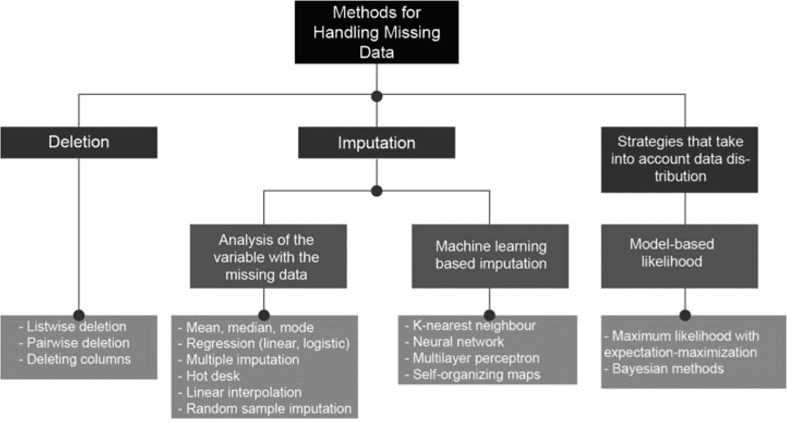

图 2.1: 处理缺失数据的策略。

#### 在保护隐私的同时进行学习

数据隐私已成为我们时代最重要的问题之一。个人信息的泄露可能会侵犯个人的基本权利和自由，包括被识别的风险以及个人（健康）数据的泄露。数据隐私泄露事件（如脸书剑桥分析公司丑闻 \[287]）让患者及其照护者不愿分享敏感的个人信息。作为回应，数据隐私关注成为了焦点，世界各国实施了相关法规，例如欧盟的《通用数据保护条例》(GDPR) \[706] 和《加利福尼亚州消费者隐私法案》(CCPA) \[488]。通过数据驱动方法解决的医学问题通常需要访问敏感的个人信息。

人们已投入大量努力开发隐私保护机器学习算法，以便在不损害模型性能的情况下确保患者细节的安全 \[533, 719, 736]。联邦学习 \[394, 745] 通过协作训练算法而无需交换原始数据，解决了其中的一些忧虑。在联邦学习中，模型参数是集中处理的。为了克服这种“权力集中”，最近引入了群智学习（swarm learning） \[719]。群智学习的原理是在各个站点（如医院）的数据上独立构建机器学习模型，并通过所谓的群智网络共享模型参数。通过这种方法，群智学习在保护隐私和机密性的同时，确保了数据主权。

数据挖掘是医学数据科学中另一个关注隐私保护的流行学科 \[12, 18]。数据挖掘也被称为数据中的知识发现，是指从大数据中自动发现那些将被隐藏起来的新颖模式和趋势的过程 \[137]。近年来，数据挖掘已成功应用于多种医学领域：糖尿病检测 \[36]、癌症预后 \[572]、生物标志物发现 \[244]、败血症识别 \[91] 以及中风预测 \[186]。由于数据隐私必须不惜代价地保护，已经开发了许多隐私保护数据挖掘方法。这些方法包括随机化 \[183]、分类 \[130]、聚类 \[229]、关联规则 \[539]、K-匿名化 \[134]、L-多样性 \[425]、分布式隐私保护 \[182]、压缩 \[10] 以及密码学 \[376, 501]。关于隐私保护数据挖掘技术的贡献的全面综述可见 \[16, 567]。

由于隐私和机密性考虑，医疗保健系统中生成的数据往往受到限制。一种使敏感健康数据可用的策略是通过删除或编码与个人相关的标识符（例如，姓名和患者标识符）、通过扰动数据（例如应用舍入计数法和添加随机噪声）、通过交换数据（例如洗乱数据集属性值）或通过泛化信息（例如对变量分组）对数据进行去标识化或匿名化。尽管进行了这些去标识化努力，要保证无法重新识别单个患者仍然极其困难。一种很有前景的缓解策略是生成可以安全共享的代表性合成数据。合成数据既可以用于增强数据集，也可以生成可以共享的、跨地理和政治边界的虚拟但真实的患者数据。对于这种形式的合成数据生成，生成对抗网络（`GANs`）\[235]非常适用。简单来说，`GANs`是一种深度学习模型，由两个网络组成：一个称为生成器，另一个称为判别器。这两个网络在零和博弈框架下同时进行竞争性训练。生成器学习如何从潜在空间映射到感兴趣的数据分布（即生成合成患者的候选样本），而判别器评估候选样本并将其与真实分布区分开。在临床数据背景下，医学 GAN（`medGAN`）\[117]是一种近期的方法，它可以通过变分自动编码器（`VAEs`）和`GAN`的结合生成高维离散变量。此外，医学 Wasserstein（`medWGAN`）和边界寻求 GAN（`medBGAN`）改进了`medGAN`的性能，能够从“重症监护医疗信息库”和台湾国家健康保险研究数据库生成合成数据\[144]。`medWGAN`没有使用通用的`GAN`，而是使用名为`WGAN-GP`的改进生成网络，该模型通过使用梯度惩罚的权重裁剪技术，克服了在某些设置下无法收敛的问题\[43]。最后，`medBGAN`改进了`GAN`训练，在每次更新时创建位于判别器决策边界的新样本\[43]。

#### 模型的可解释性与泛化性

除了被应用于医学等复杂的高风险领域外，机器学习算法在架构方面也变得日益复杂。有时，这些算法变得如此复杂，以至于人类失去了对底层模型或变量如何联合进行预测的理解。现代机器学习算法通常被称为“黑箱”。所谓的黑箱性质构成了机器学习在临床常规中应用的主要障碍。但为什么不信任一个被证明性能良好且能准确诊断患者的机器学习模型呢？“问题在于，单一指标（如分类准确率）是对大多数真实世界任务的描述是不完整的” \[179]。机器学习模型的可解释性对于理解发现的准确性、识别驱动预测的变量、提高模型性能、防止嵌入偏见以及调试模型至关重要。医学是科学家往往被迫实施更简单且更具解释性的机器学习模型（例如，线性模型或决策树）的领域之一，因为模型做出的每项决策都必须是可解释的。临床人员需要理解为什么机器学习算法会生成那样的结果（即可解释性），并且理想情况下要了解它是如何得出结论的（即可说明性）\[190]。更好的可解释性可能以模型性能为代价。由于生物学关联几乎不是线性的，包括集成和神经网络在内的复杂模型通常会产生更准确的性能。不完全的可解释性通常通过判断、领域专家（例如临床医生）提供的知识、严密的监控以及对所用数据的详尽理解来补偿。开发增强机器学习模型可解释的方法是一个活跃的研究领域。事实上，存在许多与模型无关的解释工具，可以应用于任何监督学习机器学习模型\[529]。模型无关方法主要分为两大类：第一类描述个体预测的局部方法，第二类解释特征如何影响整体预测的全局方法。表 2.4。

| 局部方法 | 全局方法 |
| --- | --- |
| 个体条件期望 (ICE) \[233] | 部分依赖图 (PDP) \[213] |
| 局部代理 (LIME) \[527] | 累积局部效应 (ALE) 图 \[25] |
| 反事实解释 \[711] | 特征交互 \[214] |
| 锚点规则 (Anchors) \[528] | 功能分解 |
| Shapley 值 \[661] | 置换特征重要性 \[102] |
| SHAP (SHapley Additive exPlanations) \[661] | 全局代理 \[152] |

除了可解释性外，泛化性也是机器学习算法的一个理想属性。泛化能力是指经过训练的算法在未见数据上表现良好的能力。一个特别棘手的挑战性问题涉及跨不同患者群的泛化性 \[489]。许多极具前景的机器学习应用案例表明，在应用于多样化人群时往往力不从心。例如，Google 引入了一种用于诊断糖尿病视网膜病变的机器学习算法，但该算法在印度的表现不佳 \[7]。人工智能意外影响的另一个示例是一个开发用于检测皮肤图像中皮肤癌的算法。虽然该算法在浅色皮肤上表现良好，但无法可靠地诊断深色皮肤上的病变 \[240]。

这些示例强调了来自多样化群体（即性别、种族背景和种族方面）的数据对于实现通用精准医学至关重要。然而，现实是，数据往往源于规模令人担忧且同质化的人口样本（例如白人男性）。结果，种族差异在许多患者群体中显而易见，包括医疗服务获取、诊断时间、治疗和死亡率的差异 \[545, 566]。

#### 临床实施与验证

在过去的十年里，机器学习应用取得了巨大的技术进步，改变了临床决策以及健康资源（例如数据）的管理方式。尽管如此，机器学习应用最大的挑战不在于医学效用，而在临床常规中的实施。虽然这些发展对于推进医疗保健至关重要，但它们也引发了一系列伦理和法律担忧，机器学习和人工智能可能会损害患者和医生。技术和诊断故障可能导致不良事件或严重伤害患者。目前尚不清楚，基于人工智能的工具发生导致不准确或延迟诊断的故障或错误决策，谁应承担责任 \[510]。当基于人工智能的临床工具给出错误的治疗建议，而医生做出最终决策时，责任的归属变得更加复杂。是医生的责任，还是责任可以转移给设计该工具的公司或个人？在 \[510] 中，Price 等人对与临床中使用 AI 相关的潜在场景和可能的法律结果进行了概述。在现行法律下，只要医生不偏离医疗护理标准，就可以免于责任追究 \[532]。因此，建议医生利用机器学习引导的工具来支持和确认已有的决策过程，而不是仅仅依赖计算算法的输出来进行诊断或治疗选择 \[441]。考虑到责任生态系统中存在多个利益相关者，包括购买和实施计算算法的医疗机构，其复杂性进一步增加。

这些示例强调了来自多样化群体（即性别、种族背景和种族方面）的数据对于实现通用精准医学至关重要。然而，现实是，数据往往源于规模令人担忧且同质化的人口样本（例如白人男性）。结果，种族差异在许多患者群体中显而易见，包括医疗服务获取、诊断时间、治疗和死亡率的差异 \[545, 566]。

为了消除偏差，科学家必须对数据、选择、评估和死亡保持敏感。为了减轻偏差，多样化的人口至关重要。

如果可能，可以在不同人群中对算法进行验证。理想情况下，机器学习工具的开发和临床实施是一个重要的切入点。对机器学习工具中固有偏差的认识对于减轻偏差至关重要。这从确保患者公平获取技术开始，然后仔细观察其在代表性不足的社区中的表现。任何注意到的偏差都应立即报告给相关委员会。理解医学技术中固有的偏差，允许医生在结果不符合预期时对该技术提出质疑。

### 2.1.7 机器学习在医学中的未来方向

前所未有的健康数据的加速生成将导致医学和医疗保健领域的根本性变化。机器学习应用将在医学中发挥日益突出的作用。具体而言，它们将促进疾病的早期识别、精炼诊断与预后、支持治疗决策并简化生物医学数据管理。重要的是，机器学习引导的系统不会取代临床医生或治疗师，而是通过对临床决策的指导以及对耗时且重复性任务的自动化，增强他们的工作能力并增加他们照顾患者的时间。目前，在临床常规流程中采用此类应用仍存在许多障碍。在未来几年中，数据爆炸将继续进行并达到前所未有的维度，包括患者数量（例如 `UK Biobank`）、时间序列的长度（例如 ICU 监测数据、可穿戴设备）以及数据类型的广度（从分子水平到较高水平的表型）。丰富数据集的充裕将为机器学习驱动的应用辅助临床决策开辟新途径。除了精炼临床流程外，机器学习和人工智能在生物医学研究的其他重要领域也发挥着关键作用，例如蛋白质结构预测、分子设计、药物发现或单细胞研究。一个突破性的例子是近期引入的机器学习方法 `AlphaFold` \[308]，它通过结合物理和生物知识，以前所未有的精度进行蛋白质结构预测。除了技术进步和海量数据的可用性，克服处理缺失数据和异常值的挑战、保护隐私、可解释性和临床应用，对于在临床常规中使用机器学习支持的引导工具至关重要。

## 2.2 病毒检测

Roland Hergenröder

Frank Weichert

Konstantin Wüstefeld

Victoria Shpacovitch

摘要：在全球病毒疾病加速传播的背景下，快速检测病原体具有至关重要的意义。病毒可以通过公共交通工具或大型社交活动中的接触迅速传播。因此，对于此类拥挤场所，需要一种快速病毒检测系统是非常迫切的。纳米物体等离子激子辅助显微镜（`PAMONO`）传感器就是此类分析仪器之一。该传感器需要开发软件和光机械部件以在复杂的生物液体中检测病毒。虽然重点是病毒颗粒，但也可以采用类似的原理分析其他纳米颗粒。后者的应用极大地扩展了 `PAMONO` 传感器的潜在应用领域。开发的方法针对底层传感器系统的时空特性进行了定制，利用了机器学习方法的适应性。结果，在具有不同类型成像伪影和不同分辨率的信号中可以检测到 80 nm 到 300 nm 的颗粒，对于测试样本的预期颗粒计数准确率可超过 80%。作为快速检测系统的移动使用，资源节约和实时能力同样重要，以确保设备能够尽可能应用于许多应用领域。在检测质量和能耗方面应用多目标优化，以证明其作为移动系统使用的可行性。

### 2.2.1 引言

为了检测病毒颗粒等纳米颗粒，需要一种能够使它们感知的设备。这种设备是 `PAMONO` 传感器 \[385, 607]，它将液体或空气样本泵过流细胞，以揭示其中感兴趣的颗粒。这是通过利用所谓的表面等离子体共振（`SPR`）现象实现的 \[340]。

固定在金传感器膜上的特殊蛋白质——抗体——有助于实现病毒颗粒检测的特异性。与抗体结合的颗粒会导致膜表面附近反射条件的局部变化。由于局部反射增加，颗粒结合事件可以被集成到 `PAMONO` 传感器中的电荷耦合器件（`CCD`）探测 \[389]。

在尝试识别颗粒信号时，手动分析很快就会达到极限。即使通过预处理提高了记录图像中颗粒的可见性，对于人类观察者来说，寻找颗粒区域仍然是一项无聊且耗时的任务。测试分析表明，对于一个包含约 4000 张图像的实验，由于不同颗粒大小、不同干扰水平以及不同人类观察者的结果，专家大约需要两天时间才能准确分析该数据集 \[613]。这种时间范围、对视觉化训练专家的需求以及不同个人主观感知的偏差，预示着这项任务成为自动化分析的对象，以便 `PAMONO` 传感器能够作为快速测试。

为了减少人工交互并允许非专家用户进行快速测试，开发了更多来自深度学习领域的自适应解决方案，用以适应特定的信号特征，同时容忍在控制环境外操作时不同记录之间不可避免发生的偏差。

虽然人工交互从现场使用转移到了训练阶段，但这些方法使得实际的现场测试更快。随之而来的挑战是需要大量的手动标注训练数据来学习感兴趣的模式。与此同时，新实验的记录和标注会导致材料和时间成本。这是一个值得解决的问题，因为它在医学数据分析的各种任务中都可以观察到。因此，在利用机器学习泛化能力的同时处理训练数据可用性有限是该领域的一个关键方面。

以下是下方章节的简要概述：章节 2.2.2 提供了不同类型粒子的详细信息。章节 2.2.3 详细介绍了 `PAMONO` 传感器的设置。章节 2.2.4 描述了用于纳米颗粒检测的底层数据特征以及经典和基于深度学习的方法。章节 2.2.5 介绍了一种用于算子参数多目标优化的开发方法。章节 2.2.6 描述了在自然环境中的应用方面，特别强调了被分析粒子的尺寸的确定，以及一种基于生成对抗网络增加图像分析稳健性的方法。最后，章节 2.2.7 对改进 `PAMONO` 传感器硬件和软件的潜在方法进行了展望。

### 2.2.2 可检测纳米颗粒类型

首先值得注意的是 `PAMONO` 传感器可以分析哪些类型的粒子。可以观察到不同的物理和生物特征，这些特征归属于生物纳米颗粒（`bio-NPs`）。除了感兴趣的粒子如病毒、病毒样颗粒（`VLPs`）\[754]和细胞外囊泡（`EVs`）\[504, 505]，还可以观察到干扰物体，例如脂质和蛋白质聚集体，通常认为是干扰样品生物分析检测的污染物。


虽然病毒被公认为仅包含一种类型核酸——核糖核酸（`RNA`）或脱氧核糖核酸（`DNA`）的最小传染剂[332]，但`VLPs`和细胞外囊泡的分析要少得多。强调`VLPs`与病毒之间的关键区别至关重要：`VLPs`不含有任何核酸，因此缺乏在宿主生物中自我复制的主要机会。另一方面，`VLPs`在其表面携带的与相应病毒相同的抗原（被认为是外源的分子）[754]。因此，科学中的`VLPs`可以作为危险病毒的安全且可靠的模型，因为`VLPs`能够有效模拟相应病毒的结构属性但不能复制。在实践中，`VLPs`作为疫苗基础的商业医疗产品而广为人知[754]。

另一组生物纳米颗粒——细胞外囊泡（`EVs`）近期开始引起科学家的关注。`EVs`是大多数细胞释放的亚微米和纳米级囊泡[505]。`EVs`的另一个主要特征是它们能够在内部及其表面携带不同分子的能力。这些活性分子包括激素、生长因子、活性肽和核酸[505]。它们的载物使`EVs`成为活跃的信使，参与细胞间通信，并反映正常情况或病理过程期间的细胞状态。此外，`EVs`在血液或唾液等体液中的丰富引起了临床医生和医学研究者的关注，他们利用`EVs`作为药物递送手段，或评估其作为疾病进展生物标志物的潜力。

然而，任何出于科学和实际需要对`bio-NP`样本进行的分析都需要选择可靠的技术和仪器。无疑，必须对`bio-NPs`在样本中的丰度和尺寸对其进行快速表征。从另一个角度来看，关于其表面抗原（`蛋白质`）及其内容的生物化学信息也同样重要。通过表面等离元共振（`SPR`）原理可以实现`bio-NPs`尺寸的同步定量和确定。利用这一原理的纳米物体等离元辅助显微镜（`PAMONO`）传感器是一种用于溶液中单个无标记且特异性检测`bio-NPs`的仪器[245, 772]。在接下来的章节中，将详细介绍传感器以及可视化信号的底层原理。

## 2.2.3 PAMONO 传感器

表面等离元可以被认为是传播的电子密度波。这些波可以通过入射光（通常是入射激光束）在介质-金属界面的薄金属膜中被激发。正是这种薄金属膜充当传感器表面。表面等离元共振（`SPR`）是一种物理现象，它是`PAMONO`传感器开发的基础。

传统的`SPR`生物传感器处理形成在传感器表面的生物分子层的测量，因此传统的`SPR`传感器不适用于检测单个纳米颗粒（`NPs`）。相比之下，`PAMONO`传感器的特殊之处在于能够检测单个`NPs`结合到金传感器表面的能力[772]。Kretschmann等离元激发方案被用于`PAMONO`传感器，也用于大多数传统的商业基于`SPR`的生物传感器中[350]。然而，某些特定问题将`PAMONO`传感器与已知的传统的`SPR`生物传感器区分开来。在Kretschmann方案中（如图[图 2.3](#9783110785975_001195.xhtml#b_9783110785982-002_fig_003)所示），`p`振光（电场极化发生在入射面内）照射在基底上沉积有极薄（几十纳米）贵金属膜的玻璃棱镜上。通常使用超发二极管或二极激光器作为光源[350]。在特定角度的`p`振入射光存在，表面等离元（`SPs`）在金属-介质界面处以传播电子密度波的形式被激发。

`PAMONO`传感器还利用了最方便的等离子体激发生方案：Kretschmann配置[350]。图 2.4 显示了装置以及作为设备核心的光流池的照片。整个设备位于一个手提箱大小的外壳内。

![图 2.3: PAMONO 传感器的示意装置（左侧），使用过的抗体涂层的抽象视图（右上），附着颗粒的预处理图像，其清晰可见为一个亮亮的椭圆形区域（右下，左图），以及该区域随时间变化的平均像素强度（右下，右图）；修改自 [669]。](graphic/b_9783110785982-002_fig_003.png)

图 2.3: PAMONO 传感器的示意装置（左侧），使用过的抗体涂层的抽象视图（右上），附着颗粒的预处理图像，其清晰可见为一个亮亮的椭圆形区域（右下，左图），以及该区域随时间变化的平均像素强度（右下，右图）；修改自 [669]。

此外，在反射光大幅减少之前的事件以及导致反射恢复的事件，对于`PAMONO`传感器和传统的基于`SPR`的传感器来说是相似的。对于`PAMONO`传感器，此类事件发生在局部，即纳米颗粒（`NP`）结合位点，而不是发生在整个传感器表面上，正如经典`SPR`传感器中发生的那样 [773]。一个建立的模型 [773] 解释了检测生物分子层形成（经典`SPR`传感器）与单个纳米颗粒（`PAMONO`传感器）之间物理学上的关键差异。聚乙烯纳米颗粒被用作模型系统 [245]。这些颗粒的使用有助于证明`PAMONO`传感器检测到的信号数量与液体样品中颗粒浓度之间的线性依赖关系。反之，这一事实证实了`PAMONO`传感器在纳米颗粒浓度测量中的适用性，其中纳米颗粒浓度表示为单位体积内的颗粒数 [245]。Shpacovitch同事的工作 [608] 重点于`PAMONO`传感器的生物分析特征，并证明了`PAMONO`传感器不仅能够检测`HIV-VLPs`（100−140 nm），还能检测流感 A 病毒颗粒（80-120 nm）。

选择性研究在磷酸盐缓冲液（`PBS`缓冲液）中进行，使用了两种特殊工程设计的`HIV-VLPs`：一种在表面含有目标蛋白，另一种则没有 [608]。在这些条件下，在不使用防止非目标`VL`结合的物质对传感器表面进行特殊处理的情况下，`HIV-VLPs`结合到`PAMONO`金表面的选择性达到了 90% [608]。此外，`PAMONO`传感器处理含血清的生物样本的能力也得到了证明 [608]。

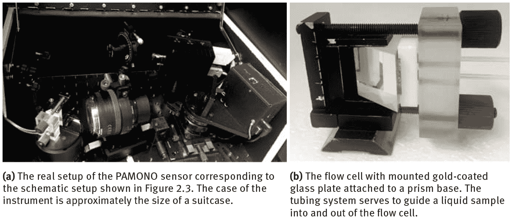

图 2.4: PAMONO 传感器的整体照片 (a) 以及作为设备核心的光流池单独照片 (b)。

进一步的工作 [609] 证明了`PAMONO`传感器在检测另一种类型的生物纳米颗粒：细胞外囊泡方面的强大。作者采用半胱氨酸结合的蛋白 A/G 对`PAMONO`传感器表面进行功能化。这样做是为了允许洗脱捕获在传感器表面的生物纳米颗粒，从而实现`PAMONO`后期分析 [609]。此外，`PAMONO`传感器能够为所研究的聚乙烯纳米颗粒的尺寸分级提供足够的信息。此类信息可以从纳米颗粒结合引起的强度阶跃信号中提取。需要提到，纳米颗粒跟踪分析（`NTA`）仪器 Malvern Panalytical NanoSight LM10¹

传感器数据的分析需要使用能够适应数据变化的稳健算法。后续章节将介绍方法。

## 2.2 自动纳米颗粒检测

根据纳米颗粒检测的挑战，开发了一个信号模型来表示总信号的各个部分：

```
I(x, y, t) = B(x, y, t) + A(x, y, t) + P(x, y, t) + R(x, y, t)
```

它由背景`B`（在录制图像中恒定）、伪影信号`A`、感兴趣的信号`P`以及残差`R`（包括随机噪声）组成，残差见 [614]。图 2.5 显示了一个未处理录制的示例以及对应的图像，在预处理步骤中通过移除背景`B`和减少噪声`R`使包含的颗粒信号可见。这是通过滑动窗口方法实现的，该方法平均信号值、放大随时间增加的强度并削弱下降的强度。随后，某些方法应用了动态对比增强 [733]。之后，感兴趣区域可以被识别为比环境更亮的椭圆形区域。基于给出的信号模型，自动检测的目标是使信号`P`的像素值与其周围环境更易区分。通常通过采用尝试直接突出颗粒的方法（在某些情况下预先削弱伪影信号）。

从算法角度来看，预处理图像上纳米颗粒信号的检测可以看作是一个组合任务，由斑点检测 [609] 和时间序列分析组成，因为只有在考虑到颗粒的空间特征（如区域大小和形状）以及它们的时间行为时，才能可靠地识别颗粒。这种特征的时间行为可以描述为阶梯状曲线，如图 2.6 所示，了来自不同颗粒尺寸集合的两张图像。

时间特性的起源在于目标粒子与抗体层相互作用的方式。当此类粒子附着在其上时，它们会保持较长时间的接触。假设在单次记录期间，目标粒子保持永久附着，而其他粒子仅在测量强度中产生短时间峰值，因为它们的物理形状与涂在金膜上的特定抗体不匹配（参见第 2.2.3 节）。

仔细观察属于不同大小粒子的强度曲线可以发现，对于位置`(x, y)`和时间`t[i]`、`t[j]`，较大的粒子比较小的粒子会产生更高的强度差

`I(x,y,t[j])` − `I(x,y,t[i])`, `t[i]` < `t[j]` 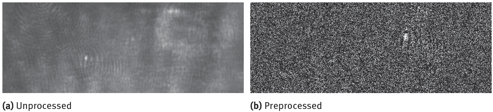

图 2.5：(a) 未处理的记录图像与 (b) 预处理后相同图像的对比，这使得可以将粒子检测为相对于背景具有高像素强度的椭圆形。在预处理图像中看到的粒子在未处理的图像数据中几乎无法被检测。为了提高粒子的可见性，预处理必须利用当前帧周围时间窗口的时间信息。

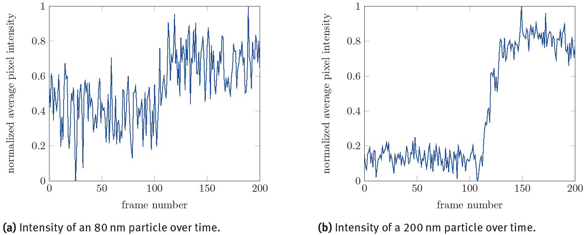

图 2.6：属于不同大小粒子的两个信号随时间变化的示例性对比。

随着粒子尺寸变小，粒子信号`P`变得越来越弱，而光学仪器的不准确调整、样品纯净度下降以及作用于设备增加的外部影响会增加伪影信号`A`和残差`R`的强度。这导致了信噪比 (`SNR`) 的降低 [127]。

(2.2) ${SNR}(P,Q) = \frac{\left| \mu(P) - \mu(Q) \right|}{\sigma(P)}\,\,\,\,\,\,\,\,(2.2)$

该值基于粒子信号`P`和非粒子信号`Q := A∪R`确定，其中`μ`是一组强度值的平均值，`σ`是标准差。虽然不适用于分析结构化伪影，但该测量可以说明除粒子信号外包含随机噪声的图像中粒子的可见性。低`SNR`值表示由于粒子信号`P`强度低或随机噪声`R`强度高导致粒子检测性较差。要指定一个指示结构化伪影强度的指标，需要更复杂且解释性更低的定义。因此，当需要直接指示粒子可见性时，使用了`SNR`值。![图 2.7：PAMONO 图像的抽象处理流水线，显示了用于预处理、模式检测和分类的不同方法 [385]。](graphic/b_9783110785982-002_fig_007)

图 2.7：PAMONO 图像的抽象处理流水线，显示了可用于预处理、模式检测和分类的不同方法 [385]。

## 2.2.4 检测阶段

对于第 2.2.4 节描述的特性，对利用空间和时间特征进行粒子检测的不同方法进行了评估。图 2.7 显示了抽象检测流水线。通常，自动粒子检测任务可以分为不同的子任务。任何方法的第一步都是基于信号的预处理。此外，使用了图像增强技术来提高粒子与其他信号之间的区分度。在处理预处理后的图像，会对图像区域进行分割并检测候选区域，这被总结为`pattern detector`。

整个流水线可以使用第 2.2.5 节描述的离线参数进行优化。

对于预处理，在不同变体中使用具有固定尺寸的滑动窗口方法 [399]、733] 以及常数背景去除方法 [613]，已被证明在不同方法中是有效的。取决于下游算法，额外的降噪技术，如高斯滤波或中值滤波 [613]、小波去噪 [401]、亮度校正 [399] 或动态对比度增强 [733] 被用于提供粒子与其他信号之间更好的分离性。

虽然多种方法适用于后续任务，但不同方法对于数据特征具有不同的优缺点。以下是粒子检测子任务的可用操作。适当的操作选择在第 2.2.5.1 节中给出。

对于模式检测任务，开发了不同变体的模糊模板匹配 [399, 400, 401, 613] 以及卷积神经网络方法 [387, 733, 746]。通过`pattern detector`生成粒子候选区域，`feature extractors`获取空间或时空特征，然后由`pattern classifier`对特征进行评估。提取器生成多边形形状特征，例如多边形的面积或圆度，或者描述其他空间表示的度量，例如傅里叶空间或小波空间。

经评估的分类器例如：k-最近邻 [615]、支持向量机 (`SVM`) [615]、随机森林 [387]，以及卷积神经网络 [387, 733]。

最后，建立了区域与分布在连续帧上的单个粒子轨迹之间的联系。当目标是计数检测到的粒子，而不仅仅是检测粒子是否存在时，这一点尤为重要。

经典检测流水线的一个具体示例如图 2.8 所示。它利用模板检测和模糊时间序列分析 [399] 进行模式识别，并基于多边形形状特征随机森林对粒子候选块进行分类。

模板匹配在各种示例中证明是有效的，它使用之前记录的粒子区域作为预定义的模板块`T`，以在当前图像`I`中检测相同大小的相似区域。这是通过计算归一化互相关来实现：

$R(x,y) = \frac{{\\sum\limits\_{x^{\prime},y^{\prime}}T}\left( {x^{\prime},y^{\prime}} \right)I\left( {x + x^{\prime},y + y^{\prime}} \right)}{\sqrt{{\\sum\limits\_{x^{\prime},y^{\prime}}T}\left( {x^{\prime},y^{\prime}} \right)^{2} + {\sum\limits\_{x^{\prime}}{\sum\limits\_{y^{\prime}}I}}\left( {x + x^{\prime},y + y^{\prime}} \right)^{2}}.$

对于图像中每个像素位置`(x,y)`，其模板块为 [100, 399]。简单来说，模板块在图像上移动，同时在每个位置确定模板块与底层区域之间的相关性。

尽管使用带有经过优调整参数的模板匹配等经典方法可以获得很高的检测准确率，超过某些神经网络方法 [385]，但必须指出，只有当参数针对设置的每种变化进行单独优化，并且在最坏的情况下针对每个数据集进行优化时，这才是可能的 [385, 613]。这对于快速测试现场的使用来说是一个缺点，因为必须涵盖伪影特征的变化，而不需要对每个数据集进行手动调整。这种需求导致了神经网络方法的使用，这些方法将在下一节中介绍。


图 2.9: 为使用神经网络对图 2.8 所示的经典检测流水线进行的修改。模板匹配、时间序列分析和随机森林分类器被神经网络取代。这些被替换的模块被标绿色。

### 2.2.4.2 时空深度学习

从真实测量中检测感兴趣感兴趣总是伴随着不规则性。必须考虑环境影响的变化，以及样本的变异。处理这些影响需要一种能够适应变化同时关注感兴趣粒子的典型特征的技术。在这一点上，可以利用基于深度学习方法的优势。深度学习方法不是适应于受限的场景，而是利用之前的记录，通过使用它们来近似感兴趣粒子的典型模式。神经网络不是基于静态方法计算特征，而是从大量可能的提取操作中进行选择，其限制仅限于可自由学习参数的数量和它们的架构。多种深度学习方法已应用于`PAMONO`记录中 [385, 387, 733, 746]。

#### 深度学习集成到检测流水线

有不同的神经网络架构可以集成到第 2.2.4.1 节所示的流水线中。一种使用神经网络创建以提高粒子检测灵活性的流水线修改如图 2.9 所示。图 2.8 所示的前述流水线的几个模块被神经网络取代，用于对相应输入进行空间或时间分类。

深度学习方法与模板匹配等更直接方法的主要区别在于参数的使用方式。通过可学习算子的逐层连接，这种适应发生在较低层次（例如边缘检测），也可以发生在较高层次（从训练数据中学习的可能粒子形状与给定图像相关联）。为了这一目的，使用了反向传播 [264] 结合损失函数，在这种情况下，它是当前训练步骤中预测的交叉熵损失 [387]。整个过程旨在最小化评估的损失函数，即创建预测类别与预期类别之间的最小差异。

这种部分操作被替换的版本能够在主要受随机噪声影响的、中位数`SNR`值为 0.7（见公式 2.2）的数据上获得结果。对于经典流水线，这种水平在中位数`SNR`值为 1.25 的数据集上是可能的。虽然与针对每个数据集单独优化的模板匹配方法相比结果略差，但神经网络不需要重新调整即可涵盖不同情况 [385, 733]。这种属性在处理数据特征偏移时是非常理想的，这些在第 2.2.6.2 节中进行了更详细的描述。

## 以深度学习为中心的流水线

前一段描述的改进后流水线通过用神经网络替换一些经典算子，增加了对纳米颗粒信号特征变化的适应性。同时，改进后的结构仍然依赖于缺乏灵活性的方法来进行候选区域提取和补丁提取。迈向完全自适应结构的下一步是使用一种能够自己提议候选区域的神经网络。通过这种方式，在学习颗粒特征特征的同时，可以考虑到不同尺寸的颗粒区域。

在由于光学仪器变化和图像分辨率不同而具有不同特征的数据集上评估架构时，无需在分析之间调整参数，即可实现超过`80%`的准确率[733]。为了实现这一目标而提出的流水线如图图 2.10 所示。它更关注于所学习功能的使用。

这种方法检测的第一步是对滑动窗口预处理图像中的候选区域进行空间预测。候选区域的下游过滤考虑了像素强度随时间的变化，并决定其是否对应于感兴趣的特征。这两个步骤中的都使用神经网络进行学习。

空间预测器的精确实现基于`Mask R-CNN` `[263]`，它已经证明能够处理细胞检测任务`302, 752, 761`。`Mask R-CNN`本身使用`ResNet-50 Feature Pyramid Network` `[414]`为下游检测生成抽象特征。


对于图 2.8 所示的经典流水线而言，这种功能可以被称为模式检测器。为了加速训练过程并提高泛化能力，我们采用了迁移学习的概念，并使用在 `Microsoft Common Objects in Context` `[415]` 数据集上预训练的 `ResNet` 模型的初始权重。由于用于检测过程的更通用的低级模式已经设定，训练过程可以集中于调整包含高级特征的最后层中的权重。

所用网络的额外优势是，它不像以前的方法那样受限于一种特定的瓦片大小。相反，它可以从给定的可能尺寸集中确定颗粒区域的大小。这在获得更高灵活性的同时，保留了根据外部知识将接受尺寸限制在特定范围内的可能性。


图 2.10: 时空流水线的架构以两种方式预处理记录的流，每种方式都适应其下游任务，并为每张图像预测颗粒区域。`[733]`

总之，如果对模板匹配等经典方法进行专门适配，它们可以运行良好。另一方面，深度学习方法提供了更好的适应性，但缺点是它们通常需要大量的训练数据。然而，专门的方法或领域知识的引入可以减少所需的数据。处理这一挑战的示例方法在第 2.2.6 节中给出。

![图 2.11: 用于自动调整参数的 SynOpSis 方法。优化过程尝试近似检测方法的最佳参数。训练在先分析的数据上进行。通过背景和颗粒信号的合成组合人为地增加了测试数据量。`[613]`](graphic/b9783110785982-002_fig_011)

图 2.11: 用于自动调整参数的 SynOpSis 方法。优化过程尝试近似检测方法的最佳参数。训练在先分析的数据上进行。通过背景和颗粒信号的合成组合人为地增加了测试数据量`[613]`

### 2.2.5 优化

大多数用于目标检测和其他图像处理算法都需要识别并设置合适的参数值以改进检测。当尝试为给定算法甚至如第 2.2.4 节中描述的完整流水线确定最佳参数设置时，很快就会达到手动完成的极限。利用遗传优化方法自动处理这种搜索的方法在第 2.2.5.1 节中给出。第 2.2.5.2 节重点关注针对能效执行的专门优化的可能性。

#### 2.2.5.1 算法优化

为了自动参数选择的目的而开发的方法是 SynOpSis（合成/优化/分析）方法 `[613]`，其原理在图 2.11 中进行了示意性说明。该方法利用先前的示例，并基于来自不同数据集的粒子信号和背景信号的新组合进行合成增强，以人工增加训练和测试所需的图像数量。对于底层参数的给定合理值区间，通过不同的参数选择进行重复运行，目标是逼近给定数据的理想设置。特别是，利用了一种多目标优化方法——非支配排序遗传算法 II (NSGA-II) `[163]`，来寻找检测算法中所用参数的帕累托最优设置 `[613]`。之后，根据预定义的标准选择产生最佳结果的参数，用于流水线的各个阶段。虽然优化本身在每个优化步骤后必须执行检测流水线，但实际检测速度不会被放慢。这是因为优化完成后，参数将直接传输到相应的算法中，而在实际检测发生时不进行额外的计算。尽管对某些训练数据进行算法调优有好处，但优化仅限于给定的特征提取器和呈现给它的参数集。当选定的算子适用于特定情况而非泛化情况时，就会出现此类问题，这在模板匹配方法中可能会发生 `[385, 613]`。

### 2.2.5.2 资源优化

当前任务的资源优化重点取决于具体的应用场景，而多个目标在实现这些时可能会相互阻碍。根据使用地点的不同，所用计算平台的能量效率可能非常重要，因为不能假设在处处都有可靠的外部电源。因此，节能设备可以覆盖更广泛的操作位置，并通常提供更好的便携性，因为通过较低的能耗，像嵌入式系统这样较小的计算平台可以使用电池运行一段时间。为此，关于该主题的工作可以展示一种平衡概念，即在减少总能耗（从而延长电池寿命）与缩短执行时间之间取得平衡 `[403]`。计算要么在移动图形处理器（`GPU`）上本地执行，要么通过无线网络卸载到服务器，以传输传感器图像以及计算请求。将完全卸载计算与另一种方法进行了比较，在另一种方法中，可以根据给定的目标（如节能或低执行时间）选择要卸载的计算。为此，需要计算消耗的能量。这通过使用能量模型来实现：

```
e[total] = p[GPU] ⋅ t[GPU] + p[GPU] ⋅ t[CPU] + p[LTE] ⋅ t[LTE]
```

该模型基于平均功率 `p[GPU]`、`p[GPU]`、`p[LTE]` 以及 `t[GPU]`、`t[CPU]`、`t[LTE]`。一个高效率的设备可以覆盖更广泛的操作位置，并通常提供更好的便携性，因为通过较低的能耗，像嵌入式系统这样较小的计算平台可以使用电池运行一段时间。


图 2.12：对四种不同悬浮液分析得出的物理颗粒尺寸（从左到右）：100 nm 颗粒、200 nm、300 nm 以及 100 nm、200 nm 和 300 nm 颗粒的混合。顶行显示了使用商业 Malvern LM10 设备获得的参考分布，底行显示了 PAMONO 传感器的结果 [609]。

检测颗粒尺寸分布的软准确值可以通过以下公式进行评估：

```
$a^{r} = \frac{\left| \left\{ e \in \varepsilon \middle| \middle| c^{\text{pred~}}(e) - c^{\text{corr~}}(e) \mid \leq r \right\} \right|}{\left| \mathcal{E} \right|}$
```

计算分析图像中每个块 `e ∈ E` 的预测尺寸 `c^(pred)` 大致匹配正确尺寸类别 `c^(corr)` 的比例。

按照选定的 10nm 分类划分，将一个 100 nm 的颗粒分类为 80 nm 等尺寸类别是被允许的，此时 `r` = 2。同时，对于一个 100 nm 的颗粒，预测为 130 nm 将视为错误值，因为 10 nm 的类别间隔配合 `r` = 2 会产生 20 nm 的容差。在评估中，分析了 80 nm、100 nm 和 200 nm 尺寸的颗粒。在 10 nm 间隔的类别下，`r` = 2 时的准确率超过 70% [386]。

通常，可以通过测量标准颗粒尺寸的信号强度来校准 PAMONO 传感器，将测量的时间强度值映射到物理尺寸。当传感器装置的光组件发生变化时，必须重新执行该程序，因为这些变化会导致测量信号强度的整体偏移。

## 2.2.6.2 病毒感染的检测

PAMONO 传感器设计用于现场检测病毒感染的快速测试。然而，当考虑在机场、市中心或体育场入口使用时，会出现额外的要求。为了作为现场快速测试，设备必须能够运输到不同的地点，这通过传感器外箱的手箱尺寸实现了。能量效率对于在嵌入式设备上执行以及在其他不方便的地方使用可能非常重要。使用 Hardkernel Odroid-XU3 和 Odroid-XU4 单板机作为计算基础，评估了一种小型化的可能解决方案 [399]。尽管执行时间在增加，但已证明在嵌入式设备上计算和管理计算卸载是可行的 [399]。相关的计算卸载方法描述在第 2.2.5.2 节中。

## 2.2.6.3 处理成像伪影

针对 PAMONO 传感器的现实应用时，预计会出现成像伪影。因此，可靠检测的一个基本方面是算法对成像伪影的鲁棒性。

这些伪影源于不同的来源。在硬件方面，光学仪器及其调节存在缺陷。金膜及其涂层的光度也会影响感兴趣信号的质量。例如，表面的划痕和其他不规则之处会导致记录中出现可见的伪影。另一个必须考虑的来源是实际用例中样本清洁度的有限和变化。例如，唾液或痰液样本中的气泡和灰尘是无法完全避免的。通常，当目标是在无法实现实验室条件恒定的地方应用时，必须考虑到外部影响的变化。

随着伪影类型的变化（例如线形或波形结构、恒定强度区域、脉冲区域模式或随机噪声），检测必须同时容忍无结构化和结构化的伪影。

这种组合导致经典的降噪方法产生的结果不足。同时，伪影模式和强度的变化也给学习方法带来了问题，因为许多相关方法需要大量的训练数据，特别是当记录图像中的伪影特征有所不同时。

最近的工作通过增加仅依赖于少量标记训练数据的既有学习方法的鲁棒性，同时解决了这两个问题。

这是通过生成对抗网络（GAN）[237] 实现的，它不直接参与检测过程，而是学习模拟真实模式。

通过这种方式，合成伪影被用于叠加到检测网络的图像上。检测器学会了容忍诱导的伪影 [547]。此外，检测网络的架构本身不需要更改，因此不会降低检测速度。

GAN 的训练虽然没有训练数据的需求，但它使用了参考图像。这些图像的特征是它们不包含颗粒，只显示伪影。使用这类记录代替携带颗粒的记录的优势在于不需要物理颗粒。这节省了时间和材料成本，并消除了复制颗粒信号的风险。因此确保了学习的是伪影。

在证明即使使用少量训练数据也能产生真实图像后，Style2-ADA [312] 被用于特定的 GAN 架构。虽然这种 GAN 需要固定尺寸的训练图像并产生固定尺寸的图像，但不同的传感器配置会导致记录图像的大小不同。因此，基于 GAN 方法组合多个固定边长的块来覆盖标注图像区域以训练检测器。作为整个过程的说明，图 2.13](#9783110785975_001195.xhtml#b_9783110785982-002_fig_013) 显示了合成伪影信号的生成及其在检测网络训练中的用法。

使用简单的分割网络进行下游目标检测，展示了使用所提出的基于 GAN 方法时对伪影鲁棒性的提高。

评估了两种配置，以比较叠加或不叠加合成伪影的结果。第一种配置包含一个感兴趣颗粒且只有微弱无结构伪影的数据集。第二种使用相同的数据集但添加了由参考图像训练的 GAN 生成的合成伪影。两者采用相同的测试数据集，这些数据集包含不同类型和强度的伪影。在训练了各自带有一种配置的相同 U-Net 架构后，明显的区别变得清晰可见。虽然没有合成伪影的训练结果很差，但叠加图像使平均 F1 分数提升了 22% [[547]]。

基于 GAN 的方法与第 2.2.5.1 节中介绍的方法具有相似之处，因为两者都创建了来自不同数据集的颗粒信号与其他信号的混合物。当考虑到基于 GAN 的生成并不直接使用有限的自然图像集，而是在学习过程中人为创建了任意数量的额外图像时，其区别变得显而易见。这一过程可以显著增加训练图像的可变性。

## 2.2.7 当前研究与展望

`PAMONO` 传感器相关的技术预计将受益于鲁棒目标检测领域的进一步研发。同时，评估其在病毒检测之外的扩展应用领域也是值得的，因为该传感器对于病毒检测也构成了良好的基础。针对这两种视角，下文描述了当前和计划中的调查工作。

![图 2.13：使用生成对抗网络（GAN）生成的复合瓷砖伪迹叠加训练图像的示意图。PAMONO 传感器用于记录不含目标颗粒的样本（上部）和包含此类颗粒的样本（下部），用于训练过程。随后，使用训练好的检测模型在未知颗粒存在的图像中搜索颗粒。虚线箭头显示评估过程中的图像路径，实线箭头表示训练过程中的图像路径。虚线框中的图像通过示例视觉化了单个步骤。黄色框说明了流水线的开始和结束，绿色框代表数据，蓝色框标记了算法 [547]。](graphic/b_9783110785982-002_fig_013.png)

图 2.13：使用生成对抗网络（GAN）生成的复合瓷砖伪迹叠加训练图像的示意图。`PAMONO` 传感器用于记录不含目标颗粒的样本（上部）和包含此类颗粒的样本（下部），用于训练过程。随后，使用训练好的检测模型在未知颗粒存在的图像中搜索颗粒。虚线箭头显示评估过程中的图像路径，实线箭头表示训练过程中的图像路径。虚线框中的图像通过示例视觉化了单个步骤。黄色框说明了流水线的开始和结束，绿色框代表数据，蓝色框标记了算法 [547]。

### 2.2.7.1 检测能力的提升

提高整体结果的一种方法涉及传感器的物理设置。由于棱镜的旋转和相机物镜的位置会影响信号质量，必须在记录之前实现适当的调整。虽然通过手动调整可以获得良好的结果，但在调节光学元件时，人类的准确性存在限制。因此，目标是建立一个传感器-执行器控制系统，以自动确定最佳设置，并根据生成的图像信号反馈调整组件。

无论何种情况，现场应用方向的进一步开发应考虑方法对外部扰动的高鲁棒性需求，以确保可靠且广泛的快速检测。虽然第 2.2.6.3 节中提出的合成伪迹显示在检测鲁棒性方面有所改进，但并未特别考虑时间动力学。通过引入时间信息，可以假设鲁棒性将得到进一步提高。

改进结果的另一种方法是引入领域知识。关于特定病原体的知识建议将每个图像区域的颗粒计数作为额外信息。如果已知特定的浓度参考值，可以改进区分有颗粒和无颗粒的样本。

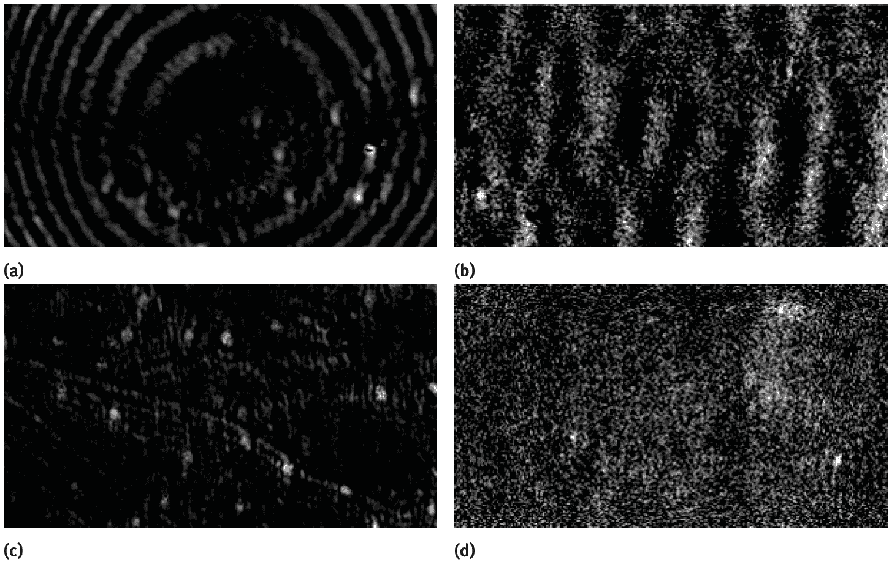

图 2.14：应用动态对比增强后预处理图像的不同伪迹示例。

改进结果的另一种方法是引入领域知识。未来探索的一个有前景的领域是嵌入式设备的评估，例如，第 6.1 节中介绍的现场可编程门阵列（FPGA），有望在降低功耗的同时保持小型化。

### 2.2.7.2 PAMONO 传感器的前景应用

`PAMONO` 传感器在病毒和类病毒颗粒（VLPs）的表征方面证明了它的能力。后者尤其重要，因为 VLPs 常作为药物产品并作为不同疫苗的基础。在这种情况下，`PAMONO` 传感器可以作为 VLP 疫苗常规生产中的质量控制分析工具，实时估计 NPs 的大小浓度。此外，`PAMONO` 传感器是细胞外囊泡（EVs）表征的价值分析工具。理论上，`PAMONO` 传感器不仅能够实现 EVs 的尺寸测量和定量，还有助于获取其表面标记和内部运输分子的信息。如今，EVs 作为细胞间通信的手段受到越来越多的关注。通过这种方式，EVs 可以作为药物递载体和细胞状态的生物标志物。在这种情况下，`PAMONO` 传感器无标记表征 EVs 的能力是一个良好的机会。此外，`PAMONO` 传感器可以作为开发细胞分析的平台。在这种情况下，通过 `PAMONO` 传感器测量的细胞产生的 EVs 和溶性介质，可以评估培养在传感器表面的细胞状态。

# 2.3 基于分子数据的癌症诊断与治疗

*Sven Rahmann*

*Alexander Schramm*

*Johannes Köster*

**摘要：** 十年来，由于针对肿瘤特定细胞过程的新治疗，癌症患者的生存机会取得了前所未有的进展。从数据分析的角度来看，主要的挑战是相对于小样本量（患者数量），遗传数据具有高维多态性。从计算的角度来看，海量数据（单个肿瘤基因组的测序数据约为 100 GB）的分析目前需要强大的计算资源，在立即开始治疗的短时间范围内仍然具有挑战性。

我们讨论了两个进展方向。首先，我们介绍了从测序的肿瘤基因组中提取大部分遗传变异的方法，但与目前先进的程序相比，仅需要 2% 到 5% 的计算资源。

其次，我们讨论了一种多功能统一统计模型，用于区分 DNA 测序过程中的真实变异与技术伪影。

通过对原发性和复发神经母细胞瘤的配对样本进行分析，我们能够提取出与癌症进展以及肿瘤逃逸治疗干预相关的肿瘤演化模式。

结果，基于基因组和突变数据，建立了一种新型神经细胞瘤风险分类方法。

## 2.3.1 引言

如今的癌症患者根据其个体分子遗传数据接受精确的诊断和个性化治疗。

在这里，我们报告了对神经细胞瘤（一种通常发生在儿童身上的实体瘤）患者 DNA 数据的分析。

诊断和预后基于 DNA 测序，目前范围从几百个靶向基因到在不久未来每个患者需要 100 GB 的全基因组数据。

在 DNA 中识别作为生物标志物以区分不同风险类别、原发瘤与复发瘤、或可治疗与不可治疗肿瘤的相关变异，过去一直是一项挑战，但该领域的每一步进展都有助于长期做出更好的治疗决策。源自基因组数据的以下分子特征是关注的重点：(1) 单核苷酸突变（或变异，SNVs），(2) DNA 的短插入或缺失，(3) 大结构变异（例如染色体易位），(4) 拷贝数变化（肿瘤细胞中遗传物质的获得或丢失），(5) 表观遗传变化，如 DNA 甲基化变化，以及 (6) 基因表达差异。

![图 2.15: 左：基于二值特征（具有信息量的单核苷酸变异的存在/否）衍生自原发神经母细胞瘤肿瘤和从同一患者不同组织、不同时间提取的多个复发样本的演化树 [583]。](graphic/b_9783110785982-002_fig_015.png)

图 2.15：左：基于二值特征（具有信息性的单核苷酸变异的存在/否）衍生自原发神经母细胞瘤肿瘤和从同一患者不同组织、不同时间提取的多个复发样本的演化树 [583]。右：治疗过程中随变化的肿瘤异质性演化示意图 [588]。

在过去的几年里，我们针对上述每种特征开发了特征提取工作流和数据分析流程。对于通常的数据分析工作流，特别是医学领域，从原始数据派生的数据的可重复性至关重要。这些过程的基础是我们名为 `Snakemake` 的工作流管理系统 [345, 450]，它现在全球范围内广泛使用，因为它保证了特别是大规模 DNA 序列分析的可重复性。此外，`Bioconda` 软件包仓库 [242] 由我们其中一人 (JK) 创立，现在在广泛的支持下，作为语义版本化软件的中央仓库，以可重复的方式提供服务。

在下文中，为了简单起见，我们关注第一类特征（`SNVs`），但如果进行适当调整，这些发现也适用于其他类型。特别是，我们讨论了是否能够确定区分原发性神经母细胞瘤与治疗后发生复发神经母细胞瘤（称为复发或复发样本）的基因组变异。后者是导致病情恶化的原因，目前被认为是不可治愈的。因此，我们能够识别出几个仅在复发样本中存在突变的基因，这是非常令人鼓舞的 [583]。[图 2.15] 总结了我们关于复发后肿瘤异质性的一些关键发现（左侧），并说明了肿瘤演化过程（右侧）。正是这种治疗过程中肿瘤细胞不断发展的分子异质性阻碍了有效的长期疗法。

这种设定及类似情况的主要资源限制是样本（患者）数量 `n` 有限，而潜在特征数量 `p` 极高（例如，基因组中至少在一个样本中观察到的每个潜在变异）。因此，我们特别面临两个挑战：

1. 候选变异的高效检测（2.3.2）

2. 每个样本中变异的准确分类（真实变异 vs 噪声，2.3.3）

## 2.3.2 候选变异的高效检测

标准的突变或变异分析始于一个计算密集型步骤：将每个测序 DNA 片段（或“read”，单个数据中有数百万条 read）定位到基因组中，并与基因组进行配对。这种配对是变异检测的基础：在同一位置显示差异的许多 read 是基因组存在特定变异的有力证据（无论是纯合还是杂合）。需要复杂的统计模型和检验来区分真实变异与可能的技术伪影（见 2.3.3）。

这一第一步定位和比较由所谓的 `read 比对器` 完成，例如 `BWA-mem` [391]、`bowtie2` [371]、`minimap2` [390] 或 `PEANUT` [344]。在多核系统和 GPU 上的广泛并行使得该步骤的（墙钟）时间保持在几小时内。然而，对于单个数据集，总的 CPU 工作量由许多 CPU 天或数月，消耗了大量的能量。

因此，开发更节省资源的方法来实现相同的任务（或至少完成其很大一部分）具有很高的价值。我们探索了“无比对”方法作为上述映射和比对方法的替代方案。特别是，我们提议使用长度为 `k` 的短 DNA 字符串（所谓的 `k-mers`）来直接检测单核苷酸变异，我们现在进行描述。

### 2.3.2.1 基因组预处理

我们首先对参考基因组进行预处理。

1. 选择一个合适的 `k` 值，使得大多数 `k-mers` 在参考基因组是唯一的。我们的研究表明 `21 ≤ k ≤ 31` 对于人类基因组效果良好 [517]。

2. 构建人类参考基因组中 `k-mers` 的（巨大的）哈希表以及它们出现的次数。我们需要考虑双链 DNA 等于其反向互补。

3. 标记唯一的 `k-mers`；它们指向基因组中的唯一位置。

4. 在所有唯一的 `k`-mers 中，标记那些对于单碱基置换具有`稳健唯一性`（robustly unique）的序列，即那些没有汉明距离为 1 的邻居也出现在基因组中的 `k`-mers。产生的稳健唯一 `k`-mers 不仅指向基因组中的唯一位置；它们还不会被轻易改变为出现在不同基因组位置的 `k`-mers。

无对齐方法要么完全针对稳健唯一的 `k`-mers 工作，要么针对所有唯一的 `k`-mers 工作，后者赋予来自稳健唯一 `k`-mers 的信息更高的权重。这一预处理步骤对于任何基因组版本只需执行一次。

我们发现多路分桶 `Cuckoo` 哈希表非常适合这项任务，因为它们允许较短的构建时间，并在后期提供极快的查找速度。在较低的内存占用和更快的查找速度之间存在平滑的权衡选项。

在一项初步研究 [756] 中，我们针对一个比变异检测更简单的应用设计并实现了这些哈希表：异种移植排序。在这里，将人类肿瘤植入另一种生物（通常是小鼠）中，以便研究其演化和对不同治疗的反应。对这种肿瘤进行测序时，会获得人类和小鼠 DNA reads 的混合物，因此在继续之前必须将所有 reads 分配给原始生物。这种分配被称为异种移植排序。尽管人类和小鼠在遗传水平上非常相似，但在 `k`-mer 水平上可以被充分区分。我们提出了一种基于 `k`-mer 哈希表的分类方法（如上所述），其准确率极高，但与以往方法相比，消耗的 CPU 工作量更少：少于同类基于哈希方法的 25%，且少于经典的基于对齐方法的 5% [756]。我们还证明了哈希表中键的放置可以优化，以获得最佳的平均查找时间（基于随机内存访问次数，即可能的缓存未命中次数），每个样本可节省 10% 到 15% 的 CPU 工作（在只需运行一次的 48 CPU 小时优化程序之后）[757]。

### 2.3.2.2 基础无对齐变异检测

该方法的原理如下：我们统计测序样本中所有的 `k`-mers，并产生计数值的直方图。在没有变异的情况下，一个典型的（唯一的）`k`-mer 在二倍体基因组中的拷贝数应为 2。因此，我们分析观测到的 `k`-mer 计数的直方图（图 2.16）。


该方法的原理如下：我们统计测序样本中所有的`k`-mers，并产生计数值的直方图。在没有变异的情况下，一个典型的（唯一的）`k`-mer在二倍体基因组中的拷贝数应为2。因此，我们分析观测到的`k`-mer计数的直方图。

该方法的原理如下：我们统计测序样本中所有的`k`-mers，并产生计数值的直方图。在没有变异的情况下，一个典型的（唯一的）`k`-mer在二倍体基因组中的拷贝数应为2。因此，我们分析观测到的`k`-mer计数的直方图。

该方法的原理如下：我们统计测序样本中所有的`k`-mers，并产生计数值的直方图。在没有变异的情况下，一个典型的（唯一的）`k`-mer在二倍体基因组中的拷贝数应为2。因此，我们分析观测到的`k`-mer计数的直方图。

### 展望

无对齐变异检测仍然是一个活跃的研究领域，尽管我们在底层数据结构（Cuckoo表）方面做出了贡献并成功检测了SNV，但检测更大类的变异还需要新的想法。可能的方法包括使用局部敏感哈希（特别是最小哈希）代替精确`k`-mer哈希，并结合无对齐和基于对齐的`混合方法`。为了评估基于最小哈希方法的潜力，我们进行了详细的统计可行性研究，探讨了何时将已知变异纳入`k`-mer映射器（何时何时；参见[515\]），为新方法开辟了道路。

### 2.3.3 基因变异与伪迹分类的统一统计模型

我们对Köster, Dijkstra, Marschall和Schnhuth发表的潜变量模型进行了扩展和泛化[342\]。

为此，我们考虑一个样本集合`S`。样本之间的关系可以通过三种方式产生：

1. 两个样本`s[1]`和`s[2]` `∈ S`之间存在克隆遗传：样本`s[1]`继承了样本`s[2]`的所有组成变异。此外，两个样本的来源组织在生命周期内可能产生自身的体细胞突变。

2. 样本`s[1]`、`s[2]`、`s[3]` `∈ S`之间存在孟德尔遗传[443\]：样本`s[1]`的个体继承了两个亲本个体（`s[2]`和`s[3]`）的组成变异。

3. 样本`s ∈ S`可能被另一个样本`s`^′ `∈ S`污染。

我们用有向图`G = (S, I[c], I[m], C)`（`样本图`）来表示三种关系，其中边类型`I[x] ⊆ S × S`分代表克隆遗传（`x = c`）和孟德尔遗传（`x = m`），而`C ⊆ S × S`则代表污染。相应的污染比例可以通过`c : C → [0, 1]`获取。

上述表示法可用于对基因组变异检测的三种经典情况进行建模：单样本或群体变异检测（图中无边）[171]、基于家系的家族变异检测（孟德尔遗传边）[171]，以及肿瘤/正常样本组合的检测（克隆遗传边和污染边）[342]。尽管如此，它不仅限于这些，通过将这些机制组合成更复杂的场景，可以超越这些限制。

### 2.3.3.1 变量与符号

**观测变量** 对于每个感兴趣的潜在基因组变异，我们观测测序读取数据`Z[S] = (Z[1], ..., Z[k])`。如果读取数据由所谓的双端读取组成（每个被研究的DNA片段从两端进行测序），则`Z[i] ∈ Z[s]`中的每个观测都是元组`Z[i] ∈ ({A,C,G,T}, {A,C,G,T}, N)`，其中第一个和第二个元素表示读取的核苷酸序列，最后一个元素表示所谓的插入长度（insert size），即在将读取对对齐到参考基因组上最可能的起始位置时，从最左侧碱基到最右侧覆盖碱基的基数。如果读取数据由所谓的单端测组成（每个被研究的DNA片段仅从一端进行测序），则每个观测`Z[i] ∈ Z`仅仅是读取的核苷酸序列，换之`Z[i] ∈ {A,C,G,T}`。

**潜变量** 我们模型的核心输出是每个样本`s`中的等位基因频率，表示为潜变量`θ[s] ∈ [0, 1]`。对于每个读取观测`i`，存在一个二元潜变量`ξ[i]`，其中`ξ[i] = 1`表示观测源自变异等位基因（即源自携带变异的基因拷贝），`ξ[i] = 0`表示读取源自参考等位基因（即源自与参考基因组序列相同的基因拷贝）。此外，还使用一个二元潜变量`ω[i]`，用于表示观测是否已比对到参考基因组中正确的起始位置（`ω[i]=1`）。

**针对偏倚估计的扩展** 模型可以进一步扩展，以估计读取数据中额外观测属性的偏倚，即链方向、支持变异的读取位置、读取方向以及与参考基因组的比对是否覆盖了整个读取。在这些属性的观测值中，支持变异的均匀分布偏倚表明存在伪影（artifact）。为了清晰起见，我们在我们在模型中省略了对这些偏倚的整合。链偏倚的整合可以在[342]中找到。

### 2.3.3.2 潜变量模型

接下来，我们简要介绍近期发表用于计算等位基因似然性的潜变量模型[342]，然后提供该方法的泛化。在评估读取是否偏离参考基因组时，需要考虑两种不确定性。首先是比对不确定性：通常，一个读取可以比对到参考基因组的多个位点（另参见Section 2.3.2）。取决于它们的相似性，对于读取的最佳位置其确定性从大到小。读取比对器和比对工具（如`BWA` [391]）会将这种不确定性报告为比对质量（`MAPQ`），这可以转换为与每个读取观测`Z[i]`相关的比对到正确位点的概率`π[i]`。其次是分型不确定性：观测到的读取序列并非被测序真实DNA片段的完美表示，而是是一个包含潜在错误和伪影的测量值。DNA测序仪提供了每个报告碱基确定性的估计，即所谓的碱基质量（base quality），这可以再次转换为报告碱基正确的概率。此外，取决于测序技术，在报告的读取序列中存在已知的碱基假插入或缺失率，例如Schirmer, D’Amore, Ijaz, Hall和Quince所出的[578。

我们现在对观测变量与潜变量之间的关系，同时考虑上述不确定性。对于样本`s`中的每个观测`Z[i]`，我们通过定义潜变量`ω[i]`的分布来处理比对不确定性：

```
(2.3) ω[i] ~ Bernoulli(π[i])
```

潜变量`ξ[i]`的分布取决于变异等位基因的预期比例。如果`s`未被其他样本污染，我们定义：

```
(2.4) ξ[i] ~ Bernoulli(θ[s] * τ)
```

此处`τ ∈ [0, 1]`表示采样偏倚，这是因为从变异等位基因获取观测通常更困难：比对更困难，取决于变异的大小，获取覆盖它的读取也更困难[342]。相反，如果`s`被`s'`污染（即`e = (s, s') ∈ C`）且比例为`α = c(e)`，我们定义：

```
(2.5) ξ[i] ~ Bernoulli(αθ[s]τ + (1−α)θ[s']τ)
```

换言之，变异等位基因的预期变为`s`和`s'`等位基因频率的混合。

那么，分型不确定性可以建模为：

```
(2.6) Z_i | ξ_i, ω_i] ~ {p_i if ξ_i=1, ω_i=1; a_i if ξ_i=0, ω_i=1; o_i if ξ_i=0, ω_i=0}
```

这里，`a[i]`、`p[i]`和`o[i]`是建模观测源自携带变异基因拷贝（`p[i]`）、不含变异（`a[i]`）或来自不同位点（`o[i]`）的概率分布。这些可以使用成对隐马尔可夫模型来计算，该模型本质上是将读取序列相对于参考和等位基因序列进行重新比对，同时统计性地考虑测序错误率，正如Köster, Dijkstra, Marschall和Schönhuth在文献[342]中处理缺失和插入时所示。

通过结合上述关系，模型可以用于计算样本等位基因频率组合`S` = `{s[1], . . .* , s[n]}`的似然概率：

(2.7) $\Pr\left( {\\mathbf{Z}\}_{s\_{1}},\\ldots,\\mathbf{Z}\}_{s\_{n}}} \\mid \\theta\_{s\_{1}},\\ldots,\\theta\_{s\_{n}}} \\right) = {\\prod\limits\_{j = 1}^{n}{\\prod\limits\_{i = 1}^{|Z\_{s\_{j}}|}\\Pr}}\\left( {Z_{i}^{s\_{j}} \\mid \\theta\_{s\_{1}},\\ldots,\\theta\_{s\_{n}}} \\right)\\,\\,\\,\\,\\,\\,\\,\\,\\,\\,\\,\\,\\,\\,\\,\\,\\,\\,\\,\\,\\,\\,\\,\\,\\,\\\\,(2.7)$

同时假设读取观测值之间是独立的。注意，似然函数的计算与读取观测值的总数呈线性关系，正如我们之前所示[342]。

### 2.3.3.3 先验分布

在我们广义模型中，给定等位基因频率组合`θ[s[1]]`, …,…`θ[s[n]]`的先验概率可以通过考虑由样本图`G`建模的样本间的依赖关系来计算（参见第2.3.3的开头）。此外，我们假设对于每个样本`s ∈ S`，倍性`ρ[s] ∈ N`（可能随染色体而异，例如可能是性别特异的）、体细胞有效突变率`μ[s] ∈ [0, 1]`以及生殖系突变率`ν[s] ∈ [0, 1]`是已知的。计算先验概率的关键是通过生殖系等位基因频率`ι[s]`和体细胞等位基因频率`|θ[s] − ι[s]|`来解释总等位基因频率`θ[s]`。通常，两者中有一个为零，使得变异由生殖系突变或体细胞突变解释，但在少数情况下也可能发生它们的组合。根据样本`s[j] ∈ S`的已知倍性`ρ[s]`，我们可以计算可能的生殖系等位频率集`ζ[s] ⊆ [0, 1]^(ρ[s] + 1)`。例如，对于`ρ[s]`，我们得到`ζ[s] = {0, 0.5, 1}`；换句话说，任何生殖系变异都可能发生在无、一个等位基因（0.5或50%）或两个等位基因（1.0或100%）中。随后可以通过递归探索给定总等位基因频率组合的所有可能解释来计算先验概率。

对于生殖系和体细胞等位基因频率组合，我们可以区分以下情况：

1. 所有不是其他样本直接后代的样本（在图`G`的`I[c]`和`I[m]`中没有入边）被视为一个群体，并计算其生殖系等位频率组合的先验概率，根据DePristo等人的定义[171]，基于所谓的杂合性（即基因组中杂合位点的预期比例），这通常在所研究物种中是已知的。

2. 对于任何从另一个样本`s′ ∈ S`以克隆方式遗传的样本`s ∈ S`，我们根据Williams, Werner, Barnes, Graham和Sottoriva的方法[730]计算体细胞等位频率`f = |θ[S]− l[s′]|`的先验概率，他们报告了每个频率的预期体细胞突变累计数的公式。后者可以通过对基因组大小`g`进行归一化并取一阶导数转换为相应的密度，从而对于`f > 0`得到$h(f) = \frac{\mu}{f^{2} \cdot g}$。为了能够能够计算`f = 0`的概率，我们定义了一个足够小的`ϵ`并定义`h*(0) = 1 − ∫[ϵ]¹h(f)df`

3. 对于任何从两个父母以孟德尔方式[443]遗传的样本`s ∈ S`，任何从两个父母以孟德尔方式遗传的任何样本$s^{′} \in S$以克隆方式从另一个样本`s′ ∈ S`遗传，任何样本$s^{′} \in S$以克隆方式从另一个样本`s′ ∈ S`遗传，我们根据Williams, Werner, Barnes, Graham和Sottoriva的方法[730]计算体细胞等位频率`f = |θ[S]− l[s′]|`的先验概率，他们报告了每个频率的预期体细胞突变累计数的公式。后者可以通过对基因组大小`g`进行归一化并取一阶导数转换为相应的密度，从而对于`f > 0`得到$h(f) = \frac{\mu}{f^{2} \cdot g}$。为了能够能够计算`f = 0`的概率，我们定义了一个足够小的`ϵ`并定义`h*(0) = 1 − ∫[ϵ]¹h(f)df`

4. 所有不是其他样本直接后代的样本（在图`G`的`I[c]`和`I[m]`中没有入边）被视为一个群体，并计算其生殖系等位频率组合的先验概率，根据DePristo等人的定义[171]，基于所谓的杂合性（即基因组中杂合位点的预期比例），这通常在所研究物种中是已知的。

5. 对于任何从另一个样本`s′ ∈ S`以克隆方式遗传的样本`s ∈ S`，我们根据Williams, Werner, Barnes, Graham和Sottoriva的方法[730]计算体细胞等位频率`f = |θ[S]− l[s′]|`的先验概率，他们报告了每个频率的预期体细胞突变累计数的公式。后者可以通过对基因组大小`g`进行归一化并取一阶导数转换为相应的密度，从而对于`f > 0`得到$h(f) = \frac{\mu}{f^{2} \cdot g}$。为了能够能够计算`f = 0`的概率，我们定义了一个足够小的`ϵ`并定义`h*(0) = 1 − ∫[ϵ]¹h(f)df`

6. 对于任何从两个父母以孟德尔方式[443]遗传的样本`s ∈ S`任何样本`s \in S`以克隆方式从另一个样本`s′ \in S`遗传，任何样本$s^{′} \in S$以克隆方式从另一个样本`s′ \in S`遗传，我们根据Williams, Werner, Barnes, Graham和Sottoriva的方法[730]计算体细胞等位频率`f = |θ[S]− l[s′]|`的先验概率，他们报告了每个频率的预期体细胞突变累计数的公式。后者可以通过对基因组大小`g`进行归一化并取一阶导数转换为相应的密度，从而对于`f > 0`得到$h(f) = \frac{\mu}{f^{2} \cdot g}$。为了能够能够计算`f = 0`的概率，我们定义了一个足够小的`ϵ`并定义`h*(0) = 1 − ∫[ϵ]¹h(f)df`

7. 所有不是其他样本直接后代的（在图`G`的`I[c]`和`I[m]`中没有入边）样本被视为一个群体，并计算其生殖系等位频率组合的先验概率，根据DePristo等人的定义[171]，基于所谓的杂合性（即基因组中杂合位点的预期比例），这通常在所研究物种中是已知的。

8. 对于任何从另一个样本`s′ ∈ S`以克隆方式遗传的样本`s ∈ S`，我们根据Williams, Werner, Barnes, Graham和Sottoriva的方法[730]计算体细胞等位频率`f = |θ[S]− l[s′]|`的先验概率。后者可以通过对基因组大小`g`进行归一化并取一阶导数转换为相应的密度，从而对于`f > 0`得到$h(f) = \frac{\mu}{f^{2} \cdot g}$。为了能够能够计算`f = 0`的概率，我们定义了一个足够小的`ϵ`并定义`h*(0) = 1 − ∫[ϵ]¹h(f)df`

9. 对于任何从两个父母以孟德尔方式[443]遗传的样本`s ∈ S`任何样本`s \in S`以克隆方式从另一个样本`s′ \in S`遗传，任何样本$s^{′} \in S$以克隆方式从另一个样本`s′ \in S`遗传，我们根据Williams, Werner, Barnes, Graham和Sottoriva的方法[730]计算体细胞等位频率`f = |θ[S]− l[s′]|`的先验概率，他们报告了每个频率的预期体细胞突变累计数的公式。后者可以通过对基因组大小`g`进行归一化并取一阶导数转换为相应的密度，从而对于`f > 0`得到$h(f) = \frac{\mu}{f^{2} \cdot g}$。为了能够能够计算`f = 0`的概率，我们定义了一个足够小的`ϵ`并定义`h*(0) = 1 − ∫[ϵ]¹h(f)df`

10. 所有不是其他样本直接后代的样本（在图`G`的`I[c]`和`I[m]`中没有入边）被视为一个群体，并计算其生殖系等位频率组合的先验概率，根据DePristo等人的定义[171]，基于所谓的杂合性（即基因组中杂合位点的预期比例），这通常在所研究物种中是已知的。

11. 对于任何从另一个样本`s′ ∈ S`以克隆方式遗传的样本`s ∈ S`，我们根据Williams, Werner, Barnes, Graham和Sottoriva的方法[730]计算体细胞等位频率`f = |θ[S]− l[s′]|`的先验概率。后者可以通过对基因组大小`g`进行归一化并取一阶导数转换为相应的密度，从而对于`f > 0`得到$h(f) = \frac{\mu}{f^{2} \cdot g}$。为了能够能够计算`f = 0`的概率，我们定义了一个足够小的`ϵ`并定义`h*(0) = 1 − ∫[ϵ]¹h(f)df`

12. 对于任何从两个父母以孟德尔方式[443]遗传的样本`s ∈ S`任何样本`s \in S`以克隆方式从另一个样本`s′ \in S`遗传，任何样本$s^{′} \in S$以克隆方式从另一个样本`s′ \in S`遗传，我们根据Williams, Werner, Barnes, Graham和Sottoriva的方法[730]计算体细胞等位频率`f = |θ[S]− l[s′]|`的先验概率，他们报告了每个频率的预期体细胞突变累计数的公式。后者可以通过对基因组大小`g`进行归一化并取一阶导数转换为相应的密度，从而对于`f > 0`得到$h(f) = \frac{\mu}{f^{2} \cdot g}$。为了能够能够计算`f = 0`的概率，我们定义了一个足够小的`ϵ`并定义`h*(0) = 1 − ∫[ϵ]¹h(f)df`

### 2.3.3.4 变异检测

通过结合上述关系，模型可以用于计算样本等位基因频率组合`S` = `{s[1], . . .* , s[n]}`的似然概率：


(2.7) $\Pr\left( {\mathbf{Z}\}_{s_{1}},\ldots,\mathbf{Z}\}_{s_{n}}} \mid \theta_{s_{1}},\ldots,\theta_{s_{n}}} \right) = {\prod\limits_{j = 1}^{n}{\prod\limits_{i = 1}^{|Z_{s_{j}}|}\Pr}}\left( {Z_{i}^{s_{j}} \mid \theta_{s_{1}},\ldots,\theta_{s_{n}}} \right)\,\,(2.7)$

同时假设读取观测值之间是独立的。注意，似然函数的计算与读取观测值的总数呈线性关系，正如我们之前所示 [342]。

在我们广义模型中，给定等位基因频率组合 `θ[s[1]]`, …,…`θ[s[n]]` 的先验概率可以通过考虑由样本图 `G` 建模的样本间的依赖关系来计算（参见第 2.3.3 的开头）。此外，我们假设对于每个样本 `s ∈ S`，倍性 `ρ[s] ∈ N`（可能随染色体而异，例如可能是性别特异的）、体细胞有效突变率 `μ[s] ∈ [0, 1]` 以及生殖系突变率 `ν[s] ∈ [0, 1]` 是已知的。计算先验概率的关键是通过生殖系等位基因频率 `ι[s]` 和体细胞等位基因频率 `|θ[s] − ι[s]|` 来解释总等位基因频率 `θ[s]`。通常，两者中有一个为零，使得变异由生殖系突变或体细胞突变解释，但在少数情况下也可能发生它们的组合。根据样本 `s[j] ∈ S` 的已知倍性 `ρ[s]`，我们可以计算可能的生殖系等位频率集 `ζ[s] ⊆ [0, 1]^(ρ[s] + 1)`。例如，对于 `ρ[s]`，我们得到 `ζ[s] = {0, 0.5, 1}`；换句话说，任何生殖系变异都可能发生在无、一个等位基因（0.5 或 50%）或两个等位基因（1.0 或 100%）中。随后可以通过递归探索给定总等位基因频率组合的所有可能解释来计算先验概率。

对于生殖系和体细胞等位基因频率组合，我们可以区分以下情况：

1. 所有不是其他样本直接后代的样本（在图 `G` 的 `I[c]` 和 `I[m]` 中没有入边）被视为一个群体，并计算其生殖系等位频率组合的先验概率，根据 DePristo 等人的定义 [171]，基于所谓的杂合性（即基因组中杂合位点的预期比例），这通常在所研究物种中是已知的。

2. 对于任何从另一个样本 `s′ ∈ S` 以克隆方式遗传的样本 `s ∈ S`，我们根据 Williams, Werner, Barnes, Graham 和 Sottoriva 的方法 [730] 计算体细胞等位频率 `f = |θ[S]− l[s′]|` 的先验概率，他们报告了每个频率的预期体细胞突变累计数的公式。后者可以通过对基因组大小 `g` 进行归一化并取一阶导数转换为相应的密度，从而对于 `f > 0` 得到 $h(f) = \frac{\mu}{f^{2} \cdot g}$。为了能够计算 `f = 0` 的概率，我们定义了一个足够小的 `ϵ` 并定义 `h*(0) = 1 − ∫[ϵ]¹h(f)df`。

3. 对于任何从两个父母以孟德尔方式 [443] 遗传的样本 `s ∈ S`，任何样本 `s \in S` 以克隆方式从另一个样本 `s′ \in S` 遗传，任何样本 $s^{′} \in S$ 以克隆方式从另一个样本 `s′ \in S` 遗传，我们根据 Williams, Werner, Barnes, Graham 和 Sottoriva 的方法 [730] 计算体细胞等位频率 `f = |θ[S]− l[s′]|` 的先验概率，他们报告了每个频率的预期体细胞突变累计数的公式。后者可以通过对基因组大小 `g` 进行归一化并取一阶导数转换为相应的密度，从而对于 `f > 0` 得到 $h(f) = \frac{\mu}{f^{2} \cdot g}$...（注：原文此处存在大量重复，译文已按要求处理）

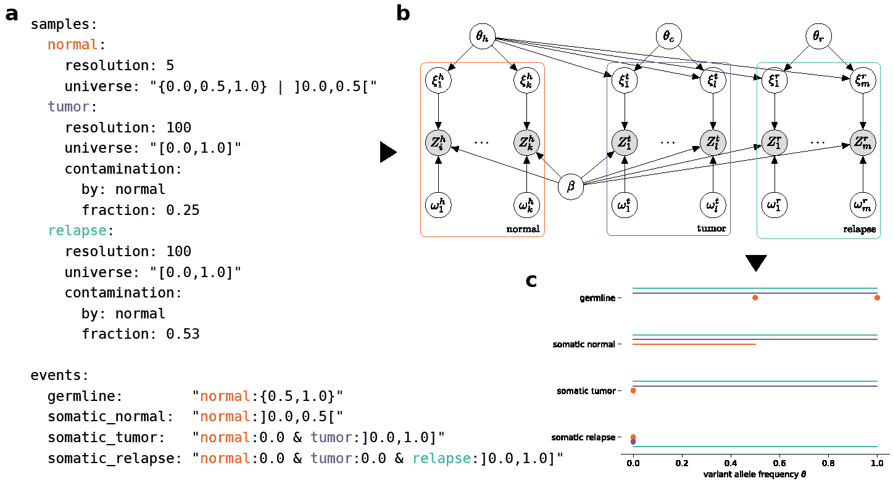

图 2.17: Varlociraptor 场景规范示例，用于区分生系变异与在原发样本或复发样本中作为体细胞事件发生的变异。(a) 通过 Varlociraptor 变异检测语法定义场景。第一部分定义了涉及的三个样本：正常健康血液、原发肿瘤和治疗后复发，以及它们的污染情况和预期的等位基因频率范围。第二部分通过布尔逻辑公式定义了感兴趣的事件。(b) 隐变量模型的最终结构，自动从场景定义中推导出。(c) 每个定义的事件在三个样本中预期等位基因频率的可视化。

### 2.3.4 应用与结果

此前已表明，`Varlociraptor` 能够显著提高召回率，同时在没有生物学解释的情况下，无需调整任何技术过滤参数即可精确控制假发现率 [342]。在这里，我们通过重新分析上述已发布的神经母瘤数据集来展示该模型的应用 [583]。在手稿中，我们分析了 17 个神经母瘤的基因组数据，这些样本提供了来自原发肿瘤和复发肿瘤的 DNA。获取人类基因组整个编码区域的序列（通常称为“外显子”）对于建模肿瘤内异质性和克隆肿瘤演化特别有用。

我们使用了图 2.18 中的“正常-肿瘤-复发”模型公式，并对其进行了参数化。肿瘤样本中的有效体细胞突变率被设置为 `2.93 · 10^(−6)`。这大致模拟了我们在原始研究中发现的典型神经母瘤中最多有 100 个新发体细胞突变的预期值 [583]。

由于体细胞突变也可能出现在正常组织中，我们将相应的有效体细胞突变率设为 `2.8 · 10^(−7)`，正如 Oota 所报道的 [485]。最后，肿瘤和复发样本组织通常会被健康细胞污染。我们使用了原始研究报告的污染量 [583]。

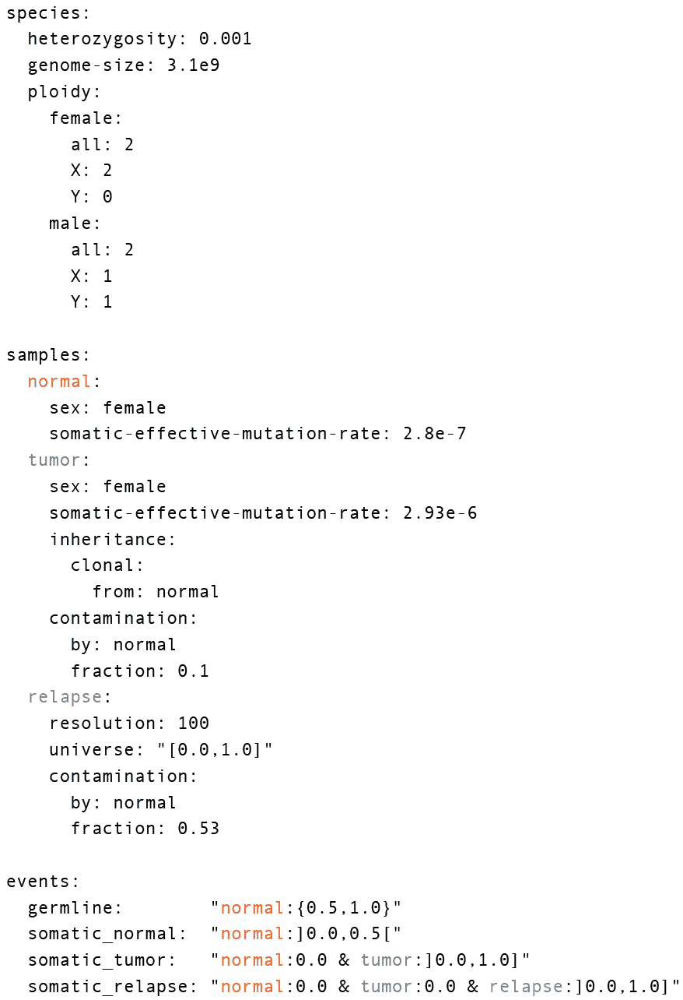

图 2.18: 图 2.17 中 Varlociraptor 场景规范的扩展，引入了先验知识。我们根据基因组大小、杂合性（杂合位点的预期比例）和性别特异性倍性（染色体拷贝数）定义了物种（此处为 `Homo sapiens`）。此外，我们模拟了已知的体细胞突变率，并定义肿瘤从正常样本中继承生系变异。

#### 工作流

分析基因组变异的测序数据涉及多个步骤，我们在图 2.19 中概述了这些步骤。整个分析被实现为一个 `Snakemake` 工作流 [343]。

首先，对原始 reads 进行处理：(a) 修剪所谓的测序接头，(b) 将其比到相应物种的参考基因组，(c) 去除聚合酶反应 (PCR) 中的伪重复，以及 (d) 重新校准碱质量。测序接头 (a) 是非生物伪影。由于它们是已知的，可以使用 `Cutadapt` 移除 [431]。通过将 reads 比对到参考基因组 (b)，我们获得了每个 read 与物种之间的差异。为了获得足够的信号强度，测序方案通常涉及通过聚合酶扩增材料 [24]。由于 `Varlociraptor` 假设每个 read 都是独立的，因此去除此类重复很重要，我们使用 `Picard` 完成了这一点 [500]。最后，测序过程有时会在某些 motif 中产生伪影 [19]。因此，在 (d) 中，我们使用了基因组分析工具包 (GATK [171]) 的碱重校准过程，它系统地调查碱基 motif 并重新校准每个测序 read 的得分，以反映碱基改变是真实信号还是 motif 诱发的伪影。

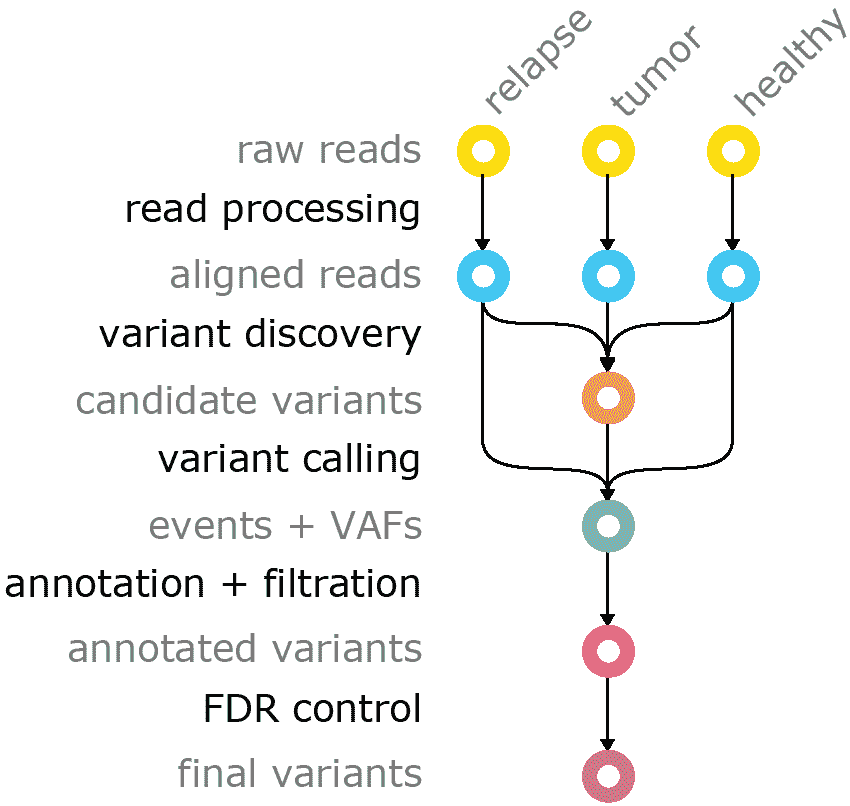

图 2.19: 应用变异检测工作流的示意图。节点表示原始或派生数据（左侧字体），箭头表示处理步骤（黑色字体）。

其次，利用比对后的 reads 生成候选变异。我们为此目的使用了 `Freebayes` [222] 和 `Delly` [523]。前者涵盖了单个 read 可以覆盖的小变异（SNVs、MNVs、小型插入和缺失），而后者涵盖了大型结构性变异（大型插入和缺失、倒位和重复）。重要的是，虽然 `Freebayes` 和 `Delly` 都提供了自己的变异检测统计模型，但我们仅利用它们来生成候选假设。这两个模型都仅针对特定情况设计，不足以处理本数据集中的样本组成。

![图. 2.20: 来自 Schramm 等人 [583] 的患者 1 在原发肿瘤（左）和复发样本（右）中的突变负荷。横轴显示最小等位基因频率，纵轴显示突变负荷，表示每兆兆碱对编码基因组的体细胞突变数量（计算为具有体细胞突变的后验概率的期望值）。颜色代表不同类型的突变（见图例）。](graphic/b_9783110785982-002_fig_020.png)

图 2.20: 来自 Schramm 等人 [583] 的患者 1 在原发肿瘤（左）和复发样本（右）中的突变负荷。横轴显示最小等位基因频率，纵轴显示突变负荷，表示每兆兆碱对编码基因组的体细胞突变数量（计算为具有体细胞突变的后验概率的期望值）。颜色代表不同类型的突变（见图例）。

第三，我们使用 `Varlociraptor` 来 (a) 提取每个样本和每个候选变异的观测结果，并 (b) 为研究数据中的每位患者应用相应场景下定义的模型。

第四，我们 (a) 通过 `VEP` 工具对 `Varlociraptor` 的变异检测结果进行其对蛋白质影响的注释 [440]，并 (b) 过滤出感兴趣的变异。在这种情况下，我们力求得到三个不交的变异集：

1. 已在其他研究中描述为致病性或可能致病性的变异。

2. 对蛋白质有影响但未被描述过的变异。

3. 对蛋白质有中等影响但未被描述过的变异。

最后，我们分别控制肿瘤或复发样本中变异的局部假发现率。

**见解**：随后，我们将使用 `Varlociraptor` 重新分析研究数据以总结最重要的见解。

图 2.20 显示了随最小等位基因频率变化的突变负荷。可以看到，复发样本中的频率普遍增加。这支持了复发样本源于肿瘤中存活克隆的假设。因此，预计复发样本中诱发耐药的变异变得更多。我们的发现有助于将癌症耐药视为一种演化过程。识别这些特异性的遗传指纹是早期检测耐药或肿瘤复发的前提，从而及时调整治疗以进一步提高癌症患者的生存率。

未来的工作涉及对分析样本的个体基因改变进行解释。此外，我们的是进一步改进 `Varlociraptor` 的先验模型，以便引入亚克隆继承假设。

最后，我们将 `Varlociraptor` 的统计方法与无对齐方法相结合，如第 2.3.2 节所示。由于 `Varlociraptor` 必须对读取序列进行重新对齐（参见第 2.3.3 节），我们可以将初始对齐替换为无对齐方法，获得读取在参考基因组上的粗略定位，以便使用 `Varlociraptor` 验证特定的候选变异。为了这一点，有必要通过我们之前在 `PEANUT` 工作中提出的策略准确估计 `k`-mer 命中中的对齐不确定性 [344]。最后，无对齐方法的候选变异的检测需要扩展到单核苷酸变异之外。在这里，一种可能的策略是混合方法，将 `k`-mer 计数的异常转换为精确的变异检测：(a) 收集相关的读取，b) 将它们组装成一个或多个一致序列，c) 将这些序列与参考基因组对齐以确定变异的性质。

机器学习通过构建预测模型来获取预测结果。许多机器学习算法建立在黑箱模型之上，这与统计学习不同，后者更关注模型的统计属性，例如变量的分布及其参数。在本节中，我们关注贝叶斯统计中的数据降维和维度削减问题。贝叶斯回归并不像频率派方法那样假设数据集存在一个固定的最优解，而是在参数空间上引入了一个分布。似然函数模拟了来自数据的信息，而先验分布则模拟了特定问题的先验知识。我们的目标是探索和表征后验分布，根据贝叶斯定理，后验分布是观测数据状况与我们假设参数的先验知识之间的折中。对于极大、高维数据集以及计算资源稀缺的情况，后验分布很难获得。通常，我们的工作侧重于可以在流式和分布式环境中实现的算法方法，通过减少底层问题来增强现代贝叶斯回归方法的可扩展性。在本文的研究中，我们特别关注生物医学应用。根据手头大规模高维问题，我们的兴趣集中在：a) 减少观测数量，b) 减少变量数量，或 c) 减少底层统计模型。任务 a) 包含了诸如草图（sketching）或核心集（coreset）方法等方法。我们在这一主题上做出了各种贡献；例如 Geppert 等人 [226] 或 Munteanu 等人 [463]。关于该主题的更多细节，请参见第 1 卷中的第 3.2 节（《面向数据流和分布式数据的回归问题核心集与草图》）。任务 b) 对于变量数量超过观测数量的高维设置特别相关。这是许多遗传学应用中的主要问题。我们将介绍两种减少变量数量的变量选择方法：一种是在单数据源背景下的贝叶斯（逻辑）回归，另一种是在贝叶斯 Cox 模型中整合多个基因组数据源的背景。对于任务 c) 减少统计模型，我们将“合并与还原”（Merge & Reduce）原理转移到流式模型中以维护统计摘要（Geppert 等人 [227]）。我们可以通过分块分析并以结构化的方式结合每个块的摘要来计算回归模型所需的结果；更多细节请见第 2.4.3 节。

## 2.4.2 变量选择

变量选择是现代统计学中的核心问题之一。在某些领域，研究人员经常面临变量数量大于样本量的问题，这通常被称为 `p` 大于 `n` 问题。在这种情况下，直接在原始数据集上训练统计模型可能会导致许多问题，例如过拟合或无法使用普通最小二法（OLS）回归方法。因此，只选择那些真正具有信息的变量成为构建模型过程中一个非常重要的步骤。

变量选择的一种常用方法是通过 `L[1]` 或 `L[2]` 正则化，在回归过程中强制某些变量的系数为零或收敛于零，从而使模型稀疏。另一种常用方法通常出现在集成算法中：首先将所有变量包含在模型中，然后根据变量重要性指标对变量进行排序，建模后选择对因变量有影响的变量。以下两种方法非常适用于医学应用：在建模之前使用的变量重要性衡量方法，以及使用合适先验和随机搜索进行变量选择的正则化建模方法。

### 2.4.2.1 高维二数据的变量选择

对于高维二值数据（例如遗传标记数据），变量之间的交互往往比主效应更重要，这进一步增加了变量的数量。在本节中，我们描述了如何使用所谓的“杠杆得分”（leverage scores）和“交叉杠杆得分”（cross-leverage scores）作为变量重要性的衡量标准，在保留价值交互作用的同时选择解释变量的子集。还将杠杆得分和交叉杠杆得分与更常用的变量选择标准——单变量线性回归的相关系数系数和 `p` 值进行了比较。与常见的变量选择标准不同，我们的方法侧重于建模之前的变量选择。关于我们方法的更多细节，请参见 Parry 等人 [492]。

获取杠杆得分和交叉杠杆得分需要计算数据矩阵的“帽矩阵”（hat matrix），这是一个承载了变量影响信息的投影矩阵，而非观测值或响应。

对于设计矩阵 `X` 和响应向量 `y`，我们设置：

```
\tilde{X} = [X, y]^T \in \mathbb{R}^{(p+1) \times n}
```

并得到帽矩阵：

```
H = \tilde{X}(\tilde{X}^T\tilde{X})^{-1}\tilde{X}^T \in \mathbb{R}^{(p+1) \times (p+1)}
```

计算帽矩阵需要计算矩阵 $(\tilde{X}^T\tilde{X})^{-1}$，而这种计算是不稳定的（参见 Geppert 等人 [226]）。另一种方法是通过 `QR 分解` 来获取帽矩阵。

帽矩阵主对角线上前 `p` 个元素 `i = 1, . . , p` 的第 `i` 个元素是变量 `i` 的重要性衡量，也称为其“杠杆得分”（参见 Drineas 等人 [181]）。“交叉杠杆得分”通过帽矩阵的非对角线元素获得（Chatterjee 和 Hadi [122]），并描述了第 `j` 个变量（`j = 1, . . , p`）对第 `i` 个变量的影响，以及对响应变量（`j = p + 1`）的影响。

在建模之前选择最重要的变量时，一个重要的考虑因素是预选中应该包含多少个变量。Parry 等人 [492] 根据现有文献指出，使用 `O(n ln n)` 是预选变量最优数量的有效指标，且选择该数量的变量允许采样后的数据矩阵保持满秩。

为了研究二分类变量之间的关系及其相对于感兴趣响应的相互作用，Ruczinski 等人 [550] 开发了所谓的“逻辑回归”（logic regression），这是广义线性回归模型的一种改进。在逻辑回归中，二分类变量不直接用作自变量，而是使用逻辑运算符 `∧`（与）、`∨`（或）和非算子 `!` 进行组合。由此产生的布尔表达式 `L[i]` 被称为逻辑树，相应的逻辑回归模型可以写为：

(2.10) $g(\mathbb{E}(\mathbf{y})) = \beta_{0} + {\sum\limits_{i = 1}^{T}\beta_{i}}L_{i}\,,(2.10)$

其中 `g`(·) 是广义线性模型的连接函数，`L[i]`（对于 `i ∈` 1, . . . , `T`）是二分类变量的布尔组合。在我们的遗传学应用中，我们使用了 logit 连接函数。模型是通过基于模拟退火的迭代算法进行拟合的（例如参见 [550]）。


虽然逻辑回归模型非常适用于分析二分类变量及其与响应之间的关联，但其缺点是只能处理有限数量的变量。在这里，我们使用杠性分（`leverage scores`）或交叉杠性分（`cross-leverage scores`）的方法非常有帮助，因为它在分析之前减少了自变量的数量，同时保留了影响力最大的变量。

我们使用来自不同场景的模拟数据以及真实的 HapMap 数据集评估了我们的方法。我们将用于变量选择的杠性和交叉杠性分与相关系数和 p 值进行了比较。在我们的模拟研究中，我们创建了不同的场景，以探索当自变量数量和样本量变化时，这些变量选择方法选择正确变量的能力。我们还研究了这些指标对于主效应以及不同阶阶相互作用的作用。

遗传 HapMap 数据是作为开发人类基因组单倍型图国际合作的一部分收集的。我们工作中考虑的子集可以在 R 软件包 `SNPassoc`[234] 中获得。对于我们的分析，我们考虑了 7648 个人类核苷酸多态性（`SNPs`），作为两个独立组 `n = 120` 个体的二分类变量。当个体来自中欧（`CEU`）时，因变量设置为 1；当属于西非的约鲁巴族（`YRI`）时设置为 0。

对于模拟数据，我们通过绘制不同场景下杠性分和交叉杠性分的分布来展示结果（参见 Parry 等人 [492]）。当仅存在主效应时，杠性分在选择重要变量方面表现更好，而交叉杠性分能更好地区分具有高阶相互作用的变量。当无关变量数量增加时，变量数量 `p` 的变化对这两个指标的整体性能没有太大影响。相比之下，当样本量增加时，信息变量的得分都会增加，而无关变量的两个得分都会减少，这意味着更多的样本使得这两个指标都更容易找到真正具有信息的变量。此外，我们将杠性分和交叉杠性分与相关系数和 p 值进行了比较。

我们还提出并研究了一种结合交叉杠性分和杠性分的方法，即分别使用这两个指标选择变量，并对所有所选变量取并集。我们证明这种组合方法优于仅使用单一指标（参见 Parry 等人 [492]）。

对于 HapMap 数据，我们在这里展示了一张栅格图（参见图 2.21）。它是包含 SNP 数据的矩阵的图形表示，其中行对应个体，列对应 SNP。为了具有可比性，我们分别使用交叉杠性分（`CLS`）、杠性分（`LS`）、相关性（`COR`）和 p 值选取了大小为 `120ln(120) = 575` 的最重要 SNP 子集。我们可以使用交叉杠性分轻松区分这两组；因此，所选的 SNP 可用于对组个体进行分类。使用杠性分几乎无法区分这两组。使用相关系数或 p 值选择的变量显示出对应两组的块状提示，但远少于交叉杠性分选择的变量。

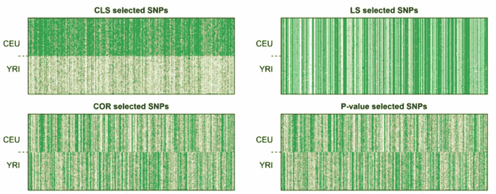

图 2.21：来自两个大洲的全部 120 名受试者的栅格图，对应于 7648 个 SNP 中 575 个的子集（绿色/浅粉色表示纯合子个体，白色表示杂合子个体），分别使用 CLS、LS、COR 和 p 值选取。

根据我们的模拟研究和真实数据示例，交叉杠性分证明是模型构建之前变量选择非常有前景的工具，特别是在存在高阶相互作用的情况下，而杠性分被证明对选择主效应有用。杠性和交叉杠性分的结合通常进一步改进了变量选择。

#### 2.4.2.2 高维生存数据的变量选择

接下来，我们简要总结了一种贝叶斯方法，它将以下领域的进展整合到一个模型中：

1. 高维事件数据分析
2. 高维设置下的变量选择
3. 多数据源整合

在这里给出简要概述。关于该研究的更多细节，请参见 Treppmann 等人 [691]。

我们在癌症研究中通常遇到事件点或生存数据。为了分析这些数据，Cox [149] 创建了半参数比例风险回归模型，该模型考虑了变量与风险函数之间的关系。因此，Cox 模型经常应用于低维数据。然而，在基因组数据的学应用中，我们经常处理变量多于主体的高维设置。这显示了对高维生存时间模型的需求。基于此，Lee 等人 [382] 开发了一种用于右删生存数据的贝叶斯 Cox 模型，通过拉普拉斯先验对回归系数向量进行正则化来处理高维问题。本书中另一个基于 Cox 模型的高维数据生存预测的贡献由 Rahnenführer 等人在第 2.5 节中提出。

大量变量导致的另一个方面是对变量选择的需求。在高维设定下，诸如最佳子集选择以及后向和正向选择等常用方法由于各种原因被证明是不合适的。贝叶斯技术为在整个参数空间上进行随机搜索提供了一种很好的替代方案，特别是它们隐式地处理了模型不确定性。一个例子是 George 和 McCulloch 提出的随机搜索变量选择（SSVS）[224]，这是一种常用的回归分析方法。它是一种灵活且直观的程序，使用数据增强进行选择任务并包含了收缩。

此外，贝叶斯框架为整合额外数据源提供了一种。随着随着进步使得系统地收集不同的全基因组数据成为可能，对这种整合统计分析的兴趣稳步增长。多个信息源的整合可以风险预测模型的性能，从而对疾病的生物学有更深入的理解。关于分子生物学整合贝叶斯分析的最新概述，请参见 Ickstadt 等人 [295]。

总之，我们的方法将 George 和 McCulloch 的变量选择程序 [224] 与 Lee 等人的 Cox 比例风险模型 [382] 结合在一个贝叶斯模型中，并通过信息先验整合了进一步的数据源。

如前所述，对于变量变量数量 `p` 远大于受试者数量 `n` 的高维右删生存数据，Lee 等人 [382] 开发了 Cox [149] 半参数比例风险模型 `λ(t|x) = h0 · exp(x^Tβ)` 的贝叶斯变体。这里，`h0` 表示底层基准风险函数，`t` 是协变量向量 `x = (x[1], ..., x[p])*T` 个人的生存时间，`β = (β[1], ..., β[p])*T` 是回归系数向量。通过对时间轴进行有限划分，`0 < s[0] < s[1] < s[2] < ... < s[J]` 且 `s[J] > t[r]`，`∀r = 1, ..., n`，使得断点是至少发生一次事件的点，且最后一个事件位于最后一个区间，Lee 等人 [382] 得到了由 Burridge [110] 引入的以下分组似然：

```
\begin{array}{l} {L(\mathcal{D} \mid \beta,h) \propto {\\prod\\limits_{j = 1}^{J}\\left( {exp\\left( {- h_{j} \\cdot {\\sum\\limits_{l \in {(mathcal{R}\_{j} - \mathcal{D}\_{j}})}}}\\exp\\left( {x_{l}^{T}\\beta} \\right)} \\right)} \\right)}} \\\\ {\\left. {cdot {prod\\limits_{\xi \in \mathcal{D}}\\left( {1 - exp\\left( {- h_{j} \\cdot exp\\left( {x_{\xi}^{T}\\beta} \\right)} \\right)} \\right)}} \\right)\\\\,\\,\\,\\,\\,\\,\\,\\,\\,\\,\\,\\,(2.1)} \\\\ {leftleft. h_{j} \\right.\\sim\\Gamma\\left( {a_{0j} - a_{0j - 1},c_{00}} \\right)} \\\\ {{~~}a_{0j} = c_{0} \\cdot H^{\star}\\left( s_{j} \\right)\\text{~and~}c_{0} > 0,\\quad j = 1,\\ldots,J} \\\\end{array}
```

在此背景下，`D = {(x, R[j], D[j]) : j = 1, ..., J}` 表示观测数据，其中 `R[j]` 是风险集 `D[j]` 是关于 `j` 个区间的事件集。对于单增函数 `H*(t)` 选择 Weibull 分布（`H*(0) = 0`），我们得到具有超参数 `(η[0], κ[0])` 的 `H*(t) = η[0] · t`。对于变量选择，我们应用 George 和 McCulloch 的 SSVS 程序 [224]。在模型回归系数方差相假设假设，给定 `γ[i]` 的 `β[i]` 先验分布如下形式：

```
β[i]|γ[i] ~ (1−γ[i]) · N(0,τ²) + γ[i] · N(0,cb²·τ²), i=1, …, p
```

其中 `τ² > 0` 且 `cb² > 1`。遵循数据增强（Tanner and Wong, 1987 [673]），指示向量 `γ` 表示相关变量是否包含在模型中。

推理基于马尔可夫链蒙特卡洛（MCMC）算法。对于更新全条件分布 `P(β[i]|β[-i], γ, D)`，其中：

```
β[-i] = (β[1], …, β[i]-1, β[i]+1, …, β[p])
```

我们使用 Lee 等人提出的带有适应跳转规则的特殊随机游 Metropolis-Hastings 方法 [382]。此外，条件分布 `P(yi = 1|β*(t), σ*(t), γ[-i])` 其中 `γ[-i] = (γ[1], …, γ[i]-1, γ[i]+1, …, γ[p])^T` 通过 Bernoulli 分布导出。全条件分布 `P(h[j]|h[-j], γ, D)` 其中 `h[-j] = (h[1], ...h[i]-1, h[i]+1, ..., h[J])*T` 可由 Gamma 分布近似。为了根据上述全条件分布迭代更新 `β`、`γ` 和 `h`，使用 Gibbs 采样是合适的。

除了这里讨论的模拟研究外，还将我们的方法应用于获取自癌症基因组图谱数据库的胶母细胞质瘤（GBM）患者数据集 [471]。在成年人中，胶母细胞质瘤是最常见且生长最快的脑肿瘤。所使用数据集包含 210 名患者，并在生存和基因表达数据以及相关的拷贝数变异（CNV）数据，这些数据用于构建信息先验。我们将分析限制在值变异最大的 1000 个基因上。底层假设是低变异性基因可能不适用于区分预后良好和较差的患者。我们将数据集分为用于 140 名患者模型拟合的训练集和用于 70 名患者评估的测试集。

对于分析，我们假设先验预期变量数量为 `k = 20`。我们构建了一个信息先验，使得第 `i` 个变量的先验包含概率 `π[i]^(CNV)` 与相关基因区域拷贝数变异数据的标准差 `σ[i]^(CNV)` 成比例。因此 `π[i]^(CNV)` 定义为：

```
π_i^{CNV} = k · σ_i^{CNV} / ∑_{j=1}^p σ_j^{CNV}
```

为了比较，我们使用非信息先验 `π = (k/p, ..., k/p)*T`。

在评估过程中，我们考虑参数 `β` 和 `γ` 的后验均值和标准差。为了决定选择哪些变量，我们首先通过对每次迭代选择的变量取平均来确定平均模型大小 `p[m]`。然后选择概率最高的 `p[m]` 个变量。

我们对五条马尔可夫链进行了联合分析，每条链长度为 100,000，其中前 10%作为预热（burn-in）被移除。

Treppmann 等人[69]中表 1 的仿真结果显示，后验选择概率取决于使用了有信息先验（informative prior）还是无信息先验（uninformative prior），且二者之间的差异**非常显著**。在两种情况下，只有三个基因在`p[m]` = 10（无信息先验）或`p[m]` = 9（有信息先验）的变量中具有最高的后验选择概率。

为了评估预测的好性，我们考虑了预测误差曲线，并与不含任何协变量的 Kaplan-Meier 估计器（参考方法）相比，确定了积分 Brier 分数[241, 589]。这表明，在有信息先验的情况下，我们的模型相对于参考方法提高了预测性能，但在无信息先验的情况下未观察到这种现象。对模拟 MCMC 链轨迹图（trace plots）的检查表明，链迅速进入了模型空间的目标区域，并表现出良好的混合性能。

在我们对胶母质瘤数据的应用以及仿真研究中，我们证明了引入第二个数据源在预测质量方面具有明显的改进潜力。然而，只有当第二个数据源提供有信息先验时情况才会如此。这意味着先验选择概率增加的变量往往与响应真正相关。然而，由于在实践中这通常是知的，因此与使用无信息先验的模型进行比较始终是合适的。

由于贝叶斯建模，我们获得了完整的推断，特别是关于后验选择概率。所有变量的联合分析提供了巨大的优势，即可以考虑整组变量的后验选择概率。一个示例是在之前的研究中已被证明具有特别影响力的基因组。

由于在 MCMC 方法中，计算成本和结果准确性之间通常存在权衡，因此高效的编程尤为重要。我们最近在 Python 中重新实现了我们的方法，消除了我们之前在 `R` 中实现该算法时的一些低效之处。

### 2.4.3 统计模型的合并与还原（Merge & Reduce）

具有海量观测的数据集变得越来越常见，使得可扩展性成为现代数据分析的主要挑战。对于许多统计方法来说，这些量的数据会导致资源的巨大消耗。一个显著的例子是线性回归，它是贝叶斯和频率派设置中都是一种重要的统计工具。在非常大的数据集上，回归分析在运行时间和内存消耗方面的要求日益增加，使得分析变得繁琐甚至无法实现。我们提出了一种名为“Merge & Reduce”的方法来解决回归分析中的这些可扩展性限制。Merge & Reduce 在计算机科学中是为人熟知的，主要用于将静态数据结构转换为动态数据结构，且开销极小（Bentley and Saxe [56]）。我们并不是将数据还原为近似的全数据集，而是提议使用从小批量派生的统计模型作为简洁的摘要。通过 Merge & Reduce 框架结合这些统计模型，我们可以将离线算法转换为数据流算法。

在这里，我们专注于通过流处理来处理海量数据集，数据流算法以高速率接收输入项流（例如数值、向量或图的边）。该算法允许对数据进行单次扫描。随着项的一个接一个到达，它以子样本或汇总统计量的形式维护到目前观测数据的摘要。尽管我们关注的是流式设置，但我们强调 Merge & Reduce 方案也可以在分布式环境中实现。

我们的贡献是开发了第一个直接在统计模型上运行的 Merge & Reduce 方案。Geppert 等人[227]中展示了如何为（贝叶斯）线性模型、高斯混合模型和广义线性模型的特殊情况设计并实现这种通用方案。在这里，我们将限制在贝叶斯线性模型上，并在仿真数据集上评估生成的流式算法。我们证明了可以从大型数据流中获得稳定的回归模型，并且 Merge & Reduce 方案产生的开销很小。

#### 2.4.3.1 方法

在我们用于统计数据分析的 Merge & Reduce 方法中，我们迭代地向内存中加载尽可能多的观测值。在每个数据块上，我们应用经典算法来获取（例如）统计模型的参数、一些（充分的）统计量或呈现数据的摘要；简而言之，一个模型。模型根据某些规则进行合并，最终产生一个结合了所有子集信息的最终模型。Merge & Reduce 产生稳定的结果，每个观测值都以相等的权重进入最终模型，从而确保数据块的顺序不会导致结果向单个观测值偏斜。

为了为特定的统计分析任务设计流式算法，我们需要为每个数据块选择一个合适的模型作为统计量。为了这种特定的模型选择，我们需要实现的两个主要要素被称为*合并（merge）*和*还原（reduce）*。

1. 令 `M[1]`、`M[2]` 是从数据块 `B[1]`、`B[2]` 分析得到的模型，则 `merge(M[1], M[2])` 的输出是输入数据块并集 `B[1] ∪ B[2]` 的模型 `M`。
2. 令 `M` 是数据块 `B` 的变得过大的模型，即对于某个阈值 `T`，`|M| ≥ 2*T`（通过重复合并操作），则 `reduce(M)` 计算同一区块 `B` 的大小 `|M'| ≤ T` 的模型 `M'`。

汇总统计分析并在统计模型上实现 Merge & Reduce 函数并不是容易的任务。方法很大取决于所采用的统计方法以及用于存储模型的表示方法。在这里，我们介绍了这种新的通用概念，并讨论了如何为贝叶斯设置下的线性回归 `indexRegression!linear` 示例设计 Merge & Reduce 函数。

我们首先描述了 `Merge` & `Reduce` 函数如何以结构化的方式交互，以便逐块地对数据执行统计分析，同时维持一个为止呈现的整个数据子集的模型。该数据结构由 `L` = `O(log(n/n[b]))` = `O(log n)` 个桶组成，其中块大小 `n[b]` 足够小，能够放入机器的主内存中。

每个桶存储一个统计模型。初始时，它们都是空的。其中一个桶——工作桶 `B[0]`，专门用于存储当前批数据的模型；而其他每个桶 `B[i]` 则在由合并操作构成的二叉树结构的对应层级 `i ∈ {1, ..., L}` 上存储一个模型，参见图 2.22。

该数据结构的工作方式如下：首先，我们读取一个大小为 `n[b]` 的数据块。我们仅对该块进行统计数据分析。总结分析结果的模型存储在 `B[0]` 中。我们通过在每个层级上重复执行 `Merge` & `Reduce` 操作，开始在树结构中从底向上传播模型。如果 `B[1]` 是空的，则将模型从 `B[0]` 复制到 `B[1]` 并清空 `B[0]`。否则，我们有两个树中的兄弟模型，因此我们将这两个模型合并到 `B[0]`，清空 `B[1]` 并继续处理 `B[2]`。再次，如果它是空的，则来自 `B[0]` 的模型被存储在 `B[2]` 中，传播终止。否则，我们有两个可以合并并传播到树中更高层级的兄弟模型。

通常情况下，只要当前层级的桶为空，传播就会停止。当这种情况发生时，数据结构的更新已完成，我们可以继续读取并分析下一块输入数据。这一过程将一直重复直到流结束。注意，除了额外的工作桶外，我们每次每个层级最多只需要存储一个桶，因为两个兄弟桶会被立即合并。

线性回归模型给如下：

(2.15)


其中 `Y ∈ R^n` 是因变量，`X ∈ R^n(×d)` 是包含自变量观测值 `x[1]`, ..., `x[d]` 的设计矩阵。误差项 `ϵ` 被假设为不可观测，且通常建模为正态 `N(0, σ[ϵ])` 分布，`β ∈ R^d` 是我们希望估计的回归系数未知参数向量。在贝叶斯回归中，`β` 被假设为随机变量并遵循某种分布。关注点在于参数的后验分布，可以写为：

![图 2.22: Merge & Reduce 原理的插图，摘自 Geppert 等人 [227]。数据以流的形式呈现，并被分为等大小的块 1 到块 6。模型 M1 到 M11 按它们在执行过程中的创建顺序编号。模型之间的箭头表示 Merge & Reduce 操作。兄弟模型在其父级模型创建后立即被删除。因此，每个层级一次只存储一个模型，即在桶 B1 到 B3 中。工作桶 B0 作用于所有层级，最终在流结束的后处理后持有最终模型。](graphic/b_9783110785982-002_fig_022.png)

图 2.22: Merge & Reduce 原理的插图，摘自 Geppert 等人 [227]。数据以流的形式呈现，并被分为等大小的块 1 到 6。模型 `M[1]` 到 `M[11]` 按它们在执行过程中的创建顺序编号。模型之间的箭头表示 `Merge` & `Reduce` 操作。兄弟模型在其父级模型创建后立即被删除。因此，每个层级一次只存储一个模型，即在桶 `B1` 到 `B3` 中。工作桶 `B0` 作用于所有层级，最终在流结束的后处理后持有最终模型。

(2.16)

```
p(β|Y,X) ∝ p(Y|β,X) * p(β)
```

在原理上，为了实现合并与还原（Merge & Reduce）方法，只需要选择合适的统计模型，并针对该特定类型的模型实现合并与还原操作即可。然而，通常情况下，此类操作的设计绝非易事。特别是，我们在 Geppert 等人的论文 `[227]` 中展示了如何针对贝叶斯线性回归、高斯混合模型和广义线性模型设计此类操作。为贝叶斯 Cox 模型实现合并与还原方法是未来工作的下一步。

![图 2.23: 该图取自 Geppert 等人的 [227]，展示了每个块每个变量的观测值数量 `n_b/d` 对平方欧几里得距离 `e_m^2` (m = 1, . . . , M) 的贝叶斯 Merge & Reduce 方法后验中位数影响的散点图。x 轴和 y 轴按对数尺度绘制，观测值以半透明点的绘制：灰色点表示单次观测；黑色点表示大致相同位置的多次观测。垂直虚线位于 0.1。](graphic/b_9783110785982-002_fig_023.png)

图 2.23: 该图取自 Geppert 等人的 `[227]`，展示了每个块每个变量的观测值数量 `n_b/d` 对平方欧几里得距离 `e_m^2` (m = 1, . . . , M) 的贝叶斯 Merge & Reduce 方法后验中位数影响的散点图。`x` 轴和 `y` 轴按对数尺度绘制，观测值以半透明点的绘制：灰色点表示单次观测；黑色点表示大致相同位置的多次观测。垂直虚线位于 0.1。

## 2.4.4 总体结论

我们关注在处理计算资源不足时出现的几个问题。在本贡献中，我们展示了在生物医学应用背景下减少高维数据简化复杂模型的方法。在前两个节中，我们介绍了两种不同高维数据集的变量选择策略。在第一种场景下，我们描述了一种用于遗传 SNP 数据的变量重要性衡量方法，该方法在模型构建之前使用。在第二种场景下，我们在贝叶斯 Cox 模型背景下，制定了一种整合了多个数据源的高维事件时间数据的变量选择策略。在第三节中，我们使用针对海量数据的合并与还原方法分别对小批量数据进行分析和构建统计模型，然后将其重新组合，以应对运行时间限制和内存不足的问题。

本贡献中的所有方法都提高了在面对主机设备有限计算资源时的统计学习效率。它们在减少学习单个模型的计算时间、能量消耗和内存占用的同时，不会损失模型的高准确性。这反过来允许我们对海量数据进行更复杂的模型分析。

## 2.5 生存预测与模型选择

Jörg Rahnen, Michel Lang, Jakob Richter

**摘要：** 生存分析包含事件时间数据。主要的预测任务包括预后因素（例如医疗治疗）的估计。近年来，许多组学技术被开发出来。对于此类任务，从大量集中选出最佳预测并结合特征选择，构成了资源约束下的优化。

### 2.5.1 引言

在医学中，会对不同组之间的事件时间进行比较。几十年来，高维变量被不断生成和分析。对于高维设置，生存分析方法基于惩罚回归、生存树和森林以便于特征选择。近年来，机器学习方法被用于从大量集中寻找最佳生存方法。在 CRC 876 中，我们应用 `BO` 来识别最佳生存方法，如 `Section 2.5.2` 所示。在 CRC 876 中，我们将现代优化（`BO`）`[303]` 应用于最佳生存方法及其性能，使用了已有的基准方法 `[367,369]`。在对 `Section 2.5.2` 中的事件数据进行简要介绍后，生存分析的模型选择在 `Section 2.5.3` 中进行了讨论。为了解决这一任务，实现了多个用于通用选择的 R 包，如 `Section 2.5.6` 所示。

相同的原理被用于一个通过添加相似数据集的数据来改进特定癌症数据集生存预测的场景中。这在例如生存分析中是一种常见情况，由于伦理、财务和行政原因，临床试验中的患者人数有限，但在其他临床中心采用了类似的治疗方法。然而，简单地将相似数据集添加到目标集中可能会恶化预测结果。相反，可以估计数据集特定的权重。在 CRC 876 中，我们应用 `BO` 来确定此类最优权重，以便将相应的观测纳入合适的加权似然方法 `[531]` 中，如下文 `Section 2.5.4` 所示。在另外与特征选择相关的项目中，我们开发了基于双折采样方案的改进方法 `[383]`，并对高维数据相互基准了过滤方法 `[95]`。

生存分析（Survival analysis），也称为事件时间分析，涉及对特定事件发生时间的分析，应用于许多应用领域。在医学领域，患者的总生存期（`OS`）通常是直接关注的重点。此外，经常分析无进展生存期（`PFS`），它包含了无事件生存期（`EFS`）和无复发生存期。生存数据的一个重要特性是它们往往不是完全可观测的，例如当临床试验结束并进行数据分析时，试验中的患者尚未发生感兴趣的事件。这种情况被称为右截尾（right-censoring），因为对于没有观察到事件的患者来说，其生存时间必须大于或等于到研究结束的时间。根据缺失信息的类型，分析技术中还定义并考虑了许多其他截尾机制。

用于分析生存数据的专门统计方法已经开发出来，并在文献和实践中被广泛应用。最著名的包括：用于在右截尾情况下估计生存曲线的 Kaplan-Meier 估计器；用于比较患者组间生存差异的对秩检验（log-rank test），以及用于估计依赖于多个变量（如肿瘤学研究中的肿瘤大小或年龄）的生存时间的 Cox 比例风险模型 [149]。

在性能评估方面，看似显而易见的方法会导致结果的误读。例如，简单地预测指示患者是否活到研究结束的事件指示器，忽略了自患者进入研究以来所经过的不同时间间隔。相比之下，基于风险率（hazard rates）并对不同时间点的瞬时失效率进行建模的方法可以处理截尾机制。或者，也可以使用考虑缺失信息的参数似然方法。

为了评估生存模型的预测准确性，已经开发了多种合适的衡量标准。一致性统计量（Concordance statistics），特别是 Harrell 的 `C-index` 和（时间依赖性）ROC 曲线下面积（AUC），是最流行的指标。然而，它们只考虑了生存模型的判别能力，而没有考虑校准性（calibration）。这意味着对生存结果预测值进行单调变换不会改变一致性评分，这限制了该评分对临床医生的可解释性。另一种方法是 Brier 分也被广泛使用。它同时考虑了校准和判别能力，但解释起来也比较困难。它的优点是它可以与特定的时间跨度相关。关于这些重要特性的讨论以及 Brier 分的改进，可以参考 Kattan 和 Gerds [313]。

在临床前和临床研究中，遗传因素是关注的，现代高通量技术提供了数千个潜在的解释变量。即使是流行但有争议的“每个变量事件数至少应为 10”的经验法则，也无法作为样本量规划的依据。相反，需要定制的统计和机器学习方法。下一节将讨论在这种情况下进行模型选择时需要考虑的方面。

### 2.5.3 生存分析中的模型选择

与回归或分类等经典机器学习设置中的模型选择相比，生存分析中的模型选择面临着许多额外的挑战。

首先，与其说要解决一个具有大量观测值（例如患者）和较少变量的学习任务，在生存分析中我们经常面临小样本量问题。更糟糕的是随着组学技术的兴起，为了识别出最重要的基因，需要在分析中包含数千到数十万个遗传特征。然而，大多数机器学习或统计学习算法都是针对大样本量 `n` 设计并高度优化的，并且在特征数量 `p` 上的运行时间通常劣于二次方。仅就此一点，我们就在 `n p` 场景下经常会遇到运行时间问题。

其次，通常追求的是双重目标，模型的预测性能并不是唯一的目标标准。相反，目标是在给定的医学背景下识别重要特征（临床协变量、遗传倾向或基因）。良好的预测性能通常能确保模型以有意义的方式描述数据，这是提取一组重要特征的前提提。这使得分析限制在那些带有嵌入式特征选择的模型，或者在应用特征过滤后仍能保持良好运行效果的模型中。

第三，生存分析中的所有性能衡量标准都需要足够足够大的测试集，以产生能够得出可靠结论的性能值。例如，上述流行的 `C-index` 通过将测试集的生存预测排名与真实的观测生存时间排名进行比较（同时对截尾进行修正），来评估预测的排名。显然，集合中观测值过少会导致性能估计器的方差过大。由于每个数据集通常只有几百个观测值，因此在重采样期间必须增加重复次数，以考虑到较大的方差。当然，这加剧了人们已经面临的运行时间问题。

这些点共同构成了一个具有以下特征的难题调优问题：

1. 从调优者的角度来看，模型是一个黑箱，因为没有已知的推导。因此，优化问题本身也被称为“黑盒”。

2. 为了评估超参数配置 `θ` 及其生成的模型的预测性能，需要将数据分为训练集和独立的测试集。这至少在我们的调优问题中引入了随机成分（某些学习器无论如何是非确定的）。

3. 需要调优的超参数搜索空间通常包括数值型和类别变量。这排除了许多源自离散和稳定优化的调优器的使用。

4. 每一个模型拟合在计算时间、内存需求或通信成本方面都可能消耗资源。这里的关键词是“可能”。某些模型，例如结合了激进特征过滤的简单 Cox 模型，即使在 `n = 200` 个观测值和 `p = 10⁶` 个变量（特征）的情况下，也可以在一分钟内完成拟合。其他学习器，如支持向量机，在相同的硬件上执行相同任务需要一整天，同时消耗多几个数量级的内存。显然，资源需求是非常异质的，这在强制性的并行化过程中应该被考虑到。

5. 最后但同样重要的是，在超参数优化期间，我们通常必须处理另一种类型的截尾（除了生存时间的截尾之外）：学习器实现偶尔因为数值问题等原因崩溃并不罕见。而且由于调优通常在具有共享和竞争资源的大型计算节点上进行，计算作业可能会达到墙限制并被调度器杀死。在这种情况下，必须用一个数字填充缺失的性能评分以继续调优，并且尚清楚应该选择哪个值。

在过去的十年里，出现了一些应对超参数优化困难的特殊策略。Bischl 等人 [68] 对此进行了概述。粗俗来说，超参数优化是为了寻找模型的最佳配置 `θ`，以获得最佳的预测性能（在独立测试集上进行评估）。如果对单个配置的评估在运行时间等计算资源方面的开销足够大，那么每一次评估都至关重要，这也意味着某些相当浪费的优化方法并不适用。这特别适用于进化算法（EAs）等方法。进化算法在做出第一个有针对性的决策之前，通常需要数百种配置。相反，我们需要一种从开始就开始进行更侵略性优化的调优器。

一种解决上述昂贵黑盒优化问题所有问题的调优器是 `iterated F-racing` [421]。F-racing 的基本思想是让一组配置相互“竞赛”，并在每次迭代中根据 Friedman 检验剔除表现不佳的候选配置。迭代 F-racing 通过假设搜索空间上存在概率分布来扩展了这种方法。该分布被迭代更新，以便集中在某些精英配置周围。我们将这种调优方法应用于广泛的生存流水线（由特征过滤器和生存模型组成）[369]。基准测试考虑了来自四个乳腺癌队列的 12 个不同数据集，每个数据集包含临床和/或遗传变量（特征）。流水线的架构（即过滤器的选择和模型的选择）被编码为传递给调优器的虚拟超参数。通过这样，被支配的过滤器和模型组合获得的评估更少，让调优器有更多机会利用更有前景组合的超参数。作为基准，我们评估了四种实践中流行但计算密集性可能较低的合理方法。据我们所知，这是为止最大的生存模型基准测试。与基准方法相比，调优在 C-index 方面取得了显著更好的结果。需要注意的是存档结果的代价：由于有超过 10,000 次超参数评估，该调优无法轻松应用于新数据或新队列。

另一种完全符合生存分析中超参数优化要求的调优器是基于模型的优化（MBO）。其性能已通过 Lang [367] 验证，其中 Lang、Kotthaus、Marwedel、Weihs、Rahnenführer 和 Bischl [369] 的基准研究得到了扩展，增加了更多的数据、更多的过滤器、更多的模型和更多的时间预算。

Figure 2.24

图 2.24：Kaplan-Meier 估计量 `S(t)` 的图，按队列分层 [367]。在 Kaplan-Meier 图中，`t` 与估计的患者存活比例作图。曲线的垂直下降表示事件发生，曲线上的加号表示观测值被截删失。

Figure 2.25

图 2.25：多种算法在独立测试集上的平均 C-index 结果，按队列分层。所有基础算法都被单独调优，并联合过滤器的选择以及过滤器的超参数。MBO 同时对所有过滤器和算法进行调优。BenchOpt 表达了在训练数据上选择表现最好的基础算法后，在独立测试集上的最终性能 [367]。

异构运行时（或更泛地说，异构资源需求）已由 Richter, Kotthaus, Bischl, Marwedel, Rahnenführer 和 Lang [530] 以及 Kotthaus 等人 [346] 进行了研究。我们不再仅仅拟合一个单一代理模型来引导优化至预测性能最佳区域，而是在每次迭代中拟合多个代理模型。一方面，会计算基于观测到的预测性能的常规代理模型；另一方面，会拟合一个或多个针对计算资源的代理模型，例如，一个用于描述运行时间的代理模型，以及一个用于描述内存消耗的代理模型。因此，我们可以针对所有超参数配置查询估计的预测性能和估计的资源需求。所有信息被输入到一个调度器中，该调度器选择一组配置子集，并根据它们的优先级（源自估计的预测性能）将其映射到多个 CPU 或工作节点上，同时最小化空闲时间（基于估计的运行时间）。

### 2.5.4 用于生存分析的加权子组选择

对于特定的癌症亚组或队列 `s^*` 获取可靠的预测模型通常很困难，这是由于样本量有限，并且在生存分析中存在可能的高删失率。有时可以获得来自其他患者亚组的相似数据，例如来自其他临床中心的数据。对所有亚组进行简单的池化可以降低预测模型参数的方差，但也会由于队列之间的异质性增加偏差。

目前有多种方法可以通过加权的方式包含其他患者亚组的数据来提高预测质量。一种可能的方法是像 Weyer 和 Binder 提出的那样包含一个额外的加权子组 [726]。或者，如 Bickel 等人描述的那样，可以从训练数据估计每个患者的个体权重 [63]。其思想是让权重使组合数据的联合分布与每个亚组的分布相匹配，使得可能属于目标亚组的患者在特定亚组的模型中获得更高的权重。权重对应于在给定观测协变量和结果的情况下属于目标亚组 `s^*` 的条件概率，除以 `s^*` 的先验概率。前者通过多分类从训练数据中估计，后者通过 `s^*` 的相对频率估计。

目标是优化我们的模型针对目标亚组 `s^*` 的预测性能。在训练数据中包含额外亚组的数据应该提高目标亚组的预测性能。因此，这形成了一个组合优化问题，必须选择额外的亚组以使预测性能最大化。

然而，完全放弃使用某些亚组数据似乎过于激进，因为每个额外的亚组数据中都可能包含相关信息。幸运的是，大多数机器学习方法以及可用于时间事件数据的方法都允许观测值。这允许我们对不代表我们问题的观测值赋予低权重。然而，为每个观测值找到最优权重是极其复杂的。相反，我们引入了 Richter 等人提出的子组权重 [531]。观测权重由每个观测值的子组成员身份决定。这允许以特定权重包含某些亚组。因此，以加权方式包含额外数据可能比包含一个亚组的全权重或完全不包含的二元选择产生更好的解决方案。

通过引入子组权重，我们将组合问题转化为数值优化问题。然而，以最优方式设置这些子组权重仍然是一个困难的问题。首先，每个额外的亚组导致了这个问题；其次，由于数据集本身很大，评估可能会花费很长时间。在这种情况下，尝试许多组合是不可行的。因此，我们可以应用先进的黑盒方法如 MBO 来寻找最优子组权重，而无需评估数百种参数组合。对于我们的评估，我们优化子组权重 `w^(g)`。注意，在 [195] 中有一项研究报告随机生存森林的效果优于拟合 Cox 模型。在这里我们使用更常用的惩罚回归方法来评估加权分析。

#### 加权 Cox 模型

假设患者 `i` 的观测数据由元组 `(t_i, δ_i)`、协变量向量 `x_i = (x_i1, ..., x_ip) ∈ R^p` 以及子组身份 `s_i ∈ {1, ..., S}` 组成，其中 `S` 是可用亚组的总数，`i = 1, ..., n`。`t_i` 表示患者的观测时间。`δ_i` 表示患者是否发生了事件（`δ_i = 1`）或被（右）删失（`δ_i = 0`）。如上所述，生存分析中最流行的回归模型之一是 Cox 模型 [149]。它将患者在时间 `t` 的风险率 `h(t|x_i)` 建模为：

```
h(t | x_i) = h_0(t) * exp(β'x_i) = h_0(t) * exp(Σ_{j=1}^{p} β_j x_ij),
```


其中 $h_0(t)$ 是基准风险率，$\beta = (\beta_1, \dots, \beta_p)^\prime$ 是未知参数向量。这些参数通过最大化部分似然函数进行估计 [326, 第 8.3]。一种使用观测权重的部分似然函数版本被引入加权分析中：

$$l(\mathbf{\beta}) = \sum_{i=1}^{n}\delta_i w_i\left(\mathbf{\beta}^\prime\mathbf{x}_i - \ln\left[\sum_{k=1}^{n}\mathbf{1}_{(t_i \leq t_k)}}w_k\exp(\mathbf{\beta}^\prime\mathbf{x}_k)\right]\right), \quad (2.18)$$

其中 `w^((g))` `∈` [0, 1] 是子组 `g` 的特定权重，而 `s^(*)` 是我们想要获取预测的子组。子组 `s^(*)` 的患者在预测模型中以全权重 1 这里的。

标准的子组分析仅基于感兴趣子组（目标子组 `s^(*)`）中的患者，这对应于所有不属于 `s^(*)` 的患者 `w[i] = 0`。汇总了所有子组患者的组合模型则对应于所有患者的 `w[i] = 1`。

在高维设置中，协变量数量 `p` 通常远大于样本量 `n`，标准的极大似然估计法无法用于参数估计，因为它无法产生唯一解。因此，我们在部分对数似然函数中添加了 LASSO 惩罚项 [677]。Lasso 回归执行特征选择并产生稀疏模型解。惩罚后部分对数似然的极大化问题给出：

$\hat{\mathbf{\beta}} = \underset{\mathbf{\beta}}{argmax}\left\{ {l(\mathbf{\beta}) - \lambda \cdot {\\sum\limits\_{j = 1}^{p}\left| \beta\_{j} \right|}} \right\}\,,.$

LASSO 惩罚参数 `λ` 通过内部 10 折交叉验证进行优化。

### 评估

我们感兴趣的是最大化目标子组 `s^(*)` 的预测性能。权重 Cox 模型的预测性能使用 C 指数评估。对于给定目标子组 `s^(*)`、包含 `S` 个子组的数据集以及子组权重向量 `w = (w^((1)), . . .* , w^((S−1)))` 的评估，我们进行了改进的 10 折交叉验证。验证数据应仅包含目标子组，因为我们只关注目标子组的预测性能。为了获得交叉验证所需的 10 次划分，我们仅将目标子组的数据划分为 10 部分。为了获得其中某部分的预测值，将剩余的 9 个部分加上来自额外子组的所有观测值合并到训练数据集中。通过执行改进的交叉验证，我们获得了给定数据集、目标子组和子组权重向量组合的 C 指数估计。

现在，目标是找到使 C 指数最大的子组权重向量。该优化问题可以通过 MBO 求解，其搜索空间 `[0, 1]`^S^(−1)` 直接映射到权重向量。选择下一个待评估权重向量的采集函数应该考虑到结果不是确定性的。因此，我们提出了增强的期望改进算法 [288]，它非常适合此类场景。对于贝叶斯优化中的高斯过程回归，我们提出了具有估计 `nugget effect`（块值效应）的 Matern 3/2 核函数，以解释我们目标函数的噪声响应。

优化子组权重的益处是双的：首先，得到的最优子组权重向量不仅能最大化目标子组的 C 指数，还能得出某些子组之间相似性的结论。如果某个子组的权重很小，可以假设该子组的解释变量与事件时间之间的关系与目标子组并不相似。其次，如 Richter 等人 [531] 所示，如果包含不一致数据的额外子组，该方法的预测性能不会下降。

使用权重惩罚可能会产生收益，这允许研究人员完全排除权重接近零的数据。这样模型变得计算成本更低，且可能更稳定。最后，所提的方法适用于任何从不同队列汇总数据并使用支持观测权重的机器学习方法的情况。

### 2.5.5 高维数据的特征选择

特征选择问题在高维数据领域尤为重要，正如第 2.5.3 节详细描述的那样。在这种背景下，一个挑战性问题是特征选择的稳定性。某些学习器可以限制为仅使用成千上万可用特征中的一小部分子集，且学习器可以与特征筛选相结合以以通用方式实现这一点。然而，所选特征的集合通常具有高度变异性。例如，如果扩展 Cox 比例风险模型引入 L[1] 惩罚 `λ`，该惩罚经过调整以在 3 折交叉验证中仅包含最多 20 个特征，那么得到的三个组被选特征可能是两两不交的。这有一个简单的原因：如果两个特征 `x[1]` 和 `x[2]` 高相关，那么它们也是同样良好的预测因子。如果模型必须在 `x[1]` 和 `x[2]` 之间做出选择，少数观测值就可以使天平向某一个方向倾斜。如果现在对数据集重采样并将这些观测值从训练集中移除，天平很容易向另一个方向倾斜。这尤其令人恼恼，因为这种方式无法为随后的分析（如生物学分析）可靠地选择特征。

Lee 等人 [383] 以两种方式解决了这个问题：首先，使用了 LASSO 回归的特殊扩展。预处理 LASSO [495] 是一种两步程序，旨在解决 LASSO 估计中的高偏差问题。其次，将预处理 LASSO 嵌入两重子采样过程中，通过模型平均和基于内部子采样中选择概率的协变量进行额外收缩，来提高特征选择的稳定性。

该方法已应用于神经母细胞、肺腺癌和乳腺癌的数据集。预测性能（通过 C 指数衡量）和稳定性（通过 Jaccard 指数和 Kuncheva 指数衡量）都得到了提高。然而，与流行的单变量选择方法的对比并没有提供清晰的结论。

Bommert 等人 [95] 对该主题提出了另一种观点，他们在高维数据上对 20 多种过滤方法进行了相互基准测试。尽管这项工作基于分类数据，但没有理由其核心结果不能转移到生存问题，目前这方面的工作正在进行中。一个关键结果如图 2.26 所示。存在明显的特征过滤器组。同一组的过滤器预计在不同数据集上产生非常相似的结果。因此，不需要在机器学习流水中包含 20 多个过滤器，将此组合精简为较小的集合就足够了。此外，对性能和稳定性进行了分析，以为高维设置下的特征过滤提供通用建议。

![图 2.26: 特征选择顺序之间的相关性，针对大量过滤方法的所有对，通过多个数据集的算术平均值进行平均。过滤方法通过平均链接层次聚类进行排序，使用平均排名相关性作为相似性度量 \[95\]。](graphic/b_9783110785982-002_fig_026.png)

图 2.26：大量过滤方法所有对之间特征选择顺序的秩相关，通过多个数据集的算术平均值进行计算。过滤方法通过平均链接层次聚类进行排序，并使用平均秩相关性作为相似性度量 [95]。

---

### 2.5.6 软件

目前存在许多机器学习框架，可以方便地用于模型选择或特征选择。然而，这些框架中的大多数都侧重于分类和回归。对生存分析的支持往往不存在或不足。为了进行适当的评估，有两个框架被扩展以支持事件发生时间数据。

首先，R 语言包 `mlr` [69] 已经扩展了一个用于生存任务的对象，包含了最常见的生存学习器和生存测量指标。通过在现有的重采样和调优基础设施之上，可以使用基于模型的优化等先进的调优器对生存学习器进行调优。对于较大的任务（即具有数千个遗传数据的特征），基准实验的并行化是强制性的。`BatchJobs` 包 [67] 及其继任者 `batchtools` [368] 提供了 `mlr` 与托管的高性能计算集群之间的桥梁，允许在数百个 CPU 上同时计算全面的基准测试。通过这种方式，可以定义并执行详尽的基准研究，例如 Lang、Kotthaus、Marwedel、Weihs、Rahnenführer 和 Bischl 的研究 [369]，Lang [367] 以及 Richter 等人的研究 [531]。

第二个扩展用于生存分析的框架是 `mlr3` [370]，它是 `mlr` 的继任者。扩展包 `mlr3proba` [640] 为概率回归提供了一个通用框架。与 `mlr` 的生存能力相比，`mlr3proba` 连接了多得学习器，更重要的是，它连接并实现了更多的生存测量指标。此外，`mlr3proba` 可以嵌入到 `mlr3pipelines` 包 [65] 的基础设施中，该包提供了一种通过有向无环图构建复杂机器学习工作流的语言。`mlr3pipelines` 用于转换和统一生存模型的许多预测类型：某些模型返回线性预测向量，而另一些模型则返回连续排名、相对风险或完整的时间相关分布（例如个体生存函数估计）。`mlr3proba` 提供了多个流水线操作符，用于在预测类型之间进行转换，甚至组合多种类型。

得益于 `mlr3` 和 `mlr3proba` 的统一接口，可以直接通过 `mlr3tuning` 使用先进方法来优化生存方法的超参数。特别是在生存语境下，数据预处理通常是一个至关重要的步骤。关于如何配置预处理的决策应该包含在这一优化过程中，以获得预测性能的无偏估计。通过 `mlr3pipelines` 对预处理进行建模允许构建一个可以重采样和优化的整个流水线。为了获得通过优化识别出的流水线性能的无偏估计，可以对整个优化过程进行重采样，从而形成嵌套重采样设置。该框架还支持多准则优化，例如通过连接 `stabm` 包 [94] 同时对预测性能、稀疏性和特征选择稳定性进行调优。

### 2.5.7 结论

生存数据的分析需要使用适当的统计学方法，特别是在处理由于删失导致的缺失信息时。相应的方法已经可用且成熟。然而，对于今天日益产生的现代高维数据（特别是组学数据），出现了额外的挑战。估计预测模型通常需要复杂的特征选择和超参数优化。对于这一任务，贝叶斯优化方法提供了一个有利的解决方案。它们可以从大量的候选模型中高效地识别出具有竞争性预测精度的模型。极其重要的是用于可复现分析流水线的软件框架。一个有价值的例子是广泛使用的 R 语言包 `mlr3`，它在机器学习构建块的基础上提供了高效的面向对象编程，以及其扩展包 `mlr3proba`，后者为概率回归提供了一个通用框架，包含了许多生存模型和生存测量指标。

---

## 2.6 蛋白质复合物相似性

Bianca K Stöcker, Till Schäfer, Petra Mutzel, Johannes Köster, Nils Kriege, Sven Rahmann.

摘要：蛋白质在细胞中履行多种功能，包括结构完整性、运输、防御病体或信息传递等。机器学习的进展似乎解决了蛋白质折叠问题，即如何从氨基酸序列获得蛋白质的三维结构。然而，蛋白质很少单独作用，而是与其他蛋白质物理相互作用形成所谓的蛋白质复合物。量化两个蛋白质复合物之间的相似性对于许多应用至关重要，例如搜索与给定复合物相似的数据库。虽然相似性在单蛋白和蛋白质家族中已得到研究，但关于蛋白质复合物相似性的建模工作尚少。由于蛋白质复合物可以自然地建模为图，可以使用图相似性，但这些方法通常难以计算，且没有考虑到蛋白质复合物的典型特性。我们引入了一种基于 Weisfeiler-Leman 标记的参数化相似性族，参见第一卷第 4.2 节用于图机器学习的 Weisfeiler-Leman 算法。基于模拟复合物，我们证明了定义的相似性族与编辑相似性（一种源自图编辑距离的相似性）一致良好，尽管后者的计算效率更高。此外，与编辑相似性相比，所提方法允许在大规模蛋白质复合物数据中进行高效的相似性搜索。

### 2.6.1 引言

蛋白质在活细胞中执行多种任务，但它们很少单独作用。事实上，大多数细胞功能只有在蛋白质与其他蛋白质物理相互作用形成蛋白质复合物时才能实现。DNA 转录就是一个典型的例子，RNA 聚合酶 II、通用转录因子、细胞类型特异性转录调节因子和介质蛋白之间存在相互作用。

理解蛋白质复合物的形成和功能是细胞生物学面临的重大挑战之一，可以通过实验技术和计算模型来研究。虽然可以从基因组中获得成分蛋白序列，但从蛋白质相互作用网络计算预测真实的蛋白质复合物似乎要困难得多 [61, 643]，而且我们目前缺乏关于经过的真实蛋白质复合物的实验数据集。幸运的是，新的实验技术（如高分辨率蛋白质-蛋白质对接）在不不久的将来将显著增强我们对复合物的理解 [348, 490]。

在研究蛋白质序列或蛋白质复合物等生物实体时，一项基础任务是定义此类实体之间的相似性度量。对于蛋白质序列，有一套基于评分矩阵和比对分数的成熟理论 [496]。对于蛋白质复合物，似乎尚未进行任何量化相似性的系统工作。因此，本文的目的是讨论定义蛋白质复合物相似性度量的不同方案，并提出一种合理且在计算上可行的蛋白质复合物相似性定义。建立相似性度量不仅在基础上是重要的，而且有许多直接应用。

### 数据库搜索

在`database search problem` 中，我们给定一个查询复合物和一个大型复合物集合（数据库），任务是找到数据库中与查询复合物的相似性超过给定阈值的复合物。

### 比较预测结果

几种复合物预测方法通过定位蛋白质相互作用网络中的密集区域来预测假设的复合物 [180, 272, 424, 497]，对于比较由不同算法预测的复合物，计算两个算法输出之间的最大权重匹配是有意义的，其中权重由相似函数给出。

### 总结与聚类

在基于可用知识（如可能的相互作用和相互作用限制）模拟复合物形成时，聚合模拟输出以关注经常出现或典型的复合物、忽略细微差异是非常有帮助。通过相似性进行聚合或聚类可以减少数据规模和复杂度。此类任务需要量化两个蛋白质复合物之间的相似性。

当有数万个不同的复合物需要进行两两比较时，相似性度量必须是高效可的。

本文基于作者的一篇会议论文 [644]，经 Springer Nature 许可改编；版权 © 2019 Springer Nature Switzerland AG。

### 2.6.1.1. 蛋白质复合物模型

我们首先讨论不同详细程度的蛋白质复合物模型，即`set`（集合）、`multiset`（多集）和 `graph`（图）。

虽然直觉上蛋白质复合物可以自然地描述为以蛋白质为顶点、物理相互作用为边的图，但实际上有不同的方法来正式描述蛋白质复合物。我们从给定所有蛋白质集合 `P` 开始。

#### Set

在最简单的形式中，蛋白质复合物可以定义为 `P` 的一个（数学意义上的、不考虑重数的）集合 `{p1, p2, ...}`。集合既不捕捉重数，也不捕捉物理相互作用。某些实验技术只给出集合类型的信息，例如 551。

#### Multiset

形式上，多集是一个函数 `C: P → N`，它为每个蛋白质 `p ∈ P` 分配一个重数，当当 `p` 不属于复合物时，`C(p) = 0`。我们还使用多集表示法 `C = {p1:n1, p2:n2, ...}` 来表示蛋白质出现多次。

#### Graph

为了增加更多信息，我们可以将蛋白质复合物定义为一个无向图 `C = (V, E)`，其中带标记顶点 `v ∈ V` 代表蛋白质，每条边 `e ∈ V × V` 代表对应蛋白质之间的相互作用，使得 `E` 是对称的且 `C` 是连通的。我们称这种表示为 `protein graph`（蛋白质图），并将其`size` 定义为 `|V| + |E|`。

这里需要说明一点以避免与 `protein interaction networks`（蛋白质相互作用网络）混淆。我们对图模型的定义在形式上与相互作用网络相同。然而，存在重要的差异：蛋白质图代表由多个物理结合并在同一空间共的蛋白质组成的装体，而相互作用网络代表可能在某点发生作用的蛋白质。因此，本文中考虑的蛋白质图通常只包含几个顶点，而相互作用网络要大得多。

对于集合和多集模型，相似性度量可以通过 `Jaccard similarity`（Jaccard 相似性）给出（见章节 2.6.2）。

对于图，存在各种技术，例如图核（graph kernels） [353] 或图匹配（graph matching） [741]。一种特别直观的方法是 `graph edit distance`（图编辑距离），它在 30 多年前就被提出用于模式识别 [574]。图 `C` 和 `C'` 之间的图编辑距离衡量了将 `C` 转换为 `C'` 所需编辑操作的总代价。通过编辑操作定义相似性看似是自然的，但在上有劣势，因为图编辑距离推广了经典的最大子图问题 [109]，该问题是 NP-完全的 [220] 且在给定的保证下难以近似 [311]。因此，已经提出了许多在没有证明保证的情况下计算图编辑距离的启发式方法。一特别成功的启发式类是从线性和指派问题的解推导出编辑代价 [90, 352, 535]。

因此，我们提出了一种高效的替代方案。我们利用 Jaccard 相似性在图中定义了一类相似性度量，这些度量可以高效地计算，并通过局部敏感哈希（locality-sensitive hashing）技术进行更高效的估计。通过对顶点进行 Weisfeiler-Leman（WL）标记 [724] 并在邻居节点之间传播顶点标签，实现了对图结构的考虑。这种方法不同于近期近似和界定图编辑距离 [534] 的工作，并且在大规模研究中具有更好的扩展性优势。

我们发现 Weisfeiler-Leman (WL) 相似性可以很好地近似编辑相似性，但计算效率要高得多。此外，在寻找与给定查询复合物相似的大型数据库搜索中，通过最小哈希（min-hashing）过滤高 WL 相似性时，我们获得了一个数量级的额外加速。最后，我们讨论了这项工作的局限性及可能的扩展方向。

### 2.6.2 方法

我们的目标是定义一种蛋白质复合物之间的相似性度量，它不仅能捕捉组成蛋白（多集），还能捕捉相互作用拓扑结构（图结构）。我们引入了一类参数化的蛋白质复合物相似性度量，它们基于图表示中顶点标签的多集比较，并通过使用 Weisfeiler-Leman 标签考虑了每个蛋白质的局部邻域。

### 2.6.2.1 集合与多集的 Jaccard 相似性

为了比较集合或多集，Jaccard 相似系数是一种成熟的量。

设 $M \subseteq U$ 和 $M' \subseteq U$ 为共同全域 $U$ 的两个子集。那么 $M$ 和 $M'$ 之间的 Jaccard 相似性定义为

(2.20) $J_{\text{set~}}\left( {M,M^{\prime}} \right): := \frac{\left| {M \cap M^{\prime}} \right|}{\left| {M \cup M^{\prime}} \right|} \in \lbrack0,1\rbrack]$ (2.20)


该定义扩展到多集如下。回想多集 $M$ 和 $M'$ 是函数 $U \to N[0]$，为每个对象 $o \in U$ 分配多度 $M(o)$ 和 $M'(o)$。（集合的定义可以看作值域仅为 $\{0, 1\}$ 而非 $N[0]$ 的特殊情况。）那么， $M$ 和 $M'$ 之间的 Jaccard 相似性定义为

(2.21) $J_{\text{multiset~}}\left( {M,M^{\prime}} \right): := \frac{{\sum\limits\_{o \in U}\min}\left\{ {M(o),M^{\prime}(o)} \right\}}{{\sum\limits\_{o \in U}\max}\left\{ {M(o),M^{\prime}(o)} \right\}} \in \lbrack0,1\rbrack$ (2.21)

通过在每个多集中为元素名称添加运行索引，$J[multiset]$ 的定义可以简化为 $J[set]$ 的定义。例如，

$Jmultiset = Jset$.

使用这种变换，主要作用于集合的最小哈希（min-hashing）[105] 技术可以扩展到多集。

### 2.6.2.2 蛋白质复合物相似性度量的参数族

我们不是直接通过标签和图拓扑比较（蛋白质复合物）图，而是提取并比较代表局部邻域信息的派生特征多集。编码顶点周围的局部结构是一种广泛用于图匹配和基于图机器学习的通用方法。针对这一点已经提出了许多各种概念和技术，例如 $k$-跳邻域 [319, 459]，或 $k$-球邻域 [37]。Weisfeiler 和 Leman 开发了一种迭代标签精炼程序，用于为图同性测试推导出规范图表示 [724]。该程序经常被用于定义图相似性或图核 [602]。这种方法最近在机器学习中因其表达能力和优的算法属性而流行起来。目前已经提出了几种基于 Weisfeiler-Leman 的高效高效图核 [351, 602]，并且证明了若干图神经网络的表达能力最高相当于 Weisfeiler-Leman 方法 [737]。

该技术的工作如下。初始的特征多集包含所有顶点标签，例如蛋白质名称。初始化后，顶点标签通过上一次迭代中相邻顶点的标签进行迭代扩展，从而编码（局部）图结构。**定义 1 (Weisfeiler-Leman 标记)。** 设 $C = (V, E)$ 为一个图，其标记函数为 $[0] : V \to P$，其中 $P$ 是初始标签集。此外，设 $N(v) := \{u \mid \{v, u\} \in E\}$ 表示顶点 $v \in V$ 的邻居。那么，迭代 $i$ 的 Weisfeiler-Leman 标记定义为对图的重新标记。它将当前的标记函数 $[i-1] : V \to L[i-1]$ 替换为新的标记函数 $[i] : V \to L[i]$。顶点 $v \in V$ 的 $[i]$ 值递归定义为

```
li = (li-1, {li-1 \mid u \in N(v)})
```

(2.22)

注意新标签的第二个部分是一个多集。

为了避免标签由嵌套多集组成而变得日益复杂，在每一步之后都会进行标签压缩。这是通过应用一个单射函数实现的，该函数将由标签和公式 2.22 所示形式标签多集构成的对映射到一个整数标签。标签压缩步骤在多个图之间必须保持一致，以便构建可比较的特征集。如果数据集中的所有图从一开始就已知，我们可以对所有迭代的多集进行排序，识别出相同的对，并将它们分配给同一个新整数标签。这一步骤可以通过应用桶排序的变体 [[602]]，在所有图边总数呈线性的时间内实现。另一种效率较低但更灵活的方法（即使在图仅顺序揭示的情况下也适用）是在哈希表中管理用于标签压缩的单射映射。

给定任意迭代 `i` 的 `de-Weisfeiler-Leman` 标记函数，我们现在可以定义迭代 `i` 的 Weisfeiler-Leman 特征多集。

**定义 2 (Weisfeiler-Leman 特征集)。** 设 `C = (V, E, [0])` 为一个具有标记函数 `[0] : V → L[0] = P` 的图，其中 `P` 是顶点标签的初始集。那么，迭代 `i` 的 Weisfeiler-Leman 特征定义为多集 `WL*i = {i | v ∈ V}`。

注意 `WL0` 始终对应于初始标签多集（蛋白质名称）。相应的，`WL1` 整合了每个节点的邻域标签。[图 2.27] 展示了一个蛋白质复合物示例，以及相关的特征集 `WL0` 和 `WL1`。节点及其邻域用红色和蓝色突出显示，以演示 `WL0` 和 `WL1` 之间的关系。

我们使用 Jaccard 系数基于多集交集的归化相似性。我们对每个迭代的特征集分别应用 Jaccard 系数并计算结果的凸组合。设 `w = (w[i])[i≥0]` 为非负权重序列，满足 $\sum_{i \geq 0}w_{i} = 1$。我们通过下式量化两个标记图 `C` 和 `C′` 之间的加权相似性：

(2.23) $S_{w}(\{C,C'}) := \sum_{i \geq 0}w_{i} \cdot J_{\text{multiset}}(\{WL_{i}(C),WL_{i}(C')\})$

其中 `J[multiset]` 由公式 2.21 给出。这定义了一类标记图之间的相似性度量，其值范围在 $[0, 1]$，由权重向量 `w = (w[0], w[1], . . .)` 参数。

可以看出，只要 `w[0] > 0`，`Sw = 0` 当且仅当 `C` 和 `C′` 的标签集是不交的。如果 `Sw < 1`，则图不是同构的。然而，即使对于所有 `i` 都有 `w [i] > 0`，`Sw = 1` 并不意味着 `C` 和 `C′` 同构。存在非同构图 `G, G′`，使得对于所有 `i ≥ 0` 都有 `WL*i = WL*i`。（作为一个简单的例子，取 `G` 为六个顶点环，取 `G′` 为两个三顶点环，且都具有相同的标签。）另一方面，存在一类图（例如 CR-图），对于所有 `w[i] > 0`，推论“Sw = 1 ⇒ C, C′ 同构”是成立 [[31]]。此外，对于随机图（无顶点标签），即使对于所有 `i ≥ 3` 都有 `w[i] = 0`，该推论以高概率成立 [[34]]。

在我们的应用场景中，可以假设大多数蛋白质复合物是非对抗性图，具有足够简单的结构和具有表达力的初始标签，例如它们的 Weisfeiler-Leman 特征足以表征它们的相似性。事实上，我们提出了一个假设：在实际目的中单次迭代通常是足够的，我们在实验中对 `i ≥ 2` 设置 `w[i] := 0`（见结果部分），并且只有一个参数 `w[1] ∈ [0, 1]` 来定义 `w[0] := 1 − w[1]`。在这种情况下，`S[w[1]]` 是可以高效计算的：以下引理的证明可以在工作 [602] 中找到。

**引理 3.** 对于 `w[1] ∈ [0, 1]`，每个单参数相似性度量 `S[w[1]](C, C') = (1−w[1])·Jmultiset,WL0)+w[1]·Jmultiset,WL1)` 可以在 $O(|C| + |C′|)$ 时间内计算，其中 $|C| = |V| + |E|$。

#### 6.2.3 基于图编辑距离的相似性量

为了将上述定义的基于 Weisfeiler-Leman 多集的度量与图编辑距离进行比较，我们给出基于编辑的相似性的正式定义。我们允许允许基本操作来编辑图：顶点删除、顶点插入、顶点重标记、边删除和边插入。此类编辑操作的序列 `(o[1], . ., o[k])` 将图 `G` 转换为另一个图 `H`，称为从 `G` 到 `H` 的 *编辑路径*。每个操作 `o` 被分配一个代价 `c(o)`，对于替换相同标签的顶点和边，代价为零。除了顶点重标记外，所有操作的代价均为 1，重标记的代价为 2，对应于一次删除一次插入（保持边不变）。注意，删除或插入度为 `k` 的顶点代价为 `k+1`，即删除 `k` 条边和顶点本身。我们用 `Y(G, H)` 表示从 `G` 到 `H` 的所有可能的编辑路径。

**定义 4.** 设 `G` 和 `H` 为标记图。从 `G` 到 `H` 的*图编辑距离*定义为：

(2.24) $d(G,H) = \min\{\sum_{i = 1}^{k}c(o_{i}) \mid (o_{1},\ldots,o_{k}) \in Y(G,H)\}$.

直观地说，图编辑距离通过零代价替换保留了 `G` 的一个包含在 `H` 中的子图 `G'`，删除了 `G` 中不在 `G'` 中的顶点和边，然后插入顶点和边以获得 `H` 的同构拷贝。因此，所有非零代价都属于图中不在共同子图的元素。从这个意义上说，图编辑距离类似于集合的对称差。这一观察启发了从图编辑距离导出的以下归化相似性。我们将*图编辑相似性*定义为：

(2.25) $S_{g}(G,H) := \frac{|G| + |H| - d(G,H)}{|G| + |H| + d(G,H)} \in [0,1]$ 其中 `|G| := |V(G)| + |E(G)|`。注意 `G` 和 `H` 之间的图编辑距离最多为 `|G| + |H|`，这是删除 `G` 的所有顶点边并插入 `H` 的所有顶点边实现的。在这种情况下，图编辑相似性为零。同样，`Sg = 1` 当且仅当 `d(G, H) = 0`。在这一方面，该相似性度量类似于 Jaccard 相似性。事实上，以下引理表明，如果不考虑边，图编辑相似性等于多集 Jaccard 相似性。因此，图编辑相似性确实可以看作 Jaccard 相似性向图结构数据的自然扩展。

**引理 5.** 对于两个带顶点标记图 `G`, `H`，令 `C`，`D` 分别表示它们的标签多集。对于无边图 `G′ = (V(G), ∅)` 和 `H′ = (V(H), ∅)`，满足 `Sg = Jmultiset`。

*证明。* 获取优的图编辑路径的方法如下：我们免费替换具有相同标签的顶点，总数为 $Z = \sum_{p \in P} \min\{C(p), D(p)\}$。我们删除 `G′` 中剩余的 `|G′| - Z` 个顶点并插入 `|H′| - Z` 个顶点，以获得 `H′` 的同构拷贝，总代价为 `|G′| + |H′| - 2Z = d(G, H)`。相反，我们也可以替换最多 `| |G′| - |H′||` 个顶点，每个代价为二，这将产生相同的总代价。利用 $|G'| = \sum_{p \in P}C(p)$ 和 $|H'| = \sum_{p \in P}D(p)$ 事实，我们通过计算得出结果：

```
\begin{array}{l} {S_{\text{g}}\left( {G^{\prime},H^{\prime}} \right) = \frac{\left| G^{\prime} \right| + \left| H^{\prime} \right| - d\left( {G^{\prime},H^{\prime}} \right)}{\left| G^{\prime} \right| + \left| H^{\prime} \right| + d\left( {G^{\prime},H^{\prime}} \right)} = \frac{Z}{\left| G^{\prime} \right| + \left| H^{\prime} \right| - Z}} \\\\ {= \frac{Z}{{\sum\limits\_{p \in P}C}(p) + {\\sum\limits\_{p \in P}D}(p) - Z}} \\\\ {= \frac{{\sum\limits\_{p \in P}\min}\left\{ C(p),D(p) \right\}}{{\sum\limits\_{p \in P}C}(p) + D(p) - \min\left\{ C(p),D(p) \right\}}} \\\\ {= \frac{{\sum\limits\_{p \in P}\min}\left\{ C(p),D(p) \right\}}{{\sum\limits\_{p \in P}\max}\left\{ C(p),D(p) \right\}} = J\_{\text{multiset~}}(C,D)} \\\\ \end{array}
```


#### 2.6.2.4 数据库搜索

相似性度量 `S(·, ·)` 的一个重要应用是在大型数据库中相似性搜索。在大型数据库中搜索与给定输入复合物（“查询” `Q`）相似的蛋白复合物时，可以执行线性扫描并为数据库中的每个复合物 `C` 计算 `S(Q, C)`，对于给定的阈值 `T` 报告 `S(Q, C) ≥ T` 的结果。然而，精确计算 `S(Q, C)` 可能在计算上代价很高，在许多情况下，可以使用快速计算的上界或下界作为初始过滤。

在[第 2.6.3 节]中，我们将提出的相似性度量 `S[w]` 与图编辑相似性 `S[g]` 进行评估，对于数据库搜索，我们使用本节描述的个体过滤技术。

**Weisfeiler-Leman 相似性** 对于 `S[w]`，可以使用最小哈希（min-hashing）来实现加速，这是一种用于集合间 Jaccard 相似性的局部敏感哈希方案，可以扩展到多集，如[第 2.6.2.1 节]所述。我们使用一种简单的方法，通过大量（`j = 1, .. , K`）不同的随机哈希函数将多集 `WLi` 到整数哈希值 `hi,j`。只有当任何一个哈希值与查询的值匹配时，才会计算精确的 `Sw` 值，即对于任何 `i = 0` 和 `j = 1, .. K`，满足 `hi,j = hi,j`。哈希函数数量 `K` 的选择使得假阴性率低于给定阈值（0.01）。

**图编辑相似性** 图编辑`distance` 被广泛用于数据库搜索，并已经提出了几种针对该任务的定制方法。这些方法通常遵循`过滤-验证`方法。在过滤阶段，使用高效计算的图编辑距离下界来消除不相似的图。剩余的图然后使用图编辑距离的上界进行验证，并在必要时通过精确算法获得结果。这些方法可以根据不同的标准进行分类。某些方法为数据库中的每幅图计算下界，而另一些方法则使用索引结构来查找候选，而无需扫描整个数据库。下界通常源于重叠的子结构，而某些方法则将图划分为不相交的部分。最近，在一项广泛的评估中，根据运行时间和紧凑性，对大量提出的上界和下界进行了系统的研究。

上述大多数算法假设了均匀的编辑代价函数，且无法直接应用于解决等方程 2.25 中定义的图编辑相似性数据库问题：为了使图相似性与 Jaccard 指数兼容，我们将重标记的代价从 1 改为 2。然而，几种高效计算的均匀编辑距离边界可以推广到此情况，我们已经实现了此类推广（见下文）。然后，通过将方程 2.25 中的 `d(G, H)` 替换为知的下（上）界，我们得到了图编辑相似性的上（下）界。

由于表示蛋白的顶点标记在比较蛋白复合物时具有特异性，我们从两个顶点标记多集的对称差推导出图编辑距离的第一下界。这等同于使用 `J[multiset]` 作为图编辑相似性的上界。

作为第二个下界，使用了一种更复杂的基于线性分配问题的方法，该方法被证明在紧性和运行时间之间取得了很好的平衡。分配实例定义在两个图的顶点上，其中引入了代表插入和删除的额外虚拟顶点。分配顶点的代价由顶点标记代价和相邻边的优化分配代价组成。由于不考虑边标记，分配代价矩阵可以在二次时间内计算（参见启发式 `BRANCH-CONST`），且实例可以在立方时间内求解。分配实例的代价作为图编辑距离的下界。随后，我们通过从分配导出的编辑路径代价获得上界。如果这对于验证仍然不够，我们使用二进制线性规划公式计算精确的图编辑距离。

### 2.6.3 结果

#### 2.6.3.1 假设

我们假设基于 Weisfeiler-Leman 的相似性度量族 `S[w]`（方程 2.23 定义）的有限截，特别是 `S[W[1]]`（引理 3），对于典型的蛋白复合物图与编辑相似性（方程 2.25 定义）一致良好。特别是 `S[W[1]]` 具有可以高效计算的优势。

#### 2.6.3.2 实验设置

我们已经在 Java 8 中实现了基于 Weisfeiler-Leman 标记和图编辑相似性（graph edit similarity）的相似性度量。为了计算精确的图编辑距离，我们使用了一种最近的二进制线性规划公式 [388] 并使用 Gurobi 7.5.2 求解了实例。所有实验均在配备 18 核 Intel Xeon E5-2699 CPU（2.3 GHz）和 512 GB RAM 的机器上运行，使用的是 64 位 Ubuntu Linux 18.04。我们的分析以 Snakemake 工作流的形式发布在 github 上 [345]((https://github.com/BiancaStoecker/complex-similarity-evaluation)](http://https://github.com/BiancaStoecker/complex-similarity-evaluation)。

### 2.6.3.3 数据生成

正如引言（第 2.6.1 节，其中 `P` 是细胞（或生物体）的蛋白质类型集合，`I` ⊂ `P` × `P` 表示可能发生物理相互作用的蛋白质类型对。由于 `N` 描述了所有可能的相互作用，任何蛋白质复合物都可以视为 `N` 的一个连通子图。


蛋白质相互作用不是相互独立的，而是相互依赖的。这些相互作用依赖性由两种主要机制产生：变构调节，其中蛋白质与其他蛋白质结合的能力受到其中一次相互作用后发生构象变化的影响 [374]；以及位阻阻碍，它阻止了蛋白质与相同或几乎相同的蛋白质结构域结合，导致相互作用的互斥性 [573]。相互作用之间的依赖限制了可能的蛋白质复合物集合及其组装路径。这种情况的一种可能模型是*受约束蛋白质相互作用网络*，其中蛋白质相互作用网络通过建模为命题逻辑公式的相互作用依赖性（*约束*）得到了增强 [649]。通过受约束蛋白质相互作用网络，我们可以根据可用知识随机模拟复合物的形成，并为每个复合物获得详细的相互作用拓扑（哪些蛋白质发生了物理相互作用）。对于模拟，从人类粘性网络（adhesome network）以及来自蛋白质结构域数据库和人工策划的一组相互作用依赖性生成了一个*受约束蛋白质相互作用网络*（详见 [649]）。然后，分步模拟了蛋白质复合物的组装，其结合和解离速率符合 CORUM 数据库的尺寸分布 [551]，直到收敛。得到的复合物模拟了已知复合物的尺寸分布，同时提供了复合物内部实际发生的相互作用的信息，而真实数据目前还没有此类信息。通过这种方式模拟了超过 220 万个复合物图。大多数模拟图是较小且树状的（`|V|` = `|E|` + 1）并由低度节点组成。我们能够证实，在大多数两次迭代后，所有不同的模拟图都可以通过 WL 标记区分开。

表 2.5：242972 个模拟蛋白质复合物图的属性。共有 717 个不同的顶点标记（蛋白质名称），频率最高的是`GRB2`，出现 100009 次，`EGFR` 出现 84706 次，`CRK` 出现 83117 次。频率最低的标记是`PHF20` (55 次)、`CDYL` (63 次) 和`PHF20L1` (75 次)。平均标记频率为 145.6。右表显示了不同标记数量如何随 WL 迭代增加；这里`WL[≤i]`指第`i`次 WL 迭代为止所有标记集合的基数。

| 数量 | 平均值 | 最小值 | 最大值 |
| :--- | :--- | :--- | :--- |
| `|V|` | 4.655 | 3 | 126 |
| `|E|` | 3.655 | 2 | 125 |
| 度 | 1.570 | 1 | 28 |
| 直径 | 2.709 | 2 | 28 |
| 密度 | 0.530 | 0.016 | 0.667 |
| 标记大小 | | | |
| `WL[0]` | 717 | | |
| `WL[≤1]` | 461657 | | |
| `WL[≤2]` | 4114569 | | |
| `WL[≤3]` | 9237071 | | |
| `WL[≤4]` | 14703231 | | |

![图 2.28：三个示例蛋白质复合物对。每个标记节点是一个蛋白质实例，每条边是一种蛋白质相互作用，实线与虚线区分这两个复合物。A：编辑相似性为 0.714，WL 相似性在 [0.4, 0.75] 之间，取决于权重 w1。B：编辑相似性为 0.838，WL 相似性为 1.0（独立 w1）。C：编辑相似性为 0.9，WL 相似性在 [0.667, 0.818] 之间，取决于权重 w1。](graphic/b_9783110785982-002_fig_028.png)

图 2.28：三个示例蛋白质复合物对。每个标记节点是一个蛋白质实例，每条边是一种蛋白质相互作用，实线与红色虚线区分这两个复合物。**A**：编辑相似性为 0.714，WL 相似性在 [0.4, 0.75] 之间，取决于权重`w[1]`。**B**：编辑相似性为 0.838，WL 相似性为 1.0（独立`w[1]`）。**C**：编辑相似性为 0.9，WL 相似性在 [0.667, 0.818] 之间，取决于`w[1]`。

为了评估基于 Weisfeiler-Leman 的相似性（“WL 相似性”）相对于基于编辑距离的相似性（“编辑相似性”），我们在选定的模拟复合物对上计算了两种度量。

### 2.6.3.4 示例说明

我们首先考虑三个示例对（图 2.28 A–C），它们的编辑相似性分别为 0.7、0.8 和 0.9，后者是最相似的观测对。我们的模拟经过校准，产生尺寸分布真实的复合物，并反映了所有已知的相互作用依赖性。然而，由于这些数据可能完整，而且我们也没有考虑质量作用定律，我们并不认为这些示例中的特定蛋白质组合在现实中可能会发生。因此，示例仅用于说明两种度量的行为，并为 WL 相似性无法很好近似编辑相似性的情况提供直观感受。


图. 2.29: 编辑相似性与 WL 相似性的比较。A 和`D:`权重`w[1]` = 0.59 时具有最大皮尔逊相关系数（A）以及`w[1]` = 0.31 时具有最大余弦相似性（D）的编辑相似性与 WL 相似性的散点图，包括边缘分布和最小二乘回归。每个点代表一对复合物。`B:`编辑相似性与 WL 相似性关于`w[1]`的函数皮尔逊相关系数。最大值 0.946 出现在`w[1]` = 0.59（散点图 A）。`E:`余弦相似性关于`w[1]`的函数。最大值 0.983 出现在`w[1]` = 0.31（散点图 D）。`C`和`F:`热图显示在使用 2 次 WL 迭代且`w[0]` = 1 − (`w[1]` + `w[2]`)≥ 0 时，权重`w[1]`和`w[2]`的皮尔逊相关系数（C）和余弦相似性（F）。

在示例 A 中，一个额外的蛋白质（PTPN3）被添加到现有的复合物（3 个蛋白质的线性链）中。编辑相似性为 10/14 = 0.714，WL 相似性介于`w[1]` = 0 的 0.75 和`w[1]` = 1 的 0.4 之间。由于编辑相似性处于极端 WL 相似性之间，因此存在一个唯一的权重`w[1]⋆  0.102`，该特定复合物的 WL 和编辑相似性一致。示例 B 是一个值得注意的案例，因为 WL 相似性为 1.0 且与`w[1]`无关，因为即使在第一次 Weisfeiler-Leman 迭代后，顶点标签也是相同的。（进一步的迭代将显示差异）。编辑相似性为 20/24 = 0.83，这是通过将 ALB 连接到另一个 LRP2 蛋白得到的。在示例`C`中，在一个较大的复合物中，一个蛋白质被另一个蛋白质替换。编辑相似性（0.905）相对较高，且超出了`w[1]` = 1 的 0.667 到`w[1]` = 0 的 0.818 之间的 WL 相似性范围。

#### 2.6.3.5 大规模比较

对于后续比较，我们仅考虑了所有可能对的分层子集进行分析，因为计算编辑相似性的开销很大。为了获得候选对，我们考虑了所有包含最多 20 个蛋白质的复合物（较大的复合物非常罕见，因此不太可能高相似性）、蛋白质集合大小差异最多为 10 且至少共享一个蛋白质的复合物。这些对根据共享蛋白质的数量按降序排列。然后，对前 500,000 个候选对计算了编辑相似性，并将相似性值分入宽度为 0.1 的箱。由于大多数蛋白质复合物共享的蛋白质数量很少，我们发现许多编辑相似性较小的对（但在`0.0, 0.1[`范围内没有对，因为我们要求至少有一个共同蛋白质）以及编辑相似性高于 0.5 的对较少。为了在比较中实现箱之间的均匀分布，我们从每个箱中随机选择了 1000 对，排除包含单个对的箱`[0.9, 1.0[`。这从 8 个箱中产生了 8000 对复合物。

由于大多数蛋白质复合物规模较小，且没有表现出 [图 2.29 中示例 B 或 C 的特性，WL 相似性与编辑相似性之间的整体一致性很高。对于选出的每个复合物对，我们计算了精确的编辑相似性以及每个权重`w[1]` ∈ `W` := `{0.0, 0.01, . . . , 1.0}`和`w[0]` := 1 − `w[1]`的 WL 相似性。令`e`为编辑相似性值的向量，`s(w[1])`为第一次 WL 迭代中使用权重`w[1]`进行 WL 计算的对应相似性值向量。为了比较这些相似性度量，我们计算了所有`w[1]`下`e`和`s(w[1])`的皮尔逊相关系数和余弦相似性。

图 2.30 显示了每个单个特征向量的成对相似性计算时间的小点图，分别显示了一次和两次 WL 迭代的运行时间（`WL-FV`/`SIM`；`GES`）。如预期的，两次 WL 迭代的计算比仅使用一次慢，但差异很小。重要的是，我们观察到单个图编辑相似性的计算比基于 Weisfeiler-Leman 的相似性计算慢两个到四个数量级（中位数超过`10⁶`，而约为`10³` ns，但小点图中可见极端离群值）。尽管图 2.30 显示了单实例计算的时间，但表 2.6 显示了 100 次 (FV) 和 10000 次 (SIM) 计算的总时间。对于 Weisfeiler-Leman 相似性，我们观察到特征特征占据了运行时间。（如果考虑更多图，这种情况最终会改变，因为 WL-FV 时间随数量线性增长，而 WL-SIM 时间随数量平方增长。）总体而言，`GES`计算慢了四个数量级以上，受少数极慢的`GES`计算的影响。

### 数据库搜索

我们使用了 2.6.3.3 描述的整个图集作为数据库，并随机选择了 500 个图作为查询。对于基于 Weisfeiler-Leman 的相似性，我们评估了数据库的线性扫描（`wl_linear`）以及在 2.6.2.4 描述的最小哈希加速（`wl_minhash`），其假阴率为 0.01，权重`w[0]` = `w[1]` = 1/2。分别测量了 Weisfeiler-Leman 特征集计算、哈希表创建（仅限`wl_minhash`）以及查询本身的时间。对于图编辑相似性（`ges`），对数据库进行线性扫描是不行的，且没有现成的哈希方案。因此，我们采用了 2.6.2.4 描述的过滤-验证方法，并分别测量了过滤和验证的时间。所有算法都在 0.6 到 0.9 的相似性阈值下运行，每次运行重复三次。此外，为了提高 CPU 时间使用的可比性，每次运行仅使用单个 CPU 核心；在实践中，可以独立评估许多数据库复合物。结果所示图 2.31。


图 2.30：运行时间。计算每个 10000 次成对图编辑相似性 (GES)、100 个 Weisfeiler-Leman 集合 (FV) 以及 10000 次成对 Jaccard 系数 (SIM) 在三次运行中（一次或两次 WL 迭代 (s)）的时钟时间小点图。时间轴为对数刻。

表 2.6：对于 Weisfeiler-Leman 相似性的 100 次 (FV) 和 10000 次 (SIM) 计算的总时间，我们观察到计算特征集占据了运行时间。这里`sum(FV) + sum(SIM)`指的是一次或两次 WL 迭代 (s) 的 100 个集合 (FV) 和 10000 次成对 Jaccard 系数 (SIM)。

| | 时间 [s] | 运行 1 | 运行 2 | 运行 3 |
| :--- | :--- | :--- | :--- | :--- |
| GES | 851.222 | 809.087 | 845.883 |
| --- | --- | --- | --- |
| WL-Total-1 | 0.050 | 0.056 | 0.045 |
| WL-Total-2 | 0.066 | 0.071 | 0.055 |
| sum(FV-1) | 0.005 | 0.006 | 0.005 |
| sum(SIM-1) | 0.045 | 0.050 | 0.040 |
| sum(FV-2) | 0.008 | 0.006 | 0.006 |
| sum(SIM-2) | 0.058 | 0.065 | 0.049 |


图 2.31：运行时间。三种方法`wl_minhash`(紫色)、`wl_linear`(绿色) 和`ges`(蓝色) 在具有 500 次查询的 200 万个数据库中的运行时间对比。

我们将相似性定义为两个 Jaccard 系数（蛋白质标签多集和经过一次迭代的 Weisfeiler-Leman 标签多集）的凸组合，这一提议具有若干有利特性。我们已经证明，它可以以很高的皮尔逊相关性和余弦相似性来近似基于编辑的相似性，同时其计算效率要高得多。此外，对于第 0 次 WL 迭代的权重`w[0] = 1`，WL 相似性退化为多集表示的自然相似性量。因此，我们的框架允许在多集表示和图表示之间平滑过渡。与基于编辑的相似性的比较似乎，如果人们想要近似编辑相似性，蛋白质标签多集起着重要作用；第一次 WL 迭代提供了额外的图信息，而第二次 WL 迭代没有提供进一步的益处，这可能是因为大多数复合物由少数蛋白质组成。此外，在大规模相似性搜索中，使用 Jaccard 系数允许我们利用局部敏感哈希（LSH）高效地预过滤高相似性结果。结合在实验运行时间比较中讨论的预处理能力，这使得快速的搜索查询、聚类以及依赖密集距离计算的其他应用成为可能。

在目前的工作中，我们没有顶点标签（即蛋白质类型）之间的个体相似性：我们将两个标签视为等同或不同。虽然在图编辑距离框架中允许任意标签相似性是相对直接的，并且通过公式 2.25 在图相似性框架中也是如此，但这种泛化对于 WL 相似性似乎并不那么直接，将在未来的工作中进行研究。

从生物学角度来看，两个蛋白质复合物图之间的高相似性值应该表示，这些复合物共享生物功能的概率很高，并且在细胞过程中可以（部分）相互替代。如果有全面的功能信息，我们可以利用它们来评估不同的相似性量，并决定哪些指标最能捕捉生物学现实。目前，由于大多数复合物的相互作用拓扑结构尚未确定，这种评估是不可行的，但未来可能会发生变化。

## Notes

# 3 工业 4.0

## 3.1 工业 4.0 主旨

Michael ten Hompel

Moritz Roidl

**摘要：** 工业 4.0 是本章所有贡献的连接元素。物理实体在工业过程中运动的概念统一了所呈现的研究。物流是工业 4.0 发展的驱动力，而信息物理孪生（cyber-physical twin）的概念是其基本基石之一。本演讲介绍了并发展了充分理解以下贡献的思维方式。这些涵盖了从钢筋制造到自主无人机群的内容，提供了广泛的当前发展选择。

### 3.1.1 引言

“工业 4.0”一词预示着第四次工业革命。未来的工厂建立在超连接、智能且自主的基础之上。它承诺通过优化资源利用来提供高自适应性。工业 4.0 预计将为生产基地、工厂设备供应商和业务软件提供商在生产效率和收入方面带来巨大的利益。在工业 4.0 时代，数字化渗透到工业流程链的所有领域——从生产到分销再到回收和废物管理——从而激发了对未来流程、设施和系统设计与实现的预期和想法。

### 3.1.2 工业 4.0

在对“工业 4.0”术语的各种观点中，本演讲遵循了德国的“工业 4.0 平台”（Plattform Industrie 4.0）概念。根据这一概念，“工业 4.0”代表第四次工业革命，即整个价值链组织和控制的新阶段，并旨在与前三次工业革命建立联系。许多作者将工业 4.0 统称为制造业的数字化转型。关于该领域的全面概述，请参见`[279]`、`[548]`和`[697]`。

正如“革命”一词所示，这种转型对于能够应对深刻变化带来的冲击的经济体来说可能会提供各种机会。此外，工业 4.0 概念和技术的成功实施需要根据新需求轻松更改业务流程的能力。这种高自适应性的感觉要求创建一种“深度透明”，以便高效地评估决策情境。因此，工业 4.0 的基本愿景源于一种传统的渴望，即在工业流程链的所有层面，所有物理对象的相关信息持续可用。在技术上，这种“深度透明”将通过大量使用低成本传感器技术来实现。为了确保信息的持续可用，先进的通信技术为生产技术的联网以及 IT 架构分层级之间的联网提供了手段。从业务角度来看，希望这种全面的网络将产生高度自适应的供应链网络，这些网络可以自我组织和优化，从而为广泛的业务模式创新奠基础（参见`[372]`、`[189]`）。

**概念**

工业 4.0 包含了各种概念，这些概念不仅涵盖不同的技术，还影响公司内部以及公司之间组织的各种结构方面。

信息的持续可用要求通过物理对象和 IT 系统的集成，在整个价值创造网络内进行数据的平滑交换。这产生了垂直整合和水平整合的概念。垂直整合描述了公司内部对象和系统创建的一个连贯网络。所有内部 IT 系统通过协调的接口相互连接，用于在单个传感器、生产机器或生产计划系统之间交换数据。水平整合跨越整个价值创造网络。客户、供应商或公司自身分布式站点的垂直整合 IT 系统被集成到水平系统格局中。这实现了跨公司边界的实时信息交换（参见`[310]`、`[548]`）。


虽然理论上可以通过集中化方法实现信息的持续可用性，但工业 4.0 明确承认了价值创造网络在地理上的分布特性。这通过物理对象的`去中心化控制和自主行为`概念得到了涵盖。这些概念包含两个重要方面：一方面，从传输和计算能力的角度来看，由于需要实时交付海量数据，对集中式、僵化的控制系统进行破坏性消解是必要的；另一方面，去中心化控制使得自主、自动决策支持系统成为可能。基于可用数据，这些系统应支持人类决策或使决策实现部分自主化（参见 [617]）。

所有物理对象的数字化反映在`信息物理系统`（`CPS`）的概念中。这些系统通过将纯物理系统与计算能力、内存和通信接口相结合而创建。在`工业 4.0`的背景下，这种组合使得作为生产过程一部分的智能产品、生产工具和机器得以创建。`CPS`预计将产生海量数据，反过来又需要按需提供的去中心化高计算能力，以及信息处理和分析方法。

若干`CPS`是`信息物理生产系统`（`CPPS`）概念的构建模块。这些生产系统使用`CPS`以及新定义的机器间、人机之间的接口来完成生产任务。`CPPS`的设计目标是实现去中心化的、半自主的跨企业生产控制（参见 [437], [617]）。

另一个与`工业 4.0`相关的概念是`端到端数字工程`。它涵盖了公司从产品开发到产品完成的整个物理生产过程的数字化映射。所有的规划、控制和监控过程都在虚拟环境中构建和仿真。其基础是包含所有物理对象的工厂数字镜像。这包含了真实工厂中存在的生产设施、人员、产品以及其他工作和资源（参见 [617]）。

## 成熟度等级

`工业 4.0`的理念往往被简化为愿景式的描述，代表了所有概念的已完全实现。尽管成功实施所需的几乎所有技术已经可用，但通常只有方法和解决方案的正确组合才能为公司带来积极成果。

“Acatech 工业 4.0 成熟度指数”描述了通向完全开发的`工业 4.0`能力的基于成熟的发展路径（参见 [584]）：

- 前两个发展阶段不被视为`工业 4.0`本身的一部分，但构成了所有后续阶段的基础。“计算机化”指的是信息技术的孤立使用，而“连接性”指的是这些孤立系统的联网。这两个术语涵盖了成熟度模型的第一级和第二级。

- 第三级描述了通过传感器技术对物理对象进行广泛设备化从而实现`感知`的能力。这使得能够对相互关联的数据点进行全面采集。该阶段的目标是产生随时创建现实最新数字模型的能力。

- 第四个发展阶段描述了一种`透明性`状态，在第三个发展阶段的基础上，通过对这些相互关系的分析和解释，相互关系和因果关系变得可以理解。

- 第五级描述了`预测能力`的存在。为此，系统具备了模拟动态过程的能力。在此基础上，可以进行自动化仿真实验，描绘不同的未来情景。实验结果的评估导致了系统的预测能力。

- 在第六级即`适应性`，预测被用于独立地推导出决策并自动实施合适的措施。

这六个发展阶段代表了公司`工业 4.0`能力的发展路径（参见图 3.1）。此外，发展阶段为分类现有的`工业 4.0`技术提供了参考点（参见 [584]）。

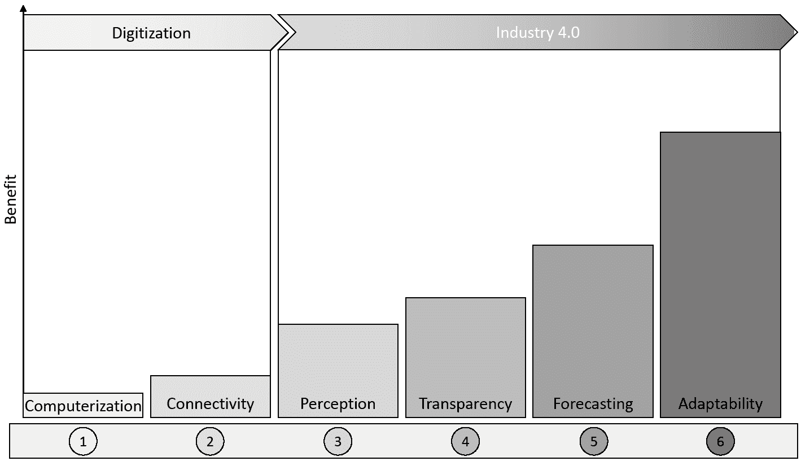

图 3.1：工业 4.0 成熟度指数。

### 3.1.3 AI 在工业 4.0 中的作用

从`工业 4.0`的角度来看，`AI`技术可以帮助公司达到成熟指数更高的水平。`AI`技术旨在使技术系统能够根据其可用数据自主感知周围环境。特别是，它可以用于定位和识别物理对象并确定其状态。对感知到的对象及其状态含义以及对象之间关系的后续解释，将有助于实现对工业流程链进行推理所需的透明度。对于第五级成熟度预期的自动化连续预测系统的仿真模型的自动创建和更新，可以使用某些`AI`方法（如模仿学习）来支持。

虽然`AI`有时被理解为人类决策能力的决策形式，但在`工业 4.0`的语境下，它并不意味着直接复制人类行为。一方面，`AI`旨在实现工业过程自动化的经典目标：降低成本、节省时间、保证质量等。另一方面，预计`AI`技术能够管理来自新部署的`工业 4.0`传感器系统的海量数据日益增长的复杂性。在某种程度上，`AI`系统可以通过发现肉眼无法看到的数据中的关联来解决问题、发现意外问题或简化复杂情况。

## 数据危机

然而，`AI`技术并非“魔粉”，而是受限于用于解决特定问题的底层数据和数学模型 [377]。

因此，在`工业 4.0`中成功使用`AI`技术最重要的工程问题之一，是底层数据采集的管理及其在数据库中的表示。

任何工业 4.0 数据流的设计都始于对所涉及物理对象的真实本质建立基础性的本体论概念。关键因素包括该对象的物理属性、传感器的选择，以及将传感器数据转换为语义正确观测结果的编程。首要面临的挑战是，在许多地方，仍然缺乏充分评估这些方面的工具。特别是在许多情况下，构建系统 80% 的时间都花在了数据采集和清洗上，这种现象被称为`data crisis`（数据危机）[377]。“数据危机的主要原因是计算机互连性的日益增强。因此，获取数据变得容易而廉价，但其质量往往很差。我们需要的是廉价的高质量数据流。这意味着必须开发改进和验证数据质量的有效方法。”[377] 当考虑到工业 4.0 系统所预期的、通过大量传感器进行持续数据采集时，这种危机变得尤为明显。挑战包括在工业 4.0 整个生命周期内监控数据流的质量，以及对设计过程开始时所做的底层假设的改变做出相应响应的能力。

### 3.1.4 从数字到赛博物理孪生

为了应对数据危机，系统的开发应该将数据采集的设计与所涉及物理对象的设计更紧密地结合。这产生了数字孪生概念，它将`CPS`（信息物理系统）的连接性与端到端数字工程中对象的虚拟表示相结合。数字孪生的概念特别关注物理实体与虚拟实体之间数据传输的质量。

就像企业的工业 4.0 成熟度指数一样，关于数字孪生的文献也存在物理对象数字化的不同实现水平 [354]。开发阶段根据自动化程度进行区分：

- 数字模型具有纯的人工数据传输。例如，它可以是计划工厂的仿真模型、新产品的数学模型，或以数字形式存储的另一个物理对象的模型。

- 数字影子（`digital shadow`）实现了物理对象与虚拟对象之间数据流自动化。物理对象状态的任何变化都会传输并应用到数字对象的状态上。

- 数字孪生（`digital twin`）消除了所有人工数据传输。它通过自动流指向物理对象的数据流，扩展了数字影子的概念。

为了能够将数据自动映射到虚拟对象上，正确识别物理对象是数字影子和数字孪生的先决条件。此外，完全消除人工数据传输使得物理对象处数据接收的设计变得尤为重要。数字孪生的必要条件可以描述如下：

- 虚拟对象的数据必须能够在物理对象处被自动接收和处理。

- 物理对象只有在它可以从其他对象中被分离感知时，才能成为数字孪生的一部分。

- 物理对象必须是唯一可识别的，以便将捕获的数据分配给虚拟对象。

识别的具体技术实现方式可以有所不同。可以通过观测来实现，例如 2D 条形码。也可以通过通信来实现，例如通过无线电传输。今天许多工业 4.0 应用可以归类为数字影子的概念。一个例子是内置在托盘中的低成本跟踪器，它记录有关托盘当前位置、移动和温度的数据。这些数据通过蜂窝网络发送到位于相应数字影子的服务器（参见 [354]）。

#### 赛博物理孪生 (Cyber-Physical Twin)

由于其非常通用的比喻，数字孪生的规模和复杂性差异很大。特别是，个体对象和大型系统之间没有区别。“数字孪生”一词可以描述一个小对象，也可以描述整个工厂。对于像工厂这样的大型系统，以中央数据库形式存在的中央单一方法将达到明显的局限性。

为了用于工业 4.0 环境，因此需要一种特殊的数字孪生类，提供基于单个对象的去中心化架构。这种新的扩展概念可以被称为赛博物理孪生。它具有以下额外特征：

- 物理对象被认为是一个自包含的较小实体。它的物理范围可以局限于有限的空间，并且具有固定的位置。即使它在某个地方停留很长时间，它根本上也是移动的。

- 指向物理对象的传输路径用于改变其行为，而不是发出命令。所有的行为变化首先在数字对象上进行，由物理对象调整其内部行为。行为变化可以通过传输参数、编译后的源代码或其他行为数据（例如训练过的神经网络）来实现。

- 物理对象在很大程度上自主运行，并尽可能做出局部决策。

- 物理对象监控其环境，当物理世界出现需要其调整行为的情况时，触发虚拟镜像中的更新过程。

- 赛博物理孪生被设计为多智能体系统，在物理世界和虚拟世界中进行通信。

图 3.2 显示了两个赛博物理孪生在物理和虚拟环境中相互的概念。注意环境之间的通信是通过物理和虚拟对象之间的专用链路进行的，以确保孪生的同步。

```
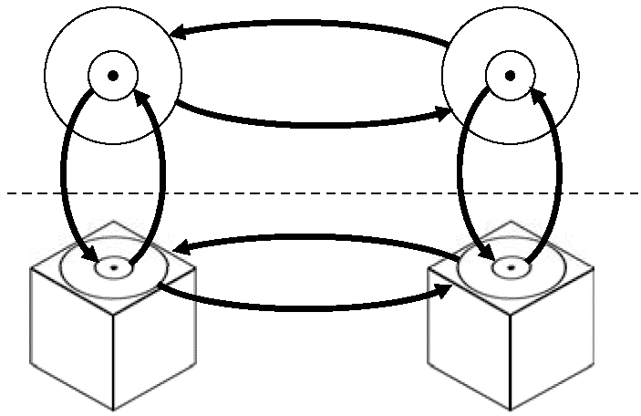
```

图 3.2: 赛博物理孪生概念

并不是所有的赛博物理孪生都由人工智能控制，但软件和硬件工程面临的挑战是类似的，因为在这两种情况下都需要高质量的数据流。

物理对象的移动性对于工业 4.0 系统的适应性是要求的，因为它就可以改变其组件的布局。因此，物理对象的嵌入式计算机系统原则上是受限的，而运行虚拟对象的计算机系统被认为是不受限的。

### 3.1.5 物流游览

自工业 4.0 引入以来，`logistics`领域被认为是其最突出的应用领域。在其他工业领域中，没有预计在短期内会发生如此根本性的变化。一方面，许多核心技术和社会挑战直接或间接地与物流和高效的供应链管理有关。另一方面，这归于工业 4.0 技术的快速发展。除了全球数据处理能力外，资源高效型传感器硬件、通信技术和嵌入式系统在大规模工业领域正变得日益可用。这使得在单个物流对象层面上实现广泛部署（参见 [164]）。

在日益波动的生产和贸易环境背景下，物流网络的拓扑结构，因此单个物流节点（如转运点或分销中心）的位置不再能够永久固定。事实上，固定且理想位置的想法在多年来已是不可行的。物流网络及其节点必须不断适应新情况。因此，物流中心在未来应该能够自主重新选址。这排除了许多形式的传统技术基础设施，并强调了引入诸如物理数字孪生（`cyber-physical twin`）等新概念的需求（参见 [279]）。

自动车辆群将日益接管公司内部运输。在生产系统中，工作站的布局可以随时更改。车辆的虚拟软件代理协商订单和业务流程，而物理软件代理协商移动路径并不断交换它们的位置以及新站点或存储位置的位置。自动车辆能够靠近货架并进出箱体或托盘。在这种愿景中，几乎没有静态的输送系统。

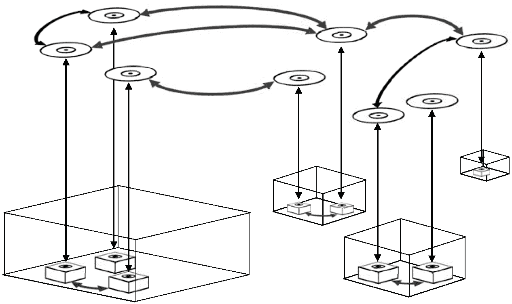

图 3.3: 物理数字孪生管理供应链中的仓储任务

甚至货架及其其中的每个箱体都可以成为物理数字孪生的一部分。仓库中的箱体处理库存管理、检查最小库存水平并订购补充（参见图 3.3）。它们与货架显示器和运输车辆通信。千禧之交时期设计的基于 RFID 的经典“物联网”，从字面上正在获得眼睛、耳朵、手臂和双腿。

这种物理对象与虚拟对象的全方位联网迅速引发了直接挑战。尽管长期以来所有经济领域的数据绝对量都在显著增加，但物流过程数据采集和处理的海量增长正成为待掌握的核心挑战之一。`AI`应用在物理数字孪生中处理复杂物流流程的潜力是。从预测运输和生产物流的到达时间到调度物流网络以及到来的高频物流，分布式`AI`解决方案可以自动化和自主化处理以前经典控制方法无法处理的复杂过程。预计`AI`将能够学习如何应对代表物流对象的大量物理数字孪生的复杂性。

### 3.1.6 可移动的受限智能对象

本章的内容涉及了与工业 4.0 系统中物理对象相关的四个关键领域：事物的创造、它们的定位、对象一旦变得移动和智能后的资源限制，以及它们相互之间的行为。

前三个贡献涉及了一个事物在变得智能或自主之前很久的起源问题。以钢材生产为例，使用机器学习方法来研究物理分离行为如何从原始质量中创建一个自给自足的实体，以及如何通过确定或预测某些属性将这一被分离的事物分配给一个具体的类别。对不良进展的早期预测使得在生产过程中进行控制干预成为可能（第 3.2 节）。第二个贡献致力于在变化的物理聚合状态背景下，机器学习技术面临的挑战（第 3.3 节）。在仿真中结合专家知识和收集的数据是第三个贡献的主题（第 3.4 节）。

第四个贡献涉及事物的自动化定位——这是支持过程持续（自）感知的基础设施的基础。工业 4.0 因此需要能够观察物理运动的能力。无线宽带定位是室内环境中这一任务的示例解决方案（第 3.5 节）。在这种情况下，无线介质是影响应用精度的可扩展性的资源。该贡献既与`smart city`概念（参见第 4 章）相关，也与基于未来技术的通信网络相关（参见第 5 章）。

第五个贡献是由可以移动的智能事物激发的。自由移动在其核心是一种深层的物流属性（“理想空间是空的”）。它也是能源供应、计算能力和嵌入式系统通信方面资源限制的主要原因。“室内光伏能量采集”（第 3.6 节）深入探讨了低功耗设备的需求。该技术的重要应用是标准化集装箱，它通过嵌入式低功耗计算机系统变得智能。这种智能集装箱注定是工业 4.0 的区块之一：它们是所装非智能事物的外部接口。

最后一个贡献涉及智能且上自主移动事物的行为。它基于微无人机群的发展（第 3.7 节）。小型无人机的资源限制对系统架构提出了高要求。该贡献描述了仿真与物理世界紧密耦合的测试环境搭建。无人机通过模仿自然群行为的简单规则协商各自的移动。展示了如何用仿真中学到的知识取代单个规则。无人机群展示了开发工业 4.0 自主系统的挑战。由于这些系统未来将越来越多地用于跨公司的关键领域，多智能体系统中的数据保护问题在此背景下也将变得重要（参见第 6.1 节）。

**摘要：** 互联制造工艺的特征是下游工艺步骤对之前步骤的依赖性。如果可以预测某个工件将无法达到预期质量，则可以在过程早期采取预测性措施。通过预测，机器学习在加工和物料两个方面都节省了资源。一个例子是电子制造中表面贴装技术（SMT）生产线上基于模型的质量预测。在这里，所学习的分类器对质量预测的应用必须足够快，以便能够更改某个部件的路由。因此，机器学习本身也需要节省资源，在本例中是运行时间。另一个例子是钢棒生产的热轧轧工艺。在那里，多个传感器和工艺参数提供工艺数据，需要对这些数据进行对齐，并自动从生成的流中提取有用特征。在这里，机器学习节省了工厂质量检测过程测试时间。

### 3.2.1 引言

未被检测到的质量偏差穿过整个制造链，由于缺陷产品在未被标记为缺陷的情况下拒绝率和返工率增加，会对内部失败成本产生严重影响。因此，对特定工件进行早期质量预测可以指示其是否能满足所需的质量要求，或者是否应该及时执行某些预测性措施以节省可能导致拒绝或进一步处理的资源（例如时间、物料）。然而，由于技术和时间限制，物理产品质量检测仅限于最后一个工艺步骤。在这种背景下，可以使用数据挖掘和机器学习技术来预测中间产品的质量，从而获得中间工艺步骤质量属性的透明度，并实现实时的工艺适应以持续提高其效率 [339, 654]。

通常情况下，工艺建模可以在三个层面上进行 [654]：工艺理解；设计更好的工艺和设备；以及实时在线工艺控制。在线控制需要整合来自过程中不同步骤不同传感器的数据，考虑传感器之间的通信，甚至实时集成不同的模型。在过去的几十年里，大多数工作集中在前两个层级，即开发基于领域知识的模型。最近，随着“工业物联网”或“工业 4.0”（参见第 3.1 节）的出现，使用传感器技术的不同监控技术 [155, 156] 的应用，为将数据驱动方法应用于工艺建模（特别是应用于中间质量预测）提供了新的机会。

本节将介绍如何通过将数据分析直接嵌入制造链，实现在沿工艺链的中间件质量预测（`IQP`）。我们首先展示如何将使用数据挖掘和机器学习的`IQP`集成到用于工业应用的综合智能制造过程控制（`IMPC`）框架中。第 3.2.3 节中介绍两个现实案例研究，从生产过程的描述开始，是建模和部署。第一个案例研究了为了减少质量检测量而在电子环境中使用数据挖掘。该案例研究是在西门子安贝格工厂的表面贴装技术（SMT）生产线上进行的。其动机是减少 X 射线检测系统。第二个案例研究由热轧工艺组成。它展示了嵌入数据分析的重要性。结论总结了我们的发现并对未来研究给展望。

### 3.2.2 智能制造过程控制中的中间质量预测

用于制造业中数据挖掘和机器学习应用的不同质量相关任务可以分为 [335]：产品/工艺质量描述；质量建模；质量预测以及参数/工艺优化。

在文献中，有几种用于通用数据挖掘或机器学习实现的标准化程序，特别是用于优化质量相关任务的方法。四种常用的流程模型包括数据库中的知识发现（`KDD`）、数据挖掘交叉行业标准过程（`CRISP-DM`）、`SAS`的`SEMMA`模型以及`SPSS`的`5A`模型 [121, 201, 484, 668]。这种在考虑质量因素的情况下持续监控和优化工艺的通用框架被称为`IMPC` [339]。上述模型的一个特征是它们在基本目标和结构非常相似。这些程序被分为不同的迭代阶段，在阶段的数量和内容上有所不同。虽然`IMPC`专门关注数据科学项目的技术视角，但其他某些模型包含一个阐述业务的阶段，这表明每个数据科学项目都需要专家知识的参与。

产品或工艺质量描述通常是执行的第一步，特别是在不同工艺步骤之间存在非线性相互作用的高度复杂制造系统中 [579]。这种模型可以基于领域专家设计的物理模型，也可以是机器学习技术的数据驱动模型。随后，模型被用于预测未见产品的质量。根据这些预测，可以应用多种工艺优化措施 [405, 579, 654]。这些措施包括早期控制干预、工艺参数设置优化、工艺稳定、计划动态化以及基于模型的检测的设计。

`IMPC`引入了数据挖掘技术来进行`IQP`，并根据`IQP`的结果调整进一步的生产步骤。`IMPC`由不同的功能模块组成，总结如下 [339]：

1. 数据采集与存储

2. 中间质量预测-`IQP`

3. 工艺优化

虽然第一个模块似乎是构建`IMPC`的前提条件，但模块 2–3 代表了不同的过程控制阶段。

`IMPC`本身可以按照两种不同的范式来实现。第一种是基于过程当前观测到的观测状态对过程进行在线优化，以补偿之前的过程偏差。这种决策是根据生产专家和工程师提供的领域知识做出的。第二种是数据驱动的方法，将第一、二模块集成到决策支持系统中。第二类过程控制依赖于实时对中间产品的质量进行估计。通过采取前瞻性措施来防止可能预测的过程偏差。整个过程控制方法的模块化设计详见于图 3.4。


IMPC 概念可以被视为公司过程控制格局中的一个独立的构建模块 [339]。IMPC 没有引入过程或生产结构的任何变化。然而，它在过程规划和优化中产生建议。因此，重点在于实时分析处理状态并预测中间产品的质量属性。这些知识被用于推导出关于产品是否应继续处理的建议，或者用于提前停止产品处理（因为无法满足最终质量要求），亦用于优化下一个处理步骤的参数，以使产品符合所需的质量标准。

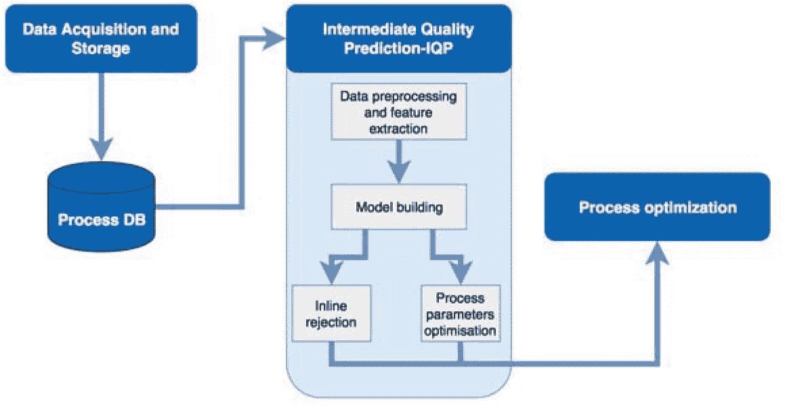

图 3.4: 智能制造过程控制模型。

IMPC 需要从第一个模块获取关于当前处理状态和参数的信息，此外还需要历史处理数据的信息。数据通常从用于监控某些过程变量的嵌入传感器中收集。收集的数据必须经过预处理，并提取有意义的特征，随后输入到质量预测模型中，以便正确评估中间产品的质量。因此，中间质量预测 `IQP` 模块将所有可用信息（无论其实际含义）转换为质量评估。这是通过数据挖掘，即监督学习模型实现的 [339, 654]。`IQP` 模块的结果随后可以应用于决策规则或过程优化的建议。过程优化模块是实现 IMPC 模型的最后一步。如上所述，它旨在调整后续过程步骤的参数，以在过程链的剩余部分补偿由之前的处理步骤引起的质量偏差。值得注意的是，当根据中间产品质量预测结果制定决策规则时，需要更多的知识，包括领域知识和人工测试平台（例如过程仿真），以验证过程优化建议的`正确性`和`可行性`。

在接下来的章节中，我们将详细讨论使用机器学习进行数据分析和质量建模的可用。

### 3.2.3 从传感器数据进行数据挖掘的方法

制造过程的动态演进特性为从传感器数据进行数据挖掘带来了多重挑战 [654]。例如，可能会发生不同的场景，传感器和机器可能会故障，可能会观察到某些过程偏差，产品可能会采取不同的路径。由于这些情况，数据如何收集、存储和预处理存在困难。此外，对于预测任务特征的自适应提取和选择是必要的。而且，为了实时生成中间产品质量，需要建立流数据方法和在线管理。接下来的章节将详细讨论此类问题。该节的结构如图图 3.5 所示。它是基于 `IQP` 过程，并包含了质量相关任务中的标准程序。

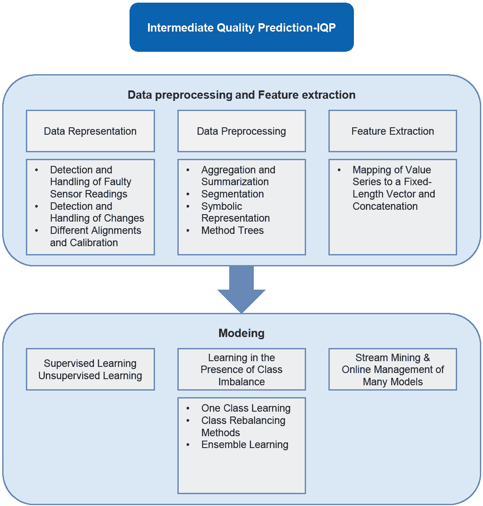

图 3.5: 质量相关任务的 IQP 过程规范。

#### 3.2.3.1 数据采集与存储

在智能制造系统中，数据通常通过各种传感技术收集 [339, 405, 654]。传感器的连续测量形成可数无限的数据项 `x[i]`。每个数据项包含一个索引（例如时间戳），并包含任意数量的值和值类型，如图像、字符串或数字。长度为 `n` 且仅包含数值值的片段形成值序列，它可以被定义[445]为映射 `x : N → R×C^m;m ∈ N`，其中长度为 `n` 的值序列的每个元素 `x[i]` 是序对 `(d[i], w[i])`。`d[i] ∈ N` 是索引组件，`w[i] ∈ R × C^m` 是值组件。如果维度代表时间顺序，则称为时间序列。值组件使用复数空间而非实数空间，以便以相同的的形式传感器读数及其转换。在分类任务（例如质量预测）中，机器学习模型的目标是学习函数映射 `f(x) : R → y : N^n`，其中 `y` 正式表示过程测量的类别标签。通常，这项被称为多类分类任务。当类别标签仅由两个互补类别组成时（例如不合格 (NOk) 和合格 (Ok），就出现了二分类的特殊情况。

#### 3.2.3.2 数据预处理

在制造环境中，传感器可能会提供错误的读数或可能经历故障期。它们的读数大多数时候带有噪声。因此，收集的数据可能包含无关读数、对齐错误或具有不同的分辨率。在离线设置下，此类情况可以简单从分析中排除或修正。相比之下，嵌入式实时数据分析必须以自动方式检测此类情况并做出相应反应。因此，第一个分析步骤通常由清理传感器数据。

##### 故障传感器读数的检测与处理

需要检测故障的传感器读数，例如超出物理意义范围的读数。然而，故障读数可能与正常数据重叠，这需要使用监督学习技术自动检测故障模式（参见第 3.2.3.5 节）[654]。但是，如果故障发生频率不高，很难根据现有的训练示例进行检测。在这种情况下，异常检测模型通过仅描述正常数据可以提供很大帮助。它们将偏离分布较远的模式标记为异常。尽管如此，仅凭少数噪声示例，要正确定义参数（如阈值值）仍然很困难。此外，即使对于领域专家来说，正确识别此类示例也是困难的。在检测到缺失值后，有几种处理方法，包括用前驱值替换或使用自回归移动平均法[98]，或基于在其他现有值训练的预测模型进行插补。此外，生产过程本身可能会向传感器数据引入某种程度的噪声。如果底层噪声模型，应该使用它。否则，应该对测量值进行过滤和平滑[405, 654]。

##### 变化的检测与处理

传感器读数的偏差和变化也可以底层硬件的预期变化来解释，例如引入新的生产设备以及新的或不同的传感器校准时。根据变化的类型，必须决定更新哪些已训练的模型以及如何更新。在没有任何模型描述此类变化的情况下，可以应用概念漂移检测方法，并且必须决定已训练的预测模型是否需要更新以及如何管理这些模型[564]。更多细节见第 3.2.3.10 节可以使用可以使用增量训练方法，如流式方法（参见第 3.2.3.9 节），可以将此类变化集成到已训练的模型中。

##### 数据对齐与校准

由于传感器记录使用了不同的数据采样策略和采样频率，可能会观察到不同的数据对齐。数据源的测量频率定义为源每单位时间内交付数据的次数。所需的采样频率越高，占用的内存越多。许多传感器的数据关联和整合需要它们的同步。环境描述的特征是适当的测量时间。为了获得精确的同步，需要定义或使用同步技术推导出一个针对不同传感器的足够准确的全局测量时间[309]。在此种背景下，多传感器数据融合系统必须处理不同的和变化的测量频率、测量延迟以及异步时间。

同步技术可以分为两大类：确定性和非确定性同步。在确定性设置中，必须提前知道每个传感器的测量时间，并使用聚合技术对最慢的传感器进行同步[309]。在非确定性设置中，假设传感器是异步的，且对测量时间或延迟一无所知。在过程记录中，可能会使用不同的频率。在这种情况下，可以使用递归滤波方法（如 `Kalman filter`）或递归自回归滤波器进行同步[291]。

此外，从传感器提取数据的不同假设也可能导致从不同分布中学习的意义上的不匹配。因此，传感器数据必须经过校准（例如调整传感器参数、特征、使用分类或聚类对超出范围的原始数据进行截取）[654]。

#### 3.2.3.3 数据表示

正如在钢铁生产案例所示（第 3.2.4 节），单次通过生产链可以由一组具有不同长度和偏移的时间序列来表示，这些序列可能重叠、来自不同的机器，并且在可选步骤中可能缺失。许多常见的数据分析方法无法直接处理此类时间序列；相反，它们要求所有观测值表示为固定长度向量。在这里，我们讨论如何将原始序列值转换为单个向量。

目标是将传感器数据转换为固定长度向量，以便可以使用标准的学习技术。我们首先在固定长度向量中为每个传感器预留足够的空间。然后通过预定义的位置对原始序列进行索引。对于映射，需要预先知道序列的最大长度。对于投影，原始序列值可能需要进行缩放，例如通过插值。

一个困难的问题是对未处理区域填充什么值。我们可以简单地用零或上一个记录的值填充。然而，用零填充会导致在使用流行的距离度量时评估不准确。例如，两个序列会被欧式距离标记为高度不相似，尽管两个钢块（A 和 B）的质量相似。在这种情况下，特征向量与相似标签之间的正确映射将会改变。在固定长度向量中为两个卷绪（传感器 5 和 6）预留相同的部分似乎解决了这个问题，但它没有考虑到两个卷绪可能具有不同的属性，例如数值刻度，这通常需要仔细的数据校准[654]。与其将所有序列值转换为固定长度向量，另一种选择是使用可以处理不同长度序列的距离度量，例如`动态时间规整 (DTW)`[461]或`最长公共子序列 (LCSS)` 距离[160]。原则上，为了适当转换原始时间序列有两种主要方法。第一种方法简单地连接所有属于单个制造件（例如单个钢块）处理的时间序列。第二种方法包括独立计算每个传感器时间序列的距离值，然后将其相加得到总距离。

#### 3.2.3.4 特征提取与选择

与其使用原始数据流，不如通过从原始数据提取的一系列特征来对生产过程进行描述。从原始数据到特征向量的转换应该最大化预测准确性，并通过降低维度和存储数据量提高机器学习算法的资源感知能力（参见第一卷中的第 1 章）。该任务的挑战在于对于所有可能的转换组合存在巨大的搜索空间（即指数级规模）。传统方法基于人工特征提取，利用数据分析和领域知识逐个构建特征。虽然这些方法对用户来说是易于获取且具有可解释性的，但它们往往是繁琐、耗时、容易出错，且通常不适应数据变化。在这种背景下，自动特征工程似乎是一条很有前景的方法。它包括自动提取和生成大量特征，并选择这些特征的有效子集，以确保机器学习算法更好的性能。文献中关于自动特征工程已经进行了许多工作，要么通过自动化整个过程 [594],[445]，要么专注于于特定步骤，如特征提取、特征生成 [314]或特征选择 [582]。接下来的章节列出了非详尽的转换和特征提取方法，这些方法在生产背景下看起来特别有前景。

##### 聚合与总结

针对流时间序列的聚合和总结方法可以尽可能地减少收集的数据，并尝试保留其重要模式。最简单的聚合类型是基于汇总统计的计算，例如最小值、最大值、平均值、标准差、分位数和直方图。这些简单的特征就可以为学习者编码足够的信息，有时性能甚至优于复杂的方法 [654]。更复杂的方法基于时间序列转换搜索时间序列的其他表示形式。这些包括离散傅里叶变换 (`DFT`) [445]和离散小波变换 (`DWT`) [445]。

##### 分段

Candan、Rossini 和 Wang 提出的显著性特征方法 [115] 将二维图像分段以及从图像中提取尺度不变特征变换 (`SIFT`) 的思想转移到一维值序列空间。序列中的显著点（即与周围值值偏离程度的点）被用于分割序列。然后，从每个段中提取表征特征。该方法在不同的分辨率下确定显著点，允许对不同粒度级别的值序列进行描述。一种分段方法是在钢钢用例背景下开发的（Section 3.2.4.2)）。该方法根据领域知识和信号在生产场景中确定分段 [654]。分段后，在每个段上计算不同的统计量，如平均值、标准差、最小值和最大值。这种简单方法的最大优势是它允许以高度可解释的方式组合许多特征 [654]，因为特征转换是以这种方式处理的。例如，一个基于规则的分类可能是“如果加热时间小于一小时，则……”这种方法已成功应用于识别生产过程中的模式（参见 Section 3.2.4.2)）。

##### 符号表示

SAX（符号聚合近似）[413] 首先通过分段近似确定序列 `C = (c[1]; · · ; c[n])` 的元素并将其映射到新的序列 `C′`：

```
c_{i}' = \frac{n}{w}{\sum_{j}(i-1)+1}
```

然后将 `i'` 离散化为固定数量的符号，保持所有序列之间的欧氏距离。一种基于梯度的传感器数据符号化方法由 Morik 和 Wessel 引入 [458]。该方法最初应用于文本挖掘，并已成功用于文本分类或入侵检测等领域。

##### 方法树

所有上述方法的不同参数设置和组合对于从值序列中提取特征都是用的。与其手动尝试并组合现有方法以及不同的参数值，Mierswa 和 Morik [445] 开发了一种自动表示学习方法，用于优化分类的最佳组合。树以广度优先的方式应用运算符（节点）来转换原始值序列。树的根由窗口函数组成，而每个父节点是表示基变换、过滤器和结束函数的运算符链。特征提取树的学习通过遗传算法执行。该方法可用于生产过程的时间序列分析。然而，它对标签分层数据集的需求并不总是能满足。该方法已在 RapidMiner 中实现。

在生产过程中，解释性变量是从传感器测量值（即给定钢块的记录）中提取的特征，而 `y ∈ Y` 是待预测的相应质量标签。学习函数 `h ∈ H` 的示例包括决策树、k-近邻算法 (kNN)、朴素贝叶斯和支持向量机 (SVM)。关于此类方法的详细深度概述，请参阅 Hastie 等人的著作 \[260\]。

上述方法假设所有训练数据均以批的形式可用。因此，它们无法在制造过程中进行训练，而且当概念发生变化时，其模型需要重新训练。在没有概念漂移的情况下，可以离线训练模型，但将其部署到在线进行预测。

#### 3.2.3.7 无监督学习

如果没有提供标签，则可以采用无监督学习方法来揭示数据中最显著的模式。聚类分析 \[300\]尝试根据相似性度量对观测值分组。聚类数量 `k` 通常是用户定义的超参数。一种著名的聚类算法是 `k-means` \[426\]。降维技术（如主成分分析 (PCA)）旨在简化高维数据集。其中一些方法可用于更好的数据可视化，例如自组织映射 (SOMs) \[654\]，它们将高维输入向量映射到低维网格上。输入空间中相互相似的向量在网格上彼此靠近。SOMs 也被用于钢生产案例研究中的数据分析（参见 Section 3.2.4.2）。无监督方法最大的缺点是，在没有任何标记数据的情况下，其结果只能通过领域专家进行验证。

#### 3.2.3.8 类别不平衡下的学习

当数据类别的频率不相等时，就会发生类别不平衡。通常，这发生在某些类别代表稀有事件，而其他类别代表这些事件的对应情况时。稀有事件（特别是可能产生负面影响的事件）通常需要知情且快速的决策。然而，众周知类别不平衡会导致向多数类别的学习偏差，这意味着对少数类别的检测能力差。例如，具有高质量标准的生产过程通常输出更多的高质量产品。同样，某些事件（如机器或传感器故障）可能很少发生。在这种情况下，有许多正样本，但负类样本只有几个，甚至没有。在分类任务中，基于准确率衡量类别不平衡的性能会导致会导致指标偏向多数类别的。。可以使用不同的方法缓解类别不平衡，包括单类学习、类别再平衡方法和集成学习。

##### 单类学习

处理类别不平衡的一种方法是利用单类学习任务将少数类实例视为离群值或异常值，并将多数类实例视为正常类 \[460\]。Tax 和 Duin \[675\\]提出了支持向量描述 (SVDD)，它在给定数据周围计算一个球形边界。球的直径以及落入球内的训练数据量由用户选择。随后，球内的观测值被归类为正常，而球外的观测值被视为离群值或异常值。Schölkopf 等人 \[581\\]提出了 1 类 SVM，它通过最大间隔将所有训练样本与原点分开。一种此类数据描述的主活跃方法推广了这种方法 \[238\]。

##### 类别再平衡方法

已经提出了多种方法通过数据重采样来处理类别不平衡问题 \[563\]。重采样策略通过平衡数据来减轻机器学习模型向多数类的偏差影响 \[125\]。重采样方法被认为是灵活的，因为它们独立于所选分类器。

##### 类别不平衡下的集成学习

在集成框架中组合分类器是处理类别不平衡的另一种常用方法 \[563\]。在集成分类器中，我们可以区分四大大家族：

- 第一类包括基于重采样的集成。在平衡的数据集上训练基分类器后，创建分类器集成。
- 在第二类中，集成是在应用数据重采样策略（如 SMOTEBoost） \[576\\]后基于提升的。
- 在第三类中，我们发现了基于 Bagging 的集成 \[101\\]（例如 UnderBagging、OverBagging、SMOTEBagging）。

最近，我们提出了一种概率集成方法，在训练期间显式地处理类别不平衡。

#### 3.2.3.9 流挖掘

为了应对实时演变的生产系统，分析的每一个步骤都应该以在线的方式应用和处理。然而，学习有效的表示需要如上文使用模型树进行离线运行，但使用学习到的提取结果必须在线应用。许多应用要求对原始传感器数据进行转换、模型部署，有时甚至模型更新和新颖事件的检测都需要在线完成。变化检测通常通过对每个新到达的数据项更新模型，或在最最近的一批数据项上学习模型来实现[218]]。

标签通常在流程链的最后进行测量，因此，对于从 `t[i0]` 到 `tie` 的时间序列，我们拥有观测 `x[ti0]`、`...x[tia]`、`...x[tie]`，但只有最终的质量测量值 `y[tie]`。因此，我们在每个观测点预测最终质量。模型 `f` 使用从 `x ∈ X` 提取的 `p` 个特征（即 `f (ϕ1, · · · , ϕp) = y`）。假设 `t[i0]` 为过程 `p[i]` 的开始时间，`tie` 为其结束时间，`t[ia]` 为实际时刻，一种可能的方法是将时间序列分段，并在每个段上学习一个独立模型来预测最终质量。这种方法在重要事件无法及时识别且存在内存限制时非常有用，即在时间序列子序列上训练模型，而不是考虑所有历史数据。如果能够在给定时刻 `t[ic]` 发生的相应流程步骤中识别出重要事件，那么从段 `[t[i0], t[ic]]` 中提取的每个特征都可用于学习模型。因此，如果 `t[ia] > t[ic]`，就可以生成标签的首次预测。

另一种方法是使用静态和统计特征的组合，例如时间序列的最小值、最大值或平均值。静态数据在整个过程中不会改变，统计特征变化的概率随着过程的结束而降低。这意味着存在一个索引 `t[is]`，其处的预测误差限制在 `(f̂(ϕ1,...),ϕp)−y)² ≤ ξ` 之内。另一种方法是使用一种或一组算法，预测时间序列中未见部分 `[t[ia], t[ie]]` 的特征集，并在全特征集上训练模型以预测质量标签。因此，整体预测将强烈依赖于特征预测的准确水平。

#### 3.2.3.10 多模型的在线管理

正如流挖掘中提到的，机器学习模型可以进行离线训练并实时部署以生成质量预测。也可能出现流挖掘设置需要在数据的不同部分上训练许多模型的情况，例如时间序列的不同段（参见第 3.2.3.9 节）。此外，产品和流程的个性化日益增加可能会导致小规模异质观测组。此时，有必要学习不同的模型来表示每个观测组并捕获其底层属性。因此，应该通过动态组合许多模型来建立高效的多个模型在线管理，通过实时更改它们的组合和集成规则来适应检测到的数据变化。动态组合可以通过自适应集成方法正式建立，这些方法被构建为表征目标概念的分布的加权组合，并实现从单个模型选择到多个模型加权聚合的灵活管理[561, 562, 564, 565]。自适应集成方法的应用与数据中的概念变化检测相结合，从而使得能够在不同层面上进行集成更新（例如：基础模型选择[561]、基于知晓的基础模型/集成参数适应（即在检测到概念漂移后）[562]）。


在此背景下，我们提出了一种自适应集成选择框架，用于管理两个主要的在线集成构建阶段：剪枝和集成[564]。由于基于集成模型的性能随时间变化，它们也被认为受到概念漂移的影响。采用了一种漂移检测机制来排除性能与其余模型相比显著变差的模型，并识别出顶级基础模型。在此背景下，使用基于皮尔逊相关系数（即常用于处理时间序列）的自定义指标在滑动窗口验证集上评估性能。在每次漂移检测后，都会识别出顶级基础模型。由于多样性是集成方法的根本性组成部分，我们通过模型输出进行第二阶段选择。在每次漂移检测后，都会更新类和顶级基础模型（即每当我们的漂移检测触发报警时）。在每次聚类计算时，选择属于该类的模型。在最后一步，使用滑动窗口平均将选中模型的输出组合在一起。

我们还开发了一种使用深度强化学习进行时间序列在线集成聚合的框架[562, 565]。在其中，我们利用深度强化学习框架作为一种元学习方法来学习线性加权集成。在该框架中，集成中的组合策略被建模为序贯决策过程，并使用了演员-评论家（actor-critic）模型，旨在连续动作空间中学习最优权重。策略根据漂移检测机制进行更新，以跟踪集成模型随时间变化的性能漂移[562]。

这些框架最初是为了管理预测模型，可以用于预测随时间变化的连续质量相关指标，也可以迁移到在流环境中运行的分类模型。

### 3.2.4 案例研究

以下案例研究突出了所引入理论框架的不同方面，并对所描述的方法如何在实践中应用于解决质量相关问题给出了决定性的印象。然而，并非所有概念都在特定的工业环境中得到了验证。在 SMT 制造用例中，解释了数据采集与存储、类别不平衡存在下的学习以及特征提取和建模的步骤。最后，描述了 SMT 线的流程优化。在热轧过程中，重点强调了数据采集与存储，因为由于传感器测量不完全和其他因素，传感器数据的处理具有挑战性。此外，还解释了特征提取和建模阶段。

#### 3.2.4.1 电子制造中的基于模型的质量预测

电子产品生产案例研究涵盖了 Simatic 型可编程逻辑控制器的生产。在焊接工艺结束后，会检查焊接元件的正确位置。对于具有可见连接点（引脚）的变体，通过自动光学检测（AOI）完成此操作；对于引脚位于组件下方的变体，则通过两个不同的视角（`X`[1] 和 `X`[2]）进行 X 射线检测。

印刷电路板（`PCB`）放置在面板上，并通过将 48 块 `PCB` 放置在八个视野（`FOV`）中进行池化测试。每个 `PCB` 上的引脚数在 `X`[1] 和 `X`[2] 方向分别为 79 个和 52 个。图 3.6 中展示了一个典型的 `PCB` 板，以展示了一种使用 SMT 制造的产品变体。由于检测时间较长且产量巨大，X 射线检测是 `PCB` 生产的瓶颈，特别是考虑到了 100% 检测（即对每个 `PCB` 进行测试）以及对不断增长的可编程逻辑控制器的需求 579。对于本案例研究，重点被缩小到一个产品变体、相应的生产线以及 `SPI` 和 X 射线的数据源。

##### 数据采集与存储

来自串行外接口（`SPI`）和 X 射线的历史数据集通过唯一标识符在不同的制造数据库中匹配。解决引脚级别的用例（即每个引脚被分配一个质量标签）是一项低维机器学习任务，如 580 所示，因为只有七个不同的特征映射到一个类别标签。然而，从工艺角度来看，在引脚级别进行质量测试是不可行的，工艺数据被聚合到 `FOV` 级别。因此，工艺数据的维度随之增加。所考虑的数据集由数值 `SPI` 特征（见 表 3.1）和 `FOV` 聚合层上的二进制 X 射线标签组成，这被形式化为一个二分类任务。


图 3.6：图像展示了从 `X`[1] 方向看到的使用 SMT 制造的 `PCB` 板。

表 3.1：引脚级别的描述性 `PCB` 特性。

| SPI 特征 | 单位 |
| :--- | :--- |
| 高度 | % |
| 2D 形状 | % |
| 3D 形状 | % |
| 表面 | % |
| 体积 | % |
| X 偏移 | μm |
| Y 偏移 | μm |

案例研究使用了为期五个月生产的历史数据集。总共解析了 461,037,321 个数据点，其中 800 百分分之一（ppm）不合格（NOK）。利用专家知识消除了无代表性的数据集（例如在过时的工艺配置下或制造试验期间记录的数据集）。结果是一个准备好且清洗过的训练数据集，用于后续建模，包括唯一标识符、所有相关特征以及质量标签（取决于所采用的测量方法，可以是连续或离散）。

##### 类别不平衡下的学习

所考虑的用例构成了一个极端类别不平衡情况。在不使用任何特定应对措施的情况下，分类器会因为频繁对少数类进行误分类而退化。在工业环境中，将缺陷类分类为 `OK` 通常是不可接受的。因此，选择了特定的测量方法，以提高算法在 `NOK` 类别上的性能。为了重新平衡数据集，我们检查了不同的重采样技术组合，例如过采样（`SMOTE`、随机过采样）和欠采样（随机欠采样）。此外，系统地调整输出类别成员概率阈值，以便在分类器的精确率和召回率之间获得更好的权衡。

##### 特征提取与模型学习

最初，`PCB` 工艺数据是在引脚级别描述的。工艺专家得出的结论是，有必要聚合到 `FOV` 级别，使得每个 `FOV` 包含 `X`[1] 方向的 79 个引脚，或 `X`[2] 方向的 52 个引脚（每个引脚七个特征）。由于 580 在 `FOV` 级别的结果并不理想，进一步进行了实验。

一个方向是使用特征提取方法结合机器学习模型进行降维。为此我们使用了 Rapidminer 的 Value Series 插件。这使得 `X`[1] 的数据维度从 553 个特征减少到 240 个，并将 `X`[2] 的 364 个特征减少到 50 个。

##### 模型评估

模型训练在嵌套交叉验证和超参数优化的结构中进行。由于无法预先选择合适的算法，因此对每个应用测试并评估了不同的学习方法 579，包括梯度提升树（`GBT`）、随机森林（`RF`）和多层感知器（`MLP`，基于在连接变换阶段计算完全加权和的全连接神经元）。这些方法被用作实验的基准。

与全连接神经元相反，一维卷积神经网络（`1D-CNN`）基于权重共享原理。例如在离散一维（1D）情况下

```
(d*K)(x) = ∑[a]I(x−a)K(a)
```

这是数据样本 `d` 与核（或滤波器）`K` 的卷积 767。使用了卷积大小为 `k = 3` 的 `1D-CNN`，以便将引脚的直接邻域知识整合到学习过程中。堆叠了两层卷积，并额外使用了率为 `d = 0.5` 的丢弃（dropout）进行正则化。通过结合最大池化和两个连续的全连接层获取最具判别性的特征。在该用例上最好的再平衡技术是随机过采样，它在将数据输入分类器之前应用。汇总结果可以在 表 3.2 中找到。

模型结果表明，分类器在整体准确性方面的性能一般。`GBT` 模型显示出最佳的整体性能，但该用例的困难之处在于高类别不平衡率。`NOk` 类的分布似乎没有被分类器准确表示，或者是以牺牲 `Ok` 类较低召回率为代价的。然而，从实际角度来看，可以使用 `1D CNN` 来减少 X 射线机器的测试工作，这可以节省高达 75.4% 的测试量，这在表 3.2 中通过 `NOk` 类的召回率体现。令人惊讶的是，尽管降低了维度，但使用特征选择方法的实验并没有我们预期那样提高性能。似乎在这个用例中，每一个引脚都必须被考虑，通过统计特征汇总数据会导致信息丢失。最后，由于深度学习模型通常缺乏可解释性，尚不清楚是哪些判别特征导致分类器得出了结论。相比之下，基于树的方法提供了更高的可解释性。因此，对特定模型的决策也取决于其准确性，以及在某种程度上对领域专家的可解释性。

表 3.2：交叉验证分类结果。

| 指标 | 召回率(NOk) | 召回率(Ok) | 准确率 |
| --- | --- | --- | --- |
| `RF` | 69.83% | 53.76% | 73.46% |
| `GBT` | 73.98% | 39.70% | 43.26% |
| `MLP` | 16.08% | 95.13% | 80.15% |
| `1D-CNN` | 75.4% | 43.85% | 74.71% |

##### 过程优化

模型部署通过组织集成到检测规划流程中实现。如 [580]所述，模型在云基础设施上进行训练，并存储在靠近流程的边缘设备上以减少延迟和带宽问题。在这里，检测策略决定了模型相对于检测规划和设计的角色。虽然完全基于预测模型的检测需要模型具有很高的信度和极高的模型准确率才能达到或超过传统检测原则的水平，但混合方法对于目前的发展状态似乎很有前景。检测可靠性由质量预测和传统检测的结合给出。在质量保证中引入质量预测，可以在不牺牲检测可靠性的情况下，通过减少物理检测量来促进额外价值的产生。根据模型的信任程度，可以推出两种不同的策略：仅对预测结果为 `Ok` 或预测结果为 `NOk` 的部分进行物理检测。由于质量背景下数据集的类别不平衡通常非常高，仅选择预测为 `NOk` 的部分进行物理检测将提供远优的潜在节省空间。

#### 3.2.4.2 热轧过程中的实时质量预测

在热轧案例研究中，钢坯通过工艺链变成钢筋。工艺链如图 3.7 所示。首先，钢坯在加热炉的五个不同加热区内加热 15 小时。然后它们在块轧机和第一道精轧机上进行轧制。第二个轧机的轧制是可选的。

![图 3.7：两个不同钢坯的传感器测量。©[2016] Springer. 经许可重自 [654]。](graphic/b_9783110785982-003_fig_007.png)

图 3.7：两个不同钢坯的传感器测量。©[2016] Springer. 经许可重自 [654]。

每个钢坯通常在单个轧机上移动几次，其中轧制步骤数（每步耗时几秒）是确定的。钢坯最终被切成小钢筋，几天后使用超声波测试进行质量评估。安装在生产链上的传感器提供了关于钢坯处理情况的在线测量。传感器以 10 Hz 的频率测量各种物理质量，包括空气温度、轧制力、轧制速度和辊高。超声波测试结果指示了每个钢筋的缺陷量。在超声波测试中评估钢坯质量是不可能的。钢坯在进行超声波测试之前必须冷却。质量偏差通过位置、频率等特定质量参数 [404] 在显示中进行评估。在某些情况下，如果钢坯被错误加热，能量和人力劳动力就被浪费了。因此，本研究的目标是在传感器数据中识别质量相关的模式，并尽早检测出 `NOk` 钢坯。通过调整后续步骤的参数，可以节省能量并达到所需的质量 [339]。

在下文中，我们将详细描述记录了哪些传感器测量数据以及如何存储、预处理它们。参见 3.3，该节介绍了一种受本案例启发的创新学习方法。

##### 数据采集与存储

在一年的时间内，在处理约 10,000 个钢坯期间，收集了来自 30 种不同类型的十亿次测量。读取值包括每个加热区的空气温度、速度、力和位置。领域专家认为这些是最相关的参数。为了验证并保证结果的可重复性，所有数据都存储在单个 `SQL` 数据库中。开发了一个 `Java` 工具用于读取和导入不同格式的原始数据。导入后，可以根据 `SQL` 过滤器将传感器测量导出为 `CSV` 文件，包含单个钢坯处理过程中特定传感器记录的所有数据。对于生产环境中的时间序列数据预处理，使用 `Rapidminer` 开发并实现了一个高度模块化的流程 [405, 654]。接下来的章节将对 [404, 654] 中已介绍的步骤和结果进行总结。首先，通过切除没有发生处理的部分对所有值进行清洗，正如在 3.2.3.2 中讨论的那样。此外，超出合理范围的测量值将被标记为离群值，并用其前一个值替换。

随后，根据 Section 3.2.3.3 中的描述，基于背景知识对时间序列进行分段。例如，在加热炉的情况下，五个不同的加热区域构成了分段的自然边界。同样，源自三个不同轧机的所有序列，单个轧制步骤是自然的划分。

##### 特征提取与模型学习

时间序列中的每个分段都由若干统计数据描述，并映射到固定长度向量的部分中。每个钢坯记录的 60,000 个原始序列值被聚合为约 2000 个特征。所得数据集随后可以输入到常用的特征选择和学习算法中。对于 470 个工艺，可以建立所得切断钢与钢坯之间的映射关系。这些工艺的特征向量随后被用于比较不同的机器学习方法：朴素贝叶斯、决策树、k-NN 和 SVM [404, 654]。事实证明，与包含数值序列和分段的全局信息相比，包含单个分段的特征会降低准确率。因此，后续分析排除了单个分段的特征，剩余 218 个特征。

##### 模型评估

即使使用了提取并筛选的特征，上述没有任何分类器的预测准确率能超过基准模型（即预测多数标签的基准）。为了更好地了解数据，将特征向量映射到二维自组织映射（SOM）（（Figure 3.8）中，其中彼此的点具有相似的特征（参见 Section 3.2.3.4）。阴影用于表示点与点之间的加权距离，颜色越浅表示距离越大。在左侧的 SOM 中，点代表生产工艺的特征向量，它们的颜色表示所产钢坯的最终质量，分为 Ok（红色）和 NOk（蓝色）。在许多情况下，NOk 钢与 Ok 钢非常接近（参见 Figure 3.8 中的放大区域），这意味着它们具有高度相似的特征。因此，目前提取的特征不足以正确分类低质量和高质量工艺。

![Fig. 3.8: 特征向量之间的相似关系。©2016 Springer. 经许可从 [654] 转印。](graphic/b_9783110785982-003_fig_008)

Fig. 3.8: 特征向量之间的相似关系。©2016 Springer. 经许可从 654 转印。相比之下，Figure 3.8 右侧的 SOM 显示了生产钢坯的最终尺寸。似乎，提取的特征与不同尺寸钢坯的不同生产模式高度相关。可以通过在第一道轧机的特征上训练决策树来验证该假设。10 折交叉验证估计的准确率为 90%，而 k-NN（`k` = `11`）达到了 97%。对决策最重要的因素是轧机的位置（`sensor 501`）。这表示了轧机的高度，并自然意味着对钢坯的压力。这与轧制后钢坯的尺寸（由 `V1`, `V2` 表示）相关。领域专家已验证结果反映了轧机中的实际操作模型。特征与特定的操作模式相关而非质量，可能意味着模式之间巨大的定量差异（即全局模式）掩盖了局部模式。SOM 聚类对质量预测提供了重要提示。例如，未来可以针对训练单独的模型，提取尺度不变特征，或者对数值序列进行更好的归一化。结果表明，数据分析能够检测生产过程中的意义模式。尽管识别预测任务所需的精确特征有时并不简单（正如在 Section 3.2.3.4 中讨论的），对数据的每项洞察对于后续工作都是有用的。

#### 3.2.5 结论与展望

本贡献提供了工业 4.0 数据挖掘的概述。前面的章节提供了通用指南。在 Section 3.2.2 中，我们展示了对质量预测的需求，以及如何将其到 IMP 模块中以减少材料和能源消耗。通过仔细研究 Section 3.2.3 中的数据挖掘所有步骤，我们为每个步骤提供了多种方法。本贡献在 Section 3.2.4 中展示了两个真实案例研究：电子制造中的质量预测（Section 3.2.4.1）和热轧工艺（Section 3.2.4.2）。这两个用例都证明了在生产链中进行实时嵌入数据分析对质量预测的益处。

尽管已经有一些成功案例，但仍然存在一些限制，阻碍了开发的机器学习解决方案在工业中的应用。阻碍机器学习在真实环境中应用的两个最重要障碍之一，是许多制造场景下缺乏可靠的标注数据。数据收集、异构源的数据融合以及数据清洗需要持续的努力。第二个是公司内部组织架构需要将具有机器学习资质的计算机科学家整合到工程部门的高层。将不同背景的员工进行社会融合（不仅是在董事会层面）是一项挑战性任务，但为了充分发挥机器学习的潜力，这是必要的。

## 3.3 标签比例学习 (Label Proportion Learning)

Marco Stolpe

Katharina Morik

**摘要：** 对于钢棒生产的链式过程，质量信息是以统计形式给出的整炉钢坯数据，即我们知道具有质量相关问题的钢坯比例。这为机器学习带来了一种新问题，因为几乎所有的监督学习方法都假设给定的是单个观测值的标签，而不是组别的。从标签比例中学习的问题被称为标签比例学习问题（learning from label proportions）。在本文中，我们将介绍该学习问题以及解决它的现有方法，还介绍了在项目 B3 背景下开发的名为`通过聚类学习标签比例`（LLPC）的基于聚类的方法。证明了 LLPC 在预测性能和运行效率方面优于当时被认为最先进的方法。此外，还展示了它与资源受限学习设置（如分布式学习）的关系。

### 3.3.1 引言

在智能制造中，很难追踪整个生产链中的产品。例如，在热轧的链式生产过程中，钢坯的温度高到无法对其进行冲压或配备 RFID 芯片。一旦被切割成较小的钢棒，追踪对象的身份（即哪根钢棒属于哪个客户订单（或批次）中的哪个钢坯）就会变成一个重大的技术挑战。在钢轧场景中，质量标签通常以整批次的百分比形式给出，而不是单个钢坯。这与其他行业类似，由于成本原因，只检查一小部分样本的质量。根据估计的缺陷产品比例，可能需要丢弃整个批次、重新检查，或者接受向客户交付极小比例缺陷产品。一个有趣的问题是，我们是否可以只检查样本，但仍然推导出关于单个产品属性的信息。此外，我们是否可以在生产过程本身（质量检查之前）就筛选出某些钢棒？更通俗地说：如果我们只给定不同批次产品每个标签的比例，是否可以推导出一个模型，根据它们的属性为单个产品分配正确的标签？

上述`从标签比例中学习`（LLP）问题不仅在工业中具有应用，还涉及隐私保护数据挖掘、选举预测、银行客户分类、破产预测或海洋垃圾上岸预测等多种领域。对我们来说，特别相关的是它与资源受限的分布式学习设置的关系。分布式机器学习通过两种方式接收整体数据的子集：水平划分和垂直划分。水平划分的数据是具有所有特征的独立观测集，例如提供相同商品的不同商店的销售情况。相比之下，垂直划分意味着每个特征的子集。

### 3.3.2 标签比例学习问题

据我们所知，Musicant 等人首次正式制定了问题 `466` 的分类和回归任务。我们将他们的问题定义扩展到多分类问题，并将其与从所有观测和标签中抽取的未知联合分布 P(X, Y) 联系起来。


**定义 1（从标签比例学习（LLP））。** 令 `X` 为实例空间，`Y` 为类别标签空间 `Y[1], . . . , Y[l]`。令 `P(X, Y)` 为实例与类别标签上的未知联合分布。在*从标签比例学习*的设定下，我们得到一组 `N` 个未标记观测值的样本 `X = x[1], . . . , x[N]`，其中 `X ⊆ X` 且从 `P(X)` 中独立同分布（i.i.d.）采样。令 `y[i] ∈ Y` 为观测值 `x[i]` 的个体标签，其中 `Y ⊆ Y`。个体标签是未知的。相反，我们得到了 `X` 划分为 `h` 个不相交的包 `B[1], . . . , B[h]`，并且对于每个包 `B[u]` 和标签 `Y[v]`，我们得到了包 `B[u]` 中具有该标签的观测值比例 `π[uv] ∈ [0, 1]`。仅基于这些信息，我们寻求一个函数（模型）`ˆf : X → Y`，用于预测从 `P` 中 i.i.d. 采样的观测值 `x ∈ X` 的标签 `y ∈ Y`，使得期望风险

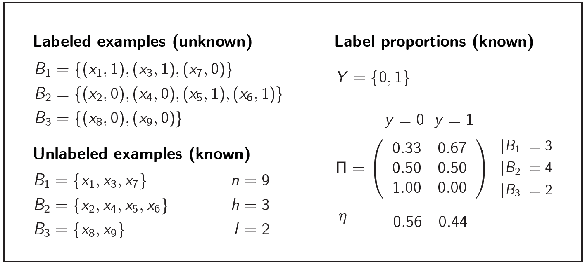

图 3.9: 给定观测值包、标签比例矩阵及相关符号表示的示例

```
R*[exp] = ∫𝓁(*y*, *f̂*(*x*))*d*ℙ(*x*, *y*)
```

最小化。这里，`𝓁` 是一个凸*损失函数*：`y × y → ℝ[0]^+`，用于衡量为个体观测值分配错误标签的代价。

给定的标签比例 `π[uv]` 可以更方便地写为一个 `h × l` 矩阵 `Π = (π[uv])`，其中每一行 `Π[u][,·] = (π[u1], . . . , π[ul])` 之和为一。包 `B[u]` 中具有标签 `Y[v] ∈ Y` 的观测值的频率计数 `μ[uv]` 可以通过标签比例 `π[uv]` 乘以包大小 `|B[u]|` 轻松重建。

整个样本中标签 `Y[v]` 的比例 `η(Π, Y[v])` 可以从 `Π` 计算得出，为包 `u` 的频率计数之和除以观测值总数 `N`：

```
\eta\left( {\Pi,Y_{v}} \right) = \frac{1}{N}{\sum\limits_{u = 1}^{h}\mu_{uv}}.
```

图 3.9 给出了之前介绍的符号、观测值划分为不相交包的方法，以及从原始（现未知的）标签推出的标签比例矩阵的示例。

### 3.3.3 相关工作

在 2010 年开始研究 LLP 时，关于该主题的文献寥寥无几。接下来，我们将讨论与我们当时发表的聚类方法相关的相关工作 [651] [652]，这些工作将在本文中介绍。自发表以来，根据 Google 学术，我们的方法被引用了 70 多次，并且更多关于该问题设置的工作出现了。例如，不同的聚类方法已被应用 [154]。Fish 和 Reyzin 在可能近似正确 (PAC) 学习的背景下阐明了该问题的理论属性 [209]（关于 PAC 学习的简单介绍请参见 Mitchell [447]）。Saket 等人提出了一种不依赖于底层分布的方法，为任何学习器提供了保证 [571]。然而，他们没有涵盖我们所讨论的多分类问题 [333]。Kobayashi 同事展示了多分类 LLP 的界 [333]。开发了一种概率方法来估计总统选举中的 LLP [660]。还处理了新的应用，如客户分类 [513]、海滩预测 [273]，以及破产预测 [133]。

#### 半监督方法

有些方法看起来类似于 LLP，但实际上是半监督的。例如，Dara 等人使用 SOM 对数据进行聚类 [159]。在学习 LLP 时，标记观测值通常不可用。Demiriz 等人调整了 k-means 优化 [167]。

#### 基础方法

据我们所知，Kueck 和 Freitas 通过提出一种基于群体统计的概率模型（通过高效的马尔可夫链蒙特卡洛（MCMC）采样算法进行训练），首次解决了 LLP 问题 [357]。Musicant 等人用更正式的方式定义了从聚合值中学习的问题 [466]。他们修改了著名的方法，如 k-NN [133]、反向传播神经网络 [447] 和线性支持向量机 [700]，以遵循给定的比例。

#### 平均映射与拉普拉斯平均映射

我们在 3.3.7 节中比较使用的 Mean Map 方法由 Quadrianto 等人提出 [514]。它通过条件指数模型估计条件类别概率，使用联合特征映射。参数 `θ` 可以通过求解条件对数似然的凸最大问题来估计。条件对数似然反可以用所谓的平均算子来表示，该算子可以扩展为包级和标签级组件。该公式中的未知数可以通过求解线性方程组得到，而不需要知道个体标签。这通过假设同质性可以实现。一旦估计了平均算子，就可以通过标准的极大似然方法推导出参数向量。结果表明 Mean Map 优于核密度估计、判别排序和 MCMC。

Patrini 等人放宽了 Mean Map 的限制性同质性假设，使得每当数据包（bags）彼此相似时，假设其特征向量的分布也相似，给定标签 [494]。这种放宽的假设被编码为一个正则化的最小二乘优化问题，该问题可以通过对称矩阵的拉普拉斯矩阵重写为矩阵形式，该矩阵的元素由数据包之间的相似性组成。该优化问题的解可以通过闭式形式获得。在来自 UCI 标准存储库的十个数据集 [32] 上，`LMM` 和 `AMM` 在预测性能和运行时间上优于 Mean Map、`Invcal` 和 `∝SVM`。然而，由于 `LLM` 未经过核化且只能找到线性决策边界，因此 `LLM` 的结果无法与第 3.3.6 节引入的非线性聚类算法直接比较。

#### 逆校准

Rüping 提出了逆校准（`Invcal`）方法 [552]。通过对输出应用缩放函数 `σ` 将回归支持向量机（`SVR`）转换为概率分类器。根据作者的观点，只要分类器的预测结果平均能够很好地近似给定的标签比例即可。这些约束作为辅助条件集成到标准的 `SVR` 优化问题中。作为一种大间隔方法，该公式允许降低模型复杂度，同时使每个数据包的类别概率估计与每个数据包的给定标签比例保持接近，允许一定的最大可容误差。原始问题可以转换为对偶问题，然后使用标准的二次优化求解器进行求解。在来自 UCI 存储库的十二个标准数据集上的实验表明，`Invcal` 在预测精度方面显著优于 Mean Map。

### ∝SVM

`Invcal` 将每个数据包的均值视为某种超实例（super-instance），并为每个数据包赋予一个对应标签比例的回归标签。而 Yu 等提出的 `∝SVM` 则显式地对单个观测标签建模 [751]。从分配给单个观测值的标签计算出的标签比例应尽可能匹配给定的标签比例。该准则被编码为标准 `SVM` 原始问题的额外项。任务是找到一个标签向量，使得标签比例的损失和针对单个观测的标准损失之和最小。这确保了位于超平面同一侧的观测将被分配相同的标签，取决于权衡参数 `C` 和 `C[π]` 的特定值。尽管该公式看起来很直观，但该优化问题是一个 NP-hard 的非凸整数规划问题。作者提出了两种不同的高效算法来求解它，一种基于交替优化策略，另一种基于凸松弛。在实验中，`∝SVM` 在 UCI 标准存储库的几个数据集上的精度上优于 Mean Map 和 `Invcal`。然而，作者没有报告他们使用了哪种显著性检验。需要注意的是，在 Patrini 等人的工作中，与 `Invcal` 相比，结果并不总是利于 `∝SVM`，即使在相同的数据集上如此 [494]。此外，Mean Map 在许多情况下优于 `∝SVM`，而 `Invcal` 在 Rüping 的工作中优于 Mean Map [552]。

### AOC 核聚类

由 Chen 等提出的 AOC 核聚类（`AOC` 用于输出分类）`AOC-KK` 对观测值进行聚类，使得聚类数量与类别数量匹配并符合标签比例 [131]，它是原始算法的核化版本 [174]。在这里，聚类中心不再以闭式形式表示，而必须通过特征映射 `ϕ` 来表示。

在构建的目标函数中，第一项与原始聚类相同，第二项衡量标签比例之间的偏差。这两个准则之间的权衡可以通过参数 `λ` 控制。由于无法使用标准的凸优化工具，作者提出了一种基于期望最大（`EM`）的交替更新算法 [168]。在 UCI 存储库的两个数据集上，`AOC-KK` 优于 `k-NN` 和神经网络 [466]。

尽管 `AOC-KK` 与在第 3.3.6 节开发的聚类方法 `LLPC` 有相似之处，但存在一些根本区别。第一是 `AOC-KK` 将簇的数量限制为类别数量，而 `LLPC` 允许一个类别由多个簇表示。这允许通过改变 `k` 来更好地控制偏差与方差。另一个区别是，`AOC-KK` 将标签比例损失与原始聚类目标放在同一个目标函数中，而 `LLPC` 先按照通常对观测值进行聚类，然后尝试为生成的簇寻找良好的标签分配。因此 `LLPC` 的优势在于可以使用任意划分聚类算法，而 `AOC-KK` 仅适用于 k-means。在第 3.3.7 节中，将 `LLPC` 与使用二次损失函数的 `AOC-KK` 进行了比较。

### 理论结果

在一项未发表的工作中，Yu 等将 `LLP` 引入 PAC 学习框架 [750]。作者证明了在某些条件下，当每个数据包的标签比例可以良好预测时，单个观测值的标签也可以被良好预测。反之，如果数据包的数量相对于底层假设空间 `H` 的范判尼克-丘瓦尼斯 (VC) 维度很大，则标签比例的泛化误差可以通过经验误差来界定 ²

#### 其他工作

Hernández-González 等人采用结构化 EM 策略从标签比例中学习贝叶斯网络分类器 [274]。他们将自己的方法与 Mean Map 进行比较，并报告了在七个领域中的四个领域其方法的错误率较低。然而，文中并未报告结果的显著性。Fan 等人引入了一种名为 DNLP 的生成分类器，它通过遵循深度信仰网络的方法从标签比例中学习 [198]。作者们在 UCI 仓库的若干个标准数据集上将其方法与 Mean Map 和 Invcal 进行了比较。在预测性能方面，他们报告没有显著差异。然而，DNLP 的运行时间远低于 Mean Map 和 Invcal。Fan 和 Taylor 将卷积神经网络 (CNN) 与通过 EM 方法训练的概率图模型结合，用于从图像数据中学习冰和开阔水域分类背景下的标签比例 [199]。他们的算法在上述应用背景下表现出良好，但在其他领域尚未进行评估。

### 3.3.4 问题的难度

为了更好地了解问题的难度，我们从更具贝叶斯的视角讨论了标签池学习 (LLP) 问题，并将其与不同的已知学习任务（如监督、半监督和无监督学习）联系起来。

对于监督学习场景，如果分布 `P(X, Y)` 是已知的，我们可以构建一个名为 `optimal Bayes classifier` 的最优分类器。从贝叶斯的角度来看，可以从通过估计条件类密度 `P(Y|X)` 来获得预测模型。应用贝叶斯定理可以发现 `P(Y|X)` 也可以通过其他未知密度进行估计——即类条件密度 `P(X|Y)` 和类先验密度 `P(Y)`：

(3.3) ${\mathbb{P}}(y \mid X) = \frac{{\mathbb{P}}(X \mid y) \cdot {\mathbb{P}}(y)}{{\mathbb{P}}(X)}$ (3.3)

这里，`P(X)` 不一定需要已知或估计，因为它可以从 `P(X|Y)` 和 `P(Y)` 计算得出。如果数据点数量足够，`P(Y)` 可以直接从数据中估计。此外，如果联合分布 `P(X, Y)` 是已知的（如最优贝叶斯分类器所假设的那样），则所有其他量都可以从中推导。对于给定的待分类观测值 `x ∈ X`，最优贝叶斯分类器将预测概率最大的类别，这也被称为 MAP 准则。这里，最优意味着贝叶斯分类器是对于给定数据所有可能的分类器中最佳的。

**最好情况 (Best Case)** 对于 LLP 而言，标签 `Y[v]` 的类先验 `P(Y[v])` 可以被估计为 `η(Π, Y[v])`，即 `Y[v]` 的比例。这可以通过 Mean Map 方法实现。然而，为 `P(X|Y)` 寻找一个良好的估计至少与监督学习场景一样困难，并且如果每个包 `B[u]` 只包含来自单一类别的观测值，则与之等同。这种场景可以被称为 `最好情况`，因为在 LLP 中，通常关于单个标签的信息较少。我们的直觉与 Yu 等人的发现相一致，他们证明了正确分类实例的概率随着包的纯度而增加 [750]。当每个包只包含示例时，该算法在上述应用背景下表现良好，但在其他领域尚未进行评估。

**最差情况 (Worst Case)** 在最差情况下，如果所有包的标签比例都是相等的，最优贝叶斯分类器将预测概率最大的类别，即 MAP 准则。这里，最优意味着贝叶斯分类器是对于给定数据所有可能的分类器中最佳的。 (此处原文文本似乎不完整，已根据逻辑尽可能翻译)

类似于为单个观测值定义损失函数时，现在也可以在单个矩阵条目上定义损失函数，例如，取平方误差 `(π[uv] − y[uv]^(f̂))²` 作为损失。那么，`Π` 与 `Γ[f̂]` 之间的总离差可以定义为所有矩阵条目上的平均平方误差：

(3.5) $\mathcal{l}_{MSE}\left( {\Pi,\Gamma_{\hat{f}}} \right) = \frac{1}{hl}{\sum\limits_{u = 1}^{h}{\sum\limits_{v = 1}^{l}\left( {\pi_{uv} - \gamma_{uv}^{\hat{f}}} \right)^{2}}}$ (3.5)

平均平方误差 `ℓ[MSE]` 没有考虑到相对组大小和类别大小；它也无法捕捉两个假设 `ˆf[1]` 和 `ˆf[2]` 看起来互不可区分的情况，因为所有矩阵条目上的误差总和是相同的。在实践中，通过 `ℓ[Π]` 来衡量 `Π` 与 `Γ[f̂]` 之间的误差是有意义的，我们将 `ℓ[Π]` 定义为两个不同误差量 `ℓ[weight]` 和 `ℓ[Prior]` 的几何平均值，它们处理了上述缺点：

(3.6) $\mathcal{l}_{\Pi}\left( \Gamma_{\hat{f}} \right) = \sqrt{\mathcal{l}_{\text{weight~}}\left( {\Pi,\Gamma_{\hat{f}}} \right) \cdot \mathcal{l}_{\text{Prior~}}\left( {\Pi,\Gamma_{\hat{f}}} \right)}\text{~with~}$ (3.7) $\mathcal{l}_{\text{weight~}}\left( {\Pi,\Gamma_{\hat{f}}} \right) = \frac{1}{hl}{\sum\limits_{u = 1}^{h}{\sum\limits_{v = 1}^{l}\eta}}\left( {\Pi,Y_{v}} \right)\frac{\left| B_{u} \right|}{N}\left( {\pi_{uv} - \gamma_{uv}^{\hat{f}}} \right)^{2}\quad\text{~and~}$ (3.7) (3.8) $\mathcal{l}_{\text{Prior~}}\left( {\Pi,\Gamma_{\hat{f}}} \right) = \frac{1}{l}{\sum\limits_{v = 1}^{l}\left( {\eta\left( {\Pi,Y_{v}} \right) - \eta\left( {\Gamma_{\hat{f}},Y_{v}} \right)} \right)^{2}}$ (3.8)

`ℓ[weight]` 根据相对组大小和类别大小对单个矩阵条目的平方误差进行加权。`ℓ[Prior]` 衡量了所选假设与类别先验的匹配程度，这种匹配程度是通过 `η(**, Y[v])` 估计的。在损失函数中包含先验的决策是基于经验评估以及对导致误分类的标签比例的仔细检查。正如 Yu 等人所示，只要假设与类别先验匹配，且包（bags）中的观测值是独立同分布（i.i.d.）的，那么误分类部分单个观测值的概率是有界的。

此外，如果除了标签比例，还给出了观测值 `x ∈ T` 子集 `T ⊆ X` 的真实标签 `y(x)`，误差标准（等式 3.6）可以很容易地扩展到包含这些标记样本的平均损失 `ℓ[T]`：

(3.9) $\mathcal{l}_{\Pi} = \sqrt{\mathcal{l}_{\text{weight~}} \cdot \mathcal{l}_{\text{Prior~}} \cdot \mathcal{l}_{T}}\quad{~with~}\quad\mathcal{l}_{T} = \frac{1}{\left| T \right|}{\sum\limits_{x \in T}} (y(x))$

因此，优化 `ℓ[Π]` 的算法可以很容易地在给定标签比例之外考虑标记的观测值。

### 3.3.6 通过聚类从标签比例学习

LLP 的目标是找到一个函数 `f̂` 来尽可能预测未见包的比例，正如 Yu 等人所示，这限制了误分类单个观测值的风险。作者从经验风险的角度提出了这个问题。然而，如果我们允许任意复杂的假设，我们总可以匹配给定的标签比例。特别是，如果我们穷尽地尝试观测值的所有不同标记，我们总能找到一组使得之前引入的损失函数之一最小化的标记。我们预计只有少数此类标记也能最小化单个观测值上的经验损失，也就是说，我们需要以某种方式控制我们假设类别的容量。

下文提出的特定 LLP 方法基于这样一个假设：位于输入空间区域中相互靠近的观测值共享相同的类别标签。它首先使用任意的划分聚类算法和相应的距离量形成相似观测值的聚类。该算法并没有尝试观测值的所有可能标记，而是启发式地尝试聚类的不同标记，使得基于标签比例的损失函数最小化。因此，可以通过改变聚类数量 `k` 来控制假设空间的容量。较少的聚类数量会导致高偏差但低方差。较大的聚类数量允许对样本 `X` 进行更小的划分，从而导致低偏差但高方差。


聚类代表类的假设并不一定正确。Hastie 等人证明了特征的加权对聚类结果有巨大影响。事实上，监督方法优于无监督方法的一个在于它们可以确定特征相对于目标变量的相关。因此，我们允许距离量具有一定的灵活性。此类度量应尊重每个特征`w[j] ∈ [0, 1]`，由向量$\overset{\rightarrow}{w}$给出。通常，这些权重是由领域专家指定的。然而，在下文介绍的聚类方法中，相关权重可以通过 3.3.5 节定义的损失函数之一（或其他 LLP 损失函数）进行自动估计。

在 3.3.6.1 节中，给出了相应的优化问题。然后，在 3.3.6.2 节中描述了解决该问题的方法。该算法可以使用 3.3.6.3 节中介绍的不同标记策略。算法的运行时间在 3.3.6.4 节中进行了分析，而 3.3.6.5 节解释了如何根据一组标记的聚类对新样本进行分类。

(3.10) $\min\limits_{\{\overset{\rightarrow}{\lambda}}\_{\mathcal{C}}}\mathcal{l}_{\{\overset{\rightarrow}{\lambda}}\_{\mathcal{C}}}\left( {\\Pi,\\Gamma_{\{\hat{f}}\_{\overset{\rightarrow}{\lambda}}\_{\mathcal{C}}}}} \\ \right)\,\,\,\,\,\,\,\,\,\,\,\,\,\,\,\,\,\,\,\,\,\,\,\,\,\,\text{ \} \text{ \}} \left( 3.10 \right)$

误差度量可以是平均平方误差`ℓ[MSE]`或组合误差度量（如`ℓ[Π]`）。

令$q_{\overset{\rightarrow}{w}}$为一个能够根据尊重特征权的相似性度量评估聚类质量的函数。这通常意味着观测值`x[i] \in`$X$被表示为$d$维特征向量$\overset{\rightarrow}{x}_{i} = \left( {x_{i1},\ldots,x_{id}} \right)$，其中`x[ij] \in`$R$。我们试图解决以下优化问题：

(3.11) $\min\limits_{\overset{\rightarrow}{w}}\mathcal{l}_{\overset{\rightarrow}{\lambda}}\_{\mathcal{C}}}\left( {\\Pi,\\Gamma_{\{\hat{f}}\_{\overset{\rightarrow}{\lambda}}\_{\mathcal{C}}}}} \right),\quad{\overset{\rightarrow}{\lambda}_{\mathcal{C}}^{\star} = \text{argmin}_{\overset{\rightarrow}{\lambda}_{\mathcal{C}^{\ast}}}\mathcal{l}_{\overset{\rightarrow}{\lambda}}\_{\mathcal{C}}}\left( {\\Pi,\\Gamma_{\{\hat{f}}\_{\overset{\rightarrow}{\lambda}}\_{\mathcal{C}^{\ast}}}}} \right),\quad\mathcal{C}^{\star} = \text{argmax}_{\mathcal{C}}q_{\overset{\rightarrow}{w}}(\mathcal{C}),\\\,\,\,\,\\\,\,\,\,\,\,\,\,\,\,\,\,\,\,\,\,\,\,\left( 3.11 \right)$

即我们正在寻找一个聚类$C^{(*)}$，它使得$q_{\overset{\rightarrow}{w}}$最大化，并且其标签$\overset{\rightarrow}{\lambda}_{\mathcal{C}}^{\star}$对于所有可能的权重向量$\overset{\rightarrow}{w}$均使$\mathcal{l}_{\overset{\rightarrow}{\lambda}}\_{\mathcal{C}}}$最小。如所述，对于任意函数$q_{\overset{\rightarrow}{w}}$和$\mathcal{l}_{\overset{\rightarrow}{\lambda}}\_{\mathcal{C}}}$，该问题是非凸的。由于我们希望对这类函数的选择具有灵活性，在后续我们将通过进化策略来近似解。

### 3.3.6.2 LLPC 算法

LLPC（通过聚类学习标签比例）算法通过进化策略解决问题 (3.11)。对于每个权重向量`w`，通过内部算法求解使$q_{\overset{\rightarrow}{w}}$最大化的子优化问题。聚类器的唯一前提是它能返回聚类并尊重特征权重。子优化问题 (3.10) 与聚类器无关，可以通过不同的标记策略解决。

详细而言，LLPC 以`clusterer`、`labeler`和误差度量$\mathcal{l}_{\overset{\rightarrow}{\lambda}}\_{\mathcal{C}}}$为参数，并输入$\Pi$、$B$和$Y$，返回最优聚类$C^{(*)}$、标签$\overset{\rightarrow}{\lambda}_{\mathcal{C}}^{\star}$和权重向量$\overset{\rightarrow}{w}^{\star}$。进化策略从一组归一化的权重向量种群开始，重复直到达到最大代数。

#### 算法 1：LLPC 算法

```
1 Function LLPC(Π, X, B, clusterer, labeler)
2 best_fit := ∞; generation := 0;
3 随机初始化一个包含 psize 个权重向量的种群 P;
4 while generation < maxgen do
5 for w ∈ P do
6 C := clusterer(X, k, w);
7 err := labeler(C, B, Y);
8 if best_fit < -err then
9 best_fit := -err; C* := C; lambda* := lambda; w* := w;
10 end
11 end
12 generation := generation + 1;
13 if generation < maxgen then
14 Pcopy := P;
15 使用方差 mutvar 对 Pcopy 中的权重进行高斯变异;
16 以概率 crossprob 对 P ∪ Pcopy 进行均匀交叉;
17 对 P ∪ Pcopy ∪ Pchildren 使用尺寸为 tournsize 的锦标选择;
18 end
19 end
20 return C*, lambda*, w*;
21 end function
```

聚类算法的自由选择允许适应不同类型的数据分布。例如，LLPC 在无需修改的情况下，成功运行了`k-means` [426]、`kernel k-means` [174]、`EM clustering` [168, 731]、`DBSCAN` [191]、`PROCLUS` [11] 以及`Support Vector Clustering (SVC)` [55]。此外，LLPC 还可以配合不同的误差度量，例如可以尊重单独标记样本的准则（等式 3.9）。

因此，LLPC 可以被视为一种用于从标签比例中学习的元算法，它允许使用不同的聚类算法、标记策略和损失函数。在进一步的步骤中，还可以更换进化算法。例如，它可以被调整为不仅针对权重向量$\overset{\rightarrow}{w}$最小化$\mathcal{l}\_{{\overset{\rightarrow}{\lambda}}\_{\mathcal{C}}}$，还可以针对超参数进行最小化，例如 k-means 聚类中的`k`，或者 SVC 中的`C`和 RBF 内核`$\gamma$`。

### 算法 2：通过多启动局部搜索对聚类进行标记

```
1 Function LocalSearchMultiStart(C, `μ`, `Π`, `k`, Y, `\mathcal{l}\_{{\overset{\rightarrow}{\lambda}}\_{\mathcal{C}}},` `starts`)
2 `best` = −∞;
3 **for** `iteration` ← 1, `starts` **do**
4  $\left. {\\overset{\rightarrow}{\lambda}}\_{\mathcal{C}},{\overset{\rightarrow}{\lambda}}\_{\mathcal{C}}^{\text{bestIter~}}\leftarrow\left( {\\lambda\_{1},\\ldots,\\lambda\_{k}} \\right) \right.$  其中 `λ[j] ∈` `Y` 均匀随机选择
5 `start`, `bestIter` $\left. \leftarrow - \mathcal{l}\_{{\overset{\rightarrow}{\lambda}}\_{\mathcal{C}}}\left( {\\Pi,\\Gamma\_{\hat{f}}\_{\overset{\rightarrow}{\lambda}}\mathcal{C}}} \right); \right.$  // 计算适应度
6 `improving` ← true ;
7 **while** `improving` **do**
8  **for** `kpos` ← 1, `k` **do**
9   // 在每个位置 ..
10 **for** `lpos` ← 1, `|Y|` **do**
11 // 尝试所有标签 ..
12 `λ[kpos]` ← `Y[lpos] ∈` `Y` ;
13 `fitness` $\left. \leftarrow - \mathcal{l}\_{{\overset{\rightarrow}{\lambda}}\_{\mathcal{C}}}\left( {\\Pi,\\Gamma\_{\hat{f}}\_{\overset{\rightarrow}{\lambda}}\_{\mathcal{C}}} \right) \right.$  // 计算适应度
14 **if** `fitness` > `bestIter` **then**
15  $\left. {\\overset{\rightarrow}{\lambda}}\_{\mathcal{C}}^{\text{bestIter~}}\leftarrow{\overset{\rightarrow}{\lambda}}\_{\mathcal{C}}} \right.$  `start`, `bestIter` ← `fitness` ;
16 break // 跳出两个循环
17 **else**
18 `λ[kpos] ← λkop` // 重置为目前为止在 kpos 找到的最优标签
19 end
20 end
21 **if** `bestIter` = `start` **then**
22 // 未找到更好的结果
23 `improving` ← false ;
24 end
25 end
26 **if** `bestIter` > `best` **then**
27  $\left. best\leftarrow bestIter;{\overset{\rightarrow}{\lambda}}\_{\mathcal{C}}^{\text{best~}}\leftarrow{\overset{\rightarrow}{\lambda}}\_{\mathcal{C}}^{\text{bestIter}} \right.$  // 记住最优解
28 end
29 end
30 return ${\overset{\rightarrow}{\lambda}}\_{\mathcal{C}}^{\text{best~}}, - best$
```

#### 3.3.6.3 标记策略

以下两种标记算法解决了子优化问题 (3.10)，并可以作为 LLPC 中的`labeler`使用。

**穷举标记**：只要`k`可以限制在较小的范围内，且对于二分类问题`l = 2`，尝试`l`种标记就没有问题。在$k \le 6$的实验中，发现了良好的解。对于每个标记，我们需要计算$\mathcal{l}\_{{\overset{\rightarrow}{\lambda}}\_{\mathcal{C}}}$。对于像`MSE]`或`[\Pi]`这样的误差度量，这将是线性时间的。对于上述误差度量，计算仅涉及基础加法、乘法和除法。

**多启动局部搜索**：对于$k > 6$或标记$l > 2$的情况，使用了多次启动不同标记组合的局部搜索。局部搜索贪婪地改进标记向量${\overset{\rightarrow}{\lambda}}\_{\mathcal{C}}}$。适应度衡量了基于当前标记的模型矩阵$\Gamma_{\hat{f}}$与给定的标签比例$\Pi$的匹配程度。如果适应度有所提高，则重置`kpos`为目前为止找到的最优标记；否则，返回所有启动中找到的最优标记。在每次迭代中，局部搜索运行直到无法进一步改进（这是一个停止准则）。此外，在算法的每一步，适应度要么提高要么保持不变。因此，每次搜索都是局部最优。由于搜索次数是有限的，返回的标记向量也是局部最优。虽然尽管如此无法保证找到全局最优解，但已证明这种启发式标记策略在分布式机器学习应用等场景中表现良好。

对于返回基于模型的聚类描述的聚类算法（例如返回聚类均值的 k-means），可以简单地使用该模型将新观测值分配到簇，然后预测该簇对应的类别标签。例如，在 k-means 的情况下，可以通过应用函数${\\hat{f}}\_{{\overset{\\rightarrow}{\lambda}}\_{\mathcal{C}}}.$将新观测值分配给其最近的聚类均值，并预测相应的类别标签。当聚类算法纯粹是描述性的（即仅返回`X`的聚类结果，但没有将新观测值分配到簇的模型）时，可以使用诸如 k-NN 等近邻方法进行分类。

通常情况下，在运行 LLPC 后获取预测模型的一种方法是根据当前的标记观测值训练标准分类器，例如朴素贝叶斯（Naïve Bayes）[301] 或 SVM [700]。采用这种方法，LLPC 可以被视为建模前的预处理步骤，根据给定的标签比例恢复样本`X`中观测值的缺失标签。

### 3.3.7 评估

在本节中，我们对该通用方法进行评估。受钢铁场景的启发，该方法需要经过仔细评估，以便能够可靠地应用于各种工业场景。由于该方法是通用的，我们将 LLPC 算法与三种先进的低标签预测（LLP）方法进行了比较：均值映射（Mean Map）[514] 方法、反向校准（Inverse Calibration, Invcal）[552] 以及 AOC k-Means (AOC-KK) [131]。比较通常使用标准基准数据集或生成的数据进行。

LLPC 使用 Java 编写，并在 RapidMiner [(https://rapidminer.com)](https://rapidminer.com) 中以算子的形式实现。所有结果都基于 fast k-means [187] 作为内部聚类算子，它利用三角不等式实现了更快的计算。观测值`x[i] ∈ X`表示为`d`维特征向量${\overset{\rightarrow}{x}}_{i} = \\left( {x_{i1},\\ldots,x_{id}} \\right)$，其中`x_ij ∈ R`。作为距离度量，我们使用了加权欧式距离，权重向量$\overset{\rightarrow}{w} = \\left( {w_{1},\\ldots,w_{d}} \\right)$对每个特征`x_ij`的`赋予了不同的权重。在所有实验中，我们使用了穷举式标记策略（参见第 3.3.6 节），并配合损失函数`ℓ[Π]`。AOC-KK 使用 Java、RapidMiner 和 Matlab 的组合实现。对于 Mean Map 和 Invcal，使用了由 Invcal 作者提供的 R 脚本 [552]。

(3.12) $d_{\overset{\rightarrow}{w}}\\left( {{\overset{\rightarrow}{x}}_{i},{\overset{\rightarrow}{x}}_{i}^{\prime}} \\right) = \sum\\limits_{j = 1}^{d}\\left( {w_{j}x_{ij} - w_{j}x_{ij}^{\prime}} \\right)^{2}$

表 3.3：实验实验使用的 UCI 数据集。©[2011] Springer。经许可转载自 [651]。

| 数据集 | N | d |

| :--- | :--- | :--- |

| CREDITA | 690 | 42 |

| VOTE | 435 | 16 |

| COLIC | 368 | 60 |

| IONOSPHERE | 351 | 34 |

| SONAR | 208 | 60 |

| DIABETES | 768 | 8 |

| BREAST CANCER | 286 | 38 |

| HEARTC | 303 | 22 |

#### 3.3.7.1 预测性能

LLPC、AOC-KK、Invcal 和 Mean Map 的准确性已在 表 3.3(016065.xhtml#b_9783110785982-003) 所示的八个 UCI 数据集 [32] 上进行了评估。每个名义特征的可能值都被映射为值为 0 或 1 的二进制数值特征。数值特征被归一化到`[0, 1]`。表 3.3 显示了该预处理步骤后的特征数量`d`。


在每个单独实验中，通过 10 折交叉验证评估了准确性。对于 `LLP`，我们通过对观测值的均匀采样，将特定折的训练集划分为大小为 `σ` 的包。虽然这种均匀采样可能无法反映真实世界中包的形成方式，但与基于特征值的领域特定采样相比，它允许对不同数据集的结果进行更具同质性的解释。我们尝试了多种包大小 `σ`：2, 4, 8, 16, 32, 64 和 128（必要时，最后一个包小于 `σ`）。我们计算了标签比例并移除了单个标签。在每一折中，随后在标记测试集上计算了所得预测模型的准确性。

核方法 `Mean Map`、`Invcal` 和 `AOC-KK` 使用了线性核、2 次和 3 次多项式核以及径基核（`γ` = 0.01, 0.1 和 1.0）进行了测试。`LLPC` 测试了聚类大小 `k ∈ [2, 12]`。对于演化策略，我们使用了 `maxgen = 10`、`psize = 25`、`mutvar = 1.0`、`crossprob = 0.3` 以及 `tournsize = 0.25`。运行 `LLPC` 提供了一个包含对应标签的簇均值的预测模型。`AOC-KK` 也是如此。然而，聚类方法还为样本 `X` 中的观测值分配了标签，参见第 3.3.5 节（`016065.xhtml#b_9783110785982-003_s_003_s_005`）。基于这些标记示例，我们训练了用于朴素贝叶斯 [301]、`k-NN` [13]、决策树 [516]、随机森林 [102] 以及 `SVM` [700]（带线性核和径基核）的模型。每个方法的模型参数都通过网格搜索或演化搜索进行了优化。

所有数据集、包大小、分类器及其变体和参数的组合共导致 13216 次实验：`Mean Map` 和 `Invcal` 为 672 次，`AOC-KK` 为 2688 次，`LLPC` 为 9856 次。对于 `COLIC` 和 `SONAR` 数据集上大小为 16, 32, 64 和 128 的包，以及 `CREDITA` 数据集上大小为 128 的包，我们对 `LLP` 进行了 `maxgen = 5` 和 `psize = 100` 的额外实验。在某些情况下，我们获得了更好的预测准确性。所有实验耗时约三周。它们在多台配备 `AMD` 双核或四核 `Opteron 2220` 处理器和最大 4 GB 主内存的机器上并行运行。

### 3.3.7.2 预测性能结果

图 3.10 包含了在所有实验中，基于 `LLPC`、`AOC-KK`、`Invcal` 和 `Mean Map` 最佳性能模型在所有数据集和袋大小下的最高准确率图表。在 `CREDITA`、`VOTE`、`COLIC`、`SONAR` 和 `BREAST CANCER` 数据集上，`LLPC` 在许多袋大小下的精度高于 `Invcal`。在 `CREDITA`、`VOTE`、`IONOSPHERE`、`SONAR` 和 `DIABETES` 上，`LLPC` 在不同袋大小之间的精度方差比其他方法小。在许多情况下，`Mean Map` 的性能优于 `LLPC` 和 `Invcal`。`AOC-KK` 的性能取决于数据集。它在 `BREAST CANCER` 和 `HEARTC` 上表现良好，但在其他数据集上并非如此。除了 `BREAST CANCER` 和 `VOTE` 数据集以及少数其他准确率值外，所有方法的总体准确率都随着袋大小的增大而降低。结果证实了该理论：随着袋尺寸的增大，在不增加样本 `X` 容量的情况下，学习变得更加困难。

结果的统计显著性可以使用 [169] 提出的调整版 `Friedman test` 进行评估。该检验是 `ANOVA` 的非参数等价物，为了将 `LLPC` 与所有其他方法进行比较，我们使用双尾 `Bonferroni-Dunn test` 作为事后检验。

表 3.4 可以被视为 [图 3.10] 所示详细图表的总结，能够更好地理解和概述 `LLPC` 的整体性能。该表显示了所比较分类器的平均排名及其与 `LLPC` 排名的差异。每个排名都是根据所有实验中最佳性能模型（包括标准分类器）计算的。表还显示了用于 `Bonferroni-Dunn test` 的临界差异 (`CD`) 值。`σ` = 128 时的 `CD` 不同，因为由于缺失值，`Mean Map` 未包含在比较中。在 `σ` > 2 的六种情况下，`LLPC` 拥有最高排名。在 10% 显著性水平下，`LLPC` 在 `σ` = 8 时显著优于 `AOC-KK`，在 `σ` = 128 时优于 `Invcal`，在 `σ` = 4, 8, 32 和 64 时优于 `Mean Map`。在所有其他情况下，`LLPC` 的性能等同。

![图 3.10：所有数据集和袋大小下，达的最高准确率，涵盖 LLPC、AOC-KK、Invcal 和 Mean Map 的全部 13 216 次运行（加上 maxgen = 5 且 psize = 100 的 LLPC 额外运行）。由于 R 脚本错误，图中 Mean Map 和袋大小 128 的某些值缺失。©[2011] Springer。经许可转载自 [651]](graphic/b_9783110785982-003_fig_010.png)

图 3.10：所有数据集和袋大小下达的最高准确率，涵盖 `LLPC`、`AOC-KK`、`Invcal` 和 `Mean Map` 的全部 13 216 次运行（加上 `maxgen` = 5 且 `psize` = 100 的 `LLPC` 额外运行）。由于 `R` 脚本错误，图中 `Mean Map` 和袋大小 128 的某些值缺失。©[2011] Springer。经许可转载自 [651]。

表 3.4：基于每个数据集和袋大小的最佳模型的按袋大小的分类器平均排名及其与 `LLPC` 排名的差异。正差异值表示 `LLPC` 性能更好。在 10% 水平下的最高排名和显著差异（高于 `CD`）用粗体标记。©[2011] Springer。经许可转载自 [651]。

| `σ` | 2 | 4 | 8 | 16 | 32 | 64 | 128 |
| --- | --- | --- | --- | --- | --- | --- | --- |
| **平均排名** | | | | | | | |
| `LLPC` | 2.500 | **1.875** | **1.500** | **1.875** | **1.625** | **1.375** | **1.375** |
| `AOC-KK` | 2.000 | 2.750 | 3.000 | 2.875 | 2.625 | 2.375 | 2.000 |
| `Invcal` | 2.000 | 1.875 | 2.375 | 2.125 | 2.125 | 2.500 | 2.500 |
| `Mean Map` | 3.500 | 3.500 | 3.125 | 3.125 | 3.625 | 3.875 | - |
| 差异, `CD`<128 | | | | | | | |
| `AOC-KK` | -0.500 | 0.875 | 1.500 | 1.000 | 1.250 | 1.500 | 0.625 |
| `Invcal` | -0.500 | 0.375 | -0.875 | -0.250 | -0.525 | 0.125 | 1.125 |
| `Mean Map` | 1.000 | -1.625 | -0.625 | -1.250 | -1.000 | -1.375 | |

![所有数据集和袋大小下达的最高准确率，涵盖 LLPC、AOC-KK、Invcal 和 Mean Map 的全部 13 216 次运行（加上 maxgen = 5 且 psize = 100 的 LLPC 额外运行）。由于 R 脚本错误，图中 Mean Map 和袋大小 128 的某些值缺失。©[2011] Springer。经许可转载自 [651]](graphic/b_9783110785982-003_fig_010)

### 3.3.7 运行时间比较

为了对算法进行实验运行时间比较，我们为高斯混合分类问题生成了随机数据（10 000 个观测值和 10 个特征，值归一化为 [0, 1]）。然后，对不同大小的数据评估了训练的平均运行时间和分类器的准确率（参见图 3.11）。`LLP` 的袋大小均为 `σ` = 16。核方法使用了 `γ` = 0.1 的径基核。`LLPC` 使用穷举标记策略和快速 `k-means`（`k` = 6）运行，参数为 `maxgen` = 3、`psize` = 25、`mutvar` = 1.0、`crossprob` = 0.3 和 `tournsize` = 0.25，用于进化优化。`LLPC` 和 `AOC-KK` 都使用聚类平均模型进行预测。

`LLPC` 在所有样本大小下均显示出很好的预测性能。此外，`LLPC` 的运行时间最短。然而，由于这些方法是用不同的编程语言实现的（`Java`、`Matlab`、`R`），不应比较绝对时间，而应该比较曲线的斜率。`LLPC` 运行时间的曲线非常平缓，几乎是直线，而其他曲线的斜率表明运行时间增长更快。

### 3.3.8 总结与结论

我们提出了一种名为聚类标签比例学习（`LLPC`）的标签比例学习（`LLP`）方法。该方法足够通用，能够适应不同的聚类算法、标记策略和损失函数。通过以 `k-means` 为内部聚类算法并采用固定迭代次数，`LLPC` 仅具有线性的最坏训练时间，且聚类均值模型较小、应用速度快。与需要更多训练时间的先进方法相比，在所进行的实验中，聚类均值模型显示出显著更高或相等的预测精度。通过在已标记的聚类上训练其他分类器，`LLPC` 实现的最高精度在更大的包尺寸下也显著提高。在这里，对于所有 `σ` > 2 的情况，`LLPC` 具有最高的平均排名。此外，`LLPC` 还具有其他有益属性，据我们所知，其他方法并不同时具备所有这些属性：`LLPC` 可以处理(1) 取决于聚类算法的非线性决策边界，(2) 多分类，(3) 额外的标记观测值，以及 (4) 对特征相关性加权。

`LLP` 在现实应用中具有重要意义，例如确保民主自由选举的隐私，或难以跟踪对象的标签重建（如智能制造中的对象）。由于质心聚类模型内存占用小、应用快且具有线性训练时间，`LLPC` 也适用于运行在物联网的资源受限设备上，例如分布式计算中的边缘设备。它已用于钢轧厂的一系列处理步骤，允许在加工过程中进行早期质量预测（参见第 3.2.4.2 节）。它还成功应用于交通预测领域（参见第 4.1 节），在其中被用于降低垂直分布式机器学习设置中的通信成本 [655]。

本文贡献的部分内容此前发表在 `Springer` 出版的会议论文中 [651], [654] 以及第一作者的博士论文中 [652]。

## 3.4 仿真与机器学习

Petra Wiederkehr, Katharina Morik, Amal Saadallah, Felix Finkeldey.

**摘要：** 将传感器数据与仿真数据整合机器学习（`ML`）已成为一个热门话题。一方面，主动学习（`AL`）形式的机器学习允许根据对解释变量的分析，仅运行预测未来事件所需的仿真。由于仿真是一个耗时的过程，我们通过选择最具信息量的仿真配置来节省计算资源。另一方面，仿真代表了专家知识，因此将仿真与基于观测的机器学习相结合可以获得更好的预测。

仿真与机器学习的结合已成功用于优化铣削工艺。针对铣刀的不良振动，实现了基于学习的稳定性准则预测。此外，通过开发的传感器与仿真数据融合，预测了铣削操作的力。除了直接预测特性外，机器学习还成功地对仿真进行建模。特别是，基于物理的机器动力学对不同铣刀轴进行了参数化，以减少所需的测量数量。

### 3.4.1 引言

在生产工程中，由于切削工具与工件之间高复杂性和巨大的多样性，面临许多挑战 [20](`backmatter-001.xhtml#b_9783110785982-007_ref_20`)。对于铣削过程，不同的参数值可能导致不同的工件结果。特别是在航空航天工业中，当需要铣削深腔时，细长的铣刀容易受到不良振动的影响，这会影响工件表面，工具磨损反过来也会影响过程行为 [20, 275]。

仿真可以支持过程的设计 [728](`backmatter-001.xhtml#b_9783110785982-007_ref_728`)。有限元素（`FE`）方法通过微分方程的数值近似表示切削边缘与铣削材料之间复杂的相互作用 [676]。由于材料不断从工件上移除，导致仿真需要很小的步长。结果是运行时间很长，在合理时间内只能模拟少数切削接触，这使得复杂的长期迁移具有挑战性 [208](`backmatter-001.xhtml#b_9783110785982-007_ref_208`)。相比之下，使用基于物理的仿真可以研究整个过程 [728](`backmatter-001.xhtml#b_9783110785982-007_ref_728`)。这是由于使用了简单的代理模型来表示工具和工件。然而，这意味着无法对复杂的工具磨损进行合理的建模。此外，虽然此类方法比 `FE` 方法快，但仍然无法实现实时。

在工业 4.0 的背景下，通过引入机器学习方法来实现自优化系统的愿景近期出现，并开始引起制造业的关注 [449](`backmatter-001.xhtml#b_9783110785982-007_ref_449`)。通过这些方法，可以实现对未见输入数据的特性实时预测 [128](`backmatter-001.xhtml#b_9783110785982-007_ref_128`), 491](`backmatter-001.xhtml#b_9783110785982-007_ref_491`)。文献中可以发现多项研究，它们重点关注使用机器学习方法预测铣削作业的不同特性，例如粗糙度 [337, 384, 536]、切削力 [498](`backmatter-001.xhtml#b_9783110785982-007_ref_498`), 699](`backmatter-001.xhtml#b_9783110785982-007_ref_699`) 或颤振振动。

通过将传感器数据与仿真结果相结合，可以进一步提高机器学习模型的预测精度。`Denkena`、`Dittrich` 和 `Uhlich` [170] 使用支持向量回归训练了一个模型。仿真生成数据和测量数据被用作特征，以预测工件的形状偏差。仿真数据是根据工具轴位置的测量值计算得出的。`Plakhotnik` 等人 [503] 将传感器数据（如机床轴位置和主轴扭矩）与计算机辅助设计和几何仿真的结果相结合，以使特定的工艺特征可视化并支持工艺设计。`Peng`、`Bergs`、`Schraknepper`、`Klocke` 和 `Döbbeler` [498] 利用基于有限元（`FE`）的仿真和测量，通过神经网络训练了一个与刀具磨损相关的切削力模型。

在本节中，讨论了关于仿真技术与机器学习结合的多个方面。如图 3.12 所示，分析了如何用机器学习模型替代仿真，以实现实时预测 [560]。在仿真数据上学习的模型随后可以通过选定的实验获取数据进行精化，以弥补仿真与实验之间的差距，这种差距可能是由仿真模型的简化造成的。在此背景下，为了提高资源效率，应仅对那些预期包含其中后能最大程度提高模型预测精度的场景进行实验。

关于主动学习（`AL`）的研究涉及两个现实世界应用。在隧道领域研究了如何减少昂贵的有限元仿真的计算资源（第 3.4.3.1 节）。在精化铣削模型时，研究了使用更廉价的几何物理仿真进行训练数据的采样（第 3.4.3.2 节）。

![图 3.12: 仿真与机器学习结合的概念 [560]。](graphic/b_9783110785982-003_fig_012.png)

图 3.12: 仿真与机器学习结合的概念 [560]。

调查的另一个重点是仿真结果与传感器数据的融合，用以预测铣削作业的未来工艺特征 [206]。为此，针对铣削应用评估并比较了不同的融合策略（第 3.4.4 节）。此外，在将机器学习集成到几何物理系统中方面获得了初步结果，以学习与姿态相关的模型 [207]。使用机器学习初始化仿真模型通过铣削和磨削的应用进行了说明（第 3.4.5 节）。

### 3.4.2 数控铣削过程的仿真

在铣削应用中，我们使用了几何物理仿真 [728]。对于工具和工件，使用了构造实体几何（`CSG`）[210] 技术，通过布尔运算实现工具模型的包。对于初始工件，通常使用长方体。工具的运动是沿着 `NC` 路径定义的。离散位置之间的步长是工艺。

```
W_{i} = W_{0} \setminus \bigcup_{j = 0}^{i - 1} T_{j}
```

代表第 `i` 层切削形状。为了计算力，这种形状通过以工具旋转轴为原点的射线进行采样。在每个射线处，使用以下公式计算切向、法向和切向方向的切削力：

```
\begin{matrix} {F_{i} = b \cdot k_{i} \cdot d_{0} \cdot \left( \frac{d}{d_{0}} \right)^{1 - m_{i}}}, \\ {d_{0} = 1\text{mm},i \in \{ c,n,t \}} \end{matrix}
```

其中 `d` 代表切厚，`b` 代表射线定义的切宽，`k[c]`、`m[c]`、`k[n]`、`m[n]`、`k[t]`、`m[t]` 是待校准参数。利用射线的方向信息，可以将力矢量转换到 `x`、`y` 和 `z` 坐标系中。为了仿真振动，一组解耦阻尼谐振器代表了机床-主轴-工具系统的动力学。谐振器的参数值必须提前通过测量确定，以便计算相对于工件的 `x` 和 `y` 方向的偏移 [662]。

### 3.4.3 从仿真学习

如前所述，尽管几何物理仿真允许在合理的运行时间内研究长时间的铣削过程 [728]，但它们尚未具备实时能力。因此，只能针对预先仿真的工艺配置生成预测。相比之下，机器学习模型可以实时评估，从而提供了基于历史数据预测未知事件的可能性 [128]，或者通过从测量数据中提取的一组特征对当前工艺状态进行分类 [366]。因此，机器学习的新趋势是用更适合实时应用的机器学习代理模型来仿真 [116, 212, 559, 560]。通过这种方式，不仅可以实时生成预测，还可以节省运行仿真所需的计算资源。

#### 3.4.3.1 主动学习用于仿真数据采集


对于表现出高度粘弹性或弹塑性过程的仿真，通常需要高计算资源的数值仿真方法 [1116, 212, 559]。因此，我们希望减少构建准确代理机器学习（ML）模型所需的数据量。这一思想在主动学习（AL）的文献中也曾被提及。从一个小型且非最优的训练集开始，AL 过程旨在选择未标记的数据点，通过将它们加入训练集来迭代地提高 ML 模型的性能 [593]。在此背景下，我们开发了一种 AL 方法，通过选择最少的仿真配置来学习一个准确的代理 ML 模型 [559]。

一个仿真场景由给定的仿真输入参数组合定义，并被视为由一组特征表征的数据实例。当仿真针对给定场景运行时，它被称为已标记数据实例；否则，它被称为未标记数据实例。主动选择也可以基于目前为止生成的实例的标签比例来决定。在这种情况下，问题被表述为主动类别选择（更多细节请见第 2 卷第 5.2.2 节）。我们希望减少收集已标记训练实例所需的过程仿真成本。因此，我们的混合 AL 方法（HDAL）结合了基于误差和基于距离的方法，以选择构建准确 ML 模型所需的最少仿真场景。我们首先随机选择一小部分仿真场景（即配置）进行运行。然后，我们的框架分三个阶段运行。第一，它在可用已标记场景上训练 ML 模型。第二，它计算 ML 模型对标记集中每个独立场景的训练误差值。这一步使我们能够识别出 ML 模型较薄弱（即对标签不确定）的输入数据区域，可能需要从这些区域查看更多样本以获得更好的泛化能力。我们选择估计误差率最高的已标记场景。在第三阶段，我们确定与这些已标记场景最近的未标记场景。假设两个最近的数据实例可能共享相似的特征，因此具有相似的估计代理 ML 模型。然而，为了避免在这些已标记场景（即已研究区域）周围出现聚类问题，我们设计了一种“最小极大”选择程序，选择距离最近的未标记场景最远的点。整个过程迭代直到满足停止准则。AL 过程的停止准则仍然是一个开放的研究问题。它可以根据最大迭代预算进行设置，或者当模型在独立校准/验证集上的精度改进在最后迭代中变得微不足道时设置。

我们使用专为盾构隧道过程面向过程计算仿真设计的 3D 有限元仿真 [116] 来验证我们的框架。仿真模型在给定两个机器输入参数（即注胶压力和支撑压力）的情况下，预测隧道挖掘期间不同测量点随时间变化的位移。每个场景产生一个包含 154 个监测表面点、64 个步长位移观测值的时间序列。最初选择 20 个场景用于训练。130 个场景被视为未标记，10 个场景用于测试。目标是用 ML 模型代替仿真以预测未来的土体位移。为此，我们使用向量自回归时间序列（VARX）作为代理 ML 模型 [559]。对于 VARX 设置，输入数据由监测点沉降的时间序列（以毫米为单位）加上机器注胶压力和支撑压力的时间序列组成。每次更新应用 `L1` 正则化。我们的研究显示了该框架在减少场景数量方面的能力。

### 3.4.2 用于模型构建的主动学习

主动学习不仅可以用于减少标注成本（即减少场景数量），还可以作为一种启发式采样程序来准确学习代理模型。代理模型应能够表示过程。由于 ML 的质量很大程度上取决于训练数据，我们利用了代理模型与 AL 之间的交互。在此背景下，为了通过调整过程值来控制过程，我们开发了一种基于物理仿真的新颖 ML 框架（参见 3.4.2 节）。我们专注于构建一个给定过程稳定性准则的 ML 模型。该部分已由作者发表 [206, 560]。

我们的实验用例是一个面铣过程，铣宽为 2 mm，深度从 0 mm 增加到 1 mm，进给量为 0.1 mm，转速在 3000 min⁻¹ 到 15000 min⁻¹ 之间变化。对于刀，使用了直径为 6 mm、半径为 1 mm 的圆角刀来加工 7075 铝合金。

所提框架由在不同特征子集上训练的多层感知器（MLP）集成组成。此外，同时使用 AL 过程从生成的仿真数据中迭代设计最优训练集。每 `P` 毫秒为未来的 `P` 毫秒提供一次直径预测。这是通过训练一个 MLP 委员会实现的，每个成员针对一个不同的过程子集 [129]。委员会的每个模型成员都是在线回归模型，其中预期直径被假设为时间序列特征的历史值的函数，即三维全局坐标系 `F[x]`、`F[y]` 和 `F[z]` 中的力、二维空间 `D[x]` 和 `D[y]` 中的变形以及切屑体积的预期值。由于模拟了许多配置（即不同的转速值），因此使用基于委员会查询（QBC）范式的主动学习方法 [129] 来迭代添加仿真配置，将其加入训练集应提高预测精度。最终预测输出通过委员会成员输出的加权平均值计算。框架的主要步骤如图 3.13 所示。

![图 3.13: 数据获取与预测框架 [560].](graphic/b_9783110785982-003_fig_013.png)

图 3.13: 数据获取与预测框架 [560]。

#### 基于池的、基于 QBC 的主动学习

模拟的输出在很大程度上取决于主轴速度的输入值。目标是识别出哪些模拟配置的加入训练集可以提高代理机器学习（ML）模型的准确性。实现这一目标的方法之一是通过使用 `AL` 控制训练模拟配置的选择，从而仔细地设计训练集。这种控制由依赖于问题的启发式方法给出，例如：如果将给定的配置或一组配置添加到训练集中，测试集上的估计预测误差会减少。最流行的主动学习方法之一是基于查询不确定性委员会（QBC）范式构建的 [593]。

根据对实例子空间的不同假设构建学习器委员会，这很容易导致需要覆盖的假设数量巨大，并且在实际应用中迅速变得在计算上不可行的 [442]。它也可以基于不相交的特征子集构建 [129]，这些子集通常由随机子空间生成（RSG）方法产生 [129]，这可能也会导致假设数量难以处理。在我们的方法中，每个特征子空间代表原始过程的一个特征（参见图 3.13）[560]。QBC 过程选择使委员会成员预测分歧最大的模拟配置。首先，每个委员会成员都在初始的较小模拟配置集 `N[i]` 上进行训练。然后，在每次迭代中，对 `N[c]` 个候选配置集根据每个模拟配置 `c[s]` 的分歧度进行排序：

```
(3.15) $f\_{QBC}^{c\_{s}} = \\log\\left( {\\sum\\limits\\_{j = 1}^{q}\\frac{1}{n}\\sum\\limits\\_{t = 1}^{n}\\left( {{\\hat{y}}\_{t}^{c\_{s}} - {\\hat{y}}\_{t,j}^{c\_{s}}} \\right)^{2}} \\right),\\,\\,\\,\\,\\,\\,\\,\\,\\,\\,\\,\\,\\,\\,\\,\\,\\,\\,\\,\\,\\,\\,\\,\\,\\left( 3.15 \\right)$ 
```

其中 `ŷ[t, j](C[s])` 是委员会成员 `j` 在 `t` 刻的预测值，而 `ŷ[t](C[s])` 是由 `q` 个模型组成的委员会在场景 `c[s]` 上的估计结果，获取如下：`ŷ[t](C[s]) = (1/q) * Σ(j=1 to q) ŷ[t, j](C[s])`。从排序后的配置中，选择前 `N[s]` 个添加到训练集中。整个过程不断迭代，直到满足停止标准，例如：达到训练集中最大配置数量，或者与上几次迭代相比，独立校准/验证集上的准确性提升变得微不足道。为了输出最终预测结果，我们使用已训练好的 MLP 委员会，并将它们在加权集成模型中进行聚合。权重使用模型在训练集上损失的归一化版本离线计算。在 AL 过程中，权重会随着训练集的每次更新而更新。这种机制可能通过调整最终输出中每个模型的贡献，帮助对时间序列观测中漂移的特征实现盲适应 [200]。

## 评估与结果

模拟生成了一个频率为 20、步长为 0.05 的数据。配置集被随机划分为三组：180 个用于训练，另外 20 个用于构建验证集。使用 `P[1]` = 10ms 的周期进行预处理，并将 `P[2]` = 50ms 设置为预测范围。MLP 参数使用网格搜索进行调优。在 AL 过程中，每次从 180 个配置中选择 50 个加入。以迭代 5 次作为停止标准。特征子集通过使用五个特征 `F[x]`、`F[y]`、`F[z]`、`D[x]` 和 `D[y]` 的两个滞后值来构建。相应的主轴速度、时间索引以及体积的两个未来值被用于丰富每个特征子集。

图 3.14(a) 展示了 AL 方法的性能。AL 方法在仅使用 70% 训练集的情况下，达到了与在整个训练集上进行训练相似的性能。结果显示了设计最优训练集的优势，特别是当存在具有随机选择输入参数的大规模仿真场景池时。

图 3.14(b) 展示了真实值与预测的庞加卡直径值之间的对比，并说明了集成模型能够在不同的场景和时间段内准确预测庞加卡直径。

图 3.14(c) 显示我们的框架可以在三种不同的主轴速度下在或更早预测工艺不稳定性。这突显了它在实时应用中的用处，在这些应用中，需要监控并调整工艺参数值以避免工艺不稳定。

### 3.4.4 仿真与传感器数据的融合

通常情况下，多样化数据源的整合提供了有用且丰富的新数据。我们将这种组合称为数据融合过程 [502]。然而，它面临着许多挑战 [468]。融合不同来源可能会冲突。这些冲突通常是记录不完整、错误和过时导致的 [468]。另一个挑战来自于多维、多模态且随变化的复杂序列 [331]。此外，数据融合过程还可能导致大量数据，这为在线应用带来了困难 [331]。解决这些挑战不仅需要大量的努力和领域知识，还需要能够处理实时约束的、扩展且符合原则的融合方法。

工艺仿真可以被视为领域专的背景知识。我们希望将这些知识整合到机器学习过程中，同时将仿真作为一种额外数据源（即生成额外数据点/数据特征或对现有数据进行标注）。在此背景下，我们的目标是融合仿真数据和传感器数据，以预测实时槽铣过程中的主动作用力和被动作用力 [22, 206]。在 [22] 中，我们提出了一个框架，允许在两个层面将从传感器和仿真采集的真实世界观测相结合：数据层面或模型层面。在数据层面，将观测值和合成数据整合在一起，形成一个用于学习的丰富数据集。在模型层面，将从观测数据和仿真数据单独学习的模型通过集成技术进行整合。通过在模型偏差和方差之间建立平衡，我们对合适的融合层级进行自动选择。图 3.15 展示了所采用方法的示意图。本节的部分内容已由作者发表 [22, 206]。


为了验证所开发的框架，使用了 2 mm 的切宽和 2 mm 的切深、30° 的倾斜角进行槽铣加工 \[206]]。使用直径为 10 mm 具有两个刀刃的球头铣刀加工 AISI M3:2 钢，该钢硬化至约 62 HRC。在这些铣削实验期间，使用三轴力计（Kistler 9257B）测量 `x`、`y` 和 `z` 方向的工艺力，采样频率为 20 kHz。所考虑用例的目标是预测受刀具磨损影响的即将发生的主动力和。为此，使用了十种具有不同切削速度和每齿进给值的工艺参数配置。对于每个参数配置，铣削 180 个槽以引起刀具磨损。每加工二十个槽后，测量两个刀刃的侧隙磨损宽度并取平均值，以获得指示刀具状态的值 `VB[V]` \[206]]。对于观测值和仿真数据的中间值，通过其他观测值进行插值 \[206]]。


图 3.15: 仿真与传感器数据的同步与融合

对于观测值和仿真数据的中间值，通过其他观测值进行插值 \[206]]。

(3.20) $W(a,b) = \frac{1}{\left| a \right|^{1/2}}\\int\limits\_{- \\infty}^{\\infty}\\Xi(t)\Psi^{\star}\left( \frac{t - b}{a} \right)dt,\\,\\\,\,\,\,\\,\\,\\,\\,\\,\\,\\,\\,\\,\\,\\,\\,\\,\\,\\,\\,\\,\\,\\,\\,\\,\\,\\,\\left( 3.20 \right)$

其中 `Ξ(t)` 是原始信号，$\Psi^{\star}\left( \frac{t - b}{a} \right)$ 代表经过缩放和平移的母小波 `Ψ(t)` 的复共轭，`a` 和 `b` 分别是尺度参数和平移参数。每个尺度对应一个频率，从而产生关于给定信号在特定时间时刻与所研究频率之间相关性的信息，而不需要在时间和频率分辨率之间进行权衡，这是频谱分析中的一个关键问题。在铣削应用中，两个研究时间序列之间时间相关的延迟可以通过小波变换在齿轮啮合频率处的强度大于零的时间点来识别。

### 校准

对于所考虑的基于几何物理仿真系统，可以使用测量值作为地面真来校准仿真模型。这必须针对相关工艺的刀具几何形状与工件材料的组合进行。例如，对于仿真力，可以通过应用优化程序来最小化仿真力与测量力之间的平方欧几里得距离，从而确定力模型参数 `ρ`：

(3.21) $\mathcal{l}(\rho) = \sum\\limits\_{i = 1}^{n}\\left( {F\_{\text{sen}}\\left( t\_{i} \right) - F\\_{\text{sim}}\\left( {\\rho,t\_{i}} \\right)} \\right)^{2},\\,\\,\\,\,\,\\,\\,\\,\,\,\\,\\,\\,\,\,\,\,\,\,\,\,\,\,\,\,\,\,\,\,\,\,\,\,\,\,\,\,\,\,\,\,\,\,\,\,\,\,\\,\\left( 3.21 \\right)$

这些值是在加工过程和相应的仿真执行中使用相同的工艺参数值获得的。为此，可以使用任何优化算法来解决该最小化任务。然而，在实践中，拟牛顿法通常优于其他方法。例如，使用 Broyden-Fletcher-Goldfarb-Shanno (BFGS) [113] 优化算法估计海森矩阵 `H[k]` 的近似值，该矩阵在过程的每次迭代 `k` 中进行更新。根据牛顿法，下一次迭代的参数值

(3.22) `ρ[k + 1]  = ρ[k]  + α[k]s[k]                (22)`

通过沿下降方向的线搜索给出：

(3.23) `s[k]  = H[k]∇�(ρ[k])             (23)`

通过以下方式估计 `α` 来实现：

(3.24) ${\hat{\alpha}_{k}} = \\underset{\alpha}{\text{L}}\\left( \\rho\_{k} + \\alpha s\_{k}} \\right),\\,\\,\\,\\,\,\\,\\,\\,\,\,\,\,\,\,\,\,\,\,\,\,\,\,\,\,\,\,\,\\left( 24)$

`H[k]` 的更新通过添加二秩修正来完成：

(3.25) `H[k + 1]  = H[k]  + uu^T  + vv^T (25)`

(3.26) `u  = δ[k]  ρ[k + 1]-ρ[k], v  = H[k]y[k]∇�(ρ[k + 1])-∇�(ρ[k]) (26)`

通常选择这些值，以满足拟牛顿步条件：

(3.27) `H[k + 1]γ[k]  = H[k]γ[k]  + uu^Tγ[k]  + vv^ty[k] (27)`

结果得到

(3.28) $H_{k + 1} = H_{k} + \frac{\delta_{k}\delta_{k}^{T}}{y_{k}^{T}y_{k}} - \dots \text{ \left( 28 \right)$

#### 3.4 自动融合级选择

从 `data-based` 融合到 `model-based` 融合的决策应基于预期的方差型误差水平，以及 `data-based` 融合模型的预期偏差。令 `f[simulation]` 和 `f[sensors]` 分别为在仿真数据和传感器数据上训练的模型，并令 `f[fus]` 为使用 `databased` 融合方法训练的模型。根据等式 3.29 的分解，我们可以得出结论：如果满足以下条件，使用等权重平均集成所的 `model-based` 融合与 `data-based` 融合模型相比有助于降低方差型误差：

```
(3.34) `Covar(f[simulation], f[sensors]) ≤ τ`
```

其中阈值 `\tau = 2\left( {Var\left( f_{\text{fus~}} \right) - \frac{Var\left( f_{\text{simulation~}} \right) + Var\left( f_{\text{sensors~}} \right)}{2}} \right).`

等式 3.34 符合等式 3.29 的分解，表明为了降低整体集成误差，总是追求较低的协方差。它证实了通过低协方差在集成成员之间强制实施多样性是有益的，因为它减少了集成歧义，这种歧义在更通用的集成误差分解方案中所示 [355]。此外，一旦单模型完成训练并构建，就可以完全估计平均协方差，无需任何真实数据标签或待近似的真实函数 `f`。从实践角度来看，这一结果证实了使用仿真来丰富数据的用途，即生成反映与传感器数据观察到的不同模式的样本。这种增强包含了传感器无法测量的新特征，或者传感器无法检测到的观测值。

在权重相等的情况下，集成模型的偏差将等于单模型的平均偏差。因此，它将获得比偏差单模型更低的偏差。如果单模型之间的协方差小于等式 3.34 中的阈值 `τ`，则系统会将它们的平均偏差与 `data-based` 融合模型的偏差进行比较，以检查平均偏差带来的方差型误差减少是否会建立更好的偏差-方差权衡。如果不是，系统将坚持使用 `data-level` 融合。

系统的级融合级选择通过前述的槽铣过程得到了验证 [206]。我们使用传感器测量过程力（`F[a]` 和 `F [p]`），并使用 0.1 ms 的聚合周期对其进行聚合，每隔 0.1 ms 预测未来 10 ms 内的预期力。监控铣削过程力可以控制过程稳定性和质量 [560]。通过改变输入参数（即速度和进给量）研究了 10 种不同的过程场景。每个场景产生的时间序列长度取决于输入参数的值，范围从 13 250 到 54 500 个观测值。仿真被用于特征增强，通过生成通常在过程中无法测量的特征。为此，为每个时间点生成了切屑体积、接触时间之和、进给量和切削速度平均值，以可能丰富力测量的特征空间 [206]。

在解决源之间可能的匹配后，通过将仿真生成的新特征与力的滞后传感器测量值的传感器特征相结合，创建一个统一特征集 [206]。选择随机森林回归器（RF）[101]来预测 `F [a]` 和 `F [p]`。结果展示在 10 折交叉验证折中，每个折保留 9 个场景（即时间序列）用于训练，1 个场景用于测试 [206]。使用 NRMSE（等式 3.17）评估预测误差。我们使用了力的时间序列的 5 个滞后值作为传感器特征。对于每个时间步，将滞后传感器值与传感器特征相结合。

| 偏差 (RF [基于特征的融合] ) || 121.21 || 3204.13 |
| 方差 (RF [基于特征的融合] ) || 330.40 || 8614.31 |
| 方差 (RF[基于模型的融合] ) || 140.86 || 13367.52 |

### 3.4.5 使用机器学习方法进行仿真模型的初始化

首先针对使用机器学习方法初始化仿真模型进行了研究。为此，考虑了两个不同的仿真系统，这两个系统分别用于研究铣削和磨光过程。本节的部分内容已由作者发表 [207, 727]。

#### 3.4.5.1 频率响应函数和合规模型的学习

基于几何物理的铣削仿真的底层系统（参见第 3.4.2 节）。这些振器的参数必须通过冲击锤测试获取机床-主轴-刀具系统的频率响应函数（FRF）来校准 [325]。此外，该系统的动态行为随刀具姿态的不同而改变。针对所有考虑的空间方向分别进行建模——在这里对应于 `x` 和 `y` 方向。每个振器通过识别模态质量 `m[m]`、自然频率 `f[m]` 和阻尼常数 `γ[m]` 来参数化。复响应函数 [207]

```
\begin{array}{l} \\ \begin{array}{l} {G{(\\omega j)}\_{d} = \sum\limits\_{q = 1}^{Q}\left( {\\cos\left( {\\phi\_{d}^{(q)}(\omega)} \\right) \cdot A\_{d}^{(q)}(\omega) + \sin\\left( {\\phi\_{d}^{(q)}(\omega)} \\right) \cdot A\_{d}^{(q)}(\omega) \cdot j} \right),} \\\\ {d \in \left\\{ x,y \right\}\\,\\\\\\,\\,\\,\,\,\\,\\,\\,\\,\\,\\,\\,\\,\\,\\,\\,\\,\\,\\,\\,\\,\\,\\,\\,\\,\\,\\,\\,\\,\\,\\,\\,\\,\\,\\,\\,\\,\\,\\,\\,\\,\\,\\,\\,\\,\\,\\,\\,\\,\\,\\,\\,\\,\\,\\,} \\\\ \end{array} \\\\ {A(\omega) = \frac{\\frac{1}{m\_{\text{m}}}}{\sqrt{\left( {\\omega\_{\text{m}}^{2} - \omega^{2}} \right)^{2} + 4 \cdot \gamma\_{\text{m}}^{2}\omega\_{\text{m}}^{2}}},} \\\\ {\\phi(\omega) = \tan^{- 1}\left( \frac{2y\_{\text{m}}\omega}{\\omega\_{\text{m}}^{2} - \omega^{2}} \right),} \\\\ {\\omega\_{\text{m}} = 2\pi f\_{\text{m}}\\,\\\,\,\,\,\,\,\,\,\,\,\,\,\,\,\,\,\,\,\,\,\,\,\,\,\,\,\,\,\,\,\,\,\,\,\,\,\,\,\,\,\,\\,\\left( 3.35 \right)} \\\\ \end{array}
```

通过叠加每个角频率 `ω` 下参数化振器 `q` 的幅度和相位来表示。通过使用测量的 FRF，可以导出损失函数

(3.36) $\mathcal{l} = \sum\limits\_{i}\left( {{\widetilde{A}}\_{t}^{(i)} - {\\widetilde{A\_{p}}}^{(i)}} \right)^{2} + \sum\limits\_{i}\left( {{\\\widetilde{\phi}}\_{t}^{(i)} - {\\widetilde{\phi}}^{(i)}} \right)^{2}, \dots \left( 3.36 \right)$

该式是计算出的幅度 `Ã[p]` 和相位 `ϕ̃[p]` 的归一化值与测量的测量数据 `Ã[t]` 和 `ϕ̃[t]` 之间的偏差平方和。

在进行的研究中执行了两个不同的学习任务。一方面，学习与姿态相关的 FRF 以减少测量工作。另一方面，用机器学习取代了针对不同刀具姿态校准振器参数值的这一耗费资源和时间且仅半自动的任务。

进行这些研究所需的数据是通过在我们的实验室中对两种不同的机床——Heller FT 4000 (`M[1]`) 和 DMG HSC 75 linear (`M[2]`)——使用带星点的中心统计实验设计进行频率响应测量得到的。分别对 `M[1]` 和 `M [2]` 测量了 46 和 49 种姿态。使用冲击锤（Kister 8206）激励直径为 10 mm 的球头铣刀（Fraisa X7400）。冲击响应通过安装在刀具上的加速度计（PCB Piezotronics 352C23）进行测量 [207]。


图 3.16: 机床的预测与测量的 FRF [207]。

图 3.17 显示了使用机床 `M` [2] 在特定姿态下，通过预测和手动校准的柔性模型在 `x` 方向和 `y` 方向得到的频率响应函数（FRFs）之间的对比。通常，观察到很高的一致性。检查 FRF 的放大区域可以发现，测量的 FRF 形状只能通过手动拟合过程粗略地表示。由于拟合的振器参数值被作为学习任务的目标值，基于预测振器参数值计算出的 FRF 无法以比拟合过程产生的 FRF 更详细的细节重现测量的行为。尽管如此，拟合数据与预测数据之间仅存在微小偏差。因此，直接从给定的姿态学习振器参数值可以被认为是成功的。

![图 3.18：(a) 磨削刀拓扑结构的测量深度信息图像和 (b) 相应的分割掩码图像 [727]。](graphic/b_9783110785982-003_fig_018.png)

图 3.18：(a) 磨削刀拓扑结构的测量深度信息图像和 (b) 相应的分割掩码图像 [727]。

#### 3.4.5.2 用于磨削刀数字化的增强语义分割

以下结果基于对 [727] 的研究。磨削过程的随机性给过程仿真带来了多项挑战。对于磨削刀的建模，表示单个颗粒和颗粒形状的方法选择对仿真结果的准确性有显著影响。特别是对于颗粒划痕仿真和基于有限元（FE）的分析，识别充分代表所用工具整体特征的颗粒至关重要。为了成功进行这种识别，必须对必须从粘结剂中手动分离的海量颗粒进行分析。我们开发了一种基于学习的方法，通过语义分割自动实现对数字化磨削刀的这种分离。我们特别关注了评估颗粒边界的预测准确性，以便区分相邻颗粒。这对于后续自动提取颗粒至关重要。图 3.18a 可视化了粘结剂中颗粒的测量深度信息。此外，在图 3.18b. 中显示了手动生成的分割掩码。对于语义分割，开发了一种新型神经网络架构 [727]，该架构基于全卷积网络（FCN） [420]（见图 3.19）。与文献中找到传统 FCN 架构相比，通道信息在每个转置卷积层中逐渐减采样一半，而不是执行单次还原操作。此外，图像维的上采样也分布在三个两倍上采样步骤中。

在 4678 个颗粒中，有 500 个用于测试 [727]。对于超参数识别，使用了随机搜索 [57]。为了评估预测准确性，使用了像素准确率 [420] `PACC = ∑[*i*]*N*[*i**i*]/∑[*i*]*M*[*i*]`，其中 `N[ij]` 是预测属于类别 `j` 的类别 `i` 的像素数量，而 `M [i] = [j] N[ij]` 是类别 `i` 的像素总数。此外，边界像素准确率（BPACC）被计算为每个颗粒边界像素的像素准确率，这些像素是使用边界跟踪算法 [665] 估计的。

图 3.20 显示了使用开发方法对比 FCN-8 在不同颗粒数量下的分割结果。传统的 FCN-8 在所有测试颗粒数量上的效果不足。相比之下，使用开发的架构，当使用 2578 个颗粒时，可以区分相邻颗粒 [727]。


图 3.19：包括 (a) 卷积神经网络、(b) 基于 FCN-8 的卷积神经网络和 (c) 开发方法的架构 [727]。


为了成功训练机器学习模型，仍需进行手动分割以建立所需的对应关系。为此，使用了数据增强来极大地减少必要的测量次数。不同的图像处理 [605]，例如旋转、翻转或噪声注入被组合在一个随机序列中以增加训练数据。为了量化增强程度，使用每个图像的增强因子（`AFPI`）作为基于测量的图像数量。图 3.21 显示了不同颗粒数量和不同 `AFPI` 值下的 `PACC` 和 `BPACC` 结果。颗粒越多、`AFPI` 越大，`PACC` 值越高。然而，对于 `BPACC`，可以识别出一个局部最优值，这意味着高 `PACC` 值并不一定会产生良好的分割结果。此外，将 `AFPI` 尽可能选低可以显著缩短训练时间 [727]。由于磨削刀在过程中不断受到磨损的影响，还研究了对应于局部最优的模型在不同磨损状态下的迁移性。更多细节，请参见相应的论文 [727]。

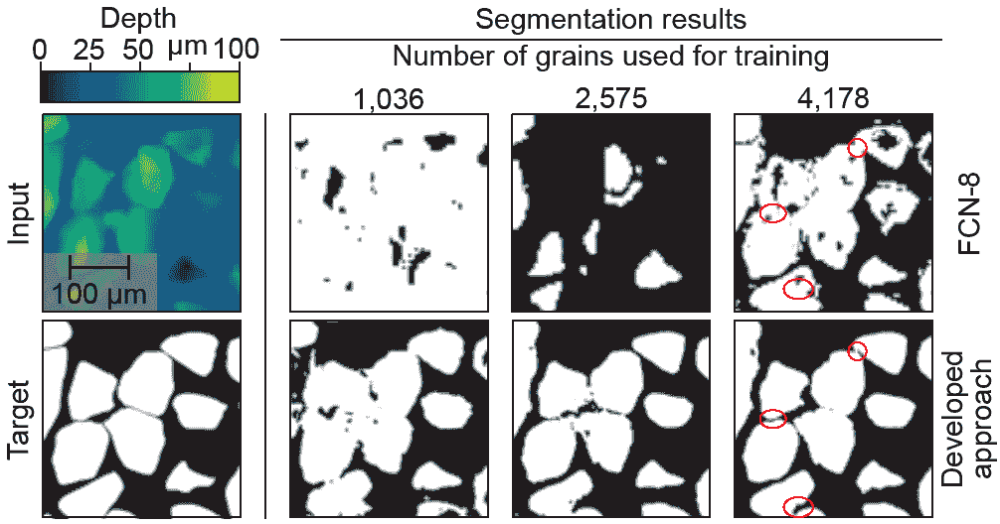

图 3.20：使用开发方法对比 FCN-8 的分割结果 [727]。


图 3.21：不同颗粒数量和不同 `AFPI` 值下的分割结果 [727]。

### 3.4.6 总结与结论

本贡献展示了研究，突出了传感器与数据融合在加工方面的不同科学见解。通过铣和磨削过程说明了这些方法。加工应用中的主要资源限制是处理时间。机器学习（ML）实现了实时预测能力。另一项资源在现实世界应用中通常受到限制的是标记数据。多种数据融合策略被讨论用于加工特征的实时预测。在这里，仿真与机器学习相互帮助。

此外，机器学习方法用于初始化仿真模型，特别是基于几何的铣系统模型。机器学习提供了帮助。

所呈现的结果强调了传感器数据融合在工业 4.0 背景下进行制造过程分析和优化的巨大潜力。

## 3.5 高精度定位

Janis Tiemann

**摘要：** 超宽带（`UWB`）技术的最新进展使得数字世界与物理世界之间的无线定位成为可能。随着技术的进步，可实现的精细度大幅提高，使得新型应用变得可行。自主机器人群或安全应用的可扩展追踪处于这一潜力的范围内。然而，此类能力的通信增加受信道利用率、能耗和智能信息分布的限制。因此，在最大化信息吞吐量的同时最小化信道利用率并保持精确定位结果的新型方法，对于克服技术障碍并最终实现连接的物理世界至关重要。此外，还需要到达差法（`TDOA`）等资源高效定位方法来提高可行精度。在这些情况下，可以利用无线信道的额外参数来获取测量质量指标或通过充分估计泛提高定位精度。在下，分析了若干应用的需求，并提供了信道利用率、能量效率和精度方面的解决方案概述。基于这些需求，提出了改进信道利用率和能量效率的解决方案。此外，说明并评估了在挑战环境中提高可行精度的方法。结果表明，通过采用特定的协议和方法，高精度无线定位实现了新型应用。

### 3.5.1 引言：精确且可扩展的无线定位

无线定位被视为许多物理世界与数字世界之间连接的推动因素。存在许多利用各种技术来实现这种连接的方法。关于这些技术在精度和范围方面的概述见图 3.22。该图说明了广泛采用的通信技术（如蜂窝网络和消费级无线标准）与更针对应用的标准（如 `UWB`）之间的区别。早期的定位方法完全基于小区 ID 和/区域划分。然而，新型方法能够提高追踪和引导应用的精度。更专用的定位系统如全球导航卫星系统（`GNSS`）可以实现精确定位结果，但限于视距（`LOS`）操作，因为它们深受多径衰落的影响。在这里，`UWB` 技术是克服技术障碍的关键，通过精确的到达时间（`TOA`）估计实现高精度的室内定位。对于 5G 毫米波通信实现的定位方法，请见第 5.5 节](#9783110785975_048357.xhtml#b_9783110785982-005_s_005)。

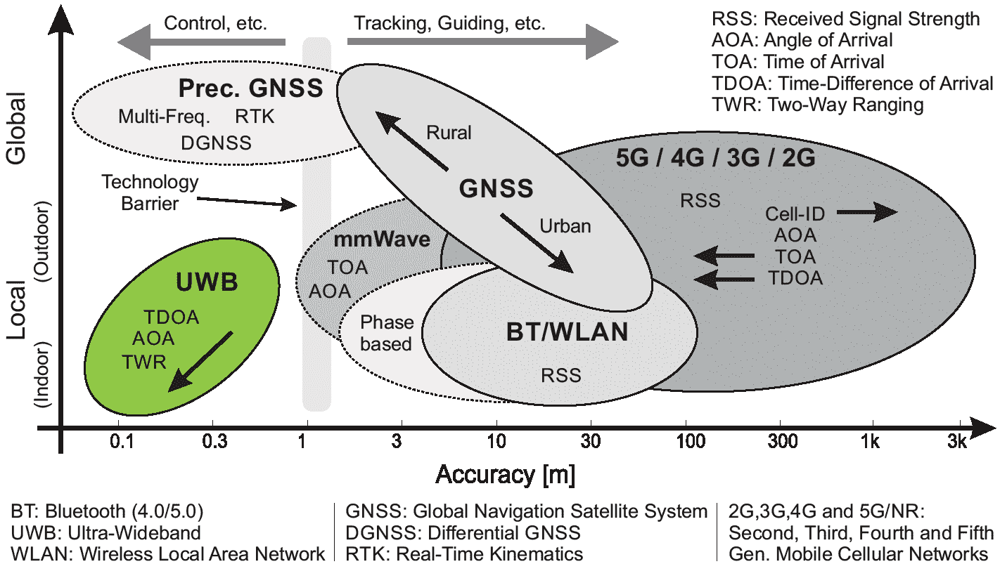

图 3.22：通信技术在精度、范围和使用场景方面的定位能力领域图。

因此，大量的研究面临这一新可用技术的挑战。与许多基于信号强度的方法相比，这些基于 `TOA` 的方法成为精确测量最具前景的候选者。由于使用了高带宽，这些 `UWB` 系统能够解决许多由多径引起的误差 [228]。

由于由于原因，多个领域的研究利用数字世界与模拟世界之间这种新可用的连接而兴起。一个特别感兴趣的领域是工业 4.0 的大规模扩展和低功耗定位领域。在这里，低功耗定位设备是监控和优化整个生产过程的关键，如图图 3.23] 使用双向测距实现无人机室内导航。多用户扩展性的限制促成了进一步的研究。

- **多用户干扰分析** [685] 是 `UWB` 系统和无线时钟同步多用户干扰的详细研究。[687] 中进行了进一步分析，提供了一个干扰的分析模型。

- **ATLAS - 基于 TDOA 的定位** [684] 克服了多用户扩展性限制，并提供了一种开源方法。

`可扩展多无人机室内导航` [688] 展示了控制级级系统的可扩展性和准确性。

- `增强型无人机室内导航` [681] 提升了控制级系统的精度和覆盖范围。

- 进一步的工作为 ATLAS 方法提供了一个开源扩展扩展 `ATLAS FaST`，以提高能量效率和可靠性 [678, 679, 687]。

- 最后，博士论文`超宽带定位中的可扩展性、实时能力和能量效率` 整合并扩展了该研究的核心发现，见 [683]。

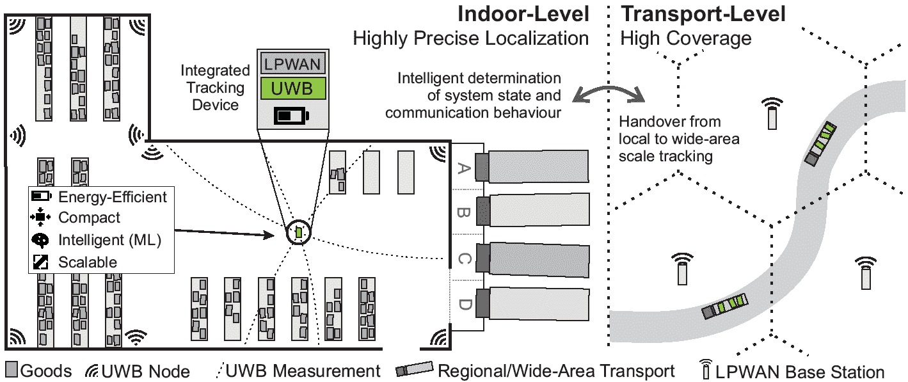

图 3.23: 潜在使用场景的插图。

### 3.5.3 方法：通过 UWB 实现可扩展、实时且高能效的定位

后续章节将介绍基于 [680, 683, 687] 的高精度无线定位方法。这些方法在多用户扩展性、能量效率和可实现的精度之间取得了平衡。首先，重点展示了底层的 ATLAS 系统。


图 3.24: 利用 FaST 调度的 ATLAS 系统架构。基于机器人操作系统 (ROS)，实现了灵活的设计以及与机器人的无缝集成。

#### 3.5.3.1 ATLAS：开源 TDOA 定位

在 ATLAS 实时系统 (RTLS) 背景下，我们基于 TDOA 拓扑结构，其中移动节点发送信息，基础设施进行接收。无线时钟同步用于实现基站节点的公共时间基。然而，随机访问无法提供所需的更新率。此外，随着移动节点的增加，由于帧丢失（见 [685]），定位质量将会下降。这意味着随机访问无法满足无人机导航等控制级应用。

#### 3.5.3.2 ATLAS FaST：控制级应用的轻量级调度

基于之前的工作 [684]，我们提出了一种与无线时钟同步无缝集成的新型轻量级调度协议，见 [687]。如图 3.23 所示，我们的方法旨在支持可扩展、低功耗、可靠且实时的无线定位。在下文中我们将记录该方法并在环境中对其进行实验评估。提供的开源实现使机器人社区能够使用可扩展 UWB 定位，见 [678, 679]。

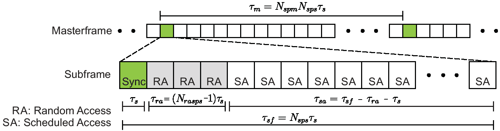

图 3.25: ATLAS FaST 的时分多接入 (TDMA) 方案。子帧结构实现了多个分布式同步单元。

该文献 [687] 主要关注机器人操作系统 (ROS)。与之前的工作相比，该方法在可扩展性和实时能力方面提供了显著提升。所提的系统架构如图 3.24 所示。

我们系统所选的 TDOA 拓扑使得移动节点具有极高的能量效率。通过模块化架构，各个组件可以独立开发，这显著缩短了集成特定应用程序功能的时间。

图 3.26：与系统控制器进行低功耗关联的方法。

移动节点的初始关联过程如图图 3.26 所示。`τ[ra]` 是同步帧与随机接入之间的持续时间，`τ[p]`(`k`) 是响应帧与第 `k`^(th)定位帧之间的持续时间，`τ[m]` 是主帧的持续时间，而 `k` 是定位采样迭代器。从电池取电的组件主要包含三个部分：收发器、主机控制器以及主机控制器内的实时时钟 (`RTC`）。在这里，内部 `RTC` 被用作整个系统时钟的守护者。收发器振荡器通过两个连续的 UWB 同步帧进行校准。`RTC` 的分辨率不足以在初始关联时进行校准。因此，应利用重关联，因为它提供了足够的时间跨度来允许 `RTC` 漂移校准。

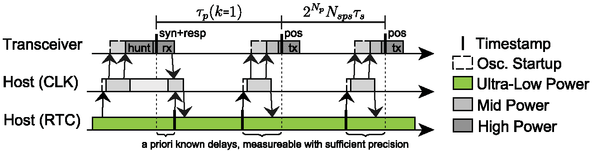

图 3.27：与系统控制器进行低功耗重关联的方法。

典型的重关联过程（包括以下传输）如图图 3.27 所示，其中 `N [p]` 是移动节点的定位周期指数，`N[sps]` 是每个子帧的槽隙数，`τ[s]` 是时隙持续时间。收发器和主机控制器可以配置为睡眠状态。然后可以配置 `RTC` 定时器唤醒主机控制器以进行下一个定位帧。在这里，唤醒主机控制器和收发器的延迟需要在实现阶段进行校准。需要考虑处理时间和振荡器启动时间。基于此，可以配置 `RTC` 唤醒时间。尽管 `RTC` 的精度有限（它主要运行在 32.768 kHz），但其约 30.52 μs 的可用分辨率足以保持在调度方案的误差范围内。然而，在调度方案的时隙持续时间设计中，需要考虑通过时钟遍历产生的潜在误差。

### 3.5.3.4 提高整体精度的无线信号评估

由于使用了基于 TDOA 的定位方案，定位解决方案中引入了另一个变量。与基于 TWR 的定位使用测距不同，TDOA 利用的是到达信号的时间差。因此，定位本质上更具挑战性。因此，需要如 [680] 中引入的措施来获得精确的定位结果。

UWB 的主要优势之一是获取接收信号的额外信息。在这里，可以应用利用这些信息对单个测量值进行加权的方法。图 3.28 展示了这一概念。在这里，取第一路径与信道冲击响应剩余能量的比率，以便在用于定位结果的扩展卡尔曼滤波 (`EKF`) 中对测量值加权。

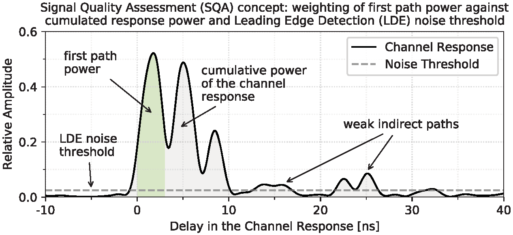

图 3.28：用于信号质量分析以提高精度的方法。注意，所示的信道响应是从十组记录数据插值得到的。

存在能够提取更多信息的概念，例如 [680] 中的被动定位。

### 3.5.4 结果

为了评估所提方法的性能，讨论了基于 683 的选取评估。

#### 3.5.4.1 ATLASST 方案的可扩展性

随机接入的主要优势之一是由于缺乏协调而实现的简单性。标签可以实现为仅发射器的设计。然而，主要的缺点是缺乏可预测性。对于许多应用（特别是实时控制），需要定义的更新率。

随着负载的增加，电池供电的应用会受到无法接收的影响。ATLAS FaST 设计用于克服这些问题。在下文中，分析了可到达时间间隔和可靠性。`τ̂[n]` 考虑了处理时间 `τ[proc]` 和部分导部效应。

产生的吞吐量是这些个体效应的叠加，高度取决于接收端。由于 UWB 的独特特性，非破坏性 R-TDOA 方案是可行的，因为吞吐量不会随着负载的增加而退化。然而，由于帧未接收，定位的实时能力会下降。这对于具有严格时间限制的应用尤为严重。

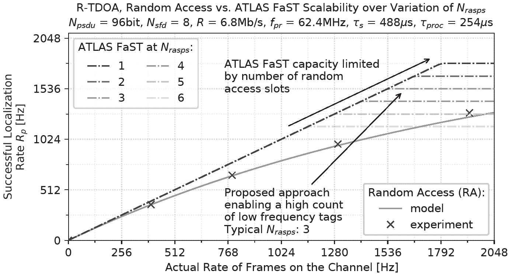

图 3.29：基于 R-DOA 定位的实验吞吐量与分析吞吐量，基础设施估计位置。

ATLAS FaST 克服了这一问题。由于采用了时隙方法并在调度时隙中无竞争信道访问，成功的定位吞吐量随定位帧负载线性扩展，如图图 3.29 所示。在这里 `N[psdu]` 是每个数据包传输的载荷比特数，`N[sfd]` 是 UWB 帧起始指示符的大小，`R` 是有效数据率，`f[pr]` 是物理层的平均脉冲重复频率。选择时隙持续时间 `τ[s]` 使每秒有 2048 个可用时隙。分析中忽略了由于噪声引起的帧错误导致的未接收，因为这很大程度上取决于无线定位系统规划者为给定设置提供的链路预算。然而，随机接入时隙数量的变化将定义容量的上限。

与所提 FaST 方案的吞吐量一起，图 3.29 展示了在规模扩展实验中获得的 R-TDOA 分析模型。在这里，我们可以比较所提方案与先前的基于随机接入的 R-TDOA 的多用户可扩展性。

显然，调度化方法（scheduled approach）比在相同的底层定位负载下使用基于随机接入的 `R-TDOA` 具有更高的吞吐量。此外，对于 `R-TDOA` 吞吐量的分析模型与实验结果高度吻合。目前的实现仅支持静态地调整随机接入时隙的数量 `N [rasps]`；为了获得最佳性能，必须进行动态调整。然而，即使使用固定的六个随机接入时隙，考虑到高重关联间隔，`FaST` 在 1Hz 频率下仍支持超过 1000 个移动单元。

### 3.5.4.2 定位方案的能量利用率

为了对不同信道接入方案的移动单元能耗提供简化的比较，图 3.30 中的柱状图总结了本工作相对于目前被认为最先进的、常用的对称双向测距（`SDS-TWR`）拓扑的结果。

在这里，四个锚点的最小集合是所有拓扑结构的基准。文中考虑了多种不同的测距或定位方案：在早期 `ATLAS` 实现中引入的带有随机接入的 `R-TDOA` [684]；如 [256, 378] 所示的、具有发射锚点和仅接收移动单元的 `T-TDOA`（类似于 GNSS）；典型的单边双向测距（`TWR`），其每每次测距需要两次消息交换；带有多重确认的双向测距（`TWR-MA`），其利用重复响应来估计时钟偏移；组合 `TWR`，通过为一组锚点预定义单个响应时间偏移来协调 `TWR` 交换；最后是对称双向测距（`SDS-TWR`），它利用对称响应时间来抵消测距过程中的时钟漂移。基础 `SDS-TWR` 需要三条消息，但它也可以配置为在 `SDS-TWR-R` 中报告计算出的距离，这在每次测距结束时额外需要一条消息。对于 `SDS-TWR` 拓扑，未考虑锚点端的报告。因此，由于使用了 `R-TDOA` 或 `FaST`，距离信息仅在基础设施端可用。但 `SDS-TWR-R` 考虑了报告，因此消耗的能量比基础 `SDS-TWR` 更。

请记住，基于 `TWR` 和 `T-TDOA` 的拓扑结构的能耗随设置中锚点数量的线性增加，而基于 `R-TDOA` 的定位能耗与锚点数量无关。因此可以说，即使在最坏的情况下，所提拓扑在扩展性和能量使用方面也优于传统的基于 `TWR` 的方案。

通过计算收发器每发送和接收一个 `UWB` 帧的功率以及定位拓扑的基本需求，可以确定出理想的电池寿命。选择的示例性定位频率为 1 Hz，重关联周期为 300 s，且可靠性 `N [r]` = 1。

功耗根据 `DW1000` 的数据表计算，结果为 `E[tx]=40.7mJ` 和 `E[rx]=76.9mJ`。注意，由于不同方案所需的 `PSDU`（物理层服务单元）大小取决于该值的实现情况，因此它们被简化为 `R-TDOA` 方案的最小大小。TDOA 和 `TWR` 方案之间的差异会更大。

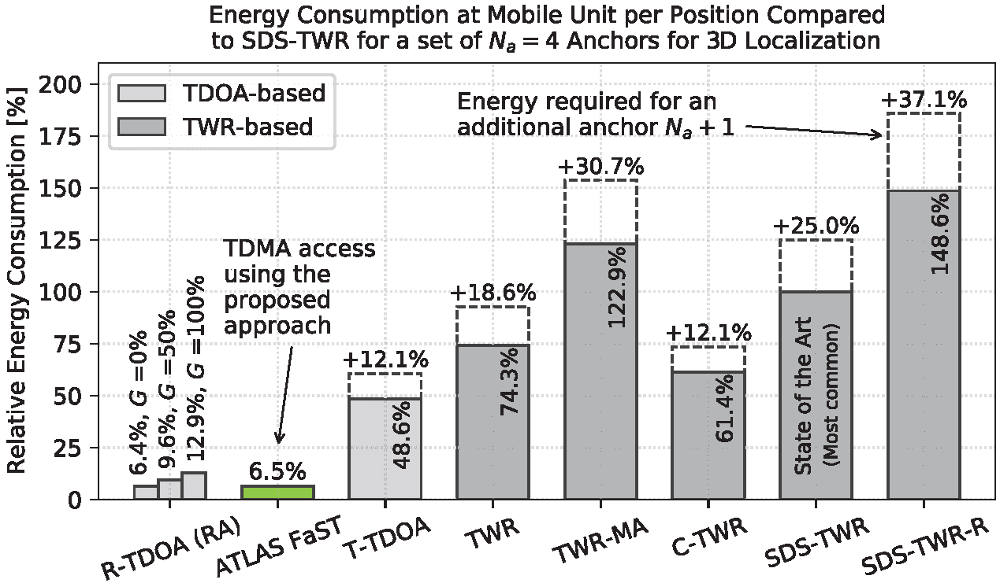

图 3.30：每种定位方法能量利用率的示例性评估。注意，影响能耗的主要因素是每个定位结果所需的消息数量。

所得的电池寿命如图图 3.30 所示。由于基于 `T-TDOA` 和 `TWR` 的方法存在固有的对锚点节点数量 `N[a]` 的依赖性，其电池寿命低几个数量级。对于基于 `R-TDOA` 的方法，`FaST` 的结果接近随机接入的结果，后者是移动节点低功耗的基准，因为存在额外的开销。因此可以说，通过计划中的低频同步调度，`FaST` 能够跟踪许多功率设备，而不会干扰关键应用的实时性。

### 3.5.4.3 准确性

为了评估准确性，遵循了几个轨迹。主要贡献之一是评估运动捕获下信号质量准确性的实验室实验，该实验发表于 [680]。为了获得具有国际可比性的结果，参加竞赛是关键，因为这是对比基准定位结果的唯一方法。下文基于 [683]，简要介绍了参加两次国际竞赛的情况。

在西班牙阿尔卡拉德德埃纳雷斯举行的第七届室内定位与室内导航会议（IPIN2016）上，`EvAAL` 竞赛为定位系统提供了对比基础。在第四条轨道“室内机器人定位”中，有六支队伍参赛。虽然四支队伍位于“轨道内”，两支位于“轨道外”，且仅对后者进行了评估。在 [507, 549] 中对该竞赛的组织情况和结果进行了详细介绍。

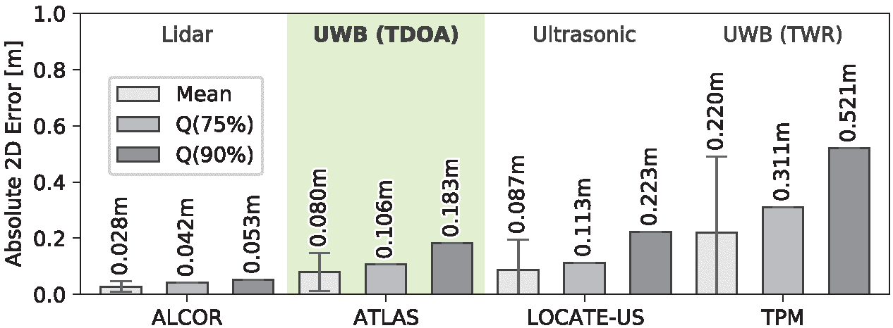

图 3.31：EvAAL 2016 竞赛结果的示例性分析评估。官方排名指标基于三分位数（75%）。

竞赛的目标是定位一个遵循预定轨迹的移动机器人，该轨迹必须由评估系统获取。组织者提供了一组四个极以覆盖 12m × 6m 的评估区域。系统是顺序评估的，因此该竞赛的挑战之一是 30 分钟的最大设置时间，在竞赛期间延长到了 45 分钟。组织者使用的评估指标是到轨迹的距离的三分位数，由于评估设置缺少时间分量。

结果的柱状图如图图 3.31 所示。除了用于排名的 `Q(75%)` 分位数外，还展示了平均绝对欧里得误差和 `Q(90%)` 误差。需要注意的是，基于 TDOA 的定位引入了额外的未知误差，这通常会降低这些系统的准确性。在比较 `ATLAS` 的结果和准确性与 TPM 团队的基于 `TWR` 系统时，必须考虑到这一点。

可以看出，`ATLAS` 方法尽管使用 `TDOA` 而非 `TWR`，但能够提供准确的机器人跟踪结果，因此适用于实时机器人运动跟踪的背景。


为了在更具挑战性的环境中评估定位方法，我们参加了在葡萄牙波尔图举办的与`CPS-Week 2018`同期召开的第五届`微软室内定位竞赛赛`（MILC）。此往的竞赛赛都吸引了科学界和工业界的广泛参与，参见 [422, 423]。在本次比赛中，34 个团队提交了摘要，26 个系统正式注册，25 个系统出现在波尔图。然而，只有 22 个系统提供了数据并接受了评估。

第二类使用`UWB`等自定义基础设施的团队需要报告 3D 位置。评估区域内至多允许 10 个锚点节点。团队有 8 小时的时间来设置和校准他们的系统。

团队使用基于移动激光扫描器的地面真值系统进行评估。组织者为每个团队分配了 15 分钟的评估时段并固定了顺序。然而，在比赛期间，处理过程更加动态，因此在时段内系统未运行的团队有机会对其系统进行调试并在随后进行评估。此外，由于比赛区域是评估期间举行的四个会议参会者的主楼梯，系统必须应对访客和观察者的阻挡与干扰。

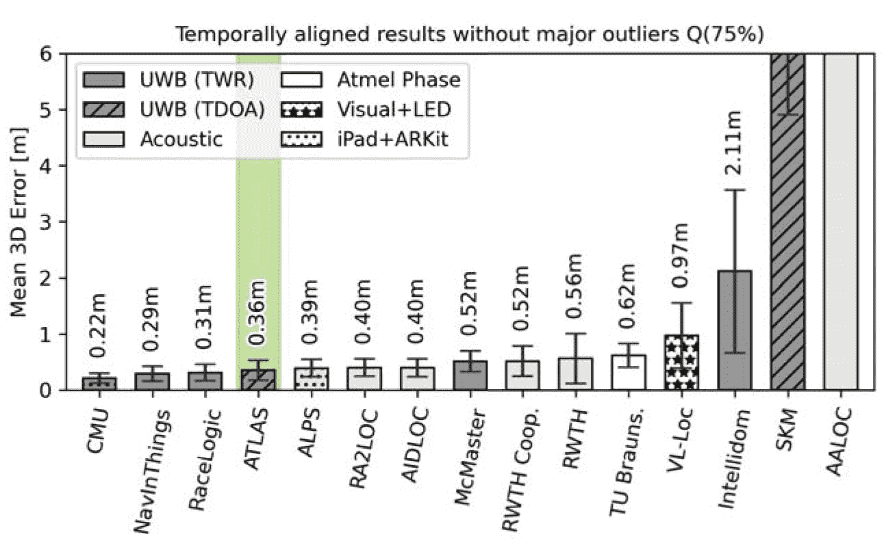

图 3.32: MILC 2018 数据在经过时间对齐并消除每个团队最大的 25%误差后，其平均 3D 精度的重建柱状图。注意不同定位算法的传感器多样性。

组织者选择平均欧几里得误差作为评估指标。然而，该误差受到评估运行开始时巨大离群值的影响。此外，在地面真值与 ATLAS 团队结果轨迹之间观察到约 1 秒的时间偏移。由于此，评估中引入了额外的误差。

请注意，随着时间对齐的改进，ATLAS 团队的平均误差有所提高。由于希望与其他团队的经过正确初始化的 ATLAS 结果进行比较，因此对时间对齐后的结果中表现最好的 75%的平均值进行了评估。为了提供公平的比较基础，考虑了所有团队中最好的 75%。因此，该分析不仅是移除了离群值，而且如底部柱状图所示，改进了所有团队的结果。

如图 3.32 所示，考虑到上述几点，ATLAS 系统的实际性能显著优于官方结果所示水平。尽管 ATLAS 系统使用了基于 TDOA 的方法（该方法在精度方面有很大缺点），但由于所提的实现，其结果与其他基于 TWR 的方法相当相当，且往往优于后者。

### 3.5.5 结论

本节介绍了高精度无线定位的基本能力、挑战和新颖解决方案。在这里，信道利用率、能量消耗和可实现精度的限制是广泛应用可行性的限制因素。

因此，展示了在最大化信息和定位吞吐量的同时，最小化信道利用率和功耗并保持精确定位结果的新颖方法，以克服技术障碍并最终实现连接的赛博世界。

### 3.5.6 致谢

本工作部分由北莱茵-威斯特伦州和“欧洲区域基金”（EFRE）20142020“CPS.HUB/NRW”项目资助，编号 876。

## 3.6 室内光伏能量采集

Mojtaba Masoudnej

**摘要**：电子领域的进步使得超低功耗（ULP）需求设备成为可能。然而，工业 4.0 设备通常需要在远程或难以到达的环境中长期运行。从环境中采集能量是解决这一供应问题的一种非常常见的技术。有多种能量采集原理可以将不同形式的能量转换为电力。然而，我们关注光伏（PV）能量采集，因为它最成熟。

工业 4.0 和物联网设备对尺寸和重量有限制外，它们大多应用于室内环境。因此，这里分析了光伏模块在人工光照下的特定行为。通过系统化的数据采集程序，对典型的光伏模型进行了调整以适应 ULP 环境。在参数调优期间引入了归一化程序，因为常用技术在低光和超低光条件下对光伏模块并不适用。提供了相关指南以确保模型参数调优的数值稳定性。

双层模型的第二层代表了调优曲线与环境因素之间的关系。通过根据光强度的相对表示，这些模型适用于不同的条件。整体性能在从新环境中收集的额外数据集上进行了评估，显示在最坏情况下模型误差小于 6%。

本节部分内容取自[434]，并经作者同意。

### 3.6.1 引言：能量采集

能量在自然界以多种形式存在，从热能、机械能到存储在电磁波和光子中的能量。任何能够采集这些能量的方法都可以称为*能量采集*，而将它们转换为所需形式的换能器就是能量采集设备，简称为*能量采集器*。能量采集具有悠久的历史，自将风能转换为机械能以磨谷的风车可以追溯到 9 世纪。然而，现代能量采集将能量转换为电。

风能、太阳能、光伏（PV）、压电、热能、射频和潮能能量采集只是现代能量采集技术的示例。然而，由于将光（特别是太阳能）转换为电的技术在多个领域经过了长期研究和应用，其比其他技术更为成熟。虽然`solar`（太阳能）一词广为人知，但它包含了将阳光转换为电能的不同原理。尽管如此，`PV`是一种使用半导体材料和技术将光转换为电能的特定形式。简单来说，`PV`转换器可以被认为使用了发光二极管（LED）的相反原理。除了`PV`采集技术的成熟外，它们集成到 ULP 工业 4.0 硬件中也是我们在文中关注它们的主要原因。

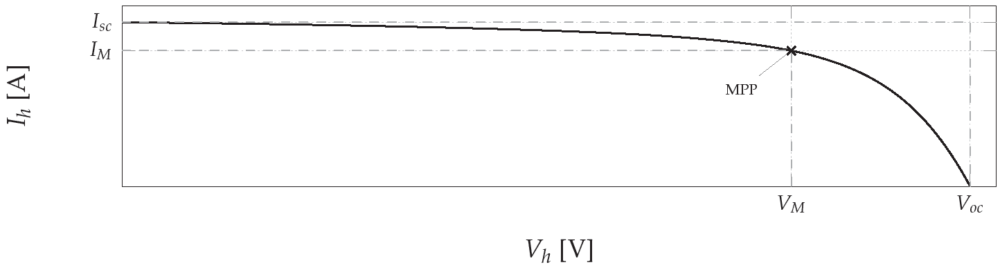

图 3.33：在荧光灯下测量的 Sanyo/AM-1464 光伏组件的 I-V 曲线。

### 3.6.1.1 PV 能量采集

“一个`PV`转换器是一种在光子照射时产生电能的半导体设备 [434]”。这些半导体的价带中含有电子，价带电子的束缚较弱。任何能量高于带隙的光子都可以打破这种束缚，并导致电子运动到导带。只要半导体表面有足够的光的光子照射，光子的能量就会转换为电子的流动，从而将光能电能。由于这种转换的性质，`PV`可以产生直流电（DC）。因此，`PV`采集器是一个电源，但不是一个理想的电源。根据`PV`组件的工作条件，它可以作为电压源或电流源。`PV`组件常见的 I-V 行为所示图 3.33。

如图 3.33 所示，对于大部分电压（主要在低压范围内），`PV`组件作为电流源工作，而对于大多数电流值（在很小的电压范围内），它作为电压源工作。然而，这些部分没有一个是理想的，因为它们不是纯粹的垂直或水平线。源形式行为发生变化的的弯折点至关重要，因为在该特定点可以从组件中提取出最大功率。因此，它被称为最大功率点（MPP），而将工作点保持在该点的的技术称为最大功率点跟踪（MPPT）。当`V[h]`和`I[h]`分别描述采集的电压和电流时，可以从公式 3.37 在数学上找到`MPP`。

(3.37) $\frac{\partial P_{h}}{\partial V_{h}} = \frac{\text{d}I_{h}}{\text{d}V_{h}} \cdot V_{h} + I_{h} = 0,\quad\text{at}:V_{h} = V_{M}$

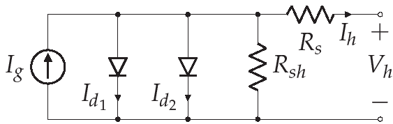

图 3.34：包含寄生电阻的 PV 转换器等效二极管电路模型。

除了`MPP`之外，`PV`组件还有两个关键点，包括电压和电流的交叉点：`开路`值和`短路`值。

### 3.6.2 PV 转换器模型

虽然某些应用只需要了解这三个点，但大多数`PV`系统的应用需要对整个 I-V 曲线有更详细的解释。基于 Hall [254] 和 Shockley 等人 [604] 工作成果的 Shockley 二极管方程，这种行为的多二极管模型解释如下：

(3.38) $I_{h} = I_{g} - I_{d_{1}} - I_{d_{2}} - \frac{V_{h} + I_{h} \cdot R_{s}}{R_{sh}}$

其中`I[g]`是光生电流，`R[s]`和`R[sh]`分别是串联和并联电阻。二极管电流`I[d]`定义如公式 3.39，其中`*`是二极管编号。

(3.39) $I_{d^{\star}} = I_{S^{\star}} \cdot \left[\exp\left( \frac{V_{h} + I_{h} \cdot R_{S}}{n_{\star} \cdot V_{t}} \right) - 1\right]$

在公式 3.39 中，`I[s]`和`n`是每个二极管的饱和电流和理想因子。此外，`V[t]`通过`V[t] = B · T/q`描述`热电压`，其中`B`是玻尔兹曼系数，`T`是开尔文温度，`q`是电荷。

根据公式 3.38 的表达式，可以建立一个等效电路模型（ECM）来重现`PV`组件的源行为。图 3.34 所示的`ECM`能够复制`PV`电池的特性，包括其非理想性和电阻。然而，根据 I-V 曲线复制所需的精度，可以将二极管数量减少到一个。但某些应用利用更高数量的二极管来增加自由度，以更好地复制曲线。

无论`PV`转换器模型中有多少个二极管，该模型都必须拟合每个组件和光照类型的实际曲线。因此，需要调节的参数取决于二极管的数量。此外，系统设计人员可能会某些应用中从模型中移除某些参数。因此，将使用通用向量`ψ`来表示这些未知数。

### 3.6.2.1 参数调节

关于为每个`PV`组件调节`ψ`方法有大量的研究。然而，它们可以简单地分为`数值`调节和`代数方程组 (AES)`调节。在数值方法中，测量 I-V 曲线上的点集，并直接用于求解优化问题以最小化误差。在测量了整个 I-V 曲线的理想情况下，当`Iˆ[h]`显示调节模型的电流时，可以将其公式化为误差最小：

(3.40) $\min\limits_{\psi}\mathcal{l}(\psi) = \int\limits_{0}^{V_{oc}}\left\| {I_{h}\left( V_{h} \right) - \hat{I_{h}}\left( {V_{h},\psi} \right)} \right\|_{2}\text{d}V_{h}$

虽然这种方法可以用简单的方式解释，但其应用面临着不同的挑战。首先，需要在恒定的环境条件下对光伏系统（PV system）进行大量测量。在整个测量期间保持光强恒定可能特别具有挑战性。其他问题涉及该方法的计算方面。一方面，必须求解一个近似计算密集型的优化问题，以获得参数`ψ`中一组可靠的值。另一方面，这些方法对这些参数所使用的初始值非常敏感。

另一个增加这种利用复杂性的问题是找到模型中每个电压对应的电流值。如模型公式所示，方程 3.38 描述了电压和电流之间的隐式关系。因此，电流的计算需要一个显式关系，或者必须以数值（迭代）的方式进行。对于单二极管模型，Femia 等 [204] 使用 Lambert 函数给出了参数之间的显式关系：

```
(3.41) $I_{h} = \frac{R_{sh} \cdot \left( {I_{g} + I_{s}} \right) - V_{h}}{R_{sh} + R_{s}} - \frac{n}{R_{S}} \cdot \mathcal{W}\left( \theta_{i} \right)\left( 3.41 \right)$
```

其中 Lambert W 函数用 W 表示，而`θ[i]`为：

```
(3.42) $\theta_{i} = \frac{R_{sh} \cdot R_{S}}{n \cdot \left( {R_{S} + R_{sh}} \right)} \cdot I_{S} \cdot \exp\left\lbrack \frac{R_{sh} \cdot R_{S} \cdot \left( {I_{g} + I_{S}} \right) + R_{sh} \cdot V_{t}}{n \cdot \left( {R_{sh} + R_{S}} \right)} \right\rbrack\left( 3.42 \right)$
```

尽管这简化了模型中单二极管电流的寻找，但双二极管模型（更准确）仍然需要对每个电压值进行数值解。因此，在方程 3.40 的优化内部有一个数值迭代函数，该函数本身也是以数值迭代的方式求解的。

数值方法的计算复杂度是大多数研究人员通过寻找调整`ψ`中参数的替代途径来克服这一挑战的主要原因。利用模型中的物理知识是构建可用较少计算求解的 AES（代数方程组）常用方法。根据通用 I-V 关系和关于光伏系统的基础知识，可以列出几个方程：

```
$\left. \text{at~SC:}}V_{h} = 0\Rightarrow I_{sc} = I_{g} - I_{s}\left\lbrack \exp\left( \frac{I_{sc} \cdot R_{S}}{n \cdot V_{t}} \right) - 1 \right\rbrack - \frac{I_{sc} \cdot R_{S}}{R_{sh}}\left( 3.43a \right) \right.$
```

```
$\left( \text{at~OC:}}I_{h} = 0\Rightarrow 0 = I_{g} - I_{s}\left\lbrack \exp\left( \frac{V_{oc}}{n \cdot V_{t}} \right) - 1 \right\rbrack - \frac{V_{oc}}{R_{sh}}\left( 3.43b \right) \right.$
```

```
$\left. \text{at~MPP:}}I_{M} = I_{g} - I_{s}\left\lbrack \exp\left( \frac{V_{M} + I_{M} \cdot R_{S}}{n \cdot V_{t}} \right) - 1 \right\rbrack - \frac{V_{M} + I_{M} \cdot R_{S}}{R_{sh}}\left( 3.43c \right)$
```

必须注意的是，这些方程是针对单二极管模型的，但也可以扩展到双二极管模型。虽然开路和短路可以很容易测量，但在没有任何先验知识的情况下寻找 MPP（最大功率点）是可能的。然而，众所周知 MPP 大程度上与开路电压`V[oc]`和短路电流`I[sc]`成正比。因此，可以在这些特定值处简单测量参数并将它们用于方程 43c，尽管这会引入微小误差。上述方程仅是精确点的数学表示，这在某种程度上类似于数值方法。因此，使用来自此 AES 的有限知识可以提供在这些点上对模型的最优拟合。此外，即使是单二极管模型，`ψ`也有 5 个值。因此，该 AES 是欠定的，需要更多的方程或减少某些参数。虽然很少研究人员对仅有 3 或 4 个参数的模型进行实验，但在关键点上使用模型的推导来扩展 AES 是一项公认的原则。这些用于单二极管模型的方程为：

```
(3.44) $\begin{matrix} {\left( \frac{dI_{h}}{dV_{h}} \right)_{I_{h} = 0} = - I_{g} \cdot \left\lbrack \frac{1}{n \cdot V_{t}} \cdot \left( {1 + \left( {I_{g} + I_{s}} \right) \right) \right) \right \ \ \ \ \ \ \ \ \ \ \ \ \ \ \ \ \ \ \ \ \ \ \ \ \ \ \ \ \ \ \ \ \ \ \right) \end{matrix}$
```

*(注：此处原文公式显示不完整，翻译按原文格式对齐)*

```
(3.44) $\begin{matrix} {\left( \frac{dI_{h}}{dV_{h}} \right)_{I_{h} = 0} = - I_{g} \cdot \left\lbrack \frac{1}{n \cdot V_{t}} \cdot \left( {1 + \left( {I_{g} + I_{s}} \right) \right) \right) \right\rbrack \ \ \ \ \ \ \ \ \ \ \ \ \ \ \ \ \ \ \ \ \ \ \ \ \ \ \ \ \ \ \ \ \ \ \ \ \ \ \ \ \ \ \ \ \ \ \ \ \ \ \ \ \ \ \ \ \ \ \ \ \ \ \ \ \ \ \ \ \ \ \ \ \ \ \ \ \ \ \ \ \ \ \ \ \ \ \ \ \ \ \ \ \ \ \ \ \ \ \ \ \ \ \ \ \ \ \ \ \ \ \ \ \ \ \ \ \ \ \ \ \ \ \ \ \ \ \ \ \ \ \right) \end{matrix}$
```

*(修正：根据提供的原始文本块内容，翻译如下：)*

```
(3.44) $\begin{matrix} {\left( \frac{dI_{h}}{dV_{h}} \right)_{I_{h} = 0} = - I_{g} \cdot \left\lbrack \frac{1}{n \cdot V_{t}} \cdot \left( {1 + \left( {I_{g} + I_{s}} \right) \right) \right) \right\rbrack \dots \end{matrix}$
```

*(由于原文文本中 LaTeX 代码存在截断，以下严格遵循用户提供的文本结构翻译：)*

```
(3.44) $\begin{matrix} {\left( \frac{dI_{h}}{dV_{h}} \right)_{I_{h} = 0} = - I_{g} \cdot \left\lbrack \frac{1}{n \cdot V_{t}} \cdot \left( {1 + \left( {I_{g} + I_{s}} \right) \right) \right) \right\rbrack \dots \end{matrix}$
```

*(重新审视原文，3.44 之后的实际内容为：)*

```
(3.44) $\begin{matrix} {\left( \frac{dI_{h}}{dV_{h}} \right)_{I_{h} = 0} = - I_{g} \cdot \left\lbrack \frac{1}{n \cdot V_{t}} \cdot \left( {1 + \left( {I_{g} + I_{s}} \right) \right) \right) \right\rbrack \dots \end{matrix}$
```


虽然这种方法可以用简单的方式解释，但其应用面临着不同的挑战。首先，需要在恒定的环境条件下对光伏系统（PV system）进行大量测量。在整个测量期间保持光强恒定可能特别具有挑战性。其他问题涉及该方法的计算方面。一方面，必须求解一个近似计算密集型的优化问题，以获得参数`ψ`中一组可靠的值。另一方面，这些方法对这些参数所使用的初始值非常敏感。

另一个增加这种利用复杂性的问题是找到模型中每个电压对应的电流值。如模型公式所示，方程 3.38 描述了电压和电流之间的隐式关系。因此，电流的计算需要一个显式关系，或者必须以数值（迭代）的方式进行。对于单二极管模型，Femia 等 [204] 使用 Lambert 函数给出了参数之间的显式关系：

```
(3.41) $I_{h} = \frac{R_{sh} \cdot \left( {I_{g} + I_{s}} \right) - V_{h}}{R_{sh} + R_{s}} - \frac{n}{R_{S}} \cdot \mathcal{W}\left( \theta_{i} \right)\left( 3.41 \right)$
```

其中 Lambert W 函数用`W`表示，而`θ[i]`为：

```
(3.42) $\theta_{i} = \frac{R_{sh} \cdot R_{S}}{n \cdot \left( {R_{S} + R_{sh}} \right)} \cdot I_{S} \cdot \exp\left\lbrack \frac{R_{sh} \cdot R_{S} \cdot \left( {I_{g} + I_{S}} \right) + R_{sh} \cdot V_{t}}{n \cdot \left( {R_{sh} + R_{S}} \right)} \right\rbrack\left( 3.42 \right)$
```

尽管这简化了模型中单二极管电流的寻找，但双二极管模型（更准确）仍然需要对每个电压值进行数值解。因此，在方程 3.40 的优化内部有一个数值迭代函数，该函数本身也是以数值迭代的方式求解的。

数值方法的计算复杂度是大多数研究人员通过寻找调整`ψ`中参数的替代途径来克服这一挑战的主要原因。利用模型中的物理知识是构建可用较少计算求解的 AES 的常用方法。根据通用 I-V 关系和关于光伏系统的基础知识，可以列出几个方程：

```
$\left. \text{at~SC:}}V_{h} = 0\Rightarrow I_{sc} = I_{g} - I_{s}\left\lbrack \exp\left( \frac{I_{sc} \cdot R_{S}}{n \cdot V_{t}} \right) - 1 \right\rbrack - \frac{I_{sc} \cdot R_{S}}{R_{sh}}\left( 3.43a \right) \right.$
```

```
$\left. \text{at~OC:}}I_{h} = 0\Rightarrow 0 = I_{g} - I_{s}\left\lbrack \exp\left( \frac{V_{oc}}{n \cdot V_{t}} \right) - 1 \right\rbrack - \frac{V_{oc}}{R_{sh}}\left( 3.43b \right) \right.$
```

```
$\left. \text{at~MPP:}}I_{M} = I_{g} - I_{s}\left\lbrack \exp\left( \frac{V_{M} + I_{M} \cdot R_{S}}{n \cdot V_{t}} \right) - 1 \right\rbrack - \frac{V_{M} + I_{M} \cdot R_{S}}{R_{sh}}\left( 3.43c \right)$
```

必须注意的是，这些方程是针对单二极管模型的，但也可以扩展到双二极管模型。虽然开路和短路可以很容易测量，但在没有任何先验知识的情况下寻找 MPP 是可能的。然而，众所周知 MPP 大程度上与开路电压`V[oc]`和短路电流`I[sc]`成正比。因此，可以在这些特定值处简单测量参数并将它们用于方程 43c，尽管这会引入微小误差。上述方程仅是精确点的数学表示，这在某种程度上类似于数值方法。因此，使用来自此 AES 的有限知识可以提供在这些点上对模型的最优拟合。此外，即使是单二极管模型，`ψ`也有 5 个值。因此，该 AES 是欠定的，需要更多的方程或减少某些参数。虽然很少研究人员对仅有 3 或 4 个参数的模型进行实验，但在关键点上使用模型的推导来扩展 AES 是一项公认的原则。这些用于单二极管模型的方程为：

```
(3.44) $\begin{matrix} {\left( \frac{dI_{h}}{dV_{h}} \right)_{I_{h} = 0} = - I_{g} \cdot \left\lbrack \frac{1}{n \cdot V_{t}} \cdot \left( {1 + \left( {I_{g} + I_{s}} \right) \right) \right) \right\rbrack \dots \end{matrix}$
```

从所有方程中，可以创建一个包含 7 个显式方程的`AES`。尽管如此，除了测量最大功率（MPP）的复杂性外，寻找关键点的斜率也是一项具有挑战性的任务。一些简化方案建议通过关键点之间连线的斜率来计算斜率，但这会给调优性能带来误差。因此，必须进一步的测量以改进斜率的计算。此外，这些方程仅针对测得的关键点及其推导值将模型公式拟合曲线，无法在其他点上提供高精度。然而，可以从曲线上测量任何进一步的点并将其作为简单方程添加到`AES`中。可见，两种参数调优方法各有优缺点。

### 3.6.2.2 环境因素

I-V 曲线代表了在特定光强`E`和温度`T`环境条件下的光伏模块。虽然曲线的整体形状保持不变，但其细节（包括关键点和斜率）随这些参数而变化。因此，需要更深层次的模型来解释环境因素的影响。一些初始模型解释了由于环境要素偏差导致的关键值变化。遗憾的是，这些模型在文献中并不一致，对于同一个参数存在不同的公式表达。然而，由于它们源于太阳光照射下的光伏运行，这些模型在方法论上具有相似性。在这些模型中，环境因素是根据参考条件描述的，参考条件大多数是 AM1.5 条件。它被描述为 1000 W/m² 的单光照射下，且光线垂直于光伏电池，电池温度为 25 °C。

文献中现有的关系可以根据环境因素解释`ψ`中的某些参数。然而，其中大多数关系都使用了某种简化假设，且大部分体是在解释某一个特定的应用案例研究。Masoudinejad [434] 回顾了这些参数的先进表述。

### 3.6.2.3 室内光伏能量采集

尽管光伏能量采集已经趋成熟，并有多种分析和建模技术，但大多数可用方法仍基于阳光下的应用。相比之下，现代用例（特别是在物联网和工业 4.0 领域）位于具有人工照明的室内区域。因此，需要对现有方法进行修订并对其解决方案进行验证。这些领域的主要区别之一是光强度的尺度。图 3.35 提供了概述。可见，某些工业应用（如工业仓库中的 PhyNetLab [197]）的光强比基于太阳的应用低几个数量级。除了光强水平，室内光光谱还有更多形式，并可根据光源、建筑材料和周围环境而不同。太阳光与典型室内光源之间光谱的差异可以在图 3.36 中看到。

![图. 3.35: 某些常用条件的光强范围。重自 [146]。](graphic/b_9783110785982-003_fig_035.png)

图 3.35: 某些常用条件的光强范围。重自 [146]。

![图. 3.36: 左：户外太阳光光谱 [479] 和 5700 K 下的太阳黑体辐射 [703]。右：三种不同人工照明的测量室内光光谱。](graphic/b_9783110785982-003_fig_036.png)

图 3.36: 左：户外太阳光光谱 [479]和 5700 K 下的太阳黑体辐射 [703]。右：三种不同人工照明的测量室内光光谱。

光源之间的差异直接影响光伏模块的 I-V 曲线。图 3.37 提供了一个示例。尽管两个光源均来自同一制造商，且具有相同的规格和功率，但它们产生了不同的曲线。

这两个源之间的唯一区别是它们的色温，这可以在图 3.38 中的光谱中看到。

可见，尽管两种光源的积分光强在 248 lx 时相等，但它们的色温差异是光谱形式不一致的结果。由于光伏模块对每个波长的敏感度不均匀，每个特定条件下产生的 I-V 曲线将是不同的。因此，不仅需要对人工照明下的光伏行为进行分析和建模，还需要进行仔细的考虑。

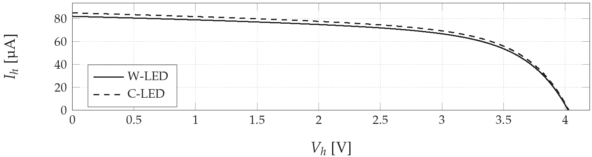

图 3.37: 在冷光和暖 LED 光下测量的 Solems 光伏模块 I-V 曲线。两个光源均来自同一制造商，测量条件为：`E =248 lx` 和 `T =299 K`。

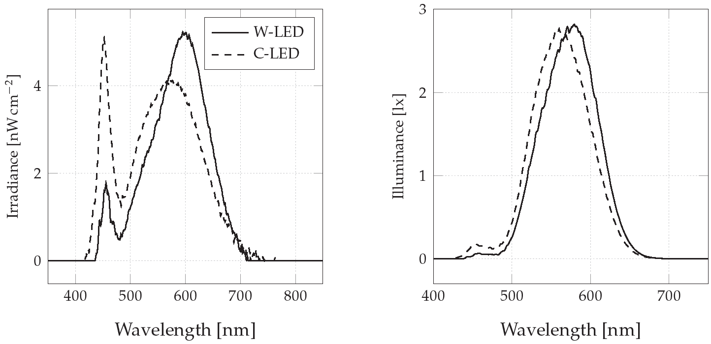

图 3.38: 冷光和暖 LED 光的光谱。尽管值相等，光谱不同。左：光强，右：照度。

### 3.6.3 室内光伏建模

室内照明类型的多样性以及人工照明下可靠数据的匮乏，要求收集相应的代表性数据集。这些数据随后可用于分析此类照明的 I-V 曲线、提取参数以及根据环境因素建立关系。

每次光伏测量所需的信息包括 I-V 曲线和光强信息。为了测量 I-V 曲线，需要光伏电池连接一个可变阻抗。从大值开始，该阻抗降低直到达到开路电压。在阻抗扫描期间，必须同时测量电压和电流。这可以重现曲线。这种过程可以使用源测量仪（`SMU`）实现。

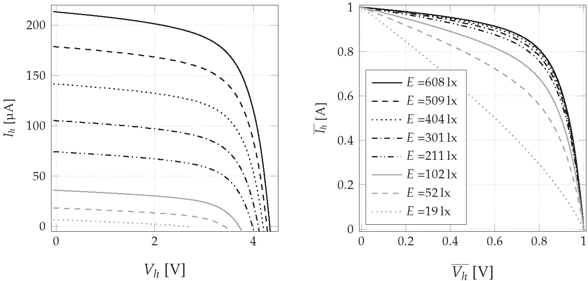

图 3.39: 测量的 I-V 曲线示例。左：正常空间，右：PVNS。

光强测量有多种系统和设备。为了获得综合信息，这里同时使用了积分测量和光谱测量。此外，使用了受控光强的封闭环境以确保照明的可靠性和可重复性。使用 432, 433, 435 详细说明的系统，收集了不同的数据集，这些数据可以从 [433] 中公开获取。

这些数据集将用于开发模型并探索室内光伏行为。然而，在建模之前，需要讨论两个初步主题。

### 3.6.3.1 光伏归一化空间

观察可用的室内数据集，如图 3.39 中的示例所示，可以发现信号范围跨越不同的数量级。这种多样性可能会导致计算误差，并增加数值方法计算的复杂性。

因此，引入了`PV Normalized Space`（PV 化空间）将所有曲线缩放到相似的范围内，以避免数值问题。这种转换可以通过将每个曲线的电压和电流相对于其最大值（分别为`V[oc]`和`I[sc]`）来简单实现。需要注意的是，电阻也必须进行缩放，但由于参数`n`没有单位，因此它不需要任何缩放。总而言之，所有缩放后参数（由 • 表示）的关系为：

```
(3.49) $\overline{P} = P \times \left\lbrack {\\frac{1}{V_{oc}},\\frac{1}{V_{oc}},\\frac{I_{sc}}{V_{oc}},\\frac{I_{sc}}{V_{oc}},\\frac{1}{I_{sc}},\\frac{1}{I_{sc}},\\frac{1}{I_{sc}}} \right\rbrack,\\,\\\,\\,\,\\,\\,\\,\\,\\,\\,\\,\\,\\,\\,\\,\\,\\,\\,\\,\\,\\,\\,\\,\\,\\,\\,\\,\\,\\,\\left( 3.49 \right)$
```

当：

```
(3.50) *P* = \[*V[h],*V[t],*R[s],*R[sh],*I[h],*I[g],*I[s]\]^⊤.                     (3.50)
```

这种缩放对 I-V 曲线的影响可以在右侧的图 3.39 中看到。这种缩放强调了由于光范围不同导致的 I-V 曲线形状差异，而这些差异在原始曲线上不易检测。此外，它将所有可用数据带入统一尺度，有助于降低数值方法对信号值的敏感性。

表 3.7：PVNS 中 PV 模型参数的边界建议。

| 参数 | 下限 | 上限 | 单位 |
| --- | --- | --- | --- |
| `I[g]` | 0.9 | 1.1 | [A] |
| `R[s]` | `ϵ` | (`V[oc]`−`V[M]])/`I[M]` | [Ω] |
| `R[sh]` | `V[M]/(`I[sc]`−`I[M])` | ∞ | [Ω] |
| `I[s]` | `ϵ` | 1.1 | [A] |
| `n` | 1 | 10 | [-] |

### 3.6.3.2 评价标准

与建模过程类似，需要一个评价因子来量化模型的性能。当需要复制 I-V 曲线时，由于信号范围很大，优于使用相对性能因子。然而，开路点的除以零可能会阻碍在不移除该点的情况下计算相对因子。遗憾的是，开路是一个关键点，在任何模型中都起着至关重要的作用。因此，这里的平均绝对归绝对误差（MANE）定义如公式 3.51。它根据`I[sc]`对百分绝对误差进行归一化以找到平均值。这也可以解释为 PVNS 中 I-V 曲线的平均绝对误差。

```
(3.51) $\text{MANE~} = \frac{100}{I_{Sc} \cdot V_{oc}} \cdot \int\limits_{0}^{V_{oc}}\left| {\\delta\left( I_{h} \right)} \right|\text{d}V_{h} = 100 \cdot \int\limits_{0}^{1}\left| {\\delta\left( \overline{I_{h}} \right)} \right|\text{d}\overline{V_{h}}\,\,\,\,\,\,\,\,\,\,\,\,\\,\\\,\\,\\,\,\\,\\,\\,\\,\\,\\,\\,\\,\\,\\,\\,\\,\\left( 3.51 \right)$
```

或者对于具有`m`个点的离散测量数据情况：


(3.52) $\text{MANE~} = \frac{100}{I_{Sc} \cdot m} \cdot \sum\limits_{i = 1}^{m}\left| {\\delta\left( \overline{I_{h}} \right)} \right|\text{d}\overline{V_{h}}\,\,\,\,\,\,\,\,\,\,\,\,\\right\,\left( 3.52 \right)$

### 3.6.3.3 参数调整

观察可用的室内数据集，如图 3.39 中的示例所示，可以发现信号范围跨越不同的数量级。这种多样性可能会导致计算误差，并增加数值方法计算的复杂性。

因此，引入了`PV Normalized Space`（PV 化空间）将所有曲线缩放到相似的范围内，以避免数值问题。这种转换可以通过将每个曲线的电压和电流相对于其最大值（分别为`V[oc]`和`I[sc]`）来简单实现。需要注意的是，电阻也必须进行缩放，但由于参数`n`没有单位，因此它不需要任何缩放。总而言之，所有缩放后参数（由 • 表示）的关系为：

(3.49) $\overline{P} = P \times \left\lbrack {\\frac{1}{V_{oc}},\\frac{1}{V_{oc}},\\frac{I_{sc}}{V_{oc}},\\frac{I_{sc}}{V_{oc}},\\frac{1}{I_{sc}},\\frac{1}{I_{sc}},\\frac{1}{I_{sc}}} \right\rbrack,\\,\\\\,\\,\,\\,\\\,\,\\,\\,\\,\\,\\,\\,\\,\\,\\,\\,\\,\\,\\,\\\,\,\\,\\,\\,\\,\\,\\,\\,\\,\\,\\,\\,\\left( 3.49 \right)$

当：

(3.50) *P* = \[*V[h],*V[t],*R[s],*R[sh],*I[h],*I[g],*I[s]\]^⊤.                    (3.50)

这种缩放对 I-V 曲线的影响可以在右侧的图 3.39 中看到。这种缩放强调了由于光范围不同导致的 I-V 曲线形状差异，而这些差异在原始曲线上不易检测。此外，它将所有可用数据带入统一尺度，有助于降低数值方法对信号值的敏感性。

[表 3.7 如上]

在对单二极管模型的所有参数进行调优后，下一步是建立每个参数与环境因素之间的关系。然而，由于这是一种纯基于数据的建模方法，所得模型是经验性的，无法保证任何物理上的洞察。尽管如此，通过为所有包含不同光伏（PV）技术和光源的数据集构建这些模型，模型的泛化能力可以在某种程度上得以保持。在可用数据上测试了多种函数类型后，这些关系被公式化为：

$\widetilde{I\_{g}} = \frac{I\_{g}}{I\_{g}^{\star}} = \alpha\_{g1} \cdot \widetilde{E} + \alpha\_{g2} \cdot \text{Δ}T\,\,\,\,\,\,\,\,\,\,\,\,\,\,\,\,\,\,\,\,\,\,\,\,\,\,\,\,\,\\,\left( {3.53\text{a}} \right)$ $\widetilde{R\_{S}} = \frac{R\_{S}}{R_{S}^{\star}} = \frac{\alpha\_{s1} + \alpha\_{s4} \cdot \text{Δ}T}{\alpha\_{s2} + \alpha\_{s3} \cdot \widetilde{E}}\,\,\,\,\,\,\,\,\,\,\,\,\,\,\,\,\,\,\\,\left( {3.53\text{b}} \right)$ $\widetilde{R\_{sh}} = \frac{R\_{sh}}{R\_{\text{sh}}^{\star}} = \frac{\alpha\_{p1} + \alpha\_{p6} \cdot \text{Δ}T}{\alpha\_{p2} + \widetilde{E}} + \ln\left( {\\alpha\_{p3} \cdot \widetilde{E} + \alpha\_{p5}} \right)\,\,\,\,\,\,\,\,\,\,\,\,\,\,\,\,\,\,\\,\left( {3.53\text{c}} \right)$ $\widetilde{I\_{S}} = \frac{I\_{S}}{I\_{S}^{\star}} = \alpha\_{i1} + \alpha\_{i2} \cdot \widetilde{E} + \frac{1}{\alpha\_{i3} \cdot \widetilde{E}\left( {\\alpha\_{i4} + \alpha\_{i5}\widetilde{T}} \right)} + \alpha\_{i6} \cdot \text{Δ}T\,\,\,\,\,\,\,\,\,\,\,\,\,\,\,\,\,\,\,\,\,\,\,\,\,\,\,\\,\left( {3.53\text{d}} \right)$ $\widetilde{n} = \frac{n}{n^{\star}} = \alpha\_{n1} + \alpha\_{n2} \cdot \widetilde{E} + \frac{1}{\alpha\_{n3} \cdot \widetilde{E}\left( {\\alpha\_{n4} + \alpha\_{n5} \cdot \widetilde{T}} \right)} + \alpha\_{n6} \cdot \text{Δ}T\,\,\,\,\,\,\,\,\,\,\,\,\,\,\,\,\,\,\,\\,\left( {3.53\text{e}} \right)$

在这些方程中，参数`α`显示每个数据集的调优因子，而是相对参数的表示。参考条件下的每个相对参数都类似于太阳能情况下的 AM1.5。然而，与具有唯一参考点的太阳能情况不同，室内环境没有一个可以定义所有定义的恒定条件。因此，每个数据集中光强度最大的点被用作参考点，其所有参数被用作基准条件。尽管通过比例发现了参数的相对值，但温度差对于这些公式更为合适，并被用于等式 3.53。

使用这些公式，对每个数据集进行`α`的调优。例如，SWL 数据集中每种光强度的输出参数如图图 3.44 所示。在 SWL 数据集中，不同环境条件下的参数模型模型能够准确地复制结果。


图 3.43：SWL 数据集中不同环境条件下的参数模型性能。

必须注意的是，每个数据集中光强度最大的点被用作参考点。同样，当温度差异很小时，可以忽略温度因子。通过这种方式，模型可以简化而不降低其性能。

### 3.6.4 室内光伏模型评估

到为止，已对三个数据集进行了参数调优。由于在相同数据集上检查了模型的整体行为，无法保证其他条件下的可靠性。因此，对新数据集进行额外评估是必要的。因此，在 PhyNet 中收集了包含不同位置、高度和温度的新集合。该集合包含了从 244 lx 到 494 lx 的光强，以及 298 K 到 302 K 的温度。

为了避免调优`α`时产生误差，在均匀分布中随机选择 30% 的样本。提取此较集的参数并使用最小二乘法用于等式 3.53。类似于模型本身，最高光强被用作参考条件。所得公式用于为剩余 70% 的数据寻找`ψ`参数。使用这些参数，将所得 I-V 曲线与实测值进行比较，如图图 3.44 所示。


图 3.44：评估数据集上的模型 MANE。随机选择的 30% 的数据（用圆圈表示）用于调优。

如所示，所有误差都在范围内，这表明抽象级模型在新环境中是可靠的。当重复随机子集时。

### 3.6.5 结论

本文讨论了光伏能量采集的基本原理及其建模。在简要回顾了现有光伏模型后，我们介绍了针对光伏换能器的调优和适配。随后，我们讨论了太阳光和人工光源下的行为差异。接下来，我们确定了室内光伏采集模型开发和评估的必要性。

最后，使用可用数据集对这些模型进行了测试，并在真实场景中收集了一组包含 120 个样本的新数据。该新场景的环境条件仅使用 30% 的数据就对模型进行了调优。因此，我们展示了所开发模型在新的真实世界环境中的适应性，以及它们优于最坏情况的性能。

## 3.7 适用于室内应用的微型无人机群测试平台

Nils Gramse, Moritz Roid, Christopher Reining

**摘要：** 本贡献描述了一个用于开发资源受限`UAV`（无人机）集群的测试平台。该平台将外部观测、可视化和仿真系统与无人机控制相结合。集群算法实现在无人机上以控制其移动。无人机通过强化学习学习执行仓储作业。结合集群算法，这项工作描述了如何部署无人机来解决工业环境中的任务。此外，自动充电站扩展了集群的运行时间。

### 3.7.1 引言

无人机更正式的名称是无人机（`UAVs`）或无人机系统。它们是电池供电设备，大小可以像飞机一样大，也可以像手掌一样小。无人机是一种带有传感器和执行器的智能飞行系统，可以进行远程控制或自主飞行。由于其高度的适应性，无人机在许多领域的应用正日益增加。在过去的十年里，对消费级和商业级无人机进行了广泛的研究。随着微电子技术的发展，传感器变得越来越轻、越小、更智能且更精确。结果是，无人机变得更小、更高效且更易于操作 521。此外，人们越来越需要构建小型且资源受限的无人机，以完美适应工业 4.0 环境，在 particular 环境中，所有智能设备都已联网并可以相互交换数据 52。

### 3.7.2 物流中的无人机

无人机在物流行业展现了巨大的潜力。据预测，到 2027 年，该市场将增长 290 亿美元，年增长率接近 20% 721。2018 年的一项研究发现，电动无人机配送比卡车、货车、轿车和汽油无人机更高效 650。在比较`CO2`排放时，电动无人机比其他飞行器更环保。无人机是传统交付方式（如门到门或使用卡车的最后一公里配送）的潜在替代方案。区别在于它们不消耗燃料，不需要街道等基础设施。然而，无人机仍然存在若干种安全危害，限制了它们在工业和户外的使用。一些常见的安全危害包括无人机与人、地面结构以及其他无人机碰撞 720。因此，需要更多研究来确保无人机在城市和工业环境中的安全使用。部署无人机运输货物到达终端用户可能会改变大城市和农村现有的运输方式。它们可能无法完全取代传统方法，但将显著影响该领域 521。

仓库管理是当今大多数业务活动的核心操作。长期以来，人工盘点是唯一的选择，但在成本、准确性和安全方面面临着诸多挑战 151。此外，在欧盟，仓储和存储占据了当前物流成本的达 15% 193。因此，在确保仓库灵活性和适应性的同时，对仓库操作自动化的需求日益增长。这种自动化是由机械输送设备（如高架仓库和自动化小型零件存储器）组成的自动化存储解决方案无法实现的。然而，无人机可能满足这种不断增长的需求。关于在仓库中使用无人机的研究非常广泛，且已有市售产品 418, 642。然而，大型无人机无法到达狭窄空间。关键原因是基于 GPS 的导航系统不可用，且决策时间大幅缩短。相比之下，小型无人机可以在仓库内部和狭窄的货架间运行。因此，可以将小型无人机集成到供应链中，实现各种内部物流操作自动化 525。

关于部署自主无人机和机器人在仓储中进行机交互的研究仍处于早期。然而，工业界已先驱将无人机作为其 IoT 环境的扩展或或其他数据采集过程的补充。大多数 IoT 设备电池寿命有限且是固定的，因此只能在有限时间内收集特定位置的数据。然而，资源受限的小型无人机可以从危险区域和其他固定的 IoT 设备收集数据。随后，它们可以将所有收集的数据传输到中心站。无人机还可以帮助无线或远程为 IoT 设备充电。因此，无人机对于连接 IoT 设备到整个生态系统可能至关重要 [21, 26, 417]。这项工作引入了一个测试平台，用于复制和实验任何涉及小型资源受限无人机与人类共同工作的工业场景。此外还提出了一种自动充电站，以确保无人机的持续运行。

### 3.7.3 应用

资源受限无人机群（特别是那些能够独立充电的无人机）的一种可能的物流应用是作为移动监控系统。例如，这种无人机群可以用于仓库以保护存储货物免受盗窃。无人机可以像鸟一样栖息在现桁架、高货架和钢梁上并观察周围环境。从高处，它们可以收集更多的数据，而不是依靠配备电池的低功率固定 IoT 设备。充电站使得无人机群能够持续运行。如果无人机电量低，它会自动飞入充电站，由另一架充满电的无人机接替它的任务。

### 3.7.4 集群算法

群算法创建了一种类似于动物群行为的动态群体，例如鸟群或鱼群。克雷格·雷诺兹（Craig Reynolds）在 1987 年通过这些观察开发了模拟群行为`[526]`。在物流系统中，群算法类似于交通规则，它通过观察局部环境并尽可能减少车辆之间的通信，来实现交通流的顺畅运行。在物流中使用群算法的一个优势是，它们不需要固定路线，而是可以使用所有可用空间。这使得它们能够轻松地改变布局，并应对不可预测的事件或干扰。此外，由于群算法的模块化设计，可以在不改变现有行为的情况下添加新行为。群行为范式旨在让多个独立的机器人协作以实现集体目标，像群体一样行动。

由雷诺兹建立的群行为通过三条基本规则实现：凝聚规则、对齐规则和分离规则`[153]`。`图 3.45`示意地展示了这些规则。每个案例中的活动代理体是高亮的黑色三角形，带有当前的速度向量。其余三角形代表其他代理体。高亮的速度向量表示为了满足该规则要求而调整后的矢量。白圈可视化了活动代理体局部感知的有效范围。黑圆代表局部感知范围内所有代理体的中心。

凝聚规则旨在向群体中心移动。因此，代理体尝试将其速度向量指向局部感知的中心。对齐规则确保局部感知范围内的所有代理体都朝相同的运动方向。最后，分离规则规定必须与所有邻居保持最小距离`[153]`。

```
![Fig. 3.45: 模拟群行为三条基本规则的示意图 [153]。移动障碍物是佩戴头部的移动人员，静态障碍物可以是充电站、墙壁或架子。](graphic/b_9783110785982-003_fig_045.png)
```

图 3.45：模拟群行为三条基本规则的示意图`[153]`。移动障碍物是佩戴头部的移动人员，静态障碍物可以是充电站、墙壁或架子。

权重规则的规则会影响群行为的表现。例如，如果在任何情况下都不允许发生碰撞，分离规则将获得高权重。在分配了适当权重后，将计算出的速度向量汇总为一个矢量，该矢量决定了代理体的最终移动，如`图 3.45`所示。上述三条规则也可以由其他规则补充`[483]`。群的优势之一是不需要中心化控制。每台无人机都可以感知其局部环境并避免碰撞。因此，去中心化控制使得群具有可扩展性。

### 无人机系统架构

本工作使用的群是定制设计的 2.0 方案，使用纤维材料材料制造`[509]`。`图 3.46`展示了其架构。单台无人机的尺寸为 103x103x29 mm，重量为 85 g。它可以携带摄像头和激光雷达负载。

```
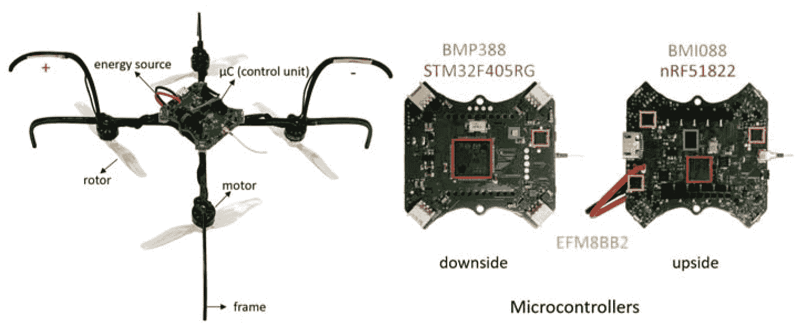
```

### 无人机动力

动力系统由四个直径为 60 mm 的旋翼上的无刷电机组成。计算硬件由两个微控制器组成。来自意法半导体的 STM32F405`[648]`被作为主计算单元。它使用频率为 168 MHz 的 32 位 ARM Cortex M4，带有浮点运算单元。SRAM 容量为 192 KB，flash 存储器为 1 MB。一个 8 KB 的 EEPROM 连接到微控制器。

来自 Nordic Semiconductor 的第二个微控制器 nRF51 用于无线通信并作为电源管理器。它使用频率为 32 MHz 的 32 位 ARM Cortex M0，拥有 32 KB SRAM 和 128 KB flash。它的功耗极低，仅为 3 μW`[591]`。两个微控制器通过 UART 接口进行通信。

```
![Fig. 3.47: 作为数据采集平台的无人机群架构 509
```

图 3.47：作为数据采集平台的无人机群架构`[509]`。

无人机群系统架构的所有功能都在各种外部系统中实现。由于架构中多个系统之间的连接是松的，它们可以被轻松替换。

外部系统与无人机之间的通信通过 `2.4 GHz ISM band` 进行。`CRTP`（Crazyflie 实时协议）设计用于在没有太多开销的情况下发送数据包，从而最大限度地降低延迟。传输速度配置为 `250 kbit/s`，以防止研究中心金属墙引起的干扰，并确保无人机能够可靠地解码传输信号。`MQTT` 服务器将无人机信息从 `ROS` 服务器传输到其他系统。

### 3.7.5.1 充电站

另一种方案是在无人机充电站中进行充电。因此，无人机机架上安装了两个可以让无人机在站内悬挂充电的支架。无人机的充电电流通过这些支架流。这样就不再需要更换电池，实现了连续运行。

无人机充电站是另一个外部系统。它由不锈钢杆制成，目前允许分布在三层上的 32 台无人机充电。一个 `200 W 5 V/20A` 电源为充电站供电。充电站可以挂在天花板上或固定在另一个安全的地方。当无人机降落在站上时，充电会自动开始。因此，可以实现无人机群的 `24/7` 运行。如果无人机电量低，它会自动飞入充电站，另一台完全充电的无人机将接管它的任务。

### 3.7.6 测试平台

测试平台位于多特蒙德大学（`TU Dortmund University`）物料处理与仓储研究中心。它位于一个轻量化大厅内，结构与物流领域的传统工业建筑相同，并遵循高度灵活的开发实验室概念 `[478, 520]`。开发测试平台的目的是创建一个模拟真实仓库场景的环境。测试平台配备了用于精确原型信息物理系统（`CPS`）的基础设施。虽然测试区域没有永久安装的设施，但大厅的吊花板、墙壁和地板上安装了多个永久性的观测系统。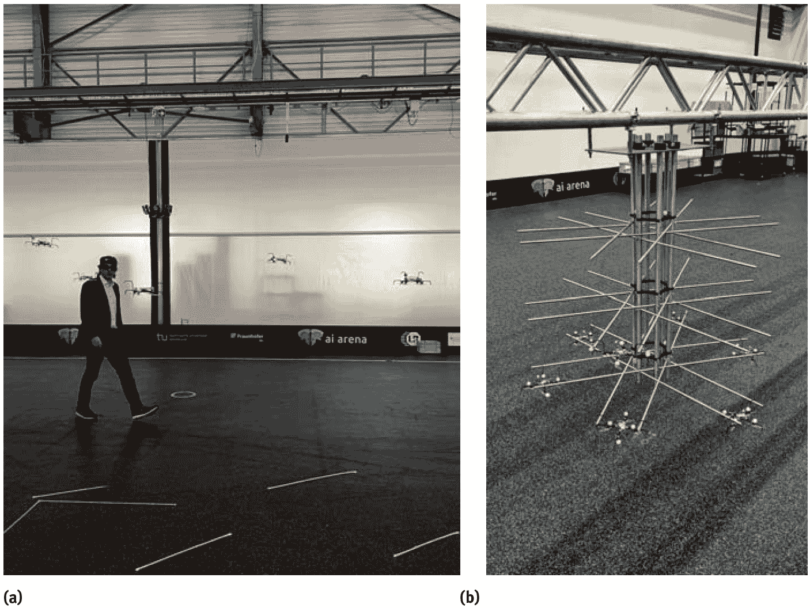


图 3.48：研究大厅内创建的测试平台概览。(a) 测试场景期间，一名戴着头装备的人站在无人机群之间 (b) 挂在天花板上的充电站。

#### 3.7.6.1 架构

图 3.49 显示了用于创建测试平台的架构。该架构与 `[465]` 中使用的架构类似。`MoCap` 系统由 46 台由 `Vicon` 制造的红外摄像头组成。它可以跟踪大量经过适当标记的对象，精度为 `0.3 mm`，数据传输率高达 `200 Hz`，延迟在 `4 ms` 到 `15 ms` 之间。观测的实验空间长 `22 m`，宽 `15 m`，高达 `3.5 m` 至 `4 m`。定位数据可以通过网络同时供多个客户端访问，并提供标记物体在三维空间中的绝对位置和姿态。图 3.48 显示了测试平台的概览。![Fig. 3.49: 用于创建测试平台的架构 [465].](graphic/b_9783110785982-003_fig_049.png)

图 3.49：用于创建测试平台的架构 `[465]`。

测试平台使用 `MQTT`（消息队列遥测传输）`[292]` 来在 图 3.47 中的子系统之间分发数据。

在测试平台上成功对无人机机群进行仿真后，我们通过使用机器学习执行仓库任务，扩展了无人机机群的能力。这项工作使用了强化学习（RL）算法。在强化学习中，算法并不是被给定最优输出的示例，而是通过试错来发现它们 [70]。

强化学习的目标是为给定情况找到合适的动作以最大化奖励。在强化学习中，智能体（agent）是一个根据策略（policy）行动的实体。策略定义了智能体根据其在特定时间内感知到的观测结果如何行为。智能体嵌入在环境中，在特定时刻，它处于一个特定的状态（state）。给定状态的价值指的是处于该状态有多大奖励。从当前状态开始，智能体可以采取一组动作中的一种，这些动作可以带它进入新状态、提供奖励，或两者兼有。智能体的主要目标是從长远来看最大化其接收的总累积奖励 [664]。

带无人机的强化学习正广泛用于各种应用，例如无人机跟踪、在机群中跟随领头无人机 [14]、实现无人机机群的去中心化控制 [51]、避障 [518]以及轨迹规划 [318]。这项工作表明，强化学习等机器学习技术可以在研究厅创建的测试平台环境中进行测试。

### 3.7.7.1 场景

在这项工作中，通过单台无人机使用强化学习模拟了将物体运输到目标区域的任务，以作为概念证明。在测试平台上飞行的无人机面对一个虚拟物体。起初，无人机在测试平台上随机徘徊，不知道该做什么。最终，它捡起物体并将其递送到目标区域，获得了奖励。经过多次训练课程后，无人机学会了捡取并交付物体是最大化奖励的最佳方式。

### 3.7.7.2 实现

ML 智能体工具包使用 Unity Editor 创建仿真环境，并通过 `Python API` 与环境进行交互 [307]。该工具包提供了 `ML-Agents SDK`，它包含了在 Unity Editor 中定义环境所需的各种，以及构建学习流水线的核心 `C#` 脚本。在这项工作中，模拟了第 3.7.6.2 节中描述的订单运输任务。环境是研究厅的测试平台，智能体是无人机。最初，无人机需要学习旋转电机的程度以便能够在特定方向移动特定距离。然后，无人机计算自身与目标之间的相对距离，以决定下一步采取什么动作。捡取订单并递送到目标区域的动作为无人机带来了正奖励。对于其他任何动作，无人机会收到固定的惩罚（负奖励）。目标是最大化奖励并最小化惩罚。因此，无人机学会了快速捡取并交付物体以避免严重的时间惩罚。

一种分层方法将机群算法与强化学习算法相结合。分离、聚合和避障等机群算法具有更高的权重，确保了无碰撞飞行以及测试区域内人员的安全。

这项工作使用了一种名为`近端策略优化 (Proximal Policy Optimization, PPO)` 的强化学习技术。`PPO` 是一种策略优化方法族，它使用多个 epoch 的随机梯度上升来执行每次策略更新 [587]。`PPO` 使用神经网络来近似将智能体的观测映射到智能体在给定状态下采取的最佳动作的理想函数。使用了一个用 `TensorFlow` 开发的简单神经网络，它包含一个输入层、一个隐藏层和一个输出层。网络的输出是一个指示无人机应该飞行的方向的向量。智能体可以根据开发者定义的固定或动态间隔向策略请求决策。`PPO` 算法在 `TensorFlow` 中实现，并在独立的 `Python` 进程中运行。`Python` 与 `Unity` 之间的通信通过 `gRPC`通信进行 [718] 并利用 `protobuf` 消息。

在训练强化学习智能体一小时后，保存了训练好的模型。

在本文中，我们关注一种情境感知路由用例，该用例可以防止拥堵。该系统需要考虑对未观测流量和未来流量的实时估计，并提供几种估计流量数量的概率方法。

### 4.1.1 引言：问题理解

交通拥堵是城市交通中的关键问题，无论对于物流还是客运都是如此。数据驱动的动态控制以及向自动驾驶车辆的转变有望缓解当前问题，并引发城市环境的出行方式变革。

然而，交通系统是具有多个参与者的复杂实时系统，因此难以控制。此外，通过测量对该过程的观测是稀疏的，且具有局部（时空）有效性。因此，在计算用于控制的有意义动态建议之前，需要若干实时插值和预测步骤。

然而，如果个人导航能够考虑到未来交通状况的预测，就能避开拥堵路段，或提前决定最佳出行模式。此外，由于交通拥堵等危害通常是由交通密度过高引起的，情境感知行程规划也能减少交通拥堵，并使基础设施的使用更加高效。

依赖情境路由面临的任务包括：

- 从稀疏观测中预测未来交通状况；

- 在规划中利用动态预测；

- 个体行为的评估与选择。

在接下来的章节中，我们逐一解决这些任务，并反映我们在 `CRC 876` 内对这些问题所做的贡献。本文以一个突出未来研究方向的讨论结束。

### 4.1.2 基于稀疏观测的交通预测

在数据挖掘中，学习预测模型是一个定义的监督学习任务。给定来自空间 `X` × `Y` 的标记观测值 `x`, `y`，我们训练模型 `f` : `X` → `Y`，使得预测 `f (x)` 与真实观测标签 `y` 之间的期望损失 `l` 达到最小。通过该模型，可以通过将模型应用于新数据 `y = f(x)` 来获得特定情况下的预测。

然而，建模过程高度依赖于可用数据，且这种方法的适用性取决于建模过程的纠缠程度。

在交通控制中，我们面对的是动态空间过程，观测数据在空间和时间上只有有限有效。此外，监督学习方法的基本假设（即过程是重复的，因此过去的观测适用于预测未来）在一般情况下并不一定成立。交通控制以及取决于未来交通行为期望的个体决策，都是此类假设的反面指标。

基于这些困难，针对不同的模型假设、运输模式和粒度，存在多种对交通进行建模的方法。

#### 4.1.2.1 气体动力学模型

与数据驱动的监督学习方法相比，可以从观察交通模式和物理属性开始，并将其表示在模型中。这种模型驱动的方法受运输物理和交通理论的限制。交通的基本观测属性之一是：个体物体（汽车、行人等）不会消失；而是随着时间的推移，进入空间区域的对象数量等于离开该区域的数量。[³]

- 如果车辆发生相互作用，动量和动能通常守恒。因此，`牛顿第三定律`不适用。

- 车辆的温度无法直接匹配，因为`作用力与反作用力`。

- 由于目标多样，车辆气体不会因为内部的移动意图而以特定速度移动。

- 在交通流中，车辆行为是各向异性的。

#### 4.1.2.2 元胞自动机

元胞自动机是一种广泛使用的物理过程模型。由 `Neumann` [[473]] 引入，元胞自动机具有离散的空间和时间，其转移规则根据元胞的前一个状态及其相邻状态定义元胞的未来状态。元胞自动机优于动力学的优势在于其可扩展性。因此，边界条件通常被实现，例如粒子向障碍物反弹。对于交通建模，广泛使用了 `NAGEL-SCHRECK MODEL`。

元胞自动机模拟的是马尔可夫链，未来的条件概率完全由当前状态描述。如果没有关于过去的额外信息，将无法判断车辆是否会离开高速公路或排队，以及汽车在交通灯处向哪个方向转。

#### 4.1.2.3 运动分层与依赖模型

之前的模型将交通描述为马尔可夫过程。当前的交通观测和固定数量的过去观测足以预测未来。这种方法忽略了交通的社会学和心理方面。人们是有目的地地旅行并遵循特定的计划。因此，Hoogendoorn 定义了运动分层 [[280]]，它代表了行程规划的不同方面。

观测到的交通结合了个人交通计划，因此具有难以捕捉的复杂依赖结构。托勒地理第一定律 [[689]] 指出，在时空过程中，地理距离较的观测比距离较远的观测更相关性。然而，在交通过程中，这并不成立，因为个体移动路径往往从居住区开始，使用较大的干道，然后分支到工作所在地的小街道。因此，在高速公路上的行驶信息对于预测行程目标来说可能比考虑轨迹的几个起始位置更有信息量。

交通过程的依赖结构可以在模型中如下所示。给定若干位置存在移动物体的证据 `x[i]`、`...`、`x[j]`，我们可以模拟其他地方出现的概率 `p(x[k], ..., x[l]|x[i], ..., x[j])`。如果这些依赖关系的制定不包含任何循环依赖，则所有位置存在移动物体的联合概率分布分解为：

$p(x_1, ..., x_n) = \prod_{i=1,...,n} p(x_i | \text{pa}(x_i))$

其中 `pa(x[i])` 是上述方程中 `x[i]` 的父节点。这种有向模型被称为`贝叶斯网络`（Bayesian network），可以用`图形模型`（一种由顶点和连接的有向边组成的图）来表示，它将依赖关系编码为随机变量（顶点）之间的箭头 `pa(x[i])`→`x[i]`。贝叶斯网络由一个结构组成，该结构由前面的方程以及根据每个变量的祖先节点相关的条件概率表给出。

依赖模型可以直接从数据中进行训练，方法是比较训练后的依赖模型是否与交通观测代表相同的分布，这需要使用合适的损失函数来比较分布，例如`Kullback-Leibler 散度`（Kullback-Leibler-divergence）。由于随机数量巨大（每个可访问位置一个，例如街道路段），学习该模型需要进行某种松弛和近似。在[406, 407]中，我们提出了一种从交通观测中学习空间`贝叶斯网络`的算法。

#### 4.1.2.4 高斯过程

根据中心极限定理，我们知道当重复多次或给定足够的观测时间时，观测值会收敛于正态分布。在多维观测（例如街道网络中各个位置的交通计数）的情况下，这会收敛于平稳的多变量正态分布。假设这些交通观测是由概率过程生成的，我们可以利用联合概率分布的知识来估计未观测位置的观测值（类似于前一节）。在上述假设下，我们可以假设观测值是由多元高斯分布生成的。

`P(f | X) = 𝒩(0, K*)`

生成过程完全由变量之间的协方差定义。由于交通观测的数量有限（例如在街道路段的测量位置），我们可以将它们的两两协方差表示在核矩阵 `K`中。⁴

```latex
\begin{bmatrix} \mathbf{y} \\ \mathbf{f}\_{u} \\ \end{bmatrix} \sim \mathcal{N}\left( {0,\begin{bmatrix} {{\\hat{K}}\_{- u, - u} + \sigma^{2}I} & {\\hat{K}}\_{- u,u} \\ {\\hat{K}}\_{u, - u} & {\\hat{K}}\_{u,u} \\ \end{bmatrix}} \right)
```

交通网络施加的交通值相关性可以用核 `K`表示。假设一个人在交通网络上随机移动，她在网络中从一个位置移动到另一个位置。这些随机游走生成的依赖结构可以通过扩散核`[336]`捕捉，其中 `L`是邻接矩阵的组合拉普拉斯，`λ`是一个超参数。

```latex
\left[\sum_{m=1}^{\infty}\frac{\lambda^{m}}{m!}\right]L_{ij} = \exp(\lambda)
```

这个`exp`模型表示了循环依赖。邻接矩阵是加权的，且模型可以进一步细化[409]。

```latex
\begin{matrix}
\hat{K}_{-u, -u} + \sigma^{2}I & \hat{K}_{-u,u} \\
\hat{K}_{u, -u} & \hat{K}_{u,u}
\end{matrix}
```

高斯过程的一个方便特性是这些预测是正态的，因此具有分布的稀疏表示[408]。

然而，该模型需要昂贵的矩阵逆运算。通过一些预处理[111]。

#### 4.1.2.5 马尔可夫场

在之前描述的时间模型中，假设未来状态取决于之前的状态。如果我们现在考虑一个随机场且满足马尔可夫性质，它被称为`马尔可夫场`（MRF）。马尔可夫场在表示上与贝叶斯网络相似。区别在于贝叶斯网络是有向且无环的，而马尔可夫网络是无向的。因此，马尔可夫网络可以表示贝叶斯网络无法表示的某些依赖关系（例如循环）。

任何正马尔可夫场都可以写为指数族使得全联合分布可以写为：

`P(x) = C exp(w[k], f[k])`

如果相关性对应于图 `G = (V, E)` 中的缺失边，则多元正态分布形成一个马尔可夫场。

使用`马尔可夫场`对交通进行建模的方法是时空随机场[499]，它在学习过程中惩罚复杂的结构，因此具有分布的稀疏表示。在时间上满足马尔可夫性质：下一次观测完全由当前的读数决定。该模型在交通中的应用见[475]。

#### 4.1.2.6 泊松依赖模型

空间现象的经验观测通常是计数值。例如，密度是空间区域物体数量，流量是给定时间间隔内通过某个位置的物体数量。虽然之前的概率模型主要建模分类数据或多元正态观测，但泊松模型似乎是自然的选择，因为计数值既不是二元的也不是连续的，而是具有无限范围右偏离散分布[249]。将图形建模与泊松分布相结合的一种可能方法是使用泊松回归森林[249]，每个树建模一个条件泊松分布。对于这种模型，底层的联合分布是未知的且局部分布可能不一致。因此，需要`伪吉布斯采样`（Pseudo Gibbs Sampling）[265]来根据给定的证据推断未观测的测量值。

对于未观测流量值的插补，该模型的性能优于 [247] 中的指数模型。在大规模数据集上，训练这些依赖模型具有挑战性。在 [451] 中，作者展示了如何在核心集（coresets）上训练依赖网络，核心集是一种可以作为原始数据代理的压缩数据集。对于他们的算法，已经证明了其保证：在高斯依赖网络的情况下，核心集的大小与数据集的大小无关。这一属性并非普遍成立，即对于`Poisson dependency networks`，该属性是不成立的。

#### 4.1.2.7. 条件和-积网络

图化泊松模型中对可计算推理的需求，使得人们在泊松分布中采用了和-积网络-product networks [506] [452]。这些和-积网络的图结构结构由一棵树组成，层之间交替出现和节点和积节点，叶子节点为泊松分布的随机变量。对于推理，只需要从底部到根部遍历一次结构即可。对于模型训练，则估计随机变量集合之间的独立性。在没有独立性的情况下，将相似的对象归为聚类并引入一个和节点；在存在独立性的情况下，则构建一个积节点。

对于交通建模，一种结合了物理属性（由细胞自动机表示）与概率数据驱动模型的模型将是有益的。在 [597, 598] 中，我们展示了如何通过对前一个时间片进行条件化来利用和-积网络对马尔可夫过程建模。该模型可以表示细胞自动机，数据驱动，并在交通预测方面优于之前的泊松依赖网络。

#### 4.1.2.8. 基于标签比例的差分学习

交通数据通常以集中的方式收集，这导致了高数据传输和数据保护风险。由于 2018 年所有欧盟国家引入了 GDPR（通用数据保护条例），机构解决数据保护风险变得尤为重要 [231]。机构希望使用这些数据来获取更多信息或预测未来的传感器状态，例如，“交通流量在未来 15-30 分钟内会保持不变吗？”相应的，它们也必须遵守 GDPR。

因此，我们扩展了 [651, 655] 中的去中心化学习方法，通过对不同去中心化传感器设备之间发送的标签比例应用`differential privacy`，从而产生一种隐私保护算法。通常情况下，标签比例学习（LLP）算法与 [651] 中提出的相同。由于了解算法的结构和流程非常重要，我们将进一步进行简要考虑。有 `m` 个无线传感器节点（`n[1]`, `n[2]`, ... `n[m]`），它们将测量值存储在 `D(i)` 中，其中 `i ∈ 1 ... m`。`D(i)` 中的每一行包含 `t - w` 个测量值，其中 `t` 是时间戳，`w` 是窗口大小。`D` 被分为批次 `B[h]`，其中 `h` 是 `D` 的大小。这些批次被发送到 `c` 个邻居。每个节点使用接收到的标签比例训练 `c` 个模型。这种方法的优势是我们可以只使用本地数据，但这种方法无法保证隐私。我们通过对标签计数应用`differential privacy`来解决这个问题。首先，我们必须知道单个数据点对函数 `f` 输出能产生多大的影响 [185]（定理 3.6）。

最后，我们可以使用`Laplace distribution`来生成噪声：

```
lap(x, σ) = (1/2σ) * e^(-|x-μ|/σ)
```

在上述公式中，位置参数 `μ` 设置为 0，缩放参数设置为 `Δf/ϵ`。这些参数必须这样设置以符合`differential privacy`的定义。用于计算标签计数的修改算法所示。如前所述，批次 `B[i]` 已经生成，可能的标签 `Y` 也是已知的。输出 `Q(j)` 包含所有批次的差分隐私标签比例。

##### 算法 3:

**输入：** *B*[1], ..., *B[h]*,*Y*

**输出：** *Q(j)*


```
1 Q(j) ← matrix(h, |Y|)
2 for i in 1..h do
3   for j in 1..|Y| do
4     Q(j)[i,j] ← sum(B[i] == Y[j])
5   end
6 // adding noise to label counts
7 m ← sum(Q(j)[i])
8 for j in 1..|Y| do
9   Q(j)[i,j] ← Q(j)[i,j] + lap(e=0, s=1/ϵ)
10  clip Q(j)[i,j] to bounds [0.001, m]
11  normalize Q(j)[i]
12 end
13 end
```

最初，创建`Q(j)`，其维度为批次数量(`h`)和可能的标签数量(`|Y|`)。随后，对每个批次迭代计算标签比例，如下：首先，计算标签计数（见第 3–5 行）和总和（见第 7 行）。然后，应用通过敏感度和`ϵ`计算的拉普拉斯噪声。此后，将新值裁剪到最大边界内，以防止出现过大或负数值。最后，对带有噪声的标签计数进行归一化。所得比例存储在`Q(j)`中。

所提方法基于现有的 LLP 算法，利用其去中心化特性，并通过在传输的数据上应用差分隐私来扩展该方法。这减少了数据传输并增强了隐私 [568]。

### 4.1.3 基于动态预测的高效路由

在不断变化的世界中，地理空间数据受到动态变化的影响，地理信息系统需要在分析和计算中纳入实时更新。在本节中，我们特别关注路径规划系统。在静态世界中，存在许多算法可以高效地计算从起点到目标地点的（最短）路径（见 Section 4.1.2），但在多模态行程规划（如公共交通）的情况下，这一问题变得更加困难，因为需要考虑时间约束（例如中转时间和出发时间）。在现实世界中，这些静态时间表无法完全遵守，会发生延迟 [439]，并且可以观察到偏离计划的情况。在路由计算中引入这些动态信息是有益的，因为它为公众提供了可行的旅行建议。关于延误的动态信息可以通过监控车辆位置和预测未来延迟来实现。这使得主动行程计算成为可能。

在本节中，我们关注动态交通计算的可行性。现有的动态交通问题单源最短路径计算算法受限于其计算计算时间。Transfer Pattern（传输模式）是一种用于交通网络的极快速路径规划算法，但在存在实时延迟信息的情况下无法保证完备性。我们的方法 [411]克服了这些缺点，并引入了动态换乘模式，这是一种编码了由于延迟开启了哪些新交通可能性的数据结构。

与华沙市现有的动态交通路由方案相比，我们强调了使用我们方法的性能增益。我们的发现已实现在常用的开源行程规划框架 OpenTripPlanner 中。

在此，我们关注点对点的最短路径问题 [49]，即在图`G = (V, E)`中，需要找到源点`s ∈ V`和目标点`t ∈ V`之间的路径，使得沿路径的累积边权重`l(u, v)`, 其中`(u, v) ∈ E ⊆ V × V`最小。

该问题的标准解是 Dijkstra 算法 [176]。给定图`G = (V, E)`和`s, t ∈ V`，它初始化节点队列`Q = V`和一个`V × V`上的距离函数，`dist(s, s) = 0`且对于`∀v = s, v ∈ V` `dist(s, v) = ∞`。直到队列为空，选取距离`dist(s, u)`最小的节点`u`并从`Q`中移除。对于`u`的每个邻接节点，更新距离如下：如果后者小于前者，则`dist(s, v) := dist(s, u) + l(u, v)`。Dijkstra 算法可以通过同时从`s`和`t`运行来加速，直到遇到公共节点`u`。在稍微修改的 Dijkstra 算法`A*` [258]中，遍历优先级队列的顺序不仅取决于到达图中某个顶点的累积成本，还取决于从该顶点到达终点的预期成本。受闵可夫斯不等式的限制，当`||x + y||[p] ≤ ||x||[p] + ||y||[p]`（称为`p = 2`的三角形不等式）时，`A*`与 Dijkstra 算法相比裁剪了搜索空间。剩余成本估计的完备启发式方法是地理距离，它始终低于基于道路的距离。

在静态成本函数的情况下，收缩层次（contraction hierarchies）[223]是一种加速`A*`算法并在大型交通网络中实现行程计算的数据结构。与其直接在交通网络中搜索最短路径，收缩层次将搜索空间缩小到最重要的连接。在预处理步骤中，识别这些重要路段，并在路段之间扩展网络。

与普通道路网络相比，公共交通数据通过添加时间表信息增强了空间图。行程`T`服务于站点序列`stops(T) = (s[1], . . . s[n])`, `s[i] ∈ S`。当`stop(T, s[a]) < stop(T, s[b])`时，`T`连接站点`s[a]`和`s[b]`。如果多个行程包含相同的序列，它们形成一条线路 [47]。

常用方法是将动态建模`G`，然后应用 Dijkstra 算法。这产生了时间扩展和时间依赖模型。在时间扩展模型中，每个交通节点被拆分为每个事件（到达、通过、出发）的多个顶点。时间依赖模型为每个交通节点分配一个顶点，并对弧进行编码。

文献中报道了多种交通延误模型。[175]的工作假设了独立性。相比之下，[232]允许延误累积。复杂的模型将车辆之间的依赖关系纳入延误模型中[276]。在[439]中，延误通过视觉化分析。

在行程规划应用中，延误的实时预测是主要优势，因为未来的延误可能会影响路线选择。因此，我们重点介绍了两项关于延误预测和识别的近期工作：[217]应用了排队理论并假设延误会汇总，而[774]则从 GPS 轨迹中实时检测延误和意外的车辆移动。

在这项工作中，我们并不关注预测，而是假设我们已经通过车辆观测或预测（采用常用的 GTFS real-time 数据格式）获取了车辆延误的信息。

由于存在这种动态性，行程计算变得更加困难。尽管先前的出版物[47]指出换乘模式对延误具有鲁棒性，但这仅在延误没有产生新的换乘的情况下成立。在可能产生新换乘的情况下，现有的换乘模式无法代表这些信息，也无法得出最优的交通路线。

换乘模式在[48]中引入。该方法包含一种数据结构和用于快速计算交通路线的算法。在预处理步骤中，所有可能的连接都经过预计算并以压缩格式存储。对于每条公共交通线路，都会存储一张表，列表示沿线路的站点。通过这种方式，它保留了不发生变化的最长路线。

我们处理交通信息动态性的方法是在预计算阶段纳入潜在的延误信息，并在创建换乘模式期间创建的 DAG（有向环图）添加额外的换乘可能性。

由于我们的目标是将交通路线计算应用于工业环境，我们扩展了现有开源平台 OpenTripPlanner (OTP) 的功能。我们的动态换乘模式在性能上比之前 OTP `A*` [258]和 RAPTOR [165]中提供的算法高出一个数量级[411]。

### 4.1.4 个体行为的控制与规划

城市区域日益受到拥堵的影响。大多数避免这些拥堵的导航系统和算法都是独立考虑驾驶员的，因此可能会导致新的拥堵。尽管先前的研究指出换乘模式对延误具有鲁棒性，但这仅在延误没有产生新的换乘的情况下成立。在可能产生新换乘的情况下，现有的换乘模式无法代表这些信息，也无法得出最优的交通路线。

在[412]中，延误通过视觉化进行分析。

在行程规划应用中，延误的实时预测是主要优势，因为未来的延误可能会影响路线选择。因此，我们重点介绍了两项关于延误预测和识别的近期工作：[217]应用了排队理论并假设延误会汇总，而[774]则从 GPS 轨迹中实时检测延误和意外的车辆移动。

在这项工作中，我们并不关注预测，而是假设我们已经通过车辆观测或预测（采用常用的 GTFS real-time 数据格式）获取了车辆延误的信息。

由于存在这种动态性，行程计算变得更加困难。尽管先前的出版物[47]指出换乘模式对延误具有鲁棒性，但这仅在延误没有产生新的换乘的情况下成立。在可能产生新换乘的情况下，现有的换乘模式无法代表这些信息，也无法得出最优的交通路线。

换乘模式在[48]中引入。该方法包含一种数据结构和用于快速计算交通路线的算法。在预处理步骤中，所有可能的连接都经过预计算并以压缩格式存储。对于每条公共交通线路，都会存储一张表，列表示沿线路的站点。通过这种方式，它保留了不发生变化的最长路线。

我们处理交通信息动态性的方法是在预计算阶段纳入潜在的延误信息，并在创建换乘模式期间创建的 DAG 添加额外的换乘可能性。

由于我们的目标是将交通路线计算应用于工业环境，我们扩展了现有开源平台 OpenTripPlanner (OTP) 的功能。我们的动态换乘模式在性能上比之前 OTP `A*` [258]和 RAPTOR [165]中提供的算法高出一个数量级[411]。


### 4.1.4 个体行为的控制与规划

城市区域日益受到拥堵的影响。大多数避免这些拥堵的导航系统和算法都是独立考虑驾驶员的，因此可能会导致新的拥堵。尽管先前的研究指出换乘模式对延误具有鲁棒性，但这仅在延误没有产生新的换乘的情况下成立。在可能产生新换乘的情况下，现有的换乘模式无法代表这些信息，也无法得出最优的交通路线。

在`[412]`中，延误通过视觉化进行分析。

在行程规划应用中，延误的实时预测是主要优势，因为未来的延误可能会影响路线选择。因此，我们重点介绍了两项关于延误预测和识别的近期工作：`[217]`应用了排队理论并假设延误会汇总，而`[774]`则从 GPS 轨迹中实时检测延误和意外的车辆移动。

在这项工作中，我们并不关注预测，而是假设我们已经通过车辆观测或预测（采用常用的 `GTFS real-time` 数据格式）获取了车辆延误的信息。

由于存在这种动态性，行程计算变得更加困难。尽管先前的出版物`[47]`指出换乘模式对延误具有鲁棒性，但这仅在延误没有产生新的换乘的情况下成立。在可能产生新换乘的情况下，现有的换乘模式无法代表这些信息，也无法得出最优的交通路线。

换乘模式在`[48]`中引入。该方法包含一种数据结构和用于快速计算交通路线的算法。在预处理步骤中，所有可能的连接都经过预计算并以压缩格式存储。对于每条公共交通线路，都会存储一张表，列表示沿线路的站点。通过这种方式，它保留了不发生变化的最长路线。

我们处理交通信息动态性的方法是在预计算阶段纳入潜在的延误信息，并在创建换乘模式期间创建的 DAG 添加额外的换乘可能性。

由于我们的目标是将交通路线计算应用于工业环境，我们扩展了现有开源平台 `OpenTripPlanner (OTP)` 的功能。我们的动态换乘模式在性能上比之前 `OTP A^(*)` `[258]`和 `RAPTOR` `[165]`中提供的算法高出一个数量级`[411]`。


由于我们的目标是将交通路线计算应用于工业环境，我们扩展了现有开源平台 `OpenTripPlanner`（`OTP`）的功能。我们的动态换乘模式在性能上比之前 `OTP` `A^(*)` [258] 和 `RAPTOR` [165] 中提供的算法高出一个数量级 [411]。

### 4.1.4 个体行为的控制与规划

城市区域日益受到拥堵的影响。大多数避免这些拥堵的导航系统和算法都是独立考虑驾驶员的，因此可能会导致新的拥堵。尽管先前的研究指出换乘模式对延误具有鲁棒性，但这仅在延误没有产生新的换乘的情况下成立。在可能产生新换乘的情况下，现有的换乘模式无法代表这些信息，也无法得出最优的交通路线。

在 [412] 中，延误通过视觉化进行分析。

在行程规划应用中，延误的实时预测是主要优势，因为未来的延误可能会影响路线选择。因此，我们重点介绍了两项关于延误预测和识别的近期工作：[217] 应用了排队理论并假设延误会汇总，而 [774] 则从 `GPS` 轨迹中实时检测延误和意外的车辆移动。

在这项工作中，我们并不关注预测，而是假设我们已经通过车辆观测或预测（采用常用的 `GTFS real-time` 数据格式）获取了车辆延误的信息。

由于存在这种动态性，行程计算变得更加困难。尽管先前的出版物 [47] 指出换乘模式对延误具有鲁棒性，但这仅在延误没有产生新的换乘的情况下成立。在可能产生新换乘的情况下，现有的换乘模式无法代表这些信息，也无法得出最优的交通路线。

换乘模式在 [48] 中引入。该方法包含一种数据结构和用于快速计算交通路线的算法。在预处理步骤中，所有可能的连接都经过预计算并以压缩格式存储。对于每条公共交通线路，都会存储一张表，列表示沿线路的站点。通过这种方式，它保留了不发生变化的最长路线。

我们处理交通信息动态性的方法是在预计算阶段纳入潜在的延误信息，并在创建换乘模式期间创建的 `DAG` 添加额外的换乘可能性。


换乘模式在[48]中引入。该方法包含一种数据结构和用于快速计算交通路线的算法。在预处理步骤中，所有可能的连接都经过预计算并以压缩格式存储。对于每条公共交通线路，都会存储一张表，列表示沿线路的站点。通过这种方式，它保留了不发生变化的最长路线。

我们处理交通信息动态性的方法是在预计算阶段纳入潜在的延误信息，并在创建换乘模式期间创建的`DAG`添加额外的换乘可能性。

由于我们的目标是将交通路线计算应用于工业环境，我们扩展了现有开源平台`OpenTripPlanner (OTP)`的功能。我们的动态换乘模式在性能上比之前`OTP A^(*)`[258]和`RAPTOR`[165]中提供的算法高出一个数量级[411]。

### 4.1.4 个体行为的控制与规划

城市区域日益受到拥堵的影响。大多数避免这些拥堵的导航系统和算法都是独立考虑驾驶员的，因此可能会导致新的拥堵。尽管先前的研究指出换乘模式对延误具有鲁棒性，但这仅在延误没有产生新的换乘的情况下成立。在可能产生新换乘的情况下，现有的换乘模式无法代表这些信息，也无法得出最优的交通路线。

在[412]中，延误通过视觉化进行分析。

在行程规划应用中，延误的实时预测是主要优势，因为未来的延误可能会影响路线选择。因此，我们重点介绍了两项关于延误预测和识别的近期工作：[217]应用了排队理论并假设延误会汇总，而[774]则从`GPS`轨迹中实时检测延误和意外的车辆移动。

在这项工作中，我们并不关注预测，而是假设我们已经通过车辆观测或预测（采用常用的`GTFS real-time`数据格式）获取了车辆延误的信息。

由于存在这种动态性，行程计算变得更加困难。尽管先前的出版物[47]指出换乘模式对延误具有鲁棒性，但这仅在延误没有产生新的换乘的情况下成立。在可能产生新换乘的情况下，现有的换乘模式无法代表这些信息，也无法得出最优的交通路线。


在这项工作中，我们并不关注预测，而是假设我们已经通过车辆观测或预测（采用常用的 `GTFS real-time` 数据格式）获取了车辆延误的信息。

由于存在这种动态性，行程计算变得更加困难。尽管先前的出版物[47]指出换乘模式对延误具有鲁棒性，但这仅在延误没有产生新的换乘的情况下成立。在可能产生新换乘的情况下，现有的换乘模式无法代表这些信息，也无法得出最优的交通路线。

换乘模式在[48]中引入。该方法包含一种数据结构和用于快速计算交通路线的算法。在预处理步骤中，所有可能的连接都经过预计算并以压缩格式存储。对于每条公共交通线路，都会存储一张表，列表示沿线路的站点。通过这种方式，它保留了不发生变化的最长路线。

我们处理交通信息动态性的方法是在预计算阶段纳入潜在的延误信息，并在创建换乘模式期间创建的 `DAG` 添加额外的换乘可能性。

由于我们的目标是将交通路线计算应用于工业环境，我们扩展了现有开源平台 `OpenTripPlanner (OTP)` 的功能。我们的动态换乘模式在性能上比之前 `OTP A^(*)` [258]和 `RAPTOR` [165]中提供的算法高出一个数量级[411]。

### 4.1.4 个体行为的控制与规划

城市区域日益受到拥堵的影响。大多数避免这些拥堵的导航系统和算法都是独立考虑驾驶员的，因此可能会导致新的拥堵。尽管先前的研究指出换乘模式对延误具有鲁棒性，但这仅在延误没有产生新的换乘的情况下成立。在可能产生新换乘的情况下，现有的换乘模式无法代表这些信息，也无法得出最优的交通路线。

在[412]中，延误通过视觉化进行分析。

在行程规划应用中，延误的实时预测是主要优势，因为未来的延误可能会影响路线选择。因此，我们重点介绍了两项关于延误预测和识别的近期工作：[217] 应用了排队理论并假设延误会汇总，而[774]则从 `GPS` 轨迹中实时检测延误和意外的车辆移动。

文献中报道了多种交通延误模型。[175]的工作假设了独立性。相比之下，[232] 允许延误累积。复杂的模型将车辆之间的依赖关系纳入延误模型中[276]。在[439]中，延误通过视觉化进行分析。

为了改进现有策略，`POEM` 需要一个基数损失反馈映射 `δ : X` × `Y` → `R`。这是通过对传感器读取值应用以下两种原始拥堵检测方法之一来实现的：原始密度拥堵指标 `δ[density]`，当道路的密度大于其拥堵密度的七分之一时，假设该道路为拥堵[124]。原始平均速度拥堵指标 `δ[speed]` 则在道路的平均速度低于其允许最大速度的十分之一时，假设该道路为拥堵。

为了不仅感知拥堵而且减少拥堵，车辆必须频繁接收关于路网当前状态的信息更新。然后，使用 `POEM` 预测路网的下一个状态。车辆将利用这些信息绕过被认为拥堵的道路。因此，这些结果必须应用于路由算法，例如 `Dijkstra` 或 `A*`。

令 `G = (V, E, c, q)` 为表示路网的图。这里，`c` 和 `q` 是默认代价函数和启发式函数。此外，假设所有车辆都了解拥堵标记策略 `h ∈ H*[lin] ∪ {h*[0]}` [666]。当使用动态路由时，车辆将以固定间隔 `T ∈ N` 接收道路更新。该更新可以写为 `u[T] : E → X`。

所描述的模型仅接收整个路段的传感器信息，而不是单个车道的信息，这可能是问题，因为拥堵并不总是会在每个车道上均匀产生。这种挑战性情况最可能发生在交叉口，每个车道允许车辆向不同的方向行驶。我们通过聚合每个连接边对的传感器数据来解决这个问题（用于 `G` 的线图，请参见[257]）。此外，生成的数据允许更精确的拥堵检测，因为模型中单个转弯车道是分离的。

为了绕过拥堵，车辆必须根据新收到的更新 `u[T]` 重新计算路线。这是通过增加可能拥堵的边的权重来实现：

```
(4.4) p[(e*[1],e*[2])] = h*((0)0.5u*T+0.5u*T)
```

分母显示了上述的传感器数据聚合。为了符号简化，`c'` 定义于 `E` 的所有元素。但在实践中，仅对 `e[1]` 关联或等于 `e[2]` 的子集使用。

函数 `c'` 根据到达的前一条边计算 `e[2]` 的新权重。例如，位于 `e[1] = (u, v)` 的车辆将使用 `c'(e[1], e[2])` 计算 `e[2] = (v, w)` 的权重。在 `e[2]` 上启动路线的车辆将使用 `c'(e[2], e[2])`。实际上，`c'` 将边的权重除以其在间隔 `T + 1` 内未拥堵的概率。这意味着边的权重将保持不变。相反，权重的增加取决于拥堵发生的可能性。

最后，假设每条道路都有传感器更新可用。在现实路网中，永久安装的传感器在网络中分布非常稀疏。这个问题可以通过直接在车辆中实现传感器（例如使用智能手机提供的应用程序或自动驾驶汽车）部分缓解。然而，某些道路仍然未覆盖。在这里，`u[T]` 可以映射到 `{0}`。对于之前定义的 `X` 中的特征（道路密度、占用率、平均速度、车辆计数和等待时间），其维度 `m` 将等于 5。这将导致 `h` 为两个标签分配 0.5 的概率（如[666] 定义）。另一种解决方案是将 `u[T]` 映射到所有传感器读取值的平均值。因此，未覆盖的道路将反映路网的平均状态。

### 记录

对于 `POEM`，不需要交互控制，因为它专门设计用于使用记录的数据进行学习。因此，根据之前的设置，`POEM` 需要一个数据集：

```
(4.6) $D := \left\{ {\left( \overset{x}{i},\overset{y}{i},\delta_{i},p_{i} \right) \mid i \in \mathbb{N}_{\leqslant n}} \right\},p_{i} = h\left( {\overset{y}{i} \mid {\overset{x}{i}} \right).$
```

该数据集将在记录阶段创建。所有边都使用 `c'` 分配权重，并使用 `A*` 的实现计算路线，产生任何启发函数的最短路线。此外，`POEM` 最初使用默认策略 `h[0]`，这将所有权重等比例缩小。缩小不会影响 `A*`，这意味着不会发生路线变化，从而简化了对之前收集的数据的学习。

数据本身可以由每辆车辆收集，也可以由监控每辆车辆的中央机构收集。对于两种方法，在获得反馈之前无法创建数据项。因此，必须缓存中间结果。

首先，记录聚合特征向量 $\overset{x}_{i}$。然后使用以下公式确定相应的标签 $\overset{y}_{i}$ 及其对应的概率 `p[i]`：

```
(4.7) $\overset{y}_{i} = \left\{ \begin{array}{l} {(0),h\left( {(0) \mid {\overset{x}_{i}} \right) > 0.5} \\ {(1),h\left( {(1) \mid {\overset{x}_{i}} \right) > 0.5} \\ {\ random~((0),(1)), otherwise~} \\ \end{array} \right.$
```

在这里，`random((0), (1))` 意味着标签随机选择且均匀分布。最后，使用 `δ[density]` 或 `δ[speed]` 记录反馈。相应的结果将取决于之前选择的标签。

在城市地区部署我们的自组织路由算法可以通过两种方式实现。一种方案是使用现有的静态交通信息系统（例如 `SCATS` [324]系统）的数据，并将其输入到可以使用的导航平台。另一种方案是将车辆直接变成传感器，并直接从导航应用获取分段的旅行时间、密度和流量统计数据。在后的情况下，人们可能会担心个人隐私，因为移动统计数据是在中央记录的。然而，最近的工作 [410]提出了一种保护个人隐私的方法，即同态加密。这种方法加密数据，使其允许对密文进行分析，但只有结果可以被解密。

为了使不同路由算法的实验具有可比性，在时间上保证相同的流量需求（即源/目的地对）至关重要。为了确保相同源/目的地设置的可重复性，我们使用了一种名为 `SUMO` 的微观交通仿真器进行分析 [349]。该仿真器在微观层面上对单辆车辆进行建模，因此它还能控制加速和减速，并广泛应用于交通仿真和应用中。它允许我们控制交通需求，并提供有关路网性能和路由性能的完整认知信息。与任意的玩具实验不同，我们的目标是模拟真实的交通场景。我们使用了卢森堡市的一个开放仿真场景 [143]，该场景能够重现该城市 24 小时的移动状况。


`SUMO` 的通用流程是在仿真开始前生成每辆车辆的路线，这就是为什么它的实时路由能力相当有限。然而，`SUMO` 提供了 `Traffic Control Interface` (`TraCI`)，这是一种允许对当前仿真进行完全控制的网络接口。我们利用它实现了一个模拟中心机构的 Java 应用程序 (`SUMO-CA`)。为了计算车辆路线，`SUMO-CA` 会载入路网并将其转换为有向的、加权的多图。在运行仿真时，`SUMO-CA` 将以固定间隔接收并解析传感器测量值。这些信息被用于通过 `POEM` 预测路网的后续状态。最后，这些结果用于更新车辆路线。

除非另有说明，每个实验将在 7:45（仿真时间）开始，运行约 35 分钟，或恰好为 2048 秒。选择这一特定窗口的原因是，道路在高峰期间通常更容易受到拥堵的影响。此外，2048 秒的长度允许使用 2 倍因子轻松缩放重路由间隔。最后，为了在主干道上产生更真实的拥堵，`SUMO` 设置为将原始需求按 1.3 倍因子缩放。

评估车辆绕路是有问题的。绝对差异或相对差异都不能充分表示测得的绕路。这背后的原因是，长路线会产生更长的绝对绕路，而短路线会产生更长的相对绕路。因此，需要一种不同的指标。我们建议使用如下加权相对绕路：

设 `y[A]`、`y[B]` $\in$ $\mathbb{R}[\text{+}]^\star$ 为分别应用算法 `A` 和 `B` 时一辆车辆的任意测量值。那么加权相对绕路 `diff[rw]` 将计算相对差异，同时使用绝对差异对其进行加权。

(4.8) $diff_{rw}\left( {y_{A},y_{B}} \right): := \left| {y_{A} - y_{B}} \right| \star \frac{y_{A} - y_{B}}{y_{A} + y_{B}}\,$ (4.8) 

除非另有说明，每个实验将在 7:45（仿真时间）开始，运行约 35 分钟，或恰好为 2048 秒。选择这一特定窗口的原因是，道路在高峰期间通常更容易受到拥堵的影响。此外，2048 秒的长度允许使用 2 倍因子轻松缩放重路由间隔。最后，为了在主干道上产生更真实的拥堵，`SUMO` 设置为将原始需求按 1.3 倍因子缩放。

评估车辆绕路是有问题的。绝对差异或相对差异都不能充分表示测得的绕路。这背后的原因是，长路线会产生更长的绝对绕路，而短路线会产生更长的相对绕路。因此，需要一种不同的指标。我们建议使用如下加权相对绕路：

### 4.1 讨论

在整个工作中，我们强调了 [172] 不同的估计流量的模型。例如，我们观察到系统的被探索状态可能对提供者不利。

总的来说，交通是混沌的。由于对交通的去利用化和控制非常重要，我们还应用了 [543] 不同的模型。

在这些情况下，显易看出交通是混沌的。未来的模型 [597] 也是一个有趣的研究方向。

我们开展了全面的实外测量活动和基于机器学习的分析，证实了所提方法对不同需求和应用场景具有高度适用性。在这方面，我们评估了多个应用，包括相对简单的道路使用者检测以及对几类车辆的细粒度分类。例如，所提系统在二分类中的准确率超过了 99%，在区分七种车辆类型中的准确率达到了 93.83%。

### 4.2.1 引言

遵循当前的趋势，预计现有的交通系统很大一部分在（近期）未来将达到其容量极限。可能的原因包括了新型个人交通工具（例如电动滑板车）的批准以及向替代交通工具的转变。在不对道路使用者实施更严格监管措施的情况下，应对这一问题本质上有两种选择：扩大现有能力的结构性措施，以及通过优化交通流控制对现有基础设施进行高效利用。然而，由于高昂的成本以及施工措施带来的额外长期限制，前者往往不是可行方案。相反，得益于车辆本身提供的传感器信息和/或低成本 IoT 组件（特别是在智能城市中），更高效的交通流控制是一项现实性的任务。此类系统还收集高精度且特定车辆类型的信息，为新颖且先进的优化方法（例如特定类型的车道分配或路径规划以及智能停车）铺平道路。为此，系统必须始终提供最新的、区域范围内的精确交通信息，这些信息通过安装在大区域内的传感器网络进行收集。除了高准确性外，这些系统还必须满足其他要求。它们能够在挑战性的天气和交通条件下可靠地运行，同时保护道路使用者的隐私，并在运行上具有良好的成本效益。在某些国家，符合所有这些点是道路交通大规模安装的先决条件。例如，某些传感器解决方案由于其固有的弱点而不适用于此类用例——例如使用摄像头的传感器时存在隐私担忧。越来越多的车辆配备了 GNSS（全球导航卫星系统）和移动网络连接，这提供了关于车辆当前位置的详细信息。在 Niehöfer 等人的工作中（例如 [476, 477]），已经在 CRC 内部证明，通过深度的系统仿真可以增强车辆位置信息，以提供车辆的车道级信息。然而，任何收集此类关于单个车辆轨迹的位置信息的系统都会引发隐私担忧。

因此，本文介绍了一种新颖的无线传感器网络（WSN），用于检测和分类不同类型的道路使用者，该系统根据无线信号信号强度（指纹）的特征推断来识别这些使用者。最初，逆行驾驶警告系统 [250] 利用了根据通过无线链路衰减的时间序列来推断经过车辆行驶方向的想法。我们增强了这种方法，利用由其形状和材料诱导的特定类别指纹来确定特定类型的车辆。我们使用监督学习技术从信道信息中提取此类类别特定的相似性以进行评估。具体而言，在本文贡献中，我们展示了两代新颖的检测和分类系统。这里的重点是第一代，它关联了许多对角和横向无线链路的接收信号强度指示（RSSI）。它可以根据这些信息可靠地推断不同的车辆类型 [252, 621]$。

此外，我们展示了一种模块化且更紧凑的系统设计，在使用粗信息的基础上，还通过 WLAN CSI 和 UWB CIR 无电技术增加了进一步的高精度信道信息 [251]。由于我们的重点主要是初始系统，本节将致力于继任系统。

图 4.1 显示了预期的信息流及其在智能城市背景下的用途。在这里，作为传感器的通信模块记录并预处理原始数据。人们可以在不同的应用场景（例如停车场、逆行检测）中使用此类精确信息，以实现更大区域的预测。最后，广泛部署的传感器可以通过定期验证当前的交通状况来动态调整其预测。

图 4.1：整体系统愿景：所提基于 IoT 的传感器系统嵌入到智能城市环境中。所有传感器部署都通过局部利用用于现场应用，并为全球数据驱动的 ITS 应用贡献数据 [2020] IEEE。经许可，转录自 [634]。

### 4.2.2 相关工作

在本节中，我们提供了车辆检测和分类的现有系统和技术的概述。图 4.2 显示了此类系统的抽象流程和主要逻辑组件，从收集车辆轨迹开始到最后的分类任务。传感器技术生成作为连续和高速率数据流的准确轨迹，其中只有一部分与后续处理步骤相关。为了确定这些轨迹中的合适序列，通常在之后连接一个检测阶段，从而减少整体工作量。基于这些序列，然后提取相关的（统计）特征，这些特征将作为使用定义定义分类法的监督分类程序的输入。

#### 4.2.2.1 车辆分类的分类法

美国联邦公路管理局（FHWA）提出了一种 13 类的分类方案，主要根据轴数对车辆分类[327]。然而，这种方法的缺点是轴数不能表明车辆的准确尺寸。例如，准确的车辆长度信息对于提供可靠的停车位平衡或停车引导系统至关重要。

另一种分类法是北欧车辆智能分类系统（NorSIKT）[698]，该系统用于斯堪的纳维亚国家，并通过其分级方法提供了不同的等级。

`ISO 3833-1977` 标准、欧洲议会第 `2007/46/EC` 指令以及欧洲新车评价计划（`Euro NCAP`）提供了不同的车辆分类方案。

尽管如此，许多学术方法使用单一分类方案来评估所提系统的性能。遵循这一示例，我们在本工作中开发了一种具有不同细化程度的改进方案（参见 4.2.4.1 节），并将其应用于最终性能评估。

#### 4.2.2.2 车辆检测与分类系统中使用的传感器技术

本节概述了用于车辆检测和分类系统的现有传感器技术。尽管参考文献的大部分工作从典型指标（主要是分类准确率）方面提供了性能评估，但我们指出，比较不同的解决方案是困难的。其原因包括分类法的差异、数据准备方法的不同，以及各种机器学习（ML）方法——例如支持向量机（SVM）[147]、随机森林（RF）[102]、k 近邻算法（kNN）或人工神经网络（ANN）[236]——被各自的研究用于分析。所使用的传感器系统可大致分为`侵入式`（intrusive）或`非侵入式`（non-intrusive）。

侵入式系统代表了`经典`解决方案，通常嵌入路面中以采集特定的测量参数。所使用的传感器技术直接影响安装或维护所需的措施类型和范围。虽然对于某些系统，对路面进行微创切割即可，但其他方法则需要更广泛且昂贵的措施。该类系统的代表性包括移动称重（WIM）系统、感应线圈检测（ILD）——使用一个[145]或多个感应线圈[365]、光纤布拉格光栅传感器[674]、振动传感器[747]以及压电传感器[519]。

非侵入式系统包括声学传感器系统、惯性传感器、基于相机的方法和基于无线的解决方案。`声学传感器系统`根据发出的识别道路使用者。这些系统的根本挑战是从交通噪声引起的背景噪声中提取相关的信号成分。然而，对声学传感器系统的研究表明，由于分类准确率较低，其价值有限[225]。通过添加其他传感器技术，这些系统的精度会显著提高[157]。

不同类型的`惯性传感器`，如加速度计、陀螺仪或磁力计，通常组合在惯性测量单元（IMU）上。对于车辆检测和分类，IMU 直接安装在路面表面或其侧面。一种方法是检测通过车辆的轴数，并据此推导出车辆类别。例如，此类系统在检测准确率达到 98.98%，基于长度的分类准确率达到 97%[40]。

`基于相机的系统`使用模式识别和图像处理技术，因其高精度而被广泛使用。除了检测道路使用者分类车辆类型外，可用的高分辨率还允许可靠地识别车辆品牌[612]，这由于保护道路使用者隐私的法规要求可能会产生问题。大多数光敏系统使用环境光，因此这些系统的性能随白昼或能见度条件而显著变化。使用卷积神经网络（CNN），[178]中提出的方法在白天对六类车辆分类的准确率达到 95.7%，在黑暗中达到 88.8%。

与 RSSI 相比，WLAN CSI 的评估提供了特定频率的信道信息。基于正交频分复用（OFDM）的无线技术（如 IEEE 802.11）利用这些信息来估计信道干扰——例如多径传播——并重构原始符号。根据发射和接收天线的数量以及信道带宽，数据包的训练域中会发送 64 到 512 个子载波。接收单元通过比较预期子载波序列与接收子载波序列的幅信息信息，可以推断出无线信道的干扰。除了重构原始符号外，各种应用还可以利用此类详细信息。除了车辆分类 [732]，还可以对墙门后的人进行定位与跟踪 [9]，以及医疗应用中的隐私保护监控 [316]。另一种技术 UWB（超宽带）由于其对大信道带宽的支持以及确定精确信道脉冲响应的能力，对干扰具有很高的鲁棒性，天生适用于无线信道的精确测量。尽管 UWB 的主要用途是定位领域——最近也作为无线钥匙的额外安全措施——但它也可以用于活动检测 [599] 和车辆检测与分类 [251]。`基于无线电的方法`假设不同类型的车辆由于特定的形状和安装的材料，会有特征性地衰减无线信号。这些衰减模式（符号化地称为“指纹”）可以区分不同的车辆类别。若干无线电技术如蓝牙 [58] 或基于 IEEE 802.15.4 的变体 [250, 252] 适用于基于无线电的方法，只要收发器模块允许访问特定的信号强度指标。常用方法是使用 `RSSI`，这是一种评估接收信号强度的粗度测量，很大程度上取决于无线信号的信噪比（`SNR`）。由于这些系统工作在 2.4 GHz 无线电范围内，它们对雨雪等恶劣天气条件表现出很高的鲁棒性 [150, 522]。

### 4.2.3 基于无线指纹的车辆检测与分类

本节描述了所提出的用于车辆检测和分类的无线电系统的两种变体，包括所有核心组件。尽管两个系统在评估无线指纹方面遵循了类似的方法，但在硬件组件和数据处理方面存在差异，我们将在不同的章节中进行讨论。首先，详细讨论了原始系统，该系统评估多个横向和对角无线链路的信号强度信息（`RSSI`）（参见 Section 4.2.3.1)）。随后，我们在 Section 4.2.3.2 中重点介绍利用高精度 WLAN CSI 和 UWB CIR 信道信息的当前系统方法的显著差异和创新。

#### 4.2.3.1 基于 RSSI 的车辆检测与分类

最初用于检测逆行行驶驾驶者的系统设置 [250] 由共六个集成在分界器中的无线节点组成——每个包含三个发射单元和三个接收单元——所示图 4.3 该该系统设置使用恒定的纵向间距 `Δ[lon]` = `5*m*`。


图 4.3：系统示意图。每个分界器包含一个收发器模块。总共使用了九条无线链路。[634]

所有节点均使用配备全向天线的廉价 IEEE 802.15.4 `MCU`，并在 2.4 GHz 频段以 2 dBm 的功率运行。为了持续测量所有无线链路的 `RSSI`，相应的发射器每隔 8ms 定期发送伪数据。系统利用协调信道接入方案避免链路间的干扰。然后，接收节点将测量的信号强度信息发送到主网关，由网关对数据进行汇总同步以便进一步处理。图 4.4


图 4.4：轿车和卡车的多维无线指纹。彩色信号代表横向无线链路，灰色信号代表对角无线链路。[634]

图 4.5 首先，当车辆通过时，记录所有个无线链路的 `RSSI` 时间序列 `Φ[i]`。我们的方法随后将时间信号转发数据预处理模块，该模块包括使用平均滤波器进行滤波以及随后的归一化。这些步骤对于减少离散离群值（例如多径效应）的影响并实现与各种机器学习方法（`特征缩放`）的高兼容性至关重要。另一个模块实现从预处理的时间序列中检测相关子集。系统使用自动阈值方法来确定每个时间序列的个体起点 `t[start]` 和终点 `t[end]`。


图 4.5：用于基于无线指纹的机器学习车辆分类的系统架构模型和数据预处理流水线。[634]

这种方式定制的序列作为后续处理步骤的输入。行驶速度估计作为分类过程的额外特征。通过各个分界器之间知的纵向距离 `Δ[lon]`，系统可以利用横向链路 `Φ[1]`、`Φ[5]` 和 `Φ[9]` 衰减的时间差，通过以下方程估计车辆的平均速度 `˜v`：

```
(4.9) $\widetilde{v} = \frac{1}{3}\left( {\\frac{d(1,5)}{\text{Δ}t(1,5)} + \frac{d(1,9)}{\text{Δ}t(1,9)} + \frac{d(5,9)}{\text{Δ}t(5,9)}} \right)\\,\\,\\,\\,\\,\\,\\,\\,\\,\\,\\,\\,\\,\\,\\\,\,\\,\\,\\,\\,\\,\\,\\,\\,\\,\\,\\,\\,\\,\\left( 4.9 \right)$
```

其中 `Δt(i, j)` = `tstart` − `tstart`，`d(i, j)` 是穿越无线链路 `Φ(i)` 和 `Φ(j)` 之间的纵向距离。负速度 `˜v < 0` 指相反的方向，在单行道情况下表示逆向行驶司机。同样，我们使用方程 4.10 来确定车辆长度的近似值：

```
(4.10) $\widetilde{l} = \frac{\left| \widetilde{v} \right|}{3}(\tau(1) + \tau(5) + \tau(9))\\,\\,\\,\\,\\,\\,\\,\\,\\,\\,\\,\\,\\,\\,\\,\\,\\,\\,\\,\\,\\,\\,\\,\\,\\,\\,\\left( 4.10 \right)$
```

其中 `τ(i)` = `tend` − `tstart` 表示无线链路 `Φ(i)` 衰减持续持续。系统还考虑了 90 个不同的指标——九个无线链路各对应十个特征。这些代表了统计变量，如平均值、标准差、最小值或最大值。通过这种方式实现了降维，因为系统不需要处理数百个信号强度值，只需要处理每个无线链路的十个特征。

### 4.2.3.2 使用 CSI 和 CIR 数据进行车辆检测与分类

与之前介绍的系统一样，当前的模块化系统方案也依赖于以下假设：通过分析它们对无线信道引起的特征性干扰，可以可靠地区分不同的道路使用者。图 4.6 展示了这种新型系统方法的结构，该方法使用了无线技术 `WiFi 4` (IEEE 802.11n) 和 `超宽带` (IEEE 802.15.4a)。除了相对粗糙的信号强度信息外，这些技术还测量了丰富的精确通道参数。

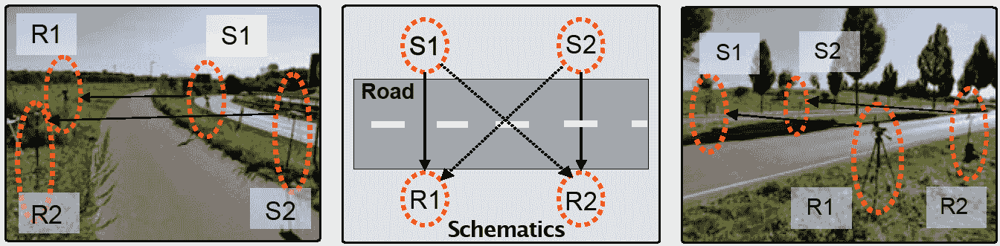

图 4.6：利用 WLAN CSI 和 UWB CIR 数据进行自行车检测（左）和机动车辆分类（右）的新型系统方法原理概述。

为了测量 WLAN CSI，系统使用了基于 `Espressif ESP32` 的 MCU，其 WLAN 收发器连接到定向天线，并在 2.4 GHz 频段以 20 dBm 的发射功率运行。为了对无线信道进行连续采样，相应的发送接收节点之间交换高速空包。每个接收到的包都包含用于通道估计的 CSI 信息。为了减少协议开销并提高整个系统性能，系统使用了单向用户数据报协议 (`UDP`) 数据传输。得益于应用程序接口 (`API`)，MCU 允许访问 CSI 以及来自不同子载波的幅和相位信息。通常情况下，CSI 可以包含除传统长训练场 (`LLTF`) 以外的其他字段，例如高吞吐量长训练场 (`HT-LTF`) 或时空块码高吞吐量长训练场 (`STBC-HT-LTF`)，这取决于所有涉及 WLAN 模块支持的传输模式以及通道特性。系统仅将 WLAN 节点用于高速测量；数据准备和机器学习步骤到目前仅在更强大的计算机上执行。


UWB 得益于极短的信号脉冲可以准确确定无线信道的通道脉冲响应，从而对无线信道提供进一步的见解，例如是否存在视距（`LOS`）路径或有多少显著的信号路径。该系统设置使用了定制的电路板（`PCB`），结合了 `Decawave DWM1000` UWB 收发器模块和 `ARM Cortex M3` MCU [687]。与 WLAN 节点一样，系统目前使用 UWB 节点测量通道脉冲响应。这些高分辨率通道数据通过 `USB` 连续传输到计算机进行进一步处理。图 4.6 展示了新型系统方法的结构。为了测量 WLAN CSI，系统使用了基于 `Espressif ESP32` 的 MCU，其 WLAN 收发器连接到定向天线，在 2.4 GHz 频段以 20 dBm 的发射功率运行。为了对无线信道进行连续采样，相应的发送接收节点之间交换高速空包。每个接收到的包都包含用于通道估计的 CSI 信息。为了减少协议开销并提高整个系统性能，系统使用了单向用户数据报协议（`UDP`）数据传输。得益于应用程序接口（`API`），MCU 允许访问 CSI 以及来自不同子载波的幅和相位信息。通常情况下，CSI 可以包含除传统长训练场（`LLTF`）以外的其他字段，例如高吞吐量长训练场（`HT-LTF`）或时空块码高吞吐量长训练场（`STBC-HT-LTF`），这取决于所有涉及 WLAN 模块支持的传输模式以及通道特性。系统仅将 WLAN 节点用于高速测量；数据准备和机器学习步骤到目前仅在更强大的计算机上执行。UWB 得益于极短的信号脉冲可以准确确定无线信道的通道脉冲响应，从而对无线信道提供进一步的见解，例如是否存在视距（`LOS`）路径或有多少显著的信号路径。该系统设置使用了定制的电路板（`PCB`），结合了 `Decawave DWM1000` UWB 收发器模块和 `ARM Cortex M3` MCU [687]。与 WLAN 节点一样，系统目前使用 UWB 节点测量通道脉冲响应。这些高分辨率通道数据通过 `USB` 连续传输到计算机进行进一步处理。图 4.6 展示了新型系统方法的结构。

### 4.2.4 评估

本节介绍了用于评估两种变体系统的方法。在这方面，我们解释了用于现场测量的系统设置、用于分类的分类以及机器学习模型。

#### 4.2.4.1 现场测量

为了进行数据采集，我们在不同环境中安装了变体系统。基于 RSSI 的系统安装在休息区（见图 4.8），总共记录了 260 辆车辆并进行了人工标注。基于 RSSI 的系统的主要参数请见表 4.1。

新型系统方案使用高分辨率 WLAN CSI 和 UWB 通道数据在两个地点进行了测试。自行车的轨迹记录在自行车道上（见图 4.8），而机动车辆（特别是轿车）的轨迹在繁忙的单车道上采集（见图 4.8）。因此，后者的设置与用于评估基于 RSSI 的前身系统的设置相似。

图 4.8：原始基于 RSSI 的系统方法（右侧）与新型基于 CSI 和 CIR 的系统演进（左侧、中间）在三种不同设置下的真实车辆轨迹采集实验现场部署。

我们对所提出的系统变体进行了基于机器学习（ML）的性能评估，使用了多种分类法，并在图 4.9 中分别展示了原始基于 RSSI 的系统（左侧）和新型分类系统（右侧）。定义不同的分类法是必要的，因为我们在具有不同交通流特征的多个地点对这两种系统进行了测试。具体而言，我们使用不同复杂度的分类法评估了系统的性能，并在下文中进行简要说明：

![Fig. 4.9: 用于评估基于 RSSI 的系统方法（左侧）和新型系统设计（右侧）的不同分类法的车辆类别和样本数量概述 ©\[2020\] IEEE。经许可重印自 \[634\].](graphic/b_9783110785982-004_fig_009.png)

图 4.9：用于评估基于 RSSI 的系统方法（左侧）和新型系统设计（右侧）的不同分类法的车辆类别和样本数量概述 ©\[2020\] IEEE。经许可重印自 \[634\]。

### 二分类（Binary）

此类别区分了“类汽车”（car-like）与“类卡车”（truck-like）或“非类汽车”（non-car-like）子类。虽然我们对基于 RSSI 的系统对类汽车和类卡车进行了分类，但我们通过对骑者的轨迹以及视距（LOS `idle`）进行二分类，研究了新型系统对骑行者的检测准确率。在 LOS 测量期间系统内没有物体，因此测量了 LOS 无电信道的指纹。

### 骑行者与机动车（Cyclist vs. Motorized Vehicles）

由于不同道路使用者的轨迹数据集不够大，我们对三类对象进行了检测和分类：`car-like`（类汽车）、`bicycle`（自行车，`non-car-like`）和 `idle`（空闲）。

### 基于尺寸（Size-based）

这是根据车辆长度对车辆进行的三类分类（仅用于基于 RSSI 的系统）。

### 基于车型（Body style-based）

我们在这里使用了七种车辆类型的细粒度分类（仅用于基于 RSSI 的系统）。

在`body style-based taxonomy`基于车型的分类法）中，细粒度分类任务会导致形状相似的车辆（例如巴士和半卡车）重叠增加，从而增加了整体分类的不准确性。尽管如此，我们在性能评估中考虑了这种复杂的分类法，以展示基于 RSSI 系统方法的优势和局限性。

#### 4.2.4.2 基于机器学习的分类

我们使用了若干种成熟且最先进的机器学习模型来检测和分类车辆，我们将在下文中对这些模型进行比较和解释。以下模型用于评估这两种系统变体的性能：

**人工神经网络（ANNs）**

灵感源于人类神经系统，ANN 在深度学习背景下的不同科学应用中受到了广泛关注。从实现的角度来看，这些模型通过多次矩阵乘法实现，这直接影响了结果的内存占用。

**随机森林（RFs）**

随机森林是集成学习方法的典型代表，它们利用了大多数实例被假设是正确的这一事实（*群体智慧*）。特征和训练数据的随机子集被用于训练随机森林中包含的每棵树。得益于其二分类决策机制，RF 允许使用简单的 `if/else` 语句实现资源高效的部署。通过调整参数（例如限制允许的树的数量或所有树的最大深度），可以方便地控制处理器和内存的使用率。

**支持向量机（SVMs）**

SVM 的目标是通过超平面在多维空间中分离数据点，使得对于每个特征，每一类的成员都能尽可能精确地分离，这通过最小化特定的目标函数来实现。

此外，我们还使用了以下 ML 模型来评估原始基于 RSSI 系统方法的性能：

**深度波尔兹曼树（DBTs）**

DBT 属于深度学习模型，其优势源于用户无需提取特征或定义转换函数，因为它们可以自动从给定的数据集中导出可微函数。作为一个固有的缺点，由于存在大量的可训练权重，DBT 还需要用户选择合适的超参数和足够的训练数据。

**邻性森林（PFs）**

与 RF 类似，PF 属于集成学习模型，但它们使用的不是 CART 树，而是邻性树。邻性树使用训练集中的关联数据点，并顾如其名实现了一种基于邻性的方法，其中对象根据参数化的相似性度量遵循相似度最高的分支。

### 4.2.5 真实世界验证

本节介绍并讨论了两种提出的车辆分类系统方法的结果。由于我们独立开发并测试了这两种系统（即在具有不同道路用户的地点），我们分章节介绍结果，从原始基于 RSSI 的检测分类系统开始。

#### 4.2.5.1 基于无线的检测分类系统

本小节涵盖了原始基于检测分类方法的结果。首先，我们描述了如何评估其检测性能，即系统能多准确地确定通过的道路。为此，我们将 2605 辆车辆的原始轨迹输入系统评估设置，允许对检测算法进行灵活调优。由于其在多个对角线和交叉无线链路中具有较高的系统复杂度，该系统还便于速度估计和逆行驾驶者检测（见图 4.10）。我们通过虚拟反转不同节点之间的无线链路顺序来模拟后期任务。因此，估计的负速度表示逆行驾驶者。直方图显示了数据集明显的分布，意味着对通过车辆方向的是可靠。由于检测到的车辆数量与采集的轨迹匹配，检测准确率为 100%。尽管如此，我们指出，还需要进一步的真实测量来确认我们虚拟检测逆行驾驶者的结果。

接下来，我们想要提供并讨论车辆分类的结果。我们采用了 10 折交叉验证，每折的数据划分比例为 1/9，即 90% 的数据用于训练，剩余 10% 用于测试。经过十次迭代后，得出这些折的统计偏差，并用于性能评估。图 4.11 展示了不同机器学习模型和所考虑的车辆分类体系（vehicle taxonomies）的分类准确率（参见图 4.9）。99% 的分类准确率是某些应用的典型最低要求，在图中以水平虚线表示。

![Fig. 4.11: 所考虑的机器学习模型和所考虑的车辆分类体系的整体分类准确率对比 ©\[2020\] IEEE.经许可重印自 \634\](graphic/b_9783110785982-004_fig_011.png)

图 4.11: 所考虑的机器学习模型和所考虑的车辆分类体系的整体分类准确率对比 ©\[2020\] IEEE。经许可重印自 [634]。

所有评估的模型在某些运行中均可以超过给定的 99% 阈值，但在二分类体系中通常低于该值。只有 `SVM` 达到了匹配该阈值的平均准确率。对于更复杂的车辆分类体系，所有模型的整体准确率显著下降：基于尺寸的分类准确率在 93% 到 98%，而细粒度任务则为 90% 到 95%。模型性能之间明显的偏差源于它们不同的学习策略。虽然 `RF` 的随机性导致交叉验证中产生更显著的标准误差，但 `DBT` 的性能水平低于其他模型，因为它为给定数据计算了概率度。

最后，三种所考虑的车辆分类体系（即二分类、基于尺寸和细粒度）的特定类别分类准确率如图图 4.12 和 4.14.所示。从二分类开始（这是区分汽车类和卡车类车辆的最简单分类任务），所有模型面临的主要挑战是正确分类卡车类车辆。我们可以通过解释中型车辆的分类结果来验证这一假设，如图 4.13 所示：所有模型的标准误差值相似，而它们在小型和大型轿汽车上的表现明显更好。对于细粒度分类体系，由于形状相似的车辆众多，且特定车辆类型（如公交）的轨迹表示不足，导致标准差增大，分类准确率较低。

## 4.2.5.2 使用 WLAN CSI 和 UWB CIR 进行车辆分类

对于新的模块化分类系统，我们在本小节中介绍并讨论了分类结果。如前所述，我们开展了多次测量活动，以收集自行车行者和机动车辆的轨迹。由于我们的测量侧重于捕捉由自行车行者引起的轨迹，因此我们大部分分析都是针对这些检测。我们首先讨论自行车行者检测的结果，然后提供针对自行车行者和不同机动车辆类型的多类型分类任务的性能结果。

![Fig. 4.12: 二分类车辆的归一化混淆矩阵。C:汽车类，T:卡车类 ©\[2020\] IEEE.经许可重印自 \634\](graphic/b_9783110785982-004_fig_012.png)

图 4.12: 二分类车辆的归一化混淆矩阵。*C*:汽车类，*T*:卡车类 ©\[2020\] IEEE。经许可重印自 [634]。

![Fig. 4.13: 基于尺寸的车辆分类的归一化混淆矩阵。S:小型，M:中型，L:大型 ©\[2020\] IEEE.经许可重印自 \634\](graphic/b_9783110785982-004_fig_013.png)

图 4.13: 基于尺寸的车辆分类的归一化混淆矩阵。*S*:小型，*M*:中型，*L*:大型 ©\[2020\] IEEE。经许可重印自 \[634\]。

为了评估自行车检测性能，我们考虑了一个包含自行车和非自行车（空闲）类别的二分类任务。表 4.2 列出了使用 `ANN`、`RF` 和 `SVM` 从 WLAN CSI 和 UWB 采集的不同通道参数分别获得的最大分类结果。对于 WLAN CSI，`RSSI` 是主导信道指标，导致所有模型具有最高准确率。一种可能的解释是 WLAN 收收发器评估了多个信道参数以提取链路质量的重要度量。同样，UWB 的一个单一信道参数导致了所有模型的最高准确率，特别是使用 `ANN` 时，可以达到 100% 的准确率。

接下来，我们展示针对自行车行者和不同机动车辆的多类型分类结果。特别而言，我们针对三种所考虑的分类体系（即二分类、基于尺寸和细粒度）的特定类别分类准确率。表 4.3 显示了使用 `ANN`、`RF` 和 `SVM` 在 WLAN CSI 和 UWB 的分类结果。

![Fig. 4.14: 样式分类的归一化混淆矩阵。PC:汽车类，PCT:带拖车的汽车，V:厢车，T:卡车类，ST:大卡，B:公交 ©\[2020\] IEEE.经许可重印自 \634\](graphic/b_9783110785982-004_fig_014.png)

图 4.14: 样式分类的归一化混淆矩阵。*PC*:汽车类，*PCT*:带拖车的汽车，*V*:厢车，*T*:卡车类，*ST*:大卡，*B*:公交 ©\[2020\] IEEE。经许可重印自 \[634\]。

对于 WLAN CSI，`RSSI` 似乎不足以达到最高准确性。相反，不同训练域的子载波幅值对该任务更为相关：使用 `ANN` 时使用 `LLTF`，使用 `RF` 时使用 `STBC-HT-LTF`，在 `SVM` 的情况下则使用多个子载波。相比之下，使用 `UWB` 时有两个关键参数：所有原始 CIR 累加数据的幅值（`A`）和第 15 个累加样本的幅值（`A15`）。通过比较 WLAN CSI 和 UWB CIR 数据的分类准确率，我们可以发现前者无线电技术存在约 5% 的显著性能差距。然而，我们注意到，我们在具有不同系统维度的环境中收集了自行车行者和机动车辆的轨迹，这影响了配备有内部 PCB 天线的 UWB 收发器模块之间的传输。

表 4.3：多类型车辆分类：使用 `ANN`、`RF` 和 `SVM` 并在 10 折交叉验证下得的 WLAN CSI 和 UWB 结果。

| 模型 | 分数 | WLAN CSI | UWB |
| --- | --- | --- | --- |
| | 数值 [%] | 参数. | 数值 [%] | 参数. |
| | 准确率 | 98.23±0.67 | `L (f4)` | 92.38±1.30 | `A (f2)` |
| ANN | 精确率 | 98.52±0.49 | `L (f5)` | 93.53±1.46 | `A (f2)` |
| | 召回率 | 98.31±0.63 | `L (f4)` | 93.30±1.34 | `A (f2)` |
| | F-Score | 98.39±0.71 | `L (f3)` | 93.41±1.38 | `A (f2)` |
| | 准确率 | 98.67±0.62 | `S (f0)` | 92.96±1.67 | `A (f0)` |
| RF | 精确率 | 98.83±0.59 | `S (f0)` | 93.74±1.74 | `A (f2)` |
| | 召回率 | 98.84±0.60 | `S (f1)` | 93.28±1.79 | `A (f2)` |
| | F-Score | 98.8±0.61 | `S (f0)` | 93.51±1.75 | `A (f2)` |
| | 准确率 | 96.95±1.66 | `HSC52` | 91.17±2.03 | `A[15] (f0)` |
| SVM | 精确率 | 97.86±1.24 | `HSC52` | 92.13±1.85 | `A[15] (f0)` |
| | 召回率 | 97.46±0.43 | `L (f4)` | 90.48±2.74 | `A[15] (f0)` |
| | F-Score | 97.39±1.44 | `H[SC52] (f0)` | 91.29±2.25 | `A[15] (f0)` |

*A*: 所有 CIR 累加样本的幅值，`A[15]`: 第 15 个 CIR 累加样本的幅值，`f` : 滤波器大小，`H[SC52]`: HT-LTF 子载波 52 的幅值，`L`: LLTF 幅值，`S`: STBC-HT-LTF 幅值。

### 4.2.6 结论

本节展示了两种无线电技术的变体，通过 `WLAN CSI` 和 `UWB` 评估了不同场景下的准确性，我们发现前者存在约 5% 的性能优势。然而，我们注意到，在具有不同系统维度的环境中收集了轨迹，这影响了配备有内部 PCB 天线的 UWB 收发器模块之间的传输。

通过比较 WLAN CSI 和 UWB CIR 数据的分类准确率，我们可以发现前者无线电技术存在约 5% 的显著性能差距。

本节展示了两种无线电技术的变体，通过 `WLAN CSI` 和 `UWB` 评估了不同场景下的准确性，我们发现前者存在约 5% 的性能优势。

### 4.2.7 致谢

此外，本工作得到了德国联邦交通和数字化部（`BMVI`）的支持 LS` 项目的支持。

## 4.3 智慧城市的资源受限绿色网络

*Pascal Jörke, Christian Wiet*

**摘要**：物联网（IoT）将通过连接数十亿设备来实现各种新用例。随着资源受限终端的出现，通信网络必须面对高通信范围、小数据传输效率以及可扩展性等新挑战。通过窄带物联网（`NB-IoT`）和增强型机器通信（`eMTC`），并引入更大的通信范围和更低的功耗，蜂窝通信方案旨在满足大规模机器通信（`mMTC`）用例的需求。虽然 `NB-IoT` 和 `eMTC` 使用相同的节电技术和重复机制来扩展通信范围，但分析揭示了它们在数据大小、速率和耦合损耗方面的不同性能。

本节描述了低功耗广域网（`LPWAN`）解决方案在资源受限终端的能量效率、频谱效率和延迟方面的成就。因此，详细解释了蜂窝物联网新的节电和覆盖扩展功能，同时考虑了网络的可扩展性成本。基于这些知识，提供了不同覆盖条件下资源受限 LPWAN 的性能分析。

在考虑 144 dB 耦合损耗时，`eMTC` 的电池寿命比 `NB-IoT` 好 4%，但在耦合损耗为 155 dB 或更小的覆盖区域内，`eMTC` 的性能更好，但它需要更多带宽。考虑到频谱效率，`NB-IoT` 在所有评估场景中都是更好的选择，更适用于预计连接设备数量接近或超过网络容量的未来网络。

虽然在耦合损耗达到 164 dB 时通信是可能的，但结果显示随着信号质量的下降，整体性能非常有限。尽管设计为扩展覆盖而设计，但移动网络运营商应不断提高上行和下行方向的信号质量。当增加基站数量不可行时，应考虑替代的信号质量改进方案。在这种背景下，通过多运营商和多链路策略，对蜂窝物联网网络的覆盖和链路质量进行了评估，并以德国智慧城市多斯特蒙德为例。结果显示，链路质量可以提高高达 13.6 dB，这使得资源受限设备缩短了空中时间，从而极大地提高了能量和频谱效率。

### 4.3.1 引言


配备填满率传感器的垃圾桶、监测大城市整体空气质量的分布式环境传感器，以及调节蜂箱温度并传输蜂巢重量的蜂箱传感器，都是集成小型传感器设备的一些用例。物联网（IoT）实现了无数新的用例。虽然某些传感器具有固定电源，但另一些传感器则需要独立于固定电源（例如智能垃圾桶），因此必须依赖电池，或者为了获得更长的电池寿命，使用能量采集 [262]。在大规模场景下（如智能垃圾管理）中，运营成本需要尽可能低，因此客户必须依靠单节电池维持多年，同时仍需提供宽大的通信范围。在过去的几年里，许多新的通信解决方案已经解决了低功耗和广域通信的需求，因此被称为低功耗广域网（LPWAN）。一种很有前景的解决方案是长距离广域网（LoRaWAN），它被许多公用事业部门使用，因为它在免授权频谱内广播且易于部署。授权频段中的替代方案是 `NB-IoT` 和 `eMTC`，它们源自 `LTE` 通信技术。`NB-IoT` 和 `eMTC` 都可以部署在现有的 `LTE` 网络中，因此在许多国家提供了快速且便捷的部署。

下一节将简述在考虑免授权频谱和授权频谱内的解决方案时的相关特性。

## 免授权频谱中的终端

`LoRaWAN` 是一种易于使用的物联网通信解决方案。`LoRaWAN` 为小数据数据传输设计，使用具有低开销和短空中传输时间的专有通信协议。为了进一步减少开销和功耗，信道接入基于非时隙 `Aloha` 协议（`unslotted Aloha`），在数据可用时直接传输。由于没有信道接入机制且部署在免授权频谱中，冲突是不可避免的 [93]，这使得 `LoRaWAN` 在大规模网络中不可靠。因此，`LoRaWAN` 非常适用于对服务质量（`QoS`）要求最低且可接受丢包的用例。此外，还需要考虑占空比（`duty-cycle`）限制。免授权频谱中的占空比限制用于限制设备的最大传输时间，例如 1%，这意味着设备每小时只能传输数据 36 秒，从而影响了最大传输间隔。关于免授权频谱终端的更多细节，可以参见第 5.1 节。

## 授权频谱中的终端

当通信需要更可靠时，授权频谱中的通信解决方案是更好的选择。`NB-IoT` 和 `eMTC` 衍生自 `LTE`，使用中心化调度对可用的频率和时间资源进行调度。因此，避免了空口接口上的冲突，网络本身的可扩展性主要受限于给定的频率带宽。调度传输的代价是同步和控制信令流量开销的增加，这影响了资源受限终端的频谱效率和能量效率。

### 资源受限物联网终端的设计目标

由于可以使用专用的频谱，`NB-IoT` 和 `eMTC`（通常总结为蜂窝物联网）不受占空比限制，并可用于各种应用协议和许多用例。虽然 `eMTC` 依赖现有的 `LTE` 网络并复用 `LTE` 同步，但 `NB-IoT` 也可以作为独立网络部署 [398]。由于 `NB-IoT` 仅使用 180 kHz 带宽（相比之下 `eMTC` 为 1.08 MHz），它也可以部署在保护带中（两个 `LTE` 网络之间未使用的带宽），并通常用于避免干扰。

由于终端可能分布在很大区域，甚至在地下室等具有挑战性的通信环境中，蜂窝物联网解决方案必须提供扩展的网络覆盖范围，同时实现低功耗。下一节将简要介绍蜂窝物联网引入的节电和范围扩展机制。

#### 低功耗

使用目前的通信解决方案，电池寿命通常被限制在几周。相比之下，蜂窝物联网的设计目标是单节电池使用 10 年 [262]。大多数物联网设备的设计为每天或每周传输数据，这意味着设备大部分时间处于空闲状态。

图 4.15 描绘了一个典型的 `NB-IoT` 周期。在连接状态下，设备传输数据并等待响应。扩展连续接收（`eDRX`）延长了 `DRX`（间隙接收）周期，允许设备在节电状态下停留更长时间 [93]，从而进一步降低功耗。当 `eDRX` 定时器 `T3324` 到期时，设备将切换到省电模式（`PSM`）。

```
图 4.15：带有 eDRX 和 PSM 的 NB-IoT 周期。©2018 IEEE。经许可转载自 305。
```

使用 `PSM` 时，设备进入一种省电状态，在此将其功耗降至最低 [398]。在 `PSM` 中，设备保持在网络注册状态并维护其连接配置。一旦设备离开 `PSM`，它不需要接入网络；而是重新建立之前的连接，这减少了信令开销并优化了设备功耗。然而，只要设备处于 `PSM` 中，网络就无法找到它，因为它不监听寻道窗口。移动终止业务必须挂起直到设备重新连接网络。跟踪区域更新（`TAU`）也会触发设备结束 `PSM` 并重新建立连接。在执行 `TAU` 时，设备会监听寻道窗口和队列中的下行传输。

#### 扩展覆盖

为了比较信号范围，通常使用最大耦合损耗（`MCL`），因为它定义了接收器仍能解码信号的最大衰减。虽然 `eMTC` 的设计目标定义的 `MCL` 为 155.7 dB [4]，但 `NB-IoT` 的目标是将 `MCL` 扩展到 164 dB。图 4.16 提供了针对不同 `MCL` 目标对应的地下室渗透范围。

除了带宽较窄外，蜂窝 IoT 解决方案还通过重复（`repetitions`）来增加单位比特能量，从而提高信号解码率。因此，`eMTC` 引入了覆盖增强（`CE`）模式 A 和 B。`CE Mode A` 是强制性的，支持最多 32 次重复，而 `CE Mode B` 是可选的，定义了最多 2048 次重复。`NB-IoT` 也支持最多 2048 次重复，但它没有在不同的 `CE` 模式划分次数，使得所有重复选项对所有设备都是强制性的。表 4.4 详细概述了每个 `NB-IoT` 和 `eMTC` 信号的最大重复次数 [398]。

由于传输的是相同的数据，应用数据速率随着每次重复的增加而大幅下降，与无重复传输相比，设备消耗更多功率。虽然 `eDRX` 和 `PSM` 等新机制旨在增加蜂窝 IoT 设备的效率和电池寿命，但扩展的覆盖将导致能量效率显著降低。为了确保蜂窝 IoT 设计目标仍然可以实现，必须对 `NB-IoT` 和 `eMTC` 同时进行性能分析。

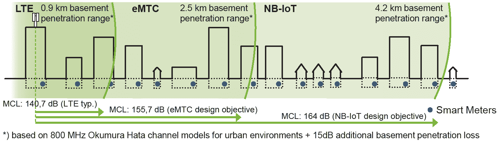

图 4.16：`NB-IoT` 和 `eMTC` 中的覆盖增强。

表 4.4：`eMTC` 和 `NB-IoT` 中的最大重复次数。

| eMTC | | 最大重复次数 | NB-IoT | 最大重复次数 |
| --- | --- | --- | --- | --- |
| | CE Mode A | CE Mode B | | |
| PDSCH | 32 | 2048 | NPDSCH | 2048 |
| --- | --- | --- | --- | --- |
| MPDCCH | 16 | 256 | NPDCCH | 2048 |
| PRACH | 32 | 128 | NPRACH | 128 |
| PUSCH | 32 | 2048 | NPUSCH | 128 |
| PUCCH | 8 | 32 | | |

#### IoT 应用协议

虽然像 `LoRaWAN` 等免授权频谱中的 `LP-WAN` 解决方案通常由于协议开销大而缺乏端到端互联网协议（`IP`）支持，但 `NB-IoT` 和 `eMTC` 均能够传输诸如传输控制协议（`TCP`）和用户数据报协议（`UDP`）消息之类的 `IP` 流量。由于传输能力降低，即使在使用覆盖扩展机制，数据包的大小和消息序列的数量应该尽可能低。为了获得良好的系统性能，选择合适的应用协议至关重要。

消息队列遥测传输（`MQTT`）是一种基于 `TCP` 的 IoT 通信协议，专为低带宽环境下的机器对机器（`M2M`）数据传输设计 [41]。它使用中心化的代理（`broker`），客户端向其发布数据，而其他客户端可以订阅数据更新。除了通过 `TCP` 进行传输保护，`MQTT` 还引入了三个服务质量（`QoS`）级别。`QoS` 等级 0 是一种简单、低开销的消息发送方法。客户端只需连接到代理并发布消息，无需代理的 `MQTT` 确认。数据仍然在较低层通过 `TCP` 进行确认。`QoS` 等级 1 保证消息成功传输到代理。代理向发送者返回确认。如果数据或确认发生传输丢失，发送者将重传数据。`QoS` 等级 2 是最高服务级别。它包含发送者和代理之间由四条消息组成的序列，以及一个握手，用于确认主消息已发送且确认已收到。握手完成后，发送者和接收者都确定消息被恰好接收了一次，尽管这种方法产生了最高的消息开销。

用于传感器网络的 `MQTT`（`MQTT-SN`）是基于 `UDP` 的 IoT 通信协议 `MQTT` 的优化版本，专门设计为大型、低功耗 IoT 传感器网络中的高效运行而设计 [645]。与 `MQTT` 一样，它使用中心化的代理。除了 `QoS` 等级 0 到 2，还引入了一个新的 `QoS` 等级，进一步减少了消息开销。使用 `QoS` 等级 -1 发布消息不需要初始连接建立和代理注册；相反，它只传输一条包含所有所需数据的发布消息。虽然 `QoS -1` 的开销最低，但它不提供来自代理的确认和其他响应。

受限性应用协议（`CoAP`）是第三种重要的 IoT 应用协议。`CoAP` 是一种基于 `UDP` 的专用网络传输协议，用于 IoT 中资源受限的节点和受限网络 [600]。该协议为 `M2M` 应用设计。与 `MQTT` 和 `MQTT-SN` 不同，它直接在客户端和服务器之间传输数据。由于不需要先建立连接，`CoAP` 具有较低的消息开销。当使用确认传输时，服务器和客户端之间传输的所有数据都通过应用确认进行确认。在收到确认或达到最大重试次数之前，数据将重发。

当需要高质量时，应使用 `MQTT` 或 `MQTT-SN` 进行数据传输，因为这两个协议都提供了多层传输保护。当能量效率至关重要且数据仅点对点传输时，`CoAP` 是更好的选择。图 4.17 提供了这些 IoT 应用协议消息开销的概述。

为了最高的能量效率，传输的消息应该尽可能少。当不需要应用确认时，`CoAP` 非确认（`Non-Confirmable`）和 `MQTT-SN QoS -1` 均适用。如果应用层需要确认，`CoAP` 是最具能量效率的选择，因为 `MQTT` 和 `MQTT-SN` 在传输和确认用户数据之前都需要先建立连接。

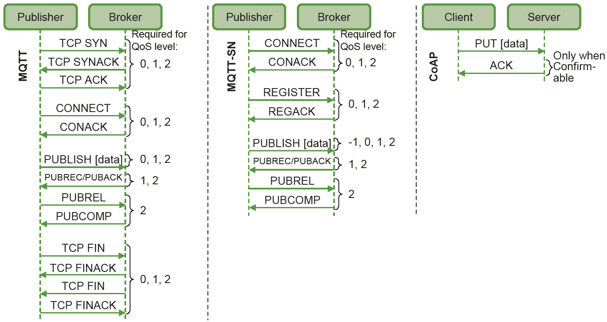

图 4.17：不同 IoT 应用协议的消息序列对比。

### 受限 LPWAN 客户端的性能分析

虽然 `eDRX` 和 `PSM` 等功能旨在降低功耗并从而延长电池寿命，但覆盖增强通过引入更长的传输和接收间隔导致 `UE` 产生更高的功耗。这两项功能都是为了满足 10 年电池寿命、164 dB 最大耦合损耗以及单次数据传输最大延迟 10 秒的挑战。在本节中，将对蜂窝 IoT 解决方案进行性能分析。

#### 挑战性智能城市环境下 NB-IoT 和 eMTC 的功耗分析

在 Section 4.3.2.1 中，为 `NB-IoT` 和 `eMTC` 设备引入了两种新的节电状态。这两种状态与当前的 `GSM` 或 `LTE` 设备相比，都能降低功耗。除了 `PSM` 和 `eDRX` 外，设备还可以进入三种额外的功率状态：连接（`Connected`）、尾随（`Tail`）和跟踪区域更新（`TAU`）。在 `Connected` 功率状态下，会进行随机接入、数据传输和接收。数据传输接收完成后，设备会在预定义的时间内处于 `Tail` 状态（也称为数据空闲计时器），在此状态下，它在 `RRC` 通信层保持连接以便进行额外的数据交换。然后，它会切换到 `eDRX` 功率状态，设备仅在呼叫时刻（`paging occasions`）时唤醒。最后，设备在 `PSM` 状态下将功耗降低到最低。它会定期唤醒执行 `TAU` 并检查是否有下行传输在排队，因为在 `PSM` 状态下无法接收这些消息。图 4.18 给出了用于确定 `UE` 能量消耗的状态机概览。

为了比较不同的蜂窝 IoT 解决方案并评估 `NB-IoT` 和 `eMTC` 是否能满足所有 IoT 要求，[305] 中的作者对 `NB-IoT` 和 `eMTC` 在三种不同覆盖范围下的延迟、数据速率、电池寿命和频谱效率进行了性能分析。结果所示在图 4.19。

![Fig. 4.18: 功耗评估的状态机。©\[2018\] IEEE. 经许可转载自 \[305\]。](graphic/b_9783110785982-004_fig_018.png)

图 4.18: 功耗评估的状态机。©\[2018\] IEEE. 经许可转载自 [305]。

![Fig. 4.19: 在不同覆盖条件下，NB-IoT 和 eMTC 设备对于每 24 小时传输 84 字节确认上行数据的比较。注意这三幅图的坐标轴刻度不同。©\[2018\] IEEE. 经许可转载自 \[305\]。](graphic/b_9783110785982-004_fig_019.png)

图 4.19: 在不同覆盖条件下，`NB-IoT` 和 `eMTC` 设备对于每 24 小时传输 84 字节确认上行数据的比较。注意这三幅图的坐标轴刻度不同。©\[2018\] IEEE. 经许可转载自 [305]。

结果显示，在 144 dB 和 154 dB 的耦合损耗下，`eMTC` 的性能略优于 `NB-IoT`。虽然 `eMTC` 的性能提升很小，但它使用的带宽是 `NB-IoT` 的 6 倍，导致传输的频谱效率较低。在基室等耦合损耗可能增加到 164 dB 的小区边缘处，`NB-IoT` 的表现明显优于 `eMTC`。虽然这两种蜂窝技术都使用相同的节电机制，但 `NB-IoT` 需要较少的重复即可传输数据，这缩短了空口时间，从而延长了传输之间在 `PSM` 中的时间。尽管在良好的覆盖条件下 `eMTC` 的表现优于 `NB-IoT`，但两者在数据速率、延迟和电池寿命性能方面的差异很小。在弱覆盖条件以及频谱效率方面，建议使用 `NB-IoT` 而非 `eMTC`。

#### 多运营商和多链路策略提升蜂窝 IoT 网络的覆盖与链路质量

Section 4.3.3.1 概述了蜂窝 IoT 技术在不同覆盖场景下的性能。随着信号衰减的增加，整体性能会急剧下降。因此，信号质量应尽可能良好。与其通过安装新基站来扩展网络，多运营商策略（如国家漫游）可以通过允许蜂窝设备使用来自不同移动运营商（`MNO`）的网络，为 `LTE` 和蜂窝 IoT 技术提供更好的覆盖和链路质量。

[306] 中的作者以智能城市作为案例研究，评估了多运营商策略在覆盖和链路质量方面的潜力。通过提取多特蒙德的蜂窝基站数量并应用经验路径模型，我们进行了全面的覆盖分析。结果所示在图 4.20。

![Fig. 4.20: 城市环境中户外、室内和深室内场景的覆盖分析结果。©\[2019\] IEEE. 经许可转载自 \[306\]。](graphic/b_9783110785982-004_fig_020.png)

图 4.20: 城市环境中户外、室内和深室内场景的覆盖分析结果。©\[2019\] IEEE. 经许可转载自 [306]。

虽然所有运营商都能提供 `LTE` 和 `NB-IoT` 的户外覆盖，但室内和深室内覆盖分别下降到 66% 和 42%。在多运营商场景下，深室内覆盖率提升了 40%，这使得 `LTE` 场景非常推荐多运营商部署。得益于其扩展的覆盖范围，`NB-IoT` 能够在最大损耗为 164 dB 的所有场景提供全覆盖。如果为了更好的性能并将最大损耗限制在 154 dB（参见 Section 4.3.3.1），在使用多运营商策略时，`NB-IoT` 仍能提供全覆盖。

即使在全覆盖场景下，多运营商策略通过将平均链路质量提高 13.6 dB 也是合理的（图 4.21）。在图 4.19 中，链路质量提升 10 dB 即可将 `NB-IoT` 设备的电池寿命从 4 年延长到 18 年，并将延迟从 5 秒缩短到 0.8 秒。因此，强烈建议通过多运营商策略提高链路质量。

能效是物联网（IoT）中的一个重要因素。许多用例依赖于单电池寿命至少为 10 年的传感器。随着 `NB-IoT` 和 `eMTC` 等新型通信技术的发展，蜂窝解决方案应对了物联网带来的新挑战。但仅靠优化的通信技术是不够的。能效需要在所有层上解决，从选择尽可能低开销的应用程序协议，到避免在空中接口上进行大量重复的链路质量改进策略。鉴于性能和覆盖分析的结果，对于资源受限的设备，良好的设备放置至关重要。在未来，可以通过对延迟和能耗进行广泛测量，利用信号强度和信号质量等被动测量参数，推导出基于 `ML` 的延迟和能耗性能预测模型。此外，正如 [30] 中引入的基于 `ML` 的模型预测通信，可以减少传输消息的数量和大小。如果在应用设计之初就考虑到绿色网络和资源限制，从用户和网络角度来看，系统性能可以得到显著提升。

### 致谢

除了 `CRC 876` 之外，这项工作部分还得到了联邦经济和气候行动部（`BMWK`，原联邦经济和能源部 `BMWi`）在“Ideal”项目期间的支持，资助协议编号为 `03ET7557A`。

## 车对车通信：机器学习支持的预测路由

Cedrik Krieger, Benjamin Sliwa, Christian Wietfeld

摘要：车辆通信用于交换安全状态信息、实现以效率为导向的移动规划，并在局部区域内的车辆及其基础设施之间共享其他用户数据（如视频流）。在不需要蜂窝覆盖的情况下，特定设备或代理以分布式方式组织，没有中央协调单元。这种能力不仅能够实现对未来城市产生重大影响的智能交通系统（ITS），还能实现自发部署的网络，满足按需网络的需求。一个著名的例子是救援部队的支持，它们可以利用无人机（UAV）进行遥感并委托探测任务，从而降低人员面临的风险。这些应用都有高要求，需要稳健且可靠的通信行为。由于移动自组织网络（MANETs）不是中心化管理的，数据需要从发送者高效地路由到接收者，同时需要避免链路丢失和不必要的跳数。现有的协议依赖于简单的距离测量，并试图最小化发送者到接收者的距离。在挑战性网络中，这些简单的方法无法应对任务的复杂性。因此，更先进的技术整合了更多信息并提供了更高的泛化水平。全面的仿真表明，利用跨层知识和对未来网络状态的预测可以实现可靠稳健的基于强化学习的路由算法，在不同条件下实现高性能。此外，在所有考虑的研究中，该技术优于现有的路由协议高达 51%。

### 引言：自组织网络中的直接代理通信


节点直接通信的自组织网络被称为自组织网络。路由不仅构建到可直接的邻节点，还构建到只有通过调用（多个）中间跳数才能通信的更远节点。通过这种方式，所有代理都创建了一个网格结构。在这里，移动自组织网络（MANETs）子类特别受到关注，因为它们明确了节点可能的移动，这导致了网络拓扑的频繁变化，因此需要合适的解决方案来提供稳健可靠的通信。由于 MANETs 是无基础设施的，需要高效的路由协议来平衡开销与有效路由提供之间的关系。虽然用于协调的流量过多会降低整体吞吐量，但过时信息会导致数据丢失。节点的移动性是影响网络拓扑的主要因素。MANETs 可以具有混合特性的移动节点（如无人机和汽车），但也具有极低或静止移动性的节点（如行人和路侧单元 RSU）。除了移动性，由于多径传播（特别是在城市环境中）、信号衰减和阴影引起的信道变化对节点的可达性产生巨大影响，并损害端到端的路由性能。由于这些各种因素为 MANETs 带来了挑战性条件，依赖于相当简单指标（如跳数表示的距离矢量）的现有路由协议无法满足稳健通信的需求。因此，整合进一步的信息和增强路由指标是有必要的，以便充分评估发生的网络状况并提高整体性能。

## 4.4.2 相关工作：移动预测自组织路由协议的演进

自组网络路由协议发展的分类见图 4.22。所提的协议源于位于 Freifunk 社区的“移动自组网络更优方法”（B.A.T.M.A.N.）项目 [472]。B.A.T.M.A.N. III 的最初开发是为了解决已有的路由协议优化链路状态路由（OLSR）中的可扩展性问题，它通过在本地实体之间分配拓扑知识，从而避免了在每个节点上计算完整网络图的需求，这是一项开销任务，尤其适用于资源受限的系统。后续的 B.A.T.M.A.N. 版本将其操作点从第 3 层的基于网协议（IP）的路由移动到第 2 层，以提供一种网络协议无关的路由方法，并对数据包产生更直接的影响。由于 B.A.T.M.A.N. 用于实际案例并已有相应的内核实现，但科学研究中的仿真模型通常被忽略。因此，针对著名的离散事件仿真器 C++ 测试平台 OMNET++ 的 B.A.T.M.A.N. 协议版本仿真模型 [701] 已开发并在 [627] 中通过实验验证。然而，由于 Freifunk 社区的目标是在城市提供基于网格的互联网访问，B.A.T.M.A.N. 实现中为了此任务的开销（如主机公告 HAs）与实际路由过程是分开的。虽然第一个扩展 B.A.T.Mobile [623] 从主分支分离并引入了这些措施，连续由强化学习驱动的预测自组路由协议 PARRoT [635] 省除了网络配置的额外开销。因此，获得了强化学习影响的 PARRoT 专注于基于 IP 的路由评估。新型方法的封装旨在将新的路由机制整合到最新的 B.A.T.M.A.N. 版本中。后者协议 B.A.T.Mobile 和 PARRoT 遵循移动预测路由方法，并在后续进行了详细说明。最近的开发是上下文自适应 PARRoT (CA-PARRoT) [586]，它可以被视为 PARRoT 的扩展并遵循混合机器学习方法。


图 4.22：路由协议演变图。

路由协议可以分为*响应式*（reactive）和*主动式*（proactive）协议。前者按需启动路由构建过程。著名的示例有自组按需距离向量（AODV）和动态 MANET 按需路由协议（DYMO）。后者在需要时维护用于查找路由表并定期更新。目的序列距离向量（DSDV）和 OLSR 是广为人知的主动式协议。无线网络中的边界无状态路由（GPSR）是一种将移动性和通信视为依赖任务的路由方法。路由构建通过最小化每跳发送端与目的节点之间的地理距离来实现。关于现有协议的广泛总结可见 [486]和[470]。车载网络中使用协议的实证分析见 [119]。

机器学习领域的最新进展对路由算法也产生了影响。[671]的作者使用集化的人工神经网络（ANN）来实现车载网络中延迟化的软件定义网络（SDN）方法。然而，基于强化学习的方法允许路由实体以去中心化的方式做出决策。在 [99]中，Q-routing 被提出作为基于学习延迟的自主路由决策的集成。[481]的作者用基于移动性的指标扩展了这一点，并考虑了智能体的集群相干性。信道和传播模型的总结见[704]。[60]的作者提出了一种从随机信道参数中学习的方法。智能路由算法和自组网络的发展可能对未来几代网络产生影响 [17]。

## 4.4.3 方法：通过预测和机器学习增强路由

在本节中，详细介绍了 B.A.T.Mobile、PARRoT 和 CA-PARRoT 的路由方法。B.A.T.Mobile 利用移动领域的跨层知识来预测未来轨迹，并将其整合到路由决策中。遵循预期移动网络范式 [107]，其鲁棒性得到了整体提升。PARRoT 作为后续协议，采用了移动预测方法，并将其整合到基于学习延迟的自主路由决策中 [481]。CA-PARRoT 是 PARRT 的扩展，它引入了补偿短期影响的机制，并采用了一种混合机器学习方法，其中路由决策仍然依赖于强化学习，但使用机器学习组件对无线环境原型（REP）进行分类，以实现最佳的端到端性能。

### 4.4.3.1 B.A.T.Mobile：利用跨层知识

PARRoT 继承了 `B.A.T.Mobile` 的移动性预测。路由指标并非仅构建在相对移动的基础上；而是通过 `Q-learning` 过程收集的。代理共享其当前位置和预测位置，接收代理利用这些位置来重构其邻居的轨迹。此外，这与代理自身的轨迹建立了关联，这两个代理之间建立链路的未来可用性通过指标 `ΦLET` 表示，该指标代表链路过期时间（LET）。每个代理通过比较其当前邻居集合与之前的集合来评估自身的内聚力。这产生了指标 `ΦCoh`，并并通过路由消息进行共享。强化学习过程通过反向路由构建来完成。源头节点创建一个路由消息（在 `PARRoT` 中被称为 `chirps`），将奖励值 `V` 设置为 `1.0` 并进行广播。接收代理执行学习过程，考虑源头节点（在反向路由构建中将作为目的地 `d`）以及接收消息的邻接代理 `j`，并对其进行处理。

![图 4.23: 多因子移动性预测下路由协议与移动域的相互连接。摘自 [585]。](graphic/b_9783110785982-004_fig_023.png)

图 4.23: 多因子移动性预测下路由协议与移动域的相互连接。摘自 [585]。

```
(4.11) Q(d, j) = Q(d, j) + α[y[0]⋅ΦLET⋅ΦCoh⋅V[j]−Q(d,j)]
```

在这里，学习率 `α` 控制了传递奖励 `V[j]` 的新路由消息对已学习知识的影响。基础折扣因子 `γ[0]` 保证了路径的衰减。这在所有其他指标都变为 `1.0` 时特别具有意义，例如在静态网络中。该措施随后强制减少共享奖励并防止路由环路。代理维护一个 `Q-table`，其中对于每一个接收过 `chir` 的目的地/网关对，都存在一个质量指示 `Q(d, j)`。该表随后被用于填充已知路由表，从而实现数据包转发过程。

图 4.24 显示了 PARRoT 路由消息的数据报，其中包含标识数据、年龄信息和位置信息。

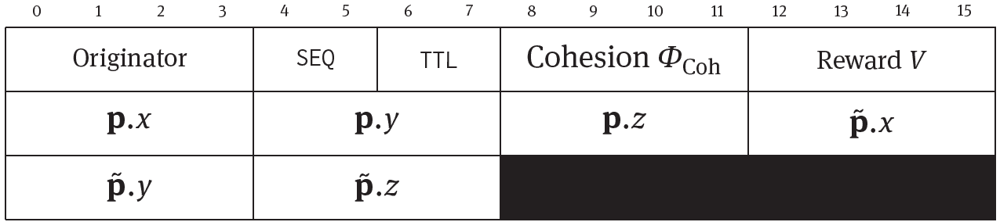

图 4.24: 总长度为 40 字节的 PARRoT 路由消息字节数据报。

![图 4.25: 基于计时器的更新程序，以避免对已学习知识产生过大影响的短期效应。[2021] IEEE。经许可转载自 [586]。](graphic/b_9783110785982-004_fig_025.png)

图 4.25: 基于计时器的更新程序，以避免对已学习知识产生过大影响的短期效应。[2021] IEEE。经许可转载自 [586]。

### 4.4.3.3 CA-PARRoT：引入支持机器学习的上下文自适应

CA-PARRoT 对 PARRoT 提出了进一步的增强，以增加不同条件下的鲁棒性并减少预配置工作。从综合仿真可知，PARRoT 在时变环境中表现出负面影响，因为短期效应损害了已学习知识的准确性。相比之下，B.A.T.Mobile 被证明更为健壮，因为它缓存了输入信息以平滑更新过程。因此，CA-PARRoT 中也引入了基于计时器的更新程序，如图 4.25。它被分为四个阶段，在 `phase 1` 中将一个入值推送到指标缓冲区。相同的值在 `phase 2` 中导致即时 Q 更新，在 `phase 3` 中产生临时知识，用于决定当前路由消息的转发。在经过时间 `Δtu` 后，从指标缓冲区中读取最佳候选并触发 Q 更新，其结果被持久化在存储的知识中，并用于更新管理数据包转发的路由表（`phase 4`）。

除了重构的更新过程外，还引入了机器学习组件以便在当前环境进行分类后获取参数化。为此，考虑了不同的无线电环境原型，并对这些原型提前进行参数优化，将最佳参数化提供给路由协议。图 4.26 显示了自适应方法，其起点是对窗口内输入消息信号强度的监控。提取的统计特征用于分类原型并选择参数，如 `α`、基础折扣因子 `γ[0]` 以及新引入的 `λ` 和 `ω`。随机森林 (RFs)、支持向量机 (SVMs) 和人工神经网络 (ANNs) 提供了分类方法。图 4.27 显示了通过带有资源限制的物联网系统 (LIMITS) 进行 10 折交叉验证获得的分类准确率，该框架允许模型导出。

## 4.4.4 MANET 路由协议的性能评估

为了对不同的路由协议进行性能评估，需要一个可重复的场景设置，为所有候选提供可比的框架，并使整体性能取决于所评估的协议。作为关键性能指标 (KPI)，*数据包交付率* (PDR) 和平均延迟被视为端到端指标。

构建了一个参考场景，其中十个代理在两个代理之间建立了比特率为 2 Mbit/s 的恒定比特率（CBR）视频流。除了通信方面，代理的移动性对网络拓扑的演变和特征具有巨大影响。图 4.28 (a) 显示了参考场景三维游场中的通用随机路点（RWP）移动性。这些代理以 50 km/h 的恒速移动，并在到达当前目标时立即选择下一个目标。RWP 移动性被视为一种基准移动性模型。图 4.28 (b) 展示了应用驱动移动性的示例，其中无人机（UAV）悬停在地面车辆集群上方以扩展它们的通信能力 [624]。这种移动模式涉及具有固有不同的混合类型车辆——这对于高效路由协议来说是一项特殊挑战。

另一个关键方面是信道模型的选择。在农村环境中，两个代理之间通常存在视距（LOS）连接。由于游场内缺乏物体，多径传播可以忽略，自由空间路径损耗 `L` 与指数加权距离 `d` 成正比，公式为 `L ∝ d^η`，其中 `η` 是衰减系数。这种简单但通用的模型被用于参考场景的性能评估。对于其他环境，则需要考虑更复杂的路径损耗模型。在城市地区，物体的影响导致多径传播变得更加重要，因为 LOS 路径被反射信号路径叠加。因此，Nakagami 模型除了自由空间路径损耗外，还对接收信号强度（RSS）产生随机影响。对 [119] 的经验分析指出了车辆研究中常用的信道模型和成熟的参考协议，新协议将与这些协议进行比较。

## 4.4.5 结果

在本小节中，将给出一个全面的仿真性能分析。首先，进行可扩展性分析，以评估路由协议对于不同类型网络的行为。随后，在场景研究中评估了端到端性能，这些研究展示了潜在的应用领域。为了评估上限，引入了自由空间条件下的最优 PDR（数据包交付率），它代表了对代理位置和路由理论可用性进行的后处理分析。因此，它被视为一种受移动性限制的上限。

### 4.4.5.1 可扩展性分析

**网络中的代理数量** 如图 4.29 (a)所示，代理数量对路由协议的 PDR 具有显著影响。首先，对于代理数量较少且游场密度较低的情况，可以观察到由于移动导致的不可忽视的 PDR 限制。在高密度情况下，`B.A.T.Mobile`、`PARRoT` 和 `CA-PARRoT` 优于所有现有协议。`CA-PARRoT` 的 PDR 曲线接近移动限制，仅显示出开销的影响，且开销随规模增大而增加。因此，结果显示了良好的可扩展性，证明 `CA-PARRoT` 适用于高密度网络。

**速度对端到端性能的影响** MANET 的特点是其移动性，这在许多情况下意味着代理的高速。图 4.29 (b) 显示了从慢速代理到高移动性场景的一系列性能。高速度需要路由协议非常快速地适应网络拓扑。对于超过 100 km/h 的速度，大多数路由协议无法提供可靠的路由，导致 PDR 下降并出现不可预测的情况。只有 `CA-PARRoT` 受到速度增加更高要求的影响，能够通过预测网络拓扑并补偿链路损失来提供高 PDR。

### 4.4.5.2 场景研究

**农村 3D 游场中的无人机通信** 如图 4.30 所示，新协议 `B.A.T.Mobile` 和 `CA-PARRoT` 优于现有协议。该研究考虑了农村三维游场中两架无人机之间的空中通信。由于通信范围没有覆盖整个游场，因此计算了移动性限制的最优值，因为并非时刻都有路由可用。

图 29：路由协议的可扩展性分析。`PARRoT` 和 `CA-PARRoT` 显著优于所考虑的协议，并在挑战性条件下提供稳健的通信。所有现有协议无法在 70% 以上提供可靠的 PDR，这使得 `CA-PARRoT` 超过了它们 48%。`CA-PARRoT` 的 PDR 分别比 `PARRoT` 和 `B.A.T.Mobile` 高出 3% 和 19%，因此是性能最好的移动预测协议，与理论上限的差距仅为 5%。因此，所提协议在每个开发阶段都显示出逐渐改进。此外，考虑到延迟，`CA-PARRoT` 表现最好，比延迟降低了 21%。

**城市地区的挑战性条件** 图 4.31 显示了城市无线条件下的端到端性能。`B.A.T.Mobile` 和 `PARRoT` 在所考虑的关键性能指标（KPI）上均优于参考协议。由于传入路由包的即时影响（每个数据包都用于更新），`PARRoT` 的性能略逊于 `B.A.T.Mobile`，短期效应会损害学习准确性。所提出的 `CA-PARRoT` 能够避免这种行为，并在所有考虑的路由协议中实现了最高的可靠性。此外，在延迟方面，`CA-PARRoT` 显示出比现有协议低多 51%，比 `B.A.T.Mobile` 低了 9%。通常情况下，可以观察到更高的延迟。这些延迟是由自发链路丢失引起的，这导致 MAC 层需要更多的缓存。

**应用驱动场景下 MANET 路由的性能** 之前的分析考虑了不同的可扩展性和无线传播影响，但使用了通用的随机路点移动模型。由于现实世界中 MANET 应用的移动可能与相应任务重合，接下来将研究两个示例。

## 空中集群悬停

无人机被用于悬停在车辆群上空。在本次分析中，部署了十架无人机来覆盖总共 50 辆汽车，其中十辆配备了通信接口。因此，其余的 40 辆车只会影响其他车辆的集群选择和移动性，而不会影响通信系统。图 4.32 (a)显示了该场景的数据包递率（PDR）。增量位置更新降低了移动预测的准确性，并导致 `B.A.T.Mobile` 产生较高的性能损失。然而，`PARRoT`也使用了移动预测，但由于学习算法中考虑了凝聚感知指标，它仍然优于所有其他协议。

## 分布式扩散检测

为了探索烟团，随机移动是无效的。分布式扩散检测（`DDD`）是一种移动模型，它在探索过程中感知并维持无人机群的凝聚，因此提供了大量的可用路径。这在图 4.32 (b)中也有反映，因为所有路由协议都显示出相似的高性能。尽管如此，`B.A.T.Mobile`和`PARRoT`能够减少负离群值并提供更可靠的通信。

![图 4.31: 城市无线电条件下三维场地的端到端性能。©[2021] IEEE。经许可转载自 [586]。](graphic/b_9783110785982-004_fig_031.png)

图 4.31: 城市无线电条件下三维场地的端到端性能。©[2021] IEEE。经许可转载自 586]。

## 4.4.6 结论

结果表明，主动集成移动领域知识能够实现显著更健壮的行为，能够在各种挑战性条件下优于现有的路由方法。正如`B.A.T.Mobile`与`(CA-)PARRoT`之间的对比所示，机器学习和强化学习的使用增加了额外的增益和鲁棒性。路由协议对其环境（例如其移动性和无线电状况）越了解，所能实现的鲁棒性就越高。因此，即使在大规模场景下也能观察到高 KPI 值。智能路由算法是实现高效无基础设施设备间通信的关键组件，不仅适用于基于 WiFi 的网络，也适用于蜂窝方案等其他技术。缺乏中央单元意味着更低的延迟，并使网络参与者能够根据局部观测学习并适应其状况，减少了对昂贵的通信状态更新的需求。

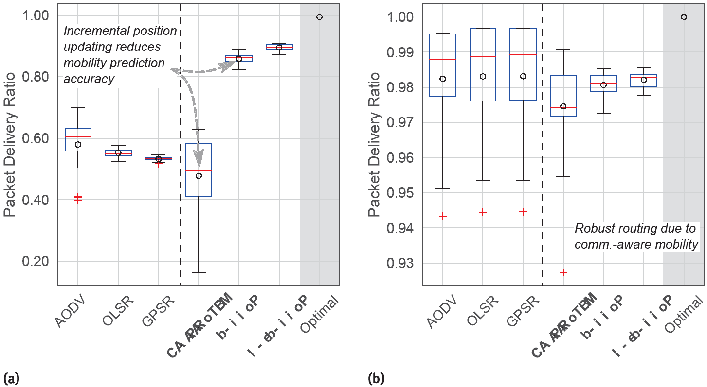

图 4.32: 应用驱动场景下实现的数据包递率。

## 4.4.7 致谢

除了 CRC 876 外，这项工作的部分内容得到了北莱茵-威斯特法伦州经济、创新、数字化和能源部在 5G.NRW 能力中心期间的支持（资助号为 005–01903–0047），以及 Plan Play 项目的支持（资助号为 505-2008-0047）。

## 4.5 使用扩展细胞自动机的混合车辆交通建模

Michael Schreckenberg

Tim Vranken

**摘要：**车辆交通是一个具有多重挑战的复杂系统。例如，公路和城市交通网络、不同最大速度的车辆类型（汽车、卡车、公共交通等）以及不同的行驶行为各自独特且强烈地影响交通流。这意味着，为了最小化拥堵数量和平均旅行时间，必须对多种不同场景下的交通进行分析、建模和仿真。

接下来，我们将介绍用于不同场景的细胞自动机模型。这些细胞自动机模型旨在微观仿真再现宏观交通现象。通过这些仿真帮助，我们能够分析、理解并预测给定场景下的交通。最后，基于预测，我们可以尝试通过微调来模拟相同的场景，以实现交通流最大化和旅行时间最小化。

为此，我们将从介绍和分析公路交通开始。在这里，我们将重点关注现实世界天气数据的应用以及它如何影响交通流。接下来，我们将调查城市交通，其中空间有限以及红绿灯和路口对城市交通流的定期中断如何导致产生新的和额外的限制。最后，将在仿真中引入通信和自动车辆。不同的反应时间、行为以及人机交互预计产生必须调查和预测的新挑战。

### 4.5.1 引言


随着道路上车辆数量的快速增长和交通拥堵的增加，车辆交通主题正受到越来越多的关注，导致平均旅行时间延长和燃料消耗增加。道路容量无法通过增加新车道来无限提高，这意味着需要研究其他增加道路容量或更高效利用道路的方法。

为了更高效地利用道路，必须更好地理解交通和拥堵。为此，我们首先将在第 4.5.2 节中分析并建模公路上的交通行为，有两个主要目标。第一个是更深入地理解堵的形成及其对交通流的影响。为此，我们将使用 `Nagel` 和 `Schreckenberg` 的模型[467]。第二个是对全球多个国家所需的非对称变道进行建模。为此，我们将使用 `Lee et al.` 提出的单道模型[379]。非对称变道意味着代理应该在外侧（右侧）车道行驶，除非超越慢车。

在分析了一些通用交通行为后，我们将观察两个更具体的问题：天气对公路容量的影响，以及实时应用中交通检测数据的缺失。

虽然这些分析允许对公路进行更好的交通预测，但城市和内部网络由于交叉流交互程度较高以及红绿灯导致的交通定期中断，情况更为复杂。因此，在第 4.5.3 节中，我们调整了 `Lee et al.` 模型以包含信号灯前和路口的行驶行为。此外，还根据杜塞尔多夫市中心的经验数据对交通流进行了分析。在那里，应用了不同的分析实时路由方法来最小化拥堵和代理的平均旅行时间。这些分析有助于识别对拥堵形成和旅行时间增加影响巨大的交通瓶颈。然而，城市和内部网络的空间通常非常有限，因此无法通过增加车道来提高这些瓶颈的容量。由于此，在后续仿真中，我们调整了其中一个瓶颈，将所选交叉处的两条车道（一条进入城市，一条离开城市）动态更改为进入或离开城市。这样，道路容量就可以根据通勤者的不断需求进行动态调整。

最后，在第 4.5.4 节中，我们模拟了包含自动驾驶车辆和人工驾驶车辆的异构交通。预计当渗透率达到`100%`时，自动驾驶车辆将减少甚至消除交通拥堵。然而，达到`100%`可能需要几十年的时间，而且由于自动驾驶车辆与人工驾驶车辆的行为不同，自动驾驶车辆在异构交通中的影响尚不明确。因此，我们调整模型来模拟自动驾驶车辆、联网自动驾驶车辆和人工驾驶车辆的不同行为。其目标是模拟三种不同类型车辆混合的异构交通，并预测这将如何影响交通流和道路通行能力。

## 4.5.2 高速交通数据聚合

高速交通流的分析可以分为两个主题。本节将分析一般交通行为和实时交通状况。为了这一点，我们首先建模并模拟交通拥堵是如何产生的，以更好地理解自由流交通是如何以及何时由于拥堵转变为非自由流的。之后，利用实证数据来创建真实的换道行为，同时考虑了德国或法国等国家所采用的非对称换道规则。

随后，将分析实时天气数据对拥堵形成和行驶速度的影响，并将结果用于提高交通流预测。实时交通预测需要实时数据，而这些数据有时由于检测器故障或通信通道中断而缺失。因此，本节的最后一部分将处理如何准确替代缺失数据。

### 4.5.2.1 交通拥堵分析

交通研究的目标通常是防止拥堵或缩短其持续时间。为此，`Bette` 等人 [59] 使用 `Nagel-Schreckenberg` 模型 [467] 分析了交通拥堵。为此，根据稳定性准则确定了自由流转变为拥堵交通的交通密度。之后，将拥堵车辆的比例分为不同的机制：拥堵率、拥堵寿命和拥堵规模。结果显示，小拥堵在很低密度下就会发生，而在较高密度下这些拥堵寿命的增加导致了交通流从自由流向拥堵交通的转变。此外，根据随机游理论推出了控制临界密度附近所有三种拥堵机制缩放的指数。

### 4.5.2.2 非对称换道规则

许多国家的换道是非对称的，因为法律规定驾驶员在不超越较慢车辆的情况下，必须在最外侧（右侧）车道行驶。这种非对称驾驶行为与没有超车限制的高速交通相比产生了多种差异。因此，研究中考虑了两个具有此类非对称规则的国家（德国和法国）的实证数据 [248]。基于这些实证数据创建并校准了一个具有非对称换道规则的多道细胞自动机模型。

该模型基于 `Lee` 等人 [379] 的单道模型，其中代理具有不同的驾驶行为和最大的减速能力。这两点结合使得模型能够重现由于行为不当导致的事故。由于这种原因，模型能够重现多种功能下的换道行为。首先，换道规则必须是安全的，这意味着与前方和后车辆的距离足够大。其次，代理应该换到内侧车道，只要距离是安全的。最后，代理必须防止在外侧车道上超越慢车辆。

在加入确保规则以防止拥堵后，模型可以很容易模拟三道公路。表 4.5：从实证数据获得的不同路面拥堵。此处`w`代表水膜度。

| 路面 | 水膜范围 `w` | 最大流量 |
| :--- | :--- | :--- |
| 干燥 | `w` ≤ 0.15 mm | 1960 veh/h |
| 潮湿 | 0.15 mm < `w` < 0.9 mm | 1720 veh/h |
| 湿润 | `w` ≥ 0.9 mm | 1320 veh/h |

### 4.5.2.3 天气数据对交通预测的影响

车辆联网数据（`xFCD`）在过去几十年中增长迅速，这种额外数据的一种可能整合方式是将天气数据引入交通预测[#backmatter-001.xhtml#b_9783110785982-007_ref_246)]。为了识别道路上的当前天气，水膜度由气象站获取。配备`xFCD`的车辆可以通过雨刷器收集这些数据。虽然这大大增加了可用数据，但由于无线频谱限制数据可能并不可靠。开发了一种高效的方法来可靠地传输数据。对轿车平均速度与水膜度的相关性分析显示，高峰时段存在高达 0.4 的负相关。这意味着将天气数据整合到交通系统中预计对通勤者有极大益处。此外，表 4.5 显示，水膜度的增加降低了交通流变得不稳定并偏离自由流的最小通行能力，这表明引入天气数据改进了交通拥堵预测。

在分析了水膜度对交通流的影响后，将新见解加入了之前讨论的 `Lee` 模型。为此，引入了一个依赖于道路水膜度`w`的额外减速参数`p(w)`。该参数值的增大增加了即使在前车距离足够远以确保速度安全的情况下代理减速的概率。图 4.33 的结果与所研究的约 6 公里高速公路段的实证数据吻良好。这表明准确的交通预测需要可靠的实时数据才能工作。然而，实证数据往往不足以确保持续的实时更新，且数据可能会缺失。这些缺失数据随后必须通过近似值来替代。

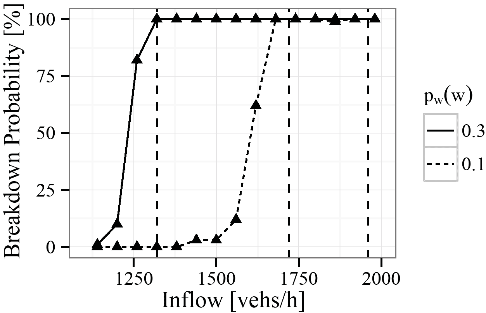

图 4.33：两种不同表面湿润程度的模拟分解概率。

#### 4.5.2.4 缺失数据的填充

此前，在指数平滑预测方法 [136] 中，交通检测器的缺失数据是通过分析该检测器的历史数据来填充的。这有两个主要的缺点。首先，理想情况下，历史数据必须是过去 30 周内所有 `D` 检测器在同一天同一时刻的数据。例如，如果一个检测器在周一 12 点停止传输其检测结果，则必须考虑过去 30 周周一 12 点的数据。这意味着，为了对缺失数据点进行准确预测，必须至少保存所有 `D` 检测器在过去 30 周内的所有数据点数据。第二个问题是，例如十周前的交通状况并不与今天相同。例如，事故或道路施工可能会将交通流从一条街道转移到另一条，从而大幅增加此类预测的误差。因此，在 [247] 中引入了一种替代缺失数据的新方法。

在这种新方法中，采用了上周周围 `N` 个检测器的 60 分钟历史数据。然后使用这些数据来训练泊松依赖网络（`PDN`） [249]（这是一种在第 4.1.2.6 节中解释的泊松模型）。该 `PDN` 显示了一个检测点的交通流数据与缺失数据检测器数据之间相关性有多强。最后，在一步中，将其他 `d` 个检测器的实时数据插入 `PDN` 以填充缺失的数据点。

为了测试该方法，获取了实证数据，并在假设其缺失的情况下对其进行了预测。然后，将实证数据与其预测值在图 4.34 中进行比较。可以看到，`PDN` 比实际数据更接近仅使用“缺失”检测器过去 `N` 周交通数据的指数平滑预测。在一天中不同时间段和不同日期的通用测试表明，`PDN` 不仅使用的历史数据更少，而且预测缺失交通数据更准确。关于交通流预测问题的更深入分析见第 4.1 节。

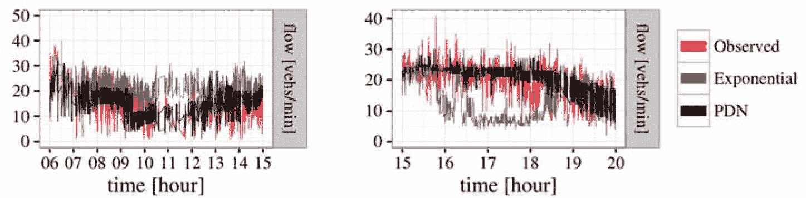

图 4.34：基于数据的示例实证数据以及指数平滑和 PDN 预测。

### 4.5.3 城市交通模拟

城市交通比高速公路交通更复杂，因为不同行驶方向车辆之间的交互更多，且有无红绿灯的路口更多。为了分析和模拟城市交通，对上一节中作为高速公路交通模拟基础的 `Lee` 等模型通过额外的规则进行了修改 [710]。

#### 4.5.3.1 细胞自动机模型

基于 `Lee` 等人 [379] 的细胞自动机进行城市交通模拟必须包含复杂情况。例如，不同的路口可能非常不同。某些路口允许左转，这意味着时间需求随交通流的增加而增加。由于代理在转弯前会减速，因此不转弯交通的时间需求已经更高。

在细胞自动机中包含这些点 [710] 后，时间需求 `t[B]` 平均为 `2.23 ± 0.04 s`。这与实证数据一致。

#### 4.5.3.2 城市交通优化

在 [709] 中，借助实证数据对城市交通进行了分析和模拟。根据交通流分析，使用了不同的路由方法通过应用实时数据来引导交通。分析显示，城市内部道路的流量不足以覆盖所有时间的需求。然而，一种旨在最大化利用道路容量而非根据旅行时间引导车辆的路由方法将显著改善交通流，并可能减少高达 23% 的平均旅行时间。根据网络容量而非旅行时间优化交通的缺点是，如果交通流低于道路容量，车辆将选择旅行时间比需要更长的道路，从而不必要地增加了燃料消耗和旅行时间。由于这些发现，开发了一种新的路由方法，该方法同时考虑了道路容量和每个代理的旅行时间。

在证明了更有效的路由方法可以减少平均旅行时间并充分利用现有道路容量后，我们测试了道路容量本身如何进行动态优化。为此，我们确定了一个进出市中心最繁忙的交叉路口之一。该路口连接了城市环路与贯穿城市的主干道。城市环路上的一条车道以及贯穿城市道路上的某条车道被改为了动态车道。由于通勤人数众多，杜塞尔多夫的进出流量在一天中不同时间非常不平衡。动态车道通过在需要的地方增加道路容量、在不需要的地方减少容量，能够缩短早晨进入城市的通勤时间，同时也减少下午离开城市所需的旅行时间。通过对单一路口进行这种动态变化，在不改变车辆目前选择路线方式的情况下，平均旅行时间减少了 10%以上。请注意，这些旅行时间的缩短并不意味着最优缩短。目标是理解网络并找到其瓶颈。如何为每辆车辆找到最优路线以减少全球平均旅行时间将在第 4.1.4 节中进行分析。那里模拟了一种应用强化学习算法的新方法，并将结果与其他方法进行了对比。

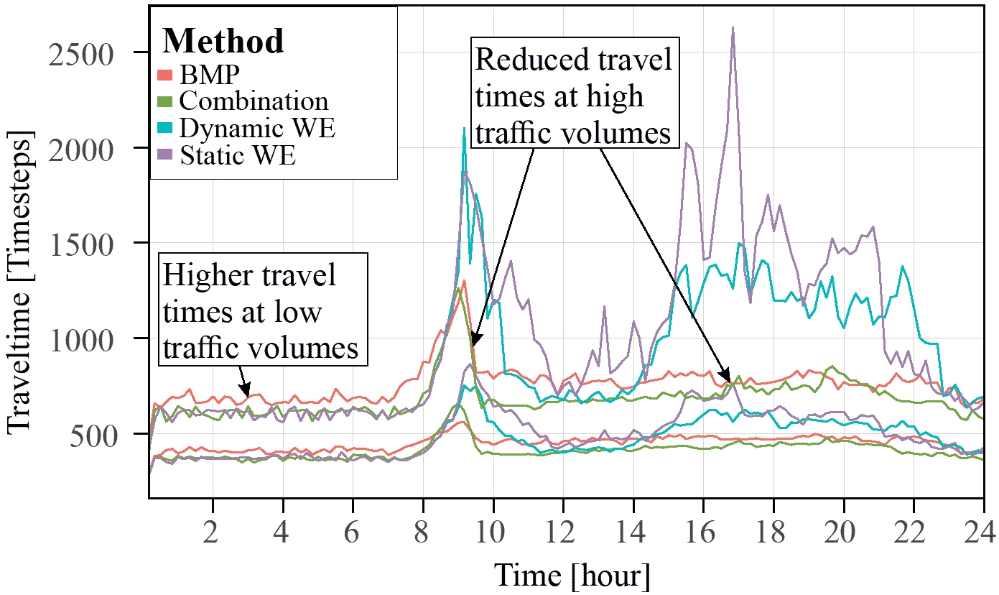

图 4.35: 不同交通分配方法的旅行时间。下方的线代表 10 分钟内的平均旅行时间，上方的线代表 95% 置信区间的上限。

### 4.5.4 自动车辆交通流

尽管动态路由和道路容量的动态调整可以减少平均旅行时间，但这并不是解决日益严重的交通拥堵问题的持久方案，因为预计在不久将来车辆数量将继续增加。相比之下，预计 100% 自动交通中的自动车辆将显著增加道路容量，缩短旅行时间、燃料消耗并减少事故。然而，目前还不清楚自动车辆将如何引入交通系统中。它们与人类驾驶车辆混合时，对异质交通中动力学的影响已被广泛讨论。由于车辆的平均寿命约为十年，交通在未来几十年内将一直是异质的 [42]。

为了预测异质交通行为，在 [708] 中引入了一种新的细胞自动机模型。细胞自动机自动车辆交通面临的挑战之一是，自动车辆（`AVs`）和联网式自动车辆（`CAVs`）的反应时间比人类驾驶车辆（`HVs`）短。对于`CAVs`，这种反应时间可能低到通信所需的时间，目前约为 0.1 s，但随着`5G`的出现可能会更低，预计`5G`将成为未来联网自动车辆的重要方法。目前，通信并不总是花费固定长度，而是取决于有限的可用无线频谱。如果使用全频谱，取决于通信手段，通信时间可能比 0.1 s 长得多。关于通信问题及其实现的深度分析在第 5.2 节中给出。在本节的剩余部分，我们将假设通信是稳定的，通信时间为 0.1 s。因此，使用细胞自动机模型模拟`AVs`或`CAVs`的第一是将模型的时间步长度缩短为每个时间步 0.1 s。

#### 4.5.4.1 缩短时间步长度

在 [708] 引入的细胞自动机模型基于 `Pottmeier` 等人 [508] 的 `Lee` 模型的无事故版本 [379]。该模型中的人类驾驶车辆代理可以乐观或悲观地判断自己的处境。如果他们乐观地判断，他们就不预期前车会剧烈减速（只是拖延）。在这种情况下，他们可以以小于最小安全距离距离跟随前车，这在实证数据中经常发现。如果他们悲观地判断处境，他们预计前车随时减速。他们不会按照最小安全距离跟随，而是根据速度应用额外的安全距离。

新引入的模型在保持`HVs`平均反应时间为 1 秒的同时，具有 0.1 s 的步长并复制了这种行为。为此，对安全速度、拖延和处境判断进行了多次修改。然而，图 4.36 显示，在 [708] 中提出的 0.1 s 步长模型仍然能够复制真实的人类驾驶交通，其结果与 `Lee` 等人 [379] 提出的模型以及 `Pottmeier` 等人的改进版本 [508] 相比，后者均已知能够很好地复制实证交通。可以看出，三个模型之间的主要区别出现在密度为 $20 - 45\text{辆}/\text{km}$ 的所谓的同步交通阶段 [317]。`Pottmeier` 等人对 `Lee` 模型的修改仅在处境判断的计算上与 `Lee` 模型不同。该模型中的代理不太可能乐观，这防止了事故，但也增加了平均跟车时间，从而减少了流量。缩短的时间步也使用了这种抑制的乐观，导致初始流量低于 `Lee` 模型。然而，由于对拖延的调整，0.1 s 步长模型的速度分布更加均匀，这增强了同步性并在交通阶段结束时增加了流量。

总的来说，三个模型之间的差异小于实证交通中观察到的波动，它们都能够复制真实的交通流。

#### 4.5.4.2 异质自动车辆交通

`AV`（自动驾驶车辆）和 `CAV`（联网自动驾驶车辆）与 `HV`（人类驾驶车辆）相比有多个不同。它们最重要的三个区别是反应时间、拖延和行为计算。`AV` 的反应时间为 `0.5 s`，而 `CAV` 至少为 `0.1 s`，相比之下 `HV` 为 `1 s`。`CAV` 和 `AV` 均完全不会拖延，而 `HV` 拖延的概率高达 37% [379]。最后，`CAV` 和 `AV` 不会对自身状况进行乐观或悲观的判断，相反，它们始终保持至少最小安全距离跟随领先车辆。如果领先车辆是人类驾驶的，它们将以大于最小安全距离的距离跟随，以便应对不可预测的人类行为，而不会产生强烈的减速波。

这些 `AV`、`CAV` 和 `HV` 之间的差异在模拟异质交通流之前，就已经定义并包含在模型 [708] 中了。仿真结果如图 4.37 所示，以及理论预测的异质交通容量增加 [215]。可以发现，与同质人类驾驶相比，自动驾驶车辆交通预计将提高交通容量。对于联网自动车辆，这种效果更为显著。反应时间的缩短意味着最小安全距离（以及平均车辆跟随时间）更短，从而在相似密度下允许更高的交通流量。此外，反应时间的缩短也意味着这些自动代理对人类的拖延反应较少，从而减少了减速波。由于它们不应用乐观或悲观的行为状态，这种效应得到了加强。如果一个 `HV` 代理将其行为从乐观变为悲观，即使速度不变，它也需要与领先车辆保持更大的距离。这意味着该代理必须比 `AV` 或 `CAV` 减速更多，因为它们只需与领先车辆相同程度地减速即可保持相同的距离。

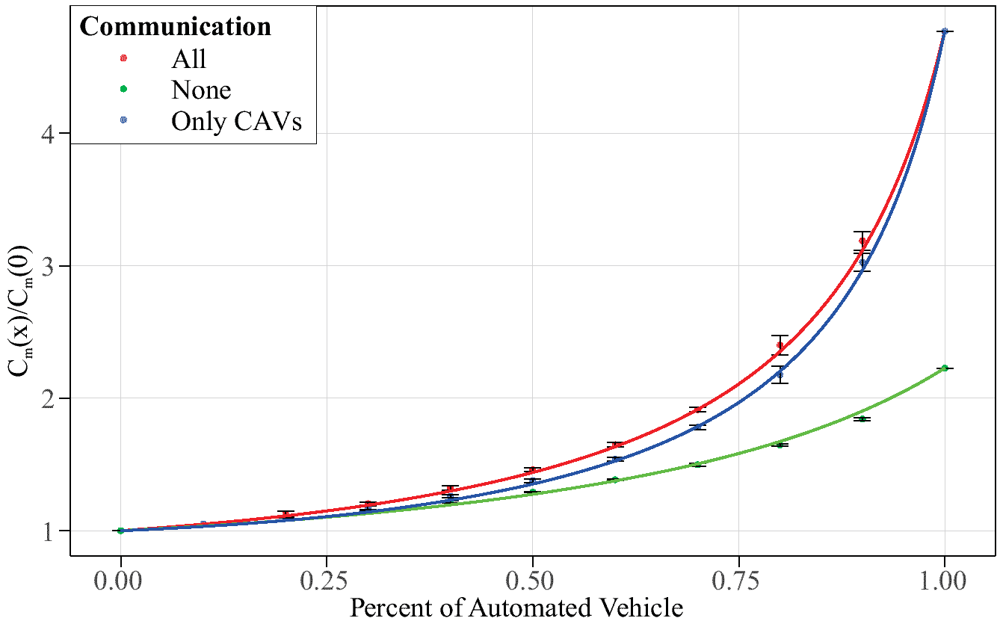

图 4.37: 道路容量较同质人类驾驶车辆交通的增加取决于自动车辆或联网自动车辆的比例。

然而，尽管这些结果显示在每种异质交通情况下与纯人类驾驶交通相比，道路容量都得到了提高，但模型也能重现由于人机交互导致的追尾碰撞风险增加。如果人类司机乐观地判断交通状况，且预计在未来几秒内不需要减速，他们倾向于以小于最小安全的距离行驶。此前，当他们跟随另一个 `HV` 代理甚至 `AV` 代理时，该代理使用的剩余安全距离仅足以在交通状况突然变化时防止事故。现在，由于 `CAV` 的反应时间仅为平均人类所需的十分分之一，减速中的 `CAV` 与后续 `HV` 之间的速度差比以前大得多，以至于一旦代理做出反应，后续 `HV` 就无法防止事故。

这表明 `HV` 和 `CAV` 的不同行为具有增加后事故风险的潜力。然而，图 4.37 所示的结果是在通过改变 `CAV` 行为防止这种事故风险后模拟的。如果 `HV` 代理 `n` 以小于最小安全的距离跟随 `CAV` 代理 `n + 1`，则 `CAV` 代理会增加与领先代理 `n + 2` 之间的距离。这样，如果代理 `n + 2` 减速，代理 `n` 就可以对 `n+2` 的刹车灯做出反应。

在本节中，我们强调了对高速公路、城市地区以及自动与传统车辆混合的异质交通中流量的不同分析。这些分析的主要目标是更好地理解和预测交通。此外，`Lee` 等引入的现有元胞自动机车辆模型 [379] 经过多次修改。

我们能够证明交通拥堵在很低的密度下就会形成，而且持续时间的增加会导致从自由流到拥堵交通的转变。虽然自由流的临界密度可以转换为拥堵交通，但其他工作也表明这种临界密度不是固定的，是可以变化的。在高速公路上，雨水的局部天气（通过水膜厚度测量）被确定为影响流量的重要因素，而城市交通主要由交通灯主导。这两个问题都通过使用真实数据以及改进的 `Lee` 模型仿真进行了分析。

## 4.6 用于路面监测的嵌入式众感知及其激励机制

*Maximillian Machado*

*Ran Ran*

*Liang Cheng*

**摘要：** 由于其的普及性和便利性，众感知被认为是一种收集特定数据的有效方法。本节综述了利用嵌入式众感知收集路面状况数据的项目，并描述了众感知平台如何利用智能手机拍摄的图像通过深度神经网络进行道路损坏检测。在进行此类讨论之前，我们探索了如何激励用户参与低平台成本的众感知任务。我们的研究对路面众感知问题进行了建模，并基于平台驱动的贪心算法设计了新的激励机制。通过大量的仿真，在平台成本和总体任务完成时间的不同场景下对激励机制的性能进行了评估和比较。与反向拍卖激励机制相比，最好的机制可以将总完成时间减少一半。我们通过对未来工作的讨论结束了这项贡献。

### 4.6.1 引言


随着道路基础设施规模和复杂性的增加，必须开发创新解决方案来应对道路退化问题。使用目前收集道路状况信息的方法，要覆盖美国 418 万英里的道路 [555] 是一项艰巨的任务。一种可行的解决方案是创建一个众包感知平台，让智能手机用户收集道路路面数据。在这种情况下，用户可以使用嵌入式摄像头、加速度计和 4G/5G 网络自动检测并报告糟糕的道路状况。然而，这样的网络需要活跃的用户基础以及维持众包参与的手段。因此，众包感知方案必须设计激励结构以维持用户的持续活动。众包感知平台利用激励机制来激励用户参与、产生多样化的数据池并生成高质量信息。

在本节的后半部分，我们将正式将激励机制表达为众包感知平台的关键组件之一。在本节设计的机制通过实验程序进行评估，并根据分配给传感任务的奖励分配而异。理想的机制是在完成传感任务时既表现出较低的`platform cost`（平台成本）又表现出较低的`total operation time`（总运行时间）。注意，这些标准并不是衡量激励机制效的唯一指标。然而，`platform cost`和`total operation time`指标足以为所提出的众包感知问题提供解决方案框架。

我们的众包感知平台通过九种独特的激励机制进行参数化，旨在考虑经济可行性的基础上，收集固定区域不同百分比的路面状况数据。所有机制都基于一种平台驱动的贪心算法，该算法激励用户选择能够为参与者提供最高净利润率的传感任务。九种激励机制中有八种在本节中被唯一定义，另一种激励机制则源于近期众包感知文献中的相关工作。我们的结果为在不同的路面众包感知设置下选择最佳激励机制提供了指导。

以下是本节的主要贡献：

- 我们设计的激励机制可以有效避免成本爆炸问题，因为用户在开始工作之前会选择好自己的传感任务。因此，传感任务一次只能由一个参与者承诺。对于需要重新检查的传感任务案例（可能是由于读数不佳），可以通过建模重复传感任务来解决。
- 我们的机制使用户能够根据贪心算法选择净利润率最高的传感任务。
- 与任务反向拍卖激励机制相比，我们方法的总运行时间有所缩短。结果强调了这一观点，并为有限预算内目标区域的众包提供了解决方案。

本讨论的其余部分组织如下：综述相关工作，介绍研究问题及其模型，提出我们的激励机制解决方案，构建仿真以评估激励机制，讨论评估结果，考虑增强机器学习技术，并用最终陈述总结。

## 4.6.2 激励机制

### 4.6.2.1 现有的货币激励机制

`Zhang` [763] 和 `Jaimes` [299] 都根据激励类型对激励机制进行了分类。在 `Jaimes` [299] 中，比较了货币激励和非货币激励。非货币机制 [158, 166] 依赖于用户由于内在动机而持续参与。货币机制 [15, 347, 356, 380, 381, 735, 743, 762, 766] 依赖于法定货币的直接支持或通过替代货币对法定货币的间接支持。根据综述论文 [763]，货币激励比非货币激励更能激励用户完成传感任务。因此，货币机制更适合众包感知，我们将在讨论中考虑。然而，选择正确的货币激励机制面临着额外的挑战。

在决定使用哪种货币机制时，必须定义最适合众包感知方案的优化标准。此类标准的示例包括经济可行性、区域覆盖率、数据质量、公平性和持续时间。创建一个优化一个或多个此类类别的平台并非易事，因为众包感知方案的典型问题框架涉及到指数时间复杂度问题或典型的博弈论模型挑战。在经济可行性方面，必须仔细设计平台，以免让用户对服务价格过过控制权。这被称为成本爆炸问题，是考虑适当货币机制时必须解决的许多挑战之一。以下三种货币激励机制是针对各种众包方案的研究良好的解决方案。

- 任务反向拍卖激励机制 [738, 762, 766] 允许一组用户对平台发布的任务集进行竞标。每个出价都代表完成任务的承诺，只要平台向用户支付费用。自然地，出价最低的用户将赢得执行机会。
- 在数据反向拍卖激励机制的情况下 [356, 381]，一组用户为已发布的任务竞标他们的传感数据。然后平台选择符合标准的数据并向用户支付出价。
- 以平台为中心模型 [743] 将众包感知问题视为斯塔尔伯格博弈。任务奖励不断改变，直到平台和用户达到纳什均衡。

### 4.6.2.2 三种典型激励机制的检验

大多数现有的激励机制属于博弈论模型。在本小节中，我们将检验上述三种机制。

任务反向拍卖方法 [738, 762, 766] 的主要问题在于，由于不诚实的竞价，拍卖模式并不总是选择最近的用户来完成传感任务 [766]。在这种情况下，远离传感任务的用户可能会赢得拍卖。更远的距离会导致用户的旅行时间更长。因此，任务反向拍卖机制完成所有传感任务所需的时间比我们的机制更长。

对于数据反向拍卖激励机制 [356, 381]，当多个用户为同一个传感任务收集数据时，平台只能接受一个用户的数据。也就是说，其他用户的数据被浪费了。结果是这种激励机制增加了燃油、个人空闲时间等成本。对于我们的激励机制，用户可以在去收集数据之前选择传感任务。因此，可以避免成本爆炸问题。

以平台为中心的模型 [743] 假设平台预算没有上限。因此，它可以找到一个最优解决方案，为平台提供可用最高质量的数据。在实践中，平台通常预算有限，可能无法获得博弈论均衡奖励。我们的激励机制提供了启发式算法，以便在更紧的预算限制下获取数据，并被认为与在线众包方案更具一致性。

## 4.6.3 激励机制研究问题及其模型

对于我们的研究问题，平台需要激励用户在预算和目标区域限制内收集路面数据。在这种情况下，我们的研究目标是设计一种适当的激励机制，帮助平台以较低的成本和总运行时间实现区域覆盖目标。根据激励机制的比较结果，平台可以为不同的区域覆盖目标选择预算最低的最优激励机制。

我们的研究问题模型包含三个实体：环境、感知任务和用户。每个实体都可以通过其行为和/或与其他实体的关系来描述：

- 基于曼哈顿模型的环境实体；泛而言，它是激励机制研究中的单元格网。该网格跨越相邻单元格的成本分布均匀，且内部没有缺失的单元格。环境代表了用户可能遇到的道路类型，以及在不同路面条件下旅行的变动成本。最后，用户实体在每个单位时间内只能移动到一个正交单元格；用户不能沿对角线移动。
- 感知任务实体包含感兴趣区域的信息以及与用户参与相关的货币激励。感知任务指定了需要路面感知的道路。
- 用户实体代表参与众包方案的用户。随着用户继续收集并报告数据以获得奖励，他们会积累货币奖励并承担运营成本。

## 4.6.4 激励机制解决方案

在设计用于部署和测试激励机制的众包框架时，模块化和扩展性是关键特性。如果没有这些特性，很难更换激励机制并对其进行评估。我们的众包平台和激励机制设计受到本节描述的评估指标的指导。

### 4.6.4.1 符号说明

我们在报告中使用的符号所示表 4.6。模型中的两个重要变量是`s[j]`和`u[i]`。它们代表感知任务和用户的识别码。任务`s[j]`和用户`u[i]`分别具有属性`<u[i]`, `R[ij]`, `x[j]`, `y[j]>`和`<s[j]`, `a[i]`, `C[ij]`, `x[i]`, `y[i]>`。对于用户，如果`s[j]`为 0 或 -1，则用户当前未参与，因为用户未选择感知任务或已退出。对于感知任务，如果`u[i]`为 0，则感知任务尚未分配给用户。此外，如果感知任务的奖励等于 0，则其奖励已被领取。

表 4.6：常见符号。

| 符号 | 含义 |
| --- | --- |
| `a[i]` | 用户`u[i]`的累积奖励 |
| `Avg[j]` | 任务`s[j]`到所有用户的平均距离 |
| `B` | 平台的预算 |
| `BR` | 基础奖励 |
| `b` | 网格的边长 |
| `C[ij]` | `u[i]`完成`s[j]`的旅行成本 |
| `CR` | 提供最大利润 MP 的任务奖励 |
| `d[j],[uc]` | `s[j]`到`uc`的距离 |
| `d[j],[tc]` | `s[j]`到`tc`的距离 |
| `IM` | 激励机制 |
| `k[i]` | `u[i]`的排名 |
| `MP` | 用户`u[i]`的最大利润 |
| `NPM` | 净利润率 |
| `P` | 区域覆盖百分比 |
| `P[ij]` | 用户`u[i]`感知任务`s[j]`的利润 |
| `PC` | 平台成本 |
| `R[ij]` | 用户`u[i]`感知任务`s[j]`的奖励 |
| `(S) s[j]` | （集合）感知任务/ID |
| `S[a]` | 可用任务集 |
| `SID` | 用户`u[i]`选择的任务索引 |
| `s[r]` | 试验成功率 |
| `T` | 净利润率的阈值 |
| `tc` | 感知任务的位置中心 |
| `t[f]` | 总运行时间 |
| `(U) u[i]` | （集合）用户 |
| `uc` | 位置中心 |
| `x[i]` | x 坐标 |
| `y[i]` | y-坐标 |

### 4.6.4.2 评估指标

评估指标的目的是区分不同的激励机制。激励机制的仿真包含大量的试验。在每次试验中，我们初始化任务和用户。

- 总运行时间`t[f]`代表试验持续时间。
- 平台成本`PC`是平台支付给用户的金额。剩余`surplus`是未使用的预算部分。这反映了激励机制降低成本的能力。

```
PC = B - surplus
```

### 4.6.4.3 平台驱动贪心算法

我们用于设计激励机制的平台驱动贪心算法如算法 4 所示。该算法的思想是选择为用户提供最大利润的任务。因此，该平台驱动贪心算法通过公式 4.13 计算任务`s[j]`对用户`u[i]`的收益。

```
P[ij] = R[ij] - C[ij]
```

其中`R[ij]`由激励机制决定。我们将在下一节中详细描述`R[ij]`。在该算法找到为用户`u[i]`提供最大利润的任务`s[i]`后，用户`u[i]`需要检查任务`s[i]`的净利润率是否大于阈值`T`。如果为正，用户`u[i]`选择该任务；否则，用户`u[i]`退出。

## 4.6.5 激励机制

我们将九种独特的激励机制，每种都有独特的特性。反向拍卖（TRA）激励机制已在文献 [738, 762, 766] 中讨论。已知在不诚实报价的情况下，反向拍卖激励机制无法保证在较短的总运行时间内完成所有任务 [766]。我们的激励机制设计目标是减少总运行时间。因此，我们将在第六节中比较它们的总运行时间。其他八种激励机制描述如下。

### 算法 4：平台驱动贪心算法

**输入：** `u[i]`, `S[a]`, `T` 其中 `u[i]` =< `s[j]` , `a[i]` , `C[ij]` , `x[i]` , `y[i]` >

**输出：** 更新后的 `u[i]` .*s[j]*

```text
if S[a] == ∅ then
  u[i] .*s[j] = −1; // user u[i] drops out as no task is available
  return;
end
MP = −∞, CR = −∞;
for s[j] in S[a] do
  P[ij] = R[ij] − C[ij];
  if P[ij] ≥ MP then
    MP = P[ij];
    CR = R[ij];
    s = s[j];
  end
end
if u[i] .*a[i] == 0 then
  $NPM = 100 \times \frac{MP + CR}{CR};$
else
  $NPM = 100 \times \frac{MP + u_{i} \cdot a_{i}}{u_{i} \cdot a_{i}};$
end
if NPM < T then
  u[i] .*s[j] = −1 // u[i] drops out as no task gives ample profit;
  return;
end
u[i] .*a[i] = u[i] .*a[i] + CR;
u[i] .*s[j] = s;
return;
```

### 静态均匀 (SU) 激励机制

在静态均匀激励机制中，感知任务的激励是均匀分布的固定值，其值由公式 4.14 计算得出为`R[ij]`。在这种情况下，`R[ij]`被设置为基础奖励`BR`。

(4.14) $R_{ij} = \frac{B}{\left| S \right|} = BR\left( 4.14 \right)$

### 动态相对 (DR) 激励机制

激励根据当前当前不可用用户的距离以及用户`u[i]`到感知任务`s[j]`的距离来改变其值`R[ij]`。该激励机制按照当前不可用用户和用户`u[i]`到感知任务`s[j]`的距离从小到大进行排序。然后，感知任务`s[j]`的激励值可以通过公式 4.15 计算。

(4.15) $R_{ij} = \left\{ \begin{matrix} {BR, k_{i} = 1} \\ {BR\left( 1 - \frac{1}{2}\frac{k_{i}}{\left| U \right|}} \right), k_{i} \geq 2} \\ \end{matrix} \right.\left( 4.15 \right) $

### 动态/静态用户中心 (DUC/SUC) 激励机制

首先，通过公式 4.16 计算用户位置中心。然后，我们使用公式 4.17 计算从任务`s`到用户中心的距离`d[s,uc]`。值`R[ij]`与距离成反比，如公式 4.18 所示。

- 静态情况：感知任务的奖励只在每次实验开始时计算一次。
- 动态情况：与静态情况类似，但每当用户准备选择感知任务时，计算就会重复。

(4.16) $\left( {x_{uc},y_{uc}} \right) = \left( \frac{\sum_{i \in U}x_{i}}{\left| U \right|},\frac{\sum_{i \in U}y_{i}}{\left| U \right|}} \right)\left( 4.16 \right)$

(4.17) $d[s,uc] = |x[s]-x[uc]| + |y[s]-y[uc]|$

(4.18) $R_{ij} = BR\left( 1 - \frac{1}{2}\frac{d_{s,uc}}{2} \right)\left( 4.18 \right)$

### 动态/静态任务中心 (DTC/STC) 激励机制

该机制通过公式 4.19 计算感知任务的位置中心，即`tc`。然后它通过公式 4.20 计算从感知任务`s`到感知任务中心的距离`d[s,tc]`。最后，它通过公式 4.21 导出值`R[ij]`，该值与距离成反比。

- 静态情况：感知任务的奖励只在每次实验开始时计算一次。
- 动态情况：与静态情况类似，但每当用户准备选择感知任务时，计算就会重复。

(4.19) $\left( {x_{tc},y_{tc}} \right) = \left( \frac{\sum_{s \in S}x_{s}}{\left| S \right|},\frac{\sum_{s \in S}y_{s}}{\left| S \right|}} \right)\left( 4.19 \right)$

(4.20) $d[s,tc] = |x[s]-x[tc]| + |y[s]-y[tc]|$

(4.21) $R_{ij} = BR\left( 1 - \frac{1}{2}\frac{d_{s,tc}}{2} \right)\left( 4.21 \right)$

### 动态/静态池 (DPIT/SPIT) 激励机制

在这种基于池的激励机制中，我们使用所有用户的坐标通过公式 4.22 计算到感知任务`s`的平均距离。然后，我们通过公式 4.23 计算感知任务`s`的激励`R[ij]`。

- 静态情况：感知任务的奖励只在每次实验开始时计算一次。
- 动态情况：每当用户准备选择感知任务时，我们需要重新计算激励。

(4.22) $avg_{s} = \frac{\sum_{i}\left( |x_{s} - x_{i}| + |y_{s} - y_{i}| \right)}{\left| U \right|}\left( 4.22 \right)$

(4.23) $R_{ij} = \frac{BR}{2}\left( 1 + \frac{avg_{s}}{2} \right)\left( 4.23 \right)$

## 4.6.6 激励机制仿真

本节描述了用于激励机制性能研究的仿真参数和过程。

### 4.6.6.1 参数

每次实验的参数元组为`<B`, `P`, `IM` >。仿真结束后，评估指标元组`<t[f]`, `PC` > 将取平均值。在我们的仿真中，时间和货币单位分别为。以下是实验参数描述：

- 预算`B`代表允许在实验中使用使用的金额。在此项实验中，我们在`B ∈ [100.00, 1090.00]`范围内收集了 100 个数据点，间隔为 10.00。
- 面积覆盖率`P`代表需要感知数据的百分比。与预算一样，进行了 100 次实验，使得`P ∈ [20.0%, 79.4 %]`，间隔为 0.6%。该区间涵盖了广泛的可能目标百分比。注意我们在计算任务数量时对面积百分比进行了向下取整。
- 最后一个参数是实验中使用的激励机制`IM`。不同的`IM`计算奖励的方式不同。

### 4.6.6.2 仿真执行

给定`<B`, `P`, `IM` >，构建阶段按以下顺序初始化单元格、用户和感知任务的数量：

- 对于每个单元格，清除对用户或感知任务的所有引用。
- 对于所有用户，初始化`s[j]`, `a[i]`, `C[ij]`, `x[i]`和`y[i]`。`s[j]`设置为 0。每个用户将随机放置在单元格中且重叠。
- 对于所有感知任务，初始化`u[i]`, `R[ij]`, `x[j]`和`y[j]`。`u[i]`设置为 0。每个感知任务将随机放置在单元格中，且感知任务之间不重叠。


在执行阶段，可用用户通过根据算法 4 选择并承诺感知任务来开始他们的轮回合。然后，用户将更新其`s[j]`。相应地，与感知任务`s[j]`关联的用户信息将进行更新，以反映用户`u[i]`现在正在执行任务`s[j]`。如果未找到合适的感知任务，则该用户将在未来所有的轮回合中退出实验。不可用用户是指尚未退出且通过向其感知任务移动来完成轮回合的用户。如果用户落在感知任务上，则`a[i]`增加`R[ij]`。如果用户不在感知任务上，则用户必须等待另一个回合以移动得更近。在这两种情况下，`C[ij]`、`x[i]`和`y[i]`都会更新，以反映当前用户的位置。

### 4.6.7 激励机制评估结果

在三种场景下对激励机制进行评估和比较，这三种场景对应于不同用户数量下路面众感知的低、中、高区域覆盖率。平台成本用于根据其性能数据对激励机制进行排序，如图所示。图中显示的最小预算是实现目标区域覆盖率 100% 成功率的最低预算。这意味着任何高于此值的预算都允许平台实现目标区域覆盖的 100% 成功率。

#### 4.6.7.1 平台成本比较

在本节中，我们从平台成本的角度讨论激励机制的比较。

- 给定 25% 的区域覆盖率，图 4.38 显示，当平台分别有 3 个和 15 个用户时，SU 和 DR 激励机制具有最低的平台成本。此外，静态和动态坑位激励机制在所有场景中始终排在激励机制的前三。
- 给定 50% 的区域覆盖率，图 4.39 显示，静态和动态坑位激励机制在所有场景下仍然具有最佳的平台成本性能。尽管 DTC 激励机制在`45 用户的 50%区域覆盖率`中实现了最低的平台成本，但这一观察与之前的陈述并不冲突。
- 给定 75% 的区域覆盖率，图 4.40 显示，无论平台有多少个用户，SPIT 和 DPIT 始终具有最低的平台成本。

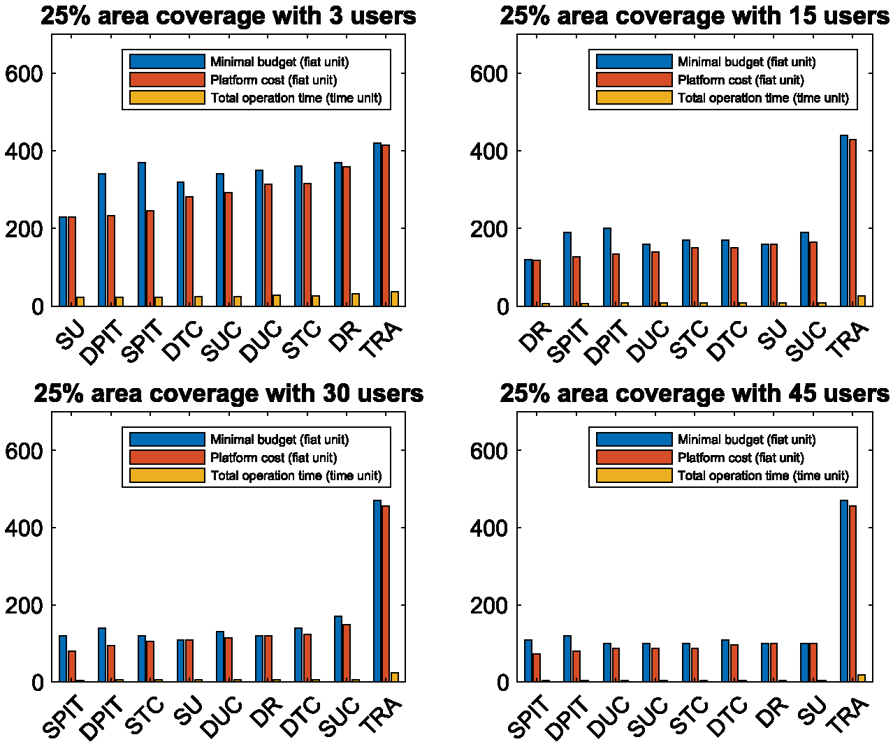

图 4.38: 激励机制比较：25% 区域覆盖。

基于上述观察，我们可以得出结论 SPIT 和 DPIT 是平台成本最低的两种激励机制。

#### 4.6.7.2 总运行时间

在本小节中，我们从总运行时间的角度讨论激励机制的比较。从图 4.38、4.39 以及 4.40 可以看出，无论平台有多少个用户，反向拍卖激励机制的总运行时间几乎是我们的两倍。此外，反向拍卖激励机制运行时间在用户数量增加时会变长。

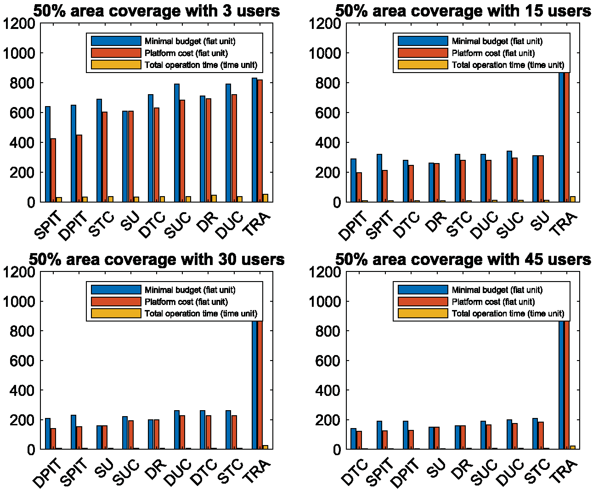

图 4.39: 激励机制比较：50% 区域覆盖。

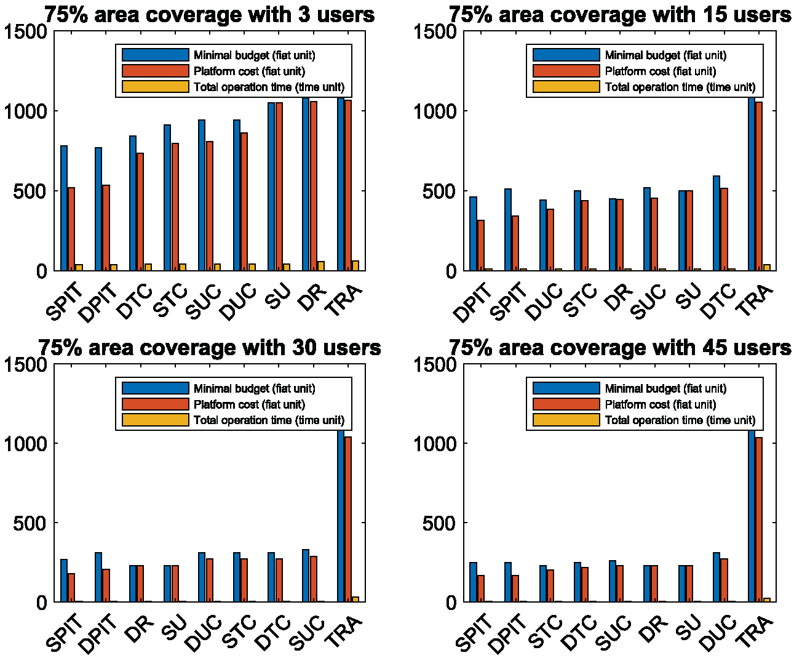

### 4.6.8 机器学习增强

基于计算机视觉，机器学习可以应用于路面损伤。例如，我们使用了机器学习模型，因为它“在手机上的推理时间为 1.5s 且召回率和准确率大于 75%”。这种模型识别的类型包括：(i) 纵向裂缝，ii) 纵向裂缝，iii) 纵向裂缝，iv) 龟网状裂缝，v) 车辙变形，vi) 坑洞，vii) 白线模糊，viii) 斑马线。

此外，机器学习已应用于众感应用。例如，神经网络和聚类算法用于用户分组，由此产生的激励机制可以减少社交成本、溢支付率和分组时间。在接下来的章节中，我们将讨论机器学习增强的通用考虑、监督学习和无监督学习。

#### 4.6.8.1 通用考虑

近年来，我们见证了机器学习及其应用的巨大进步。充分利用这些技术的全部潜力（包括其衍生技术）将是未来的目标。这些令人兴奋的想法激励我们在众感框架内引入不同的机器学习算法，我们的讨论也不例外。众感方案可以通过监督和无监督学习进行增强。

- 监督学习侧重于将输入数据映射到目标类别。通常输入数据从需要对特定数据点进行分类的数据集中采样。常见的监督学习任务是图像识别。例如，可以使用卷积神经网络接收图像形式的输入数据并产生区分道路状况的字符串输出。
- 无监督学习侧重于对数据集进行聚类以揭示嵌入类。这些类嵌入可以揭示子集并有助于发现内在关系。常见的无监督学习任务是降维。在这种情况下，我们可能考虑具有大量特征的数据集。使用谱聚类等聚类算法，我们可能减少表征数据点所需的主要特征。换句话说，我们可能只需要数据集的一个真子集就可以表示数据点的分组。这些变换可能导致数据的无损分解。因此，我们可以减少监督学习任务的内存压力。

#### 4.6.8.2 预测预算的监督学习

本文所涵盖的所有工作中，一个明显的缺点是预测预算的问题。只有在预算经过系统性选择的情况下，让激励机制在有限预算内运行才是合理的。在这种情况下，显而见地建立了一个监督学习问题。可以通过对仿真参数进行分类或对用户成本进行预测来确定预测预算。在第一种情况下，输入数据将包括基础仿真参数（如用户数量和区域覆盖率），输出将是预测预算。在第二种情况下，仿真将提供一个初始状态（包括用户坐标和感知任务）作为输入，并根据整体运行成本计算最终的面板统计数据。运行成本将与预测预算相关。在上述两种情况下，之前的仿真都可以作为构建这些模型所需的数据。

### 4.6.8.3 用于激励机制的无监督学习

尽管本文研究的不同激励机制在完成感知任务方面表现出不同程度的有效性，但众包感知应用中一个感兴趣的问题是：如果激励措施遵循非均匀或随机分布，它们的性能将会会有种不同。可以将众包感知方案的环境建模为离散的正态分布，感知任务可能会在不同的区域内聚集。这种场景在农村地区是真实的，因为社区之间可能稀疏，但在某些质心周围却密集。所涵盖的激励机制需要一个新的组件，以便在跨聚类社区之间有效扩展激励。聚类算法可以确定感知任务簇的质心，并为无监督学习任务计算相对于这些区域的奖励。在这种情况下，只要资源充足，激励机制就可以扩展到任何规模的环境。

### 4.6.9 结论与未来工作

在这项贡献中，我们提出了八种基于平台驱动贪心算法的激励机制，以帮助众包感知平台激励用户收集路况数据。由于我们的激励机制允许用户在开始收集数据之前根据平台驱动的贪心算法选择感知任务，因此它们可以避免在数据反向拍卖激励机制中观察到的成本爆炸问题。从仿真结果来看，我们发现`SPIT`和`DPIT`是成本最低的激励机制。与任务反向拍卖激励机制相比，我们的激励机制将总运行时间减少了一半。我们未来的研究包括通过扩展原型路面众包感知系统进行大规模仿真和现实实验。最后，我们讨论了用于嵌入式众包感知应用的机器学习增强以及不同的激励机制。

### 4.6.10 致谢

本节内容反映了作者的观点，作者对此处陈述的事实和信息的准确性负责。本文的传播是为了信息交流。该项目由美国交通部大学交通中心计划计划部分或全额资助。然而，美国政府对其内容或其使用不承担任何责任。这项工作得到了多模态交通基础设施综合资产管理中心 (`CIAMTIS`) 的资助，该中心是美国交通部属的一个大学交通中心，联邦资助编号为`69A3551847103`，以及宾夕法尼亚州`PITA`计划的支持。作者对这些支持表示感谢。

## Notes

# 5 通信网络

## 5.1 免授权频谱下 IoT 网络的容量分析

Stefan Böcker

Christian Arendt

Christian Wietfeld

**摘要：** 持续的数字化和分布式设备以及物联网（`IoT`）数量的稳步增长意味着需求的巨大增长。与此同时，可用频谱的数量保持不变。在这方面，目前的 5G 网络已经旨在实现大规模连接，海量机器类通信（`mMTC`）实现了每公里 1,000,000 个用户的宏伟目标。在典型的蜂窝技术中，有一种全面的解决方案，能够实现独立于授权运营商的简单、高成本效益的网络。

在此背景下，分析了低功耗广域网（`LPWAN`）作为免授权频额外技术选项的潜力。具体而言，这项工作旨在分析`LoRaWAN`对于 5G 大规模部署需求的适用性。性能评估表明，即使在小区数量较少的情况下，通信范围也可以达到数千公里。

为了进一步提高 LPWAN 系统的可靠性（特别是对于关键业务），讨论了增加频谱效率的不同方法。除了纯基于调度的方法外，还提出了对频谱功率密度的数据驱动分析，以预测并避免与技术无关的干扰。这用于通过集中推导出通信配置来增加 LPWAN 系统的稳健性。

除了智能调度数据，提高效率的另一种方法是减少最初需要传输的数据。如今，由蜂窝物联网（`CIoT`）和 LPWAN 技术支持的第一代连接 IoT 和应用被刻意保持简单，并基于等距的规则通信间隔。相比之下，我们展示了一种基于人工智能（`AI`）的模型预测通信方法，该方法利用了关于传感器系统底层数据的知识。使用自回归整合移动平均（`ARIMA`）模型来描述应用传感器数据的行为，仅对偏离模型的值进行传输。

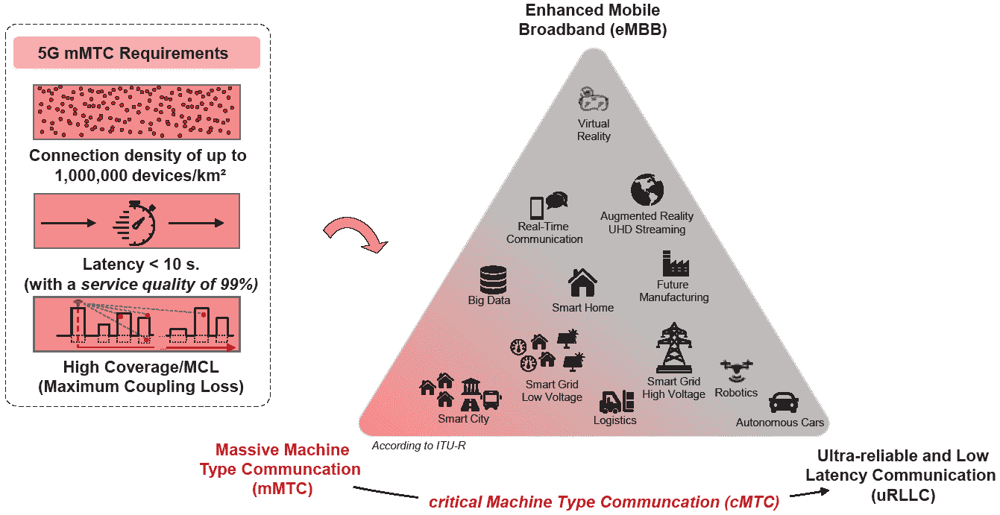

图 5.1: 实现 IoT 环境的 5G 可扩展性目标

### 5.1.1 引言

无线连接已成为日常生活中无处不在的一部分。虽然无线网络最初是为了连接人而，但蜂窝网络已演变为实现机器间通信（`M2M`）。在广泛的应用领域中，如智慧城市、能源系统或生产和物流，设备之间相互连接，以实现无需人工干预的完全自主运行。在此背景下，5G 规范定义了一个`mMTC`需求配置文件，旨在每平方公里 100 万用户的宏伟可扩展性目标，同时保持 10 秒的最长延迟（见图 5.1）。同时，该可扩展性目标与边界条件相关，该条件考虑了对于负载为 32 B 的非满缓冲系统的预定义泊松到达过程流量模式。

虽然第 4.3 节展示了 NB-IoT 技术作为解决 5G mMTC 要求的当前 3GPP 解决方案的性能评估，但本文的研究涵盖了识别在免授权频段内运行的互补技术的挑战，以满足严苛的 5G mMTC 需求配置。为此，本工作首先讨论了作为 LPWAN 解决方案代表的长距离低功耗广域网（LoRaWAN）技术的潜力与局限性，随后针对特定的 mMTC 应用引入了免授权技术解决方案的优化方案，以进一步提升其性能。

## 5.1.2 IoT 环境下授权频谱与免授权频谱的机遇与挑战

首先，本节介绍了必要的 LoRaWAN 基础知识，并据此推导出机遇与挑战。此外，还讨论了监管政策对 LoRaWAN 技术性能的影响。

LoRaWAN 是一种用于区域、国家或全球范围内无线电池供电系统的 LPWAN 规范。它基于 LoRa 调制技术，主要运行在欧洲约 868 MHz 和美国约 915 MHz 的短距离设备（SRD）频段。LoRaWAN 即使在城市场景也能实现远距离通信，并提供了极好的室内渗透能力[203][304]。扩展因子（`SF`）的定义允许在高效与极稳健的通信之间进行平衡，数据速率从 0.25 kbit/s（`SF=12`）到 5.5 kbit/s（`SF=7`）。

由于 LoRaWAN 运行在免授权频段，信道接入必须符合监管频段要求，以确保所有参与者都能平等接入频率资源。对于底层 SRD 频段，欧洲委员会合作 ETSI 允许使用缓解技术，如先听后说（LBT）、检测回避（DAA）以及占空比限制[192)，其中 LoRaWAN 于简单的纯 ALOHA 信道接入，并实施占空比限制以满足 ETSI 监管要求。因此，由于 1% 规定占空比的监管影响以及影响较小的 MAC 开销，峰值物理数据速率进一步降低了 99% 以上。产生的平均吞吐量在 1.5 到 48 bit/s 之间（如图 5.2 所示）。

因此，吞吐量限制主要由每个数据包传输时间（空中时间）之后的空闲时间（停止时间）驱动，这是满足占空比限制所需的[446]。LoRaWAN 规范定义了三个强制信道：868.1 MHz、868.3 MHz 和 868.5 MHz，额外资源是可选的（见图 5.3）。为了减少干扰，信道以伪随机方式进行循环切换。

如图 5.3 所示，占空比限制适用于每个 SRD 子频段，并可能在不同的子频段之间有所不同，例如，专用的 LoRaWAN 下行通信部署在 869.525 MHz，占空比为 10%，并对数据速率类 0（`DR0`）进行额外限制。

## 5.1.3 免授权频段运行下 LPWAN 技术的容量限制

容量限制的确定基于基于分析模型的性能评估[446]，该模型针对基础工作进行了根本性增强。所得分析模型能够根据需求导出关键性能参数，例如数据速率和覆盖区域。主要扩展目标是导出不同扩展性场景和大规模部署的延迟边界，从而能够同时确定服务保证。

![Fig. 5.2: 免授权频段部署中监管限制的影响 ©[2019] IEEE. 经许可转载自 [93].](graphic/b_9783110785982-005_fig_002.png)

图 5.2: 免授权频段部署中监管限制的影响 ©[2019] IEEE. 经许可转载自 [93]。

![Fig. 5.3: ISM 频段中的欧洲 LoRaWAN 频率 (EU863-870) ©[2019] IEEE. 经许可转载自 [93].](graphic/b_9783110785982-005_fig_003.png)

图 5.3: ISM 频段中的欧洲 LoRaWAN 频率 (EU863-870) ©[2019] IEEE. 经许可转载自 [93]。

由于 LoRaWAN 关关与分布式 LoRaWAN 节点之间的下行通信不受上行通信的干扰，可以通过评估 LoRaWAN 链路的最大容量来确定性能限制。考虑到强制占空比限制（见第 5.1.2 节这导致了整体性能裕量受限。基于 Class A LoRaWAN 节点的假设，图 5.4 描述了 LoRaWAN 网络的平均下行吞吐量。如图，Class A 设备的 LoRaWAN 下行基于两个连续接收窗口。在上行消息之后，Class A 端设备在一秒后打开第一个接收窗口（`RX1`）。第一个接收窗口在结束后一秒打开，并在与上一个上行消息相同的频率上打开。第二个接收窗口（`RX2`）通常在传输 2 秒后打开，并基于 869.525 MHz 的专用下行信道，强制占空比为 10%，并限制为速率类`DR0`。这导致平均下行吞吐量仅为 31.2 bit/s，除了大量的下行密集型和安全关键应用，例如更新或升级功能。

![Fig. 5.4: 利用最大占空比能力的系统吞吐量 ©[2019] IEEE. 经许可转载自 [93].](graphic/b_9783110785982-005_fig_004.png)

图 5.4: 利用最大占空比能力的系统吞吐量 ©[2019] IEEE. 经许可转载自 [93]。

在上行通信方向，实现了纯 ALOHA 信道接入方案。在此背景下，不同扩频因子的并行上行通信之间是正交的，这允许每个数据速率类被建模为独立的 ALOHA 过程。每个数据速率类的最大系统吞吐量与设备数量密切相关，并可以使用已知的 ALOHA 模型方程`S = G · e^(−2G)`来确定，其中`S`是归一化信道吞吐量，`G`是信道流量[8]]。捕捉效应（capture effect）的引入考虑了当两个并行传输的接收信号强度指示（RSSI）差大于 6 dB 以实现同道抑制时[592]]，它们不会相互干扰。在这种情况下，只有一个数据包被丢弃，且假设接收功率较高的数据包被成功解码，从而提高了扩展性。ALOHA 方程可以适配为`S = \frac{G \cdot e^{- 2G}}{2} \cdot \left( {1 + e^{G}} \right)` `[140]`。为了在最大上行系统吞吐量或扩展性之外允许推导保证性能，现有模型被扩展以包含延迟边界的推导，其中延迟定义为空中时间（ToA）和由于法规周期限制导致的强制空闲时间（`T[off]`）之和。因此，每次受干扰传输都会增加空中时间`ToA+T[off]`。因此，平均延迟`τ[DR]`可以根据每次传输的最大数据包冲突次数`\frac{G}{S}`定义如下式所示：

```
(5.1) $\begin{matrix} {\overline{\tau\_{DR}} = \frac{G}{S} \cdot \left( {ToA + T\_{\text{off~}}} \right) - T\_{\text{off~}}\\\,\,\, \\\,\,\,\,\,\,\,\,\,\,\,\,\,\,\,\,\,\,\,\,\,\,\,\,\,} \\ {= \left( {e^{2G} - 1} \right) \cdot \left( {\\text{~ToA~} + T\_{\text{off~}}} \right) + ToA} \\ \end{matrix}\,\\\,\,\,\,\,\,\,\,\,\,\,\,\,\,\,\,\,\,\,\,\,\,\,\,\\left( 5.1 \right)$
```

方程 5.1 经过增强，以考虑定义的 5G mMTC 延迟要求的 99% 分位数`τ[99%]`。

```
(5.2) τ[99%] = log1 − e^( − 2G*) ⋅ (ToA+T[off])+ToA                    (5.2)
```

导出的模型可以根据所需的参数场景进行修改和配置。图 5.5 展示了 32 B 负载、3 个信道和最大占空比的示例配置结果。在不考虑捕捉效应的情况下，在约 900 个用户的规模下可以实现约 3.3 kbit/s 的最大吞吐量。由于额外考虑了捕捉效应，这一值可以进一步增加约 50%，使得对于 1350 个均匀分布的用户，最大吞吐量达到约 4.7 kbit/s。然而，考虑到限速速率类 DR0，这伴随着平均延迟增加到 400 s，对应于增加约 12.5%。

### 5.1.3.1 LoRaWAN 对 5G 的贡献

LoRaWAN 技术正在成为非授权频谱段内支持 5G mMTC 目标的一种非常好的解决方案。尽管 LoRaWAN 在损耗为 151 dB 的情况下不支持所需的 164 dB，但它能够覆盖一平方公里的目标区域，这是为 5G mMTC 连接密度目标定义的。无论如何，即使在城市地区，它也具有良好的范围和深度室内覆盖能力[304]]。此外，图 5.6 展示了 32 B 负载、3 个信道和最大占空比的示例配置结果。在不考虑捕捉效应的情况下，在约 900 个用户的规模下可以实现约 3.3 kbit/s 的最大吞吐量。由于额外考虑了捕捉效应，这一值可以进一步增加约 50%，使得对于 1350 个均匀分布的用户，最大吞吐量达到约 4.7 kbit/s。然而，考虑到限速速率类 DR0，这伴随着平均延迟增加到 400 s，对应于增加约 12.5%。


由于其技术可行性简单且成本效益，越来越多的低功耗广域网（LPWAN）在非授权频段内运行。对于每个用户而言，这会导致由各种技术产生大量的干扰效应，每种技术使用不同的信道接入方法。与授权移动无线频率不同，这里没有中央协调。尽管有强制性的干扰缓解技术，但由于非授权频范围内信道接入未经过协调，可用性、延迟等服务质量无法得到保证。为了应对这些挑战，提出了一种数据驱动的频谱管理程序（参见图 5.7）。该方法依赖基于 SDR 的频谱感知来收集信道占用信息，并用其来预测未来的频谱利用率。

预测的活动谱被用于频谱管理，以智能地调度未来的传输。开发并评估了三种调度方法，即受限接入窗口（Restricted Access Window）、加权受限接入窗口（Weighted Restricted Access Window）和协调受限接入窗口（Coordinated Restricted Access Window）。这些方法的概述见图 5.8，下文给出每种方法的简要描述。为了进行评估，需要一个外部定义的关键性能指标（KPI），在本工作中由预期延迟来表示。由于 LoRaWAN 是首选技术，采用 ALOHA 信道接入作为基础，并且必须遵守占空比。预期延迟的建模如第 5.1.3 节所示。

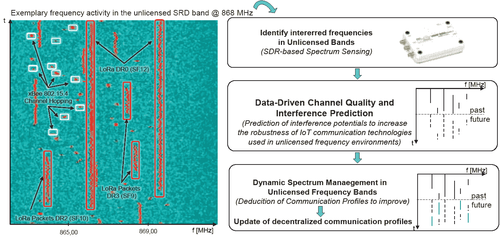

图 5.7: 分析并减少非授权频段干扰的影响。

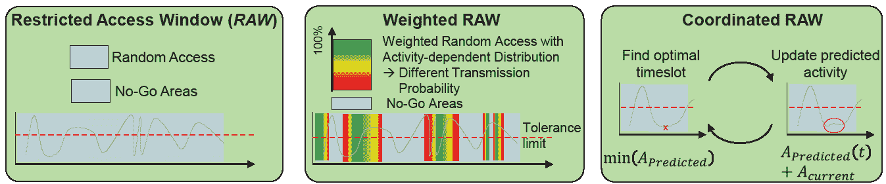

图 5.8: 动态频谱管理方法的概念。

下文描述了以下三种优化方法：受限接入窗口、加权受限接入窗口和协调受限接入窗口。

### 受限接入窗口 (RAW)

基本思想和名称源于 IEEE 802.11ah 技术。时间范围首先被划分为禁入区域和随机接入区域。在这种情况下，在绘制的阈值以下区域以随机方式接入信道，并避免在禁入区域进行接入。受限接入窗口是开发的最简单的方法。该方法是一种粗粒度方法，意味着网关并不为每个订阅者确定传输时间；而是网关仅通过信标发送适当传输时间，由订阅者随机选择传输时间。

### 加权受限接入窗口

在此方法中，通过加权接入概率对受限接入窗口方法进行了扩展。这意味着活动水平低于容限限制的时间范围具有更高的被选中概率。

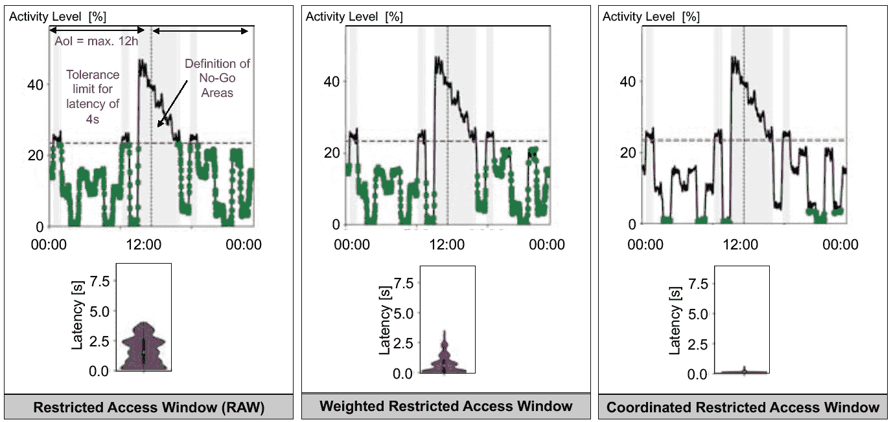

图 5.9: 三种调度方法在降低延迟方面的对比。

在本工作中，使用二次函数作为权重，并使用公式 5.3 计算每个时间点的权重。

```
W[t] = (A[Tolerance] - A[t])²
```

### 协调受限接入窗口 (CRAW)

该程序找到最小活动并将其分配给第一个参与者。然后更新活动谱。程序的循环步骤如下：

1. 寻找最小活动并分配该时间；

2. 根据活动变化更新谱；

3. 为下一个参与者重复。

与之前的方法相比，CRAW 是一种细粒度方法。这意味着网关必须通信传输时间。在 CRAW 中考虑了每个参与者的影响。

### 性能比较

在本节中，使用给定的场景对开发的三种方法进行了评估。以 868 MHz 的预测活动谱作为基础。在图 5.9 中显示了结果，所使用的活动谱位于顶部。

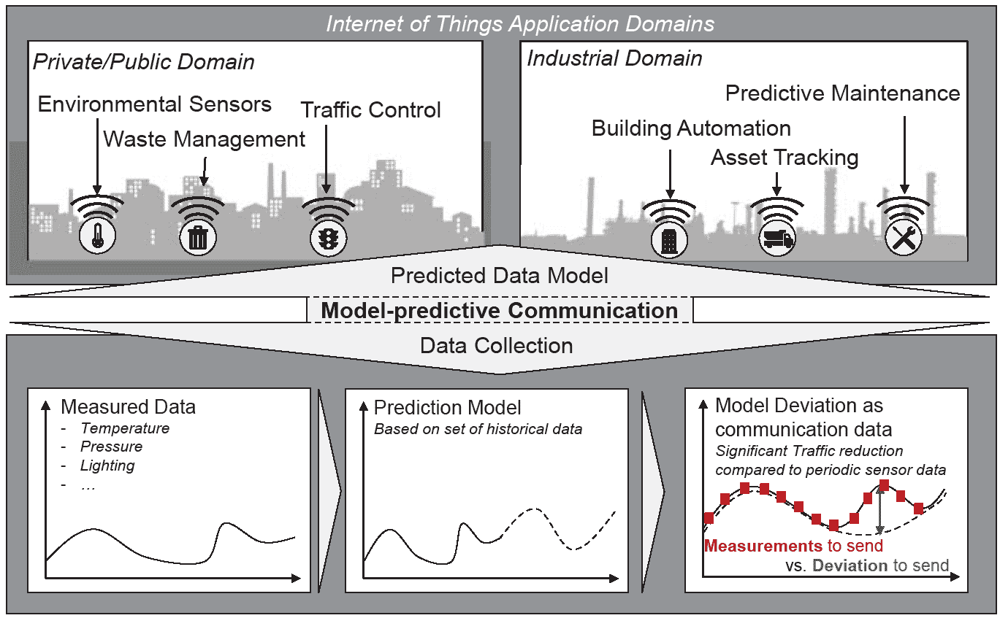

图 5.10: 动态频谱管理方法的概念。

可以看出，通过使用更智能的调度机制避开高活动时间，可以显著降低预期延迟。RAW 方法通过避免平均延迟超过给定阈值的区域设定了基准潜力，可以通过加权进行优化以将延迟降低到 1 秒以下。为 CRAW 方法提供更多智能可以使所有观测延迟都低于 1 秒。

然而，这种方法增加了计算量，必须作为权衡予以考虑。

#### 5.1.4.2 数据驱动的模型预测通信

在本节中，我们提出了一种数据驱动方法，通过利用物联网底层传感器数据的知识来减少通信努力。

底层方法并非传输每项测量值，仅传输那些显著偏离预定义模型的数据。因此，本研究考察了两种时间序列预测机制，以生成此类温度传感器设置的模型。由于这些方法仅依赖于历史数据，因此用例可以方便地更改。该方法通过使用来自德国多斯蒙德某住宅区室内环境传感器的数据集进行了评估。从 2019 年 1 月 1 日至 2019 年 11 月 19 日，系统以大约 5 分钟一次的频率收集了温度、湿度和 `CO[2]` 浓度。为了最小化模型复杂度，本工作将数据集重采样为 30 分钟的时间步长。原始数据可以通过 [29] 访问。本工作中使用的预测算法是基于自回归的方法和基于神经网络的方法，将在后续章节中进行描述。两种模型都利用了分解方法，下文将对其进行更多讨论。

### 基于 LOESS 的季节和趋势分解 (STL)

在这项工作中，使用了基于 LOESS 的季节和趋势分解 (STL) 方法 [540] 来提取底层数据的典型特性，例如温度数据的每日分布。该算法由两个循环组成：内层循环使用局部加权散点图平滑 (LOESS) [141] 来提取季节和趋势成分，外层循环用于通过计算稳健系数来最小化离群值的影响。数据集中每日温度轮廓的分解示例所示图 5.11。

![图 5.11: 使用 STL 对 8 月 18 日至 8 月 21 日的实测温度数据进行分解 ©\[2020\] IEEE. 经许可从 \[30\]] 重印。](graphic/b_9783110785982-005_fig_011.png)

图 5.11: 使用 STL 对 8 月 18 日至 8 月 21 日的实测温度数据进行分解 ©\[2020\] IEEE. 经许可从 [30] 重印。

示例展示了强烈的每日季节性和局部天气趋势。此外，存在显著的残差，该部分无法与趋势或季节性成分相关。分解可以在应用预测之前减去季节成分，并在之后将其加回生成的时间序列中，从而辅助预测算法。由于季节性成分通常随时间缓慢变化，因此可以降低所分析时间序列的复杂度。

### 自回归积分移动平均 (ARIMA)

`ARIMA` 算法是一种先进的时间序列预测方法，也是使用最广泛的方法之一。它由三个部分组成：自回归回归部分 `AR(p)`，涉及原始序列的过去值；积分部分 `I(d)`，与为了使时间序列平稳而差分有关；移动平均成分 `MA(q)` 表示模型误差。参数集 `(p, d, q)` 定义了每个成分的阶，因此指示了特定的 `ARIMA` 模型。详细而言，`p` 表示考虑的过去值数量，`d` 是差分程度，`q` 是考虑的误差项。为了简化应用，使用了统计编程语言 R 的预测包。该语言包含了 ARIMA 算法的实现，允许对每次实现进行自动参数选择 [294]，其中使用检查稳性的单元测试来指定 `d`，而 `p` 和 `q` 则通过最小化赤池信息准则 (`AIC`) 找到。基于三天的训练期使用 `ARIMA(0,1,0)` 对 2019 年 8 月 21 日进行的预测，连同 95% 和 80% 预测区间以及实际测量值，所示图 5.12。

![图 5.12: 使用 STL + ARIMA(0,1,0) 对 8 月 21 日单个传感器的预测，带有 95% 和 80% 预测区间 ©\[2020\] IEEE. 经许可从 \[30\] 重印。](graphic/b_9783110785982-005_fig_012.png)

图 5.12: 使用 STL + ARIMA(0,1,0) 对 8 月 21 日单个传感器的预测，带有 95% 和 80% 预测区间 ©\[2020\] IEEE. 经许可从 [30] 重印。

显示在 80% 预测区间内，预测值与实测值之间取得了良好的匹配。

### 长短期记忆网络 (LSTM)

作为循环神经网络 (RNN) 的变体，由 Hochreiter 等开发 [277]，`LSTM` 网络具有学习长期依赖的能力，这使其适用于时间序列预测任务。LSTM 的主要结构由连接的细胞组成，输入门用于调节细胞状态，而遗忘门过滤细胞状态。

本工作的实现是基于著名的 `keras` 框架。为了保持训练时长可行并避免深层网络导致精度下降 [358]，使用了单层网络。然而，使用了 50 个 `LSTM` 细胞，但其数量的影响微乎其微。

图 5.13 比较了 `LSTM` 和 `ARIMA` 对 2019 年 8 月 21 日数据的预测性能，以三天作为输入，分别对应 0.5 °C、1 °C 和 2 °C 的容差范围。容差范围描述了通信事件的需求，因为只有高于容差的偏差值才会被传输。

# 统计性能评估

对两种实现方法均使用均方根误差（`RMSE`）作为建模误差和通信事件减少潜力的指标进行统计学评估。为了使两种建模概念具有可比性，验证使用了如图 5.14 所示的滑动窗口方法。从总数据集中提取的每个滑动窗口集都包含可配置数量的输入天数，随后是一个输出天数。`ARIMA` 的优势在于能够仅依赖较小的数据基础就充分地预测未来数据。相比之下，`LSTM` 需要大量的输入/输出对作为训练数据，以学习用于传感器数据预测的关键特征。本工作讨论了输入天数从 3 天到 12 天的变化对预测某一天预测的影响。采用 10 折交叉验证进一步验证预测结果，训练数据与测试数据的划分比例为 90%:10%。两种方法在不同输入天数下产生的建模误差通过 `RMSE` 分布表示，如图图 5.15 所示。

![Fig. 5.14: 每种算法变体中使用滑动窗口进行前向验证（训练周期长度固定）。ARIMA 采用 t 天的训练数据并产生一天的预测结果，并将其与测试日进行比较；LSTM 需要输入/输出对进行训练，然后在预留的测试集上进行测试。©\[2020\] IEEE.经许可重印自 \[30]。](graphic/b_9783110785982-005_fig_014.png)

图 5.14: 每种算法变体中使用滑动窗口进行前向验证（训练周期长度固定）。ARIMA 采用 `t` 天的训练数据并产生一天的预测，并将其与测试日进行比较；LSTM 需要输入/输出对进行训练，然后在预留的测试集上进行测试。©\[2020\] IEEE. 经许可重印自 \[30\]。

可见，输入周期长度的影响较小，但两种模型在输入周期较短时误差略低。通常情况下，与 `ARIMA` 相比，`LSTM` 提供的平均误差增加了两约 0.3 °C，对于所有输入周期长度产生的平均误差约为 0.15 °C。`LSTM` 还显示出观测误差的扩散程度更大，除了 `ARIMA` 在较长输入周期下出现的少量离群值外。后者得出的结论是：距离过去较远的数据对预测次日温度值的相关性较低，这增加了观测到的错误预测数量。这些结果允许估计所评估模型可以使用的容差范围。因此，选择 ±0.5 °C 的容差范围作为评估模型预测方法潜力的最小容差。此外还评估了 ± 1°C 和 ± 2 °C 两个补充容差范围，以展示性能对不同应用中所选容差的依赖性。该分析针对底层温度传感器系统进行，并如图图 5.16 所示。

![Fig. 5.15: 两种方法在不同训练周期下的 RMSE。ARIMA 显示的 RMSE 比 LSTM 小，但两种方法的平均误差保持近乎不变。©\[2020\] IEEE. 经许可重印自 \[30]。](graphic/b_9783110785982-005_fig_015.png)

图 5.15: 两种方法在不同训练周期下的 `RMSE`。`ARIMA` 显示的 `RMSE` 比 `LSTM` 小，但两种方法的平均误差保持近乎不变。©\[2020\] IEEE. 经许可重印自 \[30\]。

![Fig. 5.16: 使用 ARIMA 和 LSTM 根据不同输入周期和容差范围所提供的通信努力潜力减少。©\[2020\] IEEE. 经许可重印自 \[30]。](graphic/b_9783110785982-005_fig_016.png)

图 5.16: 使用 `ARIMA` 和 `LSTM` 根据不同输入周期和容差范围所提供的通信努力潜力减少。©\[2020\] IEEE. 经许可重印自 \[30].

在 ±0.5 °C 的容差下，观察到两种模型的通信努力潜力减少了 60%，其中 `ARIMA` 的减少量超过 80%。`LSTM` 的性能随输入周期的增大而下降，这可以用可用输入/输出对数量的减少来解释。正如图 5.15 中的误差分布所示，对于较高的容差范围，两种模型的表现几乎相当，在 ± 1 °C 时减少了 90%，在 ± 2 °C 时几乎无通信需求。

最后，两种建模方法都有显著减少传感器通信努力的潜力。由于其整体结果以及在数据需求和计算方面的更高效率，`ARIMA` 算法是更优的方法。

### 5.1.4.3 展望与未来工作

当前 5G mMTC 应用的需求处于不断演变中。传统的网络规划很大程度上基于随机行为和相关流量，而事件驱动的机器通信将剧增。挑战在于面对不可预测的行为实现可靠的关键报警通信。在这种背景下，向任务关键型 6G 网络迁移是不可避免的[429]。为了确保对于能够用合理资源进行预测的应用类别获得保证的服务质量，必须动态分配可用资源，并取决于定义的成本（频率利用率、延迟、能耗）。为此，需要定义新的服务类别以针对延迟、块错误率（`BLER`）及其服务表征，并强调未来 6G 系统需要利用关于资源需求预测性的应用领域信息。新的服务类别如图图 5.17 所示。

### 5.1.5 致谢

除了 CRC 876 之外，部分工作还得到了北莱茵-威斯特法伦州以及“欧洲区域发展基金”（EFRE）2014-2020 年的支持，具体为“OPUS”项目，资助号为 `EFRE0800885`；以及德国联邦教育与研究部（BMBF）的 `A-DRZ` 项目（13N14857）的支持。

### 摘要

预计车载数据将成为推动联联与自动驾驶进一步发展的新燃料。车辆本身将作为移动传感器节点，主动感知其环境并为新的群感知赋能服务收集有意义的数据，例如高精地图的分布式生成、交通监控和预测性维护。然而，海量机器类通信（mMTC）所隐含的急剧增长，为有限无线频谱内不同资源消耗型应用和实体的共存带来了巨大挑战。通过更高效地利用现有网络资源来缓解这一问题的一种极具前景的方法是利用基于客户端的智能。新型通信范式（如预测性移动网络，anticipatory mobile networking）通过显式考虑上下文信息来改进无线通信系统中的决策过程。在车载群感知的背景下，这些方法利用目标应用的延迟容忍特性，根据预期的资源效率来调度数据传输。如果当前的无线信道和网络负载条件不允许进行高效传输，则数据传输过程将被推迟，且所获取的数据将在本地聚合，以便在不久的将来沿着预期的车辆轨迹获得更好的传输机会。

下文将介绍新型信道感知传输（CAT）方案的不同演进阶段。这些阶段的特点是顺序引入了不同的机器学习方法。基础 CAT 方法采用基于信噪加干扰比（SINR）测量值的概率性信道接入机制；而机器学习 CAT（ML-CAT）则应用监督学习，利用来自网络上下文、移动性上下文和应用上下文域的特征来预测当前可实现的数据速率。

随后，该方法通过强化学习 CAT（RL-CAT）得到进一步扩展，通过自主检测和利用有利的传输机会来实现。最后，黑点感知上下文老虎机（BC-CB）整合了关于预测模型中地理依赖性不确定性的先验知识，而这些不确定性是通过无监督机器学习揭示的。

结果表明，机器学习辅助的机性数据传输不仅能够提高单个传输的平均数据速率，还能大幅减少网络资源占用和移动设备的功耗。其代价是传感器测量值信息龄（AoI）的增加。除了介绍新型机会性数据传输方法外，还介绍、讨论并验证了用于模拟这些预测性移动网络的新型机器学习赋能方法。

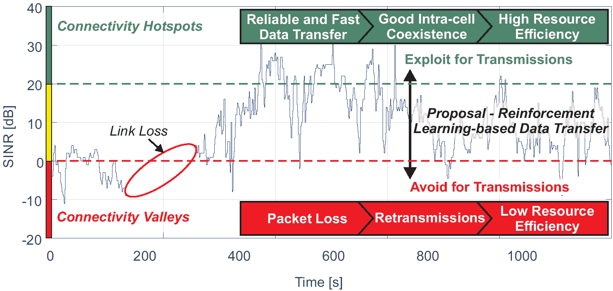

图 5.18: 车辆环境中 SINR 时间动态特性的示例。

## 5.2.1 引言

根据 5G 汽车协会（5GAA）最近发布的一份白皮书 [6]，预测性服务质量（QoS）——例如沿车辆轨迹的数据速率预测——预计将成为未来联联与自动驾驶的关键实现方法。

尽管机器学习已经开始渗透无线通信的所有领域 [714]，但目前的 5G 标准化工作重点在于网络基础设施侧的智能实现 [1]。然而，正如早期愿景性工作所讨论的那样 [17]，预计不仅用基于机器学习的等效模型替代数学模型的趋势将持续，泛在智能也将成为移动网络进一步演进的关键驱动力。这些发展与新兴的预测性移动网络范式密切相关 [107, 630]，该范式旨在通过显式考虑上下文知识和基于机器学习的数据分析来改进无线通信系统中的决策过程。

图 5.18 显示了沿车辆轨迹获取的干扰加噪声比（SINR）的真实轨迹。可以看出，车辆通信信道的具有具有短期和长期波动的特征。这种行为是发送端和接收端距离变化、移动相关因素以及由于阴影、反射和折射引起的障碍相关信号变化的叠加结果。

为了保证可靠的数据传输，移动设备在具有挑战性的信道期间会降低可实现的效率，以换更好的完整性。由于隐含的开销，大量网络资源无法用于传输实际载荷。

## 5.2.2 相关工作

机会性数据传输实现了这样一种思想：将延迟容忍型应用的数据传输推到可以实现更高资源效率的情况。所获取的数据被存储在本地缓冲区中，直到检测到有利的传输机会。

信道感知传输（CAT） [296, 298] 是本文贡献中进一步机器学习增强的基础，它基于下行质量指标对于评估上行信道质量的已知重要性，利用信噪加干扰比（SINR）测量值进行基于客户端的机会性数据传输 [297]。概率性介质接入执行如下：

(5.4) $p(t) = \left\{ \begin{matrix} {0\,\,\,\,\\,\,\,\,\\,\,\,\,\\,\,\,\,\\,\,\,\,\,\,\text{Δ}t \leq \text{Δ}t_{\min}} \\ {\\left( \frac{\text{SINR}}{\text{SINR}_{\max}} \right)^{\alpha}\,,\,\,\,\,\,\,\,\,\,\text{Δ}t_{\min} < \text{Δ}t < \text{Δ}t_{\max}} \\ {1\,\,\,\,\\,\,\,\,\\,\,\,\,\\,\,\,\,\\,\,\,\,\,\,\text{Δ}t \geq \text{Δ}t_{\max}} \\ \end{matrix} \right.\,\,\,\,\\,\,\,\,\\,\,\,\,\\,\,\,\,\\left( 5.4 \right)$


其中 `Δt` 是自上次执行传输以来经过的时间，`Δt[min]` 是为了避免过度频繁的介质接入而设置的最小包间隙，`Δt[max]` 是传感器数据包信息龄（AoI）的应用特定截止日期。通过配置 `α`，可以定义传输方案在传输过程中多大程度上偏好极高指标值。

## 5.2.3 机器学习赋能的机会性车云通信

尽管已经证明 `CAT` 与传统数据传输方法相比可以获得显著收益，但最近的分析 [[638]] 表明，`SINR` 等物理层指标对估计可实现数据速率的意义有限。由于后者与传输持续时间成反比，因此它与资源占用时间直接相关。结果，端到端数据速率的最大化有助于提高小区内的资源效率。为了利用这一特性，新颖的数据传输方案建立对可实现端到端数据速率的预测之上。

上下文感知数据传输方法的方法论演进如图 5.19 所示。不同演进阶段的特征是通过从不同机器学习学科中按顺序引入解决方案方法来表定的：


图 5.19: 面向资源高效型车云通信的信道敏感型方案的演进。

`通道感知传输 (CAT)` [[296], [298]] 使用了考虑 `SINR` 的概率介质访问方法。

`机器学习 CAT (ML-CAT)` [628, 629, 632] 利用来自网络、移动性和应用领域的特征来预测当前可实现的端到端数据速率，然后将其用作无线信道评估度量。

`强化学习 CAT (RL-CAT)` [[636]] 用 `Q-学习` 机制替换了启发式介质访问方法，以自主检测并利用有利的传输机会。

`盲点感知上下文老虎机 (BC-CB)` [[622], [625]] 将关于预测模型地理位置相关不确定性的先验知识作为一种信任度量整合到后者中。

在接下来，将介绍实现方法和新颖的数据传输方案。引用的科学出版物中更详细地讨论了各种参数变体的额外细节和分析。

### 5.2.3.1 车载网络中的端到端数据速率预测

所考虑的数据集包含多个评估场景（校园、城市、高速公路）的上下文轨迹。使用原生的 `Android` 应用程序接口 (`API`) 获取了来自不同领域的上下文指标：

- `网络上下文特征` (`net`): `RSRP`, `RSRQ`, `CQI`, `TA`, 载频

- `移动性上下文特征` (`mob`): 速度, 小区 ID

- `应用上下文特征` (`app`): 待传输传感器数据的有效负载大小


图 5.20: 不同机器学习模型实现的数据速率预测结果对比。

这些被动指标外，每隔 10 秒还会确定一次上行和下行方向范围在 0.1 MB 到 10 MB 之间的随机有效负载大小的活动传输测得数据速率。提供了对测量统计特性的深入分析 [[638]]。

使用由单个上下文向量 `x = (net, mob, app)` 组成的生成的特征集 `X`，我们在对应的数据速率测量值 `y` 上训练了机器学习模型 `f[ML]`，使得 `f[ML] : X → y`。出于此目的，考虑了不同的回归模型：

- 带有 `sigmoid` 激活函数的 `人工神经网络 (ANN)`，两个隐藏层，每层十个神经元，学习率 `η = 0.1`，动量 `α = 0.001` 以及 500 个迭代次数。

- `M5 回归树 (M5)`

- 具有 100 棵树和最大树深度为 15 的 `随机森林 (RF)`。

- 通过序列最小优化 (`SMO`) 训练的 `支持向量机 (SVM)`，使用径基函数 (`RBF`) 核、正则化参数 `C = 1.0` 和内核系数 `γ = 1.0`。

训练过程使用轻量级物联网系统 (`LIMITS`) 完成，它为已训练模型的 `C/C` 实现提供了高级自动化。

图 5.20 显示了两个传输方向 10 折交叉验证的均方根误差 (`RMSE`)。可以看出，如果调优当，复杂模型之间的差异很小。即使对于 get 简单的 `M5` 模型也实现了相当高的预测精度。`RF` 模型在上行方向达到了最低误差。与 `ANN` 和 `SVM` 相比，该方法的另一个优势是超参数调优复杂度显著降低。由于这些考虑，进一步的分析侧重于利用 `RF` 模型进行数据速率预测。生成的上行模型散点图如图 5.21 所示。


图 521: 基于 `RF` 的数据速率预测结果对比。对角线对应假设预测模型。

### 5.2.3.2 机器学习 CAT (ML-CAT)

`ML-CAT` 的基本思想是用基于机器学习的信道质量评估指标来扩展 `CAT` 方案。后者由预测数据速率 `S̃(t) = fML)` 表示，而概率模型的数值范围与 `SINR` 指标的数值范围相关（根据 [298] 为 0dB 到 40 dB）。因此，基于传输指标 `Φ(t)` 的数值范围 `[Φ[min], Φ[max]]` 定义了归一化 `Θ(t)`：

(5.5) $\Theta(t) = \frac{\Phi(t) - \Phi_{\min}}{\Phi_{\max} - \Phi_{\min}} (5.5)$

然后模拟公式 5.4 计算传输概率 `p(t)`：

(5.6) $p(t) = \left\{ \begin{matrix} {0, & \Delta t \leq \Delta t_{\min}} \\ {\Theta(t)}^{\alpha}, & \Delta t_{\min} < \Delta t < \Delta t_{\max}} \\ {1, & \Delta t \geq \Delta t_{\max}} \\ \end{matrix} \right. (5.6)$

通过 `RL-CAT`，原先概率性的介质接入被强化学习方法所取代。不同逻辑实体之间交互的示意图所示图 5.22。该模型由三个核心组件组成：

- 实际的机会性数据传输由一个 `agent`（代理）实现，它通过观察产生的 `rewards`（奖励）学习执行可能的动作——为了未来的改进而进行本地缓存，或传输整个传感器数据缓冲区。

- `environment`（环境）由蜂窝网络表示。传统的强化学习不同，后者假设 `agent` 采取的动作对其在环境中的状态有显著影响，而外部影响因素对端端行为具有主导影响。

- `Sensing`（感知）基于可测的上下文指标使用实际硬件平台进行。原始测量值通过基于 `RF` 的数据速率预测模型汇聚。


图 5.22: 强化学习支持的机会性数据传输的逻辑实体之间的交互。

基于强化学习的动作选择过程利用决策表 `Q`，根据由上下文元组 `c[t] = (S(t), Δt)` 表示的状态的状态，评估可能动作 `a[IDLE]` 和 `a[TX]` 的预期奖励。根据可用测量值，要执行的动作确定为 `a = arg max[a] Q(c[t], a)`。经典的 `Q-learning` 更新过程可以表示为：

(5.7) $Q\left( {\mathbf{c}_{\mathbf{t}},a} \right) = (1 - \alpha) \cdot Q\left( {\mathbf{c}_{\mathbf{t}},a} \right) + \alpha\left\lbrack {r_{a} + \lambda \cdot \underset{a}{\arg\max}Q\left( {\mathbf{c}_{\mathbf{t} + 1},a} \right)} \right\rbrack\,\,\,\,\,\,\,\,\,\,\,\,\,\,\,\,\,\,\,\,\,\,\,\,\,\,\,\,\,\,\,\,\,\,\,\,\,\,\,\,\,\,\,\,\,\,\,\,\,\,\,\,\,\left( 5.7 \right)$

其中 `α` 代表学习率，`λ` 是折扣因子，而 `r[a]` 是所选动作 `a` 的奖励。然而，如前所述，代理对其自身状态的影响可以被视为忽略不计：即使 `agent` 能够执行“最优”动作，可实现的端端性能仍会受到网络质量和由其他用户引起的流量负载等不可控因素的影响。因此，通过设置 `λ = 0` 实现了一种专注于优化所选动作即时奖励的短视方法，这得到了简化的公式：

(5.8) `Q(c[t],a) = (1 − α) ⋅ Q(c[t],a) + α ⋅ r[a].` (5.8) 

特定动作的奖励函数定义为：

(5.9) $r_{\text{TX}}(S,\text{Δ}t) = \underset{\text{Data~rate~optimization}}{\underset{︸}{w \cdot \frac{\left( {S - S^{\ast}} \right)}{S_{\max}}}} + \underset{\text{AoI~optimization~}}{\underset{︸}{(1 - w) \cdot \frac{\text{Δ}t}{\text{Δ}t_{\max}}}}\,\,\,\,\,\,\,\,\,\,\,\,\,\,\,\,\,\,\,\,\,\,\,\,\,\,\,\,\,\,\,\,\,\,\,\,\,\,\,\,\,\left( 5.9 \right)$ 

以及

(5.10) $r_{\text{IDLE}}(\text{Δ}t) = \left\{ \begin{matrix} {\text{Ω}\,\,\,\,\,\,\text{Δ}t \geq \text{Δ}t_{\max}} \\ {0\,\,\,\,\,\,\,\,\,\,\,\,\,\,\,\,~{~else~}} \\ \end{matrix} \right.\.\.\,\,\,\,\,\,\,\,\,\,\,\,\,\,\,\,\,\,\,\,\,\,\,\,\,\,\,\,\,\,\,\,\,\,\,\,\,\,\,\left( 5.10 \right)$ 

在此，参数 `w` 允许我们控制数据速率优化与 `AoI` 减少之间的基本权衡，`S*` 是目标数据速率，而 `S[max]` 代表经验测量值的数据速率上限。虽然在没有启动数据传输的情况下没有立即奖励，但如果缓存时间 `Δt` 超过特定应用程序的截止时间 `Δt[max]`，`Ω` 将作为惩罚因子。

为了训练强化学习机制，并不是进行大量的真实世界传输，而是实现了数据驱动仿真（`DDNS`）637。与需要大量假设来构建真实场景表示的经典系统仿真相比，`DDNS` 利用了机器学习模型。这种方法不仅不需要显式地建模实体，而且实现了接近真实世界的行为表示。

#### 5.2.3.4 黑点感知上下文老虎机 (BS-CB)

`BS-CB` 构建在强化学习的介质接入方法之上，它引入了用于访问预测的额外机制。此外，它用上下文老虎机替换了 `Q-learning` 组件 622。为了提高数据速率，引入了黑点的概念。在这些区域，预测误差会增加。

强化学习过程被建模为上下文老虎机，用于建议动作 `a`（空闲 `IDLE` 或传输 `TX`）：

(5.11) $a = \underset{a \in \mathbf{A}}{\arg\max}\left( \underset{\text{Estimated~reward}}{\underset{︸}{{\hat{\theta}}}_{a}^{T}\mathbf{c}}} + \underset{\text{CB}}{\underset{︸}{\alpha\sqrt{\mathbf{c}^{T}\mathbf{A}\{a}^{- 1}\mathbf{c}}}}} \right)\,\,\,\,\,\,\,\,\,\,\,\,\,\,\,\,\,\,\,\,\,\,\,\,\,\,\,\,\,\,\,\,\,\,\,\left( 5.11 \right)$

其中 `θ̂` 对应回归系数。`c` 是预测速率 `S̃(t)` 和当前延迟 `Δt` 的 `d` 维元组。探索程度由贪婪参数 `δ` 控制：

(5.12) $\alpha = 1 + \sqrt{\frac{\ln(2/\delta)}}{2}}.\.\,\,\,\,\,\,\,\,\,\,\,\,\,\,\,\,\,\,\,\,\,\,\,\,\,\,\,\,\,\,\,\left( 5.12 \right)$

在执行 `IDLE` 或 `TX` 后，回归系数更新为：

(5.13) `θ̂[a] ← A[a]^(−1) b[a]` (5.13) 

以及

(5.14) `b[a] ← b[a] + r[a] ⋅ c.` (5.14) 

在传输的应用阶段，车辆执行椭圆测试以检查当前是否位于黑点区域。如果满足条件，传输过程将被推迟。

#### 5.2.4 真实世界性能比较的结果

为了对新型机器学习辅助的方法进行性能评估，考虑了一条长度为 25 公里的评估路线，其具有不同的环境特性、速度限制和建筑密度。对于每种传输方案，进行了十次真实的道路测试。在此，虚拟传感器应用每秒生成 50 kB 的传感器数据，这些数据存储在本地，直到对整个缓冲区做出传输决策。

图 5.23 显示了各传输方案实现的端到端数据速率。虽然 `CAT` 的基础信道敏感方法已经能够实现数据速率的显著提升，但通过引入基于机器学习的信道评估，后者得到了大幅提高。此外，基于强化学习的数据传输带来了额外的收益。与传统的固定间隔数据传输相比，`BS-CB` 在上行和下行方向上分别实现了 195% 和 223% 的性能提升。


图 5.23: 不同传输方案的端到端数据速率。

如图 5.24 所示，数据速率最大化这一表面上自私的目标有助于提高整体利益：所有机会性数据传输方法都能比传统方法获得更高的资源效率。尽管方法论的演进也体现在获得的结果中，但机器学习辅助方法之间的差异微乎其微。在这里，`BS-CB` 在两个传输方向减少了约 85% 的占用小区资源。

### 5.2.5 展望与未来工作

由于其对所有演示传输方案的开启作用，未来的工作应聚焦于优化数据速率预测模型的准确性。基于客户端的预测方法的一个主要局限是它们对小区当前流量负载的洞察有限。未来网络可以通过主动发布关于流量负载的网络基础设施知识来补偿这一局限性，例如通过新的 `5G` 机制（如网络数据分析函数 `NWDAF`）获取信息。如最近的一项可行性研究 [626] 所示，可用网络知识的集成使上行的 `RMSE` 降低了 25%，下行方向降低了 30%。


图 5.24: 不同传输方案的资源效率。

## 5.3 移动数据网络分析高可靠性网络

Robert Falkenberg

Karsten Heimann

Benjamin Sliwa

**摘要：** 移动网络数据分析是满足快速增长的服务需求的新型方法开发的基础。这一过程对于网络运营商和设备供应商而言，尽管有第三代项目计划（`3GPP`）的标准化，仍需要识别现有网络中的缺点。为了给用户实现更高的吞吐量，移动网络通常需要对网络功能有更深入的了解，特别是在涉及负载和偶尔拥塞时。有了这些知识，未来设备可以预测预测吞吐量，并利用这些信息进行负载均衡、网络选择或服务自适应。由于蜂窝网络由基站集中管理，基站为每个设备分配频谱资源，因此关于小区利用率的信息已经存在于“空中”。出于性能考虑，且与 `UE` 和基站之间加密的载荷交换不同，携带资源分配的控制消息是不加密的。这对于用户设备（`UE`）尤为如此。

然而，这些消息通过特定设备和会话的无线网络临时标识符（`RNTI`）进行扰码，这对正确解释和验证这些消息至关重要，且在每个会话开始时交换一次。本节描述了 `CRC` 在空中高效、可靠地提取新会话和已激活会话控制消息的成就。底层信道分析的方法论嵌入在一个全面的开源软件框架——`LTE` 信道快速分析（`FALCON`）中，该框架使用软件定义无线电（`SDR`）捕捉基站信号，并在普通计算机系统上准确提取提取控制消息。

在随后的案例研究中，监督学习被用于利用短期观测中披露的网络负载信息来预测预期数据速率，并最终将其作为动态网络选择的指标，以在当前最快网络上实现最高吞吐量。

### 5.3.1 引言

由于人类和机器网络用户数量的快速增加，移动网络数据流量的持续增长在面对有限无线频谱以满足日益增长的服务质量需求方面，对网络运营商及其依赖的服务构成了挑战。

然而，此类缓解策略的型和应用都需要对信号质量和瞬时网络负载进行准确测量，以便在不产生不必要的负载（例如以测试传输的形式）的情况下识别过载情况。尽管移动设备能够自主地测量信号强度和质量，但目前的移动网络仅允许用户和外部观察者对小区的瞬间资源利用情况进行有限的了解。虽然无线资源的总占用可以通过频谱分析确定（参见图 5.25 中的顶行），但在满负载的情况下，实际的竞争程度仍然是隐藏的，因为无法从频谱中识别出服务的订阅用户数量（参见图 5.25 中的最后两列）。

在 `4G` 和 `5G` 网络中，频谱资源的分配由基站控制，基站通过特殊的控制信道显式地将其分配给单个活跃订阅用户。出于效率考虑，这些分配消息没有加密，但可靠的解码需要知道接收者的 `RNTI`，因为附带的校验和与该 `RNTI` 进行了扰码。因此，用户终端（`UE`）只能读取影响其自身的分配。没有分配 `RNTI` 的非活动用户和外部观察者只能解码针对通用系统信息或呼叫的特殊预留 `RNTI` 的分配。

![图 5.25: 如果一个新用户在 $t0$ 时开始传输，分配的频谱资源数量（蓝色阴影部分）取决于其他参与者的数量和活跃性（底行，其他颜色）。在频谱分析（顶行）中，单个用户的分配是无法区分的，参与者数量仍然未知。©\[2016\] IEEE. 经许可从 \[195\]（graphic/b_9783110785982-005_fig_025.png）重印。]


图 5.25: 如果一个新用户在`t0`时开始传输，分配的频谱资源数量（蓝色阴影部分）取决于其他参与者的数量和活跃性（底行，其他颜色）。在频谱分析（顶行）中，单个用户的分配是无法区分的，参与者数量仍然未知。©\[2016\] IEEE. 经许可从 \[195\]重印。

在 CRC 876 研究过程中，开发并评估了用于寻找有效 RNTI 的高效控制信道分析方法，实现了对移动网络的被动式负载感知，从而为客户端数据速率预测提供了宝贵信息。本文所介绍的方法可以直接应用于公共 4G 蜂窝网络，并能够使用现成的 PC 和 SDR 实时发现所有资源分配。以开源框架`FALCON`的形式提供了一个全面的参考实现。利用收集的数据和派生的特征来表征网络负载，使用监督学习来训练预测模型，其数据速率预测的精度显著超过了以往纯基于信号强度的方法。同时应用于多个蜂窝网络，该预测使 UE 能够执行预测性网络选择，以便在最具前景数据速率的网络上传输数据，特别是在高负载期间。预测精度、可实现的数据速率增以及对 UE 能耗的影响已通过在公共移动网络中收集案例数据进行了评估。

后续章节结构如下：第 5.3.2 节中进行总结并得出结论。

## 5.3.2 相关工作

对当前移动网络连接的评估（特别是在链路吞吐量方面）通常通过主动探测完成 [289]。这意味着会触发数据传输，以测量被测设备当前可用的吞吐量。然而，这种方法会占用网络和无线资源，而纯被动的测量或预测则可能会忽略这些消耗。

设备本身对当前网络负载的了解有限，但它提供了诸如参考信号接收功率 (RSRP) 和参考信号接收质量 (RSRQ) 等性能指标，这些指标仅能对后续传输的可实现数据速率进行粗略预测 [297]。作者在 [392] 中通过频谱分析确定了无线资源的总占用。

更具前景的解决方案需要考虑通常超出移动设备范围的进一步信息。因此，具有特殊硬件要求的昂贵商业工具以及现成的 SDR 和开源协议栈允许基于深度洞察的定制化方案。在基于 SDR 的方法方面，特别是来自 [359] 的 LTEye 以及 [108] 的 LTE Watcher (`OWL`)，通过分析控制信道的分配来推断当前的资源利用率和并发活跃用户。正如下一节详细说明的，`LTEye` 存在大量的误报，而`OWL`构成了一个仅检测新设备的稳健方法。相比之下，我们的方法`FALCON` [196] 实现了改进的移动网络资源利用率检测能力，并能够预测或推荐性能最佳的网络。

## 5.3.3 控制信道分析

在当前的移动网络中，无线资源以二维资源网格的形式在时间和频率上进行划分。资源网格在频率域跨越整个小区带宽，时间域被分为嵌套循环的符号、时隙、子帧和帧。4G 和 5G 网络中的最小资源单元是资源元素 (`RE`)，它对应于正交频分复用（OFDM）符号的单个载波。根据预定义的模式，某些`RE`用于广播同步序列或为均衡提供参考水平。没有特殊用途的`RE`作为传输任何其他数据（包括控制和负载消息）的资源。这些空闲`RE`被分组成等大的资源块 (`RB`)，这是可以分配给单个 UE 的最小资源单位。

RB（资源块）的分配由基站集中组织，并通过特殊的控制信道——即物理下行控制信道（PDCCH）信号给用户设备（UE）。PDCCH 位于每个子帧的前 1、2 或 3 个符号中，并跨越整个小区带宽。它包含了双向传输的分配，包括下行（即从基站到 UE）和上行（即从 UE 到基站）。这些分配适用于当前子帧的下行（DL）方向，或适用于 4 个子帧后的上行（UL）方向，以为 UE 留出足够的准备时间。

从逻辑上看，PDCCH 由一系列控制信道元素（CCE）组成，每个 CCE 包含 36 个 RE（资源元素），其总数根据小区带宽和占用的 OFDM 符号数计算。这些 CCE 携带了单个 UE 的编码下行控制信息（DCI），其中包含 RB 分配、调制和编码方案（MCS）、功率控制指令以及在分配的资源中解码或编码载荷所需的进一步控制信息。基站对每个发射的 DCI 数据结构使用率 1/3 信道编码、交织和速率匹配，以提供前向纠错（FEC），并将编码序列放入`L`、`L ∈ {1, 2, 4, 8}`个连续的 CCE 中。聚合阶`L`由基站根据接收者的信道条件选择，以确保正确接收。`L`个 CCE 内的任何额外或剩余空间都通过编码序列的循环重复填充，交织确保了重复比特的均匀分布。

在编码之前，每个 DCI 都会附加其 16 位循环冗余校验（CRC）校验和，并额外通过接收者的 RNTI（无线网络临时标识）进行加扰（通过二进制异或运算）。相反，接收端 UE 只考虑 CRC 与其当前 RNTI 匹配的解码 DCI。^6

由于 PDCCH 没有目录，只有通过对 CCE 进行盲检才能确定是否存在相关信息。这也包括由不同`L`产生的所有可能组合。为了减少 UE 的解码尝试次数，标准定义了一个搜索空间函数，根据 RNTI、子帧和`L`将搜索空间限制在最多 22 个均匀分布的位置。

此外，标准针对不同的传输模式定义了多种 DCI 格式，这些格式取决于使用的天线数量以及 UE 和作为 4G 基站的演进基站（eNodeB）的能力。传输模式在建立连接时以及根据信道条件动态调整。DCI 格式的长度不同，因此编码序列的长度也不同。然而，速率匹配使用了相同的循环方法，即填充 CCE 以使得初始格式在传输序列中不再明显。因此，终端设备会多次解码序列，假设任何符合指定传输模式的 DCI 格式（或其长度）。

因此，外部观察者在解码 PDCCH 的全部内容时面临着以下挑战：

1. 覆盖 PDCCH 所有位置（包括 DCI 格式长度和聚合阶的所有可能组合）的解码尝试计算开销极大，并且会导致大量的无效 DCI 候选。

2. 丢弃所有 CRC 与有效 RNTI 不匹配的 DCI 候选。

3. 在解码的 DCI 候选集中寻找有效的 RNTI。

由最后两点导致的“先有鸡还是蛋”的问题可以通过多种方式解决：LTEye [359] 重新编码每个解码的 DCI 候选，将编码序列与信道上的接收比特进行比较，并丢弃偏离一定程度的候选。但在噪声或干扰存在，我们证明这种方法非常不准确，会导致许多错误判断。在一种更稳健的方法中，[108] 遵循接入 UE 的初始连接建立过程（其中包含明文的 RNTI 分配），并构建有效 RNTI 列表。然而，在监控之前进入小区的 UE 的 RNTI 无法检测。因此，OWL 采用 [359] 的方法作为备选。相比之下，Mobile Access Networks（U-CIMAN）[771] 的作者建议首先接受任何 DCI 候选，并解码分配 RB 中的潜在载荷。如果该尝试由于载荷的 CRC 无效而失败，则丢弃该 DCI。由于数据量更大且载荷数据的解码过程更复杂，该方法涉及巨大的计算成本。

在该领域，CRC 876 对资源高效且可靠的控制信道分析做出了巨大贡献，这种分析特别适用于短期监控，以估计小区总负载。在 [195] 中，我们提出了一种基于直方图的方法，并结合搜索空间的逆逆识别有效的 RNTI 并解码对应的 DCI。

以下过滤阶段收集直方图未超过阈值`k`的 RNTI。这是基于这样一个事实：活跃 UE 在短时间内接收多次分配，且它们的 RNTI 出现频率高于由于错误参数产生的随机 DCI。

```
# 用于阈值过滤的逻辑示例
if (histogram_count > k) {
    process_rnti(rnti_candidate);
}
```

历史长度和阈值值`k`是优化参数，允许在误报检测概率、UE 的最小活动需求和检测延迟之间进行权衡。^[194]

为了提高未见 RNTI 的检测速度（这对于短时观测尤为重要），我们在 [196] 中提出了一种全新的`short-cut`（捷径）解码方法。该方法利用了 eNodeB 用编码后的 DCI 序列填充 CCE 的机制。虽然在大多数情况下，这种序列能够放入单个 CCE，但运营商会配置 eNodeB 使用更高的聚合层级，以增加对失真的鲁棒性。相反，由于循环重复的特性，一个经过恰当裁剪的序列仍然允许对 DCI 进行正确解码。因此，如果完整序列和缩短序列的解码结果产生相同的 DCI 和 CRC，则可以认为相关的 RNTI 是有效的，并且应当接受该 DCI。这种方法通过结合每个位置的广度优先搜索和深度优先搜索来高效实现，如图 5.27 所示。顶行将 PDCCH 显示为连续 CCE 序列，根据 eNodeB 的放置情况，这些 CCE 要么占用或为空。可以通过信号功率不足识别的空 CCE 可以被跳过，因为它们不包含任何有效信息。相反，被占用的 CCE 可能也不包含有效信息，因为接收到的信号功率可能源于在时间和频率上与 PDCCH 重叠的邻区小区。广度优先搜索组件从聚合层`L` = 8 开始，并顺序解码该层上的所有位置（第二行）。在给定示例中，两个可能的位置 (1) 和 (2) 被跳过了，因为它们都至少重叠了一个空 CCE，因此没有形成连续序列。搜索继续在`L` = 4 进行，检查具有连续 CCE 占用的第一个位置 (3)，并通过解码所有 DCI 格式的序列进行检查。如果此检查没有导致任何具有已知 RNTI 的 DCI，则激活深度优先组件，并使用下一个较小的聚合层递归地检查该位置。在给定示例中，位置 (4) 和 (5) 均包含具有已知 RNTI 的 DCI；重叠的位置（例如对于`L` = 1）被标记为已检查。随着递归终止，广度优先搜索继续，位置 (6) 和 (7) 均被跳过。接下来，位置 (8) 在`L` = 4 处包含一个有效的 DCI，但 RNTI 尚未被发现。然而，对位置 (9) 处的前半部分缩短序列进行递归检查返回了相同的 DCI 和 RNTI。由于这种情况仅发生在有效 DCI 上，该 RNTI 会立即添加到已知 RNTI 列表中，DCI 被接受，且重叠的位置被标记为已检查。


图 5.28：在不同信噪比（SNR）值下，使用 FALCON 和 OWL 对 1 秒长距离演进（LTE）信号 PDCCH 进行解码的结果。结果为 10 次重复的平均值；标准差以误差棒显示。

为了即使在二分序列无法解码的差信号质量情况下也能实现检测，可以使用基于直方图的验证。如果递归下降未发现已知 RNTI，则下降路径上的所有潜在 RNTI 被添加到历史记录中，超过阈值的 RNTI 被添加到活动集。

FALCON 中组合方法的鲁棒性和可靠性在图 5.28 中所示。它分别用实线和虚线表示漏检和误报 DCI 消息的数量，并作为持续 1 秒的良好定义信号后信道 SNR 的函数。从代表不良无线电条件的 0dB 开始，SNR 以 0.5 dB 的步长增加到 15 dB，代表极佳信号。对于每一步，图中显示了 10 次重复的平均值和标准差。此外，图中包含 OWL 的结果，它依赖于短时观测的重新编码方法。

无论 SNR 如何，FALCON 的虚假 DCI 消息数量保持在可忽略的水平，而 OWL 会产生至少 30 个到多 100 个误检。通常，对于所有覆盖的 SNR，FALCON 错过的 DCI 消息远少于 OWL。特别是对于大于 7 dB 的 SNR 值，FALCON 的漏检 DCI 数量低于 10，而 OWL 保持在 50 到 100 之间的水平。因此，对两种方法的比较揭示了 FALCON 的鲁棒性和可靠性。

在现场实现了类似的结果，表现为 5 秒内每个 RNTI 的活动直方图，如图 5.29 所示。蓝色圆圈代表 FALCON 检测到的每个 RNTI 的资源分配，红色叉号显示 OWL 的结果。显然，最活跃的 RNTI 集中在一个较小范围内，表明 eNodeB 连续分配 RNTI。随着时间推移，峰值向较大的 RNTI 值移动，如 5 分钟后和 10 分钟后的结果所示。另一方面，OWL 报告了大量随机 RNTI 的虚假 DCI 消息，它们在整个值范围内均匀分布，频率很低。


图 5.29：现场 RNTI 检测的活动直方图。随时间移动的峰值表明基站的 RNTI 分配策略。©2019 IEEE。经许可自[196]。

## 5.3.4 利用 FALCON 进行协作速率预测

基于客户端的速率预测是前瞻性移动网络的关键。通过考虑网络上下文测量来估计端到端传输效率（由预测的速率表示），移动客户端可以通过将数据密集型传输调度到资源高效的热点，积极有助于优化小区资源效率[622]。然而，基于客户端的速率预测方法的准确性本质上是有限的，因为 UE 只感知信道状况，而不知道网络负载。

根据[622] 的纯基于客户端的速率预测被动上下文测量外，FALCON 还允许在初始特征重要性分析后导出与小区网络负载相关的额外特征：

- 上行特征集：RSRP、RSRQ、速度、有效负载大小、PRB 数量、UE 数量、小区 ID

- 下行特征集：RSRQ、速度、有效负载大小、PRB 数量、UE 数量、TBS、MCS、小区 ID

可以看出，上行方向对无线信道状况更为敏感，而下行性能高度依赖于小区内部负载。

![图 5.30: 端到端上行链路数据速率预测：不同预测方法和机器学习模型的性能比较。©[2020] IEEE。经许可转载自[626]。](graphic/b_9783110785982-005_fig_030.png)

图 5.30: 端到端上行链路数据速率预测：不同预测方法和机器学习模型的性能比较。©[2020] IEEE。经许可转载自[626]。

不同机器学习模型（人工神经网络 (ANN)、M5 回归树、随机森林 (RF)、支持向量机 (SVM)）的预测准确率如图 5.30 所示。尽管 RF 模型实现了最高的整体准确率，但不同机器学习模型之间的差异微乎其微。然而，三种不同的数据速率预测方法之间可以观察到显著差异。纯基于客户端的方法大多无法感知流量负载，而纯基于网络的方法由于缺少无线信道信息导致产生较高的预测误差，协作预测方法将上行方向的平均均方根误差 (RMSE)降低了 25%。正如[626]中进一步分析所示，下行方向也实现了类似的改进。

这些初步结果表明，通过将客户端测量与网络侧信息相结合，可以显著提高移动通信的感知能力和预测性。因此，未来的网络（如 6G）应该主动向客户端提供网络负载信息，以便它们积极参与网络管理功能。

## 5.3.5 结论

FALCON 是一种新型基于 SDR 的 LTE 控制信道分析开源工具，能够实时可靠地监控 LTE 小资源的分配。通过应用快捷预编码，实现了快速的 DCI 完整性检查，并得出了活动 RNTI 列表——这对应于活动用户数量的估计。在直方图方法的帮助下，即使在低信号质量期间，FALCON 也能保持其准确性。揭示的网络侧信息对于利用端到端预测进行决策的智能网络方法具有特殊价值，例如第 5.2 节中讨论的资源高效云通信。由于依赖网络上下文测量的纯客户端数据速率预测方法无法感知当前网络负载，其可实现的预测率本质上是有限的。正如首次真实世界的概念验证研究[626]所示，下行方向也实现了类似的改进。

# 5.4 机器学习驱动的 5G 切片

**摘要：** 在本文贡献中，介绍了网络切片的不同部分，包括核心网 (CN) 和无线接入网 (RAN)，同时突出了它们之间的差异与相似性。

- Caner Bektas

- Fabian Kurtz

- Dennis Wietfeld

## 5.4.1 5G 端到端网络切片简介

关键基础设施（如能源网络、物流或自动驾驶交通）正变得越来越自动化。自动化通常通过移动通信实现过程和参与者的自组织来完成。由于许多不同的垂直行业依赖于移动通信，通信系统需要考虑一组高度多样化的关键性能指标 (KPI)。

直到最近，专用通信网络一直是满足这些不同标准的首选解决方案，因为它们可以针对相应关键基础设施的需求进行专门设计。因此，第五代移动网络 (5G) 旨在将这些不同且部分矛盾的需求统一到单一物理基础设施中。通过采用软件定义网络 (SDN) 和网络函数虚拟化 (NFV) 技术，5G 网络切片被集成到 5G 标准中。通过在单一物理通信网络之上利用称为“网络切片”的虚拟专用网络，不同的垂直行业可以实现自动化，如图 5.31 所示。


图 5.31: 网络切片作为同时满足所有特定服务需求的关键要素。

## 5.4.2 5G 核心网切片

### 5.4.2.1 描述与方法

网络资源的虚拟化描述了 5G 网络的一个支柱，如图 5.32 所示。

创建被称为“切片”（slices）的多个隔离网络分区可以独立且高效地管理对服务质量（QoS）或其他保障有不同要求的各种用例。对于 5G 通信，定义了三大主要类别。

第一类是增强移动宽带（eMBB），用于数据速率密集型业务（高达 20 Gbit/s）。该类包括超高分辨率视频流传输以及固定无线宽带和增强现实/虚拟现实（AR/VR）。第二类是大规模机器类通信（mMTC），专为新兴的物联网（IoT）和工业 4.0 应用设计，这两者都引入了机器间通信的显著增加。但海量设备在例如智能电表等电网应用场景中，也带来了其自身面临的一系列挑战。第三大类类别是高可靠低延迟通信（uRLLC）服务。该类包括诸如基于浮动车数据（FCD）的车联网（V2X）通信等智能交通系统（ITS）。在这里，解决的是任务关键型和延迟敏感型应用。

我们的方法基于`NFV`和`SDN`，这两者紧密相关。通过`NFV`，硬件和软件实现了解耦，并将功能抽象化，以实现用于云计算的高度灵活通信基础设施。虚拟网络函数（`VNFs`）现在可以在商用成品（COTS）服务器平台上运行。通过使用`NFV`和`SDN`的互补方法，控制器可以动态地在`VNFs`之间路由流量流，同时其本身作为一个`VNF`进行部署。除了利用`SDN`和`NFV`之外，我们的概念还基于利用分层令牌桶（`HTB`）的队列策略。在裸机和虚拟化数据平面设备上，部署了交换软件 Open vSwitch（`OVS`）。此外，实现了一个管理和网络编排（`MANO`）控制器。该控制器在每个交换机中创建一个主桥，包含相应的物理端口。通过这种方式，可以根据需要为每个切片添加或移除一个桥。该概念如图 5.33


Fig 5.32: 切片化的 5G 通信网络概述。


图 5.33: 开发的网络切片架构。

切片桥由位于主桥内的虚拟端口组成。编排通过`MANO`控制器完成，该控制器动态实例化切片控制器（例如通过`Docker`），这些控制器反过来又可以针对每个应用场景进行优化。当流量进入数据平面时，`MANO`控制器将数据包分配给相应的桥。在那里，根据数据包的特定协议或其他标准，流被映射到主桥上相应的`QoS`队列和虚拟目的端口。这是由相应的切片控制器完成的。对于每一跳，切片控制器都会重复这一将流导向主桥的程序。未知流或未指定的匹配将基于尽力而为的原则处理。虽然这部分侧重于有线 5G 通信，但与后续章节介绍的空接口切片技术保持兼容。

### 5.4.2.2 5G 核心网络切片的实证评估

#### 测试环境概述

测试平台场景如图 5.34 所示。六个服务器被分配给配对，用于在切片网络上发送或接收数据。此外，四台机器指定为`SDN`控制器，其中三个作为运行`Floodlight`的切片控制器，一个作为`MANO`控制器。为了避免干扰，三种网络（即带外、维护和切片数据平面网络）被使用。使用精确时间协议（`PTP`）同步时钟，最大偏差为 153 μs，平均偏差为 16 μs。底层网络负载通过`iPerf2`社区版生成，由用户数据协议（`UDP`）数据包组成。评估方法的最大性能需要根据不同的 OSI 堆栈层来确定。OSI 模型第二层的以太网帧大小为 1512 B，作为参考点。位于第四层的性能（即有效吐量）结果为 1470 B，占比二层数据速率%。以下测量至少重复了 100 次，每次运行持续时间 1 分钟。


图 5.34: 测试设置中的场景。

#### 评估场景

场景 A 展示了一个性能研究，评估了 5G 和关键基础设施通信的关键方面，例如不同网络负载下的延迟和速率。因此，确定了方法的开销以展示资源的有效利用。通过使用 100 Mbit/s 以太网链路可以避免可能的限制，同时为测试期间提供了 CPU 负载选项。此外，验证了切片之间的独立性，因此可以防止一个切片中的错误或过载对其他切片的损害。在评估过程中，网络负载逐步增加，超过了最大可用数据速率/有效吐量，即标称二层链路能力的 97.2%。

表 5.1：关键基础设施场景下的切片和流量流。

| 切片（按优先级排序） | 用例 | 5G 服务类别 | 切片内优先级 | 硬性最小数据速率 [Mbit/s] | 最大 [ms] | 延迟 |
| --- | --- | --- | --- | --- | --- | --- |
| 智能电网 | 保护 | `uRLLC` | 最高 | 50 | 1 | |
| | (IEC 61850) | | | | | |
| | 智能 | `mMTC` | 高 | 200 | 20 | |
| | 计量 | | | | | |
| 智能交通系统 | 浮动车数据 | `uRLLC` | 最高 | 100 | 1 | |
| | 乘客 | `eMBB` | 低 | 450 | 10 | |
| | 互联网 | | | | | |
| 尽力而为 | 多媒体 | 无 | 最低 | 无 | 100 | |

这种方法代表了终端用户尝试使用超过其相应切片分配的资源的情况，从而证明了切片的独立性。同时，还模拟了操作员对切片通信网络的配置错误。为此，我们配置了两个切片，其组合数据速率超过了底层物理网络的数据速率。场景 B 代表了可扩展性分析，展示了在大规模、多租户通信基础设施中部署的可行方法。由于切片数量不应影响网络的整体性能，因此分析了 0、2、8 和 16 个切片情况的延迟性能。可用数据速率在各切片之间平均共享，流量流利用了各自切片 100% 的容量。这确保了副作用是由切片引起的排他性，而不是由网络拥塞或其他因素引起的。此外，还检查了切片隔离的有效性和端到端延迟的稳定性。为此，21 个切片中的 7 个切片接受了数据速率超过分配限额的基于 UDP 的流量。与场景 A 相比，使用了`1 Gbit/s`以太网对该概念进行压力测试。最后，场景 C 描述了关键基础设施的通信，包括 ITS 的 FCD 和`IEC 61850 SG`协议。

由于两个用例都被视为 uRLLC 5G 服务并因此赋予最高优先级，传输它们的切片被分配相同的优先级，包括专用的`SDN`控制器。智能电表（代表`mMTC`）和乘客互联网（`eMBB`）包含在相关切片中，以展示流量区分的能力。此外，包含了一个尽力而为（best-effort）的切片，用于处理持续传输`950 Mbit/s`低优先级数据的流量，这消耗了`1 Gbit/s`网络的最大有效速率。因此，如果另一个切片需要特定的速率，网络将由于优先级不同而过载并重新分配。每个优先级的最大可接受延迟见表 5.1。对于评估，给定的数据速率通过聚合流量实现。然而，恒定速率的聚合可以在智能电表等实际用例中找到。


图 5.35: 不同流量负载下两个切片的端到端延迟。

### 评估结果

在图 5.35 中，不同流量负载下两个切片的端到端延迟所示[360]。物理`100 Mbit/s`以太网被公平共享；切片 A 和 B 传输 UDP 包。在上述`97.2%`限制以下，中位端到端延迟位于`1.05 ms`，偏差约为`0.05 ms`。然而，当切片 B 逐步超过限制时，产生了过载情况，导致延迟增加。在`101%`负载下，中位延迟急升至`1.212 ms`。然而，如放大的小提图所示，切片 A 的延迟不受影响。因此，显示了切片的隔离。操作员的配置错误被模拟并并在图 5.36 中所示。

切片 A 接收速率为`40 Mbit/s`（第四层有效`38.9 Mbit/s`）。队列速率总和（如横轴所示）不应超过`100 Mbit/s`以太链路的理论限制。该最大值计算为第 2 层和第 1 层帧大小的比例，即`1512 B / 1532 B = 98.7%`。在配置错误的情况下，切片 B 尝试利用并不存在的资源。因此，切片 B 无法维持第四层有效速率。当切片 A 消耗`HTB`令牌并保持稳定时，切片 B 的速率稳定在`56.9 Mbit/s`，低于第 2 层的配置`60 Mbit/s`队列速率。没有观察到吞吐量开销，因此证实了预期。图 5.37 展示了场景 B 的评估结果。


图 5.36: 物理网络操作员配置错误的影响分析。


图 5.37: 不同流量负载下多个切片端到端延迟的评估结果。

多个切片的端到端延迟给值为`1 Gbit/s`。数据速率在各切片之间平均共享，流量流利用了各自切片 100% 的容量。这确保了副作用是由切片引起的排他性，而不是由网络拥塞或其他因素引起的。此外，还检查了切片隔离的有效性和端到端延迟的稳定性。为此，21 个切片中的 7 个切片接受了数据速率超过分配限额的基于 UDP 的流量。与场景 A 相比，使用了`1 Gbit/s`以太网对该概念进行压力测试。最后，场景 C 描述了关键基础设施的通信，包括 ITS 的 FCD 和`IEC 61850 SG`协议。

由于两个用例都被视为 uRLLC 5G 服务并因此赋予最高优先级，传输它们的切片被分配相同的优先级，包括专用的`SDN`控制器。智能电表（代表`mMTC`）和乘客互联网（`eMBB`）包含在相关切片中，以展示流量区分的能力。此外，包含了一个尽力而为（best-effort）的切片，用于处理持续传输`950 Mbit/s`低优先级数据的流量，这消耗了`1 Gbit/s`网络的最大有效速率。因此，如果另一个切片需要特定的速率，网络将由于优先级不同而过载并重新分配。每个优先级的最大可接受延迟见表 5.1。对于评估，给定的数据速率通过聚合流量实现。然而，恒定速率的聚合可以在智能电表等实际用例中找到。


图 5.38: 可扩展性测试中的部分过载。

在正常运行（左侧），21 个共存切片可以充分利用其分配的速率，中位延迟为`1ms`。与之前的测试相比，延迟更高，因为更多切片共享`100 Mbit/s`的慢物理网络。在右侧，模拟了部分过载，导致 7 个切片尝试超过限制并相应增加延迟至`3.5 s`。然而，其他切片不受影响。因此，在高负载下切片的隔离依然稳健。此外，数据速率在所有测试中保持稳定。

最后，图 5.39 汇总了表 5.1 中测得的流量流速率。它从一个`950 Mbit/s`的流量流开始，以尽力而为的基础充分利用物理网络。因此，尽管贯穿整个测试，网络资源也可以分配给更高优先级的切片。因此，当产生乘客互联网和 ITS 的 FCD 流量时，尽力而为的吞吐量几乎立即减少。在 SG 切片上引入保护和智能电表流量时发生了相同的情况。对于一个特别关键的测试例，在测量开始 90 秒后，保护和 FCD 流量同时增加到`50 Mbit/s`。图 5.40 展示了切片的端到端延迟。

如所示，在这些转换期间提供了硬性服务保证。尽力而为（Best-effort）通常低于 100 ms 的设定边界。然而，会出现约 350 ms 的离群值，这是由切片过载引起的。智能电表和乘客互联网的延迟处于 3ms 以下，中位数约为 1.3ms，因此满足了服务水平保证。异常值源于启动阶段。在切片重构期间，保护和 FCD 流量的小提琴图显示出略微延迟波动，这不会影响需求，因为它们大部分时间处于 0.5 ms 以下。

### 5.4.3 无线接入网中的数据驱动 5G 网络切片

与之前的章节（之前的章节讨论了核心网中的网络切片）不同，这里的重点是无线接入网（RAN）。在此背景下，网络切片的数据驱动方面变得更加重要，因为只有通过对出现的网络流量进行预测，才能实现低延迟切片。这种关系在下面的节中描述。

#### 5.4.3.1 数据驱动网络切片引言

此前介绍了三种主要的业务类型：eMBB、uRLLC 和 mMTC。在无线资源管理（RRM）中，维持 uRLLC 切片和 eMBB 切片之间的平衡特别具有挑战性，即网络调度器，它是实现 RAN 内网络切片的关键部分。为了理解这种关系，源自 [493] 的端到端延迟组件如图所示 [图 5.41] 所示。


图 5.40：关键基础设施通信场景–端到端切片延迟。

![图 5.41: 蜂窝网络中引起延迟的组件 [493]。©[2021] IEEE。经许可转载自 [54]。](graphic/b_9783110785982-005_fig_041.png)

图 5.41：蜂窝网络中引起延迟的组件 [493]。©[2021] IEEE。经许可转载自 [54]。

*   `T[Transport]`：由于通过传输网络传输数据引起的延迟，例如从互联网检索网页时的延迟。
*   `T[Core]`：一旦数据通过无线接口或从传输网络传输，它将通过核心网。这引入了额外的延迟，首先是因为它通过额外的网络进行传输，还因为 IP 数据包被解封装并封装进移动网络所需的不同协议中。
*   `T[Front][Backhaul]`：`gNodeB`（5G 基站）与核心网之间的连接引入了额外的延迟。
*   `T[Radio]`：传输道的物理特性是无线延迟的主要原因，但调度器`T[Sched]`也会增加显著延迟。

由网络调度器引起的延迟（从此称为`T[Sched]`）是`T[Radio]`组件的一部分，它高度取决于 5G 网络中存在的业务类型或切片。为了进一步说明这一点，假设通信网络中有两个切片，一个 uRLLC 切片和一个 eMBB 切片。从现在起，关注数据传输的上行方向（从`UE`到`gNodeB`）。`UEs`或 eMBB 切片内的应用程序是数据速率密集型的，这意味着要尽可能调度大量的资源块（`RBs`）。相比之下，uRLCC 切片中的应用程序不是数据速率密集型的，但必须尽可能快地调度，以最小化整体端到端延迟（参见 [图 5.41]）。这意味着，为了最小化调度，在请求生成之前发布调度授权至关重要。对于这一点，5G 中引入了所谓的配置授权（`CG`）或主动调度 [375]。正如名称所示，可以提前配置调度授权以确保服务质量（`QoS`）。然而，主要的挑战是，这预测来分配`RBs`。如果预测的`RBs`太少，端到端延迟将显著增加，导致重传。如果预测的`RBs`太多，空闲的`RBs`将浪费。这影响了 uRLCC 和 eMBB 切片之间的平衡。本节剩余部分将描述基于 [54] 的数据驱动 CG 调度框架，即切感知的可靠调度。

#### 5.4.3.2 SAMUS 的描述与方法：基于机器学习的切感知可靠调度

`5G-RGS (5G Resource Grid)`框架 [图 5.42] 提供了 SAMUS 系统的所有模块、输入和输出。所示，SAMUS 系统不仅包含实际的 SAMUS 原型，还包括专门为评估 SAMUS 原型而开发的资源格网仿真框架。在那里，每个用户设备（`UE`）的信道条件和数据量（或用于预测的数据）作为两个模块的输入。`RGS`框架能够根据上述信道条件、传输时隙（`TTI`）以及分配的`RBs`计算数据速率和数据包延迟`∝ T[Sched]`。后者是数据驱动 SAMUS 原型的产，它根据外部数据以资源格的形式生成 CG，该过程将在后文中描述。

为了进一步说明`5G-RGS`框架的数据速率计算过程，提供了公式 5.15：

```
DataRate\ (~Mbit /s) = 10^{- 6} \cdot \sum\limits_{n = 1}^{N_{UE}}\left( {\frac{TBS^{(n)}}{TTI} \cdot N_{TTI}} \right)
```

其中`N[UE]`描述切片的 UE 数量，`TBS((n))`是第`n`个`UE`可用的传输块大小（单位为比特），而`N[TTI]`描述每秒有多少`TTI`。此外，数据包延迟通过公式 5.16 计算：

```
Latency (ms) = (I[S]-I[C]) \cdot TTI
```

其中`I[S]`表示最终数据包比特传输的调度间隔，`I[C]`表示数据包创建的间隔。请注意，重传或`T[Radio]`的其他部分等延迟组件被忽略了。基于 [53] 中的场景，5G-RGS 框架已成功通过验证。

### SAMUS 调度器原型

如图 5.43 所示，SAMUS 调度器原型的输入由信道状况或信道质量指示（CQIs）以及每个用户设备（UE）的数据量或缓冲区状态报告（BSR）组成，这些历史数据生成（因此是数据驱动的）。除了可以生成数据驱动的（低延迟）配置图（CGs）外，SAMUS 调度器还能处理传统的（延迟密集型）调度请求（SRs）。如果根据历史数据正确预测了 CGs，则可以将调度延迟`T[Sched]`降低到零。为了生成资源块（RBs）和数据驱动的 CGs，利用了 ARIMA（自回归积分移动平均）方法来预测未来的流量数据需求和 CQIs。

为了确保任务关键型切片的安全运行，首先分配关键应用程序的资源，并将剩余的 RBs 分配给尽力为（eMBB，无 QoS）切片（基于 [53] 中的*贪婪网络切片调度器*）。每当数据包因预测错误而无法传输时，将使用传统调度（这实际上增加了调度延迟）。结果是，以矩阵形式的资源网格被传递给 5G-RGS，由其计算并协议化关键性能指标（KPIs），例如速率和延迟。最后，更新 CQI 和 BSR 值并启动新周期。

![图 5.43: 整体 SAMUS 框架，包括所有模块及其交互。©\[2021\] IEEE。经许可重印自 \54\

图 5.43: 整体 SAMUS 框架，包括所有模块及其交互。©\[2021\] IEEE。经许可重印自 [54]。

![图 5.44: SAMUS 预测模块流程图，利用 ARIMA 进行训练和运行。©\[2021\] IEEE。经许可重印自 \54\

图 5.44: SAMUS 预测模块流程图，利用 ARIMA 进行训练和运行。©\[2021\] IEEE。经许可重印自 [54]。

基于 ARIMA 的预测模块的细节在图 5.44 以流程图形式所示。在那里，数据集被分为训练集和验证集（graphic/b_9783110785982-005）。随后，在训练集上训练 ARIMA 模型，以预测未来的 CGs，这些 CGs 随后被 SAMUS 调度器利用。与 CGs 关联的速率是预测速率。相比之下，实际速率基于验证集计算得出。这些传输数据包的实际速率通过在线学习进行，以进一步优化预测。这些 SAMUS 原型在下一节中描述。

#### 5.4.3 数据驱动调度器的评估

**评估场景**

如前文所示，为了能够比较新型方法并展示不同的权衡策略，在真实场景下评估了 SAMUS 框架。配置了以下模式：

- 传统调度（无 CGs）
- 模式 2（固定 RBs）
- 模式 2.1（乐观的固定速率）
- 模式 2.2（悲观的固定速率）
- 模式 3（数据驱动 CGs）
- 模式 3.1（过度配置）
- 模式 3.2（过度配置）

以配置形式呈现的模式以及其他模拟切片参数在图 5.45 中列出。

在该场景中的三个切片定义如下：

- 电网（SG）切片（uRLLC - 最高优先级）：该电网切片根据光伏系统建模，用于调节发电。国家可再生实验室。
- 电动汽车（EV）切片（uRLLC - 高优先级）：德国波恩城市的充电桩占用数据。


### 尽力而为（BE）切片（eMBB - 低优先级）

产生恒定的 18.96 Mbps 速率，对应于小剩余容量，在任务关键切片由 `SAMUS` 调度器服务后，衡量非关键 `eMBB` 切片内的数据速率。

![图 5.47: 模式 1 下不同网络切片的数据速率演进（仅限 5G 参数–传统调度）。©[2021] IEEE。经许可，录自 [54]。](graphic/b_9783110785982-005_fig_047.png)

图 5.47: 模式 1 下不同网络切片的数据速率演进（仅限 5G 参数–传统调度）。©[2021] IEEE。经许可，录自 [54]。

在图 5.47 中，展示了模式 1 的结果，其中以 Mbit/s 为单位的平均切片数据速率随仿真时间（min）变化的函数图。红色虚线和实线分别代表最大和实际信道带宽利用率。这表明了资源使用的效率，即高信道利用率意味着低 RB 浪费。绿色、黑色和红色实线分别代表传输给 SG、EV 充电和尽力传输（BE）切片的平均上行数据速率。基于`Greedy Network Slicing`（贪婪网络切片）方法，显然，可用 RB 被分配给高优先级切片，而以牺牲 BE 数据速率为代价。这是所使用的传统调度请求和授权的预期行为，因为 RB 正好按需分配，没有资源被浪费。然而，这种方法的主要缺点是它导致了极高的调度延迟（`T[Sched]`）。在查看图 5.48 时，这种联系变得更加清晰。

![图 5.48: 所有模式下平均 BE 数据速率与高优先级切片延迟均值及标准差的对比（2s 的平均窗口和根据 3GPP 23.501 [3] 最严格的 3GPP 延迟要求）。剩余延迟组件的余量由对应切片的颜色箭头所示。©[2021] IEEE。经许可，录自 [54]。](graphic/b_9783110785982-005_fig_048.png)

图 5.48: 所有模式下平均 BE 数据速率与高优先级切片延迟均值及标准差的对比（2s 的平均窗口和根据 3GPP 23.501 [3] 最严格的 3GPP 延迟要求）。剩余延迟组件的余量由对应切片的颜色箭头所示。©[2021] IEEE。经许可，录自 [54]。

在此图中，描述了两个不同的 `y` 轴：左轴描述了 BE 切片所需的实际数据速率与平均传输数据速率之比（灰色柱状图），右轴描述了高优先级切片的平均调度延迟（`T[Sched]`）（绿色柱状：SG 切片；蓝色柱状：EV 充电切片；黑色实线：标准差）。不同模式列在 `x` 轴上。通过观察模式 1 的结果，可以看到由传输数据与所需数据之比表示的带宽利用率非常高，达到 92.74%。然而，根据最严格的 3GPP 延迟要求，EV 充电和 SG 切片仅剩余 1.53 ms 和 2.47 ms 的余量。这是使用复杂的调度机制导致的。

为了对比，可以参考图 5.49 中的模式结果。对于图 5.49a](#9783110785975_048357.xhtml#b_9783110785982-005_fig_049)和图 5.49b 所示的模式 2.1 和 2.2，两种方法的信道带宽利用率均下降。这种方法的主要缺点是它导致了极高的调度延迟（`T[Sched]`）。在查看图 5.48 时，这种联系变得更加清晰。

### 5.4.4 结论

在本节中，我们介绍了针对核心网和无线接入网的 5G 网络切片方法。尽管这两个领域的目标相同，但实现方式更加差异化。特别是在无线接入网中，支持机器学习的方法将是必不可少的，因为预测未来的数据流量是在保持高频谱效率的同时实现低延迟切片的前提。这种关系通过我们的 `SAMUS` 方法得到了展示，该方法能够在不同切片类型之间进行高效权衡。

### 5.4.5 致谢

除了 CRC 876 之外，他的部分工作得到了北莱茵-威斯特伦州经济、创新、数字化和能源部（MWIDE NRW）联合 5G.NRW 能力中心的支持（资助编号为 005-01903-0047），以及德国联邦经济和能源部（BMWi）在 5Gain 项目（资助参考号 03EI6018C）中的支持。

### 摘要

对于移动通信网络而言，无线频谱资源一直是稀缺资源。随着`毫米波 (mmWave)`波长的开发，频率在 24.25 GHz 以上的大量频谱已变得可用，以满足`增强移动宽带`服务和第五代移动通信（5G）应用的需求。然而，与此前分配的频谱相比，更高的载波频率蜂窝网络的运行带来了新的挑战：更显著的传播损耗需要定向/波束天线，且其方向性需要针对每个用户进行永久且独立的调整。此外，糟糕的障碍物穿透能力使得必须根据视距（LOS）条件进行仔细的波束对齐。在存在遮挡的情况下，需要利用信号反射路径，而这些路径的发现可能是波动且耗时的。通过信号质量测量，自包含的波束跟踪可以通过反射为移动设备维持视距或虚拟视距。作为进一步的特性，基站天线波束的方向性甚至可以用于一种类轴的定位方法，从而与小区级的方法相比，提供更增强的网络定位服务。基于软件定义无线电（SDR）的毫米波平台允许对上述特性进行实验评估。结果证明了毫米波通信在各种车载和物流用例中的潜力。所得的经验将用于未来的研究方向，例如智能无线电环境。可重构表面（RIS）的新技术是一种极具前景的策略，可以提高通用环境为非视距（non-LOS）条件下无线信道提供更好无线条件的能力。例如，RIS 可以有地引导基站的毫米波针型波束到达遮挡区域的设备，从而扩展网络覆盖。由于大带宽、高方向性和低多径特征预示着高质量的测量，预计未来通信网络的集成雷达式传感将在毫米波频率下运行。我们展示了当前毫米波系统的信道信息（特别是波束方向）已经能够实现传感应用。

## 5.5.1 引言

除了数据速率低但覆盖要求高的物联网（IoT）设备数量增加，以及要求可靠或低延迟数据传输的应用外，第五代移动网络（5G）另一个主要影响方向集中在增强移动宽带（eMBB）服务上。人们认为，未来的增强、虚拟或扩展现实应用需要高性能无线网络基础设施。

在从频谱效率方面优化传统的`sub 6 GHz`无线频谱利用的同时，该资源已处于密集使用状态。然而，随着 5G 的发展，第三代合作计划（3GPP）的目标是在毫米波领域额外的频谱资源（特别是频率范围 2 (FR2) 中的 24.25 GHz 到 52.6 GHz）[2, Table 5.1-1]。未来的移动网络还将针对 THz 频段，预示着更大的带宽——并因此使用大量资源。尽管这些资源本应实现空中接口吞吐量的增强，但由于频率更高，也出现了新的挑战。

与大众的误解不同，更严重的路径损耗本身并不是主要问题，因为高频允许在相同的空间限制内增加天线增益。借此，路径损耗本身得到了充分补偿。尽管如此，增加的天线增益是通过更明显的方向性实现的，这需要适当的天线对齐。相位阵列天线（PAA）通过互连多个天线单元解决了该问题，使得处理后信号的复杂叠加允许产生可调节的辐射特性，被称为`波束成形`或`空间滤波`。PAA 对单个天线单元的信号施加相移。例如，在均匀线阵列（ULA）中，`N` 个天线单元以某些距离 `d` 均匀间隔（大部分为半波长，即 $\left. {d = \frac{\lambda}{2}} \right$）。为了创建一个指向方向 `θ` 的波束方向性，对相应的天线单元 0, 1, 2 到 `N` – 1 应用 0、`ϕ`、2*`ϕ` 到 (`N` – 1)*`ϕ` 的相移，其中 $\phi = \frac{2\pi}{\lambda}d\cos\theta$ 39, [Chapter 6]。简单来说，单元数量 `N` 决定了波束和天线增益。通常，较大的 `N` 会导致更高的增益和更集中的波束。

这意味着可调的方向性是可行的，可以通过电气或软件实现。发射天线的`波束`可以动态对齐到接收天线，反之亦然，通过高收发增益促进无线传播。然而，作为无线接入网络（RAN）控制平面部分的无线信号需要及时完成这项任务，由于无线电条件和用户的移动性，这可能是具有挑战性的。

例如，对齐可以通过潜在的耗时发现程序（如波束扫描）来。可覆盖的角度空间通过将波束切换到不同方向进行迭代采样。在此过程中，波束宽度在较高增益和减少采样完整角度空间所需的迭代次数之间构成了权衡。虽然在模拟域中通常认为精确的波束对齐是可行的，但通常使用数量与天线单元数量一样大的量化主瓣/波束指向方向来覆盖角度网格，其中可选波束的重叠最少 148, [Chapter 6]。

![Fig. 5.50: 穷举搜索（波束扫描）期间信号质量测量的示例热图说明。信号质量以误差矢量幅度（EVM）给出，值越低表示信号质量越好。红色区域代表具有合适信号质量的波束指向方向。©[2020] IEEE. 经许可从自 [268]。](graphic/b_9783110785982-005_fig_050.png)

图 5.50: 穷举搜索（波束扫描）期间信号质量测量的示例热图说明。信号质量以误差矢量幅度（EVM）给出，值越低表示信号质量越好。红色区域代表具有合适信号质量的波束指向方向方向。©[2020] IEEE. 经许可从自 [268]。

尽管可以使用并行多个波束来加速穷举扫描过程，但每个波束都需要独立的射频链，这些链在成本和能量需求方面是昂贵的。出于这个原因，人们认为模拟或混合波束成形（仅可用少量并行波束）适用于毫米波通信。

在扫描过程中，信号质量的测量结果可以解释为一个 `heatmap`。图 5.50 展示了这样一张热力图，其中最合适的方向由红点表示。在像 5GG 这样的移动网络中，基站下行链路以不同的波束方向连续发射某些参考信号，因此用户设备（UE）能够在在其接收波束进行扫描的同时，选择出最强的一个信号。由于此类系统是为时分双工（TDD）定义的，可以假定信道互惠性，UE 可以使用确定的波束配置初始接入网络，并反馈合适的波束方向对。这些方向随后可以用于进一步的传输/接收，直到移动设备移动或出现阻挡，这意味着测得的依赖波束的信号质量变得过时。

### 5.5.2 针对移动设备的无中断高性能通信的波束跟踪

适当的波束对齐对于建立通信链路与通过跟踪移动 UE 来维持链路同样关重要。穷举搜索的主要缺点是其搜索空间大、探索时间耗长。此外，在探索过程中，波束指向各种信号质量较弱的方向，这可能导致无线链路性能大幅下降，甚至导致连接丢失。因此，其他程序考虑了位置或之前的方向信息，以及可能的设备移动性，以促进为了有目的的数据传输实现无中断的无线资源利用。这意味着，一旦初始发现了合适的对齐，最好应用 `beam tracking` 来跟踪设备移动。只有当由于（例如）突然阻挡导致连接丢失时，可能需要再次进行另一个全面的探索以恢复无线链路。

在我们的工作 \[269, 270] 中，我们分析了波束跟踪为移动用户提供毫米波无线链路的适用性。

作为概念验证，通过光学参考系统记录飞行中的无人机/无人飞行器（UAV）的位置，从而可以基于几何结构精确计算出所需的波束指向方向。图 5.51 给出了实验设置的概述。UAV 的运动描述了距离静态活动天线阵列（PAA）1.8 米固定距离的一条弧线。中央实验逻辑控制这种运动，处理 UAV 位置，发送相应的波束指向命令，并记录信号质量和数据速率等测量的性能指标。除了 PAA 的波束对齐外，UAV 上的被动喇叭天线可以通过 UAV 的偏航旋转进行水平方向的对齐。

评估结果汇总在图 5.52 的时间序列图中。当仅使用 UAV 的偏航旋转来对齐 UAV 上的被动天线时，通信链路仅在中心方向周围的小范围内处于激活状态，而中心正是 PAA 在静态情况下配置指向的方向。相反，当仅 PAA 的窄波束持续对准 UAV 时，喇叭的失准会导致连接丢失。由于喇叭具有更宽的波束宽度，对失准的容度更大。最后，当发射器和接收器天线连续相互对齐时，可以观察到稳定的链路，其数据速率恒保持在约 2.8 Gbit/s。这证明了利用 PAA 进行波束对齐的毫米波通信在移动用户场景中的通用适用性。

由于外部位置知识并不总是可用，并且为了可靠的报告可能需要额外的、独立于波束对齐的控制链路（例如在传统的 sub-6 GHz 波段），因此一种基于信号质量测量的自包含式波束跟踪方法在 \[270] 中得到了评估。除了将波束保持在信号质量仍可接受的方向外，在信号质量临时受损期间，需要探索更好的波束指向方向。通常情况下，利用对齐波束的增益在探索的详细程度与感知的信号质量之间存在权衡，因为需要刻意地让波束失准以探索设备的移动方向。假设在视距（LOS）条件下设备运动跟踪只需要波束指向方向发生渐变变化，则搜索空间可以大幅限制在相邻方向。例如在 \[270] 中，在波束方向角空间的方位角和仰角平面内跨越 3×3 的网格，其中心位于上一个可接受的信号质量方向。这样做，每个扫描周期仅包含 9 次信号质量测量，随后的搜索集中在信号质量最高的方向。虽然这在大多数情况下会导致波束失准，但只要采样率远高于设备的相对速度，每个周期较少的测量允许允许低于波宽的网格间距。通过这种方式，在探索过程中仍保持连接。失准导致的天线增益微小减少可以通过通信系统进行补偿。为了对该方法进行实验评估，使用导轨系统以精确参考以可重复的方式模拟设备运动。

该实证分析的统计结果以小提琴图的形式在图 5.53 所示。信号质量由误差矢量（EVM）表示，值越低对应信号质量越高，而链路性能则通过数据速率进行评估。模拟的移动设备速度从天线角度转换为相关的最大跟踪动态学参数。`Δ` = `1`^([◦])* 的较小探索网格间距仅在低相对速度下能减少因对准偏差减少导致的天线增益下降，因为该步长不足以在较高动态学水平下跟踪运动。较大的 `Δ` = `5`^([◦])* 间距则会由于探索过程中严重的波束失准而导致链路性能恶化，甚至可能导致连接丢失。最后，网格间距需要根据设备速度和天线波宽进行拟合。在所进行的测试环境中，3° 的网格间距在经验上被证明是一个合理的折衡。因此，实验室评估结果证明，即使在设备速度较大的情况下，也能维持高性能的通信链路。

关于毫米波频段新型无线资源的利用，这种波束跟踪方法通过减少由于长时间探索阶段导致的链路中断，实现了频谱的有效利用。此外，通过*窄波束*（pencil beams）进行定向传输促进了这些资源的密集型空间复用，因为减少了移动网络内的干扰。

展望未来，未来的波束跟踪技术可能会引入强化学习方法，以解决探索与利用之间的平衡难题——即在波束指向方向及其相关信号质量的全面探索，与数据传输所需的理想信号条件下完美对准波束之间取得平衡。为此，根据预期的设备移动对搜索空间（例如网格形状和间距）进行动态和反应调整是可能的。

![Fig. 5.53: 波束跟踪统计评估。对于网格间距 `Δ` 为 1°、3° 和 5° 的探索，在不同的跟踪动态下分析了以误差矢量（EVM）表示的信号质量和以数据速率表示的链路性能。跟踪动态对应于不同的移动设备速度，通过轨道系统进行了重复性模拟。在 `Δ` = 3◦ 处恒定的低 EVM 值构成了一个合理的配置，即使在最高跟踪动态下也能保持稳定的链路性能。©\[2019\] IEEE。经许可转印自 \[270]。](graphic/b_9783110785982-005_fig_053.png)

Fig. 5.53: 波束跟踪统计评估。对于网格间距 `Δ` 为 1°、3° 和 5° 的探索，在不同的跟踪动态下分析了以误差矢量（EVM）表示的信号质量和以数据速率表示的链路性能。跟踪动态对应于不同的移动设备速度，通过轨道系统进行了重复性模拟。在 `Δ` = `3`^([◦])* 处恒定的低 EVM 值构成了一个合理的配置，即使在最高跟踪动态下也能保持稳定的链路性能。©\[2019\] IEEE。经许可转印自 [270]。

### 5.5.3 波束对准信息在移动设备定位中的双用途

尽管适当波束对准给移动网络带来了新挑战，但一旦收集到方向信息，也可以用于基于测角的定位服务，如 [268] 中所述。传统的，基于蜂窝网络的定位利用信号强度测量结合传播损耗模型、信号传输时间或传播延迟测量（例如用于*提前量*timing advance 机制的测量）来进行基于距离的定位或*测角*（lateration）。由于定向传输的需求，在毫米波频段利用方向信息作为方位角的基于角度的方法是可行的。通过两个或多个相交的方位角和已知的基站位置，可以在进行无线通信的基础上提供用户位置估计。在此过程中，准确性很大程度上取决于距离或星座分布以及测角的分辨率。

![Fig. 5.54: 利用毫米波波束对准信息的交叉测角定位。在基站位置已知且波束方向作为方位角的情况下，移动设备的位置可以估计为这些方位角的交点。©\[2020\] IEEE。经许可转印自 \[268]。](graphic/b_9783110785982-005_fig_054.png)

Fig. 5.54: 利用毫米波波束对准信息的交叉测角定位。在基站位置已知且波束方向作为方位角的情况下，移动设备的位置可以估计为这些方位角的交点。©\[2020\] IEEE。经许可转印自 [268]。

图 5.54 阐述了该方法的基本概念，其源于交叉测角。

```
\hat{r}_{target} = \left( \sum_{i}I - d_{i}d_{i}^{T} \right)^{-1}\left( \sum_{i}I - d_{i}d_{i}^{T} \right)r_{i}
```

通过全面扫描，方向矢量 `d[i]` 是基于具有最高信号质量的波束指向估计的。由于合理信号质量区域平坦但存在噪声，这种估计不够精确。因此，将具有最高信号质量的区域质心作为改进的方向估计。除了基站天线的几何位置和方向外，指令方向与天线实际指向方向之间的系统误差也得到了补偿。实验评估表明了该方法的适用性，并在图 5.55 中所示。通常，在实验室设置内观察到了厘米级的三维欧式误差。对系统误差的后处理补偿进一步改进了估计的位置，并展示了基于测角的毫米波定位的潜力。有关实验的更多细节可以在 [268] 中找到。

![Fig. 5.55: 基于实验室实验的定位性能统计评估。三维欧式误差处于厘米级，通过补偿指向用户设备的估计中的系统误差可以进一步缩小。©\[2020\] IEEE。经许可转印自 \[268]。](graphic/b_9783110785982-005_fig_055.png)

Fig. 5.55: 基于实验室实验的定位性能统计评估。三维欧式误差处于厘米级，通过补偿指向用户设备的估计中的系统误差可以进一步缩小。©\[2020\] IEEE。经许可转印自 \[268]。

方向探索以及后处理补偿可能取决于基于机器学习的优化技术，这些技术在运行时会在资源利用率和定位精度之间引入自动化的权衡决策。

尽管如此，混合过程可以结合距离测量和方位角，以进一步增强移动网络的定位服务。`mmWave` 领域巨大的可用带宽对于伪测距或到达差（`TDOA`）考量具有吸引力。第 3.5 节将详细分析了利用超宽带（`UWB`）技术的基于 `TDOA` 定位的应用。


由于`mmWave`领域极具挑战性的传播特性，需要密集部署`mmWave`基站，并可能通过如协调多点（`CoMP`）或双连接性（`DC`）等方法来增强系统性能，这些方法允许一个`UE`（用户设备）在同一时间同时与多个基站连接。在移动网络中，提出的定位机制可以同时应用于下行和上行方向。基站下行波束的离开角（`AoD`）可以同基站位置地图一起信号给`UE`，以便在`UE`端进行定位；而基站上行波束的到达角（`AoA`）则可以用于在网络侧执行任务。

![Fig. 5.56: 具有优先化服务的聚合无线接入技术（RATs）的端到端系统架构设计。具有不同业务需求的切片由软件定义网络（SDN）管理与编排（MANO）控制器进行调度。©\[2019\] IEEE. 经许可转载自 \[266\]。](graphic/b_9783110785982-005_fig_056.png)

图 5.56：具有优先化服务的聚合无线接入技术（RATs）的端到端系统架构设计。具有不同业务需求的切片由软件定义网络（`SDN`）管理与编排（`MANO`）控制器进行调度。©\[2019\] IEEE. 经许可转载自 [266]。

### 5.5.4 将高优先级 mmWave 链路集成到端到端系统架构中

作为 5G 的一部分，`mmWave`频谱为无线接入网络（`RAN`）的可用资源做出了贡献。用户（人类或机器）与服务之间的端到端应用具有各种需求，彼此差异巨大。在端到端系统架构中，移动网络需要保持灵活，并利用核心网络和`RAN`的可用资源，以满足应用需求。正如第 5.4 节所述，引入了网络切片来定义在吞吐量、延迟、可靠性等方面具有特定配置的虚拟网络。基于此，每个应用都分配到一个特定的`slice`（切片），这不仅提供了所需的性能，而且不受同一移动网络中其他切片流量波动或缺陷的影响。为了说明这种切片的潜力，我们的工作 [266] 展示了一种系统概念，并对在其他`best-effort`（尽力而为）流量中不受影响且优先的通信链路进行了实验性评估。

整体系统架构设计如图 5.56（9783110785975_048357.xhtml#b_9783110785982-005_fig_056）所示。为了确保服务质量（`QoS`）需求，提出的软件定义网络（`SDN`）管理与网络编排（`MANO`）控制器会影响`RAN`和核心网络。在`RAN`端，多接入基站能够根据`SDN MANO`控制器的指导，通过不同的空接口引导数据流量流向和离开`UEs`。例如，在同一基站的不同分布式单元（`DUs`）上，传统的`LTE`链路可以与`mmWave`领域的 5G 新无线（`NR`）链路并行使用。同时，基站集中单元（`CU`）连接到核心网络，其中虚拟网络函数（`VNFs`）根据需要动态分配资源，以运行适当的服务。最后，这种设计确保了整个移动网络内的端到端`QoS`。实验性概念验证研究可以在 [266] 中找到，其中实验设置的软件定义无线（`SDR`）和基于`SDN`的组件提供了高度的灵活性和适应性。

### 5.5.5 用于增强非视距传播和覆盖的智能反射器

除了讨论的传播损耗和方向性传输的需求外，`mmWave`信号很难穿透材料。因此，室外到室内的覆盖较差，受阻区域需要依靠合适的反射路径的存在。这些反射路径反而是变化的，需要通过诸如波束扫描（`beam sweeping`）等可能耗时的发现程序进行探索。波束管理需要提供恢复阻塞以及在视距（`LOS`）条件变化切换传播路径的方案。考虑到非视距（`NLOS`）传播，在移动性方面出现了许多挑战，而这无疑是移动网络的一项关键特性。然而，特别是在密集的城市场景中，频繁的`LOS`阻塞需要复杂的程序通过反射路径来促进无线链路。

通过智能无线环境（`smart radio environments`）的新概念和可重构智能表面（`RIS`）技术，信道本身变得可以修改以增强传输性能。许多研究集中在发射和接收技术的优化，而该概念的想法是在环境中部署具有可反射特性的元件（表面）。因此，这些`RIS`作为动态被反射器。通过这种方式，它们实现了对反射路径的有目的利用和调整，从而增强了对于基站的用户设备的跟踪能力。[46]

我们的工作 [267] 强调了`RIS`在城市校园场景下增强`mmWave`网络覆盖的潜力，如图 5.57（9783110785975_048357.xhtml#b_9783110785982-005_fig_057）所示。该仿真模型基于我们之前的工作 [631] 并扩展到也考虑`RIS`。

![Fig. 5.57：用于 RIS 增强覆盖研究的仿真场景。用深绿色标记 `LOS` 覆盖，根据不同的 `RIS` 使用颜色用于具有 `NLOS` 条件的路段，这些路段由相应的 `RIS` 反射路径覆盖。©\[2020\] IEEE. 经许可转载自 \[267\]。](graphic/b_9783110785982-005_fig_057.png)

图 5.57：RIS 增强覆盖研究的仿真场景。用深绿色标记 LOS（视距）覆盖，根据不同的 RIS 为 NLOS（非视距）条件的路段着色，由相应的 RIS 反射路径覆盖。©[2020] IEEE。经许可转录自 [267]。

如图 5.58 所示，基站部署仅会导致较差的 LOS 覆盖。相应的路径损耗仅处于 142 dBm 预期链路预算的 23%。然而，RIS 反射路径的利用增强整体网络覆盖。对于 RIS 反射的对齐，假设目标位置的信息存在失真。真实的 UE 位置叠加了标准差为`σ`的零均值正态分布。路径损耗的经验累积分布函数 (ECDF) 显示，在`σ` = 3m 的情况下，可以实现 91% 的覆盖。在评估的场景中，由于 RIS 的部署，实现全覆盖也是可能的。

因此，在智能无线电环境中部署 RIS 不仅可以增强网络覆盖；还能提高能量和频谱资源的利用效率，因为受控的反射可以减少波束管理算法的探索开销，以及在接收端获得足够信号强度所需的发射功率。尽管如此，对 RIS 进行精细控制可能需要一些无线资源用于测量和信号合适的反射路径。最后，RIS 部署任务可能在网络规划过程中发挥作用，并可以通过侧重于成本效益型全网络覆盖的机器学习方法来实现。

![图 5.58：通过反射路径实现 RIS 通信的仿真结果。即使目标位置信息略有失真（标准差为 `σ` 的零均值正态分布），在 `σ` = 3m 时也可以实现 91% 的全覆盖，而该场景下，纯 LOS 覆盖仅占 23%。©[2020] IEEE。经许可转录自 [267]。](graphic/b_9783110785982-005_fig_058.png)

图 5.58：通过反射路径实现 RIS 通信的仿真结果。即使目标位置信息略有失真（标准差为`σ`的零均值正态分布），在`σ` = 3m 时也可以实现 91% 的全覆盖，而该场景下，纯 LOS 覆盖仅占 23%。©[2020] IEEE。经许可转录自 [267]。

### 5.5.6 通过信道感知迈感知感知毫米波网络

在过去的十年里，已经证明雷达和通信功能可以通过通信雷达一体化 (JCAS) 提供 [657]。如今，将类雷达服务集成到 5G 中使移动网络具有感知能力。例如，通过使用毫米波频率，5G 能够估计距离、速度和角度。通过结合多个 UE 沿 LOS 波束方向的移动信息，我们展示了毫米级运动可以在 3D 空间内重建，误差小于 10 μm。（示例场景的详细结果参见图 5.59）。

然而，将雷达功能集成到毫米波中仍有很长的路要走。此类基于感知的特性已在文献中提出 [753]。这些特性主要针对亚 6 GHz 设计，但导致了近期 IEEE 802.11bf *Wi-Fi 感知* 标准通过。

随着毫米波频率纳入 5G 标准，5G 定位已继适配以允许使用毫米波波束信息，例如实现基于角度的定位，从而增强了网络性能。我们正在的工作正在评估上述两种语境下可实现的波束方向精度以及对齐偏差的后果。

### 6.1.2 隐私保护与推理不可破解

自古以来，在许多活动中，且以一种紧密相互的方式，人类通过获取、结构化、保留和利用`信息`来做出决策，并通过与他人`交流`来履行社会行为。随着计算技术的发展，个人处理信息和社交交流已部分委托给了`计算代理`。这种委托是为了促进例行任务执行，甚至是增强人类的能力。

另一方面，根据具体情况，作为委托者，个人根据自己的意愿或根据某些社会接受的规范，其目标仍然是控制执行协议的计算代理，或者至少让人类委托者能够妥善配置这些计算代理。

意识到这种结果带来的还原，并在某种程度上进行简化，我们可以将人类推理与通信的概念映射到其计算代理的推理协议和交互协议，并相应地将实际执行的人类活动映射为符合协议的计算过程执行。在这种还原下，甚至进一步简化，一组人类个体被建模为由`multi-agent`（多智能体）计算配置的补充。在该模型中，每个`human individual`（人类个体）都控制一个专用的计算代理，该代理至少部分通过`protocol executions`（协议执行），既处理该个体拥有的信息（特别是通过从所选的信息表示内部推导出一种认知状态`epistemic state`），又调介该个体的通信（特别是根据一条或多条约定的交互协议发送和接收`messages`消息）。图 6.1 展示了简述的场景。


图 6.1：两个进行推理和社交通信的人类个体，以及作为更大社区一部分的基于协议的交互计算代理和相应的多智能体计算配置。

尽管原则上每个个体都可以扮演不同的角色，并且相应地，每个受控的计算代理都可以执行不同的协议，但我们进一步对上述简述的模型进行了专门化，仅关注两个个体及其各自的计算代理。一个个体被视为控制`information system agent`（信息系统代理）的`information owner`（信息所有者），另一个个体被视为一个使用`client agent`（客户端代理）的合作型`communication partner`（通信伙伴）。此外，为了实现`cooperation`（合作），原则上信息所有者愿意与通信伙伴`share information`（共享信息）。然而，为了遵守`privacy issues`（隐私问题）或满足其他`confidentiality requirements`（机密性要求），作为共享的例外，信息所有者可能想要隐藏某些特定的`pieces of information`（信息片段）。

![图 6.2：防御性信息所有者与其信息系统代理，以及攻击性通信伙伴与其客户端代理（蓝色部分表示怀疑但不可访问的部分）。参见 [73] 第 82 页的图 1。](graphic/b_9783110785982-006_fig_002.png)

图 6.2：防御性信息所有者与其信息系统代理，以及攻击性通信伙伴与其客户端代理（蓝色部分表示怀疑但不可访问的部分）。参见 [73] 第 82 页的图 1，© IFIP/Springer 2020。

稍微简洁地表述，并在图 6.2 中可视化，我们假设具有具有八个`features`（特征）的以下`framework`（框架）。

1. **作为单一保护对象的信息系统代理的认知状态。** 人类信息所有者本身不处理信息处理和推理，仅在其`control`控制下向信息系统代理提供输入。在每个时间点，该代理都会内部推导出一个形式定义的`epistemic state`（认知状态）。

2. **通过交互计算代理调介人类通信。** 一旦达成合作，人类信息所有者与其人类通信伙伴之间不再直接通信，而是由他们各自控制的计算代理进行调介。

3. **用于信息共享的专用访问权限。** 不取决于实际的认知状态，信息所有者已向其通信伙伴授予了专用的`access permissions`（访问权限）。这些权限规定了通信伙伴的`client agent`与所有者的`information system agent`进行`interact`（交互）时仅遵循某些协议。

4. **通过禁止信息片段的例外。** 同样不取决于实际的认知状态，信息所有者以禁止（prohibitions）的形式显式声明了访问权限的例外。每个`prohibition`都指定了通信伙伴无法学习的信息。更准确地说，由于禁止是根据信息系统代理表达的（引用可能的认知状态），通信伙伴永远无法确定信息系统代理中实际`validity`（有效性）。换句话说，从伙伴的角度来看，被禁止的信息在信息系统代理中似乎总是`not valid`（无效）。

5. **伙伴怀疑对禁止的有效性进行推理。** 尽管`client agent`被限制为完全遵循访问权限，但人类通信伙伴可以选择任何允许的命令。此外，假设伙伴在理性推理禁止信息片段的有效与否时具有无限的计算资源。

6. **植入所有者信息系统代理中的安全机制。** 为了强制执行信息所有者的机密性要求，信息系统代理增强了一个植入的`security mechanism`（安全机制），防止底层信息处理与客户端代理直接接触。该安全机制首先检查信息系统代理根据相关协议发送的每条消息，判断伙伴侧是否可能导致对所有者机密性要求的`vi`。如果是这样，安全机制将`alters`（修改）消息，使信息尽可能丰富，但阻止所有违规选项。

7. **先验知识和背景知识支持的推理。** 首先，通信伙伴对信息系统代理内部认知状态的理性推理基于相应计算代理交换的消息。这些消息对两个代理都是完全知的。此外，假设伙伴的理性推理得到某些有关两个个体间合作所处理应用程序的`a priori knowledge`（先验知识）的支持，以及包含完整的`interaction semantics`（交互语义）规范和对安全机制完全感知（可能甚至包括禁止声明）的`background knowledge`（背景知识）。

8. **伙伴原则上的不可访问性。** 人类通信伙伴及其客户端代理的内部被认为原则上对于信息所有者及其系统代理是不可见的。这意味着后者只能依赖于对先验知识细节的`assumptions`（假设）对前者可获取的背景知识的`postulation`（假定）。

这些特征仍然可以通过多种方式进行形式化实例化。在所有情况下，我们都遵循一种听起来军事化但通用的术语，这忽略了在许多场景下，作为通信伙伴的个体主要被视为以友好的方式进行合作，而不是“全方位敌人”。`communication partner`（在原则上对于有意识地共享信息并正确执行约定的交互协议被认为至少部分信任）——与其控制的`client agent`一起——被标记为`半诚实攻击者`（semi-honest attacker），被怀疑可能旨在恶意推断信息所有者已声明保密的信息片段的实际有效性。相应地，`information owner`——与其控制的`information system agent`一起——被标记为`防御`。

现在，安全机制必须不变地执行以下关于（可能性）`推理性`（inference-proofness）`安全策略`的适当版本，该策略还规定了`攻击者模型`：对于每一个受禁止的信息片段`ψ`，在执行约定的交互协议期间，发送给攻击性客户端代理的这些信息内容（这些内容可能由于人类通信伙伴提供的推理能力而增强）永远不会让攻击性接收者在认识状态中理性地推断出`ψ`是有效的，即使：

* 检查先前`交互`的完整`历史`；

* 考虑到关于可能的`认识状态`的某些`先验知识`；

* 应用约定的`交互协议`的`语义`；以及

* `感知``安全机制`的`功能`。

攻击者侧的`理性`概念随后通过以下对仍待适当版本的`推理性`安全策略的基于`不可区分性`（`indistinguishability`）角度的重新表述来捕捉（大致可视化如[图 6.3](https://9783110785975_054652.xhtml#b_9783110785982-006_fig_003)）：

对于每一个受禁止的信息片段`ψ`，

对于每一个满足先验知识的认识状态`d`，

对于在符合约定的交互协议的交互历史中交换但可能被安全机制修改的每一个序列`mes[1]`, `. . .*` , `mes[k]`，存在一个“替代的”认识状态`d^′`，使得


图 6.3: 推理性要求的大致可视化：“对于每个`ψ`，对于每个`d`，对于每个`mes[1]`, …, `mes[k]`，存在`d^′`使得 ...”。

1. 按照约定的交互协议并经过安全机制的修改，将生成相同的消息序列，但其自身的`ψ`在`d^′`中不是有效的。

对于这种重新表述，认识状态`d`被认为实际上是由信息系统代理推导出的——简称“存储”——并且可能可能不满足受禁止的信息片段`ψ`。前者意味着所需的存在的替代状态`d^′`与`d`不同；在后者情况下，实际存储的状态`d`和替代状态`d^′`可能是相同的。相应地，将`ψ`声明为禁止并不阻止任何允许攻击者推断`ψ`非有效性的选项。

作为推理性的保密性可以通过完全不授予访问权限，或将发送给攻击者的所有消息内容更改为空来轻易实现，但这会违反任何冲突的`可用性需求`并关闭任何由相应计算代理调解的通信。因此，保密性和可用性必须进行适当的平衡。

我们所有的工作都关注以下三层`冲突解决`策略：

1. 作为规则，为了`可用性`授予某些访问权限，供客户端代理自由使用，只要它们不与策略的第二层冲突。

2. 作为规则的例外，为了`保密性`声明特定的禁止，这些禁止必须通过安全机制所做的修改来执行，但仅在必要时符合策略的第三层。

3. 作为例外影响的限制，所做的修改必须是最小的，再次是为了`可用性`。

我们可以根据以下通用构建方法设计并验证基础类型的变更，该方法参考了第 6.1.2 节中描述的框架八大特征。


根据特征 1，在每个时间点，防御方信息系统代理都会私有地推导出其`actual`（实际）认识状态。根据特征 3，该状态随后被作为基础，在遵循某些约定协议的交互中，用于发送给攻击方客户端代理的消息中的数据，该协议已授予了某些特定的访问权限。根据特征 5，怀疑攻击者的目标是获取尽可能关于防御方实际认识状态的信息，特别是某条被禁止的信息在该状态下是否有效。然而，通常情况下，攻击者将面临该状态的某些不确定性，因为 (i) 根据特征 2，涉及的人类个体之间没有直接的通信行为；(ii) 根据特征 6，攻击者被植入安全机制的屏障与防御方的底层信息处理隔离开，且交互仅限于消息的交换。根据特征 4，攻击者的不确定性应始终包含任何被禁止的信息在防御方的实际认识状态下可能`not`（不）有效。

从概念上讲，攻击者的不确定性可以用那些在他看来为`possible`（可能）的认识状态集合来捕捉。根据特征 7，如果一个认识状态与迄为止观察到的可能被更改的消息以及已经初始可有的先验知识和背景知识兼容，则该认识状态是具有可能性的。所有符合条件的认识状态共同构成了攻击者留下的`least uncertainty`（最小不确定性），即满足其怀疑好奇心的`best`（最佳）实现：

* 符合条件的认识状态中恰有一个是实际状态；
* 所有其他符合条件的认识状态也可能是实际状态；
* 所有不符合条件的认识状态都可以明确排除在实际状态之外。

在时间点 `t`，我们将当时符合条件的认识状态集合 `bestcv[t]` 称为攻击者对防御方实际认识状态的`best current view`（最佳当前视图）。在此，我们并不关心攻击者是否真的实现了这一最优结果。然而，一方面，我们所需要的保护类型很大程度上基于攻击者的`presumed rationality`（假定理性）：他绝不会错过将某个认识状态识别为符合条件的状态。另一方面，他可能太懒了，不会精确识别出所有实际不符合条件的认识状态。换句话说，攻击者可能会使用最佳当前视图 `bestcv[t]` 或其任何超集进行工作。在这种情况下，推理不可性（inference-proofness）的安全策略本质上要求最佳当前视图 `bestcv[t]` 仍然反映了`sufficient uncertainty`（充分的不确定性），即对于所有被禁止的信息 `ψ`，存在一个认识状态 `d′ ∈ bestcv[t]`，使得 `ψ` 在 `d′` 中无效。


图 6.4：安全不变性的粗略可视化。

在时间点 `t`，我们将当时符合条件的认识状态集合 `bestcv[t]` 称为攻击者对防御方实际认识状态的`best current view`（最佳当前视图）。在此，我们并不关心攻击者是否真的实现了这一最优结果。然而，一方面，我们所需要的保护类型很大程度上基于攻击者的`presumed rationality`（假定理性）：他绝不会错过将某个认识状态识别为符合条件的状态。另一方面，他可能太懒了，不会精确识别出所有实际不符合条件的认识状态。换句话说，攻击者可能会使用最佳当前视图 `bestcv[t]` 或其任何超集进行工作。在这种情况下，推理不可性的安全策略本质上要求最佳当前视图 `bestcv[t]` 仍然反映了`sufficient uncertainty`（充分的不确定性），即对于所有被禁止的信息 `ψ`，存在一个认识状态 `d′ ∈ bestcv[t]`，使得 `ψ` 在 `d′` 中无效。

幸运的是，安全机制不需要确定安全不变性。相反，正如[9783110785975_054652.xhtml#b_9783110785982-006_s_001_s_002) 中粗略可视化的那样，维护所有时间点的`security invariant`（安全不变性）就足够了：

* `bestcv[t] ⊆ bestcv[t]`
* 对于所有被禁止的信息 `ψ`，存在一个认识状态 `d′ ∈ bestcv[t]`，使得 `ψ` 在 `d′` 中无效。

现在，这样的模拟将在时间点 `t = 0` 通过根据先验知识设置 `rep(0)` 初始化。事实上，我们无法阻止攻击者“学习”他已经确定的信息。

递归地，在时间点 `t + 1`，模拟应该包含认识状态的简洁表示 `rep(bestcv[t])`。然后，对于要发送的功能正确消息（在某些情况下也包括确定的修改），安全机制首先检查`tentatively`（尝试）更新 `rep(bestcv[t])` 的后果，即是否会违反安全不变性。如果发生违背，安全机制随后必须识别合适的变更。最后，实际发送可能更改的消息，并相应地更新模拟，从而确保安全不变性。


图 6.5：归纳法强制安全不变性的基本步骤粗略可视化。

因此，我们剩下的是构建方法中最关键的关键点：

1. 维护一个方便的数据结构，用于适当集合 `bestcv[t]` 的“适当简洁表示 `rep(bestcv[t])`”；
2. 检查尝试更新是否违反安全不变性，尽可能实现最优计算复杂度；以及
3. 在需要时，高效地识别合适的变更，最好不需要进一步的显式违反检查。

此外，处理的每个特定情况可能需要某些变体，特别是在考虑的时间点方面。让我们先考虑防御方 `epistemic state` 随时间保持`fixed`（固定）的情况。

如果交互序列也包含了更高级交互 `open-query evaluation`（开放查询评估）与响应集准备的实例化，那么响应集可以通过迭代检查一个内部生成的闭式查询序列来形成，其中每个查询要么是开放查询的基准替换（即通过用常量符号替换自由变量获得），要么是特定定义的完备性语句（处理“负面信息”）。相应地，在接收开放查询的时间点（该时间点基本上与攻击者共享），防御者私有地确定一个时间子点序列。类似地，如果交互序列也包含针对固定状态的`view generation`（视图生成）的实例化，则响应可以通过内部检查一个某种尽尽的闭式查询序列来形成，这同样导致一个私有的时间点序列。或者，可以通过检查上文所述适当定义的开放查询来生成视图，从而导致相应的私有时间点序列。

然而，通常情况下防御者的`epistemic state`（认知状态）可能会随时间发生`change`，从而引发额外问题，特别是在寻找以下方面的防推理方法时：

1. 解决机密性与完整性之间的`冲突`，以及
2. 确保`backwards confidentiality`（后向机密性）。

基本上，如果更改防御者认知状态的源于攻击者，则可能会发生机密性-完整性冲突。通常，就纯功能而言，信息系统代理必须执行一个`transaction`（事务），首先按请求尝试更改状态，然后检查新状态是否符合根据底层应用程序声明为维护`integrity invariant`（完整性不变性）的所有`semantic constraints`（语义约束），因此被视为`a priori knowledge`（先验知识）的一部分；对于关系数据库，此类声明可能是数据库模式的一部分，但在所有情况下，此类声明也可以外部表示。如果符合，事务将被`committed`（提交），使尝试更改持久化；否则，如果不符合，事务将被`aborted`（中止），恢复到之前的状态。在这两种情况下，请求者都会收到相应的通知。

然而，关于防推理的安全策略，相应的功能正确通知可以被视为对一个或多个适当构建的闭式查询的响应集。该响应集可能允许攻击者学习禁止声明中包含某些信息的有效性，即将响应集整合到`simulated current view`（模拟当前视图）的（简要表示）将违反要求的`security invariant`（安全不变性）。因此，产生的冲突必须通过适当修改事务功能或通过更改导致实际返回通知的响应集来解决（如前文查询所述），或者结合这两种活动。

在此过程中，我们还必须考虑到由于事务整体控制流结构作为`if-then-else branching`形式的`guarded command`（保护命令）引起的`implicit information flow`（隐式信息流）：了解事务语义并完全感知安全机制，如果攻击者可以推断出选择了哪个分支，那么他也可以确定认知状态是否以及如何发生了变化，以及对功能正确的通知进行了哪些更改。

更通地说，交互的防御方可能具有或多程度复杂的`control flow structure`（控制流结构），源于如`if-then-else branching`、`repeat-repetitions`、`while-repetitions`以及类似的过程化命令，这些命令可能会导致隐式信息流。那么，安全机制通常会继承这种潜在关键的控制流结构。此外，安全机制本身可能具有关键的控制流结构。因此，安全机制必须适当处理攻击者对防御者侧（隐藏）执行期间实际选定的控制路径的潜在观测以及由此产生的隐式信息流，这类似于对显式查询的响应。如上文事务所述，这种处理可能包括将此类观测解释为隐式查询。

`backwards confidentiality`问题源于对认知状态更新后果的以下观察。首先，之前发布的关于禁止信息有效性的信息可能会变得`outdated`（过时），且至少在一般和只要可能以防推理的方式的情况下，防御者应适当通知攻击伙伴关于更新的发生，并向其发送有关过时信息的相应`refreshment`（刷新）。其次，可以证明，此类通知结合刷新以及在后续时间点发送的消息中包含的进一步信息，可能允许攻击者推断过去某个先前的时间点上被禁止信息的有效性。因此，我们必须加强防推理的`security policy`，要求对目前为止发生的所有时间点全范围强制执行`continuous inference-proofness`（持续防推理），而不仅仅是针对相应的最后一个点。这一目标实际上可以通过通过检查模拟当前视图表示的尝试更新是否符合`security invariant`的`stronger versions`（强版本）来实现。

基本上，更改的通用构造方法是迭代的，无论所考虑的时间点是通过观察接收/发送消息确定的，还是仅为私有生成的。然而，对于预期仅执行一次的交互，特别是对于`view generation`（视图生成）和`data outsourcing`（数据外包），可能只有一个感兴趣的时间点，因此可能会寻找一种工作“更全局”的安全机制。事实上，对于视图生成，我们已经成功设计并验证了这种机制，除了之前提到的检查适当形成的查询序列的迭代机制外。此外，数据外出的安全机制并不依赖于此类序列。尽管如此，这些案例也受到了从概念上建立某些当前最佳视图模拟对应物的影响，可能以更易管理的方式表示）。

### 6.1.4 更改的特定构造

#### 6.1.4.1 包含拒绝的弱化

对有害消息进行更改的`weakening`（弱化）方法包含了`refusing`（拒绝）提供任何`explicit information flow`（显式信息流）的特殊情况作为其极端形式。

在完整逻辑方面，拒绝可以被字面表示为真式`χ∨*¬*χ`，理性的攻击者从一开始在没有与防御者进行任何交互的情况下就知道这一真式。然而，仅当`χ`的实际有效性是有害的时，将`χ`字面替换为真式`χ ∨* ¬*χ`，而不额外关心其非有效性的潜在危害性（等同于通过完备性，即¬*χ的虚假有效性），将通过以下类的元推理触发`implicit information flow`，这种元推理利用了关于安全机制的假设背景知识：

对于一个（显然有缺陷的）安全机制，它在检查有效句子 `χ` 时，因为 `χ` 的有害性而拒绝，而不是因为虚假有效性 `¬χ` 的有害性而拒绝，我们将得到以下等价关系：拒绝的发生当且仅当 `χ` 有效且有害时。因此，通过观察到拒绝行为，攻击者就可以推断出 `χ` 是有效的。

值得注意的是，这种推理仅仅是由对 `if-then-else` 分支形式的关键*控制流结构*的处理不当所导致的。

因此，为了确保所需的推断免疫性（inference-proofness），安全机制必须使有效和非有效这两种可能的情况对攻击者来说是*不可区分的*，最简单的方法是：当且仅当至少一种情况有害时进行拒绝。

在某些情况下，通过使用更通用的析言也可以实现弱化。例如，假设 `ψ[1]` 和 `ψ[2]` 独立来看都是被禁止的信息，但析言 `ψ[1] ∨ ψ[2]` 则不是，即：在实际认知状态下知道 `ψ[1] ∨ ψ[2]` 有效被认为是无害的，但弄清楚这两个析言中的哪一个导致有效性是有害的。通过恰当地处理元推理选项（类似于处理纯拒绝的方式），并额外处理多个此类析言之间的潜在蕴含关系以及此类析言与其他信息的蕴含关系，我们可以通过将有效信息 `ψ[i]` 替换为析言 `ψ[1] ∨ ψ[2]` 来确保推断免疫性。

对于所有此类弱化，传递给攻击者的消息中弱化信息的*字面表示*：

* – *正确地*反映了防御者的实际认知状态，且
* – *通知*了攻击者已执行弱化的这一事实。

从逻辑角度来看，正确性属性允许我们粗略地解决构造方法的前三个关键点：

1. *模拟当前视图*（simulated current view）根据先验知识和消息的字面内容，由到目前为止在防御者认知状态中已有效的句子集合直接*表示*。
2. 分别对被检查的句子及其否定独立执行尝试性更新，并通过相关的*定理证明器*求解形式为“[当前句子集合加上尝试添加的句子或其否定分别] 蕴含 [指定*禁止*的句子]”的蕴含/逻辑推理问题，对这两个版本进行*安全不变性的违反检查*。
3. 如果任何检查结果为正，则直接将拒绝行为*识别*为*合适的更改*（或者，可能是一个较难定义但包含更多信息、强于重言式但仍是无害的析言），然后在相应的消息中通知该更改，同时保持当前的表示句子集合不变（或通过添加识别出的析言来更新该集合）。

#### 6.1.4.2 欺谎

与弱化不同，用于更改的*欺谎*方法要求在响应的*字面表示*与攻击者对其字面观察内容的*理性复杂结论*之间进行严格区分。

从字面表示开始，例如考虑完备逻辑中的一个直接被禁止的信息 `ψ`。安全机制必须始终在*字面上*假装 `ψ` 无效。因此，如果攻击者*意识到安全机制*包含了禁止声明，他就不需要查询任何禁止性项 `ψ`：他将*总是*收到 `¬ψ` 有效的字面响应。

这一特征意味着防御者不能期望执行一个将 `ψ` 和 `¬ψ` 都视为禁止项的声明。另一个不那么明显的结果是：即使防御者将多个信息 `ψ[1]`, `. . .* `, `ψ[k]` 视为独立的禁止项，在欺谎的情况下，析言 `ψ[1] ∨· · ·∨ψ[k]` 也必须在字面上受到保护。否则，攻击者可以进行以下*不一致推理*：

> 对于一个（显然有缺陷的）安全机制，它仅在字面上对（显式声明有害的）`ψ[1]`, `. . .* `, `ψ[k]` 的有效性撒谎，而不对 `ψ[1] ∨· · · ∨ ψ[k]` 的有效性撒谎，我们可以得到包含以下不一致句子集的字面响应：`{¬ψ[1], . . .* , ¬ψ[k] , ψ[1] ∨· · · ∨ ψ[k]}`。因此，通过观察到这种不一致性，攻击者可以识别出字面表示中存在某种谎言，并且可能被诱导推断出任何句子的有效性。

因此，为了确保所需的推断免疫性，安全机制最好避免陷入这种某种“绝望”的境地。

此外，关于关于禁止项 `ψ` 无效的*可能是谎言的*断言的性结论以及该断言作为 `¬ψ` 的字面表示，*最佳当前视图 bestcv*将包含*成对*认知状态，这些状态至少在一个状态中使句子 `ψ` 有效，在另一个状态中使否定句子 `¬ψ` 有效。因此，显然，*模拟当前视图 simcv*的简洁表示 `rep(simcv)`（仅包含一个可能但并不一定是*字面谎言*的句子 `¬ψ`）将代表这两种选择（如前所述，与弱化不同）。

这两个问题有一个概念上简单且有效的解决方案。首先，我们将完全由 `ψ[1]`, `. . .* `, `ψ[k]` 组成的禁止声明*替换*为包含 `ψ[1] ∨· · ·∨ψ[k]` 的单元集合。这种替换显著增强了推断免疫性的安全策略：对于所考虑的每个认知状态 `d`，都需要存在一个“替代”状态 `d′`，使得所有的 `ψ[i]`*同时不*有效。其次，我们通过字面提供的响应形成当前视图的简洁*表示*，同时意识到用于弱化和欺谎的相同字面表示在语义上本质是不同的。

总结来说，与弱化类似但更为微妙，欺谎对于任何*有害的 χ* 也是导致攻击者相信禁止声明中包含的所有*ψ* 的析言的原因。

3. 如果该检查结果为正，则临时添加的句子中的谎言将被直接`识别`为`适当的修改`，然后发送（当然，不带通知）到相应的消息中，并且该谎言被插入到当前表示的句子集中。

#### 6.1.4.3 组合方法

正如我们所见，一方面通过拒绝和另一方面通过撒谎来进行修改是由不同原因引起的。实际上，如果被检查句子的`有效性或非有效性`会对某个`单一`禁止规定产生危害，则实际上需要拒绝。如果被检查句子的`有效性`会对禁止声明的`析取`关系产生危害，则实际上需要撒谎。我们可能会想，我们是否以及我们如何通过避免总是检查被检查句子的有效性和非有效性的影响，并且永远不考虑考虑用于保护析取关系的加强安全策略，来做得更好。这一目标可以通过拒绝与撒谎的恰当`组合`来实现：

* – 如果被检查句子的有效性对任何禁止规定都没有危害，则返回一个不包含任何修改的消息；
* – 如果被检查句子的有效性对某些禁止规定有危害`且`被检查句子的非有效性对某些禁止规定也有危害，则返回一个恰当指示拒绝的消息；
* – 如果只有被检查句子的非有效性是无害的，则返回一个通过字面上假装该非有效性的谎言进行恰当修改的消息。

此外，我们仍然可以通过那些到目前为止被字面上`假装`为有效的句子集合来`表示`一个`模拟当前视图`。

#### 6.1.4.4 削弱与撒谎

乍一看，通过`撒谎`进行的修改从伦理角度还是从所需的功能来看似乎都相当有问题。然而，虽然撒谎在通常是`伦理上禁止的`，但我们都知道许多广泛被`接受的例外`，例如，在最关键的情况下的白谎、为了避免更大的过失而采取的小不诚实，或者对非法请求给出不诚实的回答。

此外，在许多情况下，`字面上的撒谎`在功能上也可能`干扰`通信伙伴之间约定的合作，只要接收者表现得天真，并且在没有进一步自身推理的情况下“相信了谎言”。尽管如此，如果通过字面撒谎而实际发生的修改不影响隐式或显式的`可用性声明`，我们可能会认为相应的交互至少超出了协议范围，甚至是在滥用协议。


最后，在处理一种旨在通过交易改变防御者认知状态的交互时，我们可能会面临机密性完整性的冲突，对于这种冲突，应用字面撒谎似乎是最自然的，至少在伦理和功能考量得到妥善处理的情况下。

上面，我们已经区分了“撒谎”和“字面撒谎”，对问题的更深入检查表明，这种区分对于更深入的信息论讨论至关重要。首先，对于任何类型的修改，复杂的攻击者总能区分`最佳当前视图`的概念概念与在实践中引入的`模拟当前视图`及其简洁表示。

`最佳当前视图 bestcv`可以被视为一种`镜像`，它从观察到的消息历史 `mes[1]`、`. . .*` , `mes[k]` 推导出来，并标记为 `bestcv` = `con_mess^(-1)(mes[1], . . .* , mes[k])`。在这里，我们认为消息历史由从攻击者处收到的 `k′` 个请求消息 `mes[a[1]]`、`…`、`mes[a[k]]` 和返回给攻击者的 `k''` 个响应消息 `mes[d[1]]`、`…`、`mes[d[k]]` 组成，其中 `k = k′` + `k''`，后者是由防御者的`消息生成`函数（可能应用了修改 `con_mess`）为实际认知状态产生的。

通过利用假设的背景知识，攻击者可以用数学术语确定 `bestcv`，只要 `con_mess` 是一个有效计算函数，即其图

```
{es, hist) es 是认知状态，
hist 由收到的 hist[a] 和返回的 hist[d] 组成是消息历史，
con_mess(hist[a], es) = hist[d]}
```

是可枚举的，那么反函数 `con_mess^(-1)` 的图也是可枚举的，因此，对于每条消息历史，拒绝和撒谎在概念上没有区别。

`模拟当前视图 simcv`的`表示 simcv`是防御者安全机制采用的一种技术手段，用于有效——并希望高效——执行相关的安全不变性。然而，通过利用假设的背景知识，攻击者也可以确定 `best simcv`。事实上，如上文所述，对于削弱和撒谎，该表示仅由发送给攻击者的字面消息组成。

因此，从信息论的角度来说，一方面的削弱（拒绝的特殊情况）与另一方面的任何至少在字面上撒谎的方法之间的主要区别可以描述如下：

- 在`削弱`下，模拟当前视图的表示也以一种`直接`的方式表示最佳当前视图，
- 而在`撒谎`下，攻击者确定最佳当前视图的负担可能`困难得多`。

换句话说，对于一个复杂的且理性推理的攻击者来说，(i) 没有“真正的谎言”，只有字面上的谎言；(ii) 撒谎导致他在字面上观察到的与他在概念上得出的结论之间存在本质区别，并且通常对算法确定作为最小不确定性的最佳当前视图施加了高计算复杂度。

对查询序列的拒绝和撒谎的更详细比较考虑了响应正确的最长前缀（简称为“最长蜜月期”）。结果证明，就这一概念而言，拒绝和撒谎通常是不可比较的。

然而，令人惊讶的是，如果我们要求在拒绝时也保护禁止声明的析取，两种方法提供的信息内容是完全相同的，即概念上的最佳当前视图总是相等的，或者说，在拒绝的情况下，两个认知状态对于攻击者来说是`不可区分的`，当且仅当在撒谎的情况下也是。此外，我们可以证明实际拒绝发生当且仅当`潜在谎言`发生时。这一结果再次表明，拒绝和撒谎之间的信息论差异在于攻击者找出收到的消息可靠程度的负担：对于拒绝，攻击者收到防御者的明确通知；对于撒谎，攻击者必须通过理性推理（或仅通过模拟应用拒绝的防御者）自己找出。

#### 6.1.5 管理计算复杂度

`inference-proof` 交互的整体计算复杂度基本上取决于受保护信息系统的正常功能，另一方面则取决于安全机制带来的 `overhead`（开销）。关于前者的影响，在可行范围内，查询评估的相关 `logic underlying`（底层逻辑）似乎是最关键的。关于后者的影响，通过维持 `simulated current view`（模拟当前视图）的简洁 `representation`（表示）来考虑 `interaction history`（包括假设的 `a priori knowledge`），以及为了满足或违反 `security invariant`（安全不变性）而 `checking tentative updates`（待定更新检查）的次数和种类，都是最为重要的。在可行范围内，相关的逻辑再次决定了成本。

通常，我们可以预期复杂度处于相当高甚至在实践中是不可行的水平，在某些情况下甚至超出了有效计算的范围。此外，除了要处理 `constraint-solving problem`（约束求解问题）以实现为了机密性的推理不可证明外，我们始终目标是提供良好的 `availability`（可用性），因此面临着仅在严格需要时才执行更改的 `optimization problem`（优化问题）。这些问题中的每一个在通常情况下都是计算困难的，因此它们的组合亦然。

是否能够承受高计算复杂度可能取决于所需通信行为的额外 `timing constraints`（时序限制）。特别是，如果（攻击方）通信伙伴期望（防御方）信息所有者在线实时提供服务，那么只有微小的延迟是可以接受的。相比之下，只要 `view generation`（视图生成）的交互是由（防御方）信息所有者初始化的，所有计算都可以离线完成，因此可能持续几个小时。因此，作为一种通用启发式方法，我们倾向于将整体计算负担的适当部分转移离线预计算。持续时间对通信伙伴完全没有影响，或者受限于交互式通信伙伴进行其他活动时通常花费的时间。

鉴于在任何安全机制的核心，我们必须根据遵循安全不变性的底层逻辑，检查模拟当前视图（simulated current view）表示的 `tentative updates`（待定更新），我们可以通过限制用于形式化表达 `a priori knowledge`、查询和禁止的句子的特例情况，来尝试减少此类检查的次数并降低其复杂度。最好的情况是，只需以直接的方式将检查的句子（其有效性）与禁止性联系起来，而完全不需要考虑模拟以及交互历史。直观地说，如果查询和禁止都指的是基础且相互独立的信息片段，就可能出现这种情况。

更一般地说，以下识别计算高效情况的指南是成功的：减少所考虑的关于防御者认知状态的信息片段之间的潜在相互依赖性，从而减少该状态中包含的 `redundancy`（冗余）；并在语法上限制表达此类信息片段的句子，使得相关的 `logical entailment`（逻辑蕴含）问题易于求解。事实上，作为第一个示例并参考 `closed-query evaluation`（闭式查询评估）的最佳情况，在以下条件下，可以在不考虑交互历史的情况下完成待定更新检查，并将蕴含问题简化为简单的文本比较：认知状态由 `relational schema`（关系模式）的 `relational instances`（关系实例）表示，该模式在对象范式下具有 `functional dependencies`（函数依赖），即它们处于 Boyce-Codd 范式并满足唯一键属性，且认知状态仅包含原子句子（即单条元组的逻辑表示）。进一步的示例专门地放宽了这些要求，使得可以通过 SQL 高效地实现待定更新检查，即使对于 `open-query evaluation`（开放式查询评估）的受限情况也是如此。

我们还可以采用广泛的 `approximation heuristics`（近似启发式方法）来降低计算复杂度，首先通过放宽 `availability requirements`（可用性要求），以便促进最小化更改的 `optimization problem`（优化问题）。

### 6.1.6 结论：幼稚的幻觉还是充满希望的希望？

我们的主要动机是为保护隐私社会问题或任何其他合理的机密性关注设计并从数学上验证技术解决方案。显然，通常这些目标需要考虑广泛的心理、社会、制度、法律、信息论和数学特征。关于信息时代隐私保护的公共讨论中，有些声音甚至声称实现隐私已变成幻觉。在不详细讨论论点的情况下，我们只是说明我们并不认同这一观点，我们认为发布相关立法的机构也是这样想的。

我们我们成就的框架聚焦于执行 `confidentiality`（机密性）的一个 `very narrow`（极窄）方面：如何支持人类信息所有者隐藏其控制的信息系统代理内部认知状态中特定信息片段（称为声明性禁止）的有效性，同时该代理与由半诚实且理性推理的通信伙伴运行的客户端代理进行交互。因此，整体的 `target of protection`（保护目标） `only`（仅）是技术设备的内部状态，其与外部世界的定义接口应该是可配置的，并由控制人类根据裁量进行掌握。

在极端情况下，该接口可以被完全禁用，使得在合理假设下——没有任何人类可以观察到信息系统代理的内部状态，从而阻止了任何信息的 `availability`（可用性）。因此，从概念上从禁用的接口开始，现实问题是逐渐允许信息从一个原本完全屏蔽的计算代理内部流出，同时确保声明性禁止具有预期的种类的机密性。反反之，从概念上从完全开放的接口开始，现实问题是极度地限制这种信息流，直到根据声明性禁止实现预期的种类的机密性，从而保留了最大的可用性。

我们想强调，我们的目标并无无其他内容。我们既不想让信息所有者在谈论其人类头脑中拥有的想法时受到限制，也不想阻碍通信伙伴观察现实事实，亦或阻止他利用进一步的信息源。我们只关心基于符合协议的消息交换，从技术设备内部状态到交互计算代理的概念信息流。显然，这种流的发生可能取决于额外的环境，正如我们对通信伙伴关于先验知识和背景知识的假设和格言所捕捉的那样。

因此，我们的成就正如这些假设和格言是现实的一样充满前景，此外，我们忽略的其他特征也可以得到妥善处理。

### 6.1.7 精选参考文献注释

面向逻辑导向的信息系统的推断防护交互研究始于关于闭式查询评估与响应准备交互的两项贡献。Sicherman, Jonge 和 Riet [611\] 早期提出了拒绝策略（refusing approach），而 Bonatti, Kraus 和 Subrahmanian [96\] 随在后引入了谎言策略（lying approach）。在首次尝试比较这两种方法后，Biskup 和 Bonatti [78\] 为后续发展建立了一个统一的框架。

Biskup 和 Bonatti [75, 76] 针对闭式查询引入了拒绝与谎言的结合。此外，Biskup 和 Bonatti [77\] 处理了针对可判关系子模型的开式查询评估与响应集准备；在相当晚的之后，Biskup, Bring 和 Bulinski [79\] 报告了一个带有某些优化的部分原型实现。在限制关系先验知识表达能力、查询和禁止措施以实现仅通过 SQL 的访问控制精神的推断防护等其他尝试中，Biskup, Embley 和 Lochner [71\] 识别了关系型数据库模式规范化的影响。Biskup 和 Weibert [86\] 将这三种方法都扩展到针对底层不完全命题信息系统的闭式查询响应变更，该系统在 `yes` 和 `no` 之外提供了第三种选择（`don’t know`）。Biskup, Gogolin, Seiler 和 Weibert [81\] 将知识更新事务作为谎言策略下的另一种进一步交互，后来也被用于拒绝策略。此外，Biskup 和 Tadros [84\] 调查了非单调推理对信念修正交互的影响。Biskup 和 Wiese [87\] 研究了视图生成概念，这是谎言策略下的另一种交互——本质上，视图是一个受限一阶逻辑满足性问题与最小化问题的组合。随后，Biskup, Dahn, Diekmann, Menzel, Schalge 和 Wiese [80\] 提出了一个探索若干启发式优化和近似的原型实现。Biskup 和 Preuß [83\] 发明了另一种视图生成方法，后来也扩展到视图更新，其本质上基于通过禁止措施的析取进行弱化。Biskup, Tadros 和 Zarouali [85\] 探索了如何以推断防护的方式处理表示为过程程序执行的交互，特别是利用了针对非干扰安全策略的语言安全方法。Biskup 和 Preuß [82\] 分析了用于安全数据的碎片化方法。最后，Biskup [73\] 在抽象数据源框架下研究了闭式查询评估与视图生成的交互，并展示了在 6.1.2 中使用的框架。

这些进展中的某些由 Biskup [74]\] 讨论。我们更窄的主题嵌入了一些更广泛的研究流中，并与其他许多特定主题相关，如 Biskup [72\] 所述。Guarnieri, Marinovic 和 Basin [243\] 以及 Halpern 和 O’Neill [255\] 是采取更广泛角的示例。

# 参考文献

1. 3GPP. `3GPP TS 29.520 - 5G System; Network Analytics`. 技术报告. `29.520` 版本 `15.3.0`. 第 3 代项目 (3GPP), 2019 年 3 月（见第 332 页）。→

2. 3GPP. `NR; User Equipment (UE) radio transmission and reception; Part 1: Standalone`. 技术报告. 第 3 代项目 (3GPP), `TS 38.101-1` `V16.6.0`, 2021 年（见第 376 页）。

3. 3GPP. `System Architecture for the 5G System`. 技术报告. 第 3 代项目 (3GPP), `TS 23.501`, 发布 `15.11.0`, 2020 年 9 月（见第 371,372 页）。a, b

4. 3GPP TS GERAN. `TR 36.888` `V12.0.0`: 基于 LTE 的低成本机器通信 (MTC) 设备 (UE) 研究。技术报告. 3GPP, 2013 年（见第 264 页）。→

5. 3GPP TS GERAN. `TR 45.880` `V13.1.0`: 支持超低复杂度和低吞吐量物联网 (CIoT) 的蜂窝系统。技术报告. 3GPP, 2015 年（见第 263 页）。→

6. 5GAA. `White paper: Making 5G proactive and predictive for the automotive industry`. 5G 协会报告, 2020 年 1 月（见第 332 页）。→

7. C. Abrams. “Google 预防盲明的努力显示了 AI 挑战”。在《华尔街日报》第 1 期 (2019), 第 26 页（见第 17 页）。→

8. N. Abramson. “ALOHA 系统：计算机通信的另一种选择”。在《1970 年联合计算机会议集》。ACM Press, 1970 年, 第 281 页。url: [`portal.acm.org/citation.cfm?doid=1478462.1478502`](http://portal.acm.org/citation.cfm?doid=1478462.1478502)（见第 318 页）。→

9. F. Adib 和 D. Katabi. “用 WiFi 穿墙！”在《SIGCOMM 计算机通信评论》43.4 (2013 年 8 月), 第 75–86 页（见第 246 页）。→

10. C. C. Aggarwal 和 S. Y. Philip. “一种保护数据挖掘的压缩方法”。在《2004 年数据库技术国际会议论文集》。Springer. 2004 年, 第 183–199 页（见第 15 页）。→

11. C. C. Aggarwal, C. Procopiuc, J. L. Wolf, P. S. Yu 和 J. S. Park. “投影聚类的快速算法”。在《1999 年 ACM SIGMOD 国际管理会议集》。SIGMOD ’99. 美国纽约: ACM, 1999 年, 第 61–72 页（见第 148 页）。→

12. R. Agrawal 和 R. Srikant. `隐私保护数据挖掘》。在《2000 年 ACM SIGMOD 国际管理会议集》。2000 年, 第 439–450 页（见第 15 页）。

13. D. Aha. “基于实例的学习算法对噪声、无关和新颖属性的容忍性”。在《人机研究杂志》36.2 (1992), 第 267–287 页（见第 139,152 页）。a, b

14. M. A. Akhloufi, S. Arola 和 A. Bonnet. “无人机追无人机：强化学习与深度搜索区域建议”。在《无人机》3.3 (2019 年), 第 58 页（见第 222 页）。

15. L. D. 等. “用于数据采集和分布式计算的手机协作激励机制”。在《2012 年 IEEE INFOCOM 论文集》。2012 年（见第 298 页）。

16. Y. A. A. S. Aldeen, M. Salleh, 和 M. A. Razzaque. “隐私保护数据挖掘的综述”。在：*SpringerPlus* 4.1 (2015), pp. 1–36 (引用于第 15 页)。

17. S. Ali 等人. *无线通信网络中机器学习的 6G 白皮书*.2020 年 4 月。url: [`arxiv.org/abs/2004.13875`](https://arxiv.org/abs/2004.13875) (引用于第 274, 332 页)。a, b

18. S. Aljawarneh, A. Anguera, J. W. Atwood, J. A. Lara, 和 D. Lizcano. “医学数据挖掘的特殊性：从患者医疗时间序列数据分析中获得的经验”。在：*EURASIP Journal on Wireless Communications and Networking* 2019.1 (2019), pp. 1–29 (引用于第 15 页)。

19. M. Allhoff, A. Schönhuth, M. Martin, I. G. Costa, S. Rahmann, 和 T. Marschall. “发现诱发序列错误的基序”。在：*BMC Bioinformatics* 14 Suppl 5 (2013), S1 (引用于第 55 页)。SFB876-B1 →

20. Y. Altintas, P. Kersting, D. Biermann, E. Budak, B. Denkena, 和 I. Lazoglu. “用于零件加工作业的虚拟过程系统”。在：*CIRP Annals* 63.2 (2014), pp. 585–605 (引用于第 157 页)。→


[21] B. Alzahrani, O. S. Oubbati, A. Barnawi, M. Atiquzzaman, 和 D. Alghazzawi. “UAV 辅助范式：应用与挑战的现状”。在：*Journal of Network and Computer Applications* 166 (2020), p. 102706 (引用于第 213 页)。

[22] S. Amal, F. Felix, B. Jens, M. Katharina, W. Petra, 和 R. Wolfgang. “用于机器学习应用的仿真与传感器数据融合”。在：*Advanced Engineering Informatics* (2022) (引用于第 166 页)。

[23] X. An, Q. Yang, 和 P. M. Bentler. “用于高维纵向数据分析的因子线性混合模型”。在：*Statistics in medicine* 32.24 (2013), pp. 4229–4239 (引用于第 9 页)。

[24] M. W. Anderson 和 I. Schrijver. “下一代 DNA 测序与基因组医学的未来”。在：*Genes* 1.1 (2010 年 6 月). 卷：1 出版社：Molecular Diversity Preservation Int., pp. 38–69. url: [`www.mdpi.com/2073-4425/1/1/38`](https://www.mdpi.com/2073-4425/1/1/38) (引用于第 55 页)。

[25] D. W. Apley 和 J. Zhu. “黑盒监督学习模型中预测变量的影响可视化”。在：*Journal of the Royal Statistical Society: Series B (Statistical Methodology)* 82.4 (2020), pp. 1059–1086 (引用于第 17 页)。

[26] S. Arabi, E. Sabir, H. Elbiaze, 和 M. Sadik. “面向物联网的 UAV 辅助飞行接入网络中的数据采集与能量传输困境”。在：*Sensors* 18.5 (2018), p. 1519 (引用于第 213 页)。

[27] L. Archibald, L. Phillips, D. Monnet, J. E. McGowan, F. Tenover, 和 R. Gaynes. “美国住院患者和门诊患者的抗微生物耐性：重症监护室的重要性”。在：*Clinical Infectious Diseases* 24.2 (1997), pp. 211–215 (引用于第 7 页)。

[28] D. Ardila 等人. “基于低剂量胸层深度学习的端到端肺癌筛选”。在：*Nature medicine* 25.6 (2019), pp. 954–961 (引用于第 5, 8 页)。

[29] C. Arendt. “原始传感器数据”。在：2019 年 11 月。url: http://doi.org/10.5281/zenodo.3555406 (http://doi.org/10.5281/zenodo.3555406) (引用于第 324 页)。

[30] C. Arendt, S. Böcker, 和 C. Wietfeld. “高效 IoT 网络的数据驱动模型预测通信”。在：*IEEE World Forum on Internet of Things 2020 论文集*.2020 年 4 月 (引用于第 270, 323–328 页)。SFB876-A a, b, c, d, e, f, g, h

[31] V. Arvind, J. Köbler, G. Rattan, 和 O. Verbitsky. “论色彩细化的威力”。在：*International Symposium on Fundamentals of Computation Theory 2015 论文集*.2015, pp. 339–350 (引用于第 91 页)。

[32] A. Asuncion 和 D. J. Newman. *UCI 机器学习存储库*.2007 (引用于第 140, 152 页)。a, b

[33] J.-Y. Audibert 和 R. Munos. “多臂机介绍：算法与理论”。在：*ICML 多臂机教程* (2011) (引用于第 236 页)。

[34] L. Babai 和 L. Kucera. “线性平均时间下的图规范标记”。在：*1979 年计算机科学基础专题会议论文集*.IEEE, 1979, pp. 39–46 (引用于第 91 页)。

[35] D. Baek, M. Hwang, H. Kim, 和 D.-S. Kwon. “基于概率强化学习的手术自动化路径规划”。在：*泛在机器人国际会议论文集*.2018, pp. 342–347 (引用于第 6 页)。

[36] B. Bai, B. Nalini, 和 J. Majumdar. “使用大技术的糖尿病分析与检测”。在：*新兴研究、信息与应用*.2019, pp. 443–455 (引用于第 15 页)。

[37] L. Bai, L. Rossi, Z. Zhang, 和 E. Hancock. “加权子树对齐”。

[38] S. Bai, J. Kolter, 和 V. Koltun. “用于序列建模的通用卷积神经网络的实验评估”。在：*arXiv 存储库*.2018. doi:1803.01271 (引用于第 11 页)。

[39] C. A. Balanis. *天线理论：分析与设计*.第 4 版. Wiley,2016 年 2 月 (引用于第 376 页)。

[40] W. Balid, H. Tafish, 和 H. Refai. “实时交通监控的智能车辆计数与分类”。在：*IEEE Transactions on Intelligent Systems* 19.6 (2018), pp. 1784–1794 (引用于第 245 页)。

[41] A. Banks 等. “MQTT 版本 3.1”。在：*OASIS 标准*(2014) (引用于第 265 页)。

[42] P. Bansal 和 K. M. Kockelman. “美国对连接和自动车辆技术的长期采用预测”。在：*Transportation Research Part A: 政策与实践* 95.8 (2017), pp. 49–63 (引用于第 293 页)。

[43] M. K. Baowaly, C.-C. Lin, C.-L. Liu, 和 K.-T. Chen. “使用改进的生成对抗网络合成电子健康记录”。在：*美国医学信息学杂志* 26.3 (2019), pp. 228–241 (引用于第 16 页)。a, b

[44] A. S. Barkousaraie, O. Ogunmolu, S. Jiang, 和 D. Nguyen. “一种用于前列腺癌 IMRT 治疗束方向优化的快速深度学习方法”。在：*arXiv: Physics*(2019). doi: arXiv:1905.00523 (引用于第 8 页)。

[45] J. A. Barta, C. A. Powell, and J. P. Wisnivesky. “肺癌的全球流行病学”。载：*Annals of global health* 85.1 (2019)（引用自第 7 页）。a, b

[46] E. Basar, M. Di Renzo, J. De Rosny, M. Debbah, M.-S. Alouini, and R. Zhang. “通过可重构智能表面进行无线通信”。载：*IEEE Access* 7 (2019), pp. 116753–116773（引用自第 385 页）。

[47] H. Bast, J. Sternisko, and S. Storandt. “公共交通路线规划中传输模式的延迟鲁棒性”。载：*Procs. of the Workshop on Algorithmic Approaches for Transportation Modelling, Optimization, and Systems 2013*. 卷 33. Schloss Dagstuhl Leibniz-Zentrum fuer Informatik. 2013, pp. 42–54（引用自第 234, 235 页）。a, b

[48] H. Bast 等. “利用传输模式在大型公共交通网络中快速路由”。载：*Procs. of the European Symposium on Algorithms 2010*. Springer. 2010, pp. 290–301（引用自第 234, 235 页）。a, b

[49] H. Bast 等. *交通网络中的路线规划*. 技术报告 MSR-TR-2014-4. 2014 年 1 月月（引用自第 233 页）。

[50] G. E. Batista and M. C. Monard. “监督学习中四种缺失数据处理方法的分析”。载：*Applied Artificial Intelligence* 17.5-6 (2003), pp. 519–533（引用自第 13 页）。

[51] S. Batra, Z. Huang, A. Petrenko, T. Kumar, A. Molchanov, and G. S. Sukhatme. “基于端到端深度强化学习的四旋翼集群去中心化控制”。载：*Procs. of the Conference on Robot Learning 2022*. PMLR. 2022, pp. 576–586（引用自第 222 页）。

[52] É. Beke, A. Bódi, T. G. Katalin, T. Kovács, D. Maros, and L. Gáspár. “无人机在连接工业 4.0 与生态系统中的作用”。载：*Procs. of the IEEE Int. Symposium on Computational Intelligence and Informatics 2018*. IEEE. 2018, pp. 000191–00198（引用自第 212 页）。

[53] C. Bektas, S. Böcker, F. Kurtz, and C. Wietfeld. “关键任务 5G 网络的可靠软件定义 RAN 切片”。载：*Procs. of the IEEE Globecom 2019*. 美国威基科洛, 2019 年 12 月。url: [`ieeexplore.ieee.org/document/902477`](https://ieeexplore.ieee.org/document/902477)（引用自第 366 页）。a, b

[54] C. Bektas, D. Overbeck, and C. Wietfeld. “SAMUS: 基于切片感知的超可靠调度”。载：*Procs. of the IEEE Int. Conference on Communications 2021*. 加拿蒙特利尔, 2021 年 6 月（引用自第 364–367, 369–373 页）。a, b, c, d, e, f, g, h, i, j

[55] A. Ben-Hur, D. Horn, H. Siegelmann, and V. Vapnik. “支持向量聚类”。载：*Journal of Machine Learning Research* 2 (2002 年 3 月), pp. 125–137（引用自第 148 页）。

[56] J. L. Bentley and J. B. Saxe. “可分解搜索 I：静态到动态的转换”。载：*The Journal of Algorithms* 1.4 (1980), pp. 301–358（引用自第 66 页）。

[57] J. Bergstra and Y. Bengio. “超参数优化的随机搜索”。载：*Journal of Machine Learning Research* 13.2 (2012)（引用自第 176 页）。

[58] M. Bernas, B. Płaczek, and W. Korski. “用于车辆检测与分类的蓝牙低功耗的无线网络”。载：*Procs. of the Int. Conference on Computer Networks 2018*. P. Gaj, M. Sawicki, G. Suchacka, A. Kwiecień 编。Cham: Springer Int. Publishing, 2018, pp. 429–444（引用自第 246 页）。

[59] H. M. Bette, L. Habel, T. Emig, and M. Schreckenberg. “Nagel-Schreckenberg 交通流模型中的拥塞机制”。载：*Physical Review E* 95.012311 (2017 年 1 月）。url: [`dx.doi.org/10.1103/PhysRevE.95.012311`](http://dx.doi.org/10.1103/PhysRevE.95.012311)（引用自第 287 页）。SF876-B4

[60] A. Bharti, R. Adeogun, and T. Pedersen. “监督学习的分析”。载：*Applied Artificial Intelligence* 17.5-6 (2003), pp. 519–533（引用自第 13 页）。

[61] S. Batra, Z. Huang, A. Petrenko, T. Kumar, A. Molchanov, and G. S. Sukhatme. “基于端到端深度强化学习的四旋翼集群去中心化控制”。载：*Procs. of the Conference on Robot Learning 2022*. PMLR. 2022, pp. 576–586（引用自第 222 页）。

[62] G. Bhuvanwari and R. Annamalai. “太阳能电池模型开发”。载：*Procs. of the IEEE Int. Conference 2011*. 2011, pp. 79–84.

[63] C. Bektas, S. Böcker, F. Kurtz, and C. Wietfeld. “关键任务 5G 网络的可靠软件定义 RAN 切片”。载：*Procs. of the IEEE Globecom 2019*. 美国威基科洛, 2019 年 12 月。

[64] F. Biesmann, D. Salinas, S. Schmidt, L. Kotthoff, and D. Lange. “表格中的深度学习插值”。载：*Procs. of the IEEE Int. Conference on Communications 2021*. 加拿蒙特利尔, 2021 年 6 月。

[65] M. Binder, F. Pfister, M. Lang, L. Schneider, and B. Lasso. “mlr3pipelines: 灵活机器学习流水线”。载：*Journal of Machine Learning Research* 22.18 (2021), pp. 1–7。

[66] M. Birgers and G. Hansson. “使用机器学习技术的数据集成”。2016.

[67] B. Bischl, M. Lang, O. Mersmann, J. Rahnenführer, and C. Weihs. “批作业与批实验：在批环境中使用 R 语言的抽象机制”。载：*Journal of Statistical Software* 64.11 (2015), pp. 1–235.

[68] B. Bischl 等. “超参数优化：基础、算法、最佳实践与开放挑战”。载：*arXiv: Statistics* (2021).

[69] B. Bischl 等. “mlr: R 语言中的机器学习”。载：*Journal of Machine Learning Research* 17.170 (2016), pp. 1–5.

[70] C. M. Bishop. *模式识别与机器学习（信息科学与统计）*. 美国新泽西州 Secaucus: Springer-Verlag New York, Inc., 2006 (引用于第 221 页)。

[71] J. Biskup, D. Embley, and J.-H. Lochner. “将归一化数据库模式的推理控制简化访问控制”. 在：*Information Processing Letters* 106 (2008), 第 8–12 页 (引用于第 412 页)。

[72] J. Biskup. “推理控制”. 在：*密码学、安全与隐私百科全书*. S. Jajodia, P. Samarati, and M. Yung 编。柏林，海德堡: Springer Berlin Heidelberg, 2021, 第 1–7 页。url: [`doi.org/10.1007/978-3-642-27739-9_753-2`](https://doi.org/10.1007/978-3-642-27739-9_753-2) (引用于第 412 页)。

[73] J. Biskup. “重新考虑推理证明的单调查询评估与视图生成”. 在：*Data and Applications Security and Privacy 2020 会议*. A. Singhal and J. Vaidya 编. 第 12122 卷. LNCS. Springer, 2020, 第 79–99 页 (引用于第 394, 412 页)。a, b


## 参考文献

- **[74]** J. Biskup. “隐私保护受控交互执行的选择结果与相关问题”. 在：*Foundations of Information and Knowledge Systems 2016 会议*. M. Gyssens and G. R. Simari 编. 第 9616 卷. LNCS. Springer, 2016, 第 211–234 页 (引用于第 412 页)。SFB876-A5 →

- **[75]** J. Biskup and P. A. Bonatti. “为了强制完整系统机密性的受控查询评估”. 在：*The International Journal of Information Security* 3.1 (2004), 第 14–27 页 (引用于第 412 页)。

- **[76]** J. Biskup and P. A. Bonatti. “通过谎言和拒绝执行已知策略的受控查询评估”. 在：*Annals of Mathematics and Artificial Intelligence* 40.1-2 (2004), 第 37–62 页 (引用于第 412 页)。

- **[77]** J. Biskup and P. A. Bonatti. “针对可判关系模型带有开放查询的受控查询评估”. 在：*Annals of Mathematics and Artificial Intelligence* 50.1-2 (2007), 第 39–77 页 (引用于第 412 页)。→

- **[78]** J. Biskup and P. A. Bonatti. “针对已知秘密的谎言与拒绝”. 在：*Data & Knowledge Engineering* 38.2 (2001), 第 199–222 页 (引用于第 412 页)。→

- **[79]** J. Biskup, M. Bring, and M. Bulinski. “基于定理的封闭世界语义下开放关系查询的推理控制”. 在：*The Information Systems Journal* 70 (2017), 第 32–47 页 (引用于第 412 页)。→

- **[80]** J. Biskup, C. Dahn, K. Diekmann, R. Menzel, and L. Wiese. “发布推理证明的关系型数据：实现与实验”. 在：*Data & Knowledge Engineering* 120 (2019), 第 1–44 页 (引用于第 412 页)。→

- **[81]** J. Biskup, C. Gogolin, J. Seiler, and T. Weibert. “带有转发的推理证明视图更新”. 在：*Journal of Computer Security* 19 (2011), 第 487–529 页 (引用于第 412 页)。→

- **[82]** J. Biskup and M. Preuß. “属性不交且保持重复的分片的推理性检查”. 在：*Annals of Mathematics and Artificial Intelligence* (2019) (引用于第 412 页)。→

- **[83]** J. Biskup and M. Preuß. “基于策略的信息控制”. 在：*European Symposium on Research in Computer Security 2016*. I. G. Askoxylakis, S. Ioannidis, S. Katsikas, and C. A. Meadows 编. 第 9879 卷. LNCS. Springer, 2016, 第 361–381 页 (引用于第 412 页)。→

- **[84]** J. Biskup and C. Tadros. “迭代查询和信念修正时保持机密性”. 在：*Annals of Mathematics and Artificial Intelligence* 73.1-2 (2015), 第 75–123 页 (引用于第 412 页)。SFB876-A5 →

- **[85]** J. Biskup, C. Tadros, and J. Zarouali. “信息流混合控制机密性执行”. 在：*arXiv: Computing Research Repository* (2017). doi: arXiv:1707.0842 (引用于第 412 页)。→

- **[86]** J. Biskup and T. Weibert. “不完整数据库中的秘密”. 在：*International Journal of Information Security* 7.3 (2008), 第 199–217 页 (引用于第 412 页)。

- **[87]** J. Biskup and L. Wiese. “一致性保持数据库的健全模型生成”. 在：*Theoretical Computer Science* 412.3 (2011), 第 4044–4072 页 (引用于第 412 页)。→

- **[88]** A. Blagojević et al. “人工智能评估 COVID-19 患者：识别与病情严重和疾病进展相关的预测生物标志物”. 在：*Computers in Biology and Medicine* 138 (2021), p. 10489 (引用于第 11 页)。

- **[89]** A. Bloch, D. Berger, and J. Takala. “理解脓症中的循环衰竭”. 在：*Intensive Care Medicine* 42.12 (2016), 第 2077–2079 页 (引用于第 5 页)。→

- **[90]** D. B. Blumenthal, N. Boria, J. Gamper, and L. Brun. “图编辑距离启发式方法的比较”. 在：*VLDB – The International Journal on Very Large Data* 29.1 (2020), 第 419–458 页。url: [`doi.org/10.1007/s00778-019-0544-1`](https://doi.org/10.1007/s00778-019-0544-1) (引用于第 88, 94 页)。a, b, c

- **[91]** C. Bock, T. Gumbs, M. Moor, D. Roque, and K. Borgward. “通过统计显著性形状挖掘进行时间序列的关联”. 在：*Bioinformatics* 34.13 (2018), 第 i438–i44 页 (引用于第 9, 15 页)。→

- **[92]** C. Bock, M. Moor, R. Jutzeler, and K. Borgward. “时间序列分类的机器学习”. 在：*Artificial Networks*, 2021, 第 33–71 页 (引用于第 9 页)。

- **[93]** S. Böcker, C. Arend, P. Jörke, and C. Wietfeld. “5G 背景下 LPWAN 的贡献能力”. 在：*IEEE World Forum on Internet of Things 2019*. IEEE, 2019, 第 262, 316, 319, 320 页。a, b, c, d, e, f

- **[94]** A. Bommert and M. Lang. “stabm: 特征选择的稳定性度量”. 在：*Journal of Open Source Software* 6.59 (2021), p. 3010。url: [`doi.org/10.21105/joss.03010`](https://doi.org/10.21105/joss.03010) (引用于第 83 页)。SFB876-A3 →

- **[95]** A. Bommert, X. Sun, B. Bischl, J. Rahnenbauer, and M. Lang. “高维分类数据特征选择过滤方法的基准”. 在：*Computational Statistics & Data Analysis* 143 (Mar. 2020), p. 106839 (引用于第 72, 81, 82 页)。SFB876-A3 a, b, c

- **[96]** P. A. Bonatti, S. Kraus, and V. S. Subrahmanian. “安全演绎式数据库的基础”. 在: *IEEE Transactions on Knowledge and Data Engineering* 7.3 (1995), pp. 406–422 (引自第 411 页)。 →

- **[97]** M. Borowski, M. Görges, R. Fried, O. Such, C. Wrede, and M. Imhoff. “医疗设备报警器”. 在: (2011) (引自第 5 页)。 →

- **[98]** G. E. P. Box, G. Jenkins, and G. C. Reinsel. *时间序列分析：预测与控制*. 第 3 版. Englewood Cliffs: Prentice Hall, 1994 (引自第 119 页)。 →

- **[99]** J. Boyan and M. Littman. “动态变化网络中的包路由：一种强化学习方法”. 在: *神经信息处理系统进展 6: 1993 年会议论文*. 1994, pp. 671–678 (引自第 274, 275 页)。a, b

- **[100]** G. Bradski. “OpenCV 库”. 在: *Dr. Dobb’s Journal of Software Tools* (2000) (引自第 30 页)。 →

- **[101]** L. Breiman. “装袋预测器”. 在: *Machine Learning* 24.2 (1996 年 8 月), pp. 123–140. url: [`doi.org/10.1023/A:1018054314350`](https://doi.org/10.1023/A:1018054314350) (引自第 125, 169, 171 页)。a, b, c

- **[102]** L. Breiman. “随机森林”. 在: *Machine Learning* 45.1 (2001 年 10 月), pp. 5–32 (引自第 17, 152, 245 页)。a, b, c

- **[103]** H. Breiteneder 等. “过敏疾病和哮喘诊断及治疗反应预测的生物标志物”. 在: *Allergy* 75.12 (2020), pp. 3039–3068 (引自第 9 页)。

- **[104]** M. M. Breunig, H.-P. Kriegel, R. T. Ng, and J. Sander. “LOF：识别基于密度的局部离群点”. 在: *Procs. of the ACM SIGMOD Int. Conference on Management of Data 2000*SIGMOD ’00. New York, NY, USA: Association for Computing Machinery, 2000, pp. 93–104. url: [`doi.org/10.1145/342009.335388`](https://doi.org/10.1145/342009.335388) (引自第 14 页)。

- **[105]** A. Z. Broder. “论文档的相似性与包含性”. 在: *Procs. of the Compression and Similarity SEQUENCES 1997*. 1997 年 6 月, pp. 21–29 (引自第 89, 93 页)。a, b

- **[106]** G. Brown, J. L. Wyatt, and P. Tino. “集成中的多样性管理”. 在: *Journal of Machine Learning* (2005), pp. 1621–1650 (引自第 169 页)。 →

- **[107]** N. Bui, M. Cesana, S. A. Hosseini, Q. Liao, I. Malanchini, and J. Widmer. “预测性网络综述：基于上下文的分类、预测与优化”. 在: *IEEE Surveys & Tutorials* 19.3 (2017), pp. 1790–1821 (引自第 275, 332 页)。a, b

- **[108]** N. Bui and J. Widmer. “OWL：LTE 信道量的可靠观测器”. 在: *Procs. of the Workshop on All Things Cellular: Operations, Applications and Challenges 2016*. ATC ’16. New York, NY: ACM, 2016, pp. 25–30 (引自第 345, 347 页)。a, b

- **[109]** H. Bunke. “论图编辑距离与最大公共子图的关系”. 在: *Pattern Recognition Letters* 18.8 (1997), pp. 689–694 (引自第 87 页)。 →

- **[110]** J. Burridge. “生存时间的经验贝叶斯分析”. 在: *Journal of the Royal Statistical Society. Series B* 43.1 (1981), pp. 65–75 (引自第 63 页)。 →

- **[111]** S. Buschjäger, T. Liebig, and K. Morik. “用于流量填充的高斯模型树”. 在: *Procs. of the Int. Conference on Pattern Recognition Applications and Methods 2019*. SciTePress. 2019, pp. 243–254. url: [`www.scitepress.org/PublicationsDetail.aspx?ID=g+tVIY+KNts=%5C&t=1`](https://www.scitepress.org/PublicationsDetail.aspx?ID=g+tVIY+KNts=%5C&t=1) (引自第 229 页)。SFB876-A1, SFB876-B4 →

- **[112]** M. D. Butti, H. Chanfreau, D. Martinez, D. García, E. Lacunza, and M. C. Abba. “BioPlat：一种人类癌症生物标志物发现的软件”. 在: *Bioinformatics* 30.12 (2014), pp. 1782–1784 (引自第 9 页)。

- **[113]** R. H. Byrd, P. Lu, J. Nocedal, and C. Zhu. “用于边界约束优化的有限内存算法”. 在: *SIAM Journal on Scientific Computing (SISC)* 16.5 (1995 年 9 月), pp. 1190–1208 (引自第 168 页)。 →

- **[114]** D. L. Cameron 等. “GRIDSS：使用位置 de Bruijn 组装进行敏感且特性的基因组重排”. 在: *Genome Research* 27.12 (2017 年 12 月), pp. 2050–2060. url: [`www.ncbi.nlm.nih.gov/pmc/articles/PMC5741/`](https://www.ncbi.nlm.nih.gov/pmc/articles/PMC5741/) (引自第 57 页)。 →

- **[115]** K. S. Candan, R. M. L. Sapino, and X. Wang. “基于对齐的 DTW 计算”. 在: *arXiv* (2012)。 doi: 1208.275 →

- **[116]** B.-T. Cao, S. Freitag, and G. Meschke. “混合 RNN 预测”. 在: *Advanced Modeling and Simulation* (2016), pp. 25–30 (引自第 160, 161 页)。→

- **[117]** H. Carr, J. Snoeyink, and U. Axen. “过去十年的 VANET 研究”. 在: *Computational Geometry* (2003), pp. 75–94。

- **[118]** A. Cassini. “抗生素性细菌感染导致的欧洲地区 2015 年死亡和调整后寿命损失”. 在: *The Lancet Infectious* 19.1 (2019), pp. 56–66 (引自第 7 页)。

- **[119]** E. R. Cavalcanti, J. A. R. de Souza, M. A. Spohn, R. C. d. Gomes, and A. F. d. Costa. “VANET 研究综述：现状与趋势”. 在: *SIGCOMM Computer Review* 48.2 (2018 年 5 月), pp. 31–39 (引自第 274, 280 页)。a, b

- **[120]** O. Chapelle, B. Schölkopf, and A. Zien. *半监督学习*. Cambridge, MA: MIT Press, 2006 (引自第 137, 144 页)。a, b

- **[121]** P. Chapman 等. *CRISP–DM 1.0*. 技术报告. CRISP–DM 联盟, 2000 年 8 月 (引自第 115 页)。

- **[122]** S. Chatterjee and A. S. Hadi. “线性回归中的敏感性分析”. 在: (1988) (引自第 60 页)。 →

- **[123]** A. Chaudhary and S. S. Singh. “利用图像处理通过 CT 图像检测肺癌”. 在: *Procs. of the Int. Conference on Computing Sciences 2012*. IEEE. 2012, pp. 142–146 (引自第 5 页)。


[124] H. Chaudhary. “单一阶方程理论在交通流中的应用”。于：*Journal of the Institute of Engineering* 9.1 (2014), pp. 175–181 (引于第 237 页)。→

[125] N. V. Chawla, K. W. Bowyer, L. O. Hall 和 W. P. Kegelmeyer. “SMOTE：合成少数类过采样技术”。于：*Journal of Artificial Intelligence Research* 16.1 (2002 年 6 月), pp. 321–357 (引于第 125 页)。→

[126] N. V. Chawla, A. Lazarevic, L. O. Hall 和 K. W. Bowyer. “SMOTEBoost：改进 Boosting 中对少数类别的预测”。于：*Procs. of the ACM SIGKDD 知识发现与数据挖掘会议 2003*。2003 (引于第 125 页)。→

[127] M. K. Cheezum, W. F. Walker 和 W. H. Guilford. “单荧荧光颗粒跟踪算法的定量比较”。于：*Biophysical Journal* 81.4 (2001), pp. 2378–2388。url: [`www.sciencedirect.com/science/article/pii/S0006349501758845`](https://www.sciencedirect.com/science/article/pii/S0006349501758845) (引于第 28 页)。→

[128] J. Chen 和 B. Huang. “一种在端铣作业中使用动力计器的过程中神经网络表面粗糙度预测 (INN-SRP) 系统”。于：*The Int. Journal of Advanced Manufacturing Technology* 21.5 (2003), pp. 339–347 (引于第 158, 160 页)。a, b

[129] J. Chen, S. Li, B. Dai 和 G. Zhou. “用于社交媒体年龄回归的主动学习”。于：*基于自然标注大数据的中文计算语言与自然语言处理国际研讨会论文集 2016*。由 M. Sun, X. Huang, H. Lin, Z. Liu 和 Y. Liu 编。Cham: Springer Int. Publishing, 2016, pp. 351–362 (引于第 162, 163 页)。a, b, c, d

[130] K. Chen 和 L. Liu. “带扰动的隐私保护分类”。于：*2005 IEEE 数据挖掘会议论文集*。IEEE. 2005–pp (引于第 15 页)。→

[131] S. Chen, B. Liu, M. Qian 和 C. Zhang. “基于核 k-Means 的聚合输出框架”。于：*2009 数据挖掘会议研讨会*。2009, pp. 356–361 (引于第 141, 151 页)。a, b

[132] X. Chen, H. Huo, J. Huan 和 J. S. Vitter. “一种高效的图编辑算法”。于：*Knowledge-Based Systems* 163 (2019), pp. 762–775 (引于第 88, 94 页)。

[133] Z. Chen, W. Chen 和 Y. Shi. “带标签比例的破产学习”。于：*Expert Systems with Applications* 146 (2020), pp. 113–155 (引于第 139 页)。→

[134] C.-C. Chiu 和 C.-Y. Tsai. “一种有效数据保护 k-匿名方法”。于：*2007 数据挖掘与应用会议论文集*。Springer. 2007, pp. 89–99 (引于第 15 页)。→

[135] K. Cho 等. “使用 RNN 解码器通过机器翻译学习句子表示”。于：*2014 自然语言处理经验方法会议集*。Doha, Qatar: Association for Computational Linguistics, 2014.10., pp. 1724–1734. doi: `arXiv:1406.1078` (引于第 11 页)。→

[136] R. Chrobok, O. Kaumann, J. Wahle 和 M. Schreckenberg. “三类交通数据：历史、当前与预测”。于：*2000 IFAC 运输系统研讨会*。Vol. 33. 9. 2000, pp. 221–226。url: [`www.sciencedirect.com/science/article/pii/S147466701738508`](https://www.sciencedirect.com/science/article/pii/S147466701738508) (引于第 289 页)。→

[137] H. M. Chung 和 P. Gray. “数据挖掘”。于：*Journal of Management Information Systems* 16.1 (1999), pp. 11–16 (引于第 15 页)。→

[138] Y. Chung, S. Krishnan 和 T. Kraska. “一种数据质量指标 (DQM)：如何估计数据集中未检测错误的数量”。于：*Procs of the VLDB Endowment* 10.10 (2016), pp. 1094–1105 (引于第 12 页)。→

[139] I. Cima 等. “癌症遗传学引导的前列腺癌诊断与预后血清生物标志特征发现”。于：*Procs of the National Academy of Sciences* 108.8 (2011), pp. 3342–3347 (引于第 9, 10 页)。→

[140] R. Clark Robertson 和 Tri T Ha. “捕获对变长度数据 Aloha 系统吞吐量的影响”。于：*Computer Communications* 17.12 (1994), pp. 836–842 (引于第 318 页)。

[141] W. S. Cleveland 和 S. J. Devlin. “局部加权回归：通过局部拟合进行回归分析的方法”。于：*Journal of the American Statistical Association* 83.403 (1988), pp. 37–41 (引于第 324 页)。→

[142] H. Climente, C.-A. Azencott 和 S. Kaski. “用于高维数据的 Lasso 模型”。于：*Bioinformatics* 35 (2019), pp. 427–435。

[143] L. Code, R. Frank 和 T. Engel. “用于车辆场景的”。于：*2015 车辆网络会议论文集*。2015, pp. 8。→

[144] D. Cohen, H. Edelsbrunner 和 D. Morozov. “线性时间内的持久性”。于：*Procs. of Geometry* 2006, pp. 19–26。→

[145] B. Coifman 和 S. Kim. “从单环估计速度”。于：*Transportation Research Part C: Emerging Technologies* 17.4 (2009), pp. 349–364。url: [`www.sciencedirect.com/science/article/pii/S0968090072`](https://www.sciencedirect.com/science/article/pii/S0968090072) (引于第 245 页)。→

[146] I. Corporation. *SL96H12: 高效率太阳能*。2010。→

[147] C. Cortes 和 V. N. Vapnik. “支持向量网络”。于：*Machine Learning* 20 (1995), pp. 273–297 (引于第 245 页)。→

[148] C. Cox. *5G 简介*。Wiley, 2021 年 2 月 (引于第 377 页)。

[149] D. R. Cox. “回归模型与生存表”。于：*Journal of the Royal Statistical Society. Series B* 34.2 (1972), pp. 187–220 (引于第 62, 63, 72, 79 页)。a, b, c, d

[150] R. Crane. “降雨引起衰减的预测”。于：*IEEE Transactions on Communications* 28.9 (1980), pp. 1717–1733 (引于第 246 页)。→

[151] D. Cristiani, F. Bottonelli, A. Trotta, and M. Di Felice. “通过微无人机进行库存管理：架构与概念验证实现”。于：*IEEE 全球无线、移动与多媒体网络国际会议论文集*。2020, pp. 317–322（页引于第 213 页）。→

[152] K. Crombecq, L. De Tommasi, D. Gorissen, and T. Dhaene. “一种用于全局代理模型的新型序化设计策略”。于：*2009 年冬季模拟会议论文集*。IEEE. 2009, pp. 731–742（页引于第 17 页）。→

[153] B. Crowther. “自主无人飞行器的群集效应”。于：*航空学杂志* 107.1068 (2003), pp. 99–109（页引于第 214, 215 页）。a, b, c

[154] L. E. Cue la Rosa and D. A. Borges Oliveira. “通过原型对比聚类从标签比例中中学习”。于：*2022 年 AAAI 人工智能会议论文集*。AAAI. 2022（页引于第 139 页）。→

[155] F. Cus, M. Milfelner, and J. Balic. “一种用于球端铣光监控与优化的智能系统”。于：*材料加工技术杂志* 175.1-3 (2006), pp. 90–97（页引于第 115 页）。→

[156] M. Dalla Mura, S. Prasad, F. Pacifici, P. Gamba, J. Chanussot, and J. A. Benediktsson. “遥感中多模态与数据融合的挑战与机遇”。于：*IEEE 刊* 103.9 (2015), pp. 1585–1601（页引于第 115 页）。→

[157] C. Daniel and L. Mary. “车辆视听线索的融合”。于：*2016 年下一代智能系统国际会议论文集*。2016, pp. 1–4（页引于第 245 页）。→

[158] C. A. L. Dantec et al. “两个公众的故事：边缘地区的设计民主化”。于：*2010 年交互系统会议论文集*。2010（页引于第 298 页）。→

[159] R. Dara, S. Kremer, and D. Stacey. “使用 SOM 聚类无标记数据可提高真实世界数据的分类”。于：*2002 年神经网络国际联合会议论文集*。Vol. 3. 2002, pp. 2237–2242（页引于第 139 页）。→

[160] G. Das, D. Gunopulos, and H. Mannila. “寻找相似序列”。于：*1997 年数据挖掘与知识发现原理研讨会论文集*。1997, pp. 88–100（页引于第 121 页）。→

[161] T. Davenport and R. Kalakota. “医疗保健中人工智能的潜力”。于：*未来医疗保健* 6.2 (2019), p. 94。（→

[162] S. De, Y. Hu, V. V. Meduri, Y. Chen, and S. Kambhati. “Bayeswipe: 一种用于改进数据质量的可扩展框架”。于：*数据与信息杂志* 8.1 (2016), pp. 1–30（页引于第 12 页）。→

[163] K. Deb, A. Pratap, S. Agarwal, and T. Meyarivan. “一种快速且精英的多目标遗传算法：NSGA-II”。于：*IEEE 进化计算事务* 6.2 (Apr. 2002), pp. 182–197（页引于第 35 页）。→

[164] W. Delfmann, M. ten Hompel, W. Kersten, and W. Stölzle. “物流学——第四次工业革命的核心问题”。于：11.1 (). url：`https://doi.org/10.2373/2018_`(页引于第 110 页）。→

[165] D. Delling, T. Pajor, and R. Werneck. “基于回合的公共交通”。于：*2012 年算法工程与实验会议集*。工业与应用数学学会，Jan.2012（页引于第 235 页）。→

[166] M. Demirbas, M. A. Bayir, C. G. Akcora, Y. S. Yilmaz, and H. Ferhatmanoglu. “利用 Twitter 进行众包感知与”。于：*2010 年 IEEE 无线、移动与多媒体网络国际会议论文集*。2010（页引于第 298 页）。→

[167] A. Demiriz, K. Bennett, K. P. Bennett, and M. Embrechts. “使用遗传算法的半监督聚类”。于：*1999 年工程神经网络论文集*。ASME Press,1999, pp. 809–814（页引于第 139 页）。→

[168] A. P. Dempster, N. M. Laird, and D. B. Rubin. “通过 `EM` 算法从不完全数据中极大似然”。于：*英国皇家统计学会 B 刊* (1977), pp. 1–38（页引于第 141, 148 页）。a, b

[169] J. Demšar. “多数据集上分类器的统计学比较”。于：*机器学习研究杂志* 7 (2006), pp. 1–30（页引于第 153 页）。→

[170] B. Denkena, M.-A. Dittrich, and F. Uhlich. “用于形状预测的过程数据增强”。于：*2016 年 CIRP 制造系统会议论文集*。Vol. 57. 2016, pp. 487–491（页引于第 158 页）。→

[178] Z. Dong, Y. Wu, M. Pei, and Y. Jia. “基于半监督卷积神经网络的车辆分类”。于：*IEEE Transactions on Intelligent Transportation Systems* 16.4 (2015), pp. 2247–2256 (引用自第 245 页)。→

[179] F. Doshi-Velez and B. Kim. “迈向可解释机器学习的严谨科学”。于：*arXiv: Computing Research Repository* (2017). doi: `arXiv:1702.08608` (引用自第 16 页)。→

[180] K. Drew et al. “整合超过 9,000 次质谱实验构建人类蛋白质复合物的全局地图”。于：*Molecular Systems Biology* 13.6 (2017), p. 932 (引用自第 86 页)。

[181] P. Drineas, M. Magdon-Ismail, M. W. Mahoney, and D. P. Woodruff. “矩阵相干性和统计引力的快速近似”。于：*The Journal of Machine Learning Research* 13.1 (2012), pp. 3475–3506 (引用自第 60 页)。→

[182] J. Du, C. Jiang, E. Gelenbe, L. Xu, J. Li, and Y. Ren. “IoT 应用中的分布式式数据隐私保护”。于：*IEEE Wireless Communications* 25.6 (2018), pp. 68–76 (引用自第 15 页)。→

[183] W. Du and Z. Zhan. “使用随机响应技术进行隐私保护数据挖掘”。于：*Procs. of the ACM SIGKDD Conference on Knowledge Discovery and Data Mining 2003*. 2003, pp. 505–510 (引用自第 15 页)。→

[184] G. Duke, J. Briedis, and J. Green. “危重医疗患者的生存对时间至关重要”。于：*Critical Care and Resuscitation* 6.4 (2004) (引用自第 5 页)。→

[185] C. Dwork and A. Roth. “差分隐私的算法基础”。于：*Foundations and Trends in Computer Science* 9.3-4 (2014), pp. 211–407 (引用自第 232 页)。a b c

[186] J. F. Easton, C. R. Stephens, and M. Angelova. “极短期/中期死亡率的风险因素和预测：数据挖掘”。于：*Computers in Biology and Medicine* 54 (2014), pp. 199–210 (引用自第 15 页)。→

[187] C. Elkan. “利用三角不等式加速 k-Means”。于：*Procs. of the Int. Conference on Machine Learning 2003*. 2003 (引用自第 151 页)。→

[188] T. Emmanuel, T. Maupong, D. Mpoeleng, T. Semong, M. Banyatsang, and O. Tabona. “机器学习中缺失数据综述”。于：(2021) (引用自第 13 页)。→


- [189] V. Emmerich, M. Döbele, T. Bauernhans, D. Paulus-Rohmer, A. Schatz, and M. Weskamp. “工业 4.0 带来的创新：机械与建筑行业的机遇与风险”. 2015 (引用自第 104 页). →

- [190] H. J. Escalante et al. *计算机视觉与机器学习中的可解释与可理解模型*. Springer, 2018 (引用自第 17 页). →

- [191] M. Ester, H.-P. Kriegel, J. Sander, and X. Xu. “带噪声的大型空间数据库聚类密度密度算法”. In: *Procs. of the Int. Conference on Knowledge Discovery and Data Mining*. AAAI Press, 1996, pp. 226–231 (引用自第 148 页). →

- [192] ETSI. *在 25 MHz 至 1000 MHz 范围内工作的短距离设备(SRD)；部分 2：涵盖 2014/53/EU 指令第 3.2 要求的特定无线设备的协调标准*. 2016 (引用自第 315 页). →

- [193] *EU Science Hub 交通部门经济分析* `https://ec.europa.eu/jrc/en/research-topic/transport-sector-analysis`. 访问于：2021-02-01. 2021 (引用自第 213 页). →

- [194] R. Falkenberg, K. Heimann, and C. Wietfeld. “探索你的 LTE：基于机器学习的被动速率预测”. In: *Procs. of the IEEE Global Communications Conference 2017*. 新加坡，2017 年 12 月, pp. 1–7 (引用自第 347 页). →

- [195] R. Falkenberg, C. Ide, and C. Wietfeld. “LTE 网络中基于用户的控制道分析”. In: *Procs. of the IEEE Vehicular Technology Conference 2016*. 发表于蒙特利尔，加拿大，2016 年 9 月 (引用自第 344, 347, 348 页). a b c

- [196] R. Falkenberg and C. Wietfeld. “FALCON：一种基于用户的移动网络数据实时监控器”. In: *Procs. of the IEEE Global Communications Conference 2019*. 美国夏夷威基洛亚：IEEE, 2019 年 12 月, pp. 1–7. url: `http://dx.doi.org/10.1109/GLOBECOM38437.2019.901496` (引用自第 345, 348, 351 页). a b c d

- [197] R. Falkenberg et al. “PhyNetLab：一个基于 IoT 的仓库测试平台”. In: *Procs. of the Federated Conference on Computer Science and Information Systems 2017*. 2017 年 9 月 (引用自第 200 页). →

- [198] K. Fan, H. Zhang, S. Yan, L. Wang, J. Feng. “结合标签比例学习生成式分类器”. In: *Neurocomputing* 139 (2014), pp. 47–55 (引用自第 142 页). →

- [199] L. Fan and G. Taylor. “Alter-CNN：一种针对冰水标签比例的学习方法”. In: *Workshop on Learning with Incomplete Data and Weak Supervision at the Conference on Neural Processing Systems*. 2015. →

- [200] H. Fanaee-T and J. Gama. “结合集成检测器的事件标记”. In: *Progress in Artificial Intelligence* 2.2 (2014 年 6 月), pp. 113–127 (引用自第 164 页). →

- [201] U. M. Fayyad, G. Piatets-Shapiro, and P. Smyth. “从数据挖掘到知识发现：综述”. In: *Advances in Knowledge Discovery and Data Mining*. U. M. Fayyad, G. Piatets-Shapiro, P. Smyth, R. Uthurusamy 编。AAAI/MIT Press, 1996. 第一章, pp. 1–34 (引用自第 115 页).

- [202] U. M. Fayyad and P. Smyth. “迈向数字图像库自动分析、目录编制和搜索的智能训练工具”. In: (1994) (引用自第 12 页). →

- [203] L. Feltrin, C. Buratti, E. Vinciarelli, R. D. Bonis, and R. Verdone. “LoRaWAN：链路和系统级性能评估”. In: *IEEE Internet of Things Journal* 5.3 (2018 年 6 月), pp. 2249–2258 (引用自第 315 页). →

- [204] N. Femia, G. Petrone, G. Spagnuolo, and M. Vitelli. *光伏系统最大能量采集的功率电子与控制技术*. CRC Press, 2012 (引用自第 198 页). →

[205] F. T. Fernandes, T. A. de Oliveira, C. E. Teixeira, A. F. de Moraes Batista, G. Dalla Costa, and A. D. P. Chiavegatto Filho. “一种预测巴西圣保罗新冠肺炎阴性预后的多功能机器学习方法”。发表于 *Scientific Reports* 卷 11.1 (2021), 第 1–7 页（引用自第 11 页）。

[206] F. Finkeldey, A. Saadallah, P. Wiederkehr, and K. Morik. “利用仿真与传感器数据的同步融合实现铣削过程中加工力的实时预测”。发表于 *Engineering Applications of Artificial Intelligence* 第 94 卷（2020 年 9 月）。url: [`www.sciencedirect.com/science/article/pii/S0952197620301627?dgcid=coauthor%5C#fig6(cit.`](https://www.sciencedirect.com/science/article/pii/S0952197620301627?dgcid=coauthor%5C#fig6\(cit.）（引用自第 159, 162, 166, 167, 171 页）。SFB876-B3 a, b, c, d, e, f, g, h, i, j, k

[207] F. Finkeldey, A. Wirtz, T. Merhof, and P. Wiederkehr. “基于学习的姿态相关动力学预测”。发表于 *Journal of Manufacturing and Processing* 4.3 (2020)。url: [`www.mdpi.com/2504-4494/4/85`](https://www.mdpi.com/2504-4494/4/85) （引用自第 159, 172–175 页）。SFB876-B3 a, b, c, d, e, f, g

[208] C. Fischer. “三维有限元仿真中的运行时与准确性问题”。发表于 *International Journal of Machining and Machinability* 6.1 (2009), 第 35 页（引用自第 158 页）。→#9783110785975_016065.xhtml#xref_d1727e2872

[209] B. Fish and L. Reyzin. “从无标签数据中学习比例的复杂度”。发表于 *Journal of Artificial Intelligence* (2020 年 12 月), 第 1333–1349 页（引用自第 139 页）。→#9783110785975_016065.xhtml#xref_d1727e2150

[210] J. Foley, A. van Dam, and S. Feiner. *图形原理与实践*. 第 2 版. 马萨诸塞州雷丁及纽约：Addison-Wesley, 1997（引用自第 159 页）。→#9783110785975_016065.xhtml

[211] V. Fortino 等. “机器学习驱动的过敏性与刺激性皮炎生物标志物发现”。发表于 *Proceedings of the National Academy of Sciences* 117.52 (2020), 第 33474–33485 页（引用自第 9,10 页）。a, b

[212] S. Freitag, B. Cao, J. Ninic, and G. Meschke. “不确定数据的机械隧道仿真代理建模”。发表于 *Proceedings of the International Workshop on Reliable Computing 2014*. 2014, 第 44–63 页（引用自第 160 页）。

[213] J. H. Friedman. “贪婪函数近似：梯度提升机”。发表于 *Annals of Statistics* (2001), 第 1189–1232 页（引用自第 17 页）。→#9783110785975_016065.xhtml#xref_d1727e1894

[214] J. H. Friedman and B. E. Popescu. “通过规则集成进行预测学习”。发表于 *The Annals of Applied Statistics* 2.3 (2008), 第 916–954 页（引用自第 17 页）。→#9783110785975_016065.xhtml#xref_d172e1922

[215] B. Friedrich. “自动驾驶对交通的影响”。发表于 *Autonomous driving*. 柏林：Springer, 2016, 第 317–334 页（引用自第 295 页）。→#9783110785975_036958.xhtml（此处链接似乎为原文笔误）

[216] J. Futoma, S. Hariharan, and K. Heller. “用多任务高斯过程检测败血症”。发表于 *Proceedings of the International Conference on Machine Learning 2017*. PMLR. 2017, 第 1174–1182 页。

[217] A. Gal, A. Mandelbaum, F. Schnitzler, and M. Weidlich. “有计划运输中的旅行时间预测”。发表于 *Information Systems* (2015)（引用自第 235 页）。→#9783110785975_036958.xhtml

[218] J. Gama and M. Gaber. *从数据流中学习：传感器网络中的处理技术*. Springer, 2007（引用自第 126 页）。→#9783110785975_016065.xhtml

[219] X. Gao, S. Tang, Y. Zhang, and J. Li. “活动识别的自适应加权学习”。发表于 *Neurocomputing* 173 (2016), 第 1927–1935 页（引用自第 125 页）。→#9783110785975_016065.xhtml

[220] M. R. Garey and D. S. Johnson. *计算机与不可计算性：NP 完全性指南*. 国际计算机科学丛。纽约：Freeman, 1979（引用自第 88 页）。→#9783110785975_016065.xhtml

[221] V. N. Garla and C. Brandt. “临床文本的本体论引导特征工程”。发表于 *Journal of Biomedical Informatics* 45.5 (2012), 第 992–998 页（引用自第 12 页）。→#9783110785975_016065.xhtml

[222] E. Garrison and G. Marth. “基于短读测序的单倍型型变异检测”。发表于 *arXiv: Quantitative Biology* (2012 年 7 月).doi: arXiv:1207.3907（引用自第 55 页）。→#9783110785975_016065.xhtml

[223] R. Geis, P. Sanders, and D. Delling. “更高效的层级结构收缩”。发表于 *Proceedings of the International Workshop on Efficient Algorithms*. 2008, 第 319–333 页。

[224] J. George and R. E. “通过吉布斯采样进行变性选择”。发表于 *The American Statistical Association* 88.4 (1993), 第 881–889 页。a, b, c

[225] J. George, L. Mary, and R. S. “用于信号检测的随机隧道”。发表于 *Proceedings of the International Conference on Communication and Computing*. 2013, 第 436–439 页。

[226] L. N. Geppert, K. Ickstadt, A. Munteanu, and C. Sohler. “随机投影回归”。发表于 *Statistics and Computing* 27.1 (2017), 第 79–101 页（引用自第 59, 60, 69 页）。

[227] L. N. Geppert, K. Ickstadt, A. Munteanu, and C. Sohler. “通过合并与还原流式统计模型”。发表于 *International Journal of Data Science and Analytics* 10.4 (2020), 第 331–347 页。url: [`doi.org/10.1007/s41060-020-0026-0`](https://doi.org/10.1007/s41060-020-0026-0) （引用自第 59, 66, 68–70 页）。SFB876-B4 a, b, c, d, e, f

- [228] S. Gezici 和 H. V. Poor. “通过超宽带信号进行位置估计”。载于：*IEEE Transactions* 97.2 (2009 年 2 月), pp. 386–403 (引于第 181 页)。→

- [229] Z. Gheid 和 Y. Challal. “用于大数据挖掘的高效且保护隐私的 k-means 聚类”。载于：*2016 年 IEEE 信任、安全与隐私计算与通信国际会议论文集*. IEEE. 2016, pp. 791–798 (引于第 15 页)。→

- [230] N. Ghosh 等人. “基于神经网络的传感器融合在 CNC 铣削期间的刀损估计”。载于：*Mechanical Systems and Signal Processing* 21.1 (2007), pp. 466–479 (引于第 158 页)。

- [231] M. Goddard. “欧盟通用数据保护条例 (GDPR)：具有全球影响的欧洲法规”。载于：*International Journal of Market Research* 59.6 (2017), pp. 703–705 (引于第 231 页)。→

- [232] M. Goerigk, M. Knoth, M. Müller-Hannemann, M. Schmidt 和 A. Schöbel. “时刻表信息中鲁棒性的代价”。载于：*2011 年交通建模、优化与系统算法方法工作会议*. 由 A. Caprara 和 S. Kontogiannis 编。第 20 卷.信息学开放获取系列 (OASIcs).Schloss Dagstuhl–LeibnizZentrum für Informatik, 2011, pp. 76–87. doi: 10.4230/OASIcs .ATMOS. 2011 . 76. url: [`drops.dagstuhl.de/opus/volltexte/2011/3268`](http://drops.dagstuhl.de/opus/volltexte/2011/3268) (引于第 234 页)。→

- [233] A. Goldstein, A. Kapelner, J. Bleich 和 E. Pitkin. “窥视黑箱：通过个体条件期望图视化统计学习”。载于：*Journal of Computational and Graphical Statistics* 24.1 (2015), pp. 44–65 (引于第 17 页)。→

- [234] J. R. González, L. Armengol, X. Solé, E. Guinó 和 V. Moreno. *SNPassoc: 基于 SNP 的全基因组关联研究*. `R` 包版本 1.9-2. 2014. url: [`CRAN.R-project.org/package=SNPassoc`](https://CRAN.R-project.org/package=SNPassoc) (引于第 61 页)。→


## 参考文献

[235] I. Goodfellow. “NIPS 2016 教程：生成对抗网络”。载于：*arXiv: Computing Repository* (2016). doi: arXiv:1701.00160 (引于第 16 页)。

[236] I. Goodfellow, Y. Bengio 和 A. Courville. *深度学习*. MIT Press, 2016. url: [`www.deeplearningbook.org`](http://www.deeplearningbook.org) (引于第 8, 245 页)。

[237] I. Goodfellow 等人. “生成对抗网络”。载于：*神经信息处理进展 27: 2014 年会议论文集*. 2014, pp. 2672–2680. url: [`papers.nips.cc/paper/5423-generative-nets.pdf`](http://papers.nips.cc/paper/5423-generative-nets.pdf) (引于第 38 页)。

[238] N. Görnitz, M. Kloft 和 U. Brefeld. “主动与半监督领域描述”。载于：*2009 年欧洲机器学习与数据库知识发现会议*. 由 W. Buntine, M. Gronik 和 J. Shawe-Taylor 编. Berlin: Springer, 2009, pp. 407–422 (引于第 125 页)。

[239] K. Gouda 和 M. Hassaan. “CSI_GED: 一种高效的编辑方法”。载于：*2016 年 IEEE 数据工程国际会议*. 2016, pp. 265–276 (引于第 88 页)。

[240] M. Goyal, T. Knackstedt, S. Yan 和 S. Hassanpour. “基于人工智能的皮肤癌诊断分类：挑战与机遇”。载于：*Computers in Biology and Medicine* (2020), p. 104065 (引于第 17 页)。

[241] E. Graf, C. Schmoor, W. Sauerbrei 和 T. Schumacher. “生存数据预后分类方案的评估与比较”。载于：*Statistics in Medicine* 18.17-18 (1999), pp. 2529–2545 (引于第 65 页)。

[242] B. Grüning 等人. “Bioconda：用于生命科学的可持续且全面的软件发行”。载于：*Nature Methods* 15.7 (2018 年 7 月), pp. 475–476 (引于第 44 页)。

[243] M. Guarnieri, S. Marinovic 和 D. A. Basin. “保护数据库免受概率推理攻击”。载于：*2017 年计算机安全工作会议*. 2017, pp. 343–359 (引于第 412 页)。

[244] T. Gumbsch, C. Bock, M. Moor, B. Rieck 和 K. Borgwardt. “通过代表性形状子挖掘增强时间生物标志物发现中的统计效能”。载于：*Bioinformatics* 36.Supplement 2 (2020), pp. 840–848 (引于第 15 页)。

[245] E. L, 错误 L. Gurevich, V. Temchura, K. 和 A. Zybin. “基于粒子的分析微技术特征”。载于：*Sensors and Actators B* 160.1 (9 月), pp. 1210–1215. url: [`www.sciencedirect.com/article/pii/S092442071100852X`](http://www.sciencedirect.com/article/pii/S092442071100852X) (引于第 24 页)。

[246] L. Habel, C. Ide, C. Wietfeld 和 M. Strecken. “改进实时信息”。载于：*2016 年 IEEE 车辆会议论文集*. Montreal, Canada: IEEE, Sept. 2016, pp. 788 (引于第 288 页)。

[247] L. Habel, A. Molina, T. Zaksek 和 M. Strecken. “用于微观流量的非对称车道规则”。载于：*Traffic and Granular Flow*. 由 V. Knoop 和 W. Da 编. May 2016, pp. 491–498 (引于第 230, 289 页)。

[248] L. Habel 和 M. Strecken. “用于微观流量模型的非对称车道变化”。载于：*2014 年自动机与工业研究国际会议*. 第 8751 卷. LNCS. Krakow, Poland: Springer, Sept. 2014, pp. 620–629. url: [`dx.doi.org/10.1007/978-3-319-11520-7`](http://dx.doi.org/10.1007/978-3-319-11520-7) (引于第 287 页)。

[249] F. Hadiji, A. Molina, S. Natarajan 和 K. Kersting. “泊松依赖网络：用于多元计数数据的梯度提升模型”。载于：*Machine Learning Journal* 100.2 (2015), pp. 477–507. url: [`dx.doi.org/10.1007/s10994-015-5506-z`](http://dx.doi.org/10.1007/s10994-015-5506-z) (引于第 230, 289 页)。

[250] S. Haendeler, A. Lewandowski, and C. Wietfeld. “基于低功耗无线通信的公路逆向行驶车辆被动检测”. In：*Procs. of the Vehicular Technology Conference 2014*. 2014, pp. 1–5（引用自第 242, 246, 247 页）。

[251] M. Haferkamp, B. Sliwa, and C. Wietfeld. “一种用于自行车和车辆检测与分类的低成本模块化射频拓扑系统”. In：*Procs. of the IEEE Int. Systems Conference 2021*. 加拿大温哥华，2021 年 4 月（引用自第 243, 246 页）。SFB876-A4, SFB876-B4

[252] M. Haferkamp 等人. “面向未来智慧城市的基于射频的流量检测与车辆分类”. In：*Procs. of the IEEE Vehicular Technology Conference 2017 Workshop on Connecting All Things for Enabling Smart Cities (CONTEST)*. 悉尼，2017 年 6 月（引用自第 243, 246 页）。SFB876-B4

[253] S. Häger, S. Böcker, S. Jamali, T. Reinsch, and C. Wietfeld. “一种利用 5G mmWave 通的小尺度运动传感新型系统架构”. In：*Procs. of the IEEE Globecom Workshops 2021*. 西班牙马德里，2021 年 12 月。doi: 10.1109/GCWkshps52748.2021. 9682166（引用自第 388 页）。SFB876-A4

[254] R. N. Hall. “锗中的电子-空穴复合”. In: 87.2 (1952), pp. 387–387. url: https://link.aps.org/doi/10.1103/PhysRev.87.387（引用自第 197 页）。

[255] J. Y. Halpern and K. R. O’Neill. “多智能体系统的安全性”. In：*ACM Transactions on Information and Security* 12.1 (2008)（引用自第 412 页）。

[256] M. Hamer and R. D’Andrea. “支持多机器人定位的自校准宽带网络”. In：*IEEE Access* 6 (2018), pp. 22292–22304（引用自第 190 页）。

[257] F. Harary and R. Norman. “有向图的一些性质”. In：*Rendiconti del Circolo Matematico di Palermo* 9.2 (1960 年 5 月), pp. 161–168. url: http://dx.doi.org/10.1007/BF028541（引用自第 237 页）。

[258] P. E. Hart, N. J. Nilsson, and B. Raphael. “启发式代价路径的正式基础”. In：*Autonomous Mobile Robots*. Ed. S. S. Iyengar and A. Elfes（亦见 IEEE Transactions on Systems Science, and Cybernetics）. 加利福尼亚州阿拉米托斯：IEEE Soc. Press., 1991, pp. 375–382（引用自第 233, 235 页）。

[259] T. Hastie, R. Tibshirani, and J. Friedman. *统计学习方法: 数据挖掘、推断与预测*. 第 2 版. Springer, 2009（引用自第 146 页）。

[260] T. Hastie, R. Tibshirani, and J. Friedman. *统计学习方法: 数据挖掘、推断与预测*. Springer 统计学丛书. 美国纽约：Springer, 2001（引用自第 124 页）。

[261] Q. A. Hathaway 等人. “利用新型心脏生物标志物和整合基因组学的糖尿病患者分层”. In：*Cardiovascular Diabetology* 18.1 (2019), pp. 1–16（引用自第 10 页）。

[262] M. Hayes. “赋能：研究基础设施立场论文”. In：*Position Paper* 3.3 (2019), p. 58（引用自第 262 页）。

[263] K. He, G. Gkioxari, P. Dollár, and R. B. Girshick. “Mask R-CNN”. In：*arXiv: Repository* (2017). doi: arXiv:1703.0687（引用自第 32 页）。

[264] R. Hecht-Nielsen. “反向传播神经网络理论”. In：*感知神经网络（第 1 卷）：计算、学习、架构*. 美国：Harcourt & Co., 1992, pp. 65–93（引用自第 31 页）。

[265] D. Heckerman, D. M. Chickering, C. Meek, and R. Rounwaite. “用于协同过滤和可视化的依赖网络”. In：*Procs. of the Conference on Uncertainty in Artificial Intelligence* 2000, pp. 264–273. url: https://dslpitt.org/uai/displayDetails.jsp?mmnu=51&mmnu=52&article_id=31（引用自第 230 页）。

[266] K. Heimann, P. Gorczak, C. Bektas, and C. Wietfeld. “非独立 5G 系统的软件定义端到端服务质量”. In：*Procs. of the IEEE Int. Systems Conference 2019*. IEEE, 2019（引用自第 384, 385 页）。SFB876-A4, SFB876-B4

[267] K. Heimann, A. Marsch, B. Sliwa, and C. Wietfeld. “用于毫米波网络非视距覆盖的反射面”. In：*Procs. of the IEEE Vehicular Networking Conference 2020*. 比安特卫，2020 年 12 月。url: https://ieeexplore.ieee.org/document/931841（引用自第 385, 387 页）。SFB876-A4, SFB876-B4

[268] K. Heimann, J. Tiemann, S. Böcker, and C. Wietfeld. “作为 5G 毫米波对齐特征的交叉轴定位”. In：*Procs. of the IEEE Vehicular Technology Conference 2020*. 比时安卫普，2020 年 5 月。url: https://ieeexplore.ieee.org/document/9129182（引用自第 377, 381–383 页）。SFB876-B4

[269] K. Heimann, J. Tiemann, S. Böcker, and C. Wietfeld. “5G 毫米波针形天线在无人机通信中的潜力：实验性评估”. In：*Procs. of the Int. ITG Workshop on Smart Antennas*. 2018 年 3 月（引用自第 378, 379 页）。SFB876-A4, SFB876-B4

[270] K. Heimann, J. Tiemann, D. Yolchyan, and C. Wietfeld. “用于车辆通信评估的实验性 5G 毫米波波束测试平台”. In：*IEEE 5G World Forum*（2019 年 9 月）。url: https://ieeexplore.ieee.org/document/8911692（引用自第 378, 380, 381 页）。SFB876-A4, SFB876-B4

[271] D. Helbing. *交通动力学：新的物理建模概念*. 斯普林格出版社出版社, 2013（引用自第 226 页）。

[272] C. Hernandez, C. Mella, G. Navarro, A. Olivera-Nappa, and J. Araya. “通过稠密子图和假阳性分析进行蛋白质复合物预测”。In：*PLoS One* 12.9 (2017), e018346 (引于第 86 页)。

[273] J. Hernández-González, I. Inza, I. Granado, O. C. Basurko, J. A. Fernandes, and J. A. Lozano. “线性模型的聚合输出：在海洋垃圾上岸预测中的应用”。In：*Information Sciences* 481 (2019), pp. 381–393 (引于第 139 页)。

[274] J. Hernández-González, I. Inza, and J. A. Lozano. “从标签比例学习贝叶斯网络分类器”。In：*Pattern Recognition* 46.12 (2013), pp. 3425–3440。url: [`www.sciencedirect.com/science/article/pii/S0031320313002069`](http://www.sciencedirect.com/science/article/pii/S0031320313002069) (引于第 142 页)。

[275] S. Herranz et al. “低刚性机体组件的铣：避免静态和动态问题的通用方法”。In：*Procs. of the I MECH E Part B Journal of Engineering Manufacture* 219 (2005 年 11 月), pp. 789–802 (引于第 157 页)。

[276] A. Higgins and E. Kozan. “城市网络中的列延迟建模”。In：*Transportation Science* 32.4 (1998), pp. 346–357 (引于第 234 页)。

[277] S. Hochreiter and J. Schmidhuber. “长短期记忆”。In：*Neural Computation* (1997), pp. 1735–1780 (引于第 5, 11, 326 页)。

[278] F. Holsboer. “我们如何实现个性化抗抑郁药物的承诺？”In：*Nature Reviews Neuroscience* 9.8 (2008), pp. 638–646 (引于第 3 页)。

[279] M. ten Hompel, B. Vogel-Heuser, and T. Bauernhansl. *工业 4.0 手册*. Springer, 2020 (引于第 103, 110 页)。

[280] S. Hoogendoorn, P. Bovy, and W. Daamen. *行人与疏散动力学*. 2002 (引于第 227 页)。

[281] G. Hooker. “发现黑箱函数中的加性结构”。In：*Procs. of the ACM SIGKDD Conference on Knowledge Discovery and Data Mining 2004*. 2004, pp. 575–580 (引于第 17 页)。


[282] R. P. Horgan and L. C. Kenny. “‘组学’技术：基因组学、转录组学、蛋白质组学和代谢组学”。In：*The Obstetrician & Gynaecologist* 13.3 (2011), pp. 189–195 (引于第 9 页)。→

[283] D. W. Hosmer Jr, S. Lemeshow, and R. X. Sturdivant. *应用逻辑回归*。第 398 卷。John Wiley & Sons, 2013 (引于第 5 页)。→

[284] Q. Hou et al. “结合遗传算法优化的 RankProd 人工神经网络建立了一个诊断和预后模型，揭示了 `QTNF3` 是前列腺癌的生物标志物”。In：*EBioMedicine* 32 (2018), pp. 234–244 (引于第 10 页)。→

[285] R. Houari, A. Bounceur, K. Tari, and M. Kecha. “用采样方法处理缺失数据”。In：*Procs. of the Int. Conference on Advanced Networking Systems and Applications 2014*。IEEE. 2014, pp. 99–104 (引于第 13 页)。

[286] C.-T. Hsueh, D. Liu, and H. Wang. “用于诊断、预后、靶向治疗和临床试验的新生物标志物”。In：*Biomarker Research* 1.1 (2013), pp. 2 (引于第 9 页)。

[287] M. Hu. “剑桥公司的黑箱”。In：*Big Data & Society* 7.2 (2020), p. 2053951720。→

[288] D. Huang, T. Allen, W. Notz, and N. Zeng. “通过克金方法的全局优化黑箱系统”。In：*Journal of Global Optimization* 34.3 (2006), pp. 441–466 (引于第 80 页)。→

[289] J. Huang et al. “LTE 应用性能的深度研究”。In：*Procs. of the ACM Conference on SIGCOMM ’13*. SIGCOMM. 纽约: ACM, 2013, pp. 363–374 (引于第 345 页)。→

[290] N. Hubi, B. Patra, and S. Nandi. “基于采样的缺失值处理”。In：*Procs. of the Int. Conference on Pattern Recognition and Machine Intelligence*. 2011, pp. 36–42 (引于第 14 页)。→

[291] T. Huck, A. Westenberger, M. Schwarz, and K. Dietayer. “多传感器融合中的精确时间戳同步”。In：*Procs. of the IEEE Intelligent Vehicles*. 2011, pp. 242–247 (引于第 120 页)。→

[292] U. Hunkeler, H. Truong, and A. Clark. “用于无线网络的 MQTT 发布/订阅协议”。In：*Procs. of the Int. Conference on Communication Systems and Middleware*. 2008, pp. 791–798 (引于第 220 页)。→

[293] S. L. Hyland et al. “使用机器学习预测 ICU 循环的循环故障”。In：*Nature Medicine* 26.3 (2020), pp. 364–373 (引于第 5, 6, 11 页)。a, b, c

[294] R. Hyndman and Y. Khandakar. “自动时间序列预测：R 软件包”。In：*Journal of Statistical Software* 27 (2008), pp. 1–22 (引于第 325 页)。→

[295] K. Ickstadt, M. Schäfer, and M. Zucknick. “向分子生物学的整合贝叶斯分析”。In：*Annual Review of Statistics and Its Application* 5.1 (2018 年 3 月), pp. 141–167。url: [`doi.org/10.1146/annurev-statistics-031017-10438`](https://doi.org/10.1146/annurev-statistics-031017-10438) (引于第 6 页)。

[296] C. Ide. “车载环境中的资源高效型 LTE 型论文”。TU Dortmund, 2016 (引于第 333, 334 页)。

[297] C. Ide, R. Falkenberg, D. Kaul, and C. Wietfeld. “LTE 下行链路指标的实证分析”。In：*Procs. of the IEEE Vehicular Technology 2016*。接受。中国南京，2016 年 5 月，pp. 333–345。SFB876-A4, SFB876-B4 a, b

[298] C. Ide et al. “基于机器学习的 LTE 连接性和交通预测”。In：*Procs. of the IEEE Vehicular Technology Conference 2015*。美国波士顿，2015 年 9 月。(引于第 333, 334, 336 页)。SFB876-B4 a, b, c

[299] L. G. Jaimes, I. J. Vergara-Laurens, and A. Raij. “移动人群感知激励技术综”。In: *IEEE Internet of Things Journal* 2.5 (2015) (引用于第 298 页)。 a, b

[300] A. Jain, M. Murty, and P. Flynn. “数据聚类：综述”。In: *ACM Surveys* 3.31 (1999), pp. 264–323 (引用于第 124 页)。 →

[301] G. H. John and P. Langley. “分类器中连续分布的估计”。In: *Procs. of the Conference on Artificial Intelligence 1995* San Francisco: Morgan, 1995, pp. 338–345 (引用于第 151, 152 页)。 a, b

[302] J. W. Johnson. “用于核细胞分割的 Mask-RCNN”。In: *arXiv Research Repository* (2018). doi: `arXiv:1805.00500` (引用于第 32 页)。

[303] D. R. Jones, M. Schonlau, and W. J. Welch. “昂贵黑盒函数的高效全局优化”。In: *Journal of Global Optimization* 13.4 (1998), 455–492. url: `http://link.springer.com/article/10.1023/A100830643147` (引用于第 71 页)。 →

[304] P. Jörke, S. Böcker, F. Liedmann, and C. Wietfeld. “基于 433 和 868 MHz LoRa 标记实测的智能城市 IoT 网络通道模型”。In: *Procs. of the IEEE Int. Symposium on Personal, Indoor and Mobile Radio Communications 2017*. Vol. 2017-Oct. 2017 (引用于第 315, 318 页)。SFB876-A4 →

[305] P. Jörke, R. Falkenberg, and C. Wietfeld. “挑战性智能城市环境下 NB-IoT 和 eMTC 的功耗分析”。In: *Procs. of the IEEE Global Communications Workshops, Workshop on Green and Sustainable 5G Wireless Networks 2018*. IEEE, Dec. 2018 (引用于第 264, 267, 268 页)。 a, b, c, d

[306] P. Jörke, J. Güldenring, S. Böcker, and C. Wietfeld. “多运营商和多链路策略提升蜂窝 IoT 网络的覆盖与链路质量”。In: *Procs. of the IEEE Vehicular Technology Conference 2019*. IEEE, Apr. 2019 (引用于第 269, 270 页)。SFB876-A4 a, b。 doi: `arXiv:1809.02627` (引用于第 220–222 页)。 a, b, c, pp. 583–589 (引用于第 19 页)。 →

[309] N. Kaempchen and K. Dietayer. “多传感器融合的数据同步”。In: *Procs. of the IEEE Conference on Intelligent Transportation 2003*. Vol. 85.1. 2003, pp. 1–9 (引用于第 120 页)。 a, b。 →。 →。 doi: `arXiv:2006.06676` (引用于第 39 页)。 →。 url: `https://doi.org/10.1186/s41512-018-0029-2` (引用于第 73 页)。 →。 →。 a。

[318] A. Khalil, J. Byrne, A. Rahman, and M. Mansha. “REPlanner：无人机轨迹规划”。In: *Procs. of the IEEE Int. Conference on Smart Cities 2021*. 2021, pp. 153–160 (引用于第 222 页)。

[319] A. Khan, Y. Wu, C. Aggarwal, and X. Yan. “Inves：图相似性搜索的增量划分验证”。In: *Procs. of the Very Large Databases 2013* 6.3 (2013), pp. 181–192. url: `http://www.vldb.org/pvldb/vol6/p181-khan.pdf` (引用于第 89 页)。

[320] P. Kidger. “不规则时间序列的泛化形状特征”。In: *arXiv: Research Repository* (2020)。 doi: `arXiv:2005.13948`

[321] O. Kienzle. “切削刀具及机床的力与功率确定”。In: *VDI-Z* 94.11 (1952), pp. 299–305 (引用于第 160 页)。

[322] H.-J. Kim, N.-O. Jo, and K.-S. Shin. “用于企业破产预测的人神经网络的聚类进化下采样优化”。In: *Expert Systems with Applications* 59 (2016), pp. 226–234 (引用于第 125 页)。

[323] J. Kim, D. Choi, and C. Li. “Inves：图相似性搜索的增量划分验证”。In: *Advances in Database Technology - Procs. of the Int. Conference on Extending Database Technology 2019*. M. Herschel, H. Galhardas, B. Reinwald, I. Fundulaki, C. Binnig, and Z. Kaoudi 编编。[OpenProceedings.org,] 2019, pp. 229–240 (引用于第 93, 94 页)。

[324] D. Kinane 等. “基于异构数据海量流的智能合成与实时响应（INSIGHT）及其对爱尔兰都林智能交通系统（ITS）的预期影响”。在：*2014 年 ITS 欧洲大会论文集*。2014（引自第 238 页）。→

[325] A. K. Kiss, D. Hajdu, D. Bachrathy 和 G. Stepan. “基于冲击测试的铣削运行稳定性预测”。在：*机械系统与信号处理* 103 (2018), pp. 327–339（引自第 173 页）。→

[326] J. P. Klein 和 M. L. Moeschberger. *生存分析：删失与截断数据技术*。第 2 版。生物与健康统计学。Springer, 2003（引自第 79 页）。

[327] L. A. Klein, M. K. Mills 和 D. P. Gibson. “交通检测器手册：第三版 - 第一卷”。在：2006（引自第 244 页）。→

[328] W. Knoll 等. “用于生物亲和研究的表面等离子激元荧光技术”。在：*表面等离子激元共振手册*。R. B. M. Schasfoort 和 A. J. Tudos 编辑。RSC Publishing, 2008, pp. 275–310（引自第 24 页）。

[329] P. G. Knoops 等. “用于整形和重建手术自动诊断与计算机辅助规划的机器学习框架”。在：*科学报告* 9.1 (2019), pp. 1–12（引自第 6 页）。→

[330] E. M. Knorr, R. T. Ng 和 V. Tucakov. “基于距离的离群点：算法与应用”。在：*The VLDB Journal – 国际大型数据库期刊* 8.3-4 (2000 年 2 月), pp. 237–253（引自第 14 页）。

[331] M. H. Ko, G. West, S. Venkatesh 和 M. Kumar. “使用动态时间规整用于多传感器系统的在线时间融合”。在：*信息融合* 9.3 (2008), pp. 370–388（引自第 166 页）。a, b

[332] M. F. Al-Kobaisi. “Jawetz, Melnick & Adelberg 医学微生物学 第 24 版”。在：*苏丹·卡布斯医学杂志* 7.3 (2007 年 12 月), pp. 273–275. url: `https://journals.squ.edu/index.php/view/1338` →

[333] R. Kobayashi, Y. Mutuka 和 T. Harada. “基于比例风险多分类学习”。在：*arXiv 仓库* (2022 年 3 月)。doi: `arXiv:2203.12836`（引自第 139 页）。→

[334] R. Kohavi, G. John 和 D. Manley. “MLC++：C++机器学习库”。在：*人工智能工具* (1994), pp. 740–743（引自第 169 页）。→

[335] G. Köksal, I. Batmaz 和 M. C. Testik. “工业改进的数据挖掘综述”。在：*专家系统应用* 38.10 (2011), pp. 13448–13467（引自第 115 页）。→

[336] R. I. Kondor 和 J. D. Lafferty. “图及其他离散空间的扩散核”。在：*2002 年国际机器学习会议论文集*。2002, pp. 315–322. url: `ist.psu.edu/kondor2.html`（引自第 229 页）。→

[337] D. Kong, J. Zhu, L. Lu 和 D. Chen. “表面粗糙度预测的贝叶斯线性回归”。在：*机械系统与信号处理* 142 (2020), p. 10670（引自第 158 页）。

[338] H. J. de Koning 等. “随机试验中 CT 筛选降低肺癌死亡率”。在：*新英医学杂志* 382.6 (2020), pp. 503–513（引自第 7 页）。→

[339] B. Konrad, D. Lieber 和 J. Deuse. “追求零缺陷生产：连续轧制过程中的数据挖掘智能控制”。在：*稳健制造控制：CIRP 赞助 RoMaC 2012 会议*。K. Windt 编辑。生产工程讲义。CIRP。柏林，海德堡：Springer-Verlag, 2013, pp. 215–229. url: `http://link.springer.com/chapter/10.1007/978-3-642-30749-2_16`（引自第 114, 116–118, 132 页）。SFB876-B3 a, b, c, d, e, f

[340] R. P. H. Kooyman 等. *表面等离子激元共振手册*。R. B. M. Schasfoort 和 A. J. Tudos 编辑。英国皇家学会, 2008, P001–403. url: `http://dx.doi.org/10.1039/978184755820`（引自第 21 页）。→

[341] Y. Koren, R. Bell 和 C. Volinsky. “推荐系统的矩阵分解”。在：*Computer* 42.8 (2009), pp. 30–37（引自第 13 页）。→

[342] J. Köster, L. J. Dijkstra, T. Marschall 和 A. Schönhuth. “Varlocaptor：增强插入变发现的敏感性并控制错误率”。在：*基因组生物学* 21.1 (2020 年 4 月), p. 98. url: `https://doi.org/10.1186/s13059-020-01993-6`（引自第 48, 53 页）。a, b, c, d, e, f, g, h


[343] J. Köster, F. Mölder, C. Schröder, T. Hartmann 和 D. Laehnemann. *snakemake-workflows/dna-seq-varlocaptor: 版本 2.0.5*。2021 年 7 月。url: `https://doi.org/10.5281/zenodo.511918`（引自第 54 页）。→

[344] J. Köster 和 S. Rahmann. “使用 q-组索引和 PEANUT 在 GPU 上进行大规模并行比对”。在：*PeerJ* 2 (2014), e606（引自第 45, 57 页）。SFB876-C1 a, b

[345] J. Köster 和 S. Rahmann. “Snakemake：一个可扩展的工作流引擎”。在：*Bioinformatics* 28.19 (2012)。PMID: 22908215, pp. 2520–2522. url: `http://dx.doi.org/10.1093/bioinformatics/bts480`（引自第 44, 95 页）。a, b

[346] H. Kotthaus 等. “RAMBO：针对异构运行时具有调度功能的资源感知模型优化，以及与异步模型优化的比较”。在：*2017 年学习与智能优化国际会议论文集*。2017, pp. 180–195. url: `https://www.springerprofessional.de/en/rambo-resource-aware-model-based-optimization-with-scheduling-fo/15164982`（引自第 77 页）。SFB876-A3 →

[347] I. Koutsopoulos. “参与式传感系统的最优激励驱动设计”。在：*IEEE INFOCOM 2013 论文集*。2013（引自第 298 页）。

[348] D. Kozakov 等. “用于蛋白质-蛋白对接的 ClusPro Web 服务器”。在：*Nature Protocols* 12.2 (2017), pp. 255–278 (引于第 86 页)。→

[349] D. Krajzewicz, J. Erdmann, M. Behrisch 和 L. Bieker. “SUMO - 城市移动的最新进展与应用”。在：*International Journal On Advances in Systems and Measurements* 5.3&4 (2012 年 12 月), pp. 128–138 (引于第 239 页)。→

[350] E. Kretschmann. “通过表面等离子子激发确定金属的光学常数”。在：*Zeitschrift für Physik* 241.4 (1971), pp. 313–324。url: `%3CGo%20to%20ISI%3E://WOS:A1971I477700003` (引于第 24 页)。a, b, c

[351] N. Kriege, P. Giscard 和 R. C. Wilson. “关于有效最优分配核及其在图分类中的应用”。在：*arXiv: Computing Research Repository* (2016)。doi: `arXiv:1606.01141` (引于第 89 页)。SFB876-A6 →

[352] N. M. Kriege, P.-L. Giscard, F. Bause 和 R. C. Wilson. “在图匹配中以线性时间内计算最优分配”。在：*arXiv: Computing Research Repository* `arXiv:1901.10356` (2019) (引于第 88 页)。SFB876-A6

[353] N. M. Kriege, F. D. Johansson 和 C. Morris. “图核综述”。在：*Applied Network Science* 5.1 (2020), p. 6。url: `https://doi.org/10.1007/s41109-019-0195-3` (引于第 87 页)。SFB876-A6 →

[354] W. Kritzinger, M. Karner, G. Traar, J. Henjes 和 W. Sihn. “制造业中的数字孪生：文献综述与分类”。在：*IFAC-PapersOn* 51.11 (2018), pp. 1016–1022 (引于第 108 页)。a, b

[355] A. Krogh 和 J. Vedelsby. “神经网络集成、交叉验证与主动学习”。在：*Advances in Neural Information Processing Systems 7: Procs. of the 1994 Conference*。1995 (引于第 170 页)。→

[356] I. Krontiris 和 A. Albers. “使用多属性拍卖的参与式感知中的货币激励”。在：*International Journal of Parallel, Emergent and Distributed Systems* 27.4 (2012) (引于第 298, 299 页)。a, b

[357] H. Kück 和 N. de Freitas. “基于群体统计学习分类”。在：*Procs. of the Conference in Artificial Intelligence 2005*。2005, pp. 332–339 (引于第 139, 140 页)。a, b

[358] A. Kulkarni, A. Seetharam, A. Ramesh 和 J. Herath. “DeepChannel: 使用深度学习进行无线通道预测”。在：*IEEE Transactions on Vehicular Technology* (2019), pp. 1–1 (引于第 326 页)。→

[359] S. Kumar, E. Hamed, D. Katabi 和 L. Erran. “让 LTE 分析变得简单”。在：*Procs. of the ACM Conference on SIGCOMM 2014*。纽约, NY: ACM, 2014, pp. 211–222 (引于第 345, 347 页)。a, b, c

[360] F. Kurtz, C. Bektas, N. Dorsch 和 C. Wietfeld. “共享 5G 基础设施中关键通信的网络切片：实证评估”。在：*Procs. of the IEEE Int. Conference on Network Softwarization 2018*。加拿大，2018 年 6 月。url: `https://ieeexplore.ieee.org/document/846010` (引于第 360 页)。→

[361] A. Kuzmichev, J. Skolnik, A. Zybin 和 R. Her. “表面显镜下纳米颗粒悬浮液的绝对分析”。在：*Analytical Chemistry* 90 (2018), pp. 10732–10737 (引于第 26 页)。SFB876-B2 →

[362] V. Lagani, G. Kortas 和 I. Tsamardinos. “多分类结果组学数据中的生物标志物识别”。在：*Computational and Structural Biotechnology* 6.7 (2013), e2013004 (引于第 9 页)。

[363] P. Lakhani 和 B. Sundaram. “胸射线摄影中的深度学习：使用卷积神经网络对结核进行自动分类”。在：*Radiology* 284.2 (2017), pp. 574–582 (引于第 10 页)。→

[364] C. Lam, D. Yi, M. Guo 和 T. Lindsey. “使用深度学习对糖尿病网膜病变的自动检测”。在：*AMIA Summits on Translational Science* 2018 (2018), p. 147 (引于第 6 页)。→

[365] J. Lamas, P.-M. Castro-Castro, A. Dapena 和 F. Vazquez-Araujo. “使用感应传感器离散傅里叶变换进行车辆分类”。在：*Sensors* 15 (2015 年 10 月)(引于第 245 页)。→

[366] M. Lamraoui, M. Barakat, M. Thomas 和 M. E. Badaoui. “通过神经网络分类和特征选择检测铣床中的颤纹”。在：*Journal of Vibration and Control* 21.7 (2015), pp. 1251–1266 (引于第 160 页)。→

[367] M. Lang. “生存分析中的自动模型选择”。博士论文。多特蒙德：多特蒙德大学，2015 年。url: `http://dx.doi.org/10.1787/DE290R-7245` (引于第 71, 75–77, 83 页)。a, b, c, d, e

[368] M. Lang, B. Bischl 和 D. Surmann. “用于 R 的批量处理工具”。在：*Journal of Open Source* 2.10 (2017) (引于第 83 页)。→

[369] M. Lang, H. Kot, P. Marwedel, J. Rahnen 和 B. Bischl. “高维生存分析的自动模型”。在：*Journal of Statistical Computation and Simulation* 85.1 (2014), pp. 72–76。a, b, c, d, e

[370] M. Lang 等. “ml3: 一种现代面向对象的机器学习框架”。在：*Journal of Open Source Software* 4.44 (2019), 00000, p. 19。url: `https://joss.org/papers/10.21105/joss.01903` (引于第 83 页)。SFB876-A3 →

[374] R. A. Laskowski, F. Gerick, and J. M. Thornton. “蛋白质中变构调节的结构基础”。在：*FEBS Letters* 583.11 (2009), pp. 1692–1698 (引用于第 95 页)。→

[375] F. Laue, P. Karunakaran, and R. Schober. “面向 URLLC 的 5G 配置授权接入的检测方案与模型不匹配分析”。在：*Procs. of the IEEE Globecom Workshops 2019*. 2019 年 12 月 (引用于第 365 页)。→

[376] S. Laur, H. Lipmaa, and T. Mielikäinen. “加密隐私化支持向量机”。在：*Procs. of the ACM SIGKDD Conference on Knowledge Discovery and Data Mining 2006*. 2006, pp. 618–624 (引用于第 15 页)。→

[377] N. D. Lawrence. “数据科学与数字系统：机器学习系统设计的 3D”。在：*arXiv: Computing Research Repository* (2019)。doi: `arXiv:1903.11241` (引用于第 107 页)。a, b

[378] A. Ledergerber, M. Hamer, and R. D’Andrea. “使用单向超宽带通信的机器人定位系统”。在：*Procs. of the IEEE/RSJ Int. Conference on Intelligent Robots and Systems 2015*. 2015, pp. 3131–3137 (引用于第 190 页)。→

[379] H. K. Lee, R. Barlovic, M. Schreckenberg, and D. Kim. “机械限制与人类过度反应引发交通拥堵状态”。在：*Physical Review Letters* 92.23 (2004), p. 238702 (引用于第 286, 287, 290, 293, 294, 296)。a, b, c, d, e, f, g

[380] J.-S. Lee and B. Hoh. “参与式传感的动态定价激励”。在：*Pervasive and Mobile Computing* 6.6 (2010) (引用于第 298 页)。

[381] J.-S. Lee and B. Hoh. “卖你的经历：基于市场的参与式传感激励”。在：*Procs. of IEEE PerCom 2010*. 2010 (引用于第 298, 299)。a, b

[382] K. H. Lee, S. Chakraborty, and J. Sun. “高维半参数风险模型中的贝叶斯变量选择”。在：*International Journal of Biostatistics* 7.1 (2011) (引用于第 62–64)。a, b, c, d, e

[383] S. Lee 等. “利用两折采样从高通量基因组中稳健选择癌症特征”。在：*PLoS ONE* 9 (2014), e10818 (引用于第 72, 81)。SFB876-C1, SFB876-A3, a, b

[384] B. Lela, D. Baji, and S. Jozić. “建模表面粗糙度的回归分析、支持向量机和贝叶斯神经网络方法”。在：*The International Journal of Advanced Manufacturing* 42.11-12 (2009), pp. 1082–1088 (引用于第 158 页)。

[385] J. E. Lenssen, V. Shpacovitch, D. Siedhoff, P. Libuschewski, R. Hergenröder, and F. Weichert. “基于 PAMONO 传感器的纳米颗粒分析综述”。在：*Biosensors: Advances and Reviews* (2017), pp. 81–100 (引用于第 21, 29–32, 35)。SFB876-B2, a, b, c, d, e, f

[386] J. E. Lenssen, V. Shpacovitch, and F. Weichert. “使用表面等离子子 PAMONO 共振和卷积神经网络进行实时病毒尺寸分类”。在：*Bildverarbeitung für die Medizin 2017*. 2017, pp. 98–103。url: `http://dx.doi.org/10.1007/978-3-662-54345-0_26` (引用于第 37 页)。SFB876-B2, →

[387] J. E. Lenssen 等. “用于深度神经网络纳米颗粒分析的实时低信噪信号处理”。在：*Procs. of the Int. Conference on Bio-inspired Systems and Signal Processing 2018*.（最佳论文）。SciTePress, 2018。url: `https://doi.org/10.5220/00659640360047` (引用于第 30, 31)。SFB876-B2, a, b, c

[388] J. Lerouge, Z. Abu-Aheh, R. Raveaux, P. Héroux and S. Adam. “计算图的新二进制线性规划”。在：*Pattern Recognition* 72 (2017), pp. 254–265 (引用于第 88, 94, 95)。a, b, c

[389] M. Lesser. “电荷耦合器件 (CCD)传感器”。在：*High Performance Silicon Imaging*。D. Durini 编。第二版。Woodhead Publishing in Electronic and Optical Materials，2020 (引用于第 21 页)。→

[390] H. Li. “Minimap2: 核酸序列的多功能成对对齐”。在：*arXiv: Quantitative Biology* (2017 年 8 月)。doi: `arXiv:1708.01492` (引用于第 45 页)。→

[391] H. Li and R. Durbin. “利用 Burrows-Wheeler 变换进行快速准确长读对齐”。在：*Bioinformatics* 26.5 (2010), pp. 589–595。`http://bioinformatics.oxfordjournals.org/content/26/5/589` (引用于第 45, 49)。a, b

[392] P. Li, L. He, X. Hu, Y. Zhang, L. Li and X. Wu. “基于概念漂移的短文本流分类”。在：*Procs. of the IEEE Int. Conference on Data Mining 2016*. 2016 (引用于第 345 页)。→

[393] S. C.-X. Li and B. Marlin. “用于不规则采样序列分类的可扩展端到端高斯过程适配器”。在：*Advances in Neural Information Processing Systems 29: Procs. of the 2016 Conference*. 卷 29。2016 (引用于第 13 页)。→

[394] T. Li, A. K. Sahu, A. Talwalkar and V. Smith. “联邦学习：挑战、方法与未来方向”。在：*IEEE Signal Processing Magazine* 37.3 (2020), pp. 50–60 (引用于第 14 页)。→


[395] X. Li 等. “通过静态场剂量预测进行自动 IMRT 计划 (AIP-SFFP)：一种用于实时前列腺治疗计划的深度学习算法”。在：*Physics in Medicine & Biology* 65.17 (2020), p. 175014 (引用于第 8 页)。

[396] Y. Li 等. “多平台组学分析揭示 COVID-19 发病、预后和药物靶发现分子特征”。在：*Signal Transduction and Targeted Therapy* 6.1 (2021), pp. 1–11 (引用于第 11 页)。→

[397] Y. Liang and P. Zhao. “图数据库中的相似性搜索：多层索引方法”。在：*Procs. of the IEEE Int. Conference on Data Engineering 2017*.IEEE Computer Society, 2017, pp. 783–794 (引用于第 93, 94)。

[398] O. Liberg, M. Sundberg, E. Wang, J. Bergman, and J. Sachs. *细胞级物联网：技术、标准与性能*. Elsevier Science, 2017 (引用于第 263, 264 页)。a, b, c, d

[399] P. Libuschewski. “基于 GPGU 计算机视觉的生物病毒检测的物理系统探索”。博士论文。德国多特蒙德：多特蒙德大学，2017。url: [`dx.doi.org/10.17877/DE290R-17952`](http://dx.doi.org/10.17877/DE290R-17952) (引用于第 29, 30, 38 页)。SFB876-B2 a, b, c, d, e, f, g, h

[400] P. Libuschewski, P. Marwedel, D. Siedhoff, and H. Müller. “面向医疗或工业应用的多目标能源感知型 GPGPU 设计空间探索”。收于：*2014 年信号图像技术与基于系统的国际会议论文集*。由 I. C. Society 编。IEEE Computer Society, 2014，第 637–644 页。url: [`dx.doi.org/10.1109/SITIS.2014.11`](http://dx.doi.org/10.1109/SITIS.2014.11) (引用于第 30 页)。SFB876-B2

[401] P. Libuschewski, D. Siedhoff, C. Timm, A. Gelenberg, and F. Weichert. “使用便携式生物传感器进行模糊增强的实时生物病毒检测”。收于：*2013 年生物医学工程系统与技术国际联合会议论文集*。2013，第 169–174 页 (引用于第 29, 30 页)。SFB876-B2 →

[402] P. Libuschewski, D. Siedhoff, C. Timm, and F. Weichert. “通过实时能力 GPGPU 模糊分割进行病毒病原体检测”。收于：*2013 医学图像处理* (2013)，第 326–331 页。url: [`dx.doi.org/10.1007/978-3-642-36480-8_57`](http://dx.doi.org/10.1007/978-3-642-36480-8_57) (引用于第 36 页)。SFB876-B2 →

[403] P. Libuschewski 等人. “通过 LTE 的移动生物传感器多目标计算卸载”。收于：*2014 年无线移动与健康国际会议论文集*。2014，第 226–229 页。url: [dx.doi.org/10.4108/icst.mobihealth.2014.2573](http://dx.doi.org/10.4108/icst.mobihealth.2014.2573) (引用于第 35, 36 页)。SFB876-B2, SFB876-A4 a, b, c, d

[404] D. Lieber. “钢铁生产中的中的数据挖掘”。博士论文。多特蒙德大学，2018 (引用于第 132, 133 页)。SFB876-B3 a, b, c

[405] D. Lieber, B. Konrad, J. Deuse, M. Stolpe, and K. Morik. “通过实时预测实现的可持续制造”。收于：*利用技术实现可持续世界：2012 年 CIRP 工程会议论文集*。由 D. A. Dornfeld 和 B. S. Linke 编。CIRP。柏林：Springer-Verlag, 2012，第 393–398 页。url: [`link.springer.com/chapter/10.1007/978-3-642-29069_5`](http://link.springer.com/chapter/10.1007/978-3-642-29069_5) (引用于第 116, 118, 119, 133 页)。SFB876-B3 a, b

[406] T. Liebig, C. Körner, and M. May. “使用贝叶斯网络的快速轨迹分析”。收于：*2009 年 IEEE 数据挖掘国际会议论文集*。IEEE Computer Society, 2009，第 668–673 页。url: [`doi.ieeeociety.org/10.1109/ICDMW.2009.44`](http://doi.ieeeociety.org/10.1109/ICDMW.2009.44) (引用于第 228 页)。→

[407] T. Liebig, C. Körner, and M. May. “空间应用的可扩展稀疏网络学习”。收于：*2008 年 IEEE 数据挖掘国际会议论文集*。IEEE Computer Society, 2008，第 420–425 页。url: [`dx.doi.org/10.1109/ICDMW.2008.124`](http://dx.doi.org/10.1109/ICDMW.2008.124) (引用于第 228 页)。→

[408] T. Liebig, Z. Xu, and M. May. “将移动模式整合到行人数量估计和传感器布局中”。收于：*2012 年公民传感器 CitiSens 国际研讨会论文集*。由 J. Nin 和 D. Villatoro 编。Springer, 2013，第 67–80 页。url: [`link.springer.com/content/pdf/10.1007/978-3-642-36074_7`](http://link.springer.com/content/pdf/10.1007/978-3-642-36074_7) (引用于第 229 页)。→

[409] T. Liebig, Z. Xu, M. May, and S. Wrobel. “基于轨迹的行人数量估计”。收于：*2012 年欧洲机器学习与知识发现原理与实践会议论文集*。Springer, 2012，第 629–643 页。url: [`link.springer.com/chapter/10.1007/978-3-642-33486_40`](http://link.springer.com/chapter/10.1007/978-3-642-33486_40) (引用于第 229 页)。→

[410] T. Liebig. “保护隐私的移动物体计数”。收于：*AGILE 2015*。由 F. Bacao, M. Y. Santos, 和 M. Painho 编。地理信息与制制讲义。Springer Int. Publishing, 2015，第 91–103 页。url: [`dx.doi.org/10.1007/978-3-642-1695`](http://dx.doi.org/10.1007/978-3-642-1695) (引用于第 239 页)。

[411] T. Liebig, S. Peter, M. Grenda, and A. Ball. “通过动态自组织行程规划避免交通拥堵”。收于：*莱尼茨国际信息学进展 (LIPIcs)*。卷 86。2017，17:1–12。

## 参考文献

- [415] T. Lin 等. “Microsoft COCO: 上下文中的共同对象”. 见于 `arXiv: 计算机研究存储库` (2014). doi: `arXiv:1405.0312` (引用于第 8, 32 页). a, b

- [416] C. Lippert, J. Listgarten, Y. Liu, C. M. Kadie, R. I. Davidson, D. Heckerman. “用于全基因组关联研究的快速线性混合模型”. 见于 `Nature Methods` 8.10 (2011), pp. 833–835 (引用于第 9 页). →

- [417] B. Liu 和 H. Zhu. “无人机辅助无线传感器网络的能量高效型数据采集”. 见于 `Sensors` 19.11 (2019), p. 2506 (引用于第 213 页).

- [418] S. Liu, X. Fang, Y. Guo, C. Liu, J. Yang. “基于绿色调度的多无人机取货次要任务分配理论与实现”. 见于 `Complexity` 2021 (2021) (引用于第 213 页). →

- [419] F. Llinares-López, L. Papaxanthos, D. Bodenham, D. Roqueiro, C. Investigators, K. Borgwardt. “基于分类协变量的全基因组遗传异质性发现”. 见于 `Bioinformatics` 33.12 (2017), pp. 1820–1828 (引用于第 9 页).

- [420] J. Long, E. Shelhamer, T. Darrell. “用于语义分割的全卷积网络”. 见于 `2015 年 IEEE 计算机视觉与模式识别会议论文集`. 2015, pp. 3431–3440 (引用于第 176 页). a, b

- [421] M. López-Ibáñez, J. Dubois-Lacoste, L. P. Cáceres, M. Birattari, T. Stützle. “`irace` 包：用于自动配置的迭代竞赛”. 见于 `Operations Research` 3 (2016), pp. 43–58. url: `https://doi.org/10.1016/j.orp.2016.09.002` (引用于第 75 页). →

- [422] D. Lymopoulos 和 J. Liu. “微软室内挑战赛：经验与教训”. 见于 `IEEE Signal Processing Magazine` 34.5 (2017 年 9 月), pp. 125–140 (引用于第 193 页). →

- [423] D. Lymopoulos, J. Liu, 等. `2018 微软室内定位大赛`. 2018 年 4 月. url: `https://www.microsoft.com/en-us/research/microsoft-indoor-localization-competition-2018/` (引用于第 193 页). →

- [424] X. Ma 和 L. Gao. “通过探索弱连接发现蛋白质相互作用网络中的蛋白质复合物”. 见于 `BMC Systems Biology` 6 补充 (2012), S6 (引用于第 86 页).

- [425] A. Machanavhala, D. Kifer, J. Gehrke, M. Venkitubramani. “L-多样性：超越`k-匿名性`的隐私”. 见于 `ACM 数据发现与知识发现 Transactions` 1.1 (2007) (引用于第 15 页). →

- [426] J. MacQueen. “多变量观测值的分类与分析的一些方法”. 见于 `伯克利数学统计与概率专题会议论文集`. L. M. Cam 和 J. Neyman 编辑. 第 1 卷. 加州大学出版社, 1967, pp. 281–297 (引用于第 124, 148 页). a, b

- [427] H. Maeda, Y. Sekimoto, T. Seto, T. Kashiyama, H. Omata. “利用手机拍摄的图像通过深度神经网络进行道路检测”. 见于 `计算机辅助土木工程` 33.2 (2018), pp. 1–15 (引用于第 309 页). →

- [428] M. Mahdavi 等. “基于机器学习的 COVID-19 死亡率探索”. 见于 `Plos one` 16.7 (2021), e025234 (引用于第 10, 11 页). a, b

- [429] N. H. Mahmood 等. “机器通信：迈向 6G 时代的关键驱动与因素”. 见于 `EURASIP 无线通信与网络期刊` 2021.1 (2021 年 6 月), p. 134. url: `https://doi.org/10.1186/s13638-021-02010-5` (引用于第 329, 330 页). SFB876-A4 a, b

- [430] P.-F. Marteau 和 S. Gibet. “用于时间序列分类的递归距离”. 见于 `IEEE 神经网络与学习事务` 26.6 (2014), pp. 1121–1133 (引用于第 9, 11 页). →

- [431] M. Martin. `Cutadapt` 从高通量读数中移除接头序列. 见于 `EMBnet` 17.1 (2011) (引用于第 55 页). →

- [432] M. Masoudinejad, J. Emmerich, D. Kossmann, A. Riesner, M. Roidl, M. ten Hompel. “材料室内能量采集测量平台开发”. 见于 `2015 年国际再生能源大会论文集`. 2015 年 3 月, pp. 1–6. url: `http://www.sciencedirect.com/article/pii/S221067071530329` (引用于第 203 页). SFB876-A4

- [433] M. Masoudinejad. “光光条件下室内光伏行为数据集”. 见于 5.2 (2020), p. 32. url: `https://www.mdpi.com/2306-5729/5/2/32` (引用于第 203, 204 页). SFB876-A4 a, b

- [434] M. Masoudinejad. “利用室内光伏采集超低功耗设备能量供应单元建模”. 博士论文. 多特蒙德工业大学， 2020. url: `https://eldorado.tu-dortmund.de/handle/2003/39765` (引用于第 195, 196 页). SFB876-A4 a, b, c

- [435] M. Masoudinejad, J. Emmerich, D. Kossmann, A. Riesner, M. Roidl, M. ten Hompel. “材料室内能量采集测量平台开发”. (同 432) 

- [436] F.-I. für Materialfluss und Logistik. “物流流与物流研究所杂志”. 见于 `Logistik` 2019.19 (2019) (引用于 220 页). →

- [437] F. Mattern 和 C. Floerkemeier. “从计算机互联网到物联网”. 见于 `从活动数据管理到事件系统`. Springer, 2010, pp. 242–259 (引用于第 105 页). →

- [438] M. May. `机器学习辅助医疗的八种方式`. 2021 (引用于第 4 页). →

- [439] J. D. Mazimpaka 和 S. Timpf. “探索公交路线重要地点和时间段的可视化与计算分析方法”. 见于 `2016 年 ACM SIGSPATIAL 计算交通科学国际工作会议`. ACM. 2016, pp. 43–48 (引用于第 233, 234 页). a, b

- [440] W. McLaren 等. “Ensembl 变异效应预测器”. 见于 `Genome Biology` 17.1 (2016 年 6 月), p. 122. url: `https://doi.org/10.1186/s13059-016-0974-4` (引用于第 56 页). →

[441] M. J. Mehlman. “医疗实践指南作为医疗疏忽责任的避风港：幻象还是欺骗？”载于：*法律、医学与伦理杂志* 40.2 (2012), 第 286–300 页（于第 19 页引用）。→

[442] P. Melville. “创建多样化集成分类器以减少监督”。博士论文。美国德克萨斯州奥斯汀，2005 年（于第 163 页引用）。→

[443] G. Mendel. “植物杂交的实验”。载于： 4 (1866)。 地点：布尔诺。自然科学协会会议记录第四卷的单行本；带有孟德尔的手写修正，第 3–47 页。url: [`vlp.mpiwg-berlin.mpg.de/references?id=lit26745`](http://berlin.mpg.de/references?id=lit26745)（于第 48, 51 页引用）。a, b

[444] I. Mierswa. “数据挖掘中的非凸与多目标优化”。博士论文。多特蒙德工业大学，2008 年（于第 147 页引用）。→

[445] I. Mierswa 和 K. Morik. “音频数据分类的自动特征提取”。载于：*机器学习杂志* 58 (2005), 第 127–149 页（于第 119, 122, 123 页引用）。a, b, c, d

[446] Mikhaillov, Konstantin 等. “LoRa 低功耗广网容量与可扩展性分析”。载于：*欧洲无线通信 2016* (2016), 第 119–124 页（于第 315 页引用）。a, b


[447] T. M. Mitchell. *机器学习*。纽约：麦格·希尔，1997 年（于第 139, 142 页引用）。a, b, c

[448] J. Mitra 等. “通过白质网络断连接识别伤性脑损伤 (TBI) 的统计机器学习方法”。载于：*神经影像* 129 (2016), 第 247–259 页（于第 10 页引用）。→

[449] H.-C. Möhring, P. Wiederkehr, K. Erkmaz 和 Y. Kakinuma. “自优化机加工”。载于：*CIRP 年刊* 69.2 (2020), 第 740–763 页（于第 158 页引用）。→

[450] F. Mölder 等. “基于 Snakake 的可持续数据分析”。载于：*F1000Research* 10 (2021 年 1 月), 第 33 页。url: [`f1000research.com/articles/10-33/v1`](https://f1000research.com/articles/10-33/v1)（于第 44 页引用）。SFB876-C1 →

[451] A. Molina, A. Munteanu 和 K. Kersting. “核心依赖网络”。载于：*2018 年 AA 人工智能会议论文集*。2018。url: [`www.aaai.org/ocs/index.php/AAAI18/view/16847`](https://www.aaai.org/ocs/index.php/AAAI18/view/16847)（于第 230 页引用）。SFB876-B4, SFB876-C4 →

[452] A. Molina, S. Natarajan 和 K. Kersting. “泊松乘积网络：用于多变量泊松分布的深度架构”。载于：*2017 年 AAAI 人工智能会议论文集*。2017，第 2357–2363 页（于第 230 页引用）。SFB876-B4, SFB876-A6 →

[453] C. Molnar, G. Casalicchio 和 B. Bischl. “可解释机器学习——简史、现状与挑战”。载于：*2020 年数据库机器学习与知识发现欧洲联合会议论文集*。Springer.2020，第 417–431 页（于第 17 页引用）。→

[454] M. Moor, M. Horn, B. Rieck, D. Roqueiro 和 K. Borgwardt. “使用高斯过程卷积网络和动态时间规对识别败毒症”。载于：*2019 年医疗机器学习会议论文集*。PMLR.2019，第 2–26 页（于第 10, 11 页引用）。→

[455] M. Moor, B. Rieck, M. Horn 和 C. Jutzeler. “机器学习在 ICU 中早期预测败毒症：系统综述”。载于：*医学前沿* 8 (2021), 第 348 页（于第 11 页引用）。

[456] E. Moradi, A. Pepe, C. Gaser, J. Tohka 等. “基于 MRI 的受试者阿尔茨海默症早期转化机器学习框架”。载于：*神经影像* 104 (2015), 第 398–412 页（于第 9, 10 页引用）。→

[457] M. Moreza-Cinos, V. Casamay-Pujol, J. Soler-Busquets, L. Sanz 和 R. Pous. “RFID 库存系统的开发”。载于：*机器人操作系统 (ROS)*。Springer.2017，第 387–417 页（于第 217 页引用）。→

[458] K. Morik 和 S. Wessel. “增量信号到处理”。载于：*通过学习结合感知与动作使机器人更智能*。K. Morik, V. Klings 和 M. Kaiser 编。Kluwer Academic Publ.,1999.第 11 章，第 185–198 页（于第 123 页引用）。→

[459] D. Mottin, M. Lissandrini, Y. Velegrakis 和 T. Palpanas. “示例查询：一种新的搜索方法”。载于：*VLDB – 国际极大数据库期刊* 25.6 (2016), 第 741–765 页。url: [`doi.org/10.1007/s0078-016-02`](https://doi.org/10.1007/s0078-016-02)（于第 89 页引用）。

[460] M. Moya, M. Koch 和 L. Host. “用于应用的类分类器”。载于：*1993 年神经网络会议论文集*。神经网络协会.1993，第 797–801 页。→

[461] M. Müller. “动态时间”。载于：*信息检索* (2007), 第 69–84 页。→

[462] M. Müller-Hannemann 和 M. Schnee. “存在延迟的高效时间”。载于：*鲁棒优化*。2009，第 249–272 页（于第 234 页引用）。→

[463] A. Munteanu, C. Spiegelshahn, C. Sohler 和 D. P. “关于逻辑回归的核集”。载于：*2018 年神经处理系统 31 会议论文集*。2018。url: [`doi.org/10.1007/s0078-016-0`](http://doi.org/10.1007/s0078-016-0)（于第 59 页引用）。

[464] Y. Murakami, T. Magome, K. Matsumoto, T. Sato 和 M. Oguchi. “使用生成对抗网络在 ICU 中早期预测败毒症”。载于：*PLOS one* 15.5 (2020), e023297。→

[465] A. Murrenhoff, M. Roidl 和 M. ten Hompel. “虚拟化和可学习流系统的控制概念”。载于：*物流杂志进展* 2019.12 (2019)（于第 219, 220 页引用）。a, b

[466] D. R. Musicant, J. M. Christensen 和 J. F. Olson. “通过训练聚合输出进行监督学习”。载于：*2007 年 IEEE 数据挖掘国际会议论文集*。美国华盛顿特区：IEEE 计算机协会，2007 年 10 月，第 252–261 页（于第 137, 139, 141 页引用）。a, b, c

[467] K. Nagel and M. Schreckenberg. “一种高速公路交通的细胞自动机模型”. In: *Journal de Physique 1* 2 (1992), pp. 2221–2229 (于第 285, 287 页引用)。 a, b

[468] F. Naumann, A. Bilke, J. Bleiholder, and M. Weis. “三步数据融合：解决模式、元组和值层面的不一致性”. In: *IEEE Data Engineering Bulletin* 29.2 (2006), pp. 21–31 (于第 166, 167 页引用)。 a, b, c

[469] A. Nazabal, P. M. Olmos, Z. Ghahramani, and I. Valera. “使用 vaes 处理不完整的异构数据”. In: *Pattern Recognition* 107 (2020), p. 107501 (于第 13 页引用)。

[470] R. A. Nazib and S. Moh. “无人机辅助车辆自组织体系网络的路由协议：综述”. In: *IEEE Access* 8 (2020), pp. 77535–77560 (于第 274 页引用)。 →

[471] T. R. Network. “癌症基因组计划计划”. In: (2021). url: [`cancergenome.nih.gov/`](http://cancergenome.nih.gov/) (于第 64 页引用)。 →

[472] A. Neumann, C. Aichele, M. Lindner, and S. Wunderlich. “更好的移动自接网络方法 (BATMAN)”. In: *IETF draft* (2008), pp. 1–24 (于第 273 页引用)。 →

[473] J. Neumann, A. W. Burks, et al. *自复制自动机理论*. Vol. 1102024. University of Illinois press Urbana, 1966 (于第 227 页引用)。 →

[474] K. Ni et al. “传感器网络数据故障”. In: *ACM Transactions on Sensor Networks (TOSN)* 5.3 (2009), pp. 1–29 (于第 119 页引用)。 →

[475] T. L. and Nico Piatkowski and Christianermann and Katharina Morik. “预测性行程规划 - 智能城市中的路由”. In: *Procs. of the Joint EDBT/ICDT Workshops 2014*. Vol. 1133. CEUR.org, 2014, pp. 331–338 (于第 230 页引用)。 →

[476] B. Niehoefer, F. Schweikowski, S. Lehnhausen, and C. Wietfeld. “云辅助的车道特定定位局部干扰补偿解决方案”. In: *Procs. of IEEE Aerospace Conference 2014*. Big Sky, USA, Mar. 2014 (于第 242 页引用)。 →

[477] B. Niehöfer, F. Schweikowski, and C. Wietfeld. “基于 GNSS 的车辆车道特定定位局部补偿”. In: *Procs. of the IEEE Vehicular Technology Conference 2016*. Nanjing, China, May 2016 (于第 242 页引用)。 →

[478] F. Niemann et al. “Lara: 用于语义属性的物流活动识别的数据集”. In: *Sensors* 20.15 (2020), p. 4083 (于第 218 页引用)。 →

[479] NREL. *Reference Air Mass 1.5*. 2012 (于第 1 页引用)。 →

[480] K. O’Shea and R. Nash. “卷积神经网络简介”. In: *arXiv: Computing Repository* (2015). doi: `arXiv:1511.08458` (于第 8 页引用)。 →

[481] G. Odd, D. Macone, A. Pietissa, and F. Liberati. “基于强化学习的 MANET 主动链路故障弹性协议”. In: *Procs. of the Mediterranean Conference on Automation 2012*. 2012, pp. 1259–1264 (于第 274, 275 页引用)。 a, b

[482] I. Oleaga, C. Pardo, J. Zulaika, and A. Bustillo. “一种基于机器学习的重型预测解决方案”. In: *Measurement* 128 (2018), pp. 34–44 (于第 158 页引用)。 →

[483] R. Olfati-Saber. “多代理动态系统的群聚：算法与理论”. In: *IEEE Transactions on automatic control* 51.3 (2006), pp. 401–420 (于第 215 页引用)。 →

[484] D. L. Olson and D. Delen. *高级数据挖掘*. Springer-Verlag Berlin, 2008 (于第 115 页引用)。

[485] S. Oota. “体变异 – 个体内的演化”. In: *RNA-Seq: Methods and Applications* 176 (Apr. 2020), pp. 91–98. url: [`www.sciencedirect.com/article/pii/S1046023118327`](https://www.sciencedirect.com/article/pii/S1046023118327) (于第 53 页引用)。 →

[486] O. S. Oubbati, M. Atiquaman, P. Lorenz, and M. H. Tareque. “飞行自组织网络路由：约束与未来展望”. In: *IEEE Access* 7 (2019), pp. 81057–81105 (于第 274 页引用)。 →

[487] T. Ozturk, M. Talo, E. A. Yildirim, U. B. Baloglu, O. Yildirim, and U. R. Acharya. “使用 X 射线图像自动检测 COVID-19 病例”. In: *Computers in biology and medicine* 121 (2020), p. 103792 (于第 页引用)。 →

[488] S. L. Pardau. “加州消费者法案：美国迈向欧洲式的隐私制度”. In: *Journal of Technology Law & Policy* 23 (2018), p. 68 (于第 14 页引用)。 →

[489] R. B. Parikh, S. Teeple, and A. S. Navathe. “医疗保健中的人工智能偏差”. In: *The Journal of the American Medical Association (JAMA)* 322.24 (2019), pp. 2377–2378 (于第 17 页引用)。 →

[490] H. Park, H. Lee, and C. Seok. “全局优化的高分辨率蛋白质-蛋白对接：近期进展与未来挑战”. In: *Current Opinion in Structural Biology (COSB)* 35 (2015), pp. 24–31 (于第 86 页引用)。 →

[491] J. Park, K. Law, R. Bhinge, M. Chen, D. Dornfeld, and S. Rach. “使用稀疏高斯过程的实时能量预测”. In: Oct 2015, pp. 1451–1460 (于第 158 页引用)。 →

[492] K. Parry, L. N. Gepp, A. Munteanu, and K. Ickstadt. “用于解释变量子集的交叉交叉评分”. In: *arXiv: Statistics* (2021). doi: `arXiv:2109.08399` (于第 60, 61 页引用)。 a, b, c, d

[493] I. Parvez, A. Rahmati, I. Guvenc, A. I. Sarwat, and H. Dai. “迈向 5G 的低延迟综述：接入网、核心网和缓存解决方案”. In: *IEEE Communications Surveys Tutorials* 20.4 (May 2018), pp. 3098–3130 (于第 364 页引用)。 a, b

[494] G. Patrini, R. Nock, T. Caetano, and P. Rivera. “（几乎）无标签无哭泣”. In: *NIPS 27*. Curran Associates, Inc., 2014, pp. 190–198 (于第 140, 141 页引用)。 a, b

[495] D. Paul, E. Bair, T. Hastie, and R. Tibshirani. “高维问题中特征选择和回归的预条件处理”. In: *The Annals of Statistics* 36.4 (Aug. 2008), pp. 1595–1618 (于第 81 页引用)。 →

[496] W. R. Pearson. “选择合适的相似性评分矩阵”.在：*生物信息学当前实验协议* 43 (2013), pp. 1–9 (引用于第 86 页)。→

[497] M. Pellegrini, M. Baglioni, and F. Geraci. “使用 Core&Peel 方法进行大型蛋白质相互作用网络的蛋白质复合体预测”.在：*BMC Bioinformatics* 17.Suppl 12 (2016), p. 372 (引用于第 86 页)。

[498] B. Peng, T. Bergs, D. Schraknepper, F. Klocke, and B. Döbbeler. “利用机器学习考虑刀具磨损预测切削力的混合方法”。在：*Procedia CIRP* 82 (2019), pp. 302–307 (引用于第 158 页)。a, b

[499] N. Piatkowski, S. Lee, and K. Morik. “时空随机场：可压缩表示与分布式估计”.在：*机器学习* 93.1 (2013), pp. 115–139. 链接: [http://link.springer.com/article/10.1007%5C%2Fs10994-013-5399-7] (引用于第 230 页)。SFB876-A1 →

[500] *Picard 工具包* [http://broadinstitute.github.io/picard/.] 2019 (引用于第 55 页)。→

[501] B. Pinkas. “用于隐私保护数据挖掘的加密技术”.在：*ACM SIGKDD 探索性快报* 4.2 (2002), pp. 12–19 (引用于第 15 页)。→


- [502] I. Pires, N. Garcia, N. Pombo, and F. Flórez-vuelta. “从数据采集到数据融合：使用移动设备识别日常生活的全面综述与路线图”.在：*Sensors* 16.2 (2016), p. 184 (引用于第 166 页)。→

- [503] D. Plakhotnik 等人. “将过程数据集成到 CAM”.在：(2018). 第四次高速加工国际会议，Donostia/San Sebastian, 2018 年 4 月 17-18 日 (引用于第 158 页)。→

- [504] A. van der Pol. Boing, P. Harrison, A. Sturk, and R. Nieuland. “细胞外囊泡的分类、功能与临床意义”.在：*药理学综述* 64 (2012), pp. 676–705 (引用于第 23 页)。→

- [505] E. van der Pol, A. N. Boing, E. L. Gool, and R. Nieuland. “细胞外囊泡命名、存在、分离及临床影响的最新进展”.在：*血栓与止血学杂志* 14.1 (2016), pp. 48–56. 链接: https://WOS:00037066100005 (引用于第 23 页)。a, b, c

- [506] H. Poon and P. Domingos. “和积网络：一种新架构”.在：*2011 IEEE 国际视觉会议论文*. IEEE. 2011, pp. 689–690 (引用于第 230 页)。→

- [507] F. Potorti 等人. “通过 EvAL 框架比较室内性能”.在：*Sensors* 17.10 (2017) (引用于第 192 页)。→

- [508] A. Pottmeier, C. Thiemann, A. Schadschneider, and M. Schreckenberg. “机械限制对比人类反应：双车道交通仿真”.在：*交通与颗粒流*. Springer 出版, 2005, pp. 503–508 (引用于第 293 页)。a, b

- [509] J. A. Preiss, W. Honig, G. S. Sukhatme, and N. Ayanian. “Crazyswarm：大型纳米无人机群”.在：*2017 IEEE 机器人与自动化国际会议论文*. IEEE. 2017, pp. 3299–3304 (引用于第 216, 217, 221 页)。a, b, c

- [510] W. N. Price, S. Gerke, and I. G. Cohen. “医生使用人工智能的潜在责任”.在：*JAMA* 322.18 (2019), pp. 1765–1766 (引用于第 19 页)。a, b

- [511] N. C. Purandare and V. Rangarajan. “肺癌影像：对管理的影响”.在：*印度放射学杂志* 25.2 (2015), p. 109 (引用于第 8 页)。→

- [512] T. G. Purdie, R. E. Dinni, D. Letourneau, C. Hill, and M. B. Sharpe. “使用启发式方法的切线强度调制放疗自动计划”.在：*国际放射肿瘤物理杂志* 81.2 (2011), pp. 575–583 (引用于第 8 页)。→

- [513] Y. Qian, Q. Tong, and B. Wang. “用于银行的比例多分类学习”.在：*计算机科学进展* 162 (2019). 2019 信息技术与定量管理国际会议论文, pp. 421–428 (引用于第 139 页)。→

- [514] N. Quadrianto, A. J. Smola, T. S. Caetano, and Q. V. Le. “从比例估计标签”.在：*机器学习研究杂志* 10 (2009 年 12 月), pp. 2349–2374 (引用于第 139, 151 页)。a, b

- [515] J. Quedfeld and S. Rahmann. “使用最小哈希的变异性读取”.在：*定量生物*: arXiv:1702.0173 (2017) (引用于第 47 页)。→

- [516] J. R. Quinlan. “决策树的归纳”.在：*机器学习* 1.1 (1986), pp. 81–106. 链接: [http://portal.acm.org/citation.cfm?id=637962] (引用于第 152 页)。→

- [517] S. Rahmann, M. Martin, J. H. Schulte, T. Marschall, and A. Schramm. “通过高通量测序和实时 PCR 识别转录 miRNA 标志物”.在：*方法* 59.1 (2013), pp. 154–163 (引用于第 45 页)。SFB876-C1, SFB876-B1 →

- [518] G. Raja, S. Anbalagan, V. S. Narayanan, and A. Ganapathubramani. “群聚环境下深度 Q 学习的间无人机避障”.在：*2019 IEEE 无缝计算、电子与移动通信会议*. IEEE. 2019, pp. 1089–1095 (引用于第 222 页)。→

- [519] S. Rajab, M. O. Al Kalaa, and H. Refai. “通过单元件压电传感器进行车辆分类和速度估计”.在：*先进交通* 50.7 (2016), pp. 1366–1385 (引用于第 245 页)。→

- [520] A. K. Ramachandran Venkatapathy, H. Bayhan, F. Zeidler, and M. ten Hompel. “内部物流中的人机协同：建立研究与技术的混合网络”.在：*2017 物流信息技术工作坊* (2017) (引用于第 218 页)。SFB876-A4

- [521] B. Rao, A. G. Gopi, and R. Maione. “商业无人机的社会影响”.在：*社会中的技术* 45 (2016), pp. 83–90 (引用于第 212, 213 页)。a, b

[522] T. S. Rappaport 等人。“100 GHz 以上的无线通信与应用：6G 及未来的机遇与挑战”。见：*IEEE Access* 7 (2019), pp. 78729–78757 (引于第 246 页)。→

[523] T. Rausch, T. Zichner, A. Schlattl, A. M. Stütz, V. Benes 和 J. O. Korbel. “DELLY：通过集成双端测序和分段读取分析进行结构变异发现”。见：*Bioinformatics* 28.18 (2012 年 9 月), pp. i333–i339. url: [`doi.org/10.1093/bioinformatics/bts378`](https://doi.org/10.1093/bioinformatics/bts378) (引于第 55 页)。→

[524] S. Reddy, D. Estrin, M. Hansen 和 M. Srivastava. “探讨参与式传感数据采集中的微支付”。见：*Procs. of the ACM Int. Conference on Ubiquitous Computing 2010*. 2010 (引于第 304 页)。→

[525] A. Rejeb, K. Rejeb, S. J. Simske 和 H. Treiblmaier. “用于供应链管理与物流的无人机：综述与研究议程”。见：*International Journal of Logistics Research and Applications* (2021), pp. 1–24 (引于第 213 页)。→

[526] C. W. Reynolds. “鸟群、群与学校：一种分布式行为模型”。见：*Procs. of the Conference on Computer Graphics and Interactive Techniques 1987*. 1987, pp. 25–34 (引于第 214 页)。→

[527] M. T. Ribeiro, S. Singh 和 C. Guestrin. “‘我为什么要信任你？’：解释任何分类器的预测”。见：*Procs. of the ACM SIGKDD Conference on Knowledge Discovery and Data Mining 2016*. KDD ’16. 美国纽约州纽约市: ACM, 2016, pp. 1135–1144. url: [`doi.acm.org/10.1145/2939672.2939778`](http://doi.acm.org/10.1145/2939672.2939778) (引于第 17 页)。→

[528] M. T. Ribeiro, S. Singh 和 C. Guestrin. “Anchors：高精度模型无关的解释”。见：*Procs. of the AAAI Conference on Artificial Intelligence 2018*. Vol. 32. 1. 2018 (引于第 17 页)。→

[529] M. T. Ribeiro, S. Singh 和 C. Guestrin. “机器学习的模型无关可解释性”。见：*arXiv: Statistics* (2016). doi: arXiv:1606.05386 (引于第 17 页)。→

[530] J. Richter, H. Kotthaus, B. Bischl, P. Marwedel, J. Rahnenführer 和 M. Lang. “通过资源感知调度策略实现更快的模型的优化”。见：*Procs. of the Int. Conference on Learning and Intelligent Optimization 2010*. Vol. 10079. Lecture Notes in Computer Science (LNCS). Springer Int. Publishing, 2016, pp. 267–273. url: [`link.springer.com/chapter/10.1007/978-319-50349_22`](http://link.springer.com/chapter/10.1007/978-319-50349_22) (引于第 77 页)。SFB876-A3 →

[531] J. Richter, K. Madjar 和 J. Rahnenführer. “生存分析的基于模型的权重优化”。见：*Bioinformatics* 35.14 (2019 年 7 月), pp. i484–i491. url: [`doi.org/10.1093/bioinformatics/btz361`](https://doi.org/10.1093/bioinformatics/btz361) (引于第 72, 78, 83 页)。SFB876-A3 a b c d

[532] M. S. Ridgely 和 M. D. Greenberg. “过多的警报，过大的责任：药物相互决策支持中的排序”。见：*Saint Louis University of Health & Policy* 5 (2011), p. 257 (引于第 19 页)。→

[533] N. Rieke 等人。“联邦学习的数字健康未来”。见：*NPJ digital medicine* 3.1 (2020), pp. 1–7 (引于第 14 页)。

[534] K. Riesen, M. Ferrer 和 H. Bunke. “二次时间内的近似图编辑距离”。见：*IEEE/ACM Transactions on Computational Biology and Bioinformatics* (2015). 提前出版 (引于第 88, 102 页)。a b

[535] K. Riesen 和 H. Bunke. “通过二部图匹配计算近似图编辑距离”。见：*Image and Vision Computing* 27.7 (2009), pp. 950–959 (引于第 88, 94 页)。a b

[536] A. P. Rifai, H. Aoyama, N. H. Tho, S. Z. M. Dawal 和 N. A. Masruroh. “使用卷积神经网络评估车削和铣表面粗糙度”。见：*Measurement* 161 (2020), p. 107860 (引于第 158 页)。

[537] E. Rivers 等人。“严重脓血症和毒性休克治疗中的早期目标引导治疗”。见：*New England Journal of Medicine* 345.19 (2001), pp. 1368–1377 (引于第 5 页)。→

[538] A. Rizk-Jackson 等人。“利用机器学习评估症状前亨廷顿症神经退行性影像生物标志物”。见：*Neuroimage* 56.2 (2011), pp. 788–796 (引于第 10 页)。→

[539] S. J. Rizvi 和 J. R. Har. “关联规则挖掘中维护数据隐私”。见：*Procs. of the Int. Conference on Very Large Data* 2002, pp. 682–693 (引于第 15 页)。

[540] Robert B. Cleveland, William S. Cleveland, Jean E. McRae. *STL: 基于 Loess 的季节性-趋势分解*. 1990 (引于第 324 页)。

[541] E. Roberts, B. Bassett 和 M. Lochner. “贝叶异常检测与分类”。见：*arXiv: Statistics* (2019). doi: arXiv:1902.08627 (引于第 14 页)。→

[542] B. Røder, S. Nielsen 和 N. Frimodt-Mller。“丹麦医院监护室的抗生素使用”。见：*The Journal of antimicrobial chemotherapy* 32.4 (1993), pp. 633–642 (引于第 7 页)。→

[543] C. Römer, J. Hiry, C. Kittl, T. Liebig 和 C. Rehtanz. “考虑电网的电动汽车充电控制”。见：*Procs. of the Int. Workshop on Knowledge Discovery from Mobility, co-located with the European Conference on Machine Learning and Principles and Practice of Knowledge Discovery 2018*. 2018, (接受)。SFB876-B4 →

[544] O. Ronneberger, P. Fischer 和 T. Brox. “U-Net：用于医学图像分割的卷积网络”。见：*Medical Image Computing and Computer-Assisted Intervention (MICCAI)*. Vol. 9351. LNCS. Springer, 2015, pp. 234–241 (引于第 39 页)。→

[545] R. N. Rooks, E. M. Simonsick, L. M. Klesges, A. B. Newman, H. N. Ayonayon 和 T. B. Harris。“Health ABC 研究中黑人和老年人在医疗保健获取和心血管疾病指标方面的种族差异”。见：*Journal of aging and health* 20.6 (2008), pp. 599–614.

[546] A. Roth 和 T. Liebig. “将 PageRank 转换为无限深度图神经网络”。见：*Procs. of the European Conference on Machine Learning and Knowledge Discovery in Databases 2022*. Springer. 2022, (接受) (引于第 240 页)。

[547] A. Roth, K. Wüstefeld, and F. Weichert. “一种用于受扰传感器图像分割的数据中心增强方法”.在：*Journal of Imaging* 7.10 (2021 年 10 月). doi: 10.3390/ jimaging7100206. url: [`www.mdpi.com/2313-433X/7/10/206`](https://www.mdpi.com/2313-433X/7/10/206) (引用于第 38–40 页). SFB876-B2, SFB876-B4 a, b

[548] A. Roth. *工业 4.0 的介绍与实施：基础、过程模型与实践案例*. Springer-Verlag, 2016 (引用于第 103, 104 页). a, b

[549] M. C. P. Rubio 等人. “室内机器人位置跟踪系统的真实性评估：IPIN 2016 竞赛经验”.在：*Measurement* 135 (2019 年 3 月), 第 151–162 页. url: [`www.sciencedirect.com/science/article/pii/S0263224118310728`](http://www.sciencedirect.com/science/article/pii/S0263224118310728) (引用于第 192 页). →

[550] I. Ruczinski, C. Kooperberg, and M. LeBlanc. “逻辑回归”.在：*Journal of Computational and Graphical Statistics* 12.3 (2003), 第 475–511 页 (引用于第 60 页). a, b


[551] A. Ruepp 等人. “CORUM：哺乳动物复合体的综合资源 – 2009”.在：*Nucleic acids* 38.supp1 (2010), 第 D497–D501 页 (引用于第 87, 95 页). a, b

[552] S. Rüping. “基于群体概率的 SVM 分类器”.在：*Procs. of the Int. Conference on Machine Learning 2010*. 2010, 第 911–918 页 (引用于第 140, 141, 151, 152 页). a, b, c, d

[553] H. Ruppel, L. De Vaux, D. Cooper, S. Kunz, B. Duller, and M. Funk. “测试生理监护仪报警软件以降低报警率并改进护士在医疗护理单元中对报警的体验”.在：*PloS one* 13.10 (2018), e020501 (引用于第 5 页). →

[554] O. Russakovsky 等人. “Imagenet 大规模识别”.在：*International journal of computer vision* 115.3 (2015), 第 211–252 页 (引用于第 8 页). →

[555] J. Russell. *常见问题。道路与交通协会*. url: [`www.artba.org/about/`](https://www.artba.org/about/) (引用于第 297 页). →

[556] A. Saadallah, L. Moreira-Matias, R. Sousa, J. Khiari, and J. Jenelius E. Gama. “BRIGHT - 针对出租车的漂移感知预测”.在：*Procs. of the IEEE Int. Conference on Data Engineering*. IEEE Transactions on Knowledge and Data Engineering, 2018 (引用于第 169 页). SFB876-B3 →

[557] A. Saadallah, O. Abdula, J. Büscher, T. Panusch, K. Morik, and J. Deuse. “基于深度学习的时间序列早期预测”.在：*Procs. of the CIRP Conference on Manufacturing Systems 2022*. 2022 (引用于第 135 页). SFB876-B3 →

[558] A. Saadallah, J. Büscher, O. Abdula, T. Panusch, J. Deuse, and K. Morik. “电子制造中使用深度学习的可解释性质量检测”.在：*Procs. of the CIRP Conference on Manufacturing Systems 2022*. 2022 (引用于第 135 页). SFB876-B3 →

[559] A. Saadallah, A. Egorov, B.-T. Cao, S. Freitag, K. Morik, and G. Meschke. “机械化隧道施工中利用数值模拟进行精确结算的主动学习”.在：*CIRP Manufacturing Systems Conference 2019* (2019). url: [`www.cirp-cms2019.org/`](https://www.cirp-cms2019.org/) (引用于第 160, 161 页). SFB876-B3 a, b

[560] A. Saadallah, F. Finkeldey, K. Morik, and P. Wiederkehr. “基于模拟方法的铣削过程稳定性预测”.在：*Procs. of the CIRP Conference on Manufacturing Systems 2018*. 2018 (引用于第 158–160, 162–171 页). SFB876-B3 a, b, c, d, e, f, g, h, i

[561] A. Saadallah, M. Jakobs, and K. Morik. “用于显著性图的时间序列可解释性神经网络选择”.在：*Procs. of the Joint European Conference on Machine Learning 2021*. 已出版 (引用于第 127 页). SFB876-B3 →

[562] A. Saadallah and M. Katharina. “利用强化学习进行时间序列在线聚合”.在：2021 (引用于第 127 页). SFB876-B3 a, b, c

[563] A. Saadallah, N. Piatkowski, F. Finkeldey, P. Wiederkehr, and K. Morik. “不平衡类别下的集成学习”.在：*ICPRAM: Pattern Recognition Applications and Methods 2019* (2019). url: [`www.icpram.org/Home`](http://www.icpram.org/Home) (引用于第 125 页). a, b, c

[564] A. Saadallah, F. Priebe, and M. Katharina. “用于时间序列预测的基于聚类的动态成员选择”.在：*Procs. of the European Conference on Machine Learning and Principles of Knowledge Discovery in Databases 2019*. 2019 年 (引用于第 120, 127 页). SFB876-B3 a, b

[565] A. Saadallah, M. Tavakol, and M. Katharina. “用于时间序列的 Actor-Critic 聚合模型”.在：2021 (引用于第 127 页). SFB876-B3 →

[566] A. Saadi, D. U. Himmelstein, S. Woolhandler, and N. I. Mejia. “美国神经健康服务的获取与利用种族差异”.在：*Neurology* 88.24 (2017), 第 2268–2275 页 (引用于第 18 页).

[567] A. Sachan, D. Roy, and P. Arun. “数据挖掘中的隐私保护技术分析”.在：*Advances in computing and information technology*. Springer, 2013, 第 119–128 页 (引用于第 15 页).

[568] T. Sachweh, D. Boiar, and T. Liebig. “差分隐私标签比例学习”.在：*Procs. of the ECML Workshop on Parallel, Distributed, and Federated Learning 2021*. 2021, 已录用 (引用于第 233 页). SFB876-B4 →

[569] A. Sadeghnejad Barkousaraie, O. Ogunmolu, S. Jiang, and D. Nguyen. “一种用于放射治疗前列腺癌束方向优化的快速深度学习方法”.在：*Medical physics* 47.3 (2020), 第 880–897 页 (引用于第 6 页). →

[570] A. Sadeghnejad-Barkousaraie, G. Bohara, S. Jiang, and D. Nguyen. “一种用于引导蒙特卡洛树搜索算法的放射治疗方向选择的强化学习应用”。见：*Machine Learning: Science and Technology* 2.3 (2021), p. 035013 (见第 8 页)。

[571] R. Saket, A. Raghuveer, and B. Ravindran. “通过组合包以更好地从标签比例中学习”。见：*Procs. of the Int. Conference on AI and Statistics 2022*. PMLR, 2022 (见第 139 页)。→

[572] J. Saleema, P. D. Shenoy, K. Venugopal, and L. Patnaik. “使用数据挖掘技术的癌症预后预测模型”。见：*Data Mining and Knowledge Engineering* 6.1 (2014), pp. 21–29 (见第 15 页)。→

[573] C. Sánchez Claros and A. Tramontano. “蛋白质-蛋白质相互作用图中检测互斥相互作用”。见：*PLoS One* 7.6 (2012), e38765 (见第 95 页)。→

[574] A. Sanfeliu and K. S. Fu. “模式识别中属性关系图之间的距离量”。见：*IEEE Transactions on Systems, Man, and Cybernetics* 13.3 (1983), pp. 353–362 (见第 87 页)。→

[575] R. Sardar, A. Sharma, and D. Gupta. “利用临床和蛋白质组学数据机器学习辅助预测与 COVID-19 相关的预后标志物”。见：*Frontiers in genetics* 12 (2021) (见第 11 页)。

[576] R. E. Schapir. “Boosting 算法简介”。见：*Procs. of the Int. Joint Conference on Artificial Intelligence 1999*. 1999 (见第 125 页)。→

[577] R. B. M. Schasfoort. *表面等离离子体共振手册》。RSC Publishing, 2008 (见第 24 页)。a, b

[578] M. Schirmer, R. D’Amore, U. Z. Ijaz, N. Hall, and C. Quince. “Illumina 误差分布：解决宏基因组测序数据中的精细变化”。见：*BMC Bioinformatics* 17.1 (2016 年 3 月), p. 125. 链接: [`doi.org/10.1186/s12859-016-0976-y`](https://doi.org/10.1186/s12859-016-0976-y) (见第 49 页)。→

[579] J. Schmitt, J. Boenig, T. Borggraefe, G. Beitinger, and J. Deuse. “利用机器学习和边缘云计算进行电子制造中基于预测模型的质量检测”。见：*Advanced Engineering Informatics (ADVEI)* (2020) (见第 116, 128, 130 页)。SFB876-B3 a, b, c

[580] J. Schmitt and J. Deuse. “基于模型的测试流程：数据挖掘方法在质量保证中的应用”。见：*Zeitschrift für wirtschaftlichen Fabrik (ZWF)* 114.4 (2019 年 4 月), pp. 191–193 (见第 128, 131 页)。SFB876-B3 a, b, c

[581] B. Schölkopf, J. C. Platt, J. C. Shawe-Taylor, A. Smola, and R. Williamson. “估计高维分布的支持”。见：*Neural Computation* 13.7 (2001 年 7 月), pp. 1443–1471 (见第 125 页)。→

[582] B. Schowe and K. Morik. “最小冗余特征的快速集成”。见：*Ensembles in Machine Learning*. O. Okun, G. Valentini, 和 M. Re 编. Computational Intelligence. 2011, pp. 75–95 (见第 122 页)。→

[583] A. Schramm 等. “原发和复发神经母细胞之间的突变动力学”。见：*Nature Genetics* 47.8 (2015 年 8 月), pp. 872–877. 链接: [`www.nature.com/ng/journal/vaop/current/ng.3349.html`](http://www.nature.com/ng/journal/vaop/current/ng.3349.html) (见第 44, 53, 54, 56 页)。SFB876-C1 a, b, c, d, e, f

[584] G. Schuh, R. Anderl, J. Gausemeier, M. ten Hompel, and W. Wahlster. *Acatech 研究：工业 4.0 成熟度指数——塑造企业的数字化转型》。2017 (见第 105, 106 页)。a, b

[585] C. Schüler, M. Patchou, B. Sliwa, and C. Wietfeld. “用于 `ns-3` 中带有 PARRoT 的高移动车辆网络的鲁棒机器学习路由”。见：*Procs. of the Workshop on Ns-3*. 虚拟会议，2021 年 6 月 (见第 276 页)。SFB876-A4, SFB876-B4 →

[586] C. Schüler, B. Sliwa, and C. Wietfeld. “迈向机器学习驱动的可靠空中网路由上下文自适应”。见：*Procs. of the IEEE Vehicular Technology Conference 2021*. 虚拟活动，2021 年 9 月 (见第 274, 277, 282, 283 页)。SFB876-A4, SFB876-B4 a, b, c, d, e, f

[587] J. Schulman, F. Wolski, A. Dhari, and O. Klimov. “近端策略优化”。见：*Computing*: `arXiv:1707.0634` (见第 223 页)。→

[588] M. Schulte, J. Köster, and S. Schramm. “神经母细胞中的动力学、突变和选择”。见：*Cell Tissue* 37.2 (2018 年), pp. 263–268 (见第 44 页)。→

[589] M. Schumacher, H. Binder, and T. Gerds. “基于微阵列数据的生存评估”。见：*Bioinformatics* 23.14 (2007), pp. 1768–1774 (见第 65 页)。→

[590] P. Schwab 等. “使用健康记录实时预测 COVID-19 死亡率”。见：*Nature communications* 12.1 (2021), pp. 1–16 (见第 10, 11 页)。a, b

[591] N. Semiconductor. *nRF5182 产品规格》。 技术报告，Nordic Semi, 2014 (见第 216 页)。→

[592] Semtech. *SX1272/73 -860 MHz 到 1020 MHz 低功耗远距离收发器》。技术报告，修订 3.1. 2017, p. 129 (见第 318 页)。→

[593] B. Settles. *主动学习》。人工智能与机器学习合成讲义。Morgan & Claypool Publishers, 2012 (见第 161, 163 页)。a, b

[594] A. Severyn and A. Moschitti. “用于答案选择和提取的自动特征工程”。见：*2013 年经验自然语言方法会议论文集*。2013, pp. 458–467 (见第 122 页)。→

[595] A. Shahrjooihaghighi, H. Frigui, X. Zhang, X. Wei, B. Shi, and A. Trabelsi. “一种用于生物标志发现的集成特征选择方法”。在: *2017 IEEE International Symposium on Signal Processing and Information Technology 论文集*. IEEE. 2017, pp. 416–421 (引用于第 9 页)。a, b

[596] C. Shang, A. Palmer, J. Sun, K.-S. Chen, J. Lu, and J. Bi. “VIGAN: 基于生成对抗网络的缺失视图插补”。在: *2017 IEEE International Conference on Big Data 论文集*. IEEE. 2017, pp. 766–775 (引用于第 13 页)。

[597] X. Shao 等. “条件和积概率网络：在深度概率架构上施加结构”。在: *2020 International Conference on Probabilistic Graphical Models 论文集*. PMLR. 2020, pp. 401–412 (引用于第 231, 240 页)。SFB876-B4 a, b

[598] X. Shao 等. “条件和积概率网络：通过门函数的模块化概率电路”。在: *International Journal of Approximate Reasoning* (2022), pp. 298–313 (引用于第 231 页)。SFB876-B4 →

[599] S. Sharma, H. Mohammadmoradi, M. Heydariaan, and O. Gnawali. “使用超宽带电电的无设备活动识别”。在: *2019 International Conference on Computing, Networking and Communications 论文集*. 2019, pp. 1029–1033 (引用于第 246 页)。→


[600] Z. Shelby 等. “受限应用协议”。在: *Internet Engineering Task Force (IETF)* (2014) (引用于第 266 页)。→

[601] Z. Shen. “癌症生物标志物与靶向治疗”。在: *Cell & bioscience* 3.1 (2013), pp. 1–2 (引用于第 9 页)。→

[602] N. Shervashidze, P. Schweitzer, E. van Leeuwen, K. Mehlhorn, and K. Borgwardt. “Weisfeiler–Lehman 图图核”。在: *Journal of Machine Learning Research* 12 (2011), pp. 2539–2561 (引用于第 89–91 页)。a, b, c, d

[603] S. Shiraishi and K. L. Moore. “外照射放射治疗三维剂量分布的基于知识预测”。在: *Medical physics* 43.1 (2016), pp. 378–387 (引用于第 8 页)。

[604] W. Shockley and W. T. Read. “空穴与电子复合的统计学”。在: 87.5 (1952), pp. 835–842. url: `https://link.aps.org/doi/10.1103/PhysRev.87.835` (引用于第 197 页)。→

[605] C. Shorten and T. M. Khosh. “深度学习图像增强综述”。在: *Journal of Big Data* 6.1 (2019), pp. 1–48 (引用于第 177 页)。→

[606] V. Shpacovitch and R. Hergenröder. “表胞外囊泡的光学和表面等离子共激方法综述”。在: *Analytica Chimica Acta* 1005 (2017), pp. 1–15. url: `https://doi.org/10.1016/j.aca.2017.066` (引用于第 26 页)。SFB876-B2 →

[607] V. Shpacovitch and R. Hergenröder. “表胞外囊泡的光学和表面等离子共激方法综述”。在: *Analytica Chimica Acta* 1005 (2018), pp. 1–15. url: `https://www.sciencedirect.com/science/article/pii/S00032670173194` (引用于第 21 页)。→

[608] V. Shpacovitch 等. “表面共振成像技术在单球亚微米颗粒检测中的应用”。在: *Analytical Biochemistry: Methods in the Biological Sciences* (2015) (引用于第 25 页)。SFB876-B2 a, b, c, d

[609] V. Shpacovitch 等. “PAM 传感器在微囊泡定量和纳米颗粒尺寸分布确定中的应用”。在: *Sensors* 17.2 (2017), pp. 1–14. url: `http://dx.doi.org/10.3390/s1702244` (引用于第 26, 37 页)。SFB876-B2, SFB876-C1 a, b, c

[610] S. N. Shukla and B. M. Marlin. “不规则采样时间序列的插值-预测网络”。在: *arXiv: Computing Research Repository* (2019). doi: `arXiv:1909.07782` (引用于第 13 页)。→

[611] G. L. Sicherman, W. de Jonge, and R. P. van de Riet. “在不暴露秘密的情况下回答查询”。在: *ACM Transactions on Databases* 8.1 (1983), pp. 41–59 (引用于第 41 页)。→

[612] A. J. Siddiqui, A. Mammeri, and A. Bouker. “走向智能交通中的高效车辆分类”。在: *Procs. of the ACM Symposium on Development and Analysis of Vehicular Networks and Applications DIVAN* ’15. New York, NY: Association for Computing Machinery, 2015, pp. 19–25. doi: `https://doi.org/10.1145/2815347` (引用于第 245 页)。→

[617] D. Siepmann. “工业 4.0 – 基础与整体关联”。见：*工业 4.0 的引入与实施：基础、过程模型与实践案例*。A. Roth 编。Springer, 2016, 第 17–82 页。url: `https://doi.org/10.1007/978-3-662-48505-7_2`（引于第 104, 105 页）。a, b, c

[618] J. H. Silber, P. S. Romano, A. K. Rosen, Y. Wang, O. Even-Shoshan, and K. G. Volpp. “救援失败：用于衡量护理质量的定义比较”。见：*Medical care* (2007), 第 918–925 页（引于第 11 页）。→

[619] K. R. Simpson and A. Lyndon. “虚假报警与过度监控：导致产科护士报警疲劳的主要因素”。见：*Journal of nursing care quality* 34.1 (2019), 第 66–72 页（引于第 5 页）。→

[620] D. Sinwar and M. Kumar. “基于决策树分类器的异常检测”。见：*International Journal of modern Trends in Engineering and Research(IJMTER)* 3 (2016), 第 1–4 页（引于第 12, 14 页）。→

[621] B. Sliwa, R. Adam, and C. Wietfeld. “为了集体利益而自私：用于车辆传感器数据资源高效传输的上下文多老虎机”。见：*2020 年 ACM MobiHoc 未来车辆网络中协作数据分发研讨会论文集*。在线，2020 年 10 月（引于第 243 页）。SFB876-B4 →

[622] B. Sliwa, R. Adam, and C. Wietfeld. “未来 6G 网络中资源高效车辆大数据传输的基于客户端的智能”。见：*IEEE Transactions on Vehicular Technology* (2021 年 2 月）。url: `https://arxiv.org/abs/2102.08624`（引于第 334, 338, 352 页）。SFB876-A4, SFB876-B4 a, b, c, d

[623] B. Sliwa, D. Behnke, C. Ide, and C. Wietfeld. “B.A.T.Mobile：利用移动控制知识实现移动机器人网络的高效路由”。见：*2016 年 IEEE GLOBECOM 无人自主车辆无线网络、控制与定位研讨会论文集*。美国华盛顿特区：IEEE, 2016 年 12 月。url: `http://dx.doi.org/10.1109/GLOCOMW.2016.7848845`（引于第 273 页）。SFB876-B4 →

[624] B. Sliwa, R. Falkenberg, T. Liebig, N. Piatkowski, and C. Wietfeld. “通过机器学习支持的预测增强车云云通信”。见：*IEEE Transactions on Intelligent Systems* (2019)(引于第 279 页）。SFB876-B4, SFB876-A4, SFB876-A1 →

[625] B. Sliwa, R. Falkenberg, and C. Wietfeld. “移动端资源高效传输的机器学习”。见：*Machine Learning for Future Communications*。F.-L. Luo 编。John Wiley & Sons, 2020 年 3 月（引于第 334 页）。SFB876-A4, SFB876-B4 →

[626] B. Sliwa, R. Falkenberg, and C. Wietfeld. “迈向未来移动与 6G 网络的协作数据速率”。见：*2020 年 6G 峰会论文集*。芬兰莱维：IEEE, 2020 年 3 月（引于第 340, 352, 353 页）。SFB876-A4, SFB876-B4 a, b, c, d

[627] B. Sliwa, S. Falten, and C. Wietfeld. “空中与地面移动自接网络的 B.A.T.M.A.N 路由性能评估与优化”。见：*2019 年 IEEE 车辆技术会议论文集*。马来西亚吉隆坡：2019 年 4 月。url: `http://arxiv.org/abs/1901.02298`（引于第 273 页）。SFB876-B4 →

[628] B. Sliwa, M. Haferkamp, M. Al-Askary, and C. Wietfeld. “用于智能城市的无线指纹车辆分类系统”。见：*2018 年 IEEE 国际会议论文集*。加拿大温哥华：IEEE, 2018 年 4 月（引于第 334 页）。SFB876-B4

[629] B. Sliwa, T. Liebig, R. Falkenberg, J. Pillmann, and C. Wietfeld. “未来 5G 网络中作为移动传感器的车辆的多指标上下文感知高效机器通信”。见：*2018 年 IEEE 车辆技术会议论文集*。最佳学生奖。IEEE, 2018 年（引于第 334 页）。SFB876-B4, SFB876-A4

[630] B. Sliwa, T. Liebig, T. Vranken, M. Schreckenberg, and C. Wietfeld. “混合交通系统的系统系统建模、分析与优化”。见：*2019 年 IEEE 国际会议论文集*。美国佛罗里达州奥兰多：IEEE, 2019 年 4 月（引于第 332 页）。SFB876-B4 →

[631] B. Sliwa, M. Patchou, K. Heimann, and C. Wietfeld. “使用 ns-3 和 LIMoSim 仿真空中与地面车辆网络”。见：*2020 年 ns-3 研讨会论文集*。美国马里兰州盖瑟斯堡：2020 年 6 月（引于第 385 页）。SFB876-B4 →

[632] B. Sliwa, M. Patchou, and C. Wietfeld. “空中与地面车辆网络的轻量级仿真”。见：*2019 年 IEEE 车辆技术会议论文集*。美国夏威夷州檀诺鲁：2019 年 9 月（引于第 334 页）。SFB876-B4

[633] B. Sliwa, N. Piatkowski, and C. Wietfeld. “LIMITS：适用于资源受限 IoT 系统的轻量级机器学习”。见：*2020 年 IEEE 国际会议论文集*。最佳论文。爱尔兰柏林：2020 年 6 月。url: `https://arxiv.org/abs/2001.10189`（引于第 277, 335 页）。SFB876-B4 a, b

[634] B. Sliwa, N. Piatkowski, and C. Wietfeld. “基于无线指纹的车辆检测与分类”。见：*IEEE Internet of Things*（2020 年）（引于第 243, 244, 249, 253, 258 页）。SFB876-B4 a, b, c, d, e, f, g, h, i, j, k

[635] B. Sliwa, C. Schüler, M. Patchou, and C. Wietfeld. “PARRoT：强化学习和轨迹知识驱动的预测自接路由”。见：*2021 年 IEEE 车辆技术会议论文集*。芬兰赫尔辛基：2021 年 4 月（引于第 273, 279 页）。SFB876-A4, SFB876-B4 a, b

[636] B. Sliwa and C. Wietfeld. “一种用于高效机会车云数据传输的强化学习方法”。见：*2020 年 IEEE 无线通信与网络会议论文集*。韩国首尔：2020 年 4 月。doi: `https://doi.org/10.48550/arXiv.2001.05321`（引于第 334 页）。SFB876-B4 →

[637] B. Sliwa 和 C. Wietfeld. “LIMoSim: 一种智能交通系统中车辆移动的轻量化仿真框架”。于：*网络仿真最新进展 - OMNeT++ 环境及其生态系统*。由 A. Virdis 和 M. Kirsche 编。Springer Int. Publishing，2019 年 5 月。章节 LIMoSim: 一种智能交通系统中车辆移动的轻量化仿真框架。url: `www.springer.com/de/book/9783030128418%5C#aboutBook` (引用于第 338 页)。SFB876-B4 →

[638] B. Sliwa 和 C. Wietfeld. “迈数据驱动的端到端网络性能指标仿真”。于：*2019 年 IEEE 车辆技术会议论文集*。美国夏威夷州火诺鲁鲁，2019 年 9 月（引用于第 333, 335 页）。SFB876-B4 a, b

[639] I. Smal, M. Loog, W. Niessen 和 E. Meijering. “荧光显微镜中点检测方法的定量比较”。于：*IEEE 医学影像汇* 29.2 (2010)，第 282–301 页（引用于第 27 页）。a, b

[640] R. Sonabend, F. J. Király, A. Bender, B. Bischl 和 M. Lang. “mlr3proba: 一个用于生存分析中机器学习的 R 包”。于：*生物信息学* (2021 年 2 月)(引用于第 83 页)。SFB876-A3 →

[641] S. Song, C. Li 和 X. Zhang. “化废为宝：在脏数据上的同步聚类与清洗”。于：*2015 年 ACM SIGKDD 知识发现与数据挖掘会议论文集*。由 L. Cao, C. Zhang, T. Joachims, G. I. Webb, D. D. Margineantu 和 G. Williams 编。ACM，2015 年，第 1115–1124 页。doi: `doi.acm.org/10.1145/2783258.2783317` (引用于第 12 页)。a, b

[642] F. B. Sorbelli, F. Corò, S. K. Das 和 C. M. Pinotti. “不同风况条件下无人机货物交付的能量受限”。于：*IEEE 智能交通系统汇* 22.9 (2020)，第 6048–6060 页（引用于第 213 页）。→

[643] S. Srihari, C. H. Yong 和 L. Wong. *基于蛋白质相互作用网络的蛋白质复合物计算预测*。美国纽约州纽约市：计算机机器协会与 Morgan & Claypool，2017 年（引用于第 86 页）。

[644] B. K. Stö, T. Schäfer, P. Mutzel, J. Koster, N. M. Kriege 和 S. Rahmann. “基于 Weisfeiler-Lehman 标记的蛋白复合物相似性”。于：*2021 年相似性搜索与应用国际会议*。由 G. Amato, C. Gennaro, V. Oria 和 M. Radovanovic 编。恰姆：Springer International Publishing，2019 年，第 308–322 页（引用于第 86 页）。→

[645] A. Stanford-Clark 等. “用于传感器网络的 MQTT 协议 (MQTT-SN) 版本 1.2”。于：*OASIS 标准* (2013)(引用于第 266 页)。→

[646] M. R. Stavseth, T. Clausen 和 J. Rølien. “缺失数据如何影响结论：分类数据的六种插补方法的比较”。于：*SAGE open* 7 (2019)，第 205031218 页（引用于第 13 页）。

[647] D. J. Stekhoven 和 P. Bühlmann. “MissForest – 针对混合类型数据的非参数值插补”。于：*生物信息学* 28.1 (2012)，第 112–118 页（引用于第 13 页）。→

[648] STMicroelectronics. *DM0003705 - STM32F40xx datasheet*。STMicroelectronics。2020 年（引用于第 216 页）。→

[649] B. K. Stöcker, J. Köster, E. Zamir 和 S. Rahmann. “相互依赖网络的建模与仿真”。于：*整合生物学* 10 (2018)，第 290–305 页（引用于第 95, 102 页）。SFB876-C1 a, b, c

[650] J. K. Stolaroff, C. Samaras, E. R. O’Neill, A. Lubers, A. S. Mitchell 和 D. Ceperley. “商业交付无人机的能量使用和寿命温室气体排放”。于：*Nature Communications* 9.1 (2018 年 2 月)(引用于第 212 页)。→


[651] M. Stolpe 和 K. Morik. “通过优化聚类模型学习比例”。于：*2011 年数据库机器学习与知识发现会议论文集*。由 D. Gunopulos, T. Hofmann, D. Maler 和 M. Vazirnis 编。Springer，2011 年，第 349–364 页（引用于第 139, 152, 154–156, 231）。SFB876-B3 a, b, c, d, e, f, g, h

[652] M. Stolpe. “通信下垂直分区测量量的分布式分析”。博士论文。多特蒙德大学，2017 年。url: [`dx.doi.org/10.1787/DE290R-17839`](http://dx.doi.org/10.1787/DE290R-17839) (引用于第 139, 156 页)。SFB876-B3 a, b

[653] M. Stolpe. “物联网：分布式分析的机会与挑战”。于：*SIGK Explorations* 18.1 (2016 年 6 月)，第 15–34 页（引用于第 137 页）。SFB876-B3 →

[654] M. Stolpe, H. Blom 和 K. Morik. “通过嵌入实时实现可持续工业过程”。于：*计算可持续性*。由 K. Kersting, J. Lässig 和 K. Morik 编。Springer，2016 年，第 201–243 页。url: [`link.springer.com/chapter/10.1007/978-3-319-31858_10`](http://link.springer.com/chapter/10.1007/978-3-319-31858_10) (引用于第 114, 116–124, 132–134, 156 页)。SFB876-A1, SFB876-B3 a, b, c, d, e, f, g, h, i, j, k, l, m, n, o, p, q, r

[655] M. Stolpe, T. Liebig 和 K. Morik. “无线存在传感器网络中流量的高效通信学习”。于：*2015 年并行与分布式计算数据知识发现工作论文集*。CEUR 工作论文集。CEUR-WS，2015 年（待出版）（引用于第 150, 156, 231 页）。SFB876-B3 a, b, c

[656] J. Stoyanovich, B. Howe, and H. Jagadish. “负责任的数据管理”.在：*Procs. of the VLDB Endowment* 13.12 (2020), pp. 3474–3488（引自第 13 页）。→

[657] C. Sturm and W. Wiesbeck. “无线通信与雷达感知融合的波形设计与信号处理方面”。在：*Procs. of the IEEE* 99.7 (2011 年 7 月), pp. 1236–1259（引自第 387 页）。→

[658] C. Sudlow 等. “英国生物样本库：一种识别中老年广泛复杂疾病原因的开放获取资源”.在：*PLoS medicine* 12.3 (2015), e1001779（引自第 4 页）。→

[659] S. J. Sujit, I. Coronado, A. Kamali, P. A. Narayana, and R. E. Gabr. “利用深度学习网络集成对结构脑 MRI 进行自动图像质量评估”.在：*Journal of Magnetic Resonance Imaging* 50.4 (2019), pp. 1260–1267（引自第 6 页）。→

[660] T. Sun, D. Sheldon, and B. O’Connor. “应用于美国总统选举的标签比例学习概率方法”.在：*Procs. of the IEEE Int. Conference on Data Mining 2017*. 2017, pp. 445–454（引自第 139 页）。→

[661] M. Sundararajan and A. Najmi. “用于模型解释的多种 Shapley 值”.在：*Procs. of the Int. Conference on Machine Learning 2020*. PMLR. 2020, pp. 9269–9278（引自第 17 页）。a, b

[662] T. Surmann, D. Biermann, and G. Kehl. “用于模拟加工过程中自激振动的机床振荡器模型”.在：*Procs. of the Int. Conference on Process Machine Interactions 2008*. 2008, pp. 23–29（引自第 160, 173 页）。a, b

[663] B. Suthar, H. Patel, and A. Goswami. “综述：数据挖掘中填补方法的分类”.在：*International Journal of Emerging Technology and Advanced Engineering* 2.1 (2012), pp. 309–12（引自第 13 页）。

[664] R. S. Sutton and A. G. Barto. *强化学习：导论*. MIT press, 2018（引自第 222 页）。→

[665] S. Suzuki and K. Abe. “通过边界跟踪对数字化二值图像进行拓扑结构分析”.在：*Computer vision, graphics, and image processing* 30.1 (1985), pp. 32–46（引自第 176 页）。→

[666] A. Swaminathan and T. Joachims. “通过反事实风险最小化从日志反馈中进行批量学习”.在：*Journal of Machine Learning Research* 16 (2015), pp. 1731–1755（引自第 236–238 页）。a, b, c, d, e

[667] A. L. Swan, A. Mobasheri, D. Liddell, and J. Bacard. “机器学习在蛋白质组学数据中的应用：基因组学后的生物标志物识别”.在：*Omics: a journal of integrative biology* 17.12 (2013), pp. 595–610。

[668] D. Talia and P. Trunio. *面向服务的分布式知识*. CRC Press, 2013（引自第 115 页）。

[669] R. M. Talukder 等. “PAMONO-传感器辅助单个生物和非生物颗粒的大小与数量”.在：*Engineering Proceedings* 6.1 (2021). url: `https://www.mdpi.com/2673-4591/6/26`（引自第 25 页）。→

[670] F. Tang and H. Ishwaran. “随机森林缺失数据”.在：*Statistical Analysis and Data Mining: The ASA Data Journal* 10.6 (2017), pp. 363–377（引自第 13 页）。→

[671] X. Tang, Z. Wang, Z. Xu, Y. Ma, H. Zhu, and J. Ye. “一种基于深度网络的多驱动调度方法”.在：*Procs. of the Int. Conference on Knowledge Discovery and Data Mining 2019*. 2019（引自第 274 页）。→

[672] X. Tang 等. “SARS-CoV-2 的起源与持续演化”.在：*National Science Review* 7.6 (2020), pp. 1012–1023（引自第 11 页）。→

[673] M. A. Tanner and W. H. Wong. “通过数据增强计算后验分布”.在：*Journal of the American Statistical Association* 82.398 (1987), pp. 528–550（引自第 64 页）。→

[674] M. Al-Tarawneh, Y. Huang, P. Lu, and D. Tolliver. “使用路面光纤光栅传感器的车辆分类系统”.在：*IEEE Sensors Journal* 18.7 (2018), pp. 2807–2815（引自第 245 页）。→

[675] D. M. J. Tax and R. P. W. Duin. “支持向量数据描述”.在：*Machine Learning* 54.1 (2004 年 1 月), pp. 45–66（引自第 125 页）。→

[676] H. Tersing 等. “带有实验验证的钛合金部件制造链仿真”.在：*Finite Elements in Analysis and Design* 51.Supplement C (2012), pp. 10–158.→

[677] R. Tibirani. “用于变量选择的 Lasso 方法”.在：*Statistics in Medicine* 16.4 (1997), pp. 385–395.→

[678] J. Tiemann and Y. Elmasry. *ATLAS 框架*.2018 年 9 月。→

[679] J. Tiemann, Y. Elmasry, and L. Koring. *数据集与交互式跟踪*.2018 年 9 月（引自第 183, 185 页）。→

[680] J. Tiemann, L. Koring, P. Gorczak, and C. Wietfeld. “提高控制级宽带鲁棒性”.在：*Procs. of the IFAC Conference on Embedded Systems, Computer Intelligence and Telematics*. 葡萄牙罗，2018 年 6 月（引自第 183, 187, 191 页）。a, b

[681] J. Tiemann, A. Ramsey, and C. Wietfeld. “通过 SLAM 增强 UWB 增强无人机室内导航”.在：*Procs. of the IEEE Int. Conference on Communications Workshops: The IEEE Int. Workshop on Communication, Computing, and Networking in Cyber Physical Systems*. 美国堪斯市，2018 年 5 月（引自第 183 页）。→

[682] J. Tiemann, F. Schweikowski, and C. Wietfeld. “无 GNSS 环境下无人机 UWB 室内定位系统设计”.在：*Procs. of the Int. Conference on Indoor Positioning and Indoor Navigation*. 加拿大，2015 年 10 月（引自第 182 页）。SFB876-A4 →

[683] J. Tiemann. “超宽带室内定位的可扩展性、可靠性和能效”. 博士论文. 多特蒙德工业大学，2016 年 10 月（引自第 183, 188, 191 页）。a, b, c

[684] J. Tiemann, F. Eckermann, and C. Wietfeld. “ATLAS - 一种基于 TDOA 的开源超宽带定位系统”。 在: *2016 年国际室内定位与室内导航国际会议论文集*。西班牙，马德里，阿尔卡拉德埃纳雷，2016 年 10 月（引用自第 182, 185, 190 页）。SFB876-A4 a, b, c

[685] J. Tiemann, F. Eckermann, and C. Wietfeld. “基于 TDOA 的 UWB 定位中的多用户干扰和无线时同步”。 在: *2016 年国际室内定位与室内导航国际会议论文集*。已接受发表。西班牙，马德里，阿尔卡拉德埃纳雷，2016 年 10 月（引用自第 182, 184 页）。SFB876-A4 a, b

[686] J. Tiemann, J. Pillmann, and C. Wietfeld. “基于通道响应数据的深度学习超宽带天线误差预测”。 在: *2017 年 IEEE 车辆技术会议论文集*。澳大利亚，悉尼，2017 年 6 月（引用自第 188 页）。SFB876-A4 →

[687] J. Tiemann and C. Wietfeld. “超宽带定位中的扩展性、实时能力和能量效率”。 在: *IEEE Transactions on Industrial Informatics* 15.8 (2019)。即将出版。 链接: [`ieeexplore.ieee.org/document/8618347`](https://ieeexplore.ieee.org/document/8618347)（引用自第 182, 183, 185, 188, 250 页）。SFB876-A4 a, b, c, d, e

[688] J. Tiemann and C. Wietfeld. “基于 TDOA 的 UWB 定位的可扩展且精确的多无人机室内导航”。 在: *2017 年国际室内定位与室内导航国际会议论文集*。2017 年 9 月，第 1–7 页（引用自第 182 页）。SFB876-A4 →

[689] W. R. Tobler. “模拟底特律地区城市增长的计算机电影”。 在: *Economic geography* 46.sup1 (1970)，第 234–240 页（引用自第 227 页）。→

[690] M.-Q. Tran, M.-K. Liu, and Q.-V. Tran. “使用尺度谱图和深度卷积神经网络进行铣削振动检测”。 在: *The International Journal of Advanced Manufacturing Technology* 107.3 (2020)，第 1505–1516 页（引用自第 158 页）。→

[691] T. Treppmann, K. Ickstadt, and M. Zucknick. “贝叶斯模型中的多基因组源用于变量选择”。 在: *Computational and Mathematical Methods in Medicine* Vol. 2017 (2017)，第 1–19 页。链接: [`www.hindawi.com/cmmm/2017/73406`](https://www.hindawi.com/cmmm/2017/73406/)（引用自第 62, 65 页）。SFB876-C4 a, b

[692] O. Troyanskaya 等. “DNA 缺失值方法”。 在: *Bioinformatics* 17.6 (2001)，第 520–525 页（引用自第 13 页）。→

[693] A. J. Tudos and R. M. Schas. “表面等离子体共振简介”。 在: *Handbook of Surface Plasmon Resonance.* A. J. Tudos and R. M. Schas 编. RSC Publishing，2008，第 1–13 页。

[694] N. Ueda and R. Nakano. “估计器的泛化误差”。 在: *1996 年神经网络国际会议论文集* Vol. 1. 1996，第 90–95 页（引用自第 169 页）。→

[695] J. Um, I. Kim, and S. Park. “LTE 流量与资源利用测量与分析平台实现”。 在: *2019 年 IEEE 消费电子会议论文集*。2019 年 1 月，第 1–2 页（引用自第 345 页）。

[696] Z. Usfoor, K. Kaufmann, A. S. Rakib, R. Hergender, and V. Shpacovitch. “通过纳米颗粒分析 (NTA) 对硅和聚苯乙烯纳米颗粒进行粒径特征和计数”。 在: *Sensors* 20.22 (2020 年 11 月), 6611。doi: 10.3390/s2022611（引用自第 26 页）。SFB876-B2 →

[697] A. Ustundag and E. Cevikcan. *工业 4.0：管理数字化转型*. Springer，2017（引用自第 103 页）。→

[698] T. Vaa, P. Melén, D. Andersson, and B. B. Nielsen. “NorSIKT – 用于智能分类的分类系统”。 在: *Procedia - Social and Behavioral Sciences* 48 (2012)。Transport Research Arena 2012，第 1702–1712 页（引用自第 244 页）。→

[699] S. Vaishnav, A. Agarwal, and K. Desai. “基于机器学习的端铣加工即时切力模型”。 在: *Journal of Intelligent Manufacturing* (2019)，第 1–14 页（引用自第 158 页）。→

[700] V. N. Vapnik. *统计学习理论的本质（信息科学与统计）*. 第二 2 版。纽约：Springer，1999（引用自第 139, 151, 152 页）。a, b, c

[701] A. Varga and R. Horn. “OMNeT 仿真分析”。 在: *2008 年仿真工具与技术国际会议论文集*。比利时，布鲁塞尔：计算机科学与电信研究所，2008，第 60 页（引用自第 273 页）。→

[702] A. Vaswani 等. “注意力即一切”。 在: *第 30 届神经信息系统进展*。I. Guyon 等编。Curran Associates，2017。链接: https://proceedings.neurips.cc/paper/2017/file/3f524354f751d678b4c3d55f2c43d5f2-paper.pdf. a, b


[703] O. Troyanskaya 等. “DNA 缺失值方法”。 在: *Bioinformatics* 17.6 (2001)，第 520–525 页（引用自第 13 页）。→

[704] W. Viriyasit, M. Boban, H. Tsai, and A. Vasilakos. “车辆通信：信道模型调查与挑战”。 在: *Vehicular Technology Magazine* 10.2 (2015)，第 55–66 页（引用自第 274 页）。→

[705] S. Vishwanathan, N. Schraudolph, R. Kondor, and K. Borgward. “图内核”。 在: *Journal of Machine Learning Research* 11 (2010)，第 1201–1242 页（引用自第 102 页）。→

[706] P. Voigt and A. Von dem Bussche. “欧盟通用数据保护条例 (GDPR)”。 在: *实用指南，第一版，钱姆：Springer International Publishing* 10.3152676 (2017)，第 10–5555 页（引用自第 14 页）。

[707] M. Volkovs, F. Chiang, J. Szlichta, and R. J. Miller. “连续数据清洗”。 在: *2014IEEE 数据工程国际会议论文集*。IEEE，2014，第 244–255 页（引用自第 12 页）。→

[708] T. Vranken, B. Sliwa, C. Wietfeld, and M. Schreckenberg. “一种用于描述人类驾驶、自动及联网自动车辆异构交通的细胞自动机模型”.在：*Physica A: Statistical Mechanics and its Applications* (2021 年 2 月) (引用自第 293, 295 页)。SFB876-B4 a, b, c, d

[709] T. Vranken, B. Sliwa, C. Wietfeld, and M. Schreckenberg. “用于最小未来智慧城市全球停留时间的动态车辆路由方法的性能对比”.在：*Procs. of the IEEE Vehicular Technology Conference 2018*. 美国芝加哥，2018 年 8 月 (引用自第 290, 291 页)。SFB876-B4 a, b

[710] T. P. E. Vranken and M. Schreckenberg. “细胞自动机交叉口模型”.在：*Collective Dynamics* 5 (2020) (引用自第 290, 291 页)。SFB876-B4 a, b

[711] S. Wachter, B. Mittelstadt, and C. Russell. “不打开黑箱的反事实解释: 自动化决策与 GDPR”.在：*Harvard Journal of Law & Technology* 31 (2017), 第 841 页 (引用自第 17 页)。→

[712] G. Wang, B. Wang, X. Yang, and G. Yu. “用于搜索的高效稀疏图索引”.在：*IEEE Transactions on Knowledge and Data Engineering* 24.3 (2012), 第 440–451 页 (引用自第 93 页)。

[713] M. Wang, Q. Zhang, S. Lam, and R. Yang. “深度学习在体外放射治疗计划中的应用综述”.在：*Frontiers in oncology* 10 (2020), 第 2177 页 (引用自第 5, 8 页)。a, b

[714] R. Wang, F. M. Harper, and H. Zhu. “影响算法感知公平性的因素: 结果、发展与个体差异”.在：*Procs. of the Conference on Human Factors in Systems 2020*. 美国纽约：计算协会，2020, 第 1–14 页 (引用自第 332 页)。→

[715] S. Wang and X. Yao. “基于集成模型的不平衡集合多样性分析”.在：*2009 IEEE symposium on computational intelligence and data mining* (2009) (引用自第 125 页)。→

[716] S.-C. Wang. “神经网络”.在：*Interdisciplinary computing in java programming*. Springer,2003, 第 81–100 页 (引用自第 8 页)。→

[717] W. Wang, G.-S. Hong, Y. Wong, and K. Zhu. “用于在线监测的传感器融合”.在：*International Journal of Production Research* 45.21 (2007), 第 5095–5116 页 (引用自第 158 页)。

[718] X. Wang, H. Zhao, and J. Zhu. “GRPC: 分布系统中的通信机制”.在：*ACM SIGOPS Operating Systems Review* 27.3 (1993), 第 75–86 页 (引用自第 223 页)。→

[719] S. Warnat-Herhal 等. “去中心化和隐私机器学习的群学习”.在：*Nature* 594.7862 (2021), 第 265–270 页 (引用自第 14, 15 页)。→

[720] S. Watkins 等. “关于在城市环境中使用无人机的十个问题”.在：*Building and Environment* 167 (2020), 第 106458 页 (引用自第 213 页)。→

[721] L. Wawrla, O. Maghazei, and T. Netland. “无人机在仓库操作中的应用”.在：*Whitepaper. 苏黎世, D-MTEC* (2019) (引用自第 212 页)。→

[722] C. Weis 等. “利用机器学习从临床 MALDI-TOF 光谱直接预测抗药性”.在：*bioRxiv* (2021). 网址: [`www.biorxiv.org/content/early/2021/07/12/2020.07.30.228411`](https://www.biorxiv.org/content/early/2021/07/12/2020.07.30.228411) (引用自第 5–7 页)。a, b, c, d

[723] C. V. Weis, C. R. Jutz, and K. Borgward. “用于 MALDI-TOF 光谱微生物鉴定和抗药性测试的机器学习系统综述”.在：*Clinical Microbiology and Infection* (2020) (引用自第 7 页)。→

[724] B. Weisfeiler and A. A. Lehman. “图向规范形式的约化”.在：*NauTechniches Informatsia* 2.9 (1968) (引用自第 88, 89 页)。a, b

[725] D. Westreich. “伯克森偏差、选择偏差与缺失数据”.在：*Epidemiology (Cambridge.)* 23.1 (2012), 第 159 页 (引用自第 13 页)。→

[726] V. Weyer and H. Binder. “用于判断高维特征的加权方法”.在：*BMC bioinformatics* 16 (2015 年 9 月), 第 294 页 (引用自第 78, 79 页)。a, b

[727] P. Wiederkehr, F. Finkeldey, and T. Merhof. “基于深度学习的增强语义分割”.在：*CIR Annals* 70.1 (2021), 第 297–300 页 (引用自第 172, 176–178 页)。SFB876-B3 a, b, c, d, e, f, g, h, i, j, k

[728] P. Wiederkehr and T. Siebrecht. “虚拟加工：航空航天工业中工艺模拟的能力与挑战”.在：*Procedia Manufacturing* 6 (2016), 第 80–87 页 (引用自第 157–160 页)。a, b, c

[729] C. Williams, E. V. Bonilla, and K. M. Chai. “多任务高斯过程预测”.在：*Advances in Neural Processing Systems 20: Procs. of the 2007 Conference*. 2007, 第 153–160 页 (引用自第 13 页)。→

[730] M. J. Williams, B. Werner, C. P. Barnes, T. A. Graham, and A. Sottriva. “跨癌症类型中性肿瘤演变的鉴定”.在：*Nature Genetics* 48.3 (2016 年 3 月), 第 238–244 页。网址: [`www.nature.com/articles/ng3489`](https://www.nature.com/articles/ng3489) (引用自第 51 页)。→

[731] I. H. Witten, F. Eibe, and M. A. Hall. *数据挖掘: 实用机器学习工具与技术*. 第 3 版. 数据管理系统。马萨诸塞州，伯灵顿：Elsevier, Inc., 2011 (引用自第 137, 148 页)。a, b

[732]M. Won, S. Sahu, and K. Park. “DeepWiTraffic: 基于深度学习的低成本 WiFi 流量监控系统”. In: *Procs. of the IEEE Int. Conference on Mobile Ad Hoc and Sensor Systems 2019*. 2019, pp. 476–484 (引用自第 246 页)。→

[733]K. Wüstefeld and F. Weichert. “基于时空深度学习的病毒纳米颗粒自动快速检测”. In: *Procs. of IEEE SENSORS 2020*. 2020 年 10 月, pp. 1–4. doi: 10.1109/SENSORS47125.2020.9278935 (引用自第 27, 29–33 页)。SFB876-B2 a, b, c, d, e, f, g

[734]Y. Xie 等人. “机器学习方法发现早期肺癌诊断生物标志物”. In: *Translational oncology* 14.1 (2021), p. 100907 (引用自第 10 页)。→

[735]H. Xu and K. Larson. “提高众包竞赛的效率”. In: *Procs. of the Int. Conference on Autononomous Agents and Multi-Agent Systems 2014*. 2014 (引用自第 298 页)。

[736]J. Xu, B. S. Glicksberg, C. Su, P. Walker, J. Bian, and F. Wang. “用于医疗健康的联邦学习”. In: *Journal of Healthcare Research* 5.1 (2021), pp. 1–19 (引用自第 14 页)。

[737]K. Xu, W. Hu, J. Leskovec, and S. Jegelka. “图网络有多强大?”. In: *Procs. of the Int. Conference on Learning Representations 2019*. 2019 (引用自第 89 页)。→

[738]G. Xue, J. Xu, H. Wu, and W. Lu. “比特币池中理性矿工的激励机制”. In: *Information Systems* 23.10 (2021) (引用自第 299, 302 页)。a, b, c

[739]M. Yakout, L. Berti-Équille, and A. K. Elmagraid. “不要害怕：使用带有极大似然估计和边界变化的自动修复”. In: *Procs. of the ACM SIGMOD Int. Conference on Management of Data 2013*. 2013, pp. 553–564 (引用自第 12 页)。→

[740]K. Yamanishi and J. Takeuchi. “一种用于非平稳时间序列数据异常值和变点检测的统一框架”. In: *Procs. of the ACM SIGDD Conference on Knowledge Discovery and Data Mining 2002*. KDD ’02. 纽约, NY: ACM, 2002 (引用自第 168 页)。→

[741]J. Yan, X. Yin, W. Lin, C. Deng, H. Zha, and X. Yang. “图匹配的进展简述”. In: *Procs. of the ACM on Int. Conference on Multimedia Retrieval 2016*. J. R. Kender, J. R. Smith, J. Luo, and W. H. Hsu 编. ACM, 2016, pp. 167–174. doi: https://doi.org/10.1145/2911996.291235 (引用自第 87 页)。→

[742]L. Yan 等. “一种用于新冠患者的可解释死亡预测模型”. In: *Nature machine intelligence* 2.5 (2020), pp. 283–288 (引用自第 11 页)。→

[743]D. Yang, G. Xue, X. Fang, and J. Tang. “从众包到手机：手机感知的激励设计”. In: *Procs. of MobiCom 2012*. 2012 (引用自第 298, 299 页)。a, b

[744]K. Yang, B. Huang, J. Stoyanovich, and S. Schelter. “机器学习流水线的公平性感知仪器”. In: *Procs. of the Workshop on Human-In-Loop Data Analytics 2020*. 2020 (引用自第 13 页)。→

[745]Q. Yang, Y. Liu, T. Chen, and Y. Tong. “联邦机器学习：概念与应用”. In: *ACM Transactions on Intelligent Systems and Technology (TIST)* 10.2 (2019), pp. 1–19 (引用自第 14 页)。→

[746]M. Yayla 等. “资源限制平台上的纳米颗粒频域分析”. In: *Sensors* 19 (2019). DOI = 10.3390/s19194138. url: https://www.mdpi.com/1424-8220/19/4138 (引用自第 30, 31 页)。SFB876-B2 →

[747]Z. Ye, H. Xiong, and L. Wang. “利用路面振动数据收集交通信息”. In: *Computer-Aided Civil and Infrastructure Engineering* 35.2 (2020 年 1 月), pp. 134–149. url: https://doi.org/10.1111/mice.12448 (引用自第 245 页)。→

[748]R. Yearby. “健康状况和医疗服务中的种族差异：结构性种族主义导致美国不平等的持续”. In: *American Journal of Economics and Sociology* 77.3-4 (2018), pp. 1113–1152 (引用自第 18 页)。

[749]J. Yoon, J. Jordan, and M. Schaar. “Gain: 使用对抗网络进行缺失数据插补”. In: *Procs. of the Int. Conference on Machine Learning 2018*. PMLR. 2018, pp. 5689–5698 (引用自第 13 页)。

[750]F. X. Yu, S. Kumar, T. Jebara, and S. Chang. “带有标签比例的学习”. In: *arXiv: Computing Repository* (2014). doi: arXiv:1402.5902 (引用自第 142–146 页)。a, b, c, d, e, f, g

[751]F. X. Y, D. Liu, S. Kumar, and T. Jebara. “带有标签的学习”. In: *Procs. of the Int. Conference on Machine Learning*. 2013, pp. 504–512 (引用自第 140 页)。→

[752]P. Yuan, A. Rezvan, X. Li, and H. Nguyen. “用于时间的深度学习方法”. In: *Journal of Clinical Medicine* 8.8 (2019) (引用自第 32 页)。

[753]L. Z. Yun, pu Ma, and Y. Wang. “变分量子电路模型图嵌入”. In: *Advanced Quantum Technologies* (2019). doi:10.1002/qute.20180078 (引用自第 388 页)。(Wait, the link seems to have a typo in source, but keeping structure) →


[754] A. Zelt. “病毒样颗粒的构建与表征”. In: *Molecular Biotechnology* 53.1 (2013), pp. 92–107. url: %3CGo%20to%3E//WOS:0312640011 (引用自第 23 页)。a, b, c

[755] Z. Zeng, A. K. H. Tung, J. Wang, J. Feng, and L. Zhou. “比较星星：近似图编辑距离”. In: *Procs. VLDB Endowment* 2.1 (2009 年 8 月), pp. 25–36. url: http://dx.doi.org/10.14778/1687627.1687631 (引用自第 93, 94 页)。→

[756] J. Zentgraf and S. Rahmann. “快速轻量化准确异种植物排序”. In: *Algorithms for Molecular Biology* 16.1 (2021), p. 2. url: https://doi.org/10.1186/s13015-021-00181-w (引用自第 46 页)。SFB876-C1 a, b

[757] J. Zentgraf, H. Timm, and S. Rahmann. “基因规模多路分桶 Cuckoo 哈表中元素的成本最优分配”. In: *Procs. of the Symposium on Algorithm Engineering and Experiments 2020*. SIAM, 2020, pp. 186–198. url: [https://epubs.siam.org/doi/abs/10.1137/1.9781611976007.15]（引用第 46 页）。SFB876-C1 →

[758] A. Zhang, S. Song, J. Wang, and P. S. Yu. “时间序列数据清洗：从异常检测到异常修复”. In: *Procs. of the VLDB Endowment* 10.10 (2017), pp. 1046–1057（引用第 12 页）。→

[759] K. Zhang, M. Hutter, and H. Jin. “一种针对离散真实数据的新基于局部距离的异常检测方法”. In: *Procs. of the Pacific-Asia Conference on Knowledge Discovery and Data Mining 2009*. Springer. 2009, pp. 813–822（引用第 14 页）。

[760] Q. Zhang, Y. Liu, G. Liu, G. Zhao, Z. Qu, and W. Yang. “基于深度学习的诊断高脂血症自动诊断系统”. In: *Diabetes, metabolic syndrome and obesity: targets and therapy* 12 (2019), p. 637（引用第 6 页）。→

[761] T. Zhang and R. Ma. “基于深度学习神经网络识别细胞核”. In: *arXiv: Computing Research Repository* (2019). doi: arXiv:1911.09830（引用第 32 页）。

[762] X. Zhang, Z. Yang, Z. Zhou, H. Cai, L. Chen, and X. Li. “众包的自由市场：移动感知的激励机制设计”. In: *IEEE Transactions on Parallel and Distributed Systems* 25.12 (2014)（引用第 298, 299, 302 页）。

[763] X. Zhang 等. “移动感知的激励：综述”. In: *IEEE Surveys and Tutorials* 18.1 (2015)（引用第 298 页）。a, b

[764] X. Zhang, C. Gu, and J. Lin. “用于异常检测的支持向量机”. In: *Procs. of the World Congress on Intelligent Control and Automation 2006*. Vol. 1. 2006, pp. 2594–2598（引用第 9, 14 页）。a, b

[765] X. Zhang, X. Lu, S. Wang, W. Wang, and W. Li. “基于多传感器的铣削过程在线状态监测”. In: *Procedia CIRP* 72 (2018), pp. 1136–1141（引用第 158 页）。

[766] Y. Zhang, Y. Fang, and S. Zhong. “群感知的激励机制设计”. In: *Procs. of the IEEE Int. Conference on Big Data and Cloud Computing 2015*. 2015（引用第 298, 299, 302 页）。a, b

[767] B. Zhao, H. Lu, S. Chen, J. Liu, and D. Wu. “用于时间序列分类的卷积神经网络”. In: *Journal of Systems Engineering and Electronics* (2017)（引用第 130 页）。→

[768] X. Zhao, C. Xiao, X. Lin, and Y. Ishikawa. “基于编辑距离的高效图相似性查询”. In: *VLDB J.* 22.6 (2013), pp. 727–752（引用第 93, 94 页）。→

[769] X. Zhao, C. Xiao, X. Lin, and Y. Wang. “基于划分的高效结构相似性搜索”. In: *VLDB – The International Journal on Very Data* 27.1 (2018), pp. 53–78（引用第 93, 94 页）。

[770] W. Zheng, L. Zou, X. Wang, and D. Zhao. “大型图数据库的高效相似性搜索”. In: *IEEE Transactions on Knowledge and Data Engineering* 27.4 (2015), pp. 964–978（引用第 93 页）。

[771] R. Zou and W. Wang. “U-CIM：LTE 移动网络中的频谱和用户信息”. In: *Procs. of the IEEE Conference on Computer Communications 2020*. 2020, pp. 1459–1468（引用第 347 页）。→

[772] A. Zybin, Y. Kuritsyn, E. Gurevich, V. Temchura, K. Überla, and K. Niemax. “表面等离离子共振成像对固定纳米颗粒的实时检测”. In: *Plasmonics* 5 (2009), pp. 31–35（引用第 24 页）。a, b

[773] A. Zybin, V. Shpacovitch, J. Skolnik, and R. Hergen. “纳米物体 SPR 成像的最佳条件”. In: *Sensors and Actuators B* 239 (2017), pp. 338–342（引用第 25 页）。a, b

[774] N. Zygouras, N. Zacheilas, V. Kalogeraki, and D. Gunopulos. “可扩展动态流量管理的见解”. In: *Procs. of the Int. Conference on Database Technology 2015*. 2015, pp. 653–664（引用第 235 页）。→

# 索引

- 3D 欧几得误差，1
- 5G 新无线电 (`NR`)，1
- 5G 网络，1, 2, 3, 4
- 5G 定位，1
- 6G 网络，1, 2
- 主动学习 (`AL`)，1
- 信息年龄 (`AoI`)，1
- 聚合 k-Means (`OC`)，1
- 赤池信息准则 (`AIC`)，1
- 代数集 (`AES`)，1
- 基于角度的，1
- 到达角 (`AoA`)，1
- 离去角 (`AoD`)，1
  - 天线，1
  - 相控阵列 (`PA`)，1
- 预期性网络，1, 2
- 更好的移动自形网络接入方法 (B.A.T.M.A.N.)，1
- 偏置，1, 2, 3, 4, 5, 6
- 二叉树，1
- 生物标志物发现，1
- 黑点，1
- 黑点感知上下文多老虎机 (BS-CB)，1
- 块错误率 (BLER)，1
- 提升算法，1, 2, 3
- 细胞自动自动模型，1, 2
- 中央处理单元 (CPU)，1, 2, 3
- 中央单元 (CU)，1
- 信道脉冲响应 (CIR)，1
- 信道相位跟踪，1
- 信道质量指示 (CQI)，1
- 信道状态信息 (CSI)，1
- 信道感知传输 (CAT)，1
- 时钟同步，1
- [聚类](http://908doi.org/10.1515/9783110785982-Clustering)，1, 2, 3, 4
- 通用现货 (COTS)，1
- 通信自动车辆 (CAVs)，1
- 增强型机器 (eMTC)，1
- 密极型机器 (mMTC)，1
- 密极型通信 (mMTC)，1, 2, 3
- 无竞争信道接入，1
- 机密性，1
- 强制，1
- 要求，1
- 受限应用协议 (CoAP)，1
- 集合，1
- 关键基础设施通信，1
- 交叉验证，1, 2, 3, 4
- 交叉验证，1
- 群体感知，1, 2
- 信息物理系统 (CPS)，1, 2, 3
- 物理孪生体，1
- 采集，1
- 媒体，1
- 数据驱动模型预测通信，1
- 数据驱动网络仿真 (DDNS)，1
- 数据库搜索，1, 2, 3
- 决策树，1
- 深度波尔兹曼树 (DBTs)，1
- 脱氧核糖核酸 (DNA)，1
  - 片段，1
  - 测序，1, 2
- 记录，1
- 冲突规避 (DAA)，1
- 探测器，1, 2, 3
- 差分隐私，1
- 数字孪生，1
- 精度衰减 (DOP)，1
- 分布式机学习，1
- 分布式单元 (DU)，1
- 下行控制信息 (DCI)，1
- 占空周期，1
- 动态路由，1
- 嵌入式设备，1
- 嵌入式系统，1
- 端到端系统架构，1
- 能量
  - 耗用，1, 2, 3, 4
  - 效率，1, 2
  - 采集，1
- 移动宽带 (eMB)，1
- 浮动车数据 (FCD)，1
- 高斯过程，1
- 遗传算法分析，1
- 遗传算法优化，1
- 遗传编程算法，1
- 全球导航卫星系统 (GNSS)，1, 2
- 图形模型，1, 2
- 图形处理器 (GPU)，1, 2
- 哈希算法 - 布 uckoo 布哈希，1
- 分层令牌桶 (HTB)，1
- 高精度 3D 运动追踪，1
- 人类驾驶车辆 (HVs)，1
- 激励机制
  - 数据反向拍卖，1
  - 动态相对，1
  - 静态均匀，1
  - 任务反向拍卖，1
- 行业 1, 2, 3, 4, 5, 6, 7
- 推理
  - 证明性，`L1` 范数，1
- 信息
  - 通信，1
  - 利用，1
  - 保持，1
  - 系统，1
- 整数线性规划，1, 2
- 智能交通系统 (ITS)，1, 2, 3
- 物联网 (IoT)，1, 2, 3
  - 蜂窝，1
  - 窄带 (NB-IoT)，1
- 联合通信与感知 (JCAS)，1
- k-均值 – 快速，1
- k 近邻 (kNN)，1
- 核函数
  - 图形，1, 2
  - 径向基函数 (RBF)，1
- 关键性能指标 (KPI)，1, 2
- 知识
  - 验验，1, 2, 3, 4, 5
  - 背景，1, 2, 3, 4
  - 认知状态，1
  - 推断出的，1
- `L1` 范数，1
- `L2` 范数，1
- 标签
  - 计数，1
  - 比例，1
- 普拉斯分布，1
- 隐变量，1, 2, 3
- 学习
  - 半监督，1
  - 有监督，1, 2, 3, 4
  - 无监督，1, 2, 3
- 标签比例学习 (LLP)，1, 2, 3, 4, 5
- 聚类标签比例学习 (LLPC)，1
- 学习任务，1, 2
- Lee 模型，1, 2
- 资源受限的物联网系统的轻量级机器学习 (LIMITS)，1, 2
- 视距，1, 2
  - 遮挡，1
- 链路过期，1
- 链路质量，1
- 先听后发，1
- 物流，1
- 长短期记忆 (LSTM)，1
- 远距离广域网 (LoRa)，1
- 长功耗广域网 (LPWAN)，1
- 低功耗广域网 (LPWAN)，1, 2
- M5 回归，1
- 机器学习 (CAT)，1
- 机器间通信 (M2M)，1
- 机器通信 (MTC)，1
- 管理与网络编排 (MANO)，1, 2
- 马尔可夫链，1, 2
- 马尔可夫随机场 (MRFs)，1
- 成熟度指数，1
- 最大似然性，1
- 最大功率点跟踪 (MPP)，1
- 中值滤波，1
- 医疗数据分析，1
- 介质访问控制 (MAC)，1
- 记忆，1, 2, 3
  - 利用率，1
- 合并与还原 (Merge & Reduce)，1, 2, 3
- 消息队列传输协议 (MQTT)，1, 2
- 传感器网络的消息队列传输协议 (MQTT-SN)，1
- 毫米波 (mmWave)
  - 通信，1, 2
  - 网络覆盖，1
  - 窄波波束，1
  - 射电链路，1
- 最小哈希 (Min-hashing)，1, 2, 3, 4
- 混合模型 (Mixture model)，1
- 移动自组织体系网络 (MANETs)，1
- 移动无线网络，1
- 移动系统，1
- 移动预测路由，1
- 运动捕获 (MoCap) 系统，1
- 多模态行程规划，1
- 多层感知器，1
- Nagel-Schreckenberg 模型，1, 2
- 纳什均衡 (Nash equilibrium)，1
- 网络
  - 覆盖，1, 2
  - 切片，1, 2
- 网络数据分析功能 (NWDAF)，1
- 网络功能虚拟化 (NFV)，1
- 网络接口卡 (NIC)，1
- 神经网络
  - 卷积神经网络 (CNN)，1, 2, 3, 4
  - 全卷积网络 (FCN)，1
  - 生成对抗网络 (GAN)，1, 2
  - 递归神经网络 (RNN)，1
  - 残差网络 (ResNet)，1
- 卸载 (Offloading)，1
- 操作系统 (Operating system)，1
- 优化链路状态路由协议 (OLSR)，1
- PAMONO，1, 2, 3, 4
- 并行性 (Parallelism)，1
- 粒子 (Particle)，1, 2, 3, 4
  - 探测 (detection)，1
- 无源源反射器 (Passive reflectors)，1
- 皮尔逊相关性 (Pearson correlation)
  - 系数 (coefficient)，1, 2
- 个性化治疗 (Personalized therapy)，1
- 无处不在智能 (Pervasive intelligence)，1
- 光伏发电 (Photovoltaics)，1
- 物理下行信道 (PDCCH)，1
- 物理层服务数据单元 (PSDU)，1
- 泊松依赖网络 (PDN)，1, 2
- 指数模型策略优化器 (POEM)，1
- 功率 (Power)
  - 功耗 (consumption)，1
- 精确时间协议 (PTP)，1
- 强化学习和轨迹知识驱动的预测性自组织路由 (PARRoT)，1
- 私有网络 (Private networks)，1
- 比例风险回归 (Proportional hazards regression)，1
- 蛋白质 (Protein)
  - 复杂的 (complex)，1, 2
  - 相互作用 (interactions)，1, 2
- 近端策略优化 (PPO)，1
- 临近性森林 (Proximity forest)，1
- 剪枝 (Pruning)，1
- Q 学习 (Q-learning)，1
- Q 路由 (Q-routing)，1
- 服务质量 (QoS)，1, 2, 3, 4
- 射电 (Radio)
  - 感知 (sensing)，1
  - 指纹 (fingerprints)，1
  - 网络临时标识符 (RNT)，1
  - 智能射电 (smart radio)，1
- 软件定义射电 (SDR)，1, 2
- 随机毫米波 (Random mmWave)，1
- 随机森林 (Random forest)，1, 2, 3, 4, 5
- 随机漫游-哈尔廷斯方法 (Random walk-Hastings method)，1
- 读取映射器 (Read mapper)，1
- 实时能力 (Real-time capability)，1
- 实时时钟 (RTC)，1
- 实时定位 (RTLS)，1
- 可重构智能表面 (RIS)，1
  - 布局 (placement)，1
- 回归 (Regression)，1, 2, 3
  - 贝叶斯 (Bayesian)，1
  - 高斯过程回归 (Gaussian process regression)，1
  - 广线性回归模型 (generalized linear regression models)，1
  - LASSO，1, 2, 3
  - 线性 (linear)，1, 2, 3
  - 逻辑 (logic)，1
  - 普通最小二乘法，1
  - 惩罚回归模型，1
  - 泊松树，1
  - 比例风险模型，1, 2, 3


# 索引

- 正则化, 1, 2, 3, 4
- 强化学习, 1, 2, 3, 4, 5
- 强化学习-CAT (RL-CAT), 1
- 资源
  - 优化, 1, 2
- 资源块 (RB), 1
- 资源单元 (RE), 1
- 资源受限, 1
- 核糖核酸 (RNA), 1
- 风险分类, 1
- 路侧单元 (RSU), 1
- 机器人操作系统 (ROS), 1, 2
- 均方根误差 (RMSE), 1
- 路由
  - 算法, 1
  - 协议, 1, 2
- 采样, 1, 2
  - 启发式, 1
  - 马尔可夫链蒙特卡罗 (MCMC), 1, 2, 3
  - 随机, 1
- 可扩展性, 1, 2, 3
- 调度, 1, 2
- 季节性与趋势分解 (STL), 1
- 安全
  - 可用性, 1
  - 机密性, 1
  - 理性推理器, 1
- 安全机制, 1
  - 开销, 1
- 安全策略, 1
  - 权限, 1
  - 禁止, 1
- 自组织映射 (SOM), 1
- 序列覆盖, 1
- 序列最小化优化 (SMO), 1
  - 短范围设备 (SRD), 1
- 信号
  - 背景, 1
  - 质量, 1
- 接收信号强度 (RSSI), 1, 2
- 参考信号功率 (RSRP), 1
- 参考信号质量 (RSRQ), 1
- 信号与干扰加噪声比 (SINR), 1
- 信噪比 (SNR), 1, 2
- 相似性
  - 余弦相似, 1, 2
  - 图编辑距离, 1, 2, 3
  - 杰奇德相似度, 1, 2
  - Weisfeiler-Lehman 算法, 1, 2, 3
- 相似度量, 1, 2
- 城市移动性仿真 (SUMO), 1
  - 草图, 1, 2
- 基于切片感知的极可靠调度 (SAMUS), 1
- 智能电网通信, 1
- 软件定义网络 (SDN), 1, 2
  - 时空深度学习, 1
- 频谱效率, 1
- 加速, 1
- 斯塔尔伯游戏, 1
  - 子采样, 1
- 奇异值分解 (SVD), 1
- 支持向量机 (SVM), 1, 2, 3, 4
- 表面等离子共振 (SPR), 1, 2
- 代理模型, 1, 2
- 同步, 1
- 到达时间 (TOA), 1
- 时间序列数据, 1, 2, 3, 4, 5, 6, 7
- 差分到达 (TDOA), 1
- 空中传输时间 (ToA), 1
- 时序提前 (TA), 1
- 迁移学习, 1
- 中继网络, 1
- 传输时间间隔 (TTI), 1
- 肿瘤, 1, 2, 3
  - 原发, 1
  - 复发
- 双向测距 (TWR)
- 超低功耗 (ULP)
- 可靠低延迟通信 (URLLC)
- 超宽带 (UWB)
- 无人机 (UAV)
- 用户数据协议 (UDP)
- 用户设备 (UE)
- 用户定位
- 重要性测量
- 方差
- 变异检测
- 虚拟现实 (VR)
- 病毒
- 知识挖掘环境 (WEKA)
- 加权欧几得距离
- 无线传感器网络 (WSN)
- 工作流管理
- 异植物分类

# 贡献者列表

## 编辑

- **Morik, Katharina, Prof. Dr.** 多特蒙德工业大学计算机科学系，人工智能席位主任，基于资源受限数据分析提供信息的联合研究中心发言人，`katharina.morik@tu-dortmund.de`
- **Wietfeld, Christian, Prof. Dr.** 多特蒙德工业大学电气工程与信息技术学院，通信网络席位主任，联合研究中心发言人，`christian.wietfeld@tu-dortmund.de`
- **Rahnen, Jörg, Prof. Dr.** 多特蒙德工业大学统计系，遗传学与化学计量学统计方法小组负责人，CRC 876，`rahnenfuehrer@tu-dortmund.de`

## 贡献者

- **Arendt, Christian, M. Sc.** 多特蒙德工业大学电气工程与信息技术学院，通信网络研究所，CRC 876
- **Awasthi, Shrutarv, M. Sc.** 多特蒙德工业大学机械工程学院，物料搬运与仓储席位，FLW，CRC 876，`shrutarv.awasthi@tu-dortmund.de`
- **Bektas, Caner, M. Sc.** 多特蒙德工业大学电气工程与信息技术学院，通信网络研究所，`caner.bektas@tu-dortmund.de`
- **Biskup, Joachim, Prof. Dr.** 多特蒙德工业大学计算机科学系，数据库与信息系统组，CRC 876，`joachim.biskup@cs-dortmund.de`
- **Borgwardt, Karsten, Prof. Dr.** 苏黎世瑞士联邦大学，生物系统科学与工程系，机器学习与计算生物实验室，`karsten.borgwardt@bsse.ethz.ch`
- **Böcker, Stefan, Dipl.- Ing.** 多特蒙德工业大学电气工程与信息技术学院，通信网络研究所，CRC 876，`stefan.boecker@tu-dortmund.de`
- **Büscher, Jan, M. Sc.** 多特蒙德工业大学机械工程学院，生产系统研究所 (IPS)，CRC 876，`jan.buescher@ips.tu-dortmund.de`
- **Cheng, Liang, Dr.** 托莱多大学电气工程与计算机科学系，系系主任兼教授，`liang.cheng@utoledo.edu`
- **Deuse, Jochen, Univ.-Prof. Dr.-Ing.** 多特蒙德工业大学机械工程学院，生产系统研究所 (IPS)，CRC 876，`jochen.deuse@ips.tu-dortmund.de`
- **Ding, Zeyu, M. Sc.** 多特蒙德工业大学统计系，CRC 876，`zeyu.ding@tu-dortmund.de`
- **Finkeldey, Felix, M. Sc.** 多特蒙德工业大学计算机科学系，软件工程席位，CRC 876，`felix.finkeldey@tu-dortmund.de`
- **Gramse, Nils, M. Sc.** 多特蒙德工业大学机械工程学院，CRC 876，`nils..gramse@tu-dortmund.de`
- **Haferkamp, Marcus** 多特蒙德工业大学电气工程与信息技术学院，通信网络研究所，`marcus.haferkamp@tu-dortmund.de`
- **Heimann, Karsten, M. Sc.** 多特蒙德工业大学电气工程与信息技术学院，CRC 876，`karsten.heimann@tu-dortmund.de`
- **Hergenröder, Roland, Dr.** 莱布尼分析科学研究所 (ISAS)，CRC 876，`roland.hergenröder@isas.de`
- **ten Hompel, Michael, Prof. Dr. Dr.** 弗劳恩霍夫流与物流研究所 (IML)，CRC 876，`michael.tenhompel@tu-dortmund.de`
- **Ickstadt, Katja, Prof. Dr.** 多特蒙德工业大学统计系，带生物统计的数学统计，CRC 876，`ickstadt@statistik.tu-dortmund.de`
- **Jörke, Pascal, M. Sc.** 多特蒙德工业大学电气工程与信息技术学院，通信网络研究所，CRC 876，`pascal.jörke@tu-dortmund.de`
- **Jutzeler, Catherine, Prof. Dr.** 苏黎世瑞士联邦大学，健康科学与技术系，`catherine.jutzeler@hest.ethz.ch`
- **Machado, Maximilian, M. Sc.** 莱亥大学，电气与计算机工程系，`maximillian.k.machado@gmail.com`
- **Masoudinejad, Mojtaba, Dr.-Ing.** 杜斯蒙德工业大学，计算机科学系，嵌入式系统设计自动化小组，CRC 876，`mojtaba.masoudinejad@tu-dortmund.de`
- **Munteanu, Alexander, Dr.** 杜斯蒙德工业大学，杜特蒙德数据科学中心，统计学与计算机科学学院，CRC 876，`alexander.munteanu@tu-dortmund.de`
- **Panusch, Thorben, M.Sc** 杜斯蒙德工业大学，计算机科学系，CRC 876，`thorben.panusch@ips.tu-dortmund.de`
- **Rahmann, Sven, Prof. Dr.** 萨尔兰兰大学，生物信息学中心，CRC 876，`sven.rahmann@tu-dortmund.de`
- **Ran, Ran, M. Sc.** 莱亥大学，电气与计算机工程系，`rar418@lehigh.edu`
- **Richter, Jakob, Dr.** 杜斯蒙德工业大学，统计学系，遗传学与化学计量学的统计方法，CRC 876，`richter@statistik.tu-dortmund.de`
- **Roidl, Moritz, Dipl.-Inform.** 杜斯蒙德工业大学，机械工程学院，材料搬运与仓储教授席，FLW，CRC 876，`moritz.roidl@tu-dortmund.de`
- **Saadallah, Amal, M. Sc.** 杜斯蒙德工业大学，计算机科学系，人工智能教授席，CRC 876，`amal.saadallah@cs.tu-dortmund.de`
- **Schramm, Alexander, Prof. Dr.** 埃森大学医院，内科（肿瘤研究），CRC 876，`alexander.schramm@uk-essen.de`
- **Schreckenberg, Michael, Prof. Dr.** 杜斯蒙德-埃森大学，物理学院，运输与交通物理，CRC 876，`michael.schreckenberg@uni-due.de`
- **Shpacovitch, Victoria, Dr.** 莱布尼茨分析科学研究所 - ISAS - e.V., CRC 876，`victoria.shpacovitch@isas.de`
- **Sliwa, Benjamin, Dr.-Ing.** 杜斯蒙德工业大学，电气与信息技术学院，通信网络研究所，CRC 876，`benjamin.sliwa@tu-dortmund.de`
- **Stolpe, Marco, Dr.** 杜斯蒙德工业大学，计算机科学系，人工智能教授席，CRC 876，`marco.stolpe@tu-dortmund.de`
- **Tiemann, Janis, Dr.-Ing.** 杜斯蒙德工业大学，电气与信息技术学院，通信网络研究所，CRC 876，`janis.tiemann@tu-dortmund.de`
- **Vrank, Tim, M. Sc.** 杜斯蒙德-埃森大学，物理学院，运输与交通物理，CRC 876，`tim.vren@uni-due.de`
- **Weichert, Frank, Priv.-Doz. Dr.** 杜斯蒙德工业大学，计算机科学系，智能感知，CRC 876，`frank.weichert@tu-dortmund.de`
- **Wiederkehr, Petra, Prof. Dr.-Ing.** 杜斯蒙德工业大学，计算机科学系，软件工程教授席，CRC 876，`petra.wiederkehr@tu-dortmund.de`
- **Wüstefeld, Konstantin, M. Sc.** 杜斯蒙德工业大学，计算机科学系，CRC 876，`konstantin.wuestefeld@tu-dortmund.de`

## 技术编辑

- **Becker, Andreas, Dr.** 杜斯蒙德工业大学，计算机科学系，`and395.becker@tu-dortmund.de`
- **Buß, Jens, Dr.** 杜斯蒙德工业大学，计算机科学系，CRC 876 管理主任，`jens.buss@tu-dortmund.de`

## 致谢

本书的部分工作是协作中心 CRC876“通过受限分析提供信息”的研究成果，该项目由德国研究基金会（DFG）在 2011 年到 2022 年间提供资助，DFG 项目号为 1240271，详见：[`gepris.dfg.de/gepris/1240271?language=en.`](https://gepris.dfg.de/gepris/1240271?language=en)

---

1. Malvern Panalytical NanoSight LM10, [`www.malvernpanalytical.com/en/products/product-range/nanosight-range/nanosight-lm10,`](https://www.malvernpanalytical.com/en/products/product-range/nanosight-range/nanosight-lm10) 访问于 2022 年 3 月 31 日。
2. 对于入门介绍，我们推荐 Mitchell [447]解释了 PAC 学习和 VC 维度。
3. 注意，这一属性需要足够的时间间隔。例如，在家里人们倾向于在晚上休息，而在停车场，车辆在离开前一直停留。
4. 对于无限数量的观测，必须应用核函数。
5. 这里假设所有边缘接收到的更新是相同的。
6. UE 根据需要跟踪特殊的预留 RNTI 以获取系统信息和呼叫。
