# Dynamics 365 and Power Platform 机器学习：应用预测分析终极指南


## 蕾切尔·普罗菲特序言
## 法瓦德·汗序言

## 前言

你可能在想，机器学习和人工智能（ML/AI）与 Microsoft Dynamics 365 和 Microsoft Power Platform 有什么共同点，甚至它们之间有什么关系。但我或许会挑战你，想得更大一点，不要问它们之间有什么关系；相反，要问它们如何协同工作。

如今，仅仅实施企业资源计划（ERP）或客户关系管理（CRM）系统然后就置之不理是不够的。当然，你可以通过新系统优化和改进业务流程，但如果你真的希望进行数字化转型并降低运营成本以实现投资的全部回报，那么你需要超越仅仅将基本业务流程迁移到新系统的范畴。这时 ML/AI 就可以发挥作用了。

大多数组织并非出于替换而替换的目的选择更换其 ERP 系统。相反，ERP 系统通常是出于必要以及通常要求更换系统的一系列事件和情况的汇总而被更换的。更换 ERP 本身就是一个困难且耗时的过程，但如果你不考虑如何在此过程中利用 ML/AI 等新兴技术来从投资中获得更多价值，那你就失职了。无论你是否在考虑新的 ERP，还是已经使用 Dynamics 365 一段时间，本书都提供了利用 ML/AI 从你的解决方案中获得更多成果的实用建议。

外面有很多书籍可以为你提供与 ML/AI 相关的所有技术和数学理论，但本书是第一本提供真实案例和经验，向你展示如何将 ML/AI 应用于你的 Dynamics 365 和 Power Platform 项目的书籍。

在我关于使用 Power Platform 扩展 Dynamics 365 财务与运营应用程序的 12 部分 TechTalk 系列中，一个关键信息始终是关于共同使用这些技术以更快节奏带来更多价值。本书的作者捕捉了这种精髓，并进一步深入，为你提供成功让你的解决方案借助 Dynamics 365、Power Platform 和 ML/AI 而活跃起来所需的所有细节。

我喜欢本书的地方在于，作者真正展示了他们的专业知识。他们不仅提供真实案例来帮助你与自己的业务产生联系，还提供实现组织中类似结果所需的细节和技术建议。我记得第一次与 Aurelien 合作在虚拟会议上就财务与运营应用程序中的虚拟实体主题进行联合演示。他对采用和使用热门新技术的热情显而易见。Aurelien 和 Vinnie 致力于以他们的知识和专业知识帮助社区的热情始终显而易见，本书只是另一个绝佳示例。我相信，当你将对技术的热情与对社区的热情相结合时，读者只能从作者的知识和经验中受益。

我向你推荐这本充满深刻见解的书，无论你身处 Dynamics 365 实施的哪个阶段，都可以帮助你塑造数字化转型，书中包含实用建议和技术指导。

蕾切尔·普罗菲特
微软高级项目经理


## 前言

机器学习和人工智能正在为从通信、金融到交通、制造甚至农业等众多领域提供解决方案，企业正在加速采用 AI，专注于那些能帮助其实现收入增长和降低成本的举措。在本书中，我们希望向您展示机器学习与 Dynamics 365 这两种技术的融合，如何帮助您构建能够解决现实问题的解决方案。凭借本书中的知识，您可以构建自己的系统，帮助您做出更高效、更智能的业务决策。当今市场上有大量的 ML 应用，学习是无止境的；考虑到数据增长的强度，利用这些数据为您的业务构建智能系统是明智之举。本书是您学习 Dynamics 365 和 Power Platform 机器学习的伴侣。无论您是 Dynamics 365 和 Power Platform 开发人员、技术顾问，还是初次接触机器学习的解决方案架构师，亦或是希望深入了解最新进展的人士，本书都是您的不二之选。

## 我们为什么要写这本书？

在当前市场上，很少有书籍提供关于在 Dynamics 365 和 Power Platform 中融合机器学习的信息，或提供任何实际案例。这是第一本专注于微软 Dynamics 365 和 Power Platform 机器学习的书籍，为正在规划数字化转型之旅的组织提供技巧和技术。

本书是理解机器学习和深度学习概念的实用方法。

## 这一主题的灵感来源是什么？

事实是，开发人员、技术顾问和解决方案架构师的知识和技能不断接受考评。那么，他们如何才能始终保持领先？

职场和/或项目中的目标标准在不断变化。这可能是因为人工智能/机器学习（AI/ML）等新技术、客户需求，或仅仅是因为有带有不同愿景的新项目总监。所有这些变化不可避免地对我们产生影响。因此，如果您想保护自己的就业能力，就需要主导自己的个人发展。

毫无疑问，机器学习当前是各种业务应用中非常热门的技术，也是 AI 领域最热门的话题之一。当与微软 Dynamics 365 和 Power Platform 结合时，它可以为用户带来奇妙效果，包括利用过去的数据获得实验结果并得出结论。机器学习与微软业务应用解决方案生态系统（BASE）和/或 Dynamics 365 和 Power Platform 的结合，有助于企业利用预测性数据分析做出主动决策。它还为企业提供了利用未来预测以更高效地执行操作的能力。

## 致谢

无论是在电影院观看获奖电影，还是近期在家享受观影的奢侈，观众都会被演员留下深刻印象。通常，演员和导演会获奖，但其中远不止表面所见。有一个庞大的团队支持并促成电影的成功。直到我们撰写本书，才意识到制作一本书需要付出多少努力。我们对我们那极其支持、受人尊重且勤奋的顾问团队深怀感激，是他们让这个梦想成为可能。这本书和他们一样，也是我们的。

本书的初稿经过了多人之手并进行了多次修订。每次修订都为我们提供了来自以下审稿人的宝贵反馈。他们在贡献方面不懈努力，这使我们能够纳入额外概念、完善想法、提高专注度、增加清晰度，并不断发展。

我们向所有审稿人表示由衷的感谢，他们是各自行业的专家和领导者，在图书制作过程中，通过提供优秀意见和宝贵建议、提出见解，并以建设性的方式对草稿章节提出挑战，贡献了他们的时间。没有他们的支持，我们的工作就不会发展成您现在正在阅读的这本书。

我们永远感激他们所有人：

- Saurabh Nijhawan—Lead Consultant at Microsoft
- Nick Brady—Senior Program Manager at Microsoft
- Stefaan Lampaert—Enterprise Solution Architect at Microsoft
- Fredrik Saetre—Technology Specialist Manager at Microsoft
- Deepak Agarwal—Project Lead at KPMG, Microsoft MVP
- Christopher Davis—Technical Strategist at Microsoft
- Vadim Korepin—Functional Architect at Microsoft
- Markus Turunen—CIO and Business Lead (Machine Learning and Intelligent Automation)
- Monika Adams—D365 CE Enthusiast
- Manali Tiwari—Technical Writer
- Sneh Swaroop—Technical Consultant at Microsoft
- Rajkiran Divekar—IT Manager
- Fawad Khan—Digital Community and Social Leader for Dynamics 365 at Microsoft
- Manish Rajput—AI/ML Practitioner
- May Alhajri—Digital Analyst, Microsoft MVP
- Anupama Natarajan—Data & AI Consultant, MCT, Microsoft AI MVP

## 关于作者

**奥雷连·克莱尔** 在微软业务应用生态系统中担任全球技术架构师超过 12 年。奥雷连是微软最有价值专家（MVP）和微软认证培训师（MCT），拥有 15 多项微软认证。他最初在微软业务应用领域从事 Dynamics AX 和 Dynamics CRM 工作。为遵循推动其知识以获得微软应用全局概览的策略，他于 2013 年与一家法国初创公司一起加入 Azure 方面，利用 Dynamics CRM 和所有 Azure 组件（数据平台、机器学习）开发 ISV。

奥雷连目前受雇于名为 Dynagile Consulting 的法国 Dynamics 合作伙伴。多年来，他一直在架构方面工作，负责 Dynamics 365 Finance Operations、Power Platform、Dynamics 365 CE 以及 Azure 组件（Azure 数据湖、Azure Synapse 分析和 Azure 机器学习）的构思、集成和部署。

他还因组织拥有 2,000 多名参与者的 Power Platform 法国峰会而闻名。通过他的博客（powerazure365.com）和 YouTube 频道，以及在社区活动中的所有会议，他分享知识以帮助在 Dynamics 365 中利用数据。

他的主要关注领域包括：

- Dynamics 365 Finance and Operations
- Dynamics 365 AI: Customer Insights with Azure Machine Learning, Finance Insights
- AI: All Azure Cognitive Services, Azure ML, AI Builder, Bot Service with PVA
- Power Platform (PowerBI, Power Apps and Power Automate, PVA)
- Azure Data Lake with Dynamics 365
- Data Insights / ML Insights / Predictions / AI Builder in Dynamics 365 projects with Azure components + Azure AI Services
- Data Platform: Azure Synapse Analytics with Data Lake of Dynamics 365 Data – Azure Purview and PowerBI – Modern Data warehouse

**文尼·班萨尔** 热衷于并擅长通过与 Dynamics 365 财务和 Dynamics 365 供应链管理客户合作，把握全局，从头到尾协助创新流程，并赋予企业克服最大障碍、简化复杂“痛点”、实现目标并达成业务转型的能力。

他对微软 Dynamics 365 应用程序的深刻理解以及卓越的专业关系技能，使他在过去 14 年中有幸支持的每一位客户眼中都是一位宝贵的贡献者。

在发现和实施过程中，功能匹配/差距分析的实现发挥着积极的功能作用：分析和优化业务流程，以提供最佳的功能和/或技术解决方案；为问题提供多种解决方案；同时评估解决方案的业务影响。

为回馈微软 Dynamics 365 社区和行业，他定期在 LinkedIn 的帖子和文章中分享自己的经验、客户解决方案和学习心得。他相信要紧跟行业最佳实践，并使自己始终处于该领域的前沿。


# 第 1 章
Dynamics 365、Power Platform 和机器学习

## DYNAMICS 365 简介

曾几何时，企业使用独立的应用程序来执行多项业务职能，如市场营销、现场服务、项目服务、客户服务、运营和财务。没有人曾想过，在一个应用程序与另一个应用程序之间导航，并维护每秒都在增长的大量数据，是多么困难和耗时。

> 要实现数字化转型，我们需要一个可以根据所有业务进行塑造，并具备敏捷性以随业务变化而演进和扩展的智能系统。这样的系统可以整合您用于客户服务、销售或现场服务的各个应用程序；可以轻松部署和定制；最重要的是，可以提供统一的体验。

微软 Dynamics 365 应运而生。它是一组基于云的业务应用程序，例如客户关系管理（CRM）和企业资源计划（ERP）的组件，以及生产力应用程序和人工智能工具，全部集成在一个平台上。Dynamics 365 终结了 CRM 与 ERP 之间的信息孤岛，这要归功于一个名为通用数据模型（Common Data Model）的共享业务数据库，它帮助您克服关键业务平台之间的障碍，使数据协同工作。

## Microsoft 业务应用程序

谁不想展望自己业务的未来呢？还有什么比依靠客户来转型您的业务更好的呢？了解客户想要什么是当今企业面临的最大挑战之一。要了解客户想要什么，需要关注以下四项转型成果：

- 1. **赋能员工。**Dynamics 365 通过为员工提供实时运作所需的知识、信息、工具和可操作的洞察来赋能员工。

- 2. **吸引客户。**Dynamics 365 通过使员工能够主动联系潜在客户并定期收集客户反馈以提供个性化服务体验，来改善客户参与度。

- 3. **优化运营。**Dynamics 365 提供一个中央智能来源，可即时了解您的全球员工和供应链，并具备随时使用各种设备进行协作的灵活性，以有效管理运营并构建创新产品。

- 4. **修改业务模型中的产品或服务。**Dynamics 365 简化您的所有业务流程并分析您的业务需求，帮助您实现预期目标。

这四个领域为组织提供了全面的视图，以提供一个标准的丰富数据模型，该模型可以始终如一地在您的所有业务应用程序中工作，连接客户、产品、人员和数据。

## 客户关系管理

正如其名称所示，传统的客户关系管理系统专注于通过满足客户需求来建立和维护关系。它使用先进技术来组织、自动化和集成不同的业务组件，例如市场营销、销售和客户服务。但是 Dynamics 365 CRM 与其他系统有何不同？

- Dynamics 365 CRM 与其他系统之间的显著区别在于，它是一个基于云的平台，使用户能够访问它。

- 所有不同类型的应用程序都与此系统集成。它支持所有 Dynamics 365 应用程序和 Microsoft 应用程序，包括 Office 365、Excel 和 Power Board，并使您能够同时使用不同的应用程序，而不会出现任何问题或延迟。

让我们继续了解 Dynamics 365 CRM 应用程序：

- **Dynamics 365 Sales。**Dynamics 365 Sales 为您的销售团队提供数据和数字工具，以将关系转化为收入。它赋能销售团队建立关系；使用适应性强、可扩展且易于使用的销售解决方案进行演进；并通过智能自动化最大限度地提高生产力。

- **Dynamics 365 Customer Service。**Dynamics 365 Customer Service 确保您的团队在统一平台上获得合适的工具和精简的数据，以智能处理请求和复杂问题，提供经过身份验证的个性化体验，并赢得客户的终身忠诚。

- **Dynamics 365 Field Service。**Dynamics 365 Field Service 是一款主动式应用程序，可使您的技术人员远程监控每一件客户设备。如果设备出现任何问题，技术人员会主动采取措施解决问题，即与客户预约上门服务时间，从而使您的组织能够提供最高质量的服务，并实现无缝的端到端体验。

- **Dynamics 365 Marketing** Dynamics 365 Marketing 是一款应用程序，可帮助您计划、自动化和监控所有可能转化为合格营销线索的潜在客户。它使您能够自动化营销流程（例如电子邮件活动）、确定线索优先级、设计交互式在线表单、生成和评分线索、跨团队无缝共享信息，以及更多内容，所有这些都在一处完成。

## 企业资源计划

企业需要 ERP 系统来管理核心业务运营，并改善围绕财务数据管理和制造的数据感知度。Dynamics 365 ERP 系统与其他系统有何不同？Dynamics 365 已连接 CRM 和 ERP 系统，以减少信息孤岛。通过集成 CRM 和 ERP 系统，它使员工免于分别在两个系统中单独进行数据录入的麻烦。Dynamics 365 提供连接器，使两个系统能够相互通信。

让我们探究 Dynamics 365 ERP 应用程序：

- **Dynamics 365 Commerce。**Dynamics 365 Commerce 是一个电子商务解决方案，可使您在各种实体和数字渠道上提供个性化购物体验。它可帮助您构建全渠道网站，连接所有商店，通过监控客户行为来了解客户需求。它还能提高运营效率，助您扩大业务规模。

- **Dynamics 365 Finance。**Dynamics 365 Finance 是一种工具，可自动化和统一您的所有全球财务运营，并预测未来结果，以使数据驱动的决策更智能、更快，从而推动业务增长。它实时监控性能，通过预算控制以及财务规划与分析优化运营支出。

- **Dynamics 365 Human Resources。**Dynamics 365 Human Resources 是一款应用程序，可赋能员工使用易于使用的人力资源（HR）工具主动提升职业发展，吸引最佳候选人。它帮助他们优化人力资源计划，利用有价值的洞察做出更好的决策，并提高组织敏捷性，以产生有影响力的结果。

- **Dynamics 365 Supply Chain Management。**Dynamics 365 Supply Chain Management 是一种工具，可使您构建统一且富有韧性的供应链，具备提供商业智能的能力，这些智能可以帮助您创新制造运营、延长资产寿命、改善仓库管理并提升员工绩效。

## 面向中小企业的 Dynamics 365

Dynamics 365 Business Central 是一款适用于跨多种业务流程（用于管理销售、客户服务、市场营销、财务和运营）的组织的全方位管理解决方案。它可帮助组织与客户保持实时连接，并更快地做出更明智的决策。使用 Dynamics 365 Business Central，可以轻松集成和调整业务流程。

## 通用数据模型

企业为不同的业务流程（例如市场营销、销售和制造）使用多个应用程序，这会导致架构规划不佳，从而阻碍组织长期规模化。员工在不同应用程序之间导航数据时浪费时间，这会增加人为错误和信誉损失。解决此问题的唯一方法是集成系统，赋能员工跨业务应用程序谱系共享数据。因此，企业正在转向 Dynamics 365。

但是 Dynamics 365 如何连接这些应用程序呢？答案是通用数据模型。它是 Dynamics 365 构建所依赖的基础之一。它为所有业务流程提供了一种共享的数据语言。通用数据模型元数据系统由一组标准化的预定义架构组成，包括实体、属性、语义元数据和关系，从而可以在 Microsoft Power Apps、Power BI、Dynamics 365 和 Azure 之间共享数据。正因为如此，组织可以在应用程序之间实现语义和结构一致性。

## POWER PLATFORM 简介

企业每秒都在从社交媒体、网页以及 Dynamics 365 ERP/CRM 等业务系统中利用大量数据。这些数据可以如何用于获取洞察


并推动智能业务流程？这就是 Power Platform 派上用场的地方。

## 什么是 Power Platform？

Power Platform 是四款 Microsoft 产品的统称：(1) Power BI、(2) PowerApps、(3) Power Automate 和 (4) Power Virtual Agents。

现在让我们了解它是为什么而发明的。

Power Platform 可与 Office 365 和 Dynamics 365（以及其他第三方应用和其他 Microsoft 服务）配合使用，轻松自动化和分析数据。它使非技术背景的最终用户能够访问数字信息。这些人拥有愿景，并愿意使用 Triple-A-Loop（分析、行动、自动化）来创造更好的事物，从而获得有价值的业务成果。（参见图 1.1。）

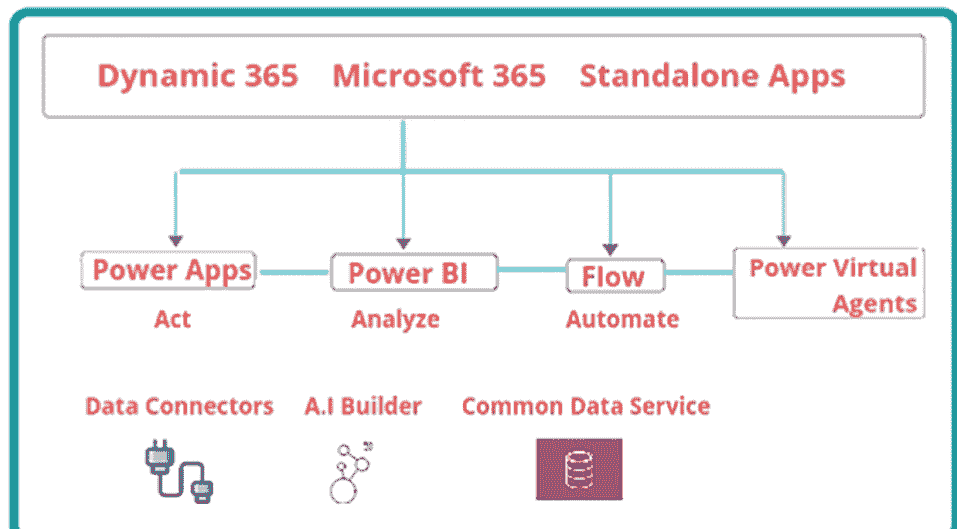

图 1.1 了解 Power Platform 的三种工具。

## Power Apps

PowerApps 是一个面向非技术用户的平台，用于在不编写任何代码或使用低代码应用的情况下开发用户友好且功能完善的应用。

它也被称为公民应用程序开发平台。

Power BI 与 PowerApps 之间的原生连接，使您可以直接从 Power BI 报表和仪表板采取行动，无需切换不同的应用或在窗口之间复制粘贴数据，从而提高生产力并使工作不再那么繁琐。

## Power Automate

Power Automate 是一个智能流程，可让您无需任何相关技术知识即可自动化复杂的业务流程。它拥有一个简单且用户友好的界面，用户可以通过该界面创建自动化工作流，这些工作流可以根据 Power BI 的见解、使用 PowerApps 构建的应用或第三方应用程序来触发。

## Power BI

Power BI 是一款自助式业务分析软件解决方案，可通过 Power Platform 的内置支持从各种业务系统中提取数据，例如 Dynamics 365、Excel 电子表格、云、数据中心和其他资源。然后对这些数据进行分析，以获得有价值的见解。

## Power Virtual Agents

Power Virtual Agent 是一个低代码或无代码图形界面，可让您无需任何先前的编码经验即可创建聊天机器人。它可以用于从不同业务流程中吸引客户，例如人力资源、销售，或 Facebook、Skype 等任何社交平台。

## 横跨功能

我们刚才讨论的 Power Platform 的关键组件依赖于以下核心服务：

- Dataverse
- Connectors
- AI Builder
- Dynamics 365 Customer Voice（以前称为 Forms Pro）

这些核心服务使 Power Platform 的组件能够运行。

## Dataverse

组织使用不同的业务应用程序来实现不同目的，并且从用户那里收集了大量存储在独立孤岛中的数据。但是，要自动化业务流程或构建新应用程序，我们需要将所有应用程序中的数据集中在一个地方。这就是 Dataverse 派上用场的地方（以前称为 Dataverse）。

Dataverse 环境就像一个安全的数据库系统，可让您跨业务应用程序存储和管理数据。它内置了一组用于存储数据的标准实体。它还允许您根据业务要求构建自定义实体，这些实体可以使用 Power Query 访问。

## 连接器

Dataverse 并不完全包含所有数据；因此引入了连接器的概念。顾名思义，连接器用于连接不同的应用程序或服务。例如，假设您所有业务应用程序中存储的数据都使用不同的语言。那么，您这里需要什么呢？最好有一个通用指南，可以为您要连接的系统翻译语言，连接器正是承担此工作。

它使 Power Apps 能够有效地与其他系统和服务中的数据进行通信，而无需了解涉及的 API 或接口。Microsoft 提供了 300 多个内置连接器，您还可以根据业务需求构建自定义连接器。

## AI Builder

AI Builder 是 Power Platform 的新功能，可让您在业务应用程序中直观地添加 AI 功能，以自动化流程并预测结果。与 Power Platform 类似，AI Builder 无需编码经验即可创建自定义 AI 解决方案。它可帮助您创建 AI 模型，该模型可用于通过对象检测跟踪所有产品。它还可帮助您从业务应用中已有的数据预测未来结果，从而做出明智决策，推动业务增长。

## Dynamics 365 Customer Voice

成功的企业明白，客户反馈是业务增长的关键点。每个商业网站都有反馈表单，您可以在其中提出疑问或撰写产品体验。但 Dynamics 365 Customer Voice 提供了更多内容。它为您的组织提供了一些额外功能，例如创建调查并与客户共享以获取宝贵反馈的功能。一旦收到回复，Power BI 就会分析有关您的产品和服务的反馈，以评估信息并采取行动来改变产品和员工体验。

与过去不同，人们现在通过社交媒体和通信解决方案相互连接。因此，企业开始认识到数据驱动决策、大规模协作和在线工具效率的潜力。因此，Power Platform 工具在提高生产力和自动化业务流程方面发挥着重要作用。要释放 Dynamics 365 和 Power Platform 工具的真正潜力，本书将向您展示如何使用这两种技术中的机器学习在您的业务中创造奇迹。这是一个重要主题，因为它将帮助您使用预测性数据分析为您的业务做出主动决策。它还允许企业利用未来预测更高效地执行操作。现在让我们看看，使用机器学习为 Dynamics 365 和 Power Platform 添加一层智能将如何使企业受益。

无论是发送跟进邮件、创建类似记录，还是安排和管理预约，每天在工作场所重复做同一件事，难道不令人沮丧吗？

请想象一下，您的员工每天花 5 分钟来重复执行向所有潜在客户发送跟进邮件的任务。

这意味着，在一个月平均有 25 个工作日的情况下，他每月花费 125 分钟，即 2 小时。一年内，该员工将花费 1,500 分钟，即 25 小时。如果您的组织有 100 这样的员工，请想象您的企业将损失多少小时的生产力。想想看，如果这些员工从事需要他们技能的任务，您的企业本可以取得多少成就。如果您能通过在 Dynamics 365 中使用机器学习来减少这些数字，会怎么样？

Dynamics 365 在销售洞察套件中有一项电子邮件互动功能，当收件人打开您的电子邮件、单击电子邮件中的链接、打开电子邮件中发送的附件或回复时，会向您发送警报。它不会自行完成且需要手动操作的活动有：

- 它不会自动发送跟进邮件。
- 它不会自动设置发送跟进邮件的时间。

诚然，Dynamics 365 确实会根据您组织之前的电子邮件交互历史记录，为您提供创建合适电子邮件模板的功能。但是，选择合适的跟进模板并设置跟进邮件的时间仍然是手动工作。这两个问题可以通过在 Dynamics 365 中使用机器学习来解决。

机器学习有一种称为预测时间算法的算法，可帮助您为每个收件人设置最佳打开时间。为此，机器应拥有收件人的过去数据，包括之前电子邮件中打开和点击链接的互动时间。这样一来，机器就会学习什么时候发送跟进邮件最合适，并在 Dynamics 365 中设置警报。

第二个问题可以通过使用机器学习（ML）技术和自然语言处理（NLP）对电子邮件回复进行情感分析来解决。如果提供了大型数据集，ML 可以使用精确算法在几分钟内有效分类电子邮件的情感。这将帮助机器自动在机器已设置的最佳时间向收件人发送合适的跟进邮件。

如果所有这些重复性任务都由机器来执行，那该多好啊，这样您就可以将精力和时间投入到

更复杂且更高效的任务。

# 什么是机器学习：它是如何演进的？

> “早起的鸟儿能抓到第一条虫子，但最明智的鸟儿能得到最快的那条虫子。”
> — Matshona Dhliwayo

努力工作能带你去往你想去的任何地方，但聪明工作能让你更快到达那里。让我们让系统足够智能，以执行重复/琐碎的任务。现在，让我们了解机器学习究竟是什么，以及它如何发挥作用。

机器学习就像人从经验中学习一样。例如，作为杂货店的店主，你需要优化库存。问题是，ML如何能帮你做到这一点？ML可以根据星期几、季节、附近地点的活动、客户行为等因素预测库存需求。但为了进行精确预测，你需要向机器输入大量数据，以便机器学习算法在数据中发现模式。利用这些数据，ML算法可以提前预测销售额。此外，如果你使用计算机视觉技术监控客户行为，或在商店中使用像LoweBot这样的机器人助手，这两种技术都能帮助ML跟踪库存，并在发现任何意外的库存数据模式时通知经理。

# 机器学习的定义

机器学习通过让机器从示例和经验中学习，释放数据中的隐藏洞察。与其显式编写代码，不如将数据输入机器中的通用算法。然后，机器会分析这些数据，改变数据模式，并构建逻辑，以便对之前未见过的数据进行预测。

# 机器学习的演进

你是否曾想象过50年前没有计算机时商业是怎样的？我们要感谢那些天才的哲学家、数学家和计算机科学家，他们将曾经的虚构变成了现实。今天，帮助我们从家务清洁到驾驶汽车的各项技术不再是科幻小说。机器学习帮助所有企业和个人改进决策、检测疾病、提高生产力、导航车辆并在分析交通模式后推荐最快路线、预测天气、检测欺诈，等等。

图1.2展示了技术如何汇聚以及机器学习如何演进的历程。

ML从机器人流程自动化到技术专长的不断演进已在许多领域留下印记。从初创公司到全球跨国公司的所有企业，都希望在日益雄心勃勃和技术化的市场中制定强大的ML策略。

目前，企业正在努力实现以下目标：网络安全的进步、数字数据监管以及更快的计算能力。在接下来的章节中，本书将教你如何在Dynamics 365中利用先进的ML解决方案来执行复杂任务，并保持准确性，从而助力企业成功。

### 机器学习的演进

没有这些早期的智者，就不会有计算“机器”，更不用说机器学习了。

- **1642**
  19岁的布莱兹·帕斯卡为其税务收集员父亲发明了第一台机械计算器。它可以进行加法、减法、乘法和除法。

- **1679**
  德国数学家和哲学家戈特弗里德·威廉·莱布尼茨制定了二进制代码系统，为现代计算奠定了基础。

- **1770**
  一种设计用来模仿人类的移动机械装置，称为“土耳其人”。

### 1834
查尔斯·巴贝奇发明了打孔卡编程。

### 1842
艾达·勒芙莱斯的算法描述了利用查尔斯·巴贝奇理论上的打孔卡机器解决数学问题的一系列操作。

### 1936
艾伦·图灵理论阐述了机器如何解码并执行一组指令。

### 1943
一名神经生理学家和一名数学家合著了一篇关于人类神经元如何工作的论文。为了阐述该理论，他们使用电路模拟了神经网络。

### 1952
机器学习先驱亚瑟·塞缪尔创建了一个程序，帮助IBM电脑下跳棋下得越多，水平越高。

### 1959
第一个应用于现实世界问题的神经网络是斯坦福的MADALINE，它使用自适应滤波器消除电话线路中的回声。它至今仍在使用。

### 1985
NETtalk由特里·塞杰诺夫斯基和查尔斯·罗森伯格发明，是一种人工神经网络，在一周内自学了如何正确发音20,000个单词。早期的输出听起来像天书，但经过训练后，其语音变得更加清晰。

### 1997
IBM的深蓝战胜了国际象棋大师加里·卡斯帕罗夫；这是计算机首次击败人类国际象棋专家——并且可能也是最后一次。

## 从理论到现实，一切皆成真。

机器学习走出实验室，进入我们的生活，在各个行业都有应用。

### 2006
杰弗里·辛顿将神经网络研究重新命名为“深度学习”。如今，互联网领域的巨头们使用他的技术来改进语音识别和图像标记等工具。

### 2009
斯坦福大学的李飞飞创建了ImageNet作为大型可视化数据库，她意识到如果数据不能反映现实世界，最好的机器学习算法也无法发挥作用。

### 2011
IBM的沃森电脑凭借计算机化医生助手在_危险边缘！_中获胜。

### 2012
Google开发的一个神经网络学会了识别人类和猫，而无需被告知如何描述其中任何一种。

### 2014
聊天机器人“尤金·古斯特曼”通过了图灵测试。它让33%的人类评委相信它是一名乌克兰青少年。

### 2014
健康科技开始使用事件模拟来预测急诊等待时间，依据数据包括人员配备水平、病史和医院布局。这些预测有助于医院缩短等待时间，而缩短等待时间是改善患者预后的关键因素。

### 2015
Google的AlphaGo是第一个在围棋比赛中击败职业选手的程序，围棋被认为是世界上最难的棋盘游戏。

### 2016
IBM沃森的自然语言处理为移动应用中的数字购物助手注入了活力。专家购物助手通过对话帮助消费者找到所需物品，就像人类销售员一样。

### 2017
Alphabet旗下的Jigsaw团队构建了一个系统，通过阅读数百万条网站评论来学习识别网络喷子。底层算法对于资源有限用于审核的网站将是巨大帮助。

### 2017
Google发布了Sonnet，这是一个开源的深度学习框架。一个AI研究团队发表了一篇关于Wasserstein GAN的重要论文，这是对传统GAN的重大改进。

### 2018
NLP和计算机视觉领域取得进展。应用机器学习的受欢迎程度有所提高。

### 2019
研究在机器学习领域继续取得进展。每天都有数百篇关于机器学习和AI的论文发表。ML在商业和商业领域的应用正在变得越来越流行。

**图1.2** 机器学习的演进。

## 机器学习的生命周期

数据驱动型组织在开发ML模型（从原型设计到生产）时面临不同的挑战。为了获得实际的业务价值，数据科学家和数据工程师向模型提供大量数据并对其进行训练，以利用ML算法。为了构建理想的ML系统，企业需要理解ML生命周期流程。现在让我们了解为什么ML生命周期对企业如此重要。

根据sas.com的说法，由于以下原因，50%的模型无法进入生产环境：

- 数据不足。当向模型提供数据不足时，会导致方差增加。方差是一个值，等于ML模型中训练数据和测试数据的预测准确率之差。如果训练数据和测试数据之间的预测准确率很高，模型将使用训练数据产生准确结果，但一旦向其中输入测试数据就会停止工作。

- 训练数据不具代表性。这是指训练数据集不能反映部署环境的情况。这个问题也称为采样偏差。有必要确保你输入模型的样本与其将要部署的环境相匹配。

- 质量差的数据。是指包含缺失观测值、错误、异常值（偏离数据中其他观测值的值）和噪声（虚假且不必要的数据）的数据。

- 数据过拟合。是指模型过于擅长学习训练数据中的细节和噪声，以至于在输入新数据时会产生负面结果。

- 数据欠拟合。当试图使用较少的数据构建准确模型时会出现这种情况。由于数据缺乏，模型无法捕捉数据的基本趋势。

因此，构建模型时，拥有正确的数据、在正确的时间、在正确的位置至关重要。ML生命周期在构建定制ML算法以支持学习模型方面起着关键作用。生命周期的主要目的是创建一个具有良好

可轻松复制、重访并部署到生产环境的工作流。

现在让我们了解机器学习生命周期是什么以及它如何工作：

机器学习生命周期是一种重复性过程，用于构建称为“模型”的高效机器学习系统。

机器学习生命周期包含四个阶段：(1) 数据准备、(2) 机器学习模型、(3) 验证和 (4) 部署。此生命周期旨在从数据中获得更深入的洞察。数据工程师、数据科学家以及处理数据的人员利用它来开发、训练、验证和提供机器学习模型。图 1.3 描绘了典型的机器学习生命周期及其阶段。

让我们逐一深入了解这些阶段。

## 数据准备

机器学习算法需要合适的数据来解决问题。因此，首先，您需要确保收集的数据处于有用的规模和格式。数据准备是一个过程，涉及在将机器学习算法应用于数据之前，将原始数据转换为干净的数据集。

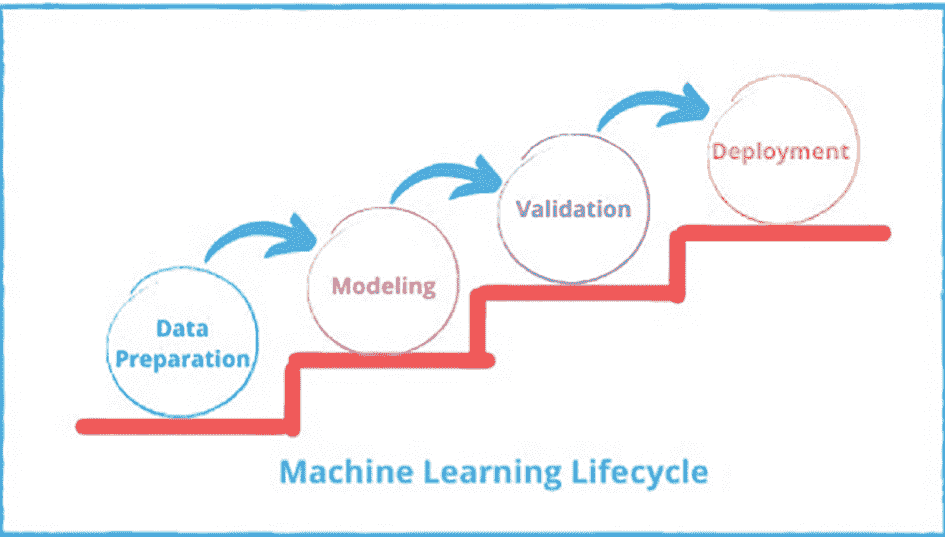

**图 1.3** 机器学习生命周期。

> "目标是将数据转化为信息，并将信息转化为洞察。"
> 
> — 卡莉·菲奥莉娜

数据准备包含四个阶段（另请参见图 1.4）：

- 1. **数据收集或数据选择。** 模型的性能完全取决于其能多有效地实现准确性、精确度、分类、异常检测和推荐。此步骤涉及从组织内的多个资源收集所有可用数据的子集。并不总是包括所有可用数据是个好主意。关键是选择高质量的数据。人们总是认为越多越好。但在选择数据时，您需要着重解决正在处理的问题。例如，您需要模型通过预测高速公路未来的平均速度，来预测车辆在特定高速公路上的行程时间信息。

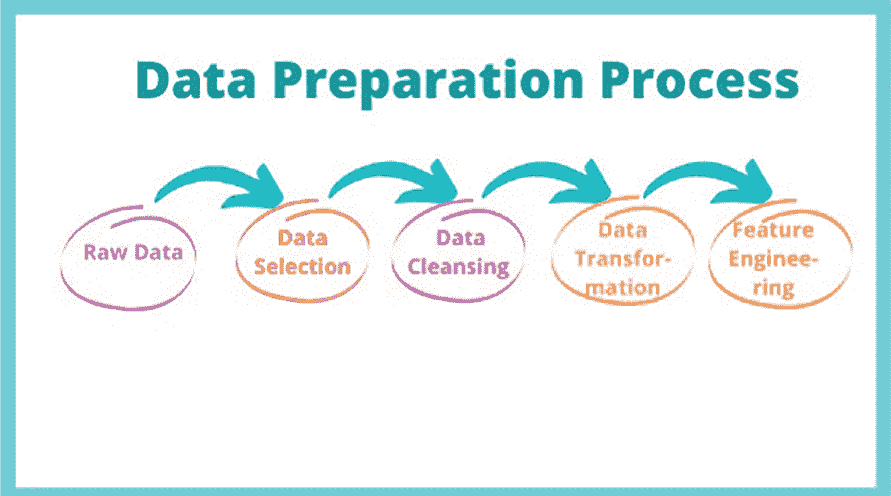

**图 1.4** 数据准备过程。

此问题定义未提供应考虑的任何特定输入，因此创建可行输入和输出变量列表非常重要。要估算高速公路未来的平均速度，需要在模型中映射过去的数据。过去的数据应包括交通系统的理论知识、用户行为、用户统计、工作日和周末的交通、白天和夜晚的交通等等。

要选择高质量的数据，需做出一些假设，并确定您希望从模型中获得的解决方案。但是，数据收集过程实际上是机器学习生命周期中一个非常重要的步骤。而在收集数据时所做的所有不同决定，最终都可能对模型结果产生相当大的影响。

- 2. **数据清洗。** 要清洗数据，您首先需要了解数据。为了获得有价值的洞察，您需要高质量数据，但原始数据包含错误或缺失值。因此，必须获取并清洗相关数据。从原始数据中选择相关数据有两个关键阶段：

  - a. **数据评估。** 这是一项评估可用数据可行性及其与业务问题匹配程度的任务。

  要理解数据，您需要将示例适当标记为类别，以便机器学习模型学习预测。构建机器学习模型应有足够的数据，因为数据的使用取决于所使用的算法和问题的复杂性。

  - b. **数据探索。** 这是测试假设并创建数据有意义摘要的阶段。在此阶段，您会查找缺失值、异常值和不平衡数据。数据清洗是处理原始数据中出现问题的过程，例如缺失值、异常值、不平衡数据、数据中的拼写错误、重复数据等等。让我们来看看此阶段数据是如何清洗的：

    - a. **缺失值。** 如果数据中有缺失值，则应探究其背后的原因，以决定是否可以将这些数据点整体删除。如果删除数据点不是选项，则应使用替代值填充缺失数据。

    - b. **异常值。** 异常值是指与数据中其他观察值不同的值。为处理异常值，您需要替换为其他值，使其对机器学习模型有用。您可以使用随机森林或梯度提升树等算法。

    - c. **不平衡数据。** 不平衡数据是指示例数量不相似。例如，要检测欺诈，需要欺诈案例数与正常案例数相同，因为我们知道机器学习是从示例中学习的。因此，如果数据中欺诈案例不足，机器学习模型将难以识别。因此，有平衡数据是必要的。

- 3. **数据转换。** 数据转换在使数据具有建设性以便在模型中使用方面起着重要作用。其目的是提高算法做出精确且有意义的预测的概率。有几种数据转换技术，例如：

  - **分类编码。** 机器学习模型是理解数字表示的数学模型，但分类数据具有标签值。某些机器学习算法要求输入和输出变量为数值。因此，出于此原因，分类数据通过以下两个步骤之一转换为数值数据：

    - 1. **整数编码。** 也称为标签编码，它为每个唯一类别分配一个整数值。机器学习算法能够理解整数与类别之间的这种关系。例如，您的学历可以是高中、大学或研究生。如果我们为每个类别分配一个整数，如高中 = 1，大学 = 2，研究生 = 3，则此数据将变为机器可读。

    - 2. **独热编码。** 当分类变量不具有序数关系时，使用独热编码。在独热编码中，二进制值分配给每个唯一值，并由不同的列分隔。例如，Facebook 有一个关系状态功能——订婚、已婚、分居、离婚或丧偶。然后每个状态都将有不同的列，其中“订婚”状态在“订婚”列中赋值为 1，在其余四列中赋值为 0。

  - **处理偏斜数据。** 如果数据不是对称的，即数据分布的一半不是另一半的镜像，则该数据被视为非对称或偏斜数据。因此，为了在偏斜数据中发现模式，您需要对整组值应用对数变换或倒数（即正或负）或 Box-Cox 变换。这样，您就可以将其用于统计模型。

  - **偏差缓解。** 偏差缓解可以通过交替当前值和标签来实现，以获得更无偏的模型。可帮助完成此过程的算法包括重加权、优化预处理、学习公平表征和差异影响消除器。

  - **缩放。** 当使用回归算法和使用欧氏距离的算法时，需要将数据转换到特定范围。这可以通过改变每个数值特征的值并将其设置为通用标尺来完成。这可以通过使用归一化（最小-最大缩放）或 Z-score 标准化来完成。

- 4. **特征工程。** 特征工程是从原始数据构建解释变量和特征的过程，以将我们的输入转换为机器可读的格式。这些变量和特征用于训练模型。要执行此步骤，应清晰地理解数据。特征工程可以通过两项活动来实现：

  - a. **特征提取。** 其目的是在不丢失相关信息的前提下减少处理资源的数量。此活动将变量组合为特征，从而减少处理数据量，同时仍能准确描述原始数据集。

  - b. **捕获特征关系。** 如果您对数据有更好的理解，可以找出两个特征之间的关系，以帮助算法关注您知道的重要内容。

## 选择算法和模型（建模）

完成了艰苦的部分（即数据选择和数据预处理）后，我们现在进入有趣的部分：建模。

建模是一个通过不断训练和测试模型来创建智能模型的迭代过程，直到您发现具有高精度和性能的模型。

要训练机器学习模型，需要为机器学习算法提供一个干净的训练数据集供其学习。选择学习算法取决于当前手头的问题。您计划输入机器学习算法的训练数据必须包含目标属性。机器学习算法在训练数据中寻找模式并学习

从中。然后用新数据测试这个ML模型，以对未知目标属性进行预测。让我们通过一个示例来理解它。

你希望训练模型将垃圾邮件与常规邮件分开。为此，你需要为学习算法提供包含白名单和黑名单的训练数据。白名单包含你倾向于接收邮件的人的电子邮件地址。黑名单包含你希望避免接收邮件的所有用户地址。因此，ML算法将从这些训练数据中学习，并预测新邮件是来自黑名单还是白名单。如果来自黑名单，它会自动将其标记为垃圾邮件。

要创建有效的模型，选择能够发现可预测、可重复模式的准确算法非常重要。一方面，一些需要机器学习的问题非常具体，需要独特的方法来解决问题；另一方面，一些问题需要试错方法。

机器学习算法分为四种主要类型（参见图1.5）：

- 1. 监督学习
- 2. 无监督学习
- 3. 半监督学习
- 4. 强化学习

让我们逐一了解：

### 1. 监督学习

这是一种学习算法，机器使用标记良好的数据进行训练，并借助标记数据集进行预测。

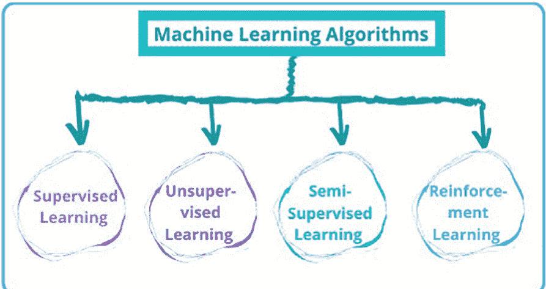

**图1.5** 机器学习算法。

**什么是标记数据？** 你已经知道目标答案的数据称为标记数据。例如，如果我向你展示一张图片并告诉你这是一只蝴蝶，那么它就称为标记数据。但是，如果我向你展示一张图片而不告诉你是什么，则称为未标记数据。

现在让我们通过一个示例来了解标记数据如何让机器学习。

我们有标记为勺子和刀的图像；然后我们将它们输入机器，机器根据形状、大小和锐度等特征分析并学习这些图像与标签之间的关联。现在，如果向机器输入没有标签的新图像，过去的数据将帮助机器准确预测并判断它是勺子还是刀。因此，在监督机器学习中，算法教导模型从我们提供的标记示例中学习。

它包含两种技术：分类和回归。

- **分类。** 例如，如果输出变量是类别型的，如红色或蓝色、患病或无疾病、男性或女性、是否会获得加薪？

- **回归。** 回归是指输出变量为实数或连续值的问题，例如基于工作经验的薪水或基于身高的体重。因此，它创建显示数据趋势的预测模型。例如，我能获得多少加薪？

以下是监督学习中常用算法的列表：

- 最近邻
- 朴素贝叶斯
- 决策树
- 线性回归
- 支持向量机 (SVM)
- 神经网络
- 逻辑回归
- 线性判别分析
- 相似性学习

### 2. 无监督学习

在这种学习中，不给机器训练，允许其对未标记的数据进行操作。因此，机器试图识别模式并提供预测。让我们以勺子和刀为例，但这次我们不告诉机器是勺子还是刀。机器本身从集合中识别模式，并根据其模式、相似性、差异等进行分组。

无监督学习包含两种技术：聚类和关联。

- **聚类。** 在聚类中，机器根据数据行为形成分组。例如，哪个客户购买了类似的产品？

- **关联。** 它是机器学习的一个领域，用于识别大型数据集中变量之间的特殊关系。例如，哪些产品被一起购买？

以下是无监督学习中常用算法的列表：

- k-means聚类
- 关联规则

### 3. 半监督学习

半监督学习是一种机器学习类型，结合了监督学习和无监督学习技术。它用于数据集包含标记数据和未标记数据的场景。

例如，假设我们可以访问大量想要用于训练模型的未标记数据集。手动为所有数据打标签是不切实际的。因此，我们不是为整个数据集打标签，而是手动标记数据集的一部分，并使用该部分来训练模型。但这样一来，所有未标记数据都将无法使用。众所周知，用于训练模型的数据越多，模型就会越好、越稳健。那么我们可以做什么来利用数据集中的未标记数据呢？

这就是引入半监督学习的原因。为了防止未标记数据被浪费，我们可以实现一种称为伪标记的半监督学习技术。

要理解伪标记，让我们继续之前提到的示例。

我们的模型使用标记数据进行训练，并且表现相当不错。到目前为止的一切都只是常规的监督学习。现在我们将使用无监督学习来预测剩余未标记部分的数据。我们将未标记数据提供给模型。训练后的模型将处理这些数据，并据此为每个未标记数据预测单独的输出。因此，伪标记是使用神经网络预测的输出来标记未标记数据的过程。通过伪标记，我们可以在规模大胆扩大的数据集上进行训练。

### 4. 强化学习

强化学习中没有预定义的数据。它是关注行为心理学的机器学习领域。在这种学习中，一个智能体被放置在环境中，并通过执行某些动作并观察其从动作中获得的奖励来学习如何在该环境中行为。强化学习涉及软件智能体，它们在特定情况下采取适当的动作以获得最大奖励。这种学习中没有预期的输出。强化智能体决定采取什么动作来执行任务。在没有训练数据集的情况下，它注定要从自身经验中学习。

以下是强化学习中常用算法的列表：

- Q学习
- 时序差分 (TD)
- 深度对抗网络

现在要为你的问题选择合适的算法，应根据以下内容对问题进行分类：

- 按输入分类
  - 标记数据：监督学习
  - 未标记数据：无监督学习
  - 标记数据和未标记数据的组合：半监督学习
  - 没有数据，希望通过与环境交互来优化目标函数：强化学习

- 按输出分类
  - 如果模型的输出是数字：回归问题
  - 如果模型的输出是类别：分类问题
  - 如果模型的输出是一组输入组：聚类问题
  - 为了检测异常：异常检测

- 了解你的约束
  - 模型存储容量
  - 快速预测
  - 快速学习

- 查找可用算法：影响模型选择的因素包括：
  - 业务目标
  - 数据所需的预处理量
  - 模型准确性
  - 模型可扩展性

- 考虑模型复杂性
  - 复杂的特征工程
  - 计算开销

这些要点可以帮助你为开发解决实时业务问题的方案选择合适的算法，这需要了解业务需求、规则和法规、利益相关者的利益以及重要的专业知识。因此，要解决机器学习问题，结合和平衡算法以获得有价值的结果至关重要。

## 验证

一旦机器学习模型在给定数据集上得到适当训练，我们就必须对模型进行测试。在此步骤中，我们通过向模型提供测试数据集来检查模型的准确性。测试模型很重要，可以根据项目要求或给定问题找出模型的百分比准确性。


这个验证阶段的输入是模型学习阶段之前步骤产生的训练模型，输出是一个经过验证的模型，它提供足够的信息，让用户能够检查机器学习模型是否适合其预定用途。因此，机器学习生命周期的这个验证阶段处理的是在输入未见数据时，模型是否按预期正常工作。因此，模型验证是在测试数据集上评估训练模型的过程。这一步体现了训练模型的泛化能力。

## 部署

机器学习生命周期的最后一步是部署，我们在其中将 ML 模型部署到实际系统中。部署是机器学习生命周期过程中非常关键的一步。部署是使你的模型能够在生产环境中进行预测的过程。此阶段的目的是检查部署后模型的正常功能。模型需要以这样一种方式进行部署，即它们既可用于推理，也可定期更新。只有当准备好的模型按照指定要求产生准确结果，并且速度可接受时，我们才会将模型部署到实际系统中。但在部署项目之前，你需要检查它是否正在使用可用数据来提升性能，以及你是否想选择平台即服务 (PaaS) 或基础设施即服务 (IaaS)。PaaS 非常适合原型开发和流量较低的业务。最终，当业务增长且流量增加时，你需要切换到 IaaS。这是测试在现实世界中预测结果能力的步骤。

## 机器学习的优势

机器学习可以通过预测未来结果并据此做出更好的决策，帮助你解决业务问题。以下是一些可以帮助你了解机器学习是否适合你的优势：

- 从大量数据中提取有意义的见解。例如，ML 有助于从大量数据中发现特定模式，这些模式对人类来说可能不太现实（例如，像 Flipkart 这样的电子商务网站拥有大量数据。使用 ML，它观察客户的购买和浏览历史，从中发现模式，然后向他们推荐类似的产品和交易）。
- 算法无需任何人工支持即可自行改进预测。
- 机器学习算法可以从经验中学习。因此，随着项目的增长，预测的准确性也会提高。
- 机器学习算法可以处理各种数据。例如，多维数据。
- 机器学习自动化耗时且重复的任务。
- 机器学习通过持续监控市场需求的变化，并促使组织采取主动措施来实时保持其竞争优势，从而帮助企业做出正确的决策。

## 机器学习的缺点

既然我们了解了机器学习的所有优势，让我们来揭示一些缺点，因为每枚硬币都有两面：

- 需要海量数据集来训练机器学习算法。
- 在每个算法上运行训练数据以选择适合你问题的算法是一项耗时且需要人工操作的任务。
- 在所有算法中训练和测试大型数据集可能会导致需要花费大量时间才能解决的错误。

## 机器学习 + Dynamics 365 / Power Platform：无处不在的洞察

我们希望在这本书中涵盖的一个关键点，真的是要向你提供关于未来十年什么重要的洞察：在实施你的“基础”CRM 和 ERP 系统后如何前进，并使用 Dynamics 365 和 Power Platform 对其进行增强。正如你在下一章中将看到的，我们将把这两个世界结合在一起。

如今 AI 无处不在，而且你在这些系统中拥有大量数据，不在其背后加入智能实在太可惜了。Microsoft 正在推动 Insight Add-On，基本上是在不编写所有代码的情况下，直接在带有数据的系统中添加智能。

AI Builder 是 Power Platform 的一部分，只需点击几下即可为你直接利用一些 AI 模型。Dynamics 365 Finance Operations 连同公司每个流程的所有模块，将通过回答诸如：我的现金流预测是多少？这个客户是否会按时付款？我的供应链方面的需求预测是多少？生产订单？这些客户的流失率是多少？等这类问题，成为 AI 的巨大组成部分。这就是我们需要为公司高层管理人员实现真正投资回报率所要去的方向。即使是 Power BI 和 Azure Synapse Analytics 以及 Microsoft 云生态系统中的各种新功能，现在也都带有一些 AI 部分和功能。所以，是时候跳进去了！

# 第 2 章

## Dynamics 365 中的人工智能和预构建机器学习

## Azure AI 平台

随着机器智能的创新能够在感知和认知任务中提供——有时甚至超越——人类水平的性能，组织越来越多地评估如何应用人工智能来创造新的商业价值并让世界变得更美好。可以合理地假设，很快，使用技术来自动化所有常规和例行工作的公司将比不使用的公司进步得更快。

像人工智能 (AI) 这样的技术正在改变当今企业的运营方式。它是当今最受关注的技术，结合 Azure 云服务，正在为中小型组织创造奇迹。

Azure AI 如何帮助 Dynamics 365 用户？

> “决定你未来的是你所做的选择。”
> — Donny Ingram

如今，AI 功能可以应用于业务范围的各个方面，以构建 AI 驱动的业务逻辑和用户界面。Dynamics 365 中的 AI 功能使企业能够提供智能业务决策、吸引客户、优化运营、赋能员工并改造产品。

Azure AI 结合了为所有技能水平开发 AI 解决方案的能力、安全地大规模将 AI 构建到关键任务应用程序中，以及将负责任的 AI 付诸行动，以了解、保护和控制你的 AI 系统。

Azure AI 既是一套称为 Azure 认知服务的云基础 AI 模型集合，也是一项称为 Azure 机器学习的基于 Python 的机器学习服务。Azure 认知服务是特定领域的、预先训练好的 AI 模型，可以使用你的数据进行自定义，并在云端和边缘部署。Azure 机器学习使所有技能水平的开发人员和数据科学家能够构建、训练和部署机器学习模型，优化和加速模型推理，使用自动化机器学习加速模型开发，并轻松跨云和边缘部署和管理你的模型。

Azure AI 使世界各地数百万组织的开发人员和数据科学家能够构建创新解决方案。使用 Azure AI，企业可以轻松地将认知服务、机器人框架、Azure 机器学习等强大工具嵌入到他们的应用程序中。

Azure AI 旨在在三个关键领域提供 AI 功能：

- 1. 使用 Azure 机器学习快速构建并轻松训练、部署和管理你的模型，以优化业务流程。
- 2. 使用视觉、语音、语言理解和决策功能，为你的 AI 驱动型应用程序和代理交付突破性体验。
- 3. 使用 Azure 认知搜索构建知识挖掘解决方案，从所有非结构化内容中解锁洞察。

让我们从机器学习 (ML) 开始。

## 机器学习

为什么我们的业务需要机器学习？

让我们想象一下，你拥有一家在线电子商务企业，在每家企业中都要做出大量决策才能成功运营。当然，你也有一个决策工具，它可能是 dynamics 的一部分。


或者它也可以是一个独立的工具。而且由于它是一个电子商务网站，您的所有产品目录都位于其中。现在，决策管理工具需要做出哪些决定？

- 当客户使用其帐户登录到您的网站时，应该向他显示哪些产品？您可以显示网站上所有的产品，也可以通过仅显示可能引起他兴趣的产品来个性化体验。

假设决策工具只显示了可能吸引他兴趣的产品。现在客户做出了选择，并将产品加入购物车。

- 现在是我们需要做出的第二个决定：基于他对第一个产品的选择，您可以推荐哪些其他产品供他一起购买？

- 或者，您可以展示哪些其他品牌的相似产品来匹配客户的期望？

由此可见，即使是简单的业务流程也涉及大量决策。开发人员过去曾将所有这些决定都编码，但为每个决定编码都有其局限性。例如，如果业务流程有任何变化，开发人员必须浏览代码并修改规则，这似乎是一项大量的工作。

现在 Dynamics 365 提供了一些功能，例如，在这种情况下。它使用交叉销售和升级销售技术以及基于规则的引擎来做出此类决策。

交叉销售或升级销售是一种向客户销售额外产品或向其推荐更好产品的技术。如果 Dynamics 365 可以处理这些情况，那么为什么需要机器学习？

如果我们使用机器学习，它可以通过增强这些规则为所有此类决策带来智能，从而得出更好的预测性或规范性分析，使您的应用程序更加灵活。在这种情况下，通过观察客户的先前购买记录和浏览历史，机器学习可以分析客户行为并预测：

- 当客户登录时，显示哪些个性化产品。
- 推荐哪些可一起购买的产品。
- 哪些其他品牌最能满足他们的期望。

当然，Dynamics 365 和 Power Platform 自动化了您的流程，但当机器学习与 Dynamics 365 结合时，可以提供基于 AI 的业务逻辑来自动化业务流程或增强人类智能以做出更明智的决策。通过这个示例，您可以了解机器学习能为您的业务做什么。

让我们进入为什么您应该选择 Azure 机器学习。

## Azure 机器学习

Azure 机器学习是一个基于云的环境，它：

- 提供名为 Azure 计算实例的托管基于云的工作站，该工作站针对您的机器学习开发环境进行了优化。对于要求更高或生产级别的模型训练，您可以使用 Azure 机器学习计算群集以获得额外功能。
- 允许您指定计算目标，即运行训练脚本或托管服务部署的指定计算资源或环境。您可以将这些计算目标部署为 Web 服务以进行实时推理调用，定期作为批处理服务，或通过 Azure IoT Edge 通过 Docker 容器部署到 IoT 设备。
- 提供灵活性，可在诸如自动化机器学习、可视化拖放式设计器或带有内置开源工具和框架支持的代码优先 Notebook（例如 Jupyter 等 IDE 和命令行界面，或 Python 或 R 等语言）等编写体验中构建和训练模型。
- 是一种按使用量付费的设施，这意味着您只需为所使用的服务付费。

现在，让我们深入了解 Azure ML 如何优化业务流程：

- 1. **构建应用程序所需时间更少。** Azure ML 加速端到端机器学习周期，使数据科学家能够通过利用自动化工具更快速地部署模型。
- 2. **支持多种框架。** Azure ML 允许用户从多种框架中选择来创建 AI 模型——例如 scikit-learn、PyTorch、MXNet、TensorFlow、Chainer 和 Keras。
- 3. **提供与技能无关的体验。** 用户可以根据其拥有的技能水平或偏好的编写体验，使用无代码设计器、Python SDK、Jupyter Notebook、VS Code 或他们喜欢的 IDE 构建模型。
- 4. **使用 MLOps 实现数据科学家与运维团队之间的通信。** 它用于通过消除浪费来自动化许多流程并产生更有价值的洞察。
- 5. **与容器编排服务兼容。** ML 服务与 Docker、Azure Kubernetes 服务和 Azure 容器实例兼容，因此可以轻松将模型部署到支持最关键工作负载的平台。

目前为止，我们已确定 Azure 机器学习解决方案对业务增长的重要性。现在，让我们关注它所提供的功能。

## 机器学习工作室

它是一个图形 Web 界面，可以兼得两者之长，因为它可以帮助您创建自定义机器学习应用程序，即使您对编写复杂代码一无所知。从中受益最大的人是该领域的新手。

让我们通过一个示例来了解 Azure 机器学习工作室的工作原理。跟踪每月开支并相应规划很自然，但您如何确定下个月也会有相同的固定开支呢？当然，我说的固定开支是指：

- 家庭开支
- 食品开支
- 个人开支
- 债务义务
- 医疗保健开支
- 交通开支

这些是每个公民每个月都必须支付的基本开支。您如何做出这样的预测：交通开支、家庭开支或任何其他开支都不会在下个月上升或下降？如果您能预先预测下个月的支出和储蓄，那该是多么令人解脱啊？也许，您可以使用 Azure 机器学习工作室找到答案。您不一定需要了解技术；Azure 机器学习工作室简化了机器学习模型和服务的开发与部署。让我们通过一个假设来做同样的事情。

- **问题定义**：您家庭的电费属于家庭开支，并已包含在预算中。它通常是一项固定开支。现在让我们考虑可能影响其稳定价格的因素。从政治判断到天气状况，从自然灾害到不可预测的因素，这些情况中的任何一种都可能影响您下个月的预算。

让我们通过在 Azure 机器学习工作室中创建机器学习项目来探索其功能。您可以使用工作室来管理工作区中的资产：

- 模型
- 数据集
- 数据存储
- 计算资源
- 笔记本（Notebooks）
- 实验
- 运行日志
- 管道
- 管道终结点

- **数据收集。** 收集相关数据是第一步也是最重要的一步。Azure 机器学习工作室中有许多示例数据集。在 Azure 机器学习中，您可以连接到现有的基于云的存储（例如 Azure Data Lake Storage 或 Synapse Analytics）或利用本地文件中的数据集（以及其他选项）。要在工作区中的实验之间重复使用和共享数据集，您必须先注册数据集：

- 登录 Azure 机器学习工作室。如果您没有 Azure 订阅，现在可以开设免费试用帐户 (https://azure.microsoft.com/en-us/free) 并创建 Azure ML 工作区。
- 在左侧窗格的“资产”下选择“数据集”。
- 选择“+ 创建数据集”，然后选择“从本地文件”。
- 完成表单以创建并注册新数据集。

- **数据处理。** 这是 ML 生命周期中的一个非常重要的步骤，因为它有助于根据您的需求调整数据。您的数据中可能存在一些需要清理的缺失值，以便数据能够被精确分析。为此，您需要将“清理缺失数据”模块从左侧面板拖到实验中，并将其连接到您的数据集。然后，您需要从清理模式下拉框中选择“删除整行”选项，以完全删除缺失（null）值或将其替换为某个其他值。现在运行实验。

- **定义特征。** 在这一步中，您将从数据集中选择将用于预测价格的列。为此，


你必须选择基于筛选的特征选择模块，该模块包含各种算法和相关方法，例如皮尔逊或肯德尔相关性、互信息分数、卡方值、斯皮尔曼相关性等，这些可用于特征选择过程。特征选择过程涉及对输入应用统计检验，在给定指定输出的情况下，确定数据集中哪些列具有最大的预测能力。因此，在此过程中，要传递给学习算法的特征会被选定。使用此模块将通过帮助你选择正确的特征，提高分类的准确性和有效性。

- **选择正确的算法。** 至此步骤，我们已成功清理和处理了数据。在此步骤，我们将首先使用 Split 模块将清理后的数据集分为两部分。我们将使用第一半训练模型，并使用其余部分对训练后的模型进行评分。现在我们需要选择正确的算法来构建可随后训练和测试的预测模型。因为我们有标记的数据集，所以有两个选项可供选择：分类和回归。它们是两种受监督机器学习类型，在 Train Model 模块中生成，可用作评分输入。Score Model 模块生成下个月电费账单的预测数值。现在将 Evaluate Model 模块拖到实验中，并将 Score Model 模块的输出连接到它。我们正在使用评估模型模块来衡量训练后模型的准确性。单击 Run 以生成 Evaluate Model 模块的结果。

创建预测模型是一个迭代过程。要获得满意的结果，需要跟踪实验的所有迭代。这样你就可以比较两次运行的结果，并决定哪次运行产生最准确的结果。

## AZURE 机器学习服务

Azure ML 服务是一个使用 Python 创建 ML 解决方案的开放平台。它提供工具，可轻松无缝地扩展和自动化 ML 模型的训练、部署和监控。

在 Azure ML 服务之前，生产环境中的机器学习需要你整合一堆数据服务来支持完整的机器学习生命周期，例如：

- **Azure Blob 存储或 Azure Data Lake 存储：** 这些是数据的存储解决方案。将这些解决方案整合在一起很重要，因为没有数据就无法训练模型。Azure Data Lake 以及 Azure Synapse Analytics 常用于在机器学习之前存储数据/数据集。
- **虚拟机、Azure HDInsight 和 Azure Databricks：** 这些被整合在一起以运行代码。
- **虚拟网络：** 虚拟网络充当安全边界，通过将 Azure 资源与公共 Internet 隔离来保护数据。你可以将虚拟网络用于在同一虚拟网络中处理计算和数据，也可以使用 Azure 虚拟网络连接到本地网络，以安全地训练模型并访问已部署模型进行推理。
- **Azure 密钥保管库：** 这是一个云托管服务，用于管理和保护凭据、授权证书访问以及许多其他机密。你完全控制用于访问和加密数据的密钥。管理员有权授予或撤销对密钥的访问权限。
- **Docker 容器：** Docker 容器映像是一个独立的可执行软件包，用于反复运行实验，因为它包含运行应用程序所需的一切（例如一组一致的 ML 库、代码、系统工具和设置）。它使用 Azure 容器注册表（一种私有 Docker 注册表服务）来存储这些 Docker 容器，并将其放置在虚拟网络中。
- **Azure Kubernetes 服务：** 是一种编排服务，用于在容器主机集群上部署、扩展和管理 Docker 容器及基于容器的应用程序，并将其包含在虚拟网络中。

将所有这些整合到同一虚拟网络中，以使机器学习模型协同工作，耗时很长。但 Microsoft 通过 Azure 机器学习服务消除了这种复杂性。

> Azure ML 服务是为精通 Python 的经验丰富的数据科学家和 AI 开发人员提供的托管基础架构。它是一种使用任何工具或框架来构建和部署模型的服务。

使用 Azure 机器学习服务的优势如下：

- 它提供端到端的 ML 生命周期管理。
- 它会跟踪你的所有实验。
- 它具有内置功能，如版本控制和模型可重现性，可通过存储与实验相关的所有内容（如代码、配置、环境详细信息、参数设置等）来复制任何实验。
- 它方便你将模型封装在容器中，以便将其部署到 Azure 本地或 IoT 设备。封装模型的容器可以轻松管理和缩放。
- 它拥有 Notebook VM，这是一种基于云的工作站，已集成到 Azure 机器学习服务中，专门为数据科学家创建，方便他们在本地开始并随后在 Azure 中轻松计算。它帮助开发人员和数据科学家使用 Jupyter Notebook 执行 Azure 机器学习 Python SDK 支持的操作。
- 它使用 TensorFlow 和 scikit-learn 等流行框架，并提供强大的工具集来操作 ML 实验。它使你能够将模型部署到第三方服务（如 Docker）的生产环境中。

## AI 驱动的应用和代理

从为业务赋予计算机视觉以进行库存跟踪，到为个性化电子商务体验增添人性化触感，又或者从帮助企业发现实时异常到从患者记录中提取关键数据，你可以使用 Azure 认知服务构建智能解决方案，几乎不需要技术专长，即可满足端到端的业务需求。

Azure 将几种专门设计的服务相结合，使开发人员能够轻松在构建 AI 驱动的应用和代理时使用 AI 功能。例如：

- Azure 认知服务
- Azure Bot 服务

## Azure 认知服务

Azure 认知服务包括预构建的 AI 功能和认知 API，可将其包含在你的应用程序中，无需机器学习专长即可推动业务影响。语音、视觉、语言和 Web 搜索等 AI 功能可帮助你构建智能应用。只需几行代码和一个 API 调用，即可将这些功能嵌入到你的应用程序中。Azure 认知服务包括以下功能（另请参见图 2.1）：

- **视觉：** 允许你的应用程序理解图像和视频。
- **语音：** 用于改进语音识别和识别说话人的工具。

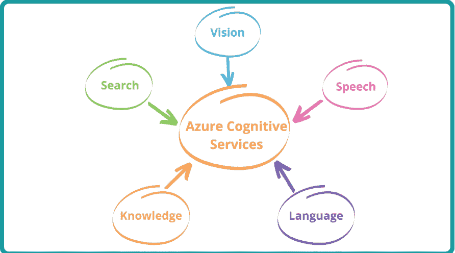

### 图 2.1 Azure 认知服务。

- **语言：** 理解句子和意图，而不仅仅是单词。
- **知识：** 为你追踪科学期刊中的研究。
- **搜索：** 将机器学习应用于 Web 搜索。

让我们逐一了解这些功能。

### 视觉

视觉有助于分析视频和图像，以获得有价值的见解。视觉 API 分为五个部分（计算机视觉、内容审核、视频索引器、面部 API 和情感 API）（另请参见图 2.2）：

- **计算机视觉 API** 使用图像处理算法智能处理图像。它可以执行以下操作：
  - 它可以通过理解图像中的内容来分析图像。例如，如果它是一幅画或一张照片，则是图像中的颜色。
  - 它使用光学字符识别技术来理解图像中的文本。


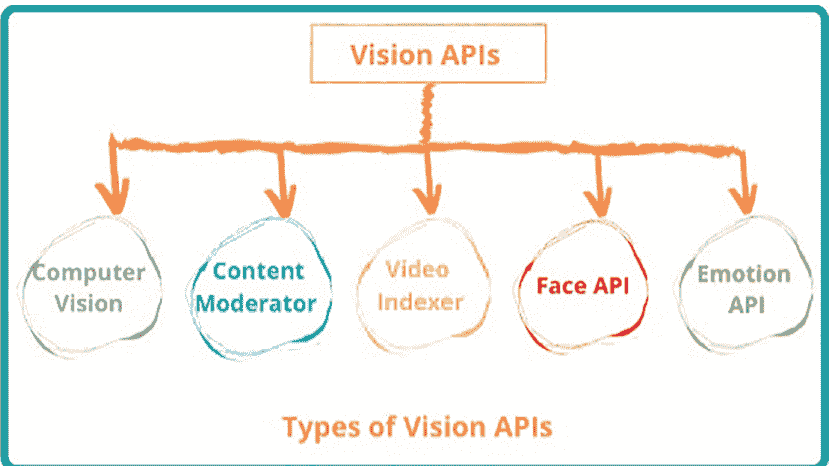

图 2.2 视觉 API 的类型。

- 它可以通过缩放和裁剪图像来保留关键内容。
- 借助领域特定模型，它可以识别来自世界各地商业、体育和娱乐领域的 200,000 名名人。

让我们看看它被使用的一个示例。

没有人喜欢处理一堆开支和收据的纸质单据。将费用报告和报销审批等流程数字化，利用技术轻松处理工作场所中最常见的文档（即收据）是件好事。在 Dynamics 365 中进行报销时，您需要拍摄收据照片，并手动填写所有信息，例如交易的时间和日期、商家信息、税费金额、总额等，然后经理需要花时间审批这些费用报告。除了审计这些费用报告的麻烦之外，这还会影响员工的生产力。此外，随着移动摄像头的普及，员工经常上传揉皱、褪色或在低质量光线条件下拍摄的收据图像。

为解决这些问题，亟需一种能够从收据中自动提取所有信息的解决方案，从而减少此类工作的手动工作量。基于视觉 API，微软引入了一项名为表单识别器的预构建功能，它能从收据图像中提取所有必要信息，从而将周转时间降至最低。

- **内容审核 API。** 内容审核 API 使用机器学习辅助分类器来检测潜在的冒犯性或不需要的图像。通过此 API，您可以确保用户看到您希望他们看到的内容。它可以执行以下任务：

  - **图像审核。** 它使用基于机器学习的分类器、自定义列表和 OCR 来检测冒犯性图像。

  - **文本审核。** 它为您提供检测 100 多种语言中粗俗语言的能力，并自动将文本与您的自定义列表进行匹配。它还有助于识别个人身份可识别信息 (PII)。

  - **视频审核。** 它使用机器辅助检测来对视频中可能的成人和露骨内容进行评分。它作为 Azure 媒体服务的一部分部署。

- **视频索引器。** 视频索引器是一项视频元数据提取服务，可帮助您将所有智能融入视频中，以解锁有价值的见解。使用视频索引器，您可以在上传视频后立即开始查找见解，无需编写一行代码。它有助于增强内容发现；例如，您可以通过检测口语、面部、情感和角色来搜索结果。

- **人脸 API。** 人脸 API 使用高级算法执行以下任务：

  - **人脸检测。** 它可以帮助您检测图像中人脸的位置。它会在图像周围绘制一个框来检测您的面部。

  - **人脸验证。** 此功能允许您确定正在比较的两张图像是否属于同一个人。如果不属于同一个人，它会告诉您该人员的性别和年龄。

  - **相似人脸搜索。** 此功能允许您在一组图像中搜索同一个人的面部。

  - **人脸分组。** 它允许您识别具有相似特征的面部，并将它们组织成组（例如按组大小划分）。

  - **人脸识别。** 它可以帮助您检测图像中的其他面部并识别他们是谁。他们可能是您已经认识的人。

- **情感 API。** 情感 API 可帮助您识别图像中表达的情感。它检测面部上的七种情感类型（快乐、悲伤、惊讶、愤怒、恐惧、蔑视和中性表情）。

### 语音

> “理解一种语言就是理解思想。”
> — 玛纳利·蒂瓦里

如果您希望机器理解您的思想并像人类一样思考，您需要创建一个能够理解您的语音和语言的解决方案。认知语音服务可让您做到这一点，使您的应用程序对世界各地日益多样化的社区都有用。Azure AI 功能使您的员工能够改善客户互动。例如，如果您环游世界体验不同文化，您可能会遇到一种情况，即您发现很难与该国的政府官员沟通，因为您的母语与他们的不同。假设您访问法国，那里以法语为母语，现在您想报告一起犯罪。您被抢劫了，抢劫犯拿走了您的钱包和里面的所有现金。您会如何向政府官员解释这种情况？

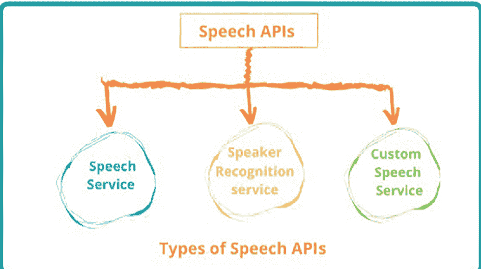

图 2.3 语音 API 的类型。

如果政府官员正在使用 Azure 语音服务将语音翻译成文本，您无需担心。Azure 语音转文本服务会立即将音频语音转录为可读文本。该服务可用于调查情况；您可以准确说明发生了什么，同时政府官员可以询问与事件相关的问题。

认知服务语音 API 分为三类（另见图 2.3）：

- 语音服务
- 讲者识别服务
- 自定义语音服务

让我们逐一了解它们：

- **必应语音和语音服务。** 必应语音 API 是一种可以处理不同语言的算法统一体。此 API 使开发人员能够在其应用程序中包含语音驱动的活动。此 API 可以转录与用户的实时交互。

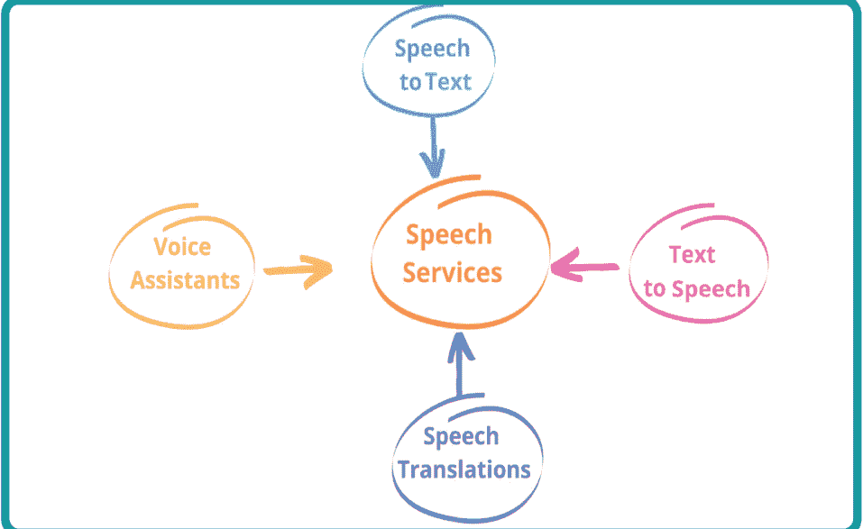

图 2.4 语音服务。

2020 年 1 月 14 日，微软停止了此 API，并引入了一个名为语音服务的更好版本。语音服务具有哪些必应语音没有的最新功能？

- 语音服务是所有以前分别存在的 Azure 语音服务的综合体，例如自定义语音、语音翻译和必应语音。
- 必应语音没有支持所有编程语言并可在所有现代平台上运行的通用语音 API 和 SDK。此功能在语音服务中可用。
- 语音服务支持 C++ SDK，而必应语音不支持。
- 语音设备 SDK 包含与特定麦克风启用硬件配对的预调库。

由于必应语音已被语音服务取代，我们将仅讨论语音服务及其功能（另见图 2.4）：

- **语音转文本。** 正如名称所示，它是一项将语音翻译成文本的服务。此服务的功能包括：

  - **实时语音转文本翻译。** 此功能用于实时场景，将音频流转换为可由应用程序、工具和设备使用的文本。

  - **批量语音转文本。** 它允许将存储在 Azure Blob 存储中的大量音频异步转录为文本。要接收异步转录结果，您只需指向具有共享访问签名的音频文件即可。批量语音转文本还支持情感分析等功能。

  - **多设备对话。** 当多个客户端或设备连接到同一对话并发送和接收音频消息时，此功能可实现语音转文本翻译。

  - **对话转录。** 对话转录是一种解决方案，通过结合语音识别、讲者识别以及对每位讲话者的句子归属，提供异步和实时语音转文本转换。它也可用于面对面会议，并可以区分各项特征。

  - **创建自定义语音模型。** 此功能可让您使用一组在线工具创建和训练自定义声学、语言和发音模型，这些工具可以评估并提高模型中语音转文本的准确性。

  - **文本转语音。** 正如名称所示，文本转语音使用一种名为语音合成标记语言 (SSML) 的基于 XML 的标记语言，将输入文本翻译成类似人类的语音。

  - **创建自定义语音。** 此功能可让您根据产品或品牌创建独特的自定义语音。

  - **语音翻译。** 当您的应用程序、工具或设备需要实时进行多种语言的语音转语音或语音转文本翻译时，此功能非常有用。


- **语音助手。** 当您希望在应用程序或设备中创建类似人类的对话界面时，会使用语音助手。它可在设备和助手之间实现快速可靠的对话，后者使用以下两者之一：Bot Framework 的 Direct Line Speech 通道或集成的自定义命令。

- **讲话人识别服务。** 除了指纹外，声音也是区分每个人与其他人的独特特征。讲话人识别服务使您能够根据声音的独特特征来识别讲话人。当今建立身份最常用的信息是通过语音、指纹和面部等生物特征来实现的。而这正是特征识别发挥作用的地方。讲话人识别分为两个阶段：

   1. **注册。** 这是记录讲话人声音并提取独特且有价值的特征和属性的过程。这些特征之所以独特，是因为每个人的声道物理配置都不同。然后使用这些特征和属性来创建声纹。声纹是一种独特的生物特征签名，是以一维声学信号形式承载语音信息的声学频率谱。如果我们对这些信号进行离散化，它们可以被任何传统计算机处理。

   2. **识别。** 在为讲话人创建唯一的声纹后，我们需要有东西与其进行比较。识别就是为此而来，它是一个将讲话人的样本音频文件与声纹进行比较并识别讲话人的过程。它提供两种服务：

     - a. **讲话人验证** 是验证输入语音与身份的过程。
     - b. **讲话人辨识** 是从一组讲话人中识别说话人是谁的过程。

让我们来探讨这项服务的一个实时应用。如果不使用键盘来编写文本文档或填写表单，而是使用您的声音将所说的内容转换为文本，难道不会更简单吗？

Dynamics 365 人力资源管理系统在招聘过程中使用这些服务。招聘流程始于致电候选人或发送电子邮件给候选人，告知贵公司的空缺职位。通常，第一轮面试是通过电话进行的，如果一切顺利，候选人将被召集进行进一步的面对面面试或其他流程。以前，HR 曾手动输入相关候选人的所有信息，包括安排面试，但现在时代已经改变。Azure 认知语音服务使使用人力资源管理系统的员工能够通过声音填写所有与候选人相关的详细信息，例如姓名、性别、联系方式、当前薪资、当前职位、期望薪资、期望职位等等。所有这些信息都会自动转录到软件中，并区分讲话人，从而降低人工错误的可能性，同时也节省了大量时间。

HR 如何从这些服务中获益？

- 数据会自动馈入系统。
- 无论候选人使用何种语言，都会进行语音翻译。例如，如果您接触的候选人不说您的语言，这个工具就很有用。它会将候选人的语言转换为 CRM 语言。
- 通话的文本脚本可以轻松挖掘，其中包含的信息可帮助您在长期内找到它。
- 语音服务和讲话人识别服务可以支持通用语言模型，因此对几乎所有企业都有用。但如果您想创建任何特定语言或词汇的模型，而该模型在前述服务中不可用，则会使用自定义语音服务。这是一项使您能够根据业务需求创建自定义模型的服务。

**语言** 语言理解技术是一种基于机器学习的服务，帮助我们将人们所说的话与其意图相关联。它使我们能够构建具有自然语言理解能力的应用、机器人和 IoT 设备，以改善客户体验。例如，如果您想构建一个常识应用，并希望它回答几乎所有不同学科（如体育、世界、娱乐、历史等）相关的问题，则可以使用这种语言理解技术来解读客户的语言及其所提问题的含义。这种能力可以帮助您的应用预测准确答案。假设客户提出了这个问题：世界上最伟大的羽毛球运动员是谁？答案应该是李宗伟，他总共拥有 55 个职业头衔，是世界上最好的羽毛球运动员（撰写本文时）。让我们来看看语言提供哪些服务（另请参见图 2.5）：

- **Bing 拼写检查。** Bing 拼写检查 API 使用户能够在输入时纠正拼写错误、提供上下文语法，并区分人名、俚语、同音词和品牌名称。Bing 拼写检查器不依赖基于词典的规则集，而是依赖机器学习和统计机器翻译来产生精确准确且符合上下文的更正。

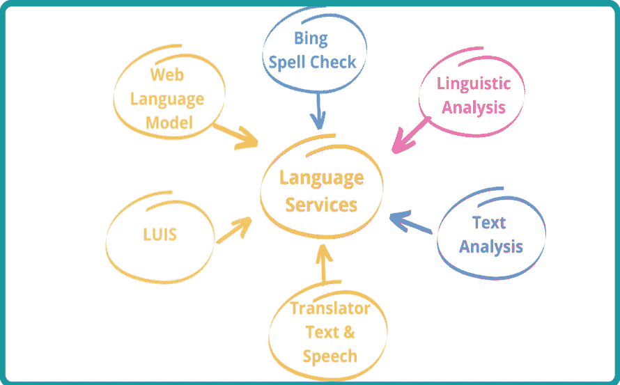

### 图 2.5 语言服务。

Bing 拼写检查的功能包括：

- **多重拼写检查模式。** 此模式可更正您的语法和拼写。如果存在用户输入，则可能需要进行一些更正。通过将此功能添加到您的应用程序中，您可以增强用户信心。它还使您能够通过应用程序生成高质量内容。

- **俚语和非正式语言识别。** Bing 拼写检查始终会更新最新的表达和品牌名称，因此可以轻松识别文本中使用的常见短语和非正式术语。

- **区分相似单词。** Bing 拼写检查可以区分同音词（多个发音相同但含义和拼写不同的单词）。例如，“pray”和“prey”是发音相同但含义和拼写不同的单词。

- **品牌、标题和常见用法支持。** Bing 拼写检查可以识别新出现的品牌名称、标题和其他常见单词。

- **语言学分析。** 该 API 处理语言以简化复杂的语言概念，并获取词性标记和文本解析的访问权限。企业使用它来挖掘客户反馈并解读用户命令。

- **文本分析。** 该 API 在非结构化数据上使用先进的自然语言处理来执行四项主要功能：

   - **情感分析。** 这是您业务中非常关键的一项功能，因为它可以帮助您识别客户在讨论论坛、客户评论、社交媒体等渠道中对您品牌反馈背后的情感。文本分析 API 会评估原始文本，以准确捕捉其背后的情感。该 API 返回 0 到 1 之间的分数，其中 0 表示最消极的情感，1 表示最积极的情感。例如，如果客户将您的餐馆评价为“terrible food”，则文本分析 API 将返回 0；但是，如果评论中表示食物是“mouth-watering”，则它将返回 1。

   - **关键短语提取。** 顾名思义，文本分析 API 分析非结构化数据，并仅返回其上的关键短语。例如，如果您说房子的建筑设计令人叹为观止，会怎样？在这种情况下，API 将返回足以理解数据含义的主要点，例如“architectural design”、“house”和“impressive”。当您需要在短时间内浏览一系列文档时，文本分析 API 的此功能非常有用。它将帮助您快速识别文档的摘要。此功能对律师事务所非常有价值。

   - **语言检测。** 此功能用于分析输入文本并为每个文档提取语言标识符，例如输入文本中使用的语言、方言、变体以及一些地区或文化语言（如果使用）。文本


分析 REST API 返回介于 0 和 1 之间的分数，该范围表示分析的能力强度。

- 4. **命名实体识别。** 此功能用于评估和分类您的输入文本，例如地点、组织、人物、数量、百分比、日期/时间和货币。文本分析 API 提取非歧义实体列表，并返回有关这些实体的更多信息的 Web 链接。

- 翻译文本和语音。Translator text API 是一种基于云的神经机器翻译服务，提供统计机器翻译技术，用于在实时场景中翻译文本。您可以将此 API 集成到需要多语言支持的应用程序中，例如消息传递应用程序、电子商务、网站本地化、内部通信和客户支持。

- Web 语言模型。它是一种 REST API，提供用于自然语言处理的最先进工具以及预测语言模型的能力，以帮助我们处理自然语言查询。

- 语言理解智能服务。语言理解智能服务 (LUIS) 是 Azure 认知服务之一。通过使用此服务，开发人员可以构建能够进行对话、理解人类语言并相应给出响应的智能应用程序。LUIS 使开发人员能够以“意图”、“实体”和“话语”的形式从任何句子中提取有用信息。即使您没有机器学习的先前知识或理解，也可以使用 LUIS 根据业务需求构建自定义应用程序。

知识 这是言语的延续。通过言语，意义用于推导知识。知识 API 提供将我们复杂的信息和数据映射以执行需要智能的任务的方法，例如语义搜索和显示准确的推荐。知识 API 分为六个类别（另请参见图 2.6）：

- 1. **学术知识。** Microsoft Academic Knowledge API 是一项服务，充当计算机管理员来解释具有学术意图的用户查询，并检索用户感兴趣主题的丰富信息。它使用 Microsoft Academic Graph (MAG) 和自然语言语义来根据用户请求检索最相关的实体。

在这里，Microsoft Academic Graph 是一个异构实体图，由科学出版物记录、这些出版物之间的引用关系、研究领域、作者、机构、学术论文、期刊、会议、场所和事件组成。自然语言语义是指用户说话或交流想法的方式。

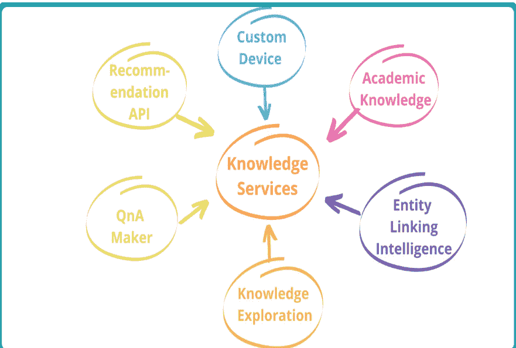

**图 2.6** 知识服务。

- 2. **实体链接智能服务 API。** 此 API 用于识别内容中可能存在的实体并将其链接。内容可以是任何内容，例如新闻文章、Twitter 源或博客文章。我们需要做的就是将内容提交到此 API，然后服务将返回从该内容中检索的实体列表。

例如，在其中一篇文章中，它说：Android Oreo 是移动操作系统 Android 的第十五个版本和第八个发行版。在此句子中，Android Oreo 可能是一个重要实体。

但接着我们有另一句说：美国最畅销的饼干之一是 Oreo。

这两个句子都包含实体 Oreo，但显然它们用于不同的上下文。此服务如何执行实体链接？

实体链接是确定单词“Oreo”是在 Android 的上下文中使用还是作为饼干使用的能力。来自 Wikipedia 和 Bing 的知识库的存在使实体链接能够识别并消除内容中实体身份的歧义。

基于内容的上下文，实体链接智能服务提供两个不同的概念：识别和消歧义。

- **实体识别** 是指从非结构化文本中识别实体，即使该实体在知识库中存在。

- **实体消歧义** 是将输入内容中的实体映射到目标知识库中相应唯一标识的任务。例如，公司、国家或人员的名称。

- 3. **知识探索。** 知识探索服务 (KES) API 将自然语言查询转换，并为应用程序提供带有自动完成建议和细化的有效交互式搜索。此 API 评估存储在数据库中的结构化数据，并返回有关匹配对象的信息。它使您能够从结构化数据构建压缩索引，并提供属性可视化、交互式查询构建和分面体验。

- 4. **QnA Maker。** QnA Maker 是一项服务，可以高效创建对话式应用程序以与用户通信并用自然语言回答他们的问题。它使用自定义知识库来提取用户问题的适当答案。QnA Maker 可用于社交媒体应用程序、语音启用的桌面应用程序、聊天机器人等。

QnA Maker 的效率和准确性取决于其自定义知识库的质量。要为 QnA Maker 创建知识库，您需要以问答集的形式导入结构化和半结构化数据。然后，导入过程会从结构化和半结构化数据中提取必要信息，以指示问题和答案集之间的相关性和依赖性。知识库准备就绪后，您将其发布，以便客户端应用程序的用户可以提问，QnA Maker 随后使用知识库处理问题并适当回答问题。

- 5. 推荐 API。

许多在线企业使用推荐 API 来预测客户行为。它提供对用户配置文件的直接访问，以便您的应用程序可以预测三种推荐：

- a. 其他品牌的相似商品
- b. 经常一起购买的商品
- c. 个性化商品（用户可能根据之前的选择购买的商品）

智能推荐可以带来产品销售额增加和个性化客户体验，从而带来收入增加。但大多数在线电子商务企业发现实施推荐引擎并不容易。他们发现创建复杂且经过精细调整的算法以确保质量分析具有挑战性。

Microsoft 的认知服务为他们简化了这一过程。他们提供了一款推荐引擎 API，旨在使推荐比以往任何时候都更加轻松。它根据相关性和新颖性推荐产品。例如，对于新产品且客户尚未接触过的产品，Microsoft 已训练其推荐引擎 API 以强调惊喜和多样性。该 API 使用认知计算来生成“经常一起购买的商品”、客户到商品流和商品到商品推荐等结果。它还使用矩阵分解算法来获取洞察，以揭示用户与商品之间事务中的隐藏特征。使用此 API，企业可以提高销售转化率、利用获得的洞察向特定客户进行追加销售、根据需求推广合适的产品，并优化与客户的关系。

事实上，在线零售商——例如，DutchCrafters（一家位于萨拉索塔的在线阿米什手工家具企业）——通过使用 Microsoft 的推荐 API 已将其转化率提高到 0.6%。

- 6. **自定义决策服务。** 顾名思义，自定义决策服务是一种上下文决策 API，它通过分析您的模式并从中学习，为您做出智能决策并为您提供更个性化的内容。它使用强化学习来根据您的兴趣跟上新兴趋势。此 API 会随着经验的积累而学习和改进。

### 搜索

Azure 认知搜索是唯一的云搜索即服务解决方案，它为开发人员提供内置 AI 功能，可丰富移动、Web 和企业应用程序中私有异构内容上所有类型信息的搜索体验。

现实世界中的数据往往混乱不堪。它经常跨越文本文档、PDF 文件、图像和数据库等媒体类型，这些数据在不断变化，但这些数据源中蕴含的宝贵知识并不随时可用。从大型数据存储中检索隐性知识是一项非常具有挑战性的任务。企业将 Azure 搜索与认知搜索功能相结合来完成此任务。

让我们通过一个示例来了解 Azure 搜索可以在哪里使用。


假设你拥有一家在线电子商务业务。为了提供更好的易用性，在你的网站上提供搜索功能至关重要。当客户搜索产品时，他们不想浪费时间浏览整个网站；通过使用搜索功能，他们可以立即得到想要的东西。客户搜索什么产品完全由他们决定，但为他们的查询显示什么结果则由你决定。

假设客户在你的在线商店搜索了派对连衣裙，而你需要推广一个品牌 Forever 21，该品牌付费让你这样做。在搜索结果顶部显示 Forever 21 的产品会增加客户购买这些产品的机会。

这是你可以使用 Azure Search 根据业务需求自定义搜索功能的场景之一。接下来介绍 Azure Search APIs：

- **Bing 自动建议。** 此 API 用于根据搜索框中的部分查询字符串，在下拉框中返回所有可能的相关查询建议，从而增强应用程序中的用户搜索体验。它是一个智能 API，使用户能在更短的时间内做更多事情。

- **Bing 图像搜索。** Bing 图像搜索 API 使你能够在应用程序中添加从静态和动画图像到详细洞察的图像搜索选项。应用程序中的此功能将帮助用户在网络中搜索匹配的图像。此 API 作为结果返回缩略图、图像元数据、完整图像 URL、发布网站信息等。它还提供过滤和排序功能，以简化图像查找过程。

- **Bing 新闻搜索。** Bing 新闻搜索 API 使你能够在应用程序中集成 Bing 新闻。你只需搜索与新闻相关的查询，例如与一般新闻、今日头条新闻、特定类别新闻以及各类新闻标题相关的查询，此 API 就会返回相关文章。此 API 的结果以文章 URL、添加日期、提供商信息、文章图片以及相关新闻和类别的形式呈现。要查找特定文章的链接，此 API 还提供排序和过滤选项。

- **Bing 视频搜索。** 此 API 使你能够向应用程序添加视频搜索功能。搜索可能包括热门视频、预览和其他有用元数据。API 结果提供包括编码格式、视频时长、观看次数、视频创建者信息等元数据。

- **Bing 网络搜索。** 调用此 API 时，可以返回由 Bing 网络搜索 API 索引的网页、新闻、视频等。

- **Bing 实体搜索。** 搜索时，此 API 会返回人物、地点、事物和本地企业。为了提供更具吸引力的用户体验，你可以在应用程序中使用此 API。例如，如果你拥有一家在线外卖服务，则需要与城市中所有餐厅合作。因此，你可以使用此 API 返回特定结果，例如当客户搜索特定餐厅或想了解附近餐厅时。

- **Bing 自定义搜索。** 此 API 使客户能够在其网站或应用程序上构建易于使用且无广告的搜索解决方案。此 API 提供的功能如下：
  - 此 API 对各种域、网站和子网站拥有完全控制权，因此你可以为医院、零售、金融等任何类型的行业构建搜索解决方案。
  - 它使你能够上传感兴趣的域，如果该域尚未在批次中可用的话。
  - 它提供自动拼写检查功能，在必要时纠正用户的查询。
  - 它使你能够阻止、置顶推广或降级任何搜索结果。
  - 它拥有 Bing 可信的索引能力。

## Azure 机器人服务

在深入了解什么是 Azure 机器人服务以及它如何帮助你的业务之前，让我们先看看你的业务是否需要一个。

你的公司是否处理大量服务请求，例如密码重置、修复无法工作的服务和升级服务？你的公司是否维护多个呼叫中心来处理关于产品安装、账单和其他技术问题的疑问？

如果是这种情况，那么你可以使用聊天机器人来自动化处理类似查询的客户支持，该机器人可全天候运行，以满足当今客户群体的需求。

在这些情况下，Azure 机器人服务能为你做什么？

> Azure 机器人服务和 Bot Framework 提供了 SDK、模板和 AI 服务等工具，可在一处构建、测试、部署和管理智能机器人。它帮助开发者创建能够理解自然语言、使用语音，并足够智能以处理问答等内容的机器人。

机器人就像一个智能机器人，可用于执行简单且重复的任务，例如为每个使用你产品的客户回答同一组问题，或者如果你经营餐厅业务，则接受晚餐预订。现在让我们从高层次了解机器人生态系统：

- **Microsoft Bot Framework。** 这是一组 SDK（如 Node JS、JavaScript 和 C#），开发者使用这些 SDK 来构建和开发机器人。
- **Bot Framework 模拟器。** 这是一个桌面应用程序，开发者使用它在本地或远程测试和调试自己的机器人。
- **命令行界面工具。** 这是一个跨平台工具，它允许你与不同的库进行交互（例如，我们在本章前面部分讨论过的语言理解服务），从而为机器人增加额外的智能和更高级的功能。
- **Azure 机器人服务。** 这是一个机器人基础设施，所有内容都在此运行。你可以在本地开发机器人后将其上传到 Azure，然后机器人服务使我们能够将机器人连接、部署和管理到一个中心位置。

机器人服务提供五个模板来启动机器人构建过程：

- **基本机器人。** 此模板用于创建能够响应用户输入的对话的机器人。此机器人只需最少代码和文件即可开始使用。它可用于在机器人中创建对话流。
- **表单机器人。** 此模板创建通过引导式对话收集输入的机器人。它旨在仅从用户处收集特定数量的信息。例如，如果你想披萨，它会询问你面粉类型、披萨类型、想要的配料等。
- **语言理解机器人。** 此模板用于创建能够理解用户意图的机器人。它使用语言理解智能服务来提供自然语言理解功能。
- **问答机器人。** 此模板用于创建能够回答客户与你提供的服务相关的输入问题的机器人。
- **主动机器人。** 此模板用于向客户发送主动消息，这些消息可能与之前的对话相关，也可能不相关，例如提醒他们任何事件或在特定时间传达任何信息。

如果这些模板不符合你的要求，你还可以构建自定义机器人。Azure 机器人服务在机器人开发的每个阶段都提供各种工具。以下是机器人设计和构建阶段（另请参见图 2.7）：

- **规划。** 与创建任何软件之前一样，我们会进行规划。我们收集所有需求和希望实现的最终结果。浏览之前提到的设计指南以更好地理解。你可以创建一个简单的机器人，或包含自然语言、问答和语音等高级功能。
- **构建。** 在这个阶段，你可以在任何环境或语言中创建能够发送或接收消息和事件的对话界面。你可以使用 Azure 门户，也可以在本地使用 C#、JavaScript 或 Python 模板进行机器人开发。此阶段提供以下可添加到机器人的功能：
  - 使用 LUIS 进行自然语言处理。
  - QnA Maker 用于回答用户提出的问题。
  - 如果你同时使用这两个模型，则它提供一个调度工具，以智能确定何时使用哪个模型。
  - 机器人可以使用添加卡片功能包含图形、菜单和卡片等媒体附件。
- **测试。** 此阶段允许你在发布机器人之前对其进行测试。它允许你在可在本地运行的机器人框架模拟器上测试机器人。如果在 Azure 门户上配置了，它还允许你在 Web 上测试机器人。


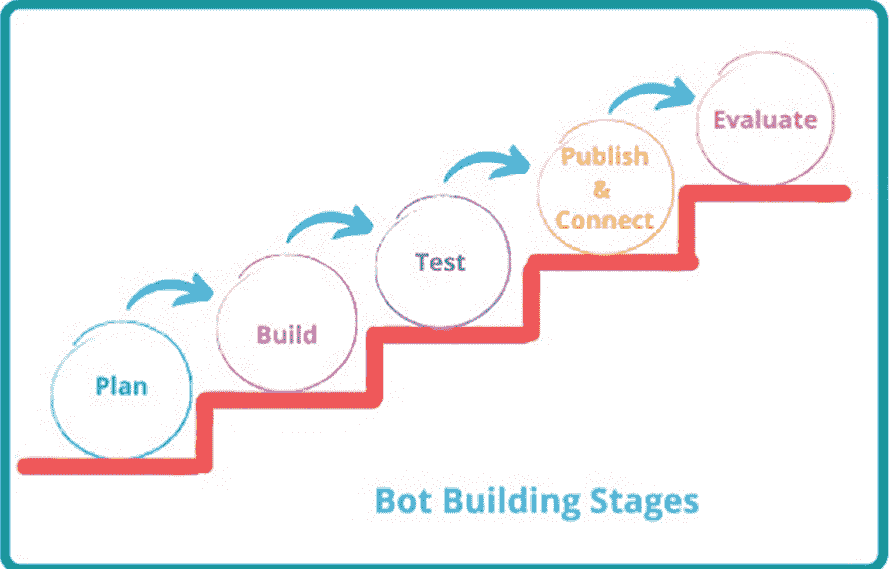

**FIGURE 2.7** 机器人构建阶段。

- **发布。** 一旦机器人准备就绪，你可以将其发布到 Azure 或自己的数据中心。

- **连接。** 在此阶段，你可以将机器人连接到 Facebook、Slack、MS Teams 和 Telegram 等各种渠道。Bot 框架从这些平台发送和接收消息，机器人应用程序从这些渠道接收统一的消息流。

- **评估。** 在此阶段，Azure 中收集的数据可用于增强机器人的功能，例如服务级别和诸如延迟、集成和流量之类的检测数据。

按照以下步骤创建符合您需求的自定义机器人。

## 知识挖掘

> “总是那些隐藏的洞察在阻碍着你。”
> — Manali Tiwari

您的组织是否属于那类文档最终被埋没在极少使用的文件夹、驱动器或归档位置的组织？您是否在搜索和分析组织拥有和生成的文档中的数据时遇到困难？近 80% 的组织未能在有限的时间内探索和理解内容，这并不奇怪。每天都会生成数十万份新文档。如果每份文档都包含有助于为您的组织解锁机会的有价值内容，那么为什么不采用正确的方式来做呢？

知识挖掘来了。

知识挖掘旨在从现有信息中提取有用、有益或有利的内容。但是，挖掘工程师在大量时间内所能做的也是有限的。这里的挑战是从现有数据中获取全部价值。

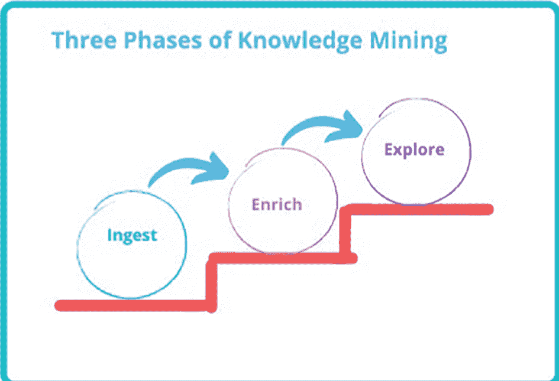

FIGURE 2.8 知识挖掘的三个阶段。

这就是使用 Azure Search 进行知识挖掘发挥作用的地方。

使用基于认知搜索技术的知识挖掘可以从 PDF、电子表格、图像、音频文件等非结构化数据中提取有价值的信息和事实。

在知识挖掘中使用 Azure Search 可以让您导入大量格式不同的非结构化数据，这些数据可以使用 AI 功能建立索引，从而变得易于引用和搜索。

注意：如果数据不在数据库表或电子表格中，则为非结构化数据。

Azure Search 中的认知搜索功能使您能够在非结构化数据中发现模式并从中提取有意义的信息。使用 Azure 认知搜索进行知识挖掘分为三个阶段（另请参见 FIGURE 2.8）：

- 1. **引入。** 数据引入过程包括从各种来源加载数据文档，以在 Azure 数据资源管理器中创建或更新表。在 Azure 认知搜索中，数据引入后，加载到搜索索引（用于筛选和全文搜索的文档持久存储系统）中的内容即可用于执行查询。填充索引有两种基本方法：(1) 数据以编程方式*推送*到索引中，或 (2) 将 Azure 认知搜索索引器（一种用于从外部 Azure 数据源提取可搜索数据的爬网程序）指向受支持的数据源。此过程也称为拉取模型。

可以从 Azure Blob 存储、SQL DB、CosmosDB、MySQL 和表存储中拉取数据，或者使用 API 推送数据以将单个或多个文档加载到索引中。该服务呈现 Blob 存储中的非结构化原始数据，并从 PDF 和 Office 文档等各种文件格式中提取内容。它还通过增量处理检测更改，从而在初始引入后无需遍历整个数据集。

现在，当我们填充索引后，会看到一个精美且响应迅速的 UI。一些组织的目标在此步骤即可实现，他们在此处停止，因为他们只希望文档可搜索。

- 2. 增强。在 Azure 认知搜索中引入的数据由图像和其他非结构化数据源组成。这就是 Azure 认知搜索索引的增强功能发挥作用的地方。它从非结构化数据源、图像和 Blob 中提取文本，使索引和知识存储更易于搜索且更有条理。Azure Search 中内置的认知技能使从数据实施增强和提取过程成为可能。一些内置的认知技能包括：

  - 自然语言处理
    - 实体识别
    - 语言检测
    - 关键短语提取
    - 文本处理
    - 情感检测
    - PII 检测

  - 图像处理
    - 光学字符识别 (OCR)
    - 面部检测
    - 图像解释
    - 图像识别

这些认知技能解锁了非结构化原始内容，并为您的搜索或数据科学应用增加了价值。这些增强后的数据可以馈送到训练好的模型中，以推导自定义元数据架构。如果多次重复此步骤，可以产生非常强大且日益定制化的索引。

- 3. **探索。** Azure 数据资源管理器用于查询流式数据，帮助组织发现洞察、识别趋势和异常并诊断问题。Azure 数据资源管理器提供以下功能：

  - 它有助于从外部源（事件中心）拉取数据或从 Azure 队列读取引入请求。
  - 它将在同一数据库和表中循环的数据分批处理，以优化引入吞吐量。
  - 它验证数据并执行必要的格式转换。
  - 它执行所有数据操作任务，例如组织、编入索引、编码、压缩数据和匹配架构。
  - 它管理引擎上的引入负载，并在暂时性故障时处理重试。

至此，我们拥有一个完全填充且有意义的索引，可供自定义应用程序使用，以提供高度交互的用户体验和丰富的可视化效果。

# 第 3 章
ML/AI 功能及其在 Dynamics 365 中的应用

今天，人工智能正在通过为个人和业务任务提供智能解决方案来改变我们的工作和生活方式。它迅速接管了商业的所有领域。

Microsoft Dynamics 365 AI 旨在将您的业务数据转化为有洞察力的信息，帮助您从数据中获得更多价值并做出明智的业务决策。在本章中，我们将介绍 Microsoft Dynamics 365 与 ML 和 AI 如何改善您的业务运营。

## 客户洞察

您还记得上次购买产品或使用服务时获得良好体验是什么时候吗？当然记得，因为那次体验在您的记忆中留下了印象。最终，您成为了一位忠实客户。在当今的数字化转型时代，组织正致力于在个人层面了解客户，并分析其需求和期望，以改进所提供的服务或产品。但要更好地了解客户，您需要访问其所有数据，而这些数据可能分散在不同系统中。

将所有这些数据集中在一个地方以分析客户行为，并通过提供客户所需和所期望的内容与客户建立有意义的关系，难道不更简单吗？这就是客户数据平台 (CDP) 的目的。

Microsoft 的 Dynamics 365 Customer Insights 可以帮助您实现这一目标。它通过连接各种事务、行为和观察来源的数据并利用这些数据推导智能客户洞察，帮助您创建 360 度客户视图。

使用 Dynamics 365 Customer Insights，组织可以实现什么？

- 数据源。组织可以将来自不同来源的客户数据统一到一个地方，从而消除数据孤岛。以下是组织可用于将数据引入 Dynamics 365 Customer Insights 的数据源或连接器列表：

- 文件数据源。Access、Excel、文件夹、JSON、PDF、SharePoint 文件夹、Text/CSV、XML。

- 数据库数据源。Amazon Redshift、Google BigQuery、IBM Db2 数据库、Impala、MySQL 数据库、Oracle 数据库、PostgreSQL 数据库、SQL Server 数据库、Sybase 数据库、Teradata 数据库、Vertica。

- Power 平台数据源。Dataverse (CDS)。

- Azure 数据源。Azure Blobs、Azure Data Lake Storage Gen2、Azure HDInsight Spark、Azure SQL 数据仓库、Azure SQL 数据库、Azure 表。

- 在线服务数据源。Microsoft Exchange Online、Salesforce 对象、Salesforce 报表、SharePoint Online 列表。

- 其他数据源。Active Directory、OData、Odbc、SharePoint 列表、Spark、Web API、网页、空白表、空白查询。

将来自不同来源的数据整合起来以全面了解业务是一项非常耗时且昂贵的任务。因此，为了解决这个问题，Microsoft 及其合作伙伴引入了公共数据模型。


让我们通过一个示例来了解它是什么：假设你有两个独立创建的业务应用，每个应用都有自己不同的结构和实体（例如，两个应用中的“consumer”和“lead”并不相同）。那么如何将这两个应用相互集成呢？常见数据模型（Common Data Model）应运而生，它使你能够以标准化格式构建数据，从而让应用之间更容易集成和共享数据。它提供了一组标准实体、属性和关系，所有应用都可以使用它们来理解、识别、通信并获取洞察。使用常见数据模型作为连接器，你可以构建统一的客户配置文件。让我们逐步了解客户洞察的工作原理：

- **数据统一。** 数据统一是创建单个主数据集的过程，该数据集可提供客户的统一视图。要在 Dynamics 365 Customer Insights 中统一数据，需要遵循三个步骤：

- 1. **映射。** 在 Dynamics 365 Customer Insights 中映射数据是一个非常重要的步骤，包含两个阶段：

  - a. **实体选择。** 此阶段涉及识别与客户信息关联的实体，这些实体可以组合起来创建数据集。

  - b. **属性选择。** 此阶段涉及识别要在匹配和合并步骤中合并和调和的每个实体的列。

- 2. **匹配。** 在此步骤中，你将映射步骤中创建的实体数据集合并为统一的客户配置文件数据集。它至少应包含两个映射的实体。

- 3. **合并。** 合并是解决数据集中出现的冲突数据的过程，例如，如果两个数据集中的日期格式不同，如出生日期“12/26/94”与 26/12/94。合并是在属性级别进行的。

- 通过 Microsoft Graph 中包含的受众智能来丰富客户配置文件。可以通过将 Dynamics 365 Customer Insights 与 Microsoft Graph 和 Power BI 连接来丰富客户配置文件，以纳入受众智能并更深入地了解客户的品牌亲和力和兴趣。

Microsoft Graph 是开发人员的 API 平台，公开 REST API 和客户端库，以连接 Microsoft 365 中 Office 365、Windows 10 和企业移动性与安全性服务中存储的数据，从而驱动受众智能。

让我们通过 Microsoft Graph 能做什么的示例来了解。

想象你是一家零售企业的销售人员，拥有大约 20,000 名客户的数据。知道以下问题的答案难道不是很棒吗：

- 每个客户可能多大程度上喜欢与你自己的品牌相似的竞争对手品牌？
- 你的客户感兴趣的是什么（例如，体育、电影或葡萄酒）？

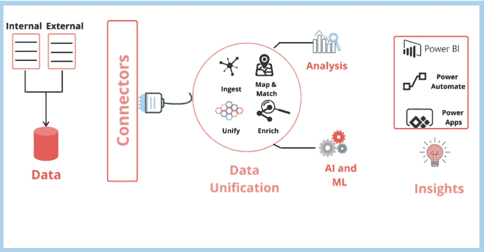

### 图 3.1 客户洞察中的 AI 功能。

这些数据可能在线上可用，当然，不是你的客户，而是与你的客户相似的人群。要将你的数据与在线上可用的数据集对应，你可能需要购买数据，或者数据可能过时到对你毫无用处。Microsoft Graph 通过收集关于客户的数亿个数据点，并按年龄、性别和位置（基于客户位置）三个方面描述其行为，来帮助你应对这种情况。这样做是为了通过将你现有客户的数据与基于年龄、性别和位置与他们相似的人群的兴趣和品牌亲和力进行比较，来获取关于客户品牌亲和力和兴趣的智能。在 Customer Insights 完成比较后，你可以观察到已丰富的配置文件。

- **激活强大的 AI 和洞察。** 启用 AI 的 Dynamics 365 Customer Insights 有助于通过 360 度客户视图（见图 3.1）发现额外的业务洞察。这种统一数据是优化客户参与度并通过构建可生成智能洞察的机器学习（ML）模型来推动个性化客户体验的绝对来源。由于 Customer Insights 与 Azure 无缝集成，ML Studio 帮助构建用于处理统一数据的自定义 ML 模型。可以通过使用基于 Azure ML Studio 的模型管道来加速三种常见用例的模型构建过程：

- 1. **流失分析。** 流失分析是对与公司结束关系的客户进行评估，目的是减少其数量。预测客户流失可以帮助我们留住当前的付费客户。
- 2. **客户终身价值预测。** 客户终身价值（CLTV）是评估和细分每个客户价值的关键指标。它使你能够改进高付费客户的体验和服务。这些预测可以帮助改善你的销售和收入。
- 3. **产品推荐。** 这是一种个性化策略，用于根据客户的属性、浏览行为或情境背景，为客户提供最佳服务或产品，从而提供个性化购物体验。

组织可以利用这些预测洞察采取行动并发展业务。如前所述，他们可以使用 Azure 机器学习来定制和训练可以产生预测洞察的模型。这将大大有助于了解客户需求，以便相应地采取行动。

- **通过强大工具和服务扩展 Customer Insights 来赋能业务流程。** 通过将 Customer Insights 嵌入到 Dynamics 365 Sales/Marketing/Service 或任何第三方应用程序和 Power Platform 等业务应用中，组织可以利用数据做更多事情：
- **Power Apps** 帮助客户轻松且快速地构建自定义应用，无需编写一行代码。Microsoft Power Apps 构建在常见数据模型和 Dataverse 之上，后者以特定格式存储数据，以便开发人员可以使用相同的数据来构建和运行应用。
- **Power BI** 有助于从统一数据生成额外的洞察并构建报表。它还支持自定义报表和仪表板。
- **Power Automate** 有助于在 Dynamics 365 Customer Insights 中自动化工作流。它使开发人员能够在 Customer Insights 中为手动或困难的流程创建工作流。

此外，借助 Microsoft AI 和机器学习服务，组织可以通过自动识别新客户细分市场并针对性定位来发起营销活动，以改善销售和客户参与度。在输出方面，你可以将受众和细分市场带到 Dynamics 365 Marketing。

## 客户服务洞察

客户服务洞察的核心是通过使用 AI 和机器学习，并与客户建立良好关系来提高客户满意度。它提供许多功能和工具，帮助客户服务经理全面了解客户和绩效，以便实施最佳解决方案来解决发生的问题，同时提高生产力。让我们来看看 Dynamics 365 Customer Service Insights 提供的功能：

- **全渠道。** 客户服务中的全渠道是一个强大的应用程序，提供一套功能，使组织能够跨不同的数字消息渠道与客户互动。它还提供一个高生产力、可自定义的应用程序，代理可以使用它与客户建立联系。该应用程序支持实时通知、上下文客户识别和集成通信。它还使组织的经理或主管能够使用代理生产力工具（如 KB 集成、搜索和案例创建）来评估代理的实时运营效率。


Dynamics 365 客户服务洞察提供以下渠道：

- **聊天。** 此渠道可让您的客服人员与客户实时连接。

- **短信。** 这是一种与客户异步通信的模式，可让您的客服人员通过短信与客户互动。

- **社交媒体渠道。** Dynamics 365 分析在 Facebook、LINE、Twitter 和 WeChat 等社交渠道上分享的帖子中的客户情绪和意图，并将其自动转换为病例。

- **IoT 传感器。** Dynamics 365 通过监控产品使用过程中的读数，检测您产品中的任何故障，并通知其所有者。

- **病例管理。** 要了解病例管理功能，我们先来了解什么是病例。

病例是客户报告的需要您关注以提供最佳解决方案的问题或事件。要为病例找到最佳解决方案，您需要从头开始跟踪流程以评估事件的受理情况，并遵循补救流程直到最终解决，从而找到问题的根本原因。病例可以是任何事物，例如：

- **疑问。** 您的客户可能对您的产品或服务有疑问。例如，如果客户愿意购买您品牌的洗发水，而您网站上的产品描述中没有客户所需的信息，那么客户自然会在购买前就产品提出问题。问题可以是任何事项，例如，这款洗发水适合干枯毛躁的头发吗？这款洗发水温和吗？如果不适合我，退货政策是什么？

- **请求。** 客户可能有需要采取特定操作的请求。例如，假设您的产品是一款家居清洁工具，即“一款带一块超细纤维拖把的旋转拖把清洁系统”。您仅随清洁系统提供一块超细纤维拖把，而您的客户要求至少提供两块超细纤维拖把，以便如果一块用完，整个清洁系统就无法使用，客户除了再次购买整个产品外别无选择。

- **问题。** 客户可能对产品缺陷或账单问题有投诉。例如，您的客户订购了一件浅蓝色衬衫，但收到的却是同一款衬衫的藏蓝色，这并非他心中所想的颜色。因此，他除了就此问题提出投诉外别无选择。

客户服务洞察使用自然语言理解来自动将您的病例分组为主题。然后使用这些主题来发现问题领域，并适应当前和新兴趋势以改善品牌情绪。在问题变得严重之前解决问题总是好的，因此在问题影响客户之前分析和修复问题将改善客户体验。

客户服务洞察提供端到端的病例管理解决方案，可识别病例类别并分配最适合的客服人员以高效解决病例。以下是共同提供高效解决方案的组件：

- **病例。** 病例代表服务上下文中的任何事项（例如客户互动），需要解决方案或答案。单个客户可以同时与多个解决方案关联。

- **活动。** 活动涉及与客户进行对话，例如电话通话。单个病例可以与多个活动关联。

- **权利。** 权利表示客户拥有的支持服务数量。这类似于支持合同。

- **知识文章。** 知识库是客户服务代表用于解决病例的信息文章存储库。

- **队列。** 队列类似于等候区，需要处理的活动和病例会在其中组织和存储。

- **服务级别协议 (SLAs)。** SLAs 是类似于规则手册的工具，用于跟踪和定义病例打开时应发生的情况。

- **记录创建和更新规则。** 记录创建和更新规则应用于根据活动类型自动执行 Dynamics 365 中的记录创建和更新过程。

- **路由规则。** 路由规则是自动将病例路由到特定队列或用户的规则。

- **业务流程流。** 业务流程流是一项明确定义的流程，包含用于解决特定项目（如病例）的各个阶段和步骤。

- **知识管理。** 知识管理模块是知识文章的集合，用于解决客户在使用您的产品或服务时遇到的各种问题。知识文章可以是不同类型，例如常见问题的解决方案、常见问题解答文档以及包含所有产品信息的文档。知识文章对客服人员来说就像首选文档，因为它可以帮助他们找到客户提出问题的答案。客服人员还可以将其中一些文档通过电子邮件发送给客户。您还可以使用 Dynamics 365 的可视化编辑器创建和管理知识文章。

- **模板。** Dynamics 365 客户服务洞察为电子邮件、权利和文章提供即用型模板。因此，在创建任何这些实体时，客服人员无需每次都编写，只需直接使用这些预先编写的模板即可节省时间。

- **仪表板和报告。** Dynamics 365 客户服务洞察使您能够使用关键客户服务指标来评估客户服务部门的绩效价值。这些仪表板为您提供基于通信渠道、客服人员或优先级的病例相关信息的报告。有不同类型的仪表板，通过为您提供客户服务系统的全面描述，帮助您识别业务中的改进领域。这样，您可以提高客户满意度。让我们详细了解一下客户服务洞察突出显示了哪些类型的改进领域：

### AI 洞察图表。

它使用语言理解技术以主题形式识别和分组支持病例，从而无需费力即可对高度影响的正面和负面病例进行分类。以下是显示对解决时间和客户满意度有更大影响的支持病例的图表：

- 客户满意度驱动因素 (客户满意度仪表板)
- 解决时间驱动因素 (解决仪表板)
- 首要 CSAT 影响因素 (主题详细信息仪表板)
- 首要解决时间影响因素 (主题详细信息仪表板)

### 解决时间图表。

它提供解决支持病例所需时间的不同视图。以下是提供解决时间的图表：

- 平均解决时间 KPI 摘要图表 (KPI 摘要仪表板)
- 按病例账龄划分的未解决病例 (KPI 摘要仪表板)
- 当前热门主题 (新建病例仪表板)
- 新兴主题 (新建病例仪表板)
- 解决时间最长的客服人员 (解决仪表板)
- 新建病例与平均解决时间 (解决仪表板)
- 新建升级与已解决升级 (解决仪表板)
- 解决时间驱动因素 (解决仪表板)
- 平均解决时间最长的客服人员 (主题详细信息仪表板)
- 首要 CSAT 影响因素 (主题详细信息仪表板)
- 首要解决时间影响因素 (主题详细信息仪表板)

### 客户满意度图表。

它提供客户反馈的不同视图。以下是表示客户满意度的图表：

- 平均 CSAT KPI 摘要图表 (KPI 摘要仪表板)
- 热门主题 (新建病例仪表板)
- 新兴主题 (新建病例仪表板)
- 平均 CSAT (客户满意度仪表板)
- 客户满意度驱动因素 (客户满意度仪表板)
- 平均 CSAT KPI 图表 (主题详细信息仪表板)
- 整体平均 CSAT 影响图表 (主题详细信息仪表板)
- 首要 CSAT 影响因素 (主题详细信息仪表板)
- 首要解决时间影响因素 (主题详细信息仪表板)

### 客服人员绩效图表。

它帮助您识别绩效低下和高效的支持客服人员。以下是表示客服人员绩效的图表：

- 平均解决时间最长的客服人员 (病例解决仪表板)
- 升级次数最多的客服人员 (病例解决仪表板)
- 未解决病例最多的客服人员 (主题详细信息仪表板)
- 解决时间最长的客服人员 (主题详细信息仪表板)
- 平均 CSAT 最低的客服人员 (主题详细信息仪表板)


- **支持渠道图表。** 它用于识别不同支持渠道上系统的性能。以下是提供支持渠道性能不同视图的图表：
  - 案例渠道 (KPI 仪表板)
  - 案例渠道 (入站案例仪表板)
  - 案例时间 (入站案例仪表板)
  - 平均 CSAT (客户满意度仪表板)

客户服务洞察通过让您全面了解客户和绩效，助您抢占先机，识别并理解客户期望。您可以使用它来了解出现的问题并加以解决。它肯定能将您的业务提升到一个新的水平。

## 销售洞察

> “一位优秀的教练会观察你的一举一动，并鼓励你在所做的事情上变得更出色。”
> – Manali Tiwari

您是否曾遇到过这样的情况：衣柜里塞满了衣服，鞋架上摆满了鞋子，却仍然无衣可穿？超过 20% 的衣柜里装满了您只穿过一次且再也不愿穿的衣服。这 20% 的衣服本不应该被购买，却是被销售人员强迫购买的。嗯，这类事情可能会毁掉您的业务。客户不喜欢被迫购买任何东西；相反，他们希望销售人员了解他们的需求，并据此推荐产品。这种方法需要大量的市场调研、趋势分析和该领域的专业知识，才能向客户推荐合适的产品。但是，如果您可以在一个地方获得所有这些信息会怎样？如果有办法分析每个销售人员的谈话风格，以便您可以指导他们改进绩效，实现最大产出，那会怎样呢？

Dynamics 365 Sales Insights 是一款利用人工智能从客户呼叫数据生成洞察，并将其与 Dynamics 365 智能耦合，以制定战略销售决策的应用程序。

### 销售洞察能为您的业务带来什么？

- Dynamics 365 Sales Insights 帮助销售经理通过分析客户通话并了解其需求和期望，跟上最新趋势、品牌和竞争情况。这些数据随后可用于分别培训销售人员。
- 该应用程序的 Teams 概览页面使销售经理能够观察销售人员的谈话风格以及客户对每个销售人员的情绪。这可以帮助经理为销售人员提供个性化指导以改进其绩效。它还可以帮助经理跟踪有价值的交易，并指导销售人员将其带入健康状态。
- Sales Insights 帮助经理分析贵公司顶级销售人员的行为和模式，并将这些方法引入团队的其余成员。
- 销售人员详细信息页面可让您快速查看销售和对话。经理可以针对每个对话转录留下指导评论。此页面包含建议问题，可帮助经理发现趋势。经理还可以使用自然对话语言直接提问，例如：有多少潜在客户是高质量潜在客户？或者有多少潜在客户即将成交？
- Dynamics 365 Sales Insights 为经理提供预测性和主动性洞察，以便他们能够智能地帮助团队实现更高目标。
- Dynamics 365 Sales Insights 帮助您建立更好的业务关系，赢得客户信任，与正确的买家接洽，根据洞察采取正确行动，并建立宝贵的联系。它还可帮助您评估以往的成就并规划下一步行动。

Sales Insights 的功能分类如下：

- 免费销售洞察功能
- 高级销售洞察功能
- 会话智能

### 免费销售洞察功能

顾名思义，以下功能在 Dynamics 365 Sales 中免费提供：

- 助手
- 自动捕获
- 电子邮件互动

### 助手

Sales Insights 助手像骨干一样支持您与客户和潜在客户的关系。它就像一位私人助理，但更好。Sales Insights 助手可以通过以下方式让您的生活变得轻松有序：

- 它监控您与客户的通信和操作，并分析这些数据以生成洞察卡。现在让我们了解一下什么是洞察卡。洞察卡就像一个智能提醒，它使用 Dynamics 365 销售应用程序以及您的收件箱和日历中可用的数据，让您及时了解工作进度。例如，它会在需要时提醒您发送跟进电子邮件、提醒您参加会议等等。每张洞察卡都包含一条消息，该消息总结了卡片内容以及需要采取的一系列操作。助手还会按优先级对卡片进行排序，并根据您的操作对其进行筛选。
- 当账户或联系人长时间处于非活动状态时，它会通知您。
- 它识别未回复且需要您关注的电子邮件和对话。
- 它还会提醒您任何机会的截止日期。

洞察卡可分为两类：

1. **通知** 代表提醒您当天即将到来的事件、会议、过期项目或需要您立即关注的事件的洞察卡。
2. **洞察** 卡是基于 AI 驱动模型对数据进行分析的结果，以产生可能有助于销售人员了解客户需求的智能建议。例如，它可以生成一张突出显示带有积极情绪的电子邮件的卡片，该电子邮件可能成为销售人员的潜在客户。但是，它也可以生成一张针对突出显示负面情绪的电子邮件的卡片，并警告您，如果不采取适当措施，机会可能会失控。

既然我们了解洞察卡能为您做什么，那么让我们逐一了解卡片的五个元素（另请参见图 3.2）：

1. **主要内容区域** 包括卡片标题、摘要、卡片类型（例如通知或洞察）以及与卡片相关的其他基本信息。
2. **操作** 区域包含应采取的建议或操作。它通常提供链接，让您了解在此情况下可以采取什么操作。链接的数量和类型可能因卡片而异。
3. **暂停**，就像您的闹钟一样，以同样的方式与卡片配合使用。它将今天所有高优先级卡片的暂停时间设置为一小时，所有低优先级卡片可以暂停 24 小时。暂停时间结束后，卡片将再次可见。

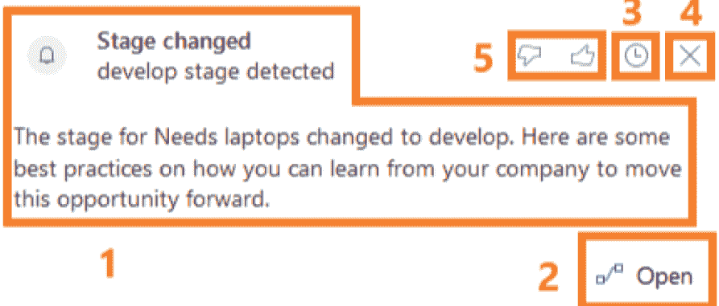

图 3.2 卡片的五个元素。

来源：https://docs.microsoft.com/en-us/dynamics365/ai/sales/assistant

4. 如果您不想执行任何洞察卡推荐的操作，可以直接永久忽略该卡片。
5. 会对卡片提供反馈，无论它对您是否有用。Microsoft 和您的组织经理可以查看此反馈，以便在需要时相应进行更改，以改进结果。

到目前为止，我们了解到助手是一款利用 AI 驱动模型改进销售团队绩效的智能工具。如果这能为您的销售业绩带来奇迹，谁还需要人类助理呢？

我们现在转到下一个功能，自动捕获，Dynamics 365 Sales 用户也可免费使用。

### 自动捕获

数据收集是销售组织的关键步骤，因为它有助于他们更好地了解客户需求。它还可以帮助他们在优化营销策略和个性化沟通等方面进行改进，并能帮助他们更深入地了解当前的市场需求。接下来，收集这些数据的职责是谁？


销售人员有责任记录与客户互动的高质量数据。但这一过程难道不是既耗时又繁琐吗？又如何能确保为贵公司工作的销售人员记录下每一个必要的关键细节呢？

这时自动捕获功能就派上用场了。

自动捕获致力于帮助销售人员记录 Dynamics 365 Sales Insights 中所有关键的客户相关活动，通过简化数据输入流程并确保其完整性来实现。它可以自动将电子邮件通信和重要会议添加到组织中所有相关记录的时间线上。

它还管理来自电子邮件、会议和呼叫的活动和上下文，并向销售人员提供保存相关信息的建议，例如创建新联系人。这样一来，销售人员可以花更多时间来促成交易，而不是经常更新 Dynamics 365 Sales Insights 中的数据。

自动捕获功能分为两类：

1. **基本自动捕获。** 此功能可捕获销售人员的相关活动，并将其显示在 Dynamics 365 Sales 时间线上。如果销售人员希望查找 Dynamics 365 Sales 中与任何特定事件相关的所有数据，他可以在时间线上获取所有内容（参见 [图 3.3](figure-3-3://placeholder)）。时间线最多可显示与该事件相关的 50 封最近的电子邮件建议和会议。让我们看看此功能能为您做什么：

   - 它能检测哪些电子邮件和会议与当前记录相关，然后将其捕获。这些电子邮件和会议被标记为未跟踪，且仅对销售人员可见。
   - 每封未跟踪的电子邮件都有一个跟踪链接（参见 [图 3.4](figure-3-4://placeholder)）。它仅在上下文中对销售人员可见。如果销售人员选择点击跟踪链接，则该未跟踪的消息将保存到 Dynamics 365 Sales 数据库中，并且您团队中的所有其他成员也可以看到它。

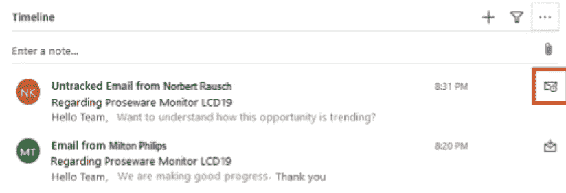

**图 3.3** Dynamics 365 Sales 时间线。

来源: https://docs.microsoft.com/en-us/dynamics365/ai/sales/free-auto-capture

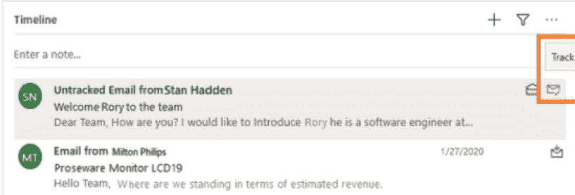

**图 3.4** 右侧带有跟踪链接的未跟踪电子邮件。

来源: https://docs.microsoft.com/en-us/dynamics365/ai/sales/free-auto-capture

2. **高级自动捕获。** 此功能可帮助销售人员将潜在客户转化为客户。它使销售人员免于将每个客户相关细节都记录到 Dynamics 365 Sales 中的麻烦。除了所有基本自动捕获功能外，它还提供创建新联系人的建议。让我们看看此功能能为您做什么：

   - 它将所有捕获的活动建议显示在您的时间线上，供您审核并决定哪些相关且可以保存供其他团队成员使用。销售人员可以根据需要保存、删除或编辑任何活动。
   - 活动建议网格在一个位置显示所有捕获的建议，确保不会丢失任何信息。此部分包含以下列：
     - **活动。** 此列涉及事件的类型（即电子邮件或会议）。
     - **发件人。** 顾名思义，此列涉及活动的发送者。
     - **主题。** 此列指明活动的内容。
     - **关于。** 此列涉及活动关联的记录。
   - 通过销售人员对话捕获的联系人建议在一个位置显示，称为联系人建议网格。它包含以下部分：
     - **全名。** 此部分显示建议联系人的全名。
     - **公司名称。** 此部分显示建议联系人的公司名称。
     - **电子邮件。** 此部分显示建议联系人的电子邮件 ID。

### 电子邮件互动

选择有效的沟通媒介是企业定位目标受众的首要步骤之一。通常，他们会选择电子邮件沟通，因为它廉价、快速且方便。当您打开电子邮件时，您会看到收件箱中充满了基于您之前的购买或浏览历史记录的产品和服务电子邮件。但这是吸引客户关注您的产品或服务的最佳方式吗？

百分之四十的客户甚至懒得打开促销电子邮件。因此，您如何确定客户是否收到了电子邮件或是否打开了电子邮件？您能确定客户理解了您预期的电子邮件意图吗？如果不是呢？

如果您对所有这些问题都没有答案，又如何确定哪些潜在客户可能成为客户呢？

> “电子邮件沟通唯一的问题在于不知道的确定性。”
> —— 玛纳利·蒂瓦里

如果有一种方法可以获得关于客户的这些问题的答案，该怎么办？

Dynamics 365 Sales 使得通过电子邮件沟通促成越来越多交易成为可能。Dynamics 365 Sales 的电子邮件互动功能就像一只鹰，时刻关注您的每一次电子邮件对话，帮助您更高效地促成潜在客户交易。

让我们来谈谈 Dynamics 365 Sales 的这项电子邮件互动功能能为您做什么。今天，销售人员需要通过了解客户的兴趣来了解客户的需求。电子邮件互动功能让您离促成交易又近了一步。

Dynamics 365 Sales 的这项电子邮件互动功能能为您做什么？

电子邮件互动可帮助您跟踪客户活动。例如：

- **您可以知道客户何时打开了您的消息。** 此外，当客户首次打开您的消息时，您会收到提醒。让我们了解一下这是如何实现的。当您使用 Dynamics 365 Sales 向客户发送电子邮件时，它会自动生成一个唯一识别的一像素、透明、不可见的 GIF，并将其作为链接图片与邮件中的所有其他链接一起附加。此 GIF 是与其他图片一起存储在 Dynamics 365 服务器上的第一批内容之一，并且仅在接收者选择下载所有图片时才会加载。当接收者请求下载唯一 GIF 时，您的 Dynamics 365 Sales 会指定相关消息已被打开并记录设备类型。因此，如果您想知道客户是否打开了您的消息，您需要在邮件中附加大量引人注目的图片，以便当客户下载图片时，图片会被加载，而您就会知道。

- **您可以知道邮件中每个链接何时被点击。** 让我们了解一下具体原理。当您向客户发送跟进电子邮件时，消息中的所有超链接都会自动转换为指向 Dynamics 365 服务器的唯一重定向链接。每个重定向链接都包含一个 ID，用于唯一表示消息和初始目标链接的 URL。当客户点击链接时，会向 Dynamics 365 服务器发送请求，服务器会记录点击，然后将其重定向到原始地址，因此接收者几乎不会有延迟地获得所需的所有信息。

- **您可以知道接收者何时打开了每个附件。** 让我们了解一下具体原理。当您在电子邮件中添加已跟踪的附件时，它会作为链接添加并存储在 Dynamics 365 服务器使用的 OneDrive for Business 共享中。如果我们谈论未跟踪的链接，当接收者下载附件时，Dynamics 365 服务器会记录点击和时间。

- **根据客户的电子邮件打开历史记录，它可以帮助您安排最有效的消息发送时间，并考虑收件人的时区。**

- **它会根据您与客户之前的对话历史记录推荐几个电子邮件模板。** 您可以选择最合适的一个并发送。

- **您可以设置提醒，以便在发送跟进电子邮件时提醒您。** 它使用助手功能来发送提醒和其他消息，因此启用此功能对于充分利用电子邮件互动功能至关重要。

电子邮件互动功能可以通过帮助您创建有用的电子邮件并了解客户需求，让您能够以解决方案接触客户，从而将您的业务提升到新高度。

到目前为止，我们已经介绍了 Dynamics 365 Sales 的所有免费功能。让我们继续了解一些高级和高级版功能并


看看它能为您的业务做什么。

## 高级销售洞察功能

高级销售洞察功能应有尽有。它包含所有免费功能以及以下更令人兴奋、更丰富的功能：

- **带工作室的助手。** 它包含上述免费版本的所有功能以及一些增强功能，例如：
  - 您可以通过工作室使用 Microsoft Flow 创建和显示自定义洞察卡片。
  - 您可以根据需要对卡片进行优先级排序。
  - 您可以优化卡片排名。
  - 您可以将卡片分配给团队成员，不论其角色如何。
  - 您可以开启或关闭洞察卡片，从而可以根据特定用户角色显示卡片。
  - 您可以编辑洞察卡片的整个流程。

- **关系分析。** 这是一项使用数据库为任何线索、联系人、账户或机会创建关键绩效指标图形表示的功能。

- **预测式线索评分。** 此功能为管道中所有可用线索创建评分模型，识别并优先处理优质线索，并将其转化为机会。

- **预测式机会评分。** 该评分模型还可帮助您优先处理机会。

- **高级预测。** 此功能使用 AI 驱动的模型基于历史数据分析收益结果，使销售团队能够专注于高收益生成评分的机会。

- **笔记分析。** 此功能分析销售人员与客户交谈时记录的笔记，并智能指导他们直至流程结束。

- **谈话要点。** 它使您的销售团队能够通过建议家庭、体育和娱乐等常见谈话话题来与客户开始对话。

- **谁认识谁。** 如果您的任何同事是客户的朋友，此功能将提供有关客户共同联系人的信息。它可以帮助您获得向潜在客户介绍的机会。

- **销售加速器。** 它加速寻找下一个最佳潜在线索的过程。它从多个来源收集信息并创建一个优先级明确且强大的管道，使销售人员能够智能地接触线索。

- **适用于 Teams 的 Dynamics 365 助手。** 它为销售人员提供智能指导，以便他们可以与客户建立有意义的关系。此应用程序使销售人员能够为当天即将到来的互动和活动做好准备，帮助他们准备会议，智能建议下一步最佳操作，捕获会议笔记，并扫描名片以创建新联系人。

## 对话智能

对话智能使销售经理能够指导销售团队主动向客户解释业务并回答与业务相关的问题。

## 产品洞察

对于企业来说，了解客户对您产品的反馈情况至关重要：哪些功能是客户最常用的，哪些几乎被忽略？产品洞察是一种智能方式，可在客户使用产品时获取产品的实时洞察。您可以以前所未有的方式改进和支持产品。例如，假设您的产品是空调。Dynamics 365 Product Insights 可以帮助您收集每台售出空调的所有能耗、制冷剂水平、室外冷凝器线圈和室内蒸发器单元的数据。然后，它将这些数据与 Dynamics 365 应用程序（如 PLM、ERP、CRM）及其他系统相结合，以更好地展示客户如何使用您的产品。收集这些关键数据可以帮助您改进未来版本，使您能够主动提供客户服务，并帮助您根据客户需求开发新功能，以提供更好的客户体验。

产品洞察的优势包括：

- **改进您的产品。** 产品洞察通过监控产品使用情况，帮助您提高产品质量和客户体验。

- **产品规划。** 产品洞察可帮助您使用数据识别客户需求，从而相应地规划未来版本。它使您能够直接与客户互动，获取想法和反馈。

- **市场价值。** 产品洞察可帮助您了解产品的受欢迎程度。它可以帮助您找出产品受欢迎和不受欢迎的功能。

- **主动服务。** 产品洞察利用遥测数据识别产品/服务中的问题，并提醒您优先处理维修或设计修复和维护。

## Dynamics 365 中的客户服务虚拟客服

您的客户服务团队处理客户询问的能力决定了您品牌的未来。如今，客户不希望浪费时间联系人工客服。无论他们通过呼叫、短信还是在线方式联系您，他们都希望立即获得针对所有问题的智能响应。但是，公司越来越无法根据需要为每位客户提供个性化体验，因此公司正在转向虚拟客服来管理大量询问。

让我们了解 Dynamics 365 Customer Service Insights 和虚拟客服如何使团队能够在无需编写一行代码的情况下为所有客户提供个性化体验并预测其需求。

在 Dynamics 365 Customer Service Insights 中，跨多个渠道的数千通呼叫数据被收集并显示在关键绩效指标摘要仪表板中。它使用 AI 通过多种图表向您展示新兴话题，为您提供系统关键绩效指标的图形表示。让我们通过其中一个图表来了解虚拟客服如何提供帮助：案例数量驱动图表。该图表使用基于深度学习和自然语言语义的 AI 聚类，将所有支持案例归类为支持主题。得益于这些图表，团队无需逐个审查每个案例；相反，AI 算法会在无需实际人工干预的情况下，识别并归类具有相似意图的每个案例。让我们从图中选取一个案例，该案例引发了许多客户的询问。假设客户在智能打印机上打印时遇到挑战，而该智能打印机就是您的产品。现在，您如何每天处理超过 2,000 个询问？这时，您可以创建一个虚拟客服，无需编写代码即可为每位客户提供个性化体验。创建虚拟客服的步骤如下：

- 注册 Dynamics 365 客户服务虚拟客服。
- 获取 Dynamics 365 虚拟客服应用程序的许可证。
- 转到 https://va.ai.dynamics.com 创建新机器人。
- 要创建机器人，您需要输入机器人的名称和环境。
- 机器人有一些默认主题，但您也可以创建自己的主题。主题是您需要在其中指定当用户提出不同问题时机器人应采取的操作的地方。
- 在此示例中，让我们创建一个名为“打印机疑难解答”的主题。在此主题中，您将指定客户可能会询问的触发短语，例如“我的打印机需要修理”、“它无法工作”、“我需要修理我的打印机”或“我需要打印机方面的帮助”。有趣的是，客户不需要输入主题中指定的确切短语。通过自然语言理解，虚拟客服足够智能，可以理解其语义含义和意图，从而进行完美匹配。
- 下一步是编辑对话，以指定机器人对各种客户问题的响应。当客户说打印机无法工作时，您可以将机器人配置为如下回复：您使用的是智能打印机吗？
- 现在可能有两个响应：是或否。如果用户回答是，则您的机器人应将客户重定向到智能打印机疑难解答；如果回答是否，则您可以将客户重定向回我们开始的通用主题。
- 这样，一棵树正在形成，帮助您跟踪对话的走向。

在此过程中，如果您询问客户的电子邮件地址，虚拟客服将与 Microsoft Flow 集成，使您能够从 Dataverse (CDS)、CRM 和其他数据库获取数据。通过客户的电子邮件地址，虚拟客服可以识别确切设备、购买日期和序列号。通过了解确切设备，虚拟客服可以查看客户面临的确切问题，并帮助解决它。它还提供有关与产品相关的任何即将推出的优惠或机会的信息。

客户服务虚拟客服应用程序可以帮助您的团队无需任何编码专业知识即可构建机器人，并轻松自动化处理常见询问，从而提高客户满意度。

## 欺诈防护

在此数字时代，越来越多的人涌向互联网，在家舒适地网上购物，而无需担心结账时的长队。随着在线业务销售额的增加，大量个人信息（包括卡片信息）被在线传输，这使得黑客更容易访问这些信息并进行恶意活动。因此，电子商务企业每年因欺诈交易损失超过 2500 亿美元。那么，我们可以做些什么来保护收入并阻止这些欺诈交易？

Dynamics 365 Fraud Protection 是一款帮助商家通过减少欺诈来保护收入的应用程序

交易，提高接受率，并降低运营费用。让我们来看看它提供的三种功能：

**购买保护。** 它是一种基于云的解决方案，专注于通过减少结账摩擦来提高电子商务交易接受率。它使用自适应人工智能来收集洞察，使商家能够轻松做出包括收入平衡机会、客户体验和欺诈损失在内的决策。该技术持续从之前的数据模式中学习，以提高欺诈检测准确性。它还使用交易接受率增强工具，与合作伙伴银行共享交易信任知识，以提高您的授权率。这样一来，它通过减少对支付的错误拒绝并提高接受率来保护您的收入。接受率的提高会自动导致运营成本降低，因为现在不需要人工审核了。

**账户保护。** 欺诈保护的这一功能专注于保护用户账户免受滥用和欺诈，对抗虚假账户创建、账户被黑客攻击或未经授权的账户访问。自适应人工智能在账户创建过程的所有关键步骤上设置欺诈评估检查。它提供设备指纹功能来增强欺诈检测，使您的团队能够减少双重身份验证中 CAPTCHA 带来的摩擦。它使商家能够在造成损害之前阻止欺诈活动。因此，商家可以通过保护客户免受自动化攻击来避免招致损失，从而保护其账户免受欺诈和不当使用。此功能提升商家的声誉，从而增强客户对您业务的信任。

**损失预防。** 此功能专注于通过识别跨渠道购买中产生的欺诈性退货和折扣滥用来保护企业利润。它分析跨渠道的欺诈模式，以捕捉异常并从不断演变的模式中学习。基于此，它向商家提供智能报告，以提高他们对潜在欺诈活动的关注。它与欺诈保护网络协同工作，通过特征计算、评估和模型训练提供洞察。随后，它为商家提供所需的工具，以减轻损失并优化与折扣和退货相关的欺诈检测。

Dynamics 365 欺诈保护是让您的电子商务业务保持活力的最佳工具。

## 使用 AI Builder 在 Power Apps 中的人工智能

如我们在第 1 章中所学，AI Builder 是 Power Platform 的一项新功能，可让您将人工智能添加到应用程序中并自动化流程，以及定制您的 AI 解决方案。Power Apps 使员工能够为您的业务创建应用程序，即使您没有任何先前的编码经验。现在问题是，AI Builder 能为 Power Apps 做些什么？

AI Builder 是一种通过点击式体验带来人工智能能力的工具，并直接与 Power Automate 和 Power Apps 集成。开发者可以使用 AI Builder 构建 AI 模型，该工具使用已存储在 Dataverse（企业数据存储）中的数据。AI Builder 的一些功能包括：

- **二元分类。** 二元分类是一种 AI 模型，它通过分析历史数据中的模式来预测是/否业务结果，使用历史数据。基于结果，它了解哪些因素影响结果，然后学习这些因素的性质以预测未来结果。预测结果的能力使您能够快速做出关键业务决策，并在竞争时代更快地成长。

- **文本分类。** AI Builder 文本分类模型可用于自动化业务流程，并使员工能够根据洞察采取行动。例如，如果您在医院行业工作，可以做些什么来改善客户服务和医疗保健？医院行业处理大量且不断增加的数据，因此识别可操作的洞察变得具有挑战性。为了提高客户满意度和医院的处理效率，您可以自动化一些流程，例如，从客户那里收集反馈。从客户那里收集的所有反馈数据都存储在 Dataverse (CDS) 中。文本分类 AI 模型随后会对文本进行分类、分组和归类，以识别反馈的情感，并使用它来驱动工作流。有四种基于文本的分类模型：

  - 1. 情感分析模型。该模型分析文本数据中的积极和消极情感。它可用于分析社交媒体帖子或客户评论等。

  - 2. 实体提取。该模型从非结构化数据中识别有用数据，并将其分类为预定义的类别。它可以用于从大量数据中提取事实和检索有价值的信息。

  - 3. 关键短语提取。该模型可以从给定的文本文档中提取关键短语。例如，如果输入文本是“It was a great movie, and the popcorn we ate was very delicious，”模型将提取“great movie”和“delicious popcorn。”

  - 4. 语言检测。正如其名称所示，该模型检测文本文档中使用的主要语言。例如，“I have a cat。”对于此输入文本，模型将返回“en”，表示英语。

- **对象检测。** 该模型允许您计算、定位和识别使用相机拍摄的照片中选定的对象。您可以在零售行业使用此模型来管理库存。

- **表单处理。** 此 AI 模型可以自动从重要文档（例如作为 PDF 电子邮件附件接收的发票）中提取基本信息。它可以提取地址、发票号码、产品项目、数量和费率。从表单中提取关键元素后，它将数据存储在 Dataverse (CDS) 中。通过使用此模型，您可以减少手动输入这些数据时出错的可能性。

所以，现在我们清楚地了解 Power Apps 如何帮助组织构建连接的应用程序并自动化任务（图 3.5）。同时，AI Builder 使它们能够在不编写代码的情况下使用机器学习和基于 Azure 的认知服务。通过向导提供的直接、逐步指导，您可以在自己的 Dataverse 和 Power Platform 环境中非常快速地引入 AI。

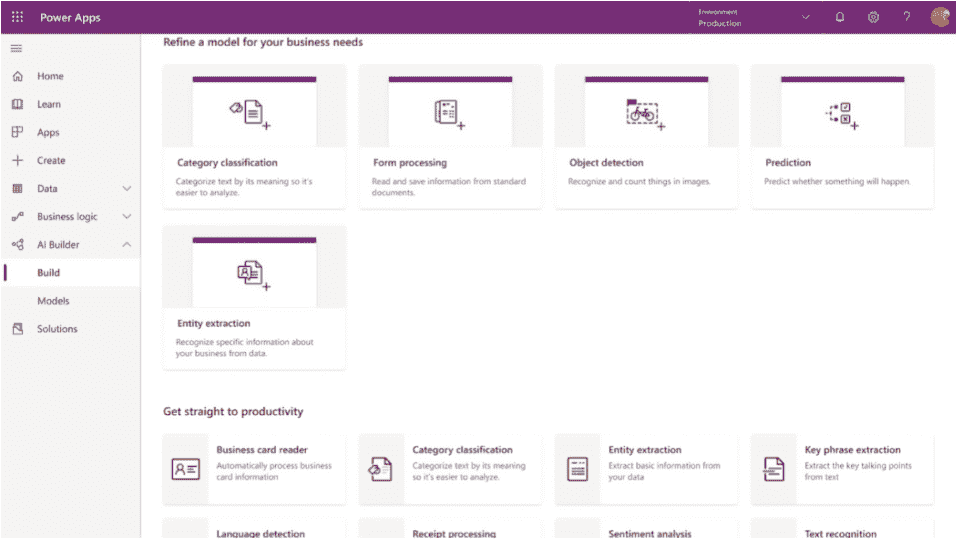

**图 3.5** Power Apps 如何帮助组织。

## 混合现实是什么？

混合现实是一项最近的创新，可让您操纵现有环境或创建新环境。

> 混合现实就像真实世界和虚拟世界的合并。它创建一个环境，其中物理对象和数字对象共存并相互交互。

## 混合现实的 Dynamics 365 应用

员工是能够将业务提升到新高度的人。正是他们的想象力、能力、机智和动力完成了工作。如果员工在处理关键问题时能够随时随地协同工作，那该有多好？有时候，即使是最熟练的员工也需要专家的帮助。专家可能无时无刻都在他们身边。

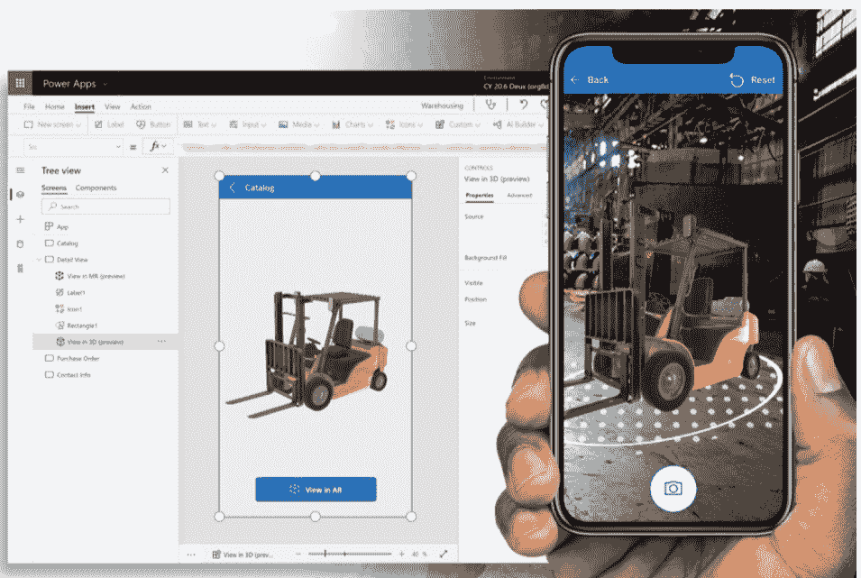

**图 3.6** 混合现实组件。

来源：https://docs.microsoft.com/en-us/powerapps/maker/canvas-apps/mixed-reality-overview

混合现实的 Dynamics 365 应用通过共享员工所见的内容，使员工能够与远程位置的专家并肩工作。专家随后可以逐步指导现场员工，实时解决问题。这种新的工作愿景使员工能够通过轻点一下即可调用所需的专家，从而智能地工作。他们可以一起排查问题并在更短的时间内解决问题。这种协作解决问题的方式使您的员工更加紧密、更加


高效，且更加明智。Power Apps 现在包含混合现实组件（请参见图 3.6）。

## Microsoft HoloLens

> Microsoft HoloLens 是全球首款无线全息计算机，用于混合现实。

要了解 HoloLens，您需要知道全息图的含义。全息图是出现在您周围的看似真实物体的对象，由声音和光组成。您可以通过语音命令、手势和注视在现实世界中与这些对象进行交互。

HoloLens 的功能是让您能够创建全息图或成为您物理环境一部分的对象。HoloLens 由多个传感器、先进的光学元件和全息处理组成，用于创建与您的环境无缝融合的全息图。

## Dynamics 365 混合现实应用程序

Dynamics 365 混合现实应用程序以实实在在的方式依赖于 HoloLens，因为它拥有多个光学传感器来理解环境并感知环境。它有一个向下指向的主摄像头，用于捕捉手部动作，以及一种专用扬声器，用于收集房间各处的声音。HoloLens 还包含多个麦克风、一个环境光传感器、一个高清摄像头以及微软定制的全息处理单元，其处理能力超过普通笔记本电脑。将所有这些集成在一台设备中，使 HoloLens 能够与房间中设备的空间方位兼容，能够追踪房间中的墙壁和物体，并能够将全息图融入环境中。

## Dynamics 365 Remote Assist

Dynamics 365 Remote Assist 应用程序使员工能够同时与客户和现场技术人员联系，以实时解决问题。该应用程序使用 HoloLens 进行视频呼叫的拨出和接听。HoloLens 使用增强现实界面和语音命令与客户建立连接；这样，员工无需手持任何设备。双方的员工都可以创建或与 HoloLens 佩戴者空间中可见的 AR 内容进行交互。异地员工可以轻松查看 HoloLens 佩戴者看到的内容。HoloLens 佩戴者可以通过在问题区域周围绘制圆圈或箭头来指出问题区域，该圆圈或箭头随后将成为全息图对象。异地员工将围绕该对象排查问题，并可以逐步提供指导以解决问题。这就是 Dynamics 365 Remote Assist 如何借助远程地点的员工高效实时地解决问题。

## Dynamics 365 Guides

企业当前面临的主要挑战是新员工缺乏经验。培训人员需要专家全程指导工作流程，并为他们应对各种场景做好准备。但这并不像需要的那样有效，因为经验丰富的人每天都在退休。那么，可以为新员工做些什么，使他们能够像经验丰富的人一样高效工作？基于这一理念，微软推出了 Dynamics 365 Guides。

正如其名称所示，Dynamics 365 Guides 是一种混合现实学习应用程序，可在您的系统中显示简单的逐步说明。企业为新员工提供 HoloLens，新员工可以使用它来挑选全息组件、文本、图表、3D 可视化效果和图标，并将其放置在实际机器上进行学习，从而为现实世界场景做好准备，而无需冒险或承担让新员工使用实际资产的费用。它帮助新员工从第一天起就能完成工作。该应用程序使新员工能够在正确指导下使用现有流程。逐步说明会随员工移动，指向他们需要的精确工具和部件以及应用位置。还有什么比在不涉及任何风险因素的情况下实际执行任务更好的学习方式呢？这样一来，员工可以更快地学习，犯错更少，信心更强，而无需依赖其他员工逐步教导他们。该应用程序还为经理提供关于新员工工作和学习情况的报告。员工通过更快地适应并更擅长支持业务的复杂方面来实现持续改进，使自己更具价值和竞争力。

这些混合现实应用程序可以通过提升客户体验、鼓励员工更高效工作以及帮助企业降低成本，在汽车、制造、销售、能源等各个行业中发挥作用。

# 第 4 章 Dynamics 365 和使用 Azure ML 的自定义 ML 模型

> “决定您未来的，是您所做出的选择。”
> – Donny Ingram

随着机器智能的创新，机器学习能够提供——有时甚至超越——人类水平的感知和认知任务性能，组织越来越多地评估如何应用人工智能来创造新的商业价值并让世界变得更美好。可以合理地假设，很快，使用技术自动化所有常规和例行工作的公司将比不使用的公司进步得更快。

像人工智能这样的技术正在改变当今企业的运营方式。它是当下最热门的技术，结合 Azure 云服务，它正在为大中小组织大规模地创造奇迹。

## AZURE MACHINE LEARNING

Azure Machine Learning 是一个基于云的环境，可：

- 使您能够使用基于云的存储服务，例如 Azure Blob、Azure Data Lake（包括 Gen2）、Azure SQL Database、Azure Synapse Analytics（现代数据仓库）、PostgreSQL、Databricks 和 MySQL。数据集也可以从本地文件、公共 URL 或 Azure Open Datasets 创建。

- 提供名为 Azure Compute Instances 的托管云工作站，该工作站针对机器学习开发环境进行了优化。对于要求更高或生产级别的模型训练，您可以使用 Azure Machine Learning 计算群集来获得额外功能。

- 允许您指定计算目标，即运行训练脚本或托管服务部署的指定计算资源或环境。您可以将这些计算目标部署为 Web 服务以进行实时推理调用，定期作为批处理服务，或通过使用 Azure IoT Edge 将 Docker 容器部署到 IoT 设备。

- 在诸如自动化机器学习、可视化拖放设计器或代码优先的 Notebook 等创作体验中增加灵活性，用于构建和训练模型；Notebook 内置支持开源工具和框架、Jupyter 等 IDE 以及命令行界面，或 Python 或 R 等语言。

- 是一种按量付费设施，这意味着您只需为所使用的服务付费。

Azure ML 可以优化业务流程，因为它：

- 加速端到端机器学习周期。Azure ML 服务使用户能够利用自动化工具更快速地构建预测模型、消耗更少时间，从而识别理想算法。

- 支持多种框架。Azure ML 允许用户从多种框架中选择来创建 AI 模型。其中包括 scikit-learn、PyTorch、MXNet、TensorFlow、Chainer 和 Keras。

- 提供与技能无关的体验。用户可以根据其拥有的技能水平或偏好的创作体验，使用无代码设计器、Python SDK、Jupyter 笔记本、VS Code 或其喜欢的 IDE 来构建模型。

- 使用 MLOps 在数据科学家和运维团队之间进行通信。它用于自动化大量流程，并通过消除浪费来产生更有价值的洞察。

- 与容器编排服务兼容。ML 服务与 Docker、Azure Kubernetes Service 和 Azure Container Instances 兼容，因此可以轻松将模型部署到支持最关键工作负载的平台上。

到目前为止，我们已经确定了 Azure Machine Learning 解决方案对业务增长的重要性。让我们来了解一些 Azure Machine Learning 的概念。

许多组织正在将机器学习应用于业务实践的初步步骤。但它们面临一些潜在挑战，例如难以收集分布在组织各处的分散数据，以及难以从任何所需位置访问这些数据。为克服这些障碍，企业需要部署新的机器学习模型，这可能需要数月的工程投入。此外，在业务流程中实施机器学习还需要彻底的培训和数据专家的专业知识，以便扩展、管理和监控机器学习系统。

因此，为解决这些问题，微软将机器学习与云计算相结合，创建了一种名为 Microsoft Azure Machine Learning 的机器学习解决方案。Azure Machine Learning 借助云的额外优势，为企业提供支持，用于构建数据驱动的应用程序，这些应用程序可以预测、预测并改进多个业务流程。

## Azure Machine Learning 概念

- **模型。** 模型是一段经过训练、能够从输入中识别特定模式并生成输出的代码。要创建模型，您需要选择算法、提供数据并调整超参数。它基本上是机器学习算法所学内容的表现形式。模型创建完成后，您可以使用所选算法从数据集中学习。例如，创建能够识别用户面部表情并识别人类情绪的模型需要监督学习。在这种情况下，您需要通过提供带有不同面部表情的示例图像来训练模型，每张图像都手动标记了特定情绪，以便模型从这些图像中学习。这就是监督学习


模型从您提供的输入数据中识别特定模式。

有一些流行的机器学习框架可用于创建模型，例如 scikit-learn、XGBoost、PyTorch、TensorFlow 和 Chainer。

- **数据集。** 数据集是机器学习工作区中的资产，可帮助您连接数据和存储服务，以便为机器学习实验提供数据。

  创建数据集时，您会创建对存储服务数据的引用，从而能够通过数据集访问数据。这样一来，您只需注册一次数据，即可随时重复使用，即使用于不同的实验也是如此。

  数据集可直接用作脚本、Azure 机器学习管道和贝叶斯机器学习的输入。

  由于创建了数据集，数据仍保留在其现有的数据源位置，因此不会产生额外的存储成本，且数据源的完整性不会受到威胁。Azure 机器学习训练工作流中涉及自动化机器学习、估计器、hyperdrive 和管道的两种可用数据集类型：

  1. **FileDataset** 引用数据存储或公共 URL 中的单个或多个文件，以便在 Azure 机器学习中使用。如果您要使用的数据已经过清理并准备好进行训练实验，则可以使用 FileDataset。

  2. **TabularDataset** 以表格形式表示数据，并可将数据实体化为 pandas 或 Spark DataFrame，从而让您使用标准数据准备和训练库。

- **数据存储。** 数据存储是由 Azure 机器学习服务实现的一种数据管理功能，充当连接众多 Azure 存储服务的接口，同时不会危及数据源的完整性。它包含密钥保管库中的连接信息，包括订阅 ID 和令牌授权，因此无需在脚本中硬编码它们。要创建和注册数据存储，可以使用 Azure 机器学习工作室或 Azure 机器学习 Python SDK。

- **计算资源。** 计算资源是您可用于托管服务部署或运行脚本的环境。它也可用作本地计算机或基于云的计算资源。如果使用它，以后切换到不同的计算环境时，无需担心更改代码。Azure 机器学习引入了两种虚拟机 (VM)：

  1. **计算实例。** 一种主要用于开发工作站的虚拟机，因为它包含多种机器学习环境和工具。它提供无需设置即可开始运行示例笔记本的功能。它也可用作训练和推理作业的计算目标。

  2. **计算群集。** 计算群集是具有多节点缩放功能的虚拟机群集。它们更适合用于大型作业和生产环境的计算目标。提交作业时，它们会自动缩放。

开发模型时，最初会利用少量数据。因此，此时应使用本地计算机或基于云的虚拟机作为计算目标。但随着数据量增大，或如果要对数据进行分布式训练，则需要使用 Azure 机器学习计算来创建单节点或多节点群集，每次提交运行时都会自动缩放。Azure 机器学习计算群集可用于设计器创作体验中大多数作业的训练计算目标。

- **实验。** 实验是属于工作区的特定脚本的一次运行或一组运行。它包含一些您连接在一起以构建预测分析模型的特性。有效实验应具备的特性包括：

  - 至少包含一个数据集和一个模块。
  - 数据集只能连接到模块。
  - 模块可连接到数据集或其他模块。
  - 模块的所有输入端口都需要与数据流建立连接。
  - 必须为每个模块设置参数。
  - 运行日志。

- **管道。** Azure 机器学习管道是整个机器学习任务的可自主执行工作流。管道中的子任务被封装为一系列步骤。这些管道几乎可以完成任何任务，从调用 Python 脚本到更复杂的任务。您的管道应主要专注于机器学习任务，例如：

  - 在数据准备过程中执行的数据导入、清理、验证、转换、归一化和暂存。
  - 训练配置，包括日志/报告配置以及参数化参数和文件路径。
  - 高效且重复地训练并验证结果。通过指定特定的数据子集、分布式处理、不同的硬件计算资源和进度监控，可以实现高性能。
  - 包含版本控制、预配、缩放和访问控制的部署任务。

  要创建管道，设计器使您可以将数据集和模块拖放到交互式画布上。每个步骤的输入和输出都会可见显示。用于创建数据连接的拖放功能使您能够立即理解和更改管道的数据流。当运行管道对象时，服务将执行以下任务：

  1. 计算每个步骤的要求：
     a. 硬件计算资源
     b. OS 资源（例如 Docker 映像）
     c. 软件资源（例如 Conda/虚拟环境依赖项）
     d. 数据输入

  2. 它确定各步骤之间的依赖关系，从而生成动态执行图。

  3. 执行图中的每个节点运行时，会发生以下情况：

     a. 服务可能会重复使用现有资源来配置所需的硬件和软件环境。

     b. 步骤运行并向其包含的实验对象提供日志和监控信息。

     c. 每个步骤的输出被视为下一步骤的输入，或写入存储。

     d. 没有用处的资源将被完成并断开连接。在 ML 工作流中使用管道的优势包括：

     - 它使您能够以可靠且无人值守的方式并行或顺序运行步骤。

     - 您可以创建多个管道并可靠地协调异构计算。这意味着您可以通过在各种计算目标（例如 HDInsight、GPU 数据科学 VM 和 Databricks）上运行单个管道步骤来使用可用计算资源。

     - 管道可以通过为特定场景（例如重新训练和批量评分）创建管道模板来重复使用。您可以通过简单的 REST 调用从外部系统触发已发布的管道。

     - 对于跟踪和版本控制数据源、输入和输出，可以使用管道 SDK。

     - 管道允许多名数据科学家在机器学习设计过程的所有领域中的步骤上协作。

Azure ML 管道是一项引人注目的资源，可在早期开发阶段开始提供价值。随着团队和项目的进展，其价值会不断提升。Azure 机器学习管道旨在帮助您构建、优化和管理机器学习工作流。

- **管道终结点。** 管道终结点是可从外部应用程序使用的 REST API。它使您能够通过 REST 终结点以编程方式调用 ML 管道，并帮助您自动化管道工作流。

- **运行日志。** 训练脚本的单次执行称为运行。Azure 机器学习通过在实验中存储关键信息来跟踪所有运行，例如：

    - 您显式上传或由实验自动收集的输出文件。
    - 指标。
    - 时间戳、持续时间等元数据。
    - 运行实验之前包含脚本的目录快照。

要记录任意指标，可以使用 Python SDK。

## 机器学习工作室

Azure 机器学习工作室是一个基于 Web 的集成开发环境 (IDE)，与其他 Azure 云服务紧密集成，以简化机器学习模型和服务的开发和部署。在当今时代，企业使用机器学习来实现预测智能并保持竞争力。然而，许多公司的数据科学家和数据工程师发现，为繁琐任务采用机器学习解决方案具有挑战性，因为这需要缓慢的训练和复杂的部署。

Microsoft 的 Azure 机器学习消除了这些障碍。它是一个带有自动化机器学习和内置 DevOps 的开放平台，可


用于随时随地解锁洞察并加速端到端的机器学习生命周期。您可以快速使用它从云端扩展到边缘。

Azure Machine Learning Studio 是一个功能强大的拖放式界面，可让您无需编码即可开始。只需几次点击，即可从构思到部署，无需任何额外设置。

使用自动化机器学习，您可以自动执行手动和重复性任务，并在短时间内开发出更具创新性的模型原型和开发流程。自动化 ML 还负责繁重的特征工程、算法选择和超参数调优。

Azure Machine Learning 对许多开源框架（如 ONNX、PyTorch、scikit-learn、TensorFlow）提供开箱即用的支持，并兼容集成 Notebook 的环境和命令行界面。它让您能够继续使用已熟悉的技术，并支持您使用自己的一组 Python 或 R 工具。

您可以使用 Azure ML Studio 构建管道，帮助您轻松共享端到端的数据科学经验并优化工作流。内置的 DevOps 可以加速解决方案部署并提高生产力。它可以帮助您确保模型质量，并通过集成的 CI/CD 随时间自动改进模型。使用 Azure ML Studio 可以帮助您的团队利用模型可解释性功能和自动缩放计算资源自由创新。它还能与其他 Microsoft 软件（如 Power BI、Excel、SQL Server）实现更深层集成，帮助您毫无障碍地将结果提升到新的水平。

要构建自定义机器学习模型，拥有一支经验丰富的数据科学家和数学家团队至关重要，他们可以构建、测试和验证模型。但如今要找到机器学习专家并不容易。那么，可以做些什么来让每个人都能轻松完成自定义模型构建过程呢？

企业需要工具来引导开发人员完成创建所需模型的整个过程。大多数机器学习模型分为两类：一类对相似数据进行分类，另一类识别异常数据。因此，为了让开发人员能够创建自定义模型，Azure 提供了预训练、预构建且可自定义的模型，以及各种简化其任务的工具。

## Azure ML Studio 中的创作体验

自动化机器学习（Automated ML）是自动化机器学习模型开发中耗时且重复的迭代任务的过程。更具体地说，它自动化了机器学习模型的数据准备、模型选择、组合和参数化。Automated ML 使机器学习任务对所有用户（无论技能水平如何）都易于使用，并且通常比手写算法提供更快、更准确的输出，并避免手动超参数调优。它使您能够使用您指定的目标指标来维持模型质量，同时构建高规模、高效率和高生产力的 ML 模型。

某些模型开发方法有时会使这些系统难以解释，这意味着很难理解 AI 系统做出决策的原因。尽管它们能以绝对的效率和处理能力产生结果，但要跟踪算法如何产生该输出可能具有挑战性。因此，我们很难为特定问题确定准确的模型，因为如果模型是一个黑盒，预测结果就会变得困难。

因此，在这种情况下，Automated ML 的作用是使机器学习更易于使用，从而使其不再那么像黑盒。Automated ML 自动化了将算法应用于现实场景的机器学习过程的一部分。它学习并理解算法的内部逻辑，并根据算法与现实场景的关联程度做出选择。使用 Automated ML 执行任务时，所需的时间和资源更少，并且相比人工而言效率更高。如果您正在处理 Dynamics 365/Power Platform 数据且不知道选择什么算法，Automated ML 是一种非常好的方法：它通常是一个不错的起点。

## 何时使用 Automated ML

当您希望使用 Azure Machine Learning 针对特定目标指标训练和调优模型时，请使用自动化 ML。

Automated ML 使用户能够在不管其数据科学专业知识水平如何的情况下，识别端到端的机器学习管道。

企业中的数据科学家、分析师和开发人员使用自动化 ML，原因如下：

- 实现机器学习解决方案不需要全面的编程知识。
- 它节省了时间和资源。
- 它利用数据科学最佳实践。
- 它遵循敏捷问题解决方法。

## 自动化 ML 机器学习过程如何工作？

自动化 ML 分析并简化机器学习过程的每个步骤，从清理和处理原始数据集到部署功能机器学习模型。传统机器学习模型是手动开发的，过程中的每个步骤均单独管理。

Automated ML 在机器学习过程中自动化的步骤（按其发生顺序排列）如下：

- 1. **原始数据处理。** 这包括使用数据清洗、数据集成、数据转换和数据缩减等方法，将非结构化的原始数据重塑为结构化格式并提高数据质量。

- 2. **特征工程和特征选择。** Automated ML 利用数据的领域知识，通过分析输入数据并使用数据缩放和归一化技术，自动化创建与机器学习算法更兼容的特征的过程。

- 3. **模型选择。** Automated ML 一次测试许多不同的算法，以选择最适合业务用例的算法。数据科学家之前可能未曾考虑过同一算法。

- 4. **超参数优化和参数优化。** Automated ML 可以微调算法的数据、特征、参数和超参数，依靠试错方法和既有机器学习知识生成准确模型。

- 5. **考虑业务和技术约束的部署。** Automated ML 要么根据您定义的度量标准部署最佳模型，要么部署正在进行的实验中的特定模型迭代。

- 6. **评估指标选择。** Automated ML 提供一组汇总的评估指标，用于指示每个类别标签的评估指标表现如何，从而指示模型对该标签的表现如何。

- 7. **监控和问题检查。** Automated ML 关键性地监控结果以发现洞察并处理问题。

此外，自动化 ML 可用于分类、回归和预测。

## 分类

分类是一种标准的机器学习任务，模型通过使用训练数据并将其应用于新数据来学习。这是一项需要使用机器学习算法，基于训练数据的学习成果来预测并为新数据分配类别的任务。

Azure Machine Learning 提供特征化功能（在使用数据缩放和归一化技术创建帮助 ML 算法更好学习的特征时使用），尤其是针对分类任务。您可以使用以下步骤在 Azure Machine Learning Studio 中创建 Automated ML 实验：

- 1. 创建工作区（如本章前一节所述）。再次提醒，您可以注册免费 Azure 帐户并尝试 Automated ML。

- 2. 登录 Azure Machine Learning Studio 并选择您刚才创建的订阅和工作区。

- 3. 现在单击“开始”选项。

- 4. 转到“创作”部分下的左侧窗格，并选择“Automated ML”选项。

- 5. 如果这是您的第一个 Automated ML 实验，您将看到一个空列表和指向文档的链接。

- 6. 单击“+ 新建自动化 ML 运行”。

现在，您必须创建并加载数据集（图 4.1）。首先，您需要将数据文件上传到工作区。将数据以 Azure Machine Learning 数据集的形式上传到工作区的原因是，它可以确保您的数据已正确格式化以用于实验（图 4.2）。以下是创建和加载数据集的步骤。当然，在实际生产环境中，您应该连接到自己的数据存储，例如 Azure Data Lake Storage 或 Synapse Analytics。您也可以尝试使用 Azure 开放数据集，它将为您提供一些基本示例，让您能够非常快速地尝试真实数据集。

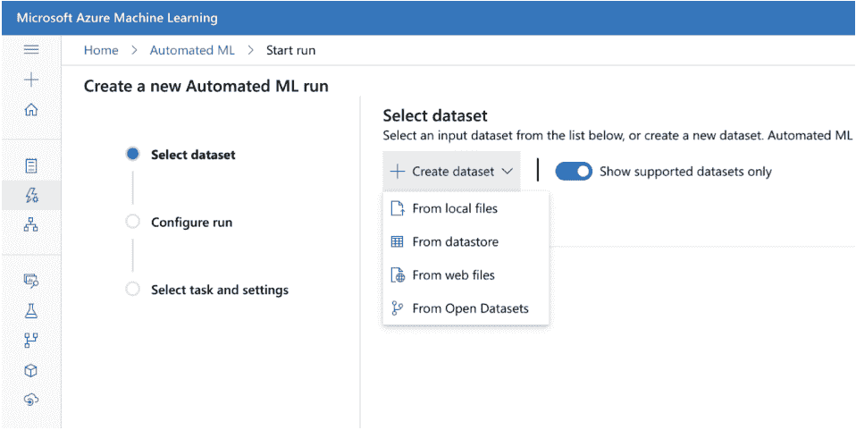

### 图 4.1 选择数据集。


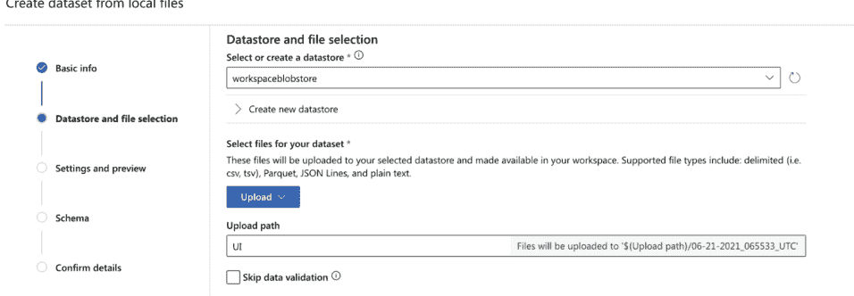

**图 4.2 上传您的数据文件。**

要创建新数据集，请选择 +Create dataset 下拉列表，并选择“从本地文件”选项以上传您的数据集。

- 1. 打开“基本信息”表单后，为您的数据集命名并提供可选描述。请确保数据集类型的默认设置为“表格”，因为自动机器学习界面当前仅支持 TabularDatasets。
- 2. 单击左下角的“下一步”按钮。
- 3. 这将带您进入数据存储和文件选择表单；请选择默认数据存储 Workspaceblobstore（Azure Blob Storage）。在此上传您的数据文件，以便工作区可以使用。
- 4. 单击“浏览”。
- 5. 从本地计算机中选择您作为先决条件下载的文件。
- 6. 为您的数据集提供一个唯一名称，并在需要时提供可选描述。
- 7. 选择左下角的“下一步”，并通过单击左下角的“下一步”按钮将其上传到默认容器。
- 8. 上传完成后，您将根据文件类型看到“设置和预览”表单。
- 9. 验证“设置和预览”表单是否按以下内容填充，然后选择“下一步”。
  - a. 文件格式 – 分隔符
  - b. 分隔符 – 逗号
  - c. 编码 – UTF-8
  - d. 列标题 – 所有文件都有相同的标题。
  - e. 跳过行 – 无
- 10. “架构”表单允许您为当前实验进一步配置数据（如果您不想进行任何选择）。选择“下一步”。
- 11. 验证“确认详细信息”表单上的信息，例如基本信息、数据存储和文件选择以及设置和预览表单。
- 12. 如果一切符合预期，请选择“创建”以完成数据集的创建。
- 13. 现在从列表中选择您的数据集。
- 14. 审阅数据预览，然后选择“关闭”。
- 15. 选择“下一步”。

现在您需要配置运行（图 4.3）。

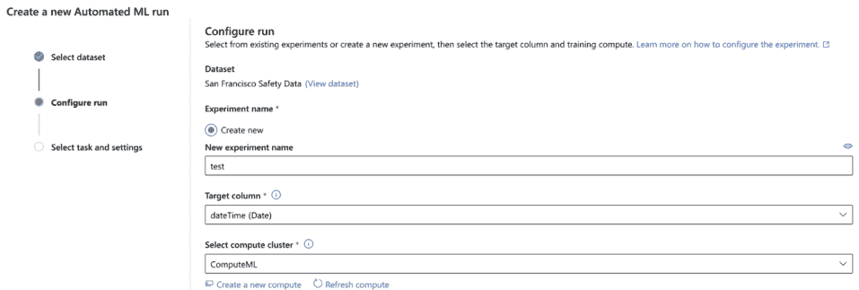

**图 4.3 配置运行。**

您所要做的就是设置实验。此设置涉及实验设计任务，例如指定要从中获取预测的列以及选择计算环境的大小。

- 1. 选择“创建新”单选按钮。
- 2. 您将看到如下的“配置运行”表单：
  - a. 输入此实验名称：输入您选择的任何唯一名称；此处我们使用 my-1st-Automated ML-experiment。
  - b. 选择 y 作为目标列，即您要预测的列。
  - c. 单击“+创建新计算”选项并配置计算目标。我们在此处选择计算目标，因为它是运行训练脚本或托管服务部署的本地或云端资源环境。目前，我们使用云端计算。随后，您将看到一个虚拟机表单以设置计算：
    - i. 虚拟机 – 专用
    - ii. 虚拟机类型 – CPU（中央处理器）
    - iii. 虚拟机大小 – Standard_DS12_V2
  - d. 选择“下一步”并查看“配置设置”表单：
    - i. 计算名称 – Automated ML-compute
    - ii. 最小/最大节点 – 最小节点：1，最大节点：6
    - iii. 缩减前空闲秒数 – 120（默认值）
    - iv. 高级设置 – 无
  - e. 单击“创建”按钮以创建计算目标。
  - f. 创建可能需要几分钟，但创建完成后，请从下拉列表中选择您的新计算目标。
  - g. 单击“下一步”按钮。
- 3. 若要完成自动化机器学习实验的设置，请转到“任务类型和设置”表单，并指定机器学习任务类型和配置设置（图 4.4）。
  - a. 系统将询问机器学习任务类型。选择“分类”。
  - b. 转到“查看其他配置设置”（图 4.5），并按以下内容填写字段。
    - i. 主要指标 – 加权 AUC
    - ii. 解释最佳模型 – 启用
    - iii. 阻止的算法 – 无
    - iv. 退出条件 – 训练作业时间（小时）：24；指标评分阈值：无
    - v. 验证 – 验证类型：训练-验证拆分；验证数量：10%
    - vi. 并发 – 最大并发迭代次数：5
    - vii. 现在单击“保存”按钮。

## 其他配置

| 设置 | 值 |
|---------|-------|
| 主要指标 | 加权 AUC |
| 解释最佳模型 | |
| 阻止的算法 | 自动化机器学习在训练期间不会使用的算法列表。 |
| 退出条件 | 训练作业时间（小时）24<br>启用深度学习时，自动化机器学习建议最长实验时间为 24 小时（注意：当达到最佳分数时，自动化机器学习会自动提前结束运行）。 |
| 指标评分阈值 | 指标评分阈值 |
| 验证 | 验证类型 训练-验证拆分<br>数据验证百分比 * 10<br>自动化机器学习建议将 10% 到 30% 的数据留出用于验证 |
| 并发 | 最大并发迭代次数 5 |

**图 4.5 其他配置。**

- 4. 单击“完成”以运行实验。实验开始时，“运行详细信息”屏幕会弹出在您面前，顶部显示运行状态。此状态会随实验进度刷新。通知会出现在工作室右上角，以通知您实验的状态。

现在我们将探索模型：

- 1. 转到“模型”选项卡，观察已测试的算法（模型）。默认情况下，模型在完成时会按其指标评分排序。
- 2. 选择已完成模型的算法名称以查看其性能详细信息，同时等待其他实验模型完成。

接下来是模型部署，部署是模型的集成。此操作旨在为新数据预测潜在的机会领域。自动化机器学习界面使您能够选择并部署最佳模型。部署模型的步骤如下：

- 1. 根据所选指标选择最佳模型。
- 2. 单击左上角的“部署”按钮。
- 3. 按以下内容填写“部署模型”窗格：
  - a. 部署名称 – my-Automated ML-deploy
  - b. 部署描述 – 我的首次自动化机器学习实验部署
  - c. 计算类型 – 选择 Azure 计算实例 (ACI)
  - d. 启用身份验证 – 禁用
  - e. 使用自定义部署 – 禁用
- 4. 选择“部署”。
- 5. 单击“部署”按钮后，您将在“运行”屏幕顶部看到绿色成功消息，并且“模型摘要”窗格的“部署状态”下会显示状态消息。
- 6. 要定期检查部署状态，请选择“刷新”。

## 回归

回归是一种常见的监督学习任务。基于独立预测因子，回归模型预测数值输出。回归的主要目标是估计一个独立预测变量如何影响其他变量以及它们之间的关系，例如，汽车价格如何基于油耗、安全评级等因素。

## 时间序列预测

时间序列预测是利用历史数据预测未来观测值的过程。当今大多数公司都在使用时间序列预测来制定和创新业务策略。他们主要将其用于财务规划、资源规划、库存规划和容量规划等任务。它已成为任何业务的基本组成部分，无论是收入、库存、销售还是客户需求。

通常，在创建机器学习模型时，我们会分析不同的算法和超参数值，但当我们主要关注时间序列预测时，还需要考虑季节性和节假日的影响。因此，在考虑所有这些复杂因素的情况下构建模型变得棘手。因此，与其手动执行所有任务，不如切换到自动化机器学习。自动化机器学习可以自动执行算法选择、超参数值搜索和数据特征化（包括节假日）等任务。它可以帮助您为数据找到最佳机器学习模型。

自动化时间序列实验被视为多元回归问题。先前的时间序列值会被“旋转”并与其他预测因子一起成为回归器的附加维度。与经典时间序列方法不同，这种方法的优势在于在训练期间整合多个上下文变量及其相互关系。

自动化机器学习根据结果的准确性创建并对多个模型进行排名，您可以检查这些模型以确定哪个是您问题的最佳解决方案。找到完美模型后，您可以立即添加输入和输出阶段，并将其部署为服务。

制造能够从经验中学习的机器最终应该消除数据科学家的编程工作。自动化


Machine Learning 致力于帮助数据科学家和数据分析师智能地找到以下问题的答案：

- 我们应该选择哪些特征来训练模型？
- 我们如何选择算法？
- 我们应该选择哪些参数进行调优？

## 我们应该选择哪些特征来训练模型？

在探索数据时，您会发现数据可能需要预处理。检查数据中常见问题（也称为数据护栏）是明智的，以便在数据用于训练机器学习算法的输入之前识别潜在问题。

确定用于训练模型的哪些特征至关重要。将所有特征都作为训练输入并不一定能提供良好的模型。因此，首先选择相关特征是必不可少的。

为此，我们需要首先了解特征工程和特征化的概念。

> 特征工程是利用输入数据的领域知识来创建特征的方法，以帮助机器学习（ML）算法更好地学习并提供更好的结果。

在 Azure 机器学习中，当像数据缩放和归一化这样的技术与特征工程一起用于简化流程时，在自动化 ML 实验中这被称为“特征化”。

默认情况下，每次自动化机器学习实验都会对您的数据应用归一化和数据缩放技术。要在 Azure 机器学习工作室中配置特征化技术，您应打开“查看特征化设置”。然后在“其他配置设置”表单中启用自动特征化。这样，默认特征化技术就会被应用。

让我们研究启用自动特征化后自动应用于您的数据的技术：

- **删除高基数或无方差特征。** 此功能从训练集和验证集中删除高基数和低方差变量。当您的数据包含缺失值、所有行中的相同值或高基数（例如，身份识别号码、电子邮件地址或用户名）时，将应用此功能。

- **填充缺失值。** 此功能用于用替代值替换缺失数据，主要是在数据中缺少数值时；它使用列中值的平均值来填充这些缺失值。对于类别值，它使用出现最频繁的值进行填充。

- **生成更多特征。** 此功能可帮助您创建年份、月份、日期、星期、一年中的第几天、季度、一年中的第几周、小时、分钟、秒等。对于文本，它可帮助您根据术语频率创建一元词、二元词和三元词。

- **转换和编码。** 此功能将唯一值较少的数值转换为类别值。独热编码用于低基数类别特征；它将类别变量表示为二进制向量。独热哈希编码用于高基数类别特征。

- **字嵌入。** 此功能使用预训练模型将文本标记的向量转换为句子向量。文档中每个词嵌入向量都会与其余向量聚合，以生成文档特征向量。

- **聚类距离。** 此功能在所有数值列上训练 k-means 聚类模型。它生成新特征，包括每个样本与每个聚类中心之间的距离。

接下来，介绍帮助我们改进数据的下一个概念：数据护栏。

数据护栏是一种识别数据中类不平衡或缺失值等潜在问题的方法。它们还可帮助您采取补救措施以改善结果。

数据护栏适用于：

- SDK 实验。您在 Automated MLConfig 对象中选择了参数“featurization”：auto 或 validation=auto。

- Studio 实验。您已为自动特征化选择了启用状态。

数据护栏以三种状态之一显示结果：

- 1. 通过。未在您的数据中发现问题，且无需采取任何操作。

- 2. 已完成。自动化 ML 采取了一些纠正措施来改进您的数据，您需要审查这些更改以确保其符合预期结果。

- 3. 警报。检测到无法解决的问题。在此情况下，建议您修订并修复问题。

支持的数据护栏包括表 4.1 中列出的内容。

### 表 4.1 数据护栏。

| 护栏 | 状态 | 触发条件 |
|---|---|---|
| 缺失特征值填充 | 通过 | 您的训练数据中没有缺失特征值。 |
| 缺失特征值填充 | 已完成 | 您的训练数据包含缺失特征值，且已填充。 |
| 高基数特征处理 | 通过 | 您的输入中未检测到高基数特征。 |
| 高基数特征处理 | 已完成 | 您的输入包含高基数特征，且已处理。 |
| 验证集拆分处理 | 已完成 | 如果训练数据少于 20,000 行，且验证配置设置设置为“auto。” 训练模型的每次迭代都使用交叉验证进行了验证。如果训练数据超过 20,000 行，且验证配置设置为“auto。” 为了验证模型，输入数据已被拆分为训练数据集。 |
| 类平衡检测 | 通过 | 已分析您的输入，且训练数据中的所有类都平衡。 |
| 类平衡检测 | 警报 | 在您的输入中检测到类不平衡。修复平衡问题。 |
| 类平衡检测 | 已完成 | 在您的输入中检测到类不平衡，且扫描逻辑已确定应用平衡。 |
| 内存问题检测 | 通过 | 已分析预测期、滞后和滚动窗口，未检测到潜在内存不足问题。 |
| 内存问题检测 | 已完成 | 所选值（预测期、滞后、滚动窗口）可能导致您的实验内存不足。滞后或滚动窗口配置已关闭。 |
| 频率检测 | 通过 | 在分析时间序列时，所有数据点都与检测到的频率对齐。 |
| | 已完成 | 在分析时间序列期间，检测到与检测到的频率不一致的数据点。这些数据点已从数据集中删除。 |

提交实验时，您可能会遇到这些相关状态。在开始开发和训练机器学习模型之前，您需要执行一些检查，例如数据预处理和数据护栏。

## 如何选择算法

在为训练准备好数据后，您应专注于为模型选择合适的算法。机器学习任务有许多算法：

- **分类。** 有许多分类算法，您需要从中选择最适合您的数据集的算法。以下是一些常用的分类算法：逻辑回归、梯度提升、LightGBM、k-近邻、决策树、随机森林、XGBoost、朴素贝叶斯等。

- **回归。** 一些标准回归算法包括弹性网、LightGBM、梯度提升、决策树、k-近邻、LARS Lasso、随机森林、线性回归等。

- **时间序列预测。** 一些常用的时间序列预测算法包括自动 ARIMA、线性回归、LightGBM、扩展卷积神经网络、均值预测、ARIMA、ETS 等。

选择合适的算法取决于业务问题和机器学习任务。数据科学家会根据任务、数据集大小、经验或易于解释和说明的算法，尝试其中许多算法。


有时，他们主要关心算法的速度。例如，他们更有可能选择一个说服力较弱但能快速提供结果的算法。这让他们了解接下来应该尝试哪些算法。

## 我们应该选择哪些参数进行调优？

模型训练期间，您的应用程序处理三类数据：

- 1. 输入数据，或训练数据，是解决机器学习问题所需的单个实例的集合。此数据负责在训练过程中进行准确预测，以便根据类似数据的新实例配置模型。但是，这些值永远不能成为模型的一部分。

- 2. 模型参数是您选择的机器学习技术用来适应您的数据的变量。例如，深度神经网络（DNN）被视为模型参数。它由神经元（也称为处理节点）组成；数据在网络中传输时，在每个数据上执行操作。训练 DNN 后，每个节点都有一个权重值。这显示了它对最终预测的影响程度。这些权重是模型参数的示例。

- 3. 超参数是值必须在训练过程之外定义的变量。它们监督训练过程本身。例如，要设置深度神经网络，您首先必须决定在输入层和输出层之间使用多少个隐藏层，以及每层使用多少个节点。超参数是与训练数据没有直接关系的配置变量。与在训练作业期间会变化的其他参数不同，超参数在作业期间通常保持不变。

选择合适超参数的过程称为超参数优化。选择合适的超参数是一个关键步骤，因为它们直接控制训练算法的行为，并对正在训练的模型性能产生巨大影响。例如，如果学习速度过低，模型将无法捕捉数据的基本模式。但是，如果速度过高，可能会出现碰撞。

您选择的每个超参数都有可能增加成功调优作业所需的试验次数。三种标准算法有助于超参数选择：

- 1. 网格搜索使用学习率和层数来训练算法的所有组合，随后使用“交叉验证”技术分析性能。这种技术可以验证您的训练模型是否捕获了数据集中的大部分模式。另一种最适合用于验证的技术是“K 折交叉验证”，它为训练和验证提供了足够的数据。网格搜索是实现超参数的常用技术。网格搜索需要构建两组超参数：
  - a. 学习率
  - b. 层数

- 2. 随机搜索使用超参数的随机组合来为您的模型找到最合适的解决方案。它从一组值中检查随机组合，并从指定的概率分布中评估集合，以使用随机搜索进行优化。例如，我们可以检查 1,000 个随机参数，而不是检查所有无数的样本。使用这种技术的唯一缺点是，它不使用以前实验的历史信息来选择下一组。此外，预测下一组实验也具有挑战性。

- 3. 贝叶斯优化不同于随机搜索或网格搜索，它会跟踪过去的评估结果，以便新样本改进主要指标。这些评估结果还用于通过映射超参数来创建概率模型：
  P (score | hyperparameters)
  如果您有足够的预算来探索超参数空间，可以使用这种技术。

## 集成模型

自动机器学习默认支持集成模型。要了解集成模型在自动机器学习中的作用，让我们先了解它是什么。

集成是一种学习技术，它整合多个基模型以生成一个改进且最优的预测模型。集成方法类似于元算法，可减少方差和偏差，从而改进预测。自动机器学习使用两种方法来组合模型：

- 1. **投票。** 该方法基于分类任务的预测类概率加权平均值和回归任务的预测回归目标来预测结果。
- 2. **堆叠。** 该方法组合异质模型以基于单个模型的输出训练元模型。默认元模型用于分类任务的是 LogisticRegression，用于回归/预测任务的是 ElasticNet。

自动机器学习使用带有排序集成初始化的 Caruana 集成选择算法来决定使用哪些模型。该算法以五个得分最好的模型启动集成，并确认这些模型是否在最佳得分的 5% 阈值以内，以避免初始集成质量较低。然后，在每次集成迭代中，将新模型添加到现有集成并计算得分。如果新模型改进了现有集成得分，则会更新集成并添加新模型。

## Azure ML Studio 中的设计器创作体验

Azure 机器学习设计器是一个可视化画布，在交互式环境中连接数据集和模块，通过拖放界面构建、测试和部署机器学习预测模型，无需任何编码基础。但是，如果需要，它提供引入自定义 R 或 Python 的选项。它被视为 ML Studio (Classic) 的后续版本。

Azure ML 设计器可帮助您构建自定义机器学习模型，并快速创建机器学习 API。它提供一组预构建模块、可自定义的 Python 或 R 脚本，这些模块和脚本相互连接，可在您的代码中生成可直接使用的机器学习 API。企业越来越多地采用机器学习来为不同类型的业务问题创建解决方案，Azure 机器学习设计器可以面向更广泛的受众。他们只需要数据，就可以构建分析模型和预测模型，且所需的数据科学专业知识很少或无需。

让我们探讨使用设计器核心创作体验构建机器学习模型的先决条件：

- 首先必须配置 Azure 机器学习工作区。因此，请在 Azure 机器学习网站上创建 Azure 帐户。
- 获取订阅并为您的模型创建工作区。
- 在设置向导时，需要为生成的模型选择公共或私有终结点。然后，在选择如何处理密钥之前，需要确定是否正在处理敏感数据。
- 在 Azure 中，敏感数据在“高业务影响工作区”中处理，这会减少诊断数据并增加额外的加密级别。
- 工作区包含多种工具，可帮助开发和管理机器学习模型，包括设计、训练、计算和存储。它还可帮助您提高训练数据集的价值并标记现有数据。
- 要创建 ML 模型，可以从三个主要选项中选择：
  - 1. 在 Jupyter 风格的笔记本中使用 Azure ML Python SDK。
  - 2. 使用自动化训练工具。
  - 3. 低代码拖放式设计器画面。
- 由于我们先学习使用设计器，因此将继续使用它。设计器使用可用的共享资源来创建模型。设计器使用的共享资源包括：
  - 管道
  - 数据集
  - 计算资源
  - 已注册模型
  - 已发布管道
  - 实时终结点

本章前面几节已介绍其中一些资源。让我们逐一了解其余资源，以了解这些资源如何帮助构建 ML 模型。

## Azure 机器学习管道

Azure 机器学习管道是整个机器学习任务的可自主执行工作流（图 4.6）。管道中的子任务封装为一系列步骤。这些管道几乎可以执行从调用 Python 脚本到更复杂任务的各种操作。您的管道应主要集中在机器学习任务上，例如：

- 导入、清理、验证数据以及转换、归一化和暂存（如数据准备过程中所做）。
- 训练配置，包括日志/报告配置以及参数化参数和文件路径。
- 高效且反复地训练并验证结果。通过指定特定数据子集、分布式处理、不同的硬件计算资源和进度监控，可以实现高性能。
- 部署任务，包括版本控制、预配、缩放和访问控制。


### 图 4.6 管道。

若要创建管道，设计器可让你将步骤拖放到设计图面上。每个步骤的输入和输出都会以可视方式显示。用于创建数据连接的拖放功能可让你即时了解并更改管道的数据流。运行管道对象时会发生以下高级别步骤：

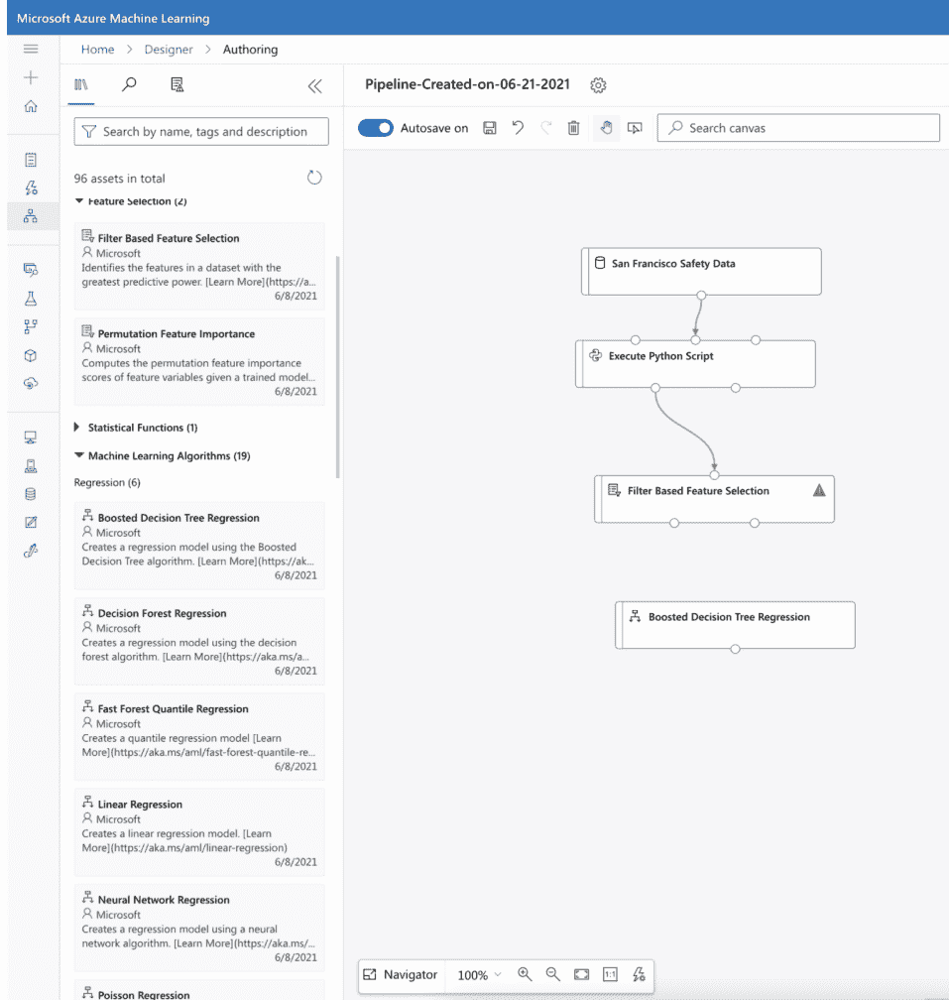

## 在 ML 工作流中使用管道的优势如下：

- 1. 计算每个步骤的要求：
  - a. 硬件计算资源
  - b. OS 资源（如 Docker 映像(s)）
  - c. 软件资源（如 Conda/虚拟环境依赖项）
  - d. 数据输入

- 2. 它确定各步骤之间的依赖关系，从而生成动态执行图。

- 3. 执行图中的每个节点运行时会发生以下情况：
  - a. 服务可能会重复使用现有资源来配置必要的硬件和软件环境。
  - b. 步骤运行并向其包含的实验对象提供日志记录和监控信息。
  - c. 每个步骤的输出被视为下一步骤的输入，和/或写入存储。
  - d. 不再有用的资源会被结束并断开连接。

- 它使你能够以可靠且无人值守的方式并行或顺序运行步骤。
- 你可以创建多个管道并可靠地协调异构计算。这意味着你可以通过在 HDInsight、GPU 数据科学 VM 和 Databricks 等各种计算目标上运行单个管道步骤，充分利用可用的计算资源。
- 管道可以通过为明确场景（如再训练和批量评分）创建管道模板来重复使用。你可以通过简单的 REST 调用从外部系统触发已发布的管道。
- 要跟踪和版本控制数据源、输入和输出，可以使用管道 SDK。
- 管道使数据科学家能够在机器学习设计过程的所有领域进行协作。

Azure ML 管道是一个引人注目的资源，可在早期开发阶段开始提供价值。随着团队和项目的进展，其价值会提升。Azure 机器学习管道旨在帮助你构建、优化和管理机器学习工作流。

## 已注册模型

模型在工作区中按名称及其版本进行标识。获得模型后，请在工作区中对其进行注册。这有助于你维护 Azure 机器学习工作区中所有模型的记录。已注册的模型类似于一个逻辑容器，包含一个或多个文件，这些文件共同构成你的模型。注册过程完成后，你可以下载或部署已注册的模型并接收所有已注册的文件。正由活跃部署使用的已注册模型不能被删除。

## 已发布管道

在管道运行起来后，你可以发布管道以使用不同的输入运行。发布管道后，可以配置 REST 终结点，从而从任何平台或堆栈重新运行管道。管道终结点使你能够使用 REST 调用从外部应用程序提交新的管道运行。但是，你无法使用管道终结点实时发送或接收数据。

已发布管道用于训练或再训练模型、处理新数据、执行批量推理等等。它在管道草稿中为每个模块分配的计算资源上运行。设计器可以创建与 SDK 相同的已发布管道对象。

你可以通过指定要运行的管道版本，将多个管道发布到单个管道终结点。

## 实时终结点

当你想要为应用程序获取实时预测结果时，实时终结点就派上用场了。实时终结点通过接口在外部应用程序和评分模型之间充当桥梁。你只需调用实时终结点，即可将预测结果实时返回给应用程序。

要进行实时预测，需要通过将管道部署为实时终结点来执行实时推理。然后，要调用此实时终结点，需要传递部署终结点时创建的 API 密钥。你应将实时终结点部署到 Azure Kubernetes Service 群集。

现在我们已经了解了设计器使用的共享资源，可以继续学习使用设计器构建模型的逐步过程。

首先登录 Azure 机器学习 Studio。然后按照以下步骤操作：

## 步骤 1：将数据导入 Azure 机器学习 Studio。

在 Azure 中有两种导入数据的方式。你可以从多个来源导入数据，或使用 ML Studio 中已有的示例数据。你导入的数据将被视为“原始”数据。具体步骤如下：

- 1. 单击 ML Studio 底部的 +NEW 按钮以创建新实验。
- 2. 然后选择“实验”旁的“空白实验”。
- 3. 要上传数据，请在屏幕左上角的搜索框中搜索数据集。
- 4. 现在，将数据集拖放到实验画布上。

在此阶段，你已成功为模型导入数据。现在需要对其进行处理，以便进行分析使用。

## 步骤 2：数据预处理。

这是在使用数据集进行预测之前执行的关键步骤。此过程会处理数据集中的缺失值和错误值。

让我们准备模型所需的数据。这里我们将按照删除包含缺失值的列所需的步骤进行操作。

1. 在左上角找到搜索框，输入“选择列”。单击“数据集中选择列”。该模块允许你包含或排除列。
2. 现在，将“数据集中选择列”模块的输入端口与（假设为）XYZdata 模块的输出端口拖放并连接起来。
3. 单击“数据集中选择列”模块。
4. 在“属性”窗格中，选择并单击“启动列选择器”。
5. 在左侧，单击“按规则”选项。
6. 在“开始于”选项下，选择“所有列”选项。
7. 从你看到的两个下拉列表中，依次选择“排除”和“列名”。然后从屏幕上显示的列列表中选择“标准化损耗”选项。
8. 要关闭列选择器窗口，请单击窗口右下角的对勾按钮。
9. 此时，除“标准化损耗”外，所有列都将通过。
10. 连接前两个模块后，将“清理缺失数据”模块拖入实验窗口，并与“数据集中选择列”模块组合。
11. 要删除带有缺失值的行，请在“属性”窗格的“清理模式”选项下选择“删除整行”选项。
12. 双击名为“清理缺失数据”的模块，并键入注释“删除缺失值行”。
13. 单击页面底部的“运行”按钮。

现在，你已成功预处理原始数据。

## 步骤 3：为 ML 模型定义特征。

特征是你感兴趣的单个可量化或可测量的属性。数据集中的特征集通常处于原始状态，不包含足够训练模型所需的最优信息。在某些情况下，删除不良或不兼容的特征会有所帮助，这称为**特征选择**。在其他情况下，将某些特征转换为不同的表示形式，为模型提供更好的信息，从而帮助提升模型性能，这称为**特征工程**。要选择合适的特征，了解你希望模型解决的问题非常重要。以下是为 ML 模型定义特征的步骤：

- 搜索并拖放另一个“数据集中选择列”模块。
- 将此“选择列”模块的输入端口连接到“清理缺失数据”模块的左侧输出端口。
- 双击该模块并输入“选择预测特征”。
- 转到“属性”窗格并选择“启动列选择器”。
- 选择“按规则”选项。
- 在“开始于”选项下选择“无列”选项。
- 从两个下拉列表中，依次选择“包含”和“列名”。
- 选择模型所需的列名（特征）。所选特征将出现在给定的文本框中。
- 通过单击对勾按钮确认特征的选择。

你已成功定义预测模型的特征。

## 步骤 4：选择合适的算法。

选择合适算法有两种方法：你可以使用速查表


由 Microsoft 提供，或使用以下步骤：

- 1. 如果您想预测某个值，可以选择回归算法。使用回归算法预测未来，您只需估算变量之间的关系即可。它可用于产品需求估算、设备维护优先级确定、销售数字预测等。共有八种回归算法：
  - a. 序数回归
  - b. 泊松回归
  - c. Fast Forest 分位数回归
  - d. 线性回归
  - e. 贝叶斯回归
  - f. 神经网络回归
  - g. 决策森林回归
  - h. 提升决策树回归

- 2. 如果您想确定和预测罕见数据点，可以从以下算法中选择：
  - 单类 SVM。
  - 基于 PCA 的异常检测，可用于设备读数异常、欺诈曝光等。

- 3. 如果您想将相似数据合并为一个集合，应使用 K-means 聚类算法。它可用于客户细分、客户偏好预测等。

- 4. 如果您希望预测结果位于两个类别之间（例如，您想知道推文是正面还是负面，且算法应预测“是”或“否”），可以使用以下算法：
  - 两类 SVM
  - 两类平均感知机
  - 两类贝叶斯点机器
  - 两类决策森林
  - 两类逻辑回归
  - 两类提升决策树
  - 两类决策丛林
  - 两类局部深度 SVM
  - 两类神经网络

- 5. 如果您想在多个类别之间预测数据的性质（例如，预测推文的情绪），可选的算法有：
  - 多类逻辑回归
  - 多类神经网络
  - 多类决策森林
  - 多类决策丛林
  - 一对全部多类

根据业务需求，您可以选择算法。现在我们进入使用 Designer 进行模型训练和部署。

## 如何使用 Designer 训练和部署模型？

- 您需要在机器学习类别下找到 Train Model 模块，然后展开 Train，将 Train Model 模块拖入管道。
- 将训练数据集连接到 Train Model 的右侧输入，并将未训练的模型放在左侧。确保训练数据集包含带标签的列。否则，将被忽略。
- 若要对列进行标记，请转到模块右侧面板中的 Edit column，并选择包含模型可用于训练的结果的列。
- 对于分类问题，标签列必须包含分类值或离散值。
- 对于回归问题，标签列必须包含表示响应变量的数值数据。
- Azure 机器学习将尝试使用数据集的元数据来收集适当的标签列。假设您未指定要使用的标签列。如果它识别出错误的列，请使用列选择器进行更正。
- 完成后，提交管道。

这就是使用 Designer 构建机器学习模型的方法。

## Notebook

毫无疑问，Azure ML Studio 是数据科学家的有力工具，因为它提供了快速试用现成数据集和机器学习模型的灵活性。但 Jupyter Notebook 也是处理数据科学任务的事实标准工具。

但是，将 Jupyter Notebook 部署为 Web 服务则完全是另一回事。Azure ML Studio 提供了一个选项，可在线创建和托管 Jupyter Notebook，并通过它创建模型时将其部署为 Web 服务。

让我们开始使用 Azure Jupyter Notebook。

## 步骤 1：

- 1. 转到 https://studio.azureml.net/ 并登录您的工作区。
- 2. 在左侧面板中，有一个 Notebooks 选项卡；单击它。
- 3. 然后在底部，您会看到 New；单击它。

## 步骤 2：现在为我们的 ML 实验创建一个 Python 文件。

- 1. 单击 File 图标。
- 2. 输入文件名；文件类型：Python Notebook；目标目录：您的目录。
- 3. 单击 Create 创建 Python Notebook。

## 步骤 3：现在您需要创建一个 Azure 机器学习虚拟机。单击 +New VM 创建一个。

- 输入您的 VM 名称。
- 对于 VM 类型：如果您是初学者，请将系统类型选择为 STANDARD_DS1_V2。
- 创建完 Notebook VM 后，查看其是否进入管理面板下的 Compute 部分。

## 步骤 4：运行 Notebook。您需要验证 Notebook 是否正常工作。

- 验证您的 Notebook 虚拟机是否处于运行状态。
- 将光标移动到 Notebook 中间，观察带有对话框的 Create text cell；单击它。
- 单元格默认为空白 Markdown 单元格，因此请选择 Convert code cell 进行更改。

完成此步骤后，您即可开始编码部分。让我们编写一个 Python “Hello World” 程序以确保 Notebook 正常工作。Notebook 右上角和每个单元格中都有运行按钮。

## 步骤 5：上传数据集。

- 1. Notebook 左侧有一个垂直箭头，这是上传数据集的图标。
- 2. 使用本地系统中任何可用的数据集。
- 3. 有一个 Upload files 图标；单击它；然后导航到数据集文件夹并选择文件；打开；选择目标目录；上传。

现在您可以在目录中直观地看到数据集。

## AZURE 机器学习服务

Azure ML 服务是一个使用 Python 创建 ML 解决方案的开放平台。它提供工具，可轻松无缝地扩展和自动化 ML 模型的训练、部署和监控。

在推出 Azure 机器学习服务之前，若要在生产环境中使用机器学习，您需要汇集一系列数据服务以支持完整的机器学习生命周期，例如以下数据服务：

- **Azure Blob 存储或 Azure Data Lake 存储** 是数据存储解决方案。将这些解决方案汇集在一起非常重要，因为没有数据就无法训练模型。
- **虚拟机、Azure HDInsight 和 Azure Databricks** 汇集在一起以运行代码。
- **虚拟网络** 充当安全边界，通过将您的 Azure 资源与公共 Internet 隔离来保护您的数据。您可以将虚拟网络汇集在一起，在同一虚拟网络中处理您的计算和数据，也可以使用 Azure 虚拟网络连接到本地网络，以安全地训练模型并访问部署的模型进行推理。
- **Azure 密钥保管库** 是一种云托管服务，用于管理和保护您的凭据，授予证书访问权限以及管理许多其他机密。您完全控制用于访问和加密数据的密钥。管理员有权授予或撤销对密钥的访问权限。
- **Docker 容器映像** 是一种独立的、可执行的软件包，用于反复运行您的实验，因为它包含运行应用程序所需的一切内容，例如一组一致的 ML 库、代码、系统工具和设置。它使用 Azure 容器注册表（一种私有 Docker 注册表服务）来存储这些 Docker 容器，并将其放入您的虚拟网络中。
- **Azure Kubernetes 服务** 是一种编排服务，用于在容器主机集群中部署、缩放和管理 Docker 容器及基于容器的应用程序，并将其纳入虚拟网络。

将所有这些汇集到同一虚拟网络中以使机器学习模型协同工作非常耗时。但是，Microsoft 通过 Azure 机器学习服务消除了这种复杂性。

> Azure ML 服务是一种托管基础设施，面向精通 Python 的资深数据科学家和 AI 开发人员。它是一种用于使用任何工具或框架构建和部署模型的服务。

使用 Azure 机器学习服务的优势如下：

- 它提供端到端的 ML 生命周期管理。
- 它会跟踪您的所有实验。
- 它具有内置功能，如版本控制和模型可重现性，通过存储与实验相关的所有内容（例如代码、配置、环境详细信息、参数设置等）来复制任何实验。
- 它便于您将模型封装在容器中，以便将其部署到 Azure 本地或 IoT 设备。封装模型的容器可以轻松管理和缩放。
- 它拥有 Notebook VM，这是一种基于云的工作站，已集成到 Azure 机器学习服务中，专门为数据科学家创建，以便他们轻松在本地开始并随后在 Azure 中轻松计算。它帮助开发人员和数据科学家使用 Jupyter Notebook 执行 Azure 机器学习 Python SDK 支持的操作。
- 它使用 TensorFlow 和 scikit-learn 等流行框架，并提供强大的工具集来运行 ML 实验。它使您能够将模型部署到 Docker 等第三方服务的生产环境中。


# 第 5 章

深入机器学习
自定义模型

在上一章中，我们讨论了 Microsoft 如何让您在项目中利用 AI 和 ML 的强大功能，即使您不是数据科学领域的专家。

在本章中，我们将了解 Azure AI 平台的两个工具 – Azure CLI 扩展和 Visual Studio Code – 以及如何利用这些工具为您谋利。

## Azure CLI 扩展

Azure 命令行界面 (CLI) 是一组命令，可提供跨平台命令行体验，也可用于创建和管理资源。它旨在让您快速上手 Azure，因为它可在 Azure 服务中使用。

Azure CLI 用于自动执行日常重复操作。它使您能够安排这些任务并部署它们。特别是当您要部署数百个资源时，它是自动化流程的完美方式。CLI 的一些关键功能使其使用非常方便，如下：

- **交互模式。** 该模式可引导您浏览可用命令，将您置于带有命令描述、示例和自动补全的交互式 Shell 中，并指导您是否需要参数。若要使用 Azure CLI 交互模式，只需键入以下命令：az interactive。

- **多种输出格式。** 作为默认输出格式，Azure CLI 使用 JSON，但它也提供其他格式的输出。带参数值的输出格式如下：

  - **JSON。** JSON 字符串。此设置为默认值。
  - **JSONC。** 彩色 JSON。
  - **YAML。** JSON 的机器可读替代方案。
  - **Table。** 以键作为列标题的 ASCII 表格。
  - **TSV。** 无键的制表符分隔值。
  - **None。** 错误和警告以外无输出。

- **使用 JMESPath 查询。** JSON 拥有一种名为 JMESPath 的查询语言，可让您从 CLI 输出中选择和修改数据。Azure CLI 中的所有命令都支持 query 参数来执行 JMESPath 查询。

- **跨平台。** Azure CLI 使用 Python 语言编写，这意味着它是跨平台的，可在 Windows、macOS 和 Linux 上运行。

CLI 中使用的一些常用命令包括：

- az – CLI 起始点。
  - az login – 登录到 Azure 帐户
  - az account – 管理帐户
  - az group – 管理资源组
  - az vm – 虚拟机
  - az storage account – 存储帐户
  - az keyvault – 密钥保管库
  - az webapp – Web 应用程序
  - az sql server – SQL 数据库
  - az cosmosdb – CosmosDB

- 全局可用命令。

**帮助。** 该命令显示与您一起使用的命令的参考信息。它还显示相关参数并列出可用的子组和命令。例如，az group -h 或 az group -help 将显示所有组、子组和命令，这些可能有助于您编写下一条命令并获得所需内容。

**输出。** 该命令可帮助您更改默认输出格式（为 JSON）。如前所述，您可以将输出更改为前面提到的多种格式。

**查询。** 它用于执行 JMESPath 查询。

**详细信息。** 该命令返回操作期间创建的资源的信息以及其他相关详细信息。

**调试。** 该命令返回与用于调试目的的 CLI 操作相关的信息。

这些是 Azure CLI 中全局使用的命令。但在某些情况下，即使是 Azure CLI 命令也不够用。对于这种情况，会使用 Azure CLI 扩展。Azure CLI 扩展是对 CLI 的增强，旨在为您提供额外功能。这些扩展是 Python wheels，是内置的 Python 代码包，可轻松在客户端应用程序上安装和卸载小代码包。它们可以作为 CLI 命令运行。

现在让我们来谈谈 Azure Cloud Shell，它是云中的命令行界面。它可以帮助您通过键入以下命令来探索哪些 Azure CLI 扩展可用：

```
az extension list-available --output table
```

此命令将显示一个列表；您现在只需从中选择任意扩展以向 CLI 添加功能即可。使用 Azure CLI 扩展非常简单。首先，您需要安装一个扩展才能使用它。若要安装 Find 扩展，请键入以下命令：

```
az extension add --name Find (name of the extension you want to install)
```

在此命令中，Find 是我们正在安装的扩展的名称。Find 扩展是一个 AI 驱动的扩展，可让您为给定上下文发现 CLI 示例。成功安装扩展后，请确保已获取其最新版本；否则，您需要更新该扩展。为此，可以使用以下命令：

```
az extension update --name Find
```

此命令会将 Find 扩展升级到最新版本。如果您想了解任何扩展可以执行什么操作，请键入以下命令：

```
az find -h
```

上述命令将显示 Find 命令可以执行的所有操作。现在让我们来谈谈在使用完扩展后如何卸载它。要卸载扩展，必须使用以下命令：

```
az extension remove --name <extension-name>
```

在此命令中，将扩展名称替换为您不再需要的扩展的名称。

Azure CLI 扩展使 Azure CLI 更强大、更有价值。它可访问实验性和预发布命令，并具备编写自定义 CLI 界面的功能。

## Visual Studio Code

与其他编辑器不同，Visual Studio (VS) Code 是一个强大的源代码编辑器，它将源代码编辑器与高效的开发人员工具（如调试或 IntelliSense 代码补全）相结合。它提供了流畅的编辑-生成-调试循环，毫无阻力，使您花费更少的时间来调整环境，而将更多时间用于执行您的想法。

VS Code 扩展了传统文本编辑器的所有功能，并为开发人员开辟了新的生产力路径。它拥有丰富的生态系统，支持 JavaScript、TypeScript 和 Node.js，以及 C++、C#、Java、Python、PHP、Go 等其他语言以及 .NET 和 Unity 等运行时。

使 VS Code 优于其他文本编辑器的功能包括：

- **键盘映射。** VS Code 提供 Keymaps 扩展，可让您将其所有快捷方式与其他流行编辑器（如 Sublime、Atom、Emacs，甚至 Eclipse）进行映射。因此，您无需花费太多精力即可从其他编辑器切换到 VS Code。若要安装 Keymap 扩展，请按 Ctrl/Cmd + K → Ctrl/Cmd + X 打开扩展搜索栏。

  然后搜索 keymap。

- **设置同步。** 该扩展可让您通过将所有 VS Code 设置导出到 Gist 并向团队成员发送 Gist ID，与其他团队成员共享配置。然后，您的团队成员可以将所有设置同步到其 VS Code 安装中，并立即应用。

- **实时共享。** 该功能可让您与其他开发人员配对。您的同事开发人员可以在其编辑器中加载项目，并且它也适用于调试。当您启动调试会话时，所有团队成员在其编辑器上都会获得相同的调试体验。如果有人更改代码，更改会反映在所有其他成员的编辑器中。

- **Docker 扩展。** 该扩展可让您在 VS Code 中几乎执行所有 Docker 操作。根据您选择的运行时，VS Code 会自动为当前项目创建所需的 Docker 文件。

- **Azure 应用服务。** 该扩展可让您通过右键单击创建新站点并部署代码。您还可以使用预构建的 Shell 脚本，自动将代码签入到正确的 Gist 终结点以实现持续设置交付。

若要开始使用 VS Code，您需要做的第一件事是访问 https://code.visualstudio.com/ 下载 VS Code。它适用于 Mac、Linux 或 Windows。


下载完成后，打开 VS Code；您将看到欢迎屏幕。在这里，您可以创建新文件或打开新文件夹。让我们创建一个新文件。

VS Code 支持数百种编程语言，其扩展程序可在 VS Code 市场中找到。但是，文件的默认语言支持基于文件扩展名。要将新文件扩展名添加到现有语言，请转到 files.associations 设置，例如，如果您要将 .myphp 文件扩展名添加到 PHP 语言：

```json
"files.associations": {
    "*.myphp": "php"
}
```

现在让我们了解 VS Code 的界面：

- 在底部，您将看到状态栏；它包含有用信息，例如当前行号、编程语言以及错误和警告。
- 在左侧，您有活动栏；从顶部开始，您将看到：
  - 文件资源管理器，包含您当前的文件和文件夹。
  - 搜索，可用于搜索您的文件。
  - 源代码管理，可帮助您跟踪不同版本文件中所做的更改。
  - 运行视图，可让您运行和调试代码。
  - 扩展视图，您可以在其中管理和下载几乎所有内容的扩展。
- 在屏幕中央，您有命令面板。它是 VS Code 中执行的所有操作的控制中心。您在 VS Code 中执行的任何操作都映射到命令面板中的命令。

要使 VS Code 成为更适合您的编辑器，您需要为想要使用的编程语言安装正确的扩展程序。VS Code 为某些语言提供内置支持，但为了获得最佳体验，请安装您想要使用的语言的扩展程序。

然后，您需要转到键盘映射，从其他编辑器安装键盘快捷方式。

此处还可以自定义的另一事项是您的颜色主题。它使您可以选择 VS Code 中可用的任何颜色。在欢迎屏幕上选择颜色主题选项以查看颜色主题列表。当您选择特定颜色时，它会显示所选颜色主题的预览。

要了解 VS Code 编辑功能，请选择交互式游乐场。在这里，您将找到代码编辑器功能（如多光标编辑）的示例。要查看多光标的实际运行情况，您可以单击交互式面板。

简直没有什么是 VS Code 做不到的。您需要的任何功能要么由编辑器支持，要么由为其创建了扩展程序的人支持。

## 客户流失预测

客户流失，也称为客户attrition，是指客户停止成为您业务的付费客户并放弃它的一种倾向。企业必须采取主动方法，识别导致客户流失的促成因素，并通过采取措施来增强客户保留率。客户流失对企业并不有利，因为吸引新的忠诚客户比保留现有客户的成本更高。主动预测可能离开您业务的客户是一种关键洞察，可以帮助您最大限度地减少损失。

Azure 机器学习可以使您构建模型，即使在此领域经验相对较少或没有经验也可以。要预测客户流失，您可以使用历史客户数据在 Azure 机器学习中训练和开发流失预测模型。如果您有包含客户状态的真/假列的数据集，将会有所帮助。基于这些数据集构建的模型可用于识别哪些客户属性对保留客户最为突出。

要测试不同算法并选择最佳算法，您可以使用自动化机器学习（Automated ML）。它自动化了该过程，以便以较少的手动工作更快地部署机器学习模型，同时仍然产生准确的结果。

## 客户终身价值

客户终身价值是一项指标，可帮助您了解：

- 您与受众的共鸣程度如何？
- 您的客户对您的产品和服务有多满意？
- 您在满足客户需求方面做对了什么，还可以做什么来让他们的体验完美无瑕？

每个企业主都想知道这些问题的答案。当然，计算客户终身价值听起来很难，而且不是每个人的强项，但幸运的是，学习如何计算它并不是什么大问题。它不需要高级数学；事实上，您可以反复计算此指标，以在业务增长时建立里程碑。

如果您成功提高了客户终身价值，那么您就走在正确的道路上，您的客户喜欢您的产品/服务。让我们了解客户终身价值的含义。

客户终身价值（CLV），也称为终身价值（LTV），是您的客户在一段时间内在您的业务上的平均支出金额。要计算 CLV，您需要几个数据点：

- 您的客户平均每月交易次数。
- 您的客户每笔交易的平均消费金额。
- 您的客户保持忠诚的平均月数。
- 然后计算平均毛利率。

将所有这些数字相乘，您将得到预测 CLV。

## 产品推荐系统

如今，许多电子商务企业在其网站上向客户提供产品推荐。它已成为电子商务网站的标准功能。所有企业都在迅速采用此功能，因为相关的产品推荐可以带来更高的销售额。

微软推出了一个 Microsoft 产品推荐系统，该系统只需支付底层 Azure 资源的费用，无需额外付费。您必须先使用一些历史交易数据对其进行训练，才能获得推荐。它通过比较不同用户的兴趣来分析数据并发现产品之间的关系。例如，它会查找不同用户一起购买的产品。一旦您的模型训练完成，就可以向网站添加代码，通过调用应用程序编程接口（API）来请求推荐。您将能够获得两种类型的推荐：

- 1. **物品对物品。** 在这种推荐类型中，您通过 API 发送一个项目编号，然后它会返回客户可能正在寻找的可能项目列表，例如在提到购买了产品 A 且也购买了产品 B 的客户的网站上。
- 2. **个性化。** 对于此，您选择特定用户并通过 API 发送最近的交易，然后返回针对该用户的产品推荐。

大多用于此类推荐的算法是协同过滤方法。它结合多个用户的偏好，为给定用户生成推荐。

对于物品对物品推荐，算法通过创建矩阵来识别两个项目一起购买的频率。现在，棘手的部分开始了；生成个性化推荐的方式需要矩阵乘法。现在让我们调查系统的架构：

- 产品推荐系统部署一个 Web 应用。同一个 Web 应用托管您在训练模型时调用的 API，该 API 还提供推荐。它为 Blob、队列和表创建 Azure 存储帐户，并为执行训练操作创建 Web 作业实例。
- 当您提交模型训练请求时，它会从 Blob 存储获取交易数据，并在模型注册表中为该模型添加条目。它还会向模型队列添加一条消息。
- 当 Web 作业实例观察到模型队列中的新条目时，它会训练模型。它将训练好的模型放入 Blob 存储，并在完成时更新模型注册表中的条目。
- 当您发送推荐请求时，过程要简单得多。它从 Blob 存储获取模型，加载它，通过请求运行它，并返回推荐。整个过程中唯一耗时的任务是将您的交易数据转换为训练作业所需的格式。

在生成推荐之前，算法会考虑用户对产品的兴趣，这就是为什么您需要为每种事件类型定义权重。例如，一些默认事件是：

- 如果用户只点击了产品 – 权重 = 1。
- 如果用户点击了推荐链接 – 权重 = 2。
- 如果用户将产品添加到购物车 – 权重 = 3。
- 如果用户从购物车中移除产品 – 权重 = -1。
- 如果用户进行购买 – 权重 = 4。

的确，如果用户进行了购买，他们对产品的兴趣比仅仅点击了产品的用户更高。这就是为什么购买事件的权重高于点击事件的权重。

这就是 Microsoft 产品推荐系统的工作原理。


# 第 6 章
Dynamics 365 机器学习
用例

在当今世界，每个组织都在寻找提升生产力、更高效工作的方法，微软已将 Dynamics 365 与机器学习相结合，创建能够进行预测并自动化流程的解决方案，以缩短对客户的响应时间。这两项技术的融合可以帮助你利用历史数据并将其输入分析算法来构建机器学习模型。基于这些模型的预测，组织可以识别其主要客户，并通过利用其历史数据和属性，做出明智的决策。

> "你可以拥有数据却没有信息，但不能没有数据就拥有信息。"
> 
> — Daniel Keys Moran

## 面向金融的机器学习

金融领域的机器学习从非结构化数据中提取有意义的洞察，并提供精确结果。机器学习算法被实现为从数据、流程和技术的现有模式中学习，以发现不同的洞察。从结果中获取的信息随后被用来解决对银行和金融部门至关重要的复杂问题。

如今，许多金融组织出于各种原因正在利用机器学习，例如：

- 使用机器学习进行流程自动化可降低成本。
- 机器学习提供更好的生产力和增强的用户体验，从而带来收入增加。
- 更好的合规性和加强的安全性。

让我们调查金融领域的一些机器学习用例，以更好地理解它为何被使用。

## 用例一：流程自动化

机器学习解决方案通过自动化重复流程来帮助组织减少手动工作，以提升业务生产力。一些优化成本、扩大服务和提升客户体验的自动化用例包括：

- 聊天机器人
- 呼叫中心自动化
- 文书工作自动化
- 员工培训的游戏化

全球金融服务公司摩根大通（JPMorgan Chase）使用一种称为自然语言处理的机器学习技术来处理法律文档并从中提取所需信息。如果手动执行此过程，审查 12,000 份年度商业信贷协议将需要大约 360,000 个工时；而通过机器学习，只需几个小时即可完成。

## 用例二：安全性

随着用户、交易和第三方集成的增加，金融领域的安全威胁也在增加。在此情况下，机器学习算法在欺诈检测方面非常有用，因为它们分析人类忽略的数百万个数据点。它还减少了误拒的数量并提高了实时批准的准确性。

金融组织可以使用此技术实时监控每个账户的数千个交易参数。机器学习算法分析每个用户的每个操作，并评估尝试的活动是否是该用户的特征。它有助于识别客户的频繁异常行为，并帮助公司以高精度发现欺诈行为，并请求额外的用户身份验证来授权交易。机器学习算法可以在几秒钟内评估一笔交易，因此，如果用户可能是欺诈者的可能性甚至达到 90%，系统可以完全阻止该交易。当机器学习检测到许多可能导致诸如 smurfing 等洗钱技术的微额支付时，也会发出警报。

像 PayPal 和 Adyen 这样的公司大力投资于机器学习安全。

## 用例三：算法交易

当今，越来越多的交易公司正在转向机器学习算法，而不是人类交易员，以做出更可靠的交易决策。机器学习算法监控实时交易新闻。它可以同时分析数千个数据源以检测模式，并成为推动股价上涨或下跌的主导力量。

算法交易使人类交易员相对于市场平均水平获得微小的优势。而且，考虑到海量的交易操作量，即使是微小的优势也能转化为可观的利润。

这些是需要机器学习解决方案的一些用例。面向金融的最佳机器学习解决方案之一是 Dynamics 365 Finance 应用程序。

## 用例四：客户数据管理和信用评分

对于银行和金融机构来说，拥有高效的数据管理至关重要，这是业务增长的核心。从交易、社交媒体、移动通信等收集的所有海量数据，对金融专家来说手动处理可能成为一项挑战。整合数据分析、数据挖掘和自然语言处理等机器学习技术，可以帮助你从数据中提取真正的情报。

银行和金融公司拥有大量历史数据。他们使用这些数据来训练机器学习模型。然后，这些模型可用于实时承销和信用评分任务。

Dynamics 365 Finance 通过现代化业务和运营流程来增强和优化组织运营。由 AI、机器学习和预测分析驱动的可操作洞察使管理层能够为最佳运营规划做出更好的业务决策。关键绩效指标（KPI）可以实现更有效的客户管理、预算规划和费用管理。

Dynamics 365 Finance 使员工能够自动化任务审批、发票自动化和供应商信息审批工作流等功能。这样一来，员工可以专注于其他增值任务。Dynamics 365 Finance 还具备一些增强功能，如收入确认、主动信用管理、合同管理等。实时 KPI 和报表允许快速运营监督和现金流可见性，以推动运营决策。这一切均由 Dynamics 365 Finance 连接，以便从任何设备 24/7 进行报告。Dynamics 365 Finance 已就绪通用数据保护条例（GDPR），支持 42 种语言和多种货币，并能适应 37 个国家和地区不断变化的当地法律和强制性要求。

Dynamics 365 Finance 是业务运营优化、风险缓解和完全灵活性的基础，例如无限财务维度和欺诈保护功能，与实时报告和 KPI 相结合。Dynamics 365 Finance 可以将你的财务团队带入现代化状态。它具有从功能或成本角度与组织共同成长的功能和能力，包括减少时间和成本。它分三个阶段处理财务：

- 1. **基础：** 财务中的基础会计通过总账、应付账款、应收账款、项目会计、预算和固定资产功能创建基础。
- 2. **扩展：** 随着组织的扩张或整合，Dynamics 365 Finance 的信用管理、合同管理和收入确认功能帮助公司推动增长。
- 3. **现代化：** Dynamics 365 Finance 帮助公司通过 AI 驱动的预测分析、带有电子开票的智能可操作洞察、其他企业应用程序集成以及 Power Platform 集成，组建一支现代化的财务和会计团队以实现业务目标。

以下部分讨论 Dynamics 365 Finance 涵盖的一些模块。

### 应付账款

应付账款是负债账户，显示企业对其购买或赊购的供应商产品和服务欠款多少。Dynamics 365 Finance 应付账款模块的一些功能包括：

- 借助应付账款模块，组织可以高效、有效地管理负债。
- 它有助于在各账户之间分配税费、费用和收费。
- 它有助于管理供应商、采购订单、交易、折扣和发票，以降低负债并产生更显著的收入。

以下是使用 Dynamics 365 Finance 在组织中管理应付账款的一些方法：

- 1. **订购产品或服务。** 要为组织订购产品和服务，需要创建采购申请。
- a. **采购申请。** 采购申请是一种文档，允许采购部门购买产品或服务。获批后，可使用它生成采购订单。要创建采购申请，请转到“我的采购申请”页面，并从采购目录中搜索并选择项目。如果组织需要的产品不在目录中，可以在采购类别下输入产品详细信息来请求该项目。


- b. **采购订单。** 它是由采购部门创建的外部文档，其中包含组织所需的物品和服务列表，并提交给供应商。

### 2. **记账应付款。**
要记账应付款，系统提供几种选项，例如发票登记簿、发票日记帐、供应商发票和总日记帐。所有这些选项都被视为源文档。当任何源文档过账时，系统会将它们记录在总账或供应商交易中。供应商交易也可以视为模块交易，系统基于这些模块交易生成总账分录。

### 3. **到期日计算。**
到期日是公司应在其之前支付负债的日期。到期日被视为应付款专业人员的关键手段，因为它帮助他们规划和执行付款。系统提供各种选项，根据约定的设置计算到期日。

- a. **付款条款。** 要计算到期日，系统使用发票日期字段，并从付款条款文档中收集所有必要信息。在此之后，如果需要，您也可以手动更改计算出的到期日。付款方式是付款条款页面上的关键字段。此字段有助于计算发票的到期日。有两个字段，月份和天数，用于定义添加到到期日的天数或月份数。

- b. **付款天数。** 系统可让您为公司指定付款天数。此设置提高了到期日计算的精度。如果您将到期日定义为*不是*付款日期，系统会将其更改为下一个日期。例如，如果系统计算的到期日是2月14日，而您公司指定的付款日期是2月13日和2月15日，系统会自动将付款日期更改为2月15日。

- c. **付款日历。** 与付款天数不同，付款日历不指定付款日期。它包含有关非工作日的信息，银行服务在这些日期无法处理付款。

- d. **发票常规中的到期日计算。** 到期日在日记帐行中计算。系统使用发票日期和付款条款的值来计算到期日。它还会考虑付款天数和付款日历。

### 4. **付款计划。**
系统的此功能使您可以在发票金额分几期支付时安排付款。为此，您需要设置付款计划并将其与付款条款文档链接。要访问系统的付款计划功能，请转到应付款 > 付款设置 > 付款计划。当供应商选择付款条款时，链接的付款计划也会供应商接收。供应商单击付款计划链接后将被重定向到付款计划页面。此页面显示发票的计划。它显示需要支付的确切日期和金额。此功能不适用于发票日记帐和登记簿。

### 5. **供应商交易。**
要查看供应商交易，请转到应付款 > 供应商 > 所有供应商。当任何源文档过账时，系统会创建供应商交易。这些交易也可以称为模块交易。您将在供应商交易页面上找到以下字段：

- a. **凭证。** 是供应商和总账交易的链接。
- b. **日期。** 表示记账操作的日期。
- c. **发票。** 对于付款交易，此字段为空。此字段还包含与交易关联的发票编号。
- d. **金额。** 交易在法人实体货币中的金额。
- e. **余额。** 此字段指示交易的未结余额。假设字段值为零，则表示发票已通过付款结清。要查看所有未结交易，请转到应付款 > 发票 > 未结供应商发票。

### 6. **总账分录。**
基于供应商交易，系统会过账总账交易。总账和供应商交易通过凭证相关联。转到供应商交易页面，单击凭证按钮以打开所有总账交易。

### 7. **预付产品或服务款项。**
由于某些商品和服务的性质，公司需要向供应商预付款项。这些公司使用现代软件来管理其预付款。Dynamics 365 Finance 提供了两个选项作为有关预付款（预付款）的功能。

- a. **预付款日记帐凭证。** 使用此方法进行预付款非常简单。
    - i. 转到应付款部分。
    - ii. 单击付款选项。
    - iii. 将预付款日记帐凭证的滑块向右移动。在创建付款时，您需要为此预付款激活此参数。系统随后会自动更新过账配置文件并设置预付款所需的值。
    - iv. 如果付款金额包含销售税，您可以使用付款日记帐凭证。

- b. **预付款发票。** 这是另一种管理预付款的系统。仅在您使用采购订单时可用。
    - i. 登记预付款。在创建预付款发票之前，先为采购订单登记预付款金额。
    - ii. 创建预付款发票。打开预付款页面，转到应付款 > 采购订单 > 未结预付款菜单项；单击新建预付款发票按钮。
    - iii. 当您过账预付款发票时，系统会创建凭证，记录为供应商交易中的负债。
    - iv. 系统使用应付款参数中的设置来指定必须将哪个配置文件与预付款发票关联。
    - v. 一旦创建预付款发票，系统会将配置文件与其关联。
    - vi. 现在，要支付预付款发票，您可以使用付款建议。

现在，我们已经了解了 Dynamics 365 Finance 应付款模块的一些基本功能，让我们来看看此系统如何自动化供应商发票流程。

供应商发票类似于一份请求或账单，用于启动所提供持续服务以及特定物品和服务的付款流程。当向供应商下达的用于服务或产品的采购订单完成时，会生成供应商发票。供应商发票包含一个标头和一个或多个产品和服务行。可以通过以下步骤创建供应商发票：

- 1. 如果您的采购订单已确认，可以使用未结供应商发票和待处理供应商发票页面来创建供应商发票。
- 2. 使用发票登记簿输入不参考任何特定采购订单的发票，以便您可以计提费用。稍后，您可以使用供应商发票审批日记帐将其过账到供应商余额以冲销计提。

创建后，供应商发票必须经过审查流程，在此期间会审查发票标头、发票行或两者。某些场景可能会阻止您的供应商发票提交到工作流：

### 场景 1：当已登记的发票总值与发票总值不同时。
功能管理页面上有一个功能，可让您在发票总额和已登记发票总额不同时阻止供应商发票提交到工作流。只需启用该功能，它就会向提交发票的人员发送警报。此功能可帮助您在将发票重新提交到工作流之前更正余额。

### 场景 2：如果供应商发票包含未分配的费用。
假设您的供应商发票被怀疑包含未分配的费用，且检查该费用的参数位于功能管理页面上。在此情况下，会向提交发票的人员发送警报，以便在重新提交前进行更正。

### 场景 3：如果您提交的供应商发票没有唯一的发票编号。
功能管理页面上有一个参数用于检查重复的发票编号。如果您启用它，将收到发票编号不唯一的警报，以便您在重新提交前更正它。

现在让我们谈谈如何自动化一些应付款供应商发票流程。

自动化供应商发票流程意味着在功能管理页面中启用一些高级功能。这些功能不适用于使用发票日记帐或发票登记簿日记帐页面处理的发票。以下是可以自动化的流程：

- **允许系统自动将导入的供应商发票提交到工作流系统。** 系统的此功能要求您的流程始于导入的发票。包含非采购订单获取类别和非库存行或与采购订单相关的发票可以自动提交到工作流系统。您可以指定希望此流程在后台运行的时间频率。为了使流程无需任何手动干预即可顺利进行，您必须在工作流配置中包含自动过账任务。如果您手动创建发票或通过供应商


协作发票工作区，它们只能手动提交到工作流系统。此功能还使您能够定义将供应商导入的发票提交到工作流系统的特定于公司的规则。

- **自动将过账的产品收据与发票行匹配。** 此过程使用已定义的三方匹配策略，该策略规定如下：

- 发票上的价格信息应与采购订单中提到的价格信息匹配。

- 发票上的数量信息应与所选产品收据的数量信息匹配。此过程还将按指定的时间频率在后台运行。该过程将自动运行，直到匹配的产品收据数量与发票数量的值相等。您还可以定义系统在得出进程失败结论之前尝试将产品收据与发票行匹配的最大次数。此过程也可以作为独立进程运行。

- 在过账前验证供应商发票过账。此功能运行与供应商发票过账期间相同的验证。唯一的区别是，它不更新账户。此功能通过在发票发送审批前确保其确定性，为您节省大量时间。

- 导入的发票自动提交会导致自动生成供应商发票的历史信息。此功能使您能够直接通过供应商发票访问供应商发票工作流历史记录。自动化的供应商发票历史记录包含当前步骤和已完成步骤。如果某个步骤出现故障或在成功完成前暂停，此历史记录可以帮助您了解流程中出了什么问题，并且不浪费时间，您可以纠正错误。

- 供应商发票分析和指标的自动化。未能通过自动化流程的供应商发票位于供应商发票录入工作区。它包含显示发票未能到达工作流系统原因的磁贴。在这种情况下，应付账款经理可以通过 Power BI 指标深入了解供应商发票自动化的有效性。

- 自动恢复多张发票的处理。在自动处理多张发票期间，如果有任何发票未成功提交到工作流，则系统将从进一步的自动处理中移除该发票。这样，您就有机会纠正发票问题并将其重新提交到工作流。您可以转到“恢复自动化发票处理”页面以重新启动自动处理。

既然您了解如何自动化供应商开票，我们可以继续介绍下一个自动化流程，即供应商付款提案的自动化。

## 供应商付款提案的自动化

组织通常需要为购买的产品和服务向供应商付款。使用应付账款系统，您可以自动化创建供应商付款提案的过程。它使您能够定义一组可应用于向供应商付款的规则。例如，您可以定义哪些供应商最重要、应付给他们多少金额以及何时付款。供应商付款提案的自动化使您能够包含以下详细信息：

- 何时运行付款提案。
- 定义选择应付款发票的条件。
- 生成的日记账应存储在哪个供应商付款日记账中。

要访问供应商付款提案的自动化，请执行以下步骤：

- 1. 转到 应付账款 > 付款设置 > 流程自动化。
- 2. 在“流程自动化”下选择“创建新流程”选项。
- 3. 然后选择“供应商付款提案”选项。
- 4. 转到向导的“常规页面”部分并输入您的供应商付款提案名称。
- 5. 现在定义付款日记账的负责人作为付款日记账的所有者。
- 6. 页面的其余设置是通用的，并定义此特定版本的供应商付款提案的出现模式。

此向导不允许您定义供应商付款提案的详细信息，例如何时生成供应商付款、何时打印它们或何时过账它们。现在转到向导的下一页，即“供应商付款提案”页面。您可以通过此页面定义选择需要付款的供应商发票的条件。这些选项也出现在供应商付款日记账的付款提案中，只有少数例外。

要查看每次付款的发生情况，请转到流程自动化每周视图。它也已添加到“流程自动化”页面和“供应商付款”工作区。以下是用于定义发生情况的状态：

- **计划中。** 此状态意味着付款提案已计划，但尚未运行。
- **错误。** 此状态意味着运行付款提案时发生了错误。要查看错误，请单击“查看结果”按钮。
- **已完成。** 此状态意味着付款提案已成功完成。要查看付款，请单击“查看付款”链接。它将打开由该发生情况创建的付款日记账。

您可以在日记账中以交易货币查看付款金额。您可以使用流程自动化删除付款日记账。删除付款后，发票将重新打开以供付款。流程自动化框架还使您能够编辑付款、发生情况以及为付款提案创建的系列。如果要编辑系列，可以使用“流程自动化”页面或使用“流程自动化”每周视图。在编辑系列时，系统会提示您指定是要对所有发生情况进行更改，还是仅对新发生情况进行更改。

## 应收账款

许多企业将商品和服务以赊销方式出售给客户，然后几周后收到付款。因此，企业需要通过使用其账簿中称为应收账款的账户来跟踪客户欠款。

有些因素会导致应收账款流程低效，例如：

- 涉及通过电子邮件发送提醒和发票的手动流程。手动处理付款可能会给客户带来一些不便。如果客户发现手动付款困难，他们显然会延迟付款并增加应收账款周转天数。
- 如果您的付款系统未连接到会计系统，会导致重复录入工作，因为这意味着您需要在会计系统中再次输入所有详细信息。这会增加出错的几率，而且也非常耗时。
- 您可能会使客户及其信用卡数据面临欺诈风险。

为了使客户的付款无挑战且无风险，您需要自动化这些流程。应收账款使您能够跟踪从客户处收到的客户发票和付款。该系统允许您设置过账配置文件、客户组、利息通知、佣金、催收信等。所有这些信息都可能直接影响应收账款交易。

如果您没有自动化系统并且手动处理所有事项，那么流程如下所示。您的会计系统中有发票；您将这些发票电子邮件发送给客户或通过平邮发送。在此，您正在向客户发送关于其未付账单的提醒。此流程存在许多问题且非常冗长。此外，邮件在途中丢失的问题始终可能存在。客户可能会说他们没有收到发票。通常手动处理此流程的企业可能有一个专门的催收团队，以便不断与客户联系以收取付款。

那么，相反，您可以使用 Dynamics 365 Finance 应收账款系统来自动化此流程。它具有一个催收自动化流程，可以设置催收策略，以自动分类需要发送自定义电子邮件提醒的客户、发送催收信的预定流程以及催收活动（例如电话呼叫）。

## 催收流程设置页面

转到 信贷与催收 > 设置 > 催收流程设置。

此页面使您能够创建自动催收流程，该流程可以发送电子邮件、创建和过账催收信以及安排活动。您创建的催收流程要么使用主要发票，要么使用最旧的未结发票，以确定应与每个特定客户发生何种通信活动。

您可以使用客户池来分配流程层次结构。客户池可定义为可用于催收流程管理的一组客户。您只能为每个客户池分配一个层次结构。但是，客户可以参与多个池，因此，在这种情况下，将使用层次结构级别来确定流程的优先级。您还可以通过在“从流程中排除”字段中选择“是”来将客户排除在自动化流程之外。您还需要输入金额值，该值将用作比较发票或账户余额的基准。如果发票余额低于您设置的金额值，则该特定客户将自动从流程中移除。

## 信贷与催收模块


从客户处收回欠款对组织来说并非易事。组织会向没有充足资金的潜在客户提供赊账商品和服务，以建立良好的业务关系。但如果这些组织能预测哪些客户会按时付款、哪些不会，从而预先制定政策以避免日后出现任何差异，那就太棒了。Dynamics 365 Finance insights 可以帮助您预测客户付款情况。

现金收取通常是一个被动过程，但 Dynamics 365 Finance Insights 的新发布波次使您可以将 AI 应用于客户的历史数据，开发预测模型以了解客户何时会支付发票。要设置此功能，请从客户付款设置屏幕开始：

- 1. 转到 System administration > Workspaces > Feature management。
- 2. 查找名为 Customer payment insights 的功能。
- 3. 选择 Enable now。

您现已启用 Customer payment insights 功能；它已准备好进行配置。

现在您将获得设置参数的选项，例如要使用哪些数据字段以及希望在预测开发中推进多远。

转到 Credit and collections > Setup > Finance insights > Finance insights parameters。

要查看用于创建人工智能（AI）预测模型的默认字段列表，请转到 Financial Insights parameters 页面并单击 Customer payment insights 选项卡。要查看数据字段，请选择 View the data fields used in the prediction model 链接。

如果要使用默认字段集构建预测模型，请在 Financial insights parameters 页面上将 Enable feature 选项设置为 yes。

现在您可以为业务指定交易期间。现在选择 Create a prediction model 选项。

对于业务中的每张未付发票，预测模型将按三个类别预测付款：

- **准时** – 预计会在交易到期日或之前支付发票的客户。
- **逾期** – 预计会在到期日后但“非常逾期”交易期间开始前支付发票的客户。
- **非常逾期** – 预计会在“非常逾期”交易期间开始后支付发票的客户。

模型发布后，您将获得一个准确性得分。现在转到信用和收款工作区；您将看到两个新磁贴：

- 1. 第一个磁贴显示预计会逾期付款的客户数量。
- 2. 第二个磁贴显示预计会逾期付款的交易数量。

因此，只需单击一个按钮，您就可以训练并发布一个 AI 模型，该模型可以基于您的历史数据预测客户何时会支付发票，无需与开发人员交互。

Finance Insights 在幕后使用我们之前解释过的通用架构：Dynamics 365 Finance 操作，以实时方式将数据导出到 Azure Data Lake Storage，以及在 Dataverse/Power Platform 环境中使用 AI Builder，将结果直接发送回 ERP，无需任何 AI/数据科学家知识。如果您愿意，也可以对其进行扩展，但用财务数据入门机器学习始终是一个很好的起点：让地球上的每个人和每个组织都能取得更多成就。

## 差旅费用

每家公司都有一支员工团队，负责客户会议、为业务开发进行的商务差旅，以及新业务获取和营销相关任务，以加强与潜在客户和多元利益相关者（客户、合作伙伴、供应商、影响者、供应商等）的关系。这些商务差旅产生了最大的差旅和费用预算，需要管理员工的整个生命周期，从提出差旅请求到多级审批，再到遵守企业差旅预算和指南，以及差旅和非差旅费用索赔的报销处理。

一些公司仍然采用手动、纸质驱动、低效的方法来跟踪所有差旅费用，这使得流程不够准确且繁琐。此外，手动处理该流程可能导致以下问题：

- 手动数据录入错误
- 预算超支
- 费用报告未及时提交
- 数据不准确
- 难以检测欺诈活动
- 缺乏移动性和历史数据
- 各地区和国家之间的费用报告流程不同

这些问题可能导致索赔审批和处理延迟，从而在员工中引起不满。因此，Microsoft 团队将 Microsoft Azure 堆栈中可用的技术与 Microsoft Dynamics 365 业务平台相集成。

员工在差旅中花费了多少是报销所需的数据。这些数据可以从两个主要来源获取：

- 1. 收据
- 2. 信用卡交易

由于信用卡交易需要一两天才能入账，因此采用收据优先的方法更适合实现自动化。交易发生后会立即生成收据，因此这成为最方便的初始输入。所有员工都必须使用移动设备的相机拍摄收据照片，并将其上传到系统中。系统随后会使用一种名为表单识别器的预构建功能，该功能使用高级机器学习从收据中准确提取关键值。表单识别器的收据 API 会识别并提取销售收据上的关键信息，例如交易时间和日期、商户信息、税额、总额等，无需进行训练（参见图 6.1）。该 API 使用光学字符识别技术，从各种状态下上传的收据中捕获数据，例如褪色、皱巴巴或光线不佳的情况下拍摄的收据。表单识别器的输入是文档或图像 PDF，输出是结构化文本、键值对和表格。它使您能够自动化从收据或表单中提取数据的过程。使用光学字符识别 (OCR) 和表单识别器提供的预构建收据模型，收据 API 支持这些收据处理场景，例如业务费用报告、税务目的、报销、预算、审计、营销或其他目的。收据 API 还从收据中提取有用数据，例如明细项、商户名称、总额、小费等。如果您使用此 API，无需训练模型，只需将收据图像发送到分析收据 API，即可提取数据。现在您必须调用 Get Analyze Receipt Result 操作。它以 Result ID 作为输入，该 ID 由分析收据 API 创建。Get Analyze Receipt Result 操作将 JSON 作为输出返回。JSON 可以包含四个可能的状态值：

### 图 6.1 自动收据识别。

| 字段 | 值 |
|------|-----|
| 商户 | Contoso |
| 地址 | 123 Main street Redmond, WA, 98052 |
| 电话 | 987-654-3210 |
| 日期 | 6/10/2019 |
| 时间 | 13:59 |
| 小计 | $11.70 |
| 税额 | $1.170 |
| 总额 | $14.50 |


- 1. 未启动。这意味着分析操作尚未开始。
- 2. 运行中。这意味着分析操作正在进行中。
- 3. 失败。这意味着操作已失败。
- 4. 成功。这意味着分析操作已成功。

您需要以三到五秒的间隔迭代调用此操作，直到它返回成功值。如果状态已返回成功值，则 JSON 响应包含收据理解和文本识别结果。收据理解结果按命名字段值的字典排列，其中每个值包含归一化值、提取的文本、边界框、置信度和相应的单词元素。文本识别结果按行和单词的层次结构组织，包含文本、边界框和置信度信息。

表单识别器由三部分组成：

- 1. 布局。它从文档中提取文本和表格。它是作为托管服务提供的官方模型。要提取文本和表格，您只需将文档发送到布局 API，它就会提取文本和表格并输出结构化 JSON。
- 2. 自定义。针对您的表单或收据定制；提取文本、表格和键值对。您可以使用此选项训练特定于表单数据的模型。这里有两个选项：

  - a. 无标签训练。此选项包括两个步骤：

    - i. 训练。在无标签训练时，不需要人工标记。这在您拥有各种表单，并希望快速为所有这些类型的表单训练模型时特别有用。要在无标签的情况下训练模型，您需要少量示例文档。


- ii. 分析。训练完成后，您可以分析文档。

- b. 使用标签进行训练。在此选项中，您首先提供人工输入以提取所需值，然后对表格进行标记。同样，需要少量示例文档来训练模型。它使您能够通过添加更多表格来创建持续反馈循环，从而随时间提高模型的准确性。

- 3. 预构建模型。Microsoft 提供的预构建模型用于自动处理独特表单类型的数据；表单识别器提供预构建模型，例如预构建收据模型、预构建名片模型和预构建发票模型。本节已讨论预构建收据模型。

这些 API 和预构建模型减轻了员工的行政负担。原本至少需要员工花费 40 分钟才能完成的复杂报销报告，现在只需几分钟即可完成。

## 欺诈检测

在数字化转型时代，大多数企业正在转向线上，以与现代受众建立联系并在短时间内实现更高营业额。但不幸的是，这些企业也是面临最大欺诈威胁的企业。事实上，仅因欺诈性退货和折扣滥用，电子商务和在线商家每年就损失 228 亿美元。为了充分发挥潜力并保护收入，这些企业必须整合欺诈预防措施。

Microsoft Dynamics 365 Fraud Protection 通过减少欺诈和滥用以及运营费用，并提高接受率，帮助商家保护其收入和声誉。让我们深入了解 Microsoft Dynamics 365 Fraud Protection 的功能。

## 购买保护

具有购买保护功能的 Dynamics 365 Fraud Protection 是一种基于云的解决方案，旨在通过提高在线交易接受率和减少结账摩擦，帮助电子商务商家保护在线收入。您可以使用 Dynamics 365 Fraud Protection 来检查您的历史数据。随后，它将为您提供可自定义的规则引擎、风险支持工具集等强大工具，您可以使用这些工具来微调欺诈保护决策、鼓励客户，并根据从欺诈保护服务和 Microsoft 欺诈保护网络获得的见解执行新策略。

## 诊断体验工具

诊断体验工具将评估您的历史数据并生成报告，为您提供有关企业现有欺诈模式的相关风险洞察。首先，您需要为以下各实体上传文件以供分析：购买、支付工具、产品和退款。请确保您的历史数据文件满足以下要求：

- 文件应至少包含 100,000 笔交易、4,000 笔退款和 30 天的数据。建议上传至少三个月的数据。

- 文件中的退款数据应与文件中的购买数据直接对应。为获得最佳结果，请确保每 100 笔购买关联至少五笔退款。

上传数据后，选择生成报告。报告生成可能需要长达 24 小时，具体取决于文件大小。诊断体验生成的数据诊断报告细分为详细的可视化关键指标和图表。关键指标包括指示购买和退款完成率的退款匹配率，以及用于分析的最大基准退款基点。诊断体验生成的其他图表突出显示任何格式错误、缺失日期、呈现的唯一实体以及上传文件中包含的数据天数。

## 风险诊断报告

是时候生成风险诊断报告了，但首先，您的数据关键指标必须达到最低质量阈值；否则，系统将提示您改进数据并重试，如果数据诊断报告生成合格的结果，则您可以生成风险诊断报告。这也可能需要长达 24 小时。

使用风险诊断报告，您可以评估导致欺诈活动的风险因素及其对业务的影响。基于您的历史数据，欺诈保护将为以下信息呈现交互式图表：

- **模型性能。** 风险诊断报告生成一个表示接收器操作特征曲线的图表，使您能够观察带有退款的被拒交易占比与合法被拒交易占比之间的对比。您可以使用风险分滑块调整图表。该图表可帮助您了解在不同可接受风险阈值下的检测率和误报率。

- **按风险分划分的交易分布。** 它以这种方式分布交易，使您可以轻松观察欺诈与非欺诈历史交易的报告比例。这些交易根据其风险分进行绘制。如需详细查看所选范围，可以放大。

- **前五大风险因素。** 报告显示风险分最高的交易的顶级风险因素。这些因素可帮助您防止未来的欺诈活动。

获得诊断报告和风险诊断报告后，您可以将购买保护数据上传到评估和保护体验中，以训练模型并提高其准确性。

## 使用欺诈保护的评估体验

Dynamics 365 Fraud Protection 评估体验使您能够通过实时 API 发送实时交易流量，以获取现有欺诈解决方案与欺诈保护措施之间的准确评估和对比。您还可以通过上传历史数据和异步数据来使用它来调整业务模型，以定制风险管理策略、获得洞察并提供客户支持。评估体验的功能包括：

- 欺诈保护网络。Dynamics 365 Fraud Protection 使用 Microsoft AI 平台来估算交易为欺诈的概率。它使您能够受益于关联知识，从而在全球范围内广泛了解欺诈活动，同时牢记保护机密信息和购物者隐私的安全性。AI 平台分析导致伪造卡详细信息以及过去引发欺骗性活动的事件的欺诈交易历史数据，然后使用这些数据来训练机器学习模型，并检测欺诈保护网络中所有商家之间的欺诈关联。如果您参与该网络，可以获得源自其他商家经验的集体洞察。这样一来，您就可以为其他商家已经经历过的事件做好准备。

- 提供客户支持。此功能使您的代理能够评估、搜索和调查客户与您的企业之间过去交易的历史记录，并识别和解除那些购买尝试被错误拒绝的客户的封锁，以及阻止可疑用户的未来购买。

## 使用欺诈保护的保护体验

Microsoft Dynamics 365 Fraud Protection 中的保护体验工具使欺诈保护能够嵌入到您的完整生产环境中。实施保护体验可提供模型得分，可用于决定是接受还是拒绝交易，并且它还会调解客户的升级问题。它还会将有关交易完整性的相关信息与涉及的银行和发卡机构共享，以提高其接受率。它会生成一个实时反映欺诈保护性能的记分卡。然而，评估体验生成的记分卡使您能够评估 Microsoft Dynamics 365 Fraud Protection 的功能。

您可以使用这些记分卡中显示的数据来获得业务洞察并做出适当的风险管理决策。


评分卡报告由关键指标组成，用于了解您欺诈防护系统的月度表现。评分卡报告中显示的关键指标图表包括：

- **交易量。** 它表示发送用于评估的交易总数。
- **最终批准率。** 它表示从总量中批准的购买所占百分比。
- **结算率。** 它表示发送给银行的总量中银行批准所占百分比。
- **按接收日期计算的退款率。** 它表示银行批准的总量中退款所占百分比，取决于退款的接收日期和交易日期。

您可以使用虚拟欺诈分析师来分析和调整最佳风险评分阈值。虚拟欺诈分析师使用人工智能来帮助您平衡与退款、退货和费用相关的收入损失与客户之间的关系。它还提供历史数据的有力视图，可用于设置规则，指导您是否应接受或拒绝实时交易。

## 接受率助推服务

使用 Dynamics 365 欺诈防护所获得的所有评估和购买洞察，均可通过名为接受率助推服务的功能与发卡银行和网络共享。接受率助推服务使您能够通过直接通信渠道，向发卡银行和网络共享实时交易信任知识。

使用接受率助推服务的另一种选择是从欺诈防护接收 MID 建议。这些建议随后将被纳入您的授权请求中，从而提高总体接受率。

您可以在适用的同一笔交易上同时使用接受率助推服务提供的两个选项。但是，建议为未参与接受率助推服务的银行上的交易使用 MID 建议选项。

Dynamics 365 欺诈防护使用的自适应人工智能为商家提供洞察，帮助他们做出平衡收入机会与客户体验相对于欺诈损失的决策。该技术不断从模式中学习，以帮助提高欺诈检测准确性，通过减少错误拒绝和提高电子商务交易接受率来保护您的收入。具有购买保护功能的 Dynamics 365 欺诈防护还通过减少人工审核流程来帮助降低运营费用。购买保护功能通过交易接受助推器功能帮助减少购物体验中的挑战和摩擦，帮助您为值得信赖的客户提供最顺畅的在线购买体验。

## 账户保护

具有账户保护功能的 Dynamics 365 欺诈防护旨在通过抵制虚假账户创建、账户接管和欺诈性账户访问来保护用户账户免受滥用和欺诈。今天，虚假账户创建无处不在。它是自动创建用于实施恶意活动的非法账户，且不属于任何真实用户。随着攻击技术的不断演变，企业越来越难以检测虚假账户攻击和未经授权的账户访问，因为更多的账户注册被视为增长的迹象。因此，他们不会过于严格地调查这些账户。

为了有效检测虚假账户活动，使用欺诈检测系统已成为一种必需。Dynamics 365 欺诈检测账户保护功能使用自适应人工智能来评估账户生命周期所有关键步骤中的欺诈行为，使商家能够在造成损害之前阻止欺诈活动。它为账户生命周期的每个事件提供多层防御：

- 防止虚假账户创建。为防止自动创建虚假账户和未经授权访问现有账户，商家使用泄露凭据列表以及攻击者（暴力破解）进行的试错尝试次数来检测恶意活动。Dynamics 365 账户保护使用基于自适应人工智能的设备指纹来获取账户和取证数据作为第一道防线。它提供一个评分卡，映射到机器人是否正在尝试创建账户的概率。它提供用于实时风险评估的 API 和规则，以优化风险策略，同时考虑您的业务要求。评分卡显示您可以自定义的 API。您可以按时间选择事件数据并查看过去一小时或过去 24 小时的事件。评分卡中显示的关键指标包括：

- **机器人评分分布。** 机器人模型评分是 0 到 999 之间的一个数字，显示机器人尝试创建新账户或登录账户的概率。较高的评分表示机器人正在发起该事件。
- **前五个机器人所在国家和地区。** 该图表包含前五个国家和地区的地理视图，显示从特定国家或地区发起的总事件所占百分比，尤其是机器人评分高于 900 的国家。
- **风险模型评分。** 此模型评分可以通过指示欺诈事件的概率来帮助商家。
- **规则决策趋势。** 该图表显示基于您定义的规则的批准、质疑、查看或拒绝决策所占百分比。
- **实时风险评估。** 为生成风险评估分数，欺诈防护为账户创建和账户登录事件使用 AI 模型。商家随后会将 AI 模型生成的评分考虑在内，以定义保护其业务及其声誉的规则。

Dynamics 365 欺诈检测账户创建保护帮助您避免损失，保护您的利润。它帮助保护您的客户免受自动化攻击，保障其用户账户免受滥用和欺诈，减少账户登录摩擦，保持客户数据安全，增强您的声誉，并改善客户参与度。通过实施欺诈防护的设备指纹功能，商家可以提高接受率。这些欺诈检测功能使您的电子商务团队能够帮助减少 CAPTCHA 或双因素身份验证带来的摩擦，为客户提供世界级的购物体验，并保持您的业务蓬勃发展。

## 损失预防

具有损失预防功能的 Dynamics 365 欺诈防护旨在检测通过全渠道购买和折扣尝试退货时的潜在欺诈，以帮助保护利润。损失预防功能使商店经理能够及时采取行动减轻损失。让我们通过一个示例来了解潜在欺诈是如何发生并导致收入损失的。

企业通常以折扣价出售产品以增加销售。因此，假设一位客户从您的电子商务网站以折扣价购买了一件产品。然后他到您市内的商店退货，收到的不是他在线支付的折扣价，而是产品的实际无折扣价格。在这种情况下，由于系统内部故障，商家会遭受收入损失。

具有损失预防功能的 Dynamics 365 欺诈防护使用人工智能分析您的历史数据，识别可能指示店内欺诈的异常和模式。您只需将包括交易数据、销售、支付和支付方式在内的历史数据上传到系统。然后，自适应人工智能模型将搜索模式和异常，并生成显示 AI 模型检测到的任何异常或趋势的可操作洞察的报告。商店经理可以使用这些带有可操作洞察的报告，根据风险评分对异常实体立即采取行动。

损失预防不仅通过减少损失来保护收入；它还分析全渠道欺诈模式中的异常，并为商家提供商业智能报告，以提高对业务实体潜在欺诈活动的可见性。它使您的全渠道业务顺利运行。


## 需求预测

当今企业面临的最大挑战是什么？是需求波动。有太多因素需要考虑，这些因素会影响购买者，导致他们频繁改变主意。这些因素可能是从社交媒体影响者的帖子到天气不稳定等任何东西，都可能改变客户购买产品的意愿。因此，我们需要需求预测。

需求预测是企业为优化库存工作流而执行的一种业务实践。在此过程中，会分析历史销售数据，以对未来的客户需求进行估算。需求预测帮助企业做出关键的业务假设，例如周转率、现金流、利润率、资本支出和产能规划。企业在规划库存时面临的典型挑战包括：

- 在不过度库存的情况下满足销售需求。
- 规划促销。
- 管理异常需求。
- 管理新产品和过时产品。
- 规划需求不规则的产品。

需求预测可以帮助更好地管理库存，但您需要一个预测工具，该工具不仅能简单地从需求历史中计算预测。它需要能够预测由促销引起的需求增加，并管理重叠的促销以及不同促销所覆盖的不同时间段。

Dynamics 365 的需求预测解决了所有这些问题。它使用历史数据生成统计基准预测。历史事务数据位于供应链管理事务数据库中。这些数据被收集并馈送到机器学习服务。通过最小限度的自定义，它使您能够将多个数据源（例如逗号分隔值 (CSV) 文件、Dynamics 365 Finance & Operations 和 Microsoft Excel 文件）插入暂存表。因此，它使您能够生成需求预测，其中历史数据分布在多个系统中。但是，主数据必须在各种数据源中保持一致。

您可以使用需求预测机器学习实验；它们是计算基准预测的最佳预测方法。要管理这些预测方法的参数，请转到供应链管理。

早期迭代中对需求预测所做的所有更改都在供应链管理中可用，包括预测和历史数据。

## 连接商店

今天，许多零售品牌正在使用现代技术（例如智能数据使用）来成功运营其业务。在零售业务的数字化转型中，零售商试图在客户、人员、运营和产品之间获取洞察。目前，对于许多零售商来说，他们的实体渠道的这种数字反馈循环已中断。他们在门店中对运营和客户的可见性有限，这会对运营效率和客户体验产生负面影响，并可能导致收入损失。例如，零售商想了解促销的有效性；他们想了解货架空缺情况。他们希望拥有智能来理解和管理队列。实际问题是，他们无法从门店运营和客户活动中获取足够的数据。连接商店旨在提供足够的数据，以获取洞察并解决所有问题。它生成可被利用和分析的观测数据，以便做出更好的业务决策。

Dynamics 365 连接商店是帮助零售企业最大限度发挥其观测数据潜力的应用程序。使用此应用程序，您可以通过视频摄像头和 IoT 传感器了解商店及在商店购物的购物者的大量信息。连接商店为员工提供工具，使其更加准确和高效。Dynamics 365 连接商店提供的功能包括：

- 指示商店最繁忙时段的洞察。您可以在入口和出口放置摄像头，并使用购物者分析技能来研究交通模式，以了解最繁忙日子（如周末）的总客流量。它还可以帮助您确定企业的高峰时段以及哪个入口使用最多。如果您有这些洞察，可以轻松管理商店员工的班次，以更有效地运营商店。

- **当商店达到最大容量时通知。** Dynamics 365 连接商店还使您能够根据消防安全和健康指南设置占用率阈值。此功能可让您知道商店是否达到最大容量，从而确保访客和员工的安全。

- **了解商店中哪些展示获得了更多参与度。** 面对您的优惠和促销的摄像头使用展示效果技能来了解哪些展示获得了购物者更多的参与度。如果某个展示效果良好，您可以深入了解购物者的交通模式，以便优化商店布局。

- **协助升级客户体验。** 通过面对队列的摄像头，您可以使用队列管理技能来监控等待时间，从而更容易了解何时开设额外的收银台或结账柜台，以确保客户获得最佳体验。

Dynamics 365 连接商店可让您实时了解商店中发生的事情。摄像头和 IoT 传感器收集的数据不仅提供数字洞察，还提供其物理环境中的空间洞察，这些洞察可以帮助您的员工在客户需要时为其提供服务。

今天，在线零售商可以以许多细节跟踪客户行为，然后将其与购买模式关联起来。他们可以使用这些数据来优化客户体验，就库存和销售而言。然而，对于拥有实体店的零售商，仍然存在巨大的物理鸿沟。大多数零售商不知道跟踪现实世界行为的正确数据，因此他们错过了机会。

通过连接商店，您可以利用计算机视觉和 IoT 传感器通过实时观测数据来弥合物理世界与数字世界之间的差距，并生成感知数据以提供智能端点。多个感知因素与您的事务数据一起汇总为摘要和可视化，并为您提供下一步最佳操作或建议。通过使用连接商店，您可以完成数字反馈循环，并优化运营、客户体验和产品销售。以下是该循环的阶段：

### 观察阶段

连接商店是数据摄取发生的地方。我们通过摄像头馈送源摄入连接商店数据，并从物理空间（例如天气和交通模式）中获取上下文数据。然后，我们从 POS 系统获取事务数据。连接商店随后从空间、上下文和事务数据存储中关联和分析这些数据。这种上下文化随后以摘要和可视化的形式提供给您。

### 关联阶段

在此阶段，您会收集影响销售、客户参与度或客流量的数据，例如，如果您在商店中展示了两个促销活动，并想了解哪个促销活动获得了客户更多的响应以及是在哪一天；或者，如果您想了解促销活动对靠近入口位置的影响。要获取此类数据，您可以根据促销活动在商店中的位置来关联其拉通率。

### 建议阶段

基于关联，Dynamics 365 连接商店为您提供建议。这些建议将回答诸如展示什么、在商店中将其放置在何处、何时开设新队列以及何时需要安排更多员工等问题。

### 行动阶段

现在，您需要根据所获得的建议采取行动。连接商店可以利用多个渠道与您的员工进行通信，这些员工既在门店中，也在您的总部。因此，在通信方面，您可以使用自定义协议来利用


驱动、自动化和团队任务。它还为您提供发送推送通知和发送电子邮件的选项，并使用 Power BI 进行仪表板汇总。

现在让我们看看谁可以从连接商店中受益：

- **店员。** 他们会收到及时警报，附有精确指令，以高效执行日常任务。
- **店经理。** 他们非常了解门店。连接商店为他们提供关于门店的情境数据。他们可以查看门店客流量和模式，并获取关于队列和等待时间的数据。店经理从单个门店接收的所有情境数据都可以在多门店层面进行汇总和理解。如果某项更改对一家门店有效，那么可能对所有门店分支机构也有效。
- **陈列师。** 他们被视为连接商店应用程序的关键受益者。他们不仅拥有用于促销的销售数据，还可以理解转化率和停留时间，并就客流量和停留时间两方面了解吸引人的展示。

使用 Dynamics 365 连接商店，以前未被识别的运营模式现已转化为洞察。它让您的员工能够更快地行动，并鼓励企业顺利运营。Dynamics 365 连接商店是零售商实现运营卓越、赋能员工并提供卓越客户体验的全面解决方案。

## 面向人力资源管理的机器学习

员工是任何企业取得成功的原因。如果精心培养员工，他们倾向于让客户保持满意，以确保业务的连续性和增长。尽管如此，许多模块都需要一个组织良好的人力资源管理系统，因为这是一项非常繁琐且耗时的任务。每家企业都必须以最佳方式管理和雇佣可用资源，并留住最重要的业务资产，这是一项必需。

为了满足所有业务要素，企业正在明智地转向人力资源管理系统。Dynamics 365 人力资源管理系统是一种基于云的解决方案，可帮助组织战略性地完成、赋能和优化资源。它鼓励员工主动丰富自己的职业生涯。它指导他们完成所需培训，并推荐专业发展资源以推动未来成功。

Microsoft Dynamics 365 Human Resources 使用人工智能和机器学习来自动化众多面向员工的流程并提供准确记录。这是一个有效的解决方案：

- 管理您业务的组织架构。
- 维护员工从入职到退休的信息。
- 申请人招聘及其申请跟踪。
- 生成薪酬信息并跟踪基于个人资料的时间管理。
- 确定和管理福利计划、指定受益人、登记员工并分配受赡养人保险。
- 创建并遵守缺勤政策。
- 审核员工绩效。

Dynamics 365 Human Resources 的功能包括：

- **转变员工体验。**
  - **员工自助服务门户。** 通过向员工提供直接在 Microsoft Teams 中访问 Microsoft Dynamics Human Resources 的自助服务权限，您可以减轻 HR 团队的工作负担。为此，他们需要从 Microsoft Teams 应用市场安装 Human Resources 应用。安装后，员工可以随时随地轻松请求休假或请假。安装该应用后，员工可以使用强大的 AI 聊天机器人来处理所有休假和缺勤查询。员工只需输入与查询相关的关键字，聊天机器人即会立即响应。即使您想了解休假余额，它也会按休假类型快速显示您剩余的时间。休假类型包括标准病假和带薪年假，以及 HR 团队为了遵守新政府法规或公司政策而添加的任何特定休假计划。详细了解休假余额后，您可以在与聊天机器人进行的同一团队聊天中执行操作。您只需输入特定的休假请求，聊天机器人就会自动创建草稿，其中包含带有开始和结束日期以及剩余余额的日历视图。草稿请求将保持可用状态，直到您确定日期。确定日期后，只需转到您保存的草稿，如有需要进行任何编辑，然后提交。经理可以轻松审核您的请求，只需单击几下即可批准员工的请求。此流程为员工节省了大量时间，并通过自助服务访问权限赋予他们权力。
- 使用自助服务门户，员工还可以跟踪绩效、管理目标设置并进行认证跟踪。
- **团队绩效详情。** 该门户使经理能够分析团队绩效并解决任何紧急问题。
- **招聘合适人选。** Dynamics 365 Human Resources 使经理能够轻松招聘合适的人选。它与 LinkedIn 无缝集成，因此经理可以联系合格候选人并建立人才管道。它支持自动面试安排和简化反馈。其设计旨在让经理在每个阶段都了解情况，并有助于做出更明智的招聘决策。该应用程序通过为员工提供个性化入职计划来推动员工从入职首日开始的参与度，这些计划概述了重要任务和培训，共享所需资源，并帮助他们在贵公司内建立正确的联系。Dynamics 365 Human Resources 通过从福利到对话和缺勤报告集中管理您的 HR 计划，提供员工及其体验的完整视图。
- 优化您的 HR 流程。Dynamics 365 Human Resources 在 HR 运营中追求卓越，以降低成本并为员工创造更加互联的环境。
- 创建灵活的薪酬计划。在福利管理工具中添加所有可用福利；根据福利定义资格规则。您可以为每项福利设置登记期。这将使员工能够自行登记，节省 HR 员工的时间和精力。福利管理中生成的数据分析将复杂的福利数据转化为易于理解的洞察，帮助经理进行规划。交互式可视化使经理能够立即筛选并查看最受员工欢迎的计划的福利，从而为策略提供依据。
- 休假和费用管理。HR 员工可以使用此工具轻松自定义员工休假指南，例如灵活日期和审批比率。使用 Dynamics 365 Human Resources，您可以定义休假和缺勤条款，以确保准确的数据输入和跟踪。
- 薪酬管理。它用于设置固定和可变薪酬计划，并创建更符合您需求的定制计划，例如薪资带、等级、步骤和区域计划。您可以轻松查看分配到特定计划的员工人数以及薪酬结构。HR 员工通过流程引擎获得权力，该引擎可自动化特定员工的薪酬变更。它还可以对整个团队或整个组织执行批量更改。嵌入式分析可帮助 HR 员工清晰了解其薪酬数据，从而跟踪和培养组织范围内的人口统计平等。
- **发现劳动力洞察。** Dynamics 365 Human Resources 帮助您优化组织结构并自动化常规任务，以便 HR 专家能够更专注于战略。该应用程序的主屏幕易于导航且面向特定角色。这确保了工作区的安全性，同时提供对详细信息的快速访问，并帮助您的组织降低行政成本。
- **人员管理。** HR 管理员拥有自己的人员管理工作区，可以立即查看关键员工数据，并查看待招聘候选人、即将入职的新员工以及即将退休或离职的员工。HR 专家可以在此处查看完整的员工记录并执行操作。员工记录与所有运营 HR 流程相关联，以简化雇佣验证、福利登记、变更角色和终止员工等任务。Dynamics 365 Human Resources 使用 AI 连接数据和员工，以获取有洞察力的分析和指导。
- **改善劳动力规划。** HR 和经理都发现，在多个屏幕之间导航以获取跨各种系统的实时数据分析报告非常困难。Power BI 可帮助您将所有数据整合在一起，在一个设备上进行分析和可视化，并做出适当的决策。
- **通用数据服务。** Dataverse（以前称为通用数据服务）是用于捕获组织内常见概念和场景的表。它安全地存储和管理任何内部或外部业务应用程序使用的数据。
- **技能差距分析。** 这使您能够将劳动力技能与特定工作技能和业务需求保持一致。
- **识别员工情绪。** 公司可以使用客户之声，实时记录员工反馈并分析其情绪，以便对需要立即关注的问题采取行动。Microsoft


Forms Pro 调查还可以使用自定义或现成的模板来捕获员工的宝贵反馈。

## 工作场所的机器学习

企业如何衡量成功？他们使用诸如收入、客户满意度和上市时间等指标，但仅仅衡量成功就足够吗？

你可以通过利用最强大的预测因素来推动成功：人们日常执行的操作，包括他们的行为以及他们如何与团队沟通、协作和处理流程。他们如何建立网络、创新以及与客户建立关系。所有这些信息都直接影响你的业务成果，因为高绩效组织与其他组织的区别在于人们的工作方式。如果你能量化和分析日常工作如何影响你的业务，你就可以预测和控制你的成果。通过利用你已有的数据洞察，你可以识别出能引领业务走向成功的模式。这是你需要的信息，可以赋能你的员工队伍快速前进、促进创新、感到更快乐，并为客户创造更多价值。工作场所智能洞察可以解锁新的潜力和预测能力，实现突破性的业务表现。

工作场所分析旨在帮助员工更有效地履行职责。要了解什么能让员工更有效，这很棘手。关于哪个团队比其他团队表现更好，可用的数据非常少。Office 365 提供了你所需的数据，以便了解为什么一个团队能按时交付更好的成果，而另一个团队却做不到等问题。

Office 365 包含所有电子邮件、会议、聊天、文档以及其中所有闲置的其他数据。它被公认为有史以来最大的数据集，包含了人们如何在工作中花费时间的信息。

工作场所分析所做的就是利用员工日常工作中的数据，并使用这些数据来获取洞察并寻找低效之处。它使你能够采取行动来提高整体生产力。

**主页。** 在工作场所分析的主页上，你可以查看人口数量和收集的数据月份，以获取洞察。它就像一个仪表板；页面为你提供员工工作时间的统计数据。让我们从页面底部的一些可视化内容开始。这些可视化内容能快速让你了解所需内容：

- **工作周概况。** 它使你可以选择任何团队、组或功能，了解他们一周的工作情况，包括他们在会议和工作之间花费的时间，以及尽管在工作日协作时间内，却花了多少非工作时间？如果员工发送过哪怕一封电子邮件或消息，则视为活跃并纳入数据。会议和电子邮件时间可帮助你量化公司内部的协作量和模式。如果员工过多的时间花费在会议和电子邮件上，这会给员工带来压力。工作场所分析有助于分析人员识别高低协作及其原因。如果大量时间花费在低质量会议上，公司可以采取行动加以解决。

- **会议概览。** 在此可视化内容中，你可以查看组织设置的会议规范。在这里，你可以查看特定会议组件的指标，通过分析会议质量（如时长、与会人数、冗余度、多任务处理和冲突的会议时间）来确定洞察。这样做是为了使会议更高效。它还有助于识别与会者是否在会议期间处理多任务（例如发送电子邮件），这意味着与会者没有充分发挥潜力参与会议。这就是你需要提高员工生产力的信息。

- **管理和教练。** 此可视化内容包含关于管理人员、团队、员工和领导之间协作的信息。你公司的分析人员可以使用这些信息来了解员工与其经理之间的关系。此可视化内容中的指标使分析人员能够分类一组辅导不足或过度的员工。经理时间直方图显示员工每周与经理开会时间的指标。从此可视化内容获得的洞察可以帮助你发现入职新员工没有从经理那里获得足够指导的情况。此外，你可以比较经理和员工的任期、员工满意度和职位角色，以获取关于改进机会的洞察。

- **网络和协作。** 此可视化内容显示公司内各团队之间的网络连接。网络大小和网络广度可帮助你了解特定团队的员工是以孤立方式工作，还是与多个人相连。

- **Microsoft Viva 洞察。** 这是 Microsoft Teams 中的一款应用程序，通过将通信、学习、资源、知识和洞察无缝集成到你每天使用的应用程序中，帮助人们提升员工体验。Viva 洞察的类型包括：
    - **个人洞察。** 只有你可以看到你的个人洞察。它源自通过你的电子邮件、通话、聊天和会议收集的数据。基于这些洞察，你将获得有关如何更有效地利用时间的有用建议，例如何时休息、何时专注于工作和学习，这些都能帮助你提升工作效率。
    - **团队洞察。** 你可以在这里查看经理洞察。它展示了诸如会议过载、最少专注时间和非工作时间会议等模式，这些可能导致倦怠和压力。经理可以利用这些洞察并采取行动，平衡员工的福祉和生产力。
    - **组织洞察。** 组织洞察面向业务领导者，以了解工作对其员工和业务的影响。他们可以采取行动防止组织复原力问题，并可以看到流程变更可能改善业务成果的机会。

要执行详细分析，你可以使用 Power BI 连接器将 Power BI 和工作场所分析数据相结合，以使用 Power BI 的下钻和可视化功能。Power BI 会自动使用来自工作场所分析的新数据刷新你的数据。该连接器还通过限制查看报告的人员查看工作场所分析管理员指定的群组的数据，从而加强隐私。这让你有信心共享报告，而无需担心数据被泄露。

## MyAnalytics 仪表板

MyAnalytics 仪表板向员工提供洞察，帮助他们了解如何更好地管理时间并更高效地工作。仪表板提供了关于你在协作、网络、专注工作和福祉方面花费时间的详细可视化。它还建议了一些生产力洞察、教育提示、会议所花时间以及个人如何提高生产力。

如果使用工作场所分析计划结合 MyAnalytics 和工作场所分析，所获得的洞察可以生成改进计划，帮助团队成员增加专注时间并减少会议负载，同时保持工作与生活的平衡，以及其他目标。

## 后记

终于看到一本专门针对 Power Platform 和 Dynamics 的机器学习（ML）和人工智能（AI）书籍，这太好了。坦率地说，我惊讶于竟然没有人更早提出这个想法。Aurélien 和 Vinnie 意识到该主题的重要性，并且发现市面上没有关于此主题的其他书籍，因此为 Microsoft Dynamics 365 和 Power Platform 开发人员、解决方案架构师和技术顾问编写了一本精彩的书籍。

机器学习和人工智能技术正在走出炒作周期，现在已成为许多组织数字化转型战略的核心部分。组织希望利用这些技术来降低运营成本、生成客户洞察，并构建和改进客户体验。这些技术正在帮助组织自动化、简化和加速其流程和运营，以改善员工和外部客户的体验。除了提高运营效率之外，ML 和 AI 还使公司能够创建产品和服务，从而导致其业务模式发生变化，并具有巨大的收入增长潜力。

像微软这样的顶级软件和云提供商正在向客户提供 ML 和 AI 工具与服务，以使 ML 和 AI 民主化，从而帮助组织利用这些新兴技术加速实现其业务用例。

由于 Power Platform 和 Dynamics 365 应用程序构建在 Microsoft Azure 云平台之上，开发人员和技术架构师可以非常轻松地使用 Azure Machine Learning designer、Azure AutoML、Azure Notebooks 或 AI Builder 等工具。AI Builder 专门为 Power Platform 和 Dynamics 365 提供。AI Builder 附带许多针对常见业务用例的预构建 ML 模型，可以通过简单的点击即可使用，无需任何编码经验。

无论你属于哪个行业，AI Builder 都可以帮助你启用常见或特殊的业务用例。AI Builder 可在 Power Platform（Power Apps、Power Automate 和


Power Virtual Agents)。它附带常见的 ML 模型，例如分类、名片识别、收据处理、文本翻译、情感分析等。

精通业务的业务用户或公民开发者可以使用 AI Builder 和任何预构建 ML 模型，在 Power Platform 和 Dynamics 365 中快速构建 AI 应用程序。不过，专业开发人员也可以利用 AI Builder 构建、训练和部署组织可能希望在其 Power Platform 和 Dynamics 365 AI 应用程序中包含的自定义模型。本书在探讨和讨论 Azure Machine Learning 服务及 AI Builder，以及如何快速将机器学习模型与 Power Platform 和 Dynamics 365 配合使用方面做得不错。

Azure Machine Learning 服务和 AI Builder 只是不断扩大范围、帮助开发人员和技术架构师将机器学习和 AI 产品化以构建和增强业务应用程序的工具和服务的开端。

本书将成为 Power Platform 和 Dynamics 365 开发人员及技术架构师快速入门机器学习，并为其业务用例构建智能应用程序的完美指南。

Fawad Khan, 微软

## 索引

## A

- 学术知识, 57–58
- 接受度增强服务, 187–188
- 账户生命周期事件，防御层, 188–189
- 账户保护, 99。
- Microsoft Dynamics 365 欺诈防护，用法, 188–189
- 应收账款
  - 手动流程, 175–176
  - 欠款金额，回收流程, 177。
  - 流程，低效率（因素）, 175
- 应付账款, 165–175
  - 管理方法, 166–169
- 应收账款, 175–178
- 默许，改进, 162
- 可操作性洞察, 164。
- 行动阶段（数字反馈循环）, 194–195
- 操作区域（洞察卡片元素）, 86
- Active Directory, 73
- 活动，对话（参与度）, 79。
- 添加卡片功能，用法, 66
- 高级销售洞察功能, 85
- 代理人性能图表, 82
- AI Builder（核心服务）, 8, 9, 178, 206
  - Power Apps，人工智能（用法）, 99–101
  - 用法, 31
- 已警报（数据护栏结果）, 129。
- 算法交易，机器学习（用法）, 163
- 算法
  - 查找, 28
  - 机器学习算法，数据（供应）, 18
  - 预测时间算法，用法, 11
  - 选择, 23–28, 41, 142–143
    - 自动化, 126
    - 流程, 131
    - 统一, 49。
- Amazon Redshift, 72
- 分析、行动和自动化（AAA 循环），用法, 7
- 异常检测, 19。
- 应用程序编程接口 (API)，调用, 157
- 应用程序，构建（时间消耗）, 37。
- ARIMA, 131。
- 人工智能 (AI)
  - 激活, 75-76
  - AI 驱动的应用/代理, 44-48
  - 算法，用法, 96
  - 功能, 75f
  - 功能/应用, 71
  - 影响, 33, 107
  - 洞察图表, 81
  - 预测模型，创建, 177
  - 用法, 99-101, 196
- ASCII 表，用法, 150
- 资产，管理, 39。
- 助手（免费销售洞察功能）, 85-87, 93
- 店员，连接商店权益, 195
- 关联
  - 规则, 26
- Atom（编辑器）, 153
- 属性选择, 74
- 受众智能, 74
- 自动 ARIMA, 131
- 自动捕获（免费销售洞察功能）, 85, 87-90
  - 类别, 88-90
- 自动机器学习 (自动化 ML), 111, 117。
  - 创作体验, 108
  - 配置, 124f
  - 创建，Azure 机器学习工作室（用法）, 119。
  - 实验，设置（完成）, 123
  - 特征化, 127–128
  - 界面, 125
  - 模型，训练, 127–131
  - 流程，解释, 117–119
  - 任务/设置，选择, 123f
    - 时机, 117
  - 用法, 34。
- 自动训练工具，用法, 135
- 自动特征化，启用, 128–129
- 自动收据识别, 180f
- 自动拼写检查功能, 63
- Azure。请参阅 Microsoft Azure
- Azure 计算实例 (AC)，选择, 125

## B

- 基本自动捕获, 88
- 基本机器人（Microsoft Azure 机器人服务模板）, 65
- 批量评分, 114, 138
- 批量语音转文本（服务功能）, 51
- 贝叶斯优化（超参数算法选择）, 133
- 贝叶斯回归, 142
- 偏差缓解, 22
- 二进制分类, 100
- Bing 自动建议 API, 62
- Bing 自定义搜索 API, 63
- Bing 实体搜索 API, 63
- Bing 图像搜索 API, 62
- Bing 新闻搜索 API, 62
- Bing 语音 API, 49–50
- Bing 拼写检查 API, 54–55
  - 功能, 55
- Bing 视频搜索 API, 62
- Bing 网页搜索 API, 63
- 生物特征, 52
- 黑名单，用法, 23–24
- 空白表/查询, 73
- Blob 存储, 42
- 博客文章, 58
- 预订应付款, 166–167
- 提升决策树回归, 143
- 机器人构建阶段, 66f
- 机器人框架。请参阅 Microsoft 机器人框架
- 机器人得分分布, 189。
- 品牌/标题/用法支持（Bing 拼写检查功能）, 55
- 构建（机器人设计/构建阶段）, 66

## 商务

- 约束，部署, 118
- 目标, 28
- 模型，产品/服务修改（转型结果）, 2
- 流程
  - 自动化, 10
  - 授权, 76-77
  - 流, 80
  - 优化，Azure ML（用法）, 108-109
  - 销售洞察，影响, 84-85
  - 库存规划，挑战, 191

## C

- 呼叫中心自动化, 162
- CAPTCHA，摩擦（减少）, 99。
- Caruana 集成选择算法，用法, 134。
- 案例渠道, 83
- 案例管理, 78-80
- 案例时机, 83
- 现金收集，反应式流程, 177。
- 分类编码（数据转换技术）, 21-22
- 分类，输入/输出, 28
- CDS, 72, 97, 100, 101
- Chainer, 37, 109, 110
- 退款匹配率, 184。
- 按收到日期划分的退款率（指标图表）, 186
- 聊天机器人，用法, 63, 163
- 聊天（Microsoft Dynamics 365 客户服务洞察渠道）, 78
- 卡方值，用法, 40
- 流失
  - 分析, 76
  - 客户流失预测, 155–156
- 公民应用程序开发平台, 7
- 分类, 25
  - 算法, 131
  - 机器学习任务, 119–131
- 清理缺失数据模块，用法, 40, 141
- 基于云的计算资源, 111
- 基于云的资源环境, 122
- 基于云的解决方案, 98
- 基于云的工作站，提供, 37
- 云托管服务，用法, 42
- 簇距离, 129
- 聚类, 26
- 教练（可视化）, 202
- 认知计算，API 用法, 60–61
- 认知搜索功能，用法, 68
- 认知服务。请参阅 Microsoft Azure 认知服务
  - 语音 API，类别, 49–53
- 认知语音服务, 48
- 协作（可视化）, 202
- 收集流程设置页面, 176–177
- 命令行界面。请参阅 Microsoft Azure 命令行界面
- 命令行界面, 108, 115
- 命令行界面工具, 64
- 逗号分隔值 (CSV) 文件，用法, 191
- 通用数据模型，用法。请参阅 Microsoft Dynamics 365 通用数据模型
- 通用数据服务, 199
- 通信
  - 监控, 85–86
  - 解决方案, 10
- 薪酬管理, 198–199
- 已完成状态, 174
- 计算开销, 28
- 计算群集（虚拟机）, 112
- 计算实例（虚拟机）, 111
- 计算资源, 39, 136
  - Azure ML 概念, 111
- 计算机视觉 API, 45–47
- 计算目标，指定, 37, 108
- 配置运行, 122, 122f
- 连接（机器人设计/构建阶段）, 67
- 连接商店, 192–195
  - 权益, 195
- 连接器（核心服务）, 8, 9
- 保护智能, 94
- 约束，理解, 28
- 联系人建议，捕获, 90
- 容器编排服务，兼容性, 38, 109
- 内容审核 API, 45, 47
- 内容保留, 46
- 会话智能, 85
- 会话转录（服务功能）, 51
- 相关阶段（数字反馈循环）, 194
- CosmosDB, 69
- C++ 语言, 153
- C++ SDK，语音服务支持, 50
- 信贷和收款模块, 177-178
- 信用评分，机器学习（用法）, 164
- 跨平台，用法, 150
- 交叉销售，用法, 36
- 交叉验证技术，用法, 133
- C#
  - 支持, 153
  - 模板，用法, 66
- 客户数据管理，机器学习（用法）, 164
- 客户数据平台 (CDP)，目的, 72
- 客户决策服务, 61
- 客户洞察。请参阅 Microsoft Dynamics 365 客户洞察
- 客户生命周期价值 (CLTV) 预测, 76
- 客户生命周期价值 (CLV)，指标, 156-157
- 客户池，定义, 176-177


- 客户关系管理 (CRM), 2, 95
  - 应用程序, 3-4
  - 系统, 31
- 客户
  - 活动, 79.
  - 行为, 机器学习分析, 36
  - 案例, 79.
  - 流失预测, 155-156
  - 参与度, 转型成果, 2
  - 体验, 升级 (辅助), 193
  - 洞察, 71-77
  - 交互, 改进, 48
  - 问题, 79.
  - 个人资料 (丰富), 受众智能 (使用), 74.
  - 问题, 78-79
  - 请求, 79.
  - 服务, 虚拟代理 (使用), 96-99
  - 网站登录, 35
- 客户满意度 (CSAT)
  - 平均值, 83
  - 图表, 82
  - 冒充者, 81, 82
- 客户满意度驱动因素, 81
- 客户服务洞察。请参阅 Microsoft Dynamics 365 客户服务洞察
- 客户支持, 提供, 186

- 自定义 (表单识别器组件), 182
  - 选项, 182
- 自定义语音模型, 创建 (服务功能), 51
- 自定义语音, 创建, 51

## D

- 仪表板/报表, 81–83

- 数据
  - 评估, 20
  - 类别, 132-133
  - 清理, 20-21
  - 收集, 19-20, 40
  - 探索, 20-21
  - 特征化, 自动化, 127
  - 文件, 上传, 120f
  - 护栏, 130t
    - 应用程序, 129.
    - 状态, 129.
  - 引入, 69.
  - 输入数据 (训练数据), 132
  - 输入, 137.
  - 洞察, 解锁, 12
  - 不足, 17.
  - 已标记数据, 定义, 25
  - 数据湖存储, 42
  - 映射, 73-74
  - 缺失值, 原因, 21
  - 异常值, 用法, 21
  - 过拟合/欠拟合, 17.
  - 准备 (ML 生命周期阶段), 18-23
    - 过程, 19f
    - 子阶段, 19-23
  - 预处理, 140-141
  - 预处理, 要求, 28
  - 处理, 40, 135
  - 质量, 缺失, 17
  - 原始数据处理, 118
  - 缩放, 127–128
  - 科学家, 运营团队沟通 (MLOps 使用), 38
  - 选择, 19–20
  - 偏斜数据, 交互, 22
  - 来源, 72–73, 138, 179–180
  - 跟踪/版本控制, 114
  - 来源, 140
  - 转换, 技术, 21–22
  - 不平衡数据, 21
  - 理解, 20
  - 统一, 73–74
- 数据库数据源, 72
- Databricks, 108, 114, 137
- 数据驱动型组织, 挑战, 16–17
- 数据集, 39, 136
  - Azure ML 概念, 110–111
  - 创建/加载, 119–121
  - 要求, 30
  - 选择, 120f
  - 训练/测试, 30
  - 上传, 146
- 数据存储, 39.
  - Azure ML 概念, 111
- Dataverse (核心服务), 8–9, 72, 97, 101, 199
  - 环境, 178
- 调试 (CLI 命令), 151
- 决策自定义决策服务, 61
- 决策工具, 35
- 树, 25, 131
- 决策森林回归, 143
- 深度对抗网络, 27
- 深度神经网络 (DNN), 132
- 需求预测, 190–192
- 依赖项, 确定, 113
- 部署 (ML 生命周期阶段), 18, 29
- DevOps, 115
- 数字反馈循环, 阶段, 194–195
- 数字信息, 最终用户访问, 6–7
- 数字化转型, 71–72
  - 因素, 1
- 膨胀 CNN, 131
- 直线语音通道 (Bot Framework), 52
- 关闭 (洞察卡片元素), 87
- 分布式处理, 136
- Docker 容器
  - 用法, 37, 42, 147
  - 扩展 (VS Code 功能), 154
  - 镜像, 137
  - ML 服务, 兼容性, 109
- 领域特定模型, 影响, 46
- 完成 (数据护栏结果), 129
- 到期日期计算, 167
- Dynamics 365。请参阅 Microsoft Dynamics 365

## E

- Eclipse (编辑器), 153
- 电子商务, 产品推荐, 157
- 弹性网络, 131
- ElasticNet (元模型), 134
- Emacs (编辑器), 153
- 电子邮件
  - 附件, 接收者打开 (知识), 92
  - 通信, 90
  - 参与度 (免费销售洞察功能), 85, 90–93
  - 链接, 点击 (知识), 92
  - 消息, 客户打开, 91–92
  - 提醒警报, 92–93
  - 模板, 92
- 情绪 API, 45, 48
- 员工
  - 薪酬管理, 198–199
  - 面向员工的流程, 自动化, 196
  - 授权, 转型成果, 2
  - 体验 (转型), Microsoft Dynamics 365 人力资源 (使用), 196–198
  - 反馈, 200
  - 灵活薪酬计划, 创建, 198
  - 招聘, 197–198
  - 休假和费用管理, 198
  - 自助服务门户, 用法, 197
  - 情绪, 识别, 200
  - 技能差距分析, 200
  - 培训, 游戏化, 162
  - 差旅费, 数据源, 179–180
- 端到端案例管理解决方案, 79
- 端到端机器学习周期, 加速, 108
- 端到端机器生命周期管理, 147
- 端到端 ML 生命周期管理, 提供, 43
- 丰富 (知识挖掘阶段), 68f, 69–70
- 注册 (语音识别阶段), 52
- 集成模型, 134
- 企业资源计划 (ERP), 2, 95
  - 应用程序, 4–5
  - 系统, 31
- 权利, 80

### 实体
- 消歧, 59.
- 提取, 101
- 识别, 59, 69.
- 选择, 73
- 实体链接智能服务 API, 58–59
- 错误状态, 174.
- ETS, 131
- 评估 (机器人设计/构建阶段), 67
- 评估体验, 用法/功能, 185–186
- 评估模型模块, 用法, 41
- 扩展 (Microsoft Dynamics 365 财务阶段), 165
- 费用报告流程, 数字化, 46
- 实验, 39, 112
  - 跟踪, 43, 147
- 探索 (知识挖掘阶段), 68f, 70

## F

- 快速森林分位回归, 142
- 快速学习, 28
- 快速预测, 28
- 特征工程 (数据准备过程), 22–23, 141–142
- 特征提取, 23
- 特征关系, 捕获, 23
- 特征选择, 141
- 特征化, 127–128
- 反馈, 200
  - 洞察卡片元素, 87
  - 阶段。请参阅 数字反馈循环。
- FileDataset, 111
- 文件数据源, 72
- 文件路径, 136
- 基于筛选的特征选择模块, 选择, 40
- 最终批准率 (度量图表), 186
- 财务, 机器学习 (使用), 162
- 灵活薪酬计划, 创建, 198
- Flipkart, 数据量, 30
- 表单机器人 (Microsoft Azure 机器人服务模板), 65
- 表单识别器, 组件, 181–182
- 表单识别器, 用法, 47
- Forms Pro, 8
- 表单处理, 101
- 基础 (Microsoft Dynamics 365 财务阶段), 165
- 框架, 支持, 37
- 欺诈检测, 182–190
- 欺诈防护, 98–99
- 评估体验, 用法, 185–186
- 网络, 185
- 防护体验, 用法, 186–187
- 免费销售洞察功能, 85

## G

- 获取分析收据结果操作, 181
- Google BigQuery, 72
- GPU 数据科学虚拟机, 114, 137
- 梯度提升, 131
- 网格搜索 (超参数算法选择), 133

## H

- 硬件计算资源, 137
- HDInsight, 114, 137
- 帮助 (CLI 命令), 151
- 高业务影响工作区, 135
- 高基数变量, 删除, 128
- 高级性能, 实现, 113, 136
- Hololens。请参阅 Microsoft Hololens
- 人力资源 (HR)
  - 管理, 机器学习 (使用), 195–200
  - 人事管理, 199
  - 流程, 优化, 198–199
  - 服务, 影响, 53
  - 工具, 用法, 5
  - 员工洞察, 发现, 199–200
- 超参数
  - 优化, 118
  - 选择算法, 133
  - 值搜索, 自动化, 127
  - 变量, 132

## I

- IBM Db2 数据库, 72
- 图像
  - 分析, 45
  - 解释/识别, 70
  - 审核, 47
  - 处理, 70
- Impala, 72
- 导入的发票, 自动提交, 172
- 导入的供应商发票, 提交 (系统允许), 171
- 基础设施即服务 (IaaS), 29
- 引入 (知识挖掘阶段), 68f, 69
- 输入数据 (训练数据), 132
- 洞察插件, 用法, 31
- 洞察卡片
  - 类别, 86
  - 元素, 86–87, 87f
  - 用法, 85–86
- 整数编码 (标签编码), 21–22
- 集成 CI/CD, 116


## J

- JavaScript
  - 支持，153
  - 模板，用法，66
- Java，支持，153
- JMESPath，用法，150, 151
- JSON，72, 150, 151
  - 输出角色，181
  - 状态值，181
- JSONC，150
- Jupyter，108
- Jupyter Notebook，用法，43, 135, 144–146

## K

- Kendall's correlation，用法，40
- Keras，37, 109
- Keyboard mappings (VS Code 功能)，153
- Keymap 扩展，安装，153
- 关键绩效指标 (KPI)，164
  - 仪表板，83
  - 摘要仪表板，81–82
- 关键短语提取，56, 70, 101
- Key Vault，连接信息，111
- K-折交叉验证，133
- k-means 聚类，25
- K-means 聚类算法，143
- k-近邻，131

## Knowledge

- 文章，80
- 探索，59
- 管理，80
- 挖掘，67–70
  - 阶段，68
- 知识探索服务 (KES) API，59
- 知识 (Microsoft Azure 认知服务功能)，45, 57–61
  - 服务，58f

## L

- 标签编码，21–22
- 已标记数据
  - 定义，25
  - 监督学习，28
  - 用法，27
- 标签值，21
- 语言 (Microsoft Azure 认知服务功能)，45, 54–57
  - 检测，56, 69, 101
  - 服务，54f
- 语言理解机器人 (Microsoft Azure 机器人服务模板)，65
- 语言理解智能服务 (LUIS)，57, 67
- LARS Lasso，131
- 晚期桶，178
- 布局 (表单识别器组件)，181–182
- 分录，过账，168
- 终身价值 (LTV)，157
- LightGBM，131
- 线性判别分析，25
- 线性回归，25, 131, 142
- 语言分析，55
- 实时共享 (VS Code 功能)，153–154
- 日志/报告配置，136
- 逻辑回归，25
- LogisticRegression (元模型)，134
- 物流回归，131
- 损失预防，99
  - 功能，190

## M

- 机器学习 (ML)，35–41。*另请参阅* **Microsoft Azure 机器学习**
  - 优势，30
  - 算法，24f
    - 数据，供应，18
    - 改进，127
    - 选择，23–29
    - 类型，24–28
  - 协助，12
  - 自动机器学习，用法，34
  - 行为心理学，关系，27
  - 自定义 ML 模型，149
    - Azure ML，用法，107
  - 定义，12
  - 缺点，30
  - 演变，11–16
    - 时间轴，13f–16f
  - 功能/应用，71
  - 实现，109
  - 创新，107
  - 生命周期，16–30, 18f
    - 阶段，18
    - 理解，18
  - 基于机器学习的分类器，用法，47
  - 预测时间算法，用法，11
  - 策略，开发，13
  - Studio。*另请参见* **Microsoft Azure 机器学习 Studio**。
  - 技术，11
  - 用法，36, 162, 196, 200–203
  - 工作流，管道用法 (优势)，137
- 机器学习 (ML) 模型，23–28, 39, 75–76
  - 准确性/可扩展性，28
  - 构建，先决条件，135–136
  - 开发，16–17
  - 失败，原因，17
  - 特征，定义，141–142
  - 生命周期阶段，18
  - 部署后功能，29
  - 存储容量，28
  - 训练/部署方法，144
- 主内容区域 (Insight 卡片元素)，86
- 管理 (可视化)，202
- 映射 (数据统一步骤)，73–74
- 市场研究，83
- 市场价值，95
- 匹配 (数据统一步骤)，74
- 矩阵分解算法，60–61
- 平均预测，131
- 中型企业，Dynamics 365 应用程序，5
- 会议概览 (可视化)，201–202
- 商品专员，关联商店权益，195
- 合并 (数据统一步骤)，74
- 元算法，134
- 元数据，114
- 指标选择，评估，118
- Microsoft 学术图 (MAG)，用法，57–58
- Microsoft 学术知识 API，57–58
- Microsoft Azure，6
  - 应用服务 (VS Code 功能)，154
  - 基于云的服务，33
  - 数据源，73
  - 密钥保管库，42, 147
  - 本地部署，43
  - 堆栈，179
- Microsoft Azure AI
  - 协助，34
  - 功能，35
  - 赋能，34
  - 平台，33
- Microsoft Azure 分析，31
- Microsoft Azure 自动机器学习，206
- Microsoft Azure Blob，73, 108
- Microsoft Azure Blob 存储，42, 69, 146
- Microsoft Azure 机器人服务，44, 63–67
  - 模板，65
- Microsoft Azure Cloud Shell，151–152
- Microsoft Azure 认知服务，34, 35, 44
  - 功能，44–45
  - 语言理解智能服务 (LUIS)，57
- Microsoft Azure 命令行界面 (CLI)，149
  - 命令，150–151
  - 扩展，149–152
  - 功能，150
- Microsoft Azure 计算实例，37
- Microsoft Azure 容器实例，109
- Microsoft Azure Databricks，42, 146
- Microsoft Azure 数据湖，108
- Microsoft Azure 数据湖存储，42, 120, 146, 178
- Microsoft Azure HDInsight，42, 146
- Microsoft Azure HDInsight Spark，73
- Microsoft Azure IoT Edge，用法，37
- Microsoft Azure Jupyter Notebook，145–146
- Microsoft Azure Kubernetes 服务，42, 109, 147
  - 群集，实时终结点 (部署)，140
- Microsoft Azure 数据湖存储 Gen2，73
- Microsoft Azure 学习工作室，115
- Microsoft Azure 机器学习 (Azure ML)，34, 108–114, 206
  - 基于云的环境，37
  - 概念，110–114
  - 虚拟机，创建，145
- Microsoft Azure 机器学习 (ML) 设计器，134–136
- Microsoft Azure 机器学习 (ML) 管道，136–138
- Microsoft Azure 机器学习 (ML) Python SDK
  - Jupyter 笔记本，用法，148
  - 支持，43
- Microsoft Azure 机器学习 (ML) 服务，41, 43, 146–148
  - 用法，优势，43–44
- Microsoft Azure 机器学习 (ML) Studio，38–41
  - 数据，数据来源，140
  - 设计器创作体验，134–136
  - 示例，38–39
  - 用法，119
- Microsoft Azure 笔记本，206
- Microsoft Azure 开放数据集，108, 120
- Microsoft Azure 搜索，用法，68
- Microsoft Azure SQL 数据库，73, 108
- Microsoft Azure SQL 数据仓库，73
- 基于 Microsoft Azure Studio 的模型管道，76
- Microsoft Azure Synapse 分析，42, 108, 120
- Microsoft Azure 表，73
- Microsoft 机器人框架，34, 64
  - 直线语音通道，52
- Microsoft 机器人框架模拟器，64
- Microsoft 商业应用程序，2–5
- Microsoft 云生态系统，31
- Microsoft 数据资源管理器，用法，70
- Microsoft Dynamics 365
  - 应用程序，205–206
  - 人工智能 (AI)，功能/应用，71
  - Azure AI 协助，34
  - Azure ML，用法，107
  - 功能，36
  - 关联商店，192–194
  - 客户服务，虚拟代理 (用法)，96–99
  - 描述，2
  - 人力资源管理，196
  - 机器学习，功能/应用，71
  - 潜力，10
  - 流程自动化，36
  - 小型/中型企业应用程序，5
  - 用例，用法，161
- Microsoft Dynamics 365 助手 (面向团队)，94
- Microsoft Dynamics 365 Commerce，4
- Microsoft Dynamics 365 公共数据模型，73, 76–77
  - 依赖性，5–6
- Microsoft Dynamics 365 客户洞察，72
  - 启用 AI 的 Dynamics 365 客户洞察，用法，75–76
  - 人工智能功能，75f
  - 扩展，76–77
- Microsoft Dynamics 365 客户服务，3
- Microsoft Dynamics 365 客户服务洞察，77–83, 96
- Microsoft Dynamics 365 客户之声 (Forms Pro)，8, 9–10
- Microsoft Dynamics 365 现场服务，3–4
- Microsoft Dynamics 365 财务，5, 164–165
  - 应付账款模块，用法，166
  - 阶段，165
- Microsoft Dynamics 365 财务应收账款系统，用法，176
- Microsoft Dynamics 365 财务与运营，191
- Microsoft Dynamics 365 欺诈防护，98, 183–190
  - 接受增强服务，187–188
  - 帐户保护，188–189
  - 诊断体验工具，183–184
  - 交互式图表信息，184–185
  - 损失预防功能，190
  - Protect 体验，用法，186–187
  - 购买保护功能，183
  - 风险诊断报告，184–185
- Microsoft Dynamics 365 指南，105–106
- Microsoft Dynamics 365 人力资源，5, 196–200
  - 功能，196–200
  - 管理系统，53
- Microsoft Dynamics 365 市场营销，4
- Microsoft Dynamics 365 混合现实应用，104–106
- Microsoft Dynamics 365 远程助手，104–105
- Microsoft Dynamics 365 销售，3
  - 时间轴，89f
- Microsoft Dynamics 365 销售洞察，84–85
  - 高级功能，93–94
- Microsoft Dynamics 365 销售洞察助手，85–86


- 微软 Dynamics 365 供应链管理, 5
- 微软 Exchange Online, 73
- 微软 Flow, 97
- 微软 Graph, 74
- 受众智能, 74
- 微软 HoloLens, 用法, 103–104
- 微软 Power Apps, 6
- 微软 Power Platform, 6–11
- 流程自动化, 36
- 微软产品推荐系统, 159
- 微软 Teams, 196, 202
- 微软 Viva Insights, 202–203
- MID 推荐, 187
- 缺失值
  - 插值, 128
  - 原因, 21
- 关键任务应用程序, AI (集成), 34
- 关键任务工作负载, 109
- 混合现实
  - 组件, 103f
  - 定义, 102–106
  - Dynamics 365 应用, 用法, 102–104
- MLOps, 用法, 38, 109
- 建模, 23–28
- 模型参数, 变量 (用法), 132
- 模型注册表, 158

- 模型。另请参阅 [机器学习模型](#)
- Azure ML 概念, 110
- 集成模型, 134
- 性能 (微软 Dynamics 365 欺诈防护交互式图表), 184
- 预测模型, 创建, 41
- 可重复性, 148
- 选择, 118
- 训练。另请参阅 [自动化机器学习](#)。

- 现代化 (微软 Dynamics 365 财务阶段), 165

- MS Teams, 67, 84

- 多类算法, 用法, 143

- 多设备对话 (服务功能), 51

- 多维数据, 30

- 多种输出格式 (CLI 功能), 150

- 多种拼写检查模式 (Bing 拼写检查功能), 55

- 互信息评分, 用法, 40

- MXNet, 37, 109

- MyAnalytics 仪表板, 203

- MySQL, 69, 108
  - 数据库, 72

## N

- 朴素贝叶斯, 25, 133
- 命名实体识别, 56
- 自然语言处理 (NLP), 11, 67, 69
- 自然语言语义, 57–58
- 最近邻, 25
- 网络 (可视化), 202
- 神经网络, 25
  - 回归, 142
- Node.js, 支持, 153
- 非代表性训练数据, 用法, 17
- 归一化, 127–128
- 笔记本, 39, 144–146
- 笔记本集成环境, 兼容性, 115
- 笔记本 VM, 用法, 43, 148
- 备注分析, 94
- 通知 (洞察卡片类别), 86
- 未开始 (JSON 状态值), 181
- 无方差特征, 删除, 128

## O

- 对象检测, 101
- 观测数据, 潜力 (最大化), 192
- 观察阶段 (数字反馈循环), 194
- OData, 73
- ODBC, 73
- 全渠道, 用法, 77–78
- OneDrive for Business 共享, 用法, 92
- 独热编码, 用法, 22
- 在线服务数据源, 73
- ONNX, 115
- 准时分桶, 178
- 运营, 优化 (变革性成果), 2
- 光学字符识别 (OCR), 用法, 45, 47, 70, 180, 181
- Oracle 数据库, 72
- 订购产品/服务, 166
- 序数回归, 142
- 组织洞察, 203, 2
- 异常值, 用法, 21
- 开箱即用数据集, 用法, 144
- 开箱即用支持, 115
- 输出
  - 文件, 上传, 114
  - 格式, 用法, 150
- 输出 (CLI 命令), 151

## P

- 文书自动化, 162
- 参数化参数, 136
- 参数优化, 118
- 已通过 (数据防护栏结果), 129
- 付款
  - 日历, 用法, 167
  - 天数, 计算, 167
  - 计划, 167–168
- 按使用付费设施, 37
- Pearson 相关性, 用法, 40
- 个人洞察, 202
- 个性化推荐, 158
- 个人管理, 199

- PHP
  - 语言, 文件扩展名 (添加), 154
  - 支持, 153

- PII 检测, 70

- 管道, 39, 112–113, 137f
  - 创建, 113, 136–138
  - 终结点, 39, 114, 139
  - 用法, 优势, 138

- 计划 (机器人设计/构建阶段), 65–66

- 平台即服务 (PaaS), 29

- 泊松回归, 142

- 过账产品收据, 发票行 (自动匹配), 171–173

- PostgreSQL, 108
  - 数据库, 72

- Power Apps, 76–77
  - 人工智能, 用法, 99–101
  - 协助, 流程, 102f

- PowerApps (公民应用程序开发平台), 6, 7

- Power Automate, 6, 7, 77

- Power BI, 6, 8, 31, 77
  - PowerApps, 连接, 7

- 工作场所分析, 组合, 203

- Power BI Excel, 116

- Power Platform, 6–11, 205
  - 功能, 99–100
  - 核心服务, 影响, 8
  - 说明/产品, 6–11
  - 环境, 101, 178
  - 潜力, 10
  - 工具, 了解, 7f
  - 用法, 6–7

- Power 平台数据源, 72
- Power Virtual Agents, 6, 8
- 预构建模型 (表单识别器组件), 182
- 预构建收据模型, 181
- 预测模型选项, 创建, 178
- 预测 (自我改进), 算法 (用法), 30
- 预测性线索评分, 93
- 预测模型, 创建, 41
- 预测性机会评分, 94
- 预测时间算法, 用法, 11
- 高级自动捕获, 89–90
- 高级预测, 94
- 预付款
  - 发票, 169
  - 日记帐凭证, 169
  - 登记, 169

- 主动机器人 (微软 Azure 机器人服务模板), 65
- 主动服务, 95
- 问题定义, 39

- 问题, 试错法, 24
- 流程自动化, 机器学习 (用法), 162
- 生产力, 改进, 10
- 产品生命周期管理 (PLM), 95
- 产品
  - 优势, 95
  - 改进/规划, 95
  - 洞察, 95
  - 修改, 变革性成果, 2
  - 推荐, 76
  - 推荐系统, 157–159
- 产品/服务预付款, 168–169
- 进度监控, 136
- 促销, 拉动 (相关性), 194
- 保护体验, 用法, 186–187
- 发布 (机器人设计/构建阶段), 67
- 已发布管道, 136, 139
- 采购订单, 166
  - 确认, 170
- 购买保护, 98, 183
- 采购申请, 166
- Python
  - 脚本, 112
  - 支持, 153
  - 模板, 用法, 66
  - 用法, 41, 108, 134

- Python SDK
  - 支持。另请参阅 Microsoft Azure 机器学习 Python SDK。
  - 用法, 111, 114

- PyTorch, 37, 109, 110, 115

## Q

- Q-learning, 27
- QnA Maker (服务), 59–60, 66
- 查询 (CLI 命令), 151
- 查询, JMESPath (用法), 150
- 问答机器人 (微软 Azure 机器人服务模板), 65
- 问题, 78–79
- 队列, 80

## R

- 随机森林, 131
- 随机搜索 (超参数算法选择), 133
- 原始数据处理, 118
- 实时终结点, 136, 139–144
- 实时推理, 108
- 实时语音转文本翻译 (服务功能), 51
- 收据优先方法, 180
- 识别 (说话人识别阶段), 52
- 推荐
  - API, 60
  - MID 推荐, 187
  - 阶段 (数字反馈循环), 194
  - 类型, 60, 157–158
- 记录创建, 80
- 已登记发票总值, 发票总值 (对比), 170
- 已注册模型, 136, 139
- 回归, 25
  - 算法, 131
  - 类型, 142–143
  - 受监督学习任务, 125–126
- 报销审批流程, 数字化, 46
- 加强安全, 改进, 162
- 强化学习 (ML 算法), 24, 27–28
- 关系分析, 93
- 请求, 79
- 解决时间图表, 81–82
- REST API, 56, 57, 114
  - 暴露, 74
- REST 调用, 114, 137
- REST 终结点, 114, 139
- 再训练, 114, 137
- 风险模型评分 (图表), 189
- 风险, 实时评估, 189
- R (语言), 108, 134
- 机器人流程自动化, 13
- 路由规则, 80
- 规则决策趋势 (图表), 189
- 运行日志, 39, 114
- 运行中 (JSON 状态值), 181

## S

- 销售加速器, 94
- Salesforce 对象, 73
- Salesforce 报表, 73
- 销售洞察, 83–94. 另请参见 Microsoft Dynamics 365 销售洞察
  - 功能, 分类, 85
  - 影响, 84–85
- 缩放, 22
- 计划状态, 174
- 架构窗体, 用法, 121
- scikit-learn, 37, 44, 115, 148
- 评分模型模块, 用法, 41
- SDK。另请参阅 Python SDK
- 实验, 129
- 搜索 (微软 Azure 认知服务功能), 45, 61–63
- 安全, 机器学习 (用法), 163
- 自助服务门户, 用法, 197
- 半监督学习 (ML 算法), 24, 26–27
  - 列表, 27
- 情感分析, 55–56, 70
  - 模型, 100–101
- 服务级别协议 (SLA), 80
- 服务, 修改 (变革性成果), 2
- 设置同步 (VS Code 功能), 153
- 已结算比率 (指标图表), 186
- 共享资源, 用法, 136
- SharePoint 文件夹, 72
- SharePoint Online 列表, 73
- 相似性学习, 25
- 偏斜数据, 交互, 22
- 技能差距分析, 200
- 技能独立体验, 产品, 38
- Slack, 67
- 俚语/非正式语言识别 (Bing 拼写检查功能), 55
- 小型企业, Dynamics 365 应用, 5
- SMS (微软 Dynamics 365 客户服务洞察频道), 78
- 稍后提醒 (洞察卡片元素), 86–87
- 社交媒体
  - 频道 (微软 Dynamics 365 客户服务洞察频道), 78
  - 连接, 10
- 说话人识别, 52
- 说话人识别
  - 过程, 52
  - 服务, 52
- Spearman 相关性, 用法, 40
- 语音 API, 48–53, 56–57
  - 服务, 50f
  - 类型, 49f
- 语音 (微软 Azure 认知服务功能), 44, 48–53
- 语音模型, 创建 (服务功能), 51
- 语音合成标记语言 (SSML), 51


- 语音转文本（服务功能），50–51
- 语音翻译，51
- SQL 数据库，69
- SQL Server，116
- SQL Server 数据库，72
- 堆叠（模型组合方法），134
- 商店
  - 参与度，排名，193
  - 营业时间，繁忙度（洞察），192–193
  - 经理，连接商店权益，195
  - 最大容量（警报），193
- Studio 实验，129
- Sublime（编辑器），153
- Succeeded（JSON 状态值），181
- 监督学习（机器学习算法），24–25
  - 类型，25
- 供应链管理，191–192
- 支持渠道图表，82–83
- 支持向量机（SVM），25
- Sybase 数据库，72

## T

- 表存储，69
- 制表符分隔值（TSV），150
- TabularDataset，111
- 要点，94

- 团队
  - 洞察，203
  - 绩效详细信息（Microsoft Dynamics 365 Human Resources 门户），197。
- 技术约束，部署，118
- Telegram，67。
- 模板，用法，80–81
- 时序差分（TD），27。
- TensorFlow，37, 44, 109, 110, 115, 148
- Teradata 数据库，72
- 付款条款，计算，167
- 测试（机器人设计/构建阶段），66
- 文本
  - 分析，55–56
  - 分类，100–101
  - 操作，70
  - 审核，47。
- 文本分析 API，55–56
- 文本/CSV，72
- 文本转语音（服务功能），51
- 时间影响因素，81
- 时间序列预测，126–127, 131
- 顶级机器人国家/地区（图表），189。
- 前五大风险因素（Microsoft Dynamics 365 欺诈保护交互式图表），185
- 训练配置，136
- 训练数据，运行，30
- 训练模型模块，用法，41
- 事务分布，风险评分基础（Microsoft Dynamics 365 欺诈保护交互式图表），184–185
- 交易量（指标图表），186
- 转型成果，2
- 翻译文本 API，56–57
- 差旅费，179–182
  - 自动收据识别，180f
  - 数据源，179–180
  - 收据优先方法，180
  - 跟踪，手动处理（故障），179。
- 趋势分析，83
- Triple-A-Loop，用法，7。
- Twitter 动态，58
- 二类算法，用法，143
- 双因素身份验证，99。
- TypeScript，支持，153

## U

- 不平衡数据，21
- 未标记数据集，访问，26
- 未标记数据，无监督学习，28
- 无监督学习（机器学习算法），24, 26
- 未跟踪电子邮件，示例，89f
- 更新规则，80
- 追加销售，用法，36

## V

- 验证（机器学习生命周期阶段），18, 29。
- 供应商发票
  - 分析/指标，自动化，172
  - 创建，170
  - 导入的供应商发票，提交（系统允许），171
  - 过账，验证，172
  - 未分配费用，存在，170
  - 唯一发票编号，缺失，171
- 供应商付款
  - 发生次数，定义（状态），174
  - 建议，自动化，173–175
- 供应商交易，166–168
- Verbose（CLI 命令），151
- 版本控制，148
- Vertica，72
- 非常晚的桶，178
- 视频索引器 API，45, 47
- 视频审核，47
- 虚拟代理，创建（步骤），96–97
- 虚拟欺诈分析师，用法，187
- 虚拟机（VM）
  - 介绍，111–112
  - 用法，42
- 虚拟网络，用法，42, 43, 146
- 视觉（Microsoft Azure 认知服务功能），44, 45–48
  - API，45–48
  - 类型，46f

- 可视化，201–202
- Visual Studio (VS) Code，149, 153
  - 功能，153–154
  - 了解 VS Code，154–155
- 语音助手，51–52
- 投票（模型组合方法），134
- VS Code，109

## W

- Web API，73
- Web 作业实例，用法，158
- Web 语言模型，57
- 一周生活可视化，201
- 白名单，用法，23–24
- 单词区分（Bing 拼写检查功能），55
- 词嵌入，128
- 劳动力
  - 洞察，发现，199–200
  - 规划，改进，199。
- 工作场所
  - 分析，200–201
  - 机器学习，用法，200–203
- 工作场所分析，201–202
  - 数据，Power BI（组合），203
- 工作区
  - 资产，管理，39。
  - 创建，119, 135

## X

- XGBoost，110
- XML，72

## Y

- YAML，150

## WILEY 最终用户许可协议

访问 www.wiley.com/go/eula 以获取 Wiley 的电子书 EULA。
