# oneAPI 机器学习

## 前言
oneAPI 是 Intel 推出的开放式跨架构编程模型，为开发者提供使用单一代码库在多种架构上实现加速计算的能力。oneAPI Base Toolkit 包含用于在多样化架构上开发高性能、以数据为中心的应用的核心工具和库集合。简而言之，它提供了一个强大的基于性能的编程生态系统。

变得越来越明显的是，计算的未来不在于一个芯片解决所有问题，而在于多个芯片各自负责不同的任务。消费者可以根据其明确需求从众多加速器中进行选择、组合和匹配。其目标是帮助软件开发者使用一套代码无缝运行于所有芯片上。

采用此类统一的进展，如 oneAPI，可提供灵活性，并可消除处理多样化代码库、工具和编程语言的需要。它简化了软件开发，并在无专有锁定风险的情况下为加速计算提供持续不断的性能，同时也有助于现有代码的集成。使用 oneAPI，开发者可以选择最适合所要解决特定问题的加速器架构，而无需为所选架构/平台重写软件。

机器学习在市场上增长迅速，具有广泛的应用可能性和机会。对于工程师而言，学习 ML 已几乎成为实现最佳成果和提高生产力的必然选择。有许多工具和软件包可使机器学习变得更简单。来自 Intel 的 oneAPI 对市场而言是一大福音，许多应用正使用它进行开发。本书探讨了 ML 算法、概念和实现，并结合相关的理论解释以及包含 oneAPI 在内的最新工具的实践实现。内容以适合所有人、从初学者到专家水平的方式呈现。

提供了使用 Intel DevCloud、Jupyter notebook 以及机器学习工作流程所需的安装和实践，而机器学习工作流程是当今最相关的负载之一。可视化工具、分类、回归、Bagging 和 Boosting 算法以及其相关的实现代码，不仅提供了愉快的学习体验，同时也展示了 oneAPI 的稳健优化性能。包含分类问题以帮助读者理解优化的威力，并提供有关 Intel 工具的额外细节，以满足读者不同的需求，提供增强的开发体验。

为便于访问，已提供代码的 GitHub 链接。

让我们释放代码在多样化架构上的真正威力！

## 作者
**Dr. Shriram K. Vasudevan**，Intel India Pvt. Ltd. 亚太及日本区首席技术布道师，拥有超过 17 年的行业和学术综合经验。他拥有嵌入式系统博士学位。他为包括 Taylor & Francis、Oxford University Press 和 Wiley 在内的多家出版商撰写/合著了 45 本书籍。他作为发明人已获得 13 项专利。Shriram 是黑客马拉松爱好者，并获得了哈佛大学、AICTE、CII、Google、TDRA Dubai 等众多机构的奖项。他已发表超过 150 篇研究论文。在加入 Intel 之前，他曾任职于 L&T Technology Services。Dr. Vasudevan 运营着一个以其名字命名的 YouTube 频道，该频道拥有超过 38,000 名订阅者，并维护着涵盖各种主题的广泛播放列表。Dr. Shriram 也是备受推崇的公众演讲者，并参加了多次培训活动。他是 oneAPI 认证讲师、ACM 杰出演讲者、NVIDIA 认证专家和 NASSCOM Prime 大使。

**Mr. Nitin Vamsi Dantu**，Quadran AI 创始人兼首席执行官、Intel 创新者，美国，是一位拥有计算机科学背景的年轻而充满活力的 AI 工程师。他是该国最年轻的首席执行官之一。他是 Quadron AI 的创始人兼首席执行官，正在从事基于深度学习的医疗保健解决方案工作。他的重点是构建经济实惠且易于使用的医疗保健解决方案。他在顶级期刊和会议上发表了十余篇论文。他也是阿联酋政府颁发的 TDRA 奖获得者。他因其技能和贡献而获得了 P&G、CITI、AWS 等众多知名公司的奖项。他目前在美国东北大学从事研究工作。

**Ms. Sini Raj Pulari**，巴林理工学院巴林的教授和导师，是巴林王国政府大学（巴林理工学院，EDICT 学院）的导师，在印度多所享有盛誉的大学和行业拥有 16 年经验，为教学领域做出贡献并开展维护和开发与计算机科学工程相关的研究和专业活动。她的研究兴趣包括自然语言处理、推荐系统、信息检索、深度学习和机器学习等领域，她已撰写 20 多篇 Scopus 收录出版物，并合著了 *深度学习：全面指南*（CRC Press/Taylor & Francis Publications，2021 年）。Sini 已开发并指导了 40 多个本科和研究生研究项目。她是多个大学课程开发委员会的积极成员。Sini 已就多种新兴技术和研究进展的应用及发展趋势发表了 40 多场特邀讲座。她在“AI for ALL”研讨会上担任演讲者，并在主题为“理解深度学习算法——卷积神经网络的实时应用，使用 Python、Keras 和 TensorFlow”的研讨会上发言，并参与了与 Tamkeen 合作、由 Amazon Web Services (AWS) 和 Elijah Coaching and Consulting Services 支持的 MENA 黑客松小组讨论，讨论主题为“为医疗保健和能源、环境与可持续发展领域挑战创新技术解决方案”。Sini 已完成多项享有盛誉的认证，如 Apple 认证培训师、SCJP、Oracle 认证助理和 APQMR-Quality Matters。

**Dr. T S Murugesh** 在模拟与数字电子、自动化与控制、物联网、系统设计、图像处理、人工智能、机器学习、仪器仪表和计算生物工程领域拥有超过 23 年的学术经验。在印度泰米尔纳德邦安纳 amalai 大学工程学院电子与仪器工程系工作近 19 年后，他目前担任印度泰米尔纳德邦蒂鲁奇拉帕利斯里兰加姆政府工程学院电子与通信工程系副教授。他在享有盛誉的国际级会议上发表了四场演讲，并在 Sastra University、Annamalai University、Manakula Vinayagar Institute of Technology、Puducherry、Government College of Engineering Srirangam、Madurai Institute of Engineering and Technology、P.A. College of Engineering and Technology、Pollachi、Viswajyothi College of Engineering and Technology Kerala、Mahatma Gandhi University、Kottayam、Kerala、National Institute of Technology、Tiruchirappalli、Saranathan College of Engineering、Tiruchirappalli 等多所机构发表了国家级特邀讲座。他还在由 Faculty Training Centre、Government College of Technology、Coimbatore 组织的多个教师发展项目中发表了特邀讲座，该项目与 Government College of Engineering Thanjavur、Government College of Engineering Salem、India 合作，并参加了代表“Unnat Bharat Abhiyan”举办的国家级网络研讨会，该倡议是印度政府教育部旗下的旗舰项目。他在包括 Springer、Springer Nature、Elsevier、Wiley、Inderscience 等期刊上发表了近 40 篇同行评审的索引论文。他组织了一周的 AICTE Training And Learning (ATAL) Academy 赞助的 FDP，在国家层面举办了多次研讨会，并担任 IEEE Inderscience 及其他多家同行评审期刊的审稿人。他担任印度政府 Smart India Hackathon 2022（Software & Hardware Edition）以及 Toycathon 2021 的主要评估员，并担任印度政府“Toycathon 2021”大决赛的评委，该活动是由 Ministry of Education’s Innovation Cell 组织、AICTE（All-India Council for Technical Education）支持的跨部门倡议。Murugesh 评估了由 Ministry of Home Affairs (MHA) 与 Ministry of Education's (MoE) Innovation Cell、AICTE 以及 Bureau of Police Research and Development (BPR&D) 和 Indian Cybercrime Coordination Centre (I4C) (MHA)、印度政府联合组织的“The Kavach2023”网络安全黑客松的创意。他是黑客松爱好者，其团队在 Google Cloud 主办的 2022 CloudFest Hackathon 2 中获得一等奖，并在 WSIS Forum 2023 和 Digital Government Authority、Saudi Arabia 举办的 DigitalGov Hack 黑客松中获奖，还在 IFG x TA Hub Hackathon 2022 中获得二等奖。他是全印度技术教育委员会（AICTE）新德里和 National Institute of Technical Teachers Training and Research、Chennai 联合举办的“National Initiative for Technical Teachers Training”计划的认证导师，也是 Certified Microsoft Educator Academy Professional。他还担任泰米尔纳德邦政府制定的 Naan Mudhalvan Program、2023 的主考官。他还是 AICTE 区域语言计划下 B.E./B.Tech 技术书籍的审稿人，该计划由 Centre for Development of Tamil in Engineering and Technology、Anna University、Tamil Nadu、India 协调。他指导了学院团队参加 Smart India Hackathon，其中一支团队在 2022 年 8 月 Smart India Hackathon、2022（Software Edition）大决赛中，因 Ministry of Labour Employment、印度政府提供的题目“Employment tracking and traceability system – Organized sector”获得一等奖。他在学术合作方面获得华为认可，并获颁 Huawei Developers Certification。他是 International Association of Applied Science and Technology 的会议委员会成员兼出版委员会成员。他担任 *美国嵌入式系统与应用学报* 的编委会成员。他还是由 Center for Cyber Security and Cryptology (CCSC)、Sharda University、Greater Noida、Uttar Pradesh、India 举办的 Springer 赞助、Scopus 收录的 International Conference on Recent Developments in Cyber Security (ReDCySec-2023) 的技术程序委员会成员。他于 2023 年在 Mahatma Gandhi University Kerala、India 举办的 International Hybrid Conference on Nano Structured Materials and Polymers (ICNP 2023) 上担任全体会议主席。他曾担任多项学术职务，如 Anna University Central Valuation 主席、Anna University Theory Examinations 总监，现任其所在机构 Exam Cell Coordinator。他也是 Institution of Engineers (India) 的专业机构会员。他为 CRC Press/Taylor & Francis Group (UK) 合著了三本书，目前正为 Nova Science Publishers、USA 和 CRC Press 各合著一本书。

# 1 Intel oneAPI 初步讨论

DOI: [10.1201/9781003393122-1](https://doi.org/10.1201/9781003393122-1)

## 学习目标

阅读本章后，读者应能够理解以下内容：

* 为什么需要 oneAPI？
* oneAPI 对我们有什么？
* oneAPI 的特性和学习资源。

## 1.1 引言

oneAPI 是什么？嗯，这是许多科技爱好者、学习者、教师、行业从业者以及科技领域所有人都会提出的问题。本章旨在提供有关 oneAPI 的信息，说明 oneAPI 到底是什么、为什么大家都在讨论 oneAPI、oneAPI 能提供什么等。（注意：是 oneAPI 而不是 OneAPI。）

让我们首先了解全球软件开发者面临的问题。

## 1.1 引言
首先，近期在专用工作负载方面出现了巨大的增长。其次，每个硬件都需要使用不同的编程语言和相关库。这增加了维护不同代码库和存储库方面的挑战。第三，虽然工具数量的增加被视为优势，但对于开发者来说学习使用不同工具也是一种挑战，特别是考虑到所需学习时间。我们这里的意思是，为 CPU（中央处理单元）、GPU（图形处理单元）或 FPGA（现场可编程门阵列）等不同硬件平台开发软件需要不同的学习策略、投入，并且最终无法保证将该工作在其他架构/硬件上重复使用。一次编写代码，然后为另一种架构再次编写代码，是全球软件开发者面临的最大痛点。是的，这个问题必须解决，而这正是 oneAPI 发挥作用的地方。

可以通过参考 图 1.1 来理解上述观点。所呈现的图是自解释的。需要解决的挑战是巨大的，而这正是 oneAPI 派上用场的地方。

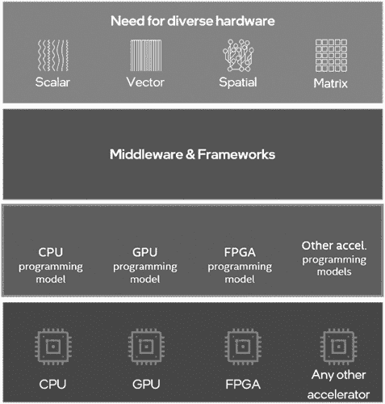

**图 1.1** 挑战。

首先必须了解 oneAPI 的本质是什么。它是一种开放且基于标准的跨架构编程模型，可解决程序员的挑战。oneAPI 为开发者提供完全的自由和选择，可选择 CPU、GPU 或 FPGA 等硬件以实现增强计算。oneAPI 创建背后的愿景很有趣。它旨在在 CPU、GPU 和其他加速器之间建立统一的软件开发环境。

oneAPI 是一个行业倡议，完全基于标准和开放规范。

oneAPI 具有许多开发者肯定会欣赏的功能：
* 首先，开发者可以安心地开发和部署软件。
* oneAPI 包含库并具有统一语言，可确保完整的原生代码性能。
* 自由。oneAPI 在包括 CPU、GPU、FPGA 和 AI（人工智能）加速器在内的多种硬件上实现原生代码性能。
* 由于其符合开放行业标准，这无疑是未来的最佳方法。
* 最大的优势在于 oneAPI 与现有编程语言的出色兼容性，包括 C++、Python、SYCL、Fortran 和 openMP 语言。

oneAPI 是基础或底层编程栈。应将其视为优化中间件和上游框架的促进者。可以通过 图 1.2 更清晰地理解这一点。读者可以看到 TensorFlow 之类的框架位于 oneAPI 之上，而 oneAPI 已针对性能进行了优化。图 1.2 中显示的表示已增强并在 图 1.3 中呈现以获得额外清晰度。

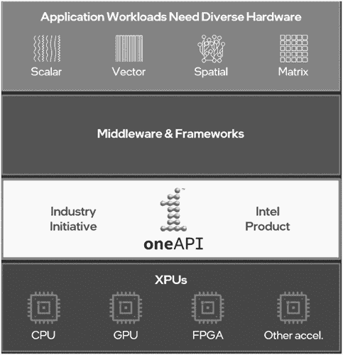

**图 1.2** 革命 – oneAPI（行业倡议和 Intel 产品）。

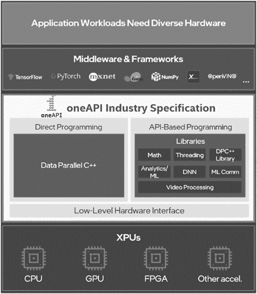

**图 1.3** oneAPI 的力量。

正如图 1.3 所示，经过优化的应用程序会进入最上层，该层利用了中间件和框架。

oneAPI 配备了功能强大且先进的移植工具包（这简化了我们的工作，大家，因为它为我们移植代码）。还提供了分析工具，如 intel VTune 分析器、intel advisor 和调试器。这使得某人能够在所有抽象级别上调试代码或分析性能而不会受到任何阻碍。

在解释了 oneAPI 是什么以及它为开发者带来什么之后，谈谈 oneAPI 为开发者提供的另一个非常重要的好处很重要。与 oneAPI 无关的专有锁定，并且它与用原生语言（如 C、C++ 等）编写的代码兼容，如前所述。

简单来说，oneAPI 为开发者提供选择特定问题的最佳架构的选项，而无需强制开发者为不同架构或平台重写代码。

oneAPI 还在更大规模上促进社区和行业协作。

记住这一点 – oneAPI 的全部意义在于“一次编写，多次部署！”

## 1.2 方法 – 直接编程和基于 API 的编程
oneAPI 很吸引人。为开发者提供的编程选项有两种：直接编程和基于 API 的编程。此外，DPC++ 提供了与 oneAPI 的兼容性工具和调试工具（参见 图 1.4）。

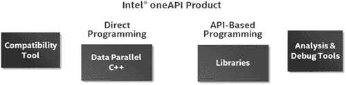

**图 1.4** 编程模型。

* 使用 CUDA（Compute Unified Device Application）的开发者发现，使用 oneAPI 将现有 CUDA 代码（CUDA 源代码）迁移到（Data Parallel C++）DPC++（DPC++ 源代码）更容易。oneAPI 为您提供 Intel DPC++ 兼容性工具，可轻松地将源代码从 CUDA 迁移到 DPC++。迁移过程中有大量帮助，几乎 80–90% 可自动完成。最好的是“内联注释”，这些注释也以易于理解的方式提供给开发者以完成移植。
* Intel oneAPI DPC++ / C++ 编译器非常强大，并支持直接编程。当算法不可用 API 时，这种方法非常有用。读者稍后将了解有关直接编程的更多详细信息。对于直接编程，Data Parallel C++ 是 C++ 的演进，适用于面向生产力的数据中心编码，将针对 CPU、GPU FPGA 和 AI 加速器。
* 下一种方法是基于 API 的编程。有大量库可满足不同的领域和区域。库的详细信息将在下一节中介绍，读者将在其中找到大量信息。开发者可以毫不费力地直接使用它们。
* 最后，在 图 1.4， 你还可以看到像 Intel VTune Profiler 和 Intel Advisor 这样的工具，它们可以帮助分析性能。

## 1.3 库 – 更强大的功能
oneAPI 配备了丰富的库，可实现特定领域的函数加速。图 1.5 中显示的所有库都已预先优化以确保最大性能。可以看出，这些库满足了广泛的领域需求。这些库通过为开发者提供 API 简化了编程。

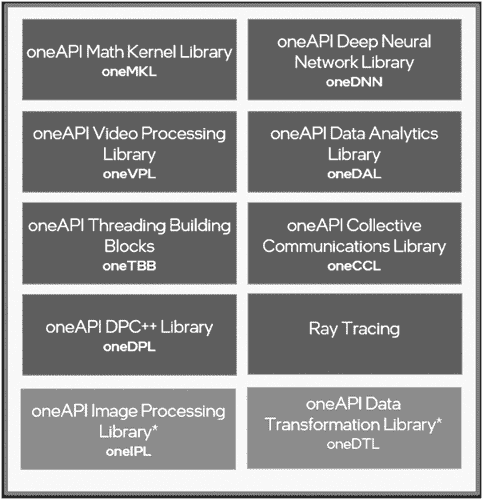

**图 1.5** oneAPI 的力量。

以下是对这些库的简要说明：
* `Intel oneAPI Math Kernel Library`：可以使用此库在应用程序中开发高度优化的数学例程。
* `Intel oneAPI Deep Neural Network Library`：可以使用此库构建使用针对 Intel 硬件（无论是处理器还是图形）优化的神经网络的深度学习应用程序。
* `Intel oneAPI Video Processing Library`：如名称所示，此库可非常方便地加速所选应用程序中的视频处理。
* `Intel oneAPI Data Analytics Library`：这是最好的库之一，尤其适用于工业需求。可以使用此库在大数据应用程序中结合高速和性能。
* `Intel oneAPI Threading Building Blocks`：通常称为 TBB，它们为开发者提供了在所选应用程序中结合基于 TBB 的多核 CPU 并行性和 SYCL 设备加速并行性的机会。

* `Intel oneAPI Collective Communications Library`: 这可用于以深度学习和机器学习工作负载为主要关注点的应用程序。
* `Intel oneAPI DPC++ Library`: 可使用此库构建高性能并行应用程序。
* `Support in the form of Ray Tracing libraries`: 这些库可用于构建逼真的视觉效果，从工作室动画到科学和工业可视化。
* `Intel oneAPI Image Processing Library`: 顾名思义，oneAPI 包含图像处理功能、滤镜、几何变换、颜色和类型转换以及各种 3D 操作，使开发人员能够通过 `SYCL*` API 利用多样化的计算设备而无需更改其代码。
* `Intel oneAPI Data Transformation Library (DTL)`: 这是英特尔为多样化架构提供即用型、优化的数据压缩功能的一项非常创新的尝试。`OneDTL` 的设计方式使其可在包括 CPU、GPU 等在内的各种设备上执行。

现在是读者了解工具包的时候了。Intel oneAPI 提供了丰富的工具包，提供广泛的服务。这些将在 第 2 章 中探讨。

## 1.4 oneAPI 与本书的联系是什么？

好吧，这应该已经在读者的脑海中了。让我们来回答这个问题。机器学习（`ML`）概念可以通过各种平台和模式教授。对于本书，我们选择了 oneAPI。我们相信通过这种方法，机器学习会更容易。此外，oneAPI 目前是行业迫切需要的。`ML` 技能与 oneAPI 知识相结合将是惊人的。我们确信读者会喜欢这整个学习之旅。

## 资源

英特尔所做的最伟大的事情之一就是为所有水平的专业知识提供优秀的学习资源。从新手到专家，所提供的材料和学习路径简直出色。英特尔还为学习者提供案例研究、通过 `GIT` 的参考代码等。教师有机会成为 oneAPI 认证讲师，他们可以获得完整的培训材料、演示文稿、示例代码、作业问题和答案。

以下链接可用于了解更多关于 oneAPI 的信息，
* oneAPI 简介
  [`www.intel.com/content/www/us/en/developer/tools/oneapi/overview.html#gs.d912h6`](https://www.intel.com)
* oneAPI 工具包
  [`www.intel.com/content/www/us/en/developer/tools/oneapi/toolkits.html#gs.3ovxmi`](https://www.intel.com)
* 学习路径
  [`www.intel.com/content/www/us/en/developer/tools/oneapi/training/overview.html`](https://www.intel.com)
* 社区项目
  [`devmesh.intel.com/`](https://devmesh.intel.com)
* oneAPI DevCloud
  [`devcloud.intel.com/oneapi/`](https://devcloud.intel.com)

要成为 oneAPI 认证讲师，可以前往申请到
[`www.intel.com/content/www/us/en/secure/developer/oneapi/certified-instructor-apply.html`](https://www.intel.com)

而且请记住，一切都是免费的！

## 1.5 需要记住的关键点

1. oneAPI 是一个行业倡议，是一种基于标准的开放编程模型。
2. 针对使用 oneAPI 进行编程，开发人员提供了两种选项。一种是直接编程，另一种是基于 API 的编程。
3. oneAPI 为您提供 Intel `DPC++` 兼容性工具，可轻松将源代码从 `CUDA` 迁移到 `DPC++`。
4. oneAPI 配备了 Intel `VTune™ Profiler` 和 Intel `Advisor` 等工具，可帮助分析性能。
5. oneAPI 配备了丰富的库，可实现特定领域的函数加速。
6. 读者不必被上述庞大的列表冲昏头脑！我们将确保学习以应有的方式传授。

好吧，我们衷心希望您喜欢这次关于 oneAPI 的相当详细的介绍性讨论。是时候继续前进并探索 Intel oneAPI 工具包了，所以让我们继续下一章。

## 测验问题（自己作答吧，朋友们！）

1. 什么是 oneAPI？
2. oneAPI 的主要优势有哪些？
3. 列出 oneAPI 库的名称。
4. 编写一次代码，随意重复使用——oneAPI 如何实现这一点？
5. `VTune Profiler` 对开发人员有何帮助？
6. 有人如何使用 Intel Advisor 来获得更好的结果？
7. 解释 oneAPI 支持的编程模型。

# 2 Intel oneAPI 工具包 探索

DOI: [10.1201/9781003393122-2](https://doi.org/10.1201/9781003393122-2)

## 学习目标

阅读本章后，读者应能够理解以下内容：
* oneAPI 工具包是什么？
* oneAPI 工具包的功能是什么。
* 安装指南。
* 资源。

## 2.1 Intel oneAPI 工具包

随着 `2022.3.1` 版本的发布，Intel oneAPI 提供了丰富的工具包，可满足各种领域和应用的需求。有了这些 oneAPI 工具包，可以在 CPU、GPU 或任何其他加速器上构建、分析和甚至优化性能改进的跨架构应用程序。工具包还为开发人员提供优秀的库、优化的框架以及出色且易于使用的调试工具。

这些工具包以性能为主要目标，同时降低软件开发成本并减少维护成本。oneAPI 和工具包无疑使开发人员更具生产力。

以下是英特尔为开发人员探索和使用而提供的 oneAPI 工具包。（参见图 2.1）

1. a. `Intel oneAPI Base Toolkit`: 一切都始于 oneAPI Base Toolkit，它包含一套用于使用 `C++`、`DPC++` 等构建应用程序的高性能工具。在此工具包的帮助下，开发人员可以在多样化的架构上构建以数据为中心的应用程序。您可以将基础工具包与其他工具包互补。该工具包包含一套工具和库，下面列出以供快速参考：
   * oneAPI 集体通信库。
   * oneAPI 数据分析库。
   * oneAPI 深度神经网络库。
   * oneAPI `DPC++` 编译器。
   * oneAPI `DPC++` 库。
   * oneAPI 数学核心库。
   * oneAPI 线程构建模块。
   * oneAPI 视频处理库。
   * Intel `Advisor`。
   * Intel `Python*` 发行版。
   * Intel `DPC++` 兼容性工具。
   * Intel FPGA 插件 for oneAPI Base Toolkit（可选）。
   * Intel 集成性能原语。
   * Intel `VTune™ Profiler`。
   * `GDB`。

读者可以参考 图 2.1 来了解 Intel oneAPI Base Toolkit 如何通过直接编程、基于 API 的编程以及丰富的库支持开发人员。

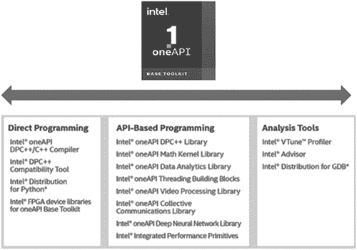

`Figure 2.1` oneAPI Base Toolkit 的丰富性。

oneAPI Base Toolkit 带来的功能是巨大的，并以图表形式在 图 2.2 中进行了总结，以便更易于参考。

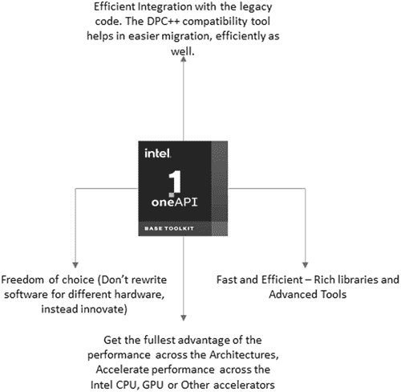

`Figure 2.2` oneAPI Base Toolkit 的功能。

可以在机器上安装 oneAPI Base Toolkit 并开发应用程序，或使用 `DevCloud` 无缝开发应用程序。后一种选项对开发人员来说更容易，因为安装或设置环境的需要不大。

所有提及的工具包的安装程序几乎保持相同。唯一变量是需要下载的可执行文件和相应的链接可能不同。

## 2.2 oneAPI Base Toolkit 安装指南

## 下载和系统要求

可以从以下链接下载 oneAPI Base Toolkit：[`www.intel.com/content/www/us/en/developer/tools/oneapi/base-toolkit-download.html`](https://www.intel.com)。

但在进行安装前，了解用户系统是否满足要求非常重要。可以从以下链接了解要求：[`www.intel.com/content/www/us/en/developer/articles/system-requirements/intel-oneapi-base-toolkit-system-requirements.html`](https://www.intel.com)。

## 操作系统支持

oneAPI Base Toolkit 可用于 MacOS、Windows 和 Linux（图 2.3）。根据用户的操作系统，可以开始下载。

**图 2.3** 操作系统支持。

## 安装选项

可以根据需要选择在线或离线分发。下面是截图（图 2.4），展示了选项（所有受支持的操作系统均提供在线或离线选项）。

**图 2.4** 安装选项。

如果选择在线安装模式，可立即下载可执行文件，且文件很轻量（13 MB）。如果选择离线选项，可执行文件较大（6 GB），下载完成可能需要更多时间。这两种选项都可以，用户可根据自身需求选择。下载时可能需要注册。可以查看离线和在线模式的安装文件大小，见图 2.5。

**图 2.5** 安装选项。

## 离线安装逐步指南

用户将看到离线安装流程的逐步指导。与在线安装模式的操作和顺序相同。

第一步是指定产品包的解压路径。图 2.6 指示需要指定的路径。

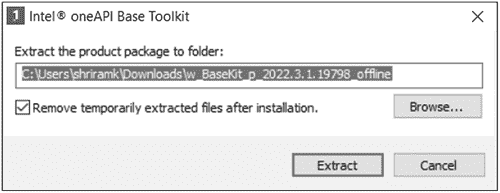

**图 2.6** 解压路径。

解压完成需要几秒钟时间（图 2.7）。

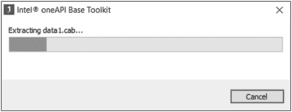

**图 2.7** 解压进度。

序列中的下一步很有趣。安装程序将自动检查系统要求。可参考图 2.8 了解此过程。在下方弹出的窗口中点击“Continue”，系统要求检查将自动开始。

**图 2.8** 系统要求检查。

系统检查完成后，将显示使用 oneAPI Base Toolkit 安装的完整详情。同时，用户必须同意许可协议。如有需要，用户也可以自定义安装（图 2.9）。点击“Continue”后，安装将继续进行。整个过程可能需要一些时间才能完成。

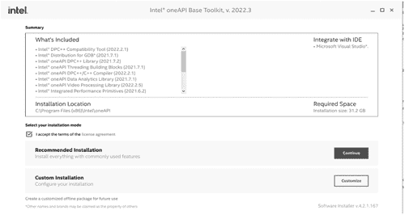

**图 2.9** 安装。

## IDE 集成

为了方便使用，安装程序会提示是否需要与集成开发环境（IDE）进行集成；所呈现的选项如图 2.10 所示。虽然这是可选步骤，但建议与 IDE（Microsoft Visual Studio 2022）集成。

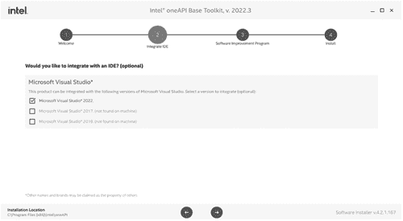

**图 2.10** IDE 集成。

随后，Intel 软件改进计划将出现，用户可以自由选择是否同意数据收集（图 2.11）。

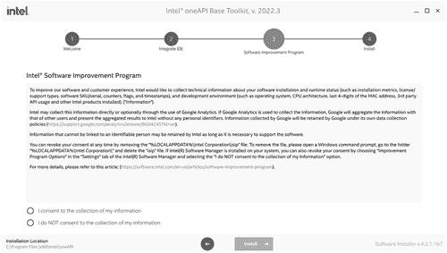

**图 2.11** 软件改进计划 – 数据收集同意。

就是这样！安装将开始（图 2.12）。用户可以稍作休息。

**图 2.12** oneAPI Base Toolkit 的无缝安装。

安装完成后（图 2.13），且未中断，即可使用 Intel oneAPI Base Toolkit 按需进行创新。

**图 2.13** oneAPI Base Toolkit 安装成功。

使用 Visual Studio 命令行构建和运行项目的选项也可用，可参考以下链接：[`www.intel.com/content/www/us/en/docs/oneapi-base-toolkit/get-started-guide-windows/2023-0/run-project-visual-studio-command-line.html`](https://www.intel.com)

## 替代方案：Intel DevCloud

读者心中可能有疑问！能否在不进行这些安装的情况下简化操作？我们听到了。是的，也有相应的选项。您可以使用 Developer Cloud（DevCloud）账户在无需任何投资的情况下构建、测试甚至优化项目。它免费且更强大，可让您访问所有最新的 Intel 硬件，包括 CPU、GPU 或 FPGA。Intel 提供的访问期限为 120 天，也可延长。使用云服务，可轻松使用任何工具包，无需安装、软件下载或配置。它使用简单易行。可以通过以下链接注册获取相同访问权限：

[`consumer.intel.com/intelcorpb2c.onmicrosoft.com/B2C_1A_UnifiedLogin_SISU_CML_SAML/generic/login?entityId=www.intel.com&ui_locales=en`](https://consumer.intel.com) 或扫描以下二维码（图 2.14）。

**图 2.14** Intel DevCloud 注册链接。

注册过程简单，可能需要提供姓名和电子邮件等信息。就这样，您可以使用 oneAPI 构建解决方案！

下一步是什么？准备好并开始编程。可以通过以下链接轻松学习 oneAPI 编程，Intel 提供了大量信息：[`www.intel.com/content/www/us/en/docs/oneapi/programming-guide/2023-0/overview.html`](https://www.intel.com)

## 相关工具包

1. b. *Intel oneAPI HPC（高性能计算）工具包*：名字说明了一切。正如您所理解的，该工具包是特定领域的。使用该工具包，您可以构建和交付快速的 Fortran、OpenMP 和 MPI 应用程序，将高性能计算应用与前沿技术相结合。

该工具包包含一组工具和库，下面列出供读者快速参考：

* C++ 编译器
* 集群检查器
* Fortran 编译器
* Intel Inspector
* Intel MPI 库
* Intel Trace Analyzer 和 Collector

安装过程与 Intel oneAPI Base Toolkit 部分讨论的几乎相同。但是，可安装程序需从以下链接下载：[`www.intel.com/content/www/us/en/developer/tools/oneapi/hpc-toolkit-download.html`](https://www.intel.com)。其余指南保持不变。一些工具包可能要求将 Base Toolkit 作为先决条件进行安装，安装开始时检查器会明确指出。

2. c. *Intel oneAPI 物联网（IoT）工具包*：这也是一个特定领域的工具包。使用此 IoT 工具包，可加速智能互联设备的开发，从而带来无限创新。该工具包捆绑了：

* Intel Inspector
* Intel oneAPI DPC++/C++ 编译器

### Intel® C++ 编译器 Classic

安装程序几乎与前面讨论的 Intel oneAPI Base Toolkit 相同。但是，可安装程序需从链接 [`www.intel.com/content/www/us/en/developer/tools/oneapi/iot-toolkit-download.html`](https://www.intel.com) 下载。

### Intel oneAPI 渲染工具包

此工具包面向创意人士。是的，从事可视化及相关领域的工作人员可以使用此工具包创建性能卓越、高保真度的可视化应用。该工具包对开发者使用和开发出惊艳成果非常有趣，并且包含以下列出的一些工具：
* Embree
* Implicit SPMD Program Compiler
* Open Volume Kernel Library
* Open Image Denoise
* OpenSWR
* OSPRay
* OSPRay Studio
* OSPRay for Hydra
* Rendering Toolkit Utilities

安装程序所需时间几乎与 Intel oneAPI Base Toolkit 相同。但是，可安装程序需从以下链接下载：[`www.intel.com/content/www/us/en/developer/tools/oneapi/rendering-toolkit-download.html`](https://www.intel.com)。

### Intel AI 分析工具包

这是最好的工具包之一，业界已纷纷对该工具包给予赞誉。有了此工具包，可以使用经过优化的 DL（深度学习）框架和高性能 Python 库加速机器学习和数据科学管道。此工具包功能强大且资源丰富。工具包包含以下工具：
* Intel Optimization for TensorFlow
* Intel Optimization for PyTorch
* Intel Distribution for Python*
* Intel Distribution of Modin (available through Anaconda only)
* Model Zoo for Intel Architecture
* Intel Low-Precision Optimization Tool

可以在以下链接下载 AI Analytics Toolkit：[`www.intel.com/content/www/us/en/developer/tools/oneapi/ai-analytics-toolkit-download.html?operatingsystem=linux&distributions=zypperpackagemanager`](https://www.intel.com)。

### Intel OpenVINO

这是最出色的工具包之一。它是开放视觉推理和神经网络优化。用户可以使用 OpenVINO 开发和部署从边缘到云的高性能推理和应用。OpenVINO 可以通过以下提供的指南和可安装程序无缝下载和安装：[`www.intel.com/content/www/us/en/developer/tools/openvino-toolkit/overview.html`](https://www.intel.com)。

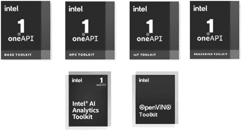

**图 2.15** oneAPI 工具包（部分由 oneAPI 提供支持）。

所有这些工具包的最大优势在于它们免费使用且易于学习。工具包可为 Windows、Linux 或 Mac OS 安装。此外，如果开发者希望使用 DevCloud，也是可能的，并且无需安装或任何额外下载。开发很容易，结果立即可用。

另一个值得称赞的优势是，为初学者提供了大量教程和学习材料。还提供了许多案例研究以确保循序渐进的学习。

好吧，我们衷心希望读者能喜欢探索这些工具包。让我们继续下一章，了解有关 DevCloud 的更多详细信息，包括其功能、性能等。

## 资源
* [`www.intel.com/content/www/us/en/developer/tools/oneapi/overview.html#gs.3otusu`](https://www.intel.com)
* [`www.intel.com/content/www/us/en/developer/tools/oneapi/toolkits.html#gs.kfp7z3`](https://www.intel.com)
* [`youtu.be/FdntPy1cCKo`](https://youtu.be)
* [`youtu.be/_y4bPjj8Gv4`](https://youtu.be)

## 2.2 需要记住的关键点
1. 每个 oneAPI 工具包都包含一套工具。
2. oneAPI 工具包可以直接按照提供的指南安装到机器上，或者可以使用 DevCloud 开发应用程序。
3. DevCloud 使开发者能够在无需任何安装或配置的情况下轻松开发应用程序。
4. oneAPI Base Toolkit 拥有用于使用 C++、DPC++ 构建应用程序的高性能工具包。
5. 使用 oneAPI HPC Toolkit，可以构建和交付快速的 Fortran、OpenMP 和 MPI 应用程序，将高性能计算应用与前沿技术相结合。
6. 可视化及相关领域可以使用 oneAPI Rendering Toolkit 创建性能卓越、高保真度的可视化应用。
7. 有了 AI Analytics Toolkit，可以使用经过优化的 DL 框架和高性能 Python 库加速机器学习和数据科学管道。
8. 可以使用 OpenVINO Toolkit 开发和部署从边缘到云的高性能推理和应用。

## 测验
1. 解释某人选择 Intel oneAPI Base Toolkit 的需求。
2. 选择 Intel IoT Toolkit 可以获得哪些功能？
3. 列出随 Intel oneAPI AI analytics toolkit 提供的库/包名称。
4. 哪个工具包对从事可视化应用开发的开发者最有帮助？
5. 如果有人从事 HPC 应用开发，哪个工具包对他们最有帮助？

# 3 Intel DevCloud 与 Jupyter Notebook

DOI: [10.1201/9781003393122-3](https://doi.org/10.1201/9781003393122-3)

## 学习目标

阅读本章后，读者应能够理解以下内容：
* DevCloud 的强大功能
* 注册流程
* Jupyter Notebook 与 DevCloud
* DevCloud 命令

## 3.1 引言

本章将提供有关 Intel DevCloud 基础知识的诸多见解。此外，Jupyter Notebook 已与 DevCloud 集成，使得软件开发人员的学习和使用变得更加容易。预计读者应创建 Intel DevCloud 账户，以尝试本章讨论的所有要点。

## 3.2 什么是 Intel DevCloud？

DevCloud 是一个有趣且功能强大的沙箱，使某人能够使用 Intel oneAPI 软件堆栈在包括 Intel CPU、GPU 和 FPGA 在内的多种加速器上开发、测试和运行工作负载。

它拥有众多功能且功能强大。图 3.1 展示了 Intel DevCloud 的功能。使用 DevCloud 编码很容易，无需担心硬件采购；更重要的是，无需安装或配置。它还为开发者提供了出色且易于理解的教程。最重要的是，对 Jupyter Notebook 和 Visual Studio Code 的支持使其比最受欢迎的云平台更胜一筹。

**图 3.1** Intel DevCloud 功能汇总。

可以从网站 software.intel.com/devcloud/oneapi 找到有关 Intel DevCloud 的大量有用信息

### 3.2.1 如何创建 DevCloud 账户？

可以按照下面介绍的逐步流程创建 DevCloud 账户/访问权限。
1. 访问 software.intel.com/devcloud/oneapi 网站。

它会提示您填写某些基本信息，这不会花费太多时间。下面在 图 3.2 中展示的屏幕截图揭示了所需的信息。
2. 完成上述信息后，将向您提出另外两个问题，邀请您做出回应，如 图 3.3 所示。可以选择适当的答案。

完成此操作后，就完成了。
3. 然后需要同意条款和条件。可以阅读条款和条件并通过点击复选框同意。一旦完成，点击提交按钮，账户即完成（图 3.4）。

4. 填写完详细信息后，用户会收到以下消息（图 3.5），该消息确保成功登录。
5. DevCloud 会发送一封电子邮件进行验证，并提示用户验证电子邮件（参见 图 3.6）
6. 点击电子邮件验证链接后，流程即完成。完成上述流程后，屏幕上将显示以下消息（图 3.7）。

**图 3.2** DevCloud 注册 – 第 1 步。

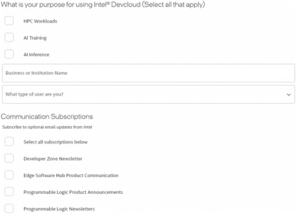
**图 3.3** DevCloud 注册 – 第 2 步。

**图 3.4** DevCloud 注册 – 第 3 步。

**图 3.5** DevCloud 注册 – 第 4 步。

**图 3.6** DevCloud 注册 – 第 5 步。

**图 3.7** DevCloud 注册 – 第 6 步。

## 3.3 嗯，一切都完成了。接下来怎么办？简单，让我们登录！

如何通过“Connect with Jupyter Lab”访问 DevCloud？

点击链接 [`devcloud.intel.com/oneapi/get\_started/`](https://devcloud.intel.com)。在页面的底部部分，有一个“Connect with Jupyter Lab”选项（图 3.8)）

**图 3.8** 使用 Jupyter Lab 连接。

一旦点击 Launch Jupyter Lab，它就会加载并为用户显示屏幕（图 3.9）。DevCloud 的 Jupyter Lab 世界现已开启。

**图 3.9** Jupyter Lab。

新的启动器按钮将为用户提供大量选项。启动器按钮显示在 LHS（左侧），为开发人员提供选项。开发人员可以轻松创建 Python Notebook，其他选项也可用。控制台甚至可以根据您的需求进行选择。还提供了终端选项（图 3.10)）。

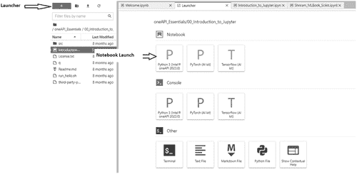
**图 3.10** 启动板。

点击 Python 3 Notebook Launcher 后，用户将使用 oneAPI 内核启动 Jupyter Notebook，如 图 3.11 所示。

**图 3.11** Jupyter Notebook 启动。

让我们逐步了解如何使用 Jupyter Lab。

第一步是保存 Notebook。从文件菜单中，点击“Save”选项以保存 Notebook，并为文件指定所需名称。可以查看 图 3.12 以了解相同内容。

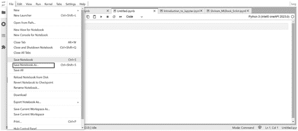
**图 3.12** 保存 Notebook。

Jupyter Notebook 提供了一个很棒的工作区，具有浏览器内编码功能，我们可以在其中定义变量，按自己的节奏处理它们，并在过程中分析它们。

为什么它被称为 Jupyter？Jupyter 是 Julia、Python 和 R 的字母重排。是的，您可以使用 Jupyter 使用所有这些语言。

可以轻松编写代码、添加漂亮的 Markdown 文本、图像并插入 YouTube 视频。这使其更具多功能性且极易使用。

了解其结构很重要。Jupyter Notebook 无疑是一系列单元的序列。单元格可以包含 HTML 或 LaTeX 或实际代码，这对开发人员来说非常容易。可以参考 图 3.13，其中包含文本、代码和方程，这使得 Jupyter Notebook 使用起来超级酷。

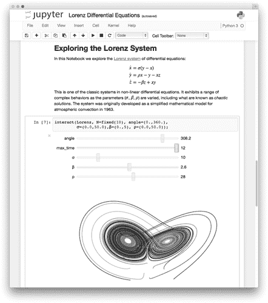
**图 3.13** 超灵活的 Jupyter Notebook。

代码全部分为较小的单元，使开发人员能够更好地控制。此外，它还为那些具有交互式开发体验的开发人员提供了便利。

代码分为单元以控制执行。

Jupyter Notebook 中有一些很酷的魔术可用（参见 图 3.14)）。

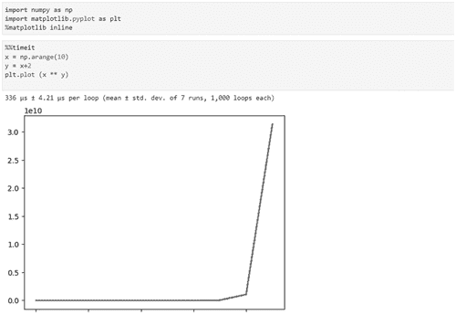
**图 3.14** Jupyter 单元格魔术。

*   `%matplotlib inline`: 在 Jupyter Notebook 中内联显示绘图
*   `%%timeit`: 计时单元格执行所需的时间，并在下方作为实例呈现。

可以在 Jupyter Lab 中轻松地从另一个 Notebook 或 Python 文件执行代码。以下是选项。`%run filename.ipynb`，其中 `filename.ipynb` 是要提取执行的那个。可以参考 图 3.15（下方）以了解如何执行此任务。

**图 3.15** 从当前 Notebook 执行另一个 Notebook。

同样，`%load filename.py`：复制文件的内容并将其粘贴到指定的单元格中，读者可以尝试一下。

## 3.4 Jupyter 安装

如果开发人员希望在本地机器上安装 Jupyter 并尝试开发，这也是可能的，本小节对此进行了总结。

1. 安装 Jupyter 时，应打开 Anaconda Prompt。许多初学者在这里会犯一个小错误。初学者倾向于在普通命令提示符中发出命令，而不是在 Anaconda Prompt 中。这将不起作用，因为这是指定方法。下面的屏幕截图展示了如果在普通命令提示符中发出命令时会出现错误消息，应避免这种情况。图 3.16 显示了命令提示符，随后错误消息显示为 图 3.17, 当发出 Jupyter 安装命令时。

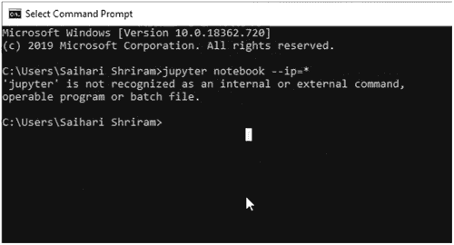
**图 3.16** 普通命令提示符。

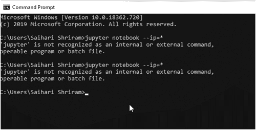
**图 3.17** 错误。

需要发出的命令是 `jupyter notebook –ip=*`。

2. 现在应打开 Anaconda Prompt 并发出上述命令。以下屏幕截图显示在 图 3.18 中，揭示了系统中 Anaconda Prompt 的存在。图 3.19 为您提供成功的安装说明。

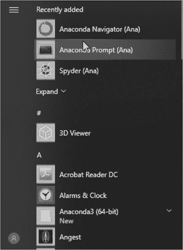
**图 3.18** Anaconda Prompt。

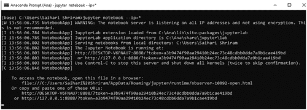
**图 3.19** Anaconda Prompt 安装完成。

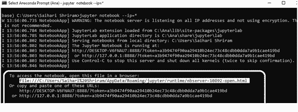
**图 3.20** 如何打开 Jupyter。

3. 安装完成后，可以使用成功安装时获得的链接轻松打开和访问 Notebook。将链接复制并粘贴到您喜欢的任何浏览器中即可打开 Jupyter Notebook。

还有另一种更简单的方法来打开和访问 Jupyter Notebook。只需在搜索框中输入“Jupyter”。它将显示 Jupyter Notebook Launcher 选项，如下所示 图 3.21。点击它后，Notebook 就会启动。

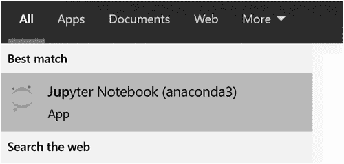
**图 3.21** 启动 Jupyter。

读者将在网页浏览器中启动 Jupyter Notebook，如下所示 图 3.22。

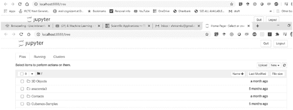
**图 3.22** Jupyter – 首次启动。

好吧，安装现在已完成，是时候尝试第一个程序了。

### 3.4.1 使用 Jupyter 的第一个程序

1. 成功启动 Jupyter Notebook 后，用户会看到下方显示的屏幕（图 3.23），其中按钮“New”被突出显示（图 3.23）
2. 一旦点击“New”，下方屏幕将出现，展示选项。点击 Python 3。为要创建和运行的 Python Notebook 指定名称是一个良好的做法。同样内容展示在 图 3.24。
3. 然后，用户可以自由输入所需的任何 Python 代码。运行（执行）已输入代码的选项也可用，且需点击 RUN，如下图所示 图 3.25。第一个代码的输出已出现。
测试完成后，务必注销。注销选项也被突出显示，用户可以点击该选项退出登录。
完整的流程以演示视频的形式呈现 @ [`youtu.be/bzaO9SFHJSA`](https://youtu.be)。

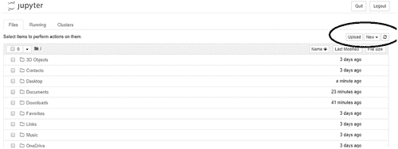

**图 3.23** Jupyter – 第一个程序。

**图 3.24** 新的 Python Notebook。

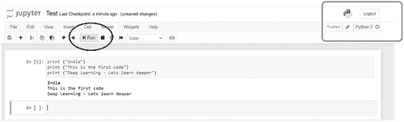

**图 3.25** 第一次代码执行。

## 3.5 DevCloud 为软件开发者提供什么？

看到 DevCloud 能提供的内容，开发者应该感到欣喜。

首先，可以在 CPU、GPU 和 FPGA 架构上测试性能。可以利用多种加速器选项运行其工作负载（图 3.26）。

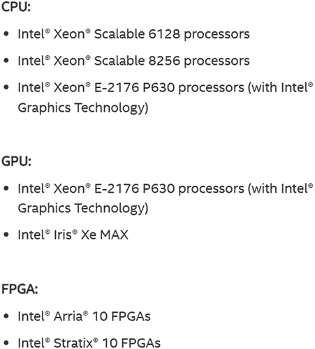

**图 3.26** 加速器选项。

除此之外，作为开发者，您将获得以下资源：
* 可免费访问 Intel® oneAPI Toolkits 和组件以及最新的 Intel® 硬件
* 220 GB 文件存储空间
* 192 GB RAM
* 120 天访问权限（可延长）
* 终端界面（Linux*）
* Microsoft Visual Studio* Code 集成
* Intel® oneAPI 渲染工具包的远程桌面

总体而言，利用这些资源，完全可以实现高质量的最佳成果。

## 3.6 DevCloud 终端命令

可以通过点击 + 按钮启动终端，这将打开终端。这可以在 图 3.27 中看到。

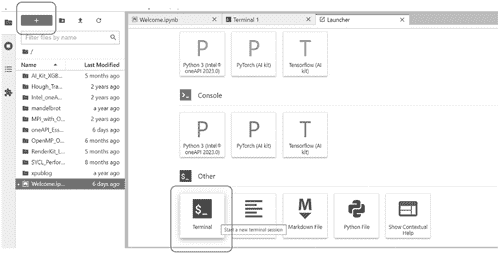

**图 3.27** 启动终端。

成功启动后，可以访问终端并轻松运行所有传统的 Linux/Unix 命令（请参阅 图 3.28 以可视化相同内容）。对于初学者或需要复习 Linux 命令的人来说，访问 [`devcloud.intel.com/oneapi/documentation/shell-commands/`](https://devcloud.intel.com) 是个不错的选择。

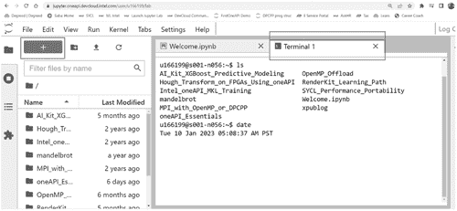

**图 3.28** Shell 命令。

希望读者喜欢本章关于 Intel DevCloud 和 Jupyter Notebook 的内容。现在让我们将注意力转向机器学习，它在 第 4 章 等待着您。

## 资源
1. [`jupyter.org/`](https://jupyter.org)
2. [`www.intel.com/content/www/us/en/developer/tools/devcloud/overview.html`](https://www.intel.com)
3. [`devcloud.intel.com/oneapi/documentation/shell-commands/`](https://devcloud.intel.com)
4. [`devcloud.intel.com/oneapi/`](https://devcloud.intel.com)

## 练习

注：本章主要关注安装和实践，使读者熟悉 Intel DevCloud、Jupyter Notebook 等。因此没有测验题。相反，提供了练习题供读者尝试并获得实践经验。
1. 创建一个 Intel DevCloud 账户。
2. 尝试登录 Intel DevCloud 并打开 Jupyter Notebook。
3. 使用 Jupyter Notebook 和 oneAPI 内核尝试简单的 Python 程序。
4. 启动终端并尝试 shell 命令。

# 4 什么是机器学习？导论！

DOI: [10.1201/9781003393122-4](https://doi.org/10.1201/9781003393122-4)

## 学习目标

阅读本章后，读者应能够理解以下内容：
* 什么是机器学习？
* 人工智能（AI）、机器学习（ML）和深度学习 DL 之间的关系。
* 机器学习的类型。
* 机器学习的必要性。
* 机器学习框架。
* 机器学习 *vs* 深度学习。
* 机器学习应用。

## 4.1 引言

术语机器学习（ML）属于人工智能（AI）研究领域，已在我们周围流传了几十年。我们中的大多数人已经尝试理解“该词的抽象含义”，至少是通过进行 Google 搜索。即使你没有这样做，也不用担心：你来对地方了，可以从技术角度深入学习“什么是机器学习？”本章的意图并不止于此——我们将更深入地了解各种机器学习类型、其在现实生活场景中的应用以及 ML 与深度学习（DL）之间的差异。

## 4.2 什么是机器学习？

好吧，让我们先带你回到难忘的童年。你还记得在你学会正常走路之前摔了多少次吗？哦，那是你回忆起来相当久远的记忆了，也许我们应该把这个问题问你的父母。让我们考虑一个你现在可能仍然记得的例子。我们每个人都有一个最喜欢的幼儿园老师，她对我们如此甜美和耐心。是的，我是有意使用了“耐心”这个词。你知道为什么！我仍然记得我的 KG 老师是如何教我什么是苹果的。她字面意义上拿来了真正的苹果，递给我，让我玩它来体验并告诉我那是苹果。事实上，她几乎持续了一周。

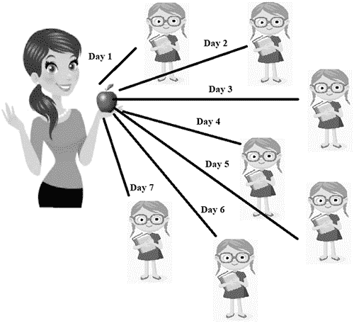

**图 4.1** 老师花了一周时间“训练”学生“什么是苹果？”

下周，她带来了一个番茄和一个苹果，问我哪一个是苹果。我能够毫不犹豫地正确指出苹果。

**图 4.2** 老师测试学生是否能正确识别苹果。

现在让我们切入正题：你认为老师做了什么才让学生如此好地识别它！是的，老师耐心地用真正的苹果 *训练* 了学生一周，苹果的特征，如其红色、圆形形状以及内部呈白色且坚硬的特性，都通过体验被正确地记录下来。学生在 *测试* 阶段收集的这种集体智能帮助其从番茄等不同水果中识别出苹果。（顺便说一下，我们并没有说错！番茄是水果，但营养学家认为它是蔬菜，正如 Britannica.com 所建议的 。）

所以，让我们再次讨论我们开始时提出的问题：“什么是机器学习？”它与上面给出的例子有什么关系？现在，仔细回答这个问题，根据“机器学习”的含义，我们试图让机器学习。是的，我们将已知的数据输入机器并 *训练* 它们。一旦机器得到适当训练，我们将 ***测试*** 机器，看看机器是否能够借助训练数据提供适当的答案。我们可以一直训练机器，直到它为我们提供最优化的结果。

哦，就这么简单，对吧？机器学习现在变得简单明了了。

图 4.3 以简单的方式正确描述了机器学习过程。机器将苹果的图片作为输入，手动提取苹果的特征并利用这些信息进行学习。这基本上是通过各种机器学习算法完成的，这些算法可用于创建机器学习训练模型。该机器学习训练模型会提供测试数据，以检查模型是否能准确识别苹果。需要注意的主要一点是，在任何机器学习过程中，特征提取非常重要，并且可以无需人工干预完成。

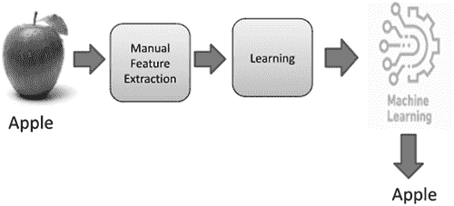

**图 4.3** 机器学习过程。

## 4.3 AI、ML 与 DL 之间的关系

*人工智能* (AI) 是研究领域的一个广阔范畴，研究人员开始思考如何将智能引入机器。你可能都知道 Sophia，她是第一台拥有沙特阿拉伯国籍的人形机器人。唐煜是 AI 驱动的虚拟机器人 CEO，他被任命以优化运营效率。元宇宙中 AI 的整个概念围绕着这样一个事实：人们无需像在现实生活环境中那样面对任何现实生活风险。

**图 4.4** 人形机器人 Sophia、Robert CEO 唐煜 和 元宇宙中的 AI。

在这个 AI 时代，ML 是 AI 的一个美丽子集，它允许在没有任何显式干预的情况下执行特定任务。过去的数据被提供给系统，系统提取特征并从识别出的模式中学习。从模式中做出某些推断，并据此做出智能决策。机器学习算法具有自适应性，因此在模型的学习过程中不需要显式的人工干预。特征提取是整个过程中的一个重要步骤，有助于模型适当预测或分类数据。

*深度学习* (DL) 是 AI 的一个高级子集，其中模仿了人类大脑对数据的处理和理解。神经网络往往是深度学习的基础，它主要像黑盒一样抓取数据并产生精彩的见解。解释深度神经网络的结果需要良好的分析技能，以便获得的输出对其他有用应用是有意义的。

图 4.5 显示了 AI、ML 和 DL 之间的关系。AI 的一些主要应用包括自然语言处理 (NLP)、通过可视化技术进行视觉感知、像无代码这样的自动化编程平台、用于繁重工作和家务工作的 AI 驱动机器人、知识表示和推理。

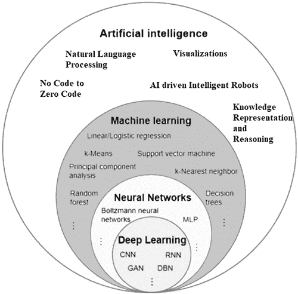

**图 4.5** AI、ML 与 DL 之间的关系。

机器学习使用许多算法，如回归、分类、主成分分析、聚类等，使用创建的模型从分析的数据中检测推断。多层感知器用于神经网络，在 CNN（卷积神经网络）、RNN（循环神经网络）、GAN（生成对抗网络）等各种算法的帮助下，可以通过深度学习实现自动特征提取和预测或分类。各种算法类别的演进在 图 4.6 中有所体现。

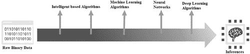

**图 4.6** 各种算法的演进进展。

## 4.4 机器学习的类型

现在我们对机器学习在 AI 研究领域中的地位有了深入的理解，是时候了解各种机器学习算法的类型了。机器学习算法主要分为以下三个类别，尽管我们可以增加第四个类别以便深入理解（参见 图 4.7）。

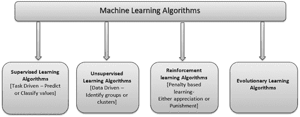

**图 4.7** 机器学习算法的类型。

*   监督学习。
*   无监督学习。
*   强化学习。
*   进化学习。

让我们通过简单的例子更深入地了解这些类型的机器学习和相关算法。

### 4.4.1 监督学习算法

该算法利用过去收集的标记数据来训练模型，并使模型预测或分类未标记的测试数据，以检查模型是否能正确预测或分类数据。监督机器学习算法使用标记数据，但这意味着什么？很简单：举一个例子来理解监督学习过程。

你提供了一个包含猫和狗图像的数据集（图 4.8）。数据集中所有图像都已正确标记；假设你有 1000 张猫图像和 1000 张狗图像。你正在创建一个监督学习模型，其中使用 700 个标记的猫数据和 700 个标记的狗数据来训练模型。你保留了 300 张猫图像和 300 张狗图像作为测试数据（图 4.9）。一旦监督机器学习模型创建完成，我们将让模型预测这些测试数据并检查创建的模型的准确性。

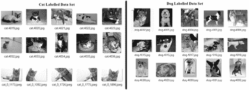

**图 4.8** 示例 – 猫和狗标记的训练数据集。

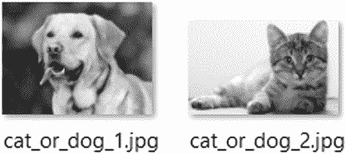

**图 4.9** 示例测试数据集，名称为 cat\_or \_dog\_1 和 cat\_or \_dog\_2。

既然我们现在了解了数据集中的内容，我们就继续进行该过程。

完整的监督学习过程在 图 4.10 中描述。在监督学习模型中，我们使用标记数据，将其输入模型进行训练；一旦模型训练完成，测试数据将被输入模型以对测试数据进行分类或预测。模型预测的准确性通常被计算为评估指标，以了解训练模型的效能。

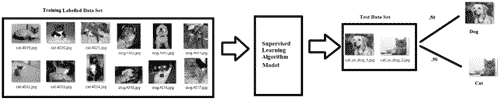

**图 4.10** 完整的监督学习过程。

这里需要特别注意的一点是，如果模型使用错误标记的数据进行训练，当然，模型会以错误的方式进行预测。因此，输入模型的训练数据需要是适当标记的。另一种情况可能是模型使用某个标记数据集进行训练，但为预测提供了完全不同的数据集；准确率将极低。这是可以理解的。如果你有猫和狗的数据集用于训练模型，而如果你将测试数据集作为鳄鱼图像提供，训练好的模型可能无法预测或会错误预测数据。

图 4.1，描绘老师向学生讲解苹果的例子，也是监督学习的一个例子。也许你应该再次重温那个例子，以便在你的脑海中牢牢记住这个概念。

### 4.4.2 无监督学习算法

这种方法与监督学习模型不同，因为数据没有关联的标签。此外，无监督学习方法中也没有明确的训练和测试阶段。哦，这不是很令人困惑吗？那么模型如何能够预测呢？是的，有办法，我们可以通过以下简单示例来理解。

假设学生获得了一个包含狗和猫图像的数据集，且完全没有标签（图 4.11）。每天，这个数据集都会给学生，之后一周后，学生被要求将数据集中相似的图像分组。你认为学生会怎么做？学生在过去一周里一直在浏览不同的图像类型，应该足够聪明，能够识别出猫和狗图像的特征。到一周结束时，如果给出不同的图像集，显然凭借他在映射狗和猫特征的过程中积累的集体知识，学生至少在一定程度上会正确地映射或分组猫和狗的图像。是的，有些可爱的狗看起来像猫，但我们也无能为力——因此，可能存在一些误分类。

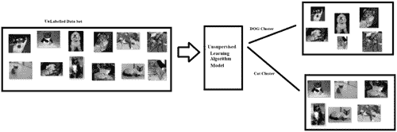

**图 4.11** 无监督学习过程。

给定一组数据，算法会对其进行分类并将此分类作为输出。每个类别（狗、猫）被称为一个簇。簇的标签将在稍后手动标记。分类基于数据点中的特征。无监督学习算法也被称为聚类算法。考虑之前为监督学习讨论的相同案例，使用苹果和西红柿。这里，模型将接收所有图像并输出两个簇。一个簇将是“苹果”，而另一个簇将包含所有“西红柿”的照片。当向模型提供新图像时，它将根据其特征被放置在两个簇之一中。

### 4.4.3 强化学习算法

强化学习算法是一种机器学习算法，它使用计算机智能体学习环境的最佳行为并应采取适当行动以获得最大奖励。这主要关于决策过程，其中获得的反馈至关重要。这是一种基于反馈的学习过程。这种学习方法被用于大多数机器人和基于计算机的游戏中。这里，输入不需要有标记数据。相反，模型通过与环境交互并从中接收反馈来学习。第一次模型做出决策时，基于反馈，模型会学习其决策是否正确或错误。因此，这种监督学习放宽了为训练提供完全标记数据的任务。一个非常常见的例子是计算机国际象棋游戏，如果计算机在与你对弈时输了，那么程序会记住玩家和系统所做的所有步骤。下一次，同样的策略在系统中将不再奏效，最终玩家会输给程序。

哦，这一切对你来说似乎是希腊语或拉丁语吗？别担心，我们将用一个例子来理解这个过程。

让我们以强化学习为例做一个简单的例子。考虑一个妈妈教她的孩子，当他犯错时，妈妈会给出反馈，这对他下一次会有所帮助（图 4.12）。

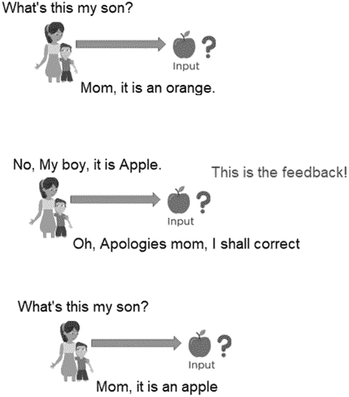

**图 4.12** 强化学习。

### 4.4.4 进化方法

此策略仍在演进中，并非易事。这类算法模仿自然进化来解决特定问题。例如，可以采用遗传算法来解决问题。这超出了本书的范围，因此暂时忽略。

## 4.5 那么，我们为什么需要机器学习？

这是一个非常好的问题，问得正是时候。到目前为止，很明显我们使用自己的经验来学习事物。举个简单的例子，回到童年。是的，童年是充满经历的宝库，对吧？那为什么不举另一个例子呢？！

你还记得第一次在厨房里手被热容器烫伤的时候吗？除非那是一次大事故，否则通常没人甚至记得那个瞬间？然而，现在你长大了，你还需要别人的帮助来判断一个容器是否很热，不应该触摸它吗？在这里，你可以理解经验学习。也许，当你还是个孩子时，你会碰到一个热锅，瞬间就会有反应。那种反馈留在你的集体记忆中，每当你看到一个锅时，你就会采取预防措施来判断它是否热。

是的，我们人类有智慧做所有这些事情。但我们不可能无处不在，也不能总是做这类事情。但我们有智慧编程机器来服从我们的命令。这正是我们在机器学习中试图做的事情。那我们为什么要做所有这些事情呢？原因是为了让我们的生活更轻松。如果我们能为机器构建一个交互式和自适应学习算法，并且如果我们能按我们需要实现目标的方式训练机器，那就再好不过了。然而，一切都有其自身的缺陷随之而来。作为人类，首先，我们应该知道机器的使用限度以及程度。任何事物都可能被训练用于负面意图。

在人类无法达到准确性的地方，是的，机器可以做到。因此，利用人类智慧让机器工作是一个好策略。正如前面提到的，带有机器学习算法的机器不需要明确的人为干预，而且机器总能适应环境，从反馈中学习并避免重复错误。

## 4.6 机器学习框架

机器学习框架有各种步骤，使用数学、工具和技术。第一步全部关于从替代的相关来源收集数据。一切都始于数据，因为数据充当整个过程的燃料。下一步基本上是数据清洗或广泛的探索性数据分析步骤，在此我们需要尽可能地清理和理解数据，因为这将有助于后续过程更顺畅、更轻松且更具推断性。构建合适的模型是过程中的下一步。需要进行训练和测试。最重要的一步是从结果中理解模式并做出正确的推断以改善整个过程本身。可视化技术可以提供很大帮助，以识别结果中隐藏的信息金 nuggets。这结束了机器学习框架的流程。然而，正如一幅画胜过千言万语，让我们将整个流程以简单的图表表示形式描绘出来（图 4.13）。

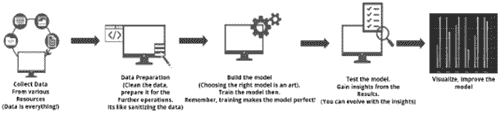

**图 4.13** 机器学习框架。

## 4.7 机器学习 *vs* 深度学习

我们一直在谈论机器学习算法、其类型、框架等。现在，是时候深入一点，了解机器学习和深度学习算法之间的主要差异。它们流程差异的最佳理解可从图 4.14 中获得。

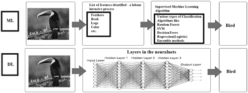

**图 4.14** ML 与 DL 流程差异。

## 4.8 机器学习的常见应用

你生活中已经体验过的一些常见机器学习应用包括：

*   FB（Facebook）为你推荐朋友。
*   Amazon 为你推荐产品。
*   Flipkart 为你推荐产品。
*   Netflix 推荐

## 4.9 资源

Netflix 根据你的口味，但基于机器学习，为你推荐最佳电视剧。 所以，重点很简单。 有了机器学习，公司可以识别更多获得良好利润的机会。 场景：你正在浏览关于泰国假期的信息。 你尚未预订任何机票，甚至连行程都未确认。 登录 Facebook 账号后，你会收到与泰国假期相关的帖子。 这就是机器学习的作用！ 它有助于为订阅公司寻找新的业务渠道并提高利润，而且完全无需错误或人工干预。 无需操作员将泰国假期的广告链接到你的 Facebook 页面。

机器学习的主要应用还包括：
*   *农业领域*：识别作物病害。
*   *能源领域*：预测未来两个月某个地区的能源消耗。
*   *教育领域*：预测完成课程的学生人数以及市场上的就业岗位。
*   *政府部门*：使用许多与机器学习相关的应用，例如从个人捕获的图像中自动识别唯一标识符，用于人脸识别目的。
*   *其他领域*：金融、媒体、零售、智能家居和电信等领域是我们经常采用机器学习概念的一些其他领域。

好吧，这是一个引人入胜的章节，对吧？！ 让我们继续深入探索 Pandas、数据框以及用于可视化的库。 下一章在等着你！

## 资源
*   Vasudevan, S.K., Pulari, S.R., & Vasudevan, S. (2021). 深度学习：全面指南 (第 1 版). Chapman and Hall/CRC Press. [`doi.org/10.1201/9781003185635`](https://doi.org/10.1201/9781003185635)
*   Murphy, K. P. (2012). 机器学习：概率视角. Cambridge, MA, MIT Press.
*   [`www.youtube.com/playlist?list=PL3uLubnzL2Tl-7fugIeCk4-l4HVVdn5\_v`](https://www.youtube.com/playlist?list=PL3uLubnzL2Tl-7fugIeCk4-l4HVVdn5\_v)

## 4.9 需要记住的关键点
1.  机器学习是人工智能的一个分支，可以帮助机器通过模仿智能人类行为来学习和行动。
2.  人工智能是一个更广泛的总称，机器学习和深度学习都属于这一范畴。它们彼此相关。
3.  机器学习算法可分为监督学习、无监督学习和强化学习。进化学习算法使用遗传算法。
4.  监督学习算法使用标记数据集。它们有一个用于建模的训练阶段和一个用于预测或分类数据的测试阶段。它们用于处理分类问题。
5.  无监督学习算法不使用标记数据；它们将数据分类为组或簇。它们是聚类算法。
6.  强化学习从环境中接收反馈，使用计算机智能体和动作，以最佳利用参数获得最佳奖励。
7.  机器学习可以执行自适应学习，以提高过程的准确性，接受反馈使过程不易出错，并将其用于重复性任务。
8.  机器学习框架主要包括以下步骤：数据收集、数据分析、模型构建、模型测试、可视化及结果解释。
9.  机器学习使用机器学习算法来预测或分类数据，而深度学习（DL）使用神经网络及其隐藏层来提供输出，这使得理解和推断变得有点困难。
10.  机器学习在零售、农业、金融、医疗保健、教育、能源、政府等各个领域都有许多应用，除 Facebook 为你推荐朋友、Amazon 和 Flipkart 为你推荐产品、Netflix 为你推荐电影等之外。

## 测验问题（自己作答吧，朋友们！）
1.  机器学习是什么？
2.  人工智能、机器学习和深度学习之间有何关系？
3.  列出机器学习算法的类型
4.  什么是监督学习？你能举例说明吗？
5.  什么是无监督学习？你能举例说明吗？
6.  什么是强化学习？你能举例说明吗？
7.  为什么需要机器学习？
8.  你能详细说明机器学习框架吗？
9.  列举一些机器学习应用。
10.  描述机器学习和深度学习过程之间的差异。

# 5 工具和先决条件

DOI: [10.1201/9781003393122-5](https://doi.org/10.1201/9781003393122-5)

## 学习目标

阅读本章后，读者应能够理解以下内容：
*   Pandas 的基础知识。
*   数据框及操作。
*   可视化工具和选项。

## 5.1 引言

本章将探讨 Pandas、数据框以及用于输出可视化的库。 选择 Python 有很多原因：两个很好的原因是“资源可用性”和“社区连接”。 读者将通过相关示例以及同时呈现的结果来学习理解概念。

## 5.2 本章使用什么？

本章将向读者介绍以下工具集。它们易于使用且肯定有趣可学。
*   `Jupyter Notebooks`: 这是目前用于交互式编程和输出可视化的最常见工具之一，易于使用和学习。现已集成到 Intel DevCloud 中，我们已在 第 3 章 详细讨论过。读者如有需要可重温本章。
*   `NumPy, Pandas`: 这些是充分利用所进行数值计算的关键。
*   `Matplotlib, Seaborn`: 当谈到输出可视化时，最简单且最有效的方法是使用 Matplotlib/Seaborn。两者都非常知名，并在全球数据科学家中广泛使用。

本章将通过示例和练习阐明所有这些内容。敬请关注。现在是时候实践了。

## 5.3 让我们学习 Pandas

好吧，Pandas 很棒。它快速、强大且灵活。 它非常容易学习和使用。 它是一个基于 Python 构建的开源数据处理和分析工具。 实际上，Pandas 包含大量极其有用的功能。 即使处理复杂数据，选择 Pandas 也显得更容易。 最重要的是，访问统计函数、可视化等始终变得容易得多。 这很有趣，本节将使读者能够理解 Pandas。 可以访问官方 Pandas 网站 @ [`pandas.pydata.org/`](https://pandas.pydata.org)

请记住这一点。

Pandas 实际上是 Panel Datasets 的缩写。数据始终以具有行和列的表格格式引用。

### 5.3.1 让我们安装

很简单。你需要已安装 Python（最新版本）和 Anaconda。这会让生活更轻松。 按照下面介绍的步骤操作，将有助于轻松安装 Pandas。

转到 Anaconda Prompt（必须理解 Anaconda Prompt 与命令提示符不同）。 可以参考下面 图 5.1 中展示的屏幕截图，其中显示了 Anaconda Prompt。 如果你使用的是 Intel DevCloud，可以直接通过 DevCloud 使用 Jupyter Notebook 安装。

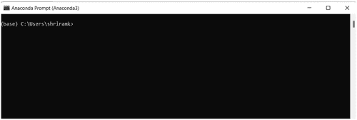

**图 5.1** Anaconda 提示符。

可以通过 Anaconda Prompt 使用命令 Jupyter Lab 启动 Jupyter Notebook。 可以参考 图 5.2 来了解此步骤，这将使你能够启动 Python Notebook。 就这样。你将获得笔记本以输入代码，如 图 5.3 所示。

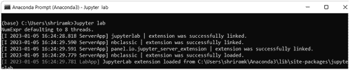

**图 5.2** 启动 Jupyter Lab。

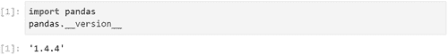

**图 5.3** 笔记本。

如图所示 图 5.3，只需使用命令 `import pandas` 即可为你获取 Pandas。你可以使用 `pandas.__version__` 命令来验证相同的内容。同样可以在 图 5.3 中看到。

很容易！

现在正式学习开始了。这里应该理解基本要点。就 Pandas 而言，最常见也是最基本的数据结构是 `Series`。它是表格格式数据的构建基块。

### 5.3.2 什么是数据框？

我们需要结构化数据来进行所有数据分析。我们熟悉 SQL（结构化查询语言），对吧？它全部都是关于行和列，让生活更轻松。

对于使用 Python 的数据科学和机器学习，我们有类似的东西叫做数据框（数据集需要转换为数据框以便更轻松地访问和处理）。在这里，数据被可视化为表格，使得解释变得更加容易。

Pandas 库将帮助创建数据框，所以让我们学习一下。

应该记住数据框是一个 2D 数据结构。我们能否举一个例子来增强理解？下面的第一个数据框将会肯定增强读者对数据框的理解。我们将在本章后面使用数据框，这里只是提前告知信息。

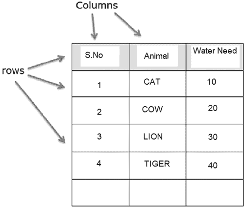

**图 5.4** 一个示例数据框（内部包含异构数据）。

记住：

* 我们将在许多机器学习/深度学习项目中遇到 CSV 文件。CSV 文件是逗号分隔值（CSV）文件，是一种纯文本文件，通过用逗号分隔数据项来存储数据。

### 5.3.3 Pandas 系列创建与索引

我们将首先创建 Pandas 系列。它非常简单，我们需要为此准备数据。我们使用公寓的水耗作为数据，并将围绕这些数据构建 Pandas 系列。第一步是导入 Pandas，通常会导入为 `pd`。接下来，应该创建一个数组。然后，使用构造函数 `pd.Series` 来创建系列。代码片段和输出以 图 5.5 呈现，这将有助于读者更好地理解场景。

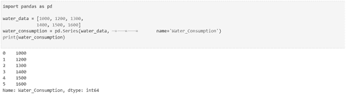

**图 5.5** 第一个 Pandas 系列。

现在，`water_consumption` 是一个 Pandas 系列。很简单，对吧？也可以注意到它被正确索引了。通过这个简单的步骤，给定数据已被分配了适当的索引。

我们编写的是一段简单的代码。拥有索引是好的，但最好将相应的日期放在索引位置。简单的 `pd.date_range` 例程将有助于完成任务。我们有六个数据条目，因此通过此步骤将创建六个连续日期。应该记住系列是在上一步中创建的，其名称为 `water_consumption`。我们的系列现在被不同地索引了。

另外，请注意系列的值保持不变。索引被重新分配为日期，这从结果中清晰可见。

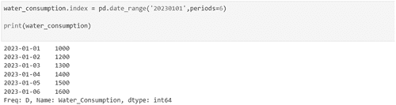

**图 5.6** 将日期范围添加到系列。

### 5.3.4 使用 Series 进行操作 – 很有趣

可以通过索引从系列中检索值。这很容易，类似于使用字典。可以查看 图 5.7 中呈现的代码片段以理解相同内容。

**图 5.7** 按索引值选择数据。

下一步是尝试使用索引位置，就像数组一样。这也是可能的。字典不支持此功能。相同内容在 图 5.8 中揭示。

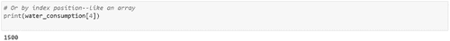

**图 5.8** 按索引位置选择数据。

切片也完全可行。这里有一个例子，以 图 5.9, 呈现，这将帮助你更好地理解切片。整个一月份的数据将被检索并呈现。

**图 5.9** 按切片选择数据。

系列非常多才多艺且灵活。它可以存储整数、浮点数或字符串。可以使用 图 5.10 中显示的代码片段轻松查看其存储的数据类型。可以看到数据类型是整数。

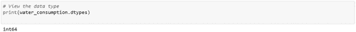

**图 5.10** 查找数据类型。

你也可以轻松转换数据类型。可以参考 图 5.11 中呈现的代码。下面呈现了将现有数据类型转换为浮点数的转换。这就是用户获得的灵活性。`astype` 是一个系列方法，可以转换数据类型。

**图 5.11** 数据类型转换。

处理缺失数据是数据处理中的一项重要任务。数据插补是专家在处理缺失数据时遵循的最简单方法。插补是用替代值替换缺失数据的过程，同样在 图 5.12 中呈现。此外，读者可以看到代码中使用了 `NaN`（非数字）。这是 Numpy 表示数据缺失的方式。`Series.fillna` 是一个用于用给定值填充缺失值的方法。可以观察到无效数据首先被创建，然后被零替换。

**图 5.12** 插补。

现在要接触数据框，系列就全部完成了。如前所述，它本质上是二维的，是系列的集合。记住这一点——数据框是系列的集合。`Series` 是一维的，而数据框是二维的。你可以参考图 5.1 来理解数据框的样子。简单来说，它是一个数据表。让我们学习数据框。

首先，让我们创建一个数据集。数据集为 .CSV 格式。CSV 文件（`data.csv`），其中包含示例数据，下面呈现以便快速浏览。这就是数据集。图 5.13 有数据，可以查看相同内容。

**图 5.13** 数据集（data.csv）。

我们是否可以从数据集中创建数据框？图 5.14 有截图，显示了创建数据框的方法。包含数据的 file 命名为 `data.csv`，下面使用它来创建数据框。

**图 5.14** 数据框的创建。

是时候了解数据框如何可视化了。数据框的前几条条目都将通过下面的代码片段显示。`df.head(5)` 将显示数据框中的前五个条目。

**图 5.15** 头部 – 显示前几条条目

获取数据框的快速摘要很简单。列表将帮助我们获取摘要，如 图 5.16 所呈现。

**图 5.16** 获取摘要的列表。

转置操作可以用 `transpose()` 操作轻松完成。可以看到转置操作是通过将列转置为行、行转置为列来完成的，这在 图 5.17 中下面呈现。可以从 图 5.13 查看转置前的原始数据。

**图 5.17** 转置操作。

可以很容易地通过下面的代码片段找到数据框的维度。

**图 5.18** 数据框的维度。

切片选项也很有趣。用数据框进行切片很容易。可以看到数据框中切片是如何轻松实现的，如图 5.19 所示。它切片了前三个条目，我们收到了输出。

**图 5.19** 切片。

也可以按相反顺序切片，这在图 5.20 中进行了演示，以便更快地参考。

**图 5.20** 反向切片。

可以通过 `Pandas` 轻松获得数据框中每个数据条目的出现次数。方法 `value_counts()` 有助于完成此任务。可以从图 5.21 看到其实现方式。

**图 5.21** 计数出现次数。

为了过滤并获得结果，`Pandas` 提供了更简单的方法。可以看到基于 `water_need` 大于 10 过滤后的结果，如图 5.22 所示。

**图 5.22** 过滤。

如果有人想从数据框中删除列或行，也很容易。

最初，数据框有四列。要删除特定列，应将要删除的列名与 `axis` 描述为 1 一起包含，如下面代码片段所示，该片段以图 5.23 呈现。呈现的输出中不包含列 `ID`。

**图 5.23** 从数据框中删除列。

同样，也可以删除特定行；为此，`axis` 应描述为 0 并提及行索引。下面的代码片段（图 5.24）和获得的结果将帮助读者理解这一点。这里可以注意到第 2 行（`Lion`）被删除了。

**图 5.24** 从数据框中删除行。

关于数据框就足够了——是时候学习可视化了。是的，这很重要。

## 5.4 让我们可视化

没有理解的数据或结果不会提供任何有用的见解。适当的视觉化将使用户获得有用的见解。“图像胜于言表”是一句谚语，在数据分析中它 100% 成立！

这是学习的令人兴奋的部分。输出可视化可以通过多种方式创建，例如 `matplotlib` 和 `seaborn`。

*   `Matplotlib` 是用于创建绘图和图形的主要库之一。它有很多功能。`Matplotlib` 是一个用于在 Python 中创建静态、动画和交互式可视化的综合库。由于 `Pandas` 提供了围绕 `matplotlib` API 的非常易于使用和方便的包装，因此更易于为某人创建绘图。

*   `Seaborn` 是一个基于 `matplotlib` 的 Python 数据可视化库。它提供了一个高级接口来绘制有吸引力且信息丰富的统计图形。

第一步是什么？嗯，就是导入，可以通过图 5.25 所示的代码片段了解我们如何导入 `matplotlib` 和 `seaborn`。

**图 5.25** 导入 `matplotlib` 和 `seaborn`。注意：`seaborn` 现在是 "`sea`"，`matplotlib` 对读者来说是 "`plot`"。

本章之前显示的同一动物数据集进一步增强为更大的数据集。可以参考图 5.13 来可视化早期版本，并参考图 5.26 来了解增强内容。

**图 5.26** 扩展数据集。

1.  a. *柱状图 – 从这里开始*：柱状图是用矩形条表示分类数据的图形，其高度或长度与所代表的值成比例。

    条形图可以垂直或水平绘制。我们现在可以通过简单的代码片段呈现柱状图吗？可以清楚地看到针对所考虑数据集的柱状图绘制。`sea.barplot` 方法足以获得清晰的可视化。

    也可以使用 Hue 来完成。可以在图 5.28 中可视化相同内容。

2.  b. *直方图*：直方图是使用不同高度的条形显示数据的图形显示。它类似于柱状图，但直方图将数字分组为范围。可以从代码片段和图 5.29 所示的输出中了解如何获取直方图以及绘图的样子。

    作为扩展，可以使用箱获取直方图。直方图中的箱是你在获得频率之前用来组合值的块（或分组）。例如，如果你正在创建年龄的直方图，箱可能是 0–5、6–10、11–15，等等，直到 85 等等。可以参考图 5.30 以更好地理解概念。

3.  c. *密度图*：密度图可视化数据在连续区间或时间段上的分布。该图表是直方图的变体，通过平滑噪声获得更平滑的分布。密度图的峰值有助于显示区间上集中的值。代码片段和由此开发的密度图以图 5.31 呈现，供读者快速浏览。

4.  d. *箱线图*：箱线图是给定数据集的统计五数概括的视觉表示。五数概括包括：# 最小值，第一四分位数，中位数（第二四分位数），第三四分位数，最大值。可以从图 5.32 看到它是什么样子，其中也呈现了代码片段。

5.  e. *散点图*：这有助于通过绘图揭示两个变量之间的关系。`import matplotlib.pyplot as plot`。我们可以看代码吗？（参考图 5.33）。

6.  f. 配对图：当你需要比较许多变量时，配对图是最好的选择。可以看到编码多么简单以及获得良好的结果（图 5.34）。

7.  g. *热力图*：热力图是我们需要理解和可视化的最终绘图。它简单而高效。可以参考图 5.35。

**图 5.27** 柱状图。

**图 5.28** 带 Hue 的柱状图。

**图 5.29** 直方图。

**图 5.30** 带分箱的直方图。

**图 5.31** 密度图。

**图 5.32** 箱线图。

**图 5.33** 散点图。

**图 5.34** 配对图。

**图 5.35** 热力图。

就这样！大量的绘图相关信息已提供给读者。是时候让读者开始练习了。准备好，开始，`Pandas`！

我们希望读者喜欢学习本章的内容。监督学习在下一章等待着你。让我们继续吧！

## 资源

*   [`youtu.be/bzaO9SFHJSA`](https://youtu.be)
*   [`youtu.be/VnkfaI9tG4M`](https://youtu.be)
*   [`youtu.be/xXOPfrba8I0`](https://youtu.be)
*   [`pandas.pydata.org/`](https://pandas.pydata.org)
*   [`seaborn.pydata.org/`](https://seaborn.pydata.org)
*   [`matplotlib.org/`](https://matplotlib.org)

## 5.5 需要记住的关键点

*   今天用于交互式编程和输出可视化的最常见工具之一是 `Jupyter Notebook`。
*   `NumPy` 和 `Pandas` 是读者获得最佳数值计算的关键。
*   可视化最简单且最有效的方法是使用 `Matplotlib`/`Seaborn`。
*   `Pandas` 同样快速、强大且灵活。它非常容易学习和使用。它是构建在 `python` 之上的开源数据处理和分析工具。
*   `Pandas` 是 Panel Datasets 的缩写。数据始终以具有行和列的表格格式引用。
*   使用 `Pandas` 系列的操作非常简单且有趣。
*   处理缺失数据是数据处理中的一项重要任务。数据插补是专家处理缺失数据所遵循的最简单方法。插补是用替代值替换缺失数据的过程。
*   数据可视化是数据分析的重要方面。`Matplotlib` 和 `Seaborn` 为您提供更好的可视化体验支持。

# 6 监督学习

DOI: [10.1201/9781003393122-6](https://doi.org/10.1201/9781003393122-6)

## 学习目标

阅读本章后，读者应能够理解以下内容：

*   什么是监督学习？
*   监督学习算法的类型。
*   什么是回归？
*   回归有什么用？
*   回归的步骤。
*   回归的实现。
*   逻辑回归。
*   线性 *vs* 逻辑回归。
*   什么是分类？
*   K 最近邻（`KNN`）——步骤。
*   `KNN` 的实现。
*   损失和成本函数、偏差与方差权衡、正则化、特征选择、超参数调优。

## 6.1 引言

所以，我们又回到了原点，关于监督学习的概念。如果有人跳过了 第 4 章，我们强烈建议您花时间浏览监督学习的实时示例，然后再进入本章。

监督学习算法使用数据集，使用训练数据集构建模型，并使用测试数据集验证模型并预测或分类结果。可以计算模型的准确性，以便我们对用于预测或分类目的的模型有良好的理解。如果需要，我们还可以提供反馈以改进流程。

## 6.2 监督学习算法的类型

监督学习算法主要分为回归算法和分类算法（图 6.1）。电子邮件垃圾邮件分类器是分类算法的一个例子。

**图 6.1** 监督学习算法的类型。

### 6.2.1 分类

监督学习，如您现在所知，在我们的日常生活中经常被使用。会有人一天不开一次 Gmail 收件箱吗？甚至我们的孩子也需要 Gmail 访问权限来访问 Google Classroom。Gmail 收件箱充斥着广告和垃圾邮件。是的，我要说的是这个垃圾邮件分类器（图 6.2）。如果 Gmail 没有提供这种垃圾邮件分类，我甚至无法想象我需要手动分类多少封电子邮件。因此，当我们环顾四周时，我们有意识或无意识地使用监督学习算法。

**图 6.2** 垃圾邮件分类器。

本章的主要目的是向您介绍各种监督学习算法。我们主要关注回归和分类。本章并不全面，因为这些是非常大的主题，正在进行大量研究。然而，我们将努力让您理解如何实现简单的线性回归和简单的 `KNN` 分类算法。只有当我们亲自动手时，我们才会学到更多！不是吗？是的，来吧，让我们一起深入学习。

假设你一直注意到父母如何忙于维持生计并遵循社会设定的传统梦想（至少有一些父母）。他们可能总是忙于赚取你的学费，而所有父母的最终目标都是拥有一套房子。你可能注意到在某个阶段，当他们决定买房时，他们会联系所有经纪人，直接去房屋/土地现场并向邻居询问，以便为他们梦想的房子所在的地块支付最佳价格。有时，如果父母忙碌，他们最终会决定购买现成的房子。然而，如果由我们决定，房价预测对父母来说将是极大的帮助。这实际上是回归的一个例子，我们处理的是连续的目标变量。

### 6.2.2 回归

回归算法主要处理预测性应用，如股市预测、员工薪资预测、房价预测等。如果你仔细观察，你会发现有一个目标变量与几个自变量相关。换句话说，回归算法帮助我们找到因变量（目标变量）与多个自变量（预测因子）之间的关系。

现在为了让你理解回归分析如何成为监督学习的一部分，请记住回归分析始于目标属性已知或标记的数据集。因此，监督学习基于标记数据。

为了明确说明，假设数据集的变量完全是数值型的且目标变量是数值型的，那么回归分析将预测一个数字。例如，如果我们有某个时期房屋的观察数据，回归模型可以预测房价。房屋变量可能包括房屋面积（平方米）、卧室数量、浴室数量、车库空间、楼层数、建筑材料、靠近学校、商店、设施等资源等，这些都是独立预测因子。回归模型基于房价与这些预测因子组合之间的线性关系预测目标变量——房价。

## 6.3 回归有用的应用？

### 6.3.1 趋势分析

回归主要在趋势分析等应用领域有用。你用过 Google Trends 吗？如果没有，这绝对是值得尝试的。Google Trends 提供了最受欢迎的搜索查询趋势，主要由预测者和学者用于基于预测的分析。Google Trends 使用的主要数据是人们在 Google 搜索引擎中进行的每日搜索。主要优点是它可以定位异常值或不规则的垃圾搜索活动。Google Trends 分析通过回归建模进行，同时搜索连接点。

在最近结束的 2022 年国际足联男子世界杯赛事期间，你可以想象“世界杯”一词的搜索趋势；这基本上是通过回归分析实现的，使用下面列出的一种技术（图 6.3）。

**图 6.3** 搜索查询“World Cup”的 Google 趋势（按天和按地区分析结果）。

### 6.3.2 时间序列预测
时间序列是通过重复测量在一段时间内收集的数据值或观测值的集合。时间序列预测或预测在预测未来值方面广泛使用回归分析。经济和销售预测、预算分析、股票市场分析、产量预测、过程和质量控制、库存研究、温度预测等，都是可通过使用回归分析完成的时序预测示例（图 6.4）。

**图 6.4** 显示股票趋势的时间序列图。

### 6.3.3 生物医学成像
回归技术在医学成像和放射学研究领域中通常很有用。它们允许识别用于确定目标变量的各种独立参数之间的关系。多元回归分析基本上用于根据电子格式可用的数据预测疾病进展。通常，回归分析广泛用于评估从视觉分级实验中收集的结果，例如放射学研究中的医学图像（图 6.5）。

**图 6.5** 使用回归分析的医学成像。

## 6.4 回归类型
现在我们已经了解了回归及其最常见的应用，剩下的主要工作是了解回归过程中涉及的各个步骤。是的，这是一个良好的开端。然而，重要的是要知道还有不同类型的回归。哦我的天，你在开玩笑吗？！一点也不。发现回归分析的大脑们提出了各种类型的回归。让我们现在快速了解一下这些类型。别担心，我们会保持简单易懂。

*   *线性回归*（一种预测技术，但不是分类；分类用于分类变量，而线性回归使用的是连续型数值变量）。
*   *逻辑回归*（一种分类技术，因为它用于分类变量，而分类变量是离散的、不连续的类型）。
*   哦，这还挺简单的！对吧？
*   好吧，无论如何，让我们深入探讨线性回归所涉及的步骤。

### 6.4.1 线性回归及涉及的步骤
简单线性回归是一种用于寻找一个因变量与一个或多个自变量之间关系的简单技术。也就是说，简单地说，回归分析试图在输入和输出之间建立明确的关系。

线性回归是用于在数据点中寻找最佳拟合线的技术。最佳拟合线是使误差最小化的线。为了明确，在这种情况下，误差是实际数据与预测数据之间的差异，以便回归预测的数据与实际数据之间的距离尽可能小。

既然如此，用更数学的方式表示该情况，公式为 `Y = a X + b`，这是一个简单的线性方程。在这个方程中，`Y` 是因变量，`X` 是具有单一预测因子的自变量。这里，`a` 是线的斜率或回归系数，`b` 是截距。回归是一种统计工具，可借助一个或多个自变量（多个预测因子）预测因变量。

`b = ȳ − a x̄`, 其中 `b` 是截距

|   a \=   ∑ (  x i  −  x ¯  )(  y i  −  y ¯  )   ∑   (  x i  −  x ¯  )  2    , 其中 a 是斜率   ||  |
| --- | --- |

让我们举一个非常熟悉的例子来理解这一点。我们都可能经历过在考试前一天学习，第二天通过考试的情况。如果你没有在学生时代经历过这一点，我们可以说你在生活中错过了一些主要就业技能的训练 。

问题很简单：根据学习花费的小时数预测学生是否会通过考试。

在这里，线性回归线在自变量和因变量之间建立了关系（图 6.6）。

**图 6.6** 线性回归线。

#### 情况 1 – 正相关
当自变量发生变化时情况会怎样？当自变量增加时，如果因变量也增加，我们称这种关系（因此回归）为正相关（图 6.7 和 图 6.8）。

**图 6.7** 一个正相关。

**图 6.8** 一个正线性回归。

看下面的图片：

这里存在正相关关系。

*   `x` = 学习花费的小时数
*   `y` = 通过了测试。

如果 `y` 随着 `x` 的增加而正向增加，则称为正相关关系。在这种情况下，学习小时数增加，从而增加了通过考试的概率。

下一个要学习的回归是负相关关系。可以查看 图 6.9 来了解负相关关系是什么。

**图 6.9** 一个负线性回归。

#### 情况 2 – 负相关
当自变量增加而因变量减少时，我们称之为负相关关系。

`x` = 花在看电视上的小时数。

`y` = `CGPA` 的下降（累计绩点平均值 - 对于学校和学院，`CGPA` 用于通过授予相关成绩来衡量学生的整体学业成就）

如果 `y` 随着 `x` 的增加而减少，则称为负相关关系。在这种情况下，随着看电视的小时数增加，`CGPA` 会下降。也可以查看 图 6.10。

**图 6.10** 一个负线性关系。

在简单线性回归中，人们的目标是通过 `x`、`y` 数据点绘制一条直线。（回归仍可用于分析非线性关系，尽管本书不会涵盖这一点。）我们将每个 `x`、`y` 观测值对绘制为点。然后必须绘制一条尽可能紧密地拟合所有不同点的直线（即误差最小），它被称为回归线。这是用最小二乘法绘制的。核心目标是通过绘制回归线来最小化误差。回归线在 图 6.11 中呈现，现在可以清楚地理解其目的。

**图 6.11** 回归线。

还可以观看 YouTube 链接中提供的视频讲座，该讲座讲述了线性回归：`https://youtu.be/MdHe7Sn6Qt4`

要了解误差是什么，可以查看 图 6.12。

**图 6.12** 误差。

回归的总体目标是将误差降至尽可能低。现在是时候进行一些数学推导了。读者应该已经熟悉这些基础数学术语，如果是这样，对这些读者来说就是复习。否则，重要的是要关注接下来的几个部分，其中全部都是相当基础的数学。

在进入下面给出的表达式之前，应参考图 6.13。

**图 6.13** 数学联系 – 正向影响。

应回忆一下在学校时期学过的用 `Y = M X + C` 表达式来描述直线的知识。这里会派上用场。

| `Y = b0 + b1 * x` || |
| --- | --- |
* `Y` = 估计薪资
* `x` = 工作小时数
* `b0` = y 截距
* `b1` = 直线的斜率 – 这里存在正相关，因此方程包含“+`b1`”

随着工作小时数的增加，薪资应该增加。因此存在正相关关系。

* `x` 是可以单独控制的自变量。
* `y` 是因变量，是结果。薪资取决于工作小时数。（该变量完全依赖）

| `Y = b0 - b1 * x` || |
| --- | --- |
* `Y` = CGPA
* `x` = 看电视的小时数
* `b0` = y 截距
* `b1` = 直线的斜率。存在负向影响，因此为“−`b1`”

随着看电视小时数的增加，CGPA 分数会下降。因此存在负相关关系（参见图 6.14）。

**图 6.14** 数学联系 – 负向影响

* `x` 是自变量。`Y` 是因变量，是结果。

下一步是了解如何使用最小二乘法计算线性回归。这是线性回归计算/绘图最常用的方法之一。

第一步是创建一个简单的数据集。整个过程逐步呈现：

*步骤 1：* `x` 是输入，`y` 是输出。`x` 可称为自变量，`y` 为因变量（参见表 6.1）。对于每个 `x` 值，都有一个对应的 `y` 值。收集 `x`/`y` 值对。

**表 6.1** 数据点

| `x` || `y` |
| --- | --- |
| 1 || 2 |
| --- | --- |
| 2 || 4 |
| 3 || 6 |
| 4 || 3 |
| 5 || 5 |

下一步是计算平均 `x` 和平均 `y`。

平均 `x` = (1 + 2 + 3 + 4 + 5) / 5 = 3.

平均 `y` = (2 + 4 + 6 + 3 + 5)/ 5 = 4.

因此，我们已经计算出平均 `x` 和平均 `y` 值。是时候让读者进入序列中的下一步了。我们能否通过绘制自变量的五个值与对应的因变量的五个值来绘制关系图（图 6.15）。

**图 6.15** `x vs y` 的关系图。

可以查看图 6.16 来了解绘图是如何进行的。

**图 6.16** 平均 `x` 和平均 `y` 绘图。

下一步是计算绘制的斜率和 y 截距（直线上 y 轴的截距）。应从先前展示的图 6.17 中所示的图中继续进行。

**图 6.17** `Y` 截距和斜率。

上述图表已允许以图形形式可视化数据，并且以可理解的方式可视化数据点是强制性的。现在，我们需要计算每个数据点到最佳拟合线的距离。需要计算每个 `x` 值到 `x` 均值（`x'`）的距离以及每个 `y` 值到 `y` 均值（`y'`）的距离。因此，表 6.2 将逐步增长，更易于理解。

**表 6.2** 数据点

| x || y || x - x’ || y - y’ || (x-x’)² || (x-x’) (y-y’) |
| --- | --- | --- | --- | --- | --- |
| 1 || 2 || 1 – 3 = – 2 || 2 – 4 = – 2 || 4 || – 2 × – 2 = 4 |
| --- | --- | --- | --- | --- | --- |
| 2 || 4 || 2 – 3 = – 1 || 4 – 4 = 0 || 1 || – 1 × 0 = 0 |
| 3 || 6 || 3 – 3 = 0 || 6 – 4 = 2 || 0 || 0 × 2 = 0 |
| 4 || 3 || 4 – 3 = 1 || 3 – 4 = – 1 || 1 || 1 × – 1 = – 1 |
| 5 || 5 || 5 – 3 = 2 || 5 – 4 = 1 || 4 || 1 × 2 = 2 |
|   ||   ||   ||   || 10 || 5 |

现在计算已完成，表 6.2 包含所需信息，很容易继续使用公式完成过程。构造表格时有一些很酷的技巧需要遵循。`x-x'` 和 `y-y'` 的总和应始终为 0；如果不是零，则计算有误。

`y' = b0 + b1 * x'`

`b1 = 5 / 10 = 0.5`

上述是通过以下表达式推导得出的：

`b1 = Σ [(x – x’) (y – y’)] / Σ(x – x²)`

其中 Σ=求和。

我们已进入计算的最后阶段。

`y' = b0 + b1. x'`

（`x'` 和 `y'` 分别是平均 `x` 和平均 `y`）

* `4 = b0 + b1*3`
* `4 = b0 + 0.5 * 3`
* `4 = b0 + 1.5`
* `4 – 1.5 = b0 + 1.5 – 1.5`
* `b0 = 2.5`
* `b1 = slope = 0.5`
* `b0 = y intercept = 2.5`

因此，你现在已经计算出如何绘制直线回归线（“最佳拟合线”），该线将通过 `x'`/`y'` 和 `x=0`/`y=2.5`（当 `x=0` 时，y 轴上的截距为 2.5）。

现在是时候学习逻辑回归到底是什么了。逻辑回归和线性回归的术语非常重要，它们是机器学习中最常讨论的话题之一。

### 6.4.2 逻辑回归 – 初探

逻辑回归是一种数学模型，根据 `x` 的信息，即先前事件，预测 `y` 发生的概率。给定 `x`，逻辑回归预测 `y` 是否会发生。逻辑回归是一个二元事件，这意味着 `y` 可以是 0 或 1。如果事件发生，`y` 取值为 1；而如果事件未发生，`y` 取值为 0。

逻辑回归主要用于分类应用，如垃圾邮件检测、基于各种特征对个人进行糖尿病/癌症检测等。另一个流行的应用是客户选择预测——即客户是否会点击某个特定链接。客户是否会购买产品？

### 6.4.3 线性回归与逻辑回归的比较

线性回归给出连续变量输出，但逻辑回归提供离散变量输出。线性回归说明直线关系，而逻辑回归处理遵循 S 形函数的关系。

简要来说：

* 线性回归是建模因变量与自变量之间线性关系的方法。
* 逻辑回归更具统计性质，其中模型预测的结果可能是两个值之一。

通过代码学习或实现逻辑回归和线性回归超出了本书的范围。但作者为希望探索实现方面的读者提供了清晰的视频讲座。

线性回归实现：[`youtu.be/i6G94Me9LN0`](https://youtu.be)

逻辑回归实现：[`youtu.be/snr1q\_iq-bE`](https://youtu.be)

是时候了解分类到底是什么了。

### 6.4.4 线性回归的实现

如前所述，线性回归是最重要且最知名的算法之一。本章前面已解释了线性回归背后的理论，现在是读者了解其如何实现的时候了。

## 线性回归实现

### 第 1 步
进行必要的导入很重要。代码已在 [`github.com/shriramkv/MachineLearningwithoneAPI`](https://github.com) 中提供以便快速参考。必要的导入需从下面的代码进行。

### 第 2 步
下一步是确保使用 Intel 优化的 `sklearn`，为此使用下面的代码片段中的 `patch_sklearn`。为了突出 Intel 优化的 `sklearn` 如何用于构建线性回归模型，特别强调这一点。还可以通过执行下面代码片段后获得的消息确认是否正在使用 Intel 优化的 `sklearn`。

### 第 3 步
随后必须进行展平。之后必须进行训练数据集和测试数据集的划分。拆分比例完全由开发者决定。归一化输入值很重要，下面的代码片段中也展示了这一点。

### 第 4 步
接下来需要创建线性回归器。一旦模型准备就绪，将模型保存到文件中很重要。

### 第 5 步
好了，现在是运行模型的时候了。可以在执行时看到模型所需的运行时间被打印出来。

## 6.5 分类 – 必知概念

通常会出现的第一个问题是：回归和分类有什么区别？我们先让读者理解这一点。

首先，回归和分类都属于监督学习算法！（是的，监督，有标签的）。这两者在机器学习中都有广泛的应用，并且都使用有标签的数据集。然后，它们有何不同？它们解决的问题不同，这就定义了它们的区别。

如前所述，回归预测连续变量，例如薪资、成绩、年龄等。分类将变量分类为男/女、通过/失败、假/真、垃圾邮件/合法等。（它进行分类，仅此而已。）分类根据所考虑的参数将给定数据集划分为类别。一个例子会非常有帮助。

Gmail 是最好的例子。Gmail 将电子邮件分类为合法邮件或垃圾邮件。该模型使用数百万封电子邮件进行训练，并考虑了许多参数。每当出现新邮件时，分类将为“收件箱、垃圾邮件、促销或更新”。如果是垃圾邮件，则进入垃圾邮件箱；如果是合法邮件，则进入收件箱。

有许多著名且经常使用的分类算法：
* 支持向量机 (`SVM`)
* K 近邻
* 核支持向量机
* 逻辑回归
* 朴素贝叶斯
* 决策树分类
* 随机森林分类

了解和学习所有这些是很有益的。但这已超出本书的范围。因此，我们选择 K 近邻 (`KNN`) 和支持向量机 (`SVM`) 进行进一步讨论。

### 6.5.1 K 近邻 (`KNN`)

`KNN` 是最简单且最常用的方法之一，像 `SVM` 一样。`KNN` 也基于监督学习算法。它基于一个非常简单的方法。基于历史预测当前案例，即当新数据用于分类时，基于过去可用的数据的相似性，新数据将被分类，即会找到最相似的类别并将新数据条目分类到该类别中。

简单来说，有了 `KNN`，新数据可以轻松地分类到最相似的类别中。

下一个问题是，我们可以在哪里使用 `KNN`？它已被用于分类和回归。但是，像 `SVM` 一样，`KNN` 在用于分类时效果更好，因此优先用于分类。

`KNN` 有两个非常重要的特征：
* 1.它被称为非参数的。
* 2.它也被称为惰性学习算法。

理解非参数的含义很重要。这意味着算法不对数据背后的特征做出任何假设。

接下来，什么是惰性学习？这种方法中不会立即发生任何事情。“惰性学习者”意味着算法在该实例中不会从训练数据集中学习任何东西。但它在分类过程中存储整个数据集，然后对数据集进行操作。这意味着没有专门的训练阶段，并在分类进行时使用所有数据进行训练。

如同往常一样，一个例子会很有用。如果有人想对水果进行分类，例如橙子，当输入发送进来时，算法会使用相似性概念。基于特征的相似性，它随后会将水果分类为橙子或非橙子。

在 `KNN` 中，请记住，`K` 是关键。数据科学家更喜欢当类别为偶数时 `K` 为奇数。`K` 可以是 1、3、5 或 7 当有两个类别时。还应注意，当 `K` = 1 时，它是最近邻算法。

现在是时候逐步介绍 `KNN` 了：
* 能否选择邻居的数量 `K`？可以，这是第一步。
* 应计算 `K` 个邻居的欧几里得距离
然后，根据计算出的欧几里得距离取 `K` 个最近邻居。
* 开始计数。在这 `K` 个邻居中，统计每个类别中的数据点数量。
* 将新数据点分配给邻居数量最多的类别。
* 模型已准备就绪。

一个例子将非常实用，使理解更容易。可以查看 图 6.18。

**图 6.18** 假设的场景。

问题陈述在 图 6.19 中以图示形式呈现，其中新数据条目需要被分类为红色星号或绿色三角形。

**图 6.19** 假设的场景 – 有新加入者。

#### 案例 1 – 当 `K` 选择为 1 时

如果 `K` 选择为 1，则任务变得更容易，这是最简单的选项。输入数据被分类为 A 类。可以从 图 6.20 轻松理解这一点。

**图 6.20** 案例 1：K = 1。

#### 案例 2 – 当 `K` 选择为 3 时

让我们在 `K` 选择为 3 时计算数据点之间的欧几里得距离。欧几里得距离是两点之间的距离（也可以通过其他方法完成；Python 有内置函数可以帮助程序员）。可以查看 图 6.21 来了解当 `K` 值选择为 3 时 `KNN` 的工作原理。

**图 6.21** 案例 2：K = 3。

#### 案例 3 – 当 `K` 选择为 7 时

这是 `K` 设置为 7 时的场景。通过参考 图 6.22 可以了解其工作原理。

**图 6.22** 案例 2：K = 7。

到现在为止，读者应该已经理解了 `KNN` 的工作原理。必须注意“应避免使用过低的 `K` 值，因为预测可能会出错。”

#### 优点
* 简单。
* 数据越多，分类越好。

#### 缺点
* 找到 `K` 的最佳值具有挑战性。

可以通过收听 [`youtu.be/nVgZbVUmh50`](https://youtu.be) 来听取作者对 `KNN` 的简要介绍。

### 6.5.2 KNN 实现

# 使用 oneAPI 实现 KNN

是时候使用 `oneAPI` 实现 `KNN` 了。读者将获得逐步的实现说明，结果将在最后讨论。

### 第 1 步
进行必要的导入非常重要。代码已在 [`github.com/shriramkv/MachineLearningwithoneAPI`](https://github.com) 中提供以供快速参考。

### 第 2 步
我们加载 `connect-4` 游戏数据集。我们根据给定数据集中进行的移动预测其中一名玩家的胜/负/平结果。我们执行多个预处理步骤并应用 `onehot` 编码。

### 第 3 步
我们将比较标准 `sklearn` 与 Intel 优化的 `sklearn` 在 `KNN` 实现中的性能。因此，如代码下方所示，采用了 `patch` 和 `unpatch` 方法。

### 第 4 步
下方将引入 Intel 优化的 `sklearn`。生成了报告，可用作比较标准 `sklearn` 和 Intel 优化的 `sklearn` 的指标。可以清楚地看到 `KNN` 被引入其中。

### 第 5 步
下面的代码片段有助于理解使用标准 `sklearn` 的性能指标。

可以看到 `scikit-learn` 的 Intel 扩展已明确启用，并在执行期间通过一条消息可见。经过时间也一并给出，同时还有 `precision`、`recall`、`F1 score` 等，均可与标准 `scikit-learn` 结果进行比较。

下面的截图展示了 `scikit-learn` 标准版本的结果。可以看到，经过时间要高得多，为 0.78 秒，而使用 Intel 优化的 `scikit-learn` 时我们得到的为 0.06 秒。

使用 Intel 优化的 `scikit-learn` 时在执行时间方面可实现的百分比提升如下所示，截图中显示提升了 233%，这一结果无疑为开发者所赞赏。

## 6.6 损失函数和代价函数、偏差与方差权衡、正则化、特征选择和超参数调优

`Linear regression` 试图预测目标变量，最小化独立输入变量上的 `Error`。这有助于了解模型在对未见过的测试输入进行准确预测方面的准确性。`Regularization` 是用于防止生成模型过拟合的方法。让我们通过合适的例子更深入地了解模型的欠拟合和过拟合。为了详细了解它们，有必要涉及某些术语，如 `loss` 和 `cost` 函数。

由于 `Linear regression` 是一种专注于减少误差的有监督机器学习模型，至少有必要了解 `loss function`、`cost function` 和 `gradient descent`。

`Loss function` 是理解给定的 `Linear regression` 机器学习模型对特定训练数据集拟合程度的最简单方法。这基本上计算预测 `Error`。假设我们考虑值的真实值，如果预测值与真实值之间存在较大差异，则可以说 `loss function` 较高。`Loss functions` 通常用于 `hyperparameter` 调优或优化。

`Cost Function` 是训练数据集中所有观测值的综合 `loss function`。就 `Linear regression` 而言，`loss function` 的示例可以是最小平方误差，而 `cost function` 是均方误差 (`MSE`)。

那么，让我们了解机器学习中“`Error`”到底是什么。请参阅下文中的 图 6.23。这描述了 `Error`，实际上是训练和验证 `Error` 用 `Bias` 和 `Variance` 表示。

**图 6.23** 错误与模型复杂度。

`Error` 只是衡量机器学习算法对未见数据集进行预测的程度的指标。主要地，误差分为可减少误差和不可减少误差，如 图 6.24 所示。

**图 6.24** 机器学习中的误差。

`Bias and Variance` 基本上是机器学习中的可减少误差。这是什么意思？这仅仅意味着你可以减少这些误差并提高模型的准确性。相反，不可减少误差是模型中默认存在的误差。

什么是偏差？`Bias` 是预测值与模型预期预测的实际值之间的差异。这显示了模型无法理解各个数据点之间相关性的能力。`Bias` 可以分为两种类型：低 `Bias` 和高 `Bias`。

低 `Bias` 是指模型对目标函数包含较少假设的情况。例如，像 `Linear regression` 算法这样的算法简单且学习速度快，会具有较高的 `Bias`。这意味着具有较高 `Bias` 的模型将无法匹配训练数据集。换句话说，如果 `Bias` 较高，模型会欠拟合；如果 `Bias` 较低，模型会过拟合。

考虑我们需要根据一个人的教育资格预测其薪水的例子。假设我们通过当面询问 100 人进行了经验分析，如果我们考虑绘制薪水和年龄时所取的数据，这是一个简单的任务。由于欠拟合或高 `Bias`，模型可能无法带来准确的结果。

例如，如果我们考虑许多独立变量，如年龄、性别、教育水平、职业等，即使模型变得复杂并试图泛化以在训练数据集上做出良好预测，它在测试数据集上也无法做出良好预测。这不过是过拟合或高 `Variance`，如 图 6.25 所示。

**图 6.25** 数据点的过拟合。

就 `Linear regression` 而言，我们可以有各种独立变量，如年龄、教育水平、性别、职业等，如前所述。所有这些独立变量都可能采用不同的值（或权重）以各种排列组合来预测薪水。这就是 `hyperparameter` 优化或调优或 `hyperparameter` 权重发挥作用的地方。对独立变量进行的权重调整称为 `Regularization`，目的是使模型对测试数据集做出最佳预测。

那么，`Regularization` 到底是什么？

通过 `Regularization`，你让模型选择最佳特征，以帮助模型在测试数据集中做出最佳预测。简单来说，我们可以说 `Regularization` 有助于模型的特征选择。用 `Bias` 和 `Variance` 来表述，`Regularization` 有助于在高 `Bias` 和高 `Variance` 之间找到权衡，如 图 6.26 所示。这不过是机器学习问题中的 `Bias`–`Variance` 权衡场景。这意味着我们希望将训练数据集上的准确率从例如 100% 降低到 80%，但仍能在测试或未见数据集上实现例如 50% 到 80% 的准确率。

**图 6.26** 偏差与方差权衡。

即使这在某种程度上超出了本书的范围，了解线性回归中存在几种主要的正则化类型也是有益的。它们是套索回归，使用 `L1` 正则化技术，岭回归使用 `L2` 正则化技术，以及弹性网络回归，它使用岭回归和套索回归的组合来训练模型。

我们希望这能让读者快速了解机器学习中的误差以及如何在线性回归中减少误差以获得更高的模型准确性。

好吧，我们希望读者阅读本章时能有愉快的体验。是时候探索下一章中等待您的 `SVM` 分类算法了，第 7 章。

## 资源

*   Vasudevan, S.K., Pulari, S.R., & Vasudevan, S. (2021). 深度学习：综合指南 (第 1 版). Chapman and Hall/CRC Press. [`doi.org/10.1201/9781003185635`](https://doi.org/10.1201/9781003185635)
*   Murphy, Kevin P., & Bach, F. 2012). 机器学习：概率视角. Cambridge, MA, MIT Press.
*   [`www.youtube.com/playlist?list=PL3uLubnzL2Tl-7fugIeCk4-l4HVVdn5\_v`](https://www.youtube.com)
*   [`dionysus.psych.wisc.edu/iaml\_2020/unit-06.html`](https://dionysus.psych.wisc.edu)

## 6.7 需要记住的关键点

1.  监督学习算法主要分为分类和回归算法。
2.  垃圾邮件分类是监督学习算法使用的一个例子。
3.  趋势分析、时间序列分析和生物医学成像都是回归分析的各种应用。
4.  线性回归和逻辑回归是两种回归类型。
5.  线性回归主要用于回归任务。
6.  线性回归不仅仅是通过散点拟合一条直线。
7.  线性回归使用数据点的相关性，如正相关、负相关或中性关系。
8.  逻辑回归主要用于分类任务。
9.  分类算法包括 `KNN`、`SVM`、决策树、随机森林等。
10.  K-最近邻（`KNN`）是最常用的分类算法之一。
11.  `KNN` 有两个非常重要的方面：它是无参数的并且是一种惰性学习算法。
12.  `K` 是 `KNN` 算法中的邻居数量。
13.  数据越多，`KNN` 分类越好。
14.  损失函数和代价函数、偏差-方差权衡、正则化、特征选择和超参数调优在线性回归中很重要。
15.  套索、岭和弹性网络回归是回归问题中常用的正则化技术。

## 测验问题（自己作答吧，朋友们）

1.  什么是监督学习？
2.  我们可以用监督学习算法对垃圾邮件分类进行分类吗？
3.  列出回归算法的类型。
4.  什么是线性回归并逐步解释该算法。
5.  什么是分类并列出各种分类算法。
6.  什么是 `KNN`？你能用例子解释 `KNN` 吗？
7.  `KNN` 算法的两个主要方面是什么？
8.  你能解释“`KNN`”中的“`K`”代表什么吗？
9.  逻辑回归和线性回归之间的主要区别是什么？
10.  什么是惰性学习算法？
11.  区分损失函数和代价函数。
12.  什么是正则化？
13.  什么是偏差-方差权衡？
14.  什么是过拟合？
15.  什么是超参数调优？

# 7 支持向量机（SVM）探索

DOI: [10.1201/9781003393122-7](https://doi.org/10.1201/9781003393122-7)

## 学习目标

阅读完本章后，读者应能够理解以下内容：

*   `SVM` 是什么？
*   它是如何工作的？
*   实现和测试
*   `SVM` 的成本和函数

## 7.1 SVM – 支持向量机

首先，`SVM` 非常易于使用，也易于学习。数据科学家声称 `SVM` 比我们使用的其他分类器具有更高的准确性。`SVM` 主要用于电子邮件分类、手写识别等。本节将向读者介绍 `SVM` 并对其进行清晰解释。

`SVM` 可用于回归和分类问题，但最常见的是用于分类问题而不是回归问题。`SVM` 的主要目标是创建一条最优线或决策边界。决策边界将使数据集能够被分割成类别。此外，它还将能够在未来正确分类新数据。

适当的决策边界在技术上被称为超平面。读者理解 `SVM` 中使用的术语非常重要。它们在本章中以详细的方式一个接一个地介绍。

### 7.1.1 超平面

这是一个重要的术语。它是一个平面，用于分隔（即对...进行分组）属于不同类别的对象。这条线有助于对数据点进行分类（即红色星号和绿色三角形）。可以参考图 7.1 来理解超平面概念。

超平面的维度也是一个变量。这样可能吗？是的，可以。应参考图 7.1。它有两个特征，因此一条直线就足够了。如果有三个特征，是的，它必须是二维平面。

**图 7.1** SVM 的完整图示。

### 7.1.2 支持向量

应再次参考图 7.1。红色星号和绿色三角形是支持向量。这些点非常接近超平面。这些数据点也会影响超平面的位置。这些点是向量。由于它们在决定超平面放置方面发挥作用，因此被称为支持向量。

### 7.1.3 间隔

这是一个间隙。如果两个类别之间的间隔较大，则是好的间隔。否则，被认为是不好的。简单来说，间隔是位于相近类别点上的两条线之间的间隙。再次参考图 7.1，可以理解间隔可以计算为从线到支持向量（红色星号和绿色三角形）的垂直距离

### 7.1.4 SVM 如何工作？

简单！应以最佳方式对数据集进行分组/分离（即从未分类到已分类）。

读者知道间隔是什么。间隔是位于相近类别点上的两条线之间的间隙。现在，手头的任务很简单。必须从输入数据集中选择/绘制一个在支持向量之间具有最大间隔的超平面。间隔越大，间隙越大。

读者将逐步了解该过程：

首先应生成超平面。如图 7.2 所示，生成了三个这样的平面，依次为棕色、蓝色和红色。任何人都可以看出，棕色和蓝色在对数据集进行分类方面失败得很惨。这反映了较高的错误率。因此，红色非常合适，并且能够正确进行分类。那么我们该怎么办？答案显而易见：选择最佳线条。最佳绘制的线条（“最佳拟合线”）以黑色线条的形式呈现在图 7.2 的右侧。

**图 7.2** 超平面选择。

就是这样。现在可以理解，所有红色星号和绿色三角形都已根据超平面适当分组。

`SVM` 的 `oneAPI` 实现将在下一节中介绍。

## 7.2 SVM 实现

是时候使用 `oneAPI` 开放编程模型来实现 `SVM` 了。读者将获得对实现的逐步解释，结果将在最后讨论。

### 步骤 1:
执行必要的导入很重要。代码已在链接 [`github.com/shriramkv/MachineLearningwithoneAPI`](https://github.com) 中提供，以便更快参考。

### 步骤 2:
我们加载 `Connect-4` 游戏数据集。我们根据给定数据集中进行的移动预测其中一名玩家的胜/负/平结果，并执行多个预处理步骤并应用 `onehot encoding`。

### 步骤 3:
我们将比较 `SVM` 实现中原版 `sklearn` 与 Intel 优化版 `sklearn` 的性能。因此，如代码下方所示，采用了补丁和取消补丁的方法。

### 步骤 4:
如下面所示，Intel 优化的 `sklearn` 出现了。生成了报告，可用作比较原版 `sklearn` 和 Intel 优化版 `sklearn` 的指标。

### 步骤 5:
下面的代码片段将帮助读者了解使用原版 `sklearn` 的性能指标。

可以看到 `scikit-learn` 的 Intel 扩展已明确启用，并在执行过程中通过一条消息可见。执行时间也与 `precision`、`recall`、`F1 score` 等一起呈现，可与原版 `scikit-learn` 的结果进行比较。

下面的屏幕截图展示了 `scikit-learn` 原版的结果。可以看到执行时间非常高，比使用 Intel 优化的 `scikit-learn` 时得到的 11 秒标记高出 75 秒。

使用 Intel 优化的 `scikit-learn` 在执行时间方面可以达到的百分比提升如下所示。实现了 543% 的提升，达到了软件开发人员所需的效应类型。

## 7.3 需要记住的关键点
* 回归和分类都属于无监督学习算法的范畴。
* 数据科学家声称 `SVM` 比我们使用的其他分类器具有更高的准确性。
* `SVM` 主要用于电子邮件分类、手写识别等。
* `SVM` 的主要目标是创建一条最优线或决策边界。
* 超平面是一个分隔（即实现分组）属于不同类别的对象的平面。

## 测验
1. `SVM` 可以在哪些情况下使用？请列举几种 `SVM` 可能最适合的应用类型。
2. 超平面有多重要？解释你的答案。
3. 什么是支持向量？支持向量有什么影响？澄清这些答案。

# 8 决策树
DOI: [10.1201/9781003393122-8](https://doi.org/10.1201/9781003393122-8)

## 学习目标
阅读本章后，读者应能够理解以下内容：
* 决策树的用途和功能是什么？
* 使用决策树的分类问题。
* 随机森林分类器。
* 决策树和随机森林的优点。
* 决策树和随机森林的应用。
* 随机森林还是决策树？
* 实现

## 8.1 引言
分类是一种监督学习方法，主要包括两个步骤，即模型构建和模型使用。在模型构建中，给定一个具有一组属性的数据集，其中一个是目标属性（类别标签），我们需要将数据集拆分为训练数据集和测试数据集。我们需要使用训练集根据其他属性构建目标属性的模型。在模型使用步骤中，测试数据集用于预测目的，以检查构建的模型如何将目标属性（数值或分类）分配给未见示例（预测准确性）。测试数据集中的已知目标属性与模型的结果进行比较。准确率计算为模型正确分类的测试数据集的百分比。回顾以上内容，并以高尔夫数据集为例，其中提供了各种天气相关属性，我们需要预测在特定日子是否能够打高尔夫。

高尔夫数据集中给出了各种独立参数，如 `outlook`、`temperature`、`humidity` 和 `wind`。目标变量是 `play`。这是根据独立变量的值预测我们是否可以打球，如 图 8.1 所示。

**图 8.1** 分类回顾。

在本章中，我们将了解分类算法决策树和随机森林，并将带您详细了解随机森林的实现，因为这些算法在许多实时应用中非常常用。让我们开始吧。

## 8.2 决策树涉及什么？
请考虑 图 8.2 中的以下图表。

**图 8.2** 一个简单的决策树模型。

在这个例子中，一个人决定他的当前行动计划。他通过使用 `if–else` 的条件语句进行自我评估，如 图 8.3 所示。

**图 8.3** 使用 if – else 对决策树进行条件解释。

因此，到现在为止，您应该清楚决策树是什么！决策树是类似流程图的树结构，使用条件控制语句来决定它们需要采取的路径以提供有利结果或可能后果。它们被认为是最好的监督学习问题算法之一。为了更深入地了解决策树的树结构，节点是属性，分支是属性的结果（例如，是或否），有助于决定路径，而从叶到根的路径是分类规则，其中一个叶是可能后果之一。

在 图 8.4 所示的示例中，它显示根节点“Am I bored”也是一个决策节点，有助于做出需要遵循哪条路径等决策。此外，在同一图中，您可以看到终端节点或叶节点，它们是可能的后果。为了更好地理解，它们显示为绿色框中的子树或分支。

**图 8.4** 决策树中节点的解释。

决策树主要有两种类型：
1. *用于分类变量的决策树（分类）*：这种类型的决策树为您提供 Yes/No 或 True/False 预测。
2. *用于连续变量的决策树（回归）*：这种类型的决策树可帮助您预测公司员工的收入（未知），考虑一些属性值，如职业、年龄等。

## 8.3 使用决策树的分类问题
决策树有助于从叶节点中选择最优路径。为此，所使用的指标称为“纯度”。不用担心，很简单。如果节点是纯的，它的所有数据都属于一个类。分类非常清晰。

让我们考虑 图 8.5 所示的高尔夫数据集的示例。

**图 8.5** 应用分类规则寻找最优解。

给定分类规则，

|   如果 Outlook = ‘rain’ 且 Wind = ‘false’ 则 Play = ‘yes’；   ||  |
| --- | --- |

这个例子非常常见，你可能在其他互联网来源中也能找到它。

考虑同一个高尔夫数据集，现在我们的任务是预测当相对 `humidity` 为 85% 时的结果。

决策树允许我们从 图 8.5 所示的树结构中轻松解释当 `humidity` 为 85 % 时结果的路径。

分类规则将是：

|   I F   O u t l o o k \= ‘ H u m i d i t y ’   a n d   H u m i d i t y \> 8 5   T H E N   P l a y \= ‘ n o ’   ||  |
| --- | --- |

在本章中，我们将介绍决策树的通用算法。还有几种其他类型的决策树算法，我们将简要介绍，因为详细讨论超出了本书的范围。

图 8.6 中显示的细节是一个通用算法，并且可能因具体算法而异。

**图 8.6** 通用决策树算法。

各种决策树算法包括：
1.  `ID3` → (迭代二分器 3)
2.  `CART` → (分类与回归树)
3.  `C4.5` → (ID3 的一种变体)

`ID3` 在构建决策树时使用熵和信息增益作为度量，而 `CART` 使用 `Gini Impurity` 作为度量。`C4.5` 是 `ID3` 的扩展，使用增益比作为度量。

### 8.3.1 决策树中的挑战

在构建最优树时，我们希望树尽可能短。
*   为了实现这一点，首先应选择哪个属性？
*   和
*   接下来应选择哪个属性？
*   在哪里对属性进行拆分以分割树？

思路是为根节点选择带来最多信息的属性，它将是最好的预测因子。决定下一个节点时也应使用相同的类比。

为了为最佳属性进行选择，决策树中使用了某些度量。

如果你想深入概念，就应该知道适当的术语。决策树中起始测试条件的选择方式可以由这些度量决定。让我们开始吧。

*不纯度/熵* 是随机性或无序性的度量，或者简单地说它是数据中存在的的不确定性。这是一个属性选择度量。我们可以通过以下方程计算熵：

|   E  S  \=   ∑  i \= 1  c   −  p i      l o  g 2       p i      ||  |
| --- | --- |

其中 `S` 是数据集中所有实例的集合，
`c` 是类别的数量，
`p[i]` 是事件概率。

一个简单的例子可以是，比如我们抛硬币，有 50 % 的不确定性我们可能会一直得到正面或反面；这种不确定性在每次抛掷中都存在，这被认为是熵。低熵和高熵的表示在 图 8.7 中给出。

**图 8.7** 低熵和高熵的表示。

*信息增益* 可以定义为从观察另一个随机变量或信号中获得的关于随机变量的信息量。你可以按如下方式计算信息增益：

如果 `S` 是数据的总集合，

|     I n f o r m a t i o n   G a i n       \= E n t r o p y   ( S ) − \[ w e i g h t e d   a v e r a g e \* E n t r o p y   ( e a c h   f e a t u r e ) \]     ||  |
| --- | --- |

为了更简单地理解，

|   I n f o r m a t i o n   G a i n   ( P a r e n t ,   C h i l d ) \= E ( P a r e n t ) − E ( C h i l d )   ||  |
| --- | --- |

*基尼不纯度* 是在目标变量为分类时拆分节点的方法。

|   G i n i   I m p u r i t y \= 1 − G i n i   ||  |
| --- | --- |

为此，我们需要知道如何计算 `Gini`：

`Gini` 是如果根据节点中标签的分布随机标记，则正确标记随机选择的元素概率。

|   G i n i \=   ∑   i \= 1  c   p i 2    ||  |
| --- | --- |

在数学上，

|   G i n i   I m p u r i t y \= 1 −   ∑   i \= 1  c   p i 2    ||  |
| --- | --- |

所有这些有助于决策树算法在各种算法如 `ID3`、`CART` 等中进行属性选择。所有这些度量都有助于决策树在各种算法中决定哪个属性将提供到达最优解的最合适路径。

现在是时候看看决策树的通用示例，以了解我们如何利用给定的条件以及我们如何尝试减少熵以达到最优解。假设我们有一个动物数据集，具有不同的 `height`、`weight` 和 `color`。我们有某些条件需要考虑，比如 `color = yellow`、`height ≥ 10` 等。让我们看看如何使用决策树方法在每一步减少熵来找到一棵树。

如 图 8.8 和 8.9 所示，给定一个具有不同属性和条件的各种动物的数据集，熵被计算，然后根据增益应用各种条件。接下来，我们需要应用条件以重新计算熵，可以注意到熵在每一步都大幅减少。

**图 8.8** 剪枝树说明中的步骤。

**图 8.9** 决策树说明中的最后一步。

## 8.4 随机森林分类器

随机森林是决策树的扩展，包含应用于数据集子集的一组决策树。通过对树进行平均来计算准确率，以提高预测的准确性。这将在集成建模中的装袋模型中介绍，在那里我们学习使用多个分类器以更好的性能为问题找到最优解。我们将在下一章中也涉及随机森林。

随机森林的步骤如下：
1.  给定数据集或训练数据集，选择随机样本。
2.  为每个样本构建一棵决策树。
3.  使用集成方法进行多数投票。
4.  最后，最优预测将基于投票最多的结果。

装袋是一种集成模型，也称为自助聚合。随机森林使用装袋，其中自助法是初始步骤，其中数据集或训练样本作为随机样本提供。在此过程之后，它们聚合结果以找到最优解，这就是为什么装袋也称为自助聚合的原因。装袋的详细解释将在 第 9 章 中给出。下面给出的 图 8.10 解释了随机森林算法的工作原理。

**图 8.10** 随机森林算法的操作。

例如，假设你有一个动物数据集，如图 8.11 所示，你的任务是使用随机森林算法正确地对动物进行分类。随机森林算法使用其数据集并从给定的动物数据集中创建随机样本。它被输入到各种决策树模型中。在这里，每棵决策树都使用给定的不同条件来创建其预测结果。例如，决策树 1 使用 `color = yellow` 作为初始条件，并使用熵和信息增益继续构建树。也许决策树 2 发现条件 `height ≥20` 的信息增益更大，并继续构建树，等等。因此，每种决策树模型在初始属性选择时可能会使用不同的条件。一旦决策树形成，接下来就是集成部分，使用多数投票。假设在我们的示例中，给出在图 8.11 中，两棵决策树预测为 `class 1`，即巨嘴鸟（一种色彩鲜艳、喙大弯曲的鸟），而一棵决策树预测为 `class 2`，即 Gouldian finch（一种体型小、色彩鲜艳夺目的鸟）。根据所使用的多数投票概念，我们将最终预测保持为 `class 1`，即巨嘴鸟。希望随机森林分类器的运作原理现在更清晰了。

**图 8.11** 随机森林分类器 – 实时示例。

## 8.5 决策树和随机森林的优势
决策树的主要特点是简单，易于可视化并从中推断结果。决策树也能很好地工作并提供相当不错的结果，即使在数据较少、清洗程度较低的情况下。它们既能处理数值数据也能处理分类数据。
随机森林的主要特点包括采用各种决策树，以独特的方式进行属性选择，不受维度灾难的影响（或简单地说，特征或维度的数量），并使用并行执行来构建随机森林。最终预测比决策树更可靠，因为随机森林使用集成模型 bagging 进行最佳预测。这使得随机森林算法比决策树算法更稳定。
决策树的主要缺点是可能迅速过拟合，而随机森林的主要缺点是对计算资源需求很大。

## 8.6 决策树和随机森林的应用
决策树和随机森林都可用于金融、医疗保健、客户流失率、银行业、电子商务、股票预测、客户贷款偿还预测等实时应用。

## 8.7 决策树还是随机森林？
让我们首先根据某些常见因素对它们进行比较，如表 8.1 所示。

**表 8.1** 决策树与随机森林比较

|   |
| --- |
使用决策树还是随机森林算法的决定将完全取决于你正在处理的实时问题。从上面的比较表中可以清楚地看出，如果你需要快速预测，那么应该使用决策树，尽管准确性可能会受到影响。因此很明显，尽管这是一个耗时、计算成本高、速度慢的过程，如果你更关注结果的准确性，则应使用随机森林算法。由于随机森林算法使用一组决策树，因此在大数据集上可能需要更长的时间，而简单的决策树算法在大数据集上运行速度更快。如果你认为过拟合是一个重要问题，那么使用随机森林比决策树更可取。决策树易于可视化和解释，而随机森林更复杂，可视化和解释也更复杂，因为它涉及一组决策树，需要更多的专业知识来分析和解释。

## 8.8 实现
让我们编写代码来了解优化的强大功能。所有这些代码都已在 GitHub（[`github.com/shriramkv/MachineLearningwithoneAPI`](https://github.com)）中提供，以便读者更方便访问。代码在 Intel DevCloud 上运行，结果展示给读者，以便更清楚地了解优化的影响以及 `oneAPI` 的强大功能。使用的数据集是糖尿病数据集。
* *步骤 1：*

* *步骤 2：* 我们将比较 `sklearn` 的标准版本与 Intel 优化的 `sklearn` 的性能。了解 patching 是使用优化版本来加速过程的过程。此过程有助于我们了解 Intel 优化版本带来的附加价值。

* *步骤 3：* 现在进入传统步骤。加载数据集并将其拆分为训练集和测试集。我们理想情况下将数据集的 80% 和 20% 分别作为训练集和测试集。然后，如下所示进行归一化。如果读者在 DevCloud 中尝试此操作，最好遵循顺序。请记住，所考虑的数据集是糖尿病数据集。

* *步骤 4：* 下一步很有趣，这里是模型创建的地方。可以看到带有注释行的逐步展示，这使得理解更容易。一旦这部分正确执行，存储模型的文件名就会可用。在这里，我们将训练好的模型保存到 `Joblib` 文件中。这将帮助你使用训练好的模型对测试或未见数据进行使用。这也有助于用户将训练好的模型与其他当代模型进行比较。因此，保存训练好的模型是一个重要步骤。

* *步骤 5：* 加载模型是下一步，之后可以进行预测。此外，还会打印执行所需的时间，以便比较前面提到的 `sklearn` 的两个变体的性能。执行时间也会在执行时打印出来。

上述实现使用的是 `sklearn` 的标准版本，现在是时候继续使用 Intel 优化的 `sklearn` 了。代码看起来会非常相似，只是有些细微差异。
* *步骤 6：* 如下面所示，这再次是导入过程。但这次我们将使用 Intel 优化的 `sklearn` 实现所有内容。可以通过 `patch_sklearn()` 获得 Intel 优化版本。执行后，将出现 Intel 优化的 `sklearn` 启用情况的明确指示。读者可以通过此消息验证启用情况。需要回顾的是，patching 用于利用 Intel 加速器提供额外的性能提升。

* *步骤 7：* 如前所述，使用 `sklearn` 标准版本的实现前半部分，后续步骤的流程在这里保持不变。

* *步骤 8：* 加载模型后进行预测。使用 Intel 优化的 `sklearn`（相对于原始版本）时，执行时间明显减少，对于随机森林回归器来说这一点非常明显。执行速度的提升以百分比形式呈现，达到原始版本的惊人 898%。这清楚地表明优化是有价值的，并且肯定能提供出色的结果。

这肯定是一段轻松的阅读，对吧？让我们继续进入集成学习和 bagging，这将在下一章第 9 章中等待你。

## 资源

*   Vasudevan, S.K., Pulari, S.R., & Vasudevan, S. (2021). 深度学习：全面指南 (1st ed.). Chapman and Hall/CRC. [`doi.org/10.1201/9781003185635`](https://doi.org/10.1201/9781003185635)
*   Murphy, Kevin P., & Bach, F. (2012). 机器学习：概率视角. Cambridge, MA, MIT Press.
*   [`www.youtube.com/playlist?list=PL3uLubnzL2Tl-7fugIeCk4-l4HVVdn5\_v`](https://www.youtube.com)
*   [`www.simplilearn.com/tutorials/machine-learning-tutorial/decision-tree-in-python`](https://www.simplilearn.com)
*   [`www.simplilearn.com/tutorials/machine-learning-tutorial/random-forest-algorithm`](https://www.simplilearn.com)

## 8.9 需要记住的关键点
1.  决策树是一种监督学习模型。
2.  决策树有两种类型：用于分类变量的决策树（分类）和用于连续变量的决策树（回归）。
3.  决策树有助于从叶节点中选择最优选择。
4.  各种决策树算法的示例有 ID3（迭代二分器 3）、CART（分类与回归树）和 C4.5。
5.  决策树的主要挑战是：“应首先选择哪个属性来实现？或接下来选择哪个属性？”以及“在哪里对树进行属性分割？”
6.  不纯度/熵是随机性或无序度的度量，或者简单地说，它是数据中存在的不确定性。
7.  信息增益可以定义为通过观察另一个随机变量而关于某个随机变量或信号所获得的信息量。
8.  基尼不纯度是在目标变量为分类变量时用于分割节点的方法。
9.  随机森林是决策树的扩展，包含一组决策树，应用于数据集的子集。
10.  决策树和随机森林可用于金融、医疗保健、客户流失率、银行业、电子商务、股票预测、银行客户贷款支付预测等实时应用。

## 测验问题（自己作答，大家）
1.  什么是决策树？
2.  列出决策树的类型？
3.  决策树的主要挑战是什么？
4.  熵和信息增益的术语是什么？
5.  列出随机森林算法涉及的步骤。
6.  提及决策树和随机森林的主要优势。
7.  列出决策树和随机森林应用的几种用途。
8.  如何为实时应用选择决策树或随机森林？

# 9 自助聚合
DOI: [10.1201/9781003393122-9](https://doi.org/10.1201/9781003393122-9)

## 学习目标
阅读本章后，读者应能够理解以下内容：
*   什么是集成学习？
*   集成学习的类型。
*   什么是自助聚合？
*   为什么自助聚合很重要？
*   方差与自助聚合 – 关系是什么？
*   自助聚合的主要优点和挑战。
*   自助聚合的应用。
*   自助聚合的实现。

## 9.1 引言
“独自一人，我们能做的事情很少；一起，我们能做很多”，海伦·凯勒的名言在我们谈论集成学习时浮现在脑海。是的，集成模型带来了结合多个模型以提高模型可预测性的概念。这是我们开始时需要理解的，因为自助聚合、提升等是我们集成建模中使用的各种方法。因此，在开始深入研究自助聚合之前，非常重要的是要理解集成建模是什么。

## 9.2 什么是集成学习？
集成方法结合多个算法，常用于回归和分类。这些方法主要用于那些通过减少偏差和方差来提高模型准确性的模型。它们使用基础学习器的概念。它们结合所有基础学习器/模型的预测来构建更准确的模型。让我们考虑头脑风暴会议的案例，其中多个建议可能会提高所讨论想法的准确性。

在 图 9.1 中，可以理解为我们考虑数据集并用各种模型进行训练。模型训练完成后，我们使用“组合器”来获得最佳预测。单个模型被视为单个基础学习器，可能由于方差高或偏差高而无法给出准确的结果。因此，将多个单一学习器组合起来，有助于减少偏差或方差，以产生最优模型从而获得更好的性能。

**图 9.1** 集成学习。

## 9.3 集成学习的类型
集成学习基本上分为同质和异质，其中自助聚合和提升属于同质集成学习技术，如 图 9.2 所示。堆叠属于异质集成学习技术。随机森林和 XGBoost 是非常知名且有效的同质集成学习算法，用于高效预测。

**图 9.2** 集成学习的类型。

## 9.4 什么是自助聚合？
自助聚合，也称为自助采样聚合，是一种同质集成学习技术。如你所知，其目的是帮助提高模型的性能和准确性，从而实现最优化的预测模型。自助聚合具有减少偏差和方差的能力，或者换句话说，处理偏差-方差权衡以实现最优化预测模型。因此，它防止了训练数据的过拟合。自助聚合最常用于回归和分类模型，并且对决策树分类算法效果最佳。现在，回到自助聚合的过程，在这种技术中，弱学习器或单一学习器并行训练。主要来说，自助聚合有三个主要步骤，如自助采样、并行训练和聚合。

### 9.4.1 自助采样
这是第一步，其中训练样本从数据集中随机生成。这可以在 图 9.3 中可视化。

**图 9.3** 自助采样样本。

### 9.4.2 聚合与优化预测
自助采样样本与并行工作的模型一起使用。它们将由集成模型聚合以提供优化预测，如 图 9.4 所示。

**图 9.4** 完整的自助聚合过程。

### 9.4.3 自助聚合的步骤
自助聚合也称为自助聚合。 自助聚合的主要步骤总结如下：
1.  自助样本从原始数据集总体中随机生成。
2.  基础模型应用于所有单个自助样本。
3.  每个模型与相应的自助样本单独并行学习。
4.  基于每个模型组合的预测给出优化预测（大多使用组合器、集成模型或多数投票）。

## 9.5 为什么自助聚合很重要？

# 9 自助聚合

在组合器/集成模型处进行多数投票以实现优化的预测。每个基础学习器都单独应用于自助训练样本。也就是说，它们彼此独立训练。在自助聚合过程中使用的每个模型都被赋予相同的权重。自助聚合对于回归和分类问题都很重要。决策树通常使用自助聚合。这是因为准确率得到提高，降低了方差，从而消除了过拟合问题。随机森林使用自助聚合，其中在每个自助样本中使用特征子集，如图 9.5 所示。本书第 8 章的第 8.4 节已涵盖此主题，见第 8 章。

**图 9.5** 随机森林。

在上面的示例中，我们可以看到随机森林集成学习方法是对决策树的扩展。每棵树都会产生一个输出，该输出被输入到随机森林集合中。这会产生一个期望的输出，其中会注意到多数输出。这有助于确定输出。从上面的示例可以清楚地看出，随机森林算法基本上使用一组决策树。它们的输出被汇总为最终预测。它们具有限制过拟合的能力，从而降低偏差和方差。

## 9.6 方差与自助聚合 – 主要关联

自助聚合主要与决策树模型一起使用，后者是高方差模型。与低方差的线性回归模型相比，自助聚合在这些模型上效果很好。然而，当对高偏差模型执行自助聚合时，准确性会有所妥协。自助聚合用于降低方差而不增加偏差。这意味着训练集的微小变化会导致预测的巨大变化。自助聚合使用具有不同均值和标准差的单个模型或基础学习器。然后，它们被汇总以获得最终预测。只有当我们尝试实现并比较有无自助聚合时的性能时，才能理解这一点，我们将在即将到来的实现第 9.9 节中看到。

## 9.7 自助聚合的主要优势和挑战

自助聚合有许多优点和挑战。其中，有一些值得提及。它们总结如下：

主要优势是，

1.  由于 scikit-learn 或 sklearn 提供的 Python 库，自助聚合易于实现。将多个基础学习器的预测结果结合起来以提高模型的性能，这正是它真正发挥作用的地方。

2.  自助聚合适用于高维数据。如果您拥有大量缺失值的高维数据，这可能会导致高方差，从而导致整体过拟合和不准确的预测。如果在这种情况下使用自助聚合，它可以降低方差。

自助聚合的主要挑战包括：

1.  1\. 通过自助聚合推断和解释实时业务洞察非常困难。这是因为在自助聚合过程结束时取平均值或组合预测。

2.  2\. 自助聚合涉及多个模型且变得更加密集，使其计算成本高昂。

3.  3\. 自助聚合方法适用于那些稳定性较差的算法，使其灵活性降低。

## 9.8 自助聚合的应用

自助聚合的主要应用包括医疗保健、金融行业、欺诈检测、信用卡欺诈、遥感、网络入侵检测、生物信息学、地表覆盖制图、砌体结构等。

## 9.9 实现示例

我们使用葡萄酒质量数据集来实现自助聚合。在这里，通过自助聚合，我们将葡萄酒分类为红酒或白酒。该数据集具有化学指标和质量指标，可用于确定葡萄酒的类别。可以在图 9.6 中快速查看数据集的外观。

**图 9.6** 葡萄酒质量数据集。

实现已完成，代码在 Intel DevCloud 上运行。代码逐行解释，执行结果也在下面呈现。此外，代码连同数据集一起在 GitHub 上提供：[`github.com/shriramkv/MachineLearningwithoneAPI`](https://github.com)\>

我们希望您也觉得本章很有趣。为了完成这一领域，第 10 章中等待着您的是提升和堆叠的概念。让我们继续下一章。

## 资源

*   Vasudevan, S.K., Pulari, S.R., & Vasudevan, S. (2021). Deep Learning: A Comprehensive Guide (1st ed.). Chapman and Hall/CRC. [`doi.org/10.1201/9781003185635`](https://doi.org/10.1201/9781003185635).

*   Murphy, K. P. & Bach, F. (2012) Machine Learning: A Probabilistic Perspective. Cambridge, MA, MIT Press.

*   [`www.youtube.com/playlist?list=PL3uLubnzL2Tl-7fugIeCk4-l4HVVdn5\_v`](https://www.youtube.com/playlist?list=PL3uLubnzL2Tl-7fugIeCk4-l4HVVdn5\_v)

*   [`www.simplilearn.com/tutorials/machine-learning-tutorial/bagging-in-machine-learning`](https://www.simplilearn.com)

*   [`www.geeksforgeeks.org/bagging-vs-boosting-in-machine-learning/`](https://www.geeksforgeeks.org)

*   [`www.javatpoint.com/bias-and-variance-in-machine-learning`](https://www.javatpoint.com)

## 9.10 需要记住的关键点

1.  集成模型带来了结合多个模型以提高模型可预测性的概念。

2.  集成方法通常用于回归和分类。

3.  集成学习基本上分为同质或异质。

4.  自助聚合，也称为自助采样聚合，是一种同质集成技术。

5.  自助聚合具有降低偏差和方差以实现优化预测模型的能力。

6.  自助聚合有三个主要步骤：自助采样、并行训练和聚合。

7.  自助聚合用于降低方差而不增加偏差。

8.  自助聚合易于实现，并且可以很好地处理高维数据。

9.  自助聚合灵活性较差，很难解释其洞察。

10.  随机森林使用自助聚合，是自助聚合技术的扩展。

11.  自助聚合计算成本高。

12.  医疗保健、金融行业、欺诈检测、信用卡欺诈、遥感、网络入侵检测、生物信息学、地表覆盖制图、砌体结构等是自助聚合被使用的特定研究领域。

13.  自助聚合可以通过减少偏差和方差的权衡来防止过拟合。

     以下要点摘自文章：[`www.javatpoint.com/bias-and-variance-in-machine-learning`](https://www.javatpoint.com) 并被认为有助于提高理解。

14.  高偏差/低方差（欠拟合）：预测结果一致，但平均不准确。当模型使用非常少的参数时可能会发生这种情况。

15.  高偏差/高方差：预测结果不一致且平均不准确。

16.  低偏差/低方差：这是一个理想的模型，但我们无法实现。

17.  低偏差/高方差（过拟合）：预测结果不一致且平均准确。当模型使用大量参数时可能会发生这种情况。

## 测验问题（自己回答吧，朋友们）

1.  什么是集成学习？

2.  列出集成学习的类型。

3.  什么是自助聚合？

4.  自助聚合涉及的主要步骤是什么？

5.  为什么自助聚合很重要？

6.  自助聚合与方差之间存在什么主要关系？

7.  说明自助聚合的主要应用。

8.  你能详细说明自助聚合的优点吗？

9.  你能解释自助聚合的主要缺点吗？

10.  列出自助聚合的几个应用。

# 10 提升与堆叠

DOI: [10.1201/9781003393122-10](https://doi.org/10.1201/9781003393122-10)

## 学习目标
阅读本章后，读者应能够理解以下内容：
* 什么是 Boosting？
* Boosting 算法的类型。
* 为什么 Boosting 很重要？
* 偏差与 Boosting——两者有何关联？
* Bagging 与 Boosting 的比较。
* Boosting 的主要应用。
* Boosting 的主要优势和挑战。
* 什么是 Stacking？
* Stacking 算法的类型
* 为什么 Stacking 很重要？
* Stacking 的实现

## 10.1 引言
集成方法使用多个模型，并在最后使用一个组合器来决定适用于所使用数据的准确预测方法。是的，有 Bagging、Boosting 和 Stacking 方法可用，我们已在第 9 章中详细介绍了 Bagging 方法。在本章中，我们将进一步探索集成学习的另外两种技术，即 Boosting 和 Stacking。我们还将在本章中对 Bagging 和 Boosting 方法进行适当的比较。到本章结束时，您将完全了解为什么机器学习中使用集成学习方法及其重要性。让我们开始吧。

## 10.2 什么是 Boosting？
Boosting 是一种集成学习技术，它使用基学习器的顺序使用方式，而不是像 Bagging 中那样并行使用多个基学习器。我知道，现在看起来有点模糊。让我们深入理解一下。假设您开发了一个可以识别老虎的模型。您的模型已训练用于识别老虎。现在的问题是，模型仅用老虎图像训练，但在某些情况下，它会将家猫误分类为老虎。
然而，我们的模型必须准确地仅分类老虎。是的，老虎属于猫科，我们同意。但我们需要一个特定的老虎分类系统，也许我们正在构建一个系统来识别进入附近社区的老虎，从而在那里引起人类恐慌。在这种情况下，如果我们从远处将一只成年猫误分类为老虎，我们的系统就会失败，如图 10.1 所示。这里，Boosting 通过以顺序方式训练多个模型来拯救局面，以提高模型对未见数据的准确性。所以，现在您知道 Boosting 可以在哪里被利用。

**图 10.1** 误分类。

Boosting 中遵循的顺序过程可以从图 10.2 最好地理解。

**图 10.2** Boosting 过程。

如图 10.2，所示，Boosting 过程中的主要步骤如下：
了解这一点很重要，该过程是通用的，并且训练过程会根据使用的 Boosting 算法而变化。
无论如何，继续进行该过程：
1. 对原始数据样本中的每一个赋予相等权重，并将其输入到 Boosting 算法中的第一个模型中。在此阶段，它对每个数据样本进行预测。通常，它们被称为基算法。所以基本上，基算法预测原始数据集中的每个数据样本。
2. Boosting 算法根据模型性能分配权重，增加具有更大误差的样本的权重。有许多模型，预测最优化的模型将对最终预测贡献更多。
3. 这会继续进行，并在每个模型中调整权重。
4. 步骤 2 和 3 会继续进行，直到训练误差小于最小阈值。
最终预测用于为应用程序推断解释。在 Boosting 过程中，如果您注意，它使用顺序过程来通过算法进行处理。这与 Bagging 过程中遵循的并行执行过程不同。

## 10.3 Boosting 算法的类型
现在，让我们探索各种 Boosting 算法。详细探索每一种超出了本书的范围。然而，了解算法类型并知道它们之间的基本差异非常重要。三种主要类型是自适应提升、梯度提升和极限梯度提升（XGBoost）。

### 10.3.1 自适应提升
为 Boosting 创建的第一个模型之一是自适应提升（`AdaBoost`）。每次重复 Boosting 过程时，它都会调整并努力自我纠正。`AdaBoost`最初分配给每个数据集的权重相同。在每个决策树之后，数据点权重然后自动调整。为了在下一轮中修复它们，决策树会对错误分类的那些应用调整后的权重。它不断进行该过程，直到残差误差，即实际值与预测值之间的差异，低于预定的阈值（图 10.3）。

**图 10.3** AdaBoost。
`AdaBoost`用途广泛，通常比其他 Boosting 算法不那么敏感。它可以用各种预测器使用。当特征相关或数据高度维时，该方法表现不佳。

### 10.3.2 梯度提升
梯度提升不会像`AdaBoost`那样调整权重。相反，它使用差分损失函数，该函数使用预测值与真实值之间的差异。梯度提升也使用顺序训练模型。此 Boosting 过程确保当前基学习器/模型比前一个更好。此方法通常在初始步骤本身就能提供准确的度量（图 10.4）。

**图 10.4** 梯度提升。

### 10.3.3 极限梯度提升（XGBoost）
在许多方面，极限梯度提升（`XGBoost`），如图 10.5，所示，在计算速度和扩展性方面增强了梯度提升。为了在训练期间实现并行学习，`XGBoost`利用 CPU 的多个核心。对于大数据应用，这种 Boosting 方法很有趣，因为它可以处理庞大的数据集。并行化、分布式计算、缓存优化、非线性、交叉验证、可扩展性和外核处理是`XGBoost`的一些突出特点。解释每一种超出了本书的范围，尽管并行化整个 Boosting 过程可以提高训练时间，并且算法倾向于始终产生优化的预测。

**图 10.5** XGBoost。

## 10.4 为什么 Boosting 很重要？
像 Bagging 一样，Boosting 也是一个重要的集成技术，它使用顺序训练模型，随着每一步比前一步更加强化弱基学习器。这创建了一个强学习器，它将给出准确的预测，从而提高模型的性能。基学习器最初的预测准确率较低，容易过拟合，并且无法正确分类数据。例如，如果我们训练模型来识别印度象，那么模型可能无法预测具有大耳朵的非洲象。

然而，经过顺序训练后，弱学习器变得强大，并将产生更高的准确性和性能。例如，在这种情况下，模型将使用多个学习器，其中一个学习器可以有效地识别大象的特征，而另一个学习器甚至可以识别非洲大象宽大的耳朵，并且可能正确分类而不会使系统失败。这反过来将提高系统的准确性和性能。

## 10.5 偏差与提升

弱学习器在提升过程中被转换为强学习器。模型将具有高偏差和低方差。提升过程对欠拟合模型有帮助，如图 10.6 所示。

**图 10.6** 各种拟合场景。

在欠拟合中，我们可以清楚地看到学习器拟合数据点的糟糕程度。当使用学习器或模型来显示残差误差时表现最好。被错误分类的数据点将被赋予更高的权重。这实际上是处理误差或残差的一种方法。因为每次引入新的更强学习器/模型时，它将开始对数据观测做出更好的预测，并以模型可能达到的最佳方式开始纠正被误分类的预测。这最终将减少误差并给出优化的预测，使模型成为该场景的强学习器。这就是偏差与提升的联系方式。然而，提升适用于回归和分类问题。

## 10.6 提升的主要应用

提升在许多实时应用中被广泛使用，其中涉及回归和分类。AdaBoost 算法被广泛用于客户流失（企业在给定时间段内流失的客户百分比）预测和对市场上客户兴趣类型的分类。XGBoost 算法的应用涉及回归、分类、排序和多样化的预测问题。

## 10.7 提升的主要优点和挑战

提升有很多优点和挑战，取决于提升算法的类型、数据集、缺失和稀疏数据的数量等。然而，这里我们将引用提升算法的通用优点和挑战。

主要优点如下：

1. 提升算法本应易于理解，因此易于解释。它们从并行或顺序的弱基学习器学习，并通过基于误差增加权重进行串行迭代使其变强。这有助于降低高偏差。
2. 提升算法具有处理缺失数据的能力且不需要预处理。
3. 提升算法可以处理大型数据集，并在训练期间通过提高预测准确性来识别重要特征，从而提高算法的计算效率。
4. 提升可以很好地防止过拟合。XGBoost 算法被广泛用于主要的回归和分类问题，因为它们可以独立于小型、中型和大型数据集工作。

主要挑战包括：

1. 提升算法对异常值非常敏感，这会导致分布偏斜。
2. XGBoost 算法不适用于非常稀疏的数据。
3. 提升算法的可扩展性不强且往往高度复杂，与其他方法相比，这使得它们难以在实时应用中使用。

## 10.8 Bagging 与 Boosting 的比较

Bagging 和 Boosting 在使用的处理技术上有主要差异，如图 10.7 所示。

**图 10.7** Bagging 与 Boosting。

1. Bagging 使用基学习器的并行执行，而 Boosting 使用基学习器的顺序执行
2. 在 Bagging 中，各个模型分别使用数据样本进行训练，而在 Boosting 中，每个新形成的模型都基于并改进之前构建的模型。
3. Bagging 降低方差，而 Boosting 有助于降低高偏差和方差。
4. Bagging 可能比提升算法更好地减少过拟合。
5. Bagging 使用 n 个学习器的平均值进行最终预测，而 Boosting 使用 n 个学习器的加权平均值进行最终预测。
6. 在 Bagging 中，每个模型获得相等权重，而在提升过程中，模型根据性能获得权重。

## 10.9 什么是堆叠？

现在，我们已经研究了 Bagging 和 Boosting 集成方法，是时候了解堆叠集成方法了，如图 10.8 所示。

**图 10.8** 堆叠。

Stacking，也称为堆叠泛化，是一种集成模型，它使用多个模型来探索问题的不同部分，而不是整个问题。其主题是使用中间模型进行预测，然后使用新模型利用这些中间预测来实现最佳预测。这就是为什么该模型被称为堆叠，因为最终的预测模型是建立在其他模型之上，或堆叠在其之上。该堆叠模型本应比单个模型预测给出更好的预测。

堆叠过程中的步骤如下：

1. 类似于 k 折交叉验证，我们将训练数据集分为 k 折。
2. 在 k-1 部分上拟合基模型，并为第 k 部分给出预测。
3. 我们对训练数据集的每个部分重复同样的操作。
4. 之后，基模型拟合到整个训练数据集以确定其在测试集上的表现如何。
5. 对于各种基模型，我们重复前三个步骤。
6. 第二层模型的特征来自训练数据集的预测结果。
7. 使用第二层模型在测试数据集上进行预测。

Blending 是一种堆叠，使用验证集和测试数据集进行整个预测过程。

## 10.10 堆叠算法的类型

堆叠算法主要分为多数投票和加权平均集成模型。

### 10.10.1 多数投票

比如，我们举一个我们都熟悉的情感分析的例子。考虑句子“It is shining bright and I feel happy. I think I should call my friends and plan a trip”，如图 10.9 所示。这是给你的句子，用于判断它是积极、消极还是中性。

**图 10.9** 多数投票。

让我们将此句子应用于多个分类器或模型。每个模型都预测了不同的情感，例如，model-1 预测为积极，model-2 也预测为积极，model-3 预测为消极。然后，这些结果通过多数投票模型，其中模型识别出多数积极情感并为我们的输入句子给出积极情感的预测。在多数投票集成方法中，使用简单的统计方法来获得最终预测，例如均值或中位数。

### 10.10.2 加权平均集成

这是一种多数投票集成的变体，使用多样化的多个模型集合。该方法根据其性能在训练数据集中找到每个成员的平均权重。为了产生影响，它使用 k 折交叉验证根据验证集上的性能找到每个成员的权重。它还使用优化算法来微调为每个模型分配的权重的超参数以获得最佳性能，如图 10.10 所示。

**图 10.10** 加权平均集成。

加权平均集成使用每个成员预测的加权平均值。

### 10.10.3 为什么堆叠很重要？

堆叠的主要好处是它使用一组多样化的优化模型进行预测。堆叠非常适合分类和回归任务。

## 10.11 XGBoost 实现

下面展示的代码显示了我们将如何基于每个房屋的特征使用作为 oneAPI AI Analytics Toolkit 组成部分提供的 Intel 优化的 XGBoost 来预测加州房屋价格的方式。它首先导入必要的模块和库，如下所示。

接下来，通过调用库中的 `XGBRegressor()` 类来实例化并定义 XGBoost 回归对象，同样在下面的屏幕截图中展示。

### XGBoost 术语

* `Learning rate`：这仅仅意味着模型学习的速度有多快。如果学习率非常快，我们会跳过最优解。如果它太慢，我们就需要太多迭代才能收敛到最佳值。因此，使用良好的学习率至关重要。
* `Maximum depth of a tree`：增加该值会使模型更复杂，更容易过拟合。XGBoost 在训练深树时 aggressively 消耗内存！
* `colsample_bytree`：这是一组列子采样参数。所有 `colsample_by*` 参数的范围为 [0, 1]，默认值为 1，并指定要子采样的列的比例。`colsample_bytree` 是在构建每棵树时列的子采样比例。子采样对每棵构建的树执行一次。
* `ALPHA`：权重上的 L1 正则化项。增加该值会使模型更保守：默认值 =1；对抗过拟合。
* `n_estimators`：XGBoost 将尝试学习的运行次数。这是您希望在取预测的最大投票或平均值之前构建的树的数量。树的数量越多，性能越好，但代码运行越慢。
* `tree_method` string `[default= auto]`：XGBoost 中使用的树构建算法。
* `Hist`：一种更快的直方图，优化以近似贪婪算法。

下一步是什么？简单，拟合和训练模型接下来。

现在可以保存结果并将其导出到 csv 文件。

可以在 csv 文件 `foo.csv` 中查看结果。

这里展示了部分获得的结果，如 图 10.11 所示。

**图 10.11** 结果以 CSV 文件显示。

好吧，这就是本章的结尾！让我们导航到下一章学习聚类技术和主成分分析。

## 资源

* Vasudevan, S.K., Pulari, S.R., & Vasudevan, S. (2021). Deep Learning: A Comprehensive Guide (1st ed.). Chapman and Hall/CRC. [`doi.org/10.1201/9781003185635`](https://doi.org/10.1201/9781003185635).
* Murphy, K.P., & Bach, F. (2012). Machine Learning: A Probabilistic Perspective. Cambridge, MA, MIT Press.
* [`www.youtube.com/playlist?list=PL3uLubnzL2Tl-7fugIeCk4-l4HVVdn5_v`](https://www.youtube.com/playlist?list=PL3uLubnzL2Tl-7fugIeCk4-l4HVVdn5_v)
* [`www.javatpoint.com/stacking-in-machine-learning`](https://www.javatpoint)
* [`www.geeksforgeeks.org/stacking-in-machine-learning/`](https://www.geeksforgeeks.org)

## 10.12 需要记住的关键点

1. Boosting 是一种集成学习技术，它以顺序方式使用基础学习器来创建强学习器以实现优化预测。
2. 自适应提升、梯度提升和 XGBoost 是提升算法的类型。
3. 提升过程对欠拟合模型有帮助。
4. AdaBoost 算法广泛用于客户流失预测和对市场中客户兴趣类型的分类。
5. XGBoost 算法的应用涉及回归、分类、排序和各种预测问题。
6. 提升算法用于回归和分类任务。
7. Bagging 可能比提升算法更好地减少过拟合。
8. 堆叠，也称为堆叠泛化，是一种集成模型，它使用多个模型来探索问题的不同部分，而非问题的整体。
9. 堆叠算法主要分为多数投票和加权平均集成模型。
10. 堆叠非常适合分类和回归任务。

## 测验问题（自己回答吧，朋友们）

1. 什么是 boosting？
2. 机器学习中使用的提升算法类型有哪些？
3. 列出提升算法的主要应用。
4. 详细比较 bagging 和 boosting 算法。
5. 什么是 stacking？
6. 列出堆叠算法的主要类型。
7. 为什么堆叠很重要？

# 11 聚类技术和主成分分析

DOI: [10.1201/9781003393122-11](https://doi.org/10.1201/9781003393122-11)

## 学习目标

阅读本章后，读者应能够理解以下内容：

* `K-means clustering`
* `K-means clustering` 实现
* 维度灾难
* 主成分分析 (`PCA`)
* `PCA` 实现

## 11.1 引言

简单来说，聚类是一种将数据分组到簇中的方法或技术。簇内的对象应具有较高的相似性。例如，在医学学生的数据集中，一年级学生代表一个簇，二年级学生是一个簇，等等。一个簇中的对象应与另一个簇中的对象不同；例如，一年级工程学生是一个簇，与一年级医学学生的第二个簇不相似。这两个簇是不相交的。聚类有助于将完整数据集划分为多个簇。这是一种无标签的、无监督的方法。可以通过参考 图 11.1 来理解聚类。

**图 11.1** 聚类。

现在是理解 `K-means clustering` 的时候了。

## 11.2 K-Means 聚类

如前所述，聚类是一种将数据分组到簇中的方法或技术，簇内的对象比另一个簇中的对象具有更大的相似性。一个簇的对象应与另一个簇的对象明显不同。用一句话说，我们可以说所采用的度量是“相似性！”它是谈论对象之间关系 的度量。

接下来出现的问题是：为什么需要聚类？简单，它为您提供数据的探索性视图。通过聚类可以更好地了解数据。

`K-means` 实际上称为“基于质心的聚类”。“什么是质心？”是下一个需要回答的问题！字典定义是质心是均匀密度几何对象的质心。嗯，在 ML 中，质心定义保持不变。它是簇中心的 数据点。

质心不一定是所考虑数据集的成员，尽管它可以是。

这种聚类方法本质上是迭代的。这意味着算法会一直工作直到目标实现。取一个示例数据集并逐步解释聚类。

本例中的挑战是将数据集中的八个对象分组到两个簇中。所有对象都有清晰可用的 `X`、`Y` 和 `Z` 坐标。我们如何识别 `K` 值？`K` 是簇的数量。这里是两个。因此，在本例中，`K` 值设置为 2。

## K-Means 聚类示例

我们可以看看数据集吗？（参见 表 11.1）

**表 11.1** 用于聚类的考虑数据集

| 对象 || `X` || `Y` || `Z` |
| --- | --- | --- | --- |
| `O1` || 1 || 4 || 1 |
| --- | --- | --- | --- |
| `O2` || 1 || 2 || 2 |
| `O3` || 1 || 4 || 2 |
| `O4` || 2 || 1 || 2 |
| `O5` || 1 || 1 || 1 |
| `O6` || 2 || 4 || 2 |
| `O7` || 1 || 1 || 2 |
| `O8` || 2 || 1 || 1 |

最初，我们必须取任意两个质心，`C1` 和 `C2`。下一个问题：为什么只选择两个质心？由于 `K` 的值为 2，所选质心的数量也是 2。一旦选定，数据点将根据距离被标记到特定的簇。现在是开始计算的时候了：
* 第一个质心 = 对象 2 (`O2`)；这将是簇 1 (`O2` = 第一个质心 = 1, 2, 2)
* 第二个质心 = `O6`；这将是簇 2 (`O6` = 第二个质心 = 2, 4, 2)

我们可以选择任何对象作为质心吗？这是一个非常常见的问题——任何对象都可以成为质心。

如何衡量距离？这里有一个公式，可以帮到我们。
* `d=|x2–x1|+|y2–y1|+|z2–z1|`
人们称 `d` 为曼哈顿距离。
* `d` 是两个对象之间的距离。
* 请记住——根据数据集，任何对象都有 `X`、`Y` 和 `Z` 坐标！所以，任务很简单。

现在是重建表格的时候了，必须使用每个对象与所选质心之间的距离（参见 表 11.2）。

**表 11.2** 距离 `C1` 和 `C2`

| 对象 || `X` || `Y` || `Z` || 距离 `C1` (1,2,2) || 距离 `C2` (2,4,2) |
| --- | --- | --- | --- | --- | --- |
| `O1` || 1 || 4 || 1 || `D= |1−1|+|4−2|+|2−1|= 3` || `D= |1−1|+|4−2|+|2−1|=2` |
| --- | --- | --- | --- | --- | --- |
| `O2` || 1 || 2 || 2 || `D= |1−1|+|2−2|+|2−2|=0` || `D= |2−1|+|4−2|+|2−2|= 3` |
| `O3` || 1 || 4 || 2 || `D= |1−1|+|4−2|+|2−2|=2` || `D= |2−1|+|4−4|+|2−2|=1` |
| `O4` || 2 || 1 || 2 || 2 || 3 |
| `O5` || 1 || 1 || 1 || 2 || 5 |
| `O6` || 2 || 4 || 2 || 3 || 0 |
| `O7` || 1 || 1 || 2 || 1 || 4 |
| `O8` || 2 || 1 || 1 || 3 || 4 |

与 `O1`、`O2` 和 `O3` 类似，其余的计算也是为了计算距 `C1` 和 `C2` 的距离。可以参考 表 11.2 以获得更清晰的理解。

下一步是进行聚类。如何实现？很简单！基于距离，可以进行聚类。哪一个更短——比如对于某个对象 `C1` 比 `C2` 更短——该对象就归入 `C1`。因此，聚类将如下所示：

为了更清晰地理解，表 11.3 中遵循了以下颜色规范。簇 1 用绿色表示，簇 2 用红色表示。

**表 11.3** 聚类 – 下一级

|   |
| --- |
|   |
|   |

为了澄清，可以参考下面给出的 表 11.4。

**表 11.4** 簇 1 和簇 2

|   |
| --- |

然后必须进行聚类的下一轮（迭代）（参见 表 11.5）。

**表 11.5** 迭代结果

|   |
| --- |

现在，新的簇将是：

所以，我们可以在这里停止。质心没有更新，簇分组也没有变化。因此，这就是正确的聚类。

这就是 K-means 聚类的工作方式。

可以在视频链接 https://youtu.be/Fuq9Dw43co0 收听作者关于 K-Means 聚类的讲座

## 11.3 K-Means 聚类的实现

K-means 聚类已在商场数据集上进行，其中我们拥有有关客户的变量，如年龄、性别、年收入和消费能力。基于这些条目，我们的模型将对客户进行分类。为了让读者了解数据集的样子，图 11.2 中展示了数据集的示例截图。

**图 11.2** 商场数据集 – 快速参考。

借助 Intel oneAPI 和优化的关联库，软件开发人员构建解决方案变得容易。可以逐步阅读下面的代码，了解实现是如何轻松完成的。代码也在 GitHub 上与数据集一起提供，网址为：https://github.com/shriramkv/MachineLearningwithoneAPI。

可以从下面获得的结果中可视化簇（参见 图 11.3）。

**图 11.3** 簇。

## 11.4 主成分分析 (PCA)

现在我们知道了 K-means 聚类算法的完整工作原理，让我们继续了解机器学习中最重要的概念之一，主成分分析 (PCA)。

你听说过“维度灾难”吗？是的，我说的是一个诅咒 。让我们尝试通过一个例子来理解这是什么，以及它与我们讨论的话题有何相关！

假设你是一个动物爱好者，热爱动物。假设你如此热爱动物，以至于你住在森林地区（在树屋里），这样你就可以在它们的自然栖息地欣赏动物，而不是把它们关起来。

有一天，在享受大自然和穿越山脉时，你发现一只美丽的蜗牛在树干上移动。你沉浸在欣赏蜗牛沿一个方向移动（单维运动）的乐趣中（参见 图 11.4）。

**图 11.4** 一维运动。

接下来，你被一群小狗分散了注意力，它们在远处的平原上奔跑（二维运动）。尽管你很高兴欣赏这一景象，但当你意识到它们不是小狗而是狐狸幼崽时 且你继续前行（参见 图 11.5）。

**图 11.5** 二维运动。

最后，你到达山顶，躺下看着蓝天，欣赏鸟儿飞翔（三维运动）（参见 图 11.6）。

**图 11.6** 三维运动。

所以，你欣赏日落并返回你的树屋！假设，在回来的路上，你遇到了一些能量体（又名鬼魂 ），那么当然你甚至遇到了一个更高维度的存在（图 11.7）。

**图 11.7** 高维运动。

然而，故事很长，简单说，你吓跑了鬼魂，它消失了。万岁！你安全地回到了树屋 。

现在，让我们把这个小故事与“维度灾难”的概念联系起来。很简单。只要想象一下，如果你试图抓住一只在一维移动的蜗牛，当然这将是最容易的任务。然而，如果你试图抓住在二维奔跑的小狗，是的，你当然可以做到，但这并不是像抓住蜗牛那样容易的任务。然后，想象一下，你是一名猎人，试图抓住在三维飞行的小鸟；哦，我的天，只有那名猎人才知道其中的痛苦。最后，如果你试图抓住鬼魂，我们的更高维度存在，当然，这将是最艰巨的工作。

我们在这里试图得出什么结论？是的，很简单。随着维度的数量增加，处理起来变得越来越复杂。是的，你现在知道了 。

让我们更技术化一些！在我们的问题中，我们使用数据集。假设有一个庞大的数据集，其中包含大量属性；属性的数量间接提供了关于数据集空间维度的信息。通常，对于人类来说，可视化大于 3 的维度并不容易。那么，有没有办法减少数据集中属性（特征）的数量？然而，在减少属性时，最主要需要记住的是，这种减少不应丢失数据集中任何有价值的信息或数据之间的关系。主成分分析是一种广泛使用的降维方法，它利用一种优秀的探索性数据分析工具，以优美的方式理解数据集中变化。

## 11.5 深入了解 PCA

我们将从上次中断的地方继续。主成分分析是一种降维方法，它找出数据集中相关性和模式，以便在数据降维后，与属性及其关系相关的所有重要信息都得以保留。

将高维降至低维时，PCA 消除了不一致性并移除了冗余数据和高度相关的特征，如 图 11.8 所示。为什么是高度相关的特征？在数据集中，如果你有两个属性高度相关，或者换句话说，如果相关系数接近 1，这意味着关系的强度很高。在这种情况下，如果你保留其中一个属性并移除另一个，你的最终结果不会有任何差异，因为你能够仅借助一个属性就保留信息和关系。

**图 11.8** PCA 的最简单表示。

考虑有一个人群参加活动，如 图 11.9 所示。你作为活动的摄影师，需要拍摄人群的最佳照片。因此，你需要确定相机和灯光的固定方向和位置，以便在为活动拍摄的照片中包含尽可能多的人群。

**图 11.9** 不同位置的人群。

当将它们全部映射到一条直线上时，考虑三个位置的三个直线（投影），如 图 11.10 所示，可以理解人群中最多的人实际上被覆盖

**图 11.10** 人群如何从三个位置映射到三条直线？

在第 3 条线上。这意味着在直线 3 上的投影比其他投影 1 和 2 更好。为什么？因为直线 3 比其他投影保留了更多信息。

在对我们如何执行 PCA 有了最基本的了解后，我们现在应该继续进行算法的步骤，如 图 11.11 所示。

**图 11.11** PCA 中的步骤。

算法步骤如下，并在 图 11.12 中同样展示。

**图 11.12** 理解特征向量。

*   *步骤 1:* 收集数据并以表格形式呈现，其中行是观测值，列是属性（空间的维度）。

*   *步骤 2:* 使用 Z-标准化进行归一化

|   Z \=   X − M   /  S    ||  |

| --- | --- |

 其中 m 是均值，S 是标准差。

*   *步骤 3:* 计算协方差矩阵。

*   *步骤 4:* 计算特征向量和特征值。确保特征向量是单位向量（长度为 1）。

*   *步骤 5:* 检查特征值并选择具有最高特征值的特征向量，它决定了 *第一主成分*（它保留了数据集中最大百分比的信息）。具有次高特征值的特征向量决定了 *第二主成分*，依此类推。我们可以忽略特征值较低的特征向量：这导致降维。

*   *步骤 6:* 将 *数据重构为新数据集*。对于选定的特征向量/特征向量，创建转置矩阵并将其从左侧乘以调整后的数据集矩阵。

*结果数据* = (*特征向量矩阵*) *^T* × *调整后的数据矩阵*

需要记住的一些主要要点包括：

*   如果你的数据集是 *9 维，则计算 9 个主成分*，使得 *第一主成分* 存储 *可能的最大信息*，而 *第二主成分* 存储剩余的最大信息，依此类推。

*   对于每个特征向量，都存在一个特征值。

*   数据中的属性数量决定了需要计算的特征向量的数量。

我们希望你已经理解了主成分分析的过程以及如何计算主成分以减少数据集的维度，而不会导致相关和重要信息的丢失。参见 图 11.13 以完整了解从 5D 到 2D 的 PCA。

**图 11.13** 从 5D 到 2D 的 PCA 完整过程。

## 11.6 PCA 的实现

为了展示 oneAPI 在实现 PCA 时的强大功能，以下代码和演示被呈现。我们考虑了著名的 IRIS 数据集进行降维。可以从 图 11.14 可视化数据集。此外，Intel 分发的 sklearn 的性能与原版 sklearn 相比，你也可以尝试一下。

**图 11.14** IRIS 数据集。

可以看到首先使用的是原版，随后是 Intel 优化版本。

可以看到使用 Intel 优化的 sklearn 相对于原版的性能迅速提升。完整的代码和数据集已在 GitHub 上提供：[`github.com/shriramkv/MachineLearningwithoneAPI`](https://github.com)，读者可以尝试一下。

我们衷心希望你读得愉快。现在几乎要落幕了，但在介绍可以为你提供增强开发体验的额外 Intel 工具之前不会结束！让我们继续进入最后一章。第 12 章 在等待你。

## 资源

*   Vasudevan, S.K., Pulari, S.R., & Vasudevan, S. (2021). 深度学习：全面指南 (第 1 版). Chapman and Hall/CRC Press. [`doi.org/10.1201/9781003185635`](https://doi.org/10.1201/9781003185635)

*   Murphy, K.P., & Bach, F. (2012). 机器学习：概率视角. Cambridge, MA, MIT Press.

*   [`youtu.be/n7npKX5zIWI`](https://youtu.be)

*   [`youtu.be/7G4UW4qkfOs`](https://youtu.be)

## 11.7 需要记住的关键点

1.  聚类是一种将数据分组到簇中的方法或技术。簇内的对象应具有高度相似性。

2. K-means 由一种称为“基于质心的聚类”的技术决定。质心是均匀密度几何对象的质量中心。质心定义在机器学习中保持不变。

3. 借助 Intel oneAPI 和周围的优化库，开发人员构建聚类问题解决方案变得容易。

4. Intel 优化的 sklearn 比原版 sklearn 更有效、更强大。

5. 维度灾难指出，随着维度的数量增加，事物变得越来越复杂难以处理。

6. 主成分分析是一种广泛使用的降维方法，它使用一种出色的探索性数据分析工具以优美的方式理解数据集中变化。

## 测验问题（自己作答，大家）

1. 什么是 K-means 聚类？

2. 什么是维度灾难？

3. 什么是主成分分析？

4. 列出 PCA 涉及的主要步骤。

5. 尝试 GitHub 链接中呈现的所有代码，看看是否能够确认性能改进。

# 12 增强开发体验的更多 Intel 工具

DOI: [10.1201/9781003393122-12](https://doi.org/10.1201/9781003393122-12)

## 学习目标

阅读本章后，读者应能够理解以下内容：

* Intel Python 发行版与众不同之处。
* 如何安装和使用 Intel Python 发行版。
* 什么是 Intel OpenVINO？
* 如何使用 OpenVINO。

## 12.1 Intel Distribution for Python

Intel Distribution for Python（一个软件包集群）提高了常见库和算法的速度，尤其是数据分析，从而获得更好的性能。新的优化为 scikit-learn（一个免费的机器学习库）提供了显著的加速。尤其是在 NumPy（Numerical Python 的简称）和 SciPy（Scientific Python）软件包中，这些软件包用于对数据执行各种操作。它还利用了 Intel 数据分析加速库（Intel DAAL）。对于几种 scikit-learn 算法，性能速度可加速约 140 倍。Intel DAAL 是一个软件开发库，针对 Intel 架构处理器高度优化，并为数据分析的所有阶段提供构建模块，从数据准备到数据挖掘和机器学习。

Intel Distribution for Python 包含针对 NumPy、SciPy 和 scikit-learn（或 sklearn）的加速软件包，与其他类似的社区软件包可直接替换。由于这些加速软件包能最好地利用已有的 Intel 硬件，因此无需更改代码。

读者可以访问 [intel.com/content/www/us/en/developer/tools/oneapi/distribution-for-python.html#gs.3ou56q](http://intel.com) 下载 Intel Distribution for Python。

作为安装和使用 Intel Distribution for Python 的第一步，可以选择使用 Intel AI Analytics Toolkit 或通过 Anaconda 进行。

我们将选择 Anaconda 选项，并且以下步骤需要按顺序完成。

如下面所示的 图 12.1 ，必须单击 Anaconda Prompt。

**图 12.1** Anaconda 提示。

接下来，需要使用命令 `conda update conda` 更新 conda。正确执行后，您将收到“状态完成”消息（参见 图 12.2）。

**图 12.2** Conda 更新屏幕。

下一步添加 Intel 通道。需要通过发出命令 `conda config --add channels intel` 告知 conda 在有可用时选择 Intel 软件包而不是默认软件包（参见 图 12.3）。

**图 12.3** 添加 Intel 通道。

下一步，通过 conda 安装 Intel Distribution for Python。安装时建议您创建一个新环境。要安装核心 python3 环境，请发出命令 `conda create -n idp intelpython3_core python=3.x`。可以参考下面的屏幕截图来了解该过程（图 12.4）。

**图 12.4** Intel Python 安装。

请注意，`python=3.x` 中的 `x` 应表示您想要安装的 Python 版本。

最后，激活 Conda 环境（图 12.5）。

**图 12.5** 激活 Conda。

我们能否验证安装是否成功？可以，很简单。应参考 图 12.6 了解如何操作。

**图 12.6** 验证。

下面是一段示例代码（图 12.7），用于考虑使用原版 Python 和 Intel Distribution for Python 运行。执行后，我们应记录每个 Python 变体的执行所需时间（图 12.8）。

**图 12.7** 示例代码。

**图 12.8** 使用原版 Python 消耗的时间。

为了了解 Intel Distribution 带来的差异，同一段代码已使用 Intel Distribution for Python 执行。可以看到性能有很大差异，Intel Distribution 优于原版（图 12.9）。

**图 12.9** 使用 Intel Python 消耗的时间。

可以使用 Intel Distribution for Python 获得更好的结果，这一点已被世界各地的开发人员所认可。是时候让我们学习 Intel OpenVINO 了。

## 12.2 什么是 OpenVINO？

OpenVINO（Open Visual Inference and Neural Network Optimization）是由 Intel 开发的跨平台深度学习工具包。它专注于针对 Intel 硬件平台采用一次编写、随处部署的方法优化神经网络推理。该工具包可免费使用，并有两个版本：由开源社区支持的 OpenVINO 工具包，以及由 Intel 支持的 Intel Distribution of OpenVINO toolkit。 通过使用 OpenVINO 工具包，软件开发人员可以选择模型并通过与应用程序逻辑集成的<|message|> 高级 C++ Inference Engine API 部署预训练的深度学习模型（YOLO v3、ResNet 50 等）。预训练模型是指由某人创建并在大型数据集上训练以解决类似问题的模型，可用作起点，而无需从头构建模型。

YOLOv3（You Only Look Once，版本 3）是一种实时目标检测算法，可在视频、实时流或图像中识别特定对象。YOLO 机器学习算法利用深度 CNN（卷积神经网络）学习到的特征进行目标检测。ResNet 代表残差网络，是一种特定的 CNN，通常用于驱动计算机视觉应用。ResNet-50 是一个 50 层深的 CNN，并且具有更高的准确性。

OpenVINO 提供了集成功能，用于加速使用计算机视觉、自动语音识别、自然语言处理、推荐系统、机器学习等解决多个任务的应用程序和解决方案的开发。

### 12.2.1 为什么使用 OpenVINO？

深度神经网络（DNNs）的最新进展将计算机视觉算法的准确性提升到了更高水平。然而，部署和生产如此准确且有用的模型需要对计算方法以及硬件进行调整。`OpenVINO` 通过集成各种工具，使 DNN 模型的优化成为一个简化和高效的过程。`OpenVINO` 工具包基于最新一代的人工神经网络（ANN），例如 CNN，以及循环和基于注意力的网络。

`OpenVINO` 工具包通过采用预定函数的库以及预优化的内核，最大化性能并加速应用程序开发。此外，其他计算机视觉工具，例如 `OpenCV`（开源计算机视觉库）、`OpenCL` 内核等，也包含在 `OpenVINO` 工具包中。`OpenCL`™（开放计算语言）是一种用于异构计算的低级 API，可在 GPU 上运行。

### 12.2.2 OpenVINO 的优势

优势包括：
* 通过在不同的 Intel 处理器和加速器上启用简单执行方法来加速性能，例如 `CPU`、`GPU`/Intel 处理器图形、`VPU`（向量处理单元）和 `FPGA`。
* 通过提供一种集中方法来实现数十个 `DL` 模型，从而简化深度学习（`DL`）部署。
* 在没有框架开销负担的情况下自定义 `DL` 模型层，实现各种加速器的并行编程。
* 允许用户在私有应用程序中扩展人工智能（`AI`）。
* 通过 `Model Optimizer`、`Intermediate Representation`、`nGraph` 集成等流程，将 `AI` 优化一直延伸到云端。
* `nGraph` 库是一个开源的 C++ 库以及 `DL` 网络的运行时/编译器套件。这促进了在任意数量的硬件架构上使用首选的深度学习框架，用于训练和推理。

### 12.2.3 最新版本是什么？

最新版本是 2022.3 LTS（长期支持），并具有出色的功能。这使得开发人员创新变得非常容易。新版本为开发人员提供更多面向性能的开发、更多深度学习模型、增强的设备可移植性，更重要的是，在代码更改极少的情况下改善推理性能。

最新版本为开发人员提供：
1. a. 更广泛的模型和硬件支持。
2. b. 扩展的模型覆盖范围。
3. c. 改进的 API 和更多集成。

`OpenVINO` 很酷，通过参考 图 12.10 可以清楚地了解 `OpenVINO` 的创新循环。

**图 12.10** OpenVINO 创新循环。

`OpenVINO` 变得如此受欢迎并备受赞誉，是因为它能够使用 `TensorFlow`、`PyTorch` 或 `Caffe` 等框架转换和优化模型。此外，部署变得更容易，因为它可以在多种 Intel 硬件以及环境中进行。还可以部署在本地、设备上或云中，使其对开发人员来说非常灵活，可以选择他们想要使用的最佳方案。图 12.11 为您清晰展示了 `OpenVINO` 有多强大和灵活。

**图 12.11** OpenVINO 的强大功能。

可以看到它可以是 `CPU`、`GPU`、`VPU` 或 `FPGA`。这对开发者来说是一个令人惊叹的便利。

### 12.2.4 如何安装？

需要了解 `OpenVINO` 安装包分为两个部分：`OpenVINO Runtime` 和 `OpenVINO Development Tools`。建议一次性安装这两者，而不是只安装 `OpenVINO Runtime`。

`OpenVINO Runtime` 是什么？它包含一套用于在处理器上运行机器学习模型推理的库。开发工具是什么？它们是帮助使用 `OpenVINO` 和 `OpenVINO` 模型的实用程序。工具包括 `Model Optimizer`、`Benchmarking Tool`、`Accuracy Checker` 和 `Annotation Converter`。

可以按照 @ [`https://docs.openvino.ai/2022.2/openvino_docs_install_guides_overview.html`](https://docs.openvino.ai) 提供的指南和说明进行顺利安装。

### 12.2.5 资源链接？

开发人员在使用任何新平台或工具时首先想到的就是：“我有资源让学习和实践更轻松吗？” 使用 `OpenVINO` 的回答是坚定的“是”。

人们会爱上在链接 @ [`https://docs.openvino.ai/2022.2/tutorials.html`](https://docs.openvino.ai) 中精心制作并展示的教程

开发人员可以自由使用 `Jupyter Notebooks`，教程以非常简单的方式呈现，便于流畅、无缝的学习和实践。

可以看到示例附带了轻松启动笔记本的链接。这是一个很好的功能，使学习者的生活变得更加轻松。

点击启动按钮（见 图 12.12）后，立即可以看到 `Binder` 在浏览器中启动，如 图 12.13 所示。没有安装或其他操作是使用此方法运行这些示例代码所必需的。启动 `Jupyter Notebook` 可能需要几分钟。如果延迟超过预期，可以查看日志消息以了解发生了什么。

**图 12.12** 示例代码和 Demo0073。

**图 12.13** Binder 启动。

带有 `Binder` 按钮的笔记本可以在不安装任何东西的情况下运行。一旦找到您选择的教程，只需点击其名称旁边的按钮，`Binder` 就会在浏览器新标签页中启动它。`Binder` 是一款免费的在线服务，资源有限。

一旦启动，如 图 12.14, 所示的屏幕（在此情况下，选择了示例代码，即图像分类教程）将在 `Jupyter NBViewer` 中打开，可以进一步探索。必要时甚至可以下载笔记本。

**图 12.14** Jupyter Notebook – 图像分类示例。

就这样！我们已经到了本书的结尾。我们确信这是一次愉快的学习之旅！

### 12.2.6 需要记住的关键点

* `Intel Distribution for Python` 是一个优化的 Python 版本，并提供优于标准 Python 版本的结果。
* 安装 `Intel Distribution for Python` 后，应确认安装是否有效，可以使用命令：`python` 进行确认。
* `OpenVINO`（Open Visual Inference and Neural Network Optimization）是由 Intel 开发的跨平台深度学习工具包。
* 目前，最新的 `OpenVINO` 版本是 2022.3 LTS，并具有出色的功能，使开发人员创新变得非常容易。
* `OpenVINO` 变得如此受欢迎并备受赞誉，是因为它能够使用 `TensorFlow`、`PyTorch` 或 `Caffe` 等框架转换和优化模型。
* 还可以部署在本地、设备上或云中，这反映了 `OpenVINO` 提供的灵活性。
* 所有 `OpenVINO` 教程均在 @ [`https://docs.openvino.ai/2022.2/tutorials.html`](https://docs.openvino.ai) 中概述。
* 示例代码和教程可以通过 `Binder` 启动，开发人员可以根据需要运行 `Jupyter Notebook`。

## 练习

1. 编写任何复杂的代码片段，并尝试使用标准 Python 和 `Intel Distribution for Python` 运行代码。结论是什么？
2. 安装 Intel Distribution of `OpenVINO`。尝试运行示例代码。

# 索引

* A

## A
* 加速器, 2, 3, 6, 7, 11, 24, 37, 130
* 自适应提升, 148
* AI 分析工具包, 20
* Anaconda, 20, 57, 58
* 基于 API 的编程, 4, 6, 10
* 决策树和随机森林的应用, 127
* 机器学习的应用, 52, 53
* 人工智能 (AI), 40, 43, 44
* 自动特征提取, 44

## B
* 装袋法, 133, 135, 136
* 条形图, 68
* OpenVINO 的优势, 186
* 偏差与提升, 151
* 偏差与方差, 102
* 偏差-方差权衡, 105
* 生物医学成像, 80
* 提升, 146
* 自助法, 135
* 箱线图, 71, 72

## C
* 中央处理器 (CPU), 1–3, 6, 8, 11, 18, 24, 37, 149
* 决策树中的挑战, 120
* 分类, 77
* 决策树的分类问题, 118
* 聚类, 162
* 装袋法与提升法的比较, 152
* 统一计算设备架构 (CUDA), 6
* 卷积神经网络 (CNN), 44
* 成本函数, 102
* 创建 Intel DevCloud 账户, 26–28

## D
* 数据框, 58, 64
* 数据并行 (DP) C++, 6, 8, 10–12
* 决策树, 115, 116
* 密度图, 70
* DevCloud, 9, 12, 18, 21, 24
* DevCloud 服务, 37

## E
* 集成学习, 133
* 机器学习中的误差, 102, 103
* 进化学习, 46, 50
* 极限梯度提升 (XGBoost), 149

## F
* 现场可编程门阵列 (FPGA), 1–3, 6, 8, 11, 18, 24, 37, 188

## G
* 生成对抗网络 (GAN), 44
* 梯度提升, 149
* 图形处理器 (GPU), 1–3, 6, 8, 11, 18, 24, 37, 186

## H
* 热力图, 71, 72
* 直方图, 68
* 超平面, 109
* 超平面选择, 110

## I
* 集成开发环境 (IDE), 15
* Intel Advisor, 3, 6, 12
* Intel Python 发行版, 20, 181, 182
* Intel Modin 发行版, 20
* Intel 低精度优化工具, 21
* Intel PyTorch 优化, 20
* Intel TensorFlow 优化, 20
* Intel VTune Profiler, 3, 6, 12

## J
* Jupyter, 8, 24, 25, 28–30
* Jupyter 安装, 31

## K
* K-means 聚类, 162–166
* K 近邻 (KNN) 分类, 77, 95–98

## L
* 启动 Jupyter Notebook, 29, 35
* 线性回归, 81–85
* 逻辑回归, 81, 91–93
* 损失函数, 102

## M
* 机器学习 (ML), 40–43
* 机器学习框架, 52
* 机器学习 vs 深度学习, 52
* 多数投票, 154
* 间隔, 109
* Matplotlib, 30, 56, 67, 71, 75
* Intel 架构模型库, 21

## N
* 原生代码性能, 3
* 自然语言处理 (NLP), 44
* NumPy, 56, 62

## O
* oneAPI Base Toolkit, 12–14, 17, 18
* oneAPI 集体通信库, 8, 12
* oneAPI 数据分析库, 8, 12
* oneAPI 数据转换库, 8
* oneAPI 深度神经网络库, 8
* oneAPI DPC++ 库, 8, 12
* oneAPI HPC 工具包, 19
* oneAPI 图像处理库, 8
* oneAPI 物联网工具包, 19
* oneAPI 数学核心库, 6, 12
* oneAPI 渲染套件, 20
* oneAPI 线程构建块, 8, 12
* oneAPI 工具包, 11
* oneAPI 视频处理库, 8, 12
* OpenMP, 3, 19
* OpenVINO, 21, 185
* 过拟合, 104

## P
* 配对图, 71, 72
* Pandas, 56
* Pandas Series 创建和索引, 59, 60
* 主成分分析 (PCA), 169–171

## R
* 随机森林分类器, 122
* 光线追踪库, 8
* 循环神经网络 (RNN), 44
* 回归, 78
* 正则化, 104
* 强化学习, 46, 49
* AI、ML 与 DL 之间的关系, 44, 45

## S
* 散点图, 71, 72
* Seaborn, 56, 67
* Shell 命令, 38
* 垃圾邮件分类器, 78
* 专用工作负载, 1
* 堆叠, 153
* 监督学习, 46, 47, 76
* 支持向量机 (SVM), 108, 111, 112
* 支持向量, 109
* SYCL, 3, 8

## T
* 终端, 38
* 时间序列预测, 80
* 趋势分析, 79
* 提升算法的类型, 147
* 集成学习的类型, 134
* 机器学习的类型, 45
* 回归的类型, 80
* 堆叠算法的类型, 154

监督学习算法的类型，77

## U
* 无监督学习，46，48

## V
* 方差与袋装法，139

## W
* 加权平均集成，155
* 为什么我们需要机器学习，50，51
