# Python 机器学习：分步学习与掌握 Python 机器学习指南


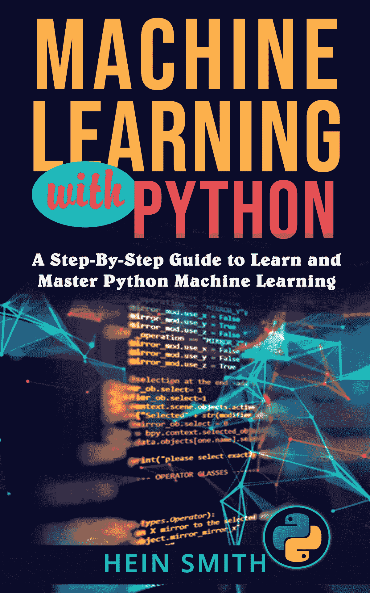


## 引言
你是否想学习如何使用 Python 进行机器学习，但在入门时遇到了困难？在本书中，你将学习实现 Python 机器学习时需要掌握的所有重要主题。你将学习如何下载、安装 Python，并获取 Python 中最适合机器学习的包。你还将加载数据集并使用数据可视化和摘要来理解其结构。如果你是机器学习的新手，并希望最终开启 Python 领域的职业生涯，这本书正是为你为你设计的。

Python 是一种强大的解释型语言。与 `R` 等语言不同，Python 是一个完整的语言和平台，你可以在其中应用于研究和开发生产。尽管如此，仍有许多模块和库供选择，并生成执行各项任务的不同方法。机器学习的方法广泛应用于工程、科学、物理和计算机系统等众多领域。此外，商业网站也将其用于推荐系统、广告和预测客户行为。机器学习已成为大多数商业应用和研究工作的主要引擎。但这一分支并不排除大型研究公司。在本书中，你将深入了解从线性模型到深度学习和强化学习的机器学习领域。你将理解回归、强化学习和分类等机器学习问题背后的原理。


# 第一章：Python 基础

欢迎！这是你第一次编程吗？如果不是，那么我们假设你想学习如何使用 Python 进行机器学习。此外，你可能正在寻找关于为什么以及如何开始学习 Python 的信息。如果你是任何语言的专家级程序员，对你来说，上手 Python 会非常快。在开始学习 Python 之前，你需要知道如何在你的计算机上安装 Python。接下来，你需要了解一些关于语言语法的概念，以便读取和理解 Python 代码。本章将带你完成所有这些内容。所以，准备好学习 Python 语言中一些重要的内容。

## 安装

如今，大多数 UNIX 和 Linux 发行版已经预装了最新版本的 Python。甚至一些 HP 微软计算机已经安装了 Python。

### 下载 Python

在开始使用 Python 进行机器学习之前，你必须在计算机上安装 Python，不过你可能不需要下载它。因此，要做的第一件事是在命令行窗口中输入 `Python` 来确认是否安装了 Python。当你看到 Python 解释器的响应时，它的原始显示中会包含一个版本号。通常，任何最新版本都可以运行，因为 Python 试图保持向后兼容性。如果你想安装 Python，最好搜索最新的稳定版本。该版本将具有未标记为 alpha 或 beta 发布的最高数字。如果你运行的是 Windows OS，可以在 Python for Windows 页面找到最稳定的 Windows 下载。如果你运行的是 Windows XP，你可以在“Python on XP”中找到安装 ActivePython 的完整指南。对于使用 Mac 的用户，你可以导航到“Python for Mac OS X 页面”。对于使用 Debian 或 Ubuntu 的用户，你应该安装 `python2x` 和 `pythonn2.x-deve` 包。

### 语法

Python 程序是使用文本编辑器编写的，并且必须具有扩展名 `.py`。Python 程序并不要求第一行和最后一行内容，但可以将 Python 的位置指定为第一行 `#!/usr/bin/python` 并使其变为可执行。尽管如此，命令行提示符另一个环境，你可以通过输入 `python file.py` 运行 Python 程序。在 Python 中，没有分号和花括号。它是一种高级语言。因此，代码块不是通过选择相同的缩进来选择的。

### 第一个 Python 程序

通常，当你开始学习任何编程语言时，你写的第一个程序将是“Hello, World!”这是一个打印“Hello, World!”的简单程序。对于我们的第一个 Python 程序，你将学习如何编写一个两个两个数字的程序。一个两个两个数字的程序 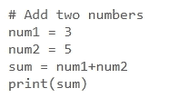

上面的程序是如何工作的？程序的第一行以注释开始。Python 编程中的注释以 `#` 开头。Python 解释器和编译器会忽略注释。在 Python 编程中应用注释的原因是描述代码的功能。此外，注释有助于任何其他程序员理解你代码的工作原理。

## 变量与数据类型

数据类型，顾其名，是不同类型的数据类别。它定义了一个值的集合以及可以在这些值上执行的操作。我们在程序中使用的显式值是字面量（literal）。例如，11、30.22、‘pypi’ 都是字面量。每个字面量都有一个与其关联的类型。例如，11 是一个 `int`，30.22 是 `float` 类型，而‘pypi’ 是字符串类型。通常，字面量的类型将决定可以对其执行的操作类型。

Python 包含一个内置函数 `type()`，用于定义字面量的数据类型 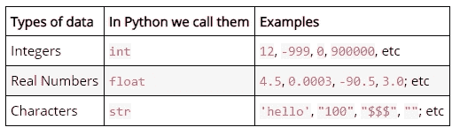`<class 'int'>` 描述 54 的类型是 `int`。同样，`<class 'str'>` 和 `<class 'float'>` 显示“a string”和 98 分别是 str 和 float。起初，你可能会说“3.14”是 float 类型，但因为它被封装在双引号中，它显然是一个字符串。同样，“99”也是一个字符串。Python 中的字符串类型称为 `str`。字符串字面量可以用单引号或双引号定义。起始和结束引号之间的所有字符都是字符串的一部分。

### 字符串中的转义序列

有时你希望让 Python 以不同的方式解释字符序列。这可能通过两种方式发生：

- 你希望抑制字符串内部提供的特定字符的特殊解释。
- 你希望对字符串中包含的通常按字面处理的字符应用特定的解释。

你可以通过使用反斜杠 `\` 字符来实现这一点。字符串中的反斜杠字符意味着其后的一个或多个字符必须被唯一对待。这被称为转义序列，因为反斜杠会让随后的字符“逃逸”其正常含义。

### 布尔类型

Python 有一种布尔数据类型。布尔类型的对象可能包含两个值：False 或 True 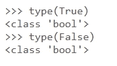Python 表达式在布尔上下文中求值。这意味着真值被描述为“Truthy”（真），而假值被描述为“Falsy”（假）。布尔类型对象的真值是开放的。这意味着等于 True 的对象是 Truthy，而等于 False 的对象是 Falsy。然而，非布尔类型的对象也可以被求值。

## 变量

在第一个 Python 程序中，你接触了 Python 变量。你简要地看到了如何在 Python 中定义变量并为其赋值某些值。本节讨论了 Python 中更多的变量。变量与其他编程语言中的一样，用于存储值。此外，你可以使用变量来访问数据和操作数据。

### 创建变量

如果你想在 Python 中创建一个变量，必须使用赋值运算符 `=`。所示的格式适用于你想创建一个变量时 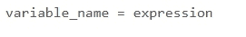一个示例可以包括：

```
number = 12
```
该语句将创建一个名为 `number` 的变量并将其赋值为 `12`。当 Python 解释器遇到此语句时，它会执行以下操作：该语句将创建一个名为 `number` 的变量并将其赋值为 `12`。当 Python 解释器遇到此语句时，它会执行以下操作：

```
（注：此处原文逻辑存在重复，翻译按原文要求保留）
```
该语句将创建一个名为 `number` 的变量并将其赋值为 `12`。当 Python 解释器遇到此语句时，它会执行以下操作：

该语句将创建一个名为 `number` 的变量并将其赋值为 `12`。当 Python 解释器遇到此语句时，它会执行以下操作：

（此处重复内容）
该语句将创建一个名为 `number` 的变量并将其赋值为 `12`。当 Python 解释器遇到此语句时，它会执行以下操作：

1. 存储变量 `12` 在内存中。
2. 让变量 `number` 指向它。

关键点是赋值运算符左侧的变量名。如果你没有这样做，将得到语法错误。描述这种的编程术语称为动态类型。这意味着你可以根据初始值使用不同的类型。当你给变量赋值新值时，旧值的引用将丢失。例如，如果变量 `number` 被赋值为“ten”，对 12 的引用将丢失。在此处，Python 解释器将通过垃圾回收移除该值。如果你在赋值之前尝试访问变量，将得到 NameError。

## 控制流

控制流强调了程序执行的顺序。在 Python 程序中，控制流通过函数调用、条件语句和循环来实现。本节将处理 If 语句、While 和 For 循环。

### If 语句

有时你希望在某些条件下运行特定的语句，或者根据互斥条件决定运行的语句类型。Python 有由 `if`、`elif` 和 `else` 组成的 If 语句。这些复合语句允许你有条件地创建块。以下是 If 语句的通用声明 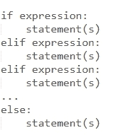在这里 `elif` 和 `else` 子句是可选的。作为提醒，Python 中没有 switch 语句，这意味着你需要应用 `elif`、`if` 和 `else` 进行条件处理。看这个 If 程序示例 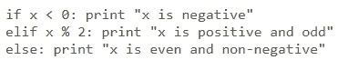

### While 语句

Python 中的 WHILE 语句支持语句或语句块的重复执行，受条件表达式控制。看 While 的语法 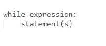While 也可以由 `else` 子句、`break` 和 `continue` 语句组成。以下是 Python 中的 While 程序示例 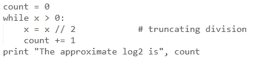

### for 语句

Python 语言还包含 for 语句，支持程序语句的重复执行。for 语句有一个迭代表达式来控制块。以下是 for 语句的通用语法 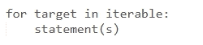记住 `in` 是关键字。它是 For 语句语法的一部分，但与用于成员测试的 `in` 运算符关联。For 语句可以有一个 else 子句、break 和 continue 语句。这是一个 For 语句的通用声明形式 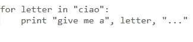数据结构它们是辅助数据存储的结构。数据结构是相互关联的数据集合。Python 中有 4 种内置数据结构。它们如下：


以下是每个数据结构的详细描述。

### 列表 (List)
列表描述了具有有序集合的数据结构。考虑一个包含多个你需要购买的物品的购物清单。唯一的区别是，你的购物清单每个物品都单独占一行。然而，在 `Python` 列表中，你只需要用逗号分隔项目即可。一旦你创建了列表，你就有权限在同一个列表中添加、删除或搜索项目。由于列表允许你添加和删除项目，因此它被视为一种可变变数据类型。这意味着你可以随时更改它。

### 对象和类的简要介绍
为了进一步了解 `Python` 语言中的列表，最好向你快速介绍对象和类的概念。列表就是对象和类的一个示例。因此，如果你打算使用一个如 `j` 类的变量并为其分配一个值（例如整数 `7`），那么将其看作是在创建对象 `j` 是重要的。

类包含方法。方法和函数是类似的。但是，方法仅定义在类内部。因此，访问函数的唯一方法是在该类中拥有一个对象。例如，在 `Python` 语言中，你可以将一个方法连接到列表类，这允许该对象的类。`Python` 语言为列表类提供了 `append` 方法，允许在列表末尾添加项目。

`Python` 中的类具有字段，其形式为声明为仅在特定类中使用的变量。这意味着如果你想使用这些变量，你需要拥有该类的对象。你通过点符号符号访问字段。例如，`mylist.field`。

### 它的工作原理
有一个变量 `shoplist`，它包含了关于一个计划去市场的人的信息。`shoplist` 允许你存储计划购买的物品的名称字符串。然而，你也可以添加任何类型的对象，如数字。此程序还有一个 `for` 循环，它支持列表的迭代。你应该已经开始意识到列表类似于序列。注意结束参数是如何用于调用 `print` 函数的。这表明你想用空格而不是普通的换行来结束输出。

接下来，你应该使用 `append` 方法向列表添加一个项目。使用 `print` 函数检查项目是否已添加。程序中还有一个排序方法，其目的是对列表进行排序。需要注意的是，这个特定方法影响列表本身，它不能返回一个修改后的列表。

下一步是完成从市场购买物品。这个过程等同于从列表中删除项目。你通过 `del` 语句辅助操作。对于这种场景，你需要描述列表中想要删除的找到的项目。然后使用 `del` 语句将其从列表中删除。之后，`del` 语句会将其从列表中移除。在 `Python` 中删除列表中的项目，你只需要写以下行：

```python
del shoplist[0]
```

### 元组 (Tuple)
元组存储多个对象。它们与列表相似，区别是它们没有像列表类那样的许多函数。元组的一个伟大特性是它像字符串一样是不可变的。这意味着很难更改元组。如果你想定义元组，必须描述项目并用逗号分隔它们。在值集合无法更改的情况下，最适合使用元组。

### 字典 (Dictionary)
字典类似于地址簿，你可以通过姓名搜索其详情。在字典中，键（key）与值（value）相关。请记住，键必须是唯一的，你可以使用不可变对象作为字典的键。记住字典中的键值对没有固定的顺序。

# 第 2 章：机器学习简介
机器学习的重点是学习数据的本质并将其应用于特定的模型。虽然机器学习是计算机科学的一个领域，但它与传统方法不同。当你观察传统计算时，算法被描述为一组程序编写的指令。这些指令为问题提供了解决方案。机器学习算法让计算机从数据中学习，并应用统计分析来显示在给定范围内找到的值。

机器学习允许计算机从数据样本中创建模型，以便它可以根据类型做出决策。如今，技术用户从机器学习的想法中受益匪浅。例如，面部识别为社交媒体网络提供了机会，使用户可以标记并与朋友分享照片。还有光学字符识别 (`OCR`)。这种技术应用于电影、节目和电子商务中，以向用户提供建议。

本章将带你了解一些最常见的机器学习方法：监督学习和无监督学习，以及流行的机器学习算法。此外，你将学习为什么除了 `Python` 之外你还需要机器学习。此外，本章还将探讨在构建算法时与机器学习相关的偏差。

## 机器学习方法
在机器学习领域，任务被归类为不同的部门。这些部门的大多数取决于如何执行学习或所交付的反馈类型。最受欢迎的机器学习方法包括监督学习和无监督学习。对于监督学习，算法从人类标记的输入和输出数据中学习。另一方面，无监督学习不向算法提供任何标记数据，但算法必须在输入本身中找到结构。

### 监督学习
对于监督学习，计算机有一个输入数据示例可供工作。这种方法的目的是允许算法通过使用已训练的输出比较实际输出来“学习”，以发现错误并更改模型。换句话说，这种方法包含了辅助预测的模式。例如，在监督学习中，你可以向算法输入数据并将其标记为鱼。此外，你可以喂给它海洋图像并将其标记为水。在算法经过多次训练后，它必须能够区分鱼和海洋。监督学习最流行的用例之一是使用历史数据来预测事件发生的概率。它可以使用历史数据来预测市场变化。此外，监督学习可以帮助过滤垃圾邮件。

### 无监督学习
与数据标记的监督学习不同，无监督学习处理的是未标记数据。这意味着任务是识别提供数据中的相似特征。由于未标记数据与标记数据相比非常流行，机器学习的技术在行业中非常有价值。无监督学习的目标非常简单。无监督学习最大的应用是在交易数据中，由客户组成的海量数据，由于你是人类，你可以从客户资料和他们的购买历史中提取意义。在没有预期结果的情况下，应用机器学习时无监督学习是正确的技术。

## 机器学习方法
机器学习与计算统计密切相关。因此，如果你具备统计学知识，理解并应用机器学习算法是非常重要的。这里是用于检测变量的一些定义：

- 相关性 (Correlation)：描述独立变量或依赖变量之间的关联。
- 回归 (Regression)：在最低水平，有助于确定独立变量和依赖变量之间的关系。
- 最近邻 (k-nearest neighbor)：这种特定算法应用于模式识别。在分类和回归中，`k` 是一个正整数。

### KNN 分类
当涉及到这种方法时，输出属于类别。这为新对象分配最流行的类别 `k`-最近邻。例如，当 `k = 1` 时，对象必须被分配一个最近邻。下面的图描述了这种算法。图中有蓝色对象和橙色对象，只需记住它们属于不同的类别。一旦你引入一个新对象（如绿色），你需要学习算法将其分配到特定类别。对于 `k = 3`，算法将必须选取属于绿色和星色的三个最近邻。最近邻算法被标记为“懒惰学习”。

### 决策树 (Decision Tree)
通常情况下，当你想要决策的视觉化表示时，决策树是重要的。在处理机器学习和数据挖掘时，决策树对于数据是关键的。在决策树中学习当你想要创建一个预测值的模型时是重要的。如果你观察预测模型，数据的特征必须通过分支定义并表示。此外，与数据目标值相关的结论显示在叶节点中。该决策树通过排序进行分类。然后它可以显示是否应该执行。总之，关系将很容易选择。

### 深度学习 (Deep Learning)
通过深度学习，它将始终尝试模仿大脑如何成功处理。深度学习的架构由神经网络驱动。此外，它包含了许多不同的层。在当前的机器学习中，深度学习已成功处理大部分数据以及认知任务。它是应用的最佳方法之一。

### 编程语言
当人们想要选择用于机器学习的语言时，有一些他们可能考虑的因素，例如可用的库。其他使用的语言包括 `C++`、`Java` 和 `R`。

# 第 3 章：数据处理、分析与可视化
### 理解数据处理
数据处理是将数据性质变为更有用且更理想的形式。换句话说，它是让数据更有意义和信息量。通过应用机器学习算法、统计知识和数学建模，可以实现整个过程的自动化。这整个过程的输出可以是任何形式，如表格、图形、图表、图像等，取决于所完成的操作和机器的要求。这可能看起来简单，但对于 `Facebook`、`Twitter`、`UNESCO` 和健康部门等大型机构和公司，这整个过程必须以结构化的方式执行。

### 收集 (Collection)
开始机器学习最重要的一步是确保可用数据具有高质量。你可以从真实的来源收集数据，如 `Kaggle`、`data.gov.in` 和 UCI 数据集仓库。例如，当学生准备参加竞争性考试时，他们总是寻找最好的资源来使用以确保获得良好结果。同样，准确且高质量的数据将简化模型的学习过程。这意味着在测试期间，模型将输出最佳结果。数据收集涉及大量的时间、资金和资源。机构和研究人员必须选择正确类型的数据。例如，从事面部识别需要大量具有不同人类表情的图像。良好的数据将确保模型的结果是正确且真实的。

### 准备 (Preparation)
收集的数据可以是原始形式的。原始数据不能直接喂给机器。相反，必须先对数据进行某些处理。准备阶段涉及从广泛的来源收集数据、分析数据集，然后构建用于额外处理和探索的新数据集。准备可以手动或自动进行，数据应准备成数值形式以提高模型的学习率。


* NumPy
* Matplotlib
* Pandas

一旦导入了库，你就可以继续使用 `read_csv()` 函数来读取数据集。以下是目前代码的样式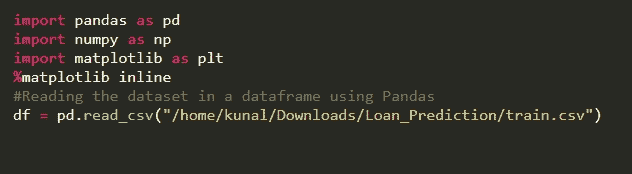

注意，数据集存储在 `/home/kunal/Downloads/Loan_Prediction/train.csv`。读取数据集后，你可以使用 `head()` 函数来检查前几行。接下来，你可以使用 `describe()` 函数查看数值字段的摘要。

### 分布分析
由于你已经熟悉了数据的基本特征，现在是观察不同变量分布的时间了。让我们从数值变量 `ApplicantIncome` 和 `LoanAmount` 开始。首先，输入以下命令来绘制 `ApplicantIncome` 的直方图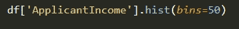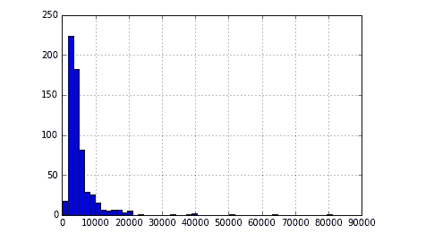

注意到有几个极值。这就是为什么需要 50 个箱体（bins）来清晰地表示分布。下一个关注的重点是箱线图。`fare` 的箱线图绘制方法如下：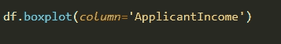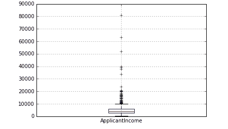

在 Python 中进行数据处理时，这只是冰山一角。让我们来看：

### Python 数据预处理技术
以下是 Python 中数据预处理的最佳技术。

#### 1. 数据缩放
当你处理具有不同尺度的数据时，需要重新缩放属性以具有相同的尺度。属性被缩放至 0 到 1 的范围之间，这被称为归一化（normalization）。为了实现这一点，使用了 `scikit-learn` 中的 `MinMaxScaler` 类。例如：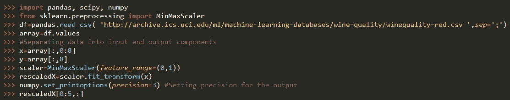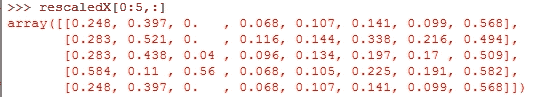 缩放后，你会得到 0 到 1 之间的值。通过缩放数据，可以确认了网络、优化算法以及那些具有距离度量的算法（如 `k-nearest neighbors`）的使用。

#### 2. 数据规范化
在下一个任务中，你将每个观测值缩放到特定长度 1。在这种情况下，你使用 `Normalizer` 类。示例：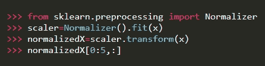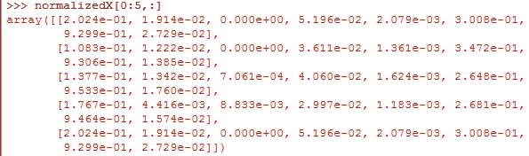

#### 3. 数据二值化
如果你使用二值阈值，可以更改数据，并将高于阈值的值设为 1，而等于或低于阈值的值设为 0。对于这项任务，你使用 `Binarized` 类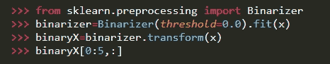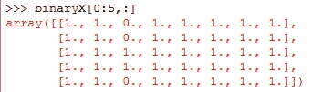如你所见，Python 代码将所有等于或小于 0 的值标记为 0，其余部分标记为 1。

#### 4. 均值移除
这是从每个属性中移除均值以使其以零为中心的操作。

#### 5. 独热编码
当你处理少数且离散的数值时，你可能在执行独热编码之前需要对它们进行存储。对于 k 个不同的值，你可以将特征更改为 k 维向量，其中一个值为 1，其余值为 0。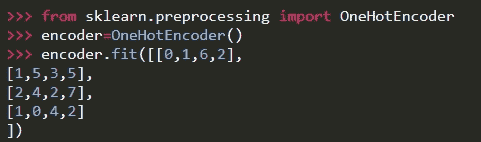

#### 6. 标签编码
有时标签可以是单词或数字。如果你想标记训练数据，需要使用单词来提高其可读性。标签编码将单词标签转换为数字以便算法进行处理。示例：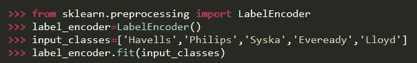

## 第四章：回归

### 线性回归
线性回归是最流行的预测分析类型之一。线性回归涉及以下两点：

1. 预测变量是否准确预测了结果变量的结果？
2. 哪些特定变量是最终变量的关键预测因子？它们以什么标准影响结果变量？

#### 变量命名
回归的因变量有很多不同的名称。某些名称包括结果变量、准则变量等。自变量可以被称为外生变量或回归因子。

#### 回归分析的功能
1. 趋势预测
2. 确定预测因子强度
3. 预测影响


# 拆归分析

回归有两种基本状态：线性回归和多元回归。虽然对于复杂数据分析有不同的方法，但线性回归包含一个独立变量以帮助预测因变量的结果。另一方面，多元回归具有两个或多个独立变量，以辅助预测结果。回归对于金融和投资机构非常有用，因为它被用于根据销售额和 GDP 增长等许多因素来预测特定产品或公司的销售情况。资本定价模型是金融领域最常用的回归模型之一。下面的示例描述了线性回归和多元回归中使用的公式。

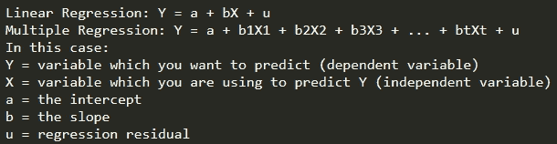

## 选择最佳回归模型

选择正确的线性回归模型可能非常困难且令人困惑。尝试用样本数据对其建模并不能让它变得更容易。本节回顾了某些用于选择模型的流行统计方法、你可能会遇到的挑战，并列出了一些用于选择正确回归模型的实用建议。这通常始于一个希望扩展响应变量与预测变量之间关系的研究人员。负责执行调查的研究团队本质上测量了许多变量，但模型中只保留了少数几个。分析师将努力减少不同的变量，并应用那些具有准确关系的变量。随着时间的推移，分析师会继续添加更多模型。

### 用于寻找最佳回归模型的统计方法

如果你想在回归中获得很好的模型，那么考虑你想测试的变量类型以及影响响应的其他变量是非常重要的。

#### 调整后 R 平和预测 R 平
你的模型应该具有较高的调整后和预测 R 平值。下面的统计数据有助于消除围绕 `R-squared` 的关键问题。
- 一旦新项改进了模型，调整后的 `R squared` 就会增加。
- `Predicted R-squared` 属于交叉验证，有助于定义模型泛化数据集的方式。

#### 预测变量的 P 值
涉及回归时，低 `P` 值表示具有统计学显著意义的项。“减少模型”是指考虑模型中包含的所有候选预测变量的过程。

#### 逐步回归
这是一种自动化技术，可以在创建模型的探索阶段选择重要的预测变量。

## 现实世界的挑战

选择最佳模型有不同的统计方法。然而，复杂性仍然存在。
- 当研究测量了变量时，会出现最佳模型。
- 由于数据收集方法的类型，样本数据可能是不寻常的。处理样本时会发生假阳性和假阴性过程。
- 如果你处理足够的模型，你将获得虽然显著但仅随机相关的变量。
- `P-values` 可能根据模型中发现的特定项而不同。
- 研究发现，最佳子集回归和逐步回归无法选择正确的模型。

## 寻找正确的回归模型

执行其他专家的研究并将其引用到你的模型中。在开始回归分析之前，对最重要的变量建立想法是至关重要的。根据他人的结果开发内容可以简化数据收集过程。

### 复杂性
你可能认为复杂的问题需要复杂的模型。事实并非如此，因为研究表明即使是简单的模型也可以提供准确的预测。一旦有了相同解释潜力的模型，最简单的模型可能是完美的选择。你只需要从简单模型开始，并逐渐增加模型的复杂度。

### 如何计算预测模型的准确性
有多种方法可以计算模型的准确性。其中一些方法包括：

1. 将数据集分为测试集和训练集。接下来，根据训练集构建模型，并将测试集作为留存样本，使用测试数据衡量训练后的模型。下一步是使用“平均绝对百分比误差”（`MAPE`）等指标计算误差，从而比较预测值和实际值。如果你的 `MAPE` 小于 10%，那么你就有一个很好的模型。
2. 另一种方法是计算“混淆矩阵”以确定计算机假阳性率和假阴性率。这些指标将允许人员选择是否接受该模型。如果你考虑误差成本，这将成为你决定拒绝或接受模型的关键阶段。
3. 计算接收者工作特征曲线（`ROC`）或提升图（Lift Chart）或曲线下积（`AUC`）是你可用于决定拒绝或接受模型的其他方法。

# 第章：分类


分类是指预测特定数据点类别的过程。类别被称为标签、目标或分类。分类预测建模是估计从输入变量 `X` 到离散输出变量 `y` 的映射函数 `f` 的过程。以电子邮件提供商的垃圾邮件检测为例，这可以被视为分类挑战。这是一个二分类的例子，因为只有 2 个类：垃圾邮件和非垃圾邮件。分类器利用训练数据来理解特定变量输入与特定类别的关系。在以下示例中，应该使用知的垃圾邮件和非垃圾邮件作为训练数据。当分类器经过准确训练后，你可以使用它来检测未知邮件。分类是监督学习的一个领域，目标与输入数据一起出现。现实生活中有很多应用分类的领域。这些领域包括医学诊断、信贷审批、目标营销等。

分类有两种类型的学习器。

1. 懒学习器（Lazy learners）
懒学习器持有训练数据，直到测试数据到达。一旦数据到达，将根据训练数据中发现共同数据进行分类。与急进学习器相比，懒学习器的训练时间最短。然而，预测时需要更多时间。示例包括 k 近邻和基于案例的推理，我们将在本章稍后部分介绍。

3. 急进学习器（Eager learners）


对于急学习者（eager learners），在获取分类数据之前，会根据训练数据的类型创建分类模型。它应该能够致力于处理整个实例空间的单一假设。由于模型的构建方式，急学习者会消耗更多的训练时间，而在预测期间消耗的时间最少。急学习者的示例包括`人工神经网络`、`朴叶贝斯`和`决策树`。

## 分类算法
开发了许多不同的分类算法，然而很难选出哪一个比另一个更好。这是由于现有数据集的应用和性质等几个因素造成的。例如，如果你具有线性可分的类别，像`逻辑回归`、`Fisher 线性判别`等线性分类器就可以执行复杂的模型。

## 决策树 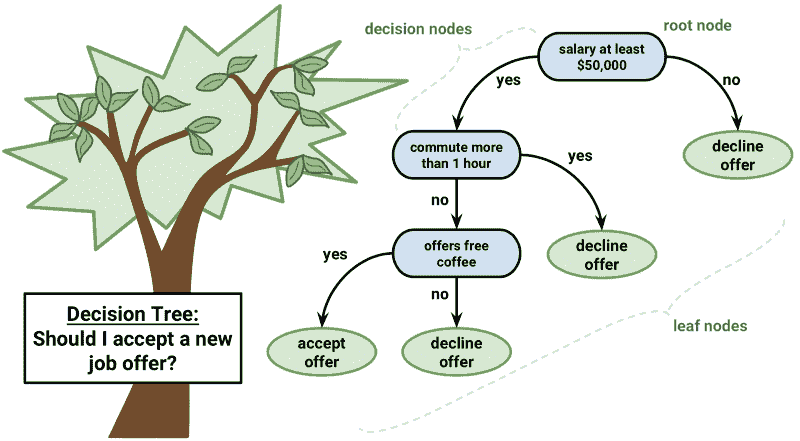
决策树像树结构一样创建回归模型和分类模型。这种树的工作原理与 `if-then` 规则集相同，该规则集对于分类是互斥且穷尽的。规则通过一次应用一次训练数据来顺序学习。每当学习到一条规则时，规则处理的元组就会被删除。这一过程在训练集上重复，直到满足终止条件。树是通过一种被称为`自顶而下的递归分治方法`的技术构建的。所有特征都必须是类别的。尽管如此，它们需要提前离散化。使用决策树时很容易发生过拟合。过拟合会产生许多分支，这些分支可能指示噪声和异常值问题。在过拟合的模型中，尽管在训练数据上提供了正确的性能，但在未见数据上的性能非常差。然而，可以通过应用预剪枝（pre-pruning）来避免这种情况。预剪枝应提前停止树的构建，或者使用后剪枝（post-pruning）来从完整的树中消除分支。

### 决策树的优点
1. 透明性：这是决策树模型最重要的优势之一。与其他决策树模型不同，决策树揭示了所有可能的替代方案，并在单一视图跟踪每种替代方案到最后。这使得比较不同的替代方案变得容易。应用不同的节点表示用户定义的决策增加了决策过程的透明度。
2. 特异性：决策树在分析中的另一个主要优势是为问题和每个决策的结果分配一个特定值。这很重要，因为它有助于减少决策过程中的模糊性。决策树的每种可能情况通过清晰的分叉和节点发现一种表示。这允许人们在清晰的视图看到所有解决方案。在决策树中引入货币值揭示了采取不同行动方案的成本和收益。
3. 易用性：决策树以简单直接的方式提供了问题和不同替代方案的图形表示，可以帮助任何人在无需要求解释的情况下理解。
4. 全面性：决策树是最好的预测模型之一，因为它对每个可能的决策结果进行了全面的分析。这可以包括决策导致了什么、它是否以不确定性结束，或者是否导致了过程可能需要重复的新问题。
5. 它们隐式地执行特征选择。
6. 决策树可以处理类别数据和数值数据。
7. 用户在数据准备方面做得很少。
8. 参数之间的非线性关系不会影响性能。

### 决策树的缺点
1. 有时决策树可能是不稳定的，因为数据中的微小变化可能导致生成一个完全不同的树。
2. `贪心算法`无法证明它将返回一个全局最优决策树。这可以通过训练多棵树来解决，其中样本和特征经过带放回的随机采样。
3. 决策树学习者可以构建出不能泛化数据的高级树。
4. 如果存在主导类别，决策树学习者可能会产生偏差。因此，建议在与决策树拟合之前平衡数据集。

## K 近邻算法 (KNN) 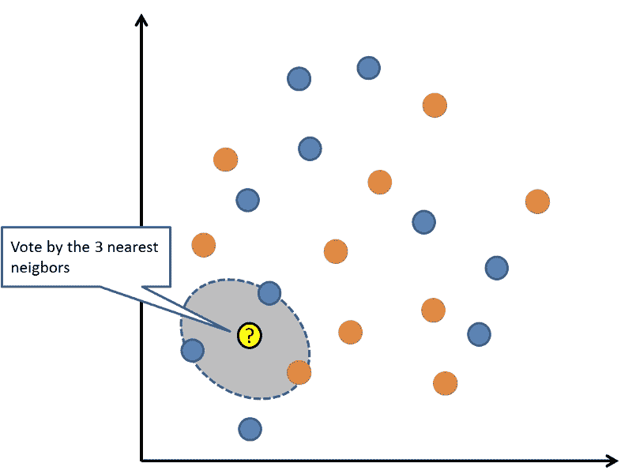
`k-最近邻`属于懒性学习算法，它持有了所有在`n-维空间`中与训练数据点匹配的实例。如果存在未知离散数据，它必须对保存的最近`k` 个实例进行分析，并将最频繁的类作为预测。对于实值数据，它必须返回`k-最近邻`的平均值。在距离加权最近邻算法中，它通过应用以下查询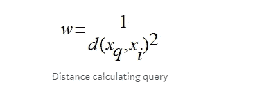 根据距离测量每个`k-最近邻`的权重。通常，`KNN`对噪声数据非常强大，因为它平均了`k-最近邻`。

### KNN 的优点
- 易于解释和理解的算法
- 它对数据不作任何假设。
- 它具有更高的精度，是其他更好的监督学习模型不可比拟的。
- 它在分类和回归方面非常通用。

### KNN 的缺点
- 对内存要求更高
- 计算代价很高，因为算法拥有所有的训练数据。

### KNN 的快速特征
- 该算法持有了整个训练数据集作为表示。
- 它不学习任何模型。
- 它通过计算样本输入和实例训练之间的相似性进行及时预测。

## 在何处可以使用 K-means
`K-means` 用于数值、连续且维度较小的数据。想象一种情况，你想从随机分布的物品集中对相似物品分组，例如 `k-means`。这个列表包含你可以应用 `K-means` 的有趣领域：

1. 文档分类：许多类别的文档聚类取决于主题、标签和文档内容。这是一个标准的分类问题，`k-means` 是执行此功能的很好的算法。当你想要将每个文档视为一个领域并应用频率术语来分类文档时，原始文档处理是非常重要的。文档的向量必须进行聚类，以便选择文档组的相似性。
2. 递送商店优化：如果你想改进交付过程，你需要通过应用无人机并集成`k-means 算法`来确定启动位置的数量，并使用`遗传算法`计算卡车的路线。
3. 幻想联盟统计分析：分析球员统计数据是体育界最关键的特征之一。随着竞争的快速兴起，机器学习在这里提供了重要的功能。作为一个很好的练习，如果你想建立一支幻想选球队并选择相似的球员，`k-means` 是一个很好的选择。
4. 共享出行数据分析：`Uber` 的信息是公开的。该数据集包含大量的价值数据，关于交通时间、流量、高峰上车地点等。如果你分析这些特定数据，你将获得对城市交通模式的洞解，并为未来的城市提供规划。
5. 网络犯罪分子画像：这是从个人和小组收集数据以选择重要链接的过程。网络犯罪画像的概念是从犯罪历史中提取的，为调查部门提供信息以帮助分类犯罪现场的罪犯。
5. IT 告警的自动聚类


网络等 IT 基础设施技术的大型企业会产生海量的警报消息。由于警报消息涉及运营问题，必须对其进行人工筛选和分类。数据聚类可以帮助提供警报类别的洞察，以及平均修复时间和支持预测。

## 7. 识别犯罪高发地区
由于与犯罪相关的数据存在于特定的城市地区，犯罪类型、犯罪区域以及两者之间的关系可以为该城市或地区的最犯罪高发区域提供高质量的洞察。

## 人工神经网络
人工神经网络 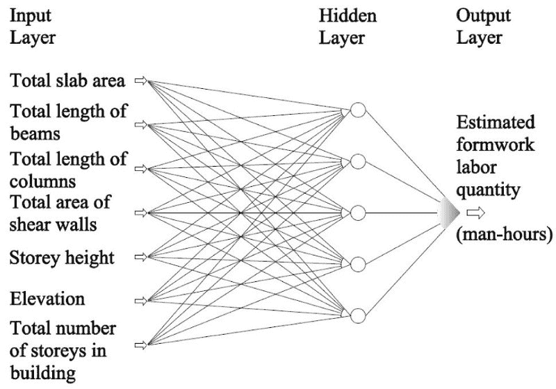人工神经网络描述了一组连接的输入/输出，其中每个连接都链接到一个特定的权重。在学习阶段，网络会调整权重，以便能够预测输入元组的正确类别标签。现在存在许多网络架构，其中包括前馈、循环、卷积等。正确的架构取决于模型的应用场景。在大多数情况下，前馈模型提供相当准确的结果，且大多数情况下用于图像处理应用。根据模型要封装的函数的复杂性，模型中可以存在许多隐藏层。如果你有许多隐藏层，将有助于像深度神经网络等复杂关系的建模。然而，许多隐藏层的存在增加了训练和调整权重的时间。另一个缺点是与决策树等模型相比，其解释性较差。尽管如此，ANN 在大多数现实应用中表现良好。它对噪声数据具有很强的韧性，并可以分类未训练的模式。通常，ANN 在连续值输入和输出方面效果更好。

### ANN 的优点
- 它将信息存储在整个网络中。例如，传统的程序信息保留在整个网络中，而不是数据库中。这意味着给定位置某些信息的丢失不会停止网络运行。
- 它具有容错性。ANN 中一个或多个单元的破坏不会影响它产生输出。因此，这一特定特征使得网络具有容错性。
- 它可以处理不完整的知识。一旦 ANN 训练完成，可以使用不完整的信息产生输出。在这种情况下，性能的损失将取决于缺失的信息。
- ANN 具有机器学习的能力。
- 它具有并行处理能力。ANN 神经网络具有数值上的优势，可以同时完成多项任务。

### ANN 的缺点
- 它依赖于硬件。ANN 需要根据其结构包含并行处理能力的处理器。对于这种情况，设备的实现是取决于依赖的。
- 正确网络结构的确定。通常，没有固定的规则来确定人工神经网络的结构。正确的网络结构是通过试错获得的。
- 持续时间未知。网络受限于训练完成时样本均值的特定误差值。该值不会产生最优结果。
- 网络存在未解释的特性。这是 ANN 的主要问题之一。如果 ANN 生成了一个探测性解决方案，它不会显示任何线索。这总是降低对网络的信任。

## 朴素贝叶斯
朴素贝叶斯算法是一种由贝叶斯定理驱动的概率分类器。它基于一个简单的假设，即属性之间是条件独立的。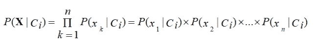分类通过提取最大后验概率（即在上述假设成立的情况下最大的 `P(Ci|X )`）来工作。这一假设通过衡量计算成本总是降低了计算成本。尽管由于属性具有依赖性，该假设会多次失效。尽管如此，朴素贝叶斯继续运行良好。这是一种易于实现的算法，并可以在大多数情况下改进生成的结果。它可以扩展到海量数据集，因为它假设了线性时间。

### 朴素贝叶斯的优点
- 它简单且易于实现。
- 它需要极少的训练数据。
- 它处理连续和离散数据。
- 它可以建立概率预测。
- 它具有良好的扩展性。

### 朴素贝叶斯的缺点
- 它对数据分布有一个稳健假设。
- 它面临数据稀缺的挑战。
- 连续特征需要分箱处理将其离散化。

## 分类准确率指标
这是正确预测的数量与输入总数量的比例。当每个类别的样本数量相等时，它的效果最好。准确率产生获得高准确率的假象。当你处理少数但危险的疾病时，误判少数类别的成本比检测健康人士的成本高得多。

## 对数损失
这对于多分类运行良好。当你使用对数损失时，分类器必须为每个类别分配概率。例如，如果你有 `N` 个样本和 `M` 个类别，可以如下计算对数损失

## 混淆矩阵
混淆矩阵正如其名，创建一个矩阵来解释模型的完整性能。假设你有一个二分类问题。那么有两个类别：YES 或 NO。此外，你有一个可以为特定输入样本预测类别的分类器。如果对 165 个样本进行以下模型测试，将得到如下结果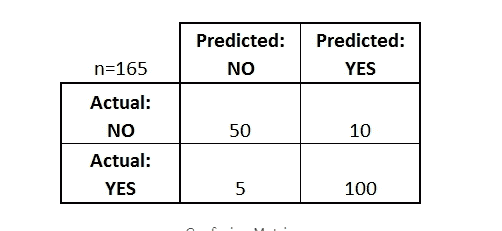存在四个术语：
1. 真阳性：我们的预测为 YES 且结果为 YES。
2. 真阴性：我们的预测为 NO 且结果为 NO。
3. 假阳性：我们的预测为 YES 但结果为 NO。
4. 假阴性：我们的预测为 NO 但结果为 YES。

## 曲线下面积
这是评估中最广泛应用的指标之一。它适用于二分类问题。其他指标包括：
- 平均绝对误差
- 均方误差

# 第 6 章：聚类
聚类是将具有相似特征的实体聚集的过程。这种技术属于无监督机器学习，其目标是识别数据点的相似性并将相同的数据点分在一起。

### 为什么要应用聚类？
将相似的实体聚集在一起允许识别不同小组的属性。换句话说，这产生了对不同小组底层模式的洞察。无标记数据的分组有无数应用领域。例如，可以对客户进行分组，并对每个小组进行不同的营销以增加收入。另一个例子可能包括将属于相似主题的文件分在一起。


“类（cluster）”这一词并没有准确的定义。类描述一组点，其中类中的任何一点到类中其他任何点的距离都比到类之外某一点近。有时，会使用阈值来定义类中所有相互接近的点。划分方法会首先创建一个原始的 `K` 划分集，其中 `k` 参数是待构建的划分数量。接下来，它应用一种迭代重定位方法，通过将对象从一个组移动到另一个组来增强划分。这些聚类技术有助于生成数据点的一级划分。有多种基于划分的聚类方法，如 `K-means`、`fuzzy C-means` 和 `K-medoids`。本节将介绍 `K-mean` 聚类。

## K-mean 聚类

1. 它以 `K` 作为输入。这指的是你想要找到的簇数量。在空间中的随机位置分配 `K` 个质心。
2. 现在，如果你使用数据点与质心之间的 `Euclidean distance`，则将每个数据点分配给距离它最近的类。
3. 重新计算类中心，作为分配给该类的数据点的平均值。
4. 重复 `2` 和 `3` 直到不再发生变化。你可能好奇如何选择 `K` 的值。一种方法是“肘部法”（Elbow），它用于定义最佳簇数量。在这种情况下，你会运行一系列 `K` 值，并在 Y 轴上绘制“解释方差百分比”，在 X 轴上绘制“K”。在下图中，在数字 `3` 之后添加了更多的类。这些额外的类会影响模型的显示。第一个类增加了更多信息，在某一个一点，边际收益将开始下降。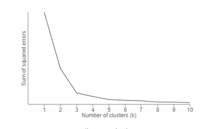

## 层次聚类

层次聚类开始于将所有数据点分配到属于它们自己的类中。正如其名所示，它创建了层级结构，在下一步中，它整合两个最近的数据点并将它们合并为一个类。

1. 将每个数据点分配到其类中。
2. 通过应用 `Euclidean distance` 确定类中最近的一对并将其合并为一个类。
3. 确定两个最近的类之间的距离并整合它们，直到所有项目都被分组为一个类。在下一种方法中，你可以通过识别哪些垂直线被水平线截断且不影响类，并处理最大距离来选择最佳类数量。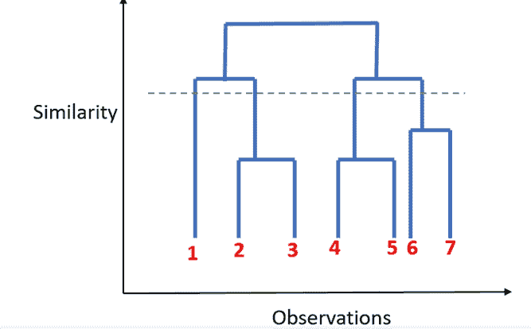

## 1. 基于聚类

基于密度的聚类技术的基本概念提取自人类感知聚类方法。例如，如果你看下面的图片，你应该能看到四个类加上不同的噪声点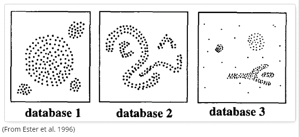如上图所示，类是数据空间中的密集区域，由低密度点区域界定。简而言之，类中点的密度在某种程度上比类外点的密度高。基于密度的聚类算法取决于对“类”和“噪声”的直观感知。关键在于，对于每一个类，特定半径的邻域应该包含一个最小数量。`DBSCAN` 需要的最重要参数包括 (`eps`) 和最小点数 (`MinPts`)。`eps` 参数决定了点 `x` 周围邻域的半径。`MinPts` 参数描述了 `eps` 半径内最小邻居数量。数据集中计数大于或等于 `MinPts` 的任何点 `x` 被识别为核心点。

## 使用聚类分析进行客户细分

公司的客户群可能有成千甚至数百万个不同的个体。对于大多数这些人来说，营销是一个巨大的问题，因为如果你试图向所有人营销，信息可能会是模糊的。然而，建立一个吸引每个个体的营销计划并不是常态的。

### 为什么客户细分很重要

客户细分将帮助你理解区分不同客户的模式。以下是你能够通过细分分析实现的一些重要观点。

* 增强对客户需求和喜好的理解。这可以提高销售额和客户满意度。
* 创建吸引不同客户细分的产品。
* 公司无法一直满足所有可能的客户。通过应用细分程序，公司有能力专注于满足那些被认为对其产品具有最佳吸引力的细分。
* 建立忠诚关系。虽然你可以分析自己的客户群，但很快就会发现，有不同的群体具有定制化的需求。这允许你对客户有更深入的理解，并发现驱动他们的特因素。

### 如何细分

细分不需要非常复杂。对于小型组织或公司，它可能只是发现你有两或三个具有不同需求的独特客户类型。用于细分客户的流行方法包括：

* 人口统计学
* 行为特征
* 心理特征
* 地理特征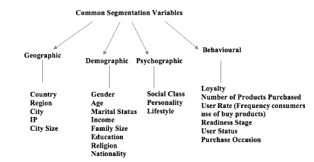在进行市场细分时，有不同的方法可以使用。一种准确且在统计上有效的方法之一是聚类分析的应用。


# 第 7 章：推荐系统

大多数电子商务和零售公司都在利用数据的巨大潜力，通过在其特定的网站上实现推荐系统来提升销售额。这些系统侧重于向用户推荐他们可能喜欢或感兴趣的项目。推荐引擎所需的数据来源广泛，从用户对电影的观看或歌曲的显式评分，到来自搜索引擎购买历史和查询的隐式数据。诸如 YouTube、Spotify 和 Netflix 等网站都拥有可用于推荐播放列表的数据。

## 使用推荐系统的优点
应用推荐系统的公司侧重于通过个性化优惠和改进客户体验来提高销售额。推荐通常会增加搜索，并使用户能够轻松访问他们感兴趣的内容，同时提供他们从未搜索过的优惠令他们感到惊喜。有趣的是，公司现在可以通过发送符合其用户画像兴趣的新优惠邮件链接来获取并留住客户。通过系统建议产品为用户创造额外优势，这在买家中营造了良好的氛围。这是一件非常有意义的事情，因为它能让公司保持领先竞争对手的。

## 推荐系统的类型
推荐系统基于两类信息运行：
- 用户-物品交互
 特 特征信息

这帮助我们完成了推荐系统的第一类分类。这包括基于内容的系统（具有特征信息）以及依赖于用户-物品交互的协同过滤。混合系统应结合这两种信息，目标是避免仅处理某一种特定类型时产生的问题。

## 基于内容的系统
基于系统的系统建立在将每个产品的内容用于推荐目的的想法之上。以下是基于内容的推荐的一些优缺点。

### 优点
- 创建一个更透明的系统非常简单。你使用相同的内容来描述推荐。
- 内容表示是不同的，它们为应用独特的方法（如文本处理技术、推理和语义信息）提供了选择。
- 如果物品有足够的描述，就不需要考虑“新物品问题”。

### 缺点
- 基于内容的 `RecSys` 似乎过于专门化。它们会推荐与已消费内容相似的物品，从而产生“过滤泡泡”的概念。

另一个问题是，新用户没有定义的画像，除非显式请求其信息。尽管如此，向系统添加新物品非常简单。你只需要根据它们的特征为它们分配一个组。

### 三个主要组件
- `content Analyzer`：使用给定的表示类型对物品进行分类。
- `profile Learner`：创建一个代表每个用户偏好的画像。
- `filtering Component`：接受所有输入并为每个用户创建推荐列表。

### 内容是如何表示的
特定物品的内容是抽象的并提供了更多选择。你可以使用许多不同的变量。例如，对于一本书，你可以包括类型、作者、书籍文本以及许多其他因素。一旦你知道要考虑哪些内容，你需要将所有数据转换为向量空间模型，这是文本文档的代数表示。你使用 `Bag of Words` 模型执行此操作，该模型忽略了单词的顺序。在这个特定模型中，每个文档都像一个装有一些单词的包。因此，这种方法允许根据字典进行词建模，其中每个包都包含字典中的一些词。

`Bag of Words` 的精确实现是 `TF-IDF` 表示。完整来说，`TF` 代表词频（Term Frequency），`IDF` 代表逆文档频率（Inverse Document Frequency）。这种特定模型将词在文档中的重要性与词在语料库中的重要性结合起来。这只是基于内容推荐引擎的一个通用方面。重要的是，`Bag of Words` 表示没有考虑词的上下文。如果需要包含这一点，`Semantic Content Representation`（语义内容表示）就变得有用。以下是可选两个方案，以防你想了解更多信息。

**选项 1：显式语义表示**
- `Wordnet`
- `ConceptNet`
- `Ontologies for Semantic Representation`

**选项 2：推断语义表示**
- `Latent Dirichlet Allocation`
- `Latent Semantic Indexing`

## 协同过滤系统
这类推荐引擎通过用户交互来评估感兴趣的物品。你可以使用矩阵将交互集可视化，其中每个条目 `(I, j)` 代表用户 `i` 与物品 `j` 之间的交互。看待协同过滤的一种方法将其视为回归和分类的推广。在以下情况下，你的目标是直接预测一个依赖于协同过滤中其他变量的变量。将问题可视化为矩阵使我们不仅能够预测唯一列的值，还能帮助我们预测任何条目的值。

### 应用于协同过滤中的技术
对协同过滤已经进行了大量的研究，最常见的技术依赖于基于矩阵分解的低维因子模型。`CF` 技术分为 2 类：

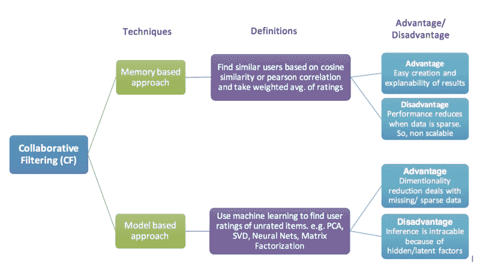
（注：图片代表协同过滤的方法类型）
参考：[维基百科](https://en.wikipedia.org/wiki/Collaborative_filtering)

以下是对这些技术的一些简要讨论

1. **基于内存的技术**
这种方法可以进一步分为两个部分：用户-物品过滤和物品-物品过滤。用户-物品过滤选择一个给定用户，根据评分的相似性搜索与该用户相似的用户，并推荐相同用户推荐的物品。另一方面，物品-物品过滤将识别一个物品，搜索喜欢该物品的用户，并寻找这些用户喜欢的其他产品。换句话之，这种方法获取物品并将物品作为推荐显示。基于内存的技术与基于模型的技术的主要区别在于，没有使用梯度下降学习任何参数。

2. **基于模型的方法**
在这种特定方法中，使用机器学习算法创建 `CF` 模型，以预测与用户无关的物品评分。

### 基于内容的过滤
该系统将根据用户过去的历史向用户推荐物品。基于内容的过滤最大的优点是，一旦有了有关物品的信息，它就可以开始推荐物品。基于内容的系统根据用户提供的信息工作，这些信息可以是显式的也可以是隐式的。根据数据，创建一个用户画像，为提供大量输入或对推荐采取行动。

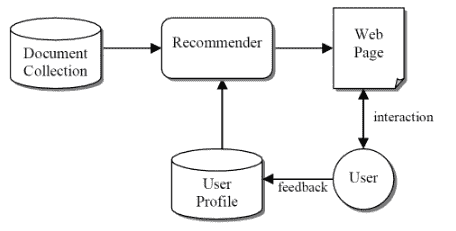


结论

掌握了基础 Python 知识、机器学习技能以及 Python 库后，你现在已经准备好用 Python 启动第一个机器学习项目了。

考虑学习开源 Python 库。科学 Python 库将帮助你完成简单的机器学习任务。然而，其中某些库的选择可能完全取决于主观判断，并且许多业内人士存在争议。

总之，我们建议你从探索 `Scikit-learn` 库开始。确保你熟悉它的概念及其使用方法。一旦掌握了它，就可以深入研究高级机器学习主题，例如复杂数据转换和向量机。

孩子学走路与用 Python 学习机器学习是一样的。在变得更好之前，你需要进行多次练习。尝试不同的算法并使用不同的数据集，以提高你的知识和全面的解决问题的能力。
