# Python 机器学习：应用机器学习方法


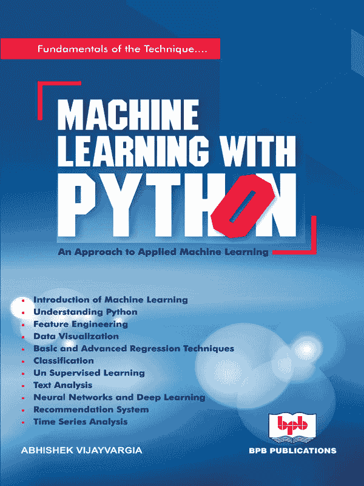


## 特别感谢
致我的父亲 S.N. Vijay
我的母亲 Meena Vijay
以及我的妻子 Ankita Jain

本书献给我最亲爱的父母和亲爱的妻子，他们我在生活和职业的各个方面一直以来支持我。
“家庭不是一件重要的事情，它是一切。” - 米克尔·J·福克斯

# 前言
机器学习是计算机科学的下一个大趋势。从制造业到电子商务和物流，它无处不在，并提供了基于数据的解决方案。机器学习背后的思想是创建一个智能`Model`（模型），使其在决策方面像人类一样智能。现在，随着计算和内存能力的不断增强，机器学习可以提供比人类更优解决方案。

本书由 12 章组成。每章都涉及机器学习的一个主要领域。

本书的第一章从机器学习的基本`Introduction`（介绍）开始。读者可以了解通`机器学习算法`及其在解决不同类型的现实世界问题中的应用。

第 2 章包含了 `Python` 语言的基础知识。`Python` 是一种开源语言，是应用机器学习的非常好工具。这就是为什么我们选择它来编写`机器学习算法`的原因。第 3 章提供了执行`特征工程`的技术。在机器学习中，寻找正确的特征并修改它们与`算法`同样重要。第 4 章侧重于`数据可视化技术`。通过使用预构建的`Python Library`（库），用户可以将数据可视化并展示给他人。

第 5 章到第 7 章包含了`监督学习算法`。第 5 章通过真实世界数据的示例解释了`基础回归技术`。

第 6 章侧重于`高级回归技术`以及解决`overfitng`（过拟合）问题的方案。第 7 章提供了`分类算法`的详细信息。它包含了解决问题的参数化和非参数化技术。第 8 章介绍了`无监督学习`，主要是`聚类`。

第 9 章到第 12 章提供了机器学习中高级概念的知识。第 9 章涵盖了`文本分析`。它包含一个将新闻归入预定义类别的示例。本章讨论了`神经网络`和`深度学习`，这在非结构化、图像和语音数据中被广泛使用。第 11 章提供了构建`推荐系统`的方法，并在每个类别中都有示例。最后一章第 12 章。


7.5 朴素贝斯


10.4 深度学习架构


# 第 1 章：机器学习简介
## 1.1 引言
我们都是人类。我们从经验中学习。从出生那天起，我们就开始学习各种。随着成长，我们开始学习如何站立和行走。我们听周围人们的话，并尝试说同样的话。

我们学习不同单词的含义。当我们饥饿或需要某东西时该说什么。我们还开始将事物分类为好和坏。例如，当我们第一次靠近火时，我们感受到了热量，然后退了。我们学会了不要离火太近。

现在考虑计算机的运行方式。它遵循人类给出的指令。它可以在一秒内处理数百万指令并返回结果。它可以执行人类描述的任务，但不能自己做决定。

这就是机器学习大显身场。如果我们赋予计算机像人类一样思考的能力，会发生什么？这不很棒吗？我们可以把每天的活动转化为计算机可以理解的格式，并对其进行数学计算，构建一些模型来帮助它在未来采取行动。

所以，人类从经验中学习，而计算机遵循指令。

相反，我们可以直接将经验提供给计算机进行学习，并为行动做好准备。现在我们用结构化的格式定义经验。因此，我们说计算机从数据中学习（`经验`），这个过程被称为机器学习。

让我们来看买香蕉的例子。你妈妈指示你去市场买一些好香蕉。她告诉你亮黄色的香蕉是好的。你来到一个摊位，根据你妈妈的建议开始挑选香蕉。你拿了 20 根香蕉回到家。现在你发现有些香蕉的味道不像其他。事实上，有 5 根是坏的。你一个一个拿起香蕉并开始做假设。你了解到 12 根香蕉是大的，8 根是小的。

那 8 根香蕉都是好的，但大的并不一样。所以在 12 根中，有 5 根香蕉的味道不好。

第二天，你带着知识准备好了。当你到达市场时，你发现另一个摊主正在折卖香蕉。

你去那里开始挑选小香蕉。现在这些香蕉和不同了。这个摊主有一些绿香蕉。你拿了它们。回到家后，你再次开始你的香蕉测试技能，并将每一根分类为好或坏（取决于味道）。你发现大绿香蕉是好的，但小绿香蕉的味道不像其他那么好。所以，你学到了新规则。

你开始认为自己是香蕉专家。一天，你得去另一个城市参加表兄弟的婚礼（远离家乡）。你看到香蕉并去测试你的技能。现在你惊讶地发现，所有的香蕉都很小，而且味道非常好（像糖一样甜）。在这里你学到，这个地区的香蕉是最好的。

现在你是一个专家了。你回到家准备好购物。你姐姐很久没回家了，她讨厌香蕉。她喜欢番石蜜。现在你会做什么？你再次开始学习寻找最好的番石蜜。

现在让你的计算机完成这项任务就是机器学习。所以，你以数据点的形式提供知识。数据点的属性称为`特征`。在这里，特征是香蕉的大小（小、中、大）、颜色、产地等，是`味道`（好或坏）。所以，你把这些数据交给你的机器学习程序，它就学习如何将香蕉分类为好或坏类别。

所以，机器学习算法是一种智能算法，它赋予你基于经验做决定的能力。

## 1.2 机器学习流程
机器学习并不是一个你可以随处放在任何地方并开始获得奇结果简单算法。它是一个过程，从定义数据开始，以具有特定定义准确率的模型结束。在本节中，我们将学习这个过程。

### 1. 定义问题
机器学习过程从定义业务问题开始。

为什么需要机器学习？这个任务真的需要高级算法吗？定义问题非常重要。它基本上涉及两个问题。

#### A. 问题是什么？
这个问题涵盖了问题定义并将其正式呈现。考虑一个我们想要找到图像是否包含内容的任务。现在为了定义它，我们将其分为 `T`、`E` 和 `P`：
- `T`: 分类图像是否包含。
- `E`: 带有标签的图像。
- `P`: 错误率。较低的错误率会导致更高的准确率。

#### B. 为什么这个问题需要解决方案？
这个问题更多关注业务端。它涵盖了动机和益处。例如，如果你是一个研究人员，解决这个问题是为了发表论文并为他人建立基准，是否可以识别，是否存在安全性。此外解决方案到什么时候有效（是特定的月份/年份吗）？

### 2. 收集数据
定义问题后，开始收集数据过程。收集数据有多种方法。如果我们想将评价与评分关联，我们从爬取网站开始。对于分析 Twitter 数据并与其情感关联，我们从 Twitter 提供的 API 开始，收集与公司标签相关的数据。

营销研究人员创建不同的调查表并将其放在网站上以收集数据。在制造业中，传感器每分钟产生太字节的数据。网站产生用户活动日志。对于像亚马逊、脸书这样的大型公司，这些数据是海量的。根据问题，我们还想随数据收集标签。假设我们想构建一个分类器将新闻帖子分为三组：体育新闻、市场新闻、政治新闻。所以，对于我们收集的每条新闻，我们需要与文章相关的某个标签。这些数据可以用于构建机器学习分类器。

### 3. 准备数据
收集数据后，你需要专注于数据准备。一旦收集了数据，你就按照机器学习算法使用的格式对其进行准备。算法并没有变什么魔术。你必须向它们提供正确形式的输入以获得结果。取决于算法库，它们期望不同的输入格式。

数据准备从数据选择开始。并不是所有数据都能提供可操作的见解。假设我们正在分析服务器日志。它在每次用户活动后产生大量的系统相关信息。如果我们正在预测营销活动的反应，这些可能没用。所以，根据问题，我们可以决定从后续处理中移除该数据。


[content]
在更高层面上识别数据后，我们需要对数据进行转换或预处理，使其对机器学习算法有用。以下是数据预处理中涉及的一些过程。

#### 清洗
数据可能存在错误，处理时需要将其删除。

假设数据的某些属性具有缺失值。现在，某些优秀的算法无法处理缺失值。因此，我们将缺失值替换为某些值（数值使用平均值/中位数，类别值使用默认值）。有时数据包含敏感信息，如用户的电子邮件地址和联系电话。在与团队共享数据之前，我们需要删除这些。

#### 格式化
算法需要预定义格式的数据。基于 Python 的机器学习库期望以 `python list` 的形式提供数据。一些实时机器学习库使用 `json` 格式的数据。其他工具使用 `csv` 处理 Excel 文件。根据我们使用的工具或技术，我们需要对数据进行格式化并将其放入正确的格式中。

#### 采样
并不是所有数据都有用。特别是对于某些将数据存储在模型中的算法，很难实时生成预测。我们可以从数据中删除相似的实例。如果数据是有标签的，我们可以按照相同的比例删除实例。

#### 分解
某些特征在分解后会更有用。考虑数据集中的日期属性。我们可以将日期分解为日、月、年。我们还可以创建如周末或工作日、季度、闰年或带日期的特征，使其在预测中更具用。

#### 缩放
不同属性遵循不同的单位和数值。假设我们以厘米为单位测量身高。对于某些数据，可能是以英寸提供的，因此首先我们需要将其转换为厘米。

此外，一个属性的高值/低值可能会影响其他属性。

例如，我们有三个特征：人的年龄、体重和年收入，我们要预测健康保险计划。如果我们直接使用数据，模型将高度依赖工资，因为其数值与其他属性相比高得多。因此，我们需要将每个属性缩放到 `[0,1]` 或 `[-1,1]`。

这个过程也被称为特征工程。我们工作于特征选择、预处理并将其转换为对机器学习算法的格式。

### 4. 将数据划分为训练集和测试集
任何机器学习算法的目标都是在未见的新数据上进行良好的预测。我们使用训练数据来构建模型。在训练数据中，我们引导算法向减少训练误差的方向移动。但我们不能将训练数据上的准确率视为泛化准确率。原因是算法可能会记住实例并据此对点进行分类。因此，为了评估它们，我们需要将它们划分为训练集和测试集。我们在训练数据上训练算法，并在测试数据上运行算法以计算最终准确率。测试数据在训练时对算法是隐藏的。

一种通用方法是使用 60-80% 的数据进行训练，其余部分用于测试。因此，在测试数据上给出最佳结果的模型会被考虑和接受。


### 5. 算法选择
我们从一组机器学习算法开始，并将其应用于经过特征工程的训练数据上。算法选择取决于问题的定义。例如，如果我们从邮件中收集数据并将其分类为垃圾邮件或非垃圾邮件，我们需要接收输入变量并给出输出（垃圾邮件/非垃圾邮件）的算法。这类算法被称为分类算法（决策树、朴素贝叶斯、神经网络等）。如果我们想预测任何连续变量（例如下个季度的销售额），我们使用回归算法（线性回归、内核回归等）。如果我们的问题没有与之相关的任何输出或响应，并且我们可以根据属性对其进行分组，我们就使用聚类算法。因此，每个类别都有一组算法。我们将在下一节中示例。

### 6. 训练算法
选择算法后，我们开始训练模型。训练在训练数据集上完成。大多数算法从随机分配权重/参数开始，并在每次迭代中改进它们。在训练算法中，步骤如下：

### 7. 在测试数据上评估
在训练好模型后，我们在测试数据上评估性能。测试数据在训练期间对算法不可见。

### 8. 参数调优
在选择合适的算法后，我们针对问题开始并尝试改进它。每个算法都有不同的设置，我们可以进行配置。例如，对于学习率，我们可以调整它以提高性能。这些参数被称为超参数。

### 9. 使用你的模型
完成上述步骤后，你已经准备好了经过训练和评估的模型。现在，你可以使用该模型开始预测新数据的值。在生产环境中，你可以将其部署到服务器并使用 API。当然，模型不会总是一样的。每当你获得新数据时，通过上述步骤来改进性能。

因此，在机器学习中，我们从问题开始并最终解决问题。

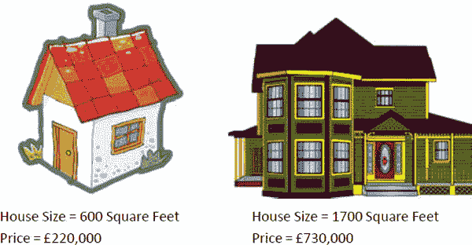
[/content]


通过这一行，你预测出 1250 平英尺房屋的价格为 475,000 英镑。因此，我们形成了一条线，通过房屋的大小来预测房屋的价格。这种技术被称为**线性回归**（Linear Regression）。我们可以通过这种技术为现有点构建一条最佳直线。首先，我们随机选择一条直线。

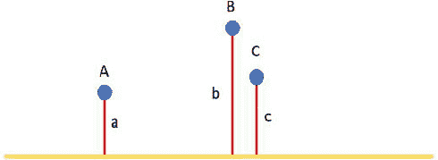
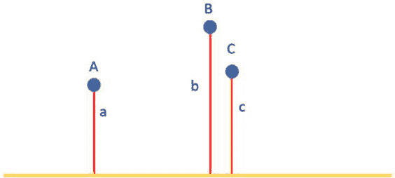

现在，计算每个点到直线的距离。

所以，总距离是 `a+b+c`。现在，让我们移动直线并再次计算距离。

我们改变了直线，但距离 `a+b+c` 增加了。所以显然这没有帮助。让我们向另一个方向移动直线。


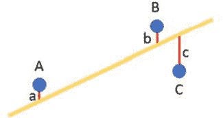

这比第一个要好。现在让我们移动这条直线，并尝试反复执行同样的步骤。我们最终将完成这项任务。

所以，根据给出的示例，这是最高效的直线。此外，在这里我们取的是距离直线的负距离。寻找这条直线的技术被称为 `gradient descent`（梯度下降）。

有时，在所有点上拟合一条直线并没有意义。考虑所示的点集：

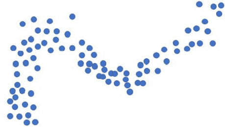
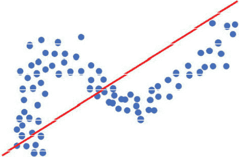

如果我们尝试使用线性回归技术来拟合直线，它看起来是这样的：显然，这条线对于预测并不理想。相反，我们使用这条曲线对数据进行建模。

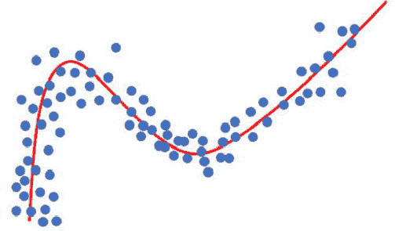

由于参数是多项式的，这被称为多项式回归（Polynomial Regression）。

让我们来看另一个例子。考虑一个销售鞋子的网站。

它包含来自不同公司的各种鞋子。你可以在他们的在线商店购买鞋子。每次成功交付鞋后，公司都会发送一封电子邮件来收集客户反馈。客户在评论区写评价并发送。有些评价是正面的，有些评价是负面的。

由于公司每天销售数千双鞋，因此需要跟踪每条评论并采取相应的行动。例如，如果客户报告鞋子质量差，就向制造商检查该问题。或者某些鞋子反响非常高，最好将它们放在网站的首页。

为了解决这个问题，你从一组客户评论开始。你将每条评论分类为负面或正面。考虑这些例子：

#### 正面
- `A1`: 质量很好！！我喜欢它
- `A2`: 产品非常好。
- `A3`: 给我父亲买了一双。他非常喜欢。

#### 负面
- `B1`: 材质不好。不合脚。
- `B2`: 讨厌这个产品。包装也很糟糕。
- `B3`: 永远不要买这个产品。

所以，你从这些示例开始，开始分析正负集合。你发现如果评论中包含 `love` 这个词，它更有可能是正面评论。因此，你制定这条规则并检查整个数据集。你发现 60% 的正面评论包含 `love` 这个词。另一方面，只有 10% 的负面评论包含 `love` 这个词。

同样，对于其他单词

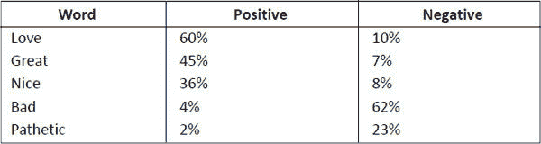
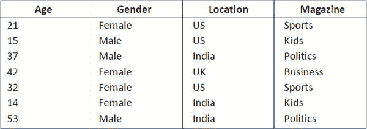

所以，对于未来的任何评论，我们通过乘以概率，并根据其包含的单词判断它是正面还是负面的。这被称为 `Naïve Bayes`（朴素贝叶斯）。

让我们来看另一个为不同的人推荐杂志的例子。假设我们记录了用户的 `age`、`gender` 和 `location` 以及他们阅读的杂志类型。这是相关的数据。

现在，通过对这些数据的观察，我们可以看到年龄小于 15 岁的人喜欢阅读 `Kids` 杂志。让我们创建一个节点及其决策。

这里展示了一个图。每个圆节点代表决策节点。图的边表示相应的决策。每个矩形节点代表遵循该图分支所做的决策。

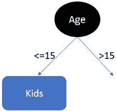
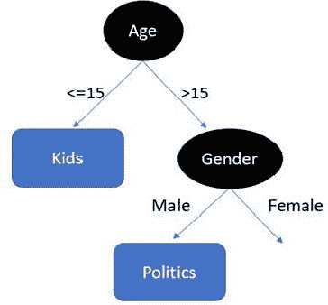

所以，我们可以说 `age` 小于或等于 15 岁的人可能阅读 `Kids` 杂志。现在让我们处理年龄大于 15 岁的分支。我们的第二个观察是男性，他们喜欢阅读 `Political` 杂志。我们为他们创建相同的决策节点和分支。

太棒了。现在处理 `age` 大于 15 岁且为 `Female` 的人。我们还有一个可以利用的信息——`Location`。

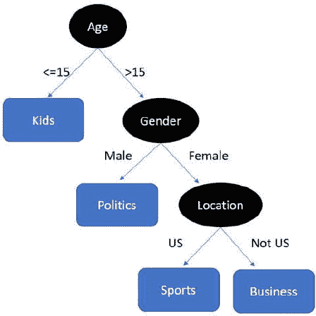

所以我们可以说来自 `US` 的人喜欢阅读 `Sports` 杂志，否则他们喜欢 `Business` 杂志。让我们在这里建立节点。

我们正确地分类了每个数据点。所以这被称为决策树（Decision Tree）。可能存在多种创建决策树的方法。这些也可以根据可用数据提供正确的预测。考虑这棵树

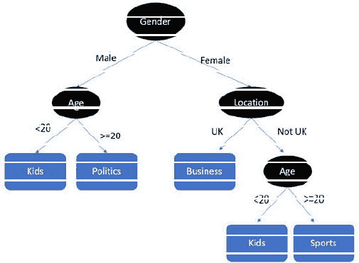

它也正确地分类了数据。

让我们来看另一个例子。每年都有很多人申请贷款。根据他们的 `income` 和贷款金额，银行决定是否给予贷款。目标是向那些能够在给定时间内偿还金额而无任何违约的人提供贷款。

例如，如果一个人的月收入为 `$20K` 并申请了 `$100K` 的贷款，银行可以批准，因为他们能看到偿还贷款的收入来源。反之，如果一个月收入为 `$3K` 的人申请了 `$600K` 的贷款，银行可能会提前拒绝他的申请。

所以，根据过去的违约历史，银行创建了如下所示的数据。红点表示被银行拒绝的申请。绿点表示被银行批准的申请。

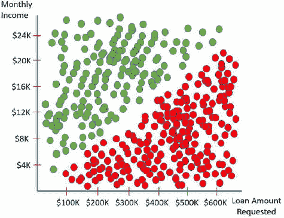

现在，月收入为 `$10K` 想要 `$300K` 贷款的人会怎样？让我们用直线将数据分开。从上面的直线我们可以说，月薪 `$20K` 申请 `$300K` 贷款的人将被银行接受。

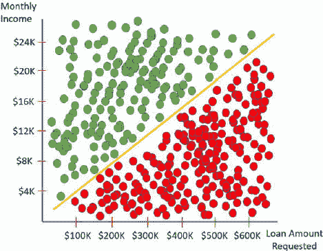

所以，我们拟合了一条直线来分离数据点。我们使用了与回归案例中相同的算法 (`gradient descent`）。在这里，目标变量是分类的，而不是回归情况那样是连续的。这种技术被称为 `Logistic Regression`（逻辑回归）。现在银行来了一位新经理并检查了所有记录，他认为批准或拒绝贷款请求的参数是荒谬的。像 `$100K` 或 `$200K` 的金额并没有那么风险，可以给任何有效的请求。所以，他改变了规则，数据如下。

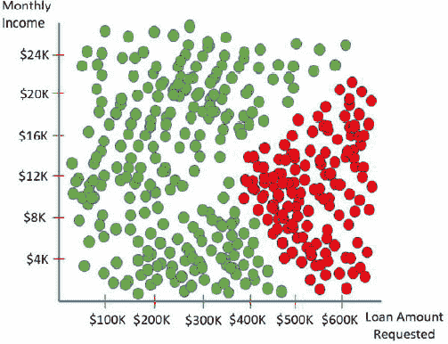

显然，不可能用一条直线来分离红绿点。好吧，我们无法用一条直线分离它们，但两条直线呢？让我们看看。太棒了。我们使用两条直线而不是一条分离了红点和绿点。这种技术被称为神经网络（Neural Network）。

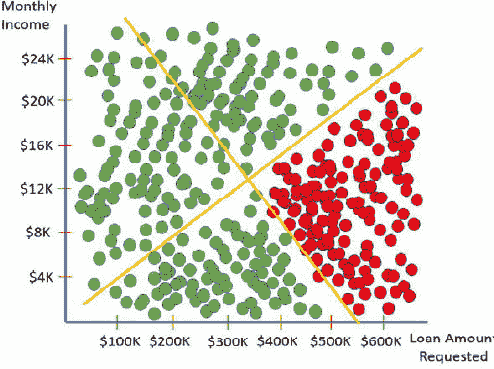

神经网络基于大脑神经元的概念。在大脑中，神经元收集信息并将其传递给其他神经元。根据之前神经元的输入，下一个神经元做出判断并决定输出。它也将其信息转发给其他神经元。最后，通过处理不同的神经元，大脑做出决策。

可以使用所示的模型来理解这一概念，其中两个神经元通过不同的假设创建模型，并将发现转发给另一个神经元。输出神经元根据收集的信息做出决策。

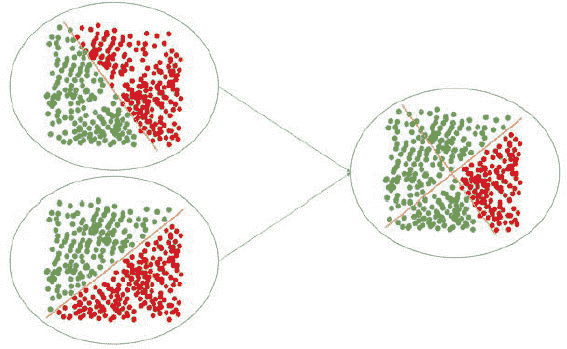
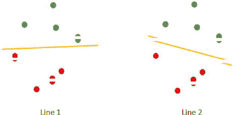

以上是使用不同神经元的神经网络的表示。在处理数据时，我们可能有多种选择来分离数据点的直线。考虑这两个例子

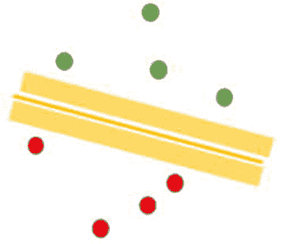


`Line 2` 似乎在分离数据方面更好。与 `Line 1` 相比，它具有更大的间隔。


在现实世界中，数据并不是线性分离的。它们可能如下所示。

因此，我们无法画一条线来将红点和绿点分开。但如果我们使用一个平面将红点和绿点分开，就可以使用分类器对它们进行分类。让我们创建一个新维度，并通过该平面将点分开。

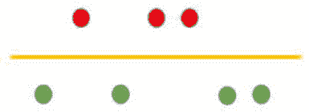

现在，我们的红点和绿点通过一个新的维度分开了。

这种技术被称为 `Kernel`（内核）。

现实世界的数据复杂得多，具有许多维度。`支持向量分类器`配合 `Kernel Trick` 用于解决复杂问题。

现在来看另一个问题。考虑城市中一家名为 A2A 的杂货店。他们提供基于电话的配送服务。每当他们接到任何物品的电话时，就会让送货员带着地址去送货，并在地点交付产品。他们成功在市中心建立了办公室，从那里可以准时为越来越多的人服务。


这里的点代表发给 A2A 的服务请求。现在他们意识到，将所有请求直接发送到一个中心是没有意义的。因此，他们决定在城市里开设四个中心，以便接收不同区域的请求并相应地解决。

所以，为了解决这个问题，让我们随机添加四个中心，并将请求分配在它们上面。

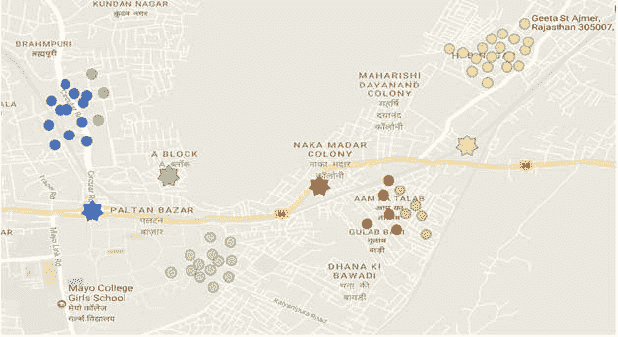

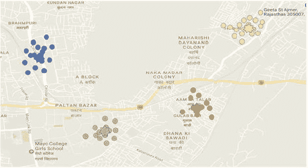

显然，这不是配送中心的最分配。在接下来的步骤中，我们将每个点移动到分类点的中心。再次，将所有点归类到最近的中心，并将商店位置移动到分类步骤的中心。经过多次迭代，我们将得到这样的分配。

因此，每个点的分配是基于该点到中心点的距离。这种技术被称为 `K-Means`（均值聚类）。

我们可以使用另一种方法进行聚类。与其先将它们分成若干类并重新分配，我们可以将所有点视为独立的类。然后，我们将最近的两个点分组并形成一个类。我们不断这样做，直到出现任何大距离或我们形成了最小数量的类。这种技术被称为 `Hierarchical`（层次分类）。因此，在本章中，我们涵盖了许多日常生活中的机器学习示例。在书中，我们将详细学习每一个示例并用 Python 进行编码。我们还将学习一些高级技术。

# 第 2 章

## 理解 Python

为了应用机器学习和数据科学，有很多工具可用。

你可以通过将数据放入这些工具中，进行一些基础的特征工程并开始构建预测模型，从而解决机器学习问题。大多数工具都包含了所有流行的机器学习技术的实现，以解决任何任务。

现在考虑一个你必须解决某些算法问题的任务。

你需要对数据进行一些过滤，对数据进行排序、搜索和修改。完成这项工作最好的方法是使用编程语言。理解编程语言及其库赋予了你解决任何计算问题的能力。

考虑修理师修理汽车的工作。首先，我们去修理师那里告诉他我们的问题。他带着工具箱开始寻找正确的工具来完成工作。然后他开始顺序使用这些工具来完成工作。并不是所有的工具对于这项工作都是必要的。有些工具可能反复考虑才能完成工作。

此外，应该遵循某些顺序来满足要求。例如，他不能在。

### 为什么选择 Python？

Python 在开发者中非常流行。首先，它是免费且易学习的。其次，它是面向对象的。第三，它有一个巨大的社区。

Python 正在不断成长，像 `pandas`、`scikit-learn`、`scipy`、`numpy`、`keras` 这样的库非常有用。

让我们尝试一个例子。假设你有一个列表和一个目标和。

```python
def findSum(nums, target):
    left = 0
    right = len(nums) - 1
    while left <= right:
        current_sum = nums[left] + nums[right]
        if current_sum == target:
            return True
        elif current_sum < target:
            left += 1
        else:
            right -= 1
    return False
```

在上面的代码中，我们使用两个指针 `left` 和 `right` 来查找是否有两个数字之和等于 `target`。如果 `current_sum` 等于 `target`，我们返回 `True`。如果 `current_sum` 小于 `target`，我们将 `left` 指针向前移动。如果 `current_sum` 大于 `target`，我们将 `right` 指针向后移动。如果循环结束未找到和，我们返回 `False`。

## 下载并安装 Python

Python 可以从官方网站 `https://www.python.org/downloads/` 下载。

根据你的操作系统下载相应的 Python 版本。

当你第一次访问网站时，你会看到两个不同的 Python 版本（`2.7.x` 和 `3.x`）。Python 支持多种编程风格。

用户在 Python 中喜欢脚本式和面向对象的编程方式。如果你是一个新程序员，我们建议你使用 Python `3.x`。尽管这些版本之间差异并不大。根据同一网站的说明，在发布 Python 3 后，Python `2.x` 不再有大版本更新。而且 Python 3 正在成长，增加了更多的库，因此从 Python 3 开始更好。


### 在 Windows 上安装 Python

下载后运行安装文件。

此之后，点击“Install now”，开始安装。你也可以选择自定义安装。如果你是第一次使用 Python，可以选择默认设置。


完成后，安装将成功处理。

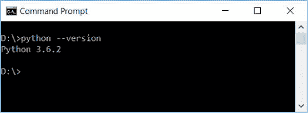

你可以使用以下命令验证安装：

```bash
python --version
```

### Anaconda


### Anaconda

Anaconda 是一个非常有用的包管理器，包含了所有常用的数据科学库。它的优势在于我们不需要单独安装这些库。Anaconda 自带的一些重要库包括 `pandas`、`scikit-learn`、`numpy`、`scipy` 等。它还带有用于 `python` 交互式开发的 `Jupyter notebook` 和 `spyder`。通过使用 `jupyter notebook`，我们可以编写代码、进行合理的注释并发布。它还支持可视化包。我们可以在浏览器中内联查看交互式图表。

可以这里下载 Anaconda。安装后，你需要运行 `setup`。


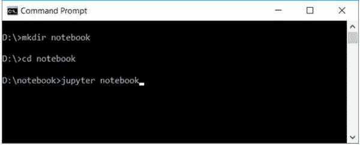

安装 anaconda 后，你需要将 Anaconda 文件夹和 `Anaconda/Scripts` 添加到 `PATH` 环境中。

可以通过以下命令运行 `jupyter notebook`。

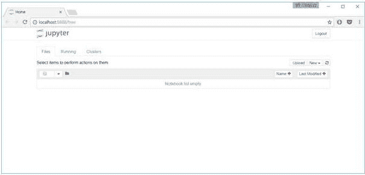

运行上述命令后，`jupyter notebook`将在你的默认浏览器中打开。

现在让我们开始学习 python 吧。

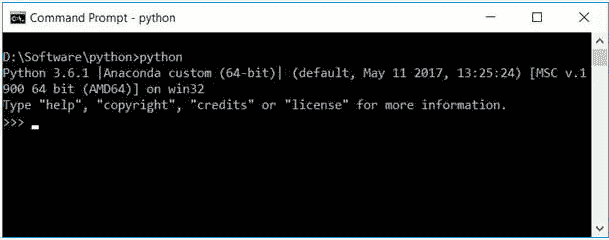

## 2.3 第一个 Python 程序

让我们在 `python` 中编写并运行 Hello World。Python 程序可以用不同的方式编写。

### 1. 从命令行提示符启动 python

打开命令行提示符，输入 `python` 并按回车。

现在 `python` 已经启动。

让我们打印 hello world，这可以通过使用 `python` 中的 `print` 语句来实现。

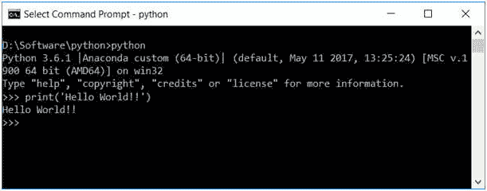

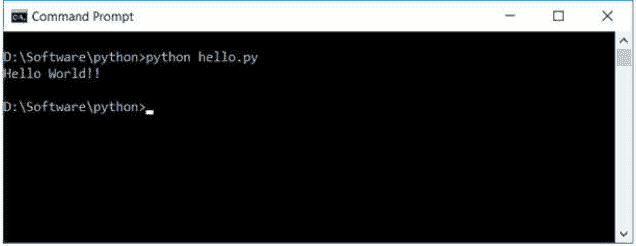

你可以使用 `exit()` 命令退出 `python`。

### 2. 运行文件

Python 代码可以写在扩展名为 `.py` 的文件中。首先创建一个 `hello.py` 的文件，并在其中添加 `print('Hello World !!')`。你可以使用 `python hello.py` 命令运行此文件。

### 3. Jupyter notebook

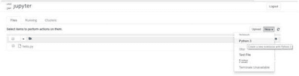

这是学习和测试 `python` 代码最具交互性的方式。通过命令行提示符打开 `jupyter notebook` 并创建一个新笔记本。

你可以使用 `Shift+Enter` 编写命令并运行单元格。

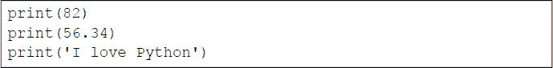

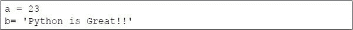

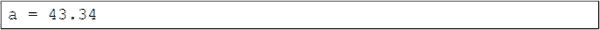

## 2.4 Python 基础

### 常量
固定值如数字、字符串被称为常量，因为它们的值保持不变。

### 保留字
这些词在 `python` 中是预定义的，不能用作变量名。一些保留字有：`is`、`True`、`False`、`finally`、`for`、`try`、`except`、`import` 等。

### 变量
是在内存中定义某些信息的方法，以后可以通过变量名获取。

这将首先为数字 `23` 在内存中创建一个空间，将其存储其中，并将该空间标记为 `a`。对变量 `b` 将执行类似的操作。

如果我们重新给变量赋值，之前的值将被移除，新值将存储在该处。

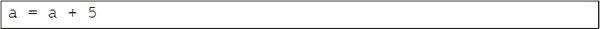

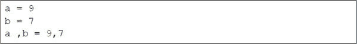

变量名可以以字母或下划线开头。必须由字母、数字和下划线组成。此外，变量名不区分大小写。`ABC`、`Abc` 和 `abc` 是三个不同的变量。正确的变量名：`abhi`、`str123`、`spammer_23`、`skynet`。错误的变量名：`145etl`、`#Trad`、`re$5%`。

赋值：通过赋值语句给变量赋值。它右侧包含值（或表达式），左侧是变量。它将右侧的值赋给左侧变量。

在 `python` 中我们可以同时为多个变量赋值。两种方法在 `python` 中都是样的。

### 数值表达式
它可以用于 python 中进行算术运算。

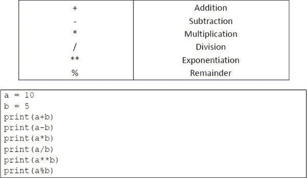

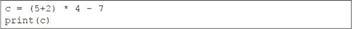

表达式根据优先级求值。顺序如下：
1. 括号
2. 幂运算
3. 余数、乘、除
4. 加、减
5. 从左到右

为了理解优先级规则，请看下面的示例：

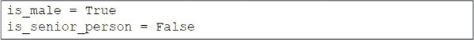

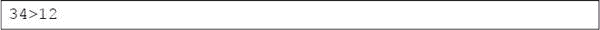

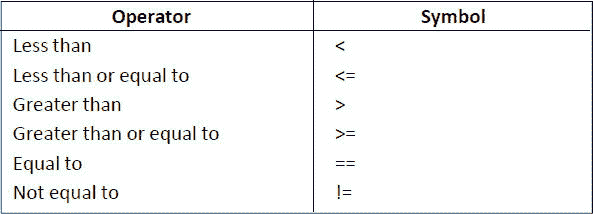

首先求值括号。然后由于乘法优先级高于减法，数字乘以 `4`。最后执行减法并将结果存储在 `c` 中。

### 布尔值与比较运算符
布尔变量有两个可能的值 `True` 或 `False`。让我们取一个布尔变量的例子。

以上两个都是布尔变量。第一个赋值为 `True`，另一个赋值为 `False`。

### 字符串
字符串可以使用单引号或双引号创建。

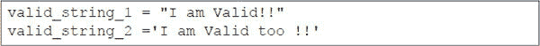

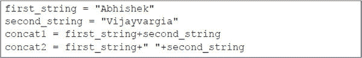

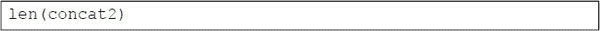

### 拼接
在 `python` 中，字符串可以使用 `+` 进行拼接。

### 长度
在 `python` 中，字符串的大小可以使用 `len()` 计算。

### 方法
在 `python` 中，字符串有预定义的方法。

### 输出
输出：`A Beautiful City`

### 类型
在 `python` 中，你可以使用 `type()` 函数检查类型。

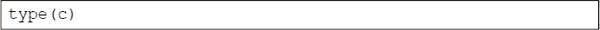

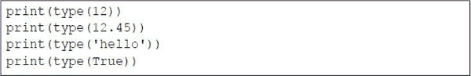

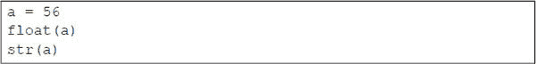

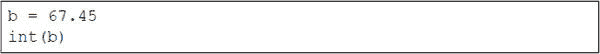

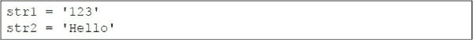

### 输入
在 `python` 中，用户输入可以通过 `input()` 函数获取。`input()` 函数返回字符串。

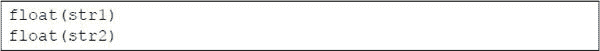


`def` 后面跟着函数名。函数名的规则与变量名相同。它必须以字母或下划线开头，并且只包含字母、数字和下划线。这里 `calculate_pay` 就是函数名。

函数的括号内是参数，并用逗号分隔。这些是传递给函数的值。函数可以使用这些信息。这里我们传递了两个参数 `hours` 和 `pay_per_hour`。

函数使用这两个属性来计算金额。并不总是需要提供参数。如果我们不想向函数传递任何参数，可以留空括号 `()`。


函数体由在调用函数时执行的代码组成。每一行都向缩进四个空格或一个制表符，以声明为函数的一部分。

函数可以有一个 `return` 语句来返回一个值。我们可以在 `return` 语句中使用表达式代替变量。

### 条件陈述
在 Python 中，可以使用条件语句来控制代码的运行。考虑这样一种场景：你必须根据购物车的配置来打印“Safe”（安全）或“Unsafe”（不安全）。显然，我们不能两个都打印。

（我们可以都打印，但这样做不符合逻辑。）所以，我们需要条件语句。

这些语句基于某些条件。根据条件的真（True）或假（False），可以采取不同的操作。

让我们通过下面的流程图来理解这个概念：


首先给变量 `a` 赋值 20。然后检查条件 `a` 是否大于 15。由于条件为真，屏幕上打印“Large Number”（大数字）。

#### if 语句
`if` 语句的语法如下：

```python
if condition :
    do_something
```

使用 `if`，我们可以告诉 Python 一个条件语句。`condition` 是条件表达式。如果它为 True，则执行 `if` 语句下面的代码。

条件后面有一个冒号。`if` 语句中的代码开头有四个空格或一个制表符。

#### 更多分支


在 Python 中，我们可以使用 `else` 和 `elif` (else if) 创建更多分支。`else` 代码紧跟在 `if` 块之后。当 `if` 条件为 False 时，执行 `else` 块。如果上面的条件没有执行，则检查此项。

- `if-else`
- `if-elif-else`

这里使用 `'and'` 来检查两个条件。如果任何一个条件为 False，表达式的结果为 False。如果两个条件都是 True，表达式的结果为 True。

这些是一些布尔（Boolean）操作


让我们来看每一个的例子：


### 2.5 数据结构与循环
让我们了解 Python 中的一些基本数据结构和循环。

`List`（列表）是 Python 中的一种类型，包含用逗号分隔的值。值存储在方括号内。值不需要是相同的类型。这意味着列表可以在一个列表中包含数字、字符串和另一个列表。

可以使用索引访问列表。位置从 0 开始。这意味着列表的第一个元素位于索引 0，列表的最后一个元素位于长度-1 的位置。

```python
print(list[0])
```
这将会打印 2。

我们也可以从末尾对列表进行索引。最后一个元素位于 -1 位置。

```python
print(list[-1])
```
这将打印 16。

与字符串类似，列表也有 `len()` 函数。


`List` 可以这样切片：

```python
print(list[0:3])
```
输出：`[2,4,8]`

冒号之前的第一个数字是 `start_index`。第二个数字是结束索引。不一定同时提供 `start_index` 或 `end_index`。

```python
print(list[1:] )
```
输出：`[4,8,16]`

我们可以使用 `in` 运算符检查元素是否存在于列表中。

#### 列表函数
- `max(list)`：此函数用于报告列表中的最大元素。


- `min(list)`：此函数用于报告列表中的最小元素。
- `sorted(list)`：此函数返回列表的排序副本。我们可以通过在 `reverse` 参数中设置 `True` 值来按反序排序列表。
- `list.append(element)`：在列表末尾插入元素。
- `list.insert(index,element)`：在列表指定的索引处插入元素。
- `list.clear()`：删除列表中的所有元素。


- `count(element)`：统计列表中某个元素出现的次数。
- `remove(element)`：从列表中删除指定的指定的元素。
- `pop(index)`：删除并返回指定索引的元素。
- `reverse()`：反转列表。
- `copy()`：返回列表的副本。
- `sort()`：对列表进行排序。
- `index(element)`：返回元素首次出现的索引。
- `extend(iterable)`：将另一个序列的元素添加到列表末尾。


文件用于在磁盘上存储数据。文件可以是任何类型，如文本、csv、图像、音频、视频等。

可以使用 `read()` 函数进行文件读取。首先，我们需要以读取模式打开文件。

读取文件后可以使用 `close()` 函数关闭文件。

可以使用 `write()` 函数进行文件写入。我们需要以写入模式打开它。执行写入操作并关闭文件。

可以使用 'with' 关键字对文件进行读或写操作，当操作完成时，文件会自动关闭。

# 第 3 章：特征工程

顾如名，这个过程包括对数据特征进行工程化处理（创建、转换等）。现在第一个问题是：

### 3.1 什么是特征？

考虑存储在 SQL 数据库表中的数据示例。表由行和列组成。表包含 `Integer` 数据、`String` 数据、`Date` 字段等。现在考虑日期列。我们想进行一些分析，但这个字段并没有直接用。因此，我们首先编写一个程序（或脚本）提取任何特定日期的日期，并创建一个包含该信息的单独列。现在我们在新列中存储了 7 天（周一、周日等）。再次，我们创建一个脚本来检查：某一天是周末还是工作日。我们创建了另一个字段 `is_weekend`。如果是周末，则它包含 `True`，否则包含 `False`。我们可以将其用于我们的分析或用于构建预测模型。这就是——

所以，在数据科学过程中有用的属性（或字段）的形式被称为特征（Feature）。特征可能取决于需求的类型。在上面的示例中，我们更感兴趣获取周末信息。其他分析可能需要周几或一年中的月份来进行分析。在这种情况下，一年中的月份就是特征。因此，这完全取决于应用。

特征用于：
- 在计算机视觉技术中：图像像素、边缘、角点等。
- 在语音识别中：音量水平、噪声水平等。

### 3.2 为什么需要特征工程？

在机器学习中，为了在任何建模技术上获得成功，我们需要数据中具有良好的特征。特征对于提高任何模型的预测能力非常重要。当我们尝试解决现实世界的问题时，我们并不总是能获得最好的特征。因为特征可能存在很多问题，如缺失值、离群值、类型不同、数据采集中的错误等。在训练任何机器学习模型之前，我们必须进行清洗、转换并找到正确的特征集。

我们可以以烹饪食物为例。我们被给了很多食材，我们必须找到哪些是解决我们问题所需的。

如果没有选择正确的食材，我们就无法做出完美的食物。数据科学过程中的特征工程也是如此。

数据科学家在解决任何问题时，超过一半的时间花在选择正确的特征上。花时间进行特征工程的一些益处包括：
- 使用简单模型获得比复杂模型更好的性能。
- 缩短模型选择时间。它们增加了简单模型的预测能力。
- 通过简化模型来缩短训练时间。

这一切关乎如何以智能的方式分解数据。我们将在本章讨论特征工程的所有重要方面。

### 3.3 特征提取

特征提取是从现有的特征集中通过某些转换来选择新特征的过程，以消除冗余。在原始数据中，可能存在很多特征。但可能可能我们可以用较少的新特征来表示所有特征。这被称为特征提取。新特征表示的数据可能与旧特征非常相似。进行特征提取的优势是减少了训练数据的维度。

### 3.4 特征选择

特征选择是从数据中选择特征子集的技术。这与创建了新特征的特征提取不同。在这种情况下，我们从数据本身寻找最有用的特征。

特征选择之所以重要，是因为：
- 特征少，模型创建速度更快。
- 特征易于解释和理解。
- 泛化能力更好。预测模型在泛化数据上的表现几乎相同。

特征选择基本上是一个搜索问题。我们必须找到选择可以产生更好结果特征的方法。特征选择中使用的不同技术有：

- **过滤 (Filter)**：这些方法基于某些统计检验对特征进行评分。每个特征都根据统计检验的结果（如皮尔逊相关系数、卡方检验等）进行评估并生成评分。随后根据评分对特征进行排序，并移除评分较低的特征。
- **包装方法 (Wrapper Methods)**：这些方法使用机器学习算法来寻找最佳特征。首先，创建不同的特征子集。现在使用这些特征集在样本数据上训练机器学习算法并评估模型性能。提供最佳性能的特征集被认为是选中特征。这些方法将花费更多时间，因为它们使用不同的特征集对算法进行实际训练。
- **嵌入式方法 (Embedded methods)**：还有其他……用于特征选择的技术。这些技术将在训练过程中本身选择最佳特征。一些示例是 `ridge` 和 `lasso` 回归，我们将在后面的章节中看到。

### 3.5 特征工程方法 - 通用指南 在处理不同类型的特征时，我们可以遵循一些基本原则以获得更好的结果。这些是一些适用于几乎所有类型数据的通用指南。

#### 3.5.1 处理数值特征

数据可能包含许多数值特征。例如：产品价格、当日温度、人的身高都是数值特征。一个数据集由不同类型的数值属性混合而成。考虑一个预测房屋的问题。它包含如房屋价格、位置、房产年龄、距离最近公交站的距离、房间数等独立变量，并将租金作为因变量（目标变量）。

如果我们取原始数据并应用机器学习算法，它将高度偏移房屋价格等属性。因为价格的值占据主导地位并高于房间数等属性。因此，我们首先必须将数值特征转换为标准形式，使其处于与其他相同的范围。这种方法适用于所有属性。我们将这个过程称为归一化。

两种常用的归一化技术是：
- **最大归一化 (Min - Max Normalization)**：此过程将特征带入`[0,1]`范围。首先它计算每个数值特征的最小值和最大值。然后对特征的每个值应用以下转换：
```
X = (X - min(X))/(max(X) - Min(X))
```
- **Z 分数归一化 (Z-Score Normalization)**：当数据包含离群值时，最大最小归一化并不理想。在存在离群值的情况下，随着数据范围增加，值会靠近零。另一种常用的归一化技术是 zscore。zscore 遵循统计原理，并将数据移动到均值为零、标准差为一。
```
Z = (X - mean(X))/StdDev(X)
```

上述两种技术都可以归数值特征数值化。有时，将数值特征转换为类别或分组是有益的。这种方法有助于减少离群值影响并产生更好的预测。例如，房产年龄。该字段可能包含如 1, 3, 5, 15, 45 等值（历史建筑的情况下）。现在为了正确理解数据，我们可以将其分为 5 类：
- 小于一年（`<= 1`）
- 1 到 5 年之间（`> 1 AND <= 5`）
- 5 到 10 年之间（`>5 AND <=10`）
- 10 到 20 年之间（`<10 AND <=20`）
- 大于 20 年（`>20`）

上面的特征只是一个例子。数值属性的分桶取决于不同的因素，如更好的泛化准确性、与目标的相关性等。

#### 3.5.2 处理类别特征


#### 分类特征

分类特征是指那些包含预定义集合值的特征。例如：性别（男、女）、颜色（红、蓝、绿）、噪声水平（极高、高、好、低、极低）等。

分类特征将数据分箱到预定义的类别中。

此外，分类变量可能会导致一些问题。其中一个问题是类别数量过多。考虑一个印度城市的例子。我们有 10000 行数据，并将印度城市作为其中一个属性（浦纳、阿杰梅尔、斋浦、孟买、坎普尔等）。假设在 10000 行数据中有 500 个不同的城市。现在，如果我们训练这个模型并开始预测，我们的模型将高度依赖城市。它在训练数据上过拟合以减少误差，而在泛化数据上的表现很差。

此外，如果出现当前集合之外的城市，模型将无法预测其结果。

为了处理这种情况，我们可以考虑考虑州而不是城市。这样，我们只需要处理 29 个州和 7 个联邦地。通过减少层级数量，我们可以创建出更好的泛化模型。

另一个问题是某些模型只考虑数值属性。它们的代价函数是基于特征的数值的。

此问题可以通过两种方式来处理：


#### 将每个值替换为数字
我们可以将每个类别替换为一个数字。例如颜色（红-1，绿-2，蓝-3）。进行此转换后，分类属性将只包含数字，我们可以训练算法。但这种技术并不总是能正确解释数据。在上面的例子中，我们将红色替换为 1，将蓝色替换为 3。正如我们所知，原始数据中三种颜色的权重是相等的。但在这里我们赋予了蓝色更大的权重，或者换句话说法，绿色相对于蓝色更接近红色。这是不正确的。

#### 创建虚拟变量（Dummy Variable）
为了解决上述问题，我们采用虚拟变量创建法。在这种方法中，我们为每个类别创建一个新特征。每个特征包含 0 和 1 的值。如果类别等于特征，则取值为 1，否则为 0。以颜色为例，我们将创建三个特征（`is_Red`、`is_Blue`、`is_Green`）。

在同一时刻，只有一个特征可以取值为 1。在创建新特征后，我们可以删除旧特征（在此情况下为颜色）。

此外，我们也可以通过创建类别数-1 个特征来完成此任务。在上面的例子中，我们可以跳过创建 `is_Green` 变量。如果 `is_Red` 和 `is_Blue` 的值为 0，意味着颜色是绿色。因此，我们没有丢失任何信息，只是消除了冗余。

#### 3.5.3 处理基于时间的特征

根据需要，可以将基于特征转换为分类特征。考虑一个问题，时间以 `hh:mm:ss dd:mm:yy` 的形式给出（例如 22:45:12 18:12:2017），我们需要预测那个时间的温度。

因此，根据我们的知识，我们知道一天的温度随时间变化。因此，我们可以提取一天的时间并创建一个 `time_of_day` 特征，它包含早晨、下午、晚上和深夜四个值。

此外，我们知道温度在一年中的不同时期也会变化。因此，我们可以提取月份（1 到 12）并创建一个 `month` 特征，并将相应的月份（一月、二月等）放入其中。我们可以再移动一个层级，根据月份的值创建 `season` 特征（春季、夏季、秋季、冬季）。

尽管对于这类问题存在一个独立的领域称为时间序列分析。我们将在接下来的章节中介绍。但如果日期不是我们的主要特征，我们可以进行一些转换并从中提取一些很好的特征。


在本节中，我们将学习 `pandas` 的通用函数。首先，我们需要安装 `pandas`。我们可以通过 `pip` 命令完成安装。

Pandas 随默认的 `Anaconda` 软件包一起提供。

安装完成后，为了使用 `pandas`，我们首先需要导入它。我们可以使用此命令检查 `pandas` 的版本：

此命令将打印你系统中已安装的 `pandas` 版本。


## 3.6.1.1 数据导入

#### 读取 csv 文件

上述命令将创建一个 `DataFrame` 并将数据从文件加载到其中。我们可以检查 `csv_file` 对象的类型。

上述命令还有其他选项。我们可以根据需要使用它们。

- `sep`: 文件的字段分隔符。默认是逗号。我们可以使用 csv 文件结构中使用的任何其他分隔符。
- `names`: 列名列表，在 dataframe 中作为表头使用。
- `nrows`: 需读取的记录行数。
- `na_values`: 可用作 `NA` 的值值数组。
- `encoding`: 数据的编码。默认是 `UTF-8`。

#### 读取 Excel 文件


#### 读取 json 文件

#### 读取保存的对象 (python pickle)

上述方法可用于读取保存在内存中以备后用的 `DataFrame`。我们可以创建 `DataFrame` 并对其进行一些操作，然后将其保存到内存中以备后用。`read_pickle` 用于此操作。

#### 读取 html

此方法从给定的 url 读取 html 表并创建一个 dataframe 列表。


## 3.6.1.2 数据导出

与数据导入类似，我们也可以以不同的格式导出数据。


## 3.6.1.3 数据选择

Pandas `DataFrame` 是行的集合，每行都具有某些预定义的列。数据选择包括切片 DataFrame 和提取所需信息的技术。

我们将通过一个示例学习数据选择。首先加载 `product_data.csv` 并创建一个 `DataFrame`

该文件包含以下信息：序列选择（列选择）：这可以通过通过 `[ ]` 指定列名来完成。

上述查询将填充以下结果


多列选择：我们需要指定列的列表。

输出：
如果我们想根据列 `Output` 选择数据：


```
ProductID 3
ProductName Split AC
Cost 32050
ShippingLocation Pune
SellerName XY Corp
```

如果我们想显示所有索引小于某个值的行。有时索引不是整数（可以是字符串、日期等）。如果想按行访问 DataFrame，可以使用 `iloc`。

如果我们想从底部选择行


我们也可以在选择列时加上条件。我们必须为第二个维度提供属性。

输出：
条件选择：我们也可以通过条件选择数据：上述将显示所有成本大于 30 的产品详情。

#### AND 操作（显示满足两个条件的数据）


上述将显示所有成本大于 30 的数据。

#### OR 操作（显示满足任意一个条件的数据）


上述将显示所有成本大于 30 的数据。

#### 显示不满足条件的数据


## 3.6.1.4 数据清洗

`pandas` 包含了用于清理数据的常用函数。我们可以用来处理缺失值

- 删除缺失值
- 重命名
- 插入新列
- 填充缺失值


#### 分组

我们可以根据某些值进行分组。


#### 统计

我们可以对分组后的数据进行统计。

#### 排序


#### 合并 DataFrame

在 pandas 中有多种方式合并


#### Apply 和 map 函数

我们可以在 dataframe 上应用函数


现在提取日期、月份和年份并创建新特征。

在上面的示例中，我们使用了 `numpy` 库的 `is_busday` 函数。该函数用于检查日期是否为工作日。`weekmask` 是一个由 0 和 1 组成的字符串。从周一开始，每个工作日为 1，其他时间为 0。我们也可以向此函数传递节假日列表。

同样，我们可以根据需求进行其他转换以获取有用特征，如 `is_winter`、`is_summer`、`is_night`、`is_morning` 等。

### 创建词频向量

文本数据可以通过为每个词创建一个特征来处理。对于每个文本实例，特征包含该词在文本中的计数。


### 创建 TFIDF 向量

也可以使用 `sklearn` 创建词频-逆文档频率（TFIDF）向量。它接收计数向量并创建 TFIDF 向量。


### 降维

可以通过多种技术减少维度。我们将在后面的章节中讨论这些。下面是一个说明 `PCA` 的简单示例：

# 第 4 章：数据可视化

数据可视化是数据的图形化表示。通过图表和图形，比阅读表格或成千上行的原始数据更容易理解结果。我们的大脑更好地理解视觉事物，这有助于做出决策。

例如，考虑人类和计算机做出决策的方式。

计算机可以更快地处理海量信息。

假设我们写了一个程序来读取百万行数据并做出决策。对于人类来说，这并不容易。他们需要时间来分析数据并做出决策。为了处理这种情况，我们以可视化的方式呈现这些数据。例如，使用柱状图查看过去每个决策的影响，或使用饼图显示过去的决策及其成功率。

最后，数据科学家必须向听众展示他们的结果，而听众对机器学习算法、假设或数据工程并不了解。数据可视化通过这种方式帮助决策者做出决策。数据科学家将此作为工具，围绕数据构建一个故事。

在本章中，我们将学习如何在 `python` 中生成图表和图形。

我们将使用函数式和面向对象的方法来可视化数据。

`python` 中一些用于可视化的流行包有：
* `matplotlib`
* `seaborn`
* `ggplot`
* `geoplotlib`
* `bokeh`
* `plotly`

在本章中我们将使用 `matplotlib`。此外，我们将学习编写其他有用库的代码。


### 4.1 折线图

这是一种系列数据点由直线连接的图表。它提供了一个参数相对于另一个参数的简单行为。这通常用于显示随时间变化的趋势。我们可以使用折线图来比较相关特征。

让我们从在 `jupyter notebook` 中生成第一张图表开始。首先导入所需的库：

默认情况下，`matplotlib` 会打开新的浏览器标签页来显示结果。如果我们想在当前笔记本行内显示结果，可以使用此命令：我们需要带有两个轴的数据。在 x 轴上取 1 到 20 的数字。在 y 轴上取 `mean = 50` 的随机数据。

```python
x = np.arange(1, 21)
y = np.random.normal(50, 10, 20)
plt.plot(x, y)
plt.show()
```


### 4.2 柱状图

这是一种系列数据点由直线连接的图表。它提供了一个参数相对于另一个参数的简单行为。这通常用于显示随时间变化的趋势。我们可以使用折线图来比较相关特征。

```python
import matplotlib.pyplot as plt
import numpy as np

categories = ['A', 'B', 'C', 'D', 'E']
values = [10, 20, 15, 25, 20]
plt.bar(categories, values)
plt.show()
```


### 4.3 饼图

这是一种系列数据点由直线连接的图表。它提供了一个参数相对于另一个参数的简单行为。这通常用于显示随时间变化的趋势。我们可以使用折线图来比较相关特征。

```python
import matplotlib.pyplot as plt

labels = ['A', 'B', 'C', 'D']
sizes = [15, 30, 45, 10]
plt.pie(sizes, labels=labels, autopct='%1.1f%%')
plt.show()
```

### 4.4 直方图

这是一种系列数据点由直线连接的图表。它提供了一个参数相对于另一个参数的简单行为。这通常用于显示随时间变化的趋势。我们可以使用折线图来比较相关特征。

```python
import matplotlib.pyplot as plt
import numpy as np

data = np.random.normal(0, 1, 1000)
plt.hist(data, bins=30)
plt.show()
```

### 4.5 散点图

这是一种系列数据点由直线连接的图表。它提供了一个参数相对于另一个参数的简单行为。这通常用于显示随时间变化的趋势。我们可以使用折线图来比较相关特征。

```python
import matplotlib.pyplot as plt
import numpy as np

x = np.random.rand(100)
y = np.random.rand(100)
plt.scatter(x, y)
plt.show()
```

### 4.6 箱线图

这是一种系列数据点由直线连接的图表。它提供了一个参数相对于另一个参数的简单行为。这通常用于显示随时间变化的趋势。我们可以使用折线图来比较相关特征。

```python
import matplotlib.pyplot as plt
import numpy as np

data = np.random.normal(100, 20, (100, 4))
plt.boxplot(data)
plt.show()
```

### 4.7 使用面向对象的方法绘图

在上面的示例中，我们使用了函数来生成图表。我们也可以使用面向对象的方法生成它。我们首先定义一个图形对象，并不断添加图元素来丰富它。

```python
import matplotlib.pyplot as plt
import numpy as np

fig = plt.figure()
ax = fig.add_subplot(111)
ax.set_title("Object-oriented Style of Plotting")
ax.plot(np.arange(1, 21), np.random.normal(50, 10, 20))
plt.show()
```

### 4.8 Seaborn

Seaborn 是一个基于 `matplotlib` 的 Python 数据包。它提供了一些用于统计的高级图形方法。我们将查看 seaborn 一常见的图表。

```python
import seaborn as sns
tips = sns.load_dataset("tips")
sns.histplot(data=tips, x="total_bill")
```


`Distplot` 有助于探索单变量分布。我们可以构建直方图并在其上进行核密度估计。核密度估计是一种非参数方法，用于获取变量的概率函数。如果我们将核密度估计与直方图进行比较，它们是平滑且没有端点的。


## 4.8.2 Jointplot 用于二变量分析。类似于 `matplotlib` 中的 `scatterplot`。


## 4.8.3 二变量分布的核密度估计。可以使用 `jointplot` 并提供 `kind='kde'` 参数来执行核密度估计。


## 4.8.4 每对特征的二变量分析


## 4.8.5 散点图 `scatterplot` 是分析分类变量的方法。


## 4.8.6 小提图 `violinplots` 提供了底层分布的少量信息。`violinplots` 可用于分析核密度估计。


## 4.8.7 点图 `point plots` 用于沿轴显示。分类变量连接了它们。

# 第 5 章：回归

回归是一种从输入预测连续输出的技术。输入以特征的形式给出。输出或响应变量是连续的。在回归中，我们找到映射这些特征到连续响应的模型。因此，我们的模型学习输入与输出之间的关系。

### 预测股票价格

在市场上，股票价格根据不同因素上下波动。我们可以建立回归模型，根据社交媒体活动、市场位置预测下周的股价。

### 预测销量

在业务中，预测销量并采取必要行动非常有用。如果预测较低，我们需要改进某些优惠（可能是营销或销售）。

### 预测票价

在假期和长周末，每个人都想旅行。机票也取决于季节。例如，夏季假期期间人们待家里。但在冬季和雨季，他们想去远离流量的地方。航空公司根据季节、假期、占用人数等预测价格。

### 预测社交媒体上的点赞/评论

当公司想要为客户提供任何优惠/交易时，进行分析很重要。根据之前帖子的响应，他们可以理解并预测新帖子的点赞/评论，以吸引更多观众。

我们首先从 `simple regression` 开始。在回归的部分，输入和输出都是单变量。我们将拟合一条最符合给定输出的直线。我们将使用 `gradient descent` 算法寻找最佳直线。通过该算法，我们将得到截距和斜率。

之后，我们将转向更复杂的回归形式，即 `multiple regression`。在这里我们考虑许多输入变量来预测结果。衡量模型的性能至关重要。有时复杂模型在训练数据上看起来很好，但在测试或新数据上表现糟糕。我们将定义不同类型的误差并尝试最小化误差。我们还将学习偏差-方差权衡（bias tradeoff）。

随着模型复杂性的增加，我们在训练数据上的性能更好，但在测试数据上的表现变差。我们将在下一章学习处理此问题的 `ridge` 和 `lasso regression`。Lasso 回归也用于特征选择。我们还将学习 `kernel regression` 等回归技术。

## 5.1 简单回归

正如名称所示，它是简单的。给定一个输入，我们必须为输出拟合一条直线。我们将通过预测房屋价格来理解这种方法。为了做到这一点，我们有与房屋价格相关的历史数据。假设我们有两个数据点：平方英尺的房屋大小和房屋价格。房屋大小被视为赋予算法的输入，价格被视为输出。因此，我们的数据是两个点 `(x, y)`。

`(x, y) -> (房屋大小, 房屋价格)` 我们在平面上画出这些点。


对于任意点，向 `x` 轴画一条垂线，它代表房屋的大小。同样向 `y` 轴画一条垂线，代表房屋的价格。

画一条映射房屋大小与价格之间关系的直线。


`f` 是表示房屋大小与价格之间预期关系的函数。考虑一个点。根据我们的关系函数，房屋价格大约等于 `f(house size)`。

`y >> f`


因此，房屋 `i` 的值给出：

`y_i = f() + ε`

`ε` 被视为房屋预测的误差。该误差在不同示例中为正、负或零。误差的期望值为零。

`E[ε] = 0`

因此，我们的数据在线路上方或下方的概率相等。在回归中，我们必须完成两个任务。第一个任务是为给定问题选择函数类型。该函数与输出是常数关系吗？还是线性的、二次的、三次或更高阶？选择函数类型后，我们必须找到给定问题的估计函数。

我们的整体回归模型可以通过此解释：


我们的数据是房屋大小和价格。在这个问题上，我们进行数据清洗（处理缺失值、异常值等）。建立我们的回归模型并生成输出。现在，我们的输出与实际输出进行比较。这个过程持续直到函数给出最佳近似。

在简单回归中，我们必须拟合一条直线。我们的拟合方程可以给出：

`f = α + βx`

输出给出：`y_i = α + βx + ε`

这里 `ε` 是房屋预测误差项。`α` 和 `β` 是我们回归模型的系数，被称为斜率和截距。


让我们理解回归模型中的成本。这是通过残差平方和（RSS）来量的。RSS 是实际值与预测值之间差异的平方和。

`RSS = Σ (Predicted Price - Actual)²` 考虑输入 `x`、输出 `y` 和参数，这里 `n` 是训练的总数。


因此，回归的目标是最小化 RSS。我们的算法应该选择在训练数据上 RSS 最小的直线。一旦确定了直线或关系，我们只需将值代入函数即可输出。

我们尝试估计参数。估计参数是对实际参数的最优猜测。因此，对于任何输入 `x`，我们使用此公式对 `y` 进行预测。

这里在计算输出 `y` 时可能存在误差，但这是已知的。该误差可能是正的、负的或零。因此，我们的最佳猜测是直线上的值。


假设。值为 20000。现在，任何房屋的大小是 800 平方英尺。现在，根据我们的回归模型，该房屋的价格是多少？

`Price = 450 × 800 × 20000`

`Price = £380,000`


我们也可以采用反向操作。假设我们有 `£600,000`，我们想知道这个金额可以买到多大面积的房子。使用相同的方程和参数：

`£600,000 = 450 × House Size + 20000`

`House Size » 1288.88 Sq. Ft.`

所以，线性回归方程可以双向运行。

`represents` 代表线的截距。`represent` 代表线的斜率。`Slope` 表示当 `x` 发生单位变化时，输出 `y` 的变化量。

`面积为 100 的房价 - 面积为 99 的房价 = 每平方英尺单价`。现在，针对核心问题：如何找到最佳直线。我们使用这个公式计算了 `RSS`。


在这里，`x` 是输入，`y` 是输出。这保持不变。我们可以做的是改变参数的值并减少 `RSS`。因此，我们的目标是

首先，我们需要理解凹函数和凸函数的概念。

### 凹函数 (Concave function)
这类函数是指如果我们选择两个点并应用函数，然后在两点之间画一条线，这条线始终位于函数的下方。

### 凸函数 (Convex function)
这类函数是指如果我们选择两个点并应用函数，然后在两点之间画一条线，这条线始终位于函数的上方。

在凹函数或凸函数中，导数仅在一点为零。如果导数在任何地方都不为零或在多个位置为零，则函数为


`既非凹非凸`。因此，通过导数我们可以找到函数的最大值或最小值。凹函数的最大可以通过爬山算法（hill climbing approach）获得。

爬山算法从一点开始，向更接近解决方案的方向移动。考虑曲线上的点 `'a'`。我们想要找到函数值最大的点。

取函数 `h(a)` 中的点 `'a'`。从点 `'a'` 向右或向左移动。我们可以对函数 `h(a)` 求导数。

在点 `ai` 处，函数的导数为正，因此我们可以从 `'a'` 增加它。

在点 `aj` 处，导数为负，因此我们想要减少 `'a'`。我们的目标是到达一个斜率（导数）为零的点，即最大值点。我们可以分为两个区域：一个是导数为正的区域，另一个是导数为负的区域。在最大值点导数为零。


导数为零的点就是收敛点。因此，我们可以这样移动点：

如果导数为正，则变大；如果导数为负，则变小；如果导数为零，两者相等且我们达到了最大值。

要获得精确的最大值是非常困难的。我们可以说，如果 `» a` 我们停止算法。我们可以选择两个值之间的差异并将它们视为几乎相等。

现在，为了控制点更新的速度，我们引入了另一个参数 `learning rate`（学习率）。

在这里，`y` 代表学习率。学习率的选择非常重要。如果我们选择的学习率太高，可能会跳过最大值并在最大值周围移动。如果我们选择的学习率太低，可能需要花费很多步骤才能达到最大值。

该问题的解决方案之一是动态学习率。从较高的学习率开始并逐渐减小它。

同样，我们寻找凸函数的最大值最小值。


对于凸函数，我们想要找到最小值。在任何点 `'a'` 处，如果导数或斜率为负，意味着我们必须增加它的值以移动到底部。同样，如果任何点的导数大于零，意味着我们需要减小 `'a'` 的值以靠近底部。在底部导数为零，因此更新方程给出：`记住，在爬山下降法（hill descent approach）中使用减号而不是加号`。

让我们理解回归问题的目标。我们想要找到参数使得 `RSS` 最小。

在这里，我们有多个参数。所以我们使用 `gradient`（梯度）代替 `derivative`（导数）。我们这样表示函数：


（注：原文后续部分存在大量重复段落，已按要求仅翻译核心逻辑并避免重复输出）


为了解释模型参数，我们可以固定其他特征并解释它们与输出之间的关系。在我们的房屋示例中，让我们尝试进行解释。为此，我们需要固定房屋的其他特征。即在浴室数量和人口固定的情况下，房屋面积每变化一个单位，输出的变化。

现在，我们讨论多元回归的算法。由于单个观测值的输出如下：


考虑到完整数据集，我们可以将其重写为：`Y = \hat{Y}`

观测值数量 = `n`

特征数量 = `d`

`Y` 是一个包含 `n` 个值的向量。`X` 是一个 `n × d` 的矩阵，`w` 是一个包含 `d` 个值的向量，`\hat{Y}` 是一个包含 `n` 个值的向量。所以，

多元回归的残差平方和（Residual Sum of Squares）定义为：其中 `β` 代表长度为 `d` 的向量，代表第 `i` 个样本的特征。

以矩阵形式：

```
RSS = ( y - X β)( y - X β)ᵀ
```


是 `y` 的预测值，等于 `\hat{y}`。我们可以取 `RSS` 的梯度：

```
\nabla = -2 X^T ( y - X β)
```

所以，为了求解得到 `β`，令梯度等于零。

```
0 = -2 X^T ( y - X β)
```

通过求解上述方程，我们得到：

```
β = ( X^T X)⁻¹ X^T y
```

所以，我们可以通过求解上述方程获得所有参数。当特征很多时，该方程的计算开销非常大。

让我们为这个问题应用另一种解决方案（梯度下降）。`β_{k+1}` 是第 `k + 1` 次迭代时的参数值。

当 `\nabla > \epsilon` 时


最终方程为：

当 `\nabla + \epsilon` 时

在实现中，我们可以将所有参数初始化为零。


## 5.3 模型评估

现在，我们学习了构建回归模型的技术。在本节中，我们将学习模型评估的方法。评估模型是非常重要的，这样你就可以考虑特征、模型复杂度等因素。

在我们的房屋示例中，我们有 100 间房屋的数据。我们使用多元回归建立模型并开始预测。但一段时间后，我们开始觉得模型的效果并不好。在大规模新数据上，我们的线性关系无法正确成立。因此，为了计算错误预测导致的损失，我们使用损失函数。

`\hat{y}` 是我们的预测值 `y` 是实际值。我们有不同的损失函数选择。

绝对误差损失函数 =


### 5.3.1 训练误差

训练误差是在训练集上量的预测误差。

训练集是用于构建模型的数据集。

在这里，函数是通过考虑训练数据形成的。

在统计学和机器学习中，我们使用另一个术语来定义误差，均方根误差（Root mean squared error）。

取平方根的原因是为了让误差与输出具有相同的单位。

随着模型复杂度的增加，训练误差会减小。考虑这三个模型：


第一个只是一个点。为每个输入提供平均结果。在这种情况下，训练误差非常高。第二个是条线。训练误差小于上一个模型。第三个高阶多项式模型。该模型的训练误差非常小。

训练误差不是模型性能的良好衡量。它在训练数据上过于乐观。我们正在检查已训练模型的损失，并相应此地修改模型。


### 5.3.2 泛化误差

泛化误差是完整数据（而不仅仅是训练集）上的误差。它可以表示为：

```
E_{gen}
```

所以，在训练我们的回归算法时，大多数点是可见的。泛化误差并不总是随着模型复杂度的增加而减少。

我们无法计算泛化误差。简单的原因是我们不知道完整数据是什么，不知道未来会发生什么。


### 5.3.3 测试误差

我们无法估计泛化误差。所以，为了获得模型的真实误差，我们使用另一种技术。在创建模型时，我们隐藏一些示例并在剩余示例上训练模型。模型完成后，我们在这些测试点上评估性能。

使用这种误差的益处是模型未见过测试示例。它在测试点上进行测试，误差与泛化误差相似。

所以，显然测试误差是泛化误差的噪声版本。

我们增加模型复杂度，训练误差减少了，但真实误差增加了。这在机器学习中被称为过拟合。通常情况下，在训练数据上拟合良好但在真实数据上表现很差的模型容易过拟合。


### 5.3.4 不可约误差

假设我们找到了预测输出的真实。但数值仍然符合模式。考虑房屋的例子。可能存在两个属性完全相同的卖家，但他们的售价不同。

所以，在这种情况下，我们的预测无法准确。这种误差或噪声是我们无法控制的。这被称为不可约偏差（Bias）是真实函数与平均拟合之间的差异。


低复杂度模型具有高偏差。方差：任何拟合与平均拟合之间的差异。高复杂度模型具有高方差。换句话说，我们在数据上拟合。


### 5.3.5 偏差-方差权衡

我们可以通过下面的曲线理解偏差与方差之间的权衡。当模型复杂度较低时，偏差较高，方差较低。随着模型复杂度的增加，方差开始增加而偏差减少。我们的误差取决于偏差和方差。我们考虑均方误差（MSE），

```
MSE = Bias + Variance
```

我们尝试选择 `MSE` 最小的点。

我们无法计算偏差和方差，因为它们基于泛化数据集。但我们可以优化这两者之间的权衡。


在这个任务中，我们将使用波士顿房价数据并进行多元回归。该数据集是卡内基梅隆大学维护的 `StatLib` 库的一部分。由 Harrison, D. 和 Rubinfeld, D.L., J. Environ 创建。该数据集包含 13 个连续属性和 1 个二分类类别属性。总共有 506 个实例。

Scikit learn 默认包含此数据集。我们将使用它。

### 第一，从 scikit-learn 加载数据

`boston_data` 是一个字典。首先检查键。


我们可以使用 `DESCR` 获取 `boston_data` 的描述。

这里是数据的描述：
- `CRIM`: 人均犯罪率
- `ZN`: 划为住宅区的用地比例
- `INDUS`: 非零售商业用地比例
- `CHAS`: 二分类变量。1 表示位于河流边界地段，否则为 0
- `NOX`: 氮氧化物浓度
- `RM`: 平均房间数
- `AGE`: 自主住有的单元龄
- `DIS`: 距离就业中心的加权距离
- `RAD`: 可及性指数
- `TAX`: 房产税全率


- `PTRATIO`: 生师比
- `B`: 黑人比例
- `LSTAT`: 人口低地位比例
- `MEDV`: 自主住房屋的价格

### 获取数据的属性或特征

我们拥有数据和相应的列名。我们可以将其转换为 `pandas DataFrame`。

现在，我们有了数据。我们将对其进行一些特征工程并应用回归技术。

### 第一，检查缺失信息。

我们可以分离因变量和自变量


### 检查相关性

使用热图可视化属性之间的相关性。特征之间包含高相关性。在应用回归技术之前，我们需要先删除它们。


删除相关特征：

将数据划分为训练集和测试集。训练集包含 80% 的数据。测试集包含 20% 的数据。

### 创建多元回归对象：拟合模型：


### 在测试数据上进行预测：

均方误差：
分数:
均绝对误差：

### 比较实际值和预测值：

我们可以使用 K 折交叉验证计算误差：


# 第 6 章：更多关于回归的内容


## 6.1 引言

通过对偏差（bias）和方差（variance）的讨论，我们知道如果模型复杂度很高，则偏差低，但方差很高。如果模型复杂度很低，则偏差很高，但方差很低。偏差和方差在模型的误差中起作用。

此外，我们学习了数据的过拟合。当存在两个模型 `A` 和 `B` 使得：`Training Error (A) < Training Error (B)` 但 `Generalization Error (A) > Generalization Error(B)` 时，就会发生过拟合。

例如，考虑给定数据中的两个模型。第一个模型在训练数据上的表现不佳。第二个模型在训练数据上没有产生误差。但这个模型在未见数据上产生高误差。这种情况被称为过拟合。


通过增加模型复杂度来降低训练误差，我们可能会得到过拟合的模型，该模型在测试数据上的性能较差。让我们用 Python 代码理解模型复杂度增加性能的影响。

### 加载库和数据


### 首先绘制数据

将数据划分为训练集和测试集。训练集包含 70% 的数据。测试集包含 30% 的数据。我们将在这些数据上使用不同次数的多项式并检查结果。

将数据划分为训练集和测试集。训练集包含 70% 的数据。测试集包含 30% 的数据。


### 计算并返回均绝对误差的函数


### 使用次数拟合模型

- 拟合次数 = 2 的模型
- 拟合次数 = 4 的模型


- 拟合次数 = 16 的模型


我们可以看到增加次数（或复杂度）并不有帮助。在测试数据上，`degree=4` 得到的结果比 `degree=2` 更好。当我们次数增加到 16 时，性能下降了。模型正试图准确地拟合训练数据，但在泛化数据上表现糟糕。


过拟合问题受特征数量的影响。如果数据包含更多特征，过拟合就难以避免。我们可以通过增加数据点来减少过拟合。为了减少过拟合，我们可以改变我们的模型评估方法。早期我们只关注对数据的拟合情况。现在我们将考虑控制过拟合问题的模型参数以及对数据的拟合情况。


因此，我们可以将所有训练数据作为验证集，并考虑平均性能。这种技术被称为`K 折交叉验证`（K-Fold Cross Validation），我们将数据集划分为 `K` 。

我们训练模型 `K` 次。每次取 `K` 份中的一组作为验证，其余 `K-1` 份用于训练。对 `K` 份中的每组执行此操作，并获取每个模型的误差。最终误差是这 `K` 个验证集上所有误差的平均值。

当 `K` 的值等于训练样本的数量时，它能给出误差的最优近似。但这样做在计算上是非常昂贵的，因为我们必须为每个数据点训练模型。这被称为`留一`（Leave One Out）交叉验证。通常 `K` 选择为 `5`、`10` 或 `20`。

为了估计我们的调优参数，我们选择 `g` 的某个值并计算交叉验证误差。对 `g` 的每个可能值重复此过程。交叉验证误差最低的值认为是最好的。


岭回归有助于减少过拟合。我们可以应用更高的惩罚。

`alpha = 0`（等同于线性回归最小二法解）


`alpha = 0.01`


`alpha = 1`


`alpha = 100`

## 6.3 Lasso 回归

良好的特征对于任何模型的良好运行都是必要的。但当特征很多时，我们需要大量的计算来构建模型。

考虑一个特征为字典中单词的问题。这些特征可以达到数百万。如果我们考虑单词的组合，这些数字可以达到数十亿。如果我们在其上运行回归算法，模型需要找到数十亿个参数并在训练上花费大量时间。

特征选择是一个选择有用特征的过程。我们在特征工程章节尝试过一些技术。我们将使用 lasso 回归来完成这项工作。

#### 6.3.1 全子集算法

一种方法是找到特征的所有可能组合，并为每个组合训练模型。

对于 `i = 1` 到 `number_of_features`：
1. 取所有 `i` 个特征的组合
2. 在选定的特征上训练模型
3. 使用交叉验证计算 `Error`
4. 选择误差最小的模型。

该算法的运行时间复杂度是指数级的。如果特征数量较少，该算法是很好的。但如果特征数量很大，应用该算法在计算上将是非常昂贵的。

如果我们有总共 `D` 个特征，我们必须训练和测试 `2^D` 个模型。


显然，对于大量特征来说这不是好技术。

#### 6.3.2 特征选择的贪心算法

贪心算法基于在可用特征集中找到最佳特征。我们将该特征添加到列表中，并从可用列表中移除该特征。

- `Feature set 特征集 = 空`
- `Available set  = 所有特征`

对于 `i = 1` 到 `number_of_feature`：
1. 使用当前最佳特征和特征集拟合模型。
2. 从可用列表中移除选定的特征并将其放入 `Feature set`。
3. 使用交叉验证计算 `Error`
4. 选择误差最小的特征集。

训练误差在每一步都会下降。我们必须使用验证集方法来决定停止点。

在此算法中，首先，我们训练模型 `D` 次。下一次我们需要训练模型 `D` 次……（此处省略重复内容）


在 K-NN 算法中，我们可以看到输入单位的变化会导致预测值的跳跃。这种现象的原因是邻居的变化。为了处理这种情况，我们可以在算法中使用邻居加权。如果与邻居的距离很大，我们希望该邻居的影响越小。

如果距离很小，该邻居应该比其他更有效。

一种计算方法是：

其中 `x` 是我们需要预测的示例，`y` 是所考虑的训练示例的值。

为了定义邻居的权重，我们可以使用核（kernels）。


核函数是赋予距离更有意义值的函数。

波士顿数据的代码示例：
平均绝对误差：4.50

我们可以尝试不同的 `K` 值并检查结果。


### 6.4 核回归

在核回归中，我们不是对最近邻加权，而是对所有的训练示例进行加权。因此，预测是通过带宽（bandwidth）完成的

波士顿数据的代码示例：
平均绝对误差：3.73

# 第 7 章：分类

分类是一种监督学习技术。在这种情况下，我们提供了特征和分类输出。我们需要通过这些特征来预测该输出。这些模型被称为分类器。分类器的目标是学习输入变量与分类结果之间的关系。这些不同的结果被称为类别（classes）。

邮件分类：我们收到大量的邮件。有些邮件包含原始文本和产品折扣，这些被称为邮件。当我们登录账户时，电子邮件服务会自动找到垃圾邮件并从收件箱中删除。因此，它将每封邮件分类为垃圾邮件或非垃圾邮件。这是一个二分类器，因为它将邮件分为两个类别之一。现代邮件提供商会将邮件分为更多类别，如主要、社交等。

文档分类：当我们开始阅读文档时，能够感觉到文档所属的类别。例如，新闻可以属于体育、教育、市场等。这些都是类别。我们可以创建一个以文档为输入并分类为预定义类的分类器。

图像分类：我们可以从图像构建分类器。我们可以将不同的图像作为输入，并为每个图像赋予标签，即猫、狗、猴子等。图像包含了在构建任何模型之前可以提取的特征。现在，这个分类器可以接受任何图像并将其分类为预定义类别之一。

文本识别：使用分类可以识别手写数据中的文本。我们可以将每个字符和符号定义为一个类。当我们得到任何字符时，我们可以以很高的信度将其分类为计算机可读格式的字符之一。

股票预测：利用股票历史表现、当前新闻、行业增长等，我们可以构建分类器来为任何股票提供建议，即买入、卖出或持有。

在本章中，我们将详细学习分类的核心技术。首先我们从线性分类器开始，学习如何使用特征建立方程，并使用该方程预测类别。我们将转向逻辑回归，它也会给出每个类的概率。我们将学习梯度下降法以利用可用数据获取最佳模型。随着模型复杂性的增加，可能会出现过拟合。我们将学习如何在分类任务中处理过拟合。

对于非线性特征和关系，我们将关注决策树。我们将学习如何创建最优树、避免过拟合并以图形形式展示。我们还将学习在这些技术中处理缺失数据的最佳方法。除了准确率外，我们还将学习其他模型评估方法。我们将学习随机森林技术来增强决策树的力量并减少过拟合。我们还将在朴素贝叶斯算法上工作，该算法假设数据集的特征之间没有关系。


### 7.1 线性分类器

在线性分类器中，输出是输入的加权和。为了理解线性分类器背后的直觉，让我们以在线书店为例。我们的任务是获取显示在网站首页的顶部书籍。我们有关于书籍的数据以及关于该书籍内容的评论。我们希望推广获得读者好评的书籍。此外，对于每条新评论，我们希望将其分类为正面反馈或负面反馈。

示例 1：太棒了。喜欢反复阅读它。 - 正面
示例 2：写得很好。解释了核心概念。 - 正面
示例 3：写作方式糟糕。错误百出。 - 负面

现在假设我们生成了与重要单词相关的权重。


让我们计算与以下示例相关的得分：
测试示例：书很好。它有一些语法错误，但总的来说是一本很好的读物。我喜欢它。
`Score(Test-Example): nice + mistakes + like = 1.3 - 1.7 + 1.6 = 1.2`（正面）。

因此，如果得分大于零，我们就说反馈是正面的。

我们可以从下面理解该过程：
首先我们获取数据并将其分为训练集和验证集。在训练集上应用分类算法并生成分类器模型。该模型在验证集数据上进行评估。

决策边界是将一类的决策与其他类分开的边界。考虑一个具有两个数值特征且输出为二的（正或负）的数据集。


正类一类的示例，负是另一类的示例。在这种情况下，决策边界将是一条线。线上的任何点属于负类，线下的任何点都属于正类。

如果特征是 2，决策边界是一条线。
如果特征是 3，决策边界是一个平面。
如果特征大于 3（高维），决策边界是一个超平面。

因此，在线性分类器的情况下，我们的模型将如下：
`Model = w0 + w1*x1 + w2*x2 + ... + wn*xn`
其中 `w` 是输入 `x` 的系数，其中 `w0` 取值为 1。

与其给出类别，不如给出支持该类别的概率。考虑以下语句：
“书很好，但我不会向其他人推荐它。”

对于这条语句，我们不确定是正面反馈还是负面反馈。我们不确定类别。因此，与其给出类别，不如给出该评论所属的每个类别的概率。类别的概率是示例属于该类的几率。对于每个类，它从 0 到 1 变化。如果概率为 0，则拥有该类的几率为无。如果概率为 1，我们 100%确定示例属于该类。


#### 概率的属性
- 概率始终在 0 和 11 之间。
- 所有类别的概率之和为 1。
- 条件概率是在某些条件已满足的情况下，某个结果发生的概率。例如，在邮件文本包含 `discount` 一词的情况下，邮件是垃圾邮件的概率是多少。我们将使用这个条件概率来预测类别。


我们将通过使用链接函数 `g` 来实现。该模型与回归模型相同。在得到方程后，我们使用链接函数将值缩小到 0 到 1 的范围内。


## 7.2 逻辑回归

逻辑回归是以逻辑函数作为链接函数的线性模型。逻辑函数也称为 sigmoid 函数。它的公式如下：

该函数对于不同取值的 `score` 表现如下：从上文可以清楚地看到，对于大的负值，`sigmoid` 返回近似 0（或非常接近 0）。对于大的正值，`sigmoid` 返回接近 1 的值。

因此，正类别的概率可以描述为：


让我们取一些 `score` 的值，并检查评论为正的概率：

如果系数的值很高，曲线更陡陡。

因此，为了建立模型，我们从一条拟合数据的直线开始，并以移动直线的方式来最大化质量或似然性。我们使用与回归中相同的梯度下降算法来寻找模型的参数。

如果输入包含类别输入（`gender`、`age group`），我们需要相应地处理它们。我们不能直接将这些类别输入放入方程中。因此，我们使用编码并将它们转换为数值特征。这些技术在特征工程章节已经讨论过。

到目前为止，我们只讨论二分类（两个类别）。如果结果有多个类别，我们可以使用相同的模型来预测其中一个。

处理多分类的一种方法是“孤立性分类”（one-versus-all）。我们为每个类别构建一个单独的模型。假设我们有 `N` 个数据点和 `K` 个类别。我们使用数据构建 `K` 个不同的逻辑回归模型。在每个模型中，我们取一类，并将所有其他类视为一类以构建相同的二分类模型。例如，如果我们必须将图像分为三类：狗、猫、鼠，我们首先创建一个模型，第一类是狗，第二类是包含所有猫和鼠示例的其他类。第二个模型的第一类是猫，第二类是包含所有狗和鼠示例的其他类。同样地，第三个模型的第一类是鼠，另一类是狗和猫。

现在，当我们要对 `K` 类中的任何记录进行分类时，我们使用 `K` 个不同的模型预测每个类的概率。具有最大概率的类别被报告为预测类别。一个重要的观察结果是，每个类别概率之和并不需要等于 1。

例如，对于一张测试图像

通过模型-1 `Prob(dog|x) = 0.4`

通过模型-2 `Prob(cat|x) = 0.7`


通过模型-3 `Prob(mouse|x) = 0.2`

预测 = 类别概率(`mouse| = cat`

## 过拟合

在回归中，我们学习了过拟合以及它如何影响模型性能。分类中也存在过拟合。

按照流程，我们首先开始在训练数据上训练模型。我们将训练集分为 `train` 和 `validation` set。我们使用这两个集合创建模型。一旦模型完成，我们就在测试数据上对其进行评估。

因此，测试数据包含实例或记录以及一个包含类别的目标变量。当我们的模型通过记录预测出正确类别时，我们称为成功。当它给出错误的分类时，我们称之为失败。因此，误差可以计算为：

我们也可以将准确率定义为：


`Accuracy= (成功次数)/(总实例数)` 当我们增加模型复杂度时，训练误差减少但由于过拟合，泛化误差会增加。

在以下情况下存在过拟合：

我们的目标是减少泛化误差。分类中也存在过拟合。如果我们继续增加模型复杂度，它会对所有训练数据给出正确答案，但在测试/泛化数据上失败。

如果系数增加，过拟合也会增加。因此，我们使用 `L2 norm` 对系数进行惩罚。

因此，考虑到系数惩罚，我们的目标是这里，`γ` 是调节参数。如果 `γ` 为零，它等同于标准的极大似然解。如果 `γ` 大，解高度取决于参数。因此，我们需要智能地选择 `γ`。这可以通过之前的验证集或交叉验证方法完成。

因此，通过正则化我们可以减少过拟合。同样，过度自信的预测也会减少。


`Embarked` 有 3 个类别。我们可以创建三个不同的变量来代表每个类别。


## 转换 Embarked。

现在，我们将所有特征转换为正确的格式。检查特征之间的相关性。

`Fare` 和 `Pclass` 之间具有高相关性。在逻辑回归中，特征之间不应该是相关的。因此，我们可以移除其中一个变量。


现在，我们的数据已经准备好应用机器学习分类算法了。

### 创建逻辑回归对象
### 拟合模型
### 检查模型系数

我们的模型已经创建。我们可以在测试数据上对其进行测试。但首先，我们需要像处理训练数据一样转换测试数据。


### 应用函数
### 取值
### 在测试数据上预测

### 混淆矩阵
### 分类报告


### 准确率

现在，我们将使用 `Scikit-plot` 库绘制不同的分类结果。

我们可以绘制分类器的学习曲线。它包含两条独立的曲线。一条是训练曲线，另一条是交叉验证曲线。

最初，训练得分很高，但随着示例数量的增加而降低。向泛化解决方案移动。CV 曲线在数据较少时值较低。它的得分随着训练示例数量增加而增加。


在逻辑回归中预测概率而非类别：`ROC` 曲线：


混淆矩阵：


使用 `L1` 范数拟合模型：

在测试数据上检查：

ROC 曲线：


## 7.3 决策树

决策树是一种分类技术。决策树基本上是一种树，其中每个中间节点代表一个决策，叶节点代表一个决策。我们在介绍章节中学习过决策树的示例。

这里有一个将文章分类为预定义类的示例。

如果一个人的 `age` 等于或小于 15 岁，我们将文章分类为 `Kids` 类别。如果 `age` 大于 15 岁且 `Gender` 为 `Male`，文章将被分类为 `Politics`。

### 决策树的优点
- 易于向他人解释。理解结果不需要任何复杂的数学知识。
- 可以处理无关属性。
- 可以捕捉数据中的非线性关系。
- 决策树学习或树的构建是一个快速过程。它使用贪心算法创建树。此外，使用树进行预测很快。
- 不需要对数据进行归一化或其他清理。
- 它不假设。在在线方法中，我们必须在构建模型之前测试某些假设。决策树学习不需要假设。
- 可以同时处理数值和分类属性。

### 决策树的缺点
决策树需要在某处停止。否则，它们在训练数据上不会产生错误，但在测试数据上产生高错误。

决策树主要有两种类型：
- **分类树**：因变量是分类的。例如，使用银行流水、`age` 和 `gender` 预测是否会违约。在分类树中，任何节点处的多数类都作为预测结果。
- **回归树**：因变量是连续的。例如，根据薪水预测年龄、工作年限、房屋位置等。在回归树中，任何节点处所有值的平均值都作为预测结果。

### 7.3.1 树的术语
- **根节点**：树顶部的节点。
- **子节点**：如果一个节点位于另一个节点下方（远离根节点），则该节点是另一个节点的子节点。
- **父节点**：如果一个节点位于另一个节点上方，则该节点是另一个节点的父节点。
- **兄弟节点**：共享同一个父节点的节点。
- **叶节点**：没有子节点的节点。
- **边**：节点之间的连接。
- **度**：节点的计数。
- **节点的高度**：边的数量。
- **树的高度**：根节点的数量*。


### 7.3.2 树的学习
现在我们关注如何构建构建树。决策树学习从上到下工作。

`Gini Score`：它基于不同的属性。当节点完美划分数据时，其最佳值为 0。当两个分支的比例相同时，其最差值为 1。我们树学习的目标是减少误差。误差定义为错误预测的次数除以示例总数。

让我们来看一个有 3 个特征和一个目标变量的示例：
上面的数据包含 `Age range`、`Previous defaulters`、`Income range` 和一个目标变量（`Loan status`）。

我们可以在每个特征上创建决策树。可能树的数量可以呈指数级增长。这是 `NP-Hard` 问题。

从空决策树开始。选择最佳特征进行分割。根据特征值将数据划分为不同的组。如果没有进一步分割的可能性，则根据多数类进行预测。

递归地分割特征。该算法有很多待解决的问题。其中之一是如何选择数据进行分割的特征特征。另一个是递归的停止标准。我们将在本节解决这些问题。

让我们先从单层决策树开始，即决策桩（decision stump）。决策桩包含一个决策并根据此对数据进行分类。


让我们以上述数据为例，对贷款状态做出决策。我们有 1000 条记录的历史数据，其中 600 条为批准（Approved），400 条为未批准（Not-Approved）。

上面是基于 `income range` 创建的决策桩。它根据收入范围从数据中形成三组。第一组包含所有批准状态。第二组包含 300 个批准状态和 50 个未批准状态。第三组包含 100 个批准状态和 350 个未批准案例。我们根据该组中的多数类做出决策。

现在观察整个数据集，假设我们有 K 个特征。我们必须决定在这 K 个特征中哪个特征先分割，第二个哪个，以此类推。

因此，我们从每个特征开始，创建一个决策树并计算每个决策桩的整体误差。误差最小的决策桩被认为是分割数据的最佳选择。通过该决策桩分割数据后，我们移动到较低层次并考虑剩余的 K-1 个特征构建新桩。

### 连续变量
到目前，我们在构建决策树时只考虑了分类特征。我们也可以使用连续特征来构建决策树。一种解决方案是将连续数据分到不同的组。例如，将收入划分为不同的收入范围。


另一种解决方案是使用每个可能的拆分点。首先对连续值进行升序排列。现在在两个点之间放置一个标记点。例如，如果我们有 100 个数据点，那么我们总共需要进行 99 次拆分。我们为每个拆分创建一个决策存桩（decision stump），并保留产生最佳拆分（误差最低）的那一个。


开始构建树，并在验证误差不再降低的深度处停止。如果任何节点的数据较少，我们也可以停止。例如，我们在一个节点处有 5 个数据点，一个是 Yes，4 个是 No。我们不想再次拆分。

#### 剪枝 (Pruning)
在剪枝中，我们先构建树，然后开始修剪树以获得更好的泛化误差。现在让我们在相同的数据上构建决策树。我们将构建模型并比较其性能。

index-282_1.jpg

index-282_2.jpg

#### 学习曲线 (Learning Curve)
index-283_1.jpg

index-283_2.jpg

#### 混淆矩阵 (Confusion matrix)
index-284_1.jpg

index-284_2.jpg

#### ROC 曲线 (ROC Curve)
index-285_1.jpg

index-285_2.jpg

index-285_3.jpg

决策树与逻辑回归相比提高了准确率。当我们分析学习曲线时，可以看到交叉验证准确率并没有上升，但训练误差保持在较高水平。这是因为我们正在处理过拟合。一种简单的方法是限制树的深度。在这里我们选择 `max_depth` 为 4。

index-286_1.jpg

这是我们理想的结果。让我们也检查一下混淆矩阵。

index-287_1.jpg

index-288_1.jpg

index-288_2.jpg

我们还可以绘制树并对其进行可视化。

```python
import graphviz
```

index-289_1.jpg

### 7.4 随机森林 (Random Forest)

随机森林是机器学习中广泛使用的技术之一。它可以既作为分类技术也可以作为回归技术。在在线机器学习竞赛中，该算法被获胜团队广泛使用。

在决策树中，我们使用贪心算法通过数据创建一个单一决策树。我们使用交叉验证技术来训练算法以避免过拟合。在决策树中，模型由单棵树给出。预测通过从顶到部遍历树来完成。决策在叶节点处做出。随机森林，如其名，是一片树的森林。它包含了大量的决策树，有助于做出决策。

随机森林中的每棵树都是通过构建单一决策树的相同策略生成的。在做出决策时，我们对所有小决策树进行投票，并通过多数票决定类别。例如，在一个二二分类问题中，通过不同的设置，我们可以创建数百棵决策树。对于预测，如果 80% 的树说是类别 A（从根节点移动到叶节点），而 20% 的树说是类别 B，则决策为类别 A。

使用随机森林代替决策树具有优势：随机森林可以处理缺失数据。它们可以用于两种监督学习任务。它们可以处理数据中的高维度。此外，使用多棵树而不是单棵树减少了过拟合的可能性。

一些缺点：我们对模型的控制非常有限。由于模型是树的组合，我们的模型与单一决策树相比复杂得多。由于有数百或上千棵树，它很难解释。

#### 随机森林算法

考虑具有 `N` 条记录的训练数据集。通过从数据集中有放地提取 `N` 条记录创建样本。这意味着我们首先从 `N` 条记录中随机选择一条记录。选择后，我们再次从 `N` 条记录中选择。在这种策略下，记录可能会重复。

选择一个小于属性数量 `K` 的数字 `m`。这些是在构建小树时从总属性中随机考虑的属性数量 (`m`)。

使用不同的样本和随机选择的 `m` 个属性构建 `p` 棵树。

在不剪枝的情况下生长每棵树，考虑所有属性或直到没有分裂的可能性（仅剩一个类别）。

通过所有树的多数投票进行预测。

随机森林也称为集成 (Ensemble)。这些技术是一种分而治之的方法。它使用少量的弱学习器生成一个强学习器。

index-292_1.jpg

index-292_2.jpg

index-292_3.jpg

在随机森林中，弱学习器是小树。结合多数投票的力量，它们构成了一个强学习器。

考虑上面的例子。在这里我们创建了四棵不同的树。圆圈表示树中的节点。蓝色圆表示从根节点的路径，橙色节点表示树做出的决策。最后，汇总所有投票，并将多数类别作为随机森林的输出。

现在我们将在之前使用的 titanic 数据上创建随机森林模型并评估性能。

在测试数据上检查：

index-293_1.jpg

index-293_2.jpg

#### 学习曲线 (Learning Curve)
index-294_1.jpg

#### ROC 曲线 (ROC Curve)
index-295_1.jpg

我们使用了随机森林的默认参数。我们可以更改它们并重新训练模型。我们在下次构建模型时将进行三个更改。

`max_depth = 5`。每棵树可以达到深度 5。

`n_estimators = 100`。共构建 100 棵树并取平均预测。

`max_features = 3`。一次最多考虑 3 个特征。

index-296_1.jpg

index-296_2.jpg

这是我们理想的结果。让我们也检查一下混淆矩阵。

### 7.5 朴叶贝斯 (Naïve Bayes)

朴叶贝斯算法用于分类问题。它在文本分类中被广泛使用。在文本分类任务中，数据包含高维度（因为每个词代表数据中的一个特征）。它用于垃圾邮件过滤、情感检测、评分分类等。


### 贝斯定理

公式如下：

`P` 是在事件 `Y` 为真的情况下事件 `X` 的概率。
`P` 是在事件 `X` 为真的情况下事件 `Y` 的概率。
`P` 是事件（先验概率）的概率


`P` 是事件（的概率

用语言描述，我们可以说：在 `Y` 条件下 `X` 的概率等于在 `X` 条件下 `Y` 的概率乘以 `X` 的概率，再除以概率。

让我们通过一个例子来理解这一点。考虑一副 `52` 张扑克牌。
我们的第一个任务是计算抽牌中包含王王的概率。
总牌数 = `52`，王牌总数 = `4`。
一张牌是王王的概率 = `P(King)` = `4/52 = 1/13`

现在，我们的下一个任务是计算在牌为人脸牌的情况下，该牌是王王的概率。
在这种情况下我们可以使用贝斯定理：


`P (King)` = `1/13`，我们在上一个任务中已经计算过了。
`P (Face)` = `9/52 = 3/13`。
将值代入公式：

## 朴素贝斯

现在考虑机器学习分类问题。我们有 `k` 个特征和 `C` 个类别。我们的目标是预测实例属于某个类别 `Ci` 的概率。朴素贝斯算法获取特征向量，并计算在这些组特征下类别 `Ci` 的条件概率。我们对所有类别执行此操作，并将具有最大概率的类别作为预测类别。

朴素贝斯算法的优点是实现简单且快速。它在存在分类特征时表现良好。对于数值型特征，假设数据来自正态分布。

如果分类特征在测试数据中包含某些新类别，该模型将将其概率分配为零。我们应用拉普拉斯变换（Laplace transformation）来处理这个问题。此外，独立预测的假设在现实世界中很少出现。


让我们使用朴素贝斯算法构建模型：检查测试数据：

### 学习曲线：


### 混淆矩阵：
### ROC 曲线：


### Seaborn 图表：


从上面的柱状图中我们可以看到，决策性能低于于逻辑回归。但当我们通过设置决策树来更改初始参数时，结果得到了改进。随机森林进一步改进了结果。在这种情况下，朴素贝斯并没有表现得更好，因为特征之间并不是完全相互独立的。

# 第 8 章：无监督学习

在之前的章节中，我们处理了监督学习问题。我们被给定一组特征或属性以及一个因变量。我们的任务是创建一个模型来高效地预测 `y`。`y` 可以是分类的（分类情况下），也可以是数值的（回归情况下）。我们还为我们的模型评估定义了损失函数。

在本章中，我们将关注机器学习的另一个分支，称为无监督学习。在无监督学习问题中，数据中缺少结果/因变量 `y`。我们必须从特征集中发现属性。正如在监督学习中一样，我们的模型评估是通过损失函数完成的。但在无监督学习中，由于 `y` 不可用，我们必须构建算法，根据特征集寻找合适的属性。这些是从没有响应变量的数据中收集的推理。因此，无监督学习中没有可标签数据，因此很难确定我们模型的性能。

无监督学习在今天世界上有很多用例：
- 在数据中发现最佳位置。
- 根据不同的类型进行分组。
- 发现模式。
- 对客户进行细分并提供优惠。
- 总结并提供信息。
- 发现变量的相互依赖性。

## 8.1 聚类

聚类是根据需求将对象分组，这取决于单组分布。为了理解聚类，考虑一个数据集。聚类以发现有趣的类别。
- 聚类算法可以根据模式进行分组。
- 考虑一家信用卡公司。
- 收集他们的年龄、性别、地址、薪水、职位等信息。
- 这些细节由营销人员收集。
- 聚类在不同部分进行。
- 聚类是根据需求进行分组。
- 聚类是根据模式进行分组。
- 聚类可以发现模式。

现在，机器学习在这些问题上帮助转换联系。首先它获取所有数据（客户的个人资料、信用卡类型和过去的经历）并给出如下输出：

```
{Gender:Male, Age:20-30, Location: New Delhi} => 金牌信用卡，电影票 90% 折
{Gender:Female, Age:30-40, Location: Pune} => 钻石信用卡，星级酒店 85% 折
```

现在，这些类型的卡根据客户的个人资料和兴趣直接进行推荐。因此，与其向客户展示所有类型的卡和福利，销售人员可以直接发送电子邮件或拨打电话。

## 8.2 K-means 聚类

K-means 聚类根据数据点到中心的距离将其分配到 `K` 个簇之一。它从在空间中随机分配簇开始。然后根据到质心的距离将每个数据点分配到一个簇。在将每个点分配到一个簇后，会分配新的簇质心。此过程迭代运行，直到找到良好的簇。在分析中，我们假设簇的数量是预给定的，我们必须将点放入一个组。考虑一个宽带公司的场景。根据他们的市场分析和专家知识，他们认为有五类客户，并可以根据小组向他们提供优惠。在这种情况下，`K` 等于 `5`。

为了理解 K-means 聚类，取另一个在线游戏的例子。游戏有一个功能，其中两个玩家可以竞争，他们也可以在预定义的任务上进行。每当玩家完成任务或赢得战斗时，就会获得一些积分。获得足够的积分后，玩家会被提升到下一个级别。每当玩家点击多人游戏时，系统会寻找当前在线且与玩家技能集匹配的玩家。

这个问题可以通过玩家的级别轻松解决。如果一个级别为 `5` 的玩家请求多人游戏，系统会尝试为其分配另一个级别相似的在线玩家。这种方法开始看起来很棒，但它存在问题。并不是所有玩家都是相同的。有些玩家


很容易理解游戏并表现得比别人更好。换句话说，某些玩家可以非常快地达到 `50` 级，可能只需要几天。对于其他人来说，可能需要几个月才能到达那里。


早期，玩家 A 不喜欢这个游戏，因为对他来说这个游戏太简单了。

玩家 B 也不喜欢，因为在大多数多人对战中他无法获胜。如果系统发现玩家适合他们的游戏策略，那么两个玩家都可以享受这个游戏。这就是聚类的需求所在。

如果我们根据游戏技巧将玩家分为两组，并将玩家分配到他们所在的组，就能维持他们的兴趣水平。

考虑以下场景：


有些玩家花费了很久达到 50 级，而且他们的胜率也很低。其他玩家胜率很高，很快就达到了 50 级。

现在执行 `K Means` 聚类，随机选择两个点，并根据距离将每个玩家点分配到这两个点之一。

现在，将聚类中心移动到类数据的中心。


现在，再次将每个点移动到最近的聚类中心。

`K Means` 聚类在数据分离良好时效果最好。当数据点重叠时，这种聚类方法并不适用。

与其他聚类技术相比，`K Means` 更快。它在数据点之间提供了强耦合。

`K Means` 聚类没有提供关于聚类质量的清晰信息。聚类质心的不同初始分配会导致不同的聚类。此外，`K Means` 算法对噪声敏感。它可能会陷入局部最小值。

`K Means` 聚类在许多应用中非常有用。一个是根据客户使用量放置移动基站。另一个是在城市的不同区域开设食品店。警察可以根据犯罪率和人口分配到不同的位置。医院的设立可以尽可能覆盖城市的大部分。


将聚类质心移动到聚类数据的中心。

因此，我们可以使用训练数据集来构建聚类。当我们从测试数据中获取实例时，可以将它们分配给现有的可用聚类之一。

在某些情况下，`K` 并没有明确定义，我们必须考虑 `K` 的最优值。有方法可以实现这一点。我们将在接下来的章节中讨论。当我们谈论解决监督学习问题时，我们会考虑代价函数并尝试最小化任何分配的代价。在聚类案例中，我们也定义了代价函数。

在这里，代价函数不与任何输出 `y` 关联。

任何点分配到任何聚类的代价如下：


在这里，`Xk` 是聚类的质心。`Xj` 是单个实例。我们对聚类中的所有点以及所有聚类执行此。在 `K Means` 聚类中，我们的目标是最小化上述值。算法尝试移动聚类质心，使得当前分配下的值较低。

找到新的聚类质心后，再次将所有点分配到附近的聚类质心并计算距离。

该算法可以理解为：

```
从数据集中的 K 个随机质心开始
当任何点的聚类发生时
    对于数据集中的每个点
        对于每个聚类质心
            计算点与相应质心之间的距离
            将点分配给具有最近质心的聚类
        对每个聚类计算平均值
            将质心分配为聚类的平均值
```

### 8.2.1 随机分配聚类质心的问题
`K Means` 聚类从将聚类分配给随机点开始。

现在假设一种情况，点被分配得彼此非常近。

因此，我们开始聚类算法，它结束时将大多数点放在一个聚类中，而其他聚类几乎没有点。

为了处理这类问题，我们将启动多次 `K Means` 聚类，并选择代价最小的解决方案。


### 8.2.2 寻找 K 的值
之前我们为固定的 `K` 值构建了算法。在大多数情况下，`K` 的值是未知的，因为属性更多，很难可视化聚类的数量。选择正确的 `K` 值非常重要。错误的聚类数量无助于解决问题。在这些情况下，我们使用称为 `Elbow method`（肘部法）的技术来确定 `K` 的最优值。我们从 1 开始使用不同的 `K` 值并不断增加。绘制 `K` 值和分配代价的图表。在某个 `K` 值之后，代价不再显著减少。换句话说，图表显示出一个如下所示的“肘部”。肘部出现处的值被视为 `K` 的最优值。

让我们用 Python 代码示例来学习 `KMeans` 聚类。

导入库


在此任务中，我们将使用文件夹中的 `clustering_data_1.csv`。检查带有 `X` 和 `Y` 的 200 个点的形状。我们可以在 2D 上画出它。


拟合数据


现在让我们尝试 `K=3`。


如果我们不知道 K 的正确值应该是多少，`scikit` 有一种方法检查误差。


我们可以看到肘部在 3 处出现。因此，3 是聚类数量的正确选择。


### 8.3 层次聚类
层次聚类是一种构建聚类层次结构的算法。在这种聚类中，我们通过不同的策略建立点的结构。

考虑空间中的点示例。

首先将每个点视为一个聚类。所以，开始时共有 5 个不同的聚类（A, B, C, D, E）。现在，合并两个最近的聚类。


A 和 B 合并。现在再次在四个聚类（AB, C, D, E）中寻找两个最近的聚类。AB 聚类的中心考虑在两个聚类的中间。

再次执行相同的步骤。

现在建立最后一个聚类，


在构建完整层次后，我们可以在不同的长度上切割树并获得聚类。

我们可以通过树来决定聚类的数量。通常规则是在树最高的分支处切割树。

层次聚类也无法处理大量数据。与高度依赖聚类质心初始分配的 K Means 聚类不同，运行的结果是相同的。我们不需要预先聚类的数量。我们可以从树中选择分配。

层次聚类可以使用两种方法完成：**分裂法（自上而下方法）：** 在这种技术中，所有数据被视为一个单一聚类，然后将其划分为两个独立的聚类。重复此步骤，直到获得所需的聚类数量或为每个点创建一个聚类。


凝聚法（自下而上方法）：在这种方法中，我们将每个点视为一个聚类。在每一步中，我们选择两个最近的点并将它们合并成一个单一聚类。重复执行这一步骤，直到只剩下一个聚类。这种技术在上面的示例中进行了描述。


### 8.3.1 距离矩阵

我们可以使用不同类型的距离矩阵来计算聚类中点之间的距离。


### 8.3.2 聚类连接

定义两个聚类之间连接的方法有很多。使用不同的连接方法可以得到不同的聚类分配。

- **单连接（Single Linkage）**：两个聚类之间的距离定义为它们之间任意点之间的最小距离。一个属于一个聚类，另一个属于另一个聚类。
- **全连接（Complete Linkage）**：两个聚类之间的距离定义为它们之间任意点之间的最大距离。一个属于一个聚类，另一个属于另一个聚类。
- **平均连接（Average Linkage）**：两个聚类之间的距离定义为它们之间所有点对之间的平均距离。一个属于一个聚类，另一个属于另一个聚类。


平均连接：两个聚类之间的距离定义为它们之间所有点之间的平均距离。一个属于一个聚类，另一个属于另一个聚类。

层次聚类的应用有推荐引擎、社交媒体分析、市场细分等。

使用了 K Means 聚类但没有得到正确的聚类。让我们尝试层次聚类算法来获取聚类。

创建聚类对象：


拟合模型：

分配标签：

绘制聚类图：

在 `clustering_data_2` 上进行层次聚类：


这些类型的数据上，层次聚类的效果比 K Means 聚类更好。

可视化数据：


应用层次聚类：


这些类型的数据上，层次聚类的效果比 K Means 聚类更好。

# 第 9 章
## 文本分析

我们每天都会与文本交互。首先，从早上读报纸开始。我们查看 Facebook 或 Twitter 账户的更新和朋友。我们在 WhatsApp 上发送短信。在工作中准备任务并发送电子邮件。我们设置提醒来完成每天的事情。我们在网上阅读书籍和文章。当我们想要买东西时，访问 Amazon 或 Flipkart 商品页面，阅读产品规格和评论。我们要写一些代码，但遇到了一些错误。我们在搜索引擎上输入问题来寻找解决方案。文本无处不在。正如你正在阅读的，数据呈指数级增长。与五年前相比，今天的数据得多。五年后，网络将会出现更多的数据。

有了如此大量的文本，可以完成很多事情。我们可以理解它的含义并从中提取信息。搜索包含某些信息的文档。将它们分类为不同的组。识别文本中隐藏的主题以及更多。在本章我们将处理这些有趣的文本任务。


### 9.1 使用 Python 进行基础文本处理

文本可以分为不同的单元：

- 文档（Document）
- 句子（Sentences）
- 单词（Words）
- 字符（Characters）

文档是文本的大集合。它包含句子。每个句子由单词组成，每个单词由字符组成。这些是本章将使用的一些通用单元。

首先，我们将从 Python 中的一些基础文本操作开始。在 Python 中，字符串可以用单引号或双引号声明。


我们可以使用 `len()` 函数获取字符串的长度（字符数）。如果我们想获取字符串中的单词数量，首先需要分割字符串并计数。这可以通过 `split()` 函数实现。`split` 函数接受一个分隔符，并将字符串分成多个单词。

输出：19

我们还可以通过提供索引来获取子字符串。Python 从 0 开始索引，这意味着可以通过 `text1[0]` 访问第一个字符。

输出：'V'

'Vikram'


字符串特殊运算符：可以使用不同的运算符处理字符串以获得结果。


#### 9.1.1 字符串比较

这些函数根据对字符串执行的操作返回布尔值（True/False）。


#### 9.1.2 字符串转换

这些预定义的函数集用于字符串转换。


#### 9.1.3 字符串处理

文本首字母大写（Capitalize）

获取标题格式（Get title）

获取大写（Get upper case）


大小写转换（Swapcase）

获取索引（Get index）

从左侧查找（Find from left）

从右侧查找（Find from right）

分割行（Split lines）


左侧去除空格（lstrip）


### 9.2 正则表达式

正则表达式是任何语言中匹配文本模式的强大工具。

Python 也支持正则表达式。Python 的正则表达式由 `re` 模块支持。

要使用正则表达式，首先需要导入 `'re'`。

执行正则表达式搜索，我们将遵循此格式：这里 `pattern` 指的是我们创建的规则，`text` 包含我们要执行搜索的字符串。如果搜索成功，则返回匹配对象，否则返回 None。

我们可以通过以下示例来考虑：


在上面的示例中，我们想要搜索月份后面跟着冒号和三个字符的内容。如果包含，结果将存储在 `matchResult` 对象中。我们可以使用 `matchResult.group()` 打印结果。

在模式开头使用的 `r` 用于处理原始字符串（raw strings）。

现在，让我们讨论一些用于创建模式的通用规则：字符可以按照它们出现的方式使用。放置它们，它们将直接匹配（例如 - a, B, 4 等）。

`.`（点）用于匹配单个字符。

`\w` 用于匹配任何单词字符 `[a-zA-Z0-9_]`。`\W` 用于匹配任何非单词字符。

`\s` 用于匹配单个空白字符（空格、换行、制表符）。同样，`\S` 用于匹配单个非空白字符。

`\d` 用于匹配单个数字 `[0-9]`。

`^` 用于匹配字符串的开头。


`$` 用于匹配字符串的结尾。


自然语言是人类之间用于通信的任何语言。例如，印地语、英语、西班牙语、德语都是人类进行交流的语言。语言会不断自我修正。

新词汇不断加入。旧词汇的使用频率开始下降。

对自然语言文本可以进行不同类型的处理。

统计单词及其频率、词性标注、句法分析、实体识别、实体之间的关系识别等，都是自然语言处理中涵盖的不同类型的工作任务。

要使用 `python` 执行自然语言处理，我们使用 `nltk`（自然语言工具包）。它是一个用 `python` 编写的开源库。它支持大多数自然语言任务。

我们从导入该库开始。

`nltk` 拥有数量大量的文本语料库。首先，我们需要下载它们以进行某些处理。此过程会在你的屏幕上弹出一个窗口，并且从网络下载语料库需要一些时间。这是一项一次性的任务。

从下次开始，我们可以跳过下载。


现在要获取语料库列表，我们可以使用以下语句。该语句显示了可用的语料库列表。我们可以打印任何文本。

输出：`The Book of Genesis`

我们可以使用 `len()` 语句检查文本的长度。

### 统计文本中的唯一单词

我们可以统计单词的频率。换句话说，给定一个单词，它在给定文本中出现了多少次。我们可以通过以下代码来实现。

我们可以从 `freqCount` 中提取键（keys）并创建一个词表。


我们可以找到词汇表中任何单词出现的次数。我们可以为单词的频率定义某些规则。假设我们想要提取长度为 7 且在语料库中出现超过 50 次的单词。


### 9.3.1 词干提取 (Stemming)

寻找词根的过程，从而减少冲突并将单词转换为它们的基础形式。例如，像 fishes、fishing、fisher 这样的单词词根都是 `fish`。

我们可以使用 `nltk` 库中提供的 `porter stemmer`。

输出：`[u'fish', u'fish', u'fish']`

词干提取取决于工作的类型。有时这样做是有意义的，有时则没有。我们必须根据问题描述做出决定。


### 9.3.2 词形还原 (Lemmatization)

这是将单词转换为其实际字典形式的过程。在 `nltk` 中，存在 `WordNetLemmatizer()` 来完成此任务。

我们可以通过以下代码理解这一过程：
输出：`[u'fish', 'Fishings', 'Fishes']`

所以，列表中的是有效的，但 `fishes` 被词形还原为了 `fish`。


#### 9.3.3 分词 (Tokenization)

这可以通过 `python` 提供的 `split()` 函数完成。但如果我们想做得更清晰一些，可以使用 `nltk` 分词功能。

输出：
`['Why', 'are', 'you', 'so', 'intelligent']`

`['Why', 'are', 'you', 'so', 'intelligent']`

所以，列表中的是有效的，但 `fishes` 被词形还原为了 `fish`。


输出：
`['His name', 'He lives in U', 'K', 'with his', 'Is not']`

`['His name', 'He lives in U', 'K', 'with his', 'Is not']`


在朴素贝叶斯中，我们可以通过两种方式使用特征：
- 二值特征：词汇是否出现在文档中（布尔值）
- 多项式特征：词汇出现的次数。

因此，根据问题的不同，我们选择不同的变体来跟进。

文本分类可以使用 `scikit-learn` 完成。`nltk` 也有预定义的方法来执行此任务。

要使用 `scikit-learn` 的朴素贝叶斯分类器，首先我们需要导入它。我们将使用 `scikit learn` 数据集中可用的 `20-newsgroup` 数据集。它包含 20,000 条数据记录，每类被分为 20 个类别。我们可以通过以下代码导入此数据集：


这些数据在训练集和测试集之间分得很好。我们可以使用训练数据来训练模型，并在测试数据上测试性能。我们可以检查训练数据集中的标签，输出：

```python
['talk.politics.guns',
'comp.sys.ibm.pc.hardware',
'sci.electronics',
'comp.windows.x',
'rec.sport.hockey',
'rec.motorcycles',
'sci.space',
'alt.atheism',
'comp.sys.mac.hardware',
'misc.forsale',
'rec.autos',
'comp.graphics',
'sci.med',
'sci.crypt',
'talk.politics.misc',
'comp.os.ms-windows.misc',
'talk.politics.mideast',
'talk.religion.misc',
'rec.sport.baseball',
'soc.religion.christian']
```

我们也可以检查训练数据


我们可以将训练数据中的这些句子转换为词向量。我们将使用 `scikit-learn` 中提供的 `CountVectorizer` 来实现。首先，我们需要导入它。现在我们需要创建它的对象并拟合模型。

我们需要通过使用上述拟合模型来转换数据：我们可以检查矩阵的形状：

输出：(11314, 130107)

在上面的矩阵中，我们只存储了词的计数。我们可以根据重要性对其进行加权。我们可以使用 `TF-IDF` 来实现。我们需要导入


`TFIDF`。

### 创建对象并拟合
- 我们创建模型对象
- 在训练数据上拟合模型

现在为了检查模型的性能，可以使用同一数据集中的测试数据。将测试数据转换为正确的格式


现在，我们将测试数据转换为正确的形状。我们可以使用 `predict()` 函数预测目标。我们可以使用准确率评分来评估我们的模型。首先我们通过 `scikit learn` 导入它。输出：0.773898035

所以，我们的模型在具有 20 个类别的 20 newsgroup 数据上达到了 77.38% 的准确率。这是一个非常不错的数字。现在我们将我们对 NLP 的知识与文本分类相结合，并尝试简单朴素贝叶斯的预测能力。


之后，我们将使用 `genism` 创建文档词矩阵并模型。

# 训练 LDA 模型

打印每一行代表带有词汇的主题。

输出：
```
[(0, u'0.010*"line" + 0.009*"subject" + 0.009*"organ'), (1, u'0.006*"line" + 0.006*"would" + 0.006*"subject"'), (2, u'0.055*"max" + 0.025*"2" + 0.017*"q"')]
```

我们可以根据自己的理解为每个组进行命名。

# 第 10 章：神经网络与深度学习

神经网络和深度学习为计算机视觉、语音识别、自然语言处理等行业中最热门的问题提供了最佳解决方案。

在当今世界，数据量正以极快的速度增长。从海量数据中提取洞察是深度学习的力量。随着市场上 `GPUs` 的普及，深度学习近期变得非常流行，它们的计算速度比传统的 `CPUs` 快得多。此外，许多开源库（如 `TensorFlow`、`Torch`、`Keras`、`Caffe` 等）被引入，有助于从深度学习模型中获益。在本章中，我们将首先通过向量化编程理解基础计算。然后，我们将理解传统神经网络以及深度学习模型背后的概念。我们将使用 `python` 中的 `keras` 来构建模型。

深度学习将人工智能提升了一个层次。基于深度学习的系统（`DeepMind AlphaGo`）在围棋比赛中击败了曾排名世界第一的李世石。

不仅是在游戏中，深度学习在许多行业中也胜过人类并生成更好的预测。从制造业中先进的故障检测到早期癌症的诊断和预测，深度学习无处不在。

以下是深度学习的一些应用：

- **人脸识别**：识别面部，感知情绪或感受。
- **语音识别**：识别并生成人的语音。
- **自动驾驶汽车**：在街道上全安全地驾驶汽车。
- 读取原始手写文本，对其进行语法纠正并生成文章。
- 根据人的心情生成文本或视频。
- 识别趋势新闻并检测虚假新闻、提前预警。
- 遵循所有语言规则将文本从一种语言翻译成另一种语言。
- 图像生成和目标检测。
- **文本摘要**

深度学习和机器学习彼此密切相关。这种关系可以通过以下内容来理解：


深度学习指的是训练深度神经网络。但首先关注什么是神经网络。

## 10.1 向量化

在深度学习中，当数据量很大时我们获得最大的优势。当我们进行计算并产生结果时，准确的结果伴随着更快的速度同样重要。向量化是将标量程序转换为线性程序的过程。向量化程序具有在单条指令中执行多条指令的能力。

在 `python` 中，我们使用 `numpy` 库对基于的编程进行向量化。它包含了使用向量化编程执行操作函数。让我们先通过点积来理解这一点。

在数学中，`dot` 或内积是指两个序列对应项乘积之和。例如，如果给出两个向量：
`A = [3, 5, 4]`
`B = [1, 2, 3]`

现在 `A.B` 的计算方式为：
`A.B = 3 × 1 + 5 × 2 + 4 × 3 = 3 + 10 + 12 = 25`

点积是非常有用的操作，用于许多数学计算。让我们在 `python` 中实现此。


我们可以通过使用决策过程来理解这一点。假设你想花钱去听一场音乐会。但我们需要根据各种因素做出决定，这些因素包括：
- 你的银行账户里有足够的钱吗？
- 你的朋友会去吗？
- 现在是假期吗？

让我们这三个“是/否”问题视为输入，并将这些问题的权重分别为 `5`、`3`、`4`。如果得分大于 `6`，你就去，否则就放弃。假设你的答案是：是、是、否。你对这个问题的总分是：

得分：`5 × 1 + 3 × 1 + 4 × 0 = 8`（大于 `6`，去，不要错过。）

神经网络的工作方式也类似。它们对不同的神经元有不同的权重。并且一个神经元会将信息传递给另一个神经元。


### 10.2.1 梯度下降

现在的挑战是如何让神经网络从训练数据中学习。我们的目标是创建一个能够为训练数据生成正确输出的模型。换句话说，我们的模型应该最小化代价函数。

在这里，`w` 是参数集，`b` 是偏置。`'` 表示训练样本的数量。`y` 表示实际输出，`y_hat` 是预测输出。`J` 是一个代价函数，也称为均方误差 (MSE)。因此，显然这个函数的结果不能为负数。最好的情况是 `J = 0`。我们的参数和偏置应该以一种让代价函数趋于零的方式变化。

我们使用梯度下降算法来完成这项工作。我们通过改变参数来减少代价，并尝试达到全局最小值。

现在，一种改进代价函数的方法至关重要。这被称为学习率。它是我们朝着正确结果的方向修改代价函数的速率。学习率起着重要作用。如果学习率太低，收敛需要很的时间；如果学习率太高，我们可能会错过全局最小值。因此，我们需要根据问题的性质做出选择。

在神经网络中，我们使用反向传播算法来计算梯度。在反向传播中，我们修改内部权重以生成所需的输出。


### 10.2.2 激活函数

在目前为止对神经网络的解释中，我们使用 sigmoid 函数作为激活函数。激活函数的目标是将输入信号转换为输出信号。

该函数生成的数值范围在 `0` 到 `1` 之间。我们也可以使用其他函数进行激活。

首先从非常简单的激活开始。假设我们可以从基于某些阈值的激活开始。如果神经元的输出大于某个阈值，我们可以将其视为 `1`，否则为 `0`。这对于二分类很有用。但这个概念在多分类中失败了，在其中我们有不同的类别，并且想要从每个神经元中取一个值。与其对激活给出布尔答案，不如说我们可以选择激活值以及下一级的最大值。

现在考虑另一种激活函数：

`ActLin = Cx`

这种激活函数与输入之间存在线性关系。因此，激活是输入 `x` 的 `c` 倍。这有助于多分类问题。

每当类别更多时，我们可以为激活设定一个范围并据此选择类别。

一切看起来良好，但存在一个问题。该函数的梯度是 `c`。换句话说，梯度是常数。这意味着在另一层中，我们可以将其完全表示为输入的函数，并在后续所有层中也是如此。因此，我们的输出只是输入的函数。这意味着使用多个层的优势就消失了。

神经网络背后的直觉是表示任何函数。通过使用非线性函数，我们可以学习输入和输出之间复杂且非线的关系。

现在让我们讨论一些流行的激活函数


#### 10.2.2.1 Sigmoid 函数

Sigmoid 函数也称为逻辑函数（logistic function）。对于 `x`，函数的值为 `1/ (1+exp(-x))`。该函数是平滑且是非线性的。这些函数的组合也是非线性的，这对我们的神经网络模型是有益的。它将任何输入 `(-inf,inf)` 的输出限制在 `[0,1]` 之间。让我们看看在 Python 中 sigmoid 函数的图表示例。

从 `-10` 到 `10` 生成步长为 `1` 的数字。

生成图表


从上面的图中可以看出，对于较大的输入值，输出保持近乎不变（`0` 或 `1`）。该函数主要用于二分类。


#### 10.2.2.2 Tanh 函数

Tanh 函数表示为 `(exp(2x) - exp(-2x)) / (exp(2x) + exp(-2x))`。它也是一个非线性函数，生成的输出范围在 `(-1,1)` 之间。

首先为 numpy 数组定义 tanh 函数。从 `-10` 到 `10` 生成步长为 `1` 的数字。

生成输出图


#### 10.2.2.3 ReLu 函数

ReLu 代表整流线性单元（rectified linear units）。它的公式为：`R = Max(0, x)`。

因此，ReLu 函数对所有负值输出 `0`，否则与给定数字相同。

生成输出


ReLu 是非线性函数。它生成的范围是 `(0,inf)`。因此，该函数只会激活那些 ReLu 产生正输出的节点。

### 10.2.3 参数初始化

在神经网络中，我们需要通过某些值初始化参数。我们可以将 `b` 初始化为零，但 `w` 不行。如果我们在一个层中初始化节点，它们将产生相同的输出。在权重更新后，所有节点以相同的幅度更新。因此，所有隐藏单元计算相同的函数。

为了解决这个局限性，我们使用随机值初始化 `w`。如果使用较大的值，激活函数（`sigmoid`、`tanh`）的结果会消失。因此，学习会变慢。

我们将使用 keras 构建第一个简单的神经网络。在这个实验中，我们将使用 iris 数据集。这是一个从 https://archive.ics.uci.edu/ml/datasets/iris 下载的公共数据集。对于此任务，我们需要安装两个额外的库 `keras` 和 `tensorflow`。使用以下命令安装 `keras` 和 `tensorflow`。

导入神经网络所需的库。


加载数据。

检查数据

上述数据具有文本形式的类别。为了给我们的神经网络模型提供输入，我们首先需要将它们转换为独热编码。我们使用 `pandas.get_dummies()` 函数创建独热编码的类别。


删除类别并合并独热编码值 分离独立和依赖属性 训练集和测试集划分


在我们的示例中，我们将使用 `Dense` 层后接激活层。在我们的第一个简单神经网络中，我们希望将每个输入层节点连接到输出层节点。我们将在隐藏层中使用 10 个隐藏单元。

我们将为这一层使用 `sigmoid` 激活函数。


现在我们定义输出层。由于我们有 3 个输出类别，因此我们在输出层中使用三个单元。

我们为输出层使用 `softmax` 激活函数。

现在我们配置神经网络的训练过程。我们有以下选择。

### 10.2.4 优化器 (Optimizer)

- 随机梯度下降 (Stochastic Gradient Descent)
- Adamax
- Adam
- Nadam
- TFOptimizer
- RMSprop


### 10.2.5 损失函数 (Loss Function)

损失函数用于创建用于预测的模型。不同类型的数据定义了不同类型的矩阵。一些流行的损失函数包括：

- `mean_squared_error`
- `mean_absolute_error`
- `binary-cross-entropy`
- `categorical_crossentropy`
- `poisson`

现在，我们使用 `compile()` 函数编译模型。为了编译模型，我们使用高效的库（在此情况下为 Tensorflow）来进行处理。

现在我们拟合模型。我们可以选择不同的超参数集合，这会影响我们的训练。在这里我们选择了迭代次数 = `100` (epochs) 且批量大小 batch size = `1`。`Batch size = 1` 意味着我们一次向模型只暴露一个训练示例。


如果我们不想看到处理过程和损失计算，可以在 `fit` 函数中添加参数 `verbose=0`。

输出：

```
Epoch 1/100
105/105 [==============================] - 0s - loss: 1.2940 - acc: 0.3333
Epoch 2/100
105/105 [==============================] - 0s - loss: 1.1401 - acc: 0.3333
Epoch 3/100
105/105 [==============================] - 0s - loss: 1.0605 - acc: 0.3333
Epoch 4/100
105/105 [==============================] - 0s - loss: 0.9929 - acc: 0.4190
Epoch 5/100
105/105 [==============================] - 0s - loss: 0.9046 - acc: 0.6667
.
.
.
Epoch 98/100
105/105 [==============================] - 0s - loss: 0.1014 - acc: 0.9905
Epoch 99/100
105/105 [==============================] - 0s - loss: 0.1001 - acc: 0.9905
Epoch 100/100
105/105 [==============================] - 0s - loss: 0.1010 - acc: 0.9905
```

我们使用 `keras evaluate()` 函数，它返回损失和准确率


输出：

```
Model Accuracy = 0.9333
```


## 10.3 深度学习

深度学习无非一个包含大量层的神经网络。

以上是一个 4 层神经网络。它包含 3 个隐藏层和 1 个输出层。任何层中的单元数量表示为 `Hence = 4`、`n1 = 4`、`n2 = 3`、`n3 = 1`，因为层的隐藏单元数为 4，第二层为 4，第三层为 3，第四层为 1。`f` 用于表示层 `l` 激活。

使用深层网络，我们可以用较少的隐藏单元来计算函数。

深度学习的兴起是因为计算能力的提升。早期的模型在具有 4-24 个核心的 CPU 上训练。这些核心可以用于并行处理和进行计算。

在神经网络中，我们必须在每个节点上进行计算并收集结果。由于核心数量有限，我们的并行处理受限于可用核心的数量。

在 GPU 中，有 1000-4000 个处理核心用于并行计算。深度学习隐藏单元的计算可以在这些核心中完成，速度快数倍。

### 10.3.1 超参数 (Hyper parameters)

深度学习模型在超参数方面有很多选择：
- 学习率 (Learning Rate)
- 隐藏层数量
- 隐藏单元数量
- 获取最小值的迭代次数
- 激活函数
- 动量 (Momentum)
- 批量大小 (Batch size)
- 正则化项

这些参数控制 `w` 和 `b`。这些被称为超参数。因此，深度学习解决方案的工作如下：


首先，我们从选择超参数。然后使用编程语言框架构建解决方案。最后，我们计算解决方案的代价。我们可以选择不同的超参数集合并重复这个循环。

## 10.4 深度学习架构

随着计算能力的提高和 GPU 的出现，可以使用不同的神经网络解决不同领域的问题。在本节，我们将学习一些流行的深度学习架构：

- 深度置信网络 (DBN)
- 卷积神经网络 (CNN)
- 循环神经网络 (RNN)
- 长短期记忆网络 (LSTM)
- 深度堆叠网络 (DSN)

让我们逐一讨论每个架构。

### 10.4.1 深度置信网络

深度置信网络 (DBF) 是多层网络。每两层都是受限玻尔兹曼机 (RBM)。我们可以将 DBN 假设为 RBM 的堆叠。

在 DBN 中，每个隐藏层都理解输入特征的抽象表示。输出层则不同，它执行分类任务。在 DBN 中执行两项任务——无监督预训练和有监督微调。

- **无监督预训练**：在这里 `RBM` 被训练以重构其自身的输入。每一层都接收来自上一层的输入。
- **有监督微调**：在这里，应用标签并使用带带反向传播算法的梯度下降进行训练。

### 10.4.2 卷积神经网络

卷积神经网络 (CNN) 基于视觉皮层。它假设输入是图像并在不同层中提取属性。它的多个隐藏层进行特征提取，然后进行分类。

特征提取任务分为卷积和池化。首先将图像输入卷积层并提取特征。之后进行池化处理以减少提取特征的维度。再次，在这些减少的维度上进行卷积和池化。通过多层卷积和池化操作，可以提取出不同层面的特征。

最后，输出层输出图像的整体特征。

### 10.4.3 循环神经网络

循环神经网络具有反馈到过去层或在同一层内的连接。这种实现允许网络维持对过去和当前事件的记忆。RNN 使用反向传播的一种变体，即随时间的反向传播（back propagation through time）进行训练。在这种技术中，权重更新通过累加序列中元素的所有权重更新来完成。

RNN 在处理输入时可以存储信息。当过去信息有助于预测未来信息时（如时间序列分析所示），这种架构非常有用。

RNN 维护上下文节点以存储信息。隐藏层输出被应用回隐藏层，但整个网络保持为前馈结构。

### 10.4.4 长短期记忆

长短期记忆 (LSTM) 网络基于记忆单元。

根据信息重要性，记忆单元可以长期或短期存储信息。

每个 LSTM 记忆单元包含三种类型的门：输入门、遗忘门和输出门。

- `input gate` 允许信息进入单元。
- `forget gate` 允许信息从单元中被忘记或移除。通过这种方式删除了无用信息并创建了空间。
- `output gate` 用于从单元输出信息。

### 10.4.5 深度堆叠网络

深度堆叠网络是深度网络的集合。每个网络都有自己的隐藏层集合。

在一个 DSN 实例中存在三个模块。每个模块包含一个输入层、一个隐藏层和一个输出层。这三个模块堆叠在一起。一个模块的输入包含上一个模块的输出。

## 10.5 深度学习框架

如今利用深度学习解决复杂问题存在许多框架。使用这些框架将深度学习应用于不同问题中变得非常容易。

### Tensorflow

它由 google brain 团队开发并于 2015 年开源。这是一个基于 Python 的库，可以在多个 CPU 和 GPU 上运行。

### Theano


它是早期的深度学习库之一。它缺乏对多 GPU 的支持。它适用于在 CPU 和 GPU 上进行数值计算。

### Keras
`Keras` 是基于 `theano` 和 `tensorflow` 构建的。它利用这两个框架来构建模型。由于在上述两个框架中构建模型具有挑战性，`keras` 负责完成分层工作，并为用户提供了创建模型的简易方法。我们也在深度学习程序的实现中使用了这个库。它易于学习，具有良好的文档支持和社区支持。

### Torch
它由 facebook、google 和 twitter 开发。该库的目标是让深度学习模型的构建过程变得简单。

### Deeplearning4j
它是一个支持 Java 以及其他 JVM 支持语言的深度学习框架。

### Caffe
它是最古老的深度学习库之一。它的设计是为了在 `C++` 中进行深度学习，但也有 `python` 的实现。它主要用于设计卷积神经网络。

### 目标识别
现在我们将看到可以使用深度学习来提高性能的复杂问题。

目标识别是识别图像中预定义对象的过程。在接下来的示例中，我们将使用 `Keras` 创建用于目标识别的 CNN。

我们将在此任务中使用 `CIFAR-10` 数据集。`CIFAR` 代表加拿大高级研究学院（`CIFAR`）。该数据集包含 60000 张不同对象的图像。

使用 `keras` 库可以加载此数据集。当我们执行代码时，它会下载图像。根据带宽，这可能需要一些时间。


### 导入库
### 加载数据
让我们看看该数据的一些示例


现在将类别转换为独热编码矩阵。我们可以从简单的 CNN 架构开始。在这个例句中，我们将使用两个卷积层和一个最大池化。


#### 输出：


#### 拟合模型（因为过程很重，所以需要时间）输出：
```
Train on 50000 samples, validate on 10000 samples Epoch 1/250
50000/50000 [==============================] - 489s - loss: 14.5072 - acc:

0.0999 - val_loss: 14.5063 - val_acc: 0.1000
Epoch 2/250
4000/50000 [=>......................... ] - ETA: 409s - loss: 14.5023 - acc: 0.1002
```

#### 模型的最终评估
模型准确率 = 0.9876

# 第 11 章：推荐系统
推荐系统根据上下文向用户推荐有用内容的应用程序或平台。推荐系统的目标是向用户展示他们感兴趣的物品。这有助于选择并增加销售。在日常生活中，我们发现自己被推荐系统包围。当我们在任何热门电子商务网站上搜索产品时，它就开始推荐产品。例如，如果我们搜索相机并购买了，下一次系统就会开始推荐相机，等等。在视频分享平台（如 `youtube`）中，当我们观看任何视频时，它就开始推荐视频。在 `IMDB` 等电影评分网站上，当我们对任何电影进行评分或搜索时，就开始推荐电影。

一些流行的推荐系统有：
- 产品推荐：Amazon, Snapdeal, Walmart
- 音乐推荐：Last.fm
- 电影推荐：MovieLens

本章将介绍推荐系统的策略和方法：
- 基于流行性的推荐
- 基于内容的推荐
- 基于分类的推荐
- 协同过滤

### 11.1 基于流行性的推荐
基于流行性的推荐引擎是基于物品的使用次数的。流行性的推荐引擎会根据使用情况推荐物品。被点击最多的物品会被推荐给所有用户。这些系统会根据数据推荐。https://index-428.jpg/
- 222228 的
推荐的书籍数据。


查看书籍详情
显示书籍
检查作者总数
我们可以看到有 102042 个唯一的作者。在热门 15 中，John Grisham 和 Dan Brown 出现了两次。


### 11.2 基于内容的推荐
基于内容的推荐引擎是基于物品特征的。根据特征进行比较或推荐。具有相似属性物品权重更高。我们将使用最近邻算法来演示。最近邻算法是一种无监督学习算法。它被称为基于内存系统，因为它记忆了物品并为任何新实例或物品从内存中推荐相似的物品。如果训练数据过大无法放入内存，则这些系统将不再被采用。

让我们来看在线手机店的例子。它包含不同类型的手机。考虑这个手机数据库，现在用户开始搜索不同的产品。网站首先向他展示其他用户选择的热门手机。现在，用户决定设置过滤器并查看符合标准的手机。用户有以下需求：根据用户的需求，最合适的手机是 NTK9。让我们使用 Python 代码理解这个概念。

我们将使用房屋数据集。该数据集根据用户的回答创建。位于 `/data` 文件夹。该数据集包含以下字段：
- ID：每个属性的唯一 ID
- 房屋尺寸：小、中、大、巨大
- 浴室数量：房屋中的浴室数量
- 建筑年龄：不足一年、1-5 年、5-10 年、10 年以上
- 壁炉数量：0, 1
- 装修状态：空空、半装修、全装修
- 停车位：是/否
- 空调：是/否
- 私人花园：是/否
- 生活可用：是/否


在应用任何算法之前，我们首先会将类别变量转换为数值。我们可以使用 `python` 中预定义的函数来实现此点。但我们根据这些类别分配权重。


我们对所有其他属性执行类似的操作。

现在，我们从创建最近邻对象开始。我们使用该算法获取距离需求最近的点（`neighbour = 1`）。

### 拟合模型

现在以相同的格式定义我们的需求（不包含 ID 和租金值）。

### 检查最符合该需求的房子


输出：

正在检查 `house_data` 中 `index = 5` 处的值。

如果我们想获取前 3 列表

### 检查测试房屋的前 3 房屋

### 11.3 基于分类的推荐引擎

在这种技术中，我们可以使用分类方法来推荐物品。

在之前的章节中，我们已经见过不同的分类技术（`Logistic regression`、`decision tree`、`random forest`、`naïve bayes`）。在本节中，我们将使用 `logistic regression` 来构建模型。

这些推荐的优点是个性化。它们可以获取用户数据、物品数据、过去的购买历史以及如果存在的话的其他上下文数据。根据不同参数的值，模型可以决定用户是否会购买该产品。

我们可以通过丰富的上下文数据增强这些推荐的威力。例如，在在线手机商店中，上下文数据可以是一天中的小时、季节、是否为节日期间、月份中的某一天、用户浏览器的 `cookies` 等。

考虑另一个汽车网站的例子。该网站为选定用户提供免费上门试驾。要参加此活动，用户必须填写表格并提供正确的详情。假设这些是用户需要回答的字段。


现在我们可以构建一个分类器，将每个用户分为两类，即：`Potential buyer`（潜在买家）或否。如果客户看起来像潜在买家，信息应该转发给营销团队，他们可以继续提供优惠。如果客户看起来不像潜在买家，那么给他们提供免费上门试驾优惠就没有意义。因此，在这种情况下，机器学习分类器似乎是最合适的。它可以使用过去的客户数据来构建分类器。

为了理解基于分类的推荐，我们将使用银行营销数据。该数据集是公开的，可以从这里下载：该数据集基于葡萄牙银行机构的营销电话。

### 导入额外的库

### 在 pandas-frame 中读取银行数据


### 显示所有列

### 检查 dataframe 的头部

在项任务中，我们将只使用少数属性来构建我们的第一个分类模型。

### 将类别转换为 0 和 1

### 检查 dataframe 的形状

### 从数据集中提取特征


### 提取类别

### 将数据拆分为训练集和测试集

### 创建逻辑回归对象

### 使用 SMOTE 进行过采样

### 拟合模型

### 使用逻辑回归进行预测

```

```

### 计算准确率

该模型的准确率较低。但我们可以使用特征工程、参数调优来获得结果。

### 11.4 协同过滤

协同过滤基于兴趣。以用户 Ankita 和 Neha 为例。这种技术被使用最广泛。有两种类型的过滤：

-   **User-User filtering**（用户-用户过滤）：基于相似的用户。
-   **Item-Item filtering**（物品-物品过滤）：基于相似的物品。

在本节中，我们将关注物品-物品过滤。我们将使用 Pearson 系数来理解相似性。Pearson 系数是两个变量之间的量。它表示为 `r`。

-   `r = 1`: 强相关
-   `r = -1`: 强负相关
-   `r = 0`: 不相关


为了演示协同过滤，我们将使用 MovieLens 数据集。该数据集由 grouplens 提供。查看头部。让我们看看每部电影有多受欢迎。我们可以通过向 `movie_rating_Data` 增加一个 `count` 列来检查此。


现在，我们必须构建用户-物品矩阵。我们可以使用 `pandas` 的 `pivot_table()` 函数来实现。

上面的交叉表（crosstab）充满了空值。这是因为每个用户评分的电影很少。因此，上面的矩阵是稀疏的。这部电影是《星球大战》。创建一个变量并删除空值。删除 NA 值

现在我们的目标是寻找相似电影。我们将通过寻找与《星球大战》相似的电影来理解这一点。


上面的代码显示了每个电影 ID 及其与 `star_wars` 的相关性。这目前不是很有用。我们只想检查至少被 50 个用户评分的热门电影。为了这样做，让我们框架与评分连接。

获取前 5 部相似电影

打印与《星球大战》相似的前 10 部电影

输出：上面的结果非常有趣。第一条是电影本身。但第二和第三是相似部分的。所以，如果用户喜欢《星球大战 IV》，我们可以为他推荐同一系列的另外两部电影。

## 12. 时间序列分析

时间序列包含按顺序索引的数据点序列。这个顺序基本上是它们发生或记录的时间。

数据点在等距的时间间隔内离散记录。一些例子是全年的温度、每五分钟一次的股票价格序列、假期期间网站的访客等。

时间序列分析包括分析时间序列数据点并做出有意义见解的方法。这些见解可以从业务视角获取过去的的趋势和方向。


时间序列预测与普通的监督学习不同。在监督学习中，我们假设所有的观测值之间是相互独立的。记录的数据可以按任何顺序使用，且不需要遵循任何序列。但时间序列的情况并非如此。在时间序列中，数据点的顺序具有重要意义，我们不能忽略它。

此外，通过序列，我们可以在数据点中发现短期趋势。例如，由于天气状况，药物销量在 6 月份可能会增加。在该时间段之后，需求就会下降。

在本章中，我们将学习时间序列、如何分析它以及不同的预测方法。


## 12.1 日期和时间处理

让我们从 `python` 中用于处理时间序列的日期和时间相关函数开始。`pandas` 支持许多日期和时间函数。我们在这里回顾其中一些。

首先导入库以运行该模块的代码。

使用 `pandas` 我们可以生成特定时间范围内的数据。考虑 `date_range` 函数。

上述函数生成从 2018 年 1 月 16 日开始的 20 天的数据，频率为每周。第一个参数是起始日期。`period` 是我们想要生成的计数。`freq` 代表序列中频率的类型。

上述函数生成从 2018 年 1 月 16 日开始的 20 天的数据，频率为每天。我们也可以按时间方式生成数据。


我们还可以在 `pandas` 的 `date_range` 函数中指定时区。上述操作将创建一个考虑特定时区的日期范围。

`Timestamps` 用于表示某一个时刻。它代表离散层级的时间。`pandas` 有与时间戳相关的函数可以帮助我们完成这一操作。

在这里，我们想要捕捉指定时间的时刻或时间标记。`pandas` 的 `timestamp` 精度可以达到纳秒。当我们处理来自大型工业设备持续生成的数据（例如飞机数据、风力涡轮机数据等）时，这非常有用。`Timestamp` 有许多属性。一些实用的属性是：


我们可以在这里查看示例。

我们可以在 `timestamp` 中添加时间，并让时间戳在时间上向前或向移动。这可以通过使用 `pandas` 中的 `Timedelta` 函数来实现。我们可以以同样的方式添加小时、分钟或秒。


此外，我们也可以向后移动并减去时间。`Timestamp` 代表某一个时刻。当我们需要时间范围时，我们考虑 `Period`。我们可以用它来检查时间戳在周期内是否有效，或者我们也可以在一个范围内创建周期桶（buckets）。

在上述函数中，第一个参数是开始时间，第二个是结束时间，`freq` 表示一个周期的范围应该是什么。在这里，我们将频率指定为天。

我们还可以结合 `Timestamps` 使用与时区相关的功能。


上述函数根据 'Asia/Kolkata' 提供本地化时间戳。我们可以再次对同一时间戳进行本地化。我们可以将一个时区的 `Timestamp` 转换为另一个时区。时间的时间日期将相应改变。

`tz_localize()` 函数更改时区但不进行转换。

`tz_convert()` 将根据新时区转换时间戳。当我们有来自不同时区的数据并希望使其唯一且按顺序排列时，这非常有用。我们可以查看 `pandas` 中所有可用的时区。

让我们聊聊在 `python` 中读取日期数据。我们可以使用文件打开在 `python` 中读取文件。


我们可以使用 `pandas` 的 `read_csv` 函数在 `pandas` 中读取文件，我们可以分析上述数据。在这些数据中，日期以 `Date` 列的形式给出。

当我们观察数据时，它包含了 6 年每月的一个条目。所以，首先我们需要从日期中删除删除。首先从日期中提取年份和月份。现在，更改日期列。删除 `Year`。


对于更短的时间，我们可以使用偏相关性。

首先导入库。

从文件中读取股票数据。

首先使用 `plot()` 函数绘制数据。


这是一份包含 243 个观测值的股市数据。让我们应用相关性并检查结果。


最初，相关性很高，但随着数值增大，它呈现下降趋势。

从上面可以看到最初股票价格是相关的。但随着股票的增长，数值之间的相关性降低。对于某些值，我们可以看到负相关性。

取当前值与前一个值的差值创建新数据。


现在，再次检查此数据的自相关性


## 12. 时间序列预测

时间序列预测预测变量未来值的方法。

为了应用任何时间序列预测模型，我们需要使其平稳。平稳意味着时间序列应该具有恒定的均值、恒定的方差和恒定的自相关性。我们需要从数据中消除季节性和趋势。季节性可以是加性的或乘性的。我们对数据使用不同的变换来消除趋势和季节性。我们可以通过使用 `Dickey-Fuller test` 来测试时间序列是否平稳。

目前有多种方法和技巧可以使时间序列平稳。在进行任何预测之前，我们需要消除季节性元素和趋势。大多数真实世界的时间序列数据都包含季节性和趋势。时间序列预测模型不需要这些属性即可获得更好的预测。为了消除时间序列的趋势，我们可以取移动平均值。这可以通过本章上一节描述的窗口函数完成。我们还可以使用线性回归并沿着数据拟合一条线。消除季节性是困难的，需要大量的领域知识。例如，在药物销售中，季节性可能由于每年的冬季存在。某些情况下，我们可以使用局部加权散点平滑来消除季节性。

在使时间序列平稳后，我们可以转向 ARIMA 模型。它包含两种过程。第一种移动平均(MA)。该过程通过以下方程定义：


`μ` 是均值，`θ` 是参数。

因此，值等于过去数据中的均值加上误差项。

如果我们使用以零为中心的数据或均值为零的数据，ARIMA 中的另一个过程是自回归 (AR) 过程。

自回归过程表示为：因此，时间 `t` 的值取决于之前的时间。在自回归过程中，过去的值会影响当前值。也存在误差项。

ARIMA 为：

- `AR` = 自回归项
- `I` = 差分（由于去趋势）
- `MA` = 移动平均项

当时间序列平稳时，ARIMA 模型非常有用。如果时间序列不平稳，ARIMA 模型将用不大。根据数据，我们可以决定使用 ARIMA 模型中的哪种变体或设置。首先，我们需要检查数据中的趋势并进行适当的变换。某些


某些库使用极大似然估计来获取 ARIMA 模型的正确参数。

让我们构建第一个 ARIMA 模型。我们将取一组数据并对其进行不同的变换。最后，我们将应用 ARIMA 模型进行时间序列预测。

数据是航空乘客数据。它包含从 49 年 1 月到 60 年 12 月某航空公司的每月乘客。数据公开可用。我们使用 `Month` 作为日期类型，并将此列作为此 dataframe 的索引。检查数据中的初始记录：现在，我们的任务是使这个时间序列平稳。首先，我们检查当前时间序列是否平稳。如果统计属性随时间保持不变，则时间序列是平稳的。时间序列应该具有以下属性：

- 恒定的均值
- 恒定的方差
- 自协方差与时间无关


为了对数据进行分析，首先对其绘图。可以看到数值随时间增加。存在季节性趋势，但整体数值在增加。我们可以使用 `Dickey-Fuller Test` 来检查时间序列是否平稳。在此测试中，我们假设零假设是不平稳的。备择假设时间序列是平稳的。结果包含统计量和不同置信水平的临界值。如果临界值大于统计量，我们可以拒绝零假设并接受备择假设。

导入 `Dickey-Fuller Test` 的库


# 绘制结果

## 检查整体误差

均方根误差：52.489088

我们可以创建不同设置的模型并比较 RMSE。

## 扫描二维码访问练习文件


# 文档大纲

* 开始
