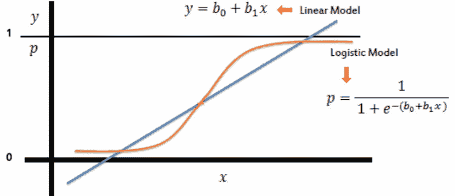
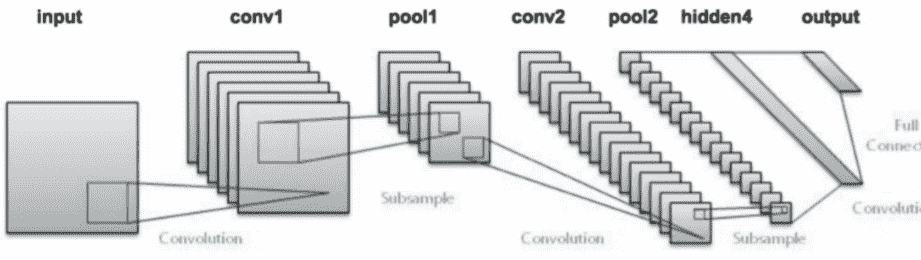

# Python 机器学习：探索学习基础知识、创建机器学习算法以及即使是初学者也能使用 Python 和 Scikit-learn 的方法

## 引言

机器学习源于模式识别，以及一种计算机无需通过编程执行特定任务即可进行学习的理论。人工智能领域的科研人员想要确定计算机是否能够从数据中学习。机器学习是一种迭代方法，这就是为什么模型在接触到新数据时能够进行调整的原因。模型从之前的计算中学习，以提供可重复、可靠的结果和决策。

今天，机器学习技术催生了复杂的机器，这些机器可以研究人类行为和活动，以识别人类行为的基本模式，并准确预测消费者可能感兴趣的产品和服务。在业务模式这一方面，具有远见的企业逐渐成为拥有基于机器学习算法系统的科技公司。考虑一下这个时代一些最创新的设备，例如“Amazon Alexa”和“Apple Siri”，它们在底层的机器学习能力上有什么共同点。

由于机器学习具有独特优势，特别是在小型设备上，它显然正成为企业的青睐。从 RPA 功能到移动自动化，这一切正变成一种手持现实，将未来带在掌心。现在，即使是小型企业也可以像大公司一样利用机器学习。它以成本效益的方式使用。例如，一些公司使用 AI 来改善客户关系。它在降低成本的同时也为他们的公司提供了定制化的帮助。它还可以用于培训员工并以成本效益提高预测。例如，Udacity 通过向销售团队引入聊天机器人，销售额提高了 50%。数据、算法和基础设施的进步以及获取这些技术的成本降低了它们的总成本，现在小型企业也负担得起了。

然而，关于与机器学习相关的伦理引发了许多问题。在带有偏见的数据集上训练的系统可能会导致文化偏见的数字化。例如，使用来自具有种族歧视政策的招聘公司的数据，将导致机器学习系统在筛选申请人时复制偏见。收集“负责任的数据”并对系统使用的算法规则进行适当记录已变得非常重要。甚至语言也包含偏见，机器学习将不得不学习它们。医疗保健专业人员开发赚钱而非服务人的机器是另一个担忧。它也有一些显著的优势。由于 AI 将提高许多工作的生产力，尽管中低级职位将被消除。作为交换，将需要若干由高技能、中技能甚至低技能范围的人组成的新职位。

## 1. 机器学习的核心要素

以下组件包含了获取输入和提供输出的过程，它们是：

- 学习 (Learning)
- 损失 (Loss)
- 任务 (Task)
- 数据 (Data)
- 评估 (Evaluation)
- 模型 (Model)

### 学习

最小化误差是该算法的功能。算法定义了方程中变量赋值的方式，使得计算出的输出接近实际产出。例如：在`y = mx+c`中，学习算法寻找`m`和`c`的值，使得计算出的`y`接近`y`（实际）。

### 损失

实际输出值与我们的模型预测的输出值之间的差异或误差率是损失的功能。最小化损失函数对于我们解决问题至关重要。

### 任务

我们必须对给定数据所做的事情是由任务为我们指定的。任务取决于人们需要用可用信息解决的问题。例如，根据数据，你可以设计一个任务来衡量员工的幸福水平或绩效。

### 数据

机器学习的燃料是数据，你必须学会提供关于输出和输入的适当历史数据。例如，人力资源部门需要提供所有员工信息，以便预测员工是留任还是离开公司。

### 评估

我们需要查看模型的准确性，通过识别我们的模型性能的优劣来解决我们想要解决的问题。

```
准确率 = 正确预测数 / 预测总数
```

当你使用部分数据进行进行测试时，你可以识别出我们最初收集的精度，但不要将其用于训练模型。

### 模型

机器会生成一个映射输出和输入的公式，或者基于我们提供的数据和输入生成模型。其中`(x)`是输入，`(y)`是输出，模型可以像这些方程中的任何一个：


有三种类型的机器学习算法：

1. 监督学习 (Supervised learning)
2. 无监督学习 (Unsupervised learning)
3. 强化学习 (Reinforcement learning)

### 监督学习

为了理解监督学习，我们可能首先熟悉“监督学习”这个术语，因为输出是已知的。因此，我们从带标签的数据中学习。模型的输出与实际输出进行比较，并利用误差更新模型。这是监督学习的目标。监督学习有两种类型：

- 回归 (Regression)
- 分类 (Classification)

#### 回归

当输出值是连续的时，存在回归问题。例如，当我们尝试根据身高等特征预测体重时这就是回归。

#### 分类

分类问题是输出值是离散的。例如，当根据特定特征确定个人是否属于欺诈时，这就是分类类型问题。

## 2. 无监督学习

无监督学习是一种数据未标记的机器学习类型。目标是发现数据中隐藏的模式或结构。无监督学习有两种主要类型：

- 聚类 (Clustering)
- 关联 (Association)

### 聚类

聚类是将数据点分组的过程，使得同一组内的点比其他组的点更相似。例如，根据购买行为对客户进行聚类。

### 关联

关联学习用于发现描述大型数据集的规则。例如，“买啤酒的人往往也会买尿布。”这被用于购物篮分析。

### 强化学习

强化学习是一种机器学习，智能体通过在环境中执行操作来学习决策，目标是最大化奖励。这被用于游戏、机器人和自动驾驶车辆。

## 3. 卷积神经网络

卷积神经网络 (CNN) 是一种处理图像等结构化数据的深度神经网络，广泛应用于计算机视觉任务。CNN 由若干层组成：

- 卷积层 (Convolutional layers)：这些层使用过滤器从图像中提取特征。
- 池化层 (Pooling layers)：这些层减少数据的维度。
- 全连接层 (Fully connected layers)：这些层根据提取的特征执行最后的分类或回归。

## 4. 自然语言处理

自然语言处理 (NLP) 是关注计算机与人类语言交互的人工智能领域。它使机器能够理解、解释和生成人类语言。NLP 的应用包括：

- 翻译 (Translation)：从一种语言翻译到另一种语言。
- 情感分析 (Sentiment analysis)：确定文本的语调。
- 聊天机器人 (Chatbots)：可以与用户对话的虚拟助手。
- 文本摘要 (Text summarization)：创建长文档的短版本。

## 5. 逻辑回归

逻辑回归是一种统计方法，用于根据一个或多个独立变量对结果进行建模。尽管名字里有回归，它被用于分类任务。模型使用逻辑函数将任何值映射到 0 和 1 之间。

## 6. Django 与 Web 应用程序

Django 是一个鼓励快速开发和清洁设计的层 Web 框架。可以通过与模型交互的 API 来部署机器学习模型。

## 7. 模型开发

开发机器学习模型涉及几个步骤：

- 数据收集 (Data Collection)：收集任务所需的数据。
- 数据预处理 (Data Preprocessing)：为模型清洗、转换并准备数据。
- 模型选择 (Model Selection)：为给定任务选择最合适的算法。
- 模型训练 (Model Training)：在准备好的数据上训练模型。
- 模型评估 (Model Evaluation)：在未见的数据上测试模型的性能。
- 超参数调优 (Hyperparameter Tuning)：调整模型的参数以提高性能。
- 部署 (Deployment)：将模型部署到生产环境。

## 8. 数据预处理与训练集的创建

数据预处理是机器学习中关键的一步，因为原始数据通常是有噪声且不完整的。关键步骤包括：

- 处理缺失值 (Handling missing values)：填充或删除缺失数据的记录。
- 处理异常值 (Handling outliers)：识别和管理极端值。
- 特征选择 (Feature scaling)：将特征归一化或缩放到公共范围。
- 编码 (Encoding)：将类别数据转换为数值格式。
- 分分数据 (Splitting the data)：将数据分为训练集、验证集和测试集。

## 9. 什么是无监督机器学习

无监督机器学习是一种在没有显式标签的数据上训练模型的机器学习。目标是寻找数据内部隐藏的模式或结构。常见任务包括：

- 聚类：将相似的数据点聚集在一起。
- 关联：发现描述大型数据集的规则。
- 降维 (Dimensionality reduction)：在保留重要信息的同时减少数据变量的数量。

## 10. 网络化

网络化是指连接计算机以共享资源的实践。在机器学习语境下，网络化可能涉及分布式训练，即使用多台机器训练单个模型。

## 11. 利用概率和统计学辅助机器学习

概率和统计是机器学习的基础。它们提供了数学框架，以处理不确定性、做出预测并评估模型性能。

## 12. 数据清洗与准备

数据清洗是将原始数据清洗并转换为可用格式的过程。它涉及删除错误、处理不一致性，并确保数据准备好用于建模过程。

## 13. 让机器学习为你服务的技巧

- **从小开始**：在转向复杂问题之前，从简单问题开始。
- **关注数据质量**：良好的数据比复杂的算法更重要。
- **迭代**：不断测试并改进你的模型。
- **保持更新**：AI 领域正在迅速发展；持续学习。

## 14. AI 科学的优势

AI 科学提供了许多优势，包括：

- **效率**：自动化重复性任务。
- **准确性**：减少计算中的人为错误。
- **洞察**：发现人类可能会忽略的大型数据集中的模式。
- **24/7 Availability**：机器可以全天工作。

## 结论

机器学习是一项改变各行业的强大工具。通过理解基础知识并掌握如 Scikit-learn 等工具，你可以构建解决现实世界问题的模型。

这是一个分类问题的极佳示例。

## 机器学习路线图

学习和复习线性代数是正确的起点。你将对线性代数的所有核心概念有一个基础的介绍。请关注矩阵乘法、向量、特征值分解和行列式，因为所有这些内容共同构成了机器学习算法运行的齿轮。

你的下一个重点应该是微积分。在这里，理解并学习如何利用导数进行优化以及它们的意义，必须是你的关注焦点。

这些是机器学习的工具，没有了它们，你无法在机器学习领域取得任何进展。

然后，下一步是编程。在利用 SciKit 中的预制模型之前，你必须学习用 Python 从零实现所有算法。这不仅让你了解它们是如何运作的，还能让你获得更深入、更好的知识。虽然你可以从任何地方开始，但对于你的算法，建议遵循以下顺序：

- 线性回归 (Linear Regression)
- 逻辑回归 (Logistic Regression)
- 朴叶贝斯分类器 (Naive Bayes Classifier)
- K-近邻 (KNN)
- K-均值 (K-Means)
- 支持向量机 (SVM)
- 决策树 (Decision Trees)
- 随机森林 (Random Forests)
- 梯度提升 (Gradient Boosting)

### 线性回归

线性回归通过将观测数据拟合到线性方程，其核心在于建立连接两个变量之间相关性的努力。对于单个变量来说，解释变量是考虑因素，而因变量则是另一个变量的考虑因素。例如，你可以使用线性回归模型将人的身高与体重联系起来。

在初始阶段，在尝试将线性模型拟合到观测数据之前，你必须确定感兴趣变量之间是否存在联系。这并不意味着单个变量产生了另一个，例如，并不意味着两个较高的高三成绩不会导致更高的 SAT 分数，除非这两个变量之间没有显著联系。为了确定两个变量之间的关系强度，散点图是一个很有用的工具。当因变量与预测描述变量之间没有联系时，在对数据拟合线性回归模型时可能无法提供任何有效的模型，此时散点图没有显示出任何下降或上升的趋势。相关系数是两个变量之间不可或缺的数值联系，使得两个变量实验数据的相关强度是一个介于 -1 和 1 之间的值。其中`$Y$`是因变量，`$X$`是解释变量，线性回归直线的方程为`$Y=A+BX$`。其中截距（`$X=0$`时`$Y$`的值）为`$A$`，直线斜率为`$B$`。

### 逻辑回归

作为线性回归模型用于分类问题的扩展，并且有两个可能的结果，逻辑回归模型对分类问题进行建模。逻辑回归是分类的解决方案。为了将线性方程的输出压缩在 0 到 1 之间，逻辑回归模型使用的是逻辑函数而不是拟合超平面或直线。逻辑函数的定义如下：

```
$logistic(\eta) = \frac{1}{1 + \exp(-\eta)}$
```

因此，它以这种形式出现：



逻辑函数。输出数字在 0 到 1 之间。它在输入为0时输出 0.5。

从线性回归到逻辑回归是一个简单的步骤。在特征和结果之间，在线性回归模型中，我们用线性方程对它们进行了建模。

```
$y(i)=\beta_0+\beta_1x(i)_1+\dots\beta_px(i)_p$
```

对于分类，我们倾向于使用连接 0 和 1 的概率，并将等式的右侧封装在逻辑函数中。这样做将强制输出仅为连接 0 和 1 之间的值。

### 朴叶贝斯分类器

朴叶贝斯是一种简单、常用且有效的机器学习分类器。通过在贝叶斯框架下使用极大后验决策规则，朴叶贝斯是一种进行分类的概率分类器。此外，它还通过使用基础贝叶斯网络进行表示。朴叶贝斯分类器是决策等问题的传统解决方案，在文本分类方面尤为著名。

### 模型

有了特征`$x_0$`到`$x_n$`以及类别`$c_0$`到`$c_k$`，任何概率分类器的目标不仅是返回最可能的类型，而且还要确定特征在每个类别中发生的概率。因此，我们可能希望具有计算每个组的`$P(c_i / x_0, \dots, x_n)$`的能力。贝叶斯规则就是我们执行此操作的方法。贝叶斯规则具有以下特征：

```
P(A|B) = \frac{P(B|A)P(A)}{P(B)}
```

可能用类别`$c_i$`替换`$A$`，用`$x_0$`作为我们在`$x_n$`分类框架下特征的组合替换`$B$`。由于`$P(B)$`是分母，`$P(x_0, \dots, x_n)$`对我们可能很难计算，我们主要可以保持项`$P(c_i / x_0, \dots, x_n) \propto P(x_0, \dots, x_n / c_i) \cdot P(c_i)$`而不是忽略它，在计算时，当`$\propto$`意味着“正比”时，这非常容易。计算`$P(c_i)$`可能更困难。`$P(x_0, \dots, x_n / c_i)$`项取决于你的特征遵循什么分布。当元素是词计数时，在文本分类中，特征可能遵循多项分布。在其他情况下，它们可能发展为高斯分布。

### K-近邻 (KNN)

KNN 是一种简单的算法，它根据相同的相似度量来分类新案例或数据，并存储所有可用实例。根据其邻居的分类情况，它主要用于分类数据点。例如，含有杨皮素和芦藜醇等化学成分的葡萄酒。在投票流程的主流中，`$k$`是一个提交邻居数量的结构。此外，如果我们向数据集中添加了一杯新葡萄酒，最好知道这杯酒是白色的还是红的。

在这种情况下，我们需要找出邻居是谁。我们假设`$k = 5$`以实现这一点。新数据的分类方式是，如果五个邻居中大部分是红色的（例如四个），那么该点的分类就是红色。

### K-均值 (K-Means)

在没有目标标签的情况下，K均值是一种无监督学习算法，能够识别数据内部相同的组或聚类。根据到质心的某种距离相似性度量进行聚类并将数据分成 K 个簇是 K均值面临的问题。现在，我们如何解决这个问题？如果我们概述涉及的步骤：

1. 当我们初始化 K 个起始质心时，每个数据点被分配到最近的质心，这个过程我们可以随机进行。
2. 在相应的簇中，通过数据点的平均值计算质心。
3. 直到我们触发停止准则，重复第 1、2 步。

并且第2步就是我们要做的。

更准确地说，如果你好奇正在发生什么，我们正尝试优化平方欧几里得距离或欧几里得距离。数据点被分配到使该平方距离最小或距离它们最近的聚类中。

对于每个数据点所属的聚类，`$J$`仅仅是距离平方之和。其中`$(x\_n)$`（数据点）属于第`$(k)$`个类，否则为 0，这是一个指示函数，`$R$`等于 1。

### 支持向量机 (SVM)

作为一种监督式机器学习算法，它们使用支持向量机进行回归或分类挑战。但它们主要在分类问题中使用它。在这一算法中，我们将每个数据的数据项设计为`$n$`维空间中的一个点，其中你拥有的特征数量为`$n$`，单个坐标的值与每个特征的值相同。然后，通过获取一个能够很好地区分两个类别的超平面，我们执行分类。

## 2. RISE 算法

其本质可以非常概括为：每个案例都是一个属性对的向量 - 属性`$j$`以及该示例所属的类别规格；属性可以是符号的和/数值的。每个规则都是针对背景`$Y$`的合取而形成的。每个前件都是单个属性的条件，并且对于每个属性都存在一个前件，也就是说，可能存在某些不构成规则背景格式的属性。符号属性的条件是剩余的形状`$ji \ v \to =$`，其中`$ito$`是属性，`$j$`是你的值之一。数值属性的条件采用类似于离散属性的允许形式，即两个值`$jji \text{ } vv \to$`，其中`$onejev Y$`和`$twoj$`是该属性的两个合法值。如果一个示例满足了规则的所有项，则该规则覆盖该示例；适用于一个示例的规则是根据稍后描述的距离度量与该示例最近的规则。RISE 寻找“良好的”规则，现在将`$ito$`推广到通用，从`$n$`个示例的合取开始训练第一组规则。对于每个规则`$Y$`，找到靠近不匹配类别的示例，即该规则没有覆盖的示例（即距离规则为 0 的距离），并尝试从形式上泛化该规则以覆盖该示例。新规则加入规则集并替换旧规则，如果这种变化的影响（将规则包含在集合）对全局准确率是有正面的，反之则不加入集合。这些泛化是论文《一种概念学习的统一 p 方法》中展示的一种算法，该论文是 Pedro Morais Sundays 在加州大学欧尔湾分校获得计算机科学博士学位时提交的，年份为 1997 年，摘要由作者在 2004 年提交。


如果规则对规则集的全局精确度没有产生影响，也可以接受。更重要的是，对于每个失败的泛化尝试，它都会回复你。在最坏的情况下，它不产生任何泛化，最终结果是将每个共同训练的示例都视为副本的邻近分类器。每个测试示例的分类是通过找到与示例最接近的规则，并分配给所述规则的类别来实现。精确率（英语中为 accuracy）对于示例集上的规则集`RS`，其准确率`Acc(RS)`定义为规则集正确分类的`m`轴轴示例的比例，即当距离示例最近的规则的类别与示例的类别相同时，该规则正确分类了该示例。由于示例集是保持隐含的训练集（也就是说，准确率将表示为`Acc(RS)`）。精确率的衡量使用“留一法”逻辑方法：当尝试分类一个`m`轴时，有关示例的规则从规则集中移除，除非它已经被另一个示例覆盖。每个示例都记录了它到规则的距离以及分配给该规则的类别，当它泛化为了一个规则时，有必要将该规则与所有`m`轴对应，并检查对之前不属于该类的某些示例产生什么影响。之前分类错误的示例现在通过规则的泛化变得正确了，增加了规则集的准确率；而之前分类正确的示例在规则泛化的作用下，现在分类得很差，降低了规则合集的准确率。如果前者的多于后者，则规则集合集的精确度变化是正面的，你就会接受该规则集，即新的泛化规则。所使用的距离度量是属性数量`i`的欧几里得距离与 Stanfill 和 Waltz 差值度量的简化版本的组合。作为`C`，和...，和，和（AND`E`）两个一个具有值`i`和第`-th`属性和类别的示例。ARISE 软件中详细描述的 ARISE 软件构成了一个分类算法的实现，它可以改变形式来尝试缺失值，它还允许在宇宙中不可实现的分类和规则归纳。人们对该软件进行了尝试和评估，目的是为了检查他是否得到了算法的正确实现，以及值的这种方式的变化是否保持了原始算法的优点。进一步测试了该算法或隐含地以及产品（ARISE）的便利性，并将 EKA 软件使用 ID3、C4.5 和 Nge 算法获得的结果进行比较，这些结果是在加州大学欧尔湾学院 (UCI) 机器学习数据库仓库中可用的一组练习中得到的。信息与计算机科学系，加州大学欧尔湾，欧尔湾，加州，网站地址可免费下载：`http://www.ics.uci.edu/~mlearn/MLRepository.html`。

对于算法处理`n`-to 缺失值，RISE 算法在选择要实现的 RSeAs 算法时的另一种策略是删除目前它给出的一个限制。在某些情况下，我们扩展 RISE 原始处理属性缺失值的策略（如`i`-scams），可能会导致获得规则不精确的情况，为了避免这种情况，一种针对数值属性提出的替代策略被许多作者广泛描述。在参考文献中，处理缺失值数值属性的策略被广泛引用，其他：

- 移除具有缺失值的训练示例集。
- 用属性值的众数或中位数替换缺失值。
- 用属性出现频率最高的值或属性一半的值替换缺失属性值。
- 其他基于属性值分布的支持技术。

注意：在属性缺失的情况下，如果其符号性质允许，则可以使用这些技术。

符号属性的“平均值”计算。在参考文献中出现的用于确定符号属性值的一半的方法是选择属性的较坏值，但由于缺乏严谨性，在这种情况下我们指的是众数而不是属性的中位数。而且在许多情况下，这并不能产生分类位置的最佳准确率。鉴于数值属性的平均值是方差最小的值，我们可以推断对于符号属性，自然遵循与数值属性相同的策略，且该值构成了属性值分布方法的理想中心趋势。为了确定符号属性两个值之间的距离，Sundays 和其他作者使用了以下度量：

```
$x^i S_{VDM} \sum_{j} \left(x^h | x^j\right) \left(P_p^h | x^j\right) (3)$
```

这与其他作者一致，如果所有对之间的距离

在使用符号属性值时，如果出现某个属性的多个 VA，在平局的情况下将产生较小距离比例的结果，他可能会随机选择属性值以实现最小化，而这个使距离最小的值，确实可以被视为该值集合的“平均值”。形式上，如文所述：一组值的介数他可以定义为值`m`（属性的一个值），它使得集合的方差最小，即：

```
$$m = \min \quad (6)$$
```

其中`J`是符号属性的属性集合，`v`是集合`J`中的一个值，`Jm`将作为集合`J`中所有值的最佳方法，类似于对于数值值也是如此，`m`将被集合`J`中的每个值替换，使方程最小的`m`值将作为“符号值集合`J`的平均值”。这个获得的作为“中值”的属性值`m`，他可以用该属性的缺失值之一来替换，这是正常的，其效果等同于数值属性缺失值的情况。在获得一组“正常”训练集（无属性缺失）后，我们在上面布线了与数值属性缺失相同的概念，你将获得分类中最佳或相似的精度，他将与原始训练集一起使用。这种想法相反，为了计算`m`，他需要获取符号属性值对之间的距离，并且，确实，是计算`(x_{ji} x,SVDM)`，其元素数量等于一组相同元素重复的变异数量，等同于该属性拥有的值数量，以便同时设置两个值。作为符号属性对`i`的不同值的数量，计算`A_i^2`实例数量（即他可以形成的值对数量，其中每个对中每个元素占据的顺序是有重要的），并且对于条目集中的每个至少有一个缺失值的每个符号属性，都必须计算这些距离之和。这些`(x_{ji} x,SVDM)`是一个实例函数，其中`0=x)d (x, Y)`，其目的是避免之前的计算（一个值到其自身的距离为零）`Y`的计算。对于他的符号属性`I`，他知道数量为`A_i^2 - A_i`。也可以利用`x)d(Y=Y)d (x)`这一事实并据此进一步减少计算量，但这会增加括号内表达式逻辑计算的复杂性。

他对符号值中值计算的优化：在计算了每个符号值相对于其第一个值的距离总和后，对于第二个值，它在改变属性的其他值，并且在累积距离总和之后，如果它小于总和，或者所有人相对于第一个值的距离总和，是的，他们遍历了属性的所有值，在路径上，他知道某些距离，所有属性值相对于第二个值的距离是收到的总和，并且在情况下，并产生一个新的更小的距离总和`Y`。在这种情况下，他所获得的属性值将增加。

相反，如果左侧累积距离之和小于总和，则更改属性的第三个值，而没有必要运行所有值，不知道最小和并开始计算所有值相对于第三个值的距离累积和，依此类推。通过这种方式，他大大减少了计算，达到了足以证明使用该提议来权衡算法复杂度增加之代价的水平，在最坏情况下，即“中值”是属性值的最后一个值时，它对于具有更多不同值的属性值数量是二次的，且该属性至少有一个缺失值。

## ARISE 的潜力

1. 引入了一种处理缺失值属性的替代策略，并且得出了新生成策略的优势。
2. 它采用了一种减少规则数量的策略，这种策略被发现是有效的且不会降低分类精度。他通过移除被其他规则吸收的规则来选择。当满足以下条件时，一个规则吸收或包含另一个规则，两个规则属于同一类别：
   - 如果是符号属性：它们的权重相等，或者在一个或多个规则中呈现了属性值。
   - 如果属性是数值的：条件的下限（INF）小于或等于另一个的，且上限（SUP）大于或等于另一个的。
   - 如果上述对于规则中出现的所有术语都满足，则说一个包含或包含另一个。例如：`A Yes outlook sunny Y 69 <= temperature <= 75 Y 70 <= humidity <= 70 Then is`
3. 发现了导致分类不准确的原因：训练集中同一个用例存在多个实例，这是其生成器在网络上讨论的概念性错误，并将构成未来工作的对象。
4. ARISE 对数据输入进行验证，并为分类案例的获取以及训练集的创建和编辑提供便利，适用于非专业用户。
5. 导出到多种语言有助于最终专家系统的创建。

卷积神经网络的设计灵感源于大脑的视觉皮层。这赋予了人类处理和分析视觉图像的能力。视觉层中存在光光感受器，它们在重叠的层中捕捉光线。这部分是这些图像识别算法在人工智能和机器学习领域如此流行的原因之一。

以下是卷积神经网络在现实世界中一些示例。有时理论太枯燥，无法让你直观地感受到这种神经网络在该领域的实际影响，但也许一些示例能更好地说明它的应用。

广受欢迎的社交媒体平台 Facebook 可能是最著名的例子。Facebook 创建了 DeepFace，这是一种能够极高精度识别人脸的面部识别系统。某些来源甚至报道其准确率达到了 97%。请记住，FBI 自己的面部识别系统据称准确率仅为 85%。另一个使用卷积神经网络的有趣程序是 DeepDream，由 Google 的一名工程师创建。在这个例子中，神经网络被通过赋予图像幻觉的外观来增强图像。通过算法空想性（algorithmic pareidolia）对图像进行过度处理。微软和 IBM 等其他大型科技公司也利用 CNN 开发了智能软件。

# 理解架构

卷积神经网络的拓扑结构类似于多层感知器。它是一个无环图，由包含少量节点的层组成，每层都与下一层进行通信。

这里值得提及的最重要区别之一是，这种神经网络具有相同的神经元。换句话说，我们拥有相同的参数值以及权重值。这使得 CNN 极其高效，因为需要计算的值较少。另一个关键区别是节点通信是有限的。这意味着节点输入是本地连接的，仅连接相邻节点。

## 层

然后我们有一个由 4 个参数组成的过滤器，它被顺序应用于层以创建特征图。这四个过滤器参数被称为超参数，它们代表尺寸、深度、步长（stride）和零填充（zero-padding）。尺寸通过计算该过滤器的表面积来确定。在这里我们应该记住，过滤器的大小对输出有影响。这意味着我们需要精确控制输出，以便获得高效的网络。值得提到的是，较大的过滤器通常会重叠，但这可以为我们所用，因为它可以提高准确率。

过滤器深度大约是层内部有多少个节点，以及在输入周围的相同区域有多少个节点连接在一起的。请记住，我们仍然在讨论图像，当我们谈论深度时，我们指的是图像内容。如果你用过 Photoshop 或任何其他图像编辑或处理软件，你可能已经知道颜色通道了。它们是描述图像内容所需要的，神经网络节点是为了感知红、绿、蓝颜色通道而映射的。这就是为什么在许多情况下过滤器深度被设置为 3。如果我们增加过滤器参数，就可以获得更多关于图像的数据，并揭示其他难以学习的属性。然而，如果我们将深度设置为低值，得到的结果就会较弱。

第三个过滤器参数是步长，它的值决定了神经元之间的间距。如果步长等于 1 且我们正在处理图像，我们将每个像素设为过滤器的中心。这会导致输出增加并产生大量的层重叠。我们可以通过增加步长值来减少重叠，但请记住输出的尺寸也会减小。在这种情况下，微调的方法是简单地根据准确率和尺寸之间的平衡做出判断。然而，在大多数情况下，坚持使用较低的值可能是一个好主意。

第四个也是最后一个过滤器参数允许我们减少层的输出尺寸。零填充通过将感受野的边界值设置为 0 来实现这一点。在卷积神经网络中，当我们谈论感受野（receptive fields）时，指的是对网络中任何特定单元产生影响的输入空间。作为一个警告，当你设置零填充时，确保所有区域仍被过滤器覆盖。适当零填充设置的另一个大优势是能够调整输入和输出使其具有相同的尺寸。使输入和输出层的大小相等是非常标准的做法，因为这允许我们高效地调整深度和步长参数。如果没有任何零填充，我们需要花费大量精力来正确设置参数并提高网络性能。如果没有填充，过滤器的边缘可能会损坏。

现在问题是，我们在设置网络时如何校准所有这些参数呢？这里有一个简单的公式。如下所示：

```
O = (W - F + 2P) / S + 1
```

`O`代表层的输出，`W`代表图像尺寸，`F`代表过滤器尺寸，`P`代表步长。在应用该公式时请记住，层的输出并不总是整数值，这可能会导致各种问题。幸运的是，你可以通过对步长进行调整来补偿。

现在你对卷积层及其参数有了更多的了解，让我们讨论一下到底什么是卷积。简单来说，它是一个数学算子，就像乘法一样，主要用于将复杂的方程分解为更简单的形式。换句话说，该过程在对两组数据进行操作后会产生第三个函数。这产生了一个新函数，该函数实际上是两个原始函数的导数。

当我们处理卷积神经网络时，将输入作为第一个元素。当我们对图像应用此过程时，实际上是图像的宽度和高度。第二个组件是卷积核，它由浮点数组成。这些数字的范围从 0 到 255。这就是我们发现卷积的主要优势。

实际上，每一层都由通道组成，这允许我们构建强大的过滤器。该过滤器遍历输入并写入特征图。不需要特征工程。

## 连接组件

现在是时候将所有元素整合在一起，学习连接所有元素的最有效方法了。为了更好地说明卷积网络的实现，我们将选取一个现实世界的示例并进行拆解。最著名的卷积网络之一被称为 LeNet，它自 80 年代以来一直存在。它因处理图像和手写数字时的性能而闻名，这也是我们主要感兴趣的。该网络依赖于交替的卷积、池化层和 MLP。如果你不知道，池化层通常放置在卷积层之间，因为它允许降维，使输出与输入相等。我们还有一个连接层，所有计算都通信到那里。这里有一个 LeNet 示意图，让你对架构有更好的直观认识：



虽然这种实现在某些应用中很棒，但它并不是所有问题的有效解决方案。在许多情况下，这种架构在面对更具挑战性的场景时表现可能并不理想。LeNet 网络可能还有另一个架构版本，那就是 GoogleNet。也称为 Google 的 Inception 网络，该架构是为了处理具有挑战性的图像数据而开发的。我们所指的挑战性是指什么？你知道那些用手机在低光照下拍摄的、质量糟糕的图片和视频。

光照条件以及存在大量噪声？这正是卷积网络本应该处理的问题。互联网上发现的图像数据包含大量的杂质和噪声，因此使其看起来颗粒度极高且难以理解。

# 自然语言处理

自然语言处理（NLP）是人工智能中一个广泛使用的领域，主要涉及人类语言与计算机之间的交互。你可以在许多领域发现它的应用，如情感分析、垃圾邮件检测、词性标记（POS tagging）、文本摘要、语言翻译、聊天机器人等。

你会如何向外行解释 NLP？为什么实现起来很困难？

NLP 代表自然语言处理（Natural Language Processing），计算机程序理解人类语言的能力。由于显而易见的原因，这是一个极具挑战性的领域。NLP 要求计算机理解人类说的话，而人类说的话往往并不精确。人类会使用俚语、以不同的方式发音单词，并且句子中可能包含上下文，这对于计算机正确处理起来非常困难。

NLP 在机器学习中的作用是什么？

目前，NLP 基于深度学习。深度学习算法是机器学习的一个子集，它们需要大量的数据来从数据自动学习高层特征。NLP 也采用相同的方法，利用深度学习技术来学习人类语言并不断改进自身。

执行文本分类的各个步骤是什么？

文本分类是一种 NLP 任务，用于将文本文档分为一类或多个类别。判断一封邮件是否为垃圾邮件、分析人的帖子的情绪等，都是文本分类问题。

一个文本分类流水线顺序涉及以下步骤：

- 文本清洗
- 文本标注以创建特征
- 将这些特征转换为实际预测器
- 使用预测器训练模型
- 微调模型以提高其准确性。

你如何理解关键词规范化（Keyword Normalization）？为什么需要它？

关键词规范化，也称为时态规范化（tense normalization），是 NLP 中关键的一步。它用于将关键词转换为规范形式，以便于后续处理。它会移除停用词，例如标点符号以及 "a"、"an"、"the"，因为这些词通常不带有任何权重。之后，它将关键词转换为标准形式，从而提高文本匹配。

例如，将所有时态转为小写，将所有时态转换为一般现在时。因此，如果你在一份文档中有 "decoration"，在另一份文档中有 "Decorated"，那么它们都将被索引为 "decorate"。现在，你可以轻松地对这些文档应用文本匹配算法，包含关键词 "decorates" 的查询将同时匹配这两个文档。关键词规范化是减少维度的一种非常有效的方法。

## 词性标记（POS tagging）

词性标记是将给定文本中的单词标记为词性（如名词、介词、形容词、动词等）的过程。这是一项极具挑战性的任务，由于其复杂性，且同一个单词在不同的句子中可能代表不同的词性。

通常有两种技术用于开发 POS 标记算法。第一种技术是随机的，它假设每个单词都是已知的，并且有一组在训练期间学习的有限标签。第二种技术是基于规则的标记，利用上下文信息来标记每个单词。

## 依赖解析（Dependency Parsing）算法

依赖解析算法是一种基于语法的文本解析技术，用于检测文本中的动词短语、名词短语、主语和宾语。“依赖”意味着句子单词之间的关系。有多种方法解析句子并分析其语法结构。常见方法包括移位还原（Shift-Reduce）和最大生成树（Maximum Spanning Tree）。

## 向量空间模型（Vector Space Model）及其用途

向量空间模型是一种代数模型，用于将对象表示为标识符的向量。每个对象（如文本文档）被写为其中包含的词项（单词）及其权重的向量。例如，你有一份文档 "d"，文本内容为 "This is an amazing word for the interview preparation."

```
d = (W_{amazing}, W_{an}, W_{book}, W_{for}, W_{interview}, W_{is}, W_{preparation}, W_{the}, W_{this})
```

有许多方法可以计算这些权重`W_i`。它们可以简单如文档中单词的频率（计数）。同样地，任何查询也以相同的方式编写。使用向量操作来比较查询与文档，以找到满足查询的最相关文档。

向量空间模型广泛应用于信息检索和索引领域。它为非结构化数据集提供了一种结构，从而使其更容易被解释和分析。

## 词频（Term Frequency）和逆文档频率（Inverse Document Frequency）

词频（tf）是一个术语在文档中出现的次数除以该文档中术语的总数。

逆文档频率（idf）衡量该术语在所有文档中的相关性。在数学上，它是（文档总数除以包含该术语的文档数）的对数。

## 余弦相似度（cosine similarity）

余弦相似度捕捉两个向量之间的相似性。正如向量空间模型中所述，每个文档和查询都被写为词项的向量。

计算查询向量与每个文档之间的余弦值，即两个向量之间的余弦值。得到的余弦值代表文档的相似性。如果余弦值为 0，则完全没有相似性；如果为 1，则文档与查询相同。

## N-gram 方法


简单来说，N-gram 是文本中 n 个项的连续序列。N-gram 方法是一种概率模型，用于根据之前的 n-1 个项目预测序列中的某一项。你可以选择单词或短语作为项目，如果 n 为 1，它被称为 1-gram；对于 n = 2，它是 big-ram，以此类推。N-gram 可用于近似匹配。由于它们将序列转换为 n-gram 集合，你可以通过测量共同 n-gram 的百分比来比较两个序列。

11. 从句子 "I love New York style pizza" 中可以生成多少 3-grams？

将句子拆分为 3-grams，你得到：

- I love New
- love New York
- New York style
- York style pizza

### 我们将使用 `CountVectorizer` 包来演示如何结合 Scikit-Learn 使用 N-Gram。

```python
### CountVectorizer 将一组文本文档转换为标记计数矩阵。
```

```
### 在我们的情况下，只有一个文档。
```

```python
from sklearn.feature_extraction.text import CountVectorizer
```

```python
### ngram_range 指定了提取的 N-gram 标记范围的上下边界。
### 对于我们的示例，范围是从 3 到 3。
### 我们必须指定标记模式，因为默认 CountVectorizer 将单字符单词视为停用词。
```

```python
vectorizer = CountVectorizer(ngram_range=(3, 3),
token_pattern=r"(?u)\b\w+\b",
lowercase=False)
```

```python
### 现在，用我们的输入文本拟合模型
vectorizer.fit(["I love New York style pizza"])
```

```python
### 这将填充 vectorizer 的 vocabulary_ 字典。
### 让我们看看这个词表的结果
print(vectorizer.vocabulary_.keys())
```

12. 你听过词袋模型（Bag-of-Words model）吗？

词袋模型是一种在信息检索和自然语言处理中非常常用的技术。它也被称为向量空间模型，在上面的第 6 题进行了详细描述。它使用单词在文档中的频率作为特征值。

该方法的一个局限性是它不考虑单词的上下文。例如，如果你取这些句子 "Apple have become a trillion dollar company" 和 "You should eat apple every day"，词袋模型将无法区分作为公司的苹果和作为水果的苹果。为了解决这一局限性，你可以使用 N-gram 模型，它存储单词的空间信息。词袋模型是 n=1 时 N-gram 方法的一个特例。

# 5. 逻辑回归

机器学习模型通常可以归纳为预测定量结果或定性类别。前者通常被称为回归问题，在线性回归的情况下，这涉及根据连续变量的输入来预测数值型结果。在预测定性结果（类别）的情况下，该任务被视为分类问题。分类问题的例子包括预测用户可能购买哪种产品，或预测目标用户是否会点击在线广告（是/否）。

然而，并不是所有算法都能完美地融入这种简单的二元对立，逻辑回归就是一个典型的例子。逻辑回归属于回归族，因为它与线性回归一样，涉及到通过分析变量之间的定量关系来预测结果。与线性回归不同的是，它接受连续和离散变量作为输入，且输出是定性的；它预测的是离散类别，如“是/否”或“客户/非客户”。

逻辑回归分析变量之间的关系并使用 Sigmoid 函数为离散结果分配概率，该函数将数值结果转换为 0 到 1.0 之间的概率表达式。0 代表没有发生的概率，而 1 代表一定发生的概率。对于二分类，我们可以分配两个离散类别，并将 0.5 作为截断点。任何高于 0.5 的值都被归为类别 A，任何低于 0.5 的值都被归为类别 B。

## 用于对数据点分类的 sigmoid 函数

在使用 Sigmoid 函数将数据点分配到类别后，使用超平面作为决策边界，以尽可能的划分这两个类别。该决策边界随后可用于预测未来数据点的类别。

逻辑回归超平面被用于划分两个类别

逻辑回归也可以用于多个结果的分类，但通常用于二分类（预测两个离散类别中的某一个）。其他技术，包括朴素贝叶斯分类器和支持向量机（SVM），在分类多个离散结果方面被认为更有效。

# 练习

本练习使用逻辑回归来预测 Kickstarter 活动的结果，具体来说，是预测活动是否能以二值“0”（否）或“1”（是）的结果达到目标资金。Kickstarter.com 是一个用于创意项目和新产品的在线众筹平台。

## 1) 导入库

本次练习使用的库有 Pandas、Seaborn、Matplotlib 和 Pyplot（一个结合了 Pyplot 与 NumPy 的 MATLAB 绘图框架），以及 Scikit-learn。

```python
import pandas as pd

import matplotlib.pyplot as plt

import seaborn as sns

%matplotlib inline

from sklearn.model_selection import train_test_split

from sklearn.linear_model import LogisticRegression

from sklearn.metrics import confusion_matrix, classification_report
```

## 2) 导入数据集

下一个重要步骤是将 CSV 数据集导入 Jupyter Notebook 并转换为 Pandas 数据frame。

```python
df = pd.read_csv('~/Downloads/18k_Projects.csv')
```

Kickstarter 项目数据集

## 3) 变量

第三步是使用 `delete` 方法删除非本质变量。

```python
del df ['Id']
del df ['Url']
del df ['Location']
del df ['Pledged']
del df ['Creator']
del df ['Category']
```

```python
del df ['Updates']
del df ['Start']
del df ['End']
del df ['Latitude']
del df ['Longitude']
del df ['Start Timestamp (UTC)']
del df ['End Timestamp (UTC)']
del df ['Creator Bio']
del df ['Creator Website']
```

我们从数据框中删除了 16 个变量。删除某些变量是因为它们是字符串或时间戳，逻辑回归无法解析并解释它们为数值。并不是所有非数值变量都被删除，因为我们将在第 4 步中使用独热编码（one-hot encoding）转换其中一些变量。

## 4) 转换非数值值

逻辑回归接受离散变量作为输入，前提是它们是以数值表示的。因此，我们需要使用独热编码将剩余的类别特征转换为数值值。

```python
df = pd.get_dummies(df, columns=['State', 'Currency', 'Top Category', 'Facebook Connected', 'Has Video'])
```

最后，让我们检查数据框的形状以备后用。

```python
df.shape
```

运行模型。

OUTPUT: (18142, 36)

数据框有 18,142 行和 36 列/特征。

## 5) 删除并填充缺失值

现在让我们检查数据框中的缺失值。

```python
df.isnull().sum()
```

运行模型。

| Comments | 0 |
| Rewards | 0 |
| Goal | 0 |
| Duration in Days | 0 |
| Backers | 0 |
| Facebook Friends | 5852 |
| Facebook Shares | 0 |
| Creator - # Projects Created | 0 |
| Creator - # Projects Backed | 4244 |
| # Videos | 101 |
| Images | 0 |
| Words (Description) | 0 |
| Words (Risks and Challenges) | 101 |
| FAQs | 0 |
| State_successful | 0 |
| Currency_CAD | 0 |
| Currency_EUR | 0 |
| Currency_GBP | 0 |
| Currency_NZD | 0 |
| Currency_USD | 0 |
| Top Category_Comics | 0 |
| Top Category_Crafts | 0 |
| Top Category_Dance | 0 |
| Top Category_Design | 0 |
| Top Category_Fashion | 0 |
| Top Category_Film & Video | 0 |
| Top Category_Food | 0 |
| Top Category_Games | 0 |
| Top Category_Journalism | 0 |
| Top Category_Music | 0 |
| Top Category_Photography | 0 |
| Top Category_Publishing | 0 |
| Top Category_Technology | 0 |
| Top Category_Theater | 0 |
| Facebook_Connected_Yes | 0 |
| Has Video_Yes | 0 |

输出显示当前 36 个变量中只有 4 个包含缺失值。

```python
## 获取相关系数的代码
df['State_successful'].corr(df['Facebook Friends'])
df['State_successful'].corr(df['Creator - # Projects Backed'])
df['State_successful'].corr(df['# Videos'])
df['State_successful'].corr(df['Words (Risks and Challenges)'])
```

缺失变量摘要

Facebook Friends 和 Creator - # Projects Backed 有大量的缺失值，但它们与因变量 State_successful 相关性很强。删除这两个变量包含缺失值的行会使数据集减半（从 18,142 行减少到 9,532 行）。

对于其他变量，考虑到其频率较低（101），我们可以删除它们。或者，由于它们与因变量的相关性较低，你也可以选择删除这两个变量。

接下来，让我们使用 `describe()` 方法来检查标准差和范围。

```python
df.describe()
```

变量 Facebook Friends 标准差（std）很高，而变量 Creator - # Projects Backed 的范围（max – min）小得多。

让我们最后使用分布图查看这些变量。

使用 Seaborn 和 Matplotlib/Pyplot。

### Facebook Friends 的分布图

```python
plt.figure(figsize=(12,6))
sns.displot(df['Facebook Friends'], kde=True, hist=0)
```

### Creator - # Projects Backed 的分布图

```python
plt.figure(figsize=(12,6))
sns.displot(df['Creator - # Projects Backed'], kde=True, hist=0)
```

由于方差很大，使用平均值、众数或其他人工值来填充 Facebook Friends 变量似乎是不合理的，因为这些方法无法提供可靠的填充值。由于该变量与因变量之间显著的相关性，我们不一定要删除它。因此，我们将通过保留该变量并删除缺失值的行来继续。

```python
## 用平均值填充 'Creator - # Projects Backed' 的缺失值
df['Creator - # Projects Backed'].fillna(df['Creator - # Projects Backed'].mean(), inplace=True)
```

### 删除变量的剩余缺失值

```python
df.dropna(axis=0, how='any', thresh=None, subset=None, inplace=True)
```

## 6) 设置 X 和 y 变量

此模型的因变量 (y) 是二值变量 State_successful，这意味着我们可以删除变量 State_failed，因为它不会被作为输入 (X) 或输出 (y) 变量。

```python
del df ['State_failed']
```

剩余变量是独立变量 (X)。与其像上一个练习中那样在代码中单独调用每个变量，我们可以调用整个 dataframe 并使用 `drop` 方法移除 y 变量。

```python
X = df.drop('State_successful',axis=1)
```

```python
y = df['State_successful']
```

```
洗牌并划分数据 70/30。
```

```python
X_train, X_test, y_train, y_test = train_test_split(X, y, test_size=0.3, random_state=10, shuffle=True)
```

### 7) 设置算法

将 `LogisticRegression()` 分给变量 `model` 或指定的变量名。

```python
model = LogisticRegression()
```

将算法拟合到训练数据。

```python
model.fit(X_train, y_train)
```

### 8) 评估

对 `X_test` 数据使用 `predict` 函数，让我们使用 Scikit-learn 的混淆矩阵分类报告，将预测结果与 `y_test` 集的实际结果进行比较。

```python
model_predict = model.predict(X_test)
```

```python
#混淆矩阵
print(confusion_matrix(y_test, model_predict))
```

```python
## 分类报告
print(classification_report(y_test, model_predict))
```

混淆矩阵显示我们有 171 个假阳性预测和 211 个假负性预测。然而，考虑到分类报告中传达的强精确率（precision）、召回率（recall）和 f1 分数，模型的性能就有了新的视角。

## 8) 预测

现在让我们使用模型根据独立变量的输入来预测单个 Kickstarter 项目可能的的结果。

```python
new_project = [
    0, #评论
    9, # 奖励
    2500, # 目标
    157, # 支持者
    31, # 持续天数
    319, # Facebook 好
    110, # Facebook 分享
    1, # 创建者 - 创建的项目数
    0, # 创建者 - 回应的项目
    0, ## 视频
    12, ## 图片
    872, ## 单词（描述）
    65, ## 单词（风险与挑战）
    0, ## 常见问题
    0, # 货币_AUD
    1, # 货币_CAD
    0, # 货币_EUR
    0, # 货币_GBP
    0, # 货币_NZD
    0, # 货币_USD
    0, # 顶级类别_艺术
    0, # 顶级类别_漫画
    0, # 顶级类别_工艺
    0, # 顶级类别_舞蹈
    0, # 顶级类别_设计
    0, # 顶级类别_时尚
    1, # 顶级类别_电影与视频
    0, # 顶级类别_食物
    0, # 顶级类别_游戏
    0, # 顶级类别_新闻
    0, # 顶级类别_音乐
    0, # 顶级类别_摄影
    0, # 顶级类别_出版
    0, # 顶级类别_技术
    0, # 顶级类别_戏剧
    0, # Facebook 连接_否
    0, # Facebook 连接_是
    0, # 有视频_否
    1, # 有视频_是
]
```

# 6. Django 与 Web 应用程序

事实上，几乎所有的业务部门都已经在某个时候开始使用机器学习。机器学习已经能够在我们的日常生活中扮演一角，而且它正在缓慢但坚定地开始在公众心中代表一些广为人知的具体的事物。

然而，仅仅因为它比较新并且才开始增长，就不要被误导认为它将是一个尖端选项，或者它只适用于那些拥有大量资金来跟上最新最先进技术的企业。事实上，机器学习以及随之而来的一些技术已经存在一段时间了，你会发现忽略机器学习对你的业务可能是一件坏事。

这样想：你认为让员工处理某项可以自动化并为他们完成的任务是浪费他们的时间吗？当你的宝贵数据坐在数据库中，等待有人有时间和资源去处理它时，这是一种浪费吗？或者你觉得当最终产品坐在数据库中，等待有人有时间和资源去处理它时，这是一种浪费吗（注：原文此处存在大量重复段落，翻译已按要求处理）。


项目的开发，以及一个务实且简洁的设计。这个框架虽然是开源的，但它是由丰富的 Python 开发者构建的，它处理了 Web 开发中许多麻烦人的事情。这使得许多人可以在此框架上工作，即使他们没有相关的 Web 开发经验。

当我们使用像 Django 或其他框架时，它会让生活变得更轻松。框架将处理 Web 开发部分，让你能够专注于编写自己的应用程序，而无需每次都重新发明轮子并从头开始。此外，Django 是开源且免费的，对于想要创建自己的网站的人以及需要为公司或业务创建网站的人来说，它是完美的选择。

Django 将是一个很棒的选择，因为它提供了大量的模块，你可以将这些模块应用于你感兴趣的任何 Web 项目中。不过，Django 框架的设计初衷是为了为开发者节省时间并让生活变得更轻松。

关于 Django，你可能会发现的另一个有趣点是，它的设计理念是前端开发者最有可能使用它。它的模板语言的设计方式将让你感到舒适，并且任何人（包括前端开发者和设计师）都能轻松学习并进行 HTML 工作。但它同时也具有良好的扩展性和灵活性，允许开发者根据需要增强模板语言。

如果你计划在机器学习和 Python 方面做工作，特别是如果你尝试将其与 Web 设计和 Web 应用结合，那么引入 Django 框架来帮助你是一个好主意。你有很多使用方法，它会让你的生活变得更轻松。

## 如何开始使用 Django

现在我们对 Django 及其核心内容有了进一步的了解，是时候转向使用该程序可以做的其他一些事情了。Django 将遵循所谓的 MVT 架构模式，即模型-视图-模板（Model View Template）。在你花时间安装了它，并准备好了所有必要的信息和文件之后，你需要开始运行它。执行此所需的命令包括：

```
Django-admin startproject mysite
```

当你运行此命令时，它将为该文件夹创建启动项目运行所需的大部分配置和结构。一旦你花时间让它运行起来，就是时候进入项目文件夹了。每当执行此操作时，请运行以下代码：

```
Python manage.py startapp myapp
```

此时，你已经创建了能够运行你所需的机器学习 API 的应用。接下来，你需要花一些时间编辑应用的`models.py`文件，前提是你计划使用数据库来配合这个项目。不要忘记花一些时间创建所谓的 API 视图（API Views），以便让这一切良好地协作。

在大多数情况下，你会发现当需要时，你的机器学习模型是通过这些 API 视图访问的。这意味着你只需要将`views.py`文件添加到模型中即可获取它。实现模型和服务器集成的方法之一是：当你完成模型的构建并验证以确保其运行正常后，使用`Pickle`保存任何生成的二进制文件。从那里开始，你可以将所有这些代码添加到包中，然后在视图（View）中导入它们。

此外，有时你可能会发现模型对于你拥有的存储来说太大了，或者由于其他原因太大了。如果你的文件确实如此，那么以新的方式加载它，作为该文件中的全局变量是一个好主意。这确保了文件只会加载一次。传统情况下，每次你尝试调用视图时都会加载。当文件很大时，这会降低计算机速度并可能导致卡死。但通过我们刚刚执行的步骤，我们基本上是让它在启动服务器时只加载一次，而不是每次启动视图都加载。

正如你在这里看到的，Django 有很多非常棒的功能可以使用。这是一个快速且可靠的方法，让你提取一些机器学习模型并让它们为你工作。它在 Python 中运行，这可以让你工作时变得更加简单。花时间下载它并确保你配置了正确的 Python 库，将确保它准备好处理你想要在项目中执行的任何 Web 模型。

## 开发模型

你需要在 Python 或其他编程语言中设置好环境以进行机器学习。你通过使用代码操纵数据集来创建机器学习模型。虽然这本书没有涵盖机器学习的代码编写，但我将为你简要介绍我建议你为机器学习安装的一些基础库和包。由于它是数据科学中最常用的语言，我们将在本章中使用 Python 作为示例。我也认为它是首选语言，因为它比其他编程语言更易读，并且在机器学习之外还有广泛的能力。

一旦你安装了最新版本的 Python，我建议安装 Anaconda。它是一个免费开源的发行版，包含了 Python 以及你需要的许多库。它还包含了 Spyder 和 Jupyter 等开发环境。

对于初学者，我建议使用在线教程。EdX 和 Coursera 等网站提供了很好的免费课程。你也可以加入 Reddit 等论坛来提问并向他人学习。

## 算法

一旦你有了数据，以及操纵数据的硬件和软件，你就需要将它们结合起来。将数据放在你的编程软件中。在刚开始时，从网上寻找免费的数据集进行工作。Kaggle 是免费的，并有很多 CSV 格式的数据集可供选择。

最好的入门算法是监督学习的线性和逻辑回归，以及无监督学习的 k 均聚类（k-means clusters）。这些在开始时相对容易，你可以从那里构建其他模型。

## 可视化工具

你有了数据，现在你通过以下之一创建了模型

编程语言，而且你拥有一整套数据科学库来帮助你更快地完成所有工作。你的计算机运行良好，你可以独立地创建模型。

你可能已经创建了显示有趣结果的模型，但为了将结果分解为通俗易懂的语言并与利益相关者交流你的发现，你需要以一种易于可视化的方式进行组织。如果你是一个营销项目中的数据科学家，你可能创建了一个帮助将客户进行分类并预测购买习惯趋势的模型。但如果你想将这些结果传达给你的营销团队的其他成员，你需要找到一种沟通方式，让即使是不熟悉数据科学的人也能理解你的结果。将你的数据分解为图表、图形和视觉化效果将有助于补充你的分析能力。在与不熟悉数据分析的观众交流时，能够对数据进行可视化是非常重要的。

数据专业人士的一个常用工具集是 Tableau。这类工具被称为数据可视化软件。在某些公司，有些员工的整个工作就是将难以阅读的数据以易于可视化的方式呈现出来。

像 Tableau 这样的软件被依赖数据做出决策的企业广泛使用。Tableau 之所以有用，因为它相对易于使用，并且可以通过其平台实时查看数据。你可以根据你的数据自定义一个用于创建报告和图表的工具仪表板。它还赋予了你与公司其他人分享结果的能力。Tableau 可以根据你在编程语言中分析过的数据创建图表和散点图。

## 更有实用的进阶内容

当你刚开始时，这些工具可能对你不重要，但讨论其中一些工具并考虑未来可能实用的内容可能会很有趣。这本书可能只是你通往机器学习专家之路的起点，所以当你进阶一点后，可能会再次参考此列表。

你应该继续思考非结构化数据的管理。通常，这需要更高级的程序，因为它的管理和处理更加困难。这类数据通常呈现为比人类大脑在没有工具帮助下能够分析的复杂得多的形式，但这正是机器学习的发展方向。使用神经网络模拟人类思维的功能，谁知道未来会发生什么呢。

随着我们对机器学习的深入，我们的数据也变得越来越大。机器学习的可能性在不断扩大。未来重要的数据将不再具有我们习惯的那种整齐的结构，例如可以放入 Excel 表格中的那类数据。

这类数据还需要更强大的计算机硬件和软件来处理这些海量信息。通常使用某种云计算软件来承载大量信息，以及专门用于数据分析的 GPU。这种高级别的计算可以帮助同时处理多个运动点。所需的数学知识也变得更加困难。算法组合。

# 数据预处理与训练数据集的创建

数据预处理是一种“数据挖掘技术，用于将原始数据转换为可理解且有效的格式”。现实世界的数据往往缺乏某些行为或趋势，并且几乎总是不完整的、不一致和/或缺失属性值，充满了错误或离群值。预处理数据是解决此类问题的证明方法。原始数据或来自世界的真实数据无法直接传输到机器学习模型。因此，在将真实数据输入机器学习模型之前，我们需要对其进行清洗和预处理。

## 数据预处理概览

### 数据清洗

数据中可以发现许多无意义和缺失的部分。“执行数据清洗”是为了管理这些不足之处，并包含了处理缺失值和包含噪声数据的数据集。

#### 缺失值

在这种情况下，数据集中的某些重要信息缺失了。可以从不同方面进行处理，例如：

- **忽略元组（tuples）**：这种策略仅在数据集很大且元组内的许多值都缺失时才适用。

- **填充缺失值**：这项任务可以通过不同的方式完成，例如：使用平均属性值或最相关的值手动完成缺失值。

#### 噪声数据

“噪声数据”是机器或机器学习模型无法解释的无用数据。它可能是由于数据采集缺陷或数据输入错误等产生的。可以使用以下方法来解决：

- **分箱法（Binning Method）**：该技术在排序后的数据上操作以使其平滑。将整个数据集分成若干等大小的部分，然后使用不同的技术来完成工作。每个部分单独固定。为了修复整个数据集，可以将部分中的所有数据点用其“平均值”或最可能的值所代替。

- **回归（Regression）**：在这种情况下，可以通过拟合“回归函数”来使数据平滑，该函数可以是“线性的”（有一个自变量）或“多元的”（有多个不同的自变量）。

- **聚类（Clustering）**：该技术用于将可比较的数据点分组到簇中。离群值可以通过落在簇之外的数据点获得，或者可能无法检测到。

### 数据转换

该技术用于将数据转换为适用于数据挖掘的方法。这包括以下方法：

- **归一化（Normalization）**：该技术用于将数据值缩放到定义的范围内，例如“-1.0 到 1.0”或“0.0 到 1.0”。

- **属性选择（Attribute Selection）**：从现有特征数据集中生成新的属性，利用该技术辅助数据挖掘过程。

- **离散化（Discretization）**：该技术用于用区间或概念水平替换数值属性的原始值。

- **层次概念生成（Generation of concept of hierarchy）**：该技术用于将低级数据属性转换为高级。例如，你可以将“城市”转换为“国家”。

### 数据压缩

“数据挖掘”是一种用于从大数据中进行分析和提取见解的方法。在这种情况下，由于数据量巨大，分析变得更加困难。我们使用数据压缩方法将数据集的量减少到优化且可管理的规模。通过这种方法，可以显著降低数据存储和分析的成本，同时提高有效性。它可以从不同方面进行处理，例如：

- **数据立方聚合（Data Cube Aggregation）**：该技术通过“聚合操作”有效地构建立方体。

- **属性子集选择（Selection of attribute subset）**：该技术确保只使用必要的数据属性，并丢弃无关属性。为了执行属性选择，可以利用“显著性水平”和“属性的 p 值”。p 值大于“显著性水平”的属性可以被移除，以获得最优的数据集量。

- **数量减少（Numerosity Reduction）**：该技术允许存储数据模型而不是整个数据集或从各种输入源收集的原始数据，例如，“回归模型”。

- **降维（Dimensionality Reduction）**：该技术使用编码机制减少数据集的量。如果从压缩数据中重建后可以恢复初始数据集，则这种数据集维度的减少被称为“无损压缩”，否则被称为“有损压缩”。减少数据集“维度”的两种高效技术是：“小波变换”和“PCA（主成分分析）”。

# 什么是无监督机器学习

我们已经花了一些时间了解监督学习的基础知识，以及你可以使用的、属于这一类别的不同学习算法。现在，是时候转向第二类型，即所谓的无监督机器学习了。

虽然监督学习被应用于许多你想要使用的不同程序中，但有时它并不是最佳选择，或者完成它所需的工作量会过大。这时你就会想要开始使用无监督机器学习了。

无监督机器学习是一种学习类型，当所选学习算法从示例或错误中学习，而不需要程序员预先给它关联的响应时就会发生。这意味着在这算法中，任务将根据给定的任何类型输入，负责识别并分析在数据中发现的所有不同模式。

下一点是，有很多不同类型的算法属于这一类，尽管我们现在只有时间讨论前三种。无论我们选择哪种学习算法，你都会发现它们能够有效地获取数据并进行处理，使得数据能够落入某些类别中。很多情况下，这是非常有用的，因为你以后可以更轻松地查看这些信息。

程序员很多时候倾向于使用无监督机器学习算法，因为这些算法可以完成他们想要的大部分工作，你更有可能在之前提到的搜索引擎或语音识别等程序中发现它们。无监督机器学习能够进行设置，让计算机学习如何完成大部分工作，而不需要人类编写指令或教授所有的示例。

这种学习算法工作的一个很好的例子是：如果你决定是时候拿出大量数据并想要阅读它们。阅读所有这些数据的目的是让你从中学习一些东西，然后做出准确的预测。对于大多数人来说这太耗时了，但正确的机器学习算法能够为你完成。你还会发现，搜索引擎所需的准确结果也依赖于无监督机器学习。

有很多学习算法属于无监督机器学习类别。我们本指南中将探索的三类包括：

- 1. 神经网络

- 2. 马尔可夫算法

- 3. 聚类算法

## 使用聚类算法

你可以使用许多不同的无监督机器学习算法，以便在你的项目或程序中通过预测等方面获得最佳结果。我们将看到的第一个选项看起来非常简单，但由于它能向你展示的所有信息，它绝对是你可以选择的最佳算法之一。

我们将查看的第一类机器学习被称为聚类算法。对于聚类算法，我们将保持非常简单。这种方法能够获取我们的数据并将其分类为不同的簇。在程序开始之前，你就可以获得挑选你希望所有信息归入多少个簇的优势。例如，你可能决定将数据合并为五个不同的簇。程序随后将处理并将你拥有的所有信息分为五个不同的簇，以便你查看。

这种算法的妙之处在于，它负责为你完成大部分工作。这是因为它负责你的数据点中有多少落入你选择的那些簇中。为了保持简洁，我们将你挑选的所有主簇称为“簇质心”（cluster centroids）。

所以，当你观察其中一个簇并注意到里面有很多点时，你可以放心地假设所有这些特定的数据点都有某些共同点或它们是相似的。一个簇中的所有数据点之间具有某个属性或另一个共同点。

一旦形成了这些原始簇，你就可以根据需要提取每一个单独的簇并进行划分，以获得更多的聚类集。你可以执行几次这种操作，在执行步骤的过程中创建更多的划分。事实上，你可能可以执行足够多次，直到质心停止变化为止。这时你就知道你已经完成了该过程。

有几个原因使你想要使用这种算法，因为它能够处理任何类型的问题——即你已经知道想要探索的输入是什么，但不确定要使用的精确参数。这种特定的学习算法将在该信息输入中寻找你可以找到任何信息或洞察力，帮助你学到比自己学习多多的知识。

尽管聚类算法带有所有好处和不同用途，但仍然有一些你应该注意的负面影响。许多初学者发现这种算法很难处理，仅仅是因为如果你想使用超过一种编程语言，就必须手动搜索并制定一条新规则。

## 什么是马尔可夫算法？

你在这里可能想要使用的另一种无监督学习类型被称为马尔可夫算法（Markov algorithm）。当你想要让它收集所有数据并希望系统能够翻译它时，就会使用这种算法。作为程序员，你在这个算法上拥有很大的自由，因为你可以预先设置任何需要的规则。

有许多方法可以引入马尔可夫算法并将其用于你的需求。展示这种算法强大之处的一个良好选择是：如果你想从 DNA 中获取信息。你可以获取一段 DNA 序列，然后使用这种学习算法将该信息转换成数值。

正如你所想象的，在计算机上读取并输出某些数值，比尝试实际阅读你拥有的 DNA 链要容易得多。这让你更容易处理那些信息，并查看是否出现了任何变化或异常情况。

对于那些使用这种学习算法并且只想从一种编程语言开始并坚持下去的人来说，这并不是真的需要担心的事情，因为你只需要这样做一次。但有些时候，你会在计算机上处理一个程序或另一个东西，这时会需要许多编程语言。如果这种情况发生在你身上，意味着每当你更改时，都要求你编写新的规则，这对于处理这种过程来说是一个漫长且乏味的过程。

# 网络编程

Python 为我们提供了两个层级访问其拥有的网络服务。当你查看第一种（即低层级）时，你可以在计算机操作系统的帮助下访问套接字（socket）的基本支持。这将非常有帮助，因为它允许程序员实现客户端和服务器，无论它们处理的是面向连接的协议还是不具备这种连接特性的协议。

除了这个低级选项外，Python 还拥有一些被认为层次较高的库。这些库允许程序员访问特定的应用级网络协议，包括但不限于 HTTP 和 FTP 等。在本章中，我们将采用其中的一些思想，并探索网络套接字编程（Networking Socket Programming）的一些方法。

考虑到这一点，我们首先需要查看什么是套接字，以及为什么在 Python 中处理网络概念时它们会如此重要。套接字是双向通信通道的端点。这意味着双方都可以发送和接收消息，而不是其中一方只能发送而另一方只能接收。套接字可以在同一个进程内部通信，可以在同一台机器的不同进程之间通信，也可以在相距遥远的进程之间通信（例如不同大洲之间的进程）。

套接字非常有趣，并且对于多个进程之间、甚至你想要工作的几种不同类型机器之间的网络非常有帮助。你还可以通过几种不同类型的通道处理这些工作。你得到的一些示例包括 UDP、TCP 和 Unix 域套字（Unix domain）。通过 Python 使用的 socket 库将为你提供几个设计用于处理某些常见传输的类，以及一个你可以操作和修改的通用接口，以便处理你想要完成的其他事情。

这些套接字的奇妙之处在于它们有自己的词汇。了解其中一些术语将对你操作套接字的熟练程度以及你能做什么产生巨大影响。在处理这些套接字时，一些可以帮助你并确保你的 Python 网络按你预期运行的术语包括：

- **Domain（域）**：这是一类用于传输机制的协议族。

- **Type（类型）**：两个端点之间发生的通信类型，通常面向连接的协议使用`SOCK_STREAM`，而对于无连接协议，你会使用`SOCK_DGRAM`。

- **Protocol（协议）**：这通常为 0，用于识别你所操作的类型和域内的协议变体。

- **Hostname（主机名）**：这是你用于网络接口的标识符。关于主机名，我们需要知道的一些信息包括：

    - 一个字符串，可以是主机名、冒号表示法的 IPv6 地址、点分位地址，或表示在代码中如何使用的主机名。

    - 字符串 "broadcast" 会告诉我们应该将信息发送到哪个地址。

    - 一个零长度字符串，用于指定`INADDR_ANY`。

    - 一个整数，它被解释为主机字节序的二进制地址。


**Port（端口）**：我们需要查看端口这个术语。每个服务器都将设置为监听某个端口的客户端调用，但有时是多个。端口可以是一个固定数字（`Fixnum`）端口号、服务名称或任何包含端口号的其他字符串。

现在，我们需要查看 `socket` 模块以及我们如何自己创建一个这样的对象。要创建一个这样的套接字，我们需要使用 `socket.socket()` 函数。你可以在 `socket` 模块中找到它，但实现这一目标时使用的语法如下：

```python
S = socket.socket(socket_family)
```

此时，我们需要花些时间查看参数，并探索随之而来的的一些参数。我们可以操作的参数描述包括以下内容：

- **Socket_family（套接字族）**：这个参数的值为 `AF_INET` 或 `AF_UNIX`。
- **Socket_type（套接字类型）**：这个参数的值为 `SOCK_DGRAM` 或 `SOCK_STREAM`。
- **Protocol（协议）**：这通常是被省略的参数，它默认为 0。

一旦你查看了套接字对象，然后需要确保你正在使用所需的函数。这些函数是确保你正确使用的所必需的。你需要的以确保在此过程中设置好套接字的函数包括：

- **bind**：此方法将确保地址、端口号和主机名被绑定。
- **listen**：此方法将帮助我们设置并启动监听器。
- **accept**：此方法将等待客户端到达。一旦发生这种情况，它将返回一个连接对象，该对象将代表你与另一个客户端建立的连接，以便来回发送消息。

现在，我们想要调用名为 `connect` 的函数来发起 TCP 连接。既然我们已经了解了一些不同的方法，现在是时候根据端点接收还是发送消息来查看适用于双方的通用方法了：

- **recv**：此方法将帮助接收 TCP 消息。
- **send**：此方法将帮助传输消息。
- **recvfrom**：此方法将帮助接收 UDP 消息。
- **sendto**：此方法将帮助传输消息。
- **close**：这是你用于关闭套接字的方法。
- **hostname**：此方法将帮助将主机名返回给我们。

我们花很长时间查看了这类编程可以做的一些事情以及需要了解的相关术语。考虑到所有这一切，现在是时候让我们查看一些可以使用的代码，以便让网络在过程中按我们想要的方式运行。

我们将查看的第一部分是创建我们自己的简单服务器。为了帮助我们编写自己的互联网服务器，我们必须确保使用 `socket` 函数（你可以在 `socket` 模块中找到它）来创建一个新的套接字对象。这种对象将用于调用其他函数，以确保设置好套接字服务器。

现在，我们想要调用名为 `bind(hostname, port)` 的函数，以告诉程序给定主机上你希望为服务使用的端口。从那里开始，是时候调用 `accept` 方法来处理返回的对象了。这个方法非常有帮助，因为它将等待客户端能够连接到指定的端口。

# 11. 使用概率和统计学辅助机器学习

你将会发现，在机器学习中，意识到这一过程与概率论之间会存在某种关系是非常关重要的。机器学习是一个广阔的领域，这意味着它可以与其他某些领域产生交集。它交互的领域取决于你将要处理的具体项目。概率和统计学通常与机器学习结合，因此理解这三者如何协同工作对你的项目至关重要。

统计学和概率论对机器学习的整个学习过程非常重要，主要体现在几个不同的方面。首先，你必须能够选择正确的算法，随着我们对这本书的后续学习，你将会看到有很多不同的算法可供选择。你最终选定的算法需要在准确性、训练时间、复杂性和参数数量等方面之间取得良好的平衡。当你从事机器学习工作时，你会发现每个项目都需要这些因素的这种组合。

通过使用概率论和统计学，你可以更好地为程序选择合适的参数、验证策略，并确保为你的需求选择了正确的算法。它们还能帮助你了解你的选择中存在何种程度的不确定性，从而让你判断对所发生的情况可以有多大的信任度。

在机器学习工作中，概率论和统计学将为你提供很大帮助，并帮助你理解你正在进行的项目是如何运作的。

## 观察随机变量

现在，我们在讨论统计学时需要关注的话题是随机变量。在概率论中，这些随机变量用符号“X”表示，它是一个所有可能的变量都以数值结果的形式出现在某次随机实验中的变量。随机变量有连续或离散两种选择。这意味着，有时你的随机变量将是函数，将结果映射到其空间内的实值。我们将查看这方面的几个例子以便于日后理解。

我们从掷骰子作为随机变量的例子开始。我们将观察的随机变量用 X 表示，它将取决于你掷骰子后得到的结果。这里自然产生的 X 的选择将把标记为 1 的结果映射到值 $i$。

这意味着，如果 X 等于 1，你就将骰子掷出 1 的事件映射到它。你可以将此映射到骰子上的任何数字，甚至可以更进一步，选择一些稍微奇异的映射关系。例如，你可以映射 Y 使得结果为 0。执行这个过程可能很困难，我们不会在上面花费太多时间，但它可以帮助你理解它是如何运作的。当我们准备好写出这个时，我们会有概率，显示为随机变量 X 结果 1 的概率。它看起来如下：

$P_X(i)$ 或 $(x=i)$

## 分布

现在我们需要查看这里指的是什么，我们将查看该随机变量每个结果的概率是多少。或者简单来说，我们将看到掷骰子时得到特定数字（如 6 或 3）的概率有多大。

开始，我们需要看一个例子。我们让 X（或随机变量）成为我们掷骰子后得到的结果。我们还假设骰子没有经过手脚，因此在每次掷骰子时，六个面出现的概率相同。掷骰子并得到特定数字的概率分布包括：

$P_X(1) = P_X(2) = \dots = P_X(6) = 1/6$

在这个例子中，它与我们对随机变量的操作是一样的，但它具有不同类型的含义。你的概率分布是关于可能发生的事件谱，而我们的随机变量示例完全是关于存在哪些变量。通过概率论，$P(X)$ 部分将注明我们正在处理随机变量 X 的概率分布。

在查看这些示例时，你可以注意到你的分布有时会同时包含两个或多个变量。当这种情况发生时，我们称之为联合分布。如果存在多个变量，你的概率现在将由每个变量决定，并且涉及其中。

为了看到这个过程是如何运作的，假设 X 是随机的，并由你掷骰子得到的结果定义，而 Y 是一个随机变量，将告诉你抛掷硬币时的结果。如果你最后得到正面，我们给这次抛硬币赋值 1，如果是反面，则显示 0。这让我们在确定这两个变量的概率分布时变得更容易。

## 独立性

在机器学习中，你可以处理的另一个变量是确定问题具有多大的独立性。当你处理随机变量时，你会发现只要在向方程引入新变量时变量分布不改变，它们就会与其他随机变量相互独立。

当你已经了解独立性时，可以对机器学习中的数据做出一些假设以使问题变得简单。一个例子是，“j 和 i”的训练样本将与任何底层空间独立，在这些空间中，“i”的标签不受特征“j”的影响。无论其中一个变量的结果如何。

# 12. 数据清洗与准备

在构建机器学习模型之前，你应该收集数据并对其进行准备，以确保可以使用来训练机器。这并不是一项愉快的工作，但你必须这样做以确保你的模型是准确的。工程师往往花费几个小时编写代码，才发现数据存在问题。正因为如此，专家提到在训练模型之前清洗和处理数据很重要。许多公司有专门的团队来清洗收集的数据，但也有许多公司并不担心这一点。正因为如此，使用不干净数据进行的大多数分析无法产生结果。

## 快速检查你的数据

当你获得任何数据集（无论新旧）时，都应该使用 `.head()` 方法验证该数据集的内容。

```python
import pandas as pd
df = pd.read_csv('path_to_data')
df.head(10)
```

你可以通过调用名为 `index` 的函数来实现。如果数据框（data frame）没有索引，你将收到以下错误：

`AttributeError: 'function' object has no attribute 'index.'`

## 检查索引值

`df.index.values`

## 检查是否存在某个索引

`'foo' in df.index.values`

## 如果索引不存在

`df.set_index(column_name_to_use, inplace=True)`

现在你已经检查了大部分数据，并了解了数据类型。你还将知道数据集的列中是否存在重复项，以及数据框是否已分配了索引。下一步是识别你想要包含在分析中的列，以及你想要舍弃的列。在下例示例中，我们正尝试删除索引为 1、3 和 5 的列。为了这一目的，我们将向列表推导式中添加字符串值，从而允许我们删除。

## 创建你想要删除的列列表

```python
columns_to_drop = [column_names[i] for i in [1, 3, 5]]
```

## 丢不需要的列

```python
df.drop(columns_to_drop, inplace=True, axis=1)
```

代码中包含了 `inplace=True` 语句以便更快地保存文件。这意味着你不需要再次保存更新后的文件。由于 pandas 中的许多函数和包都允许你使用 `inplace=True` 语句，你应该充分利用它。

## 如何处理 NaN？

如果你想识别一种填充空白数据或删除数据集中任何错误的方法，你应该使用 `dropna()` 和 `fillna()` 这两个方法。当使用这两个方法时，填充空白数据和消除错误的过程会变得更快。话虽如此，你必须确保记录你执行的每一步，以便其他用户能够轻松理解你通过编写代码想要实现的目标。

你可以根据数据类型，用所有数字或字符串的平均值或中位数来填充 NaN 值。许多工程师对于如何处理格式不正确或缺失的数据仍不确定。这是因为工程师必须根据其所执行的分析类型来决定如何处理数据集。

专家建议工程师根据自己的最佳判断或与合作伙伴交流，以决定应该删除空白数据还是使用默认值对其进行填充。

```python
## 用 '' 填充 NaN
df['col'] = df['col'].fillna(' ')
## 用 99 填充 NaN
df['col'] = df['col'].fillna(99)
## 用列的平均值填充 NaN
df['col'] = df['col'].fillna(df['col'].mean())
```

或者，你可以选择使用以下语句通过 `method='pad'` 将非空值向后或向前移动。该语句用作方法的参数。该参数可用于用前一个信息填充空白单元格或数据空间。你可以通过定义 `limit` 来选择填充一个空单元格或多个空单元格。无论你在做什么，请确保你正确地填充了信息。

```python
df = pd.DataFrame({'col1':[np.nan, np.nan, 2,3,4, np.nan, np.nan]})
col1
0 NaN
1 NaN
2 2.0
3 3.0
4 4.0 #这是要向前填充的值
5 NaN
6 NaN
df.fillna(method='pad', limit=1)
col1
0 NaN
1 NaN
2 2.0
3 3.0
4 4.0
5 4.0 #已向前填充
6 NaN
```

如果你查看上面的代码和输出，你会注意到数据只在索引为 5 的数据框位置被填充了。如果对 `pad` 没有设置限制，则整个数据框将被填充。

（注：原文后续部分存在大量重复的乱码代码，已根据逻辑截断处理）

```python
open(settings_file, 'wb') as sf:
    deduper.writeSettings(sf)
```

现在我们几乎已经完成了，我们需要找到一种为数据集设置阈值的方法。当变量 `recall weight` 的值为 1 时，我们要求 `deduper` 包具有更高的精确度或召回该值。如果 `recall weight` 的值大于 1，则会有多个召回结果。你可以不断调整这些设置，以找到最适合你正在开发的模型的方法。

```python
threshold = deduper.threshold(df, recall_weight=1)
```

现在我们可以查看存在重复项的数据框（dataframe）。使用模型比手动操作要简单得多。

## 将重复项聚类

```python
clustered_dupes = deduper.match(data_d, threshold)
print("There are {0} duplicate sets".format(len(clustered_dupes)))
```

让我们来看看这些重复项。

```python
clustered_dupes
```

>>

```python
[(0, 1, 215, 509, 510, 1225, 1226, 1879, 2758, 3255),
array(0.88552043, 0.88552043, 0.77351897, 0.88552043, 0.88552043,
0.88552043, 0.88552043, 0.89765924, 0.75684386, 0.83023088)),
(2, 3, 216, 511, 512, 1228, 1268), ...
```

这实际上并没有关于数据集提供太多信息。那么，你认为这个输出显示了什么？数据集中的所有值发生了什么？如果你密切这些值 (0, 1, 215, 509, 510, 1225, 1226, 1879, 2758, 3255)，它们标识了重复项的位置。这些位置就是 `deduper` 认为这些值相同的部分。如果我们想验证这一点，可以随时查看原始数据。

```python
{'Id': '215',
'Source': 'cps_early_childhood_portal_scrape.csv',
'Site name': 'salvation army temp',
'Address': '1 n. ogden'
```

```python
...
{'Id': '509',
'Source': 'cps_early_childhood_portal_scrape.csv',
'Site name': 'salvation army - temp - salvation army',
'Address': '1 n ogden ave', 'Zip': None,
..
```

这看起来像是一堆重复项，不是吗？你可以将 `deduper` 用于许多功能，例如字段之间存在乘法而非加法交互的交互字段，或者作为大量序列的匹配块（matchblock）。

# 在比较字符串时，你应该始终尝试使用这个库。这是因为该包提供了一个评分，可以帮助你理解两个字符串之间的相似性。许多工程师使用这个工具，因为他们可以使用这个包来识别数据验证中的任何问题。他们还可以使用此工具来清理数据集或执行任何分析。这种方法仅适用于小型数据集。尽管如此，如果你想以更科学的方式匹配字符串，你可以始终使用 `fuzzywuzzy`。该包在比较两个字符串时使用 Levenshtein 距离（编辑距离）。该距离被计算为两个字符串的相似性指标之间的距离。该指标的计算是为了将一个单词变为另一个单词而对字符需要进行的编辑次数之间的距离。例如，如果你想将字符串更改为 `foo` 或反之，如果你想将一个单词变为另一个单词，至少需要进行三次编辑。这就是 Levenshtein 距离。让我们看看在实践中如何操作。

```bash
$ pip3 install fuzzywuzzy
## test.py
from fuzzywuzzy import fuzz
from fuzzywuzzy import process
foo = 'is this string'
bar = 'like that string?'
fuzz.ratio(foo, bar)
>>
71
fuzz.WRatio(foo, bar) # 加权比率
>>
73
fuzz.UQRatio(foo, bar) # Unicode 快速比率
>>
73
```

`fuzzywuzzy` 包提供了不同的函数，你可以用这些函数来评估数据集中的字符串。为了本书的目的，我们只查看该逻辑的标准实现。然后我们将查看分标记的字符串（tokenized strings），它们将返回序列之间的相似性度量。这些标记将位于零到一百之间的范围内。这很重要，因为标记在用于比较字符串之前会进行排序。你不仅想知道字符串包含什么，还想知道它的位置。

字符串 `bar` 和 `foo` 被分配了相同的标记，但它们是不同的。因此，你不能期望以相同的方式处理它们。因此，你可以在你的数据集中寻找这种差异，并在时进行任何调整。

```python
foo = 'this is a foo'
bar = 'foo a is this'
fuzz.ratio(foo, bar)
```

```python
>> 31
fuzz.token_sort_ratio('this is a foo', 'foo a is this')
>>
100
```

非层次聚类的目标与层次聚类相同，但不同的是，这次我们预先知道了要构建多少个簇。对于给定的个体间距离测量值以及已知的类别数量，人们很容易想象出一种简单且最优的分类方案：枚举所有可能的分组方案并保留最佳的一个。然而，这种方案在实践中是不可行的，因为可能分组的组合数量会迅速变得巨大。可以通过启发式方法获得近似解，并且存在几类此类算法。它们的根本原理包含在移动中心法中。

# 移动中心 (Mobile centers)

让我们讨论移动中心的一些最流行的变体，这些变体旨在改进某些方面。

变体数不胜数，我们将仅限于提到四种：

- **k-means 方法**：它的工作方式与移动中心完全相同，不同之处在于中心的计算。每当一个个体改变簇时，就会进行重新聚焦。它不再等待所有分配到某个簇的个体完成后再计算质心，而是在重新分配时立即进行更改；

- **动态云方法**：它侧重于寻找稳定簇。它是移动中心的一种推广，其核心思想是为每个簇关联一个不同于其质心的代表点。在大多数情况下，质心被一组个体取代，称为“种马”（stallions），并构成一个“核心”。这个核心被认为比点中心具有更好的描述能力。注意，可以使用更奇特的代表点：直线、概率分布律等；

- **Isodata 方法**：保留了移动中心的原理，但通过约束条件使得聚类的发展变得可能。这些约束有助于防止形成数量过少或直径过大的群体；

- **k-medoids 方法**：它与 k-means 方法相似，但有一点不同。事实上，它不再通过平均值（基于质心的质心）来定义类别，而是通过其最中心的代表点（中位数点，medoid）来定义。因此，它是簇中的一个个体来代表该簇。这种方法的优点是对离群值更具鲁棒性。


# 自组织映射与混合方法

自组织映射（Self-Organizing Maps）：该算法与移动中心的不同之处在于它会更新邻居簇，其中簇变成了可激活的神经元。这种非线性方法能够精细地保留数据的所有拓扑结构，通常从一个会发生变形的矩形神经元网格开始。

让我们停止列举这些名字奇怪的方法吧！我们建议你先选择一种“基础”方法，如移动中心或动态云，如果结果不令人满意，再转向更复杂的方法。

## 混合方法

通过混合这些方法，我们可以利用不同方法的主要优势，即：

- 分析大量个体的能力，这是非层次方法的一个强点（对于观测值大于 $10^3$ 的情况，直接应用层次聚类方法变得困难）；
- 选择最优的类别数量，这通过层次分类成为可能。

# 决策树引论

在简单形式下，决策树在机器学习中很少使用。另一方面，理解它们的原理和构建方法是研究随机森林的前提，而随机森林是介绍数据科学家可以使用的“重型火器”工具部分的第一章。

## 原理

决策树的通用目的是通过一系列离散或连续变量来解释一个值。因此，我们处于一个非常经典的案例：具有 $m$ 个观测值和 $n$ 个变量的矩阵 $X$，关联一个待解释的向量 $Y$。$Y$ 的值可以是两种：

- 连续的：此时称为回归树；
- 或定性的：我们称为分类树。

这些归纳方法有许多优点：它们相当强大、是非参数且非线性的。原则上，它们通过产生个体组来划分个体，这些组从待预测变量来看尽可能同质，并考虑了所考虑变量预测能力的层次结构。这种层次结构使得能够以树的形式视觉化结果，并构成显式的、面向业务的解释性规则。

主要规则定义的原理如下（受 Tufféry, 2011 启发）。需要多次迭代：在每次迭代中，我们将个体划分为 $k$ 类（通常 $k = 2$）以解释输出变量。第一次划分通过选择对个体的最优解释分离来获得。这种划分定义了子群体，由树的“节点”表示。每个节点与一个比例度相关，这使得解释类的身份或输出变量的意义成为可能。对每个子群体重复此操作，直到无法进一步分离。我们得到终端节点，称为树的“叶节点”。每个叶节点通过通过树的特定路径来描述，该路径称为规则。所有叶节点的规则集就是模板。

如果能获得纯叶节点（例如，对于给定的规则，100% 的待解释变量均为 TRUE 或 FALSE），那么规则的解释就很简单。否则，则需要依赖变量的经验分布在树的每个节点上进行预测。

# 13. 让机器学习为你服务的贴士

现在，我们已经在本指南中花了一些时间审视了机器学习以及所有包含其中的优秀学习算法，以及监督学习、无监督学习和强化学习随附的不同类别，现在是时候真正将它们付诸实践了。在许多不同的情况下，你都可以利用从机器学习中学到的知识，如果你能做到，将会产生真正的影响。

在工作时你可以遵循的一些贴士包括：

## 记住逻辑

当你从事机器学习时，请记住，成功并不总是仅仅是选择正确的算法或工具。事实上，它需要更多。每个项目都是不同的，如果你尝试对每个项目都使用相同的方法，将会出现机器学习失效的情况。

如果你在尝试后没有得到预期的感官或结果，那么是时候做出一些改变了。也许是你输入了过多的数据，或者数据类型错误，甚至是数据量不足。稍微调整一下并看看这对你的预测结果产生什么影响，可能正是你正在寻找的改变。

## 算法并不总是正确的

在本指南中，我们花费了大量时间研究你可以关注的各种算法。这些都是帮助你获得理想结果的绝佳工具，但它们并不总是正确的。如果我们开始将它们视为能够瞬间解决我们所有问题的“灵丹妙药”，这可能会是一件坏事。

机器学习的实现在不断的试错过程中才能发挥最佳作用。无论你认为所使用的算法有多好，只要系统与另外一个人或多人进行任何形式的互动，就必须随着时间的推移对其进行调整。企业需要不断衡量其实施的有效性，并找出是否存在任何变量和变化会使其变得更好或更差。

这听起来工作量很大，而且当你刚进入机器学习领域时，可能会觉得有些困惑。但这是你需要关注的。很少有企业在这样做。相反，他们假设自己的算法是完美的，永远不需要更改。这会让情况恶化，随着时间的推移，算法会变得非常落后，以至于无法为你提供准确的结果。

想要用算法部署系统并希望它完美地工作，而无需投入任何工作来维持这种状态，这是很正常的。虽然那是理想世界，但并不是我们任何人都可以依靠的现实。没有任何算法或用户界面设计能够长期存在。也没有任何数据收集方法不会被取代。

这意味着无论你决定使用哪种算法，随着时间的推移都需要进行一些调优和调整。如果你跟进并且不让它被闲置，那么这些调整可能很小，不需要你花费大量精力就能完成。最大的问题将出现在你开始忽略这一步时，随后问题就会相互累积。记住，任何算法，无论看起来多么完美，都是不完美的，你确实需要偶尔检查它。

### 选择多样化的工具集

正如你从本指南以及你可能对机器学习进行的其他研究中想象的那样，这个领域有很多不同的工具可以使用，而且其中许多工具是免费提供的！这是一件好事，它让你能够接触到无数资源来帮助你起步。

但考虑到这一点，不要让自己固着在某一种工具上。你可能有一个最喜欢的工具，并想一直使用它。但现实中，当你从事机器学习时，你真的需要尝试几种工具才能成功。如果周围有人试图说服你某一个工具是唯一有效的，而你不需要其他任何工具，那么是时候远离他们并学习世界上真正存在的其他工具了。

机器学习的奇妙之处在于，它正增长得惊人，有许多人对学习更多知识并将其用于自己的需求感兴趣。这对你来说是个好消息，因为会有很多不同的工具可用。尝试几种，找出最适合你的那一个。并考虑这样一个事实：你将需要使用其中的几种工具来帮助完成工作。

## 尝试一些混合学习

你可以尝试的另一个想法是混合学习（hybrid learning）。你可以将一些深度学习与廉价学习（cheap learning）混合在一起，得出一个混合体。一个例子是，你可以获取计算机上已有的视觉模型，然后重构顶部的几层——即那些包含你想要做的决策的层。从那里开始，你可以借用现有的框架，并将其用于新案例。

这是你真正创造新事物的一种极佳方法，无需从头创建整个东西。你可以使用已经存在的技术和框架，然后添加其中的一些规范和更多内容，以获得你想要的结果。

这可能需要一些工作。但请仔细思考你想要处理的项目。将其拆分为一些较小的部分，并弄清楚是否有现有的平台或框架可以用来启动工作。一旦你有了这些，你就可以检查并进行必要的更改，也许可以使用我们已经在流程中并在上面讨论过的某些算法来实现这一目标。

这在许多方面都是一种优势。首先，你将使用的框架在大多数情况下是免费的，或者至少不会花费你太多钱。这意味着与从零开始完全重新创建你想要的东西相比，你可以使用它们并节省资金。在商业活动中，能够省钱总是一件好事。你仍然可以使用过程中所需的深度学习，但你获得了节省资金的益处。

另一个优势是，你可以节省一些时间。你将使用的许多框架创建起来需要花费大量时间。如果你能够使用或购买你喜欢的某一个，最终可以节省大量时间。因为 AI 能够快速、高效且往往是独特地分析数据，机器学习工具

## 14. AI 的优势

AI 的一个核心优势是，消费者和企业都将从人工智能技术的改进中获益。可以利用技术来改善客户成果并使提供者更高效，特别是在医疗保健领域。医疗保健的许多方面使该行业容易受到 AI 进展的影响。

例如，如果患者遭受了某种类型的中风，他们需要在特定的窗口内由提供者评估并在高级医疗中心接受治疗，以获得某些药物。AI 在这种情况下提高提供者护理能力的方法包括：在患者到达中心之前为医生和团队提供相关的患者信息，并通过对患者数据进行分析来协助提供者做出诊断。

这种类型的 AI 能力属于深度学习，因为它需要 AI 代理使用训练数据来帮助它们学习如何区分一种类型的患者和另一种类型的患者。AI 使用无监督或半监督学习对数据进行分类的能力是 AI 研究中的一个重要维度，因为它允许 AI 以类似于人类的方式（甚至更好）学习模式。目前这种学习方式的局限性在于，AI 并不总是能将其从以往经验中学到的知识应用于新经验，因此在医疗保健领域的此类应用需要医疗人员的监督，AI 才能相对独立地行动。

在这些领域 AI 的进展可能会为企业节省数十亿美元并增加利润，因此对于商业领袖甚至普通人来说，可能是明智的。

## AI 医疗保健领域的未来

医疗保健行业正处于两个不同方向的拉锯战。一方面，技术的进步对于降低死亡率、改善治疗效果和降低医疗成本是必要的；但同时也存在担心由于对技术依赖的增加，医疗可能会去人性化。事实上，即使是医疗领域的视频会议工具在某些领域也引发了争议，因为它取代了医学中至关重要的面对面护理。

在本节中，我们将探讨人工智能改变医疗保健的一些方式。以下是一些主要领域的列表：

- 使用物联网（IoT）提供诊断信息（例如智能手机图像和视频）
- 使用心率监测器和其他可穿戴设备进行健康监测
- 分析电子病历进行预测性分析
- 使用机器学习开发新药
- 病理学和放射学中的医学图像分析
- 分析电子病历以评估抗生素耐药风险
- 医疗记录听写中的语言处理
- 通过在欠发达地区提供自动化服务来提高医疗服务的普及性
- 使用脑机接口提高中风及其他神经系统损伤患者的生活质量

我们已经探讨了图像分析与机器学习以及物联网相结合，以为医生提供诊断信息的想法。这一想法一直存在争议，因为它将部分诊断任务从医生手中移交给了 AI 代理，但遗憾的是，在某些情况下这可能是必要的。例如，一个遭受创伤且远离创伤中心的患者，在完成前往医院的长途路程之前，可能会从这种分析中获益。这类活动已经在亚洲的部分地区开始使用，通常涉及使用智能手机拍摄某种图像或录制视频，并将患者数据上传到云平台。

人工智能在医疗保健中的这种类型应用也被建议用于美国等国家，特别是在欠发达的社区。在许多社区中缺乏合格的医疗服务提供者，这里的想法是 AI 可以接管部分分诊工作，或者至少可以帮助那些患者名单很长且时间紧迫的提供者。当然，这是一个充满争议的领域，因为它意味着低收入群体的护理将由 AI 处理，而不是由更昂贵的人类，尽管像美国这样的国家可能会在该领域取得一些进展。

## AI 为商业和营销带来巨大变革

人工智能已经开始彻底改变商业和营销。“预测性分析”是书中多次出现的一个术语。它是 AI 在商业和营销中应用的主要用途之一，但并非唯一用途。预测性分析在营销中的优势是显而易见的。这种 AI 功能可以利用数据预测客户行为以做出决策，也可以向客户推荐产品并进行恰当的营销。以下是 AI 技术改变这一特定领域的其他方式列表：

- 创建独特内容（文案写作）
- 制定销售预测
- 语音激活设备中的语音识别
- 对话式 AI 和聊天机器人
- 增强现实和计算机视觉
- 作为程序化广告部分的广告投放
- 高精度产品定价
- 动态细分和受众定位
- 情感分析
- 图像识别和视觉搜索
- 产品推荐

潜在的 AI 用途列表很长，上述列表仅代表了部分主要领域。事实上，AI 可用于营销的领域存在某些重叠。例如，语音识别可以是多个不同 AI 应用的一部分，图像识别和预测性分析也是如此。商业领袖如何轻松应用这些应用的示例包括：在他们的网站上创建一个聊天机器人，允许客户提问并获得相应的回答；将 AI 整合到公司网站中以实现产品推荐，并向公司决策者提供预测性分析数据。在讨论一般的 AI 应用时，这一点非常重要，而不仅仅是商业和营销领域的 AI。正如我们所看到的，大型科技公司在 AI 上的成功不仅是因为他们拥有大量数据并愿意尝试这项技术，还因为他们拥有机器学习团队和数据科学部门来监督 AI、分析数据，并为领导决策提供输入。目前使用 AI 并不意味着仅仅将一个应用程序推入你的网站或服务器，它还意味着建立信息通道，让相关人员能够交换信息，并根据从 AI 获得的输入做出公司决策。

# 结论

感谢你读到这本书的最后。希望它具有启发性，并为你提供了实现目标所需的全部工具，无论你的目标是什么。

下一步是查看不同类型的机器学习，然后决定哪种最适合你的需求。机器学习涉及许多不同的方面，我们诚挚地希望你能够找到所需的信息，帮助你开始这类编程。

你会发现，使用机器学习的工作与你过去可能接触过的传统编程语言有所不同。这使得它更有趣、更好玩，而且这并不意味着过程会变得更加困难。你将对通过机器学习的简单性所完成的所有复杂任务感到惊讶。

当你准备好使用机器学习编写自己的代码，并希望有信心编写出很棒的程序时，请务必查阅本指南以帮助你入门。
