# 人人的 Python 机器学习 (Addison-Wesley 数据与分析系列)

献给我儿子 Ethan——

怀着对更美好明天的永恒希望

本页特意留空

# 目录

- 5.7.1 学习曲线：我们需要多少数据？ 150
- 5.7.2 复杂度曲线 152
- 5.8 用交叉验证比较学习器 154
- 5.9 EOC 155
  - 5.9.1 摘要 155
  - 5.9.2 注释 155
  - 5.9.3 练习 157
- 6 评估分类器 159
  - 6.1 基线分类器 159
  - 6.2 超越准确率：分类指标 161
    - 6.2.1 从混淆矩阵中消除混淆 163
    - 6.2.2 犯错的方式 164
    - 6.2.3 来自混淆矩阵的指标 165
    - 6.2.4 编码混淆矩阵 166
    - 6.2.5 处理多类：多类平均 168
    - 6.2.6 F₁ 170
  - 6.3 ROC 曲线 170
    - 6.3.1 ROC 中的模式 173
    - 6.3.2 二分类 ROC 174
    - 6.3.3 AUC：曲线下面积-(ROC)- 177
    - 6.3.4 多类学习器、One-versus-Rest 与 ROC 179
  - 6.4 另一种多类视角：One-versus-One 181
    - 6.4.1 多类 AUC 第二部分：寻找单一值 182
  - 6.5 精确率-召回率曲线 185
    - 6.5.1 关于精确率-召回率权衡的说明 185
    - 6.5.2 构建精确率-召回率曲线 186
  - 6.6 累积响应与提升曲线 187
  - 6.7 更复杂的分类器评估：第二版 190
    - 6.7.1 二分类 190
    - 6.7.2 一个新颖的多类问题 195
  - 6.8 EOC 201
    - 6.8.1 摘要 201
    - 6.8.2 注释 202
    - 6.8.3 练习 203
- 7 评估回归器 205
  - 7.1 基线回归器 205
  - 7.2 回归的额外度量 207
    - 7.2.1 创建我们自己的评估指标 207
    - 7.2.2 其他内置回归指标 208
    - 7.2.3 R² 209
  - 7.3 残差图 214
    - 7.3.1 误差图 215
    - 7.3.2 残差图 217
  - 7.4 对标准化的初步了解 221
  - 7.5 更复杂的回归器评估方式：第二版 225
    - 7.5.1 多个指标上的交叉验证结果 226
    - 7.5.2 汇总交叉验证结果 230
    - 7.5.3 残差 230
  - 7.6 EOC 232
    - 7.6.1 摘要 232
    - 7.6.2 注释 232
    - 7.6.3 练习 234

# III 更多方法与基础 235

# 8 更多分类方法 237

- 8.1 重新审视分类 237
- 8.2 决策树 239
  - 8.2.1 树构建算法 242
  - 8.2.2 开始吧：决策树时间 245
  - 8.2.3 决策树中的偏差与方差 249
- 8.3 支持向量分类器 249
  - 8.3.1 执行 SVC 253
  - 8.3.2 SVC 中的偏差与方差 256
- 8.4 逻辑回归 259
  - 8.4.1 投注赔率 259
  - 8.4.2 概率、赔率与对数赔率 262
  - 8.4.3 就这么做：逻辑回归版 267
  - 8.4.4 一个逻辑回归：太空奇事 268
- 8.5 判别分析 269
  - 8.5.1 协方差 270
  - 8.5.2 方法 282
  - 8.5.3 执行 DA 283
- 8.6 假设、偏差与分类器 285
- 8.7 分类器比较：第三版 287
  - 8.7.1 数字 287
- 8.8 EOC 290
  - 8.8.1 摘要 290
  - 8.8.2 注释 290
  - 8.8.3 练习 293

# 9 更多回归方法 295

- 9.1 惩罚箱中的线性回归：正则化 295
  - 9.1.1 执行正则化回归 300
- 9.2 支持向量回归 301
  - 9.2.1 铰链损失 301
  - 9.2.2 从线性回归到正则化回归再到支持向量回归 305
  - 9.2.3 就这么做——SVR 风格 307
- 9.3 分段常数回归 308
  - 9.3.1 实现分段常数回归器 310
  - 9.3.2 关于模型实现的一般说明 311
- 9.4 回归树 313
  - 9.4.1 用树进行回归 313
- 9.5 回归器比较：第三版 314
- 9.6 EOC 318
  - 9.6.1 摘要 318
  - 9.6.2 注释 318
  - 9.6.3 练习 319

# 10 手动特征工程：为乐趣和收益操纵数据 321

- 10.1 特征工程术语与动机 321
  - 10.1.1 为什么要工程化特征？ 322
  - 10.1.2 工程化何时发生？ 323
  - 10.1.3 特征工程如何发生？ 324
- 10.2 特征选择与数据降维：清理垃圾 324
- 10.3 特征缩放 325
- 10.4 离散化 329
- 10.5 分类编码 332
  - 10.5.1 另一种编码方式与缺失截距的奇特案例 334
- 10.6 关系与交互 341
  - 10.6.1 手动特征构造 341
  - 10.6.2 交互 343
  - 10.6.3 使用转换器添加特征 348
- 10.7 目标操纵 350
  - 10.7.1 操纵输入空间 351
  - 10.7.2 操纵目标 353
- 10.8 EOC 356
  - 10.8.1 摘要 356
  - 10.8.2 注释 356
  - 10.8.3 练习 357

# 11 调优超参数与管道 359

- 11.1 模型、参数、超参数 360
- 11.2 调优超参数 362
  - 11.2.1 关于计算机科学与学习术语的说明 362
  - 11.2.2 完全搜索示例 362
  - 11.2.3 使用随机性在干草堆中寻找针 368
- 11.3 下递归兔子洞：嵌套交叉验证 370
  - 11.3.1 交叉验证，Redux 370
  - 11.3.2 GridSearch 作为模型 371
  - 11.3.3 交叉验证嵌套在交叉验证中 372
  - 11.3.4 关于嵌套 CV 的评论 375
- 11.4 管道 377
  - 11.4.1 简单管道 378
  - 11.4.2 更复杂的管道 379
- 11.5 管道与调优结合 380
- 11.6 EOC 382
  - 11.6.1 摘要 382
  - 11.6.2 注释 382
  - 11.6.3 练习 383

# IV 增加复杂度 385

# 12 组合学习器 387

- 12.1 集成 387
- 12.2 投票集成 389
- 12.3 Bagging 与随机森林 390
  - 12.3.1 自助法 390
  - 12.3.2 从自助法到 Bagging 394
  - 12.3.3 穿越随机森林 396
- 12.4 提升 398
  - 12.4.1 提升细节 399
- 12.5 比较树集成方法 401
- 12.6 EOC 405
  - 12.6.1 摘要 405
  - 12.6.2 注释 405
  - 12.6.3 练习 406

# 13 为我们工程化特征的模型 409

- 13.1 特征选择 411
  - 13.1.1 基于指标的特征选择的单步过滤 412
  - 13.1.2 基于模型的特征选择 423
  - 13.1.3 将特征选择与学习管道集成 426
- 13.2 基于核的特征构造 428
  - 13.2.1 核的动机 428
  - 13.2.2 手动核方法 433
  - 13.2.3 核方法与核选项 438
  - 13.2.4 核化 SVC：SVM 442
  - 13.2.5 关于 SVM 的带回家笔记与示例 443
- 13.3 主成分分析：一种无监督技术 445
  - 13.3.1 热身：中心化 445
  - 13.3.2 寻找不同的最佳线 448
  - 13.3.3 第一次 PCA 449
  - 13.3.4 PCA 的内部原理 452
  - 13.3.5 终章：关于一般 PCA 的评论 457
  - 13.3.6 核 PCA 与流形方法 458
- 13.4 EOC 462
  - 13.4.1 摘要 462
  - 13.4.2 注释 462
  - 13.4.3 练习 467

# 14 领域特征工程：领域特定学习 469

- 14.1 处理文本 470
  - 14.1.1 编码文本 471
  - 14.1.2 文本学习示例 476
- 14.2 聚类 479
  - 14.2.1 k-均值聚类 479
- 14.3 处理图像 481
  - 14.3.1 视觉词袋 481
  - 14.3.2 我们的图像数据 482
  - 14.3.3 端到端系统 483
  - 14.3.4 BoVW 转换器的完整代码 491
- 14.4 EOC 493
  - 14.4.1 摘要 493
  - 14.4.2 注释 494
  - 14.4.3 练习 495

# 15 连接、扩展与进一步方向 497

- 15.1 优化 497
- 15.2 从原材料构建线性回归 500
  - 15.2.1 线性回归的图形视图 504
- 15.3 从原材料构建逻辑回归 504
  - 15.3.1 使用零一编码的逻辑回归 506
  - 15.3.2 使用加一减一编码的逻辑回归 508
  - 15.3.3 逻辑回归的图形视图 509
- 15.4 从原材料构建 SVM 510
- 15.5 神经网络 512
  - 15.5.1 神经网络视角下的线性回归 512
  - 15.5.2 神经网络视角下的逻辑回归 515
  - 15.5.3 超越基础神经网络 516
- 15.6 概率图模型 516
  - 15.6.1 采样 518
  - 15.6.2 概率图模型视角下的线性回归 519
  - 15.6.3 逻辑回归的PGM视角 523
- 15.7 EOC 525
  - 15.7.1 小结 525
  - 15.7.2 注释 526
  - 15.7.3 练习 527
- A mlwpy.py 代码清单 529
- 索引 537

# 前言

无论是称之为统计学、数据科学、机器学习还是人工智能，从数据中学习模式正在改变世界。几乎每一个可以想象的行业都已受到（或即将受到）机器学习的触动。硬件和软件改进的共同进步正在推动该领域的快速发展，不过大多数人的注意力集中在软件上。

虽然许多语言被用于机器学习，包括`R`、`C/C++`、`Fortran`和`Go`，但`Python`已被证明非常受欢迎。这在很大程度上要归功于`scikit-learn`，它不仅使得训练各种不同的模型变得容易，还使得特征工程、评估模型质量和为新数据打分变得简单。`scikit-learn`项目迅速成为`Python`最重要、最强大的软件库之一。

虽然高级数学概念是机器学习的基础，但在没有深厚微积分和矩阵代数背景的情况下，也完全可以训练复杂的模型。对许多人来说，通过编程而非数学进入机器学习是更容易实现的目标。这正是本书的目标：以`Python`为切入点接触机器学习，然后按需添加一些数学知识。继《人人都能学`R`》和《人人都能学`Pandas`》之后，《人人都能学`Python`机器学习》力求对任何想了解这个数学与计算交叉领域的激动人心之处的人开放且易于理解。

`Mark Fenner`花费多年时间向不同背景的人传播科学和机器学习概念，磨练了将复杂想法分解为简单组件的能力。这种经验形成了一种叙事方式，在解释概念的同时尽量减少术语，并提供具体示例。本书易于阅读，包含大量代码示例，读者可以在自己的计算机上跟着操作。

如今，渴望理解和实现机器学习的人比以往任何时候都多，因此我们有必要提供实用资源，快速而周到地引导他们。`Mark`通过这本富有洞察力和吸引力的著作满足了这一需求。《人人都能学`Python`机器学习》名副其实，能让具有各种先前训练背景的人快速提高机器学习知识和技能，大大增加他们对这一重要领域的接触机会。

`Jared Landers`，

系列编辑

# 前言

1983年，电影《战争游戏》上映了。我当时还未成年，却被深深吸引：无论是核灾难的可能性，还是主角与计算机系统几乎神奇般的互动方式，最让我着迷的是能够学习的机器的潜力。我花了数年时间研究东西方的战略核武库——幸运的是怀着一颗少年人的天真——但差不多过了十年我才在计算机编程上迈出认真的第一步。教计算机执行一套固定流程令人惊叹。学习复杂系统的细微之处，并围绕我的好奇心去改造它们，是一次极好的体验。不过，我还有一大步要走。几年之后，我参与了我的第一个明确设计用来学习的程序。我被震撼了，知道终于找到了自己的智识家园。我想与你分享能学习的计算机程序的世界。

## 读者对象

我认为你是谁？我为绝对的机器学习初学者撰写了《人人都能学`Python`机器学习》。更进一步地说，你的工具箱中很可能几乎没有多少大学水平的数学知识，我也不会试图改变这一点。虽然许多机器学习书籍在数学概念和公式上分量很重，但我已尽力减少你需要背负的数学行李。考虑到本书的书名，我确实期望你具备一些基本的`Python`熟练度。如果你能看懂`Python`，你就能从我们的讨论中获得更多。虽然许多机器学习书籍大力依赖数学，但我会依靠故事、图片和`Python`代码与你交流。当然会偶尔出现公式。如果你愿意，这些公式在很大程度上可以跳过。但如果我做好了本职工作，我会在公式周围给你足够的上下文，让你也许——只是也许——理解它想要表达什么。

为什么你手上会有这本书？所有读者最大的共同点是都想学习机器学习。现在，你可能来自非常不同的背景：一个专注于机器学习的基础计算课程的学生；一位突然被推到电子表格分析极限之外的中期职业商业分析师；一位想拓展兴趣的技术爱好者；或者一位需要用新方式分析数据的科学家。机器学习正在渗透社会。根据你的背景，《人人都能学`Python`机器学习》会为你提供不同的东西。即使是一位数学功底深厚的读者，只要想用`Python`进入机器学习领域，也能从本书中获益良多。

所以，我的目标是把一个有兴趣或有需求进行机器学习的人，用`Python` `scikit-learn`库及其一些伙伴，以具体的方式教会他们机器学习的过程和最重要的概念。你将带走适用于你日后研究、构建或使用的每一个学习系统的整体模式、策略、陷阱和注意事项。

## 方法

许多试图解释数学主题（如机器学习）的书籍，把公式呈现得仿佛它们能给未入门者讲述一个故事。我认为这让许多人——甚至包括喜欢数学的人！——陷入困境。就我个人而言，通过把视觉和语言描述与可运行的代码相结合，我能建立起关于机器学习过程的更好的心智图景。我本质上和训练上都是一名计算机科学家。我喜欢构建东西。构建东西是我知道自己达到了真正理解水平的途径。你可能熟悉一句话：“如果你想真正了解某件事，就去教给别人。”那么还有一句后续：“如果你想真正了解某件事，就去教计算机做这件事！”这就是我教你机器学习的方式。我要以极少的数学，把最重要、最常用的机器学习工具和技术背后的概念交给你。然后，我希望你立刻看到如何让计算机去做。有一点要注意：我们不会从头开始编写这些方法。我们将站在巨人的肩膀上，使用一些非常强大、省时的预制软件库（稍后会详述）。

我们不会极其详细地涵盖所有这些库——材料太多了。相反，我们要务实。我们要为工作选用最好的工具。我会解释足够的内容，让你在我们所用的概念上找准方向——然后我们就开始使用它。对于数学倾向的同事，我会给出他们可以进一步钻研的深度参考资料的指引。我会把大部分内容放到章节末尾的注释中，这样其余的人可以轻松跳过。

如果你正在翻阅这篇引言，考虑是否值得在这本书上投入时间，我想让你了解一下我们范围之外的东西。我们不会深入数学证明，也不会依赖数学来解释事物。有很多书走的是那条路，我会在章节末尾给出我最喜欢的书的指引。同样，我会假设你精通基础到中级水平的`Python`编程。但是，对于更高级的`Python`主题——以及`NumPy`或`Pandas`等第三方包中出现的内容——我会解释足够的来龙去脉，让你能理解每项技术及其上下文。

## 内容概览

在第一部分中，我们建立基础。在第1章中，我会给你一些关于机器学习的语言和概念性介绍。在第2章中，我们引入并采取一种略有不同的方法处理在机器学习中反复出现的数学和计算主题。第3章和第4章带你迈出构建、训练和评估对示例进行分类（分类器）和量化示例（回归器）的学习系统的第一步。

第二部分将重点转向应用机器学习系统最重要的方面：以现实的方式评估系统的成功。第5章讨论通用的适用于我们所有学习系统的评估技术。第 6 章和第 7 章在这些通用技术的基础上增加了对分类器和回归器的评估能力。

# Part III

扩展了我们的学习技术工具箱并完善了实用学习系统的组件。第 8 章和第 9 章为我们提供了额外的分类和回归技术。第 10 章描述了特征工程：我们如何将粗糙数据的边缘平滑成可用于学习的形态。第 11 章展示了如何将多个步骤串联成一个单一学习器，以及如何调整学习器的内部工作以获得更好的性能。

# Part IV

将我们带超出基础知识并讨论推动机器学习发展的更近期技术。我们在第 12 章中研究由多个小学习器组成的学习器。第 13 章讨论了包含自动化特征工程的学习技术。第 14 章是一个精彩的收官章节，因为它将书中描述的技术应用于两种特别有趣的数据类型：图像和文本。第 15 章既回顾了我们讨论的许多技术，又展示了它们与更高级的学习架构——神经网络和图形模型——的关系。

我们主要关注的是机器学习技术。在此过程中，我们将研究多种学习算法和其他处理方法。然而，完整性并不是我们的目标。我们将讨论最常见的技术，并仅简要浏览机器学习的两个大子领域：图形模型和神经网络或深度网络。然而，我们将看到我们关注的技术与这些更高级方法的关系。

另一个我们不会涉及的话题是实现特定的学习算法。我们将在 `scikit-learn` 和其他工具之上构建；我们将利用它们作为组件来创建更大的解决方案。尽管如此，还是有人必须实现我们将数据输入其中的黑箱内部的齿轮和部件。如果你真的对实现方面感兴趣，你是很有同伴的：我喜欢它们！让你的所有朋友都买一本这本书，这样我就可以争辩说我需要写一本后续著作来深入这些低级细节。

# Acknowledgments

我必须花几分钟时间感谢几位对本书贡献巨大的人。`Pearson` 的编辑 `Debra Williams Cauley` 在本书开发的每个阶段都发挥了重要作用。从我们最初的会面，到她探寻一个可能满足我们双方需求的话题，到温柔地引导我度过许多许多早期的草稿，到不断给予我恰到好处的推动让我继续前进，最后在山峰顶端攀登最陡峭的部分……在所有这些阶段，`Debra` 都展现了最高程度的专业精神。我只能以衷心的 thank you 来回应。


我的妻子 Barbara Fenner 博士也值得比这短小的篇幅能给予的更多赞扬和感谢。除了作者伴侣必须承受的负担之外，她 `还` 担任我的主要草稿审阅者 `和` 我们的勇敢插画家。她做了艰苦的工作，绘制了本书中所有非计算机生成的图表。虽然这不是我们第一次合作的学术项目，但它已成为最长的一次。她的耐心，从表面上看是无穷无尽的。Barbara，`I thank you!`

我的主要技术审阅者是 Marilyn Roth。Marilyn 对我最离谱的错误也始终保持积极态度。`Machine Learning with Python for Everyone` 因她的意见而变得不可估量地更好。`Thank you.`

我还要感谢 Pearson 编辑部的几位成员：Alina Kirsanova 和 Dmitry Kirsanov、Julie Nahil，以及许多我没有机会见面的幕后人员。这本书如果没有你们和你们辛勤的专业精神就不复存在。`Thank you.`

# Publisher's Note

本书的文本中包含图表中不可避免的颜色引用。为了帮助印刷版读者，图表的彩色 PDF 可在 `http://informit.com/title/9780134845623` 下载。

出于排版目的，许多表格中的十进制值已手动四舍五入到两位小数。在若干实例中，Python 代码和注释已略微修改——所有此类修改都应产生有效的程序。

本书的在线资源可在 `https://github.com/mfenner1` 获取。

在 InformIT 网站上注册您购买的 `Machine Learning with Python for Everyone`，以便在更新和/或勘误可用时方便访问。要开始注册流程，请访问 `informit.com/register` 并登录或创建账户。输入产品 ISBN（`9780134845623`）并点击提交。在已注册产品标签页上查找该产品旁边的访问奖励内容链接，并按照该链接访问任何可用的奖励材料。如果您希望收到有关新版和更新的独家优惠通知，请勾选接收我们的电子邮件。

# About the Author

`Mark Fenner, PhD`，自 1999 年以来一直向成人受众教授计算和数学——从大一学生到业界的老兵。在此期间，他还在机器学习、生物信息学和计算机安全领域进行了研究。他的项目涉及机器学习和数值算法的设计、实现和性能；软件存储库的安全分析；用户异常检测的学习系统；蛋白质功能的概率建模；以及生态和显微镜数据的分析和可视化。他对计算和数学、历史以及冒险运动有着深厚的热爱。当他没有积极从事写作、教学或编码时，他可以在山地自行车上放肆地穿过树林，或在游泳池边啜饮骑行后的啤酒。Mark 在柔道中拥有 `nidan` 等级，并且是认证的荒野急救员。他和他的妻子毕业于 Allegheny College 和匹兹堡大学。Mark 拥有计算机科学博士学位。他与家人住在宾夕法尼亚州东北部，并通过他的公司 Fenner Training and Consulting, LLC 工作。

本页特意留空

# Part I

## First Steps

- `Chapter 1` 让我们讨论学习

- `Chapter 2` 一些技术背景

- `Chapter 3` 预测类别：开始分类

- `Chapter 4` 预测数值：开始回归

本页特意留空

# Let’s Discuss Learning

## 1.1 Welcome

时不时地，人们会搬出一个陈词滥调的说法，即计算机“只能做他们被告知去做的事情”。这种说法被理解为计算机只能做程序员知道如何做并能向计算机解释的事情。这个说法是 `false`。计算机可以执行其程序员无法向其解释的任务。计算机可以解决其程序员不理解的任务。我们将通过一个计算机程序 `learns` 的例子来分解这一悖论。

我将从讨论最古老——如果不是最古老已知——的程序化机器学习系统的例子开始。我将其变成了一个故事，但它根植于历史事实。Arthur Samuel 在 1950 年代为 IBM 工作，他有一个有趣的问题。他必须测试刚下装配线的巨型计算机器，以确保在打开机器并运行程序时晶体管不会爆炸——人们不喜欢在工作场所看到烟雾。现在，Samuel 很快就对运行简单的玩具程序感到厌倦，像许多计算爱好者一样，他把注意力转向了 `games`。他构建了一个计算机程序，让他可以与自己玩跳棋。那很有趣一段时间：他通过玩跳棋来测试 IBM 的计算机。但正如经常发生的那样，他厌倦了独自玩双人游戏。他的脑海开始考虑与 `computer opponent` 对弈跳棋的可能性。问题是，他在跳棋方面不够好，无法向计算机解释良好的跳棋策略！

Samuel 想出了让计算机 `learn` 如何玩跳棋的想法。他设置了计算机可以做出移动并评估这些移动的成本和收益的场景。一开始，计算机很糟糕，非常糟糕。但最终，程序开始取得进展。进展缓慢。突然，Samuel 有了一个一举两得的好主意：他决定让一台计算机与另一台计算机对弈，自己退出循环。因为计算机可以比 Samuel 输入移动——更不用说思考它们——快得多地做出移动，结果是每分钟、每小时、每天“做出移动并评估结果”的循环更多。

这里令人惊奇的部分是。计算机对手能够持续击败 Samuel 并没有花很长时间。`The computer became a better checkers player than its programmer!` 如果“计算机只能做他们被告知去做的事情”，这是怎么发生的？这个谜的答案在于我们分析 `what the computer was told to`

do. What Samuel told the computer to do was not the `play-checkers` task; it was the `learn-to-play-checkers` task. Yes, we just went all `meta` on you. `Meta` is what happens when you take a picture of someone taking a picture (of someone else). `Meta` is what happens when a sentence refers to itself; the next sentence is an example. `This sentence has five words.` When we access the meta level, we step outside the box we were playing in and we get an entirely new perspective on the world. `Learning to play checkers`—a task that develops skill at another task—is a meta task. It lets us move beyond a limiting interpretation of the statement, `computers can only do what they are told`. Computers do what they are told, but they can be told to `develop a capability`. Computers can be told to learn.

## 1.2 Scope, Terminology, Prediction, and Data

There are many kinds of computational learning systems out there. The academic field that studies these systems is called `machine learning`. Our journey will focus on the current `wunderkind` of learning systems that has risen to great prominence: `learning from examples`. Even more specifically, we will mostly be concerned with `supervised learning from examples`. What is that? Here’s an example. I start by giving you several photos of two animals you’ve never seen before—with apologies to Dr. Seuss, they might be a Lorax or a Who—and then I tell you which animal is in which photo. If I give you a new, unseen photo you might be able to tell me the type of animal in it. Congratulations, `you’re doing great`! You just performed supervised learning from examples. When a computer is coaxed to learn from examples, the examples are presented a certain way. Each example is measured on a common group of attributes and we record the values for each attribute on each example. Huh?

Imagine—or glance at Figure 1.1—a cartoon character running around with a basket of different measuring sticks which, when held up to an object, return some characteristic of that object, such as `this vehicle has four wheels`, `this person has brown hair`, `the temperature of that tea is 180°F`, and so on `ad nauseam` (that’s an archaic way of saying `until you’re sick of my examples`).

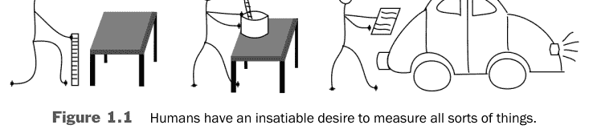

### 1.2.1 Features

Let’s get a bit more concrete. For example—a meta-example, if you will—a dataset focused on human medical records might record several relevant values for each patient, such as height, weight, sex, age, smoking history, systolic and diastolic (that’s the high and low numbers) blood pressures, and resting heart rate. The different people represented in the dataset are our examples. The biometric and demographic characteristics are our attributes.

We can capture this data very conveniently as in Table 1.1.

Table 1.1 A simple biomedical data table. Each row is an example. Each column contains values for a given attribute. Together, each attribute-value pair is a feature of an example.

| patient id | height | weight | sex | age | smoker | hr | sys bp | dia bp |

|---|---|---|---|---|---|---|---|---|

| 007 | 5'2" | 120 | M | 11 | no | 75 | 120 | 80 |

| 2139 | 5'4" | 140 | F | 41 | no | 65 | 115 | 75 |

| 1111 | 5'11" | 185 | M | 41 | no | 52 | 125 | 75 |

Notice that each example—each row—is measured on the same attributes shown in the header row. The values of each attribute run down the respective columns.

We call the rows of the table the examples of the dataset and we refer to the columns as the features. Features are the measurements or values of our attributes. Often, people use “features” and “attributes” as synonyms describing the same thing; what they are referring to are the columns of values. Still, some people like to distinguish among three concepts: what-is-measured, what-the-value-is, and what-the-measured-value-is. For those strict folks, the first is an attribute, the second is a value, and the last is a feature—an attribute and a value paired together. Again, we’ll mostly follow the typical conversational usage and call the columns features. If we are specifically talking about what-is-measured, we’ll stick with the term attribute. You will inevitably see both, used both ways, when you read about machine learning.

Let’s take a moment and look at the types of values our attributes—what is measured—can take. One type of value distinguishes between different groups of people. We might see such groups in a census or an epidemiological medical study—for example, sex {male, female} or a broad record of ethnic-cultural-genetic heritage {African, Asian, European, Native American, Polynesian}. Attributes like these are called discrete, symbolic, categorical, or nominal attributes, but we are not going to stress about those names. If you struggled with those in a social science class, you are free to give a hearty huzzah.

Here are two important, or at least practical, points about categorical data. One point is that these values are discrete. They take a small, limited number of possibilities that typically represent one of several options. You’re right that small and several are relative terms—just go with it. The second point is that the information in those attributes can be recorded in two distinct ways:

- As a single feature that takes one value for each option, or

- As several features, one per option, where one, and only one, of those features is marked as `yes` or `true` and the remainder are marked as `no` or `false`.

Here’s an example. Consider

| Name | Sex |

|------|-----|


| Mark | Male |

| Barb | Female |

| Ethan | Male |

versus:

| Name | Sex is Female | Sex is Male |

|------|---------------|-------------|

| Mark | No | Yes |

| Barb | Yes | No |

| Ethan | No | Yes |

If we had a column for community type in a census, the values might be Urban, Rural, and Suburban with three possible values. If we had the expanded, multicolumn form, it would take up three columns. Generally, we aren’t motivated or worried about table size here. What matters is that some learning methods are, shall we say, particular in preferring one form or the other. There are other details to point out, but we’ll save them for later.

Some feature values can be recorded and operated on as numbers. We may lump them together under the term `numerical` features. In other contexts, they are known as `continuous` or, depending on other details, `interval` or `ratio` values. Values for attributes like height and weight are typically recorded as decimal numbers. Values for attributes like age and blood pressure are often recorded as whole numbers. Values like counts—say, how many wheels are on a vehicle—are strictly whole numbers. Conveniently, we can perform arithmetic (`+`, `−`, `×`, `/`) on these. While we `can` record categorical data as numbers, we can’t necessarily perform `meaningful` numerical calculations directly on those values. If two states—say, Pennsylvania and Vermont—are coded as 2 and 14, it probably makes no sense to perform arithmetic on those values. There is an exception: if, by design, those values `mean` something beyond a unique identifier, we might be able to do some or all of the maths. For extra credit, you can find some meaning in the state values I used where mathematics would make sense.

### 1.2.2 Target Values and Predictions

Let’s shift our focus back to the list of biomedical attributes we gathered. As a reminder, the column headings were height, weight, sex, age, smoker, heart rate, systolic blood pressure, and diastolic blood pressure. These attributes might be useful data for a health care provider trying to assess the likelihood of a patient developing cardiovascular heart disease. To do so, we would need another piece of information: did these folks develop heart disease?

If we have that information, we can add it to the list of attributes. We could capture and record the idea of “developing heart disease” in several different ways. Did the patient:

- Develop any heart disease within ten years: yes/no

- Develop X-level severity heart disease within ten years: None or Grade I, II, III

- Show some level of a specific indicator for heart disease within ten years: percent of coronary artery blockage

We could tinker with these questions based on resources at our disposal, medically relevant knowledge, and the medical or scientific puzzles we want to solve. Time is a precious resource; we might not have ten years to wait for an outcome. There might be medical knowledge about what percent of blockage is a critical amount. We could modify the time horizon or come up with different attributes to record.

In any case, we can pick a concrete, measurable target and ask, “Can we find a predictive relationship between the attributes we have today and the outcome that we will see at some future time?” We are literally trying to predict the future—maybe ten years from now—from things we know today. We call the concrete outcome our target feature or simply our target. If our target is a category like {sick, healthy} or {None, I, II, III}, we call the process of learning the relationship classification. Here, we are using the term classification in the sense of finding the different classes, or categories, of a possible outcome. If the target is a smooth sweeping of numerical values, like the usual decimal numbers from elementary school {27.2, 42.0, 3.14159, −117.6}, we call the process regression. If you want to know why, go and google Galton regression for the history lesson.

We now have some handy terminology in our toolbox: most importantly features, either categorical or numerical, and a target. If we want to emphasize the features being used to predict the future unknown outcome, we may call them input features or predictive features. There are a few issues I’ve swept under the carpet. In particular, we’ll address some alternative terminology at the end of the chapter.

## 1.3 Putting the Machine in Machine Learning

I want you to create a mental image of a factory machine. If you need help, glance at Figure 1.2. On the left-hand side, there is a conveyor belt that feeds inputs into the machine. On the right-hand side, the machine spits out outputs which are words or numbers. The words might be cat or dog. The numbers might be {0, 1} or {−2.1, 3.7}. The machine itself is a big hulking box of metal. We can’t really see what happens on the inside. But we can see a control panel on the side of the machine, with an operator’s seat in front of it. The control panel has some knobs we can set to numerical values and some switches we can flip on and off. By adjusting the knobs and switches, we can make different products appear on the right-hand side of the machine, depending on what came in the left-hand side. Lastly, there is a small side tray beside the operator’s chair. The tray can be used to feed additional information, that is not easily captured by knobs and switches, into the machine. Two quick notes for the skeptical reader: our knobs can get us

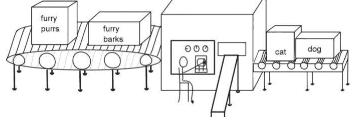

图 1.2 描述输入。类别或其他值输出。我们可以调整机器以改善输入和输出之间的关系。

任意的小值和大值（−∞ 到 ∞，如果你坚持的话），我们也不严格需要开关，因为精确设置为 0 或 1 的旋钮可以起到类似的作用。

继续往前，这个工厂图像是理解学习算法如何找出特征与目标之间关系的一个很好的切入点。我们可以坐下来作为机器操作员，按下神奇的——可能是绿色的——开始按钮。材料从左侧滚入机器，右侧弹出一些东西。我们的好奇心占了上风，我们拧动旋钮并拨动开关。然后，不同的东西从右侧弹出。我们调高旋钮一，机器会更关注输入对象发出的声音。我们调低旋钮二，机器会更少关注输入对象的肢体数量。如果我们有一个目标——如果有某种我们希望机器生产出来的已知产品——希望我们的旋钮调校能让我们更接近它。

学习算法是我们操作控制的正式规则。在看到目标已知的示例后，学习算法会取一个给定的大黑盒，并使用一种定义明确的方法将旋钮和开关设置为良好的值。虽然“好”在伦理课上可能是一个相当有争议的质量，但在我们这里有一个金标准：我们已知的目标值。如果它们不匹配，我们就有一个问题。算法调整控制面板设置，使我们的预测输出与已知输出相匹配。我们把这台机器的名字叫做学习模型或简称模型。

一个示例进入机器，基于旋钮和开关的设置，会弹出一个类别或数值。你想要从相同的输入成分得到不同的输出值吗？把旋钮调到不同的设置或拨动开关即可。一台机器有一套固定的旋钮和开关。旋钮可以转动，但我们不能添加新旋钮。如果我们添加一个旋钮，我们就拥有了一台不同的机器。令人惊讶的是，基于旋钮的学习方法之间的差异归结为回答三个问题：

- 1. 有哪些旋钮和开关：控制面板上有什么？

- 2. 旋钮和开关如何与输入示例交互：机器的内部工作原理是什么？

- 2. `股票操作`。从股票的价格历史、公司基本面数据和其他相关的金融和市场数据中，输出我们是否应该买入或卖出股票。这个问题增加了一些挑战。财务记录可能只能以文本形式提供。我们可能对相关的新闻故事感兴趣，但我们必须 somehow 弄清楚什么是相关的——要么手工（或也许！）使用另一个学习系统。一旦我们弄清楚了相关文本，我们就必须对其进行解释。这些步骤就是学习系统与自然语言处理领域交互的地方。继续我们更大的任务，我们有一个时间序列数据——随时间重复的测量。我们的挑战在不断增加。在金融市场中，我们很可能有一个移动目标！昨天用来挑选赢家股票的方法几乎肯定不会以完全相同的方式在明天发挥作用。我们可能需要某种方法或技术来应对输入与输出之间关系的变化。或者，我们可能只是希望最好并使用一种假设我们没有移动目标的技术。免责声明：我不是财务顾问，也没有提供投资建议。

- 3. `医疗诊断`。从患者的医疗记录中，输出他们是否生病或健康。这里我们有一个更复杂的任务。我们可能要处理文本和图像的组合：医疗记录、笔记和医学影像。根据可能未被记录捕获的上下文——例如，前往热带地区会增加感染某些讨厌疾病的可能性——不同的体征和症状可能导致非常不同的诊断。同样，对于我们对医学的庞大知识，我们才刚刚开始理解某些领域。希望我们的系统能够像医生和研究人员一样阅读和学习最新的诊断患者技术。学习`学习-学习`是一个极端的元任务。

这些是分类系统的宏观示例。截至 2019 年，存在能够处理这些任务许多方面的学习系统。我们甚至将在第 14 章深入研究基本的图像和语言分类器。虽然这些示例各自具有特定的领域困难，但它们在构建一个以有用且准确的方式分离目标类别的模型这一共同任务上是一致的。

### 1.4.2 预测值：回归器的示例

数值无处不在现代生活中。物理测量（温度、距离、质量）、货币价值、百分比和分数被不断测量、记录和处理。每个都可以很容易成为一个目标特征来回答感兴趣的问题：

- 1. **学生成功。** 我们可以尝试预测学生在考试中的分数。这样的系统可能允许我们在考试`之前`就将辅导工作集中在 struggling 的学生身上。我们可以包含诸如作业完成率、课堂出勤率、日常参与度或参与度的衡量指标，以及之前课程的成绩等特征。我们甚至可以包含开放式书面评估和之前教师的推荐。如同许多回归问题一样，我们可以合理地将此回归问题转换为分类问题，通过预测通过/失败或字母等级而不是原始数值分数。

- 2. **股票定价。** 类似于买/卖股票分类器，我们可以尝试预测股票的未来价格——美元价值。这个变体似乎是一个更困难的任务。不同于满足于对`上涨`或`下跌`的粗略估计，我们希望预测价格将在两周后为 $20.73。无论难度如何，输入可能基本上相同：各种每日交易信息以及我们希望纳入的尽可能多的基本面信息——想想致股东的季度报告。

- 3. **网页浏览行为。** 从在线用户的浏览和购买历史中，预测（以百分比表示）用户点击广告链接或从在线商店购买商品的可能性。虽然浏览和购买历史的输入特征`不是`数值，但我们的目标——一个百分比值——是。因此，我们有一个回归问题。如同图像分类任务一样，我们有许多小的信息片段，每个都对整体结果有贡献。这些片段需要上下文——它们如何相互关联——才能真正变得有价值。

## 1.5 评估学习系统

学习系统很少是完美的。因此，我们的一个关键标准是衡量它们做得如何。预测有多`正确`？由于没有免费的午餐，我们也关心做出预测的`成本`。为了获得这些预测，我们投入了多少`计算资源`？我们将研究学习系统性能的这两个方面。

### 1.5.1 正确性


我们评估学习系统的关键标准是它们能给出正确的预测答案。如果我们特别不在乎正确答案，我们可以简单地抛硬币、旋转轮盘赌轮，或在计算机上使用随机数生成器来获得输出预测。我们希望我们投入时间和精力构建和运行的学习系统能比随机猜测做得更好。因此，（1）我们需要量化学习者的表现如何，以及（2）我们希望将这种成功——或不幸的失败——水平与其他系统进行比较。与其他系统的比较甚至可以包括与随机猜测者的比较。进行这种比较有一个很好的理由：如果我们无法击败随机猜测者，我们就需要回到绘图板——或者也许去度一个长假。

评估正确性是一个令人惊讶微妙的话题，我们将在整本书中详细讨论。但现在，让我们看看评估正确性困难的两个经典示例。在医学中，许多疾病——幸运的是！——相当罕见。因此，一位医生可以通过简单地看着街上每个人并说：“那个人没有这种罕见疾病。”来获得很大比例的正确诊断。这个场景说明了在评估潜在诊断时必须考虑的至少四个问题：

# 第1章 让我们讨论学习

- 1. 疾病有多常见：患病的基线率是多少？

- 2. 漏诊的代价是什么：如果患者未得到治疗而病情严重恶化会怎样？

- 3. 做出诊断的代价是什么？进一步的检查可能具有侵入性且昂贵；不必要地让患者担心对焦虑水平高的患者可能非常不利。

- 4. 医生通常诊断来诊所就诊的患者，因为他们有症状。这与街上随机的人相比是一个相当显著的差异。

第二个例子来自美国法律体系，其中存在无罪推定原则，并且确定有罪的标准相对较高。有时这一标准被概括为，“与其让99名罪犯逍遥法外，不如让1名诚实公民入狱。”与医学一样，我们也面临稀有性问题。犯罪和罪犯相对稀少且越来越稀少。我们还与失败相关的成本不同。我们更看重为诚实公民洗清嫌疑，而不是抓住每一个罪犯——至少在高中公民课的理想化世界里是这样。法律和医学这两个领域都处理着不平衡的目标类别：疾病和有罪并不是50–50的平衡结果。我们将在第6.2节讨论不平衡目标的评估。

评估正确性时最后一个问题：两个错误并不一定能抵消。如果我们在预测降雨时，一次低估了2英寸，另一次高估了2英寸，这些并不总是相互抵消。我们不能说，“平均而言，我们是完美的！”好吧，严格来说这是正确的，在某些情况下可能足够好。然而，通常情况下，我们确实在意，而且在其他情况下非常在意，我们在两次预测中都犯了错误。如果我们试图确定给某些植物额外提供多少水，我们可能会给植物双倍的水量导致它们溺水。棕色拇指——我本人也在其中——可能会在下一次大花园惨败时用这个借口。

在我们这个一切都可丢弃的现代社会，倾向于将消费者驱动的策略应用于我们的学习系统：如果遇到障碍，就用金钱解决它。数据存储极其便宜。获取现象级强大的硬件，例如由图形处理器驱动的计算集群，只需一封电子邮件或一次在线购买即可。这种策略引出一个问题：我们是否应该只是把更多硬件投入到遇到资源限制的问题上？

答案可能是肯定的——但至少，让我们使用定量数据来做出决定。在计算系统的复杂性每增加一个层级时，我们都要为使用这种更复杂的系统付出代价。我们需要更多的软件支持。我们需要更多专业的人力资本。我们需要更复杂的现成库。我们失去了快速原型化想法的能力。对于这些成本中的每一个，我们都需要证明其开销是合理的。此外，对于许多系统，都有少量代码是性能瓶颈。通常可以保持整体系统的简单性，只有一个小内核利用更复杂的机器来加快速度。

话虽如此，我们将衡量的两个主要资源是：时间和内存。计算需要多长时间？它最大需要多少内存？通常情况下，这两者可以相互权衡。例如，我可以预先计算常见问题的答案，然后， presto，我就有非常快的答案可用。然而，这需要付出记录这些答案并将其存储在某处的成本。我减少了计算所需的时间，但增加了存储需求。

如果你曾经使用过查找表——也许是为了将英制长度转换为公制——你就利用了这种权衡。你可以拿出计算器，将值代入公式，并为任何特定输入得到答案。或者，你只需翻阅几页表格，就能找到预先计算好的答案，精确到某一位数字。现在，由于这里的公式方法本身就相当快，使用大表反而会让我们吃亏。如果公式更复杂、计算成本更高，表格就能节省大量时间。

预计算的物理世界等价物是当厨师和调酒师预先制作较大食谱的重要组成部分时。然后，当他们需要青柠汁时，不必去寻找青柠、清洗它们并榨汁，他们只需从冰箱里取出一个青柠汁块或从罐子里倒出一些青柠汁。他们用开始时的时间和冰箱里的一些存储空间换取了更快获取青柠汁的速度，以便制作你的杀手莫吉托或鳄梨酱。

同样，一种称为压缩的常见计算技术也在时间与空间之间进行权衡。我可以花一些时间找到《白鲸记》——包括那该死的鲸类学 cetology（鲸类的研究）章节——的更小、更紧凑的表示形式，并存储压缩后的文本而不是该巨著的原始文本。现在，我的硬盘或书架就不必承受存储需求的负担。然后，当我想阅读关于19世纪捕鲸冒险的故事时，我就可以这样做。但首先，我必须付出计算时间成本，因为我必须解压缩这本书。同样，计算时间和存储空间之间存在权衡。

不同的学习系统在记住数据的内容和处理数据花费的时间之间做出不同的权衡。从一个角度来看，学习算法以适合预测新示例的方式压缩数据。想象一下，我们能够将一个大型数据表简化为机器上的几个旋钮：只要我们手边有一份该机器的副本，我们只需要几条信息就能重建该表。

## 1.6 构建学习系统的流程

即使在对学习系统这一简短介绍中，你可能已经注意到，描述学习系统的选项非常多。

- 我们可以应用学习的领域各不相同，例如商业、医学和科学。

- 领域内的任务各不相同，例如动物图像识别、医学诊断、网页浏览行为和股票市场预测。

- 有不同类型的数据。

- 有不同的模型将特征与目标联系起来。

我们尚未明确讨论我们将使用的不同模型类型，但将在后面的章节中讨论。放心，选项很多。

我们能否概括出构建学习系统的一般规律？可以。让我们从两个不同的角度来看。首先，我们将从高层次谈论，在那里我们更关心学习系统周围的世界，而较少关心学习系统本身。其次，我们将深入到较低层次的细节：想象一下，我们已经抽象掉了我们周围世界的全部复杂性，只是在让学习系统运行。更进一步，我们试图在特征和目标之间找到牢固的关系。在这里，我们将一个非常开放的问题简化为一个定义明确且受约束的学习任务。

以下是高层次的步骤：

- 1. 发展对我们任务的理解（任务理解）。

- 2. 收集并理解我们的数据（数据收集）。

- 3. 为建模准备数据（数据准备）。

- 4. 构建数据中关系的模型（建模）。

- 5. 评估并比较一个或多个模型（评估）。

- 6. 将模型过渡到可部署系统（部署）。

这些步骤在图1.3中显示。我在这里插入一些常见的警告。首先，我们通常需要迭代或重复这些步骤。其次，一些步骤可能会反馈到之前的步骤。正如大多数现实世界的过程一样，进展并不总是直线向前。

这些步骤取自组织构建学习系统高层次步骤的CRISP-DM流程图。我将第一步从业务理解更名为任务理解，因为并非所有学习问题都源于商业世界。

在高层次的建模步骤中——也就是上面第4步——对于监督学习系统来说，有一些重要的选择：

- 1. 我们的数据中哪一部分是目标，哪些是特征？

- 2. 我们想要使用什么样的机器或学习模型来关联我们的输入特征与目标特征？

- 3. 数据和机器之间是否存在负面交互？如果是，我们是否需要在模型构建过程中进行额外的数据准备？

- 4. 我们如何设置机器上的旋钮？我们的算法是什么？

虽然这些分解可以帮助我们组织对学习系统的思考和讨论，但它们并不是最终的故事。让我们告知皇帝和皇后他们衣衫不整。抽象模型或流程图永远无法捕捉现实世界的混乱。在现实世界中，构建学习系统的人通常在（1）已经收集了一堆数据之后才被叫来，以及（2）在一些主要利益相关者——咳，领导——已经决定他们想要做什么之后才被叫来。从我们谦卑的角度来看——以及我希望你从这本书中得到的——那就是

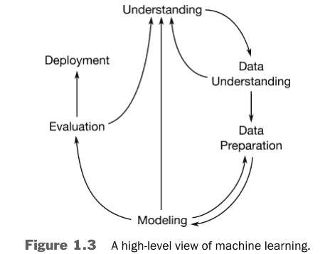

图1.3 机器学习的高层视图。

好的。我们不会深入探讨数据收集、实验设计以及确定要捕捉的良好业务、工程或科学关系的细节。我们只会说：“开始吧！”我们将从那一堆数据转向可用的示例，应用不同的学习系统，评估结果，并比较各种替代方案。

## 1.7 学习的假设与现实

机器学习并非魔法。我能看到你们脸上的震惊表情。但说真的，学习不能超越一些基本极限。这些极限是什么？其中两个与我们已经获得的数据直接相关。如果我们试图预测心脏病，那么拥有关于偏好发型和袜子颜色的信息——很可能——不会帮助我们构建有用的模型。如果我们没有有用的特征，我们只会从数据中拾取虚幻的模式——随机噪声。即使有有用的特征，面对许多不相关的特征，学习方法也可能陷入困境，不再发现有用的关系。因此，我们有一个基本极限：我们需要与手头任务相关的特征。

第二个数据限制与数量有关。一个名为`计算学习理论`的完整学科专门研究在特定数学理想化条件下，我们需要多少示例才能学习关系。然而，从实际角度来看，简短的回答是`更多`。我们需要`更多`数据。这一经验法则通常被概括为`数据大于（比算法更重要）算法：data > algorithms`。这有道理，但通常细节很重要。如果我们的数据噪声过大——无论是由于错误还是随机性——它可能实际上并无用处。升级到更强的学习机器——有点像摔跤中升级体重级别，或者为厨房弄一个更大的石碗——`可能`会给我们更好的结果。然而，你可以变得更大，但不`一定`更好：你可能会因为更强壮或有更好的工具，而不一定成为更优秀的摔跤手或做出更好的鳄梨酱。

说到测量中的误差，数据表中我们拥有的每个值并不都会百分之百准确。我们的测量尺可能稍有偏差；我们的读尺人可能以不同方式舍入测量结果。更糟糕的是，我们可能在调查中提问，却收到`谎言`作为回答——太可怕了！现实就是如此。即使我们在测量时极为注重细节，重复该过程时也可能存在差异。

错误和不确定性时有发生。好消息是学习系统`能够`容忍这些缺点。坏消息是，如果`噪声`足够大，就可能无法辨别出可理解的模式。

另一个问题是，一般来说，我们并不知道`每一条`相关信息。我们的结果可能无法以`完全`准确的方式获知。综合起来，当我们试图将输入与输出关联起来时，这些因素会造成无法解释的差异。即使我们以`完美`的精度测量了`每一项`相关信息，世界上某些过程从根本上是`随机`的——夸克，我正看着你呢。如果随机漫步股市理论家是对的，那么股票定价在非常深层的意义上是随机的。在更宏观尺度的现象中，随机性可能不那么根本，但它仍然存在。如果我们缺少一个关键的测量数据，数据中的关系可能看起来就像是随机的。这种视角的缺失就像试图生活在三维世界中，却只能看到二维影子。有许多3D物体从不同角度被光照时，能产生`相同`的2D影子；一个罐子、一个球和一个咖啡杯从俯视图看都是圆形（图1.4）。同样，缺失的测量可能会掩盖关系真实、可检测的本质。

现在讲两个贯穿全书的最后技术性注意事项。其一，特征与目标之间的关系本身并非一个移动的目标。例如，随着时间的推移，促成企业成功的因素可能已经发生了变化。在工业企业中，你需要获得原材料，因此处于正确的时间和地点是一个巨大的竞争优势。在知识驱动型企业中，能够从相对较小的人才库中吸引高质量员工是一个强大的竞争优势。更高阶的数学学习者将不随时间变化的关系称为`平稳学习任务`。随着时间的推移，或者至少在我们的数据集中不同的示例之间，底层关系被假定为——我们表现得好像它确实如此——保持不变。

第二个注意事项是，我们不一定假设自然界的运作方式与我们的机器相同。我们只关心匹配输入和输出。一个更科学的模型可能会试图用代表宇宙`物理定律`的数学公式来`解释`输入和输出之间的关系。我们不会深入那个兔子洞。我们满足于捕捉关系的表层视图——一个黑匣子或包装好的礼物。我们拥有了蛋糕，却不能同时吃掉它。

## 1.8 章末材料

### 1.8.1 前方的路

作为引言章节，没有太多需要总结的内容。相反，我会简要谈谈本书四个部分我们将要经历的内容。

第一部分将向你介绍几种类型的学习机器，以及评估和比较它们的基础知识。我们还会简要了解一些数学主题和概念，你需要熟悉这些内容才能处理我们的材料。希望数学的呈现方式不会让你想夺门而逃。如你将看到的，我采用了一种不同的方法，希望它能为你所用。

第二部分深入探讨评估学习系统的细节。我的信念是，开发学习系统时最大的风险是欺骗自己，以为我们做得有多好。顺便说一句，第二大风险是盲目使用一个系统，而不顾及围绕它的不断演化的复杂系统。具体而言，复杂社会技术系统中的组件并不像汽车零件那样可以互换。我们还需要非常谨慎地对待“未来与过去相似”这一假设。至于第一个问题，在我通过一些实际示例让你上手之后，我们会立即着手处理评估问题。至于第二个问题——祝你好运吧！说正经的，这超出了本书的范围，处理在不同场景下行为不同的数据需要丰富的经验和智慧。

第三部分进一步充实了几种学习方法，然后将重点转向处理数据，以便我们能更有效地运用这些学习方法。接着，我们将焦点转向通过调整其内部机制来微调方法——深入其内部工作原理。

第四部分处理一些日益复杂的问题：处理数据中词汇不足的问题，使用图像或文本而不是整洁的示例-特征表，以及构建由多个子学习器组成的学习器。最后，我们会强调不同学习系统之间的一些联系，以及与一些看似复杂得多的方法之间的联系。

### 1.8.2 注释

如果你想了解更多关于阿瑟·塞缪尔（Arthur Samuel）的信息，这份简短的传记可以让你入门：http://history.computer.org/pioneers/samuel.html。

`元`层次和自指的思想是高等计算机科学、数学和哲学的基础。若想对`元`进行精彩而广泛的探讨，请参阅霍夫施塔特（Hofstadter）的`《哥德尔、埃舍尔、巴赫：集异璧之大成》`。这本书篇幅很长，但知识上回报丰厚。

对于我们所称的特征和目标，有许多替代术语：输入/输出、自变量/因变量、预测变量/结果变量等等。

宾夕法尼亚州（PA）和佛蒙特州（VT）分别是加入美国的第2个和第14个州。

是什么让`cat`这个词意指★CAT★这个物体？这与我们用来定义猫的属性（喵喵叫、睡在阳光里等）有何关系？要深入探讨这个话题，请参阅维特根斯坦（https://plato.stanford.edu/entries/wittgenstein），尤其是关于语言和意义的部分。

我讨论的示例介绍了学习系统中一些`真正困难`的方面。在许多情况下，本书关注的是`简单`的内容（运行算法）加上一些`中等难度`的组件（特征工程）。现实世界引入了`困难`的复杂性。

除了基于示例的监督学习之外，还有其他几种学习类型。`聚类`不是监督学习，尽管它确实使用示例。我们将在后面的章节中涉及它。聚类在未指定特殊目标特征的情况下寻找数据中的模式。还有其他更“狂野”的学习系统类型；分析学习、归纳逻辑编程、基于案例的推理和强化学习是其中一些主要角色。参见汤姆·米切尔（Tom Mitchell）的杰出著作`《机器学习》`。顺便说一句，米切尔对构建学习系统所涉及的步骤（CRISP-DM流程中的建模步骤）进行了出色的剖析。

说到CRISP-DM，福斯特·普罗沃斯特（Foster Provost）和汤姆·福西特（Tom Fawcett）有一本很棒的书`《数据科学：业务理解》`，深入探讨了机器学习及其在组织中的作用。虽然他们的方法聚焦于商业世界，但任何需要使用作为更大系统或组织一部分的机器学习系统的人——大多数人都是如此，朋友们——都能从他们的书中学到许多有价值的教训。他们处理技术材料的方法也很棒。我强烈推荐。

有许多问题使现实世界的数据难以处理。缺失值就是其中之一。例如，数据可能是随机缺失的，也可能与其他值一起缺失，还可能因为我们的数据并不是我们可能考虑的所有数据的好样本而缺失。这些情况中的每一种都可能需要不同的步骤来尝试填补缺失值。

有社会科学背景的人可能会想，为什么我没有采用定类、定序、定距和定比数据的经典区分。答案有两个方面。首先，这种类型划分忽略了一些重要的区别；请在网上搜索“测量水平”来开始了解。其次，我们使用的建模技术会将类别（无论是否有序）转换为数值，然后进行后续处理。这些类型并没有从根本上以不同方式对待。然而，确实有一些统计技术，例如`有序回归`，可以考虑类别的顺序。

# 一些技术背景

## 2.1 关于我们的设置

我们即将以 funk 风格开始编码。本书中的章节最初以 Jupyter notebook 的形式存在。如果你不熟悉 Jupyter notebook，它是一个非常酷的环境，可在一个浏览器标签页中处理 Python 代码、文本和图形。许多与 Python 相关的博客都是用 Jupyter notebook 构建的。在每一章的开头，我会执行几行代码来设置编码环境。

`mlwpy.py` 的内容在附录 A 中展示。虽然 `from module import *` 通常不推荐，但在这种情况下我特意使用它，以便将 `mlwpy.py` 中的所有定义包含在我们的 notebook 环境中，而不会占用四十行代码。由于 scikit-learn `高度模块化`——这导致了大量 `import` 行——`import *` 是避免在每一章中出现冗长设置块的好方法。`%matplotlib inline` 告诉 notebook 系统将 Python 生成的图形与文本内联显示。

```
In [1]:

from mlwpy import *
%matplotlib inline
```

## 2.2 需要数学语言

在不讨论 `一些` 数学的情况下谈论机器学习（ML）是非常困难的。许多 ML 教科书把这一点推向极端：它们是碰巧讨论机器学习的 `数学` 教科书。我要把这个剧本颠倒过来。我希望你 `理解` 我们使用的数学，并对看到的数学符号语言在日常生活中意味着什么有一些直觉。我会尽量减少我抛出的数学量。我也希望我们——也就是你和我一起在这段美妙的旅程中——在看到数学符号之前，或在看到之后很快，就把数学看作代码。

也许，也许，在做完所有这些之后，你 `可能会` 决定想要更深入地研究数学。太好了！这样做的选择无穷无尽。但这不是我们的游戏。我们更关心机器学习的思想，而不是用高端数学来表达它们。幸运的是，我们只需要数学世界中的几个概念：

- 化简方程（代数），

- 与随机性和偶然性相关的几个概念（概率），

- 在网格上绘制数据（几何），以及

- 用于表达某些算术的紧凑记号（符号）。


在整个讨论中，我们将使用一些代数来精确地写下想法，而没有不必要的啰嗦。概率的思想支撑着许多机器学习方法。有时这是非常直接的，如朴素贝叶斯（NB）；有时则不那么直接，如支持向量机（SVMs）和决策树（DTs）。一些方法非常直接地依赖于数据的几何描述：SVMs 和 DTs 在这里表现出色。其他方法，如 NB，需要稍微仔细观察才能看出它们如何通过几何视角来看待。我们的记号片段很低调，但它们构成了一种专门的词汇，允许我们将思想打包成盒子，而这些盒子又可以装入更大的包中。如果这让你联想到将计算机程序从单个单体脚本重构为模块化函数，给自己一个奖励。那正是正在发生的事情。

请不要误会：深入机器学习神秘莫测的奥秘需要比我们讨论的更多、更深的数学知识。然而，我们将讨论的思想是更复杂呈现的第一步和概念基础。在迈出这些第一步之前，让我们介绍我们将用来使这些抽象数学思想具体化的主要 Python 包。

## 2.3 我们用于攻克机器学习的软件

我期望你拥有的唯一工具是对 Python 中良好的、老式的过程式编程的基本理解。我会尽力讨论任何更中级或高级的话题。我们将使用来自 Python 标准库的几个模块，你可能没有见过：`itertools`、`collections` 和 `functools`。

我们还将使用 Python 数值计算和数据科学堆栈中的几个成员：`numpy`、`pandas`、`matplotlib` 和 `seaborn`。我没有时间教你这些工具的所有细节。然而，我们不会使用它们的更复杂功能，所以没有什么会太令人震惊。我们还将简要涉及一两个其他包，但它们是相对较小的参与者。

当然，使用数值计算工具的很大一部分原因是它们构成了 scikit-learn 的基础，或与之配合良好。`sklearn` 是一个用于玩弄机器学习思想的绝佳环境。它实现了许多不同的学习算法和评估策略，并为你运行它们提供统一的接口。赢，赢，再赢。如果你从未有过——愉快？——整合几种不同命令行学习程序的挣扎……你没有错过任何东西。享受你的世界，它是一个更好的地方。旁注：scikit-learn 是项目名称；`sklearn` 是 Python 包的名称。人们在交谈中可以互换使用。我通常写 `sklearn` 因为它更短。

## 2.4 概率

我们大多数人在青少年时期就实际接触过概率：掷骰子、抛硬币和玩纸牌都提供了随机事件的具体例子。当我掷一个标准的六面骰子——你这些角色扮演游戏玩家知道还有所有其他面的骰子——有六种不同的结果可能发生。其中每个事件发生的机会相等。我们说每个事件的概率是 1⁄6。数学上，如果我——一个罗马数字一，而不是我本人——是掷出一个一的情况，我们会写成 `P(I) = 1⁄6`。我们读作“掷出一个一的概率是一六分之一。”

我们可以用几种不同的方式在 Python 中掷骰子。使用 NumPy，我们可以用 `np.random.randint` 生成等权重随机事件。`randint` 设计为模仿 Python 的索引语义，这意味着我们包含起点并排除终点。实际结果是，如果我们想要 1 到 6 的值，我们需要从 1 开始到 7 结束：7 不会被包含。如果你更倾向于数学，你可以将其记住为半开区间。

```
In [2]:
np.random.randint(1, 7)

Out[2]:
4
```

如果我们想说服自己数字确实以相等可能性生成（就像一个完美的公平骰子），我们可以绘制许多掷骰结果频率的图表。我们将分三步完成。我们将掷骰子，次数少或多：

```
In [3]:
few_rolls = np.random.randint(1, 7, size=10)
many_rolls = np.random.randint(1, 7, size=1000)
```

我们将用 `np.histogram` 统计每个事件发生的次数。注意 `np.histogram` 设计用于绘制连续值的桶。由于我们想要捕获离散值，我们必须创建围绕我们感兴趣的值的桶。我们通过在 0.5 和 1.5 之间制作一个桶来捕获一，I。

```
In [4]:
few_counts = np.histogram(few_rolls, bins=np.arange(.5, 7.5))[0]
many_counts = np.histogram(many_rolls, bins=np.arange(.5, 7.5))[0]

fig, (ax1, ax2) = plt.subplots(1, 2, figsize=(8, 3))
ax1.bar(np.arange(1, 7), few_counts)
ax2.bar(np.arange(1, 7), many_counts);
```

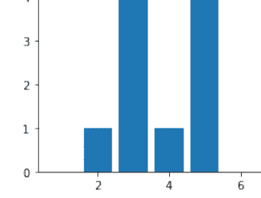

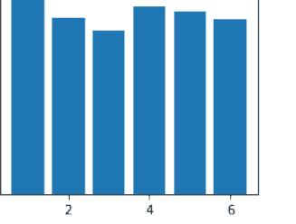

这里有一个重要的教训。当处理随机事件和整体行为时，小样本可能具有误导性。我们可能需要增加示例的数量——在本例中是掷骰次数——以更好地了解底层行为。你可能会问为什么我没有使用 `matplotlib` 的内置 `hist` 函数一步制作图表。`hist` 对于取值范围更广的大型数据集足够好用，但不幸的是，对于少数离散值的简单情况，它最终会掩盖问题。自己试试看。

### 2.4.1 原始事件

在实验之前，我们假设掷出一个一的概率是六分之一。那个数来自 $\frac{\text{#ways this event can occur}}{\text{#of different events}}$。我们可以通过询问“掷出奇数的概率是多少？”来测试我们对该比率的理解。好吧，使用罗马数字表示掷骰结果，我们的事件空间中的奇数是 $I$、$III$、$V$。其中有三个，而总共有六个原始事件。所以，我们有 $P(\text{odd}) = \frac{3}{6} = \frac{1}{2}$。幸运的是，这与我们的直觉一致。

我们可以用另一种方式来计算：奇数可以以三种方式出现，而且这三种方式不重叠。因此，我们可以把各个事件概率加起来：$P(\text{odd}) = P(I) + P(III) + P(V) = \frac{1}{6} + \frac{1}{6} + \frac{1}{6} = \frac{3}{6} = \frac{1}{2}$。我们可以通过 *计算* 原始事件 *或* *加总* 原始事件的概率来获得 *复合事件* 的概率。这是同一件事以两种不同方式完成。

这个基本场景为我们提供了一个 *切入点* 来讨论概率的许多重要方面：

- 宇宙中所有可能原始事件的概率之和为 1。$P(I) + P(II) + P(III) + P(IV) + P(V) + P(VI) = 1$。

- 事件 *不* 发生的概率是 1 减去它发生的概率。$P(\text{even}) = 1 - P(\text{not even}) = 1 - P(\text{odd})$。在讨论概率时，我们经常写“not”为 $\lnot$，如 $P(\lnot\text{even})$。所以，$P(\lnot\text{even}) = 1 - P(\text{even})$。

- 存在非原始事件。这样的复合事件是原始事件的组合。我们称之为 *奇数* 的事件结合了三个原始事件。

-   一次掷骰结果为偶数或奇数，但不会同时兼具，且所有掷骰结果都是偶数或奇数。这两个复合事件覆盖了所有可能的原始事件且互不重叠。因此，$P(\text{even}) + P(\text{odd}) = 1$。

复合事件也是递归的。我们可以由其他复合事件创建复合事件。假设我问，“得到奇数或大于 3 的值或两者兼有的概率是多少？”这个事件组合在一起，是一个更大的原始事件组。如果我通过计数这些原始事件来处理，我看到奇数是 `odd = {I, III, V}` 而大值是 `big = {IV, V, VI}`。把它们放在一起，我得到 `{I, III, IV, V, VI}` 或 $\frac{5}{6}$。这个复合事件的概率与奇数的概率为 $\frac{1}{2}$ 以及大于 3 的概率为 $\frac{1}{2}$ 有点不同。我不能直接把这些概率相加。为什么呢？因为我会得到和为一——意味着我们覆盖了所有情况——但这只说明了错误。原因在于这两个复合事件重叠：它们共享原始事件。掷出五点 V 同时出现在两个子组中。由于它们重叠，我们不能直接相加。我们必须分别把两组中的所有内容加起来，然后去掉被重复计数的部分。被重复计数的事件同时属于两组——它们既是奇数又是大数。在这种情况下，只有一个被重复计数的事件，V。所以，去掉它们的形式为 `P(odd) + P(big) - P(odd and big)`。那就是 $\frac{1}{2} + \frac{1}{2} - \frac{1}{6} = \frac{5}{6}$。

### 2.4.2 独立性

如果我们掷两颗骰子，会发生一些有趣的事情。两颗骰子之间不会相互通信或以任何方式相互作用。在一颗骰子上掷出 I 不会使另一颗骰子掷出任何值的可能性变大或变小。这个概念称为独立性：这两个事件——单个骰子的掷骰结果——彼此独立。

例如，考虑一个不同的结果集合，其中每个事件都是两颗骰子点数之和。我们的和将在 2（我们掷出两个 Is）和 12（我们掷出两个 VIs）之间。得到和为 2 的概率是多少？我们可以回到计数方法：总共有 36 种可能性（每颗骰子 6 种，乘以 2），而得到总和为 2 的唯一方法是掷出两个 Is，这只有一种方式。所以，$P(2) = \frac{1}{36}$。我们也可以因为骰子不会相互通信或影响彼此而得出相同结论——通过在骰子 1 上掷出 I 且在骰子 2 上掷出 I，得到 `P(I_1)P(I_2) = 1/6 · 1/6 = 1/36`。如果事件相互独立，我们可以乘以它们的概率得到两者同时发生的联合概率。此外，如果我们相乘得到的概率与通过计数计算得出的整体结果概率相同，我们就知道事件必须是独立的。独立概率是双向的：它们是当且仅当。

我们可以将 (1) 不同事件概率的求和 和 (2) 事件的独立性 这两个思想结合起来，计算得到总和为三的概率 `P(3)`。使用事件计数方法，我们发现该事件可以以两种不同方式发生：我们掷出 `(I, II)` 或掷出 `(II, I)` 得到 `2/36 = 1/18`。使用概率计算，我们可以写：

`P(3) = P((I,II)) + P((II,I))`

`= P(I)P(II) + P(II)P(I)`

`= 1/6 · 1/6 + 1/6 · 1/6 = 2/36 = 1/18`

天哪，验证答案花了这么多功夫。通常，我们可以利用捷径来减少需要执行的计算量。有时这些捷径来自对问题的了解，有时则是我们迄今为止所见概率规则的巧妙应用。如果我们看到乘法，可以在脑中联想到两骰子的场景。如果我们有类似骰子的场景，我们可以相乘。

### 2.4.3 条件概率

让我们再创建一个场景。按照经典概率故事的风格，我们将谈论两个坛子。为什么是坛子？我猜，在我们有桶之前，人们有坛子。所以，如果你不喜欢坛子，你可以想想桶。我跑题了。

第一个坛子 `U_I` 里有三个红球和一个蓝球。第二个坛子 `U_II` 里有两个红球和两个蓝球。我们抛硬币然后从一个坛子里抽出一个球。如果硬币正面朝上，我们从 `U_I` 中挑选；否则，从 `U_II` 中挑选。我们有一半时间会到达 `U_I`，然后在这部分时间内挑选到红球的概率为 3/4。我们另一半时间会到达 `U_II`，然后在这部分时间内挑选到红球的概率为 2/4。这个场景就像沿着一条有几个交叉路口的路径漫步。当我们走下去时，在下一个十字路口会面临不同的选择。

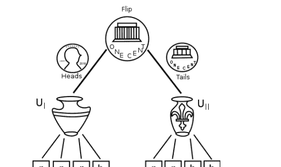

图 2.1 从硬币到坛子的两步游戏。

如果我们画出路径，看起来就像图 2.1。如果我们统计可能性，会发现整个游戏中我们有五个红色结果和三个蓝色结果。`P(red) = 5/8`。简单，对吧？别急，快点！这种计数论证只有在每一步的选择都等可能时才成立。想象一下我们有一个非常古怪的硬币，导致我 1000 次中有 999 次到达坛子 I：那么我们挑选到红球的机会就会非常接近仅从坛子 I 挑选红球的机会。这类似于几乎忽略坛子 II 的存在。我们应该考虑这种差异，同时利用可能出现的更新信息。

如果我们进行部分游戏并且知道我们处于坛子 I——例如在第一步抛到正面后——我们挑选到红球的几率是不同的。具体来说，在从坛子 I 挑选的条件下，挑选到红球的概率为 3/4。在数学中，我们写成 `P(red | U_I) = 3/4`。竖线 `|` 读作“在……条件下”。条件化——机器学习和统计学中一个常用的动词化名词——将我们限制在可能发生的原始事件的一个子集上。在这种情况下，我们对硬币翻到正面的发生进行条件化。

我们有多频繁地从坛子 I 挑选到红球？好吧，要做到这一点，我们必须 (1) 通过抛正面到达坛子 I，然后 (2) 挑选一个红球。由于硬币不影响坛子 I 中的事件——它挑选了坛子 I，而不是坛子 I 内的球——两者是独立的，我们可以相乘来找到这两个事件同时发生的联合概率。所以，`P(red and U_I) = P(red | U_I)P(U_I) = 1/2 · 3/4 = 3/8`。这里的顺序可能看起来有点奇怪。我把较晚发生的事件——依赖于 `U_I` 的事件——写在前面，而触发一切的事件 `U_I` 写在后面。这就是你在书面数学中通常会看到的顺序。为什么呢？很大程度上是因为它把 `| U_I` 放在 `P(U_I)` 旁边。你可以把它想象成从图的底部向顶部阅读。

由于挑选红球有两种互不重叠的方式（要么从坛子 I，要么从坛子 II），我们可以把不同的可能性加起来。就像我们对坛子 I 所做的那样，对坛子 II 我们有 `P(red and U_II) = P(red | U_II)P(U_II) = 1/2 · 2/4 = 2/8`。把从坛子 I 或坛子 II 得到红球的替代方式加起来，我们得到：`P(red) = P(red | U_I)P(U_I) + P(red | U_II)P(U_II) = 3/8 + 2/8 = 5/8`。Mon dieu！至少我们得到了与简单计数方法相同的答案。但现在，你知道那个重要的竖线 `P( | )` 的含义了。

### 2.4.4 分布

有许多不同的方式为事件分配概率。其中一些基于骰子、纸牌等直接的现实世界经验。其他一些基于假设情景。我们称事件与概率之间的映射为概率分布。如果你给我一个事件，我可以在概率分布中查找并告诉你它发生的概率。基于我们刚刚讨论的概率规则，我们也可以计算更复杂事件的概率。当一组事件共享一个共同的概率值——就像公平骰子的不同面——我们称之为均匀分布。就像穿着制服的风暴兵，他们看起来都一样。

还有一种非常常见的分布我们将谈论。它如此基础，以至于有多种方法来处理它。我们将回到抛硬币。如果我多次、多次抛硬币并统计正面次数，随着抛掷次数的增加，会发生以下情况：

```
In [5]:

import scipy.stats as ss

b = ss.distributions.binom
for flips in [5, 10, 20, 40, 80]:
```

# 第2章 一些技术背景

```
# binomial with .5 is result of many coin flips
success = np.arange(flips)
our_distribution = b.pmf(success, flips, .5)
plt.hist(success, flips, weights=our_distribution)
plt.xlim(0, 55);
```


如果我忽略这些整数是计数这一事实，并用一条更平滑的曲线替换图表，使其在各处取值，而不是在整数处上下攀升或下降的阶梯状，我会得到类似这样的结果：

```
b = ss.distributions.binom
n = ss.distributions.norm

for flips in [5, 10, 20, 40, 80]:
    # binomial coin flips
    success = np.arange(flips)
    our_distribution = b.pmf(success, flips, .5)
    plt.hist(success, flips, weights=our_distribution)

    # normal approximation to that binomial
    # we have to set the mean and standard deviation
    mu  = flips * .5
    std_dev = np.sqrt(flips * .5 * (1-.5))

    # we have to set up both the x and y points for the normal
```

```
# we get the ys from the distribution (a function)
# we have np to feed it xs, we set those up here
norm_x = np.linspace(mu-3*std_dev, mu+3*std_dev, 100)
norm_y = n.pdf(norm_x, mu, std_dev)
plt.plot(norm_x, norm_y, 'k');

plt.xlim(0, 55);
```

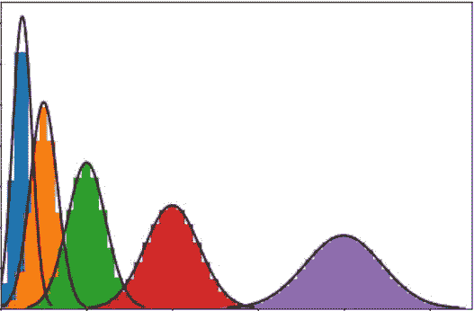

你可以把增加抛硬币次数想象成提高测量的精度——我们获得了更多小数位的精度。我们可以看到10次中4次和5次的区别，然后是40次中16、17、18、19和20次的区别。取而代之的不是一个大台阶，而是一个更小、更渐进的台阶。锯齿状的序列逐渐被平滑曲线更好地逼近。通常，这些平滑曲线被称为*钟形曲线*——为了让统计学家满意，是的，还有其他钟形曲线存在。我们正在逼近的特定钟形曲线被称为*正态分布*。

*正态分布*有三个重要特征：


- 其中间点具有最可能的值——中间的隆起。

- 它是对称的——关于其中间点可以镜像。

- 随着我们远离中间点，数值下降得越来越快。

有多种方法可以使这些特征在数学上精确。事实证明，在合适的数学和小字细节下，这些特征也导致了正态分布——我们正在努力逼近的平滑曲线！我的数学同僚可能会皱眉，但我们从正态分布中需要的主要特征是其形状。

## 2.5 线性组合、加权和与点积

当数学家谈论线性组合时，他们使用的是一个技术术语，用来描述我们在超市结账时所做的事情。如果你的超市账单看起来像：

| 产品 | 数量 | 单价 |
|---|---|---|
| 葡萄酒 | 2 | 12.50 |
| 橙子 | 12 | .50 |
| 松饼 | 3 | 1.75 |

你可以用一些算术算出总成本：

```
In [7]:
(2 * 12.50) + (12 * .5) + (3 * 1.75)

Out[7]:
36.25
```

我们可能会认为这是一个加权和。单独的和只是把东西加起来。我们买的物品总数是：

```
In [8]:
2 + 12 + 3

Out[8]:
17
```

然而，当我们购买东西时，我们会根据每件商品的成本来付费。要得到总成本，我们必须把一系列成本乘以数量加起来。我可以稍作不同地表述：我们必须用各自的价格对不同商品的数量进行加权。例如，每个橙子花费0.50美元，我们橙子的总成本是6美元。为什么？除了经济学的无形之手，超市也不希望我们为一瓶葡萄酒支付与为一个橙子相同的金额！事实上，我们也不希望这样：10美元的橙子真的不是一回事，对吧？这里有一个具体例子：

```
In [9]:
# pure python, old-school
quantity = [2, 12, 3]
costs = [12.5, .5, 1.75]
partial_cost = []
for q,c in zip(quantity, costs):
    partial_cost.append(q*c)
sum(partial_cost)

Out[9]:
36.25
```

In [10]:

```
# pure python, for the new-school, cool kids
quantity = [2, 12, 3]
costs   = [12.5, .5, 1.75]
sum(q*c for q,c in zip(quantity,costs))

Out[10]:
36.25
```

让我们回到计算总成本。如果我把数量和成本排列成 NumPy 数组，我可以运行同样的计算。我还可以获得底层数据更有组织、代码更简洁且易于扩展以处理更多数量和成本，以及更好的小规模和大规模性能的好处。哇！让我们做吧。

In [11]:

```
quantity = np.array([2, 12, 3])
costs   = np.array([12.5, .5, 1.75])
np.sum(quantity * costs) # element-wise multiplication

Out[11]:
36.25
```

此计算也可以由 NumPy 使用 `np.dot` 执行。`dot` 成对地乘以元素，选择两个数组中按步长锁定的配对，然后将它们加起来：

In [12]:

```
print(quantity.dot(costs),    # dot-product way 1
      np.dot(quantity, costs),  # dot-product way 2
      quantity @ costs,         # dot-product way 3
      # (new addition to the family!)
      sep='\n')
```

```
36.25
36.25
36.25
```

如果你曾经接触过点积，并在老师开始讨论几何、余弦和向量长度时完全迷失了，我非常、非常抱歉！你的老师并没有错，但这个想法并不比在超市结账更复杂。使线性组合（以点积表示）有两个要素：（1）我们成对地乘以值，（2）我们把所有这些子结果加起来。这对应于（1）一次乘法为收据上的每一行创建小计，以及（2）把这些小计加起来得到你的最终账单。

你还会看到点积在数学上写成（用 `q` 表示数量，`c` 表示成本）`∑ᵢ qᵢcᵢ`。如果你以前没见过这种记法，这里是分解：

- `∑`，一个大写的希腊字母 `sigma`，意思是加起来，
- `qᵢcᵢ` 意思是乘以两件事，
- `i` 把这些片段像序列索引一样按步长锁定在一起。

更简要地说，它说：“把所有逐元素相乘的 `q` 和 `c` 加起来。”更简要地说，我们可能会称之为数量和成本的和积。在我们的层面上，我们可以将和积用作点积的同义词。

因此，结合左侧的 NumPy 和右侧的数学，我们有：

`np.dot(quantity,cost) = ∑ᵢ qᵢcᵢ`

有时，这会被简写为 `qc`。如果我想强调点积，或提醒你它，我会用一个点（`●`）作为其符号：`q ● c`。如果你不确定逐元素或按步长锁定部分，可以使用 Python 的 `zip` 函数来帮助你。它正是为按步长遍历多个序列而设计的。

In [13]:

```
for q_i, c_i in zip(quantity, costs):
    print("{:2d} {:5.2f} --> {:5.2f}".format(q_i, c_i, q_i * c_i))

print("Total:",
      sum(q*c for q,c in zip(quantity,costs)))  # cool-kid method
```

```
2 12.50 --> 25.00
12 0.50 --> 6.00
3 1.75 --> 5.25
Total: 36.25
```

记住，我们通常让 NumPy——通过 `np.dot`——为我们完成这项工作！

### 2.5.1 加权平均

你可能熟悉简单平均——现在你可能会想，“什么是加权平均？”为了帮助你，简单平均——也称为均值——是从一组值计算得出的等权重平均。例如，如果我有三个值（10、20、30），我将权重平均分配给这三个值，啪，我得到三分之一：`⅓ * 10 + ⅓ * 20 + ⅓ * 30`。你可能会用明显的白眼看着我，但如果我把它重排为 `(10+20+30)/3`，你可能会更开心。我只是做 `sum(values)/3`：把它们全部加起来除以值的个数。然而，如果我回到更展开的方法，会发生什么：

```python
values = np.array([10.0, 20.0, 30.0])
weights = np.full_like(values, 1/3) # repeated (1/3)

print("weights:", weights)
print("via mean:", np.mean(values))
print("via weights and dot:", np.dot(weights, values))
```

```
weights: [0.3333 0.3333 0.3333]
via mean: 20.0
via weights and dot: 20.0
```

我们可以把均值写成加权和——值与权重之间的和积。如果我们开始摆弄权重，我们就会得到加权平均的概念。有了加权平均，我们不再使用相等份额，而是按我们选择的任何方式划分份额。在某些情况下，我们坚持份额加起来为一。假设我们用 `½`、`¼`、`¼` 加权我们的三个值。为什么要这样做？这些权重可以表达第一个选项被重视程度是其他两个的两倍，并且另外两个被重视程度相等。它也可能意味着在随机情况下第一个出现的可能性是两倍。这些两种解释与我们将这些权重应用于底层成本或数量时得到的非常接近。你可以把它们看作同一枚双面硬币的两面。

```python
values = np.array([10, 20, 30])
weights = np.array([.5, .25, .25])

np.dot(weights, values)
```

```
Out[15]:
17.5
```

一种特殊的加权平均发生在值是随机情景的不同结果且权重表示这些结果的概率时。在这种情况下，加权平均称为该组结果的期望值。这里有一个简单的游戏。假设我掷一个标准的六面骰子，如果骰子出现奇数我得到1.00美元，如果骰子出现偶数我损失0.50美元。让我们计算赔付与每个赔付概率之间的点积。我的预期结果是赚取：

In [16]:

```
# odd, even
payoffs = np.array([1.0, -.5])
probs   = np.array([ .5,  .5])
np.dot(payoffs, probs)
```

```
Out[16]:
0.25
```

从数学上看，我们把游戏的期望值写成 `E(game) = ∑ᵢ pᵢ vᵢ`，其中 `p` 是事件的概率，`v` 是这些事件的价值或收益。现在，无论这个游戏单次运行结果如何，我要么赚 1.00 美元，要么亏 0.50 美元。但是，如果我把这个游戏玩 100 次，我预计大约能净赚 25.00 美元——也就是每次游戏的期望收益乘以游戏次数。实际上，这个结果是一个随机事件。

有时候我会表现更好，有时候更差。但在进行 100 次抛掷之前，25.00 美元是我最好的估计。随着抛掷次数不断增多，我们很有可能非常接近那个期望值。

下面是这个游戏进行 10000 轮的模拟。你可以把结果与 `np.dot(payoffs, probs) * 10000` 进行比较。

In [17]:

```
def is_even(n):
    # if remainder 0, value is even
    return n % 2 == 0

winnings = 0.0
for toss_ct in range(10000):
    die_toss = np.random.randint(1, 7)
    winnings += 1.0 if is_even(die_toss) else -0.5
print(winnings)
```

```
2542.0
```

### 2.5.2 平方和

乘积之和还有一种非常特殊的情况：参与相乘的数量和值都是同一个东西的两份拷贝。例如，`5·5 + (−3)·(−3) + 2·2 + 1·1 = 5² + 3² + 2² + 1² = 25 + 9 + 4 + 1 = 39`。因为每个元素与自身相乘，得到的是原值的平方，所以这被称为平方和。下面是用代码实现的方式：

In [18]:

```
values = np.array([5, -3, 2, 1])
squares = values * values # element-wise multiplication
print(squares,
    np.sum(squares),  # sum of squares. ha!
    np.dot(values, values), sep="\n")
```

```
[25  9  4  1]
39
39
```

如果用数学形式写出来，就是：`dot(values, values) = ∑ᵢ vᵢ vᵢ = ∑ᵢ vᵢ²`。

### 2.5.3 误差平方和

还有一种非常常见的求和模式很适合放在这里介绍，就是误差平方和。在这个数学术语的例子中，“红鲱鱼”既真的是红色的，也真的是鲱鱼。如果我知道了实际值 `actual`，并且你给出了你对它的预测值 `predicted`，那么我可以用 `error = predicted - actual` 来计算你的误差。

这个误差可能是正的，也可能是负的，取决于你高估还是低估了实际值。我们可以用一些数学技巧让误差变为正数。它们之所以有用，是因为当我们测量误差时，我们不希望两个错误——高估 5 和低估 5——相互抵消而变成正确！我们这里要用的技巧是对误差取平方：误差 5 → 25，误差 −5 → 25。如果你在猜了 5 和 −5 之后问自己的总平方误差是多少，那将会是 `25 + 25 = 50`。

In [19]:

```
errors = np.array([5, -5, 3.2, -1.1])
display(pd.DataFrame({'errors':errors,
    'squared':errors*errors}))
```

|  | errors | squared |
|---|---|---|
| 0 | 5.0000 | 25.0000 |
| 1 | -5.0000 | 25.0000 |
| 2 | 3.2000 | 10.2400 |
| 3 | -1.1000 | 1.2100 |

所以，平方误差的计算公式是 `error² = (predicted − actual)²`。我们可以用 `∑ᵢ(predictedᵢ − actualᵢ)² = ∑ᵢ errorᵢ²` 把它们加起来。这个和从左到右读作：“（左括号）被平方的误差（右括号）之和”。更简洁地说，就是误差平方和。这和上面用到的点积看起来很相似：

In [20]:

```
np.dot(errors, errors)
```

```
Out[20]:
61.45
```

加权平均和误差平方和大概是机器学习中最常见的求和形式。知道了这两种形式，你现在已经准备好理解许多不同学习场景背后的数学原理了。事实上，大量让初学者觉得机器学习晦涩难懂的记号——虽然同样的记号也方便了专家之间的交流！——其实只是把这些求和思想压缩成越来越少的符号。你现在已经知道如何把这些思想拆解开了。

你脑后可能会有一丝蜘蛛感应般的刺痛感。这可能是因为类似这样的东西：`c² = a² + b²`。我可以重命名或重新排列这些符号，得到 `distance² = len₁² + len₂²`，或者 `distance = √(run² + rise²) = √(∑ᵢ xᵢ²)`。没错，我们的老朋友——如果你愿意，也可以说是老对头——欧几里得和毕达哥拉斯，可以被概括成一个平方和。通常，`a` 和 `b` 是距离，而我们可以通过两个值相减来计算距离——就像我们比较实际值和预测值时做的那样。坐稳了：误差不过是一个长度——实际值与预测值之间的一段距离！

## 2.6 几何视角：空间中的点

我们从超市结账一路聊到了误差平方和。这可真是一段不短的旅程。我想从另一个简单的日常场景出发，讨论一些基础几何。我保证，这绝对是你见过的最不像几何课的几何讨论。

### 2.6.1 直线

我们来谈谈去听音乐会的花费。我希望这足够非学术。首先，如果你开车去音乐会，就得停车。如果一起去看演出的（好）朋友最多有 10 个，他们都能挤进一辆小型货车——必要时可以像小丑车一样塞得满满的。这群人只需支付一笔固定的停车费。这很好，因为停车费通常相当高：我们假设是 40 美元。让我们用代码和图片来表示：

In [21]:

```
people = np.arange(1, 11)

total_cost = np.ones_like(people) * 40.0

ax = plt.gca()

ax.plot(people, total_cost)

ax.set_xlabel("# People")
ax.set_ylabel("Cost\\n(Parking Only)");
```

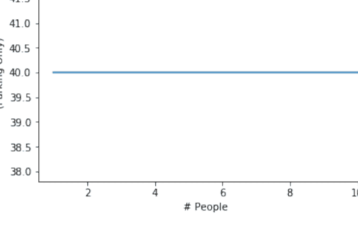

在数学课上，我们会把它写成 `total_cost = 40.0`。也就是说，无论人数是多少——在底部 x 轴上来回移动——我们付的钱都一样。当数学家开始变得抽象时，他们会把表达式简化为 `y = 40`。他们会说这是“形如” `y = c`。也就是说，高度或 y 值等于某个常数。在这种情况下，处处都是值 40。现在，只把车停在演出场地外却不买票，对我们来说没什么用——尽管车尾派对自有其可取之处。那么，如果每张票要付 80 美元，又会怎样？

In [22]:

```python
people = np.arange(1, 11)
total_cost = 80.0 * people + 40.0
```

画出这个图像会稍微复杂一点，所以我们先列出数值表：

In [23]:

```python
# .T (transpose) to save vertical space in printout
display(pd.DataFrame({'total_cost':total_cost.astype(np.int)},
                     index=people).T)
```

|  | 1 | 2 | 3 | 4 | 5 | 6 | 7 | 8 | 9 | 10 |
|---|---|---|---|---|---|---|---|---|---|---|
| **total_cost** | 120 | 200 | 280 | 360 | 440 | 520 | 600 | 680 | 760 | 840 |

然后我们可以逐点把它画出来：

In [24]:

```
ax = plt.gca()
ax.plot(people, total_cost, 'bo')
ax.set_ylabel("Total Cost")
ax.set_xlabel("People");
```

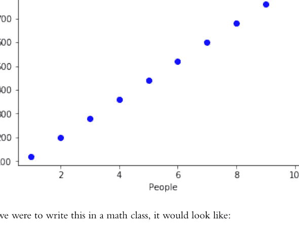

所以，如果要写在数学课上，它会是这样：

`total_cost = ticket_cost × people + parking_cost`

让我们在表 2.1 中比较这两种形式——常数和直线——以及它们可能出现的各种写法。

表 2.1 不同语言层次下的常数与直线示例

| 名称 | 示例 | 具体 | 抽象 | 数学语言 |
|---|---|---|---|---|
| 常数 | 总额 = 停车费 | 总额 = $40 | y = 40 | y = c |
| 直线 | 总额 = 票价 × 人数 + 停车费 | 总额 = 80 × 人数 + 40 | y = 80x + 40 | y = mx + b |

我想再展示一张图，来突出直线的两个决定性组成部分：`m` 和 `b`。`m` 的值——上面是 80 美元的票价——表示我们每多带一个人参加旅程，需要多付多少钱。用数学的话说，它就是上升量（rise），也就是 `x` 每增加一个单位时 `y` 的增加量。单位增加意味着 `x` 轴上的人数从 `x` 变成 `x + 1`。这里，我将控制 `m` 和 `b` 并画出图像。

In [25]:

```
# paint by number

# create 100 x values from -3 to 3
```


`xs = np.linspace(-3, 3, 100)`

# slope (m) and intercept (b)

`m, b = 1.5, -3`

`ax = plt.gca()`

`ys = m*xs + b`

`ax.plot(xs, ys)`

`ax.set_ylim(-4, 4)`

`high_school_style(ax)` # helper from mlwpy.py

`ax.plot(0, -3, 'ro')` # y-intercept

`ax.plot(2, 0, 'ro')` # two steps right gives three steps up

# y = mx + b with m=0 gives y = b

`ys = 0*xs + b`

`ax.plot(xs, ys, 'y')`;

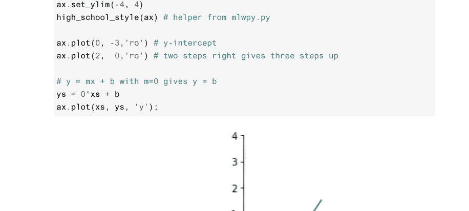

因为斜率为 1.5，向右走两步，我们就会向上走三步。另外，如果我们有一条直线，并把直线的斜率 m 设为 0，我们突然又回到了……

到一个常数。常数是一种特定、受限类型的 `水平` 线。我们穿过 y = −3 的黄色线就是其中之一。

我们可以将关于 `np.dot` 的想法与关于线的想法结合起来，编写一些略有不同的代码来绘制此图。不使用 `(m, b)` 对，我们可以写一个值数组 `w = (w₁, w₀)`。这里有一个技巧：我把 `w₀` 放在第二位，以与 `b` 对齐。通常，在数学中就是这样写的：`w₀` 是常数。

有了 `ws`，我们就可以使用 `np.dot`，只要我们用一列 1 来扩充 `xs`。我将这个扩充后的 `xs` 记为 `xs_p1`，你可以读作“xs plus a column of ones”。这一列 1 在 `y = mx + b` 中扮演 1 的角色。等等，你没看到 1 吗？让我重写一下：`y = mx + b = mx + b · 1`。你看我如何把 `b` 重写为 `b · 1`？这正是我们需要做的让 `np.dot` 满意的事情。dot 想要把某物乘以 `w₁`，把某物乘以 `w₀`。我们确保乘以 `w₀` 的东西是一个 1。

我把在后面加上 1 列这个过程称为 `加一技巧` 或 `+1 技巧`，我稍后会更多地谈论它。下面是 `加一技巧` 对我们原始数据的作用：

In [26]:

```
# np.c_[] lets us create an array column-by-column
xs = np.linspace(-3, 3, 100)
xs_p1 = np.c_[xs, np.ones_like(xs)]

# view the first few rows
display(pd.DataFrame(xs_p1).head())
```

|   | 0 | 1 |

|---|---|---|

| 0 | -3.0000 | 1.0000 |

| 1 | -2.9394 | 1.0000 |

| 2 | -2.8788 | 1.0000 |

| 3 | -2.8182 | 1.0000 |

| 4 | -2.7576 | 1.0000 |

现在，我们可以非常简洁地组合我们的数据和权重：

In [27]:

```
w = np.array([1.5, -3])
ys = np.dot(xs_p1, w)

ax = plt.gca()
ax.plot(xs, ys)

# styling
ax.set_ylim(-4, 4)
high_school_style(ax)
```

```
ax.plot(0, -3,'ro')  # y-intercept
ax.plot(2, 0,'ro');  # two steps to the right should be three whole steps up
```

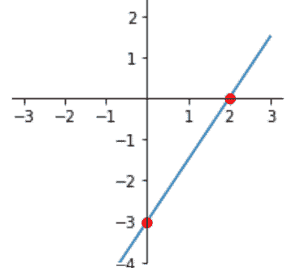

这里是我们在代码中使用的两种形式：`ys = m*xs + b` 和 `ys = np.dot(xs_p1, w)`。在数学上，它们看起来像 `y = mx + b` 和 `y = wx⁺`。这里，我用 `x⁺` 作为在 `x` 后面加上 1 的缩写。这两种定义 `ys` 的形式含义相同。它们在实现时只是有一些差异。第一种形式让每个分量各自独立。第二种形式要求 `x⁺` 用 1 进行扩充，并允许我们方便地使用点积。

### 2.6.2 超越直线

我们可以至少以两种方式扩展线的概念。我们可以进展到波浪曲线和多项式——像 `f(x) = x³ + x² + x + 1` 这样的方程。这里，我们对一个输入值 `x` 进行更复杂的计算。或者，我们可以走向多维度的道路：平面、超平面等等！例如，在 `f(x, y, z) = x + y + z` 中，我们有多个输入值，我们将它们组合在一起。由于我们将非常关注多元数据——也就是多个输入——我将直接进入其中。

让我们重新审视摇滚音乐会场景。如果我们想购买的不止一种商品会怎样？例如，你可能会惊讶地得知人们喜欢在音乐会上饮用饮料。通常，他们喜欢饮用我母亲亲切地称之为“root beer”的东西。那么，如果我们有停车费用、票价，以及我们团体订购的每杯 root beer 的费用呢？为了考虑这一点，我们需要一个新的公式。令 `rb` 代表 root beer，我们有：

`total_cost = ticket_cost × number_people + rb_cost × number_rbs + parking_cost`

如果我们代入停车费用、每张票费用和每杯 root beer 费用的已知值，那么我们就有更具体的内容：

`total_cost = 80 × number_people + 10 × number_rbs + 40`

对于一个商品，我们有一个简单的二维线图，其中一个轴方向来自输入“多少人”，另一个来自输出“总费用”。对于两个商品，我们现在有两个“多少”，但仍然只有一个 `total_cost`，总共三个维度。幸运的是，我们仍然可以相当合理地绘制它。首先，我们创建一些数据：

In [28]:

```
number_people = np.arange(1, 11) # 1-10 people
number_rbs    = np.arange(0, 20) # 0-19 rootbeers

# numpy tool to get cross-product of values (each against each)
# in two paired arrays. try it out: np.meshgrid([0, 1], [10, 20])
# "perfect" for functions of multiple variables
number_people, number_rbs = np.meshgrid(number_people, number_rbs)

total_cost = 80 * number_people + 10 * number_rbs + 40
```

我们可以从几个不同的角度——字面意义上——来看这些数据。下面，我们从五个不同的视角展示同一个图。请注意，它们都是平坦的表面，但从不同视角看，表面的明显倾斜或斜率看起来不同。平坦的表面称为平面。

In [29]:

```
# import needed for 'projection':'3d'
from mpl_toolkits.mplot3d import Axes3D
fig,axes = plt.subplots(2, 3,
                        subplot_kw={'projection':'3d'},
                        figsize=(9, 6))

angles = [0, 45, 90, 135, 180]
for ax,angle in zip(axes.flat, angles):
    ax.plot_surface(number_people, number_rbs, total_cost)
    ax.set_xlabel("People")
    ax.set_ylabel("RootBeers")
    ax.set_zlabel("TotalCost")
    ax.azim = angle

# we don't use the last axis
```

```
axes.flat[-1].axis('off')
fig.tight_layout()
```

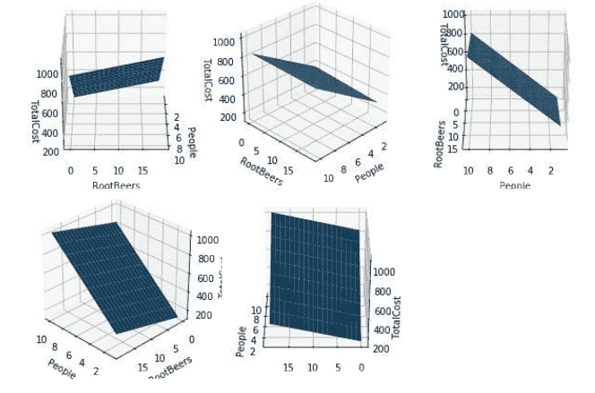

在代码和数学中，超越三维是相当直接的。然而，如果我们尝试将其绘制出来，就会变得非常混乱。幸运的是，我们可以使用一个老式的好工具——对内行来说那是 GOFT——并制作一个结果表。下面是一个例子，它还包括了我们音乐会参与者的一些食物。我们将以每根 5 美元的价格吃一些热狗：

`total_cost = 80 × number_people + 10 × number_rbs + 5 × number_hotdogs + 40`

我们将为音乐会系统中的物品数量使用几个简单的值：

```
In [30]:

number_people = np.array([2, 3])
number_rbs = np.array([0, 1, 2])
number_hotdogs = np.array([2, 4])

costs = np.array([80, 10, 5])

columns = ["People", "RootBeer", "HotDogs", "TotalCost"]
```

我通过一个辅助函数 `np_cartesian_product` 将几个 numpy 数组在所有可能的组合中组合起来，这与 itertools 的 `combinations` 函数所做的事情类似。它涉及一点黑魔法，所以我把它隐藏在 `mlwpy.py` 中。随意调查，如果你敢的话。

```
In [31]:

counts = np_cartesian_product(number_people,
                              number_rbs,
                              number_hotdogs)

totals = (costs[0] * counts[:, 0] +
         costs[1] * counts[:, 1] +
         costs[2] * counts[:, 2] + 40)

display(pd.DataFrame(np.c_[counts, totals],
                     columns=columns).head(8))
```

|  | 人数 | 根啤 | 热狗 | 总费用 |

|---|---|---|---|---|

| 0 | 2 | 0 | 2 | 210 |

| 1 | 2 | 0 | 4 | 220 |

| 2 | 3 | 0 | 2 | 290 |

| 3 | 3 | 0 | 4 | 300 |

| 4 | 2 | 1 | 2 | 220 |

| 5 | 2 | 1 | 4 | 230 |

| 6 | 3 | 1 | 2 | 300 |

| 7 | 3 | 1 | 4 | 310 |

对 `totals` 的赋值——在上一个单元格的第 6-8 行——相当丑陋。我们能改进它吗？想想！想想！一定有更好的方法！那里发生了什么？我们在把几样东西加起来。而我们加起来的东西来自逐元素相乘。会是吗？是点积吗？是的，就是。

```
In [32]:

costs = np.array([80, 10, 5])
counts = np_cartesian_product(number_people,
                              number_rbs,
                              number_hotdogs)

totals = np.dot(counts, costs) + 40
display(pd.DataFrame(np.column_stack([counts, totals]),
                     columns=columns).head(8))
```

|  | 人数 | 根啤 | 热狗 | 总费用 |

|---|---|---|---|---|

| **0** | 2 | 0 | 2 | 210 |

| **1** | 2 | 0 | 4 | 220 |

| **2** | 3 | 0 | 2 | 290 |

| **3** | 3 | 0 | 4 | 300 |

| **4** | 2 | 1 | 2 | 220 |

| **5** | 2 | 1 | 4 | 230 |

| **6** | 3 | 1 | 2 | 300 |

| **7** | 3 | 1 | 4 | 310 |

使用点积给我们带来两个好处：(1) 赋给 `total` 的代码行得到了极大的改进，(2) 我们可以在很大程度上任意扩展我们的成本和计数，而完全不需要修改计算代码。你可能会注意到我手工加上了 +40。那是因为我不想回到 `+1 技巧`——但我本可以。

顺便说一下，这在数学课上会发生什么。正如我们从重复加法到点积的代码行压缩所看到的，当我们使用高级符号时，细节往往会被抽象掉或移到幕后。以下是发生了什么的详细分解。首先，我们通过删除详细的变量名进行抽象，然后用通用标识符替换我们已知的数值：

$y = 80x_3 + 10x_2 + 5x_1 + 40$

$y = w_3x_3 + w_2x_2 + w_1x_1 + w_0 \cdot 1$

我们在代码中更进一步，用点积替换 `wx` 和：

$y = w_{[3,2,1]} \bullet x + w_0 \cdot 1$

`w` 上奇怪的 `[3, 2, 1]` 下标表示我们没有使用所有的权重。也就是说，我们没有在左边的项中使用 `w0`。`w0` 在右边的项中乘以 1。它只被使用一次。最后的致命一击是执行 `+1 技巧`：

$y = wx^+$

总之，代替 $y = w_3x_3 + w_2x_2 + w_1x_1 + w_0$，我们可以写成 $y = wx^+$。

## 2.7 符号与加一技巧

现在你知道了 `加一技巧` 是什么，我想展示几种我们可以谈论数据表的方式。这些数据可能由值组成，例如我们去棒球场的旅行费用表。我们可以取这个表并在它周围画一些括号：

$D = \left( \begin{array}{cc|c} x_2 & x_1 & y \\ 3 & 10 & 3 \\ 2 & 11 & 5 \\ 4 & 12 & 10 \end{array} \right)$

我们也可以引用它的各个部分：$D = (\boldsymbol{x}, y)$。这里，$\boldsymbol{x}$ 表示 `所有输入特征`，`y` 表示 `输出目标特征`。我们可以强调列：

$D = (\boldsymbol{x}, y) = (x_f, \dots, x_1, y)$

`f` 是特征的数量。我们从后往前数，以便与上一节讨论中的权重顺序保持一致。反过来，权重的顺序之所以是倒着的，是为了能一直数到常数项 `w0`。这真是一团乱麻。

我们也可以强调行：

$D = \begin{bmatrix} e_1 \\ e_2 \\ \vdots \\ e_n \end{bmatrix}$

把 `e_i` 看作一个样本。`n` 是样本的数量。

另外，为了数学上的便利——真的只是便利——我们经常会使用 `D` 和 `x` 的增广版本，也就是所谓的加一（plus-one）技巧：

$D^+ = (x^+, y) = \left( \begin{array}{ccc|c} x_2 & x_1 & x_0 & y \\ 3 & 10 & 1 & 3 \\ 2 & 11 & 1 & 5 \\ 4 & 12 & 1 & 10 \end{array} \right)$

我们来拆解一下：

$x = \left( \begin{array}{cc} x_2 & x_1 \\ 3 & 10 \\ 2 & 11 \\ 4 & 12 \end{array} \right)$

如果我们想把它用于二维公式，最后会写成：`y = w2x2 + w1x1 + w0`。我们可以把它压缩为：`y = w[2,1] • x + w0`。同样，`w[2,1]` 暗示着我们在 `•` 中没有使用 `w0`。不过，`w0` 被硬接在末尾仍然有点难看。如果我们使用 `x` 的增广版本，还能进一步压缩：

$x^+ = \left( \begin{array}{ccc} x_2 & x_1 & x_0 \\ 3 & 10 & 1 \\ 2 & 11 & 1 \\ 4 & 12 & 1 \end{array} \right)$

现在，我们的二维公式变成了 `y = w₂x₂ + w₁x₁ + w₀x₀`。注意多出来的 `x₀`。这可以很好地贴合 `y = w • x⁺`，其中 `w` 是 `(w₂, w₁, w₀)`。增广版本的 `w` 现在包含了 `w₀`，而此前它是个无家可归的权重。当我想提醒你我们正在处理 `x⁺` 或 `D⁺` 时，我会说我们正在使用 `+1 技巧`。我们将在第 3.3 节把这个数学符号与 Python 变量联系起来。

## 2.8 渐入佳境、挣脱束缚与非线性

于是，我们刚刚拿一条毫无防备的直线，把它拉出了自己的舒适区——也许也超出了你的舒适区。我们用一种非常具体的方式做到了这一点：我们添加了新变量。这些新变量代表了新的图形维度。我们不再只谈论直线，而是开始谈论平面以及它们更高维的表亲。

还有另一种扩展直线概念的方式。不是添加新信息——更多变量或特征——而是让我们已有的信息变得更复杂。想象一下从 `y = 3` 到 `y = 2x + 3`，再到 `y = x² + 2x + 3`。每一种情况下，我们都往方程里添加了一项。随着项的增多，我们从水平直线变成倾斜直线，再变成抛物线。我马上会用图形展示这些。关键是：我们仍然只有一个输入变量，只是以不同的方式使用这个单一输入。


数学家把这些扩展称为在方程中加入原始变量的高阶项或高次项。随着次数的提高，我们会得到各种花哨的函数名称：常数（constant）、线性（linear）、二次（quadratic）、三次（cubic）、四次（quartic）、五次（quintic）等等。通常，我们可以直接称它们为 n 次多项式，其中 n 是表达式中最高的非零次幂。2 次多项式——例如 `y = x² + x + 1`——也被称为二次多项式。它们得到的单弯曲线叫做抛物线。

`np.poly1d` 为我们提供了一个方便的辅助工具，可以通过指定多项式中每一项的系数来定义多项式。例如，传入列表 `[2, 3, 4]` 就表示 `2x² + 3x + 4`。我们会使用一些随机系数来得到有趣的曲线。

In [33]:

```python
fig, axes = plt.subplots(2, 2)
fig.tight_layout()

titles = ["$y=c_0$",
          "$y=c_1x+c_0$",
          "$y=c_2x^2+c_1x+c_0$",
          "$y=c_3x^3+c_2x^2+c_1x+c_0$"]

xs = np.linspace(-10, 10, 100)
for power, (ax, title) in enumerate(zip(axes.flat, titles), 1):
    coeffs = np.random.uniform(-5, 5, power)
```

```python
poly = np.poly1d(coeffs)
ax.plot(xs, poly(xs))
ax.set_title(title)
```

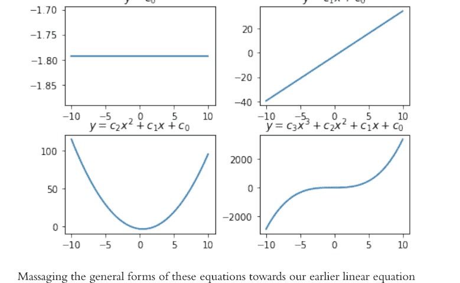

把这些方程的一般形式调整为更接近我们先前的线性方程 `y1 = c1 x + c0` 的样子，就会得到 `y2 = c2 x^2 + c1 x + c0` 这样的式子。快速说明一点：`x = x^1`，`1 = x^0`。虽然我可以在合适的场合搬出数学记号，但请相信我，定义 `0^0 = 1` 有着非常充分的理由。综上，我们得到

`y2 = c2 x^2 + c1 x^1 + c0 x^0 = sum_{i=0}^{2} c_i x^i`

你知道我要说什么。来吧，配合一下，跟我一起说。你能做到的。这就是点积！我们可以把 `x_i` 和系数 `c_i` 拆开，然后用 `np.dot` 将它们组合起来，从而把这个方程变成代码。

In [34]:

```python
plt.figure((2, 1.5))

xs = np.linspace(-10, 10, 101)
coeffs = np.array([2, 3, 4])
ys = np.dot(coeffs, [xs**2, xs**1, xs**0])

# nice parabola via a dot product
plt.plot(xs, ys);
```

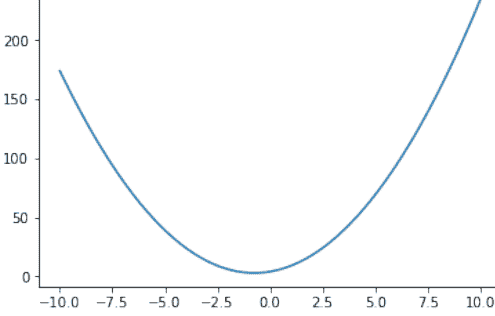

## 2.9 NumPy 与“所有数学”的较量

由于点积对机器学习如此基础，而 NumPy 的 `np.dot` 又必须处理 Python 式计算的现实一面——而不是纯粹、柏拉图式的数学理想世界——我想花几分钟探讨一下 `np.dot`，帮助你理解它在一些常见情形下是如何工作的。更重要的是，有一种常见形式是我们想要使用、但若不稍作调整就无法直接使用的。我想让你知道原因。开始吧。

我们之前谈到过，`np.dot` 会逐元素相乘，然后把结果加起来。下面是一维数组最基础的例子：

```
In [35]:

oned_vec = np.arange(5)
print(oned_vec, "-->", oned_vec * oned_vec)
print("self dot:", np.dot(oned_vec, oned_vec))
```

[0 1 2 3 4] --> [ 0  1  4  9 16]

self dot: 30

结果是该数组所有元素的平方和。下面是一个使用行向量和列向量的简单例子：

```
In [36]:

row_vec = np.arange(5).reshape(1, 5)
col_vec = np.arange(0, 50, 10).reshape(5, 1)
```

注意，`row_vec` 的形状像一个单独的样本，而 `col_vec` 的形状像一个单独的特征。

```
In [37]:

print("row_vec:", row_vec,
      "col_vec":, col_vec,
      "dot":, np.dot(row_vec, col_vec), sep='\n')
```

```
row_vec:
[0 1 2 3 4]
col_vec:
[[ 0]
 [10]
 [20]
 [30]
 [40]]
dot:
[[300]]
```

目前为止，一切基本正常。但如果我们交换顺序会怎样？你可能会期望得到同样的答案：毕竟在基础算术中 `3 × 5 = 5 × 3`。让我们来看看：

```
In [38]:

out = np.dot(col_vec, row_vec)
print(out)
```

```
[[  0   0   0   0   0]
 [  0  10  20  30  40]
 [  0  20  40  60  80]
 [  0  30  60  90 120]
 [  0  40  80 120 160]]
```

该轮到多萝西出场了：“托托，我感觉我们已经不在堪萨斯了。”这里发生了什么？我们将聚焦于输出中的一个元素——从上往下数第二行的 20——来理解我们释放出的这种疯狂行为。这个 20 是从哪里来的？好吧，我们其实从未真正定义输出是如何产生的——只是说它对两个一维数组做了一次求和乘积。让我们来补上这一课。

在输出中选一个元素，比如 `out[1, 2]`。如果我们从零开始计数，它就是第 1 行第 2 列。`out[1, 2]` 的值是 20。这个 20 从何而来？它来自 `col_vec` 的第 1 行与 `row_vec` 的第 2 列做点积。这实际上就是 `np.dot` 的定义。源值是 `col_vec[1, :]`，即 `[10]`，以及 `row_vec[:, 2]`，即 `[2]`。把它们放在一起得到 `10 × 2 → 20`，因为每边都只有一个值，所以无需再求和。你可以用类似的方法检查其他元素。

数学上，这写作 `outᵢⱼ = dot(leftᵢ, rightⱼ)`，其中 `dot` 是我们对一维数组做求和乘积的老朋友。也就是说，输出的第 i 行来自左侧输入的第 i 行，输出的第 j 列来自右侧输入的第 j 列。从每一行、每一列各取一次，就得到一个 `5 × 5` 的结果。

如果我们将同样的逻辑应用到行-列的情况中，我们会看到

```
In [39]:

out = np.dot(row_vec, col_vec)
out
```

```
Out[39]:

array([[300]])
```

结果是 `1 × 1`，因此 `out[0, 0]` 来自 `row_vec` 的第 0 行和 `col_vec` 的第 0 列。这正是 `[0, 1, 2, 3, 4]` 与 `[0, 10, 20, 30, 40]` 的和积，即 `0*0 + 1*10 + 2*20 + 3*30 + 4*40`。太好了。

### 2.9.1 回到一维与二维

然而，当我们使用 1D 和 2D 输入的混合时，事情会更令人困惑，因为输入数组并不是按字面意思处理。对我们来说有两个重要的后果：(1) 乘以 1D 和 2D 数组时顺序很重要，(2) 我们必须研究 `np.dot` 处理 1D 数组的规则。

```
In [40]:

col_vec = np.arange(0, 50, 10).reshape(5, 1)
row_vec = np.arange(0, 5).reshape(1, 5)

oned_vec = np.arange(5)

np.dot(oned_vec, col_vec)
```

```
Out[40]:

array([[300]])
```

如果我们交换顺序，Python 就会报错：

```
In [41]:

try:
    np.dot(col_vec, oned_vec) # *boom*
except ValueError as e:
    print("I went boom:", e)
```

```
I went boom: shapes (5,1) and (5,) not aligned: 1 (dim 1) != 5 (dim 0)
```

因此，`np.dot(oned_vec, col_vec)` 可以工作，而 `np.dot(col_vec, oned_vec)` 会失败。发生了什么？如果我们查看这些“罪魁祸首”的形状，就能大致了解问题出在哪里。

在 NumPy 中，将两个数组相互广播，无论是广播 a 对 b 还是 b 对 a，结果形状都相同。即使如此，你也可以用广播和乘法来模拟 `np.dot(col_vec, row_vec)`。如果这样做，你会得到“大数组”结果：它被称为外积。

说了这么多，为什么我们要关心呢？原因如下：

```
In [45]:

D = np.array([[1, 3],
              [2, 5],
              [2, 7],
              [3, 2]])
weights = np.array([1.5, -3])
```

这可以工作：

```
In [46]:

np.dot(D,w)
```

```
Out[46]:

array([ -7.5, -12. , -18. , -1.5])
```

这会失败：

```
In [47]:

try:
    np.dot(w,D)
except ValueError:
    print("BOOM. :sadface:")
```

```
BOOM. :sadface:
```

有时，我们只是希望代码看起来像我们的数学：

`$y = wD$`

如果我们不喜欢给定的接口怎么办？如果我们愿意 (1) 维护、(2) 支持、(3) 文档化、(4) 测试一个替代方案，那么我们就可以制作一个我们更喜欢的接口。通常人们只考虑实现步骤。这是一个代价高昂的错误。

这里有一个版本的 dot，它能很好地处理第一个参数为 1D 且形状像列的输入：

```
In [48]:
def rdot(arr, brr):
    'reversed-argument version of np.dot'
    return np.dot(brr, arr)
rdot(w, D)
```

```
Out[48]:
array([ -7.5, -12. , -18. , -1.5])
```

你可能会抱怨我们为了让代码看起来像数学而大费周章。这很公平。即使在数学教科书中，人们也会做各种奇怪的体操来让它工作：`w` 可能会被转置。在 NumPy 中，如果它是 2D 的，这没问题。不幸的是，如果它只是 1D NumPy 数组，转置什么也不做。自己试试！数学家们还会做另一种体操，那就是转置数据——也就是说，他们让每个特征成为一行。是的，真的。我很抱歉是我告诉你这件事的。我们只会在想要代码与数学匹配时使用 `rdot`——简写为“reversed arguments to np.dot”。

点积在学习系统的数学中无处不在。由于我们专注于通过 Python 程序研究学习系统，(1) 理解 `np.dot` 发生了什么以及 (2) 拥有方便且一致的使用形式非常重要。我们将在线性回归和逻辑回归的材料中看到 `rdot`。它在其他几种技术中也发挥作用。最后，它对于展示各种学习算法的相似性至关重要。

## 2.10 浮点数问题

准备好变得暴躁吧。

```
In [49]:
1.1 + 2.2 == 3.3
```

```
Out[49]:
False
```

我现在能听到你的声音了。你想要退款——为这本书，为你的 Python 程序，为一切。这都是谎言。抛开戏剧性不谈，这里发生了什么？问题在于浮点数和我们的期望。在上面的 Python 代码中，所有值都是 floats：

```
In [50]:
type(1.1), type(2.2), type(1.1+2.2), type(3.3)
```

```
Out[50]:

(float, float, float, float)
```

`float` 是 floating-point number 的简称，而 `float` 是计算机通常表示十进制值的方式。当我们在程序中使用 `float` 时，我们通常在思考两种不同类型的数字：(1) 简单的十进制值，如 `2.5`，(2) 复杂的实数，如 `π`，它无限延伸，尽管我们可以用 `3.14` 这样的近似值应付。从我们对这些数字的思考到计算机的数值计算机制，这两者都有复杂性。

这里有几个事实：

- 1. 计算机内存是有限的。我们无法物理存储任何数值值的无限多位数字。

- 2. 我们感兴趣的一些数字有无限多位小数（`1/9` 和 `π`，我在看你们）。

- 3. 计算机以位存储所有信息——那是基数为 2 的数字，或二进制。

- 4. 当我们用十进制与二进制书写时，存在不同的无限位数数字。

由于第 1 和第 2 点，我们必须近似存储的值。我们可以接近，但永远无法精确。由于第 3 和第 4 点，当我们将一个看似无害的十进制数字如 `3.3` 转换为二进制时，它可能会变得复杂得多——它可能有重复数字，就像 `1/9` 在十进制表示中一样。把这些碎片放在一起意味着我们不能依赖浮点值的精确比较。

那么，我们能做什么？我们可以询问值是否足够接近：

```
In [51]:

np.allclose(1.1 + 2.2, 3.3)
```

```
Out[51]:

True
```

这里，numpy 检查数字在很多很多位小数上是否相同——直到差异变得不重要为止。如果我们关心，我们可以为什么是/不是重要定义自己的容差。

## 2.11 章末

### 2.11.1 摘要

我们在本章涵盖了很多想法，并为以智能的方式谈论学习奠定了基础。在很多情况下，我们不会深入学习算法的数学细节。然而，当我们谈论它们时，我们在描述中经常会诉诸概率、几何和点积。希望你现在对这些术语和符号的含义有更好的直觉——特别是如果之前没有人花时间以具体的方式向你解释过的话。

### 2.11.2 注释

虽然我们以直观的方式描述分布，但它们有具体的数学形式，可以扩展到多个维度。离散均匀分布看起来如下：

$$f(x)=\frac{1}{k}$$

这里，`k` 是可能事件的数量——典型的骰子为六，硬币翻转则为二。正态分布的方程是

$$f(x)=\frac{1}{v_m\,\text{spread}}e^{-\frac{1}{2}\left(\frac{x-\text{center}}{\text{spread}}\right)^2}$$

`e` 结合负幂，负责远离中心的快速下降。`v_m`，一个 *magic value*，实际上只是为了确保所有可能性加起来为一，就像所有好的分布一样：它是 `v_m=\sqrt{2\pi}` 但我不会考你。*center* 和 *spread* 通常被称为 *mean* 和 *standard deviation*，并用 `\mu` 和 `\sigma` 表示，它们是小写的希腊 *mu* 和 *sigma*。正态分布在统计学中 *everywhere* 出现：在误差函数中，在二项式近似中（我们用它来生成正态形状），以及在中心极限定理中。

Python 使用 0-based 索引，而数学家通常使用 1-based 索引。这是因为数学家通常在 *counting* 东西，而计算机科学家历史上关心的是偏移：从起点开始，我需要向前移动多少步才能得到我需要的项目？如果我在列表或数组的开头，我需要零步就能得到第一个项目：我已经在那里了。一位非常著名的计算机科学家 Edsger Dijkstra 写了一篇文章叫“Why numbering should start at zero”。如果你感兴趣并想在计算机科学 trivia 之夜获胜，可以查看它。

在我的数学记法中，我遵循经典 Python 的做法，让 `()` 和 `[]` 都表示有序事物。`{}` 用于无序的事物集合——想象把东西放进一个大旅行袋然后再拿出来。旅行袋不记得东西放进去的顺序。在一个相对最近的更改中，Python 3.7 中的 Python 字典现在有一些排序保证。因此，严格来说——在升级到最新 Python 之后——我使用花括号的数学集合意义。

短语“there must be a better way!”——特别是在 Python 社区——值得向核心 Python 开发者 Raymond Hettinger 表示致敬。他的 Python 演讲是传奇性的：在 YouTube 上找到它们，你会学到关于 Python 的新东西。

# 预测类别：分类入门

In [1]:

```python
# setup
from mlwpy import *
%matplotlib inline
```

现在我们已经做了一些基础工作，让我们把注意力转向主要内容：构建和评估学习系统。我们将从分类开始，并且需要一些数据来练习。如果这还不够，我们还需要建立成功评估的标准。所有这些都即将到来。

让我简要说明一些术语上的快速说明。如果输出只有两个目标类别，我们可以称学习任务为二分类。你可以考虑 `{Yes, No}`, `{Red, Black}`, 或 `{True, False}` 目标。非常常见的是，二元问题在数学上使用 `{-1, +1}` 或 `{0, 1}` 来描述。计算机科学家喜欢将 `{False, True}` 编码为数字 `{0, 1}` 作为输出值。实际上，`{-1, +1}` 或 `{0, 1}` 都因数学上的便利而被使用，对我们来说区别不大。（如果在阅读两种不同的数学表述时注意力不集中，这两种编码经常会让人困惑。你可能会在一篇博客文章中看到一种，在一篇论文中看到另一种。我会在本书中指出任何差异。）当目标类别多于两个时，我们有一个多分类问题。


有些分类器试图以直接的方式对输出做出决策。直接方法使我们在找到的关系上具有很大的灵活性，但这种灵活性意味着我们不受可能导致更好决策的假设的约束。这些假设类似于将伦敦、东京和纽约发生的案件的嫌疑人限制在

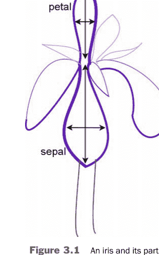

图 3.1 一朵鸢尾花及其各部分。

|  | 萼片长度 (cm) | 萼片宽度 (cm) | 花瓣长度 (cm) | 花瓣宽度 (cm) | 目标 |

|---|---|---|---|---|---|

| 0 | 5.1000 | 3.5000 | 1.4000 | 0.2000 | 0 |

| 1 | 4.9000 | 3.0000 | 1.4000 | 0.2000 | 0 |

| 2 | 4.7000 | 3.2000 | 1.3000 | 0.2000 | 0 |

| 147 | 6.5000 | 3.0000 | 5.2000 | 2.0000 | 2 |

| 148 | 6.2000 | 3.4000 | 5.4000 | 2.3000 | 2 |

| 149 | 5.9000 | 3.0000 | 5.1000 | 1.8000 | 2 |

In [3]:

```python
sns.pairplot(iris_df, hue='target', size=1.5);
```

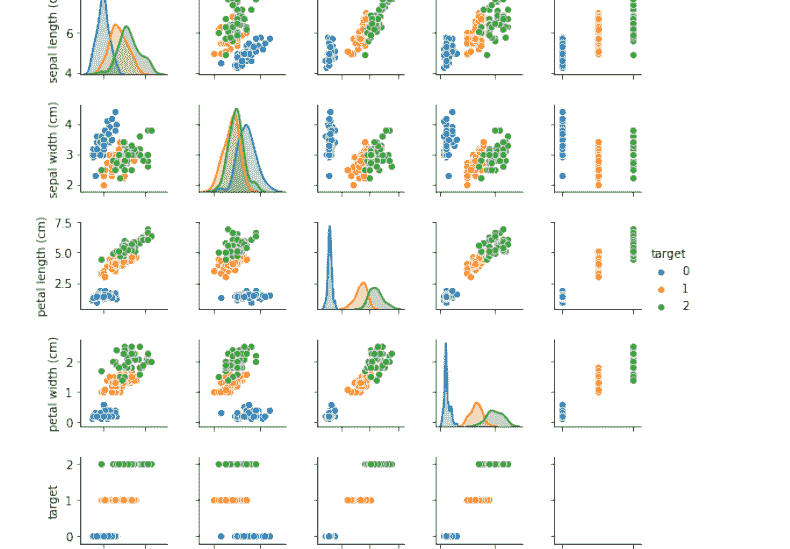

`sns.pairplot` 给我们一个漂亮的图形面板。从左上到右下的对角线上，我们看到不同鸢尾花类型的频率直方图，按颜色区分。非对角线条目——对角线上的所有内容——是特征对的散点图。你会注意到这些配对出现了两次——一次在对角线上方，一次在下方——但每个配对的图在对角线的另一侧是轴向翻转的。例如，在右下角附近，我们看到花瓣宽度与目标，然后是目标与花瓣宽度（跨对角线）。当我们翻转轴时，我们将上下方向改为左右方向。

在多个图中，蓝色组（目标 0）似乎与其他两个组分开。这是什么物种？

In [4]:

```python
print('targets: {}' .format(iris.target_names),
    iris.target_names[0], sep="\n")
```

targets: ['setosa' 'versicolor' 'virginica']

setosa

所以，看起来 `setosa` 很容易从其他物种中分离或划分出来。`vs`, `versicolor` 和 `virginica` 则更加交织在一起。

## 3.3 训练和测试：不要为测试而教

让我们简要转向我们将如何使用数据。想象你正在上课（图 3.2）。让我们放纵一下，假装你在学习机器学习。除了想要一个好成绩，当你上课学习一门学科时，你希望能够在现实世界中使用该学科。我们的成绩是我们在现实世界中表现好坏的替代衡量标准。是的，我可以看到你们不高兴的表情：成绩可能是我们现实世界表现的非常糟糕的估计。好吧，我们很幸运！我们有机会取得真正能告诉我们在面对现实（以及，也许，我们的学生贷款）时表现如何的好成绩。

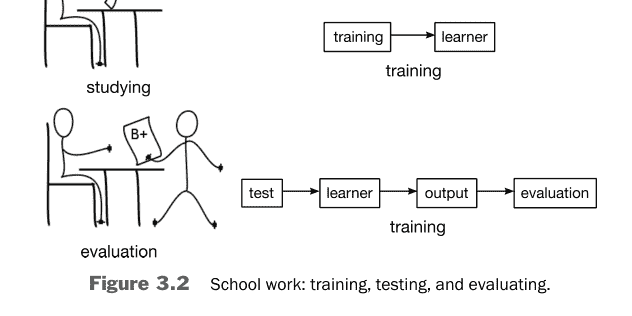

图 3.2 学校作业：训练、测试和评估。

所以，回到我们的课堂环境。评估学生的常见方式是教他们一些材料然后测试他们。你可能熟悉“为测试而教”这个短语。它通常被认为是不好的事情。为什么？因为，如果我们为测试而教，学生会在测试上表现得比在他们从未见过的新问题上表现得更好。他们知道测试问题的具体答案，但他们错过了回答新颖问题所需的一般知识和技巧。再次记住我们的目标。我们希望在现实世界中使用我们的学科表现良好。在机器学习场景中，我们希望在未见示例上表现良好。我们在未见示例上的表现称为泛化。如果我们在已经见过的数据上测试自己，我们对新数据能力的估计就会过于乐观。

教师更喜欢在新颖问题上评估学生。为什么？教师关心的是学生在新的、从未见过的问题上表现如何。如果他们在特定问题上练习并弄清楚答案的对错，我们希望这种新知识是他们可以应用于其他问题的一般性知识。如果我们想估计学生在新颖问题上的表现，我们必须在新颖问题上评估他们。你开始对学习旧考试感到内疚了吗？

我不想在这里涉及太多任务的太多细节。尽管如此，有一个我觉得必须引入的复杂性。许多学习介绍开始使用一种称为 `样本内评估` 或 `训练误差` 的为测试而教的评估方案。这些有其用途。然而，不为测试而教是学习系统中如此重要的概念，以至于 `我拒绝让你从错误的第一步开始！` 我们不能走捷径。我们将穿上大人的裤子，像成年人一样用真正的 `样本外` 或测试误差评估来做这件事。我们可以用这些来估计我们对未见、未来示例的泛化能力。

幸运的是，`sklearn` 在这里为我们提供了一些支持。我们将使用 `sklearn` 中的一个工具来避免为测试而教。`train_test_split` 函数将我们的存储在 Python 变量 `iris` 中的数据集分割。记住，该数据集已经有两个组成部分：`特征` 和 `目标`。我们的新分割将把它分成两个示例桶：

- 1. 我们将用来学习和建立理解的数据的一部分和

- 2. 我们将用来测试自己的数据的一部分。

我们只会学习——即从——`训练` 数据学习。为了保持诚实，我们只会在 `测试` 数据上评估自己。我们承诺不偷看测试数据。我们首先将数据集分成两部分：特征和目标。现在，我们将每一部分再分成两块：

- 1. Features → training features and testing features

- 2. Targets → training targets and testing targets

我们稍后会详细介绍 `train_test_split`。这里是一个基本调用的示例：

In [5]:

```python
# simple train-test split
(iris_train_ftrs, iris_test_ftrs,
 iris_train_tgt, iris_test_tgt) = skms.train_test_split(iris.data,
                                                       iris.target,
                                                       test_size=.25)
print("Train features shape:", iris_train_ftrs.shape)
print("Test features shape:", iris_test_ftrs.shape)
```

```
Train features shape: (112, 4)
Test features shape: (38, 4)
```

所以，我们的训练数据有 112 个示例，由四个特征描述。我们的测试数据有 38 个示例，由相同的四个属性描述。

如果你对这两个分割感到困惑，请查看图 3.3。想象我们在总数据的表格周围画一个框。我们识别一个特殊列并将其放在右侧。我们画一条垂直线将最右边的列与剩余数据分开。这条垂直线是我们预测性

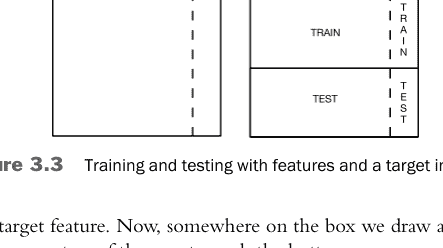

图 3.3 在表格中使用特征和目标进行训练与测试。

特征与目标特征。现在，我们在盒子上某处画一条水平线——大约在距离底部四分之三的位置。

水平线上方的区域代表我们用于训练的数据部分。线下方的区域是——你猜对了！——测试数据。那么竖线呢？那一列特殊的列就是我们的目标特征。在某些学习场景中，可能有多个目标特征，但这些情况并不会从根本上改变我们的讨论。通常，我们需要相对更多的数据来学习，并满足于用稍少的数据来评估自己，因此训练部分可能大于数据的 50%，测试部分小于 50%。通常，我们会将数据随机分成训练和测试：想象像洗牌一样打乱样本，取上面的部分用于训练，下面的部分用于测试。

表 3.1 列出了各个部分以及它们与鸢尾花数据集的关系。请注意，对于不同的部分，我既使用了一些英文短语，也使用了一些缩写。我会尽量保持术语的一致性。你会发现，在术语的使用上，从书 A 到博客 B、从文章 C 到演讲 D，会存在一些差异。这并不是世界末日，而且通常有非常相近之处。不过，当你开始阅读一个新的机器学习讨论时，请花一点时间让自己熟悉这些术语。

## 表 3.1 Python 变量与鸢尾花数据组件之间的关系。

| iris Python 变量 | 符号 | 短语 |

|---|---|---|

| iris | $D_{all}$ | （总）数据集 |

| iris.data | $D_{ftrs}$ | 训练和测试特征 |

| iris.target | $D_{tgt}$ | 训练和测试目标 |

| iris_train_ftrs | $D_{train}$ | 训练特征 |

| iris_test_ftrs | $D_{test}$ | 测试特征 |

| iris_train_tgt | $D_{train_{tgt}}$ | 训练目标 |

| iris_test_tgt | $D_{test_{tgt}}$ | 测试目标 |

表中的一个小问题是，`iris.data` 指的是所有输入特征。但这是 scikit-learn 选择的术语。不幸的是，Python 变量名 `data` 有点类似于数学中的 `x`：它们都是通用标识符。`data` 作为名称，几乎可以指代任何信息体。因此，虽然 scikit-learn 在 `iris.data` 中使用了 `data` 一词的特定含义，但我将使用更具体的指示符 $D_{ftrs}$ 来表示整个数据集的特征。

## 3.4 评估：为考试打分

我们已经简单讨论过如何设计评估：我们不会为了考试而教。所以，我们在一组问题上训练，然后在一组新问题上评估。我们将如何计算考试的成绩或分数？目前——稍后我们会深入探讨——我们只问：“答案是否正确？”如果答案是真的，而我们预测也是真的，那么我们就得分！如果答案是假的，而我们预测是真的，我们不得分。此处应有 :sadface:。每个正确答案计一分。每个漏答计零分。每个问题都同等计为一分或零分。最后，我们想知道答对的百分比，因此我们将分数相加并除以问题数量。这种评估类型称为准确率，其公式为#正确答案 / #问题数。这很像给多选题考试打分。

那么，让我们写一段代码来体现这个想法。我们将有一个非常短的考试，包含四个判断题。我们想象一个陷入困境的学生，在最后的绝望中，对所有问题都回答“True”。情景如下：

```
In [6]:

answer_key = np.array([True, True, False, True])
student_answers = np.array([True, True, True, True]) # desperate student!
```

我们可以通过三个步骤手工计算准确率：

- 1. 标记每个答案是对还是错。

- 2. 将正确答案相加。

- 3. 计算百分比。

```
In [7]:

correct = answer_key == student_answers
num_correct = correct.sum() # True == 1, add them up
print("manual accuracy:", num_correct / len(answer_key))
```

manual accuracy: 0.75

在幕后，`sklearn` 的 `metrics.accuracy_score` 正在进行等效的计算：

```
In [8]:

print("sklearn accuracy:",
      metrics.accuracy_score(answer_key,
                            student_answers))
```

sklearn accuracy: 0.75

到目前为止，我们已经引入了评估中的两个关键组件。首先，我们确定了学习哪些材料和测试哪些材料。其次，我们决定了一种为考试评分的方法。我们现在准备介绍我们的第一种学习方法，训练它，测试它，并评估它。

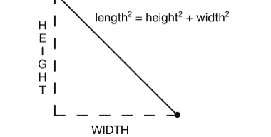

图 3.4 与组件的距离。

完全地，我们希望准确率尽可能高：100%。当两组特征完全相同时，我们希望它们之间的相似度距离尽可能低：0。

你可能已经注意到，这些相似性的概念都有名字——欧几里得（Euclid(-ean)）、闵可夫斯基（Minkowski）、汉明距离（Hamming Distance）——它们都符合“著名数学大牛距离”的模板。除了“数学大牛”这部分，它们共享“距离”这一术语的原因在于，它们都遵循构成距离的数学规则。它们也被那些掌权的数学魔法师称为度量（metric）——如距离度量（distance metric），或非正式地称为距离衡量（distance measure）。这些数学术语有时会出现在对话和文档中。`sklearn` 的可能距离计算器列表位于 `neighbors.DistanceMetric` 的文档中：那里定义了大约二十种度量。

### 3.5.2 k-NN 中的 k

选择无疑让我们的生活变得复杂。在费尽心思选择如何衡量局部邻域之后，我们还得决定如何整合邻域中的不同意见。我们可以把这看作是决定谁有投票权，以及如何合并这些投票。

我们不仅可以只考虑最近邻，还可以考虑少量邻近的邻居。从概念上讲，扩大邻域会给我们更多视角。从技术角度看，扩大的邻域可以保护我们免受数据中噪声的影响（我们稍后会更详细地讨论这一点）。常见的邻居数是 1、3、10 或 20。顺便说一句，这种技术的一个常见名称，也是我们将在本书中使用的缩写，是 `k-NN`，代表“k 最近邻”（k-Nearest Neighbors）。如果我们讨论的是用于分类的 `k-NN`，并且需要澄清这一点，我会在后面加上 C：`k-NN-C`。

### 3.5.3 答案组合

我们还有最后一个问题要解决。我们必须决定如何组合来自相近或相似邻居的已知值（投票）。如果我们有一个动物分类问题，我们的四个最近邻可能投票给猫、猫、狗和斑马。对于我们的测试样本，我们该如何回应？似乎选择最常见的回答——猫——是一个不错的方法。

一个非常酷的转折是，我们可以在*回归*问题中使用完全相同的基于邻居的技术，在这些问题中我们试图预测一个数值。我们唯一需要改变的是如何组合邻居的目标值。如果我们的三个最近邻给出的数值是 3.1、2.2 和 7.1，我们如何组合它们？我们可以使用任何我们想要的统计量，但均值（平均值）和中位数（中间值）是两个常见且有用的选择。我们将在下一章回到用于回归的 `k-NN`。

### 3.5.4 k-NN、参数与非参数方法

由于 `k-NN` 是我们讨论的第一个模型，将它与其他方法比较有点困难。我们将把其中一些比较留到以后。有一个主要区别，我们现在就可以深入探讨。希望这抓住了你的注意力。

回想一下将学习模型类比为侧面带有旋钮和杠杆的机器。与许多其他模型不同，`k-NN` 的输出——即预测——不能从输入样本和一组小型、固定的可调旋钮值来计算。我们需要*所有*训练数据来计算我们的输出值。真的吗？想象一下，我们丢掉一个训练样本。这个样本可能就是新测试样本的*那一个*最近邻。当然，缺少该训练样本会影响我们的输出。还有其他机器学习方法也有类似的要求。还有一些方法在测试时需要部分（但不是*全部*）训练数据。

现在，你可能会争辩说，对于固定数量的训练数据，可能存在固定数量的旋钮：比如 100 个样本，每个样本一个旋钮，总共 100 个旋钮。说得有道理。但随后我添加一个样本——噗，你现在需要 101 个旋钮，而且那是一个*不同*的机器。在这个意义上，`k-NN` 机器上的旋钮数量取决于训练数据中的样本数量。有更好的方式来描述这种依赖性。我们的工厂机器有一个侧边托盘，我们可以在那里输入额外信息。我们可以把训练数据视为这种额外信息。无论我们怎么选，如果我们要么需要 (1) 数量不断增长的旋钮，要么需要 (2) 侧边输入托盘，我们就说这种机器是*非参数*的。`k-NN` 是一种非参数学习方法。

*非参数*学习方法可以有参数。（正式定义，真是谢谢你了。）这是怎么回事？当我们称一种方法为*非参数*时，意味着使用这种方法，特征与目标之间的关系不能仅通过使用*固定*数量的参数来捕获。对于统计学家来说，这个概念与参数统计和非参数统计的思想有关：非参数统计对一批数据的假设更少。然而，请记住，我们*没有*对我们的黑盒工厂机器如何与现实关联做任何假设。参数模型 (1) 先对模型形式做出假设，然后 (2) 通过设置参数选择具体模型。这对应两个问题：机器上有哪些旋钮，它们被设置为什么值？我们不会对 `k-NN` 做这样的假设。然而，`k-NN` *确实*做出并依赖一些假设。最重要的假设是，我们的相似性计算与我们想要捕获的*实际*样本相似性相关。

### 3.5.5 构建 k-NN 分类模型

`k-NN` 是我们的第一个模型示例。记住，有监督模型是指任何能够捕捉特征与目标之间关系的东西。我们需要讨论围绕模型概念的几个概念，所以先提供一点背景。让我们写下我们想要逐步进行的流程：

- 1. 我们希望使用 `3-NN`——三个最近邻——作为我们的模型。

- 2. 我们希望该模型能够捕捉鸢尾花训练特征与鸢尾花训练目标之间的关系。

- 3. 我们希望使用该模型预测先前未见的测试示例中的鸢尾花目标物种。

- 4. 最后，我们希望通过比较预测与实际情况，使用准确率来评估这些预测的质量。我们没有偷看这些已知答案，但可以将其用作测试的答案 key。

图 3.5 中展示了信息流的图表。

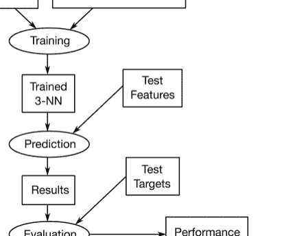

图 3.5 `3-NN` 的训练、测试和评估工作流程。

关于 `sklearn` 术语的补充说明，在其文档中，估计器是在某些数据上拟合，然后在某些数据上用于预测。如果我们有训练和测试划分，我们在训练数据上拟合估计器，然后使用拟合后的估计器在测试数据上进行预测。所以，让我们

- 1. 创建一个 `3-NN` 模型，

- 2. 在训练数据上拟合该模型，

- 3. 使用该模型在测试数据上进行预测，并

- 4. 使用准确率评估这些预测。


```python
In [9]:

# default_n_neighbors = 5
knn = neighbors.KNeighborsClassifier(n_neighbors=3)
fit = knn.fit(iris_train_ftrs, iris_train_tgt)
preds = fit.predict(iris_test_ftrs)

# evaluate our predictions against the held-back testing targets
print("3NN accuracy:",
    metrics.accuracy_score(iris_test_tgt, preds))
```

3NN 准确率: 1.0

哇，100%。我们做得很好！这个机器学习的东西看起来挺容易的——除了不容易的时候。我们稍后会再回来讨论这个问题。我们可以抽象掉 k-NN 分类的细节，并为在 `sklearn` 中构建和评估模型编写一个简化的工作流程模板：

- 1. 构建模型，

- 2. 使用训练数据拟合模型，

- 3. 使用拟合模型在测试数据上进行预测，并

- 4. 评估预测的质量。

我们可以将此工作流程与我们对模型作为机器的理解联系起来。等效步骤是：

- 1. 构建机器，包括其旋钮，

- 2. 调整旋钮并适当馈入侧输入以捕捉训练数据，

- 3. 将新示例通过机器运行以查看输出是什么，并

- 4. 评估输出的质量。

这里有一个最后的、简短的说明。我们 3-最近邻中的 3 并不是通过训练来调整的。它是学习机器内部机制的一部分。我们的机器上没有旋钮可以把 3 调到 5。如果我们想要一个 5-NN 机器，我们必须构建一台完全不同的机器。3 并不是 k-NN 训练过程所调整的东西。3 是一个超参数。超参数不会被帮助定义的 learning 方法所训练或操纵。一个等价的场景是同意游戏规则，然后在该固定规则集下进行游戏。除非我们在玩 Calvinball 或像《黑客帝国》中的 Neo 一样行动——规则的波动本身就是重点——否则在游戏期间规则是静态的。你可以认为超参数是在学习过程中我们有机会对其做任何事情之前就已预先确定并固定下来的。调整它们在概念上和字面上都涉及在学习盒子或工厂机器之外工作。我们将在第 11 章更详细地讨论这个话题。

## 3.6 简单分类器 #2：朴素贝叶斯、概率与破碎的承诺

另一种基本的分类技术直接以概率为灵感和操作，那就是朴素贝叶斯分类器。为了让你了解底层概率思想，让我先描述一个场景。

有一个赌场，有两张桌子可以坐下玩机会游戏。

在任一桌上，你可以玩骰子游戏和纸牌游戏。一张桌子是公平的，另一张桌子是作弊的。别惊讶，我们就称它们为 Fair 和 Rigged。如果你坐在 Rigged，掷出的骰子已被调整，只会在十次中有一次掷出六个点——骰子上的点——其余值在 1、2、3、4 和 5 个点之间等概率分布。如果你玩纸牌，情况更糟：作弊桌上的牌堆里没有花牌——国王、皇后或杰克。我在图 3.6 中绘制了这一点。对于想挑剔的人来说，你无法察觉这些修改，因为骰子看起来完全相同，纸牌甲板在不透明的牌盒中，你既不与骰子也不与牌堆有身体接触。

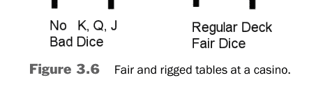

图 3.6 赌场中的公平桌和作弊桌。

假设我告诉你——诚实地说！——你正坐在 Rigged。那么，当你玩牌一段时间却从未看到一张花牌时，你不会感到惊讶。你也不会期望在骰子上经常看到六点。不过，如果你知道自己在 Rigged，骰子或纸牌事件的结果都不会为你对另一者的了解增加任何东西。我们知道我们在 Rigged，所以推断我们处于 Rigged 并不会为我们的知识增加新的事实——尽管在现实世界中，事实的确认是好的。

如果不知道我们在哪张桌子，当我们开始看到结果时，我们会收到指示我们在哪张桌子的信息。这可以转化为关于骰子和纸牌的具体预测。如果我们知道在哪张桌子，这个过程就会被短路，我们可以直接对骰子和纸牌做出预测。关于桌子的信息切断了从看到骰子或纸牌结果中获得的任何收益。故事在 Fair 桌上类似。如果我告诉你你刚坐到公平桌上，你会期望所有的骰子掷出都以相同概率发生，花牌也会时不时出现。

现在，想象你被蒙住眼睛带到一张桌子。你只知道有两张桌子，并且你知道两张桌子上发生的事情——你知道 Rigged 和 Fair 存在。

然而，你不知道自己是在 *Rigged* 还是 *Fair*。你坐下，蒙眼布被取下。如果你被发到一张花牌，你立刻就知道你是在 *Fair* 桌上。当我们知道自己坐在哪张桌子时，了解骰子的情况并不会告诉我们关于纸牌的额外信息，反之亦然。现在我们不知道桌子，我们可能会从纸牌中获得一些关于骰子的信息。如果我们看到一张花牌，而 *Rigged* 上不存在花牌，我们就知道我们不在 *Rigged*。我们 *必须* 在 *Fair*。(这就是双重否定逻辑派上用场的时候。)因此，我们知道六点会定期出现。

我们的关键收获是，*在其中一张桌子上，骰子和纸牌之间没有任何交流或因果关系*。一旦我们坐在 *Rigged* 上，抽一张牌不会调整骰子的赔率。数学家描述这种方式是说纸牌和骰子是 *在给定桌子的条件下独立的*。

这个场景让我们讨论朴素贝叶斯（NB）的主要思想。NB 的关键组成部分是它把特征当作在给定类别的条件下彼此条件独立，就像其中一张桌子上的骰子和纸牌一样。知道桌子会巩固我们对将看到什么骰子和纸牌的想法。同样，知道一个类别也会设定我们对期望看到什么特征值的想法。

由于概率的独立性在数学上表现为乘法，我们得到了 NB 模型中概率的非常简单的描述。给定类别的特征似然可以从训练数据中计算出来。从训练数据中，我们存储在每个目标类别中看到特定特征的概率。对于测试，我们查找与潜在目标类别相关的特征值的概率，并将它们与整体类别概率一起相乘。我们对每个可能的类别都这样做。然后，我们选择整体概率最高的类别。

我构建了赌场场景来解释 NB 发生的事情。然而，当我们使用 NB 作为分类技术时，*我们假设特征之间的条件独立性成立，然后在数据上运行计算*。我们可能是错的。假设可能被破坏了！例如，我们可能不知道每次掷出骰子的特定值时，经销商——他们是 *非常* 擅长的牌手——都在操纵我们抽取的牌堆。如果是这样，牌堆和骰子之间 *就会* 有联系；我们假设两者之间没有联系的假设就会是 *错误的*。引用著名统计学家 George Box 的话：“All models are wrong but some are useful。” 确实如此。

朴素贝叶斯可以 *非常* 有用。事实证明它在文本分类中不合理地有用。这几乎令人难以置信。很明显，句子中的词语彼此依赖并且依赖于它们的顺序。我们不会随机挑选词语；我们有意把正确的词语以正确的顺序组合起来，以传达特定的思想。一种 *忽略* 词语之间关系的方法——它们是文本分类中特征的基础——怎么会如此有用？NB 成功背后的原因有两点。首先，朴素贝叶斯是一种相对 *简单* 的学习方法，很难被无关细节分散注意力。其次，由于它特别简单，它受益于有 *大量* 数据输入。我在这里有点含糊，但你需要跳到 *过拟合*（第 5.3 节）的讨论才能从我这里获得更多信息。

让我们构建、拟合和评估一个简单的 NB 模型。

```python
nb = naive_bayes.GaussianNB()
fit = nb.fit(iris_train_ftrs, iris_train_tgt)
preds = fit.predict(iris_test_ftrs)

print("NB accuracy:",
      metrics.accuracy_score(iris_test_tgt, preds))
```

NB 精度：1.0

再一次，我们是完美的。不过不要被误导。我们的成功更多说明了数据集的易用性，而非我们在机器学习方面的技能。

## 3.7 分类器的简易评估

我们已经为烟花做好了一切准备！我们有数据，有方法，还有评估方案。正如意大利人所说，“Andiamo！”出发吧！

### 3.7.1 学习性能

很快，我们将看到一个简单的 Python 程序来比较我们的两个学习器：k-NN 和 NB。与本章开头 setup 语句 `from mlwpy import *` 导入的名称不同，这里将导入写了出来。这段代码就是你在独立脚本或不导入我们便捷 setup 的 notebook 中会写的代码。你会注意到我们重写了 `train_test_split` 调用，并且还显著增大了测试集的大小。为什么？在更少的数据上训练会使问题更难。你还会注意到我向 `train_test_split` 传递了一个额外的参数：`random_state=42` 操纵了训练-测试分割的随机性，并给出了可重复的结果。如果没有它，每次运行单元格都会导致不同的评估结果。通常我们希望如此，但在本文中我希望能够在知道结果的情况下谈论它们。

```python
# stand-alone code
from sklearn import (datasets, metrics,
                    model_selection as skms,
                    naive_bayes, neighbors)

# we set random_state so the results are reproducible
# otherwise, we get different training and testing sets
# more details in Chapter 5
iris = datasets.load_iris()
```

```python
(iris_train_ftrs, iris_test_ftrs,
    iris_train_tgt, iris_test_tgt) = skms.train_test_split(iris.data,
                                                            iris.target,
                                                            test_size=.90,
                                                            random_state=42)

models = {'kNN': neighbors.KNeighborsClassifier(n_neighbors=3),
          'NB' : naive_bayes.GaussianNB()}

for name, model in models.items():
    fit = model.fit(iris_train_ftrs, iris_train_tgt)
    predictions = fit.predict(iris_test_ftrs)

    score = metrics.accuracy_score(iris_test_tgt, predictions)
    print("{:>3s}: {:0.2f}".format(name,score))
```

kNN: 0.96

NB: 0.81

在测试集占数据 90% 的情况下，k-NN 在此训练-测试分割上表现相当不错，而 NB 则有点平平。如果你多次在未设置 `random_state` 的情况下重新运行此代码，并且使用更适中的测试数据量，我们在多次重复运行中对两种方法都能获得 97%+ 的准确率。因此，从学习性能的角度来看，`iris` 是一个相当容易的问题。基于我们拥有的测量，使用非常简单的分类器来区分不同类型的花朵是相当容易的。

### 3.7.2 分类中的资源利用

我们在计算机上所做的一切都伴随着处理时间和内存方面的成本。计算机科学家经常将内存称为存储空间，或简单地称为空间。因此，我们谈论程序或算法的时间和空间使用。担心计算机资源使用似乎有点过时；今天的计算机在处理和存储能力方面比甚至几年前的祖先快大几个数量级，更不用说 1960 年代和 1970 年代的庞然大物了。那么为什么我们要走进一个可能分散注意力的兔子洞呢？有两个主要原因：外推和理论分析的局限性。

#### 3.7.2.1 外推

今天，数据科学和机器学习的很大一部分都由大数据驱动。大数据的本质就是推动我们计算资源的极限。大数据是一个相对的术语：对你来说大的数据，对拥有技能和预算在配备 GPU（图形处理单元）的大型机器集群上计算的人来说可能并不算大。我没有小数据的一个可能转折点是，当问题大到我无法在“合理”的时间内在我的笔记本电脑上解决时。

如果我在笔记本电脑上进行原型设计和开发——这样我就可以在加勒比海的棕榈树下喝 mojito 的同时工作——当我扩展到完整规模的问题时，我如何知道我需要什么样资源？好吧，我可以测量不同规模的较小问题，并对完整数据集会发生什么做出一些有根据的猜测。为了做到这一点，我需要在时间和空间上量化较小数据上发生的情况。公平地说，这只是一个估计，增加计算能力并不总是能获得一对一的回报。加倍我的可用内存并不总是能使我能处理的数据集大小加倍。

#### 3.7.2.2 理论的局限

你们中的一些人可能听说过计算机科学的一个子领域，称为算法分析，其工作是开发将计算任务的时间和内存使用与其输入大小联系起来的方程。例如，我们可能会说新的学习方法 `Foo` 在 `n` 个输入示例上需要 `2n + 27` 步。（这是一个极大的简化：我们几乎肯定关心这些示例中有多少个特征。）

那么，如果有一种理论方法可以知道算法所需的资源，为什么我们还要关心测量它们呢？我很高兴你问了。算法分析通常会抽象掉某些数学细节，如常数因子和项，这些细节对实际运行时间可能很相关。算法分析还（1）对某些强或数学上方便的假设做出假设，特别是关于平均情况分析，（2）可以忽略诸如系统架构之类的实现细节，（3）经常使用算法理想化，在没有现实世界的实际性和必要性的情况下得出结论。

简而言之，除了一些不适用于此处的特殊情况外，了解现实世界的计算系统将如何消耗资源，唯一的办法就是运行它并测量它。现在，这同样可能做错：你可以在理想化或不现实的条件下运行和测量。我们不想完全抛弃算法分析。我的批评不是算法分析的失败；它只是睁大眼睛理解其局限性。算法分析将始终告诉我们关于不同算法如何比较以及它们在越来越大的输入上的行为的一些基本真理。

我想展示一些比较我们两个分类器资源利用的方法。几点警告：量化程序行为可能非常困难。你系统上发生的一切都可能对你的学习系统的资源利用产生重大影响。输入的每一次差异都可能影响系统的行为：更多的示例、更多的特征、不同类型的特征（数值与符号）以及不同的超参数都可能使相同的学习算法表现不同并消耗不同的资源。

#### 3.7.2.3 测量单位

我们需要做一个小小的 digression。我们将测量计算机程序使用的资源。时间以秒为单位测量，空间以字节为单位测量。一个字节是八位：它可以保存八个是/否问题的答案。八位可以区分 256 个不同的值——到目前为止还不错。然而，我们将处理的值将显著大于或小于我们的正常经验。我希望你能与这些值建立联系。

我们需要处理 SI 前缀。SI 是科学缩写国际标准的缩写——但来自罗曼语系，形容词在名词之后，所以 IS 被调换了。对我们重要的前缀在表 3.2 中。记住指数是 10^x 中的 x；它也是右边“填充零”的数量。那就是，kilo 表示 10^3 = 1000，1000 右边有三个零。示例是使用该前缀应用于米的合理测量距离。

表 3.2 SI 前缀和长度尺度示例。

| 前缀 | 读音 | 指数 | 示例距离 |
|---|---|---|---|
| T | tera | 12 | 海王星绕太阳的轨道 |
| G | giga | 9 | 月球绕地球的轨道 |
| M | mega | 6 | 月球的直径 |
| K | kilo | 3 | 一次愉快的散步 |
|  |  | 0 | 1 米 ~ 1 步 |
| m | milli | -3 | 蚊子 |
| μ | micro | -6 | 细菌 |
| n | nano | -9 | DNA |

还有另一个复杂因素。计算机通常使用基于 2 的存储量，而不是基于 10。所以，我们处理的是 2^x 而不是 10^x。严格来说——而科学家如果不是严格的就不是科学家——我们需要考虑这种差异。对于内存，我们有一些额外的前缀（表 3.3），你很快就会看到它们的使用。

表 3.3 SI 二进制前缀和内存尺度示例。

| 前缀 | 读音前缀 | 字节数 | 示例 |
|---|---|---|---|
| KiB | kibi | 2^10 | 大约 1000 个数字的列表 |
| MiB | mebi | 2^20 | 一首短歌作为 MP3 |
| GiB | gibi | 2^30 | 一部全长电影 |
| TiB | tebi | 2^40 | 一个家庭的照片和电影档案 |

因此，2 MiB 是两个 mebi-字节等于 2^20 字节。你会注意到基于 2 的前缀发音也不同。呃。你可能会想知道为什么这些按 10 进位，而不是像基于 10 的值那样按 3 进位。因为 2^10 = 1024 ~ 1000 = 10^3，乘以十个 2 与乘以三个 10 相当接近。不幸的是，这些由大型标准机构定义的二进制前缀不一定会渗透到日常会话使用中。好消息是，在一个测量系统中，你可能只会看到 MiB 或 MB，而不是两者。当你看到 MiB 时，只要知道它并不完全是 MB 即可。

#### 3.7.2.4 时间

在 Jupyter notebook 中，我们有一些不错的工具来测量执行时间。这些工具非常适合测量小段代码的时间使用情况。如果我们有两种不同的编码方式来解决一个问题并想比较它们的速度，或者只是想测量一段代码花费的时间，我们可以使用 Python 的 `timeit` 模块。Jupyter 单元格魔术命令 `%timeit` 为我们提供了一个方便的接口来计时一行代码：

```python
In [12]:

%timeit -r1 datasets.load_iris()
```

1000 次循环，最好 1 次：每次 1.4 ms


## 3.7 分类器的简易评估

`-r1` 告诉 `timeit` 只测量一次片段的计时。如果我们给出更高的 `r` 作为重复次数，代码将被多次运行，我们将获得统计信息。最近版本的 Jupyter 默认计算结果的均值和标准差。幸运的是，对于单个结果，我们只得到该单个值。如果你担心 1000 次循环，请查看本章末尾我对此的说明。`%%timeit`——两个百分号使其成为单元格魔术命令——将相同的策略应用于单元格中的整个代码块：

In [13]:

```
%%timeit -r1 -n1
(iris_train_ftrs, iris_test_ftrs,
 iris_train_tgt,  iris_test_tgt) = skms.train_test_split(iris.data,
                                        iris.target,
                                        test_size=.25)
```

1 次循环，最好 1 次：每次 638 µs

现在让我们用计时器（`timeit`）来测量我们的学习工作流程：

In [14]:

```
%%timeit -r1

nb  = naive_bayes.GaussianNB()
fit  = nb.fit(iris_train_ftrs, iris_train_tgt)
preds = fit.predict(iris_test_ftrs)

metrics.accuracy_score(iris_test_tgt, preds)
```

1000 次循环，最好 1 次：每次 1.07 ms

In [15]:

```
%timeit -r1
knn = neighbors.KNeighborsClassifier(n_neighbors=3)
fit = knn.fit(iris_train_ftrs, iris_train_tgt)
preds = fit.predict(iris_test_ftrs)
metrics.accuracy_score(iris_test_tgt, preds)
```

1000 次循环，最好 1 次：每次 1.3 ms

如果我们只想计时单元格中的一行——例如，我们只想知道拟合模型花费多长时间——我们可以使用 `timeit` 的单百分号版本，称为行魔术命令：

In [16]:

```
# fitting
nb = naive_bayes.GaussianNB()
%timeit -r1 fit = nb.fit(iris_train_ftrs, iris_train_tgt)
knn = neighbors.KNeighborsClassifier(n_neighbors=3)
%timeit -r1 fit = knn.fit(iris_train_ftrs, iris_train_tgt)
```

1000 次循环，最好 1 次：每次 708 μs

1000 次循环，最好 1 次：每次 425 μs

In [17]:

```
# predicting
nb = naive_bayes.GaussianNB()
fit = nb.fit(iris_train_ftrs, iris_train_tgt)
%timeit -r1 preds = fit.predict(iris_test_ftrs)
knn = neighbors.KNeighborsClassifier(n_neighbors=3)
fit = knn.fit(iris_train_ftrs, iris_train_tgt)
%timeit -r1 preds = fit.predict(iris_test_ftrs)
```

1000 次循环，最好 1 次：每次 244 μs

1000 次循环，最好 1 次：每次 644 μs

似乎存在一定的权衡。k-NN 拟合更快，但预测更慢。相反，NB 拟合需要一点时间，但预测更快。如果你想知道为什么我没有重用之前的单元格中的 `knn` 和 `nb`，是因为当你使用 `%timeit` 时，变量赋值被捕获在 `timeit` 魔术命令内部，不会泄漏回我们的主代码。例如，尝试在之前的单元格中将 `preds` 作为“正常”代码使用将会导致 `NameError`。

#### 3.7.2.5 内存

我们也可以做一个非常相似的步骤来进行快速而粗略的内存使用测量。然而，两个问题出现了：（1）我们的工具没有内置于 Jupyter，因此我们需要安装它，（2）有一些技术细节——呃，机会？——我们稍后会提到。关于安装，使用 `pip` 或 `conda` 在终端命令行安装 `memory_profiler` 模块：

```
pip install memory_profiler
conda install memory_profiler
```

然后，在你的 notebook 中你将能够使用 `%load_ext`。这是 Jupyter 加载 Jupyter 扩展模块的命令——有点像 Python 的 `import`。对于 `memory_profiler`，我们这样使用它：

开始：

In [18]:

```
%load_ext memory_profiler
```

使用它就像 `%%timeit` 一样。以下是 Naive Bayes 的单元格魔术命令版本：

In [19]:

```
%%memit
nb = naive_bayes.GaussianNB()
fit = nb.fit(iris_train_ftrs, iris_train_tgt)
preds = fit.predict(iris_test_ftrs)
```

峰值内存：144.79 MiB，增量：0.05 MiB

对于最近邻：

In [20]:

```
%%memit
knn = neighbors.KNeighborsClassifier(n_neighbors=3)
fit = knn.fit(iris_train_ftrs, iris_train_tgt)
preds = fit.predict(iris_test_ftrs)
```

峰值内存：144.79 MiB，增量：0.00 MiB

#### 3.7.2.6 复杂因素

你可能从未考虑过计算机上的内存会发生什么。在 2010 年代后期，你的笔记本电脑上可能有 4 或 8GB 的系统内存，RAM。我在我的主力工作站——或者如果你愿意，工作站动力马——上有 32GB。不管怎样，该系统内存由你计算机上运行的每一个程序共享。操作系统的任务——Windows、OSX、Linux 是常见的罪魁祸首——是管理该内存并响应应用程序使用它的请求。操作系统必须有点像游乐场监督员，以强制不同程序之间的共享。

我们的 Python 小程序也在那个游乐场上玩。我们也必须与其他人分享。当我们请求资源如内存——或游乐场秋千上的时间——操作系统会响应并给我们一块内存使用。我们可能实际上获得的内存比我们请求的更多（稍后会详细介绍）。同样，当我们完成一块内存的使用——并且作为有礼貌的游乐场孩子——我们会将其归还给游乐场管理员。在我们请求内存和归还内存的过程中，都会产生管理开销。操作系统简化流程并减少开销的两种方式是（1）以可能超过我们需要的块授予内存，（2）可能让我们在我们说我们已完成使用后继续使用内存，直到其他人真正需要它为止。其净结果是，确定我们实际使用的内存量——与操作系统为我们划定的内存量——可能非常棘手。在正在运行的程序中测量额外的请求甚至更困难。

另一个问题进一步使事情复杂化。Python 是一种内存管理的语言：它在操作系统之上拥有自己的内存管理设施。如果你重新运行 Jupyter notebook 中的上述单元格，你可能会看到内存增量为 0.00 MiB 并想知道哪些电路刚刚烧坏。在这种情况下，我们使用的旧内存已被我们释放——并且操作系统从未将其转移给其他人。因此，当我们需要更多内存时，我们能够重用旧内存，并且不需要从操作系统获取任何新内存。几乎就像内存被我们释放和重新获取得如此之快，以至于它从未真正消失！现在，我们是否看到增量也取决于（1）笔记本单元格正在做什么，（2）我们的程序已声明并正在使用的其他内存，（3）计算机上运行的每个其他程序，以及（4）操作系统内存管理器的确切细节。要了解更多信息，请查看有关操作系统的课程或教科书。

### 3.7.3 独立资源评估

为了尽量减少这些担忧并减少混杂变量，在测试内存使用时编写小型、独立的程序非常有用。我们也可以使脚本足够通用，以便用于独立计时。

In [21]:

```
!cat scripts/knn_memtest.py

import memory_profiler, sys
from mlwpy import *

@memory_profiler.profile(precision=4)
def knn_memtest(train, train_tgt, test):
    knn  = neighbors.KNeighborsClassifier(n_neighbors=3)
    fit  = knn.fit(train, train_tgt)
    preds = fit.predict(test)

if __name__ == "__main__":
    iris = datasets.load_iris()
    tts = skms.train_test_split(iris.data,
                                iris.target,
                                test_size=.25)

    (iris_train_ftrs, iris_test_ftrs,
     iris_train_tgt,  iris_test_tgt) = tts
    tup = (iris_train_ftrs, iris_train_tgt, iris_test_ftrs)
    knn_memtest(*tup)
```

有几种方法可以使用 `memory_profiler`。我们在上一节中看到了行和单元格魔术命令。在 `knn_memtest.py` 中，我们使用 `@memory_profiler.profile` 装饰器。那一行额外的 Python 代码告诉内存分析器逐行跟踪 `knn_memtest` 的内存使用情况。当我们运行脚本时，我们会看到 `knn_memtest` 的每一行的内存相关输出：

In [22]:

```
!python scripts/knn_memtest.py

Filename: scripts/knn_memtest.py
# output modified for formatting purposes

Line #   Mem usage   Increment   Line Contents
================================================
   4 120.5430 MiB 120.5430 MiB   @memory_profiler.profile(precision=4)
   5                              def knn_memtest(train, train_tgt, test):
   6 120.5430 MiB   0.0000 MiB      knn  = neighbors.
                                   KNeighborsClassifier(n_neighbors=3)
   7 120.7188 MiB   0.1758 MiB      fit  = knn.fit(train, train_tgt)
   8 120.8125 MiB   0.0938 MiB      preds = fit.predict(test)
```

以下是另一个用于测量 Naive Bayes 内存使用的独立脚本：

In [23]:

```
import functools as ft

import memory_profiler

from mlwpy import *

def nb_go(train_ftrs, test_ftrs, train_tgt):
    nb  = naive_bayes.GaussianNB()
    fit = nb.fit(train_ftrs, train_tgt)
    preds = fit.predict(test_ftrs)

def split_data(dataset):
    split = skms.train_test_split(dataset.data, dataset.target, test_size=.25)
    return split[:-1] # don't need test tgt

def msr_mem(go, args):
    base = memory_profiler.memory_usage()[0]
    mu = memory_profiler.memory_usage((go, args), max_usage=True)[0]
    print("{:<3}: ~{:.4f} MiB".format(go.__name__, mu-base))

if __name__ == "__main__":
    msr = msr_mem
    go = nb_go
    sd = split_data(datasets.load_iris())
    msr(go, sd)
```

nb_go: ~-0.0078 MiB

`nb_go` has the model-fit-predict pattern we saw above. `split_data` just wraps `train_test_split` in a convenient way to use with `nb_go`. The new piece is setting up the timing wrapper in `msr_mem`. Essentially, we ask what memory is used now, run `nb_go`, and then see the maximum memory used along the way. Then, we take that max, subtract what we were using before, max-baseline, and that’s the peak memory used by `nb_go`. `nb_go` gets passed in to `msr_mem` as `go` and then finds its way to `memory_usage`. We can write a similar `msr_time` driver to evaluate time, and we can write a similar `knn_go` to kick off a k-NN classifier for measuring time and memory. Here are all four pieces in a single script:

In [24]:

```
!cat scripts/perf_01.py

import timeit, sys

import functools as ft

import memory_profiler

from mlwpy import *

def knn_go(train_ftrs, test_ftrs, train_tgt):
    knn = neighbors.KNeighborsClassifier(n_neighbors=3)
    fit = knn.fit(train_ftrs, train_tgt)
    preds = fit.predict(test_ftrs)

def nb_go(train_ftrs, test_ftrs, train_tgt):
    nb  = naive_bayes.GaussianNB()
    fit = nb.fit(train_ftrs, train_tgt)
    preds = fit.predict(test_ftrs)

def split_data(dataset):
    split = skms.train_test_split(dataset.data,
                                  dataset.target,
                                  test_size=.25)
    return split[:-1] # don't need test tgt

def msr_time(go, args):
    call = ft.partial(go, *args)
    tu = min(timeit.Timer(call).repeat(repeat=3, number=100))
    print("{:<6}: ~{:.4f} sec".format(go.__name__, tu))

def msr_mem(go, args):
    base = memory_profiler.memory_usage()[0]
    mu = memory_profiler.memory_usage((go, args),
                                      max_usage=True)[0]
    print("{:<3}: ~{:.4f} MiB".format(go.__name__, mu-base))

if __name__ == "__main__":
    which_msr = sys.argv[1]
    which_go = sys.argv[2]
    msr = {'time': msr_time, 'mem':msr_mem}[which_msr]
```


go = `{'nb' : nb_go, 'knn': knn_go}[which_go]`

sd = `split_data(datasets.load_iris())`

`msr(go, sd)`

With all this excitement, let's see where we end up using Naive Bayes:

```
!python scripts/perf_01.py mem nb

!python scripts/perf_01.py time nb
```

`nb_go`: ~0.1445 MiB
`nb_go`: ~0.1004 sec

And with k-NN:

```
!python scripts/perf_01.py mem knn

!python scripts/perf_01.py time knn
```


```
knn_go: ~0.3906 MiB
knn_go: ~0.1035 sec
```

In summary, our learning and resource performance metrics look like this (the numbers may vary a bit):

| Method | Accuracy | ~Time(s) | ~Memory (MiB) |
|---|---|---|---|
| k-NN | 0.96 | 0.10 | .40 |
| NB | 0.80 | 0.10 | .14 |

Don't read too much into the accuracy scores! I'll tell you why in a minute.

## 3.8 EOC

### 3.8.1 Sophomore Warning: Limitations and Open Issues

There are several caveats to what we've done in this chapter:

- We compared these learners on a single dataset.
- We used a very simple dataset.
- We did no preprocessing on the dataset.
- We used a single train-test split.
- We used accuracy to evaluate the performance.
- We didn't try different numbers of neighbors.
- We only compared two simple models.

Each one of these caveats is great! It means we have more to talk about in the forthcoming chapters. In fact, discussing why these are concerns and figuring out how to address them is the point of this book. Some of these issues have no fixed answer. For example, no one learner is best on all datasets. So, to find a good learner for a particular problem, we often try several different learners and pick the one that does the best on that particular problem. If that sounds like teaching-to-the-test, you're right! We have to be very careful in how we select the model we use from many potential models. Some of these issues, like our use of accuracy, will spawn a long discussion of how we quantify and visualize the performance of classifiers.

### 3.8.2 Summary

Wrapping up our discussion, we've seen several things in this chapter:

1. `iris`, a simple real-world dataset
2. Nearest-neighbors and Naïve Bayes classifiers
3. The concept of training and testing data
4. Measuring learning performance with accuracy
5. Measuring time and space usage within a Jupyter notebook and via stand-alone scripts

### 3.8.3 Notes

If you happen to be a botanist or are otherwise curious, you can read Anderson's original paper on irises: www.jstor.org/stable/2394164. The version of the `iris` data with `sklearn` comes from the UCI Data repository: https://archive.ics.uci.edu/ml/datasets/iris.

The Minkowski distance isn't really as scary as it seems. There's another distance called the Manhattan distance. It is the distance it would take to walk as directly as possible from one point to the other, if we were on a fixed grid of streets like in Manhattan. It simply adds up the absolute values of the feature differences without squares or square roots. All Minkowski does is extend the formulas so we can pick Manhattan, Euclidean, or other distances by varying a value `p`. The weirdness comes in when we make `p` very, very big: `p` → ∞. Of course, that has its own name: the Chebyshev distance.

If you've seen theoretical resource analysis of algorithms before, you might remember the terms *complexity analysis* or *Big-O* notation. The Big-O analysis simplifies statements on the upper bounds of resource use, as input size grows, with mathematical statements like 𝒪(`n`²)—hence the name Big-O.

I briefly mentioned graphics processing units (GPUs). When you look at the mathematics of computer graphics, like the visuals in modern video games, it is all about describing points in space. And when we play with data, we often talk about examples as points in space. The “natural” mathematical language to describe this is *matrix algebra*. GPUs are designed to perform matrix algebra at warp speed. So, it turns out that machine learning algorithms can be run very, very efficiently on GPUs. Modern projects like Theano, TensorFlow, and Keras are designed to take advantage of GPUs for learning tasks, often using a type of learning model called a *neural network*. We'll briefly introduce these in Chapter 15.

In this chapter, we used Naive Bayes on discrete data. Therefore, learning involved making a table of how often values occurred for the different target classes. When we have continuous numerical values, the game is a bit different. In that case, learning means figuring out the center and spread of a distribution of values. Often, we assume that a *normal* distribution works well with the data; the process is then called *Gaussian Naive Bayes*—Gaussian and normal are essentially synonyms. Note that we are making an *assumption*—it might work well but we might also be *wrong*. We'll talk more about GNB in Section 8.5.

In any chapter that discusses performance, I would be remiss if I didn’t tell you that “premature optimization is the root of all evil . . . in programming.” This quote is from an essay form of Donald Knuth’s 1974 Turing Award—the Nobel Prize of Computer Science—acceptance speech. Knuth is, needless to say, a giant in the discipline. There are two points that underlie his quote. Point one: in a computer system, the majority of the execution time is usually tied up in a small part of the code. This observation is a form of the Pareto principle or the 80–20 rule. Point two: optimizing code is hard, error-prone, and makes the code more difficult to understand, maintain, and adapt. Putting these two points together tells us that we can waste an awful lot of programmer time optimizing code that isn’t contributing to the overall performance of our system. So, what’s the better way? (1) Write a good, solid, *working* system and then measure its performance. (2) Find the bottlenecks—the slow and/or calculation-intensive portions of the program. (3) Optimize those bottlenecks. We only do the work that we *know* needs to be done and has a chance at meeting our goals. We also do as little of this intense work as possible. One note: *inner loops*—the innermost nestings of repetition—are often the most fruitful targets for optimization because they are, by definition, code that is repeated the most times.

Recent versions of Jupyter now report a mean and standard deviation for `%timeit` results. However, the Python core developers and documenters prefer a different strategy for analyzing `timeit` results: they prefer either (1) taking the minimum of several repeated runs to give an idea of best-case performance, which will be more consistent for comparison sake, or (2) looking at all of the results as a whole, without summary. I think that (2) is *always* a good idea in data analysis. The mean and standard deviation are not *robust*; they respond poorly to outliers. Also, while the mean and standard deviation completely characterize normally distributed data, other distributions will be characterized in very different ways; see Chebyshev’s inequality for details. I would be far happier if Jupyter reported medians and inter-quartile ranges (those are the 50th percentile and the 75th–25th percentiles). These are robust to outliers and are not based on distributional assumptions about the data.

What was up with the `1000 loops` in the `timeit` results? Essentially, we are stacking multiple runs of the same, potentially short-lived, task one after the other so we get a longer-running pseudo-task. This longer-running task plays more nicely with the level of detail that the timing functions of the operating system support. Imagine measuring a 100-yard dash using a sundial. It’s going to be very hard because there’s a mismatch between the time scales. As we repeat the task multiple times—our poor sprinters might get worn out but, fortunately, Python keeps chugging along—we may get more meaningful measurements. Without specifying a `number`, `timeit` will attempt to find a good number for you. In turn, this may take a while because it will try increasing values for `number`. There’s also a `repeat` value you can use with `timeit`; `repeat` is an *outer loop* around the whole process. That’s what we discussed computing statistics on in the prior paragraph.

### 3.8.4 Exercises

You might be interested in trying some classification problems on your own. You can follow the model of the sample code in this chapter with some other classification datasets

从`sklearn.datasets.load_wine`和`sklearn.datasets.load_breast_cancer`可以快速入门。您还可以从在线资源下载大量数据集，例如：

- UCI机器学习库，https://archive.ics.uci.edu/ml/datasets.html
- Kaggle，www.kaggle.com/datasets

# 预测数值：回归入门


# 第4章 预测数值：回归入门

```
In [1]:

# setup

from mlwpy import *

%matplotlib inline
```

## 4.1 一个简单的回归数据集

回归是根据输入预测一个精细分级的数值的过程。为了说明这一点，我们需要一个具有数值结果的简单数据集。`sklearn`自带的糖尿病数据集非常适合我们。该数据集包含多项生物测量和人口统计学测量。`sklearn`中包含的版本已经过修改，从原始数值特征中减去均值并除以每列的标准差。这个过程被称为标准化或z分数变换特征。稍后我们将讨论标准差；简而言之，它是衡量一组值分布程度的指标。

标准化各列的结果是每列均值为0，标准差为1。我们对数据进行标准化或其他缩放，以便特征范围之间的差异——例如50到100英寸的身高或20,000至200,000美元的收入——不会仅仅因为其量纲而产生不当的权重惩罚或收益。我们将在第10.3节中进一步讨论标准化和缩放。糖尿病数据中的类别变量以数值形式记录为`{0, 1}`，然后进行标准化。我提到这一点是为了解释为什么会出现负年龄（标准化后平均年龄为零），以及为什么性别被编码或记录为`{0.0507, −0.0446}`而不是`{M, F}`。

```
In [2]:

diabetes = datasets.load_diabetes()

tts = skms.train_test_split(diabetes.data,

                            diabetes.target,

                            test_size=.25)

(diabetes_train_ftrs, diabetes_test_ftrs,

 diabetes_train_tgt,  diabetes_test_tgt) = tts
```

我们可以用`DataFrame`来整理数据集，并查看前几行：

```
In [3]:

diabetes_df = pd.DataFrame(diabetes.data,

                           columns=diabetes.feature_names)

diabetes_df['target'] = diabetes.target

diabetes_df.head()
```

Out[3]:

|   | `age` | `sex` | `bmi` | `bp` | `s1` | `s2` | `s3` | `s4` | `s5` | `s6` | `target` |
|---|-----|-----|-----|----|----|----|----|----|----|--------|
| 0 | 0.04 | 0.05 | 0.06 | 0.02 | -0.04 | -0.03 | -0.04 | 0.00 | 0.02 | -0.02 | 151.00 |
| 1 | 0.00 | -0.04 | -0.05 | -0.03 | -0.01 | -0.02 | 0.07 | -0.04 | -0.07 | -0.10 | 75.00 |
| 2 | 0.09 | 0.05 | 0.04 | -0.01 | -0.05 | -0.03 | -0.03 | 0.00 | 0.00 | -0.03 | 141.00 |
| 3 | -0.09 | -0.04 | -0.01 | -0.04 | 0.01 | 0.02 | -0.04 | 0.03 | 0.02 | -0.01 | 206.00 |
| 4 | 0.01 | -0.04 | -0.04 | 0.02 | 0.00 | 0.02 | 0.01 | 0.00 | -0.03 | -0.05 | 135.00 |

除了看似类别变量的年龄和性别等奇怪值外，另外两列可以很快解释；其余列则较为专业且有些模糊：

- `bmi` 是身体质量指数，由身高和体重计算得出，是体脂率的一种近似值，
- `bp` 是血压，
- `s1–s6` 是六项血清测量值，以及
- `target` 是衡量患者病情进展的数值评分。

与处理鸢尾花数据时一样，我们可以使用Seaborn的`pairplot`来研究双变量关系。我们只保留该图形中的部分测量值。生成的迷你图仍然相当小，但我们仍可以快速浏览并寻找整体模式。如果我们需要缩小范围以获得更全局的视图，随时可以用所有特征重新绘制`pairplot`。

```
sns.pairplot(diabetes_df[['age', 'sex', 'bmi', 'bp', 's1']],

    size=1.5, hue='sex', plot_kws={'alpha':.2});
```

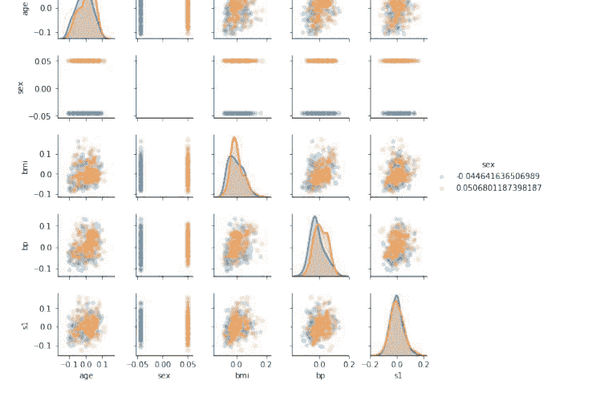

## 4.2 最近邻回归与汇总统计

在上一章中，我们讨论了最近邻分类，并得出了以下步骤序列：

- 1. 描述成对示例之间的相似性。
- 2. 选择几个最相似的示例。
- 3. 将选定的示例合并为单个答案。

当我们从预测类别转向预测数值时，步骤1和2可以保持不变。我们关于这些步骤的所有讨论仍然适用。然而，当我们进入步骤3时，我们必须做出调整。现在我们需要考虑输出所代表的数量，而不是简单地对候选答案进行投票。为此，我们需要将数值合并为单个代表性答案。幸运的是，有几种方便的技术可以从一组值中计算出一个汇总值。从一组数据计算出的值称为统计量。如果我们试图用其中一个来代表——或者说汇总——整个数据集，我们称之为汇总统计量。让我们把注意力转向其中两种：中位数和均值。

### 4.2.1 中心度量：中位数和均值

你可能熟悉平均值，也称为算术均值。但我先从一个——看起来！——数学味不那么重的替代方案开始：中位数。一组数字的中位数是按顺序排列时位于中间的数字。例如，如果我有三个数字，按顺序列为`[1, 8, 10]`，那么8是中间值：它上面有一个数字，下面也有一个。在一组数字中，中位数上下有相同数量的值。换句话说，如果所有数字权重相等，无论其数值大小，那么放在中位数处的天平将保持平衡（图4.1）。无论右侧的最大值是多少——无论是15还是40——中位数都保持不变。

你可能会想知道当数值个数为偶数时该怎么办，比如`[1, 2, 3, 4]`。构造中位数的常用方法是取中间两个值——即2和3——并取它们的平均值，得到2.5。请注意，中位数上方和下方的值数量仍然相同，都是两个。

使用中位数作为汇总统计量有一个很好的性质。如果我修改排序数据开头或结尾的值，中位数保持不变。例如，如果我的数据记录器在尾部（即远离中位数的值）有些模糊，而我没有记录`[1, 8, 10]`，而是记录了`[2, 8, 11]`，我的中位数仍然相同！这种面对不同测量值时的韧性称为稳健性。中位数是一种稳健的中心度量。

现在，有些情况下我们关心的是实际数值，而不仅仅是它们的顺序位置。估计中心的另一种熟悉方法是均值。中位数平衡左右两侧值的数量，而均值平衡左右两侧的总距离。因此，均值是使`sum(distance(s,mean) for s in smaller)`等于`sum(distance(b,mean) for b in bigger)`的值。唯一满足这一约束的值是`mean=sum(d)/len(d)`，或者如数学家所说，均值 = x̄ = Σ_i x_i / n。回到图4.1，如果我们把15换成40，我们会得到不同的平衡点：均值增加了，因为值的总和增加了。

均值的好处在于它考虑了数字的具体数值：值3低于均值8五个单位。相比之下，中位数则抽象了距离，转而关注顺序：值3小于中位数8。均值的问题在于，如果我们遇到一个离群值——数据尾部附近的罕见事件——它可能会严重扭曲我们的计算，而这正是因为具体数值很重要。

例如，以下是将一个值移动“很多”并重新计算均值和中位数时的情况：

```
In [5]:

values = np.array([1, 3, 5, 8, 11, 13, 15])

print("no outlier")

print(np.mean(values),

      np.median(values))

values_with_outlier = np.array([1, 3, 5, 8, 11, 13, 40])

print("with outlier")

print("%.2f" % np.mean(values_with_outlier),

      np.median(values_with_outlier))
```

```
no outlier
8.0 8.0
with outlier
11.57 8.0
```

在均值和中位数之外，还有许多可能的方法将最近邻答案组合成测试样例的答案。一种基于均值思想构建的组合器是我们在2.5.1节中讨论过的加权均值。在最近邻的上下文中，我们有一个完美的候选作为权重因子：从新样例到邻居的距离。因此，邻居不仅贡献它们的值`[4.0, 6.0, 8.0]`，我们还可以纳入从每个邻居到我们样例的距离。假设这些距离为`[2.0, 4.0, 4.0]`，即第二个和第三个训练样例到测试样例的距离是第一个的两倍。一种简单的纳入距离的方法是使用加权平均，如下所示：

```
In [6]:

distances = np.array([2.0, 4.0, 4.0])

closeness = 1.0 / distances  # element-by-element division

weights = closeness / np.sum(closeness)  # normalize sum to one

weights
```

```
Out[6]:

array([0.4, 0.2, 0.2])
```

或者用数学语言：

$$\frac{\frac{1}{\text{distances}}}{\sum\left(\frac{1}{\text{distances}}\right)}$$

作为权重。我们使用 $\frac{1}{\text{distances}}$，因为如果更近，我们希望权重更高；如果更远，但仍是最近邻，则希望权重更低。我们将整个和放入分母中以归一化值，使其总和为一。比较这些值的均值与加权均值：

```
In [7]:

values = np.array([4, 6, 8])
mean = np.mean(values)
wgt_mean = np.dot(values, weights)
print("Mean:", mean)
print("Weighted Mean:", wgt_mean)
```

```
Mean: 6.0
Weighted Mean: 6.4
```

图示上——见图4.2——我们的平衡图现在看起来有些不同。权重不足的示例（贡献少于其应有份额）会更靠近支点，因为它们具有更小的机械杠杆作用。权重过高的示例则远离支点并获得更多影响力。

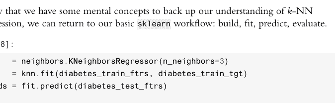

### 4.2.2 构建 k-NN 回归模型

现在我们有了一些支撑对 k-NN 回归理解的心理概念，我们可以回到基本的 `sklearn` 工作流程：构建、拟合、预测、评估。

```
In [8]:

knn = neighbors.KNeighborsRegressor(n_neighbors=3)
fit = knn.fit(diabetes_train_ftrs, diabetes_train_tgt)
preds = fit.predict(diabetes_test_ftrs)
# evaluate our predictions against the held-back testing targets
metrics.mean_squared_error(diabetes_test_tgt, preds)
```

```
Out[8]:
3471.41941941942
```

如果你翻回上一章并查看我们的 k-NN 分类器，你会注意到只有两个不同之处。

- 我们构建了不同的模型：这次我们使用 `KNeighborsRegressor` 而不是 `KNeighborsClassifier`。
- 我们使用了不同的评估指标：这次我们使用 `mean_squared_error` 而不是 `accuracy_score`。

这两种情况都反映了我们试图预测的目标的差异——数值，而不是布尔类别。我还没有解释`mean_squared_error`（MSE）；这是因为它与我们下一个学习方法线性回归紧密相关，一旦我们理解了线性回归，我们基本上就会免费理解 MSE。所以，先暂停几分钟用 MSE 评估回归器。尽管如此，如果你需要一些让你感到舒适的东西，可以快速查看第 4.5.1 节。

为了将 MSE 的数值放在上下文中，让我们看两件事。首先，MSE 大约为 3500。让我们取其平方根——由于我们是在累加平方，我们需要将其转换回非平方：

```
In [9]:

np.sqrt(3500)
```

```
Out[9]:
59.16079783099616
```

现在，让我们看看目标值可以取的范围：

```
In [10]:

diabetes_df['target'].max() - diabetes_df['target'].min()
```

```
Out[10]:
321.0
```

因此，目标值跨越约 300 个单位，而我们的预测在某种平均意义上偏差了 60 个单位。这大约是 20%。这是否“足够好”取决于许多其他因素，我们将在第 7 章中看到。

## 4.3 线性回归与误差

我们将深入线性回归（LR）——这只是为一组数据点画一条直线的花哨说法。我真的很抱歉提起 LR，特别是如果你是那些之前学习 LR 经历不佳的人之一。LR 在数学和科学中拥有悠久的历史。你可能以前接触过它。你可能在代数或统计课上见过 LR。这里有一个非常不同的介绍。

### 4.3.1 没有平坦的地球：为什么我们需要斜率

你喜欢画画吗？（如果不喜欢，请继续配合。）拿一支笔在纸上画一堆点。现在，画一条穿过这些点的直线。你可能已经遇到问题了。如果点多于两个，你可以画出许多不同的直线。画一条穿过点的直线能传达一个大致的想法，但它并不能为我们提供一种可重复的方式来指定或完成任务。

选择一条特定的直线的一种方法是说我们想要一条最佳直线——问题解决了。我们完成了。让我们去五点钟的快乐时光吧。哦，等一下，我必须定义什么是最佳。讨厌！好吧，让我们试试这个。我想要一条基于点到线的垂直距离而最接近点的直线。现在我们开始有所进展了。我们有可以计算的东西来比较不同的替代方案。

在这种标准下哪条线最好？让我先简化一点。想象我们只能画与纸底边平行的直线。你可以想象像抬高或降低奥运会撑杆跳高横杆一样移动这条线：它保持与地面平行。如果我开始上下滑动这条线，我会先远离所有点，靠近一些点，继续滑动到一个很好的、刚刚好的中间地带，靠近其他点，最后远离一切。是的，适中的想法——太热、太冷和刚刚好——在这里适用。我们将在稍后通过代码和图形看到这个例子。冒着过早变得过于抽象的风险，我们只能画像 $y = c$ 这样的直线。用英语来说，这意味着我们的横杆高度始终等于某个常数、固定的值。

让我们画几根这样的撑杆跳高横杆，看看会发生什么。

```
def axis_helper(ax, lims):
    'clean up axes'
    ax.set_xlim(lims); ax.set_xticks([])
    ax.set_ylim(lims); ax.set_yticks([])
    ax.set_aspect('equal')
```

我们将使用一些平凡的数据来展示正在发生的事情。

```
# our data is very simple:  two (x, y) points
D = np.array([[3, 5],
              [4, 2]])

# we'll take x as our "input" and y as our "output"
x, y = D[:, 0], D[:, 1]
```

现在，让我们绘制随着我们将一条水平线向上移动通过不同可能值时会发生什么。我们将这些值称为我们的预测值。你可以想象每根抬高的横杆都是我们示例数据点的可能预测集。在此过程中，我们还会跟踪我们的误差值。误差是水平线与数据点之间的差异。我们还将从误差中计算几个值：误差之和、误差平方和（缩写为 SSE），以及误差平方和的平方根。你可能想先查看输出，然后再尝试理解代码。

```
In [13]:

horizontal_lines = np.array([1, 2, 3, 3.5, 4, 5])

results = []
fig, axes = plt.subplots(1, 6, figsize=(10, 5))
for h_line, ax in zip(horizontal_lines, axes.flat):
    # styling
    axis_helper(ax, (0, 6))
    ax.set_title(str(h_line))

    # plot the data
    ax.plot(x, y, 'ro')

    # plot the prediction line
    ax.axhline(h_line, color='y') # ax coords; defaults to 100%

    # plot the errors
    # the horizontal line *is* our prediction; renaming for clarity
    predictions = h_line
    ax.vlines(x, predictions, y)

    # calculate the error amounts and their sum of squares
    errors = y - predictions
    sse = np.dot(errors, errors)

    # put together some results in a tuple
    results.append((predictions,
                    errors, errors.sum(),
                    sse, np.sqrt(sse)))
```

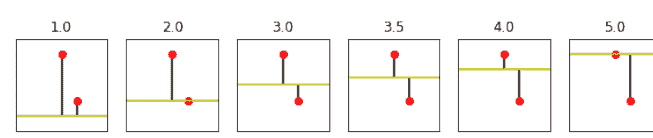


我们一开始离一个点非常远，离另一个点也不算太远。随着我们向上滑动横杆，我们在点之间达到了一个不错的中间地带。但我们继续滑动横杆；我们最终停在顶部点，离底部点相当远。也许理想的权衡在中间某个地方。让我们看看一些数字。

```
In [14]:

col_labels = "Prediction", "Errors", "Sum", "SSE", "Distance"
display(pd.DataFrame.from_records(results,
    columns=col_labels,
    index="Prediction"))
```

| 预测 | 误差 | 总和 | SSE | 距离 |

|---|---|---|---|---|

| `1.0000` | [4.0, 1.0] | 5.0000 | 17.0000 | 4.1231 |

| `2.0000` | [3.0, 0.0] | 3.0000 | 9.0000 | 3.0000 |

| `3.0000` | [2.0, -1.0] | 1.0000 | 5.0000 | 2.2361 |

| `3.5000` | [1.5, -1.5] | 0.0000 | 4.5000 | 2.1213 |

| `4.0000` | [1.0, -2.0] | -1.0000 | 5.0000 | 2.2361 |

| `5.0000` | [0.0, -3.0] | -3.0000 | 9.0000 | 3.0000 |

我们的表格包含了可以为正也可以为负的原始误差——我们可能会高估或低估。这些原始误差的总和并不能很好地评估这些线。方向相反的误差，例如 `[2, −1]`，总和为 `1`。就我们的整体预测能力而言，我们不希望这些误差相互抵消。解决这个问题最好的方法之一是使用总距离，就像我们在上面最近邻方法中所使用的距离一样。这意味着我们想要类似 $\sqrt{\sum(\text{prediction} - \text{actual})^2}$ 的东西。SSE 列是误差平方和，它让我们在很大程度上接近计算距离。剩下的就是取平方根。在目前的规则下，最好的线是基于其垂直分量的点的均值处的水平线：$(5 + 2) / 2 = 3.5$。均值在这里是最好的答案，原因与我们之前展示的平衡梁上的支点相同：它完美地平衡了两侧的误差。

### 4.3.2 倾斜场地

如果我们保持绘制直线的限制，但去掉使其水平的限制会怎样？我为陈述可能显而易见的事情道歉，但现在我们可以画出不平坦的线。我们可以根据需要画出向上或向下的线。因此，如果你画的点簇整体上有增长或下降，就像飞机起飞或降落一样，斜线比平坦的水平跑道做得更好。这些斜线的形式是代数中的经典方程：$y = mx + b$。我们可以调整 `m` 和 `b`，以便当我们知道一个点的左右位置——`x` 值时，可以尽可能接近其上下位置 `y`。

我们如何定义接近？与上面相同——用距离来定义。这里，我们有一个更有趣的带斜率的线。点到我们的

`sse = np.dot(errors, errors)`

`return (errors, errors.sum(), sse, np.sqrt(sse))`

现在，我们将利用 `process` 处理几条不同的预测线：

In [16]:

```
# our data is very simple: two (x, y) points
D = np.array([[3, 5],
              [4, 2]])

#                 m   b  --> predictions = mx + b
lines_mb = np.array([[ 1,  0],
                     [ 1,  1],
                     [ 1,  2],
                     [-1,  8],
                     [-3, 14]])

col_labels = ("Raw Errors", "Sum", "SSE", "TotDist")
results = []

# note: plotting occurs in process()
fig, axes = plt.subplots(1, 5, figsize=(12, 6))
records = [process(D, mod, ax) for mod,ax in zip(lines_mb, axes.flat)]
df = pd.DataFrame.from_records(records, columns=col_labels)
display(df)
```

|  | 原始误差 | 总和 | SSE | 总距离 |

|---|---|---|---|---|

| 0 | [2, -2] | 0 | 8 | 2.8284 |

| 1 | [1, -3] | -2 | 10 | 3.1623 |

| 2 | [0, -4] | -4 | 16 | 4.0000 |

| 3 | [0, -2] | -2 | 4 | 2.0000 |

| 4 | [0, 0] | 0 | 0 | 0.0000 |

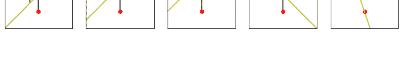

因此，我们在计算成功度量时有一个递进的过程：

- `predicted = m*x + b`

- `error = (m*x + b) - actual = predicted - actual`

- `SSE = sum(errors**2) = sum(((m*x+b) - actual)**2 for x,actual in data)`

- `total_distance = sqrt(SSE)`

最后一条线恰好与两个数据点相交。其预测100%正确；垂直距离为零。

### 4.3.3 执行线性回归

到目前为止，我们只考虑了单个预测特征 `x` 的情况。当我们向模型添加更多特征——更多列和更多维度——时会发生什么？我们现在不再只有一个斜率 `m`，而是必须为每个特征处理一个斜率。每个输入特征都会对结果产生一些贡献。正如我们学会了输出如何随一个特征变化一样，现在我们必须考虑不同特征的不同相对贡献。

由于我们必须跟踪许多不同的斜率——每个特征一个——我们将不再使用 `m`，而是使用术语“权重”来描述每个特征的贡献。现在，我们可以像第 2.5 节那样，将权重和特征进行线性组合，以得到一个样本的预测。关键结果是：如果 `weights_wo` 不包含 `b` 部分，则预测为 `rdot(weights_wo, features) + wgt_b`；如果我们使用加一技巧，则为 `rdot(weights, features_p1)`，其中 `weights` 包含 `b`（作为 `weights[0]`），`features_p1` 包含一列 `1`。我们的误差仍然是 `distance(prediction, actual)`，其中 `prediction=rdot(weights, features_p1)`。预测的数学形式（具有显著的点积）如下：

$y_{\text{pred}} = \sum_{\text{ftrs}} w_f x_f = w \bullet x$

In [17]:

```
lr = linear_model.LinearRegression()
fit = lr.fit(diabetes_train_ftrs, diabetes_train_tgt)
preds = fit.predict(diabetes_test_ftrs)

# evaluate our predictions against the unseen testing targets
metrics.mean_squared_error(diabetes_test_tgt, preds)
```

Out[17]:

```
2848.2953079329427
```

我们稍后会回到 `mean_squared_error`，但你现在已经具备理解它的能力了。它就是预测中误差的平均距离。

## 4.4 优化：选择最佳答案

选择最佳直线意味着为 `m` 和 `b`（或 `权重`）选择最佳值。反过来，这相当于将工厂旋钮设置为最佳值。我们如何以定义明确的方式选择这些 `最佳值`？

以下是我们可以采用的四种策略：

- 1. 随机猜测：随机尝试大量可能性，取最好的一个。

- 2. 随机步进：随机选择一条线——选取一个 `m` 和一个 `b`——进行几次随机调整，选择帮助最大的调整。

- 3. 智能步进：随机选择一条线，观察其表现，以某种智能方式调整它。重复进行。

- 4. 计算捷径：使用高深的数学证明：如果事实 A、事实 B 和事实 C 都为真，那么“那条统御一切的线”一定是最佳选择。代入一些数字，然后使用那条统御一切的线。

让我们用一个非常非常简单的仅含常数的模型来审视这些策略。你可能会问，为什么用常数？有两个原因。第一，它是一条简单的水平线。当我们计算出它的值后，它在任何地方都是相同的。第二，它是一个简单的比较基线。如果我们用一个简单的常数预测器就能表现良好，那就可以直接收工回家了。另一方面，如果一个更复杂的模型与简单的常数模型表现一样好，我们可能会质疑更复杂模型的价值。正如尤达可能会说的：“简单的模型，绝不可低估。”

### 4.4.1 随机猜测

让我们构造一些简单数据进行预测。

In [18]:

```
tgt = np.array([3, 5, 8, 10, 12, 15])
```

让我们将方法1——随机猜测——转化为代码。

In [19]:

```
# random guesses with some constraints
num_guesses = 10
results = []

for g in range(num_guesses):
    guess = np.random.uniform(low=tgt.min(), high=tgt.max())
    total_dist = np.sum((tgt - guess)**2)
    results.append((total_dist, guess))
best_guess = sorted(results)[0][1]
best_guess
```

Out[19]:

8.228074784134693

不要对这个具体答案过于较真。只需记住，由于我们要估计的是一个简单的值，只需尝试几次就能得到一个不错的答案。

### 4.4.2 随机步进

方法2从一个随机猜测开始，然后随机向上或向下迈出一步。如果这一步有所改进，我们就保留它；否则，我们就回到原来的位置。

In [20]:

```
# use a random choice to take a hypothetical
# step up or down: follow it, if it is an improvement
num_steps = 100
step_size = .05

best_guess = np.random.uniform(low=tgt.min(), high=tgt.max())
best_dist = np.sum((tgt - best_guess)**2)

for s in range(num_steps):
    new_guess = best_guess + (np.random.choice([+1, -1]) * step_size)
    new_dist = np.sum((tgt - new_guess)**2)
    if new_dist < best_dist:
        best_guess, best_dist = new_guess, new_dist
print(best_guess)
```

8.836959712695537

我们从一个猜测开始，然后通过随机步进尝试改进它。如果我们走足够多的步数，并且每一步都足够小，就应该能够找到通往可靠答案的道路。

### 4.4.3 智能步进

想象一下，你蒙着眼睛在布满岩石的田野或孩子的房间里行走。你可能在试探性地移动时，迈出试探性的测试步伐。每走一步，你用脚探测周围区域，寻找一个干净的地方。当你找到一个干净的地方时，你就迈出那一步。

In [21]:

```
# hypothetically take both steps (up and down)
# choose the better of the two
# if it is an improvement, follow that step
num_steps = 1000
step_size = .02

best_guess = np.random.uniform(low=tgt.min(), high=tgt.max())
best_dist  = np.sum((tgt - best_guess)**2)
print("start:", best_guess)
for s in range(num_steps):
    # np.newaxis is needed to align the minus
    guesses  = best_guess + (np.array([-1, 1]) * step_size)
    dists    = np.sum((tgt[:,np.newaxis] - guesses)**2, axis=0)

    better_idx = np.argmin(dists)

    if dists[better_idx] > best_dist:
        break

    best_guess = guesses[better_idx]
    best_dist  = dists[better_idx]
print("  end:", best_guess)
```

start: 9.575662598977047

    end: 8.835662598977063

现在，除非我们陷入糟糕的位置，否则我们应该比随机步进有更好的成功机会：在任意给定点上，我们检查所有可行选项并选择最好的一个。通过有效剔除没有帮助的随机步骤，我们应该能够朝着一个好的答案稳步前进。

### 4.4.4 计算捷径

如果你查阅统计学教科书，你会发现在我们采用的 SSE 评价标准下，有一个答案公式。为了得到最小的误差平方和，我们需要的正是均值。我们之前说“均值平衡了到各值的距离”，其实只是换了一种说法。因此，我们实际上不必搜索来寻找最佳值。精巧之处在于数学证明：均值才是这个问题的正确答案。

In [22]:

```
print("mean:", np.mean(tgt))
```

mean: 8.833333333333334

### 4.4.5 应用于线性回归

我们可以将这些相同的思想应用于拟合斜线，或为我们的数据点找到多个权重（每个特征一个）。模型变得稍微复杂一些——我们需要调整更多的值，要么同时进行，要么按顺序进行。尽管如此，事实证明，我们的 方法 4，计算捷径 的等价物是寻找最佳线的标准、经典方法。当我们拟合一条线时，该过程称为最小二乘拟合，并通过正规方程求解——你不必记住这一点——而不是仅仅使用均值。我们的 方法 3，智能步长 ，使用一些数学方法来限制步伐的方向，在处理非常大的数据时很常见，在这种情况下，我们无法运行标准方法所需的全部计算。这种方法称为梯度下降。梯度下降（GD）使用一些智能计算——而不是探测步长——来确定改进的方向。

另外两种方法通常不用于为线性回归寻找最佳线。然而，在加入一些额外细节后，方法 2，随机步长 ，与遗传算法的技术很接近。那方法 1，随机猜测 呢？好吧，它本身并不是很有用。但随机起点思想在与其他方法结合时是有用的。这次讨论只是对这些思想的快速介绍。我们将在全书中提到它们，并在第 15 章中进行尝试。

## 4.5 回归器的简单评估与比较

之前，我承诺我们会回到均方误差（MSE）的概念。现在我们已经讨论了平方误差之和以及与回归线的总距离，我们可以很好地将这些思想联系起来。

### 4.5.1 均方根误差

如何量化回归预测的性能？我们将使用一些数学方法，这些方法几乎与我们寻找好线的标准相同。基本上，我们将取平方误差的平均值。记住，我们不能只把误差本身加起来，因为这样 `+3` 和 `-3` 会相互抵消，我们会认为这些预测是完美的，而实际上我们总共偏差了 `6`。对这两个值进行平方和相加，我们得到总误差为 `18`。平均后我们得到均方误差为 `9`。我们再多做一步，取该值的平方根，使其回到与误差本身相同的尺度。这就给出了均方根误差，通常缩写为 RMSE。请注意，在这个例子中，我们的 RMSE 为 `3`：正好是我们单个预测中的误差量。

这让我想起一个老笑话，我找不到具体的出处：

> 两个统计学家外出打猎，其中一个看到了一只鸭子。第一个瞄准射击，但子弹飞过了六英寸太高。第二个统计学家也瞄准射击，但这次子弹飞过了六英寸太低。两个统计学家随后互相击掌并惊呼：“抓到他了！”

你尽情地叹气吧，但这就是我们在处理平均值时所做的根本权衡。请注意，本书的制作过程中没有鸭子受到伤害。

### 4.5.2 学习性能

有了数据、方法以及评估指标，我们可以在 k-NN-R 和 LR 之间做一个小比较。

In [23]:


# stand-alone code

```python
from sklearn import (datasets, neighbors,
                    model_selection as skms,
                    linear_model, metrics)

diabetes = datasets.load_diabetes()
tts = skms.train_test_split(diabetes.data,
                            diabetes.target,
                            test_size=.25)
(diabetes_train, diabetes_test,
 diabetes_train_tgt, diabetes_test_tgt) = tts

models = {'kNN': neighbors.KNeighborsRegressor(n_neighbors=3),
          'linreg': linear_model.LinearRegression()}

for name, model in models.items():
    fit = model.fit(diabetes_train, diabetes_train_tgt)
    preds = fit.predict(diabetes_test)

    score = np.sqrt(metrics.mean_squared_error(diabetes_test_tgt, preds))
    print("{:>6s} : {:0.2f}".format(name, score))
```

kNN : 54.85

linreg : 46.95

### 4.5.3 回归中的资源利用

根据第 3.7.3 节，我编写了一些独立的测试脚本，以了解这些回归方法的资源利用情况。如果你将这里的代码与之前的代码进行比较，你会发现只有两个不同之处：（1）不同的学习方法以及（2）不同的学习性能指标。下面是该脚本改编用于 k-NN-R 和 LR 的版本：

```python
In [24]:
!cat scripts/perf_02.py

import timeit, sys
import functools as ft
import memory_profiler
from mlwpy import *

def knn_go(train_ftrs, test_ftrs, train_tgt):
    knn = neighbors.KNeighborsRegressor(n_neighbors=3)
    fit = knn.fit(train_ftrs, train_tgt)
    preds = fit.predict(test_ftrs)

def lr_go(train_ftrs, test_ftrs, train_tgt):
    linreg = linear_model.LinearRegression()
    fit = linreg.fit(train_ftrs, train_tgt)
    preds = fit.predict(test_ftrs)

def split_data(dataset):
    split = skms.train_test_split(dataset.data,
                                  dataset.target,
                                  test_size=.25)
    return split[:-1] # don't need test tgt

def msr_time(go, args):
    call = ft.partial(go, *args)
    tu = min(timeit.Timer(call).repeat(repeat=3, number=100))
    print("{:<6}: {:.4f} sec".format(go.__name__, tu))

def msr_mem(go, args):
    base = memory_profiler.memory_usage()[0]
    mu = memory_profiler.memory_usage((go, args),
                                      max_usage=True)[0]
    print("{:<3}: {:.4f} MiB".format(go.__name__, mu-base))

if __name__ == "__main__":
    which_msr = sys.argv[1]
    which_go = sys.argv[2]

    msr = {'time': msr_time, 'mem': msr_mem}[which_msr]
    go = {'lr': lr_go, 'knn': knn_go}[which_go]

    sd = split_data(datasets.load_iris())
    msr(go, sd)
```

当我们执行它时，我们看到

```python
In [25]:

!python scripts/perf_02.py mem lr
!python scripts/perf_02.py time lr
```

lr_go: ~1.5586 MiB

lr_go : ~0.0546 sec

```python
In [26]:

!python scripts/perf_02.py mem knn
!python scripts/perf_02.py time knn
```

knn_go: ~0.3242 MiB

knn_go: ~0.0824 sec

下面是我们结果的简要表格，不同运行之间可能会略有差异：

| 方法 | RMSE | 时间 (s) | 内存 (MiB) |
|---|---|---|---|
| k-NN-R | 55 | 0.08 | 0.32 |
| LR | 45 | 0.05 | 1.55 |

线性回归占用如此多内存可能令人惊讶，尤其是考虑到 k-NN-R 需要保留所有数据。这种惊讶凸显了我们测量内存方式的问题：（1）我们将整个拟合和预测过程作为一个统一任务来测量，以及（2）我们测量的是该统一任务的峰值使用量。即使线性回归只有短暂的高使用时刻，那就是我们会看到的。在内部，这种通过方法 4，计算捷径 进行优化的线性回归形式在计算方式上并不特别聪明。其操作中一个关键部分——求解我上面提到的那些正规方程——非常耗内存。

## 4.6 EOC

### 4.6.1 局限性与未解决问题

本章我们所做的工作有几个需要注意的地方——其中许多与上一章相同：

- 我们仅在一个数据集上比较了这些学习器。
- 我们使用了一个非常简单的数据集。
- 我们对数据集未进行任何预处理。
- 我们使用了一个单一的训练-测试划分。
- 我们使用准确率来评估性能。
- 我们没有尝试不同的邻居数量。
- 我们只比较了两种简单的模型。

此外，线性回归对使用标准化数据非常敏感。虽然 `糖尿病` 来到我们这里时已预先标准化，但我们需要记住，在其他学习问题中，`我们` 可能是负责这一步的人。另一个问题是，我们通常可以通过限制线性回归模型可以使用权重——`{m, b}` 或 `w`——来获益。我们将在第 9.1 节讨论为什么会这样以及如何使用 `sklearn` 来实现。

### 4.6.2 总结

总结我们的讨论，本章我们看到了以下几点：

- `糖尿病`：一个简单的真实世界数据集
- 线性回归和用于回归的最近邻适配
- 不同的中心度量——均值和中位数
- 使用均方根误差（RMSE）衡量学习性能

### 4.6.3 注释

`糖尿病` 数据来自几位著名统计学家的论文，你可以在这里阅读： http://statweb.stanford.edu/~tibs/ftp/lars.pdf.

### 4.6.4 练习

你可能有兴趣自己尝试一些分类问题。你可以按照本章示例代码的模式，使用 `sklearn` 中的另一个回归数据集：`datasets.load_boston` 将帮助你入门！

# 评估与比较学习器

```python
In [1]:

# setup
from mlwpy import *
diabetes = datasets.load_diabetes()
%matplotlib inline
```

## 5.1 评估与为何少即是多

> 老子：知人者智，自知者明。

开发学习系统最大的风险是高估了它在使用时表现会如何。我在我们第一次介绍分类时就提到过这种风险。我们中那些为考试而学习、以为自己掌握得很好、结果却考砸的人，对这种风险会感同身受。非常、非常容易出现（1）以为自己懂得很多、考试会做得很好，以及（2）考试成绩却很差的情况。在考试中，我们可能会发现自己需要细节，而我们只记得一个大致的想法。我知道它发生在十九世纪中期，但那是1861年还是1862年呢！？更糟的是，我们可能会在某些材料上投入过多，而忽视其他材料：我们可能会完全漏掉对某些信息的学习。好吧，糟了：我们需要知道她的名字，却不需要他的出生年份。

在学习系统中，我们也有两个类似的问题。当你为考试学习时，你能记住的东西是有限的。简单来说，你的大脑会装满。你没有能力学习每一个细节。一种解决办法是记住大局而不是许多小细节。这是一个很棒的策略——直到你需要其中一个细节为止！我们很多人都经历过的另一个痛苦是，当你在为考试学习时，你的朋友、配偶、孩子，任何人都会冲你喊：“我现在需要你的注意！”或者可能是一款新游戏上市了：“哦，看，一件闪亮的小玩意！”简单来说，你会被噪音分散注意力。没人会评判，我们都是人。

这两个陷阱——容量有限和被噪音分散注意力——也是计算机学习系统共有的。现在，通常学习系统不会被最新的 YouTube 爆款或 Facebook 迷因分散注意力。在学习领域，我们用不同的名字称呼这些误差来源。对急性子的人来说，它们是偏差——指我们能塞进脑袋里的容量的限制，以及方差——指我们被噪音分散注意力的程度。就现在而言，把这点直觉收好，不要被噪音分散注意力。

回到过度自信的问题，我们能做些什么来保护自己免受……自己的伤害？我们最根本的防御是不搞应试教学。我们在第一次介绍分类时就引入了这个想法（第 3.3 节）。为了避免应试教学，我们使用一个非常实用的三步配方：

- 第一步：将我们的数据拆分为单独的训练集和测试集。
- 第二步：在训练数据上学习。
- 第三步：在测试数据上评估。

不使用全部数据来学习似乎违反直觉。有些人——当然不是我的读者——可能会争辩说：“用更多数据构建模型难道不会带来更好的结果吗？”我们谦逊的怀疑者提出了一个很好的观点。使用更多数据应该能让我们的学习器做出更好的估计。学习器应该有更好的参数——我们工厂机器上的旋钮设置更好。然而，使用全部数据进行学习会带来一个非常大的后果。我们怎么知道更多数据的模型比更少数据的模型更好呢？我们必须以某种方式评估这两个模型。如果我们通过在全部数据上学习和评估来应试教学，我们很可能会高估我们一旦把系统带到大、吓人、复杂的真实世界中的能力。场景类似于学习去年的班级特定试卷——哇，多选题，很容易！——然后被测试在今年的考试上，而今年的考试全是论文。家里有医生吗？一个学生刚晕倒了。

在本章中，我们将深入探讨适用于回归和分类的通用评估技术。其中一些技术将帮助我们避免应试教学。其他技术将为我们提供在非常宽泛的意义上比较和对比学习器的方法。

## 5.2 学习阶段的术语

我们需要花几分钟时间介绍一些词汇。我们需要区分机器学习过程中的几个不同阶段。我们之前已经提到过训练和测试。我想再介绍一个叫做验证的阶段。由于一些历史的曲折，我需要清楚地说明我对这三个术语——训练、验证和测试——的含义。不同学科的人可能会用这些术语带有细微的含义差异，这可能会让 unwary 的学生感到困惑。我希望你有一个清晰的行走路径。

### 5.2.1 回到机器

我想让你回到第 1.3 节中我们工厂学习机器的心理图像。那台机器是一个大黑盒子，有旋钮、输入和输出。我引入那台机器是为了给你一个具体的图像，说明学习算法在做什么，以及我们如何控制它们。我们可以继续这个故事。虽然机器本身似乎是工厂的一部分，但实际上，我们是一家企业对企业（对你这些 2000 年代初的商科学生来说就是 B2B）提供商。其他公司希望利用我们的机器。然而，他们想要一个完全免维护的解决方案。我们将构建机器，像图 5.1 中那样设置所有旋钮，然后把机器送给客户。他们不会做任何事情，除了向其输入输入并查看另一侧弹出什么。这个交付模式意味着，当我们把机器交给客户时，它必须完全调好并准备好摇滚。我们面临的挑战是确保机器在移交后仍能充分发挥作用。

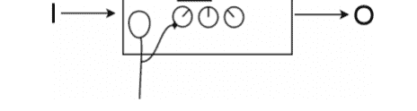

图 5.1 学习算法实际上是通过调节——或优化——输入与输出之间的关系。

在我们之前对机器的讨论中，我们谈到通过设置机器侧面的旋钮和开关来关联输入和输出。我们建立这种关系是因为我们有一些预期的已知输出。现在，我们在设置机器的拨盘时希望避免应试教学。我们希望机器对我们表现良好，但更重要的是，我们希望它对客户表现良好。我们的策略是保留一些输入-输出对并将其留到以后使用。我们不会使用保存的数据来设置旋钮。我们将在学习后使用保存的数据来评估旋钮设置得如何。太好了！现在我们完全准备就绪，并且有了一个很好的流程来为客户制造机器。

你知道接下来会发生什么。等着瞧。来了。休斯顿，我们有问题了。有许多不同类型的机器可以关联输入和输出。我们已经见过两个分类器和两个回归器。我们的客户可能对他们想要的机器类型有一些先入为主的想法，因为他们听说过 Fancy Silicon Valley Technologies, Inc. 使用了一种类型的机器。FSVT, Inc. 可能会完全让我们来挑选机器。有时我们——或我们的公司高层——会根据输入和输出的特征在不同机器之间进行选择。有时我们会根据资源使用情况进行选择。一旦我们选择了机器的宽泛类别（例如，我们决定需要一个小部件制造机），我们可能有几种物理机器可供选择（例如，Widget Works 5000 或 WidgyWidgets 豪华型号 W 都能很好地工作）。通常，我们会根据其学习性能来挑选使用的机器（图 5.2）。

让我暂时跳出这个隐喻。工厂机器的一个具体例子是 k-最近邻（k-NN）分类器。对于 k-NN，不同的 k 值就是完全不同的物理机器。k 不是我们在机器上调整的旋钮。k 是机器内部的。无论我们看到什么输入和输出，我们都无法在一台机器上直接调整 k（详见第 11.1 节）。这就像看着汽车的变速箱并想要不同的齿轮比。那种修改超出了我们大多数人的技能范围。但并非全无希望！我们不能修改汽车的变速箱，但我们可以买一辆不同的车。我们可以拥有两台不同的机器，比如 3-NN 和 10-NN。我们可以更进一步。机器也可以完全不同。我们可以买两辆轿车和一辆厢式旅行车。对于学习模型，它们不一定都是 k-NN 变体。我们可以得到一个 3-NN、一个 10-NN 和一个朴素贝叶斯。为了在它们之间进行选择，我们将输入-输出对通过模型运行来训练它们。然后，我们评估它们在保留数据上的表现，以获得一个更好的——在测试上训练得更少——关于我们的机器将如何为客户表现的想法（图 5.3）。

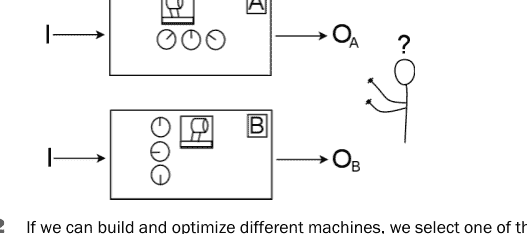

图 5.2 如果我们能够构建并优化不同的机器，我们会为客户选择其中一台。

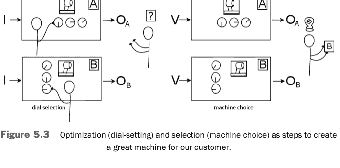

图 5.3 优化（旋钮调节）和选择（机器选择）是为客户打造优秀机器的两个步骤。

万岁！我们完成了。大家击掌，是时候喝咖啡、茶、汽水或啤酒了（取决于你的年龄和医生的建议）。

别急。我们仍然有一个问题。就像我们在设置机器旋钮时可以应试教学一样，我们在挑选机器时也可以应试教学。想象一下

用于这些阶段的数据集如下：

- 1. 留出测试集
- 2. 验证测试集
- 3. 训练集

我们可以将这些阶段和数据集与工厂机器场景联系起来。这次，我将从内部向外进行说明。

- 1. 训练集用于调整工厂机器上的旋钮。
- 2. 验证测试集用于对该精细优化的机器进行非应试教学的评估，并帮助我们在不同的优化机器之间进行选择。
- 3. 留出测试集用于确保构建一个或多个工厂机器、优化它们、评估它们并在它们之间进行选择的全过程得到公平的评估。

其中最后一个责任重大：存在许多窥探和被干扰误导的方式。如果我们反复进行训练和验证测试，我们就会对验证测试集中什么有效、什么无效形成强烈的认识。这可能是间接的，但我们实际上是在窥探验证测试集。留出测试集——我们在该问题的任何训练或验证测试中从未使用过的数据——对于保护我们免受这种间接窥探并为我们的最终系统在新数据上的表现提供公平评估是必要的。

#### 5.2.2.2 测试集的术语

如果你查阅一些机器学习书籍，你会发现术语 validation set 在 Selection 中被相当一致地使用。然而，当你与从业者交谈时，人们口头上会将 test set 这个短语用于 Selection 和 Assessment 两个数据集。为了掩盖这个问题，如果我在谈论评估并且是（1）从上下文中可以清楚地看出或（2）并不特别重要，我会使用通用短语 testing 来指代用于 Assessment 或 Selection 的数据。最可能出现这种情况的时候是我们没有进行模型的 Selection——我们只是使用基本的 train-test 分割，训练一个模型然后对其进行留出评估，Assessment。


如果术语很重要，例如当我们同时谈论两个阶段时，我会更精确一些并使用更具体的术语。如果我们需要区分这些数据集，我会使用术语 hold-out test set（HOT）和 validation set（ValS）。由于 Assessment 是一个一次性的过程——通常在我们运用所知的机器学习知识完成所有艰苦工作之后——我们会相对较少地谈论 HOT。这并不意味着 HOT 不重要——恰恰相反。一旦我们使用它，就永远不能再将其用作 HOT 了。我们已经窥探了。严格来说，我们已经污染了我们自己和我们的学习系统。我们可以删除学习系统并从头开始，但要抹去我们自己的记忆是非常困难的。如果我们反复这样做，我们就会回到应试教学。打破 HOT 保险箱的唯一解决方案是收集新数据。另一方面，我们没有义务一次性使用全部 HOT。我们可以使用其中一半，发现结果不满意就回到原点。当我们开发一个需要在部署前进行评估的新系统时，我们仍然有 HOT 的另一半用于 *Assessment*。

### 5.2.2.3 关于数据集大小的说明

一个非常实际的问题是弄清楚每个集合应该有多大。这是一个难以回答的问题。如果我们有 *大量* 的数据，那么这三个集合都可以非常大，没有问题。如果我们数据很少，我们必须关注（1）在训练中使用足够的数据来构建一个好的模型以及（2）为测试阶段留下足够的数据。

为了引用机器学习和统计学习领域质量最高的书籍之一，*Elements of Statistical Learning*，“很难给出一个关于如何在三个部分中选择观测数量的通用规则。”幸运的是，Hastie 及其同事立即对我们这些可怜的从业者表示同情，并给出了训练、验证测试和留出测试的通用建议 50%–25%–25%。这大约是我们能得到的最好的基线分割。使用交叉验证，我们可以考虑 75–25 分割，其中 75% 被投入交叉验证的篮子中——它将被反复分割为训练和验证测试集——而 25% 被保存在保险箱中用于最终评估。稍后会详细介绍。

如果我们回到 50–25–25 分割，让我们深入探讨一下那个 50%。我们很快会看到名为 *learning curves* 的评估工具。它们为我们提供了随着训练示例的增加，我们的验证测试性能会发生什么变化的指示。通常，在足够多的训练示例下，我们会看到性能趋于平稳。如果该平台在 50% 分割大小内出现，对我们来说情况看起来相当不错。然而，想象一下我们需要 90% 的可用数据才能获得不错性能的场景。那么，我们的 50–25–25 分割是 *simply not going to give a sufficiently good classifier* 因为我们需要更多训练数据。我们需要一个在数据使用上更高效的学习器。

### 5.2.2.4 参数与超参数

现在是处理另外两个术语的完美时机——我可能在夸张——：参数和超参数。工厂机器上的旋钮代表了学习方法在训练阶段设置的模型参数。在同一类机器（k-NN）中在不同机器（3-NN 或 10-NN）之间进行选择是选择超参数。选择超参数，如选择模型，是在选择阶段完成的。请明确区分这一点：*parameters are set as part of the learning method* 在训练阶段，而 *hyperparameters* 超出了学习方法的控制范围。

对于学习方法的一次运行，可用的参数（旋钮）及其使用方式（工厂机器的内部结构）是固定的。我们只能调整这些参数所取的值。从概念上讲，这种限制有点难以描述。如果上述阶段是从外到内谈论的——以外马力和内马力为例——capacity—to the exam and（2） focusing too much on irrelevant details。为了将这个故事与我们之前的讨论保持一致，第二点实际上只是被噪声分散注意力的情况——但它让我们感觉比沉迷 Netflix 更好。这两种误差来源有技术名称：underfitting 和 overfitting。为了研究它们，我们将制作一个简单的练习数据集。

### 5.3.1 合成数据与线性回归

通常，我更喜欢使用真实世界的数据集——即使它们很小——作为示例。但在这种情况下，我们将使用一些合成的、基因改造的数据。创建合成数据是工具箱中应该具备的好工具。当我们开发学习系统时，我们可能需要一些完全受我们控制的数据。创建自己的数据使我们能够控制输入和输出之间的真实底层关系，并操纵噪声如何影响该关系。我们可以指定噪声的类型和数量。

在这里，我们将制作一个只有一个特征和一个目标的简单数据集，并在其上进行训练-测试分割。我们的噪声是从 −2 到 2 之间的值中均匀选择的（你可能想回顾一下我们在 Section 2.4.4 中关于分布的讨论）。

In [2]:

```python
N = 20
ftr = np.linspace(-10, 10, num=N)          # ftr values
tgt = 2*ftr**2 - 3 + np.random.uniform(-2, 2, N) # tgt = func(ftr)
(train_ftr, test_ftr,
 train_tgt, test_tgt) = skms.train_test_split(ftr, tgt, test_size=N//2)
display(pd.DataFrame({"ftr":train_ftr,
                      "tgt":train_tgt}).T)
```

|   | 0 | 1 | 2 | 3 | 4 | 5 | 6 | 7 | 8 | 9 |
|---|---|---|---|---|---|---|---|---|---|---|
| ftr | -1.58 | -6.84 | -3.68 | 1.58 | -7.90 | 3.68 | 7.89 | 4.74 | 5.79 | -0.53 |
| tgt | 2.39 | 91.02 | 22.38 | 3.87 | 122.58 | 23.00 | 121.75 | 40.60 | 62.77 | -1.61 |

现在我们可以直观地查看这些数据。我们已知的点——训练集——用蓝色点表示。红色加号显示了测试集的输入特征值。我们需要弄清楚应该把每个值取多高。

In [3]:

```python
plt.plot(train_ftr, train_tgt, 'bo')
plt.plot(test_ftr, np.zeros_like(test_ftr), 'r+');
```

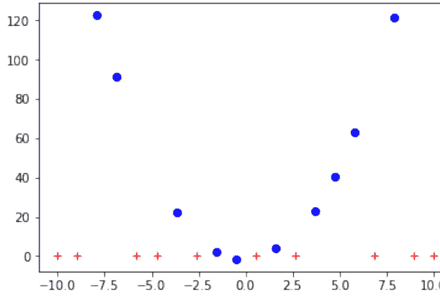

数字是一个回归任务的相当直接的示例。我们有一个数值目标值，想要从输入中预测它。现在，我们的工具箱中只有几种回归工具。所以，让我们拿出线性回归（LR）看看会发生什么：

In [4]:

```python
# note: sklearn *really* wants 2D inputs (a table)
# so we use reshape here.
sk_model = linear_model.LinearRegression()
sk_model.fit(train_ftr.reshape(-1, 1), train_tgt)
sk_preds = sk_model.predict(test_ftr.reshape(-1, 1))
sk_preds[:3]
```

Out[4]:

```text
array([53.218 , 41.4552, 56.8374])
```

我们并没有以任何方式评估这些预测。但至少——像我们的训练目标一样——它们都是正值。

### 5.3.2 手动操纵模型复杂度

到目前为止，我们完全依赖 `sklearn` 为我们完成所有繁重的工作。基本上，`sklearn` 的方法负责为我们在演示中使用的所有机器设置旋钮值。但也有许多其他包可以找到那些理想的旋钮值。其中一些包专门针对机器学习。其他则针对数学和工程的专业领域。

其中一种替代方案是 `NumPy` 中的 `polyfit()` 例程。它接受输入和输出值，我们的特征和目标，以及一个用于与数据对齐的多项式次数。它计算出正确的旋钮值——实际上是我们第 2.8 节中讨论的多项式的系数——然后 `np.poly1d` 将这些系数转换为可以接受输入并产生输出的函数。让我们探索它是如何工作的：

In [5]:

```python
# fit-predict-evaluate a 1D polynomial (a line)
model_one = np.poly1d(np.polyfit(train_ftr, train_tgt, 1))
preds_one = model_one(test_ftr)
print(preds_one[:3])
```

```text
[53.218 41.4552 56.8374]
```

有趣。前三个预测与我们的 LR 模型相同。这些输入的所有预测都相同吗？是的。让我们来证明这一点并计算模型的 RMSE：

In [6]:

```python
# the predictions come back the same
print("all close?", np.allclose(sk_preds, preds_one))

# and we can still use sklearn to evaluate it
mse = metrics.mean_squared_error
print("RMSE:", np.sqrt(mse(test_tgt, preds_one)))
```

```text
all close? True
RMSE: 86.69151817350722
```

太好了。所以，这里有两个要点。第一条信息：我们可以使用替代系统，而不仅仅是 `sklearn`，来学习模型。我们甚至可以用 `sklearn` 对这些替代系统进行评估。第二条信息：`np.polyfit()` 顾名思义，可以轻松地被操纵以产生我们感兴趣的任何次数的多项式。我们刚刚拟合了一条相对简单的直线，但我们可以超越它，转向更复杂的模式。让我们现在来探索一下。

操纵线性回归复杂度的一种方法是问，“如果我们摆脱直线束缚并允许弯曲会怎样？”我们可以通过观察添加一个弯曲时会发生什么来开始回答这个问题。对于不怕数学的人来说，一个带有弯曲的曲线——称为抛物线——由二次多项式描述。而不是拟合一条直线到点上并选择平方误差最低的直线，我们将把抛物线——带有单个弯曲的曲线——与训练数据对照，并找到拟合最好的那个。数学令人惊讶地，或至少令人安心地，相似。因此，我们的代码只需要做一个小的调整。

In [7]:

```python
# fit-predict-evaluate a 2nd degree polynomial (a parabola)
model_two = np.poly1d(np.polyfit(train_ftr, train_tgt, 2))
preds_two = model_two(test_ftr)
print("RMSE:", np.sqrt(mse(test_tgt, preds_two)))
```

```text
RMSE: 1.2765992188881117
```

嘿，我们的测试误差改善了很多。记住，误差就像冬天从窗户散失的热量：我们希望它尽可能少！如果一个弯曲帮助这么大，也许我们只需要生活中有更多一点的波动？让我们允许最多八个弯曲。如果一个好，八个一定很棒！我们可以通过 9 次多项式得到八个弯曲。如果你告诉你的晚宴客人，9 次多项式有时被称为 nonic，你会给他们留下深刻印象。以下是我们 9 次模型的 MSE：

In [8]:

```python
model_three = np.poly1d(np.polyfit(train_ftr, train_tgt, 9))
preds_three = model_three(test_ftr)
print("RMSE:", np.sqrt(mse(test_tgt, preds_three)))
```

```text
RMSE: 317.3634424235501
```

误差明显更高——更差——比我们用抛物线看到的。那可能出乎意料。让我们调查一下。

### 5.3.3 金发姑娘：可视化过拟合、欠拟合和“刚刚好”

这并不完全按计划进行。我们不仅仅变差了。我们变得极其、糟糕地、可怕地更差。出了什么问题？我们可以直观地分解训练和测试数据中发生的事情：

In [9]:

```python
fig, axes = plt.subplots(1, 2, figsize=(6, 3), sharey=True)

labels = ['line', 'parabola', 'nonic']
models = [model_one, model_two, model_three]
train = (train_ftr, train_tgt)
test  = (test_ftr, test_tgt)

for ax, (ftr, tgt) in zip(axes, [train, test]):
    ax.plot(ftr, tgt, 'k+')

for m, lbl in zip(models, labels):
    ftr = sorted(ftr)
    ax.plot(ftr, m(ftr), '-', label=lbl)

axes[1].set_ylim(-20, 200)
axes[0].set_title("Train")
axes[1].set_title("Test");
axes[0].legend(loc='upper center');
```

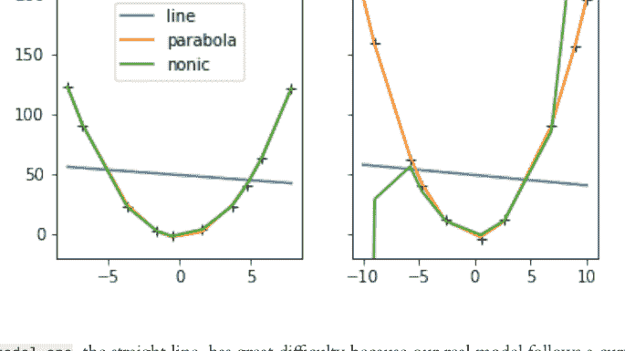

`model_one`，直线，遇到了很大困难，因为我们的真实模型遵循一条曲线轨迹。`model_two` 吃掉了它：它几乎完美地跟随曲线。`model_three` 在训练时似乎表现得非常好。它基本上与 `model_two` 和真实输出重叠。然而，在测试时它出现了问题。它在 `ftr=-7` 附近开始失控爆炸。为了便于比较，我们可以重新运行模型并将结果汇总到一个表中。由于添加一个中间模型很容易，我还将加入一个 6 次模型。

In [10]:

```python
results = []
for complexity in [1, 2, 6, 9]:
    model = np.poly1d(np.polyfit(train_ftr, train_tgt, complexity))
    train_error = np.sqrt(mse(train_tgt, model(train_ftr)))
    test_error = np.sqrt(mse(test_tgt, model(test_ftr)))
    results.append((complexity, train_error, test_error))

columns = ["Complexity", "Train Error", "Test Error"]
results_df = pd.DataFrame.from_records(results,
                                    columns=columns,
                                    index="Complexity")

results_df
```

Out[10]:

| 复杂度 | 训练误差 | 测试误差 |
|---|---|---|
| 1 | 45.4951 | 86.6915 |
| 2 | 1.0828 | 1.2766 |
| 6 | 0.2819 | 6.1417 |
| 9 | 0.0000 | 317.3634 |

让我们回顾一下复杂度为 1、2 和 9 的三个模型各自发生了什么。

- Model one（复杂度 1——一条直线）。Model one 被 *完全* 击败了。它把三轮车带到了 Formula One 赛车比赛。它从一开始就注定失败。该模型没有足够的原始马力或容量来捕捉目标的复杂性。它对平坦性过于偏向。该模型是 *欠拟合*。

- Model three（复杂度 9——一个波动的 9 次多项式）。Model three 肯定有足够的马力。我们看到它在训练数据上表现非常好。事实上，它在训练数据上达到了 *完美*。但在测试时它完全崩溃了。为什么？因为它记住了 *噪声*——数据中的随机性。它随数据变化太大。我们称之为 *过拟合*。

- Model two（复杂度 2——一个抛物线）。这里我们有金发姑娘的解决方案：它不热也不冷，刚刚好。我们有足够的马力，但又不会多到无法控制。我们在训练数据上表现足够好，并且我们看到 *测试* 误差最低。如果我们设置一个完整的验证步骤来在不同复杂度的两个机器之间选择，我们会对 model two 感到非常满意。Model two 并没有 *完全* 捕捉到训练模式，因为训练模式包含 *噪声*。

让我们绘制训练集和测试集上的结果图：

In [11]:

```python
results_df.plot();
```

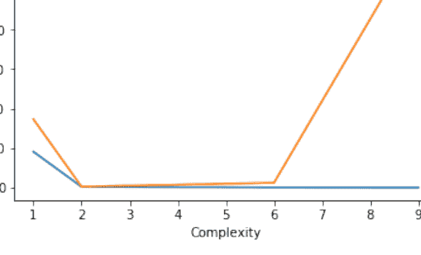

这张图的关键要点是：当我们不断提高模型的复杂度，我们会达到一个能将训练误差做得非常非常小——甚至可能为零——的点。但这是皮洛士式的胜利。在真正重要的地方——测试集上——我们反而变得更糟。然后，我们变得糟透了，糟到只能放弃、打道回府。为了突出该图中的重要部分，图5.4展示了一个带有有用标注的版本。

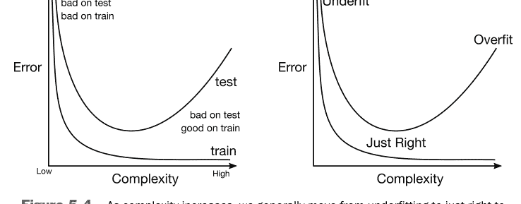

图5.4 随着复杂度的增加，我们通常会从欠拟合过渡到刚好合适，再到过拟合。

### 5.3.4 简单性

让我们再花一分钟谈谈复杂性及其好朋友——简单性。我们刚刚看到了一个具体例子，说明增加的复杂性会让我们的表现变得更差。这是因为增加的复杂性没有被用于正确的目的。它被用来追逐噪声，而不是真正的模式。我们无法真正选择学习器如何使用复杂性。它们本身具有一定的复杂性——这种复杂性既可以用于好的方面，也可以用于坏的方面。所以，如果有几个学习器表现相同但复杂度不同，那么“权力”的潜在滥用——我指的是复杂性——可能会让我们倾向于选择这些表现相同的模型中最简单的那个。


其背后的思想——简单性是一条重要的经验法则——在整个科学和哲学界被称为奥卡姆剃刀（历史学家们会说是奥卡姆剃刀），它出自奥卡姆的威廉之口：“如无必要，勿增实体。”（这是从拉丁语翻译过来的。）对我们而言，其寓意是：除非有理由，否则我们不想在模型中增加更多的复杂性。具体来说，我们不想要更高次的多项式，除非它能以更低的测试误差回报我们。套用爱因斯坦一句更长的原话：“凡事应尽可能简单，直到不能再简单。”（嘿，既然要攀附名人，我可不会只停留在一位生活在1300年前后的哲学家身上！）

有个想法可能会让你今晚失眠。有一种学习方法（我们将在第12.4节讨论），它即使在表面上已经掌握了训练集之后，仍能继续提升其在测试集上的表现。机器学习的学习者们会说，它已经把训练误差降到了零，但仍在继续改进。现实生活中有什么类似的情况呢？你可以想象在公开演出之前打磨掉自己的粗糙之处。即使你已经把一场戏排练到足以应付亲友，或者把一道菜准备到足以宴请亲友，但在面向公众之前，你还有更多可以做的。在首演之夜前，你需要以最佳状态面对最严苛的评论家。令人惊叹的是，有一种学习系统能够从“亲友彩排”直接过渡到“百老汇演出”级别。

### 5.3.5 过拟合要点小结

本节内容很多，以下是关键要点：

- 欠拟合：非常简单的模型可能无法学习训练数据中的模式，在测试数据上表现也很差。

- 过拟合：非常复杂的模型可能完美地学习训练数据，但由于它也学习了训练数据中无关的关系，在测试数据上表现很差。

- 刚好合适：中等复杂度的模型在训练数据和测试数据上表现良好。

我们需要在简单性和复杂性之间找到恰当的权衡，才能得到一个刚好合适的模型。

## 5.4 从误差到代价

在前面对过拟合和欠拟合的讨论中，我们比较了模型复杂度和误差率。我们看到，当我们改变一类模型（即多项式的次数）的复杂度时，训练和测试的表现会有所不同。误差和复杂度这两个方面紧密相连。当我们更深入地走进学习方法这个动物园时，我们会看到有些方法可以显式地以训练误差换取复杂度。就我们的工厂机器而言，我们可以同时考虑我们在复制输入-输出关系上的成功程度，以及我们在旋钮上设定的值。把“模型好坏”的这两个方面分开，让我们能够相当普遍地讨论回归和分类问题。当我们再深入一些，我们还能用少数几个选择来描述许多不同的算法。一个方法如何处理误差和复杂度，就是这些选择中的两个。

### 5.4.1 损失

那么，我们如何分解呢？首先，我们要构造一个损失函数，用来量化模型在单个样本上出错时的情况。我们将用它来构建一个训练损失函数，衡量模型在整个训练集上的表现。更技术性的文献称之为经验损失。经验（empirical）的意思就是“通过观察”或“如所见”，所以它是基于我们已见数据的损失。训练损失是每个样本上损失的总和。我们可以用代码写成：

```
In [12]:

def training_loss(loss, model, training_data):
    'total training loss on train data with model under loss'
    return sum(loss(model.predict(x.reshape(1, -1)), y)
               for x, y in training_data)

def squared_error(prediction, actual):
    'squared error on a single example'
    return (prediction - actual)**2

# could be used like:
# my_training_loss = training_loss(squared_error, model, training_data)
```

一种通用的数学写法是：

$$TrainingLoss_{Loss}(m, D_{train}) = \sum_{x, y \in D_{train}} Loss(m(x), y)$$

对于`3-NN`上平方误差（SE）这一具体情况，其中`3-NN(x)`表示`3-NN`在样本`x`上的预测：

$$TrainingLoss_{SE}(3-NN, D_{train}) = \sum_{x, y \in D_{train}} SE(3-NN(x), y) = \sum_{x, y \in D_{train}} (3-NN(x) - y)^2$$

我们可以这样使用它：

```
In [13]:
knn = neighbors.KNeighborsRegressor(n_neighbors=3)
fit = knn.fit(diabetes.data, diabetes.target)

training_data = zip(diabetes.data, diabetes.target)

my_training_loss = training_loss(squared_error,
    knn,
    training_data)
print(my_training_loss)
```

[863792.3333]

如果我们使用 `sklearn` 的 `mean_squared_error`，并将其乘以训练样本数量——以消除平均的部分——就会得到相同的结果。

```
In [14]:
mse = metrics.mean_squared_error(diabetes.target,
    knn.predict(diabetes.data))
print(mse*len(diabetes.data))
```

863792.3333333333

训练损失这个看起来有点吓人的方程，是我们所用的评估计算背后的基本原理。我们还将在该方程上直接加上一些内容，以处理确定合适模型复杂度的问题。

### 5.4.2 代价

正如我们在过拟合中看到的，如果我们把模型做得越来越复杂，就能捕获任何模式——哪怕是真正属于噪声的模式。因此，我们需要某种对抗复杂性、奖励简单性的东西。我们通过在训练损失上增加一个值来实现这一点，从而形成总的代价概念。从概念上讲，代价 = 损失 + 复杂度，但我们需要补充一些细节。我们为处理复杂度而添加的项有几个技术名称：正则化、平滑、惩罚或收缩。我们就叫它复杂度。简而言之，我们在某个数据上使用一个模型所支付的总代价取决于（1）它的表现如何，（2）它有多复杂。你可以把复杂度部分看作一项基础投资。如果初始投资很高，我们最好不要有太多误差。相反，如果初始投资较低，我们可能还有一些允许误差的空间。这一切都是因为我们希望在未见过的数据上有良好的表现。在新颖的、未见过的数据上的表现，术语叫作泛化。

最后再说一点。我们不必对误差和复杂度之间的权衡持有固定想法。我们可以把它留作一个开放问题，它会成为我们构建机器方式的一部分。用技术术语说，它只是另一个超参数。为了采用传统的命名方式——并帮助打破对数学的恐惧——我将使用小写希腊字母 λ，读作“lamb-da”，就像“it’s a lamb, duh”中的读法。Lambda 代表这种权衡。虽然严格地用损失和复杂度来描述某些学习器可能不太自然，但在非常广泛的范围内是可行的。我们将在第15章进一步讨论这个想法。我们可以通过进行几轮验证测试，并选择使代价最小的 λ，来为 λ 选取一个好的值。

In [15]:

```
def complexity(model):
    return model.complexity

def cost(model, training_data, loss, _lambda):
    return training_loss(m,D) + _lambda * complexity(m)
```

用数学表示就是：

Cost(m, D_train, Loss, λ) = TrainingLoss_Loss(m, D_train) + λ Complexity(m)

也就是说，我们的代价会上升，如果（1）我们犯了更多错误，（2）我们把资源投入到更昂贵但也更灵活的模型中。如果我们取 λ = 2，那么一个单位的复杂度相当于两个单位的损失。如果我们取 λ = 0.5，那么两个单位的复杂度相当于一个单位的损失。调整 λ 可以改变我们对误差和复杂度的关注程度。

### 5.4.3 评分

你还会看到术语“评分”（score）或“评分函数”（scoring function）。评分函数——至少在 `sklearn` 的术语中——是量化损失的一种变体，数值越大越好。就我们的目的而言，可以把损失和评分视为互逆关系：一个上升，另一个就下降。因此，我们通常希望得到高评分或低损失。这仅仅取决于我们使用哪种度量；它们是同一回事的两种不同表述。另一组对立关系是：我们要最小化损失或损失函数，但会最大化评分或评分函数。总结如下：

- 评分：越高越好，力求最大化。

- 损失、误差和代价：越低越好，力求最小化。

再说一次，如果我们有两个模型，就可以比较它们的代价。如果我们有许多不同的模型，我们可以结合使用暴力枚举、盲目或聪明的搜索以及数学技巧，从这些模型中选出代价最低的那些——我们在第4.4节讨论过这些备选方案。当然，我们也可能出错。也许还有一些我们没想到的模型，代价更低。我们的代价可能不是在现实世界中评估模型表现的理想方式。我们的复杂度度量，或者说我们对复杂度的权衡，可能太高或太低。当我们吞吞吐吐地说“我们选出了最好的模型和超参数”时，所有这些因素都在幕后发挥着作用。嗯，至少在我们所用的猜测、假设和约束范围内，我们确实如此。

# 第5章 评估与比较学习器

我们将在11.2节讨论如何实际选择好的，或者至少是更好的模型超参数。正如我们将看到的，像 `sklearn` 这样的现代机器学习软件使得尝试许多模型和超参数组合变得非常容易。

## 5.5 （重）采样：从少量中创造更多

如果我们满足于单一的训练-测试划分，那么这单一步骤就提供并决定了我们可用于训练的数据和测试环境。这当然是一个简单的方法。然而，我们可能会（不）走运，得到一个非常好的训练-测试划分。想象一下，我们得到了非常难的训练数据和非常容易的测试数据。砰——突然之间，我们就高估了我们在残酷的现实世界中的表现。如果我们真正关心的是现实世界中的表现，我们实际上希望遇到最坏的情况：容易的训练和困难的测试，这会让我们低估现实世界的表现。然而，单一评估场景就到此为止吧。有没有办法做得更好？如果我们让人们估计罐子里豆子的数量，他们各自都会有偏差。但如果我们得到很多很多的估计，就能获得一个更好的总体答案。为群体智慧欢呼吧。那么，我们如何为评估生成多个估计值呢？我们需要多个数据集。但手头只有一个数据集。我们如何把一个数据集变成许多个？

### 5.5.1 交叉验证

机器学习社区对生成多个数据集的基本答案是交叉验证。交叉验证就像一场纸牌游戏：我们将所有牌发给三位玩家，玩一轮，然后把牌交给右边的玩家，重复这个过程，直到我们用三套不同的牌各玩过一次。为了计算总得分，我们把每套牌局中的个人得分合并起来，通常是取平均值。

我们直接看例子。交叉验证使用一定数量的折（folds），就像上面玩家的数量。有三个玩家，即三折，我们就获得三次不同的游戏尝试。对于3折交叉验证，我们取一整套带标签的数据，把它打乱。让数据尽可能均匀地随机落入图5.5中三个以罗马数字标记的桶中：`B_I`、`B_II`和`B_III`。

现在，我们执行图5.6所示的以下步骤：

1. 把桶`B_I`放到一边。将`B_II`和`B_III`合并起来作为训练集。用合并后的训练集训练一个模型——我们称之为`ModelOne`。然后在桶`B_I`上评估`ModelOne`，并将结果记录为`EvalOne`。

2. 把桶`B_II`放到一边。将`B_I`和`B_III`合并起来作为训练集。用合并后的训练集训练`ModelTwo`。然后在桶`B_II`上评估`ModelTwo`，并将结果记录为`EvalTwo`。

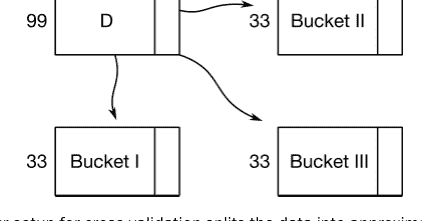

图5.5 我们的交叉验证设置将数据划分为近似相等的桶。

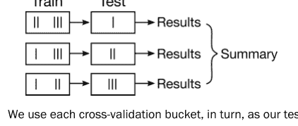

图5.6 我们依次将每个交叉验证桶作为测试数据，在剩余数据上进行训练。

3. 把桶`B_III`放到一边。将`B_I`和`B_II`合并起来作为训练集。用合并后的训练集训练`ModelThree`。然后在`B_III`上评估`ModelThree`，并将结果记录为`EvalThree`。

现在，我们记录了三个性能值。我们可以对这些值做几件事，包括绘图和统计汇总。绘图可以帮助我们理解在不同训练和测试数据集下，我们的性能变化有多大。它告诉我们模型、训练集和测试集之间是如何相互作用的。如果我们看到性能指标分布很广，我们就有理由对系统的任何单一性能分数持怀疑态度。另一方面，如果分数都很相似，我们就有一定把握认为，无论具体的训练-测试划分如何，系统性能都会相似。一个告诫：我们的随机抽样是不放回的，而且各训练-测试划分彼此依赖。这打破了一些我们在统计学领域的常规假设。如果你对此感到担忧，可以看看5.5.3节。

我们描述的是3折交叉验证。交叉验证技术的统称是k折交叉验证——我通常将其缩写为k-fold CV或直接写成k-CV。我们做多少折的交叉验证取决于一些因素，包括我们拥有的数据量。3折、5折和10折交叉验证是常用且被推荐的。但我们有点操之过急了。下面是一个用`sklearn`进行5折交叉验证的简单例子：

```
In [16]:
# data, model, fit & cv-score
model = neighbors.KNeighborsRegressor(10)
sklearn.cross_val_score(model,
                    diabetes.data,
                    diabetes.target,
                    cv=5,
                    scoring='neg_mean_squared_error')

# notes:
# defaults for cross_val_score are
# cv=3 fold, no shuffle, stratified if classifier
# model.score by default (regressors: r2, classifiers: accuracy)
```

```
Out[16]:
array([-3206.7542, -3426.4313, -3587.9422, -3039.4944, -3282.6016])
```

`cross_val_score` 的 `cv` 参数的默认值是 `None`。要理解这意味着什么，我们需要查看 `cross_val_score` 的文档。下面是相关部分，稍作整理和简化：

`cv`：整数、`None` 或其它。决定交叉验证的划分策略。`cv` 可能的输入有：

- `None`，使用默认的3折交叉验证；

- 整数，指定（Stratified）`KFold` 中的折数；

- 其它。

对于整数/`None` 输入，如果估计器是分类器且 `y` 是二分类或多分类，则使用 `StratifiedKFold`。在所有其他情况下，使用 `KFold`。

我们还没有讨论分层——下次广告时间之后我们会讲到——但有两个要点需要记住：（1）默认情况下我们使用3折交叉验证；（2）对于分类问题，`sklearn` 会使用分层。

那么，`scoring='neg_mean_squared_error'` 参数又是怎么回事呢？你可能还记得均方误差（MSE）这个东西。你猜得八九不离十。然而，我们必须协调“误差越大越差”和“分数越高越好”这两件事。为此，`sklearn` 将 MSE 取负，从而把误差度量转换为分数。所有分数都是负数，但分数越大越好。可以把它想象成亏得更少：从亏损100美元变成只亏损7.50美元。

最后再说一点关于回归和评分：回归器的默认评分是 `r2`（对于数学爱好者来说是 R²）。它在统计学中被称为决定系数。我们将在7.2.3节讨论它，但现在我只想说，R² 非常非常容易被误用和滥用。你可能对 R² 抱有先入为主的成见——请把它留在门外。这不是你熟悉的那个经典 R²。

我们还没有讨论应该使用多大的 k 值。k折交叉验证最不可告人的秘密是，我们需要权衡三件事。第一个问题：训练和测试模型需要多长时间？k 越大意味着桶越多，也就意味着训练和测试阶段越多。有一些*增量/减量*学习方法可以实现，以最大限度地减少训练和测试不同模型所需的工作量。不幸的是，大多数常见模型*并未*以允许这种效率的方式实现或接口到交叉验证例程中。更有意思的是，在小数据集上训练比在大数据集上训练*更快*。因此，我们实际上是在比较许多次小规模训练（和多次大规模测试）与较少次大规模训练（和较少次小规模测试）。运行时间取决于你使用的具体学习方法。

第二个需要权衡的问题是，k 的取值在两个极端之间滑动。最小的有用值是 k = 2，即两个数据桶和两次测试误差估计。k 能取的最大值是数据点的数量，即 k = n。这导致每个样本都单独占一个桶，总共训练 n 个模型并得到 n 个估计。此外，当只有两个桶时，我们永远不会在相同的数据上训练。当有三个桶时，存在一些重叠——用于训练在 `B_I` 上测试模型的一半训练集，与用于训练在 `B_II` 上测试模型的训练集有共同部分。具体来说，共同元素就是 `B_III` 中的那些。当有 n 个桶时，任意两个模型都用相同的 n − 2 个样本训练（见图5.7）。

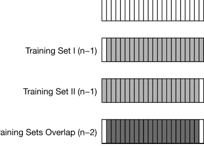

图5.7 n折交叉验证中的重叠情况。

要得到完整的 n 个样本，在两个交叉验证折中，还有一个训练样本是不同的，另有一个样本被留作测试。最终效果是，k = 2 时各训练折中的数据*差异很大*，而 k = n 时各训练折中的数据*几乎相同*。这意味着我们从 k = 2 得到的估计会相当不同——如果存在差异的话。而 k = n 得到的估计会非常相似，因为它们所做的*几乎*是相同的事情！

第三个问题是，k 的较小值——即相对较少的折数——会导致训练集大小只占数据的50%（k = 2）到90%（k = 10）。这是否可接受——在这么多数据上学习是否足够——取决于手头的问题。我们可以像5.7.1节那样，用学习曲线进行图形化评估。如果学习曲线在我们试图用来学习的数据百分比处趋于平缓——如果这么多数据足以让我们达到足够的性能阈值——那么我们使用相应的折数可能就没问题。

### 5.5.2 分层

让我们来看一个在分类场景中使用交叉验证的简单示例。在这里，我们指定 `cross_val_score` 使用 5 折交叉验证。

In [17]:


```
iris = datasets.load_iris()
model = neighbors.KNeighborsClassifier(10)
skms.cross_val_score(model, iris.data, iris.target, cv=5)
```

Out[17]:

```
array([0.9667, 1. , 1. , 0.9333, 1. ])
```

如上所述，这里的交叉验证是以分层方式进行的，因为这是 `sklearn` 中分类器的默认做法。这是什么意思呢？基本上，分层意味着当我们在为交叉验证进行训练-测试划分时，我们希望保持数据中目标类别原有的比例。嗯？我们来看一个例子。下面是一个以猫和狗为目标的小型数据集，我们将从中进行两折训练样本划分：

In [18]:

```
# not stratified
pet = np.array(['cat', 'dog', 'cat',
    'dog', 'dog', 'dog'])
list_folds = list(skms.KFold(2).split(pet))
training_idxs = np.array(list_folds)[:, 0, :]

print(pet[training_idxs])
```

```
[['dog' 'dog' 'dog']
 ['cat' 'dog' 'cat']]
```

喜欢猫的读者会注意到，第一折中没有猫。这不太好。如果这是我们的目标，我们就没有任何猫的样本可供学习。简单地说，这肯定不好。分层采样确保了猫和狗之间的公平：

In [19]:

```
# stratified
# note: typically this is behind the scenes
# making StratifiedKFold produce readable output
# requires some trickery. feel free to ignore.
pet = np.array(['cat', 'dog', 'cat', 'dog', 'dog', 'dog'])
idxs = np.array(list(skms.StratifiedKFold(2)
                .split(np.ones_like(pet), pet)))
training_idxs = idxs[:, 0, :]
print(pet[training_idxs])
```

```
[['cat' 'dog' 'dog']
 ['cat' 'dog' 'dog']]
```

现在，两个折中的猫和狗数量都达到了平衡，与它们在整体数据集中的比例一致。分层确保我们的每个训练集中猫和狗的百分比与整个可用数据总体中的百分比相同（或者在不均分时取整后几乎相同）。如果没有分层，我们最终可能会得到某个目标类别的样本太少（甚至没有）——在我们非分层的示例中，第一个训练集没有猫。我们不指望这样的训练数据能产生好的模型。

在以下情况下，分层尤其有用：

- 我们的总体数据有限，或者
- 我们数据集中某些类别的代表性不足。

代表性不足可能源于稀缺性——比如我们讨论的是罕见疾病或中奖彩票——也可能源于我们的数据收集过程。从某种意义上说，总数据量有限会让所有类别都变得稀有。我们将在第 6.2 节进一步讨论稀有类别的相关问题。

默认的分层如何应用于第 3 章的鸢尾花数据集？这意味着当我们进行交叉验证划分时，可以确保每个训练集都包含三种目标花朵中每一种的均衡代表性。如果我们不想要分层怎么办？这样做会稍微有点棘手，但仍然可以实现：

In [20]:

```
# running nonstratified CV
iris = datasets.load_iris()
model = neighbors.KNeighborsClassifier(10)
non_strat_kf = skms.KFold(5)
skms.cross_val_score(model,
                     iris.data,
                     iris.target,
                     cv=non_strat_kf)
```

Out[20]:

```
array([1. , 1. , 0.8667, 0.9667, 0.7667])
```

我们可以有根据地猜测，最后一折的花朵分布可能很糟糕。我们可能没有看到足够多的某一种类，无法学习到识别它的模式。

### 5.5.3 重复训练-测试划分

这是训练-测试划分的另一个示例，但稍微增加了一点花样。（如果你跟得上，这里是一个训练-测试的花样。）我们的花样是，我们打算通过反复抛硬币来生成多个训练-测试划分。为什么我们要*重复*最基本的训练-测试划分步骤呢？每当我们依赖随机性时，我们都会受到变化的影响：几个不同的训练-测试划分可能会给出不同的结果。其中一些结果可能非常好，另一些则可能非常糟糕。在某些场景下，比如买彩票，*绝大多数*结果都非常相似——你没有赢到钱。在其他场景下，我们无法提前知道结果是什么。幸运的是，我们手头有一个极其有用的工具，可以在面对未知随机性时把它拿出来用。那就是多次重复随机操作，看看会发生什么。大家退后，我们准备试试科学方法了！

对于训练-测试划分，我们通常无法提前知道预期表现如何。也许问题非常简单，几乎所有的训练-测试划分都会得到一个在测试集上表现良好的优质学习器。又也许这是一个非常困难的问题，而我们恰好选择了一个简单的训练数据子集——训练时表现很好，但测试时表现糟糕。我们可以通过生成许多训练-测试划分并观察不同结果来研究由训练-测试划分引起的变化。我们通过多次随机重新划分并评估结果来实现这一点。如果我们真的想深入技术层面，我们甚至可以计算结果的平均值、中位数或方差等统计量。不过，在进入用统计量*总结数据*之前，我一直更喜欢先*直接查看数据*。

这些多个值——每个训练-测试划分对应一个——让我们得到结果及其发生频率的分布。就像绘制教室中学生身高的图表能得到一个身高分布一样，重复的训练-测试划分能让我们得到一个评估指标的分布——无论是准确率、均方根误差，还是其他指标。这个分布*并非*覆盖所有可能的变化来源。它只是考虑了随机性造成的一个差异：我们如何选择训练数据和测试数据。我们可以看到，我们的结果*有多大的变化*，而这*正是由于*训练-测试划分的随机性。闲话少说，让我们看看一些结果。

In [21]:

```
# as a reminder, these are some of the imports
# that are hidden behind: from mlwpy import *
# from sklearn import (datasets, neighbors,
#                     model_selection as skms,
#                     linear_model, metrics)
# see Appendix A for details

linreg  = linear_model.LinearRegression()
diabetes = datasets.load_diabetes()

scores = []
for r in range(10):
    tts = skms.train_test_split(diabetes.data,
                                diabetes.target,
                                test_size=.25)
(diabetes_train_ftrs, diabetes_test_ftrs,
    diabetes_train_tgt,  diabetes_test_tgt) = tts

fit  = linreg.fit(diabetes_train_ftrs, diabetes_train_tgt)
preds = fit.predict(diabetes_test_ftrs)

score = metrics.mean_squared_error(diabetes_test_tgt, preds)
scores.append(score)

scores = pd.Series(np.sqrt(sorted(scores)))
df = pd.DataFrame({'RMSE':scores})
df.index.name = 'Repeat'
display(df.T)
```

| 重复次数 | 0 | 1 | 2 | 3 | 4 | 5 | 6 | 7 | 8 | 9 |
|---|---|---|---|---|---|---|---|---|---|---|
| RMSE | 49.00 | 50.19 | 51.97 | 52.07 | 53.20 | 55.70 | 56.25 | 57.49 | 58.64 | 58.69 |

你当然可以把查看数据这件事推向极致。原始列表只对相对较少的数值有用——人们并不擅长阅读过多的数字。让我们画一张图吧。`Seaborn` 库中的 `swarmplot` 在这里非常有用。它绘制单值图——也称为 `stripplot`（带状图）——并将重复的值水平堆叠起来，让你感受到哪里有成团的值。

In [22]:

```
ax = plt.figure(figsize=(4, 3)).gca()
sns.swarmplot(y='RMSE', data=df, ax=ax)
ax.set_xlabel('Over Repeated\nTrain-Test Splits');
```

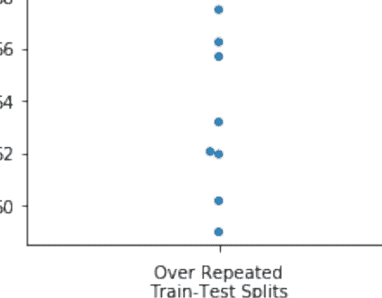

In [23]:

```
display(df.describe().T)
```

|  | 计数 | 均值 | 标准差 | 最小值 | 25% | 50% | 75% | 最大值 |
|---|---|---|---|---|---|---|---|---|
| RMSE | 10.000 | 54.322 | 3.506 | 49.003 | 51.998 | 54.451 | 57.182 | 58.694 |

在评估这样的图时，始终要让自己关注数据的尺度。乍一看，我们可能会觉得这组数据分散程度很大，但进一步观察后，我们看到它其实聚集在 50 到 60 之间的中上区域。这是否“很多”取决于 RMSE 值的大小——平均值接近 55，所以我们在 ±10% 的范围内。这足以引起我们的注意。

作为一个小小 Python 课程，这里有一种用列表推导式代替循环重写上面计算分数代码的方式。基本策略是：

- 将循环的内容提取出来并转换为一个函数
- 在列表推导式中反复使用这个函数。

这个重写会带来一点性能提升——但我这样做并不是为了资源优化。最大的收获是，我们为“进行训练-测试划分、拟合、预测和评估”这一过程赋予了一个名字。正如《创世记》中所言，命名是我们在计算机程序中所能做的最有力的事情之一。定义一个函数也为我们提供了一个单一实体，我们可以对其资源使用进行测试，并在其他代码中复用。

In [24]:

```
def tts_fit_score(model, data, msr, test_size=.25):
    ' apply a train-test split to fit model on data and eval with MSR '
    tts = skms.train_test_split(data.data,
                                data.target,
                                test_size=test_size)

    (train_ftrs, test_ftrs, train_tgt, test_tgt) = tts

    fit  = linreg.fit(train_ftrs, train_tgt)
    preds = fit.predict(test_ftrs)

    score = msr(test_tgt, preds)
    return score

linreg  = linear_model.LinearRegression()
diabetes = datasets.load_diabetes()
scores = [tts_fit_score(linreg, diabetes,
                        metrics.mean_squared_error) for i in range(10)]
print(np.mean(scores))
```

## 5.5（重采样：从少中获取更多）137

我最后再对重复的训练-测试划分和交叉验证做一个评论。使用 k 折交叉验证，我们会对每个示例都只得到一个、且仅一个预测结果。每个示例恰好位于一个测试子集中。整个数据集的预测结果将汇总自在不同数据集合上训练的 k 个模型。使用重复的训练-测试划分，我们可能会完全忽略对某些示例的训练或预测，而对其他示例进行重复预测，如图 5.8 所示。在重复的训练-测试划分中，一切都取决于我们的选择过程的随机性。


管理重复循环以进行多次训练-测试划分有点烦人。这并不伤筋动骨，但出错的地方很多。如果有人能把这个过程封装成一个独立的单一函数就好了。幸运的是，`sklearn` 已经做了这件事。如果我们将 `ShuffleSplit` 数据分割器传入 `cross_val_score` 的 `cv` 参数，我们就能得到与上面手工编码完全相同的算法。

```
In [25]:
linreg = linear_model.LinearRegression()
diabetes = datasets.load_diabetes()

# nondefault cv argument
ss = skms.ShuffleSplit(test_size=.25) # default, 10 splits
scores = skms.cross_val_score(linreg,
diabetes.data, diabetes.target,
cv=ss,
scoring='neg_mean_squared_error')

scores = pd.Series(np.sqrt(-scores))
df = pd.DataFrame({'RMSE': scores})
df.index.name = 'Repeat'
```

```
display(df.describe().T)

ax = sns.swarmplot(y='RMSE', data=df)
ax.set_xlabel('Over Repeated\nTrain-Test Splits');
```

|  | 计数 | 平均值 | 标准差 | 最小值 | 25% | 50% | 75% | 最大值 |
|---|---|---|---|---|---|---|---|---|
| RMSE | 10.000 | 55.439 | 3.587 | 50.190 | 52.966 | 55.397 | 58.391 | 60.543 |

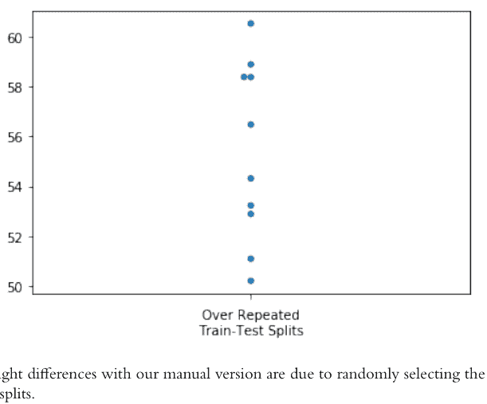

与我们手动版本之间的细微差异是由于随机选择训练-测试划分造成的。

现在，我想谈谈随机性影响我们这些勇敢的机器学习学习者的另一种方式。这是计算机在我们要求它做随机事情时所使用的那种随机性。这就是 `ShuffleSplit` 背后发生的事情。别担心，我马上就会解释 `random_state`。

```
In [26]:

ss = skms.ShuffleSplit(test_size=.25, random_state=42)

train, test = 0, 1
next(ss.split(diabetes.data))[train][:10]
```

Out[26]:

```
array([ 16, 408, 432, 316,  3,  18, 355,  60, 398, 124])
```

顺便说一下，我使用 `next` 是因为 `ShuffleSplit` 依赖 Python 生成器来一个接一个地生成划分。说 `next` 会给我下一个数据划分。获取下一个数据划分后，我挑选出训练数据 `[train]`，然后是前十个示例 `[:10]`。够用了。让我们再试一次。

```
In [27]:

ss = skms.ShuffleSplit(test_size=.25, random_state=42)
next(ss.split(diabetes.data))[train][:10]
```

```
Out[27]:

array([ 16, 408, 432, 316,   3,  18, 355,  60, 398, 124])
```

这可不太好。有人叫——有人！我们需要帮助。结果是一样的。这不是 supposed to be 随机的吗？答案是 是的……又不是。计算机上的随机性通常是伪随机的。这是一长串数字，组合在一起时足够随机，可以伪装成随机。我们从该列表中的某一点开始，然后开始取值。对外部观察者来说，它们看起来相当随机。但如果你知道机制，你实际上可以提前知道接下来会有什么值。因此，(1) 我们生成的值看起来大多是随机的，但 (2) 用于生成它们的流程实际上是确定性的。这种确定性有一个很好的副作用，我们可以利用它。如果我们为伪随机数序列指定一个起点，我们就可以获得一个可重复的、并非那么随机的值列表。当我们使用 `random_state` 时，我们为 `ShuffleSplit` 在请求随机性时设置一个起点。我们最终会得到相同的输出。可重复的训练-测试划分对于创建可重复的测试用例、与学生分享示例以及在追踪错误时消除一些自由度非常有用。

顺便说一下，这里还有另一个类似问题出现的地方。让我们做两次 `KFold` 的独立运行。

```
In [28]:

train, test = 0, 1
kf = skms.KFold(5)
next(kf.split(diabetes.data))[train][:10]
```

```
Out[28]:

array([89, 90, 91, 92, 93, 94, 95, 96, 97, 98])
```


```
In [29]:

kf = skms.KFold(5)
next(kf.split(diabetes.data))[train][:10]
```

```
Out[29]:

array([89, 90, 91, 92, 93, 94, 95, 96, 97, 98])
```

在我们希望有随机性的地方缺乏随机性，开始变得有点老套了。这里的问题是 `KFold` 的默认参数：

```
skms.KFold(n_splits=3, shuffle=False, random_state=None)
```

`shuffle=False`，默认值，表示我们在将示例分配到不同折之前不会打乱它们。如果我们希望它们被打乱，我们需要明确说明。为了让示例更易读，我们将切换回简单的宠物目标。

```
In [30]:

pet = np.array(['cat', 'dog', 'cat',
    'dog', 'dog', 'dog'])

kf = skms.KFold(3, shuffle=True)

train, test = 0, 1
split_1_group_1 = next(kf.split(pet))[train]
split_2_group_1 = next(kf.split(pet))[train]

print(split_1_group_1,
    split_2_group_1)
```

```
[0 1 4 5] [0 1 3 5]
```

如果我们设置 `random_state`，它会被分割器共享：

```
In [31]:

kf = skms.KFold(3, shuffle=True, random_state=42)

split_1_group_1 = next(kf.split(pet))[train]
split_2_group_1 = next(kf.split(pet))[train]
print(split_1_group_1,
    split_2_group_1)
```

```
[2 3 4 5] [2 3 4 5]
```

### 5.5.5 留一交叉验证

我上面提到过，我们可以采取一种极端的方法进行交叉验证，使用与示例数量一样多的交叉验证子集。因此，对于 20 个示例，我们可能进行 20 次训练-测试划分，进行 20 次训练拟合，进行 20 次测试轮次，并得到 20 次结果评估。这个版本的 CV 称为 *留一交叉验证*（LOOCV），它很有趣，因为我们生成的 *所有* 模型都将 *几乎全部* 共享它们的训练数据。对于 20 个示例，任意两次训练运行之间共享 90% 的数据。你可以参考图 5.7 来直观地看到它。

```
In [32]:
linreg = linear_model.LinearRegression()
diabetes = datasets.load_diabetes()

loo = skms.LeaveOneOut()
scores = skms.cross_val_score(linreg,
    diabetes.data, diabetes.target,
    cv=loo,
    scoring='neg_mean_squared_error')

scores = pd.Series(np.sqrt(-scores))
df = pd.DataFrame({'RMSE':scores})
df.index.name = 'Repeat'

display(df.describe().T)

ax = sns.swarmplot(y='RMSE', data=df)
ax.set_xlabel('Over LOO\nTrain-Test Splits');
```

|  | 计数 | 平均值 | 标准差 | 最小值 | 25% | 50% | 75% | 最大值 |
|---|---|---|---|---|---|---|---|---|
| **RMSE** | 442.000 | 44.356 | 32.197 | 0.208 | 18.482 | 39.547 | 63.973 | 158.236 |

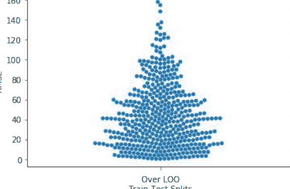

有趣的是，有三个明显的点具有较高的 RMSE，并且大约有二十个点形成了一个明显的峰值，高于误差主体之上（RMSE > 100）。这意味着大约有二十个点对使用几乎所有数据构建的模型进行预测具有抗性。值得调查这些困难示例中是否存在任何共同因素。

LOOCV 是一种确定性评估方法。选择中没有随机性，因为每次运行 LOOCV 时一切都以相同的方式使用。这种确定性对于比较和测试学习算法的正确性很有用。然而，运行 LOOCV 可能很昂贵，因为我们需要为每个被留出的示例训练一次模型。一些模型具有数学技巧，可以大幅降低重新训练的开销。在评估方面，将大量训练数据（每个 CV 分区中除一个示例外的所有示例）纳入的净效应是，LOOCV 给出了真实错误率的相对无偏估计。因为单示例预测彼此非常相关——大部分训练数据是共享的并输入到相同的学习算法中——因此对新示例的性能误差估计可能差异很大。总体而言，一般建议优先选择 5 折或 10 折 CV 而非 LOOCV。

## 5.6 拆解：把误差分解为偏差和方差

让我们想象一下，我们在一个赛道上，开始进行一些基本测量。我们看到汽车在赛道上飞驰，并测量汽车的位置和速度。假设我们记录了总距离 `d = 2` 的两圈用时。我们还将记录平均速度 `s`。如果我有一张这些值的表格，而我不记得任何高中物理，我就可以开始尝试将不同的列联系起来。例如，从两个用时和总用时，我可能会得出 `t₁ + t₂ = t_total` 的事实。再一次想象，我们忘记了在高中物理或甚至四年级数学中学到的所有东西。

| 驾驶员 | t₁ | t₂ | t_total | s | d |
|---|---|---|---|---|---|
| Mario | 35 | 75 | 110 | .018 | 2 |
| Luigi | 20 | 40 | 60 | .033 | 2 |
| Yoshi | 40 | 50 | 90 | .022 | 2 |

让我们考虑一下尝试关联列的一些变化。首先，测量是完美的，还是我们在记录时存在错误？其次，我允许使用什么关系——什么数学运算——来关联列？为了保持可控，我们将把自己限制在两个简单的运算——加法和乘法——上，看看会发生什么。最后，我们将考虑不同列集合之间作为输入和输出的关系。

在表 5.2 中，我列出了不同的可能性以及它们能多完美地描述数据以及出了什么问题的一些评估。

**表5.2 学习中的误差来源**

| 输入 | 输出 | 测量误差 | 真实关系 | 尝试关联方式 | 完美？ | 为什么？ |
|---|---|---|---|---|---|---|
| $t_1, t_2$ | $t_{total}$ | 无 | 加法 | 加法 | 是 |  |
| $t_1, t_2$ | $t_{total}$ | 有 | 加法 | 加法 | 否 | 测量误差 |
| $t_{total}, s$ | $d$ | 无 | 乘法 | 加法 | 否 | 无法得到正确形式 |

这三个案例中有两个不太理想。我们在“完美？不！”的情况下得到的那两个案例，相当于我们在开发学习系统时必须处理的两种误差来源。第三种误差来源是训练数据与学习器之间的相互作用。当我们在不同的训练集上训练并看到不同结果时，就已经看到了这种相互作用的端倪。综合来看，这三个误差示例为我们拆解预测中可能犯错的方式打下了良好的基础。测量误差——即表5.2中的第二行——削弱了我们清晰关联各数值的能力，但这些误差可能难以控制。如果测量是别人做的，那甚至可能不是我们的错；我们做的是建模。但第三行，即现实与我们选择的模型之间的不匹配，是我们自己造成的问题。

### 5.6.1 数据的方差

当我们犯错时——分类错误或均方误差（MSE）大于零——可能有几种不同的原因。其中一种原因，即输入特征与输出目标之间关系中实际存在的随机性，是我们无法真正控制的。例如，并非每一位主修经济学且有五年专业工作经验的大学毕业生都挣同样多的钱。他们的收入可能范围很广。如果我们加入更多信息，比如本科院校的选拔性，或许能缩小这个范围。然而，随机性仍然存在。类似地，在赛道上，取决于我们的计时设备和用户误差，我们记录时间的精度（可重复性）会有所差异。

输出有一个范围，这是你在高中看到的数学函数与随机过程之间的根本区别。一个输入不再只有一个且仅一个输出，而是可以有一个范围——也就是一个分布——的输出。我们绕了一圈又回到掷骰子或抛硬币：处理随机性。我们的数据受随机性影响的程度——无论是测量中的随机性，还是现实世界中的差异——被称为数据的方差。

### 5.6.2 模型的方差

在学习系统中，有些误差来源我们可以控制，但控制可能有限。当我们选择一个单一模型——比如线性回归——并经过一个训练步骤时，我们设置了该模型的参数值。我们正在设定工厂机器上旋钮的值。如果我们随机选择训练集和测试集（我们也应该这样做），就会对结果失去一些控制。我们模型的参数——即旋钮的值——受制于抛硬币式的训练数据选择。如果再抛一次硬币，我们会得到不同的训练数据；有了不同的训练数据，我们就会得到不同的已训练模型。模型因训练数据的随机选择而变化的方式被称为模型的方差。

训练好的模型在测试用例和实际应用中会给出不同的答案。这里有一个具体例子。假设我们有一个非常糟糕的数据点，使用1-最近邻时，大多数训练和测试样本不会受到它的影响。然而，对于任何与该坏样本成为最近邻的样本来说，事情就会出错。相反，如果我们使用大量近邻，该样本的影响会被其他许多训练样本稀释掉。我们最终面临一种权衡：能够解释棘手样例的同时，也让我们容易跟随坏样例。我们的赛道示例没有包含因模型训练而产生的方差示例。

### 5.6.3 模型的偏差

最后一个误差来源是我们控制最多的。当我在两个模型之间做选择时，其中一个可能与输入和输出之间的关系有着根本更好的契合度。我们在第5.3.2节已经看到了契合度不佳的一个例子：一条直线很难沿着抛物线的轨迹走。

让我们把这个想法与当前的讨论联系起来。首先，我们消除前面几段讨论过的噪声——固有的随机性。我们通过只考虑任何给定输入的最佳猜测输出来消除噪声。因此，虽然一个由教育水平、学位专业和毕业年限组成的输入示例{大学，经济学，5}实际上有一系列可能的收入预测，但我们会取一个最佳值来表示可能的输出。现在，我们问：“模型一与该单一值的对齐程度如何？”以及“模型二与该单一值的对齐程度如何？”然后，我们将这个过程扩展到所有输入——{研究生，心理学，8}——并问这些模型与每个可能输入的最佳猜测匹配得如何。

别担心，我们一会儿就会把这些想法变得更具体。

我们说，一个模型在忽略数据中固有的噪声后，仍无法匹配输入和输出之间的实际关系，那么它就有较高的偏差。高偏差模型难以捕捉复杂的模式。低偏差模型能够跟踪更复杂的模式。在赛道示例中，当我们想关联速度和时间来得出距离时，我们不能用加法，因为它们之间的真实关系是乘法。

### 5.6.4 综合看待

这三个组成部分为我们从根本上分解预测中误差的来源提供了基础。这三个组成部分是：(1) 数据固有的变异性；(2) 从训练数据构建预测模型时的变异性；(3) 我们模型的偏差。这些因素与整体误差之间的关系被称为*偏差-方差分解*，其数学形式如下：

`Error = Bias_{Learner} + Variance_{Learner(Training)} + Variance_{Data}`

我对这个等式中的许多细节避而不谈。但请放心！即使是研究生水平的、偏数学的教科书，也会对这个特定等式的细节避而不谈。当然，他们称之为“省去不必要的细节”，但我们不会因此责怪他们。我只想说，我们并不孤单。在我们看一些例子之前，让我们再重申一次。我们预测中的误差源于数据中的随机性、从训练数据构建模型时的变异性，以及我们模型能表达的关系与实际的*真实*关系之间的差异。

### 5.6.5 偏差-方差权衡的示例

让我们通过观察偏差-方差权衡如何应用于*k*近邻、线性回归和朴素贝叶斯，来研究几个具体示例。

#### 5.6.5.1 *k*-NN 的偏差-方差

让我们考虑随着近邻数量变化，*k*-NN 会发生什么。先从极端情况开始。我们能使用的最少近邻数是一。这相当于说：“如果我是一个新样本，那么找到与我最相似的样本，并用它的目标值来标记我。”作为一种策略，1-NN 可能具有非常锯齿状或波动的边界。每个训练样本都能独立发表意见，而无需咨询其他样本！从相反的角度看，一旦我们找到最近的样本，我们就会忽略其他所有样本的意见。如果有十个训练样本，一旦找到最近的近邻，其他九个样本就都不重要了。

现在，让我们走向相反的极端。假设我们有十个样本，并且采用 10-NN。我们的策略变成了：“我是一个新样本。找到我的十个最近邻，然后平均它们的目标值。那就是我的预测目标值。”然而，总共只有十个样本时，我们遇到的每个新样本恰好都会有这十个最近邻。因此，无论样本是什么，我们都在平均*每个人*的目标值。这相当于说：“让我的预测目标成为整体训练均值。”我们这里的预测没有任何边界：它们都完全一样。无论输入预测变量的值是什么，我们都预测相同的值。唯一更有偏差的预测是预测某个完全不从数据计算的常数——比如42。

图 5.9 总结了*k*-NN 的偏差-方差权衡。增加近邻数量会增大偏差并减小方差。减少近邻数量会增大方差并减小偏差。

**1-NN**

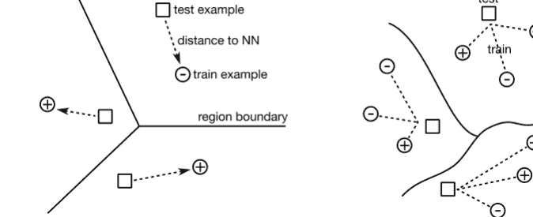

**3-NN**


图 5.9 k-NN 中的偏差。

#### 5.6.5.2 线性回归的偏差-方差

那么，线性回归的对应分析是什么呢？关于这个问题有两种不同的思考方式，我现在想把两者都简化一下。让我们以两种方式修改一个普通的线性回归模型：

- 限制所包含的特征
- 添加与原始特征具有简单关系的新伪特征

我们将从两个可能的线性回归模型开始。`ConstantLinear` 只是预测一条水平直线或平面。第二个模型 `PlainLinear` 是我们标准的直线或平面类模型，可以倾斜。就我们在 4.3.2 节讨论的权重而言，第一个模型将所有除 `w0` 之外的权重设为零，并且无论输入如何都给出相同的输出值。它说：“我害怕变化，别用数据来迷惑我。”第二个模型说：“这是个派对，邀请所有人！”你可以想象这两个极端之间的中间地带：挑选谁来参加派对。也就是说，将某些权重设为零。因此，我们有四种线性回归模型的变体：

- 常量线性：不包含任何特征，对所有 i ≠ 0，`w_i = 0`。
- 少数特征：包含少数特征，大多数 `w_i = 0`。
- 多数特征：包含许多特征，少数 `w_i = 0`。
- 普通线性：包含所有特征，没有 `w_i = 0`。

这些变体使我们的线性回归模型具有与 k-NN 类似的复杂度谱系。当我们通过将更多权重设为零来包含更少的特征时，我们就会失去区分被丢弃特征所代表的差异的能力。换句话说，在缺失的维度上，我们的世界变得更加平坦。想象一下把一个易拉罐压扁成煎饼。易拉罐的所有高度信息都完全丢失了。即使是罐身上的不规则之处——比如那个收集溢出汽水的小唇边——也消失了。如图 5.10 所示，用光照射物体为我们提供了一个类比，说明当我们丢失信息时，差异是如何被隐藏的。

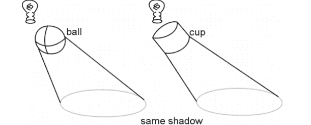

**图 5.10** 丢失特征（维度）限制了我们观察世界的视野，并增加了偏差。

通过将 $w_i$ 设为零来彻底剔除某些特征，是一种相当极端的做法。在 9.1 节中，我们将看到一种更渐进的权重缩小过程，但不一定是归零。

现在让我们转向*扩展*所包含的特征。正如本章前面所见，通过添加更多的*多项式*项——$x^2$、$x^3$ 等等——我们可以容纳数据中更多的弯曲或摆动（图 5.11）。我们可以利用这些弯曲来捕捉看似异常的样本。正如我们还看到的，这意味着我们可能会被噪声所迷惑。

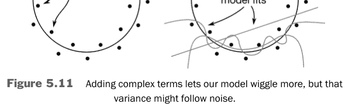

**图 5.11** 添加复杂项让模型产生更多摆动，但这种方差可能是在追随噪声。

在线性回归中，添加特征（如多项式项）会降低偏差，但会增加方差。相反，将特征权重强制设为零会增加偏差并降低方差。

#### 5.6.5.3 关联 *k*-NN 与线性回归

不同的线性回归模型与 *k*-NN 谱系之间存在一个很好的联系。常量线性模型——最简单且偏差最大的模型——在每一处都预测同一个值：*均值*。类似地，当 *k* 等于训练数据集中样本数量的 *k*-NN 系统会考虑所有数据并对其进行汇总。这种汇总可能就是*均值*。偏差最大的线性回归模型和最近邻模型*都预测均值*。

在谱系的另一端——偏差较小的一端——我们以两种截然不同的方式获得复杂性。`PlainLinear` 包含来自所有特征的信息，但根据参数权重对特征值进行权衡，以得到一个“居中”的预测值。1-NN 在距离计算中包含了所有特征的信息，但随后它只考虑最近的样本来获得预测值。

令人惊奇的是——至少对我来说——在最近邻中参考更多样本会导致更多偏差，而在线性回归中参考更多特征却会导致更少偏差。一种解释是，在最近邻中，当我们参考其他样本时，我们所做的只是将样本之间的差异平均掉——我们在抹平粗糙的边缘。因此，这既与我们组合信息的方法有关，也与我们在参考更多样本这一事实有关。

#### 5.6.5.4 朴素贝叶斯的偏差-方差

房间里有一头大象。我们已经讨论了第一部分中介绍的所有方法，除了朴素贝叶斯（NB）。那么，NB 的偏差-方差情况如何呢？描述 NB 的权衡略有不同，因为朴素贝叶斯更像是一个假设谱系上的单一点。NB 所处的谱系，其 x 轴为条件独立性假设的数量，表示复杂度。朴素贝叶斯几乎做了尽可能多的这种假设：在给定类别的前提下，所有东西都是条件独立的（图 5.12）。


如果类别与所有特征独立——这是终极独立性假设——我们最多只能根据类别的分布进行猜测。对于连续目标，这意味着我们猜测均值。我们又回到了一个仅含均值的模型，它是一类模型中最不复杂、偏差最大、假设最多的模型。这相当方便。其他试图增加 NB 复杂度的模型，会做出越来越少的独立性假设。这些模型会带来越来越复杂的关于依赖关系的论断。最终，我们得到最复杂的依赖类型：可怕的完全联合分布。除了其他问题之外，如果我们想充分捕捉完全依赖的联合分布中的差异，我们需要的数据量将随特征数量呈指数增长。每增加一个特征，我们大约需要——我这里数值比较随意——多一个数量级的样本。如果两个特征需要 100 个样本，那么三个特征就需要 1000 个。天哪。总而言之，这对我们可不太好。

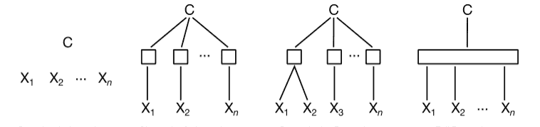

图 5.12 朴素贝叶斯是可能谱系上的一个偏差-方差点。

#### 5.6.5.5 汇总表

令人惊讶的是，三种学习方法各自出于不同的优先级和对数据的不同概念化方式，却都有一个共同的起点：在足够简单的场景下，它们都预测均值。使用所有样本的最近邻？如果我们的汇总计算是均值，它就会预测均值。只用 `w0` 的线性回归？没错，那个 `w0` 最终就是均值！一种更简单的朴素贝叶斯形式——更朴素的贝叶斯？——恰好是输出目标的均值（对于分类问题则是众数）。然而，每种方法以不同的方式扩展了这个起点。表 5.3 展示了这些模型在偏差-方差以及欠拟合和过拟合方面如何具有不同的权衡。

表 5.3 偏差与方差之间的权衡。

| 场景 | 示例 | 优点 | 缺点 | 风险 |

|---|---|---|---|---|

| 高偏差与低方差 | 更多邻居 | 抵抗噪声 | 遗漏模式 | 欠拟合 |

|  | 低阶多项式 | 被迫泛化 |  |  |

|  | 更小或为零的线性回归系数 |  |  |  |

|  | 更多独立性假设 |  |  |  |

| 低偏差与高方差 | 更少邻居 | 跟随复杂模式 | 跟随噪声 | 过拟合 |

|  | 高阶多项式 |  | 记忆训练数据 |  |

|  | 更大的线性回归系数 |  |  |  |

|  | 更少独立性假设 |  |  |  |

## 5.7 图形化评估与比较

我们的讨论已经有点偏向理论了。你可能已经察觉到这一点，因为我们有一阵子没看到代码了。我想立即转向可视化地评估性能来弥补这一点。除了有趣之外，可视化地评估学习器还能回答一些重要问题，而这些问题很难简化为单一数字。请记住，单一数字——均值、中位数，说的就是你们——可能极具误导性。

### 5.7.1 学习曲线：我们需要多少数据？

我们可以对学习系统提出的最简单问题之一是，随着我们提供更多训练示例，其学习性能如何提升。如果学习器即使在我们提供大量数据时也从未获得良好性能，我们可能是在错误的方向上浪费努力。我们也可能会看到，当我们使用更多或全部训练数据时，性能持续提升。这可能会让我们有信心投入实际精力获取更多数据来训练模型。以下是一些入门代码。`sklearn` 提供了 `learning_curve` 来完成我们需要的计算。

In [33]:

```
iris = datasets.load_iris()

# 10 data set sizes: 10% - 100%

# (that much data is piped to a 5-fold CV)

train_sizes = np.linspace(.1, 1.0, 10)

nn = neighbors.KNeighborsClassifier()

(train_N,

 train_scores,

 test_scores) = skms.learning_curve(nn, iris.data, iris.target,

                                   cv=5, train_sizes=train_sizes)

# collapse across the 5 CV scores; one result for each data set size

df = pd.DataFrame(test_scores, index=(train_sizes*100).astype(np.int))

df['Mean 5-CV'] = df.mean(axis='columns')

df.index.name = "% Data Used"

display(df)
```

| % 数据使用 | 0 | 1 | 2 | 3 | 4 | 5-CV 平均值 |

|---|---|---|---|---|---|---|

| 10 | 0.3333 | 0.3333 | 0.3333 | 0.3333 | 0.3333 | 0.3333 |

| 20 | 0.3333 | 0.3333 | 0.3333 | 0.3333 | 0.3333 | 0.3333 |

| 30 | 0.3333 | 0.3333 | 0.3333 | 0.3333 | 0.3333 | 0.3333 |

| 40 | 0.6667 | 0.6667 | 0.6667 | 0.6667 | 0.6667 | 0.6667 |

| 50 | 0.6667 | 0.6667 | 0.6667 | 0.6667 | 0.6667 | 0.6667 |

| 60 | 0.6667 | 0.6667 | 0.6667 | 0.6667 | 0.6667 | 0.6667 |

| 70 | 0.9000 | 0.8000 | 0.8333 | 0.8667 | 0.8000 | 0.8400 |

| 80 | 0.9667 | 0.9333 | 0.9000 | 0.9000 | 0.9667 | 0.9333 |

| 90 | 0.9667 | 1.0000 | 0.9000 | 0.9667 | 1.0000 | 0.9667 |

| 100 | 0.9667 | 1.0000 | 0.9333 | 0.9667 | 1.0000 | 0.9733 |

`learning_curve` 返回的数组有两个维度：训练样本大小的数量乘以交叉验证折数的数量。我将它们称为 `(percents, folds)`。在上面的代码中，这些值是 `(10, 5)`。不幸的是，将这些值——来自上表的——转换为图表可能会有点头疼。

幸运的是，Seaborn 有——或曾经有，它正在被弃用——一个我们可以使用的辅助工具。我们将把结果发送给 `tsplot`。`tsplot` 创建多个重叠的图表，每个条件一个，并根据我们拥有的重复测量给出中心和范围。还记得我们的大学毕业生可能有不同的收入范围吗？这里的想法是一样的。`tsplot` 专为绘制时间序列而设计。它期望数据具有三个组成部分：时间、条件和重复。进而，这三个组成部分成为 x 轴、分组器（一条线）和重复（线周围的宽度）。分组用于将某些数据点保持在一起；由于我们在一个图中绘制多个图，我们需要知道哪些数据属于同一个色调。重复是针对同一场景在一定随机变化下的多次评估。再次执行，你会得到略有不同的结果。`tsplot` 期望这些组成部分按以下顺序排列：`(repeats, times, conds)`。

如果我们取 `learning_curve` 的结果并在最外层维度上堆叠 `train_scores` 和 `test_scores`，我们得到的数据结构就像 `(train/test condition, percents, folds)`。我们只需要将这些维度翻转，因为 `(folds, percents, conditions)` 与 `tsplot` 的 `(repeats, times, conditions)` 对齐。我们用 `np.transpose` 来实现这一点。

In [34]:

```
# tsplot expects array data to have these dimensions:
# (repeats, times, conditions)
# for us, those translate to:
# (CV scores, percents, train/test)
joined = np.array([train_scores, test_scores]).transpose()

ax = sns.tsplot(joined,
                time=train_sizes,
                condition=['Train', 'Test'],
                interpolate=False)

ax.set_title("Learning Curve for 5-NN Classifier")
ax.set_xlabel("Number of Samples used for Training")
ax.set_ylabel("Accuracy");
```

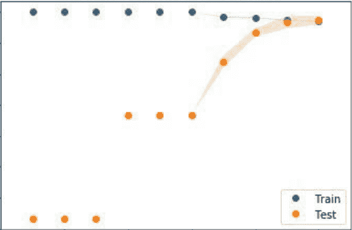

我们可以看到测试误差中有一些明显的阶梯。使用最多约 30% 的数据进行训练会得到非常差的测试性能——仅略高于 30% 的准确率。将训练数据提高到 40–50% 会使我们的测试性能提升到 70%，这是一个很大的进步。随着用于训练的数据从 70% 增加到 100%，测试性能开始在高 90% 的 respectable 百分比附近趋于平坦。训练方面呢？为什么它会下降？在示例足够少的情况下，似乎存在一个足够简单的模式，我们的 5-NN 可以捕捉到所有训练数据——直到约 60%。之后，我们开始在训练性能上失去一些优势。但请记住——我们真正关心的是测试性能。

另一个收获是：我们可以将这个百分比转换为我们认为足够训练所需的最小示例数。例如，我们需要几乎 100% 的合并 *训练折* 才能获得合理的 5–CV 测试结果。这相当于需要全数据集的 80% 用于训练。如果这不足够，我们可以考虑更少的 CV 分割，这将增加训练数据的量。

### 5.7.2 复杂度曲线

早些时候，当我们讨论欠拟合和过拟合时，我们绘制了一张图，显示当我们改变模型的复杂度时，训练和测试性能会发生什么。绘制它被深埋在一些嵌套循环和绘图函数中。我们可以像对样本曲线那样挪用 `tsplot`，使过程适应五条逻辑代码行。由于我们不是在玩代码高尔夫——不是为了赢得奖品而尽量减少代码行数——我不会字面地写成五行。

In [35]:

```
num_neigh = [1, 3, 5, 10, 15, 20]
KNC = neighbors.KNeighborsClassifier
tt = skms.validation_curve(KNC(),
    iris.data, iris.target,
    param_name='n_neighbors',
    param_range=num_neigh,
    cv=5)

# stack and transpose trick (as above)
ax = sns.tsplot(np.array(tt).transpose(),
    time=num_neigh,
    condition=['Train', 'Test'],
    interpolate=False)

ax.set_title('5-fold CV Performance for k-NN')
ax.set_xlabel("\n".join(['k for k-NN',
    'lower k, more complex',
    'higher k, less complex']))
ax.set_ylim(.9, 1.01)
ax.set_ylabel('Accuracy');
```

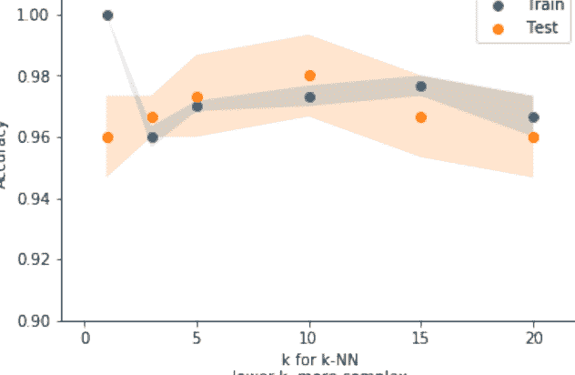

# 第 5 章 评估和比较学习器

现在，我留给你一个小谜题来思考。为什么 `1-NN` 能获得 100% 的训练准确率？这是一件好事吗？什么时候可能是一件好事？为什么我们似乎在曲线的中间，接近 `10-NN` 处获得了最好的验证测试性能？

我马上要给你答案。如果你想自己思考一下，请移开视线。对于 `1-NN`，训练点被精确地分类为其自身的目标值。它可能极端过拟合。现在，如果几乎没有噪声或没有噪声，这可能是可以接受的。`10-NN` 可能是我们交付给客户的最终系统的良好值——它似乎在欠拟合（偏差）和过拟合（方差）之间做出了良好的权衡。我们应该在保留测试集上评估它。

## 5.8 使用交叉验证比较学习器

CV 的好处之一是我们可以看到相对于在不同训练集上训练的可变性。我们只能在将每次评估作为独立值保留时做到这一点，因为我们需要将各个值相互比较。也就是说，我们需要将每个折分开并在图形上区分。我们可以用一个简单的图来做到这一点。

In [36]:

```
classifiers = {'gnb' : naive_bayes.GaussianNB(),
               '5-NN' : neighbors.KNeighborsClassifier(n_neighbors=5)}

iris = datasets.load_iris()

fig, ax = plt.subplots(figsize=(6, 4))

for name, model in classifiers.items():
    cv_scores = skms.cross_val_score(model,
                                     iris.data, iris.target,
                                     cv=10,
                                     scoring='accuracy',
                                     n_jobs=-1) # use all cores
    my_lbl = "{:<10} {: .3f}".format(name, cv_scores.mean())
    ax.plot(cv_scores, '-', label=my_lbl) # marker=next(markers)

ax.set_ylim(0.0, 1.1)
ax.set_xlabel('Fold')
ax.set_ylabel('Accuracy')
ax.legend(ncol=2);
```

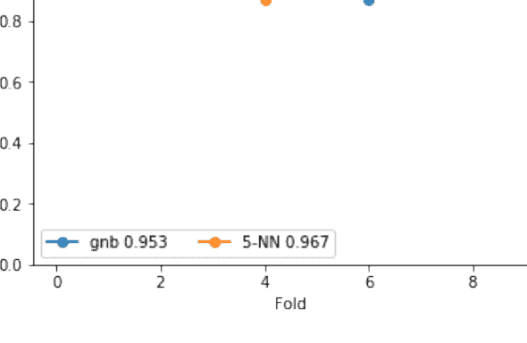

我们可以看到有许多相似的结果。`5-NN` 似乎在三个折上获胜，而 `GNB` 在一个折上获胜。其他的在视觉上打成平手。我们无法在条带图或计算出的均值上进行这种“谁赢了”的比较。条带图丢失了与折的联系，均值则压缩了各个折中的所有比较信息。

## 5.9 EOC

### 5.9.1 小结

我们在用于比较不同学习器的机制上已经变得更加精细：不再使用单一的训练-测试划分，而是进行多次划分。这很好。我们还深入探讨了学习中一个基本的理论问题：偏差-方差权衡。最后，我们研究了两种图形方法：学习曲线、复杂度曲线，以及在交叉验证的多个折上比较学习器。然而，我们仍只使用了少量方法工具箱，而且并没有真正以结构化的方式为这些方法选择超参数。敬请期待！

### 5.9.2 注释

### 评估中的外部问题

当我们建造一座桥时，我们希望确保它是安全的。我们想确保它能承受将要经历的重量和风力——塔科马海峡大桥！——然而，在我们开始施工之前，有人需要

有许多不同的重采样方法可用于评估目的。我们讨论了交叉验证和重复训练-测试划分（RTTS）。RTTS 也被称为*蒙特卡洛交叉验证*。当你在学习或统计短语中看到蒙特卡洛（一个著名的赌城）时，可以将其替换为“重复随机抽取”。在这里，蒙特卡洛指的是选择训练-测试划分的重复随机性——而不是标准交叉验证的一次性随机性。每个重采样评估器都在对目标量进行估计。令人惊讶的是，这意味着它们本身也有*偏差*和*方差*。哦，天哪，我们又滑入了元世界！如果你想了解更多，可以从 Kohavi 那篇数学密集的论文开始：“A study of cross-validation and bootstrap for accuracy estimation and model selection.”（交叉验证和自助法在精度估计和模型选择中的研究）

还有其他相关的重采样方法，称为*刀切法*和*自助法*。刀切法与留一法风格的评估非常相似。我们将在 12.3.1 节中以略有不同的背景讨论自助法——本质上是使用*有放回*的重复采样来构建模型。当我们希望考虑超参数时，我们需要另一层次的交叉验证：*嵌套交叉验证*。我们将在 11.3 节中讨论它。

引自*《统计学习基础》*（ESL）的引文来自第一版第 196 页。同样，如果你想了解在偏差-方差方程中被掩盖的细节，ESL 从同一页开始就有这些细节。真是有趣。提醒一下，这并不容易阅读。在*Cross Validated*——一个在线统计和机器学习社区——上有一个不错的回答，也有有用的讨论：https://stats.stackexchange.com/a/164391/1704。

如果你想知道我为什么花时间用*tsplot*来折腾，你可以查看*sklearn*文档中绘制学习曲线的示例：http://scikit-learn.org/stable/auto_examples/model_selection/plot_learning_curve.html。出于某种原因，手工绘制图形并没有让我感兴趣。

### 5.9.3 练习

我们介绍了一些评估技术。我们从未将它们直接相互比较。你能在一个学习问题上直接将留一法与二折、三折、五折和十折交叉验证进行比较吗？随着折数的增加，你看到任何规律了吗？

模型估计方差的一个简单示例是从较大数据集的随机样本中训练（计算）均值和中位数之间的差异。创建一个包含 20 个随机值的小数据集。随机选择其中 10 个值，并计算这 10 个值的均值和中位数。重复随机选择 10 个值五次，并计算均值和中位数。这 5 个均值之间有多大差异？这 5 个中位数之间有多大差异？这些值与原始 20 个值的均值和中位数相比如何？

此页有意留空

# 评估分类器


```python
In [1]:
# setup
from mlwpy import *
%matplotlib inline

iris = datasets.load_iris()

tts = skms.train_test_split(iris.data, iris.target,
    test_size=.33, random_state=21)

(iris_train_ftrs, iris_test_ftrs,
 iris_train_tgt, iris_test_tgt) = tts
```

在上一章中，我们讨论了与分类器和回归器都相关的评估问题。现在，我将把注意力转向适用于分类器的评估技术。我们将首先考察基线模型作为比较的标准。然后，我们将逐步了解不同的度量，这些度量有助于识别分类器犯下的不同类型的错误。我们还将研究一些用于评估和比较分类器的图形方法。最后，我们将把这些评估应用于一个新的数据集。

## 6.1 基线分类器

我一直强调——并且上一整章都在强化——在评估我们的学习系统时，我们绝不能自欺欺人。我们讨论了单一模型的公平评估以及比较两个或多个替代模型。这些步骤都很好。不幸的是，它们忽略了一个重要的点——而且这个点很容易被忽略。

一旦我们投入时间制作一个花哨的——全新的、改进的，各位！——学习系统，我们就会感到有义务使用它。这种义务可能来自我们的老板、为它买单的投资者，或者我们自己，因为我们投入了时间和创造力。然而，将学习器投入生产使用意味着这个闪亮、全新、改进的系统是必要的。但可能并非如此。有时，简单老式的技术比花哨的新产品更有效，也更划算。

我们如何知道需要篝火还是工业炉灶？我们通过与我们能想到的最简单的想法进行比较来确定这一点：基线方法。`sklearn`将这些方法称为哑方法（dummy methods）。

1. 基线方法——基于简单统计或随机猜测的预测，
2. 简单的现成学习方法——通常资源密集度较低的预测器，
3. 复杂的现成学习方法——通常资源密集度较高的预测器，以及
4. 定制化的精品学习方法。

本书中的大多数方法属于第二类。它们是简单的现成系统。我们将在第 15 章中简要介绍更复杂的系统。如果你需要精品解决方案，你应该聘请一位在机器学习和统计领域有更深造诣的人——比如鄙人。最基本的基线系统帮助我们决定是否需要复杂的系统，以及该系统是否比原始的方法更好。如果我们花哨的系统并不比基线好，我们可能需要重新审视一些基本假设。我们可能需要收集更多数据或改变我们表示数据的方式。我们将在第 10 章和第 13 章中讨论调整表示的问题。

在`sklearn`中，有四种基线分类方法。我们实际上会展示五种方法的代码，但其中两种是重复的。每种方法在给定测试示例时都会做出预测。两种基线方法是随机的；它们通过掷硬币来对该示例进行预测。两种方法返回常量值；它们总是预测相同的内容。随机方法是（1）`uniform`（均匀）：根据目标类别的数量在目标类别之间平均选择，以及（2）`stratified`（分层）：根据这些类别的频率在目标类别之间平均选择。两种常量方法是（1）`constant`（常量）：返回我们选定的一个目标类别，以及（2）`most_frequent`（最频繁）：返回最可能的一个类别。`most_frequent`也可以称为`prior`。

当数据集存在稀有事件（如罕见疾病）时，这两种随机方法的表现会有所不同。然后，对于两个类别——大量健康人和少量病人——`uniform`（均匀）方法在病人和健康人之间平均选择，各 50%。最终选择的病人数量比实际情况多得多。对于`stratified`（分层）方法，我们以类似于分层抽样的方式进行选择。它根据数据中健康人和病人的百分比来选择健康或病人作为目标。如果病人占 5%，那么它会约 5% 的时间选择病人，95% 的时间选择健康人。

下面是一个简单的`most_frequent`基线方法的使用示例：

```python
In [2]:

# normal usage: build-fit-predict-evaluate
baseline = dummy.DummyClassifier(strategy="most_frequent")
baseline.fit(iris_train_ftrs, iris_train_tgt)
base_preds = baseline.predict(iris_test_ftrs)
```

```python
base_acc = metrics.accuracy_score(base_preds, iris_test_tgt)
print(base_acc)
```

0.3

让我们比较一下这些简单基线策略彼此之间的性能表现：

```python
In [3]:

strategies = ['constant', 'uniform', 'stratified',
              'prior', 'most_frequent']

# set up args to create different DummyClassifier strategies
baseline_args = [{'strategy':s} for s in strategies]
baseline_args[0]['constant'] = 0 # class 0 is setosa

accuracies = []
for bla in baseline_args:
    baseline = dummy.DummyClassifier(**bla)
    baseline.fit(iris_train_ftrs, iris_train_tgt)
    base_preds = baseline.predict(iris_test_ftrs)
    accuracies.append(metrics.accuracy_score(base_preds, iris_test_tgt))

display(pd.DataFrame({'accuracy':accuracies}, index=strategies))
```

|  | `accuracy` |
|---|---|
| `constant` | 0.3600 |
| `uniform` | 0.3800 |
| `stratified` | 0.3400 |
| `prior` | 0.3000 |
| `most_frequent` | 0.3000 |

`uniform`和`stratified`在固定的训练-测试划分上多次重新运行时，会返回不同的结果，因为它们是随机化方法。其他策略在固定的训练-测试划分上总会返回相同的值。

## 6.2 超越准确率：分类的评估指标

到目前为止，我们总共只讨论了两个指标：分类的准确率和回归的均方根误差（RMSE）。`sklearn`有大量替代指标：

```python
# helpful stdlib tool for cleaning up printouts
import textwrap
print(textwrap.fill(str(sorted(metrics.SCORERS.keys())), width=70))
```

```text
['accuracy', 'adjusted_mutual_info_score', 'adjusted_rand_score', 'average_precision', 'balanced_accuracy', 'brier_score_loss', 'completeness_score', 'explained_variance', 'f1', 'f1_macro', 'f1_micro', 'f1_samples', 'f1_weighted', 'fowlkes_mallows_score', 'homogeneity_score', 'mutual_info_score', 'neg_log_loss', 'neg_mean_absolute_error', 'neg_mean_squared_error', 'neg_mean_squared_log_error', 'neg_median_absolute_error', 'normalized_mutual_info_score', 'precision', 'precision_macro', 'precision_micro', 'precision_samples', 'precision_weighted', 'r2', 'recall', 'recall_macro', 'recall_micro', 'recall_samples', 'recall_weighted', 'roc_auc', 'v_measure_score']
```

并非所有这些指标都是为分类器设计的，我们也不会全部讨论。不过，稍微换个问题：我们如何确定某个特定分类器——比如 k-NN——所使用的评分器？这并不太难，只是答案有点冗长。你可以用`help(knn.score)`查看完整输出，但我只截取其中要点：

```python
knn = neighbors.KNeighborsClassifier()

# help(knn.score) # verbose, but complete

print(knn.score.__doc__.splitlines()[0])
print('\n---and---\n')
print("\n".join(knn.score.__doc__.splitlines()[-6:]))
```

```text
返回给定测试数据和标签的平均准确率。

---和---

返回

-------

score : float

    相对于 y 的 self.predict(X) 的平均准确率。
```

关键点在于，k-NN 的默认评估指标是平均准确率。准确率有一些根本性的局限，接下来我们将讨论刚才看到的那份庞大指标列表中的精确率（precision）、召回率（recall）、ROC AUC 和 F1。为什么要讨论这些指标？准确率有什么问题？它难道不“准确”吗？很高兴你问这个问题。我们直接来回答你的问题吧。

下面这个简单例子可以说明准确率的问题。请记住，准确率基本上就是我们判断正确的次数。假设我们有一个数据集，其中包含100名患者和一种罕见疾病。我们很高兴这种疾病很罕见，因为它非常致命。在我们的数据集中，有98名健康人和2名病人。让我们采用一个简单的基线策略，预测*所有人都是健康的*。我们的准确率是98%。这真的很好，对吧？嗯，并不尽然。事实上，对于我们需要识别出来以便获得适当医疗护理的人，我们一个也没有找到。这是一个非常现实的问题。如果我们有一个更复杂的学习系统也以同样的方式失败，我们会对其表现非常不满。

### 6.2.1 消除混淆矩阵带来的困惑

当我们有一个数据集，并构建一个从特征预测目标的分类器时，我们就有了预测和现实。任何有小孩的人都知道，信念和现实并不总是一致的。孩子——说实话，大人也一样——喜欢以利己的方式解读周围的事物。目前我们用来评估猜测或预测与现实匹配程度的指标是*准确率*：它们在哪些地方相同？如果我在预测一场冰球比赛的结果，我说“我的球队会赢”，结果他们输了，那么我们就有一次错误——我得不到准确率分数。

我们可以把错误分成两类。举个例子。我看到炉子上有一个锅，锅柄是金属的。如果锅是热的，我去抓它，就会得到一个讨厌的惊喜。那是一个痛苦的错误。但是，如果锅是凉的，而我把它留在那里——没有按我另一半的要求清洗——我就会惹上麻烦。这又是一个错误。“可是亲爱的，我以为锅是热的”听起来很像一个借口。这两类错误以许多不同的面目出现：锅是凉的却猜是热的，锅是热的却猜是冷的。这两种错误都会给我们带来麻烦。

当我们讨论学习中的抽象问题时，热和冷变成了*阳性*和*阴性*结果。这些术语不一定代表*道德*判断。通常，我们所说的阳性结果要么是（1）风险更高的，（2）不太可能发生的，或（3）更有趣的结果。以医学为例，当检测结果呈阳性时，意味着有某种值得注意的情况发生了。这可能是一个好结果，也可能是一个坏结果。这种模棱两可正是许多医学笑话的来源。“哦不，检测结果是阴性。我快要进坟墓了。”*马克晕倒。*“不，马克，我们本来就希望检测结果是阴性，你没有病！”*呼。*

让我们回到热锅和冷锅的例子。我们可以选择把哪个结果视为阳性。虽然我不想惹另一半生气，但我*更*担心烫伤手。所以，我要说热锅是阳性。就像医学案例一样，我也不希望检测结果显示糟糕的病情。

### 6.2.2 出错的方式

那么，以下就是我可能正确和错误的方式：

|  | *我认为：锅是热的* | *我认为：锅是凉的* |
|---|---|---|
| **锅*是*热的** | 我认为是热的<br>它确实是热的<br>我判断对了 | 我认为是凉的<br>它其实不是凉的<br>我判断错了 |
| **锅*是*凉的** | 我认为是热的<br>它其实不是热的<br>我判断错了 | 我认为是凉的<br>它确实是凉的<br>我判断对了 |

现在，我们要用一些通用术语替换那些与锅有关的术语。我们要把对/错替换为 True/False。True 表示你做得好、判断正确、与现实世界的真实状态相符。False 表示 :sadface:，你犯了一个错误。我们还要引入 Positive 和 Negative 这两个术语。记住，我们之前说过热锅——也就是锅是热的——是 Positive。所以，我们要说我的阳性判断“我认为是热的”将填入“Positive”一词。如下所示：

|  | *我认为：锅是热的（Positive）* | *我认为：锅是凉的（Negative）* |
|---|---|---|
| **锅*是*热的** | True（预测为阳性） | False（预测为阴性） |
| **锅*是*凉的** | False（预测为阳性） | True（预测为阴性） |

下面来拆解：左上角 True Positive 的意思是，（1）当我认为锅是热的（Positive）时，（2）我判断正确（True）。类似地，True Negative 的意思是，当我认为锅是凉的（Negative）时，我判断正确——即 True 部分。右上角 False Negative 的意思是，当我认为锅是凉的（Negative）时，我判断错误（False）。

现在，让我们移除所有辅助轮，创建一个适用于任何二分类问题的通用表格，称为混淆矩阵（confusion matrix）：

|  | **预测为阳性（`PredP`）** | **预测为阴性（`PredN`）** |
|---|---|---|
| **实际为阳性（`RealP`）** | 真阳性（`TP`） | 假阴性（`FN`） |
| **实际为阴性（`RealN`）** | 假阳性（`FP`） | 真阴性（`TN`） |

与上一张表相比，`T`、`F`、`P`、`N`分别代表 True、False、Positive 和 Negative。这里有几个数学关系。现实世界的状态体现在行中。例如，当现实为 Positive 时，我们处理的是第一行的情况。用现实世界的术语来说，我们有：`RealP = TP + FN`，以及 `RealN = FP + TN`。列表示的是相对于我们预测的分解。例如，第一列表示当我们预测一个阳性样本时的表现。按我们的预测来表述，我们有：`PredP = TP + FP`，以及 `PredN = FN + TN`。

### 6.2.3 来自混淆矩阵的指标

我们可以从混淆矩阵中提出问题并作出回答。例如，如果我们是医生，我们关心的是我们能够多好地找到现实中确实生病的人。既然我们将生病定义为阳性病例，这些人就在第一行。我们在问我们在`RealP`上的表现如何：在实际的真实世界患病人群中，我们正确检测出了多少人：`TP/TP+FN = TP/RealP`。对此的术语是敏感性。你可以把它想成“这项测试在发现病人方面调校得多好”——重点在于病人。它在信息检索领域的人那里也被称为召回率。

不同的社区独立地提出了这个想法，因此给它起了不同的名字。作为对召回的一种思考方式，考虑从网络搜索中获取命中结果。在真正有价值或有趣的命中结果中，`RealP`，我们找到了或召回了多少？同样，对于敏感性和召回，我们关心的是在真实世界的阳性或有趣案例中的正确性。敏感性还有一个常见的同义词：真阳性率`TPR`。不要急着拿出铅笔记下来，我一会儿会给你一个术语表。`TPR`是相对于现实的真阳性率。

对我们正确得到的生病或有趣案例的关心有一个补充：我们搞错的病人。这种错误称为假阴性。用我们的缩写来说，我们搞错的病人是`FN/TP+FN`。我们可以将我们正确得到的病人和我们搞错的病人加起来得到所有病人的总数。数学上看起来像`TP/TP+FN + FN/TP+FN = TP+FN/TP+FN = 1 = 100%`。这些等式说明我可以将所有 100% 的病人分为 (1) 我认为生病的病人和 (2) 我认为健康的病人。

我们也可以问：“我们在健康人群上表现如何？”我们的关注点现在转向第二行`RealN`。如果我们是医生，我们想知道当人们健康时我们的测试价值如何。虽然风险不同，但误诊健康人群仍然存在风险。我们——暂时扮演医生——不想告诉人们他们生病了而他们其实健康。不仅会让他们感到恐慌和担忧，我们还可能用他们不需要的外科手术或药物来治疗他们！这种错误是假阳性`FP`的情况。我们可以通过查看我们在健康人群上的正确率来评估它：`TN/FP+TN = TN/RealN`。对此的诊断术语是测试的特异性：测试是否只在我们想要它响起的特定情况下发出信号。特异性也被称为真阴性率`TNR`。确实，它是相对于现实的真阴性率。

混淆矩阵单元的最后一个组合是以预测为主要部分、以现实为次要部分。我认为它是在回答“当测试结果为阳性时，我们的测试价值如何？”或者更简要地说，“一次命中的价值是什么？”好吧，命中是`PredP`。在`PredP`内部，我们会统计正确的数量：`TP`。然后我们有`TP/PredP = TP/TP+FP`，这被称为精确率。试着快速连说十遍“我们的阳性预测有多精确”。

图 6.1 显示了混淆矩阵以及用于评估它的指标。

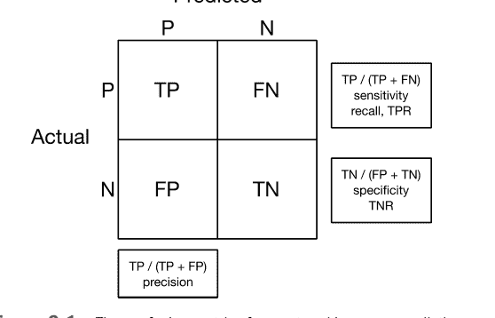

图 6.1 正确和错误预测的混淆矩阵。

关于混淆矩阵的最后一点评论。当阅读它时，你可能会注意到有些作者交换了轴：他们会把现实放在列上，把预测放在行上。然后，`TP`和`TN`会是相同的方框，但`FP`和`FN`会被翻转。 unsuspecting 的读者可能会变得非常、非常困惑。当你阅读其他关于混淆矩阵的讨论时，请把自己当作已被警告。

### 6.2.4 编码混淆矩阵


让我们看看这些评估在 `sklearn` 中是如何工作的。我们将回到我们可靠的 `iris` 数据集，并做一个简单的训练-测试分割以消除一些复杂性。作为替代方案，你可以将这些计算包装在交叉验证中，以获得较少依赖于特定训练-测试分割的估计。我们稍后会看到这一点。

如果你没有见过像我在下面第 1-3 行那样格式化的链式方法，它第一次看起来可能有点刺眼。然而，对于长链式方法调用，这是我偏好的方法。使用它需要我们在整个表达式周围加上括号，以便 Python 能接受内部的换行。当我像这样编写链式方法调用时，我更喜欢缩进到方法访问点 `.`，因为它能让我在视觉上将方法 1 连接到方法 2 等等。下面，我们可以快速读出我们从 `neighbors` 到 `KNeighborsClassifier` 再到 `fit` 再到 `predict` 的移动。我们可以用几个临时变量赋值来重写它并达到相同的结果。然而，不使用不必要变量的链式方法正在成为 Python 社区中一种常见的编码风格。撇开风格评论不谈，下面开始：

```
In [6]:

tgt_preds = (neighbors.KNeighborsClassifier()
    .fit(iris_train_ftrs, iris_train_tgt)
    .predict(iris_test_ftrs))

print("accuracy:", metrics.accuracy_score(iris_test_tgt,
    tgt_preds))

cm = metrics.confusion_matrix(iris_test_tgt,
    tgt_preds)
print("confusion matrix:", cm, sep="\n")
```

准确率: 0.94

混淆矩阵:

[[18 0 0]

 [ 0 16 1]

 [ 0 2 13]]

是的，混淆矩阵确实是一个表格。让我们把它做成一个漂亮的表格：

In [7]:

```
fig, ax = plt.subplots(1, 1, figsize=(4, 4))
cm = metrics.confusion_matrix(iris_test_tgt, tgt_preds)
ax = sns.heatmap(cm, annot=True, square=True,
                xticklabels=iris.target_names,
                yticklabels=iris.target_names)
ax.set_xlabel('Predicted')
ax.set_ylabel('Actual');
```

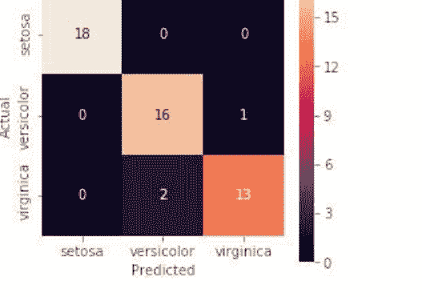

现在我们可以字面地看到发生了什么。在某些方面 `setosa` 很简单。我们 100% 正确识别它。我们在 `versicolor` 和 `virginica` 上有一些混合信号，但我们表现也不算太差。此外，`versicolor` 和 `virginica` 的错误局限于在这两个类别之间相互误分类。我们不会把任何东西错误分类回 `setosa`。我们可以把 `setosa` 认为是一个干净的独立类别。这两种 `v` 物种有一些重叠，更难区分。

### 6.2.5 处理多类：多类平均

有了这么多漂亮的东西，你可能会被原谅如果你忘了精确率和召回率。但如果你还记得它们，你现在可能已经目瞪口呆了。我们没有两个类别。这意味着我们的二分、两色公式崩溃了，彻底失效，并给我们留下了一个问题。我们如何将多值混淆矩阵中的丰富信息压缩成更简单的数值？

我们在分类中犯了三个错误。我们把一个 `versicolor` 预测为 `virginica`，我们把两个 `virginica` 预测为 `versicolor`。让我们暂时从预测的价值角度思考。在我们的二分类指标中，精确率的工作是从阳性预测列中提取信息。当我们预测 `versicolor` 时，我们正确 16 次，错误 2 次。如果我们把 `versicolor` 放在一边，其他人放在另一边，我们可以计算出非常类似于精确率的东西。这给出了 `16/18 ≈ .89` 的一对多——我对抗世界——`versicolor` 的精确率。同样，我们得到 `13/14 ≈ .93` 的一对多 `virginica` 的精确率。

这些分解看起来还不错，但我们如何将它们合并成一个单一值？我们谈过几种汇总数据的方法；让我们使用均值。既然我们预测 `setosa` 时是完美的，这贡献了 `1.0`。所以 `{16/18, 13/14, 1}` 的均值约为 `.9392`。`sklearn` 将这种汇总预测的方法称为 `macro`。我们可以通过为每一列计算一个值然后除以列数来计算宏精确率。要为一列计算值，我们取该列对角线上的条目——我们正确的地方——并除以该列所有值的总和。

```
In [8]:

macro_prec = metrics.precision_score(iris_test_tgt,
                                    tgt_preds,
                                    average='macro')
print("macro:", macro_prec)

cm = metrics.confusion_matrix(iris_test_tgt, tgt_preds)
n_labels = len(iris.target_names)
print("should equal 'macro avg':",
      # correct          column          # columns
      (np.diag(cm) / cm.sum(axis=0)).sum() / n_labels)
```

宏平均: 0.9391534391534391

应等于 '宏平均': 0.9391534391534391

由于这种方法被称为宏平均，你可能迫不及待想了解微平均。我实际上觉得 `micro` 这个名字有点反直觉。甚至 `sklearn` 文档也说 `micro` “全局计算指标”！这听起来不像 `micro`。无论如何，`micro` 是对结果更广泛的审视。`micro` 将所有正确预测加起来除以我们做出的所有预测。这些来自于 (1) 混淆矩阵对角线上的值的总和和 (2) 混淆矩阵中所有值的总和：

In [9]:

```
print("micro:", metrics.precision_score(iris_test_tgt,
                                      tgt_preds,
                                      average='micro'))

cm = metrics.confusion_matrix(iris_test_tgt, tgt_preds)
print("should equal avg='micro':",
      # TP.sum()      / (TP+FP).sum() -->
      # all correct   / all preds
      np.diag(cm).sum() / cm.sum())
```

micro: 0.94

should equal avg='micro': 0.94

`classification_report` 将这些部分组合在一起。它计算一对多统计量，然后计算这些值的加权平均值——类似于宏平均，但权重不同。权重来自支持度。在学习语境中，分类规则的支持度——如果 `x` 是猫且 `x` 有条纹且 `x` 很大，则 `x` 是老虎——是该规则适用的示例的计数。因此，如果 100 个示例中有 45 个满足 if 左侧的约束条件，则支持度为 45。在 `classification_report` 中，它是我们示例的“现实中的支持度”。因此，它等价于混淆矩阵每一行中的总计数。

In [10]:

```
print(metrics.classification_report(iris_test_tgt,
                                    tgt_preds))
# average is a weighted macro average (see text)

# verify sums-across-rows
cm = metrics.confusion_matrix(iris_test_tgt, tgt_preds)
print("row counts equal support:", cm.sum(axis=1))
```

|  | 精确率 | 召回率 | f1-score | 支持度 |

|---|---|---|---|---|

| 0 | 1.00 | 1.00 | 1.00 | 18 |

| 1 | 0.89 | 0.94 | 0.91 | 17 |

| 2 | 0.93 | 0.87 | 0.90 | 15 |

| 微平均 | 0.94 | 0.94 | 0.94 | 50 |

| 宏平均 | 0.94 | 0.94 | 0.94 | 50 |

| 加权平均 | 0.94 | 0.94 | 0.94 | 50 |

row counts equal support: [18 17 15]

我们看到了并确认了我们手工计算的几个值。

### 6.2.6 F₁

我没有讨论分类报告的 `f1-score` 列。F₁ 从混淆矩阵条目计算出一种不同类型的平均值。所说的平均值，我指的是集中趋势的度量。你知道均值（算术平均或算术平均值）和中位数（排序后最中间的值）。还有其他类型的平均值。古希腊人实际上关心三种平均值或均值：算术平均、几何平均和调和平均。如果你搜索这些，你会找到带有圆和三角形的几何图示。从我们的角度来看，这完全没有帮助来理解这些，部分困难是因为希腊人尚未将几何与代数联系起来。这一联系留给笛卡尔在几个世纪后才发现（或创造，取决于你对数学进步的看法）。

对我们更有帮助的观点是，特殊均值——几何平均和调和平均——只是转换后算术平均的包装。在几何平均的情况下，它是通过取值的对数的算术平均然后对该值进行指数化来计算的。现在你知道它为什么有特殊的名字了——那可真是一长串。既然我们这里关心的是调和平均，等价的计算是（1）取倒数的算术平均，然后（2）取该值的倒数。调和平均在我们需要汇总速度等速率或比较不同分数时非常有用。

F₁ 是一个带有一点调整的调和平均。它前面有一个常数——但别被它骗了。我们只是在做调和平均。它的展开形式为

F₁ = 2 × 1 / (1/precision + 1/recall)

如果我们应用一些代数，取共同分母并做倒数乘法，我们就得到 F₁ 的常用教科书公式：

F₁ = 2 precision × recall / (precision + recall)

该公式代表了精确率和召回率之间的相等权衡。用英语来说，这意味着我们希望在预测值的正确性以及与现实世界的对应性上同等正确。我们可以做出其他权衡：参见本章末尾注释中的 Fβ。

## 6.3 ROC 曲线

我们没有明确谈论过，但我们的分类方法不仅仅是对示例贴上标签。它们可以为每个预测给出一个概率——或某种分数，表示它们确信一只猫确实是一只猫。想象一下，在训练后，一个分类器为十个可能患病的个体给出分数。这些分数是 `.05`、`.15`、...、`.95`。根据训练，确定 `.7` 是疾病人群（分数较高）和健康人群（分数较低）之间的最佳断点。这在图 6.2 中有所说明。

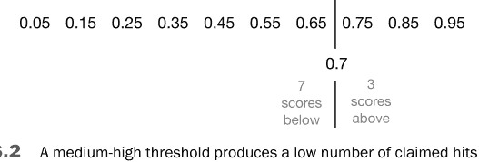

图 6.2 中等偏高的阈值产生较少的 claimed hits（疾病）。

如果我把条向左移动（图 6.3）会怎样？我是在声称更多人患病还是健康？

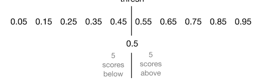

图 6.3 较低的阈值——更容易跨越的条——导致更多 claimed hits（疾病）。

向左移动条——降低数值断点——会增加我做出的 hits（患病声称）的数量。截至目前，我们还没有说这些人是否真的生病或健康。让我们通过添加一些真实情况来扩充该情景。表中条目是我们分类器个体的分数。

|  | 预测阳性 | 预测阴性 |

|---|---|---|

| 真实阳性 | .05 .15 .25 | .55 .65 |

| 真实阴性 | .35 .45 | .75 .85 .95 |

花点时间回顾一下混淆矩阵。想象一下，我们可以在预测阳性 `PredP` 和预测阴性 `PredN` 之间移动条向左或向右。我称之为 `PredictionBar`。`PredictionBar` 将 `PredP` 与 `PredN` 分开：`PredP` 在左侧，`PredN` 在右侧。如果我们将 `PredictionBar` 足够向右移动，我们可以将落在条右侧的示例推到条左侧。示例的流动会将预测阴性变为预测阳性。如果我们把 `PredictionBar` 完全推到最右边，我们就说我们预测所有东西都是 `PredP`。作为副作用，就不会有 `PredN` 了。这很棒！我们绝对没有假阴性。

以下是混淆矩阵条目的提醒：

|  | 预测阳性 | 预测阴性 |

|---|---|---|

| 真实阳性 | TP | FN |

| 真实阴性 | FP | TN |

希望你们中有些人会挑眉。你可能会回忆起老话，“天下没有免费的午餐”，或“你付出什么就得到什么”，或“你得不到无中生有的东西”。事实上，如果你挑了眉，你对怀疑是明智的。仔细看看混淆矩阵的底部一行。该行包含真实阴性的示例。通过将预测条完全向右移动，我们清空了真阴性桶，将其所有内容推到假阳性桶。每個真实阴性现在都是假阳性！通过预测所有为 `PredP`，我们在真实阳性上做得很好，在真实阴性上做得很糟糕。

你可以想象通过将 `PredictionBar` 完全向左移动而产生的对应情景。现在，没有 `PredP`。所有都是预测阴性。对于顶部行——真实阳性——这是灾难！至少在底部行看起来好一些：所有那些真实阴性都被正确预测为阴性——它们是真阴性。你可能会想：真实阳性与真实阴性之间水平条的等价设置是什么？这有点像 trick 问题——没有。 对于我们讨论的数据类型，一个特定示例不能从真实阳性变为真实阴性。真实的猫不能变成真实的狗。我们的预测可以改变；现实不能。所以，谈论移动那条线是没有意义的。

你现在可能已经感觉到一种模式。在学习系统中，通常必须做出权衡。在这里，权衡是在我们将容忍多少假阳性与我们将容忍多少假阴性之间。我们可以通过移动预测条、设置阈值来控制这种权衡。我们可以极度风险厌恶，给每个人贴上生病标签，以免漏掉一个病人。或者，我们可以当省钱者，给每个人贴上健康标签，以免治疗任何人。无论哪种方式，都有两个问题：

- 1. 我们如何评估和选择阈值？我们在假阳性和假阴性之间如何选择特定的权衡？

- 2. 我们如何比较两个不同的分类系统，两者都有整个可能的权衡范围？

幸运的是，有一个很好的图形工具可以让我们回答这些问题：ROC 曲线。ROC 曲线——或用它非常冗长的名字，接收者操作特征曲线——在分类中有一段悠久的历史。它最初用于量化第二次世界大战期间对飞向英格兰的轰炸机的雷达跟踪。这项任务也许比我们对鸢尾花的分类稍微重要一些。无论如何，他们需要确定雷达屏幕上的一个光点是真正的威胁（轰炸机）还是不是（飞机的鬼影回波或鸟）：区分真阳性和假阳性。

ROC 曲线通常以灵敏度（也称为真正例率，TPR）绘制。1 − 特异性称为假正例率（FPR）。记住，这两者都衡量相对于现实世界中实际情况的表现。也就是说，它们关心我们基于现实中存在的东西表现如何。我们希望 TPR 较高：1.0 是完美的。我们希望 FPR 较低：0.0 很棒。我们已经看到可以通过把预测门槛设得如此之低以至于我们说每个人都是阳性来操纵系统并保证较高的 TPR。但这对我们的 FPR 有什么影响？没错！它会上升到一：失败。相反的情况——作弊倾向于说没有人患病——让我们得到零的绝佳 FPR。没有虚假的疾病声明，但我们的 TPR 不好。它也是零，而我们希望该值接近 1.0。

### 6.3.1 ROC 中的模式

在图 6.4 中我们有一个 ROC 曲线的抽象图。图的左下角代表 FPR 为零且 TPR 为零。右上角代表 TPR 和 FPR 都等于一。这两种情况都不是理想的。左上角代表 FPR 为 0 且 TPR 为 1——完美。在 `sklearn` 中，低阈值意味着将 `PredictionBar` 移到混淆矩阵的最右侧：我们把所有东西都设为阳性。这发生在 ROC 图的右上角。高阈值意味着我们使许多事物变为阴性——我们的 `PredictionBar` 在混淆矩阵中被完全推到最左侧。要跨过高门槛成为阳性是困难的。这就是在 ROC 图左下角发生的情况。我们没有假阳性，因为我们根本没有阳性！随着阈值降低，说某物为阳性变得更容易。我们从左下角向右上角跨越图。

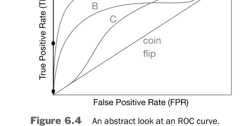

图 6.4 对 ROC 曲线的抽象视图。

ROC 图中有四点突出。

- 1. 从左下角到右上角的 `y = x` 线代表抛硬币：随机猜测目标类别。任何像样的分类器都应该比这做得更好。更好意味着向图的左上方向推进。

- 2. 完美的分类器与方框的左侧和顶部对齐。

- 3. 分类器 A 比 B 和 C *严格* 更好。A 在任何地方都比 B 和 C 更偏向左上。

- 4. B 和 C 相互交替。在较高阈值下 B 更好；在较低阈值下 C 更好。

第二点（关于完美分类器）有点令人困惑。随着我们移动阈值，一些预测难道不会从 *正确变为错误* 吗？曾经吗？事实上，记住阈值为零是好的，因为一切都是阳性。对于真正的阳性，我们全部正确，尽管我们把所有真正的阴性都弄错了。阈值为一也有一些好处，因为一切都被预测为阴性。对于真正的阴性，我们全部得到，尽管我们把所有真正的阳性都弄错了。这些错误是由于极端阈值造成的——而不是我们的分类器。任何分类器在这些专制阈值下都会受苦。它们只是 *每个* ROC 图上的“*固定点*”。


让我们沿着我们的 `完美` 分类器的 ROC 曲线走一遍。如果我们的阈值是一，即使我们给某物一个正确的分数，它也会被扔进阴性，无论分数如何。我们被困在 ROC 曲线的左下角。如果我们稍微降低阈值，一些示例可以变为阳性。然而，由于我们是完美的，其中没有一个是 `假` 阳性。我们的 TPR 会慢慢上升，而我们的 FPR 保持为 0：我们正在攀爬 ROC 方框的左侧。最终，我们将处于理想阈值，该阈值平衡了我们的零 FPR 并实现了 TPR 为 1 的目标。这个平衡点是我们完美分类器的 `正确` 阈值。如果我们超过此阈值，再次，阈值本身成为问题（是你，不是我的！）。现在，TPR 将保持在 1 不变，但 FPR 会增加——我们现在沿着 ROC 方框顶部移动——因为我们的阈值迫使我们不管其现实如何都声称更多事物为阳性。

### 6.3.2 二元 ROC

好的，在概念讨论结束后，我们如何让 ROC 工作？有一个不错的单一调用，`metrics.roc_curve`，在我们完成几个设置步骤后进行繁重的工作。但我们需要做几个设置步骤。首先，我们将把鸢尾花问题转换为 `二元` 分类任务以简化结果的解释。我们将通过将目标类别从标准的三个物种问题转换为二元的是否问题来实现这一点。三个物种问题问：“它是 `virginica`、`setosa` 还是 `versicolor`？” 答案是三个物种之一。二元问题问：“它是 `versicolor` 吗？” 答案是 yes 或 no。

其次，我们需要调用分类器的分类评分机制，以便我们能知道谁在预测条的哪一边。与其输出像 `versicolor` 这样的类别，我们需要知道某个分数或概率，例如一个 .7 的 `versicolor` 可能性。我们通过使用 `predict_proba` 而不是通常的 `predict` 来做到这一点。`predict_proba` 返回 `False` 和 `True` 的概率在两列中。我们需要从 `True` 列中获取概率。

```
In [11]:

# warning: this is 1 "one" not l "ell"
is_versicolor = iris.target == 1

tts_1c = skms.train_test_split(iris.data, is_versicolor,
    test_size=.33, random_state = 21)
(iris_1c_train_ftrs, iris_1c_test_ftrs,
    iris_1c_train_tgt,  iris_1c_test_tgt) = tts_1c

# build, fit, predict (probability scores) for NB model
gnb = naive_bayes.GaussianNB()
prob_true = (gnb.fit(iris_1c_train_ftrs, iris_1c_train_tgt)
    .predict_proba(iris_1c_test_ftrs)[:, 1]) # [:, 1]=="True"
```

设置完成后，我们可以进行 ROC 曲线的计算并显示它。不要被 auc 分心。我们稍后再回来讨论。

```
In [12]:

fpr, tpr, thresh = metrics.roc_curve(iris_1c_test_tgt,
    prob_true)

auc = metrics.auc(fpr, tpr)
print("FPR : {}".format(fpr),
    "TPR : {}".format(tpr), sep='\n')

# create the main graph
fig, ax = plt.subplots(figsize=(8, 4))
ax.plot(fpr, tpr, 'o--')
ax.set_title("1-Class Iris ROC Curve\nAUC:{:.3f}".format(auc))
ax.set_xlabel("FPR")
ax.set_ylabel("TPR");

# do a bit of work to label some points with their
# respective thresholds
investigate = np.array([1, 3, 5])
for idx in investigate:
    th, f, t = thresh[idx], fpr[idx], tpr[idx]
    ax.annotate('thresh = {:.3f}'.format(th),
        xy=(f+.01, t-.01), xytext=(f+.1, t),
        arrowprops = {'arrowstyle': '->'})
```

FPR : [0. 0. 0. 0.0606 0.0606 0.1212 0.1212 0.1818 1.  ]

TPR : [0. 0.0588 0.8824 0.8824 0.9412 0.9412 1. 1. 1.  ]


请注意，大多数 FPR 值介于 0.0 和 0.2 之间，而 TPR 值迅速跃入 0.9 到 1.0 的范围。让我们深入研究这些值的计算。记住，每个点代表基于其自身唯一阈值的一个不同的混淆矩阵。以下是第二、第四和第六阈值的混淆矩阵，这些阈值也在之前的图中标记。由于零基索引，这些发生在索引 1、3 和 5 处，我在前一个单元格中将它们分配给了变量 `investigate`。我们本可以挑选 `sklearn` 找到的八个阈值中的任何一个。口头上，我们可以称这些为患病的高度、中度和低度门槛——或者，在这种情况下，对于我们的阳性类别 `is_versicolor`（预测为真）。

| 门槛 | 医学说法 | 预测 |

| --- | --- | --- |

| 低 | 易于判定为病 | 易于预测为真 |

| 中 |  |  |

| 高 | 难以判定为病 | 难以预测为假 |

让我们看看这些值。

```
In [13]:

title_fmt = "Threshold {}\n{:5.3f}\nTPR : {:.3f}\nFPR : {:.3f}"

pn = ['Positive', 'Negative']
add_args = {'xticklabels': pn,
            'yticklabels': pn,
            'square':True}

fig, axes = plt.subplots(1, 3, sharey = True, figsize=(12, 4))
for ax, thresh_idx in zip(axes.flat, investigate):
```

```
preds_at_th = prob_true < thresh[thresh_idx]
cm = metrics.confusion_matrix(1-iris_1c_test_tgt, preds_at_th)
sns.heatmap(cm, annot=True, cbar=False, ax=ax,
            **add_args)

ax.set_xlabel('Predicted')
ax.set_title(title_fmt.format(thresh_idx,
                              thresh[thresh_idx],
                              tpr[thresh_idx],
                              fpr[thresh_idx]))

axes[0].set_ylabel('Actual');
# note: e.g. for threshold 3
# FPR = 1-spec = 1 - 31/(31+2) = 1 - 31/33 = 0.0606...
```


让这些值对齐需要一些技巧。当 `prob_true` 低于阈值时，我们预测为非-versicolor。因此，我们必须使用 `1-iris_1c_test_tgt` 来否定目标类别以获得正确的对齐。我们还手动标记坐标轴，以免将 0 作为正类。对我来说那样看起来太奇怪了。请注意，当我们降低阈值——将 PredictionBar 向右移动时，混淆矩阵右侧的预测会流向左侧。随着阈值的降低，我们会把更多事物预测为正类。你可以把例子想象成溢过预测条。这种溢出发生的顺序由 `probas` 给出的例子顺序决定。

### 6.3.3 AUC：ROC曲线下面积

再次，我没有放过任何一块石头。你会注意到我们计算了 `metrics.auc` 并在上面的图表标题中打印出了其值。现在我又在隐藏什么呢？我们人类有难以满足的简化欲望——这部分也是均值和中心度量被如此（滥）用的原因。这里，我们希望通过提问来简化：“如何将 ROC 曲线总结为一个单一值？”我们通过计算刚刚绘制的曲线下面积（AUC）来回答。

请回忆，完美的 ROC 曲线在很大程度上只是一个位于左上角的点。如果我们包含极端阈值，我们还会得到左下角和右上角的点。这些点描绘了方框的左侧和上侧边界。连接这些点的线条下面的面积为 1.0——因为它们包围了一个边长等于 1 的正方形。随着我们覆盖的整个 TPR/FPR 正方形面积减少，我们的面积也会减小。我们可以将正方形中未覆盖的部分视为缺陷。如果我们的分类器糟糕到像随机抛硬币一样，从左下角到右上角的线条将覆盖正方形的一半。因此，AUC 的合理取值范围从 0.5 到 1.0。我说的是合理，因为我们可能会看到一个比抛硬币更可靠地表现更差的分类器。想想对低发生率的目标类别进行恒定预测——例如在罕见疾病的情况下总是预测患病——会产生什么效果。

AUC 是在一系列阈值下对分类器性能的整体度量。它将大量信息和细微差别总结为一个数字。因此，应谨慎对待。我们在抽象的 ROC 图中看到，分类器的行为和排序可能会在不同阈值下发生变化。这种情况就像两名跑者之间的比赛：领先者可能会来回变化。兔子起跑很快但很快疲劳。慢而稳的乌龟赶上来，超过兔子并赢得比赛。另一方面，单值汇总的好处是我们可以在其上非常容易地计算其他统计量并以图形方式汇总。例如，这里有几个交叉验证的 AUC 同时显示在条形图上。

In [14]:

```
fig,ax = plt.subplots(1, 1, figsize=(3, 3))
model = neighbors.KNeighborsClassifier(3)
cv_auc = skms.cross_val_score(model, iris.data, iris.target==1,
    scoring='roc_auc', cv=10)
ax = sns.swarmplot(cv_auc, orient='v')
ax.set_title('10-Fold AUCs');
```


许多折的结果都是完美的。

### 6.3.4 多分类学习器、One-versus-Rest 与 ROC

`metrics.roc_curve` 不适合处理多分类问题：如果我们尝试使用它，它会报错。我们可以通过将三分类问题重新编码为一系列我对世界的或一对多（OvR）替代方案来解决这个问题。OvR 的意思是我们希望比较以下每个二分类问题：0 与 [1, 2]，1 与 [0, 2]，以及 2 与 [0, 1]。用文字来说，就是一个目标类别与所有其他类别相对。它类似于我们在 6.3.2 节中做的，将 versicolor 与所有其他物种对立：1 与 [0, 2]。这里的区别是我们将对所有三种可能性都这样做。我们将这些比较编码到数据中的基本工具是 `label_binarize`。让我们从原始多分类数据中查看示例 0、50 和 100。

In [15]:

```
checkout = [0, 50, 100]
print("Original Encoding")
print(iris.target[checkout])
```

Original Encoding

[0 1 2]

因此，示例 0、50 和 100 对应于类别 0、1 和 2。当我们进行二值化时，类别变为：

In [16]:

```
print("'Multi-label' Encoding")
print(skpre.label_binarize(iris.target, [0, 1, 2])[checkout])
```

'Multi-label' Encoding

[[1 0 0]

[0 1 0]

[0 0 1]]

你可以将新的编码解释为布尔标志的列——是/否或真/假——用于“它是类别 x 吗？”第一个列回答“它是类别 0 吗？”对于第一行（示例 0），答案是是、否、否。这是一种非常复杂的方式，将陈述“我属于类别 0”分解为三个问题。“我是类别 0 吗？”是。“我是类别 1 吗？”否。“我是类别 2 吗？”否。现在，我们为分类器增加一层复杂性。不是使用单一分类器，我们将为每个目标类别制作一个分类器——即为三个新的目标列中的每一个制作一个。它们变为（1）类别 0 与其余类别的分类器，（2）类别 1 与其余类别的分类器，以及（3）类别 2 与其余类别的分类器。然后，我们可以查看这三个分类器的各自性能。

In [17]:

```
iris_multi_tgt = skpre.label_binarize(iris.target, [0, 1, 2])

# im --> "iris multi"

(im_train_ftrs, im_test_ftrs,
 im_train_tgt,  im_test_tgt) = skms.train_test_split(iris.data,
                                                     iris_multi_tgt,
                                                     test_size=.33,
                                                     random_state=21)

# knn wrapped up in one-versus-rest (3 classifiers)
knn         = neighbors.KNeighborsClassifier(n_neighbors=5)
ovr_knn     = skmulti.OneVsRestClassifier(knn)
pred_probs = (ovr_knn.fit(im_train_ftrs, im_train_tgt)
              .predict_proba(im_test_ftrs))

# make ROC plots
lbl_fmt = "Class {} vs Rest (AUC = {:.2f})"
fig,ax = plt.subplots(figsize=(8, 4))
for cls in [0, 1, 2]:
    fpr, tpr, _ = metrics.roc_curve(im_test_tgt[:,cls],
                                   pred_probs[:,cls])
    label = lbl_fmt.format(cls, metrics.auc(fpr,tpr))
    ax.plot(fpr, tpr, 'o--', label=label)
ax.legend()
ax.set_xlabel("FPR")
ax.set_ylabel("TPR");
```


这三个分类器都相当不错：与沿着图表边界的完美分类器相比，它们的缺陷很少。我们之前看到类别 0（setosa）相当容易分离，所以它在这里表现良好并不令人太惊讶。其他每个分类器在相当低的 FPR 率（约低于 .18）下都能获得非常好的 TPR 率。顺便说一下，这种分析正是我们可以用来选择阈值的策略。我们可以确定一个可接受的 TPR，然后选择在该 TPR 下获得最佳 FPR 的阈值。如果我们更关心 FPR 而非 TPR，也可以反过来操作。例如，我们可能只想识别那些足够可能生病的人，以防止不必要的、有创的且昂贵的医疗程序。

## 6.4 多分类的另一种思路：One-versus-One

处理多分类问题与学习系统之间有时负面交互的另一种方法是。在一对多中，我们将苹果与所有其他水果分开，形成一个大的二分类问题。对于苹果，我们创建一个一对多分类器。

另一种方法是比较苹果与香蕉、苹果与橙子、苹果与菠萝，等等。不是为苹果做一个大的布尔比较，我们做 n − 1 个，其中 n 是我们拥有的类别数。我们称这种替代方法为一对一。我们如何将这些一对一的获胜者包装成一个总获胜者以做出单一预测？一个简单的答案是像循环赛一样取各个获胜的和。sklearn 对此做了一些归一化，所以有点难以看出——但关键是获胜次数最多的类别就是我们预测的类别。

一对一包装器为我们提供每个单独类别的分类分数。这些值不是概率。我们可以取最大分类分数的索引来找到单一的最佳预测类别。

In [18]:

```
knn = neighbors.KNeighborsClassifier(n_neighbors=5)
ovo_knn = skmulti.OneVsOneClassifier(knn)
pred_scores = (ovo_knn.fit(iris_train_ftrs, iris_train_tgt)
    .decision_function(iris_test_ftrs))
df = pd.DataFrame(pred_scores)
df['class'] = df.values.argmax(axis=1)
display(df.head())
```

|  | 0 | 1 | 2 | 类别 |

|---|---|---|---|---|

| 0 | -0.5000 | 2.2500 | 1.2500 | 1 |


| 1 | 2.0000 | 1.0000 | 0.0000 | 0 |

| 2 | 2.0000 | 1.0000 | 0.0000 | 0 |

| 3 | 2.0000 | 1.0000 | 0.0000 | 0 |

| 4 | -0.5000 | 2.2500 | 1.2500 | 1 |

为了查看预测与投票的对应情况，我们可以将`实际`类别与一对一分类分数放在一起：

In [19]:

```python
# note: ugly to make column headers
mi = pd.MultiIndex([['Class Indicator', 'Vote'], [0, 1, 2]],
                   [[0]*3+[1]*3,list(range(3)) * 2])
df = pd.DataFrame(np.c_[im_test_tgt, pred_scores],
                  columns=mi)
display(df.head())
```

|  | 类别指示 |  |  | 投票 |  |  |

|---|---|---|---|---|---|---|

|  | 0 | 1 | 2 | 0 | 1 | 2 |

| 0 | 0.0000 | 1.0000 | 0.0000 | -0.5000 | 2.2500 | 1.2500 |

| 1 | 1.0000 | 0.0000 | 0.0000 | 2.0000 | 1.0000 | 0.0000 |

| 2 | 1.0000 | 0.0000 | 0.0000 | 2.0000 | 1.0000 | 0.0000 |

| 3 | 1.0000 | 0.0000 | 0.0000 | 2.0000 | 1.0000 | 0.0000 |

| 4 | 0.0000 | 1.0000 | 0.0000 | -0.5000 | 2.2500 | 1.2500 |

你可能想知道为什么一对多和一对一都有三个分类器。如果有`n`个类别，对于一对多，我们会有`n`个分类器——每个类别一个，用于区分该类别与其他所有类别；这就是为什么这里有3个。对于一对一，每对类别都有一个分类器。计算`n`个事物的配对数的公式是$\frac{n(n-1)}{2}$。对于三个类别，即$\frac{3\times2}{2}=3$。你可以这样理解这个公式：挑一个人（`n`），选择他所有可能的舞伴（`n` − 1，不能和自己跳舞），然后移除重复项（除以二），因为Chris和Sam跳舞与Sam和Chris跳舞是一样的。

### 6.4.1 多类别AUC第二部分：追求单一值

我们可以在稍有不同的方式下利用一对一的思想。不同的一对一`分类器`之间不是以《空手道小子》式锦标赛进行竞争，而是让`单个分类器`应用于整个数据集。然后，我们挑选出目标对，看看单个分类器`在每种可能的配对上表现如何`。因此，我们计算一组针对类别对的小型混淆矩阵，其中类别i作为正类，类别j作为负类。然后，我们可以从中计算AUC。我们会以两种方式都做——每一对分别作为正类和负类——并取所有这些AUC的平均值。基本上，AUC用于量化一只真实的猫比一只随机的狗更不可能被误称为狗的概率。这项技术背后的逻辑细节——我称之为Hand and Till M——可在本章末尾的参考文献中找到。

- 1. 训练一个模型。

- 2. 获取每个样本的分类分数。

- 3. 为每个类别配对创建一个空白表。

- 4. 对于每一对类别 `c1` 和 `c2`：

   - (1) 计算 `c1` 对 `c2` 的 AUC。

   - (2) 计算 `c2` 对 `c1` 的 AUC。

   - (3) `c1`、`c2` 对应的条目是这些 AUC 的平均值。

- 5. 最终值是表中所有条目的平均值。

最棘手的代码部分是只挑选出两个感兴趣类别交互的那些样本。对于控制循环的一次迭代，我们需要为这两个类别生成一条ROC曲线。因此，我们需要其中任一类别出现的样本。我们通过执行`label_binarize`来追踪这些样本，得到指示值（1和0），然后从那里提取我们需要的特定列。

In [20]:

```python
def hand_and_till_M_statistic(test_tgt, test_probs, weighted=False):
def auc_helper(truth, probs):
    fpr, tpr, _ = metrics.roc_curve(truth, probs)
    return metrics.auc(fpr, tpr)

classes = np.unique(test_tgt)
n_classes = len(classes)

indicator = skpre.label_binarize(test_tgt, classes)
avg_auc_sum = 0.0

# comparing class i and class j
for ij in it.combinations(classes, 2):
    # use sum to act like a logical OR
    ij_indicator = indicator[:, ij].sum(axis=1,
                                        dtype=np.bool)

    # slightly ugly, can't broadcast these as indexes
    # use .ix_ to save the day

ij_probs = test_probs[np.ix_(ij_indicator, ij)]
ij_test_tgt = test_tgt[ij_indicator]

i,j = ij
auc_ij = auc_helper(ij_test_tgt==i, ij_probs[:, 0])
auc_ji = auc_helper(ij_test_tgt==j, ij_probs[:, 1])

# compared to Hand and Till reference
# no / 2 ... factor is out since it will cancel
avg_auc_ij = (auc_ij + auc_ji)

if weighted:
    avg_auc_ij *= ij_indicator.sum() / len(test_tgt)
    avg_auc_sum += avg_auc_ij

# compared to Hand and Till reference
# no * 2 ... factored out above and they cancel
M = avg_auc_sum / (n_classes * (n_classes-1))
return M
```

要使用我们定义的Hand and Till方法，我们需要提取评分/排序/概率这一技巧。我们将实际目标和我们对类别的评分输入`hand_and_till_M_statistic`，然后得到一个值。

In [21]:

```python
knn = neighbors.KNeighborsClassifier()
knn.fit(iris_train_ftrs, iris_train_tgt)
test_probs = knn.predict_proba(iris_test_ftrs)
hand_and_till_M_statistic(iris_test_tgt, test_probs)
```

Out[21]:

```
0.9915032679738562
```

我们这样编写`hand_and_till_M_statistic`有一个很大的好处。我们可以使用sklearn中的一个辅助例程，将我们的Hand and Till代码变成一个评分函数，该函数可以很好地与sklearn交叉验证例程配合使用。然后，使用我们的新评估指标进行10折交叉验证等操作就像在公园里散步一样简单：

In [22]:

```python
fig,ax = plt.subplots(1, 1, figsize=(3, 3))
htm_scorer = metrics.make_scorer(hand_and_till_M_statistic,
                                 needs_proba=True)
cv_auc = skms.cross_val_score(model,
                              iris.data, iris.target,
                              scoring=htm_scorer, cv=10)
```

```python
sns.swarmplot(cv_auc, orient='v')
ax.set_title('10-Fold H&T Ms');
```


当我们想传递一个不使用sklearn预定义默认值的评分参数时，我们也会使用`make_scorer`。我们很快就会看到相关示例。

由于Hand and Till M方法在评估时使用且仅使用一个分类器，因此分类器的性能与分类器本身之间存在直接联系。当我们对分类器使用一对多封装时，我们就失去了这种直接联系；相反，我们看到的是像我们关心的分类器在共享数据集上的类似场景中的行为。总之，这里的M方法与多类别预测用例有更强的关联。另一方面，一些学习方法不能直接用于多类别问题。这些方法需要一对多或一对一分类器来进行多类别预测。在这种情况下，一对多/一对一设置让我们更细致地了解分类器的配对性能。

## 6.5 精确率-召回率曲线

正如我们可以通过ROC曲线观察敏感性与特异性之间的权衡一样，我们也可以评估精确率与召回率之间的权衡。回想第6.2.3节，精确率是正类预测的价值，召回率是我们对实际为正类的样本的有效性。你可以念念下面两句话：“精确率——正类预测”，“召回率——正类实际”。

### 6.5.1 关于精确率-召回率权衡的说明

敏感度-特异度曲线与精确率-召回率曲线之间有一个非常重要的区别。对于敏感度-特异度，这两个值代表行总计的部分。权衡是在真实正类和真实负类上的表现之间进行的。对于精确率-召回率，我们处理的是混淆矩阵中的一列和一行。因此，它们的独立性更强，可以更独立地变化。更重要的是，精确率的提高并不意味着召回率的提高。注意，敏感度和1 − 特异度是权衡的：当我们从左下角绘制ROC曲线时，我们可以向上或向右移动，绝不会向下或向左移动。而精确率-召回率曲线可以回退：它可能下降而不是上升。

这里有一个具体例子。从初始状态开始，精确率为5/10，召回率为5/10：

|  | 预测正 | 预测负 |

|---|---:|---:|

| **实际正** | 5 | 5 |

| **实际负** | 5 | 5 |

考虑当我们提高将样本判定为正类的阈值时会怎样。假设预测为正类的样本中各有两个——两个实际为正类，两个预测为正类但实际为负类——被移到预测为负类：

|  | 预测正 | 预测负 |

|---|---:|---:|

| **实际正** | 3 | 7 |

| **实际负** | 3 | 7 |

我们的精确率现在是3/6 = .5——与之前相同——但召回率降到了3/10，低于.5。情况变糟了。

作为比较，这里我们提高阈值，使得只有一个案例从真正例（TP）变为假负例（FN）。

|  | 预测正 | 预测负 |

|---|---:|---:|

| **实际正** | 4 | 6 |

| **实际负** | 5 | 5 |

我们的精确率变为4/9，约为.44。召回率为4/10 = .4。因此，两者都比原始示例低。

也许可视化这种行为的最简单方式是思考当你移动预测条时会发生什么。非常重要的是，移动预测条完全不会影响现实状态。没有样本会在行之间上下移动。然而，根据定义，移动预测条可能会移动预测结果：东西可能会在列之间移动。

### 6.5.2 构建精确率-召回率曲线

撇开这些细节不谈，计算和显示PR曲线（PRC）的技术与ROC曲线非常相似。一个实质性的区别是，精确率和召回率都应该是高的——接近1.0。因此，PRC右上角的点对我们来说是完美的。从视觉上看，如果一个分类器优于另一个，它的曲线会更靠近右上角。

In [23]:

```
fig,ax = plt.subplots(figsize=(6, 3))
for cls in [0, 1, 2]:
    prc = metrics.precision_recall_curve
    precision, recall, _ = prc(im_test_tgt[:,cls],
                              pred_probs[:,cls])
    prc_auc = metrics.auc(recall, precision)
    label = "Class {} vs Rest (AUC) = ({:.2f})".format(cls, prc_auc)
    ax.plot(recall, precision, 'o--', label=label)
ax.legend()
ax.set_xlabel('Recall')
ax.set_ylabel('Precision');
```


类别 0，setosa，相对于其余类别的 PRC 是完美的。

## 6.6 累积响应和提升曲线

到目前为止，我们在相当孤立的环境中检查了性能指标。当现实世界侵入我们的象牙塔时会发生什么？最大的现实因素之一是资源有限，特别是非计算方面的资源。当我们将系统部署到现实世界时，我们通常无法执行系统可能向我们推荐的所有操作。例如，如果我们决定治疗所有被预测患病概率大于 20% 的人，我们可能会使某些医疗机构不堪重负。可能有太多患者需要治疗或太多机会需要追求。我们如何选择？累积响应曲线和提升曲线为我们提供了做出这些决策的直观方式。我将暂缓用语言描述这些，因为文字难以体现其价值。我们稍后将看到的代码是更精确、更简洁的定义。

制作这些图表的代码出奇地简短。我们基本上计算分类分数并按这些分数对预测结果进行排序。也就是说，我们希望最可能的猫是第一个被我们称为猫的东西。我们稍后会更详细地讨论这一点。要使其工作，我们 (1) 找到测试样本的首选顺序，从概率最高的样本开始依次向下，然后 (2) 使用该顺序对已知的真实结果进行排序，并 (3) 保持一个运行总计，以衡量我们相对于这些真实值的表现如何。我们将按分数排序的预测的运行总计与现实世界进行比较。我们将成功率的运行百分比与到目前为止使用的数据总量进行作图。另一个技巧是我们将已知目标视为零一值并将其累加。这样随着我们纳入越来越多的示例，我们就能得到一个运行计数。我们通过除以最终总和将计数转换为百分比。瞧，我们得到了一个运行百分比。开始：

In [24]:

```
# negate b/c we want big values first
myorder = np.argsort(-prob_true)

# cumulative sum then to percent (last value is total)
realpct_myorder = iris_1c_test_tgt[myorder].cumsum()
realpct_myorder = realpct_myorder / realpct_myorder[-1]

# convert counts of data into percents
N = iris_1c_test_tgt.size
xs = np.linspace(1/N, 1, N)

print(myorder[:3])
```

[ 0 28 43]

这说明我会挑选的前三个分类为命中的示例是 0、28 和 43。

In [25]:

```python
fig, (ax1, ax2) = plt.subplots(1, 2, figsize=(8, 4))
fig.tight_layout()

# cumulative response
ax1.plot(xs, realpct_myorder, 'r.')
ax1.plot(xs, xs, 'b-')
ax1.axes.set_aspect('equal')

ax1.set_title("Cumulative Response")
ax1.set_ylabel("Percent of Actual Hits")
ax1.set_xlabel("Percent Of Population\n" +
               "Starting with Highest Predicted Hits")
```

```python
# lift
# replace divide by zero with 1.0
ax2.plot(xs, realpct_myorder / np.where(xs > 0, xs, 1))

ax2.set_title("Lift Versus Random")
ax2.set_ylabel("X-Fold Improvement") # not cross-fold!
ax2.set_xlabel("Percent Of Population\n" +
    "Starting with Highest Predicted Hits")
ax2.yaxis.tick_right()
ax2.yaxis.set_label_position('right');
```


首先，让我们讨论累积响应曲线。y 轴实际上是我们 的真阳性率：我们相对于现实的表现如何。x 轴读起来有点复杂。在 x 轴的某一点，我们针对的是“预测最佳”的 x% 人口，并询问我们做得如何。例如，我们可以看到，当我们可以使用前 40% 的人口（我们前 40% 的预测）时，我们获得了 100% 的命中。这可以代表巨大的现实世界节省。


想象一下，我们正在开展一次筹款活动，并向潜在捐赠者发送信件。一些收件人会阅读我们的信件然后将其扔进垃圾桶。其他人会阅读我们的信件并以一笔可观且受赞赏的支票或 PayPal 捐款作出回应。如果我们的邮件活动的预测模型像我们这里的模型一样好，我们就可以在邮资上节省不少。与其为所有人花费 10,000.00 美元的邮资，我们可以花费 4,000.00 美元，只针对预测最佳的 40%。如果模型真的那么好，我们仍然会击中所有会捐款的目标捐赠者。

提升与随机曲线——有时称为提升曲线或增益曲线——只是将我们智能分类器的性能与基线随机分类器的性能进行除法。你可以把它想象成从累积响应图上垂直切片上下移动，抓取红色点的值，然后除以蓝线值。令人欣慰的是，我们在开始时表现远好于随机。随着我们纳入更多的人口——我们承诺在邮资上花费更多——相对于随机的获胜幅度变得越来越难以提升。在我们瞄准了所有实际命中之后，我们只能失去优势。实际上，我们可能应该停止发送更多请求。

## 6.7 更复杂的分类器评估：再来一次

我们现在学到了很多。让我们通过取二元鸢尾花问题并使用我们更复杂的评估技术看看我们当前的分类器集合在该问题上的表现。然后，我们将转向不同的数据集。

### 6.7.1 二元

In [26]:

```
classifiers = {'base'  : baseline,
               'gnb'   : naive_bayes.GaussianNB(),
               '3-NN'  : neighbors.KNeighborsClassifier(n_neighbors=10),
               '10-NN' : neighbors.KNeighborsClassifier(n_neighbors=3)}
```

In [27]:

```
# define the one_class iris problem so we don't have random ==1 around
iris_onec_ftrs = iris.data
iris_onec_tgt  = iris.target==1
```

In [28]:

```
msrs = ['accuracy', 'average_precision', 'roc_auc']

fig, axes = plt.subplots(len(msrs), 1, figsize=(6, 2*len(msrs)))
fig.tight_layout()

for mod_name, model in classifiers.items():
    # abbreviate
    cvs = skms.cross_val_score
    cv_results = {msr:cvs(model, iris_onec_ftrs, iris_onec_tgt,
                         scoring=msr, cv=10) for msr in msrs}

    for ax, msr in zip(axes, msrs):
        msr_results = cv_results[msr]
        my_lbl = "{:12s} {: .3f} {: .2f}".format(mod_name,
                                                msr_results.mean(),
                                                msr_results.std())

ax.plot(msr_results, 'o--', label=my_lbl)
ax.set_title(msr)
ax.legend(loc='lower center', ncol=2)
```


在这里，我们直接跳到了汇总。令人欣慰的是，我们的抛硬币基线方法在 AUC 测度上获得了 50%。这里没有太多其他超级有趣的内容，但我们确实看到有一个 CV 折叠中朴素贝叶斯表现非常糟糕。

要查看精度的来源或 ROC 曲线看起来如何，我们需要剥开几层。

In [29]:

```
fig, axes = plt.subplots(2, 2, figsize=(4, 4), sharex=True, sharey=True)
fig.tight_layout()

for ax, (mod_name, model) in zip(axes.flat, classifiers.items()):
    preds = skms.cross_val_predict(model,
                                   iris_onec_ftrs, iris_onec_tgt,
                                   cv=10)

    cm = metrics.confusion_matrix(iris.target==1, preds)
    sns.heatmap(cm, annot=True, ax=ax,
                cbar=False, square=True, fmt="d")

    ax.set_title(mod_name)

axes[1, 0].set_xlabel('Predicted')
axes[1, 1].set_xlabel('Predicted')
axes[0, 0].set_ylabel('Actual')
axes[1, 0].set_ylabel('Actual');
```


要深入 ROC 曲线，我们可以利用 `cross_val_predict` 的一个参数，让我们直接从聚合交叉验证分类器中提取分类分数。我们在下面使用 `method='predict_proba'` 来做到这一点。与返回单个类别不同，我们会得到类别分数。

In [30]:

```
fig, ax = plt.subplots(1, 1, figsize=(6, 4))

cv_prob_true = {}
for mod_name, model in classifiers.items():
    cv_probs = skms.cross_val_predict(model,
                                    iris_onec_ftrs, iris_onec_tgt,
                                    cv=10, method='predict_proba')
    cv_prob_true[mod_name] = cv_probs[:, 1]

fpr, tpr, thresh = metrics.roc_curve(iris_onec_tgt,
                                    cv_prob_true[mod_name])

auc = metrics.auc(fpr, tpr)
ax.plot(fpr, tpr, 'o--', label="{}:{:.3f}".format(mod_name, auc))

ax.set_title('ROC Curves')
ax.legend();
```


基于ROC图，我们目前可能最关注我们的`3-NN`模型，因为它的AUC略高一些。我们将利用上一个示例中的`cv_prob_true`来创建提升曲线：

In [31]:

```
fig, (ax1,ax2) = plt.subplots(1, 2, figsize=(10, 5))

N = len(iris_onec_tgt)
xs = np.linspace(1/N, 1, N)

ax1.plot(xs, xs, 'b-')

for mod_name in classifiers:
    # negate so big values come first
    myorder = np.argsort(-cv_prob_true[mod_name])

    # cumulative sum then to percent (last value is total)
    realpct_myorder = iris_onec_tgt[myorder].cumsum()
    realpct_myorder = realpct_myorder / realpct_myorder[-1]

    ax1.plot(xs, realpct_myorder, '.', label=mod_name)

    ax2.plot(xs,
             realpct_myorder / np.where(xs > 0, xs, 1),
             label=mod_name)
ax1.legend()
ax2.legend()

ax1.set_title("Cumulative Response")
ax2.set_title("Lift versus Random");
```


在这里，我们看到的增益与之前提升图中的相似。在定位大约40%的样本后，我们或许可以停止寻找更多的versicolor。我们在不同阶段有不同的领先者：`GNB`先下降，然后超越`10-NN`。`GNB`和`3-NN`都在定位40%的样本时达到峰值。`10-NN`似乎陷入低谷，直到x轴上的定位率接近100%时才达到100%的成功率（y轴）。

### 6.7.2 一个新的多分类问题

让我们把注意力转向一个新问题，并顺便处理——而不是忽略——多分类问题中的问题。我们的数据集由Cortez和Silva收集（完整参考文献见章末注释），我从UCI数据仓库下载了它：https://archive.ics.uci.edu/ml/datasets/student+performance。

该数据衡量学生在两门中学教育科目中的成绩：数学和语言。这两个科目分别记录在不同的CSV文件中；我们只查看数学数据。数据属性包括学生成绩、人口统计学、社会以及学校相关特征，这些数据是通过学校报告和问卷收集的。对于这里的示例，我预处理了数据，以（1）移除非数值特征，（2）生成用于分类的离散目标类别。复现我预处理过程的代码在章末展示。

In [32]:

```
student_df = pd.read_csv('data/portuguese_student_numeric_discrete.csv')
student_df['grade'] = pd.Categorical(student_df['grade'],
                                    categories=['low', 'mid', 'high'],
                                    ordered=True)
```

In [33]:

```
student_ftrs = student_df[student_df.columns[:-1]]
student_tgt  = student_df['grade'].cat.codes
```

我们先从一个简单的`3-NN`分类器开始，用准确率进行评估。我们已经讨论过它的局限性——但它仍然是一个让我们起步的简单方法和指标。如果目标类别不太不平衡，使用准确率或许没问题。

In [34]:

```
fig,ax = plt.subplots(1, 1, figsize=(3, 3))
model = neighbors.KNeighborsClassifier(3)
cv_auc = skms.cross_val_score(model,
    student_ftrs, student_tgt,
    scoring='accuracy', cv=10)
ax = sns.swarmplot(cv_auc, orient='v')
ax.set_title('10-Fold Accuracy');
```


现在，如果我们想转向精确率，我们就必须超越`sklearn`提供的`cross_val_score`接口中的简单`scoring="average_precision"`参数。这个平均值实际上是对二分类问题的平均。如果我们有多个目标类别，就需要指定我们想要如何平均结果。我们在本章前面讨论过`macro`和`micro`策略。这里我们将使用`macro`，并将其作为参数传递给`make_scorer`调用。

In [35]:

```
model = neighbors.KNeighborsClassifier(3)
my_scorer = metrics.make_scorer(metrics.precision_score,
    average='macro')
cv_auc = skms.cross_val_score(model,
    student_ftrs, student_tgt,
    scoring=my_scorer, cv=10)
fig,ax = plt.subplots(1, 1, figsize=(3, 3))
sns.swarmplot(cv_auc, orient='v')
ax.set_title('10-Fold Macro Precision');
```


遵循一个非常相似的策略，我们可以使用我们的Hand和Till M评估器。

In [36]:

```
htm_scorer = metrics.make_scorer(hand_and_till_M_statistic,
    needs_proba=True)

cv_auc = skms.cross_val_score(model,
    student_ftrs, student_tgt,
    scoring=htm_scorer, cv=10)

fig,ax = plt.subplots(1, 1, figsize=(3, 3))
sns.swarmplot(cv_auc, orient='v')
ax.set_title('10-Fold H&T Ms');
```


现在，我们可以用几个不同的指标来比较几个不同的分类器。

In [37]:

```
classifiers = {'base'  : dummy.DummyClassifier(strategy="most_frequent"),
               'gnb'   : naive_bayes.GaussianNB(),
               '3-NN'  : neighbors.KNeighborsClassifier(n_neighbors=10),
               '10-NN' : neighbors.KNeighborsClassifier(n_neighbors=3)}
```


```
In [38]:

macro_precision = metrics.make_scorer(metrics.precision_score,
                                    average='macro')
macro_recall    = metrics.make_scorer(metrics.recall_score,
                                    average='macro')
htm_scorer = metrics.make_scorer(hand_and_till_M_statistic,
                                 needs_proba=True)

msrs = ['accuracy', macro_precision,
        macro_recall, htm_scorer]

fig, axes = plt.subplots(len(msrs), 1, figsize=(6, 2*len(msrs)))
fig.tight_layout()

for mod_name, model in classifiers.items():
    # abbreviate
    cvs = skms.cross_val_score
    cv_results = {msr:cvs(model, student_ftrs, student_tgt,
                        scoring=msr, cv=10) for msr in msrs}

    for ax, msr in zip(axes, msrs):
        msr_results = cv_results[msr]
        my_lbl = "{:12s} {: .3f} ({:.2f})".format(mod_name,
                                                msr_results.mean(),
                                                msr_results.std())
        ax.plot(msr_results, 'o-')
        ax.set_title(msr)
        # uncomment to see summary stats (clutters plots)
        #ax.legend(loc='lower center')
```


# accuracy

# make_scorer(precision_score, average=macro)

# make_scorer(recall_score, average=macro)

# make_scorer(hand_and_till_M_statistic, needs_proba=True)

看起来我们给自己出了一个相当难的问题。准确率、精确率和召回率似乎都非常糟糕。这提醒我们在解读Hand和Till M值时要谨慎。GNB有几个折的值不算糟糕，但GNB的折值中有一半最终接近0.6。还记得我们做的预处理吗？通过丢弃特征和离散化，我们把这个变成了一个非常难的问题。

我们知道情况不妙，但仍有一线希望——也许我们在某些类别上表现不错，只是整体上不佳？

```
In [39]:

fig, axes = plt.subplots(2, 2, figsize=(5, 5), sharex=True, sharey=True)
fig.tight_layout()

for ax, (mod_name, model) in zip(axes.flat,
                                 classifiers.items()):
    preds = skms.cross_val_predict(model,
                                   student_ftrs, student_tgt,
                                   cv=10)

    cm = metrics.confusion_matrix(student_tgt, preds)
    sns.heatmap(cm, annot=True, ax=ax,
                cbar=False, square=True, fmt="d",
                xticklabels=['low', 'med', 'high'],
                yticklabels=['low', 'med', 'high'])

    ax.set_title(mod_name)
axes[1, 0].set_xlabel('Predicted')
axes[1, 1].set_xlabel('Predicted')
axes[0, 0].set_ylabel('Actual')
axes[1, 0].set_ylabel('Actual');
```


没那么多。我们的问题很大一部分在于，我们（即使使用非基线方法）经常简单地预测低类别。我们需要更多信息来区分目标类别的特征。

## 6.8 章末

### 6.8.1 摘要

我们已向分类评估工具的工具箱中添加了许多技术。现在我们可以考虑目标类别数量不平衡的情况，评估学习器相对于现实和预测（分别和联合）的表现，并深入研究特定类别的失败情况。我们还可以确定分类系统相对于随机猜测目标所带来的总体收益。

### 6.8.2 注释

如果你需要关于 ROC 曲线的学术参考，请查看：

- Fawcett, Tom (2004). “ROC Graphs: Notes and Practical Considerations for Researchers.” *Pattern Recognition Letters* 27 (8): 882–891.

AUC 与一些众所周知的统计度量有直接关系。特别是，`Gini index`——它衡量两种结果范围的差异——与 AUC 的关系为 Gini + 1 = 2 × AUC。Mann–Whitney `U` 统计量与 AUC 的关系为 \(\frac{U}{n_1n_2} = \mathrm{AUC}\)，其中 \(n_i\) 是类别 `i` 中的元素数量。如果你不是统计专家，不用担心这些。

我们讨论过 `F₁`，并说它是结合精确率和召回率的一种均衡方式。还有一系列称为 `Fβ` 的替代方案，可以根据你更关心相对于现实的表现还是预测的表现来对精确率进行加权。

这里有两个疯狂的事实。(1) 一种称为 `boosting` 的学习方法可以取任何比抛硬币好一点的学习器并使其任意好——如果我们有足够好的数据。(2) 如果一个布尔问题的学习器可靠地很差——可靠地比抛硬币差——我们可以通过翻转其预测使其可靠地变好。把这两者结合起来，我们可以取任何一致的 `initial` 学习系统并使其变得尽可能好。实际上，这里有一些数学上的注意事项——但这种可能性存在的事实相当令人震惊。我们将在第 12.4 节讨论 boosting 的一些实际用途。

一些分类器方法与多个目标类别配合不佳。这些 `require` 我们做 one-versus-one 或 one-versus-rest 来包装它们的预测以在多类场景中工作。支持向量分类器是一个重要例子，我们将在第 8.3 节讨论它。

Hand 和 Till 的 `M` 定义在：

- Hand, David J. and Till, Robert J. (2001). “A Simple Generalisation of the Area Under the ROC Curve for Multiple Class Classification Problems.” *Machine Learning* 45 (2): 171–186.

虽然，正如在使用研究方法时经常出现的情况一样，我不得不深入研究它的实现以解决一些歧义。似乎同样的技术也可以用于精确率-召回率曲线。如果你恰好在寻找硕士论文、名声或只是荣耀和荣誉，请让你的导师或经理过目。

我们看到准确率是 `k`-NN 的默认指标。事实上，准确率是所有 `sklearn` 分类器的默认指标。像往常一样，这里有一个星号：如果分类器继承自 `ClassifierMixin` 类，那么它们使用平均准确率。如果不是，它们可能会使用其他东西。`ClassifierMixin` 是 `sklearn` 的一个内部类，定义了 `sklearn` 分类器的基本共享功能。`Inheriting`——面向对象编程 (OOP) 中的一个概念——将该行为与其他类共享。`sklearn` 文档没有分类器和评分器的字面表格。

我们使用的学校数据来自：

- Cortez, P. and Silva, A. “Using Data Mining to Predict Secondary School Student Performance.” In: A. Brito and J. Teixeira (eds), *Proceedings of 5th Future Business Technology Conference (FUBUTEC 2008)*, pp. 5-12, Porto, Portugal, April, 2008, EUROSIS.

以下是将它下载并预处理为本章所用形式的代码：

```
In [40]:
student_url = ('https://archive.ics.uci.edu/' +
               'ml/machine-learning-databases/00320/student.zip')
def grab_student_numeric_discrete():
    # download zip file and unzip
    # unzipping unknown files can be a security hazard
    import urllib.request, zipfile
    urllib.request.urlretrieve(student_url,
                               'port_student.zip')
    zipfile.ZipFile('port_student.zip').extract('student-mat.csv')

    # preprocessing
    df = pd.read_csv('student-mat.csv', sep=';')

    # g1 & g2 are highly correlated with g3;
    # dropping them makes the problem significantly harder
    # we also remove all non-numeric columns
    # and discretize the final grade by 0-50-75-100 percentile
    # which were determined by hand
    df = df.drop(columns=['G1', 'G2']).select_dtypes(include=['number'])
    df['grade'] = pd.cut(df['G3'], [0, 11, 14, 20],
                         labels=['low', 'mid', 'high'],
                         include_lowest=True)
    df.drop(columns=['G3'], inplace=True)

    # save as
    df.to_csv('portuguese_student_numeric_discrete.csv', index=False)
```

### 6.8.3 练习

尝试将我们的分类评估技术应用于 wine 或 breast cancer 数据集，你可以使用 `datasets.load_wine` 和 `datasets.load_breast_cancer` 获取它们。

本页故意留空

# 评估回归器

```
In [1]:
# Setup
from mlwpy import *
%matplotlib inline

diabetes = datasets.load_diabetes()

tts = skms.train_test_split(diabetes.data,
                            diabetes.target,
                            test_size=.25,
                            random_state=42)

(diabetes_train_ftrs, diabetes_test_ftrs,
 diabetes_train_tgt,  diabetes_test_tgt) = tts
```

我们已经讨论了学习系统的评估以及特定于分类器的评估技术。现在，是时候将我们的关注点转向评估回归器了。与分类器相比，评估回归器的特设技术更少。例如，我们没有混淆矩阵和 ROC 曲线，但我们将看到残差图中的一个有趣替代方案。由于我们有一些额外的心理和物理空间，我们将在本章中花一些时间讨论一些辅助评估主题：我们将创建自己的 sklearn-pluggable 评估指标，并首次了解处理管道。管道用于学习系统需要多个步骤时。我们将使用管道在尝试从数据中学习之前标准化一些数据。

## 7.1 基线回归器

与分类器一样，回归器也需要简单的基线策略来竞争。我们已经接触过预测中间值，对于中间的各种定义。在 sklearn 的技巧包中，我们可以轻松创建预测均值和中位数的基线模型。这些是给定训练数据集的固定值；一旦我们在数据集上训练，我们就会得到一个单一值，作为所有示例的预测。我们也可以从帽子里随意挑选

常数。我们可能有背景或领域知识，让我们有理由认为某个值——最小值、最大值，或许是 0.0——是一个合理的基线。例如，如果一种罕见疾病导致发烧而大多数人是健康的，那么接近 98.6 华氏度的温度可能是一个很好的基线温度预测。

最后一个选项，`quantile`，概括了中位数的概念。当数学家说概括时，他们的意思是一个具体事物可以在更一般的模板中表述。在第 4.2.1 节中，我们看到中位数是排序数据的中间值。它有一个有趣的特性：一半的值小于它，一半的值大于它。更一般地说，中位数是一个特定的百分位数——它被称为第 50 百分位数。我们可以将中位数的概念从中点推广到任意中点。例如，第 75 百分位数有 75% 的数据小于它，25% 的数据大于它。

使用 `quantile` 策略，我们可以选择任意百分比作为我们的断点。为什么它叫 `quantile` 而不是 `percentile`？因为 `quantile` 指的是从 0 到 100 的任何一组均匀间隔的断点。例如，四分位数——发音类似于 quarters——是 25%、50%、75% 和 100% 的值。百分位数特指从 1% 到 100% 的 100 个值。`Quantile` 可以比单百分位步骤更精细——例如，1000 个值 0.1%、0.2%、…、1.0%、…、99.8%、99.9%、100.0%。

In [2]:

```
```python

baseline = dummy.DummyRegressor(strategy='median')

```
```

In [3]:

```
```python

strategies = ['constant', 'quantile', 'mean', 'median', ]

baseline_args = [{"strategy":s} for s in strategies]

# additional args for constant and quantile

baseline_args[0]['constant'] = 50.0

baseline_args[1]['quantile'] = 0.75

# similar to ch 5, but using a list comprehension

# process a single argument package (a dict)

def do_one(**args):

    baseline = dummy.DummyRegressor(**args)

    baseline.fit(diabetes_train_ftrs, diabetes_train_tgt)

    base_preds = baseline.predict(diabetes_test_ftrs)

    return metrics.mean_squared_error(base_preds, diabetes_test_tgt)

# gather all results via a list comprehension

mses = [do_one(**bla) for bla in baseline_args]

display(pd.DataFrame({'mse':mses}, index=strategies))
```


|  | mse |
|---|---|
| 常数 | 14,657.6847 |
| 分位数 | 10,216.3874 |
| 均值 | 5,607.1979 |
| 中位数 | 5,542.2252 |

## 7.2 回归的额外度量

到目前为止，我们一直使用均方误差作为回归问题中成功——或者更准确地说，失败——的衡量标准。我们还将 MSE 修改为均方根误差 RMSE，因为 MSE 的尺度与我们的预测相比有点偏差。MSE 与误差平方处于同一尺度；RMSE 将我们带回误差的尺度。我们以一种临时的方式进行了这种转换，在这里那里应用平方根。然而，RMSE 被广泛使用。因此，与其每次都手工拼凑——手动编写代码——让我们更深入地将 RMSE 整合到我们的 sklearn 中。

### 7.2.1 创建我们自己的评估指标

通常，sklearn 希望使用分数进行工作，分数越大越好。因此，我们将分三步开发新的回归评估指标。我们将定义一个误差度量，使用该误差定义一个分数，并使用该分数创建一个评分器。一旦我们定义了评分器函数，我们就可以简单地将评分器与 `scoring` 参数一起传递给 `cross_val_score`。记住：（1）对于误差和损失函数，值越小越好，（2）对于分数，值越大越好。因此，我们需要在误差度量和分数之间建立某种反向关系。最简单的方法之一就是取误差的负值。这需要付出一定的心理代价。对于 RMSE，我们基于它的所有分数都将为负数，而越好意味着越接近零，同时仍然为负数。这第一次思考时可能会让你侧过头。只要记住，这就像比原本会损失的钱损失得更少。如果我们必须损失一些钱，我们的理想是损失为零。

让我们继续实现细节。误差和评分函数必须接收三个参数：一个拟合好的模型、预测器和目标。是的，下面的名称有点奇怪；sklearn 有一种命名约定，即“越小越好”以 `_error` 或 `_loss` 结尾，而“越大越好”以 `_score` 结尾。`*_scorer` 形式负责在特征上应用模型进行预测并将其与实际已知值进行比较。它使用误差或分数函数量化成功。定义这三部分并非必要。我们可以挑选和选择要实现的 RMS 组件。然而，为全部三部分编写代码展示了它们之间的关系。

```python
def rms_error(actual, predicted):

    ' root-mean-squared-error function '

    # lesser values are better (a < b means a is better)

    mse = metrics.mean_squared_error(actual, predicted)

    return np.sqrt(mse)

def neg_rmse_score(actual, predicted):

    ' rmse based score function '

    # greater values are better  (a < b means b better)

    return -rms_error(actual, predicted)

def neg_rmse_scorer(mod, ftrs, tgt_actual):

    ' rmse scorer suitable for scoring arg '

    tgt_pred = mod.predict(ftrs)

    return neg_rmse_score(tgt_actual, tgt_pred)

knn = neighbors.KNeighborsRegressor(n_neighbors=3)

skms.cross_val_score(knn,

    diabetes.data, diabetes.target,

    cv=skms.KFold(5, shuffle=True),

    scoring=neg_rmse_scorer)
```

array([-58.0034, -64.9886, -63.1431, -61.8124, -57.6243])

我们第 6.4.1 节中的 `hand_and_till_M_statistic` 就像一个分数，我们用 `make_scorer` 将其转换为评分器。在这里，我们列出了 RMSE 的所有 sklearn 子组件：一个误差度量、一个分数和一个评分器。`make_scorer` 可以通过 `greater_is_better` 参数被告知将较大值视为更好的结果。

### 7.2.2 其他内置回归指标

我们在上一章中看到了指标的清单。作为提醒，它们可通过 `metrics.SCORERS.keys()` 获得。我们可以通过查看 `help(lr_score)` 来查看线性回归的默认指标。

```python
lr = linear_model.LinearRegression()

# help(lr.score) # for full output

print(lr.score.__doc__.splitlines()[0])
```

Returns the coefficient of determination R² of the prediction.

线性回归的默认指标是 R²。事实上，R² 是所有回归器的默认指标。我们将在几分钟后对 R² 说更多的话。回归器的其他主要内置性能评估指标是平均绝对误差、均方误差（我们一直在使用）和中位绝对误差。

我们从实践角度比较平均绝对误差 MAE 和均方误差 MSE。我们暂时忽略 M（平均）部分，因为在两种情况下它都只是——哈！——除以示例数量。MAE 以与误差大小相同的量惩罚实际值的大和小差异。偏差 10 会得到 10 的惩罚。然而，MSE 对更大的误差惩罚更多：偏差 10 会得到 100 的惩罚。在 MAE 中，误差从 2 变到 4，惩罚从 2 变到 4；在 MSE 中，我们从惩罚 4 变到惩罚 16。净效应是较大的误差会变成非常大的惩罚。最后一点：如果两个预测偏差都是 5——它们的误差都是 5——对 MAE 的贡献是 5 + 5 = 10。对于 MSE，两个误差为 5 的贡献是 5² + 5² = 25 + 25 = 50。对于 MAE，我们可以有 10 个数据点偏差 5（因为 5 * 10 = 50），两个点各偏差 25，或一个点偏差 50。对于 MSE，我们只能有一个点偏差约 7，因为 7² = 49。更糟的是，对于 MSE，一个误差为 50 的数据点会让我们付出 50² = 2500 个平方误差点。我想我们破产了。

中位绝对误差以稍微不同的方式出现。回顾我们在第 4.2.1 节中关于均值和中位数与余额的讨论。使用中位数的理由是保护我们免受单个大误差压倒其他表现良好的误差的影响。如果我们对少数几个严重的错误是可以接受的——只要其余预测保持在轨道上——MAE 可能是一个不错的选择。

### 7.2.3 R²

R² 是一个本质上统计的概念。它带有大量的统计包袱——但这不是一本统计书。R² 在概念上也与线性回归紧密相连——而这也不是一本线性回归书。虽然这些主题当然在机器学习书籍的范围内，但我想专注于大局问题，而不是被数学细节困住——尤其是当有书籍、课程、系和学科来处理它时。因此，我只会对 R² 提供几句话。为什么还要费心？因为 R² 是 scikit-learn 中的默认回归指标。

R² 是什么？我将以 sklearn 计算的方式来定义它。为了达到这一点，让我先列出两个量数。注意，这不是你在统计教科书中看到的确切表述，但我要以两种模型的形式描述 R²。模型 1 是我们感兴趣的模型。从中，我们可以使用我们在第 2.5.3 节中看到的平方误差和来计算我们的模型表现如何。

$$SSE_{ours} = \sum_{i} our\_errors_i^2 = \sum_{i} (our\_preds_i - actual_i)^2$$

我们的第二个模型是一个简单的基线模型，始终预测目标的均值。均值模型的平方误差和为：

$$SSE_{mean} = \sum_{i} mean\_errors_i^2 = \sum_{i} (mean\_preds_i - actual_i)^2 = \sum_{i} (mean - actual_i)^2$$

抱歉向你抛出了这么多 Σ。这里是代码视图：

```python
our_preds = np.array([1, 2, 3])

mean_preds = np.array([2, 2, 2])

actual = np.array([2, 3, 4])

sse_ours = np.sum(( our_preds - actual)**2)

sse_mean = np.sum((mean_preds - actual)**2)
```

有了这两个组成部分，我们就可以像 sklearn 文档中描述的那样计算 R²。严格来说，我们在这里做的事情与稍后要讲到的略有不同。

```python
r_2 = 1 - (sse_ours / sse_mean)

print("manual r2:{:.2f}".format(r_2))
```

manual r2: 0.40

sklearn 文档引用的公式是：

$$R^2 = 1 - \frac{SSE_{ours}}{SSE_{mean}}$$

那里第二个项是什么？$\frac{SSE_{ours}}{SSE_{mean}}$ 是我们做得如何与一个简单模型做得如何之间的比率，当两个模型都以平方误差和衡量时。事实上，特定的基线模型是我们在本章开头看到的 `dummy.DummyRegressor( strategy='mean' )`。例如，如果我们花哨的预测器的误差为 2500，而简单地预测均值的误差为 10000，则两者之间的比率为 $\frac{1}{4}$，我们将有 $R^2 = 1 - \frac{1}{4} = \frac{3}{4} = 0.75$。我们将我们模型的性能归一化或重新调整为始终预测均值目标值的模型。公平 enough。但，1 减去该比率是什么？

#### 7.2.3.1 对机器学习世界中 R² 的一种解释

在线性回归情况下，该第二项 `SSE_ours / SSE_mean` 将介于零和一之间。在高端，如果线性回归仅使用常数项，它将与均值相同，其值将为 1。在低端，如果线性回归对数据没有误差，它将为零。线性回归模型在拟合训练数据并在训练数据上进行评估时，不会比均值模型表现更差。

然而，对于我们来说，这种限制不一定成立，因为我们不一定使用线性模型。最容易理解这一点的方法是意识到我们的“花哨”模型可能比均值更差。虽然很难想象在训练数据上会失败得如此严重，但在测试数据上却开始显得合理。如果我们有一个比均值差的模型并且使用 sklearn 的 R² 公式，突然间我们就得到了一个负值。对于标记为 R² 的值来说，这真的很令人困惑。平方数通常是正的，对吧？

所以，我们有一个 `1− 某物` 的公式，看起来我们可以将其读作“100% 减去某物”——这将给我们剩余部分。我们不能这样做，因为我们的某物可能是正的也可能是负的，我们不知道如何称呼一个超过真实最大值 100% 的值，该最大值涵盖了所有可能性。

在我们剩下的东西中，我们如何以合理的方式思考 sklearn 的 R²？SSE 之间的比率为我们提供了相对于标准基线模型的归一化性能。在内部，SSE 实际上与我们的均方误差相同，只是没有均值。有趣的是，我们可以利用一些你从未想过需要的代数。如果我们将比率中的两个 SSE 都除以 n，我们得到

R² = 1 − (`SSE_ours / n`) / (`SSE_mean / n`) = 1 − `MSE_ours / MSE_mean`

我们看到我们实际上一直在处理伪装的 MSE 比率。让我们去掉 `1−` 以便更轻松地解释右边：

R² = 1 − `SSE_ours / SSE_mean` = 1 − `MSE_ours / MSE_mean`

`1 − R²` = `SSE_ours / SSE_mean` = `MSE_ours / MSE_mean`

总之，我们可以将 `1 − R²`（对于任意机器学习模型）视为 MSE，该 MSE 由我们从一个预测均值的简单基线模型得到的 MSE 进行归一化。如果我们有两个感兴趣的模型，并且如果我们比较（除以）我们的模型 1 的 `1 − R²` 和我们的模型 2 的 `1 − R²`，我们得到：

(`1 − R²_M1`) / (`1 − R²_M2`) = (`MSE_M1 / MSE_mean`) / (`MSE_M2 / MSE_mean`) = `MSE_M1 / MSE_M2`

这只是两个模型之间 MSE — 或 SSE — 的比率。

#### 7.2.3.2 一个冷酷的现实：sklearn 的 R²

让我们手动和用 sklearn 计算几个简单的 R² 值。我们从实际值和来自简单预测均值模型的测试集预测值计算 `r2_score`：

```python
baseline = dummy.DummyRegressor(strategy='mean')

baseline.fit(diabetes_train_ftrs, diabetes_train_tgt)

base_preds = baseline.predict(diabetes_test_ftrs)

# r2 is not symmetric because true values have priority

# and are used to compute target mean

base_r2_sklearn = metrics.r2_score(diabetes_test_tgt, base_preds)

print(base_r2_sklearn)
```

-0.014016723490579253

现在，让我们通过一些手动计算来查看这些值：

```python
# sklearn-train-mean to predict test tgts

base_errors = base_preds - diabetes_test_tgt

sse_base_preds = np.dot(base_errors, base_errors)

# train-mean to predict test targets

train_mean_errors = np.mean(diabetes_train_tgt) - diabetes_test_tgt

sse_mean_train = np.dot(train_mean_errors, train_mean_errors)

# test-mean to predict test targets (Danger Will Robinson!)

test_mean_errors = np.mean(diabetes_test_tgt) - diabetes_test_tgt

sse_mean_test = np.dot(test_mean_errors, test_mean_errors)

print("sklearn train-mean model SSE(on test):", sse_base_preds)

print(" manual train-mean model SSE(on test):", sse_mean_train)

print(" manual test-mean model SSE(on test):", sse_mean_test)
```

sklearn 训练均值模型 SSE(在测试上): 622398.9703179051
    手动 训练均值模型 SSE(在测试上): 622398.9703179051
    手动 测试均值模型 SSE(在测试上): 613795.5675675676

我为什么要做第三种替代方案？我计算了测试集的均值并查看了相对于测试目标的误差。不出所料，由于我们在“为测试而教”，我们比其他情况做得稍好一些。让我们看看如果我们使用这些为测试而教的值作为计算 R2 的基线会发生什么：

```python
1 - (sse_base_preds / sse_mean_test)
```

-0.014016723490578809

Shazam。你没注意到吗？我再做一次。

```python
print(base_r2_sklearn)

print(1 - (sse_base_preds / sse_mean_test))
```

-0.014016723490579253
-0.014016723490578809

sklearn 的 R² specifically 从我们正在测试的真实值中计算其基线模型——均值模型。我们并不是在比较 `my_model.fit(train)` 和 `mean_model.fit(train)` 的性能。使用 sklearn 的 R²，我们是在比较 `my_model.fit(train)` 与 `mean_model.fit(test)`，并在测试集上对它们进行评估。由于这很违反直觉，让我们用长的方式把它画出来：

```python
#

# WARNING! Don't try this at home, boys and girls!

# We are fitting on the *test* set... to mimic the behavior

# of sklearn R^2.

#

testbase = dummy.DummyRegressor(strategy='mean')

testbase.fit(diabetes_test_ftrs, diabetes_test_tgt)

testbase_preds = testbase.predict(diabetes_test_ftrs)

testbase_mse = metrics.mean_squared_error(testbase_preds, diabetes_test_tgt)

models = [neighbors.KNeighborsRegressor(n_neighbors=3), linear_model.LinearRegression()]

results = co.defaultdict(dict)

for m in models:

    preds = (m.fit(diabetes_train_ftrs, diabetes_train_tgt)
```


#### 7.2.3.3 关于 R² 的建议

综上所述，我建议除非你是高级用户并且相信自己知道自己在做什么，否则不要使用 R²。原因如下：

- 1. R² 带有大量科学和统计上的包袱。当你说 R² 时，人们可能会认为你的意思比这里给出的计算更多。如果你用它的统计名称决定系数在 Google 上搜索 R²，你会发现成千上万条与我们此处的讨论不适用的陈述。任何包含“百分比”或“线性”或“解释”的陈述在应用于 sklearn 的 R² 时都应持极度怀疑态度。其中一些陈述在某些情况下是正确的。但并非总是如此。
- 2. R² 有多种公式——sklearn 使用其中一种。使用带截距的线性模型时，R² 的多种公式是等价的，但在其他情况下它们并不等价。这种公式的巴别塔加剧了与前一点的混淆。我们有一个 R² 的计算，在某些情况下，其含义超出了我们在 sklearn 中使用它的范围。我们现在不关心那些额外的东西。
- 3. R² 与一个非常奇怪的东西有简单的关系：在测试样本训练的均值模型上计算的归一化 MSE。我们可以通过直接采用替代方案来避免这些包袱。

而不是使用 R²，我们将简单地使用 MSE 或 RMSE。如果我们真的想归一化这些分数，我们可以将回归模型与训练集训练的均值模型进行比较。

## 7.3 残差图

我们深入研究了一些数学的繁琐细节。让我们退一步，看看评估回归器的一些图形技术。我们将开发回归的混淆矩阵类比。

### 7.3.1 误差图

首先，让我们绘制一个实际的真实目标值与预测值的对比图。两者之间的图形距离代表我们的误差。因此，如果某个样本的真实值是 27.5，而我们的预测值是 31.5，我们就需要在标记为（真实值，预测值）的坐标轴上绘制点 (x = 27.5, y = 31.5)。有一点需要快速说明：完美的预测会落在直线 y = x 上，因为对于每个输出，我们都恰好预测到了那个值。由于我们通常并不完美，因此可以计算预测值与实际值之间的误差。通常，我们会通过平方或取绝对值来消除误差的符号。这里，我们暂时保留误差的方向。如果预测值过高，误差为正；如果预测值过低，误差为负。我们的第二张图将简单地交换预测-实际坐标轴，使上面的点变为 (x = 31.5, y = 27.5)：（预测值，真实值）。这一切听起来可能太简单了——敬请期待。

```python
In [13]:
ape_df = pd.DataFrame({'predicted' : [4, 2, 9],
                       'actual'   : [3, 5, 7]})
ape_df['error'] = ape_df['predicted'] - ape_df['actual']
ape_df.index.name = 'example'
display(ape_df)
```

| 样本 | 预测值 | 实际值 | 误差 |
|---|---|---|---|
| 0 | 4 | 3 | 1 |
| 1 | 2 | 5 | -3 |
| 2 | 9 | 7 | 2 |

```python
In [14]:
def regression_errors(figsize, predicted, actual, errors='all'):
    ''' figsize -> subplots;
        predicted/actual data -> columns in a DataFrame
        errors -> "all" or sequence of indices '''
    fig, axes = plt.subplots(1, 2, figsize=figsize,
                             sharex=True, sharey=True)
    df = pd.DataFrame({'actual':actual,
                       'predicted':predicted})
    for ax, (x,y) in zip(axes, it.permutations(['actual',
                                                'predicted'])):
        # plot the data as '.'; perfect as y=x line
        ax.plot(df[x], df[y], '.', label='data')
        ax.plot(df['actual'], df['actual'], '-',
            label='perfection')
        ax.legend()
        ax.set_xlabel('{} Value'.format(x.capitalize()))
        ax.set_ylabel('{} Value'.format(y.capitalize()))
        ax.set_aspect('equal')
        axes[1].yaxis.tick_right()
        axes[1].yaxis.set_label_position("right")
        # show connecting bars from data to perfect
        # for all or only those specified?
        if errors == 'all':
            errors = range(len(df))
        if errors:
            acts  = df.actual.iloc[errors]
            preds = df.predicted.iloc[errors]
            axes[0].vlines(acts, preds, acts, 'r')
            axes[1].hlines(acts, preds, acts, 'r')
regression_errors((6, 3), ape_df.predicted, ape_df.actual)
```


在两种情况下，橙色线（y = x，在这里即预测值 = 实际值）在概念上代表一个全知的模型，其预测值就是真实的实际值。该线上的误差为零。在左侧图中，预测与真实之间的差异是垂直方向的。在右侧图中，预测与真实之间的差异是水平方向的。翻转坐标轴会导致数据点围绕直线 y = x 翻转。得益于极好的复用特性，我们可以将其应用于糖尿病数据集。

```python
In [15]:
lr = linear_model.LinearRegression()
preds = (lr.fit(diabetes_train_ft, diabetes_train_tgt)
         .predict(diabetes_test_ft))
regression_errors((8, 4), preds, diabetes_test_tgt, errors=[-20])
```


这些图之间的区别在于：左侧图回答的是“与真实值（*实际值*）相比，我们表现如何？”；右侧图回答的是“对于给定的预测值（*预测值*），我们表现如何？”。这种区别类似于敏感性（和特异性）是相对于*患病的真实状态*计算的，而精确率是相对于*患病的预测状态*计算的。例如，当实际值在 200 到 250 之间时，我们似乎 consistently 预测偏低。当预测值接近 200 时，我们的真实值范围从 50 到 300。

### 7.3.2 残差图

现在，我们准备介绍*残差图*。不幸的是，我们即将撞上一堵术语问题的墙。我们之前讨论了预测的*误差*：误差 = 预测值 − 实际值。但对于*残差图*，我们需要的是与之镜像的形式：残差 = 实际值 − 预测值。让我们把这一点具体化：

```python
In [16]:
ape_df = pd.DataFrame({'predicted' : [4, 2, 9],
                       'actual'    : [3, 5, 7]})
ape_df['error'] = ape_df['predicted'] - ape_df['actual']
ape_df['resid'] = ape_df['actual'] - ape_df['predicted']
ape_df.index.name = 'example'
display(ape_df)
```

| 样本 | 预测值 | 实际值 | 误差 | 残差 |
|---------|-----------|--------|-------|-------|
| 0 | 4 | 3 | 1 | -1 |
| 1 | 2 | 5 | -3 | 3 |
| 2 | 9 | 7 | 2 | -2 |

谈到误差时，我们可以将其解释为我们超调或欠调了多少。误差为 2 意味着我们的预测超调了 2。我们可以把它看作是发生了什么。对于残差，我们考虑的是需要做什么调整来修正我们的预测。残差为 -2 意味着我们需要减去 2 才能得到正确的答案。

残差图是通过将预测值与对应预测的残差绘制而成的。因此，我们需要对上面的右侧图（预测值与实际值）稍作变体，但用残差而不是误差来表示。我们将取残差值——从预测值回到实际值的有符号距离——并将其绘制在对应预测值的坐标轴上。

例如，我们预测某个实际为 27.5 的样本为 31.5。残差为 –4.0。因此，我们将在点 (x = 预测值 = 31.5, y = 残差 = –4.0) 处有一个点。顺便说一下，这些可以看作是做出预测后剩下的东西。剩下的东西有时被称为残留物——想想《捉鬼敢死队》里的绿色黏液。

好了，接下来你将看到两张图：（1）实际值与预测值，（2）预测值与残差。

```python
def regression_residuals(ax, predicted, actual,
show_errors=None, right=False):
    ''' figsize -> subplots;
    predicted/actual data -> columns of a DataFrame
    errors -> "all" or sequence of indices '''
    df = pd.DataFrame({'actual':actual,
    'predicted':predicted})
    df['error'] = df.actual - df.predicted
    ax.plot(df.predicted, df.error, '.')
    ax.plot(df.predicted, np.zeros_like(predicted), '-')
    if right:
        ax.yaxis.tick_right()
        ax.yaxis.set_label_position("right")
    ax.set_xlabel('Predicted Value')
    ax.set_ylabel('Residual')
    if show_errors == 'all':
        show_errors = range(len(df))
    if show_errors:
        preds = df.predicted.iloc[show_errors]
        errors = df.error.iloc[show_errors]
        ax.vlines(preds, 0, errors, 'r')
fig, (ax1, ax2) = plt.subplots(1, 2, figsize=(8, 4))
ax1.plot(ape_df.predicted, ape_df.actual, 'r.', # pred vs actual
        [0, 10], [0, 10], 'b-')               # perfect line
ax1.set_xlabel('Predicted')
ax1.set_ylabel('Actual')
regression_residuals(ax2, ape_df.predicted, ape_df.actual,
                    'all', right=True)
```


现在，我们可以基于残差图来比较两个不同的学习器。我将转而使用适当的训练-测试划分，因此这些残差被称为预测残差。在传统的统计课程中，普通的残差是从训练集（有时称为样本内）计算的。这不是我们通常的评估方法：我们更倾向于使用测试集进行评估。

```python
lr = linear_model.LinearRegression()
knn = neighbors.KNeighborsRegressor()
models = [lr, knn]
fig, axes = plt.subplots(1, 2, figsize=(10, 5),
                        sharex=True, sharey=True)
fig.tight_layout()
for model, ax, on_right in zip(models, axes, [False, True]):
    preds = (model.fit(diabetes_train_ftrs, diabetes_train_tgt)
             .predict(diabetes_test_ftrs))
    regression_residuals(ax, preds, diabetes_test_tgt, [-20], on_right)
axes[0].set_title('Linear Regression Residuals')
axes[1].set_title('k-NN-Regressor Residuals');
```


有几点评述是必要的。由于两个模型对我们关注的样本预测了不同的值，因此它在水平 x 轴上出现在不同的位置。对于线性回归模型，该值被预测为略低于 250。对于 k-NN-R 模型，该值被预测为略高于 250。两种情况下都是预测偏低（请记住，残差告诉我们如何修正预测：我们需要在这些预测值上加上一点）。实际值为：

```python
print(diabetes_test_tgt[-20])
```


如果我们的任一模型预测值为280，那么残差就会是零。

在经典统计学课程中，查看残差图时，你要诊断的是线性回归的假设是否被违反。由于我们是将线性回归用作黑箱预测方法，我们不太关心是否满足假设。然而，我们可能会非常关注残差相对于预测值的变化趋势。这些图恰好给了我们评估潜在趋势的机会。在线性回归模型的预测值最低端，我们看到了相当一致的负误差（正残差）。这意味着当我们预测一个较小的值时，我们很可能低估了。我们还看到在200到250左右的预测值处也存在低估。对于`k-NN-R`，我们看到负误差的分布更宽，而正误差则更集中在零误差线附近。我们将在第10章讨论一些通过诊断残差来改进模型预测的方法。

## 7.4 标准化初探

我想分析另一个回归数据集。为此，我需要介绍归一化的概念。广义上，归一化是将不同的测量值置于可直接比较的基础上。通常，这涉及两个步骤：（1）调整数据的中心位置和（2）调整数据的尺度。这里有一个你可能已经习惯的快速提醒：有些人在这个一般意义上使用“归一化”，而另一些人则在更具体的意义上使用这个词——还有一些人甚至两者兼用。

关于归一化和标准化的更一般性讨论，我要等到第10.3节再进行。如果你想要更深入的讨论，你需要等一会儿——或者直接翻到前面。目前，有两件事很重要。第一，某些学习方法要求我们先进行归一化才能合理地按下“运行”按钮！第二，我们将使用一种常见的归一化形式，称为标准化。当我们对数据进行标准化时，我们做两件事：（1）将数据围绕零居中，和（2）缩放数据使其标准差为1。这两个步骤通过（1）减去均值，然后（2）除以标准差来实现。标准差是第5.6.1节中方差的好朋友：通过对方差取平方根，我们得到标准差。在进入计算之前，我想先向你展示它在图形上是什么样子。

In [20]:

```python

# 1D standardization

# place evenly spaced values in a dataframe

xs = np.linspace(-5, 10, 20)

df = pd.DataFrame(xs, columns=['x'])

# center ( - mean) and scale (/ std)

df['std-ized'] = (df.x - df.x.mean()) / df.x.std()

# show original and new data; compute statistics

fig, ax = plt.subplots(1, 1, figsize=(3, 3))

```

sns.stripplot(data=df)
display(df.describe().loc[['mean', 'std']])

|  | x | std-ized |
|---|---|---|
| mean | 2.5000 | 0.0000 |
| std | 4.6706 | 1.0000 |


这一切都很好，但在二维情况下事情会变得有趣得多：

In [21]:

```python

# 2D standardizations

xs = np.linspace(-5, 10, 20)

ys = 3*xs + 2 + np.random.uniform(20, 40, 20)

df = pd.DataFrame({'x':xs, 'y':ys})

df_std_ized = (df - df.mean()) / df.std()

display(df_std_ized.describe().loc[['mean', 'std']])

```

|  | x | y |
|---|---|---|
| mean | 0.0000 | -0.0000 |
| std | 1.0000 | 1.0000 |

我们可以用两种不同的尺度来查看原始数据和标准化数据：`matplotlib`为数据自动选择的自然尺度，以及一个简单的、固定的、缩小视野的尺度：

In [22]:

```python

fig, ax = plt.subplots(2, 2, figsize=(5, 5))

ax[0,0].plot(df.x, df.y, '.')

ax[0,1].plot(df_std_ized.x, df_std_ized.y, '.')

ax[0,0].set_ylabel('"Natural" Scale')

ax[1,0].plot(df.x, df.y, '.')

ax[1,1].plot(df_std_ized.x, df_std_ized.y, '.')

ax[1,0].axis([-10, 50, -10, 50])

ax[1,1].axis([-10, 50, -10, 50])

ax[1,0].set_ylabel('Fixed/Shared Scale')

ax[1,0].set_xlabel('Original Data')

ax[1,1].set_xlabel('Standardized Data');

```


从我们的网格图中，我们可以看到几件事。标准化之后，数据的形状保持不变。你在第一行可以清楚地看到这一点——那里数据处于不同的尺度和不同的位置。在第一行，我们让`matplotlib`使用不同的尺度来强调数据的形状是相同的。在第二行，我们使用固定的公共尺度来强调数据的位置和分散程度是不同的。标准化将数据平移到以零为中心，并缩放数据，使得结果值的标准差和方差为1.0。

我们可以在`sklearn`中使用一个名为`StandardScaler`的特殊“学习器”来执行标准化。在这种情况下，“学习”有特殊的含义：学习器从训练数据中计算出均值和标准差，并应用这些值来转换训练或测试数据。这些家伙在`sklearn`中的名称是`Transformer`。`fit`的工作方式与我们目前看到的学习器相同。但是，我们使用`transform`而不是`predict`。

In [23]:

```python

train_xs, test_xs = skms.train_test_split(xs.reshape(-1, 1), test_size=.5)

scaler = skpre.StandardScaler()

scaler.fit(train_xs).transform(test_xs)

```

Out[23]:

```
array([[ 0.5726],

       [ 0.9197],

       [ 1.9608],

       [ 0.7462],

       [ 1.7873],

       [-0.295 ],

       [ 1.6138],

       [ 1.4403],

       [-0.1215],

       [ 1.0932]])

```

现在，手动管理训练测试拆分、多个拟合步骤以及多个预测步骤会非常痛苦。将其扩展到交叉验证更会是一种令人沮丧的练习。幸运的是，`sklearn`支持构建训练和测试步骤的序列。这些序列被称为流水线。下面是我们如何使用流水线进行标准化然后拟合模型：

In [24]:

```python

(train_xs, test_xs,

 train_ys, test_ys)= skms.train_test_split(xs.reshape(-1, 1),

                             ys.reshape(-1, 1),

                             test_size=.5)

scaler = skpre.StandardScaler()

lr = linear_model.LinearRegression()

std_lr_pipe = pipeline.make_pipeline(scaler, lr)

std_lr_pipe.fit(train_xs, train_ys).predict(test_xs)

```

Out[24]:

```
array([[17.0989],

       [29.4954],

       [41.8919],

       [36.9333],

       [61.7263],

       [24.5368],

       [31.9747],

       [49.3298],

       [51.8091],

       [59.247  ]])

```

流水线本身的行为就像我们见过的任何其他学习器：它有`fit`和`predict`方法。我们可以将流水线作为任何其他学习方法的即插即用替代品。一致的学习器接口可能是`sklearn`最大的优势。无论学习器是独立组件还是由原始组件构建而成，我们都使用相同的接口。这种一致性正是我们都应该在会议上为`sklearn`开发者买庆祝酒的原因。

关于流水线的一个细节：尽管`StandardScaler`在单独应用时使用`transform`，但整个流水线使用`predict`来应用转换。也就是说，调用`my_pipe.predict()`将执行必要的转换以达到最终的预测步骤。

最后，我要留给你一个最后的警告。你可能已经注意到，我们是在学习用于标准化的参数（我们的训练均值和标准差）。我们是从*训练*集中学习的。就像我们不想用成熟的学习器偷看一样，我们也不想用预处理偷看。关于*究竟*什么构成偷看可能有一些回旋余地。不过，为了安全起见，我鼓励你*永远不要*偷看——以任何方式、形状或形式——除非（1）有正式的证明表明偷看不会使你的结果产生偏差或失效，并且（2）你理解正式证明的局限性以及它何时可能*不*适用——这样，你才不会回到一个不应该偷看的场景。冷静点，注意安全，别偷看。

## 7.5 以更复杂的方式评估回归器：第二轮

我们将回到葡萄牙学生数据进行我们的更大示例。我们使用与第6章相同的数据，只是我们将目标特征保留为数值。因此，我们只有原始数据集中的数值特征以及`G3`列作为目标。

In [25]:

```python

student_df = pd.read_csv('data/portuguese_student_numeric.csv')

display(student_df[['absences']].describe().T)

```

|  | 计数 | 平均值 | 标准差 | 最小值 | 25% | 50% | 75% | 最大值 |
|---|---|---|---|---|---|---|---|---|
| 缺席 | 395.00 | 5.71 | 8.00 | 0.00 | 0.00 | 4.00 | 8.00 | 75.00 |

In [26]:

```python

student_ftrs = student_df[student_df.columns[:-1]]

student_tgt  = student_df['G3']

```

### 7.5.1 多指标交叉验证结果

以下代码使用`skms.cross_validate`对多个指标进行评分。这是一个非常方便的功能：它允许我们通过一次调用来评估多个指标。它还会做一些工作来记录使用给定模型拟合和预测所花费的时间。我们将忽略这些其他部分，只利用它返回的多个指标评估。与`skms.cross_val_score`类似，它要求将评分器传递给`scoring`参数。

In [27]:

```python

scaler = skpre.StandardScaler()

lr     = linear_model.LinearRegression()

knn_3  = neighbors.KNeighborsRegressor(n_neighbors=3)

knn_10 = neighbors.KNeighborsRegressor(n_neighbors=10)

std_lr_pipe   = pipeline.make_pipeline(scaler, lr)

std_knn3_pipe = pipeline.make_pipeline(scaler, knn_3)

std_knn10_pipe = pipeline.make_pipeline(scaler, knn_10)

# mean with/without Standardization should give same results

regressors = {'baseline' : dummy.DummyRegressor(strategy='mean'),

              'std_knn3' : std_knn3_pipe,

              'std_knn10': std_knn10_pipe,

              'std_lr'   : std_lr_pipe}

msrs = {'MAE'  : metrics.make_scorer(metrics.mean_absolute_error),

        'RMSE' : metrics.make_scorer(rms_error)}

fig, axes = plt.subplots(2, 1, figsize=(6, 4))

fig.tight_layout()

```

In [28]:

```python

fig,ax = plt.subplots(1, 1, figsize=(6, 3))

baseline_results = skms.cross_val_score(regressors['baseline'],

                                        student_ftrs, student_tgt,

                                        scoring = msrs['RMSE'], cv=10)

for mod_name, model in regressors.items():
    if mod_name.startswith("std_"):
        cv_results = skms.cross_val_score(model,
                                          student_ftrs, student_tgt,
                                          scoring = msrs['RMSE'], cv=10)

        my_lbl = "{:12s} {: .3f} {: .2f}".format(mod_name,
                                                cv_results.mean(),
                                                cv_results.std())

        ax.plot(cv_results / baseline_results, 'o--', label=my_lbl)

ax.set_title("RMSE(model) / RMSE(baseline)\n$<$1 is better than baseline")

ax.legend();

```


这里很明显，3-NN 生成的误差比基线大得多（其比率大于 1），并且比其他两个回归器更差。我们还看到 LR 在更多折中似乎略占优势，尽管 10-NN 在第 6–9 折中也取得了一些胜利。

虽然它很容易被滥用（如我们在第 7.2.3 节中讨论的），让我们看看此问题的默认 $R^2$ 评分：

## 7.5 以更复杂的方式评估回归器：第二部分

```python

fig, ax = plt.subplots(1, 1, figsize=(6, 3))

for mod_name, model in regressors.items():
    cv_results = skms.cross_val_score(student_ftrs, student_tgt, model, cv=10)
    my_lbl = "{ :12s} {: .3f} {: .2f}".format(mod_name, cv_results.mean(), cv_results.std())
    ax.plot(cv_results, 'o--', label=my_lbl)

ax.set_title("$R^2$");

# ax.legend(); # uncomment for summary stats

```


这里有两个有趣的模式。第一个是我们的线性回归似乎 consistently 比 k-NN-R 更稳定。第二个是我们的两个指标之间的模式看起来相当一致。毫无疑问，每个折中获胜者的顺序似乎是相同的——请记住，R² 越接近 1 越好。鉴于我们上面看到的 R² 与 MSE 之间的关系，我们对此可能并不太惊讶。

其次，如果你一直很注意，你可能会想知道为什么基线模型——这是一个均值预测模型——的 R² 不是零。顺便说一下，注意到这一点你会得到一颗金星。你能想出原因吗？正如所讨论的，训练集和测试集的均值会有不同的值。由于我们在交叉验证中进行了训练-测试分割，我们的训练均值和测试均值会有些偏差，但不会太多。你会注意到，均值模型的 R² 值大多在零附近。这就是我们为随机性和使用 R² 所付出的代价。

### 7.5.2 汇总交叉验证结果

另一种交叉验证预测的方法是将整个交叉验证过程视为单个学习器。如果你翻阅笔记，可能会发现当我们进行交叉验证时，每个示例只在一种测试场景中出现一次。因此，我们可以简单地收集所有预测——由训练于数据不同分区的一组学习器做出——并将其与我们已知的目标进行比较。将评估指标应用于这些预测和目标会为每个模型和指标给出一个单一值的净结果。我们通过`cross_val_predict`访问这些预测。

In [30]:

```python

msrs = {'MAD' : metrics.mean_absolute_error,

```


'RMSE': rms_error} # not scorer, no model

results = {}

for mod_name, model in regressors.items():

    cv_preds = skms.cross_val_predict(model,

                                      student_ftrs, student_tgt,

                                      cv=10)

    for ax, msr in zip(axes, msrs):

        msr_results = msrs[msr](student_tgt, cv_preds)

        results.setdefault(msr, []).append(msr_results)

df = pd.DataFrame(results, index=regressors.keys())

df

```

Out[30]:

|  | 平均绝对偏差 | 均方根误差 |
|---|---|---|
| 基线 | 3.4470 | 4.6116 |
| std_knn3 | 3.7797 | 4.8915 |
| std_knn10 | 3.3666 | 4.4873 |
| std_lr | 3.3883 | 4.3653 |

### 7.5.3 残差

由于我们之前做了一些基本的残差图，让我们通过（1）查看基线模型的残差以及（2）使用标准化后的预处理数据来使其更有趣。

In [31]:

```

fig, axes = plt.subplots(1, 4, figsize=(10, 5),

                        sharex=True, sharey=True)

fig.tight_layout()

```

for model_name, ax in zip(regressors, axes):
    model = regressors[model_name]
    preds = skms.cross_val_predict(model,
                                   student_ftrs, student_tgt,
                                   cv=10)

    regression_residuals(ax, preds, student_tgt)
    ax.set_title(model_name + " residuals")
pd.DataFrame(student_tgt).describe().T

Out[31]:

|  | 计数 | 平均值 | 标准差 | 最小值 | 25% | 50% | 75% | 最大值 |
|---|---|---|---|---|---|---|---|---|
| G3 | 395.00 | 10.42 | 4.58 | 0.00 | 8.00 | 11.00 | 14.00 | 20.00 |


几点有趣的发现：

- 尽管我们使用均值模型作为基线模型，但我们有多个均值——每个训练分割对应一个。但请放心，我们的预测值对于仅均值模型来说只有轻微变化。
- 我们标准化后拟合模型的残差有一些显著的模式。
  1. 它们都显示出带状分布。带状分布是由于目标的整数值造成的：存在 17 和 18 的目标值，但没有 17.5。因此，我们有明显的间隙。
  2. 每个非基线模型的整体模式似乎都相当相似。
  3. 存在一整条“误差异常值”带，其中所有残差都是负的，并且随着预测量的增加而不断减小。负残差是正误差。它们表明我们在高估。右侧，我们预测 15，而实际值接近零，高估了约 15。左侧，我们预测接近 5，而实际值再次接近零，高估了约 5。所以，

我们看到那条带子的原因是它向我们展示了在每个可能的预测值下的最大误差（最小残差）。如果我们预测 x 而实际值为零，我们的误差就是 x（残差为 −x）。

## 7.6 章末

### 7.6.1 摘要

我们为评估回归方法在工具箱中添加了一些工具：（1）基线回归模型，（2）残差图，以及（3）一些合适的指标。我们还解释了使用这些指标的一些困难。我们初步了解了管道和标准化，后续会更详细地讨论。

### 7.6.2 注释

在残差图中，你可能会注意到（实际值，预测值）点在水平和垂直方向上都与 y = x 线等距。这种规律性如果出乎意料，可能会表明有些问题。然而事实证明我们应该预期这种规律性。

任何由一个 90 度角和两个 45 度角组成的三角形，其短边（它们是底边，不是斜边）的长度都相同。（啊，回想高中几何的美好时光。）从概念上讲，这意味着从实际值到预测值的距离（1）与从预测值到实际值的距离（2）相同。这并不令人惊讶。从匹兹堡到费城的距离与从费城到匹兹堡的距离相同。没什么好看的，继续吧。

当我们在残差图中看到令人困扰的模式时，我们可能会问，“我们该如何修复它？”以下是统计学界的一些建议（例如，参见 Kutner 等人合著的《Applied Linear Statistical Models》第 3 章）——需要注意的是，这些建议通常是针对线性回归提出的，仅作为起点。效果因人而异。

- 如果残差的分布比较均匀，则转换输入（而不是输出）。
- 如果残差的分布在增大（看起来像漏斗），对输出取对数可以使其恢复均匀分布。
- 如果残差中存在明显的函数关系（例如，如果我们尝试用线性回归建模真实的 x²，我们的残差看起来像 x² − (mx + b)，进而看起来像抛物线），那么转换输入可能有帮助。

我们将在第 10 章讨论执行这些任务。

统计学家——他们又来了——喜欢使用一种叫做 Studentized 残差的东西。Studentization 依赖于使用线性回归（LR）模型。由于我们不一定有 LR 模型，我们可以通过简单地将我们的误差——残差——除以均方根误差（errors/RMSE）来使用半 Studentized 残差。基本上，我们是在将其大小标准化为平均误差大小。

如果你坚持采用统计方法来比较算法——即 t 检验、比较均值等等——你可以查看：

- Dietterich, Thomas G. (1998). "Approximate Statistical Tests for Comparing Supervised Classification Learning Algorithms." Neural Computation 10 (7): 1895–1923.

我们将在第 11.3 节中使用该论文中的另一个思想——5 × 2 交叉验证。

在 2010 年的文章 "What You Can and Can't Properly Do with Regression" 中，Richard Berk 描述了线性回归应用的三个层次。

- 第一个是作为纯描述性模型。这就是我们在整本书中通常使用模型的方式。我们说，“我们将使用线性模型来获得预测变量与目标之间关系的最佳描述。”我们不对数据是如何产生的做任何假设，也没有关于关系的先入为主的想法。我们只是拿起一把尺子，看看它测量我们所看到的内容有多好。
- 第二层是统计推断：计算置信区间并构建统计假设的正式检验。要进入第二层，我们的数据必须是更大总体中的合适随机样本。
- 第三层涉及对因果关系的断言：预测变量导致目标。由此延伸的是，如果我们操纵预测变量的值，我们可以告诉你目标会发生什么变化。这是一个非常强烈的信念陈述，我们不会去那里。如果我们能够干预变量并生成测试案例以观察结果（也称为进行实验），我们就可以潜在地排除混杂因素和虚假相关等情况。

#### 关于 R² 的更多评论

严格来说，R² 是 sklearn 中继承自 sklearn 父回归类 RegressorMixin 的类的默认指标。讨论继承超出了本书的范围；简要总结是，我们可以将通用行为放在父类中，并在子类中无需重新实现即可访问该行为。这个想法类似于遗传性状如何从父母遗传给子女。

如果你想深入了解 R² 的一些局限性，可以从这里开始：

- Kvalseth, Tarald O. (1985). "Cautionary Note about R²." The American Statistician 39 (4): 279–285.
- Anscombe, F. J. (1973). "Graphs in Statistical Analysis." American Statistician 27 (1): 17–21.

是的，它们都是统计期刊。不，我并不抱歉。第一篇主要关于 R² 周围的计算，第二篇关于对其价值的解释。上面，我将对 R² 的批评限制在其在学习系统预测评估中的使用上。但在更大的统计背景下，（1）即使在完全适合使用 R² 的情况下，人们对其解释也常有强烈的误解，（2）它经常被不恰当地应用。基本上，很多人拿着剪刀到处跑，只等着绊倒伤到自己。如果你想防范一些最常见的误用，可以查看 Shalizi 的《Advanced Data Analysis》第 2 章。

R²，对许多科学家来说，意味着远不止我在这里介绍的具体计算。对广大学术界的许多人来说，R² 本质上与我们的模型是线性模型——即线性回归——联系在一起。上面通常还附加了额外的假设。因此，你经常会听到诸如“R² 是预测变量与目标之间线性关系解释的方差百分比”之类的说法。如果你使用线性模型作为预测模型，该说法是正确的。我们感兴趣的是超越典型线性回归的模型。

#### 获取学生数据

以下是下载和预处理我们在最终示例中使用的数据的代码。

```

In [32]:

student_url = ('https://archive.ics.uci.edu/' +

               'ml/machine-learning-databases/00320/student.zip')

def grab_student_numeric():

    # download zip file and unzip

    # unzipping unknown files can be a security hazard

    import urllib.request, zipfile

    urllib.request.urlretrieve(student_url,

                               'port_student.zip')

    zipfile.ZipFile('port_student.zip').extract('student-mat.csv')

    # preprocessing

    df = pd.read_csv('student-mat.csv', sep=';')

    # g1 & g2 are highly correlated with g3;

    # dropping them makes the problem significantly harder

    # we also remove all non-numeric columns

    df = df.drop(columns=['G1', 'G2']).select_dtypes(include=['number'])

    # save as

    df.to_csv('portugese_student_numeric.csv', index=False)

# grab_student_numeric()

```

### 7.6.3 练习

尝试将我们的回归评估技术应用于你可以用 `datasets.load_boston` 调用的 boston 数据集。

这里有一个更发人深省的问题：真实值与预测值之间有什么关系会导致残差图呈线性？

# 第三部分：更多方法与基础

- `第 8 章` — 更多分类方法
- `第 9 章` — 更多回归方法
- `第 10 章` — 手动特征工程：为乐趣和利润操纵数据
- `第 11 章` — 调优超参数和管道


# 更多分类方法

```

In [1]:

# setup

from mlwpy import *

%matplotlib inline

iris = datasets.load_iris()

# standard iris dataset

tts = skms.train_test_split(iris.data, iris.target,

    test_size=.33, random_state=21)

(iris_train_ftrs, iris_test_ftrs,

 iris_train_tgt,  iris_test_tgt) = tts

# one-class variation

useclass = 1

tts_1c = skms.train_test_split(iris.data, iris.target==useclass,

    test_size=.33, random_state = 21)

(iris_1c_train_ftrs, iris_1c_test_ftrs,

 iris_1c_train_tgt,  iris_1c_test_tgt) = tts_1c


## 8.1 重新审视分类

到目前为止，我们讨论过两种分类器：朴素贝叶斯（NB）和 k 近邻（k-NN）。我想扩充我们的分类工具箱——但首先，我想回顾一下对数据进行分类时到底发生了什么。从某些方面来说，分类很容易。什么？如果它这么容易，为什么还有成千上万本书和数以千计的研究论文在写它？为什么我现在还在写它？好吧，你说得有道理。让我更具体地说一下我所说的容易是什么意思。如果我让我儿子 Ethan——他现在 12 岁——画出一些圆圈、直线或方框，把图里的 X 和 O 分开，他能像图 8.1 那样做到。如果 12 岁孩子都能做到，那一定很容易。证毕。——quod erat demonstrandum——由此已证明分类是容易的。或者，也许并非如此。我忽略了哪些细节？

在分离过程中，我们需要指定很多要素。我们可以把它们当作给 Ethan 的指令来讨论：

1. 当 Ethan 开始画时，我给他什么规则？他可以用直线吗？他可以用多条线吗？它们必须与纸边平行吗？他可以用曲线吗？如果可以，曲线可以弯到什么程度？他可以抬起铅笔，还是必须在停下之前画出一条且仅有一条连续边界？
2. 当我说“干得好，Ethan！”时，我所说的“干得好”是什么意思？我如何评价他画出的分离效果？如果 X 和 O 出现在同一个区域——显然是他画中的缺陷——这根本上是因为我给 Ethan 的规则，还是因为 X 和 O 本身的性质，还是两者兼有？


图 8.1 在空间中分离形状。

分类方法在两个根本方面有所不同：（1）它们在如何绘制边界上有不同的约束；（2）它们有不同的评估这些边界的方式。这些差异是方法底层数学的副作用。实际上，一位数学炼金术士在创造一种新方法时，会对数据正在发生什么以及我们将如何分离它做出一些假设或约束。然后，她推导一些或简单或复杂的数学。最终，某个定义分离边界的方程会显现出来。反过来，这个边界让我们把一个样本分类为 X 或 O。由于代数和几何之间的巧妙联系让我们能把方程和样本变成几何的、可绘制的对象，我们可以直接跳到用几何图形来讨论这些方法。有很多精彩的数学方法可以讨论这些方法之间的关系。正如我说过的，我想避免在向你描述这些方法时依赖那些数学——但如果你感兴趣，我会在第 15 章让你尝个鲜。

一旦我们画好了这些好的边界——你可以把它们想象成把羊和不服管教的牛分隔开的围栏——我们就可以提出简单的问题来确定新样本的类别：“我们在围栏区域之内还是之外？”或者“我们在一条很长的栅栏的哪一边？”这些问题可以是对从样本中计算出的值与常量之间的简单数学比较：

1. 我们在栅栏的哪一边？某个值是否大于 0？
2. 两种可能性中哪一个是答案？某个值是 0 还是 1？某个值是 −1 还是 1？
3. 两个事件中是否有一个更可能？某个值是否大于 1/2？
4. 在多个备选项中，我是不是最可能的那个？某个值是不是一组值中最大的？

前两个问题非常相似。通常，选择取决于简化我们暂且搁置的底层数学。第三个问题更一般一些——我们不仅能说我们更喜欢哪个结果，还能说我们更喜欢多少。如果我们没有严格概率（而是有一般化的分数），我们的阈值可能不是二分之一。当我们选择的类别超过两个时，第四个问题就会发挥作用。这些问题是最简单的形式。有时我们会在提出这些问题之前做一些额外的处理。

在本章中，我们将研究四种不同的分类方法：决策树、支持向量分类器、逻辑回归和判别分析。按这个顺序，这些方法引入了越来越多的假设。正如我们在朴素贝叶斯中看到的，假设并不能阻止我们应用某种方法：我们可以自由地对任何数据使用任何方法。通常，在应用该方法之前，我们并不知道哪些假设得到满足。方法的假设与数据模式之间的对齐程度越好，我们预期该方法的表现就越好。由于我们不知道，我们可能会尝试多种方法，进行交叉验证，并使用交叉验证结果最好的方法作为最终工具。

## 8.2 决策树

你知道吗，退休间谍喜欢打网球？我也不知道。但他们确实喜欢。尽管他们可能想把个人安全——知情者称为 PerSec——牢牢控制在手中，他们仍然更喜欢户外活动，而户外运动受天气影响。由于老间谍很难找到，关于前间谍何时会打几盘球的信息对朋友和敌人来说都非常有价值。假设一个网球俱乐部的捡球童——我们叫她 Belle——无意中听到一个间谍在谈论一段战争旧事。她决定自己也当一回侦探，预测这个间谍什么时候会出现在网球场。Belle 开始记录这个间谍某天是否打了网球，以及当天的天气。我们从天气来预测是否打网球。这个分类示例（去掉詹姆斯·邦德背景故事）出自 Ross Quinlan。他开发了决策树学习系统的两个主要分支之一。

我们勇敢的间谍记录了 Cloudy、Precip（降水）、Windy、Temp（温度）和 Play（是否打网球）等变量的值。以下是 Belle 记录的部分数据：

| Cloudy | Precip | Windy | Temp | Play |
|---|---|---|---|---|
| 是 | 是 | 是 | 45 | 否 |
| 是 | 否 | 否 | 75 | 是 |
| 否 | 否 | 否 | 30 | 否 |
| 否 | 否 | 是 | 85 | 是 |
| 否 | 否 | 否 | 85 | 否 |
| 否 | 否 | 否 | 65 | 是 |

在记录了一段时间的数据后，Belle 注意到，詹姆斯·邦德——我是说 Jeffrey Billings——是否打网球的最重要的单个预测因素是天气是否晴朗（Cloudy = 否）；其他一切似乎都不那么重要。然后，在把数据分为晴天和非晴天之后，又出现了其他类似的模式。Belle 记录了一连串的问题，这些问题最终能得出詹姆斯……呃，Jeffrey……是否会打网球。结果如图 8.2 所示。


图 8.2 一个简单的决策树。

我们如何看待这个图？首先，它被称为决策树（DT）。是的，它是颠倒的：它从顶部向下生长。我道歉——学者们要是不反直觉，那才怪了。不过，想想爷爷奶奶家里挂着的花盆，植物从花盆边缘向下垂长。我想“决策灌木”这个名字并没有流行起来。

顶部那个唯一的问题“Cloudy?”被称为树的根节点。底部散落的节点被称为叶节点。在每个叶节点处，我们都会得到一些——可能是混合的——结果集合。想象一下，当记录的数据表明天气晴朗、温度在 60 到 75 之间、无雨且无风时，Belle 记录了 30 次打球和 5 次不打球。有人告诉我，这些条件对打网球来说几乎是理想的。另一方面，Cloudy、Temp < 60、Precip、Windy 的天气有 0 次打球和 20 次不打球。有些人可能会称这些为最不适合打球的天气。

tennis, but you would never want to. When it’s even colder or more windy, the club shuts down the courts and everyone goes to the tiki lounge.

If you look at most of the leaves in the tree, the outcomes are mixed: there are examples of playing and not playing. We can get conflicting results for several reasons:

- The actual decision to play tennis has some inherent randomness. Even on two days that are in all observable ways the same, the decision might be left to chance.
- There may be observable features that we could measure but we didn’t. For example, if we had a history of how many days of tennis were played in the last week, we might see that above some threshold our spy gets tired and prefers to rest. Or, on days with a doctor’s appointment, tennis just doesn’t happen.
- There could be errors in our measurements. Belle may have made mistakes in recording the weather. Mistakes could have a relatively large effect if bad handwriting translated a cloudy day to a sunny day. Mistakes could also be relatively minor if a temperature of 67 degrees was recorded as 66.

Here’s one other interesting phenomenon that occurs in several different learning methods, but it shows up very prominently with decision trees. Imagine we had a column that identified the day Belle recorded the weather. It has a sequence of increasing values: 1, 2, 3, 4, . . . , 100. We could use this identifier to perfectly learn the training data. Simply make splits in the tree that lead to leaf nodes for every uniquely numbered day. Now, we have a lookup table encoded in a tree (see Figure 8.3). Day 17, Didn’t Play. Done.

Think for a moment about how well this generalizes to future days. Unique identifiers are just that: unique. They don’t tell us anything about the nature of a different example. Would a unique identifying column be of any help when we need to predict a new day identified with the value 101? Always be careful with labels—which don’t represent measurements—in your data. If you could swap the values in a column with your favorite list of unique names—Fido, Lassie, etc.—and not add or lose any information, you should consider excluding the column from your training data.

Incidentally, the reason trees are particularly vulnerable to unique identifiers is that they have very high capacity and very low bias. The consequence is that they are prone to overfitting. We reduce this tendency primarily by limiting the depth to which a tree can grow.

### 8.2.1 Tree-Building Algorithms

Tree-building methods result in a model that can be thought of as a patchwork of constant predictors. The differences among decision tree (DT) methods revolve around (1) how they break down the entire space of the data into smaller and smaller regions and (2) when they stop the breakdown. Here's how a decision tree classifier (DTC) breaks down the iris data when it only considers the first two features (sepal length and sepal width):

In [2]:

```
tree_classifiers = {'DTC' : tree.DecisionTreeClassifier(max_depth=3)}

fig, ax = plt.subplots(1,1,figsize=(4,3))

for name, mod in tree_classifiers.items():

    # plot_boundary only uses specified columns

    # [0,1] [sepal len/width] to predict and graph

    plot_boundary(ax, iris.data, iris.target, mod, [0,1])

    ax.set_title(name)

plt.tight_layout()
```


The red region (on the right) is setosa. The blue (top left) and gray (lower center) are the two classes. Note that the boundaries are all made with lines that are parallel to the x or y axes. Also, I'm sneaking in a `max_depth=3` argument to the DT constructor. We'll go into more detail on that shortly. For now, `max_depth` is simply the maximum number of questions I can ask of any example before I classify it. You might remember playing a game called Twenty Questions. That's a bit like a `max_depth=20` constraint.

Breaking up the whole space creates a *partition*. We predict the class of an example based on the color of the region the example falls into. Mathematically, we can write

$$\text{target} = \sum_{R \in P} c_R I(\text{example} \in R)$$

That equation is a bit of symbol-soup. I would apologize for showing it, but I want to take a few sentences to convince you that it is a very odd-looking dot product. Here goes. Let’s start by defining the letters. $R$ is a region of our graph; $P$ is the group of *all* of the regions. Summing over all of the $R \in P$ means that we add up some values over the whole graph. $c_R$ is the predicted class for the region $R$: for example, one of the types of irises. $I` is an *indicator function* which gives us a value of one if an example is in $R$ and zero otherwise. Taken together, $c_R$ and $I(\text{example} \in R)$ give us $c_R` when an example is in $R$ and give us zero everywhere else. Together, these pieces look like $\sum c_R I` which is exactly a pretty convoluted dot product.

Trees create blocky—think Legos or Tetris—regions of colored space from our features. That partition—the shapes of the regions—is pretty constrained from one point of view. It is made of overlaid rectangles where only the topmost rectangle counts. Overlaying cards as in Figure 8.4 gives us boundaries like those in Figure 8.5. You can imagine neatly spreading out a few decks of cards on a rectangular table. The cards are of different sizes and they must be horizontally and vertically aligned with the sides of


**Figure 8.4** Decision tree boundaries form regions of overlapping rectangles.

the table. The cards can overlap. When cards of the same suit (clubs, hearts, diamonds, spades) are touching one another, they form a larger region for that suit. To create those regions from points in space, we create simple yes/no answers by thresholding. For example, we test a feature `Temp` against a value `55`. Choosing the values to split on is the trickiest aspect of implementing decision trees by hand.


| 类别 |
|-------|
| 1 |
| 2 |
| 3 |
| 4 |
| 5 |
| 6 |

## Figure 8.5 End result of overlapping rectangles.

There are a number of major tree-building algorithms. `ID3`, `C4.5`, and `C5.0` were made by Quinlan. `CART` was developed independently. In general, the tree-building algorithms use the following steps:

- 1. Evaluate the set of features and splits and pick a "best" feature-and-split.
- 2. Add a node to the tree that represents the feature-split.
- 3. For each descendant, work with the matching data and either:
  - 1. If the targets are similar enough, return a predicted target.
  - 2. If not, return to step 1 and repeat.

Each of these steps can be implemented and limited in different ways. The DT algorithms control (1) what splits and partitions are allowed, (2) how feature-splits are evaluated, (3) what makes targets in a group similar enough to form a leaf, and (4) other limits. The other limits commonly include an absolute limit on the depth of the tree and the minimum number of examples at a leaf to make a prediction, regardless of similarity. These constraints help prevent overfitting. As with identifying labels, if we can continually break down the feature space until we have single examples in each bucket, we'll get perfect training accuracy—but we'll lose generalization. Unconstrained trees have very little bias, but they do suffer from high variance. We'll see examples of this shortly.

### 8.2.2 Let's Go: Decision Tree Time

We can take a quick look at how trees do on the basic iris dataset.

```
In [3]:
```

```python
dtc = tree.DecisionTreeClassifier()
skms.cross_val_score(dtc,
                    iris.data, iris.target,
                    cv=3, scoring='accuracy') # sorry
```

```
Out[3]:
```

```python
array([0.9804, 0.9216, 0.9792])
```

Overall, they do quite well.
If we have a fit tree, we can view it graphically using one of two different methods. The first needs an additional Python library, `pydotplus`, which you may not have installed on your computer. The second requires an additional command-line program, `dot`, which you may have to install. `dot` is a program for drawing diagrams specified by text files, sort of like using HTML to specify how something looks on screen. These outputs have a Gini value listed—I'll discuss that very briefly at the end of Chapter 13. For now, just think of it as measuring how pure the class split is at that point. If there is only one class represented, the Gini value is `0.0`.

We'll use the simplified single-class iris problem here: it only results in a single split, even if we allow the tree the freedom to grow more deeply.

```
In [4]:
```

```python
iris_1c_tree = (tree.DecisionTreeClassifier()
                .fit(iris_1c_train_ftrs, iris_1c_train_tgt))
```

```
In [5]:
```

```python
# using an additional library:
# conda install pydotplus
# pip install pydotplus
import pydotplus
dot_data = tree.export_graphviz(iris_1c_tree, out_file=None)
graph = pydotplus.graph_from_dot_data(dot_data)
graph.write_png("outputs/iris_1c.png")
Image("outputs/iris_1c.png", width=75, height=75)
```

Out [5]:


我们还可以看到更复杂的树是什么样子。这里我将使用另一种树的绘制方法。我们会为 `export_graphviz` 指定额外的参数，以便让输出更美观一些。

```
In [6]:
```

```
iris_tree = (tree.DecisionTreeClassifier()
    .fit(iris_train_ftrs, iris_train_tgt))
```

```
In [7]:
```

```
# 没有额外库来生成 .dot 文件
with open("outputs/iris.dot", 'w') as f:
    dot_data = tree.export_graphviz(iris_tree, out_file=f,
                                    feature_names=iris.feature_names,
                                    class_names=iris.target_names,
                                    filled=True, rounded=True)
```

```
In [8]:
```

```
fig, axes = plt.subplots(2,2,figsize=(4,4))

depths = [1, 2, 3, None]
for depth, ax in zip(depths, axes.flat):
    dtc_model = tree.DecisionTreeClassifier(max_depth=depth)
    # plot_boundary 只使用指定的列 [0,1]
    # 因此我们仅用花萼长度和宽度进行预测
    plot_boundary(ax, iris.data, iris.target, dtc_model, [0,1])
    ax.set_title("DTC (max_depth={})".format(dtc_model.max_depth))

plt.tight_layout()
```


为了验证我们对树如何映射到空间划分的直觉，可以看右上角的图。红色在右侧，蓝色在左上角，灰色是其余部分。它有我们预期的三条边界线——切割或划分：一条在灰色和红色之间，一条在灰色和蓝色之间水平方向，还有一条在灰色和蓝色之间垂直方向。两条灰蓝边界来自两次不同的分割。另外，看看右下角 `max_depth=None` 的图中有多少个小区域。测试一下自己：随着最大深度增加，我们是在走向过拟合还是欠拟合？

### 8.2.3 决策树中的偏差与方差

如果我们从一个完全开放、没有深度限制的树开始，我们会得到一个非常灵活的模型，它能捕捉任何有限的、不包含抛硬币式随机性的模式。虽然这看起来理想，但你已经学到足够的知识，知道这里有权衡。如果我们使用不受约束的树，很可能会过拟合，当尝试泛化时，测试性能会很差。如果你需要提醒关于这种权衡，请参阅第5.6节。那么，我们如何让树带有偏差或对其施加限制以防止过拟合呢？我们可以采取几个步骤。

- 1. 我们可以限制树的深度。在分类之前，我们允许更少的问题。

- 2. 我们可以要求叶子节点处有更多样本。这个约束迫使我们把可能不同的样本归在一起。由于不允许将它们分开，这实际上平滑了我们的一些边界。

- 3. 我们可以限制在对样本提问时考虑的特征数量。这个约束还有一个额外好处，就是加快我们的学习过程。

## 8.3 支持向量分类器

几分钟后，我们会看到逻辑回归分类器的一个奇特之处：其基础数学在数据完全可分时会失效。如果在纸上画一条线来分隔X和O是再简单不过的事情，数学却会崩溃。这就像身在沙漠中却被淡水淹死。让我们仔细看看完全可分的情况。当所有数据点整齐地落在两条轨道两侧时，你会怎么做？这里有三种可能的线：

```
In [9]:
```


```python
fig, ax = plt.subplots(1,1,figsize=(4,3))

# 获取点积的巧妙方法
left = np.mgrid[1:4.0, 1:10].reshape(2, -1).T
right = np.mgrid[6:9.0, 1:10].reshape(2, -1).T

# 数据点
ax.scatter(left[:,0], left[:,1], c='b', marker='x')
ax.scatter(right[:,0], right[:,1], c='r', marker='o')

# 分隔线
ax.plot([3.5, 5.5], [1,9], 'y', label='A')
ax.plot([4.5, 4.5], [1,9], 'k', label='B')
ax.plot([3.5, 5.5], [9,1], 'g', label='C')
ax.legend(loc='lower center');
```


我们可以通过从绿色线（指向左上）逐渐扫到黄色线（指向右上）来创建无数条线。所有这些线都会给出完美的结果，并在各种（训练）评估指标上得分完美。我们也可以将中间的黑色垂直直线左右稍微移动一下：线太多，时间太少。也许还有另一种标准——超越简单的正确性——可以用来比较这些分隔线。

哪条线最有理由成为最佳之选？请播放《龙威小子》的配乐。我是黑色线B的忠实粉丝。为什么？因为它在远离数据方面做得最好。在某种程度上，它是最谨慎的线：它总是在X和O之间平分差异。你可以把类别之间的空白中间地带想象成无人区，或者说是两个国家之间的河流。这个空白区域在机器学习社区中有一个花哨的名字。它是两个国家——呃，两个类别——之间的间隔。B线有一个特殊名字：它是类别之间的最大间隔分隔线，因为它尽可能让两个类别都远离自身。

这里有一个相关的点。如果我稍微改变问题，只保留两个类别簇边界上的点，我会得到类似这样的东西：

In [10]:

```python
fig, ax = plt.subplots(1,1,figsize=(4,3))

# 获取点积的巧妙方法
left = np.mgrid[1:4:2, 1:10].reshape(2, -1).T
right = np.mgrid[6:9:2, 1:10].reshape(2, -1).T

ax.scatter(left[:,0] , left[:,1] , c='b', marker='x')
ax.scatter([2,2], [1,9], c='b', marker='x')
ax.scatter(right[:,0], right[:,1], c='r', marker='o')
ax.scatter([7,7], [1,9], c='r', marker='o')
ax.set_xlim(0,9);
```


从某种角度看，我们并没有失去任何东西。我们仍然保留着类别的轮廓——通常称为船体（hull），类比于船的外壳。我们可以继续减少形成最大间隔分隔线所需的数据。实际上，我们并不需要两个类别的完整边界。只有面向对方类别的边界点才真正重要。所以，我也可以去掉非面向的点。我们剩下两排对峙的选手，像比赛前面对面站着。

In [11]:

```python
fig, ax = plt.subplots(1,1,figsize=(4,3))

left = np.mgrid[3:4, 1:10].reshape(2, -1).T
right = np.mgrid[6:7, 1:10].reshape(2, -1).T

ax.scatter(left[:,0] , left[:,1] , c='b', marker='x')
ax.scatter(right[:,0], right[:,1], c='r', marker='o')
ax.set_xlim(0,9);
```


我们已经把数据点缩减到一个可能小得多的集合。本质上，我们可以扔掉大量数据，只关注那些重要的点。重要的点被称为*支持向量*。如果能叫*支持样本*就好了，可惜没人问过我。我们将在第13.3节更多讨论作为向量的样本。

我们准备讨论支持向量分类器（`SVC`）。`SVC`的核心是（1）找到*支持向量*——边界点——然后（2）进行必要的数学计算，找出这些点之间的*最大间隔分隔线*。`SVC`试图平衡两个相互竞争的问题：在样本类别之间获得最大间隔，同时最小化训练错误的数量。我们上面的例子没有*困难*的训练样本——一切都落在轨道自己的那一边。但几分钟后我们会深入更复杂的情况。

还有两点补充。首先，我们希望有大的间隔，因为在某些假设下，它能带来良好的泛化和良好的测试集错误。其次，真正驱动需要更多支持向量的有两个因素：类别边界之间的额外复杂性，以及与提议边界不配合的样本。

到目前为止，我们的讨论是对`SVC`及其兄长——支持向量机（SVM）——的一个很好的概念性介绍。我们将在第13.2.4节更多讨论SVM。虽然我们避开了通常数学繁重的`SVC`呈现方式，但它们确实有一些非常好的数学和实用性质：

1. 它们是稀疏的：它们关注间隔附近的困难训练样本。如果需要，它们可以通过存储更多样本来自适应。与此对比，`k`-NN *总是*需要存储*所有*训练样本才能进行预测。

2. `SVC`分类边界的形式很简单：它是一条线。边界可以通过一种方便的方式变得更复杂，我们将在讨论SVM时说明。

3. `SVC`s 能很好地泛化到新测试数据，因为它们试图在类别之间尽可能留出缓冲空间——这就是最大间隔原则在发挥作用。

4. 潜在的优化问题——寻找最佳直线——在我们的约束条件下会得到最佳直线。我们不会得到次优的直线。

### 8.3.1 执行 `SVC`

使用 `SVC` 时有几个实际细节需要注意：

- `SVC`s 本身并不适合多类分类。它们通常被封装在“一对一”（OvO）或“一对多”（OvR）系统中。我们在第 6.3.4 节和 6.4 节讨论过这些差异。注意，你不需要为 SVM 添加此功能。它已在幕后为你完成。自 scikit-learn 版本 0.19 起，这些方法都已标准化为使用 OvR。此前，OvO 和 OvR 混用。

- 在 `sklearn` 中获取 `SVC` 的方式有四种（实际上更多）：(1) 使用 `LinearSVC`，(2) 使用线性核的 `SVC`，(3) 使用 1 次多项式核的 `SVC`（伪装的直线），(4) 使用线性核的 `NuSVC`。这四种方法不一定会得到完全相同的结果，因为存在数学、实现和默认参数上的差异。调和这些差异很痛苦；我在本章末尾有一些相关说明。另外，我们尚未讨论核函数，我们将推迟到第 13.2.4 节再讨论。对于现在，请将其视为一个编码细节——尽管它远不止于此。

#### 8.3.1.1 事实：运行 `SVC`

这里，我将只关注这两种 `SVC` 选项：`SVC` 和 `NuSVC`。我马上会讨论 `nu` 参数，但我选择其值为 .9 以获得接近 `SVC` 的结果。

In [12]:

```python
sv_classifiers = {"SVC(Linear)"  : svm.SVC(kernel='linear'),
                  "NuSVC(Linear)" : svm.NuSVC(kernel='linear', nu=.9)}
```

In [13]:

```python
fig, axes = plt.subplots(1,2,figsize=(6,3))
for (name, mod), ax in zip(sv_classifiers.items(), axes.flat):
    plot_boundary(ax, iris.data, iris.target, mod, [0,1])
    ax.set_title(name)
plt.tight_layout()
```


乍一看，`SVC` 和 `NuSVC` 非常相似，但区域边界的确切角度并不完全相同。

#### 8.3.1.2 `SVC` 的参数

`SVC` 依赖一个主要参数 `C` 来控制其偏差-方差权衡。`C` 直接解释起来可能比较困难。`NuSVC` 解决与 `SVC` 相同的任务，但依赖不同的数学方法。我们之所以关注它，是因为 `NuSVC` 的主要参数 `ν`——读作 new，英文写作 `nu`——具有简单的含义：至少有 `ν`% 的数据将被保留为支持向量。它对误差也有影响，但是一种特殊类型的误差：间隔误差。间隔误差是指 (1) 在分隔线错误一侧的点（分类错误）或 (2) 在分隔线正确一侧（分类正确）但位于间隔内的点。因此，`ν` 的另一个作用是我们容忍训练数据中最多 `ν`% 的间隔误差。在某些情况下，间隔误差会增加到 `ν`，而支持向量会减少到 `ν`。`ν` 的取值范围在 [0, 1] 之间，我们将其解释为从 0% 到 100% 的百分比。虽然更难解释，但 `SVC` 相比 `NuSVC` 具有更好的运行时间特性。

`SVC` 的参数带有一点神秘性：它们是只有炼金术士才知道的隐藏秘密。事实上，你必须深入研究一些复杂的数学才能理解它们的含义。尽管如此，我们仍可以在一些小例子上探索它们的效果。（我说的是小，不是简单。）让我们看看改变 `C` 和 `ν` 如何影响类别之间的边界。

In [14]:

```python
def do_linear_svc_separators(svc_maker, pname, params, ax):
    'create svc(params) and draw separation boundary'
    xys = (np.linspace(2,8,100),
          np.linspace(2,8,100))

    for p in params:
        kwargs = {pname: p, 'kernel': 'linear'}
        svc = svc_maker(**kwargs).fit(ftrs, tgt)
        # plot_separator is in mlwpy.py
        plot_separator(svc, *xys,
                      '{}={}'.format(pname, p), ax=ax)
```

In [15]:

```python
ftrs = np.array([[3,3],
                 [3,6],
                 [7,3],
                 [7,6],
                 [6,3]])
tgt = np.array([0,0,1,1,0])
colors = np.array(['r', 'b'])
Cs = [.1, 1.0, 10]
nus = [.3, .4, .5]

fig, axes = plt.subplots(1,3,figsize=(12,4),
                         sharex=True, sharey=True)
for ax in axes:
    ax.scatter(ftrs[:,0], ftrs[:,1], c=colors[tgt])
ax.set_xlim(2,8); ax.set_ylim(2,7)

do_linear_svc_separators(svm.SVC, "C", Cs, axes[1])
do_linear_svc_separators(svm.NuSVC, "nu", nus, axes[2])
axes[0].set_title("No Boundary")
axes[1].set_title("C Boundaries")
axes[2].set_title(r"$\nu$ Boundaries")

# the two right most points are blue
# the remaining three points are red
```


这里有两个要点：

1. 更大的 `ν` 和更小的 `C` 大致具有相同的效果。然而，`ν` 和 `C` 的尺度相当不同。我们在 `C` 上使用数量级，在 `ν` 上使用线性、十分之一的步长。

2. 更大的 `ν` 和更小的 `C` 可以使我们得到一个在某种程度上忽略误分类的 `SVC`。

### 8.3.2 `SVC` 中的偏差与方差

这里再做最后一点评论。让我们看看我们的参数——`NuSVC` 中的 `ν` 和 `SVC` 中的 `C`——如何与偏差和方差相关。我们先从创建一些数据开始：

In [16]:

```python
ftrs, tgt = datasets.make_blobs(centers=2,
                                n_features=3,
                                n_samples=200,
                                center_box = [-2.0, 2.0],
                                random_state=1099)

# note: using three features, but graphing only two dimensions
fig, ax = plt.subplots(1,1,figsize=(4,3))
ax.scatter(ftrs[:, 0], ftrs[:, 1],
           marker='o', c=tgt, s=25, edgecolor='k')
ax.axis('off');

# generally the yellow class is on top
# and the purple class is on bottom
```


现在，我们来看 `ν` 的影响：

In [17]:

```python
nus = np.linspace(0.05, 1.0, 10)
tt = skms.validation_curve(svm.NuSVC(kernel='linear'),
    ftrs, tgt,
    param_name='nu',
    param_range=nus,
    cv=5)

fig,ax = plt.subplots(1,1,figsize=(4,3))
ax = sns.tsplot(np.array(tt).transpose(),
    time=nus,
    condition=['Train', 'Test'],
    interpolate=False)

ax.set_title('5-fold CV Performance for NuSVC')
ax.set_xlabel("\n".join([fr'$\nu$ for $\nu$-SVC']))
ax.set_ylim(.3, 1.01)
ax.legend(loc='lower center');
```


这里我们看到非常大的 `ν` 基本上对训练和测试都很糟糕。我们无法捕捉到足够的模式来做任何事情——我们偏差过大。在另一端，

这些共同表明，高 `C` 值会导致过拟合，低 `C` 值会导致欠拟合。虽然 `C` 比 `ν` 更难解释，但它在模型复杂度和我们产生的误差之间进行权衡。更大的 `C` 意味着我们更关心误差而非复杂度。当 `C` 非常大时，即使是最小的误差也很重要。因此，我们构建一个复杂度很高的模型来覆盖这些误差。我们将在第 15 章更具体地阐述这种权衡。

## 8.4 逻辑回归

首先，让我们指出房间里的大象。逻辑回归是一种线性分类技术。更糟糕的是，逻辑回归既是一种回归技术，也是一种分类技术。我现在能听到一些同事说，“但是 Mark，它是一种分类技术！”在数学中，所谓的红鲱鱼可能不是红色的，也可能根本不是鱼！撇开这一点不谈，逻辑回归是一种使用回归作为内部组件的分类方法。逻辑回归工作分为两个阶段：(1) 计算与每个目标类别概率密切相关的东西，以及 (2) 用概率最高的类别标记一个例子。第一步是从预测变量到“不完全是概率”的回归。对“不完全是概率”进行阈值处理——或在多个值中取最大值——就给出了一个类别。

我们需要深入一点街头数学来解释发生了什么。一旦我们这样做，你就会看到线性回归和逻辑回归之间非常紧密的关系。连接两者的关键概念叫做对数几率。现在，我们不是在谈论伐木工比赛的结果下注——但我们的故事将从一次赌注开始。对数几率就是我在上一段提到的“不完全是概率”。

### 8.4.1 投注赔率

喜欢赌博的朋友——在地下室打扑克、在赌场、或在赛马场下注——对以赔率思考非常熟悉。我……不是。所以，让我们花几分钟谈谈概率和赔率。这里有一个关于概率和赔率关系的非常简单的例子。假设我们的概率——我们说赢的概率——是 10%。这意味着如果我们玩十次游戏，我们预计赢一次。我们可以换一种方式分解：在十次尝试中，我们预计赢一次，输九次。如果我们创建这两个数字的比率，我们得到 1⁄9 ≈ .1111。这就是赢的赔率。我们也可以把这些赔率写成 1 : 9。请务必非常小心：即使这是赔率并且我们从比率计算而来，这个值并不是赔率比——那是一个不同的概念。

回到赔率：我们如何解释它们？为什么我的赌博朋友喜欢以赔率思考？要回答这个问题，让我们问另一个问题。对于给定的赔率，什么算公平赌注？具体来说，如果赢的赔率是 .1111，参与者需要下注多少钱，才能从长远来看游戏是公平的。为了避免过于抽象，让我们设计一个与 10% 概率——或 1⁄9 赔率——相匹配的游戏。


我们从一副牌中取出九张黑桃和一张红心。我和我的朋友安迪坐下来。我们洗牌，然后我的朋友发给我一张牌。如果是红心，我就赢了！如果不是，安迪赢。这个设置给我们一个游戏，马克获胜的概率是10%，即1:9的赔率——加油，我！如果我们想要一个公平的结果，安迪和我应该愿意在这个简单的游戏上冒多少钱的风险？从长远来看，我们双方期望赢得相同金额的盈亏平衡点在哪里？注意，我们讨论的是多次玩这个游戏以减少随机变异的影响。如果我们只玩一轮，只有一个人会赢那一轮——可能是安迪！如果我们玩100次，我们预计会看到更接近安迪赢90-10的分布。不过没有保证。

为了找出盈亏平衡点，让我们从一些具体数字开始。这里有一个例子，我们双方都下注10美元。

`马克收益 = (.1 × +10) + (.9 × −10) = 1 − 9 = −8`

`安迪收益 = (.9 × +10) + (.1 × −10) = 9 − 1 = 8`

为了计算收益，我们考虑了两种可能的结果——赢和输——并将(1)这两种结果的概率和(2)这两种结果的货币结果用——嗒哒！——点积组合起来。用数学方式写出来就是`∑_outcome p_outcome v_outcome`，其中`p`和`v`分别是每个结果的概率和美元价值。这个特殊的点积称为某人参与游戏时的期望收益。

注意，由于没有钱消失，这是一个真正的零和游戏，我们的总收益必须平衡到零。所以，如果我们双方冒相等的金额——每人10美元——我，马克，真的会亏钱。让我们再做一次合理性检查——这些数字有意义吗？记住，我赢的赔率只有1:9。遗憾的是，我获胜的机会并不大。为了平衡，我应该比安迪下注更少的钱，因为我赢的概率更低。下注的盈亏平衡点是多少？我们可以用代数来计算答案，但让我们用一些代码来做实验。我们将查看从1美元到11美元、步长为2美元的赌注对，并计算马克的收益。

我们将使用两个辅助函数：

In [19]:

```
def simple_argmax(arr):
    ' helper to convert np.argmax into something usable '
    return np.array(np.unravel_index(np.argmax(arr),
                     arr.shape))

def df_names(df, idxs):
    ' helper to convert number of index/column labels '
    r,c = idxs
    return df.index[r], df.columns[c]
```

然后，我们将为几种下注组合创建一个结果表格：

In [20]:

```
base_bets = np.arange(1,12,2)

mark_bet, andy_bet = np.meshgrid(base_bets, base_bets)

mark_winnings = .1 * andy_bet + .9 * -mark_bet

df = pd.DataFrame(mark_winnings,
                index =base_bets,
                columns=base_bets)

df.index.name = "Andy Bet"
df.columns.name = "Mark Bet"

print("Best Betting Scenario (for Mark) for These Values:")
print("(Andy, Mark):", df_names(df, simple_argmax(mark_winnings)))

display(df)
```

最佳下注情景（对马克而言）对于这些值：

(安迪, 马克): (11, 1)

| 马克下注 | 1 | 3 | 5 | 7 | 9 | 11 |
|---|---|---|---|---|---|---|
| 安迪下注 |  |  |  |  |  |  |
| 1 | -0.8000 | -2.6000 | -4.4000 | -6.2000 | -8.0000 | -9.8000 |
| 3 | -0.6000 | -2.4000 | -4.2000 | -6.0000 | -7.8000 | -9.6000 |
| 5 | -0.4000 | -2.2000 | -4.0000 | -5.8000 | -7.6000 | -9.4000 |
| 7 | -0.2000 | -2.0000 | -3.8000 | -5.6000 | -7.4000 | -9.2000 |
| 9 | 0.0000 | -1.8000 | -3.6000 | -5.4000 | -7.2000 | -9.0000 |
| 11 | 0.2000 | -1.6000 | -3.4000 | -5.2000 | -7.0000 | -8.8000 |

这很有意思。回想我们上面的讨论：如果我的整体期望收益为零，安迪的也是。对我来说最好的结果，毫不意外，是表格的左下角。它发生在我下注1美元而安迪下注11美元时。那是我最低的下注，也是安迪最高的下注。现在，如果安迪愿意玩一个我下注1美元、他下注99美元的游戏，情况对我来说就大不相同了。我赢的次数是10%，所以我的期望是`.1 × $99 + .9 × −$1 = 9`。如果我们用这些赌注多次玩这个游戏，我就会开始占上风。老马克的前景看好。那盈亏平衡点呢？那就是我们双方的收益相同，$0.00。它靠近左下角：我下注1美元，安迪下注9美元。这和我获胜的赔率1:9一致。盈亏平衡点就是你的下注金额等于你获胜赔率的地方。安迪是9:1的热门：马克每下注1美元，他就下注9美元。我是1:9的冷门。安迪每下注9美元，我只下注1美元。

这是关于下注的最后一个要点。如果两个玩家获胜概率相等，那么每个概率都是0.5。这对应于1:1的赔率，我们写作`odds = 1`。这些值是胜负之间的临界点。更高的值(.75，赔率3:1)使一个事件或赢家更有可能，而另一个则更不可能。

### 8.4.2 概率、赔率和对数赔率

希望你现在对赔率如何运作有了一些理解。早些时候，我提到我们关心对数赔率。我马上会解释原因。让我们开始创建一个表，列出一些概率值及其对应的赔率和对数赔率。对数赔率实际上就是：对赔率值应用数学对数：`log(odds)`。

In [21]:

```
tail_probs = [0.0, .001, .01, .05, .10, .25, 1.0/3.0]

lwr_probs = np.array(tail_probs)
upr_probs = 1-lwr_probs[::-1]
cent_prob = np.array([.5])

probs = np.concatenate([lwr_probs, cent_prob, upr_probs])

# much better than geterr/seterr/seterr
with np.errstate(divide='ignore'):
    odds     = probs / (1-probs)
    log_odds = np.log(odds)

index=["{:4.1f}%".format(p) for p in np.round(probs,3)*100]

polo_dict = co.OrderedDict([("Prob(E)",     probs),
                           ("Odds(E:not E)", odds),
                           ("Log-Odds",      log_odds)])
polo_df = pd.DataFrame(polo_dict, index=index)
polo_df.index.name="Pct(%)"
polo_df
```

Out[21]:

| 百分比(%) | 概率(E) | 赔率(E:非E) | 对数赔率 |
|---|---|---|---|
| 0.0% | 0.0000 | 0.0000 | -inf |
| 0.1% | 0.0010 | 0.0010 | -6.9068 |
| 1.0% | 0.0100 | 0.0101 | -4.5951 |
| 5.0% | 0.0500 | 0.0526 | -2.9444 |
| 10.0% | 0.1000 | 0.1111 | -2.1972 |
| 25.0% | 0.2500 | 0.3333 | -1.0986 |
| 33.3% | 0.3333 | 0.5000 | -0.6931 |
| 50.0% | 0.5000 | 1.0000 | 0.0000 |
| 66.7% | 0.6667 | 2.0000 | 0.6931 |
| 75.0% | 0.7500 | 3.0000 | 1.0986 |
| 90.0% | 0.9000 | 9.0000 | 2.1972 |
| 95.0% | 0.9500 | 19.0000 | 2.9444 |
| 99.0% | 0.9900 | 99.0000 | 4.5951 |
| 99.9% | 0.9990 | 999.0000 | 6.9068 |
| 100.0% | 1.0000 | inf | inf |

如果你喜欢图形化视图，让我们看看概率和赔率（以分数表示）之间的关系：

In [22]:

```
def helper(ax,x,y,x_name,y_name):
    ax.plot(x,y, 'r--o')
    ax.set_xlabel(x_name)
    ax.set_ylabel(y_name)

# note, we trim the values above 90% [index -5] b/c
# the scale of the plots gets too compressed
# (huh, log-scale takes care of that! funny ....)
fig, (ax0, ax1) = plt.subplots(1,2, figsize=(9,3))
helper(ax0, probs[:-5], odds[:-5], 'probability', 'odds')
helper(ax1, odds[:-5], probs[:-5], 'odds', 'probability')
```


以及概率和对数赔率之间的关系：

In [23]:

```
fig, (ax0, ax1) = plt.subplots(1,2, figsize=(9,3))
helper(ax0, probs, log_odds, 'probability', 'log-odds')
helper(ax1, log_odds, probs, 'log-odds', 'probability')
```


如果你看表格的第一行和最后一行，你可以看到每个概率、赔率和对数赔率的极端值。最小和最大概率对应于不可能或必然的事件。当然，我们知道很少有这样的事情。（你现在可以冥想不可能性的不可能性，然后回到你快乐的地方。）

以下是值的范围：

In [24]:

```
pd.DataFrame([polo_df.min(axis=0),
              polo_df.max(axis=0)], index=['min', 'max']).T
```

Out[24]:

|  | min | max |
|---|---|---|
| **概率(E)** | 0.0000 | 1.0000 |
| **赔率(E:非E)** | 0.0000 | inf |
| **对数赔率** | -inf | inf |

这里有几点很重要。我们的取值范围从 [0, 1] 到 (0, ∞) 再到 (−∞, ∞)，随着我们从概率到赔率再到对数赔率的转换。现在，我准备给你一个惊天消息。如果你从输入特征预测对数赔率，那么逻辑回归和线性回归基本上是在做同一件事！我在这里用了“基本上”这个词，因为确实存在一些需要注意的细节。

你可能还记得在第 4.3.3 节中我们对预测线性回归值的计算：`predicted_value=rdot(w, x)`。对于逻辑回归，等价的计算是`predicted_log_odds = rdot(w, x)`。现在你就明白为什么逻辑回归的名字里有 regression 了。用数学方式写就是`LO = Σ_ftrs w_f x_f`。实际上，统计学家喜欢在`LO`上加一个帽子来表示预测值或估计值。但我就不写了。

在线性回归中，我们预测的目标输出值可以从很大的负值（−1,000,000 或更小）到很大的正值（+1,000,000 或更大）任意取值。概率做不到这一点——它们从零到一。赔率也做不到这一点——它们从零到很大的正值。但对数赔率呢？可以！对数赔率是一种从很小的负值到很大的正值的概率形式。对数赔率正是线性回归对一个表现良好的目标值所需要的类型。我们可以利用这一点来实现我们狡猾的逻辑回归目的。

当然，我们通常并不满足于得到对数赔率。对于分类问题，我们想要预测结果类别：`{cat, dog}` 或 `{False, True}`。因此，我们需要一些额外的机制。让我写出我们将要使用的两个数学缩写的完整形式。我们稍微简化一下，假设我们处理的是二分类问题——只有两个类别，所以如果某物不是猫，它就必须是狗。我们关心的是 (1) 一个样本属于目标类别的概率，以及 (2) 一个样本属于目标类别的对数赔率。我们可以这样写：

- 样本 `x` 的目标性的概率：`P(x is-a tgt) = P_tgt(x)`。

- 样本 `x` 的目标性的对数赔率：`LO(x is-a tgt) = LO_tgt(x)`。

把下面出现的每个 `x` 都当作一个例子。我们可以只关注单一目标，因为如果某物不是该目标，那么它就必须是另一个类别。我们去掉 `tgt` 下标，剩下 `P(x)` 和 `LO(x)`。根据我们关于下注的讨论以及等价值表，我们知道当 `P(x) > .5` 或 `LO(x) > 0` 时，我们会倾向于我们选定的目标。

我们可以为 `rdot(w, x)` 填入一些数学表达式并写出：

`∑_ftrs w_f x_f = LO(x) = log P(x) / (1 − P(x)) = logit(P(x))`

第二个等式来自对数赔率的定义：它是赔率的对数，而赔率就是右边那个分数。`logit` 只是将概率转换为对数赔率所起的名字。概率，如 `P(x)`，作为输入，其对数赔率 `LO(x)` 作为输出。由于我喜欢箭头，`logit` 将 `P(x) → log P(x)/(1−P(x)) = LO(x)`。我们实际上在上面创建概率、赔率和对数赔率表时已经用代码实现了这一点。我就是这么狡猾。以下是它作为独立函数的样子：

In [25]:

```
def logit(probs):
    odds = probs / (1-probs)
    log_odds = np.log(odds)
    return log_odds
```

我们也可以求解 `P(x)` 看看会发生什么。请注意 `exp` 和 `log` 互为逆运算：一个撤销另一个。用这种方式写出 `exp`，即指数函数，有点笨拙，但可以避免太多上标造成的混淆。

`log P(x)/(1 − P(x)) = LO(x)`

`P(x)/(1 − P(x)) = exp(LO(x))`

`P(x) = (1 − P(x)) exp(LO(x))`

`P(x) = exp(LO(x)) − P(x) exp(LO(x))`

`P(x) + P(x) exp(LO(x)) = exp(LO(x))`

`P(x)(1 + exp(LO(x))) = exp(LO(x))`

`P(x) = exp(LO(x))/(1 + exp(LO(x))) = logistic(LO(x))`

`logistic` 函数是 `LO(x) → exp(LO(x))/(1+exp(LO(x))) = P(x)` 的一个特殊名称。现在我们有两个方向相反的函数：

- `logit(P(x))` 将我们从概率带到对数赔率

- `logistic(LO(x))` 将我们从对数赔率带到概率

为什么我们关心？因为我们必须做出决策。如果对数赔率大于 0，`LO(x) > 0`，那么赔率有利于 `tgt`。这意味着我们处于赔率大于一且概率大于 50% 的情况。如果对数赔率小于 0，`LO(x) < 0`，赔率有利于另外一个目标，`not-tgt` 或 `¬tgt`。这意味着当 `LO(x) = 0` 时，我们处于两者之间的边界。该边界 precisely 是

`∑_{ftrs} w_f x_f = LO(x) = 0`

当那个左边的和——一个点积——为零时，我们本质上无法在 `tgt` 和 `¬tgt` 之间做出选择。

### 8.4.3 立即行动：逻辑回归版

`sklearn` 有几种执行逻辑回归的方法。我们通过 `LogisticRegression` 和 `SGDClassifier` 调用它们。在第 4.4 节，我们谈到了四种挑选“首选”参数集的方法。`sklearn` 用于逻辑回归的方法是智能步进方法：从一个起点开始，进行一些调整，并根据需要重复，直到答案足够好。`SGD` 代表随机梯度下降，它是一种执行智能步进的方法。它通过查看当前猜测的误差并利用这些误差来降低下一次猜测的误差来进行调整。我们告诉 `SGDClassifier` 使用对数损失模型来建模误差，这给了我们类似逻辑回归的行为。其他损失会导致我们在第 15 章中看到的其他分类方法。`SGDClassifier` 可以处理非常大的问题，但需要多次迭代才能做到这一点，并且由于其内部使用随机性，每次运行可能导致不同的答案。有足够的数据和足够小的误差容忍度时，`SGDClassifier` 应该在不同运行中达到或收敛到相似的答案。

我们将使用的另一种逻辑回归方法是 `method='saga'` 的 `LogisticRegression`。我将把关于 `saga` 的进一步讨论留到结束注释——但简而言之，`saga` 允许我们使用完整的多分类模型，而不是用一对多的方式包装二分类。

In [26]:

```
# Both options come with "regularization" turned ON
```


# we'll ignore that for now, but see Chapter 9 for more details

`LogReg = linear_model.LogisticRegression`

`SGD = linear_model.SGDClassifier`

`logreg_classifiers = {'LogReg(saga)': LogReg(solver='saga', multi_class='multinomial', max_iter=1000), 'LogReg(SGD)' : SGD(loss='log', max_iter=1000)}`

`fig, axes = plt.subplots(1,2,figsize=(12,4))`

`axes = axes.flat`

`for (name, mod), ax in zip(logreg_classifiers.items(), axes): plot_boundary(ax, iris.data, iris.target, mod, [0,1]); ax.set_title(name)`

`plt.tight_layout()`


### 8.4.4 逻辑回归的太空奇事

逻辑回归的一个奇特现象：如果所有数据都很好地落入两个簇中，那么我们可以在簇之间画出无限多条线。逻辑回归没有内置答案来挑选这些无限替代方案之一。尝试用逻辑回归解决一个完全可分离的分类问题可能会导致有问题的答案。幸运的是，(1) 这些问题对统计学家来说比对我们把逻辑回归作为黑箱预测方法使用时更严重，(2) 对于有趣问题中的实际目的，我们永远不会有完全可分离的数据。尽管如此，这里有一个问题的例子。

In [27]:

```
fig, ax = plt.subplots(1,1,figsize=(4,1))

x = np.array([1,2,5,10]).reshape(-1, 1)
y = ['red', 'blue', 'red', 'blue']
ax.scatter(x,np.zeros_like(x), c=y)
```


这是一个典型场景：两个类别交织在一起。我们将使用非 sklearn 方法执行逻辑回归。这种方法有点老派，但它能清楚地暴露我们的问题。

In [28]:

```
import statsmodels.formula.api as sm

x = np.c_[x, np.ones_like(x)] # +1 trick
tgt = (np.array(y) == 'red')

# sm.Logit is statsmodels name for logistic regression
(sm.Logit(tgt, x, method='newton')
    .fit()
    .predict(x))  # training predictions
```

优化成功终止。

    当前函数值: 0.595215

    迭代次数 5

Out[28]:

array([0.7183, 0.6583, 0.4537, 0.1697])

目前为止，一切似乎都表现得相当良好。现在，看看对数据做一个看似微小的改动会发生什么。

```
In [29]:

fig, ax = plt.subplots(1,1,figsize=(4,1))

x = np.array([1,4,6,10]).reshape(-1, 1)
y = ['red', 'red', 'blue', 'blue']
ax.scatter(x, np.zeros_like(x), c=y);
```


```
In [30]:

x = np.c_[x, np.ones_like(x)] # +1 trick
tgt = (np.array(y) == 'red')
try:
    sm.Logit(tgt, x, method='newton').fit().predict(x) # in-sample predictions
except Exception as e:
    print(e)
```

检测到完全分离，结果不可用

令人惊讶的是，`Logit` 拒绝为我们解决问题。它警告我们类别之间存在完全分离，没有可用的结果。看起来画出完美的线条会很容易。事实并非如此。问题在于我们可以画出无限多条线，而我们传统的逻辑回归没有内置的方法来在它们之间做出选择。反过来，一些方法在这种不确定性下表现不佳，可能给出非常糟糕的答案。因此，`Logit` 以失败告终。

## 8.5 判别分析

来自统计学领域有一组分类器，我们将它们统称为判别分析（DA）方法。这里，`discriminant` 的用法类似于“Gloria 具有非常挑剔的味觉”：她能分辨出味道的细微差别。我们希望找到细微差别，以便对事物进行分类。

DA 方法至少因以下三个原因非常有趣：

- 1. 它们与连续特征上的朴素贝叶斯（高斯朴素贝叶斯，GNB）具有非常清晰的数学联系。

- 2. 与 GNB 一样，判别分析方法同时对特征和目标建模。

- 3. DA 方法源于关于数据特别简单——或也许在数学上很方便——的假设。不同的 DA 方法做出略有不同的假设。

在不深入数学细节的情况下，我们将讨论四种不同的 DA 方法。我暂时不会按名称介绍它们。每种方法都通过对数据的真实本质做出假设来工作。这些假设可能是错误的！我们使用的每种方法都做出一种或另一种假设。然而，DA 方法对特征之间的关系及其与目标的关系做出一组越来越强的特定假设。我们将把这些假设谈论成一组朋友。假设有三个朋友：特征一、特征二和类别。它们并不总是像希望的那样相互交流，因此彼此了解的也不如它们希望的那样。这些方法做出的假设大致如下：

- 1. 特征一和特征二相互交流。它们在乎类别说了什么。

- 2. 特征一和特征二相互交流。它们不在乎类别说了什么。

- 3. 特征一不会直接与特征二交流。特征一所知道的一切都来自与类别的交流。这种知识反过来可能会提供一些关于特征二的信息——八卦。

- 4. 我们可以将 2 和 3 结合起来：特征一既不直接与特征二交流，也不关心类别说了什么。

事实上，这些假设不仅仅关乎特征一和特征二之间的交流。它们关乎所有特征对之间的交流：`{Ftr_i, Ftr_j}`。

这些假设导致不同的模型。不要误会：我们可以假设这些场景中的任何一种，并构建一个依赖于其假设的数据模型。它可能奏效，也可能不奏效。我们可能拥有完美的知识，从而正确地选择其中一组假设。如果是这样，我们会期望它比其他方法表现更好。除了全知全能之外，我们可以尝试每组假设。实际上，这意味着我们拟合几种不同的 DA 模型，进行交叉验证，看看哪种表现最好。然后我们在保留集上评估，以确保我们没有误导自己。

### 8.5.1 协方差

要理解 DA 方法之间的差异，你需要了解协方差。协方差描述了特征之间相关或不相关的一种方式。例如，如果我们正在研究医疗患者的生理数据，我们的模型可能会很好地利用身高和体重之间存在强关系这一事实。协方差编码了特征在比喻意义上可能相互交流的不同方式。

一点说明：在本节和本章中，我们谈论的是协方差作为学习机器内部组件的使用。对协方差的不同约束导致不同的学习机器。另一方面，你可能熟悉当特征过于相关时某些模型遇到的困难。我们在这里不讨论这些问题；我们将在第 13.1 节讨论特征选择时谈论它。

我们将从方差开始讨论。如果你还记得我们在第 2 章中的讨论，你会回忆起方差是预测均值值的模型的平方误差之和。你甚至可能能够为此想出一个方程。在你急着找铅笔和纸之前，对于特征 `X` 来说，该公式如下：

`Var(X) = 1/n Σ_{x∈X} (x - X̄)²`

记住 `X̄ = 1/n Σ x` 是数据集合 `X` 的均值。我将把这个公式称为方差的常用公式。注脚：我忽略了随机变量方差、总体方差和有限样本方差之间的差异。如果你感到不安，深呼吸一下并查看本章末尾的注释。你可能会在方差公式中认出一个点积：`var_X = dot(x-mean_X, x-mean_X) / n`。如果我们把方差写成从均值开始的平方误差之和的代码，它可能更熟悉。

In [31]:

```
X = np.array([1,3,5,10,20])
n = len(X)

mean_X = sum(X) / n
errors = X - mean_X
var_X = np.dot(errors, errors) / n

fmt = "long way: {}\nbuilt in: {}\n    close: {}"
print(fmt.format(var_X,
                np.var(X),
                np.allclose(var_X, np.var(X))))  # phew
```

长方法: 46.16

内置: 46.16

    接近: True

#### 8.5.1.1 经典方法

现在，如果我们有两个变量，我们就不会得到与均值模型比较时那样容易的口头表述。尽管如此，如果我说我们取两个预测两个变量均值的模型并将它们相乘，你可能会想出类似这样的东西：

`Cov(X, Y) = 1/n Σ_{x∈X, y∈Y} (x - X̄)(y - Ȳ)`

我为使用 `X` 和 `Y` 作为两个潜在特征而道歉。我本想使用下标，但它们很容易在混乱中丢失。我只会在本节中这样做。在代码中，这变成：

In [32]:

```
X = np.array([1,3,5,10,20])
Y = np.array([2,4,1,-2,12])

mean_X = sum(X) / n
mean_Y = sum(Y) / n

errors_X = X - mean_X
errors_Y = Y - mean_Y

cov_XY = np.dot(errors_X, errors_Y) / n
print("long way: {:5.2f}".format(cov_XY))
print("built in:", np.cov(X,Y,bias=True)[0,1])
# note:
# np.cov(X,Y,bias=True) gives [Cov(X,X), Cov(X,Y)
#                              Cov(Y,X), Cov(Y,Y)]
#
```

长方法: 21.28

内置: 21.28

现在，如果我们询问一个特征与其自身的协方差会发生什么呢？这意味着我们可以设 `Y = X`，用 `X` 代替 `Y`，然后得到：

`Cov(X, X) = 1/n Σ_{x∈X} (x - X̄)(x - X̄) = 1/n Σ_{x∈X} (x - X̄)² = Var(X)`

这都很好，但我们已经大大偏离了给你一些直觉的轨道。既然方差是平方和，我们知道它是一个正值的和，因为将正数或负数平方总是得到正数。将许多正数相加也得到一个正数。因此，方差总是正的严格来说，它也可以为零。协方差则有点不同。协方差和中的各个项如果 `x` 和 `y` 都大于其均值，或者 `x` 和 `y` 都小于其均值，则为正图 8.6。如果它们位于均值的不同两侧例如，`x > X̄` 且 `y < Ȳ`，则该项的符号为负。总体上，我们可能有一堆负项、一堆正项，或两者的混合。总体协方差可能为正或为负，接近零或远离零。


图 8.6 均值周围的象限与 (0, 0) 周围的象限类似。

#### 8.5.1.2 另一种方法

到目前为止，我所说的内容与你在统计学教材中看到的并没有太大不同。这并不糟糕，但我喜欢另辟蹊径的做法。对于协方差，有一个不同但等价的公式。这种替代形式可以让我们更深入地理解协方差所代表的意义。基本上，我们会取出 `X` 值的所有唯一配对，计算它们之间的差值，然后求平方。接着，将这些值加总。对于方差，这个过程看起来像这样：

In [33]:

```python
var_x = 0
n = len(X)
for i in range(n):
    for j in range(i, n):  # rest of Xs
        var_x += (X[i] - X[j])**2
print("Var(X):", var_x / n**2)
```

Var(X): 46.16

我们计算出的值与之前得到的一致。这太好了。但你可能注意到 Python 代码中有些难看的地方：我们使用了索引来访问 `X[i]` 的值，而不是直接对 `X` 进行迭代。稍后我们会修正这个问题。

下面是协方差的等价代码片段。我们将对每一对特征的 `X` 和 `Y` 值进行类似的计算。我们取差值并将它们相乘；然后将所有这些项加总。

In [34]:

```python
cov_xy = 0
for i in range(len(X)):
    for j in range(i, len(X)):  # rest of Xs, Ys
        cov_xy += (X[i] - X[j])*(Y[i]-Y[j])
print("Cov(X,Y):", cov_xy / n**2)
```

Cov(X,Y): 21.28

我们又得到了相同的答案——尽管这段 Python 代码仍然严重依赖 `range` 和 `[i]` 索引。请再给我一点时间来解决这个问题。

我们来看看协方差这些替代形式的公式。它们假设我们按顺序保存 `X` 和 `Y` 值，并使用下标来访问它们——就像我们上面的代码一样。这种下标在数学以及 C 和 Fortran 等语言中非常常见。而在编写良好的 Python 中不太常见。

`Var(X) = 1/n² Σ_i Σ_{j>i} (x_i - x_j)²`

`Cov(X,Y) = 1/n² Σ_i Σ_{j>i} (x_i - x_j)(y_i - y_j)`

`= 1/(2n²) Σ_{i,j} (x_i - x_j)(y_i - y_j)  ★`

我编写 Python 代码时最直接地复现了这些公式。如果你观察这些下标，会发现它们试图彼此避开。`j > i` 的目的是说：“我想要不同的 xs 和 ys 配对。”我不想重复计数。当我们去掉这个限制（在最后一个带星号的等式中），在求和时确实会重复计数，所以为了得到正确的答案，我们必须除以 2。最后一个形式的好处是，我们可以简单地累加所有 xs 的配对，然后再修正结果。不过也有代价：我们加入了一些稍后会被丢弃的东西。别担心，我们也会修正这一点。

对于最后一个等式，Python 代码要简洁得多：

In [35]:

```python
cov_XY = 0.0
xy_pairs = it.product(zip(X,Y), repeat=2)
for (x_i, y_i), (x_j, y_j) in xy_pairs:
    cov_XY += (x_i - x_j) * (y_i - y_j)
print("Cov(X,Y):", cov_XY / (2 * n**2))
```

Cov(X,Y): 21.28

我们还能做得更好。`it.product` 会对所有 `zip(X,Y)` 对进行完整的逐元素配对。（是的，这就是“对的对”。）`it.combinations` 可以确保我们使用每个配对的一个且仅一个副本与另一个配对组合。这样做可以节省循环中一半的重复。赢了！所以这里我们不需要再除以 2。

In [36]:

```python
cov_XX = 0.0
for x_i, x_j in it.combinations(X, 2):
    cov_XX += (x_i - x_j)**2
print("Cov(X,X) == Var(X):", cov_XX / (n**2))
```

Cov(X,X) == Var(X): 46.16

In [37]:

```python
cov_XY = 0.0
for (x_i, y_i), (x_j, y_j) in it.combinations(zip(X,Y), 2):
    cov_XY += (x_i - x_j) * (y_i - y_j)
print("Cov(X,Y):", cov_XY / (n**2))
```

Cov(X,Y): 21.28

回到最后一个等式：`1/(2n²) Σ_{i,j} (x_i − x_j)(y_i − y_j)`。使用这种形式，我们可以得到一种非常好的方式来解释协方差。你能想到一个简单的计算，它取 `xs` 和 `ys`，将它们相减，然后相乘吗？在你思考的时候，我去喝口水。这里有个提示：数值相减通常可以被解释为距离：从里程碑 5 到里程碑 10 是 `10 − 5 = 5` 英里。

好了，时间到。让我暂时忽略前面的分数，重写这个等式：`Cov(X, Y) = c_magic Σ_{ij} (x_i − x_j)(y_i − y_j)`。如果你一路跟下来，我们会再一次看到一个无处不在的点积。它有一个非常好的解释。如果有一个由两个点 `{x_i, y_i}` 和 `{x_j, y_j}` 定义的矩形，我可以得到长度 = `x_i − x_j`，高度 = `y_i − y_j`。由此，我可以得到面积 = 长度 × 高度 = `(x_i − x_j)(y_i − y_j)`。所以，如果我们忽略 `c_magic`，协方差就是矩形面积的总和，或者说是距离乘积的总和。这并不差，对吧？协方差与将每对点视为矩形对角点所生成的面积总和密切相关。

我们之前见过 `c_magic`，所以现在可以处理最后一个痛点。让我们快速撕掉这个创可贴：`c_magic = 1/(2n²)`。如果相加的项有 `n` 个，且我们有 `1/n`，那我们就可以愉快地谈论平均面积了。事实上，这正是我们这里的情况。平方值 `1/n²` 来自双重求和。从 1 到 `n` 循环 `i` 和从 1 到 `n` 循环 `j`，意味着我们一共有 `n²` 个项。求平均意味着我们需要除以 `n²`。而 `1/2` 是因为我们不想重复计算矩形。


如果我们将 `c_magic = 1/(2n²)` 包含进来，协方差就是由所有点对定义的矩形的平均面积。这个面积是有正负号的，它有一个 `+` 或 `−`，取决于连接两点的线在从左到右移动时是向上还是向下——这与我们在图 8.6 中看到的模式相同。如果“带符号面积”——即带有符号的面积——这个概念让你挠头，那么你并不孤单。我们将在下一节中通过示例和图形进一步深入探讨。

#### 8.5.1.3 协方差的可视化

让我们把这些矩形面积和协方差可视化。如果我们能把协方差看作矩形的面积，那就画出这些矩形。我们将使用一个包含三个数据点和两个特征的简单示例。我们将画出三个矩形的对角线，并为网格中每个区域的总贡献着色。红色表示整体协方差为正；蓝色表示整体协方差为负。颜色越深表示正方向或负方向上的协方差越大；颜色越浅，直至白色，表示缺乏协方差。我们确保颜色正确的技术是：(1) 构建一个具有正确值的 NumPy 数组；(2) 使用 matplotlib 的 `matshow`（矩阵显示）来显示该矩阵。

我们有几个用于“绘制”矩形的辅助函数。我之所以用引号，是因为我们实际上是在数组中填充数值。稍后，我们将使用该数组进行实际绘制。

In [38]:

```python
# color coding
# -inf -> 0; 0 -> .5; inf -> 1
# slowly at the tails; quickly in the middle (near 0)
def sigmoid(x):
    return np.exp(-np.logaddexp(0, -x))

# to get the colors we need, we have to build a raw array
# with the correct values; we are really "drawing"
# inside a numpy array, not on the screen
def draw_rectangle(arr, pt1, pt2):
    (x1,y1),(x2,y2) = pt1,pt2
    delta_x, delta_y = x2-x1, y2-y1
    r,c = min(y1,y2), min(x1,x2)  # x,y -> r,c
    # assign +/- 1 to each block in the rectangle.
    # total summation value equals area of rectangle (signed for up/down)
    arr[r:r+abs(delta_y),
        c:c+abs(delta_x)] += np.sign(delta_x * delta_y)
```

现在，我们将创建三个数据点，并“绘制”——也就是在数组中填充——这三个点所定义的三个矩形：

In [39]:

```python
# our data points:
pts = [(1,1), (3,6), (6,3)]
pt_array = np.array(pts, dtype=np.float64)

# the array we are "drawing" on:
draw_arr = np.zeros((10,10))
ct = len(pts)
c_magic = 1 / ct**2 # without double counting

# we use the clever don't-double-count method
for pt1, pt2 in it.combinations(pts, 2):
    draw_rectangle(draw_arr, pt1, pt2)
draw_arr *= c_magic
```

In [40]:

```python
# display the array we drew
from matplotlib import cm
fig, ax = plt.subplots(1,1,figsize=(4,3))

ax.matshow(sigmoid(draw_arr), origin='lower', cmap=cm.bwr, vmin=0, vmax=1)
fig.tight_layout()

# show a diagonal across each rectangles
# the array elements are centered in each grid square
ax.plot([ .5, 2.5],[ .5, 5.5], 'r')  # from 1,1 to 3,6
ax.plot([ .5, 5.5],[ .5, 2.5], 'r')  # from 1,1 to 6,3
ax.plot([2.5, 5.5],[5.5, 2.5], 'b');  # from 3,6 to 6,3
```


该图形表示由两个特征定义的三个数据点。

In [41]:

```python
np_cov = np.cov(pt_array[:,0], pt_array[:,1], bias=True)[0,1]
print("Cov(x,y) - from numpy: {:4.2f}".format(np_cov))

# show the covariance, as calculated from our drawing
print("Cov(x,y) - our long way: {:4.2f}".format(draw_arr.sum()))
```

Cov(x,y) - from numpy: 1.22

Cov(x,y) - our long way: 1.22

在图中，红色表示两个数据点之间存在正相关关系：`x` 上升时，`y` 也上升。请注意，如果我翻转点并反向绘制线条，这等同于说 `x` 下降时 `y` 也下降。在任何情况下，项的符号都相同。红色有助于产生正协方差。另一方面，蓝色表示 `x` 与 `y` 之间存在相反关系：`x` 上升 `y` 下降，或 `x` 下降 `y` 上升。最后，颜色的强度表示定义该矩形的两个点之间的正负关系的强度。点对的总协方差平均分配到矩形的各个方格中。为了得到最终颜色，我们将沿途获得的所有贡献加起来。深红色是很大的正贡献，浅蓝色是小的负贡献，而纯白色是零贡献。最后，我们除以点数的平方。

这里是原始数字的样子。网格方格中的值正是控制该方格颜色的因素。

In [42]:

```python
plt.figure(figsize=(4.5,4.5))
hm = sns.heatmap(draw_arr, center=0,
    square=True, annot=True,
    cmap='bwr', fmt=".1f")
hm.invert_yaxis()
hm.tick_params(bottom=False, left=False)
```


我们的讨论仅限于两个特征 `X` 和 `Y` 之间的协方差。在我们的数据集中，可能存在多个特征——`X`、`Y`、`Z`、……——因此我们可以计算所有特征对之间的协方差：`Cov(X, Y)`、`Cov(X, Z)`、`Cov(Y, Z)` 等。这里有一个重要点：我们上面使用的两个特征的协方差公式依赖于对这两个特征的数据点对 `{(x1, y1), (x2, y2)}` 之间的计算。当我们谈论所有协方差时，我们谈论的是所有特征对之间的关系，并且我们需要在某种表格中记录它们。该表格称为协方差矩阵。不要害怕。它只是一个列出协方差的表格——不同变量对之间矩形面积的平均总和。`X` 与 `Y` 之间的协方差与 `Y` 与 `X` 之间的协方差相同，因此表格中会出现重复条目。

这里有一个数据结构相对较少的例子。我所说的结构是什么意思？当我们查看协方差矩阵时，它内部没有太多模式。但有一个。我让你去找。

In [43]:

```python
data = pd.DataFrame({'X':[ 1, 3, 6],
    'Y':[ 1, 6, 3],
    'Z':[10, 5, 1]})

data.index.name = 'examples'

# it's not critical to these examples, but Pandas' cov is
# "unbiased" and we've been working with "biased" covariance
# see EOC notes for details
display(data)
print("Covariance:")
display(data.cov())
```

| 示例 | X | Y | Z |

|---|---|---|---|

| 0 | 1 | 1 | 10 |

| 1 | 3 | 6 | 5 |

| 2 | 6 | 3 | 1 |

协方差：

|   | X | Y | Z |

|---|---|---|---|

| X | 6.3333 | 1.8333 | -11.1667 |

| Y | 1.8333 | 6.3333 | -5.1667 |

| Z | -11.1667 | -5.1667 | 20.3333 |

我将针对主对角线——6.3、6.3 和 20.3 的值——讨论该矩阵中的值。（是的，有两个对角线。我们关心的“主”对角线是从左上到右下运行的那条。）

你可能注意到了两件事。首先，元素在主对角线两侧镜像。例如，右上和左下值相同（−11.1667）。这不是巧合；所有协方差矩阵都是对称的，因为正如我上面指出的那样，对所有特征对而言 `Cov(X,Y)=Cov(Y,X)`。其次，你可能已经注意到 `X` 和 `Y` 具有相同的方差。它在这里显示为 `Cov(X,X)` 和 `Cov(Y,Y)`。

现在，想象一下我们的不同特征彼此之间没有方向上的关系。没有固定模式：一个上升时，另一个可能上升也可能下降。我们可能

# 第 8 章 更多分类方法

尝试关联三个我们根本不期望相关的测量值：身高、SAT 分数和对抽象艺术的热爱。我们得到类似这样的结果：

In [44]:

```python
data = pd.DataFrame({'x': [3, 6, 3, 4],
'y': [9, 6, 3, 0],
'z': [1, 4, 7, 0]})
data.index.name = 'examples'
display(data)
print("Covariance:")
display(data.cov())  # biased covariance, see EOC
```

|   | x | y | z |

| --- | --- | --- | --- |

| 示例 |   |   |   |

| 0 | 3 | 9 | 1 |

| 1 | 6 | 6 | 4 |

| 2 | 3 | 3 | 7 |

| 3 | 4 | 0 | 0 |

|   | x | y | z |

| --- | --- | --- | --- |

| x | 2.0000 | 0.0000 | 0.0000 |

| y | 0.0000 | 15.0000 | 0.0000 |

| z | 0.0000 | 0.0000 | 10.0000 |

数据数字看起来并不特别，但那是一个奇怪的协方差矩阵。发生了什么？让我们绘制数据值：

In [45]:

```python
fig, ax = plt.subplots(1,1,figsize=(4,3))
data.plot(ax=ax)
ax.vlines([0,1,2,3], 0, 10, colors=".5")
ax.legend(loc='lower center', ncol=3)
plt.box(False)
ax.set_xticks([0,1,2,3])
ax.set_ylabel("values");
```


我们看到我们从未得到一致的模式。它不像“如果 `X` 上升，`Y` 也上升”那么简单。我们在 `X` 与 `Z` 或 `Y` 与 `Z` 之间也没有看到任何一致性——没有“你上升，我下降”的简单模式。总是有些段落会朝另一个方向发展。例如，蓝色和绿色在第一段一起上升，但在第二段和第三段则相互抵消。我构造数据使得协方差不仅很低，而且或多或少完全抵消：矩阵中的所有非对角线协方差都为零。表中唯一非零的条目在对角线上。我们称之为对角协方差矩阵。`X`、`Y` 和 `Z` 都有各自的方差，但它们之间没有成对协方差。如果它们各自的方差为零，则意味着矩形大小的总和为零。这只有在所有值都相同的情况下才会发生。例如，对于 `x₁ = x₂ = x₃ = 42.314`，我们从这些 `x` 构造的近似矩形将是一个没有长度或宽度的单点。

所有这些讨论都关于一个协方差矩阵。几分钟后，我们将讨论该矩阵如何影响我们的 DA 方法。但我们不能总是依赖一个矩阵来承载我们需要的所有信息。如果我们有多个类别，你可以想象两种情况：一种是存在一个对每个类别都相同的协方差矩阵——也就是说，一个协方差足以描述一切。第二种情况是我们需要为每个类别使用不同的协方差矩阵。我们将忽略中间情况，要么有一个整体矩阵，要么为每个类别各有一个。

让我们总结一下我们对协方差的了解。从一种解释来看，协方差只是从两个特征构造的成对矩形大小的平均值。矩形越大，值越大。如果矩形是通过向上和向右移动构建的，其值为正。如果一对特征基本上独立移动——任何协调的增加总是被相应的减少所抵消——它们的协方差为零。

### 8.5.2 方法

现在，我们有能力讨论判别分析（DA）的四种变体之间的差异：QDA、LDA、GNB 和 DLDA。Q 代表二次，L 代表线性，DL 代表对角线性，GNB 是我们老朋友的高斯朴素贝叶斯……也就是在光滑值特征上的朴素贝叶斯。这些技术对协方差——我们深入探讨的平均矩形大小——做出不同的 *假设*。

- 1. QDA *假设* 不同特征之间的协方差 *无约束*。协方差矩阵之间可能存在类别差异。

- 2. LDA 增加了一个约束。它说特征之间的协方差对于 *目标类别* 来说都 *相同*。换句话说，LDA 假设无论目标类别如何，相同的协方差矩阵都能很好地描述数据。该单一矩阵中的条目是无约束的。

- 3. GNB *假设* 某事略有不同：它说 *不同* 特征之间的协方差——例如，特征一和特征二——都为零。协方差矩阵在其主对角线上具有条目，而在 *其他所有地方* 为零。作为技术说明，GNB 实际上假设该类别内的特征对是独立的——这意味着，或导致，特征一与特征二之间的协方差为零。每个不同的目标类别可能有不同的矩阵。

- 4. DLDA 结合了 LDA 和 GNB：协方差被 *假设* 对每个类别都相同——只有一个协方差矩阵——并且 `Cov(X, Y)` 在非相同特征对 (`X` ≠ `Y`) 之间为零。

我真的强调了该过程中的假设的作用。希望很清楚：这是该方法的一个假设，*不一定* 是产生数据的世界的真实状态。你弄清楚了吗？没有？没关系。这里有一个更快的假设回顾：

- 1. QDA：每个类别可能有不同的协方差矩阵，

- 2. LDA：所有类别的协方差矩阵相同，

- 3. GNB：每个类别的对角协方差矩阵不同，并且

- 4. DLDA：所有类别的对角协方差矩阵相同。

让我们使 *类别协方差矩阵* 和 *每个类别的不同协方差矩阵* 的概念具体化。假设我有一个包含猫和狗测量的简单数据表。目标类别是我们是否有猫或狗。特征是长度和重量。你可以想出两种不同的计算 *重量* 的 *方差* 的方法：要么一次计算 *全部* 宠物的方差，要么分别计算猫和狗的方差，以便我们跟踪两个值。计算 *全部* 与我们在 LDA 和 DLDA 中对协方差所做的类似。分别按猫和狗计算是我们在 QDA 和 GNB 中对协方差所做的。也就是说，在 LDA 和 DLDA 中我们将计算猫和狗一起计算长度和重量的协方差；在 QDA 和 GNB 中，我们会为每种宠物类型分别计算协方差。

这里有一个总结表 8.1，里面有一些数学术语，供感兴趣的人参考。

表 8.1 判别分析方法及假设的总结。`Σ` 是协方差矩阵（CM）。`Σ_c` 是类别 `c` 的协方差矩阵。

| 缩写 | 名称 | 假设 | 描述 |

|---|---|---|---|

| QDA | Quadratic Discriminant Analysis | any `Σ_c` | per class, arbitrary CM |

| LDA | Linear Discriminant Analysis | `Σ_c = Σ` | shared, arbitrary CM |

| GNB | Gaussian Naive Bayes | `Σ_c = diag_c` | per class, diagonal CM |

| DLDA | Diagonal LDA | `Σ_c = diag` | shared, diagonal CM |

### 8.5.3 执行 DA

所以，让我们来看一下 DA 方法的操作。我们将进行一个简单的训练-测试划分，并查看四种方法各自的混淆矩阵。

In [46]:

```python
qda = discriminant_analysis.QuadraticDiscriminantAnalysis()

lda = discriminant_analysis.LinearDiscriminantAnalysis()

nb = naive_bayes.GaussianNB()

dlda = DLDA() # from mlwpy.py

da_methods = [qda, lda, nb, dlda]

names = ["QDA", "LDA", "NB", "DLDA"]

fig, axes = plt.subplots(2,2, figsize=(4.5, 4.5),

                        sharex=True, sharey = True)

for ax, model, name in zip(axes.flat, da_methods, names):

    preds = (model.fit(iris_train_ftrs, iris_train_tgt)

             .predict(iris_test_ftrs))
```


```python
cm = metrics.confusion_matrix(iris_test_tgt, preds)

sns.heatmap(cm, annot=True, cbar=False, ax=ax)

ax.set_title(name)

axes[0,0].set_ylabel('Actual')

axes[1,0].set_xlabel('Predicted');
```


我们应该谨慎解读这里的差异，因为它们并不显著。然而，LDA 作为假设的甜蜜点似乎有些道理——基于奥卡姆剃刀，我们只做完成工作所需的最小假设。结果在多次训练-测试划分中会有些变化，所以我绝不会建议在这里过度推销 LDA 的成功。然而，在更大的问题中，值得更详细地探索它。让我们看看这些方法创建的边界。

In [47]:

```python
fig, axes = plt.subplots(2,2,figsize=(4.5, 4.5))
axes = axes.flat

for model, ax, name in zip(da_methods, axes, names):
    # plot boundary only uses the specified (two) dimensions to predict
    plot_boundary(ax, iris.data, iris.target, model, [0,1])
    ax.set_title(name)
plt.tight_layout()
```


QDA 和 GNB 都有非线性边界——它们有点弯曲。LDA 和 DLDA 在类别之间都具有线性边界。

## 8.6 假设、偏差和分类器

在我们进行分类器的压轴比较之前，我想汇总一下迄今为止所见的分类方法之间的一些想法。

我们尚未讨论的一个问题是线性。这是一个技术术语，但你大概能看出它的词根：线。这意味着在二维中，例如在通常的 xy 图上，我们可以画一条线并将该图的平面分成两半：线上方/下方或线左/右。这一思想也适用于更高维度。我们可以用一个二维的东西——平面——来分割三维空间。我们可以在越来越高的维度中重复同样的过程——即使我们无法用直觉真正绘制或构想这些东西。线、平面以及它们的更高维度对应物在特定的数学意义上都是线性形式。它们很简单，直来直去，没有波动。

如果我们需要波动怎么办？也许我们知道需要一个具有曲线、抛物线或圆的模型？这些形式带我们进入非线性技术的领域。我们实际上已经见过一些非线性技术，我只是没有大肆宣传它们。最近邻和决策树都可以捕捉比线性形式允许的更复杂的关联。许多，甚至大多数，其他技术都可以自然地扩展以处理非线性数据：线性回归、逻辑回归和 SVCs。当数学家说自然时，你想跑开躲藏是完全可以理解的。在这种情况下，自然意味着我们

用另一个称为 *kernel* 的概念取代根植于协方差矩阵的相似性概念。我们将在第 13.2 节详细讨论核。

我们从一个非常无偏的分类器——决策树——出发，经过各种主要做出线性边界的分类器（尽管 GNB 和 QDA 允许弯曲边界）。以下是 DTs 和 SVCs 如何处理一个简单示例（`y > x`）：

In [48]:

```python
ftrs = np.mgrid[1:10, 1:10].T.reshape(-1,2)
tgt  = ftrs[:,0] > ftrs[:,1]

fig, axes = plt.subplots(1,3,figsize=(9,3))
axes = axes.flat

svc = svm.SVC(kernel='linear')
dt_shallow = tree.DecisionTreeClassifier(max_depth=3)
dt_deep    = tree.DecisionTreeClassifier()
models = [svc, dt_shallow, dt_deep]

for model, ax in zip(models, axes):
    # plot boundary only uses the specified (two) dimensions to predict
    plot_boundary(ax, ftrs, tgt, model, [0,1])
    ax.set_title(get_model_name(model))
plt.tight_layout()
```


第一个决策树的受限在于我们只允许它在中间面板中进行几次分裂。随着我们让它提出更多问题——`max_depth` 越来越大——它会阶梯式地走向完美。如果我们有足够的数据，那看起来会越来越像一条直线，台阶高度变得非常、非常小。

与逻辑回归和各种判别分析方法不同，SVCs 内部没有任何概率的概念。这并不使 SVCs 比 DA 好或坏：它使它们 *different*。如果某些数据恰好落入 GNB 的特征独立性假设——即对角协方差矩阵——那么是的，GNB 将会获胜。不幸的是，我们几乎从不 *know* 提前知道哪些假设会成立。相反，我们所做的是应用一种建模

方法，如 GNB，它带有一些假设；假设与现实越吻合，该方法在该问题上的表现就越好。但同样多的现实问题中这些假设并不成立。如果假设成立，我们会更偏好 GNB，并且很可能会看到它有更好的分类性能。如果假设不成立，我们可以退回到 `SVC`。从某种角度来看，SVCs 在这三种模型（DA 方法、逻辑回归和 SVCs）中做出的假设最少，因此它们最灵活。然而，这意味着当假设成立时，其他方法可能会表现更好。

当我们从 SVCs 移动到逻辑回归再到 DA 时，我们从（1）对数据的最小假设移动到（2）将特征和目标关联起来的原始数据模型，再到（3）关于特征的分布、它们与目标的关系以及目标的基础率的不同程度的假设。逻辑回归试图捕捉输入与输出之间的关系。特别是，它捕捉的是在已知输入的情况下输出的概率。然而，它忽略了目标类别的任何自包含信息。例如，它会忽略数据中某个疾病非常、非常罕见的知识。相比之下，判别分析方法同时对输入与输出之间的关系和输出的基础概率进行建模。特别是，它们捕捉的是在已知输出的情况下输入的概率以及（2）关于输出的独立信息。奇怪吧？我故意对这些关系描述得有点模糊，但你可以查看本章末尾的注释，了解一些提示，说明发生了什么。

## 8.7 分类器的比较：第三次

随着分类工具箱中出现了大量新工具，让我们来解决一个比鸢尾花更困难一些的问题。

### 8.7.1 手写数字

这里我们将使用随`sklearn`提供的`digits`数据集。

In [49]:

```python
digits = datasets.load_digits()
```

数据代表手写数字的简单图像。例如，第一个数字是

In [50]:

```python
print("Shape:", digits.images[0].shape)
plt.figure(figsize=(3,3))
plt.imshow(digits.images[0], cmap='gray');
```

形状: (8, 8)


并且它有一个目标值为

In [51]:

```python
digits.target[0]
```

Out[51]:

0

数据集有两种形式。一种（`digits.images`）适用于显示目的；我刚才就是用它。另一种（`digits.data`）适用于学习使用。这种形式是 64 × 64 图像中信息的扁平化行。

现在我们可以构建我们的学习问题。

In [52]:

```python
classifier_parade = \
{ 'LogReg(1)' : linear_model.LogisticRegression(max_iter=1000),
  'LogReg(2)' : linear_model.SGDClassifier(loss='log',
                            max_iter=1000),

  'QDA' : discriminant_analysis.QuadraticDiscriminantAnalysis(),
  'LDA' : discriminant_analysis.LinearDiscriminantAnalysis(),
  'GNB' : naive_bayes.GaussianNB(),

  'SVC(1)' : svm.SVC(kernel="linear"),
  'SVC(2)' : svm.LinearSVC(),

  'DTC' : tree.DecisionTreeClassifier(),
  '5NN-C' : neighbors.KNeighborsClassifier(),
  '10NN-C' : neighbors.KNeighborsClassifier(n_neighbors=10)}
```

```python
baseline = dummy.DummyClassifier(strategy="uniform")

base_score = skms.cross_val_score(baseline,
    digits.data, digits.target==1,
    cv=10,
    scoring='average_precision',
    n_jobs=-1)
```

我们使用交叉验证在`digits`数据集上评估我们的解决方案。

In [53]:

```python
fig, ax = plt.subplots(figsize=(6,4))
ax.plot(base_score, label='base')
for name, model in classifier_parade.items():
    cv_scores = skms.cross_val_score(model,
        digits.data, digits.target,
        cv=10,
        scoring='f1_macro',
        n_jobs=-1) # all CPUs
    my_lbl = "{} ({:.3f})".format(name, cv_scores.mean())
    ax.plot(cv_scores, label=my_lbl, marker=next(markers))
ax.set_ylim(0.0, 1.1)
ax.set_xlabel('Fold')
ax.set_ylabel('Accuracy')
ax.legend(loc='lower center', ncol=2);
```


坦白说，这里发生的事情实在太多，很难简要概括。尽管如此，仍有一些总体趋势。你可以看到，经典方法逻辑回归与非常现代的方法 SVCs 竞争得相当不错。而我们极其简单的最近邻方法表现甚至更好。将不同分类器在不同指标上进行比较是很好的练习。你可能也对比较这些方法在`digits`上的资源利用感兴趣。

## 8.8 章末

### 8.8.1 摘要

我们现在已向分类工具箱中添加了多种方法。决策树是高度灵活的模型，可找到空间中的共同区域。逻辑回归和判别分析变体使用数据的不同概率模型为类别分配似然。支持向量分类器直接寻找类别之间的线性分离。加上朴素贝叶斯和最近邻，我们有八种不同的分类器可以使用。

我们如何选择？有时外部因素决定了我们的选择。决策树通常可被人类阅读。逻辑回归模型可以解释为基于变量值的对数几率变化。SVCs？SVCs 并不能以相同的方式进行解释。我们可以使用它们，但它们内部的黑箱有很多东西。现在，即使我们知道需要使用 DT 来理解，我们仍可能拟合其他模型，以查看 DT 的性能与其它酷孩子相比如何。

### 8.8.2 注释

存在“没有一种方法可以统治一切（并且在黑暗中束缚它们）”的想法被称为没有免费午餐定理。我更喜欢“没有一枚魔戒定理”，但可惜，他们没有征求托尔金或我的意见。

## 决策树

虽然我们谈到决策树导致一个类别，但我们也可以询问叶节点处的概率分布。然后，如果我们愿意，可以掷硬币来获得与每个叶节点处所见相似的分布。如果我们不想，我们不必做出具体的决定。

回答中途测验题：“随着最大深度的增加，我们是在走向过拟合还是欠拟合？”答案是过拟合。

树的一些特征并非 DT 的根本特征——它们只是事情的现状。例如，我们可以允许决策基于特征的函数做出。举例来说，这将允许非平行或非垂直的值分割。不要在 `x > 5` 上分割，我们可以在 `2x + 3 > 5` 上分割：我们现在有一个偏轴比较。我们也可以允许类似“颜色是否在 {red, blue, green}?”（否）的比较。我们可以用一系列二元问题来捕捉这种关系：是红色吗？（否），是绿色吗？（否），是蓝色吗？（否）。但这会以细分可能本来就数据稀少区域为代价。表达力与冗长性之间存在权衡，不同作者对此意见不一。我采取务实的方法：如果认为需要花哨的技术，就试试——然后进行交叉验证。

如果你碰巧是一位更高级的读者正在阅读本书，你可能对一篇最近（2015 年）的论文感兴趣：*Efficient non-greedy optimization of decision trees* 由 Norouzi 和朋友撰写。我在本章中描述的树构建方法都是*greedy*：它们采取看起来最好的单个步骤。但当然，没有整体地图，单个步骤可能会让你走偏。那篇论文描述了一种非贪婪的构建树的方法。

## SVCs

我们将在第 13 章中更多地讨论 SVM 的一些最酷的方面。简要地说，我们通过引入一个*kernel*从 `SVC` 移动到 SVM。为了让你度过难关，我会提到 `sklearn` 有一个接口到 `liblinear`，这是一个非常强大的程序，用于计算 SVCs（线性 SVM）以及逻辑回归模型。至少，要像上面使用的一样作为标准 SVC 运行，你会像这样进行调用：`svm.LinearSVC(loss='hinge')`。`LinearSVC` 在处理大型数据集（大于约 10,000 个示例）时有一些不错的好处。

`SVC` 和 `NuSVC` 在内部使用另一个程序，`libsvm`。`libsvm` 是机器学习社区中我们拥有的最接近 SVCs 和 SVMs 的*de facto* 标准实现。当谈到 `NuSVC` 时，人们经常犯的错误是就*training errors*谈论 *ν*。*ν* 与*margin errors*相关。*ν is not* 直接与训练误差相关。如果你想自己看看，请阅读 Scholkopf 的 *New Support Vector Algorithms* 第 1225–1226 页。

试图让 `LinearSVC` 和 `SVC` 和 `NuSVC` 产生相同的边界是相当困难的。`libsvm` 和 `liblinear` 在数学和计算角度上做的事情略有不同。至少，`LinearSVC` 在执行*regularization*时会包含 +1 技巧列。此外，`LinearSVC` 和 `SVC` 在底层默认值之上放置了自己的默认值。如果你想进行比较，请准备好深入挖掘。这些可能会让你入门：

- https://stackoverflow.com/a/23507404/221602
- https://stackoverflow.com/q/33843981/221602
- https://stackoverflow.com/q/35076586/221602

## 逻辑回归

数学清晰度有时可能相当晦涩。例如，以下方程 $\frac{1}{1+e^{-x}} = \frac{e^{x}}{1+e^{x}}$ 导致了两种看起来相当不同的写出逻辑函数的方式。进而，这可能导致表达逻辑回归的不同方式。祝好运。

逻辑回归的假设与线性回归的假设密切相关，除了线性关系是在目标类别的对数几率与输入特征之间。否则，我们仍然需要误差表现良好，并且需要避免特征中的冗余。详见第 10 章。

我们还没有真正解决*如何*逻辑回归工作的。我们解释了对数几率并从中构建了一个类似线性回归的模型，但是什么让它运转？寻找答案的经典方法——最佳系数——称为*iteratively reweighted least squares*（IRLS）。基本上，它遵循经典线性回归的相同方法，但必须多次重复该过程。该过程最终等价于*Newton’s Method*：如果我在山上，朝着我穿过 *x* 轴的地方瞄准，通过指向下坡并根据斜率的陡峭程度朝它迈出一步。Newton’s Method 被称为二阶方法，因为我们需要在函数中找到极值点——它处于峰值或谷值——为此我们需要找到将我们带到该点的斜率。所以，我们有点需要斜率的斜率——因此“二阶”或如果你熟悉的话“二阶导数”。另一大类方法称为*Gradient Descent*，基本上说：让自己朝下坡方向瞄准并迈出小步。

`statsmodels` 方法我们也在上面使用，使用了老式的 IRLS 技术。我们可以在 `sklearn` 中以几种方式执行逻辑回归。`liblinear` 使用一种非常花哨的 Newton’s Method 版本，称为 Trust Region Newton’s Method。那是 `LogisticRegression` 的默认调用。`SGDClassifier` 使用一种快速的梯度下降版本，在每次下坡时并不处理*all* 的数据。`LogisticRegression` 的 `saga` 参数使用一个——惊喜！——SAGA 方法，其表现类似于 SGD，但也会记住之前步骤的一些历史。梯度下降在每一步都使用所有数据，而随机梯度下降在每一步使用一些或仅一个示例，SAGA 在使用仅部分数据进行每一步的同时记住一些步骤的历史。


更令人不安的是，你可能已经注意到我们没有讨论逻辑回归中的偏差和方差的作用。我们将在第 15 章重新审视这个问题。

## 判别分析方法

冒犯我统计学家朋友的风险，我草率地忽略了一些关于方差的细节。实际上，我们讨论的是总体方差或有偏样本方差。处理有偏性有几种不同的方法；最常见的是除以`n − 1`而不是`n`。

我必须感谢 StackOverflow 的一位成员 *whuber*，他的一条评论和图形引起了我对探索协方差的图形方法的注意。你可以在这里看到它：`https://stats.stackexchange.com/a/182090/1704`。追踪这些想法让我找到 Hayes 于 2011 年发表的一篇文章，题为“A Geometrical Interpretation of an Alternative Formula for the Sample Covariance。”

有许多方法可以将不同方法相互关联。例如，一种称为*Nearest Shrunken Centroids*（NSC）的技术与 DLDA 相关：如果对数据进行中心化和标准化然后执行 NSC，你应该得到的结果等价于正则化（平滑）DLDA 的一种形式。参见 Hastie 和朋友的 *Elements of Statistical Learning*，第二版，第 651 页。正如始终一样，可能存在数学和实现差异，阻止你实现完全等价。作为说明，`sklearn` 当前（截至 2019 年 5 月）的 `NearestCentroids` 实现并未完全考虑距离度量，并且不会完全解决这个问题。

如果你熟悉朴素贝叶斯，并想知道为什么它被称为线性方法，原因在于对于*discrete*——技术上是*multinomial*——朴素贝叶斯，创建的边界是线性的。然而，对于*continuous*——技术上是 Gaussian——朴素贝叶斯，如本章所述，边界不是线性的。

### 8.8.3 练习

以下是一些让你挑灯夜战的问题：

- 1. 在什么场景下，一个标识变量（例如每天的独特编号）对于学习目标值会*有用*？当我们需要预测真正从未见过的数据——甚至超出留出测试集——时，我们又该如何应用它？

- 2. 试着调整SVM边界和样本点。造几个正例和负例——你乐意的话可以把它们涂成红色和蓝色。用这些样例做出一些模式。现在，绘制并观察训练SVM后产生的线性边界。当类别从良好分离到在明显分隔线上出现离群点时，边界会如何变化？

- 3. 比较`NuSVC`和`SVC`在不同学习场景和参数下的运行时间。

- 4. 用20次重复训练-测试划分来比较DA方法。对每种方法使用相同的TTS。统计胜者。试试不同的数据集。

- 5. 你现在有了一个更大的工具箱。尝试为第6章末尾的学生数据找到更好的预测模型。

- 6. 我们关于`SVC`的偏差和方差的例子有点弱。如果你想看到非常清楚的偏差-方差——过拟合和欠拟合——的例子，可以用*高斯核*重做这些例子。不知道那是什么？敬请期待或翻到第13章。

此页有意留空

# 更多回归方法

```
#setup
from mlwpy import *
%matplotlib inline
diabetes = datasets.load_diabetes()
d_tts = skms.train_test_split(diabetes.data,
                              diabetes.target,
                              test_size=.25,
                              random_state=42)
(diabetes_train_ftrs, diabetes_test_ftrs,
 diabetes_train_tgt, diabetes_test_tgt) = d_tts
```

我们将深入探讨一些额外的回归技术。所有这些都是我们之前所见技术的变体。两个是线性回归的直接变体，一个将支持向量分类器与线性回归拼接在一起，创建了支持向量回归器，还有一个使用决策树进行回归而非分类。因此，我们将要讨论的大部分内容会有些熟悉。我们还将讨论如何构建一个我们自己的学习器，直接融入`sklearn`的使用模式。继续！

正如我们在5.4节中简要讨论的，我们可以从概念上将模型的好坏定义为具有两部分的成本：(1) 当我们犯错时损失或消耗的东西，以及(2) 我们投入到模型复杂性中的东西。这里的数学很简单：成本 = 损失(误差) + 复杂性。保持较低的误差使我们准确。如果保持较低的复杂性，我们还能让模型保持简单。反过来，我们也提高了泛化能力。过拟合具有高复杂性和低训练损失。欠拟合具有低复杂性和高训练损失。在我们的最佳点上，我们使用恰到好处的复杂性，从而在训练和测试上获得低损失。

控制复杂性项——保持低复杂性和模型简单——被称为正则化。当我们讨论过拟合时，我们说过一些弯弯曲曲的图形过于弯曲：它们过拟合并跟随噪声而不是模式。如果我们减少一些弯曲程度，我们就能更好地跟随信号——有趣的模式——并忽略噪声。

当我们说要正则化或平滑我们的模型时，实际上是在把几个想法放在一起。数据是有噪声的：它将噪声干扰与真正有用的信号结合起来。一些模型足够强大，既能捕捉信号也能捕捉噪声。我们希望信号中的模式是相当平滑且规则的。如果两个样本的特征相当接近，我们希望它们有相似的目标值。两个接近样本之间目标值的过度跳跃，希望是噪声。我们不想捕捉噪声。所以，当我们看到模型函数变得过于锯齿状时，我们希望将其强制恢复为平滑的东西。

那么，我们如何减少粗糙度呢？让我们限制自己只讨论一种模型：线性回归。我看到教室后面举起一只手。“怎么了？”“但是Mark，如果我们在不同的直线之间选择，它们看起来都一样粗糙！”这倒是个合理的观点。让我们谈谈一条线比另一条更简单意味着什么。你可能想回顾一下2.6.1节中的一些直线几何和代数知识。记住直线的基本形式：`y = mx + b`。那么，如果我们去掉`mx`，我们可以得到更简单但仍然是一条直线的东西：`y = b`。一个具体的例子是`y = 3`。也就是说，对于任何`x`值，我们(1)忽略那个`x`值——它现在不起作用——并且(2)直接取右边的值3。`y = b`比`y = mx + b`更简单有两种方式：

- `y = b`只能对单个数据点做到100%正确的预测，除非其他目标值配合。如果对手可以控制目标值，他们很容易通过选择第二个具有除3以外的任何值（比如42）的点来破坏`y = 3`。
- 要完整指定一个模型`y = b`，我需要一个值：`b`。要完整指定一个模型`y = mx + b`，我需要两个值：`m`和`b`。

快速说明：如果我们（1）设置`m = 0`，回到`y = b`，或者（2）设置`b = 0`，得到`y = mx`，我们就降低了自己跟随数据中真实模式的能力。我们简化了自己愿意考虑的模型。如果`m = 0`，我们实际上回到了`y = b`的情况：我们只能捕捉一个对抗性的点。如果`b = 0`，我们处于一个稍有不同的场景，但同样，我们只能捕捉一个对抗性的点。第二种情况的区别在于，我们有一个隐式的`y`截距——通常由显式的`b`值指定——为零。具体来说，这条线将从`(0, 0)`而不是`(0, b)`开始。在这两种情况下，如果我们把零视为给定，我们只需要记住另一个值。这就是关键思想：将权重设为零，通过减少它能跟随的点的数量和减少它必须估计的权重数量，来简化线性模型。

现在，当我们有多个输入特征时会发生什么？我们的线性回归现在看起来像`y = w2x2 + w1x1 + w0`。这个方程描述的是3D中的一个平面，而不是2D中的一条线。减少模型的一种方法是选择一些`w`——比如`w1`和`w0`——并将它们设为零。那会得到`y = w2x2`，这实际上说明我们不关心`x1`的值，并且满足于截距为零。完全抹掉值似乎有点过于粗暴。有没有更渐进的替代方案？有，很高兴你问这个问题。

与其引入零，我们可以要求权重的总规模相对较小。当然，这个约束会带来问题——或者，也许是机会。我们必须定义“总规模”和“相对较小”。幸运的是，“总”暗示我们需要用和将几个东西加起来。不幸的是，我们必须选择要加总的东西。

我们希望总和代表一个量，并且希望远离零的东西被平等地计算——就像我们对误差所做的那样。我们希望9和−9被平等地计算。我们通过（1）对值平方或（2）取绝对值来处理这个问题。事实证明，这里我们可以合理地使用任何一种。

In [2]:

```
weights = np.array([3.5, -2.1, .7])
print(np.sum(np.abs(weights)),
      np.sum(weights**2))
```

```
6.3 17.15
```

现在我们必须为“相对较小”定义一些标准。让我们回到目标：我们想要简化模型，从过拟合转向恰到好处。我们恰到好处的值不能在真空中独立运作。它们必须与我们对数据的拟合程度相关联——我们只是想要淡化过拟合中“过”的部分。让我们回到描述拟合质量的方式。为了探究，让我们创建一些数据，其中我们具体控制误差：

In [3]:

```
x_1 = np.arange(10)
m, b = 3, 2
w = np.array([m,b])
x = np.c_[x_1, np.repeat(1.0, 10)] # the plus-one trick
errors = np.tile(np.array([0.0, 1.0, 1.0, .5, .5]), 2)
print(errors * errors)
print(np.dot(errors, errors))
y_true = rdot(w,x)
y_msr = y_true + errors
D = (x,y_msr)
```

```
[0.  1.  1.  0.25 0.25 0.  1.  1.  0.25 0.25]

5.0
```

下面来看看真实值与我们的含噪数据点的对比：

In [4]:

```
fig, ax = plt.subplots(1,1,figsize=(4,3))
ax.plot(x_1, y_true, 'r', label='true')
ax.plot(x_1, y_msr , 'b', label='noisy')
ax.legend();
```


现在，我要走一条捷径。我不打算经历从数据中拟合和寻找良好参数的过程。我们不会重新运行线性回归来提取`ws`（或`{m,b}`）。但想象一下，我确实这么做了，并得到了完美的参数值——就是上面我们用来生成数据的那些。下面就是我们的误差平方和的样子：

In [5]:

```
def sq_diff(a,b):
    return (a-b)**2
```

In [6]:

```
predictions = rdot(w,x)
np.sum(sq_diff(predictions, y_msr))
```

Out[6]:

```
5.0
```

提醒一下，这来自于这个方程：

$loss = \sum_{x,y \in D} (wx - y)^2$

我们需要把我们希望保持权重较小的想法纳入考量。反过来，这个约束是简化（正则化）模型的替代。假设我们不只做预测，而是让模型关联一个总代价。如下：

In [7]:

```
predictions = rdot(w,x)

loss = np.sum(sq_diff(predictions, y_msr))

complexity_1 = np.sum(np.abs(weights))
complexity_2 = np.sum(weights**2) # == np.dot(weights, weights)

cost_1 = loss + complexity_1
cost_2 = loss + complexity_2

print("Sum(abs) complexity:", cost_1)
print("Sum(sqr) complexity:", cost_2)
```

```
Sum(abs) complexity: 11.3

Sum(sqr) complexity: 22.15
```

记住，我们这里耍了两个小花招。第一，我们实际上并没有从数据反推权重。相反，我们只是用同一组权重来生成数据，并做出不完全是预测的预测。第二个花招是，我们在两种情况下都使用了相同的权重，所以两种代价中包含了相同的损失。我们是不能比较这两者的：通常，我们只用其中一个来计算代价，从而在一个损失和复杂度的计算方法下找到一组好的权重。

在展示学习中的一个基本关系之前，我还想介绍最后一块内容。一旦我们定义了一个代价，并说我们希望代价很低时，我们实际上就做了另一个权衡。我可以通过减少误差（从而降低损失）或降低复杂度来降低代价。我愿意同等程度地对待这两者，还是认为其中一项更重要？把复杂度减半，值得用两倍的误差来换吗？我们真正的目标是尽量少在将来犯错误。这需要通过现在（在训练数据上）少犯错误，并保持模型低复杂度来实现。

为此，加入一种在减少误差和降低复杂度之间进行权衡的方式是很有价值的。我们这样做：

In [8]:

```
predictions = rdot(w,x)
errors = np.sum(sq_diff(predictions, y_msr))
complexity_1 = np.sum(np.abs(weights))

C = .5
```

```
cost = errors + C * complexity_1
cost
```

Out[8]:

```
8.15
```

这里，我的意思是，就代价而言，复杂度每增加1点，只值损失增加½点。也就是说，损失的代价是复杂度的两倍，或者说损失的重要性是复杂度的两倍。如果我们用`C`来表示这个权衡，就得到下面这些数学味很浓的方程：

```
Cost₁ = Σ_{x,y∈D} (wx − y)² + C Σ_j |w_j|
Cost₂ = Σ_{x,y∈D} (wx − y)² + C Σ_j w_j²
```

用`Cost₁`找最佳直线称为L₁正则化回归，也叫lasso。用`Cost₂`找最佳直线称为L₂正则化回归，也叫岭回归（ridge regression）。

### 9.1.1 执行正则化回归

执行正则化线性回归并不比老式（GOF）线性回归更困难。

对于`Lasso`和`Ridge`，我们的`C`（复杂度惩罚的总权重）的默认值都是1.0。在`sklearn`中，`C`值由参数`alpha`设置。所以当`C = 2`时，我们会调用`linear_model.Lasso(alpha=2.0)`。在正则化的讨论中，你会看到λ、α和`C`；它们扮演着类似的角色，但你确实需要注意作者在含义上可能存在的细微差别。就我们的目的而言，基本上可以把它们视为一回事。

In [9]:

```
models = [linear_model.Lasso(),           # L1 regularized; C=1.0
          linear_model.Ridge()]            # L2 regularized; C=1.0

for model in models:
    model.fit(diabetes_train_ftrs, diabetes_train_tgt)
    train_preds = model.predict(diabetes_train_ftrs)
    test_preds  = model.predict(diabetes_test_ftrs)
    print(get_model_name(model),
          "\nTrain MSE:", metrics.mean_squared_error(diabetes_train_tgt,
                                                     train_preds),
          "\n Test MSE:", metrics.mean_squared_error(diabetes_test_tgt,
                                                     test_preds))
```

```
Lasso
Train MSE: 3947.899897977698
Test MSE: 3433.1524588051197
Ridge
Train MSE: 3461.739515097773
Test MSE: 3105.468750907886
```

用起来太简单了，我们可能会继续往下走，而不去想什么时候以及为什么使用它们。由于线性回归的默认操作是不带正则化，我们可以轻松切换到正则化版本，看看它是否能改善情况。当我们对某些数据进行训练并看到过拟合失败时，可以试试这个办法。然后，我们可以尝试不同数量的正则化——不同的`C`值——看看在交叉验证运行中哪种效果最好。我们将在第11.2节讨论帮助我们选择`C`的工具。

对于含噪很大的数据，我们可能会倾向于构建一个可能过拟合的复杂模型。为了降低复杂度，我们必须在模型中容忍相当多的误差。也就是说，我们为复杂度付更少的代价，而为误差多付一点代价。对于能捕捉线性模式的无噪声数据，我们几乎不需要复杂度控制，使用GOF线性回归就应该能得到不错的结果。

## 9.2 支持向量回归

我们已经介绍了学习中一个基本权衡的思想：我们的代价既来自学习器的错误，也来自其复杂度。支持向量回归（`SVR`）以一种“同中有异”的方式使用了这一点。我们通过向损失中加入复杂度因子来正则化GOF线性回归。我们可以沿着这条路继续走，对线性回归做进一步调整。我们也可以修改它的损失。记住：代价 = 损失 + 复杂度。线性回归的标准损失是误差平方和，称为平方误差损失。正如我们刚才看到的，这种形式也被称为L2——这里就是L2损失。所以你可能会想：“啊哈！那我们用L1，也就是绝对值之和吧。”你答对了一半。我们要用L1，但会做一些调整。我们的调整是使用L1，但忽略小误差。

### 9.2.1 铰链损失（Hinge Loss）

在8.3节首次接触支持向量分类器（`SVC`）时，我们没有讨论让`SVC`实现其神奇功能的底层魔法。事实证明，对于`SVC`和`SVR`来说，这种魔法非常相似：两者使用的损失都与线性回归（无论哪种）略有不同。本质上，我们想度量出错时的后果，并且想忽略小误差。把这两点放在一起，就产生了铰链损失（hinge loss）的想法。首先，下面的图显示误差的绝对值的样子：

In [10]:

```
# here, we don't ignore small errors
error = np.linspace(-4, 4, 100)
```


```
loss = np.abs(error)

fig, ax = plt.subplots(1,1,figsize=(4,3))
ax.plot(error, loss)

ax.set_xlabel('Raw Error')
ax.set_ylabel('Abs Loss');
```


我们怎样才能忽略到某个阈值为止的误差呢？例如，让我们编写代码，忽略绝对值小于1.0的误差：

In [11]:

```
an_error = .75
abs_error = abs(an_error)
if abs_error < 1.0:
    the_loss = 0.0
else:
    the_loss = abs_error
print(the_loss)
```

0.0

现在我们要玩点花哨的了。请仔细看。我们可以用一些巧妙的数学来重写这段代码。我们的策略如下：

- 1. 从绝对误差中减去阈值。

- 2. 如果结果大于零，就保留它。否则，用零代替。

```python
In [12]:

an_error = 0.75
adj_error = abs(an_error) - 1.0
if adj_error < 0.0:
    the_loss = 0.0
else:
    the_loss = adj_error
print(the_loss)

0.0
```

我们能否用一个单一的数学表达式来概括这一点？观察基于调整后误差会发生什么。如果 `adj_error < 0.0`，我们得到 0。如果 `adj_error >= 0.0`，我们得到 `adj_error`。这两个结果合在一起等价于取 `adj_error` 或 0 中较大的值。我们可以这样做：

```python
In [13]:

error = np.linspace(-4, 4, 100)
# here, we ignore errors up to 1.0 by taking bigger value
loss = np.maximum(np.abs(error) - 1.0, np.zeros_like(error))
fig, ax = plt.subplots(1,1,figsize=(4,3))
ax.plot(error, loss)
ax.set_xlabel("Raw Error")
ax.set_ylabel("Hinge Loss");
```


从数学上讲，我们这样编码：`loss = max(|error| – threshold, 0)`。让我们再花一秒钟来拆解它。首先，我们从原始误差中减去我们愿意忽略的误差量。如果这样导致负值，那么与零取最大值就会将其剔除。例如，如果我们有一个绝对误差为 .5（来自原始误差 .5 或 −.5）并且减去 1，我们得到的调整后误差为 −1.5。与 0 取最大值，我们取 0。我们剩下零——没有成本。如果你眯起眼睛，稍微侧着头看，你可能会在之前的图表的拐点处看到一对带铰链的门。这就是铰链损失名称的由来。当我们在已知目标周围应用铰链损失时，我们会得到一个我们不关心微小差异的带状区域。

```python
In [14]:

threshold = 2.5

xs = np.linspace(-5,5,100)
ys_true = 3 * xs + 2

fig, ax = plt.subplots(1,1,figsize=(4,3))
ax.plot(xs, ys_true)
ax.fill_between(xs, ys_true-threshold, ys_true+threshold,
                color=(1.0,0,0,.25))

ax.set_xlabel('Input Feature')
ax.set_ylabel('Output Target');
```


现在，想象一下，与其知道关系（上面的蓝色线），我们只有一些来自该真实线周围噪声测量的数据：

```python
In [15]:

threshold = 2.5

xs = np.linspace(-5,5,100)
ys = 3 * xs + 2 + np.random.normal(0, 1.5, 100)

fig, ax = plt.subplots(1,1,figsize=(4,3))
ax.plot(xs, ys, 'o', color=(0,0,1.0,.5))
ax.fill_between(xs, ys_true - threshold, ys_true + threshold, color=(1.0,0,0,.25));
```


我们可能会考虑许多拟合此数据的潜在线条。然而，中心线周围的带状区域捕获了数据中的大部分噪声并抛弃了所有这些小的误差。该带的覆盖率接近完美——在 100 个点中只有少数几个点的误差足够大才重要。坦率地说，我们在绘制此带时作弊了：我们基于的信息（真实线）是我们通常没有可用的信息。中心线可能让你想起 SVC 中的最大间隔分隔符。

### 9.2.2 从线性回归到正则化回归到支持向量回归

我们可以从 OLS 线性回归到正则化回归再到支持向量回归发展出一个递进过程。在每一步中，我们都会添加或调整基本配方的一部分。使用上面的 `xs` 和 `ys`，我们可以定义一些术语并观察递进过程。我们将想象我们估计 `w1` 参数为 1.3，并且我们取 `C = 1.0`。我们的无知带——我们容忍的误差量的阈值——是 `ε = .25`。那是一个小小的希腊字母 epsilon。

```python
In [16]:

# hyperparameters for the scenario
C, epsilon = 1.0, .25

# parameters
weights = np.array([1.3])
```

我们可以从该 `w` 做出预测并查看三种损失——平方误差、绝对误差和铰链损失。我不会再使用绝对损失——它只是为了比较。

```python
In [17]:

# prediction, error, loss
predictions = np.dot(weights, xs.reshape(-1, 1))
errors = ys - predictions

loss_sse   = np.sum(errors ** 2)
loss_sae   = np.sum(np.abs(errors))
loss_hinge = np.sum(np.maximum(np.abs(errors) - epsilon, 0))
```

我们还可以计算 L₁ 和 L₂ 正则化所需的两个复杂度惩罚。请注意与损失计算的密切相似性，只是我们从权重而不是误差计算复杂度。

```python
In [18]:

# complexity penalty for regularization
complexity_saw = np.sum(np.abs(weights))
complexity_ssw = np.sum(weights**2)
```

最后，我们有我们的总成本：

```python
In [19]:

# cost
cost_ols_regression   = loss_sse   + 0.0
cost_L1pen_regression = loss_sse   + C * complexity_saw
cost_L2pen_regression = loss_sse   + C * complexity_ssw
cost_sv_regression    = loss_hinge + C * complexity_ssw
```

现在，按这种方式编写代码，它只为一组权重计算每种类型的回归的成本。我们将不得不一遍又一遍地运行该代码——使用不同的权重集——以找到一组良好、更好或最佳的权重。

表 9.1 显示了该代码中隐藏的数学形式。如果我们令 `L₁ = Σ |vᵢ|` 和 `L₂ = Σ vᵢ²` 分别为绝对值之和和平方值之和，那么我们可以将这些总结为表 9.2 中更小、更易读的形式。记住，损失适用于原始误差。惩罚适用于参数或权重。

**表 9.1** 惩罚回归和 SVR 的不同数学形式。

| 名称 | 惩罚 | 数学 |

|---|---|---|

| OLS 线性回归 | 无 | ∑ᵢ (yᵢ − w xᵢ)² |

| Lasso | L₁ | ∑ᵢ (yᵢ − w xᵢ)² + C ∑ⱼ wⱼ |

| Ridge | L₂ | ∑ᵢ (yᵢ − w xᵢ)² + C ∑ⱼ wⱼ² |

| SVR | L₂ | ∑ᵢ max(|yᵢ − w xᵢ| − ε, 0) + C ∑ⱼ wⱼ² |

**表 9.2** 回归模型中的常见损失和惩罚。

| 名称 | 损失 | 惩罚 |

|---|---|---|

| OLS LR | L₂ | 0 |

| Lasso (L₁-惩罚 LR) | L₂ | L₁ |

| Ridge (L₂-惩罚 LR) | L₂ | L₂ |

| SVR | 铰链 | L₂ |

我想祝贺你。通过阅读表 9.2，你可以看到这四种回归方法之间的根本差异。实际上，我们不知道选择学习方法——例如判别方法或这些不同的回归方法——的正确假设，因此我们不知道数据的噪声和底层复杂性是否最适合其中一种技术。但我们通过交叉验证来规避这个问题，以为给定的数据集选择首选方法。从实际角度来看，这些模型之间的选择可能取决于外部约束。对于某些统计目标——比如我们在这本书中没有讨论的显著性检验——我们可能更喜欢不使用 SVR。在非常复杂的问题上，我们可能甚至不费心使用 OLS 线性回归——尽管它可能是一个很好的基线比较。如果我们有很多特征，我们可能会选择 lasso——L₁ 罚项——完全消除特征。Ridge 有更温和的方法，减少——但不消除——特征。

### 9.2.3 怎么做——SVR 风格

sklearn 中有两种主要的 SVR 选项。我们不会深入理论，但你可以用这两个不同的回归器控制不同的方面：

- ε-SVR（希腊字母 epsilon-SVR）：你设置误差带容差。ν 由此选择隐式确定。这就是 sklearn 中 SVR 默认参数所得到的结果。

- ν-SVR（希腊字母 nu-SVR）：你设置 ν，相对于总示例数的保留支持向量的比例。ε，误差带容差，由此选择隐式确定。

```python
In [20]:

svrs = [svm.SVR(),  # default epsilon=0.1
        svm.NuSVR()] # default nu=0.5

for model in svrs:
    preds = (model.fit(diabetes_train_ftrs, diabetes_train_tgt)
             .predict(diabetes_test_ftrs))
    print(metrics.mean_squared_error(diabetes_test_tgt, preds))
```

## 9.3 分段常数回归

我们所看过的所有线性回归技术都有一个共同主题：它们假设输入的适当小变化会导致输出的小变化。你可以用几种不同的方式表述这一点，但它们都与平滑的概念有关。输出永远不会乱跳。在分类中，我们期望输出会跃迁：在某个临界点我们从预测狗变为预测猫。像逻辑回归这样的方法从一个类别到下一个类别有平滑过渡；决策树分类器是明确的狗或猫。用数学术语来说，如果我们有一个数值输出值不够平滑，我们说我们有一个不连续的目标。

让我们画一个具体的例子。假设有一个热狗摊想只收现金但不想处理硬币。他们想完全只收纸币。因此，当顾客拿出 2.75 美元的账单时，他们简单地向上取整并向顾客收取 3.00 美元。我们不会讨论顾客对此的感受。这里有一个将原始账单转换为已收账单的图表：

```python
In [21]:

raw_bill = np.linspace(.5, 10.0, 100)
collected = np.round(raw_bill)

fig, ax = plt.subplots(1,1,figsize=(4,3))
ax.plot(raw_bill, collected, '.')
ax.set_xlabel("raw cost")
ax.set_ylabel("bill");
```


图表看起来有点像一组阶梯。我们的平滑回归线根本不可能捕捉到这种关系中的模式。通过此数据集的单条线会有问题。我们可以连接台阶的前缘、后缘、中间：这些都不会完全正确。我们可以将底部台阶的前缘连接到顶部台阶的后缘。同样，我们仍然无法使其完美。如果我们

如果我们使用线性回归，我们会相当好地捕捉到中间点，但每个阶梯的末端会被遗漏。直白地说，线性回归的偏差对我们追踪模式的能力施加了根本性的限制。

你可能会想，决策树可以将输入分解成小桶。你完全正确——我们将在下一节讨论这个问题。但我想在线性回归的使用和修改决策树以执行回归之间取一个中间立场。我们将以最简单的方式进行分段线性回归：使用分段常数回归。对于输入特征的每个区域，我们将预测一条简单的水平线。这意味着我们为该区域预测一个单一的常数值。

我们原始的成本与账单图就是一个这种模型合适的例子。这里还有另一个关系不太一致的例子。随着 x 的增加，我们不再一直向上，而是上下波动。我们首先定义一些分割点。如果我们想要四条线，我们就需要定义三个分割点（记住，当你剪断一根绳子时，你会从一根绳子变成两根）。想象我们在 a、b 和 c 处分割。然后，我们将在数据上拟合四条线：（1）从非常小到 a，（2）从 a 到 b，（3）从 b 到 c，（4）从 c 开始到非常大。稍微具体一点，想象 a,b,c=3,8,12。结果可能看起来像

In [22]:

```
fig, ax = plt.subplots(1,1,figsize=(4,3))
ax.plot([0,3], [0,0],
[3,8], [5,5],
[8,12], [2,2],
[12,15], [9,9])
ax.set_xticks([3,8,12]);
```


你也许能对分割数量与偏差之间的关系做出一些有根据的猜测。如果没有分割，我们只是执行没有斜率的线性回归——使用均值在处处预测一个常数值。如果走向另一个极端，我们将有 n 个数据点并制作 n − 1 条迷你线。该模型在训练上表现会好吗？应用到测试集上预测呢？该模型在训练上会很棒，但在测试上会很糟糕：它过拟合了数据。

在某些方面，分段常数回归类似于 k-Nearest Neighbors Regression (k-NN-R)。然而，k-NN-R是基于相对距离而不是原始数值来考虑示例的。我们认为一个新的测试示例类似于训练示例 3、17 或 21，因为它们与新示例接近，而不管原始数值如何。分段常数回归根据预设的分割范围给示例相同的目标值：我与值在 5 到 10 之间的示例相似，因为我的值是 6，即使我更接近值为 4 的示例。

在数据科学中，我们使用短语let the data speak for itself。在这里，这个想法是核心的：对于 k-NN-R，数据决定了预测之间的边界并且这些边界会随着数据的密度而移动。密度更高的区域会有更多潜在的边界。而对于分段常数回归，我们的分割是预先确定的。对于数据密度高或低的区域没有回旋余地。净效果是，如果我们对数据有一些强有力的背景信息，选择分段回归的分割点时我们可能会做得非常好。例如，在美国，税级是由预先确定的断点设定的。如果我们没有正确的信息，我们的分割点可能比 k-NN-R 差得多。

### 9.3.1 实现分段常数回归器

到目前为止，我们只使用了预建模型。出于完全披露的精神，我在上一章末尾偷偷加入了一个定制的对角 LDA 模型，但我们根本没有讨论其实现。由于 `sklearn` 没有内置的分段回归能力，我们将借此机会实现自己的学习器。实现它的代码并不太糟糕：它大约有 40 行，并使用了两个主要思想。第一个思想相对直接：为了对各个片段执行常数回归，我们只需在数据的重写形式上重用 `sklearn` 的内置线性回归。第二个思想是我们需要从输入特征——我们现在只限制为一个——映射到我们绳子的适当部分。这个映射有点棘手，因为它有两步。

第一步涉及使用 `np.searchsorted`。`searchsorted` 本身有点棘手，但我们可以概括它的作用：它为新元素在已排序的值序列中找到一个插入点。换句话说，它说明某人应该在哪里进入按身高排序的人群以保持顺序。我们希望能够将特征值 60 翻译为段，或绳段，3。我们需要在训练和测试阶段都做到这一点。

第二步是我们将绳段转换为真/假指示符。因此，与其 `Piece = 3`，我们有 `Piece₁ = False`，`Piece₂ = False`，`Piece₃ = True`。然后，我们从片段指示符学习到输出目标的回归模型。当我们想要预测一个新示例时，我们只需将其通过映射过程以获得正确的片段指示符，然后将其传递给常数线性回归。重新映射全部封装在下面的代码中的 `_recode` 成员函数中。

### 9.3.2 实现模型的一般说明

sklearn 文档讨论了如何实现自定义模型。我们将忽略一些可能的替代方案并列出一个简化的流程。

- 由于我们实现的是回归器，我们将继承自 `BaseEstimator` 和 `RegressorMixin`。

- 我们将不在 `__init__` 中对模型参数做任何事情。

- 我们将定义 `fit(X,y)` 和 `predict(X)` 方法。

- 我们可以使用 `check_X_y` 和 `check_array` 来验证参数在 `sklearn` 意义上是否有效。

代码的两个快速评论：

- 以下代码仅适用于单个特征。将它扩展到多个特征将是一个有趣的项目。我们将在第 10 章看到一些可能有帮助的技术。

- 如果未指定切分点，我们每十个示例使用一个切分点，并且我们在均匀间隔的分位数处选择切分点。


如果我们有两个区域，一个分割点将在 50%，即中位数。对于三个或四个区域，分割点将在 33–67% 或 25–50–75%。请记住，分位数是指 x% 的数据小于该值的位置。例如，如果 50% 的数据小于 5'11''，那么 5'11'' 就是第 50 个百分位值。具有讽刺意味的是，如果数据集中在中间，如身高可能的情况，单个 50% 的分割点可能特别糟糕。

In [23]:

```python
from sklearn.base import BaseEstimator, RegressorMixin
from sklearn.utils.validation import (check_X_y,
                                    check_array,
                                    check_is_fitted)

class PiecewiseConstantRegression(BaseEstimator, RegressorMixin):
    def __init__(self, cut_points=None):
        self.cut_points = cut_points

    def fit(self, X, y):
        X, y = check_X_y(X,y)
        assert X.shape[1] == 1 # one variable only

        if self.cut_points is None:
            n = (len(X) // 10) + 1
            qtiles = np.linspace(0.0, 1.0, n+2)[1:-1]
            self.cut_points = np.percentile(X, qtiles, axis=1)
        else:
            # ensure cutpoints in order and in range of X
            assert np.all(self.cut_points[:-1] < self.cut_points[1:])
```

# 第 9 章 更多回归方法

```
assert (X.min() < self.cut_points[0] and
self.cut_points[-1] < X.max())

recorded_X = self._recode(X)
# even though the _inner_ model is fit without an intercept,
# our piecewise model *does* have a constant term (but see notes)
self.coeffs_ = (linear_model.LinearRegression(fit_intercept=False)
.fit(recorded_X, y).coef_)

def _recode(self, X):
    cp = self.cut_points
    npieces = len(cp) + 1
    recorded_X = np.eye(npieces)[np.searchsorted(cp, X.flatten())]
    return recorded_X

def predict(self, X):
    check_is_fitted(self, 'coeffs_')
    X = check_array(X)
    recorded_X = self._recode(X)
    return np.dot(self.coeffs_, recorded_X)
```


为了测试和演示该代码，让我们生成一个简单的示例数据集来训练。

In [24]:

```
fr = np.random.randint(0,10,(100,1)).astype(np.float64)
cp = np.array([3,7])
tgt = np.searchsorted(cp, fr.flat) + 1
fig, ax = plt.subplots(1,1,figsize=(4,3))
ax.plot(fr, tgt, '.');
```


既然我们遵守规则并编写了一个直接接入 sklearn 使用模式的学习器（这也称为 API 或应用程序编程接口），我们对代码的使用将会相当熟悉。

In [25]:

```python
# here, we're giving ourselves all the help we can by using
# the same cut points as our data were generated with
model = PiecewiseConstantRegression(cut_points=np.array([3, 7]))
model.fit(ftr, tgt)
preds = model.predict(ftr)
print("Predictions equal target?", np.allclose(preds, tgt))
```

预测等于目标？True

如所写，`PiecewiseConstantRegression` 由一些超参数（切分点）和一些参数（与每个分段相关联的常数）定义。常数在我们调用 `fit` 时计算。模型的整体拟合对分割点的数量和位置非常、非常敏感。如果我们考虑使用分段方法，我们要么（1）希望对跳变点的位置有背景知识，要么（2）愿意花时间尝试不同的超参数并交叉验证结果以获得良好的最终产品。

现在，即使我走捷径只谈论分段常数——单个线段有 `b` 但没有 `mx`——我们也可以将其扩展到分段线、分段抛物线等。我们也可以要求端点相遇。这一要求会使我们获得一定程度的连续性，但不一定是光滑性。换句话说，我们可以连接分段线段，但仍可能存在尖锐的转折。我们还可以强制执行更高程度的光滑性，要求转折较为平缓。允许分段组件中有更多弯曲会降低我们的偏差。对连接点的约束施加正则化——使模型平滑。

## 9.4 回归树

决策树的一个伟大之处在于其灵活性。由于它们概念上很直接——找到输出相似的区域，以某种方式标记该区域中的所有内容——它们可以轻松地适应其他任务。在回归情况下，如果我们能找到一个单一数值能很好地代表整个区域的区域，那就万事大吉了。因此，在树的叶节点处，我们不是说猫或狗，而是说 27.5。

### 9.4.1 使用树进行回归

从分段常数回归到决策树是一个直接的概念性步骤。为什么？因为你已经做了繁重的工作。决策树为我们提供了一种方法，可以放大足够相似的区域，并在选定区域后预测一个常数。这种放大发生在我们分割空间区域时。

最终，我们会得到一个足够小的区域，其行为相当均匀。基本上，使用决策树进行回归为我们提供了一种自动选择分割点数量和位置的方法。这些分割是通过计算分割将节点处的当前数据集拆分为两个子集时的损失来确定的。导致即时平方误差最低的分割是该节点的所选断点。记住，树构建是一个贪婪过程，并不保证是全局最佳步骤——但一系列贪婪步骤通常足以满足日常使用。

In [26]:

```
dtrees = [tree.DecisionTreeRegressor(max_depth=md) for md in [1, 3, 5, 10]]

for model in dtrees:
    preds = (model.fit(diabetes_train_ftrs, diabetes_train_tgt)
             .predict(diabetes_test_ftrs))
    mse = metrics.mean_squared_error(diabetes_test_tgt, preds)
    fmt = "{} {:2d} {:4.0f}"
    print(fmt.format(get_model_name(model),
                     model.get_params()['max_depth'],
                     mse))
```

`DecisionTreeRegressor  1 4341`

`DecisionTreeRegressor  3 3593`

`DecisionTreeRegressor  5 4312`

`DecisionTreeRegressor 10 5190`

注意增加深度如何先帮助后损害。我们一起说：过拟合！如果我们允许深度过大，我们会将数据分割成太多部分。如果数据被分割得太细，我们会做出不必要的区分，会过拟合，并且测试误差会逐渐上升。

## 9.5 回归器比较：第三次

我们将回到学生数据集并应用一些更高级的学习器。

In [27]:

```
student_df = pd.read_csv('data/portuguese_student_numeric.csv')
student_ftrs = student_df[student_df.columns[:-1]]
student_tgt  = student_df['G3']
```

In [28]:

```python
student_tts = skms.train_test_split(student_ftrs, student_tgt)

(student_train_ftrs, student_test_ftrs,
 student_train_tgt, student_test_tgt) = student_tts
```

我们将引入第 7 章中介绍的回归方法：

In [29]:

```python
old_school = [linear_model.LinearRegression(),
 neighbors.KNeighborsRegressor(n_neighbors=3),
 neighbors.KNeighborsRegressor(n_neighbors=10)]
```

并添加本章中的一些新回归器：

In [30]:

```python
# L1, L2 penalized (abs, sqr), C=1.0 for both
penalized_lr = [linear_model.Lasso(),
 linear_model.Ridge()]

# defaults are epsilon=.1 and nu=.5, respectively
svrs = [svm.SVR(), svm.NuSVR()]

dtrees = [tree.DecisionTreeRegressor(max_depth=md) for md in [1, 3, 5, 10]]

reg_models = old_school + penalized_lr + svrs + dtrees
```

我们将基于均方根误差（RMSE）进行比较：

In [31]:

```python
def rms_error(actual, predicted):
 ' root-mean-squared-error function '
 # lesser values are better (a<b means a is better)
 mse = metrics.mean_squared_error(actual, predicted)
 return np.sqrt(mse)
rms_scorer = metrics.make_scorer(rms_error)
```

我们将在应用模型之前对数据进行标准化：

In [32]:

```
scaler = skpre.StandardScaler()

scores = {}
for model in reg_models:
    pipe = pipeline.make_pipeline(scaler, model)
    preds = skms.cross_val_predict(pipe,
                                    student_ftrs, student_tgt,
                                    cv=10)
    key = (get_model_name(model) +
           str(model.get_params().get('max_depth', '')) +
           str(model.get_params().get('n_neighbors', '')))
    scores[key] = rms_error(student_tgt, preds)

df = pd.DataFrame.from_dict(scores, orient='index').sort_values(0)
df.columns=['RMSE']
display(df)
```

|  | RMSE |

|---|---|

| `DecisionTreeRegressor1` | 4.3192 |

| `Ridge` | 4.3646 |

| `LinearRegression` | 4.3653 |

| `NuSVR` | 4.3896 |

| `SVR` | 4.4062 |

| `DecisionTreeRegressor3` | 4.4298 |

| `Lasso` | 4.4375 |

| `KNeighborsRegressor10` | 4.4873 |

| `DecisionTreeRegressor5` | 4.7410 |

| `KNeighborsRegressor3` | 4.8915 |

| `DecisionTreeRegressor10` | 5.3526 |

对于前四种模型，让我们看看按折叠划分的性能细节。

In [33]:

```
better_models = [tree.DecisionTreeRegressor(max_depth=1),
                 linear_model.Ridge(),
                 linear_model.LinearRegression(),
                 svm.NuSVR()]
```

```
fig, ax = plt.subplots(1, 1, figsize=(8,4))
for model in better_models:
    pipe = pipeline.make_pipeline(scaler, model)
    cv_results = skms.cross_val_score(pipe,
                                      student_ftrs, student_tgt,
                                      scoring = rms_scorer,
                                      cv=10)

    my_lbl = "{:s} ({:.5f}$\pm${:.2f})".format(get_model_name(model),
                                              cv_results.mean(),
                                              cv_results.std())

ax.plot(cv_results, 'o--', label=my_lbl)
ax.set_xlabel('CV-Fold #')
ax.set_ylabel("RMSE")
ax.legend()
```


这些模型在性能上都有一些波动。它们的学习性能都非常接近。均值的范围（4.23，4.29）并不宽，而且也略小于标准差。仍有工作需要完成。我们实际上并没有遍历正则化的不同值。我们可以手动完成，方式类似于我们在第 5.7.2 节中看到的复杂度曲线。然而，我们将在第 11.2 节中以更方便的方式处理这个问题。

## 9.6 章节末

### 9.6.1 小结

至此，我们已经为模型库添加了多种截然不同的回归器。决策树高度灵活；正则化回归和支持向量回归（`SVR`）则对线性回归进行了升级，使其能与这些“新潮”模型一较高下。

### 9.6.2 注解

我们讨论了 `L₁` 和 `L₂` 正则化。`sklearn` 中有一种名为 `ElasticNet` 的方法，允许我们将两者融合在一起。

我们之前对树中每个叶节点区域使用恒定值预测感到满意，但我们也可以——标准方法不会这么做——在每个叶节点处拟合出迷你回归线（或曲线）。

树是加性模型（`additive model`）的一个例子。分类树的工作方式是：(1) 选取一个区域；(2) 为该区域中的样本分配一个类别。如果我们为每个样本只选择一个且仅一个区域，就可以像我们在 8.2.1 节中那样，将其写成一个特殊的求和式。对于回归而言，则是对区域选择和目标值求和。许多模型都属于加性模型这个大类——比如我们构造的分段回归线、更一般的分段回归版本（称为样条函数），以及更复杂的相关模型。样条函数之所以有趣，是因为样条函数的高级变体可以将决策点的选择从超参数转变为参数：决策点不再作为输入，而是成为最优解的一部分。样条函数还有很好的正则化整合方式——在样条函数中，这通常被称为平滑性（`smoothness`）。

说到平滑性、连续性和不连续性：这些主题非常非常深奥。我大多是在日常意义上使用平滑性。然而，在数学中，我们可以用多种不同的方式定义平滑性。因此，在数学中，有些连续函数可能并不平滑。平滑性可以是连续性之外的一个额外约束，用于确保函数具有非常好的行为。


关于如何实现你自己的、兼容 sklearn 的学习器，更多细节请参见 http://scikit-learn.org/stable/developers/contributing.html#rolling-your-own-estimator。请注意，他们那里讨论的类参数并不是我们讨论的模型参数。相反，它们是模型超参数。问题的一部分在于“参数”一词在计算机科学（指传递给函数的信息）和数学（指机器模型调整的旋钮）中的双重含义。更多细节见 11.2.1 节。

在我们读完第 10 章——接下来就是，敬请期待——之后，我们将掌握一些额外的技巧，能够在多个特征上实现更通用的分段线性回归。

### 9.6.3 练习

- 1. 在同一个数据集上构建普通的老式回归、岭回归和套索回归。检查系数。你是否注意到任何规律？如果改变岭回归和套索回归的正则化强度，会怎样？

- 2. 创建一个表示阶梯函数的数据：从零到一，值为零；从一到二，值为一；从二到三，值为二，依此类推。当用普通的老式线性回归拟合它时，估计出的直线是什么？从概念上讲，如果你在阶梯的前沿处画一条直线，会发生什么？后沿呢？从误差或残差的角度看，这些直线中是否有某条明显更好？

- 3. 这里有一个概念性问题。如果你在做分段线性回归，分割点对数据的欠拟合或过拟合意味着什么？你如何评估是否发生了其中一种情况？追问：分段回归的复杂度曲线会是什么样子？它会评估什么？

- 4. 评估不同学习器在学生数据集上的资源使用情况。

- 5. 在其他一些数据集上比较我们的回归方法的性能。你可以通过 `datasets.load_digits` 查看数字数据集。

- 6. 创建一个简单的合成回归数据集。当你构建 `NuSVR` 时，检查不同的 ν（nu）值所产生的影响。尝试对回归数据进行一些系统性的改动。再次变化 ν。你能发现任何规律吗？（警告：在一维、二维或仅少数几个维度——即只有少数几个特征——出现的规律，在高维空间中可能并不成立。）

- 7. 概念性问题。*分段抛物线*会是什么样子？如果我们要求它们在各自区间的端点处连接起来，会发生什么？

# 手工特征工程：为了乐趣和收益而处理数据

```python
In [1]:

# setup
from mlwpy import *
%matplotlib inline

iris = datasets.load_iris()
(iris_train,  iris_test,
 iris_train_tgt, iris_test_tgt) = skms.train_test_split(iris.data,
                                        iris.target,
                                        test_size=.25)

# remove units ' (cm)' from names
iris.feature_names = [fn[:-5] for fn in iris.feature_names]

# dataframe for convenience
iris_df = pd.DataFrame(iris.data, columns=iris.feature_names)
iris_df['species'] = iris.target_names[iris.target]
```

## 10.1 特征工程术语与动机

我们将把注意力从扩充模型目录上移开，转而更仔细地研究数据。特征工程指的是对特征进行增、删、合、变等操作。请记住，特征是属性-值对，因此我们可以在数据表中添加或删除列，并修改列内的值。特征工程有广义和狭义两种理解。我打算采用一种宽泛、包容的用法，并在此过程中指出一些需要注意的问题。下面是一些具体示例：

- 缩放和归一化是指调整数据的范围和中心，以便于学习并改善我们结果的解释性。你可能还记得，sklearn 中的糖尿病数据集（4.1 节）在提供时已经预先标准化了，这是缩放的一种形式。

- 填补缺失值。现实世界的数据集可能因为收集完整数据的难度以及数据收集过程中的错误而出现缺失值。缺失值可以根据专家知识、启发式规则或某些机器学习技术来填补。

- 特征选择是指删除那些不重要的、冗余的，或者对学习完全适得其反的特征。有时我们只是特征太多，需要减少一些。适得其反的特征的一个例子是标识变量，它对泛化没有帮助。我们在 8.2 节中看到，唯一标识符如何让决策树从根节点一直走到每个训练样本的唯一叶节点。问题在于，测试样本的新唯一标识符不会出现在树中的任何地方。因此失败。

- 特征编码涉及选择一组符号值来表示不同类别。我们在第 1 章就讨论过这个问题。`WithPartner`（有伴侣）这一概念可以用一列来捕获，取值为 `WithPartner` 或 `Single`，也可以用两列 `WithPartner` 和 `Single` 来捕获，其中一列为真、另一列为假。严格来说，这是一种特征构造的形式。

- 特征构造是指从一个或多个其他特征创建新特征。例如，根据花朵的萼片长度和宽度，我们可以创建花朵的萼片面积。

- 特征提取是指从不适合学习的低层特征——实际上，我们会得到较差的测试结果——转向对学习有用的高层特征。当我们拥有特定数据格式（如图像或文本）必须转换为表格的行列、样本-特征格式时，特征提取常常很有价值。特征提取和特征构造的区别在于它们所做变换的复杂度，但在概念上二者做的事情是相同的。

### 10.1.1 为什么要做特征工程？

特征工程的两个驱动因素是：（1）任务领域中的背景知识；（2）对数据值的检查。第一种情况包括医生对重要血压阈值的知识，或会计对税级水平的了解。另一个例子是医疗服务提供者和保险公司使用身体质量指数（BMI）。尽管 BMI 有其局限性，但它可以快速根据体重和身高计算出来，并作为某个很难精确测量的特征的替代指标：瘦体重比例。检查一个特征的值意味着查看其分布的直方图。对于基于分布的特征工程，我们可能会看到多模态分布——有多个峰的直方图——并决定将这些峰划分为多个区间。

### 10.1.2 特征工程何时发生？

特征工程中的一个重要区分维度是它发生的*时机*。我们这里主要关注的问题是特征工程是否在交叉验证循环内部执行。在建模过程中完成的特征工程通常在交叉验证循环内完成。交叉验证可以保护我们免于过拟合。

我们也可以在开始建模过程之前修改特征。通常，这些修改是从数据库等存储系统导出数据的一部分。使用数据库的读者会熟悉抽取-转换-加载（ETL）范式。特征工程也可以是*数据清洗*的一部分，作为导出/导入数据与学习之间的中间步骤。如果我们在构建模型之前操作数据，需要非常小心，避免窥探预测特征与目标之间的关系。我们还需要小心，以免在无意中*引入*原始数据中不存在的关系。我们有很多很多种方式可能会出错并失败。

所以，如果我们*确实*要进行建模前的特征工程，就应该在开始处理数据*之前*非常小心地保留一个留出测试集。该测试集将使我们能够评估建模前特征工程*和*直接建模步骤的结果。我们可以使用留出测试集来保护我们免受交叉验证循环之外的危险特征工程的影响。我们照常进行，观察训练误差和测试误差的情况。如果训练误差很好，但测试误差没有改善——甚至变得更*糟*——那么我们可以假设我们正在过拟合。在这种情况下，我们可能希望将部分特征工程移入交叉验证循环，以便更早地检测到过拟合。

现在，我们有两个相互竞争的需求。如果您的特征工程*需要*在交叉验证循环中进行，最简单的编程挂钩意味着您可能希望使用`sklearn`来执行。但如果您的特征工程很复杂，并且尚未在`sklearn`中实现，您可能*不*想使用`sklearn`——您可能想使用`pandas`或其他自定义Python工具。接下来是真正棘手的地方：如果您有复杂的特征工程需要在CV循环中进行，我祝您好运。同时满足这两个需求是很困难的。认真地说，您可能希望将一些最复杂的部分分解为预处理。不过，您也许能够编写可以放置在CV循环中的辅助代码。在9.3.1节中，我们定义了一个自定义学习器。您也可以定义一个自定义转换器，我们很快就会看到。

对特征工程*时机*的实践性认识给出了一个整体时间表：

- 1. 从外部来源提取数据，可能使用Python编写的辅助代码，并利用用于与数据库等其他系统交互的包。

- 2. 分离出留出测试集。不要偷看它。

- 3. 使用外部系统和/或纯Python执行任何初始数据清洗。

- 4. 将数据放入Pandas `DataFrame`中，并进行任何额外的建模前*数据整理*。数据整理是在学习步骤之前完成的特征工程的常用术语。

- 5. 使用`sklearn`设计学习步骤和CV循环内的特征工程步骤。

- 6. 将数据从`pandas`输送到`sklearn`，然后按下“开始”按钮。

- 7. 评估结果。

- 8. 根据需要重复。

- 9. 当准备“接管世界”或“拯救生命”时，在留出测试集上验证系统。

- 10. 祈祷并部署系统。

### 10.1.3 特征工程如何发生？

另一个分解维度是特征工程如何发生。本章的重点是明确定义并手动应用的特征工程。一个明确定义的特征工程任务的示例是创建身高和体重之间的比率，从而生成BMI值。如果我们确实负责计算该值并将一列添加到数据集中，我称之为手动应用的特征工程——在这种情况下，是手动特征构建。如果我们建立一个流水线（如下一章所述）来构建所有可能的特征对之间的比率，我将称之为自动应用。

有些学习方法将特征工程作为其操作的一部分。其中一些方法——如支持向量机（13.2.4节）——在后台使用重构的特征，无需我们干预。其他方法——如主成分分析（13.3节）——要求我们将它们的输出用作另一个学习步骤的输入。在这两种情况下，我们执行的步骤类似于我们到目前为止见过的学习算法：我们首先将模型拟合到训练数据，然后转换测试数据。

## 10.2 特征选择与数据缩减：清理垃圾

特征工程中我们拥有的最直接的工具之一是删除数据。我们可能会因为冗余、不相关或过载而删除数据。（快速补充说明：我在这里是从数据集中删除特征这一角度来讨论的。我们同样可以考虑从数据集中删除示例——即删除行而不是列。）

冗余之所以成为问题，既有实际原因也有技术原因。我们将在本章后面看到一些技术原因。从实际角度看，如果两列代表相同的概念——或者更糟糕的是，相同的字面值——我们就是在搬运和存储超出需要的数据。信息以不止一种形式提供给学习系统。一些学习系统无法有效处理这种情况。

不相关的特征甚至更糟糕。它们不仅占用空间，还会引导我们走上训练路径，而这些路径在测试时表现不佳。想象几列随机数据。我们很可能可以在数据集中加入足够多的随机列来唯一标识每个样本。然后，我们可以记住一个从这些伪标识符到正确目标的查找表。但是，对于新样本我们该怎么办？如果我们只是填入几个随机值，目标也将同样随机。目标与有用特征——非随机特征——之间不会有任何关系。我们在8.2节讨论决策树时已经提到过这一困难。

所谓过载，我指的是在非常大的数据集中——具有许多许多特征——由于处理时间和内存限制，我们可能别无选择，只能减少我们考虑的特征数量。那么，如果需要丢弃一些数据，我们该怎么做？有三种主要策略：基于我们对问题和数据了解的手动技术、使用抛硬币来决定保留或丢弃数据的随机采样技术，以及试图保留与我们的学习模型交互良好的特征的基于模型的技术。有时这些方法会结合使用：我们可以使用随机特征选择来构建模型，然后组合生成的模型。我们将在第12章讨论这一点。

手动和随机特征选择在概念上很简单。从表中删除一列——要么基于有原则的论点（我们知道两列测量的是同一事物），要么基于随机性。就这样。我在这里没有“但是”。基于学习模型选择或丢弃数据弥补了其他两种选项的简单性。关于这个话题，有大量书籍和文章。我们只能触及表面。不过，这里有一些例子。

一些特征选择策略是学习技术的内部组件。例如，决策树必须在每个节点选择一个特征进行分裂。一种类型的决策树使用称为*信息增益*的度量来决定一个良好的特征。我们可以扩展这个想法，对更大数据集的特征进行排序。我们也可以使用建模结果来评估特征。例如，我们可以查看线性回归系数较低的特征，并声明它们对整体模型相对不重要。这不一定能在第一个模型构建过程中节省我们的工作，但可能为未来的模型节省大量时间。我们还可以构建许多模型，并询问这些模型之间的共同点是什么。在许多模型中出现的特征可能更有可能对目标关系很重要。

我们的一种正则化线性回归形式——L1正则化回归或*lasso*——有将学习到的系数推向零的趋势。结果是，使用lasso构建的模型可能会丢弃一些特征。因此，我们说lasso方法在进行特征选择时是其操作的隐式部分。我们可以将lasso用作最终模型，也可以将其用作使用其他模型之前的特征选择阶段。

## 10.3 特征缩放

我们将讨论两种不考虑与其他特征或目标任何关系的重新缩放和重新居中特征的方法。重新缩放意味着我们平移数值，使得极值不同，中间值以某种一致的方式移动。重新居中数据意味着我们平移数值，使得极值不同，中间值以某种一致的方式移动。通常，重新缩放也会导致数据重新居中。两种主要的重新缩放方式是：在一个*固定*尺度上进行更改，或者根据从数据计算出的某个统计量来更改数值。哇，Mark是不是刚说得太深奥了？没关系，我们会把它拉回来。

这里有一个固定重新缩放的例子。如果你在华氏温度和摄氏温度之间转换，你会将220°F转换为100°C，将32°F转换为0°C。中间的温度——例如，104°F转换为40°C——遵循一个固定规则。至少这还有点更

具体来说，我们用来转换这些值的固定值是什么呢？它来自温度转换公式：C = 5(F-32)/9。稍作代数变换，可以得到 C = 5/9 F − 17.7，这正是我们熟悉的老朋友 y = mx + b 的另一种形式。如果你以前没注意到，用线性公式转换数值，本质上只是对数值进行拉伸和平移：m 负责拉伸，b 负责平移。

In [2]:

```
fig, ax = plt.subplots(1,1,figsize=(4,3))
f_temps = np.linspace(0, 212, 100)
c_temps = (5/9) * (f_temps - 32)
plt.plot(f_temps, f_temps, 'r',  # F -> F
    f_temps, c_temps, 'b');  # F -> C
```


注意，上方红色线条在纵向上被压缩，从 0 到 212 变成了下方蓝色线条上的约 −18 到 100。中心值也从 106 移动到了 59。除了单位转换——摄氏度与华氏度、米与英尺——最常见的固定缩放是将 {min, max} 映射到 {0, 1} 或 {−1, 1}，并让其他值在两者之间均匀展开。

标准化是一种统计上的重缩放，它要稍微复杂一些。它不是根据固定的先验值（如华氏转摄氏的 5/9）从源范围向目标范围拉伸，而是根据源数据的离散程度——通过方差或标准差来衡量——来压缩数值。这个差异用图形来解释可能最好。这里我们使用 sklearn 的 StandardScaler 来完成主要工作。fit_transform 会一步完成对训练数据的评估和修改。它类似于我们常用的 model.fit().predict()，区别在于 fit() 步骤中不需要单独的目标变量。它只是学习——本例中是学习均值和标准差——然后基于它们进行变换。拟合之后，它也可以对测试数据进行变换。我对数据点分箱并着色，以便你能看到这些点在变换过程中如何移动。

In [3]:

fig, ax = plt.subplots(1,1,figsize=(4,3))

original = np.random.uniform(-5, 5, 100)

scaled = skpre.StandardScaler().fit_transform(original.reshape(-1,1))[:,0]

bins = np.floor(original).astype(np.uint8) + 5

df = pd.DataFrame({'original':original,

                   'scaled':scaled,

                   'hue':bins})

df = pd.melt(df, id_vars='hue', var_name='scale')

sns.swarmplot(x='scale', y='value', hue='hue', data=df).legend_.remove()


这里，度量单位不再是华氏度或摄氏度，而是标准差单位。标准差反映的是数据的离散程度。数据越分散，标准差就越大。标准化之后，数据仍然处于线性尺度上。这可能有些出人意料。公式如下：scaled = (orig−mean(orig))/stdev(orig) = 1/stdev(orig) orig − mean(orig)/stdev(orig)。其中就隐藏着一个 y = mx + b。数据的新中心为零。

有趣的是，标准化并不会改变数据的整体形状——乍一看可能觉得不一样，但可以换个角度想。在我们的例子中，数据来自均匀分布或近似扁平的分布。标准化之后，它依然是均匀分布。从视觉上看，形状的两侧相对平坦，只是变得更压缩了。再举一个例子——你可以自己试试——如果数据看起来像一头双峰骆驼，标准化之后它仍然是双峰。基本上，我们可以均匀地拉伸或压缩数据的图形，但不能做更多扭曲。

我们来看看缩放的具体做法。下面是 MinMaxScaler 和 StandardScaler 的简单示例。为了跟踪示例点如何移动，我按它们的百分位分箱进行着色。我使用 Pandas 的 cut 方法来实现。我不想在这里纠缠细节，只需知道它类似于我们在 9.3 节制作分段常数回归模型时使用的编码技术。这里，我们利用 Pandas 的 *分类（categorical）*能力来创建一个着色值：

In [4]:

```
```python

iris_df = pd.DataFrame(iris.data, columns=iris.feature_names)

bins = pd.cut(iris_df['sepal width'],

    np.percentile(iris_df['sepal width'],

        [25, 50, 75, 100])).cat.codes

df = pd.DataFrame({'orig':iris_df['sepal width'],
```


```
    'hue':bins})
scalers = [('std', skpre.StandardScaler()),
    ('01', skpre.MinMaxScaler()),
    ('-1,1', skpre.MinMaxScaler((-1,1)))]
for name, scaler in scalers:
    # ugly: [[]] to keep 2D for sklearn
    # reshape(-1) to go back to 1D for seaborn :(
    df[name] = scaler.fit_transform(df[['orig']]).reshape(-1)
df = pd.melt(df, id_vars='hue', var_name='scale')
sns.swarmplot(x='scale', y='value', hue='hue', data=df).legend_.remove()
```


重缩放最常见的动机是，我们不希望任意的测量尺度影响我们的结果。例如，如果以米而不是纳米为单位测量某人的身高，数值会小很多——一米含有极其多的纳米单位。但这不应该真正影响测量中的基本信息。要在不同尺度测量出的值之间保持公平，最简单的方法是把它们重缩放至大致相同的尺度。另一种情况是同一模型中包含不同类型的测量量。例如，家庭收入往往有数万美元，而每户家庭的汽车数量通常是个位数。从数值上看，这些变量的权重差异很大。我们通过把它们放在一个共同尺度上来抵消这种差异。当我们超越预测建模，开始提出统计或因果论断时，重缩放的某些好处会变得更加突出。

## 10.4 离散化

我们已经在实现分段常数回归时见过离散化——也就是把一段连续数值范围划分成有限（或离散）的值桶的过程。在那里，我们需要根据输入值所在的桶来选择一个输出值（一条线段）。离散化也出现在决策树的值切分中：身高 > 5英尺7英寸 要么为真，要么为假。有很多自动化方法可以对数据进行离散化；其中一些方法会考察特征值、对特征进行切分的理想划分点，以及这些切分对良好分类的价值。关键在于，这些方法必须在交叉验证内部使用，以防止对训练数据过拟合。你可以把足够先进的离散化策略本身看作微型学习器——想象一下，如果它们能直接离散化到正确的分类桶中会怎样！现在，让我们用鸢尾花数据来考虑一些手动离散化方法。

In [5]:

```
iris_df = pd.DataFrame(iris.data, columns=iris.feature_names)
iris_df['species'] = iris.target_names[iris.target]
display(iris_df.iloc[[0,50,100]])
```

|  | 花萼长度 | 花萼宽度 | 花瓣长度 | 花瓣宽度 | 种类 |
|---|---|---|---|---|---|
| 0 | 5.1000 | 3.5000 | 1.4000 | 0.2000 | setosa |
| 50 | 7.0000 | 3.2000 | 4.7000 | 1.4000 | versicolor |
| 100 | 6.3000 | 3.3000 | 6.0000 | 2.5000 | virginica |

如果我们看一下花萼长度的平滑图，会发现它是一个相当规整的凸起。

In [6]:

```
plt.subplots(1,1,figsize=(4,3))
ax = sns.distplot(iris_df['sepal length'], hist=False, rug=True)
ax.set_ylabel("Approximate %");
```


一种简单的离散化方法是在均值或中位数处把数值划分为低和高。

In [7]:

```
# apply binary threshold to numeric with sklearn is tricky
column = iris_df[['sepal length']] # keep 2Dness because sk complains
col_mean = column.mean().values   # and sk fails with Series/DF
both = column.copy()
both['> Mean'] = skpre.binarize(column, col_mean).astype(np.bool)
print('Column Mean:', col_mean)
display(both.iloc[[0,50,100]])
```

列均值: [5.8433]

|  | 花萼长度 | > 均值 |
|---|---|---|
| 0 | 5.1000 | False |
| 50 | 7.0000 | True |
| 100 | 6.3000 | True |

我们也可以用刚刚展示过的 `pd.cut` 函数进行同样的离散化。

In [8]:

```
sep_len_series = iris_df['sepal length']
breaks = [sep_len_series.mean(),
          sep_len_series.max()]
# ugly to extract
print(pd.cut(sep_len_series, breaks).cat.codes[[0, 50, 100]])
```

```
0    -1
50    0
100   0
dtype: int8
```

但是，坦率地说，使用原始的 `np` 可以得到一个相当可读的解决方案，其背后涉及的魔法最少。

In [9]:

```
# an easy button:
np.where(column > column.mean(), True, False)[[0,50,100]]
```

Out[9]:

```
array([[False],
       [ True],
       [ True]])
```

即使我们推进了该计算，将如此表现良好的数据恰好在中间切分是否有意义呢？两个非常相似的萼片长度值——均值多一点和均值少一点——被强制分入不同的桶中。大的峰值也意味着大多数值都集中在均值附近的区域。我们希望它们在一起还是分开？只有我们的预测问题才能确定。但就我个人而言，我更愿意将中间部分保持在一起，并将特别长和特别短的单独划分到自己的桶中。这样，我们就有短、中、长，而大多数示例都落入中等桶中。

如果我们有领域知识，可能还有其他原因来选择某些分割点。例如，会计可能会在税级阈值处引入分割点。在这里，有强信息可用，我们可能不必担心过拟合。我们始终可以交叉验证并进行比较。如果我们没有专家信息的来源，我们可以尝试一系列分割点可能性并对其进行交叉验证，以确保不会过拟合。

让我们务实地思考一下片刻。你应该使用哪种技术？现在，我要故技重施。答案是取决于。你可能不是 `NumPy` 高手，所以最后一个选项可能对你没有意义。但如果你有更复杂的数值数据，使用 `NumPy` 可能会带来其他收益。`Pandas` 和 `sklearn` 选项之间存在一些权衡。`Pandas` 选项不太方便放在交叉验证循环中。`sklearn` 方法将直接使用管道插入交叉验证。然而，如果你需要进行数据探索和处理来得出分割点，请坚持使用 `Pandas`。

## 10.5 分类编码

到目前为止，我们一直以给定的形式使用 `iris` 数据集：我们根据花朵的数值测量来预测物种。但我们可以重新排列数据并执行其他学习任务。例如，想象我们想根据其他特征，包括物种，来预测花瓣长度。现在，我们将物种作为已知的输入特征，花瓣长度作为未知的目标。数据看起来如下：

In [10]:

```
# close your eyes Francis, this is about to get ugly
# this pandas voodoo is simply to produce a labeled dataframe
# so you can *see* the learning problem I am describing in the text
new_iris_df = pd.DataFrame(iris_df, columns=['petal length',
                                            'petal width',
                                            'species'])
new_iris_df.columns = pd.MultiIndex([['input ftrs', 'target ftr'],
                                     new_iris_df.columns],
                                    [[1, 0, 0], [0,1,2]])
new_iris_df.sort_index(axis='columns', inplace=True)
display(new_iris_df.iloc[[0,50,100]])
```

|  | 输入特征 |  | 目标特征 |
|  | 花瓣宽度 | 物种 | 花瓣长度 |
| 0 | 0.2000 | setosa | 1.4000 |
| 50 | 1.4000 | versicolor | 4.7000 |
| 100 | 2.5000 | virginica | 6.0000 |

物种没有直接的数值解释。我们没有可以用来说 setosa = 1 < versicolor = 2 的定义顺序。我们可以用数字来表示类别——想想 class 0、class 1、class 2。然而，如果我们将此列传递给线性回归，物种系数乘以这些不同值意味着什么？我们会将类别视为数值，而它们实际上只是类别标识符。我们不希望数值差 1 被解释为对预测花瓣长度的加减。

我们对离散数据进行编码的通用技术称为 *coding categorical variables*。我们将在几分钟后在更广泛的上下文中检查它。现在，让我们从一个让老派统计学家头疼的有用技术开始：*one-hot coding*。它将一个具有多个值的单列翻译成多个列，其中只有一个且仅有一个 *on* 值。示例的 *on* 值通常是二进制 1（或 True），而其他列值为 0（或 False）。以下是 `iris` 物种的 one-hot 编码：

```python
# start with category numbers
print("Numerical categories:",
      iris.target[[0, 50, 100]], sep='\n')

# produces sparse representation
sparse = sklearn.preprocessing.OneHotEncoder().fit_transform(iris.target.reshape(-1,1))

# densify it
print("One-hot coding:",
      sparse[[0,50,100]].todense(), sep="\n")
```

```text
Numerical categories:
[0 1 2]
One-hot coding:
[[1. 0. 0.]
 [0. 1. 0.]
 [0. 0. 1.]]
```

这里值得提及几个技术要点。`OneHotEncoder` 需要数值输入。它不喜欢字符串。它还要求 2D 输入——因此调用了 `reshape`。最后，如果我们进行 one-hot，结果中会有很多零。记住，在所有扩展列上，每个示例只有一个值被打开。即使源列只有几个合法值，也会导致 *lots* 的零——对于每个示例，所有选项中只有一种被使用，其余都未使用。因此，`sklearn` 很聪明地以压缩格式存储数据，该格式很好地处理了 *sparsity*——大量零数据的技术术语。不是到处记录值，它只记录非零条目并假设其他一切为零。

有一些学习方法可以有效地处理稀疏数据；它们知道许多值为零，并且很聪明地不会做额外的工作。如果我们想以通常的完整形式查看数据，我们必须要求使其变稠密。你可以想象，当我们填写稀疏形式时，我们有一个有点像瑞士奶酪的表格：它有很多孔。我们必须填补这些孔——被假设为零的值——用 *actual* 零。然后我们有一个坚实——稠密——的表格，处处都有条目。我们在最后一行用 `.todense()` 调用执行此操作。

我们也可以使用 `pandas` 执行 one-hot 编码。一个好处是我们可以要求它为 one-hot 列提供漂亮的标签。

```python
# can use drop_first to get treatment coding
# can request sparse storage
encoded = pd.get_dummies(iris_df, prefix="is")
encoded.iloc[[0,50,100]]
```

|   | 萼片长度 | 萼片宽度 | 花瓣长度 | 花瓣宽度 | is_setosa | is_versicolor | is_virginica |
|---|--------------|-------------|--------------|-------------|-----------|---------------|--------------|
| 0 | 5.1000 | 3.5000 | 1.4000 | 0.2000 | 1 | 0 | 0 |
| 50 | 7.0000 | 3.2000 | 4.7000 | 1.4000 | 0 | 1 | 0 |
| 100 | 6.3000 | 3.3000 | 6.0000 | 2.5000 | 0 | 0 | 1 |

我们可以为了乐趣和收益将 one-hot 物种与原始数据合并。我们可能想可视化编码与原始物种值之间的关系。开始吧：

```python
# splicing dataframes together by merging
# recall `iris.target` is in terms of 0, 1, 2, not symbolic (setosa, etc).
encoded_species = pd.get_dummies(iris.target)
encoded_df = pd.merge(iris_df, encoded_species,
                    right_index=True, left_index=True)
encoded_df.iloc[[0,50,100]]
```

|   | 萼片长度 | 萼片宽度 | 花瓣长度 | 花瓣宽度 | 物种 | 0 | 1 | 2 |
|---|--------------|-------------|--------------|-------------|---------|---|---|---|
| 0 | 5.1000 | 3.5000 | 1.4000 | 0.2000 | setosa | 1 | 0 | 0 |
| 50 | 7.0000 | 3.2000 | 4.7000 | 1.4000 | versicolor | 0 | 1 | 0 |
| 100 | 6.3000 | 3.3000 | 6.0000 | 2.5000 | virginica | 0 | 0 | 1 |

### 10.5.1 另一种编码方式以及缺失截距的奇特案例

这是一种实现 one-hot 编码的另一种方法。在统计学世界中，one-hot 编码被称为 treatment 或 dummy 编码。我将跳过一些细节，但在本章末尾会留下更多注释。`patsy` 是一个不错的系统，允许我们以方便的方式指定许多特征工程和建模思想。以下是我们一分钟后将使用的长格式版本：

In [14]:

```
import patsy.contrasts as pc
levels = iris.target_names
coding = (pc.Treatment(reference=0)
    .code_with_intercept(list(levels)))
print(coding)
```

```
ContrastMatrix(array([[1., 0., 0.],
[0., 1., 0.],
[0., 0., 1.]],
[['setosa', 'versicolor', 'virginica']]))
```

我提出另一个选项的原因并不是想用各种替代方案来淹没你。实际上，我想过渡到讨论一些我们可以用 `patsy` 完成的有用的特征工程任务，并加深你对类别编码含义的理解。现在，我声称它是一个做诸如独热编码之类的事情的很棒系统。但是，天哪，前面那个单元丑得要命。让我们按一下简单模式按钮。

In [15]:

```
encoded = patsy.dmatrix('species-1',
    iris_df,
    return_type='dataframe')
display(encoded.iloc[[0,50,100]])
```

|  | species[setosa] | species[versicolor] | species[virginica] |
|---|---|---|---|
| 0 | 1.0000 | 0.0000 | 0.0000 |
| 50 | 0.0000 | 1.0000 | 0.0000 |
| 100 | 0.0000 | 0.0000 | 1.0000 |

`'species-1'` 中的那个 `-1` 在做什么？让我们看看把它去掉会发生什么。

In [16]:

```
encoded = patsy.dmatrix('species',
    iris_df,
    return_type='dataframe')
display(encoded.iloc[[0,50,100]])
```


|  | Intercept | species[T.versicolor] | species[T.virginica] |
|---|---|---|---|
| 0 | 1.0000 | 0.0000 | 0.0000 |
| 50 | 1.0000 | 1.0000 | 0.0000 |
| 100 | 1.0000 | 0.0000 | 1.0000 |

我们得到了两个特征被显式编码，并且我们得到了一列全为 1 的列，名称为`Intercept`。顺便说一下，`patsy`实际上是在为我们执行`+1`技巧并将其命名为`Intercept`。那么，为什么我们必须做`-1`才能得到简单的结果呢？为什么`species`的`dmatrix`会给我们一列 1，并且——看似！——忽略了一个物种（没有 setosa 的列）？我们稍后再回来讨论这个问题。

#### 10.5.1.1 Patsy 模型

让我们用手电筒照一下刚才发生了什么。我们正在构建设计矩阵——`dmatrix`怪兽——其中包含两个主要元素：（1）对建模思想的某种规范，以及（2）我们想要通过该模型运行的数据。设计矩阵告诉我们如何从原始数据转换到我们想要通过建模过程的底层数值计算的数据形式。这绝对是示例时间。

我们可能会指定我们想要根据花瓣宽度和物种预测花瓣长度——我们对鸢尾花数据的回归变体。如果我们的列名使用下划线（`petal_length`）而不是空格（`petal length`），该规范将写成`'petal_length ~ petal_width + C(species, Treatment)'`。该规范表示使用波浪号`~`左侧作为目标，右侧项作为输入特征来进行线性回归。`C()`表示我们希望在运行线性回归之前对物种进行编码。名称中有空格会使事情稍微复杂一些，但我们稍后会解决这个问题。

以下是我们可以用 `patsy` 公式完成的一些基本事情的快速参考：

- `tgt ~ ftr_1 + ftr_2 + ftr_3`: 从右侧特征建模 `tgt`。
- `tgt ~ Q('ftr 1') + Q('ftr 2') + Q('ftr 3')`: 引用奇怪的名称。
- `tgt ~ ftr_1 + C(cat_ftr, Some_Coding)`: 在 `ftr_1` 和分类编码的 `cat_ftr` 上建模 `tgt`。
- `tgt ~ ftr_1 - 1`: 在没有截距的情况下对 `ftr_1` 建模 `tgt`。默认情况下，公式包含截距：我们必须手动将其移除。我们也可以从 RHS 中移除特征：`tgt ~ ftr_1 + ftr_2 - ftr_1` 等价于 `tgt ~ ftr_2`。特征移除有有用的情况。

现在，我想调查包含或不包含某些变量编码时会发生什么情况。为此，我们需要一些可以在脑海中处理的基础数据。开始吧：

```python
In [17]:

pet_data = pd.DataFrame({'pet' : ['cat', 'cat', 'dog'],

                         'cost' : [20.0,  25.0,  40.0]})

pet_df = pd.get_dummies(pet_data)

display(pet_df)
```

|  | cost | pet_cat | pet_dog |
|---|---|---|---|
| 0 | 20.0000 | 1 | 0 |
| 1 | 25.0000 | 1 | 0 |
| 2 | 40.0000 | 0 | 1 |

在这个例子中，猫的费用是 20 和 25。唯一的狗例子费用为 40。快速记一下，猫的平均费用是 22.50。

#### 10.5.1.2 模型（看似）无截距

我们几乎从未具体看过工厂机器上设置的旋钮值。让我们在这里做一下。拟合后，线性回归将选择特定的旋钮值，即 ws 或 m、b。下面，你可能会注意到我偷偷在线性回归构造函数中加入了`fit_intercept=False`。有非常好的理由，我稍后会回来解释。它与默认`dmatrix`具有一列全为 1 且不显式编码全部三个物种密切相关。只要记住我们没有显式拟合`b`项（常数或截距）。

In [18]:

```python
def pretty_coeffs(sk_lr_model, ftr_names):

    ' helper to display sklearn results in a nice dataframe '

    lr_coeffs = pd.DataFrame(sk_lr_model.coef_,

                            columns=ftr_names,

                            index=['Coeff'])

    lr_coeffs['intercept'] = sk_lr_model.intercept_

    return lr_coeffs
```

让我们做一些数据整理以使我们的建模步骤满意：

In [19]:

```python
# massage

sk_tgt = pet_df['cost'].values.reshape(-1,1)

sk_ftrs = pet_df.drop('cost', axis='columns')

# build model

sk_model = (linear_model.LinearRegression(fit_intercept=False)

            .fit(sk_ftrs, sk_tgt))

display(pretty_coeffs(sk_model, sk_ftrs.columns))
```

|  | pet_cat | pet_dog | intercept |
|---|---|---|---|
| Coeff | 22.5000 | 40.0000 | 0.0000 |

我们没有拟合截距——这相当于将其值固定为零。对 pet 条目的解释做一个快速评论。只有一个，并且仅有一个特征值（对于`pet_cat`和`pet_dog`）不是零。基本上，我们选择其中一列，结果选择我们的费用。你可能还会注意到猫的值是两个猫案例的平均值；狗的值是唯一的狗值。对于两者，我们都将零一哑编码转换为可切换的权重——其中只有一个被打开——以添加到我们的宠物护理成本模型中。

回到我的主要故事。这里是生成相同模型和旋钮设置的另一种方法。

```python
import statsmodels as sm

import statsmodels.formula.api as smf
```

```python
# patsy formula that explicitly removes an intercept

formula = 'cost ~ pet - 1'

sm_model = smf.ols(formula, data=pet_data).fit()

display(pd.DataFrame(sm_model.params).T)
```

| | pet[cat] | pet[dog] |
|---|---|---|
| 0 | 22.5000 | 40.0000 |

这两种方法得出的系数相同——我们对此很满意。让我们回到缺失截距的问题。我在`sklearn`示例中使用`fit_intercept=False`将其排除。如果你开始使用这些 `patsy` 公式，你会发现很难获得物种的显式三列哑编码和截距的一列全为 1。我终于要回答了：

- 为什么默认情况下对分类变量进行编码，看起来会遗漏一个变量值？
- 为什么默认公式包含截距？

#### 10.5.1.3 具有明确截距的模型

让我们重新创建 `sklearn` 模型，这次带上截距：

```python
sk_tgt = pet_df['cost'].values.reshape(-1,1)

sk_ftrs = pet_df.drop('cost', axis='columns')

sk_model = (linear_model.LinearRegression()  # fit_intercept=True by default!

.fit(sk_ftrs, sk_tgt))

display(pretty_coeffs(sk_model, sk_ftrs.columns))
```

| | pet_cat | pet_dog | intercept |
|---|---|---|---|
| Coeff | -8.7500 | 8.7500 | 31.2500 |

现在，让我们用 `patsy` 和 `statsmodels` 做同样的模型构建。我们必须做一些技巧来让 `statsmodels`（1）使用宠物完全显式的独热编码，（2）也使用一列全为 1。我们将通过以下方式做到这一点：（1）`pet - 1` 对宠物进行编码以包含猫和狗两者，（2）我们将使用人工的 `1` 列来强制截距。

```python
In [23]:

pet_data_p1 = pet_data.copy()  # don't muck the original data

pet_data_p1['ones'] = 1.0      # manual +1 trick

# remove coding intercept ..... add manual ones == add manual intercept

formula = 'cost ~ (pet - 1) + ones'

sm_model = smf.ols(formula, data=pet_data_p1).fit()

display(pd.DataFrame(sm_model.params).T)
```

|  | pet[cat] | pet[dog] | ones |
|---|---|---|---|
| 0 | 1.6667 | 19.1667 | 20.8333 |

有点不对劲，Major Tom。系数不同。让我们快速看看两个模型的预测：

```python
In [24]:

# row-slicing is annoying, but have to get to single-D things

# and .flat gives a warning in the DF constructor

df = pd.DataFrame({'predicted_sk' : sk_model.predict(sk_ftrs)[:,0],

                   'predicted_sm' : sm_model.predict(pet_data_p1),

                   'actual'       : sk_tgt[:,0]})

display(df)
```

|  | predicted_sk | predicted_sm | actual |
|---|---|---|---|
| 0 | 22.5000 | 22.5000 | 20.0000 |
| 1 | 22.5000 | 22.5000 | 25.0000 |
| 2 | 40.0000 | 40.0000 | 40.0000 |

然而预测是相同的。上帝啊，发生了什么？

#### 10.5.1.4 解开谜团

让我们看看在我们指定没有截距的 `pet` 公式时会发生什么。以下是包含 `1` 列的数据：

```python
In [25]:

display(pet_data_p1)
```

|  | pet | cost | ones |
|---|---|---|---|
| 0 | cat | 20.0000 | 1.0000 |
| 1 | cat | 25.0000 | 1.0000 |
| 2 | dog | 40.0000 | 1.0000 |

# 第10章 手工特征工程：为乐趣与收益而处理数据

该数据的编码——在类别编码中不包含截距项——得到的结果是：

```python
In [26]:

print('pet - 1 coding')

print(patsy.dmatrix('pet - 1', data=pet_data_p1))
```

```text
pet - 1 coding

[[1. 0.]

[1. 0.]

[0. 1.]]
```

如果我们按样本（逐示例）将所有编码生成的列相加，可以验证每个样本只有一个为“开”（on）的值：

```python
# what happens when we add up the coding columns

print("column sum:")

full_coding = patsy.dmatrix('pet - 1',

data=pet_data_p1,

return_type='dataframe')

display(pd.DataFrame(full_coding.sum(axis='columns')))
```

```text
column sum:

   0

0  1.0000

1  1.0000

2  1.0000
```

如果将包含两个宠物类别的完整显式编码的各列相加，将得到一列全为 1 的值。此外，我们的两个模型——`sklearn`默认`fit_intercept=True`，而`statsmodels`包含了显式的一列 1——都已经有一列 1 了。因此，我们的数据中存在一列冗余的 1。正是这种冗余导致带截距的回归模型有两个不同但预测等价的结果。当我们移除截距但保留完整编码时，编码列求和后仍然会产生一个类似截距的项。

关于什么构成线性模型中的冗余，存在一些规则。如果某些列的线性组合等于其他列的线性组合，就存在冗余。这时，我们无法为线性回归系数获得唯一准确的答案：会有许多——实际上是无穷多个——同样正确的答案。你可以给某个系数加一点，再从另一个系数减去一点，它们会相互抵消。你会注意到，从预测的角度看，这似乎并不是什么大问题。从更大的视角看，冗余问题被称为共线性（collinearity）。当你超越预测层面，进入统计推断和因果推理的领域时，它会变得更加值得关注。正如我提到的，在本书中我们暂时将这些话题掩盖起来。然而，恰恰是这些问题使得`statsmodels`要求你费尽周折才能同时包含完整编码和显式截距。

## 10.6 关系与交互

特征构造非常强大。事实上，它强大到可以取代我们通常在建模范式中执行的步骤。恰当构造的特征能够模仿我们使用模型预测时得到的目标值。这里有两个例子：

- 1. 在分段常数回归的示例中，最困难的一步是确定每个输入值属于哪个区域或切片。完成这一步后，我们只需选择相应的常数即可。这几乎就像使用一个带有复杂键的 Python 字典：困难的工作在于生成键，而查找几乎微不足道。如果我们把数据预处理到正确的分箱中，模型就几乎无事可做了。我们可以用一个稍显复杂的预处理步骤加上一个平凡的模型构建步骤，来替代更复杂的模型构建过程。
- 2. 要从线性回归转向多项式回归——用曲线形状建模——我们可以投入大量精力定义一个自定义方法来拟合数据多项式，也可以简单地创建多项式特征并将其传给标准的线性回归拟合器。

许多复杂的学习方法可以要么（1）作为一个复杂方法实现，要么（2）作为特征构造加一个基础方法实现。通常，后者的劳动密集度更低。如果我们把特征工程单独分离出来，就需要确保以评估独立方法相同的方式（通常是交叉验证）来评估组合方法。

### 10.6.1 手工特征构造

我曾宣称，特征工程可以非常强大，以至于能够消除对学习的需要。足够强大的离散化和特征构造方法基本可以替我们解决学习问题。让我们抛开含糊其辞，把这个想法说得更明确。这里有一个经典的、麻烦的学习示例。我将为`xor`（异或）函数创建一个非常简单的示例表。`xor`是一个布尔函数，仅当它的两个输入中有一个为真（但不能同时为真）时才为真。下面是数据：

```python
In [28]:

xor_data = [[0,0,0],

            [0,1,1],

            [1,0,1],

            [1,1,0]]
```

从根本上说，不可能只用一条直线来分隔这些点，并让它们只与同类点在一起。至少需要两条线，才能将一条对角线上的点与另一条对角线上的点隔离开。但如果我们能创造出一个巧妙的特征呢？

```python
In [31]:

xor_df['new'] = (-1)**xor_df['x1'] * (-1)**xor_df['x2']

xor_df
```

|   | x1 | x2 | tgt | new |
|---|---:|---:|---:|---:|
| 0 | 0 | 0 | 0 | 1 |
| 1 | 0 | 1 | 1 | -1 |
| 2 | 1 | 0 | 1 | -1 |
| 3 | 1 | 1 | 0 | 1 |

现在情况看起来相当不错：即使像`xor_df['new'] < 0 == True`这样超级简单的规则，也能给出我们的目标值。下面是结果：

```python
In [32]:

model = linear_model.LogisticRegression().fit(xor_df[['new']],

                                            xor_df['tgt'])

model.predict(xor_df[['new']])
```

```text
Out[32]:

array([0, 1, 1, 0])
```

有时，我们需要创造一个新词汇——像`new`这样的构造列——以让我们的学习系统能够学习。

### 10.6.2 交互

一种特定类型的构造特征是既有特征之间的交互。特征交互主要有两种方式：（1）像字典中的键一样协同工作，以选择某个类别或目标值；（2）基于它们的乘积（乘法）而不是和（加法）共同作用。第二种说法其实是在说：当我们将两个特征相乘时，我们是在考虑它们交互的方式。多阶（度）交互可以包含越来越多的特征。

这里我们使用 `sklearn` 来考虑数值特征之间的两两交互——所有数值特征对：

```python
In [33]:

# parameters:

# degree: degree of terms

# interaction_only: no x**2, only x*y (and x,y)

# include_bias: constant term
```


```python
quad_inters = skpre.PolynomialFeatures(degree=2,      # degree of terms

                                    interaction_only=True, # no x**2, only x*y

                                    include_bias=False)   # constant term

subset = iris_df.loc[[0, 50, 100], ['sepal length', 'sepal width']]

new_terms = pd.DataFrame(quad_inters.fit_transform(subset),

                         index=[0, 50, 100])

new_terms.set_axis(['sep length', 'sep width', 'sep area'],

                   axis=1, inplace=True)

# note: creating the interaction *also*

# includes the base terms in the interaction

display(new_terms)
```

|   | sep length | sep width | sep area |
|---|---:|---:|---:|
| 0 | 5.1000 | 3.5000 | 17.8500 |
| 50 | 7.0000 | 3.2000 | 22.4000 |
| 100 | 6.3000 | 3.3000 | 20.7900 |

这种表示可能已经足够好了，尤其是当我们想把这些步骤纳入 `sklearn` 管道时。不过，使用 `patsy` 我们可以获得更细粒度的控制。

#### 10.6.2.1 通过 Patsy 公式实现交互

现在，使用 `patsy` 公式可以带来巨大收益。Patsy 允许我们使用 `:` 或 `*` 来指定交互。区别在于，`:` 只包含两者之间的交互项——`sepal_width * sepal_length`——就像 `skpre.PolynomialFeatures` 中的 `interaction_only=True`。

```python
In [34]:

design_df = patsy.dmatrix("Q('sepal length'):Q('sepal width') - 1",

                        data=iris_df.iloc[[0, 50, 100]],

                        return_type='dataframe')

design_df
```

Out[34]:

|   | Q('sepal length'):Q('sepal width') |
|---|---:|
| 0 | 17.8500 |
| 50 | 22.4000 |
| 100 | 20.7900 |

如果我们使用 `patsy` 的 `*` 来连接两个特征，`ftr_1 * ftr_2`，我们会得到三列：`ftr_1`、`ftr_2` 以及乘积 `ftr_1 × ftr_2`。对于两个类别特征，`patsy` 的 `*` 表示取笛卡尔积——每个值的所有可能组合。让我们构造一个可能用到这个的场景。

在我们讨论了花萼长度和宽度一段时间后，你可能会开始想，我们能否近似地将两者相乘得到一个花萼面积。实际上，我们是在讨论创建一个新特征 `sepal area = sepal width × sepal length`。我们可以借助矩形面积，或根据长轴和短轴计算的椭圆近似面积，来为这个做法提供依据。我们会很乐意将宽度和长度这两个原始概念绑定到一个更具表现力的想法上。如果我们咨询一位植物学家，她说以她的专业意见，这个近似足够有效，并且面积在确定物种时更有用，那我们可能会更加高兴。这种方法是由背景知识驱动的——所以我们可能不需要大费周章地对其进行交叉验证。然而，我们仍然需要一个留出测试集，以确保我们不会在面积的价值上自欺欺人。与中世纪经院哲学家满足于无休止地争论而不提供证据不同，我们坚持用数据和评估来证明我们的主张。

让我们还将花面积这一想法与离散化结合起来，找出大的面积。最后，我们将创建较小和较大的花瓣与花萼的组合。

```python
In [35]:

# create some areas

sepal_area = iris_df['sepal length'] * iris_df['sepal width']

petal_area = iris_df['petal length'] * iris_df['petal width']

# discretize

iris_df['big_sepal'] = sepal_area > sepal_area.median()

iris_df['big_petal'] = petal_area > petal_area.median()

display(iris_df.iloc[[0,50,100]])
```

|   | sepal length | sepal width | petal length | petal width | species | big_sepal | big_petal |
|---|---:|---:|---:|---:|---|---|---|
| 0 | 5.10 | 3.50 | 1.40 | 0.20 | setosa | True | False |
| 50 | 7.00 | 3.20 | 4.70 | 1.40 | versicolor | True | True |
| 100 | 6.30 | 3.30 | 6.00 | 2.50 | virginica | True | True |

```python
In [36]:

design_df = patsy.dmatrix("big_sepal:big_petal - 1",

                         data=iris_df.iloc[[0, 50, 100]],

                         return_type='dataframe')

# breaking up the long column names

display(design_df.iloc[:, :2])

display(design_df.iloc[:,2: ])
```

|  | big_sepal[False]:big_petal[False] | big_sepal[True]:big_petal[False] |
|---|---|---|
| 0 | 0.0000 | 1.0000 |
| 50 | 0.0000 | 0.0000 |
| 100 | 0.0000 | 0.0000 |

|  | big_sepal[False]:big_petal[True] | big_sepal[True]:big_petal[True] |
|---|---|---|
| 0 | 0.0000 | 0.0000 |
| 50 | 0.0000 | 1.0000 |
| 100 | 0.0000 | 1.0000 |

示例 50 和 100 的花萼和花瓣都很大。示例 0 的花萼大而花瓣小。

当我们创建类别特征与数值特征的交互项时，实际上为我们考虑的每个类别都得到了该数值特征的一个权重：

```python
In [37]:

# we (Q)uote sepal length because it has a space in the name

design_df = patsy.dmatrix("C(species,Treatment):Q('sepal length') - 1",

                         data=iris_df.iloc[[0, 50, 100]],

                         return_type='dataframe')

# breaking up the long column names

display(design_df.iloc[:,[0]])

display(design_df.iloc[:,[1]])

display(design_df.iloc[:,[2]])
```

|  | C(species, Treatment)[setosa]:Q('sepal length') |
|---|---|
| 0 | 5.1000 |
| 50 | 0.0000 |
| 100 | 0.0000 |

|  | C(species, Treatment)[versicolor]:Q('sepal length') |
|---|---|
| 0 | 0.0000 |
| 50 | 7.0000 |
| 100 | 0.0000 |

|  | C(species, Treatment)[virginica]:Q('sepal length') |
|---|---|
| 0 | 0.0000 |
| 50 | 0.0000 |
| 100 | 6.3000 |

如果我们回到数据中仔细查看，就能明白这些值的来源——列值正是该类别下所选取的花萼长度值。它是(1)物种的独热编码与(2)花萼长度的逐元素相乘。

```python
In [38]:

print(iris_df.iloc[[0, 50, 100]]['sepal length'])
```

```text
0              5.1000

50             7.0000

100            6.3000

Name: sepal length, dtype: float64
```

#### 10.6.2.2 从 Patsy 到 `sklearn`

我们还可以看一个将 `patsy` 公式与 `sklearn` 模型连接起来的简单示例。本质上，我们手动构建设计矩阵——即原始特征与用于学习参数的数据之间的映射——然后手动应用它，最后运行模型。

```python
In [39]:

import statsmodels as sm

import statsmodels.formula.api as smf
```

```python
In [40]:

# we can build a design matrix and send it to sklearn

design = "C(species,Treatment):petal_area"

design_matrix = patsy.dmatrix(design, data=iris_df)

# intercept is already in design matrix

lr = linear_model.LinearRegression(fit_intercept=False)

mod = lr.fit(design_matrix, iris_df['sepal width'])

print(mod.coef_)
```

```text
[ 2.8378  1.402  -0.0034  0.0146]
```

```python
In [41]:

# hey, we get the same results!

formula = "Q('sepal width') ~ C(species,Treatment):petal_area"

res1 = smf.ols(formula=formula, data=iris_df).fit()

print(res1.params)
```

```text
Intercept 2.8378

C(species, Treatment)[setosa]:petal_area 1.4020

C(species, Treatment)[versicolor]:petal_area -0.0034

C(species, Treatment)[virginica]:petal_area 0.0146

dtype: float64
```

幸运的是，无论我们手动处理数据以输入到 `sklearn`，还是使用自包含的 `statsmodels` 方法，都能得到相同的结果——其中存在一些舍入误差。

### 10.6.3 使用转换器添加特征

如果我们希望与 `sklearn` 更紧密地集成，可以使用 `FunctionTransformer` 定义独立函数的特征变换，或者通过继承 `TransformerMixin` 来定义基于类的变换。如果我们不需要在训练集和测试集之间记忆或学习任何东西——也就是说变换完全自包含，比如取数据绝对值的对数——那么就不需要引入基于类的复杂性。我们先在一个干净的 `DataFrame` 中重新创建最初的面积特征。

```python
In [42]:

iris_df = pd.DataFrame(iris.data, columns=iris.feature_names)

iris_df['species'] = iris.target_names[iris.target]

area_df = pd.DataFrame({"sepal_area" : iris_df['sepal length'] *

                        iris_df['sepal width'],

                        "petal_area" : iris_df['petal length'] *

                        iris_df['petal width']})
```

现在，如果我们只想与整个数据集的中位数进行比较——不区分训练集和测试集——我们可以快速创建一个转换器：

```python
In [43]:

def median_big_small(d):

    return d > np.median(d)

transformer = skpre.FunctionTransformer(median_big_small)

res = transformer.fit_transform(area_df)

print("Large areas as compared to median?")

print(res[[0, 50, 100]])
```

```text
Large areas as compared to median?

[[ True False]

 [ True False]

 [ True  True]]
```

如果我们希望在训练数据上学习中位数，然后基于学到的中位数将离散化应用于测试数据，就需要更多的支持。我们必须先在训练数据上计算中位数，然后将这些中位数作为阈值应用于训练数据或测试数据。

```python
In [44]:

from sklearn.base import TransformerMixin

class Median_Big_Small(TransformerMixin):

    def __init__(self):

        pass

    def fit(self, ftrs, tgt=None):

        self.medians = np.median(ftrs)

        return self

    def transform(self, ftrs, tgt=None):

        return ftrs > self.medians
```

其使用模式与内置转换器相同，并且与标准学习模型非常相似。因为我们使用了 `train_test_split`，所以这里会得到随机选取的示例。

```python
In [45]:

# training-testing split

training, testing = skms.train_test_split(area_df)

# create and run the transformer

transformer = Median_Big_Small()

train_xform = transformer.fit_transform(training)

test_xform = transformer.transform(testing)

# the dataframes survived!

print('train:')

display(train_xform[:3])

print('test:')

display(test_xform[ :3])
```


train:

|  | sepal_area | petal_area |
|---|---|---|
| 39 | True | False |
| 142 | True | False |
| 64 | True | False |

test:

|  | sepal_area | petal_area |
|---|---|---|
| 147 | True | False |
| 78 | True | False |
| 133 | True | False |

## 10.7 目标变量的处理

在线性回归模型的背景下，你可能会听到以下建议：

- 变换输入特征主要是修正输入特征与目标变量之间关系的非线性。
- 变换目标值可以修正输入特征与目标变量之间无法解释的差异问题。

我想补充几点说明。修正非线性意味着特征与目标之间的基本关系不是线性的。线性回归模型专门寻找一条最佳直线。若想突破简单直线的限制，就需要解决线性回归的偏差问题。

无法解释的差异问题体现在预测与真实值之间误差的特征上。这些就是 7.3.2 节中的残差。我们可能看到两种模式：(1) 系统性行为，例如输入 `x` 值越大，误差也越大；(2) 误差呈非正态分布。非正态性意味着误差在预测线上下可能不均衡，或者误差不会迅速衰减。

我们可以大胆地将这些观点转化为处理建模问题的一般经验法则。

- 操作输入主要是为了解决模型中的偏差。
- 操作目标主要是为了解决噪声如何影响输入与目标之间的关系。这种噪声出现在关系本身中，并不是参数估计的变化。

### 10.7.1 操作输入空间

让我们通过观察第一条规则——修正非线性关系，或者更一般地说，修正偏差——的实际表现，来让这些想法更加具体。

In [46]:

```python
x = np.linspace(1,10,50)

n1 = np.random.normal(size=x.shape)

comparison = pd.DataFrame({'x' : x,
    'd1' : 2*x+5   + n1,
    'd2' : 2*x*x+5 + n1})

comparison['x'] = x

melted = pd.melt(comparison, id_vars=['x'])
```

两个数据列中有一个与众不同：

In [47]:

```python
sns.lmplot(x='x', y='value',
    data=melted, col='variable', ci=None,
    size=3);
```


看下面的图，用于关联 `d1` 和 `x` 的模型表现良好。其残差看起来有些接近正态分布——尽管我们只使用了 50 个数据点，所以不会看到非常平滑的正态形状。`d2` 模型的残差则与正态曲线完全没有明显关系。

In [48]:

```python
fig, axes = plt.subplots(1,2,figsize=(8,3))

for ax, variable in zip(axes, ['d1', 'd2']):

    predicted = (smf.ols("{}".format(variable), data=comparison)
        .fit()
        .predict())

    actual = comparison[variable]

    sns.distplot(predicted - actual, norm_hist=True, rug=True, ax=ax)

    ax.set_xlabel(variable)

    ax.set_ylabel('residual')

fig.tight_layout();
```


在恐慌之前，让我们看看尝试将 `x` 的一个略微不同的版本 `x²` 与 `d2` 关联起来会发生什么。我们也会查看残差。

In [49]:

```python
magic = pd.DataFrame({'d2' : 2*x**2+5+n1,
                      'x_sq' : x**2})

melted = pd.melt(magic, id_vars=['x_sq'])

fig, (ax1, ax2) = plt.subplots(1,2,figsize=(8,3))

sns.regplot(x='x_sq', y='value',
            data=melted, ci=None, ax=ax1)

predicted = (smf.ols("d2 ~ x_sq", data=magic)
    .fit()
    .predict())

actual = comparison['d2']

sns.distplot(predicted - actual, rug=True,
            norm_hist = True, ax=ax2)

ax2.set_title('histogram')

ax2.set_xlim(-3,3)

ax2.set_ylim(0, .45)

ax2.set_ylabel('residual');
```


残差看起来非常好。瞧，大功告成！或者，用英国人的话说，“Bob's your uncle”（一切搞定）。通过操控特征，我们可以调整特征与目标之间不寻常的——非线性的——关系。

### 10.7.2 操控目标

我们来做类似的练习，弄清楚什么时候我们应该尝试操控目标。这里，我们将向关系中注入明显不同类型的噪声：

In [50]:

```python
x = np.linspace(1,10,50)

n1 = np.random.normal(size=x.shape)

n2 = .5*x*np.random.normal(size=x.shape)

comparison = pd.DataFrame({"x" : x,
                          "d1" : 2**x+5+n1,
                          "d2" : 2**x+5+n2})

comparison['x'] = x

melted = pd.melt(comparison, id_vars=['x'])
```

同样，其中有一个与其他的不太一样：

In [51]:

```python
sns.lmplot(x='x', y='value',
    data=melted, col='variable', ci=None,
    size=3);
```


右边的 `d2` 图看起来明显有些不对劲。我没有说明我们是如何生成数据的——但让我们把注意力集中在看到的内容上。误差——即点到线的垂直距离——的幅度随着 `x` 的增大而增大。下面是 `d1` 和 `d2` 残差的直方图：

In [52]:

```python
fig, axes = plt.subplots(1,2,figsize=(8,3))

for ax, variable in zip(axes, ['d1', 'd2']):

    predicted = (smf.ols("{} ~ x".format(variable), data=comparison)
        .fit()
        .predict())

    actual = comparison[variable]

    sns.distplot(predicted - actual, norm_hist=True, rug=True, ax=ax)

    ax.set_xlabel(variable)

    ax.set_ylabel('residual')

fig.tight_layout();
```


我们再次尝试不要恐慌。相反，让我们尝试对目标取对数来施展一点魔法：

In [53]:

```python
magic = pd.DataFrame({"log_d2" : np.log(comparison['d2']),
                      "x"      : x})

melted = pd.melt(magic, id_vars=['x'])

fig, (ax1, ax2) = plt.subplots(1,2,figsize=(8,3))

sns.regplot(x='x', y='value', data=melted, ci=None, ax=ax1)

predicted = (smf.ols("log_d2 ~ x", data=magic)
             .fit()
             .predict())

actual = magic['log_d2']

sns.distplot(predicted - actual, rug=True, ax=ax2)

ax2.set_title('histogram')

ax2.set_xlim(-.7, .7)

ax2.set_ylim(0,3)

ax2.set_ylabel('residual');
```


现在残差表现得相当好。这些例子有些刻意；你不总是能从简单的变换中看到这种改进。但它们很容易尝试——而且你可能会从中获得一些改进。

## 10.8 章末

### 10.8.1 小结

我们以一种非常不同的方式扩展了工具箱。我们现在可以解决数据本身的问题。这些方法应用广泛：无论我们采用哪种学习方法，这些特征工程步骤可能都是必需的。然而，这些方法也有局限性。它们需要人工干预，我们需要小心避免过拟合，而且它们只是随机地处理目标和特征之间的关系。当我们开始处理明显非表格形式的数据（如图像和文本）时，这些方法也需要补充。

### 10.8.2 备注

`sklearn` 有一个归一化函数，其目的是让行之和为 1。这与我们一直在做的不同：我们一直在讨论的是对列进行归一化。

我们简要讨论了稀疏数据存储。有些学习方法可以编写为利用稀疏性的形式：它们会知道未填充的值为零，并避免对这些条目进行不必要的数学运算。我还没有在 `sklearn` 中找到一份方便的稀疏感知方法列表。你需要在文档中自行寻找线索。

我们讨论过 one-hot 编码——也称为虚拟变量编码或处理编码。还有其他编码分类变量的方法可以避免截距问题。这些方法称为对比编码方案。它们不依赖一对一的方式，而是取一个值作为基线，并将其他值与它进行比较。通过采用隐式基线，它们不会出现我们上面讨论的共线性问题。

用 Google 快速搜索就能找到 `patsy` 和 `statsmodels` 的文档：

- https://patsy.readthedocs.org/en/latest/quickstart.html
- http://statsmodels.sourceforge.net/devel/example_formulas.html
- http://statsmodels.sourceforge.net

你会从统计学文献中找到大量关于数据变换——特征工程——的信息。这些信息通常仅限于讨论线性回归。这里有几个例子：

- 来自 https://onlinecourses.science.psu.edu/stat501/node/318 的 数据变换
- Faraway 所著 《R 中的实用回归与方差分析》 第 8 章
- Shalizi 所著 《从基础视角看高级数据分析》 第 2.2.4 节

### 10.8.3 练习

1. 有哪些方式可能会在特征中引入意外关系，从而在预测目标时给我们带来不当优势？换句话说，我们在处理特征时，哪些做法属于严重的过拟合，可能在训练时有效，但在实践中会——非常明显地——失效？
2. 哪些知识示例可能会促使我们从数据集中手动选择特征？在大型数据集中，我们可能有许多不同的预测问题，涉及不同的特征集到不同的目标。根据目标的不同，逻辑、法律、科学或其他因素可能会施加不同的约束。请发挥创造力！
3. 研究基于一种方法的特征选择在其他方法的学习中表现如何。使用 lasso 回归（$L_1$ 正则化）执行特征选择，然后用非基于线性回归的方法建模，例如 $k$-NN-R 或决策树回归器。
4. 假设你拥有多峰数据——即，特征的值形成了一只双峰（或更多峰）的骆驼。当你对这些数据做标准化时会发生什么？动手试试！你可以通过合并两个不同正态分布的结果来创建双峰数值（例如，一个均值为 5，另一个均值为 10）。
5. 我们对鸢尾花数据做了一些相当基础的离散化处理。你能做得更好吗？这里有个提示：尝试构建一个决策树分类器，并查看它使用的分裂点。手动应用其中一些方法，然后尝试不同的分类器。
6. 使用 `mystery_df`（如下所示），将 `x` 与每个其他特征进行绘图。现在，尝试对 `x`、另一个变量或两者取对数（`np.log`），然后绘制这些值。你应该能够通过目测评估线性回归在这些图上是否表现良好。什么时候线性回归会成功？

In [54]:

```python
x = np.linspace(1,8,100)

n1 = np.random.normal(size=x.shape)

n2 = x * np.random.normal(size=x.shape)

mystery = {'m1':5 + n1,
           'm2':5 + n2,
           'm3':x + n1,
           'm4':x + n2,
           'm5':np.log2(x) + n1,
           'm6':np.log2(x) + n2,
           'm7':np.exp2(x + n1),
           'm8':np.exp2(x + n2)}

mystery_df = pd.DataFrame(mystery)

mystery_df['x'] = x
```

# 调优超参数和管道

```python
# setup

from mlwpy import *

%matplotlib inline

iris = datasets.load_iris()

diabetes = datasets.load_diabetes()

digits = datasets.load_digits()
```

我们已经在第 5.2.2.4 节中介绍了模型、参数和超参数。我即将再次提及它们，有两个原因。首先，我希望你能看到一个具体的类比：(1) 我们通过改变代码和参数以不同方式编写简单 Python 函数，以及 (2) 学习模型如何使用参数和超参数。其次，我们将把注意力转向选择好的超参数。当我们拟合模型时，我们是在选择好的参数。我们需要一种明确的流程来选择好的超参数。我们将启用两种类型的搜索——GridSearch 和 RandomizedSearch。搜索是解决或优化问题的非常通用的方法。通常，搜索可以在数学上不那么“友好”的领域中工作。然而，代价——不出所料——是答案不保证是绝对最好的答案。相反，就像启发式方法一样，我们希望答案足够好。

所有的这些讨论将使我们很好地深入研究构建多学习组件串联的管道。通常，管道的正确使用要求我们为该管道的组件找到好的超参数。因此，如果不讨论 sklearn API 的搜索技术就过早深入管道，可能会导致不良习惯。我们不能允许这种情况！

```python
# a call that creates a function

three_adder = make_adder(3)

# using that created function

three_adder(10) == add_three(10)
```


```
Out[3]:

True
```

所以，好消息是 *它起作用了*。坏消息可能是你不知道为什么。让我们分解一下第 7 行发生的事情：`three_adder = make_adder(3)`。当我们调用 `make_adder(3)` 时，我们启动了函数调用的常规机制。3 被关联到 `make_adder` 中的名称 `k`。然后，我们执行 `make_adder` 中的代码。它做了两件事：定义名称 `add_k`——带有函数的东西——然后返回 `add_k`。这两个步骤几乎就像一个有两个行的函数：`m=10` 然后 `return 10`。不同之处在于，我们定义了一个名称 `add_k`，其值是一个函数，而不是一个简单的 int。

好吧，定义 `add_k` 到底是什么意思？它是一个只有一个参数 x 的函数。传入 `add_k` 的任何值都将加到传入 `make_adder` 的 k 值上。但这个特定的 `add_k` 永远不会向 x 添加其他任何东西。从它的角度来看，那个 `k` 对所有时间来说都是一个常数值。获取不同的 `add_k` 的唯一方法是对 `make_adder` 再次调用并创建一个不同的函数。

让我们总结一下从 `make_adder` 得到的内容：

- 返回的 *东西*（严格来说，它是一个 Python 对象）是一个带有一个参数的函数。
- 当返回的函数被调用时，它 (1) 计算 `k` 加上调用时传入的值，并 (2) 返回该值。

让我们把这一点联系回我们的学习模型。当我们说 `KNeighborsClassifier(3)` 时，我们做的事情类似于 `make_adder(3)`。它给我们一个具体的对象，我们可以对其 `.fit`，其中 3 已烘焙在其配方中。如果我们想要 5-NN，我们需要用不同的调用构造一个新学习机器：`KNeighborsClassifier(5)`，就像构造一个 `five_adder` 需要调用 `make_adder(5)` 一样。现在，在 `three_adder` 和 `five_adder` 的情况下，你可能在对我喊，“直接用 `add(x, y)`，笨蛋！”没关系，我不介意。我们可以那样做。但在 k-NN 的情况下，我们不能。算法内部的设计方式不允许这样做。

我们的收获是什么？我阐述了固定与参数驱动行为的想法，以说明以下几点：

- 1. 在我们创建模型后，我们不会修改学习机器的内部状态。我们可以修改旋钮的值以及通过侧输入托盘提供给它的内容（如我们在第 1.3 节中看到的）。
- 2. 训练步骤为我们提供了首选的旋钮设置和输入托盘内容。
- 3. 如果训练后测试的结果不令人满意，我们也可以选择一个具有不同内部结构的完全不同的学习机器。我们可以选择完全不同类型的机器。我们可以从 k-NN 切换到线性回归。或者，我们可以留在同一类学习机器中并改变超参数：从 3-NN 切换到 5-NN。这是从第 5.2.2.1 节的模型选择过程。

## 11.2 调优超参数

现在让我们看看在 `sklearn` 的帮助下如何选择好的超参数。

### 11.2.1 关于计算机科学和学习术语的说明

在计算机科学术语中不幸的怪癖是，当我们描述函数调用的过程时，参数和参数这两个术语经常被互换使用。然而，从最严格的意义上讲，它们有更具体的含义：参数是实际传入调用的值，而参数是函数中接收值的占位符。为了澄清这些术语，一些技术文档使用实际参数/参数和形式参数/参数的名称。我们为什么在意？因为当我们开始谈论调优超参数时，你很快就会听到人们谈论参数调优。然后你会认为我一直在骗你关于内部工厂机器组件由超参数选择设置和外部工厂机器组件（旋钮）由参数优化设置之间的区别。

在这本书中，我专门对计算机科学的小动物们使用了参数这个术语。这 specifically 是为了避免与机器学习的参数和超参数术语冲突。我将继续使用参数（在训练期间优化）和超参数（通过交叉验证调优）。请注意，`sklearn` 文档和函数参数名称通常 (1) 将超参数缩写为 `param` 或 (2) 在计算机科学意义上使用 `param`。在任何一种情况下，在下面的代码中我们将谈论学习构造函数的实际参数——例如在 k-NN 机器中指定 `k=3` 的值。机器学习的说法是我们将 k-NN 的超参数设置为 3。

### 11.2.2 完全搜索的示例

为了防止这一点变得过于抽象，让我们看一个具体的例子。

`KNeighborsClassifier` 有许多可以调用的参数。这些参数中的大多数是超参数，控制我们创建的 `KNeighborsClassifier` 的内部运行。它们如下：

```
In [4]:

knn = neighbors.KNeighborsClassifier()

print(" ".join(knn.get_params().keys()))
```

```
algorithm leaf_size metric metric_params n_jobs n_neighbors p weights
```

我们除了 `n_neighbors` 之外还没有深入研究这些。`n_neighbors` 参数控制我们 k-NN 学习模型中的 `k`。你可能记得，近邻的关键问题是决定不同示例之间的距离。这些正是通过 `metric`、`metric_params` 和 `p` 的某些组合精确控制的。`weights` 决定邻居如何组合以得出最终答案。

#### 11.2.2.1 评估单个超参数

在第 5.7.2 节中，我们手动完成了比较 `k`、`n_neighbors` 的几个不同值的过程。在进入更复杂的示例之前，让我们用 `GridSearch` 的内置 `sklearn` 支持重新处理该示例。

```
In [5]:

param_grid = {"n_neighbors" : [1,3,5,10,20]}

knn = neighbors.KNeighborsClassifier()

# warning! this is with accuracy

grid_model = skms.GridSearchCV(knn,

    return_train_score=True,

    param_grid = param_grid,

    cv=10)

grid_model.fit(digits.data, digits.target)
```

```
Out[5]:

GridSearchCV(cv=10, error_score='raise-deprecating',

    estimator=KNeighborsClassifier(algorithm='auto', leaf_size=30,

        metric='minkowski', metric_params=None,

        n_jobs=None, n_neighbors=5, p=2, weights='uniform'),

    fit_params=None, iid='warn', n_jobs=None,

    param_grid={'n_neighbors': [1, 3, 5, 10, 20]},

    pre_dispatch='2*n_jobs', refit=True, return_train_score=True,

    scoring=None, verbose=0)
```

幸运的是，`skms.GridSearchCV` 的结果只是一个模型，所以你已经知道如何让它运行：对其调用 `fit`。现在，它大约需要单次 k-NN 运行的五倍时间，因为我们为 `k` 的五个值运行它。`fit` 的结果是一个相当庞大的 Python 字典。它包含超参数和交叉验证轮次的每个组合的条目。幸运的是，它可以用 `pd.DataFrame(grid_model.cv_results_)` 快速转换为 `DataFrame`。

```
In [6]:

# many columns in .cv_results_

# all params are also available in 'params' column as dict

param_cols = ['param_n_neighbors']

score_cols = ['mean_train_score', 'std_train_score',

              'mean_test_score', 'std_test_score']

# look at first five params with head()

df = pd.DataFrame(grid_model.cv_results_).head()

display(df[param_cols + score_cols])
```

|   | param_n_neighbors | mean_train_score | std_train_score | mean_test_score | std_test_score |
|---|-------------------|------------------|-----------------|-----------------|----------------|
| 0 | 1 | 1.0000 | 0.0000 | 0.9761 | 0.0180 |
| 1 | 3 | 0.9933 | 0.0009 | 0.9777 | 0.0161 |
| 2 | 5 | 0.9907 | 0.0005 | 0.9738 | 0.0167 |
| 3 | 10 | 0.9861 | 0.0011 | 0.9644 | 0.0208 |
| 4 | 20 | 0.9806 | 0.0018 | 0.9610 | 0.0233 |

我们可以挑选出感兴趣的某些列，并以我们操作的超参数为索引对 `DataFrame` 进行索引。

```
In [7]:

# subselect columns of interest:

# param_* is a bit verbose

grid_df = pd.DataFrame(grid_model.cv_results_,

                       columns=['param_n_neighbors',

                                'mean_train_score',

                                'mean_test_score'])

grid_df.set_index('param_n_neighbors', inplace=True)

display(grid_df)
```

| param_n_neighbors | mean_train_score | mean_test_score |
|-------------------|------------------|-----------------|
| 1 | 1.0000 | 0.9761 |
| 3 | 0.9933 | 0.9777 |
| 5 | 0.9907 | 0.9738 |
| 10 | 0.9861 | 0.9644 |
| 20 | 0.9806 | 0.9610 |

我们也可以图形化地查看它：

```
In [8]:

ax = grid_df.plot.line(marker='.')

ax.set_xticks(grid_df.index);
```


这种方法的优点之一——与我们在第 5 章中手动操作的做法相比——是我们不必手动管理任何结果收集工作。当我们开始尝试处理一个以上的超参数时，主要的好处就显现出来了。

#### 11.2.2.2 评估多个超参数

即使对于简单的 k-NN 模型，也有很多可能性。如果你查看文档，你会看到 `n_neighbors` 和 `p` 只是整数。我们可以尝试很多不同的值。记住，我们需要为所有这些组合管理训练集和测试集——一个整体的交叉验证过程。否则，我们就有风险用某些特定的超参数使数据过拟合，因为我们从未在新鲜数据上评估过它们。

如果我们要手动为一个接受三个参数的模型尝试这种方法，它在快速而粗糙的 Pythonic 伪代码中可能看起来像这样：

```
In [9]:

def best_model_hyper_params(make_a_model,

                            some_hyper_params,

                            data):

    results = {}

    for hyper_params in it.combinations(some_hyper_params):

        for train,test in make_cv_split(data):

            model = make_a_model(*hyper_params).fit(train)

            key = tuple(hyper_params)

            if key not in results:

                results[key] = []

            results[key].append(score(test, model.predict(test)))

            # or, rock stars can use this instead of the prior 4 lines:

            # (results.setdefault(tuple(hyper_params), [])

            #     .append(score(test, model.predict(test)))

    best_hp = max(results, key=results.get)

    best_model = make_a_model(*best_hp).fit(data)

    return best_model

def do_it():

    model = pick_a_model  # e.g., k-NN

    some_hyper_params = [values_for_hyper_param_1, # e.g., n_neighbors=[]

                         values_for_hyper_param_2,

                         values_for_hyper_param_3]

    best_model_hyper_params(model_type,

                            some_hyper_params,

                            data)
```

幸运的是，评估超参数是在设计和构建学习系统时常见的任务。因此，我们不必自己编写它。假设我们想尝试这些超参数的所有组合：

| 超参数 | 值 |
|---|---|
| `n_neighbors` | 1, ..., 10 |
| `weights` | `uniform`, `distance` |
| `p` | 1, 2, 4, 8, 16 |

两点说明：

- 1. `distance` 表示我的邻居的贡献会根据其与 *我* 的距离加权。`uniform` 表示所有我的邻居都被同等对待，没有加权。

2. `p` 是 Minkowski 距离构造器的一个参数。我们在第 2 章笔记中简要提到过它。只需知道 `p = 1` 是曼哈顿距离（L1 类似），`p = 2` 是欧几里得距离（L2 类似），而更高的 `p` 会趋近于一种称为无穷范数的东西。

以下代码执行了为 k-NN 模型尝试这些可能性的设置。它没有涉及实际的处理。

```
In [10]:

param_grid = {"n_neighbors" : np.arange(1,11),

              "weights"    : ['uniform', 'distance'],

              "p"          : [1,2,4,8,16]}

knn = neighbors.KNeighborsClassifier()

grid_model = skms.GridSearchCV(knn, param_grid = param_grid, cv=10)
```

这段代码的运行时间会比我们之前对 kNN 使用 `GridSearch` 的 `fit` 调用长一些，因为我们要拟合 10 × 2 × 5 × 10 = 200 个总模型（最后的 10 来自交叉验证步骤中的多次拟合）。但好消息是所有脏活都由我们来管理。

```
In [11]:

# digits takes ~30 mins on my older laptop

# %timeit -r1 grid_model.fit(digits.data, digits.target)

%timeit -r1 grid_model.fit(iris.data, iris.target)
```

```
1 loop, best of 1: 3.72 s per loop
```

调用 `grid_model.fit` 后，我们有一个可以调查的大量结果篮子。这可能有点难以处理。一些 Pandas-fu 可以得到我们可能感兴趣的内容：哪些模型——即哪些超参数集——表现最好？这次我将以稍微不同的方式提取值：

```
In [12]:

param_df = pd.DataFrame.from_records(grid_model.cv_results_['params'])

param_df['mean_test_score'] = grid_model.cv_results_['mean_test_score']

param_df.sort_values(by=['mean_test_score']).tail()
```


|  | n_neighbors | p | weights | mean_test_score |
|---|---|---|---|---|
| 79 | 8 | 16 | distance | 0.9800 |
| 78 | 8 | 16 | uniform | 0.9800 |
| 77 | 8 | 8 | distance | 0.9800 |
| 88 | 9 | 16 | uniform | 0.9800 |
| 99 | 10 | 16 | distance | 0.9800 |

我特意想查看几个顶部的结果——而不只是单一的顶部结果——因为通常有几个模型表现相似。这里的启发式方法成立——当你看到这种情况时，你就会知道不要对单一的“最佳”分类器投入太多。然而，确实存在明显获胜者的情况。

我们可以通过 `fit` `grid_model` 上的属性访问该最佳模型、其参数和整体分数。关于结果的一个非常重要且微妙的警告：它是一个*新的*模型，该模型使用最佳超参数创建，然后重新拟合到整个数据集。你不信我？来自 `sklearn` 文档中 `GridSearchCV` 的 `refit` 参数下的说明：

> > 重新拟合的估计器可在 `best_estimator_` 属性中使用，并允许直接在此 `GridSearchCV` 实例上使用 `predict`。

因此，我们可以查看网格搜索过程的结果：

```python
print("Best Estimator:", grid_model.best_estimator_,
    "Best Score:", grid_model.best_score_,
    "Best Params:", grid_model.best_params_, sep="\n")
```

Best Estimator:
KNeighborsClassifier(algorithm='auto', leaf_size=30, metric='minkowski',
    metric_params=None, n_jobs=None, n_neighbors=8, p=4,
    weights='uniform')

Best Score:
0.98

Best Params:
{'n_neighbors': 8, 'p': 4, 'weights': 'uniform'}

该过程（1）使用 `GridSearch` 找到良好的超参数，然后（2）使用这些超参数构建的单个模型在整个数据集上训练。我们可以将此模型带到其他、新的数据上并执行最终的保留测试评估。

这里有一个关于 `GridSearchCV` 使用的随机性的快速说明。关于对 `KFold` 等使用 `shuffle`，`sklearn` 文档强调：

> > `random_state` 参数默认为 `None`，这意味着每次迭代 `KFold(..., shuffle=True)` 时洗牌都会不同。然而，`GridSearchCV` 将为由单次 `fit` 方法调用验证的每组参数使用相同的洗牌。

通常我们希望这种一致性。我们希望比较参数，而不是在可能的交叉验证数据分割上的随机样本。

### 11.2.3 使用随机性在干草堆中寻找针

如果我们有许多超参数，或者单个超参数的可能值范围很大，我们可能无法穷举尝试所有可能性。感谢借助随机化的美妙之处，我们可以采用不同的方法。我们可以指定超参数的 *随机组合*——就像从一副牌中发牌一样——并要求尝试其中若干种。指定这些方法有两种。一种是提供一组值；这些值是均匀采样的，就像掷骰子一样。另一种选项稍微复杂一些：我们可以使用 `scipy.stats` 中的随机分布。

不必深入探讨，这里有四个具体的选项可供考虑：

- 对于你更希望取值较小而非较大的超参数，可以尝试 `ss.geom`。该函数使用几何分布，会产生正值且迅速衰减。它基于抛硬币时等待出现正面所需的时间。长时间未出现正面是非常不可能的。
- 如果你有一个希望均匀采样的取值范围——例如，-1 到 1 之间的任意值都应同样可能——使用 `ss.uniform`。
- 如果你想尝试服从正态分布的超参数值，使用 `ss.normal`。
- 对于简单的整数，使用 `randint`。

`sklearn` 使用 `RandomizedSearchCV` 来执行超参数值的随机滚动。其内部使用 `scipy.stats` 分布上的 `.rvs(n)` 方法。因此，如果你定义了具有 `.rvs(n)` 方法的东西，就可以将其传递给 `RandomizedSearchCV`。请注意，我不对结果负责。

```python
import scipy.stats as ss

knn = neighbors.KNeighborsClassifier()

param_dists = {"n_neighbors" : ss.randint(1,11), # values from [1,10]
               "weights"    : ['uniform', 'distance'],
               "p"          : ss.geom(p=.5)}

mod = skms.RandomizedSearchCV(knn,
                              param_distributions = param_dists,
                              cv=10,
                              n_iter=20) # how many times do we sample?

# fitting 20 models
%timeit -r1 mod.fit(iris.data, iris.target)

print(mod.best_score_)
```

1 次循环，1 次中的最佳：每轮 596 ms
0.98

## 11.3 下递归兔子洞：嵌套交叉验证

我的最敏锐的读者——你可能就是其中之一——也许正在思考某件事。如果我们考虑许多可能的超参数集合，是否可能对其过拟合？让我先揭晓答案：快速的回答是肯定的。但你说，“那我们的保留测试集呢？”的确，年轻的学徒，当我们在保留测试集上看到表现不佳时，我们已经输掉了游戏。我们已经窥探了最后的救命数据。我们需要一种替代方案来处理超参数调优中的过拟合，并让我们了解估计值的变异性和稳健性。我会给出两个提示说明我们将如何做。首先，*Search 模型只是模型——我们可以像使用其他简单模型一样使用它们。我们向其输入数据，对其拟合，然后可以用它们进行预测。其次，我们已通过交叉验证解决了评估性能相对于参数的变异性问题。让我们尝试结合这些想法：将网格搜索作为一个模型来用交叉验证评估。

让我们退一步来明确定义问题。作为提醒，在开始考虑超参数和 *Searching 之前，关于参数、训练和验证的设置如下。当我们在训练集上拟合我们通常的模型之一——例如 3-NN 或 C = 1.0 的 SVM——并在验证集上评估它时，由于训练集和验证集选择的随机性，会产生变异。我们可能会挑选出表现特别好或特别差的配对。我们真正想知道的是，我们在随机选择其中一个时预计表现如何。

这种场景类似于从一个班级中挑选一名学生并用她的身高代表整个班级。这不会太有效。然而，取班级中许多学生的身高平均值则是对随机选取学生的身高的更好估计。在我们的学习案例中，我们取多个训练-测试划分并平均其结果，以了解我们的系统在随机选取的训练-测试划分上的表现。除此之外，我们还获得了变异性的度量。我们可能会看到性能结果紧密聚集；我们也可能会看到在一些明显赢家之后学习性能急剧下降。

### 11.3.1 交叉验证，Redux

现在，我们有兴趣将整个方法——整个 GridSearch 过程——包装在交叉验证内部。这看起来有点令人震惊，但图 11.1 应该会有帮助。它展示了我们通常的、平坦的 CV 在通用模型上看起来如何。如果我们决定喜欢模型的 CV 性能，我们可以返回并在所有非保留数据上训练它。最终训练好的模型是我们希望将来用于做出新预测的模型。

如果我们使用像线性回归（LR）这样原始的模型或由 GridSearch 产生的更复杂的模型作为我们用交叉验证评估的模型，没有什么区别。如图 11.2 所示，两者都只是填充交叉验证运行的模型。然而，内部发生的事情则截然不同。


图 11.1 对通用模型的扁平交叉验证。

复杂的部分发生在 GridSearch 框内部。在一个框内，有一个完全自包含的拟合过程，被由单一超参数集构建的内部学习模型使用。如果我们调用 `GridSearchCV(LinearRegression)`，那么在框内我们正在拟合线性回归参数。如果我们调用 `GridSearchCV(3-NN)`，那么在框内我们正在构建用于预测的邻居表。但在任何情况下，`GridSearchCV` 的输出都是一个我们可以评估的模型。

### 11.3.2 GridSearch 作为模型

我们通常调用 `fit` 的模型是完全定义的模型：我们选择模型和超参数使其具体化。那么，当我们在 `GridSearchCV` 超级模型上调用 `fit` 时到底发生了什么？当我们在 `LinearRegression` 模型上调用 `fit` 时，我们会得到一组内部参数权重的取值，这些是给定训练集的首选、最佳值。当我们在 k-NN 的 `n_neighbors` 上调用 `GridSearchCV` 时，我们会得到一个 `n_neighbors`，即给定训练数据的该超参数的首选值。两者在不同层面上做着同样的事情。

# 第 11 章 调优超参数和管道


图 11.3 显示了双超参数网格搜索的图形视图，突出了该方法输出：一个拟合模型和良好的超参数。它还显示了 CV 作为网格搜索内部组件的使用。对单个超参数的交叉验证会导致对该超参数和模型组合的评估。进而，多个此类评估将被比较以选择首选超参数。最后，首选超参数和所有传入数据用于训练（相当于我们通常的 `fit`）最终模型。输出是一个拟合模型，就好像我们调用了 `LinearRegression.fit` 一样。

`*SearchCV` 函数足够智能，可以对它们尝试的所有模型和超参数组合执行交叉验证（CV）。这个 CV 很棒：它保护我们在拟合单个模型和超参数组合时不会对测试集进行教学。然而，它不足以保护我们免受 `GridSearchCV` 本身对测试集的教学。为此，我们需要将其置于自己的交叉验证包装器中。结果是嵌套交叉验证。图 11.4 显示了 5 折外部交叉验证和 3 折内部交叉验证的数据划分。


图 11.3 网格搜索。

外部 CV 用大写字母表示。内部 CV 划分用罗马数字表示。外部 CV 的一个序列如下工作。内部 CV 数据（I、II、III）从外部 CV 数据（B、C、D、E）的一部分中选取，我们通过 CV 找到一个好的模型，然后在外部 CV 数据的剩余部分（A）上评估它。好的模型——带有其超参数的值——是一个单一模型，拟合到全部（I、II、III），来自 `grid_model.best_*` 朋友。

我们可以不走极端地实现嵌套交叉验证。假设我们在 GridSearch 内执行 3 折 CV——也就是说，每个模型和超参数组合都被评估三次。


图11.4 用于GridSearch的嵌套交叉验证。

```python
param_grid = {"n_neighbors" : np.arange(1,11),
    "weights"    : ['uniform', 'distance'],
    "p"          : [1,2,4,8,16]}

knn = neighbors.KNeighborsClassifier()

grid_knn = skms.GridSearchCV(knn,
                param_grid = param_grid,
                cv=3)
```

正如在无交叉验证的参数层面发生的情况一样，现在我们无意中缩小到了对这个数据集表现良好的超参数范围内。为了消除这种偷窥效应，我们可以将 `GridSearchCV(knn)` 再包裹一层五折交叉验证：

```python
outer_scores = skms.cross_val_score(grid_knn,
                    iris.data, iris.target,
                    cv=5)

print(outer_scores)
```

[0.9667 1.      0.9333 0.9667 1.    ]

在我们的示例中，我们使用了5次重复的3折交叉验证，构成5×3嵌套交叉验证策略——也称为双重交叉策略。我选择这些数字是为了让示例和图表更清晰。然而，对于嵌套交叉验证，最常见的建议是5×2交叉验证方案，这一方案由Tom Dietterich推广。数字5和2并非魔法，但Dietterich确实为它们提供了一些实际依据。选择2作为内层循环的值，是因为它使训练集不相交：它们完全没有重叠。选择5是因为Dietterich发现，较少的重复次数会导致结果中的变异性（即差异）过大，因此我们需要更多的重复次数来获得可靠、可重复的估计。如果超过5次，拆分之间的重叠过多，这会牺牲训练集之间的独立性，导致估计结果彼此之间越来越相关。因此，5是在这两个相互竞争的标准之间的一个理想折中。

### 11.3.4 对嵌套交叉验证的评述

为了理解刚才发生了什么，让我扩展我在前面11.2.2.2节中编写的GridSearch伪代码。

```python
def nested_cv_pseudo_code(all_data):

    results = []

    for outer_train, test in make_cv_split(all_data):

        for hyper_params in hyper_parameter_possibilities:

            for train, valid in make_cv_split(outer_train):

                inner_score = evaluate(model.fit(train).predict(valid))

    best_mod = xxx # choose model with best inner_score

    preds = best_model.fit(outer_train).predict(test)

    results.append(evaluate(preds))
```

让我回顾一下扁平交叉验证的过程。学习的训练阶段会设置参数，我们需要一个训练-验证步骤来评估这些参数的表现。但实际上，我们需要交叉验证——即多次训练-验证拆分——通过平均来生成更好的估计，并评估这些估计的变异性。我们必须将这一思想扩展到GridSearch。

当我们使用网格搜索来选取偏好的超参数值时，我们实际上是在确定——或者说，是在另一个层面上优化——这些超参数值。至少，我们需要网格搜索的训练-验证步骤来评估这些结果。然而，实际上，我们想要对我们整个流程的性能有一个更好的估计。我们还很想知道我们对结果有多大把握。如果我们再执行一次该流程，是否会得到相似的结果？相似性可以体现在几个不同的方面：(1) 预测结果是否相似？(2) 整体性能是否相似？(3) 选定的超参数是否相似？(4) 不同的超参数是否会导致相似的性能结果？

在嵌套交叉验证中，外层交叉验证告诉我们，当我们通过网格搜索来选取超参数时，可以预期到的变异性。这类似于通常的交叉验证，后者告诉我们，在估计参数时，不同的训练-测试拆分会导致性能如何变化。

正如我们不使用交叉验证来确定模型的参数——参数由交叉验证内部的训练步骤设定——我们也不使用GridSearch的外层交叉验证来挑选最佳超参数。最佳超参数是在GridSearch内部确定的。外层交叉验证只是为我们提供一个更现实的估计，即当这些由内层选定的超参数被用于最终模型时，它们会有怎样的表现。

嵌套交叉验证的实际应用远比试图理解它要容易得多。我们可以使用嵌套交叉验证：

```python
param_grid = {"n_neighbors" : np.arange(1,11),
              "weights"    : ['uniform', 'distance'],
              "p"          : [1,2,4,8,16]}

knn = neighbors.KNeighborsClassifier()

grid_knn = skms.GridSearchCV(knn,
                            param_grid = param_grid,
                            cv=2)

outer_scores = skms.cross_val_score(grid_knn,
                                    iris.data,
                                    iris.target,
                                    cv=5)

# how does this do over all??

print(outer_scores)
```

[0.9667 0.9667 0.9333 0.9667 1.  ]

这些值向我们展示了，当我们随机分割数据并将其送入底层的超参数和参数计算时，可以预期的学习性能。重复几次可以让我们了解可以预期的答案。反过来，这告诉我们估计可能有多大的变异性。现在，我们实际上可以根据GridSearchCV中的参数来训练我们首选模型：


```
grid_knn.fit(iris.data, iris.target)

preferred_params = grid_knn.best_estimator_.get_params()

final_knn = neighbors.KNeighborsClassifier(**preferred_params)

final_knn.fit(iris.data, iris.target)
```

```
Out[19]：

KNeighborsClassifier(algorithm='auto', leaf_size=30, metric='minkowski',
                     metric_params=None, n_jobs=None, n_neighbors=7, p=4,
                     weights='distance')
```

我们对其性能的估计基于刚才执行的外层5折交叉验证。我们现在可以使用`final_knn`对新的数据进行预测，但在此之前，我们应该花一点时间，先将其指向一个留出的测试集（见练习）。

## 11.4 流水线

我们在特征工程中最大的限制之一——来自第10章的任务——是组织计算并遵守不向测试集泄露信息的规则。幸运的是，流水线使我们能够同时做到这两点。我们在7.4节中简要介绍了流水线。在这里，我们将了解关于流水线的更多细节，并展示它们如何与网格搜索集成。

如果我们回到工厂的类比，可以很容易地想象将一台机器的输出连接到下一台机器的输入。如果其中一些组件是特征工程步骤（如第10章所述），我们就有了一个非常自然的传送带。传送带可以方便地将样本从一个步骤移动到下一个步骤。

### 11.4.1 一个简单流水线

在最简单的示例中，我们可以从多个模型和转换器创建一个学习组件的流水线，然后将该流水线用作模型。`make_pipeline`将其变成了一行代码：

```
In [20]:
scaler = skpre.StandardScaler()
logreg = linear_model.LogisticRegression()
pipe = pipeline.make_pipeline(scaler, logreg)
print(skms.cross_val_score(pipe, iris.data, iris.target, cv=10))
```

```
[0.8 0.8667 1. 0.8667 0.9333 0.9333 0.8 0.8667 0.9333 1. ]
```

如果我们使用方便的`make_pipeline`，流水线中各步骤的名称是根据各步骤的`__class__`属性构建的。例如：

```
In [21]:
def extract_name(obj):
    return str(logreg.__class__).split('.')[-1][:-2].lower()

print(logreg.__class__)
print(extract_name(logreg))
```

```
<class 'sklearn.linear_model.logistic.LogisticRegression'>
logisticregression
```

名称被转换为小写，并且仅保留最后一个`.`之后字母字符。得到的名称是`logisticregression`，我们可以在这里看到：

```
In [22]:
pipe.named_steps.keys()
Out[22]:
dict_keys(['standardscaler', 'logisticregression'])
```

如果我们想自己命名这些步骤，我们使用更具可定制性的`Pipeline`构造函数：

```
In [23]:
pipe = pipeline.Pipeline(steps=[('scaler', scaler),
    ('knn', knn)])
cv_scores = skms.cross_val_score(pipe, iris.data, iris.target,
    cv=10,
    n_jobs=-1)  # all CPUs
print(pipe.named_steps.keys())
print(cv_scores)
```

```
dict_keys(['scaler', 'knn'])
[1.  0.9333 1.  0.9333 0.9333 1.  0.9333 0.9333 1.  1.  ]
```

`Pipeline`可以像任何其他`sklearn`模型一样使用——我们可以用它进行拟合和预测，也可以将它传给`cross_val_score`。这种通用接口是`sklearn`的第一大优势。

### 11.4.2 更复杂的 Pipeline

随着我们在学习任务中添加更多步骤，使用`Pipeline`会带来更多好处。我们来看一个包含四个主要处理步骤的示例：

- 1. 标准化数据，
- 2. 在特征之间创建交互项，
- 3. 将这些特征离散化为大-小两类，以及
- 4. 对所得特征应用一种学习方法。

如果所有这些都必须手动管理，结果——除非我们是明星程序员——将会是一团乱麻般的面条式代码（spaghetti code）。下面看看用`Pipeline`会是什么样子。

下面是我们第 10.6.3 节开发的简单大-小离散器：

```
In [24]:
from sklearn.base import TransformerMixin
class Median_Big_Small(TransformerMixin):
    def __init__(self):
        pass
    def fit(self, ftrs, tgt=None):
        self.medians = np.median(ftrs)
        return self
    def transform(self, ftrs, tgt=None):
        return ftrs > self.medians
```

我们可以直接把它连同其他`sklearn`预置组件一起插入到`Pipeline`中：

```
In [25]:
scaler = skpre.StandardScaler()
quad_inters = skpre.PolynomialFeatures(degree=2,
                                    interaction_only=True,
                                    include_bias=False)
median_big_small = Median_Big_Small()
knn = neighbors.KNeighborsClassifier()
pipe = pipeline.Pipeline(steps=[('scaler', scaler),
                               ('inter', quad_inters),
                               ('mbs', median_big_small),
                               ('knn', knn)])
cv_scores = skms.cross_val_score(pipe, iris.data, iris.target, cv=10)
print(cv_scores)
```

```
[0.6  0.7333 0.8667 0.7333 0.8667 0.7333 0.6667 0.6667 0.8   0.8  ]
```

我不会对这些结果作过多评论，但我鼓励你将这些结果与我们应用于 iris 问题上的一些更简单的学习系统进行比较。

## 11.5 Pipeline 与调优结合

使用自动化——`SearchCV`方法——来调整超参数的最大好处之一，体现在我们的学习系统不只是一个单一组件的时候。多个组件带来了多组我们可以调整的超参数。手动管理这些参数将是一团糟。幸运的是，`Pipeline`与`SearchCV`方法配合得很好，因为它们只是另一种（多组件）模型。

在上面的`Pipeline`中，我们有些随意地决定使用二次项——形如`xy`的二阶多项式——作为模型输入。与其凭空挑选，不如用交叉验证来为多项式选择一个合适的阶数。这里的主要痛点在于，我们必须用`pipelinecomponentname__`作为要设置参数的前缀。也就是组件名后跟两个下划线。除此之外，网格搜索的步骤是一样的。我们创建`Pipeline`：

```
In [26]:
# create pipeline components and pipeline
scaler = skpre.StandardScaler()
poly = skpre.PolynomialFeatures()
lasso = linear_model.Lasso(selection='random', tol=.01)
pipe = pipeline.make_pipeline(scaler,
                              poly,
                              lasso)
```

我们指定超参数名称和值，并以`Pipeline`步骤名称为前缀：

```
In [27]:
# specified hyperparameters to compare
param_grid = {"polynomialfeatures__degree" : np.arange(2,6),
              "lasso__alpha" : np.logspace(1,6,6,base=2)}
from pprint import pprint as pp
pp(param_grid)
```

```
{'lasso__alpha': array([ 2.,  4.,  8., 16., 32., 64.]),
 'polynomialfeatures__degree': array([2, 3, 4, 5])}
```

我们可以使用常规的`fit`方法来拟合模型：

```
In [28]:
# iid to silence warning
mod = skms.GridSearchCV(pipe, param_grid, iid=False, n_jobs=-1)
mod.fit(diabetes.data, diabetes.target);
```

`Pipeline`中的每一步都有结果：

```
In [29]:
for name, step in mod.best_estimator_.named_steps.items():
    print("Step:", name)
    print(textwrap.indent(textwrap.fill(str(step), 50), " " * 6))
```

```
Step: standardscaler
    StandardScaler(copy=True, with_mean=True,
    with_std=True)
Step: polynomialfeatures
    PolynomialFeatures(degree=2, include_bias=True,
    interaction_only=False)
```

```
Step: lasso

    Lasso(alpha=4.0, copy_X=True, fit_intercept=True,

    max_iter=1000,    normalize=False, positive=False,

    precompute=False, random_state=None,

    selection='random', tol=0.01, warm_start=False)
```

我们真正关心的只是所考虑参数的最佳值：

```
In [30]:
pp(mod.best_params_)
```

```
{'lasso__alpha': 4.0, 'polynomialfeatures__degree': 2}
```

## 11.6 章末

### 11.6.1 小结

现在，我们已经解决了构建更大学习系统时剩余的两个问题。第一，我们可以构建多个模块化组件协同工作的系统。第二，我们可以系统地评估超参数并选出好的参数。我们可以不以“教什么就考什么”的方式来进行这种评估。

### 11.6.2 注释

我们用一个函数来定义函数并设置`k`值，这是闭包（closure）的一个例子。当我们填入`k`时，`add_k`的定义就“合上书”了：`add_k`已设定好，可以作为以`x`为单一参数的良定义函数随时使用。

关于洗牌（shuffling）细节及其与`GridSearch`交互的说明，来自 http://scikit-learn.org/stable/modules/cross_validation.html#a-note-on-shuffling。

有几篇很好的交叉验证参考资料，超越了通常的教科书式讲解：

- Dietterich 的《用于比较监督分类学习算法的近似统计检验》
- Arlot 和 Celisse 的《模型选择的交叉验证程序综述》
- Stone 的《统计预测的交叉验证选择与评估》

性能评估最有趣、也最令人费解的方面之一在于：我们是在估计一个系统的性能。由于我们是在估计——就像我们的学习模型通过拟合训练数据集来进行估计一样——我们的估计也会受到偏差和方差的影响。这意味着，在拟合模型时出现的那些问题同样适用于评估性能。这比我在这本书中想涉及的内容更“元”一些——但如果你感兴趣的话，Cawley 和 Talbot 的《模型选择中的过拟合及后续性能评估中的选择偏差》正面解决了这个问题。

### 11.6.3 练习

1. 使用线性回归，探究在 CV 折上构建模型与在整个数据集上构建模型时所看到的最佳参数之间的差异。你也可以用一个简单模型来尝试，比如计算这些 CV 折的均值与整个数据集的均值。

2. 从第 8 章或第 9 章中挑一个你感兴趣的示例，并用适当的超参数估计重做一遍。你也可以对第 10 章中的一些特征工程技术做同样的事。

3. 可以想象，对于 10 折数据，我们可以将其划分为 1 × 10、5 × 2 或 2 × 5。分别执行每种情况并比较结果。资源消耗上是否有重大差异？最终得到的指标变异性又如何？之后，请查阅 https://www3.nd.edu/~nchawla/papers/ICDM10.pdf 上的 *分类器性能估计中变异性的后果*。

4. 你可能已经注意到，我在嵌套交叉验证示例（第 11.3 节）中未能保存一个留出测试集。因此，我们其实没有对在那里开发的系统进行独立的最终评估。为了弥补这一点，请将我们在第 11.3 节中构建的整个过程封装在一个*简单*的训练-测试划分中。

# 第四部分：增加复杂性

- **第 12 章** 组合学习器
- **第 13 章** 为我们构造特征的模型
- **第 14 章** 面向领域的特征工程：领域特定学习
- **第 15 章** 联系、扩展与进一步方向

# 组合学习器

```
In [1]:
# setup
from mlwpy import *
digits = datasets.load_digits()
digits_ftrs, digits_tgt = digits.data, digits.target
diabetes = datasets.load_diabetes()
diabetes_ftrs, diabetes_tgt = diabetes.data, diabetes.target
iris = datasets.load_iris()
tts = skms.train_test_split(iris.data, iris.target,
                            test_size=.75, stratify=iris.target)
(iris_train_ftrs, iris_test_ftrs,
 iris_train_tgt, iris_test_tgt) = tts
```


## 12.1 集成

到目前为止，我们一直把学习方法当作独立、单一的实体来讨论。例如，当我们使用线性回归（LR）或决策树（DT）时，这就是我们所用的唯一且完整的模型。我们可能会将它与其他预处理步骤连接起来，但 LR 或 DT 就是模型本身。然而，我们可以在这个主题上玩出一些有趣的变体。就像团队利用成员的不同特质来实现功能上的成功，合唱团利用不同的嗓音来创造音乐之美一样，不同的学习系统也可以组合起来，以超越其各个组成部分。在机器学习社区中，多个学习器的组合被称为集成（ensemble）。

继续用我们工厂的类比：假设我们要制造类似汽车的东西。我们可能有许多工厂机器来制造汽车的各个子部件：发动机、车身、车轮、轮胎和车窗。要组装汽车，我们将所有这些部件送到一个大工厂，出来时便是一辆能正常工作的汽车。汽车本身仍然拥有所有这些独立部件，每个部件各司其职——产生动力、转动车轮、让车辆减速——但它们协同工作，完成汽车该做的事情。另一方面，如果我们要大量生产意大利沙拉酱——是的，我也更喜欢自制的——我们组合在一起的成分会失去各自的独立身份。这是烘焙、烹饪和调酒的神奇之处之一：各种配料组合后形成新的风味。虽然沙拉酱工厂可能比汽车工厂小一些，但我们仍然可以把那些本身就是其他机器产出的原料汇集到一起。

这两种场景对应了集成方法的两大主要分支（图 12.1）。有些集成方法将工作划分为负责不同区域的不同组件。综合起来，这些组件区域覆盖全部范围。另一些集成方法中，每个组件模型在所有区域都进行预测——没有区域划分——然后将这些组件预测组合成单一预测。

**无区域划分，多个模型** · **不同区域，不同模型**


图 12.1 左侧，多个模型在所有区域都进行预测——它们是通才。右侧，不同区域由不同的专家模型分别预测。

这里还有另一个关于集成的直观理解，强调我们组合其成员学习器的方式。冒着把这番讨论变成 Facebook 骂战的风险，我用图 12.2 中两种假设的民主立法形式来构建一个类似场景。在第一种形式“专家代表制”（SpecialistRepresentation）中，每位代表被分配一个专长领域，例如外交或内政问题。当某个议题提交表决时，代表们只在自己专业领域内投票。在内政议题上，外交专家将弃权。这种政府形式的期望是，代表们能在自己的特定议题上更加专业，从而做出更好、更明智的决策（别翻白眼）。在另一边的“通才代表制”（GeneralistRepresentation）中，每位代表对所有事务都投票，我们只需采纳获胜行动。这里的期望是，通过对许多相互竞争且多样化的想法取平均，我们最终能得到某个合理的答案。


图 12.2 上图：代表们只在自己擅长的领域做决策。下图：每位代表对所有议题都做决策——他们都是通才。

很常见的是，集成由相对原始的组件模型构成。当我们开始训练多个组件模型时，必须为每个模型支付训练成本。如果组件训练时间很长，我们的总训练时间可能会非常高。在学习性能方面，组合许多简单学习器的净效果是表现得像一个更强大的学习器。虽然使用更强大的组件来构建集成、从而创造无所不能的学习算法可能很有吸引力，但我们不会走这条路。如果你恰好拥有无限的计算资源，那也许是个有趣的周末项目。请注意不要意外启动天网（Skynet）。我们很少需要自定义集成；通常使用现成的集成方法。集成是多种强大技术的基础，如果我们需要组合多个学习系统，集成正是组合它们的绝佳方式。

## 12.2 投票集成

从概念上讲，形成集成的一种简单方式是：(1) 在同一数据集上构建几个不同的模型，然后针对一个新示例，(2) 将不同模型的预测组合起来得到单一最终预测。对于回归问题，预测的组合可以是我们已经见过的任意汇总统计量，例如均值或中位数。我们在组合最近邻进行预测时（第 3.5 节）就用到了这些。与集成类比，我们只需创建并训练几个模型，得到几个预测，然后取平均——无论是字面上的算术平均还是某种更花哨的变体。瞧，这就是我们的最终预测。对于分类问题，我们可以采用多数投票，尝试从基分类器获得某种置信度度量并进行加权投票，或者想出其他巧妙主意。

```python
In [2]:

base_estimators = [linear_model.LogisticRegression(),

    tree.DecisionTreeClassifier(max_depth=3),

    naive_bayes.GaussianNB()]

base_estimators = [(get_model_name(m), m) for m in base_estimators]

ensemble_model = ensemble.VotingClassifier(estimators=base_estimators)

skms.cross_val_score(ensemble_model, digits_ftrs, digits_tgt)
```

```text
Out[2]:

array([0.8571, 0.8397, 0.8742])
```

最后还有两点。组合不同类型的模型——例如线性回归和决策树回归器——被称为堆叠（stacking）。组合具有不同偏差的模型可以产生偏差更小的聚合模型。

## 12.3 Bagging 与随机森林

现在把注意力转向更复杂的模型组合方式。第一种是随机森林，它依赖于一种名为 bagging 的技术。“Bagging” 与实体袋子（如行李袋或手提袋）关系不大；相反，它是一个合成词，是 bootstrap aggregation（自助聚合）的混成词。Aggregation 的意思就是组合，但我们还需要弄清 bootstrap 是什么意思。为此，我将描述如何使用自助法（bootstrap）计算一个简单的统计量——均值。

### 12.3.1 自助法（Bootstrapping）

自助法的基本思想是从单个数据集中找到一个分布——即一系列可能的结果。如果你想到交叉验证，它也采用单个数据集并对其进行切分和重组以获得多个结果，那你就离真相不远了。它们都是重采样技术（resampling techniques）的实例。关于它们之间的关系，我稍后会详细说明。

回到自助法。假设我们手头有一个数据集，想要从中计算一个统计量。为了方便，我们就说想计算均值。当然，计算均值有一个简单直接的公式：将所有值求和再除以值的个数。数学上写作 mean(X) = Σx / n。没错。那为什么还要自找麻烦搞得更复杂呢？因为均值的单点估计——一个计算出的值——可能具有误导性。我们不知道这个均值估计的波动性有多大。在许多情况下，我们想知道自己可能错得有多远。与其满足于单一数值，我们可以询问可能得到的均值分布。

从像这样的数据集的数据中计算。现在，有一些理论答案描述了均值的分布——你可以在任何入门统计学教科书中找到它们。但是，对于其他统计量——包括训练好的分类器这样花哨的东西——我们没有用简单公式计算的漂亮、现成的答案。Bootstrap 提供了一种直接的替代方法。为了弄清楚如何计算 bootstrap 值，让我们看一些代码和一些解释此过程的图形。

## 有放回和无放回抽样

在描述 bootstrap 过程之前，我们还需要一个其他的概念。从一组数据中抽样或选择值有两种方式。第一种是无放回抽样。想象我们把所有数据都放在一个袋子里。假设我们想从数据集中抽取一个包含五个示例的样本。我们可以把手伸进袋子，取出一个示例，记录它，然后放到一边。在这种情况下——无放回——它不会放回袋子。然后我们从袋子里抓取第二个示例，记录它，并放到一边。同样，它不会放回袋子。我们重复这些选择，直到记录了总共五个示例。很明显，我们在第一次抽取时选择的内容会影响第二次、第三次以及后续抽取时剩下的内容。如果一个示例不在袋子里，就不能再次被选择。无放回抽样使选择依赖于之前发生的事情——示例彼此不是独立的。反过来，这会影响统计学家让我们如何谈论样本。

另一种从数据集中抽样的方式是有放回抽样：我们从数据集袋中取出一个示例，记录其值，然后把示例放回袋中。然后我们再次抽取并重复，直到获得我们想要的样本数量。有放回抽样，如图 12.3 所示，给出了一个独立的示例序列。

那么，我们如何使用 bootstrapping 来计算 bootstrap 统计量呢？我们以有放回的方式随机抽样源数据集，直到生成一个新的 bootstrap 样本，其元素数量与原始样本相同。我们在该 bootstrap 样本上计算我们感兴趣的统计量。我们这样做多次，然后取这些单个 bootstrap 样本统计量的均值。图 12.4 直观地展示了计算 bootstrap 均值的过程。

让我们用一些代码来说明这个想法。我们将从经典的、非 bootstrap 的均值公式开始。

```python
In [3]:

dataset = np.array([1,5,10,10,17,20,35])

def compute_mean(data):

    return np.sum(data) / data.size

compute_mean(dataset)
```

Out[3]:

14.0

没什么太困难的。这里有一个快速说明：我们可以将该计算应用于整个数据集，并得到问题的通常答案，“均值是多少？”我们也可以将 compute_mean 应用于该数据集的其他、经过调整的形式。我们会得到对不同问题的不同答案。


图 12.3 当我们有放回抽样时，示例会被选中、记录，然后返回到熔炉。

现在，让我们转向 bootstrap 技术。我们将定义一个辅助函数来获取 bootstrap 样本——记住，它是有放回进行的——并返回它。

```python
In [4]:

def bootstrap_sample(data):

    N  = len(data)

    idx = np.arange(N)

    bs_idx = np.random.choice(idx, N,

                              replace=True) # default added for clarity

    return data[bs_idx]
```

现在我们可以看看多次 bootstrap 抽样以及这些样本的均值是什么样的：


图 12.4 我们在 bootstrap 样本上重复计算均值。我们通过取它们的均值来组合这些值。

```python
In [5]:

bsms = []

for i in range(5):

    bs_sample = bootstrap_sample(dataset)

    bs_mean = compute_mean(bs_sample)

    bsms.append(bs_mean)

    print(bs_sample, "{:5.2f}".format(bs_mean))
```

[35 10 1 1 10 10 10] 11.00
[20 35 20 20 20 20 20] 22.14
[17 10 20 10 10 5 17] 12.71
[20 1 10 35 1 17 10] 13.43
[17 10 10 10 1 1 10] 8.43

从这些 bootstrap 样本均值我们可以计算出一个单一值——均值的均值：

```python
In [6]:

print("{:5.2f}".format(sum(bsms) / len(bsms)))
```

13.54

以下是将 bootstrap 计算汇总到单个函数中的方法：

```python
In [7]:

def compute_bootstrap_statistic(data, num_boots, statistic):

    'repeatedly calculate statistic on num_boots bootstrap samples'

    # no comments from the peanut gallery

    bs_stats = [statistic(bootstrap_sample(data)) for i in range(num_boots)]

    # return the average of the calculated statistics

    return np.sum(bs_stats) / num_boots

bs_mean = compute_bootstrap_statistic(dataset, 100, compute_mean)

print("{:.2f}".format(bs_mean))
```

13.86

真正有趣的部分是，我们可以使用相同的过程计算几乎任何统计量。我们现在将继续这个想法。

### 12.3.2 从 Bootstrapping 到 Bagging

当我们创建一个 bagged 学习器时，我们实际上是在构建一个更复杂的统计量：一个以训练好的模型形式的学习器。学习器在什么意义上是统计量？广义上，统计量是任何对一组数据的函数。均值、中位数、最小值和最大值都是我们应用于数据集以获得结果的计算。它们都是统计量。创建、拟合并将学习器应用于新示例——虽然有点复杂——只是从数据集中计算结果。

我将通过实践来证明它。

```python
In [8]:

def make_knn_statistic(new_example):

    def knn_statistic(dataset):

        ftrs, tgt = dataset[:,:-1], dataset[:,-1]

        knn = neighbors.KNeighborsRegressor(n_neighbors=3).fit(ftrs, tgt)

        return knn.predict(new_example)

    return knn_statistic
```

这里的一个奇特之处是我们使用了闭包——我们在第 11.1 节讨论过这些。这里，我们的统计量是相对于一个特定的新示例计算的。我们需要固定该测试示例，以便得到一个单一值。完成这个技巧后，我们就有了数据集上的一个计算——内部函数 knn_statistic——我们可以像使用 compute_mean 一样使用它。

```python
In [9]:

# have to slightly massage data for this scenario

# we use last example as our fixed test example

diabetes_dataset = np.c_[diabetes_ftrs, diabetes_tgt]
```

```python
ks = make_knn_statistic(diabetes_ftrs[-1].reshape(1,-1))

compute_bootstrap_statistic(diabetes_dataset, 100, ks)
```

Out[9]:

74.00666666666667

就像计算均值会根据使用的确切数据集给出不同的答案一样，knn_statistic 返回的值也取决于我们传入的数据。

我们可以模仿该过程并将其转化为我们用于 bagging 的基本算法：
- 1. 有放回地抽样数据。
- 2. 创建一个模型并在该数据上训练它。
- 3. 重复。

为了预测，我们将一个示例输入到每个训练好的模型中并组合它们的预测。该过程使用决策树作为组件模型，如图 12.5 所示。


图 12.5 与 bootstrap 均值一样，我们对数据集进行抽样并从每个子数据集生成一棵决策树。每棵树在最终预测中都有发言权。

以下是分类 bagging 系统的一些伪代码：

```python
In [10]:

def bagged_learner(dataset, base_model, num_models=10):

    # pseudo-code: needs tweaks to run

    models = []

    for n in num_models:

        bs_sample = np.random.choice(dataset, N, replace=True)

        models.append(base_model().fit(*bs_sample))

    return models

def bagged_predict_class(models, example):

    # take the most frequent (mode) predicted class as result

    preds = [m.predict(example) for m in models]

    return pd.Series(preds).mode()
```


# 第 12 章 组合学习器

我们可以使用第 5.6 节中介绍的偏差-方差术语来讨论 bagging 的一些实际问题。（你还以为那只是纯理论的空谈！）我们组合多个预测的过程在平衡高方差方面做得很好：概念上，我们可以接受基础模型过拟合。我们会过拟合，然后让平均——或者在这里，使用众数取最大票数者——平滑掉粗糙的边缘。Bagging 对偏差没有帮助，但可以显著降低方差。实践中，我们希望 `base_model` 具有较低的偏差。

概念上，由于我们的学习器是从有放回抽样的样本创建的，学习器彼此独立。如果我们真的想，可以在不同的计算机上训练每个基础模型，然后在最后将它们组合在一起。如果我们想使用并行计算来加快训练过程，我们可以很好地利用这种分离。

## 12.3.3 通过随机森林

随机森林（RFs）是一种建立在决策树之上的特定类型的 bagged 学习器。RFs 使用我们见过的决策树的变体。标准决策树取所有特征中评估最好的特征来创建决策节点。相比之下，RFs 子选择一组随机特征，然后取该子集中的最好者。目标是迫使树彼此不同。你可以想象，即使在随机选择示例的情况下，某个特征可能与目标紧密相关。这个 alpha 特征然后很可能会被选为每棵树中的顶部分割点。让我们打倒山头的君主。

与其让单个特征成为许多 bootstrap 树的顶层决策点，我们将有选择地忽略一些特征并引入一些随机性来制造混乱。随机性迫使不同的树考虑各种特征。原始的随机森林算法依赖于我们为 bagging 描述的相同类型的多数投票。然而，`sklearn` 的 RF 版本从森林中每棵树提取类别概率，然后对这些概率进行平均以获得最终答案：平均概率最高的类别获胜。

如果我们从上面的 `bagged_learner` 代码开始，我们仍然需要修改第 8.2 节中的树创建代码——即组件模型构建步骤。这是一个相当简单的修改，我用*斜体*标出：

- 0. *随机选择该树要考量的一部分特征。*
- 1. 评估所选特征与划分，并选出最佳的特征及划分。
- 2. 在树上添加一个节点来表示特征划分。
- 3. 对于每个子节点，使用匹配的数据进行处理，并按以下情况之一操作：
  - 如果目标足够相似，返回一个预测目标。
  - 如果不是，则回到步骤 1 并重复。

使用该伪代码作为我们的基础估计器，连同 `bagged_learner` 代码，我们就能快速得到一个随机森林学习系统的原型。

## 极端随机森林与特征划分

另一种变体——另一种装袋树（YABT）——被称为*极端随机森林*。不，这不是决策树运动的 X-Games。在这里，*极端*是指在模型创建过程中再增加一个随机性维度。给计算机科学家一个想法——用随机性取代确定性方法——他们就会到处应用它。在极端随机森林中，我们对组件树的构建过程做如下修改：

- 1. 随机选择划分点，并从中选出最佳者。

所以，除了随机选择涉及哪些特征之外，我们还通过抛硬币的方式来确定哪些值重要。令人惊奇的是，这种技术是有效的——而且确实可能很有效。到目前为止，我还没有深入探讨划分选择过程的细节。我也不太想去探讨，因为关于这方面的讨论已经很多了。我特别喜欢 Foster 和 Provost 在本章结尾引用的那本书中的处理方法。

让我用一个例子来说明良好划分点的思路。假设我们想通过简单的生物特征数据来预测优秀的篮球运动员。不幸的是，对于像我这样的人来说，身高是预测篮球成功的一个非常好的指标。所以，我们可以先考虑身高与一组成功的——以及像我一样不成功的——篮球运动员数据之间的关系。如果我们把所有身高排序，可能会发现从 4'5'' 到 6'11'' 的人都尝试过打篮球。如果我在 5'0'' 处引入一个划分点，那么小于这一侧可能会有很多不成功的运动员。按篮球成功与否分组时，这一组是相对相似的群体。但在大于那一侧，很可能是两个类别的真正混合。我们说划分点之上纯度较低，划分点之下纯度较高。同样，如果我把划分点设在 6'5''，那么高的一侧可能有很多成功的人，但低的一侧则相当混杂。我们的目标是找到身高中那个*恰到好处*的划分点，它能够让我获得尽可能多的关于成功衡量标准的信息——无论对较高还是较矮的人来说。将高身高和低身高分别划分开，能让我获得大量信息。而在中间，其他因素，比如打篮球的时间，则关系重大。

所以，极端随机森林并不考虑所有可能的划分点。它们只是随机选择一部分点来考量，评估这些点，然后从有限的集合中选出最佳者。

我记得用闪卡来准备词汇和地理考试。我不知道“App 一代”是否知道这些东西。它们是些小纸片——双面的，和大多数纸片一样——一面写上单词、名词或概念，另一面写上定义或该事物的重要特征。例如，一面可能是 gatto，另一面是 cat（用于意大利语词汇测试）；或者一面是 Lima，另一面是秘鲁首都（用于世界地理测试）。


从牌堆中取出卡片的过程有点像对这些卡片出现的可能性进行加权，但方式很极端：它把概率降为零。如果我真想做到彻底，除了移除简单的卡片，我还可以添加困难卡片的副本。效果会类似：困难卡片会更常出现，简单卡片则更少出现。区别在于过程是渐进的。

我们可以将同样的想法——专注于困难样本——应用于学习系统。我们首先在一些困难数据上拟合一个 Simple-McSimple 模型。毫不奇怪，我们会弄错很多样本。但令人惊讶的是，我们确实会对一些样本判断正确。我们重新将精力集中在更困难的样本上，然后再次尝试。这种反复将精力集中在困难样本上——并把较容易的样本视为（差不多）已完成——的过程，就是 boosting（提升）的核心。

### 12.4.1 Boosting 细节

通过 boosting，我们学习一个简单模型。然后，不是从基础数据集中等概率地重采样，而是专注于我们出错的样本，并开发另一个模型。我们重复这个过程，直到满意或时间用完。因此，boosting 是一种顺序方法，后期阶段开发的学习器依赖于前期阶段发生的事情。虽然 boosting 可以应用于任何学习模型作为基本组件模型，但我们通常使用决策树桩——只有一个划分点的决策树。决策树桩的深度为 1。

我们还没有讨论带权重数据的学习意味着什么。你可以从两个不同的角度来理解。首先，如果我们想要进行加权训练，并且样本 A 的权重是样本 B 的两倍，那么我们只需在训练集中将样本 A 复制两次，然后收工。另一种方式是将权重纳入误差或损失度量中。我们可以用样本权重对误差进行加权，得到加权误差。然后，我们针对加权误差寻找最佳的参数设置，而不是原始误差。

用非常原始的伪代码形式，这些步骤如下：

- 1. 将样本权重初始化为 $\frac{1}{N}$，并将 $m$ 初始化为零。
- 2. 重复直到完成：
  - 1. 递增 $m$。
  - 2. 在加权数据上拟合一个新的分类器（通常是树桩）$C_m$。
  - 3. 计算新分类器的加权误差。
  - 4. 分类器权重 $\text{wgt}_m$ 是加权误差的函数。
  - 5. 根据旧的样本权重、分类器误差和分类器权重来更新样本权重。
- 3. 对于新样本和 $m$ 次重复，根据 $C$ 按 `wgt` 加权的多数投票输出预测。

我们可以冒一些巨大的风险（请勿在家尝试！），写一些 Python 风格的伪代码：

```python
In [11]:
def my_boosted_classifier(base_classifier, bc_args,
                          examples, targets, M):
    N = len(examples)
    data_weights = np.full(N, 1/N)
    models, model_weights = [], []

    for i in range(M):
        weighted_dataset = reweight((examples,targets),
                                    data_weights)
        this_model = base_classifier(*bc_args).fit(*weighted_dataset)

        errors = this_model.predict(examples) != targets
        weighted_error = np.dot(weights, errors)

# magic reweighting steps

this_model_wgt = np.log(1-weighted_error)/weighted_error

data_weights *= np.exp(this_model_wgt * errors)

data_weights /= data_weights.sum() # normalize to 1.0

models.append(this_model)

model_weights.append(this_model_wgt)

return ensemble.VotingClassifier(models,
                                voting='soft',
                                weights=model_weights)
```

你会注意到这里的一些事情。我们凭空选了一个 `M` 值。当然，这给了我们一个确定的停止点：我们只会进行 `M` 次迭代。但我们可以在这里引入更多的灵活性。例如，当准确率达到 100% 或 `this_model` 开始比抛硬币还差时，`sklearn` 就会停止其离散 AdaBoost——一种与我们这里所用的类似的特定 boosting 变体。另外，除了重新加权样本，我们还可以执行加权自助采样——这不过是一种对某些数据给予比其他数据更高优先级的不同方式。

Boosting 非常自然地处理学习系统中的偏差。通过组合许多简单、高度有偏的学习器，boosting 降低了结果的整体偏差。Boosting 也能降低方差。

在 boosting 中，与 bagging 不同，我们不能并行构建原始模型。我们需要等待一轮的结果，以便在开始下一轮之前重新加权数据并专注于困难样本。

#### 12.4.1.1 通过 Boosting 迭代改进

`sklearn` 中两个主要的 boosting 分类器是 `GradientBoostingClassifier` 和 `AdaBoostClassifier`。每个都可以通过 `n_estimators` 指定要使用的最大组件估计器数量——即我们传给 `my_boosted_classifier` 的 `M` 参数。关于这些 boosting 算法的细节我会留在结尾注释中，但这里有几个小贴士。AdaBoost 是现代 boosting 算法的经典先驱。Gradient Boosting 是一种新的变体，允许我们插入不同的损失函数，从而得到不同的模型。例如，如果在 `GradientBoostingClassifier` 中设置 `loss="exponential"`，我们得到的模型基本上就是 AdaBoost。结果给出的代码类似于 `my_boosted_classifier`。

由于 boosting 是一个迭代过程，我们可以合理地询问模型在重新加权的循环中是如何改进的。`sklearn` 使得通过 `staged_predict` 访问该进展相对容易。`staged_predict` 的操作方式类似于 `predict`，但它是跟踪学习过程中每一步（或每个阶段）对样本所做的预测。如果我们想要量化进展，就需要将这些预测转换为评估指标。

```python
In [12]:
model = ensemble.AdaBoostClassifier()

stage_preds = (model.fit(iris_train_ftrs, iris_train_tgt)
    .staged_predict(iris_test_ftrs))

stage_scores = [metrics.accuracy_score(iris_test_tgt,
    pred) for pred in stage_preds]

fig, ax = plt.subplots(1,1,figsize=(4,3))
ax.plot(stage_scores)
ax.set_xlabel('# steps')
ax.set_ylabel('accuracy');
```


## 12.5 比较树集成方法

现在让我们比较这些基于团队的方法在 `digits` 数据上的表现。我们将从两个简单的基线开始：单个决策桩（相当于 `max_depth=1` 的树）和单个 `max_depth=3` 的树。我们还将构建 100 个不同的森林，其中树桩的数量从 1 到 100。

```python
In [13]:
def fit_predict_score(model, ds):
    return skms.cross_val_score(model, *ds, cv=10).mean()

stump = tree.DecisionTreeClassifier(max_depth=1)
dtree = tree.DecisionTreeClassifier(max_depth=3)
forest = ensemble.RandomForestClassifier(max_features=1, max_depth=1)
```

```python
tree_classifiers = {'stump' : stump, 'dtree' : dtree, 'forest': forest}

max_est = 100
data = (digits_ftrs, digits_tgt)

stump_score  = fit_predict_score(stump, data)
tree_score   = fit_predict_score(dtree, data)

forest_scores = [fit_predict_score(forest.set_params(n_estimators=n),
    data)
    for n in range(1,max_est+1)]
```

我们可以图形化地查看这些结果：

```python
In [14]:
fig, ax = plt.subplots(figsize=(4,3))
xs = list(range(1,max_est+1))
ax.plot(xs, np.repeat(stump_score, max_est),  label='stump')
ax.plot(xs, np.repeat(tree_score, max_est),  label='tree')
ax.plot(xs, forest_scores, label='forest')
ax.set_xlabel('Number of Trees in Forest')
ax.set_ylabel('Accuracy')
ax.legend(loc='lower right');
```


将森林与两个基线进行比较可以看出，单桩森林的行为与——毫不意外地——桩非常相似。但是，随着桩的数量增加，我们很快甚至超过了中等大小的树。

现在，为了观察 boosting 方法随时间的变化并利用交叉验证——确保我们在比较同类事物——我们需要手动管理一部分交叉验证过程。这并不复杂，但有点丑陋。本质上，我们需要使用 `StratifiedKFold` 手动生成折索引（我们在第 5.5.2 节中讨论过它），然后使用这些索引来选择数据集的适当部分。我们本可以将这段代码直接内联在下面，但那样会真正掩盖我们想要做的事情。

```python
In [15]:
def my_manual_cv(dataset, k=10):
    ' manually generate cv-folds from dataset '
    # expect ftrs, tgt tuple
    ds_ftrs, ds_tgt = dataset
    manual_cv = skms.StratifiedKFold(k).split(ds_ftrs,
                                            ds_tgt)
    for (train_idx, test_idx) in manual_cv:
        train_ftrs = ds_ftrs[train_idx]
        test_ftrs  = ds_ftrs[test_idx]
        train_tgt  = ds_tgt[train_idx]
        test_tgt   = ds_tgt[test_idx]
        yield (train_ftrs, test_ftrs,
               train_tgt, test_tgt)
```

对于本次比较，我们将为梯度提升分类器使用 `deviance` 损失。结果是我们的分类器表现得像逻辑回归。我们调整一个重要参数，以便 `AdaBoostClassifier` 在 `digits` 数据上有一个合理的成功机会。我们调整 `learning_rate`，它是对估计器权重的一个额外因子——literally，一个乘数。你可以把它想象成在 `my_boosted_classifier` 中乘以 `this_model_weight`。

```python
In [16]:
AdaBC = ensemble.AdaBoostClassifier
GradBC = ensemble.GradientBoostingClassifier

boosted_classifiers = {'boost(Ada)' : AdaBC(learning_rate=2.0),
                       'boost(Grad)' : GradBC(loss="deviance")}

mean_accs = {}
```


在为森林添加更多树并让 AdaBoost 进行更多迭代后，森林和 AdaBoost 的整体性能相似（接近 80% 的准确率）。然而，AdaBoost 分类器的表现似乎远不如 GradientBoosting 分类器。你可以尝试调整一些超参数——GridSearch 现在看起来非常有用——看看是否能改进其中一个或全部。

## 12.6 EOC

### 12.6.1 摘要

本章中我们探索的技术将我们带到了现代机器学习从业者可用的更强大的模型中。它们在概念上和字面上都建立在我们学习方法之旅中看到的模型之上。集成将团队合作的最佳方面结合起来，与个体相比提高了学习性能。

### 12.6.2 注释

在机器学习中，专家学习场景的名称通常包含 `additive`、`mixture` 或 `expert` 等术语。关键在于组件模型仅适用于输入的某些区域。我们可以将此扩展到 `fuzzy specialist` 场景，其中应用于某个区域不一定是二元的是或否，而可以由权重给出。模型可以在不同区域逐渐开启和关闭。

不要太元了，但许多简单学习器——线性回归和决策树，我在看你们——可以被视为组合在一起的 `very simple` 学习组件的集成。例如，我们将多个决策桩组合起来创建标准决策树。要进行预测，决策树会向其决策桩提问并得出答案。同样，线性回归会取每个特征的贡献，然后加总——具体来说，用点积组合——这些单特征预测为最终答案。现在，我们通常不会把决策树和线性回归称为集成。只要记住，将简单答案或预测以某种有趣且有用的方式组合起来并没有什么神奇之处。

我们计算了统计量的若干 bootstrap 估计：首先是均值，然后是分类器预测。我们可以使用相同的技术来计算变异性（方差）的 bootstrap 估计——使用方差的常规公式——并且可以以类似的方式进行其他统计分析。这些方法在 `very` 广泛适用于不适合简单公式化计算的场景。然而，它们确实依赖于一些相对较弱但极其技术性的假设——`compact differentiability` 就是需要谷歌的术语——以获得理论支持。经常，我们即使没有完整的理论支持，也会勇敢地向前推进。

## Boosting

Boosting 真的很神奇。即使训练性能已经完美，它仍能继续提高测试性能。你可以把它想象成在继续迭代时平滑掉不必要的波动。虽然普遍认为 bagging 降低方差而 boosting 降低偏差，但 boosting 是否降低方差则争议较大。我的这一说法基于 Breiman 的技术报告 “Bias, Variance, and Arcing Classifiers。” 这里，arcing 是 boosting 的近亲。该报告的另一个有用观点是：bagging 对于不稳定——高方差——的方法（如决策树）最有用。

我们讨论的 boosting 形式称为 AdaBoost——for adaptive boosting。boosting 的原始形式——pre-AdaBoost——相当理论化，并且存在使其在许多场景中不切实际的问题。AdaBoost 解决了这些问题，随后的研究将 AdaBoost 与使用指数损失拟合模型联系起来。反过来，替换其他损失函数导致了适用于不同类型数据的 boosting 方法。特别是，gradient boosting 让我们可以更换不同的损失函数并获得不同的 boosted 学习器，例如 boosted logistic regression。我的 boosting 伪代码基于 Russell 和 Norvig 的优秀 Artificial Intelligence: A Modern Approach。

除了 sklearn，还有其他 boosting 实现。xgboost——for extreme gradient boosting——是最新出现的。它使用一种技术——一种优化策略——在计算组件模型的权重时产生更好的权重。它还使用略微不那么微小的组件模型。将更好的加权与更复杂的组件模型相结合，xgboost 在 Kaggle（一个面向机器学习爱好者的社交网站，设有竞赛）上拥有类似邪教的追随者。

我们不能总是在所有场景中使用 xgboost 的技术，但在常见的学习场景中可以使用它。这里有一个超快的代码演示：

```
In [18]:

# conda install py-xgboost

import xgboost

# gives us xgboost.XGBRegressor, xgboost.XGBClassifier

# which interface nicely with sklearn

# see docs at

# http://xgboost.readthedocs.io/en/latest/parameter.html

xgbooster = xgboost.XGBClassifier(objective="multi:softmax")

scores = skms.cross_val_score(xgbooster, iris.data, iris.target, cv=10)

print(scores)

```

### 12.6.3 练习

- 1. 集成方法非常、非常强大——但它们会带来计算成本。评估并比较几种不同的基于树的学习器的资源使用情况（内存和时间）：stumps、decision trees、boosted stumps 和 random forests。
- 2. 使用几个——五个——相对老派的基学习器，例如线性回归，创建一个投票分类器。你可以向基学习器提供由数据集产生

通过交叉验证，如果你够聪明的话。（如果不够，你也可以像 MacGyver 一样临时拼凑——但这只是以另一种方式聪明！）通过在训练集和测试集上评估并叠加结果，比较在整个训练集上开发的基础方法和投票方法的偏差和方差——欠拟合和过拟合。 现在，使用装袋学习器重复同样的过程。 如果你使用的是决策树以外的东西，你可能想看看 `sklearn.ensemble.BaggingRegressor`。

- 3. 你可以通过使用我们编写的一些代码以及 `sklearn` 的 `VotingClassifier` 来实现一个装袋分类器。它在你如何使用投票方面给你一个选择：可以是硬投票（每个人一票，多数获胜）或软投票（每个人对一个类别给出概率权重，我们把它们加起来——最大值获胜）。 `sklearn` 的随机森林使用的是软投票的等价物。你可以将它与硬投票机制进行比较。 当基础模型的概率 `well calibrated` 时，soft 是推荐的，这意味着它们反映了事件实际发生的概率。我们不打算深入探讨，但有些模型校准得不好。它们可以 `classify` 得很好，但不能给出合理的概率。你可以把它想象成找到一个好的边界，但对边界周围的情况没有洞察力。评估这一点需要知道真实世界的概率并将其与模型生成的概率进行比较——这超出了仅仅拥有目标类别的范畴。
- 4. 由于我们喜欢用非常简单的模型进行 boosting，如果我们把注意力转向线性回归，我们可能会考虑使用简单的常数模型作为我们的基础模型。那只是一条水平线：$y = b$。在回归数据集上，将老式的线性回归与提升的常数回归进行比较。
- 5. 如果我们在集成中使用更深的树会怎样？例如，如果你在 boosting 中使用深度为二或三的树作为基础学习器会怎样？你会看到任何显著的改进或失败吗？
- 6. 我们看到 `AdaBoost` 输给了 `GradientBoosting`。使用 `GridSearch` 为这些集成方法中的每一种尝试几种不同的参数值并比较结果。特别是，你可以尝试找到一个合适的学习率。

和权重——通过运行必要的计算。在本章中，我们将讨论执行特征选择和构造的自动化方法。自动化的好处有两个：（1）我们可以考虑许多、许多可能的特征和操作的组合，以及（2）我们可以将这些步骤放在交叉验证循环中，以防止因特征工程而导致的过拟合。

到目前为止，在这本书中，我更喜欢先从一些具体内容开始，然后再更抽象地谈论事物。我要把事情颠倒过来几分钟，先抽象地说话，然后再用一些直观的例子跟进。从第 2 章中，你可能记得我们可以对数据采取几何视角。我们假装我们的每个例子都是某个 2D、3D 或 n-D 空间中的一个点。在更高维度中事情变得很奇怪——但请放心，理论物理学家和数学家已经为我们解决了这个问题。如果我们有一个简单的场景，有五个例子，每个例子有三个特征——3D 空间中的五个点——那么我们可能有几种重写或重新表达这些数据的方法：

- 我们可能会问：如果我只能保留原始维度中的一个，我应该保留哪一个？
  - 我们可以扩展这一点：如果我可以保留原始维度的 n 个，我应该保留哪几个？
  - 我们可以反过来：我应该去掉哪些维度？
- 我以方便的方式测量了一些特征。有没有更好的表达这些测量值的方法？
  - 一些测量在信息上可能重叠：例如，如果身高和体重高度相关，我们可能不需要两者。
  - 一些测量在组合时可能更好：出于健康目的，将身高和体重组合成 BMI 可能有益。
- 如果我想把数据降到一条最佳直线，我应该用哪条线？
- 如果我想把数据降到一个最佳平面，我应该用哪个平面（图 13.1）？


我们可以使用各种技术来回答这些问题。这里有一个关于术语的快速提醒（我们在第 10.1 节中更详细地讨论过）。选择一些特征使用并排除其他特征的过程称为特征选择。重新表达给定测量值的过程称为特征构造。我们将把特征提取留到下一章。一些学习技术在其常规操作中 `internally` 使用特征选择和特征构造。我们也可以将特征选择和特征构造作为独立的预处理步骤执行。

选择特征子集的一个主要原因是当我们有一个 `very` 大的数据集，其中包含许多可用于训练多个学习系统的测量值时。例如，如果我们有房屋销售数据，我们可能关心预测房屋价值、向特定用户推荐房屋，以及验证抵押贷款放贷人是否遵守财务和反歧视法律。数据集的某些方面可能对回答所有这些问题都有用；其他特征可能只适用于其中一两个问题。修剪不需要的特征可以通过删除无关或冗余信息来简化学习任务。

特征构造的一个具体例子是身体质量指数。事实证明，准确测量一个人的精瘦体重——或者对某些人来说不太热情地说是我们的非精瘦体重——是非常困难的。即使在实验室环境中，获取准确且可重复的测量值也很困难。另一方面，健康问题与精瘦体重和非精瘦体重比例之间存在许多有据可查的关系。简而言之，让医疗保健提供者快速评估该比例是非常有用的。

虽然它有局限性，但 BMI 是从易于测量的值中计算得出的易于计算的结果，并且与健康结果有良好的关系。它计算为 BMI = weight / height²，体重以千克为单位，身高以米为单位。实际上，在医生的办公室里，你快速踩上秤，他们把小棍子放在你头上，经过计算器上的两次快速运算，你就得到了难以测量的精瘦体重概念的替代值。我们可以应用类似的想法，将难以测量或松散相关的概念带到学习系统的前沿。

## 13.1 特征选择

从高层次来看，有三种挑选特征的方法：

- 1. 单步过滤：单独评估每个特征，然后选择一些并丢弃其余部分。
- 2. 选择-模型-评估-重复：选择一个或多个特征，建立模型并评估结果。在添加或删除特征后重复。与单步过滤相比，这种技术让我们能够考虑特征之间以及特征与模型之间的交互。
- 3. 在模型构建中嵌入特征选择：在模型构建过程中，我们可以选择或忽略不同的特征。

我们稍后会更详细地讨论前两种方法。对于第三种，特征选择自然地嵌入在几种学习技术中。例如：

- 1. 第 9.1 节中的 Lasso 回归，以及通常的 L₁ 正则化，会导致回归系数为零，这相当于忽略那些特征。
- 2. 决策树在常见实现中在每个树节点选择一个特征。限制树的深度限制了树可以考虑的特征总数。

### 13.1.1 基于度量的单步过滤特征选择

选择特征的最简单方法是数值评分特征，然后取顶部结果。我们可以使用多种统计或信息度量来进行评分。我们将查看方差、协方差和信息增益。

#### 13.1.1.1 方差

选择用于模型的特征的最简单方法是给它们评分。我们可以单独对特征进行评分，也可以与目标相关联。最简单的评分甚至忽略目标，只询问特征本身的一些内容。特征的哪些特性对学习有用，但不依赖于我们想要学习的关系？假设一个特征对每个例子都有相同的值——一整列值为 Red。那一列，字面上，没有任何信息可提供。它也恰好具有零方差。程度较轻时，特征的方差越低，它用于区分目标值的可能性就越小。低方差特征作为一般规则，不会成为预测的好选择。因此，这一论点表明我们可以去掉方差非常低的特征。

葡萄酒数据集中的特征具有以下方差：

```
In [2]:

print(wine_df.var())

```

| 特征 | 方差 |
|---|---|
| alcohol | 0.6591 |
| malic_acid | 1.2480 |
| ash | 0.0753 |
| alkalinity_of_ash | 11.1527 |
| magnesium | 203.9893 |
| total_phenols | 0.3917 |
| flavanoids | 0.9977 |
| nonflavanoid_phenols | 0.0155 |
| proanthocyanins | 0.3276 |
| color_intensity | 5.3744 |
| hue | 0.0522 |
| od280/od315_of_diluted_wines | 0.5041 |
| proline | 99,166.7174 |
| dtype: float64 | |

你可能会注意到一个问题：测量的尺度可能相差如此之大，以至于它们与均值的平均平方距离——顺便说一下，这就是方差——与其它尺度上的原始测量相比很小。葡萄酒数据中的一个例子是：

```
In [3]:

print(wine_df['hue'].max() - wine_df['hue'].min())

```

1.23

hue 的最大可能差值是 1.23；其方差约为 0.05。与此同时：

```
In [4]:

print(wine_df['proline'].max() - wine_df['proline'].min())

```

1402.0

proline 的范围略高于 1400，与 proline 平均值的平均平方差几乎达到 10,000。这两个特征简直是在说不同的语言——或者说，一个在低声细语，一个在大声呼喊。因此，尽管基于方差进行选择的论据有其可取之处，但不建议以这种确切的方式选择特征。不过，我们仍会继续前行，先感受一下它的运作方式，然后再加入复杂因素。

这里，我们将挑选出方差大于 1 的那些特征。

```
In [5]:

# variance-selection example without scaling

varsel = ftr_sel.VarianceThreshold(threshold=1.0)

varsel.fit_transform(wine_train)

print("first example")

print(varsel.fit_transform(wine_train)[0],

    wine_train[0, wine_train.var(axis=0) > 1.0], sep='\n')

```

first example
[  2.36  18.6  101.    3.24   5.68 1185.  ]
[  2.36  18.6  101.    3.24   5.68 1185.  ]

因此，运行 VarianceThreshold.fit_transform 实际上等同于挑选方差大于 1 的列。这样就可以了。get_support 给了我们一组布尔值，用来选择列。

```
In [6]:

print(varsel.get_support())

```

如果想知道我们保留的特征的名称，就必须回到数据集的 feature_names：

```
In [7]:

keepers_idx = varsel.get_support()

keepers = np.array(wine.feature_names)[keepers_idx]

print(keepers)

```

['malic_acid' 'alcalinity_of_ash' 'magnesium' 'flavanoids' 'color_intensity' 'proline']

这里还有另一个概念性示例。假设我用厘米和米分别测量人的身高。以米为单位时，与平均值的差距相对较小；以厘米为单位时，差距则较大。当我们对这些差距取平方时——记住，方差公式中包含 (x − x̄)²——差距会被进一步放大。因此，我们需要让测量单位具有可比性。我们不想通过除以标准差来归一化这些测量值——如果那样做，所有方差都会变成 1。相反，我们可以将它们重新缩放到 [0, 1] 或 [−1, 1]。

```
In [8]:

minmax = skpre.MinMaxScaler().fit_transform(wine_train)

print(np.sort(minmax.var(axis=0)))

```

[0.0223 0.0264 0.0317 0.0331 0.0361 0.0447 0.0473 0.0492 0.0497 0.0569 0.058 0.0587 0.071 ]

现在，我们可以评估这些重新缩放后的值的方差。这个方法并不是特别严谨，但我们将应用 0.05 的阈值。或者，你也可以决定要保留一定数量或百分比的最佳特征，然后反推出合适的阈值。

```
In [9]:

# scaled-variance selection example

pipe = pipeline.make_pipeline(skpre.MinMaxScaler(),

    ftr_sel.VarianceThreshold(threshold=0.05))

pipe.fit_transform(wine_train).shape

# pipe.steps is list of (name, step_object)

keepers_idx = pipe.steps[1][1].get_support()

print(np.array(wine.feature_names)[keepers_idx])


['nonflavanoid_phenols' 'color_intensity' 'od280/od315_of_diluted_wines' 'proline']

遗憾的是，使用方差有两个麻烦之处。首先，我们没有任何绝对尺度可以用来为良好方差选择阈值。当然，如果方差为零，我们或许可以丢弃该特征——但另一个极端是，一个对每个样本都有唯一值的特征同样是个问题。在 8.2 节中我们看到，这样的特征可以构建出对训练集完美的决策树，但它没有泛化能力。其次，我们选择的值在很大程度上是基于数据集中的特征而做出的相对决定。如果我们想更客观一些，可以使用管道和网格搜索机制，根据数据选择合适的方差阈值。不过，如果一个学习问题有太多特征（成百上千个），应用方差阈值来快速减少特征而不投入大量计算开销，可能会很有用。

#### 13.1.1.2 相关性

使用方差还有一个更严重的问题。只考虑单个特征的方差，会忽略关于目标（target）的任何信息。理想情况下，我们希望纳入特征与目标如何共同变化的信息。啊哈！这听起来很像协方差。确实如此，但两者之间存在一些差异。协方差有一些微妙而奇怪的行为，使其略难解释。当我们用其组成部分的方差对其进行归一化时，协方差就变得更容易理解了。本质上，对于两个特征，我们要问：(1) 两者共同变化的程度，相对于 (2) 两者各自变化的程度。数学中的一个深刻结果表明，前者（共同变化）总是小于或等于后者（各自变化）。我们可以将这些想法结合起来，得到两个事物之间的相关性——在这里就是特征与目标之间的相关性。数学上，`r = cor(x, y) = cov(x,y) / sqrt(var(x)var(y))`。对于特征和目标，我们替换 `ftr → x` 和 `tgt → y`，得到 `r = cor(ftr, tgt)`。

相关性有许多解释；我们在这里感兴趣的是将它解释为这样一个问题的答案：如果忽略符号，协方差有多接近其最大可能值？请注意，协方差和相关性都可以是正值或负值。另外我再透露一点：当相关性为 1——且协方差达到最大值——时，两个输入之间存在完美的线性关系。然而，虽然相关性完全关乎这种线性关系，但协方差本身关心的不仅仅是线性。如果我们把协方差重写为相关性与协方差的乘积——`cov(x, y) = cor(x, y) sqrt(var(x)var(y))`——再仔细端详一下，就会发现 (1) 让 `x` 或 `y` 更分散（增大它们的方差），(2) 增强线性程度（增大 `cor(x, y)`），以及不那么明显的 (3) 在 `x` 和 `y` 之间均等地分配给定的总方差，都会增大协方差。虽然这有点抽象，但它回答了为什么人们常常更喜欢相关性而不是协方差：相关性只关乎线性。

由于相关性可以是正值或负值——它基本上表示直线是向上还是向下倾斜——所以直接比较原始相关性可能会带来一点小问题。一条线不会仅仅因为向下倾斜而不是向上倾斜就不好。我们将采用经典的“正负问题”解决方案之一：对相关性值取平方。因此，我们不使用 `r`，而是使用 `r²`。现在，终于，我们绕了一圈，回到了我们在 7.2.3 节中首次讨论的话题。我们之前的做法相当不同，尽管两者背后的数学原理是相同的。区别在于对结果的使用和解释。

还有一个令人困惑的附注。我们使用相关性作为单变量特征选择方法，因为该方法挑选的是单个特征。然而，我们计算的相关性值的更长名称是预测特征与目标输出之间的双变量相关性。对这里的混淆表示抱歉，但这些名字不是我起的。`sklearn` 用一种巧妙的方式让我们使用特征与目标之间的相关性：它把相关性包装在 `f_regression` 单变量选择方法中。这里我不深入数学细节（见章末注释），但如果我们按特征的平方相关性进行排序，`f_regression` 下的特征排序将是相同的。

我们将证明这两者是等价的，同时，我们还会演示如何手动计算相关性。首先，让我们为糖尿病数据集计算每个特征与目标之间的协方差。对于这个问题，单个特征的协方差将如下所示：`cov(ftr, tgt) = dot(ftr−mean(ftr))(tgt−mean(tgt)) / n`。代码看起来非常相似——我们只需要处理一些 numpy 轴（axis）的问题。

In [10]:

```
# cov(X,Y) = np.dot(X-E(X), Y-E(Y)) / n

n = len(diabetes_train_ftrs)

# abbreviate names

x = diabetes_train_tgt[np.newaxis,:]

y = diabetes_train_ftrs

cov_via_dot = np.dot(x-x.mean(), y-y.mean()) / n

# compute all covariances, extract the ones between ftr and target

# bias=True to divide by n instead of n-1; np.cov defaults to bias=False

cov_via_np  = np.cov(diabetes_train_ftrs, diabetes_train_tgt,

                    rowvar=False, bias=True)[-1, :-1]

print(np.allclose(cov_via_dot, cov_via_np))

```

True

现在，我们可以用两种方式计算相关性：(1) 根据我们刚刚计算的协方差，或 (2) 直接使用 numpy 的 `np.corrcoef`。

In [11]:

```
# np.var default ddof=0 equates to bias=True

# np.corrcoef is a bit of a hot mess to extract values from

# cov()/sqrt(var() var())

cor_via_cov = cov_via_np / np.sqrt(np.var(diabetes_train_tgt) *

                                    np.var(diabetes_train_ftrs, axis=0))

cor_via_np = np.corrcoef(diabetes_train_ftrs, diabetes_train_tgt,

                        rowvar=False)[-1, :-1]

print(np.allclose(cor_via_cov, cor_via_np))

```

True

最后，我们可以确认，我们计算相关性时变量的顺序与使用 `sklearn` 的 `f_regression` 时的顺序是相同的。

In [12]:

```
# note: we use the squares of the correlations, r^2

corrs = np.corrcoef(diabetes_train_ftrs,

                    diabetes_train_tgt, rowvar=False)[-1, :-1]

cor_order = np.argsort(corrs**2) # r^2 (!)

cor_names = np.array(diabetes.feature_names)[cor_order[::-1]]

# and sklearn's f_regression calculation

f_scores = ftr_sel.f_regression(diabetes_train_ftrs,

                                diabetes_train_tgt)[0]

freg_order = np.argsort(f_scores)

freg_names = np.array(diabetes.feature_names)[freg_order[::-1]]

# numpy arrays don't like comparing strings

print(tuple(cor_names) == tuple(freg_names))

```

True

如果你迷失了大局，这里有一个回顾：

- 方差尚可，但协方差是一个很大的改进。
- 协方差有些粗糙；相关系数 `r` 很不错；平方相关系数 `r²` 更不错。
- `sklearn` 的 `f_regression` 已为我们按 `r²` 排序。

我们可以使用 `f_regression` 按 `r²` 排序。

#### 13.1.1.3 信息度量

相关性只能直接衡量其输入之间的 *线性关系*。还有许多——甚至无限多种——我们可能关心的其他关系。因此，我们可能会计算列之间其他有用的统计量。从特征和目标之间的关系来看，一个非常通用的方法来自 *编码和信息论* 领域。我们不会深入细节，但让我讲一个简短的故事。

就像许多小孩子一样，我 *爱* 手电筒。我很快就发现摩尔斯电码允许人们用闪烁的手电筒传输信息。然而，年幼的我认为记忆摩尔斯电码是一项不可逾越的任务。相反，我和朋友们为非常具体的场景编造了自己的代码。例如，在玩夺旗游戏时，我们想知道穿过一个场地是否安全。如果只有两个答案，*是* 和 *否*，那么两种简单的闪烁模式就足够了：一次闪烁表示 *否*，两次闪烁表示 *是*。想象一下，大多数时候场地是安全的。那么，大多数时候，我们希望发送一个 *是* 消息。但这样一来，使用两次闪烁表示 *是* 实际上有点浪费。如果我们交换闪烁的含义——一次表示 *是*，两次表示 *否*——我们就能节省一些工作。简而言之，这些就是编码和信息论考虑的思想：如何在考虑我们想要传输的一些消息比其他消息更可能的情况下，高效地通信或传输信息。

现在，如果你没有打瞌睡，你可能想知道这与关联特征和目标有什么关系。想象一下，特征值是一条发送给学习者的消息（图 13.2）。学习者需要解码该消息并将其转化为结果——我们感兴趣的目标。信息论度量将特征视为翻译成一条消息，该消息被解码并导致最终目标。然后，它们量化不同特征传达其信息的程度。信息论中的一个具体度量称为互信息，它以一般意义上捕捉了知道一个结果的值在多大程度上告诉我们另一个值的价值。


图 13.2 通过手电筒从特征向目标发送消息。

### 一个有用变量和一个随机变量

我们将从一个问题开始，该问题表达起来很简单，但会导致非线性分类问题。

In [13]:

```
xs = np.linspace(-10,10,1000).reshape(-1,1)

data = np.c_[xs, np.random.uniform(-10,10,xs.shape)]

tgt = (np.cos(xs) > 0).flatten()

```

由于这是一个相当不直观的公式，让我们从图形上看它：

In [14]:

```
plt.figure(figsize=(4,3))

plt.scatter(data[:,0], tgt);

```


基本上，我们有一个在规则间隔内打开和关闭（0 和 1）的模式。图并不复杂，但明显是非线性的。在数据中，我们的第一列是均匀间隔的值；第二列是随机值。我们可以查看每个列相对于我们非线性目标的互信息：

In [15]:

```
mi = ftr_sel.mutual_info_classif(data, tgt,

    discrete_features=False)

print(mi)

```

[0.6815 0.0029]

这是一个相当好的迹象：随机列的值很小，几乎为零，而信息列的值较大。我们可以对回归问题使用类似的度量。

In [16]:

```
xs = np.linspace(-10,10,1000).reshape(-1,1)

data = np.c_[xs, np.random.uniform(-10,10,xs.shape)]

tgt = np.cos(xs).flatten()

```

这是第一列与我们目标的图：

In [17]:

```
plt.figure(figsize=(4,3))

plt.plot(data[:,0], tgt);

```


现在我们可以比较 r² 类似和互信息技术：

In [18]:

```
print(ftr_sel.f_regression(data, tgt)[0],

      ftr_sel.mutual_info_regression(data, tgt),

      sep='\n')

```

[0. 0.]
[1.9356 0.  ]

在此示例中，无信息、随机列和信息列与目标的线性关系均为零。然而，查看 `mutual_info_regression`，我们看到一组合理的值：随机列给出零，信息列给出一个正数。

### 两个预测变量

现在，如果我们有不止一个信息变量会怎样？以下是一些数据：

In [19]:

```
xs, ys = np.mgrid[-2:2:.2, -2:2:.2]

c_tgt = (ys > xs**2).flatten()

# basically, turn r_tgt off if y<x**2

r_tgt = ((xs**2 + ys**2)*(ys>xs**2))

data = np.c_[xs.flat, ys.flat]

# print out a few examples

print(np.c_[data, c_tgt, r_tgt.flat][[np.arange(0,401,66)]])

```

[[-2.  -2.   0.   0. ]
 [-1.4 -0.8 0.   0. ]
 [-0.8  0.4 0.   0. ]
 [-0.2  1.6 1.   2.6]
 [ 0.6 -1.2 0.   0. ]
 [ 1.2  0.   0.   0. ]
 [ 1.8  1.2 0.   0. ]]

这导致了两个不同的问题，一个是分类，一个是回归。

In [20]:

```
fig,axes = plt.subplots(1,2, figsize=(6,3), sharey=True)

axes[0].scatter(xs, ys, c=np.where(c_tgt, 'r', 'b'), marker='.')

axes[0].set_aspect('equal');

bound_xs = np.linspace(-np.sqrt(2), np.sqrt(2), 100)

bound_ys = bound_xs**2

```

```
axes[0].plot(bound_xs, bound_ys, 'k')

axes[0].set_title('Classification')

axes[1].pcolormesh(xs, ys, r_tgt,cmap='binary')

axes[1].set_aspect('equal')

axes[1].set_title('Regression');

```


在这里计算任何统计数据之前，让我们思考一下这个场景一分钟。如果你告诉我 y 的值且它小于零，我就能知道很多关于结果的信息：它总是蓝色（对于分类）或白色（对于回归）。如果 y 大于零，我们的收获就不那么大了，但随着 y 的不断增加，红色（左图）或黑色（右图）的可能性会更高。对于 x，大于零或小于零的值实际上意义不大：事物关于 x 轴完全平衡。

尽管如此，我们可以查看使用 `mutual_info_classif` 计算的 `c_tgt` 的基于信息度量：

In [21]:

```
print(ftr_sel.mutual_info_classif(data, c_tgt,

    discrete_features=False, random_state=42))

```

[0.0947 0.1976]

`r_tgt` 回归问题的相对值与 `mutual_info_regression` 的值大致相似：

In [22]:

```
print(ftr_sel.mutual_info_regression(data, r_tgt.flat,

    discrete_features=False))

```

[0.0512 0.4861]

这些值与我们的直觉讨论很好地吻合。

#### 13.1.1.4 选择顶部特征

实际上，当我们想要应用选择度量时，我们希望对特征进行排名然后挑选。如果我们想要固定数量的特征，`SelectKBest` 可以轻松实现。我们可以用以下代码取前五名：

In [23]:

```
ftrsel = ftr_sel.SelectKBest(ftr_sel.mutual_info_classif, k=5)

ftrsel.fit_transform(wine_train, wine_train_tgt)

# extract names

keepers_idx = ftrsel.get_support()

print(np.array(wine.feature_names)[keepers_idx])

```

['flavanoids' 'color_intensity' 'hue' 'od280/od315_of_diluted_wines' 'proline']

这使得比较两种不同的特征选择方法变得相对容易。我们看到在 `f_classif` 和 `mutual_info_classif` 下，选出的前五个特征大多相同。

In [24]:

```
ftrsel = ftr_sel.SelectKBest(ftr_sel.f_classif, k=5)

ftrsel.fit_transform(wine_train, wine_train_tgt)

keepers_idx = ftrsel.get_support()

print(np.array(wine.feature_names)[keepers_idx])


```python
['alcohol' 'flavanoids' 'color_intensity' 'od280/od315_of_diluted_wines' 'proline']
```

如果我们更喜欢获取特征的某个百分比，我们可以使用 `SelectPercentile`。将它与 `r²` 结合，我们得到：

In [25]:

```python
ftrsel = ftr_sel.SelectPercentile(ftr_sel.f_regression,
                                  percentile=25)

ftrsel.fit_transform(diabetes_train_ftrs,
                     diabetes_train_tgt)

print(np.array(diabetes.feature_names)[ftrsel.get_support()])
```

['bmi' 'bp' 's5']

要使用互信息，我们可以这样做：

In [26]:

```python
ftrsel = ftr_sel.SelectPercentile(ftr_sel.mutual_info_regression,
                                 percentile=25)

ftrsel.fit_transform(diabetes_train_ftrs,
                     diabetes_train_tgt)

print(np.array(diabetes.feature_names)[ftrsel.get_support()])
```

['bmi' 's4' 's5']

一般来说，不同的特征选择度量经常给出相似的排序。

### 13.1.2 基于模型的特征选择

到目前为止，我们一直基于特征的独立特性（使用方差）或其与目标的关系（使用相关性或信息）来选择特征。相关性不错，因为它追踪与目标的线性关系。信息更不错，因为它追踪任何——按“任何”的某种定义——关系。不过，现实中，当我们选择特征时，我们将把它们与模型一起使用。如果我们使用的特征是为那个模型量身定制的，那就好了。并非所有模型都是线性的或以线性方式运作。某个特征与目标之间存在关系，并不意味着一个特定模型能够发现或利用这种关系。因此，我们自然会问：有没有可以与模型协同工作的特征选择方法，来选择在该模型中表现良好的特征？答案是肯定的。

到目前为止，第二个问题是，我们只评估了单个特征，而不是特征集合。模型是同时处理整体特征集合的。例如，线性回归对每个特征有系数，决策树在考虑所有特征之后比较某些特征的值。由于模型处理多个特征，我们可以使用模型在不同特征组合上的表现来评估这些特征对模型的价值。

组合学——从更大的特征集合中挑选一个子集的纯粹方式数量——通常阻止我们测试每一个可能的特征子集。需要评估的子集实在太多了。解决这个限制有两种主要方式：随机性和贪婪性。听起来我们又要去一次赌场了。

随机性相当直接：我们随机选取特征子集并评估它们。贪婪性涉及从某个初始特征集合出发，从那个起点添加或删除特征。这里，贪婪指的是我们可能采取的步骤各自看起来不错，但最终可能落在一个并非最佳的最终位置。可以这样想：如果你没有地图在大城市里闲逛，想找动物园，你可能会走到一个街角，问：“去动物园怎么走？”你得到答案，然后按照指引走到下一个街角。如果人们是诚实的——我们可以希望如此——经过相当长的路程后，你最终可能会到达动物园。不幸的是，不同的人可能对如何带你去动物园有不同的想法，所以你可能会走一些回头路，或绕一会儿圈子。然而，如果你有一张地图，你就可以通过最短路径直接到达那里。当我们对整个问题的视野有限时——无论是站在街角还是只考虑一些要添加或删除的特征——我们可能无法达到最优解。

在实践中，贪婪特征选择给我们一个总体过程，看起来像这样：

1. 选择某个初始特征集合。
2. 使用当前特征构建一个模型。
3. 评估特征对模型的重要性。
4. 从当前集合中保留最佳特征或丢弃最差特征。如果需要，系统地或随机地添加或删除特征。
5. 如果需要，从第 2 步重复。

很多时候，起点要么是（1）单个特征，我们通过添加特征向前推进；要么是（2）所有特征，我们通过删除特征向后推进。

#### 13.1.2.1 对模型有利，也有利于预测

如果没有重复步骤（步骤 5），我们只有一个模型构建步骤。许多模型会给输入特征一个重要性分数或系数。`SelectFromModel` 使用这些来对特征进行排序和选择。对几种模型来说，默认是保留分数高于均值或平均值的特征。

In [27]:

```python
ftrsel = ftr_sel.SelectFromModel(ensemble.RandomForestClassifier(),
                                    threshold='mean') # default

ftrsel.fit_transform(wine_train, wine_train_tgt)

print(np.array(wine.feature_names)[ftrsel.get_support()])
```

['alcohol' 'flavanoids' 'color_intensity' 'hue' 'od280/od315_of_diluted_wines' 'proline']

对于使用 `L₁` 正则化的模型——这就是我们在第 9.1 节中所说的 lasso——默认阈值是丢弃小的系数。

In [28]:

```python
lmlr = linear_model.LogisticRegression

ftrsel = ftr_sel.SelectFromModel(lmlr(penalty='l1'))
    # thresh is "small" coeffs

ftrsel.fit_transform(wine_train, wine_train_tgt)

print(np.array(wine.feature_names)[ftrsel.get_support()])
```

['alcohol' 'malic_acid' 'ash' 'alcalinity_of_ash' 'magnesium' 'flavanoids' 'proanthocyanins' 'color_intensity' 'od280/od315_of_diluted_wines' 'proline']

请注意，除非我们回到底层模型的系数或重要性，否则我们没有简便的方法对选中的特征进行排序。`SelectFromModel` 给出的是一种二值——是或否——的视角，即是否保留特征。

#### 13.1.2.2 让模型指导决策

超越一步式流程，我们可以让特征集合根据重复的模型构建步骤而增长或缩小。这里，需要重复（前面两节中的）步骤 5。想象我们构建一个模型，评估特征，然后丢弃最差的特征。现在，我们重复这个过程。由于特征之间可以相互作用，特征的整个排序现在可能发生变化。我们根据新的排序丢弃最差的特征。我们一直继续，直到丢掉了想要丢弃的尽可能多的特征。这种方法称为递归特征消除，在 `sklearn` 中通过 `RFE` 提供。

这里我们将使用 `RandomForestClassifier` 作为底层模型。正如我们在第 12.3 节中看到的，随机森林通过反复使用随机选择的特征来运作。如果一个特征出现在许多组件树中，我们可以将其作为指示：使用更频繁的特征比使用更少的特征更重要。这个想法被正式化为特征重要性。

In [29]:

```python
ftrsel = ftr_sel.RFE(ensemble.RandomForestClassifier(),
                    n_features_to_select=5)

res = ftrsel.fit_transform(wine_train, wine_train_tgt)

print(np.array(wine.feature_names)[ftrsel.get_support()])
```

['alcohol' 'flavanoids' 'color_intensity' 'od280/od315_of_diluted_wines' 'proline']

我们也可以使用线性回归模型来选择特征。在 `sklearn` 的实现中，特征根据其回归系数的大小被丢弃。统计学家现在应该在章末注释中阅读一条警告。

In [30]:

```python
# statisticians be warned (see end-of-chapter notes)

# this picks based on feature weights (coefficients)

# not on significance of coeffs nor on r^2/anova/F of (whole) model

ftrsel = ftr_sel.RFE(linear_model.LinearRegression(),
                    n_features_to_select=5)

ftrsel.fit_transform(wine_train, wine_train_tgt)

print(np.array(wine.feature_names)[ftrsel.get_support()])
```

['alcohol' 'total_phenols' 'flavanoids' 'hue' 'od280/od315_of_diluted_wines']

我们可以使用 `.ranking_` 来对丢弃的特征进行排序——也就是说，在评估轮次中它们被保留或被丢弃的位置——而无需回到沿途所用模型的系数或重要性。如果我们想对剩余的特征（保留者）排序，就必须做一些额外的工作：

In [31]:

```python
# all the 1s are selected; non-1s indicate when they were dropped

# go to the estimator and ask its coefficients

print(ftrsel.ranking_,
      ftrsel.estimator_.coef_, sep='\n')
```

[1 5 2 4 9 1 1 3 7 6 1 1 8]
[-0.2164  0.1281 -0.3936 -0.6394 -0.3572]

这里，排序中的 `1` 是被选中的特征：它们是我们的保留者。非 `1` 表示该特征被丢弃时的轮次。五个 `1` 可以基于五个估计器系数的绝对值进行排序。

In [32]:

```python
# the order for the five 1s

keepers_idx = np.argsort(np.abs(ftrsel.estimator_.coef_))

# find the indexes of the 1s and get their ordering

keepers_order_idx = np.where(ftrsel.ranking_ == 1)[0][keepers_idx]

print(np.array(wine.feature_names)[keepers_order_idx])
```

['total_phenols' 'alcohol' 'od280/od315_of_diluted_wines' 'flavanoids' 'hue']

### 13.1.3 将特征选择与学习流水线集成

现在我们有了一些可以使用的特征选择工具，我们可以将特征选择与模型构建放到一个流水线中，看看各种组合表现如何。下面是在葡萄酒数据上正则化逻辑回归的一个快速基线：

In [33]:

```python
skms.cross_val_score(linear_model.LogisticRegression(),
                     wine.data, wine.target)
```

Out[33]:

array([0.8667, 0.95 , 1.    ])

你可能想知道，基于同一个分类器来选择特征是否有帮助：

In [34]:

```python
# do it

# threshold is "small" coeffs

lmlr = linear_model.LogisticRegression

ftrsel = ftr_sel.SelectFromModel(lmlr(penalty='l1'))

pipe = pipeline.make_pipeline(ftrsel, linear_model.LogisticRegression())

skms.cross_val_score(pipe, wine.data, wine.target)
```

Out[34]:

array([0.8667, 0.95 , 1. ])

这肯定不行。我们需要深入研究，看看保留不同数量的特征是否有帮助。我们稍后再回来讨论这个问题。现在，我们来检查使用不同的学习模型来选择特征是否有帮助：

In [35]:

```python
ftrsel = ftr_sel.RFE(ensemble.RandomForestClassifier(),
                    n_features_to_select=5)

pipe = pipeline.make_pipeline(ftrsel, linear_model.LogisticRegression())

skms.cross_val_score(pipe, wine.data, wine.target)
```

Out[35]:

array([0.8667, 0.9167, 0.9655])

同样，答案是否定的。但这并不难做——而且在其他问题中可能有所帮助！请记住，尝试不同的学习管道非常容易。让我们改用基于信息量的特征评估器：

In [36]:

```python
ftrsel = ftr_sel.SelectPercentile(ftr_sel.mutual_info_classif,
                                  percentile=25)

pipe = pipeline.make_pipeline(ftrsel, linear_model.LogisticRegression())

skms.cross_val_score(pipe, wine.data, wine.target)
```

Out[36]:

array([0.9167, 0.9167, 1. ])

看起来有点帮助，但我不会在这里过度解读。我们需要做更多实验，才能说服自己将其纳入管道。让我们转向微调我们保留的特征数量。我们可以用管道上的网格搜索来实现这一点。

In [37]:

```python
ftrsel = ftr_sel.SelectPercentile(ftr_sel.mutual_info_classif, percentile=25)

pipe = pipeline.make_pipeline(ftrsel, linear_model.LogisticRegression())

param_grid = {'selectpercentile__percentile':[5,10,15,20,25]}

grid = skms.GridSearchCV(pipe, param_grid=param_grid, cv=3, iid=False)

grid.fit(wine.data, wine.target)

print(grid.best_params_)

print(grid.best_score_)
```

{'selectpercentile__percentile': 20}
0.9444444444444443

## 13.2 使用核进行特征构造

现在，我们将研究一些以核形式存在的自动特征构造方法。核是一个相当抽象的数学概念，所以我将用几页篇幅来描述它们解决的问题以及它们的工作方式。在我们真正了解核是什么之前，我们实际上会做相当多的动机和背景讨论。

### 13.2.1 核的动机示例

让我们从一个会让线性方法头疼的非线性问题开始。这有点像禅宗公案。我们将创建一个简单的分类问题，判断一个点是否在圆内或圆外。

In [38]:

```python
xs, ys = np.mgrid[-2:2:.2, -2:2:.2]

tgt = (xs**2 + ys**2 > 1).flatten()

data = np.c_[xs.flat, ys.flat]

fig, ax = plt.subplots(figsize=(4,3))

# draw the points

ax.scatter(xs, ys, c=np.where(tgt, 'r', 'b'), marker='.')

ax.set_aspect('equal');

# draw the circle boundary

circ = plt.Circle((0,0), 1, color='k', fill=False)

ax.add_patch(circ);
```


如果我们查看两种线性方法——支持向量分类器（`SVC`）和逻辑回归（`LogReg`）的性能，我们会发现它们还有待改进。

In [39]:

```python
shootout_linear = [svm.SVC(kernel='linear'),

                   linear_model.LogisticRegression()]

fig, axes = plt.subplots(1,2,figsize=(4,2), sharey=True)

for mod, ax in zip(shootout_linear, axes):

    plot_boundary(ax, data, tgt, mod, [0,1])

    ax.set_title(get_model_name(mod))

plt.tight_layout()
```


它们总是预测为蓝色——所有东西都被标记为在圆内。糟糕。如果我们改用非线性学习方法，能做得更好吗？可以。我们来看看 `k-NN` 和决策树。

In [40]:

```python
# create some nonlinear learning models
knc_p, dtc_p = [1,20], [1,3,5,10]
KNC = neighbors.KNeighborsClassifier
DTC = tree.DecisionTreeClassifier
shootout_nonlin = ([(KNC(n_neighbors=p), p) for p in knc_p] +
                   [(DTC(max_depth=p), p) for p in dtc_p ])

# plot 'em
fig, axes = plt.subplots(2,3,figsize=(9, 6),
                         sharex=True, sharey=True)
for (mod, param), ax in zip(shootout_nonlin, axes.flat):
    plot_boundary(ax, data, tgt, mod, [0,1])
    ax.set_title(get_model_name(mod) + "({})".format(param))
plt.tight_layout()
```


我们的非线性分类器表现好得多。当我们给予它们合理的学习能力时，它们形成了红色（外部区域，除右上图外）和蓝色（内部区域以及右上图的全部）之间的边界的合理近似。一个只有一次分裂的 `DTC`——右上图——实际上是在做类似 `x > .5` 的单特征测试。该测试代表由单节点树形成的单条直线，这本质上只是一个线性分类器。在这种情况下我们看不到它，因为在内部分裂点实际上是 `x < −1`，那里所有颜色都相同（这里全部为蓝色是由于默认颜色选择）。但是，随着我们增加树的深度，我们会分割数据中的其他部分，并朝着更圆形的边界迈进。`k-NN` 在邻居数量多（20）或少（1）时都表现相当好。你可能会发现分类边界 `KNC(n_neigh=1)` 和 `DTC(max_depth=10)` 之间的相似性很有趣。我留给你思考*为什么*它们如此相似。

我们本可以简单地抛弃线性方法，在线性方法失效时使用非线性方法。然而，我们与线性方法是好朋友，不会那样对待好朋友。相反，我们将想办法帮助我们的线性方法。我们可以从第 10.6.1 节中汲取一些启发，手动添加一些可能支持线性边界的特征。我们只需添加平方——`x²` 和 `y²`——看看能做到什么程度。

In [41]:

```python
new_data = np.concatenate([data, data**2], axis=1)

print("augmented data shape:", new_data.shape)

print("first row:", new_data[0])

fig, axes = plt.subplots(1,2,figsize=(5,2.5))

for mod, ax in zip(shootout_linear, axes):

    # using the squares for prediction and graphing

    plot_boundary(ax, new_data, tgt, mod, [2,3])

    ax.set_title(get_model_name(mod))

plt.tight_layout()
```

```text
增强数据形状: (400, 4)
第一行: [-2. -2.  4.  4.]
```


刚刚发生了什么？我们有红色和蓝色——这是一件好事。蓝色位于左下角。但是，圆去哪了？如果你仔细看，你可能会想：*负值*去哪了？答案在于我们构造的特征。当我们对值进行平方时，负值变成正值——字面意义上和比喻意义上都是如此。我们把问题从询问 `x²_old + y²_old < 1` 改写为询问 `x_new + y_new < 1`。这个第二个问题*是一个线性问题*。让我们更详细地研究一下。

我们将关注两个测试点：一个在圆内开始，一个在圆外开始。然后，我们将看看在为它们构造新特征时它们会落在哪里。

In [42]:

```python
# pick a few points to show off the before/after differences

test_points = np.array([[.5,.5],

                        [-1, -1.25]])

# wonderful trick from trig class:

# if we walk around circle (fractions of pi),

# sin/cos give x and y value from pi

circle_pts = np.linspace(0,2*np.pi,100)

circle_xs, circle_ys = np.sin(circle_pts), np.cos(circle_pts)
```

基本上，让我们看看平方前后的数据。我们将查看 `x`、`y` 值的整体空间——所有配对——并查看一些特定点。

In [43]:

```python
fig, axes = plt.subplots(1,2, figsize=(6,3))

labels = [('x',      'y',      'Original Space'),

          ('$x^2$', '$y^2$', 'Squares Space')]

funcs = [lambda x:x,   # for original ftrs

         lambda x:x**2] # for squared ftrs

for ax, func, lbls in zip(axes, funcs, labels):

    ax.plot(func(circle_xs), func(circle_ys), 'k')

    ax.scatter(*func(data.T), c=np.where(tgt, 'r', 'b'), marker='.')

    ax.scatter(*func(test_points.T), c=['k', 'y'], s=100, marker='^')

    ax.axis('equal')

    ax.set_xlabel(lbls[0])

    ax.set_ylabel(lbls[1])

    ax.set_title(lbls[2])

axes[1].yaxis.tick_right()

axes[1].yaxis.set_label_position("right");
```


当我们重新构建问题——使用我们在第 10.6.1 节攻击 xor 问题时使用的相同技巧——我们使其可通过线性方法求解。成功。圆中的暗三角形最终位于 SquareSpace 图形的左下角三角形内部。现在，有几个问题。我们所做的工作需要人工干预，而且之所以容易是因为我们知道平方是正确的方向。如果你查看原始目标 `tgt = (xs**2 + ys**2 > 1).flatten()`，你会看到平方在其中占据了重要地位。如果我们需要对特征进行除法——取比值——那么对值进行平方就不会有帮助了！

因此，我们希望有一种自动化的方式来处理这些问题，并且我们希望自动化方法能为我们尝试构造的特征。自动化这一过程最巧妙且多用途的方法之一是核方法。核方法不能做我们手工能做的所有事情，但在许多场景下它们已经足够。下一步，我们将以一种有些笨拙、手动的方式使用核。但核可以以不需要人工干预的更强大的方式使用。我们——缓慢地，或许是谨慎地——逐步构建起一个自动化系统，用于尝试许多可能的构造特征并使用最好的那些。

### 13.2.2 手动核方法

我还没有定义核。我可以定义，但现在对你来说还没有意义。相反，我将通过演示核的作用以及它与我们构造良好特征的问题的关系来开始。我们将手动应用一个核。警告！通常我们不会这样做。我只是想让你了解核方法内部的情况。) 而不是执行手动数学运算（`x²`, `y²`），我们将从原始数据过渡到数据的核。在这种情况下，它是一个非常特定的核，捕捉了我们刚刚手工完成的对输入特征进行平方的相同思想。

In [44]:

```python
k_data = metrics.pairwise.polynomial_kernel(data, data,

                                            degree=2) # squares

print('first example: ', data[0])

print('# features in original form:', data[0].shape)

print('# features with kernel form:', k_data[0].shape)

print('# examples in both:', len(data), len(k_data))
```

```text
第一个示例： [-2. -2.]
# 原始形式的特征数： (2,)
# 核形式的特征数： (400,)
# 两者的示例数： 400 400
```

这可能有点令人失望，也可能有点令人困惑。当我们将核应用于 400 个示例时，我们从拥有 2 个特征变成了拥有 400 个特征。为什么？因为核将数据重新描述为示例与每个其他示例之间的关系。对于第一个示例的 400 个特征，描述的是第一个示例与每个其他示例的关系。这使得情况有点难以看清。然而，我们可以让核特征说话。我们将通过将核化数据馈送给预测模型，然后将这些预测绘制回原始数据上来做到这一点。基本上，我们是通过正式名称查找某人的信息——Mark Fenner 住在宾夕法尼亚州——然后将结果与其昵称关联起来——Marco 住在宾夕法尼亚州。

另一个快速说明：如果让你想起了特征对之间的协方差，你也不算太远。然而，核是关于示例之间的关系。协方差是关于特征之间的关系。一个是在列之间；另一个是在行之间。

In [45]:

```python
fig, ax = plt.subplots(figsize=(4,3))

# learn from k_data instead of original data

preds = (linear_model.LogisticRegression()

        .fit(k_data, tgt)

        .predict(k_data))

ax.scatter(xs, ys, c=np.where(preds, 'r', 'b'), marker='.')

ax.set_aspect('equal')
```


这里确实发生了某些事情。在此之前，我们无法成功地将 `LogReg` 模型应用于圆数据：它在所有地方都产生平坦的蓝色预测。现在，我们似乎得到了完美的预测。我们稍后会更仔细地查看这是如何发生的。但现在，让我们更干净地处理手动核的应用。

手动应用核有点笨拙。我们可以制作一个 `sklearn` `Transformer`——参见第 10.6.3 节了解我们第一次接触它们——让我们在学习管道中连接手动核：

In [46]:

```python
from sklearn.base import TransformerMixin

class PolyKernel(TransformerMixin):

    def __init__(self, degree):

        self.degree = degree

    def transform(self, ftrs):

        pk = metrics.pairwise.pairwise_kernels

        return pk(ftrs, self.ftrs, metric='poly', degree=self.degree)

    def fit(self, ftrs, tgt=None):

        self.ftrs = ftrs

        return self
```

基本上，我们有一个管道步骤，在将数据发送到下一步之前先将其通过核传递。我们可以将我们手动的 2 次多项式与来自大城市的更花哨的表亲进行比较。我不会详细介绍 `Nystroem` 核，但我想让你知道它存在有两个原因：

1. `Nystroem` 核——在 `sklearn` 中的实现——与管道配合良好。我们不必自己将其包装在 `Transformer` 中。基本上，我们可以为了编程便利而使用它。
2. 实际上，`Nystroem` 核除了使我们的编程稍微容易一些之外，还有一个非常重要的作用。如果我们有一个更大的问题，包含许多示例，那么构造一个将每个示例与每个其他示例进行比较的完整核可能会因为非常大的内存占用而导致问题。`Nystroem` 通过减少其考虑的示例数量来构造近似核。有效地，它只保留最重要的比较示例。

In [47]:

```python
from sklearn import kernel_approximation

kn = kernel_approximation.Nystroem(kernel='polynomial',

                                   degree=2, n_components=6)

LMLR = linear_model.LogisticRegression()

k_logreg1 = pipeline.make_pipeline(kn, LMLR)

k_logreg2 = pipeline.make_pipeline(PolyKernel(2), LMLR)

shootout_fancy = [(k_logreg1, 'Nystroem'),

                  (k_logreg2, 'PolyKernel')]

fig, axes = plt.subplots(1,2,figsize=(6,3), sharey=True)

for (mod, kernel_name), ax in zip(shootout_fancy, axes):

    plot_boundary(ax, data, tgt, mod, [0,1])

    ax.set_title(get_model_name(mod)+" ({})".format(kernel_name))

    ax.set_aspect('equal')

plt.tight_layout()
```


在这里，我们制作了核化逻辑回归的模拟。我们拼凑了一个核方法形式的逻辑回归。我为依赖如此脆弱的代码来做核化逻辑回归而道歉，但我这样做有两个原因。首先，`sklearn` 的工具箱中没有完整的核化逻辑回归。其次，它给了我一个机会来展示我们如何将 `PlainVanillaLearningMethod(Data)` 写成 `PlainVanillaLearner(KernelOf(Data))` 并实现类似核方法的效果。实际上，我们应该小心地称这种模拟为核方法。它有几个限制，这些限制不影响完整的核方法。我们一会儿会回到这些问题。

我们与原始的全蓝色逻辑回归模型相比取得了实质性进展。但我们仍然在手工做很多事情。让我们去掉训练轮子并完全自动化该过程。

#### 13.2.2.1 从手动到自动化的核方法

我们对完全自动化的核方法的首次尝试将使用核化支持向量分类器，即支持向量机（SVM）。我们将 SVM 与我们手工构建的多项式核进行比较。

In [48]:

```python
k_logreg = pipeline.make_pipeline(PolyKernel(2),

                                 linear_model.LogisticRegression())

shootout_fancy = [svm.SVC(kernel='poly', degree=2),

                  k_logreg]

fig, axes = plt.subplots(1,2,figsize=(6,3), sharey=True)

for mod, ax in zip(shootout_fancy, axes):

    plot_boundary(ax, data, tgt, mod, [0,1])

    ax.set_title(get_model_name(mod))

plt.tight_layout()
```


我们现在已经执行了一个真正的——不是模拟的——核方法。我们使用 `SVC(kernel='poly')` 计算了一个 SVM。其内部有一些相当惊人的机制在运行。somehow，我们可以告诉 `SVC` 内部使用一个核，然后它会取原始数据并 *好像* 我们在进行手动特征构造一样进行操作。事情变得更好了。我们不必显式构造所有特征。更具体地说，我们不必构建核所暗示构建的全部特征集合。我们不这样做，`SVC` 也不这样做。通过 *kernel trick*，我们可以将 (1) 显式构造特征并在更大的特征空间中比较示例 替换为 (2) 仅使用核计算对象之间的距离。

## 13.2.3 核方法与核选项

现在，让我们稍微谈谈核是什么以及它们如何运作。

### 13.2.3.1 核概述

核乍一看像是能解决非常严重问题的魔术。它们并不是真正的魔术，但非常有用。从根本上说，核方法涉及两个即插即用的组件：一个核和一个学习方法。核以两种形式出现：核函数和核矩阵。函数形式可能有点抽象，但核矩阵只是一个示例相似度的表。如果你给我两个示例，我可以通过在表中查找一个值来告诉你它们有多相似。用于核方法的学习器通常是线性方法，但一个值得注意的例外是最近邻。无论使用何种方法，学习器通常以强调 *examples* 之间关系而不是 *features* 之间关系的方式来描述和实现。正如我们之前所说，基于协方差的方法全都关于特征到特征的交互。核方法和核矩阵是关于示例到示例的交互。

到目前为止，我们一直通过一组特征来表示示例——还记得第 1 章中的尺子小子吗？——然后根据这些特征值的相似性或距离来比较示例。核采取了不同的观点：它们通过直接测量成对示例之间的相似性来比较示例。核的观点更一般：我们传统表示能做的一切，核也能做到。如果我们简单地将示例视为空间中的点并计算示例之间的点积——*presto!*——我们就有一个简单的核。事实上，这就是 *linear kernel* 所做的。就像 *all*-Nearest Neighbors——即包含 *everyone* 信息的最近邻方法——依赖于每个示例的信息一样，核方法也依赖于这些成对连接。我再做最后一点说明以减少混淆。核衡量相似性，随着示例变得越相似而 *increases*；距离衡量远离程度，随着示例变得越相似而 *decreases*。

核方法还有一个最后的重大优势。由于核依赖于示例之间的成对关系，*we don't have to have our initial data in a table of rows and columns to use a kernel*。我们只需要两个可以识别并在核表中 *look up* 的个体。想象我们正在比较两个字符串——“the cat in the hat” 和 “the cow jumped over the moon”。我们传统的学习设置会测量这些字符串的许多特征（a 的数量、单词 cow 出现的次数等），将这些特征放入数据表中，然后尝试学习。使用核方法，我们可以直接计算字符串之间的相似关系并使用这些相似值工作。定义示例之间的关系——相似性——可能比将示例转化为特征集更容易。在文本字符串的情况下，编辑距离的概念非常合适。在生物字符串的情况下——DNA 字母如 AGCCAT——存在考虑生物事实如突变率的距离。

这里有一个快速示例。我不知道如何在空间中绘制单词。对我来说这毫无意义。但是，如果我有一些单词，我可以给你一个它们相似程度的想法。如果我从 1.0 开始，这意味着“完全相同”，然后向下工作到零，我可能会为词相似性创建以下表格：

|  | cat | hat | bar |
|---|---|---|---|
| cat | 1 | .5 | .3 |
| hat | .5 | 1 | .3 |
| bar | .3 | .3 | 1 |

现在，我可以说我认为任何一对示例词有多相似：cat 与 hat 的相似度为 .5。

重点是什么？本质上，我们可以直接应用关于数据示例相似性的既有背景知识——也称为假设。可能需要几个步骤才能从关于现实世界的简单陈述到出现在核中的数字，但可以做到。核可以将这种知识应用于任意对象——字符串、树、集合——不仅仅是表中的示例。核可以应用于许多学习方法：各种形式的回归、最近邻和主成分分析 PCA。我们还没有讨论 PCA，但我们很快就会看到它。

### 13.2.3.2 核如何运作

有了关于核的一些总体想法，我们可以开始更仔细地查看它们的数学。正如本书中大多数数学主题一样，我们只需要点积的概念。许多学习算法可以被核化。我们是什么意思？考虑一个学习算法 ℒ。现在，以不同形式重新表达该算法：ℒ_dot，其中算法具有相同的输入输出行为——它从给定的训练集计算相同的预测——但它是用示例之间的点积表示的：dot(E, F)。如果我们能做到这一点，那么我们可以采取第二步，将所有 dot(E, F) 的出现替换为示例之间的核值 K(E, F)。Presto——我们得到了 ℒ 的核化版本 ℒ_k。我们从 ℒ 到 ℒ_dot 再到 ℒ_k。

当我们用 K 代替点积时，我们是将 Es 映射到不同的、通常是更高维的空间并在那里询问它们的相似性。该映射本质上是在我们的表中添加更多列或在我们的图中添加更多轴。我们可以用它们来描述我们的数据。我们将从这里到那里的映射称为 warp 函数——cue Picard，“make it so”——φ(E)。φ 是一个希腊字母“phi”，发音像巨人 fee-fi-fo-fum 中的“fi”。φ 取一个示例并将其移动到不同空间中的某个位置。这种转换正是我们手工完成的事情，当我们在第 13.2.2 节中将圆问题转换为线问题时。

在圆到线的场景中，我们的 2 次多项式核 K₂ 取两个示例 E 和 F 并对它们执行一些数学运算：K₂(E, F) = (dot(E, F))²。在 Python 中，我们会写成 `np.dot(E,F)**2` 或类似形式。我要大胆地断言：存在一个 φ——一个 warp 函数——使以下等式成立：

$$K_2(E, F) = \text{dot}(\varphi_2(E), \varphi_2(F))$$

也就是说，我们可以要么 (1) 计算两个示例之间的核函数 K₂，要么 (2) 用 φ₂ 将两个示例映射到不同的空间然后取标准点积。我们还没有指定 φ₂。不过我会告诉你它是什么，然后证明两种方法等价。对于 E 的两个特征 (e₁, e₂)，φ₂ 看起来像

$$\varphi_2(E) = \varphi_2(e_1, e_2) \rightarrow (e_1 e_1, e_1 e_2, e_2 e_1, e_2 e_2)$$

现在，我们需要证明我们可以展开——以更长形式写出——左边 K₂(E, F) 和右边 dot(φ₂(E), φ₂(F)) 并得到相同的结果。如果是这样，我们就证明了两者相等。

展开 K₂ 意味着我们想要展开 (dot(E, F))²。开始吧。设 E = (e₁, e₂) 且 F = (f₁, f₂)，我们有 dot(E, F) = e₁f₁ + e₂f₂。对其平方并不有趣，但使用经典的 (a + b)² = a² + 2ab + b² 公式是可以做到的：

$$\begin{aligned}
(\text{dot}(E, F))^2 &= (e_1 f_1 + e_2 f_2)^2 \\
&= (e_1 f_1)^2 + 2(e_1 f_1 e_2 f_2) + (e_2 f_2)^2 \quad \star
\end{aligned}$$

转向 RHS，我们需要展开 dot(φ₂(E), φ₂(F))。我们需要 φ₂ 的片段，通过展开大量交互得到：

$$\varphi_2(E) = (e_1 e_1, e_1 e_2, e_2 e_1, e_2 e_2)$$

$$\varphi_2(F) = (f_1 f_1, f_1 f_2, f_2 f_1, f_2 f_2)$$

有了这些，我们有

$$\begin{aligned}
\text{dot}(\varphi_2(E), \varphi_2(F)) &= e_1^2 f_1^2 + 2(e_1 f_1 e_2 f_2) + e_2^2 f_2^2 \\
&= (e_1 f_1)^2 + 2(e_1 f_1 e_2 f_2) + (e_2 f_2)^2 \quad \star\star
\end{aligned}$$

我们可以直接看出 ★ 和 ★★ 是同一件事。值得庆幸的是，两种展开都得到相同的答案。沿着第二条路径需要更多工作，因为我们必须在进行点积之前显式展开轴。此外，第二条路径中的点积有更多项需要处理——四个对比两个。记住这种差异。

### 13.2.3.3 常见核示例

通过一个强大的数学定理——Mercer 定理，如果你 *必须* 要一个名字——我们知道，只要我们应用一个有效的核，就存在一个等价的点积在不同的、可能更复杂的构造特征空间中被计算。该定理是我上面大胆断言的基础。只要我们能用示例之间的点积来表达学习算法，我们就可以用核替换那些点积，ergo，go，并有效地 *执行* 学习在复杂空间中以相对较小的计算成本。合法的核 $K$ 是什么？那些具有有效底层 $\varphi$ 的核。这真的没什么帮助，对吧？有一个数学条件可以让我们指定合法的 $K$。如果 $K$ 是 *正半定* 的（PSD），那么它就是一个合法的核。再说，这似乎也没太有帮助。到底什么是 PSD 呢？好吧，形式上，它意味着对于任意 $z$，$z^T K z \ge 0$。我们似乎正从坏到更坏。几乎足以让人捂脸。

让我们转向建立一些直觉。PSD 矩阵旋转向量——在我们的数据空间中绘制的箭头——使它们指向不同的方向。你可能在玩像 Twister 这样的游戏时旋转转盘而旋转过一个箭头。或者，你可能看到模拟时钟的指针从一个方向扫向另一个方向。对于 PSD 旋转器，重要的是 *整体方向* 仍然大致相似。PSD 矩阵最多只改变方向 90 度。它们永远不会使一个向量指向更接近其起始方向的相反方向。这里还有另一种思考方式。那个奇怪的形式，$z^T K z$，实际上只是写 $kz^2$ 的更一般方式。如果 $k$ 为正，那么整个式子必须为正，因为 $z^2 > 0$。所以，PSD 的整个概念实际上就是正数的矩阵等价物。乘以一个正数不会改变另一个数的符号——方向——。

核的例子有很多，但我们将重点关注两种在本书中看到的数据上效果很好的核：用特征列描述的示例。我们已经在代码和数学中尝试过 2 次多项式核。存在一整类 *多项式核* $K(E,F) = (\operatorname{dot}(E,F))^p$ 或 $K(E,F) = (\operatorname{dot}(E,F) + 1)^p$。我们不会过多强调这两种变体之间的差异。在后一种情况下，高维空间中的轴是特征中 $p$ 次多项式的项，并带有各种系数。所以，轴看起来像 $e_1^2$，$e_1e_2$，$e_2^2$，等。你可能记得这些是第 10.6.2 节中特征之间的 *交互项*。

一个超越我们使用过的技术的核是 *高斯* 或 *径向基函数*（RBF）核：$K(E,F) = \exp\left(-\frac{\lVert E-F\rVert^2}{2\sigma^2}\right) = \exp\left(-\frac{\operatorname{dot}(E-F,E-F)}{2\sigma^2}\right)$。一些更复杂的数学——泰勒展开是技术——表明这等价于将我们的示例投影到无限维空间。这意味着没有简单的 2、3、5 或 10 个轴。对于我们能添加到数据表中的任意多个新列，仍然可以添加更多。那太疯狂了，伙计。这种思维颠覆的实际方面是，随着示例彼此远离，示例相似度会迅速下降。这种行为等同于正态分布具有相对较短的尾部——其大部分质量集中在其中心周围。事实上，正态（高斯）分布和 RBF（高斯）核的数学形式是相同的。

### 13.2.4 核化 SVC：SVM

在第 8.3 节中，我们查看了线性支持向量分类器的示例：它们没有使用花哨的核。现在我们对核有了一些了解，可以查看 SVC 到支持向量机，或 SVM 的非线性扩展（闪亮升级时间！）。以下是为我们刚刚讨论的核创建 SVM 的调用：

- 2 次多项式：`svm.SVC(kernel='poly', degree=2)`
- 3 次多项式：`svm.SVC(kernel='poly', degree=3)`
- 高斯（或 RBF）：`svm.SVC(kernel='rbf', gamma = value)`

`gamma` 参数——在数学中写为 γ——控制示例影响传播的距离。它与标准差（σ）和方差（σ²）的倒数有关：γ = 1/(2σ²)。γ 很小意味着方差很大；反过来，方差很大意味着相距很远的事物仍然可能强相关。所以，`gamma` 很小意味着示例的影响会传播很远到其他示例。默认值为 `gamma=1/len(data)`。这意味着随着示例增多，默认 `gamma` 下降，影响传播得更远。

一旦我们讨论了核并知道如何实现各种 SVM 选项，让我们看看不同的核如何影响鸢尾花问题的分类边界。

#### 13.2.4.1 可视化 SVM 核差异

In [49]:

```
# first three are linear (but different)
sv_classifiers = {"LinearSVC" : svm.LinearSVC(),
    "SVC(linear)" : svm.SVC(kernel='linear'),
    "SVC(poly=1)" : svm.SVC(kernel='poly', degree=1),
    "SVC(poly=2)" : svm.SVC(kernel='poly', degree=2),
    "SVC(poly=3)" : svm.SVC(kernel='poly', degree=3),
    "SVC(rbf, .5)" : svm.SVC(kernel='rbf', gamma=0.5),
    "SVC(rbf, 1.0)" : svm.SVC(kernel='rbf', gamma=1.0),
    "SVC(rbf, 2.0)" : svm.SVC(kernel='rbf', gamma=2.0)}
fig, axes = plt.subplots(4,2,figsize=(8,8),sharex=True, sharey=True)
for ax, (name, mod) in zip(axes.flat, sv_classifiers.items()):
    plot_boundary(ax, iris.data, iris.target, mod, [0,1])
    ax.set_title(name)
plt.tight_layout()
```


概念上，`LinearSVC`、`SVC(linear)` 和 `SVC(poly=1)` 应该都相同；实际上三者之间存在一些数学和实现上的差异。`LinearSVC` 使用略有不同的损失函数，并且它对常数项——加一技巧——的处理与 `SVC` 不同。无论如何，每个线性选项的边界都由直线定义。边界没有曲线或弯曲。注意 `SVC(poly=3)` 示例的边界具有较深的曲率。`rbf` 示例的边界具有越来越深的曲线和一点波浪。

### 13.2.5 关于 SVM 的要点和示例

虽然本书主要侧重于解释概念，而非提供配方，但人们常常需要具体的建议。SVM 有很多选项。当你想使用它们时，你应该怎么做？幸运的是，最流行的 SVM 实现 `libsvm`（scikit-learn 内部使用）的作者有一些简单建议：

- 缩放数据。
- 使用 `rbf` 核。
- 使用交叉验证选择核参数。

对于 `rbf`，我们需要选择 `gamma` 和 `C`。这将让你入门。然而，还有一些其他问题。同样，机器学习社区的巨人 Andrew Ng 有一些建议：

- 当特征数量大于观测数量时，使用线性核。
- 当观测数量大于特征数量时，使用 RBF 核。
- 如果观测很多，比如超过 50k，考虑为速度使用线性核。

让我们将我们新获得的技能应用于 `digits` 数据集。我们将采纳建议并使用 RBF 核以及交叉验证来选择一个好的 `gamma`。

In [50]:

```
digits = datasets.load_digits()
param_grid = {"gamma" : np.logspace(-10, 1, 11, base=2),
              "C"     : [0.5, 1.0, 2.0]}
svc = svm.SVC(kernel='rbf')
grid_model = skms.GridSearchCV(svc, param_grid = param_grid,
                               cv=10, iid=False)
grid_model.fit(digits.data, digits.target);
```

我们可以提取出最佳参数集：

In [51]:

```
grid_model.best_params_
```

Out[51]:

```
{'C': 2.0, 'gamma': 0.0009765625}
```

我们可以看看这些参数如何转化为 10 折交叉验证性能：

In [52]:

```
my_gamma = grid_model.best_params_['gamma']
my_svc = svm.SVC(kernel='rbf', **grid_model.best_params_)
scores = skms.cross_val_score(my_svc,
                              digits.data, digits.target,
                              cv=10,
                              scoring='f1_macro')
print(scores)
print("{:.5f}".format(scores.mean()))
```


[0.9672 1.    0.9493 0.9944 0.9829 0.9887 0.9944 0.9944 0.9766 0.9658]
0.981

很容易。这些结果与第 8 章第 8.7 节中关于数字的较量中的更好方法相比相当有利。请注意，有几种方法达到了高 90 分的 f1_macro 分数。选择使用核函数以获得学习性能提升会带来资源需求。在两者之间取得平衡需要了解错误成本和可用的计算硬件。

## 13.3 主成分分析：一种无监督技术

无监督技术可以在不依赖目标特征的情况下在数据集中发现关系和模式。相反，它们应用某种固定标准，让数据通过该固定视角表达自身。现实世界中无监督活动的例子包括对姓名列表进行排序、按技能水平为滑雪课程分组学生，以及公平地分配一叠美元钞票。我们将组的各个组成部分相互关联，应用一些固定规则，然后开始。即使是简单的计算统计量，如均值和方差，也是无监督的：它们是根据与显式目标无关的预定义标准从数据中计算得出的。

这里有一个例子，它与我们将学习示例视为空间中的点这一想法相联系。想象我们有一张透明纸上绘制的散点图。如果我们把这张透明纸放在桌子上，我们可以顺时针和逆时针旋转它。如果桌子下面画有一组 xy 轴，我们就可以按我们希望的方式将数据点与轴对齐。一种可能有意义的方式是使水平轴与数据中最大的扩散方向对齐。通过这样做，我们让数据决定轴的方向。选择其中一个，另一个就自动得到，因为轴是垂直的。

顺便说一下，轴上经常出现的另一个视觉元素是刻度线。刻度线告诉我们数据和图表的尺度。我们可能能想出几种确定尺度的方法，但我们已经见过的一种是该方向上数据的方差。如果我们在轴的方向上将刻度放在一个、两个和三个标准差处——那是方差的平方根——突然之间，我们就有了完全基于数据开发的轴和刻度，而无需依赖任何目标特征。更具体地说，轴和刻度基于数据的协方差和方差。我们几分钟后会看到如何实现。主成分分析为我们提供了一种确定这些数据驱动轴的原则性方法。

### 13.3.1 热身：中心化

PCA 是一种非常强大的技术。在考虑它之前，让我们回到数据中心化，这与我们将使用 PCA 的过程相呼应。对数据集进行中心化有两个步骤：计算数据的均值，然后从每个数据点中减去该均值。在代码中，它看起来像这样：

In [53]:
```python
data = np.array([[1, 2, 4, 5],
                [2.5,.75,5.25,3.5]]).T

mean = data.mean(axis=0)

centered_data = data - mean
```

我们称之为中心化的原因是我们的点现在直接围绕原点 `(0,0)` 分散，而原点是几何世界的中心。我们已从任意位置移动到世界的中心。视觉上，我们有：

In [54]:
```python
fig, ax = plt.subplots(figsize=(3,3))

# original data in red;

# mean is larger dot at (3,3)

ax.plot(*data.T, 'r.')

ax.plot(*mean, 'ro')

# centered data in blue, mean at (0,0)

ax.plot(*centered_data.T, 'b.')

ax.plot(*centered_data.mean(axis=0), 'bo')

#ax.set_aspect('equal');

high_school_style(ax)
```


在第 4.2.1 节中，我们讨论了如果我们想最小化从一个点到每个其他值的距离，均值就是我们的最佳猜测。它可能不是最可能的点（实际上称为众数），也可能不是最中间的点（那是中位数），但它在平均意义上是离所有其他点 `最近` 的点。我们稍后会更详细地讨论这个概念与 PCA 的关系。当我们对数据进行中心化时，我们会丢失一些信息。除非我们写下减去的均值，否则我们不再知道数据的 `实际` 中心。我们仍然知道数据的分散程度，因为左右、上下的移动不会改变数据的方差。中心化前后任意两点之间的距离相同。但我们不再知道我们的西葫芦平均长度是六英寸还是八英寸。然而，如果我们写下均值，我们可以轻松地 `撤销` 中心化并将数据点放回原始位置。

In [55]:
```python
# we can reproduce the original data

fig,ax = plt.subplots(figsize=(3,3))

orig_data = centered_data + mean

plt.plot(orig_data.T, 'r.')

plt.plot(orig_data.mean(axis=0), 'ro')

ax.set_xlim((0,6))

ax.set_ylim((0,6))

high_school_style(ax)
```


如果我们用符号表示，我们得到类似：D D-μ→ C_D C_D+μ→ D。我们通过从原始数据中减去均值 μ，从原始数据 D 移动到中心化数据 C_D。我们通过向中心化数据添加均值，从中心化数据返回到原始数据。中心化处理数据的左右和上下移动。当我们在第 7.4 节中 `标准化` 数据时，我们同时对数据进行了中心化和 `缩放`。当我们执行主成分分析时，我们将旋转或旋转数据。

### 13.3.2 寻找不同的最佳直线

这可能看起来很明显（或不明显！），但当我们在第 4.3 节中执行线性回归时，我们处理的是我们直线与数据之间一个方向的差异：垂直方向。我们假设所有的误差都在我们对目标值的预测中。但如果输入中存在误差或随机性怎么办？这意味着，与其上下计算误差，我们需要在与最佳拟合线的距离中同时考虑垂直和水平分量。让我们看一些图片。

In [56]:
```python
fig, axes = plt.subplots(1,3,figsize=(9,3), sharex=True,sharey=True)
xs = np.linspace(0,6,30)
lines = [(1,0), (0,3), (-1,6)]
data = np.array([[1, 2, 4, 5],
                [2.5,.75,5.25,3.5]]).T
plot_lines_and_projections(axes, lines, data, xs)
```


我画了三条黄色直线（从左到右依次为向上倾斜、水平和向下倾斜），并将我们的小红数据点连接到黄色直线上。它们在各自的蓝色点处与黄色直线相连。更技术地说，我们说我们将红点投影到蓝点。实线蓝色线表示从红点到蓝点的距离。虚线蓝色线表示从红点到均值的距离，均值是较大的黑点。蓝点与均值之间的距离是黄色线的一部分。除非红点恰好落在黄色直线上，否则当我们将其投影到其蓝色对应点上时，它会更接近均值。不信我？把它看作一个直角三角形（用 Y 表示黄色，B 表示蓝色）：Y² + B²_solid = B²_dashed。黄色部分必须更小——除非红点恰好在黄色直线上。

我可以画很多条黄色直线。为了减少可能性，我都把它们画过均值。我画的黄色直线展示了任何我们可以画的黄色直线的一个基本权衡。考虑这些图的两个方面：（1）蓝色点在黄色直线上分布有多分散，以及（2）红点与黄色直线的总距离是多少。我们不会证明它——如果我们想的话可以——但蓝色点分布最分散的黄色直线也是红点与之总距离最短的直线。用更技术性的术语来说，我们可以说导致蓝色点方差最大化的直线也是红点误差最低的直线。

当我们执行 PCA 时，我们的第一步是寻找这条最佳直线：哪条直线具有 `最低误差` 且 `最大方差`？我们可以继续这个过程，并寻找一条与第一条直线垂直——呈直角——的 `下一个` 最佳直线。把这两条直线放在一起就得到一个平面。我们可以继续进行下去。对于原始数据集中拥有的每个特征，我们都可以添加另一个方向。`wine` 数据集有 13 个训练特征，因此我们最多可以有 13 个方向。事实证明，PCA 的一种用途是提前停止该过程，以便我们（1）找到一些好的方向，并且（2）减少我们保留的总信息量。

### 13.3.3 初次 PCA

在手工完成了所有这些工作之后——细节隐藏在 `plot_lines_and_projections` 中，它并不太长，但确实依赖于一些线性代数——我会用我的惯用手法告诉你，我们 `不必` 手工完成。`sklearn` 中有一个自动化的替代方案。上面，我们尝试了几条可能的直线，并看到有些比其他的好。如果存在某种底层数学能够在不尝试不同结果的情况下告诉我们最佳答案，那就理想了。事实证明确实存在这样一个过程。主成分分析（PCA）在最小误差和最大方差约束下找到最佳直线。

想象一下，我们为一个多方面的数据集找到了最佳直线——最佳的单一方向。现在，我们可能想要找到 `第二` 最佳方向——一个具有最大分散度和最小误差的第二个方向——并带有一个轻微的约束。我们希望这个第二方向与第一个方向垂直。由于我们在考虑两个以上的特征，因此存在不止一种垂直的可能性。两个方向确定了一个平面。PCA 选择的方向最大化方差、最小化误差，并且与已选方向垂直。PCA 可以一次性为所有方向完成此操作。在理想情况下，我们可以为数据集中每个特征找到一个新方向，尽管我们通常会提前停止，因为我们使用 PCA 来 `减少` 我们的数据集，通过减少发送到学习算法的特征总数。

让我们创建一些数据，对数据使用 `sklearn` 的 PCA 转换器，并从结果中提取一些有用的部分。我已将结果的两个组件翻译成我们想要绘制的内容：数据的 `主方向` 以及该方向上的变异量。方向告诉我们数据驱动的轴指向何处。我们稍后会看到箭头的长度来自何处。

In [57]:
```python
# draw data

ax = plt.gca()

ax.scatter(data[:,0], data[:,1], c='b', marker='.')

# draw mean

mean = np.mean(data, axis=0, keepdims=True)

centered_data = data - mean

ax.scatter(mean.T, c='k')
```

```python
# compute PCA

pca = decomposition.PCA()

P = pca.fit_transform(centered_data)

# extract useful bits for drawing

directions = pca.components_

lengths = pca.explained_variance_

print("Lengths:", lengths)

var_wgt_prindirs = -np.diag(lengths).dot(directions)

  # negate to point up/right

# draw principal axes

sane_quiver(var_wgt_prindirs, ax, origin=np.mean(data,axis=0), colors='r')

ax.set_xlim(0,10)

ax.set_ylim(0,10)

ax.set_aspect('equal')
```

Lengths: [5.6067 1.2683]


那还不错。如果我们倾斜头部——或我们的页面或屏幕——使轴指向左右和上下，突然之间，我们已将数据从任意方向转换到相对于红色箭头的标准网格。我们很快就会在不倾斜头部的情况下执行最后一步。我想花点时间谈谈结果的协方差。在此过程中，我将解释为什么我选择用 `explained_variance` 的长度来绘制数据轴。作为热身，请记住方差——以及协方差——不受数据平移的影响。具体来说，它不受数据中心化的影响。

In [58]:
```python
print(np.allclose(np.cov(data, rowvar=False),

    np.cov(centered_data, rowvar=False)))
```

True

现在，统计学家有时关心数据中的总变异量。它来自协方差矩阵的对角线条目（参见第 8.5.1 节）。由于 `data` 和 `centered_data` 具有相同的协方差，我们可以使用其中任何一个来计算协方差。以下是协方差矩阵以及从左上到右下的对角线之和：

In [59]:
```python
orig_cov = np.cov(centered_data, rowvar=False)

print(orig_cov)

print(np.diag(orig_cov).sum())
```

[[3.3333 2.1667]
 [2.1667 3.5417]]
6.875

当我们执行 PCA 时，我们得到一组新的方向，总方差量相同。然而，我们的方向会以不同的方式分配方差。事实上，我们会尽可能多地将总方差堆叠到第一个方向上。该方差完全与我们之前讨论的最大方差/最小误差标准有关。在下一个方向上，我们获得尽可能多的剩余变异，依此类推。如果我们把所有新方向的方差加起来，我们会看到总和相同。

In [60]:
```python
EPS = 2.2e-16 # EPS (epsilon) is computer-sciency for "really small"

p_cov = np.cov(P, rowvar=False)

p_cov[p_cov<EPS] = 0.0  # throw out "really small" values

print(p_cov)

print(p_cov.sum())
```

[[5.6067 0.  ]
 [0.    1.2683]]
6.875000000000002

对角线值是我们用来绘制数据轴的长度。我们还看到 `cov(P)` 在对角线外的所有条目都为零。我们消除了特征之间的协方差。这正是我们通过 PCA 选择方向的原因，这些方向在彼此之间不是线性相关的（它们呈直角）。我们已自行决定将任何足够小的值（小于 `EPS`）替换为精确的 0.0，主要是为了处理浮点问题。

### 13.3.4 PCA 的内部原理

我们可以快速看看 `sklearn` 计算数据集 PCA 时发生了什么。执行 PCA 的标准方法依赖于矩阵的奇异值分解（SVD）。我想展示这个过程有三个原因：（1）整体策略和算法相当直接，但阅读起来可能令人困惑，（2）将表格数据视为矩阵为理解其他技术打开了很大的机会窗口，（3）它是为什么你可能想要学习线性代数的绝佳介绍，即使你真正关心的是机器学习和数据分析。

线性代数的主要工具之一是矩阵分解或矩阵因子分解——它们是同一事物的两种名称。当我们分解某物时，我们将其分解为组成部分。当我们对一个整数——一个整数——进行因式分解时，我们将其分解为组成部分。64 = 8 · 8 或 24 = 12 · 2 = 3 · 2 · 2 · 2 = 3 · 2³。因式分解整数的方式有很多。我们可以寻找无法进一步分解的部分：这称为素数分解。或者，我们可以简单地要求一对两个因子。或者，我们可以问数字是否可以分解为相同的值——它是平方数、立方数等。

矩阵分解或因子分解是矩阵的等效过程。我们取一个已知的矩阵并询问如何将其分解为更原始、更小的组成部分。有趣的是，我们通常可以用这些部分如何影响数据矩阵的散点图来谈论这些部分。例如，矩阵的 SVD 基本上说任何数据矩阵都可以分解——分解或分离——为三个组成部分：旋转或旋转、拉伸和另一个旋转。反过来，如果我们从我们能想象的最普通的数据开始，并旋转、拉伸并再次旋转，我们可以得到任何数据矩阵作为结果。另一种分解，特征分解，将矩阵分解为旋转、拉伸，然后是第一次旋转的撤销。让我们在这里检查一下。

我们需要一个可以围绕原点（0，0）旋转数据点给定角度的快速助手：

In [61]:
```python
def make_rotation(theta):

    ''' ccw rotation of theta when it post-multiplies

        a row vector (an example) '''

    return np.array([[np.cos(theta), -np.sin(theta)],

                    [np.sin(theta),  np.cos(theta)]]).T
```

有了它，我们可以创建一些在圆周上等间距的点，并设置我们想要执行的旋转和缩放量：

In [62]:
```python
spacing = np.linspace(0,2*np.pi,17)

points  = np.c_[np.sin(spacing), np.cos(spacing)]

# sin/cos walk around circle
```

```python
two_points = points[[0,3]]

rot = make_rotation(np.pi/8) # 1/16th turn degrees ccw

scale = np.diag([2,.5])
```

然后，我们可以把所有步骤结合起来，从一个普通的圆变成一个有趣的椭圆。图形化表示如下：

In [63]:
```python
fig, axes = plt.subplots(1,4,figsize=(8,2), sharey=True)

# original vanilla circle

axes[0].plot(*two_points.T, 'k^')

axes[0].plot(*points.T, 'b.')

# make a rotation

axes[1].plot(*np.dot(two_points, rot).T, 'k^')

axes[1].plot(*np.dot(points, rot).T, 'r.')

# stretch along x and y axes

axes[2].plot(*two_points.dot(rot).dot(scale).T, 'k^')

axes[2].plot(*points.dot(rot).dot(scale).T, 'r.')

# undo initial rotation
```


```
axes[3].plot(*two_points.dot(rot).dot(scale).dot(rot.T).T, 'k^')

axes[3].plot(*points.dot(rot).dot(scale).dot(rot.T).T, 'b.')

names = ['circle', 'rotate', 'scale', 'unrotate']

for ax,name in zip(axes,names):

    ax.set_aspect('equal')

    ax.set_title(name)

    ax.set_xlim(-2,2)

    ax.set_ylim(-2,2)
```


现在，我们在这里所做的有点像是因数分解的*相反*过程：我们把一些东西乘在一起，就像从3和5变成3 × 5 = 15。通常，我们得到的是可以用最右边的椭圆来描述的有趣数据，而我们希望逆向推导出最左边那个无趣的圆。如果你想知道为什么我们要从有趣的东西转向无趣的东西，那是因为我们在此过程中学到的东西，正是让我们能够从一个图转换到下一个图的那些片段。这些对散点图的操作才是*真正*有趣的部分。事实上，它们正是我们可以用来计算PCA的部分。

为此，我想说明几件事是*相同*的。然而，当我们谈论相似性时，总是存在约束。当人们说我像我兄弟时，他们通常是指某些具体特征，比如我们的幽默感或举止。实际上我们看起来有点不同。所以，真的，当我们说*相同*时，并不总是指*完全相同*。有时我们的意思是*在某种程度上相同*。

这里有一个数学例子。假设你离我10英尺远。在一条直线上，你可能在我前面，即我+10，或者在我后面，即我−10。所以你可能处于两个不同的位置，但说这两种情况都是离我10英尺远是正确的。*10英尺远*决定了你所在的位置，但允许正负号的不确定性。如果我们是在足球场上，你可能在我周围10英尺的圆上的任何位置。在这种情况下，你的位置由你在日晷或模拟钟面上的类似角度的位置决定。

回到符号的问题：你可能记得小学因数分解时，用的是正数：15 = 5 × 3。实际上，你也可以把15分解为−5 × −3。保持数字为正意味着你可以给出更少、更简单的答案，因为合法的答案空间被缩小了。

现在，假设我们要分解−15。我们不能再享受保持正数的奢侈了。我们的分解必须在某处包含一个负值。因此，我们可以同样使用−5 × 3或−3 × 5。我们不知道−1属于哪里。在计算SVD时，我们面临类似的问题。有几个地方符号可能被翻转，而且当我们将它们相乘时得到相同的结果，所以任何一种方式都同样有效。唯一的问题是当两种不同的方法尝试SVD并为分量选择了不同的符号时。这种差异意味着，当我们说它们给出*相同*的答案时，我们真正的意思是这些答案*在正负号的某些变化下是相同的*。为了弥补这一点，我们有以下辅助例程，它将两个不同的矩阵调整为相似的符号。它上面有一个测试，确保在应用符号修复之前，矩阵在数值上是相似的——具有相同的绝对值。

In [64]:

```
def signs_like(A, B):

    ' produce new A,B with signs of A '

    assert np.allclose(np.abs(A), np.abs(B))

    signs = np.sign(A) * np.sign(B)

    return A, B * signs

signs_like([1,-1], [1,1])
```

```
Out[64]:
([1, -1], array([ 1, -1]))
```

那么，让我们计算中心化数据的SVD。基本上，我们不是分解数字15 = 5 × 3，而是分解中心化数据的矩阵：`D_C = U S V^T`。我们将计算SVD，然后证明我们没有丢失任何信息。我们可以将SVD的分量——`U`、`S`、`V^T`——乘在一起，就能得到中心化数据。

我们在代码中做了几件事来简化操作。`full_matrices = False` 和 `S=np.diag(s)` 使重建`centered_data`的乘法更容易。我们使用`signs_like`来处理上面讨论的符号问题。最后，令人困惑的是，`np.linalg.svd`返回的是`V`的一个翻转版本——实际上是转置，行变成列，列变成行。我们通过将该部分赋值给`Vt`来表示这一点，`t`代表转置。为了得到`V`本身，我们通过`Vt.T`使用`.T`将其翻转回来。翻转两次就回到了原始状态。有时双重否定是件好事。

In [65]:

```
N = len(centered_data)

U, s, Vt = np.linalg.svd(centered_data, full_matrices=False)

S = np.diag(s)

print(np.allclose(centered_data, U.dot(S).dot(Vt)))
```

```
True
```

SVD加上一点额外工作就得到了`U`、`S`和`V`。这些分量几乎可以直接与PCA的结果进行比较。这里我们检查方向、方差和调整后的数据：

In [66]:

```
# align signs

# note: U.S.Vt won't give centered now because

# U, Vt work together and we monkeyed with Vt

_, Vt = signs_like(pca.components_, Vt)

V = Vt.T

# directions come from Vt; amounts come from S

# divide by n-1 to get unbiased... see EOC

print(all((np.allclose(pca.components_,

                     Vt),

           np.allclose(pca.explained_variance_, s**2/(N-1)),

           np.allclose(P,

                       centered_data.dot(V)))))
```

```
True
```

现在，回想一下，我们可以通过一次快速点积从中心化数据计算协方差矩阵。

In [67]:

```
print('original covariance:\n', orig_cov)

print('centered covariance:\n', centered_data.T.dot(centered_data) / (N-1))
```

```
original covariance:
[[3.3333 2.1667]
[2.1667 3.5417]]
centered covariance:
[[3.3333 2.1667]
[2.1667 3.5417]]
```

因此，我们刚刚通过计算数据的SVD计算了数据的PCA。另一种计算数据PCA的方法是计算数据协方差矩阵的特征分解（EIGD）。`SVD(data)`与`EIGD(cov(data))`之间存在深刻的数学关系和等价性。

In [68]:

```
eigval, eigvec = np.linalg.eig(orig_cov)

# two differences:

# 1. eigenvalues aren't ordered high to low (S from svd is ordered)

# 2. final signs with SVD go through V *and* U, eigenvector is a bit

#    different

order = np.argsort(eigval)[: : -1]

print(np.allclose(eigval[order], s**2/(N-1)))

ev, _ = signs_like(Vt, eigvec[:, order])

print(np.allclose(ev, Vt))
```

```
True
True
```

当数学家谈论特征值和特征向量时，他们会立刻抛出以下方程：`Av = λv`，其中`v`和`λ`分别是`A`的特征向量和特征值。不幸的是，他们不常谈论这意味着什么。这里有一个快速解读：

- 1. 将我们的数据表示为一个矩阵，相当于把数据组织成一张表格，并很自然地将每个样本视为空间中的一个点。
- 2. 我们数据的协方差矩阵告诉我们如何通过乘法将一组普通的点映射为我们实际看到的数据。这些普通的点仅在一个特征上取值为1，其他位置为0。作为一个矩阵，它被称为单位矩阵。
- 3. 协方差矩阵的特征值和特征向量告诉我们，在协方差矩阵映射之后，哪些方向保持不变，以及它们的长度是多少。我们可以将$C v = \lambda v$理解为乘以$C$等同于乘以单个数值$\lambda$。这意味着$C$对$v$的拉伸与一个*简单数字*$\lambda$相同，并且不会将其指向另一个方向。注意，这只对*某些*$v$成立，而不是对每一个可能的$v$都成立。
- 4. 对于寻找主成分（或者说主要方向）的问题，我们恰好需要那些在协方差矩阵映射后不变的方向。

如果这种对PCA机理的观察让你头昏眼花，满脑子都是奇异特征、向量分量和主分解（这些术语其实并不存在），那么请记住以下三件事。

- 1. 通过线性代数，我们可以像在小学讨论单个数值一样来讨论数据表格——矩阵。
- 2. 矩阵可以描述空间中的点以及操作这些点的方法。
- 3. 我们可以把复杂的矩阵分解成更简单的矩阵。
- 4. 这些更简单的矩阵往往与我们想要解决的问题相关，例如寻找最佳直线和方向。

这就是为什么你在机器学习和数据分析的学习过程中，*也许*会在某个时候想要深入钻研线性代数的四个理由。

### 13.3.5 终章：关于一般PCA的评论

我们现在可以真正*讨论*PCA做了什么。上面，我们讨论了中心化和去中心化如何在以0为中心的数据和以其经验（即实际测量的）均值为中心的数据之间来回转换。然后我们深入研究了将数据点映射到一条线，该线使点与该线之间的距离最小化。这条线不同于线性回归，因为线性回归最小化的是点与线之间的*垂直*距离，而不是到线的最近路径距离。

那么，PCA做什么呢？当我们将PCA应用于 $n$ 个特征，并取前 $k$ 个主成分时，我们实际上是在生成一个最接近 $n$ 维空间中那些点的、最优（最近）的 $k$ 维对象。你可能想看看图13.3来减少困惑。假设我们有10个特征，$k = 2$。二维构成一个平面，所以当我们执行`PCA(k=2)`时，我们在寻找一个最佳平面（如图13.1所示）来表示原本存在于10维中的数据。如果我们取`PCA(k=3)`，我们就是在寻找一个最佳无限体（就像直线无限延伸，想象一个3D坐标轴组无限延伸）来将我们的点映射上去。这些概念变得相当奇怪，但关键信息是我们将数据从10维*降*到 $k$ 维，*并且*我们尽量保持数据中尽可能多的信息——特别是尽可能多的总方差。在这个过程中，我们通过最小化原始点与投影之间的误差（距离）来使投影点尽可能接近原始点。

另一种看待PCA过程的方式是将它视为一个循环过程的一半，这个过程将我们从(1)其中*没有*信息的随机白噪声带到(2)有趣的


图 13.3 PCA 降低了数据的维度，实际上减少了描述每个示例的概念性列数。

经验数据或生成数据，以及 (3) 回到白噪声。EIGD 和 SVD 恢复了该过程中的拉伸和旋转。

### 13.3.6 核 PCA 与流形方法

上面我们讨论了核方法，并且有点抽象地说，只要我们能将学习方法表示为示例之间的点积——而不是特征之间的点积（那几乎是协方差矩阵）——我们就可以将普通方法转化为核方法。事实证明，PCA 非常适合这样做。为什么？

回想一下，对 `X` 进行 `SVD(X)` 就像是对 `X^T X` 进行 `EIGD`。其实这里还隐藏着另一个关系。`SVD(X)` 内部的计算（记住，我们有一个 `U` 和一个 `V` 在运行）同时也给出了 `EIGD(X X^T)`，这恰恰描述了一种在示例之间而非特征之间运行的 PCA 版本。这种“相同但又不同”的解决问题方式——在某些情况下差异或多或少——被称为求解对偶问题，或者简称为求解原问题的对偶。在数学中，术语“对偶”指的是一种替代但等价的表示或解决问题的方式。

标准主成分分析通过分解协方差矩阵来为数据找到好的方向——由数据定义的轴。然而，它是通过隐式使用数据的 SVD 来实现的。我们可以认为这是一个不必要的细节，但协方差矩阵只是以特征为中心的方式捕捉数据相似性的一种途径。正如我们在 13.2.3.2 节讨论的，点积和核为我们提供了另一种捕捉相似性的方式——现在是以示例为中心的方式。最终结果是，我们可以将核而不是协方差代入 PCA，从而得到更奇特的产物，它们有一个同样奇特的名字：流形方法。

#### 13.3.6.1 流形

不要被“流形”这个名字吓到：它只是一个花哨的术语，用来指那些可以清晰地与点、线和平面相关联但又不完全是这些东西的对象。例如（图 13.4），如果我画一个圆并像表盘一样标记它——I、II、III 等——并且我愿意在 XII（正午）处断开圆，那么我可以很容易地将圆上的点与直线上的点对应起来。圆和直线共享某些特征。即，取接近 3 点的时间。它的邻居在 2:59 和 3:01（抱歉，我不能用罗马数字写分钟）。无论我们是把时间画成圆形的表盘，还是将它们展开成一条时间线，这些邻居都是一样的。


图 13.4 将几何对象视为流形，强调了基于局部邻居的不同形式之间的抽象相似性。这些邻居在弯曲和环绕时保持不变。

是的，你说得有道理：如果我们从顶部切开表盘，XII 就会失去一侧的邻居。必须做出牺牲。另一个例子是，如果我展开一个无盖无底的铝罐，我会得到类似铝制烤盘的东西——同样，在远离切割边界的地方，切割前后的局部邻域看起来非常相似。在这两种情况下，如果我要处理描述这些对象的数学，我就降低了必须处理的复杂度。我从弯曲的东西转向线性的东西。恐怕我把这简化得太厉害了——如果你在意，可以查看章末注释中的技术性说明。

这里有一个更复杂的图形示例。sklearn 可以生成一个非常复杂的 3D 数据集，形状像一个 S，并在深度方向上延伸到它所绘制的纸张中。如下所示：

In [69]：

```python
from mpl_toolkits.mplot3d import Axes3D

import sklearn.manifold as manifold

data_3d, color = datasets.samples_generator.make_s_curve(n_samples=750,

    random_state=42)

cmap = plt.cm.Spectral

fig = plt.figure(figsize=(4,4))

ax = plt.gca(projection='3d')

ax.scatter(*data_3d.T, c=color, cmap=cmap)

ax.view_init(20, -50)
```


如果有点难以看清，想象有人拿了一个 S，然后从左到右在深度方向上把它涂抹开来。现在，花点时间想想，如果你把它展平——也许像拉绳子一样拉扯它的末端边缘——它会是什么样子？有想法吗？如果你被难住了，我们可以让计算机来替我们做。

In [70]：

```python
fig, axes = plt.subplots(1,2,figsize=(8,4))

n_components = 2

# method 1: map to 2D using isomap

isomap = manifold.Isomap(n_neighbors=10, n_components=n_components)

data_2d = isomap.fit_transform(data_3d)

axes[0].scatter(*data_2d.T, c=color, cmap=cmap)

# method 2: map to 2D using TSNE

tsne = manifold.TSNE(n_components=n_components,

                    init='pca',

                    random_state=42)

data_2d = tsne.fit_transform(data_3d)

axes[1].scatter(*data_2d.T, c=color, cmap=cmap);
```


出乎意料与否，我们最终得到了一对类似烤盘的结果。它并不完美，但算法试图从空间中复杂的弯曲 S 形重建那个平坦的烤盘。所以，现在我们有了一个非常酷的工具。

- PCA 想要找到一个最佳的平坦空间——一条线、一个平面、一个立体等。
- 我们可以将 PCA 重写为使用点积。
- 我们可以用核替换点积。
- 使用核代替点积使我们能够有效且高效地处理非线性的——弯曲的——对象。
- 如果我们利用 PCA 的数据降维能力配合核，我们可以将数据从弯曲的流形降到平坦的空间。

有几种不同的流形方法旨在将任意数据降维到某个较简单的空间。我们这里的示例使用了 TSNE 和 IsoMap。由于一些巧妙的数学，这些方法通常可以被描述为 PCA 加上一个核。也就是说，如果我们选择正确的核并将其馈送给 PCA，我们就能得到核方法。不过，不要被误导。在某些情况下，使用自定义代码来实现某种方法可能是更可取的。但同样重要的是，要理解这些方法在做什么，并将它们与类似技术进行比较，我们可以通过将它们都写成同一主题的变体来展示它们的相似性——在这种情况下，就是 PCA 加上不同的核。我不会深入讨论这些方法背后的核的细节，但如果你好奇，可以在章末注释中找到参考文献。

## 13.4 EOC

### 13.4.1 总结

在本章中，我们为工具箱添加了一些强大——在某些情况下几乎是超现代——的技术。我们有了一些量化特征贡献的方法，可以用这些方法选择我们希望对学习有用且有趣的特征子集。我们可以用自动应用的核方法替换一些手动特征构建步骤——无论这些核是用于支持向量、主成分还是其他学习模型。我们还可以将 SVM 和 PCA 作为独立工具，分别用于对示例进行分类，以及为其他处理步骤显式地重新描述我们的数据。

### 13.4.2 注释

#### 特征评估指标

特征评估指标有很多，但它们大多建立在相同的底层数学工具之上。如果我们展开其中一些组成部分，就可以开始看到这些指标之间的数学相似性。点积是一个基本组成部分：`dot(x, y) = Σ x_i y_i`，其中 `x`、`y` 是特征（列）。

- 我们没有讨论余弦相似度，但我们将在下一章看到它。我先把它作为一个构建块。口头来说，我们可以把余弦相似度称为（长度）归一化的点积。

  `cos(x, y) = dot(x, y) / len(x)len(y) = dot(x, y) / [√dot(x, x) √dot(y, y)] = Σ x_i y_i / [√Σ x_i² √Σ y_i²]`

- 我们之前见过协方差，但这里给出用这些术语表达的公式。我们将用 `x̄` 表示 `x` 的均值。口头来说，我们可以把协方差称为（平均）中心化点积。当我们除以 `n` 时，平均值就出现了。

  `cov(x, y) = dot(x - x̄, y - ȳ) / n = Σ (x_i - x̄)(y_i - ȳ) / n`

#### 度量选择与树分裂准则的关系

特征选择的一个重要特例是当我们在决策树中选择用于划分数据的特征时。我们在第 8.2 节中围绕这个话题跳了舞。我们可以用几种不同方式选择特征。主要的有基于目标值分布的基尼和 *熵* 测度。简而言之，对于类别的概率 *pᵢ*，它们看起来像 Gini = 1 − ∑ *pᵢ*² 和 熵 = −∑ *pᵢ* log(*pᵢ*)。熵是通过比较分裂前的熵与分裂后加权熵来使用的，称为 *信息增益* 的度量。

#### 度量选择说明：关于度量和模型

虽然我们将特征选择方法的讨论分为使用模型和不使用模型的，但“无模型”方法实际上在其底层思想基础中使用了 *某种模型*。例如，相关性衡量的是单特征线性回归的效果如何。方差衡量的是单个 *值*——均值——作为预测器的效果如何。互信息度量与称为 *贝叶斯最优分类器* 的东西的错误率相关；这些是理论上的独角兽，通常只能为玩具问题构建——但它们为我们提供了一个“最佳”分类器的正式概念。如果你是更高级的读者，你可以在 Torkkola 的（学术性很强）论文“Feature Extraction by Non–Parametric Mutual Information Maximization”中找到更多细节。

#### 核函数说明

为什么 1–NN 和深度、 `max_depth` 很高的树在圆问题上如此相似？两者都划分出许多、许多空间区域，直到只剩下很小的区域用于预测。1–NN 通过只请求一个最近邻来实现这一点。深度为十个节点的树则通过反复切除更多空间区域来实现。

为了让你了解核函数在未预先打包成表格的数据上会是什么样子，让我们来看 *编辑距离*，也称为 Levenshtein 距离。两个字符串之间的编辑距离是从一个字符串到另一个字符串所需插入、删除和字符替换的数量。例如，*cat* → *hat* 需要一次字符替换。*at* → *hat* 需要在开头插入一个 *h*。你可以想象，我们手机的自动纠错功能正在使用类似的东西来修正我们的拼写错误。这种距离的概念也可以被转化为相似性的概念，并用于定义任意两个字符串之间的核函数。啪！我们不再需要显式地将文本字符串转换为表格中的特征。

根据你的数学背景，当你开始看到协方差矩阵和核函数时，你可能会开始思考 Gram 矩阵。而且这可能会变得 *非常* 令人困惑，因为大多数作者用 *列向量* 来定义 Gram 矩阵，而我们用行作为示例。因此，就我们的目的而言，通常的 Gram 矩阵可以直接用于核函数 *直接*。然而，如果我们想谈论协方差，我们必须在某处进行转置。考虑到这一点，关于核函数合法性的 Mercer 条件说：*示例对 Gram 矩阵 K 必须是 对称正定的*。*特征对 Gram 矩阵* 将是协方差矩阵。

#### SVM 说明

如果你打算一般使用 SVMs，特别是 `libsvm`（即使通过 `sklearn`），我建议你阅读 `libsvm` 用户指南。它不长。这里是地址：https://www.csie.ntu.edu.tw/~cjlin/papers/guide/guide.pdf。

在 `sklearn` 中，`LinearSVC` 使用平方铰链损失而不是简单的铰链。损失的变化，加上 `LinearSVC` 对截距项的不同处理，真的让一些对支持向量机的定义很挑剔的人感到不安。我不会为此感到压力，不过这两个事实会解释 `LinearSVC` 与 `SVC(linear)/SVC(poly=1)` 之间从轻微到显著的差异。

#### 技术说明：PCA、SVD 和 EIG

PCA 在具有 `n` 个特征的数据集上最多可以恢复 `n` 个方向。我们将得到 `n` 个方向，如果输入特征中没有一个是其他特征的线性组合。

最佳线条图形的灵感来自用户 amoeba 在 StackExchange 讨论中的一个精彩动画：https://stats.stackexchange.com/a/140579/1704。

在不进行完整的线性代数课程的情况下，我们可以快速概述连接 PCA、SVD 和 EIG 的数学。再一次，这类问题回答了“为什么我会想学习线性代数？”这个问题。开始吧。

我们从三个快速事实开始：

- 一些矩阵被称为正交（是的，与 90 度角相同的意义）。这意味着它们的转置就像数值上的倒数 $\frac{a}{a}=a^{-1}a=1$。对于正交矩阵 $M_o$，我们有 $M_o^T M_o = I$。$I$ 是单位矩阵。它是数字一的矩阵等价物。乘以 $I$ 会使整体值保持不变。
- 对于所有矩阵，转置 $M^T$ 将行换为列，列换为行。以 $M = \begin{bmatrix}1 & 2\\3 & 4\end{bmatrix}$ 为例，我们有 $M^T = \begin{bmatrix}1 & 3\\2 & 4\end{bmatrix}$。
- 当我们对相乘的矩阵取转置——先乘法，后转置——如果先做转置，我们必须交换内部矩阵的顺序：$(M_1 M_2)^T = M_2^T M_1^T$。

这种顺序交换出现在几个数学和计算机科学操作中。这里有一个关于排序列表和反转的简单示例。如果我们反转一个有序列表的两个子列表会发生什么？假设我们有 $l_1 + l_2 = L$ 且全部三个都在顺序中（这里，+ 表示连接）。如果我分别反转 $l_1$ 和 $l_2$ 然后将它们连接，rev($l_1$) + rev($l_2$)，我没有得到正确反转的 $L$。也就是说，rev($l_1$) + rev($l_2$) ≠ rev($L$)。单独对 $l_1$ 和 $l_2$ 反转是可以的，但当它们组合时就会失效。为了修复，我必须以交换的顺序连接反转后的列表：rev($l_2$) + rev($l_1$) = rev($L$)。如果你想让这个想法具体化，创建两个名字列表（Mike, Adam, Zoe；Bill, Paul, Kate）并自己完成这个过程。

考虑到这些规则：

- 如果我们从无模式的数据 $W$ 开始，我们的协方差矩阵是 $\Sigma_W = W^T W = I$。
- 如果我们然后用 $S$ 拉伸数据，我们得到 $SW$，其协方差矩阵为 $\Sigma_{SW} = (SW)^T SW = W^T S^T S W$。
- 然后我们可以用正交的 $R$ 旋转它，得到 $RSW$。由于 $R$ 是正交的，$R^T R = I$。其协方差矩阵为 $\Sigma_{RSW} = (RSW)^T RSW = W^T S^T R^T R S W = W^T S^2 W$。

对矩阵求平方有点复杂，但事实证明 $S$ 只有对角线上的条目，对其求平方意味着我们只需对对角线上的值求平方。危机解除。

如果我们现在倒着工作，从最终数据 $RSW$ 和最终协方差矩阵 $\Sigma_{RSW}$ 开始，我们有

- 从协方差矩阵上的 EIG：eig($\Sigma_{RSW}$) 给出 $\Sigma_{RSW} V = V L$ 或 $\Sigma_{RSW} = V L V^T$。
- 从数据矩阵上的 SVD：svd($RSW$) = $(U D V^T)^T U D V^T = V D U^T U D V^T = V D^2 V^T$。

在一些注意事项下，我们可以将 $RS$——我们的拉伸和旋转——与 $V L$ 和 $V D^2$ 识别。在现实世界中，我们从有趣的数据开始，这些数据以 $RSW$ 的形式出现。我们看不到组件部分。然后我们使用 SVD 或 EIG 来找出在概念上可以将白噪声数据转换为我们观察到的数据的 $RS$。

#### PCA 的团队：PPCA、FA 和 ICA

PCA 可以与几种其他技术相关：概率 PCA（PPCA）、因子分析（FA）和独立成分分析（ICA）。所有这些技术都可以用类似于 PCA 的方式使用：创建新派生的特征并保留比我们开始时更少的特征。

PCA 与 PPCA 和 FA 密切相关。所有这些技术都关心解释数据中的方差，但它们对所分析数据的协方差性质做出不同的建模假设。PCA 按原样采用协方差矩阵。PPCA 为每个特征添加一个共享的随机方差量。FA 为每个特征添加不同的随机方差量。

ICA 用最大化峰度替换最大化方差。还有其他描述和理解 ICA 的方法；ICA 有最小化互信息的解释。峰度是与均值和方差类似的分布特征。均值是数据的中心，方差是数据的分布；峰度——松散地说（大多数口头描述有几个异议）——描述数据的尾部有多重或概率曲线下降到零的速度有多快。实际上，虽然 PCA 想要找到解释方差且彼此正交（不相关）的方向，ICA 想要找到彼此最大统计独立的方向。

#### 流形

我对流形的讨论混合了流形的一般思想与更具体的可微流形思想。现在你知道为什么我在正文中没有提到它。但细节是流形与欧几里得空间有一些很好的等价性——我们用于绘制数据集和函数的正常游乐场。可微流形更严格一些：它们与欧几里得空间的线性子集具有等价性。如果你还记得你的微积分，你是通过用一条线近似——在函数的非常非常小的间隔内——斜率来求导的。可微流形扩展这个想法让我们能够对奇特的数学对象（如黑洞模型）进行微积分运算。

### 13.4.3 练习

1. 我们可以使用 `GridSearch` 来帮助寻找特征选择的好参数。尝试使用网格搜索为 `VarianceThreshold` 找到一个好的阈值。比较在移除这些特征前后进行学习的结果。
2. 查阅 Anscombe 数据集。比较这些数据集的方差、协方差和相关性。然后，去领悟其中的奥妙吧。
3. 再看一下双特征互信息示例。`data**2`（即特征值的平方）上的 `mutual_info_classif` 是多少？为什么我们可以预期那里的信息量更高？你也可以在回归问题上试一试。
4. 构建模型来选择特征似乎是一个相当重量级的过程。像 `SelectFromModel` 或 `RFE` 这类基于模型的特征选择技术的执行时间，与直接运行这些模型然后完事相比，情况如何？尝试在全部特征上进行学习，并将其与先进行一轮特征选择、然后仅对所选特征进行学习的情况进行比较。
5. 在圆环分类问题中，`depth=10` 的决策树并不太像圆形。增加更多数据会使边界更像圆形吗？
6. 我声称 `Nystroem` 核有助于节省资源。请证明这一点。比较完整核与 `Nystroem` 近似的资源使用情况。
7. 取一些数据——比如 *iris* 数据集中的十几行。现在，对它做几件事。将数据标准化并计算其协方差矩阵；然后与原始数据的相关性进行比较。在标准化数据上计算 PCA，并计算原始数据相关矩阵的 PCA。
8. `rbf` 核非常强大。它们的主要参数是 `gamma`。通过观察不同 `gamma` 值下的复杂度曲线来评估改变 `gamma` 的影响。`gamma` 值越大，偏差是更大还是更小？

# 面向领域的特征工程：特定领域的学习

```python
In [1]:

# setup

from mlwpy import *

%matplotlib inline

import cv2
```


在一个完美的世界里，我们的标准分类算法会获得相关、充足、表格化（以表格形式格式化）的数据，并且当我们把它看作空间中的点时，它天然具有判别性。

在现实中，我们可能遇到的数据却：

- 1. 只是目标任务的近似
- 2. 数量有限，或只涵盖众多可能性中的一部分
- 3. 与我们要应用的预测方法不一致
- 4. 以文本或图像形式存在，这显然不是样本-特征表的形式

问题 1 和 2 与你关注的具体学习问题相关。我们在第 10 章和第 13 章讨论了问题 3；我们可以通过手动或自动地设计特征空间来解决它。现在，我们将处理问题 4：当我们遇到的数据不是漂亮的表格形式时会发生什么？如果你上一章跟得紧，我们确实在那里讨论过一点。通过核方法，我们可以直接使用呈现给我们的对象（也许是一个字符串）。然而，这样我们就局限于与核兼容的学习方法和技巧；更糟糕的是，核方法本身也有其局限性和复杂性。

那么，我们如何将不规整的数据转换为能与传统学习算法良好配合的数据呢？虽然这些术语有些模糊，但我会用“特征提取”这个短语来概括将任意数据源（如书籍、歌曲、图像或电影）转换为表格数据，以便我们可以使用本书中介绍的非核化学习方法。在本章中，我们将处理两个具体案例：文本和图像。为什么选它们？因为它们数量丰富，并且有成熟的特征提取方法。有些人可能会提到处理它们也利润丰厚。但是，我们不会在乎这些，对吧？

## 14.1 处理文本

当我们将机器学习方法应用于文本文档时，会遇到一些有趣的挑战。与表格中分组排列的一组固定测量值不同，文档具有 (1) 可变长度、(2) 顺序依赖性和 (3) 不对齐性。两个不同的文档显然可能长度不同。虽然学习算法并不关心特征的顺序——只要每个示例中的特征顺序相同即可——但文档确实非常在意顺序：“the cat in the hat” 与 “the hat in the cat” 截然不同（哎哟）。同样，我们期望两个示例的信息呈现顺序在每个示例中是一样的：特征一、特征二、特征三。两个不同的句子可以用许多不同（可能不同）的词序表达相同的信息：“Sue went to see Chris” 和 “Chris had a visitor named Sue.”

我们可以用两个非常简单的文档作为例子来尝试同样的做法：“the cat in the hat” 和 “the quick brown fox jumps over the lazy dog”。在移除超级常见的、意义不大的停用词（比如 the）之后，我们得到

|  | 句子 |
|---|---|
| 示例 1 | cat in hat |
| 示例 2 | quick brown fox jumps over lazy dog |

或者，

|  | 单词 1 | 单词 2 | 单词 3 | 单词 4 |
|---|---|---|---|---|
| 示例 1 | cat | in | hat | * |
| 示例 2 | quick | brown | fox | jumps |

而我们必须将其扩展到所有示例中最长的那一个。这两种做法感觉都不对。第一种完全没有尝试梳理单词之间的任何关系。第二种似乎既过度又不足：一切都碎了，但示例 1 中的单词 1 可能与示例 2 中的单词 1 毫无关系。

将示例表示为书面文本与将它们表示为表格中的行之间存在根本性的脱节。我看到教室里举起了一只手。“好，后面那位同学？” “那么，我们如何在表格中表示文本呢？” 很高兴你问这个问题。

这里有一种方法：

- 1. 收集所有文档中的所有单词，并将这个单词列表作为感兴趣的*特征*。
- 2. 对于每个文档，为学习示例创建一行。行的条目指示该示例中是否出现某个单词。在这里，我们用 — 表示*否*，让*是*突出显示。

|  | in | over | quick | brown | lazy | cat | hat | fox | dog | jumps |
|---|---|---|---|---|---|---|---|---|---|---|
| **示例 1** | yes | — | — | — | — | yes | yes | — | — | — |
| **示例 2** | — | yes | yes | yes | yes | — | — | yes | yes | yes |

这种技术被称为*词袋*。为了编码一个文档，我们把它中的所有单词取出来，写在纸条上，然后扔进一个袋子里。好处是简单快捷。困难在于我们*完全失去了顺序感！* 例如，“Barb went to the store and Mark went to the garage” 与 “Mark went to the store and Barb went to the garage” 会以*完全相同*的方式表示。考虑到这个限制，在生活中——以及在机器学习中——我们常常使用复杂事物的简化版本，原因要么 (1) 它们可以作为一个起点，要么 (2) 它们最终被证明效果足够好。在这种情况下，两者都是我们经常在文本学习中使用词袋表示的有效理由。

我们可以将这个想法从处理单个单词——称为*unigrams*（一元组）——扩展到相邻单词对，称为*bigrams*（二元组）。单词对为我们提供了*一点*更多上下文。在 Barb 和 Mark 的例子中，如果我们使用*trigrams*（三元组）——三个词的短语——我们就能捕捉到 Mark-store 和 Barb-garage 的区别（在移除停用词之后）。同样的想法可以推广到 *n*-grams（n元组）。当然，你可以想象，使用越来越长的短语需要越来越多的时间和内存来处理。我们这里的示例将坚持使用单个单词的 unigrams。

如果我们使用词袋（BOW）表示，我们有几种不同的选项来记录文档中某个词的出现。上面，我们简单记录了*是*值。我们也可以等价地使用 0 和 1 或 true 和 false。大量的破折号指出了一个重要的实际问题。当我们使用 BOW 时，数据变得非常*稀疏*。在后台，巧妙的存储可以通过只记录有趣的条目、避免所有空白的*否*条目来压缩该表。

如果我们超越简单的 yes/no 记录方案，我们的第一个想法可能是记录单词出现的*计数*。除此之外，我们可能还需要根据一些其他因素对这些计数进行归一化。这些都是很棒的主意，你能想到这些，值得表扬。更好的是，它们广为人知，并且已经在 *sklearn* 中实现，所以让我们把这些想法具体化。

### 14.1.1 编码文本

这里有几个示例文档，我们可以用它们来研究不同的文本编码方式：

#### 14.1.1.1 二元词袋

在 [2] 中：

```python
docs = ["the cat in the hat",
    "the cow jumped over the moon",
    "the cat mooed and the cow meowed",
    "the cat said to the cow cow you are not a cat"]
```

要创建我们感兴趣的特征，需要记录整个语料库中出现的所有唯一单词。语料库（Corpus）是指我们所考虑的所有文档的统称。

在 [3] 中：

```python
vocabulary = set(" ".join(docs).split())
```

我们可以删除一些不太可能有助于我们的单词。这些可舍弃的单词称为停用词（stop words）。删除它们之后，剩下的就是出现在语料库中的词汇表。

在 [4] 中：

```python
common_words = set(['a', 'to', 'the', 'in', 'and', 'are'])
vocabulary = vocabulary - common_words
print(textwrap.fill(str(vocabulary)))
```

{'cow', 'not', 'cat', 'moon', 'jumped', 'meowed', 'said', 'mooed', 'you', 'over', 'hat'}

#### 14.1.1.1 二元词袋

有了词汇表之后，用 Python 快速“组装”一下，就能得到文档中单词的是/否表格。关键的测试是 `w in d`，它询问某个单词是否在某个文档中。

在 [5] 中：

```python
# {k:v for k in lst} 由键和值创建字典
# 这种写法称为“字典推导式”
doc_contains = [{w:(w in d) for w in vocabulary} for d in docs]
display(pd.DataFrame(doc_contains))
```

|   | cat | cow | hat | jumped | meowed | mooed | moon | not | over | said | you |
|---|-----|-----|-----|--------|--------|-------|------|-----|------|------|-----|
| 0 | True | False | True | False | False | False | False | False | False | False | False |
| 1 | False | True | False | True | False | False | True | False | True | False | False |
| 2 | True | True | False | False | True | True | False | False | False | False | False |
| 3 | True | True | False | False | False | False | False | True | False | True | True |

#### 14.1.1.2 词袋计数

对第一行代码稍作修改，就能得到文档中的单词计数：

在 [6] 中：

```python
word_count = [{w:d.count(w) for w in vocabulary} for d in docs]
wcs = pd.DataFrame(word_count)
display(wcs)
```

|  | cat | cow | hat | jumped | meowed | mooed | moon | not | over | said | you |
|---|---|---|---|---|---|---|---|---|---|---|---|
| 0 | 1 | 0 | 1 | 0 | 0 | 0 | 0 | 0 | 0 | 0 | 0 |
| 1 | 0 | 1 | 0 | 1 | 0 | 0 | 1 | 0 | 1 | 0 | 0 |
| 2 | 1 | 1 | 0 | 0 | 1 | 1 | 0 | 0 | 0 | 0 | 0 |
| 3 | 2 | 2 | 0 | 0 | 0 | 0 | 0 | 1 | 0 | 1 | 1 |

sklearn 通过 `CountVectorizer` 为我们提供了这种功能。

在 [7] 中：

```python
import sklearn.feature_extraction.text as sk_txt
sparse = sk_txt.CountVectorizer(stop_words='english').fit_transform(docs)
sparse
```

Out[7]:

```
<4x8 sparse matrix of type '<class 'numpy.int64'>'
with 12 stored elements in Compressed Sparse Row format>
```

正如我所提到的，由于数据是稀疏的，而且 sklearn 很聪明，其底层的机制为我们节省了空间。如果你真的想看看内部发生了什么，可以用 `todense` 把稀疏形式转换成稠密形式：

在 [8] 中：

```python
sparse.todense()
```

Out[8]:

```
matrix([[1, 0, 1, 0, 0, 0, 0, 0],
        [0, 1, 0, 1, 0, 0, 1, 0],
        [1, 1, 0, 0, 1, 1, 0, 0],
        [2, 2, 0, 0, 0, 0, 0, 1]], dtype=int64)
```

这里我们看到一些略微不同的结果，因为 sklearn 使用了更多的停用词：`you`、`not` 和 `over` 都在默认的英语停用词表中。另外，在 sklearn 的输出中单词的排列顺序并不明显。不过，所有信息都在其中。

#### 14.1.1.3 归一化的词袋计数：TF-IDF

正如我们在许多情形中看到的——从均值到协方差再到错误率——我们常常会对结果进行*归一化*，以便与某种基线或其他标准进行比较。对于单词计数，我们希望平衡两件事：

- 我们不希望较长的文档仅仅因为包含更多单词，就与我们的目标变量有更强的关系。
- 如果某个单词在*每一篇*文档中都频繁出现，它就不再具有区分度。因此，随着一个单词在整个语料库中的出现频率增加，我们希望该单词的贡献随之下降。

让我们先从统计所有文档中的出现频率入手。我们可以通过询问“有多少篇文档包含我们的这个单词？”来计算这种语料库级别的频率。可以这样实现：

在 [9] 中：

```python
# wcs.values.sum(axis=0, keepdims=True)
doc_freq = pd.DataFrame(wcs.astype(np.bool).sum(axis='rows')).T
display(doc_freq)
```

|  | cat | cow | hat | jumped | meowed | mooed | moon | not | over | said | you |
|---|---|---|---|---|---|---|---|---|---|---|---|
| 0 | 3 | 3 | 1 | 1 | 1 | 1 | 1 | 1 | 1 | 1 | 1 |

现在，我们稍作跳跃，从语料库频率过渡到*逆*频率。通常，这意味着我们要做类似 $\frac{1}{\text{freq}}$ 的计算。然而，在文本学习中常用的做法稍微复杂一些：我们要考虑文档数量，并取数值的对数。我们的逆文档频率公式将是 $\text{IDF} = \log\left(\frac{\text{文档数}}{\text{频率}}\right)$。

为什么要取对数？对数具有放大和缩小间距的效果。基本上，对大于 1 的数值（比如正的文档数）取对数会*压缩*数值之间的差异；而对介于 0 和 1 之间的数值（比如除以一个计数）取对数会*扩大*间距。因此，这里的对数放大了不同计数的影响，并抑制了文档数量越来越多的影响。分子中的文档数充当一个基线值，我们以它为准向下调整。

在 [10] 中：

```python
idf = np.log(len(docs) / doc_freq)
# == np.log(len(docs)) - np.log(doc_freq)
display(idf)
```

|  | cat | cow | hat | jumped | meowed | mooed | moon | not | over | said | you |
|---|---|---|---|---|---|---|---|---|---|---|---|
| 0 | 0.29 | 0.29 | 1.39 | 1.39 | 1.39 | 1.39 | 1.39 | 1.39 | 1.39 | 1.39 | 1.39 |

有了这个计算，创建词频-逆文档频率（即 TF-IDF）就很容易了。我们只需将每个单词计数乘以其对应的 IDF 值即可。完成。

在 [11] 中：

```python
tf_idf = wcs * idf.iloc[0]  # 对齐列以便相乘
display(tf_idf)
```

|  | cat | cow | hat | jumped | meowed | mooed | moon | not | over | said | you |
|---|---|---|---|---|---|---|---|---|---|---|---|
| 0 | 0.29 | 0.00 | 1.39 | 0.00 | 0.00 | 0.00 | 0.00 | 0.00 | 0.00 | 0.00 | 0.0000 |
| 1 | 0.00 | 0.29 | 0.00 | 1.39 | 0.00 | 0.00 | 1.39 | 0.00 | 1.39 | 0.00 | 0.0000 |
| 2 | 0.29 | 0.29 | 0.00 | 0.00 | 1.39 | 1.39 | 0.00 | 0.00 | 0.00 | 0.00 | 0.0000 |
| 3 | 0.58 | 0.58 | 0.00 | 0.00 | 0.00 | 0.00 | 0.00 | 1.39 | 0.00 | 1.39 | 1.39 |

现在，我们还没有消除较长文档可能获得的不利优势。我们可以通过坚持要求文档中的总值——也就是把所有权重计数加起来——保持一致来控制它们。这意味着文档之间的差异体现在固定权重分配到各个单词桶的比例上，而不是分配到各桶的总量上（现在对每篇文档而言总量都相同）。我们可以用 `Normalizer` 来实现。

在 [12] 中：

```python
sklearn.preprocessing.Normalizer(norm='l1').fit_transform(wcs)
```

Out[12]:

```
array([[0.5 , 0. , 0.5 , 0. , 0. , 0. , 0. , 0. , 0. , 0. , 0. ],
       [0. , 0.25 , 0. , 0.25 , 0. , 0. , 0.25 , 0. , 0.25 , 0. , 0. ],
       [0.25 , 0.25 , 0. , 0. , 0.25 , 0.25 , 0. , 0. , 0. , 0. , 0. ],


现在每一行的总和为 1.0。
我们的流程并不精确地模仿 sklearn 通过 `TfidfVectorizer` 执行的步骤；我们不会试图去调和我们的手动步骤与 sklearn 方法之间的差异；只需记住，至少我们使用了不同的停用词，这会影响 IDF 权重计算中使用的权重。

在 [13] 中：

```python
sparse = (sk_txt.TfidfVectorizer(norm='l1', stop_words='english')
    .fit_transform(docs))

sparse.todense()
```

Out[13]:

```python
matrix([[0.3896, 0.   , 0.6104, 0.   , 0.   , 0.   , 0.   , 0.   ],
        [0.   , 0.2419, 0.   , 0.379 , 0.   , 0.   , 0.379 , 0.   ],
        [0.1948, 0.1948, 0.   , 0.   , 0.3052, 0.3052, 0.   , 0.   ],
        [0.3593, 0.3593, 0.   , 0.   , 0.   , 0.   , 0.   , 0.2814]])
```

### 14.1.2 文本学习示例

为了将这些想法付诸实践，我们需要一批带有预分类标签的合理文档。幸运的是，sklearn 为我们提供了获取这些文档的工具。这些数据并不随你的 sklearn 发行版安装；相反，你需要导入并调用一个工具来下载它。下面的导入操作会完成必要的步骤。

在 [14] 中：

```python
from sklearn.datasets import fetch_20newsgroups

twenty_train = fetch_20newsgroups(subset='train')
```

二十个新闻组数据集（Twenty Newsgroups）包含来自 20 个老式互联网新闻组的约 20,000 份文档。新闻组是一种在线论坛，有点类似于可由多人同时参与的电子邮件线程。针对许多不同的讨论主题都有对应的新闻组：宗教和政治总是特别热烈，但也有很多关于各种运动、爱好及其他兴趣的小组。该分类问题是取任意一篇文档，判断它来自哪个讨论组。

在 [15] 中：

```python
print("the groups:")

print(textwrap.fill(str(twenty_train.target_names)))
```

the groups:
['alt.atheism', 'comp.graphics', 'comp.os.ms-windows.misc',
'comp.sys.ibm.pc.hardware', 'comp.sys.mac.hardware', 'comp.windows.x',
'misc.forsale', 'rec.autos', 'rec.motorcycles', 'rec.sport.baseball',
'rec.sport.hockey', 'sci.crypt', 'sci.electronics', 'sci.med',
'sci.space', 'soc.religion.christian', 'talk.politics.guns',
'talk.politics.mideast', 'talk.politics.misc', 'talk.religion.misc']

示例的实际内容是文本邮件，包括带有发件人、收件人和主题的头部部分。以下是第一个示例的前十行：

In [16]:

```python
print("\n".join(twenty_train.data[0].splitlines()[:10]))
```

```

From: lerxst@wam.umd.edu (where's my thing)

Subject: WHAT car is this!?

Nntp-Posting-Host: rac3.wam.umd.edu

Organization: University of Maryland, College Park

Lines: 15

I was wondering if anyone out there could enlighten me on this car I saw the other day. It was a 2-door sports car, looked to be from the late 60s/early 70s. It was called a Bricklin. The doors were really small. In addition, the front bumper was separate from the rest of the body. This is

```

一旦数据可用，我们几乎可以立即应用 TF-IDF 转换器来获得文档的有用表示。

In [17]:

```python
ct_vect  = sk_txt.CountVectorizer()

tfidf_xform = sk_txt.TfidfTransformer()

docs_as_counts = ct_vect.fit_transform(twenty_train.data)

docs_as_tfidf  = tfidf_xform.fit_transform(docs_as_counts)
```

我们可以将该数据连接到任何学习模型。这里我们使用朴素贝叶斯的一种变体：

In [18]:

```python
model = naive_bayes.MultinomialNB().fit(docs_as_tfidf,
    twenty_train.target)
```

现在，你可能会问我们是否可以将所有这些步骤包装到一个管道中。当然可以！

In [19]:

```python
doc_pipeline = pipeline.make_pipeline(sk_txt.CountVectorizer(),
    sk_txt.TfidfTransformer(),
    naive_bayes.MultinomialNB())
```

在我们开始评估之前，让我们减少我们考虑的类别数量：

```python
categories = ['misc.forsale',
    'comp.graphics',
    'sci.med',
    'sci.space']
```

我们甚至可以做得更好。`TfidfVectorizer` 将两个预处理、特征提取步骤合并到一个组件中。因此，这里是解决此问题的超级紧凑方法：

```python
twenty_train = fetch_20newsgroups(subset='train',
    categories=categories,
    shuffle=True,
    random_state=42)

doc_pipeline = pipeline.make_pipeline(sk_txt.TfidfVectorizer(),
    naive_bayes.MultinomialNB())

model = doc_pipeline.fit(twenty_train.data, twenty_train.target)
```

我们可以快速评估模型的性能：

```python
twenty_test = fetch_20newsgroups(subset='test',
    categories=categories,
    shuffle=True,
    random_state=42)

doc_preds = model.predict(twenty_test.data)

cm = metrics.confusion_matrix(twenty_test.target, doc_preds)

ax = sns.heatmap(cm, annot=True,
    xticklabels=twenty_test.target_names,
    yticklabels=twenty_test.target_names,
    fmt='3d') # cells are counts

ax.set_xlabel('Predicted')

ax.set_ylabel('Actual');
```

你会很快注意到 k-means 将两个混合物种错误地分开了——实际上它们是更垂直地分割的，但 k-means 将它们水平分割了。在没有目标值——实际物种——来区分两者的情况下，算法没有任何指导来区分纠缠的物种。更重要的是，在聚类中，没有“正确”的定义。标准仅仅由算法的工作方式定义。

尽管 sklearn 目前不提供它们作为现成的技术，但 k-means 和其他聚类技术可以像我们在第 13.2 节中讨论的方法那样进行核化。在下一节中，我们将使用聚类来查找并定义视觉词的同义词，以在不同的局部词汇之间构建全局词汇。我们将把含义大致相同的不同局部词组合成单个、代表性的全局词。

## 14.3 处理图像

有很多很多方法可以处理图像，使学习者能够对它们进行分类。我们已经谈到过对非表格数据使用核。聪明的人们创造了许多从原始图像像素中提取特征的方法。更高级的学习技术——比如深度神经网络——可以从图像中构建非常复杂、有用的特征。关于这些主题，有整本书可供阅读；我们不可能涵盖所有这些内容。相反，我们将专注于一种技术，它非常好地建立在本书前两个主题之上：词袋和聚类。通过协同使用这两种技术，我们将能够构建一个强大的特征提取器，将我们的图像从像素网格转换为可用且有用的学习特征表。

### 14.3.1 视觉词袋

我们有一个总体策略想要实现。我们想要——以某种方式——模仿我们在文本分类中使用的词袋方法，但用于图像。由于我们没有字面上的词，我们需要想出一些。幸运的是，有一种非常优雅的方法可以做到这一点。我会给你一个故事化的过程视图，然后我们再深入细节。

想象你正在参加一个派对。派对在艺术博物馆举办，但参加者来自各行各业、世界各地。艺术博物馆非常大：你没有希望查看每一幅画。但，你在周围闲逛了一会儿，开始形成一些关于你喜欢什么和不喜欢什么的想法。过了一会儿，你感到疲倦，前往咖啡馆喝点东西。当你啜饮清爽的饮料时，你注意到周围还有其他人，也累了，坐在你旁边。你想知道他们是否可能对你应该查看的其他画作有一些好的推荐。

获取推荐有几个难度等级。所有与会者对艺术都有自己的喜好和厌恶；描述这些偏好有许多不同、简单和复杂的方式；而且许多与会者说不同的语言。现在，你可以到处闲逛，从那些说你语言并以对你有意义的方式描述他们偏好的人那里获得一些推荐。但想象一下你错过了多少其他信息！如果有一种方法可以将所有这些个人词汇翻译成所有与会者都可以用来描述画作的群体词汇，那么我们就可以让每个人看到他们可能喜欢的画作。

我们解决这个问题的方法是结合所有个人词汇并将它们分组为同义词。然后，个人用来描述画作的每个术语都可以翻译成全局同义词。例如，所有与红色相似的术语——猩红、红宝石、栗色——都可以翻译成单一术语红色。一旦我们这样做，就不再有数十种不兼容的词汇，我们有一个单一的群体词汇，可以以共同的方式描述画作。我们将使用这个群体词汇作为我们词袋的基础。然后，我们可以遵循类似于文本分类的过程来构建我们的学习模型。

### 14.3.2 我们的图像数据

我们需要一些数据来工作。我们将使用 Caltech101 数据集。如果你想在家中跟进，从 www.vision.caltech.edu/Image_Datasets/Caltech101/101_ObjectCategories.tar.gz 下载并解压缩数据。

数据集中共有 101 个类别。类别代表世界上的物体，例如猫和飞机。你会看到下面有 102 个类别，因为有两组人脸，一组难一组易。

In [24]:

```python
# exploring the data

objcat_path = "./data/101_ObjectCategories"

cat_paths = glob.glob(osp.join(objcat_path, "**"))

all_categories = [d.split('/')[-1] for d in cat_paths]

print("number of categories:", len(all_categories))

print("first 10 categories:\n", textwrap.fill(str(all_categories[:10])))
```

```

number of categories: 102

first 10 categories:

['accordion', 'airplanes', 'anchor', 'ant', 'BACKGROUND_Google',

'barrel', 'bass', 'beaver', 'binocular', 'bonsai']

```

数据本身就是字面上的图形文件。这里有一个手风琴：

In [25]:

```python
from skimage.io import imread

test_path = osp.join(objcat_path, 'accordion', 'image_0001.jpg')

test_img = imread(test_path)

fig, ax = plt.subplots(1,1,figsize=(2,2))

ax.imshow(test_img)

ax.axis('off');
```


很可能是一个合理的猜测，如果没有一些预处理——特征提取——我们几乎没有希望正确地对这些图像进行分类。

### 14.3.3 端到端系统

对于我们的学习问题，我们有一篮子图像和它们所属的类别。我们构建端到端学习系统的策略如图 14.1 和 14.2 所示。以下是主要步骤：

- 用其自己的局部视觉词描述每个图像。
- 将这些局部词分组为各自的同义词。同义词将形成我们的全局视觉词汇。
- 将每个局部视觉词翻译成全局视觉词。
- 用全局词的计数替换全局视觉词的列表。这给我们一个 BoGVW——bag of (global visual) words (或简单地 BoVW, for bag of visual words)。
- 学习 BoGVW 与目标类别之间的关系。

当我们想要预测新的测试图像时，我们将：

- 将测试图像转换为其自己的局部词。
- 将局部词翻译成全局词。
- 为测试图像创建 BoGVW。
- 用 BoGVW 进行预测。

对于新测试图像的预测过程依赖于训练好的学习系统中的两个组件：我们在步骤 2 中构建的翻译器和我们在步骤 5 中构建的学习模型。


图14.1 我们图像标注系统的概要。


图14.2 我们图像标注系统中各步骤的图形化视图。

#### 14.3.3.1 提取局部视觉单词

将图像转换为其局部单词形式是我们不会打开的一个黑盒。我们将直接使用OpenCV（一个图像处理库）中的例程，称为`SIFT_create`，它可以提取图像中有趣的部分。这里，“有趣”指的是图像中边缘的方向和形状的角点等内容。每张图像都会被转换为一个局部单词表。每张图像的表具有相同数量的列，但行数不同。有些图像具有更显著的特征，需要用更多的行来描述。图形化表示如图14.3所示。


图14.3 从图像中提取局部视觉单词。

我们将使用几个辅助函数来定位硬盘上的图像文件，并从每张图像中提取局部单词。

In [26]:

```python
def img_to_local_words(img):

    ' heavy lifting of creating local visual words from image '

    sift = cv2.xfeatures2d.SIFT_create()

    key_points, descriptors = sift.detectAndCompute(img, None)

    return descriptors

def id_to_path(img_id):

    ' helper to get file location '

    cat, num = img_id

    return osp.join(objcat_path, cat, "image_{:04d}.jpg".format(num))
```

```python
def add_local_words_for_img(local_ftrs, img_id):

    ' update local_ftrs inplace '

    cat, _ = img_id

    img_path = id_to_path(img_id)

    img = imread(img_path)

    local_ftrs.setdefault(cat, []).append(img_to_local_words(img))
```

由于处理图像可能花费大量时间，为了讨论方便，我们将只限制在几个类别上。我们还会对愿意创建的全局词汇表单词数量设置一个限制。

In [27]:

```python
# set up a few constants

use_cats = ['accordion', 'airplanes', 'anchor']

use_imgs = range(1,11)

img_ids = list(it.product(use_cats, use_imgs))

num_imgs = len(img_ids)

global_vocab_size = 20
```


局部视觉单词是什么样子的？由于它们是视觉单词而非书面单词，它们并不是由字母组成的。相反，它们由数字组成，这些数字总结了图像中有趣的区域。图像中有趣区域越多，行数就越多。

In [28]:

```python
# turn each image into a table of local visual words
# (1 table per image, 1 word per row)
local_words = {}
for img_id in img_ids:
    add_local_words_for_img(local_words, img_id)
print(local_words.keys())
```

dict_keys(['accordion', 'airplanes', 'anchor'])

在这三个类别上，我们处理了前10张图像（来自`use_imgs`变量），因此我们处理了30张图像。以下是每张图像的局部单词数量：

In [29]:

```python
# itcfi is basically a way to get each individual item from an
# iterator of items; it's a long name, so I abbreviate it
itcfi = it.chain.from_iterable
```

```python
img_local_word_cts = [lf.shape[0] for lf in itcfi(local_words.values())]
print("num of local words for images:")
print(textwrap.fill(str(img_local_word_cts), width=50))
```

num of local words for images:
[804, 796, 968, 606, 575, 728, 881, 504, 915, 395,
350, 207, 466, 562, 617, 288, 348, 671, 328, 243,
102, 271, 580, 314, 48, 629, 417, 62, 249, 535]

让我们试着把握一下局部单词的总量。

In [30]:

```python
# how wide are the local word tables
num_local_words = local_words[use_cats[0]][0].shape[1]

# how many local words are there in total?
all_local_words = list(itcfi(local_words.values()))
tot_num_local_words = sum(lw.shape[0] for lw in all_local_words)
print('total num local words:', tot_num_local_words)

# construct joined local tables to perform clustering
# np_array_fromiter is described at the end of the chapter
lwa_shape = (tot_num_local_words, num_local_words)
local_word_arr = np_array_fromiter(itcfi(all_local_words),
    lwa_shape)
print('local word tbl:', local_word_arr.shape)
```

total num local words: 14459
local word tbl: (14459, 128)

我们大约有15,000个局部视觉单词。每个局部单词由128个数字组成。你可以把这想象成15,000个单词，每个单词有128个字母。是的，所有单词长度相同这件事很奇怪……但这只是我们类比的局限。生活有时是艰难的。

#### 14.3.3.2 全局词汇表和翻译

现在，我们需要找出哪些局部视觉单词彼此是同义词。我们通过将局部视觉单词聚类成全局视觉单词词汇表来实现，如图14.4所示。我们的全局词汇表看起来非常简单：term 0、term 1、term 2。这对我们来说没什么意思——但我们终于到了可以在标准分类器中使用的通用描述。


图14.4 创建全局词汇表。

In [31]:

```python
# cluster (and translate) the local words to global words
translator = cluster.KMeans(n_clusters=global_vocab_size)
global_words = translator.fit_predict(local_word_arr)
print('translated words shape:', global_words.shape)
```

translated words shape: (14459,)

#### 14.3.3.3 全局视觉单词袋与学习

现在我们已经有了全局词汇表，我们可以将每张图像描述为一个全局视觉单词袋，如图14.5所示。我们只需要将全局单词表和图像标识符转换为一个全局单词计数表——实际上，每张图像现在是一个单独的直方图，如图14.6所示——并对应到各自的图像类别。

In [32]:

```python
# which image do the local words belong to
# enumerate_outer is described at the end of the chapter
which_img = enumerate_outer(all_local_words)
print('which img len:', len(which_img))

# image by global words -> image by histogram
counts = co.Counter(zip(which_img, global_words))
imgs_as_bogvw = np.zeros((num_imgs, global_vocab_size))
for (img, global_word), count in counts.items():
    imgs_as_bogvw[img, global_word] = count
print('shape hist table:', imgs_as_bogvw.shape)
```

which img len: 14459
shape hist table: (30, 20)


图14.5 将局部单词翻译为全局词汇表。


图14.6 将全局词汇表计数收集为直方图。


图14.7 将直方图与类别关联。

完成所有这些工作后，我们仍然需要一个目标：每张图像所属的类别。从概念上讲，这为我们提供了每个图像类别作为直方图的目标——即我们的示例（见图14.7）。

In [33]:

```python
# a bit of a hack; local_ftrs.values() gives
# [[img1, img2], [img3, img4, img5], etc.]
# answers: what category am i from?
img_tgts = enumerate_outer(local_words.values())
print('img tgt values:', img_tgts[:10])
```

img tgt values: [0 0 0 0 0 0 0 0 0 0]

最后，我们可以拟合我们的学习模型。

In [34]:

```python
# build learning model
std_svc = pipeline.make_pipeline(sklearn.StandardScaler(), svm.SVC())
svc = std_svc.fit(imgs_as_bogvw, img_tgts)
```

#### 14.3.3.4 预测

现在我们可以重现我们在概述中提到的预测步骤。我们将预测步骤分为两个子任务：

- 1. 将磁盘上的图像转换为BoGVW表示中的类行示例
- 2. 对该示例执行实际的`predict`调用

In [35]:

```python
def image_to_example(img_id, translator):
    ' from an id, produce an example with global words '
    img_local = img_to_local_words(imread(id_to_path(img_id)))
    img_global = translator.predict(img_local)
    img_bogvw = np.bincount(img_global,
                            minlength=translator.n_clusters)
    return img_bogvw.reshape(1,-1).astype(np.float64)
```

我们将对编号为12的图像——一张我们未用于训练的图——预测每个类别。

In [36]:

```python
for cat in use_cats:
    test = image_to_example((cat, 12), translator)
    print(svc.predict(test))
```

[0]
[1]
[2]

我们稍后会仔细看看我们的成功率。

### 14.3.4 BoVW转换器的完整代码

现在，如果你在我们穿行于这片黑暗森林时迷失了方向，也是情有可原的。回顾一下，下面是相同的代码，但以一种精简的形式呈现。多亏了辅助函数——其中一个是针对图像的领域特定函数`add_local_words_for_img`，而其他函数（`enumerate_outer`和`np_array_fromiter`）是Python/NumPy问题的通用解决方案——构建学习模型仅需三十多行代码。我们可以将该代码封装在一个转换器中，并在管道中使用它：

In [37]:

```python
class BoVW_XForm:
    def __init__(self):
        pass

    def _to_local_words(self, img_ids):
        # turn each image into table of local visual words (1 word per row)
        local_words = {}
        for img_id in img_ids:
            add_local_words_for_img(local_words, img_id)

        itcfi = it.chain.from_iterable
        all_local_words = list(itcfi(local_words.values()))
        return all_local_words

    def fit(self, img_ids, tgt=None):
        all_local_words = self._to_local_words(img_ids)
        tot_num_local_words = sum(lw.shape[0] for lw in all_local_words)
        local_word_arr = np_array_fromiter(itcfi(all_local_words),
                                        (tot_num_local_words,
                                         num_local_words))
        self.translator = cluster.KMeans(n_clusters=global_vocab_size)
        self.translator.fit(local_word_arr)
        return self

    def transform(self, img_ids, tgt=None):
        all_local_words = self._to_local_words(img_ids)
        tot_num_local_words = sum(lw.shape[0] for lw in all_local_words)
        local_word_arr = np_array_fromiter(itcfi(all_local_words),
                                           (tot_num_local_words,
                                            num_local_words))

        global_words = self.translator.predict(local_word_arr)

        # image by global words -> image by histogram
        which_img = enumerate_outer(all_local_words)
        counts = co.Counter(zip(which_img, global_words))
        imgs_as_bogvw = np.zeros((len(img_ids), global_vocab_size))
        for (img, global_word), count in counts.items():
            imgs_as_bogvw[img, global_word] = count
        return imgs_as_bogvw
```

让我们使用一些不同的类别来测试我们的转换器，并增加训练数据量。

In [38]:

```python
use_cats = ['watch', 'umbrella', 'sunflower', 'kangaroo']
use_imgs = range(1,40)

img_ids = list(it.product(use_cats, use_imgs))
num_imgs = len(img_ids)

# hack
cat_id = {c:i for i,c in enumerate(use_cats)}
img_tgts = [cat_id[i[0]] for i in img_ids]
```

现在，我们可以根据训练数据构建模型。

In [39]:

```python
(train_img, test_img,
 train_tgt, test_tgt) = skms.train_test_split(img_ids, img_tgts)
bovw_pipe = pipeline.make_pipeline(BoVW_XForm(),
                                   skpre.StandardScaler(),
                                   svm.SVC())
bovw_pipe.fit(train_img, train_tgt);
```

而且我们几乎可以免费得到混淆矩阵：

In [40]:

```python
img_preds = bovw_pipe.predict(test_img)
cm = metrics.confusion_matrix(test_tgt, img_preds)
ax = sns.heatmap(cm, annot=True,
    xticklabels=use_cats,
    yticklabels=use_cats,
    fmt='3d')
ax.set_xlabel('Predicted')
ax.set_ylabel('Actual');
```


这些结果并不出色，但我们也完全没有对系统进行调优。在练习中你将有机会这样做。这里的经验是：借助一个约 30 行的转换器，我们已经在学习图像类别的道路上走得不错了。

## 14.4 章末

### 14.4.1 小结

我们进行了一次比平时更实用的转向：现在我们拥有了一些处理文本和图形的工具。在此过程中，我们探索了一些将文本转换为可学习特征的方法。然后，我们看到了如何利用图像的特征——类比于词语——从图形中创建可学习的特征。结合一种被称为聚类的新技术，我们用它将相似的视觉词汇集到一个共同的视觉词汇表中，从而能够对图像进行分类。

### 14.4.2 注释

如果你想查看 `sklearn` 使用的确切停用词，请前往 `sklearn` 的源代码（例如在 github 上），找到以下文件：`sklearn/feature_extraction/stop_words.py`。

如果我们在所有特征上进行聚类，每个样本都会得到一个单一的组（一个聚类标签）——一个单一的类别值。你可以考虑在不同特征子集上进行聚类。然后，我们可能会得到几个新的准列，其中包含相对于不同子集的聚类结果。从概念上讲，使用其中的几列——数据的几种不同视图——可能会让我们在学习问题中获得更强的预测能力。

### 辅助函数


在我们的视觉词袋系统中，我们使用了两个快捷实用函数。第一个类似于 Python 内置的 `enumerate`，它会为 Python 可迭代对象的元素附加数字索引。我们的 `enumerate_outer` 接受一个由序列组成的可迭代对象——即具有长度的对象——并添加数字标签，指示内部元素来自外部序列中的哪个位置。第二个辅助函数将具有相同特征数量的类样本可迭代对象转换为这些行组成的 `np.array`。`numpy` 有一个内置的 `np.fromiter`，但它只在输出是单一概念列时有效。

In [41]:

```python
def enumerate_outer(outer_seq):
    '''repeat the outer idx based on len of inner'''
    return np.repeat(*zip(*enumerate(map(len, outer_seq))))

def np_array_fromiter(itr, shape, dtype=np.float64):
    '''helper since np.fromiter only does 1D'''
    arr = np.empty(shape, dtype=dtype)
    for idx, itm in enumerate(itr):
        arr[idx] = itm
    return arr
```

下面是一些使用这些辅助函数的简单示例：

In [42]:

```python
enumerate_outer([[0, 1], [10, 20, 30], [100, 200]])
```

Out[42]:

```
array([0, 0, 1, 1, 1, 2, 2])
```

In [43]:

```python
np_array_fromiter(enumerate(range(0,50,10)), (5,2))
```

Out[43]:

```
array([[ 0.,  0.],

       [ 1., 10.],

       [ 2., 20.],

       [ 3., 30.],

       [ 4., 40.]])
```

### 14.4.3 练习

- 1. 从概念上讲，我们可以在获得文档词频后立即使用 `skpre.Normalizer` 进行归一化，也可以在计算 TF-IDF 值之后再进行归一化。这两种做法都有意义吗？请尝试这两种方法并查看结果。做一些研究，弄清楚 `TfidfVectorizer` 使用哪种方法。提示：用一下源代码，卢克。

- 2. 在新闻组示例中，我们使用了 `TfidfVectorizer`。在幕后，这个向量化器相当聪明：它使用稀疏格式来节省内存。由于我们构建了一个流水线，每次重新建模时文档都必须流经向量化器。这似乎非常耗时。请比较以下两种方式所花费的时间：一种是在包含 `TfidfVectorizer` 的流水线上进行 10 折交叉验证；另一种是先对输入数据执行一次 `TfidfVectorizer` 步骤，然后对转换后的数据进行 10 折交叉验证。将 `TfidfVectorizer` 步骤“提取出来”是否存在任何风险？

- 3. 为所有两两组合的新闻组分类问题构建模型。哪两个组最难区分？换一种说法，在一对一配对时，哪两个组的分类指标最低（最差）？

- 4. 我们曾先使用 `PCA` 进行预处理，然后对 *iris* 数据集进行聚类。事实证明，我们也可以通过使用带有 `n_components` 参数的 `discriminant_analysis.LinearDiscriminantAnalysis`（LDA）对其进行预处理。从某种角度来看，这给了我们一个类别感知的 PCA 版本：我们不是最小化整个数据集上的方差，而是最小化类别之间的方差。试试吧！使用 `discriminant_analysis.LinearDiscriminantAnalysis` 为 *iris* 创建两个好的特征，然后对结果进行聚类，并与 PCA 聚类进行比较。

- 5. 在我们的图像分类系统中，我们使用了一个单一且固定的全局词汇表大小。不同的全局词汇表大小对学习性能和资源使用有什么影响？

- 6. 我们使用混淆矩阵评估了图像分类系统。请将该评估扩展到包含 ROC 曲线和 PRC。

- 7. 在图像系统中，使用更多类别有助于提升整体性能吗？对各个类别的性能又怎样呢？例如，如果我们用 10 个或 20 个类别进行训练，我们对袋鼠的性能会提升吗？

# 联系、扩展与进一步方向

In [1]:

```python
from mlwpy import *
```

## 15.1 优化

当我们试图找到一条最佳直线、曲线或树来匹配数据——这是我们在训练中的主要目标——我们希望有一种自动化方法替我们完成这项工作。我们不是在向热狗摊贩打听快速选股建议：我们需要一个算法。做到这一点的最主要——也是最有原则性——的方法之一，是评估我们的成本并寻找降低成本的途径。请记住，成本是损失——模型预测与训练数据的匹配程度——与模型复杂度的组合。当我们最小化成本时，我们试图在保持低复杂度的同时实现较小的损失。我们并不总能达到那个理想状态，但这就是我们的目标。

当我们训练一个学习模型时，最容易考虑的参数之一是我们与特征值组合以得到预测的权重——来自线性回归或逻辑回归。由于我们可以调整权重，我们可以观察调整它们的效果，看成本会发生什么变化。如果我们有成本的定义——一个成本函数，也许可以画成图形——我们就可以把调整过程变成一个问句。从我们当前所处的位置——也就是从我们当前的权重和使用这些权重得到的成本出发——我们可以对权重做哪些小调整？是否存在一个方向，沿着它走会得到更低的成本？从视觉上思考这个问题的一种方式是：成本函数上哪个方向是下坡。让我们看一个例子。

In [2]:

```python
xs = np.linspace(-5,5)
ys = xs**2

fig, ax = plt.subplots(figsize=(4,3))
ax.plot(xs, ys)

# better Python:
# pt = co.namedtuple('Point', ['x', 'y'])(3,3**2)
pt_x, pt_y = 3, 3**2
ax.plot(pt_x, pt_y, 'ro')

line_xs = pt_x + np.array([-2, 2])
# line ys = mid_point + (x amount) * slope_of_line
# one step right gets one "slope of line" increase in that line's up
line_ys = 3**2 + (line_xs - pt_x) * (2 * pt_x)
ax.plot(line_xs, line_ys, 'r-')
ax.set_xlabel('weight')
ax.set_ylabel('cost');
```


在这个简单例子中，如果把一个假想的小球放在红点处，它会向左下方滚动。红线代表该点的斜率——即蓝色曲线在该点的陡峭程度。你可以想象，如果我们试图找到一个低点，就要沿着斜率走——就像杰克和吉尔一起走下那座传说中的小山。你也会觉得，如果斜率越陡，我们对方向就越有信心——也就是说，斜率越陡，我们滚下山的速度就越快。如果我们这样做，下面是可能发生的一种情况。

从我们刚才看到的起始点`weight = 3`出发，我们可以向左移动一步，沿着山坡向下走。我们迈出的这一步会由当前点的斜率来控制大小。然后我们重复这个过程。我们尝试十次，看看会发生什么。注意，我们本可以随机选择起始点——但要恰好选到最小值，那得相当幸运。

In [3]:

```python
weights = np.linspace(-5,5)
costs   = weights**2

fig, ax = plt.subplots(figsize=(4,3))
ax.plot(weights, costs, 'b')

# current best guess at the minimum
weight_min = 3

# we can follow the path downhill from our starting point
# and find out the weight value where our initial, blue graph is
# (approximately) the lowest
for i in range(10):
    # for a weight, we can figure out the cost
    cost_at_min = weight_min**2
    ax.plot(weight_min, cost_at_min, 'ro')

# also, we can figure out the slope (steepness)
# (via a magic incantation called a "derivative")
slope_at_min = 2*weight_min

# new best guess made by walking downhill
step_size = .25
weight_min = weight_min - step_size * slope_at_min

ax.set_xlabel('weight value')
ax.set_ylabel('cost')
print("Approximate location of blue graph minimum:", weight_min)
```

```
Approximate location of blue graph minimum: 0.0029296875
```


```python
linreg_ftrs_p1 = np.c_[np.arange(10), np.ones(10)] # +1 trick in data

true_wgts = m,b = w_1, w_0 = 3,2
linreg_tgt = rdot(true_wgts, linreg_ftrs_p1)

linreg_table = pd.DataFrame(linreg_ftrs_p1,
                            columns=['ftr_1', 'ones'])
linreg_table['tgt'] = linreg_tgt
linreg_table[:3]
```

|   | ftr_1 | ones | tgt |

|---|---:|---:|---:|

| 0 | 0.0000 | 1.0000 | 2.0000 |

| 1 | 1.0000 | 1.0000 | 5.0000 |

| 2 | 2.0000 | 1.0000 | 8.0000 |

我们构建了一个非常简单的数据集，其中只有一个有意义的特征。不过，它已经足够复杂，以至于我们无法免费得到答案——也就是拟合模型的正确权重。当然，如果我们偷看创建数据的代码，我们*可以*得到答案，但我们不会这么做。相反，为了找到好的权重，我们会请出`magical_minimum_finder`来帮我们完成繁重的工作。要使用`magical_minimum_finder`，我们必须定义*预测*值与目标中真实状态之间的损失。我们将分几个步骤来完成。我们必须明确地定义学习模型和损失。我们还会定义一个极其简单的权重惩罚——也就是没有惩罚，*无惩罚*——这样我们才能构造出一个完整的代价函数。

```python
def linreg_model(weights, ftrs):
    return rdot(weights, ftrs)


def linreg_loss(predicted, actual):
    errors = predicted - actual
    return np.dot(errors, errors) # sum-of-squares


def no_penalty(weights):
    return 0.0
```

现在，你可能已经注意到，当我们使用`magical_minimum_finder`时，必须传入一个只接受一个——而且只能是一个——参数的 Python 函数，而它所有的神奇最小化工作都在这个函数上完成。我们必须想办法从这个*单一*参数出发，让我们的函数把学习方法的拟合、损失、代价、权重和训练等所有精彩组件都整合起来。这看起来很难。为了实现这一点，我们将使用一个 Python 技巧：我们编写一个函数，让它返回另一个函数作为结果。我们在第 11.2 节中就是这么做的，当时我们创建了一个加法函数，它能把一个特定值加到输入值上。在这里，我们将使用同样的技巧，把模型、损失、惩罚和数据集组件封装成一个关于模型参数的单一函数。这些参数正是我们想找到的权重。

In [7]:

```python
def make_cost(ftrs, tgt,
    model_func, loss_func,
    c_tradeoff, complexity_penalty):
    ' build an optimization problem from data, model, loss, penalty '
    def cost(weights):
        return (loss_func(model_func(weights, ftrs), tgt) +
            c_tradeoff * complexity_penalty(weights))
    return cost
```

说实话，这有点难以解释。你有两个选择：（1）相信我，`make_cost`加上一些输入就能在我们的合成数据上建立线性回归问题；或者（2）花足够多的时间去阅读它，说服自己我没有误导你。如果你想要快速方案，选（1）。如果你想要终极答案，选（2）。我想我应该还提一下方案（3）：你直接说“我完全不懂，你能证明它有效吗？”好主意。让我们看看用`make_cost`构建代价函数然后用`magical_minimum_finder`最小化它时会发生什么。

In [8]:

```python
# build linear regression optimization problem
linreg_cost = make_cost(linreg_ftrs_p1, linreg_tgt,
                        linreg_model, linreg_loss,
                        0.0, no_penalty)
learned_wgts = magical_minimum_finder(linreg_cost, [5,5], disp=False)

print("  true weights:", true_wgts)
print("learned weights:", learned_wgts)

    true weights: (3, 2)
learned weights: [3. 2.]
```

好了，这应该能让人松一口气了。构建那个代价函数，然后神奇地找到代价最小的权重，结果——听好了——恰好就是我们一开始的真实权重。我希望你对此印象深刻。我们并没有使用惩罚。如果你还记得第 9 章的内容，我们从一个基于预测目标的代价函数，过渡到了一个基于预测值加上对复杂模型惩罚的损失函数。我们这样做是为了帮助防止过拟合。我们可以通过定义比`no_penalty`更有趣的惩罚，来把复杂度惩罚添加到我们的`make_cost`流程中。我们在 9.1 节讨论的两种主要惩罚分别基于权重的绝对值与平方。我们称它们为 L1 和 L2，并用它们构造了 lasso 和 ridge 回归方法。我们可以构建出有效实现 lasso 和 ridge 回归的代价函数。下面是我们需要的惩罚项：

In [9]:

```python
def L1_penalty(weights):
    return np.abs(weights).sum()

def L2_penalty(weights):
    return np.dot(weights, weights)
```

我们可以用它们来构建不同的代价函数：

In [10]:

```python
# linear regression with L1 regularization (lasso regression)
linreg_L1_pen_cost = make_cost(linreg_ftrs_p1, linreg_tgt,
    linreg_model, linreg_loss,
    1.0, L1_penalty)
learned_wgts = magical_minimum_finder(linreg_L1_pen_cost, [5,5], disp=False)

print("  true weights:", true_wgts)
print("learned weights:", learned_wgts)
```

```
true weights: (3, 2)

learned weights: [3.0212 1.8545]
```

你会注意到，这次我们没有得到完全正确的权重。深呼吸——这没关系。我们的训练数据中没有任何噪声。因此，对权重的惩罚实际上反而伤害了我们。

我们可以用同样的模板来构建 ridge 回归：

In [11]:

```python
# linear regression with L2 regularization (ridge regression)
linreg_L2_pen_cost = make_cost(linreg_ftrs_p1, linreg_tgt,
    linreg_model, linreg_loss,
    1.0, L2_penalty)
learned_wgts = magical_minimum_finder(linreg_L2_pen_cost, [5,5], disp=False)

print("  true weights:", true_wgts)
print("learned weights:", learned_wgts)
```


true weights: (3, 2)

learned weights: [3.0508 1.6102]

同样，我们拥有完美的数据，所以惩罚并不会给我们带来任何好处。

### 15.2.1 线性回归的图形化视图

我们可以把刚才执行的计算表示为数据流经一张图的过程。图 15.1 以可视化形式展示了所有组成部分。


图 15.1 线性回归的图形化视图。

## 15.3 从原始材料构建逻辑回归

这样，我们使用一些 Python 编码技巧和 `magical_minimum_finder` 就成功构建了一个简单的线性回归模型。这确实很酷。现在，让我们变得更酷：展示如何用同样的步骤完成分类——逻辑回归。定义一个模型和一个代价，然后最小化代价。搞定。

同样，我们从生成一些合成数据开始。生成过程要稍微复杂一点。你可能还记得，逻辑回归中的线性回归部分生成的是对数几率（log-odds）。为了得到实际的类别，我们必须将对数几率转换为概率。如果我们只关心目标类别，可以用这些概率来挑选类别。然而，当我们随机选一个值并将其与概率比较时，并不能得到一个确定的结果。我们得到的只是某个结果的概率。这是一个本质上带有噪声的随机过程。因此，与我们上面使用的无噪声回归数据不同，这里可能会体现出正则化的好处。

In [12]:

```
logreg_ftr = np.random.uniform(5,15, size=(100,))

true_wgts = m,b = -2, 20
line_of_logodds = m*logreg_ftr + b
prob_at_x = np.exp(line_of_logodds) / (1 + np.exp(line_of_logodds))

logreg_tgt = np.random.binomial(1, prob_at_x, len(logreg_ftr))

logreg_ftrs_p1 = np.c_[logreg_ftr,
                    np.ones_like(logreg_ftr)]

logreg_table = pd.DataFrame(logreg_ftrs_p1,
                            columns=['ftr_1','ones'])
logreg_table['tgt'] = logreg_tgt
display(logreg_table.head())
```

|   | ftr_1 | ones | tgt |

|---|---|---|---|

| 0 | 8.7454 | 1.0000 | 1 |

| 1 | 14.5071 | 1.0000 | 0 |

| 2 | 12.3199 | 1.0000 | 0 |

| 3 | 10.9866 | 1.0000 | 0 |

| 4 | 6.5602 | 1.0000 | 1 |

从图形上看，这些类别——以及它们的概率——如下所示：

In [13]:

```
fig, ax = plt.subplots(figsize=(6,4))
ax.plot(logreg_ftr, prob_at_x, 'r.')
ax.scatter(logreg_ftr, logreg_tgt, c=logreg_tgt);
```


所以，我们这里有两个类别，0 和 1，分别用黄色和紫色圆点表示。黄色点落在 y = 1 的水平线上，紫色点落在 y = 0 的水平线上。一开始全是 1。随着输入特征变大，类别 1 的可能性逐渐下降。我们开始看到 1 和 0 混合在一起。最终，只会看到 0。结果的混合程度由红色圆点给出的概率控制，这些红点沿着一条从 1 下降到 0 的弯曲路径分布。在最左边，我们相当于在掷一枚几乎 100% 会得到 1 的硬币，你会注意到我们得到了大量 1 的结果。在右侧，红色点都接近 0——我们几乎有 0% 的机会得到 1。在中间，得到 1 和 0 的概率适中。在 9 到 11 之间，我们既有一些 1 也有一些 0。

像这样创建合成数据，可以让你更清楚地了解逻辑回归的对数几率、概率和类别是从哪里来的，以及它们到底是什么。更实际的是，这些数据的分类难度刚好适中，足以让问题变得有趣。让我们看看如何用 `magical_minimum_finder` 对它进行分类。

### 15.3.1 使用 0/1 编码的逻辑回归

创建最小化问题并不麻烦。我们的模型——预测对数几率——实际上与线性回归模型相同。不同之处在于我们如何评估损失。我们将使用的损失有很多名字：逻辑损失、对数损失或交叉熵损失。简而言之，它衡量的是训练数据中看到的概率与我们的预测之间的一致性。下面是单个预测的损失：

log_loss = −p_actual log(p_pred) − (1 − p_actual) log(1 − p_pred)

p_actual 是已知的，因为我们知道目标类别。p_pred 是未知的，可以在 0 到 1 之间连续变化。如果把这个损失与目标值 0 和 1 放在一起，再用一些代数运算整理一番，就得到另一个表达式，我已经把它转换成了代码 `logreg_loss_01`。

In [14]:

```
# for logistic regression
def logreg_model(weights, ftrs):
    return rdot(weights, ftrs)

def logreg_loss_01(predicted, actual):
    # sum(-actual log(predicted) - (1-actual) log(1-predicted))
    # for 0/1 target works out to
    return np.sum(- predicted * actual + np.log(1+np.exp(predicted)))
```

这样，我们就有了模型和损失。它能行吗？

In [15]:

```
logreg_cost = make_cost(logreg_ftrs_p1, logreg_tgt,
                        logreg_model, logreg_loss_01,
                        0.0, no_penalty)
learned_wgts = magical_minimum_finder(logreg_cost, [5,5], disp=False)

print("  true weights:", true_wgts)
print("learned weights:", learned_wgts)
```

真实权重：(-2, 20)

学习到的权重：[-1.9774 19.8659]

还不错。虽然不像我们看到的经典线性回归那样精确，但已经相当接近了。你能想到原因吗？提示一下：我们的分类示例中是不是有噪声？换句话说，是否存在一些输入值，它们的输出类别本来就可以是两种？第二个提示：想想 sigmoid 函数的中间部分。

现在，让我们看看正则化是否能帮到我们：

In [16]:

```
# logistic regression with penalty
logreg_pen_cost = make_cost(logreg_ftrs_p1, logreg_tgt,
                            logreg_model, logreg_loss_01,
                            0.5, L1_penalty)
learned_wgts = magical_minimum_finder(logreg_pen_cost, [5,5], disp=False)
print("  true weights:", true_wgts)
print("learned weights:", learned_wgts)
```

真实权重：(-2, 20)

学习到的权重：[-1.2809 12.7875]

权重发生了变化，而且跑偏了。不过，我只是随手选了一个用于权衡预测准确率和复杂度 C 的值。因此，我们不应该过度解读这一结果：这是一个非常简单的数据集，数据点也不是很多，而且我们只尝试了一个 C 值。你能找到一个更好的 C 吗？

### 15.3.2 使用 +1/-1 编码的逻辑回归

在结束逻辑回归之前，让我们再添最后一点变化。从概念上讲，类别是猫和狗、驴和大象、0 和 1、+1 和 -1，这些情况之间不应该有任何区别。上面我们刚好用了 0/1，因为它与我们掷硬币时使用的二项分布数据生成器配合得很好。实际上，这背后也有很好的数学原因，我们暂时先不去管它们。

由于使用 -1/+1 会让某些其他学习模型的数学表达更方便，我们快速看一下使用 ±1 的逻辑回归。唯一的区别是我们需要一个略有不同的损失函数。不过，在讲这个之前，先写一个辅助函数来处理把 01 数据转换为 ±1 数据。

In [17]:

```
def binary_to_pm1(b):
    ' map {0,1} or {False,True} to {-1, +1} '
    return (b*2)-1
binary_to_pm1(0), binary_to_pm1(1)
```

Out[17]:

```
(-1, 1)
```

在这里，我们将更新损失函数，使其适用于 ±1 数据。从数学上讲，我们从上面相同的对数损失表达式出发，用 ±1 值进行一些略有不同的代数变换，就得到了 `logreg_loss_pm1`。两个 `logreg_loss` 函数只是同一个数学思想在代码上的略微不同表达。

In [18]:

```
# for logistic regression
def logreg_model(weights, ftrs):
    return rdot(weights, ftrs)

def logreg_loss_pm1(predicted, actual):
    # -actual log(predicted) - (1-actual) log(1-predicted)
    # for +1/-1 targets, works out to:
    return np.sum(np.log(1+np.exp(-predicted*actual)))
```

有了模型和损失函数，我们就可以进行神奇的极小化，找到好的权重。

In [19]:

```
logreg_cost = make_cost(logreg_ftrs_p1, binary_to_pm1(logreg_tgt),
                    logreg_model, logreg_loss_pm1,
                    0.0, no_penalty)
learned_wgts = magical_minimum_finder(logreg_cost, [5,5], disp=False)

print("  true weights:", true_wgts)
print("learned weights:", learned_wgts)
```

真实权重：(-2, 20)

学习到的权重：[-1.9774 19.8659]

虽然这些权重看起来不错，但我很好奇它们能带来怎样的分类性能。我们快速看一下。我们需要把权重转换成实际的类别。我们将用另一个辅助函数来完成，这个函数知道如何把权重转换为概率，再把概率转换为类别。

In [20]:

```
def predict_with_logreg_weights_to_pm1(w_hat, x):
    prob = 1 / (1 + np.exp(rdot(w_hat, x)))
    thresh = prob < .5
    return binary_to_pm1(thresh)

preds = predict_with_logreg_weights_to_pm1(learned_wgts, logreg_ftrs_p1)
print(metrics.accuracy_score(preds, binary_to_pm1(logreg_tgt)))
```

0.93

够了。即使权重并不完美，它们也可能对预测有用。

### 15.3.3 逻辑回归的图形化视图

我们可以用与图 15.1 中查看线性回归数学关系相同的图形化方式来看待逻辑回归。逻辑回归中稍微复杂一点的部分是 1/(1+e^{...}) 这种形式。你可能还记得这个分式就是我们的 logistic 或 sigmoid 函数。如果我们愿意用“logistic”这个名称来表示该函数，就可以把数学关系画成如图 15.2 所示。


图 15.2 逻辑回归的图形视图。

## 15.4 从原材料构建 SVM

我们已经在这段旅程中走了相当长的时间。现在我也实在拿不出什么新花样给你看。如果你我说我们可以用同样的流程处理其他学习模型，你可能也不会太惊讶。特别是，让我们看看当我们从原始组件构建它时 SVM 会是什么样子。同样，我们唯一的差别是损失函数会略有不同。

In [21]:

```
# for SVC
def hinge_loss(predicted, actual):
    hinge = np.maximum(1-predicted*actual, 0.0)
    return np.sum(hinge)

def predict_with_svm_weights(w_hat, x):
    return np.sign(rdot(w_hat,x)).astype(np.int)
```

SVM 与 ±1 数据配合得最好。我们不会跟它作对。由于 SVM 模型只是点积，我们甚至懒得给它起一个特殊的名字。

```
svm_ftrs = logreg_ftrs_p1
svm_tgt = binary_to_pm1(logreg_tgt)  # svm "demands" +/- 1

# svm model is "just" rdot, so we don't define it separately now
svc_cost = make_cost(svm_ftrs, svm_tgt, rdot,
                    hinge_loss, 0.0, no_penalty)
learned_weights = magical_minimum_finder(svc_cost, [5,5], disp=False)

preds = predict_with_svm_weights(learned_weights, svm_ftrs)
print('no penalty accuracy:',
      metrics.accuracy_score(preds, svm_tgt))
```

无惩罚准确率: 0.91

正如我们在线性回归和逻辑回归中所做的那样，我们可以添加一个惩罚项来控制权重。

```
# svc with penalty
svc_pen_cost = make_cost(svm_ftrs, svm_tgt, rdot,
                    hinge_loss, 1.0, L1_penalty)
learned_weights = magical_minimum_finder(svc_pen_cost, [5,5], disp=False)

preds = predict_with_svm_weights(learned_weights, svm_ftrs)
print('accuracy with penalty:',
      metrics.accuracy_score(preds, svm_tgt))
```

带惩罚的准确率: 0.91

现在是给你一个警告的好时机。我们使用的是具有微小且易于分离数据的平凡真实关系。你不应该指望对实际问题使用 `scipy.optimize.fmin`。放下这个警告之后，这里有一个思考由你将使用的技术执行的优化的很酷的方式。从这个角度来看，当你使用 SVM 时，你本质上只是在使用一个针对 SVM 问题效果很好的自定义优化器。线性回归和逻辑回归也是如此：某些优化方法——寻找最小成本参数——对特定的学习方法效果很好，所以在内部我们使用该方法！实际上，定制技术可以比通用技术（如 `fmin`）更好地解决特定优化问题——例如我们在拟合模型时需要解决的问题。你通常不必担心这个问题，直到你开始（1）使用从研究期刊中出现的绝对最新的学习方法或（2）自己实现定制的学习方法。

快速说明一下。实际上，我们并没有真正实现将 SVC 扩展到 SVM 的核化版本。基本上一切都一样，只是我们用核替换了点积。

## 15.5 神经网络

在我们关于建模和学习技术的讨论中，神经网络是一个更为明显的缺失。神经网络在过去十年中推动了一些最酷的学习进展，但它们已经存在很长时间了。对它们的首次数学讨论始于 1940 年代。进入 1960 年代，神经网络开始出现繁荣-萧条循环。神经网络很神奇，它们可以做任何事情！然后，几年后，很明显某种形式的神经网络无法做某事，或者无法在当前硬件上高效地做到。它们很糟糕，扔掉它们。几年后：另一种形式的神经网络很神奇；看看我们在全新的硬件上能做什么！你明白我的意思了。我们不会深入探讨让我们走到这里的历史，但我现在会给你一个具体的介绍，说明神经网络与本书中你已经学到的东西有何关系。

首先，我们将看看神经网络专家会如何看待线性回归和逻辑回归。然后，我们将快速看一下一个系统，它在这些基础之上更进一步，迈向深度神经网络，而深度神经网络是机器学习当前繁荣周期的原因之一。快速说明：使用神经网络进行线性回归和逻辑回归有点像用悍马车运送 32 盎司的水瓶。虽然可以做到，但可能有更容易搬运水的方式。

有了这个介绍，神经网络是什么？之前，我们画了线性回归和逻辑回归的代码形式图（图 15.1 和 15.2）。神经网络只是从类似的图开始——输入、数学函数和输出之间的连接——然后以代码实现。它们以非常通用的方式做到这一点，因此我们可以从相同类型的组件和连接构建其他更复杂的模式。

### 15.5.1 神经网络视角下的线性回归


我们将以线性回归作为开发神经网络的原型开始。我会以稍微不同的方式重新绘制之前的图（图 15.1）（图 15.3）。

要实现该图，我们将使用一个名为 `keras` 的 Python 包。反过来，`keras` 将驱动一个名为 `TensorFlow` 的底层神经网络包。一起使用时，它们极大地简化了将神经网络组件图转换为可执行程序的过程。

```
In [24]:

import keras.layers as k1
import keras.models as km
import keras.optimizers as ko
```

使用 `TensorFlow` 后端。


图 15.3 线性回归的神经网络视角。

定义和构建一个 `keras` 模型有多种方式。我们将使用一种简单的方法，允许我们在向前工作时——从左到右或从输入到输出——`add` 层到模型。这个过程是顺序的，所以我们必须严格向前移动。现在，经典线性回归只需要一个 *工作* 层。该工作层连接输入和输出（它们本身也是层，但我们不关心它们，因为它们的位置是固定的）。

回到工作层：在 `Keras` 中，我们将其定义为一个 `Dense` 层。这意味着我们将 *全部* 的传入组件连接在一起（密集连接）。此外，我们将其创建为一个 `Dense(1)` 层。这意味着我们将所有传入组件连接在一起形成 *一个* 节点。值通过该单个节点汇聚并形成点积。这是在我们说 `activation='linear'` 时指定的。如果你有一种明显的线性回归 *déjà vu* 的感觉，你是对的。那 *正是* 我们得到的。

模型构建器中的最后一部分是我们将如何优化它。我们必须定义我们的成本/损失函数以及我们用来最小化它的技术。我们将使用均方误差损失（`loss='mse'`）和一个名为 *随机梯度下降* 的滚下山优化器（`ko.SGD`）。*梯度下降* 部分是下山的部分。*随机* 部分意味着每次尝试找出下山方向时，我们只使用训练数据的一部分——而不是 *全部* ——。当我们拥有庞大的训练数据时，这种技术非常有用。我们以与第 15.1 节中使用 `step_size` 相同的方式使用 `lr`（学习率）：一旦我们知道方向，我们就需要知道在该方向上移动多远。

```
In [25]:
def Keras_LinearRegression(n_ftrs):
    model = km.Sequential()
    # Dense layer defaults include a "bias" (a +1 trick)
    model.add(k1.Dense(1,
                    activation='linear',
                    input_dim=n_ftrs))
    model.compile(optimizer=ko.SGD(lr=0.01), loss='mse')
    return model
```

`keras` 开发者对我们很宽容，给他们的模型提供了与 `sklearn` 相同的基本 API。因此，快速的 `fit` 和 `predict` 就能得到预测。唯一细微的差别是 `fit` 返回拟合运行的历史记录。

```
In [26]:
# for various reasons, are going to let Keras do the +1 trick
# we will *not* send the `ones` feature
linreg_ftrs = linreg_ftrs_p1[:, 1:]

linreg_nn = Keras_LinearRegression(1)
history = linreg_nn.fit(linreg_ftrs, linreg_tgt, epochs=1000, verbose=0)
preds = linreg_nn.predict(linreg_ftrs)

mse = metrics.mean_squared_error(preds, linreg_tgt)

print("Training MSE: {:5.4f}".format(mse))
```

训练 MSE: 0.0000

所以，我们将训练误差降低到接近零。警告：那是训练评估，而不是测试评估。我们可以深入拟合历史，看看那个俗话说的球是如何沿着成本曲线滚下来的。我们只看前五个步骤。当我们指定 `epochs=1000` 时，我们说我们要进行一千步。

```
In [27]:
history.history['loss'][:5]
```

```
Out[27]:
[328.470703125,
57.259727478027344,
10.398818969726562,
2.2973082065582275,
0.8920286297798157]
```

仅仅几步就取得了巨大的进展，降低了损失。

### 15.5.2 逻辑回归的神经网络视角

线性回归（图15.3）和逻辑回归（图15.4）的神经网络图非常相似。唯一明显的区别是逻辑回归一侧的波浪状S形曲线。实现逻辑回归时唯一的区别在于激活参数。上面，对于线性回归，我们使用了线性激活——正如我告诉你的，那只是一个点积。对于逻辑回归，我们将使用S形激活，它基本上是将点积通过S形曲线进行管道传输。一旦我们将其与不同的损失函数——我们将使用对数损失（名为 `binary_crossentropy`）——结合起来，就完成了。事实上，我们之所以完成，仅仅是因为这里的输出是一个概率。我们必须通过与0.5比较来将其转换为类别。


图15.4 逻辑回归的神经网络视角。

```
In [28]:
def Keras_LogisticRegression(n_ftrs):
    model = km.Sequential()
    model.add(kl.Dense(1,
                    activation='sigmoid',
                    input_dim=n_ftrs))
    model.compile(optimizer=ko.SGD(), loss='binary_crossentropy')
    return model

logreg_nn = Keras_LogisticRegression(1)
history = logreg_nn.fit(logreg_ftr, logreg_tgt, epochs=1000, verbose=0)

# output is a probability
preds = logreg_nn.predict(logreg_ftr) > .5
print('accuracy:', metrics.accuracy_score(preds, logreg_tgt))
```

accuracy: 0.92

### 15.5.3 超越基础神经网络

用于线性和逻辑回归的单一 `Dense(1)` 层足以让我们开始构建基础的浅层模型。但神经网络的真正威力在于当我们在单层中拥有多个节点（如图15.5所示）以及通过添加层来构建更深网络的时候。

`Dense(1, "linear")` 只能完美表示线性可分的布尔目标。`Dense(n)` 可以表示任何布尔函数——但可能需要非常大的 `n`。如果我们添加层，我们仍然可以表示任何布尔函数，但在某些场景下，我们可以用越来越少的总节点数来实现。更少的节点意味着更少的需要调整的权重或参数。我们获得更简单的模型、减少过拟合，并且网络训练更高效。


图15.5 密集层。

作为这些想法导向何处的快速示例，MNIST手写数字识别数据集——类似于 `sklearn` 的 `digits`——可以通过多层工作神经网络来处理。如果我们将两个 `Dense(512)` 层串联在一起，我们得到一个约有67万个权重需要通过优化求得的网络。我们可以做到这一点，并获得约98%的准确率。最直接的做法会丢失图像的一些“图像性”：我们失去了哪些像素彼此相邻的信息。这有点像在词袋技术中丢失词序。为了解决这个问题，我们可以引入另一种网络连接——卷积——它保持相邻像素彼此连接。这减少了不相关的连接。我们的卷积神经网络只有30万个参数，但性能仍然相似。双赢。你可以想象，我们实际上将37万个参数设为零，剩下需要调节的旋钮少得多。

## 15.6 概率图模型

我将神经网络介绍为一种图模型：一种我们可以轻松地将其绘制为值和操作之间连接的东西。现代学习工具箱中最后一个主要角色是*概率图模型*（PGMs）。它们没有得到与神经网络同样的媒体关注——但请放心，它们被用于构建图像和语音处理以及医学诊断中的重要系统。我想让你快速了解它们是什么，以及它们相对于我们迄今所见模型能带来什么额外优势。正如我们对神经网络所做的那样，我将展示线性回归和逻辑回归作为PGM的样子。

到目前为止，即使使用神经网络，我们也把一些数据——我们的输入特征和目标——视为*给定的*，把参数或权重视为*可调整的*。在PGM中，我们采取略有不同的观点：我们模型的权重*也将*以额外的输入形式赋予某种最佳猜测形态。我们将为模型权重赋予一系列可能的值，以及这些值出现的不同概率。将这些想法放在一起，意味着我们为权重赋予了一个其可能值的概率分布。然后，利用一个称为*采样*的过程，我们可以将已知的、给定的数据与对权重的一些猜测结合起来，看看这些部分协同工作的可能性有多大。

当我们绘制神经网络时，节点代表数据和操作，链接代表信息在操作应用于其输入时的流动。在PGM中，节点代表特征——输入特征和目标特征——以及可能额外的、未在我们数据中明确表示的中间特征。中间节点可以是数学运算的结果，就像在神经网络中一样。

我们可以用PGM做一些令人惊叹的事情，而这些事情不一定能用我们迄今所见的模型做到。那些模型在概念上很容易被认为是输入数据上的操作序列。我们对输入应用一系列数学步骤，然后，*瞧*，我们得到输出。而特征上的分布甚至更加灵活。虽然我们可能*认为*某些特征是输入而另一些是输出，但使用分布将特征联系在一起意味着我们可以将信息从该分布中的任何一个特征发送到任何其他特征。实际上，我们可以（1）*知道*某些输入值并询问*正确的*输出值是什么，（2）*知道*某些*输出*值并询问*正确的*输入值是什么，或者（3）*知道*输入和输出的某些组合，并询问*正确的*剩余输入和输出值是什么。这里，*正确*意味着*在已知其他一切的情况下最可能的*。我们不再处于从输入特征*到*目标输出的单行道上了。

这种扩展使我们远远超越了从一组输入构建模型来预测*单一*输出的范畴。还有一个主要区别。虽然我在某种程度上进行了简化，但我们迄今讨论的方法会对答案做出*单一的*、*最佳猜测*的估计（尽管有些也会给出类别的概率）。事实上，它们以两种方式做到这一点。首先，当我们做出预测时，我们预测一个输出值。其次，当我们拟合模型时，我们得到模型参数的一个——而且仅仅一个——最佳猜测估计。我们可以在某些特殊情况下勉强绕过这些限制，但我们迄今的方法并不真正支持这样做。

PGM让我们能够在预测和拟合模型中看到一系列可能性。从这些可能性中，如果我们愿意，我们可以询问单个最可能的答案。然而，承认一系列可能性通常使我们能够避免对*可能并不那么好或仅仅比其他选项好一点点*的单一答案过于自信。

我们稍后会看到这些想法的一个例子，但这里有一个具体的事情需要记住。当我们为线性回归拟合一个PGM时，我们可以获得权重和预测值的分布，而不仅仅是一组固定的权重和值。例如，不是数字`{m = 3, b = 2}`，我们可能得到分布`{m = 正态分布(3, .5), b = 正态分布(2, 2)}`。

### 15.6.1 采样

在我们讨论线性回归的PGM之前，让我们稍微绕道讨论一下我们将如何从PGM中学习。这意味着我们需要谈谈*采样*。

假设我们有一个瓮——我们又来瓮了——从中抽取红球和黑球，记录颜色后将每个球放回瓮中。所以，我们是在*有放回地*采样。在100次尝试中，我们抽到了75个红球和25个黑球。我们现在可以问，瓮中有1个红球和99个黑球的可能性有多大：不太可能。我们还可以问，瓮中有99个红球和1个黑球的可能性有多大：不太可能，但比前一种情况更有可能。以此类推。最终我们可以问，瓮中有50个红球和50个黑球的可能性有多大。这种情况似乎有可能但并非很可能。

我们可以计算出所有这些概率的一种方法是，取每个可能的初始瓮——包含红球和黑球的不同组合——并从它们中进行许多许多次100个球的重复抽取。然后我们可以问，这些尝试中有多少次导致了75红25黑的结果。例如，对于一个包含50个红球和50个黑球的瓮，我们有放回地抽出100个球。我们重复这个过程，比如说一百万次。然后我们可以*统计*达到75红25黑的次数。我们对所有可能的瓮配置——99红1黑；98红2黑；以此类推一直到1红99黑——进行那个*重复采样过程*，并汇总结果。

这种系统性的方法会花费相当长的时间。某些可能性虽然严格来说是有可能的，但实际上可能永远不会发生。想象一下从一个（1红，99黑）的瓮中抽出（75红，25黑）。这可能只有在太阳变成超新星之后才会发生一次。尽管如此，我们*可以*执行这个整体过程。

设置所有合法场景并查看有多少结果与我们的现实相符的技术被称为*采样*。我们通常不会枚举——列出——所有可能的合法场景。相反，我们定义不同合法场景的可能性有多大，然后抛硬币——或以其他方式随机选择——来生成它们。我们多次这样做，以便最终可以反向推导出哪些合法场景是*可能的*。*有可能*但*概率不高*的场景可能不会出现。但这没关系：我们恰恰将精力集中在更可能的结果上，并按它们发生的频率成比例地投入。

我们的瓮示例使用采样来确定瓮中红球——因此也有黑球——的百分比。我们当然假设没有人背地里往瓮里加了*黄*球。总是存在*未知的未知*的风险。以类似的方式，采样将使我们能够估计线性和逻辑模型中的权重。在这些情况下，我们看到输入和输出特征，然后询问这组、那组或另一组权重的可能性有多大。我们可以对许多不同的可能权重集合这样做。如果我们以聪明的方式进行——采样方法有很多很多种——我们最终可以获得权重的一个好的单一估计，*以及*可能导致了我们所看到数据的各种不同权重的分布。

### 15.6.2 线性回归的 PGM 视角

#### 15.6.2.1 完整写法

下面说明这对我们传统（GOF）线性回归是如何运作的。我们首先绘制一个模型（图15.6），展示特征和权重如何相互作用。这幅图与我们为神经网络形式的线性回归所绘制的模型非常相似，只是额外添加了所学习权重的占位分布。


图15.6：线性回归的概率图模型。

我们探索 PGM 的主要工具将是 `pymc3`。其中 `mc` 代表 Monte Carlo（蒙特卡洛），一个著名的赌场。当你看到这个名字时，心里可以简单地把它替换成“随机性”。

```
In [29]:
import pymc3 as pm

# getting really hard to convince toolkits to be less verbose
```

```
import logging
pymc3_log = logging.getLogger('pymc3')
pymc3_log.setLevel(2**20)
```

在本书大部分内容中，我们都把这个细节略过了——但当我们用线性回归预测一个值时，我们实际上预测的是一个单一的输出目标值，它是在该位置上所有可能结果的均值。实际上，如果我们的数据不完美，这个值上下会有一些波动空间。这种可能存在的波动空间——GOF 线性回归对每次预测都视为相同——是一个正态分布。是的，正态分布真的无处不在。这个正态分布以预测值为中心，并围绕该中心有一个标准差，因此它表现为线性回归线上下的一条带状区域。我们的预测仍然落在线性回归线上。新增的组件仅仅是类似于回归线周围的容差带。当我们把线性回归视为 PGM 时，我们通过指定标准差来显式地揭示这个隐藏细节。

让我们把图15.6中的图转换成代码：

```
In [30]:

with pm.Model() as model:
    # boilerplate-ish setup of the distributions of our
    # guesses for things we don't know
    sd          = pm.HalfNormal('sd', sd=1)
    intercept   = pm.Normal('Intercept', 0, sd=20)
    ftr_1_wgt   = pm.Normal('ftr_1_wgt', 0, sd=20)

    # outcomes made from initial guess and input data
    # this is y = m x + b in an alternate form
    preds = ftr_1_wgt * linreg_table['ftr_1'] + intercept

    # relationship between guesses, input data, and actual outputs
    # target = preds + noise(sd)  (noise == tolerance around the line)
    target = pm.Normal('tgt',
                       mu=preds, sd=sd,
                       observed=linreg_table['tgt'])

    linreg_trace = pm.sample(1000, verbose=-1, progressbar=False)
```

做完这些之后，看不到任何输出有点令人失望。不过别担心。

```
In [31]:

pm.summary(linreg_trace)[['mean']]
```

|  | mean |
|---|---|
| `Intercept` | 2.0000 |
| `ftr_1_wgt` | 3.0000 |
| `sd` | 0.0000 |


这真的很令人欣慰。虽然我们走了完全不同的路径来到此处，但我们看到权重估计值分别为 3 和 2——正是我们用 `linreg_table` 生成数据时所使用的值。同样令人欣慰的是，我们对数据噪声的估计 `sd` 为 0。我们在生成 `linreg_table` 中的数据时没有加入任何噪声。我们已尽可能地完美了。

#### 15.6.2.2 简略写法

那个代码示例中列出的细节很多。幸运的是，我们不必每次都指定这些细节。相反，我们可以写一个简单的公式，告诉 `pymc3`：目标依赖于 `ftr_1`，并且加一个常数作为 +1 的技巧。然后，`pymc3` 会替我们完成上面写出的所有填充工作。`family=` 参数与我们在完整写法中的 `target=` 赋值起着相同的作用。两者都告诉我们，我们正在构建一个以预测值为中心、带有一定容差带的正态分布。

In [32]:

```
with pm.Model() as model:
    pm.glm.GLM.from_formula('tgt ~ ftr_1', linreg_table,
                            family=pm.glm.families.Normal())
    linreg_trace = pm.sample(5000, verbose=-1, progressbar=False)
pm.summary(linreg_trace)[['mean']]
```

|  | mean |

|---|---|

| `Intercept` | 2.0000 |

| `ftr_1` | 3.0000 |

| `sd` | 0.0000 |

这里的名称是特征的名称。如果能够清楚地表明它们是这些特征上的 `权重` 值，我会更高兴。不过，我的观点已经表达清楚了。我们得到了相同的权重答案，这令人安心。现在，我想提一下 PGM 的一个好处：我们可以看到一个 `范围` 内的可能答案，而不是只有一个单一答案。那会是什么样子呢？

In [33]:

```
%%capture

# workaround for a problem: writing to a tmp file.
%matplotlib qt

fig, axes = plt.subplots(3,2,figsize=(12,6))
axes = pm.traceplot(linreg_trace, ax=axes)
for ax in axes[:,-1]:
    ax.set_visible(False)

plt.gcf().savefig('outputs/work-around.png')
```

In [34]:

```
Image('outputs/work-around.png', width=800, height=2400)
```

Out[34]:


我们可以像线性回归一样快速构建几乎完全相同的模型，只是使用稍微不同的 family：现在我们需要使用 Binomial 作为目标分布。每当你看到 binomial，就可以立刻用抛硬币的心智模型来理解。由于我们的逻辑回归示例有两个类别，我们可以把它们看作正面和反面。然后，我们只是在寻找抛到正面的概率。用二项分布替换正态分布——就得到以下代码：

In [35]:

```
with pm.Model() as model:
    pm.glm.GLM.from_formula('tgt ~ ftr_1', logreg_table,
                            family=pm.glm.families.Binomial())
    logreg_trace = pm.sample(10000, verbose=-1, progressbar=False)
pm.summary(logreg_trace)['mean']
```

Out[35]:

|  | mean |

|---|---|

| Intercept | 22.6166 |

| ftr_1 | -2.2497 |

这里的结果并不精确：真实的原始值是 20 和 −2。但请记住，我们的 `logreg_table` 比线性回归数据更真实一些。它在中间部分包含了噪声，这些例子的分类并非完美地分为正面和反面——也就是我们原本的 0 和 1。

对于线性回归，我们观察了权重的单变量——独立——分布。我们还可以观察权重的双变量——联合——分布。对于逻辑回归示例，让我们看看这两个权重最可能取值组合在什么位置。

In [36]:

```
%matplotlib inline

df_trace = pm.trace_to_dataframe(logreg_trace)
sns.jointplot('ftr_1', 'Intercept', data=df_trace,
              kind='kde', stat_func=None, height=4);
```


较深色的区域代表最可能的权重组合。我们看到这两个权重并不是相互独立的。如果 `ftr_1` 的权重稍微上升——也就是说，不那么负了——截距的权重就必须稍微下降。

你可以把这想象成规划一次长途驾车。如果你的到达时间目标固定，你可以选择某个出发时间和某个驾驶速度。如果你早点出发，就可以开得慢一点。如果你晚点出发——节假日疯狂，说的就是你——你就必须开快一点才能在同一时间到达。对我们的逻辑回归模型而言，在同一时间到达——图中的深色区域——意味着我们看到的数据很可能来自出发时间与驾驶速度之间的某种权衡。

## 15.7 章末

### 15.7.1 小结

我们在这里讨论了三个主要主题：（1）如何使用通用优化求解几种不同的学习算法；（2）如何使用神经网络表示线性回归和逻辑回归；（3）如何使用概率图模型表示线性回归和逻辑回归。一个关键点是，这两种模型是非常近的亲缘关系。

第二点是，`所有` 学习方法从根本上来说都在做类似的事情。最后一点值得思考：神经网络和 PGM 可以表达非常 `复杂` 的模型——但它们是由非常 `简单` 的组件构建而成的。

### 15.7.2 注记

如果你有兴趣了解更多关于优化的内容，可以在微积分课上看看求零点和导数，或者找一些 Youtube 视频。你甚至可以拿到关于“寻优”的完整学位。在数学、商学和工程项目中，都有人在研究优化。

## 逻辑回归与损失

对于 $z = \beta x$，逻辑回归模型中的概率为 $p_{y=1} = \frac{1}{1+e^{-z}}$。这也给出 $p = \text{logistic}(z) = \text{logistic}(\beta x)$。最小化交叉熵损失可以得到以下表达式：

- 对于 0/1：`-y z + log(1 + e^z)`

- 对于 $\pm1$：`log(1 + e^{-y z})`

当我们在 NN 中超越二分类问题时，我们会为目标使用 one-hot 编码，并并行解决多个单类问题。然后，我们不再使用 logistic 函数，而是使用一个称为 `softmax` 的函数。接着，我们取可能目标中概率最高的类别。

## 神经网络

要用四句话概括神经网络的历史真的很难。它始于 20 世纪 40 年代中期，并在 1960 年前后以及 1980 年代经历了一系列繁荣与萧条的周期。在 20 世纪 90 年代中期到 2010 年代初期，主要的理论和实际硬件问题都得到了可行的解决方案。想要一个 `稍微` 更详细的回顾，可以参阅 Lewis 和 Denning 发表在 2018 年 12 月 `Communications of the ACM` 上的《学习机器学习》一文。

我先前简要提到，我们可以扩展神经网络以处理不止二分类目标的问题。这里有一个将这些技术应用于二分类问题的超级快速示例。你可以通过增加 `n_classes` 来调整类别数量，以处理更大的问题。

In [37]:

```python
from keras.utils import to_categorical as k_to_categorical
def Keras_MultiLogisticRegression(n_ftrs, n_classes):
    model = km.Sequential()
    model.add(kl.Dense(n_classes,
                    activation='softmax',
                    input_dim=n_ftrs))
    model.compile(optimizer=ko.SGD(), loss='categorical_crossentropy')
    return model

logreg_nn2 = Keras_MultiLogisticRegression(1, 2)
```

history = logreg_nn2.fit(logreg_ftr,

    k_to_categorical(logreg_tgt),

    epochs=1000, verbose=0)

# predict gives "probability table" by class

# we just need the bigger one

preds = logreg_nn2.predict(logreg_ftr).argmax(axis=1)

print(metrics.accuracy_score(logreg_tgt, preds))

0.92

### 15.7.3 练习

- 1. 你能否像 `GridSearch` 一样——可能使用一些笨拙的循环代码——利用我们手动的学习方法来找到正则化控制参数 `C` 的良好值？

- 2. 我们看到，如果数据非常干净，对权重施加惩罚实际上会损害我们的权重估计。尝试不同程度的噪声。一种可能是回归数据标准差的更大离散度。将它与不同程度的正则化（`C` 值）结合起来。随着噪声和正则化的变化，我们的测试均方误差如何变化？

- 3. 神经网络中的过拟合有点像一只奇怪的小狗。随着更复杂的神经网络架构——它们可以表示我们抛给它们的东西的各种程度——问题就变成了控制我们所采取的学习迭代次数（`epochs`）。保持 `epoch` 数量较低意味着我们只能在一定程度上调整网络中的权重。结果有点像正则化。正如你刚才对噪声/`C` 权衡所做的那样，尝试评估噪声与我们用于训练神经网络的 `epoch` 数量之间的权衡。在测试集上进行评估。

```
min_x1, min_x2 = np.min(twoD, axis=0) + 2 * grid_step

max_x1, max_x2 = np.max(twoD, axis=0) - grid_step

# make a grid of points and predict at them

xs, ys = np.mgrid[min_x1:max_x1:grid_step,

                  min_x2:max_x2:grid_step]

grid_points = np.c_[xs.ravel(), ys.ravel()]

# warning:  non-cv fit

preds = model.fit(twoD, tgt).predict(grid_points).reshape(xs.shape)

# plot the predictions at the grid points

ax.pcolormesh(xs,ys,preds,cmap=plt.cm.coolwarm)

ax.set_xlim(min_x1, max_x1)#-grid_step)

ax.set_ylim(min_x2, max_x2)#-grid_step)

def plot_separator(model, xs, ys, label='', ax=None):

    ''' xs, ys are 1-D b/c contour and decision_function

        use incompatible packaging '''

    if ax is None:

        ax = plt.gca()

    xy = np_cartesian_product(xs, ys)

    z_shape = (xs.size, ys.size) # using .size since 1D

    zs = model.decision_function(xy).reshape(z_shape)

    contours = ax.contour(xs, ys, zs,

                          colors='k', levels=[0],

                          linestyles=['-.'])

    fmt = {contours.levels[0] : label}

    labels = ax.clabel(contours, fmt=fmt, inline_spacing=10)

    [l.set_rotation(-90) for l in labels]

def high_school_style(ax):

    ' helper to define an axis to look like a typical school plot '

    ax.spines['left'].set_position(('data', 0.0))

    ax.spines['bottom'].set_position(('data', 0.0))

    ax.spines['right'].set_visible(False)

    ax.spines['top'].set_visible(False)

def make_ticks(lims):

    lwr, upr = sorted(lims) #x/ylims can be inverted in mpl

    lwr = np.round(lwr).astype('int') # can return np objs

    upr = np.round(upr).astype('int')

    if lwr * upr < 0:

        return list(range(lwr, 0)) + list(range(1,upr+1))

    else:

        return list(range(lwr, upr+1))

import matplotlib.ticker as ticker

xticks = make_ticks(ax.get_xlim())

yticks = make_ticks(ax.get_ylim())

ax.xaxis.set_major_locator(ticker.FixedLocator(xticks))

ax.yaxis.set_major_locator(ticker.FixedLocator(yticks))

ax.set_aspect('equal')
```

# 附录 A mlwpy.py 清单

```
def get_model_name(model):

    ' return name of model (class) as a string '

    return str(model.__class__).split('.')[-1][1:-2]

def rdot(w,x):

    ' apply np.dot on swapped args '

    return np.dot(x,w)

from sklearn.base import BaseEstimator, ClassifierMixin

class DLDA(BaseEstimator, ClassifierMixin):

    def __init__(self):

        pass

    def fit(self, train_frts, train_tgts):

        self.uniq_tgts = np.unique(train_tgts)

        self.means, self.priors = {}, {}

        self.var = train_frts.var(axis=0) # biased

        for tgt in self.uniq_tgts:

            cases = train_frts[train_tgts==tgt]

            self.means[tgt] = cases.mean(axis=0)

            self.priors[tgt] = len(cases) / len(train_frts)

        return self

    def predict(self, test_frts):

        disc = np.empty((test_frts.shape[0], self.uniq_tgts.shape[0]))

        for tgt in self.uniq_tgts:

            # technically, the maha_dist is sqrt() of this:

            mahalanobis_dists = ((test_frts - self.means[tgt])**2 / self.var)

            disc[:,tgt] = (-np.sum(mahalanobis_dists, axis=1) + 2 * np.log(self.priors[tgt]))

        return np.argmax(disc,axis=1)

def plot_lines_and_projections(axes, lines, points, xs):

    data_xs, data_ys = points[:,0], points[:,1]

    mean = np.mean(points, axis=0, keepdims=True)
```


`centered_data = points - mean`

`for (m,b), ax in zip(lines, axes):`

`mb_line = m*xs + b`

`v_line = np.array([[1, 1/m if m else 0]])`

`ax.plot(data_xs, data_ys, 'r.') # uncentered`

`ax.plot(xs, mb_line, 'y')      # uncentered`

`ax.plot(*mean.T, 'ko')`

# centered data makes the math easier!

# this is length on yellow line from red to blue

# distance from mean to projected point

`y_lengths = centered_data.dot(v_line.T) / v_line.dot(v_line.T)`

`projs = y_lengths.dot(v_line)`

# decenter (back to original coordinates)

`final = projs + mean`

`ax.plot(*final.T, 'b.')`

# connect points to projections

`from matplotlib import collections as mc`

`proj_lines = mc.LineCollection(zip(points,final))`

`ax.add_collection(proj_lines)`

`hypots = zip(points, np.broadcast_to(mean, points.shape))`

`mean_lines = mc.LineCollection(hypots, linestyles='dashed')`

`ax.add_collection(mean_lines)`

# adding an orientation would be nice

`def sane_quiver(vs, ax=None, colors=None, origin=(0,0)):`

    '''plot row vectors from origin'''

    `vs = np.asarray(vs)`

    `assert vs.ndim == 2 and vs.shape[1] == 2  # ensure column vectors`

    `n = vs.shape[0]`

    `if not ax: ax = plt.gca()`

    # zs = np.zeros(n)

    # zs = np.broadcast_to(origin, vs.shape)

    `orig_x, orig_y = origin`

    `xs = vs.T[0]  # column to rows, row[0] is xs`

    `ys = vs.T[1]`

    `props = {"angles":'xy', 'scale':1, 'scale_units':'xy'}`

    `ax.quiver(orig_x, orig_y, xs, ys, color=colors, **props)`

    `ax.set_aspect('equal')`

    # ax.set_axis_off()

    `_min, _max = min(vs.min(), 0) -1, max(0, vs.max())+1`

    `ax.set_xlim(_min, _max)`

    `ax.set_ylim(_min, _max)`

`def reweight(examples, weights):`

    ''' convert weights to counts of examples using approximately two

        significant digits of weights.

        there are probably a 100 reasons not to do this like this.

        top 2:

            1.  boosting may require more precise values (or using

                randomization) to keep things unbiased

            2.  this *really* expands the dataset to a significant degree

                (wastes resources)

    '''

    `from math import gcd`

    `from functools import reduce`

    # who needs repeated the least?

    `min_wgt = min(weights)`

    `min_replicate = 1 / min_wgt # e.g., .25 -> 4`

    # compute naive duplication to 2 decimal places

    `counts = (min_replicate * weights * 100).astype(np.int64)`

    # trim duplication if we can

    `our_gcd = reduce(gcd, counts)`

    `counts = counts // our_gcd`

    # repeat is picky about type

    `return np.repeat(examples, counts, axis=0)`

#examples = np.array([1, 10, 20])

#weights = np.array([.25, .33, 1-(.25+.33)])

# print(pd.Series(reweight(examples, weights)))

`def enumerate_outer(outer_seq):`

    '''repeat the outer idx based on len of inner'''

    `return np.repeat(*zip(*enumerate(map(len, outer_seq))))`

`def np_array_fromiter(itr, shape, dtype=np.float64):`

    ''' helper since np.fromiter only does 1D'''

    `arr = np.empty(shape, dtype=dtype)`

    `for idx, itm in enumerate(itr):`

        `arr[idx] = itm`

    `return arr`

# how do you figure out arcane code?

# work inside out, small inputs, pay attention to datatypes.

# try outter and righter calls with simpler inputs

# read docs *in conjunction with* experiments

# [the docs rarely make sense - to me - in the abstract until I try

# examples while reading them]

# the difference with a "raw" np.meshgrid call is we stack these up in

# two columns of results (i.e., we make a table out of the pair arrays)

`def np_cartesian_product(*arrays):`

    ''' some numpy kung-fu to produce all

    possible combinations of input arrays '''

    `ndim = len(arrays)`

    `return np.stack(np.meshgrid(*arrays), axis=-1).reshape(-1, ndim)`

# 索引

## 符号

- +1 技巧，38，43–45，336，521

- 1-NN 模型，145，154–156

  - 针对圆形问题，464

- 3-NN 模型，66，193

- 3D 数据集，460–461

- 80–20 法则，83

- ∑，在数学中，30

## A

- 准确率，15，27，163

  - 计算，62

  - 根本限制，163

- `accuracy_score`，62

- AdaBoost，400，405

- `AdaBoostClassifier`，400，403–406

- 加性模型，318

- 聚合，390

- 算法

  - 分析，72

  - 遗传算法，101

  - 不如数据重要，15

- amoeba（StackExchange 用户），465

- 分析学习，18

- 安德森，埃德加，56

- 方差分析检验，463

- 曲线下面积（AUC），177–178，182–193，202

- 参数，函数的，362

- 算术平均值，170，另见 平均值

- 数组（NumPy），276，494

- 评估，113–115

- 假设，55，270，282，286–287，439

- 属性，4–5

- 平均值

  - 从混淆矩阵计算，170

  - 简单，30

  - 加权，31–32，34，89

- 平均中心点积，参见协方差

## B

- 背景知识，322，331，439

- 全局视觉词袋（BoGVW），483，488–490

- 视觉词袋（BoVW），481–483

  - Transformer 实现，491–493

- 词袋（BOW），471–473

  - 归一化，474–476

- 袋装分类器

  - 创建，394

  - 实现，407

- 装袋法，390，394

  - 基本算法，395

  - 中的偏差-方差，396

- `BaggingRegressor`，407

- 基模型

  - 过拟合，396

  - 校准良好，407

- `BaseEstimator`，311

- 基线方法，159–161，189，191

- 基线回归器，205–207

- 基线值，356

- 篮球运动员，397

- 贝叶斯最优分类器，464

- 投注赔率，259–262

- 偏差，110，144–145，292

  - 解决，350–351

  - 在组合模型中，390

  - 在SVC中，256–259

  - 数量，148

  - 减小，396，400，406

- 偏差-方差权衡，145–149，154，396

  - 在决策树中，249

  - 在性能估计中，382

- 大数据，71

- 大O分析，82

- 二元词组，471

- 二分类，55，174，267

  - 的混淆矩阵，164

- 二项式，524

- 双变量相关，415

- 黑洞，模型，467

- 身体质量指数（BMI），322，410–411

- 提升法，398–401，406

- 自助聚合，参见 装袋法

- 自助均值，391–393

- 自助法，157，390–394

- 博克斯，乔治，69

## C

- C4.5、C5.0、CART 算法，244

- 计算捷径策略，100–101，104

- Caltech-101 数据集，482–483

- 卡尔文球游戏，67

- 纸牌游戏，21

  - 作弊的，68–69

- 基于案例的推理，18

- 类别编码，332–341

- 类别特征，5–7，18，346

  - 的数值，85–86

- 类别，332

  - 预测，9–10

- 柯西-施瓦茨不等式，463

- 因果性，233

- 摄氏度，转换为华氏度，325–326

- 中心，参见均值

- 分类，7，55–58

  - 二分类，55，164，174，267

  - 非线性，418–419

- `classification_report`，169–170

- `ClassifierMixin`，202

- 分类器

  - 基线，159–161，189，191

  - 比较，287–290，368

  - 评估，70–71，159–203，238–239

  - 做出决策，55–56

  - 简单，63–81

  - 智能，189

- 闭包，382，394

- 聚类，18，479–481

  - 在特征子集上，494

- 决定系数，130

- 抛硬币，21

  - 与二项式，524

  - 增加次数，25–27

- 集合，20

- 共线性，340，356

- 组合，41

- 组合数学，423

- 复杂度，124–125

  - 增加的成本，12

  - 评估，152–154，363–365

  - 调整，119–123

  - 惩罚，300，306，502

  - 与误差的权衡，125–126，295–301

- 复杂度分析，82

- 复合事件，22–23

- 压缩，13

- 计算学习理论，15

- 计算机图形学，82

- 计算机内存，参见内存

- 计算机科学，362

- 混杂因素，233

- 混淆矩阵，164，171–178

  - 从中计算平均值，168，170

- 常数，160–161

- 常数线性模型，146

- 常数，35–38

- 对比编码，356

- 传送带，377

- 卷积神经网络，516

- 语料库，472

- `corrcoef`（NumPy），416

- 正确性，11–12

- 相关性，415–417，423，464

  - 平方，415–417

- 科尔特斯，保罗，195，203

- 余弦相似度，462–463

- 代价，126–127

  - 比较不同模型的代价，127

  - 降低，299，497–500

  - 预测的代价，56

- `CountVectorizer`，473

- 协方差，270–292，415–417

  - 所有特征对之间，278

  - 图形化探索，292

  - 长度归一化，463

  - 不受数据平移影响，451

  - 可视化，275–281

- 协方差矩阵（CM），279–283，451，456

  - 计算，455

  - 对角，281

  - 特征分解，452，456，459

  - 对于多类别，281–282

- CRISP-DM 流程，18

- 交叉验证（CV），128–131

  - 2折，132–133

  - 3折，128–130

  - 5折，129–130，132

  - 作为单一学习器，230

  - 用于比较学习器，154–155

  - 从中提取分数，192

  - 期间的特征工程，323

  - 非嵌套，370–371，376

  - 留一法，140–142

  - 所需的最小样本数，152

  - 嵌套，157，370–377

  - 在多个指标上，226–229

  - 与提升法结合，403

  - 在内部包装方法，370–372

- `cross_val_predict`，192，230

- `cross_val_score`，130，132，137，196，207，379

- 累计响应曲线，189

- 曲线，45–47

  - 使用核函数，461

- 切分，328，330–331

## D

- 数据

  - 的准确度，15

  - 大数据，71

  - 中心化，221，322，325，445–447，451，457

  - 清洗，323

  - 收集，14

  - 转换为表格形式，470

  - 尾部模糊，88

  - 的几何视角，410

  - 不完整的，16

  - 对其做出假设，270

  - 建模，14

  - 比算法更重要，15

  - 多模态，327，357

  - 的噪声程度，15

  - 非线性，285

  - 准备，14

  - 预处理，341

  - 减少，250–252，324–325，461

  - 冗余，324，340，411

  - 缩放，85，221，445，447

  - 稀疏，333，356，471，473

  - 标准化，105，221–225，231，315–316，447

  - 合成，117

  - 的总变异量，451

  - 转换，参见特征工程

  - 的方差，143，145，445

  - 加权，399–400

- `DataFrame`，323，363–364

- 数据集

  - 中的样本，5

  - 中的特征，5

  - 从中发现关系，445

  - 中的缺失值，322

  - 多个，128，156

  - 中表示不足的类别，133

  - 减少，449

  - 单一，分布来自，390

  - 测试，参见测试数据集

  - 训练，参见训练数据集

- `datasets.load_boston`，105，234

- `datasets.load_breast_cancer`，84，203

- `datasets.load_digits`，319

- `datasets.load_wine`，84，203

- 决策桩，399，401–403

- 决策树（DT），239–249，290–291，464

  - 袋装的，395

  - 中的偏差-方差权衡，249

  - 构建，244，291

  - 深度，241，249


- 灵活性，313
- 用于非线性数据，285–286
- 性能，429–430
- 容易过拟合，241
- 中的特征选择，325，412
- 中的唯一标识符，241，322
- 视为集成，405
- 与随机森林对比，396
- `DecisionTreeClassifier`，247
- 分解，452，455
- 深度神经网络，481
- 民主立法机构，388
- 因变量，参见目标
- 部署，14
- 笛卡尔，勒内，170
- 设计矩阵，336，347
- 糖尿病数据集，85，105，322，416
- 对角协方差矩阵，281
- 对角线性判别分析（DLDA），282–285，292
- 图表，绘制，245
- 掷骰子，21–24
  - 的期望值，31–32
  - 作弊的，68–69
- 迪特里希，汤姆，375
- 手写数字数据集，287–290，401
- 迪杰斯特拉，艾兹格，54
- 方向，441，445
  - 找到最佳，449，459
  - 使用 PCA，451
- 不连续目标，308
- 离散化，329–332
- 判别分析（DA），269–287，290–292
  - 执行，283–285
  - 变体，270，282–285
- 距离，63–64
  - 作为权重，90
  - 的求和乘积，275
  - 总计，94
- 干扰，109–110，117
- 分布，25–27
  - 二项分布，524
  - 来自单一数据集，390
  - 正态分布，27，520–524
  - 均值的分布，390–391
  - 随机分布，369
- 领域知识，参见背景知识
- 点积，29–30，38，47–52，245，455
- 点积，29–30，38，47–52
  - 优点，43
  - 与核函数，438–441，458–459，461
  - 平均中心，参见协方差
- 长度归一化，462–463
- 双重交叉策略，375
- 对偶问题，求解，459
- 虚拟编码，参见独热编码
- 虚拟方法，参见基线方法

## E

- 编辑距离，439，464
- 有根据的猜测，71
- 特征分解 (EIGD)，452，456，458，465–466
- 特征值和特征向量，456–457
- 爱因斯坦，阿尔伯特，124
- 弹性网络，318
- 经验损失，125
- 集成，387–390
- 企业，竞争优势，16
- 熵，464
- 枚举，494
- `enumerate_outer`，491–492，494
- 误差图，215–217
- 误差
  - 预测与现实之间的，350
  - 忽略，302–305
  - 在数据收集过程中，322
  - 在测量中，15，142–143，241
  - 边界，254
  - 测量，33
  - 最小化，448–449，451
  - 否定，207
  - 正的，33
  - 来源，145
  - 与复杂性权衡，125–126，295–301
  - 与残差对比，218
  - 与分数对比，207
  - 加权的，399
- 估计值，参见预测值
- 估计器，66
- 欧几里得距离，63，367
- 欧几里得空间，466
- 评估，14，62，109–157
  - 确定性，142
- 事件
  - 复合与原始，22–23
  - 概率分布，25–27
  - 随机，21–22
- 示例，5
  - 依赖与独立，391
  - 之间的距离，63–64，438–439
  - 按权重复制，399
  - 关注困难的，252，398
  - 分组，479
  - 从...学习，4
  - 数量，15
  - 之间的关系，434
  - 支持，252
  - 棘手与不良，144
- 执行时间，参见时间
- 期望值，31–32
- 抽取-转换-加载 (ETL)，323
- 外推，71
- 极限梯度提升，406
- 极限随机森林，397–398

## F

- F1 计算，170
- `f_classif`，422
- `f_regression`，416–417
- Facebook，109，388
- 因子分析 (FA)，466
- 分解，452，455
- 工厂机器，7–9，114
  - 为其选择旋钮值，115，144，156，337
  - 串联，377
  - 测试，110–113
  - 带侧托盘的，65
- 华氏度，转换为摄氏度，325–326
- 失败，在法律体系中，12
- 公平赌注，259
- 假阴性率 (FNR)，164–166
- 假阳性率 (FPR)，164–166，173–181
- Fawcett，汤姆，18
- 特征构造，322，341–350，410–411
  - 手动，341–343
  - 使用核，428–445
- 特征工程，321–356
  - 如何执行，324
  - 局限性，377
  - 何时执行，323–324
- 特征提取，322，470
- 特征选择，322，324–325，410–428，449
  - 按重要性，425
  - 形式统计，463
  - 贪婪，423–424
  - 与管道集成，426–428
  - 基于模型，423–426
  - 无模型，464
  - 随机，396–397，423，425
  - 递归，425–426
- 特征与分割
  - 找到最佳，244，397
  - 随机，397–398
- 特征成对 Gram 矩阵，464
- `feature_names`，413–414
- 特征，5
  - 分类，7，346
  - 导致目标，233
  - 条件独立，69
  - 之间的相关性，415–417
  - 适得其反，322
  - 协变，270
  - 不同，63
  - 评估，462–463
  - 之间的交互，343–348
  - 无关，15，241，324，411
  - 数量，146–148
  - 数值，6–7，18，225，343–344，346
  - 之间的关系，417
  - 缩放，322，325–329
  - 评分，412–415
  - 集合，423
  - 标准化，85
  - 训练与测试，60–61
  - 转换，348–353
  - 有用，15，412
  - 方差，412–415
- Fenner，伊森，237–238
- 费舍尔鸢尾花数据集，参见鸢尾花数据集
- 费舍尔，罗纳德爵士，56
- 拟合，224–225，337，363，367–368，371–372，379，381
- 拟合估计器，66
- `fit_intercept`，340
- `fit_transform`，326，413
- 闪卡，398
- 手电筒，用于传讯，417–418
- 平面表面，参见平面
- 抛硬币，21
  - 与二项式，524
  - 增加数量，25–27
- 浮点，52–53
- 浮点数，52–53
- `fmin`，500
- 折，128
- 前向逐步选择，463
- `fromiter` (NumPy)，494
- 完整联合分布，148
- 函数
  - 参数
    - 与参数对比，362
    - 与值对比，360–361
  - 包装，361，502
- `FunctionTransformer`，348–349
- `functools`，20
- 筹款活动，189
- 未来，预测，7
- 模糊专家场景，405

## G

- 增益曲线，参见提升与随机曲线
- 游戏
  - 期望值，32
  - 公平，259
  - 规则集，67
- 高斯朴素贝叶斯 (GNB)，82，282–287
- 泛化，59，126
- 遗传算法，101
- 几何平均，170
- `get_support`，413
- 捉鬼敢死队，218
- 基尼指数，202，245，464
- Glton 回归，7
- 老式 (GOF) 线性回归，300–301，519–521
  - 与复杂问题，307
- 梯度下降 (GD)，101，292
- `GradientBoostingClassifier`，400，403–406
- Gram 矩阵，464
- 图形处理单元 (GPU)，71，82
- 贪婪性，用于特征选择，423–424
- `GridSearch`，363，368，377，382，405，427–428
  - 包装在 CV 内部，370–372
- `GridSearchCV`，368，371–377
- 超参数，67，115
  - 调整，116
  - 选择，359
  - 交叉验证，371–377，380–382
  - 评估，363–368
  - 在复杂性与误差之间的权衡，126
  - 过拟合，370
  - 随机组合，368–370
  - 调优，362–369，380–382
- 超平面，39

## H

- 汉明距离，63
- Hand 和 Till 的方法，183–185，197，200，202
- 手写数字，287–290
- 调和平均，170
- Hettinger，雷蒙德，54
- 铰链损失，301–305，465
- `hist`，22
- 直方图，21
- 留出测试集 (HOT)，114–115

## I

- IBM，3
- ID3 算法，244
- 标识变量，241，322，324
- 单位矩阵，456，465
- 虚假相关，233
- 图像，481–493
  - BoVW 转换器，491–493
  - 分类，9
  - 描述，488–490
  - 预测，490–491
  - 处理，485–487
- 导入，19
- 样本内评估，60
- 独立性，23
- 独立性假设，148
- 独立成分分析 (ICA)，466
- 自变量，参见特征
- 指示函数，243
- 归纳逻辑编程，18
- 无穷范数，367
- 信息增益，325
- 信息论，417
- 输入特征，7
- 输入，参见特征
- 截距，336–341
  - 避免，356

## J

## K

## L

- 国际单位制 (SI)，73
- 鸢尾花数据集，56–58，60–61，82，133，166–168，174，190–195，242，245，329–332，336，480，495
- `IsoMap`，462
- 迭代加权最小二乘 (IRLS)，291
- `itertools`，20，41
- 刀切法重采样，157
- `jointplot`，524–525
- Jupyter 笔记本，19
- k 折交叉验证 (CV)，129–131
  - 使用重复的训练-测试分割，137
- k-均值聚类 (k-MC)，479–481
- k 近邻 (k-NN)，64–67
  - 1-NN 模型，145，154–156，464
  - 3-NN 模型，66，193
  - 算法，63
  - 偏差-方差，145
  - 构建模型，66–67，91
  - 组合值，64
  - 评估，70–71
    - 指标，162–163
  - 用于非线性数据，285
  - 性能，74–76，78–81，429–430
  - 选择最佳 `k`，113，116，154，363–365
- k 近邻分类 (k-NN-C)，64
- k 近邻回归 (k-NN-R)，87–91
  - 与线性回归比较，102–104，147–229
  - 评估，221
  - 与分段常数回归对比，310
- Kaggle 网站，406
- 《功夫小子》，182，250
- Keras，82
- 核矩阵，438
- 核方法，458
  - 自动化，437–438
  - 使用的学习器，438
  - 手动，433–437
  - 模拟，437
- 核，438–445
  - 与点积，438–441，458–459，461
  - 近似与完整，436
  - 使用核的特征构造，428–445
  - 线性，253，438
  - 多项式，253，437
- K Fold，139–140，368
- `KNeighborsClassifier`，66，362–363
- `KNeighborsRegressor`，91
- `knn_statistic`，394–395
- Knuth，唐纳德，83
- 峰度，466
- L1 正则化，参见套索回归
- L2 正则化，参见岭回归
- `label_binarize`，179，183
- `Lasso`，300
- 套索回归 (L1)，300，307
  - 与岭回归混合，318
  - 特征选择，325，411，424
- 学习算法，8
- 学习曲线，131，150–152
  - 在 `sklearn` 中，157
- 学习方法
  - 增量/减量，130
  - 非参数，65
  - 参数，115
  - 需要归一化，221
- 学习模型，参见模型
- 学习系统，9–10
  - 构建，13–15，366
  - 选择，81
  - 组合多个，参见集成
  - 评估，11–13，109–157
  - 从示例，4，9–11
  - 性能，102
    - 高估，109
  - 容忍数据中的错误，16
  - 与核方法一起使用，438
- `learning_curve`，150–152
- 最小二乘拟合，101
- 留一交叉验证 (LOOCV)，140–142
- 长度归一化协方差，463
- 长度归一化点积，462–463
- Levenshtein 距离，464
- `liblinear`，291–292
- `libsvm`，291，443，465
- 提升与随机曲线，189，193
- 有限容量，109–110，117
- 有限资源，187
- `linalg.svd` (NumPy)，455
- 行魔术，75
- 线性代数，452，457，465
- 线性组合，28
- 线性判别分析 (LDA)，282–285，495
- 线性核，253，438
- 线性回归 (LR)，91–97，305
  - 偏差，350
  - 偏差-方差，146–147
  - 使用...计算预测值，97，265
  - 与 k-NN-R 比较，102–104，229
  - 复杂度，119–123
  - 默认指标，209
  - 示例，118
  - 用于非线性数据，285
  - 从原材料，500–504
  - 老式 (GOF)，300–301，307，519–521
  - 图形展示，504
  - 执行，97
  - 分段，309–313
  - 正则化，296–301
  - 与 k-NN 相关，147–148
  - 特征选择，425
  - 使用标准化数据，105
  - 视为集成，405
- 线性关系，415，417
- 线性，285
- `LinearRegression`，371
- `LinearSVC`，253，291，465
- 线，34–39
  - 类间，250
  - 穿过点绘制，92，237–238
  - 找到最佳，98–101，253，268–269，350，410，448–449，457，465
  - 分段，313
  - 斜，37，94–97
  - 直线，91
    - 有限容量，122
- 局部视觉词，483–488
  - 提取，485–487
  - 寻找同义词，487–488
- 对数几率，259，262–266
  - 预测，505–508
- 逻辑回归 (LogReg)，259–269，287，290–292
  - 与损失，526
  - 使用...计算预测值，265
  - 用于非线性数据，285
  - 从原材料，504–509
  - 核化，436
  - 性能，429
  - PGM 视图，523–525
  - 使用...解决完全可分分类问题，268–269
- `LogisticRegression`，267，292
- `logreg_loss_01`，507
- 查找表，13

## M

- 损失, 125–126, 295
  - 定义, 501
  - 铰链, 301–305, 465
  - 最小化, 526
  - 与得分对比, 127, 207
- M 方法, 183–185, 197, 200, 202
- 机器学习
  - 与数学, 19–20
  - 定义, 4
  - 局限, 15
  - 在 GPU 上运行, 82
- 宏, 168
- 宏精度, 168
- `magical_minimum_finder`, 500–511
- `make_cost`, 502–503
- `make_scorer`, 185, 196, 208
- 曼哈顿距离, 82, 367
- 流形, 459–462
  - 可微分, 466–467
- Mann–Whitney U 统计量, 202
- 边界误差, 254
- 数学
  - 1-based 索引, 54
  - ∑ 记号, 30
  - 导数, 526
  - 特征值和特征向量, 456–457
  - 线性代数, 452, 457, 465
  - 矩阵代数, 82, 465–466
  - 优化, 500
  - 参数, 318
- `matplotlib`, 20, 22, 222–223
- 矩阵, 456
  - 分解, 457
  - 分解（因子分解）, 452, 455
  - 单位, 465
  - 乘法, 82, 465
  - 正交, 465–466
  - 平方, 466
  - 转置, 465
- The Matrix, 67
- `matshow`, 275–277
- `max_depth`, 242
- 最大间隔分隔器, 252
- 均值, 54, 85, 271, 446
  - 算术, 170, 另见 平均值
  - 自助法, 391–393
  - 计算, 390–391, 395
  - 定义, 88
  - 分布, 390–391
  - 经验, 457
  - 对于两个变量，相乘, 271
  - 几何, 170
  - 调和, 170
  - 多个, 每个训练-测试分割, 231
  - 预测, 147, 205
  - 加权, 89–90
- 平均绝对误差 (MAE), 209
- 均方误差 (MSE), 91, 101, 130, 209
- `mean_squared_error`, 91, 126
- 测量
  - 精度, 27
  - 关键, 16
  - 错误, 15, 142–143, 241
  - 水平, 18
  - 重叠, 410
  - 重新缩放, 328, 414
  - 尺度, 412–414
- 中位数, 206, 446
  - 在训练数据上计算, 349
  - 定义, 88
  - 预测, 205
- 中位数绝对误差, 209
- 医学诊断, 10
  - 评估正确性, 11–12
  - 混淆矩阵, 165–166
  - 示例, 6–7
  - 罕见疾病, 160, 163, 178
- 内存
  - 约束, 325
  - 成本, 71
  - 测量, 12, 76
  - 与输入大小相关, 72
  - 程序间共享, 76–77
  - 测试使用情况, 77–81, 102–104
- `memory_profiler`, 78
- 合并, 334
- 元层次, 4, 17
- 方法
  - 基线, 159–161
  - 链式, 166


- `metrics.accuracy_score`, 62

- `metrics.mean_squared_error`, 91

- `metrics.roc_curve`, 174, 179

- `metrics.SCORERS.keys()`, 161–162, 208

- 微, 168

- 闵可夫斯基距离, 63, 82, 367

- `MinMaxScaler`, 327

- 错误, 参见 错误

- Mitchell, Tom, 18

- Moby Dick, 13

- 众数值, 446

- 模型, 8, 66

  - 加性, 318

  - 偏差, 144–145

  - 构建, 14

  - 组合, 390–398

  - 比较, 14

  - 具体, 371

  - 评估, 14, 110

  - 与之配合良好的特征, 423–426, 464

  - 拟合, 359–361, 363, 367, 370

  - 完全定义, 371

  - 保持简单, 126, 295

  - 不修改内部状态, 8, 361

  - 性能, 423

  - 选择, 113–114, 361–362

  - 变异性, 144–145

  - 工作流模板, 67, 90

- Monte Carlo, 参见 随机性

- Monte Carlo 交叉验证, 参见 重复训练-测试分割 (RTTS)

- 摩尔斯电码, 417

- `most_frequent`, 160–161

- 多类学习器, 179–185, 195–201

  - 平均, 168–169

- 互信息, 418–423, 464

  - 最小化, 466

- `mutual_info_classif`, 419, 421–422

- `mutual_info_regression`, 420–421

## N

- Naive Bayes (NB), 68–70, 292

  - 偏差-方差, 148

  - 评估, 70–71

  - 在文本分类中, 69

  - 性能, 74–76, 78–81, 191

- 自然语言处理 (NLP), 9

- 最近邻, 参见 k-Nearest Neighbors

- Nearest Shrunken Centroids (NSC), 292

- `NearestCentroids`, 292

- 负面结果, 163–164

- 嵌套交叉验证, 157, 370–377

- Netflix, 117

- 神经网络, 512–516, 526

- 新闻组, 476

- Newton 方法, 292

- 无免费午餐定理, 290

- 噪声, 15, 117

  - 处理, 350, 353–356

  - 捕捉, 122, 124, 126

  - 干扰, 109–110, 296

  - 消除, 144

  - 操作, 117

- 非正态性, 350

- nonic, 120

- 非线性, 285

- 非参数学习方法, 65

- 非基本事件, 参见 复合事件

- 正态分布, 27, 520–524

## O

- 正规方程, 101

- 归一化, 221, 322, 356, 474–476

- `Normalizer`, 475

- `np_array_fromiter`, 491–492, 494–495

- `np_cartesian_product`, 41

- 数字

  - 二进制与十进制, 53

  - 浮点, 52–53

  - 数值特征, 6–7, 18, 225, 343–344, 346

  - 预测, 10–11

- NumPy, 20

  - `np.corrcoef`, 416

  - 浮点数, 52–53

  - `np.array`, 276, 494

  - `np.dot`, 29–30, 38, 47–52

  - `np.fromiter`, 494

  - `np.histogram`, 21

  - `np.linalg.svd`, 455

  - `np.polyfit`, 119

  - `np.random.randint`, 21

  - `np.searchsorted`, 310

- `NuSVC`, 253–257, 291

- Nystroem 核, 436

- 奥卡姆剃刀, 124, 284

- 赔率

  - 投注, 259–262

  - 概率, 262–266

- 独热编码, 333–341, 347, 356, 526

- 一对多 (OvA), 169

- 一对一 (OvO), 181–182, 253

- 一对余 (OvR), 168, 179–182, 253, 267

- `OneHotEncoder`, 333

- OpenCV 库, 485

- 优化, 156, 497–500, 526

  - 过早, 83

- 序回归, 18

- 结果, 输出, 参见 目标

## P

- 过度自信, 109–110

  - 与重采样, 128

- 过拟合, 117, 122–126, 290, 296

  - 基础模型, 396

- `pairplot`, 86

- pandas, 20

  - `pd.cut`, 328, 330–331

  - `DataFrame`, 323

  - 独热编码, 333–334

  - 与 sklearn 对比, 323, 332

- 抛物线, 45

  - 寻找最佳拟合, 119–123

- 分段, 313

- 参数, 115

  - 调整, 116

  - 选择, 359

  - 在计算机科学与数学中, 318

  - 洗牌, 368

  - 调优, 362

  - 与参数对比, 362

  - 与显式值对比, 360–361

- Pareto 原则, 83

- 分区, 242

- patsy, 334–340, 344–347

  - 连接 sklearn 和, 347–348

  - 文档, 356

- PayPal, 189

- PCA, 449–452

- 窥探, 225

- 罚, 参见 复杂度

- 罚项, 300, 306, 502

- 百分位, 206

- 性能, 102

  - 估计, 382

  - 评估, 131, 150–152, 382

  - 测量, 74–76, 78–81, 173, 178

  - 高估, 109

- 物理定律, 17

- 分段常数回归, 309–313, 318

  - 实现, 310

  - 预处理输入, 341

  - 与 k-NN-R 对比, 310

- `PiecewiseConstantRegression`, 313

- `Pipeline`, 378–379

- 管道, 224–225, 377–382

  - 与特征选择集成, 426–428

- 简单线性模型, 146, 147

- 平面, 39–41

  - 寻找最佳, 410, 457

- 扑克牌, 21

- 图, 40, 41

- 加一技巧, 38, 43–45, 336, 521

- 空间中的点, 34–43, 82

- `polyfit`, 119

- 多项式核, 253

- 多项式

  - 次数, 119, 124

  - 二次, 45

- 正面结果, 163–164

- 精确率, 165

  - 宏, 168

  - 与召回之间的权衡, 168, 170–173, 185–187, 202

- 精确率-召回率曲线 (PRC), 185–187, 202

- `predict`, 224–225, 379, 490–491

- `predict_proba`, 174–175

- 预测值, 10–11, 33

  - 计算, 97, 265

- 预测条, 170–177, 186

- 预测, 165

  - 组合, 389, 395, 405

  - 评估, 215–217

  - 翻转, 202

  - 概率, 170

  - 实际成本, 56

- 预测特征, 7

- 预测残差, 219

- 预测器, 参见 特征

- 过早优化, 83

- 无罪推定, 12

- 素数分解, 452

- 主成分分析 (PCA), 445–462, 465–466

  - 特征工程, 324

  - 使用点积, 458–459, 461

- 先验, 160–161

- 概率图模型 (PGMs), 516–525

  - 与线性回归, 519–523

  - 与逻辑回归, 523–525

- 概率主成分分析 (PPCA), 466

- 概率, 21–27

  - 条件, 24, 25

  - 分布, 25–27, 290

  - 期望值, 31–32

  - 独立事件, 23, 69

  - 基本事件, 22

  - 获胜, 259–266

- 处理时间, 参见 时间

- 程序

  - 瓶颈, 83

  - 内存使用, 76–77

- Provost, Foster, 18

- 购买行为预测, 11

- pydotplus, 245

- pymc3, 519–521

- 毕达哥拉斯定理, 63

- Python

  - 索引语义, 21, 54

  - 列表推导, 136

  - 内存管理, 77

  - 使用本书中的模块, 20

## Q

- 二次判别分析 (QDA), 282–285

## R

二次多项式，参见抛物线

分位数，206

Quinlan, Ross，239, 244

R² 指标，209–214

- 用于均值模型，229

- 局限性，214, 233–234

- 误用，130

`randint`, 369

随机事件，21–22

随机森林（RFs），396–398

- 比较，403

- 极端，397–398

- 特征选择，425

随机猜测策略，98–99, 101

随机采样，325

随机步进策略，99, 101

`random.randint`, 21

`random_state`, 139–140

`RandomForestClassifier`, 425

`RandomizedSearchCV`, 369

随机性，16

- 影响数据，143

- 用于特征选择，423

- 用于超参数，368–370

- 决策中固有的，241

- 伪随机，139

- 用于生成训练-测试划分，133, 138–139

罕见疾病，160, 163, 178

`rbf`, 467

现实，165

- 与预测比较，215–217

召回率，165

- 与精确率之间的权衡，168, 170–173, 185–187, 202

受试者工作特征（ROC）曲线，172–181, 192, 202

- 与多类问题，179–181

- 曲线下面积，177–178, 182–193, 202

- 二分类，174–177

- 模式，173–174

重新中心化，参见数据，中心化

矩形

- 面积，275

- 绘制，275–278

- 重叠，243

递归特征消除，425–426

冗余，324, 340

回归，7, 64, 85–105

- 方法比较，306–307

- 定义，85

- 示例，10–11

- 评价指标，208–214

- 序数回归，18

回归树，313–314

`RegressorMixin`, 311

回归器

- 基线，205–207

- 比较，314–317

- 默认指标，209

- 评估，205–234

- 实现，311–313

- 性能，317

- 评分，130

正则化，296–301

- 执行，300–301

正则化线性回归，296–301, 305

强化学习，18

重复训练-测试划分（RTTS），133–139, 156

重采样，128, 156, 390

- 有放回，157, 391–392

- 无放回，391

重新缩放，参见缩放，标准化

`reshape`, 333

残差图，217–221, 232

残差，218, 230–232, 350

- 预测残差，219

- 学生化残差，232

资源

- 消耗，12–13, 71

- 有限，187

- 度量，71–77

- 算法所需，72

- 回归中的利用，102–104

## S

`RFE`, 425

`Ridge`, 300

岭回归（L₂），300, 307

- 与套索回归结合，318

掷骰子，21–24

- 期望值，31–32

- 作弊的，68–69

均方根误差（RMSE），101

- 计算，119

- 比较回归器，315

- 高，142

- 数值大小，136

`rvs`, 369

采样，参见重采样

Samuel, Arthur，3–4, 17

缩放，322, 325–329

- 统计，326

`scipy.stats`, 369

分数，127, 130

- 从交叉验证分类器中提取，192

- 每个类别，181

- 与损失的对比，207

评分函数，184

Seaborn，20

- `pairplot`, 86

- `tsplot`, 151

`searchsorted`, 310

`SelectFromModel`, 424–425

选择，113–114

`SelectPercentile`, 422

敏感度，173, 185

`SGDClassifier`, 267, 292

收缩，参见复杂度

`shuffle`, 368

`ShuffleSplit`, 137–139

打乱，137–140, 382

`SIFT_create`, 485

有符号面积，275

Silva, Alice，195, 203

相似性，63–64

简单平均，30

简单性，124

奇异值分解（SVD），452, 465–466

sklearn，19–20

- 中的 3D 数据集，460–461

- 中的基线模型，205

- 中的提升器，400

- 中的分类指标，161–163, 208–209

- 中的分类器，202

- 的通用接口，379

- 中的混淆矩阵，173

- 连接 patsy 与，347–348

- 的一致性，225

- 中的交叉验证，129–130, 132, 184

- 中的自定义模型，311

- 中的距离计算器，64

- 的文档，368

- 中的特征相关性，416–417

- 中的特征评估，463

- 中的特征选择，425

- 中的核函数，435–437, 481

- 中的学习器，318

- 中的线性回归，300, 310

- 中的逻辑回归，267

- 中的命名规范，207, 362

- 中的归一化，356

- 中的 PCA，449–452

- 中的流水线，224–225

- 中绘制学习曲线，157

- 中的 R²，210–214, 233–234

- 中的随机森林，396, 407

- 中的稀疏感知方法，356

- 中的存储数据，333

- 中的 SVC，253

- 中的 SVR，307

- 的术语，61, 66, 127, 160

- 中的文本表示，471–479, 494

- 中的阈值，176

- 使用替代系统，119

- 使用 OvR，253

- 与 pandas 对比，323, 332

- 中的工作流，67, 90

`skms.cross_validate`, 226–227

`sklearn.preprocessing.Normalizer`, 495

Skynet，389

智能步进策略，99–101, 267

平滑性，308, 406，另见复杂度，正则化

`sns.pairplot`, 58

softmax 函数，526

排序列表，465

稀疏性，333, 356

特异度，165, 173, 185

样条，318

离散程度，参见标准差

平方误差和的平方根，93

平方误差损失，301

平方误差点，209

`ss.geom`, 369

`ss.normal`, 369

`ss.uniform`, 369

StackExchange，465

堆叠，390

StackOverflow，292

标准差，54, 85, 221, 327

标准化，85, 105, 221–225, 231, 327

`StandardScaler`, 223–225, 326–327

平稳学习任务，16

统计学，87

- 决定系数，130, 209

- 均值的分布，391

- 虚拟编码，334

- 用于特征选择，463

学生化残差，232

数据中的变异，451

`statsmodels`, 292, 338–341

- 文档，356

随机梯度下降（SGD），267

股票

- 选择行动，9

- 预测价格，11

停用词，472–473, 494

存储空间

- 成本，12–13, 71

- 度量，72

分层，132–133

分层的，160–161

`StratifiedKFold`, 130, 403

字符串，比较，438–439

`stripplots`, 135, 155

学生表现，195–201, 203, 225–226

- 比较回归器，314–317

- 预测，10

学生化残差，232

为考试而学习，109, 116–117

和，加权，28, 31

事件概率之和

- 所有基本事件，22

- 独立事件，23

平方误差和（SSE），33–34, 93–94, 210–212, 271, 301

- 最小，100

平方和，32–33

和积，30

汇总统计量，87

基于示例的监督学习，4, 9–11

支持向量分类器（SVCs），252–259, 290–291, 301, 442

- 中的偏差-方差，256–259

- 中的边界，252

- 计算，291

- 用于非线性数据，285–287

- 中的最大间隔分隔超平面，305

- 参数，254–256

- 性能，429

支持向量机（SVMs），252, 291, 442, 465

- 特征工程，324

- 从原始材料，510–511

- 与多项式核的对比，437

支持向量回归（SVR），301–307

- 主要选项，307

支持向量，252, 254

支持示例，252

`SVC`, 253–259, 291, 438

同义词，482–483, 487–488

## T

t 分布随机邻域嵌入（TSNE），462

t 检验，463


表格数据，470

目标，6–7

- 协同值，296
- 不连续的，308
- 预测，397
- 训练与测试，60–61
- 变换，350, 353–356

任务理解，14

税级，322, 331

应试教学，59–60, 114

- 选择学习器时，112–113
- 防范，110–111, 372, 377

`TensorFlow`，82

词频-逆文档频率（TF-IDF），475–477, 495

测试数据集，60–61, 110, 114

- 预测，66
- 重采样，128
- 大小，115, 130

测试阶段，参见评估，选择

测试

- 阳性与阴性，163–166
- 特异度，165

文本，470–479

- 分类，69
- 编码，471–476
- 表示为表格行，470–471

`TfidfVectorizer`，475, 478, 495

`Theano`，82

时间

- 约束，325
- 成本，13, 71
- 度量，12, 72, 74–75
- 与输入规模的关系，72

时间序列，绘制，151

`timeit`，74–75, 83

`todense`，333, 473

Tolkien, J. R. R.，290

总距离，94

权衡，13

- 偏差与方差之间的权衡，参见偏差-方差权衡
- 复杂度与误差之间的权衡，126
- 假阳性与假阴性之间的权衡，172
- 精确率与召回率之间的权衡，168, 170–173

训练-测试划分，60, 110, 115

- 评估，70–71, 152
- 用于交叉验证，132
- 多次，128
- 随机选择，370
- 重复，133–139, 156

`train_test_split`，60, 70–71, 79, 349

训练数据集，60–61, 110, 114

- 按权重复制样本，399
- 拟合估计器，66
- 随机选择，370
- 重采样，128
- 大小，115, 130–131, 150
- 唯一标识符，241, 322

训练误差，60

训练损失，125–126, 296

训练阶段，113

`transform`，224–225

`Transformer`，435–436

`TransformerMixin`，348, 379

变换器，348–350

- 用于图像，491–493

处理编码，参见独热编码

建树算法，244

三元组，471

真负率（TNR），164–166

真正率（TPR），164–166, 173–181

信赖域牛顿法，292

`tsplot`，151

Twenty Newsgroups 数据集，476

双峰驼，参见数据，多模态

缺失，18, 322

数值的，6–7, 18, 86, 225

- 预测，64, 85, 87, 91

预测的，10–11, 33, 97, 265

目标，6–7

- 协同的，296

变换，350

低估与高估，33

方差，110, 271, 292

- 始终为正，272
- 特征值中的，412–415
- `SVC` 中的，256–259
- 最大化，448–449, 451
- 不受数据平移影响，451
- 数据的，143, 145, 445
- 模型的，144–145
- 减少，396, 400, 406

`VarianceThreshold`，413

向量化器，495

验证，156

词汇表，482

- 全局，487

投票，加权，390

`VotingClassifier`，407

## U

未解释的差异，350

欠拟合，117, 122–125, 296

均匀的，160–161

一元组，471

唯一标识符，241, 322, 324

单变量特征选择，415

无监督活动，445

## V

验证，110, 156，另见交叉验证

验证集（`ValS`），114

- 随机选择，370
- 大小，115

值

- 准确性，15
- 实际值，33
- 基线值，356
- 定义，5
- 离散值，5–6
- 显式的，与函数参数，360–361
- 寻找最佳值，98–101, 267

## W

扭曲函数，440

加权的

- 平均，31–32, 34, 89
- 数据，399–400
- 误差，399
- 均值，89–90
- 和，28, 31
- 投票，390

权重

- 调整，497–500
- 分布，524
- 权重对，524
- 限制，105, 146
- 总大小，297

whuber (StackOverflow 用户), 292

葡萄酒数据集, 412–414, 426–428, 449

获胜，赔率，259–262

维特根斯坦，路德维希, 18

## 词

相邻, 471

计数, 471, 473

频率, 474–476

在文档中, 471

停用词, 472–473, 494

视觉, 491

全局, 483, 487–490

局部, 483–488

## X

`xgboost`, 406

`xor` 函数, 341–343

## Y

YouTube, 54, 109

## Z

z-评分, 参见标准化

`zip`, 30

本页特意留空

## 数据科学

图书、电子书和视频


今天，无论你的角色或职位描述如何，几乎每个人都需要在工作中收集、分析和/或展示数据发现。我们为各个经验水平的学习者提供学习资源，涵盖

- 数据库开发与管理
- 机器学习与人工智能
- 大数据与分析
- SQL 与 NoSQL
- Hadoop 与 Spark
- R 与 Python
- 使用 Excel 进行分析
- 可视化

访问 [`informit.com/DataResources`](informit.com/DataResources) 阅读样章、购物并观看精选产品的视频课程。

## IT 专业人士的视频培训

- **快速学习**

  只需数小时即可学习新技术。视频培训能在更短时间内教授更多内容，且材料通常更容易吸收和记忆。

- **观看并学习**

  讲师演示概念，让你亲眼看到技术在实际运行。

- **自我测试**

  我们的完整视频课程在全程提供自我评估测验。

- **便捷**

  大多数视频可流媒体播放，并可选择下载课程以离线观看。

了解更多、浏览我们的商店，并在 `informit.com/video` 观看免费的样例课程

使用折扣码 VIDBOB 可享受视频课程原价 50%* 的优惠


## 在 `informit.com/register` 注册您的产品

获取额外福利并在下次购买时节省 35%

- 自动收到下次购买 35% 折扣的优惠券，有效期 30 天。请在 InformIT 购物车或账户页面“管理代码”部分查找您的代码。
- 下载可用的产品更新。
- 如有提供，访问奖励材料。*
- 勾选框以收到我们的来信并获得新版及相关产品的独家优惠。

*注册福利因产品而异。福利将列在您的账户页面“已注册产品”下。

## InformIT.com——值得信赖的技术学习资源

InformIT 是 Pearson 在线技术品牌之家，Pearson 是全球领先的教育公司。在 InformIT.com，您可以：

- 选购我们的图书、电子书、软件和视频培训
- 享受我们的特别优惠和促销活动 (`informit.com/promotions`)
- 订阅特别优惠和内容通讯 (`informit.com/newsletters`)
- 访问数千章免费章节和视频课程

与 InformIT 建立联系——访问 `informit.com/community`


Addison-Wesley • Adobe Press • Cisco Press • Microsoft Press • Pearson IT Certification • Que • Sams • Peachpit Press


