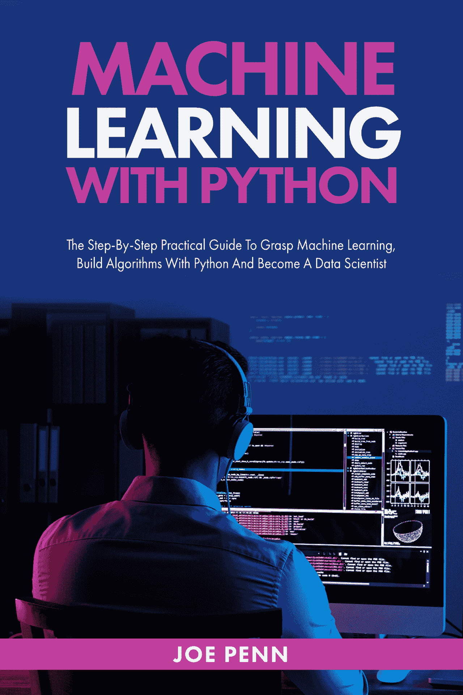

# Python 机器学习：掌握机器学习、用 Python 构建算法并成为数据科学家的实战指南





## 简介
Python 是一种著名的高级级编程语言，被全球大量的产品工程师、游戏设计师、网站设计师、数据科学家等使用。Guido van Rossum 先生于 1991 年创建并组织了这种语言，Python 软件负责其后续开发。尽管如此，当时已经有很多 OOP 语言。开发 Python 的主要目的是为了强调代码效率以及逻辑或数学准备，例如 `NumPy`、`SymPy`、`Orange` 等。此外，Python 的标点符号简洁明了。Python 是一种开源、面向对象且灵活的语言，支持许多标准库。Python 在数据科学领域也很有名。协会通常使用 Python 从其数据中收集信息并进行扩展，而不是使用其他的教学活动。在本编程指南中，你将能够熟悉 Python 编程的核心思想。这是一份循序渐变的 Python 编程指南，以确保理解。最重要的是，需要了解 Python 的语法和结构。随后，它将介绍必要的技能，例如数值控制、指针、类和字符串。本指南旨在帮助需要在几天内熟悉 Python 核心思想的学者。只有当你边阅读边构建自己的项目时，你才能真正发现这门语言的魅力。

## 结语


# 第一章：Python 入门

在讨论 Python 的起源时，我们需要讨论 20 世纪 80 年代中期使用的 `ABC` 编程语言。正是 `ABC` 编程语言的影响促进了 Python 的发展和崛起，而 Python 目前是世界上最著名的编程方言之一。在 20 世纪 80 年代中期，Van Rossum 是一位 PC 架构师和数学家在 `Centrum Voor Wiskunde en Informatica` 担任一种名为 `ABC` 的编程语言的任务协调员。在 20 世纪 80 年代末，Van Rossum 开始寻找具有另一种语言结构的脚本语言，例如 `ABC`，当时他正在尝试另一种名为 `AMOEBA` 的流行工作框架，该框架可能会从 `ABC` 获取框架调用。因此，Van Rossum 本人开始编写另一种基础编程语言，以解决 `ABC` 编写计算机程序语言的局限性。最后，Van Rossum 在 20 世纪 90 年代中期交付了他编程语言的主要实现。最初，他的编程语言采用了 `Modula-3` 模块结构。我们现在将他的编程语言称为 `Python`。

人们通常认为 `Python` 是以蛇或蟒蛇命名的，甚至 `Python` 的符号图中显示了两蛇，第一条是蓝色的，第二条是金色的。然而，我们中并没有很多人知道 `Python` 名字背后的真实故事。20 世纪 70 年代 `BBC` 有一部有趣的讽刺电视节目叫做《蒙提派恩飞行戏团》（Monty Python's Fly Circus）。Van Rossum 恰是该节目的疯狂粉丝。基于此，在 Rossum 将他最近构思的语言命名为：`Python`。

## 1 学习 Python 的步骤

Python 是每个工程师每个应该了解的最基础编程结构和方言之一。大多数软件工程师利用这种语言来构建网站、创建学习计算和执行其他编程任务。从刚开始学习 `Python` 可能会感到不知所措、困惑和困难，特别是当你不知道如何处理工具和资源时。

你可能发现的最大挑战之一是所有学习材料和资源的统一方式。假设你对学习和编写 `Python` 感兴趣。考虑到，你会发现在考虑做你感兴趣的事情之前，任何编写资源都需要你花费大量的时间在 `Python` 的语法结构上。这种不规律使得某些软件工程师学习 `Python` 变得困难。经验丰富的软件工程师还会向你提出这样的观点：“天哪，伙们！这太简单了，甚至不需要考虑学习 Python！”他们甚至经常向你保证。

尽管如此。实际上，即使是几行看起来简单的代码也可能难以想象地令人混乱。例如，即使是一行代码也会让你困惑！在 `Python` 中：
* `django.http` 是什么意思！
* 为什么某些代码行中有闭包？

当你对 `Python` 一无所知时，很难看出它是如何运作的。这里的根本问题是，你必须理解 `Python` 的构建模块才能开发出有趣的东西。上述代码片段 `django.http` 使用主流的 `MVC` 工程来创建网站的视图（view），这是网站的关键结构之一。如果你不具备编写代码来构建视图的能力，那么考虑到，在这个阶段你是不可能创建一个独特的网站的。

大部分 `Python` 教程和课程假设你在开始某事之前应该理解关于 `Python` 语言结构的所有内容。这种结果导致在你真正需要分析信息、创建网站时，在语法结构上浪费了很长时间精力。通常，投入所有精力思考结构会导致动力丧失。我们可能想将其看作是“枯燥的”。一些教程和课程建议你应该安排足够的“无聊”来进入“令人兴奋的地方”，然而，相信我们，这是学习 Python 的唯一方法！你可能会发现经过“无聊”的循环后会有更好的结果。例如，环绕“无聊”并直接到达顶部。你应该投入最少精力学习基础，然后。在这个阶段，我们将逐步告诉你如何重复这个过程，无论你是否需要学习。

### 动力

在你开始探索和进入 Python 世界之前，有必要学习它，因为这是一个漫长且困惑的旅程。没有足够的动力，你无法坚持！所以，动力非常重要，比你想象的要得多！大多数人在学校和通过课程记住；通过另一种方式，动力将帮助你找到一个明确的目标，而不是感到困惑。当你开始学习 Python 时，你可以选择你感兴趣的领域。Python 提供了许多你可能感兴趣的领域：
* 数据科学（Data Science）
* 机器学习（Machine Learning）
* 人工智能（Artificial Intelligence）
* 手机设备（Smartphone Devices）
* 游戏开发（Game Development）
* 硬件/技术/机器人（Hardware/Tech/Robotics/Sensors）
* 自动化脚本（Automation Scripts）

至少选择一个你感兴趣并准备好寻找的领域。在你的领域中，你可以思考你的学习，并在最后创建项目。

### 学习语法

遗憾的是，在学习 Python 时你无法避免这一阶段。在深入研究你的领域之前，你应该熟悉 Python 语法的基础。你意识到需要在这一点上花费尽可能少的精力，因为这并不激励。本书将帮助你学习 Python 语法的一些基础。

### 开发项目

当你掌握了基本语法，就可以开始制定自己的项目计划。学习的一种卓越方法是制作自己的项目，因为它让你将经验转化为有用的东西。你应该注意，如果没有自己的项目，很难获得更多见解。项目将建立你的能力，并帮助你理解和学习新概念，帮助你建立一个供未来查看的作品集。现在，完全自由的项目是很困难。你会感到非常困惑，必须回到桌面工作并阅读。在你有足够的安全感在自己的管理下构建之前，制作更正式的项目通常更简单。为了从中受益，练习网站或书籍有组织的项目。它鼓励你制作你感兴趣的领域的有趣内容，从而防止你迷失。由于你需要创建一个游戏，或者进行创新工作，或者完成某些事情，你可能对 Python 感兴趣。因此，在本指南的最后，我们将查看 Python 在人工智能方面的命运。

#### 工作、工作与工作

在完成上述阶段后，在 Python 编程中，你可以继续扩展你的项目和复杂性。如果你对正在创建的内容完全满意，这意味着你是尝试明显更复杂的东西的最佳时机。你可以考虑另一个更难的任务，或者为你的当前项目添加一些问题，或者你可能为项目准备了一个非常惊喜的挑战。你好！对于这个！你需要记住人是通过练习提高的！为了增加你项目的难度，以下是一些建议，以确保你在学习 Python 方面取得了进展。

* 你可以尝试向新手展示你是如何学会构建的。没有什么比教它更能帮助你理解一个主题了！
* 你应该考虑可以扩展项目能力的技术。你可以专注于你的项目。
* 你可以推荐让界面更易用的方法。

## 1.2 Python 基础

在你编写被称为 `Hi World` 的绝对程序之前，你需要熟悉 Python 基础。我们现在将讨论编程基础及其语法，这将积极地帮助你开始你的设计生涯。第一个软件/程序可以通过两种不同的结构进行打印和汇。### 交互式模式

开发者基本上可以以智能方式编写并随后一个 Python 程序。Hi World！在交互式模式下，你可以在 Python 的智能模式中输入以下命令来编写你的第一个程序。
```
>>> Python
```
如果你在终端上输入此命令并执行它，你现在处于 Python 的智能模式下。同样，如果你使用 IDE，没有必要输入上述命令。接下来是你的第一次汇的 Python 语言结构。主程序通常被称为 `Hi World!`。然而，我们将程序更改为 `Hello to the Universe!`。当你编写第一个程序并按回车键时，你的 IDE 应该显示 `Hello to the Universe!`。你应该注意，你输入的所有内容都会在你的 IDE 括号中显示。语法：
```python
print("Hello to the Universe!")
```

### 脚本模式

如果你在终端上输入此命令并执行它，你现在处于 Python 的智能模式下。同样，如果你使用 IDE，没有必要输入上述命令。接下来是你的第一次汇的 Python 语言结构。主程序通常被称为 `Hi World!`。然而，我们将程序更改为 `Hello to the Universe!`。当你编写第一个程序并按回车键时，你的 IDE 应该显示 `Hello to the Universe!`。你应该注意，你输入的所有内容都会在你的 IDE 括号中显示。语法：
```python
print("Hello to the Universe!")
```
（注：此处原文中存在重复，翻译时已按逻辑处理）


# 第 2 章：Python 的基本属性

到目前为止，我们指尖下可以依赖的编程语言几乎一样多。编程方言如此丰富，每种 PC 编程语言都有其独特之处。这些是使某种语言区别于其他语言的属性。最终，语言可能会因为其特性被移动或选择用于更广泛的任务。因此，在开始学习 Python 思想之前，让我们先研究 Python 的实用性、独性和用途等。在接下来的部分中，你将熟悉 Python 的基本思想、特性、应用和设计，这使其与许多不同语言相比显得新颖且稳健。

## 2.1 Python 的独特特性

让我们从 Python 的一些显而易见的亮点开始。

### 代码简单
当我们使用“基础”或“简单”的 Python 编程时，我们需要以完全不同的视角来看待。我们之前读过 Python 语言是一门高级语言。通常情况下，由于关键字和标识符并不多，你会发现 Python 代码类似于英语。任何开发者甚至非软件工程师只要看一眼代码，就能知道这段代码的作用。无论如何，Python 是逐行执行的，这需要空间。这种能力使得 Python 代码更加稳定且易于理解。此外，在我们编写完第一个程序后，我们可以说在 Python 中编写代码非常容易。我们可以看到 Python 比其他编程语言更易于编写。在几个小时内，具有编程基础的人就能精通 Python 的语法。尽管如此，要成为精通标准、模块和包的 Python 编程专家仍需要一些努力。总而言之，我们可以说 Python 是一门对开发者友好的语言。

### 开源且免费
最重要的是，你可能知道 Python 是免费的，而且在许多平台上都可以获取。它的官方网站是下载和介绍 Python 最可靠的来源，例如，`https://www.python.org/`。第二点是 Python 是一门开源编程语言。开源意味着社区可以随时访问 Python 的源代码。事实上，即使是非大师也可以下载、调整、使用和分发 Python。FLOSS 通常将这类编程或语言称为“自由、许可和开源软件”。所有的 Python 开发者都在追求 Python 领域的一个共同目标，即提升 Python 及其实用性。Python 为此将源代码变成了开源代码。

### 高级语言
从书开头开始，我们一直在讨论一个观点，即 Python 是一门高级计算机编程语言。作为工程师，你不需要考虑或复习你的计算机或设备的设计。你用 Python 编写的代码可以用于国际上的任何程序、机器或框架。你无需额外考虑框架的内存。这种能力使得在 Python 中编写和编码变得更简单。因此，我们可以如前所述将 Python 称为一种“开发者友好型语言”。

### 便捷的语言
假设你在运行 Windows 操作系统的电脑上构建了一个 Python 程序或应用程序。假设你只需要在运行 MAC OS 系统的电脑上运行该程序。现在，你不需要编写如此大量的 Python 代码变体。你可以将来自 Windows 电脑的 Python 代码取出来，并在任何操作系统机器上运行它。这样，如果你使用 Python，就不需要以特殊的方式为不同的设备或工作框架编写代码。这种 Python 特性使我们的语言，特别是脚本语言变得意义重大。在这种情况下，你只需要记住一点，并且要避免任何底层框架。

### 解释型语言
如果你现在是 C++ 或 Java 工程师或其他编程语言学习者，你必须理解你应该先编译你的代码，然后才有运行或完成任务的选择。但是，当你选择 Python 作为你的编程语言时，代码不会被编译。Python 将机器内的代码转换为一种快速类型，称为字节码。最后，当你的电脑或单元解析 Python 代码时，你可以说它是立即执行每一行，而不是整个代码。这种 Python 工作使得调试代码比其他语言（例如 Java）更简单，但与 Python 的优势相比，这并不重要。

### 面向对象式
我们从开始讨论这个观点，Python 可以重塑这一现实。因此，它是一门面向对象的编程语言。OOP 语言围绕对象和数据。尽管如此，Python 支持过程化编程和模型，这使得 Python 成为最强大的编程语言。此外，Python 是一门支持单一报告的语言，相对于 Java。

### 可扩展语言
假设你是某种语言的工程师。你需要编写 Python 代码来使用其他语言，例如 C++。这种 Python 特性使其成为一种真正可扩展的语言，这意味着它可以被扩展以记住其他语言。

### 安装型语言
我们在过去阶段编写代码，其他语言也可以包含在源代码中。同样，你可以将 Python 代码引入其他语言，例如 C++。这允许我们加入其他语言的脚本能力。

### 大标准库
有了丰富的包和库，你可以下载 Python，因此不需要为你的产品每项任务编写完整代码。更丰富的库通常用于表达式、不同年龄、测试单元、网站构建、字符串、数据库支持、图形界面、消息维护以及多种图像控制。

### 图形界面编程
除了制作图形界面 (GUI)，任何应用程序或编程都是易用的。通过你的产品的图形界面，任何用户编程都可以关联。Python 提供了范围。在这些特性中，`wxPython`、`JPython` 和 `Tkinter` 是著名的。Python 提供这些工具箱，允许你有效地快速地开发界面。

### 动态类型语言
Python 是一种强大的组合编程语言。这意味着在运行时，你的电脑或框架将决定任何值的类型，而不是在此之前。在 Python 中，我们不需要在定义或声明时确定数据类型。

## 2.2 Python 版本

### 第一阶段
Python 在 1994 年 1 月在其主要时期创建并发布了第一个版本，即 `Python 1.0`。实用编程工具例如 `reduce`、`filter`、`lambda` 和 `map` 是该版本实现的关键特性。`Python 1.2` 是 Rossum 先生仍在 CWI 时发布的最后一个更新。此版本发布于 1995 年。1995 年，Van Rossum 先生在 WWI 研究中心工作，专注于 Python 语言。从那时起他发布了几个不同的 Python 版本。随着 `Python 1.4` 的到来，Python 增加了一些新特性和隐藏特性。在这些特性中 广为人知。为了引起争议，使用了 `Modula-3`。它们在 `Python 1.4` 中通过名称修饰实现了基本的类型覆盖。Van Rossum 还介绍了名为 `CP4E` 的“全民计算机编程”。他的目标是让具有多种计算机语言命令能力的编程对普通人可用。Python 在这方面承担了基本功能。解释是 Python 有一种简单的语法。`Python 1.6` 是后续版本。通过一些错误修复，`Python 1.6` 发布另一个版本。

### 第二阶段
在 Python 的下一个阶段，Python 发布了版本 `Python 2.0.0`。它于 2000 年 10 月发布。Python 在这个版本中实现了一个关键改进，将 Python 的类合并，即顺序中的独立类。这一变化是 Python 成为对象编程语言的基本原因。`Python 2.2` 是后续版本。`Python 2.2` 于 2001 年发布。`Python 2.6.1` 和 `Python 2.7.0` 是 Python 在第二阶段发布的后续版本。`Python 2.6` 是为了帮助 `Python 3.0` 创建的。`Python 2.7` 再次发布以帮助 `Python 3.1`。

### 第三阶段
在 Python 进化的第三阶段，Python 发布了 `Python 3.0.0`。通常被称为 `Py3K` 或 `Python 3000` 的 `Python 3.0` 于 2008 年发布；`Python 3000`。此外，为了克服 Python 的缺陷，创建了 `Py3K`。


| Python 版本 | 发布日期 |
| --- | --- |
| Python 1.1.0 | 1994 年 1 月 |
| Python 1.5.1 | 1997 年 12 月 |
| Python 1.6.1 | 2000 年 9 月 |
| Python 2.0. | 2000 年 10 月 |
| Python 2.0.1 | 2001 年 4 月 |
| Python 2.2.3 | 2003 年 12 月 |
| Python 2.3.7 | 2003 年 7 月 |
| Python 2.4.6 | 2004 年 11 月 |
| Python 2.5.6 | 2006 年 9 月 |
| Python 2.6.9 | 2008 年 10 月 |
| Python 2.7.17 | 2010 年 7 月 |
| Python 3.0.1 | 2008 年 12 月 |
| Python 3.1.5 | 2009 年 6 月 |
| Python 3.2.6 | 2011 年 2 月 |
| Python 3.3.7 | 2012 年 9 月 |
| Python 3.4.10 | 2014 年 3 月 |
| Python 3.5.9 | 2015 年 9 月 |
| Python 3.6.10 | 2016 年 12 月 |
| Python 3.7.6 | 2018 年 6 月 |
| Python 3.8.1 | 2019 年 10 月 |
| Python 3.9.0 Alpha 1 | 2020 年 5 月（预计日期） |

## 2.3 Python 的应用

Python 是一种开源且广泛使用的计算机编程语言，被认为具有极高的价值，与其他编程语言有不同之处。在几种不同的方式下，Python 作为一种语言可以用于任何计算机编程领域。

### Web 应用开发
你可以利用 Python 构建多种类型的 Web 应用。为了创建和管理网站及 Web 应用，Python 提供了许多库。例如：邮件处理、惊艳的 `beautifulsoup`、`request`、`JSON`、`XML`、`HTML` 等。此外，Python 还提供了许多内置结构来管理和构建程序及 Web 应用，例如 `Pyramid`、`Flask`、`Django`（我们在第 1 节讨论过它）以及其他。

### 图形用户界面应用
为了给基于 Python 的项目制作 UI，Python 提供了一些图形 UI 库。`Kivy` 和 `wxWidgets` 是这方面的工具和应用程序。在一些形成阶段，你可以使用这些资源。记住 `Kivy` 通常用于制作多接触应用程序。

### 编程开发
你可以利用 Python 推进计算机编程。Python 作为辅助语言，用于编程测试、控制制造和板测试。

### 逻辑与数值计算
Python 是一种通常用于描述逻辑、数学运算的标准语言。你可以使用 `Pandas`、`SciPy` 等库。

### 业务应用
Python 被用于各种业务环境以实现任务自动化和数据分析。

### 音频
Python 可用于音频处理和声音开发。

### 视频
Python 用于视频编辑和视频处理应用程序。

## 2.4 安装 Python

要安装 Python，你可以使用官方网站。

### 在 Windows 上安装
在 Windows 上安装 Python，你可以访问参考网站：`https://www.python.org`。
1. 从网站下载最新的安装程序。
2. 运行安装程序并确保你勾选了“Add Python to PATH”选项。
3. 点击“Install”。
4. 要验证安装，打开 `CMD` 并输入：
```bash
python
```
如果你看到错误，可能意味着路径未正确设置。你可以手动将 Python 路径添加到环境变量中。

### 在 MAC 上安装
Mac 自带了 Python，但你可以从官方网站下载最新版本。
1. 打开 `Terminal`（终端）。
2. 输入以下命令检查版本：
```bash
python3 --version
```


# 第 3 章：编译器、文本编辑器和 IDE

Python 编译器、IDE 和文本编辑器在 Python 编程中起着至关重要的作用。与其他编程方言一样，我们可以使用许多应用程序、编译器和文字处理器以一种极其解耦的方式来收集 Python 的语言结构。在本节中，我们将探讨编译器、文字处理器和 IDE。

## 3.1 Python 编译器

如果你有一定的编程基础，你必须意识到 `compiler` 是一种用于代码解释器或基础编程的应用程序，它将你编写的代码从高级 PC 编程语言转换为机器语言，以便你的电脑能够识别。Python 有许多具有特定 PC 编程语言转换框架的编译器可用。许多开发者使用这些编译器来调试项目、使代码变为可执行文件，或为项目进行计算。`PyCharm` 在大多数 Python 开发者倾向于使用的 IDE 中脱颖而出。在本书的这部分，我们可能会介绍最好的编译器。

### NUITKA 编译器
`NUITKA` 是一个非常著名的 Python 编译器，用于汇和执行你的代码。`NUITKA` 将你用 Python 编写的代码作为输入进行积累并执行；它将你的代码转换为 `C`。在几乎每一个操作系统和每个阶段，你都可以访问 `NUITKA`。`NUITKA` 持续更新，`Windows`、`MAC`、`UNIX` 和其他工作框架都非常容易理解。`NUITKA` 的另一个特点是你可以在没有向工作站引入 Python 的情况下在其上编写代码。`NUITKA` 是一个基于 Python 的编译器，基本上不支持某些其他方言。因此，对于 Python 开发，它有各种可用的特性和库。工程师还利用 `NUITKA` 创建人工智能和信息科学程序。

### PYJS 编译器
`PYJS` 编译器是许多专业开发者和程序开发公司使用的 Python 编译器。它是一种特殊的编译器。它最显著的特点是将 `JavaScript` 转换为你的 Python 代码。鉴于它在 Web 程序中的明显特性，大多数网站工程师倾向于使用这种编译器。当我们谈到 `PYJS` 提供的独特组件时，`PYJS` 提供代码运行时支持。这就是为什么 Web 设计师通常将其推荐用于在线应用程序和项目的原因。它支持那些想要用 Python 编写代码并使其在他们的浏览器中真实运行的人。`PYJS` 还会将你的 Python 代码解析为可以在理想 Web 程序上执行和运行的修复 `JavaScript` 代码。此外，`PYJS` 是一个轻量级编译器。此外，`PYJS` 同样为运行时错误提供修复支持。

### SKULPT 编译器
在你的浏览器中，`SKULPT` 编译器同样直接执行编写的 Python 代码。你的 Python 代码变得更具执行性。在一个网页的博客中，`SKULPT` 最近被介绍。要将你的 Python 代码转换为 `HTML`，也可以使用 `SKULPT`。你的代码也可以与浏览器的 `JavaScript` 结构打包。你不需要担心任何额外的模块、文件或工作器设置即可在你的浏览器中运行 Python，因为我们已经讨论过 `SKULPT` 是一个用于 Python 的程序。在 `SKULPT` 中编写的每个 Python 代码将从你的浏览器直接执行。许多 Web 架构师和设计师需要构建特定的电子应用程序，允许客户端在 Web 程序上直接执行 Python 程序并使用 `SKULPT`。

### BRYTHON 编译器
`BRYTHON` 是 Python 的编译器之一。此外，它将你的 Python 代码转换为 `JavaScript` 代码。这种编译器有一些特殊特性，作为外部管理器，它可以更改你的代码和程序在任何时间实现异常的结果。此外，对于许多具有 `CPython` 支持的模块，此编译器提供了实时帮助。需要记住，此编译器还支持许多不同的方言及其更新版本。对于客户端电子程序编程，`BRYTHON` 经常被使用。这种编译器是一个 Python 程序压力包。此外，你还可以在 Python 中使用 `BRYTHON` 进行基于 3D 的应用程序开发。

### Shed Skin 编译器
列表下一个是编写计算机程序的 Python `Shed Skin` 编译器。该编译器的核心部分是它将 `C++` 程序转换为你的 Python 位置代码。`Shed Skin` 编译器的主要缺点是许多普通 bug 和问题没有提供实时帮助。此外，支持的 Python 库和模块很少。大多数 Python 开发者使用 `Shed Skin` 编译器移除其静态编写的 Python 代码以获取更新的 `C` 和 `C++` 代码。你可能会发现 `Shed Skin` 编译器有用，因为该编译器提供了基础支持。

## 3.2 Python 文本编辑器

### Sublime Text
对于 Python 编程，这个智能工具是编写 Python 程序的众多个文字处理器之一。它配备了工具能拥有的最佳特性。从根本上说，这个文字处理器是用编程语言 `C++` 的；但你也可以用它来帮助 Python。Jon Skinner 是创建它的人，并在 2007 年年中推出了市场。他遵循这三个原则来构建这个文字处理器。窗口不会覆盖它的内容。它利用屏幕上任何可以合理放置的所有可用空间，因为全屏使用使得切换更加简单。他记得的一个核心问题是非实质且感触的界面。你可以在这个工具的任何地方利用可用空间来组织内容，从而避免许多问题。

优点：
- 它运行速度快且 bug 很少。
- 它适合报告。

### GNU/EMACS 文本编辑器
它是被许多工程师积极推荐的 GNU 文本编辑器。这个程序工具由 Richard Stallman 创建，二十多年来一直是程序员和专家中广受欢迎的文字处理器。该文字处理器的所有者 Richard Stallman 为每个用户免费提供。在许多编程语言中，GNU/EMACS 工具通常使用有趣的自定义。该管理器具有许多与其他工具区分的特性。

优点：
- 它是免费的并提供了便携式环境。
- 它支持不同的编程语言和语言。

## 3.3 Python IDE

你可能会使用一种称为集成开发环境的 IDE，用于 Python。通常用于以下原因：
- 可以使用 IDE 管理代码。
- 你可以在 IDE 中运行、创建、调试或制作代码，或机械组装。
- 大部分 IDE 提供了许多特性。在任何情况下，使用 IDE 被视为 SDLC 收集、测试等各个方面的工具。最流行的 IDE 有：
- PyCharm
- Spyder
- PyDev
- Atom
- Jupyter Notebook
- Thonny
- Visual Studio
- Eric Python

### PyCHARM IDE
PyCharm，即跨平台集成开发环境，是一个跨平台 IDE。在完美的世界中，这个设备是全球最常用的设备，它以两种格式可用：付费格式和开源格式。在处理你的常规工作时，PyCharm 节省了大量时间。对于 Python，PyCharm 是一个非常有用的 IDE。它为你提供许多独特特性，例如动态工作流、代码补全、远程头部支持、快速检查和错误提示、数据库以及其他。独特特性：
- 有效的调试
- 它提供了一种有效的代码方式
- 大量特性

### SPYDER IDE
对于数据科学家的 Spyder IDE 是他们最好的 IDE。它是一个开源 IDE。“逻辑 Python 开发环境”是 Spyder 的完整类型。Spyder 适用于 Windows、MAC OS 和 LINUX OS 机器。Spyder 通常包含 Anaconda 包，因此你可以独立依赖它。关于 Spyder 的迷人事实是它被用于 Python 研究人员。通过标准的 Python 数据科学库，例如 Matplotlib、SciPy 和 NumPy，Spyder 布局良好。你可以想象 Spyder 有许多基本的 IDE 能力。例如，Spyder 是一个具有强大语言结构的 Python 代码管理器。此外，它包含了 Python 代码查看，并且甚至是一个 IDP，即集成文档程序。另一个你在其他 Python IDE 中看不到的组件是 Spyder 包含一个“变量浏览器”，它允许你在基于表格的设计在 IDE 内显示数据。独特特性：
- 集成 IPython
- 良好的语法

### PyDEV IDE
PyDev 是世界上需求要求的 Python IDE 之一。考虑到所有因素，他们倾向于 PyDev。PyDev 有一个包含 "django”、智能缩进、自定义代码补全以及其他功能的组件。Windows、MAC OS 和 Linux OS 机器使得 PyDev 可用。我们也可以把 PyDev 视为基于 Java 的认可的开源 IDE。它包含一个用于额外和扩展项的业务社区。这种能力使得 PyDev 对于广泛的增强和练习非常有价值。独特特性：
- PyLint、远程调试器、单元测试的组合
- 检查和检查代码

### Atom IDE
Atom IDE 是由 GitHub 创建的 Python 最流行的 IDE。它是一个开源且跨平台的 IDE。在 Atom IDE 中，逐点……（等等，我看到了一些重复文本）。此外，对于 Python，PyCharm 是一个非常有用的 IDE。它为你提供许多独特特性，例如动态工作流、代码补全、远程头部支持、快速检查和错误提示、数据库以及其他。

`varName`
`funcName()`
`ClassName`
/path.to.xxx
`ClassName.funcName(var1 + var2, "cmd arg0 arg1"`
`cmdname`
```


# 第 4 章：Python 与其他编程语言的比较

Python 在高级计算机编程及其语言中经常与其他方言有所不同。在本部分中，我们将探讨 Python 与其他重要计算机编程方言和语言的比较。Python 与不同编程语言之间的这种关系和联系引导我们倾向于选择 Python 而其他。基于这种关联，你可以理解其他真实的高级计算机编程语言通常控制 Python。我们认为这些是重要的因素，但你可以在使用 Python 时学会如何使用不同的计算机编程语言。这种关系和联系是。

## 4.1 Python 和 C++

Python 和 `C++`（C 加加）都是具有自身术语的计算机编程语言。它们被广泛用于许多用途。最好记住，Python 语言和 `C++` 语言在许多方面都彼此不同。`C++` 是 C 语言的严格类型，具有许多实用的功能和改进。`C++` 的优势在于提供社交活动的信息并将其整合到一个类中。相反，Python 的语言是全球通用的，是最重要的计算机和编程语言之一。在 Python 中，我们可以直接简单地使用变量，而无需在编写代码时声明和描述它。

总而言之，在 `C++` 中，任何代码或程序都需要在你代码要运行的每个工作结构上处理。这样，Python 允许你“编写一次，随处运行”。这一特性使得 Python 在每个工作系统上继续执行变得独特。你只需要让 Python 熟悉该系统即可。

`C++` 倾向于内存泄漏。这意味着它不提供垃圾回收。此外，`C++` 高度使用指针。Python 为你提供了内置的垃圾回收机制。此外，它还提供了独特的内存分区度，为高效内存使用板提供了机会。

如今，`C++` 通常用于硬件设计和创建嵌入式项目。这种思想最早是在 `C++` 的更新版本中引入的，它建立了组织编程并引入了嵌入式框架以及 `C++` 在它们的应用。这样你可以说 Python 通常被用作脚本语言，基本上你也可以将 Python 用于非脚本原因。最好记住，Python 有一个独立的可执行应用程序，包括一些工具的帮助，为你提供了进行非脚本编程的机会。

## 4.2 Python 和 C#

我们了解到 Python 最初的实现类似于英语语言。Python 中这些更广泛的词汇相当难以检查。这样，具体来说，你可以使用合理的变量名。同样，在 Python 中，由于简单的语法结构，没有陷阱。例如，不同的修饰符、`C` 和 `C++` 语法段（如高级系统和一些不同的技术）增加了许多变量。你将确保这一切使得 Python 代码在这易于理解、学习和编写。

`C #`（C-sharp）与之对应。由于语言继承，`C #` 从 `C++`、`JavaScript` 和 `Java` 中吸收了许多思想。在“C 类型”语法中，首先使用这些定义。`C #` 语言结构术语经常要求在检查语言过程或学习课程时遵守特定要求，其中大多数课程都由不同的开发者和编程专家团体组成。必须在括号或属性中的代码语言不应被忽视。与 `C #` 相，Python 不包含这些。Python 使用了一种特定的移动，使代码看起来很棒。

此外，总而言之，引用任何扩展通常是有益的。Python 声称内容就是内容，所以你基本上可以用代码将其存档，编译器、`IDE` 或文本处理器可以充分执行。你可以打开它们并使用你选择的首席开始工作。此外，你可以在之后立即高效地运行它。对于此，如果没有附近的编译器或 `IDE`，你将处于一个非常好的位置。使用 Python 作为编程模型组装跨阶段和跨阶段的内容也将很快。在另一个平台或阶段，你不需要重新编译它。

如果你意识到 `C #` 需要一个 `IDE` 来编写、安排和执行传统的编程代码，那就完美了。由于至少有一个 `C #`，当你 de 制作 Windows OS 内容时，它有……（注：文本在此结束）

## 4.3 Python 和 Java

（文本延续原文）

## 4.4 Python 和 PHP

（文本延续原文）


# 第 5 章：Python 编程中的数据类型、运算符和变量

Python 的主要概念是数据类型、运算符和变量，它们被视为这种高级 PC 编程语言的基础结构单元。通常情况下，我们使用它们来编写程序，并通过它们的特性来实现基本功能。在这些概念中，数据类型是核心概念，如果不掌握这些基本概念，没有人能学会 Python 编程。作为一种计算机编程语言，我们将在本部分介绍一些基础运算符、变量和 Python 数据。

## 5.1 Python 变量

Python 标识符的另一个名称是`变量`。变量是一个指代机器或设备内存区域的术语。你不需要在 Python 中定义这些类型的变量，因为 Python 是一种引入且足够智能可以自动分类类型的编程语言。此外，我们可以说 Python `变量` 是存储各种信息的内存区域，例如整数或字符。

在 Python 中，变量是可更改且可的，因为它们利用多种不同的操作。无论如何，变量需要一个字母或下划线。建议使用小写字母作为变量名。这在 Python、Java 和 C 中都是优秀的组成部分。

### 命名变量或标识符

标识符的条件是变量。为了想象程序中使用的精确系数和整数，会使用变量。对于 Python，以下是命名变量的规则：

*   字母或下划线 `_` 必须是标识符的起始字符。
*   除了特殊字符外，每个字符可以是 `"a-z"`、`"A-Z"` 字母、下划线或小写的 `"0-9"` 数字。
*   变量名不能包含任何空格或空白区域或任何特殊或未定义的字符，例如 `@`、`#`、百分号、`^` 和 `*`。
*   变量名不能看起来像你 Python 程序语法中描述任何表达式。

在 Python 中，变量是区分大小写的。例如，`I'm` 和 `cool` 是不等等的。

**有效标识符示例：** `n696`、`v`、`v69` 等。
**无效标识符示例：** `5a`、`vpercent69`、`x69` 等。

### 多变量赋值

在单语句中（通常称为多变量赋值），Python 允许为多个标识符保持打开门。它通常有两种可选方式使用：要么为多个标识符声明一个空变量，要么同时将多个属性赋值给多个变量。

#### 模型 - 1
打开 Python 终端或 IDE 并输入声明变量的命令。
```python
>>> n=v=w=987
>>> print
>>> print (n, v, w)
```
输出：当你输入打印变量值的命令时，输出将如下所示。
```python
>>> 987, 987, 987
```

#### 模型 – 2 
```python
>>> n, v, w = 987, 876, 765
>>> print (n)
>>> print (v)
>>> print (w)
```
输出：对于输出，当你输入命令时。
```python
>>> 987
>>> 876
>>> 765
```

## 5.2 Python 中的运算符

总之，运算符是语言特定的语法标记，需要某些操作来完成。运算符主要源自科学标准。例如，“乘法指示 (`*`)”是一个 Python 运算符。它用于两个数字的乘积。在 Python 中，运算符被描述为能力的符号表示，为了实现某些真实且想要的结果，在两个操作数之间执行特定的演示。Python 提供的运算符已说明。这里是一些广泛使用的：

*   数值运算符
*   数学运算符
*   任务运算符
*   逻辑运算符
*   位运算符
*   成员运算符

在书的这一部分，我们将讨论之前提到的部分运算符。数学运算符为了获得理想的结果，数值处理运算符用于执行复杂的数值处理任务。这种情况涉及两个操作数，通过运算符在它们之间执行操作，从而产生某些显著且直接的值。以下是 Python 中常用、重要且有价值的数学运算符：

*   加法 (`+`)：此运算符用于两个操作数之间以执行加法或整体操作。
    ```python
    >>> n, v = 25, 25
    >>> n + v
    ```
    你的输出将打印 "50"。
*   减法 (`-`)：此运算符取主操作数，并从第一个操作数减去第二个操作数。
    ```python
    >>> n, v = 25, 25
    >>> n - v
    ```
    你的输出将打印 "0"。
*   除法 (`/`)：此运算符取后续操作数并将第二个操作数除以主操作数，并根据你的演示给出余数。
    ```python
    >>> n, v = 6, 2
    >>> n/v
    ```
    你的输出将打印 "3.0"。
*   乘法 (`*`)：此运算符执行主操作数和第二个操作数之间的乘法，如之前。
    ```python
    >>> n, v = 6, 3
    >>> n * v
    ```
    你的输出将打印 "18"。
*   取模 (`%`)：此运算符负责除法操作，并将余数作为你的结果。
    ```python
    >>> c, w = 4, 2
    >>> c % w
    ```
    你的输出将打印 "0"。

### Python 比较运算符

当我们谈论 Python 时，比较运算符用于查看两个操作数并分别返回一个布尔类型，即 TRUE（真）或 FALSE（假）。

*   `==`：当且仅当值相等且有效时，使用此运算符。
*   `!=`：当值精确但不一致时，使用此运算符。
*   `<=`：当主操作数小于或等于后续操作数时，使用此运算符。
*   `>=`：当你的第一个操作数大于或等于后续操作数时，使用此运算符。
*   `<>`：如果且仅当两个值不等时，使用此运算符。
*   `>`：当你的第一个操作数大于后续操作数时，使用此运算符。
*   `<`：如果主操作数小于后续操作数，则使用此运算符。

### Python 赋值运算符

在 Python 中，我们使用赋值运算符将右侧项目的评估分配给左侧操作数。

*   `=`：此运算符通常用于将左操作数的值分配给右侧项目。
*   `+=`：通过评估右操作数，使用此运算符增加左操作数的值并将更改后的赋值返回左侧操作数。
    ```python
    >>> n = 2, v = 4
    >>> n += v
    ```
    这等于
    ```python
    >>> n = n + v
    >>> print (n)
    ```
    此外，如果 `n` 是 "6"，你的输出可能会打印该值。
*   `-=`：考虑到这一点，左操作数的值减少了右侧操作数的值，并将调整后的赋值返回左侧操作数。
    ```python
    >>> n, v = 4, 2
    >>> n -= v
    ```
    你的输出可能会打印 "2"。
*   `*=`：通过评估右操作数，使用此运算符增加左操作数的值并将更改后的奖励返回左侧操作数。
    ```python
    >>> n, v = 4, 2
    >>> n *= v
    ```
    你的输出可能会打印 "8"。
*   `%=`：此运算符负责将左操作数的计数除以右操作数并将更新委托回左侧操作数。
    ```python
    >>> n, v = 4, 2
    >>> n %= v
    ```

### Python 逻辑运算符

当语句 'C' 是逻辑的且语句 'W' 同样明显的时，那么结果是正确的。在某些其他函数中结果将不是正确的。此表可以帮助你更好地理解“与运算符”。


| C  || W  || C and W  |
| --- | --- | --- |
| True  || True  || True  |
| True  || Talse  || False  |
| False  || True  || False  |
| False  || False  || False  |

**或运算符**：只有当两个操作数都是虚假（bogus）时，结果才会虚假。接受一个断言 "C" 是有效的，另一个断言 "W" 是虚假的；在这种情况下，结果将是合法的/True。此表可以帮助你更好地理解“或运算符”。

| C  || W  || C or W  |
| --- | --- | --- |
| True  || True  || True  |
| True  || False  || True  |
| False  || True  || True  |
| False  || False  || False  |

## 5.3 Python 中的数据类型

信息结构决定了应用到相关属性的一系列任务和特性。例如，由于灯开关有两个不同的属性，可以与 PC 框架进行对比；`True` 表示开启，`False` 表示关闭。由于灯泡开关只记录了这两个属性，我们可以认为它的大小为二。对于灯泡的开关，应该只有两个可能的任务：

* 我们可以将其打开
* 我们可以将其关闭

Python 中的元素可以传递各种类型信息的评估值。Python 是一门不断发展的 PC 编程语言。因此，在陈述和描述它们时，我们不需要描述明显因素的类型。因素将驱动力与其类型绑定。此外，Python 允许设计者确认产品使用的变量类型。Python 为我们提供了“类型”（结构），它恢复了移动的变量类型。要描述不同信息类型的类型并确认它们的类型，你可以考虑直接进行。

### 示例：
```python
>>> C = 69
>>> W = "Greetings Python"
>>> K = 17.5
>>> print ( type (C));
>>> print ( type (W));
>>> print ( type (K));
```

### 输出：
当你输入命令 `>>> print ( type (C));` 时，你的终端将打印 `<type 'int'>`。
当你输入命令 `>>> print ( type (W));` 时，你的控制台将打印 `<type 'str'>`。
当你输入命令 `>>> print ( type (K));` 时，你的终端将打印 `<type 'float'>`。

### 标准数据类型

Python 中的标识符可以承受各种类型的特征。例如，任何人的名字必须被视为字符串，而他的 ID 必须完全被视为数字。Python 为我们提供了不同的标准信息类型，通过力量策略来刻画每一个类型。Python 中描述的通常使用的信息类型命名如下：

* 数字 (Numbers)
* 字符串 (String)
* 列表 (List)
* 元组 (Tuple)
* 字典 (Dictionary)

我们现在通过下面的模型解释其中一些。

### 数字 (Numbers)
数字作为信息类型，在 Python 中存储数值属性。当把数字分配给变量或标识符时，Python 提供一个数值元素。

### 示例：
```python
>>> C = 79
>>> W = 06
```
在上述模型中，`c` 和 `w` 是数值元素。Python 支持四种不同的数值信息类型。

* 整数 (`int`)
* 长整数 (`long`)
* 浮点数 (`skim`)
* 复数 (Complex)

### 字符串 (String)
在 Python 中，字符串可以被描述为由引号表示的字符序列。此外，为了描述一个排列，可以使用单引号、双引号或三引号语句。字符串的处理是一个简单、合理且清晰的任务，因为 Python 提供了一些内置功能和操作符来执行此任务。`+` 运算符用于 Python 中的字符串处理，将两个字符串连接成循环。`"Hi" + "Mr. David Robertson."` 返回 `"Hi Mr. David Robertson"`。此外，运算符 `*` 通常被称为重复运算符。`"Item" * 2` 返回 `"Item ObjectItem Object"`。你可以通过下面的示例理解 Python 中的字符串处理。

### 示例：
```python
>>> string1 = "Hello there Mr. David Robertson."
>>> string2 = "How are you"
>>> print (string1 [0:2]) #使用切片运算符打印前两个字符
>>> print (string1 [4]) #打印字符串的第四个字符
>>> print (string1 * 2) #打印两次字符串
>>> print (string1 + string2) #打印 string1 和 string2 的连接
```

### 输出：
当你编写第一个命令并按回车时，例如 `print (string1 [0:2])`，你的终端将使用切片运算符打印字符串的前两个字符。因此，在这种情况下，你的终端将打印 `"He"`。
当你编写下一个命令时，例如 `print (string1 [4])`，你的终端将打印字符串的第四个字符。因此，在这种情况下，你的终端将打印 `"o"`。
当你编写第三个命令并按回车时，例如 `print (string1 * 2)`，你的终端将两次打印你的第一个字符串。同样，在这种情况下，你的终端将打印两次你的第一个字符串。
当你编写第四个命令并按回车时，例如 `print (string1 + string2)`，你的终端将打印 string1 和 string2 的连接。

### 列表 (Records/Lists)
在 Python 中，由于使用展示，我们使用列表。尽管如此，列表可以包含各种类型的信息。列表中的元素用逗号 "," 分隔并封装在方括号 `[]` 中。切片运算符 `[:]` 可用于列表。连接运算符 `+` 和重复运算符 `*` 与字符串的工作方式相似。

### 示例：
```python
>>> l = [1.5, "Hi", "Python", 7]
>>> print (l [3 :])
>>> print (l [0:2])
>>> print (l)
>>> print (l + l)
>>> print (l * 3)
```

### 输出：
当你编写第一个命令并按回车时，例如 `print (l [3 :])`，你的终端将打印 `[7]`。
当你编写下一个命令时，例如 `print (l [0:2])`，你的终端将打印 `[1.5, 'Hi']`。
当你编写第三个命令并按回车时，例如 `print (l)`，你的终端将打印 `[1.5, 'Hi', 'Python', 7]`。
当你编写第四个命令并按回车时，例如 `print (l + l)`，你的终端将打印 `[1.5, 'Hi', 'Python', 7, 1.5, 'Hi', 'Python', 7]`。
当你编写第五个命令并按回车时，例如 `print (l * 3)`，你的终端将打印 `[1.5, 'Hi', 'Python', 7, 1.5, 'Hi', 'Python', 7, 1.5, 'Hi', 'Python', 7]`。

### 元组 (Tuple)
在 Python 中，元组从多个角度来看类似于集合。元组通常提供各种信息结构元素的组合，类似于记录。元组元素用逗号 "," 分隔并封装在括号 `()` 中。此外，其他人无法无法修改元组中元素的大小、值和数量。

### 示例：
```python
>>> t = ("Hello", "Python's reality", 69)
>>> print (t [1 :])
>>> print (t [0:1])
>>> print (t)
>>> print (t + t)
>>> print (t * 3)
>>> print (type (t))
>>> t [2] = "hi";
```


# 第 6 章：Python 中的正则表达式、表达式语句和循环

与其他 PC 编程语言一样，Python 此外还有常规的表达式、声明和循环。尽管如此，Python 的表达式和循环是新颖的，并且构成了 Python 编程整体。这些策略、能力、循环和声明在构建用于数据分析的强大程序以及执行其他任务方面起着至关重要的作用。在 Python 库中，这些操作运算符的增加和更新有许多目的。在这里，我们将利用 Python 作为编程语言，探讨这些策略的意义和功能。

## 6.1 Python 的正则表达式

Python 中的常规表达式通常被称为 regex。Regex 尝试拆解字符串中的示例。有许多不同的 regex 功能可以获取、调用或导入以使用。为了导入这些功能，我们可以使用语句 `\>>> import.re`。

### 正则表达式函数

*   **Split 函数**: `Split` 用于拆分我们理想的字符串。
*   **Sub 函数**: 我们使用 `sub` 来替换字符串中的匹配项。
*   **Match**: 在 Python 中，`Match` 评估正则表达式并将其作为布尔类型返回，即 `True` 或 `False`。
*   **Findall**: `Findall` 在 Python 中用于查找字符串中所有的匹配项。
*   **Search**: `Search` 用于发现字符串中所有的匹配项。

## 6.2 Python 的语句表达式

标记 `'=';"the equivalents sign"` 用于表示一个任务声明。在 Python 的语法和语言中，任务表达式的工作方式与其他基本的 PC 编程语言和语言不同，这种基础框架考虑到 Python 变量类型的可能性，构建了 Python 语言的各种特性。如果我们在 C 编程语言中考虑此任务，它将是 `v = 2`，这意味着有一个名为 `"v"` 的形成变量，它拥有一个值为 2 的数值副本。在这种情况下，右侧或表达式被复制到分配的存储区域，左侧的变量名是该有意义区域。分配给变量 `"v"` 的内存足够容该表达式类型。在 Python 任务最简单的情况下，让我们使用一个基本相同的模型，`v = 2` 意味着 `"(非私有的) 名称 v 获取了另一个连续分配的、数值或整数 "int" 类型关键值为 2 的对象的引用。"` 在这里，我们将检查 Python 在调度中使用的基本解释。

*   **If 语句**: 在 Python 中，`if` 语句限制性执行一个代码块，紧接着是 `else` 和 `elif`（这是 else-if 的压力）。
*   **For 语句**: 在 Python 中，`for` 语句强调一个项目。它获取每个部分并关闭一个因子供关联块使用。
*   **While 语句**: `While` 语句在 Python 中只要其条件成立，就会执行一个代码块。
*   **Try 语句**: 在 Python 中，`attempt` 语句允许在其视为的关联代码块中提出的某些特殊情况被获取并处理；这还确保了在最终块中的清理代码将可靠地运行，而不考虑代码块如何退出。
*   **Raise 语句**: Python 使用 `raise` 声明来抛出预定义的异常或重新抛出多个特殊情况。
*   **Import 语句**: 在 Python 中，`import` 语句是一个通常用于导入其限制或因子可以在当前程序模块模块模块。使用 `\>>> Import` 有三种不同的方法：
    *   `\>>> import <module name>`
    *   `\>>> [as <alias>\].`
*   **Print 声明**: 打印声明在 Python 2.7 出现后更改为 `print()` 系统工作。最常用语句的解释如下所示。
*   **Python 中的 Else 语句**: 通常，PC 中的任何选择断言被称为双路选择。选择被引入 PC，一个限制性断言，PC 可以将其回答为真或假。在这种情况下，如果正确的响应为真，则执行一个活动或一组活动。否则，如果正确的响应为假，则执行不同的活动或一组活动。在 Python 中，动态是语言和语言组成部分。正如名称所示，动态允许你的代码为预定义的选择执行特定的代码块。尽管如此，通常根据特定条件的批准做出决定。条件检查操作是动态的基础。在 Python 中，我们可以通过以下语句执行它们。
*   **Python 中的空格**: 为了 Python 编程的方便和实现简单，Python 不允许在块级代码中使用封闭区域。在 Python 中，空间用于表示一个块。如果两个语句处于相同的空间水平，那么它们是同一个块的一部分。此时，给出四个空格来缩进断言，这是 Python 中空间的典型比例。空间是 Python 语言中最使用的部分，因为它声明了代码块。一个块中的每一个声明都建议在相同的空间水平。我们将看到在 Python 基本管理和其他事务中真实的空间发生。
*   **If-语句**: `If-Statement` 通常用于测试特定条件，如果条件成立，它执行一个名为 though 块的代码。条件，`if` 语句可以被评估为真或假。`if else` 的语法如下：
    `>>> number = 2`
    `>>> if number % 2 == 0:`
    `>>> print("输入的数字是偶数")`
    `>>> else:`
    `>>> print("输入的数字是奇数")`
    （注：原文示例逻辑存在混乱，此处根据语境翻译）
    （原文后续代码片段）
    `>>> if n > v and n > w:`
    `>>> print("n 是最大的");`
    `>>> if v > n and v > w:`
    `>>> print("v 是最大的");`
    `>>> if w > n and w > v:`
    `>>> print("w 是最大的");`
*   **If-Else 语句**: `if-else` 语句出一个 `else` 块，在 `if` 语句的情况下，在假实例执行。当条件有效时，执行 if 块。
    `>>> if condition: (语句块)`
    `>>> Else: (else 块)`
    `Model - 1: >>> voterage = int(input("输入你的年龄："))`
    `>>> if voterage >= 18:`
    `>>> print("你有资格项目!");`
    `>>> else: print("对不起！你需要等待!");`
    `Model - 2: >>> number = int(input("输入你的理想数字："))`
    `>>> if number % 2 == 0:`
    `>>> print("输入的数字是数字!")`
    `>>> else: print`
*   **The Elif 语句**: `elif` 解释鼓励我们同时运行多个程度的条件。它必须有 if-and-if 等级来执行程序指示的任务。它仅仅通过获取“有效”条件的序列来实现。`elif` 解释的语法如下：
    `>>> if (语句 1): (语句块);`
    `>>> elif (语句 2): (语句块);`
    `>>> elif (语句 3): (语句块);`
    `>>> else: (语句块);`
*   **Python Break 语句**: `break` 语句在 Python 循环中有其非凡意义。它通过将循环从之前的代码分离将执行示例移动到后续行。通过基本语法，它将控制交给相关的循环。它的结构是简单的。
    `>>> break;`
*   **Python Continue 语句**: 在 Python 中，此语句将程序的控制交给循环开头。它允许人员跳过剩余代码，执行返回开始。它在跳过和执行异常条件下有重要部分。`proceed` 语句的语法如下：
    `>>> 语句`
    `>>> continue; (要跳过的代码)`
    `Model – 1: >>> v = 0;`
    `>>> while v != 10:`
    `>>> print("%d"%v);`
    `>>> continue;`
    `>>> v=v+1;`
    `Model - 2: >>> n=1;`
    `>>> for n in range (1,10):`
    `>>> if n == 15;`
    `>>> continue:`
    `>>> print (%d"%n);`
*   **Python 的 Pass 语句**: 在 Python 中，`pass` 语句被视为程序的不可执行部分。它似乎只是合法化语法并提供无效活动。通常当代码不是程序的一部分但在程序外的某些地方编写时使用。我们使用此语句作为语法。
    `>>> pass;`
    `Model: for w in [1,2,3,4,5]:`
    `>>> if w == 4:`
    `>>> pass`
    `>>> print("(pass 当值为)",w)`
    `>>> print (w);`
*   **Python Import 语句**: 此语句被认为是 Python 编程中最重要的语句。它使得一个模块的功能进入另一个模块可能。没有 `import` 语句，Python 无法充分执行。我们使用此语句，作为 `import` 解释的语法。
    `>>> import module;`
    `Model: >>> import report;`
    `>>> last name = input("输入你的姓：")`
    `>>> document.displayMsg(last name)`

## 6.3 Python 中的循环

电脑编程关于某些指令和能力的再次执行。有时，相似的代码需要反复执行以获得理想结果。这是整个编程世界的典型做法。为了让 Python 开发者更方便，有许多专家使用的循环来节省时间并保持语法易于阅读和理解。这些循环使用一小代码块重复几次必要的代码。在 Python 中，这些循环对于创建预测模型项目和获得结果非常重要。在 Python 中，循环有助于减少你代码的不确定性。这些循环的语法是简单的，对于维护程序的进展非常重要。它避免了相似代码的重复，通过简单的循环，人可以不费力地反复执行相似代码。这里是 Python 中一些重要的循环。

*   `for` 循环
*   `while` 循环
*   `do-while` 循环
*   **The for Loop**: 考虑到 Python，它的语法如下：
    `>>> 循环语句`
    `>>> continue;`
    `>>> (要跳过的代码)`
    `Model – 1: >>> v = 0;`
    `>>> while v != 10:`
    `>>> print ("%d"%v);`
    `>>> continue;`
    `>>> v=v+1;`
    `Model - 2: >>> n=1;`
    `>>> for n in range (1,10):`
    `>>> if n == 15;`
    `>>> continue:`
    `>>> print (%d"%n);`
*   **The If-Else 语句**: `if-else` 语句给出一个 `else` 块，在 `if` 语句的假的情况下执行。当条件有效时，执行 if 块。
    `>>> if condition: (语句块)`
    `>>> Else: (else 块)`
    `Model - 1: >>> voterage = int(input("输入你的年龄 = "))`
    `>>> if voterage >= 18:`
    `>>> print("你有资格项目!");`
    `>>> else: print("对不起！你需要等待!");`
    `Model - 2: >>> number = int(input("输入你的理想数字："))`
    `>>> if number % 2 == 0:`
    `>>> print ("输入的数字是数字!")`
    `>>> else: print("输入的数字是奇数!")`
*   **The Elif 语句**: `elif` 解释鼓励我们同时运行多个程度的条件。它必须有 if-and-if 等级来执行程序指示的任务。它仅仅通过获取“有效”条件的序列来实现。`elif` 解释的语法如下：
    `>>> if (语句 1): (语句块);`
    `>>> elif (语句 2): (语句块);`
    `>>> elif (语句 3): (语句块);`
    `>>> else: (语句块);`
*   **Python Break 语句**: `break` 语句在 Python 循环中有其非凡意义。它通过将循环从之前的代码分离将执行示例移动到后续行。通过基本语法，它将控制交给相关的循环。
    `>>> break;`
*   **Python Continue 语句**: 在 Python 中，此语句将程序的控制交给循环的开头。它允许人员跳过剩余代码，执行返回开始。它在跳过和执行异常条件下有重要部分。`proceed` 语句的语法如下：
    `>>> 语句`
    `>>> continue; (要跳过的代码)`
    `Model – 1: >>> v = 0;`
    `>>> while v != 10:`
    `>>> print ("%d"%v);`
    `>>> continue;`
    `>>> v=v+1;`
    `Model - 2: >>> n=1;`
    `>>> for n in range (1,10):`
    `>>> if n == 15;`
    `>>> continue:`
    `>>> print (%d"%n);`


# 第 7 章：Python 函数与文件处理

Python 函数和文件处理是 Python 编程中最重要的部分。如果不使用这些功能，任何程序都无法实现想要的结果。函数是易于理解的代码，可以在程序的主体中任何地方被调用。

## 7.1 Python 中的函数

Python 函数是极其实用的小型代码块，可以被调用来执行特定任务。它们在程序中被用来扮演特殊角色。基本上，它们是一些被包含在 `{}` 内部的唯一语句。在 Python 中，你可以根据需要无限次调用函数。

### Python 函数的优势

以下是 Python 函数的一些主要优势：
- 通过使用函数，我们可以避免代码的重复。通过单条语句，就可以调用整个函数。这节省了大量时间！
- 它们是可重用的，这种可重用性是一个非常具有吸引力的特征。它们在程序中可以被多次调用。
- 通过使用这些函数，一个较大的程序可以被分成多个函数。这增强了可用性。

### Python 的函数

Python 编程语言中有许多函数。它们可以从解释器包中被调用并用于任何程序中。如果没有这些函数，Python 对软件社区将毫无吸引力。如今，它们被全球范围内用于执行所有主要的编程任务。

#### `abs()` 函数

此函数主要用于数值。当我们向程序输入任何整数时，它会返回绝对值。它专门用于获取针对单个参数的绝对值。这里是关于绝对数值的一些示例，以理解该概念。

示例：
```python
#### int number
>>> integer = -25
>>> print('abs value of -25 is', abs(integer))
#### float number
>>> float = -55
>>> print('abs value of -55', abs(float))
```
输出：
```
abs value of -25 is: 25
abs value of -55 is: 55
```
这些结果显示了 `abs()` 函数是如何工作的。

#### `bin()` 函数

此函数 `bin()` 返回整数的二进制结果。二进制输出在值的开头有前缀 `0b`。

示例：
```python
>>> n=20
>>> v= bin(n)
>>> print(v)
```
输出：
```
在这种情况下，你的控制台将打印出 0b10100
```

#### `bool()` 函数

此函数通过真值测试方法输出布尔类型的值。它是 Python 的一个基础的内置函数。如果有任何输入值，结果为真；否则它打印假。

示例：
```python
>>> v1=[5]
>>> print(v1, 'is',bool(v1))
>>> v1= No-value
>>> print(v1, 'is',bool(v1))
```
输出：
```
[5] is True
No-value is False
```

#### `bytes()` 函数

在 Python 中，`bytes()` 函数对于获取字节形式的对象非常有帮助。它属于 `byte-array` 命令。大多数 Python 编程专业人士通过此命令生成对象来帮助。

示例：
```python
>>> string= "Hi Friend."
>>> array= bytes(string, 'utf-8')
>>> print(array)
```
结果：`Hi Friend`

#### `callable()` 函数

相关函数会调查并在当对象看起来可调用的时显示 True，否则显示 False。此函数可以通过通过单条命令通知用户对象的可用性来节省时间。

示例：
```python
>>> v= 12
>>> print (callable(v))
```
输出：`False`

#### `compile()` 函数

此函数 `compile()` 通过 Python 的编译器对源代码进行操作，并最终生成一个该代码的对象。稍后我们可以使用另一个函数 `exec()` 执行这段代码。

示例：
```python
>>> yourcode_str="print('hello world')"
>>> yourcode=compile(yourcode_str,'<string>','exec')
>>> exec(yourcode)
```
输出：
```
hello world
```

#### `exec()` 函数

`exec()` 函数在 内置函数中具有一定的重要性。它运行 Python 程序产生输出。没有这个函数，Python 程序无法执行。

示例：
```python
>>> v="print(12)"
>>> exec(v)
```
输出：
```
12
```

#### `sum()` 函数

在 Python 中，当我们使用数值数据进行算术运算时，`sum()` 函数变得不可或缺。我们使用此函数来对列表中的值求和。

示例：
```python
>>> v = sum([1, 2, 3, 4, 5])
>>> print(v)
```
输出：
```
15
```

#### `any()` 函数

`any()` 函数在 Python 中提供布尔类型的结果，可能是真或假。当列表中任何真值时，它打印真。如果没有真值，它返回假。它也是一个处理大数据的有用函数。

示例：
```python
>>> V=[4, False]
>>> print(any(V))
>>> V=[]
>>> print(any(V))
```
结果：
```
True
False
```

#### `ascii()` 函数

`ascii()` 函数在 Python 中有重要作用。此函数的输出值总是字符串。记住它不打印其他的 ascii 字符。

示例：
```python
>>> vQ='Have a good day'
>>> print(ascii(vQ))
>>> wQ='Have a nice day'
>>> print(ascii(wQ))
```
输出：
```
'Have a good day'
'Have a nice day'
```

#### `bytearray()` 函数

`bytearray()` 函数在 Python 编程中起着重要作用。为了创建一个对象，此函数帮助用户或软件专业人士不浪费时间。示例：
```python
>>> string1="Computer Programming"
>>> array1= bytearray(string1, 'utf-8')
>>> print(array1)
```
结果：`bytearray(b'Computer Programming')`

#### `eval()` 函数

`eval()` 函数在 Python 编程中起额外作用。此函数在运行程序中执行自身以帮助代码管理器完成工作。示例：
```python
>>> w= 6
>>> print(eval('w+1'))
```
输出：`7`

#### `format()` 函数

Python 中的 `format()` 函数让程序员的编码变得更容易。通过格式化值和其他给定数据，它节省了时间。示例：
```python
>>> print(format(15, "d")) # 整数
>>> print(format(15.7, "f")) # 浮点数
>>> print(format(15, "b")) # 二进制
```
输出：
```
15
15.700000
11111
```

#### `frozenset()` 函数

`frozenset()` 函数提供一个冻结集合（frozen-set）对象。示例：
```python
>>> letter = ('j', 'k', 'm', 'p')
>>> frozset = frozenset(letter)
>>> print('Frozen set:', frozset)
>>> print('set with no value:', frozenset())
```
输出：
```
Frozen set: {'j', 'k', 'm', 'p'}
set with no value: {}
```

#### `getattr()` 函数

相关函数在 python 语言中起着非常重要的作用。通过此函数，用户能够获取对象的属性。软件程序员使用此函数为对象赋值。示例：
```python
class Details:
    age = 25
    name = "faheel"
detail = Details()
>>> print(getattr(detail, "age"))
```
输出：`25`

#### `globals()` 函数（重复）

`globals()` 函数允许用户获取全局符号表，包含所有变量和方法的信息。它是任何程序中使用所有符号的强制性函数。示例：
```python
>>> Id =72
>>> print(globals()['Id'])
```
输出：`72`

#### `hasattr()` 函数

`hasattr()` 函数基于布尔类型返回，即 True 和 False。示例：
```python
>>> v = [0, False, 5]
>>> print(hasattr(v, 'any'))
>>> v = []
>>> print(hasattr(v, 'any'))
```
结果：`True`, `False`

#### `iter()` 函数

`iter()` 函数通常用于，因为它处理对象（通常是列表）内部的值。它一个一个打印列表中的值。示例：
```python
>>> list_ = [6,7,8]
>>> listIter = iter(list_))
>>> print(next(listIter))
>>> print(next(listIter))
>>> print(next(listIter))
```
输出：
```
6
7
8
```

#### `len()` 函数

这是一个 Python 编程中非常简单但重要的函数。用户可以使用此函数测量项的长度。示例：
```python
>>> stringW = 'Data'
>>> print(len(stringW))
```
结果：`4`

#### `list()` 函数

`list()` 函数是最常用的函数之一，用于生成给定指令的完整列表。示例：
```python
>>> String = 'abcde'
>>> print(list(String))
>>> tuple = (1,2,3,4,5)
>>> print(list(tuple))
```
输出：
```
['a', 'b', 'c', 'd', 'e']
[1, 2, 3, 4, 5]
```

#### `locals()` 函数（重复）

`locals()` 函数提供布尔类型的结果根据定义的程序。它两个输入并返回真或假。示例：
```python
def localsBeta():
    return {}
def localsAlpha():
    return True
>>> print('localsBeta:', localsBeta())
>>> print('localsAlpha:', localsAlpha())
```
结果：`{} , True`

#### `map()` 函数

`map()` 函数非常重要，因为你可以通过此函数处理项的列表。示例：
```python
def calculateAddition(n):
    return n+n
numbers = (1, 2, 3, 4)
result = map(calculateAddition, numbers)
>>> print(result)
```
输出：
```
<map object at 0x...>
```

#### `delattr()` 函数

与其他函数相比，`delattr()` 函数是最重要的。每一步，开发者需要从类中删除属性。示例：
```python
class jobholder:
    ID= 76
    name= "Jeniffer"
    email= "jeniffer@company.com"
    def getinfo(self):
        print(self.id, self.name, self.email)
J=jobholder()
delattr(J, 'ID')
J.getinfo()
```
输出：
```
（报错）
```

#### `divmod()` 函数

此函数对给定值执行算术运算。此函数使用的参数是数值值。在 Python 中，此函数被频繁使用和首选。示例：
```python
>>> V = divmod(30,5)
>>> print(V)
```
输出：`(6, 0)`

#### `enumerate()` 函数（重复）

`enumerate()` 函数基于索引序列。通过使用元素的序列和索引，它可以生成一个具有数值值的对象。示例：
```python
>>> W = enumerate([4,5,6])
>>> print(W)
>>> print(list(W))
```
输出：
```
enumerate object at 0x...
[(0, 4), (1, 5), (2, 6)]
```

#### `dict()` 函数（重复）

`dict()` 函数返回一个字典。此函数生成三种：
- 空字典：当没有参数时。
- 相同的键值字典：当给定潜在参数时。
- 关键字和值添加字典：当是关键字参数时。示例：
```python
>>> N = dict()
>>> V = dict(c=4,d=5)
>>> print(V)
```
输出：
```
{}
{'c': 4, 'd': 5}
```

#### `filter()` 函数（重复）

`filter()` 函数通过提供两个参数（函数和变量）对值进行过滤。在没有函数的情况下，它只返回。示例：
```python
def filterdata(w):
    if w>4:
        return w
result = filter(filterdata,(1,2,7))
>>> print(list(result))
```
输出：`[7]`

#### `hash()` 函数（重复）

`hash()` 函数在 Python 中通过哈希算法生成数值。这些值可以是用于比较字典键的整数。示例：
```python
>>> V = hash(35)
>>> W = hash(35.6)
>>> print(V)
```
输出：`35`

#### `help()` 函数（重复）

`help()` 函数负责调用帮助来协助对象的处理。通过额外的参数，此函数与你共享数据。示例：
```python
>>> Information = help()
>>> print(Information)
```
输出：`Help!`

#### `min()` 函数（重复）

`min()` 函数帮助通过接受两个参数作为输入获取最小的元素列表。示例：
```python
>>> V = min(100,25)
>>> print(V)
```
输出：`25`

#### `set()` 函数（重复）

`set()` 函数通过使用可迭代对象生成一个对象。此函数在编程中被认为是基础。示例：
```python
>>> v = set('25')
>>> print(v)
```
输出：
```
{'2', '5'}
```

#### `hex()` 函数（重复）

`hex()` 函数将整数转换为字符串。此函数让所有程序员、软件开发者和专家都方便。示例：
```python
>>> n = hex(4)
>>> print(n)
```
输出：`0x4`

#### `id()` 函数

`id()` 函数通过使用参数生成标识整数。示例：
```python
>>> N = id("Python")
>>> V = id(1500)
>>> print(N)
>>> print(V)
```
输出：`596977128`, `6682369`

#### `setattr()` 函数（重复）

`setattr()` 函数负责设置对象的属性。它接受不同的值并在执行函数后返回无。示例：
```python
class jobholder:
    def __init__(self):
        self.id = 76
        self.name = "Jeniffer"
        self.email = "jeniffer@company.com"
    def getinfo(self):
        print(self.id, self.name, self.email)
J=jobholder()
setattr(J, 'id', 33)
J.getinfo()
```
输出：
```
33
Jeniffer
jeniffer@company.com
```

#### `slice()` 函数（重复）

`slice()` 函数从组中提供切片。最初它接受单个参数，但第二个需要三个参数来继续。示例：
```python
>>> V = slice(7)
>>> W = slice(0,7,3)
>>> print(V)
>>> print(W)
```
输出：`slice object`

#### `sorted()` 函数（重复）

我们使用此函数对元素进行排序。由于此函数是升序排列的，它通常使用四个值（注：此处原文可能存在笔误）。示例：
```python
>>> V = "python"
W = sorted(V)
```
输出：`['h', 'n', 'o', 'p', 't', 'y']`

#### `next()` 函数（重复）

`next()` 函数允许从给定的组中获取下一个元素。通过两个参数，此函数产生单个元素。示例：
```python
>>> V = iter([128,16,42])
>>> W = next(V)
>>> print(W)
>>> W = next(V)
>>> print(W)
>>> W = next(V)
>>> print(W)
```
输出：
```
128
16
42
```


# 第 8 章：Python 中的库

在之前的章节中，我们研究了 Python 的重要概念，例如数据结构、隐式能力、因子、特殊情况、策略、循环和声明。在接下来的章节中，我们将深入考虑对任何活动都可能重要的 Python 模块（modules）、库（libraries）和包（bundles）。导入（import）是 Python 内部的核心思想。沿着此，通过利用这一思想，我们可以考虑许多可以在 Python 中使用的库。此外，Python 编程和数据科学是相辅相成的。Python 是数据科学领域的一种极佳语言，对于想要进入数据科学领域的人来说至关重要。它提供了数以计的库和框架，为了以一种完美且极其高效的方式处理数据科学提供了选择。各种框架和库背后都有特定的使用解释，应该根据你的核心需求进行选择。

## 8.1 Python 通用库

Python 以“内置电池”（batteries-included）的编程语言而闻名。Python 基本上建议并附带了不同的预装库。无论如何，都有许多库对于解释器、异常状态开放的。此外，Python 是一种非常实用的编程语言。在增加 Python 流行程度的各种组件中，它们庞大的库社区是非常重要的一个。大多数库和包都是许多编程语言的包或集合，为设计师提供了访问支持。以下可能是 Python 中使用的最基础的库。

### Requests

主要的 Python 通用库之一是 `Requests`。它期望让 HTTP 请求变得更加符合人类习惯且更方便。该库在 Apache2 许可证下批准，并用 Python 编写；`Requests` 是 Python 设计师在在使用 Python 设置 HTTP 期望时使用的真实标准。使用 `Requests` 库向服务器发送 HTTP 销售，它还允许将结构化数据、内容、标头、多部分记录等包含在其中。通过该库，开发者无需在 URL 中添加查询语句或手动编码 POST 数据。`Requests` 库将设置 HTTP 期望的不同复杂性抽象为基础 API，以便设计师可以更多地关注与服务器的通信。该库还对 `Python 2.7`、`Python 3.4` 或更高版本提供权威支持，并与 `PyPy` 完美工作。

独特特性：
- 它允许多部分记录传输和流式下载。
- 它自然地处理解包和程序解压缩。
- 它的程序风格是 SSL 认证。
- 在此库中，亮点可以根据需要调整和改进。
- 该库保持活跃并为全局区域和 URL 提供池支持。

### PIL

`PIL` 或 `Python Imaging Library`（Python 图像库）是一个免费的 Python 库，为 Python 增加了图像能力。简单来说，`PIL` 允许在 Python 中控制、打开和保存各种的图像文件。该库由 Alex Clark 和贡献者创建。`Pad` 是 `PIL` 库的子集。此外，该库提供了强大的图像处理能力；`PIL` 提供了出色的内部表示和广泛的文件关联支持。相关的焦点 Python 库建议用于快速访问存储在几个中心像素计划中的数据集。

不寻特性：
- 该库在通过使用 `show()` 方法检查支持方面非常强大。
- 该库是批量处理应用程序的理想选择。
- 在相关的库因素和检查中涵盖了大量的记录计划。
- `PIL` 还提供了 `BitmapImage`、`PhotoImage` 和 `DIB` 接口。
- 在此库中，`histogram` 方法允许从图像中提取一些估计值，可用于自定义分离和整体统计分析。

### Scrapy

`Scrapy` 也是一个免费开源的 Python 框架，广泛用于网页和各种任务，包括自动化测试和数据挖掘。最初，`Scrapy` 是为了在线抓取而产生的，但在其发展过程中已更新以满足各种目的。该库还为从网站爬取和隔离数据提供了一个快速且异常的状态。该库用 Python 编写。`Scrapy` 是围绕基本上自主的爬虫设计的，这些爬虫被如此大量的规则。符合 DRY 原则，`Scrapy` 使收集和扩展某些网页任务变得更加容易。

异常特性：自- `Scrapy` 创建网站和集中数据并不困难。
- 它遵循 DRY 原则。
- 提供一个网络爬虫 shell，允许架构师测试网站的引导。
- 支持使用标题行传递数据。

### Tkinter

当我们与 `Tkinter` 工作时，Python 为 GUI 应用程序的提供了一种简单且快速的方法。该库被认为是 Python 编程的标准 GUI 库。它为工具箱提供了一个惊人的对象化界面。我们应该记住，使用 `Tkinter` 构建 GUI 应用程序是非常简单的。

异常特性：
- 该库伴随着帮助领导策略的设备范围。
- 它在制作 GUI 应用程序时提供了便利。
- `Tkinter` 支持一个惊人的文章界面。

### Six

我们需要承认 `six` 是 Python 库中最简单的。它是一个惊人的 Python 库，旨在简化 Python 2 和 Python 3 之间的差异。`Six` 的创建是为了支持可以同时尝试 `Python 2` 和 `3` 而无需更改的代码库。`Six` 库由于作为单一文件提供而被认为极易于使用。因此，将 `Six` 库复制到 Python 环境中是极其容易的。名字 `Six` 反映了 `Python 2 x Python 3`。

异常特性：
- `Six` 易于使用这些能力，以使 Python 代码变得很棒，
- 由于 `Python 2.6`，该库支持每个 Python 适配。
- 在存档中，即使使用 `Six` 库是极其简单的。

### Pygame

`Pygame` 是一个开源的 Python 库，设计用于完成视频和基于声音的应用开发。特别是它支持二维游戏之旅。因此，它通常被新和老 Python 游戏设计师使用。在 Python 编译器或 IDE 中，Pygame 使用 `SDL`，即简单的媒体层。像 `SDL` 库一样，`Pygame` 库非常有益，并为许多阶段和工作结构提供帮助。`Pygame` 可以伴随着基于 Android 的设备，类似于手机和平板。由于某些原因，应该倾向 `pg4a`，它是 Pygame 的一部分。

异常特性：
- 该库不需要 `OpenGL`。
- 它鼓励以简单的方式使用 CPU。
- 在使用此库时，你会发现 Python 代码简单且清晰。
- `Asyncio` 帮助于宽范围的循环。
- 该库易于使用。
- `Pygame` 用于汇编代码和高级代码。

### Bokeh

`Bokeh` 是一个用于 Python 语言的直观表示库；它奖励在现代程序内部可视化数据。准备在不同的打印格式关联和精细的跨阶段条件下提供第一的图形。无论提供简单的计划还是巨大的数据集，`Bokeh` 库允许制作仪表盘、数据应用和图表。

额外特性：
- 在使用此库时，带有清晰标题的真实图表可以被有效地构建。
- `Bokeh` 表示可以被有效地带入两个最正常：`Django` 和 `Flask`。
- 它提供了在许多编程语言中制作优秀和常规的能力。

### Asyncio

该库用于使用 `async` 和语言结构创建并发代码。在程序的更大部分，`async` 库对于 IO 密集和高级协调框架是理想的。`Asyncio` 已用于 Python 非同步结构，提供数据库、第一类框架和网络工作，并且基本上更多。相关的库带有不同的高级和低级 API。

异常特性：
- `Asyncio` 用于传输的约定。
- 在使用此库时，你会发现 Python 代码简单且清晰。
- `Asyncio` 帮助于宽范围的循环。

## 8.2 数据科学库

Python 库变得越来越可用和有用。作为开源语言集，大量的数据研究人员使用工具和库增强 Python。目前提供了以下最好的数据科学库。

### NumPy

`NumPy` 是一个重要的数据科学库，被推用于注册二维数组。此外，该库提供了可选的限制以及用于 `C++` 和 `FORTRAN` 代码的工具。拥有 `NumPy` 的工作数据对于使用 Python 的工智能之旅是基础性的。`NumPy` 提供了文章的特殊表示。在称为 `display` 的 `ndarray` 对象中，你可以存储不同类型的物品。

独特特性：
- `NumPy` 是一个非常智能的库，它也很简单。
- 使用 `NumPy` 时，数学问题被很容易理解。

### Pandas

`Pandas`
- 在 Python 中，我们使用二维表格来检查数据 `SQL` 或 `Excel`。最初，Python 没有这个组件。但是，`Pandas` 被引入了。事实上，`Pandas` 是“Python 的 SQL”。简单来说，`Pandas` 是帮助我们处理缺失数据的库，它管理缺失数据更加简单，支持处理从不同资源收集对比数据，并支持修改的数据计划。此外，它提供了数据评估工具和结构，如合并、增强或裁剪数据集，使用 Pandas 库让软件工程师处理命名或社会信息变得更加简单和直观。它还提供了丰富的、快速和多功能的数据结构。Pandas 被设计为执行数据评估的基础高级结构，在使用 Python 作为一种编程方法时使用。

`Pandas` 最著名的方面之一是使用无关的标题来解释复杂的信息练习。此外，智能库在合并、隔离和组装信息的方法方面工作不。它还具有时间操作的便利性。

异常特性：
- 使用 `Pandas` 时，自定义的操作可以被有效地完成。
- 使用 `Pandas`，信息控制变得更加简单和容易。

### Matplotlib

`Matplotlib` 是一个具有前所未有的表示模块的二维绘图库。它准备好在不同的打印格式关联和精细跨阶段条件下传递顶级图形。除了在 Python shell、Python 内容和 `IPython` shell 中使用外，`Matplotlib` 还可以用于：
- `Jupyter Notebook`
- Web 应用程序
- GUI 工具箱

正如 `Matplotlib` 的官方网站所说，这个 Python 库试图“让简单变得简单，让困难变得可能”。这个二维绘图 Python 库允许用更少的代码行交付视觉图表、误差框图、直方图、图表、散点图等。


# 第 9 章：人工智能与 Python

计算机推理（即 `A.I`）已经存在了一个多世纪的大部分，而且其改进正在迅速提升。人工智能市场正处于最基础的阶段，如果你需要了解人工智能，那么你恰好处于正确的领域。这本关于人工智能和 Python 的书籍将允许你看到 Python 中所有的 AI 概念。

## 9.1 什么是人工智能？

人造的意识（`AI`）是一种用于正常思考和行为的工具。这些计算机由内部的程序驱动，因此 `AI` 与驱动它们的创造性程序有很大关系。它是一门让机器能够理解世界并像人类一样对情况做出的科学。观察 `AI` 在过去几年的发展，你会发现许多科学家通常会侧重于其他的 `IA` 定义概念。事实上，`AI` 存在于多个垂直领域的多个观点。我们需要的机器人正在进行识别、获取、梦想和执行。我们需要让我们的机器人也变得智能。智能与人类大脑研究密切相关。专家推断，通过理解人类大脑的活动可以实现 `AI`。通过模拟人类大脑思考、接受和执行的方式，我们将制造一台类似的计算机。这可以被用作收集智能学习框架的工具。

## 9.2 什么是机器学习？

`AI` 是实现人造推理（`AI`），允许设备自然地学习和创建行为，而不需要被直接修改。`AI` 专注于创建可以根据其动机控制和利用信息的计算机系统。学习周期始于知识片段或证据（例如证据、直觉或预训练），以识别数据中的模式，并根据我们提供的模型，在以后做出明智的决定。主要作用是允许计算机在没有人类参与或帮助的情况下自然地学习和改变行为。利用传统的 AI 算法，该内容被称为标记序列；总而言之，这是一种反映人类解读书籍特定情境能力的语义处理方法。

## 9.3 Python 编程在高级人工智能中的作用

`Python` 因其人工智能原型设计计算而非常有用。该语言还支持无需普通编译器语言的解释性执行，并且为 AI 提供了卓越的结构化计算，例如紧凑的符号、数据结构和简单的控制流。

### 人工智能与 Python
它是一种具有复杂语义的高级定位编程语言。它通过易于阅读和清晰的语言结构降低了开发成本，即使是初学者也可以阅读。

### 机器学习
它是一个软件工程领域，负责开发配备用于像人类一样工作的智能机器，例如语音识别、视觉识别、解释，甚至是决策。

### Python 的优势和特征

- **通过虚拟机或模拟器的简单解释**：它在执行之前不需要被编译成机器语言。总而言之，软件工程师可以使用硬件可以理解的本地机器语言直接运行它。
- **高级编程**：它包含了因子、表、复杂数学、遗迹、布尔表达式和其他概念标准，使其更易用。
- **广泛使用的编程语言**：
    * 它可以很好地应用于技术和各个领域。
    * 编程内存控制和动态类型系统
    * 它具有广泛的编程风格，包括基础、面向对象、实用和过程的特性。
- **免费平台**：它可以很好地应用于所有操作系统，并且是一种开源编程语言。

### 为什么用 Python 做 AI？
有趣的是，与不同的 OOP 相比，`Python` 提供了分之一的代码。我们应该从其他编程语言选择 `Python` 做 AI 的其他原因：
- **底层库**：用于 `Python` 机器语言的 `Numpy`、`PyBrain` 以及用于计算驱动的 `Scipy` 是使 `Python` 成为 AI 正确语言的库。
- **强大的社区**：`Python` 工程师总体通过会议和顾问提供帮助，并编写代码帮助。
- **免费平台**：
    * 它利用不同的操作系统，几乎没有任何直接的代码更改。
    * 脚本编写和概念选择
    * `IDE`（集成软件开发环境）的帮助，通过使用不同的算法消除设计者的挑战。

### 带 AI 的 Python 编码
`Python` 有一系列用于 AI 项目创建和解释的库包。包含一些重要的包：
- **NumPy**：它被用作一个通用数据容器，由 维数组元素、用于协调的 `C/C++` 资源、随机数和其他特性组成。
- **Pandas**：它为 `Python` 提供了易用的数据结构和计算方法，是一个开源库。
- **Matplotlib**：它是一个 2D 绘图库，为分布生成高质量的图像。
- **AIMA**：Russel 和 Norvig 使用“人工智能——新解决方案”来使用通用 AI 算法。
- **PyDatalog**：这是一个 `Python` 逻辑编程引擎。它被用于为 AI 游戏创建一个基础的双玩家 `Python` 引擎。（例如：`Negamax`）（法语版）。
- **PyBrain**：一种简单但强大的机器学习算法，用于评估和分析预定义的条件。
- **PyML**：一个相关的 `SVM` 和其他部分策略框架。此外，还支持 `Linux` 和 `Mac OS X`。
- **Scikit-Learn**：最著名的 AI 库是一个非常强大的数据分析平台。
- **MDP-Toolkit**：学习算法由不受控管理，可以扩展到组织设计的使用。
- **NLTK**：自然语言工具包用于用于数据、翻译和自然语言处理研究和开发。

### Python 对比 C++
`Python` 是 AI 最著名的 `C++` 语言，以 57% 的得票领先设计师。`Python` 非常易于阅读和应用。它们也可以用于数据挖掘。`C++` 的智能效率优于 `Python`。这是因为 `C++` 是一种静态编译语言，所以运行时没有编写错误。`C++` 同样让运行时编程更轻量、更快。`Python` 是一种独特的语言（与静态语言相比），减少了接口方面的不确定性；你可以用更代码展示特性。

### 总结
Python 通过提供强大的边缘和易于使用的感知库，解决了创建人造推理系统的任何问题。当 AI 需要 500 KB 的 Java 代码时，`Python` 只需要执行 20 到 30 行代码（包括库）就可以证明 Python 在人工智能系统中占据着关键作用。在 SLA 上海（Chennai）学习最好的 Python 和人工智能培训，配有精确的资源和合格导师以及指导。


# 结论

恭喜你！如果你已经读到了这里，我们希望你已经真正开始理解 Python 编程的基础概念和复杂性。此时，我们认为你应该能够自信且有理解地阅读几乎任何用 Python 编写的代码。

在书中，我们尝试涵盖了许多重要的 Python 概念和特性，包括一些面向对象编程（也称为“OOP”）的概念。此外，我们尽力让写作清晰易懂，书中包含了许多理论性、实践性以及带有解析的示例。

在计算机科学和计算机编程的世界里，你可能会发现许多学术书籍。其中许多是为学生设计的。你可能还会发现一些专门为专业开发人员编写的书籍，当他们在开发程序时，需要针对解决代码中的语法问题和运行时问题寻求个人建议。

在本书中，如果你通过编码来学习，很少有页面没有 `Python` 源代码，但每个概念都至少由一个代码示例进行演示。这些代码示例格式良好、易于阅读且整洁，让你发现 Python 编程非常简单。

展望未来，如果你是 `Python` 学习初学者，只需读完这本书即可，书中包含了八个章节，使你可以在一周内更好地理解 `Python`。有些人可能会说这本书不适合初学者！看看它的体量吧！对于像你这样的初学者来说，这本书实在太让人无从从从了！请不要听他们的！如果你发现更更容易的书，可以去读那本。

嗯，我们无法告诉你这本书是对是错。我们猜每个人的理解都非常不同。我们可以建议，这本书适合计算机编程新手，但是商业专业的毕业生！

