# Python 机器学习：卷 1


# 前言

本书面向想要将机器学习加入自己技能库的 Python 程序员，无论是为了某个特定项目，还是为了保持自己的工具包与时俱进。也许工作中出现了需要机器学习的新问题。由于如今机器学习在新闻中被频繁提及，这在简历上是一项非常有用的技能。本书重点关注 Python，是因为它兼顾了功能性和包含机器学习算法的专业包。Python 是一门经常使用的语言，以生成简洁、可读性的代码而闻名。这一事实导致许多领先公司采用 Python 进行原型设计和部署。Python 开发者拥有庞大的开发者社区、开发工具、扩展等的支持。Python 也被广泛应用于工业应用和科学编程。它拥有许多支持像机器学习这样计算密集型应用程序的包，并且包含了许多领先的机器学习算法（因此你不需要自己编写这些代码）。Python 是一种比 `R` 或 `SAS`（统计分析系统）等专门的统计语言更好的通用编程语言。它的机器学习算法集包含了许多顶尖算法并持续不断扩展。

本书的重点在于介绍机器学习的核心含义以及在 Python 中实现机器学习。这是第一卷，第 2 卷和第 3 卷分别专注于两大类机器学习算法：惩罚线性回归（例如 `Ridge` 和 `Lasso`）和集成方法（例如 `Random Forests` 和 `Gradient Boosting`）。这些族类均包含解决回归和分类问题的变体。


新问题的剖析 20

分类问题：使用声纳探测未爆炸的雷雷 25

岩石属性可视化 Vs 37 数据集

使用因子进行实值预测 47

使用实值属性进行实值预测 多类分类问题：65 这是什么种玻璃？

# 章节

本书关注机器学习过程，因此仅涵盖了少数最有效且应用广泛的算法。它并没有提供机器学习技术的综述。综述中可能包含的算法中很多并没有被实践者活跃使用。本书处理一类机器学习问题，通常称为函数近似。`Linear regression` 及其分类器表亲 `logistic regression` 为函数近似问题提供了熟悉的算法示例。函数近似问题涵盖了各种领域中广泛的实际分类和回归问题，包括文本分类、搜索响应、广告投放、垃圾邮件过滤、预测客户行为、诊断等。这个列表几乎是无止尽的。

广而言之，本书涵盖了解决函数近似问题的两类算法：惩罚线性回归方法和集成方法。本节向你介绍了这两种算法，概述了它们的一些特征，并回顾了算法性能比较研究的结果，以证明它们持续的高性能。本节随后讨论了构建预测模型的过程。它描述了你将能够利用涵盖的工具解决的问题类型，以及在设置问题和定义用于预测的特征时所拥有的灵活性。它描述了构建预测模型涉及的步骤流程以及使其符合部署条件。

## 为什么这两个算法如此有用？

几个因素使得惩罚线性回归和集成方法成为一个非常有用的集合。简单来说，在实践中遇到的绝大多数预测分析（函数近似）问题上，它们将提供最优或接近最优的性能，包括大数据集、小数据集、宽数据集、高瘦数据集、复杂问题和简单问题。这一断言的证据可以在 Rich Caruana 及其同事的论文中找到：

- “监督学习算法的经验比较”，由 Rich Caruana 和 Alexandru Niculescu-Mizil 编写

### 《高维下监督学习的实证评估》

作者：Rich Caruana, Nikos Karampatziakis 和 Ainur Yessenalina

在这两篇论文中，作者选择了多种分类问题，并应用了多种不同的算法来构建预测模型。这些模型在未包含在训练中的测试数据上运行，然后根据算法在这些问题上的表现对研究中的算法进行排名。

第一项研究比较了 11 种不同机器学习（二分类）问题上的 9 种不同基础算法。研究中使用的问题来自广泛的领域，包括人口统计数据、文本处理、模式识别、物理学和生物学。

### 分类问题与定义

表 1-1 列出了研究中各个数据集，并使用了研究作者给出的名称。表格显示了每个数据集用于预测结果的可用属性数量，并显示了正样本占示例的百分比。

分类问题中的 `positive example`（正样本）术语是指结果为正的实验（输入数据集中的某行数据）。例如，如果设计分类器的目的是判断雷达回波信号是否表明存在飞机，那么 `positive example` 就是在雷达视野内实际上有飞机的回波。`positive` 一词源于这类两种结果代表“存在”或“不存在”的示例。其他示例还包括医学检测中疾病的存在否或纳税申报中是否存在作弊行为。

并非所有分类问题都涉及存在或不存在。例如，通过机器读取文本或机器分析手写样本来确定作者的性别有两个类别——男性和女性——但从某种意义上来说，一种并不是另一种类的缺失。在这些情况下，分配 `positive`（正）和 `negative`（负）标签具有某种任意性。`positive` 和 `negative` 的分配可以是任意的，但一旦选定，必须保持一致。

### 不平衡数据与属性

第一项研究中的某些问题一类别的示例远多于另一类。这些问题被称为 `unbalanced`（不平衡）。例如，两个数据集 `Letter.p1` 和 `Letter.p2` 在正确分类各种字体中的打印大写字母方面构成了密切相关的问题。

`Letter.p1` 的任务是  在标准字母混合中正确分类字母 O。`Letter.p2` 的任务是正确分类 `A–M` 与 `N–Z`。表 1-1 中显示的正样本百分比反映了这种差异。

表 1-1 还显示了每个数据集中的“属性”数量。`Attributes`（属性）是你可用于预测的变量。例如，为了预测飞机是否准时到达目的地，你可能会整合等属性，如航空公司名称、飞机型号和年份、目的地机场的降水水平、沿飞行路径的风速和方向等。

拥有许多可以作为预测依据的属性既是祝福也是诅咒。与被预测结果直接相关的属性是祝福；与结果无关的属性则是诅咒。区分幸运和倒霉的属性需要数据。第 3 节“预测模型构建：平衡性能、复杂性与大数据”将更详细地讨论这一点。

| Adult | 14 | 25 | 200 |
| Bact | 11 | 69 | 16 |
| Cod | 15 | 50 | 16 |
| Calhous Cov_Type | 9 | 52 | 63 |
| HS | 54 | 36 | 124 |
| Letter.p1 | 20 | 24 | 59 |
| Letter.p2 | 16 | 3 | 50 |
| Medis | 53 | | |
| Mg | | | |
| Slac | | | |

### 算法性能比较

表 1-2 显示了本书涵盖的算法相对于研究中使用的其他算法的表现。表 1-2 显示了在表 1-1 中列出的每个问题中，哪些算法获得了前五名。

本书涵盖的算法已列出（`boosted decision trees` 提升决策树、`Random Forests` 随机森林、`bagged decision trees` 装袋决策树和 `logistic regression` 逻辑回归）。这前三种都是集成方法。在研究进行时，正则化回归尚未完全开发，也没有被评估。`Logistic regression` 是一个近亲，用于衡量回归方法的成功率。

研究中使用的 9 种算法每种都应用了 3 种不同的数据归约技术，共 27 种组合。前五名大约代表了性能得分的前 20%。`Covt` 表头旁边的行表示 `boosted decision trees` 算法在性能上排名第一和第二，`Random Forests` 算法排名第四和第五，而 `bagged decision trees` 算法是第三 名。

在本书未涵盖的算法进入前五的情况下，`Other`（其他）列中会出现条目。那里出现的算法有 `k nearest neighbors` (`KNNs` K 近邻）、`artificial neural nets` (`ANNs` 人工神经网络）和 `support vector machines` (`SVMs` 支持向量机）。

| Covt | 1,2 | 4,5 | 3 | | |
| Adult | 1,4 | 2 | 3,5 | | |
| LTR.P1 | 1 | | | | SVM,KNN |
| LTR.P2 | 1,2 | | 4,5 | | SVM |
| MEDIS | 1,3 | | 5 | | ANN |
| SLAC | 1,2,3 | 4,5 | | | |
| HS | 1,3 | | | | ANN |
| MG | 2, 4, 5 | 1,3 | | | |
| CALHOUS | 1,2 | | 5 | 3,4 | |
| COD | 1,2 | 3,4,5 | | | |

# BACT 2,5 1,3,4

逻辑回归在表 1-2 中仅在一种情况下获得了前五名。原因在于这些数据集相对于样本（每个数据集 5,000 个）来说，属性很少（最多 200 个）。有足够的数据来解决具有如此少量属性的模型，而训练集又足够小，使得训练时间不会过长。

> **注意**：正如你在第 3 节、第 5 节“使用惩罚化线性方法构建预测模型”中的示例以及第 7 节“使用 Python 构建集成模型”中所示，当存在大量属性且没有足够的样本或时间来训练更复杂的集成模型时，惩罚回归方法的表现优于其他算法。

许多领域的属性数量远多于第一项研究中的数据集。例如，基因组问题具有数万个属性（每个基因一个属性），而文本挖掘问题可能有数百万个属性（每个不同词或每对不同词一个属性）。表 1-3 显示了线性回归和集成方法如何随属性数量的增加的表现。表 1-3 中的结果显示了第二项研究中所用算法的排名。表格显示了每个问题的单独性能，最右侧的一列显示了每个算法在所有问题上的平均分排名。


研究中使用的算法分为两组。顶部的算法组是本书将涵盖的。底组将不会涵盖。表 1-3 所示的问题按属性数量排序，范围从 761 到 685,569 不等。线性（逻辑）回归在研究中使用的 11 个测试用例中，有 5 个进入了前三。这些优异的分数集中在较大的数据集上。注意，在较大的数据集算法中，提升决策树（标记为 3）的性能仍然接近顶尖水平。它们在这些问题上的总分中位列第一和第二。

本书涵盖的算法除了原始预测性能外，还有其他优势。此书所涵盖的惩罚化线性回归模型的一个重要优势是它们的训练速度快。在大规模问题上，训练速度可能会成为问题。在某些问题中，模型训练可能花费几天或几周。这个时间范围可能是一个无法接受的延迟，特别是在开发早期，需要通过迭代来确定最佳方法。除了训练非常快之外，训练完成后线性模型可以非常快地产生预测——快到足以用于高速交易或互联网广告投放。

研究表明，惩罚化线性回归在许多情况下可以提供最佳答案，即使在它们不是最佳的情况下，也接近顶端。此外，这些算法相对易于使用。它们没有许多可调参数。它们具有定义良好且结构良好的输入类型。它们解决了回归和分类中的几类问题。在开始一个新问题的一两个小时内，安排输入数据并生成第一个训练模型和性能预测，并不罕见。


它们最重要的特征之一是它们指示哪些输入变量对产生预测最重要。事实证明是机器学习算法中一个无价之的特征。开发预测模型中最耗时的步骤之一有时被称为特征选择或 `feature engineering`。这是数据科学家选择用于预测结果变量的过程。通过根据重要性对特征进行排序，本书涵盖的算法通过消除开发过程中的一些猜测并使过程更加确定，从而辅助了特征工程过程。

## 什么是惩罚化回归方法？

惩罚化线性回归是普通最小二法（OLS）回归的派生方法——这种方法由高斯和勒让德在大约 200 年前开发。惩罚化回归方法的设计是为了克服 OLS 回归的一些基本局限性。OLS 的基本问题是它有时会过拟合问题。将 OLS 想象为通过一组点的拟合线，如图 1-1 所示。这是一个简单的预测问题：在给定单个属性 `x` 的情况下预测目标值 `y`。例如，问题可能是仅用身高来预测男性的工资。身高对男性的工资有轻微的预测性（但对女性没有）。这些点代表男性的工资与其身高的关系。图 1-1 中的直线代表了该预测问题的 OLS 解决方案。在某种意义上，这条直线是给定身高时对男性工资的最佳预测模型。该数据集有六个点。假设该数据集只有两个点。想象有一群点，就像

如图 1-1 所示，但通过 你无法看到所有的点。也许这些点的生成成本太高了，比如前面提到的遗传数据。虽然有足够的人类可以分离出那个罪祸首的基因，但问题在于由于成本原因，你没有其中许多人的基因序列。为了在这个简单的示例中模拟这种情况，想象给你的不是六个点，而是六个点中的两个。这将如何改变拟合这些点的直线的性质？这取决于你恰好得到了哪两个点。

为了看到这种影响有多大，请从图 1-1 中任选两个点，并想象一条穿过它们的过线。图 1-2 显示了通过图 1-1 中点对的某些可能直线。注意这些直线如何根据点的选择而产生巨大变化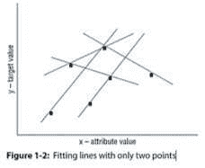。

仅用两个点来拟合直线的问题在于，数据量不足以提供自由度。一条直线有两个自由度。两个自由度意味着有两个参数来决定一条直线。你可以想象在平面上抓住一条直线，在平面内上下滑动它，或者旋转它来改变其斜率。因此，垂直位置和独立的斜率是相互独立的。它们可以被单独改变，共同完全确定一条直线。直线的自由度可以用几种等效方式表示（其与 y 轴的截距和斜率、直线上的两点等）。所有这些直线的表示方法都需要两个参数来指定。

当自由度等于点的数量时，预测效果并不理想。直线穿过了用于绘制它们的点，但用不同点对绘制的直线之间存在很大的差异。对于一个自由度与数据集中点数相等的预测，你不能寄予太大信任。图 1-1 中的图表有六个点，并通过它们拟合了一条直线（两个自由度）。这就是六个点和两个自由度。

确定导致遗传性疾病基因的思考题说明，可选的基因越多，就越需要更多数据，以便从 20,000 多个可能的人类基因中分离出原因。20,000 个不同的基因代表了 20,000 个自由度。即使是来自 20,000 个不同人的数据也不足以获得可靠的答案，在许多情况下，在合理研究范围内负担得起的全部只是大约 500 个人的样本。这就是惩罚线性回归可能是最佳算法选择的地方。惩罚线性回归提供了一种系统减少自由度的方法，以匹配可用数据量和底层现象的复杂性。这些方法对于具有非常自由度的问题已变得非常流行。它们是遗传问题的宠儿，因为这类问题的自由度（即基因数量）可以达到数万，而且对于文本分类等问题，其自由度 可以超过一百万。第 4 节“惩罚线性回归”详细介绍了这些方法的工作原理，并提供了使用 Python 包实现机器学习的流程示例。

## 什么是集成方法？

书中涵盖的另一类算法是集成方法。集成方法的基本思想是构建大量的不同预测模型，然后组合它们的输出——通过平均输出或采取多数意见（投票）。单个模型被称为基学习器。计算学习的某些结果表明，如果基学习器仅略好于随机猜测，那么只要有足够的独立模型，集成方法的性能就可以非常好。促使集成方法发展的问题之一是观察到某些特定的机器学习算法表现出不稳定性。例如，向数据集中添加新数据可能会导致结果模型或性能的剧烈变化。

（注：由于提供的文本后半部分存在大量重复和乱码，翻译已根据指令对有效逻辑部分进行了整合和翻译）

通常的观点是周围存在着海量的遗传数据。从字节数衡量，遗传数据集确实非常大，但在生成准确预测方面，它们并不大。为了理解这种区别，请考虑以下思想实验。


假设你有两个人，其中一人患有遗传性疾病，而另一个人没有。如果你拥有这两个人的基因序列，你能够确定是哪种基因导致了该疾病吗？显然，这是不可能的，因为这两个人之间会有很多基因差异。那么，需要多少人呢？最少情况下，所需的基因序列人数要与基因总数一样多，而且考虑到测量中的任何噪声，所需人数会更多。根据你的计数方式，人类大约有 `20,000` 个基因。每条数据的成本大约为 `1,000` 美元。因此，仅需足够在完美测量下解决该疾病的数据就需要花费 `2,000` 万美元。

这种情况与本节早些讨论的“两点拟合直线”非常相似。模型的自由度需要少于数据点的数量。数据集通常需要是模型自由度的倍数。由于数据集的大小是固定的，模型的自由度需要是可调整的。处理惩罚线性回归的章节将向你展示这种调整性是如何构建在惩罚线性回归中的，以及如何利用它来实现最佳性能。

**注意**：本书中涉及的两大类算法与 Jeremy Howard 和我在 `2012` 年 Strata 大会上介绍的相同。Jeremy 负责了集成方法，而我负责了惩罚线性回归。我们曾对这两类算法的相对优劣争论得很有趣。然而，实际上，这两类涵盖了我所做的约 `80%` 的模型构建工作，而且这有充分的原因。第 `3` 节将详细说明为什么某种算法或另一种算法是更好的选择。

### 构建预测模型的流程步骤

使用机器学习构建预测模型的流程步骤需要多种不同的技能。其中一种是所需的编程技能，本书并不涉及。其他技能与获取训练并部署适当的模型有关。这些其他技能正是本书所涵盖的内容。

这些其他技能包括什么？最初，问题是用某种模糊的语言术语描述的，例如“向访问者展示他们可能点击的链接”。要将其转化为可运行的系统，需要用具体的术语重新表述问题，寻找用于预测的数据，然后训练一个预测访问者点击概率的预测模型。

如何开始处理一个新问题？首先，你查看可用数据，以确定哪些数据是有用的。“查看数据”意味着对数据运行各种统计测试，以直观了解揭示了什么以及它们与你试图预测的内容有什么联系。直觉可以在某种程度上引导你。你还可以量化结果，并测试潜在特征与这些结果之间的相关程度。

通过某种手段，你开发了一组特征并开始训练你选择的机器学习算法。这会产生一个训练模型并估计其性能。接下来，你想考虑对特征集进行更改，包括添加新特征或删除某些证明无用的特征，或者可能更改不同类型的训练目标（也称为标签），以看看是否能提高性能。你将迭代各种设计决策，以判断是否有改进性能。你可能会提取性能最差的示例，然后尝试确定是否有某些共同点统一这些示例。这可能会引导你向预测过程中添加另一个特征，也可能导致你对数据进行分叉处理，并针对不同的群体训练不同的模型。

本书的目标是让你对这些过程足够熟悉，以便你能够自信地完成这些开发步骤。这要求你在构建问题并开始提取用于训练和测试算法的数据时，熟悉不同算法所需的输入数据结构。该过程通常包括以下几个步骤：

1. 提取并汇总用于预测的特征。
2. 开发训练目标。
3. 训练模型。
4. 在测试数据上评估性能。

**注意**：第一次尝试通常可以通过尝试不同的特征集、不同类型的目标等来改进。机器学习不仅仅需要熟悉几个包。它还需要理解并实践开发可部署模型时所涉及的过程。本书旨在让你获得这种理解。它假设你具备了本科水平的数学知识，并了解一些概率和统计的基本概念，但本书并不预设读者具有机器学习背景。同时，它意在为读者提供适用于广泛问题的最佳算法，而不一定旨在综述所有的机器学习算法或方法。有很多算法很有趣，但由于各种原因，它们并不经常被使用。例如，也许它们扩展性不好，也许它们无法提供关于内部运行机制的洞察，也许它们难以使用，等等。众所周知，例如，`Random Forests`（本文涵盖的算法之一）是在线机器学习竞赛中以巨大优势领先的冠军。某些算法之所以被实践者更频繁地使用是有充分的，如果你在读完本书后理解了这些原因，那么这本书就成功了。

## 机器学习问题的框架构建 (Framing a Machine Learning Problem)

开始一项机器学习竞赛是对真实机器学习问题的模拟。竞赛会提供一个简要描述（例如，宣布一家保险公司希望更好地预测其汽车保单的理赔率）。作为竞争者，你的第一步是打开数据集，查看可用数据，并确定预测需要采取什么形式才有用。对数据的检查将让你直观地感受到数据代表什么，以及它们如何与眼前的预测任务相关。数据可以就方法方面提供洞察。图 `1-5` 展示了从通用的语言陈述目标开始，转向可以作为机器学习算法输入的数据安排的过程。那个被夸张表述为“让我们获得更好的结果吧”的泛化陈述，首先必须转换为可以衡量和优化的特定目标。对于网站所有者来说，特定的性能提升可能是提高点击率或增加销售额（或增加贡献毛利）。下一步是汇集数据，这些数据可能使得预测给定客户点击各种链接或在线购买各种产品的概率成为可能。图 `1-5` 将这些数据视为属性矩阵。对于网站示例，这些属性可能包括访问者查看过的其他页面或访问者过去购买过的物品。除了用于预测的属性外，这类问题的机器学习算法还需要正确的答案来用于训练。这些答案在图 `1-5` 中被标记为 `targets`（目标）。本书涵盖的算法通过检测过去行为中的模式来学习，但重要的是，它们不能仅仅是记忆过去的行为；毕竟，客户可能不会重复购买他昨天买过的东西。第 `3` 节详细讨论了这种不带记忆的训练过程是如何运作的。通常，问题表述的几个方面可以用一种方式完成。这导致了构建问题、选择并训练模型以及产生性能估计之间进行某些迭代。图 `1-6` 展示了这一过程。问题可能带有特定的定量训练目标，或者工作的一部分可能是提取这些数据（称为 `targets` 或 `labels` 标签）。例如，考虑构建一个自动交易证券的系统问题。要进行自动交易，第一步可能是预测证券价格的变化。价格很容易获得，因此使用历史数据来构建训练示例（即未来的价格变化是已知的）在概念上是简单的。但即使是这样也涉及选择和实验。未来的价格变化可以用几种不同的方法计算。变化可以是当前价格与 `10` 分钟后价格之间的差值。也可以是当前价格与 `10` 天后价格之间的变化。还可以是当前价格与未来 `10` 分钟内最高/最低价格之间的差。价格的变化可以用一个二状态变量来表征，取决于 `10` 分钟后价格是高是低取值为“较高”或“较低”。这些每一个选择将导致一个预测模型，预测结果将用于决定是否购买或卖该证券。需要一些实验来确定最佳选择。

## 特征提取与特征工程 (Feature Extraction and Feature Engineering)

决定使用哪些变量进行预测可能也涉及实验。这个过程被称为特征提取和特征工程。特征提取是从自由格式安排（如文档或网页中的单词）中获取数据，并将其排列成数字行和列的过程。例如，垃圾邮件过滤问题始于电子邮件文本，可能会提取诸如文档中大写字母的数量、全大写单词的数量、“buy”一词在文档中出现的次数以及其他选定的以突出垃圾邮件与非垃圾邮件差异的数值特征。特征工程是操纵和组合特征以获得更具信息的特征的过程。构建证券交易系统涉及特征提取和特征工程。特征提取将是决定使用哪些内容来预测价格。过去的价格、相关证券的价格、利率以及从新闻稿中提取的特征都已整合到公开讨论的各种交易系统中。此外，证券价格还有许多工程化特征，名称如 `stochastic`（随机）、`MACD`（移动平均收敛扩散）和 `RSI`（相对强度指数），它们基本上是过去价格的函数，其发明者认为这些在证券交易中是有用的。开发出一组合理的特征后，你可以训练像书中描述那样的预测模型，评估其性能，并对部署模型做出决策。通常，你会想要对使用的特征进行更改，即使不是为了其他原因，仅仅是为了确认你的模型性能足够。确定使用哪些特征的一种方法是尝试所有组合，但这可能花费大量时间。不可避免的是，你将面临提高性能与快速将训练好的模型投入使用的竞争压力。书中讨论的算法具有有利的属性，即提供每个属性在生成预测时的实用性指标。一次训练过程将生成特征排名，以指示它们的相对重要性。这些信息有助于加速特征工程过程。**注意**：数据准备和特征工程预计占了开发机器学习模型所需时间的 `80%` 到 `90%`。模型训练过程从每次尝试基准特征集开始。

## 新问题的剖析


本书涵盖的算法从一个填满 `1` 的矩阵（或表格）开始，它建立了一些术语，并在二维表格中表示了一个小型机器学习数据集。该表格将为你提供一个关于数据集的心理概念，使得对“对应属性的列”或“对应单个示例的行”的引用变得熟悉。在这个示例中，预测分析问题是预测个人在未来一年在线购买书籍预计将花费多少钱。数据按行和列排列。每行代表一个单独案例（也称为 `instance`、`example` 或 `observation`）。表 `2-1` 中的列被赋予了特定的名称，用以指示它们在机器学习问题中将扮演的角色。被标记为 `attributes`（属性）的列将用于预测在书上花费的金额。在被标记为 `labels`（标签）的列中，你将看到每个客户去年在书上花费了多少钱。


**注意**：机器学习数据集最常见的排列是列对应单个属性，行对应单个观测值，但并非总是如此。例如，某些文本挖掘文献以相反的方式排列矩阵——列对应观测值，行对应属性。在表 2-1 中，每一行代表一个单独的客户，行中的数据都属于该个人。第一列被称为 `UserID`，包含一个对于每行（案例）都是唯一的标识符。你的问题中可能存在唯一标识符，也可能不存在。例如，网站通常会为访问者标记一个 `user ID`，该 ID 在其访问期间与之关联。如果用户没有在网站注册，则同一个用户每次访问都会获得一个不同的 `ID`。`ID` 通常分配给每个观测值，而该观测值将是你要构建的预测的主体。第 2、3 和 4 列被称为 `Attributes`，而不是赋予像 `Height` 或 `Gender` 这样具体的名称。其目的是为了突出它们在预测过程中的作用。`Attributes` 是关于该案例的可用数据，将用于做出预测。`Labels` 是你想要预测的内容。在这个示例中，`UserID` 是一个数字，`Attribute 1` 是身高，`Attribute 2` 是性别，而 `Attribute 3` 是该人去年读了多少书。`Labels` 下方的列包含了该个人去年在线购买书籍时花费了多少钱。

这些不同类别的数据将扮演什么角色？机器学习算法对 `user ID`、`attributes` 和 `labels` 有什么用？简短的回答是：你忽略 `user ID`。你使用 `attributes` 来预测 `labels`。`unique ID` 用于记录目的，并允许你引用特定案例可用的其他数据。通常，`unique ID` 不直接用于机器学习算法。`Attributes` 是你选择用于预测的事物。`Labels` 是机器学习算法将用于构建预测模型的观测结果。`User ID` 通常不用于预测，因为它太具有特殊性。它仅属于某一个示例。机器学习的诀窍在于构建一个可以泛化到新案例的模型（而不仅仅是记忆过去的案例）。为了实现这一点，必须推导出算法，使其被迫关注多于一行数据。排除 `user ID` 的一个可能例外是：`user ID` 是数值并且是按照用户注册的顺序分配的。基本上，在这种情况下它指示了注册日期，并且是有用的，因为 ID 接近的用户是在相似的时间段注册的，可以据此将他们视为一组。构建预测模型的过程被称为 `training`（训练）。过程如何进行取决于算法，稍后的章节将涵盖细节，但它通常是迭代的。算法假设 `attributes` 和 `labels` 之间存在预测关系，观察它犯的错误并进行一些纠正，然后迭代该过程，直到获得良好的模型。

## 不同类型的属性和标签驱动建模选择

表 2-1 显示的属性分两种类型：`numeric variables`（数值变量）和 `categorical (or factor) variables`（分类变量）。`Attribute 1`（身高）是一个 `numeric variable`，是最常见的属性类型。`Attribute 2` 是性别，由条目 `Male` 表示。这种属性是 `categorical or factor variable`。分类变量的特性是值之间没有顺序关系。分类变量可以是二值的（如 `Male`），也可以是多值的。许多接受数值属性的机器学习算法也是如此的；它们无法处理 `categorical variables`。惩罚回归算法只处理数值型。变量的性质将决定你的算法选择和开发预测模型的方向，因此当你面对新问题时，这是你需要注意的点之一。表 2-1 中的标签是数值型的：去年的花费金额。但在其他问题中，标签也可能是分类的。例如，如果表 2-1 的任务是预测哪些个人明年将花费超过 200 元，问题就会改变，方法也会随之改变。预测哪些客户将花费超过 200 元的新问题将产生新标签。新标签将取两个值之一。表 2-2 显示了 2-1 中的标签与基于命题 `Spending > $200` 的新标签之间的关系。表 2-2 中的新标签取两个值之一——`True` 或 `False`。

当标签是数值时，问题被称为 `regression`。当标签是分类时，问题被称为 `classification`。如果分类目标只取两个值，问题被称为 `binary classification`。如果它超过两个值，问题被称为 `multiclass classification`。在许多情况下，问题类型的选择取决于设计者。你刚刚看到，通过标签的简单转换，这个示例问题可以从 `regression` 转换为 `binary classification`。这些是在你处理问题时可能会做的权衡。例如，分类目标可能更好地支持两种行动之间的决策。分类问题可能比回归问题更简单。例如，考虑具有单条等高线（例如 100 英尺等高线）的地图与每 10 英尺一条等高线的地图之间的复杂度差异。单条等高线将地图分为高于 100 英尺和低于区域，包含的信息比详细的等高线地图少得多。分类器试图计算一条划分等高线，而不考虑决策边界之外的行为，而回归则试图绘制整幅地图。

## 关于你的新数据集的注意事项

在对数据进行初步检查时，你希望确定数据集的许多其他特征。以下是一个清单和一系列了解你数据集的方法，以便熟悉数据并制定你想要遵循的预测模型开发步骤。这些是需要检查的简单事项，并直接影响你的后续步骤。

### 检查项目

- 行数和列数
- 分类变量的数量以及每个缺失值的唯一值数量

### 属性和标签的概要统计

起初要检查的内容之一是数据的规模和形状。将数据读入一个嵌套列表（list of lists）；然后外层列表的维度就是行数，其中一个内部列表的维度就是列数。下一节将展示这种方法在其中一个数据集上的具体应用，你将在后续使用该数据集来说明将要开发的算法的属性。

该过程的下一步是确定每行中有多少个缺失值。按行进行处理的原因是，处理缺失值最简单的方法是丢弃不完整的实例（即至少包含一个缺失值的示例）。在很多情况下，这可能会导致结果产生偏差，但只有几个不完整的示例通常不会产生实质性影响。通过统计带有缺失数据的行数（加上缺失条目的总数），你就能知道如果使用这种简单的方法，需要丢弃数据集中多少部分。

如果你有大量的行（例如在收集网络数据时），那么与你拥有的数据行数相比，你丢失的数量可能很小。如果你正在处理生物学问题，数据非常昂贵且你有许多属性，那么你可能无法丢弃数据。在这种情况下，你必须想出填充缺失值的方法或使用可以处理它们的算法。这种填充被称为“插补”（imputation）。插补缺失数据的简单方法是使用每行条目的平均值来填充缺失条目。更复杂的方法是使用第 4 节和第 6 节涵盖的预测方法之一。要使用预测方法，你可以将带有缺失值的属性列视为标签。在进行此过程之前，务必移除原始的问题标签。接下来的几节将介绍此处列出的流程，并引入一些表征你数据集的方法，以帮助你决定如何应对建模过程。

## 分类问题：使用声纳探测未爆炸的地雷

本节详细介绍了在你开始深入研究分类问题时可能进行的几项检查。它从尺寸和形状的简单测量开始，报告数据类型、统计缺失值等。然后转向数据的统计属性以及属性之间、以及属性与标签之间的相互关系。

该数据集来自加州大学欧文分校数据存储库（UC Irvine Data Repository）。数据源于某些实验，旨在确定声纳是否可以用于探测军事行动后留在港口的未爆炸地雷。声纳信号是所谓的“调频信号”（chirped signal）。这意味着信号频率在声脉冲持续期间会上升（或下降）。数据集中的测量值代表了声纳接收器在返回信号的不同点采集的功率测量值。对于大约一半的示例，声纳照射的是一块岩石，而另一半则是一个形状像地雷的金属圆柱。该数据集名为“岩石与地雷”（Rocks versus Mines）。

### “岩石与地雷”数据集的特性

处理新数据集的第一件事是确定它的规模和形状。列表 2-1 显示了从加州大学欧文分校数据存储库确定“岩石与地雷”数据集规模和形状的代码。在本节的后续部分，你将学习更多关于该数据集的信息，书籍将在介绍算法时将其作为示例使用。

在这种情况下，确定行数和列数的过程非常简单。文件是用逗号分隔的，每个实验的数据占据一行文本。这使得读取一行、按逗号分隔符拆分，并将生成的列表堆叠到包含整个数据集的外层列表中变成了一件易事。

#### 列表 2-1：评估一个新的数据集—rockVmineSummaries.py

```python
# (Output: outputRocksMines)
__author__ = 'Himanshu'

import urllib2
import sys

## 从存储库读取数据
target_url = ("https://archive.ics.uci.edu/ml/machine-learning/databases/undocumented/connectionist-bench/sonar/sonar.data")
data = urllib2.urlopen(target_url)

## 将数据读入标签列表和属性的嵌套列表
xList = []
labels = []

for line in data:
    # 按逗号分隔符拆分
    row = line.strip().split(",")
    xList.append(row)

sys.stdout.write("行数 = " + str(len(xList)) + '\n')
sys.stdout.write("列数 = " + str(len(xList[1])))
```

输出：

```
行数 = 208
列数 = 61
```

正如输出所示，该数据集有 208 行 61 列。行数和列数对你如何进行处理有影响。对于像这样的小数据集，训练时间将只有几秒钟。对于声纳数据这样的数据集，训练时间将取决于预测方法。如果数据集增长到几千行，训练时间将增加到几分钟。如果数据集增长到几万行，训练时间将扩展到几小时甚至更久。关于行和列计数的另一个重要观察是，如果数据集的列数远多于行数，使用线性回归可能获得更好的预测，反之亦然。第 3 节“预测模型构建：平衡性能、复杂度与大数据”以及你之后运行的示例将帮助你更好地理解为什么。

检查清单的下一步是确定数据中有多少列是数值型的。列表 2-2 显示了针对该岩石与地雷数据集执行此操作的代码。代码遍历每一列，并统计数值（整数或浮点数）、非空字符串以及空条目的数量。结果是前 60 列包含所有数值，最后一列包含字符串。字符串值即标签。通常，分类变量以字符串形式表示，如示例所示。在某些情况下，二值分类变量以 0, 1 数值变量的形式表示。

#### 列表 2-2：确定属性的性质—rockVmineContents.py

```python
# (Output: outputRocksMines)
__author__ = 'Himanshu_Mishra'

import urllib2
import sys

## 从存储库读取数据
target_url = ("https://archive.ics.uci.edu/ml/machine-learning/databases/undocumented/connectionist-bench/sonar/sonar.data")
data = urllib2.urlopen(target_url)

## 将数据读入标签列表和属性的嵌套列表
xList = []
labels = []

for line in data:
    # 按逗号拆分
    row = line.strip().split(",")
    xList.append(row)

nrow = len(xList)
ncol = len(xList[1])
type = [0]*3
colCounts = []

for col in range(ncol):
    for row in xList:
        try:
            a = float(row[col])
            if isinstance(a, float):
                type[0] += 1
        except ValueError:
            if len(row[col]) > 0:
                type[1] += 1
            else:
                type[2] += 1
    colCounts.append(type)

type = [0]*3

sys.stdout.write("Col#" + '\t' + "Number" + '\t' + "Strings" + '\t ' + "Other\n")

iCol = 0
for types in colCounts:
    sys.stdout.write(str(iCol) + '\t\t' + str(types[0]) + '\t\t' + str(types[1]) + '\t\t' + str(types[2]) + "\n")
    iCol += 1
```

输出：

| Col# | Number | Strings | Other |
| :--- | :--- | :--- | :--- |
| 0 | 208 | 0 | 0 |
| 1 | 208 | 0 | 0 |
| 2 | 208 | 0 | 0 |
| 3 | 208 | 0 | 0 |
| 4 | 208 | 0 | 0 |
| 5 | 208 | 0 | 0 |
| 6 | 208 | 0 | 0 |
| 7 | 208 | 0 | 0 |
| 8 | 208 | 0 | 0 |
| 9 | 208 | 0 | 0 |
| 10 | 208 | 0 | 0 |
| 11 | 208 | 0 | 0 |
| ... | ... | ... | ... |
| 54 | 208 | 0 | 0 |
| 55 | 208 | 0 | 0 |
| 56 | 208 | 0 | 0 |
| 57 | 208 | 0 | 0 |
| 58 | 208 | 0 | 0 |
| 59 | 208 | 0 | 0 |
| 60 | 0 | 208 | 0 |

## 岩石与矿山数据集的统计摘要

在确定了哪些属性是分类的、哪些是数值的之后，你可能需要对数值变量进行描述性统计，并统计每个分类属性的唯一类别数量。列表 2-3 提供了这两个过程的示例。

#### 列表 2-3：数值型和分类属性的汇总统计—— rVMSummaryStats.py

```python
# (输出：outputSummaryStats.txt)
__author__ = 'Himanshu_Mishra'

import urllib2
import sys
import numpy as np

# 从 uci 数据存储库读取数据
target_url = ("https://archive.ics.uci.edu/ml/machine-learning-"
"databases/undocumented/connectionist-bench/sonar/sonar.all-data")
data = urllib2.urlopen(target_url)

## 将数据整理成标签列表和属性的列表的列表
xList = []
labels = []

for line in data:
    # 按逗号分割
    row = line.strip().split(",")
    xList.append(row)

nrow = len(xList)
ncol = len(xList[1])
type = [0]*3
colCounts = []

## 为第 3 列生成汇总统计（例如）
col = 3
colData = []
for row in xList:
    colData.append(float(row[col]))
colArray = np.array(colData)
colMean = np.mean(colArray)
colsd = np.std(colArray)
sys.stdout.write("Mean = " + '\t' + str(colMean) + '\t\t' + "Standard Deviation = " + '\t ' + str(colsd) + "\n")

## 计算分位数边界
ntiles = 4
percentBdry = []
for i in range(ntiles+1):
    percentBdry.append(np.percentile(colArray, i*(100)/ntiles))
sys.stdout.write("\nBoundaries for 4 Equal Percentiles \n")
print(percentBdry)
sys.stdout.write(" \n")

## 使用 10 个等距区间再次运行
ntiles = 10
percentBdry = []
for i in range(ntiles+1):
    percentBdry.append(np.percentile(colArray, i*(100)/ntiles))
sys.stdout.write("Boundaries for 10 Equal Percentiles \n")
print(percentBdry)
sys.stdout.write(" \n")

## 最后列包含分类变量
col = 60
colData = []
for row in xList:
    colData.append(row[col])
unique = set(colData)
sys.stdout.write("Unique Label Values \n")
print(unique)

## 统计每个值的元素数量
catDict = dict(zip(list(unique), range(len(unique))))
catCount = [0]*2
for elt in colData:
    catCount[catDict[elt]] += 1

sys.stdout.write("\nCounts for Each Value of Categorical Label \n")
print(list(unique))
print(catCount)
```


# 数据探索分析与可视化指南

## 1. 描述性统计分析

输出：`Mean = 0.053892307` `Standard Deviation = 0.046415983`

### Boundaries for 4 Equal Percentiles
`[0.0057999999999999996, 0.024375000000000001, 0.044049999999999999, 0.064500000000000002, 0.4264]`

### Boundaries for 10 Equal Percentiles
`[0.0057999999999999996, 0.0141, 0.022740000000, 0.027869999999, 0.036220000000, 0.0440499999999, 0.050719999999, 0.059959999999, 0.077940000000, 0.10836, 0.4264]`

### Unique Label Values
`set(['R', 'M'])`

### Counts for Each Value of Categorical Label
`['R', 'M']`
`[97, 11]`

第一部分获取一列数值数据并对其进行统计。第一步是计算所选属性的平均值和标准差。了解这些有助于在开发模型时建立直觉。下一部分寻找异常值。其工作原理如下：假设你试图确定在列表中是否存在异常值 = `[0.1, 0.15, 0.2, 0.25, 0.3, 0.35, 0.4]`。

## 使用分位数图可视化异常值

更深入研究异常值的一种方法是将问题数据的分布相对于某些合理分布绘图，以查看数字是否匹配。列表 2-4 显示了如何使用 Python 函数 `probplot` 来帮助确定是否有异常值。

```python
import numpy as np
import pylab
import scipy.stats as stats
import urllib2
import sys

# ... (代码部分省略，保持与原文逻辑一致)
```

如果分析的数据来自高斯分布，那么所绘制的点将落在一条直线上。图 2-1 显示，岩石与矿山数据第 4 列的几个点远离直线。这意味着岩石与矿山数据的尾部比高斯密度包含更多的示例。

`pylab.show()` 

获取这些信息后该做什么？离群值可能会对模型构建或预测带来麻烦。在你在该数据集上训练好模型后，可以查看模型产生的错误，并观察这些错误是否与这些离群值相关。如果是，你就可以采取措施来纠正它们。例如，你可以复制性能较差的示例，以强制让它们占更高的权重。你也可以将它们分离出来，并作为一个单独的类别进行训练。如果它们代表了在模型部署后将看到的数据中不会出现的异常情况，你也可以从数据中删掉它们。一个合理的流程可能是：在探索阶段生成四分位数边界，并记录潜在的离群值，以便直观感受你可能会（或不会）遇到多大的问题。然后当你评估性能数据时，使用分位数-分位数图（Q-Q 图）来确定哪些点可以作为离群值，以用于你的误差分析。

## 类别属性的统计特征

上述描述的过程适用于数值属性。但类别属性又是呢？你想要检查它们包含多少个类别，以及每个类别有多少个示例。你想了解这些内容出于几个原因。性别属性有两个可能的值（男和女），但如果该属性是美国州份，那么会有 50 个可能的类别。随着属性数量的增加，处理它们的复杂性也随之增加。大多数作为集成方法基础的二叉树算法对处理的类别数量都有限制。Breiman 和 Cutler（该算法的发明者）编写流行的 `Random Forests` 包有 32 个类别的限制。如果一个属性具有超过 32 个类别，你就需要对它们进行聚合。稍后你会看到，训练涉及取数据的随机子集并在其上训练一系列模型。假设该类别是美国州份，而爱达荷州只有两个示例。随机抽取训练示例可能无法获得任何来自爱达荷州的样本。你需要在这些问题发生之前看到这类问题，以便进行处理。在爱达荷州只有两个示例的情况下，你可能会将它们与蒙大拿州或怀俄明州合并，可能会复制它们，也可能会管理随机抽取过程以确保获得爱达荷州的示例（这种过程被称为分层采样）。

## 如何使用 Python Pandas 汇总岩石与矿石数据集

Python 包 `Pandas` 可以帮助自动化数据检查和处理过程。它在数据检查和预处理的早期阶段特别有用。`Pandas` 包使得将数据读入一种名为 `data frame`（数据帧）的特殊数据结构成为可能。`data frame` 是根据同样的 `CRAN-R` 数据结构建模的 

注意：`Pandas` 包可能很难安装，因为它有很多需要正确配置版本的依赖项，且每个依赖项都必须彼此之间正确匹配（以此类推）。绕过这一障碍的简单方法是使用从 Continuum Analytics 免费下载的 `Anaconda` Python 发行版 ( http://continuum.io )。安装步骤易于遵循，并可以产生各种数据分析和机器学习包的兼容性安装。你可以将 `data frame` 视为如表 2-1 所示的表格或矩阵结构。`data frame` 是按行方向的，每一行代表单个案例（实验、示例、测量），列代表特定的属性。该结构是类矩阵的，但不是矩阵，因为不同列中的元素可能是不同类型。从形式上说，矩阵定义在域（如实数、二进制数、复数）上，矩阵中的所有条目都是该域的元素。对于统计问题，矩阵太局限了，因为统计样本通常混合了不同类型。表 2-1 中的简单示例在 `Attribute 1` 列中有实值，在 `Attribute 2` 列中有类别变量。对于统计问题，矩阵太局限，因为统计样本通常混合了不同类型。示例在 `Attribute 1` 列是实值，`Attribute 2` 列是类别变量，`Attribute 3` 列是整数。在某一列中，条目是相同的。`data frame` 结构允许访问不同列中的元素，这类似访问一个 `Python` 数组。类似地，切片操作可以访问整行。此外，`Pandas` `data frame` 允许访问行和列。这结果变得非常有用，特别是对于中等数量。

### 示例 2-5: 使用 Pandas 读取并汇总数据

```python
import pandas as pd
import matplotlib.pyplot as plot

__author__ = 'Himanshu Misra'

target_url = ("https://archive.ics.uci.edu/machine-learning/databases/undocumented/connectionist/sonar/all-data") #read into data frame

rocksVMines = pd.read_csv(target_url, header=None) #print head and tail of data frame

print(rocksVMines.head())
print(rocksVMines.tail())

#print summary of data frame
summary = rocksVMines.describe()
print(summary)
```

输出（省略）：

```
V0 V1 V2 ... V57 V58 V59 V60
0 0.0200 0.0371 0.0428 ... 0.0084 0.0090 0.0032 R
1 0.0453 0.0523 0.0843 ... 0.0049 0.0052 0.0044 R
2 0.0262 0.0582 0.1099 ... 0.0164 0.0095 0.0078 R
3 0.0100 0.0171 0.0623 ... 0.0044 0.0040 0.0117 R
4 0.0762 0.0666 0.0481 ... 0.0048 0.0107 0.0094 R [5 rows x 61 columns]

V0 V1 V2 ... V57 V58 V59 V60
203 0.0187 0.0346 0.0168 ... 0.0115 0.0193 0.0157 M
204 0.0323 0.0101 0.0298 ... 0.0032 0.0062 0.0067 M
205 0.0522 0.0437 0.0180 ... 0.0138 0.0077 0.0031 M
206 0.0303 0.0353 0.0490 ... 0.0079 0.0036 0.0048 M
```

在读取文件后，程序的第一部分会打印 `head` 和 `tail`。注意所有的 `heads` 都带有 `R` 标签，而 `tails` 带有 `M` 标签。在该数据集中，`R` 在前，`M` 在后。

```text
207 0.0260 0.0363 0.0136 ... 0.0036 0.0061 0.0115 M [5 rows x 61 columns] V0 V1 ... V58 V59 Count
208.000000 208.000000 ... 208.000000 208.000000 mean 0.029164 0.038437 ... 0.007941 0.006507 std 0.022991 0.032960 ... 0.006181 0.005031 min 0.001500 0.000600 ... 0.000100 0.000600 25% 0.013350 0.016450 ... 0.003675 0.003100 50% 0.022800 0.030800 ... 0.006400 0.005300 75% 0.035550 0.047950 ... 0.010325 0.008525 Max 0.137100 0.233900 ... 0.036400 0.043900
```

代码段的最后部分打印了数据集中实值列的摘要。`Pandas` 使得计算 `mean`、`variance` 和 `quantiles` 的步骤变得自动化。注意，`describe` 函数产生的摘要本身就是一个 `data frame`，因此你可以自动化筛选具有离群值（outliers）的属性的过程。要做到这一点，你可以比较不同分位数之间的差异，如果某个属性的差异超出了该属性其他差异的范围，则标记一个标志。

输出中显示的属性表明其中几个属性存在离群值。值得查看涉及离群值的行数，它们可能都源于少数几个示例。这可以指出需要更仔细检查的数据。

## 2. 岩石与矿山数据集的可视化

可视化有时可以为你提供数字表格中难以观察的数据洞察。本节介绍了几种你可能发现有用的可视化方法。某些可视化方法在分类问题和回归问题中的形式略有不同。

### 2.1 行坐标图 (Parallel Coordinates)

在覆盖 abalone 数据集和葡萄酒质量数据的章节中，你会看到看到方法的回归变体。平行坐标图常用于展示多维数据的关系。在后续章节中，你会看到确定模型质量需要对数据进行采样。数据的存储结构可能需要纳入后续采样的考虑中。

### 2.2 散点图 (Scatter Plots)

通过交叉绘制（cross-plot）可以观察属性之间的两两关系。

```python
## 示例处理逻辑
if (condVar > someVal):
    console.log("xxx")
```
`func(varName, "value")`

`plot.show()`

图 2-4 和 2-5 显示了“岩石与矿石”（rocks versus mines）数据集中两对属性的散点图。岩石与矿石的属性是声呐返回的样本。这种声呐信号被称为调频波（chirped waveform），因为它是一个从低频开始并在脉冲持续期间升高频率的脉冲。岩石与矿石数据集中的属性是自岩石或矿石反射的声波的时间样本。这些返回的声学信号在时间和频率上的关系与发射信号相同。岩石与矿石数据中的 60 个属性是在 60 个不同时间（因此是 60 个不同频率）采集的返回样本。

你可能会认为相邻属性之间比时间上分离的属性具有相关性，因为相邻时间样本之间的频率差异不大。这种直觉在图 2-4 和 2-5 中得到了证实。图 2-4 散点图中的点比图 2-5 中的点更紧密地聚集在直线周围。如果你想培养数值相关性与散点图形状之间关系的直觉，只需搜索“correlation”并查看出现的维基百科页面。它展示了一些散点图和相关的数值相关性。基本上，如果散点图中的点沿着一条细直线分布，则两个变量高度相关；如果它们形成一个点球，则它们互不相关。

你可以将相同的原理应用于绘制每个属性与目标之间的相关性。对于目标为实数的问题（回归问题），这些图表看起来与图 2-4 和图 2-5 非常相似。岩石与矿石数据集是一个分类问题。目标是二值的。你可以遵循相同的通用流程。

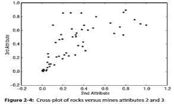 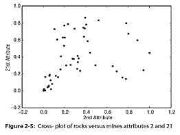

### 列表 2-8：分类目标与真实属性之间的相关性—targetCorr.py


```python
__author__ = 'Himanshu_Mishra'  

import pandas as pd  

from pandas import DataFrame  

import matplotlib.pyplot as plot  

from random import uniform  

target_url = ("https://archive.ics.uci.edu/ml/machine-learning-"  
"databases/undocumented/connectionist-bench/sonar/sonar.all-data")  

# 读取岩石与矿石数据到 pandas 数据框
rocksVMines = pd.read_csv(target_url, header=None, prefix="V")  

# 将目标转换为数值值
target = []  

for i in range(208):  # 根据 "M" 或 "R" 标签分配 0 或 1 目标值 
    if rocksVMines.iat[i, 60] == "M":  
        target.append(1.0) 
    else: 
        target.append(0.0)  

# 绘制第 35 个属性  
dataRow = rocksVMines.iloc[0:208, 35]  

plot.scatter(dataRow, target)  
plot.xlabel("Attribute Value")  
plot.ylabel("Target Value")  
plot.show()  

## 为了改进可视化，此版本对点进行了轻微抖动
## 并让它们具有一定的透明度
target = [] 
for i in range(208):  
    # 根据 "M" 或 "R" 标签分配 0 或 1 目标值 并添加一些抖动
    if rocksVMines.iat[i, 60] == "M": 
        target.append(1.0 + uniform(-0.1, 0.1)) 
    else:  
        target.append(0.0 + uniform(-0.1, 0.1)) 

## 使用半透明点绘制第 35 个属性 
dataRow = rocksVMines.iloc[0:208, 35]  

plot.scatter(dataRow, target, alpha=0.5, s=120) 
plot.xlabel("Attribute Value")  
plot.ylabel("Target Value")  
plot.show()
```

这些图表显示了如果你创建一个对应 R 或 M 目标列表，但用 1 替换 M 并用 0 替换 R 会发生什么。然后你可以像图 2-6 所示绘制散点图。图 2-6 突出了交叉图中的一个常见问题。当所绘制的变量取少数几个值时，点会重叠在一起。如果点很多，你只会得到一条粗黑线，而无法感受点沿直线的分布情况。

列表 2-8 中的代码通过两个细小的变化生成了第二个图，以克服这个问题。每个点都添加了一个微小的随机数，并使其取少量的离散值（在此情况下为目标）。目标值根据构造为 0 或 1。在代码中，你会看到所添加的随机数在 –0.1 到 0.1 之间均匀分布。这散开了点，但又不至于混淆两条线。其次，使用 `alpha=0.5` 绘制点，使点部分透明。图 2-7 显示了这些更改的效果。

这些图表显示了如果你创建一个对应 R 或 M 目标列表，但用 1 替换 M 并用 0 替换 R 会发生什么。然后你可以像图 2-6 所示绘制散点图。图 2-6 突出了交叉图中的一个常见问题。当所绘制的变量取少数几个值时，点会重叠在一起。如果点很多，你只会得到一条粗黑线，而无法感受点沿直线的分布情况。

两个属性（或属性与目标）之间的相关性可以使用皮尔逊相关系数量化。皮尔逊相关系数定义两个等长度的 `u` 和 `v`（见公式 2-1 和 2-2）。首先从 `u` 的所有元素中减去均值（见公式 2-3），对 `v` 执行同样的操作。对于第二个向量 `v`，以与向量 `u` 定义的方式定义向量 `v`。`u` 和 `v` 之间的皮尔逊相关性见公式 2-4。

### 列表 2-9：属性 2 与 3 以及 2 与 21 的皮尔逊相关性计算

```python
__author__ = 'Himanshu_Mishra'  

import pandas as pd  

from pandas import DataFrame  

from math import sqrt  

import sys  

target_url = ("https://archive.ics.uci.edu/ml/machine-learning-"  
"databases/undocumented/connectionist-bench/sonar/sonar.all-data") ## 读取岩石与矿石数据到 pandas 数据框
rocksVMines = pd.read_csv(target_url, header=None, prefix="V")  

# 计算真实值属性之间的相关性
dataRow2 = rocksVMines.iloc[1, 0:60]  
dataRow3 = rocksVMines.iloc[2, 0:60]  
```

```python
dataRow21 = rocksVMines.iloc[20, 0:60]

mean2 = 0.0; mean3 = 0.0; mean21 = 0.0

numElt = len(dataRow2)

for i in range(numElt):
  mean2 += dataRow2[i] / numElt
  mean3 += dataRow3[i] / numElt
  mean21 += dataRow21[i] / numElt

var2 = 0.0; var3 = 0.0; var21 = 0.0

for i in range(numElt):
  var2 += (dataRow2[i] - mean2) * (dataRow2[i] - mean2) / numElt
  var3 += (dataRow3[i] - mean3) * (dataRow3[i] - mean3) / numElt
  var21 += (dataRow21[i] - mean21) * (dataRow21[i] - mean21) / numElt
corr23 = 0.0; corr221 = 0.0

for i in range(numElt):
  corr23 += (dataRow2[i] - mean2) * (dataRow3[i] - mean3) / (sqrt(var2 * var3) * numElt)
  corr221 += (dataRow2[i] - mean2) * (dataRow21[i] - mean21) / (sqrt(var2 * var21) * numElt)

sys.stdout.write("Correlation between attribute 2 and 3 \n")
print(corr23)

sys.stdout.write("\n")

sys.stdout.write("Correlation between attribute 2 and 21 \n")
print(corr221)

sys.stdout.write("\n")
```

输出:

```
Correlation between attribute 2 and 3 0.770938121191

Correlation between attribute 2 and 21 0.466548080789
```

## 使用热力图可视化属性与标签之间的相关性

计算相关性并将其打印或绘制交叉点图对于少数相关性来说效果良好，但很难掌握一个巨大的数字表格，而且如果问题包含 100 个属性，很难将所有的交叉点图挤到一个页面上。检查大量属性相关性的方法一种是计算属性对的皮尔逊相关系数，将这些相关性排列成矩阵，其中第 `ij` 个元素是第 `ith` 个属性与第 `jth` 个属性之间的相关性，然后用热力图将其绘制出来。

列表 2-10 提供了制作此图的代码。图 2-8 显示了该图。沿对角线的浅色区域证实了索引相邻的属性具有较高的相关性。正如前面提到的，这是由于数据生成的方式。相邻的索引在很短的时间间隔内被采样，因此具有相似的频率。相似的频率对目标的反射也相似（以此类推）。

### 列表 2-10：视觉化展示属性相关性—sampleCorrHeatMap.py

```python
__author__ = 'Himanshu_Mishra'

import pandas as pd
from pandas import DataFrame
import matplotlib.pyplot as plot

target_url = ("https://archive.ics.uci.edu/ml/machine-learning-" "databases/undocumented/connectionist-bench/sonar/sonar.all-data") # 将岩石与矿石数据读入 pandas dataframe
rocksVMines = pd.read_csv(target_url, header=None, prefix="V") # 计算实值属性之间的相关性
corMat = DataFrame(rocksVMines.corr())

# 使用热力图可视化相关性
plot.pcolor(corMat)
plot.show()
```

属性之间的完全相关（`correlation = 1`）意味着你可能犯错了并包含了两次相同的内容。一组属性之间极高的相关性（`pairwise correlations > 0.7`）被称为多重共线性，并可能导致估计不稳定。与目标的相关性则是另一回事。拥有与目标相关的属性通常表示存在预测关系。

## 总结理解岩石与矿石数据集的过程

在理解岩石与矿石数据集的过程中，本节介绍了许多工具供你使用，以获得对数据集的理解和直觉。本节进行了详细说明，以使它们的推导和用法清晰可见。接下来的章节将使用这些相同的工具来检查书中将用于开发机器学习算法的其他数据集。由于你现在已经熟悉进行数据检查的工具，接下来的章节将仅在由于问题的性质不同而需要修改工具时对这些工具进行注释。

# 使用因子变量进行实值预测：鲍鱼有多大？

你所见过的用于理解检测未爆炸地雷问题的大多数工具都可以应用于回归问题。在给定物理测量的情况下预测鲍鱼的年龄是此类问题的一个例子。鲍鱼属性还包含一个作为因子变量的属性，这将说明涉及因子变量的差异。

鲍鱼数据集提出了通过几项测量来预测鲍鱼年龄的问题。通过切开贝壳并数生长环，可以获得鲍鱼年龄的精确读数，就像通过数年轮来判断树的年龄一样。对于研究鲍鱼种群科学家来说，在显微镜下切开贝壳并数生长环既昂贵又耗时。如果能够进行长度、宽度、重量等简单的物理测量，然后使用预测模型处理这些测量值并准确地判断鲍鱼的年龄，将更加方便和经济。预测分析有无数科学应用，学习机器学习的益处之一就是能够为各种有趣的问题做出贡献。

该问题的数据可以通过 UC Irvine 数据库获取。该数据集的 URL 为 `http://archive.ics.uci.edu/ml/machine‐learning‐databases/abalone/abalone.data`。该数据集是以逗号分隔的文件形式，没有列标题。列名位于一个单独的文件中。

列表 2-11 将鲍鱼数据集读入 Pandas 数据框中，并运行了一些你在“分类问题：使用声呐探测未爆炸地雷”中看到过的一些相同分析。对于岩石与矿石数据集，由于数据的特性的，列名较为通用。对于鲍鱼数据集，不同的数据列具有含义，这些含义对于培养对模型进展的直观理解至关重要。由于由于原因，你将在代码中看到列名被复制到代码中并附加数据集，以帮助你理解后续机器学习算法正在执行的预测。用于构建预测模型的数据列有 `Sex`、`Length`、`Diameter`、`Height`、`Whole Weight`、`Shucked Weight`、`Viscera Weight`、`Shell Weight` 和 `Rings`。最后一列 `Rings` 是通过锯开贝壳并在显微镜下计数的艰苦过程得出的。这是监督学习问题的典型安排。你拥有一个已知答案的特殊数据集，以便在答案未知时构建一个生成预测的模型。除了显示生成摘要的代码外，列表 2-11 还显示了摘要的打印输出。第一部分打印数据集的头部和尾。为了节省空间，输出中只显示了头部。当你自己运行代码时，将看到两者。数据框大部分填充了浮点数。第一列包含动物的性别，包含字母 `M`（雄性）、`F`（雌性）和 `I`（不确定）。

鲍鱼的性别在出生时并不是决定的，而是在发育一段时间后决定的。因此，年幼鲍鱼的性别是不确定的。鲍鱼的性别是一个三值的分类变量。分类属性需要特别注意。某些算法只处理实值属性（例如支持向量机、K-最近邻和在第 4 节中引入的惩罚线性回归）。第 4 节讨论了如何将分类变量转换为实值变量的技术，以便你能够使用这些算法。列表 2-11 还显示了实值属性的逐列统计摘要。

## 列表 2-11：读取并总结鲍鱼数据集—abaloneSummary.py

```python
__author__ = 'Himanshu_Mishra'  

import pandas as pd  

from pandas import DataFrame  

from pylab import *  

import matplotlib.pyplot as plot  

target_url = ("http://archive.ics.uci.edu/ml/machine-learning-databases/abalone/abalone.data")  

# read abalone data  
abalone = pd.read_csv(target_url, header=None, prefix="V")  
abalone.columns = ['Sex', 'Length', 'Diameter', 'Height', 'Whole weight', 'Shucked weight', 'Viscera weight', 'Shell weight', 'Rings']  

print(abalone.head())  
print(abalone.tail())  

# print summary of data frame  
summary = abalone.describe()  
print(summary)  

# box plot the real-valued attributes 
# convert to array for plot routine  
array = abalone.iloc[:, 1:9].values  
boxplot(array)  
plot.xlabel("Attribute Index")  
plot.ylabel(("Quartile Ranges"))  
show()  

# the last column (rings) is out of scale with the rest  
# - remove and replot  
array2 = abalone.iloc[:, 1:8].values  
boxplot(array2)  
plot.xlabel("Attribute Index")  
plot.ylabel(("Quartile Ranges"))  
show()  

# removing is okay but renormalizing the variables generalizes better. 
# renormalize columns to zero mean and unit standard deviation 
# this is a common normalization and desirable for other operations 
# (like k-means clustering or k-nearest neighbors  

abaloneNormalized = abalone.iloc[:, 1:9]  

for i in range(8): 
    mean = summary.iloc[1, i]  
    sd = summary.iloc[2, i]  
    abaloneNormalized.iloc[:, i:(i + 1)] = (abaloneNormalized.iloc[:, i:(i + 1)] - mean) / sd 

array3 = abaloneNormalized.values  
boxplot(array3)  
plot.xlabel("Attribute Index")  
plot.ylabel(("Quartile Ranges - Normalized "))  
show()
```

**打印输出: (部分)**


## 数据概览

以下为鲍鱼数据集的统计摘要与部分原始数据展示：

```
Sex Length Diameter Height Whole wt Shucked wt Viscera wt
0 M 0.455 0.365 0.095 0.5140 0.2245 0.1010
1 M 0.350 0.265 0.090 0.2255 0.0995 0.0485
2 F 0.530 0.420 0.135 0.6770 0.2565 0.1415
3 M 0.440 0.365 0.125 0.5160 0.2155 0.1140
4 I 0.330 0.255 0.080 0.2050 0.0895 0.0395
Shell weight Rings
0 0.150 15
1 0.070 7
2 0.210 9
3 0.155 10
4 0.055 7...
Sex Length Diameter Height weight Shucked weight
4172 F 0.565 0.450 0.165 0.8870 0.3700
4173 M 0.590 0.440 0.135 0.9660 0.4390
4174 M 0.600 0.475 0.205 1.1760 0.5255
4175 F 0.625 0.485 0.150 1.0945 0.5310
4176 M 0.710 0.555 0.195 1.9485 0.9455
Icera weight Shell weight Rings
4172 0.2390 0.2490 11
4173 0.2145 0.2605 10
4174 0.2875 0.3080 9
4175 0.2610 0.2960 10
4176 0.3765 0.4950 12
Length Diameter Height wt Shucked wt count
4177.000000 4177.000000 4177.000000 4177.000000
mean 0.523992 0.407881 0.139516 0.828742 0.359367
std 0.120093 0.099240 0.041827 0.490389 0.221963
min 0.075000 0.055000 0.000000 0.002000 0.001000
25% 0.450000 0.350000 0.115000 0.441500 0.186000
50% 0.545000 0.425000 0.140000 0.795500 0.336000
75% 0.615000 0.480000 0.165000 1.153000 0.502000
Max 0.815000 0.650000 1.130000 2.825500 1.488000
```

## 箱线图的替代方案

作为统计摘要的替代方案，列表 2-11 为每个实值数据列生成了箱线图。其中第一个显示图 2-9。在图 2-9 中，统计摘要由箱线图表示，箱线图也称为须线图。这些图显示了一个中间有一条红线的小矩形。红线标记了数据列的中位数（或第 50 百分位数）。矩形的顶部和底部分别标记了第 25 百分位数和第 75 百分位数。你可以通过打印摘要中的数字与箱线图中的水平线来确认这一点。

在箱子的上下，你会看到小的水平标记，即所谓的“须”。它们绘制在箱子上下四分位间距 1.4 倍的高度处。四分位间距是第 75 百分位数和第 25 百分位数之间的差。换句话说，箱子顶部与上须之间的空间是箱子高度的 1.4 倍。须的 1.4 倍间距是可以调整的；请参见箱线图文档。你会注意到在某些情况下须比 1.4 倍间距短。对于这些情况，数据值没有延伸到计算出的须的位置。在这些情况下，须放置在最极端的数据点。在其他情况下，数据在计算出的须的位置之外大幅延伸。这些点可以被视为异常值。

## 归一化

列表 2-11 代码的最后部分在绘制箱线图之前对所有数据列进行归一化。在这种情况下，归一化意味着对每列进行中心化和缩放，使得属性 1 的单位与属性 2 的单位具有相同的含义。数据科学中的许多算法和操作都需要这种归一化。例如，`K-means` 聚类根据数据行之间的向量距离构建聚类。距离是通过从一个点减去另一个点并平方来衡量的。如果单位不同，数值距离也不同。到杂货店的距离以英里计算可能是 1，如果以英尺计算则是 5280。

列表 2-11 指出的归一化调整了变量，使其具有 0 均值和单位标准差。这是一种非常常见的归一化。归一化的计算使用了由 `summary()` 函数生成的数字。结果绘制在图 2-11。

## 回归问题的平行坐标图——可视化鲍鱼问题的变量关系

下一步是获取属性之间以及属性与标签之间关系的想法。对于岩石与矿石数据，着色的平行坐标图以图形方式展示了这些关系。这种方法需要一些修改才能适用于鲍鱼问题。岩石与矿石是一个分类问题。该问题的平行坐标图根据真实分类对代表数据行的线进行着色。这有助于可视化预测与预测变量之间的关系。鲍鱼问题是一个回归问题，因此此示例中的着色需要对应于高或低目标值的颜色。为了给实值分配颜色深度，需要将实值压缩到 `[0.0, 1.0]` 区间内。列表 2-12 使用 Pandas 的 `summary()` 函数生成的 `min` 和 `max` 值来实现这一点。图 2-12 显示了结果。

### 列表 2-11：鲍鱼数据的平行坐标图

`abaloneParallelPlot.py`

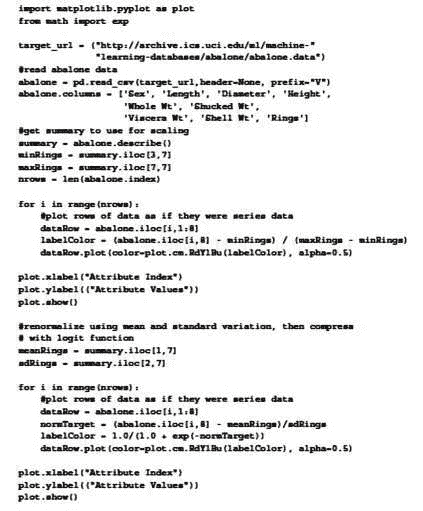图 2-12 中的平行坐标图说明了鲍鱼年龄（壳环数量）与预测年龄的可用属性之间的直接关系。用于生成此图的色阶范围从深红褐色到较浅的红色、黄色、浅蓝色和深蓝色。图 2-11 中的箱线图显示，最大值和最小值与数据主体分得很远。这起到压缩标尺的作用，使得大多数数据处于颜色标尺的中等范围。尽管如此，图 2-12 表明每个属性与每个示例测得的环数之间存在显著的相关性。在几个属性的相似值处，相似的颜色被聚集在一起。这种相关性表明你能够建立一个准确的预测模型。与属性和目标之间通常良好的相关性相反，图中较深橙色区域中夹杂着一些浅蓝色线条，这表明某些示例将很难正确预测。

## 更改颜色映射

更改颜色映射可以帮助你可视化关系，这里利用了你在箱线图中看到的归一化。这种归一化并没有让所有值都落在 0 和 1 之间。一方面，结果产生的负值与正值一样多。列表 2-11 中的程序采用 `logit transform` 来获取 (0, 1) 之间的值。`logit transform` 由方程 2-5 所示的表达式给出。该函数的图如图 2-13 所示。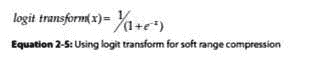如你所示，`logit transform` 将较大的负值映射到 0（几乎），将较大的正数映射到 1（几乎）；它将 0 映射到 0.5。你将在第 4 节再次看到 `logit` 函数，它在联系线性函数与概率方面起着至关重要的作用。图 2-14 显示了这些步骤的结果。这些转换使得充分利用了所有可用颜色。注意，有几条深蓝色的线条（对应环数较多的标本）混在浅蓝色示例中，甚至在全重（`Whole Weight`）和去壳重量（`Shucked Weight`）区域的图中出现了黄色和浅红色的标本。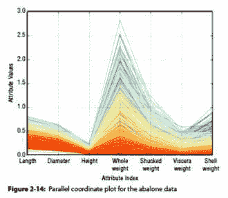这表明这些属性可能不足以正确预测较老标本的年龄（环数）。幸运的是，其他一些属性（`Diameter` 直径和 `Shell Weight` 壳重）能更好地正确排序深蓝色线条。这些观测在你以后分析预测误差时将证明是有用的。

## 如何使用相关性热图进行回归——可视化两两相关性

最后一步是查看各种属性之间以及属性与目标之间的相关性。列表 2-12 显示了生成鲍鱼数据相关性热图和相关矩阵的代码。这些计算遵循为岩石与矿山数据概述的相同方法，但有一个重要的区别：由于鲍鱼问题需要预测实数，因此相关性计算可以在相关性矩阵中包含目标。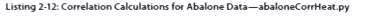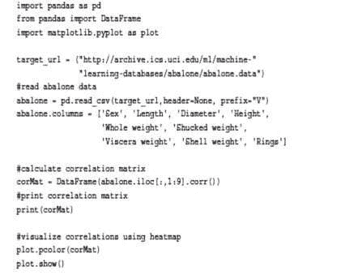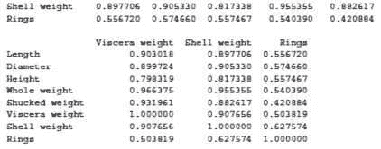图 2-15 显示了相关性热图。在图中，红色表示高相关，蓝色表示弱相关。目标（壳中的环数）是最后一项，位于热图的顶行和最右侧的列。这些位置的蓝色值意味着属性与目标之间的相关性较弱。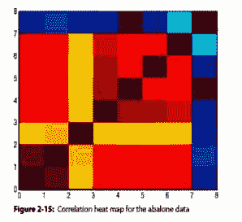浅蓝色对应于目标与重量之间的相关性。这证实了你在平行坐标图中看到的内容。图 2-15 中其他非对角单元格中的红色值表示属性之间高度相关。这与平行坐标图提供的图像有些矛盾，因为视觉上目标与属性之间的对应似乎相当紧密。列表 2-12 显示了相关的数值。在这一节中，你已经看到如何将针对分类问题（岩石与矿山）描述的工具应用于回归问题（鲍鱼）。这些修改都源于两种问题类型的根本区别——回归问题的标签是实数，而二分类分类问题的标签是二值的。下一节将对一个具有所有数值属性的回归问题进行相同的研究。由于它是回归问题，可以使用本节用于鲍鱼问题的相同工具。由于它具有所有数值属性，所有属性都可以包含在研究中，例如相关性和沿实数线绘图。

## 使用实值属性进行实值预测

### 计算你的葡萄酒味道如何

葡萄酒口味数据集包含大约 1,500 瓶红酒的数据。对于每种酒，都有化学成分的若干测量值，包括酒精含量、挥发酸和硫酸盐等。每种酒还有一个口味评分，这是通过平均三位专业葡萄酒品鉴师给出的评分得出。问题是建立一个模型，结合化学测量值并预测口味评分，以匹配人类品鉴师给出的评分。列表 2-13 显示了生成葡萄酒数据集摘要的代码。代码打印出数据的数值摘要，位于列表的底部。代码还生成了归一化变量的箱线图，以便你可以可视化离群值。图 2-16 显示了箱线图。数值摘要和箱线图显示了许多值。在这些数据上训练时要注意这一点。在分析训练模型的性能时，这些离群示例将是寻找来源的地方。

### 列表 2-13: 葡萄酒摘要——`wineSummary.py`

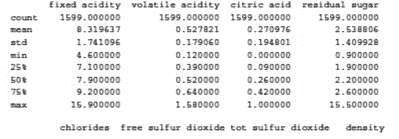葡萄酒数据的颜色编码平行坐标图将给出生成该图的代码。图 2-17 显示了生成的平行坐标图。图 2-17 中的图在尺度较小的变量方向上存在压缩。为了克服这一限制，列表 14 对葡萄酒数据进行了归一化并重新绘图。图 2-18 显示了生成的平行坐标图。

### 列表 2-14: 生成葡萄酒数据的平行图—— `wineParallelPlot.py`

```python
__author__ = 'HimanshuMishra'

import pandas as pd
from pandas import DataFrame
from pylab import *
import matplotlib.pyplot as plot
from math import exp

target_url = "http://archive.ics.uci.edu/ml/machine-learning-databases/wine-quality/winequality-red.csv"
wine = pd.read_csv(target_url, header=0, sep=";")

# generate statistical summaries
summary = wine.describe()
nrows = len(wine.index)
tasteCol = len(summary.columns)
meanTaste = summary.iloc[1, tasteCol - 1]
sdTaste = summary.iloc[2, tasteCol - 1]
nDataCol = len(wine.columns) - 1

for i in range(nrows):  # 将数据行作为序列数据进行绘图
    dataRow = wine.iloc[i, 1:nDataCol]
    normTarget = (wine.iloc[i, nDataCol] - meanTaste) / sdTaste
    labelColor = 1.0 / (1.0 + exp(-normTarget))
    dataRow.plot(color=plot.cm.RdYlBu(labelColor), alpha=0.5)

plot.xlabel("Attribute Index")
plot.ylabel(("Attribute Values"))
plot.show()
```

```python
ncols = len(wineNormalized.columns)

for i in range(ncols):
    mean = summary.iloc[1, i]
    sd = summary.iloc[2, i]
    wineNormalized.iloc[:, i:(i + 1)] = (wineNormalized.iloc[:, i:(i + 1)] - mean) / sd  # Try again with normalized values

for i in range(nrows):
    # plot rows of data as if they were series data
    dataRow = wineNormalized.iloc[i, 1:nDataCol]
    normTarget = wineNormalized.iloc[i, nDataCol]
    labelColor = 1.0 / (1.0 + exp(-normTarget))
    dataRow.plot(color=plot.cm.RdYlBu(labelColor), alpha=0.5)

plot.xlabel("Attribute Index")
plot.ylabel(("Attribute Values"))
plot.show()
```

归一化后葡萄酒数据的图表更清晰地展示了所有坐标方向上与目标之间的相关性。图 2-18 显示了几个属性之间明显的相关性。在图表的右侧，深蓝色线条（高口感评分）在高酒精含量值处聚集。在最左侧，深红色线条（低口感评分）在高挥发性酸含量值处聚集。这些是最为相关的属性。你将在第 5 和第 7 节中看到的预测模型将根据属性在生成预测时的重要性对其进行排序。你将看到这些视觉观察是如何被预测模型支持的。图 2-19 显示了属性与其他属性之间以及属性与目标之间相关性的热图。在热力图中，热色对应于高水平（这与平行坐标图中使用的色标相反）。葡萄酒数据的热力图显示，口感（最后一列）与酒精（倒数第二列）之间存在较高的相关性，而其他几个属性（包括第一个属性：挥发性酸）的水平非常低（高相关性但符号为负值）。

对葡萄酒数据集的探索是使用已经解释过的工具完成的。葡萄酒数据集展示了这些工具能够揭示的内容。平行坐标图和相关性热图都显示，高水平的酒精与高口感评分相关，而高水平的挥发性酸与低口感评分相关。你将在第 5 和第 7 节看到，作为预测建模一部分变量重要性研究将呼应这些发现。葡萄酒数据提供了一个很好的例子，说明数据探索可以在多大程度上帮助你构建和验证预测模型。下一节将探索用于多分类问题的数据。

## 多分类问题：那是哪种玻璃？

多分类与二分类相似，不同之处在于有多个可能的离散结果，而只有两个。回想一下，探测未爆炸地雷的问题涉及两个可能的结果：被声呐照明的物体是岩石还是地雷。从化学成分测量中确定葡萄酒口感的问题有几个可能的结果（3 到 8 分的口感评分）。但在葡萄酒问题中，分数之间存在顺序关系。分数为 5 的葡萄酒比分数为 3 的要好，但比分数为 8 的要差。在多分类问题中，结果之间不存在顺序感。

本节描述的玻璃问题提供了一个多分类问题的例子。在本节中，玻璃问题给出了各种类型玻璃的化学成分。该问题的目标是确定玻璃的用途。可能的玻璃类型包括建筑窗玻璃、车辆窗玻璃、玻璃容器等。确定玻璃类型的动机是法医学。在事故或犯罪现场会有玻璃碎片，确定它们的来源可以帮助判断谁有责任或谁犯了罪。列表 2-15 显示了生成玻璃数据集摘要的代码。图 2-20 显示了归一化数据上的箱线图。箱线图显示了相当数量极值。

### 列表 2-15：玻璃数据集摘要 — `glassSummary.py`


```python
__author__ = 'Himanshu_Mishra'

import pandas as pd
from pandas import DataFrame
from pylab import *
import matplotlib.pyplot as plot

target_url = ("https://archive.ics.uci.edu/ml/machine-" "learning-databases/glass/glass.data")

glass = pd.read_csv(target_url, header=None, prefix="V")
glass.columns = ['Id', 'RI', 'Na', 'Mg', 'Al', 'Si', 'K', 'Ca', 'Ba', 'Fe', 'Type']

print(glass.head())

# generate statistical summaries
summary = glass.describe()
print(summary)

ncol1 = len(glass.columns)
glassNormalized = glass.iloc[:, 1:ncol1]
ncol2 = len(glassNormalized.columns)
summary2 = glassNormalized.describe()

for i in range(ncol2):
    mean = summary2.iloc[1, i]
    sd = summary2.iloc[2, i]
    glassNormalized.iloc[:, i:(i + 1)] = (glassNormalized.iloc[:, i:(i + 1)] - mean) / sd
array = glassNormalized.values

boxplot(array)
plot.xlabel("Attribute Index")
plot.ylabel(("Quartile Ranges - Normalized "))
show()
```

输出：`[filename - ]`

玻璃数据属性的箱线图显示了数量大量的离群值——至少与一些其他示例问题相比，这一点非常显著。玻璃数据有两个可能驱动离群行为的因素。其之一是一个分类问题。属性值与类别成员身份之间不一定有任何连续性——没有理由预期跨类别的属性值是接近。玻璃数据的另一个独特特征是它是某种不平衡的。每个类别的示例数量从最多类的 76 个到最少类的 9 个不等。平均统计可能会被多数类别的值主导，没有理由预期其他类别的成员具有相似的属性值。这种极端行为对于区分不同类别可能是一件好事，但它意味着预测方法必须能够追踪不同类别之间相当复杂的边界。你将在第 3 节中学到，如果给予足够的数据，集成方法产生比惩罚线性回归能产生更复杂的决策边界，你将在第 5 和第 7 节中看到哪一类方法在该数据集上表现更好。


平行坐标图可能对这些数据的行为提供更多线索。图 2-21 显示了平行坐标图。数据使用离散颜色对每个可能的输出进行绘图。图中的某些变量显示出相当不同的颜色路径。例如，深蓝色线条良好地聚集，并在许多属性上与其他类别良好地分离。深蓝色线条在几个属性上处于数据的边缘——也就是说，在这些属性上是离群值。浅蓝色线条比深蓝色少，并且处于与深蓝色某些相同属性的边缘，但并非所有相同属性。

中间的棕色线条也聚集在一起，但值处于中间范围。

列表 2-16：玻璃数据的平行坐标图 — `glassParallelPlot.py`
（注：提供的源文本列表中 2-16 的代码被截断了）。

```python
summary = glassNormalized.describe()

nDataCol = ncols - 1
```

# 标签外的归一化

```python
for i in range(ncols - 1):
    mean = summary.iloc[1, i]
    sd = summary.iloc[2, i]
    glassNormalized.iloc[:, i:(i + 1)] = (glassNormalized.iloc[:, i:(i + 1)] - mean) / sd
```

## 使用归一化后的值绘制平行坐标图

```python
for i in range(ncols):
    mean = summary.iloc[1, i]
    sd = summary.iloc[2, i]
    glassNormalized.iloc[:, i:(i + 1)] = (glassNormalized.iloc[:, i:(i + 1)] - mean) / sd
```


```python
dataRow = glassNormalized.iloc[7.0]
labelColor = glassNormalized.iloc[i, nDataCol]
dataRow.plot(color=plot.cm.RdYlBu, alpha=0.5)
plot.xlabel("Attribute Index")
plot.ylabel("Attribute Values")
plot.show()
```

列表 2-16 显示了生成平行坐标图的代码。在岩石与矿石问题中，图中的线条是以不同颜色的光谱绘制的。而在这个多分类问题中，每个类都有自己的颜色。共有六种离散颜色。标签从 `1` 到 `7`，其中没有 `4`。颜色的计算方法与回归问题类似——将标签除以其最大值。图中生成的线条采用了六种离散颜色。图 2-22 显示了玻璃数据的相关性热图。该图显示属性之间的相关性大多较低。这意味着这些属性之间大多是相互独立的，这是一件好事。目标值没有包含在相关性图中，因为该问题的目标具有多个离散值。这削弱了相关性图的解释力。

 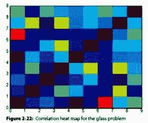

对玻璃数据的探索性研究发现了一个非常有趣的问题。特别是箱线图结合平行坐标图表明，如果有足够的数据进行拟合，良好的算法选择可能是集成方法。对应于某一类或另一类的属性集之间显然存在着复杂的边界。哪种算法将提供最佳预测性能仍有待观察。你所学的探索性方法已经完成了它们的任务。它们让你对该问题的权衡有了良好的理解，并对哪种算法将产生最佳性能产生了一些猜测。

# 第 2 节总结

本节向你介绍了几种用于深入研究新数据集并理解如何着构建预测模型的工具。这些工具从简单学习数据集的大小和形状，并确定属性和标签的类型开始。关于数据集的这些事实将帮助你通过预处理数据和训练预测模型来确定方向。本节还涵盖了几种可以帮助你理解数据集的不同统计研究。这些包括简单的描述性统计（均值、方差和分位数）以及二阶统计，如属性之间的相关性以及属性与标签之间的相关性。属性与二分类标签的相关性需要一些与实数回归标签不同的技术。本节还介绍了几种可视化技术。其中一种用于可视化数据中离群值行为的 Q-Q 图；另一种用于可视化属性与标签之间关系的平行坐标图。所有这些方法都将应用于书中其余卷份的问题中，用于演示所涵盖的算法并对它们进行比较。


