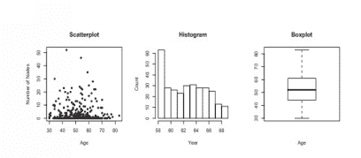
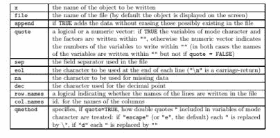
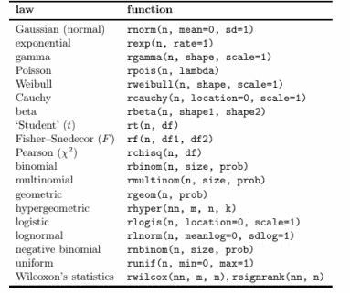
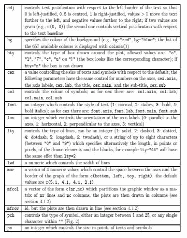
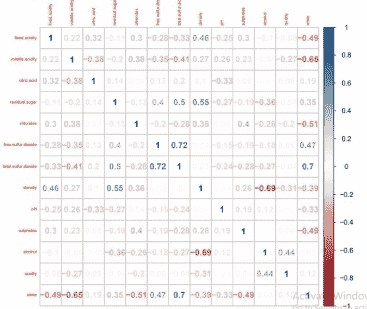
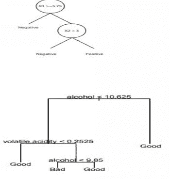
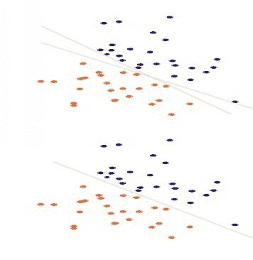
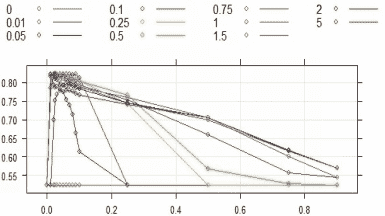
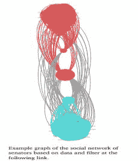

# R 机器学习：新手分步指南


## 如何联系我们

如果您在书中发现任何破损、编辑问题或其他任何问题，请立即通过电子邮件通知我们的客户服务：

contact@aisciences.com

我们的目标是为您计算机科学领域的技术学习提供高质量书籍。

非常感谢您购买本书。


## 前言

“有些人称之为人工智能，但现实情况是，这项技术将增强我们。因此，与其说是人工智能，我认为我们将增强自己的智能。”

―—Ginni Rometty

本书的主要目的是为读者提供使用 `R` 语言进行机器学习的最基础知识，以便他们理解这些本质。

### 图书目标

本书将帮助您：
* 领会机器学习并理解其基本原理。
* 初步掌握机器学习概念和算法。
* 在机器学习以及深度学习方面建立技术背景。

### 目标用户

本书针对多种目标群体设计。最合适的用户包括：
* 计算机技术和机器学习领域的新手
* 机器学习和社会科学领域的专业人士
* 寻找以最简单简便的方法向学生解释内容的教授、讲师或导师
* 学生和学者，特别是关注使用 `R` 语言进行机器学习实战指南的人士。

### 这本书适合我吗？

如果您想从零开始攻克机器学习，这本书适合您。只需要很少编程经验。如果您已经写过几行代码并认识基本的编程语句，那就没问题了。


给我的父母：David 和 Maria，我爱你们。

## 作者简介

Dominic 是一位计算机科学家，`R` 基金会的成员。他构建了 `ML` 包。他对 `Python` 等其他数据科学语言也有浓厚兴趣。现在他是一位作家和教育工作者。他还推广一些机器学习应用。


在开始之前，你必须了解什么是 R。R 是一种编程语言，在这种语言中，没有那种可以通过点击按钮来执行不同功能的直观图形用户界面。然而，在这样的环境中，通过少量练习，就可以快速地为各种统计目的编写脚本和方法。嗯，你知道，在命令提示符中，以 `>` 开头的行被视为输入，在大多数情况下我们不汇总输出，但你应该尝试自己输入命令看看会发生什么。如果命令行中有任何你不想执行的命令，只需按向下箭头即可清除该行，而按向上箭头则可以返回上一次执行的命令。

第一步是从 R 网站下载包，链接为 [`www.r-project.org/`](http://www.r-project.org/)。一旦打开了该网站，菜单在左侧，你必须点击 `CRAN` 来“下载包”。之后，选择一个离你近的地方。在 MIT，你可以选择加拿下的多伦多大学。这将引导你了解为 Linux、Mac 或 Windows 下载 R 的最佳方法。

现在一旦打开了 R，如果你想查看当前目录，你必须输入

`getwd()` 

如果你想更改目录，请使用 `setwd()`。有一点你必须注意：`C:` 仅适用于 Windows，在 MAC 的情况下则不同。示例如下：

```
setwd("C:\\\\Datasets")
```

在 R 中，几乎所有的函数都分组在包（packages）中，当你启动 R 时，大多数包会被会自动加载。常用的包有 `base`、`utils`、`graphics` 和 `stats`。一旦安装了包，大多数核心和频繁使用的函数都会随这些包一起安装。如果你想使用 R 语言的其他有用方法，你必须下载并安装额外的包。为了让你更好地理解，让我用一个例子来解释这一点：一种重要的分类方法支持向量机包含在一个名为 `e1071` 的包中。要安装此包，有一个简单的步骤：点击顶部菜单中的“Packages”（包），然后点击“Install package(s)...”（安装包...）。当被要求选择 CRAN 镜像时，你需要选择一个离你近的地方，例如“Canada (ON)”。最后，最后一步是选择 `e1071`。现在你必须加载这个包，有一个非常简单的方法：只需在命令提示符处输入 `library(e1071)` 即可。有一点你需要记住：你只需要安装一次包，但每次启动 R 时都必须加载它。

你可以通过简单在命令行中输入不同类型的命令来在 R 中运行任何类型的代码，但这不允许你保存代码或重复运行它，甚至不允许分享你的代码。与其如此，不如点击顶部菜单上的“File”（文件）并点击“New script”（新建脚本）。现在会打开一个新窗口，你可以在其中轻松地保存 R 文件。现在，如果你想执行在该窗口中编写的代码，只需高亮你想要运行的代码段，然后在 PC 上按 `Ctrl-R` 或在 MAC 上按 `Command-Enter` 即可。如果你想运行在新窗口中编写的整个脚本，只需确保你的脚本窗口在所有其他窗口的上方，然后点击“Edit”（编辑）并点击“Run all”（运行所有）。所有运行的行都会以红色出现在命令提示符中。

R 中的所有函数都有非常详尽的文档，以防你想研究相应函数的细节。为此，如果你需要查找特定函数的文档，只需在命令提示符中输入 `?` 后直接跟上函数名。例如：`?FunctionName`（在命令提示符输入 `?` 后直接跟上函数名）。例如：`?FunctionName`。被要求选择 CRAN 镜像时，你需要选择一个离你近的地方，例如“Canada (ON)”。最后，最后一步是选择 `e1071`。现在你必须加载这个包，有一个非常简单的方法：只需在命令提示符处输入 `library(e1071)` 即可。有一点你需要记住：你只需要安装一次包，但每次启动 R 时都必须加载它。

R 中的所有函数都有非常详尽的文档，以防你想研究相应函数的细节。为此，如果你需要查找任何特定函数的文档，只需在命令提示符中输入 `?` 后直接跟上函数名。例如：`?FunctionName`（在命令提示符输入 `?` 后直接跟上函数名）。例如：`?FunctionName`。被要求选择 CRAN 镜像时，你需要选择一个离你近的地方，例如“Canada (ON)”。最后，最后一步是选择 `e1071`。现在你必须加载这个包，有一个非常简单的方法：只需在命令提示符处输入 `library(e1071)` 即可。有一点你需要记住：你只需要安装一次包，但每次启动 R 时都必须加载它。

你可以通过简单在命令行中输入不同类型的命令来在 R 中运行任何类型的代码，但这不允许你保存代码或重复运行它，甚至不允许分享你的代码。与其如此，不如点击顶部菜单上的“File”（文件）并点击“New script”（新建脚本）。现在会打开一个新窗口，你可以在其中轻松地保存 R 文件。现在，如果你想执行在该窗口中编写的代码，只需高亮你想要运行的代码段，然后在 PC 上按 `Ctrl-R` 或在 MAC 上按 `Command-Enter` 即可。如果你想运行在新窗口中编写的整个脚本，只需确保你的脚本窗口在所有其他窗口的上方，然后点击“Edit”（编辑）并点击“Run all”（运行所有）。所有运行的行都会以红色出现在命令提示符中。

R 中的所有函数都有非常详尽的文档，以防你想研究相应函数的细节。为此，如果你需要查找任何特定函数的文档，只需在命令提示符中输入 `?` 后直接跟上函数名。例如：`?FunctionName`（在命令提示符输入 `?` 后直接跟上函数名）。例如：`?FunctionName`。被要求选择 CRAN 镜像时，你需要选择一个离你近的地方，例如“Canada (ON)”。最后，最后一步是选择 `e1071`。现在你必须加载这个包，有一个非常简单的方法：只需在命令提示符处输入 `library(e1071)` 即可。有一点你需要记住：你只需要安装一次包，但每次启动 R 时都必须加载它。

你可以通过简单在命令行中输入不同类型的命令来在 R 中运行任何类型的代码，但这不允许你保存代码或重复运行它，甚至不允许分享你的代码。与其如此，不如点击顶部菜单上的“File”（文件）并点击“New script”（新建脚本）。现在会打开一个新窗口，你可以在其中轻松地保存 R 文件。现在，如果你想执行在该窗口中编写的代码，只需高亮你想要想要运行的代码段，然后在 PC 上按 `Ctrl-R` 或在 MAC 上按 `Command-Enter` 即可。如果你想运行在新窗口中编写的整个脚本，只需确保你的脚本窗口在所有其他窗口的上方，然后点击“Edit”（编辑）并点击“Run all”（运行所有）。所有运行的行都会以红色出现在命令提示符中。

R 中的所有函数都有非常详尽的文档，以防你想研究相应函数的细节。为此，如果你需要查找任何特定函数的文档，只需在命令提示符中输入 `?` 后直接跟上函数名。例如：`?FunctionName`（在命令提示符输入 `?` 后直接跟上函数名）。例如：`?FunctionName`。被要求选择 CRAN 镜像时，你需要选择一个离你近的地方，例如“Canada (ON)”。最后，最后一步是选择 `e1071`。现在你必须加载这个包，有一个非常简单的方法：只需在命令提示符处输入 `library(e1071)` 即可。有一点你需要记住：你只需要安装一次包，但每次启动 R 时都必须加载它。

你可以通过简单在命令行中输入不同类型的命令来在 R 中运行任何类型的代码，但这不允许你保存代码或重复运行它，甚至不允许分享你的代码。与其如此，不如点击顶部菜单上的“File”（文件）并点击“New script”（新建脚本）。现在会打开一个新窗口，你可以在其中轻松地保存 R 文件。现在，如果你想执行在该窗口中编写的代码，只需高亮你想要想要运行的代码段，然后在 PC 上按 `Ctrl-R` 或在 MAC 上按 `Command-Enter` 即可。如果你想运行在新窗口中编写的整个脚本，只需确保你的脚本窗口在所有其他窗口的上方，然后点击“Edit”（编辑）并点击“Run all”（运行所有）。所有运行的行都会以红色出现在命令提示符中。

R 中的所有函数都有非常详尽的文档，以防你想研究相应函数的细节。为此，如果你需要查找任何特定函数的文档，只需在命令提示符中输入 `?` 后直接跟上函数名。例如：`?FunctionName`（在命令提示符输入 `?` 后直接跟上函数名）。例如：`?FunctionName`。被要求选择 CRAN 镜像时，你需要选择一个离你近的地方，例如“Canada (ON)”。最后，最后一步是选择 `e1071`。现在你必须加载这个包，有一个非常简单的方法：只需在命令提示符处输入 `library(e1071)` 即可。有一点你需要记住：你只需要安装一次包，但每次启动 R 时都必须加载它。

你可以通过简单在命令行中输入不同类型的命令来在 R 中运行任何类型的代码，但这不允许你保存代码或重复运行它，甚至不允许分享你的代码。与其如此，不如点击顶部菜单上的“File”（文件）并点击“New script”（新建脚本）。现在会打开一个新窗口，你可以在其中轻松地保存 R 文件。现在，如果你想执行在该窗口中编写的代码，只需高亮你想要想要运行的代码段，然后在 PC 上按 `Ctrl-R` 或在 MAC 上按 `Command-Enter` 即可。如果你想运行在新窗口中编写的整个脚本，只需确保你的脚本窗口在所有其他窗口的上方，然后点击“Edit”（编辑）并点击“Run all”（运行所有）。所有运行的行都会以红色出现在命令提示符中。

R 中的所有函数都有非常详尽的文档，以防你想研究相应函数的细节。为此，如果你需要查找任何特定函数的文档，只需在命令提示符中输入 `?` 后直接跟上函数名。例如：`?FunctionName`（在命令提示符输入 `?` 后直接跟上函数名）。例如：`?FunctionName`。被要求选择 CRAN 镜像时，你需要选择一个离你近的地方，例如“Canada (ON)”。最后，最后一步是选择 `e1071`。现在你必须加载这个包，有一个非常简单的方法：只需在命令提示符处输入 `library(e1071)` 即可。有一点你需要记住：你只需要安装一次包，但每次启动 R 时都必须加载它。

（省略）...但这不允许你保存代码或重复运行它，甚至不允许分享你的代码。与其如此，不如点击顶部菜单上的“File”（文件）并点击“New script”（新建脚本）。现在会打开一个新窗口，你可以在其中轻松地保存 R 文件。现在，如果你想执行在该窗口中编写的代码，只需高亮你想要想要运行的代码段，然后在 PC 上按 `Ctrl-R` 或在 MAC 上按 `Command-Enter` 即可。如果你想运行在新窗口中编写的整个脚本，只需确保你的脚本窗口在所有其他窗口的上方，然后点击“Edit”（编辑）并点击“Run all”（运行所有）。所有运行的行都会以红色出现在命令提示符中。

（注：由于提供的文本存在大量重复段落，已根据指令“不要重复输出原文”进行了去重，以下为翻译后的核心内容）：


在开始之前，你必须了解什么是 R。R 是一种编程语言，在这种语言中，没有那种可以通过点击按钮来执行不同功能的直观图形用户界面。然而，在这样的环境中，通过少量练习，就可以快速地为各种统计目的编写脚本和方法。嗯，你知道，在命令提示符中，以 `>` 开头的行被视为输入，在大多数情况下我们不汇总输出，但你应该尝试自己输入命令看看会发生什么。如果命令行中有任何你不想执行的命令，只需按向下箭头即可清除该行，而按向上箭头则可以返回上一次执行的命令。

## 入门
第一步是从 R 网站下载包，链接为 [`www.r-project.org/`](http://www.r-project.org/)。一旦打开了该网站，菜单在左侧，你必须点击 `CRAN` 来“下载包”。之后，选择一个离你近的地方。在 MIT，你可以选择加拿下的多伦多大学。这将引导你了解为 Linux、Mac 或 Windows 下载 R 的最佳方法。
现在一旦打开了 R，如果你想查看当前目录，你必须输入 

`getwd()` 

如果你想更改目录，请使用 `setwd()`。有一点你必须注意：`C:` 仅适用于 Windows，在 MAC 的情况下则不同。示例如下：

```
setwd("C:\\\\Datasets")
```

在 R 中，几乎所有的函数都分组在包（packages）中，当你启动 R 时，大多数包会被会自动加载。常用的包有 `base`、`utils`、`graphics` 和 `stats`。一旦安装了包，大多数核心和频繁使用的函数都会随这些包一起安装。如果你想使用 R 语言的其他有用方法，你必须下载并安装额外的包。为了让你更好地理解，让我用一个例子来解释这一点：一种重要的分类方法支持向量机包含在一个名为 `e1071` 的包中。要安装此包，有一个简单的步骤：点击顶部菜单中的“Packages”（包），然后点击“Install package(s)...”（安装包...）。当被要求选择 CRAN 镜像时，你需要选择一个离你近的地方，例如“Canada (ON)”。最后，最后一步是选择 `e1071`。现在你必须加载这个包，有一个非常简单的方法：只需在命令提示符处输入 `library(e1071)` 即可。有一点你需要记住：你只需要安装一次包，但每次启动 R 时都必须加载它。

你可以通过简单在命令行中输入不同类型的命令来在 R 中运行任何类型的代码，但这不允许你保存代码或重复运行它，甚至不允许分享你的代码。与其如此，不如点击顶部菜单上的“File”（文件）并点击“New script”（新建脚本）。现在会打开一个新窗口，你可以在其中轻松地保存 R 文件。现在，如果你想执行在该窗口中编写的代码，只需高亮你想要运行的代码段，然后在 PC 上按 `Ctrl-R` 或在 MAC 上按 `Command-Enter` 即可。如果你想运行在新窗口中编写的整个脚本，只需确保你的脚本窗口在所有其他窗口的上方，然后点击“Edit”（编辑）并点击“Run all”（运行所有）。所有运行的行都会以红色出现在命令提示符中。

R 中的所有函数都有非常详尽的文档，以防你想研究相应函数的细节。为此，如果你需要查找任何特定函数的文档，只需在命令提示符中输入 `?` 后直接跟上函数名。例如：`?FunctionName`。


```
dataset <- read.table("C:\\\\Datasets\\\\haberman.csv", header=FALSE, sep=",")
```

其中第一个参数定义了文件的位置（完整路径）。现在，如果数据的第一行包含列名，那么第二个参数必须是 `header = true`，否则它将是 `header = false`。该函数的参数是分隔符。例如，如果数据由空格或制表符分隔，则参数将分别为 `sep = ""` 和 `sep = "\t"`。

```r
dataset <- read.csv("C:\\\\Datasets\\\\haberman.csv", header=FALSE)
```

如果你想将表格写入文件，请使用 `write.table`。输入 `write.table` 可以查看该函数的详情。


在 R 语言中，有许多从概率分布中采样的函数。例如，有几个命令可以根据用户指定的长度 `n` 从分布中生成随机向量。R 中常用的函数（正态、指数、泊松、均匀、二项分布）允许用户指定参数。除了这些，还有其他分布。

```r
norm_vec <- rnorm(n=10, mean=5, sd=2)
exp_vec <- rexp(n=100, rate=3)
pois_vec <- rpois(n=50, lambda=6)
unif_vec <- runif(n=20, min=1, max=9)
bin_vec <- rbinom(n=20, size=1000, prob=0.7)
Sample(v, size=25, replace=FALSE)
```

现在，如果你想进行有回采样，请将 `replace` 参数设置为 True 值。另一个每次都生成相同随机向量的函数是你可以调用下面列出的随机函数之一，使用 `set.seed` 为随机数生成器选择一个“种子”，例如 `set.seed(100)`。


现在如果你想分析数据，假设你想计算一组数字的平均值、方差、标准差、最小值、最大值和和，你可以使用 `mean`、`var`、`sd`、`min`、`max` 和 `sum`。还有两个用于分析数据的函数，例如 `rowSum` 和 `colSum`，用于找到矩阵的行和和列和。如果你想计算给定数字的绝对值和平方根，使用 `abs` 和 `sqrt`。

与其他编程语言一样，在 R 中编写 `if` 和 `else` 语句，以及 `for` 和 `while` 循环。例如，下面的示例将显示 1 到 10 之间的偶数：

```r
for (i in 1:10){
  if (i %% 2 == 0){
    cat(paste(i, "is even.\n", sep=" "))
    # 使用 paste 拼接字符串
  }
}
```

```r
which(v >= 0)
v > v[which(v >= 0)]
```


为了演示绘图函数，我们将使用 Haberman 存活数据。在这个数据集中，每行代表一个接受乳腺癌手术的患者。该数据集的主要三个特征是：手术时患者的年龄、手术年份以及检测到的阳性淋结数量。在这里我们将绘制：

*   第一和第三个特征的散点图
*   第二个特征的直方图
*   第一个特征的箱线图

```r
plot(dataset[,1], dataset[,3], main="Scatterplot", xlab="Age", ylab="Number of Nodes", pch=20)
hist(dataset[,2], main="Histogram", xlab="Year", ylab="Count")
boxplot(dataset[,1], main="Boxplot", xlab="Age")
```




为了表示模型的形式，某些函数将公式作为参数的一部分。通过一个简单的示例可以解释。假设有一个响应变量 `y`，你有三个独立变量 `x1`、`x2` 和 `x3`。如果你想显示 `y` 线性依赖于 `x1`、`x2` 和 `x3`，你会使用 `y ~ x1 + x2 + x3`。


统计学习中大家常用的常用方法是线性回归。在 R 中，我们使用 `lm` 来生成这些模型。线性回归的一般形式如下：

$Y = \beta_0 + \beta_1X_1 + \beta_2X_2 + \dots + \beta_kX_k + \epsilon$

其中 $\epsilon$ 通常服从 0 分布。

```r
lm_model <- lm(y ~ x1 + x2)
summary(lm_model)
```


R 中可以实现许多机器学习算法，在本节中我们涵盖了最常用的算法。列表如下：


我们实现这些算法的基本方法是：首先使用训练数据生成模型，然后进行预测。在 R 中，如果我们想进行，使用 `predict` 函数。如果你想查看此函数的文档，请访问算法的帮助页面。基本上，这里的第一个参数是保存的模型，第二个参数代表测试数据的数据框。在对数据进行任何预测之前，我们必须先检查数据。时间序列的一个关键假设是数据是平稳的（Stationary）。在平稳过程中，联合分布不随时间改变。确定数据平稳性的工具包括计算数据的自相关性或使用[增广迪基-富勒检验](https://en.wikipedia.org/wiki/Augmented_Dickey%E2%93Fuller_test)。数据中的另一个重要因素是探索数据是否遵循趋势或包含季节性行为。我们拥有的一些模型无法准确预测包含趋势的数据，因此通常通过转换数据来消除这些行为。

调用函数时有一个重要的点记住，你可以直接输入 `predict` 而不是 `predict.name`。示例所示：

```r
predicted_values <- predict(lm_model, newdata=as.data.frame(x1_test, x2_test))
```


使用 Apriori 算法的基本目的是为频繁数据集提供分层搜索。该算法在机器学习中常用，因为它用于发现许多变量之间的关联。主要由杂货店、零售商或任何拥有大型交易数据库的人使用。你不能在 R 中直接运行此算法，必须安装 `arules` 包并加载它。你可以查看上面关于安装和加载包的部分。

`Apriori()` 函数将为给定的交易数据产生最佳规则。它还会显示这些规则的 `support`（支持度）、`confidence`（置信度）和 `lift`（提升度）。这三个指标可以用于判断规则的相对强度。以下是生成这些指标的公式集合：

Support=$\frac{\text{包含 A \text{ 和 B 的交易数量}}{\text{总交易数}} = P(A \cap B)$

Confidence=$\frac{\text{包含 A \text{ 和 B 的交易数量}}{\text{包含 A 的总交易数}} = \frac{P(A \cap B)}{P(A)}$

Lift=$\frac{Confidence}{Expected\ Confidence} = \frac{P(A \cap B)}{P(A) \cdot P(B)}$


下面的示例将解释如何将此算法应用于蘑菇数据集。在应用此算法之前，请注意数据集必须是二值发生矩阵；且它们的列名必须对应于构成“交易”的“项目”。一旦你运行了以下命令，将显示结果的摘要和生成的规则列表：

```r
dataset <- read.csv("C:\\\\Datasets\\\\mushroom.csv", header = TRUE) 
mushroom_rules <- apriori(as.matrix(dataset), parameter = list(supp = 0.8, conf = 0.9)) 
summary(mushroom_rules)
inspect(mushroom_rules)
```


在 R 语言中运行此算法，你不需要安装额外的包。

```r
glm_mod <-glm(y ∼ x1+x2, family=binomial(link="logit"), data=as.data.frame(cbind(y,x1,x2)))
```


```r
data <- read.csv("data.csv")
```

```r
plot(data$score.1,data$score.2,col=as.factor(data$label),xlab="Score-1",ylab="Score-2")
```

```r
X <- as.matrix(data[,c(1,2)] )
```

```r
X <- cbind(rep(1,nrow(X)),X)
```

```r
Y <- as.matrix(data$label)
```

```r
sigmoid <- function(z)
{
  g <- 1/(1+exp(-z))
  return(g)
}
```

```r
cost <- function(theta)
{
  m <- nrow(X)
  g <- sigmoid(X%*%theta)
  J <- (1/m)*sum((-Y*log(g)) - ((1-Y)*log(1-g)))
  return(J)
}
```

```r
initial_theta <- rep(0,ncol(X))
```

```r
cost(initial_theta)
```

```r
theta_optim <- optim(par=initial_theta,fn=cost)
```

```r
theta <- theta_optim$par
```

```r
theta_optim$value
```

```r
prob <- sigmoid(t(c(1,45,85))%*%theta)
```
```r
x <- cbind(x_train,y_train)
```

```r
logistic <- glm(y_train ~ ., data = x,family='binomial')
summary(logistic)
```

```r
predicted= predict(logistic,x_test)
```


要实现此算法，如果 x 是数据矩阵且 m 是聚类数，你也不需要安装额外的包，你的命令行命令将是：

```r
kmeans_model <- kmeans(x=X, centers=m)
```

```r
setwd("C:/STAT 897D data mining")

### 逗号分隔数据且每个变量无标题
```r
RawData <- read.table("diabetes.data",sep = ",",header=FALSE)
responseY <- RawData[,dim(RawData)[2]]
predictorX <- RawData[,1:(dim(RawData)[2]-1)]
pca <- princomp(predictorX, cor=T) # 使用相关矩阵进行主成分分析
pc.comp <- pca$scores
pc.comp1 <- -1*pc.comp[,1] # 主成分 1（为了方便起）
pc.comp2 <- -1*pc.comp[,2] # 主成分 2（为了方便起）
X <- cbind(pc.comp1, pc.comp2)
cl <- kmeans(X,13)
cl$cluster
plot(pc.comp1, pc.comp2,col=cl$cluster)
points(cl$centers, pch=16)
```r
library(knn)
x <- cbind(x_train,y_train)
## 拟合模型
fit <-knn(y_train ~ ., data = x,k=5)
summary(fit)
## 预测输出
predicted= predict(fit,x_test)
```

现在使用 `h2o.kmeans()` 为表征生成 K-means 聚类模型。对于依赖变量，该算法有效。
示例
```r
h2o.kmeans(training_frame = iris.hex, k = 3, x = 4)
```

模型详情：
H2O ClusteringModel: kmeans
Model ID: kmeans_model_R14419204380
Model Summary:
number_of_rows: 150
number_of_clusters: 3
categorical_columns: 0
number_of_iterations: 10
cluster_sum_of_squares: 139.092
total_sum_of_squares: 456.008
H2O ClusteringMetrics 基于交叉验证数据的报告：
Total SS: 139.092
Between SS: 456.008
Total SS: 596
Centroid Statistics:
centroid size: 1
within_cluster_of_squares: 44.674


R 语言中有许多种 boosting 函数。下面是一个使用决策树实现的示例。为此，我们需要安装并加载 `rpart` 包。此外，boosting 函数 `ada` 位于 `ada` 包中。假设 `x` 是特征矩阵，`labels` 是 0-1 类标签。命令是：

```r
boost_model <- ada(x=X, y=labels)
```
```r
require(caret)
x <- cbind(x_train,y_train)
## 拟合模型
TrainControl <- trainControl(method = "repeatedcv", number = 10, repeats = 4)
model<- train(y ~ ., data = x, method = "xgbLinear", trControl = TrainControl,verbose = FALSE)
```
或者
```r
model<- train(y ~ ., data = x, method = "xgbTree", trControl = TrainControl,verbose = FALSE)
```
```r
predicted <- predict(model, x_test)
```


要运行此算法，你必须安装并加载 `e1071` 包。

```r
nB_model <- naiveBayes(y ∼ x1 + x2, data=as.data.frame(cbind(y,x1,x2)))
```
```r
library(e1071)
x <- cbind(x_train,y_train)
## 拟合模型
fit <-naiveBayes(y_train ~ ., data = x)
summary(fit)
## 预测输出
predicted= predict(fit,x_test)
```


基本上，这类模型通常用于许多数据分析场景。大多数情况下可以使用此模型分析数据，但如果变量复杂，这些模型的结果可能不够准确。例如，如果因变量是非连续分布，如果预测变量的影响是非线性的，在这两种情况下，广义线性模型比普通线性模型产生更准确的结果。这些模型的核心概念是它们估计结果通常为指数分布的回归模型。它们还包括泊松、二项、伽马、tweedie 分布以及高斯分布，因此分布和链接函数的选择取决于预测或分类的不同目的。为了开发线性模型，我们需要使用指数分布生成广义线性模型 `h2o.glm()`。

示例
```r
prostate.hex <- h2o.importFile(path = "https://raw.github.com/h2oai/h2o/master/smalldata/logreg/prostate.csv", destination_frame = "prostate.hex")
```
```r
prostate.glm<-h2o.glm(y = "CAPSULE", x = c("AGE","RACE","PSA","DCAPS"), training_frame = prostate.hex, family = "binomial", nfolds = 10, alpha = 0.5)
```
```r
prostate.glm@model$cross_validation
H2OBinomMetrics: glm 基于交叉验证数据的报告：
Description: 10 折交叉验证
MSE: 0.2093902
R²: 0.129427
LogLoss: 0.6095525
AUC: 0.690996
Gini: 0.381993
Null Deviance: 513.8229
Residual Deviance: 463.2599
AIC: 473.2599
F1 最佳阈值的混淆矩阵：
01 错误率
0 122 105 0.462555=227
1 41 112 0.267974=153
Totals 163 217 0.384211=380
最大指标：
metric threshold value idx
1 max f1 0.312978 0.605405 216
2 max f2 0.138305 0.772727 377
3 max f0.5 0.400689 0.628141 110
4 max accuracy 0.400689 0.700000 110
5 max precision 0.998848 1.000000 0
6 max absolute_MCC 0.400689 0.357638 110
```


因此，从上述语句可以明显看出在 `R` 中对该变量进行统计分析在两种情况下将是不相同的。所以，属性告诉了我们关于对象的重要信息。简单来说，函数对对象的操作取决于后者的属性。

我们拥的所有对象都包含两个属性：`mode`（模式）和 `length`（长度）。模式有四类型，它是对象的要素元素，类型为 `numeric`（数值）、`logical`（逻辑）、`complex`（复数）和 `character`（字符）。还有其他类型的模式，但它们并不代表数据，例如函数和表达式。另一个属性 `length` 定义了对象的元素数量。因此，要显示这两个属性，我们可以使用 `mode` 和 `length` 函数。

```r
x <- 1
mode(x)
[1] "numeric"
length(x)
[1] 1

A <- "Gomphotherium"; compar <- TRUE; z <- 1i
mode(A); mode(compar); mode(z)
[1] "character"
[1] "logical"
[1] "complex"
```

无论模式是什么，缺失数据都用 `NA`（不可用）表示。

非常大的数值可以使用指数计数法来指定：

```r
N <- 2.1e23
N
[1] 2.1e+23
```

R 正确地表示非有限数值：

```r
x <- 5/0
x
[1] Inf
exp(x)
[1] Inf
exp(-x)
[1] 0
x - x
[1] NaN
```

带有双引号的输入是字符类型模式的值。

```r
x <- "Double quotes \" delimitate R’s strings."
x
[1] "Double quotes \" delimitate R’s strings."
cat(x)
Double quotes " delimitate R’s strings.  
```

现在，字符类型的模式变量可以用单引号进行分隔。

```r
x <- ’Double quotes " delimitate R\'s strings.’
x
[1] "Double quotes \" delimitate R’s strings."
```


如果你在任何一种语言环境中工作过，那么工作目录就是一个非常常见且重要的概念。在数据导入和导出的上下文中，工作目录是 `R` 读取文件的默认位置。它也是文件导出的默认位置。所以，除非你指定某个显式路径来工作，否则工作目录将会进入视野。因此，你需要确保你正在正确的目录中工作，否则你可能会遇到问题。所以，在 R 中你需要了解几个命令。首先是 `getwd` 命令，它用于获取当前工作目录。因此你可以使用此命令来检查你正在工作的目录。

```r
getwd() #获取工作目录
```

第二个命令是 `setwd` 命令。它可以根据你的需求设置工作目录。

```r
#设置工作目录
setwd("C:\\DataScience\\\\R\\\\Working with Directory") #windows
setwd("C:/DataScience/R/ Working with Directory ") #windows
setwd("/Users/UserName/Documents/Folder") #on mac or linux
setwd(file.path("C:DataScience","R"," Working Directory"))
```


让我们来看一个例子来这个函数的用法。

```r
#设置工作目录
setwd(file.path("C:DataScience","R"," Working Directory"))
#设置文件路径
file <- file.path("data","SampleFile.csv")
csv.data <- read.csv(file)
str(csv.data)
```


```r
#设置工作目录
setwd(file.path("C:DataScience","R"," Working Directory"))
#设置文件路径
file <- file.path("data","SampleTable.txt")
table.data <- read.table(file, header=TRUE, skip=1, colClasses=c("character","factor","integer"))
str(table.data)
```


```r
#设置工作目录
setwd(file.path("C:DataScience","R"," Working Directory"))
#设置文件路径
file <- file.path("data","SampleXML.xml")
install.packages("XML")
library(XML)
xml.data <- xmlToDataFrame(file, colClasses=c("character","integer"), stringsAsFactors=FALSE)
str(xml.data)
```


```r
#设置工作目录
setwd(file.path("C:DataScience","R"," Working Directory"))
#设置文件路径
file <- file.path("data","SampleLSX.xlsx")
install.packages("XLConnect")
library(XLConnect)
excel.data <- readWorksheetFromFile(file, sheet=1, startRow=2)
str(excel.data)
excel.data <- transform(excel.data, student.gender = as.factor(student.gender), student.physics.marks = as.integer(student.physics.marks), student.chemistry.marks = as.integer(student.chemistry.marks))
str(excel.data)
#其他包：xlsReadWrite, xlsx , gdata
```


要在文件中写入对象，我们使用 R 中的一个函数 `write.table`。

```r
write.table(x, file = "", append = FALSE, quote = TRUE, sep = " ", eol = "\n", na = "NA", dec = ".", row.names = TRUE, col.names = TRUE, qmethod = c("escape", "double"))
```


要以非常简单的方式在文件中写入对象，R 中有一个命令 `write(x, file="data.txt")`，它可以用于此处在该命令中 `X` 是对象的名称。在 R 中向文件写入数据时我们还有两个命令 `nc`（或 `ncol`），该命令的目的是定义文件中的列数，另一个是 `appending`（一个逻辑值），该命令的目的是在不删除文件中可能已有数据的情况下添加数据。为了记录我们拥有的对象组，我们在 R 中还有另一个命令，即 `save(x, y, z, file= "xyz.RData")`。在 R 中，之后可以使用此命令 `load("xyz.RData")` 将数据加载到内存中。函数 `save.image()` 是 `save(list =ls(all=TRUE), file=".RData")` 的快捷方式。


为了生成随机数据，我们使用 `rep` 命令生成 30 个相同的整数序列：

```r
x <- 1
```

一旦该命令执行后，变量 `X` 拥有 30 个元素。为了在 R 中执行简单的算运算，我们可以使用这些命令：

```r
seq(1:10)
```

`seq` 函数可以生成实数序列如下：

```r
seq(1, 5)
```

在此处，第一个数字表示序列的开始，第二个数字表示结束：

```r
seq(from=1, to=5)
```

也可以直接使用 `c` 函数类型输入值：

```r
c(1, 2)
```

在这个阶段，也可以通过键盘简单地使用 `scan` 来输入数据：

```r
z <- scan()
```

`rep` 函数创建一个所有元素都相同的向量：

```r
rep(1, 30)
```

`sequence` 命令创建由参数给定的整数序列：

```r
sequence(4)
```

```r
sequence(c(10,5))
```

为了生成正则因子序列，我们使用 R 中的 `gl` 方法。该方法的文档说明为 `gl(k, n)`，其中 `K` 代表水平数量，`N` 代表每个水平的次数。所以，使用此方法可以使用两个属性：`length` 描述产生的数据数量，另一个是 `labels` 定义因子的水平名称。示例如下：

```r
gl(3, 5)
[1] 1 1 1 1 1 2 2 2 2 2 3 3 3 3 3
Levels: 1 2 3
```

```r
gl(3, 5, length=30)
[1] 1 1 1 1 1 2 2 2 2 2 3 3 3 3 3 1 1 1 1 1 2 2 2 2 2 3 3 3 3 3
Levels: 1 2 3
```

```r
gl(2, 6, label=c("Male", "Female"))
[1] Male Male Male Male Male Male
[7] Female Female Female Female Female Female
Levels: Male Female
```

```r
gl(2, 10)
[1] 1 1 1 1 1 1 1 1 1 1 2 2 2 2 2 2 2 2 2 2
Levels: 1 2
```

```r
gl(2, 1, length=20)
```


[1] 1 2 1 2 1 2 1 2 1 2 1 2 1 2 1 2 1 2 1 2

层级：1 2

> `gl(2, 2, length=20)`

[1] 1 1 2 2 1 1 2 2 1 1 2 2 1 1 2 2 1 1 2 2

层级：1 2

最后，`expand.grid()` 创建一个包含给定参数向量或因子的所有组合的数据框：

> `expand.grid(h=c(60,80), w=c(100, 300), sex=c("Male", "Female"))`

```
h w sex
1 60 100 Male
2 80 100 Male
3 60 300 Male
4 80 300 Male
5 60 100 Female
6 80 100 Female
7 60 300 Female
8 80 300 Female
```



在统计学中，生成随机数据很容易，R 可以提供这种功能。这些函数的格式为 `rfunc(n, p1, p2, ...)`，其中 `func` 表示概率分布，`n` 是生成的数据数量，`p1`、`p2`、. . . 是分布参数的值。上表给出了每个分布的详细信息以及可能的默认值（如果没有指示默认值，则意味着该参数必须由用户指定）。这些函数大部分都有对应的函数，分别通过将字母 `r` 替换为 `d`、`p` 或 `q` 来获取概率密度（`dfunc(x, ...)`）、累积概率密度（`pfunc(x, ...)`）和分位数值（`qfunc(p, ...)`，其中 0 < p < 1`）。最后两系列函数可以用于寻找统计检验的临界值或 P 值。例如，服从正态分布的 5% 阈值双侧检验的临界值为：

> `qnorm(0.025)`

[1] -1.959964

> `qnorm(0.975)`

[1] 1.959964

对于同一检验的单侧版本，根据备择假设的形式，将使用 `qnorm(0.05)` 或 `1 - qnorm(0.95)`。

检验的 P 值，例如 $\chi² = 3.84$，`df = 1`，为：

> `1 - pchisq(3.84, 1)`

[1] 0.05004352


在本节中，我们将讨论 R 的惊人特性，即 R 如何处理图形。基本上，R 提供了极其丰富的图形类型。为了了解它实际上是如何工作的，可以只需输入命令 `demo(graphics)` 或 `demo(persp)`，但无法详细讨论 R 中的图形，因为它是一个完整且庞大的学科，但我们将涵盖一些基础函数。在 R 中，每个图形函数都有大量的选项，使得图形的制作非常灵活。

现在回到主题，图形方法的结果不能赋值给 R 中的对象，相反，它将发送到图形设备（graphic device），我们所说的图形设备是指图形窗口或文件。让我们从基础开始，R 中有两种类型的图形函数：创建新图的高级绘图函数，另一类是低级绘图函数，其目的是向现有图添加元素。R 图形是根据它们的图形参数生成的，这些参数是默认定义的，并可以根据我们的使用进行修改。因此，在本节后面，我们将首先介绍如何管理图形和图形设备。之后将讨论一些重要的图形函数和参数。


在 R 中，当你执行任何图形函数且没有打开任何图形设备时，R 本身会打开一个窗口并显示图形。在 R 中打开图形设备可以使用适当的函数。这取决于你的操作系统可提供何种类型的图形设备。在 Unix/Linux 下，图形窗口被称为 X11，在 Windows 下称为 windows。在所有情况下，可以使用命令 `x11()` 打开图形窗口，该命令在 Windows 下同样有效。要打开作为文件的图形设备完全取决于格式，如 `postscript()`、`png()`，因此，为了找到可用图形设备的列表，R 中有一个命令 `?device`。所有后续图形都显示在最后打开的图形设备上。

```
dev.list()
```
为了获取最后打开的图形设备列表，R 中有一个函数 `dev.list()`。

```
x11();
pdf();
dev.list()
```
X11 X11 pdf 2 3 4 显示的数字是设备编号，必须使用它们来更改活动设备。现在要知道什么是活动设备，在 R 中输入此命令：

```
dev.cur()
```
以及要更改活动设备：

```
dev.set(3)
```
函数 `dev.off()` 关闭一个设备：默认关闭活动设备，否则关闭作为参数传递给函数的那个设备。R 随后会显示新活动设备的编号：

```
dev.off(2)
```
为了在 R 中划分图形设备，我们使用以下函数：

```
split.screen(c(1, 2))
```
一旦执行了该命令，它将屏幕一分为两部分 `screen(1)` 和 `screen(2)`。要删除上一次显示的图形，使用 `erase.screen()`。如果你在使用多个图形设备，那么这些函数是不兼容的。它们的用途有限，例如用于探索图形数据。为了将活动窗口划分为若干部分，我们使用布局函数。`layout` 方法的主要参数是指定窗口划分数量的矩阵。例如，将窗口划分为四个部分：


在 R 语言中，如果我们想改进图形的呈现，有一系列图形参数可用于此目的。这些参数可以作为选项使用，如果你想永久地更改图形显示，可以通过函数 `par`来实现。让我们通过示例来阐明这一点。

```r
par(bg="yellow")
```

一旦执行了此命令，所有绘制的图表背景都会变成黄色。R 中几乎有 73 种图形参数，但我们在下表中展示了其中一些，因为这些参数被频繁使用的频率非常高。



## 实践中的 R 编程

现在在上面的两个部分中，我们已经讨论了许多 R 的功能，现在是时候实现一些基础 R 代码了。让我们聊聊语言和编程。

### 循环与向量化

与所有其他编程语言一样，R 也有与 C 语言的控制结构并不相似的控制结构。让我们从一段简单的 R 代码开始，例如：我们有一个向量 `x`，对于 `x` 的每个值为 `b` 的元素，我们想给另一个变量 `y` 赋值为 `1`，否则为 `0`。要在 R 中编写这段代码，我们必须首先创建一个与 `x` 长度相同的向量 `y`。

```r
y <- numeric(length(x))
for (i in 1:length(x)) if (x[i] == b) y[i] <- 0 else y[i] <- 1
```

如果放在大括号内，可以执行多条指令：

```r
for (i in 1:length(x)) {
  y[i] <- 0
  ...
}

if (x[i] == b) {
  y[i] <- 0
  ...
}
```

另一种情况是只要条件为真就执行指令：

```r
while (myfun > minimum) {
  ...
}
```

在大多数情况下，得益于 R 的这一精彩特性——**向量化**，我们可以避免循环和控制结构。向量化的目的是让循环在表达式中隐式化，我们见过很多这种情况。为了更好地理解这一点，让我们考虑两个向量的相加。

```r
z <- x + y
```

这种加法可以用循环来实现，就像在大多数语言中那样：

```r
z <- numeric(length(x))
for (i in 1:length(z)) z[i] <- x[i] + y[i]
```

在这种情况下，由于索引系统的问题，创建向量 `z` 是重要的。现在我们可以看到，显式循环只有在 `x` 和 `y` 向量长度相同时才会起。

```r
y[x == b] <- 0
y[x != b] <- 1
```

简单来说，与循环相比，向量表达式在计算上更高效，特别是在处理大型数据集时。

```r
x <- rnorm(10, -5, 0.1)
y <- rnorm(10, 5, 2)
X <- cbind(x, y) # X 的列保留名称 "x" 和 "y"
apply(X, 2, mean)
```
x y
-4.975132 4.932979

```r
apply(X, 2, sd)
```
x y
0.0755153 2.138807

`lapply()` 作用于列表：其语法与 `apply` 相似并返回一个列表。

```r
forms <- list(y ~ x, y ~ poly(x, 2))
lapply(forms, lm)
```
[1]
Call: FUN(formula = X[1])
Coefficients:
(Intercept) x
31.683 5.377
[2]
Call: FUN(formula = X[2])
Coefficients:
(Intercept) x
4.9330 1.2181 -0.6037

现在使用的 `sapply()` 是 `lapply()` 的灵活变体，它可以接受向量或矩阵作为主参数。

### 在 R 中编写程序

基本上，在 R 中编写程序是以 ASCII 格式保存的扩展名为 `.R` 的文件。在编程中，使用多个程序是种典型方法。在我们的第一个程序中，我们将绘制三种不同鸟的数据，所以我们的数据必须在不同的文件中。为了处理这个问题，我们将逐步进行并查看不同的处理方法。

```r
layout(matrix(1:3, 3)) # 分割图形
data <- read.table("Swal.dat") # 读取数据
plot(data$V1, type="l")
data <- read.table("Wren.dat")
plot(data$V1, type="l")
data <- read.table("Dunn.dat")
plot(data$V1, type="l")
```

在上述代码中使用 `#` 字符用于在程序中添加注释并移动到下一行。现在上述代码的问题是，如果我们想添加更多物种，程序可能会变得很长。

```r
layout(matrix(1:3, 3)) 
species <- c("swallow", "wren", "dunn")
file <- c("Swal.dat", "Wren.dat", "Dunn.dat")
for(i in 1:length(species)) {
  data <- read.table(file[i]) # 读取数据
  plot(data$V1, type="l")
}
```

现在我们的程序更高效了，因为包含物种的列表和文件名位于代码的开头。如果 `.dat` 数据文件位于 R 目录，上述程序将完美执行；用户可能会更改目录或指定数据文件的路径。如果程序写入 `Mybirds.R`，将通过输入 `source("Mybirds.R")` 来调用。

### 编写自己的函数

在上面的 R 代码中，我们清楚看到大多数 R 工作是通过函数完成的，参数在括号中。在这个主题中，编写自己的函数将具有与 R 其他函数相同的属性。编写自己的函数的基本目标是高效、理性灵活地使用 R。现在让我们快速回到绘图数据的示例。

```r
myfun <- function(S, F) {
  data <- read.table(F)
  plot(data$V1, type="l")
  title(S)
}
```

要执行此函数，必须将其加载到内存中，可以通过几种方式实现。函数可以直接从键盘输入或从编辑器粘贴。如果函数保存在文件中，可以使用 `source()` 像加载程序一样加载。如果用户希望每次启动 R 时加载程序，可以将程序保存为 `RData`，如果它在工作目录中就会加载到内存中。另一种可能性是配置 `.Rprofile` 或 `Rprofile` 文件。最后，我们还可以创建包，但这里不进行讨论。

```r
layout(matrix(1:3, 3))
myfun("swallow", "Swal.dat")
myfun("wren", "Wrenn.dat")
myfun("dunnock", "Dunn.dat")
```

我们也可以使用 `sapply()` 得到程序的第四种版本：

```r
layout(matrix(1:3, 3))
species <- c("swallow", "wren", "dunnock")
file <- c("Swal.dat", "Wren.dat", "Dunn.dat")
sapply(species, myfun, file)
```

在 R 中，不需要声明函数内部使用的变量，当函数执行时，R 有一种称为词法作用域的规则，R 会自己决定对象是函数局部的还是全局的。为了更好地理解这一点，让我们通过下面的示例来解释：

```r
foo <- function() print(x)
x <- 1
foo()
[1] 1
x <- 1
foo2 <- function() { x <- 2; print(x) }
foo2()
[1] 2
x
[1] 1
```

现在让我们对 Ricker 模型进行数值分析。该模型可以通过数学公式解释：

$N_{t+1} = N_t \exp(r(1 - N_t/K))$

```r
ricker <- function(nzero, r, K=1, time=100, from=0, to=time) {
  N <- numeric(time+1)
  N[1] <- nzero
  for (i in 1:time) N[i+1] <- N[i]*exp(r*(1 - N[i]/K))
  Time <- 0:time
  plot(Time, N, type="l", xlim=c(from, to))
}
```

### 为什么我的命令没有按照我预期的执行？

这是我们在每种编程语言中都会遇到的的问题。基本上，R 会执行你所说的，而不是你想的。所以，如果你真的想让命令完全按照你想要运行，这里有一些提示要记住：

- 在代码中执行任何命令之前，查找该命令的示例并遵循它们。
- 如果你有太多的命令要写，只需将命令拆分成较小的部分，并检查每个部分是否正常工作。
- 使用测试数据进行实验


*   如果你想获得更好的结果，请在使用 `command` 之前，请查找其在线文档。
*   查看你的数据，也许你的数据并非你想象的那样。
*   查看代码结构。

一个常见问题是工作区定义的变量与局部空间定义的变量可能具有相同的名称。可以通过 R 代码来说明这一点：

```
data(trees); str(trees)
'data.frame': 31 obs. of 3 variables:
$ Girth : num 8.3 8.6 8.8 10.5 10.7 10.8 11 11 11.1 ...
$ Height: num 70 65 63 72 81 83 66 75 80 75 ...
$ Volume: num 10.3 10.3 10.2 16.4 18.8 19.7 15.6 18.2 ...

(Volume <- sample(1:31))
[1] 6 7 3 21 22 1 24 9 11 14 19 13 20 8 5 30 29 31  
[19] 18 10 23 15 12 27 16 2 26 17 28 4 25

attach(trees)
cor(Volume, Girth)
[1] 0.30725
```

现在这不是预期的值。它非常低，而我们知道树的体积与其胸围之间应该有很好的相关性。哪里出了问题？列出工作区可以提供线索：

```
ls()
[1] "Volume" "trees" 

cor(trees$Volume, Girth)
[1] 0.96712

rm(Volume)
cor(Volume, Girth)
[1] 0.96712
```

## 打开黑盒

现在是时候深入学习 R 语言了。在本节中，我们将测试各种技术。

### 数据集

在数据集部分，我们将使用来自 UCI 仓库的葡萄酒数据集。我们的目标是预测葡萄酒的最佳质量，总共有七个值（整数 3-9）。我们将数据集转换为二分类任务，以预测葡萄酒质量是否良好（我们将其任意设定为 6 或更高）。我们需要记住的一点是，3 或 9 的非常少，所以我们实际上只需要处理 5 个值，但除了葡萄酒质量外，它还包含了许多预测因子，如糖分、酒精含量和酸度，或葡萄酒的其他特征。

来自 UCI 仓库的原始葡萄酒数据集被分为白酒和红酒集合。我们合并了这些集合，并添加了额外的变量：颜色及其数值版本（white 表示白色或红色），以及 good（表示大于或等于 6 的分值，标记为“Good”）。

```
wine = read.csv("http://www.nd.edu/~mclark19/learn/data/goodwine.csv")
summary(wine)
```

### R 实现

在在此之前，我们必须在 R 中安装并加载 `caret` 包。该包对于实现给定数据集的验证、数据划分、性能评估以及训练后的数据预测非常有帮助。一旦安装了该包，尽可能利用你的计算机资源是一个非常正宗的方法，因为其中某些过程需要更长时间，而且取决于你拥有的数据类型。如果你有更多，所需的时间越长；如果数据较少，所需的时间越短。例如，如果你的电脑是四核的，这意味着你的处理器有四个独立运行的内核。你可以使用下面的代码设置 R 的并行处理，这将允许新安装的 `caret` 包同时向三个核心分配任务。

```
library(doSNOW) 
registerDoSNOW(makeCluster(3, type = "SOCK"))
```

### 特征选择与数据划分

为了留出保留样本（holdout sample），该数据集足够大，而且它允许我们最初针对特定技术的调优参数网格搜索最佳建模方法。在此过程中，我们不希望测试性能受到调优过程的影响（以反复之前的讨论）。在最优调优参数获得最佳模型后，将通过对保留集进行预测来评估性能。为了处理数据中显著的共线性问题，我做了一些决策，这可能会严重影响某些方法。为了解决这个问题，让我们来看简单的相关矩阵：

```
library(corrplot) 
corrplot(cor(wine[, -c(13, 15)]), method = "number", tl.cex = 0.5)
```



回归分析贯穿所有数据，以检查模型中每个预测因子的 R 方（r-squared），因为它们是由其他输入变量预测的因变量。密度最高超过了 96%，进一步调查发现颜色和二氧化硫被其他变量捕获，这些将不再被包含在后续模型中。

使用 `caret` 包的目的是它有自己的划分函数，我们可以用它将数据分为训练数据和测试数据。观测总数为 6497 个，其中我将 80% 放入训练集。`createDataPartition` 函数将产生...


神经网络的主要问题在于确定有多少个隐藏层以及每层中有多少个隐藏单元单元。如果网络非常复杂且泛化能力差，神经网络将面临方差问题，如果训练数据中的相关信息较少，也会发生这种情况。如果你的电脑没有多处理器，运行神经网络可能会减慢你的电脑速度。你可以将方法替换为 `nnet` 并将 `tuneLength` 缩短为 3，这样在不损失太多精度的情况下速度会更快。

```
results_nnet = train(good~., data=wine_train, method="avNNet", trControl=cv_opts, preProcess="range", tuneLength=5, trace=F, maxit=1000) 
results_nnet
```

通过此，我们可以清楚地看到我们的最佳模型具有 9 个隐藏层节点和衰减参数 0。现在你脑海中出现的第一个想法是，根据你拥有的数据量想要检查多少个隐藏单元，而在我们的案例中，数据量是非常充足的。在这种情况下，我们必须从输入数量的宽范围开始，然后缩小关注范围，但通过一些权重衰减，我们能够避免过拟合。通过使用多达 50 个隐藏单元，准确率提升了 1.5%。

```
preds_nnet = predict(results_nnet, wine_test[,-10]) 
confusionMatrix(preds_nnet, wine_test[,10], positive='Good')
```

### 优点
- 通常情况下预测效果良好
- 结合了不同输入组合的预测能力
- 对相关输入具有一定的容忍度

### 缺点
- 易受到无关特征的影响
- 对离群值不稳健
- 大数据配合复杂模型

### 树与森林
分类和回归树提供了一种不同的预测方法。假设我们有两个输入变量，一个是单输入，另一个是二值独立变量。我们这样做是因为我们必须找到一个点，如果我们在该点划分数据，我们将获得最佳的分类准确率，为此我们必须搜索输入的所有值。例如，有一个单变量的范围可能从 1 到 10，我们发现如果在 5.75 处进行切割是最佳分类结果，如果我们拥有的所有大于或等于 5.75 的观测值都被视为最佳正结果，其余视为负结果。所以基本上，解释这一点的目的是这种方法易于学习或理解，这是树方法具有吸引力的主要原因。



现在在 1 到 10 的范围内添加第二个输入。在这个输入的帮助下，我们可能会获得更好的分类结果，如果我们只看那些大于并等于 5.75 的数据（我们已经将它们分类为正结果，即使它们在第二个输入变量上小于 3）。

上面的示例树是基于葡萄酒训练数据集。`Tree` 的解释如下：如果酒精含量大于 10.63%，则葡萄酒被归类为好酒；如果酒精含量小于 10.63% 但其挥发性酸也小于 .25，在这种情况下葡萄酒也将分类为好酒；对于其他观测值，如果百分比至少大于 9.85%，则也被分类为好酒，其余观测值都被分类为坏酒。

```
set.seed(1234)
rf_opts = data.frame(mtry=c(2:6))
results_rf = train(good~., data=wine_train, method="rf",
preProcess='range',trControl=cv_opts, tuneGrid=rf_opts,
n.tree=1000)
results_rf
```

- 5199 个样本
- 9 个预测变量
- 2 类：'Bad', 'Good'
- 预处理：缩缩到 [0, 1]
- 重采样：交叉验证 (10 折)
- 样本量摘要：4679, 4679, 4680, 4679, 4679, 4679, ...
- 调优参数的重采样结果：

| mtry | Accuracy | Kappa | Accuracy SD | Kappa SD |
|---|---|---|---|---|
| 2 | 0.8 | 0.6 | 0.02 | 0.04 |
| 3 | 0.8 | 0.6 | 0.02 | 0.04 |
| 4 | 0.8 | 0.6 | 0.02 | 0.04 |
| 5 | 0.8 | 0.6 | 0.02 | 0.04 |
| 6 | 0.8 | 0.6 | 0.02 | 0.04 |

使用最大值通过 Accuracy 来选择最优模型。最终使用的值是 `mtry = 2`。初始结果 `mtry = 2` 看起来很有前景。现在应用于测试集。

```
preds_rf = predict(results_rf, wine_test[,-10])
confusionMatrix(preds_rf, wine_test[,10], positive='Good')
```

| Prediction | Bad | Good |
|---|---|---|
| Bad | 335 | 91 |
| Good | 141 | 731 |

- 率：0.821
- 95% CI: (0.799, 0.442)
- 无信息率：0.633
- P 值 [Acc > NIR]: < 2e-16
- Kappa: 0.606
- McNemar 检验 P 值: 0.0013
- 灵敏度 (Sensitivity): 0.889
- 特异性 (Specificity): 0.704
- 正预测值 (Pos Pred Value): 0.838
- 负预测值 (Neg Pred Value): 0.786
- 流行率 (Prevalence): 0.633
- 检测率 (Detection Rate): 0.563
- 检测流行率 (Detection Prevalence): 0.672
- 'Positive' 类：Good

```
library(rpart)
x <- cbind(x_train,y_train)
fit <- rpart(y_train ~ ., x,method="class")
summary(fit)
predicted= predict(fit,x_test)
```
到目前我们的最佳结果准确率为 82.31%。

```
library(randomForest)
x <- cbind(x_train,y_train)
fit <- randomForest(Species ~ ., x,ntree=500)
summary(fit)
predicted= predict(fit,x_test)
```

### 支持机
本节关于支持机将是最后一个示例，因为它可能是最不直观的。基本上，`SVM` 的工作如下：它试图通过核将输入空间映射到高维，同时这个过程转换了特征空间，找到一个导致数据最大分离的超平面。为了更好地理解这个过程，见上面的图，它有两个输入 `x` 和 `y`。粗略显示类别之间没有分离。然而，要在图中找到更清晰的分离，我们必须将数据映射到更高维。但在这一点需要记住，执行映射的核函数有很多选择，但在我们的案例中，在高维中选择了一个决策边界以获得类别之间的最大距离。

```
set.seed(1234)
results_svm = train(good~., data=wine_train, method="svmLinear",
preProcess="range", trControl=cv_opts, tuneLength=5)
results_svm
```

- 5199 个样本
- 9 个预测变量
- 2 类：'Bad', 'Good'
- 预处理：缩放到 [0, 1]
- 重采样：交叉验证 (10 折)
- 样本量摘要：4679, 4679, 4680, 4679, 4679, 4679, ...
- 调优参数的重采样结果：

| C | Accuracy | Kappa | Accuracy SD | Kappa SD |
|---|---|---|---|---|
| 0.2 | 0.7 | 0.4 | 0.02 | 0.05 |
| 0.5 | 0.7 | 0.4 | 0.02 | 0.05 |
| 1 | 0.7 | 0.4 | 0.02 | 0.05 |
| 2 | 0.7 | 0.4 | 0.02 | 0.04 |
| 4 | 0.7 | 0.4 | 0.02 | 0.05 |

使用最大值通过 Accuracy 选择最优模型。最终使用的值是 `C = 0.5`。

```
class1
class2
class1
class2
preds_svm = predict(results_svm, wine_test[,-10])
confusionMatrix(preds_svm, wine_test[,10], positive='Good')
```

| Prediction | Bad | Good |
|---|---|---|
| Bad | 268 | 123 |
| Good | 208 | 699 |

- 准确：0.745
- 95% CI: (0.72, 0.769)
- 无信息率：0.633
- P 值 [Acc > NIR]: < 2e-16
- Kappa: 0.43
- McNemar 检验 P 值: 3.89e-06
- 灵敏度 (Sensitivity): 0.850
- 特异性 (Specificity): 0.563
- 正预测值 (Pos Pred Value): 0.771
- 负预测值 (Neg Pred Value): 0.685
- 流行率 (Prevalence): 0.633
- 检测率 (Detection Rate): 0.539
- 检测流行率 (Detection Prevalence): 0.699
- 'Positive' 类：Good



```
set.seed(3233)
svm_Radial <- train(V14 ~., data = training, method = "svmRadial",
trControl=trctrl,
preProcess = c("center", "scale"),
tuneLength = 10)
svm_Radial
```
带有径向基核的支持机
- 210 个样本
- 13 个预测变量
- 2 类：'0', '1'


预处理：中心化 (13), 标准化 (13)

重采样：交叉验证 (10 折，重复 3 次)

样本大小摘要：189, 189, 189, 189, 189, 189, ...

跨调整参数的重采样结果：

调整参数 'sigma' 固定在值 0.04744793。

使用准确率（Accuracy）通过最大值来选择最优模型。

模型使用的最终值为 `sigma = 0.04744793` 和 `C = 0.25`。

```r
plot(svm_Radial)

grid_radial <- expand.grid(sigma = c(0,0.01, 0.02, 0.025, 0.03, 0.04,
0.05, 0.06, 0.07,0.08, 0.09, 0.1, 0.25, 0.5, 0.75,0.9),
C = c(0,0.01, 0.05, 0.1, 0.25, 0.5, 0.75,
1, 1.5, 2,5))> set.seed(3233)

svm_Radial_Grid <- train(V14 ~., data = training, method = "svmRadial",
                          trControl=trctrl,
                          preProcess = c("center", "scale"),
                          tuneGrid = grid_radial,
                          tuneLength = 10)
svm_Radial_Grid
```

带有径基函数核的支持向量机
210 个样本
13 个预测变量
2 个类：'0', '1'

预处理：中心化 (13), 标准化 (13)

重采样：交叉验证 (10 折，重复 3 次)

样本大小摘要：189, 189, 189, 189, 189, 189, ...

跨调整参数的重采样结果：

使用准确率（Accuracy）通过最大值来选择最优模型。

模型使用的最终值为 `sigma = 0.025` 和 `C = 1`。

```r
plot(svm_Radial_Grid)
```


这是一个在鸢尾花（iris）数据集上执行 SVM 的示例脚本。

```r
library(e1071)
x <- cbind(x_train,y_train)
# 合合模型
fit <-svm(y_train ~ ., data = x)
summary(fit)
## 输出输出
predicted= predict(fit,x_test)
```

## 你已经拥有的工具

标准技术仍然可用，但在本书中，我们可能会对它们进行微调或进行不同的处理。因此，在开始在 R 中学习机器学习之前，你将对所有所需的统计知识有更好的了解。

### 标准线性模型
统计学知识非常重要，因为它将详细介绍主要主题：线性回归。线性回归可以作为学习机器学习的起点。我们也可以用下面的矩阵符号来描述它：

$y = N(\mu, \sigma²)$
$\mu = X\beta$

在上述方程中，`y` 指从正态分布的向量响应，均值为 `u`，常数差为 `\sigma²`。上述方程中的 `X` 通常是模型矩阵，它是预测变量的矩阵，其中第一列描述用于截距的 1 向量，另一方面，`beta` 是与模型中截距和预测变量对应的系数向量。因此，在应用课程中，较少关注该工具是否是完成任务的最佳工具，甚至是否适用。


还有许多其他方法可以理解观测值和特征之间的结构。在大多数方法中，著名的是流行的网络分析，在这种类网络中，我们获得不同观测值之间的相似性，然后直观地检查数据点的结构；为了这一点，我们将性质上相似的观测值放在一起。简单来说，我们对结构并不感兴趣，因为我们关注的是对关系进行建模并根据输入的相关性进行预测。



## 文本分析

在处理机器学习问题时，大多数数据并不是以典型的形式存在，而是文本内容。在这种情况下，我们必须在准备数据时做更多工作，在这种情况下，准备数据意味着在我们开始分析数据之前，很少有文本数据。最终目标可能包括使用词汇的使用情况来预测结果，也许对特定术语的使用进行建模，或者像网络模型那样通过图形方式检查术语的使用结构。此外，我们还可以将机器学习方法应用于声音，以从声音中识别语音特征和其他有用信息。

## 使用 R 进行分类

以下示例假设我们有一个存储的 `Vehicles.txt` 文件。

## 设置工作目录

```r
setwd("C:/Data")
```

## 读取制表符分隔的数据文件

```r
vehicle <- read.table(
    file = "Vehicles.txt",
    header = TRUE,
    sep = "\\t",
    quote = "\\"")
```

## 查看文件的第一行

```r
head(vehicle)
```

## 加载 dplyr 库

```r
library(dplyr)
```

## 选择列子集

```r
temp.subset <- select(
    .data = vehicle, 
    Transmission,
    Cylinders,
    Fuel.Economy)
```

## 检查结果

```r
head(temp.subset)
```

## 过滤行子集

```r
temp.subset <- filter(
    .data = temp.subset, 
    Transmission == "Automatic")
```

## 检查结果

```r
head(temp.subset)
```

## 计算新列

```r
temp.subset <- mutate(
    .data = temp.subset, 
    Consumption = Fuel.Economy * 0.425)
```

## 检查结果

```r
head(temp.subset)
```

## 按列分组

```r
temp.subset <- group_by(
    .data = temp.subset, 
    Cylinders)
```

## 检查结果

```r
head(temp.subset)
```

## 根据分组聚合

```r
temp.subset <- summarize(
    .data = temp.subset, 
    Avg.Consumption = mean(Consumption))
```

## 检查结果

```r
head(temp.subset)
```

## 按降序排列行

```r
temp.subset <- arrange(
    .data = temp.subset, 
    desc(Avg.Consumption))
```

## 检查结果

```r
head(temp.subset)
```

## 转换为数据框

```r
efficiency <- as.data.frame(temp.subset)
```

## 检查结果

```r
print(efficiency)
```

## 链式方法

```r
efficiency <- vehicle %>%
    select(Fuel.Economy, Cylinders, Transmission) %>%
    filter(Transmission == "Automatic") %>%
    mutate(Consumption = Fuel.Economy * 0.425) %>%
    group_by(Cylinders) %>%
    summarize(Avg.Consumption = mean(Consumption)) %>%
    arrange(desc(Avg.Consumption)) %>%
    as.data.frame()
```

## 检查结果

```r
print(efficiency)
```

## 将结果保存为 CSV 文件

```r
write.csv(
    x = efficiency,
    file = "Fuel Efficiency.csv",
    row.names = FALSE)
```

## 常见问题

## 救命！我遇到了错误，我做错了？

当你在编写代码时遇到任何错误，请务必仔细阅读错误。错误通常会准确说明代码部分出了什么问题。例如，看看下面的代码：

> `x <- rnorm(100)`
> `summary(X)`

`Error in summary(X) : Object "X" not found`

现在如果你仔细阅读，从错误中可以清楚地看出工作区中没有找到名为 `X` 的对象，数据框中也没有任何对象，因此当 R 尝试执行代码时找不到任何对象 `X`。所以，在这种情况下，解决方案非常简单：变量 `X` 是大写的，而不是小写的 `x`。

> `summary(x)`
`Min. 1st Qu. Median Mean 3rd Qu. Max.`
`-2.750 -0.561 -0.070 -0.014 0.745 2.350`

现在，如果你的命令涉及 R 目录以外的外部文件，还有其他目录错误，你必须将此文件包含在 R 目录中，或者在 R 命令中提供完整路径

> `dlv <- read.csv("dlv.csv")`

`Error in file(file, "r") : unable to open connection`

此外：警告信息：
`cannot open file`

“无法打开连接”信息意味着没有找到文件。使用 `getwd()` 方法检查当前目录，并使用 `list.files()` 方法查看文件是否在那里（或者，你可以在资源管理器中查找文件）：

> `getwd()`
`[some path]`

> `list.files(pattern="dlv.csv")`
`character(0)`

所以，文件在另一个目录中，一种方法是在 R 命令中提供文件的完整路径，另一种方法是使用 `setwd()` 方法更改工作目录：

> `setwd("some path")`
`[some path]`

> `dlv <- read.csv("dlv.csv")`


我希望这本书能为一些应用研究人员可能不熟悉的话题提供参考。在过去的几十年里，机器学习领域迅速发展，概率和统计是其核心。在数据分析中，回归是一个重要问题，但机器学习社区并未对其进行广泛探讨。因此，在书中，我们讨论了一种能够学习回归规则的系统。与其他模型方法相比，通过 `R` 构建的回归模型具有更高预测准确率的优势。在书中，我们还讨论了我们的 `R` 实现模型与其他机器学习算法相比，在某些数据集上优于它们。然而，在大多数情况下，由于数据集规模巨大，许多差异在统计学上并不显著。我们还讨论了如何使用 `Rccp` 包来提高 `R` 代码的性能和效率。未来，我们的目标是探索新技术，使我们的系统能够处理大规模领域。为了处理大规模领域，采样和迭代回归建模等方法将有助于克服这些问题。

谢谢！

感谢购买本书！本书旨在帮助您使用 `R` 理解机器学习。如果您喜欢这本书并觉得它为您的生活增添了价值，请您花时间撰写评论。

您的诚实反馈将令不胜感激。这确实会产生影响。


我们是一家非常小的出版公司，我们的生存取决于您的评价。请花一分钟写下您的评论。

## 有用参考文献

1. Breiman, L. (2001). Statistical modeling: the two cultures (with comments and a rejoinder by the author). Statistical Science, 16(3):199–231. Mathematical Reviews number (MathSciNet): MR1874152. 
2. Domingos, P. (2012). A few useful things to know about machine learning. Commun. ACM, 55(10).
3. Harrell, F. E. (2001). Regression Modeling Strategies: With Applications to Linear Models, Logistic Regression, and Survival Analysis. Springer. 
4. Hastie, T., Tibshirani, R., and Friedman, J. (2009). The Elements of Statistical Learning: Data Mining, Inference, and Prediction, Second Edition. Springer, 2nd ed. 2009. corr. 3rd printing 5th printing. Edition. 
5. Murphy, K. P. (2012). Machine Learning: A Probabilistic Perspective. The MIT Press. Wood, S. N. (2006). Generalized additive models: an introduction with `R`, volume 66. CRC Press.
6. Aha,D. Kibler,D. (1991): Instance-Based Learning Algorithms. In Machine Learning, vol. 6 - 1. Kluwer Academic Publishers.
7. Breiman, L., Friedman,J.H., Olshen,R.A. & Stone,C.J. (1984): Classification and Regression Trees, Wadsworth Int. Group, Belmont, California, USA.
8. Clark, P., Niblett, T. : Induction in noisy domains, in Proc. of the 2th European Working Session on Learning , Bratko,I. and Lavrac,N. (eds.), Sigma Press, Wilmslow, 1987.
9. Dillon,W., Goldstein,M. (1984) : Multivariate Analysis methods and applications. John Wiley & Sons.
10. Friedman,J. (1991): Mutivariate Adaptative Regression Splines. In Annals of Statistics , 19:1.
11. Friedman,J. Stuetzle,W. (1981): Projection Pursuit Regression. In J. American Statistics Association 76.
12. Karalic, A.. (1991): The Bayesian Approach to Tree-Structured Regression. In Proceedings of ITI-91 , Cavtat, Croatia, 1991.
13. Karalic, A..(1992): Employing Linear Regression in Regression Tree Leaves. In Proceedings of ECAI-92 , Wiley & Sons, 1992.
14. McClelland,J. Rumelhart,D. (1988): Explorations in Parallel Distributed Processing. Cambridge, Ma. : MIT Press.
15. Michalski, R.S. , Mozetic, I. , Hong, J., Lavrac, N. : The multi-purpose incremental learning system `AQ15` and its testing application to three medical domains, in Proceedings of AAAI-86, 1986.
16. Michie,D., Spiegelhalter,D., Taylor,C. (1994) : Machine Learning, Neural and Statistical Classification. Ellis Horwood series in Artificial Intelligence.
17. Quinlan, J.R. (1992): Learning with Continuos Classes. In Proceedings of 5th Australian Joint Conference on Artificial Intelligence. Singapore: World Scientific, 1992.
18. Quinlan, J.R. (1993): Combining Instance-Based and Model-Based Learning. In Proceedings of 10th IML, Utgoff,P. (ed.). Morgan Publishers.
19. Rissanen,J (1983): A universal prior for integers and estimation by minimum description length. In Annals of Statistics 11, 2.
20. Torgo,L (1993a): Controlled Redundancy in Incremental Learning. In Proceedings of ECML-93, Brazdil,P. (ed.). Lecture Notes in Artificial Intelligence - 667.
21. Torgo,L (1993b): Rule Combination in Inductive Learning. In Proceedings of ECML-93, Brazdil,P. (ed.). Lecture Notes in Artificial Intelligence - 667.
22. Torgo,L (1995): Applying Propositional Learning to Time Series. In ECML-95 workshop on Statistics, Machine Learning and Knowledge Discovery in Databases. Kodratoff, Y et al. (eds.).
23. Urbancic,T., Bratko,I. (1994): Reconstructing Human Skill with Machine Learning. In Proceedings of the European Conference in Artificial Intelligence (ECAI-94), Cohn, A.G. (ed.). John Wiley & Sons.
24. Weiss,S.M., Indurkhya,N. (1993): Rule-Based Regression. In Proceedings of IJCAI-93, Bajesy,R. (ed.). Morgan Kaufmann Publishers.
25. Altman RB, Bergman CM, Blake J, et al. Text mining for biology–the way forward: opinions from leading scientists. Genome Biology. 2008;9(Suppl 2):S7.
26. Aphinyanaphongs Y, Aliferis C. Text categorization models for identifying unproven cancer treatments on the web. Stud Health Technol Inform. 2007;129:968–72.
27. Balk EM, Moorthy D, Obadan NO, et al. Diagnosis and Treatment of Obstructive Sleep Apnea in Adults. Comparative Effectiveness Review No. 32. Rocky, MD: Agency for Healthcare Research and Quality; 2011. (Prepared by Tufts Evidence-based Practice Center under Contract No. 290-2007-100551). AHRQ Publication No. 11-EHC052-EF. www.effectivehealthcare.ahrq.gov/reports/final.cfm.
28. Cohen AM, Ambert K, McDonagh M. Cross-topic learning for work prioritization in systematic review creation and update. J Am Med Inform Assoc. 2009;16(5):690–704.
29. Cohen AM, Ambert K, McDonagh M. A Prospective Evaluation of an Automated Classification System to Support Evidence-based Medicine and Systematic Review. AMIA Annual Symposium proceedings. 2010:121–5.
30. Cohen AM, Hersh WR, Peterson K, et al. Reducing workload in systematic review preparation using automated citation classification. J Am Med Inform Assoc. 2006;13(2):206–19.
31. Dalal SR, Shekelle PG, Hempel S, et al. A Pilot Study Using Machine Learning and Domain Knowledge To Facilitate Comparative Effectiveness Review Updating, Methods Research Report. Rocky, MD: Agency for Healthcare Research and Quality; Sep, 2012. Prepared by the Southern California Evidence-based Practice Center under Contract No. 290-2007-10062-I). AHRQ Publication No. 12-EHC069-EF.
32. Danz M, Rub L, Hempel S, et al. Identifying quality improvement interventions–is consensus achievable? Qual Saf Health Care. 2010;19(4):279–83.
33. Deerwester S, Dumais S, Furnas G, et al. Indexing by Latent Semantic Analysis. J Am Soc Inf Sci. 1990;41(6):391–407.
34. EPOC: Cochrane Effective Practice and Organisation of Care Group. Welcome to the EPOC Ottawa Website. [Accessed April 2012]. http://epoc.cochrane.org.


35. Friedman J, Hastie T, Tibshirani R. Regularization paths for generalized linear models via coordinate descent. J Stat Softw. 2010;33(1):1–22. [PMC 免费文章] [PubMed]

36. Genkin A, Lewis DD, Madigan D. Large-scale Bayesian logistic regression for text categorization. Techometric. 2007;49(3):201–304.

37. Glanville JM, Lefebvre C, Miles JN, et al. How to identify randomized controlled trials in MEDLINE: ten years on. J Med Libr Assoc. 2006;94:130–6. [PMC 免费文章] [PubMed]

38. Hastie T, Tibshirani R, Friedman J. New York: Springer Verlag; The elements of statistical learning: data mining, inference, and prediction. 2009

39. Hempel S, Rubenstein L, Shanman R, et al. Identifying quality improvement intervention publications. Implement Sci. 2011;6:85. [PMC 免费文章] [PubMed]

40. Jenkins M. Evaluation of methodological search filters—a review. Health Info Libr J. 2004;21:148–63. [PubMed]

41. O’Neil S, Rubenstein L, Danz M, et al. Identifying continuous quality improvement publications: what makes an improvement intervention ‘CQI’? BMJ Qual Saf. 2011 Dec;20(12):1011–9. Epub 2011 Jul 4. [PMC 免费文章] [PubMed]

42. Porter M. An algorithm for suffix stripping. Program. 1980;14(3):130–7.

43. Rubenstein LV, Hempel S, Farmer M, et al. Finding order in heterogeneity: Types of quality improvement intervention publications. Qual Saf Health Care. 2008;17(6):403–8. [PubMed]

44. Shetty KD, Dalal SR. Using information mining of the medical literature to improve drug safety. J Am Med Inform Assoc. 2011;18:668–74. [PMC 免费文章] [PubMed]

45. Tibshirani R. Regression shrinkage and selection by Lasso. (Series B).J Stat Soc C Appl Stat. 1996;58:267–88.

46. Vapnik VN. The Nature of statistical theory. New York: Springer-Verlag; 1995.

47. Wallace BC, Small K, Brodley C, et al. Active learning for biomedical citation. KDD ‘2010. Proceedings of the 16th ACM SIGDD international conference on knowledge discovery and data mining; Washington, DC: ACM; 2010.

48. Wallace BC, Trikinos TA, Lau J, et al. Semi-automated screening of biomedical citations for systematic reviews. BMC Bioinformatics. 2010;1:5. [PMC 免费文章] [PubMed]

49. Wei Y, Clyne M, Dolan SM, et al. GAPscrener: an automatic tool for screening human association literature in PubMed using the support vector machine. BMC Bioinformatics. 2008;9:205

50. Agrawal, T. Imielinski, and A. Swami (1993) Mining association rules between sets of items in large databases. In Proceedings of the ACM SIGMOD International Conference on Management of Data, pages 207--216, Washington D.C.

51. Christian Borgelt and Rudolf Kruse (2002) Induction of Association Rules: Apriori. 15th Conference on Computational Statistics (COMPSTAT 2002, Berlin, Germany) Physica Verlag, Heidelberg, Germany.

52. Christian Borgelt (2003) Efficient Implementations of Apriori and Eclat. Workshop of Frequent Item Set Implementations (FIMI 2003, Melbourne, FL, USA).

53. Knuth, D. E. 1992. Literate programming. CSLI lecture notes 27. Stanford, CA: Center for the Study of Language 101

54. Kopka, H. & Daly, P. W. 2004. Guide to LATEX. Boston: Addison-Wesley, 4th edition 101

55. Lamport, L. 1994. LATEX: a document preparation system : user’s guide and reference manual. Reading, MA: Addison-Wesley, 2nd edition 101

56. Leisch, F. 2002. Sweave, part I: Mixing R and LATEX. R News 2(3):28–31 URL http://CRAN.R-project.org/doc/Rnews/ 101, 104

57. Leisch, F. 2006. Sweave User’s Manual. Vienna (A): TU Wein, 2.7.1 URL588........../

..., B. A. 1999. Spatial statistics for remote sensing. In Stein, A.; Meer, F. v. d.; & Gorte, B. G. F. (eds.), Spatial statistics for remote sensing, pp. 197–209. Dordrecht: Kluwer Academic 59. Mevik, B.-H. 2006. The R package. R News 6(3):12–17 62

60. Nason, G. P. 2008. Wavelet methods in statistics with R. Use R! 61. Shumway, R. H. & Stoffer, D. S. 2006. Time Series Analysis and Its Applications, with R examples. Springer Texts in Statistics. Springer, 2nd edition URL http://www.stat.pitt.edu/stoffer/tsa2/index.html

