# SAP 机器学习：模型与应用 (SAP PRESS)

# 亲爱的读者：

机器学习和人工智能无法完成什么？如果你是一个数据科学痴迷者，你可以对这个问题想出几十种答案。在这个信息革命时代，任何需要直觉、情感智能或创造力火花的工作，职业上都是稳妥的。

出版业是一个比较能抵御自动化的行业。

当然，如果喂给它足够的 SAP PRESS 书籍，机器学习模型可以吐出模仿我们风格的仿品，但它无法捕捉到我们作者的专业知识。就像《SAP 机器学习》一书的作者 Laboni Bhowmik、Avijit Dhar 和 Ranajay Mukherjee。他们的工作是一个严谨的合成过程——吸收关于机器学习、`SAP HANA`、`SAP Data Intelligence` 等海量信息。进行研究与理解。起草与编辑。最后，将这些信息传递给您。这是一种量身定制的体验，是为您考虑而创造的。现在，让我们让这本书自己说话吧！

您对《SAP 机器学习：模型与应用》这本书如何？您的评论和建议是帮助我们把书籍做到最好的有用工具。请随时与我联系并分享您的任何赞誉或批评。

感谢购买 SAP PRESS 的书目！

Will Jobst

SAP PRESS 编辑

willj@rheinwerk-publishing.com

[www.sap-press.com](http://www.sap-press.com)

Rheinwerk Publishing • 马萨州波士顿

# 2 机器学习基础

## 2.4 总结

# 4 在 SAP HANA 上的机器学习

# 5 使用 SAP Data Intelligence 进行机器学习

# 第二部分 构建机器学习应用程序

# 7 使用 SAP HANA 预测分析库开发应用程序

# 8 SAP AI 业务服务

# 9 使用 Jupyter Notebook 构建场景

# 10 自动机器学习数据科学

# 11 会话式人工智能

## 11.3 机器人构建技术

# 第三部分 用例与路线图

# 12 机器学习与物联网 (IoT) 的集成

# 13 机器学习应用的行业用例

# 14 结论与路线图

# 作者简介

# 索引

## 服务页面

## 法律备注

# 前言

第四次工业革命的黎明带我们进入智能时代。在这个时代，企业渴望转型其传统的业务流程运营方式。在这个时代，拥抱先进技术不再是一种奢侈品，而是每家企业繁荣或生存的迫切需求。在转型的关键节点，每一位首席财务官（CFO）和首席执行官（CEO）都面临着这个问题：他们如何跟上变化的步伐，并演变为一家智能企业？

为了实现这一转型，智能系统和技术的不断进步在每个流程领域都至关重要，特别是为了预测（而非被动应对）市场挑战。人工智能和机器学习领域的最新进展，为吸收可用数据、识别其中的模式以预测结果、选择行动或根据成功的统计概率产生结果提供了新方法。

顺应这一新时代，SAP 的智能企业愿景满足了这一需求。各行业正在利用人工智能和机器学习等智能技术来实现数字化转型。SAP 在人工智能和机器学习领域的解决方案允许行业有效地管理企业数据资产，并重构业务流程，为整个企业构建一个更坚实的数字基础。为了进行有效应用，研究和理解这些能力和潜力至关重要，以便做出正确的决策。本书分享了对 SAP 系列机器学习和人工智能相关能力的深度研究，并结合了真实案例，这最终将帮助读者学习并为构建他们自己的智能企业做出重大贡献。

欢迎阅读《基于 SAP 的机器学习：模型与应用》！

## 谁应该读这本书

本书适用于想要学习人工智能、机器学习以及如何使用 SAP 在数据科学领域建立职业生涯的读者。本书将逐步涵盖基础概念、业务用例和技术细节。本书适用于初学者，也适用于已经熟悉机器学习概念的人士。为了补充这些概念，我们在少数地方使用了一些向量和矩阵符号，但不熟悉这些符号的读者可以安全地跳过这些方程，而不影响对概念的理解。本书对于技术开发人员、技术负责人、有向的数据科学家、功能性顾问以及业务高管非常有用，他们希望进入人工智能和机器学习的奇妙世界，不仅从外部观察，而且从内部进行审视。

## 本书结构

本书的结构是首先展示机器学习和智能企业的概念，然后讨论机器学习的基础。在这里，我们将涵盖机器学习算法及其执行生命周期。接下来，我们将深入探讨 SAP 在 `SAP HANA`、`SAP Data Intelligence`、`SAP HANA Predictive Analytics`、`SAP AI Business Services` 和 `SAP Conversational AI` 领域的各种机器学习解决方案。我们通过查看各种行业用例和真实案例作为结束，帮助读者理解机器学习的实施方面。总而言之，每个章节都是独立的，但我们建议按顺序阅读，以发现 SAP 机器学习能力的各个方面及其对智能企业的适用性。在 `www.sap-press.com/5014` 的产品补充文件夹中可以找到可下载的代码和若干图表的彩色版本。

### 第一部分：引言

前几章侧重于奠定机器学习基础、各种算法、生命周期方法的基础，并介绍 SAP 的各种机器学习解决方案和能力。

* **第 1 章**：机器学习与智能企业提供了机器学习的介绍以及如何利用它来构建智能且集成的企业应用程序。读者还将学习 SAP 提供的核心构建模块和技术如何为智能企业奠定。

* **第 2 章**：机器学习基础提供了对机器学习概念的深入理解。包括概率的基本概念和机器学习场景，我们进入机器学习算法领域。本章介绍了广泛使用的机器学习算法，涵盖了其数学基础、重要特征、缺点和应用场景。

* **第 3 章**：实施生命周期解释了机器学习应用生命周期的关键组件。它介绍了广泛使用的机器学习方法论，如 `CRISP-DM`、`DMAIC`、`ASUM-DM`，并详细说明了这些方法中共同的关键活动。

* **第 4 章**：SAP HANA 上的机器学习概述了 `SAP HANA` 平台的机器学习组件：服务器端组件（如 `SAP HANA Predictive Analysis Library`、`SAP HANA Automated Predictive Library`、`SAP HANA External Machine Learning Library`、`R` 集成以及客户端组件。本章还介绍了 `R` 并插图说明了基本的 `R` 命令，因为 `R` 中的统计模型经常在 `SAP HANA` 平台上使用。

* **第 5 章**：基于 SAP Data Intelligence 的机器学习介绍了 SAP 新数据科学平台提供的独特特性和组件，包括对底层机器学习和数据科学概念的介绍，这将帮助读者理解该平台及其构建智能解决方案的适用性。

#### 第二部分：构建机器学习应用程序

接下来几章侧重于使用 SAP 的各种机器学习能力构建机器学习应用程序，并涵盖使读者能够在 SAP 中开发自己的机器学习应用程序的关键技术细节。

* **第 6 章**：SAP HANA 预测分析库是对使用 `SAP HANA Predictive Analysis Library` 和 `R` 集成构建机器学习应用程序的技术探讨。本章通过示例代码补充了概念，以便更好地理解。

* **第 7 章**：使用 SAP HANA Predictive Analysis Library 开发应用程序展示了预测分析的真实用例，并逐步演示了如何使用 `SAP HANA Predictive Analytics Library` 并应用机器学习概念。

* **第 8 章**：`SAP AI Business Services` 专注于为跨行业通用的业务流程提供定制化服务，从而丰富客户体验。

* **第 9 章**：使用 Jupyter Notebook 构建场景将逐步演示如何使用 `Jupyter Notebook` 构建机器学习场景，同时探索 `SAP Data Intelligence` 为 `Jupyter Notebook` Python 软件开发包 (`SDK`) 中提供的各种应用程序编程接口 (`APIs`)。

* **第 10 章**：机器学习数据科学自动化将探索 `AutoML` 及其组件和功能，引导读者通过 `SAP Data Intelligence` 平台上的 `AutoML` 功能构建机器学习场景的各个步骤。

* **第 11 章**：对话式人工智能向读者介绍 `SAP Conversational AI` 及其各种组件、功能和服务，包括如何构建智能企业机器人。

## 第三部分：用例与路线图

在接下来的几个章节将重点关注调研各种行业用例，以及人工智能、机器学习、物联网和区块链技术的力量如何帮助企业应对众多业务挑战，特别是在后疫情时代新常态的背景下。

* **第 12 章**：机器学习与物联网的集成探讨了三项技术的整合：机器学习、`Internet of Things`，以及我们如何将机器学习与 `Internet of Things` 和 `blockchain` 融合，为后疫情时代构建智能企业解决方案。

* **第 13 章**：机器学习应用的行业用例将进一步深入研究特定行业的用例，展示如何利用 `SAP` 面向智能企业的赋能产品来解决真实的行业挑战，包括对构建解决方案所需的可能架构、方法论和服务的的研究。

* **第 14 章**：结论与路线图为本书做了收尾，回顾了我们学到的内容以及智能企业的未来发展。

### 致谢

#### Laboni Bhowmik

我要感谢我的两个宝贝 `Avni` 和 `Anvit`，感谢他们在 `Mumma` 工作时没有调皮；感谢我丈夫提供的灵感和支持，让我能够准时完成我的章节。我还想感谢我的父母和公婆的祝福与持续支持。

#### Avijit Dhar

如果没有妻子在所有可能方面的不懈支持，这本书将是不可能完成的；感谢我爱的孩子们 `Avni` 和 `Anvit`，由于我忙于研究和撰写这本书，他们不得不牺牲了与爸爸相处的优质时光。我还想感谢我的父母和岳父母的祝福与持续支持。我把此书献给我的宝贝们。

### Ranajay

如果没有妻子在所有可能方面的不懈支持，这本书将是不可能完成的；感谢我可爱的孩子们 `Avni` 和 `Anvit`，由于我忙于研究和撰写这本书，他们不得不牺牲了与爸爸相处的优质时光。我还想感谢我的父母和岳父母的祝福与持续支持。

### Dinesh Kumar

如果没有妻子在所有可能方面的不懈支持，这本书将是不可能完成的；感谢我可爱的孩子们 `Avni` 和 `Anvit`，由于我忙于研究和撰写这本书，他们不得不牺牲了与爸爸相处的优质时光。我还想感谢我的父母和岳父母的祝福与持续支持。

### Kalpana

如果没有妻子在所有可能方面的不懈支持，这本书将是不可能完成的；感谢我可爱的孩子们 `Avni` 和 `Anvit`，由于我忙于研究和撰写这本书，他们不得不牺牲了与爸爸相处的优质时光。我还想感谢我的父母和岳父母的祝福与持续支持。

### Asidh Das

如果没有妻子在所有可能方面的不懈支持，这本书将是不可能完成的；感谢我可爱的孩子们 `Avni` 和 `Anvit`，由于我忙于研究和撰写这本书，他们不得不牺牲了与爸爸相处的优质时光。我还想感谢我的父母和岳父母的祝福与持续支持。

### Dipankar Saha

如果没有妻子在所有可能方面的不懈支持，这本书将是不可能完成的；感谢我可爱的孩子们 `Avni` 和 `Anvit`，由于我忙于研究和撰写这本书，他们不得不牺牲了与爸爸相处的优质时光。我还想感谢我的父母和岳父母的祝福与持续支持。

### Willst

如果没有妻子在所有可能方面的不懈支持，这本书将是不可能完成的；感谢我可爱的孩子们 `Avni` 和 `Anvit`，由于我忙于研究和撰写这本书，他们不得不牺牲了与爸爸相处的优质时光。我还想感谢我的父母和岳父母的祝福与持续支持。

### Hareem Shafi

如果没有妻子在所有可能方面的不懈支持，这本书将是不可能完成的；感谢我可爱的孩子们 `Avni` 和 `Anvit`，由于我忙于研究和撰写这本书，他们不得不牺牲了与爸爸相处的优质时光。我还想感谢我的父母和岳父母的祝福与持续支持。

### Supriya Malakar

如果没有妻子在所有可能方面的不懈支持，这本书将是不可能完成的；感谢我可爱的孩子们 `Avni` 和 `Anvit`，由于我忙于研究和撰写这本书，他们不得不牺牲了与爸爸相处的优质时光。我还想感谢我的父母和岳父母的祝福与持续支持。

### Swati Singhal

如果没有妻子在所有可能方面的不懈支持，这本书将是不可能完成的；感谢我可爱的孩子们 `Avni` 和 `Anvit`，由于我忙于研究和撰写这本书，他们不得不牺牲了与爸爸相处的优质时光。我还想感谢我的父母和岳父母的祝福与持续支持。

# 第一部分

# 引言

## 机器学习与智能企业

在本章中，我们将对机器学习进行详细介绍，并展示如何利用机器学习构建智能企业。但在迈向未来之前，让我们先回溯过去，回顾我们目前为止走过的足迹：

在过去的几十年里，技术发生了巨大的演变：我们从工业自动化时代进入业务流程自动化时代，最终到达了智能企业时代。

* 1960 年代–1980 年代，大型主机和个人电脑

    由晶体管和硅芯片创新驱动的自动化革命，伴随着大型主机系统和个人电脑的出现。

* 1990 年代–2000 年代，客户端/服务器和互联网

    标志着个人电脑、宽带互联网、企业资源计划 (`ERP`) 系统以及面向过程技术的广泛采用。

* 2000 年代–2010 年代，云、移动和大数据

    数字化转型，其核心是智能手机、云计算、社交网络和大数据。

* 2010 年代–2020 年代，智能技术

    利用机器学习、人工智能 (AI)、物联网 (IoT)、区块链以及包括预测在内的高级分析领域的领域的进步。

如图 1.1 所示，智能企业是业务流程和客户体验由智能应用程序驱动的环境，这些程序能够做出明智决策并处理灵活的运营流程。

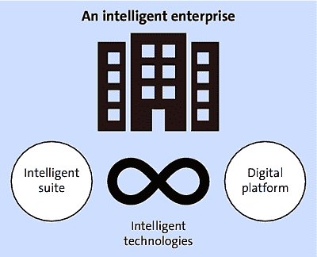](img-f1.1.html)

**图 1.1** 智能企业

简而言之，智能企业通常能带来以下优势：

* 人们可以随时随地通过任何设备无缝工作并访问任何系统。

* 系统能够为人类的工作划分优先级。

* 针对业务问题提出解决方案。

* 以自动方式执行重复性且耗时的任务。

* 系统可以在处理过程中从业务数据中发现新模式和洞察，通过从这些数据中学习，在合适的时刻做出更明明的决策。

我们将在第 1.1 节中向您介绍机器学习，并在第 1.2 节中带您回顾我们如何走向智能时代的简短历史。随后，您将在第 1.3 节中学习有关众多智能企业用例的知识，最后我们将在第 1.5 节中关注 SAP 提供的强大机器学习组合。

## 1.1 什么是机器学习？

机器学习是人工智能（AI）的一种形式，它使系统能够从数据中学习，而不是通过显式编程。机器学习模型交付的精度完全取决于其训练数据——使用的训练数据越多，您的预测就越准确。机器学习模型基本上代表了当你用数据训练机器学习算法时生成的输出。训练后，当你向模型提供一个输入时，你将获得一个输出。例如，预测算法将创建一个预测模型。然后，当你向预测模型提供数据时，你将获得基于训练该模型的数据的预测。

机器学习是如今企业数字化转型的关键力量，正获得巨大的势头。全球企业正在利用它，而不是使用传统的基于软件的规则来从各种来源（例如文本、图像、社交动态、大数据和物联网设备）中发现未知的模式、分析和事实，其中包含了对模型进行“训练”和“学习”的规定。与 SAP 一起，该领域的一些关键参与者还包括 IBM Watson 认知服务、Google TensorFlow 和 Azure Machine Learning，这些服务已经运行了长期。

## 1.2 从数字时代到智能时代的跨

过去十年的数字时代通过利用技术进步，特别是人工智能（AI）和机器学习领域的进步，已经演变成了今天的智能时代。通过利用这些能力，您的组织可以自动化手动活动、识别潜在风险，并保持领先竞争对手的地位。为了最大限度地获得技术进步的收益并尽量减少干扰，今天的组织必须进化为智能企业，将业务流程与先进技术和软件解决方案连接起来，并快速适应变化的业务状况。

机器学习作为智能企业智能应用的基础，已成为最热门的术语之一，因为全球企业发现了机器学习的潜力，它能够基于各种来源的数据揭示新维度的分析和事实发现，并包含了对数据模型进行“训练”和“重新训练”。机器学习服务运行在定义的算法上，这些算法可以使计算机从数据中进行自我学习，而不需要显式编程。这些算法的设计旨在每次接触到新数据或决策计算时都能学习、成长、发展和改进。

今天的企业面临着运营所需数据量的指数级增长，这可能会超出个人的能力范围。在这种背景下，机器学习可以提供一种强大的方法，帮助人们提高决策、响应能力和结果的一致性。根据 Gartner 2019 年对首席信息官（CIO）的调查，“实施人工智能（AI）的企业数量在过去四中增长了 270%，过去一年增长了三倍。”机器学习和智能应用具有最大的势头，而其他方法也很流行，例如作为服务的 AI 平台或 AI 服务。各种研究表明，机器学习大幅缩短了执行日常活动的平均时间。

## 1.3 智能企业用例

技术正在改变企业开展业务的方式，今天的企业必须拨开炒作，变得更加实用和高效，以成为智能企业。我们可以改进从与客户互动到更高效地执行流程的每一个方面；有些人会说，“更智能地”。寻求保持相关性和竞争的企业必须开始采用智能端到端技术，以跟上这些变化。让我们看看不同行业中常见的用例，并讨论今天的企业在成为智能企业的旅程中如何利用智能技术和数字平台。

### 1.3.1 智能发票匹配

传统上，应收账团队会花费数小时分析数据以解决数字支付中的差异。在这些活动中，发票匹配是最复杂且最耗时的流程之一。复杂性源于客户支付模式的差异，并且对收到的银行对单进行任何手动后处理（例如无法匹配到未结应收账的项目）都需要花费精力和努力。另一个挑战还包括在不增加处理团队规模或不维护和更新用于支付与未结应收账匹配的定制规则（因为实施这些规则的成本巨大）的情况下，无法支持支付的快速增长。作为一个智能企业，答案是利用机器学习来驱动财务应用。机器学习可以从手动发票匹配过程和历史会计数据中学习，以对收到的付款进行自动清理，或提供可能的清理匹配列表，供应收账团队快速处理未结项目。这种智能自动化可以帮助您的应收账团队更高效地处理更高的交易负载，并提高应收账款周（DSO）和其他营运指标。

### 1.3.2 智能招聘


为不同职位招聘候选人是每个组织的关键任务，招聘人员通常必须遵循繁杂的过程，通过成千上份职位简介以识别最适合职位的候选人。在这种情况下，智能企业可以轻松应用机器学习，根据现有的招聘记录、简历和过去的候选人简介来训练并构建招聘模型，随后可以使用相同的模型识别特定职位描述的最佳候选人，反之亦然。

### 1.3.3 工单工智能

由于虚拟系统的日益普及，工单系统已变得至关重要。将工单分配给支持团队中合适的人员或部门，对于提高终端用户满意度同时确保支持资源的更优配置至关重要。将帮助工单分配给相应的群组仍然可以手动完成，但在大型组织中，手动分配是不够的。这个过程非常耗时，并且需要花费大量的人力。人为失误可能会导致错误发生。此外，由于地址错误，资源消耗的效率低下。而且，手动分配会增加响应时间，从而导致终端用户满意度下降。客户可以通过多种渠道与公司联系，通过社交媒体平台和评论网站，或者通过电子邮件和在线聊天——无论何时、无论在何地。再加上不断增加的移动端用户，客户比以往任何时候都更容易建立联系，你可以想象客服工单是如何开始堆积的。那么，所有这些工单该如何处理呢？如你可能所知，客服代理必须根据内容为每个工单分配标签或分类，从而将工单路由到正确的团队。这种分配本身就需要花费时间，因为客服代理在为文本标记相应的分类之前，必须阅读每一个问题。

### 1.3.4 产品相似性匹配

当今的电子商务业务通过全球各种渠道在线销售大量产品。例如，为了价格比较对产品进行识别、匹配和交叉检查，可能是一项挑战，因为全球尚未采用通用的唯一标识符。在这种情况下以及许多其他情况下，准确的产品匹配可能变得极其重要。例如，一家商店可能想要比较其竞争对手对相同产品的报价。同样，客户也可能使用比较工具来寻找最优优惠。在这种场景下，存在大量产品，但没有什么方法可以跨不同的商店匹配这些产品。

产品标题/描述没有遵循标准格式。每家商店，以及商店内的不同卖家，可能对相同产品有不同的标题和描述。另一个挑战在于属性列表，因为不同的电子零售商遵循不同的格式。同一款产品的图像在不同的零售商处也可能有所不同。对于人类来说，产品匹配是一项无法完成的任务，因为你需要访问不同的产品页面以确保产品是匹配的。

通过 AI 和机器学习自动化这一过程，你可以确保系统能够理解所有信息。在产品匹配的机器学习解决方案中，解决方案提供者必须建立一个包含数十亿产品的数据库。这项任务可以通过网络爬虫和数据馈送（feeds）收集信息来完成。然后系统必须得出一个通用的分类法。这一挑战特别独特性，因为不同的零售商对产品使用不同的分类，而同一个产品可能被列在多个类别下。例如，某种特定的鞋类可能既被列为“休闲鞋”，又被列为“正装鞋”。系统首先必须设计一种超越特定商店产品分类方式的标准分类法。

### 1.3.5 品牌影响

我们进入了一个营销人员被海量消费者偏好数据包围的时代。从理论上讲，所有这些信息会让用户分组和创建相关内容变得更容易，但事实并非总是如此。通常情况下，加入营销人员工作流中的数据越多，理解这些信息并采取行动所需的时间就越多。

机器学习作为人工智能（AI）的一个子集，赋予了系统分析和解释数据以做出准确预测的能力，而无需显式编程。随着更多数据输入算法，算法学习的也越多，理论上它会变得更准确、表现更出色。如果营销人员期望与目标受众创建更有意义的活动并提高参与度，集成机器学习可以成为揭示隐藏在海量大数据中的隐藏模式和可操作战术的工具。

### 1.3.6 机器人流程自动化

你已经知道过时的手动流程的危害，它们阻碍了规模化，浪费了宝贵的人力，并导致影响性能和利润的效率低下和错误。答案是智能流程自动化。但自动化什么呢？如何自动化并使其智能化？

机器人流程自动化（RPA）与现有应用程序对接，并自动处理大量的、重复的任务。机器人流程自动化改变了企业处理手动流程的方式，释放员工专注于以客户为中心和增加价值的活动。这一步对于创建传统上不存在的运营数据和能力至关重要。智能流程自动化（IPA）在提高运营效率方面具有巨大的前景。

智能企业战略允许组织快速地将数据转化为洞察——为流程自动化、创新、优化和体验管理提供支持。得益于自动化和认知计算的进步，你现在可以跨平台和环境大规模地实现包括任何数据在流程自动化，从而使每个流程、决策和行动都能由数据驱动。

这些智能技术利用机器学习栈的深度，增强了用于数字化转型的经典机器人流程自动化能力。鉴于连接设备的持续扩散、云分析、智能技术组合赋能的能力以及下一代机器学习和 AI 能力，智能流程自动化现在是满足对具有精简流程的自动化工作场所日益增长的需求的首选。

### 1.3.7 虚拟助手

今天，工作中投入的大量人力时间仅仅集中在各种记录系统的数据录入任务上，这些 ERP（SAP、PeopleSoft、JD Edwards、Baan 等）、关系型数据库（Oracle、DB2、SQL Server）以及大型机。聊天机器人杂志的一项研究声称，企业可以通过聊天机器人等对话界面减少约 30% 的客服成本。根据 Aspect 软件的一项研究，客服的平均人工交互每次花费约 30-40 美元，而平均文本交互每次仅花费约 5-8 美元。

企业系统高度分散，员工大量时间花在这些系统的数据录入上。进入你系统的许多信息通常以非结构化数据发送或接收，例如电子邮件、聊天消息、Word 文档、PDF、PowerPoint 幻灯片，甚至是口头交流。通常你需要人类来解释所有这些数据并将决策和行动输入到正确的记录系统中。

然而，这些智能应用程序在每次使用时都会变得更好、更智能。最终，你甚至可以用自动化最佳实践来取代现有流程。

## 1.4 SAP 的智能企业战略

当今企业必须拨开炒作，高效地成为智能企业。

现在你已经了解了机器学习对于让企业更智能、更聪明有多么重要，让我们来看看 SAP 构建智能企业的战略视角。

近半世纪以来，SAP 一直致力于通过应用先进技术解决简单和复杂的业务问题，帮助企业为其组织创造价值。SAP 的智能型企业使命旨在帮助企业在新经济中取得成功，在这种背景下，成为数据驱动型企业和提供卓越体验是成功的关键。如图 1.2 所示，智能型企业战略基本上由三个主要部分组成，包括智能套件、智能技术和数字平台，它们共同定义了企业未来如何运营业务。


**图 1.2** 智能型企业策略

### 1.4.1 智能套件

如图 1.3 所示，SAP 的智能套件是一组模块化的集成业务线（LOB）应用程序，能够让您跨部门共享见解，以便更好地管理利益相关者并支持他们的日常运营。例如，`SAP Cash Application` 可以处理并匹配发票与入账付款，并自动匹配未收账款和清账付款。


**图 1.3** 智能套件

### 1.4.2 数字平台

SAP 的数字平台是数据管理和云平台技术的独特结合，供智能型企业动态管理不断增长的数据量和业务流程，并让数据实时更具意义。该平台还作为所有智能活动的必要基础。图 1.4 显示了 SAP 数字平台产品组合的表示。


**图 1.4** 数字平台

### 1.4.3 智能技术

如图 1.5 所示，智能技术结合了必要的工具和技术，如分析分析、机器学习、人工智能（AI）、物联网（IoT）和区块链，这些技术可以将智能转化为业务成果。所有这些工具和技术都通过数字平台交付，嵌入在智能套件应用程序中，并应用于集成 SAP 和第三方数据及应用程序的。


**图 1.5** 智能技术

从底层向上看，数字平台提供了必要的智能工具和技术，用以构建智能套件，您可以利用这些套件来实现不同的目的，例如客户体验、数字核心、人员参与度等。智能型企业策略基本上允许供应商、客户和合作伙伴连接到服务于智能型企业的流程或应用程序。

在此背景下，`SAP Data Intelligence` 提供了智能技术以实现智能套件的功能并交付智能型企业。此外，`SAP Data Intelligence` 可供供应商、客户和合作伙伴使用，用于构建他们自己的智能应用程序和分析。

## 1.5 SAP 的机器学习技术与应用

为了助力您的智能型企业建设，SAP 提供了一套强大的机器学习能力和 AI 产品。SAP 的机器学习技术组合结合了智能应用与扩展的独特融合、数据科学平台以及嵌入式机器学习和其他服务。让我们探索 SAP 在机器学习领域的系列产品。

### 1.5.1 嵌入式机器学习应用程序

嵌入式机器学习应用程序旨在让用户快速接触 AI 模型，以实现日常/常规工作的自动化或增加智能。在不深入探讨复杂性的情况下，AI 根据嵌入式智能模型在后台运行并简化工作。

在这个领域，SAP 拥有一产品，包括 `SAP Service Ticket Intelligence`、`Intelligent Invoice processing` 以及许多其他嵌入式智能模型。这些模型能够从人类能力中学习，并通过做出预测、建议以及并行支持人类用户，将相同的知识应用于未来的决策。如图 1.6 所示，除了带有 `SAP S/4HANA` 的嵌入式机器学习应用程序外，SAP 还提供了您或您的合作伙伴可以利用的业务服务，以构建构建自己的自定义智能解决方案，我们将在书的后部分详细介绍。


**图 1.6** SAP 机器学习产品组合

### 1.5.2 SAP 智能机器人流程自动化

SAP 智能机器人流程自动化（`SAP Intelligent RPA`）如图 1.7 所示，是机器学习产品系列中的下一个。该解决方案专注于任务自动化，通过以用户为中心的方式加速 SAP 内部重复性和战术性的手动流程，从而最大限度地减少输入错误、加快工作并降低成本。

`SAP Intelligent RPA` 基本上通过基于用户界面（UI）交互指定的自动化流程来处理未建模的流程，例如数据输入、会计、人力资源、供应链以及许多类似活动。在后台，机器学习充当大脑管理异常并引导 `SAP Intelligent RPA` 机器人执行所需的流程。


**图 1.7** SAP 智能机器人流程自动化

### 1.5.3 SAP 对话人工智能

SAP 对话人工智能（`SAP Conversational AI`）是构建聊天机器人和对话式应用程序所需的工具集，包括自然语言处理（NLP）引擎和带有图形界面的交互式机器人构建器，供开发人员用于构建出色的机器人！

如图 1.8 所示，`SAP Conversational AI` 可以通过其聊天机器人准确将客户连接到正确的业务上下文，这是使企业更加智能的关键一步。`SAP Conversational AI` 服务确保您可以提供 24/7 的多语言客户支持，并处理日益增加的通话。`SAP Conversational AI` 让终端用户能够系统提出请求并获取响应，将执行责任从人类转移给机器。


**图 1.8** SAP 对话人工智能

### 1.5.4 SAP Data Intelligence

最后，同样重要的是 SAP Data Intelligence。随着最近在云端引入 SAP Data Intelligence，基于 SAP HANA 的机器学习（以前称为 SAP Leonardo Machine Learning Foundation）同 SAP Data Hub 现已成为 SAP Data Intelligence 平台的不可或缺的一部分，在 SAP Cloud Platform 上提供了数据编排和机器学习功能的强大组合。

简而言之，本地部署的 SAP Data Hub 是一种数据共享、流水线和编排解决方案，可帮助企业加速和扩展跨越现代、多样化数据格局的数据流。除了包含 Google TensorFlow 服务外，SAP Data Hub 还包括了使用内置算子针对各种机器学习服务的预构建机器学习库集成，您可以利用这些集成无缝地构建企业数据科学场景。

由于嵌入机器学习已作为 SAP Data Intelligence 的一部分，这些能力将不再作为独立服务提供给新客户，而必须通过 SAP Data Intelligence 使用。因此，简单而言之，SAP Data Intelligence 基本上涵盖了整个数据科学过程，从使用类似于 SAP Data Hub 的支持连接器连接智能数据源，到通过 AI 与 SAP HANA 提供的机器学习。图 1.9 显示了 SAP Data Intelligence 包含的整体功能。


**图 1.9** SAP Data Intelligence

### 1.5.5 SAP HANA 中的嵌入式机器学习

除了 SAP Data Intelligence、SAP Conversational AI 和 SAP Intelligent RPA 之外，SAP 还为企业提供了可扩展的、基于 SAP HANA 的机器学习平台。任何有效的机器学习都需要大量数据，而基于 SAP HANA 的机器学习为在数据实际所在处或内存级别应用智能化提供了关键能力。这种推理构成了 SAP HANA 机器学习的基础。

此外，在数据库级别运行机器学习算法可以降低延迟，并且当训练良好的机器学习模型进行推理、预测或数据分类时，特别有益。如图 1.10 所示，SAP HANA 上的机器学习是库、建模器和组件的结合，包括以下解决方案：

- SAP HANA 自动预测库（`SAP HANA APL`），以前称为预测分析库（`PAL`），主要针对希望在 SAP HANA 平台内运行预测模型的业务分析师和数据分析师。通过自动化的向导驱动界面，这些用户无需过多的数据科学经验即可访问机器学习能力。
- SAP HANA 扩展机器学习库（`SAP HANA EML`）封装为应用函数库（`AFL`），允许访问诸如 Google TensorFlow 等外部机器学习库。这些库中的模型可以轻松地集成到客户的企业应用程序和业务流程中。由 Google TensorFlow 的模型通过远程源注册在 SAP HANA 中，然后通过 `SQL-script` 对 SAP HANA 数据进行评分。（`Scoring` 是指将预测模型应用于一组数据的过程。）
- 应用函数建模器（`AFM`）是 SAP HANA Studio 的扩展，用于创建如表、视图、存储过程、R 脚本等流图模型。通过其拖放式界面，经验较少的开发者可以在不编写 SQL 脚本代码的情况下快速构建复杂的存储过程。`AFM` 基本上消除了编写 `PAL` 和业务函数库（`BFL`）算法的需求，多个用户可以同时访问模型对象进行开发。
- 集成 R 语言的 SAP HANA 利用 R 语言，这是另一种广泛用于统计计算和高级数据分析的开源机器学习框架。集成 R 语言的 SAP HANA 允许您使用并执行 R 中可用的所有开源算法。集成 R 语言的 SAP HANA 与 SAP HANA EML 略有不同。使用集成 R 语言的 SAP HANA，您可以将 R 脚本嵌入到 SAP HANA 的存储过程中。SAP HANA 数据库将解释 R 语言脚本并相应将其提交给 R 服务器。集成 SAP HANA 与 R 语言的最终目标是自定义超越 SAP HANA APL 提供的标准库范围的算法。


**图 1.10** SAP HANA 机器学习

## 1.6 总结

在本章中，我们讨论了企业技术的演进并引入了机器学习。我们探讨了 SAP 的智能策略及其组合：嵌入式机器学习应用、SAP RPA、SAP Data Intelligence、SAP Conversational AI 以及 SAP HANA 中的机器学习。我们将在后续章节探讨这些内容。

# 2 机器学习基础

本章介绍了机器学习的基础概念。我们将从介绍概率论开始，它是各种机器学习概念的基石。然后概述不同的学习场景并进入机器学习领域。本章提供了对常用机器学习算法的深入理解，涵盖了数学基础、重要特性、优缺点。

在机器学习中，系统分析输入数据以学习底层模式和隐藏关系，并利用这些信息进行预测。这是通过各种人工智能算法和统计推理实现的。算法数以千计，且没有绝对最好的。取决于数据的性质、可用性以及要解决的问题类型，不同的场景使用不同的算法。概率论作为许多算法的基础发挥着关键作用。在本章中，我们将讨论机器学习的构建模块，重点关注概率概念和常用的机器学习算法。

## 2.1 基础概率概念

让我们从一个例子开始。作为一个机器学习专家，你需要根据截至目前（2020 年 4 月）的数据预测未来时期（2021 年 1 月）的总销售额。如果你被要求提供历史时期（2020 年 2 月）的总销售额，你可以根据 2020 年 2 月的历史销售数据进行推导。只要历史数据准确，就不存在不确定性。然而，当在 2020 年 4 月预测 2021 年 1 月的总销售额时，存在许多你你未知的因素。这些因素包括需求、实际产量、价格、客户对产品的感知、其他竞争对手类似产品的可用性，以及 2021 年 1 月左右的社会经济状况等。

因此，你无法确定地说 2021 年 1 月的总销售额是多少，但你可以通过识别历史销售数据中的模式并使用机器学习对其未来时期进行插值，从而提供最可能的值。

概率论是一门广泛的学科，在数学、统计学、工程、人工智能、机器学习、密码学、物理学、经济学、生物建模甚至赌博等领域都有广泛的应用。在这里，我们将探索机器学习所需的概率论基础概念。

### 2.1.1 什么是概率？

在生活中，许多现象在相同条件下重复时会产生相同的结果。在平面上画出的一个三角形，无论其形状和大小如何，三个内角之和始终为 180 度。然而，也有许多现象在相同条件下重复时并不会产生相同的结果。

当我们掷硬币时，结果可能是正面或反面，但无法提前预知投掷的结果。如果将硬币掷一百次，正面和反面会以随机且不可预测的方式出现。这就是随机或非确定性现象的例子。概率论研究的就是这类随机现象。


对于随机现象，特定实例的结果可能是不固定的，但如果重复多次，结果就会表现出统计规律。在掷硬币的例子中可以观察到，对于大量的投掷，正面的比例（出现次数与总投掷次数的比例）似乎趋向于 0 到 1 之间的一个固定数值`p`（对于均匀硬币，`p`通常非常接近 0.5）。当投掷次数趋于无穷大时，正面的比例收敛于`p`。这个极限比例可以被视为单次投掷出现正面的概率。这种对概率的解释被称为相对频率解释。根据这种解释，投掷出现正面的概率为`p`意味着如果投掷很多次（`n`次），那么出现正面的次数大约为`n*p`。然而，可能无法反复进行相同的实验来计算概率。通常情况下这是不可行的。因此，我们建立了随机现象的数学模型（称为随机实验），然后使用该模型计算各种事件的概率。

在进入概率的正式定义之前，让我们来看另一个例子，尝试看看数学模型如何拟合其中。考虑以下随机实验：

投掷一次六面骰子。这个实验的可能结果有哪些？嗯，它可以是 1 到 6 之间的任何数字。现在，为了建立数学模型，我们首先将这个抽象实验转换为一个集合，即一个具体的数学结构。首先，我们将构建实验所有可能结果的集合，并将其标记为`Ω`。在数学上，我们可以将每个结果与集合`Ω`中的元素一一对应。在例句中，集合`Ω`包含 6 个元素（例如，`ω[1]`, `ω[2]`, ..., `ω[6]`），其中`ω[1]`代表结果 1，`ω[2]`代表结果 2，以此类推。集合`Ω`代表所有可能结果的集合，该集合中的每个元素都代表随机实验的一个结果。因此，为了建立一个数学框架，我们首先将随机现象或随机实验转换为一个集合，其元素与实验的可能结果建立一一对应关系。这个集合`Ω`也称为样本空间。

### 分配概率

接下来，我们将尝试分配发生概率。根据数学模型，我们可以为`Ω`中的每个元素分配概率。如果这样做，我们就可以回答以下问题：

*   每个结果都有概率
*   概率介于 0 和 1 之间
*   所有结果的概率之和等于 1

现在，在我们的实验中，如果骰子是均匀的且所有结果出现的概率均等，那么为所有结果分配相同的概率是合理的。用数学算式表示，这就是`p[1] = p[2] = .. = p[6] = p`。由于它们的和等于 1，这意味着`p[1]+p[2]+…+p[6] = 6*p = 1`，所以`p = 1/6`。

然而，有人可能不仅满足于知道单个结果，他们可能对包含多个结果的事件概率感兴趣。

#### 注意

我们把概率引入为`Ω`的子集，并尝试推导出单个结果的概率。在这个例子中，可能结果的数量是有限的，因此如果它们是可能的，我们可以为单个结果分配等概率概率。但当存在无限个结果时，我们采用使用密度函数和分布函数的不同方法，这在第 2.1.4 节中讨论过。

我们把事件引入为`Ω`的子集，但如何计算包含多个结果的事件的概率呢？

这是通过将事件分解为不相交的事件并相加较小事件的概率来实现的。在这个过程中，我们可能会将事件分解为其所包含的单个结果，然后将这些（已经定义的）概率相加，以得到事件的概率。

### 计算事件的概率

有一种流行的观点，即将一个事件的概率计算为有利结果数与总可能结果数的比值：

```
事件的概率 = (导致该事件的结果总数) / (总可能的结果数)
```

考虑我们的示例事件：掷骰子的结果大于 3。有三个结果：4、5 和 6。掷骰子时所有可能结果的总数为 6 个。因此，根据这种方法，该事件的概率为 3/6 = ½，这与结果一致。然而，概率的数学模型并没有采用这种方法，因为：

*   单个结果可能不是等概率的。
*   对于许多随机实验，所有可能结果的总数可能是无限的，除以无限可能没有意义。

将随机现象转换为所有可能结果的集合（`Ω`），将事件定义为`Ω`的子集，并像之前提到的那样为事件分配概率具有一个巨大的优势：集合论的结论可以很容易地应用到概率论中。

让我们考虑掷骰子实验中的两个事件：

`A`是结果小于 4 的事件，`B`是结果为偶数的事件。那么，`A = {ω[1], ω[2], ω[3]}`代表结果 1、2 和 3。`B = {ω[2], ω[4], ω[6]}`代表结果 2、4 和 6。

集合`AUB = {ω[1], ω[2], ω[3], ω[4], ω[6]}`代表事件`A`或事件`B`发生，对应于除 5 之外的所有结果。集合`A ∩ B = {ω[2]}`代表事件`A`和`B`均发生，对应于结果 2。同样，`A^c = {ω[4], ω[5], ω[6]}`代表事件`A`未发生。

由于`A = A ∩ Ω = A ∩ (B U B^c) = (A ∩ B) U (A ∩ B^c)`，利用集合的分配律，且`(A ∩ B)`和`(A ∩ B^c)`是互斥的（它们没有公共元素），我们可以推导出`P(A) = P(A ∩ B) + P(A ∩ B^c)`。因此，如果已知这三个概率中的两个，就可以导出第三个。同样，其他集合论结论也可以用于推导概率。

#### 注意

乍看之下，通过相加组成结果（或不相交事件）的概率来推导出事件的概率似乎相当人为。但如果我们考虑概率的相对频率解释，这就变得显而易见了。

如果导致该事件的任何结果发生，则该事件发生。在我们的示例中，事件`A`（结果大于 3）仅在结果为 4、5 或 6 时发生。让我们假设掷骰子实验重复`n`次，`n`是一个很大的数。同样假设在这些`n`次重复中，结果 1 出现了`n[1]`次，结果 2 出现了`n[2]`次，依此类推。

那么对于`i = 1, 2, …, 6`，`0 ⩽ n[i] ⩽ n`，且：

```
n[1] + n[2] + n[3] + n[4] + n[5] + n[6] = n
```

在这些`n`次试验中，事件`A`发生了多少？它是在结果为 4、5 或 6 时发生的，所以该事件发生了`(n[4] + n[5] + n[6])`次。

因此，该事件发生的比例为`(n[4] + n[5] + n[6]) / n`。随着`n`趋于无穷大，这个比例趋于事件的概率。但是：


左侧显示事件的概率，右侧是单个结果概率的和。因此，通过相对频率解释，事件的概率结果为其所包含的单个结果概率的和。同样，使用相同的原理，很容易看出概率值应该落在 0 和 1 之间，且所有结果的概率之和为 1。

我们采用了相同的结论，但在数学上定义概率时并没有引入任何解释，这就像几何中不讨论线或点的解释，而是通过公理假设了它们的存在一样。此外，许多随机实验的结果数是无限的，实验可能涉及多维空间，因此我们不能使用类似的推理。因此，我们采用了这些结果，并将其泛化为数学模型，以处理更广泛、复杂的场景。

关于事件的最后一点。在我们的掷骰子示例中，有 6 种可能的结果，因此集合`Ω`包含 6 个元素。这个随机实验有多少个事件？由于事件是`Ω`的子集，这归结为`Ω`有多少个子集？它是`2⁶ = 64`，包括`Ø`和`Ω`。通常情况下，一个包含`n`个元素的集合有`2^n`个不同的子集。因此，事件的总数很高。我们经常处理具有无限多个结果的随机实验，可能事件的数量变得大到无法用数学方法处理。因此，我们不能考虑所有事件，只选取具有良好数学属性的事件集。然而，这并没有限制我们，因为它涵盖了大多数情况。更准确地说，我们考虑一个`σ`域（记作`σ-field`）作为允许事件，并对这些事件分配概率。

集合`Ω`的非空子集族`æ`被称为`Ω`的`σ-域`，如果满足以下条件：

1. 如果子集`A`在`æ`中，则`A^c`也在`æ`中。
2. 如果无限子集，例如`A[1], A[2], A[3], ...`都在`æ`中，那么它们的并集`inline image/EQ_002.png`和交集`inline image/EQ_002.png`也在`æ`中。

在此背景下，我们现在正式定义概率。

#### 概率测度

`σ-域`æ`上的概率测度`P`是一个从`æ`到实数的函数，满足以下条件：

1. `P(Ω) = 1`。
2. 对于`æ`中的所有`A`，`P(A) ≥ 0`。
3. 如果`A[n], 1, 2, 3, ...`是`æ`中的互斥集合，那么它们的并集`inline image/EQ_004.png`。

注意，对于`æ`中的所有`A`，`P(A) ⩽ 1`，这是必须指定的。不相交事件的扩展到`countably disjoint events`。

$A B = B$ 且方程 1 意味着 $P(A) = P(B) + P(A B^c)$。

由于 $P(A B^c) \geqslant 0$，意味着 $P(A) – P(B) = P(A B^c) \geqslant 0$。

4. 如果 $A, B$ 是任意满足 $B \subseteq A$ 的事件，则 $P(A) \geqslant P(B)$

通常来说，对于任意两个事件 $A$ 和 $B$，如果 $P(A) > P(B)$，则事件 $A$ 发生的概率大于事件 $B$，反之亦然。鉴于此，方程 4 是完全合理的，因为 $B$ 是 $A$ 的子集，$B$ 中的结果也都在 $A$ 中，因此如果 $B$ 发生，意味着 $A$ 也发生了。但 $A$ 还有一些不在 $B$ 中的结果，所以如果这些结果中的任何一个发生，事件 $A$ 发生但事件 $B$ 不发生。因此，$A$ 有更高的发生概率。

最后，对于任意事件 $B$，$B$ 是 $\Omega$ 的子集。因此，如果我们在方程 4 中取 $A = \Omega$，它意味着 $1 = P(\Omega) \geqslant P(B)$。换句话说，任何事件的概率均小于等于 1。

我们现在来看几个例子，看看这些结果如何应用于现实问题中。

### 篮子中的标记球

考虑以下随机实验：一个篮子里有十个标记为 1 到 10 的球。标记为 1 到 6 的球是红色的，标记为 7 到 10 的球是白色的。从篮子里随机取出球并记录其标记。我们感兴趣的是计算四个事件的概率：

*   事件 $A$：取出的红色球标记为偶数。
*   事件 $B$：取出的红色球标记为奇数数。
*   事件 $C$：取出一个红色球。
*   事件 $D$：取出一个白色球。

这个实验的可能结果是什么？它可能是 1 到 10 之间的任何数字。这就是样本空间，$\Omega = \{1, 2, 3, 4, …, 9, 10\}$。由于这个实验只有有限个结果，我们可以将 $\Omega$ 的所有子集集合作为事件的 $\sigma$ 域。因此 $\sigma = \{all\ B\ such\ that\ B \subseteq \Omega\}$。它包含了所有 $2^{10}$ 个子集，包括单个结果、$\Omega$ 和 $\emptyset$。现在来看这些事件：

*   $A = \{2, 4, 6\}$
*   $B = \{1, 3, 5\}$
*   $C = \{1, 2, 3, 4, 5, 6\}$
*   $D = \{7, 8, 9, 10\}$


由于在一次试验中两个结果不能同时发生，因此所有具有单个结果的事件 `{1}`、`{2}`、`{3}`、……、`{9}`、`{10}` 都是互斥的。同样，所有这些单个结果的概率均相等，例如 `P(1) = P(2) = P(3) = \dots = P(10) = p`。

- 现在，`1 = P(\Omega) = P(\{1,2, 3, \dots, 10\}) = P(\{1\}) + P(\{2\}) + \dots + P(\{10\}) = 10p`

  `\Rightarrow p = P(\Omega)/10 = 1/10 = 0.1`。

- 那么事件 `A` 的概率 `P(A)` 可以计算为：

  `P(A) = P(\{2\} \cup \{4\} \cup \{6\}) = P(\{2\}) + P(\{4\}) + P(\{6\}) = 0.1 + 0.1 + 0.1 = 0.3`。

- 同样，`P(B) = P(\{1\}) + P(\{3\}) + P(\{5\}) = 0.1 + 0.1 + 0.1 = 0.3`。

- 现在，`C = A \cup B`，`A` 和 `B` 是互不相交的，所以 `P(C) = P(A) + P(B) = 0.6`。

- 同时，注意 `D = C^c`，所以 `P(D) = 1 – P(C) = 1 – 0.6 = 0.4`。

在这个实验中，取出红色球的概率是 0.6，取出白色球的概率是 0.4。现在如果实验发生如下变化：

### 篮子中的无标记球

篮子里仍然包含 6 个红球和 4 个白球，但球不再有标记。随机取出一个球并记录其颜色。我们想知道取出红色球的概率。

现在只有两种可能的结果：红色和白色。因此，`\Omega = \{Red, White\}`，事件的 `\sigma` 域 `\sigma = \{\{\emptyset\}, \{Red\}, \{White\}, \Omega = \{Red, White\}\}`。我们取出红色球的事件可以表示为 `E = \{Red\}`。

现在，事件 `E` 的概率是多少？你认为……

- 虽然当 `\Omega` 是连续的时，单个结果的概率为零，但概率为零的结果确实会发生。在我们的例子中，一旦线断裂，它会给出一个特定的值 `L`（端点为 `A` 和 `C` 的线长度），但得到该特定 `L` 值的概率为 0。因此，在连续情况下，概率为零意味着事件发生的可能性极低，但并非不可能。

- 概率的定义并没有说明样本空间 `\Omega` 的性质，即它是具有离散值还是连续值。因此，该定义适用于这两种情况。我们根据此定义推导出的基本性质在 `\Omega` 连续时同样适用。

在随机现象中，由于一个事件的发生有时会影响另一个事件发生的概率。让我们通过一个例子来理解这个概念。

让我们考虑投掷两次均匀硬币并记录结果的实验。如果我们用 `H` 表示正面，用 `T` 表示反面，并用这两个字母连续记录两次投掷的结果，其中第一个表示第一次投掷的结果，第二个表示第二次投掷的结果，那么可能的结果为 `HH`、`HT`、`TH` 和 `TT`。

`\Omega = \{HH, HT, TH, TT\}`。由于结果是有限的，我们可以将 `æ` 取为 `\Omega` 的所有可能子集的集合。如果硬币是均匀的，那么这 4 种结果都是等可能的，概率为 `1/4 = 0.25`（使用与示例一——篮子里的球相似的逻辑）。因此：

- `A` = 第一次投掷为正面的事件。那么 `A = \{HH, HT\}`。

- `B` = 第一次投掷为反面的事件。那么 `B = \{TH, TT\}`。

- `C` = 两次投掷结果均为正面的事件。那么 `C = \{HH\}`。

使用篮中标记球示例的类似逻辑，这些事件的概率为：

- `P(A) = P(\{HH\}) + P(\{HT\}) = 0.25 + 0.25 = 0.5`。

- `P(B) = P(\{TH\}) + P(\{TT\}) = 0.25 + 0.25 = 0.5`。

- `P(C) = P(\{HH\}) = 0.25`。

如果我们设定事件 `A` 发生的条件，我们如何理解相对于该条件下事件 `C` 概率？换句话说，在第一次投掷为正面的条件下，两次投掷均为正面的概率是多少？

由于第一次投掷为正面，实验的可能结果只有 `HH` 和 `HT`。因此，在事件 `A` 发生的条件下，样本空间发生了变化，新样本空间（假设为 `\Omega[new]`）仅包含这两个可能的结果。它们都是等可能的，概率均为 `0.5`。如果结果 `HH` 发生，则事件 `C` 发生，此时 `C` 的概率变为 `0.5`。这就是在事件 `A` 发生的条件下事件 `C` 的条件概率。

同样地，如果第一次投掷结果为 `T`，则没有任何结果可以提供事件 `C = \{HH\}`。因此，在第一次投掷为反面的条件下，两次投掷均为正面的概率为 0。换句话说，在事件 `B` 发生的条件下，事件 `C` 的条件概率变为零。

在这个例子中，当我们设定另一个事件发生的条件时，事件 `C` 的概率发生了变化。这就是所谓的条件概率。

设 `A` 和 `B` 是同一概率空间 `(\Omega, æ, P)` 上的两个事件，使得 `P(A) > 0`。那么在 `A` 条件下 `B` 的条件概率记为 `P(B | A)`，定义为：

`P(B | A) = P(B \cap A) / P(A)`。

如果 `P(A) = 0`，则 `A` 条件下 `B` 的条件概率未定义。

设 `A` 和 `B` 是同一概率空间上的两个事件，且 `P(B)`、`P(A) > 0`。现在 `P(B | A) = P(B \cap A) / P(A)`。

| 1 | 这意味着 `P(B \cap A) = P(A)P(B | A)` |
| --- | --- |

此外，`P(A | B) = P(B \cap A) / P(B)`（注意 `A \cap B = B \cap A`）。

现在如果我们使用方程 1 代替 `P(B \cap A)` 的值，我们得到：

| 1 | `P(A | B) = P(A)P(B | A) / P(B)` |
| --- | --- |

这是贝叶斯公式的一个简化版本，它在贝叶斯统计和机器学习中有许多应用。如果事件 `A` 是事件 `B` 的可能原因，那么方程 2 可以被解释为：在 `B` 发生的条件下，事件 `A` 是 `B` 原因的概率。

注意在示例 2 中，`P(C | A) > P(C)` 且 `P(C | B) < P(C)`，因此条件概率可能大于或小于不加条件时的实际概率。

如果两个事件 `A` 和 `B` 满足 `P(B | A) = P(B)` 怎样？那么事件 `A` 发生的条件不会改变 `B` 的概率，这种特殊情况被称为独立性。注意在这种情况下：

`P(B \cap A) / P(A) = P(B)` 意味着 `P(B \cap A) = P(A)P(B)`。

此外，注意如果 `P(B \cap A) = P(A)P(B)` 且 `P(A) > 0`，那么意味着：

`P(B \cap A) / P(A) = P(B)`，或者 `P(B | A) = P(B)`。

- 这些事件中两个或多个事件的任何组合（少于 `n` 个事件）也是相互独立的。

这是定义相互独立的一种递归方法。

### 2.1.3 随机变量

在随机实验中，我们通常感兴趣于用数字表示结果，例如：连续投两次硬币时正面的总数，连续掷骰子得到的数字之和。将随机实验的结果转换为数字有助于我们容易地描述事件和相关的概率。我们已经采取了这种方法，但没有给它起任何特殊的名称。在篮子标记球的例子中，我们实际上记录了球上标记的数字。在断绳的例子中，我们讨论了绳断开后某一段的长度，这又是一个数字。在所有这些例子中，我们都将实验的结果映射到一个数字。现在让我们更仔细地观察。

回想，对于任何随机实验，我们已经给了一个数学模型——概率空间，记为 `(\Omega, æ, P)`，其中 `\Omega` 是所有结果的集合，`æ` 是 `\Omega` 的子集集合（称为事件），以及 `æ` 上的概率测度 `P`。现在，集合 `\Omega` 本质上是抽象的。如果我们考虑从 `\Omega` 的元素到实数的映射，我们就可以根据该映射的值来定义事件并关联概率。

`X : \Omega \to R` 就是其中一种映射，其中 `R` 表示实数。那么，对于 `\Omega` 中的任何结果 `\omega`，`X(\omega)` 都是一个实数。多个结果可能映射到相同的 `X` 值。现在假设 `x` 是 `X` 的其中一个值。如果所有 `X` 取值为 `x` 的结果集合（数学上记为 `\{\omega \in \Omega : X(\omega) = x\}`）是一个事件，那么我们就可以讨论 `X` 取值为 `x` 的概率。换句话说，`P(\{\omega \in \Omega : X(\omega) = x\})` 是可以的。为了简单起见，我们将其记为 `P(X = x)`。

我们能为任何值 `x` 计算概率 `P(X = x)` 吗？换句话说，对于 `X` 的任何值 `x`，集合 `\{\omega \in \Omega : X(\omega) = x\}` 是否都是事件？如果是这样，我们就可以通过这个映射转移随机实验的概率空间，并仍然讨论事件和概率。这种映射有一个特殊的名称，它被称为**随机变量**，因为它的值源于随机实验。

如果 `\Omega` 只有有限或可数无限的结果，那么对于 `X` 的任何值 `x`，集合 `\{\omega \in \Omega : X(\omega) = x\}` 都是 `\Omega` 的子集（它也可能是 `\emptyset`），并且包含在事件集 `æ` 中。但如果 `\Omega` 有连续值的结果，那么并不是 `\Omega` 的所有子集都是事件，只有那些有限或可数无限个区间并集的集合才是事件。因此，为了定义映射 `X` 以便我们可以讨论 `P(X = x)`，我们只允许满足此类条件的映射并进行相应的定义。

#### 离散随机变量

概率空间 `(\Omega, æ, P)` 上的实值函数 `X` 称为离散随机变量，如果 `X` 是一个从 `\Omega` 到 `R`（实数）子集的函数，且该子集只有有限或可数个值，例如 `{x[1], x[2], x[3], …}`，使得对于所有的 `i`，集合 `\{\omega \in \Omega : X(\omega) = x[i]\}` 都是事件。

#### 连续随机变量

概率空间 `(\Omega, æ, P)` 上的实值函数 `X` 称为随机变量，如果 `X` 是一个从 `\Omega` 到 `R`（实数）的函数，使得对于所有的 `x`，集合 `\{\omega \in \Omega : -\infty < X(\omega) \leq x\}` 都是事件。让我们看下面的例子来澄清。

#### 硬币投三次

一枚均匀硬币被投三次，结果记录如 `HHH`、`HHT`、……，就像之前的硬币例子（投两次硬币）。让 `X` 表示正面的总数。我们可以认为所有结果都是等可能的。可能的结果、每个结果的概率以及 `X` 的值如表 2.1 所示。

| 结果 | 概率 | `X` 的值（正面次数） |
| :--- | :--- | :--- |
| HHH | 1/8 | 3 |
| HHT | 1/8 | 2 |
| HTH | 1/8 | 2 |
| HTT | 1/8 | 1 |
| THH | 1/8 | 2 |
| THT | 1/8 | 1 |
| TTH | 1/8 | 1 |
| TTT | 1/8 | 0 |

三次投掷

现在让我们使用随机变量 `X` 计算概率。为此，我们考虑所有导致该 `X` 值的结果：

- `P(X = 3) = P(\{HHH\}) = 1/8`

- `P(X = 2) = P(\{HHT, HTH, THH\}) = P(\{HHT\}) + P(\{HTH\}) + P(\{THH\}) = 1/8 + 1/8 + 1/8 = 3/8`

- `P(X = 1) = P(\{HTT, THT, TTH\}) = P(\{HTT\}) + P(\{THT\}) + P(\{TTH\}) = 1/8 + 1/8 + 1/8 = 3/8`

- `P(X = 0) = P(\{TTT\}) = 1/8`

我们能为任何值 `x` 计算概率 `P(X = x)` 吗？换句话说，对于 `X` 的任何值 `x`，集合 `\{\omega \in \Omega : X(\omega) = x\}` 是否都是事件？如果是这样，我们就可以通过这个映射转移随机实验的概率空间，并仍然讨论事件和概率。

在这个例子中，`X` 是一个只有 4 个可能值（3、2、1、0）的随机变量。我们可以计算 `X` 取这些值的概率。那么 `X < 2` 的概率是多少？

`P(X < 2) = P(\{\omega \in \Omega : X(\omega) < 2\}) = P(\{HTT, THT, TTH, TTT\}) = P(\{HTT\}) + P(\{THT\}) + P(\{TTH\}) + P(\{TTT\}) = 1/8 + 1/8 + 1/8 + 1/8 = 0.5`。

注意，如果我们用事件 `A = \{\omega \in \Omega : X(\omega) = 1\}` 和 `B = \{\omega \in \Omega : X(\omega) = 0\}`，那么 `A` 和 `B` 是互斥的，且 `P(\{\omega \in \Omega : X(\omega) < 2\}) = A \cup B`。所以 `P(X < 2) = P(A) + P(B) = 3/8 + 1/8 = 0.5`。

`P(X = 5)` 是多少？`X = 5` 的结果？没有。

这个例子展示了关于随机变量的两个重要概念：

- 事件现在可以根据随机变量 `X` 来定义。

- 如果 `S` 是实数的任意子集（`S \subset R`），我们如何推导出 `X` 取值为 `S` 中的概率？这是通过 `P(X \in S) = P(\{\omega \in \Omega : X(\omega) \in S\})` 计算的。在这个例子中，我们取 `S = (-\infty, 2)` 并计算了 `P(X \in (-\infty, 2))`，即 `P(X < 2)`。

同一个概率空间上可能有多个随机变量，我们可能对它们的联合概率感兴趣。设 `X` 和 `Y` 是同一个概率空间上的两个随机变量，`A` 和 `B` 是两个实数子集。那么 `P(X \in A, Y \in B) = P(\{\omega \in \Omega : X(\omega) \in A \text{ and } Y(\omega) \in B\})`。

#### 硬币投三次，继续

让我们考虑相同的投币实验。这里：

- `X` = 正面总数。和之前一样，它取值为 3、2、1、0。

- `Y` = 第一次投掷为正面为 1，反面为 0。

- `Z` = 第二次投掷为正面为 1，反面为 0。

| 结果 | 概率 | `X` 的值 | `Y` 的值 | `Z` 的值 |
| :--- | :--- | :--- | :--- | :--- |
| HHH | 1/8 | 3 | 1 | 1 |
| HHT | 1/8 | 2 | 1 | 0 |
| HTH | 1/8 | 2 | 1 | 1 |
| HTT | 1/8 | 1 | 1 | 0 |
| THH | 1/8 | 2 | 0 | 1 |
| THT | 1/8 | 1 | 0 | 1 |
| TTH | 1/8 | 1 | 0 | 0 |
| TTT | 1/8 | 0 | 0 | 0 |

表 2.2 显示了这些变量的结果、概率和值。让我们来看：

- `P(Y = 1) = P(\{HHH, HHT, HTH, HTT\}) = 4 x 1/8 = 0.5`。同样，`P(Y = 0) = P(\{THH, THT, TTH, TTT\}) = 4 x 1/8 = 0.5`。

- `P(Z = 1) = P(\{HHH, HTH, THH, THT\}) = 4 x 1/8 = 0.5`。同样，`P(Z = 0) = P(\{HHT, HTT, TTH, TTT\}) = 4 x 1/8 = 0.5`。

- `P(X = 3) = P(\{HHH\}) = 1/8`

- `P(X = 2) = P(\{HHT, HTH, THH\}) = P(\{HHT\}) + P(\{HTH\}) + P(\{THH\}) = 1/8 + 1/8 + 1/8 = 3/8`

- `P(X = 1) = P(\{HTT, THT, TTH\}) = P(\{HTT\}) + P(\{THT\}) + P(\{TTH\}) = 1/8 + 1/8 + 1/8 = 3/8`

- `P(X = 0) = P(\{TTT\}) = 1/8`

让我们考虑一家银行，它正向客户提供还款期为 5 年的贷款。可能某些客户会发生违约。银行希望降低风险，因此想知道哪些客户违约的概率更高。客户违约取决于许多因素，让我们考虑其中三个：

- 贷款金额

- 客户收入

- 社会经济背景

假设银行拥有这些客户关于这三个因素的历史数据，以及他们是否违约的记录。作为一名机器学习顾问，你需要根据历史数据估计新客户违约的概率。

显然，这是一个概率领域领域的问题。为了简单起见，我们假设银行为你提供包含以下列的数据：

- `A`：客户编号。

- `B`：几个类别的贷款金额，例如，低（`< $50,000`）、中（`$50,000 < 贷款金额 \leq $5,000,000`）和高（`> $5,000,000`）。

- `C`：收入类别，取值为低（`< $50,000`）、中（`$50,000 < 收入 \leq $2,000,000`）、高（`$2,000,000 < 收入 < $5,000,000`）和极高（`> $5,000,000`）。

- `D`：学历，例如，取值为 `P` – 小学、`H` – 高中、`G` – 以及 `PG` – 研究生。

- `E`：客户是否还了贷款，`1` 表示已还款，`0` 表示违约。

现在，你如何处理这个问题呢？你没有在所有银行、所有时间范围内还款和违约的全部客户的完整信息。你只有样本数据。此外，你无法 100% 确定新客户是否会违约，你只能根据其他因素的信息计算客户违约的概率。

因此，你可以将此问题转化为一个概率问题，并将单个客户的记录视为随机实验的结果，结果为 `(b, c, d, e)`，其中 `b`、`c`、`d`、`e` 分别是每个客户字段 `B`、`C`、`D`、`E` 的值。随机实验是向一个收入类别值为 `c`、教育背景值为 `d` 的客户提供金额为 `b` 的贷款，并在五年后观察其状态 `e`。那么，你就可以根据其贷款金额、收入和教育背景的一组值，计算出客户违约的概率。

所以，在这种情况下，`\Omega` = 所有可能值 `(b, c, d, e)` 的集合。让我们在这个概率空间上，我们有以下四个随机变量：

- `X[1]` 是显示个人贷款金额的随机变量。

- `X[2]` 是显示个人收入类别的随机变量。

- `X[3]` 是显示个人学历的随机变量。

- `X[4]` 是显示其还款状态的随机变量。


假设一位收入中等的研究生客户申请了金额为 `$2,000,000` 的贷款（中等贷款金额）。

你需要计算条件概率 `P( X4 = 0 | X1 = medium, X2 = medium, X3 = PG)`。你可能也想知道教育背景是否对贷款还款产生影响。换句话说，随机变量 `X3` 和 `X4` 是否独立。

这就是你如何使用本章的概念来构建这个问题的方法。在特定情况下，由于你只有一个样本，你无法直接计算这些概率，而是必须根据数据对它们进行估计。有许多机器学习算法可以用于此目的，我们将在第 2.3 节中详细讨论它们。

### 2.1.4 密度和分布函数

到目前为止，我们看到的例子中，单个低级结果是等概率的，我们可以很容易确定它们的概率。但并非总是如此。在大多数现实问题中，结果并不是等概率的，而且很难直接计算。如果 `X` 是离散随机变量，那么我们在上一章中见过 `P(X ∊ S) = P({ω ∊ Ω: X(ω) ∊ S})`，其中 `S` 是 `R` 的子集。此外，由于 `X` 是离散值的，`X` 有有限个或可数无限的值，例如 `{x[1], x[2], x[3], …}` 落在 `S` 中。由于同一个结果不能映射到 `X` 的两个不同值（根据函数的定义，定义域中的值只能映射到值域中的一个值，但值域中的一个值可以对应定义域中的多个值），因此如果 `x[1]` 和 `x[2]` 是 `X` 的任意两个取值，那么事件 `{ω ∊ Ω: X(ω) = x[1]}` 和 `{ω ∊ Ω: X(ω) = x[2]}` 是互斥的，同一个 `ω` 不可能映射到 `X` 的两个不同值。

```
P(X ∊ S) = P({ω ∊ Ω: X(ω) ∊ S }) = P({ω ∊ Ω: X ∊ {x[1], x[2], x[3], ….}})
= P ({ω ∊ Ω: X(ω) = x[1]})
```

在这个假设性实验中，假设我们收集了 200 个人的数据。请注意，高度可以是区间内的任何实值，因此这是一个连续随机变量的情况。但首先，让我们看看当以 `1 foot` 为间隔收集数据时，情况是什么样的。同时，我们将小于或等于 `3 feet` 的区间合并为一个区间，将大于 `8 feet` 的区间合并为另一个区间。图 2.1 显示了数据和相对频率分布图。


**图 2.1** 以 1 英尺为间隔收集的 200 人身高相对频率图

接下来，让我们看看当以 `0.5 feet` 为间隔收集数据时情况是什么样的。数据和相对频率图在图 2.2 中。


**图 2.2** 以 0.5 英尺为间隔收集的 250 人身高相对频率图

如果我们继续不断划分区间，我们会观察到相对频率图趋于一条平滑曲线，如图 2.3 所示，其中左图的间隔为 `0.25 feet`，右图的间隔为 `0.125 feet`。


**图 2.3** 当区间连续缩减时，相对频率趋于平滑曲线

这为我们如何计算连续随机变量的概率提供了提示。请注意，对于任何任意区间，例如 `3.62 feet` 到 `4.73 feet`，我们可以通过累加该区间内子区间的相对频率来计算该区间的相对频率。根据图示，这等同于累加区间内所有垂直线的值。但如果我们继续细分区间，绘制这些越来越小的区间的相对频率并将其相加，在极限情况下，这些垂直线将变得非常密集，这些垂直线的值之和将等同于求该区间内曲线下方的面积。图 2.4 说明了这一概念。


**图 2.4** 作为曲线下方面积的概率计算

现在，计算曲线下方面积等同于在区间 `(a , b]` 上对曲线函数积分。如果该曲线函数为 `f(x)`，那么：

```
P(a < X ⩽ b) = 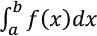
```

从这个例子可以注意以下几个重要点：

* 由于样本量较大，相对频率提供了概率的良好估计。
* 如果连续划分区间，相对频率（估计概率）往往趋于一个平滑函数。
* 在这些情况下，平滑函数提供了概率的良好估计，且 `X` 落在某个区间内的概率可以通过对该区间上的平滑函数进行积分来计算。

该函数正是连续随机变量密度函数的类比。请注意，在离散情况下，我们对可能的离散值进行函数求加，而在连续情况下，它是对区间进行积分。

### 密度函数

如果 `R` 上的实值函数 `f` 对于 `R` 的任意区间 `(a , b]` 满足 `P (a < X ⩽ b) = `，则称为连续随机变量 `X` 的密度函数。

通常，如果任何函数满足 ``，我们可以构造一个样本空间和一个随机变量 `X`，使得 `f(x0)` 是 `X` 的密度函数。

最后，让我们引入另一种对计算概率通常非常有用的函数。

### 分布函数

在 `R` 上定义的由 `F(x) = P(X ⩽ x)` 的实值函数 `F` 称为随机变量 `X` 的分布函数。

请注意，它同样适用于离散和连续随机变量。对于连续情况，我们可能没有密度函数，但分布函数始终存在。

如果 `X` 是具有离散密度函数 `f(x)` 的离散随机变量，那么：

```
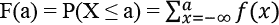
```

和，

```
P(a < X ⩽ b) = P(X ⩽ b) – P(X ⩽ a) = F(b) – F(a) = ∑[a <x ⩽ b] f(x)
```

如果 `X` 是具有密度函数 `f(x)` 的连续随机变量，那么：

```
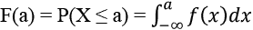
```

和，

```
P(a < X ⩽ b) = P(X ⩽ b) – P(X ⩽ a) = F(b) – F(a) = ∑[a <x ⩽ b] f(x)
```

类比离散情况，对于密度函数为 `f(x)` 的连续随机变量 `X`，`X` 的期望定义为：

`E(X) = `如果积分 `< ∞`

如果 ``不是有限的，则说 `E(X)` 不存在。

让我们考虑上一个例子中的随机变量 `X`（掷三次均匀硬币时正面朝上的次数）。这里，`X` 有四个取值：`0`、`1`、`2`,`3`，概率分别为 `1/8`、`3/8`、`3/8` 和 `1/8`。那么，

`E(X) = \= (0)(1/8) + (1)(3/8) + (2)(3/8) + (3)(1/8) + 0 = 12/8 = 1.5`

末尾添加零值项是为了强调对于 `X` 的所有其他取值，`f(x) = 0`，因此它们对和的贡献为零。

注意，尽管 `X` 是可以取许多可能值的随机变量，但如果 `E(X)` 存在，它是一个常数值。通常，如果我们考虑将质量 `f(x)` 放在实轴上的值 `x` 上，它代表了重心。

现在让我们来看期望的几个重要性质：

* 如果 `X` 和 `Y` 是同一个概率空间上具有有限期望的随机变量，那么随机变量 `Z = X + Y` 也具有有限期望，且 `E(Z) = E(X) + E(Y)`。
* 如果 `P(X geqslant Y) = 1`。换句话说，对于每一个样本 `ω`，`X(ω) geqslant Y(ω)`，那么 `E(X) geqslant E(Y)`。
* 如果 `c` 是常数，我们可以将其视为概率为 1 时取 `c` 的随机变量。根据这一理解，`E(c) = c`。因此，常数的期望值等于其本身的值。
* 一点表明 `E(E(X)) = E(X)`，因为 `E(X)` 是一个常数。
* 如果 `c` 是常数，`E(cX) = cE(X)`。
* `| E(X) | ⩽ E(|X|)`。
* 如果 `X` 和 `Y` 是同一个概率空间上具有有限期望的独立随机变量，那么 `XY` 具有有限期望且 `E(XY) = E(X)E(Y)`。

### 2.1.6 方差与标准差

随机变量 `X` 的均值或期望提供了当随机实验重复多次时 `X` 的平均值。这代表了分布的中心趋势。但在理解分布性质的同时，理解分布的离散程度同样重要。这被称为方差：令 `X` 为具有有限值 `E(X²)` 的随机变量。则 `X` 的方差记为 `Var(X) = E((X – E(X))²)`。

注意，项 `X – E(X)` 是 `X` 的不同取值与 `E(X)`（`X` 的期望值）之间的距离。这可能是正的可能是负的。所以如果我们取它们的平均值，它们可能会相互抵消。因此，考虑 `(X – E(X))²`，它总是正的。这个值的期望值就是 `X` 的方差，衡量了 `X` 的分布围绕 `X` 期望值的离散程度。

量 `` 被称为标准差。

注意，利用期望的性质，

`Var(X) = E((X-E(X))²) = E(X² – 2XE(X) + (E(X))²)`

`= E(X²) – 2E(X)E(X) + E((E(X))²)`

`= E(X²) – 2(E(X))² +(E(X))²`

`= E(X²) – (E(X))²`

由于此，我们在定义中假设了 `E(X²)` 为有限值。与期望一样，方差对于某些随机变量可能不存在。

如果 `X` 和 `Y` 是两个具有有限方差的随机变量。那么：

`Var(X + Y) = E((X+Y²) – (E(X+Y))² = E(X² + 2XY + Y²) – (E(X) +E(Y))²`

`= E(X²) + E(2XY) + E(Y²) – E(X)² – 2E(X)E(Y) – E(Y)²`

`= [E(X²) – E(X)²] + [E(Y²) – E(Y)² ] + E(2XY) – 2 E(X)E(Y)`

`= Var(X) + Var(Y) + 2[E(XY) - E(X)E(Y)]`

通常情况下，两个随机变量和的方差并不是它们方差的和，它包含额外一项。项 `E(XY) - E(X)E(Y)` 有特殊的含义，它被称为 `X` 和 `Y` 之间的协方差，我们将在下一节对其进行正式定义。

如果 `X` 和 `Y` 是独立的，那么 `E(XY) = E(X)E(Y)`，即 `Var(X) = 0`。在这种情况下 `Var(X) + Y`。

一般而言，`X` 和 `Y` 是相互独立的，``。

# 制造公司

作为第二个例子，让我们考虑一家使用复杂机器开发产品的制造公司。如果机器故障，生产线将会停止并导致巨大损失。将机器恢复到运行状态是一项耗时的活动，且在此期间生产将完全停滞。然而，对仪器进行定期维护所需的时间较短，只需几小时，并能确保仪器顺畅运行，但会产生高昂成本。公司无法定期对仪器进行维修。因此，公司想要了解何时需要进行下一次维护。仪器由于温度、压力和机器运行小时等各种环境因素而故障。因此，如果可以获得仪器故障的历史数据以及环境数据，一种可能的方法是分析历史数据并预测仪器何时会再次故障，并在发生故障的前几天进行预防性维护。在这里，主要的兴趣是预测一个事件。

# 银行贷款

作为第三个例子，让我们考虑一家银行想要了解申请贷款的新客户是否会违约。该客户是首次客户，因此银行没有关于其过去还款历史的资料。然而，银行拥有关于其客户收入、职业、教育以及其他各种社会经济信息的大量历史数据，这些信息似乎对贷款还款以及是否违约有影响。银行想利用这些数据，根据客户的人口统计和社会经济数据了解新客户是否会违约。在这里，问题是将客户预测为违约者和非违约者两组之一。

# 针对性活动

作为第四个例子，让我们考虑公司想对其客户开展有针对性的营销活动。该活动是首次组织，因此公司没有关于它如何影响客户的任何信息。公司拥有的信息是客户购买的产品类型以及过去两年的销售总额。如何将客户分成几个细分群体以从活动中获得最大收益？

# 国际象棋计算机

最后，让我们考虑另一个例子，即设计用于与人类下国际象棋的计算机程序。无法为程序提供所有可能的走法和反击，但系统将学会学会如何在这样的环境中运行。它将通过游戏的结果进行学习。

上述所有例子都展示了可以使用机器学习的不同场景。如果我们仔细观察这些例子，可以发现有不同类型的问题需要解决：

* 快消品公司：识别响应与多个影响因素之间的关系。
* 制造公司：基于相关数据预测定量响应。
* 银行贷款：基于相关数据预测定性响应。
* 针对性营销活动：在没有任何先验知识的情况下从数据中揭信息。
* 国际象棋计算机：允许系统通过与环境的交互自主学习。

这些是机器学习运行的一些基本场景。在下一节中，我们将看到不同的机器学习类型以及这些场景与它们之间的关系。

## 2.2.2 学习类型

根据问题的类型和所采用的学习方法，机器学习有不同的类型。这里描述了主要类型：

* **监督学习**：在监督学习中，系统通过包含响应或结果以及不同影响因素的训练数据进行学习。其核心思想是建立结果与预测变量联系起来。它可以进一步细分为两类：
  * **回归**：在回归问题中，响应或结果是定量的（连续的）。一些示例包括销售额、生存概率。
  * **分类**：在这里，响应代表类别。一些示例包括违约状态、性别。
* **无监督学习**：在无监督学习中，我们想要识别数据内部的结构和隐藏模式。没有指导员或老师，而是自主学习。
* **半监督学习**：这是监督学习和无监督学习的混合。在这里，部分数据有响应，但大多数数据没有。
* **强化学习**：在这里，系统通过与环境交互并获得惩罚和奖励来学习。最终没有数据来训练系统。计算机代理下国际象棋的场景就是一个例子。

## 2.3 机器学习算法

在机器学习中，系统通过人工智能和统计方法的各种算法进行学习。本节将介绍用于不同类型机器学习的一些重要且常用的算法，以理解机器学习如何工作以及如何在现实中使用这些算法，及其优缺点。

### 2.3.1 线性回归分析

线性回归分析是非常简单且常用的监督学习方法之一。它在统计数据分析领域已经存在，是应用于机器学习领域的许多统计方法之一。本章讨论了线性回归的基本概念以及它如何用于现实问题。本章还展示了应用机器学习算法时的一些关键考虑因素，并在进入更复杂的机器学习方法之前作为一个良好的起点。我们将在本章中也讨论岭回归和 Lasso 等先进且流行的技术。

在正式定义线性回归模型之前，让我们看看下面的例子。作为机器学习专家，你负责寻找二手车价格与两个不同因素（汽车年龄、油耗里程）之间的关系。我们知道旧车的价格通常随着年龄的增长而降低，价格通常随着里程的增加而增加。但有足够的证据称其为关系吗？这种关系的性质是什么？它是线性的吗？价格与里程之间的关系有多强？哪个因素影响更大——价格还是里程？这种关系能多好地预测二手车的价格？线性回归可能是这些问题的良好起点。[图 2.5] 显示了这些变量的模拟数据。[图 2.5] 1 显示了年龄与价格的关系，图 2.5] 2 显示了里程与价格的关系。

线性回归分析用于当我们尝试在定量响应变量（也称为因变量）与某些预测变量（也称为自变量或解释变量）之间拟合模型，以理解预测变量对响应变量的影响性质，并在给定一组预测变量的值时预测响应的值。在这里，我们假设响应的值可以通过相关预测变量值的线性组合进行合理的估计。更精确地说，我们尝试拟合一个模型：

```
Y = β[0] + β[1].X[1] + β[2].X[2] + .. + β[p.]X[p] + Ɛ
```

或

```
y[i]= β[0] + β[1].x[1i] + β[2].x[2i] + .. + β[p.]x[pi] + ε[i]
```

在方程 1 中，`Y` 是响应（或因变量），`X[1]`、`X[2]`、`..X[p]` 是预测变量（或自变量）。`Ɛ` 是表示模型中误差或噪声的随机变量，它解释了由于测量和/或由于模型中遗漏其他影响变量而导致的误差。误差项被假设期望值为 0（`E(Ɛ) = 0`），并且它与响应变量的值独立，因此不会显示出任何系统性的误差模式。`β[0]`、`β[1]`、`β[2]`、.., `β[p]`是一些常数，但它们是未知的，需要根据可用数据进行估计。它们被称为回归系数或参数。在我们的示例中，我们可以将 `Y` 视为车价，`X1` 视为年龄，`X2` 视为里程。

方程 2 从这些变量值的角度表示了相同的内容。在样本数据的第 i 条记录中，`y[i]` 是响应 `Y` 的值，`x[1i]`、`x[2i]`、`.., x[pi]` 是预测变量 `X[1]`、`X[2]`、`.., X[p]` 的对应值。误差变量 `Ɛ` 的对应值为 `ε[i]`。方程 2 的左侧表示 `Y` 的观测值（在给定对应预测变量 `X[1]`、`X[2]`、`.., X[p]` 的值 `x[1i]`、`x[2i]`、`.., x[pi]` 的情况下），右侧显示预测变量值与误差项的线性组合。通常，变量用大写字母表示，值用对应的小写字母表示，有时会加上后缀以表示样本中的通用记录。

### 注意事项

我们只有用于估计这种关系的样本数据，换句话说，是估计 `β[0]`、`β[1]`、`β[2]`、.., `β[p]` 的值；使误差项最小。因此，我们的估计可能会根据样本数据而变化。如何处理这种情况呢？首先，样本数据应该是整个场景（通常称为总体）的代表性样本。尽管如此，估计可能会根据数据而不同。在这种情况下，概率论发挥了作用，可以被用于获得参数的置信区间预测值。我们将重点介绍这些场景，而不涉及此类概率的严谨计算，因为这需要该方面的高级知识。

### 简单线性回归

简单线性回归研究响应变量 `Y` 与单个预测变量 `X` 之间的线性关系。该模型可以用数学表示为：

```
Y = β[0] + β[1].X + Ɛ
```

参数 `β[0]`称为截距，`β[1]`称为斜率。它们是未知的常数，需要根据数据进行估计。

### 注意事项


直线的方程是`y = mx + c`，其中`c`是截距（直线与 Y 轴相交处`y`的值），`m`是直线的斜率（`X`值每变化一个单位，`Y`值的变化）。在简单回归中，`Y`和`X`之间的关系通过直线进行估计，参数`β[0]`和`β[1]`发挥与直线截距和斜率相同的作用。这条直线被称为回归线。“线性”一词也源于这一事实。令`β[0]`和`β[1]`为这些参数的估计值。那么`y`的预测或估计值记作`e`）给出：

```
e = y - β[0] - β[1].x
```

对于`X = x`的值。如果`y`是`Y = x`的真实值，那么估计误差为`e = y - β[0] - β[1].x`。这可能是正的，也可能是负的。图 2.6 显示了价格与年龄两种可能的回归系数估计的回归线，回归线是相对于 Y 轴的。

## 回归系数的可能估计

选择哪些回归系数值作为最佳估计，以使得回归线的误差最小？理想情况下，这应该产生一条非常接近所有观测点的回归线。存在多种最小化误差的方法，最常见的是最小二乘法，其中我们尝试最小化误差的平方和。

## 回归系数的估计

令`(x[1], y[1])`、`(x[2], y[2])` …, `(x[n], y[n])`为观测对，每个对包含预测变量`X`和响应值`Y`。`β[0]`和`β[1]`为估计值。对于第 i 个观测，误差为`e[i] = y[i] - β[0] - β[1].x[i]`。我们定义残差平方和（RSS）为：

```
RSS = e[1]² + e[2]² + … + e[n]²
```

或等效地定义为：

```
RSS = (y[1] - β[0] - β[1].x[1])² + (y[2] - β[0] - β[1].x[2])² + … + (y[n] - β[0] - β[1].x[n])²
```

最小二乘法选择`β[0]`和`β[1]`使得`RSS`最小。注意，除了`β[0]`和`β[1]`的值外，其他值都是已知的，因此这可以被视为两个变量`β[0]`和`β[1]`的函数，它们在`β[0]`和`β[1]`处最小。这意味着`RSS`对`β[0]`和`β[1]`的偏导数为零。利用微积分的结果，我们可以得到两个方程，这些方程的解给出了最小 RSS 的`β[0]`和`β[1]`值。

其中`x_bar`和`y_bar`是样本平均值。图 2.7 显示了基于年龄与价格数据最小二乘估计的回归线。

## 注意事项

在线性回归中，响应变量始终是定量的。然而，预测变量可以是定量的或分类的。对于具有`m`个类别的分类变量`X`，我们创建`(m-1)`个虚拟或指示变量`X[1], X[2], .., X[m-1]`，当`x[i]`表示第一个类别时`x[1i] = 1`，否则为 0。

这里`x[1i]`和`x[i]`分别表示第 i 条记录中`X[1]`和`X`的值。同样，我们继续定义`x[2i] = 1`（如果`x[i]`表示第二个类别，否则为 0），最后定义`x[(m-1)i] = 1`（如果`x[i]`表示第 (m-1) 个类别，否则为 0）。

注意，如果`x[i]`表示第`m`类，则第`i`条记录的所有虚拟变量值都将为零，并且可以很容易地识别。

这些虚拟预测变量可以与其他预测变量一起用于回归分析。创建虚拟变量的具体方法并不重要，它不会改变整体回归分析，但虚拟变量系数的解释会随着创建虚拟变量方式的不同而改变。

在我们关于二手车价格的示例中，如果我们引入另一个预测变量`car type`，其值为两背车（hatchback）、轿车（sedan）和 SUV，那么我们可能会引入两个额外的预测变量`X[1]`和`X[2]`：

- 如果 car type 为 Hatchback，则`x[1i] = 1`，否则为 0
- 如果 car type 为 Sedan，则`x[2i] = 1`，否则为 0

然后可以将这些预测变量`X[1]`和`X[2]`以及年龄和里程等其他预测变量一起使用。

在实践中，我们经常使用许多分类预测变量，如教育程度、职业等。


**图 2.7** 价格随年龄回归的最小二法拟合

## 评估回归系数估计的准确性

如前所述，我们根据样本数据估计回归系数。因此，即使`Y`和`X`之间的真实关系是完美的线性，我们也可能无法准确估计截距和斜率的真实值。不同的样本可能会导致回归系数最小二法估计值略有不同。因此，我们的`Y`预测值也会根据不同的训练集而有所不同。这些估计  和 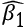 波动有多大，我们又如何衡量它们？由于我们没有分析的所有数据，在没有进一步假设的情况下无法回答。我们采取以下假设：

- **弱外生性 (Weak exogeneity)**：这意味着预测变量可以被视为固定值。这些值的测量是无误差的，因此模型中的误差不是由于预测变量的误差。
- **同方差性 (Homoscedasticity)**：无论预测变量的值如何，响应变量的不同实现的其误差具有相同的方差。
- **误差独立性 (Independence of errors)**：误差项之间不相关。

在这些假设下，我们有以下公式：

- 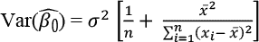
- 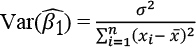

其中`σ² = Var(Ɛ)`。上述假设并不总是有效，但该公式通常是一个很好的近似。`σ²`的值通常是未知的，但可以根据数据使用公式`RSS/(n-2)`进行估计。

此外，如果我们假设误差从正态分布，那么`β[0]`和`β[1]`的近似 95% 置信区间可以由  和 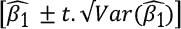 分给出，其中`t`是自由度为`n-2`的 t 分布的 97.5% 分位数。这意味着`β[0]`的真实值有 0.95 的概率落在区间 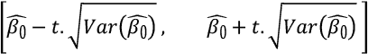 内。类似的解释也适用于`β[1]`的真实值。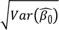 也称为  的标准差或标准误差。

### 注意

我们可能对回归系数进行统计假设检验，以验证关系的性质。例如，我们可以测试`X`和`Y`之间是否存在关系。在没有关系的情况下，`β[1]`的真实值为 0。我们估计的`β[1]`值  可能不为 0，但这可能完全由于于特定的数据集。如果该值远离 0（无论是正值还是负值），我们就可以很有信地说`β[1]`的真实值不为 0。但多远才算足够呢？这里我们也使用概率论。事实证明，使用公式`t = `计算的 t 统计量在`β[1] = 0`的假设下遵循自由度为`n - 2`的 t 分布，其中`n`表示样本数据中的观测值数量。借助这种概率分布的帮助，我们计算出获得绝对值等于`|t|`或更高的 t 统计量的概率。如果这个概率非常低，我们推断在`β[1] = 0`的假设下不太可能得到`β[1]`的估计 ，因此`X`和`Y`之间确实存在关系。

## 评估估计模型的准确性

在对数据拟合模型后，重要的事情之一是评估模型拟合数据的程度。如果模型与数据拟合不好，模型将无法反映真实关系并产生糟糕的预测。这是根据响应`y`的实际值与估计值之间的误差来评估的。有不同的拟合优度标准，我们在这里讨论其中两个：残差标准误差 (`RSE`) 和`R²`统计量。

记得残差平方和 (`RSS`) 定义为：

```
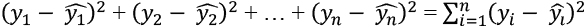
```

这是`Y`的实际值与估计值之间偏差平方和。我们定义另外两个项：

- 总平方和 (`TSS`)：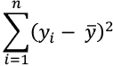 其中 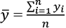 是实际值与样本均值之间偏差的和。它代表了`Y`跨样本均值的总变异。
- 解释平方和 (`ESS`)：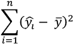 其中  是`Y`的估计值与样本均值之间偏差的和。它代表了由线性估计解释的`Y`的变异。很容易证明`TSS = RSS + ESS`。

### 残差标准误差 (RSE)

残差标准误差 (`RSE`) 定义为：

```
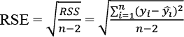
```

`RSE`以`Y`的单位提供了拟合的绝对衡量。`RSE`的值越高，拟合优度越低。然而，多大坏取决于具体问题。可以通过对比样本均值  来检查拟合不良的程度，例如，如果`RSE`为 10 且  为 100，则显示平均有约 10% 的偏差。

### R² 统计量

`R²`统计量定义为：

```
R² = ESS/TSS = (TSS – RSS) / TSS = 1 – RSS/TSS
```

它代表了回归模型解释的总变异比例。由于`0 ⩽ ESS ⩽ TSS`，这意味着`0 ⩽ R² ⩽ 1`。`R²`的值越高，意味着回归模型解释的总方差比例越高，因此拟合优度越性好。然而，`R²`的良好值取决于具体问题。注意，这独立于`Y`的标度，因此`Y`的缩放变换不会影响`R²`的值。在简单线性回归中，`R²`衡量`Y`和`X`之间的线性关系。可以证明`R² = r²`，其中`r = Cor(X,Y)`。

### 多元线性回归

在大多数现实问题中，响应变量通常依赖于多个预测变量。在二手车价格的示例中，二手车的价格取决于两个因素：汽车的年龄和里程数。在这种情况下，我们如何拟合模型呢？一种可能性是每次引入一个预测变量，推导出两个不同的简单线性回归模型。然而，当年龄和里程数已知时，这种方法并不能很好地预测二手车的价格，因为两个模型都会提供价格的预测值，且它们可能不一致。此外，它无法捕捉价格与里程数之间的关系如何随着不同年龄的变化而变化，反之亦然。因此，当我们有两个或多个预测变量时，自然地是将简单线性回归模型扩展为同时包含所有预测变量。

多元回归模型可以表示为：

```
Y = β[0] + β[1].X[1] + β[2].X[2] + .. + β[p.]X[p] + Ɛ
```

这里，`Y`是响应变量或因变量，`X[1]`、`X[2]`、`..X[p]`是预测变量或自变量，`Ɛ`是代表模型中误差或噪声的随机变量，而`β[0]`、`β[1]`、`β[2]`、.., `β[p]`是回归系数或参数。

#### 注意

与简单线性回归模型一样，多元线性回归通过直线的多维等价性来估计响应`Y`与预测变量`X[1]`、`X[2]`、`.., X[p]`之间的关系。`y`的估计值（在给定对应预测变量`X[1]`、`X[2]`、`.., X[p]`的`x[1]`、`x[2]`、`.., x[p]`值情况的`y`）可以通过以下方式表示为这些值的线性组合：

```
y= β[0] + β[1].x[1] + β[2].x[2] + .. + β[p.]x[p]
```

这里，`β[0]`、`β[1]`、...`β[p]`是回归系数的估计值。该方程代表高维空间中类似于直线的平面，称为超平面（hyperplanes）。在两个预测变量的情况下，该方程代表直线的二维等价物，即一个没有曲率的表面。图 2.8 显示了关于回归系数最小二法估计的回归平面。

## 回归系数的估计

多元线性回归中最小二法估计的推导可以使用矩阵代数进行高效计算。如果你不熟悉矩阵和向量，可以跳过这部分。你可以通过机器学习软件获取回归系数的最小二法估计，而无需应用线性代数的结果。

令`y^T = (y[1], y[2], …, y[n])`为样本`n`条记录中响应变量`Y`值的向量的转置。这里`y^T`代表向量`y`的转置。

令`X = (1 | x[ij])`，其中`i`从 1 到`n`，`j`从 1 到`p`，代表预测变量值的`n x (p +1)`矩阵，其中第一列为`1`（用于截距项），`x[ij]`代表第`i`条记录中第`j`个预测变量的值。

令`β^T = (β[0], β[1], β[2], …, β[p])`为回归系数向量的转置，`Ɛ^T = (ε[1], ε[2], …, ε[n])`代表误差项向量的转置。那么多元回归模型可以用矩阵符号表示为`y = Xβ + Ɛ`。

这意味着`Ɛ = y - Xβ`。

含有许多预测变量的多元线性回归模型往往容易对数据产生过拟合，它与模型数据的拟良好，但预测能力差。因此，在分析数据时，我们需要选择正确的预测变量集。这被称为变量选择。变量选择有很多方法，其中一些在下文中讨论。

理想情况下，当可用多个预测变量时，我们应该检查每个包含不同预测变量集的所有可能模型，并根据某些标准选择出最好的一个。有多种统计量，如`Mallow’s C[p]`、`Akaika 信息准则 (AIC)`、`贝叶斯信息准则 (BIC)`和`adjusted R²`来从一组可用模型中检测最佳模型。然而，此类模型的总数可能非常高，对于`p`个预测变量，有`2^p`个不同的模型（包括不包含任何预测变量的模型）。因此，在实践中使用了少数经典的变量选择方法：

* **前向选择 (Forward selection)**：在这种情况下，首先评估没有预测变量的模型。然后，我们拟合`p`个简单线性回归，每个预测变量一个，并选择导致`RSS`最小的预测变量。一旦选择了该预测变量，我们再评估所有具有`2`个预测变量的模型（其中一个是所选的），并选择导致`RSS`最小的模型。我们继续这种逐个选择预测变量的过程，直到满足某些停止标准。
* **后向消除 (Backward elimination)**：在这里我们从所有预测变量开始并逐个删除预测变量。首先，用所有预测变量对数据进行建模，并根据`t-statistics`识别出最不显著的预测变量。然后我们用剩余的`(p -1)`个预测变量拟合模型，再次在这个具有`(p -1)`个预测变量的新模型中选择最不显著的一个。我们继续逐个消除预测变量，直到满足某些停止标准。
* **混合选择 (Mixed selection)**：这是前向选择和后向消除的结合。我们首先从没有预测变量开始，像前向选择一样继续选择预测变量。然而，在任何此类步骤中，如果某些预测变量根据`t-statistics`显示最不显著，我们就消除该预测变量。我们继续前向和后向步骤，直到模型中的所有预测变量都是显著的，且从外部添加预测变量会使其变得不显著（基于`t-statistics`）。

## 其他考虑

在`Section 2.3.1`中，我们讨论了与线性回归的一些假设。在实践中，这些假设并不总是满足，此外可能存在各种与数据相关的问题。这些情况在拟合回归模型时会各种问题，需要进行诊断和修正。让我们探索这些常见问题。

### 预测变量与响应之间的非线性关系

线性回归模型假设响应与预测变量之间存在线性关系。然而，这种关系通常不是线性的，拟合模型不能代表真实情况。`Figure 2.9` `1`显示预测变量`X`和响应`Y`的散点图。显然，点并没有沿直线分布，而是接近于二次函数`Y = X²`。

```
Y = X²
```

当我们观察到这种非线性时，在将它们用于模型之前，我们可以对预测变量进行一些变换。在我们的示例中，如果我们使用`Z = X²`作为预测变量而不是`X`，那么`Y`和`Z`之间的关系将是线性的。`Figure 2.9` `1`显示预测变量`X`和响应`Y`的散点图。显然，点并没有沿直线分布，而是接近于二次函数`Y = X²`。

```
Z = X²
```

多重共线性可以通过方差膨胀因子（`VIF`）进行评估，每个预测变量计算公式为`VIF[j] = 1 / (1 – R²[j])`，其中`R²[j]`是当`X[j]`回归所有其他预测变量时的`R²`统计量。换句话说，就是将`X[j]`视为响应变量而将其他预测变量视为预测变量的回归模型的`R²`。如果`X[j]`可以通过其他预测变量合理地估计，则意味着`Xj`与其他预测变量存在线性关系。在这种情况下，`R²[j]`将接近 1，相应的`VIF[j]`值将很大。在实践中，数据中通常只发现少量的多重共线性，这些是可以忽略的。如果`VIF`的值超过 5 或 10，就会出现问题。在这种情况下，我们可能会舍弃相关的预测变量，或者将线性相关的预测变量合并为一个单一的预测变量。

## 离群值与高杠杆点

离群值是指响应值`y`远离其余值的数据点。同样，高杠杆点是指预测变量值`x`远离其余值的数据点。它们可能由于测量误差或实验误差进入数据中。离群值会增加`RSE`，从而影响置信区间、`t`-统计量的计算并对拟合优度提出质疑。另一方面，高杠杆观测值会移动回归线，导致模型次优。在图 2.12 中，蓝色虚线显示了不包含高杠杆点时拟合回归线，红色实线显示了存在高杠杆点时的移动回归线。


**图 2.12** 高杠杆点存在时回归线的偏移

可以使用残差图检测离群值。离群值表现为远离其他残差。

可以使用杠杆统计量识别高杠杆点。对于简单线性回归，预测变量第`i`个值`x[i]`的杠杆计算公式为 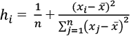


`h[i]` 值始终处于 `1/n` 和 `1` 之间。`h[i]` 高值表明相关观测值具有高杠杆率。

最小二法回归模型有几种扩展，以在建模数据时适应不同的实际场景。我们在这里简要讨论其中两种流行的扩展方法：岭回归（Ridge Regression）和 Lasso 回归。

### 岭回归

在多元线性回归中，我们通过最小化残差平方和（`RSS`）来估计回归系数。在岭回归中，通过最小化以下目标函数来估计回归系数：

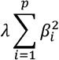

`λ ≥ 0` 是调优参数，并单独确定。注意，截距项未包含在目标函数的第二部分。

当 `λ = 0` 时，岭回归与最小二法回归相同。然而，如果 `λ > 0`，它会强制回归系数的估计向零收缩。项  被称为收缩惩罚。如果 `λ → ∞`，所有回归系数的估计值都趋于零。与最小二法回归不同，岭回归提供了多组估计。岭回归可以另一种表述为：

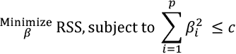

从这种表述可以显而易见，岭回归试图以某些偏差为代价来最小化方差。最小二法估计具有较高的方差，但没有偏差。相反，岭回归试图在具有可接受的偏差的情况下减少方差。这种偏差-方差的权衡使得岭回归成为回归中一种强大的工具。在存在多重共线的情况下，岭回归特别有用，因为它减少了估计值的方差。

### Lasso

在 Lasso 中，回归参数的系数是通过最小化以下目标函数来估计的：

`RSS +` 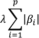

其中 `λ ≥ 0` 是调优参数，并单独确定。函数 `|a|` 表示 `a` 的绝对值。与岭回归一样，Lasso 也试图将系数收缩到零，但使用了不同的惩罚项。Lasso 可以另一种表述为：

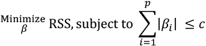

Lasso 优于岭回归的优点在于，虽然两个惩罚函数都试图收缩估计，但岭回归是在圆形空间内优化参数（因为 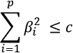 是 `p` 维空间中以原点为中心、半径为 `c` 的圆形区域），而 Lasso 是沿着顶点位于坐标轴上的 `p` 维立方体（cube）优化参数。回归系数的优化估计值通常落在这些轴点上，因此某些系数为零。因此，在优化目标函数时，Lasso 倾向于对非显著预测变量估计为零。这通过惩罚函数提供了自动的变量选择。

在两个预测变量回归的情况下，图 2.13 显示了满足约束条件的 `β[1]`、`β[2]` 取值的区域：

- （图 2.13 1）
- 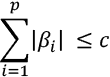（图 2.13 2）。


### 2.3.2 分类

分类分析是监督学习的另一个重要分支，基于不同影响因素的数据，将感兴趣的对象分配到多个类别或分类。在回归分析中，我们研究了如何对定量响应与多个预测变量之间的关系，并使用模型预测响应值。在分类分析中，我们也尝试基于预测变量建立模型，但感兴趣的不是定量响应，而是定性或类别响应，并为一组新的预测变量值预测可能的类别或分类。在本章中，我们将讨论一些知名且广泛使用的分类算法，以及如何在现实问题中使用它们。我们还将讨论这些算法的优缺点，以及如何根据问题的性质识别合适的算法。

在我们进入算法细节之前，让我们先来看一个现实中的问题。在电信行业，客户流失是一个主要问题之一。客户由于各种原因离开电信公司的服务，有时是因为网络问题或服务问题，有时是因为高额账单或账单错误，有时则是因为搬到新地点等其他因素。由于获取新客户的成本通常比留住现有客户更高，因此主动防止流失可以增加利润。基于此考虑，电信公司试图预测可能易流失的客户，并通过主动的留存计划来留住他们。在预测易流失的客户时，我们根据使用模式、账单模式、客户投诉和人口统计信息等各种相关影响数据将客户分为两类：易流失客户和忠实客户。为了实现这一目的，我们可以建立一个模型，根据历史数据识别指示客户是否流失的分类响应变量与若干预测变量或影响因素之间的关系。然后，我们可以根据预测变量的关联值使用该模型来分类或预测现有客户是否会流失。这类建模练习属于分类分析领域。分类分析的另一个有趣用例是图像识别。根据照片中物体颜色、形状、大小等各个方面，机器学习算法可以将图像中的物体分为不同的类别。

### K 近邻分类器

K-近邻（KNN）分类器是根据训练数据集对观测值进行分类的最简单监督学习方法之一。它不像回归分析那样基于训练数据建立任何模型。相反，给定一个新的观测值，它根据邻居记录对数据进行分类。

假设我们有一个分类变量 `Y` 表示两个类别：`Class 1` 和 `Class 2`，以及两个预测变量 `X` 和 `Z`。我们有 `n` 个观测值的训练数据，每个观测值包含 `Y`、`X` 和 `Z` 的值。`{(y[1], x[1], z[1]), (y[2], x[2], z[2]), …, (y[n], x[n], z[n])}` 是训练集。现在我们有一条只有预测变量 `X` 和 `Z` 的值的新记录。假设该记录为 `(x, z)`。我们想要预测该记录属于 `Class 1` 还是 `Class 2`，换句话说，我们想要预测分类变量 `Y` 的值。图 2.14 1 以图形显示了这些数据，其中每个数据根据其在 `X` 和 `Z` 预测变量中的值绘制。数据的颜色表示它们所属的类别，红点表示属于 `Class 1` 的记录，蓝点表示属于 `Class 2` 的记录。黑点表示我们希望分类为 `Class 1` 或 `Class 2` 的新记录。

KNN 分类器查看训练数据中新观测值最近的 `K` 个邻居，并将新观测值归为这 `K` 个邻居中代表性最多的类别。如果出现平局，我们可以随机将其分配给其中一个类别。在我们的示例中，取 `K = 15` 的值。在图 2.14 1 中，黑点周围的圆包含了训练集中的 15 个最近邻居；其中 12 个是红色的（来自 `Class 1`），因此新观测值被分类为 `Class 1`。

我们可以根据这一原理对平面上的所有点进行分类。这在图 2.14 2 中所示。黑线表示红色和蓝色区域之间的边界，称为决策边界。


**图 2.14** 基于训练集和决策边界的新记录的 KNN 分类

`K` 值的选择对 KNN 的分类至关重要。如果我们取一个较小的 `K` 值，它提供了一个非常灵活的决策边界。这对应于低偏置高方差的分类器。随着 `K` 值的增大，决策边界变得不灵活，这对应于低方差高偏置的分类器。图 2.15 显示了两个这样的分类器。图 2.15 1 对应于 `K = 3`，而图 2.15 2 对应于 `K = 50`。

我们可以根据训练数据和测试数据计算不同 `K` 值下分类器的错误率。分类中的错误率可以定义为：

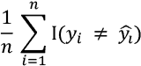

其中 `yi` 是实际类别， 是基于第 `i` 个观测值的预测类别，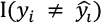 是指示函数，如果预测类别与实际类别不匹配，值为 1，否则为 0。因此，错误率表示误分类记录的比例。我们可以选择一个训练和测试错误率较低的 `K` 值。


**图 2.15** `K=3` 和 `K=50` 的 KNN 分类器

在 KNN 中，所有邻居无论相对距离如何都获得同等的权重。这使得它对 `K` 的选择更加敏感。可以通过引入权重函数来减少这一点；使得最近的邻居获得更高的权重。远点的影响较小。如果 `d[1]`、`d[2]` .. `d[k]` 是测试观测值到相关的 `K` 个邻居的距离，则可以将 `w[1] = 1/d[1]`、`w[2] = 1/d[2]`、.. `w[k] = 1/d[k]` 取为权重，如果测试观测值具有 `∑w[i] I(y[i] = y)` 最大值（其中 `i` 遍历 `k` 个邻居，`I` 是指示函数），则可以将测试观测值分类为类别 `y`。

#### KNN 分类器的优缺点

KNN 分类器的主要优点包括：

- KNN 是一种非参数分类器，它对底层概率分布没有任何假设。
- KNN 不需要建立模型，因此很容易适应新的训练数据。
- 与其他分类器不同，它可以用于多分类问题。

然而，KNN 也有一些缺缺点：

- 它在高维数据中表现不佳，因为数据点在高维空间中变得稀疏。
- KNN 分类器不需要建立模型。然而，对包含大量记录的测试数据集进行分类可能非常昂贵，因为需要计算每个测试记录与所有训练记录之间的距离。
- 它可能会受到预测变量标量变换的影响。如果一个预测变量与其他变量相比具有较大的数值范围，分类器会被该预测变量主导并产生错误的预测。因此，需要对数据进行预处理以消除尺度的影响。

### 逻辑回归

逻辑回归用于二分类问题，即响应变量具有两个不同的类别。这是统计学中的经典方法之一，在机器学习中有许多应用。长期以来，它在生物学和社会科学中被广泛使用。逻辑回归模型有很多种扩展。

在逻辑回归中，我们通常用 `0` 和 `1` 来表示响应变量 `Y` 的值。我们通常取 `Y = 1` 为主要感兴趣的类别。然而，对响应使用不同的编码并不重要，我们只需要相应地解释结果即可。与 `KNN` 不同，在逻辑回归中，数据是根据给定预测变量值的 `Y = 1` 的条件概率进行分类的。在数学上，这可以写为：

`P(Y = 1 | X = x)`，其中 `X = (X[1], X[2], ..., X[p])`

`p` 个预测变量集合和 `x = (x[1], x[2], .., x[p])` 是典型记录中对应预测变量的值。注意，`P(Y = 1 | X = x)` 是关于 `X` 的函数，其值随 `X` 的不同值而变化。我们使用以下简化记法来表示这种关系：

`p(X) = P(Y = 1 | X)`

逻辑回归试图拟合一个模型来寻找 `p(X)` 与 `X` 之间的关系。检查此类模型的最简单方法之一：

`p(X) = β[0] + β[1]X[1] + β[2]X[2] + β[p]X[p]`

然而，事实证明这种模型可能会给出 `p(X)` 的负值。由于概率不为负数，我们需要确保概率落在 `0` 和 `1` 之间。这是通过对 `β[0] + β[1]X[1] + β[2]X[2] + β[p]X[p]` 进行变换来实现，使得 `p(X)` 落在 `0` 和 `1` 之间。有很多这样的候选函数，在逻辑函数中我们使用 logit 函数：

`logit(p(X)) = log(p(X) / (1 - p(X)))`

注意，这等于将方程写为：

`log(p(X) / (1 - p(X))) = β[0] + β[1]X[1] + β[2]X[2] + β[p]X[p]`

`p(X) / (1 - p(X))` 被称为 `odds`（赔率），它是有利事件的概率与不利事件概率之比。`odds` 的值越高，意味着有利事件发生的可能性越大。注意，`p(X) / (1 - p(X))` 变化于 `0` 到 `∞` 之间。方程 `3` 等同于：

`log(p(X) / (1 - p(X))) = β[0] + β[1]X[1] + β[2]X[2] + β[p]X[p]`

方程的左侧被称为 `log-odds`（对数赔率）或 `logit`。`logit` 可以在 `-∞` 到 `+∞` 之间变化。因此，这种设定为我们提供了一个连续响应变量 `logit`，它与一组预测变量呈线性关系。这正是线性回归的设定。然而，它们之间存在一些差异。回想线性回归中，回归系数 `β[1]`、`β[2]`、..、`β[p]` 分别代表预测变量 `X[1]`、`X[2]`、..、`X[p]` 单位变化引起 `Y` 值的变化。但这种关系在逻辑回归中并不成立。在这里，我们使用的不是参数最小二乘估计，而是另一种估计方法，称为 `极大似然估计`。事实上，最小二乘估计是极大似然估计的一种特例。在极大似然估计中，我们获得回归系数的估计值，使得观测值 `Y` 出现的概率最大。使用极大似然估计的原理是得到回归参数的估计，使得在 `Y = 1` 的情况下，方程 `1` 定义的 `p(X)` 接近 `1`，在 `Y = 0` 的情况下接近 `0`。

逻辑回归的似然函数可以写为：

`L(β) = ∏[i=1]^n p(x[i])^y[i] (1 - p(x[i]))^(1-y[i])`

其中 `p(x[i]) = P(Y = 1 | X = x[i])`。

极大似然估计 `β[1]`、`β[2]`、..、`β[p]` 是为了使有利事件发生的概率最大，即最大化 `p(x[i]) = P(Y = 1 | X = x[i])` 似然函数。逻辑回归的许多方面与线性回归方面是相似的。

逻辑回归的优点包括：

- 与决策树相比，逻辑回归具有良好的解释性。
- 逻辑回归提供了良好的概率解释。
- 它是有效的且不需要大量的计算能力。

逻辑回归的缺点包括：

- 受到数据中共线性、异方差的影响。
- 需要通过正则化来消除这些问题。

### 决策树

决策树是流行的监督学习方法之一。为了预测目的，给定一组值，决策树识别其所属的最终分段并预测响应值的均值或众数。在进入决策树的细节之前，让我们考虑以下关于客户流的模拟数据（如[表 2.4](https://wiki.example.org/table24) 所示）。我们的目标是识别客户流与其他预测变量之间的关系，以便我们可以预测现有客户是否会流失。[图 2.16](https://wiki.example.org/fig216) 显示了相关的决策树。注意它由一系列划分规则组成。决策树的根节点根据账单金额划分。然后根据收入组进行进一步划分。


**图 2.16** 模拟客户流失数据的决策树

决策树的顶部节点被称为 `root`（根节点）。终端节点被称为 `leaves`（叶节点）。中间节点被称为 `internal nodes`（内部节点）。节点之间的连接器被称为 `branches`（分支）。因此，它是一个倒过来绘制的树结构。`leaves` 代表了预测空间的最终分段。它们互不重叠，且它们的并集构成了整个预测空间。

如果我们现在想预测现有客户是否会流失，我们需要查看预测变量关联值，并找到该记录落在哪个 `leaf`（分段）。如果该 `leaf` 中流失客户的百分比更高，则预测该客户将流失，否则预测他不会流失。

图 2.17 阐明了这种将预测空间或特征空间划分为多个分段的概念，以及每个分段如何通过响应的特定值进行标识。


**图 2.17** 通过决策树对预测空间的划分

### 构建决策树

现在我们将重点放在决策树是如何构建的上。这将有助于我们理解该方法的底层概念和局限性。决策树的最终输出是将特征空间的一组互不重叠的分段（换句话说，即预测空间，即所有预测变量 `X[1]`、`X[2]`、..、`X[p]` 的可能值的集合）分成 `j` 个分段，例如 `S[1]`、`S[2]`、…、`S[j]`，使得这些分段中响应变量的关联值聚集在响应的特定值。相关的步骤概述如下。

对于第一步，根据合适的预测变量（或特征）将特征空间划分为更小的分段（通常通过二分划分分为 2 个分段）。取决于预测变量的性质和所使用的算法，划分可以采取不同的形式。图 2.18 表示了可能的划分选项。

这里的一个重要方面是识别合适的预测变量和最佳划分。由于这些划分用于将观测值预测到某一类，因此最佳划分将具有最小的分类错误。这一概念被用于推导出不同的指标来识别最佳划分。

令 `p(i | t)` 表示第 `t` 个分段中属于类别 `i` 的记录比例。分段 `t` 的分类错误率可以通过以下任何一种指标计算：

- 分类错误率 `(t) =` 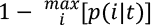
- Gini 指数 `(t) =` 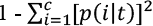
- 熵 `(t) =` 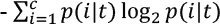

在这里，`c` 是响应变量的类别数。在这里，这些指标的值越小，表示划分越好。

通常使用 Gini 指数或熵来寻找最佳划分。


**图 2.18** 根据性质划分预测变量的不同方式

对于第二步，上一步中形成的新分段成为第一步中所用原始段的子节点。

现在，对于第三步，让我们考虑上述两个步骤对子节点递归递归。换句话说，子节点及其各自的特征空间部分被再次划分。这个过程递归持续，直到达到停止标准。这可能是因为所有记录都属于同一类别，或者所有记录具有相同的预测变量值，或者记录数量已低于阈值。

一旦一个 `node`（分段）无法进一步划分，它就被声明为一个 `leaf`（叶节点）。它被分配给在该叶节点中具有大多数训练记录的类别。

对于第四步，当所有可用节点都是叶节点时，该过程终止。

这样构建的决策树将整个特征空间或预测空间划分为较小的互不重叠的分段，每个 `leaf` 代表其中一个分段。现在，对于一条新记录，如果我们只知道预测变量的值，我们就知道该记录属于哪个 `leaf` 或分段。该新记录的响应（类别）的预测值将是该叶节点中具有大多数训练记录的类别。

#### 注意

类似的方法也适用于构建回归问题的决策树。然而，在这里响应是一个定量变量，因此 Gini 指数、熵、分类错误率等指标不能用于寻找最佳划分。在这种情况下，最佳划分是最小残差平方和（`RSS`）的划分，如下：

`RSS =` 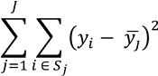

其中 `S[1]`、`S[2]`、..、`S[J]` 是特征空间的 `J` 个分段，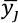 是训练数据第 `j` 个分段中响应的平均值。在这里，`i ∈ S[j]` 表示第 `i` 条记录中预测变量的值落在分段 `S[j]` 中。

此外，对于任何新记录（仅预测变量值），它应该只属于叶节点之一。基于训练数据的叶节点响应平均值被视为新记录的响应预测值。

#### 决策树的优缺点

决策树方法的主要优点包括：

- 决策树非常容易解释。它具有良好的图形表示，有助于理解划分规则。
- 如果底层关系是非线性的，它可以进行建模。


决策树可以直接处理分类和定量数据。它不需要像线性或逻辑回归那样为分类预测变量创建虚拟变量。

然而，使用决策树也有缺点：

- **过拟合。** 决策树倾向于过拟合数据。它们很好地拟合训练数据，但预测准确性不高。有几种方法可以避免这个问题，其中一种是剪枝（pruning）。
- 当类别被超平面（直线的多维等价物）分开时，决策树的拟合效果较差。因为它通过矩形分段划分预测空间。该问题的二维版本（两个预测变量）如图 2.19 所示。
- 不稳健。训练数据的微小变化可能导致最终树的巨大变化。
- 决策树遵循贪婪策略，在构建树的每一步，它都选择当前的最佳划分，而不是选择可能在未来产生更好树的划分。这可能导致次优树。
- 如果某些响应类别占据主导地位，可能会创建有偏的模型。


**图 2.19** 具有近线性边界的决策树问题

### 集成方法

分类方法如逻辑回归、决策树基于从训练数据生成的单个模型或分类器来预测响应值（类别）。然而，某些机器学习技术通过聚合多个分类器的预测来预测响应值（类别），以提高分类准确性。这些技术被称为集成方法（ensemble methods）。

集成方法基于训练数据构建一组基分类器，并通过对基分类器的预测进行投票来预测新数据的类别。换句话说，分配由大多数分类器预测的类别值。

可以证明，当基分类器相互独立，且每个基分类器的错误率小于 0.5（即它们的分类效果优于 0.5 概率的随机猜测），集成方法提供的预测准确性要高得多，与单个分类器相比，错误率显著降低。

在实践中，很难获得一组相互独立的基分类器，因此采用了不同的技术来构建独立分类器的集成，例如：通过随机化训练数据、随机化输入预测变量、操纵类别标签（响应值）或操纵学习算法。

### 随机森林

随机森林是专门为决策树设计的流行集成方法之一。它使用决策树作为基分类器，并利用一组独立随机向量的值来创建一个决策树集合。图 2.20 展示了构建随机森林的示意图。


**图 2.20** 构建随机森林的示意图

为了构建一组独立的决策树，每棵决策树在树的构建过程中使用一个随机向量（一组随机值）。这些随机向量根据某些固定的概率分布生成，使得它们之间相互独立，因此相关的决策树也倾向于相互独立。

有多种方法可以将随机向量引入到树的构建过程中。假设有 `p` 个预测变量 `X[1]`、`X[2]`、`X[3]`、……`X[p]`，随机向量从 1 到 `p` 中随机选择 `F` 个不同的数字。

为了进一步解释这个想法，假设有 10 个预测变量（`p = 10`）。如果我们取 `F = 4`，随机向量将从 1 到 10 中随机选出 4 个不同的数字。第一次选取了向量 `(1, 3, 9, 10)`，第二次选取了 `(2, 4, 7, 8)`，第三次选取了 `(1, 5, 6, 8)`，依此类推。对于这些随机向量中的每一个，我们可以用许多方式构建决策树。

#### 构建技术

首先，不是使用所有可预测变量，而是创建一个决策树，根据随机选择的 `F` 个预测变量来分裂每个节点。

在我们的示例中，第一个随机向量是 `(1, 3, 9, 10)`，因此第一棵决策树仅使用预测变量 `X[1]`、`X[3]`、`X[9]`、`X[10]` 来分裂每个节点。同样，第二棵决策树使用预测变量 `X[2]`、`X[4]`、`X[7]`、`X[8]` 来分裂每个节点。

由于它们在分裂使用的预测变量上不同，两棵决策树都是不同的，它们之间没有很大的相似性或相关性。同样的方法，可以生成一组决策树。

如果 `F` 的值较，会增加随机性，从而增加相关决策树的独立性。但如果预测变量较少，决策树的准确性就会降低。作为权衡，`F` 的值通常选择为 `F = log[2] p + 1`。

这种方法被称为 Forest-RI，其中 RI 代表随机输入。为了提高独立性，甚至输入数据也可以进行随机化，从原始的 `n` 条记录数据中通过放回抽样提取 `n` 条记录的随机样本（被选中的记录可以再次被选中）。这种技术被称为自助法（bag）。

其次，当 `p` 值较小时，每组 `F` 个预测变量包含一些共同变量，因此很难选择一组独立的随机预测变量来构建决策树。在这种情况下，可以通过不同的方式引入随机化。

在每个节点处，通过随机选取 `L` 个原始预测变量，并与从 `(-1, 1)` 均匀分布生成的系数进行线性组合，可以生成一个新的预测变量。同样，可以创建 `F` 个这样随机生成的新预测变量，并使用其中最好的一个来分裂节点。

这种方法被称为 Forest-RC，生成的决策树往往彼此互不相关。

第三，随机创建独立决策树集合的另一种方法是通过操纵节点分裂。回想一下决策树根据该步骤可用的最佳分裂来分裂每个节点。然而，不是使用最佳分裂，而是考虑前 `F` 个分裂标准，并随机选择其中一个来分裂节点。

然而，这种方法生成的决策树与 Forest-RI 或 Forest-RC 方法相比，其相关性更高。

#### 预测与评估

一旦使用这些技术之一构建了一组决策树，它们就会被用于预测。为了预测新观测值的响应值（类别），预测值从所有决策树中获得，并选择被大多数决策树预测的那个值。

##### 优点

- 随机森林的预测准确性上显著高于决策树。
- 随机森林对噪声不那么敏感。由于多棵决策树的预测结果结合在一起，噪声的影响被减轻了。
- 随机森林减少了主导预测变量的负面影响。

##### 缺点

- 决策树良好的可解释性在随机森林中丢失了。由于使用了多个互不相关的决策树，且最终结果基于投票得出的，因此它无法提供关于预测变量影响的解释。
- 需要更多的计算能力和资源。

### 支持向量机（SVM）

支持向量机（SVM）是一种监督学习方法，是最受欢迎的且被认为是最好的分类器之一。它使用了分离超平面的概念。SVM 用于二分类问题。然而，通过对训练数据进行一些调整，它也可以用于多分类问题。

在我们开始之前，让我们讨论一下超平面。超平面是多维空间中直的推广。在 `p` 维空间中，它是“平坦”的 `p-1` 维。在二维平面上它是一条线。在三维空间中它是一个面。如果 `p > 3`，变得难以可视化，但仍然可以在数学上进行定义。

二维空间中的超平面可以表示为：

```
β[0] + β[1]x[1] + β[2]x[2] = 0
```

其中 `(x[1], x[2])` 是二维空间的点，`β[0]`、`β[1]`、`β[2]` 是某些常数。方程 1 告诉我们二维空间中任何满足该方程的点 `x = (x1, x2)` 都落在超面上。注意方程 1 可以转换为 `y = mx + c`，即直的方程。

作为此的自然扩展，`p` 维空间中的超平面可以表示为：

```
β[0] + β[1]x[1] + β[2]x[2] + … + β[p]x[p] = 0
```

其中 `(x[1], x[2], …, x[p])` 是 `p` 维空间的点，`β[0]`、`β[1]`、`β[2]`、`..`、`β[p]` 是某些常数。如果 `p` 维空间中的任何特定点 `x = (x[1], x[2], …, x[p])` 满足方程 2，则该点落在超面上。

现在，对于点 `x = (x[1], x[2], …, x[p])`，如果：

```
β[0] + β[1]x[1] + β[2]x[2] + … + β[p]x[p] > 0
```

则该点位于超平面的一侧。同样，如果点 `x = (x[1], x[2], …, x[p])` 满足：

```
β[0] + β[1]x[1] + β[2]x[2] + … + β[p]x[p] < 0
```

那么该点位于超平面的侧。

超平面实际上将 `p` 维空间分为两部分，所有满足 `3` 的点落在一侧，所有满足 `4` 的点落在超平面的侧。这一概念在图 2.21 中所示。

超平面的这种特性可以用于分类问题。假设我们有 `p` 个预测变量 `X[1]`、`X[2]`、`..`、`X[p]`，它们属于两个类别：`Y = 1` 和 `Y = -1`。

现在，如果 `Y = 1` 的训练记录落在超平面的的一侧，而 `Y = -1` 的训练记录落在超平面的另一侧，那么该超平面就可以用于区分这些类别。对于一个新的测试记录，这等同于检查它落在超平面的哪侧，并此预测其 `Y` 的值。这个超平面被称为分类超平面。

因此，问题是，如果存在分类超平面，如何选择它？我们可以用数学这样对问题进行表述：

我们想要找到常数 `β[0]`、`β[1]`、`..`、`β[p]`，使得：

5. `β[0] + β[1]x[1] + β[2]x[2] + … + β[p]x[p] > 0`，如果 `y = 1`。
6. `β[0] + β[1]x[1] + β[2]x[2] + … + β[p]x[p] < 0`，如果 `y = -1`。

方程 5 和 6 可以合并为一个方程：

7. `y(β[0] + β[1]x[1] + β[2]x[2] + … + β[p]x[p]) > 0`

注意，如果两个类别的预测变量不在超平面的不同侧，则这种方法将不起，换句话说，它们不是线性可分的。我们可以通过某些改进来使用这个概念，我们将在本节稍后的部分讨论。

此外，如果存在分类超平面，那么可能存在无限多个超平面，我们可以通过轻微倾斜现有的超平面来获得一个新的分类超平面，使得两个类别的观测值仍然落在平面的两侧。这些概念在图 2.22 中所示。


**图 2.22** 无分类超平面和多个分类超平面示例

当存在许多此类超平面时，如何选择最好的一个？如果我们从每个训练数据点向超平面画一条垂直线，这些垂直线将给出相应点到超平面的距离。这些距离中最小的距离被称为超平面的间隔（margin），因为它在超平面周围形成了一个带，且没有观测值落在这个带内。当然，某些观测值将落在间隔边界上。

图 2.23 1 显示了两个这样的分类超平面及其间隔。当存在分类超平面时，自然的选择是选择间隔最大的那个。这个超平面被称为最大间隔超平面（maximal margin hyperplane）。由于它具有最大间隔，在预测期间，即使一些新的观测值落在间隔内，也有很大的概率被正确预测。图 2.23 2) 中的超平面确实是一个最大间隔超平面。

训练数据中位于超平面间隔上的观测点被称为支持向量（support vectors）。事实证明，这些支持向量仅在寻找最大间隔超平面时起作用。远离间隔的点没有任何任何作用，即使我们改变它们的位置，只要它们保持在同一侧且不跨间隔，同一个超平面将仍然是最大间隔超平面。


**图 2.23** 分类超平面的间隔

在方程 7 相同的设置下，寻找这个超平面归结为找到 `β[0]`、`β[1]`、`..`、`β[p]` 的值，使得：

- `β[0]`、`β[1]`、`..`、`β[p]` 使 `M` 最大。
- 受限于 8：

  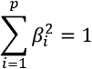
- 9. `yi ⩾ M`，对于所有的 `i = 1, 2, .., n`。

方程 8 并没有对超平面设定任何限制。超平面的参数具有尺度不变性（由 `[β[0], β[1], .., β[p]]` 和 `[cβ[0], cβ[1], .., cβ[p]]` 定义的超平面是相同的），其中 `c` 是常数。因此，我们仅将 `β` 的搜索限制在单位圆内。

此外，注意如果存在分类超平面，则 `M > 0`；因为在这种情况下方程 7 成立。这个 `M` 扮演了最大间隔的角色，因为观测集中的任何点至少距离超平面 `M` 单位。

在现实中，我们并不总是会有两个类别的观测值落在超平面的两侧。我们仍然可以通过以下方式解决这些问题：

1. 允许某些重叠，如果这种重叠的数量较少。图 2.24。
2. 创建额外的预测变量，如果这种重叠的数量较少。图 2.24。

### 人工神经网络

人工神经网络（ANN）是一种尝试模拟人脑学习机制的机器学习技术。人脑由许多被称为 `neurons`（神经元）的单元或细胞组成。神经元有一个细胞体、多个称为树突的受体和一个称为 `axon`（轴突）的传输单元。

神经元通过树突接收周围神经元的神经脉冲，处理这些收集到的脉冲，然后通过 `axon` 将产生的脉冲传递给相邻神经元。神经元之间的脉冲交换通过 `Synapses`（突触）进行，突触充当发送神经元的 `axon` 与接收神经元树突之间的连接器。

神经学家发现，大脑通过这种复杂的神经元网络进行学习，通过在相同脉冲的重复刺激下调整突触连接的强度。

受这种生物神经网络的启发，人工神经网络利用互连的节点（类似于神经元）和有向链接（类似于突触）网络被开发出来。该网络包含一层输入节点、一个或多个输出节点，以及可选的中间或隐藏层节点。

输入节点仅接收输入数据，并通过有向链接将其传递到下一层的节点；下一层中的每个节点通过应用某些函数来组合接收到的输入，然后将其传递到下一层节点（在某些特定的 ANN 中，有时传递到同一层或前层）。输出层中的节点同样处理来自上一层的输入并提供输出。

节点之间的链接通常被分配一个权重，因此通过链接的值根据这些权重进行调整。链接中的这些权重被调整以使传入的信息增强或减，以模拟突触连接的强度。

节点与链接的整个安排被称为网络拓扑。根据网络拓扑结构的类型有不同类型的 ANN。图 2.25 显示了生物神经元 1 和典型的神经网络 2。


**图 2.25** 生物神经元和人工神经网络

ANN 广泛应用于机器学习，用于识别数据中复杂的非线性模式。它们在许多领域都有应用，包括计算机视觉、图像识别、语音识别、医学诊断和自主机器人。

#### 感知机

让我们通过最简单的神经网络类型 `perceptron`（感知机）进一步理解这一概念。感知机有一层输入节点和一个输出节点。

图 2.26 1 显示了一个带有三个预测变量（或输入变量）`X[1]`、`X[2]`、`X[3]` 和一个响应（或输出变量）`Y` 的数据集。输入变量 `X[1]`、`X[2]`、`X[3]` 取值为 0 或 1。如果这三个输入中至少有两个为 1，则输出为 1，否则为 -1。

你可以将其与连续三次投币的结果联系起来：如果至少两次结果为正面，这个人获胜。`X[1]`、`X[2]`、`X[3]` 是投掷的结果，其中正面为 1，反面为 0。`Y` 是最终输出，1 表示胜利者，-1 表示失败者。图 2.26 2 显示了该数据的感知机模型。


**图 2.26** 用于分类问题的简单感知机模型

三个输入节点，每个对应一个输入变量，以及一个给出 `Y` 估计值的输出节点。从输入节点到输出节点的所有链接都具有相同的权重 0.4。

输出节点对输入进行加权和，然后从和中减去偏置 `t`，然后检查结果的正负号。如果符号为正，则输出为 1，否则输出为 -1。这可以用数学公式写为：

1. `= 1` if `w[1].x[1] + w[2].x[2] + w[3].x[3] – t > 0`
2. `= -1` if `w[1].x[1] + w[2].x[2] + w[3].x[3] – t < 0`

其中 `x[1]`、`x[2]`、`x[3]` 是 `X[1]`、`X[2]`、`X[3]` 的典型值，并且是 `Y` 相关的预测值。`w[1]`、`w[2]`、`w[3]` 是权重，`t` 是偏置。

你可以通过一些示例值进行检查以确认此感知机模型提供了正确的分类。例如，当 `x1 = 1`、`x2 = 0`、`x3 = 1` 时，输出为 1，因为 3 个输入中有两个是 1。

根据方程 1 和 2，在这种情况下 `= 1`，因为 `0.4 x[1] + 0.4 x[2] + 0.4 x[3] – 0.6 = 0.4 + 0 + 0.4 – 0.6 = 0.2 > 0`。因此，该记录被正确分类。

同样，如果 `x1 = x2 = x3 = 0`，则 `= -1`，因为 `0.4 x[1] + 0.4 x[2] + 0.4 x[3] – 0.6 = -0.6 < 0`。

让我们仔细观察方程 1 和 2。它们可以重写为：

3. `= 1` if `0.4 (x[1] + x[2] + x[3]) – 0.6 > 0`
4. `= -1` if `0.4 (x[1] + x[2] + x[3]) – 0.6 < 0`

注意 `(x[1] + x[2] + x[3])` 是和。

5. 重复步骤 2、3、4（针对 `k = 1, 2, 3` 等值进行迭代），直到达到停止准则。停止准则可以是所有输出值都已得到正确估计，或者迭代次数达到了一个阈值值。

公式 6 中的权重调整公式可以解释为：

- 如果输出的估计值等于实际值，则不需要在下一次迭代中调整权重。
- 如果实际输出为 `+1` 且估计输出为 `-1`，则 `(y[i] – ) = 2`。此时增加所有正输入链接的权重，减小所有负输入链接的权重。所得权重将增加该记录的加权和 `(w.x)`。
- 如果实际输出为 `-1` 且估计输出为 `+1`，则 `(y[i] – ) = -2`。此时减小所有正输入链接的权重，增加所有负输入链接的权重。所得权重将减少该记录的加权和 `(w.x)`。

学习率 `λ` 取值在 `0` 到 `1` 之间。它调节调整幅度，使得最近的调整不会剧烈改变之前的调整。通过这样，它可以帮助模型收敛到最优解（如果存在的话）。

感知器学习算法不能保证总是收敛到最优模型。可以证明，如果分类问题是线性可分的（换句话说，属于两个不同类别的记录可以被超平面分开），只要 `λ` 足够小，学习算法就会收敛到最优解。如果问题不是线性可分的，感知器学习算法将不收敛。

### 多层人工神经网络

多层人工神经网络在输入层和输出层之间有一个或多个中间层。这些层被称为隐藏层，隐藏层中的节点被称为隐藏节点。

如果某一层节点只将数据发送到下一层的节点，则它被称为前馈神经网络。在循环神经网络中，某一层节点可能会将数据发送到同一层的节点，甚至可以发送到之前的层。神经网络中的定向链接表示数据流向。


此外，神经网络可能使用符号函数之外的不同类型的激活函数，如线性函数、`sigmoid`（逻辑）函数、双曲正切函数。非线性函数用于建模输入变量与输出变量之间的非线性关系。图 2.27 1 显示了异或逻辑的样本数据以及决策边界的样子。对于这些数据，分类数据需要两个分离超平面，且无法通过单个感知器进行映射。图 2.27 2 显示了可以构建来建模此类数据的多层人工神经网络（ANN）。


**图 2.27** 多层神经网络示例

从概念上讲，我们可以将前馈多层神经网络看作感知器网络的集合，隐藏层中的每个节点和输出节点都可以被视为感知器的输出节点，它接收来自上一层的输入并给出输出。

#### 设计 ANN 模型

在设计 ANN 模型时，请考虑以下因素：

- 预测变量可以是定量变量或分类变量。每个定量变量或二分类变量应分配给输入层中的一个节点。对于具有两个以上值的分类变量（例如有 `m` 个值），可以创建 `m` 个输入节点（每个值对应一个），或者使用 ``二进制变量对分类变量进行编码，并为每个二进制变量分配一个节点。
- 如果响应是 2 类分类变量，一个输出节点就足够。对于具有 `k` 类的分类响应（其中 `k > 2`），则需要创建 `k` 个输出节点。
- 网络拓扑需要仔细选择。确定隐藏节点和层的数量并不容易。一种方法是从足够数量的隐藏节点和层开始，然后逐渐缩小网络规模。

### 训练多层 ANN

由于多层 ANN 固有的复杂性，相关的学习算法在本质上也是复杂的。这里我们概述了训练多层 ANN 时采用的基本原理。

ANN 学习算法的目标是根据训练数据确定一个权重向量（一组权重）`w `，使模型中的误差最小化。误差通过总平方和（TSS）来衡量，定义为：

```
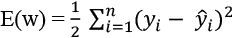
```

其中 `n` 是训练数据中记录的总数，`y[i]` 和 `` 是对应于第 `i` 条记录的响应值和预测值。注意我们使用了 `½` 作为系数，这在数学计算过程中带给我们便利。同时注意，该误差是权重 `w` 的函数，因为误差取决于响应的预测值，而预测值反过来取决于权重 `w`。

在多层 ANN 学习中，有两个主要挑战：

- 激活函数可能不是符号函数，可能是非线性函数。需要设计一种能够处理不同类型激活函数的算法。
- 我们知道输入层的输入值和输出层的输出值，但不知道隐藏节点的最佳输出。

第一个挑战通过称为梯度下降法的优化方法来解决。梯度下降法通过以下公式调整权重：

```
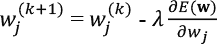
```

```
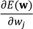 是误差函数对第 `j` 个权重的偏导，`λ` 是学习率。
```

简单来说，它表示如果 `F(x)` 是点 `a` 邻域内可微的多元函数，那么当从 `a` 向 `F(x)` 的负梯度方向移动时，`F(x)` 下降最。梯度是斜度的另一个术语。作为该原理的类比，如果有人深夜困在山上并想要下降到机场（高度角度的全局最优），那么他们应该沿着斜度的负方向移动。这个人看不见周围，但他们有一个测量斜度的仪器。山在不同点可能有不同的斜度。因此，移动一段时间后，人需要通过检查斜度并向负方向移动来修正路线。然而，在这个过程中，人可能会陷入山湖或坑（局部最优）并永远困在那里，因为任何向负方向移动的尝试都会让他们回到原点。同样，由于是非线性函数，梯度下降法可能无法给出误差最小的值，而可能陷入局部最优。

第二个挑战通过称为反向传播的技术来解决。在该算法中，每次迭代有两个阶段：正向阶段和反向阶段。在正向阶段，使用上一次迭代获得的权重按正向方向计算每个节点的输出，先计算第 `m` 层节点的输出，再计算第 `m� 1` 层节点的输出。在反向阶段，使用梯度下降法按反向方向调整权重，先调整第 `m� 1` 层的权重，再调整第 `m` 层的权重。持续迭代直到达到停止准则。

### 人工神经网络（ANN）的优缺点

此处总结了人工神经网络的优缺点：

- 至少包含一个隐藏层的多层神经网络是通用近似器，它们可以近似任何函数。因此，如果问题空间是高度线性的，可以使用 ANN 进行适当的建模。然而，这种特性可能会导致过拟合。
- ANN 可以处理冗余预测变量。与冗余预测变量关联的权重会自动调整为较小的值。
- 决定网络拓扑结构没有深奥的数学理论。这是因为模型关联了大量的参数（`weights` 和 `bias`）以及这些参数之间的相互作用。某些类型的网络对某些类型的问题效果更好，但大多数网络架构是基于经验或通过试错法设计的。
- ANN 模型对训练数据中的噪声非常敏感。为了判断模型的准确性，可以使用验证数据。
- 训练 ANN 是一个耗时的过程，特别是当隐藏层和节点数量较多时。
- 用于训练 ANN 的梯度下降法可能会收敛到局部最小值，导致导致次优模型。
- ANN 模型对关联的权重不提供任何自然的解释。它们没有提供任何关于哪些预测变量有影响及其影响程度的任何见解。ANN 更适用于预测，而不是关系检测。

## 分类模型比较及其他考虑因素

在本章中，我们讨论了处理分类问题的六种不同的机器学习方法。还有许多其他方法，每种方法都有几种扩展。涵盖所有方法将导致一本非常厚的书，也不是我们的目标。我们试图让您领略不同的方法，从简单的 `k`-最近邻到高度复杂的人工神经网络。此外，我们还讨论了每种方法的优缺点。没有通用的优越分类算法，所有算法都有其优劣之处。

在解决分类问题时，需要考虑多种因素，例如数据的性质、预测变量的数量、训练数据量、响应类别的数量、训练数据的质量（如是否存在缺失值、离群点、高杠杆点）、数据的稀疏性等。所有这些考虑都将有助于识别出用于模型开发和预测的合适算法。此外，来自业务角度的任何见解都将大有帮助。

模型构建方法的细节已在 `第 3 章` 中讨论过。对于分类问题，我们建议在选择算法时遵循“保持简单（keep it simple）”的原则。首先从简单模型开始，使用交叉验证或验证数据方法评估模型的预测能力。如果预测结果良好，则不要尝试为问题拟合复杂模型。否则，继续拟合越来越复杂的方法，并记住每种方法的优缺点。

### 2.3.3 聚类分析

聚类分析或分类是一种无监督学习方法，用于发现数据集中的子组或簇。在聚类中，数据被划分为多个簇或子组，使得簇内的观测值是相似或同性的，而簇之间的观测值是不相似或异质的。作为自然界簇的一个例子，我们可以考虑不同的星系。星系内的恒星彼此靠近，而不同星系之间的恒星遥远。在这里，距离作为接近程度或相似性的衡量标准。甚至星系还可以进一步分为簇和超星系。

商业世界也可能发生类似的情况。假设一家零售店想要启动营销活动，他们希望根据客户的购买模式向个人发送优惠。然而，为每个个人客户制定促销优惠是不可行的；相反，公司更想知道是否根据购买模式对客户进行自然分组。这可能会揭示出不同的客户群体，例如：低价值购买的频繁购买者、高价值购买的非频繁购买者、低价值购买的非频繁购买者、一次性购买者、主要购买一种类型产品（如食品、电子设备）的购买者、购买多种类型产品的购买者。然后，可以为不同的群体设计不同类型的优惠，同一组内的个人接收相同的优惠。另一个例子是，研究特定疾病药物的制药公司可能想知道，根据患者在年龄、性别、症状、病情严重程度、诊断测试结果、病程等不同属性的数据，该疾病是否存在不同的亚型。这些信息可能帮助他们决定不同的子组是否需要不同的药物。

## 聚类的类型

根据观测值跨越簇划分的方式，可以有不同类型的聚类，包括：

- 划分聚类（Partitional clustering）：数据中的每个观测值被分配给且仅分配给一个簇。
- 层次聚类（Hierarchical clustering）：簇以层次方式排列，因此一个观测值可能在层次结构中的不同级别属于多个簇。
- 模糊聚类（Fuzzy clustering）：每个观测值都属于每个簇，其成员权重在 0（不属于某个簇）和 1（绝对属于某个簇）之间。

此外，有时聚类可能是部分性的，即某些观测值不属于任何簇。这些观测值可能是离群点、噪声或不属于任何定义良好的组。

在进行不同的聚类算法之前，让我们查看`图 2.28`来理解聚类的概念和一些重要概念。`图 2.28`1 显示了 33 个客户相对于两个属性（例如 `attribute 1` 和 `attribute 2`）的散点图。它显示数据并不是随机分布的，而是集中在两个区域周围：两个属性的低值区域和两个属性的高值区域。这两个组中每个组内的数据点与同组的数据点非常接近，而与另一个组的数据点相距远。这些组被称为簇。数据显示客户被分为两个显著的簇（`图 2.28`2）。进一步观察，似乎这些簇中的每一个都是一个以两个点为中心的两个子组的集合，因此我们可以考虑四个簇，如`图 2.28`3 所示。

在这个示例中，当我们在`图 2.28`2 中注意到两个显著簇时，我们主要使用了数据点之间的距离概念。我们还使用了数据点的形状和中心概念来识别`图 2.28`3 中的四个簇。这些是识别簇的一些重要特征。

在`图 2.28`中识别簇很容易，因为我们只有两个属性并且只需要检查一张散点图。然而，如果我们有 50 个属性，那么仅通过视觉检查是不可能识别簇的。此外，如果我们有更多的观测值，情况会更加困难，可能放大图像会揭示进一步的子簇。因此，已经开发了许多算法在不需要人工干预的情况下发现数据中的簇。这些算法利用距离、中心、形状、连续性和密度的概念来识别数据集中的自然簇。

图 2.28 中的简单示例也激励我们去考虑关于通用聚类的以下重要问题：

- 数据中存在多少个类？
- 如何衡量不同观测值（不同数据点）之间的接近程度？
- 如何判断两个数据点属于同一个类还是不同的类？

不同的算法解决这些问题的方式也不同，每种算法都有其优缺点。此外，还有不同的算法扩展版本来解决某些已知问题。根据用例和数据的性质，需要使用适当的算法进行聚类。在这里，我们介绍了机器学习中三种广泛使用的聚类算法。

## K-Means

K-means 是一种用于获取划分聚类的简单算法。将观测值被划分为 `k` 个簇，其中 `k` 由用户指定。簇围绕 `k` 个质心形成。换句话说，数据点的中心和这些质心是经过迭代调整的。算法首先从一组初始的 `k` 个质心开始，这些质心作为 `k` 个簇的中心。然后，将每个数据点分配给其质心最近的簇。一旦所有点都被放入簇中，就会重新计算质心为簇内所有数据点的平均值。然后，使用这些新质心将数据点再次分离为 `k` 个簇。这种重新计算质心并将数据点分配到簇的过程持续到质心不再发生变化。k-means 算法包含以下步骤：

1. 选择 `k` 个点作为初始质心，例如 `m[1]`、`m[2]`、…… `m[k]`。
2. 通过将每个数据点 `x` 分配给最近的质心形成 `k` 个簇 `C[1]`、`C[2]`、…… `C[k]`。换句话说，对于所有 `j ≠ i`，`1⩽ i, j ⩽ k`，如果 `d(m[i], x) ⩽ d(m[j], x)`，则 `x` ∊ `C[i]`。这里 `d(a, b)` 是衡量点 `a` 和 `b` 之间距离的函数。该函数的选择将在后续讨论。
3. 根据上一步获得的簇，重新计算质心为簇内数据点的平均值。换句话说，`m[i] = (∑[x∊Ci] x)/n[i]`，其中 `n[i]` 是第 `i` 个簇中数据点的数量，`1⩽ i ⩽ k`。
4. 检查质心是否有任何变化。如果没有变化，则宣布 `C[1]`、`C[2]`、…… `C[k]` 为最终簇集。如果发生变化，则使用新质心重建簇 `C[1]`、`C[2]`、…… `C[k]`（如步骤 2 所示）。
5. 重复步骤 3 和 4，直到获得最终簇集。

图 2.29 显示了该算法在简单数据集上的执行情况。数据点显示为蓝色点，质心显示为红色加号。在这个示例中，`k` 的值为 3。图 2.29 1 显示了带有初始选择的三个质心的数据点。接下来，形成了三个簇 `C[1]`、`C[2,]` 和 `C[3]`。

- 可能会导致空簇（不包含任何数据点的簇）。通过在分配每个数据点后重新计算质心进行增量更新，可以解决这个问题。然而，这样聚类可能会依赖于数据点处理的顺序。
- K-means 对离群值和噪声敏感。
- K-means 不适用于所有类型的数据集，特别是当自然簇不是凸形或球面时。此外，它无法处理不同大小和密度的簇。

## 层次聚类

层次聚类是机器学习中经常使用的另一种重要的聚类类型。在层次聚类中，簇是以层次化的方式形成的，因此一个数据点可以在层次结构的不同层级属于多个簇。层次聚类有两种类型：

1. **凝聚性（Agglomerative）**

   从所有数据点作为单独簇开始，然后从每一步中合并两个最近的簇对，除非整个数据集变成一个单簇。

2. **分裂性（Divisive）**

   从整个数据集作为一个簇开始，然后从每一步中将一个簇分裂为两个簇，除非各个数据点变成单点簇。

凝聚性层次聚类在实践中用得广泛；因此，我们本节将主要关注它，并简要提及分裂性簇。

### 凝聚性层次聚类

凝聚性层次聚类的步骤如下所示：

1. 将所有单独的数据点作为单点簇。
2. 如果需要，计算簇的相似性矩阵。
3. 合并最近的两个簇。
4. 使用新簇与剩余簇之间的相似性更新相似性矩阵。
5. 重复步骤 3 和 4，直到只剩下一个簇。

层次聚类通常通过一种称为树状图（dendrogram）的树形图来显示。对于二维数据点，聚类也可以使用嵌套簇图来显示。图 2.30 显示了二维空间上 6 个数据点的凝聚性聚类。原始数据点 `p1`、`p2`、……`p6` 显示在图 2.30 1 中。数据通过凝聚性层次聚类进行聚类，图 2.30 2 显示了相关的嵌套簇图，`C1`、`C2`、……`C5` 是连续形成的簇。该聚类的树状图在图 2.30 3 中。


**图 2.30** 凝聚性层次聚类

凝聚性聚类的主要操作是计算两个簇之间的相似性度量。有多种衡量簇相似性的度量方法，表 2.6 显示了不同度量的定义。图 2.31 进一步说明了这一概念。

| 相似性度量 | 定义 |
| --- | --- |
| 单链（Single Linkage，或 MIN） | 两个簇的相似性是两个不同簇中任意两点之间的最小距离。换句话说，簇 `C1` 和 `C2` 之间的距离为 `min [x ∊ C1, y ∊ C2] d(x, y)`，其中 `d` 是距离函数。 |
| 全链（Complete Linkage，或 MAX） | 两个簇的相似性是两个不同簇中任意两点之间的最大距离。换句话说，簇 `C1` 和 `C2` 之间的距离为 `max [x ∊ C1, y ∊ C2] d(x, y)`，其中 `d` 是距离函数。 |
| 组平均（Group Average） | 两个簇的相似性是两个不同簇所有点对之间距离的平均值。换句话说，簇 `C1` 和 `C2` 之间的距离为 `(∑ [x ∊ C1, y ∊ C2] d(x, y)) /(n[1].n[2])`，其中 `d` 是距离函数，`n[1]`、`n[2]` 分别是簇 `C1` 和 `C2` 中的数据点数量。 |

**表 2.6** 凝聚性聚类的不同相似性度量


**图 2.31** 相似性度量的计算

图 2.31 显示了不同相似性度量的计算。数据点及其坐标显示在图 2.31 1 和图 2.31 2 中。数据通过凝聚性层次聚类进行聚类，图 2.31 2 显示了相关的嵌套簇图，`C1`、`C2`、……`C5` 是连续形成的簇。该聚类的树状图在图 2.31 3 中。

图 2.31 显示了不同相似性度量的计算。数据点及其坐标显示在图 2.31 1 和图 2.31 2 中。数据通过凝聚性层次聚类进行聚类，图 2.31 2 显示了相关的嵌套簇图，`C1`、`C2`、……`C5` 是连续形成的簇。该聚类的树状图在图 2.31 3 中。

图 2.31 显示了不同相似性度量的计算。数据点及其坐标显示在图 2.31 1 和图 2.31 2 中。数据通过凝聚性层次聚类进行聚类，图 2.31 2 显示了相关的嵌套簇图，`C1`、`C2`、……`C5` 是连续形成的簇。该聚类的树状图在图 2.31 3 中。

图 2.31 显示了不同相似性度量的计算。数据点及其坐标显示在。图 2.31 示了如何计算两个簇之间的相似性度量。

图 2.31 显示了不同相似性度量的计算。数据点及其坐标显示在图 2.31 1 和图 2.31 2 中。数据通过凝聚性层次聚类进行聚类，图 2.31 2 显示了相关的嵌套簇图，`C1`、`C2`、……`C5` 是连续形成的簇。该聚类的树状图在图 2.31 3 中。

图 2.31 显示了不同相似性度量的计算。数据点及其坐标显示在图 2.31 1 和图 2.31 2 中。数据通过凝聚性层次聚类进行聚类，图 2.31 2 显示了相关的嵌套簇图，`C1`、`C2`、……`C5` 是连续形成的簇。该聚类的树状图在图 2.31 3 中。

凝聚性聚类中的主要操作是计算两个簇之间的相似性度量。在凝聚性层次聚类中合并两个簇时，会考虑所有可用簇对的相似性度量，并将具有最小相似性值的簇合并为一个簇。根据相似性度量的选择，簇的合并顺序可能会不同。

#### 注意

- Ward 方法是另一种相似性度量，定义为合并两个簇时平方误差的增加。
- 本节讨论的所有相似性度量都是 Lance-Williams 相似性公式的变体。

#### 凝聚性聚类的优缺点

凝聚性聚类的主要优点是：

- 不需要预定义的簇数量，相反，它在每一层提供不同数量的簇。
- 不依赖于任何初始点。
- 对于小型数据集，树状图提供了良好的可解释性。

然而，这种聚类技术也有一些缺点，如下：

- 凝聚性聚类具有较高的存储和时间复杂度。因此，不适用于大型数据集。
- 它没有全局优化目标函数，而是在每次合并两个簇时尝试进行局部优化。
- 两个簇一旦合并就无法分裂，因此在不同步骤中做的局部优化决策会被保留，这可能会阻止获得全局最优簇。

#### 基于噪声的应用的密度空间聚类


# 基于噪声的密度空间聚类

基于噪声的密度空间聚类（DBSCAN）是最流行且最常用的聚类技术之一。这是一种基于密度的聚类方法，可以处理数据中的噪声并识别任意形状和大小的簇，而不仅仅是凸形或球面簇。

DBSCAN 根据高密度数据点区域之间的连接性来识别簇，这些区域由低密度数据点区域隔开，后者被称为噪声或背景点。它采用基于中心的方法来测量密度。根据该方法，使用两个参数 `Eps` 和 `MinPts` 来定义密度。根据这些参数，任何数据点都可以被归分为以下三类：

- **核心点（Core point）**：如果一个数据点在半径为 `Eps` 的邻域内包含 `MinPts` 个数据点（包括点本身），则该点被称为核心点。在该周围 `Eps` 距离内至少有 `MinPts` 个数据点（包括其自身）。
- **边界点（Border point）**：边界点不是核心点，但它落在核心点的邻域内。
- **噪声点（Noise point）**：噪声点既不是核心点也不是边界点，因此它在周围 `Eps` 距离内没有 `MinPts` 个数据点，且其邻居中没有点是核心点。

图 2.32 以图形形式展示了这三类点。共有 9 个点 `p1` 到 `p9`，每个点周围都有一个半径为 `Eps` 的圆。对于某个特定点，所有落在该圆内的点（包括其本身）都在其 `Eps` 邻域内。我们将 `MinPts` 的值设为 `4`。点 `p3`、`p4`、`p5`、`p6` 的 `Eps` 邻域内至少有 4 个点，因此这些是核心点（用绿色标记）。点 `p2`、`p7` 和 `p8` 的邻域内各有 3 个点，因此它们不是核心点。但它们中的每个点邻域内都有核心点，因此它们是边界点（用橙色标记）。点 `p1` 和 `p9` 的邻域内没有 4 个点，也没有核心点，因此这些是噪声点（用红色标记）。


**图 2.32** DBSCAN 中的核心点、边界点和噪声点

## DBSCAN 算法

DBSCAN 算法可以通过以下步骤描述。这从计算角度来看并不是最优算法，但易于理解：

1. 将所有数据点标记为核心点、边界点或噪声点。
2. 将所有彼此处于 `Eps` 邻域内的核心点连接起来。
3. 将每个组相连的核心点集声明为一个簇。
4. 将每个边界点分配到其 `Eps` 邻域内核心点所属的簇中。

由于 DBSCAN 通过连接核心点来构建簇，因此它可以识别任意形状和大小的簇。图 2.33 显示了两个这样的同心圆簇，一个为蓝色，另一个为棕色。DBSCAN 可以找到这种自然簇，但 k-means 将无法识别它们，因为这些簇不是线性可分的。


**图 2.33** 使用 DBSCAN 识别的同心簇

## DBSCAN 的优缺点

DBSCAN 与我们讨论过的其他聚类算法相比具有一些优势：

- 它可以识别数据集内任何形状和大小的自然簇。
- 不需要预先知道簇的数量信息。
- 它对离群值不那么敏感。
- DBSCAN 可以识别无法正确归入任何簇的噪声数据点。

然而，DBSCAN 也存在以下缺点：

- 聚类依赖于两个参数 `Eps` 和 `MinPts`。如果这些值选择不当，结果的簇可能无法反映数据中的自然簇。处理的一种方法是计算对于某个 `k` 值，所有数据点的第 `k` 个最近邻距离（`k-dist`），将这些值按升序排列，并观察 `k-dist` 值在某处是否出现剧剧增加。那么可以将该值作为 `Eps`，并将 `k` 作作 `MinPts`。剧剧增加表明了数据点的自然分离，主要对于边界点和噪声点。
- 如果不同簇的密度差异很大，那么选择合适的 `MinPts` 值将非常困难。它可能会将低密度簇的点识别为噪声。
- 由于维度灾难（在下一节中介绍），高维数据中的数据点变得稀疏，使得难以正确定义密度。如果 DBSCAN 使用欧几里距离来寻找邻居，那么寻找合适的 `Eps` 值将变得困难。
- DBSCAN 对于那些邻域内包含来自不同簇的核心点的边界点不是完全确定的。取决于处理数据的顺序，算法可能会将它们放入任何一个相邻的簇中。

# 其他机器学习技术

机器学习已经开发了数千种用于不同目的的算法。然而，在一个书中讨论所有领域是不可能的。我们已经讨论了机器学习中一些广泛使用的领域。在本节中，我们将提供机器学习中其他一些重要领域的概述，而不深入探讨相关算法的理论部分。

## 降维

数据集的维度是指数据中属性的数量。如果数据包含 `m` 个属性，那么每条记录或数据点都是一个 `m` 个值的元组，每个属性对应一个值。从数学角度来看，每条记录可以被视为属性值的 `m` 维向量，并表示为 `m` 维空间中的点。例如，如果数据包含两个属性。

主成分分析通过仅考虑属性的少数几个线性组合来减少属性的数量，这种方式使得对数据整体变异的影响较小。泛而言之，这里的思想是用原始属性的少数几个线性组合来替代原始属性，并在分析中使用这些线性组合。然而，选择任何线性组合可能都不合适，因为它们可能无法捕捉尽可能的信息。因此，首先确定数据分布最密集的方向。换句话说，该方向捕捉了数据大部分的方差。然而，一旦得到了数据分布最密集的第一方向，就会搜索一个与第一个方向垂直且具有次大数据分布（方差）的方向。同样，选择的第三方向与前两个方向都垂直，并捕捉数据的次大部分分布。一旦确定了这些方向，整个数据就会沿着这些方向进行转换。数据点的新值实际上是原始属性值的线性组合。这些方向被称为主成分（`PC`）。

在高维数据中，如果它存在内在关系，那么它就不会像随机生成的数据那样在每个方向上均匀分布，而是会沿着代表这种关系的少数几个方向分布。因此，前几个 `PCs` 捕捉了数据分布的大部分方向（换句话说，捕捉了数据大部分的整体方差）。然后，我们只能考虑前几个主成分，并沿着这些主成分对数据投影。

## 主成分的数学解释

从数学角度来说，主成分是方向向量的一个正交集（它们相互垂直）。每个 `PC` 代表一条直线的方向，该直线在最小化数据点到直线的平均平方距离的方面与数据拟合得最好，且与其他 `PCs` 正交。`PCs` 构成了数据点的正交基。原始数据可以沿着这个新的正交基进行投影。然而，由于数据主要分布在少数几个 `PCs` 上，我们可以使用 `PCs` 的子集并将数据投影到低维空间。可以证明，主成分是数据协方差矩阵的特征向量。

让我们通过图 2.34 中给出的示例来进一步理解这一概念。


**图 2.34** 主成分分析示例

图 2.34 1 显示了 3 维空间内数据的散点图，由三个属性 `X`、`Y` 和 `Z` 表示。图 2.34 2 显示了该数据红色的主成分方向。图 2.34 3 显示了以 `X`、`Y` 和 `Z` 为原始坐标系表示的主成分定义。例如，第一个主成分显示了从原点到点 `(-0.7103774, 0.6835728, -0.1676072)` 的方向。此外，注意图 2.34 4 中各个主成分的方差以及方差解释比例（`PVE`）。第一个 `PC` 捕捉了大约 66% 的整体方差，第二个 `PC` 捕捉了大约 34%。第三个 `PC` 的方差非常微其其。最终，前两个 `PC` 捕捉了数据几乎所有的方差，这在累积 `PVE` 中显而易见。它告诉我们数据主要分布在前两个 `PCs` 代表的两个上，因此我们可以忽略第三个 `PC`，并通过将数据投影到前两个 `PCs` 来运行分析。通过这样，3 维数据被减少为 2 维数据。

## 注意事项

- PCA 适用于连续属性。对于分类变量，有其他技术如分类 PCA。
- 建议对属性进行中心化和标准化，使得每个属性的平均值为零，方差为 1。

## 关联分析

关联分析是一种无监督机器学习技术，用于发现大型交易数据集中隐藏的项目之间的有趣关系。关联分析的一个有趣用例是购物篮分析。让我们通过一个简单的示例来理解。一家百货商店销售不同的食品，他们有一个巨大的交易数据库，记录了在不同交易中哪些物品被一起售出。表 2.7 表示了一个交易样本集。百货商店想知道哪些物品是在一起售出的，这样他们就可以在商店将它们放在一起以增加交叉销售。

| 交易 ID | 交易中的项目 |
| :--- | :--- |
| T001 | 面包, 黄油 |
| T002 | 牛奶, 面包, 黄油 |
| T003 | 牛奶, 面包 |
| T004 | 牛奶, 鸡蛋 |
| T005 | 面包, 鸡蛋, 啤酒 |

**表 2.7** 百货商店的交易样本

支持度（Support）显示了规则在事务中出现的频率。支持度小的规则可能意味着它只是偶然发生的。对于表 2.7 中的项，如果我们考虑 `X = {鸡蛋}` 和 `Y = {啤酒}`，那么 `X => Y` 的支持度为 `1/5`，即 `0.2`。而，如果我们考虑 `X = {面包}` 和 `Y = {黄油}`，则 `s(X => Y) = 4/5 = 0.8`。注意 `s(X => Y) = s(Y => X)`。

支持度也可以定义项集。项集 `X` 的支持度记为 `s(X)`，是包含项集 `X` 的总事务比例。

换句话说，`s(X) = σ(X) / n`，其中 `n` 是事务总数。根据表 2.7 的数据，项集 `{牛奶, 鸡蛋}` 的支持度为 `2/5 = 0.4`。

## 置信度（Confidence）

`X => Y` 的置信度衡量了包含 `X` 的事务中 `Y` 出现的比例。数学上表达式为：

```
c(X => Y) = σ(X ∪ Y) / σ(X)
```

置信度显示了规则的可靠性，置信度越高，规则越强。实际上，它是对给定 `X` 在事务中的条件下，`Y` 在事务中的事件的条件概率估计。根据表 2.7 中的数据，如果 `X = {面包}` 和 `Y = {牛奶}`，则 `c(X => Y) = 3/5 = 0.6`。注意 `c(Y => X) = 3/3 = 1`。因此，置信度可能会根据前件项集而改变。

在引入这些术语后，我们现在简要讨论如何发现关联规则。大型数据集包含指数级数量可能的关联规则。更准确地说，如果数据集包含 `m` 个项，那么所有可能的规则的总数是 `3^m – 2^(m+1) + 1`。对于 100 个项，可能规则的数量变为 `5.15378E+47`。因此，通过扫描所有可能的规则来发现规则的过程变得极其昂贵，不可行。然而，并非所有这些规则都是有趣的，其中大部分可能只是偶然出现，并且可能不可靠。因此，算法提取支持度和置信度值高于某些阈值的规则。这种策略随后涉及通过两个主要步骤发现规则：

1. **频繁项集生成**：识别所有支持度高于预定义阈值的项集。这些项被称为频繁项集。
2. **规则生成**：在频繁项集中发现置信度度高于预定义阈值的规则。如果 `A` 是频繁项集，这等同于将 `A` 分分为两个不重叠的项集 `B` 和 `C`，使得 `A = B ∪ C` 且 `c(B => C) >` 置信度阈值。注意 `s(B => C) = σ(B ∪ C) / n = σ(A) / n = s(A) >` 支持度阈值。这些规则被称为强规则。

这是关联分析许多算法的常用策略；然而，不同的算法使用不同的技术实现这一策略：

- **Apriori 算法**使用 Apriori 原则来实现。该原理说，如果一个项集是频繁的，那么它所有的子集也是频繁的。例如，项集 `{面包, 牛奶}` 的支持度为 `0.6`。现在，如果我们取 `0.5 (50%)` 作为支持度的阈值；那么 `{面包, 牛奶}` 就是一个频繁项集。现在由于这个组合出现，`{面包, 牛奶}` 是一个频繁项集。

# 神经网络

神经网络可以紧凑地表示为三个框，第一个框显示输入向量，第二个框表示中间节点，第三个框表示输出向量。这些框通过有向链接连接，显示了信息的流向。这种表示法已用于图 2.36 中。


**图 2.36** 用于语言翻译的循环神经网络示例

在图 2.37 中，英语句子“I am doing fine”被翻译成孟加拉语。句子中的单个单词被顺序处理，同一个网络会向自身发送反馈以处理下一个输入。它最初不提供任何输出，一旦读取了输入序列，网络就开始生成输出。多个网络框指的是同一个 RNN 网络，使用不同的输入单词进行处理。这个示例表明，输入序列的数量与输出序列的数量并不是 1:1 的关系。事实上，它们是 n:m 的关系。


**图 2.37** 1:n 和 n:1 关系场景下的 RNN 示例

存在一种输入导致序列输出的情况，例如根据人脸识别标记图中不同人物。这是一个 1:n 的关系场景，其中 n 的值预先不可知。同样，也存在 n:1 的场景，即一组输入导致单个输出，例如根据用户评论的一系列单词将情感分类为积极或负面。RNN 可用于解决这类类型的问题。

根据网络拓扑、激活函数、节点间的连接性、权重等因素，还有许多其他类型的 RNN。其中一些类型包括霍夫尔德网络（hopfield network）、回声状态网络、独立 RNN、长短期记忆和双向 RNN。

## 卷积神经网络（CNN）

卷积神经网络（CNN）广泛用于计算机视觉。图像中的模式在 CNN 中是分层发现的，从简单模式到更复杂的模式。“卷积”一词源于一个名为“卷积”的数学术语，它是一种特殊的线性算子。CNN 在其至少一层中使用了卷积。

CNN 主要用于图像分类。图像可以被看作是像素向量。每个像素包含特定的颜色，它可以用灰度级中的值表示（显示黑白照片的光强强度），也可以用 RGB 标度（基于红、绿、蓝色的强度）表示彩色图片。为了简单起见，我们可以将每幅图像视为一个带有像素颜色值的向量。

卷积神经网络识别模式并分类图像，但它并不直接使用像素值，而是对数据进行两次操作（可能执行多次），称为图像卷积和池化，用以识别图像中的特征并减少原始数据的维度。其底层概念灵感来源于动物的视觉皮层。

### 图像卷积

图像卷积是过滤图像以从中提取有用特征的过程。它在图像的正方形像素块与正方形滤波器矩阵之间运行卷积操作，以从数据中提取有用特征。图 2.38 展示了图像卷积的示例。这里我们有一个 4 x 4 的图像和一个 3 x 3 的滤波器矩阵。

这里的图像卷积从图像的 3 x 3 块中逐个提取像素值，将其与滤波器矩阵相应位置的值相乘，并将它们相加。对于图像中的每个 3 x 3 块都会执行此操作，并将输出存储在 2 x 2 的图像中。在 4 x 4 的图像中有 4 个这样的 3 x 3 块，分别位于左上、右上、左下和右下。每个块都经过相同的操作，结果被写入输出图像对应的像素位置。

图像卷积查看图像的一个块并提取该块中的特征性特征。取决于所使用的滤波器矩阵，它可以提取低级特征（如纹理、颜色）以及高级级特征。


**图 2.38** 图像卷积示例

### 池化

池化是另一种缩小图像尺寸的过滤器。它选取图像的一个块并将该块中的像素值映射到单个值上，它可以是像素值的最大值（最大池化）或像素值的平均值（平均池化）。图 2.39 展示了使用最大池化对图像进行 2 x 2 池化的示例。


**图 2.39** 图像池化（最大池化）

卷积神经网络通常使用多个序列的图像卷积和池化来提取越来越多的特征，同时保持结果图像的较小尺寸。最后，图像被平化为像素向量并输入神经网络进行分类。

## 自然语言处理

自然语言处理（NLP）是人工智能和机器学习中另一个强劲的新领域，旨在理解、解码和进行人类语言通信。它涉及许多其他领域，如语言学、统计推理和信息工程。

NLP 广泛应用于机器需要自然语言与人类交互的场景。这些包括语音识别、Alexa 和 Google 等个人助手应用；聊天机器人、谷歌翻译、语法检查、情感分析以及推荐系统。

当我们用自然语言说话时，它携带了大量的信息。单个单词、它们的结构和相对位置、语气、主题都有相关的意义。但最重要的是，它不仅仅是数据流，还具有整体含义。此外，停顿或标点符号也带有关于整体含义的重要信息。例如，考虑口语中的以下两个句子：

“Leave it, not break it”和“Leave it not, break it”。

在这里，标点符号位置的变化完全改变了句子的意思。

自然语言处理的另一个重要方面是数据必然是非结构化数据。我们无法对书面文本或口头交流施加特定的结构以适应具有固定行列的传统表格结构。此外，不同文本、文档、演讲之间的差异可能是巨大的。因此，分析此类巨大的非结构化数据并提取有用信息和意义并非易事。然而，随着先进机器学习算法的发展，这日益成为可以实现的目标。

理解自然语言对机器来说是一项非常复杂的任务。因此，针对自然语言处理的不同领域产生了不同的机器学习算法，包括：

- **词袋**

  用于统计文本中每个单词的出现次数，忽略单词的语法和顺序。这种频率分布随后用于训练分类模型以对不同的文本进行分类。

- **词频—逆文档频率（TFIDF）**

  在词袋中，“a”、“the”等词出现频率很高，会影响分析。在 TFIDF 中，对频率进行加权，使得在所有文本中高频词的词被缩放，以减少它们对分析的影响。

- **分词**

  分词（Tokenization）是将文本拆分成较小部分（称为标记，即 tokens）的过程。标记可以是单词、字符和子词。分词背后的思想是创建一个词汇表并将其用于分析。一些深度神经网络模型使用标记来处理原始文本数据。

### 词干提取（Stemming）

这用于切割单词的开头或结尾，以移除前缀和后缀。

### 主题建模（Topic modeling）

这用于发现一组文本和文档中隐藏的模式。根据这种方法，每个文档由多个主题组成，每个主题由多个单词组成。该方法通过对文本进行聚类，根据内容发现隐藏的主题。

随着深度学习方法的发展，它们现在被广泛应用于自然语言处理（NLP）的许多领域，如语言转换、语音识别。这是一个巨大的课题，本书无法涵盖。然而，由于机器学习和人工智能的一个活跃研究领域，我们希望对其一目#### 2.4 总结

在机器学习中，系统通过分析输入数据来学习数据中的底层模式、隐藏关系，并利用这些信息在特定用例中进行预测或推理。机器学习已成为我们日常体验的重要组成部分。它应用于生活的各个领域，从销售预测、欺诈检测、客户细分等经典用例，到计算机视觉、语音识别、自动语言翻译等现代用例。


机器学习利用各种人工智能算法和统计推理从数据中学习。它基于概率范式运行；输入数据通常是可能场景的代表性样本，不包含完整信息。概率作为机器学习算法的数学基础起着关键作用。

根据学习技术，机器学习算法分为监督学习、无监督学习、半监督学习和强化学习。监督学习包括两种主要的分析类型：回归分析（预测连续响应变量的值）和分类（预测类别响应变量的值，将观测值归分为不同的类别）。此外，无监督学习包括聚类、关联分析和`PCA`（主成分分析）等技术。每个领域都有许多可用算法，且机器学习中并没有“统一更优算法”的概念。需要根据场景、数据的性质以及关系的特质来选择合适的算法。理解每个算法的底层假设、优点和缺点，对于将它们成功应用于现实问题至关重要。

# 3 实现生命周期

本章解释了机器学习应用开发生命周期的关键组件。与任何其他项目一样，机器学习项目也会经历不同的阶段，每个阶段都有所需的活动和任务，理想情况下这些任务会被系统地执行和协调。已经开发了不同的方法论来为执行机器学习项目提供结构化方法，本章将要讨论其中一些方法论。在本章中，我们将详细讨论所有这些方法中通的关键活动，并解释相关的机器学习概念。

作为`IT`专业人员，我们都熟悉使用不同方法论的软件开发生命周期，如瀑布模型、敏捷开发（`Agile`）和`DevOps`。这些方法论遵循特定的工作分解结构（`WBS`）、方法、流程、技术和最佳实践，为高效执行`IT`项目提供了结构化方法。在项目开始之前，我们通常根据目标、性质、规模和复杂性等各种因素选择合适的方法论（或方法论的定制版本）。机器学习应用开发也可以被归入广义的`IT`项目范畴，但它涉及数据科学家和机器学习专家等特殊角色。这些方法可以用于机器学习项目。

然而，机器学习项目与其他`IT`项目之间存在一个根本区别。在大多数`IT`项目中，结果在性质上是确定性的。换句话说，给定一个输入，我们根据业务逻辑清楚地知道所需的输出。然而，在机器学习项目中，结果在性质上是概率性的：给定一个输入，我们并不知道确切的输出；我们只知道最可能的输出。因此，传统的`IT`项目方法论在机器学习项目中并不完美适用；它们需要特殊的方法、技术和流程来处理结果的概率性质。

在本章中，我们将首先简要介绍三种方法论，以理解它们在第 3.1 节实现生命周期中的用途。我们还将关注所有方法共同的关键组件，以从机器学习的角度加强对底层概念的理解。然后，在快速浏览第 3.2 节业务之后，我们将开始研究任何数据科学项目的关键组件——数据！在第 3.3 节和第 3.4 节中，我们将深入研究数据，包括如何为你的机器学习模型评估和准备数据。最后，在第 3.5 节、第 3.6 节和第 3.7 节中，我们将详细引导你完成构建、测试和部署机器学习模型。

## 3.1 理解实现生命周期

第一步，也是实现机器学习项目的关键方面，是理解项目生命周期。在本节中，我们将描述一个典型项目从启动到完成所经历的不同阶段。正如你在本章中看到的，项目生命周期将根据你遵循的方法论而不同，你将学习项目生命周期中的关键阶段在这些方法论之间会有何不同。

### 3.1.1 跨行业数据挖掘标准过程

`CRISP-DM`全称为跨行业数据挖掘标准过程（`Cross Industry Standard Process for Data Mining`），是一种用于数据中心项目的稳健且经过验证的方法论，可以高效应用于机器学习项目。

图 3.1 显示了`CRISP-DM`方法的六个阶段。每个阶段包含若干通用任务。许多任务将根据情况而异，每个特定任务将涉及过程——即执行任务时的行动、决策和结果。

`CRISP-DM`更多侧重于业务理解、数据准备和建模，而从性能监控和控制的角度来看，对模型在业务环境中的运营重视较少。`DMAIC`试图弥补这些空白。然而，结果是，`DMAIC`对建模的重视较少，而建模是复杂的机器学习项目中的一项关键活动。

`SAP`已经采用`DMAIC`方法论作为其机器学习项目框架。图 3.2 显示了该框架的阶段和主要任务。


**图 3.2** 基于`DMAIC`的`SAP`机器学习项目框架的阶段和主要任务

### 3.1.3 数据挖掘/预测分析解决方案统一方法

`ASUM-DM`，全称为“数据挖掘/预测分析解决方案统一方法（`ASUM-DM`）”，是`IBM`在 2015 年开发的`CRISP-DM`扩展和精炼版本。这一扩展背后的哲学是：只有当机器学习应用（或任何分析解决方案）被正确地嵌入组织的业务流程中时，它才能为客户提供价值。因此，对于一个机器学习项目的成功，应用程序的部署与其开发同样重要。`ASUM-DM`通过两个互补的周期来处理部署：开发周期和部署周期。开发周期主要基于`CRISP-DM`，并包含了一些精炼的活动、模板和指南。然而，部署部分已增强为一个完整的周期，具有不同的阶段和活动，以便以可管理、可重复、可追溯和安全的方式部署分析应用。图 3.3 显示了`ASUM-DM`方法论的阶段。


**图 3.3** `ASUM-DM`方法论的开发与部署周期及阶段

### 3.1.4 机器学习项目生命周期中的关键组件

正如对这三种主要方法论的简要讨论所示，机器学习项目存在两个部分：开发部分和部署/运营部分。此外，每种方法论组织其阶段和任务的方式不同，侧重点也不同，但所有这些方法论都利用了一些共同的组件，如下：

*   在机器学习用例背景下理解业务

*   理解相关数据

*   为机器学习模型准备输入数据

*   开发机器学习模型

*   评估并微调模型以获得最终模型

*   在生产环境中部署机器学习解决方案

图 3.4 显示了每种方法论的阶段，并突出了这些关键组件。


**图 3.4** 机器学习方法论的关键组件

在随后的章节中，我们将从机器学习技术的角度更详细地讨论这些关键组件。

## 3.2 了解业务

机器学习项目旨在通过发现数据中的模式并提供预测和特定洞察，来解决特定的业务挑战。例如，考虑一家超市，它销售来自不同制造商的产品。如果超市在一段时间内大量备货产品，但在该期间无法售出，库存成本将会增加。同时，保持低低库存可能导致缺货情况和销售机会的流。因此，在规划补货时，超市面临着优化库存水平的挑战，以便在不丢失潜在销售机会的情况下最小化库存持有成本。这种情况是一个库存规划场景。同样，在服务行业，例如对于移动网络服务提供商，挑战可能是通过主动留存计划来减少用户流失。机器学习可以有效地解决这些挑战。然而，在应用任何机器学习解决方案之前，必须理解业务。在库存规划场景中，仅仅分析数据是不够的；必须考虑业务的其他方面，例如货物的采购周期、容量、保质期、产品间的替代以及运输时间。同样，对于流失预测问题，你需要了解预付费和后付费套餐、增值服务、结算周期、宽限、投诉的提出与解决以及客户人口统计模式。忘记这些业务概念而只关注数据，可能会导致模型无法捕捉业务的本质。因此，正确理解业务是成功的关键因素。

机器学习顾问的首项工作是理解相关业务，有助于实现以下目标：

*   从业务角度理解项目目标，并将其映射到机器学习问题上

*   理解与业务问题相关的参数

*   理解并定义项目的成功标准，例如最终结果将如何提供、如何衡量准确性，以及多少准确性被视为成功。准确性的衡量有多种定义方式，对业务的良好理解有助于你定义它。在第 3.6 节](#03_006.html#h3.6) 中，我们将讨论不同的准确性衡量标准

*   评估与项目相关的风险

*   制定通过机器学习解决业务问题的计划

不遵循任何预定义结构且可以呈现任何形式的数据。文档、音频文件、图像和流数据都是非结构化数据的示例。

## 半结构化数据

半结构化数据具有某些关联结构，但不像关系型数据库中的表格那样僵化；它通过标签或其他标记具有灵活的结构，用于区分语义元素并在数据内部建立记录和字段的层级结构。`XML`、`JSON` 和电子邮件都是半结构化数据的示例。

在机器学习中，算法通常期望指定格式的数据，即结构化数据。因此，非结构化数据在用于算法之前通常会先转换为结构化数据。有时，机器学习工具或服务可以从非结构化数据中提取相关信息（特征），将这些数据放入结构中，然后对这些结构化数据使用特定的机器学习算法。例如，数字图像可以通过像素的位置以及与这些像素颜色相关的值转换为向量。从非结构化数据中提取特征是一个巨大的课题，也是本本书范围之外的一个活跃研究领域。因此，我们将在本章将讨论限制在结构化数据。

结构化数据通常包含多个列或字段，这些字段可以进一步细分为许多类型，例如其格式、该字段是否为主键以及其他方面，但出于我们的目的，我们将根据信息内容来考虑类型。在定义字段的不同信息内容类型之前，让我们先考虑两个相关术语：

### 属性

属性是对象的性质或特征，这些属性可能随对象之间或随时间变化。例如，种族随人而异，而机器的温度随时间变化。

根本上，属性代表对象的性质或特征，而不是符号或数字。然而，为了解释或分析属性，我们将为其分配符号或数字。我们将使用测量标度以有意义且定义良好创建这种分配。在机器学习文献中，属性有时也被称为变量。我们将交替使用这些术。

### 测量标度

测量标度是将数值或符号值与对象的属性关联的规则。

无论是有意还是无意，我们在日常生活中始终在使用符号和数字来量化或定性对象的特征。当我们说“男性”或“女性”时，我们实际上是在使用符号来映射“性别”属性的两种不同变体。当我们谈论“距离”属性时，我们根据某些测量标度为其分配一个数字。甚至我们在写作使用的字母也仅仅是代表声音的语音符号。

例如，结构化数据（如表格）实际上使用符号或数字来表示对象的不同属性的值。例如，在客户数据中，不同的列代表客户的不同属性，例如“性别”、“年龄”或“账单金额”，列中的符号或数字代表根据某些测量标度的该属性的不同值/变体。某一行代表特定客户的不同属性的值（符号或数字形式）。

根据测量标度的性质，可以使用四种类型的属性，它们列在表 3.1 中。这种分类是根据心理学家斯坦利·史密斯·蒂文斯（`Stanley Smith Stevens`）；文献中也存在其他分类方法。

| 属性类型 |  | 示例 | 允许的数学运算符 |

| :--- | :--- | :--- | :--- |

| 名义 | 名义属性的值代表不同类别的名称。它们提供了区分对象与另一个对象的信息。 | 性别、国家 | | |

| 定序 | 定序属性的值代表不同的类别，但同时也提供了类别之间的排序。 | 考试成绩、收入 | | |

| 间距 | 间距属性的值代表数字，数字之间的差异是有意义的，但它们的比例则没有意义的。 | 日历日期 | | |

| 比例 | 比例属性的值代表数字，其差异和比例都是意义的。 | 销售数量、年龄 | | |

**表 3.1 属性的不同类型**

名义和定序属性的值代表不同类别的符号。对于定序属性，值还代表一种排序。这两种属性也被称为分类属性或离散属性，它们在本质上是定性的（离散的）。间距属性和比例属性在本质上是定量的（连续的），它们在一个范围内取数值值。因此，这些属性被称为连续属性。对于间距属性，两个数字之间的比例是没有意义的，但对于比例属性来说是有意义的。

由于这些不同类型的属性（也称为变量）显示不同类型的信息，其相关的数学运算符也不同，因此在理解数据时，你需要单独处理每个属性类型。

### 3.3.1 检查数据质量

数据质量对于任何类型的数据分析都重要。如果你的数据质量很差，从这些数据得出的结论将是错误的。机器学习项目中经常遇到几类型的数据质量问题，我们将在本节中描述这些。

### 不准确的数据

不准确的数据可能由于人为错误、测量设备问题或数据收集过程中的缺陷而产生。

在数据输入期间，当用户将对象分配到错误的类别、错拼类别、省略数字或输入错误的数字，或输入不一致的值表示相同的类别时（例如，“`Masters`”、“`Master`”、“`Masters Degree`”和“`masters degree`”都代表相同的教育学历类别），可能会发生错误。故障的测量设备可能会产生错误的数据，例如故障的血压计为医疗调查收集数据。如果数据收集不当，可能会出现与流程的问题。例如，在出口民调查分析中，如果样本调查仅在少数地区进行，数据可能无法准确地代表整个选区人士真实意见。

某些软件应用程序可以检测类别属性值中的某些问题，建议可能的修正并标准化数据。然而，测量设备或收集过程的问题通常很难检测，除非错误的系统性模式很明显。例如，如果不同人的收入值经常以“`000`”或“`500`”结尾，你可能怀疑数据已舍入到最近的 500 倍数上。有时仅仅查看数据就可以揭示这种系统性错误。

#### 离群值的存在

离群值是距离集合中其他数据点很远的数据点。这种异常可能源于某个属性异常大或异常小的值，或者源于属性值的组合，使得该数据点远其他其他数据点。因此，离群值可能是一个合法的数据点，也可能是一个或多个错误值的结果。

某些机器学习算法对离群值非常敏感。在第 2 章第 2.3.1 节](#02_003.html#h2.3.1)中，你已经了解了离群值对线性回归的影响，并学习了如何识别它们。然而，其他算法对离群值并不那么敏感，例如支持向量机（`SVM`）。根据使用的算法，需要对离群值进行相应的处理。如果目标算法受离群值影响太大，通常可以将离群值的数据点。

### 缺失值的不完整数据

缺失值是数据中的常见问题。通常，一个或多个属性的几个值可能会缺失，因为这些值没有被捕获。在数据质量术语中，这个问题被称为不完整数据。该问题可能由许多原因引起，例如受访者不愿提供信息（例如客户的年龄），以及缺乏提供完整数据的动力。处理缺失值有多种策略，如下：

- **删除属性**

  如果一个属性包含过多的缺失值，那么该属性的信息内容就微乎其微，通常可以将其丢弃。

- **删除行**

  如果数据仅包含少数缺失值，那么包含缺失值的行通常可以被丢弃。但是，如果总记录数较少，你可能会丢失价值的信息。

- **计算缺失值**

  有时，根据该属性的剩余已知值或其他属性的值，可以可靠地估计某个属性的缺失值。计算缺失值有多种方法，如下：

  - 对于连续变量，可以使用剩余值的平均值作为缺失值的估计值。剩余值的某些函数也可以被视为估计值。

  - 对于名义变量，可以使用频率最高的类别（众数）作为缺失类别的估计值，或者将缺失类别视为一个新的新类别，也许是“不可用”。

  - 对于定序变量，可以使用类别的中间值（中位数）作为估计值。

  - 在数据集中，可能存在许多相似的观测值，即数据点。因此，缺失值可以根据相似的观测值进行估计。对于数据集中，可以根据其他属性的观测值来估计缺失值。

  - 根据使用的算法，如果数据存在缺失值，某些算法将无法执行。然而，其他算法如`k-NN`、随机填补、多重填补，可以处理这些值。

## 集中趋势量

提供了对分布中心点的理解。相关的度包括：

- **均值 (Mean)**：该值是属性所有取值的平均数。

- **位数 (Median)**：如果属性的值可以排序，那么中位数就是排序后的属性值列表中间的观测值。

- **众数 (Mode)**：这是属性中出现频率最高的值，即频率最高的值。

## 散度量

提供了对分布扩散程度的理解。相关的度包括：

- **极差 (Range)**：属性最大值和最小值之间的差值。

- **方差和标准差**：此前在第 2 章,第 2.1.6 节中讨论过。

- **四分位距 (Interquartile range)**：当我们从最小到最大对属性值进行排序时，第一分位数（`Q1`）是 25% 属性值所在的值。同样，`Q2` 和 `Q3` 是第二和第三四分位数，其下方分别包含 50% 和 75% 的属性值。四分位距是`Q3`和`Q1`之间的差值，该值显示了属性中间 50%数值所在的范围。通常，分布会涉及很广泛的值；即最小值或最大值之间相距遥。然而，大多数值会集中在某些点周围，仅关注极差会提供关于散度的错误视图。四分位距通过关注大多数值聚集的位置，提供了对分布离散程度的更好的理解。

- **绝对离差 (Absolute deviation)**：属性值与均值或中位数之间绝对差（即不考虑差值的正负号）的平均值。

## 形状量

提供了对分布外观的理解。相关的度包括：

- **偏度 (Skewness)**：分布围绕其均值的非对称性。如果数据分布围绕其均值是对称的，则`偏度`为零。对于单峰分布，如果大多数观测值分别位于均值的左侧或右侧，则`偏度`为正或为负。

- **峰度 (Kurtosis)**：分布的顶部和尾部的特征，或分布中峰值的陡峭程度。值`3`表示正态钟形分布，小于`3`的值（平峰态）顶部平坦且尾部较短，大于`3`的值（尖峰态）具有尖的顶部且尾部较散。

## 线性关系量

显示了两个属性之间如何线性相关，并通过相关系数进行衡量（回想第 2 章,第 2.1.7 节）。

通过汇总统计收集到的信息对于理解底层分布的性质起着关键作用，并随后用于数据准备和模型构建。图 3.6 显示了某些分布的汇总统计数据。

分布的形状和属性之间的线性关系也可以通过数据的可视化来评估。然而，有时必须根据形状和其他相关值对数据进行转换；因此，为了自动化过程，必须评估相关的统计数据。


**图 3.6** 样本数据的汇总统计（基于`AutoMPG`数据）

### 3.3.3 数据可视化

数据可视化是指以图形格式显示信息。通常，人类大脑对图像的理解优于数字，因此以图形格式表示数据可以帮助你很好地理解数据。让我们考虑示例，所示图 3.7，它可视化了公司在不同国家的年度销售额和净利润。泡的大小与销售额成正比，颜色代表净利润。这种数据的图形化表示立即揭示了关于数据的大量信息。


**图 3.7** 公司不同国家的年度销售额和净利润

作为第二个例子，让我们考虑公司几个月来的销售数据，所示图 3.8。每月销售额的值通过折线连接，立即显示了数据中的一些模式，例如：

- 销售随时间呈增长趋势。

- 销售额数据具有季节性模式，某些月份值较高，另一些月份较低。这种周期在一年中重复。

- 数据中存在一些噪声或随机偏差，从曲线的锯齿状模式可以看出。


**图 3.8** 公司几个月来的销售数据

这两个例子展示了图形格式中数据可视化的威力。表格格式的相同数据会掩盖这些信息。


从机器学习的角度来看，数据可视化提供了关于属性分布及其关系的见解。各种类型的图表和图形，即使是简单的散点图、柱状图和直方图，在属性数量较小时也能揭示重要信息。

散点图是简单的图，`x` 轴和 `y` 轴代表属性的值，观测值根据其值由点表示。这种图清晰地展示了属性之间是否存在关系。图 3.9 顶部的三个散点图显示了汽车价格和年龄之间的近线性关系，而底部的散点图显示了价格和里程数之间没有特定关系。在分类问题中，观测值的类别值可以用图中不同的颜色显示，这提供了边界性质的良好视图。此外，散点图有助于理解数据中是否存在基于属性值的簇。散点图对于定序和连续属性更有用。对于类别属性，可以检查不同类别值的分离散点图（使用其他属性），以查看属性之间的关系是否随分类变量而变化。


**图 3.9** 散点图揭示的信息

最后一点说明：有时，对于具有多个属性的数据，使用简单的图表效果更好。例如，可以通过同时对两个属性绘制散点图来检查不同属性之间关系的性质。虽然最初的结果可能涉及大量的配对，但你可以根据你的需求对它们进行限制。

## 3.4 数据准备

一旦你确定了所需的数据，通常需要对数据进行处理以使其适用于机器学习算法。数据预处理技术通过合并、创建或删除属性来转换数据集。你所进行的特定预处理活动取决于所使用的机器学习算法。不同算法对输入数据的敏感程度不同：某些算法如`线性回归`更为敏感，而基于树的算法则较不敏感。

从业务角度来看，深入理解数据可以帮助决定如何使用属性。有时，将多个属性合并为单个属性可能比研究单个属性更有效。对于流失预测问题，汇总过去六个月的账单投诉可能会提供更丰富的见解。例如，假设我们对客户流失数据进行探索性分析显示，根据网时长，两类客户呈现出不同的流失模式。一组是时长超过一年的客户；另一组是其他客户。在这种情况下，我们可以添加一个预测器来指示客户所属的分组，这样跨月份的账单投诉数量属性大多为 `0`，只有少数客户的值为 `1`。汇总每月的账单投诉将向你展示重复投诉的次数，这对流失的影响可能比偶尔发生的账单投诉更大。

数据处理可能会提升（也可能破坏）机器学习模型的预测能力，是任何机器学习项目中的关键步骤。

### 3.4.1 数据转换

有多种方法可以转换数据以适用于机器学习算法。我们将在本节中讨论其中一些技术。

#### 聚合（Aggregation）

根据目标的不同，有时对粒度数据进行聚合可能更为合适。例如，如果你的销售数据包含事务级细节，而目标是预测每日销量，那么在天级别聚合事务数据是合理的。

聚合减少了数据量，使计算更加高效。此外，聚合数据通常比单个数据点显示出更稳定的行为，因此适用于识别模式。

#### 采样（Sampling）

有时在用于机器学习之前会对数据进行采样，特别是当观测数量过多时。采样有助于提高性能并在计算密集型缩短运行时间。但是，必须确保样本能够合理代表数据的真实。可以使用不同的采样方案来获取具有代表性的样本。

#### 特征创建（Feature Creation）

通常，创建新的预测属性（也称为特征）可以提高模型的可预测性。这些属性可以通过合并多个属性（如两个属性相加或取两个属性的比率）获得，也可以根据数据的性质新创建属性。例如，假设我们对客户流失数据的探索性分析显示，根据停留时长，两类客户呈现出不同的流失模式。一组是停留超过一年的客户；另一组是其余客户。在这种情况下，我们可以添加一个预测器来指示客户所属的分，跨月份的账单投诉数量属性大多为 `0`，只有少数客户的值为 `1`。汇总每月的账单投诉将向你展示重复投诉的次数，这对流失的影响可能比偶尔发生的账单投诉更大。

#### 特征删除（Feature Removal）

有时，你可能需要从数据集中删除预测器。下一节将详细解释这些：

- 与响应变量没有关系的预测器
- 彼此之间存在线性关系的预测器

#### 二值化（Binarization）

大多数机器学习算法期望输入数据为数值。在类别属性的情况下，值通常是字符串，需要将其转换为数字。然而，如果你使用任意数字来表示类别值，可能会在生成的模型中引入严重的问题。为了避免这个问题，必须使用适当的编码。

#### 离散化（Discretization）

有时，连续属性必须分为若干组。这种需求可能源于特定算法的要求，或者可能是该属性对于不同的值组显示出不同的模式。例如，流失模式在不同收入组之间可能表现出不同，但在同一收入组内的客户之间没有太大差异。

为了这一目的，会仔细选择属性值的互互斥的分组，并将连续属性的值映射到这些组中。图 3.12 展示了一个示例。通常在离散化之后会进行二值化。


**图 3.12** 属性离散化示例

### 3.4.2 降维

数据集的维度是指数据中可用属性的数量。在机器学习中，我们经常会遇到高维数据。对于回归和分类问题，我们有一个响应属性和许多预测属性。因此，如果属性数量很高，我们的预测属性就越多。起初，我们可能认为数据中的预测属性越多，可预测性越好。然而，由于两个原因，这种观点并不总是成立：

- 如果一个预测器与响应没有关联，那么该预测器只会增加数据的噪声并导致更高的测试误差。只有当预测器与响应真正相关时，可预测性才会提高。
- 数据中的预测器越多，数据就越稀疏。例如，如果你在数据中有 100 个观测值和一个具有 5 个类别的分类预测器 `X[1]`，你可能预期每个类别平均 20 个观测值。现在，如果你有另一个具有 10 个不同类别值的分类预测器 `X[2]`，组合（`X[1]`，`X[2]`）的类别总数为 `5 × 10 = 50`。因此，平均而言，我们可能预期每个（`X[1]`，`X[2]`）类别组合有 2 条记录。然而，某些类别可能的数据更多，而某些类别可能完全没有数据。图 3.13 展示了这种场景的示例。

预测器越多，有效观测数就越少，结果模型倾向于过拟合数据。

这种高维数据问题被称为“维度灾难”。


**图 3.13** 引入新预测器后的稀疏数据

有多种技术可以减少你数据的维度。我们已经在第 2 章“预测器与响应之间的非线性关系”章节中讨论过主成分分析（`PCA`）。其他降维技术还包括偏二乘法、线性判别分析、非负矩阵分解和核 `PCA`。

### 3.4.3 变量转换

变量转换旨在用变量的转换（也称为属性）来替换现有变量。机器学习中常用不同类型的转换，我们将在本节中讨论它们。

#### 非线性变换

如果响应与预测器之间的关系是非线性的，但我们想对数据拟合一个线性模型，可以对预测器进行适当变换，使得响应与变换后的预测器之间的关系变得接近线性。根据关系的性质，通常使用 `X²`、`√X`、`logX`、`e^X`、`1/X` 和 `X^n` 等变换来实现此目的。我们在第 2 章第 2.3.1 节的线性回归背景讨论过这一概念。

#### 中心化与缩放

连续属性在不同的尺度上测量，它们的平均值也不同。如果你想识别单个属性的影响，这种变化会导致问题。

例如，考虑以下线性回归模型：

```text
Y = 100 + 7X[1] + 0.1X[2]
```

其中 `Y` 是响应变量，`X[1]` 和 `X[2]` 是连续预测器。`X[1]` 的范围在 0 到 100 之间，`X[2]` 的范围在 1000 到 1,000,000 之间。该模型显示 `X[1]` 改变一个单位会导致 `Y` 的值改变 7 个单位，而 `X[2]` 改变一个单位会导致 `Y` 的值改变 0.1 个单位。因此，`X[1]` 似乎是更有影响的预测器。

然而，如果我们现在以 1000 单位为尺度测量 `X[2]` 的值，则方程将变为：

```text
Y = 100 + 7X[1] + 100X[2]
```

因为 `new X[2] = old X[2] / 1000`，即 `1000 × new X[2] = old X[2]` 且 `0.1 × old X[2] = 0.1 × 1000 × new X[2] = 100 × new X[2]`。

从这个方程来看，`X[1]` 似乎相对于 `X[2]` 影响微乎其微。因此，由于尺度的不同，相同的关系会产生不同的解释。某些机器学习算法（特别是使用点距离的算法）对缩放非常敏感。为了解决这个问题，可以对属性应用以下变换：

- **中心化**：从每个属性值中减去该属性的样本平均值。变换后的属性均值将为 0。
- **缩放**：将属性值除以该属性的标准差。变换后的属性标准差将为 1。

中心化和缩放被称为标准化，它们都将属性转换为均值为 0、标准差为 1 的新属性。通过这些转换属性，预测器现在具有可比性，某些机器学习算法需要标准化数据。

#### 解决偏态的变换

如果属性的分布是偏态的，大多数属性值集中在分布的一侧，另一侧是少数观测值的长尾。分布的尾部类似于离群值，因此对离群值敏感的机器学习算法往往产生不利的结果。因此，解决偏态对于提高模型性能很重要。通常使用对数变换来解决偏态。如果属性 `X` 严重偏态，变换后的属性 `log(X)` 往往更加对称。图 3.14 展示了偏态属性的分布以及应用对数变换后变换属性的分布。


**图 3.14** 应用对数变换后的偏态属性分布

## 3.5 模型开发

开发一个高效的机器学习模型以实现预期目标是任何机器学习项目中最具挑战性的部分之一。本章到目前为止讨论的所有活动都是构建高效模型的准备工作。现在，我们要构建模型本身。

选择合适的算法是模型构建的第一步。然而，对于同一个问题，可能有多个竞争算法可用，在没有尝试所有算法的情况下，确定哪种算法最好是困难的。没有一种算法能够适用于所有问题：某个算法在一种场景下最好；另一种算法在另一个场景下最好。

帮助你为机器学习项目筛选适用算法的几个标准包括：

- **业务问题的性质**

  业务问题可能与预测有关，例如回归或分类问题；也可能关于揭示数据中隐藏的模式，例如聚类或关联性分析。因此，会从高层层面对适用算法进行初步筛选。

- **可解释性**：模型的解释是否重要。某些算法如 `linear regression` 和 `decision tree` 提供了良好的解释性，但其他算法（如 `ANN` 和 `k-NN`）仅仅是黑盒。
- **数据量**：当影响属性总数与观测值总数相比很高时，某些算法对数据极其敏感。
- **算法的已知优缺点**：某些算法在存在共线性、离群值和异方差场景等数据问题时表现良好。如果预计数据存在某种程度的此类问题，可以确定合适的算法。
- **计算复杂度**：在大型数据集上运行时，复杂度较低的算法表现更好。
- **预测易用性**：某些算法可以很容易用于预测。例如，`decision tree` 规则可预测新的观测值，而 `k-NN` 算法可以通过计算新观测值与训练数据中所有观测值之间的距离来进行预测。

在机器学习项目中，通常会尝试基于不同算法的模型。然后对这些模型进行评估和微调，以找到最佳候选模型。模型评估和微调将在下一节详细讨论。请注意，模型构建和模型评估活动是迭代执行的，反复进行，直到获得最优模型。我们建议采用以下方法来确定模型中使用的算法类型：

1. 从提供更稳健估计的简单算法开始，即过拟合倾向最小的算法。
2. 评估该模型的性能。
3. 如果估计性能与项目目标和成功标准一致，则对模型进行微调。
4. 如果估计性能不符合项目目标和成功标准，则逐渐使用更复杂、更灵活的算法。
5. 评估新模型的性能。
6. 重复步骤 3 到 5，直到获得合适的模型。
7. 如果没有一种复杂算法都表现出满意的性能，那么你的数据可能没有可识别的模式。与业务用户确认并分析输入数据，查看数据是否可以被丰富。在丰富数据后，重新从步骤 1 开始。

有时，最终模型可能会使用多个算法。例如，预测问题可能先运行 `Principal Component Analysis (PCA)`，然后使用主成分进行 `linear regression` 分析。模型构建很大程度上取决于底层数据；不存在一劳永逸的方法。

## 3.6 评估和微调模型

在建模阶段，会与数据拟合多个模型。这些模型可能通过不同的算法推导出（例如用于分类任务的 `k-NN` 和 `ANN`），也可能使用相同的机器学习算法但具有不同的设置（不同的预测变量、不同的调优参数值）。例如，你可以使用具有不同预测变量集的 `liner regression` 模型和具有不同 `λ` 值的 `ridge regression` 模型。其中一项重要活动是比较这些模型的性能并选择最理想的一个。

有多种技术可以识别最佳模型，在本节中，我们将讨论三种不同的方法。然而，首先，让我们了解评估我们模型的三个基本概念。

### 3.6.1 模型过拟合

当我们对数据拟合模型时，模型识别出数据中的模式并通过某些数学方程近似真实关系。然而，我们使用的数据只是总体的样本，并且包含了与真实关系相关的某些噪声或随机偏差。如果模型对数据极其敏感，该模型也会意外地捕捉到近似关系中的噪声。结果是，模型对用于构建模型的数据拟合得非常好，但在另一组数据上的表现很差，因为这些新数据将包含不同的噪声数据。因此，模型在应用于新数据时预测效果很差。这个问题被称为模型过拟合。

图 3.15 显示了使用两个不同 `k` 值（1 和 15）拟合的 `k-NN` 模型。虽然 `k = 1` 非常拟合了数据，但模型过拟合了数据，并对新记录（标记为 `+`）做出了错误的预测。使用 `k = 15` 的模型合理地拟合了数据并做出了更好的预测。


**图 3.15** `k =1` 和 `k =15` 的 `k-NN` 模型拟合

### 3.6.2 模型性能

模型性能衡量模型实现设定目标的程度。到目前为止，我们在讨论中主要考虑了监督学习模型。

通常，如果预测新观测值时发生的误差最小，则预测模型被认为性能更好。但这种误差是如何计算的呢？例如，对于回归问题（预测连续变量），误差是实际值与预测值之间的差异。我们在第 2 章、第 2.3.1 节中引入了几种基于误差项的指标，如 `RSS`、`RSE` 和 `R²` 统计，在其中我们讨论了如何选择合适的模型。我们可以将这些概念扩展到新的观测值集以获得误差衡量。

同样，对于分类问题（即预测类别响应），我们可以定义误分类观测值的平均数。然而，模型在不同场景下并不总是良好的预测器，因此必须推导出不同的指标。图 3.16 显示了分类预测问题中的相关指标。


**图 3.16** 与分类的不同指标

注意准确率是正确分类的比例，可以被视为预测性能的衡量。然而，如果实际正例相对于观测值总数很少，那么将所有观测值预测为负的模型将具有很准确率，但可能无法实现目的。例如，在流失预测中，流失率通常为 4% 到 8%。因此，如果模型预测没有客户流失，它将误分类总体的 4%-8%，并达到 92% 到 96% 的准确率。然而，该模型未能实现目的。如果我们认为真阳性率（`TPR`）是性能衡量，那么如果模型预测所有客户都会流失，性能将是 100%。关键成功指数（`CSI`）或 `F1 score` 在这种情况下可以作为性能良好的估计。图 3.17 在流失预测问题的背景显示了这些统计数据。一旦确定了合适的指标，你就可以该指标来估计分类模型的性能。


**图 3.17** 流失预测问题中的性能衡量

### 3.6.3 模型微调

大多数机器学习算法都有一个或多个调优参数，你可以调整这些参数以在稳健性和过拟合之间取得正确的平衡。例如，`k` 的值就是 `k-NN` 分类的调优参数。通过调整调优参数以实现模型最优预测的过程被称为模型微调。

### 3.6.4 诊断检查

诊断检查用于从一组具有不同预测变量的备选模型中识别出最佳模型。这些检查利用底层概率分布来推导出某些拟合优度统计量。然后可以根据这些拟合优度统计量对竞争模型进行比较。

假设你有一个包含 `n` 个观测值和 `Q` 个预测变量的数据集。你可能使用来自全部 `Q` 个预测变量的不同子集构建不同的模型。现在，你需要从这些可能的模型中找到最好的模型。不同的诊断检查可以帮助你发现每个模型的拟合优度。存在许多此类诊断检查，其中大多数检查需要统计学和概率论的高级知识，因此我们将省略这些检查的数学细节。表 3.2 展示了为此目的的一些广泛使用的拟合优度统计量。

在这些统计中，我们使用了以下符号：

- `n` 是数据中数据点的总数（即观测值或记录的数量）。
- `k` 是由模型估计的参数个数。对于一个具有 `j` 个预测变量的多元线性回归，估计参数的数量为 `j + 2`：一个用于截距，一个用于误差的估计差（假设为常数），`j` 个用于 `j` 个预测变量的斜率参数。
- 一个典型模型使用 `Q` 个预测变量中的 `p` 个预测变量。相关模型表示为 `Mp[]`。
- 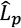 是模型 `M[p]` 似然函数的极大值。
- `ln()` 是自然对数（即以数 `e` 为底的对数）。

| 拟合优度统计量 | 定义 | 注释 |
| --- | --- | --- |
| 赤池信息准则（AIC） | `AIC = 2k – ln` | 当 `n` 较小时，AIC 倾向于选择参数过多的模型。 |
| 贝斯信息准则（BIC） | `BIC = ln(n)k – ln` | 要求记录数（`n`）大于参数数量（`k`）。 |
| Mallow’s `C[p]` | 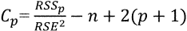，其中 `RSS[p]` 是具有 `p` 个预测变量模型的 `RSS`。（`RSE` 是在使用所有 `Q` 个预测变量进行回归后的残差标准误差，详细见第 2 章，第 2.3.1 节。） | 适用于评估使用最小二乘法估计的回归模型的拟合情况。 |

**表 3.2** 用于评估拟合优度的不同诊断检查

使用这些统计量中的任何一种，都可以从具有不同预测变量的备选模型集中选择出一个模型。

#### 注意

使用这些统计量中的任何一种，都可以从具有不同预测变量的备选模型集中选择出一个模型。


使用这些统计量中的任何一种，都可以从具有不同预测变量的备选模型集中选择出一个模型。

#### 注意

使用这些统计量中的任何一种，都可以从具有不同预测变量的备选模型集中选择出一个模型。

使用这些统计量中的任何一种，都可以从具有不同预测变量的备选模型集中选择出一个模型。

#### 注意

使用这些统计量中的任何一种，都可以从具有不同预测变量的备选模型集中选择出一个模型。

使用这些统计量中的任何一种，都可以从具有不同预测变量的备选模型集中选择出一个模型。

#### 注意

使用这些统计量中的任何一种，都可以从具有不同预测变量的备选模型集中选择出一个模型。

使用这些统计量中的任何一种，都可以从具有不同预测变量的备选模型集中选择出一个模型。

#### 注意

使用这些统计量中的任何一种，都可以从具有不同预测变量的备选模型集中选择出一个模型。

使用这些统计量中的任何一种，都可以从具有不同预测变量的备选模型集中选择出一个模型。

#### 注意

使用这些统计量中的任何一种，都可以从具有不同预测变量的备选模型集中选择出一个模型。

### 3.6.5 验证集法

评估模型的另一种方法是将数据分为两个部分：训练集和验证集。在训练集上构建模型并使用其在验证集上的性能来评估模型。这种方法常用。

#### 注意

* 通常，训练和验证数据的划分比例为 50:50 或 60:40。

* 如果数据中的记录数很少，训练数据的记录将更少。

* 必须仔细选择训练和验证数据，以确保它们具有代表性。

### 3.6.6 折交叉验证

在验证集法中，模型构建和验证是在部分数据上进行的，可能会错过数据中的重要模式。数据的不同划分会导致模型准确率不同。折交叉验证解决了这个问题。

在这种方法中，将数据随机分为 `k` 组，通常大小相似。留出第一折用于验证，并在剩余的 `(k – 1)` 折数据上开发模型。评估模型的准确性，并对这 `k` 折中的重复此过程。每次留出一折用于验证，并在剩余数据上拟合模型。最后对这些迭代中获得的准确率值进行平均处理，以获得模型准确性的最终估计。图 3.18 显示了这种方法的示意图。

注意，在这种方法中，模型拟合和评估会进行 `k` 次。因此，如果算法计算代价很大，整个过程可能会花费很长时间。

#### LOOCV 情况

一种特殊情况称为留一交叉验证 (`LOOCV`)，即 `k` 等于观测值数量 (`n`)。在这种情况下，模型在 `n – 1` 个观测值上构建，并针对每次迭代中的一个观测值进行验证。

一旦选定了最终模型，您的模型就可以部署到生产环境中了。数据获取、数据质量改进和数据准备的过程也会作为模型部署的前提条件在生产环境中部署。部署的模型会对生产数据进行评分以进行预测或模式识别，这可以按需执行，也可以根据预定义的计划执行。

本节将讨论了与模型部署相关的两个重要方面：随时间推移保持模型的最佳性能，以及机器学习应用的运营化。

在瞬息万变的世界中，业务和环境的变化非常快，这些变化会反映在数据中。因此，生产数据可能会随着时间的推移开始揭示新的模式，最终与用于构建模型的数据产生偏。例如，在流失预测场景中，模型可能曾将网络问题导致的掉线作为流失预测的重要参数。然而，在实施模型后，网络服务提供商可能会采取纠正措施来提高网络带宽。也许在接下来的六个月里，网络问题将不再是分析流失的重要参数了。

对模型准确率进行定期监控可以揭示性能下降并触发模型调整。您可以通过以下两种方式调整模型：

* 模型可以根据底层算法的动态特性，自动适应变化的业务环境。例如，如果使用 `k-NN` 来预测流失，那么在每个月的预测之前，可以使用最新的流失数据运行 `k-NN`，以捕捉由于环境变化导致的决策边界移动（如果有的话）。

* 模型本质上可能是静态的。在这种情况下，必须对模型进行定期审查和调整，以适应业务性质的变化。

另一个重要方面是模型的运营化。仅仅将模型部署到生产系统中是不够的；模型如何与业务流程集成对于项目的成功也至关重要。如果没有这种集成，您模型的可用性可能会受到严重影响。从模型中获得的洞察应该嵌入到相关的业务流程中，以使机器学习解决方案制度化。

## 3.8 总结

在本章中，您学习了涉及机器学习项目生命周期的关键活动。这些关键活动——理解业务；理解并准备您的数据；模型构建、评估和部署——无论使用何种方法，都出现在每个机器学习项目生命周期中。若干机器学习概念在这些关键活动背后起着重要作用，如数据质量改进、汇总统计、可视化、降维、数据和变量转换、诊断检查、验证集以及 `k-fold cross-validation`。每个机器学习项目都是独特的，没有一种标准解决方案适用于所有场景。机器学习项目的成功取决于对这些概念和活动的适当应用，以及将您高性能的机器学习解决方案制度化到您的业务流程中。

# 4 SAP HANA 上的机器学习

本章概述了 SAP HANA 平台原生的机器学习组件。我们将向您介绍不同的服务器端和客户端组件，用于在 SAP HANA 中使用机器学习进行应用开发。我们还将描述服务器端组件和 R 集成背后的核心概念。由于使用 R 的统计模型经常用于 SAP HANA 平台，本章还将向您介绍 R 并向您展示一些基础的 R 命令。

SAP HANA 提供了一个使用机器学习进行预测性分析的全面环境。SAP HANA 提供了嵌入的机器学习算法库，您可以利用这些库在 SAP HANA 中原生开发机器学习应用。它还支持与其他机器学习工具集成，并提供了应用程序接口（`APIs`）来访问 SAP HANA 库，以便您可以使用 R 或 Python 构建客户端应用程序。

在本章中，我们将首先在第 4.1 节中描述嵌入 SAP HANA 的机器学习组件，特别是 SAP HANA 预测分析库 (`SAP HANA PAL`）、SAP HANA 自动预测库 (`SAP HANA APL`) 和 SAP HANA 扩展机器学习库 (`SAP HANA EML`)。然后，在第 4.1.4 节中，我们将转向集成 R 的 SAP HANA。

## 4.1 SAP HANA 机器学习组件

SAP 提供了不同的组件来利用 SAP HANA 平台采用广泛的机器学习解决方案。这些组件大致分为服务器端组件和客户端组件。服务器端组件允许您在 SAP HANA 服务器上开发机器学习解决方案，而客户端组件允许您从使用 R 或 Python 开发的客户端应用程序中使用 SAP HANA 进行机器学习。

以下服务器端机器学习组件在 SAP HANA 中可用：

* **嵌入式机器学习库**

  SAP HANA 提供了两个嵌入式机器学习库，包含用于在 SAP HANA 中原生开发机器学习应用的算法：

  * **SAP HANA 预测分析库 (`SAP HANA PAL`)**

    包含了数据科学家和机器学习专家可以运行的机器学习算法。通过维护合适的参数值，可以对这些算法进行微调。

  * **SAP HANA 自动预测库 (`SAP HANA APL`)**

    包含了用于开发自动化机器学习解决方案的机器学习算法。针对特定问题，该解决方案会自动选择合适的算法并微调参数以提供最优模型。`SAP HANA APL` 适用于对机器学习了解较少的业务用户。

  这两个库都是随 SAP HANA 一起交付的应用程序函数库 (`AFL`) 的部分。这些解决方案必须单独安装。

* **与其他机器学习工具/框架的集成**

  SAP HANA 可以与 R 和 Google TensorFlow 等流行的机器学习工具集成，通过以下组件利用这些工具的机器学习能力：

  * **SAP HANA 扩展机器学习库 (`SAP HANA EML`)**

    将 SAP HANA 与 TensorFlow 框架集成。该组件在名为 `TensorFlow Serving` 的特殊服务器上调用预定义的的 TensorFlow 模型，并使用 Google 的远程过程调用 (`gRPC`)。`SAP HANA EML` 也是 `AFL` 的部分。

  * **集成 R 的 SAP HANA**

    SAP HANA 可以与 R 软件开发环境集成，在 SAP HANA 中运行带有嵌入 R 脚本的存储过程。这些 R 脚本会自动传输到远程 R 服务器并在该服务器上执行。通过这种集成，SAP HANA 可以访问 R 中成千上万的机器学习和统计算法。

以下客户端组件作为 SAP HANA 客户端安装的一部分提供：

* **用于客户端开发的机器学习 API**

  SAP HANA 提供了两个 API 用于从客户端使用 SAP HANA PAL 和 `SAP HANA APL` 算法：

  * **机器学习算法的 SAP HANA Python 客户端 API**

    允许从 Python 运行 `SAP HANA PAL` 和 `SAP HANA APL` 算法。该 API 使用 `SAP HANA DataFrame`，它提供了一系列方法直接在 SAP HANA 中分析数据，无需将数据传输到客户端。该 API 提供了 `SAP HANA PAL` 算法的包、用于 `SAP HANA APL` 算法的包，以及用于数据帧管理、可视化和实用功能的其他包。

* **用于机器学习算法的 SAP HANA R client API**

  为 `SAP HANA PAL` 算法提供了一个包，并允许你从任何集成的 R 开发环境（IDE），例如 `R Studio` 运行这些算法。算法本身在 `SAP HANA` 中运行，因此训练数据不需要传输到 `R` 服务器或客户端。

这两个 API 都必须作为 SAP HANA 客户端安装的一部分进行安装。

## 流式分析机器学习

SAP HANA 为流式分析提供了机器学习能力，这是通过持续查询对海量移动数据进行分析。这些流数据可能源于不同的源，如金融交易、网络交互、物联网（IoT）和机器传感器。你可以使用机器学习通过聚类或分类来分析流数据中的模式。例如，你可以通过实时分析数百万次金融交易来识别欺诈交易。

SAP HANA 提供了 `SAP HANA PAL` 算法，例如 `DenStream` 聚类或 `Hoeffding tree` 分类，用于识别流数据中的模式。此外，`R` 与 `SAP HANA` 中的流式分析集成允许 `R` 脚本作为流式分析服务器上连续计算语言 (`CCL`) 查询的一部分被执行。

流式分析是一个主要课题，远远超本书的范围。感兴趣的读者可以参考最新版本的《SAP HANA Streaming Analytics: Developer Guide》以获取更多细节：[`s-prs.co/501400`](http://s-prs.co/501400)。

### 4.1.1 SAP HANA 预测分析库

机器学习算法需要对数据进行复杂计算以得出特定模型。这些计算需要多种复杂的数值技术，如矩阵操作、数值优化和复杂函数的评估。通常，大多数机器学习工具将这些算法作为函数/过程提供，这样数据科学家或机器学习专家就不需要手动编写这些算法。相反，可以在程序/编辑器中使用函数/过程调用所需的算法，并对输入数据、输出数据和模型参数的特定值进行配置。

同样，`SAP HANA` 也通过 `SAP HANA PAL` 内部过程的形式为数据科学家和机器学习专家提供机器学习算法。这些过程可以从 `SAP HANA` 的 `SQLScript` 过程调用，以执行特定的机器学习相关任务。在 `SAP HANA 2.0 SPS 02` 之前，这些算法是以 `SAP HANA PAL` 函数的形式提供的。

`SAP HANA` 还提供了应用函数建模器 (`AFM`) 工具，这是 `SAP HANA Studio` 中的一个图形化建模工具。`AFM` 支持在流图模型中访问和执行 `SAP HANA PAL` 过程，并可以配置特定的输入表、输出表和参数值，而无需编写任何 `SQLScript` 代码。`AFM` 将处理后端的代码。

#### 注意

`SAP HANA PAL` 是 `SAP HANA 应用函数库` (`AFL`) 的一部分，它是一系列复杂应用函数的集合。这些函数根据其应用领域分为多个库，如业务函数库 (`BFL`)、`SAP HANA 预测分析库` (`SAP HANA PAL`)、`SAP HANA 自动预测库` (`SAP HANA APL`) 和 `SAP HANA 扩展机器学习库` (`SAP HANA EML`)。

这些应用函数用 `C++` 编写以实现高性能，并运行在 `SAP HANA` 数据库层而不是应用程序服务器上，这样就可以利用 `SAP HANA` 数据库的巨大计算能力。`AFL` 不是 SAP HANA 硬件设备的一部分；这些库必须单独安装。图 4.1 提供了 `SAP HANA PAL` 架构的高级视图。


**图 4.1** SAP HANA PAL 高级架构

`SAP HANA PAL` 包含了用于不同类型机器学习算法的过程；其中一些最常用的算法在第 2 章 中描述过。然而，在迷人的机器学习世界中，有数千种算法可用于各种机器学习场景。`SAP HANA` 根据市场调查采用了最常用的算法，并将它们包含在 `SAP HANA PAL` 中。在这里，我们将提供截至 `SAP HANA 2.0 SPS 04` 的 `SAP HANA PAL` 交付的算法列表：

* 聚类

  * 加速 k-means

  * 亲性传播 (Affinity propagation)

  * 凝聚层次聚类

  * DBSCAN, 几何 DBSCAN

  * 高斯混合模型 (GMM)

  * K-means, k-medians, k-medioids

  * 隐含狄利克雷分配 (Latent dirichlet allocation)

  * 自组织映射

* 分类

  * 条件随机场

  * 决策树（包括 C4.5, CART, CHAID）

  * 混合梯度提升树

  * KNN

  * 线性判别分析

  * 逻辑回归（带有弹性网络正则化）

  * 多分类逻辑回归

  * 多层感知器

  * 朴素贝叶斯

  * 随机决策树

  * 支持向量机

* 回归

  * 双变量几何回归

  * 双变量对数回归

  * Cox 比例风险模型

  * 指数回归

  * 广义线性模型

  * 多元线性回归

  * 多项式回归

* 社会网络分析

  * 链路预测

  * PageRank

* 关联

  * Apriori

  * FP-growth

  * K-最优规则发现 (KORD)

  * 序列模式挖掘

* 时间序列

  * ARIMA, auto-ARIMA

  * Brown 指数平滑

  * 变点检测

  * 相关函数

  * Croston 方法

  * 快速傅里叶变换

  * 预测准确性衡量

  * 分层预测

  * 带有阻尼趋势和季节调整的线性回归

  * 指数平滑（单、、双、三、自动）

  * 季节性测试、趋势测试、白噪声测试

* 预处理

  * 离散化

  * 四分位距

  * 多维缩放 (MDS)

  * 缺失值处理

  * 分区

  * 主成分分析 (PCA)

  * 随机分布采样

  * 采样

  * 缩放，模型缩放

  * 方差检验

* 推荐系统

  * 交替最小二乘

  * 分解多项式回归模型

  * 感知因子机

* 统计

  * 方差分析 (Anova)

  * 卡方拟合优检验

  * 卡方独立性检验

  * 条件指数

  * 累积分布函数

  * 分布拟合

  * 分布分位数

  * 等差检验

  * 因子分析

  * Grubbs 检验

  * Kaplan-Meier 生存分析

  * 核密度

  * 多元分析

  * 单样本中位数检验

  * T 检验

  * 单变量分析

  * Wilcoxon 符号秩检验

* 杂项

  * ABC 分析

  * T 分布随机邻域嵌入

  * 权重表

第 6 章、第 6.1 节 提供了关于如何在机器学习项目中使用 `SAP HANA PAL` 过程的更多细节。

### 4.1.2 SAP HANA 自动预测库

`SAP HANA APL` 提供了适用于自动执行的机器学习算法，无需通过参数微调模型。该解决方案适用于对底层机器学习算法了解较少的业务用户。`SAP HANA APL` 包含了可以实现 AutoML 功能的构建模块。

#### SAP HANA APL 函数

SAP HANA APL 提供了多个用于创建和部署自动化预测分析的函数。这些 SAP HANA APL 函数被分为以下三类服务：

* **预测模型服务**

  这些函数用于创建模型、训练模型以及应用模型以获取预测和建议。其他函数可以检索有关模型、变量统计数据和利润曲线的信息，并可以发布模型。

* **预测业务服务**

  这些函数用于对数据应用更简单的预测服务，例如基于训练、验证和测试数据检索统计和利润曲线；时间序列预测；关键影响参数信息；数据分析；单次推荐（one-shot recommendations）以及导出评分方程。

* **技术服务**

  这些函数用于检索 SAP HANA APL 函数的非预测方面，例如关于 SAP HANA APL 组件的技术信息、版本信息和配置信息。


每个 SAP HANA APL 函数都由一个签名（signature）描述，签名是一个参数表列表。每个参数表由表类型定义，可以是输入（IN）或输出（OUT）类型参数。例如，在预测模型服务分类下的 `APPLY_MODEL` 函数，其参数表列于表 4.1。

| 参数表 | 类型 | 强制性 | 描述 |
| --- | --- | --- | --- |
| `FUNC_HEADER` | IN | 否 | 定义函数调用的操作参数。 |
| `MODEL` | IN | 是 | 要应用的训练模型。 |
| `OPERATION_CONFIG` | IN | 否 | 所应用的操作配置，用于指定输出中所需的信息，例如变量是否应转换以及/或在输出中是否应标记离群值。 |
| `DATASET` | IN | 是 | 输入数据。 |
| `DATASET` | OUT | 是 | 应用模型后产生的输出数据。 |
| `LOG` | OUT | 否 | 操作日志。 |
| `SUMMARY` | OUT | 否 | 操作的汇报信息。 |

**表 4.1** `APPLY_MODEL` 函数的参数

请注意，SAP HANA APL 函数的参数是表，由表类型定义。它们在调用函数时用作输入/输出参数。决定模型行为及其操作的实际模型参数/细节通过这些表中的数据指定。因此，强制性输入参数表必须填充数据。这些 SAP HANA APL 函数参数表遵循特定的结构。例如，`FUNCTION_HEADER` 表的结构如图表 4.2 所示。

| 列 | SQL 数据类型 | 描述 |
| --- | --- | --- |
| `KEY` | (N)VARCHAR, (N)CLOB | 指定参数键，如 `oid`（操作 ID）和语言。 |
| `VALUE` | (N)VARCHAR, (N)CLOB | 指定相应参数键的值，例如语言键的 `en` 表示指定英语。 |

**表 4.2** `FUNCTION_HEADER` 表类型的结构

图 4.2 显示了 SAP HANA APL 函数签名的图形表示。有关需 SAP HANA APL 函数的完整规范（包括输入/输出表和允许的值，即模型参数），请参阅 SAP Help Portal 上的最新 SAP HANA 自动化预测库参考指南（[`s-prs.co/501401`](http://s-prs.co/501401)）。


**图 4.2** SAP HANA APL 函数的签名

## 调用 SAP HANA APL 函数

要使用 SAP HANA APL 函数，需要创建一个 AFL 封装过程（wrapper procedure），并调用此 AFL 封装器来执行 SAP HANA APL 函数。根据它们支持的功能，可以使用三种不同的技术来调用该函数。在端到端的建模场景中，可以组合不同的技术来调用您的函数，例如：

- **直接 (Direct)**

  在此技术中，通过显式创建表类型、签名表以及输入表和输出表，为 SAP HANA APL 函数生成 AFL 封装器。然后通过调用语句调用该 AFL 封装器。这种技术允许您构建封装 SAP HANA APL 函数的只读过程。直接技术始终可用。

- **存储过程 (Procedure)**

  每个 SAP HANA APL 函数都有一个使用同名的相应存储过程。这些过程在安装函数库时，作为 `HCO_PA_APL` 交付单元的一部分部署。可以通过这些存储过程调用 SAP HANA APL 函数，它们将处理 AFL 封装器及其所有相关数据库对象的生命周期。这种技术比直接方法简单得多且更具扩展性。

- **任意存储过程 (Any procedure)**

  这种技术不需要您生成 AFL 封装器，也不需要调用 `HCO_PA_APL` 交付单元中的存储过程。可以直接从 `SYS_AFL` 模式作为 ANYLANG 过程调用 SAP HANA APL 函数。这种技术适用于 SAP HANA 2.0 SPS 03 及更高版本。

图 4.3 显示了 SAP HANA 的架构和各种技术。


**图 4.3** SAP HANA 架构和调用技术

这些技术支持不同的功能并适用于各种场景。

## 4.1 SAP HANA 扩展机器库 (Extended Machine Library)

SAP HANA EML 允许 SAP HANA 与 TensorFlow 集成，TensorFlow 是一个开源机器学习算法集合，可以解决广泛的人工智能（AI）和机器学习问题，特别是当这些问题需要神经网络或深度学习模型时。

### TensorFlow 简介

Google TensorFlow 是一个强大的开源面向数据流的 AI 库，用于使用数据流图构建模型，并可以创建许多层的神经网络。Google 的 Brain 团队最初为内部创建了 TensorFlow，但该库在 2015 年开源。

TensorFlow 可以描述如下：

- 主要用于分类、感知、理解、发现、预测和创建。
- 基于易于理解的设计，广泛适用于神经网络问题。
- 供研究人员进行复杂数学计算和构建实验架构的低级工具包。
- 一种以图表示计算的编程系统。节点表示数学运算，边表示它们之间通信的多维数据数组（张量）。

Google TensorFlow 提供了一个可扩展的交互多平台编程接口，利用各种优化技术使数学表达式的计算更加简单且高效。

### TensorFlow Serving 架构

TensorFlow 运行时是一个跨平台库，其底层架构使其成为灵活且高性能的机器学习模型服务系统。TensorFlow 机器学习的一个核心概念是 TensorFlow Serving，它专注于模型训练后的应用。机器学习模型服务是获取训练好的模型并使其能够处理预测请求。在生产环境中提供服务时，必须确保环境是可重现的、隔离的且安全的。

为了理解底层架构，您需要了解图 4.4](#04_001.html#f4.4)所示架构的某些关键构建块。以下组件使得该架构具有规模灵活性：

- **可服务实体 (Servables)**

  在 TensorFlow 中，服务对象（servables）代表客户端用于执行计算的对象，这些对象可以是从查找表到机器学习模型的任何内容。TensorFlow Serving 提供了与 TensorFlow 模型的开箱即用集成，也可以轻松扩展以服务其他类型的模型。TensorFlow Serving 还提供了几个扩展点，您可以在这些地方添加新功能。

### 服务对象版本 (Servable versions)

服务对象可以具有多个配置和权重不同的版本，这使得服务对象能够在不同的场景下运行。可以同时加载服务对象的多个版本。


**图 4.4** TensorFlow Serving 架构

### 服务对象流 (Servable streams)

按版本号升序排列的任何服务对象的版本序列。

### TensorFlow 模型 (TensorFlow models)

一个 TensorFlow 模型可以通过一个或多个服务对象来表示，以实现特定的机器学习或与机器学习相关的任务。多个独立的服务对象或单个复合服务对象可以表示为一个复合模型，而服务对象也可以像模型的一部分一样工作。

### 加载器 (Loaders)

TensorFlow 加载器专门负责管理服务对象的生命周期，包括通过一组 API 加载和卸载它们，这些 API 独立于涉及的任何特定算法、数据或产品用例。

### 源 (Sources)

简单来说，源是查找并提供必要的服务对象的模块，它们一次可以提供零个或多个服务对象流。对于每个服务对象流，源只提供一个加载器实例，该实例可供加载使用，并可以维护跨越多个服务对象的共享状态。

### 期望版本 (Aspired versions)

期望版本代表一组应该被加载并准备就绪的服务对象版本。源一次向管理器通信单个服务对象流的一组服务对象版本，管理器根据此列表上传或卸载服务对象。

### 管理器 (Managers)

TensorFlow 管理器控制服务对象的整个生命周期，包括加载、提供服务和卸载它们。它与源交互，以处理来自源的请求（例如上传新的服务对象版本）。它还为客户端访问已加载的服务对象实例提供了接口。

### 版本策略 (Version policy)

版本策略指定了单个服务对象流中服务对象版本加载和卸载的顺序。TensorFlow Serving 通常部署以下两种策略之一：可用性保持策略（Availability Preserving Policy），它确保服务对象至少有一个版本可用；以及资源保持策略（Resource Preserving Policy），它确保服务对象的两个版本不同存在。第一种策略先加载新版本再卸载旧版本，而在第二种策略中，是先卸载旧版本再加载新版本。

### 通过 SAP HANA EML 集成 TensorFlow

TensorFlow 与 SAP HANA 的集成是通过 SAP HANA EML 组件实现的。总体架构如图图 4.5 所示。


**图 4.5** TensorFlow 与 SAP HANA 的集成

针对 SAP HANA EML 的 AFL 是 SAP HANA 的 TensorFlow Serving 客户端，它可以调用预定义的 gRPC 调用。`AFL` 是针对 SAP HANA 的 TensorFlow Serving 客户端，可以调用预定义的 gRPC 调用。针对 SAP HANA EML 的 AFL 是针对 SAP HANA 的 TensorFlow Serving 客户端，可以调用预定义的 gRPC 调用。

### 4.1 R 与 TensorFlow Serving 的集成

R 是该语言的一种实现。

## 4.2 与 SAP HANA 的集成

SAP HANA 服务器与外部 R 环境之间的集成通过以下两个组件建立：

- SAP HANA 计算引擎中的 R 客户端与外部 R 环境通信。
- `Rserve` 是一个 R 包，充当套接字服务器（TCP/IP 或本地套接字），允许其他应用程序连接到 R。该包支持远程连接、用户身份验证和文件传输。

当计算模型计划执行遇到 `R` 算符时，它将其交给计算引擎中的 `R` 客户端。`R` 客户端通过 `Rserve` 在外部 `R` 环境中建立一个专用 `R` 进程。然后，`R` 客户端使用这个专用 `R` 进程将 `R` 代码、输入数据和参数发送到外部 `R` 环境，在那里触发 `R` 执行并接收结果。注意，`SAP HANA` 使用列式数据结构，而 `R` 使用 `R` 数据框（data frame），因此在此过程中数据会被转换为相应的结构。然而，由于这些数据结构之间的相似性，这种转换是非常高效的。

## 局限性

- `R` 集成的某些局限性包括：
  - 数据在 `SAP HANA` 和 `R` 之间通过表（`SAP HANA` 中）和数据框（`R` 中）进行交换。
  - `RLANG` 语言的 SAP 过程中仅支持表类型作为参数。
  - 标量参数需要作为表或数据框传递给 `R`。
  - `R` 中的其他数据结构（如列表和矩阵）在返回 `SAP HANA` 之前，必须使用 `as.data.frame()` 函数转换为数据框。
- 嵌入的 `R` 函数必须至少有一个结果（数据框形式）。
- 过程中的变量名不应包含大写字母。
- `SAP HANA` 将 Factor（因子）列发送为字符向量，这可能需要在 `R` 中使用 `as.factor()` 转换为 Factor。

## 基础 R 编程概念

`SAP HANA` 与 `R` 的集成允许使用 `RLANG` 语言将 R 代码作为 SAP HANA SQLScript 过程的一部分。因此，了解一些用于数据处理、计算和统计计算的 `R` 命令是至关重要的。由于上述局限性，在 `SAP HANA` 中编写 `R` 代码时，并不是所有命令都有用。但是，了解基础的 `R` 命令有助于对该主题有高层的理解。在本节中，我们汇总了一些基础 `R` 命令，感兴趣的读者可以参考 `R` 的 PDF 文档或大量相关书籍。

### 准备知识

`R` 是一种语法简单的表达式语言。代码以命令的形式编写。命令之间用分号（`;`）或换行分隔。基础命令分为两类：

- **表达式**：会被求值并打印（如果没有隐藏），且值会丢失。
- **赋值**：会被求值，并将值传递给变量；结果不会打印。变量名是一个引用或指针，指向一个值而不是公式。可以通过输入变量名来查看变量的值。从技术上说，赋值也是一种特殊的表达式。

多个基础命令可以使用大括号 `{` 和 `}` 组合成一个复合表达式。可以使用哈希标记（`#`）包含注释。通常的提示符是 `>`。然而，如果命令没有在单行内完成，提示符将变为 `+`。这些默认设置是可以更改的。可以通过向上（`ì`）和向下（`ë`）键调回命令。

在 `R` 中创建和操作的内容被称为对象，它们通过名称创建并存储。`R` 中不同类型的对象包括：

- **向量（Vector）**：相似模式值的集合。向量支持的基础模式包括逻辑、数值（整数或双精度浮点）、复、字符（字符串）和原始（raw）。单个值也是长度为 1 的向量。
- **数组（Array）**：向量的多维泛化。它可以被看作是由两个或多个索引索引的向量。
- **矩阵（Matrix）**：一种具有二维的特殊数组，即向量的二维泛化，类似于线性代数中的矩阵。
- **因子（Factor）**：一种特殊的向量，包含分类数据（例如，教育背景、性别、婚姻状况），设计用于高效处理分类数据。
- **列表（List）**：向量的一般形式，其各个组件不需要具有相似的类型。
- **数据框（Data frame）**：一种特殊的列表，包含向量、因子和矩阵，且所有项的长度相同（或矩阵的行数相同）。它类似于矩阵，但单独列的类型不需要是相同的。
- **表达式（Expression）**：包含一个或多个已解析但未评估求值的 `R` 语句。
- **函数（Function）**：通过应用特定逻辑（如一组值的最大值）从输入提供输出。`R` 中的任何函数都写如下：

```
function_name (argument1, argument2, …)
```

`function_name` 是特定函数的名称，它可以有一个或多个参数值，其中一些可能是可选的。有时它也可以写成：

```
function_name (arg1= value1, arg2 = value2, …)
```

在这种情况下，`arg1`、`arg2` 等代表特定参数，`value1`、`value2` 等代表对应参数的值。当存在可选参数且我们只想指定少数参数时，这种表示法特别有用。在函数的参数中，也可以使用变量和表达式来代替值。

`R` 中的所有对象都有一个类（class），这使得 `R` 支持面向对象的编程。类的一些示例有 `list`、`matrix`、`array`、`factor` 和 `data.frame`。

工作空间（workspace）是当前存储的所有对象的集合。在 `R` 会话期间创建的所有对象都可以保存到名为 `.RData` 的文件中，所有的命令记录可以保存到 `.Rhistory` 文件中。下次启动 `R` 时从这些文件中加载工作空间。

`R` 是大小写敏感的；对象的名称只使用字母数字字符。

在探索其他命令之前，让我们看看图 4.8 所示的简单 R 代码。

```
if (condVar > someVal) {console.log("xxx")}
```

图 4.8 简单 R 示例

常用的 R 命令见表 4.3。

| 表达式 | 功能 | 示例 |
| :--- | :--- | :--- |
| `<-` | 求右侧的值并将其赋值给左侧变量。 | `x <- 5` |
| `=` | 赋值。 | `x = 5` |
| `+`, `-`, `*`, `/`, `^` | 数学运算（加法、减法、乘法、除法、幂函数）。 | `2*x + 3/7 - 2` |
| `>` | 布尔运算符 `>` 如果左侧大于右侧则为 TRUE，否则为 FALSE。 | `x > y` |
| `<` | 布尔运算符 `<` 如果左侧小于右侧则为 TRUE，否则为 FALSE。 | `x < y` |
| `==` | 布尔比较运算符 `==` 如果左侧等于右侧则为 TRUE，否则为 FALSE。 | `x == y` |
| `:` | 生成一个数值序列，取运算符左侧的值，并通过每次增加 1 生成序列，直到该值小于等于右侧的值。 | `1:10` |
| `#` | 添加注释。 | `# sample comment` |
| `?` | 访问帮助文件。 | `? boxplot` |
| `help()` | 访问帮助文件。 | `help(boxplot)` |
| `library()` | 加载包。 | `library (MASS)` |
| `setwd()` | 设置工作目录。 | `setwd("C:/data")` |
| `source()` | 执行外部文件中存储的命令。 | `source("commands.R")` |
| `q()` | 关闭 R。 | `q()` |

表 4.3 常用 R 命令


向量（`vector`）是相同模式值的有序集合。例如，一个包含整数 1、2、3、7 和 11 的集合可以被视为一个向量。同样，一个名称（字符）集合，例如“Ranajay”、“Dinesh”、“Kalpana”、“Kakali”和“Subhasree”，也可以被视为一个向量。如果在一个向量中收集了不同模式的值，R 会自动将它们转换为相同模式的向量。例如，一组具有不同模式值的集合（如 1、10.5 和“Blue”）将被转换为一个包含值“1”、“10.5”和“Blue”的字符向量。统计分析通常依赖于线性代数技术，而向量（`vectors`）在其中起着至关重要的作用。

你可以使用`c()`函数来创建一个向量。该函数可以接受值、变量或表达式作为参数。图 4.9 显示了定义向量的几种不同方式。

可以使用向量对算术表达式和布尔表达式进行求值。此外，可以在向量上使用几个内置函数，如`mean`（平均值）、`var`（方差）、`max`（最大值）和`min`（最小值）。向量的长度是指向量中对象的数量。如果在表达式中使用两个长度不等的向量，则较短的向量将重复，直到它与其他向量（或向量）的长度匹配。序列运算符冒号（`:`）也可以用于定义数字序列的向量。图 4.10 显示了某些应用于向量的函数。


**图 4.9** 使用`c()`函数在 R 中定义向量


**图 4.10** 向量上的操作和函数

可以使用以下表达式识别向量的元素：

```
Vector_Name[index]
```

其中，`vector_name`是向量的名称，`index`是元素在向量中的位置。例如，假设`x`是按以下方式定义的向量：

```
x <- c(1, 2, 4, 9)
```

在这种情况下，可以通过`x[3]`获取向量的第 3 个元素。输出将是 4。负索引值也可以从向量中排除元素。例如，`x[-3]`将是一个包含值 1、2 和 9 的向量，从而从向量中排除了第 3 个元素。在某些情况下，向量的某些组件可能无效或缺失。在这种情况下，该组件可以赋值为一个特殊值：`NA`。通常，任何涉及`NA`的操作都会变成`NA`。例如，考虑以下代码：

```
> (x <- c(1:5, NA))
[1]  1  2  3  4  5 NA
> x + 1
[1]  2  3  4  5  6 NA
```

在这种情况下，向量`x`的第 6 个组件被赋值为`NA`。表达式`x + 1`也生成了一个第 6 个组件为`NA`的向量。

### 数组和矩阵

数组（`Arrays`）是多个索引条目的有序集合。与向量类似，一个主要区别是数组中的值代表来自多维网格的数据。技术上，一维数组也是可能的。数组包含两个部分：一个数据向量和一个维度向量。维度向量指定数组的维度。维度向量的条目总是正整数。如果数组的维度向量有`k`个条目（`n[1]`、`n[2]`、...、`n[k]`），则该数组是一个 k 维数组，具有`n[1] × n[2] × ... × n[k]`个数据条目。矩阵（`Matrix`）是二维数组。可以通过索引获取数组中元素或子数组的值。图 4.11 显示了数组示例。

```r
A <- c(3, 5, 2)
```

这段代码将向量`(3, 5, 2)`分配为`A`的维度向量并使其数组。结果是，向量`A`跨三个索引（维度）具有值：第一个索引的值为 1 到 3，第二个索引的值为 1 到 5，第三个索引的值为 1 和 2。注意`3 × 5 × 2 = 30`。在对索引分配数据值时，索引的值从 1 到维度向量中指定的值个数，左侧的索引移动最快。图 4.12 显示了在 R 中创建数组和矩阵。


**图 4.11** 数组示例


**图 4.12** 在 R 中创建数组和矩阵

R 还可以使用不同包中的函数从各种来源读取数据，包括关系型数据库管理系统（RDBMS）以及 SAS 和 SPSS 等统计软件包。请参考帮助文件以获取更多信息。

### 控制语句

R 语言具有以下控制语句：

- **If 语句**

  以下语句可用于条件执行：

  ```r
  > if (expression1) expression2 else expression3
  ```

  `expression1`应该求值为一个单一逻辑值（`TRUE`或`FALSE`）。如果为`TRUE`，则执行`expression2`；否则执行`expression3`。

  R 还支持`if`语句的向量版本，例如：

  ```r
  > ifelse(condition, a, b)
  ```

  参数`condition`、`a`和`b`都是向量。该语句返回一个长度与向量`condition`相同的向量，并根据`condition[i]`为真或假，将其第 i 个分值为`a[i]`或`b[i]`，其中，`i`从 1 运行到向量`condition`的长度。

- **For 循环（For loop）**

  R 提供了以下语法用于在循环中运行语句：

  ```r
  > for (dummy_name in expression1) expression2
  ```

  `dummy_name`是循环变量，`expression1`是一个向量（通常是像`1:10`这样的序列），`expression2`是重复求值的表达式，通常基于`dummy_name`的值。

- **Repeat 和 while**

  `repeat expression`和`while (condition) expression`也可以用于多次循环同一个表达式。表达式中必须包含`break`语句，否则循环将无限进行。你可以使用`next`语句跳过特定的语句并移动到下一个语句。

### 在 R 中拟合统计模型

R 跨越不同包包含了丰富的统计分析函数集。在本节中，我们仅触及开发线性模型的函数。对于其他类型的模型，请参考 R 的帮助文件。

可以使用以下函数拟合 R 中的线性模型：

```r
> fitted.model <- lm(formula, data = data.frame)
```

例如：

```r
> fitted_model <- lm(y ~ 1 + x, data = input_data)
```


其中 `input_data` 是一个具有两列 `x` 和 `y` 的数据框，拟合模型的结果存储在列表 `fitted_model` 下。`formula` 是一个独立的对象类，指定响应变量 (`y`) 和预测变量 (`x`) 之间关系的类型。某些公式列在表 4.5 中。注意 `x` 和 `y` 仅仅是占位符；可以使用输入数据中所需的列名。

| 公式 | 解释 |
| --- | --- |
| `y ~ x` 或 `y ~ 1 + x` | 带有截距项的 `y` 对 `x` 的简单线性回归。 |
| `y ~ 0 + x` 或 `y ~ –1 + x` 或 `y ~ x – 1` | 不带截距项的 `y` 对 `x` 的简单线性回归。 |
| `y ~ x[1] + x[2]` | 带有截距项的 `y` 对 `x[1]` 和 `x[2]` 的多元线性回归。 |
| `log(y) – x[1] + x[2]` | 带有截距项的 `log(y)` 对 `x[1]` 和 `x[2]` 的多元线性回归。 |
| `y ~ poly(x, 2)` | `y` 对 `x` 的 2 次多项回归。它使用正交多项式。 |
| `y ~ 1 + x + I(x²)` | `y` 对 `x` 的 2 次多项回归。它使用 `x` 的显式幂。 |

**表 4.5** 示例公式

一旦拟合了模型，就可以使用列表 `fitted_model` 的组件或 `fitted_model` 上的某些函数提取拟合模型的信息。一些重要的命令在图 4.14 所示。


**图 4.14** 拟合模型的基本信息

也可以显示模型的摘要信息，如图 4.15 所示。

拟合模型还显示了四幅关于残差和其他诊断检查的图，以评估模型的拟合优度，如图 4.16 所示。


**图 4.15** 拟合模型的摘要信息


**图 4.16** 拟合模型诊断检查的图

此外，拟合模型可用于预测一组新预测变量的响应，如图 4.17 所示。


**图 4.17** 基于拟合模型预测新数据

### 图表与绘制

作为其主要优势之一，R 为可视化和探索性数据分析提供了强大的功能集。跨包的图形函数如 `qplot()`、`boxplot()`、`ggplot()`、`mosaicplot()` 和 `heatmap()` 可用于在不同场景下生成图表。表 4.6 列出了 R 的一些基础绘图命令。

| 表达式 | 功能 |
| --- | --- |
| `plot(x, y)` | `x` 和 `y` 是向量，此表达式生成散点图。 |
| `plot(x)` | 如果 `x` 是数值向量，此表达式生成 `x` 值相对于索引的值。如果 `x` 是时间序列，则生成时间序列图。 |
| `plot(f)` | `f` 是因子，此表达式生成 `f` 的条形图。 |
| `plot(f, y)` | `f` 是因子，`y` 是数值向量，此表达式生成 `f` 每个水平的 `y` 的箱线图。 |
| `plot(df)` | `df` 是数据框，此表达式生成 `df` 中向量或因子的分布图。 |
| `pairs(X)` | `X` 是数据框或矩阵，此表达式生成 `X` 列之间的两两散点图。 |
| `coplot(x ~ y | z)` | `x` 和 `y` 是数值向量，`z` 是因子，此表达式生成 `z` 每个水平的 `x` 和 `y` 的散点图。 |

**表 4.6** R 基础绘图命令

## 4.2 总结

机器学习需要广泛的算法来适应不同的用例。SAP HANA 包含了丰富的机器学习能力，通过嵌入机器学习库或与外部机器学习工具/框架集成。SAP HANA 预测分析库 (SAP HANA PAL) 和 SAP HANA 自动预测库 (SAP HANA APL) 是 SAP HANA 中的嵌入机器学习库。这些组件包含了广泛使用的机器学习算法：SAP HANA PAL 为数据科学家和机器学习专家提供了微调模型的灵活性，而 SAP HANA APL 为业务用户提供了自动化机器学习解决方案。SAP HANA 还可以通过 HANA 扩展机器学习库与 Google TensorFlow 集成，或与外部 R 环境集成以访问这些工具丰富的机器学习能力。此外，SAP HANA 还提供了客户端 API，例如用于机器学习的 SAP HANA Python 客户端 API 和 SAP HANA R 客户端 API，以便您可以在 Python 或 R 环境中使用 SAP HANA 的机器学习能力。

通过 SAP Data Intelligence 平台，SAP 在赋能智能企业方面迈出了巨大一步。在本章中，你将学习 SAP 最新的数据科学平台，包括其独特的功能和组件。我们还将深入探讨底层机器学习和数据科学概念的技术细节，帮助你理解该平台的巨大潜力及其在构建智能解决方案中的适用性。你从本章中获得的知识也将帮助你理解随后的实操性章节。

在我们开始讨论 `SAP Data Intelligence` 或将其定义为一种产品之前，将背景设定在正确的轨道上对于理解当今企业从整体上对数据科学平台的需求，以及他们如何能够有效利用它来应用企业智能至关重要。当今企业已经意识到，其企业数据中巨大的转型潜力只有一小部分被利用了，这是因为他们的数据科学团队缺乏合适的平台来分析数据并构建有效的机器学习模型和场景。没有稳健的数据科学平台，模型最终可能缺乏准确性和稳健性，并且经常无法投入生产。因此，对于希望利用企业智能的企业来说，数据科学平台的有效性是至关重要的。

作为一种整体性方法，企业智能的核心在于机器学习及其与企业应用程序的集成，以创造一种真正可扩展、治理化且透明的方式，从企业数据中快速交付业务价值。企业智能将人工智能（AI）整合到企业背景中，同时具备数据管理、AI 模型和场景开发，以及跨各种企业环境的数据和模型治理能力。为了从业务数据中快速获取价值，以受信任和受治理的方式将企业智能与智能信息管理结合是一项关键需求。最终结果往往是一个日益复杂的格局，该格局经过良好适配，以便你从来自各种来源和格式的企业数据中发现智能。

然而，将所有这些功能交付到单一平台中可能是非常有挑战性的，特别是当每个利益相关者（包括首席信息官 CIO、IT 运营团队、数据科学家和 DevOps 团队）都有不同观点时，如图 5.1 所示：

*   对于 `CIO`，重点在于低成本的稳定、可扩展的数据科学或机器学习应用。
*   对于数据科学团队，重点在于与企业需求兼容的开发环境，同时仍留出探索空间。
*   对于数据工程师和企业架构师，重点在于用于跨组织连接和管理多个用例数据的工具。
*   对于 IT 运营或 DevOps 团队，重点在于可重用、稳定部署和可维护性。

凭借如此多样化的观点，一个能够容纳不同团队的统一数据科学平台是一项复杂的挑战，但这只是故事的一部分，正如你将在整个章节中看到的那样。


**图 5.1** 当今的数据科学公民想要什么

在本章中，我们将开始对 `SAP Data Intelligence` 的探索，首先在 5.1 节中简要回顾典型的数据科学项目周期，以及在 5.2 节中如何管理你的数据科学项目。然后，在 5.3 节中，我们将转向 `SAP Data Intelligence`，并对该平台与 `SAP Data Hub` 进行比较，并在 5.3.2 节中查看 `SAP Data Intelligence` 的架构。我们还将在 5.4 节中深入介绍平台的关键能力，包括其内置操作。本章的最后一节将回到 `SAP Data Hub`，并在 5.5 节中展示如何迁移到 Data Intelligence。

## 5.1 数据科学项目周期

通常情况下，数据科学项目是一个迭代过程，结合了多个步骤，以解决特定的业务案例。该过程通常包括以下活动：

*   **理解业务案例**
    这是启动任何数据科学项目的第一步也是重要的一步，理解业务案例决定了项目的成功。如果对问题的制定不准确，巨大的计算能力和海量的数据将毫无价值。创建问题声明是一个可以通过数据科学而非常规解决方案解决的典型痛点。在这种背景下，提出正确的问题是真正的配方。

*   **数据收集**
    一旦你通过应用正确的配方制定了问题陈述，下一步就是收集关键要素。这项活动的核心是收集相关数据并将问题陈述分解为更小的单元。对于正确的数据收集，数据科学团队进入场景，你的数据科学家需要知道哪些要素、如何获取和收集这些数据，以及如何准备数据以满足预期结果。典型的数据科学项目包括识别各种数据源，这些数据可以是服务器日志、社交媒体数据、来自在线库的数据（如美国人口普查数据集）、通过应用程序接口 (`API`) 或爬虫从在线源流的数据，甚至是 Excel 文件中的数据。数据获取涉及从所有识别出的内部和外部源获取数据以帮助回答业务问题。

*   **数据落地**
    现在你已经从格局中的各种数据孤岛收集了相关数据，我们现在可以关注数据落地，即为进一步分析做好准备。这种方法帮助你判断收集的数据是否能够解决你的业务问题。如果你的数据不够好或不相关，你需要返回项目生命周期中的收集步骤。为了实现数据的潜力，有多种方法可以通过数据统计（如平均值和位数）来探索数据。一些分析师会绘制数据图，并通过直方图、频谱分析、人口分布等可视化工具查看其分布。基于这种一般性理解，可以对数据进行进一步处理，这涉及许多其他步骤，包括：

    *   识别缺失数据
    *   删除无效数据
    *   删除重复数据
    *   为馈送数据模型做好准备

总的来说，数据科学项目中 70%-90% 的时间花在收集、实现和落地阶段，这些阶段对于任何数据科学项目的成功都至关重要。

*   **数据建模**

生命周期中最困难的部分已经过去，因为我们已经完成了数据收集和落地工作。现在是应用建模的时间，这等同于准备好食材后品尝你正在烹制的咖喱。在这一阶段，你需要判断咖喱是否需要更多调味，或者已经准备好上菜了？数据建模阶段基本上处理模型的训练、验证和测试。整个阶段侧重于从准确性（accuracy）和相关性（relevance）方面对模型进行评估。准确性指的是模型的性能优劣，而相关性更多关于模型对查询上下文的回答程度。在此阶段，将把多种机器学习技术应用于数据，以识别最合适的机器学习模型，并使用训练数据集训练竞争模型。

### 部署与迭代

我们正处于最后一步：现在，我们将把选定的模型开放到真实世界供人类使用。部署模型运行得越多，接收到的反馈就越多。捕捉这些反馈对任何数据科学项目都是决定性的，而且准确的反馈有助于影响有效的数据模型变更。作为最后一个阶段，部署和迭代涉及在数据或数据源发生变化时，在生产环境中重新训练你的机器学习模型，以确保机器学习模型的性能保持在高水平。


**图 5.2** 典型数据科学项目生命周期

如图 5.2 所示，数据科学项目生命周期是一个复杂的循环过程，因此需要良好的流线化以产生实际的业务价值。未能准确执行这些任何步骤都将导致误导性的见解和模型。失败的其他原因包括缺乏技能、模型的可扩展性差，以及跨团队之间协作不畅（因为数据科学家和工程师等团队通常工作在孤立状态中）。因此，你必须采用良好的机器学习运维实践，来标准化和简化生产环境中机器学习模型的端到端生命周期管理。针对这些需求，MLOps 应运而生，它结合了机器学习、DevOps 和数据工程技能来管理整个机器学习生命周期，并应用最佳实践来交付业务价值。在下一节中，我们将简要介绍 MLOps 及其适用性。

## 5.2 管理数据科学项目生命周期

MLOps 是针对企业在尝试将机器学习模型投入生产时面临的当前挑战的逻辑应对。


**图 5.3** MLOps

简单来说，如图 5.3 所示，MLOps 是机器学习领域的 DevOps。当 DevOps 优化大数据项目的生产生命周期时，MLOps 试图解决与在生产环境中实现机器学习相关的问题。从其本质上说，机器学习的运维化是一个深度协作的过程，需要数据科学家与运营或生产团队之间的协作，以增强自动化、最大限度地减少浪费，并最终通过机器学习获得高效且一致的见解。

根据高特分析师兼研究总监 Erick Brethenoux 发表的名为《运营你的数据科学和机器学习倡议》的分析，虽然许多公司都在开发机器学习模型，但只有 47% 的模型进入了生产。此外，企业领域近 88% 的 AI 计划难以跨越测试阶段。由于机器学习涉及许多微妙之处和复杂性，标准的 DevOps 流程不足以应对这些挑战。因此，需要一种更全面的机器学习实现解决方案——MLOps。要使用 MLOps，你需要一个全面的数据科学平台，能够支持 MLOps 并为你的数据科学家提供执行数据分析任务所需的所有支持。这些任务涵盖了可视化、交互式探索、部署、性能工程、数据准备和数据访问。但采用 MLOps 的动力是什么？根据麦肯锡发布的《全球 AI 调查》，应用 AI 使用核心实践的公司与采用 AI 的其他组织相比，获得了高得多的收入和更大的成本节约。通过 MLOps 实现自动化基本上可以帮助公司缩短产品上市时间并大幅降低运营成本，使公司在决策上更加敏捷和战略化。能够实施核心 MLOps 方法论并能够产生可重复、可追踪和可验证机器学习的数据科学平台正在获得大量关注。作为一个强大的工具，`SAP Data Intelligence` 结束了对统一数据科学平台的长期追求，该平台可以为开发、微调、部署甚至跟踪和版本管理机器学习模型提供端到端的解决方案。同时，`SAP Data Intelligence` 增强了对用资源的可见性，以便更容易进行模型的复现和性能监控，并在适当时进行重新训练。现在你已经对基础概念有了很好的理解，在接下来的章节中，我们将更多地关注 `SAP Data Intelligence` 中提供的功能和能力。

## 5.3 SAP Data Intelligence

随着 `SAP Data Intelligence` 平台的引入，SAP 在单一数据科学平台上解决了端到端的机器学习项目生命周期，数据科学家可以在以最高速度进行探索、实验和构建，同时还可以与同事共享工作组件并在某些任务上与他们安全地协作。AI 通常需要团队的努力，并在理解组织及其客户需求的业务用户、了解数据所在及数据结构的数据工程师、了解如何从这些数据中提取价值的数据科学团队，以及提供支持的 IT 和 DevOps 团队之间需要协调合作。`SAP Data Intelligence` 是一个全面的 AI 平台，补充了所有这些需求，并利用其多种功能和服务构建智能企业级解决方案，以适应包括数据科学家、数据工程师、开发者和管理员在内的多个企业用户和利益相关者。图 5.4 展示了功能和能力的概述。

根据 SAP 的官方定义，`SAP Data Intelligence` 是一种为整个企业交付数据驱动创新和智能化的全面解决方案，统一了可扩展的企业级 AI 和智能信息管理。`SAP Data Intelligence` 利用基于 `Docker` 和 `Kubernetes` 的容器技术，允许用户查询大量数据（在分布式存储如 `Amazon S3`、`Azure Data Lake ADL`、`Azure Storage Blobs`、`HDFS` 和 `Google Cloud Storage` 中），并运行高度可扩展的数据流和数据驱动应用程序。该平台的主要重点是智能数据处理以及使机器学习流程在生产环境中运行，以便通过无缝集成充分利用不同的数据资产。同时，数据科学家等利益相关者可以继续使用他们选择的工具，而 IT 则可以专注于创新的原型设计和项目扩展。

Kubernetes 集群基本上是一个用于运行容器化应用程序的节点机器集合；运行 Kubernetes 最终意味着运行一个集群。最少，一个集群包含一个控制平面和一个或多个计算机器（即节点），控制平面仅负责管理集群的预期状态，例如，正在运行哪些应用程序以及使用了哪些容器镜像。更多细节可以访问 `https://kubernetes.io/docs/concepts/overview/what-is-kubernetes/` 查找。

## 5.3.1 SAP Data Intelligence 对比 SAP Data Hub

在此背景下，作为一个平台，SAP Data Intelligence 是 SAP Data Hub 和 SAP Leonardo Machine Learning Foundation 的继任产品，这些产品已合并为一个单一整合的数据科学平台。通过这种方式，SAP Data Intelligence 涵盖了广泛的企业级 AI 构建功能，在单个平台上即可完成数据发现、精炼、编排、组合、监控、治理和合规性。基本上，SAP Data Intelligence 和 SAP Data Hub 是同一种解决方案，但以不同的方式交付：SAP Data Hub 以平台即服务的形式在 SAP Cloud Platform 上提供，而 SAP Data Intelligence 则以 BYOL（自带许可证）产品的形式提供。通过 BYOL 许可模式，您的企业可以灵活地使用其许可证（在本地或云端），这与传统的限制性软件许可策略不同，后者软件绑定到特定的服务器（例如本地），且在不违反许可协议的情况下无法在云端部署中重用。具有真正的许可证移动性，企业可以轻松地在不同服务之间迁移——而无需担心在多个平台和服务之间为同一产品管理多个许可证。

### 5.3.2 架构

我们在此为止的讨论已经建立了基本概念，但现在是时候更进一步，查看 SAP Data Intelligence 架构中的组件了，如图 5.5 所示：

*   连接数据源
    连接远程系统或数据源支持一套健的连接类型，包括 ABAP、SAP Cloud Platform Integration、Azure Data Lake、IBM DB2、Hadoop 分布式文件系统 (HDFS)、OData、IMPAP、Google Cloud Storage 等。SAP Data Intelligence 连接管理还允许您管理连接，包括创建、更新、删除和监控连接的能力。通过其针对标准系统的定义连接器，SAP Data Intelligence 允许您在中心位置访问各种数据源并管理这些远程系统。

*   元数据与治理
    一组 SAP Data Intelligence 能力有助于治理和管理跨越不同系统和异构源的元数据资产。通过元数据资源管理器（Metadata Explorer），企业用户获得了一系列工具和服务，用于发现可靠的数据集，以及基于规则的数据质量监控和自助数据准备能力。业务用户和分析师可以使用易于使用的电子表格 UI 中的数据流水线功能来增强和丰富数据集，从而从可能存在于不同孤岛中的数据中提取价值。

*   SAP Data Intelligence 模型器（Modeler）
    SAP Data Intelligence 模型器基于 SAP Data Intelligence 流水线引擎设计，帮助您创建数据处理流水线或图，并为数据驱动场景提供运行时和设计环境。该工具重用现有的代码库在分布式布局中编排数据处理。SAP Data Intelligence 模型器凭借其强大的运算符集，可以帮助您创建数据处理流水线。

*   智能处理
    智能处理组件完全围绕平台的机器学习能力，基于场景管理器、数据管理器、AutoML 和开源工具的结合。在这些工具中，场景管理器允许管理机器学习实验，而数据管理器提供了对数据集的访问。

*   数据编排与监控
    SAP Data Intelligence 赋予企业用户通过托管接口、开源集成、云端及本地部署，从各种源发现、精炼、治理和编排多种类型数据的能力。在编排和监控组合中，机器学习跟踪可以负责管理机器学习实验的同时保留结果。

SAP Data Intelligence 应用封装了通过 SAP Data Intelligence 启动面板（launchpad）访问的各种工具和应用程序，提供了一系列全面的功能来执行端到端的数据科学执行周期。SAP Data Intelligence 的主要入口是 SAP Data Intelligence 启动面板，它允许您启动大量的 SAP Data Intelligence 应用，包括：

* SAP Data Intelligence 连接管理：用于配置到远程目的地的连接
* SAP Data Intelligence 数据库工具：用于访问 SAP Vora 数据库
* SAP Data Intelligence 诊断：用于故障排除，并访问日志、追踪（traces）和指标
* SAP Data Intelligence 元数据资源器：用于浏览、剖析、爬取和组织连接系统的技术元数据
* SAP Data Intelligence 建模：使用 SAP Data Intelligence 流水线引擎构建数据流水线的建模环境
* SAP Data Intelligence 监控：用于监控 SAP Data Intelligence 流水线
* SAP Data Intelligence 系统管理：用于管理 SAP Data Intelligence 系统

一个简单、基于浏览器且易于访问的启动面板让您能够连接布局中所有必要的数据源，从连接的源中提取元数据，构建元数据目录，在目录中探索和搜索元数据，进行带有跟踪的机器学习实验等。此外，启动面板可以根据角色进行个性化定制，以便为用户分配收藏应用程序，或以分组显示的形式呈现应用程序。

呼！这个列表非常全面，不是吗？总的来说，SAP Data Intelligence 是涵盖 SAP 整体大数据处理方法中涉及的所有解决方案、数据和流程的“大伞”。

### 5.3.3 SAP Data Intelligence 的价值

在深入研究 SAP Data Intelligence 提供的各个功能之前，让我们快速从企业 AI 的视角概述 SAP Data Intelligence 提供的价值，包括以下内容：

* **连接数据孤岛**
SAP Data Intelligence 设计用于连接并整合结构化和非结构化数据世界。SAP Data Intelligence 与 `SAP BW4/HANA` 和 `SAP Cloud Analytics` 等各种企业数据源的独特集成可以帮助您实现集成数据源的潜在价值，从而成为您企业的业务改变者。开箱即支持的最广泛的连接器包括 `SAP HANA`、`SAP Vora`、对象存储（S3, GCS 等）、`HDFS 服务器`、`SAP Business Warehouse (SAP BW)`、`Oracle`、`Microsoft Windows Azure Storage Blobs`、`SAP Cloud Platform Integration`、`Google Cloud BigQuery`、`SAP IQ 数据库`等。

* **在全企业范围内扩展 AI**
通过将 AI 项目从概念验证（POC）阶段移动到生产阶段，并创建 AI 流线以更好地管理数据科学、机器学习和 AI 流程，将 IT 团队成员和数据科学家聚集在一起在 SAP Data Intelligence 中已成为现实。

* **从分布式数据中提取价值**
跨越每个系统障碍，即使数据分布在复杂的布局中，您可以使用适用于每种数据变体的引擎来编排和处理这些数据，从而在减少数据移动的同时，连接可能存储在数据孤岛中的数据。

* **拥抱开源技术**
SAP Data Intelligence 建立在开源和数据科学原则的基础上，允许您使用开源技术实现企业数据的变现，包括 `Docker containers`；通过 `Kubernetes` 进行编排；以及对 SAP、开源和第三方机器学习框架的原支持，例如 `TensorFlow`、`R`、`Python`、`Spark` 等。

* **场景驱动的建模**
一种独特的方法利用机器学习场景的概念，将多个相关的构件统一到一个虚拟容器（场景）中——该场景将机器学习实验数据、文档、实验运行、模型关键性能指标 (KPIs) 和 API 部署整合在一个处。

* **确保 MLOps**
支持 MLOps 的统一平台通过代码和最佳实践促进数据科学和机器学习解决方案的运营流程，提高效率、速度和稳健性，同时在数据科学家、数据工程师和云工程师之间建立无缝协作，并基于相关者的迭代反馈进行构建。

* **利用实验阶段**
受益于 `JupyterLab` 环境与 `Pipeline Modeler` 应用的无缝集成，在数据驱动应用中利用 `Jupyter Notebook` 使用。

* **一次性管理一切**
通过单一界面查看并编排跨组织的所有数据驱动应用和数据流，并提供帮助管理治理、可审计性和透明度的工具。

## 5.4 核心能力

现在对 SAP Data Intelligence 提供的整体功能有了了解，您应该看到了它作为一个完整数据科学平台的价值。在本节中，我们将关注 SAP Data Intelligence 提供的特定能力，并查看面向数据科学的关键能力如何赋能您将企业智能付诸行动。

### 5.4.1 元数据与治理

深入理解元数据及其高效利用是构建智能企业解决方案的关键，SAP Data Intelligence 简化了元数据的探索和处理过程。您的元数据资产来自相关的源系统，并可以在名为 `SAP Data Intelligence Metadata Explorer` 的目录中可用，该目录包含标记数据、搜索数据和跟踪数据血缘的功能。使用 `Metadata Explorer`，您可以收集有关数据各个方面的信息，包括数据的位置、属性、质量和敏感性，这最终可以帮助您就发布数据集（包括可访问性）做出明智决策。一种自学习的元数据和治理策略可以通过应用统一的元数据目录来维护元数据的一致性、性和完整性，并提供跨布局数据资产更好的可见性，以及无处不在的数据消费和改进的用户体验。元数据管理功能使您能够发现、理解和消费有关数据的信息，并具备同步、共享以及执行版本血缘分析和影响分析的能力。通过这些方式，您可以无需浏览多个系统或存储库或接触各种数据模型即可获得相关信息请求的答案。图 5.6 显示了 `SAP Data Intelligence Metadata Explorer` 的快照，它具备以下能力：

* 连接到不同企业数据源的功能。您还可以自动爬取元数据结构并在数据上创建引用，将其存储在 `Metadata Catalog` 中。
* 配合一组服务，`Metadata Explorer` 包含了针对 `IBM DB2`、`Oracle MySQL`、`Oracle`、`MS SQL Server` 和 `MS Azure Cloud SQL` 等源浏览、事实、预览、剖析、发布、规则和数据准备功能。
* 基于规则的数据质量管理，以便更好地理解数据质量并通过数据准备和建模改进数据。这种参数化的动态规则允许您定义数据质量阈值，并使用关键数据质量 KPI 驱动的评分卡监控输入数据。此外，数据质量规则可以轻松复用：只需将这些规则绑定到来自其他各种源的新数据即可。

*   自助服务和数据驱动的数据准备是数据治理提供的另一项关键功能，主要针对愿意根据不同的业务场景和项目需求，对数据集进行转换、塑造、协调、策展和富化的业务用户，有时只需点击一下即可。
*   高级的业务术语表和目录编辑器，用于定义术语并将这些术语与相关的 `Metadata Explorer` 对象关联，允许您搜索术语并查看它们之间的关系。
*   具备处理大规模企业部署的能力，具有全方位生命周期管理、弹性扩展、低总拥有成本（TCO）和恢复能力。


**图 5.6** SAP Data Intelligence: Metadata Explorer

### 5.4.2 机器学习场景管理器

在定制并为业务场景做好数据集准备工作后，现在是数据科学家关注他们正试图解决的业务问题的时候了。SAP Data Intelligence 的机器学习场景管理器是一个处理版本控制、连接数据集、构建模型、部署、监控模型性能和生命周期管理的中心节点，最终为 IT 团队和数据科学家释放出更多时间来专注于更具生产力的工作。作为机器学习场景建模的统一平台，SAP Data Intelligence 还满足了数据科学家寻求计算笔记本以进行机器学习实验实践、代码共享和快速原型开发的关键需求。SAP Data Intelligence 平台利用了 `Jupyter Notebook`，这是一种免费、开源、交互式基于 Web 的计算笔记本。尽管各种计算笔记本已经存在了多年，但 Jupyter 近期人气呈爆炸式增长，受到数据科学社区的热烈采用，并已成为研究的默认环境。

作为一个统一的工作空间，机器学习场景管理器能够处理跨组织的所有机器学习模型，包括在单一界面中对数据集、笔记本和流水线进行管理。根据 SAP 的官方定义，机器学习场景是设计时元素的集合，例如 `Jupyter Notebook` 中的流水线和笔记本，以及运行时元素，如训练运行、模型和模型部署。

机器学习场景管理器围绕机器学习的核心概念构建，如图 5.7 所示，它允许您通过以下功能处理数据科学产品并管理相关任务：

*   SAP Data Intelligence 中的机器学习场景管理器可以作为数据科学家和机器学习专家访问必要工具和服务的中心，以便他们处理数据并执行机器学习实验。
*   单一驾驶舱涵盖了广泛的数据科学能力，包括数据集绑定、在 `Jupyter Notebook` 中执行实验，以及通过模板化流水线自动化模型训练和部署，最终实现从原型设计阶段到生产环境的无缝衔接。
*   多功能的机器学习场景管理器将各种产品汇聚到一个虚拟容器中，该容器构建在基础概念——机器学习场景之上，该场景最终将所有实验数据、场景版本、模型性能指标、部署历史文档、实验运行、模型 KPI 和 API 部署都汇在了一处。机器学习场景是使用 SAP Data Intelligence 平台启动机器学习项目的终极入口。
*   嵌入在机器学习场景管理器内部的基于 SAP Data Intelligence 流水线引擎的建模工具使用了数据流驱动的编程范式。因此，用户可以自由绘制模型数据处理流水线作为计算图，以实现所需的数据摄取和转换能力。在计算图中，节点表示对数据的操作，边表示数据流。
*   流水线代表了具体且复杂的数据流，有助于在串联的元素之间转换数据。执行数据流水线可以帮助处理来自多个源的原始数据，并使这些数据适用于不同的用例。


**图 5.7** SAP Data Intelligence: Machine Learning Scenario Manager

### 5.4.3 机器学习数据管理器

数据科学家投入了大量精力和时间来准备用于不同机器学习实验的数据集。在确定使用哪类模型以及包含哪些类型的特征的过程中，这些实验会产生许多产品。如果没有标准化的方法来管理这些产品，数据科学家会发现很难复现分析。此外，由于每个实验周期都需要大量时间，数据科学团队希望保留实验结果以供参考。SAP Data Intelligence 中的机器学习数据管理器帮助您将必要的数据集存储在数据空间中，以便在需要时随时访问。根据官方定义，数据空间将多个数据集组合在一起，这些数据集是在执行机器学习场景期间由笔记本或流水线消耗或产生的。图 5.8 显示了机器学习数据管理器的快照。机器学习数据管理器的关键功能包括：

*   一组独特的功能允许您将机器学习数据集组织到基于文件夹的层级结构中，结合数据空间和数据集，以及血缘等相关元数据。这些数据集可以作为 AutoML 实验的一部分或在 `Jupyter Notebook` 中进行调用。
*   作为一个独特的框架，机器学习数据管理器通过将相关数据组织到空间和集合中，增强了与机器学习用例相关的流水线的可追踪性和可重复性。
*   为了保留不同机器学习实验的结果，机器学习数据管理器提供了将数据转换为清洁且结构良好的数据集的方法，并可以写入空间内的另一个数据集，同时支持通过层级识别关系。独特的机器学习功能如特征建模和划分允许将数据划分为训练、测试和验证集。
*   机器学习数据管理器还支持血缘分析，您可以轻松从数据集追踪到数据源。您还可以浏览对象之间的各种依赖关系，例如数据是否经过转换、数据源于何以及数据集可能经过了修改。

### 5.4.4 AutoML

现在您已经了解了如何管理机器学习实验数据集，现在让我们关注 SAP Data Intelligence 提供的最有趣且独特的功能之一，即 AutoML。每天，这项功能在数据科学家中也变得越来越受欢迎。

## AutoML 与机器学习实验管理

对于企业而言，将智能注入其业务流程，`AutoML` 是降低数据科学入门门槛并为大规模数据驱动自动化开辟道路的关键步骤。近年来，采用 `AutoML` 工具来自动化数据科学工作流中某些任务的兴趣激增。与各种工具中常见的典型自动化机器学习功能相比，如图 5.9 所示，`AutoML` 分类自动执行了机器学习工作流中的各种任务，包括获取和准备数据；从数据中进行特征工程；选择最佳算法；微调算法；以及生产环境模型的部署和监控。在典型的机器学习应用中，开发涉及许多步骤，例如数据准备、特征选择、模型选择和模型参数优化，但通过 `AutoML`，所有这些步骤都实现了智能自动化，从而减少了用户所需的人工工作量和错误风险。如果您不想对通常在机器学习场景管理器执行的数据科学实验进行治理或控制，可以轻松选择 `AutoML` 来自动生成机器学习流水线。


**图 5.9** AutoML 与传统机器学习工作流对比

`AutoML` 提供的全面功能包括：

*   `AutoML` 作用于您的训练和测试数据集、目标结果以及预算，并自动执行必要的预处理步骤，包括特征选择、特征工程和归一化。接下来，`AutoML` 开始对各种机器学习模型进行迭代训练并优化其超参数。结果是一个您随后可以部署的机器学习流水线。
*   `AutoML` 是一个为数据科学家以及业务和业务部门（LOB）用户提供的图形化环境，配备了基于数据集执行实验的工具，以及通过机器学习模型获取未见洞察的工具。
*   `AutoML` 驾驶舱是查看自动生成产物信息的中心位置，包括模型概述、执行状态、指标图表、对生成模型的详细分析以及部署信息。即使在系统生成模型时，您也可以在驾驶舱中进出导航。
*   `AutoML` 驾驶舱的多个部分可以汇集编程实验和模型执行的各个方面。摘要部分显示实验中使用的数据、实验任务、目标指标和预算，而排行榜根据指定测试数据集上的目标指标对现有模型进行排序。概述部分侧关注部署。

图 5.10 显示了 SAP Data Intelligence 上 `AutoML` 的快速照。在讨论完 `AutoML` 功能后，让我们转向机器学习实验管理跟踪的其他重要主题，这些主题专门为数据科学家设计，以便他们在寻找最佳模型时保存他们的尝试。在此背景下，我们之前在讨论由数据科学家准备的数据集时涵盖过这个主题。现在，我们将讨论如何保留已执行的机器学习实验以供后续参考。


**图 5.10** SAP Data Intelligence: AutoML

### 5.4.5 机器学习跟踪

为什么机器学习实验跟踪至关重要？数据科学过程通常是以研究为中心的工作；通常会进行多个并行实验，其中许多实验可能永远不会进入生产环境。在进行机器学习项目时，从单次模型训练运行获得良好结果是罕见的，因此保持所有机器学习实验井然可能是一个真正的挑战。拥有一个能让你从各种实验中得出有效结论的过程是非常关重要的，这正是机器学习实验管理成为交付成功结果的关键因素。机器学习模型的日常工作反复归结为在选择建模方法之前的一系列实验，这些实验结合了网络拓扑结构、训练数据以及对模型的各种优化或微调。此外，企业用户（如机器学习工程师和数据科学家）倾向于独立工作，这产生了一种错觉，认为只要交付最终模型，跟踪实验过程就不重要。当您需要回到早早的想法、重新运行一个可能几个月前才实验过的模型，或者简单地比较和可视化不同运行之间的差异时，问题就出现了。在这些情况下，对跟踪机器学习实验的系统或工具的需求是痛苦地显而易见的。机器学习跟踪允许数据科学家团队看到他人做什么；共享想法和洞察；并存储实验元数据，这些数据可以随时检索。团队协作可以变得高效得多，防止多人处理同一任务的情况发生，新成员的入职也可以变得更加顺利。

Data Intelligence 平台上的跟踪服务为数据科学家提供了一个完整的框架，用于配置、捕捉、重现和可视化机器学习实验。通过捕捉跟踪的多个方面，数据科学家可以规定哪些信息必须作为实验的一部分被捕获（例如模型参数、模型指标等），稍后通过指标资源管理器查看这些信息。Data Intelligence 上的机器学习跟踪主要由 SDK 驱动，所需的模块、方法和脚本可以集成到 Jupyter Notebook 实验中。但在详细讨论实验跟踪之前，您必须首先理解跟踪相关的实体，如图 5.11 所示，我们将在后续描述。


**图 5.11** 模型跟踪实体

让我们回顾一下跟踪机器学习模型需要理解的关键实体，例如：

*   **运行（Run）**：运行是机器学习实验的实例。每个运行包含一次机器学习实验迭代的指标和参数，以及相关的标签和标记。指标用于衡量机器学习模型的性能。不同的指标用于评估不同的机器学习模型。例如，逻辑损失或平均准确率可以评估分类任务，而平均绝对误差或均方根误差 (`RMSE`) 可以用于评估提供数值输出的模型。
*   **运行集合（Run collection）**：运行集合允许您逻辑地分组一组运行。您可以使用 SAP Data Intelligence Python SDK 的跟踪功能生成运行集合。当使用跟踪功能记录运行时，可以为运行集合指定名称。如果您未指定名称，系统将为源（即笔记本或流水线）创建一个默认运行集合。默认运行集合的名称与源相同。这些默认运行集合在指标资源管理器中时带有 `(Default)` 后缀。
*   **可视化看板（Visual board）**：可视化看板是比较来自一个或多个运行集合的不同运行的中心位置，它是使用称为源运行生成的。源运行的数据以表格格式显示在可视化看板的 Data 选项卡下。

## 画布与图表

画布是可视化看板的一部分，允许你添加图表来以图形化的方式比较源运行。例如，要针对运行 ID、参数或时间戳绘制指标图，你可以从源运行的指标和参数创建图表，并使用画布可视化地比较这些信息。

图 5.12 展示了 SAP Data Intelligence 监控能力的概览。现在你已经对机器学习跟踪背后的测量单位有了相当不错的了解，让我们学习如何实现机器学习跟踪能力。


**图 5.12** SAP Data Intelligence：监控

使用 Jupyter Notebook 开始实验跟踪非常简单。以下代码片段将自动包含实验跟踪所需的所有模块：

```


`from sapdi import tracking`

在模块导入语句之后，你将使用以下代码片段来标记运行的开始和结束：

```
tracking.start_run(run_collection_name='runcollect1')
tracking.end_run()
```

在这种情况下，`start_run()` 会在提供的名为 `runcollect1` 的字符串类型运行集合下初始化跟踪运行，这基本上允许你将实验的不同运行分组在一起。此外，当通过 `start_run()` 初始化运行时，元数据信息（如场景详情、源源详情、开始时间等）会被自动记录。

要分别记录执行相关的指标、生成指标列表或记录执行相关的参数，你可以使用以下方法：

* `log_metric`
* `log_metrics`
* `log_parameters`

以下代码片段将向你全面展示如何将机器学习跟踪脚本嵌入流水线（pipeline）中：

```
from sapdi import tracking

run = tracking.start_run()

# tracking.start_run(run_collection_name='rc1') 

# 使用此将不同的运行分组到集合下

params = {
    'input_size': 784,
    'hidden_size': 500,
    'num_classes': 10,
    'num_epochs': 2,
    'batch_size': 100,
    'learning_rate': 0.001,
    'model_file': 'model.ckpt'
}

tracking.log_parameters(params)

# 实验代码。

for i in range(params.get('num_epochs')):
    tracking.log_metric(name='metric_name', value=1)

# 更多代码

tracking.set_tags({
    "tag_key": "tag_value",
    "tag_key_n": "tag_value_n"
})

tracking.set_labels({
    "accuracy": {
        "format_string": "percentage"
    }
})

# 更多代码

tracking.end_run()
```

现在我们已经涵盖了机器学习跟踪，在下一节中，我们将为你介绍 SAP Data Intelligence 模型器（modeler），并探索其基于运算符的能力，用于为你的业务流程构建图。

### 5.4.6 SAP Data Intelligence 模型器和内置算子

SAP Data Intelligence 模型器基于 SAP Data Intelligence 流水线引擎，为数据科学家提供了一种基于流的编程范式，用于创建建模为计算图的数据处理流水线，并在运行在 Kubernetes 上的容器化环境中执行。模型器应用程序帮助你使用图形化界面对图进行建模，并实现所需的数据摄取和转换能力。模型器带有 250 多个内置算子，可以直接用于为你的业务流程构建图，也可以作为自定义算子的基础来设计强大的数据流水线。使用模型器，你可以使用现有的图或可用的算子轻松设计你的数据处理流水线。如图 5.13 所示，在应用程序的左侧，你可以访问创建流水线所需的所有对象，而主屏幕存储流水线并允许你执行查看结果。

在模型器内部，如图 5.14 所示，流水线或图是一个使用输入输出端口连接的算子网络。每个算子都是顶点。

**图 5.13**
**图 5.14**

#### 转换器 (Converter)

若干转换器归类在此类别下，如图 5.16 所示，这些算子支持多种方式转换你的业务数据所需的类型，例如 `StreamToString`、`StringTo`、`ToBlob`、`ToString`、`ToNumber` 和 `ToMessage`。

#### 数据质量 (Data Quality)

关键算子集如图 5.17 所示，专注于管理数据质量，包括数据屏蔽、数据清洗、统计洞察、应用数据验证规则等。

#### 工作流 (Data Workflows)

这些是用于数据转换和传输的专用算子；管理工作流（包括合并、拆分和触发）；使用 SAP Data Services 作业改进数据质量；以及在工作流的特定点发送通知。

#### 文件 (Files)

如图 5.18 所示，使用这些文件处理算子可以轻松管理文件，包括监控、读取、写入、删除和列出文件。

#### Hadoop 和 Spark

图 5.19 展示了一组用于管理 Hadoop 作业的专用算子，特别是通过 Apache Livy API（不同云提供程序提供的表述状态传输 REST API）向 Hadoop 和集群提交作业。Apache Livy 是一项允许通过 REST 接口与 Spark 集群进行轻松交互的服务。通过 Apache Livy，你可以轻松提交 Spark 作业或 Spark 代码段，并同步或异步获取结果。在此集中，你还可以访问 Spark 上下文管理，全部通过简单的 REST 接口或远程过程调用（RPC）客户端库实现。

 

**图 5.19** Hadoop 和 Spark 算子

### 机器学习预测分析

由于预测性分析是各种机器学习场景中的共同关键需求，图 5.20 所示的此类算子允许您应用 PA 自动化分析产品，该产品根据现有的预训练模型进行预测值。

 

**图 5.20** 预测分析算子

### 多路用器 (Multiplexer)

多路用器是一种简单的算子，用于将任何端口的输入映射到所有的输出端口。可以根据需要添加额外的输入输出端口。图 5.21 显示了多路用器的快照。

 

**图 5.21** 多路用器

### 处理

这一组独特的算子处理图中的常见需求，如命令执行；常数生成；在特定间隔生成随机数据；包含 Go、JavaScript、Python 和 R 代码段等等。图 5.22 显示了处理相关算子的快照。

 

**图 5.22** 处理算子

### SAP 集成

如图 5.23 所示，这组算子专注于数据集成，负责与 SAP Analytics Cloud 和 SAP Cloud Platform Integration 之间的数据发送、接收和格式化处理。

 

**图 5.23** SAP 集成算子

### 机器学习核心算子

这些专用算子专门用于创建机器学习流水线和支持功能（例如模型训练和推理），并与平台的场景管理功能集成。图 5.24 显示了处理相关算子的快照。

 

**图 5.24** 机器学习核心算子

我们想重点关注一种特定的核心算子，称为功能服务 (functional services)。随着 SAP Leonardo Machine Learning Foundation 现在被并入 SAP Data Intelligence，功能服务已不再单独提供，而是作为流水线建模器的一部分以算子包含，如图 5.25 所示。目前，功能服务算子提供了一组相当有限的面向图像和文本处理的预训练函数，包括图像分类、特征提取、OCR、相似性评分、文本分类器和主题检测。

 

**图 5.25** 功能服务算子

### SAP Vora

如图 5.26 所示，这些专用算子处理与 SAP Vora 数据库相关的操作，包括数据的读取、摄取和加载，并包含一个消息解码器。

 

**图 5.26** SAP Vora 算子

### 结构化数据算子

这些算子（如图 5.27 所示）处理来自各种数据源的结构化数据，如 Azure SQL DB、DB2、Google BigQuery SQL、Microsoft SQL Server、MySQL、Oracle、Redshift 和 SAP IQ 数据库。

 

**图 5.27** 结构化数据算子

### 连接性

这组算子主要通过 HTTP 请求处理连接性并提供 WAMP 记录访问，并包括从 Kafka 集群消费或发送记录的能力。你还可以发送电子邮件；复制表；配置基于 MQTT 的连接；配置到 Microsoft Azure、Google Cloud Platform 或 Amazon Web Services (AWS) 的连接等，如图 5.28 所示。

 

**图 5.28** 连接性算子

### 表格

这组算子（如图 5.29 所示）处理根据用户定义的架构生成表格消息、生成随机数据以及对表格数据的解码。

 

**图 5.29** 表格算子

### 文本分析

这一组独特的算子（如图 5.30 所示）通过使用 SAP Vora 的文本分析能力处理非结构化文本数据的自然语言处理 (NLP)。

 

**图 5.30** 文本分析算子

### 工具类 (Utilities)

如图 5.31 所示，这些算子处理转换、聚合、定义脚本、序列化 Python、应用日志以及编译流图等功能。

 

**图 5.31** 工具算子

图 5.32 显示了 Data Intelligence 平台支持的算子总体分类。

 

**图 5.32** 算子分类

## 5.5 从 Data Hub 迁移到 Data Intelligence

随着 SAP Data Intelligence 3.0 的发布以及 Data Hub 2.7 之后未计划的新功能，从 Data Hub 迁移到 SAP Data Intelligence 似乎并非必须。根据 SAP 的说明，随着 SAP Data Intelligence 3.0 的发布，Data Hub 客户将自动获得 Data Intelligence，无需额外的迁移工作。现有客户现在可以通过支持包访问所有云端机器学习工具，无需额外费用或迁移工作。你仍然可以自由选择所需的部署模式——无论是本地、云端还是两者结合。除了 Data Hub，SAP Leonardo Machine Learning Foundation 也已并入 SAP Data Intelligence，因为该解决方案将不再作为独立服务供订阅，而只能通过 Data Intelligence 使用。正如本章所述，SAP Data Intelligence 提供了 Data Hub 的集成、编排、元数据管理、连接性等丰富服务，结合云端的 SAP Leonardo Machine Learning 服务，以及许多新功能。

如果你还没有 SAP Data Intelligence 租户并非常想尝试，可以立即通过 SAP Cloud Appliance Library 注册 Google Cloud Platform、Amazon Web Services (AWS) 或 Microsoft Azure 上的 SAP Data Intelligence 3.0 本地试用版，如图 5.33 所示。

 

**图 5.33** SAP Data Intelligence 试用版 3.0

## 5.6 总结

最后，我们完成了关于 SAP Data Intelligence 的章节。它是 SAP 的一个数据科学平台，提供了一个连贯的机器学习和数据科学基础，能够引导您的业务流程演变为智能企业。SAP Data Intelligence 这一名称强调了该解决方案对智能数据处理以及在企业环境中实现机器学习过程运行化的关注。这种结合允许您充分利用您的各种异构数据资产，这些资产可以被轻松地集成、智能精炼，并在您的业务流程中被无缝使用。数据科学家可以继续使用他们熟悉并喜爱的工具，而 IT 部门则专注于构建机器学习模型原型以将其投入生产，并确保创新和机器学习项目能够扩展并得到妥当管理。通过创新的数据流水线加速交付您的智能数据，可以实现智能的客户体验。通过元数据管理策略了解数据并改进用户体验，可以提高数据可见性并实现无处不在的数据消费，将人员、流程和技术结合起来，驱动企业级 AI，更重要的是获得业务洞察。SAP Data Intelligence 的一个关键点是让您能够自由选择选择的部署模型——无论是本地、云端，还是两者的结合。

# 第二部分：构建机器学习应用程序

# 6 SAP HANA 预测分析库与 R 集成

在本章中，我们将深入探讨 SAP HANA 预测分析库 (SAP HANA PAL) 以及 SAP HANA 与 R 集成的技术方面。SAP HANA PAL 和 R 都为机器学习和统计分析场景提供了多种函数。本章首先概述了 SAP HANA PAL 和 R 集成的安装和先决条件，然后详细讨论了如何从原生 SAP HANA 跨建模、预测、训练、验证和模型比较等不同的机器学习方面使用 SAP HANA PAL 过程和 R 函数。本章还通过若干示例代码补充了这些概念，以便更好地理解。

预测分析需要专门的程序来运行机器学习算法。这些程序针对数值稳定性和性能进行了优化。正如您在第 4 章中所示，SAP HANA 中的许多不同组件为机器学习和统计分析提供了专门的操作。在本章中，我们将重点关注 SAP 提供的两个广泛使用的组件——第 6.1 节中的 SAP HANA 预测分析库 (SAP HANA PAL) 以及第 6.2 节中的 SAP HANA 与 R 集成，并详细讨论如何在实践中使用这些解决方案。

## 6.1 SAP HANA 预测分析库

SAP HANA 预测分析库 (SAP HANA PAL) 以 SAP HANA PAL 过程的形式提供了多种机器学习算法。这些过程可以从 SQLScript 过程调用，以便在 SAP HANA 中构建机器学习模型。底层的 SAP HANA PAL 函数也可以从应用功能建模器 (AFM) 工具中的流图 (flowgraphs) 执行。SAP HANA PAL 主要为数据科学家和机器学习专家设计，并为微调模型提供了灵活性，使其适用于特定场景。我们在第 4 章第 4.1.1 节中向您介绍了 SAP HANA PAL。在本章中，我们将更深入地研究 SAP HANA PAL，查看如何使用 SAP HANA PAL 过程。

### 6.1.1 先决条件和安装

SAP HANA PAL 是应用程序功能库 (AFL) 的一部分。要利用 SAP HANA PAL，必须在 SAP HANA 中安装 AFL，并启用脚本服务器 (script server)。

**注意：**
* 请参考 SAP Note 189849 以检查 AFL 版本与 SAP HANA 版本之间的兼容性。
* 请参考 SAP HANA 安装指南 (`s-prs.co/501402`)。
* 请参考 SAP Note 165097 以启用脚本服务器。

安装 AFL 后，您可以检查三个视图来验证是否已安装了 SAP HANA PAL：

* `sys.afl_areas`
* `sys.afl_packages`
* `sys.afl_functions`

使用以下 SQL 代码：

```sql
SELECT * FROM "SYS_AFL_AREAS" WHERE AREA_NAME = 'PAL';
SELECT * FROM "SYS_AFL_PACKAGES" WHERE AREA_NAME = 'PAL';
SELECT * FROM "SYS_AFL_FUNCTIONS" WHERE AREA_NAME = 'PAL';
```


您也可以通过在 `SYS_AFL` 模式中过滤过程名称来检查 SAP HANA PAL 过程，如图 6.1 所示。


*图 6.1 SYS_AFL 架构中的 SAP HANA PAL 过程*

执行 SAP HANA PAL 需要以下角色：

- `AFL_A_PAL_EXECUTE`
- `AFL_A_PAL_EXECUTE_WITH_GRANT_OPTION`

在 SAP HANA 2.0 SPS 02 之前，您需要 `CREATOR_EXECUTE` 角色来创建和删除封装 PAL 过程。

### 6.1.2 SAP HANA PAL 过程

SAP HANA 通过 SAP HANA PAL 过程交付了一套全面的高效机器学习算法。在 SAP HANA 2.0 SPS 02 之前，使用的是 SAP HANA PAL 函数来实现目的。这些过程/函数是使用 SAP HANA PAL 在 SAP HANA 平台上实现机器学习解决方案的构建模块。每个 SAP HANA PAL 过程或函数专注于机器学习算法的一个特定任务。

第 3 章提供了支持的机器学习算法完整列表、SAP HANA 2.0 SPS 04 中关联的 SAP HANA PAL 过程以及 SAP HANA PAL 函数。“统计”类别并不意味着这些算法是 SAP HANA PAL 支持的唯一统计分析算法。这些算法为模型验证和测试提供了用的统计数据，并归类在“统计”类别下。然而，SAP HANA PAL 也支持许多其他统计分析算法。事实上，机器学习在回归分析、分类、时间序列分析、生存分析和数据预处理等领域使用了许多统计方法；这些方法在机器学习作为一个学科进化之前就已经开发了。

在深入研究 SAP HANA PAL 过程之前，让我们从第 3 章回顾典型的机器学习项目涉及的主要步骤，并理解何时可以使用 SAP HANA PAL 过程。如图 6.2 所示，除了第 3 章中描述的涉及业务理解和部署、运行化等特定活动的步骤外，SAP HANA PAL 过程可以用于机器学习项目的所有主要步骤。


*图 6.2 机器学习项目可以使用 SAP HANA PAL 过程的主要步骤*

针对不同生命周期阶段的不同机器学习算法和不同任务，SAP HANA 交付了不同的 SAP HANA PAL 过程。然而，某些 SAP HANA PAL 过程可以在不同阶段使用，且可能带有不同的参数集，而某些 SAP HANA PAL 过程仅适用于一个阶段。图 6.3 显示了 SAP HANA PAL 过程的示例。注意，`PAL_KNN` 和 `PAL_SMOTH` 过程可以用于多种阶段；`PAL_DECISION_TREE` 过程仅用于建模，而 `PAL_DECISION_TREE_PREDICT` 过程仅用于预测。这些 SAP HANA PAL 过程的共性体现在图中所示：

 (f6.html)

**图 6.3** PAL 过程的生命周期阶段

现在，让我们仔细观察这些过程的输入参数。代码 6.1 显示了 `PAL_CV` 的输入。

```sql
CREATE PROCEDURE "_SYS_AFL"."PAL_CV" (
    IN p1 TABLE,
    IN p2 TABLE,
    OUT p3 TABLE
) LANGUAGE SQLSCRIPT SECURITY INVOKER READS SQL AS
BEGIN
    -- ...
END
```


**代码 6.1** `PAL_CV` 的输入

因此，每个 SAP HANA PAL 过程都运行特定的任务，如建模、评估或预测。基于算法，此表具有不同的结构。对于回归或分类问题，我们尝试根据自变量 `X1`、`X2`...`Xn` 来预测因变量 `Y`。数据结构如表 6.1。

| 列位置 | 列名 | 意义 |
| :--- | :--- | :--- |
| 1 | `ID` | 对于某些过程（如 `PAL_REGRESSION`）是强制性的，但并非如此。 |
| 2 | `Y` | 因变量 |
| 3 到 n | `X1`, ..., `Xn` | 自变量 |

**表 6.1** 回归或分类相关 SAP HANA 过程的典型数据结构

然而，对于无监督算法（如聚类和关联分析），变量很难被归类为因变量或自变量。相反，分析是基于特征进行的。数据结构如表 6.2。

| 列位置 | 列名 | 意义 |
| :--- | :--- | :--- |
| 1 | `ID` | 记录的标识符 |
| 2 到 n | `F1`, ..., `Fn` | 用于聚类或关联的特征 |

**表 6.2** 聚类或关联分析相关 SAP HANA 过程的典型数据结构

**注意**

在准备数据表时，请考虑以下规则：

- 需要确定 SAP HANA PAL 过程是否需要 `ID` 列，如果需要，使用哪列。
- 某些 SAP HANA PAL 过程无法处理 `NULL` 或缺失值。因此，如果数据包含 `NULL`，必须删除相关记录，或者必须对这些缺失值进行插补。

SAP HANA PAL 中的机器学习算法支持通过参数进行模型规范和微调。这些参数根据底层算法而有所异。参数可能是必选的，也可能是可选的。这些参数的值通过参数表提供。参数具有特定的名称，其值可以是整数（类型 `INTEGER`）、实点数（类型 `DOUBLE`）或字符（类型 `VARCHAR`）。我们的参数表结构如表 6.3 所示。

| 列名 | 数据类型 | 注释 |
| --- | --- | --- |
| `PARAM_NAME` | `VARCHAR` | 参数名称。 |
| `INT_VALUE` | `INTEGER` | 整数类型参数的值；否则为 `NULL`。 |
| `DOUBLE_VALUE` | `DOUBLE` | 双精度浮类型参数的值；否则为 `NULL`。 |
| `STRING_VALUE` | `VARCHAR` | 字符串类型参数的值；否则为 `NULL`。 |

**表 6.3** 参数表结构

在大多数情况下，每个参数都需要单个值，但少数参数可能需要提供多个值。

例如，让我们考虑 SAP HANA PAL 过程 `PAL_CORRELATION_FUNCTION`。该过程在时间序列数据的背景下计算随机变量之间的统计相关函数。此过程也称为自相关函数 (ACF)。此过程对应的参数列如表 6.4 所示。

| 参数名称 | 数据类型 | 可能的值 | 默认值 | 依赖关系 |
| --- | --- | --- | --- | --- |
| `THREAD_RATIO` | `DOUBLE` | 用于计算的可用线程比例：<br>- 0: 单线程<br>- 0 到 1: 线程百分比<br>- 其他: 启发确定 | -1 | 仅当使用暴力破解法时需要。 |
| `USE_LFT` | `INTEGER` | 使用的方法：<br>- -1: 自动确定<br>- 0: 暴力破解<br>- 1: 快速傅里叶变换 (FFT) | -1 | |
| `MAX_LAG` | `INTEGER` | 相关函数的最大滞后量 | Sqrt (记录数) | |
| `CALCULATE_PACF` | `INTEGER` | 计算 PACF？<br>- 0: 否<br>- 1: 是 | 1 | 仅提供一个序列时。 |

**表 6.4** `PAL_CORRELATION_FUNCTION` 的参数

注意，所有这些参数都是可选的。如果不指定任何参数，过程将使用其默认值运行，但你可能无法得到想要的结果。表 6.5 显示了一个参数表示例。

| `PARAM_NAME` | `INT_VALUE` | `DOUBLE_VALUE` | `STRING_VALUE` |
| --- | --- | --- | --- |
| `USE_LFT` | 1 | NULL | NULL |
| `MAX_LAG` | 5 | NULL | NULL |

**表 6.5** `PAL_CORRELATION_FUNCTION` 的参数表示例

在我们的示例中，我们指定应使用快速傅里叶变换 (FFT) 方法进行计算，最大滞后量应为 5。注意，在我们的案例中没有指定 `CALCULATE_PACF` 参数的值，因为默认情况下它的值为 1（是），而我们想在示例中计算 PACF。同样注意，我们没有指定 `THREAD_RATIO` 参数的值，因为如果使用 FFT 方法，该参数将没有任何影响。

为了避免多个用户同时调用 SAP HANA PAL 过程时表名发生冲突，我们建议您通过 SQL 编辑器调用的本地临时列表来创建参数表，这样每个参数表在每个会话中都有自己的作用域。

### 输出表

输出表由 SAP HANA PAL 过程生成，用于存储机器学习算法的执行结果。SAP HANA PAL 过程根据适用于各种场景的特定规则，无需显式定义即可确定表的结构：

- 某些输出表具有固定列数、预定义的列名和预分配的数据类型。所有这些默认值由 SAP HANA PAL 预定义。
- 在某些情况下，输出表中的列名和数据类型继承自输入数据表（例如 `ID` 列）。
- 在某些情况下，整个输入表结构都继承到输出表中。
- 有时，列名是从输入数据表继承的，并带有额外的后缀。
- 有时，对于输入数据中 `INTEGER` 类型的相似列，输出中的列类型会被拓宽为 `DOUBLE` 类型。

SAP HANA PAL 过程为输出表提供了一定的灵活性。它们只需要输出表列的数据类型匹配。你可以将具有不同列名但数据类型匹配的表作为输出表传递给 SAP HANA PAL 过程。

#### 注意

请参考 SAP HANA 预测分析库 (PAL) 文档以获取以下主题的完整信息：

- 可用的 SAP HANA PAL 过程和机器学习算法
- 每个过程所需的输入和输出表
- 与过程相关的参数列表、用法及其默认值

每个 HANA PAL 过程都有特定的前提条件，如 `NULL` 处理、类别变量处理和 `ID` 字段。

### SAP HANA PAL 过程

SAP HANA PAL 过程可以在 SAP HANA 中通过多种方式调用：SQL 编辑器、SQLScript 过程或流程图。第一种方法主要用于模型探索和结果检查。一旦确定了模型，可以通过过程或流程图来实现。本节将结合示例数据和代码讨论这些不同选项。本节使用的所有代码均以文本格式可在本书网站获取（[www.sap-press.com/5014](http://www.sap-press.com/5014)）。

在整个章节中，我们使用模式 `ML_DATA` 作为默认模式，并将该模式下的表 `LM_INPUT_DATA` 作为数据表。数据的概览如图 6.5（[06_001.html#f6.5](#06_001.html#f6.5)）所示。

数据包含一个 `ID` 列，作为观测记录的标识符。`Y` 是因变量，`X1`、`X2`、`X3` 和 `X4` 是自变量。除 `X4` 之外的所有这些字段均为数值型，`X4` 是一个类别变量（即因子；它的值为“Yes”或“No”）。在我们的场景中，我们想确定 `Y` 与其他变量 `X1`、`X2`、`X3` 和 `X4` 之间是否存在关系。我们将从研究关系开始，然后对数据拟合多元回归模型。相关的 SAP HANA PAL 过程是 `PAL_LINEAR_REGRESSION`。

该 PAL 过程需要两个输入表：数据表和参数表。输出通过以下五个表提供：

- 系数表提供回归模型系数。
- 预测建模标记语言 (PMML) 表以 PMML 格式提供模型。
- 拟合表是因变量（在本例中为 `Y`）的拟合值表。
- 统计表提供模型拟合优统计统计。
- 最优参数表在某些特定建模选项和使用参数选择时包含最优参数值。例如，该表将存储弹性回归模型中模型参数 `λ` 和 `α` 的最优值。

一旦模型确定，你就可以使用该模型根据对自变量的观测值来预测因变量的值。我们将使用 `ML_DATA` 架构下的 `LM_NEW_DATA` 表作为我们的新数据表。图 6.7 显示了相关数据。


**图 6.7** 用于预测目的的新数据

注意，此数据表缺少一个因变量 `Y` 的列。毕竟，该变量的值正是我们需要预测的内容。

现在，让我们来探索运行此分析的不同方式。所有这些不同方式背后的基本原理是相同的：只需使用你的输入表调用 SAP HANA PAL 过程，并获取输出表即可。区别仅出现在它们的实现方式上。

### 从 SQL 编辑器调用

在探索不同的模型时，你并不总是需要存储输出。你可能甚至不知道探索的模型是否为最优模型。在这种情况下，你可以从 SQL 编辑器调用 SAP HANA PAL 过程。使用图 6.8 所示的代码来运行过程。


**图 6.8** 从 SQL 编辑器运行 SAP HANA PAL 过程的示例代码

### 注意事项

- 在此示例中，我们使用本地临时列表作为参数表。换句话说，参数甚至不需要持久存储在数据库表中。
- 临时表的名称以哈希标记（`#`）开头。
- 由于没有指定输出表，输出将显示在屏幕上。在我们的示例中，我们用问号（`?`）代替了输出参数。
- 屏幕将显示五张表；然而，PMML 表和最优参数表将不会显示数据，因为我们没有在参数表中指定任何合适的参数来生成相关的输出。

图 6.9 显示了从 SAP Web IDE 运行时，与分析相关的输出表。


**图 6.9** 从 SQL 编辑器运行 SAP HANA PAL 过程后的输出屏幕

这些表显示在屏幕上，并没有永久存储。Result1 标签页下是系数表，显示了自变量的系数和截距项，以及用于衡量显著性的相关 t 统计量和 p 值。如果 p 值小于 0.05，则假设对应变量的影响是显著的，如第 2 章所述。模型可以通过以下方式解释：

```
Y = 5.082344440950587 + 3.368270360175 * X1 + 6.901170525876566 * X2 – 1.932471628646796 * X3 + 2.949255249095389 * (1 if X4 = ‘Yes’; 0 if X4 = ‘No’)
```

Result3 和 Result4 标签页显示了拟合值和统计表，如图 6.10 和图 6.11 所示。

图 6.16 所示的代码是一个如何使用 `SQLScript` 过程调用 `SAP HANA PAL` 过程的示例。


**图 6.16** 从 SQLScript 过程调用 SAP HANA PAL 过程的示例代码

#### 注意

该代码在 `ML_DATA` schema 中创建一个名为 `PROC_REGRESSION_MODEL` 的过程。此过程调用了 `SAP HANA PAL` 过程。输入数据表和参数表已可用并作为表变量传递给 `SAP HANA PAL` 过程。输入表无法直接传递给 `SAP HANA PAL` 过程。

传递给 `SAP HANA PAL` 过程的输出表参数变为过程内部的表变量。这些表变量随后用于将数据存储到输出表中。输出表已按照指定的结构创建。你可以复用图 6.4 中之前显示的代码部分。在将数据存储到这些输出表之前，输出表已截断了之前代码运行的数据。

冒号（`:`）用于名称之前，表示这是一个变量。

在我们的示例中，我们没有在过程定义中指定 `Security` 子句。根据安全需求，可以在过程定义中放置“Definer”或“Invoker”。一旦定义，可以使用以下语句运行 `SAP HANA PAL` 过程：

```
Call ML_DATA.PROC_REGRESSION_MODEL();
```


此语句将运行过程并将输出存储在指定的表中。此时，如图 [图 6.15](#06_001.html#f6.15) 所示的额外表，输出表将包含完全相同的数据。现在，一旦你确定了模型，就可以使用该模型进行预测。然而，`SAP HANA PAL` 提供了一个独立的过程 `_SYS_AFL.PAL_LINEAR_REGRESSION_PREDICT` 用于线性回归预测，涉及数据表和参数表的不同结构。我们将使用[图 6.7](#06_001.html#f6.7)之前显示的表作为数据表，并使用[图 6.17](#06_001.html#f6.17)所示的 `LM_PARAM_PREDICTION` 作为参数表。


**图 6.17** 预测参数表

此 `SAP HANA PAL` 过程还需要另一个输入表：系数表，仅包含变量名。预测将基于拟合模型，从最终模型获取系数这些信息。

[图 6.18](#06_001.html#f6.18)所示的过程可用于运行预测。


**图 6.18** 基于回归模型的预测

#### 注意

- 系数输入参数从最终模型的系数表中选择。
- 输出表包含 `ID` 列和变量 `Y` 的预测值。
- 我们在案例中使用的参数表特定于此过程；不要将其与用于建模的参数表混淆。

[图 6.19](#06_001.html#f6.19)显示输出表 `LM_PREDICTED_VAL` 中的数据。


**图 6.19** 使用新数据集预测 Y 的值

### 使用流程图调用 SAP HANA PAL 函数

可以在 AFM 工具中调用用于机器学习算法的各种 `SAP HANA PAL` 函数。流程图允许你创建一个具有特定任务独立节点的数据流，并将它们连接形成整个流。可以从 Palette 的 Predicted Library 组件作为流程图节点添加特定的机器学习函数。输入表的签名、输出表的签名以及 `SAP HANA PAL` 函数的参数值可以通过相应节点的属性进行指定。输入表和输出表分别可以通过 Palette 中的 `Data Source` 和 `Data Sink`（`Template Table`）节点进行指定。输入表到 `SAP HANA PAL` 函数以及函数到输出表的链接可以通过按住源节点的连接按钮并将向量拖到目标节点来实现。一旦保存并激活流程图，你可以点击 `Execute` 按钮并选择以下三个选项之一来执行流程图：在 SQL Editor 中执行、在 SQL Editor 中打开或执行并探索。`SAP HANA PAL` 函数将使用输入数据执行并在指定的表中提供输出。

### 6.1.4 模型评估

机器学习模型主要基于两种方法进行评估：检查拟合优度统计和使用验证数据集验证拟合模型（如果适用）。第二种方法被称为模型验证，我们在[第 3 章](#03_001.html#h3)中详细讨论过。在本节中，我们将重点关注如何在 SAP HANA PAL 中实现模型验证。

某些机器学习算法在模型拟合过程中使用调优或惩罚参数，这些参数的不同值会导致不同的模型。例如，在岭回归算法和 lasso 算法中，惩罚参数（λ）的不同值会产生不同的模型。因此，选择此惩罚参数的最值是非常重要的，确定此最优值的过程被称为最优参数选择。

SAP HANA PAL 支持对以下 `SAP HANA PAL` 过程的模型验证和最优参数选择：

- `PAL_FRM`
- `PAL_ALS`
- `PAL_LINEAR_REGRESSION`
- `PAL_POLYNOMIAL_REGRESSION`
- `PAL_LOGISTIC_REGRESSION`
- `PAL_MULTILAYER_PERCETRON`
- `PAL_NAIVE_BAYES`
- `PAL_DECISION_TREE`
- `PAL_SVM`
- `PAL_KNN_CV`

### 重要说明

使用训练和验证数据集进行模型验证适用于监督学习，其中模型可以根据历史数据进行训练。然而，对于无监督学习，机器学习算法从数据中识别模式，不存在训练的概念。因此，本节讨论的涉及验证数据集的概念仅适用于监督学习算法。此外，在监督学习内部，k-最近邻算法中不存在训练的概念，因此对于该算法，`SAP HANA PAL` 包含一个独立的验证过程：`PAL_KNN_CV` 过程。

#### 模型验证

`SAP HANA PAL` 根据所选参数提供各种模型拟合统计。这些统计数据可用于验证拟合模型。SAP HANA PAL 还支持 k 折交叉验证和 Bootstrap 方法从原始数据表中创建训练和验证数据集。对于分类问题（即响应变量/因变量是分类的），SAP HANA PAL 提供了这些方法的分层版本，并按比例从每个类别中采样。该选项通过参数表中的强制参数 `RESAMPLING_METHOD` 指定。表  .6](#06_001.html#t6.6) 显示了与重采样技术相关的参数。

```text
stratified_cv
```

```text
bootstrap
```

```text
stratified_bootstrap
```


| 参数名称 | 数据类型 | 值 | 默认值 | 注 |
| :--- | :--- | :--- | :--- | :--- |
| `stratified_cv`, `bootstrap`, `stratified_bootstrap` | None |  |  | 必填参数。值 `cv` 表示 k 折采样。`cv` 和 `bootstrap` 都有分层版本。 |
| `EVALUATION_METRIC` | `NVARCHAR` | `ACCURACY`, `ERROR_RATE`, `F1_SCORE`, `RMSE`, `MAE`, `AUC`, `NLL` | None | 必填参数。这些值是执行验证的各种衡量标准。 |
| `FOLD_NUM` | `INTEGER` | k 折交叉验证的折数 (k)。 | None | 可选参数。 |
| `REPEAT_TIMES` | `INTEGER` | 需要执行验证的次数。 | 1 | 可选参数。 |

### 表 6.6. 模型验证参数

当指定了验证参数时，SAP HANA PAL 在统计表中提供额外的统计信息，用于根据验证数据集表示模型的拟合程度。在下一节中，我们将提供一个涵盖最优参数选择和验证的示例。

#### 最优参数选择

为了选择调优或惩罚参数的最优值，SAP HANA PAL 过程会使用一组不同的参数值运行模型拟合。这些不同的值可能来自网格（即预定义的取值集合），或者在范围内随机选择。因此，使用不同参数值拟合的不同模型将根据验证数据集上的准确率、错误率、均方根误差（`RMSE`）和 `AUC` 等某些指标进行比较，并报告与最优模型相关的参数值。

##### 重要说明

监督学习模型的最优参数选择是在验证集上进行的。不同的模型通常倾向于在训练数据集上良好拟合，因此可以使用未用于训练的验证数据对其性能进行合理判断。根据不同模型调优参数在验证数据上的表现，选择最佳的调优或惩罚参数。你仍然需要运行验证以进行最优参数选择。

与模型验证一样，最优参数选择是通过参数表中的参数指定的。表 6.7 中列出的参数可用于此目的。

| 参数名称 | 数据类型 | 值 | 默认值 | 注 |
| :--- | :--- | :--- | :--- | :--- |
| `PARAM_SEARCH_STRATEGY` | `NVARCHAR` | `grid`, `random` | None | 指定如何选择参数值。可选参数。 |
| `RANDOM_SEARCH_TIMES` | `INTEGER` | 随机选择参数值的次数。 | None | 可选参数，但在随机选择参数值时是必填的且有效的。 |
| `SEED` | `INTEGER` | 指定随机数选择的种子。 | 0 | 可选参数。当随机选择参数值时使用。 |

### 表 6.7. 最优参数选择参数

注意，参数 `EVALUATION_METRIC` 也用于最优参数选择。此参数中指定的衡量标准被用于寻找最优调优参数。

其他一些同时适用于验证和参数选择的参数列在表 6.8 中。

| 参数名称 | 数据类型 | 值 | 默认值 | 注 |
| :--- | :--- | :--- | :--- | :--- |
| `THREAD_RATIO` | `DOUBLE` | 0 | 0 到 1 之间的值。（0 表示单线程。） | 此函数使用的可用线程比例。 |
| `TIMEOUT` | `INTEGER` | 0 | 指定最大运行时间（秒）。 | 指定为 0 时无超时。 |
| `PROGRESS_INDICATOR_ID` | `NVARCHAR` | None |  | 为用于监控进度的进度指示器设置一个 ID。 |

### 表 6.8. 验证和参数选择的参数

当指定了最优参数选择的参数时，SAP HANA PAL 过程会寻找不同模型调优或惩罚参数的最优值，并在最优参数输出表中报告这些值。

#### 实现模型验证和最优参数选择

现在，让我们看看如何在 SAP HANA PAL 中实现数据验证和最优参数选择。如前所述，你只需要在参数表中包含所需的参数。继续我们在第 6.1.3 节中开始的示例，我们需要创建一个新的参数表或用新条目更新现有的参数表。对于我们的示例，我们将创建一个名为 `LM_PARAM_SELECTION` 的新参数表，如图 6.20 所示。


**图 6.20** 创建参数表的 SQL 代码

图 6.21 所示的 `LM_PARAM_SELECTION` 表显示了相关记录。


**图 6.21** 参数表 LM_PARAM_SELECTION

##### 注意释

- `LM_PARAM_SELECTION` 表显示了相关记录。

## Note

我们到为止讨论的示例涉及一种类型的机器学习算法。在现实世界中，你可能需要比较不同类型机器学习算法之间的结果，例如在逻辑回归算法和 SVM 之间进行比较。这种评估是通过比较不同算法的验证统计数据完成的。

SAP HANA PAL 提供了以下三个过程来帮助你比较不同类型的回归模型：

- `PAL_MODEL_COMPARISON_REGRESSION`
- `PAL_MODEL_COMPARISON_REGRESSION_WITH_PARTITION_TABLE`
- `PAL_MODEL_COMPARISON_REGRESSION_WITH_TESTING_TABLE`

本质上，这些过程在训练数据和验证数据上运行不同的回归模型（由用户指定）；追加每个模型的单独输出表（用于拟合值、训练统计和验证统计数据）；并创建 `MODEL_ID` 字段以标识使用的不同模型。你可以通过在相同的训练和验证数据上对不同的回归模型运行多个模型验证过程，并追加不同模型的单独输出表来完成所有任务，但速度会较慢。然而，通过这三个过程，你只需要编写少量 SQL 代码。

## 6.2 R 集成

我们在第 4 章中通过 R 集成向你介绍了 SAP HANA 背后的相关概念。在本节中，我们将从技术角度更深入地探讨这种集成，并向你展示如何使用这种集成构建自己的机器学习应用程序。

### 6.2.1 前提条件和安装

对于带有 R 集成的 SAP HANA，必须在 Linux 系统上安装 R 环境，最好是 SLES Linux。有关安装 R 环境的特定细节，请参考 SAP 提供的 SAP HANA R 集成指南：[`developers.sap.com/tutorials/mlb-hxe-setup-r.html#`](https://developers.sap.com/tutorials/mlb-hxe-setup-r.html#)。

对于 SAP HANA 表达版（express edition）和 R 集成，将执行以下高级步骤：

1. 在 SAP HANA 服务器中创建一个专用用户来托管你所有的 R 活动。
2. 根据 SAP HANA 的版本安装 C 编译器和以下包：
   - `xorg-x11-devel`
   - `readline-devel`
   - `libcurl-devel`
   - `gcc-fortran`
   - `gcc-c++`
   - `xz-devel`
   - `pcre-devel`
   - `texinfo`
   - `cairo-devel`
3. 验证 Java 安装情况；集成需要 64 位 Java 运行时环境（JRE）8 或更高版本。
4. 从 [`ftp.gnu.org/gnu/texinfo/`](http://ftp.gnu.org/gnu/texinfo/) 安装 Texinfo 包，以获取编译 R 所需的所有工具。
5. 安装 R。
6. 安装并配置 `Rserve`。
7. 配置 SAP HANA 以进行 R 集成。
8. 设置 `Rserve` 认证。
9. 设置从 SAP HANA 到 `Rserve` 的 SSL/TLS。
10. 测试配置。

### Tip

《SAP HANA R 集成指南》声称 SAP HANA 和 R 应该位于不同的主机上。这一建议最可能是从最佳实践的角度提出的。然而，从技术上讲，我们已经在同一主机上安装了 SAP HANA 表达版和 R，且 HANA 租户数据库与 R 之间的集成运行非常完美。

### 6.2.2 R 包

R 提供了用于集成、数据操作、统计分析和图形的不同函数。这些函数被分组在多个包中。用户还可以创建自己的函数并通过包进行贡献。有数以千计的 R 包用于各种用途。R 的基础安装自带大约 30 个包；然而，对于不同类型的分析和图形，可能还需要其他包。这些包可以从 CRAN 获取。一些常用的包包括：

- 集成和数据操作
  - `Rcpp`：用于 R 和 C++ 集成
  - `sqldf`：用于运行 SQL 语句的 R
  - `XML`：用于解析 XML
  - `plyr`：用于拆分、应用和合并
  - `tidyr`：将数据转换为 tidy 格式
- 统计分析
  - `gbm`：广义提升模型
  - `randomForest`：分类和回归
  - `glmnet`：正则化广义线性模型
  - `caret`：分类训练
  - `zoo`：用于不规则时间序列的 S3 基础设施
- 高质量图形
  - `ggplot2`：使用图形语法的可视化
  - `colorspace`：用于颜色的调色板
  - `manipulate`：RStudio

你可以在以下链接查看完整的 R 包列表：[`cran.r-project.org/web/available_packages_by_name.html`](https://cran.r-project.org/web/available_packages_by_name.html)。

你可以从 CRAN 或 GitHub 安装许多不同功能的包。在安装期间，通常会安装依赖包。安装后，你可以使用 R 代码库 `<package name>` 来使用包内的函数。

### 6.2.3 从 SAP HANA 调用 R 函数

可以使用存储过程从 SAP HANA 调用 R 函数。特定的 R 代码编写在此。你可以从 SQL 编辑器调用此过程，或从用 SQL 编写的存储过程中调用它。此外，可以使用流程图调用 R 函数。本节讨论了带有示例数据的不同选项。本节使用的所有代码可在 `www.sap-press.com/5014` 获取。

在整个节中，我们将使用 `LM_INPUT_DATA` 作为建模的历史数据，使用 `LM_NEW_DATA` 作为预测的新数据，这些都是第 6.1.3 节中使用的表；请特别参考[图 6.5](#06_001.html#f6.5)和[图 6.7](#06_001.html#f6.7)以了解这些表的数据。然而，对于本示例，我们做了两处微调：

- 我们将使用模式 `R_DATA` 用于所有表以避免任何混淆。
- 传统上 R 代码和数据组件使用小写字母，因此我们将这些数据表的列标题设置为小写。

SAP HANA 和 R 之间的数据交换仅通过 SAP HANA 表和 R 数据帧进行。从 SAP HANA 传递的输入表在 R 中读取为数据帧。R 的输出应准备为数据帧，由 SAP HANA 读取为表。

我们将使用以下表作为 SAP HANA 的输入和输出表：

- 输入表
  - `LM_INPUT_DATA`：我们用于建模目的的数据。
- 输出表
  - `LM_MODEL_COEFFICIENTS`：存储回归分析的模型系数。
  - `LM_MODEL_STATISTICS`：存储与模型拟合相关的统计数据。
  - `LM_FITTED`：用于存储因变量（`y`）的拟合值。

现在，我们已经准备好用 RLANG 语言编写我们的存储过程了。图 6.24 显示了在 SAP HANA 中嵌入相关 R 代码的存储过程。


**图 6.24** 嵌入 R 代码的示例过程

#### 注意事项

`x4` 是一个分类变量，因此我们将其强制转换为因子（factor）。之前不需要此步，因为 `x4` 包含字符值，R 会自动将其转换为因子。但包含这一步是一个良好的习惯，因为具有数值的分类变量除非显式转换为因子，否则会被视为连续变量。

我们使用 R 语言的 `lm()` 函数拟合了模型。该函数拟合了带有截距项的 `y` 对 `x1`、`x2`、`x3` 和 `x4` 的多元线性回归。执行后的模型赋值给名为 `fitted_model` 的对象，这是我们以后使用的模型引用。

模型系数和统计数据由 `lm()` 函数提供。我们使用 R 代码在数据框中检索并存储特定值。起初，R 代码看起来很复杂，但只要稍练习，编写这些代码就会变得简单。请参考我们在第 4 章中讨论的基础 R 概念。

我们需要调用并执行此存储过程以获取输出。你可以从 SQL 编辑器或从 SQLScript 存储过程调用此存储过程。

##### 来自 SQL 编辑器

你可以在 SQL 编辑器中运行图 6.25 所示的代码来调用该存储过程。


**图 6.25** 从 SQL 编辑器调用 RLANG 存储过程

存储过程 `proc_reg_analysis_simple` 运行 R 脚本并将结果存储在输出表中。成功执行后，SQL 编辑器将显示图 6.26 所示的表，该表包含了参数与输出表之间的映射。


**图 6.26** 从 SQL 编辑器调用 RLANG 存储过程后的概览表

多元线性回归算法的输出存储在输出表中，如图 6.27、图 6.28 和图 6.29 所示。


**图 27** 系数表 `LM_MODEL_COEFFICIENTS` 中的输出


**图 28** 统计表 `LM_MODEL_STATISTICS` 中的输出


**图 29** 拟合值表 `LM_FITTED` 中的输出

## R 中的模型验证

`R` 中的统计函数提供了各种评估模型的统计方法。`R` 还支持函数式编程，并为处理数据、运行各种分析和计算统计数据提供了极大的灵活性。只需少量的 R 代码，你就可以实现许多类型的验证，在验证数据上计算统计量，并有信心地评估你的模型。此外，`R` 还提供了许多包用于运行各种模型评估步骤。例如，可以通过 `caret` 包实现数据划分、k 折交叉验证和基于 Bootstrap 的验证。

在本示例中，我们将展示一种基于划分的模型验证方法作为示例。本示例使用了相同的输入表 `LM_INPUT_DATA`。图 6.34 中显示的 `RLANG` 过程对原始数据进行随机划分，其中 70% 的数据用于训练，30% 用于预测。


**图 6.34** 用于训练和验证的示例 RLANG 过程

该过程随后使用训练数据拟合模型，并使用验证数据对模型进行验证，同时计算验证所需的各种统计量。

记住，创建训练和验证数据集仅适用于可以进行模型训练的监督学习。

#### 注意事项

- 代码的第 14 到 17 行将输入数据划分为训练数据集（70%）和验证数据集（30%）。
- 模型拟合在训练数据集上进行（第 20 行），然后使用验证数据集进行预测（第 31 行）。
- 在训练和验证数据上检索/计算了各种统计量。
- `LM_VALIDATION_PREDICTED` 存储了基于验证数据集的 `y` 值和拟合值。这些信息对我们非常重要，因为该值指示了模型拟合验证数据集的良好程度。

图 6.35 中显示的 `SQLScript` 过程可以调用此 `RLANG` 过程。


**图 6.35** 调用 RLANG 过程的 SQLScript 过程

我们使用了相同的系数表和统计表，并创建了一个新表来存储基于验证数据集的预测值。执行此过程后，输出表中插入了数据，如图 6.36、图 6.37 和图 6.38 所示。


**图 6.36** 系数表中的数据


**图 6.37** 统计表中的数据


**图 6.38** `y` 的拟合值表中的数据（使用验证数据）

#### 注意事项

- 系数与之前的练习略有不同，因为我们使用原始数据的 70% 拟合了此模型。
- 统计量 `Validation RMSE` 在验证数据上计算，是衡量拟合优劣的指标。然而，该统计量是绝对刻度的；因此，为了理解其与 `y` 值相比的大小，我们还计算了统计量“Validation Mean Y”，它是验证集中 `y` 的平均值。

## 6.3 总结

SAP HANA 提供了多个 `SAP HANA PAL` 过程，用于在不同的生命周期阶段执行各种机器学习算法。这些过程具有预定义的输入和输出表，尽管这些表的结构在某种程度上是灵活的。这些输入和输出表在不同的机器学习中有所差异，但两个输入表是 `data table` 和 `parameter table`。`data table` 提供输入数据，`parameter table` 提供模型设置。

`R` 是数据科学家非常受欢迎的统计工具，提供了用于数据加载、数据处理、统计分析和图形绘制的各种函数。集成 `R` 的 `SAP HANA` 允许你原生运行这些函数。这些 `RLANG` 过程将输入数据发送到 `R`，并通过类型为 `table` 的输出参数接收 `R` 的结果。可以使用 `SQLScript procedures` 从 SQL 编辑器调用它们。

# 7 使用 SAP HANA Predictive 库开发应用程序

本章介绍了一个真实的用例，并向你展示如何通过应用前面章节介绍的概念来逐步解决它。SAP HANA 预测分析库（`SAP HANA PAL`）是我们本次练习将使用的机器学习工具。各种机器学习技术贯穿并在本章交织展示。

要解决任何问题，你都需要相关领域的知识以及有效应用这些知识的必要工具。你在第 2 章中学习了大量的机器学习概念，并在第 3 章中熟悉实现生命周期的关键步骤。我们还在第 4 章和第 6 章中介绍了 SAP HANA 平台上的可用工具。现在，在本章中，我们将应用所有这些信息来构建一个运行的预测分析应用程序！

在开始这段旅程之前，最后一个建议是：解决机器学习问题没有固定的路径。地形在本质上是概率性的，我们不能严格地说任何一条路径都是唯一的路径！在本章中，我们根据经验提供了一种解决我们用例的方法，但你可以自由选择你自己的路线。

## 7.1 用例介绍

我们在本章介绍的用例基于著名的德国信贷数据集。原始数据由汉堡大学统计与计量经济学系的 Hans Hofmann 教授提供。该数据是欧洲 StatLog 项目数据库的一部分，该项目比较了各种机器学习、统计和神经网络算法在不同行业数据集上的性能。你可以从加州大学欧亥分机器学习库下载数据 [`archive.ics.uci.edu/ml`](http://archive.ics.uci.edu/ml)。该数据集包含 1000 名客户的银行信贷数据，涉及 20 个与其社会经济状况、贷款情况以及是否还款或违约相关的属性。我们将在第 7.2.1 节中更深入地探讨这些数据。

我们的用例涉及最小化银行当前贷款账户的损失。在银行经理批准潜在借款人的贷款申请之前，必须创建并检查客户的社会经济状况，以评估其还款能力。然而，这种人工决策也可能导致向一个未来会违约的客户批准贷款，或者拒绝一个优质客户的贷款申请。在这两种情况下，银行都会直接或间接地遭受程度的损失。银行希望通过实施一种机器学习应用来减少这种损失，该应用将分析社会经济状况、新申请人所申请贷款的信息，并预测他们还款或违约的可能性。

作为一名机器学习专家，你被银行任命构建该模型。银行给了你 1,000 名获得贷款的申请人的历史数据，其中包含 20 个属性，用于记录他们的社会经济状况和贷款详情。数据中还包含了他们是否还款了贷款或违约的信息。你的模型应该识别出这些数据中的隐藏模式，并预测新申请人是会还款还是会违约。根据这一预测，经理可以批准或拒绝贷款申请。

德国信贷数据集也可以用来演示一种损失函数。不过，在本章中我们将保持简单。如果你愿意，可以自己尝试一下！

## 7.2 使用 SAP HANA PAL 构建预测性分析应用

现在让我们一起构建我们的预测性分析应用。首先，让我们从机器学习的角度清楚地明确需求。简单来说，这个用例的需求可以归纳为以下事实：

- 根据还款状态，贷款申请人分为两组：好组（还款贷款的人）和坏组（违约的人）。
- 我们拥有关于这两组成员的社会经济状况和贷款相关细节的历史数据。
- 我们需要根据新贷款申请人的社会经济数据和贷款申请的特定细节，预测该申请人是否属于这两个组中的某一个。

如你所见，从机器学习的角度来看，这是一个分类问题。其基础假设是，客户的还款能力取决于其某些社会经济状况以及几个贷款相关的参数（如贷款金额和贷款期限）。社会经济状况和贷款相关参数是自变量，而客户的还款能力是因变量。贷款申请人可以根据其还款状态分为两个类别或类之一。因此，这种分类是一个二分类问题，换句话说，只有两个选择。

现在我们已经把用例映射到几个基础机器学习概念上，我们将遵循之前在第 3 章中描述的实施周期的关键步骤来构建我们的预测性分析应用。

### 7.2.1 理解业务问题和数据

让我们现在仔细查看底层业务问题和数据。通常，业务用户对业务场景中可能产生影响因素有很好的理解，因此与这些用户讨论将揭示更多关于任何单一因素影响性质的信息。

多个因素可能会影响还款能力；有时，意外事件可能会让一个好借款人变成坏借款人。例如，COVID-19 疫情引起的当前动荡危及了许多不同社会经济条件的借款人。因此，请记住，影响属性在不同情况下可能会表现不同。然而，作为开始，我们需要尽可能地收集有关可能产生影响的因素及其影响性质的信息。

德国信贷数据集收集了 20 个属性作为可能的影响因素；我们稍后将根据数据确定哪些属性对我们用例中的预测真正有影响。

我们将这些数据加载到 `ML_USECASE` 模式下的表 `CREDIT_RISK_DATA` 中。在整个章节中，我们将使用 `ML_USECASE` 模式来创建我们的目录对象。表 7.1 显示了我们数据中的分类变量及其取值。

| `CREDIT_RISK_DATA` 中的分类变量 | 描述 | 取值 |
| :--- | :--- | :--- |
| `ACCOUNT_BALANCE` | 账户余额 | A11: < 0；A12: 0 ⩽ 20 |
| `PREV_CREDIT_STATUS` | 上次信贷状态 | A30: 从未；A31: 按时；A32: 逾期；A33: 其他 |
| `PURPOSE` | 贷款目的 | A40: 汽车；A41: 旧车；A42: 家具/家电；A43: 电视；A44: 装修；A45: 维修；A46: 教育；A47: 业务 |
| `SAVINGS` | 存款 | A61: < 100；A62: 100 ⩽ 500；A63: 500 ⩽ 1000 |
| `CURRENT_EMPL_LEN` | 当前工作时长 | A71: 失业；A72: < 1 年；A73: 1 ⩽ 4 年；A74: 4 ⩽ 7 年 |
| `INSTALMENT_RATE` | 分期付款占收入比例 | A81: < 1%；A82: 2% |
| `SEX_MARITAL_STATUS` | 性别婚姻状况 | A91: 男性；A92: 离异；A93: 已婚；A94: 寡偶；A95: 单身 |
| `GUARANTORS` | 担保人 | A101: 无；A102: 共同申请人；A103: 担保人 |
| `DURATION_CURRENT_ADDR` | 目前居住时长 | A111: 1 年；A112: 2 年；A113: 3 年 |
| `MOST_VALUEABLE_ASSET` | 最贵资产 | A121: 房地产；A122: 社会保险；A123: 其他 |
| `CONCURRENT_CREDIT` | 其他信贷计划 | A141: 银行；A142: 商店；A143: 无 |
| `APARTMENT_TYPE` | 住房类型 | A151: 租房；A152: 自有；A153: 免费 |
| `NO_OF_CREDITS_THIS_BANK` | 本行信贷数量 | A161: 1；A162: 2；A163: 4 |
| `OCCUPATION` | 职业 | A171: 失业/非居民；A172: 非熟练/居民；A173: 熟练员工/官员；A174: 管理层/自雇/高技术人员 |
| `NO_OF_DEPENDENTS` | 抚养人数 | 1: 1；2: 2 |
| `TELEPHONE` | 是否有电话 | A191: 否；A192: 是 |
| `FOREIGN_WORKER` | 外籍工人 | A201: 是；A202: 否 |
| `DEFAUL` | 是否违约 | 0: 未违约；1: 违约 |

- `AGE` 代表申请人的年龄（以年为单位，第 13 个属性）。

图 7.1 显示了我们在本章将使用的示例数据。


**图 7.1** 信用风险数据概览

现在让我们探索数据以获取更深入的洞察。首先，我们可以检查数据中是否存在缺失值（即 `NULL` 条目）。我们的数据不包含缺失值。然而，通常情况下，你可以使用以下 SQL 代码来检查缺失值：

```sql
```


`SELECT SUM(CASE WHEN ACCOUNT_BALANCE IS NULL THEN 1 ELSE 0 END) AS NULL_ACCOUNT_BALANCE FROM ML_USECASE.CREDIT_RISK_DATA`

您还可以计算我们变量的一些汇总统计数据。然而，由于这些数据主要包含分类变量，因此我们将通过图形化方式查看数据。

## 注意

响应变量`DEFAULTER`违约者的值为 1，对于已还款的客户（好客户）值为 0。假设有一组`n`个客户（例如所有外籍工人），包含`n[1]`个违约者（`DEFAULTER = 1`）和`n[2]`个好客户（`DEFAULTER = 0`）。因此，`n[1] + n[2] = n`。现在，这组`n`个客户中`DEFAULTER`变量的平均值为`(1 * n[1] + 0 * n[2])/n = n[1]/n`。回想第 2 章](#02_001.html#h2)，该方程是该组客户违约概率的估计值。因此，变量`DEFAULTER`的平均值为您提供了客户违约概率的估计值。我们的整个数据集包含约 700 个好客户和 300 个违约客户的数据，因此 0.3（或约 30%）是客户违约的估计概率。

这种计算方式正此我们之所以对变量`DEFAULTER`使用整数数据类型并将违约者映射为 1 的原因。通过这种方法，您可以使用平均值轻松查看其他属性类别的估计概率，而无需在 SAP HANA 中进行任何进一步编码。

SAP HANA 原生提供了一些基础图表和图形，可以在表格的“打开数据预览”（Open Data Preview）弹出菜单中查看。在此用例中，我们将主要使用此选项，特别是通过“分析”（Analysis）和“唯一值”（Distinct values）标签页。对于某些图表，我们将使用 R。

此数据中存在 17 个分类属性，因此我们不会详细讨论每一个属性。相反，让我们来看五个不同的案例。

## 案例 1：显示出影响的变量

图 7.2 显示了响应变量`DEFAULTER`在`ACCOUNT_BALANCE`不同类别下的平均值。

## 注意

柱状图显示不同类别之间存在稳定的模式，这意味着客户违约的概率随着`ACCOUNT_BALANCE`类别的变化而变化。

因此，您可以考虑`ACCOUNT_BALANCE`是一个影响因素，并选择此变量进行进一步分析。


**图 7.2** 针对 ACCOUNT_BALANCE 的`DEFAULTER`平均值

## 案例 2：未显示影响的变量

图 7.3 显示了`DEFAULTER`在`NO_OF_DEPENDENTS`不同类别下的平均值。


**图 7.3** 针对 NO_OF_DEPENDENTS 的`DEFAULTER`平均值

## 注意

柱状图显示不同类别之间不存在模式。因此，客户违约的概率不会随着`NO_OF_DEPENDENTS`类别的变化而变化。

因此，您可以拒绝`NO_OF_DEPENDENTS`作为影响变量并在进一步分析中排除该变量。

## 案例 3：通过适当转换显示影响的变量

图 7.4 显示了`DEFAULTER`与`PREV_CREDIT_PAYMENT_STATUS`分类之间的平均值。


**图 7.4** 针对 PREV_CREDIT_PAYMENT_STATUS 的`DEFAULTER`平均值

## 注意

柱状图显示不同类别之间存在稳定的模式。因此，客户违约的概率随着`PREV_CREDIT_PAYMENT_STATUS`类别的变化而变化。

然而，两个类别（A30 和 A31）的平均值相似，您可以合并这两个变量。

类别 A30 表示按时还款，类别 A31 表示在银行的贷款已还款。

## 案例 4：显示模糊影响的变量

图 7.5 显示了`DEFAULTER`与`PURPOSE`分类之间的平均值。


**图 7.5** 针对 PURPOSE 的`DEFAULTER`平均值

## 注意

在这种情况下，某些组较低，而另一些组较高。从业务角度来看，合并某些组并没有意义。例如，底部的两个类别是买车（A41）和培训（A48），合并它们可能没有意义。

在这种情况下，您可能需要与业务用户讨论以理解观点并选择或拒绝此变量。

## 案例 5：显示伪影响的变量

图 7.6 显示了`DEFAULTER`在`FOREIGN_WORKER`不同类别下的平均值。

最初，此柱状图给人一种效果不同的印象，这是正确的。然而，类别 A21 的`DEFAULTER`平均值接近 0.3，这是整个人群的`DEFAULTER`平均值。A02 组平均值较低（接近 0.1）并具有影响。但请注意，该变量告诉您有关数据分布的信息。A02 组的成员应该少得多，否则人群平均值将小于 0.3，事实并非如此。为了验证这一事实，我们可以查看`FOREIGN_WORKER`的频率分布，见图 7.7，这证实了我们的疑虑。在共 1000 个客户中，A02 组只有 37 个客户！


**图 7.6** 针对 FOREIGN_WORKER 的`DEFAULTER`平均值


**图 7.7** `FOREIGN_WORKER`的频率分布

我们观察到的影响基本上是伪影响。基于这一观察，该变量也可以从进一步分析中排除。然而，我们仍然选择它，以展示它最终是如何被模型拒绝的。

继续对我们的数据进行视觉检查，我们决定选择表 7.2 所示的分类属性进行进一步分析，并拒绝其他。

| 分类属性 | 转换 |
| --- | --- |
| `ACCOUNT_BALANCE` | 无转换。 |
| `PREV_CREDIT_PAYMENT_STATUS` | 将类别`A30`和`A31`合并为`A30`，将`A33`合并为`A32`。 |
| `PURPOSE` | 将类别`A42`、`A44`和`A45`合并为`A42`，并将从`A46`到`A410`的合并。 |
| `VALUE_SAVINGS_STOCKS` | 将类别`A61`和`A62`合并为`A61`，并将`A63`、`A64`和`A65`合并为`A63`。 |
| `CURRENT_EMPL_LENGTH` | 将类别`A71`和`A72`合并为`A71`，并将`A75`合并为`A73`。 |
| `SEX_MARITAL_STATUS` | 将类别`A91`和`A92`合并为`A91`，将`A93`合并为`A94`。 |
| `GUARANTORS` | 无转换。 |
| `MOST_VALUABLE_ASSET` | 将类别`A123`和`A122`合并为`A122`。 |
| `CONCURRENT_CREDIT` | 将类别`A141`和`A142`合并为`A41`。 |
| `APARTMENT_TYPE` | 将类别`A151`和`A153`合并为`A51`。 |
| `FOREIGN_WORKER` | 无转换。 |

## 探索性数据分析后的选定分类变量及转换

我们选择的一些分类变量影响乎其微，但我们将保留它们，以防忽略潜在的重要信息。也许某些变量共同显示出影响，我们将在模型构建期间进行调查。为什么我们最初需要对变量进行筛选呢？因为算法在内部会为具有`n`个类别的分类属性创建`n-1`个二值属性，因此在建模过程中属性的总数会增加。属性过多会导致“维度灾难”，并往往导致模型过拟合！我们使用了一个简单的技巧来筛选有影响的变量；我们也可以对数据进行统计测试。然而，我们局限于一种简单的技术，以强调简单的方法是非常有力的。

现在让我们来看连续属性。`Figure 7.8`显示了每个连续变量的直方图和箱线图。

### 图 7.8 连续变量的直方图和箱线图

从这些图表中可以看出，这些属性高度偏斜，且数据中存在许多离群值。我们将对这些变量应用对数变换以管理它们的偏度和离群值。此外，我们将移除`AGE <= 70`和`CREDIT_AMOUNT <= 15000`的数据，以减少离群值的影响。我们下一节的建模阶段考虑这些属性的显著性。

### 7.2.2 数据准备

现在有了对数据的一些初步观察，我们已经准备好准备构建机器学习模型所需的数据。我们将创建一个名为`CREDIT_RISK_DATA_MODIFIED`的新表，其中包含因变量`DEFAULTER`以及我们筛选出的独立变量及其相关的转换。这一步可以通过许多方式实现：使用 SQL 代码或创建计算视图。对于我们的目的，我们将使用`Listing 7.1`所示的 SQL 代码。

```sql
CREATE COLUMN TABLE "ML_USECASE"."CREDIT_RISK_DATA_MODIFIED" (
 "ACCOUNT_BALANCE" NVARCHAR(3),
 "LN_CREDIT_DURATION" DOUBLE,
 "PREV_CREDIT_PAYMENT_STATUS" NVARCHAR(3),
 "PURPOSE" NVARCHAR(4),
 "LN_CREDIT_AMOUNT" DOUBLE,
 "VALUE_SAVINGS_STOCKS" NVARCHAR(3),
 "CURRENT_EMPL_LENGTH" NVARCHAR(3),
 "SEX_MARITAL_STATUS" NVARCHAR(3),
 "GUARANTORS" NVARCHAR(4),
 "MOST_VALUABLE_ASSET" NVARCHAR(4),
 "LN_AGE" DOUBLE,
 "CONCURRENT_CREDIT" NVARCHAR(4),
 "APARTMENT_TYPE" NVARCHAR(4),
 "FOREIGN_WORKER" NVARCHAR(4),
 "DEFAULTER" INTEGER);

INSERT INTO "ML_USECASE"."CREDIT_RISK_DATA_MODIFIED" (
SELECT
"ACCOUNT_BALANCE",
LN("CREDIT_DURATION") AS "LN_CREDIT_DURATION",
(CASE WHEN "PREV_CREDIT_PAYMENT_STATUS" = 'A31' THEN 'A30' 
WHEN "PREV_CREDIT_PAYMENT_STATUS" = 'A33' THEN 'A32' 
ELSE "PREV_CREDIT_PAYMENT_STATUS" END) AS "PREV_CREDIT_PAYMENT_STATUS",
(CASE WHEN "PURPOSE" IN ('A44', 'A45') THEN 'A42' 
WHEN "PURPOSE" IN ('A46', 'A47', 'A48', 'A49') THEN 'A410' 
ELSE "PURPOSE" END) AS "PURPOSE",
LN("CREDIT_AMOUNT") AS "LN_CREDIT_AMOUNT",
"VALUE_SAVINGS_STOCKS",
"CURRENT_EMPL_LENGTH",
"SEX_MARITAL_STATUS",
"GUARANTORS",
"MOST_VALUABLE_ASSET",
LN("AGE") AS "LN_AGE",
"CONCURRENT_CREDIT",
"APARTMENT_TYPE",
"FOREIGN_WORKER",
"DEFAULTER"
FROM "SOURCE_TABLE");
```

### 7.2.3 模型构建

现在你需要决定选择哪种算法。由于我们的用例是一个分类问题，我们选择了以下两种算法：

*   逻辑回归（带有弹性网络）：一种稳健的方法，并能对相对影响提供很好的解释。
*   支持向量机（用于分类）：一种在关系是非线性时也能提供良好结果的方法。然而，该方法返回的是一个分离响应类的超平面；因此，不存在自然解释性。

`CLASS_MAP0`和`CLASS_MAP1`参数指定了我们想要显示的因变量值，分别编码为 0 和 1。

`METHOD = 2`表示我们想使用循环坐标下降法来拟合弹性网络正则化逻辑回归。

相关的`λ`和`α`值在`ENET_LAMDA`和`ENET_ALPHA`参数中指定。

我们在参数表中添加了几个验证参数，以查看模型在验证集上的性能。

在列表 7.2 中所示的代码应该生成一个输出表，如图 7.9 所示。然后，我们将系数表复制到 Excel 中对输出结果进行颜色编码，如图 7.10 所示。


**图 7.9** 统计表：第一次迭代

## 注意

统计超时显示了算法是否运行了超时。值`FALSE`表示算法没有超时。

我们指定了 2 次 4 折交叉验证周期。统计数据`TEST_1_ACCURACY`和`TEST_2_ACCURACY`显示每个验证周期的准确率值。由于我们使用了 4 折交叉验证，每个验证周期都会显示四个准确率值。

`TEST_ACCURACY.MEAN`统计根据验证期间获得的准确率值提供平均准确率。我们模型的平均准确率为 0.755323，或约为 75.5%。

`TEST_ACCURACY.VAR`统计提供准确率值之间的差。该值为 0.000842742。

其他统计量如赤池信息准则 (AIC) 和对数似然也显示在统计表中。


**图 7.10** 系数表：第一次迭代

## 注意

几个用橙色标记的变量 p 值大于 0.1。这些变量对于建模并不显著。

其他一些属性的 p 值在 0.05 到 0.1 之间。这些属性的显著性较低，但我们将在下一轮中仍然保留它们。

对于属性`PURPOSE`，除了类别 A410 外，所有类别都有某种显著性。因此，我们将在下一轮中保留此变量。

`CURRENT_EMPL_LENGTH`中类别 A73 的 p 值略高于 0.1，因此我们也将保留该变量。

几行的 p 值为“?”。这些类别在属性的二进制编码中被编码为 0，直接贡献模型方程。然而，同一属性其他类别的显著性实际上是与该特定类别的效应进行比较的。

变量`__PAL_DELIMIT__`表示 SAP HANA PAL 过程已将类别变量转换为二进制编码。

我们的初始模型显示出一些改进空间，因此下一步是拟合另一个排除非显著属性的逻辑回归模型。通过参数表中的`SELECTED_FEATURES`参数指定所选的独立属性。要运行我们建模项目的第二次迭代，请使用列表 7.3 中所示的代码。

```sql
CREATE LOCAL TEMPORARY COLUMN TABLE "#temp_param" ("PARAM_NAME" VARCHAR(256), "INT_VALUE" INTEGER, "DOUBLE_VALUE" DOUBLE,"STRING_VALUE" VARCHAR(1000));

-- Insert parameters for training
INSERT INTO "#temp_param" VALUES ('CLASS_MAP0', NULL, NULL, '0');
INSERT INTO "#temp_param" VALUES ('CLASS_MAP1', NULL, NULL, '1'); 
INSERT INTO "#temp_param" VALUES ('METHOD', 2, NULL, NULL);
INSERT INTO "#temp_param" VALUES ('STAT_INF',1,NULL);
INSERT INTO "#temp_param" VALUES ('DEPENDENT_VARIABLE', NULL, NULL,'DEFAULTER');
INSERT INTO "#temp_param" VALUES ('ENET_LAMBDA', NULL, 0.002, NULL);
INSERT INTO "#temp_param" VALUES ('ENET_ALPHA', NULL, 0.001, NULL);
INSERT INTO "#temp_param" VALUES ('SELECTED_FEATURES', NULL, NULL, 'ACCOUNT_BALANCE,LN_CREDIT_DURATION,PREV_CREDIT_PAYMENT_STATUS,PURPOSE,VALUE_SAVINGS,STOCKS,CURRENT_EMPL_LENG,SEX,MARITAL_STATUS');

-- Insert parameters for validation
INSERT INTO "#temp_param" VALUES ('RESAMPLING_METHOD', NULL, NULL,  
'stratified_cv');
INSERT INTO "#temp_param" VALUES ('FOLD_NUM', 4, NULL, NULL);
INSERT INTO "#temp_param" VALUES ('REPEAT_TIMES', 2, NULL, NULL);
INSERT INTO "#temp_param" VALUES ('EVALUATION_METRIC', NULL, NULL, 'ACCURACY');
```


`INSERT INTO "#temp_param" VALUES ('PROGRESS_INDICATOR_ID', NULL, NULL, 'PII');`

-- Run the logistic regression on entire data

`CALL _SYS_AFL.PAL_LOGISTIC_REGRESSION (ML_USECASE.CREDIT_RISK_DATA_MODIFIED, "#temp_param",?,?, ?);`

**列表 7.3** 在修改数据上运行所选属性逻辑回归的 SQL 代码

### 提示

当我们使用 `SELECTED_FEATURES` 参数时，有时会抛出错误消息，说某些属性在数据中不可用。如果列表中存在特殊字符，请尝试将所有属性名称保持在一行并用逗号分隔，直接从表定义中复制名称。

图 7.11 和图 7.12 显示此模型第二次迭代的输出表。


**图 7.11** 统计表：第二次迭代


**图 7.12** 系数表：第二次迭代

注意，除了 `PURPOSE` 的 A410 类别外，所有变量的 p 值小于 0.1。这一初步分析表明我们模型的准确率约为 75%。我们至少可以考虑线性回归作为一个候选。

### 构建支持向量机 (SVM) 模型

现在让我们关注支持向量机 (SVM) 模型。列表 7.4 所示的代码将为我们的数据拟合一个 SVM 模型。

```sql
DROP TABLE "#temp_param";

CREATE LOCAL TEMPORARY TABLE "#temp_param" ("PARAM_NAME" VARCHAR(256), "INT_VALUE" INTEGER, "DOUBLE_VALUE" DOUBLE,"STRING_VALUE" VARCHAR(1000));

-- Parameters for training

INSERT INTO "#temp_param" VALUES ('TYPE', 1, NULL, NULL);

INSERT INTO "#temp_param" VALUES ('KERNEL_TYPE', 2, NULL, NULL); 

INSERT INTO "#temp_param" VALUES ('HAS_ID', 0, NULL, NULL);

INSERT INTO "#temp_param" VALUES ('PROBABILITY',1,NULL,NULL);

INSERT INTO "#temp_param" VALUES ('DEPENDENT_VARIABLE', NULL, NULL,'DEFAULTER');

-- Insert parameters for validation

INSERT INTO "#temp_param" VALUES ('RESAMPLING_METHOD', NULL, NULL,  

'stratified_cv');

INSERT INTO "#temp_param" VALUES ('FOLD_NUM', 4, NULL, NULL);

INSERT INTO "#temp_param" VALUES ('REPEAT_TIMES', 2, NULL, NULL);

INSERT INTO "#temp_param" VALUES ('EVALUATION_METRIC', NULL, NULL, 'ACCURACY');

INSERT INTO "#temp_param" VALUES ('PROGRESS_INDICATOR_ID', NULL, NULL, 'PII');

-- Run the SVM on entire data

CALL _SYS_AFL.PAL_SVM(ML_USECASE.CREDIT_RISK_DATA_MODIFIED,"#temp_param",?,?,?);
```

**列表 7.4** 在修改数据上运行 SVM 的 SQL 代码

#### 注意

参数 `Type = 1` 指定该模型用于分类的 SVM 模型。

参数 `KERNEL_TYPE = 2` 指定我们想使用径基函数 (RBF) 核来运行此模型。

我们为 SVM 模型指定了一些验证参数。

对于 SVM 模型必须维护两个重要的参数。我们在初始运行中使用这些参数的默认值，但稍后我们将在第 7.2.4 节中通过网格搜索确定它们的最优值。

- `SVM_C`: 此参数指定了 `C` 的值，代表了我们允许训练数据出现误分类的程度。`C` 值越高，对误分类的容忍度越低。
- `RBF_GAMMA`: 这指定了参数 `Gamma` 的值，代表了 `RBF` 边界远离支持向量时消散的速度。较大的 gamma 值会减小单个支持向量的影响。

图 7.13 和图 7.14 所示的输出表是在运行代码后生成的。系数表显示了 `SVM` 的模型内容。

-img-f7.13

**图 7.13** 模型表：SVM

-img-f7.14

**图 7.14** 统计表：SVM

### 7.2.4 模型验证与精炼

这一步实际上是建模练习的延续，但在这一阶段，我们将通过微调参数来精炼候选模型，最后，我们将选择拟合效果更好的模型。

#### 逻辑回归模型的精炼

让我们先来看逻辑回归模型。我们已经识别出显著属性的子集，现在，我们将运行最优参数选择。列表 7.5 所示的代码便实现了这一目标。

```sql
CREATE LOCAL TEMPORARY TABLE "#temp_param" ("PARAM_NAME" VARCHAR(256), "INT_VALUE" INTEGER, "DOUBLE_VALUE" DOUBLE,"STRING_VALUE" VARCHAR(1000));

-- 插入训练参数

INSERT INTO "#temp_param" VALUES ('CLASS_MAP0', NULL, NULL, '0');

INSERT INTO "#temp_param" VALUES ('CLASS_MAP1', NULL, NULL, '1'); 

INSERT INTO "#temp_param" VALUES ('METHOD', 2, NULL, NULL);

INSERT INTO "#temp_param" VALUES ('STAT_INF', 1, NULL, NULL);

INSERT INTO "#temp_param" VALUES ('DEPENDENT_VARIABLE', NULL, NULL, 'DEFAULTER');

INSERT INTO "#temp_param" VALUES ('SELECTED_FEATURES', NULL, NULL, 'ACCOUNT_BALANCE,LN_CREDIT_DURATION,PREV_CREDIT_PAYMENT_STATUS,PURPOSE,VALUE_SAVINGS_STOCKS,CURRENT_EMPL_LENGHT,SEX_MARITAL_STATUS,CONCURRENT_CREDIT');

-- 插入验证和最优参数选择参数

INSERT INTO "#temp_param" VALUES ('ENET_LAMBDA_VALUES', NULL, NULL, '{0.002, 0.01, 0.2, 0.4, 0.5, 0.8}');

INSERT INTO "#temp_param" VALUES ('ENET_ALPHA_VALUES', NULL, NULL, '{0.001, 0.01, 0, 0.1, 0.2, 0.3, 0.4, 0.5, 0.6}');

INSERT INTO "#temp_param" VALUES ('RESAMPLING_METHOD', NULL, NULL, 'stratified_cv');

INSERT INTO "#temp_param" VALUES ('FOLD_NUM', 4, NULL, NULL);

INSERT INTO "#temp_param" VALUES ('REPEAT_TIMES', 2, NULL, NULL);

INSERT INTO "#temp_param" VALUES ('EVALUATION_METRIC', NULL, NULL, 'ACCURACY');

INSERT INTO "#temp_param" VALUES ('PROGRESS_INDICATOR_ID', NULL, NULL, 'PII');

INSERT INTO "#temp_param" VALUES ('PARAM_SEARCH_STRATEGY', NULL, NULL, 'grid');

-- 运行逻辑回归

CALL _SYS_LOGISTIC_REGRESSION("#temp_param", ?, ?);
```

**列表 7.5** 用于模型验证与最优参数选择的代码

#### 注意

在此代码中，我们为 `α` 和 `λ` 指定了值的范围，并使用了网格搜索策略来寻找这些参数。图 7.15、图 7.16 和图 7.17 所示的输出表是在运行代码后生成的。系数表显示了 `SVM` 的模型内容。

#### 注意

与逻辑回归模型一样，`SVM` 模型也显示了统计数据。`SVM` 模型的平均准确率为 `0.70327`，约 70%。注意 AIC 和对数似然统计不适用于 `SVM`，因为 `SVM` 不基于概率分布的边界。`SVM` 模型在我们的验证集上提供了 70% 的准确率。因此，将其作为一个候选模型，并在稍后描述的模型验证与精炼步骤中查看是否可以提高其准确率。

#### 注意

最优参数选择确定了 `0.1` 为 `α` 的值，`0.002` 为 `λ` 的值。这些值是算法根据参数表中提供的值集选出的。

```sql
CREATE LOCAL TEMPORARY COLUMN TABLE "#temp_param" ("PARAM_NAME" VARCHAR(256), "INT_VALUE" INTEGER, "DOUBLE_VALUE" DOUBLE,"STRING_VALUE" VARCHAR(1000));

-- 训练参数

INSERT INTO "#temp_param" VALUES ('TYPE', 1, NULL, NULL);

INSERT INTO "#temp_param" VALUES ('KERNEL_TYPE', 2, NULL, NULL); 

INSERT INTO "#temp_param" VALUES ('HAS_ID', 0, NULL, NULL);

INSERT INTO "#temp_param" VALUES ('PROBABILITY',1,NULL,NULL);

INSERT INTO "#temp_param" VALUES ('DEPENDENT_VARIABLE', NULL, NULL,'DEFAULTER');

-- 验证和参数选择参数

INSERT INTO "#temp_param" VALUES ('SVM_C_VALUES', NULL, NULL, '{30, 50, 80, 100 }');

INSERT INTO "#temp_param" VALUES ('RBF_GAMMA_VALUES', NULL, NULL, '{0.01, 0.05, 0.25, 0.5, 1, 2, 4, 8, 16, 32}');

INSERT INTO "#temp_param" VALUES ('RESAMPLING_METHOD', NULL, NULL,  

'stratified_cv');

INSERT INTO "#temp_param" VALUES ('FOLD_NUM', 4, NULL, NULL);

INSERT INTO "#temp_param" VALUES ('REPEAT_TIMES', 2, NULL, NULL);

INSERT INTO "#temp_param" VALUES ('PARAM_SEARCH_STRATEGY', NULL, NULL, 'grid');

INSERT INTO "#temp_param" VALUES ('EVALUATION_METRIC', NULL, NULL, 'ACCURACY');

INSERT INTO "#temp_param" VALUES ('PROGRESS_INDICATOR_ID', NULL, NULL, 'PII');

-- 调用 SVM 过程

CALL _SYS_AFL.PAL_SVM(ML_USECASE.CREDIT_RISK_DATA_MODIFIED,"#temp_param",?,?,?);
```

**列表 7.6** 带有验证和最优参数选择的 SVM 模型 SQL 代码

该过程将生成如图 7.18、图 7.19 和图 7.20 所示的输出表。


**图 7.18** 模型表：带有验证和参数选择的 SVM


**图 7.19** 最优参数表：带有验证和参数选择的 SVM

### 注意事项

最优参数选择过程识别出 `Gamma` 的值为 0.05，`C` 的值为 100。这些值是算法根据参数表通过网格搜索选出的。

### 注意事项

该模型的平均准确率为 0.710812，或约为 71.1%。该平均准确率是基于 2 次验证循环的准确率值，每次循环使用 4 折交叉验证。准确率值之间的差为 0.00064957，与平均准确率相比，这非常低。


**图 7.20** 统计表：带有验证和参数选择的 SVM

该模型使用修改后的数据集中的所有属性进行拟合。因此，即使在低维度中无法获得分离超平面，在高维度中是可以获得的。尽管如此，在最后的尝试中，让我们看看 SVM 模型对于我们在最终回归模型中选的属性表现如何。之前在列表 7.6 中显示的代码需要添加以下行以指示所选属性：

```sql
INSERT INTO "#temp_param" VALUES ('SELECTED_FEATURES', NULL, NULL, 'ACCOUNT_BALANCE,LN_CREDIT_DURATION,PREV_CREDIT_PAYMENT_STATUS,PURPOSE,VALUE_SAVINGS_STOCKS,CURRENT_EMPL_LENGHT,SEX_MARITAL_STATUS,CONCURRENT_CREDIT');
```

此迭代的最优参数和统计表分别显示在图 7.21 和图 7.22 中。


**图 7.21** 带有第二次迭代和最优参数选择的 SVM 参数表


**图 7.22** 带有第二次迭代和最优参数选择的 SVM 统计表

注意，与模型的上一个迭代相比，使用这些参数并没有提高 SVM 模型的平均准确率。因此，我们将使用 SVM 模型。

### 结论和最终模型选择

回归模型提供了 0.711 的准确率，而 SVM 模型提供了 76% 的准确率。尽管这些方法无法达到 100% 的准确率，但对于机器学习来说是足够的。重复执行相同的代码可能会得到略有不同的结果。

### 7.2.5 模型部署

一旦你确定了模型，就可以将其部署到生产环境中。例如，在我们的用例中，我们需要预测新的贷款申请人是违约还是还款。我们将关注部署您的模型所需的四个主要步骤。

#### 步骤 1：存储输入数据和最终模型供参考

列表 7.7 中显示的代码创建了参数表。

```sql
CREATE COLUMN TABLE "#temp_param" ("PARAM_NAME" VARCHAR(256), "INT_VALUE" INTEGER, "DOUBLE_VALUE" DOUBLE,"STRING_VALUE" VARCHAR(1000));

-- 训练

INSERT INTO "#temp_param" VALUES ('TYPE', 1, NULL, NULL);

INSERT INTO "#temp_param" VALUES ('KERNEL_TYPE', 2, NULL, NULL); 

INSERT INTO "#temp_param" VALUES ('HAS_ID', 0, NULL, NULL);

INSERT INTO "#temp_param" VALUES ('PROBABILITY',1,NULL,NULL);

INSERT INTO "#temp_param" VALUES ('DEPENDENT_VARIABLE', NULL, NULL,'DEFAULTER');

-- 验证和参数选择

INSERT INTO "#temp_param" VALUES ('SVM_C_VALUES', NULL, NULL, '{30, 50, 80, 100 }');

INSERT INTO "#temp_param" VALUES ('RBF_GAMMA_VALUES', NULL, NULL, '{0.01, 0.05, 0.25, 0.5, 1, 2, 4, 8, 16, 32}');

INSERT INTO "#temp_param" VALUES ('RESAMPLING_METHOD', NULL, NULL,  

'stratified_cv');

INSERT INTO "#temp_param" VALUES ('FOLD_NUM', 4, NULL, NULL);

INSERT INTO "#temp_param" VALUES ('REPEAT_TIMES', 2, NULL, NULL);
```


```
INSERT INTO "#temp_param" VALUES ('PARAM_SEARCH_STRATEGY', NULL, NULL, 'grid');

INSERT INTO "#temp_param" VALUES ('EVALUATION_METRIC', NULL, NULL, 'ACCURACY');

INSERT INTO "#temp_param" VALUES ('PROGRESS_INDICATOR_ID', NULL, NULL, 'PII');

-- 调用 SVM 过程

CALL _SYS_AFL.PAL_SVM(ML_USECASE.CREDIT_RISK_DATA_MODIFIED,"#temp_param",?,?,?);
```

**Listing 7.7** 创建参数和输出表的 SQL 代码

#### 注意

仅插入了与最终模型相关的参数。

最终的属性集通过参数 `SELECTED_FEATURES` 指定。

来自最终模型的优参数值（如前文 图 7.16 所示）已作为 `λ` 和 `α` 的值包含。

接下来，你需要创建一个存储过程，以使用这些输入和输出表调用 SAP HANA PAL 过程。这部分内容简单且直观，因此我们在这里不再描述这些步骤。

#### 步骤 2：基于最终模型创建用于预测的存储过程

接下来，你将使用 SAP HANA PAL 过程 `PAL_LOGISTIC_REGRESSION_PREDICT` 对新申请人的数据进行预测。假设新申请人的数据包含了我们原始数据集中的所有 20 个属性。请记住，在模型中使用训练数据之前，我们执行了一些数据转换，因此在使用这些新数据进行预测之前，你需要对新申请人的数据应用相同的转换。如果新申请人的数据量较少，你可以在存储过程中实现此任务。否则，必须为转换后的数据创建一个新表，并在预测过程中作为数据表使用。此外，你还需要新数据集中一个 ID 列，以便将每个新申请人与其预测值进行映射。

Listing 7.8 所示的代码创建了预测运行所需的参数和输出表。

```
CREATE COLUMN TABLE ML_USECASE.LR_PARAM_PREDICT ("PARAM_NAME" VARCHAR(256), 

"INT_VALUE" INTEGER, "DOUBLE_VALUE" DOUBLE,"STRING_VALUE" VARCHAR(1000));

INSERT INTO ML_USECASE.LR_PARAM_PREDICT VALUES ('CLASS_MAP0', NULL, NULL, '0');

INSERT INTO ML_USECASE.LR_PARAM_PREDICT VALUES ('CLASS_MAP1', NULL, NULL, '1'); 

CREATE TABLE ML_USECASE.LR_SCORE ("ID" NVARCHAR(5),

SCORE DOUBLE, CLASS VARCHAR(1));
```

**Listing 7.8** 创建参数和输出表的 SQL 代码

Listing 7.9 所示的代码创建了存储过程并运行了预测模型。

```
CREATE PROCEDURE ML_USECASE.PROC_LOGISTIC_REGRESSION_PREDICT()

LANGUAGE SQLSCRIPT

SQL SECURITY INVOKER

DEFAULT SCHEMA "ML_USECASE"

AS

BEGIN

-- Data Table - 创建一个包含来自 CREDIT_RISK_DATA_NEW 表中新数据的表变量 TV_INPUT_DATA

TV_INPUT_DATA = SELECT

"CUST_ID", 

"ACCOUNT_BALANCE",

LN("CREDIT_DURATION") AS "LN_CREDIT_DURATION",

(CASE WHEN "PREV_CREDIT_PAYMENT_STATUS" = 'A31' THEN 'A30' 

WHEN "PREV_CREDIT_PAYMENT_STATUS" = 'A33' THEN 'A32' 

ELSE "PREV_CREDIT_PAYMENT_STATUS" END) AS "PREV_CREDIT_PAYMENT_STATUS",

(CASE WHEN "PURPOSE" IN ('A44', 'A45') THEN 'A42' 

WHEN "PURPOSE" IN ('A46', 'A47', 'A48', 'A49') THEN 'A410' 

ELSE "PURPOSE" END) AS "PURPOSE",

(CASE WHEN "VALUE_SAVINGS_STOCKS" = 'A62' THEN 'A61' 

WHEN "VALUE_SAVINGS_STOCKS" IN ('A64', 'A65') THEN 'A63'

ELSE "VALUE_SAVINGS_STOCKS" END) AS "VALUE_SAVINGS_STOCKS",

(CASE WHEN "CURRENT_EMPL_LENGHT" = 'A72' THEN 'A71'

WHEN "CURRENT_EMPL_LENGHT" IN ('A74', 'A75') THEN 'A73'

ELSE "CURRENT_EMPL_LENGHT" END) AS     "CURRENT_EMPL_LENGHT",

(CASE WHEN "SEX_MARITAL_STATUS" = 'A92' THEN 'A91'

WHEN "SEX_MARITAL_STATUS" = 'A94' THEN 'A93'

ELSE "SEX_MARITAL_STATUS" END) AS "SEX_MARITAL_STATUS",

(CASE WHEN "CONCURRENT_CREDIT" = 'A142' THEN 'A141'

ELSE "CONCURRENT_CREDIT" END) AS "CONCURRENT_CREDIT"

FROM "ML_USECASE"."CREDIT_RISK_DATA_NEW";

-- Parameter Table - 创建包含来自 LR_PARAM_PREDICT 数据的表变量 TV_PARAM

TV_PARAM = SELECT * FROM LR_PARAM_PREDICT;

-- Coefficient Table - 获取来自最终模型的系数表

TV_COEFFICIENT = SELECT * FROM LR_COEFFICIENT;

-- Call the PAL Procedure

CALL _SYS_AFL.PAL_LOGISTIC_REGRESSION_PREDICT(TV_INPUT_DATA,:TV_COEFFICIENT,

:TV_PARAM, OUT_FITTED);

-- Output Table - 清空输出表并插入

TRUNCATE TABLE LR_SCORE;

INSERT INTO LR_SCORE SELECT * FROM OUT_FITTED;

END;
```

**Listing 7.9** 创建参数和输出表的 SQL 代码

`X[1,]` `X[2, …]`, `X[n]` 是独立变量，`β[0,]` `β[1],…[,]` `β[n]` 是系数（常量），且 `p = P(Y = 1 | X[1], X[2], …X[n])`。在这种情况下，因变量的概率等于 1，代表属于类别 1 的概率。

方程 `p / (1 – p)` 计算的是所谓的“赔率”（odds），这是表达事件发生概率的另一种方式。在我们的案例中，我们计算的是申请人违约的赔率。如果申请人违约的赔率为 4（换句话说，4:1），则该申请人违约的概率是其还款概率的 4 倍。由此得出：

```
p / (1 – p) = 4 => p = 4 – 4p => 5p = 4 => p = 4/5 = 0.8
```

换句话说，违约的概率为 0.8，即 80%，还款的概率为 `(1 – p) = 0.2`，即 20%。

现在考虑属性 `PREV_CREDIT_PAYMENT_STATUS`，它有三个类别 `A30`、`A32` 和 `A34`（在我们修改的数据中合并了该属性的几个类别）。模型将此分类变量分为两个二变量：`PREV_CREDIT_PAYMENT_STATUS_PAL__DELIMIT__A32` 和 `PREV_CREDIT_PAYMENT_STATUS_PAL__DELIMIT__A34`。我们将这些变量分别表示为 `X[1]` 和 `X[2]`。变量 `PREV_CREDIT_PAYMENT_STATUS_PAL__DELIMIT__A30` 只是代表类别 `A30` 的虚拟变量，不用于建模。这些类别按照表 7.3 所示的二进制编码映射到 `X[1]` 和 `X[2]`。

| 类别值 | `X[1]` 的值 | `X[2]` 的值 |
| --- | --- | --- |
| `A30` | 0 | 0 |
| `A32` | 1 | 0 |
| `A34` | 0 | 1 |

**表 7.3** 分类属性 `PREV_CREDIT_PAYMENT_STATUS` 的二值化

注意 `X[1]` 是类别 `A32` 的指示变量，`X[2]` 是类别 `A34` 的指示变量。根据最终模型，变量 `X[1]` 和 `X[2]` 的系数分别为 `-0.4656559` 和 `-1.0470058`（均舍入 7 位小数）。该方程可以写为：

```
log(p/(1 – p)) = β[0] + (–0.4656559) X[1] + (–1.0470058)X[2]+ β[3]X[3] + …+ β[n]X[n]
```

现在考虑两个申请人，他们的特征相似，只是一个属于类别 `A30`，另一个属于 `A32`。让 `p[1]` 和 `p[2]` 代表各自违约的概率。那么：

```
log(p[1]/(1 – p[1])) = β[0] + (–0.4656559).0 + (–1.0470058).0 + β[3]X[3] + …+ β[n]X[n] (注意，对于 A30 组，我们使用了 X[1] = 0 和 X[2] = 0。)

log(p[2]/(1 – p[2])) = β[0] + (–0.4656559).1 + (–1.0470058).0 + β[3]X[3] + …+ β[n]X[n] (注意，对于 A32 组，我们使用了 X[1] = 1 和 X[2] = 0。)
```

从第一个方程中减去第二个方程，我们得到以下计算：

```
log(p[1]/(1 – p[1])) – log(p[2]/(1 – p[2])) = 0.4656559

=> log((p[1]/(1 – p[1])) / (p[2]/(1 – p[2]))) = 0.4656559 [因为 log(a) – log(b) = log(a/b)]

=> (p[1]/(1 – p[1])) / (p[2]/(1 – p[2])) = e^(0.4656559) = 1.6 
```


注意，左侧代表这两个申请人赔率（倾向于违约）的比率，被称为赔率比（odds ratio）。因此，通过这些计算我们可以得出结论：当所有属性都相同时，类别`A30`人的违约赔率 / 类别`A32`人的违约赔率 = `1.6`。

换句话说，类别`A30`成员违约的赔率比类别`A32`成员赔约高出 60%。在属性相同的情况下，类别`A30`成员违约的赔率是类别`A32`成员违约赔率的 1.6 倍。

请注意，20 和 10 这数值并没有特殊之处；我们最终将它们相除得到 2。如果你想看到双倍信贷期限产生的影响，结果将是相同的。换句话说，在所有其他配置相同的情况下，双倍信贷期限将使违约概率增加 92%。

你可以、也应该基于模型将这些观察结果呈现给你的业务用户。这些信息将帮助他们理解数据中隐藏的关系，并据此做出良好的决策。

### 注意事项

在解释逻辑回归系数时，以下关于系数的实实是正确的：

- 对于分类属性的类别 A 和 B：
  类别 A 对类别 B 的赔率比 = `exp(coefficient of category A – coefficient of category B)`
- 对于连续变量：
  值`(x + c)`对`x`的赔率比 = `exp(c.(coefficient of the variable))`

其中`exp(a)` = e^a` 且所有其他属性均相同。

这些结论基于以下假设：在从系数估算赔率比时，所有其他属性具有相同的值；换句话说，我们可以消除其他属性的影响。但情况并非总是如此，你可能需要对估算的赔率比进行统计学调整。在预测变量之间存在交互的情况下，可能会出现类似的情况。

## 7.3 总结

我们基于德国信贷数据的预测分析用例展示了你如何在现实生活中开展机器学习练习。第一步是理解业务需求并从机器学习的角度对其进行解释。然后，对业务和数据的更深入见解将帮助你清晰地了解不同因素可能如何影响目标对象。通常，简单的数据可视化和探索技术就能揭示许多关于数据中模式和底层关系的信息。这些观察结果在特征工程和准备最终数据中可以发挥关键作用。下一步是识别合适的机器学习算法，然后使用这些算法构建多个版本的模型。这些模型通常需要通过迭代方法进行微调和验证。一旦获得了经过验证和调优的模型，就会将它们与`accuracy`和`F1 score`等统计指标进行比较，并选择最终模型进行部署。机器学习项目的成功取决于机器学习应用在部署到生产环境后如何进行运营、解释和监控。

# 8 SAP AI Business Services

本章完全介绍 SAP AI Business Services，这些服务专门为跨多个行业的多种通用业务流程设计，旨在丰富客户体验，并带来更快、更好的投资回报率（ROI）。在本章中，你将学习这些服务，包括其技术规范、架构以及这些服务在企业业务流程中的适用性。

如今，通往智能企业的之旅正在创造一个此前隐藏的机会的新世界。企业不仅在寻找一个智能平台，还可能需要嵌入了和/或可重用的机器学习微服务的智能应用程序。特别是对于时间是关键因素且印象必须深刻的情况，企业已准备好依赖于可用的机器学习能力，这些能力可以提供通用的业务功能，以自动化和优化业务流程。在这种背景下，企业客户对模块化和基于应用程序接口（API）的架构特别感兴趣，这些架构可以轻松集成到各种流程中，并产生即时业务价值。但是，我们如何解锁所有这些功能呢？幸运的是，SAP AI Business Services 提供了大量的预交付应用程序和服务，它们不仅可以自动化和优化企业业务流程，还丰富了整个智能套件的用户体验。SAP AI Business Services 作为 SAP AI 产品组合的一部分提供，同`SAP Data Intelligence`、`SAP Conversational Artificial Intelligence` (`SAP Conversational AI`)、`SAP Intelligent Robotic Process Automation` (`SAP Intelligent RPA`) 以及 SAP Cloud Platform 上的其他智能应用，如图 8.1 所示。

SAP AI Business Services 通过引入一套由机器学习驱动的业务服务，这些服务专门用于满足多个业务流程中的特定痛点，从而将 AI 能力引入业务流程的过程变得轻毫不费力。这些服务不仅限于单个应用程序，它们在本质上更具重用性和通用性。SAP AI Business Services 提供开箱即用的机器学习能力，助力你的智能企业之旅，可以应用于多个业务流程，并与其他智能技术或 SAP 解决方案相结合，而无需成为数据科学专家。SAP AI Business Services 以简单的表述状态传输（REST）API 提供，SAP 基于价值的定价模型使得这些 API 易于理解和使用。但介绍够了。让我们在下一节中探索 SAP AI Business Services 提供的服务并描述其特征。


**图 8.1** SAP AI 产品组合

## 8.1 概述

SAP AI Business Services 是一系列丰富的服务集合，它们在本质上是可重用且通用的，能够解决特定于特定业务流程的问题，类似于范围有限的完整业务应用程序。SAP AI Business Services 运行在历史业务数据上，能够应对广泛的业务挑战，包括文档处理、信息提取、发票处理等。这些过程通常具有手动和重复性，自动化这些过程最终可以帮助你的组织和员工将更多的时间精力放在战略性和创造价值的工作上。如图 8.2 所示，SAP AI Business Services 产品包含以下关键服务：

- 文档分类服务（Document classification service）：该服务由一组能力驱动，根据自定义和预定义的分类模型对 PDF 文档进行分析和分类。
- 文档信息提取服务（Document information extraction service）：该服务可以处理各种文档并从发票或付款通知等文档的头部和表格部分提取内容，同时确保发票和应付款匹配。
- 实体识别服务（Business entity recognition service）：该服务是一个预训练的机器学习服务，可自动从文本文档中提取实体。
- 数据属性推荐服务（Data attribute recommendation service）：该服务有助于主数据管理的各个方面，包括数据属性的创建、对齐和维护，同时减少错误。
- 发票对象推荐服务（Invoice object recommendation service）：该服务可以根据历史发票数据为新的发票行项目推荐总科目。
- 服务工单智能服务（Service ticket intelligence service）：该服务对于构建机器学习驱动的自驱动客户支持系统至关重要。

除了将这些服务作为独立应用之外，SAP AI Business Services 的强大之处在于它们能够与 SAP 机器学习组合中的其他关键组件相结合，包括`SAP Data Intelligence`、`SAP Conversational AI`和`SAP Intelligent RPA`，从而构建出完整的智能企业级应用。

现在，我们将深入探讨这些业务服务中的每一个，了解这些服务实际上是如何运作的。

## 8.2 文档分类

数字时代的内容可以源于各种来源的多种格式。基于文本的文档是最丰富的数据源；无论是支持工单、用户评论、电子邮件、发票还是合同，所有这些文档都包含了信息，必须对其进行处理以发现有价值的见解。传统的业务应用或手动处理在处理这些非结构化文档时可能力不从心，而机器学习可以轻松地处理这类数据。在这种背景下，基于机器学习的文档分类过程主要通过为文档打上一个或多个预定义的类别标签来驱动。分类器通过在数据集上进行训练，以便根据给定的训练结果为任何新文档分配类别，并最终提高处理大量业务文档的效率。图 8.3 展示了使用字符网格（或`chargrid`）技术基于机器学习的文档分类过程的快速演示，包括使用 OCR 进行单词和框的文本提取。


**图 8.3** 文档分类背后的字符网格应用

传统的基于自然语言处理 (NLP) 的文档处理通常忽略文档的 2D 布局，仅关注以顺序或线性方式处理文本内容。相比之下，计算机视觉技术关注文档的像素，将文档视为图像，以保留其布局。然而，这种技术最终会丢失文本内容。但`chargrid`技术是 NLP 和计算机视觉方法的完美融合，它通过利用 2D 字符网格来保留文档的 2D 布局结构，同时兼顾文本内容，从而轻松克服了这两种单独方法的短板。`chargrid`方法在识别和处理来自表格结构的文本内容方面迈出了一大大飞跃。`Chargrid`不仅通过光学字符识别 (OCR) 识别文本字符，还解释了上下文信息，例如发票号码、发票日期等，这些在大多数 SAP 相关的文档中都很常见。总体而言，字符网格 (`chargrid`) 方法或技术是 SAP AI Business Services 组合提供的所有基于机器学习的文档处理服务的核心。

#### 注意

根据 EMNLP 2018 的论文，`chargrid`是文档的一种新型表示形式，能够保留其 2D 布局。`chargrid`可以由字符框构建，字符框是包围给定文档页面某处单个字符的边界框。有关`chargrid`技术及相关研究的更精细粒度的细节，请参阅康奈尔大学出版的论文，访问地址为[`arxiv.org/abs/1809.08799`](https://arxiv.org/abs/1809.08799)。

相比之下，2D 字符网格是在给定的 2D 字符网格中寻找特定单词所有出现位置的独特方法。单词可以从任何点的 8 个方向中的进行匹配。有关 2D 字符网格的更多详细信息，请参阅[`www.geeksforgeeks.org/search-a-word-in-a-2d-grid-of-characters/`](https://www.geeksforgeeks.org/search-a-word-in-a-2d-grid-of-characters/)。

现在，回顾我们对文档分类的讨论，通过此服务，你可以根据针对已分类（已标记）文档子集训练的客户特定机器学习模型对业务文档进行分类。图 8.4 所示的模型用例演示了文档分类服务如何根据其训练（基于已分类文档示例）在运行时对业务文档进行分类：

| 1 | 请求 |
| --- | --- |
| 2 | 发票 |
| 3 | 投诉 |
| 4 | 催款信 |


**图 8.4** 文档分类过程

该服务带有两类端点，由基础 URL `/document-classification/v1` 支持，例如：

*   训练端点主要负责创建、删除和获取数据集以及训练文档。
*   推理端点负责处理状态、发布分类以及获取分类结果。

我们不会详细介绍文档分类 API 规范，因为相关文档在 SAP Help 门户上已非常完善，并可以在此处获取：[`help.sap.com/viewer/product/DOCUMENT_CLASSIFICATION/SHIP/en-US`](https://help.sap.com/viewer/product/DOCUMENT_CLASSIFICATION/SHIP/en-US)。

总结本节，从智能企业的角度来看，文档分类服务的一些关键优势包括以下方面：

*   自动化的文档分类过程可以根据底层机器学习模型按文档类型（例如发票、催款信或投诉）的训练情况来提供分类决策，并减少了业务文档分类所需的人工工作，同时减少了分类过程中的潜在错误。
*   根据其训练和进一步的使用，文档分类服务会从每一次分类中逐渐学习，准确性随时间不断提高。
*   此外，文档分类服务通过根据类型分流文档加速了整体文档处理。

文档分类服务适用于 SAP Cloud Platform on Foundry 的云平台企业协议 (CPEA)，并作为 SAP AI Business Services 的一部分。文档分类服务还支持与 SAP S/4HANA 的集成。让我们在下一节实际查看该服务，以强化你所读的内容。

### 8.2.1 文档分类服务的测试

幸运的是，文档分类服务适用于 SAP Cloud Platform Foundry 的试用账户。然而，你需要满足某些权限先决条件并设置该服务。准备好！

首先，登录你的 SAP Cloud Platform 试用账户并导航到指定的子账户。在我们的情况下，首选是欧洲（法兰克福）——AWS 区域，因为 SAP AI Business Services 目前仅在该区域启用。如果你的子账户在另一个区域，不要担心——在该区域创建一个新的子账户即可。你在 SAP Cloud Platform 试用账户上的子账户应该像图 8.5](#08_002.html#f8.5）所示。


**图 8.5** SAP Cloud Foundry 子账户：空间

一旦你的子账户和空间准备就绪，你需要导航到权限屏幕来添加所需的服务。如图 8.5](#08_002.html#f8.5) 所示，点击左侧的权限（Entitlements）菜单项，这将你导航到图 8.6](#08_002.html#f8.6）所示的屏幕。


**图 8.6** Cloud Foundry 子账户：权限

请注意，权限（entitlements）屏幕表格中未包含分类服务。点击图 8.6 所示的`Configure Entitlements`按钮添加该服务。`Add Service Plans`按钮将出现在显示现有权限的表格右上角，如图 8.7 所示。

 

**图 8.7**     添加服务计划

点击`Add Service Plans`将启动图 8.7 所示的向导。在左侧，您可以搜索任何服务。在我们的用例中，我们将在搜索字段中输入“Documentation Classification”，如图 8.8 所示。

 

**图 8.8**     添加服务计划

一旦找到该服务，点击图 8.8 所示的向导底部的`Add 1 Service Plan`按钮，选择并添加 SAP Cloud Platform Cloud Foundry 试用账户提供的默认服务计划。

添加后，您需要点击如图 8.9 所示的`Save`按钮来保存新添加的权限。

将文档分类服务添加到权限表格后，该服务将出现在服务市市（Service Marketplace）页面中，如图 8.10 所示。接下来我们需要创建此服务的实例。

 

**图 8.9**     保存权限

 

**图 8.10**     服务市场中的文档分类

要创建此服务的实例，请点击该服务的磁片进入服务内部。点击如图 8.11 所示的`New Instance`以创建新实例。

 

**图 8.11**     服务实例创建

一旦点击`New Instance`按钮，将出现实例创建向导，您可以在其中为实例输入名称然后点击`Finish`。新创建的实例将出现在图 8.12 所示的列表中。

 

**图 8.12**     新服务实例

现在我们已经有了服务的实例，接下来需要创建一个服务密钥（service key），这对于访问服务至关重要。进入新创建的服务实例内部并进入服务密钥（Service Keys）部分。点击`Create Service Key`按钮启动如图 8.13 所示的弹出窗口。

 

**图 8.13**     创建服务密钥

密钥密钥后，您将看到包含所有必要凭据的服务密钥，如图 8.14 所示。请确保记录服务密钥中的`clientid`、`clientsecret`和`uaa.url`，这些是调用服务的关键信息。

 

**图 8.14**     服务密钥详情

现在使用服务密钥中的`clientid`、`clientsecret`和`uaa.url`获取 OAuth 令牌以授权服务调用。在`uaa.url` `https://tria001.authentication.eu10.hana.ondemand.com/` 末尾附加`/oauth/token?grant_type=client_credentials`。最终 URL 应与图 8.15 所示的类似。通过任何网络浏览器按（回车）提交 URL，将打开一个弹出窗口，您需要在其中输入取的`clientid`作为用户名，并将取的`clientsecret`作为密码。点击`OK`。

 

**图 8.15**     获取 OAuth 令牌

成功身份后，将生成 OAuth 访问令牌，如图 8.16 所示。现在，您已准备好通过 Swagger UI 使用文档分类服务。

 

**图 8.16**     OAuth 令牌

要访问文档分类服务的 Swagger UI，请在服务密钥的 URL 值末尾附加`/document-classification/v1`，如图 8.17 所示。然后，将此组合 URL 粘贴到任何网络浏览器并按（回车）。

 

**图 8.17**     Swagger URL 基础

Swagger UI 显示所有可用的端点，如图 8.18 所示。

 

**图 8.18**     Swagger UI

要分类文档，请使用`/classification/models/{modelName}/versions/{modelVersion}/documents`端点。这是一个`POST` 请求。您需要在请求体中提供文档。如果您尚未获得授权，则需要点击`Authorize`按钮并输入 OAuth 令牌。

要查看文档分类运行的结果，你必须执行分类分组下第三个端点的 `GET` 端点，其调用 URL 如下：`/classification/models/{modelName}/versions/{modelVersion}/documents/{documentId}`。为了执行 `GET` 请求，你必须传递之前提到的两个通用参数（`modelVersion` 和 `modelName`）以及你在执行 `POST` 服务时收到的 `documentId`。总结来说，所示，所需的参数包括以下内容：

*   值为 `latest` 的 `modelVersion` 字段
*   值相同的 `DocumentInfoRecord/AUT` 的 `modelName` 字段
*   从 `POST` 服务响应中检索到的 `documentId`

一旦你维护了所有这些参数，如图 8.22 所示，点击 Execute（执行）按钮即可触发请求的执行。

 

**图 8.22** GET 请求输入

执行后，请求将返回响应。响应体（Response body）字段捕了根据文档分类的每个特征的所有分类结果，即其 `PRODUCT_TYPE`。如图 8.23 所示，每个结果都包含一个代表预测值的标签，以及一个指示服务对该预测置信度的评分。预测结果按评分降序排列。

 

**图 8.23** GET 请求响应

希望这一章节能让你清晰地了解文档分类服务的内涵，以及你如何在处理非结构化文档分类的企业级解决方案背景下利用它。

## 8.3 文档信息提取

现在你已经熟悉了如何使用 SAP AI Business Services 的文档分类服务轻松地对高价值业务文档进行智能分类，现在我们将处理一项相关任务——利用下一个业务服务：文档信息提取服务，从发票和付款单据等类似的业务文档中提取关键信息。

从任何类型的非结构化文档中手动提取关键信息总是枯燥的，尤其当发票数量巨大时，需要投入大量精力。此外，传统的基于规则系统通常运行手工编写的处理规则，这些规则仅适用于狭范围。在这种情况下，主要的缺点是处理规则必须定期调整，随着时间的推移，这类系统的更新和维护会变得越来越容易出错、耗时且费力。随着越来越多的文本数据变为数字化可用，对高性能且可维护的文本挖掘和自然语言处理技术的需求日益增长。

应对这一日益增长的需求潜在解决方案是采用机器学习来更智能地执行文本挖掘。然而，即使使用机器学习，从零开始构建文本挖掘解决方案也面临着自身的挑战，包括不完整的句子、名词和缩写的存在。此外，表头项目（header-level items）可能出现一次，而行项目（line items）通常会出现多次，语言也是一个很大的障碍！要考虑、设计和构建的内容太多，对吧？文档信息提取服务可以通过胜任处理信息提取需求来提供帮助。

此外，我们在第 8.2 节中描述的字符网格（`chargrid`）技术在文档信息提取服务背后也得到了应用！`chargrid`方法需要一个由不同布局、不同企业来源和不同语言（例如英语、法语、德语、西班牙语等）的各种发票汇成的训练数据集。此外，模型训练从发票中提取关键信息，包括表头字段（如发票号码、发票日期、金额、供应商名称和供应商地址）以及行项目字段（如金额、数量、描述及其他相关字段），如图 8.24 所示。

 

**图 8.24** 文档信息提取实例

提取的信息包括：

*   公司名称
*   客户 ID
*   发票号码
*   对象
*   金额
*   小计
*   税费
*   总额
*   已付
*   货币

如图 8.24 所示，尽管示例发票布局具有显著的多样性和复杂性，模型仍能成功从示例发票中提取键值信息。在这种背景下，运行在文档信息提取服务后的 `chargrid` 方法通过处理 2D 布局信息和较小字段，可以轻松优于顺序或基于图像的模型等其他信息提取技术，并在任务理解至关重要的情况下执行复杂的提取任务。

根据 SAP 的官方定义，文档信息提取业务服务帮助你处理可能在表头和表格中包含内容的各种文档。提取的信息可以用于自动处理应付账、发票或付款单据，同时确保发票和应付账项匹配。模型演示了文档信息提取服务如何基于对示例文档的训练，在运行时从业务文档中提取关键信息图 8.25](#08_003.html#f8.25）显示了文档信息提取服务的特征。

 

**图 8.25** 文档信息提取

该服务支持四种语言的信息提取，包括英语（美国）、英语（英国）、英语（澳大利亚）和英语（新西兰），并带有三种不同类型的端点，用于管理客户端、文档和数据。一些可用的端点包括：

*   `Client` API 提供用于创建处理文档或上传富数据所需客户端的端点。执行信息提取至少需要一个客户端。
*   `Capabilities` API 返回包括发票和付款通知在内的文档类型的字段和富数据列表。
*   `Input Limits` API 返回关于文档信息提取服务输入参数限制的详细信息。例如，你可以指定文档文件最大大小为 25 MB，每小时上传文档数量上限为 2,000 个，以及许多其他类似的限制。
*   `Document` API 提供管理 PDF 文档的必备端点，包括上传和删除文档文件以及检索文档列表的功能。一旦上传了文档，可以使用 `Get Result` 端点检索这些文档中提取的信息。
*   `Enrichment Data` API 提供一组端点，用于这些扩展提取的数据。定义的富数据实体与从处理的文档中提取的字段进行匹配。例如，可以将业务实体定义为 `{"id":"BE0001", "name":"","accountNumber":"", "address1":"", "address2": "", "city":"", "countryCode":"", "postalCode":"","state":"", "email":"", "phone":"", "bankAccount":"", "taxId":""}`，代表你公司合作的各种类型的组织。

有关这些 API 的更多详细信息，请参阅 SAP Help Portal 上的文档：[`help.sap.com/viewer/product/DOCUMENT_INFORMATION_EXTRACTION/SHIP/en-US`](https://help.sap.com/viewer/product/DOCUMENT_INFORMATION_EXTRACTION/SHIP/en-US)。

通过所有这些选项，使用文档信息提取服务的优势与我们之前描述的文档分类服务的优势相似，例如：

- 无论布局或格式如何，都能最大限度地减少处理发票等大量关键业务文档的工作，自动提取关键信息，从而提高生产力。
- 开箱即用处理文档，无需维护模板来捕获每种文档。
- 更快地处理传入文档，以减少应收账天数（DSO）并改进客户服务。
- 基于实体的增强文档提取帮助您根据预定义的上下文提取信息，并将主数据与事务数据进行匹配。
- 根据初始训练和后续使用，文档信息提取服务会从每次提供的提取中逐渐学习，准确性随时间推移而提高。
- 支持多种语言的信息提取

文档信息提取服务也可用 SAP Cloud Platform 上的 Cloud Foundry（在 CPEA 模式）。

### 8.3.1 文档信息提取服务的测试运行

与之前的文档分类服务一样，现在让我们以完全相同的方式尝试文档信息提取服务。我们在之前第 8.2.1 节中描述的配置步骤在这种情况下完全相同，因此我们不再重复它们。相反，我们将通过 Swagger UI 关注 API 的最终结果。

我们假设您已经满足文档分类服务的前提条件，并为文档信息提取服务创建了实例和服务密钥。若要启动 Swagger UI，如图 8.26 所示，请在从服务密钥获取 URL 末尾添加 `/document-information-extraction/v1/` 来打开 URL。


**图 8.26** 文档信息提取 Swagger UI

我们将使用图 8.27 所示的发票格式来应用该服务并提取相关信息。


**图 8.27** 示例发票

首先，让我们设置图 8.28 所示的 `POST /document/jobs` 端点，其中您将使用 `file` 字段上传发票 PDF，以从文档中提取订单号、发票号、发票日期、总金额以及各种其他信息。


**图 8.28** POST 请求输入

执行后，服务将在正体中返回响应，以及 `id`，如图 8.29 所示。


**图 8.29** 服务响应

现在，要查看从发票中提取的信息，请使用图 8.30 所示的 `/document/jobs/{id}` 端点。


**图 8.30** Get 请求输入

执行后，从发票中提取的数据将出现在 body 字段中，如图 8.31 所示。


**图 8.31** 信息响应

### 8.4 实体识别

实体识别也称为命名实体识别 (NER)，实体识别服务只是您工具箱中用于识别和细分实体的另一种工具。

参考图 8.33，实体识别服务使用多层、双向短期记忆网络（LSTMs）。为了理解多层、双向 LSTM 的概念，让我们回退一步，理解 LSTMs 背后的核心概念，即循环神经网络（RNNs）。


**图 8.33** 实体识别实例

### 8.5 数据属性推荐

任何企业的核心都是其主数据，这些数据最终在许多不同场景中驱动着业务流程。为了强化自动化业务流程，这些数据必须满足一系列数据质量维度。此外，如果不对数据质量进行持续维护，质量将会迅速下降，并最终影响贵公司成为智能企业的能力。在这种背景下，经常受损的数据往往是主数据，因为它代表了企业业务流程的核心实体。跨企业的数据不受控的节奏和增长，对那些仍坚持传统数据管理系统的企业构成了挑战，这些系统限制了它们充分利用主数据的全部潜力。在传统系统中，识别主数据不一致性的过程是一个枯燥且耗时的匹配过程。主数据团队可能将大部分高效工作时间花在搜索正确的类别、描述、缺失的数据字段等上。通过 AI 驱动的数据管理解决方案，贵公司可以在竞争异常激烈的市场中保持竞争力。那么，我们该如何做呢？

## 数据属性推荐服务

数据属性推荐服务包含在 `SAP AI Business Services` 中，它通过向主数据团队推荐缺失的类别、子类别、材料、产品、项目/产品描述和分类（以及任何其他客户特定信息），是实现主数据管理过程自动化的理想选择。根据 SAP 的官方定义，数据属性推荐服务帮助通过自由文本、数字和类别作为输入，将产品、商店和用户等实体分类为多个类别。数据属性推荐服务主要基于两个关键组件：数据集和数据集架构，使用神经网络应用分层和多标签分类。数据集是一张表，其行表示业务对象的实例，其列包含实例的值。数据集架构定义了哪些列必须出现在数据集中，包括用作特征和标签的列的规范。在这种情况下，选择最合适的分类取决于场景，并且只能通过评估这两个类别的预测结果来确定。

图 8.34 显示了数据属性推荐过程的快速快照，其中新的、不一致的或缺失属性的主数据记录作为输入。机器学习和人工智能被用于更高效地执行主数据的分类和协调，从而使高质量的数据管理成为现实。图 8.35 显示了数据属性推荐服务的整体组合组合。

 

**图 8.34** 数据属性推荐实例

 

**图 8.35** 数据属性推荐

还是不太清楚，对吧？这项服务与其他服务一样简单直观。因此，为了更好地理解数据属性推荐过程适用性，让我们看看这项业务服务是如何让主数据团队的日常活动产生改变的。

例如，维护正确的商品代码对于全球贸易至关重要，如果没有这些代码，国际边境或入境港的货运可能会被延迟，这通常会导致货物被拒，最终为组织造成损失。这类错误背后的主要原因是手动代码维护（这种方法容易出错），或者是基于规则的商品代码维护过程（往往会导致不一致并遗留需要手动处理的剩余数据）。通过数据属性推荐服务，可以根据模型训练来理解复杂的主数据字段及其相关依赖关系，预测缺失的商品代码。这种机器学习方法可以完全自动化产品主数据创建中商品代码分配的手工过程。

## API 与优势

有了这些概念性理解，现在让我们关注数据属性推荐业务服务提供的 API。该服务包含广泛的 API 以支持多种功能，如定义数据集、数据上传、数据验证、管理训练作业和部署周期以及记录分类。可能会使用的某些 API 包括：

*   `Upload APIs` 主要用于创建、删除和读取数据集及数据集架构定义，并最终以逗号分隔值 (`CSV`) 文件格式通过 ID 将数据上传到定义的数据集。
*   `Input Limits API` 返回关于文档信息提取服务输入参数限制的详情。例如，你可以指定数据集架构的最大请求大小为 25 KB，数据集上传的最大请求大小为 5 GB，以及许多其他类似的限制。
*   `Data Validation API` 是确保已上传数据集符合数据集架构定义的关键步骤，并决定有多少条记录可以被有效地用于训练。
*   `Training Job and Deploy Model APIs` 主要用于创建和删除训练作业、获取训练作业列表、部署模型、获取部署列表以及卸载模型。
*   `Classify Records Inference API` 用于根据底层模型的训练结果对主数据进行分类。

有关这些 API 的更多技术细节，请参阅 SAP Help 帮助门户，地址：`https://help.sap.com/viewer/product/Data_Attribute_Recommendation/SHIP/en-US`。

### 数据属性推荐服务的主要优势

除了其独特的 API 集合，数据属性推荐业务服务还包含一系列独特的优势，特别是对于你的主数据管理团队，例如：

*   24/7 自动主数据管理，通过应用人工智能和机器学习，将数据分类、划分和匹配所需的工作减少到几乎为零，最终提高主数据的一性和准确性。
*   显著增强数据管理实践，同时也提高了数据质量。
*   底层算法可以通过学习复杂字段及其与数据属性依赖背的逻辑，对字段值进行预测。
*   最后，根据训练和进一步的使用，数据属性推荐服务会从其提供的每一项建议中逐渐学习，准确性随时间推移而提高。

数据属性推荐业务服务可在 SAP Cloud Platform 的 Cloud Foundry CPEA 模式可用，适用于 SAP S/4HANA 和 SAP S/4 HANA Cloud 的各种客户集成场景。

### 8.5.1 数据属性推荐服务的测试

现在让我们来看看数据属性推荐业务服务的实际运行。尝试此服务的最佳方法是通过 SAP API Business Hub。SAP API Business Hub 是 SAP 及选定合作伙伴提供的 API 的中心枢纽，供应用开发人员在用于 SAP Cloud Platform 构建扩展或集成之前，进行搜索、发现、尝试和使用 API。SAP API Business Hub 拥有一个非常棒的功能，你可以无需编写任何代码即可快速尝试这些业务服务 API。因此，让我们按照以下步骤对数据属性推荐 API 进行测试运行，看看它是如何工作的：

1. 首先，登录到 `api.sap.com/`所示。


**图 8.36** SAP API Business Hub 上的 SAP AI Business Services

2. 点击“数据属性推荐服务”（Data Attribute Recommendation Service）磁贴，这将导航到下一个屏幕，显示 API 的详细信息。要执行该服务，你可以点击“配置环境”（Configure Environments）来配置自己的环境，或者使用 SAP API Business Hub 沙箱作为默认环境，如图图 8.37 所示。

3. 在我们的示例中，我们将通过点击左侧的“推理”（Inference）链接来尝试 Post 服务，这会将带你进入 `/models/{modelName}/versions/1` Post 服务，如图图 8.37 所示。


**图 8.37** POST 推理

4. 在选择一个 API 环境后，点击“试用”（Tryout）链接，显示服务相关信息的区域将展开，显示服务的参数和响应。

5. 如图图 8.38 所示，更新输入请求的 JavaScript 对象表示（JSON）文件，一旦设置好正文参数（body parameter），点击“执行”（Execute）按钮。


**图 8.38** 请求输入

6. 响应体（Response body）显示了各种类别的预测结果。对于输入描述“用于洗衣服”（used to wash laundry），`level1_category` 显示该对象已被归类为“电器”（Appliances），且概率最高（置信度超过 95%）。图 8.39](img-f8.39.html)

**图 8.39** 服务响应

7. 除了试用服务能力外，SAP API Business Hub 甚至还提供了多种语言的示例代码片段，用于调用机器学习服务。点击右上角“试用”（Tryout）链接旁边的“代码片段”（Code Snippet）链接，启动代码片段弹出窗口，如图图 8.40 所示。


**图 8.40** 代码片段

8. 在代码片段窗口中，提供了多种语言的机器学习服务调用代码，包括 JavaScript、Java、Swift、Curl、SAPUI5、ABAP 和 SAP Cloud Platform ABAP。在开发实际解决方案时，你可以轻松复制并利用这些代码片段。

由于数据属性推荐 API 以 REST API 的形式提供，你可以通过 API 调用轻松使用此服务，并在企业应用中引入强大的数据属性分类功能。

## 8.6 发票对象推荐

我们希望你喜欢之前的阅读并了解 SAP AI Business Services，因为我们已经到了最后的冲刺阶段。如果需要，去拿杯咖啡和吃个饼干吧！

发票对象推荐服务的核心在于简化应付账款流程。如今在许多组织中，发票处理是由会计部门或会计服务提供商手动或部分自动地完成的。手动处理发票容易出错且耗费时间，当成千上万张发票进来时，这些问题会变得更加严重。传统的会计软件无法显著改善这种情况，因为它们依赖于预定义的模板或处理规则，这些规则告诉软件必须在“哪里”处理“什么”数据。诸如发票处理等日常基础任务，可能会因为缺少“采购订单号”等信息而变得沉重，导致应付账款团队花费更多时间和精力在系统中寻找正确的总账科目和成本中心。因此，为了让应付账款团队智能化，改革或消除手动任务是一个至关重要的目标，同时提供对财务数据的实时访问。在这种情况下，包含在 SAP AI Business Services 中的发票对象推荐服务可以发挥关键作用，让你的应付账款团队具备智能发票处理能力，从而取代手动查找缺失信息或修正条目的需求。

发票对象推荐业务服务使用 `chargrid` 方法处理发票并识别所需信息，包括供应商、项目价格、税代码、工单、公司代码、文档类型等，然后这些信息被用于分类模型以预测正确的总账科目和成本中心。底层模型必须使用历史发票数据（至少 6 个月的数据）进行训练，以推导出（理想情况下）正确的总账科目或成本中心预测，这将包含一个代表发票行项目建议类别概率/置信度的百分比。根据历史数据，模型将为任何缺少预先分配订单的发票推荐三个最可能的总账科目和成本中心选项。该功能通过减少账户/预算中的差异以及减少重复性冗余任务（例如手动搜索和选择正确的总账科目或成本中心的过程）来增强财务报告。此外，该服务还可以纠正分配错误的总账科目或成本中心。该服务主要根据训练情况从发票中提取结构化信息，剩余文本如产品描述和地址不会立即提取。在这种情况下，你可以转向文档信息提取等其他业务服务来提取额外文本并增加更多智能。

与其他业务服务类似，如图 8.41](#08_006.html#f8.41)所示，发票对象推荐服务也提供了一系列用于上传数据、管理训练任务以及用于接收建议的推理 API。你可能使用的 API 包括：

- 上传数据 API 用于存储训练模型的数据，包括用于训练期间锁定数据以及检查锁定状态的 API。
- 训练 API 用于触发机器学习模型训练任务并检查训练任务的进度和状态。
- 推理 API 用于接收未标记数据评估后的建议。


**图 8.41** 发票对象推荐

## 8.7 SAP 服务工单智能

SAP 服务工单智能在本章的最后一个主题，它是一个独特的服务，可以为各行业各种面向服务台的流程增加智能。通过假设或基于规则的系统来寻找工单解决方案的时代已经过去。智能服务台提供更好的客户体验和增强工单解决流程的需求比以往任何时候都要迫切。

SAP Service Ticket Intelligence 使用深度学习神经网络来理解工单消息中非结构化数据的语义，并将工单分类到其最可能的类别中，包括推荐解决方案或知识库文章。在训练过程中，SAP 使用历史客户工单消息及其分配的类别和解决方案来训练深度学习模型，该模型运行在先进的字符级卷积神经网络上，不需要任何预定义格式。这种基于字符的方法充分利用了输入内容（即使是拼写错误），并轻松超越了基于词典嵌入的方法。此外，深度学习注意力机制驱动模型在输出生成的每一步中关注源句的不同部分，而不是将输入序列编码为单一的固定长度上下文向量，该机制让模型学习如何为每个输出时间点生成上下文向量。

完成后，生成的模型随后可用于分类新的工单消息并推荐相关的解决方案。随着处理的工单越来越多，以及用户反馈的接入，模型将随着时间的推移变得越来越准确。有关卷积神经网络的更多信息，请参阅第 2 章。

SAP Service Ticket Intelligence 目前支持所有功能，包括多种语言的文本分类、解决方案推荐和语言检测。现在让我们关注 SAP Service Ticket Intelligence 提供的广泛 API，这些用于模型训练、分类和推荐的 API 描述如下：

*   与模型训练相关的 API 用于上传训练文件、启动训练、激活模型、获取训练状态、确定模型准确性、删除模型、启用/禁用模型类别、停用模型等。
*   分类 API 用于分类传入的消息并包括语言检测。
*   推荐 API 为传入的客户服务消息（也称为支持工单）推荐可能的解决方案并包括语言检测。

有关这些 API 的更多详情，请参阅 SAP Help Portal：[`help.sap.com/viewer/product/SERVICE_TICKET_INTELLIGENCE/SHIP/en-US?task=discover_task`](https://help.sap.com/viewer/product/SERVICE_TICKET_INTELLIGENCE/SHIP/en-US?task=discover_task)。

如图 8.42 所示，SAP Service Ticket Intelligence 可以许多方面为您的支持团队带来收益，从自动工单分类到解决方案推荐。更广泛的密钥优势列表包括：

*   通过自动化工单分类和解决方案指导，将服务专员从重复性任务中解放出来，让他们能够花更多时间与客户交互。
*   随着业务量波动扩展您的业务；您可以通过自动化处理应对海量的全渠道消息和数字交互。
*   将自动化客户服务工单与 SAP Service Ticket Intelligence 的为客户关系管理（CRM）设计的云解决方案集成，以缩短价值时间。
*   通过识别常见的支持工单（例如许可请求，这些请求可以通过定义的工作流来解决）来加快服务台的响应时间。


**图 8.42** SAP Service Ticket Intelligence

SAP Service Ticket Intelligence 也是 CPEA 下可用的 SAP 云平台服务。对于基于 SAP C/4HANA 的客户，SAP Service Ticket Intelligence 已与 SAP Service Ticket Intelligence 集成。

### Note
深度学习是机器学习技术的集合，使各业的公司能够发现以前无法实现的新见解。有关卷积神经网络的更多信息，请参阅第 2 章。

### 8.7.1 测试运行
在我们结束之前，让我们看看 `SAP Service Ticket Intelligence` 如何工作。当您准备好后，请遵循以下步骤：

1.  登录 SAP Help Portal 并导航到该服务。或者使用以下 URL：[`help.sap.com/viewer/product/SERVICE_TICKET_INTELLIGENCE/SHIP/en-US?task=discover_task`](https://help.sap.com/viewer/product/SERVICE_TICKET_INTELLIGENCE/SHIP/en-US?task=discover_task)。点击分类服务。
2.  如图 8.42 所示，我们将尝试该服务将输入内容分类为两个类别：赞扬（compliment）和投诉（complaint）。
3.  要执行该服务，点击 Tryoutget，显示服务详细区域将展开。
4.  如图 8.44 所示，修改分类请求输入，并点击 Execute 按钮。
5.  如图 8.45 所示，响应体显示了输入的分类结果。

您可以以类似的方式尝试并测试解决方案推荐服务。在构建智能工单解决方案时，这两个分类服务和推荐服务互为补充。

## 8.8 总结
最后，我们结束了关于 SAP AI Business Services 的章节，在结束之前，让我们进行简单的回顾。在本章中，我们首先对 SAP AI Business Services 进行了要介绍，并描述了这些功能如何帮助跨行业实现自动化。我们还深入探讨了几个特定的服务，并强调了底层技术、能力以及从业务流程角度来看的适用性。通过 SAP AI Business Services，可能性是无限的，每个服务或服务的组合都可以为您的业务流程带来强大且智能的自动化——启动项目只需要一个佳的主意，对吗？

# 9 使用 Jupyter Notebook 构建场景

既然你已经深入了解了 SAP Data Intelligence 平台及其众多功能和能力，在本章中，我们将介绍通过 Jupyter Notebook 可使用的数据智能能力。在本章中，我们将一步步向你展示如何使用 Jupyter Notebook 构建机器学习场景。你还将学习 SAP Data Intelligence Python 软件开发包（`SDK`）中为 Jupyter Notebook 提供的不同应用程序接口（`APIs`）。

SAP Data Intelligence 的一个常见场景是将所有设计时元素（如 Jupyter Notebook 中的流水线和笔记本）和运行时元素（如训练运行、模型、跟踪和模型部署）整合在一个框架下，这通过 SAP Data Intelligence 随附的机器学习场景管理器（machine learning scenario manager）实现。机器学习场景管理器允许你从一个中心位置处理数据科学构件并管理所有相关任务，涵盖了广泛的数据科学专业能力长，包括数据集绑定、使用下一代 Jupyter Notebook 执行实验、自动化模型训练以及通过模板化流水线进行部署。通过这些能力，你最终可以实现从原型阶段到生产阶段的无缝过渡。在机器学习场景核心概念的驱动下，这种多功能数据科学应用允许你处理数据集、流水线和笔记本。本章的重点是如何使用集成在机器学习场景管理器中的 Jupyter Notebook 来构建机器学习场景并进行一些实验。

Jupyter 作为一种下一代笔记本，是数据科学家中最受欢迎的笔记本之一，已集成到许多数据科学平台中，包括 SAP Data Intelligence。对于你的机器学习数据，无论是来自原始逗号分隔值（（CSV`）文件、SAP HANA 数据还是其他各种支持的格式，都可以直接注入笔记本，以便你执行各种机器学习实验。Jupyter Notebook 是一个开源 Web 应用程序，你可以用它创建包含活动代码、可视化和文本的文档。Jupyter Notebook 附带 `IPython` 内核，允许你编写代码，但目前有许多其他内核可用。在本章中，我们将介绍如何使用机器学习场景管理器集成的 Jupyter Notebook 来构建机器学习场景并进行一些实验。我们将通过创建 Jupyter Notebook 开始，然后讨论 Data Intelligence 的 Python SDK，展示如何通过 Jupyter Notebook 构建自己的机器学习场景。

## 9.1 添加笔记本

在 SAP Data Intelligence 中，通过机器学习场景管理器添加笔记本非常简单。你只需要导航到 SAP Data Intelligence，然后点击顶部的 `+` 图标。


**图 9.1 导航到机器学习场景管理器**

一旦点击 `+` 图标，就会弹出一个小窗口让你为笔记本输入名称。


**图 9.2 输入笔记本**

一旦创建，你的笔记本就是进行所有实验的乐场。由于 Jupyter Notebook 是语言无关的，除了 Python，它还支持 R、Julia、Scala 等 40 多种编程语言，现在是数据科学家和工程师探索分析数据的首选环境。


**图 9.3 编辑器**

笔记本单元格在首次创建时默认为代码，并使用你启动笔记本时选择的内核，这意味着我们在单元格中编写代码。在我们的案例中，使用了 Python 3 作为内核。


**图 9.4 内核选择**

由于初始笔记本只有一个空单元格，笔记本无法执行任何操作。因此，为了验证一切运行正常，让我们单元格中添加一些 Python 代码并尝试运行其内容。正如图 9.5 所示，我们在第一个单元格中添加以下代码：

```


`print('Hello Jupyter!')`

```

```

**图 9.5 带有 Python 示例的笔记本**

在此上下文中，“运行单元格”意味着“执行单元格的内容”。要执行单元格，选择单元格并点击顶部按钮行中的运行图标。或者，你可以按下`(Shift)+(Enter)`。如果笔记本中存在多个单元格，那么按顺序运行单元格时，变量和导入的数据会在单元格之间共享。因此，你可以轻松拆分代码，而无需在每个单元格中重新导入库或创建变量和函数。

正如图 9.6 所示，当你运行单元格时，注意单元格左侧的`In`字旁边会出现一些方括号。方括号会自动填充你运行单元格的顺序数字。例如，如果你打开一个新的笔记本并运行笔记本顶部的第一个单元格，方括号将填充数字 1。

```

```

**图 9.6 单元格**

今天的数据科学家已经配备了各种平台、工具、服务、库和 SDK，以应对几乎任何企业级挑战。Jupyter Notebook 集成在 SAP Data Intelligence 的机器学习场景管理器中，支持 40 多种不同的编程语言，其中 Python 是最流行的语言之一。许多基于 Python 的库被用于预测结果、自动执行任务、优化流程以及提供商业智能洞察。你也可以使用原生 Python 处理数据，但许多开源库可以使 Python 数据任务变得简单得多。此外，SAP Data Intelligence Python SDK 是基于 Python 的机器学习库集合中的一个瑰宝，用于通过 Jupyter Notebook 增强数据科学实验和流程。根据 SAP 的官方规范，SAP Data Intelligence Python SDK 是一个高级 Python SDK，你可以在 Jupyter Notebook 中运行它，也可以在流水线操作符中（特别是训练操作符）运行它。数据科学任务已经有很多基于 Python 的库可用，涵盖了数据处理、建模和可视化等领域，但 SAP Data Intelligence Python SDK 是专为 SAP Data Intelligence 平台定制的。在各种数据科学实验背景下，使用 SAP Data Intelligence Python SDK 既高效又方便，它可以实现以下功能：

*   通过程序化访问来创建和访问机器学习场景及其版本，包括检索和更新元数据的机制。例如，可以使用`create_scenario`方法创建机器学习场景，并可以通过名称、ID 或使用`get_current_scenario`方法检索场景。
*   专用的应用程序编程接口 (API)，用于创建配置以及触发执行和部署。
*   用于创建和更新流水线，以及通过程序方式将流水线绑定到机器学习场景的 API。例如，`create_pipeline`是程序化创建流水线的方法之一。
*   使用 SDK，你可以在 JupyterLab 内部创建训练作业，包括多文件作业）。
*   包含 ML Tracking SDK，用于捕获和组织实验，并带有专门的 API 来报告各种指标，如参数日志、指标日志和运行情况。

现在让我们关注设置 SAP Data Intelligence Python SDK，并预先了解各种数据科学实验所需的某些最核心 SDK 方法。

### 9.2.1 设置和利用 SAP Data Intelligence SDK

在笔记本中，只需添加以下导入语句即可轻松包含 SAP Data Intelligence Python SDK 模块：

```
import sapdi
```

导入语句会搜索命名的模块，如果找到，则创建并初始化模块对象。让我们快速查看一些对你在 Jupyter Notebook 中的实验非常有用的方法：

*   `sapdi.get_current_scenario()`
    一种通过作为场景对象的属性访问来检索机器学习场景属性的方法，例如，`sapdi.get_current_scenario().name`。
*   `sapdi.create_pipeline`
    用于向机器学习场景添加新流水线的关键方法。
*   `sapdi.create_artifact`
    专门用于通过创建操作符定义流水线的图结构。
*   `create_version()` /`get_current_version()`
    一组创建和检索场景版本的方法。

要执行和部署流水线，你首先需要定义配置，然后调用`.execute(<pass configuration object>)`来执行流水线。按照类似的方法，可以使用配置通过`.create(<pass configuration object>)`方法部署流水线。

有关 API 规范的更多细节，请参考以下链接中的机器学习指南：[`s-prs.co/501405`](http://s-prs.co/501405)。

### 9.2.2 SAP Data Intelligence Python SDK

除了 SAP Data Intelligence Python SDK 之外，在各种数据科学实验中，可能还需要许多其他基于 Python 的机器学习库，例如访问 SAP HANA 数据或应用预测分析。名为`hana_ml`的 SAP HANA Python client API 为这些任务设计。通过 SAP HANA Python client API，精通 Python 的数据科学家可以直接访问 SAP HANA 数据，并在 SAP HANA 中使用这些数据构建机器学习模型。对于机器学习算法，SAP HANA Python client API 提供了一系列 Python API 和函数，用于创建和操作 SAP HANA DataFrame、训练和评分机器学习模型以及数据预处理。SAP HANA Python client API`hana_ml`主要由以下部分组成：

*   一组机器学习 API，包括 PAL 包和 APL 包，其中预测分析库 (PAL) 包包含一组 Python 算法和函数，提供了访问 SAP HANA 中机器学习能力的接口。自动预测库 (APL) 包通过一组函数暴露了 SAP HANA 中自动分析引擎的数据挖掘能力。
*   APL 包包含三个主要算法，包括分类、聚类和回归，例如：
    ```
    # 创建模型
    from hana_ml.algorithms.apl.classification import AutoClassifier
    model = AutoClassifier(
        conn_context=conn,
        variable_auto_selection=True)
    ```
*   PAL 包包含关联、聚类、交叉验证、决策树、分解、时间序列等算法。以下代码片段描述了例如决策树和随机森林算法：
    ```
    DecisionTreeClassifier(conn_context=conn, algorithm='c45',
        min_records_of_parent=2,
        min_records_of_leaf=1, thread_ratio=0.4,
        split_threshold=1e-5, model_format='json')
    RandomForestClassifier(conn_context=conn, n_estimators=3,
        max_features=3, random_state=2,
        split_threshold=0.00001, calculate_oob=True,
        min_samples_leaf=1, thread_ratio=1.0)
    ```
*   SAP HANA DataFrame，它基本上包含一组用于在 SAP HANA 中分析数据的方法，无需引入客户端。要使用 SAP HANA DataFrame，我们需要创建一个`ConnectionContext`对象，然后使用库提供的方法创建 SAP HANA DataFrame。以下代码片段是创建一个创建一个简单 SAP HANA DataFrame 的短示例：
    ```
    ConnectionContext('address', port, 'user', 'password')
    ```
*   SAP Data Intelligence 在 JupyterLab 环境中已经安装了`hana_ml`库。如果需要，可以将旧版本安装到笔记本中。

有关`hana_ml`库的更多细节，请参考 [`s-prs.co/501406`](http://s-prs.co/501406)。

到为止，我们讨论了 SAP 为数据科学实验提供的标准库。在下一节中，我们将介绍流行的基于 Python 的库，这些库可以为你的数据科学实验提供优势。

### 9.2.3 流行的 Python 库

在某些情况下，标准库不足以应对复杂的数据科学实验。因此，我们应该一直寻找可以帮助简化实验过程并为数据处理、建模、可视化等常见功能增加价值的库。对于我们的目的，市场上已经有很多 Python 库。让我们讨论几个最核心且经过时间检验的库：

-   Python 数据分析库（俗称为`pandas`）属于数据清洗和转换类别，它是一个开源 Python 包，为带标记的数据提供高性能、易于使用的数据结构和数据分析工具。使用 Python 编程语言，其具有说服力的语法和丰富的功能使其能够处理缺失数据。`SAP hana_ml`使用`pandas`进行 SAP HANA DataFrame 转换。

-   Scientific Python（也称为`SciPy`）是另一个免费开源的 Python 库，在数据科学中广泛用于高层计算，属于数据处理和建模类别。该库封装了用于高效数学例程的模块，如线性代数、插值、优化、积分和统计。

-   `Matplotlib`是 Python 中可视化最流行的绘图库之一。该库有助于生成数据可视化，例如二维图表和图形（直方图、散点图、非笛卡尔坐标系图）。只要稍加努力，`Matplotlib`可以创建任何可视化效果，包括折线图、散点图、面积图、柱状图、直方图、饼图、茎图等。另一个构建在`Matplotlib`之上的简单但强大的可视化库是`Seaborn`，它主要设计用于可视化统计模型——热图和其他总结数据及整体数据分布的其他类型可视化。

-   `Scikit-Learn`被认为是处理复杂数据的最佳 Python 库之一，它构建在`Matplotlib`、`NumPy`和`SciPy`库之上，具有一系列简单且高效的工具用于完成数据分析和挖掘任务。`Scikit-Learn`是发展最快的 Python 库之一。

-   `Google TensorFlow`是一个用于数据建模的 AI 库，帮助开发者创建具有许多层的大型神经网络。由 Google 开发的用于数值计算开源符号数学库使用数据流。可以帮助你进行数据科学实验的流行 Python 库列表有很多。在下一节中，我们将开始使用其中的一些。

### 9.2.4 库选项

如图 9.7 所示，市场上已经有了针对特定类别下各种用途的几种其他基于 Python 的库，你可以选择其中任何一个用于你的数据科学实验。然而，对于所有这些库，有一个共同点是，你需要使用`pip`命令在笔记本中安装必要的模块，`pip`是 Python 包或模块的包管理器。从机器学习管理器中打开笔记本，并使用以下命令安装任何新库：

```
pip install sklearn
pip install hdbcli
pip install matplot
```


请参考第 9.3.2 节获取有关在 Jupyter Notebook 中安装 Python 库的更多信息。到目前为止，我们已经讨论了 `Jupyter Notebook` 以及你如何使用它在 SAP Data Intelligence 平台上执行各种实验。在下一节中，我们将引导你完成基于特定案例使用 `Jupyter Notebook` 构建机器学习场景的步骤。因此，让我们在开始执行之前，先开始描述我们的用例。

## 9.3 用例

在我们编写这一章时，整个世界正处于一个世纪以来我们看到的最困难的时期。痛苦蔓延，特别是为我们所有人服务的应对 COVID 疫情的前线英雄们。在各种场合，当我们作为顾问或企业用户开始思考一个典型的用例时，往往会陷入业务用例中。这一次，我们决定跳出框架，考虑一个满足当前时刻需求的用例。这个用例完全关于如何利用数据科学通过分析和预测来对抗疫情。是的，我们正在谈论在 SAP Data Intelligence 上使用 `Jupyter Notebook` 分析 COVID-19 数据。我们希望从数据中开发智能，这对于未来的类似工作有所帮助。对于我们的实验，我们将从约翰·霍普金斯大学系统与工程中心（`CSSE`）发布的 COVID-19 数据存储中获取数据，该数据位于 GitHub 的 `https://github.com/CSEGISandData/COVID-19`。约翰霍普金斯 CSSE 聚合了来自各种来源的数据，例如世界卫生组织（`WHO`）以及国家和地区公共卫生机构。数据免费提供并每天更新。这些数据从各种官方来源每 24 小时更新一次。你可以直接从 `csse_covid_19_time_series` 目录访问原始文件，如图 9.8 所示。

从积极的一方面，我们将处理一个乐观的场景，使用来自不同国家的数据代表 COVID-19 的恢复率。我们将构建一个笔记本，利用我们之前讨论的各种基于 Python 的库从数据中创建可视化。但首先，让我们快速查看一下我们将使用的存储中的数据，如图 9.9 所示。

### 9.3.1 设置场景

第一个关键步骤是使用机器学习场景管理器设置新场景。登录你的 SAP Data Intelligence 实例，并从启动板上点击 `ML Scenario Manager` 模块，如图 9.10 所示。

在机器学习场景管理器内部（图 9.11），你可以选择一个预存在的场景和一个笔记本，但对于我们的示例，让我们创建一个全新的场景。

点击表格右上角的 `+` 图标（图 9.12 所示）来创建一个新场景。一旦出现“创建场景”弹出窗口（如图 9.13 所示），为你的机器学习场景提供名称和描述，然后点击 `Create`（创建）按钮。对于我们的示例，创建一个名为 `ML_Demo_Scenario` 的新场景（你也可以输入任何其他名称）。

成功创建场景后，下一步是在场景内创建一个带有名称和描述的笔记本。注意，右侧的“版本历史”（Version History）面板已经开始跟踪你的机器学习场景，并包含了场景的第一个版本。图 9.12 所示的场景第 1 版本始终是空的，这意味着它不包含任何笔记本或工作流等产制品。一旦你添加了产制品，系统就会在版本号旁边添加一个图标来指示版本已发生更改。此指示器最终帮助你继续工作，而无需每次都创建一个新版本。例如，你可以直接从“草稿”版本中执行或部署工作流。在此语境下，请注意你可以从开发环境中导出机器学习场景的版本，并将其导入到其他系统（测试、质量或生产环境）。因此，你可以在特定的开发系统中持续地更改场景，也可以根据需要对目标系统中的场景进行更改。在导出期间，场景会被合并为一个仅包含该场景中工作流和笔记本的 ZIP 文件。其他项，例如外部依赖（可能包括自定义算子、子引擎、Docker 文件和镜像），目前不支持。此外，导出时不包含执行记录、部署记录和产制品。

考虑到这些因素，让我们回到我们的用例。要进一步进入机器学习场景管理器，点击我们新创建的场景。你将进入场景内部，如图 9.14 所示。


**图 9.14** 机器学习场景管理器内部

要创建笔记本，点击笔记本（Notebooks）表格右上角的 `+` 按钮，将弹出一个新的弹出窗口，如图 9.15 所示。


**图 9.15** 创建笔记本弹出窗口

创建新笔记本将带你重定向到 SAP Data Intelligence 上的 JupyterLab 实例。当你第一次打开上一步创建的笔记本时，内核选择弹出窗口会自动打开。如所示图 9.16，选择 Python 3 作为你的内核，并点击 `Select`。


**图 9.16** 选择内核弹出窗口

你也可以通过下拉列表查看其他支持的内核。Jupyter Notebook 支持多种编程语言，而实例化并运行单元格代码的元素被称为内核（kernel）。

当前活动内核的显示名称位于工作区域的右上角，如图 9.17 所示。在大多数情况下，你还会看到一个图标，这有助于识别内核；当你启动新笔记本时，默认内核通常是你上一次显式选择的任何内核。


**图 9.17** 笔记本工作区域

### 9.3.2 脚本编写

现在，我们已经准备好了笔记本工作区域，让我们开始编写脚本。在脚本的开头，我们需要首先导入所有必要的库。在我们的示例中，我们将使用一些流行的 Python 库，包括 `numpy`、`pandas`、`matplotlib` 和 `seaborn`，我们在上一节中讨论过它们。除了 `seaborn` 之外，所有其他模块都需要导入，因此我们必须显式导入 `seaborn` 模块。否则，我们将得到如图 9.18 所示的错误。


**图 9.18** 模块缺失

导入任何库都很简单——只需使用 `pip install seaborn` 命令，如图 9.19 所示。


**图 9.19** Seaborn 模块安装日志

因此，在笔记本的第一个单元格中粘贴如图 9.20 所示的代码段并执行该单元格。


**图 9.20** 导入必要的模块

此外，要设置 `seaborn` 模块，只需调用 `set()` 函数。在实验的下部分，我们将开始构建 COVID19 的可视化内容。但首先，我们需要通过点击 `+` 来创建一个新单元格，如图 9.21 所示。

`plot_data_chart` 函数允许你显示频率并使用以下参数：

- `filename`: 文件名
- `selected_countries`: 考虑的国家列表
- `view`: 绝对频率
- `startdate`: 数据开始日期，例如 `2020-02-29`
- `enddate`: 数据结束日期，例如 `2020-04-02`


**图 9.21** 插入新单元格

在函数的第一部分（如图 9.22 所示），我们将定义根据 `filename` 选择数据的必要逻辑。此外，图表的标题将通过拼接属性值确定。


**图 9.22** 函数 `plot_data_chart`

如图 9.23 所示，在函数的后续，我们将根据 `filename` 读取源数据（一个 CSV 文件）。为了读取 CSV 文件，我们将使用 `read_csv` 函数，这是读取和处理 CSV 文件的重要 `pandas` 函数。


**图 9.23** 读取 CSV 文件

除了直接从 URL 读取 `.csv` 文件外，SAP Data Intelligence 还提供了在工作区域内直接上传文件的功能，或者你可以通过机器学习管理器上传 CSV 文件来创建新的数据集。要将文件上传到工作区域，点击 `Upload Files` 按钮，如图 9.24 所示。文件一旦上传，你就可以通过名称直接访问它。接下来，我们将使用以下代码对文件运行 `read_csv` 函数：

```
pnds.read_csv(time_series_covid19_recovered_global.csv)
```


**图 9.24** 上传文件

在机器学习数据管理器中，你可以创建一个新的数据空间和一个新的数据集。然后，你可以上传 CSV 文件并从笔记本连接到该数据集。

现在我们已经从 CSV 文件读取了数据并有了可以使用的数据，如图 9.25 所示，我们将对这些数据进行清洗和处理。毕竟，数据几乎从不会以可以直接使用的形式出现，而且在大多数数据科学项目中，大量时间通常花在了数据清洗上。


**图 9.25** 数据清洗与处理

在图 9.25 所示的代码段中，在从 CSV 文件获取 SAP DataFrame 后，我们正在使用来自 SAP DataFrame `data_set_1` 的 `drop` 函数删除掉`Lat`、`Long`和`Province/State`等几列，并应用 `melt()` 函数将 SAP DataFrame 对象 `data_set_1` 转换为一种一个或多个列作为标识符变量（即，在本例中，`Country/Region`可以作为标识符变量）的格式。接下来，我们将重命名 SAP DataFrame `data_set_1` 的列，并应用 `merge()` 方法合并 SAP DataFrame `data_set_1` 和 `data_set_2`，最后，我们将调用 `sort_values()` 对数据进行升序排序。

### 9.3.3 数据绘图

现在是时候对合并并排序后的数据进行可视化了。在这种情况下，如图 9.26 中的代码段所示，我们将使用 `matplotlib` 库中 `pyplot` 模块的 `figure()` 函数创建一个新图形。`matplotlib.pyplot`是一系列命令风格函数的集合，使得 `matplotlib` 库的工作方式类似于 MATLAB。每个 `pyplot` 函数都会对图形进行某些更改（例如创建图形、在图中创建绘图区域、在绘图区域内绘制线条、用标签装饰图表等）。


**图 9.26** 数据绘图

顾名思义，`matplotlib.pyplot` 集合中的 `savefig()` 方法可以用于保存数据绘制后创建的图形。最后，我们完成了 `plot_data_chart` 函数的草拟，准备好运行单元格并检查错误。整个代码段如图 9.27 所示，你可以从这个用于整本书的 GitHub 轻松下载全部源代码：[`s-prs.co/501404`](http://s-prs.co/501404)。


**图 9.27** 最终代码

### 9.3.4 代码执行

在所有的代码单元格就位后，是时候查看结果了。现在让我们准备运行代码。如图 9.28 所示，我们必须定义一个 `list_of_countries` 用于可视化，并在调用 `plot_data_chart` 函数时将此值作为参数传递。


**图 9.28** 定义国家列表

搞定！在我们笔记本的最后一个单元格中，插入图 9.28 所示的代码段并执行该单元格，即可得到图 9.29 所示的可视化结果。


**图 9.29** 调用函数

图 9.30 所示的图表显示 000。图 9.31 所示的图表显示 000。（注：原文中这些图包含重复/占位符句子，已进行清理以保持核心流程顺畅）。


**图 10.1** AutoML 流程循环

如图 10.1 所示，自动化机器学习过程在上传数据集并选择目标变量以解决业务问题后开始。这些步骤的自动化可以提高问题解决效率的敏捷性，并实现数据科学的民主化，使得没有广泛编程知识的人也能参与其中。

## 10.2 AutoML 的特性

现在介绍已经完成，让我们更深入地探讨 AutoML 的许多功能，例如以下能力：

- `AutoML` 针对您的训练集和测试集、目标结果以及预算进行操作，并自动执行必要的预处理步骤，包括特征选择、特征工程和归一化。接下来，`AutoML` 开始对各种机器学习模型进行迭代训练并优化它们的超参数。结果是一个您可以稍后部署的机器学习流水线。
- `AutoML cockpit` 是一个为数据科学家、业务分析师和业务部门 (LOB) 用户提供的图形化环境，完全配备了基于数据集执行实验以及通过机器学习模型获取未见洞察的工具。
- `AutoML cockpit` 是查看自动生成产物相关信息的中心位置，包括模型概览、执行状态、指标图表、生成模型的详细分析以及部署信息。即使在系统生成模型时，您也可以进入和退出控制台。
- `AutoML cockpit` 的多个部分可以汇集您的编程实验和模型执行的各个方面。摘要部分显示了实验中使用的数据、实验任务、目标指标和预算，排行榜则根据指定测试数据集上的目标指标对模型进行排序。概览部分侧重于部署。

## 10.3 AutoML 分步操作

理论已经足够了，让我们利用 `SAP Data Intelligence` 上 `AutoML` 的力量来构建一些有趣的东西。首先，我们需要一个用例。在本章中，我们将基于来自国家糖尿病、消化系统和肾脏疾病研究所的数据集构建一个 `AutoML` 场景。该数据集的主要目标是根据数据包含的某些诊断测量值诊断性地预测患者是否患有糖尿病。该数据集是通过对大型数据集应用各种约束汇而成的，并关注几个医疗预测变量，例如 `Pregnancies`、`Glucose`、`Blood Pressure`、`Insulin`、`BMI` 和 `Age`。我们的单一目标变量被称为 `Outcome`。图 10.2 显示了我们在构建此根据某些标准诊断糖尿病的 `AutoML` 场景时将使用的数据快照。


**图 10.2** 数据快照

在构建此用例时，我们将通过机器学习数据管理器演示 `SAP Data Intelligence` 平台上更多有趣的功能。我们将从源数据集中创建一个数据集合，并将其进一步用于训练和测试。因此，在下一节中，我们将从设置 `AutoML` 场景所需的数据集合开始。

### 10.3.1 配置训练数据集合

在本节中，我们首先在机器学习数据管理器内部创建一个数据工作区。登录您的 `SAP Data Intelligence` 实例，并在启动面板中点击 `ML Data Manager` 磁贴，如图 10.3 所示。


**图 10.3** 机器学习数据管理器

简而言之，机器学习数据管理器允许您将数据组织为数据工作区和数据集合。工作区代表我们尝试构建的用例；在工作区内，您可以为每组业务数据创建数据集合。如图 10.4 所示，让我们首先通过右上角的 `Create` 按钮创建一个名为 `DW_001` 的数据工作区。


**图 10.4** 创建数据工作区

输入工作区的名称和描述后，点击 `Create` 按钮，新创建的工作区将出现在工作区列表中。注意，只有当具有访问数据湖的适当权限时，工作区才能成功创建。否则，您将无法在机器学习数据管理器中创建数据工作区或数据集合。

现在，让我们检查与数据湖的连接，在我们的案例中被称为 `DI_DATA_LAKE`，如图 10.5 所示。您可以在 `SAP Data Intelligence` 的 `Connections` 标签页下快速测试连接。如果连接成功，您应该看到如图 10.6 所示的成功消息。


**图 10.5** 数据湖连接


**图 10.6** 数据湖连接

接下来，在我们创建的工作区中，我们需要创建一个数据集合，并在其中上传源数据，我们的用例是 https://www.kaggle.com/pima-diabetes。

要创建一个新的数据集合，点击 `Collections` 表右上角的 `Create` 按钮，如图 10.7 所示。

为数据集合输入名称和描述，如图 10.8 所示，并点击 `Create`。


**图 10.7** 数据工作区

数据集合创建成功后，您将导航到数据集合详情页，如图 10.9 所示，该页面显示数据集合的所有内容。

然后，通过点击 `Metadata Explorer` 中的 `Edit` 开始我们的数据上传，这会将您导航到 `Metadata Explorer`，如图 10.10 所示。现在，我们可以上传下载的文件。

点击 `+` 图标，这将打开文件上传对话框。选择要上传的 `.csv` 文件。一旦选中，文件将出现在屏幕上，上传状态为 `Pending`，如图 10.11 所示。


**图 10.9** 数据集合详情

要启动上传过程，点击弹出窗口底部的 `Upload` 按钮。


**图 10.10** 元数据管理器


**图 10.11** 上传弹出窗口

如图 10.12 所示，进度条显示上传进度。


**图 10.12** 已上传文件

一旦进度指示器显示 100%，到数据湖的数据传输即完成。现在可以关闭 `Metadata Explorer` 并返回机器学习数据管理器中的数据集合详情页，如图 10.13 所示。


**图 10.13** 数据表

在 `Metadata Explorer`（元数据资源器）中，你可以进一步导航到图 10.13 所示的事实表，它基本上显示了数据集的列以及其推断的数据类型。在另一端，图 10.14 所示的 `Data Preview`（数据预览）选项卡可以快速查看从 `.csv` 上传到数据集合的数据。


**图 10.14** 数据预览

回到图 10.15 所示的 `Content`（内容）选项卡，你应该能在内容列表中看到上传的文件。如果没有，你可能需要点击 `Metadata Explorer` 按钮中 `Edit`（编辑）旁边的刷新图标来刷新屏幕。


**图 10.15** 数据集合详情

现在，导航到图 10.16 所示的 `Features`（特征）列表选项卡，以预览并确定数据类型。在 `Source File`（源文件）输入字段中，你必须选择我们在上一步中创建的数据集。


**图 10.16** 选择源文件窗口

选择源后，如图 10.17 所示，`Features` 表格将填充所有列名、其关联的数据类型以及它们包含的数据。


**图 10.17** 更新数据特征

确认 `Feature`（特征）和 `Type`（类型）列分类是否正确，如图 10.17 所示。对于我们的用例，我们将 `Outcome`（结果）列的 `Type` 更改为 `Categorical`（分类）。最后，点击 `Features` 列表选项卡底部的 `Save`（保存）。尽管我们完成了训练数据集合的创建，但我们还需要为测试数据集创建一个数据集合，我们需要根据训练数据来创建它。所以，让我们开始这个过程，它与我们刚刚完成的步骤相似。

### 10.3.2 配置测试数据集合

在准备测试数据时，数据集合的创建、文件上传和特征列表相关的活动与之前章节中设置数据集合时没有区别。结束时，我们的 `Data Collections`（数据集合）列表应该有两个条目，如图 10.18 所示，一个用于训练，一个用于测试。


**图 10.18** 训练和测试数据集合

我们成功执行了为 `AutoML` 场景创建测试和训练数据集合的第一步。现在，在下一节中，我们将执行实际的 `AutoML` 步骤，相信我们，乐趣刚刚开始！

### 10.3.3 设置 AutoML

现在，我们准备好设置 `AutoML` 了。从启动板点击 `AutoML` 磁片导航到 `AutoML` 应用，如图 10.19 所示。


**图 10.19** 导航到 AutoML 应用

在 `AutoML` 应用中，我们将从创建一个机器学习场景开始。第一个屏幕将显示可用机器学习场景的列表。点击场景列表右上角的 `Create`（创建）按钮创建一个新场景。为新场景保留 `Name`（名称）和 `Business Question`（业务问题）字段，如图 10.20 所示。


**图 10.20** 创建 AutoML 窗口

创建成功后，新创建的机器学习场景将出现在场景列表中，如图 10.21 所示。


**图 10.21** 机器学习场景列表

设置 `AutoML` 场景的下一个重要步骤是创建一个新的执行。要创建执行，选择机器学习场景进一步导航并点击 `Create`。`Create Execution`（创建执行）向导会打开，如图 10.22 所示。在 `Step 1`（第一步）中，选择我们早些在机器学习数据工作区上传的训练和测试数据集。


**图 10.22** 选择数据集

点击加载数据集图标启动 `Select Dataset`（选择数据集）弹出窗口，如图 10.22 所示，然后选择工作区，在我们情况下是 `DW_001`。一旦选择了工作区，你将看到工作区内部的数据列表，在我们的情况下它们被称为 `DC_001` 和 `DC_002`，如图 10.23 所示。


**图 10.23** 选择工作区

选择 `DC_001` 进一步导航，然后选择与集合相关的 `.csv` 文件，如图 10.24 所示。


**图 10.24** 选择集合文件

重复相同的步骤选择 `Test Dataset`（测试数据集）。除非提供了两个数据集，否则你无法进入 `Step 2`，如图 10.25 所示。


**图 10.25** 选择测试数据集

一旦训练和测试数据集都已连接，点击 `Step 2` 按钮为 `AutoML` 场景输入特定的评估信息，如图 10.26 所示。


**图 10.26** 评估信息

现在，你需要提供一些配置信息，如图 10.26 所示，关于我们的 `AutoML` 预测场景：

- `Experiment Target`（实验目标）：预期结果，即我们的模型应该预测的内容。在我们情况下，根据各种因素，我们的模型应该预测患者是否患糖尿病。在我们的数据中，有一个名为 `Outcome` 的列，通过 0 或 1 指示诊断。
- `Metric`（指标）：在 `Metric` 下拉列表中选择 `Log Loss` 选项，这是一个基于概率的重要分类指标。`Log Loss` 指标考虑了底层概率，而不只是分类的最终输出。
- `Task`（任务）：当你在 `Metric` 下拉列表中选择 `Log Loss` 时，`Task` 字段将设置为 `Classification`（分类）。

配置评估部分后，我们准备好配置 `Step 3`，这是关于定义预算的。所以，点击 `Step 3` 按钮，如图 10.27 所示，配置 `Budget`（预算）部分。

在 `Budget` 部分中，我们将定义想要训练和测试模型的时间。对于我们的用例，我们将简单使用 30 分钟的默认值，如图 10.28 所示。最后，点击底部的 `Review`（检查）按钮，它将显示我们目前为止配置的所有三个部分的输入。在最终执行之前确保一切看起来正确，然后点击 `Create`（创建）按钮。


**图 10.27** 检查配置


**图 10.28** 预算配置

执行将运行分配的时间，在我们的案例中为 30 分钟。在执行期间，你可以通过执行仪表板跟踪其进度并监控正在训练的模型，该仪表板见图 10.29。在此屏幕上，你可以查看性能进展、执行状态、预算消耗，以及诸如“时间 vs 指标”等指标，以及其他各种元数据。


**图 10.29** 性能仪表板

另一方面，屏幕上的 `Leaderboard`（排行榜）标签显示了基于已训练模型创建的流水线列表，以及每个流水线的 `Type`（类型）、`Log Loss`（对损失）得分和训练时长（分钟）等信息。

如图 10.30 所示，性能进展图上的每个数据点都对应一个模型。在该图中，横轴代表时间，纵轴指标显示我们之前定义的目标指标。


**图 10.30** 性能进展图

通过点击单个流水线，你可以进入内部查看更多细节，并最终决定是否将其部署用于推理。如图 10.31 所示，我们将使用 `Naïve Bayes Classifier Pipeline`（朴素贝斯分类器流水线）查看流水线步骤、`Feature Processing & Engineering`（特征处理与工程）部分的细节以及超参数。


**图 10.31** 排行

#### 注意

`Naïve Bayes Classifier Pipeline`（朴素贝斯分类器流水线）是一种简单的概率分类器，基于应用贝叶斯定理且特征之间具有强独立性假设。


**图 10.32** 流水线布局

为了部署 `naive Bayes classifier pipeline` 以便我们稍后调用训练的模型，请点击屏幕右上角的 `Deploy`（部署）按钮，如图 10.32 所示。

一旦部署完成，机器学习场景（流水线）即可在机器学习场景管理器中访问，如图 10.33 所示。在我们的案例中，系统生成了标记为 `Automl_Scenario` 的 AutoML 场景。


**图 10.33** 机器学习场景管理器

如图 10.34 所示，从版本跟踪的角度来看，机器学习场景管理器记录了任何给定场景的不同版本。点击场景名称进入自动生成的场景。


**图 10.34** 场景管理器

在图 10.35 所示的场景内部，注意自动生成了两个不同的流水线：一个用于推理，另一个用于训练。如图 10.35 所示，场景名称后已附加 `Created with AutoML` 标签。屏幕还显示了 AutoML 场景的当前执行状态以及进度。


**图 10.35** AutoML_Scenario


**图 10.36** 自动生成的流水线

从场景编辑器中，你可以打开这些自动生成的流水线中的任何一个，如图 10.36 所示。让我们进入执行阶段，在那里我们可以真正评估到目前为止构建的 AutoML 场景（见图 10.37）。你需要的关键信息是我们部署的 `naive Bayes pipeline`（朴素贝斯流水线）的 `service URL`。


**图 10.37** AutoML 场景部分

让我们从启动器返回 AutoML 应用，查看我们之前创建的执行详情。一旦进入图 10.38 所示的执行屏幕，要获取部署 URL，请点击头部的 `Link URL`。


**图 10.38** 获取 URL


**图 10.39** 部署 URL

一旦部署完成后，在机器学习场景管理器中就可以访问该机器学习场景（流水线），如图 10.33 所示。在我们的案例中，系统生成了标记为 `Automl_Scenario` 的 AutoML 场景。

### 10.3.4 测试 AutoML

为了开始，首先启动 `Postman` 并使用之前记录的 URL。在最终进行服务调用之前，我们需要准备好 `POST` 请求。在 `Authorization` 标签卡下，你需要从左侧下拉列表中选择 `Basic Auth`，如图 10.40 所示。记住使用用于登录 SAP Data Intelligence 实例的用户 ID，在我们的案例中为 `default`。


**图 10.40** 服务调用授权

在 `Body` 标签卡下，你需要通过填充了测试数据的 JavaScript 对象表示 (JSON) 文件传递输入数据，如图 10.41 所示。在我们的案例中，我们传递了测试集中每一列的值，除了 `Outcome` 列，该列是输出的。


**图 10.41** 自动生成布局


**图 10.42** 服务调用响应


```json
{
  "Pregnancies": 6,
  "Glucose": 148,
  "BloodPressure": 72,
  "SkinThickness": 35,
  "Insulin": 0,
  "BMI": 33.6,
  "DiabetesPedigreeFunction": 0.627,
  "Age": 50
}
```


**图 10.41** 请求体配置

设置完成后，点击`Send`按钮，并根据我们场景的训练情况等待指示患者是否患有糖尿病的消息。

分类预测结果是非糖尿病（`class_prediction`: 0），如图 10.42 所示。


**图 10.42** 服务调用响应

在我们结束本章之前，让我们在进入下一个主题之前快速总结一下几个要点。AutoML 为企业级 AI 和机器学习应用提供全开发周期的自动化。数据科学家和其他用户可以实现机器学习模型优化和选择自动化。此外，SAP Data Intelligence 可以作为数据科学平台，从而提供各种 AutoML 能力，轻松完成特征工程。机器学习实验不需要手动从头开始构建。通过使用 SAP Data Intelligence 中的机器学习场景管理器，你可以应用 AutoML 功能自动生成机器学习流水线。你只需要为你的业务数据创建训练集和测试集，并指定目标结果以及训练和测试模型的时间预算。指定这些选项后，AutoML 可以根据输入数据自动执行必要的预处理步骤，包括特征选择、特征工程以及归一化，并在迭代地训练各种机器学习模型的同时优化它们的超参数。

# 11 对话式人工智能

本章将深入介绍 SAP 最新的对话式人工智能（AI）平台及其各种组件、功能和服务。你将学习如何利用该平台构建智能的企业级机器人，这些机器人能够应对“新常态”并解决跨行业中各领域未知的挑战。

在当今世界，对话式 AI 的核心在于通过消息应用、语音辅助应用和聊天机器人的不同用途，实现人机之间甚至机器之间通信的机械化，并规模化地创建个性化的客户体验。人们不仅在利用社交交流平台，同时还在家里、办公室、汽车内、儿童玩具以及许多其他可以通过交互式对话简化生活的场所尝试基于语音的助手。由于 AI 及相关技术的成熟，以及对提供更愉悦客户体验的关注增加，基于对话式 AI 的数字平台正迅速崛起，取代传统的 Web 应用或移动应用，成为一种有效的通信渠道。

在本章中，你将学习如何设置自己的聊天机器人。我们将在第 11.1 节中快速介绍 SAP 对话式人工智能（SAP Conversational AI），然后进入第 11.2 节中的关键概念以及第 1.3 节中的技术，这些是你构建自己的聊天机器人需要理解的。最后，在第 11.4 节中，你将构建自己的聊天机器人并准备好投入使用。

## 11.1 SAP 对话式人工智能简介

与社交媒体不同，对话式交互可以通过词汇或句子的交换驱动，让受众参与双向互动。当你将 AI 的力量与自动化相结合时，你甚至可以连接人类（可能是客户）通过计算机接口用其母语与计算机对话，这已成为各种场景中的热门需求，特别是跨各行业的客户服务。当前持续的聊天机器人趋势主要由人工智能（AI）、认知技术以及用户友好的对话界面所驱动的应用生态系统的飞速增长所推动。（注：此处原文中存在大量文本重复，翻译时已进行去重处理以保持逻辑连贯。）

**图 11.1**


亚马逊、谷歌、IBM 和微软等技术巨头已将它们对对话式 AI 的投资重新转向用户体验领域，因为技术和消费级应用、小工具、设备以及企业解决方案现在企业和独立开发者都可以轻松获取。作为先驱，SAP 在收购了法国初创公司 Recast.AI 之后就开始提供企业级 AI 解决方案，该公司专注于对话式用户体验技术。Recast.AI 现在正式名为 SAP Conversational AI，提供卓越性能，并提供你可以用于构建基于语音或文本的聊天界面的服务。SAP Conversational AI 目前支持 20 多种语言。通过收购 Recast.AI，SAP 不仅进入了语音识别计算领域，还能在其整个企业解决方案中利用对话式交互的力量，使企业用户能够用自然语言与 SAP 应用对话。SAP Conversational AI 是终极端到端企业聊天机器人平台，用于训练、构建、连接和监控机器人以实现员工体验自动化。SAP Conversational AI 包含了全面的端到端功能，用于创建处理自然语言对话的聊天机器人，并包含对话管理功能，能够轻松将机器人连接到所有热门的消息通道。

* **客户服务**：这类聊天机器人是最受欢迎的，被大多数品牌使用。在 AI 的驱动下，它们提供了即时帮助。
* **调度**：这类聊天机器人或虚拟助手通常帮助预订机票或安排会议。AI 驱动的机器人甚至可以提供机票优惠，或根据偏好推荐电影。
* **状态检查**：这些机器人旨在检查天气报告、附近的活动和新闻，涵盖了你可能向互联网询问的几乎所有内容。在 AI 驱动下，这种机器人可以根据天气规划行程。
* **家居自动化**：这些家居自动化机器人监听指令并控制安装在家各处的智能设备。居民可以听音乐、创建待办事项、购物等。

SAP Conversational AI 平台（原名为 Recast.AI）涵盖了构建对话聊天机器人时需要理解的广泛底层核心概念和服务。SAP Conversational AI 平台支持两个关键要素：**技能（skills）**（代表对话块）以及**训练数据集（training datasets）**（句子集合），用于理解用户在说什么，并据此引导对话流程。

SAP Conversational AI 平台使用 `WordNet`（一个英语词汇数据库）和 `Lesk` 算法进行自然语言处理。该解决方案分析用户的文本输入，从对话中识别意图（intents）和实体（entities），你将在第 11.2.2 节和第 11.2.3 节中详细学习这些。在对话过程中，对于每一个用户请求，底层自然语言处理能力都会尝试确定任何文本是否匹配某个意图，包括句子的整体含义。为了确定意图，机器人必须通过分析句子中每个词在其他词语境下的含义，来理解用户在讨论什么。

### Note

`WordNet` 是一个大型英语词汇数据库。名词、动词、形容词和副词被分一组组认知同义词（synsets），每组表示一个不同的概念。

`Lesk` 算法是 Michael E. Lesk 在 1986 年引入的一种经典词义消歧算法。

让我们来看一个例子，通过分析自然语言处理的复杂性，来更充分地理解 `Lesk` 算法的工作原理。

`Lesk` 算法基本上根据词的字典定义来消除短语中单词的歧义。简单来说，会将每个词（通常有多个）义项的定义相互比较，并将共享词汇最多的的义项分配给该词。对于每个词，算法永远不会利用上一个处理步骤分配的义项，而是每次都重新开始。

为了演示这一算法，让我们考虑短语“树上挂着松果（Pine cones hanging in a tree）”中的词“pine cone”（松果）。根据《牛津高级英语词典”，“pine”一词有两个定义的含义：

- 义项 1：一种具有针形叶子的常绿树
- 义项 2：因悲伤或疾病而消瘦

同样，“cone”一词有三个定义的含义：

- 义项 1：向尖端变细的实体
- 义项 2：这种形状的物体，无论是实心的还是空的
- 义项 3：某些常绿树的果实

根据字典定义，“pine”的两个义项中的每一个都可以与“cone”的三个义项中的每一个进行比较。发现“evergreen tree（常绿树）”在两个词的两个义项中各出现一次。那么，当这两个词出现在同一个短语中时，这两个义项被宣布为单个单词“pine”和“cone”最合适的含义。很有意思，对吧？现在，在记住这些概念的基础上，让我们深入探讨自然语言处理的核心概念。

### 11.2.1 自然语言处理引擎

自然语言处理（NLP）引擎是核心组件，负责解释用户在任何给定时间说的话，并将语言转换为系统可以处理的结构化输入。由于聊天机器人是特定领域的，它必须具有领域特定性。（注：原文此处存在大量重复的句子，译文已根据要求精简核心内容并避免重复输出）。

例如，为了让机器人帮助客户购买产品，你需要一个名为 `@buy_product` 的意图（intent）。对于每个意图（例如 `@buy_product`），你将使用不同的示例短句来训练机器人，这些短句是用户为了表达其意图可能会说的，例如“我想买一个产品”或“我想订一个披萨”。寻找此类示例话语的最佳方法是参考相似业务领域（LOB）客户交互的真实案例。这些交互是通过电话捕获的（例如对于披萨店），通过这些信息，你可以构建一个机器学习模型，该模型可以识别类似的话语并将其映射到相应的意图。最初，我们并不建议从庞大的意图集开始，而是总是从较小的集合开始并进行测试，然后再逐步扩大应用程序的范围。SAP Conversational AI 目前支持多种语言，包括英语、德语、法语、西班牙语、阿姆哈尔语、阿拉伯语、阿塞拜疆语、俄语、孟加拉语、丹麦语、印地语、意大利语、芬兰语、日语、韩语、挪威语、荷兰语、瑞典语、葡萄牙语、普通话等。

### 11.2.3 表达式（Expressions）

表达式是意图配置不可或缺的一部分，代表了用户在与机器人交互时可能会说的对话短语。表达式可以帮助机器人在对话更准确地理解用户：你为意图定义的表达式越多，聊天机器人的响应就越好。SAP Conversational AI 根据你为任何意图设置的初始表达式自动建议额外的表达式，并且目前支持四种语言的多语言表达式，包括英语、德语、法语和西班牙语。为每个意图提供多样化的表达式是让机器人更智能的关键，因为重复的表达式会阻止机器人理解用户的请求。例如，如图 11.4 所示，类似 `@order_a_cake` 的意图可以使用一组多样化的表达式构建，包括：

* 我想买一个红丝绒蛋糕。
* 我想为我的派对订一些杯蛋糕。
* 你们卖多层婚礼蛋糕吗？
* 你们有生日蛋糕吗？
* 你们能送我一份香草杯蛋糕盘吗？


**图 11.4** 表达式

### 11.2.4 实体（Entities）

现在你已经理解了意图及其表达式，让我们来看 SAP Conversational AI 的第三个重要概念：实体（entity）。简单来说，实体代表用户输入（或表达式）中找到的关键信息，并代表用户的实际目的。意图代表动词（用户想要执行的动作），而实体代表名词（该动作的对象或上下文）。例如，当意图是通过乘客姓名查询航班状态时，在机器人处理并提供准确的航班状态之前，需要订位参考号实体。图 11.5 显示了一个名为 `#CAKE` 的示例实体，它在构建用于订购的机器人上下文中是相关的，在对话过程中，`#CAKE` 实体用于识别客户的交互目的，例如“我想订一个生日蛋糕”或可能是“我想订一个特殊的蛋糕”。

SAP Conversational AI 支持不同类型的实体：金标准实体（gold entities）、自定义实体（custom entities）、自由自定义实体和受限自定义实体。让我们先查看金标准实体，然后逐一查看其他。


**图 11.5** 示例实体

#### 金标准实体（Gold Entities）

金标准实体是对话期间使用的常用名词，如 `DateTime`（日期时间）、`Location`（位置）、`Distance`（距离）、`Money`（金额）等。SAP Conversational AI 目前支持 28 种不同的金标准实体，这些是在不同语境下终端用户使用的短句通用的。金标准实体无法在 SAP 定义之外进一步丰富。当句子中出现“明天”这样的金标准实体时，会被检测到。

#### 金标准实体

金标准实体包括：

* Cardinal
* Duration
* Interval
* Mass
* Ordinal
* Percent
* Speed
* Email
* Job
* Money
* Organization
* Person
* Temperature
* Datetime
* Emoji
* Language
* Nationality
* Phone
* Set
* Url
* Distance
* Pronoun
* Sort

#### 自定义实体（Custom Entities）

除了金标准实体，你还可以根据上下文定义自定义实体，以便机器人检测特定的关键词并提取信息。图 11.6 显示了生产规划和执行背景下的几个自定义实体。自定义实体用于以下原因：

* 为了检测机器人相关的某些关键词并获取进一步信息。
* 由于实体和意图之间紧密相关，实体的出现有助于识别意图。
* 自定义实体在性质上可以是自由或受限的。


**图 11.6** 自定义实体

#### 自由自定义实体（Free Custom Entities）

当你不想将自定义实体限制一组值，而是希望机器学习模型在对话中识别所有可能的值时，自由自定义实体更为合适。

#### 受限自定义实体（Restricted Custom Entities）

受限实体帮助为你的自定义实体定义严格的列表。只有当发现列表中的单词时，才会检测实体。例如，如果你需要聊天机器人允许客户订购面食，你希望寻找客户在对话时可能提到的面食口味，例如“阿雷草酱”或“意式面”。在这种情况下，除非口味名称包含在受限同义列表中，否则无法检测到。

所以，让我们快速回顾一下目前为止学到的意图、表达式和实体的知识：

* 意图：意图完全关于用户的意图，被视为动词和名词。例如，如果用户在新闻机器人中编写“显示我昨天的体育标题”，可能会触发名为 `showHeadlines` 的意图，这里捕获的意图是获取昨天的关键体育标题。
* 表达式：用户所说的一切。例如，如果用户输入“显示我昨天的体育标题”，整个句子就是表达式。
* 实体：实体是关于从对话短语中提取的关键信息，并与意图连接。例如，如果用户输入“显示我昨天的体育标题”，实体是“昨天”、“体育”和“标题”。实体有不同类型，包括金标准、自定义、自由自定义和受限自定义。

在自然语言处理（NLP）中，会对表达式进行检查，并从中提取意图和实体。现在让我们重新关注 SAP Conversational AI 的其他关键概念，如语言、情感分析、通道、对话用户界面（UI）和机器人生成器。

### 11.2.5 语言（Languages）

聊天机器人正成为全球范围内服务最流行的方式，因此必须支持多种语言并能够检测客户的偏好语言。SAP Conversational AI 目前在不同层级支持多种语言（高级、标准和基础）。并非所有语言都支持所有功能。图 11.7 显示了 SAP Conversational AI 目前支持的语言矩阵。

 

**图 11.7** 支持的语言

### 情感分析

对话聊天机器人的核心目标是创建对话体验或提供客户服务，同时最终听起来或行为上不像机器人。为了尽可能看起来像人类，聊天机器人在理解表达中的意图和实体之外，还必须理解用户的语气。情感分析是一种自动化过程，能够通过程序化从文本中提取主题以及用户的情感，甚至是讽刺等细微差别。通过从一开始就理解客户的上下文和情感，聊天机器人可以选择最佳的行动方案，即使底层问题相同，也可以应用完全不同的模式。如表 11.1 所示，SAP Conversational AI 目前支持几类情感分类。

| 极性 | 示例 |
| --- | --- |
| vpositive | 看到那个人吃桃子真是太棒了。 |
| positive | 那个人吃了一个桃子。 |
| neutral | 桃子。 |
| negative | 遗憾的是，那个人没有吃桃子。 |
| vnegative | 看到这个人吃桃子真是太糟糕了。 |

**表 11.1** 对话情感

### 言语行为/句子

言语行为代表发出的词不仅是为了描述事态，还为了执行对听者产生某些影响的动作。例如，“我想要土豆泥，请你把它们递给我吗？”这句话被认为是一种言语行为。这一言语行为表达了说话者获得土豆泥的望，并向某人提出了请求，要求将土豆递。除了理解自然语言语句的内容外，聊天机器人界面应该通过观察用户的直接或间接意图来理解人类的言语行为/语句，以提供有用的帮助。核心言语行为的示例包括：`INFORM`；`ACCEPT`；`REQUEST`；`YN-QUESTION`（封闭式是非问题）；`WH-QUESTION`（关于什么、为什么、谁、什么时候、哪里等的开放问题）；`SUGGEST`；`EVAL`；`REQUEST-PERMISSION`；`OFFER` 以及 `PROMISE`。在列表中，SAP Conversational AI 目前检测四种言语行为：`ASSET`、`COMMAND`、`WH-QUESTION` 和 `YN-QUESTION`。图 11.8 显示了。

 

**图 11.8** 言语行为

### 句子类型

除了理解自然语言语句的内容外，聊天机器人界面应该通过观察用户的直接或间接意图来理解人类的言语行为/语句，以提供有用的帮助。核心言语行为的示例包括：`INFORM`；`ACCEPT`；`REQUEST`；`YN-QUESTION`（封闭式是非问题）；`WH-QUESTION`（关于什么、为什么、谁、什么时候、哪里等的开放问题）；`SUGGEST`；`EVAL`；`REQUEST-PERMISSION`；`OFFER` 以及 `PROMISE`。在列表中，SAP Conversational AI 目前检测四种言语行为：`ASSET`、`COMMAND`、`WH-QUESTION` 和 `YN-QUESTION`。图 11.8 显示了。

 

**图 11.8** 言语行为

### 通道

除了理解自然语言语句的内容外，聊天机器人界面应该通过观察用户的直接或间接意图来理解人类的言语行为/语句，以提供有用的帮助。核心言语行为的示例包括：`INFORM`；`ACCEPT`；`REQUEST`；`YN-QUESTION`。

#### 构建技术

言语行为代表发出的词不仅是为了描述事态，还为了执行对听者产生某些影响的动作。例如，“我想要土豆泥，请你把它们递给我吗？”这句话被认为是一种言语行为。这一言语行为表达了说话者获得土豆泥的望，并向某人提出了请求，要求将土豆递。除了理解自然语言语句的内容外，聊天机器人界面应该通过观察用户的直接或间接意图来理解人类的言语行为/语句，以提供有用的帮助。核心言语行为的示例包括：`INFORM`；`ACCEPT`；`REQUEST`；`YN-QUESTION`（封闭式是非问题）；`WH-QUESTION`（关于什么、为什么、谁、什么时候、哪里等的开放问题）；`SUGGEST`；`EVAL`；`REQUEST-PERMISSION`；`OFFER` 以及 `PROMISE`。在列表中，SAP Conversational AI 目前检测四种言语行为：`ASSET`、`COMMAND`、`WH-QUESTION` 和 `YN-QUESTION`。

#### 通道

支持的道道：
* Amazon Alexa
* Line
* Messenger
* Skype
* Microsoft Teams
* Cortana
* Slack
* SAP CoPilot
* SAP Jam Collaboration
* Telegram
* Twitter

#### 机器人构建流程

在详细介绍构建技术之前，你需要了解机器人到底是什么。根据 SAP 的定义，机器人是一个自动化任务的程序。用户通过消息与机器人交互。如图 11.9 所示，Bot Builder 使用技能强大的逻辑来处理表达式，并知道何时需要请求更多信息。快速原型功能通过定义必要的步骤和建立与机器人流程来促进对话的开发。

根据 SAP 的定义，技能（skill）代表一个独立的对话构建块，或一组具有明确目的的对话构建块组合。这些构建块通过执行来}:{某个目标。无论是对话开始时的简单问候或欢迎消息，还是根据用户在对话中提到的偏好提供的产品建议，技能都会运行一个或多个对话构建块并实现其目的。图 11.11 展示了面向电子商务的技能表示。三种类型的技能包括：业务型（Business）、浮动型（Floating）或回退型（Fallback）。

 

**图 11.11** 技能

### 条件

条件（condition）代表一个可以评估为真或否的测试。通常，条件出现在技能的不同部分，例如在以下位置：

* 在触发器（triggers）中
* 在需求（requirements）中
* 在每组操作（actions）中

### 触发器

触发器（trigger）代表一种条件，用于决定机器人是否执行当前技能。如果触发器条件与技能内部的规范匹配，机器人将执行被触发的技能而非其他技能。如果某个技能缺少触发器，除非从其他技能进行显式重定向，否则该技能将永远不会被触发。

### 需求

顾如其名，需求（requirement）代表技能在执行对话期间任何操作之前必须检索的信息。这些信息可以来自外部 API 调用，例如，获取用户的姓名或位置。一旦完成需求，关联的值将存储在机器人的内存中并贯穿整个对话，稍后可以通过对内存对象的引用（本节稍后部分将进行更详细讨论）从其他技能中进行引用。

### 操作

操作（action）代表你的机器人在执行[技能](http://skill) 的特定点执行的内容。要向技能中添加操作，请在 Build 选项卡下打开该技能，然后打开 Actions 子选项卡。点击 `ADD NEW MESSAGE GROUP`。

### 消息

为了让基于聊天机器人的对话更具互动性且令人愉快，SAP Conversational AI 目前支持一组有趣的消息格式，包括：

* **文本（Text）**
字符限制为 640 个字符的普通文本格式，适用于向用户显示信息性消息。根据 SAP 的建议，在对话过程中，机器人的响应消息应尽可能短，以便更好更快速地阅读。长消息可能会导致用户失去兴趣。
* **卡片（Card）**
这是一个很酷的功能，可以显示图片及文本。例如，你可以在菜肴图片旁边显示有关食品的信息（例如标题、副标题等）。
* **按钮（Buttons）**
当机器人在继续之前需要确认用户的决策，或者可能将用户限制在有限的选择中，按钮特别有用，例如确认购买产品或预订机票。
* **快速回复（Quick replies）**
与按钮的作用相同，但点击后会消失。这非常方便，用户无需向上滚动对话并再次点击按钮。
* **轮播图（Carousel）**
一系列用户可以从向左滑动的卡片。当你想要展示一系列独立信息（如不同的产品或食物种类）并让用户可以滚动查看时，这种格式更有用。
* **列表（List）**
列表消息格式与轮播图类似，但在显示上，列表垂直出现且比轮播图小一些。虽然图片看起来更小，但用户可以一次看到所有内容而无需滚动。
* **图像（Image）**
一种很酷的格式，你也可以在对话期间向用户展示动画，例如有趣的 GIF 或表情符号。

### 内存管理

在与用户的对话期间会交换大量关键信息，包括键值和要检测的实体。这些值必须持久化到内存对象中。在对话开始时，为每个用户分配一个空的内存对象（也可以包含预定义的键），并持续到对话结束。内存对象可以根据需要更新或清除，并存储在对话状态中。

### 对话状态

随着任何新对话的启动，机器人最初将带有自身的内部对象，以便在与用户的对话过程中捕捉状态相关的信息。状态相关的信息包括以下对象：

* **id**
Bot Connector 在与用户启动对话时分配一个 ID，该 ID 对每个用户都是唯一的。内部，这个唯一 ID 有助于区分对话。
* **language（语言）**
SAP Conversational AI 会自动识别用户在对话过程中使用的语言，并将值保存在语言状态对象中。
* **memory（内存）**
在对话过程中，用户根据上下文提供关键信息，内存状态对象用于存储从用户那里收集的这些关键数据。
* **participant data（参与者数据）**
该状态对象捕捉来自机器人实际连接的通道的用户信息，例如 Facebook Messenger、Slack、Skype 等。
* **skill（技能）**
捕捉根据整个对话语调推导出的当前活动技能。
* **skill_occurences（技能出现次数）**
基本上是由当前活动技能连续处理的消息数计数。当与技能相关的操作完成后，计数器将重置为 0。
* **skill_stack（技能栈）**
整个对话过程中使用的所有技能的保存器。`skill_stack` 中的最后一个技能始终具有执行优先，，并在其操作执行后后被去激活。

### 用户身份验证

当你直接使用 Bot Builder API 构建聊天机器人而不是使用 Bot Connector 时，用户身份验证机制就会变得相关。例如，在网站上配置基于 Web 的聊天意味着你的聊天界面通过 API 与 Bot Builder 集成。因此，为了从 Webchat 界面向 SAP Conversational AI 建立真实的 webhook 调用，身份验证机制使用令牌（token）、Cookie 会话或用户 ID 方法，特别是当用户已通过验证（已登录网站）时。唯一用户标识符（身份验证令牌或用户 ID）也可以从对话开始或对 `/dialog` 端点进行首次请求后直接持久化到内存对象中。

### 自定义代码

在构建机器人时，你可能需要集成自定义服务以获取业务信息或集成外部系统以执行某些操作。这种集成可以通过简单的 HTTP 调用通过 webhook 实现。要配置 webhook，你只需向后端发送 HTTP 调用。webhook 调用中的 HTTP 方法还支持 `GET`、`POST`、`PUT` 和 `PATCH` 请求。

一个良好的机器人必须连接到多个渠道，包括 Facebook Messenger、Twitter、Slack、Twitch、Telegram、Skype、短信（SMS）、电子邮件等，但这种多样性也带来了挑战，即需要编写多个版本的代码以充分利用每个通道特性，并分别管理与每个通道的集成。此外，如果任何通道的 API 发生变化，你需要修改代码。很有挑战性？是的，但 SAP Conversational AI 平台中的 Bot Connector（机器人连接器）可以拯救你，它让你能够使用单一 API 轻松连接到所有可能的通道。如图 11.12 所示，Bot Connector 还支持一种统一的消息结构，能够交换包括卡片、文本和图像在内的消息，并包含各种通道的其他消息功能，利用每个通道的特性。基本上，此 API 从每个通道发送和接收消息，无需不断在不同 API 之间切换或依赖扩展文档。

Bot Connector 是一个完全开源的项目，包含了创新的配置功能，你甚至可以开发自定义通道连接以连接到所需的通信通道，并将其包含在指定的平台 API 中。

 

**图 11.12** Bot Connector 架构

### 11.3.3 机器人监控与分析

到为止，你已经学习了自然语言处理的基本概念以及构建聊天机器人的流程（包括使用的工具），但我们仍然需要处理监控。当你构建企业级机器人解决方案时，监控机器人的活动、使用情况、最常提及的话以及其他洞察，对于识别改进领域以及为用户和客户提供最佳体验至关重要。机器人分析是 SAP Conversational AI 机器人工具套中的一个强大模块，它让你能够持续监控日志流、使用指标、训练分析、对话日志以及其他指标。如图 11.13 所示，机器人分析可以帮助你完成以下任务：

* 使用应用程序后端或 SAP 提供的分析接口管理对话日志。
* 根据日志流即时分析机器人性能，包括对实体（entities）和意图（intents）进行分类。为了一致性，可以使用必要的意图对机器人进行训练，并直接使用日志流标记所需的实体。
* 分析学习曲线、防止学习故障，并跟踪机器人随时间的演变。
* 在采集分析数据时应用智能过滤器，让你能够根据语言、通道、日期及许多其他类别对数据进行分类。
* 根据用户通过后端的 Bot Builder 与机器人进行的对话，监控不同技能（skills）、意图或实体的使用指标。不同的指标包括对话量；用户数；收到的消息；每条对话平均消息数；以及最常用的技能、意图和实体。
* 访问所有分析指标和日志，可以随时下载，以便在需要时离线参考。
* 运行数据集基准测试流程，通过分析底层数据集来评估机器人性能。提供关于如何改进机器人意图分类和自定义实体检测的洞察。
* 改进意图分类和分析，同时提供实时提示和分步骤建议，以改进数据集并提高准确性。

 

**图 11.13** 机器人分析

### 11.3.4 SAP Conversational AI APIs

SAP Conversational AI 机器人工具套提供了多种语言的广泛 API，包括 Python、Node.js、Ruby、PHP、Android 和 Swift，涵盖了机器人构建和管理的几乎所有方面。让我们介绍几个重要的 API。

#### Runtime API（运行时 API）

Runtime API 的主要目的是获取给定句子的所有必要元数据、意图和回复。该 API 的端点包括：

* 分析端点服务
此服务用于从给定文本中检索意图、实体、情感和元数据。以下是示例参考 URL：`URL_PREFIX/train/v2/request`。
* 对话端点服务
与分析端点服务类似，该服务检索意图、实体、情感和元数据，并额外提供给定文本的回复消息。以下是示例参考 URL：`URL_PREFIX/build/v1/dialog`。

#### BOT API

此端点包含显示或更新机器人的服务，并在响应返回 BOT 模型。BOT 模型包含 `BOT id`、`name`、`slug`、`private_data indication`（私有数据指示）、`bot children_count`（机器人子节点计数）、`developer_token`（开发者令牌）等。以下是示例参考 URL：`URL_PREFIX/core/v1/users/${USER_SLUG}/bots/${BOT_SLUG}`。

#### NLP API

NLP API 是规模最大的集合，专门用于管理数据集、训练、批量创建、意图、表达式（expressions）、日志和自定义键。完整列表包括：

* 数据集（Datasets）
Datasets NLP APIs 用于管理数据集，包括显示、更新和索引，并返回数据集模型，其中包含 `id`、`slug`、`strictness`（严格性）、`intents_count`（意图数量）、`manual_training`（手动训练）等。以下是示例参考 URL：`URL_PREFIX/train/v2/users/$USER_SLUG/bots/$BOT_SLUG/versions/$VERSION_SLUG/dataset`。
* 训练（Trainings）
training 端点用于管理模型训练，包括索引。该服务返回训练模型。
* 批量创建（Bulk creation）
此端点用于批量创建表达式，这是模型训练的一个重要方面，因为广泛的表达式可以让聊天机器人响应更好。以下是示例参考 URL：`URL_PREFIX/train/v2/users/$USER_SLUG/bots/$BOT_SLUG/versions/$VERSION_SLUG/dataset/bulk_creations`。
* 意图（Intents）
intents 端点包含管理意图的服务，包括创建、更新、显示、删除和索引意图及实体。创建意图请参考示例参考 URL：`/users/$USER_SLUG/bots/$BOT_SLUG/versions/$VERSION_SLUG/dataset/intents`。
* 表达式（Expressions）
与 intents 端点类似，expression 端点包含管理表达式的服务，包括创建、更新、显示、删除、索引和批量创建。创建表达式请参考示例参考 URL：`URL_PREFIX/train/v2/users/$USER_SLUG/bots/$BOT_SLUG/versions/$VERSION_SLUG/dataset/intents/$INTENT_SLUG/expressions`。
* 日志（Logs）
所有管理机器人日志，包括索引、显示、删除和批量删除。显示日志请参考示例参考 URL：`URL_PREFIX/train/v2/users/$USER_SLUG/bots/$BOT_SLUG/logs/$LOG_ID`。
* 键（Keys）
keys 端点包含管理实体自定义键的功能，并包含为给定实体创建、更新、删除和显示自定义键的服务。

#### Bot Builder API

这些 conversation_state 端点允许你显示、删除对话，通过 API 以及 Webhooks 在运行时更新 Bot Builder 对话的语言或内存。访问 conversation_state 端点请参考示例参考 URL：`URL_PREFIX/build/v1/users/$USER_SLUG/bots/$BOT_SLUG/versions/$VERSION_SLUG/builder/conversation_states/$CONVERSATION_ID`。更多关于这些 API 的详情请参考 [`reverseproxy.cai.tools.sap/docs/api-reference#bot-builder-api`](https://reverseproxy.cai.tools.sap/docs/api-reference#bot-builder-api)。

#### Bot Connector API

Bot Connector APIs 侧重于管理连接器、通道、对话、参与者和消息。端点列表包括：

### 连接器 (Connectors)

此端点包含显示、更新和删除连接器的服务列表。要显示连接器，请参考以下示例 URL：`URL_PREFIX/connect/v1/connectors/${BOT_ID}`。

### 通道 (Channels)

管理通道服务的完整列表，包括索引、创建、更新、删除和显示通道。要显示通道，请参考以下示例 URL：`URL_PREFIX/connect/v1/channels/$CHANNEL_SLUG`。

### 会话 (Conversations)

包含管理对话的基础服务集，包括索引、删除和显示对话。要显示对话，请参考以下示例 URL：`URL_PREFIX/connect/v1/conversations/${CONVERSATION_ID}`。

### 参与者 (Participants)

管理通道参与者的服务列表，包括索引和显示参与者。要显示参与者，请参考以下示例 URL：`URL_PREFIX/connect/v1/participants/${PARTICIPANT_ID}`。

### 消息 (Messages)

消息端点提供了发送和广播消息所需的 API。要广播消息，请参考以下示例 URL：`URL_PREFIX/connect/v1/messages`。

总体而言，可用 API 列表非常全面，包含了机器人生成器（Bot Builder）和机器人连接器（Bot Connector）的端点。有关这些 API 的更多细节，请参考 SAP Conversational AI API 文档：[`cai.tools.sap/docs/api-reference/#bot-model`](https://cai.tools.sap/docs/api-reference/#bot-model)。

目前，你已经熟悉了 SAP Conversational AI 机器人工具套件提供的不同概念、工具和 API。现在让我们通过开发 SAP Conversational AI 机器人来实现这些概念。

## 11.4 使用 SAP Conversational AI 构建聊天机器人

此时，你应该对 SAP Conversational AI 机器人工具套件的不同组件有了相当好的理解。最后，我们将通过引导你完成使用 Bot Builder 进行机器人应用开发的分步指南，让你看到这些组件的实际运行情况。使用 Bot Builder，你可以快速轻松地设计复杂的流程。但在描述构建机器人的步骤之前，我们需要探索将要使用的用例。最初，当我们为本章构用例进行脑风暴时，我们只是在寻找一种简单的方法来演示 SAP Conversational AI 功能，但当前的全球疫情确实迫使我们跳出固有思维，并适应“新常”。“新常”的一个确定方面是我们处理工作场所高频接触区域的方式。许多工作场所现在正在考虑如何减少接触点，并已经开始寻找不需要物理接触的技术。今天，许多已实施的企业解决方案都依赖于触摸技术，例如通过触摸屏办理飞机登机或在车间进行数据记录。考虑到疫情的性质，污染很容易通过多个用户共享的表面发生。应对这一与疫情相关的挑战的一种可能解决方案是引入 AI 驱动、支持语音的企业解决方案，这些解决方案可以根据用户交互的上下文采取行动。SAP Conversational AI 在构建此类解决方案方面将发挥关键作用。

对于我们的用例，我们决定关注制造业行业，那里有大量员工在车间工作，在一个班次内共享共同的工作站和设备。考虑到疫情的性质，污染很容易从工人交互的表面发生。因此，为了让车间更安全、更智能，我们将构建一个基于 SAP Conversational AI 的支持语音的解决方案，它允许终端用户与系统交互并执行制造执行操作，如启动/完成操作、数据记录以及查看系统中的关键性能指标 (KPI)，而无需触摸工作站。

在构建此机器人期间，我们将主要按步骤演示以下活动：

* **学习 (Learn)**：让机器人学习解释和理解相关输入所需的所有必要信息。
* **连接本地 (Connect on-premise)**：将我们的本地 SAP 制造执行 (`SAP ME`) 系统连接，以获取相关的车间操作数据，并通过机器人根据用户输入调用事务。
* **建立会话流 (Establish conversation flow)**：使用 Bot Builder 构建对话流。
* **语音启用 (Voice enablement)**：在本文编写时，SAP Conversational AI 不支持基于语音的输入/输出功能。因此，在此领域，你可以利用任何开源语音转文本/文本转语音转换 API，或者利用 IBM Watson、Microsoft 或 Google 提供的经过验证的专业的认知服务。对于我们的概念验证 (POC)，我们将使用简单的基于 `JavaScript` 的函数来实现语音输入/输出功能。
* **连接通道 (Connect channel)**：将机器人连接到通道。
* **继续训练 (Continue training)**：为了确保准确和改进解释，你的机器人必须定期更新。

#### 注意

SAP 制造执行 (`SAP ME`) 是一种强大的企业级、可扩展的制造业务解决方案，它使全球制造商能够管理和控制制造以及车间操作。

更多详细信息，请参考以下 URL：
[`www.sap.com/india/products/execution-mes.html`](https://www.sap.com/india/products/execution-mes.html)

### 11.4.1 让我们构建机器人吧！

让我们开始构建我们的机器人。图 11.14 显示了我们在本节中正尝试构建的内容。


**图 11.14**: 通过我们的机器人与 SAP ME 系统交互

如图 11.15 所示，注意在问候之后，机器人会通知操作员当前班次需要交付的工作批次数量。车间控制号 (`SFC`) 代表产品实例的数量，取决于材料的批大小。机器人还会要求操作员确认是否启动优先级最高的 `SFC`。在收到确认（“是”）后，机器人在 `SAP ME` 系统中启动 `SFC`，并在 `SFC` 成功启动后发送确认。


**图 11.15**: 机器人显示机器清单

机器人执行的下一个操作是询问用户确认查看机器参数，并根据确认，机器人获取机器参数列表。从目前的这些通用演示中，我们希望你现在对我们正在尝试构建的制造系统系统机器人有了很好的了解。

### 11.4.2 设置机器人项目

现在让我们专注于构建用于制造执行的机器人。作为第一步，我们通过登录托管在 [`cai.tools.sap/`](https://cai.tools.sap/) 的 SAP Conversational AI 控制台来创建一个机器人。如图 11.16 所示，点击屏幕右上角的 `+ New Bot` 按钮。

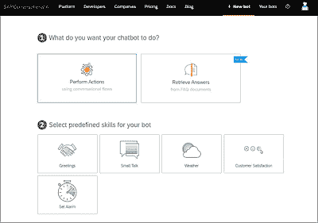
**图 11.16**: 创建机器人

根据机器人的用途，你可以选择预定义的类型之一，在我们的案例中是执行操作 (Perform Actions) 类型。确保你还选择了一些可用的预定义技能，如问候和闲聊。给你的机器人起一个名称并点击创建机器人。

### 11.4.3 创建意图 (Creating Intents)

一旦项目设置完成，你就可以开始定义机器人必需的意图（intents），如图 11.17 所示。由于我们正在为制造作业执行构建一个机器人，我们必须使用车间流程中常见的术语和意图，以及与实际业务流程相关的意图对机器人进行训练，以便机器人能够理解用户的真实意图。

这种语境下的一些典型意图包括 `@show-oee`、`@report-yield`、`@report-scrap`、`@report-nc`、`@show-sfc-list`、`@start-sfc`、`@complete-sfc`等，如图 11.18 和图 11.19 所示。


**图 11.17** 自定义意图


**图 11.18** 自定义意图，续

现在让我们来看看用于训练机器人的典型表达式。请记住，在这种情况下，我们真的需要像一个典型的车间用户一样思考，并头脑风暴出所有可能的表达。图 11.19 显示了 `@show-oee` 意图的表达式列表。


**图 11.19** @show-oee 意图表达式

为了更深入理解，图 11.20 显示了 `@start-sfc` 意图的表达式。


**图 11.20** @start-sfc 意图表达式

### 11.4.4 设置实体

一旦意图准备就绪，我们现在开始处理实体（entities）。在我们的用例中，场景也需要自定义实体，如图 11.21 和图 11.22 所示。此情况下相关的实体包括 `#BOM`、`#CAPACITY`、`#COMPONENT`、`#CONSUMPTION`、`#SFC`、`#MATERIAL`、`#SCRAP`、`#SITE`、`#RESOURCE`等。这些实体将作为机器人对话能力被大量使用。


**图 11.21** 自定义实体


**图 11.22** 自定义实体，续

在创建了所有必要的实体和意图后，我们准备好设计必要的技能（或对话流）。在我们的案例中，我们将向你展示一个意图的端到端设计。

### 11.4.5 设置技能

要设置技能，请导航到 `Build` 标签并开始设计。制造机器人背后的整体技能类似于图 11.23 所示的屏幕。现在，我们将只关注一个流。


**图 11.23** 整体技能

让我们关注 `@greetings` 意图，如图 11.24 所示，它不仅欢迎用户，还提议通过从制造执行系统获取相关信息来启动 SFC。

如图 11.25 所示，当机器人检测到诸如“Hi”或“Hello”或类似的欢迎表达式时，会触发问候技能。如果你在最初创建机器人项目时选择了它，问候技能将自动添加。在我们的用例中，问候技能不仅欢迎用户，还会调用自定义的基于表征状态传输（REST）的 API，从制造执行系统显示有关分配作业的其他信息。在 `API Service Configuration` 部分内部，问候技能不仅欢迎用户，还会从制造执行系统显示有关分配作业的额外信息。


**图 11.24** 问候意图


**图 11.25** 问候技能

此用例将让你直观了解 SAP Conversational AI 如何帮助你构建一个用于车间管理的交互式机器人，并通过简单的对话来控制制造执行，而不是通过大量的按钮和导航路径与传统系统进行交互。这种操作层面的无接触执行对于各各业在“新常态”下保持安全至关重要。通过建立一个安全且智能的工作场所，我们可以减少对共享工作场所污染的恐惧。

 

**图 11.33** 机器人测试

### 11.4.6 启用语音

在这种语境下，从无接触执行的角度来看，机器人的语音功能也同样重要。为了启用语音输入，你可以轻松利用 IBM Watson、Google Cloud speech API 或 Microsoft Speech Bing API 等先驱提供的任何语音转文本或文本转语音 API，因为 SAP Conversational AI 不支持原生语音控制功能。要利用这些 API，你必须在 SAP Cloud Platform 上为机器人构建自定义用户界面，并使用 SAP Conversational AI 提供的基于 REST 的对话端点服务，从句子中检索所有必要的元数据、意图和回复，如图 11.34 API 端点将表达式传递给机器人处理，如图 11.34

要成功调用这些端点，你必须获取机器人设置中可令牌，如图 11.35](img-f11.34.html) 

**图 11.34** 对话端点

 

**图 11.35** 获取令牌

## 11.5 总结

在学习了 SAP Conversational AI 的众多概念并构建了一个全规模的企业用例后，我们终于到达本章的末尾，是时候快速回顾一下到目前所学的内容了。到目前，你已经看到 SAP Conversational AI 平台包含了广泛的功能，涵盖了构建企业运营智能机器人的方方面面。在本章中共同构建的这个特殊用例希望希望让你充分理解 SAP Conversational AI 如何为无接触界面带来革命，使我们都能在“新常态”下安全地开展业务。

# 第三部分

用例与路线图

# 12 机器学习与物联网及区块链的集成

在本章中，我们的重点将是 SAP 智能企业产品组合与三项卓越技术——机器学习、物联网 (IoT) 和区块链之间的集成，看看你如何将机器学习与物联网及区块链相结合。我们还将检查两个独特的用例，以及利用这一智能技术三剑为后疫情时代构建智能企业解决方案所涉及的范围。

区块链是一项趋势技术，具有重塑行业的潜力。当我们观察这些现在已大放异彩的技术——物联网、区块链和机器学习时，我们知道自己正生活并工作在一个充满机遇的时代，可以将遗留系统与新兴技术相结合。

全球数字经济以无情的速度不断扩张和变化。组织必须跟上这种速度以维持业务生存。图 12.1 显示了数字化转型如何影响各行业。

在过去的十年里，随着云计算和大数据变得无处不在，以及所有最新的技术和软件，各行业已开始了自己的数字化旅程。人工智能 (AI)、机器学习、物联网和区块链等技术可以帮助你的组织构建智能企业，提供信任和透明。

 

**图 12.1** 数字化转型印记

区块链的设计是将绝对的数字信息作为带有时间戳的数据序列，存储在跨计算机网络共享的分布式数据库中。要让传统的合作伙伴和长期竞争对手对区块链转型所需的大胆步骤达成一致并非易事。技术创新者正在转向区块链平台以执行以下活动：

- 在单处管理所有网络组件，无论组件部署在何处以及处于何种计算环境
- 对身份、账本和智能合约保持完全控制，这些内容在第 12.2 节中描述
- 部署区块链组件，如节点、排序服务和证书颁发机构 (`CAs`)
- 轻松将单个节点连接到多个行业网络
- 连接运行在任何环境（例如本地、公有云、混合云）中的节点

然而，注意存储这些时间序列数据缺乏一种定义的流程来验证信息的正确性。

现在，让我们来看一个简单的场景——航空行李处理流程，区块链、物联网和机器学习可以在此集成，为航空行业提供一个安全且透明的解决方案。

区块链使航空业能够共享一个去中心化的数字账本，同时安全地存储所有航空公司的行李相关飞行数据。这项技术还促进了更顺畅、更高效的运营，最终为包括机场、行李处理人员和航空公司在内的所有合作伙伴节省成本。使用各种技术和不同的网络可以提升乘客体验，增加运营的透明度和可追溯性，并降低维护成本和交易复杂性。考虑一种集成解决方案，使用`blockchain` 管理所有的电子行李标签（`EBT`），这些信息来自`IoT`设备或具有射频识别（`RFID`）技术的智能标签，结合使用`machine learning`的图像识别，以安全的方式管理所有行李相关信息，并向所有相关合作伙伴提供所有行李真实状态的高度透明度。

随着`machine learning`使用的扩大，与`machine learning` [注：原文重复了“machine learning”]和`IoT`等互补技术的整合将释放出更高的价值。

## 12.1 技术驱动的转型

在采用最新技术的同时，任何行业都需要重新设计其业务流程，而且这些变化对大多数行业的影响确实是变革性的。影响和挑战列表的变化速度以前所未有的速度进行，模糊性现在比以往任何时候都更加暴露。与我们一生中发生的任何事件不同，全球大疫情强调了我们世界的互联性，也暴露了一个令人担忧的事实：有时当我们我们需要利用大量关键信息进行快速、协调的行动和协作时，我们仍然困于数据孤岛和遗留流程中。

为了跟上行业转型步伐和这一系列新的业务挑战，市场对一个能够执行以下活动的信赖平台的需求激增：

* 自动化过时的工作方式
* 快速收集所有所需数据集
* 从数据中得出可操作的洞察，以应对危机，并为变化世界中的长期复苏准备策略

`blockchain`是一个信赖的平台，各种基于`blockchain`的解决方案已与`IoT`和`machine learning`集成，帮助我们应对今天最令人生畏的挑战。尽管有这些好处，但世界尚未实现大规模的`blockchain`采用。机构面临的一些障碍不仅包括实施`blockchain`系统的成本及其与现有系统集成的困难，还包括对`blockchain`缺乏认知。尽管某些疑虑完全可以理解，但形势的变化——即“新常态”可能会迫使行业重新考虑他们对`blockchain`的看法。随着我们所有的业务运营日益在线，并在全球封锁面前进行远程执行，无疑需要更新和修订的解决方案。也许，`blockchain`只能填补这一空白并满足这一需求。在当今世界，我们已经配备了强大且可扩展的技术，如`IoT`以及通过云端数字身份将智能设备和传感器连接到网页的稳健协议。另一方面，基于`blockchain`的智能合约已准备好实现多个利益相关者（可能涉及产品生命周期）之间的交易和数据共享。除了解决业务流程驱动的挑战外，看到`blockchain`如何助力对抗全球疫情也是一次奇妙的经历。不仅是小型机构或初创公司在使用`blockchain`解决方案来对抗病毒。来自全球不同领域的巨型组织包括世界卫生组织（`WHO`）、`IBM`、`Oracle`和`Microsoft`；政府机构以及国际健康组织已经合作开发基于`blockchain`的开放数据中心（如`MiPasa`），以快速准确地识别全球感染人员和地区，并在医院和公共卫生部门等网络各种参与者之间安全地共享信息以供分析。关于`MiPasa`的更多信息，请参考以下链接：`https://www.ibm.com/blogs/2020/03/mipasa-project-and-blockchain-team-on-open-data-platform-to-support-covid-19/`。

## 12.2 数据——共同主题

在本节中，我们讨论的是数据。如[`图 12.2`](12_002.html#f12.2）所示，`IoT`设备产生数据。当这本书上市时，我们所认为的“大数据”将不再“大”了。数据每秒都在增长，为了应对变化的情况，大多数行业都在尝试每分钟执行一次其业务。面对如此海量的数据，`AI`可以发挥至关重要的作用。作为`AI`的一个分支，`machine learning`指的是一种自动化过程，其中机器用于对数据（可能由智能传感器产生）中的有意义模式进行分类。


[此处根据原始上下文插入图像或占位符]


**图 12.3** 数据流图：区块链与数据来源

让我们回到咖啡冲泡示例来理解区块链的核心概念，并学习智能合约如何携带可以自动执行业务逻辑的信息。在这种背景下，你必须理解智能合约是一种计算机协议，它包含了确定业务交易应如何执行的所有业务规则。

现在，让我们看看对于咖啡冲泡用例，智能合约通常携带什么信息。在这种情况下，咖啡师使用智能合约来购买咖啡豆，通过根据咖啡冲泡机收集的所有所需信息（例如：咖啡豆类型、形式、质量和数量）来确定客户最喜的咖啡豆。例如，在设置智能合约条款时，咖啡豆的质量可以是类型（`Arabica`）、形式（`roasted`）、质量等级（`gourmet`）和数量（`40 units`）。一旦该智能合约提交到其注册的区块链网络，区块链逻辑将尝试将这些要求与之前提供过类似类型咖啡豆的农民进行匹配。很有趣对吧？

我们希望到为止的讨论已经让你大致了解机器学习、物联网（IoT）和区块链的共同力量如何为企业数字化转型带来巨大变化。现在，让我们深入探讨不同行业的特定用例。考虑到“新常态”以及我们面临面临的挑战，我们决定加入一个为了满足当前需求的用例。

## 12.3 用例

在我们的新现实中，每个行业现有的业务挑战比以往任何时候都更加严峻，因为大小企业都无法逃避疫情带来的毁灭性影响。每一刻，企业都像风暴中的小树一样遭受击打。在为时太晚之前，每家企业必须开始思考并采用集成物联网、机器学习、人工智能和区块链的解决方案，以增强 IT 韧性，并特别关注业务连续性，同时必须确保数据保护、最大限度地减少干扰并将业务运营成本控制在范围内。

通过来自供应链管理和医疗行业的用例，我们将重点关注如何利用区块链结合物联网和机器学习来应对企业挑战。在第一个案例中，我们将解决如供应链脱节和确保食品质量等各种痛点；在第二个案例中，我们将管理社交聚会、临床试验、药物和疾病控制信息。让我们从供应链行业开始讨论。

### 12.3.1 供应链

由于持续的爆发，全球经济（特别是贸易系统）已经面临巨大的压力，这凸显了迫切需要全球协作来维护和加强国际供应链的灵活性。供应链的这种灵活性依赖于信任、透明度和诚信，而这些可以通过提供“共享真相”的可负责任的区块链技术部署来提高。让我们回到我们最初的用例。

在今年年初（2020 年），没有人能想象到疫情带来的意想不到的麻烦，它揭示了全球供应链内部缺乏连接和数据交换。与`E. Coli`（大肠杆菌）爆发不同，`COVID-19` 与任何食品源污染媒介无关。尽管没有证据表明食品可以携带或传播这种病毒，但海鲜被指责传播了病毒。对海鲜业缺乏信任集中在供应链内部缺失的环节和不确定性上。在这种情况下，区块链可以在减少供应链不确定性方面发挥关键作用，同时使操作更简单更安全，从而拯救海鲜供应链行业。与物联网和机器学习集成的区块链解决方案共同工作，通过告知零售客户其所消费食品的来源，重新建立供应链行业的信任。

为了更好地理解这些概念，让我们用海鲜行业的一个示例来观察该行业的典型挑战以及区块链如何解决这些问题。图 12.4 显示了海鲜供应链中的缺失环节如何导致终端用户在供应链各个阶段对产品质量产生担忧。


**图 12.4** 海鲜行业挑战

如图 12.4 所示，海鲜行业需要的一些典型需求包括：

- 用于监控供应链每一步骤的实时连接
- 对食品来源和质量的保证
- 消费者与供应商之间的信任
- 更少关于食品的信息和文档

结合物联网和机器学习，区块链可以确保供应链中的每一个物品都可以追溯到其来源。让我们逐一解决这些点。

#### 实时连接

无论是管理运输海鲜的冷链还是监控鱼类生产，通过使用多个物联网传感器，区块链实现了数据捕获。所有网络参与者都可以监控在网络中执行的任何操作。区块链能够实现从原材料阶段（在本例中为养殖场）到最终产品交付的跟踪。供应链中的每个参与者都可以向网络共享其操作的详细信息。关键信息如水 pH 值、温度、给鱼的饲料、生长速率，最后是捕获鱼类瞬间的时间戳，可以在鱼场安装各种传感器来轻松收集。一旦渔民捕获了鱼，就会开始宰杀过程。质量由实验室保证，实验室将检查重量、尺寸和健康状况等质量参数。此外，食品从存储区到零售店运输期间的冷链管理对于维持食品质量至关重要。可以使用智能物联网传感器和先进网络设备在运输过程中监测温度、湿度、位置、能耗等数据。图 12.5 显示了处理鱼各个阶段物联网、区块链与各种数据源之间的集成架构。


**图 12.5** 区块链与物联网集成

现在你已经理解了区块链和物联网的实时集成如何帮助你收集关键信息，并在受信任的区块链网络中的各个参与者之间共享这些信息以引入透明度，让我们现在重点转向使用人工智能进行质量控制。

#### 质量控制

端在餐桌上的食品质量非常重要。如果我们谈论任何疾病爆发，在确定污染源之前，整个食品行业都会受到影响。特别是由于缺乏透明度且无法快速追溯产品来源，网络中的所有参与者都可能需要承担损失，包括与召回产品相关的成本或由于缺乏信任和不确定性导致供应链完全中断。

因此，为了确保海产品的质量，在流程的每个层级收集质量相关的数据并将这些信息与所有区块链网络利益相关者共享至关重要。在这种情况下，数据可以源于各种地方，例如放置在海上渔船内部的 `IoT` 传感器用于检查水质和喂给鱼的食物成分。此外，在检查水质时，强烈建议监测一些物理参数，如温度、溶解氧、电导率、`pH` 和化学水平，以了解鱼的健康状况。现在，我们已经拥有来自农户、分销商和零售商使用的各种 `IoT` 传感器和设备的海量数据，机器学习可以应用于这些数据，为网络中包括消费者在内的每个参与者提取有价值的洞察。

机器学习在检测 `IoT` 传感器产生的数据模式和异常方面具有巨大潜力。监督机器学习从一组常规数据和对数据分类方式的固定理解开始。监督学习用于发现数据中的模式，并利用这些模式获取有关流程的洞察。例如，你可以使用视觉识别技术构建一个机器学习应用程序，根据各种参数和成分数据区分数百万个海产品单元。以下描述了我们用例的典型质量控制流程：

* **成像**：每个海产品项通过一个小型腔室，拍摄 360 度高分辨率照片。
* **扫描**：对照片进行扫描以识别斑点和形状异常。
* **分级**：根据扫描结果，为龙虾分配质量等级。
* **包装**：根据等级，将龙虾引导至特定的输送带以完成包装。

图 12.6 显示了使用自动化机器学习技术区分良、劣龙虾的过程。


**图 12.6** 机器学习识别良/中质龙虾的应用

### 消费者与供应商之间的信任

对于任何组织而言，可持续性和信任是密不可分的。每个消费者都期望其零售商提供更好的服务和产品，但一个未曾言说的期望是他们购买的产品或食物是安全的。我们到为止讨论的区块链、`IoT` 和 `AI` 驱动的解决方案提供了供应链的透明度，并能够访问关键数据点，包括产品包装日期、食品从运输到到达货架期间的温度，最后是产品保质期的信息。

一家科技巨头与一家北美零售商合作进行的一项研究表明，在利用区块链、`IoT` 和机器学习的力量之前，使用传统方法追踪一箱龙虾到其原始鱼类场大约需要一周的时间。追踪过程之所以耗费这么多时间，是因为记录要么保存在纸质上，要么部分存储在互不相通的各个系统中。采用由区块链、`IoT` 和机器学习驱动的解决方案可以帮助参与网络中的各种利益相关者更快速地追溯一箱龙虾的源头，将“天”转换为“秒”。现在，追溯一箱龙虾的源头并访问供应链中每个步骤的细节仅需大约 3 秒钟。

### 产品所需文档

虽然关于食品来源和质量的所有要求信息都包含在它的文档中，但你需要一个能够轻松连接这些关联点，并减少提供所需透明度和可追溯性所需的时间和精力的应用程序。

为了优化制造流程、提高质量并加强客户与产品的联系，非常需要关于食品的文档。食品文件通过快递和本地交付的物理流动（特别是跨国界时）可能需要数百小时来准备发货所需的清关和盖章。

如图 12.7 所示，通过使用区块链驱动的解决方案，在供应链的末端，零售客户可以轻松扫描产品上的 `QR code` 以获取有关其质量证明和来源的所有信息、它经历的流程，甚至是针对所购买食品的建议食谱。


**图 12.7** 基于 QR 代码的食品质量追踪

最后，为了完成食品产品的生命周期，零售客户可以使用消费者端应用程序向制造商提供实时反馈，最终使龙虾供应商能够调整其生产方法以提高海产品的质量。

### 12.3.2 医疗

到为止，我们讨论了供应链背景下的可追溯性，利用区块链、`IoT` 和机器学习的力量来追踪产品来源。现在，让我们看看医疗行业如何利用这三者获得类似的益处。

研究传统的医疗用例听起来像是我们正试图将区块链强行引入医疗背景。但现实情况是，全球疫情正推动我们进入一个全新的协作生态系统时代，即政府机构与私营部门和当地市场合作，真实理解业务需求，然后通过创新解决方案满足这些需求。

随着我们向安全和谨慎地重新开放世界，可能需要一种名为“健康护照”的新护照以以更大的安全和信心进入这个后疫情世界。医疗行业现在面临许多许多新挑战，例如：

* 追踪大量的感染患者群体以识别污染
* 生产大量关键的个人防护装备 (`PPE`)、药物和其他医疗用品
* 立即访问有关微生物的数百万数据点，以便开发更好的诊断、疫苗和针对性疗法

现在，让我们看看最新技术如何帮助我们根据收集的信息、现有资源和知识来脑风并构建生存策略和可持续解决方案。

##### 追踪人群以识别污染

为了对抗 COVID-19，首要的关键需求是识别感染者并阻止疾病传播。为了识别、评估和管理近期接触过 COVID-19 阳性患者的人数，世界卫生组织 (`WHO`) 定义了一种名为数字接触者追踪的机制。这种机制比传统的接触者追踪方法（通过访谈很多人）是一种更有效、更高效且更安全的发现接触者的方法。基于这一概念，多个国家开发了不同的移动应用程序用于数字接触追踪。

由于人类记忆具有不可靠性，且涉及敏感工作和个人数据处理，数字接触追踪者利用一些功能（如症状自述功能）向已知联系人发送自动短信警报。这种运行在智能手机上的数字接触追踪应用通常使用 `GPS`、电信基塔、`Wi-Fi` 访问点和 `Bluetooth` 信标来寻找感染者去过的地方。通过手机的 `GPS` 位置，个人可以轻松地从时间和地点的自动日志中获取自己的旅行历史，并将此信息与匿名日志进行对比，以确定用户是否遇到过阳性病例。此外，移动设备上的 `Bluetooth` 信标或 `Bluetooth low energy` 能力也是不同科技巨头采用的其他方案。凭借这种最新的框架，每个移动设备都可以向另一台设备发送和接收信标或 `RSSi` 流。基于这一数据流，公共卫生机构可以轻松识别出与感染者手机接触过的其他手机，并根据计算出的时长和距离发送相应的居家隔离警通知，而无需披露任何用户的位置或个人详情。图 12.8 显示了我们目前讨论过的概念。


**图 12.8** 大规模追踪驱动智能

基于这一数据流，`blockchain`、`IoT` 和 `AI` 可以结合，帮助医疗机构识别受污染区域并以以下方式进一步追踪病毒扩散：

* 利用这种追踪数据，政府部门可以根据感染严重程度轻松对不同的污染区域进行分类并更新实时统计数据。
* 追踪此类来自不同来源的移动传感器数据的目的也为对不同地区或国家疫情高峰的计划分析和预测提供了丰富的信息源。
* 此类警报将协助政府部门和医疗提供者做出战略性的、拯救生命的决策，提前分配医疗人员和必要的设备。

在全球范围内，医疗机构有一个迫切需求——访问一组不可篡改、可信的医疗数据，以便快速、电子化和国际化的访问，从而识别位置并对形势进行实时监控。在大流行期间，任何错误信息都可能是极其危险的。可以利用区块链的解决方案来控制病毒传播并在整个范围内传播高质量的医疗建议。

### 生产个人防护装备

世界卫生系统在应对此次疫情的准备工作中，一个主要问题是关键个人防护装备 (`PPE`) 和其他医疗物资生产。由于这场疫情，市场需求的激增导致了治疗 `COVID-19` 所需的关键医疗物资短缺。

在进入这一挑战的解决方案之前，让我们简要回顾这些短缺的原因：

* 医院和任何公共卫生机构都没有为这次大流行做好准备。例如，在美国，需要 30 亿个 `N95` 口罩，但库存中只有 1200 万个。
* 在这次危机期间，当数百万个口罩跨州或跨国运输时，有时买家被迫进入预付费安排和商务电子邮件诈骗 (`BEC`) 计划。买家在选择卖家或保证产品质量方面别无选择。
* 由于需求巨大，`PPE` 的价格远高于常。
* 另一个限制是支付条款。
* 为了管理所有这些信息，手机 App 会非常方便；就像任何电子商务 App 一样，该应用可以跟踪每种类型 `PPE` 的可用性。

（注：原文项目列表中包含一些碎片化句子，已进行整合以保持逻辑连贯。）

### 获取病毒信息以改进诊断、药物和疫苗

引起 `COVID-19` 的病毒 `SARS-CoV-2` 创造了前所未有的全球挑战。当我们通过实践社交距离和其他新规范尽到自己的责任时，医疗工作者和急救人员正处于前线。

另一方面，医疗和生命科学行业自大流行第一天起就尽了努力，通过分析微生物、发现药物、生产测试阶段药物并为大规模生产做好准备。通常情况下，开发疫苗至少需要 2 到 5 年，但在 `AI` 和 `machine learning` 时代，快速疫苗开发技术能够实现更快的结果。

考虑到生物学的不同方面——分子生物学、细胞生物学、生物化学、生态学和进化生物学——微生物的数据分析是一项复杂的活动，因为存在许多不同的数据源。这些数据集包含了关于基因型、表型和遗传结构的详尽细节。从多个数据源分析微生物数据需要高维模式识别和预测能力。例如，SARS-CoV-2 病毒具有以下生物学组成：

* 265,520 个基因组
* 72,160,121 个基因
* 55,616,382 个蛋白质
* 244,699,956 个结构域

因此，数据收集/生成、清洗和处理是此类研究至关重要的活动，需要花费大量的时间和精力。在这种情况下，人工智能和机器学习可以彻底改变数据的分析和研究，包括预测潜在结果和加速疫苗开发。在医学科学领域，其他潜在收益还包括：

* **优化制造**
  机器学习可以发现海量数据中的模式，并可用于优化制造工艺，例如，使用药物研发和生产过程中产生的数据。最终，优化的制造可以缩短程序所需的时间和成本，或者提高制造过程的可重现性。

* **数据中的模式选择**
  机器学习可以从海量数据中检测模式，以明确复杂的生物系统，并预测药物开发早期化合物活动和相互作用的成功率。

* **个性化医疗**
  监督学习可以使用患者数据更有效地预测对从潜在诊断中选出的治疗方案的预期反应。机器学习还可以根据症状和遗传信息的相似性来评估患者的风险。

* **针对“新常态”的行为改变**
  根据世界卫生组织（WHO）发布的指南，我们必须在后疫情时代的世界遵循“新常态”。在这种背景下，可以利用机器学习和人工智能来执行规范。例如，通过对从各种生物传感器和设备收集的数据进行图像识别，可以建立不同的健康测量和管理解决方案来监测个人健康。其他活动也可以被监测，例如“手口接触”动作，以帮助人们更好地理解手部清洁的重要性，并做出维护生活的改变以防止严重呼吸道疾病的传播。

## 12.4 总结

最后，我们结束了本章的内容。此时，你应该对区块链的适用性以及它如何解决后疫情世界中各种企业挑战有了大致的了解。本章向你展示了区块链的力量如何与物联网、机器学习和人工智能相结合，通过涉及两个不同行业（海鲜行业和医疗行业）的两个用例，轻松应对这些挑战。

# 13 机器学习应用的行业用例

本章将进一步探讨特定行业的用例，向你展示如何利用 SAP 面向智能企业的解决方案来解决真实的行业挑战。你将学习构建解决每个用例方案所需的可能架构、方法论和服务。

我们即将到达书的结尾，并将通过快速浏览最后几章结束这段漫长的旅程。本章将从考察机器学习如何在第 13.1 节中的不同行业中被采用开始，在第 13.2 节中简要描述机器学习生态系统。然后，我们将关注本章的核心任务——讨论真实的行业用例，并向你展示如何将目前所学的知识在第 13.3 节中解决真实挑战。我们的主要目标是机器学习技术投资回报率（ROI）较高的行业，并将 SAP 的智能企业转型技术和解决方案从根本上改变端到端的业务流程。同时，我们将提高生产效率、产品质量和工人安全性，并赢得更多更快乐的客户。

## 13.1 机器学习在不同行业的接受情况

机器学习算法并不新鲜，已经存在很长时间了。然而，最近的进展增强了以最快速度将复杂的数学计算反复应用于企业数据的能力。生产和处理大数据的行业已经开始意识到采用机器学习技术的价值，这增强了竞争优势。多年来，统计数据清楚地表明，人工智能（AI）和机器学习都能对业务产生深远影响，并正迅速成为企业在市场中保持独特性和生命力的关键。机器学习技术从海量企业数据中产生的未发现模式和洞察，现在可以用于解决高度复杂、数据丰富的问题，这些问题超过了人类干预的智能。在通往智能企业的过程中，实时分析对任何业务运营都至关重要，包括对当前和历史数据进行处理，以采取正确的行动来应对事件。

图 13.1 显示了机器学习如何在各行业中被采用。如今的企业每天通过无数设备和传感器产生大量的半结构化数据。这些价值信息最终可用于开发比较模式和检测异常的模型。

例如，回归算法（根据输入系统的数据预测输出值）可以根据发现的特征建立训练模型，以预测新数据的值。然后该模型可以作为更复杂模型的基础，以预测机器何时故障。多种分类算法可用于构建与故障相关的模式。


**图 13.1 机器学习在各行业中的采用**

### 13.1.1 评估机器学习的影响

机器学习的需求和普及在整个企业范围内都在增长，现有方法在理解和回答实际问题方面不断改进。如图 13.2 所示，成功的成果和预测正导致机器学习在多个领域的广泛采用，例如分析医学影像数据、医疗治疗记录、社交媒体动态、营销数据等。将机器学习整合为企业软件的一部分，业务现在更具可预测性，机构可以以前所未有的方式为流程引入自动化。每个企业在评估采用机器学习的潜在影响时需要考虑的其他潜在收益包括：

* **获取未见的企业洞察和分析**
  过去几年，企业数据及其来源不再限于组织内部或另一个传统系统。这种海量数据挑战了传统的、非智能的企业解决方案，后者需要更多的处理时间。往往会错过有价值的洞察。在这些方面，机器学习可以帮助你从产生的海量企业数据创造竞争优势。

* **扩展企业应用安全性和风险分析**
  企业安全面临着钓鱼攻击、恶意软件、垃圾邮件或其他网络攻击不断演变带来的挑战，每天都有新挑战。大多数组织投入了巨资来确保其系统和环境的安全，但往往无功而返。当今的企业需要带有嵌入机器学习框架的应用安全软件，以增强欺诈检测。先进的安全技术（如通过机器学习算法实现的模式识别）对于识别交易中的异常，或评估来自外部源的交易数据以检测欺诈或其他异常至关重要。


**图 13.2** 机器学习的影响

### 帮助做出数据驱动的决策

来自各种来源产生的海量结构化/非结构化数据被细心收集，但往往落入数据孤岛，没有经过进一步的处理或分析，以理解其关键方面或发现未知模式。此外，所需的数据解释很少是简单的，远超简单的数据排序和应用过滤器。可能需要数据工程技能。到 2025 年，产生的数据量预计将增长八倍，许多企业正在紧迫地完全或部分地引入机器学习驱动的决策，这些决策基于从企业数据池中收集的洞察，这也有助于人才招聘、客户管理、研发以及推动创新达到新高度等领域。

### 智能且自给足的应用

除了更多的满意客户和盈利性业务外，当今企业环境的一个关键发展是创新型人力资源（HR）定向系统的崛起，包括丰富员工体验的方法。经理现在通常渴望通过分析员工的反馈、搜索、评论和社交媒体帖子来掌握员工脉搏，寻找日常增强员工体验的方法。这种分析为战略性劳动力规划、培训建议和薪酬建议增加了新的维度，并可以减少员工流失。此前对采用新方法管理专有 HR 数据持怀疑态度的组织现在正期待基于机器学习的自学习型 HR 应用。通过这些解决方案，HR 可以更多地关注组织层面的战略规划，并轻松地分析 HR 数据以改进战略规划。自学习应用可以为每个决策提供参考。

除了对机器学习的这些期望，你还需要记住，机器学习是一种强大但复杂的工具。详细了解它的优缺点实际上可以帮你实现更高的投资回报率（ROI）。尽管机器学习、人工智能、数据科学和深度学习都是当下的热词，但这些术语仍然代表着强大的工具，可以支持你通向智能企业的旅程。将业务需求精确转换为数据以馈给你的机器学习模型对于寻找事件的根源至关重要，而对结果的正确解释将帮助改进业务并从机器学习中产生更多价值。

### 13.1.2 机器学习应用的挑战

尽管我们可能认为自己进入了 AI 的黄金时代，但实际上，利用机器学习构建智能企业解决方案仍然面临一些可以轻松解决的障碍，如下：

#### 达到预期结果的时间过长

传统的企业软件开发相当直接：为了实现你的业务目标，你会规划功能并选择一种技术来构建解决方案，假设在发布可用版本之前需要几个月的时间。机器学习项目比传统的软件开发项目需要更多的时间看到结果。通过机器学习，你需要收集并准备数据，然后训练算法。尽管如此，可能存在不确定性，因为即使是最好的机器学习工程师也不知道深度学习网络在分析不同的数据集时会表现如何。因此，机器学习工程师和数据科学家无法保证模型的训练过程是可以复制的。

#### 年生技术

尽管机器学习听起来像一个童话，但这项技术尚未成熟，也未经过时间的检验。第一版本的 `Google TensorFlow` 发布于 2017 年 2 月，`IBM Watson` 引入于 2011 年，许多其他科技巨头公司仍在尝试新事物，并投入巨资在该领域构建新的平台和产品。

#### 需要海量数据

训练机器学习模型最核心的要求是数据量。海量数据可能不再是一个问题，因为每个人都负担得起存储和处理 PB 级的信息。虽然存储已变得廉价，但收集数据仍然需要大量时间，而购买现用的数据集可能是昂贵的。此外，你需要对想要解决的问题有一个清晰的认识，以便使用必要的 `classification`（分类）、`clustering`（聚类）、`regression`（回归）和 `ranking`（排序）函数来规划算法。

#### 人才

寻找具有正确经验的技术资源是采用机器学习的另一个重大挑战。尽管许多人被机器学习行业吸引，但只有少数专家能够开发这项技术。理解机器学习优秀数据科学家通常缺乏对软件工程的理解。

与其他任何事情一样，机器学习伴随着障碍和风险。尽管如此，机器学习项目具有丰厚的回报，并将很快达到技术变得常化的点，但你需要耐心、仔细计划，并尊重这项创新带来的挑战。

## 13.2 机器学习生态系统

机器学习主要基于计算力和以及从不同设备收集的大数据中获取有意义洞察的各种技术。机器学习还可以通过 AI 从这些数据中学习。该过程如下：

* 获取数据
* 清洗、准备和处理数据
* 训练模型
* 测试数据
* 改进

应用机器学习的最关键任务是从一开始就选择合适的模型，以确保该模型最终能提供最准确的业务结果。选择模型时的一个复杂问题是确保模型不会过于通用，并且在未来引入新数据时能够表现良好的性能。为你的数据选择最佳模型绝非易事；根据专家介绍，一个运行中的单一预测模型可能需要两个月的运营，你才能对模型的准确性有信心。为什么这个过程如此困难且耗时？如图 13.3 所示，在获得成功的机器学习模型之前，必须成功完成三项统一任务：

* **管理数据**
  如今的企业不仅要处理通常由传统 IT 企业架构生成的结构化数据，还要处理每秒生成的音频文件、视频流和社交媒体印象等海量非结构化数据。企业数据与大数据的结合对于为未来的机器学习场景奠定基础至关重要，能够获得智能且有价值的洞察，协助做出更好、更有信心的决策。

* **模型设计**
  构建机器学习模型是一个高度迭代的过程，数据采样是构建准确模型的重要部分。你必须考虑由实际业务交易生成的代表性样本。在早期阶段，如果样本数据是已知且具有业务代表性的集合，成功的机会将大大增加。在试点成功后，下一步应该是使用另一个数据集对模型进行评估，该数据集来自完全不同的数据源，并可能与假设相关。通过这种方式，你可以检查所选算法如何根据良好数据集和新数据集来预测结果。

* **模型部署与运营**
  最后是机器学习模型的部署和管理，这些关键活动。模型的部署必须以特定的方式进行，以便应用程序能够以扩展且安全的方式使用模型。监控模型性能并不时触发重训练对于运营也是至关重要的。


**图 13.3** SAP Data Intelligence

管理机器学习数据以及创建和部署模型的工具是当务之急。幸运的是，市场做出了响应，`SAP Data Intelligence` 作为一种云端产品，符合人工智能的这些扩展标准。`SAP Data Intelligence` 设计旨在克服从连接、理解、准备数据到以统一方式创建、部署和运行机器学习模型的各种常见障碍。然而，交付和管理所有这些挑战性阶段是不同利益相关者的责任，他们每个人都有自己的观点，如下：

* 首席信息官 (CIO) 希望以最低成本获取易于部署和可扩展的数据科学或机器学习应用，以帮助企业变得更加智能并提供正确的预测。
* 数据科学团队希望有一个与当前企业需求兼容的开发环境，同时仍允许进一步的探索。
* 最后，DevOps 团队希望关注可重用性、稳定部署和可维护性等方面。

最终，`SAP Data Intelligence` 的设计初衷正是为了这些利益相关者，帮助他们在从单一平台管理端到端机器学习场景的同时实现他们的目标。因此，在进行特定用例之前，让我们快速回顾一下 `SAP Data Intelligence` 背后的概念和组件。

如图 13.3 所示，`SAP Data Intelligence`包含了一系列独特的能力和功能，帮助数据工程师、数据架构师、数据科学家和 IT 运营端到端管理机器学习生命周期。这些功能包括：

* 数据工程师和架构师可以可视化地构建数据流和数据流水线，以连接、发现和处理任何规模的数据，包括结构化数据、非结构化数据和流式数据。
* 通过 `Jupyter Notebook`，数据科学家可以使用 `Python`、`Google TensorFlow` 或 `R` 对模型进行实验，并结合 `SAP HANA` 机器学习，使用数据集和流水线在一个中心位置对机器学习解决方案进行建模。
* 统一控制帮助 IT 运营团队在大范围内执行所有机器学习模型的简易部署、监控和重训练。

#### Note
`JupyterLab` 是一个用于 `Jupyter Notebook` 的基于 Web 的交互式开发环境，支持数据科学、科学计算和机器学习中的广泛工作流。更多详情请参考 [`jupyter.org/`](https://jupyter.org/)。

最后但同样重要的，不要忘记应用企业智能中最重要的方面——数据。即使拥有最好的机器学习平台和数据工程师，除非拥有良好的数据，否则你的工具和团队将毫无用处，机器学习得出的推断和泛化将惨遭失败。如果你的数据不能反映现实，机器学习模型根本无法学习如何泛化解决方案。话虽如此，只有你的业务专家真正理解业务面临的挑战，并具备独特的知识和经验，来利用机器学习从你的数据中获得丰富的洞察。

## 13.3 识别行业用例

行业持续的数字化转型可以表示为三个扩张：

* 组织所有产品和服务自动生成的数据量的扩张
* 日益强大的算法的扩张，以利用生成的数据
* 基于数据及其方法论分析和使用的新业务模式的兴起

这三个扩张或发展并不是孤立的；它们与从根本上改变传统行业经营方式的潜力深度相互关联。你需要理解并处理信息层级、决策系统和行业需求之间存在的依赖关系。近年来，许多行业一直在这三个扩张上努力，结合物联网 (IoT)、设备和传感器、数字化以及大数据的优势来实现机器学习。现在的问题是，这种演变将多快地转化为不同行业的实际解决方案。为了进一步了解机器学习的作用，让我们关注一些行业用例，看看你如何应用 SAP 的智能企业解决方案来轻松解决每个特定案例。

### 13.3.1 制造业

自从流水线引入以来，对提高制造效率的追求一直是首要任务。由于硬件和软件的创新结合改变了制造业，能够以最少的资源和人力实现最大的输出。工业 4.0 正在通过改变行业，使制造商能够连接并收集制造数据，而新一波工业 AI 和机器学习能力正在日益增长，并充分发挥其潜力。特别是，让我们强调以下几点：

* **监控实时设备数据**
  缺乏实时监控可能导致机器突然故障并中断生产计划
* **预测设备健康状态**
  预防性维护导致巨大的成本和劳动力，但停机时间仍然显而易见
* **控制产品质量**
  人工驱动的质量检查可能出错且耗时

# 车辆实时跟踪

缺乏对交付车辆延迟的实时跟踪会导致生产计划延误，并给车间造成混乱。

由机器学习驱动的范式转移现在已成为现实，这促使整个行业采用这些技术，以实现以最低成本生产高质量产品的终极目标。通过应用机器学习，制造商可以发现新的洞察，并显著提高生产效率、产品质量、员工安全等。

现在，让我们来识别制造业几十年来面临的一些具有挑战性的领域，然后尝试用机器学习来解决这些挑战。

## 识别行业特定挑战

制造业是一个具有高度竞争性、跨国、受监管且面临环境挑战的行业。该行业在尝试运行无缝、连接和智能的业务及运营模式时，面临的一些特定挑战包括以下：

* **通过生产前/生产后质量检查控制制造期间的产品质量**：
  * 质量检查确保产品符合制造商规定的特定标准。质量检查可以是手的也可以是自动的，其目的是测量对产品或组件重要的属性，以便在坏组件发送给客户之前将其从生产线中剔除。
  * 依赖传统的质量检查意味着在发现缺陷之前，已经花费巨资制造了成千上万件物品，使得过程变得繁琐且昂贵。此外，人工检查需要对人类专家进行大量培训，最终导致生产瓶颈并推迟产品上市时间。

* **利用物联网和机器学习进行基于信息的价值创造以实现无缝工厂运营**：
  * 一个稳健的解决方案应该连接并收集来自各种设备、传感器和设备的数据，而无需更改基础设施或系统。
  * 凭借连接万万物的潜力，`IoT` 和机器学习等新技术使得以数字化方式监控和管理物理世界中的物体成为可能。
  * 在全球范围内，各面临着监管机构对健康、安全和环境管理的压力，必须遵守特定的法规。

* **用于可用性跟踪、优化和维护的车间设备**：
  * 通过多个集成运营解决方案跨多个运营资产的实时可见性，实现优化生产和盈利的资产和能力。
  * 强调所有运营支出（`OPEX`）的效率，以提高设备利用率、生产力、效率、产量最大化、先进过程控制（`APC`）和实时优化（`RTO`）。

* **工厂远程监控或车辆跟踪以优化调度和导航管理**：
  * 监控远程地区的工厂。
  * 利用最新的机器学习技术自动创建库存补货请求和维护请求。
  * 结合车辆位置信息以及关于资产的遗留系统信息，跟踪并优化产品交付，以实现资产利用最大化。

## 理解业务案例

在本节中，我们将选取之前提到的一个关键用例，并讨论使用机器学习的解决方案。让我们关注制造业的质量检查用例，并集脑风暴使用机器学习改进质量检查流程的方法。

制造业对快速产品周期和更快速交付的需求日益增长，为技术驱动的制造实践提供了机会，这些实践最终可以创造高质量的产品。质量检查是一个技术进步需求增长的领域。大多数制造商主要依靠人工在制造过程中进行质量检查以识别缺陷，例如制造产品中的裂纹或凹痕。然而，这种人工检查容易出错，并受到速度、准确性和成本的限制。另一方面，除了质量问题，质量偏差后的其他因素可能包括原材料、机器运行状况等。在这种背景下，结合物联网（`IoT`）和机器学习的现代技术可以帮助制造商在改进质量控制流程方面实现专业化、减少停机时间并提高生产力。在这两种能力中，`IoT` 可以帮助连接和收集上下文数据，而机器学习旨在通过最少的人工干预实现人类水平或更高的准确性。在这种情况下，监督机器学习可以根据历史数据输入轻松对图像进行分类，而不是依赖显式的、手动定义的规则来分析数据。监督机器学习分类问题的一个示例是判断制造产品的照片是否显示有凹痕。在这种情况下，分类过程将确定产品是否有凹痕或没有凹痕。

## 应用机器学习实现质量检查自动化

在此用例中，可以使用计算机视觉和异常检测算法的独特组合来实现质量检查自动化。使用生产线上的现代摄像设备，可以捕捉生产出物（成品）的图像，机器学习算法可以实时分析这些图像，自动将产品分类为无缺陷或缺陷。如果检测到缺陷，算法对缺陷进行分类。如果算法检测到无法分类的全新类型缺陷，系统可以自动告警以寻求进一步帮助。然后，系统管理员可以评估图像和算法生成的预测；如果需要，用户随后可以选择正确的缺陷类别或定义一个全新的类别。为了使此算法运行，算法的训练必须包含广泛且种类正确的图像，以便系统通过结合运营和图像数据做出正确的解释。

为了构建这个稳健的系统，你可以通过结合 `IoT` 和机器学习来利用 SAP 的智能企业产品。你可以使用 `IoT` 集成制造设备或装置以收集运营数据，机器学习可以分析这些数据以发现可能的缺陷。通过这两种能力，你可以确定最佳行动。除了分析实时数据外，该解决方案还根据反馈系统从其做出的每一个决策中不断学习。如图 13.4 所示，解决方案架构与生产线集成，以捕捉运营数据（包括产品图像），以便利用 SAP 的智能企业产品。


**图 13.4** 质量检查解决方案架构

在图 13.4 所示的架构中，你正在利用 SAP 数字化制造解决方案通过 `SAP Plant Connectivity` 集成你的车间系统。生产执行数据通过 `SAP Manufacturing Execution (SAP ME)` 或 `SAP Overall Equipment Effectiveness Management (SAP OEE Management)` 进行采集。通过使用基于 `SAP Data Intelligence` 的 AI 服务分析图像并识别缺陷，你可以结合图像特征提取、自定义图像分类、自定义对象检测和相似性评分等服务来利用 AI 服务。通过这些功能，你可以构建一个近实时的视觉质量检测系统，根据制造过程中捕获的产品图像进行质量检查。有关结合 `SAP HANA` 的 AI 服务和机器学习的更多信息，请参阅第 10 章。

除了从零开始构建解决方案，下一代解决方案（如用于质量控制的视觉 AI）很快引入制造业。SAP 将在多个版本中逐步发布视觉 AI 功能。早期版本可用于优化质量检测流程，稍后将通过关联引入供应商物料检查进行扩展。有关视觉 AI 能力的更多信息，请参阅以下链接：[`www.sap.com/dmc/exp/2018-ngbp/imc/index.html`](https://www.sap.com/dmc/exp/2018-ngbp/imc/index.html)。

#### 注意

SAP 数字化制造解决方案包含一个名为 `SAP Manufacturing Integration and Intelligence (SAP MII)` 的独特集成平台，拥有专为制造业定制的解决方案。`SAP Manufacturing Execution (SAP ME)` 为离散行业设计，而 `SAP Overall Equipment Effectiveness Management (SAP OEE Management)` 更侧于流程行业部门。作为一个集成平台，`SAP MII` 提供了广泛的连接器用于构建车间集成解决方案，包括从车间产生的数据计算关键性能指标 (KPI) 的预制模板。有关 SAP 数字化制造解决方案的更多信息，请参阅[`www.sap.com/india/products/digital-supply-chain/manufacturing.html`](https://www.sap.com/india/products/digital-supply-chain/manufacturing.html)。

现在让我们转向客户服务行业，探索一个使用机器学习来增加价值见解并解决问题的用例。

### 13.3.2 客户服务行业

客户服务行业的核心是确保客户对特定产品或服务满意。任何客户服务活动都可以与购买某些产品有关，以及售后后发生的情况，包括退货、维修等。在一方，在传统方法中，客户服务很难界定，并且涉及与人的互动。在另一端，技术方法更容易定义，通常涉及自助服务终端机、与技术支持的在线聊天以及社交媒体互动。机器学习通过改善客户体验和降低与客户服务相关的人力成本，在自动化和改进客户服务方面取得了进展。

几十年来，客户服务行业面临着响应缓慢、等待时间长和信息渠道过多等挑战。让我们看看如何使用机器学习来解决其中的一些问题。

#### 识别行业特定挑战

在当今的数字世界中，企业面临着日益巨大的压力，以满足客户对卓越服务的增长预期。无论通过何种渠道，企业必须快速响应请求解决问题或事件的客户。客户往往由于挫败而通过社交媒体表达意见/反馈，并可能对长时间的等待、掉线以及似乎不在乎他们问题的代表感到厌烦。客户尤其讨厌重复自己的话。客户服务中的一些关键挑战包括：

* **传统客户服务**
  在当今世界，传统的客户服务系统（可能带有呼叫中心）缺乏满足对即时和个性化服务需求的能力。客户可能无法接通可以理解问题并立即提供解决方案的人，从而导致挫败感。由于客户支持不佳，78% 的客户终止了与提供支持的不同公司的合同。

* **信息渠道过多**
  客户可以从多个渠道与服务中心互动。

* **响应率缓慢**
  72% 的客户期望在一个小时内收到对他们在社交媒体上提出的投诉的回复。

* **缺乏人情味**
  73% 的消费者倾向于通过人工互动来解决服务问题，但人工坐席往往陷于任务处理中，而不是与客户交流。

#### 理解业务案例

对于将机器学习应用于客户服务行业，可以找到十多个相关的用例，但让我们来看看一些独特的挑战并头脑风暴一个合适的解决方案。让我们看看如何在通过基于机器学习的对话机器人提供客户支持的同时，理解客户的意图，该机器人包括以下任务：

* **识别客户意图**
  通常，低效的客户服务是由信息不对称驱动的，我们事先不知道用户需要什么方面的帮助。

* **通过多渠道连接**
  在当今的技术格局中，你的业务必须通过所有可能的渠道与客户联系，如 Facebook Messenger、微信、WhatsApp、电子邮件等，并且你必须让他们以他们想要的方式、在他们方便的时间与你联系，并通过追求正确的解决方案让他们感到高兴。统计数据显示，几乎 42% 的客户在获得答案之前必须与多个坐席交流。

* **智能路由**
  当客户寻求解决方案时，你必须将他们配给正确的坐席，根据所遇到的案例类型、优先级和性格识别正确的案例，这可以显著提高客户体验。

* **自动数据采集**
  除了提供支持外，你必须自动捕获客户互动，而不是花时间手动记录每次会面的细节。节省的精力可以投入到为你的客户提供更好的支持。

#### 使用 SAP Conversational AI 构建智能支持应用

在客户服务背景下，`SAP Conversational AI` 可以解决上一节提到的所有挑战，包括通过客户聊天机器人识别客户意图、通过多渠道连接、智能路由和自动数据采集。这是一个包含自然语言处理和对话管理功能的协作端到端平台，用于创建聊天机器人，使其能够轻松将你的机器人连接到几乎所有流行的消息渠道。如图 13.5 所示，`SAP Conversational AI` 包含执行以下任务的功能：

* 检测句子意图以理解用户请求并触发适当的操作。
* 自动检测句子中的命名实体，例如位置、日期/时间、温度等。此外，你还可以轻松设置自定义实体以满足你的自定义用例。
* 根据用户输入检测客户语言，并通过相应切换语言来调整对话。`SAP Conversational AI` 目前支持跨功能的多种语言。
* 通过情感分析检测用户输入的情感并做出相应的响应。


图 13.5 SAP Conversational AI 的实际应用

*   通过上下文管理支持使用自然语言进行有意义的对话，通过识别代词（如“it”或“that”）、最高级（如“easiest”或“most difficult”）和序数词（如“first”或“second”），以及实体映射来实现支持。

`SAP Conversational AI` 平台（以前名为 `Recast.AI`）涵盖了构建自定义对话聊天机器人的各种底层核心概念和服务。要深入了解这些技术细节并进行实际操作，请参阅第 11 章。

## 利用 SAP 服务工单智能实现智能客户支持

除了用于开发客户支持自定义聊天机器人应用的 `SAP Conversational AI` 平台外，SAP 还提供了一种名为 `SAP Service Ticket Intelligence` 的完整端到端解决方案，它可以智能且高效地管理并将客户查询路由给合适的人。该解决方案基本上使用基于神经网络的深度学习来处理服务工单中的非结构化数据，并识别其底层语义。最终，这些数据会被归类为可能的类别，并根据该分类推荐相关的解决方案。`SAP Service Ticket Intelligence` 甚至可以处理来自其他互动渠道的数据（如社交媒体帖子和电子邮件），并自动确定分类、路由和响应。如图 13.6 所示，`SAP Service Ticket Intelligence` 根据历史客户工单消息及其分配的类别和解决方案创建训练来训练深度学习模型。该模型基于先进的字符级卷积神经网络。随着更多工单信息和用户反馈的处理，模型会随时间不断改进。`SAP Service Ticket Intelligence` 的主要目的包括支持以下任务：

*   客户服务智能：客户服务团队每年处理数千支持工单，这些历史数据可以成为 `SAP Service Ticket Intelligence` 的丰富数据源，通过在工单创建时推荐案例信息（如查询类型和优先级），帮助您的团队加快工单处理。
*   问答：客户期望获得问题的答案，而不是队列中的未处理工单，`SAP Service Ticket Intelligence` 根据对客户输入的语义分析提供快速的回答和建议。答案基于问题与答案模板之间的相似性。
*   聊天机器人支持：可以通过 `SAP Conversational AI` 和 `SAP Service Ticket Intelligence` 应用程序编程接口 (`API`) 的强大组合，以可扩展的方式构建客户支持聊天机器人，使您的支持团队能够触及数百万用户。


图 13.6 SAP Service Ticket Intelligence

### 13.3.3 医疗行业

医疗部门一直是技术进步的先驱，这些新技术以各种可能的方式带来了改变生活的益处。机器学习是解决全球许多健康相关问题的关键力量，包括新的医疗程序、先进诊断、患者管理以及跨地区的治疗记录。此外，这些新兴技术在医疗行业的引入也预示着可触及、负担得起且有效的医疗保健。医疗行业面临的挑战包括：

### 识别行业特定挑战

在医疗解决方案中采用机器学习的趋势使我们能够窥见未来：数据、分析和创新共同工作，为无数患者带来新愿景。在讨论我们的特定用例之前，让我们关注整个医疗行业的一些典型痛点：

*   最新的健康记录：医生、护士和其他医疗服务提供者花费大量时间维护最新的健康记录和其他行政任务，这些令人精疲力竭并最终消耗了宝贵的时间。虽然技术已帮助实现数据输入过程，但大多数流程仍需要大量时间才能完成。
*   早期药物发现：当今医疗机构的一个主要挑战是早期药物发现过程。危重患者在疾病早期可能被剥夺必要的治疗，而传统的临床应用无法满足这些挑战。
*   关键疾病的早期识别：识别和诊断难以发现的疾病和病变包括从癌症到在初期很难发现的遗传疾病的任何疾病。
*   医学影像诊断：医学影像数据是关于患者信息的潜在丰富来源，而且通常是最复杂的解释之一。由于主观性、图像的复杂性、不同解释者之间的巨大差异、疲劳和其他变量，人类专家对图像的解读可能非常有限。
*   风险估计：今天的医生局限于特定的诊断集，或者必须根据症状和可用遗传信息为患者估计特定风险。
*   众包：众包现在已成为医疗领域的必要，特别是在治疗不同类型的疾病和症状时。同时，众包允许研究人员和从业人员访问人们根据自己的意愿上传的大量信息。这种实时健康数据对未来的医疗认知方式具有深远影响。

### 理解业务案例

机器学习和人工智能在近年来进展迅速，现在在医学领域发挥着关键作用，特别是在图像诊断、预测疾病风险以及增强医生和研究人员分析可能疾病的基因变异能力方面。让我们考虑如何在用例中提高患者护理的运营效率并使数据资产最大化。

全球医疗提供者面临多重挑战，包括成本增加、对便利的护理选项和增值服务的日益增长、准确诊断以及老龄化人口的健康信息共享。这种增长的需求的底层影响是大数据爆炸，因为来自数千个移动健康应用、医疗设备甚至社交媒体的结构化和非结构化信息量空前。要成功，医疗提供者必须获取这些数据并在环境中分析信息，以构建新的智能服务，如聊天机器人、机器人和自动化系统。同时，主动监测和预测性健康修复是缓解流行规模和严重性的措施。

医疗提供者希望从基于机器学习的患者交互和诊断应用中获得的能力：

*   聊天机器人：基于 AI 的聊天机器人应该能够通过文本/语音对话与患者互动，并能根据语音识别、情感分析和图像处理识别患者症状中的模式，以形成潜在诊断、预防疾病和/或建议其他适当的行动。
*   疾病诊断

AI 系统可以通过检查 `X-rays`、`CT scans` 和 `MRIs` 等医学图像，达到与训练医生相当的水平，帮助构建识别癌症组织的诊断系统。AI 系统甚至可以发现肉眼可能会忽略的见解。因此，医学影像分析可以变得更加准确有效，减少错误率。

## 罕见病识别

现在利用机器学习通过人脸识别罕见病已成为可能，从而帮助医生在早期诊断罕见病。利用患者照片进行深度学习可以训练模型来检测与罕见遗传疾病相关的表型。

## 精准医疗

基因组学是分子生物学的一个分支，涉及基因组的结构、演化、功能和图谱。该领域通过从 `DNA` 获取的信息寻找疾病的联系。与 AI 结合，某些癌症和血管疾病可能在早期被发现。此外，AI 可以预测患者因其基因可能面临的健康问题。同时，AI 有助于医疗零件加工，从而减少手术过程中的错误率。

## 利用 SAP 智能企业管理医疗保健

SAP 的医疗保健智能解决方案通过大数据分析更早地识别健康威胁，帮助临床医生进行主动监测和预测性健康修复。医疗提供者在低价值和重复性任务上的投入现在可以转向改善患者护理。根据 SAP 的介绍，全新的医疗保健智能企业框架提供了一系列根据医疗行业专家建议设计的关键功能，包括以下功能：

*   易于操作的云端数字平台，用于托管临床记录并提供优化的数据管理和安全性。
*   `AI`、`blockchain`、`machine learning` 和 `IoT` 的结合力量，用于嵌入业务应用程序和流程中的实时和内存分析。例如，`IoT` 和 `blockchain` 技术可以通过对单批次药品进行唯一标识和验证程序，消除在供应链任何阶段使用假药的情况。
*   作为应用套件的一部分的一系列智能医疗赋能应用，旨在以更低的成本确保更好的患者疗效。例如，采用在线注册和自助签到功能，而不是依赖长时间的人工流程，可以确保运营效率、增强患者体验，并更好地赋能您的员工队伍。
*   使用 `AI` 的智能和自动化能力来简化并优化患者账单流程，将高达 80% 的账单处理、支付处理和案例成本分析自动化。
*   对话式 `AI` 可以捕捉患者的健康状况和感受信息，而不是手动填写问卷。

有关 SAP 医疗保健智能企业解决方案的更多细节，请参考 `https://www.sap.com/india/products/intelligent-enterprise.html`。

除了 SAP 的医疗保健相关产品外，`IBM` 等其他主要参与者提供了广泛的 `AI` 驱动医疗保健解决方案，例如 `IBM Watson`。例如，`IBM Watson Genomics` 是一种认知医疗解决方案，具有基于基因组的肿瘤测序用于更快诊断，而 `IBM Watson Oncology` 也处于利用患者病史帮助生成多种治疗方案的前沿。

`AI` 正在以无限的可能性改变医疗保健行业面貌。在未来几年里，我们将看到更多具有复杂健康测量能力的设备和生物传感器，使得更多临床记录可用。医疗保健行业的改进将继续由尖端的、基于机器学习的医疗技术驱动。

## 13.3.4 金融行业

在移动银行应用、熟练的聊天机器人或搜索引擎出现很久，`machine learning` 在过去的十年里对金融行业产生了重大影响。该行业常见的海量数据使金融业成为数据挖掘的理想候选者。从贷款审批和信用评分检查，到资产管理和风险评估，`machine learning` 可以在许多阶段发挥不可或缺的作用。

### 识别行业特定挑战

近年来，`machine learning` 应对许多主要金融任务的能力变得尤为重要。让我们来看看金融行业一些很有前景的用例：

*   支付结算
    现金核销是任何应收账款过程中最重要的部分之一。现金核销主要通过手动或自动方式处理。在手动流程中，现金核销专家会检查付款和相关的汇单，将客户名称、发票号码和金额与现有发票进行匹配。在自动方法中，现金核销过程遵循相同的程序，但付款和汇单的匹配速度要快得多。最近，为了节省成本，一些公司采用了如 `ACH`、电汇和信用卡支付等电子支付模式。在某些情况下，应付账款部门将为多张发票发送单笔电子付款，这使得匹配过程变得更加困难。
*   大数据
    金融行业的大数据既是机会也是障碍。源自社交媒体、消费者数据库甚至新闻馈送的数据可以帮助银行等金融机构更好地服务客户，同时保护自身的利益。从海量的非结构化数据中筛选有用信息需要强大的数据分析技术来实现收益。
*   反欺诈
    在当今世界，几乎每个金融机构都受到网络欺诈的影响，在这个领域 `AI` 和 `machine learning` 可以产生重大影响。异常检测必须通过分析消费模式、位置和客户行为来驱动，但这种精度是人类无法完成的。

### 理解业务案例

近十年来，金融服务行业一直专注于利用人工智能 (`AI`) 来超越客户预期、降低运营成本并做出更明智的业务决策。随着 `machine learning` 作为 `AI` 的重要方面，金融行业可以实现这些重要的业务目标。

作为下一步，我们将从上一节中讨论的关键用例中选择一个，并为其脑风出一个基于机器学习的解决方案。

现金应用（Cash application）将收到的付款应用到正确的客户账户和正确的应收发票。在这一用例中，会计传统上会手动将付款项与相关的发票进行匹配，这是一个费力且耗时的过程。通过手动处理，在财务团队确认付款之前，客户的信贷额度可能无法及时更新。此外，手动发票匹配涉及来自发票、付款方式、银行对账单、汇单信息和信贷等不同来源的非结构化数据，这使得该过程变得更加困难。

那么，未来的方向是什么？答案是机器学习。机器学习改进现金应用流程的四个关键方式包括以下优势：

- 使用基于机器学习的自动化来提高团队生产力
- 通过自动识别新的付款形式并相应调整其清账流程，消除因流程变化而进行的重新编程
- 增强 AI 驱动的决策能力，通过分析模式和运行预测模拟来获取优势性洞察
- 通过会计师行为分析（该分析可应用于未来的付款）来减少应收账款

## 利用 SAP Cash Application 自动化付款清账流程

`SAP Cash Application` 是一种基于机器学习进行发票和付款匹配流程的云扩展功能。`SAP Cash Application` 利用机器学习能力来分析并学习会计师过去执行的操作。该解决方案可以捕获关于客户和特定国家行为的丰富详细信息，而无需手动定义详细规则并将这些规则集成到您现有的清账系统中。

在财务交易期间，特别是在应收账款领域，理想情况下，导入银行对账单项应与发票等未收项进行匹配。通过手动后处理，导入银行对账单中无法与未收项匹配的项目需要花费大量时间和精力来解决。如图 13.7 所示，`SAP Cash Application` 使用机器学习程序训练财务应用程序，从手动匹配中学习，从而实现更高水平的自动匹配率。


**图 13.7** SAP Cash Application

让我们看看 `SAP Cash Application` 的一些独特机器学习功能，例如以下能力：

- 调度任务以在应收项与现有银行对账单中的项目匹配时，接收机器学习建议列表。
- 当满足以下条件时，根据机器学习建议调度任务自动清账与导入银行对账单匹配的项目：
    - 建议的匹配率高于配置指定的速率。
    - 建议的应收项仍处于开启状态。
    - 所有其他清账规则。
    - 如果不符合任何标准，建议由应收账款人员进行审核。
- 当满足以下条件时，调度任务以接收账户与现有银行对账单项匹配的机器学习建议列表：
    - 建议的匹配率高于配置中指定的速率。
    - 建议的账户是有效的现有账户。
- 调度任务根据机器学习建议自动将与导入银行对账单匹配的项目处理到账户。
- `SAP Cash Application` 使用机器学习来适应新的数字付款形式，而无需重新编程应收账款系统，同时相应调整清账流程。
- 与 `SAP S/4HANA Cloud` 及本地版本集成，以补充标准规则并从历史数据中提取价值，而不干扰当前的处理工作流。
- 当任何付款与发票不匹配时，自动标记以进行人工干预。然而，算法将通过为人工处理人员提供可能考虑的发票匹配建议来增加真实价值。
- 更快、由机器学习驱动的入账付款处理以减少应收账款天数 (`DSO`) 并帮助改善客户服务。

更多详细信息和文档，请参考 [`help.sap.com/viewer/product/SAP_CASH_APPLICATION/1905/en-US`](https://help.sap.com/viewer/product/SAP_CASH_APPLICATION/1905/en-US)。

除了 `SAP Cash Application`，SAP 的财务和风险管理组合还包括一系列基于机器学习的解决方案，用于解决当今金融行业独特且挑战性的方面，包括保护业务的性能分析、异常检测、第三方风险检测和调查调查：

- **付款通知提取**：自动处理汇单（通常为电子邮件、PDF、纸质发票等非结构化格式）并使用机器学习提取汇款信息，大幅减少所需的人工。
- **SAP Shared Service Framework**：通过 `SAP Shared Service Framework` 和 `SAP Closing Cockpit` 优化应收账款流程以及结账流程的自动执行。
- **SAP RealSpend**：更深入了解预算和支出相关信息，包括对细粒预算和支出细节的可见性和访问，从而使您的组织能够对实时业务处理进行即时支出分析和其他计算。
- **SAP Tax Compliance**：处理税务合规问题并触发自动纠正措施（包括人工干预），同时做出关键的税务决策。该解决方案基本上受益于公司过去的合规记录或决策，并在推荐机器学习算法驱动的新决策之前自动从这些数据中进行学习。
- **SAP S/4HANA Cloud for cash management**：获取业务现金余额的实时洞察，通过预测分析创建流动性预测，减少内部现金控制对银行的依赖，并将多个源的数据集成到单一统一平台上。
- **SAP S/4HANA Cloud for goods receipt and invoice receipt reconciliation**：对未收货物和发票接收进行实时处理、期末结账、清收收(GR)/发票接收(IR)账户上的未结余额，并提供机器学习驱动的智能建议。

## 13.4 总结

到为止，您已经看到了机器学习多年是如何演变的，并将今天的业务转变为智能企业的。在快速介绍机器学习在各业的接受情况后，我们尝试向您展示机器学习生态系统及其历史相关的不同阶段。为了加深您的理解，我们从四个不同行业（制造业、客户服务、金融和医疗保健）中精心选择了多样化的用例，并描述了与这些行业相关的典型挑战。然后，我们应用 SAP 最新的机器学习平台和智能资产来解决每个行业用例。

# 14 结论与路线图

在本书中，我们讨论并演示了 `SAP HANA Data Intelligence` 的各种概念、工具和功能。这个列表看起来可能很繁杂，但有了这些信息，您现在已经具备了必要的知识和技能，可以放心地构建属于自己的智能企业解决方案。

`SAP HANA` 通过原生机器学习库以及与其他机器学习工具的集成（例如使用 `EML` 集成 TensorFlow 以及与 R 的集成）提供了丰富的机器学习能力。这使得 `SAP HANA` 成为一个开发机器学习解决方案的非常强大的平台。作为一个平台，`SAP Data Intelligence` 通过将数据编排、元数据管理和强大的数据流水线与高级机器学习相结合，使企业能够从数据中提取价值，并驱动更好的业务成果。在结束本书之前，我们将快速回顾你迄为止在第 14.1 节中所学习的内容。然后，我们将在第 14.2 节中讨论最佳实践实践并在第 14.3 节中展望未来。

## 14.1 回顾

`SAP HANA` 通过两个库提供原生机器学习能力：预测分析库 (`PAL`) 和自动化预测分析库 (`APL`)。`SAP HANA` `PAL` 过程为回归分析、分类、聚类、关联分析、时间序列分析和数据预处理等领域提供了一套全面的机器学习算法。这些 `PAL` 过程可以通过 `SAP HANA SQL Editor` 或 `SQLScript` 过程调用。这些算法主要供数据科学家使用，允许通过参数对模型进行微调。`SAP HANA` `APL` 过程主要面向业务用户，它们提供了运行预构建调优模型的能力，以快速构建机器学习解决方案。它包含了预构建脚本，可以快速适应业务用户的需求。SAP 还通过与外部机器学习工具的集成提供机器学习能力。`SAP HANA` `EML` 可用于集成 TensorFlow 模型。R 集成允许我们使用 `SAP HANA` 的 `RLANG` 过程在 R 中执行机器学习和统计分析算法。`SAP HANA` 还提供了适用于 R 和 Python 的客户端 API，以便从 R 或 Python 远程调用 `SAP HANA` `PAL` 和 `APL` 过程。

让我们从 SAP 的官方定义开始，它将 `SAP Data Intelligence` 定义为一种全面的解决方案，旨在跨企业交付数据驱动的创新和智能，统一可扩展的企业级 AI 和智能信息管理。

这个全面的 AI 平台通过其提供的各种功能和服务，面向包括数据科学家、数据工程师、开发者和管理员在内的各种企业用户，满足了构建智能企业解决方案的所有需求。

`SAP Data Intelligence` 作为 `SAP Data Hub` 和 `SAP Leonardo Machine Learning Foundation` 的继任产品，涵盖了广泛的企业级 AI 构建功能，包括数据发现、精炼、编排、组合、监控以及最后的治理和合规，所有功能都在集成单一平台下。

`SAP Data Intelligence 3.0` 为你提供了选择所需部署模型的灵活性，无论是本地、云端还是混合云，并且通过自带许可 (`BYOL`) 模型，你可以在自己的数据中心或任何第三方公共云或私有云提供商处部署 `SAP Data Intelligence`。

在整本书中，你学习了该平台最重要的功能，这些功能可以总结为以下方式：

*   通过健的连接管理连接广泛的数据孤岛。
*   通过元数据和治理，帮助治理和管理跨越不同系统和分散来源的元数据资产。
*   通过智能数据处理，利用数据科学家熟悉且流行的各种开源工具（如 `Jupyter`、`R`、`Python`、`Spark` 以及其他开源框架）使机器学习模型投入运行，通常只需点击即可完成。
*   从各种企业源发现、精炼、治理和编排多种类型的数据，并使用数据编排和监控确保业务转型。
*   构建模块化数据流水线以连接不同的源，并应用各种逻辑运算符，通过数据流水线更深入地挖掘数据并从企业数据中提取洞察。
*   通过自动化机器学习（也称为 `AutoML`）将典型的数据科学型任务机械化，包括数据准备、特征选择、模型选择以及其他各种任务。
*   通过 `Metrics Explorer` 实现机器学习运行的可视化，包括属于一个或多个场景的不同运行之间的指标比较，并将参数作为实验过程的一部分。
*   通过机器学习跟踪保留数据科学团队执行的机器学习实验结果，并作为任何机器学习项目中的基本单元。

## 14.2 最佳实践

作为一个数据科学平台，SAP 促进了机器学习模型的快速创建，同时能够与你的数据科学和分析团队进行轻松协作。特别是，`SAP HANA` 和 `SAP Data Intelligence` 可以扩展以为使用 `R` 和 `Python` 编写代码的数据科学家访问开源环境，在环境中可以构建新的创新和自定义算法。然而，除非你心中有数据科学和机器学习的最佳实践，否则所有这些工具可能无法产生竞争优势或带来良好的投资回报率 (`ROI`)。在本节中，我们将讨论一些适用于许多场景的知名且经过时间检验的最佳实践。任何最佳实践列表都在不断变化，随着时间的推移，将增加更多实践。然而，现在，让我们关注几个最关键的最佳实践，例如：

*   数据是任何数据科学实验的核心，可以创造奇迹，但肮脏、不完整、不一致、无效或变化的数据会偏偏模型。因此，数据在采用之前必须经过清洗和归一化。
*   没有经过严谨训练和测试数据集或交叉验证过程构建的模型在构建阶段可能运行良好，但在生产环境中可能会惨遭失败。因此，带有阈值告报的模型持续监控是一项基本要求。
*   每个数据科学项目都面临一个共同挑战，即对模型重新编码以运行在与构建环境不同的环境中，这最终可能由于错误而减慢部署。因此，我们强烈建议在相同的数据生态系统中构建和评分模型，以尽可能地减少重新编码，并使用 `APIs` 通过数据科学平台执行你的模型。

*   在进行任何大规模数据科学实验之前，稳妥的做法是建立一个正式的用用例，以避免生成的意外模型偏离目标。从概念验证（PoC）开始，并观察其导向。
*   充分利用开源创新成果，包括 `R` 或 `Python` 组件，这些组件通常可以加速机器学习模型的实现。
*   定期测试和验证您的模型并审查其结果至关重要，因为在构建模型时曾作为重要假设的底层趋势可能会由于外部因素的突然发生变化，从而导致之前的结果失效。
*   在交付任何模型之前，您应该通过改变输入数据值甚至完全删除输入变量来执行敏感性分析。一个在输入字段缺失时仍能保持准确性的模型被认为是健壮的。如果一个模型过度依赖数据值的微小变化或特定字段，则可能表明在生产环境中和新数据上时性能不佳。
*   构建一个结合多种技能的敏捷团队对于数据科学项目的成功至关重要。团队成员通常应以下资源：
    *   数据工程师，用于结构化数据并构建数据模型
    *   数据管理员，用于理解数据
    *   统计学家或机器学习专家，用于构建模型
    *   DevOps，用于部署和监控模型
    *   隐私专家，负责保护隐私流程并保持合规
    *   业务分析师，用于翻译业务需求
    *   业务投资回报率（ROI）所有者，负责整体业务结果

## 14.3 路线图

`SAP Data Intelligence` 作为一个全面的数据科学平台的引入，是 SAP 进入数据科学领域的重要飞跃。该平台提供的功能已经非常引人注目，但 `SAP Data Intelligence` 路线图中还规划了更具前景的特性，例如以下能力：

*   对 `Metadata Explorer` 的增强，提供对 JavaScript 对象 (`JSON`)、`PDF` 和某些类型图像文件的浏览和预览功能。
*   扩展到第三方云端数据仓库的连接性，以便在非 SAP 数据仓库解决方案中使用来自 `SAP Data Intelligence` 的数据。
*   集成的备份和恢复功能，允许在任何时间对 `SAP Data Intelligence` 的本地集群进行备份和恢复。
*   `pipeline modeler` 内部的新型资源监控功能，允许开发者使用 `data pipeline modeler` 中的图表监控 `CPU` 和 `memory` 消耗。该功能将通过显示运行图图的 `CPU` 和 `memory` 资源消耗，简化流水线开发者对资源使用的分析。
*   `pipeline modeler` 的即时转换功能，支持对来自其他流水线算符的表消息进行关系型转换。
*   `modeler` 中数据流水线的增强型文件处理，通过在消费者算符上提供数据预览功能，改进 `modeler` 处理结构化文件（如逗号分隔值 `CSV`、`JSON` 或 `parquet` 文件）的方式。
*   流水线调试功能，通过在调试模式下运行图表来帮助追踪任何算符之间的消息。
*   结构化数据的扩展转换能力，无需自定义代码即可运行增强的转换。
*   与 `SAP S/4HANA Cloud` 和数据湖概念集成，全面支持在 `SAP S/4HANA Cloud` 和数据湖中消费和持久化数据。
*   考虑到数据科学项目通常具有迭代性质，使用版本控制是必须的。版本控制可以帮助您返回之前的代码版本，为当前工作创建分支副本以测试理论，并撤销错误。

此列表并非详尽，还有许多其他功能可用。有关功能的完整列表，请参阅 [`roadmaps.sap.com/`](https://roadmaps.sap.com/)。

另一方面，`SAP Conversational Artificial Intelligence` (`SAP Conversational AI`) 的路线图也承诺在未来几个季度带来一些有趣且重大的变化，包括：

*   动态将语法规则应用于聊天机器人的回复，根据上下文更改机器人回复的语法。例如，如果员工请超过一天假，机器人应该说“vacation days”而不是“vacation day”。
*   针对 `SAP Conversational AI` 的新型 `iOS` 开发工具包 (SDK)，允许您在自己的 `iOS` 应用中使用 `SAP Conversational AI` 服务。
*   自动机器人测试，当机器人的技能或意图发生新变化时验证其预期响应。
*   交付预配置的 `SAP Conversational AI` 机器人，作为云端或本地解决方案的一部分。
*   增强的情绪检测，能够识别愤怒、厌恶、恐惧、快乐、中性、悲伤和惊讶等七种情绪，从而为用户输入提供额外的洞察。
*   支持中文作为高级语言。

更多详情请参阅路线图，访问 [`roadmaps.sap.com/`](https://roadmaps.sap.com/)。搜索“Conversational AI”。

## 14.4 总结

SAP 的 `SAP HANA`、`SAP Data Intelligence`、`SAP AI` 以及各项产品的路线图看起来非常有前景，SAP 致力于在未来引入许多优秀特性。在本书中，我们尝试解释如何利用 `SAP HANA`、`SAP Data Intelligence` 和 `SAP AI` 的现有功能为企业解决方案注入智能，并向您介绍了不同的企业用例、大量示例和实战场景，我们希望这些最终能帮助您自信地构建自己的智能企业解决方案。在本书的最后一段，我们必须告别，但希望在我们的下一次冒险中再次同行。祝您阅读愉快。

# 作者

Laboni Bhowmik 是一位丰富的 SAP 制造顾问，自 2007 年起工作于 IBM，拥有超过 15 年的 SAP 解决方案和技术经验，如 `SAP Manufacturing Integration and Intelligence`、`SAP Manufacturing Execution`、`SAP Overall Effectiveness Management`、`SAPUI5` 和 `SAP Cloud Platform`。Laboni 领导了多个全球客户的大型 SAP 制造实施项目，并深入参与了 IBM SAP 数字制造和 SAP 云平台能力的提升，包括设计前沿行业解决方案、开发、出版和指导。

Avijit Dhar 在 IBM 印度担任高级顾问。Avijit 拥有超过 15 年的经验，领导了多个 SAP 制造领域的大型项目的设计和实施，并推动了 IBM SAP 物联网和机器学习实践。他是用户体验、物联网、机器学习和其他新兴技术的领域专家，并参与了众多前沿行业资产和解决方案的设计。Avijit 已经由 SAP PRESS 出版过一本关于 `SAP Cloud Native Development` 的书籍。

Ranajay Mukherjee 目前在 IBM 印度担任 SAP 高级分析高级架构师。他在跨行业的解决方案设计、领导和交付复杂分析项目方面拥有超过 21 年的经验。Ranajay 是数据科学、`SAP HANA`、`SAP BW` 和 `jas` 领域的领域专家，并广泛使用 `SAS`、`SPSS`、`R` 和 `SAP HANA` 进行机器学习和 AI 解决方案的研究、设计和开发。他曾在 IBM 印度担任多个领导职务，包括 IBM 印度 SAP Enterprise HANA 负责人、IBM 印度基于 `SAP HANA` 的 SAP BW 转换工厂负责人。Ranajay 曾在 2019 年获得 IBM 全球业务服务部门卓越技术成就奖，并多次获得 IBM 印度声望与卓越奖。Ranajay 毕业于加尔各答统计学院，获得统计学硕士（`MSTAT`）和统计学学士（`BSTAT`）。他是印度数学奥林匹克竞赛获奖者。

# 索引

↓**A** ↓**B** ↓**C** ↓**D** ↓**E** ↓**F** ↓**G** ↓**H** ↓**I** ↓**J** ↓**K** ↓**L** ↓**M** ↓**N** ↓**O** ↓**P** ↓**Q** ↓**R** ↓**S** ↓**T** ↓**U** ↓**V** ↓**W**

?-field [\[→ 节 2.1\]](#02_001.html#i02_08)

A ⇑

动作 [\[→ 节 11.3\]](#11_003.html#i11_55)

激活函数 [\[→ 节 2.3\]](#02_003.html#i02_89)

凝聚聚类 [\[→ 节 2.3\]](#02_003.html#i02_103)

相似度度量 [\[→ 节 2.3\]](#02_003.html#i02_105)

聚合 [\[→ 节 3.4\]](#03_004.html#i03_39)

赤池信息准则 [\[→ 节 3.6\]](#03_006.html#i03_60) \[→ 节 7.2

数据挖掘/预测分析分析解决方案统一方法 [\[→ 节 3.1\]](#03_001.html#i03_08)

应用函数库 [\[→ 节 6.1\]](#06_001.html#i06_02)

应用函数建模器 [\[→ 节 1.5\]](#01_005.html#i01_35)

人工智能 [\[→ 节 1.2\]](#01_002.html#i01_09) [\[→ 节 11.1\]](#11_001.html#i11_03)

人工神经网络 [\[→ 节 2.3\]](#02_003.html#i02_85)

隐藏层 [\[→ 节 2.3\]](#02_003.html#i02_92)

隐藏节点 [\[→ 节 2.3\]](#02_003.html#i02_93)

模型设计 [\[→ 节 2.3\]](#02_003.html#i02_94)

多层 [\[→ 节 2.3\]](#02_003.html#i02_91)

多层训练 [\[→ 节 2.3\]](#02_003.html#i02_95)

关联分析 [\[→ 节 2.3\]](#02_003.html#i02_115)

ASUM-DM [\[→ 节 3.1\]](#03_001.html#i03_07)

属性 [\[→ 节 3.3\]](#03_003.html#i03_12)

分类的 [\[→ 节 3.3\]](#03_003.html#i03_18)

连续的 [\[→ 节 3.3\]](#03_003.html#i03_20)

离散的 [\[→ 节 3.3\]](#03_003.html#i03_19)

区间的 [\[→ 节 3.3\]](#03_003.html#i03_16)

名名的 [\[→ 节 3.3\]](#03_003.html#i03_14)

序数的 [\[→ 节 3.3\]](#03_003.html#i03_15)

比例的 [\[→ 节 3.3\]](#03_003.html#i03_17)

自动生成流水线 [\[→ 节 10.3\]](#10_003.html#i10_41)

自动质量检查 [\[→ 节 13.3\]](#13_003.html#i13_08)

自动机器学习 [\[→ 节 10.1\]](#10_001.html#i10_01)

自动模型 [\[→ 节 9.1\]](#09_001.html#i09_03)

自动预测库 [\[→ 节 9.2\]](#09_002.html#i09_26)

AutoML [\[→ 节 5.4\]](#05_004.html#i05_31) [\[→ 节 10.1\]](#10_001.html#i10_03)

应用 [\[→ 节 10.3\]](#10_003.html#i10_26)

授权 [\[→ 节 10.3\]](#10_003.html#i10_44)

AutoML → 查看自动机器学习

驾驶舱 [\[→ 节 10.2\]](#10_002.html#i10_12)

数据科学自动化 [\[→ 节 10.1\]](#10_001.html#i10_00)

实验目标 [\[→ 节 10.3\]](#10_003.html#i10_31)

特征 [\[→ 节 10.2\]](#10_002.html#i10_11)

指标 [\[→ 节 10.3\]](#10_003.html#i10_32)

性能驾驶舱 [\[→ 节 10.3\]](#10_003.html#i10_36)

预测场景 [\[→ 节 10.3\]](#10_003.html#i10_30)

过程循环 [\[→ 节 10.1\]](#10_001.html#i10_10)

场景 [\[→ 节 10.3\]](#10_003.html#i10_39)

场景弹出 [\[→ 节 10.3\]](#10_003.html#i10_27)

场景章节 [\[→ 节 10.3\]](#10_003.html#i10_42)

场景列表 [\[→ 节 10.3\]](#10_003.html#i10_28)

设置 [\[→ 节 10.3\]](#10_003.html#i10_25)

任务 [\[→ 节 10.3\]](#10_003.html#i10_33)

测试 [\[→ 节 10.3\]](#10_003.html#i10_43)

Auto-sklearn [\[→ 节 10.1\]](#10_001.html#i10_05)

Auto-WEKA [\[→ 节 10.1\]](#10_001.html#i10_04)

Azure 机器学习 [\[→ 节 1.1\]](#01_001.html#i01_07)

B ⇑

反向传播 [\[→ 节 2.3\]](#02_003.html#i02_98)

贝斯分类器流水线 [\[→ 节 10.3\]](#10_003.html#i10_38)

贝叶斯信息准则 [\[→ 节 3.6\]](#03_006.html#i03_61)

最佳实践 [\[→ 节 14.2\]](#14_002.html#i14_00)

大数据 [\[→ 节 12.2\]](#12_002.html#i12_06)

二值化 [\[→ 节 3.4\]](#03_004.html#i03_43)

区块链 [\[→ 节 1.4\]](#01_004.html#i01_24) [\[→ 节 12.1\]](#12_001.html#i12_01) [\[→ 节 12.1\]](#12_001.html#i12_02)

数据流 [\[→ 节 12.2\]](#12_002.html#i12_08)

用例 [\[→ 节 12.3\]](#12_003.html#i12_03)

自动机器学习 [\[→ 节 10.3\]](#10_003.html#i10_78) [\[→ 节 10.3\]](#10_003.html#i10_79)

自动机器人 [\[→ 节 10.3\]](#10_003.html#i10_85)

自动机器人 [\[→ 节 10.3\]](#10_003.html#i10_43) [\[→ 节 10.3\]](#10_003.html#i10_44)

自动架构 [\[→ 节 10.3\]](#10_003.html#i10_45)

自动机器人 API [\[→ 节 10.3\]](#10_003.html#i10_94)

自动自定义代码 [\[→ 节 10.3\]](#10_003.html#i10_75)

自动过程 [\[→ 节 10.3\]](#10_003.html#i10_74)

自动用户 [\[→ 节 10.3\]](#10_003.html#i10_74)

自动连接器 [\[→ 节 10.3\]](#10_003.html#i10_77)

自动架构 [\[→ 节 10.3\]](#10_003.html#i10_78)

自动机器人 API [\[→ 节 10.3\]](#10_003.html#i10_95)

通道 [\[→ 节 10.3\]](#10_003.html#i10_96)

对话 [\[→ 节 10.3\]](#11003..ii1199)

消息 [\[→ 节 10.3\]](#10_003.html#i10_100)

参与者 [\[→ 节 10.3\]](#10_003.html#i10_99)

自动机器人监控 [\[→ 节 10.3\]](#10_003.html#i10_100)

自带许可 [\[→ 节 10.3\]](#10_003.html#i11_104)

客户服务 [\[→ 节 11.1\]](#11_001.html#i11_05)

建立对话流 [\[→ 节 11.4\]](#11_003.html#i11_105)

C ⇑

单元 [11.3]

聊天机器人 [\[→ 节 11.1\]](#11_001.html#i11_01)

动作配置 [\[→ 节 11.4\]](#11_003.html#i11_124)

构建 [\[→ 节 11.4\]](#11_003.html#i11_101)

连接通道 [\[→ 节 11.4\]](#11_003.html#i11_107)

连接本地 [\[→ 节 11.4\]](#11_003.html#i11_104)

继续训练 [\[→ 节 11.4\]](#11_003.html#i11_108)

创建 [\[→ 节 11.4\]](#11_003.html#i11_111)

# 家居自动化 \[→ 第 11.1 节
# 语言 \[→ 第 11.2 节
# 学习 \[→ 第 11.4 节
# 负响应 \[→ 第 11.4 节
# 调度 \[→ 第 11.1 节
# 项目设置 \[→ 第 11.4 节
# 状态检查 \[→ 第 11.1 节
# 测试 \[→ 第 11.4 节
# 测试运行 \[→ 第 11.4 节
# 语音 \[→ 第 11.4 节
# 语音启用 \[→ 第 11.4 节
# 分类 \[→ 第 2.2 节 \[→ 第 2.3 节
# 分类错误率 \[→ 第 2.3 节
# 分类模型 \[→ 第 2.3 节
# 分类记录推理 API \[→ 第 8.5 节
# Cloud Foundry \[→ 第 8.2 节
# 子账户 \[→ 第 8.2 节
# 聚类分析 \[→ 第 2.3 节
# 代码执行 \[→ 第 9.3 节
# 系数表 \[→ 第 7.2 节
# 认知同词 \[→ 第 11.2 节
# 条件 \[→ 第 11.3 节
# 条件概率 \[→ 第 2.1 节 \[→ 第 2.1 节
# 置信度 \[→ 第 2.3 节
# 连接性 \[→ 第 5.4 节
# 对话状态 \[→ 第 11.3 节
# ID \[→ 第 11.3 节
# 语言 \[→ 第 11.3 节
# 记忆 \[→ 第 11.3 节
# 参与者数据 \[→ 第 11.3 节
# 技能 \[→ 第 11.3 节
# 技能出现次数 \[→ 第 11.3 节
# 技能栈 \[→ 第 11.3 节
# 对话式人工智能 \[→ 第 11.1 节
# 转换器 \[→ 第 5.4 节
# 卷积神经网络 \[→ 第 2.3 节
# 相关性 \[→ 第 2.1 节
# 协方差 \[→ 第 2.1 节
# 信用风险数据 \[→ 第 7.2 节
# CRISP-DM \[→ 第 3.1 节
# 跨行业数据挖掘标准流程 \[→ 第 3.1 节
# 数据 \[→ 第 12.2 节
# 数据属性 \[→ 第 8.5 节
# 数据服务 \[→ 第 8.5 节
# 数据属性 \[→ 第 8.1 节
# 数据采集 \[→ 第 10.3 节
# 数据训练 \[→ 第 10.3 节
# 数据转换 \[→ 第 3.4 节
# 数据湖 \[→ 第 10.3 节
# 数据测试 \[→ 第 10.3 节
# 数据挖掘 \[→ 第 3.1 节
# 数据监控 \[→ 第 5.3 节
# 数据编排 \[→ 第 5.3 节
# 数据流水线 \[→ 第 5.3 节
# 数据绘图 \[→ 第 9.3 节
# 数据准备 \[→ 第 7.2 节
# 数据预处理 \[→ 第 3.4 节
# 数据质量 \[→ 第 3.3 节
# 一致性 \[→ 第 3.3 节
# 重复 \[→ 第 3.3 节
# 不准确 \[→ 第 3.3 节
# 离群点 \[→ 第 3.3 节
# 相关性 \[→ 第 3.3 节
# 及时性 \[→ 第 3.3 节
# 数据科学 \[→ 第 5.1 节
# 生命周期 \[→ 第 5.2 节
# 数据快照 \[→ 第 10.3 节
# 数据表 \[→ 第 6.1 节
# 数据测试采集 \[→ 第 10.3 节
# 数据验证 API \[→ 第 8.5 节
# 数据可视化 \[→ 第 3.3 节
# 数据工作流 \[→ 第 5.4 节
# 数据工作区 \[→ 第 5.4 节 \[→ 第 10.3 节
# DBSCAN \[→ 第 2.3 节
# 边界点 \[→ 第 2.3 节
# 核心点 \[→ 第 2.3 节
# 噪声点 \[→ 第 2.3 节
# 决策树 \[→ 第 2.3 节
# 分支 \[→ 第 2.3 节
# 创建 \[→ 第 2.3 节
# 内部节点 \[→ 第 2.3 节
# 叶子节点 \[→ 第 2.3 节
# 根节点 \[→ 第 2.3 节
# 深度学习 \[→ 第 2.3 节
# 定义、测量、控制 \[→ 第 3.1 节
# 结束 \[→ 第 2.3 节
# 密度 \[→ 第 2.1 节
# 函数 \[→ 第 2.1 节
# 高斯密度函数 \[→ 第 2.1 节
# 模型部署 API \[→ 第 8.5 节
# 部署 \[→ 第 3.7 节
# 诊断检查 \[→ 第 3.6 节
# 对话端点 \[→ 第 11.4 节
# 数字平台 \[→ 第 1.4 节
# 数字转换 \[→ 第 12.1 节
# 维度 \[→ 第 2.3 节 \[→ 第 3.4 节
# 离散化 \[→ 第 3.4 节
# 离散 \[→ 第 3.3 节
# 分布 \[→ 第 2.1 节
# 函数 \[→ 第 2.1 节
# 离心聚类 \[→ 第 2.3 节 \[→ 第 2.3 节
# DMAIC \[→ 第 3.1 节
# 文档分类 \[→ 第 8.2 节 \[→ 第 8.2 节
# 文档分类过程 \[→ 第 8.2 节
# 文档分类服务 \[→ 第 8.1 节
# 测试运行 \[→ 第 8.2 节
# 文档信息提取 \[→ 第 8.3 节
# 实例 \[→ 第 8.3 节
# 服务 \[→ 第 8.3 节
# 文档信息提取服务 \[→ 第 8.1 节
# 索引
# 生态系统 \[→ 第 13.2 节
# 嵌入式机器学习 \[→ 第 1.5 节
# 嵌入式机器学习库 \[→ 第 4.1 节
# 集成方法 \[→ 第 2.3 节
# 权限 \[→ 第 8.2 节
# 实体 \[→ 第 11.2 节 \[→ 第 11.2 节
# 自定义 \[→ 第 11.2 节 \[→ 第 11.4 节
# 免费实体 \[→ 第 11.2 节
# 金牌实体 \[→ 第 11.2 节
# 受限制的定义实体 \[→ 第 11.2 节
# 设置 \[→ 第 11.4 节
# 熵 \[→ 第 2.3 节
# 误差项 \[→ 第 2.3 节
# 执行 \[→ 第 10.3 节
# 外生性 \[→ 第 2.3 节
# 期望 \[→ 第 2.1 节
# 表达式 \[→ 第 11.2 节
# 多个表达式 \[→ 第 11.2 节 \[→ 第 11.3 节
# 外部服务 \[→ 第 11.4 节
# 事实表 \[→ 第 10.3 节

# 快速傅里叶变换 → Section 6.1
# 特征创建 → Section 3.4
# 特征工程 → Section 10.1
# 特征移除 → Section 3.4
# 文件 → Section 5.4
# 最终模型选择 → Section 7.2
# 最终运行输出 → Section 9.3
# 拟合模型 → Section 4.1
# 森林-RC → Section 2.3
# 森林-RI → Section 2.3
# 频率解释 → Section 2.1
# 函数 → Section 9.3
# `apply_model` → Section 4.1
# `data_visualization` → Section 9.3

G ↑
# Gini 指数 → Section 2.3
# Google TensorFlow → Section 1.1
# 治理 → Section 5.3
# 梯度下降 → Section 2.3

H ↑
# H2O → Section 10.1
# Hadoop → Section 5.4
# 医疗健康 → Section 12.3
# 异方差性 → Section 2.3
# 层层聚类 → Section 2.3
# 高杠杆点 → Section 2.3
# 直方图 → Section 3.3
# 同方差性 → Section 2.3
# 超参数 → Section 10.1
# 超平面 → Section 2.3
# 最大边际 → Section 2.3
# 分离 → Section 2.3

I ↑
# IBM Watson → Section 1.1
# 卷积 → Section 2.3
# 实现生命周期 → Section 3.1
# 导入模块 → Section 9.3
# 独立性 → Section 2.1 → Section 2.1
# 相互独立 → Section 2.1
# 两两独立 → Section 2.1
# 输入限制 API → Section 8.5
# 智能客户支持 → Section 13.3
# 智能企业 → Section 1.1 → Section 1.1 → Section 1.4 → Section 2.1
# 智能时代 → Section 1.2
# 智能发票匹配 → Section 1.3
# 智能流程自动化 → Section 1.3
# 智能处理 → Section 5.3
# 智能套件 → Section 1.4
# 智能技术 → Section 1.1
# 意图 → Section 11.2
# @buy_product → Section 11.2
# @greetings → Section 11.2 → Section 11.4
# @show-oee → Section 11.4
# @start-fc → Section 11.4
# @create → Section 11.4
# @custom → Section 11.4
# @demonstration → Section 11.2
# 物联网 → Section 1.4 → Section 12.1
# 用例 → Section 12.3
# 可解释性 → Section 3.5
# 发票对象 → Section 8.6
# IPython 内核 → Section 9.1

J ↑
# JavaScript 对象 → Section 9.1
# Jupyter Notebook → Section 5.4 → Section 9.1
# 添加一个 notebook → Section 9.1
# 单元格 → Section 9.1
# 编辑器 → Section 9.1
# 内核选择器 → Section 9.1
# 名称 → Section 9.1
# python  → Section 9.1
# 用例 → Section 9.3

K ↑
# K 折交叉验证 → Section 3.6
# K-均值 → Section 2.3
# K-最近邻 → Section 2.3

L ↑
# Lasso → Section 2.3
# 最小二乘 → Section 2.3
# Lesk 算法 → Section 11.2
# 库选项 → Section 9.2
# 线性回归分析 → Section 2.3
# 线性关系 → Section 3.3
# 逻辑回归 → Section 2.3 → Section 7.2
# 逻辑回归模型
# 构建 → Section 7.2
# 提化 → Section 7.2

M ↑
# 机器学习 → Section 1.1 → Section 1.2 → Section 2.1
# 算法 → Section 2.3
# 画布 → Section 5.4
# 图表 → Section 5.4
# 数据管理器 → Section 5.4
# 影响 → Section 1.1
# 行业案例 → Section 1.1
# 模型 → Section 2.3
# 预测性 → Section 5.4
# 运行 → Section 5.4
# 集合 → Section 5.4
# 场景 → Section 5.4
# 场景 → Section 2.1
# 跟踪 → Section 5.4
# 面板 → Section 5.4
# 内存 → Section 2.3
# 测量 → Section 2.3
# 消息 → Section 2.3
# 按钮 → Section 2.3
# 卡片 → Section 2.3
# 轮播 → Section 2.3
# 图片 → Section 2.3
# 列表 → Section 2.3
# 快速回复 → Section 2.3
# 文字 → Section 2.3
# 元数据 → Section 5.3
# 元数据查看器 → Section 10.3

## 方法
- `.create(pass configuration object)` → Section 9.2
- `.execute(pass configuration object)` → Section 9.2
- `get_current_version()` → Section 9.2
- `sapdi.create_artifact` → Section 9.2
- `sapdi.create_pipeline` → Section 9.2
- `sapdi.create_version()` → Section 9.2
- `sapdi.get_current_scenario()` → Section 9.2

## MLOps → Section 5.2

# Model
- 模型构建 → Section 7.2
- 模型部署 → Section 3.7 → Section 7.2
- 模型开发 → Section 3.5
- 模型评估 → Section 3.6 → Section 6.1 → Section 6.2
- 模型微调 → Section 3.6
- 模型过拟合 → Section 3.6
- 模型性能 → Section 3.6
- 模型精炼 → Section 7.2
- 模型跟踪
- 实体 → Section 5.4
- 模型验证 → Section 6.1 → Section 6.1 → Section 7.2
- 模块缺失错误 → Section 9.3
- 多重共线性 → Section 2.3 → Section 2.3
- 多线性回归 → Section 2.3
- 多路用器 → Section 5.4

N ⇑

# N
- 命名实体识别 → Section 8.4
- 自然语言处理 → Section 1.5 → Section 2.3 → Section 8.2 → Section 11.3
- 词袋模型 → Section 2.3
- 词干提取 → Section 2.3
- 词频 → Section 2.3
- 分词 → Section 2.3
- 主题建模 → Section 2.3
- 自然语言处理引擎 → Section 1.2
- 架构 → Section 1.2
- 上文 → Section 1.2
- 条目提取器 → Section 1.2
- 意图分类器 → Section 1.2
- 问答 → Section 1.2
- 语音 → Section 1.2
- 神经元 → Section 2.3
- NLP API → Section 11.3
- 批量创建 → Section 11.3
- 数据集 → Section 11.3
- 表达式 → Section 11.3
- 意图 → Section 11.3
- 键 → Section 11.3
- 日志 → Section 11.3
- 训练 → Section 11.3

O ⇑

# O
- OAuth 令牌 → Section 8.2
- 操作符 → Section 5.4
- 数据质量 → Section 5.4
- 优参数选择 → Section 6.1 → Section 6.1
- 优化制造 → Section 12.3
- 离群值 → Section 2.3
- 输出表 → Section 6.1

P ⇑

# P
- 参数表 → Section 6.1
- 支付提取 → Section 13.3
- 感知机 → Section 2.3
- 训练 → Section 2.3
- 性能演进 → Section 10.3
- 池化 → Section 2.3
- POST 服务 → Section 8.2
- 预测算法 → Section 1.1
- 预测分析应用 → Section 7.2
- 预测分析库 → Section 9.2
- 主成分分析 → Section 2.3
- 主成分 → Section 2.3
- 概率 → Section 2.1
- 分配 → Section 2.1
- 计算 → Section 2.1
- 测量 → Section 2.1
- 属性 → Section 2.1
- 概率空间 → Section 2.1 → Section 2.1
- 处理 → Section 5.4
- 处理用户表达式 → Section 11.3
- 产品相似性 → Section 1.3
- 项目生命周期 → Section 3.1
- 邻度测量 → Section 2.3
- Python 库 → Section 9.2
- matplotlib → Section 9.2
- python 数据分析 (pandas) → Section 9.2
- 科学 Python (SciPy) → Section 9.2
- scikit-learn → Section 9.2
- Python 开发 → Section 9.1

Q ⇑

# Q
- 质量控制 → Section 12.3
- 质量解决方案架构 → Section 13.3

# R
- R → Section 4.1
- 数组 → Section 4.1
- 客户端 → Section 4.1
- 命令 → Section 4.1
- 控制语句 → Section 4.1
- 数据框 → Section 4.1
- 环境 → Section 4.1
- 图表 → Section 4.1
- 集成 → Section 4.1
- 与 SAP/4HANA 集 → Section 4.1
- 列表 → Section 4.1
- 矩阵 → Section 4.1
- 绘图 → Section 4.1
- 基础 → Section 4.1
- 编程概念 → Section 4.1
- rserve → Section 4.1
- 统计模型 → Section 4.1
- 向量 → Section 4.1
- R 集成 → Section 4.1
- R 包 → Section 4.1
- R 统计 → Section 2.3
- R 实验 → Section 2.1
- 随机森林 → Section 2.3
- 随机性 → Section 2.3
- 随机变量 → Section 2.1
- 连续 → Section 2.1
- 离散 → Section 2.1
- 随机变量 → Section 2.1
- 实时连接 → Section 12.3
- Recast.AI → Section 11.1
- 循环神经网络 → Section 2.3
- 回归 → Section 2.2
- 回归系数 → Section 2.3 → Section 2.3 → Section 2.3
- 请求体 → Section 10.3
- 要求 → Section 11.3
- 残差标准误差 → Section 2.3
- 岭回归 → Section 2.3
- 路线图 → Section 14.3
- 机器人流程自动化 → Section 1.3
- Rserve → Section 4.1
- 运行时 API → Section 11.3
- 分析端点服务 → Section 11.3
- 对话端点服务 → Section 11.3

S ⇑

# S
- 采样 → Section 3.4
- SAP AI Business Services → Section 8.1 → Section 8.1
- SAP Cash Application → Section 1.4 → Section 13.3

# SAP Cloud Appliance Library → 第 5.5 
# SAP Cloud for Customer → 第 8.7 
# SAP Cloud Platform → 第 1.5  → 第 8.2 
# SAP Conversational AI → 第 11.1 
# APIs → 第 11.3 
## 机器人工具 set → 第 11.3 
## 构建 → 第 11.4 
## 实体 → 第 11.2 
## 表达式 → 第 11.2 
## 意图 → 第 11.2 
## 路线图 → 第 14.3 
## 技能 → 第 11.2 
## 训练数据集 → 第 11.2 
# SAP Data Hub → 第 1.5  → 第 5.3 
# SAP Data Intelligence → 第 1.5  → 第 5.1  → 第 5.3  → 第 9.1  → 第 9.1  → 第 13.2 
## 应用 → 第 5.3 
## 架构 → 第 5.3 
## AutoML → 第 10.1 
## 内置算符 → 第 5.4 
## 连接管理 → 第 5.3 
## 数据库工具 → 第 5.3 
## 诊断 → 第 5.3 
## 治理 → 第 5.4 
## 图谱 → 第 5.4 
## 元数据 → 第 5.4 
## 元数据资源器 → 第 5.3 
## 迁移 → 第 5.5 
## 模型器 → 第 5.3  → 第 5.4 
## 建模 → 第 5.3 
## 监控 → 第 5.3  → 第 5.4 
## python SDK → 第 9.2 
## 系统管理 → 第 5.3 
## 价值 → 第 5.3 
# SAP Data Intelligence 安装 → 第 9.2 
# SAP HANA → 第 4.1  → 第 4.1 
## 调用 R 函数 → 第 6.2 
## python 客户端 → 第 9.2 
## SAP HANA 预测库 → 第 1.5  → 第 4.1  → 第 4.1  → 第 4.1 
## SAP HANA DataFrame → 第 9.2 
## SAP HANA 扩展机器学习库 → 第 1.5  → 第 4.1  → 第 4.1 
## SAP HANA 预测分析库 → 第 4.1  → 第 4.1  → 第 6.1 
## 应用开发 → 第 7.1 
## 调用过程 → 第 6.1 
## 流图 → 第 6.1 
## 函数 → 第 6.1 
## 过程 → 第 6.1  → 第 6.1 
## 图图 → 第 6.1 
## SAP HANA Python API → 第 4.1 
## SAP HANA R 客户端 → 第 4.1 
## SAP HANA R 集成 → 第 1.5  → 第 4.1 
## SAP 智能流程自动化 → 第 1.5  → 第 8.1 
## SAP Leonardo 基础 → 第 1.5 
## SAP 执行 → 第 11.4 
## SAP Real → 第 13.3 
## SAP S/4HANA Cloud 现金管理 → 第 13.3 
## SAP S/4HANA Cloud 收货与发票对账 → 第 13.3 
## SAP S/4HANA Cloud 客户管理 → 第 8.7 
## SAP 服务工单智能 → 第 1.5  → 第 8.7  → 第 13.3 
## SAP 共享服务框架 → 第 13.3 
## SAP 税务合规 → 第 13.3 
## SAP Vora → 第 5.4 
## 保存图像 → 第 9.3 
## 缩放 → 第 3.4 
## 散点图 → 第 3.3 
## 脚本编写 → 第 9.3 
## Seaborn 模块 → 第 9.3 
## 半监督学习 → 第 2.2 
## 句子类型 → 第 11.2 
## 句子 → 第 11.2 
## 情感分析 → 第 11.2 
## 可服务对象 → 第 4.1 
## 服务爬取 → 第 10.3 
## 服务实例 → 第 8.2 
## 服务键 → 第 8.2 
## 服务计划 → 第 8.2 
## 服务工单 → 第 11.1 
## 服务工单智能 → 第 8.7 
## 智能 → 第 8.7 
## 形状 → 第 3.3 
## 线性回归 → 第 2.3 
## 偏度 → 第 3.4 
## 技能 → 第 11.2 
## 开始 → 第 11.4 
## 完成 → 第 11.4 
## 智能 → 第 9.3 
## 语音 → 第 5.4 
##  → 第 5.4 
## 技术驱动的转换 → 第 12.1 

- 来源 → 第 4.1 节
- 版本策略 → 第 4.1 节
- 文本分析 → 第 5.4 节
- 误差平方和 → 第 2.3 节
- 训练数据收集 → 第 10.3 节
- 训练任务 API → 第 8.5 节
- 触发器 → 第 11.3 节
- U ⇑
- 非结构化数据 → 第 3.3 节
- 无监督学习 → 第 2.2 节
- 用用案例 → 第 13.3 节
- COVID-19 → 第 12.3 节
- 客户服务 → 第 13.3 节
- 金融 → 第 13.3 节
- 医疗保健服务 → 第 13.3 节
- 制造业 → 第 13.3 节
- 工具类 → 第 5.4 节
- V ⇑
- 验证集方法 → 第 3.6 节
- 变量选择方法 → 第 2.3 节
- 变量变换 → 第 3.4 节
- 中心化 → 第 3.4 节
- 非线性变换 → 第 3.4 节
- 缩放 → 第 3.4 节
- 方差 → 第 2.1 节
- 方差膨胀因子 → 第 2.3 节
- 虚拟辅助 → 第 1.3 节
- 语音助手 → 第 11.1 节
- W ⇑
- WordNet → 第 11.2 节
- 工作分解结构 → 第 3.1 节
- 工作空间 → 第 10.3 节

# 服务页面

以下章节包含了关于如何与我们联系的说明。此外，我们还为您提供了关于自定义您的电子书屏幕布局的进一步建议。

## 赞誉与批评

我们希望您喜欢这本书。如果它符合您的预期，请务必推荐它。如果您认为有改进空间，请联系书籍编辑：Will Jobst。我们欢迎任何改进建议，当然，也欢迎任何赞誉！您也可以通过 Twitter、Facebook 或电子邮件分享您的阅读体验。

## 补充材料

如果有可用补充材料（示例代码、练习材料、列表等），它们将在您的在线库以及该书的网络目录页面中提供。您可以通过以下链接直接访问此页面：[`www.sap-press.com/5014`](https://www.sap-press.com/5014)。如果我们发现会改变含义的拼写错误或内容错误，我们也会在那里提供一份修正列表。

## 技术问题

如果您在使用 SAP PRESS 的电子书或电子书账户时遇到技术问题，请随时联系我们的读者服务：support@rheinwerk-publishing.com。

请注意：如果您在使用 SAP PRESS 的电子书或电子书账户时遇到技术问题，请随时联系我们的读者服务：support@rheinwerk-publishing.com。

请注意：如果您在使用 SAP PRESS 的电子书或电子书账户时遇到技术问题，请随时联系我们的读者服务：support@rheinwerk-publishing.com。

请注意：如果您在使用 SAP PRESS 的电子书或电子书账户时遇到技术问题，请随时联系我们的读者服务：support@rheinwerk-publishing.com。

请注意：如果您在使用 SAP PRESS 的电子书或电子书账户时遇到技术问题，请随时联系我们的读者服务：support@rheinwerk-publishing.com。

请注意：如果您在使用 SAP PRESS 的电子书或电子书账户时遇到技术问题，请随时联系我们的读者服务：support@rheinwerk-publishing.com。

请注意：如果您在使用 SAP PRESS 的电子书或电子书账户时遇到技术问题，请随时联系我们的读者服务：support@rheinwerk-publishing.com。

请注意：如果您在使用 SAP PRESS 的电子书或电子书账户时遇到技术问题，请随时联系我们的读者服务：support@rheinwerk-publishing.com。

请注意：如果您在使用 SAP PRESS 的电子书或电子书账户时遇到技术问题，请随时联系我们的读者服务：support@rheinwerk-publishing.com。

亲爱的读者，如果您不是此人，则您正在侵犯版权。请勿继续使用本电子书，并告知我们这一违规行为。向 info@rheinwerk-publishing.com 发送一封简短邮件即可。谢谢！

## 商标

本出版物使用的通用名称、商品名称、商品描述等可能是未经特殊标识的商标，并受相关法律法规的约束。

书中复制的所有截图和图形的版权归 © SAP SE, Dietmar-Hopp-Allee 16, 69190 Walldorf, Germany。`SAP`、`SAP logo`、`ABAP`、`Ariba`、`ASAP`、`Concur`、`Concur ExpenseIt`、`Concur TripIt`、`Duet`、`SAP Adaptive Server Enterprise`、`SAP Advantage Database Server`、`SAP Afaria`、`SAP ArchiveLink`、`SAP Ariba`、`SAP Business ByDesign`、`SAP Business Explorer`、`SAP BusinessObjects`、`SAP BusinessObjects Explorer`、`SAP BusinessObjects Lumira`、`SAP BusinessObjects Roambi`、`SAP BusinessObjects Web Intelligence`、`SAP Business One`、`SAP Business Workflow`、`SAP Crystal Reports`、`SAP EarlyWatch`、`SAP Exchange Media (SAP XM)`、`SAP Fieldglass`、`SAP Fiori`、`SAP Global Trade Services (SAP GTS)`、`SAP GoingLive`、`SAP HANA`、`SAP HANA Vora`、`SAP Hybris`、`SAP Jam`、`SAP MaxAttention`、`SAP MaxDB`、`SAP NetWeaver`、`SAP PartnerEdge`、`SAPPHIRE NOW`、`SAP PowerBuilder`、`SAP PowerDesigner`、`SAP R/2`、`SAP R/3`、`SAP Replication Server`、`SAP S/4HANA`、`SAP SQL Anywhere`、`SAP Strategic Enterprise Management (SAP SEM)`、`SAP SuccessFactors`、`The Best-Run Businesses Run SAP`、`TwoGo` 均为德国沃尔多夫 `SAP SE` 的注册或未注册商标。

## 责任限制

无论在创建文本、图表和程序时已尽何努力，出版商、作者、编辑或翻译人员均不对可能出现的错误及其后果承担任何法律责任或义务。
