# SAS Viya 机器学习

# 关于本书

## 本书内容是什么？

本书的重点是使用 SAS® Viya®——SAS 平台的最新扩展——探索数据，以构建、验证并将模型部署到生产环境中，以增强业务决策。我们称之为分析生命周期。这是 SAS 平台的核心，由一系列阶段组成：数据、发现、部署，目标是从原始数据中提取价值。

### 分析生命周期


SAS Drive 是 SAS Viya 应用的通用界面，支持分析生命周期的三个阶段。它使您能够从一个位置查看、组织和共享内容。

### SAS Drive 屏幕截图


SAS Drive 可从左上角的“应用程序”菜单访问。显示的选项卡取决于您站点安装的产品。本书重点介绍启动 Model Studio 管道的“构建模型”操作。

## 创建良好的机器学习系统需要什么？

在大多数业务问题中，您需要尽可能快地从数据到决策。机器学习模型是关键业务决策的核心。它们可以识别新的机会并帮助您管理不确定性和风险。要创建这些模型，您需要整理数据并快速创建许多准确的预测模型。您还需要在其整个生命周期内管理分析模型以实现最佳性能。所有良好的机器学习系统都需要考虑以下内容：

● 数据准备
● 算法
● 自动化和迭代流程
● 可扩展性
● 集成建模

在本書中，我们将说明这些流程的每一个以及如何使用 SAS Model Studio 执行它们。我们还将提供足够的理论，以便您能够理解所使用的技术和算法，从而能够为每个业务问题选择正确的模型并以高效且富有洞察力的方式微调模型。

## 本书适合您吗？

构建在新数据上泛化良好的代表性机器学习模型需要仔细考虑用于模型训练的数据以及对各种训练算法的假设。选择合适的算法对于您将建模的数据和您试图解决的业务问题都很重要。

SAS 图形用户界面可帮助您构建机器学习模型并实施迭代机器学习流程。您不必是高级统计学家。全面的机器学习算法选择可以帮助您快速从大数据中获得价值，并包含在许多 SAS 产品中。

## 关于示例您应该知道什么？

本书包含可供您跟随的工作演示和实践，以获得 SAS Model Studio 的实践经验。

### 用于开发本书内容的软件

Model Studio 包含在 SAS Viya 中。它是一个集成可视化环境，提供一套分析数据挖掘工具，可让您探索和构建模型。它是分析生命周期的发现阶段的一部分。Model Studio 提供的数据挖掘工具可让您交付和分发分析模型数据挖掘冠军模型、评分代码和结果。Model Studio 包含以下 SAS 解决方案：

● SAS Visual Forecasting
● SAS Visual Data Mining and Machine Learning
● SAS Visual Text Analytics

出现在 Model Studio 中的可视化分析数据挖掘工具由您站点的许可协议决定。Model Studio 可与一个、两个或全部三个基于 Web 的分析工具作为软件组件一起运行。

Model Studio 附带 SAS Data Preparation。SAS Data Preparation 是一款软件产品，可添加数据质量转换和其他高级功能。有多个选项可让您为应用程序执行特定的数据准备任务，例如 SAS Environment Manager、[SAS Visual Analytics](http://support.sas.com/software/products/visual-analytics/index.html)、Model Studio 和 [SAS Decision Manager](http://support.sas.com/software/products/dcm/index.html)。您可以通过 Model Studio 执行一些基本的数据准备任务，正如我们将在本书中描述的那样。

### 示例代码和数据

本书演示和实践中使用的数据集可供下载。

您可以通过链接到其作者页面 [support.sas.com/sasinstitute](https://support.sas.com/en/books/authors/sas-institute-inc.html) 来访问本书的示例代码和数据。

## 我们希望听到您的声音

SAS Press 书籍由 SAS 用户为 SAS 用户撰写。我们欢迎您参与其开发并对您使用的 SAS Press 书籍提供反馈。请访问 [sas.com/books](http://www.sas.com/books) 执行以下操作：

● 注册评审一本书
● 推荐一个主题
● 请求成为 SAS Press 作者的信息
● 对一本书提供反馈

您对正在阅读的 SAS Press 书籍有疑问吗？请通过 saspress@sas.com 或 [`support.sas.com/author_feedback`](https://support.sas.com/author_feedback) 联系作者。

SAS 拥有许多资源，可帮助您找到答案并扩展知识。如果您需要额外帮助，请查看我们的资源列表：[sas.com/books](http://www.sas.com/books)。

## 致谢

本书基于 SAS 培训课程《使用 SAS® Viya® 进行机器学习》，由 Carlos Pinheiro、Andy Ravenna、Sharad Saxena、Jeff Thompson、Marya Ilgen-Lieth 和 Cat Truxillo 开发。Sian Roberts 提供了额外的内容和编辑。设计、编辑和制作支持由 SAS Press 团队提供：Robert Harris、Lauree Shepard、Suzanne Morgen 和 Denise Jones。

# 前言

## 什么是机器学习？

机器学习是人工智能（AI）的一个分支，可自动化构建从数据中学习、识别模式并预测未来结果的模型——仅需最少的干预。

机器学习并非全是科幻。当前使用的常见示例包括自动驾驶汽车、在线推荐系统（如 Netflix 上您可能喜欢的电影或亚马逊的产品）、Twitter 上的情感检测或实时信用卡欺诈检测。

## 统计建模与机器学习


就像统计模型一样，机器学习的目的是理解数据的结构。在统计学中，你将数据拟合到已被充分理解的理论分布上。因此，统计模型背后都有经过数学证明的理论，但这也要求数据满足某些强假设。机器学习的发展基于利用计算机探测数据中的结构，而无需对该结构的外观有理论假设。机器学习模型的检验是对新数据的验证误差，而不是证明原假设的理论检验。由于机器学习通常采用迭代方法从数据中学习，因此学习过程可以轻松自动化。反复对数据进行处理，直到找到稳健的模式。

## 算法

构建在新数据上泛化良好的代表性机器学习模型需要仔细考虑用于模型训练的数据以及对各种训练算法的假设。选择合适的算法对于你要建模的数据和试图解决的业务问题都很重要。例如，如果你正在构建一个检测肿瘤的模型，那么选择高精度的模型就很重要，因为更重要的是不要遗漏任何可能的肿瘤。另一方面，如果你想构建一个模型来预测在预算有限的营销活动中最好向谁发送优惠，你希望模型能最好地预测排名，或最有可能使用优惠的约前 100 名客户。在第 2 章中，我们将更详细地讨论不同的模型性能度量指标以及何时应使用它们。

尽管许多机器学习算法已经存在很长时间，但计算机性能和并行处理的进步使得能够更快地自动将复杂的数学计算应用于大数据，从而使其更有用。

处理大量数据的多数行业都认识到机器学习技术在获取洞察和自动化决策方面的价值。常见的应用领域包括：

-   欺诈
-   精准营销
-   财务风险
-   客户流失

### 欺诈

欺诈检测方法试图检测或阻止涉及金融交易的非法活动。异常检测是检测欺诈的一种方法。你试图预测罕见事件并识别数据中不符合预期行为的模式，例如信用卡上的异常高额购买。

### 精准营销

精准营销是另一个常见的应用领域。大多数公司依靠某种形式的直接营销来获取新客户并从现有客户中产生额外收入。预测建模通常通过帮助公司回答关键问题来实现这一点，例如：我应该联系谁？我应该提供什么？何时提出优惠？如何提出优惠？

### 财务风险

财务风险管理模型试图预测诸如信用违约、贷款提前还款和保险索赔等货币事件。银行使用多种模型来满足各种法规（如 CCAR 和 Basel III）。随着对模型风险审查的加强，银行家必须建立模型风险管理计划以实现监管合规和业务效益。模型是有用的工具，银行家已经依赖它们用于某些应用，其中一些会使银行面临重大风险。预测模型属于此类。示例包括使用信用评分进行贷款审批，以及使用互换和期权进行套期保值模型，以管理资产负债表，同时保护流动性并确定资本充足率。

### 客户流失

客户流失是许多企业的主要问题之一。流失或流失率是指产品客户或服务用户的流转。研究表明，吸引新客户的成本远高于留住现有客户。因此，公司专注于开发准确可靠的预测模型，以识别即将流失的潜在客户。

## SAS Viya 是什么？

SAS Viya 是一个开放的、支持云的分析运行环境，具有多个支持服务，包括 SAS 云分析服务（CAS）。CAS 是 SAS 平台上的内存引擎。

运行环境是指数据管理和分析发生的硬件和软件的组合。

CAS 设计为可在单机对称多处理（SMP）或多机大规模并行处理（MPP）配置下运行。CAS 支持多种平台和基础设施配置。CAS 还具有支持容错的通信层。当 CAS 在 MPP 配置下运行时，即使与某些节点失去连接，也能继续处理请求。该通信层还使你能够在服务器运行时移除或添加节点。

### 分布式服务器：大规模并行处理（MPP）

分布式服务器使用多台机器执行大规模并行处理。下图描绘了分布式服务器的服务器拓扑结构。在使用的多台机器中，一台机器充当控制器，其他机器充当工作节点来处理数据。

分布式服务器：大规模并行处理（MPP）

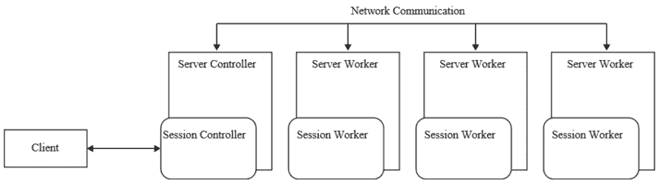

客户端应用程序与控制器通信，控制器协调由工作节点执行的处理。一台或多台机器被指定为工作节点。每个工作节点对节点上内存中的数据行执行数据分析。服务器水平扩展。如果由于数据量大导致处理时间过长，可以添加更多机器作为工作节点来分担工作负载。分布式服务器具有容错能力。如果与工作节点的通信丢失，幸存的工作节点将使用数据的冗余副本来完成数据分析。在可能的情况下，分布式服务器并行将数据加载到内存中。这提供了最快的加载时间。

### 单机服务器：对称多处理（SMP）

下图描绘了单机服务器的服务器拓扑结构。单台机器被指定为控制器。由于没有工作节点，控制器节点对内存中的数据行执行数据分析。单台机器使用多个 CPU 和线程来加速数据分析。

单机服务器：对称多处理（SMP）

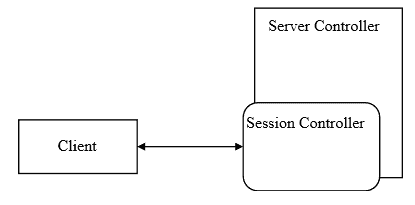

该架构通常被称为对称多处理（SMP）。分布式服务器的所有内存分析功能都可用于单机服务器。单机服务器无法从任何数据源并行将数据加载到内存中。

## 使用云分析服务（CAS）

利用 SAS Viya 版本中包含的 CAS 服务器可带来大量切实的好处。主要原因可以用一个简单的三词短语来概括：巨大的性能提升。由于流程运行速度更快，你可以更快地完成工作。这意味着你可以在大幅缩短的时间内完成更多工作，甚至整个项目。

| 处理类型 || 多线程、单机（SAS Viya SMP） || 多线程、多机（SAS Viya MPP） |
| --- | --- | --- |
| 分布式并行处理？ || 是 || 是 |
| 内存数据持久化？ || 是 || 是 |
| 常见性能加速 || 10x–20x || 最高达 100x\* |

\* 增加取决于许多因素，包括硬件分配。性能可能更高。

请参阅附录 A.1，了解有关使用 CAS、CAS 支持的数据类型以及将数据加载到 CAS 中的信息。

## 心态转变


# SAS Viya 非确定性概述

使用 `SAS Viya` 时，您需要注意一些差异。在 `SAS Viya` 中，您可能会得到非确定性结果或无法获得可重复的结果，主要有两个原因：

- 分布式计算环境
- 非确定性算法

在分布式计算中，案例会在计算节点之间分配，结果可能会有所不同。即使在同一台服务器上，当控制器/工作进程更易管理时，您也可能会得到略有不同的结果。在不同的服务器上，这种情况更有可能发生。`CAS` 服务器代表池化内存并以多线程方式运行代码。多线程倾向于将相同的指令分发给其他可用线程执行，使用单独的分配或数据子集在许多不同的核心上创建许多不同的队列。大多数情况下，多个线程对彼此独立但属于更大表的数据的孤立集合执行操作。因此，可能出现一个线程上的计数器（例如，`n+1`;）产生的结果与另一个线程上的计数器不同，因为每个线程都在处理不同的数据子集。

因此，除非将多个线程的单独结果汇总在一起，否则结果可能因线程而异。这并没有听起来那么复杂。这是因为 `SAS Viya` 会自动处理大部分处理结果的整理和重新组装，只是少数例外情况需要您进一步指定如何合并多个线程的结果。

## 非确定性算法

非确定性算法是一种算法，即使对于相同的输入，在不同运行中也可能表现出不同的行为，而确定性算法则不会。算法在不同运行中表现不同的方式有多种。并发算法由于竞态条件，在不同运行中可能会表现不同。概率算法的行为取决于随机数生成器。非确定性算法通常用于在用确定性方法获得精确解成本过高时寻找近似解（维基百科）。一些 `SAS Visual Data Mining and Machine Learning` 模型是通过非确定性过程创建的。这意味着在运行模型、保存该模型、关闭模型并稍后重新打开报告或打印报告时，您可能会看到不同的显示结果。

## 确定性与非确定性算法

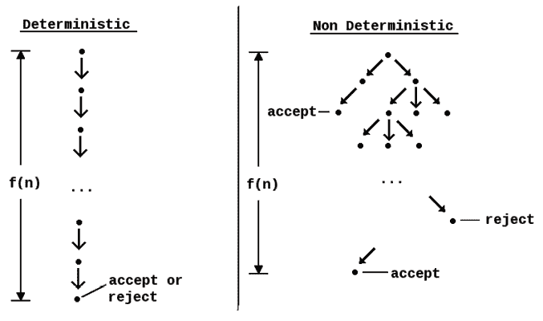

图片来源：由 Eleschinski2000 使用绘图程序制作，CC BY-SA 3.0，https://commons.wikimedia.org/w/index.php?curid=43528132

执行 `f(n)` 步的确定性算法总是会在 `f(n)` 步内完成并始终返回相同的结果。具有 `f(n)` 层级的非确定性算法在不同运行中可能不会返回相同的结果。非确定性算法可能永远不会完成，因为固定高度树的潜在无限大小。

这完全是另一种思维方式！

您是在“收敛”到一个模型或“估计”一个模型，而不是精确计算模型的參數。贝叶斯模型在寻找参数收敛时理解这一点。它们试图收敛到一个分布，而不是一个点。也许尝试在不同样本上运行模型 10 次并对它们进行集成以查看主导信号会很有趣。您不能期望结果被重现，因为某些算法在过程中包含随机性。然而，结果确实会收敛。这是一个专为大数据设计的卓越计算环境，而这种不可重复性是我们需要付出的代价。

注意：“数据科学的可重复性危机” [`towardsdatascience.com/data-sciences-reproducibility-crisis-b87792d88513`](https://towardsdatascience.com/data-sciences-reproducibility-crisis-b87792d88513) 是一个有趣的阅读。

## SAS Visual Data Mining and Machine Learning

`SAS Viya` 中包含多种产品。它们使用户能够作为分析生命周期的一部分执行其工作。在本书中，您使用 `SAS Visual Data Mining and Machine Learning`。

`Model Studio` 接口是 `SAS Visual Data Mining and Machine Learning`、`SAS Visual Forecasting` 和 `SAS Visual Text Analytics` 的超集。

`SAS Visual Data Mining and Machine Learning` 是 `SAS Viya` 中的一个产品，提供以下内容：

1. 用于数据挖掘和机器学习应用的基础 `CAS` 操作和 SAS 过程
2. 面向不同级别和类型用户的基于 GUI 的应用程序。

这些应用程序如下：

- 编程接口：用于直接编码或通过 `SAS Studio` 中的任务访问的 SAS 过程集合。
- 交互式建模接口：`SAS Visual Analytics` 中的任务集合，用于以交互方式创建模型并提供自动化评估可视化
- 自动化建模接口：名为 `Model Studio` 的管道应用程序，使您能够构建由各种节点组成的自动化流程，用于预处理和建模，并提供自动模型评估和比较，以及直接模型发布和注册。

这些都执行 `CAS` 执行环境中的相同底层操作。此外，还有用于准备数据（`Data Studio`）以及管理和部署模型（`SAS Model Manager` 和 `SAS Decision Manager`）的补充接口，以支持机器学习应用的所有阶段。

在本书中，您主要探索 `Model Studio` 接口及其与其他 `SAS Visual Data Mining and Machine Learning` 接口的集成。

您使用 `SAS Visual Data Mining and Machine Learning` Web 客户端可视化地组装、配置、构建和比较数据挖掘模型和管道，以用于各种分析数据挖掘任务。

# 第 1 章：机器学习简介

介绍

监督学习

无监督学习

半监督学习和强化学习

监督学习预测

决策预测

排序预测

估计预测

模型构建和选择

模型复杂度

介绍 Model Studio

演示 1.1：创建项目并加载数据

Model Studio：分析元素

演示 1.2：从基本模板构建管道

测验

## 介绍

机器学习方法主要有两种类型：监督学习和无监督学习。

### 监督学习


## 监督学习

监督学习（也称为预测建模）始于一个训练数据集。训练数据集中的观测值被称为训练案例（也称为示例、实例或记录）。变量称为输入（也称为预测因子、特征、解释变量或自变量）和目标（也称为响应、结果或因变量）。学习算法接收一组输入以及相应的正确输出或目标，并通过比较其实际输出与正确输出来查找错误，从而学习。然后据此修改模型。通过分类、回归、预测和梯度提升等方法，监督学习利用模式来预测额外未标记数据上标签的值。换句话说，训练数据的目的是生成预测模型。预测模型是对输入与目标变量之间关联的简洁表示。

监督学习常用于历史数据预测可能未来事件的应用中。例如，它可以预测信用卡交易何时可能为欺诈，或哪位保险客户可能提出索赔。

## 无监督学习

无监督学习用于没有历史标签的数据。换句话说，系统不会被告知“正确答案”——没有目标数据——算法必须弄清楚正在展示的内容。目标是探索数据并找到某种结构或模式。无监督学习在交易数据上效果良好。例如，它可以识别具有相似属性的客户细分群体，然后在营销活动中对他们进行类似处理。或者它可以找到区分客户细分群体的主要属性。流行技术包括自组织映射、最邻近映射、k-means 聚类和奇异值分解。这些算法还用于细分文本主题、推荐项目和识别数据异常值。

## 半监督学习和强化学习

其他常见方法包括半监督学习和强化学习。

### 半监督学习

半监督学习用于与监督学习类似的应用。但它在训练中使用标记数据和未标记数据——通常是少量标记数据和大量未标记数据（因为未标记数据成本更低，获取所需精力更少）。这种学习类型可与分类、回归和预测等方法一起使用。半监督学习在标记相关的成本过高而无法进行完全标记的训练过程时很有用。这种方法的早期示例包括在网络摄像头上识别一个人的面孔。

### 强化学习

强化学习常用于机器人技术、游戏和导航。在强化学习中，算法通过试错发现哪些行动能带来最大奖励。这种学习有三个主要组成部分：智能体（学习者或决策者）、环境（智能体交互的一切）以及行动（智能体可以执行的操作）。目标是使智能体选择在给定时间内最大化预期奖励的行动。遵循良好策略，智能体将更快达到目标。因此，强化学习的目标是学习最佳策略。

本书将重点关注监督学习或预测建模。

## 监督学习预测

预测模型的输出被称为预测。预测代表了在给定一组输入测量值的情况下对目标的最佳猜测。预测基于预测模型从训练数据中学习到的关联。

训练数据用于构建将输入与目标关联起来的模型（规则）。预测可分为三种不同类型：

- 决策
- 排序
- 估计

### 决策预测

决策预测是最简单的预测类型。决策通常与某种行动相关联（例如将案例分类为流失或未流失）。因此，决策也被称为分类。决策预测示例包括手写识别、欺诈检测和直接邮件推销。

Figure 1.1: 决策预测

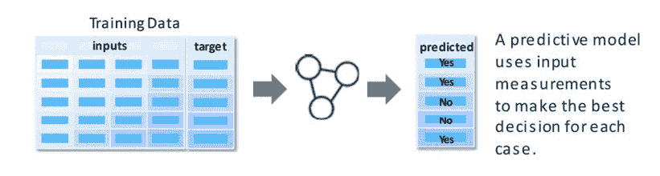

决策预测通常与分类目标变量相关。因此，它们根据目标的层级被标识为主要、次要和第三级。

注意：当目标变量具有分类测量水平（二元、名义或序数）时，`Model Studio` 中的模型评估通常假定为决策预测。

### 排序预测

排序预测根据输入变量与目标变量的关系对案例进行排序。利用训练数据，预测模型尝试将高价值案例排在低价值案例之上。假设评分数据中存在类似的模式，使得高价值案例具有高分数。实际产生的分数无关紧要。只有相对顺序重要。排序预测最常见的示例是信用评分。

Figure 1.2: 排序预测

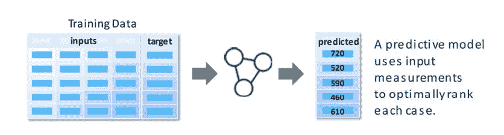

排序预测可以通过对超过某一阈值的案例做出主要决策，而对低于相应较低阈值的案例做出次要和第三级决策，从而转化为决策预测。在信用评分中，信用评分高于 700 的案例可称为良好风险，评分在 600 到 700 之间的可称为中等风险，低于 600 的可视为不良风险。

### 估计预测

估计预测使用输入来估计在某些未观察到的自变量值条件下因变量的值。对于具有数值目标的案例，这可以被视为具有观察到的输入测量值的所有案例的目标平均值。对于具有分类目标的案例，该数字可能等于目标结果的概率。

Figure 1.3: 估计预测。

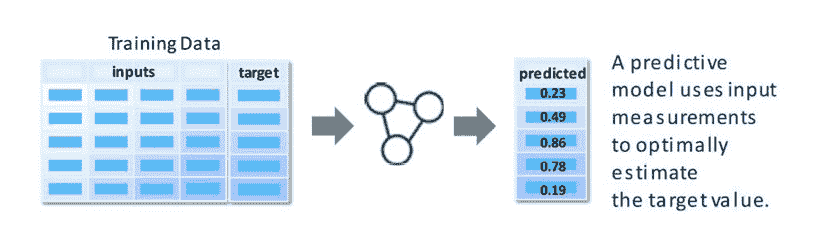

预测估计最常在它们的值被整合到数学表达式中时使用。例如，两阶段建模，其中事件的概率与利润或损失的估计值结合，形成无条件预期利润或损失的估计。预测估计在您不确定模型的最终应用时也很有用。

估计预测可以转化为决策和排序预测。当不确定时，使用此选项。大多数 `Model Studio` 建模工具可配置为生成估计预测。

## 模型构建与选择

为了为业务问题和数据选择最佳模型，需要构建并比较许多模型以选择冠军模型，然后将其部署到生产环境。我们将在后面的章节讨论评分和模型选择。但在开始构建模型之前，重要的是保留部分数据以帮助选择最佳模型。

### 模型复杂度

选择模型复杂度是在偏差和方差之间取得平衡。复杂度不足的模型可能不够灵活，导致欠拟合。欠拟合模型会导致有偏的推断，这意味着它们不是总体中的真实值；例如，在决策模型的情况下，它们可能会预测“否”，而目标应为“是”。


## 过拟合与泛化

过于复杂的模型可能过于灵活，从而导致过拟合。过拟合模型包含样本中的随机噪声，这可能导致模型在应用于总体时方差更高。该模型在训练数据上几乎能完美表现，但在验证数据上很可能表现不佳。

具有恰到好处灵活性的模型能获得最佳泛化能力。

### 图 1.4：准确率与泛化能力

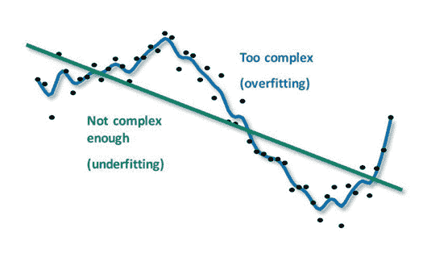

## 介绍 Model Studio

`Model Studio` 使您能够通过准备数据和构建模型来探索想法并发现洞察。它是分析生命周期中发现阶段的一部分。`Model Studio` 是一个集成的、基于 Web 的中央应用程序，包含一套集成的数据挖掘工具。`Model Studio` 中支持的数据挖掘工具旨在利用 `SAS Viya` 编程和云处理环境来交付和分发分析模型数据挖掘冠军模型、评分代码和结果。


### 演示 1.1：创建项目并加载数据

在本演示中，您将基于 `commsdata` 数据集在 `Model Studio` 中创建一个新项目。项目是 `Model Studio` 中分析工作的顶层容器。表从本地驱动器导入。定义项目类型。该项目用于预测一家虚构电信公司的客户流失。为该表选择一个目标变量。

1. 首先，在您的机器上打开 `SAS Drive`，并从书签栏或页面上的链接中选择 `SAS Viya`  `SAS Drive`。
2. 接下来，使用您的 `user ID` 和 `password` 登录。
注意：输入 `user ID` 和 `password` 时请谨慎，因为值区分大小写。
3. 单击 `Sign In`。
4. 在 `Assumable Groups` 窗口中选择 Yes。`SAS Drive` 主页出现。

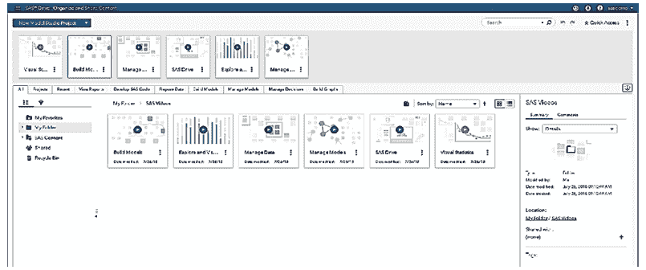

注意：您计算机上的 `SAS Drive` 页面可能与上图中的图块不同。
5. 单击 `SAS Drive` 页面左上角的 `Applications` 菜单。选择 `Build Models`。

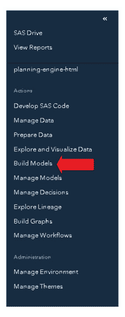

这将启动 `Model Studio`。

注意：`SAS Visual Data Mining and Machine Learning` 中 `Model Studio` 的一些主要功能在题为“Playing Favorites: Our Top 10 Model Studio Features in SAS® Visual Data Mining and Machine Learning”的论文中有所介绍，网址为 [`www.sas.com/content/dam/SAS/support/en/sas-global-forum-proceedings/2019/3236-2019.pdf`](https://www.sas.com/content/dam/SAS/support/en/sas-global-forum-proceedings/2019/3236-2019.pdf)。

或者，单击左上角的 `New` 以显示创建新项目的菜单。从菜单中选择 `Model Studio project`。

注意：使用此替代流程进入 `Model Studio` 时，会绕过 `Model Studio Projects` 页面，并立即打开创建新项目的窗口，如本演示第 7 步下方所示。

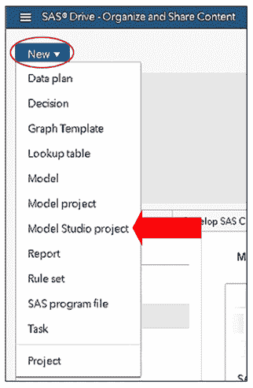

`Model Studio Projects` 页面现已显示。

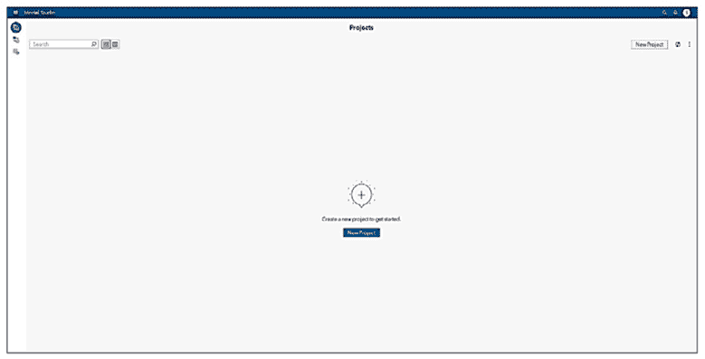

注意：在您的计算机上，Projects 页面可能与上图不同。您的计算机上可能存在预先存在的项目。

从 `Model Studio Projects` 页面，您可以查看现有项目、创建新项目、访问 `Exchange` 并访问 `Global Metadata`。`Model Studio` 项目可以是三种类型之一（取决于您所在站点的 SAS 许可）：`Forecasting projects`、`Data Mining and Machine Learning projects` 和 `Text Analytics projects`。

注意：`Exchange` 组织您的收藏设置，并使您能够在一个地方与其他人协作。查找推荐的节点模板或创建自己的模板，以便为团队提供简化的工作流程。`Exchange` 将在本章后面访问。
6. 在 Projects 页面右上角选择 `New Project`。
7. 在 `New Project` 窗口中将名称输入为 `Demo`。保留默认类型 `Data Mining and Machine Learning`。在 Data 字段中单击 `Browse`。

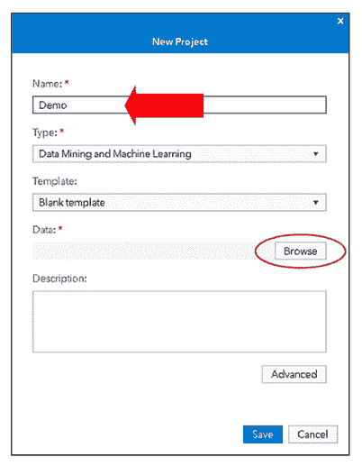

注意：您可以在项目创建时指定管道模板。继续使用空白模板。管道模板将很快讨论。
8. 将 SAS 数据集导入 `CAS`。
a. 在 `Choose Data` 窗口中，单击 `Import`。

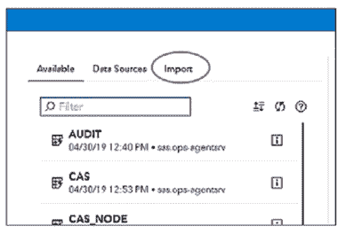

b. 在 `Import` 下，选择 `Local File`。


c. 导航到数据文件夹。
d. 选择 `commsdata.sas7bdat` 表。单击 `Open`。
e. 选择 `Import Item`。`Model Studio` 解析数据集并预先填充窗口中的数据集配置。


注意：当数据在内存中时，可通过 `Available` 选项卡供其他项目使用。
f. 表导入后单击 `OK`。

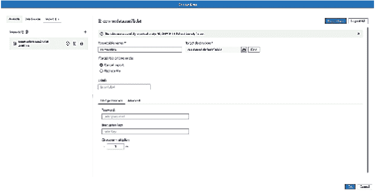

注意：表导入到 `CAS` 服务器，可与 `SAS Visual Analytics` 一起使用。导入完成后，您将返回到 `Model Studio`。有关 `CAS` 支持的数据类型以及如何将数据加载到 `CAS` 的更多信息，请参阅本演示末尾的详细信息部分。
9. 在 `New Project` 窗口中单击 `Advanced`。

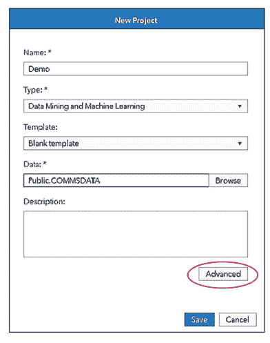

10. `Advanced` 项目设置出现。`Advanced` 项目设置分为四组：`Advisor Options`、`Partition Data`、`Event-based Sampling` 和 `Node Configuration`。

在 `Advisor Options` 组下，有三个选项：

`Maximum class levels` 指定拒绝分类变量的阈值。如果分类输入的级别数超过指定的最大值，则会被拒绝。

`Interval cutoff` 确定数值输入是指定为区间还是名义。如果数值输入的不同的值/级别数超过 `interval cutoff` 值，则声明为区间。否则，声明为名义。

`Maximum percent missing` 指定拒绝缺失值输入的阈值。如果输入的缺失值百分比高于指定的最大百分比，则会被拒绝。此选项可以打开或关闭。默认情况下为打开。

注意：这是查看和更改这些 `Advisor Options` 的唯一位置。

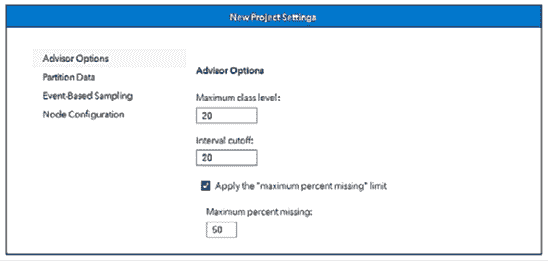

`Partition Data` 和 `Event-Based Sampling` 的 `Advanced` 项目设置选项将在下一章介绍。以及与 `Node Configuration` 一起，将在下一个演示中讨论。您可以在此处访问 `Partition Data`、`Event-Based Sampling` 和 `Node Configuration` 选项，也可以在项目创建后访问它们。

单击 `Cancel` 返回到 `New Project` 窗口。
11. 单击 `Save`。

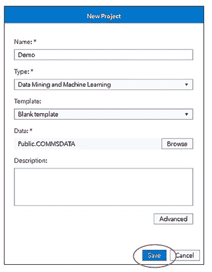

注意：在创建新项目后，`Model Studio` 会带您进入新项目的 `Data tab`。在这里，您可以调整数据源变量角色和级别分配，并定义某些元数据规则（例如，插补和转换方法）。如果新数据集中的目标变量与原始数据集相同，您还可以重新训练模型以使用新数据。

注意：在 `Model Studio` 中，元数据定义为适用于您数据集的一组变量角色、测量级别和其他配置。当您需要使用相似的数据集创建多个项目（或使用单个数据集）时，您可能会发现将元数据配置存储以供跨项目使用很有用。`Model Studio` 通过将变量收集到名为 `Global Metadata` 的存储库中使您能够做到这一点。通过将元数据配置存储为全局元数据，配置将应用于包含具有相同名称变量的新数据集。


## 12. 创建项目时，需要指定一个目标变量来运行管道。在 `Model Studio` 中，您可以以管道的形式创建分析流程。

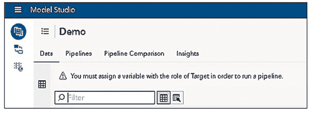

您的数据中也可以预先定义目标变量角色。`Model Studio` 提供了多种管理和修改数据的选项。`Data tab` 可让您修改变量分配并管理全局元数据。

## 13. 在变量窗口中，选择 churn（步骤 1）。然后在右侧窗格中，在 Role 属性下选择 Target（步骤 2）。（您可能需要在变量列表中向下滚动才能看到 churn。）

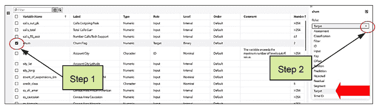

右侧窗格使您能够指定变量的多个属性，包括 `Role`、`Level`、`Order`、`Transform`、`Impute`、`Lower Limit` 和 `Upper Limit`。

对于 `Transform`、`Impute`、`Lower Limit` 和 `Upper Limit` 属性，在 `Data tab` 上更改这些值不会直接修改变量。相反，这会为这些属性设置元数据值。使用元数据值的 Data Mining 预处理节点（`Transformations`、`Impute`、`Filter` 和 `Replacement`）如果请求了相应的操作，可能会使用这些参数。您将在接下来的几个演示中看到这一点。

## 14. 单击“指定目标事件级别”。您可以在此处指定需要建模的目标事件级别。

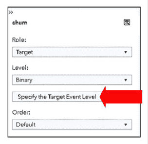

## 15. 单击下拉箭头。

请注意，`churn` 率约为 12%。默认情况下，`Model Studio` 按字母数字顺序将最后一个类别视为事件，因此无需更改。

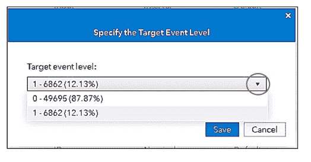

## 16. 关闭“指定目标事件级别”窗口。


## Model Studio：分析元素

项目是 `Model Studio` 中分析工作的顶层容器。`Model Studio` 项目包含数据源、您创建的管道以及相关的项目元数据（例如项目类型、项目创建者、共享列表和最后更新历史）。如果在项目中创建多个管道，则比较多个管道性能的分析结果也会存储在项目中。图 1.5：`Model Studio` 中的分析事件 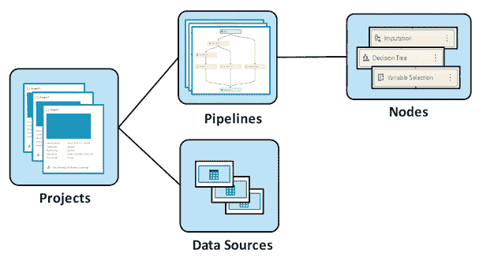 您可以向管道添加节点以创建建模流程。您可以通过在节点后插入 `SAS Code node`（有时在 `SAS Code Node` 之前插入 `Manage Variable node`）来保存来自 `SAS Visual Data Mining and Machine Learning` 节点的结果。这使您能够编写特定的 `DATA step` 或其他 `Base SAS` 或 `CASL` 语句，将所需输出和数据集保存到永久库以供进一步使用。

如果您想捕获节点导出的<|message|>，您只需在管道的任何位置附加一个 `Save Data node` 并指定要保存的表的详细信息即可。此外，节点的<|message|> 中有一个输出选项卡，可让您查看评分输出表。从这里，您可以根据需要指定样本，也可以请求保存表。您还可以保存评分输出表以外的数据。此外，您可以从节点结果中显示的表和图中下载并保存数据。这是通过单击右上角的 `Download Data` 快捷按钮完成的，该按钮紧邻 `Expand` 快捷按钮。 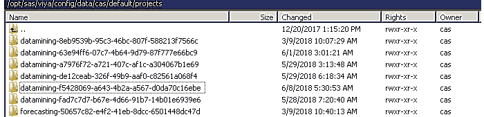

您可以通过导航到其保存的位置来查看项目列表（如上所示）。上图所示的路径是使用 `WinSCP`（客户端机器上的文件传输协议应用程序）在 Linux 操作系统上的路径。通常，路径为 `/opt/sas/viya/config/data/cas/default/projects/`。如果安装的是 Windows，则路径可能不同。

### 图 1.6：管道
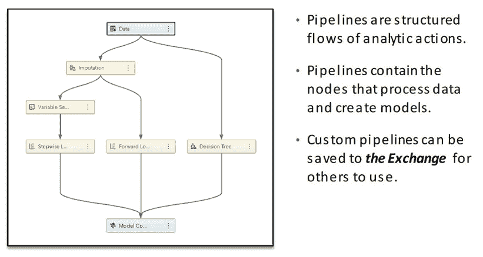

管道是一个分析流程。在创建新管道后，您可以通过向管道添加节点来创建可视化数据挖掘功能。节点可以单独添加，或者为了节省时间，模板可以一次添加多个节点。要从模板创建管道，请在 `New Pipeline window` 中指定模板。您可以以以下两种方式向管道添加节点：

1. 从展开的 `Nodes pane` 拖放。
2. 右键单击并选择 `Add child node` 或 `Add parent node`。

管道被分组在顶层容器中（即在项目中，该项目还包括您要建模的数据集和管道比较工具）。一个项目可以包含多个管道。您可以创建新管道并修改现有管道。

管道可以保存到 `Exchange`，在那里它们可供其他用户访问。所有可用节点、其描述以及所有可用管道模板，包括预建和用户创建的模板，都可以在这里找到。

模板
`Model Studio` 支持模板作为快速创建统计模型的方法。模板是一种特殊的管道类型，其预先填充了可用于创建模型的配置。模板可能由多个节点或单个节点组成。`Model Studio` 包含一组代表常见用例的模板，但您也可以创建模型本身并将其作为模板保存到 `Exchange`。

有三个级别的模板可供使用，既适用于类别目标，也适用于区间目标。图 1.6 中显示了类别目标的中间模板。您可以从现有管道创建新模板、在 `Exchange` 中创建新模板，并修改现有模板。

高级模板还提供自动调优功能。模型构建过程的大部分时间都用于实验，以确定模型算法的最佳参数集。随着算法变得更复杂（从神经网络到深度神经网络，从决策树到森林和梯度提升），识别这些参数所需的时间也在增加。有几种方法可以帮助您完成这种繁琐的机器学习模型参数调优工作。这些方法称为超参数优化，并在本书后面讨论。`Model Studio` 包含以下管道模板：

### 表 1.1：管道模板

| 管道模板名称 | 管道模板描述 |
|---|---|
| `Blank template` | 一个仅包含 `Data node` 的数据挖掘管道 |
| `Basic template for class target` | 一个简单的线性流程：`Data`、`Imputation`、`Logistic Regression`、`Model Comparison` |
| `Basic template for interval target` | 一个简单的线性流程：`Data`、`Imputation`、`Linear Regression`、`Model Comparison` |
| `Intermediate template for class target` | 在基本模板的基础上扩展，包含逐步 logistic 回归模型和决策树 |
| `Intermediate template for interval target` | 在基本模板的基础上扩展，包含逐步线性回归模型和决策树 |
| `Advanced template for class target` | 在类别目标的中间模板基础上扩展，包含神经网络、森林和梯度提升模型以及集成 |
| `Advanced template for class target with autotuning` | 具有自动调优树、森林、神经网络和梯度提升模型的类别目标高级模板 |

下一个演示展示了如何从类别目标的基本模板构建新管道。此模板是一个简单的线性流程，并包含 logistic 回归节点作为预测模型。第 5 章为不熟悉该技术的读者提供了 logistic 回归的复习。

 演示 1.2：从基本模板构建管道


## 从模板构建管道

虽然能够从头构建自己的管道很不错，但从代表预测模型构建最佳实践的模板开始通常更方便。该应用程序提供了用于创建新管道的精美模板集。在本演示中，为了从简单开始，您将从用于分类目标的基础模板构建新的管道。

## 创建新管道

1. 在画布左上角点击当前管道标签旁边的 `+`。

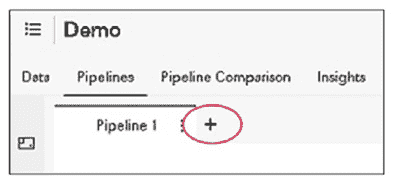

2. 在“新建管道”窗口中，在 `Template` 字段中选择 `Browse templates`。

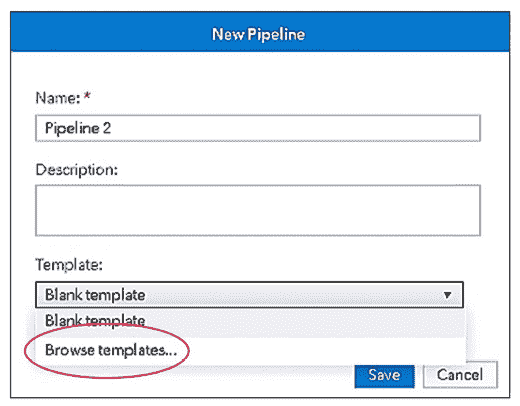

注意：`Template` 菜单上的某些选项在您的计算机上可能与上面显示的不同。

3. 在 `Browse Templates` 窗口中，选择 `Basic template for class target`。点击 `OK`。

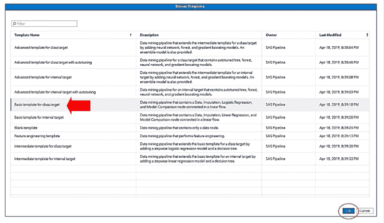

4. 在“新建管道”窗口中，将管道命名为 `Basic Template`。

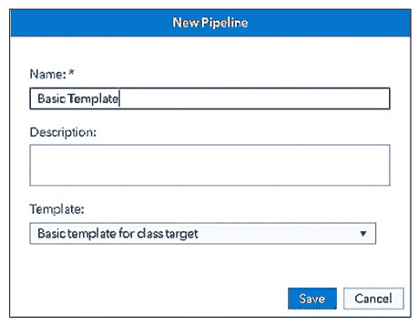

5. 点击 `Save`。

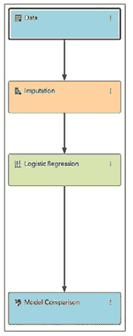

用于分类目标的基础模板是一个简单的线性流程，包括以下节点：`Data`、`Imputation`、`Logistic Regression` 和 `Model Comparison`。您可以通过右键单击现有节点（或从“节点”窗格拖放）来添加节点。

节点的不同颜色代表它们在 `Model Studio` 中的各自组。

注意：由于缺少输入值的案例的预测响应可能不同，二进制插补指示变量通常会添加到训练数据中。添加此变量使模型能够在“缺失”本身与目标相关联的情况下调整其预测。

## 运行和评估管道

6. 在右上角点击 `Run Pipeline`。


7. 管道成功运行后，右键单击 `Logistic Regression` 节点并选择 `Results`。

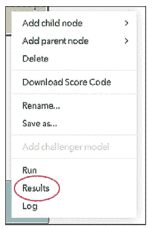

`Results` 窗口顶部包含两个重要的选项卡：一个用于 `Node results`，一个用于 `Assessment results`。

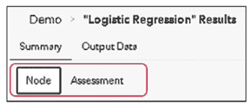

`Logistic Regression` 节点结果中“节点”选项卡下包含的一些窗口有：

◦ `t-values by Parameter plot`

◦ `Parameter Estimates table`

◦ `Selection Summary table`

◦ `Output`

`Logistic Regression` 节点结果中“评估”选项卡下包含的一些窗口有：

◦ `Lift Reports plots`

◦ `ROC Reports plots`

◦ `Fit Statistics table`

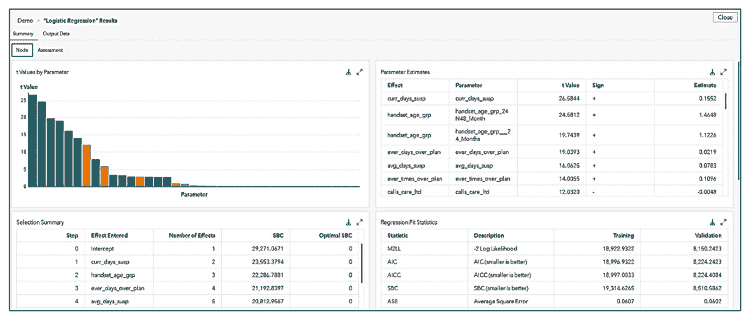

尽情探索结果。

8. 通过点击窗口右上角的 `Close` 关闭 `Results` 窗口。


9. 右键单击 `Model Comparison` 节点并选择 `Results`。

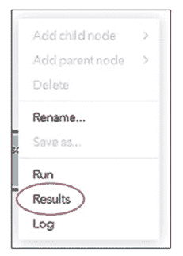

10. 点击展开 `Model Comparison table`。除非另有说明，选择分类目标的冠军模型时将使用默认拟合统计量 (`KS`)。

注意：要仅更改此比较的默认拟合统计量，请在管道中选择该节点时，在右侧窗格中更改 `Model Comparison` 属性的类别选择统计量。要更改所有项目的默认拟合统计量，请在 `Project Settings` 菜单上更改类别选择统计量。默认值为 `Kolmogorov-Smirnov statistic` (`KS`)。

`Model Comparison table` 的子集如下所示。

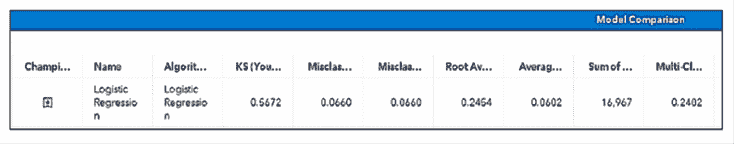

注意：只要管道中包含任何模型，`Model Comparison` 节点就会始终默认添加。如果管道仅包含单个模型，`Model Comparison` 节点会汇总该单一模型的性能。

11. 通过点击窗口右上角的 `X` 退出最大化视图。


## 测验

1. 创建新项目后，`Model Studio` 会带您进入 `Data tab`。在 `Data tab` 中您可以做什么？（多选。）

a. 修改变量角色和测量水平。

b. 管理全局元数据。

c. 修改变量名称和标签。

d. 管理列以显示 `Variables table`。

# 第 2 章：准备您的数据

## 目录

介绍

探索数据

模型工作室：数据预处理

演示 2.1：探索源数据

划分数据

诚实评估

处理罕见事件

模型工作室

演示 2.2：修改数据分区

数据准备最佳实践

模型工作室：特征工程模板

演示 2.3：运行特征工程管道模板

测验

## 介绍

垃圾进—垃圾出！要有效，机器学习模型需要从准备良好的数据构建。据说，构建成功的机器学习应用程序所花费的 80% 时间都花在数据准备上（Dasu 和 Johnson 2003）。数据准备不仅仅是正确转换和清理现有数据。它还包括对需要考虑的特征有良好的理解，并确保您使用的数据首先是合适的。这被称为分析周期的数据阶段。

## 探索数据

为分析准备任何数据都应始终从探索您的数据开始。探索数据意味着通过图形和数值方法对数据有一个整体的感觉，包括对变量的了解，例如直方图、散点图、条形图和茎叶图。还有更现代的图形工具，例如热图和词云，它们可很好地扩展到大型数据集。数值汇总方法也用于探索数据。这些包括用于衡量集中趋势的汇总统计量，例如均值、中位数或众数。用于衡量变异性的数值度量，例如方差、标准差、范围或四分位距，也用于探索数据。极值例如异常值、最小值或最大值用于探索数据，以及缺失数据的计数或百分比。双变量度量例如相关性也使用。

图 2.1：探索数据

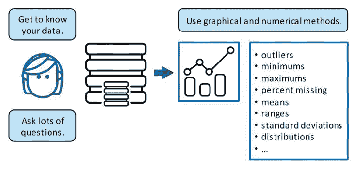

为了准备数据以训练模型，必须执行以下基本任务：

● 划分数据

● 处理罕见事件

● 管理缺失值

● 添加非结构化数据

● 提取特征

● 处理极端或异常值

● 选择有用输入

在以下各节中，我们将讨论这些任务中的每一个。

## Model Studio：数据预处理

| `Model Studio: Data Preprocessing` |
| --- |
| 数据预处理可以在 `SAS Visual Data Mining and Machine Learning` 的多个地方进行：在专用应用程序（`Data Studio`）中，在视觉探索（`SAS Visual Analytics`）期间，以及在管道执行（`Model Studio`）期间。在这里我们使用 `Model Studio` 应用程序，它以管道节点的形式提供数据预处理功能。这些节点形成一个名为 `Data Mining Preprocessing` 的组。 |
| 图 2.2：使用 `Model Studio` 进行数据预处理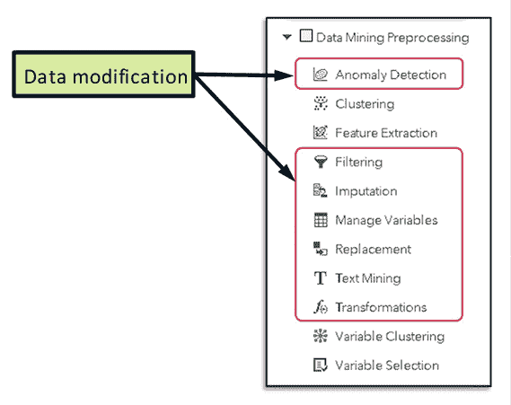 |
| 数据修改是一个广泛的预处理类别。任何改变数据或数据角色的操作都可以被视为修改，包括降维技术。`Model Studio` 提供了多个 `SAS Visual Data Mining and Machine Learning` 节点来修改您的数据。 |


### 表 2.1：Model Studio 数据修改节点

| 节点名称 | 节点描述 |
|---|---|
| `Anomaly Detection` | `Anomaly Detection` 节点使用支持向量数据描述（`SVDD`）来识别并排除异常。简而言之，`SVDD` 公式通过确定由支持向量构建的能够包围训练数据点的最小可能超球体来识别离群点。`SVDD` 然后排除位于由训练数据构建的球体之外的那些数据点。使用 `SVDD` 进行异常检测对于大多数数据属于一个类别，而另一个类别稀少或缺失的数据集很有用。 |
| `Filtering` | `Filtering` 节点排除某些观测值，例如罕见值和离群值。从训练数据中过滤极值往往会产生更好的模型，因为参数估计更稳定。 |
| `Imputation` | `Imputation` 节点替换数据集中的缺失值。简单的插补方案包括用该变量非缺失值的均值或众数替换输入变量中的缺失值。对于非正态分布的变量或缺失比例较高的变量，简单插补可能无效。对于缺失并非随机的变量，插补也可能无效。为了获得理想结果，请创建缺失指示符并将其与插补后的变量一起用于模型中。这种做法即使在变量呈正态分布且缺失值很少的情况下也能带来改善的结果。 |
| `Manage Variables` | `Manage Variables` 节点使您能够在 `Model Studio` 流程中对数据进行修改（例如更改变量的角色或添加新的转换）。您可用的选项是 `Data` 选项卡下选项的子集。 |
| `Replacement` | `Replacement` 节点使您能够用指定值替换离群值和未知类别水平。与插补类似，简单地替换离群值和未知类别水平并不总是有效。应注意有效使用替换。 |
| `Transformations` | `Transformations` 节点使您能够通过用该变量的某个函数替换输入变量来更改数据。转换有许多用例。转换可用于稳定方差、消除非线性并纠正非正态性。 |

降维减少了所考虑的变量数量。在许多应用中，原始数据具有非常高维的特征，且某些特征对任务而言是冗余或无关的。降低维度有助于找到真实的、潜在的关系。`Model Studio` 在 `SAS Visual Data Mining and Machine Learning` 中提供了三个用于降维的节点。

### 表 2.2：Model Studio 数据降维节点

| 节点名称 | 节点描述 |
|---|---|
| `Feature Extraction` | `Feature Extraction` 节点将现有特征（变量）转换到低维空间。`Model Studio` 中的特征提取使用各种技术进行，包括主成分分析（`PCA`）、稳健 `PCA`、奇异值分解（`SVD`）和 `autoencoders`。这通过生成由现有特征组成的复合新特征来实现。特征提取的一个缺点是，复合变量相对于原始问题不再具有意义。 |
| `Variable Clustering` | `Variable Clustering` 节点将数值变量划分为不相交的簇，并为每个簇选择一个代表变量。变量聚类可消除共线性、减少冗余并有助于揭示数据集的潜在结构。 |
| `Variable Selection` | `Variable Selection` 节点使用多种无监督和有监督方法来确定哪些变量对模型影响最大。有监督的变量选择技术包括基于线性模型和基于树的模型（如决策树、森林和梯度提升）的变量选择。此工具使您能够指定一个以上的选择技术，并且有多种选择标准选项。由于使用不同技术时所选变量可能存在分歧，此功能使您能够选择始终被选中的变量。未满足选择标准的变量将被标记为拒绝，且不会在后续建模节点中使用。 |

在执行无监督学习时，机器会获得未标记的数据（未标记数据没有目标）。无监督学习算法旨在发现数据背后的内在模式，例如聚类或可以减少的冗余参数（维度）。`Model Studio` 提供了 `Clustering` 节点，可根据从定量变量或定性变量（或两者）计算的距离执行观测聚类。该节点使用以下算法：
- `k-means` 算法用于聚类区间（定量）输入变量
- `k-modes` 算法用于聚类名义（定性）输入变量
- `k-prototypes` 算法用于聚类包含区间和名义变量的混合输入

聚类通常用于将大型数据集分割成多个组。可以在每个组中进行分析，以帮助用户找到内在模式。


## 演示 2.1：探索源数据

在本演示中，您在 `Model Studio` 中使用 `Data Exploration` 节点来分析和探索 `commsdata` 数据源。在继续分析之前，对数据集进行分析通常很有用。在此，您选择一组变量子集以提供数据的代表性快照。可以选变量以显示最重要的输入，或指示可疑变量（即具有异常统计数据的变量）。

1. 从 `Model Studio Projects` 页面，从可用的现有项目中打开 `Demo project`。
2. 单击 `Pipelines` 选项卡。（您应该正在查看名为 `Pipeline 1` 的流程，如果不是，请单击其选项卡。）
3. 右键单击 `Data node` 并选择 `Add child node` `Miscellaneous` `Data Exploration`。

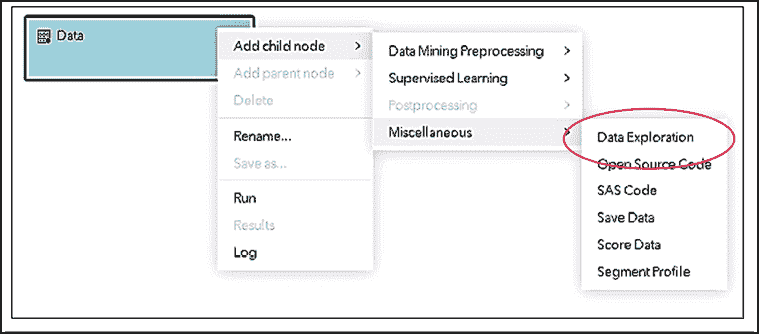

注意：您也可以在单击 `Nodes` 按钮  后，从左侧窗格拖动节点到 `Data node` 的顶部，节点将被添加到下方。

`Data Exploration` 节点选择一组变量子集以提供数据的代表性快照。您可以指定要分析的数据分区（或所有输入数据）。

4. 保持变量选择标准的默认设置，即 `Importance`。变量选择标准指定是要显示最重要的输入还是可疑变量。另一个可能的值是 `Screening`。

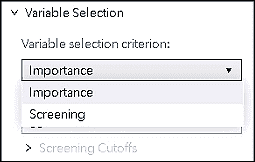

可以根据需要选择变量以显示最重要的输入或指示异常统计数据。默认情况下，使用 `Importance` 标准最多将选择 50 个变量。

您可以通过指定筛选标准来控制可疑变量的选择，例如标记缺失值比例高的变量的截止值、高基数类别变量、具有主导水平的类别变量、具有罕见模式的类别变量、偏斜的区间变量、峰态（尖峰）区间变量以及具有厚尾的区间变量（即平峰分布）。

5. 右键单击 `Data Exploration` 节点并选择 `Run`（或单击右上角的 `Run Pipeline`）。


## 数据探索与数据划分

## 数据探索节点概述

The `Data Exploration node` 为您提供输入数据的统计摘要。This node 可作为分析的有用第一步，因为它使您能够对数据集进行画像。The `Data Exploration node` 可以放置在管道中的大多数位置，除了 after the `Model Comparison node`。

## 逐步操作

6. When the pipeline finishes running, `right-click` the `Data Exploration node` and `select` `Results`.

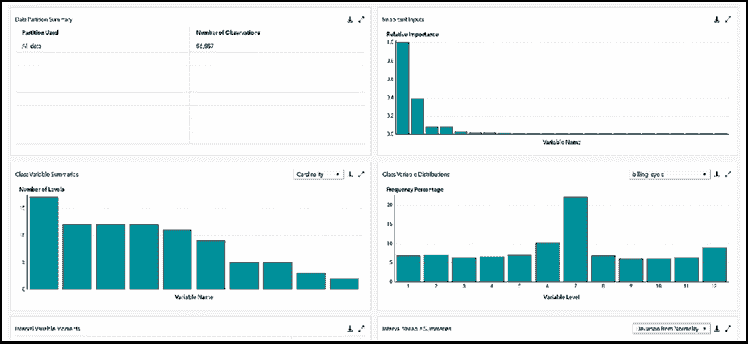

7. `Click` the `Expand button`  on the `Important Inputs` bar chart and examine the relative importance of the ranked variables. This bar chart is available only if `Variable selection criterion` is set to `Importance`.

Relative importance is calculated based on a decision tree, and is covered in more detail later in the feature selection section.

8. `Exit` the maximized view.

9. `Expand` the `Interval Variable Moments` table.

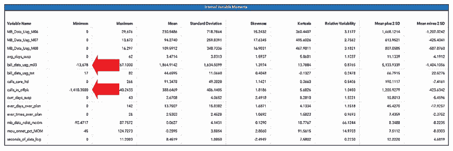

This table displays the interval variables with their associated statistics, which include minimum, maximum, mean, standard deviation, skewness, kurtosis, relative variability, and the mean plus or minus two standard deviations. Note that some of the input variables have negative values.

10. `Exit` the maximized view of this window.

11. `Scroll down` in the `Data Exploration Results` window to examine the `Interval Variable Summaries` scatter plot. Observe that several variables have deviation from normality—that is, high kurtosis on the Y axis and high skewness on the X axis.

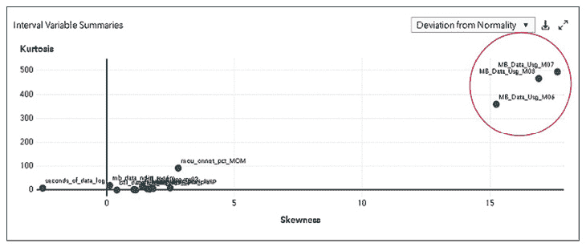

12. `Use` the drop-down menu in the upper right corner to examine a bar chart of the relative variability for each interval variable.

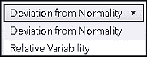

Note: Relative variability is useful for comparing variables with similar scales, such as several income variables. Relative variability is the coefficient of variation, which is a measure of variance relative to the mean, `CV=σ/µ`.

13. `Scroll down` in the `Data Exploration Results` window to examine the `Missing Values` bar chart and validate that quite a few variables have missing values.

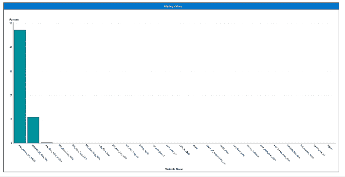

This is an important finding that you will address in the next demonstration.

14. `Click` `Close`.

15. `Double-click` the `Pipeline 1` tab and `rename` it `Data Exploration`. `Press` the `Enter` key.


## 划分数据

As discussed in Chapter 1, supervised learning starts with a `training data set`. The observations in a `training data set` are known as `training cases`. The variables are called `inputs` and `targets`.

In order to train a model, the data must be split into two non-overlapping data sets, `training` and `validation`, some data for training the model and some data for evaluating the model. This is known as `data partitioning`. The split is usually `70:30` but you could use `50:50`. Generally, it is best to use more data to train the model than to validate, to prevent `under fitting`.

图 2.3：划分输入数据集

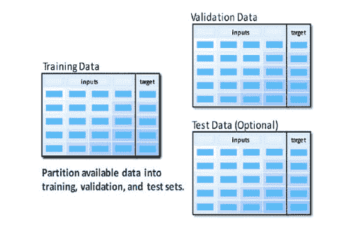

Sometimes a third data set is held out for the final test. This can be important if your testing needs to be completely unbiased. The `validation` data is used to fine-tune and ultimately choose the best or champion model, so the model developed using this has some bias. The test data has not been used to validate or build the model, so this provides completely unbiased results.

For each modeling algorithms, a series of models is constructed, and the models increase in complexity. Some of these models will be too simple (`underfit`), and others will be too complex (`overfit`). Each of these models are assessed using the `validation` data to optimize the complexity of the model and find the balance or sweet spot between being `underfit` and being `overfit`.

## 诚实评估

`Honest assessment` is the technique that uses the `validation` data set to select the model that performs best. It is important to remember that the `validation` set is held out and is not used to train, or fit, the model.

The best model is the simplest model with the highest `validation` performance.

It is critical that all transformations that are used to prepare the `training` data are applied to any `validation`, test, or other holdout data. It is critical that information from test data or holdout data does not leak into the `training` data. Information leakage can occur in many ways and can potentially lead to `overfitting` or overly optimistic error measurements. For example, think of taking a `mean` or `median` across your data before partitioning and then later using this `mean` or `median` to impute missing values across all partitions of your data. In this case, your `training` data would be aware of information from your `validation`, test, or holdout partitions. To avoid this type of leakage, values for imputation and other basic transformations should be generated from only the `training` data or within each partition independently.

## 处理稀有事件

`Rare events` are characterized as a rare event relative to your total number of samples; for example, if the proportion of events (desired outcome) is very low. Applications such as detecting fraudulent activity must take special steps to ensure that the data used to train the model include a representative number of fraudulent samples in to capture the event sufficiently. (For example, 1 out of every 1,000 credit card transactions is fraudulent.) Fitting a model to such data without accounting for the extreme imbalance in the occurrence of the event gives you a model that is extremely accurate at telling you absolutely nothing of value! The event in the `training` data was so rare that a good prediction would be for it not to occur—ever—regardless of the other variables.

Special sampling methods that modify an imbalanced data set, such as `event-based sampling`, are commonly used to provide a more balanced distribution when modeling rare events. Such techniques enable you to build models from a sample with a `primary outcome` (desired outcome) proportion greater than from the true population proportion. For example, in the data below the `primary outcome` (yellow dots) is much rarer that the `secondary outcome` or non-event (blue dots).

图 2.4：建模样本——次要和主要结果

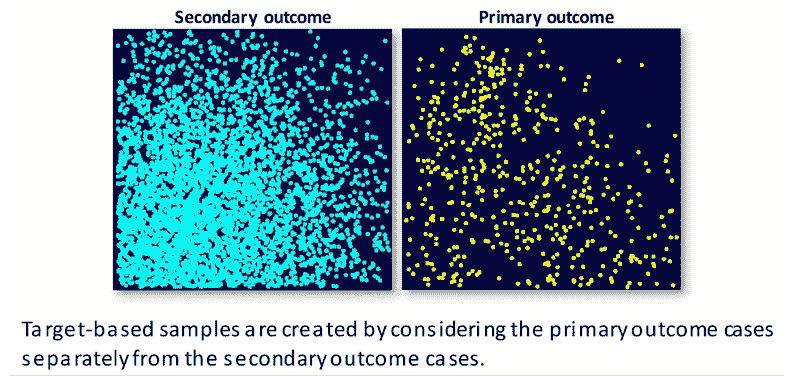

The target-based samples are created by considering `primary outcome` cases separately from the `secondary outcome` cases. All the `primary outcome` cases (desired outcome) are selected but only some, randomly selected `secondary` cases (non-events) are included in the sample.

Thus, `event-based sampling` draws samples separately based on the target events (desired outcomes) and non-events. In the case of a rare event, usually all events are selected. Then each outcome is matched by one or (optimally) more non-event outcomes.

图 2.5：基于事件的采样 – 每个事件结果由一个或多个非事件结果匹配。

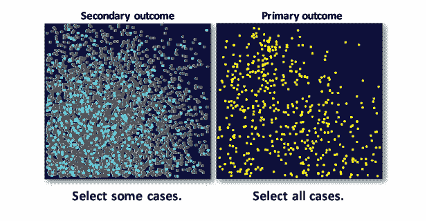

The advantage of `event-based sampling` is that you can obtain (on the average) a model of similar predictive power with a smaller overall case count. This is in concordance with the idea that the amount of information in a data set with a categorical outcome is determined not by the total number of cases in the data set itself, but instead by the number of cases in the rarest outcome category. For binary target data sets, this is usually the event outcome (Harrell 2006).

This advantage might seem of minimal importance in the age of extremely fast computers. However, the model-fitting process occurs only after the completion of long, tedious, and error-prone data preprocessing. Smaller sample sizes for data preprocessing are usually welcome.


## 基于事件的采样分析复杂性

虽然它减少了分析时间，但基于事件的采样也会引入一些分析复杂性：

● 大多数模型拟合统计量（尤其是与预测决策相关的统计量）以及大多数评估图都与训练样本中的结果比例密切相关。如果训练样本和验证样本中的结果比例与评分总体中的结果比例不匹配，则模型性能可能会被严重误估。为了克服这个问题，您必须调整评估指标和图形。

● 如果训练样本和评分总体中的结果比例不匹配，则模型预测估计值会产生偏差。

## Model Studio 自动调整

| Model Studio |
| --- |
| Model Studio 会自动调整评估指标、评估图以及预测估计值以消除偏差。运行管道（执行构建模型的自动化步骤序列）后，您可以检查评分代码。评分代码包含一个标题为 调整后验概率 的部分。此代码块通过将后验概率乘以实际概率与先前指定的基于事件采样值的比率来修改后验概率。 |


## Demo 2.2：修改数据分区

在本演示中，您修改某些变量的元数据角色，探索高级项目设置，并更改数据分区属性。

### 1. 确保项目和变量选择

确保 Demo 项目已打开，并且在 Data 选项卡上变量 `churn` 未被选中。如果已关闭项目，请重新打开，并在变量名称旁边的复选框中取消选择 `churn`（如果已选中）。

注意：以下是关于选择变量的警告！由于使用复选框选择变量不会取消选择其他变量，因此新用户很容易无意中重新分配变量角色。花几分钟时间熟悉变量选择功能被认为是用该软件的最佳实践。以下是一些提示：

◦ 可以通过单击变量名称或选择相应的复选框来为角色分配选择单个变量。

◦ 在为其分配角色后，可以通过清除其复选框或选择另一个变量的名称来取消选择单个变量。

◦ 可以使用变量名称列顶部的复选框选择或取消选择所有变量。

◦ 可以使用复选框同时选择多个变量，或按住 Shift 键并单击以选择变量列表。

### 2. 修改变量属性

修改指定变量的以下属性：

a. 要在 Data 选项卡上指定变量的属性，首先选择所需变量。（您可以同时选择多个变量的复选框。）

b. 在右侧窗格中，选择变量的新角色或级别。

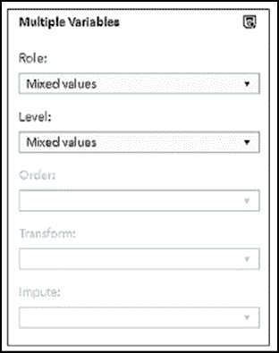

注意：变量元数据包括变量的角色和测量级别。常见的变量角色有 Input、Target、Rejected、Text 和 ID，其含义很直接。常见的变量测量级别有 Interval、Binary、Nominal 和 Ordinal。请参阅 Model Studio 中的相应下拉菜单以获取变量角色和测量级别的完整列表。

对于以下 11 个变量，将角色更改为 Rejected：

◦ `city`
◦ `city_lat`
◦ `city_long`
◦ `data_usage_amt`
◦ `mou_onnet_6m_normal`
◦ `mou_roam_6m_normal`
◦ `region_lat`
◦ `region_long`
◦ `state_lat`
◦ `state_long`
◦ `tweedie_adjusted`

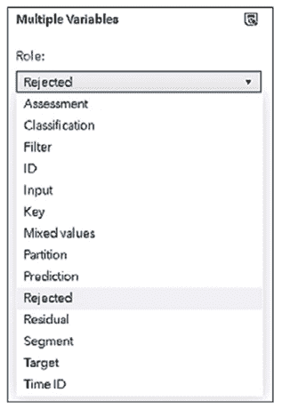

以下是其他一些变量角色的描述：

◦ Assessment：支持决策处理。该角色目前未使用，可供将来使用。

◦ Classification：用于类别目标的模型分类。例如，以 `CHURN` 为目标，则 `I_CHURN` 变量具有基于预测概率和所用截止值的 0/1 预测。请注意，分类截止值仅应用于二元目标。

◦ Filter：用于过滤。具有此角色的变量在值=1 时会过滤掉条目，在值=0 时保留条目。它由 Filtering 节点和 Anomaly Detection 节点使用。

◦ Key：观测标识符。此变量必须对所有观测值唯一。此变量由 Text Mining 节点使用，并在基于观测的 Model Interpretability 报告生成中使用。

◦ Offset：数值变量。此变量由 GLM 节点使用。偏移变量通常用于具有“已知”斜率的协变量。此变量的参数不进行估计，变量只是简单地添加到模型中。

◦ Prediction：模型预测变量——即区间目标的预测或类别目标的后验概率。它在模型评估期间使用。

◦ Residual：误差残差，仅用于信息目的。

◦ Segment：分段变量。它由 Clustering 节点为创建的聚类 ID 创建。当存在 Segment Profiler 节点或支持分段建模时使用此变量。

◦ Time ID：时间变量，仅用于信息目的。

◦ 通过单击窗口右上角的 (Settings) 更改默认分区。

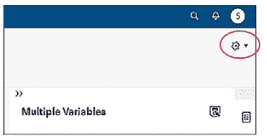

注意：当您在 Model Studio 中创建新项目时，默认情况下会执行分区。如果您想在创建项目之前查看或修改分区设置，可以从用户设置中进行。在用户设置中，分区选项卡使您可以指定分区方法以及相关百分比。此级别的任何设置都是全局的，并应用于创建的任何新项目。

### 3. 选择项目设置并分区数据

选择项目设置。在项目设置窗口中选择 Partition Data 后，将 Training 百分比更改为 70，将 Test 百分比更改为 0。

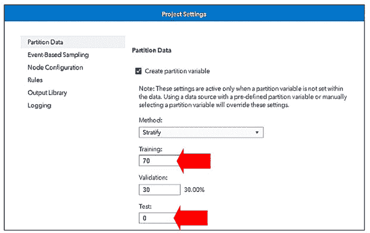

只有在项目中尚未运行任何管道时才能编辑这些设置。运行第一个管道后，项目的分区表将被创建，分区设置无法更改。

注意：请回顾在上一次演示中已展示，Partition Data 选项也可以在创建项目时在高级设置下访问和更改。

注意：分区将根据目标级别进行分层。这可能有点令人困惑，因为您可以在创建项目时（在指定目标之前）指定分区，但分区要到第一次运行 Data 节点时才创建，因此 Model Studio 仍要求您在创建分区之前指定目标。因此，分区可以根据目标进行分层。

### 4. 选择基于事件的采样

选择基于事件的采样。


当基于事件的采样打开时（默认情况下关闭），可以在采样完成后设置事件和非事件案例的期望比例。打开后，采样后事件和非事件的默认比例均为 50%。两者之和必须为 100%。在项目中运行管道后，基于事件的采样设置无法更改。

注意：请回顾在上一次演示中已展示，基于事件的采样选项也可以在创建项目时在高级设置下访问和更改。

保持基于事件的采样选项为其默认设置。

### 5. 选择节点配置

选择节点配置。


## 节点配置

节点配置设置可在使用开源代码节点时使代码被添加到用户编写的代码之前。当选中复选框时，会出现代码编辑器。您可以在编辑器中添加 `Python` 语言的开源代码。此代码会在语言属性设置为 `Python` 时自动添加到每个开源代码节点之前。您将在后面的章节中了解有关开源代码节点的更多信息。保持复选框未选中。

### 6. 选择规则。


规则选项可用于更改在模型比较期间确定冠军模型的选取统计量和分区数据集。可以为类目标和区间目标选择统计量。
保持规则选项为默认设置。

### 7. 保存分区选项

请务必点击保存，因为分区选项已被更改。

### 8. 切换到管道选项卡

到目前为止，您一直在数据选项卡上工作。点击演示项目中的管道选项卡。


在管道选项卡上，您可以创建、修改和运行管道。每个管道都有唯一的名称和可选的描述。
其他选项卡包括管道比较选项卡和洞察选项卡。洞察选项卡包含有关项目、冠军模型和挑战者模型的汇总报告。除非包含模型节点的管道已成功运行，否则洞察选项卡上没有信息可用。

### 9. 运行数据节点

管道比较选项卡和洞察选项卡将在本书后面讨论。右键单击数据节点并选择运行。


节点中的绿色勾号表示其已无错误运行。分区已成功创建。


注意：运行数据节点后，您无法更改分区、基于事件的抽样、项目元数据、项目属性或目标变量。但是，您可以使用管理变量节点更改变量元数据。

### 10. 打开项目日志

此分区操作的日志文件可以查看。点击右上角的设置。

### 11. 选择项目日志

选择项目日志。


### 12. 打开分区日志

从可用日志窗口中，选择项目分区的日志，然后点击打开。


日志文件可以查看甚至下载。


### 13. 返回管道

点击关闭取消返回管道。


## 数据准备最佳实践

数据预处理涵盖了一系列针对原始数据、结构化数据和非结构化数据（来自一个或多个来源）的不同处理过程。数据预处理过程侧重于提高数据的质量和完整性，标准化其定义和结构，收集和整合数据，并采取转换步骤使其可用，特别是用于机器学习分析。准备过程的选择和类型可能因您的目的、您的数据专业知识、您计划如何与数据交互以及您想要回答的问题类型而异。

表 2.3 总结了您在准备数据时可能遇到的一些挑战。它还包括了如何使用 Model Studio 中的数据挖掘预处理管道节点来处理该挑战的建议。

### 表 2.3：数据准备挑战

| 数据问题 || 常见挑战 || 建议的最佳实践 |
| --- | --- | --- |
| 数据收集 || 数据不完整 || 丰富数据 |
| 高维数据 || 降维（Feature Extraction、Variable Clustering 和 Variable Selection 节点） |
| 稀疏性 || 更改数据的表示形式（Transformations 节点） |
| 有偏数据 || 花时间了解业务问题及其背景 |
| “Untidy” 数据 || 值范围作为列同一列中的多个变量变量同时出现在行和列中 || 使用 SAS 代码转换数据（Code 节点） |
| 异常值 || 分数数据中超出范围的数值和未知分类值 || 离散化（Transformations 节点）Winsorizing（Imputation 节点） |
| 稀疏目标变量 || 低主要事件发生率目标中零值或缺失值的压倒性比例 || 按比例过采样 |
| 幅度不同的变量 || 误导性变量重要性距离度量不平衡梯度主导 || 标准化（Transformations 节点） |
| 高基数变量 || 过拟合保留数据中未知分类值 || 分箱（Transformations 节点）替换（Replacement 节点） |
| 缺失数据 || 信息丢失偏差 || 分箱（Transformations 节点）插补（Imputation 节点） |
| 强多重共线性 || 不稳定的参数估计 || 降维（Feature Extraction、Variable Clustering 和 Variable Selection 节点） |

其中一些挑战也可以在建模阶段处理，例如使用树模型自动处理缺失数据，这将在后续章节中讨论。

构建和提取良好的特征需要对问题和您正在处理的数据的经验和领域知识。以下是用于对特征工程技术进行分类的四组：
● 从一个或多个现有特征的组合构建新特征
● 使用监督或无监督技术选择关键特征
● 将特征聚类成组
● 从现有特征中提取新特征

SAS Viya 中有各种特征工程技术（`PROCs` 和 Model Studio 中的对应节点）。其中一些您已经在前面的部分处理过。

有关更多详细信息，请参阅“4 ways to classify feature engineering in SAS Viya.” (`https://communities.sas.com/t5/SAS-Communities-Library/4-ways-to-classify-feature-engineering-in-SAS-Viya/ta-p/508855`)

## Model Studio：特征工程模板

| Model Studio: Feature Engineering Template |
| --- |
| 图 2.6 显示了 Model Studio 中的特征工程管道模板。无论您执行特征选择还是特征提取，您的目标都是包含描述大部分但不是全部方差的特征子集，并降低数据中的信号与噪声比。虽然直觉会告诉您消除特征等同于信息损失，但最终，这种损失会被模型能够在更低维空间中更准确地将剩余特征映射到目标的能力所补偿。结果是更简单的模型、更短的训练时间、更好的泛化能力以及更大的可视化特征空间的能力。 |
| 图 2.6：特征工程模板 |
| 在图 2.6 中，Imputation 节点用各自的中位数对区间输入中的缺失值进行插补，并创建随后用作输入的缺失指示符。 |
| 更有效的针对高基数变量的转换包括基于目标的转换，例如创建捕获名义变量每个水平出现频率的特征。对于高基数，这很有帮助！您可能会使用某个水平相对于所有存在水平的比率或百分比。同样，您可以通过为高基数名义变量的每个水平选择该变量的最大值、最小值或中位数，使用另一个数值输入变量来编码高基数变量。WOE（权重证据）编码是另一种强大的基于目标的转换。 |

演示 2.3：运行特征工程管道模板

在此演示中，您在 `commsdata` 上运行自动特征工程管道模板。


## 特征工程管道

1. 单击画布左上角当前管道选项卡旁边的加号。


2. 在“新建管道”窗口中，对于“模板”，选择“浏览模板”。


注意：模板菜单上的某些选项在您的计算机上可能有所不同。

3. 在“浏览模板”窗口中，选择“特征工程模板”。单击“确定”。


4. 在“新建管道”窗口中，输入名称“特征工程”。


5. 单击“保存”。


模板通过使用流行的特征转换和提取技术自动创建工程特征。其思路是从潜在噪声的原始数据中自动学习一组特征，这些特征可在监督学习任务中使用，而无需手动创建工程特征。

6. 右键单击“数据探索”节点并选择“运行”。

7. 打开结果。展开“类变量汇总”条形图并观察数据不包含高基数变量。


8. 退出最大化视图并关闭结果。

9. 展开画布左侧的“节点”窗格。展开“数据挖掘预处理”。


10. 单击并拖动“管理变量”节点，将其放置在“数据”节点和“插补”节点之间。


11. 运行“管理变量”节点。

12. 节点运行后，再次右键单击该节点并选择“管理变量”选项。

13. 在“管理变量”窗口中，双击“注释”列标题按此列排序。注意，超过最大级别截止值的变量被分组在一起。

14. 选择 `issue_level1`。该变量有 55 个类别。


`call_category_2`、`call_center`、`city`、`issue_level1`、`issue_level2`、`resolution` 和 `state` 都是高基数名义输入变量，因默认截止值为 20 个类别而被之前拒绝。如果您希望它们包含在分析中，可以全部选择。为了减少处理时间，我们只选择其中一个。

15. 将其角色从“已拒绝”更改为“输入”。


16. 修改元数据后，确保已取消选择这些变量。

17. 选择“关闭”退出“管理变量”窗口。系统询问是否要保存更改时，单击“保存”。属性更改已应用。

18. 运行“变量选择”节点。

来自聚类节点的输出变量，例如聚类标签 (`_CLUSTER_ID_`) 和到质心的距离 (`_DISTANCE_`)，被用作变量选择节点中的输入。

19. 从现在开始，逐个选择每个节点，右键单击并选择“运行”。不要单击“运行管道”图标。

注意：运行此模板可能会大幅增加运行时间。请记住，课堂环境中可用资源有限。已打开自动超参数调优（自动调优），以找到梯度提升算法的最佳超参数设置，以便特征集之间的比较更公平且不依赖于超参数。然而，请记住自动调优会带来额外的计算成本。如果此步骤运行时间过长，您可以更改自动调优设置，或直接关闭它并使用默认超参数设置。在模板的默认设置下，我们建议逐个节点运行此管道。如果您运行整个管道，可能会遇到资源不足的错误。

20. 整个管道成功运行后，右键单击“模型比较”节点并选择“结果”。

21. 检查“模型比较”表。除非另有说明，否则默认拟合统计量 (`KS`) 用于选择具有类别目标的冠军模型。


探索结果。

比较四个不同特征集的性能（三个自动工程化集合和原始集合（不带目标编码））。

请务必记住，使用此模板并不能保证自动创建的特征集之一在您的数据上表现优于原始特征，因为每个数据集都是唯一的，并且此模板仅使用几种技术。相反，此目标是展示如何使用 Model Studio 提供的许多其他工具创建不同的自动工程化特征集，并以最小的努力以类似的方式测试其性能的示例。

22. 单击“关闭”关闭“模型比较结果”窗口。


### 测验

1. Model Studio 中的数据探索节点可让您执行以下哪项操作？（多选。）

a. 分析数据集。

b. 观察最重要的输入或可疑变量。

c. 删除偏离正态性的变量。

d. 选择缺失值比例高的变量作为输入。

2. 在 Model Studio 中定义元数据时，以下哪项陈述是正确的？

a. “数据”选项卡允许您通过更改下限或上限（或两者）来编辑变量值。

b. 除非在此节点之前指定元数据，否则“替换”节点无法替换异常值和未知类别水平。

c. 元数据属性可以在“数据”选项卡或“管理变量”节点中定义，然后可以通过使用适当的节点来调用。

d. 以上都不是。

# 第 5 章：发现：选择算法

简介

选择算法

您的数据规模和性质是什么？

您希望模型实现什么目标？

所需的准确度是多少？

训练模型可用时间是多少？

您需要的可解释性水平是多少？

您是否具有自动超调优能力？

分类和回归

K-最近邻

Model Studio：聚类节点

回归

逻辑回归

测验

## 简介

现在您已经确保拥有足够合适的数据，将数据整理成适合建模的形式，确定了模型中要包含的关键特征，并确定了模型的使用方式，您就可以使用强大的机器学习算法来构建预测模型或发现数据中的模式。这实际上是您应该允许自己更自由地尝试不同方法，以确定产生特定应用最佳模型的算法（以及这些算法的选项配置）的阶段。

机器学习应用的成功取决于您构建的实际模型的有效性。在选择最佳模型或冠军模型时，您应考虑以下基本发现任务：

● 选择算法
● 改进模型
● 优化模型的复杂性
● 正则化和调优
● 构建集成模型

## 选择算法


选择完美算法没有唯一答案或配方。建议尝试多种不同的模型并比较结果。流行的“没有免费午餐”定理（Wolpert 1996）指出没有一种模型适用于所有问题。

然而，你可以使用以下问题来指导你的决策（Wujek, Hall, and Günes 2016）：
- 数据的大小和性质是什么？
- 你希望模型实现什么目标？
- 模型需要多准确？
- 你有多少时间来训练模型？
- 模型需要多可解释或易理解？
- 你的模型是否具有自动超参数调优能力？

初学者往往倾向于选择易于实现且能快速获得结果的算法。如果这是流程的第一步，这种做法是可以接受的。在获得一些结果并更熟悉数据后，你可以花更多时间尝试更复杂的算法。这可能会加深你对数据的理解并进一步改善结果。

即使在这一阶段，最佳算法也可能不是报告准确率最高的那些方法。大多数算法通常需要仔细调优和大量训练才能获得最佳性能。为机器学习应用选择建模算法有时可能是最困难的部分。在决定使用哪些算法之前，请考虑以下各节中提出的问题。

## 数据的大小和性质是什么？

如果你预期特征与目标之间存在线性关系，线性回归或逻辑回归或线性核支持向量机可能就足够了。由于训练效率高以及维度诅咒，线性模型对于大型数据集也是一个不错的选择。随着特征数量的增加，点之间的距离会增大，观测值更可能线性可分。在一定程度上，非线性和交互效应可以通过在回归模型中添加高阶多项式和交互项来捕捉。更复杂的关系可以通过更复杂的机器学习算法（如决策树、随机森林、神经网络和非线性核支持向量机）的能力来建模。当然，这些更复杂的算法可能需要更长的训练时间，并且可能不适合非常大的数据集。

## 你希望模型实现什么目标？

你是创建模型来对观测值进行分类、预测区间目标的值、检测模式或异常，还是提供推荐？回答这个问题会将你引导到专门解决该问题的机器学习算法子集。

## 所需的准确率是多少？

尽管你总是希望模型在应用于新数据时尽可能准确，但追求简洁仍然是好的。更简单的模型训练速度更快，更易于理解，从而更容易解释结果是如何以及为何实现的。更简单的模型也更容易部署。以回归模型作为基准开始，然后训练更复杂的模型，如神经网络、随机森林或梯度提升模型。如果你的回归模型比更复杂的模型准确率低很多，你可能遗漏了一些重要的预测因子或预测因子之间的交互。更简单模型的另一个好处是它不太容易过拟合训练数据。

## 训练模型可用时间是多少？

这与模型需要多准确有关。如果你需要在短时间内训练模型，线性回归或逻辑回归和决策树可能是最佳选择。如果训练时间不是问题，请利用强大的算法（神经网络、支持向量机、梯度提升等），这些算法会迭代地优化模型，以更好地表示特征与目标之间的复杂关系。

## 你需要什么程度的可解释性？

明确模型使用者对模型可解释性的期望非常重要。如果不可解释的预测是可以接受的，你应该使用在时间和计算资源上你能承受的最复杂的算法。训练神经网络、支持向量机或任何类型的集成模型，以实现高度准确且可泛化的模型。如果可解释性或可解释的文档很重要，请使用决策树或回归技术，并考虑使用惩罚回归技术、广义加性模型、分位数回归或模型平均来优化你的模型。

## 你是否具有自动超调优能力？

你的模型是否有任何可以利用的自动超调优能力？最优超参数设置极度依赖数据。因此，很难提供一般性规则来说明如何为学习算法识别重要超参数的子集，或如何找到适用于所有数据集的每个超参数的最优值。控制学习算法的超参数非常重要，因为适当的控制可以提高准确率并防止过拟合。

表 5.1 提供了一些选择 SAS Visual Data Mining and Machine Learning 有监督学习算法的最佳实践。

### 表 5.1：选择有监督学习算法

| 目标类型 || 用法 || 规模 || 可解释性 || 自动调优 || 常见问题 |
| --- | --- | --- | --- | --- | --- |
| 回归（线性、逻辑、广义线性模型） |
| · 线性回归和 GLM 用于区间目标。· 逻辑回归用于名义和二元目标。 || · 建模线性或线性可分现象。· 手动指定非线性和显式交互。· LASSO 回归为线性回归和逻辑回归包含一个正则化项，以处理多重共线性和过拟合问题。 || 小型到大型数据集 || 高 || 否 || · 缺失值· 异常值· 标准化· 参数调优 |
| 支持向量机 |
| 二元 || 使用线性核或最高三次的多项式核建模线性或线性可分现象 || 小型到大型数据集 || 低 || 是 || · 缺失值· 过拟合· 异常值· 标准化· 参数调优 |
| 基于树的建模（决策树、森林、梯度提升） |
| · 区间· 二元· 名义 || · 在大型数据集中建模非线性和非线性可分现象· 交互作用会被自动但隐式地考虑· 缺失值和输入变量中的异常值在许多实现中会被自动处理· 树集成（森林、梯度提升）可以提高预测准确率并减少过拟合，但也会降低可扩展性和可解释性 || 中型到大型数据集 || 中等 || 是 || · 小训练集的不稳定性· 梯度提升在噪声或异常值下可能不稳定· 过拟合· 参数调优 |
| 神经网络 |
| · 区间· 二元· 名义 || · 建模非线性和非线性可分现象。· 在全连接、多层拓扑中考虑所有交互作用。 || 中型到大型数据集 || 低 || 是 || · 缺失值· 过拟合· 异常值· 标准化· 参数调优 |
| 贝叶斯网络 |
| · 二元· 名义 || · 在大型数据集中建模线性可分现象。· 非常适合复杂方法不可行的极大数据集。 || 小型到非常大型数据集 || 中等 || 是 || · 线性独立性假设· 分类水平不频繁 |

以下章节和后续章节讨论最常用的算法。我们从你可能已经熟悉的一个开始，分类和回归。

## 分类和回归


监督机器学习问题的两种主要类型是分类和回归。在分类中，目标是预测一个类别标签或组，其中结果或目标与该特定组或类别中的其他目标更相似，而比其他组中的其他目标更相似；例如，将动物分类到一个物种。在回归中，目标是预测一个连续数值；例如，房屋价格或收入。

## K-最近邻

K-最近邻（`k-NN`）是最简单的机器学习算法之一。它通过在训练数据集中找到最接近的数据点来进行预测——换句话说，就是其最近邻。

在其最简单的形式中，`k-NN` 算法仅考虑一个最近邻，即最接近我们想要为其预测类别标签的新点的训练点。然后预测结果就与最接近的训练点相同类别。

图 5.1：最近邻模型对新数据点的预测


如果不只考虑最近的邻居，我们还可以考虑任意数量 `k` 的邻居。假设 `k = 5`，新数据点由其五个邻居的多数投票来分类。由于五个邻居中有四个是三角形，新点将被分类为三角形。我们实际上是在投票分配类别标签，每个邻居有一票。因此，对于数据集中每个点，我们统计有多少个 `k` 个邻居属于 `class 0`，有多少个邻居属于 `class 1`。然后我们分配出现频率更高的类别，即 `k` 个最近邻中的多数类。

图 5.2：五最近邻模型对新数据点的预测


上述示例说明了二分类问题，但该方法可用于具有任意数量类别的数据集。在多类情况下，我们统计每个类别的邻居数量，并再次预测出现频率最高的类别。

但如何选择 `k` 的值？没有确定最佳 `k` 值的方法，因此我们必须先尝试几个值再确定。这里有一些提示：
• `k` 的较小值可能噪声较大且易受异常值影响。
• `k` 的较大值具有更平滑的决策边界，这意味着方差更低但偏差增大。
• 使用奇数 `k` 值以避免在两个数据类别之间产生混淆。

选择 `k` 的另一种常见技术是交叉验证。从训练数据集中选择交叉验证数据集的一种方法是取训练数据集的一小部分并称其为验证数据集，然后用其评估不同的 `k` 值。这样我们将使用 `k = 1`、`k = 2`、`k = 3` 等来预测验证集中每个实例的标签。然后，我们查看哪个 `k` 值在验证集上表现最好。然后我们选择该 `k` 值以最小化验证误差。

选择 `k` 值的另一种通用做法是 `k = sqrt(N)`，其中 `N` 表示训练数据集中样本的数量。

### k-NN 算法

在分类设置中，`k-NN` 算法对给定“未见”观测值最相似的 `k` 个实例进行多数投票。相似性根据两个数据点之间的距离度量来定义。其中流行的一种是欧几里得距离方法。


其他方法有曼哈顿、闵可夫斯基和汉明距离方法。对于分类变量，必须使用汉明距离。

K-NN 的更详细示例可以在此 SAS 社区帖子中找到：[`communities.sas.com/t5/SAS-Communities-Library/A-Simple-Introduction-to-K-Nearest-Neighbors-Algorithm/ta-p/565402`](https://communities.sas.com/t5/SAS-Communities-Library/A-Simple-Introduction-to-K-Nearest-Neighbors-Algorithm/ta-p/565402For)

### Model Studio：聚类节点

在 Model Studio 中，聚类节点是一个数据挖掘预处理节点。使用聚类节点根据从定量或定性变量（或两者）计算的距离执行观测聚类。观测值被划分为簇，使得每个观测值恰好属于一个簇。聚类将观测值放入数据建议的组或簇中，使得簇内的观测值相似，而不同簇的观测值不相似。

该节点使用以下算法：
• 用于聚类区间（定量）输入变量的 `k-means` 算法
• 用于聚类名义（定性）输入变量的 `k-modes` 算法
• 用于聚类包含区间和名义变量的混合输入的 `k-prototypes` 算法

通过迭代更新簇质心和数据的簇成员来实现聚类，直到满足收敛准则或达到最大迭代次数。当未指定所需簇数量时，使用对齐盒准则（`ABC`）技术来估计所需的簇数量。

训练期间不使用具有缺失输入值的观测值。因此，您可能需要对数据进行插补。建议对区间变量进行标准化，因为方差较大的变量往往比方差较小的变量对距离测量影响更大。

聚类完成后，可以使用聚类结果以图形方式检查簇的特征。簇在变量间的一致性尤其值得关注。多维图表和绘图使您能够以图形方式比较簇。

请注意，每个观测值的簇标识符可以传递给后续节点用作输入、ID 或段变量。默认值为段变量。

#### 常规属性

簇初始化指定用于确定初始簇成员关系的方法。以下是可能的值：
Forgy 将 `k` 个数据点指定为 `k` 个初始簇。
Random 随机将每个观测值分配到一个簇。
Automatic gamma 指定是否在混合距离计算中自动计算 gamma 系数。
User-specified gamma 指定混合距离计算中系数 gamma 的值。
Random seed 指定用于启动伪随机数生成器的正整数。默认值是 `12345`。

#### 区间输入

缺失区间输入指定区间输入变量的插补方法。可能的值为 Exclude 或 Impute with mean。默认设置是 Impute with mean。

标准化方法指定标准化区间输入变量的方法。以下是可能的值：
• (none)
• Range
• Z Score

指定 Range 以根据输入变量的范围进行标准化，或指定 Z Score 以根据计算的 Z 分数进行标准化。选择 (none) 以禁用标准化。默认设置是 (none)。

相似性距离指定区间输入变量相似性测量的距离度量。可能的值为 Euclidean distance 和 Manhattan distance。Euclidean distance 计算两个簇之间的线段距离。Manhattan distance，或出租车距离，使用仅轴对齐的移动来计算两个簇之间的距离。默认设置是 Euclidean distance。


## 类别输入
`Missing class inputs` 指定类输入变量的插补方法。可能的值为 排除 和 用众数插补。默认设置是 排除。
`Similarity distance` 指定类输入变量相似性度量的距离度量。以下是可能的值：
- 二进制
- 全局频率
- 相对频率
二进制 计算简单的匹配距离。全局频率 和 相对频率 根据输入数据表中或在每个聚类中类输入变量的频率分别计算距离。默认设置是 二进制。

## 聚类数估计
`Number of clusters method` 指定用于估计聚类数的方法。可能的值为 对齐箱准则 和 用户指定。选择 用户指定 以在 Number of clusters 字段中输入聚类数。
选择 对齐箱准则 属性可根据以下参数生成聚类数：
- `Number of reference data sets` 指定为每个聚类候选创建的参考数据集的数量。默认值是 1。
- `Maximum number of clusters` 指定聚类的最大数量。如果观测值的数量小于指定数量，则聚类数将设置为观测值的数量。如果聚类中的观测值数量为零，则该聚类将不会在结果中显示。默认值是 6。
- `Minimum number of clusters` 指定聚类的最小数量。默认值是 2。
- `Estimation criterion` 指定用于估计聚类数的准则，该准则使用 ABC 方法中获得的统计数据。以下是可能的值：
  - All criteria 指定聚类数由其他三个可用属性设置的组合决定。
  - First peak value 指定聚类数由间隙统计中的峰值中的第一个峰值决定。
  - First peak with one-standard-error 指定聚类数由最小的 k 决定，使得该 k 的间隙值大于 k+1 的一标准误差调整后的间隙值。
  - Global peak value 指定聚类数由间隙统计中所有峰值中的最大值决定。
默认值是 Global peak value。
`Alignment method` 指定基于输入数据对齐参考数据集的方法。可能的值为 (none) 和 PCA。如果设置为 (none)，节点将从输入数据集每个子集的值范围上的均匀分布生成参考数据集。如果设置为 PCA，节点将从与每个子集输入数据集的主成分对齐的盒子上的均匀分布生成参考数据集。

## 停止准则
`Stop method` 指定停止准则方法。可能的值为 聚类变化 和 集群内距离。Cluster change 是默认值。
`Cluster change parameter` 指定迭代中未更改其聚类的观测值的百分比。范围在 0 到 100 之间，默认值是 20。如果选择 Cluster change 作为 Stop method，则当更改聚类的观测值数量小于所选参数值时，聚类计算将结束。
`Within cluster distance parameter` 指定迭代之间集群内距离变化的差异。如果为 Stop method 选择 Within cluster distance，则如果迭代后聚类距离的变化小于给定参数，则聚类计算将结束。
`Maximum number of iterations` 指定算法执行的迭代最大次数。默认值是 10。在每次迭代中，每个观测值都被分配给最近的聚类质心，并且质心被重新计算。

## 评分输出角色
`Cluster variable role` 指定要分配给聚类变量的角色。默认情况下，聚类变量（段标识符）被分配 Segment 角色。以下是可用的角色：
- ID
- Input
- Rejected
- Segment
段角色对于 BY 组处理很有用。请注意，当段标识符传递到管道中的后续节点时，它会保留所选的变量角色。
`Cluster distance role` 指定分配给聚类距离变量的角色。默认角色是 Rejected。

## 回归
对于本书，我们假设您对线性和逻辑回归有基本的了解。下面我们提供一个快速复习。

### 线性回归
线性回归是线性模型的一个例子。线性模型使用输入特征的线性函数进行预测。对于回归，公式写为：
`y = w0 * x0 + w1 * x1 + ... + wp * xp + b`
其中 `x0` 到 `xp` 表示单个数据点的特征，`w` 和 `b` 是模型学习的参数，`y` 是输出或预测。该公式提供了一个预测线，可以通过使用输入特征作为坐标在直线上绘制其位置来找到新数据点的预测。对于具有两个特征的简单模型，模型可以表示为平面。对于多个特征的更高维度，模型由超平面表示。

### 分类回归
分类回归用于二元分类预测。它与线性回归非常相似，但与预测连续结果不同，其输出限制为单位区间的值。
`y = w0 * x0 + w1 * x1 + ... + wp * xp + b > 0`
该公式看起来与线性回归的公式非常相似，但预测值的阈值为零。如果函数小于零，我们预测类别 -1，如果函数大于零，我们预测类别 +1。

### 逻辑回归
在逻辑回归中，模型预测可以被视为主要结果概率。输入的线性组合生成 logit 分数或主要结果的对数几率，这与线性回归对目标的直接预测形成对比。
对于二元预测，任何将单位区间映射到实数线的单调函数都可以被视为链接。logit 链接函数是最常见的之一。其受欢迎程度部分归功于模型的解释性。但 logit 函数使参数估计复杂化。参数估计是通过最大似然估计获得的。似然函数是将数据视为参数函数的联合概率密度。

上述表达式中，前者表示主要结果训练案例，后者表示次要结果训练案例。
最大似然估计是使获得训练样本的概率最大化的参数值。这些估计值可用于 logit 和 logistic 方程以获得预测。图 5.3 右侧的图显示了 logistic 方程的预测估计。标准 logistic 回归模型的一个吸引力是其预测的简单性。轮廓是简单的直线，通常称为等概率线。 （在更高维度中，它们将是超平面。）
图 5.3：逻辑回归示例

预测可以是决策、排名或估计。logit 方程产生排名或 logit 分数。要做出决策，需要一个阈值。获得有意义阈值最简单的方法是将预测排名转换为预测估计。您可以使用 logit 分数的直接变换，即 logistic 函数来获得预测估计。logistic 函数只是 logit 函数的逆函数。您可以通过求解 logit 方程得到 `p` 来获得 logistic 函数。

## 测验
1. logit 函数的取值范围是什么？
a. (-∞, +∞)
b. [0, +∞)


c. `[0,1]`

d. `1, +∞)`

# 第 3 章：准备您的数据：缺失数据和非结构化数据

[引言

处理缺失数据

管理缺失值

模型工作室：处理缺失值

演示 3.1：修改和更正源数据

演示 3.2：使用“管理变量”节点修改和更正源数据的替代方法

添加非结构化数据

单值分解 (SVD)

使用 SVD 进行降维

从图像上理解 SVD

演示 3.3：添加文本挖掘特征

测验

## 引言

在本章中，我们先介绍如何处理缺失数据，然后重点介绍如何处理非结构化数据，例如文本数据。 所谓非结构化，是指数据不是以传统行列数据库的形式提供。 它与结构化数据相反——结构化数据存储在数据库的字段中。 非结构化数据通常以文本为主，但也可以包含日期、数字和事实。

## 处理缺失数据

缺失值对于许多机器学习任务来说在理论上和实践上都可能存在问题，尤其是在目标变量中存在缺失值时。 本节仅讨论输入变量中存在缺失值的更常见情况。 数据中缺失值的问题几乎总是存在且始终令人担忧。 面对输入变量中的缺失值时，您必须考虑缺失值是随机分布的，还是缺失本身在某种程度上可以预测目标。 如果输入数据中的缺失值是随机出现的，则包含缺失值的输入行可以从分析中删除，而不会给模型带来偏差。 然而，这种完全案例分析可能会从训练数据中删除大量信息并降低模型的预测准确性。 SAS Visual Data Mining and Machine Learning 中的许多建模算法都在完全案例分析下运行（例如，线性回归和逻辑回归、神经网络和支持向量机）。

完全案例分析假设数据是完全随机缺失的，均值插补也是如此。 当缺失不是随机的、依赖于输入或规范时，插补可能是一个更复杂的问题。 在本书中，我们使用了一种经常有用的简单方法，但您应该意识到它并不总是最佳做法。

缺失值会影响模型构建和模型部署。

图 3.1：缺失值——问题 1


即使在高维情况下，少量缺失值也可能导致数据大量丢失。 例如，假设每个 `k` 个输入变量以概率 `α` 随机缺失。 在这种情况下，完整案例的预期比例如下：

`(1-α)k`

因此，1% 的缺失概率（`α=.01`）对于 100 个输入仅保留 37% 的数据用于分析，200 个保留 13%，400 个保留 2%。 如果“缺失”增加到 5%（`α=.05`），则在 100 个输入的情况下，可用数据将少于 1%。

第二个缺失值问题与模型部署或使用预测公式有关。 如果一个新案例有缺失值，那么基于完整案例构建的模型如何对其进行评分？ 如果训练数据中存在缺失，那么您的评分数据或新数据也非常可能存在缺失，理想情况下缺失类型相似，但数量可能不同。

图 3.2：缺失值——问题 2


以下部分描述了一些处理缺失值的两个问题的常见技术。 我们将看到，适当的补救措施取决于缺失值的原因。

## 管理缺失值

缺失可能是可预测的。 保留与缺失值相关联的信息，包括缺失值本身，可以提高模型的预测准确性。

下表描述了在训练机器学习模型时考虑缺失性的做法，并描述了在对新数据进行评分时也必须如何处理缺失值。

表 3.1：缺失值

| 实践名称 || 实践描述 |
| --- | --- |
| 朴素贝叶斯 || 朴素贝叶斯模型通过基于观察到的特征计算似然来优雅地处理训练和评分中的缺失值。 由于特征之间的条件独立性，朴素贝叶斯仅在特征值缺失时忽略该特征。 因此，除非您认为缺失不是随机的，否则在拟合朴素贝叶斯模型之前无需处理缺失值。 出于效率原因，某些朴素贝叶斯实现会在遇到缺失值时从训练过程中删除整个行。 当缺失被视为分类级别时，新数据中不频繁出现的缺失值在训练数据中不存在时可能会有问题，因为在训练期间缺失级别不会有任何概率与之关联。 您可以通过在评分时忽略似然计算中的有问题特征来解决此问题。 |
| 决策树 || 通常，使用决策树时，缺失值不需要插补、缺失标记、分箱和特殊的评分考虑。 决策树允许以两种常见方式优雅而直接地使用缺失值。 当确定分割规则时，缺失可以是有效输入值，并且缺失值可以放在使训练预测最佳的分割规则一侧，也可以分配到分割中的单独分支。 可以定义替代规则，以便在遇到缺失值时树可以基于替代变量进行分割。 例如，可以定义一个替代规则，允许决策树在邮政编码变量缺失时基于州变量进行分割。 |
| 缺失标记 || 缺失标记是记录另一个变量的值是否缺失的二进制变量。 它们用于保留有关缺失性的信息，以便可以对缺失性进行建模。 缺失标记可用于模型中以替换具有缺失值的原始对应变量，也可与原始变量的插补版本一起用于模型中。 |


## 处理缺失值

## 插补
插补是指用从训练数据中非缺失值推导出的信息替换缺失值。简单的插补方案包括用该变量非缺失值的均值或众数替换输入变量中的缺失值。对于非正态分布的变量或缺失比例较高的变量，简单的均值或众数插补可能会极大地改变变量的分布并负面影响预测准确性。即使变量呈正态分布且缺失比例较低，创建缺失标记并将其与新的插补变量一起用于模型中也是建议的做法。决策树也可以用于推导插补值。可以将具有缺失值的变量作为目标，并将数据集中所有其他变量作为输入来训练决策树。这样，决策树可以学习临时目标变量中缺失值的合理替代值。这种方法需要为每个具有缺失值的输入变量建立一棵决策树，因此对于大型、脏的训练集来说计算成本可能很高。对于小数据集，应考虑更复杂的插补方法，包括多重插补（`MI`）（Rubin 1987）。

## 分箱
具有缺失值的区间输入变量可以根据其原始数值离散化为多个箱，以创建新的分类、名义变量。原始变量中的缺失值可以简单地添加到新变量中的一个额外箱中。具有缺失值的分类输入变量可以分配给新的分类名义变量，这些变量具有与相应原始变量相同的分类水平，外加一个用于缺失值的新水平。由于分箱会在预测模型中引入额外的非线性，并且对输入变量原始分布的损害可能小于插补，因此分箱通常被认为是可以接受的，甚至是有益的，直到分箱过程开始导致过拟合。然而，如果输入变量中值的顺序很重要，则可能不希望使用分箱，因为在有序值中引入缺失箱会改变或抹除顺序信息。

## 缺失数据的评分
如果在训练中使用决策树或决策树集成，则新数据中的缺失值很可能会根据训练好的树（或树木）的分裂规则或替代规则自动评分。如果训练了另一种类型的算法，则新数据中的缺失值必须以在模型训练前在训练数据中处理的方式精确处理。

*来源：机器学习应用最佳实践（Wujek、Hall 和 Güneș 2016），SAS Institute Inc.*

## Model Studio：处理缺失值
在 `Model Studio` 中，您可以使用一刀切的方法处理缺失值。在任何情况下，对于缺失的输入测量，缺失值都会被固定值替换。净效果是修改输入的分布，使其在所选固定数字处包含一个点质量。合成分布方法中点质量的位置并非任意。理想情况下，应选择使其对输入与目标关联程度的影响最小。对于许多建模方法，可以通过将点质量定位在输入的均值来实现这一点。

### 区间输入
`Model Studio` 支持以下区间输入的插补方法：
- `Cluster Mean` 指定缺失值被替换为观测值所属簇的算术平均值。为了使用这种插补方法，您必须在 `Imputation node` 前紧邻的管道中有一个 `Clustering node`。
- `Constant Value` 指定缺失值被替换为 `Constant number value` 字段中指定的值。默认值是 0。
- `Maximum` 指定缺失值被替换为训练中发现的该变量的最大值。
- `Mean` 指定缺失值被替换为算术平均值。
- `Median` 指定缺失值被替换为观测值频率分布的中点。
- `Midrange` 指定缺失值被替换为最大值加上最小值除以 2。
- `Minimum` 指定缺失值被替换为训练中发现的该变量的最小值。
- `None` 指定仅执行 `Data pane` 中指定的插补。默认值是 `Mean`。

### 类别输入
`Model Studio` 支持以下类别输入的插补方法：
- `Cluster Count` 指定缺失值被替换为观测值所属簇中该变量最频繁的非缺失值。为了使用这种插补方法，您必须在 `Imputation node` 前紧邻的管道中有一个 `Clustering node`。
- `Constant Value` 指定缺失值被替换为 `Constant character value` 字段中指定的字符。
- `Count` 指定缺失值被替换为该变量最频繁的值。没有其他配置需要设置。
- `Distribution` 指定缺失值被替换为从该变量非缺失值的经验分布中随机分配的值。因此，`Distribution` 插补通常不会显著改变数据的分布。随机化的初始种子值在 `Distribution method random seed` 字段中指定。默认值是 12345。
- `None` 指定仅执行 `Data pane` 中指定的插补。默认值是 `Count`。

注意：默认方法指定所有类别/区间输入变量的默认转换方法。元数据中指定的任何转换都优先于此处指定的方法。


## 演示 3.1：修改和纠正源数据
在本演示中，您使用 `Data tab` 和 `Replacement node` 来修改数据源。
1. 单击 `Data tab`。

2. 右键单击 `Role column` 并选择 `Sort` → `Sort (ascending)`。

所有 `Input variables` 都被分组在一起，位于 `ID variable`（或变量）之后和 `Rejected variables` 之前。

3. 向右滚动。右键单击 `Minimum column` 并选择 `Sort` → `Add to sort (ascending)`。
具有负最小值的变量被分组在一起。

注意：`Add to sort` 表示按角色进行的初始排序仍然有效，因此对最小值的排序在每个已排序的角色组内进行。
4. 选择以下区间输入变量：
向左滚动返回以找到 `Variable Name column`。您选择了 22 个区间输入变量。
- `tot_mb_data_roam_curr`
- `seconds_of_data_norm`
- `lifetime_value`
- `bill_data_usg_m03`
- `bill_data_usg_m06`
- `voice_tot_bill_mou_curr`
- `tot_mb_data_curr`
- `mb_data_usg_roamm01` through `mb_data_usg_roamm03`
- `mb_data_usg_m01` through `mb_data_usg_m03`
- `calls_total`
- `call_in_pk`
- `calls_out_pk`
- `call_in_offpk`
- `calls_out_offpk`
- `mb_data_ndist_mo6m`
- `data_device_age`
- `mou_onnet_pct_MOM`
- `mou_total_pct_MOM`
注意：选中一个变量的复选框，然后按住 `Shift` 键选择另一个变量，将选择这两个变量以及它们之间的所有变量。
注意：您可以将 `Minimum column` 拖放到左侧，更靠近 `Variable Name column`，以便您可以同时看到 `Minimum column` 和变量名称。


## 下限配置和替换节点

5. 在右侧窗格中，在 `Multiple Variables` 窗口的 `Lower Limit` 字段中输入 `0.0`。这指定了在 `Filtering` 和 `Replacement` 节点中使用 `Metadata limits` 方法时的下限。

注意：这是客户计费数据，负值通常意味着客户账户中应用了信用，因此这些列中存在负数的可能性并不排除。然而，在电信数据中，通常的做法是将负值转换为零。


请注意，您并未编辑任何变量值。您只是设置了一个可以调用的元数据属性。

6. 单击 `Pipelines` 选项卡。


7. 选择 `Basic Template` 流程。


请注意，由于元数据的更改，流程中节点的绿色勾号已变为灰色圆圈。这表示节点需要重新运行以反映元数据的更改。流程重新运行时，节点将再次显示绿色勾号。


8. 展开画布左侧的 `Nodes` 面板。

9. 展开 `Data Mining Preprocessing`。


10. 单击并拖动 `Replacement` 节点，将其放置在 `Data` 节点和 `Imputation` 节点之间。


`Replacement` 节点可用于用指定值替换异常值和未知类别水平。这就是调用您之前设置的下限元数据属性的地方。

11. 在右侧选项面板中，为 `Interval Variables` 部分完成以下操作：
a. 将 `Default limits method` 设置为 `Metadata limits`。
b. 将 `Alternate limits method` 更改为 `(none)`。此属性指定当 `Metadata limits` 为默认限制方法且元数据限制缺失时，用于区间变量的下限和上限的替代派生方法。
c. 将 `Replacement value` 保持为默认值 `Computed limits`。另一个选项是 `Missing value`。


12. 右键单击 `Replacement` 节点并选择 `Run`。训练数据分区中的负值将被替换为零。

13. 查看 `Replacement` 节点的结果。`Interval Variables` 表显示现在下限为 `0` 的变量。


14. 关闭 `Replacement` 节点的结果窗口。

15. 要更新流程其余部分的结果，请单击 `Run Pipeline`。

16. 右键单击 `Model Comparison` 节点并选择 `Results`。

模型性能可在 `Model Comparison` 表中查看。


17. 选择 `Close` 返回流程。


## Demo 3.2：使用 Manage Variables 节点修改和更正源数据的替代方法

除了使用 `Data` 选项卡外，`Manage Variables` 节点是另一个可用于修改和更正数据的强大工具。`Manage Variables` 节点直接在流程中使用。

注意：应使用 `Data` 选项卡来修改和更正源数据，如前一演示所述。本演示提供了另一种为数据分配元数据规则的方法。本演示中所示方法的一个缺点是，如果流程保存到 `Exchange`，则在 `Manage Variables` 节点中定义的规则不会被保存。

1. 选择 `Basic Template` 流程。

2. 展开画布左侧的 `Nodes` 面板。

3. 展开 `Data Mining Preprocessing`。


4. 单击并拖动 `Manage Variables` 节点，将其放置在 `Data` 节点和 `Imputation` 节点之间。


注意：请注意，在流程中放置 `Manage Variables` 节点后，同一路径中在其下面的任何节点的外观都会从显示绿色勾号变为显示灰色圆圈。这表示它们需要重新运行。

`Manage Variables` 节点是一个预处理节点，使您能够在 Model Studio 流程中对其元数据进行修改。

您会看到一个窗口，提示该节点必须先运行才能打开。


5. 在 `Run Node` 窗口中单击 `Close`。

6. 右键单击 `Manage Variables` 节点并选择 `Run`。

这会读取观测值和变量，并在修改其元数据之前设置传入变量。

7. 节点运行后，再次右键单击该节点并选择 `Manage Variables` 选项。

8. 在 `Manage Variables` 窗口中，右键单击 `Role` 列并选择 `Sort` → `Sort (ascending)`。


9. 向右滚动。右键单击 `Minimum` 列并选择 `Sort` → `Add to sort (ascending)`。


10. 修改指定变量的以下属性：
a. 要在 `Manage Variables` 窗口中修改变量的元数据，请先选择所需变量。（您可能希望一次选择多个变量。）

选择以下区间输入变量：
- `tot_mb_data_roam_curr`
- `seconds_of_data_norm`
- `lifetime_value`
- `bill_data_usg_m03`
- `bill_data_usg_m06`
- `voice_tot_bill_mou_curr`
- `tot_mb_data_curr`
- `mb_data_usg_roamm01` through `mb_data_usg_roamm03`
- `mb_data_usg_m01` through `mb_data_usg_m03`
- `calls_total`
- `call_in_pk`
- `calls_out_pk`
- `call_in_offpk`
- `calls_out_offpk`
- `mb_data_ndist_mo6m`
- `data_device_age`
- `mou_onnet_pct_MOM`
- `mou_total_pct_MOM`

（向左滚动返回以找到 `Variable Name` 列。您选择了 22 个区间输入变量。）

注意：选中一个变量的复选框，然后按住 `Shift` 键选择另一个变量，将选择这两个变量以及它们之间的所有变量。

a. 在右侧窗格中，在 `Multiple Variables` 窗口的 `New lower limit` 字段中输入 `0.0`。


并未编辑任何变量值。相反，已定义了一个可通过使用适当节点调用的元数据属性。

11. 选择 `Close` 退出 `Manage Variables` 窗口。系统询问是否要保存更改时，单击 `Save`。属性更改将被应用。


12. 单击并拖动 `Replacement` 节点，将其放置在 `Manage Variables` 节点和 `Imputation` 节点之间。


13. 在右侧选项面板中，为 `Interval Variables` 完成以下操作：
a. 将 `Default limits method` 设置为 `Metadata limits`。
b. 将 `Alternate limits method` 更改为 `None`。
c. 将 `Replacement value` 保持为默认值 `Computed limits`。


14. 右键单击 `Replacement` 节点并选择 `Run`。训练数据分区中的负值将被替换为零。

15. 关闭 `Replacement` 节点的结果窗口。


## 添加非结构化数据

非结构化、自由格式的文本数据在商业中很常见。例如，调查结果、呼叫中心日志、产品评论、社交媒体信息流、博客、客户反馈和其他文本数据包含对预测建模结果有用的信息，这些信息在结构化数据中不易获得。因此，分析这些组合的文本数据源并将其与结构化数据一起使用是非常有信息量的。


## 文本挖掘与降维

## 非结构化数据增长

今天的组织正在生成和存储大量数据。IDC 估计其中多达 80% 是非结构化的——即信息要么没有预定义的数据模型，要么没有按预定义方式组织。非结构化数据包括音频、图像、视频和文本内容等格式。虽然这类信息通常富含洞察，但解锁这些复杂数据源中的全部潜力可能很棘手。大量大数据爆炸的原因是由于非结构化数据的快速增长！

来源：IDC Digital Universe Study，由 EMC 赞助，2010 年 5 月。

通常，如果你在仅使用数值数据的模型中添加选定的文本挖掘结果（聚类或 `SVD` 值），可能会提高模型的预测能力。数据处理分为两个阶段：文本解析和转换。文本解析将文本数据处理为词项-文档频率矩阵。诸如奇异值分解（`SVD`）之类的转换会将此矩阵更改为适合数据挖掘目的的数据集。包含数千个文档和词项的文档集合可以用紧凑且高效的形式表示。

## 文本挖掘特征提取

图 3.3：文本挖掘特征提取


### 奇异值分解 (SVD)

`SVD` 将高维文档和词项空间投影到低维空间。它将矩阵分解为三个其他低秩矩阵。奇异值可以被视为提供重要性度量的指标，用于决定保留多少维度。

`A = U S VT` 其中

● `A` 是我们想要分解的矩阵，包含 `m` 个词项和 `n` 个文档。
● `U` 是一个正交的 `m x r` 矩阵。
● `S` 是一个对角 `r x r` 矩阵，由 `r` 个正‘奇异值’ `s1 ≥ s2 ≥ … ≥ sr > 0` 组成。
● `V` 是一个正交的 `r x n` 矩阵，而 `VT` 表示矩阵转置。
● `r` 是矩阵 `A` 的秩。如前所述，使用 `SVD` 转换，可以以紧凑且高效的形式表示包含数千个文档和词项的文档集合。

### 使用 SVD 进行降维

如前所述，使用 `SVD` 转换，可以以紧凑且高效的形式表示包含数千个文档和词项的文档集合，从而得到一个秩较低的矩阵，该矩阵据说近似于原始矩阵。

为此，我们对原始数据执行 `SVD` 操作并选择 `Σ` 中最大的前 `k` 个奇异值。可以从 `Σ` 中选择这些列，并从 `VT` 中选择行。

然后可以重构原始矩阵 `A` 的近似值 `B`。


在文本处理中，此方法可用于单词出现或文档中单词频率的矩阵，并称为潜在语义分析或潜在语义索引。

### 直观理解 SVD

`SVD` 分解使我们能够将原始矩阵表示为低秩矩阵的线性组合。秩是衡量矩阵中存储的独特信息量的指标。因此，我们能够用三个较小的矩阵 `U`、`S` 和 `V` 表示我们的大型矩阵 `A`。换句话说，我们将矩阵简化为其组成部分，以便进行某些后续矩阵计算。

那么这如何有助于降维？为帮助回答这个问题，查看分解的另一种表示是有帮助的。请参阅下图。

图 3.4：矩阵分解


`SVD` 维度按其奇异值大小（其重要性）排序。在实际应用中，你会发现只有前几个，例如 `k` 个，奇异值很大。其余奇异值趋近于零。因此，除了前几个之外的词项可以忽略，而不会丢失太多信息。请参阅下图中矩阵是如何被截断的。

图 3.5：截断矩阵


通过选择前 `k` 个奇异值并相应地截断 3 个矩阵，我们可以获得 `A` 的 `k` 秩近似值。

例如，考虑三个文档：

文档 1：Error: invalid message file format

文档 2：Error: unable to open message file using message path

文档 3：Error: unable to format variable

这三个文档生成以下 11 x 3 词项-文档矩阵 `A`。

|   ||   || 文档 1 || 文档 2 || 文档 3 |
| --- | --- | --- | --- | --- |
| 词项 1 || 错误 || 1 || 1 || 1 |
| 词项 2 || 无效 || 1 || 0 || 0 |
| 词项 3 || 消息 || 1 || 2 || 0 |
| 词项 4 || 文件 || 1 || 1 || 0 |
| 词项 5 || 格式 || 1 || 0 || 1 |
| 词项 6 || 无法 || 0 || 1 || 1 |
| 词项 7 || 到 || 0 || 1 || 1 |
| 词项 8 || 打开 || 0 || 1 || 0 |
| 词项 9 || 使用 || 0 || 1 || 0 |
| 词项 10 || 路径 || 0 || 1 || 0 |
| 词项 11 || 变量 || 0 || 0 || 1 |

我们计算 `SVD` 分解并获得单独的矩阵 `U`、`S` 和 `V`。

乘积 `UT A` 生成原始文档向量的 `SVD` 投影。这些是你在下一个演示中将看到的由文本挖掘节点产生的文档 `SVD` 输入值（`COL` 列），（除了它们根据后面解释的每个文档进行归一化）。

这相当于为每个文档形成原始（可能加权）词项频率的线性组合。

首先，通过矩阵乘法将第一个文档向量 `d1` 投影到三维 `SVD` 空间。

`UT d1 =`


`UT` 是使用应用于矩阵 `A` 的 `PROC IML` 中的 `SVD` 矩阵函数获得的。

`d1` 是文档 1 的词项频率向量。

3 x 11 `UT` 矩阵与文档 1 的 11 x 1 词项频率向量 `d1` 的乘积给出以下结果：


然后，将其以转置形式写出并带有列标签。


`SVD` 维度按其奇异值大小（其重要性）排序。因此，文档向量可以简单地截断以获得低维投影。

文档 1 的 2-D 表示为 。

作为最后一步，这些坐标值被归一化，使得每个文档的平方和为 1.0。

使用该文档的 2-D 表示，`1.632 + 0.492 = 2.847` 且 `√2.897 = 1.70`。

因此，文档 1 的最终 2-D 表示将为 。

这些是您将为该文档看到的 `SVD1` 和 `SVD2` 值。对其他两个文档执行类似的计算。

本简要讨论基于 SAS R&D 的 Russ Albright 博士的非常有帮助的论文 “Taming Text with the SVD”（推荐阅读，可从互联网上轻松下载）。


## 演示 3.3：添加文本挖掘特征

在本演示中，您使用文本挖掘节点创建新特征。`commsdata` 数据有五个文本变量。您使用文本变量 `verbatims`，它代表来自客户调查的自由格式、无结构数据。

在本演示中未使用的四个文本变量中，两个已被拒绝，另外两个需要元数据更改才能被拒绝。变量 `call_center` 和 `issue_level1` 已具有 Rejected 角色，但 `issue_level2` 和 `resolution` 的角色需要更改为 Rejected。

1. 单击数据选项卡。验证之前选中的变量是否已取消选择。

2. 右键单击角色列并选择 `Sort` → `Sort (ascending)`。


## 文本挖掘节点配置

### 3. 滚动到列表末尾。
所有未被拒绝的文本变量都列在一起。选择 `issue_level2` 和 `resolution`。


在右侧窗格中，将角色从 Text 改为 Rejected。


这确保只有 `verbatims` 变量被用作 `Text Mining` 节点的输入。

### 4. 返回 Starter Template 流水线。
(`Click` `Pipelines` 选项卡，然后 `select` `Starter Template`。)

### 5. 从左侧窗格拖放一个 `Text Mining` 节点，放置在 `Imputation` 节点和 `Logistic Regression` 节点之间。


### 6. 右键单击 `Text Mining` 节点并选择 `Run`。

注意：要使用您的文本挖掘特征对新数据进行评分，您可能会发现保存包含 `Text Mining` 评分代码的 `ASTORE` 二进制文件很有用。保存 `ASTORE` 文件后，您可以使用它在 `SAS Studio` 中对新的文本数据进行评分。

### 7. 打开 `Text Mining` 节点的结果。
可用窗口很多，包括 `Kept Terms` 和 `Dropped Terms` 表。这些表分别包含文本分析期间使用的术语和被忽略的术语。


停用词列表会自动包含并应用于 `Text Mining` 节点中的所有语言。

注意：单词旁边的加号表示词干提取（例如，`+service` 可能代表 service、services、serviced 等）。

### 8. 展开 `Topics` 表。
该表显示由 `Text Mining` 节点创建的主题。

主题是基于在多个文档中共同出现的术语组创建的。每个术语-文档对都会为每个主题分配一个分数。然后使用阈值来确定关联是否足够强，以考虑该文档或术语是否属于该主题。因此，术语和文档可以属于多个主题。


由于发现了 15 个主题，因此创建了 15 个新的输入列。输出列包含可用于下游节点输入的 `SVD` 分数。

### 9. 单击 `Output Data` 选项卡。


### 10. 单击 `View Output Data`。


### 11. 再次单击 `View Output Data`。
在此步骤中，您可以选择创建要查看的数据样本。


### 12. 向右滚动，直到看到以 `Score for…` 开头的变量列标题。
这些列代表由 `Text Mining` 节点创建的主题。

`SVD` 系数（分数）针对数据集中每个观测值显示所发现的 15 个主题。这些列会传递给后续节点。


### 13. 关闭 Results 窗口。

### 14. 或者，使用 `Manage Variables` 节点查看是否向数据添加了 15 个新的区间输入列。
右键单击 `Text Mining` 节点并选择 `Add child node`  `Data Mining Preprocessing`  `Manage Variables`。

当窗口出现时，在 `Run Node` 窗口中 `Click` `Close`。


### 15. 运行 `Manage Variables` 节点，并在运行完成后查看结果。
展开 `Incoming Variables` 表。`Incoming Variables` 表顶部是 15 个新列，表示基于 `Text Mining` 节点发现的 15 个主题的 `SVD` 计算的维度。


这 15 列（`COL1` 到 `COL15`）作为后续模型的新区间输入。

### 16. 恢复 `Incoming Variables` 表的视图并关闭结果。

### 17. 要运行整个流水线，请单击 `Run pipeline`。

### 18. 打开 `Model Comparison` 节点的结果。


模型不一定会改进。探索最终回归模型的结果，查看是否包含其中一个文本变量。

### 19. 关闭 `Model Comparison` 节点的结果。

### 20. 打开 `Logistic Regression` 模型的结果。

### 21. 在结果中向下滚动，直到看到 `Output` 窗口。展开窗口。

### 22. 在 `Output` 窗口中向下滚动，直到看到 `Selection Summary` 表。
该表显示，由 `Text Mining` 节点创建的列之一（`COL12`）在逐步选择过程中确实进入了模型，但在对保留样本进行复杂度优化后最终被从模型中移除。该变量在第 22 步进入，但最终模型来自第 19 步，基于最小 `SBC`。


### 23. 恢复 `Output` 窗口的视图并关闭 Results 窗口。


## 测验

1. 下列关于 `Text Mining` 节点的陈述中，哪一项是正确的？

a. 它使您能够处理媒体集合中的音频/视频数据。

b. 它不允许术语和文档属于多个主题。

c. 它使用奇异值分解（`SVD`）转换词-文档频率矩阵以提供二进制值。

d. 它根据在多个文档中共同出现的术语组创建主题。每个术语-文档对都会为每个主题分配一个分数。

# 第 4 章：准备您的数据：提取特征

引言

提取特征

Model Studio：特征提取节点

主成分分析（PCA）

稳健主成分分析

自动编码器

处理极端或异常值

转换输入：数学函数

转换输入：分箱

Model Studio：“最佳”转换

演示 4.1：转换输入

特征选择

详情：维度灾难

特征选择策略

Model Studio：特征选择

演示 4.2：选择特征

演示 4.3：将流水线保存到 Exchange

变量聚类

演示 4.4：聚类输入以减少数据

测验

## 引言

通常，原始特征的初始（结构化）数据集可能过大且难以有效管理，需要不合理数量的计算资源。或者，数据集可能过于庞大，导致分类算法过拟合，并在出现新观测值时提供较差的外推。本章讨论如何在限制特征数量或降低输入数据维度的同时提取有用信息。

## 提取特征

特征提取是将现有特征转换到低维空间的过程，通常生成由现有特征组合而成的新特征。`SVD` 就是我们已经讨论过的一种技术。还有许多其他技术通过此类转换过程降低维度，包括本章讨论的那些技术。

| Model Studio：特征提取节点 |
| --- |


## 特征提取节点

在 `Model Studio` 中，`Feature Extraction` 节点可用于提供更易管理、更具代表性的输入变量子集。`Feature Extraction` 节点从初始数据集创建新特征。这些特征封装了数据集的核心属性，并将其表示在低维空间中。该节点提供四种方法：
- 奇异值分解 (`SVD`)
- 主成分分析 (`PCA`)
- 稳健主成分分析 (`RPCA`)
- `autoencoder`

## 主成分分析 (`PCA`)

你可以部署多种技术来纠正（或更准确地说，利用）分布扁平化。其中最常见的统计方法之一是主成分分析 (`PCA`)。`PCA` 试图找到一系列正交向量，这些向量比原始输入更能描述数据变化的方向。（从几何解释来看，正交意味着向量相互垂直；从统计解释来看，向量是不相关的。）目标是用尽可能少的向量来表征数据中的大部分变化。

`PCA` 首先在数据的标准化联合分布中搜索最大方差的方向。它以使旋转后的特征在统计上不相关的方式旋转数据集。找到后，该方向（或向量）被标记为第一主成分，或第一特征向量。这是包含最多信息方向，换句话说，是特征彼此相关性最强的方向。

第一主成分的影响可以通过将数据投影到与第一主成分垂直的低维子空间来消除。原始分布的维度（即输入数量）与投影点有效维度之间的差称为第一特征值。

然后算法找到在与第一个方向正交（呈直角）的同时包含最多信息的方向。在二维中，只有一个可能的方向与之呈直角，但在更高维空间中会有（无限）更多可能的方向。换句话说，已投影以消除第一主成分方向变化的数据再次被搜索最大变化方向。确定后，该方向被标记为第二主成分。对应的第二特征值可以通过再次沿第二主成分方向投影（第一步已投影的数据）并确定一次和两次投影数据之间的维度差异来计算。

`PCA` 是一种无监督方法，在寻找旋转时不使用类别信息。它只是查看数据中的相关性。

通过此过程找到的方向称为主成分，因为它们是数据中方差的主要方向。通常，主成分的数量与原始特征一样多。

### 图 4.1：主成分分析 (`PCA`)


识别变异方向、投影和计算特征值的过程会一直持续，直到每一步计算的特征值之和接近原始输入空间的维度。这是一个常见的停止规则：数据中存在多少个唯一成分？成分的数量取决于确保特征值之和大于输入数量的 80% 或 90% 所需的成分数。

在存在冗余输入的情况下，大部分数据变异可以用少数几个独立的主成分向量来描述。我们可以通过只保留部分主成分来降低维度。例如，在上图中，我们可以选择只保留第一主成分，从而将数据从二维数据集减少为一维数据集。而不是只保留原始特征之一，我们找到了最有趣的方向，即第一主成分。

默认情况下，`Model Manager` 中的 `PCA` 节点仅旋转（并平移）数据，但保留所有主成分。要降低数据的维度，你需要指定要保留多少个成分。

总之，`PCA` 是一种用于降低输入数据维度的强大技术。在存在冗余特征或输入的情况下，大部分数据变异可以用少数几个独立的主成分向量来描述。缺点是图中两个轴并不总是容易解释，因为主成分对应于原始数据中的方向，因此它们是原始特征的复杂组合。

## 稳健主成分分析

稳健主成分分析 (`RPCA`) 将输入矩阵分解为两个矩阵之和：低秩矩阵和稀疏矩阵。

`M = L0 + S0`

其中 `L0` 是用于特征提取的低秩矩阵，`S0` 是用于异常检测的稀疏矩阵。

稀疏矩阵是指大多数元素为零的矩阵。相比之下，如果大多数元素非零，则矩阵被认为是稠密的。

这种分解是通过求解一个称为主成分追踪 (`PCP`) 的凸规划问题得到的。稳健主成分分析的目标是从高度损坏的测量值 `M` 中恢复低秩矩阵 `L0`。与经典 `PCA` 中小的噪声项 `N0` 不同，`S0` 中的条目可以具有任意大的幅度，并且其支撑集被假设为稀疏但未知。你可以使用低秩矩阵 `L0` 进行特征提取，并使用稀疏矩阵 `S0` 检测异常。`RPCA` 中的稳健性来自于主成分是从剔除异常值后的观测值计算得出的——即来自低秩矩阵。

许多关注低秩矩阵的 `RPCA` 应用包括图像处理、潜在语义索引、排序和矩阵补全（Candès et al. 2011）。同样，`RPCA` 也有许多关注稀疏矩阵的应用。一个例子是从监控视频的背景中提取运动物体。

## 自动编码器

`autoencoder` 是一种用于高效编码的神经网络，广泛用于特征提取和非线性主成分分析。它是一种使用输入来预测输入的神经网络。我们将在第 9 章更详细地介绍神经网络。从架构上看，`autoencoder` 类似于多层感知机神经网络，因为它具有输入层、隐藏层（编码层）和输出层（解码层）。然而，它的不同之处在于输出层是从输入层复制而来的。因此，`autoencoders` 是无监督学习模型。网络被训练以重构其输入，这迫使隐藏层尝试学习输入的良好表示。

### 图 4.2：自动编码器：单隐藏层


`Autoencoders` 与 `PCA` 类似，但比 `PCA` 灵活得多。`Autoencoders` 在编码中可以表示线性和非线性变换，而 `PCA` 只能执行线性变换。由于其网络表示，`Autoencoders` 可以分层形成深度学习网络。

为了获得更大的网络灵活性，我们经常使用具有多个节点的更多隐藏层，如图 4.3 所示。

### 图 4.3：自动编码器：多隐藏层


深层网络的每一层都是单独训练的，使用前一层的输出，或在第一层的情况下使用训练输入。然后，将单独训练的各层的权重用于初始化整个深层网络，并对所有层在原始训练示例上再次同时进行训练。当使用许多输入与数量少得多的隐藏单元结合时，作为隐藏单元输出提取的特征是对训练示例到低维空间的非线性投影。此类特征可以高度预测训练示例的类别标签。

特征提取的一个明显缺点是，模型实际的输入相对于业务问题不再有意义。然而，你可以简单地将其视为对原始输入的另一种转换，以提供给模型，在模型部署时，这必须作为评分过程的一部分予以考虑。

## 处理极端或不寻常的值

可以通过拉伸或压缩变量来改变其分布的形状，从而减少异常值或厚尾的影响，或将输入标准化到相同的范围和尺度。进行输入转换的另一个主要原因是减少模型预测中的偏差。

### 图 4.4：输入转换


输入变量的转换是常见的数据预处理任务。在机器学习中，常用的有两种变量转换类型：
● 数学转换，例如平方、平方根、对数或倒数
● 分箱，例如桶分箱、分位数分箱或基于树的分箱

`Log`、`Log10`、`Square root` 和 `Inverse square root` 会为变量添加偏移量以确保正值。`Inverse` 和 `Inverse square` 会为变量添加偏移量以确保非零值。这可以防止在输入变量值为零时转换过程中产生缺失值。

### 转换输入：数学函数

下图中的简单示例显示了一个变量分布，该分布呈正偏态。

### 图 4.5：转换输入：数学函数


对数转换可减少其偏度。分布对称或接近对称时，通常比偏态分布更容易处理和解释。极端的输入分布在预测建模中通常存在问题。一种更简单且 arguably 更有效的方法是对有问题的输入进行转换或正则化以消除极端值。然后，可以使用转换后的输入代替原始输入准确拟合预测模型。这不仅减轻了极端情况的影响，而且还在原始输入尺度上创建了输入与目标之间期望的渐近关联。

### 转换输入：分箱

下方的简单示例显示了一个变量 `Age`，其范围从 0 到无穷大。（实际上，`Age` 不会完全等于零也不会接近无穷大，但此示例用于说明如何将具有较大范围的连续变量转换为分箱。）`Age` 变量被转换为一个新变量，该变量仅取四个值，由 1 到 4 的分箱表示。当原始 `Age` 变量落入某个年龄范围时，分箱后的 `Age` 版本 simply 取其所属分箱的值。

### 图 4.6：转换输入：分箱


分箱可以有多种方式。在一种情况下，分箱本身宽度相等，但每个分箱内的频数可以变化。（这种类型的分箱称为桶分箱。）另一种方法是使分箱的宽度不同，但每个分箱中观测值的频数保持一致。（这种类型的分箱称为分位数分箱。）

分箱可以出于多种原因进行。它可用于对变量的缺失值进行分类，减少异常值对模型可能产生的影响，或说明变量之间的非线性关系。变量的分箱版本也比原始数值变量具有更小的方差。

### Model Studio：“最佳”转换

| Model Studio：“最佳”转换 |
| --- |
| “Best” 并不是真正的转换，而是一种方法或流程，用于为区间输入选择最佳转换。在 `Transformations node`（Demo 4.1 中显示）中，此方法可通过 Default interval inputs method 属性选择“Best”来访问。指定后，`Best` 方法将应用于进入该节点的所有区间输入，除非通过 `Data tab` 或 `Manage Variables node` 在元数据中识别的特定变量转换所覆盖。有关更多信息，请参阅 `https://communities.sas.com/t5/SAS-Communities-Library/Best-transformation-a-new-feature-in-SAS-Model-Studio-8-3/ta-p/489604` 处的“Best transformation – a new feature in SAS Model Studio 8.3”。 |

 Demo 4.1：转换输入

在此演示中，您使用 `Transformations node` 对输入变量应用数值转换。

1. 通过单击其选项卡打开 Data Exploration 流程。

2. 运行 Data Exploration 节点。（由于在 Data tab 上应用了元数据规则，因此流程需要重新运行。）
3. 右键单击 Data Exploration 节点并选择 Results。
4. 展开 Interval Variable Moments 表。注意，其中三个 `MB_Data_Usg_M` 变量具有高度偏态。为什么只列出了三个？数据集中总共有六个。

5. 恢复 Interval Variable Moments 表的视图。
6. 展开 Important Inputs 图表。注意，相同的 `MB_Data_Usg_M` 变量已被选为重要变量。只有六个 `MB_Data_Usg_M` 变量中的三个列在 Interval Variable Moments 表中，因为默认情况下，Data Exploration 节点的结果中仅对发现为重要的变量进行汇总。重要性由使用 `PROC TREESPLIT` 的决策树定义。您应该转换这三个输入。

注意：上图未显示整个图表。
7. 恢复 Important Variables 表的视图。
8. 关闭 Results 窗口。转换规则在 Data tab 上分配。（或者，转换规则也可以使用 Manage Variables node 分配。在 Manage Variables 窗口中，New Transform 列默认隐藏，但可以显示并使用。单击 Manage Variables 表右上角的 Manage Columns 按钮。从 Manage Columns 窗口中，New Transform 列可以从 Hidden columns 列表移动到 Displayed columns 列表。然而，请记住，如果流程保存到 Exchange，则在 Manage Variables node 中建立的规则不会被保存。）
9. 单击 Data tab。确保取消选择任何已选择的变量。如果该列当前未排序，按 Variable Name 列排序可能会有所帮助。
10. 向下滚动直到看到 `MB_Data_Usg_M` 变量。虽然在 Data Exploration 节点中只有三个被认为重要，但我们将对全部六个应用 Log 转换。
11. 通过选择其名称旁边的复选框选择全部六个 `MB_Data_Usg_M` 变量。
注意：确保选择正确的变量名，这些变量名使用大写字母。存在非常相似的变量名，使用小写字母。请勿选择使用小写字母的变量名。


## 转换步骤

12. 在 `Multiple Variables` 窗口中，在右侧窗格中，选择 `Transform` 菜单并选择 `Log`。


注意：元数据始终会覆盖在 `Transformation` 节点内定义的转换。元数据可使用 `Manage Variable` 节点或在 `Data` 选项卡上设置。

`Transform` 列在 `Data` 选项卡上的表格中默认不显示，但可以添加。

13. 单击数据表右上角的 `Manage columns` 按钮。


14. 在 `Manage Columns` 窗口中，在 `Hidden columns` 下，选择 `Transform`，然后单击带有加号的单个右箭头。


15. 单击 `OK`。在 `Data` 选项卡上，通过向右滚动可以看到 `Transform` 列。所有六个 `MB_Data_Usg_M` 变量都显示 `Log` 作为转换规则。


16. 返回到 `Starter Template` 流程。

17. 如果未打开，请展开 `Nodes` 上的左侧窗格。在 `Data Mining Preprocessing` 下，选择 `Transformations` 节点并将其放置在 `Replacement` 节点和 `Imputation` 节点之间。


注意：其思路是首先在 `Data` 选项卡中更改元数据或使用 `Manage Variables` 节点来指定要对变量执行的操作。（到目前为止，您已看到 `Replacement` 和 `Transformation`。）然后需要添加一个节点（在我们的示例中为 `Replacement` 或 `Transformation`）来对数据进行这些更改。后续节点（`Replacement` 或 `Transformation`）实际执行您在元数据中编码的更改。

18. 不要更改 `Transformations` 节点的属性。尽管 `Default interval inputs method` 属性指示为（无），但在 `Data` 选项卡下分配给变量的元数据规则会覆盖此默认设置。


19. 右键单击 `Transformations` 节点并选择 `Run`。

20. 运行完成后，打开结果。展开 `Transformed Variables Summary` 表。此表显示有关转换后变量的信息，包括它们是如何被转换的、对应的输入变量、应用的公式、变量级别、类型和变量标签。

请注意，已对所有六个 `MB_Data_Usg_M` 变量应用了 `Log` 转换，并且 `LOG_` 项现在出现在这些变量名称的开头。


注意：在 `Formula` 列中，请注意 `Log` 转换的公式包含 1 的偏移量以避免 `Log(0)` 的情况。

21. 恢复 `Transformed Variables Summary` 窗口并关闭结果。

22. 运行整个流程。

23. 打开 `Model Comparison` 节点的结果。


24. 关闭 `Results` 窗口。


## 特征选择

当使用所有可用输入拟合模型时，通常会得到泛化能力不佳的模型。所有预测模型的目的是最终应用于新数据。当模型过度拟合到一个数据源时，它可能对同一数据源的预测非常准确，但在应用于新数据时可能会失去大量准确性。使用所有可用输入的模型很可能会过度拟合用于构建模型的数据集。避免这种情况的一种方法是仅在最终模型中使用所有输入的子集。

图 4.7：特征选择


### 详情：维度灾难

问题的维度指的是可用于创建预测的输入变量的数量（更准确地说，是自由度）。数据挖掘问题通常在维度上非常庞大。

维度灾难指的是随着维度增加，为密集填充空间所需的数据呈指数级增长。例如，八个点填充一维空间，但在维度增加时变得更加分离。在 100 维空间中，它们就像遥远的星系一样。

维度灾难限制了您在存在许多输入变量时对嘈杂数据（真实数据）拟合灵活模型的能力。拟合高度复杂模型需要密集填充的输入空间。当您评估数据挖掘可用数据量时，必须考虑问题的维度。

有许多技术可用于为模型选择输入。其中一些方法可能是监督的，其中目标变量用于该过程。其他技术是无监督的，忽略目标。此外，一些建模算法本身可能在模型构建过程中减少输入数量（例如，决策树），但其他算法可能不会（例如，神经网络），其中使用某种外部方法来选择输入。

### 特征选择策略

输入选择（即减少输入数量）是阻止维度灾难的明显方法。不幸的是，减少维度也很容易忽略重要信息。

消除变量的两个主要原因是冗余和无关性。

图 4.8：特征选择策略


冗余输入不会提供其他输入未已解释的新信息。在上面的示例中，了解输入 `x1` 的值会让您对 `x2` 的值有一个很好的概念。

对于决策树模型，建模算法使输入冗余成为相对次要的问题。对于其他建模工具，输入冗余需要更复杂的方法来减轻问题。无关输入不提供有关目标的信息。在上面的示例中，预测会随着输入 `x3` 而变化，但不会随着输入 `x3` 而变化。

图 4.9：监督选择


对于决策树模型，建模算法会自动忽略无关输入。其他建模方法必须进行修改或依赖额外的工具来正确处理无关输入。

图 4.10：监督选择


当面对许多用于预测结果的变量时，您可能希望以某种方式减少变量数量，使预测问题更容易处理。其中许多变量是冗余的。

包含冗余输入会通过以下方式降低分析质量：

● 使参数估计不稳定
● 增加过拟合风险
● 混淆解释
● 增加计算时间
● 增加评分工作量
● 增加数据收集和扩充的成本

| Model Studio: 特征选择 |
| --- |


# 变量选择

许多数据挖掘数据库具有数百个潜在的模型输入（独立变量或解释变量），可用于预测目标（因变量或响应变量）。`Variable Selection node` 通过根据选择结果拒绝输入变量来帮助您减少输入数量。该节点通过使用无监督和有监督的选择方法来查找并选择最佳变量进行分析。您可以在变量选择过程中选择一个或多个可用的选择方法。

## Model Studio 中的特征选择


如果您选择无监督选择方法，您可以在 `Selection process` 属性中指定此方法是否在有监督方法之前运行（顺序选择）。如果您选择执行顺序选择，即默认值，则无监督方法拒绝的任何变量都不会被后续的有监督方法使用。如果您未执行顺序选择，则无监督方法的结果将与所选的有监督方法合并。

如果您选择多种方法，则来自各个方法的结果将被合并以生成最终选择结果。这是通过 `combination criterion` 完成的。这是一种“投票”方法，使得每个选择方法对变量是否被选择进行投票。作为选项，您可以选择在何种投票水平（`combination criterion`）下选择变量。投票水平范围从最不严格的选项（至少一种所选方法选择该变量）到最严格的选项（所有所选方法都选择该变量）。任何未在最终结果中被选择的变量将被拒绝，管道中的后续节点不会使用该变量。

您还可以在运行所选变量选择方法之前对输入变量进行预筛选。作为选项，您可以选择在何种投票水平（`combination criterion`）下选择变量。投票水平范围从最不严格的选项（至少一种所选方法选择该变量）到最严格的选项（所有所选方法都选择该变量）。任何未在最终结果中被选择的变量将被拒绝，管道中的后续节点不会使用该变量。

您还可以在运行所选变量选择方法之前对输入变量进行预筛选。在预筛选过程中，如果变量超过最大类别水平阈值或最大缺失百分比阈值，则该变量将被拒绝且不由后续变量选择方法处理。

Advisor 选项在项目创建时也会执行变量预筛选，因此此选项可用于在项目级别所做的预筛选之上增加预筛选级别。

## 详细信息：变量选择方法

以下变量选择方法可在 `Variable Selection node` 中使用：

### 无监督选择
识别共同解释数据方差最大量的输入变量集合。此方法不考虑目标变量。`Unsupervised Selection` 指定 `VARREDUCE` 过程，通过识别共同解释数据方差最大量的变量集合来执行无监督变量选择。变量选择基于协方差分析。

### 快速有监督选择
识别共同解释目标中所含最大方差量的输入变量集合。`Fast Supervised Selection` 指定 `VARREDUCE` 过程，通过识别共同解释响应变量中所含最大方差量的变量集合来执行有监督变量选择。有监督选择本质上基于 `AIC`、`AICC` 和 `BIC` 停止准则。

### 线性回归选择
对普通最小二乘回归预测模型进行拟合并执行变量选择。这适用于区间目标和二元目标。对于字符型二元目标（或具有用户定义格式的二元目标），会创建一个值为 0 或 1 的临时数值变量，然后将其替代目标。`Linear Regression Selection` 指定 `REGSELECT` 过程，基于普通最小二乘回归执行线性回归选择。它提供多种效应选择方法，包括 Backward、Forward、Forward-swap、Stepwise 方法，以及现代的 `LASSO` 和 `Adaptive LASSO` 方法。它还提供广泛的定制模型选择功能，可使用多种选择和停止准则，从计算效率高的基于显著性水平准则到现代的计算密集型基于验证准则。

### 决策树选择
训练决策树预测模型。为每个预测变量计算残差平方和变量重要性，并使用您指定的相对变量重要性阈值来选择最有用的预测变量。`Decision Tree Selection` 指定 `TREESPLIT` 过程，基于 `CHAID`、卡方、熵、基尼、信息增益比、F 检验和方差目标准则执行决策树选择。它生成分类树，用于建模分类响应，或回归树，用于建模连续响应。两种类型的树都称为决策树，因为模型以一系列 `IF-THEN` 语句表达。

### 森林选择
通过拟合多个决策树来训练森林预测模型。为每个预测变量计算残差平方和变量重要性，在所有树上取平均值，并使用您指定的相对变量重要性阈值来选择最有用的预测变量。`Forest Selection` 指定 `FOREST` 过程，创建由多个决策树组成的预测模型。

### 梯度提升选择
通过拟合一组加性决策树来训练梯度提升预测模型。为每个预测变量计算残差平方和变量重要性，在所有树上取平均值，并使用您指定的相对变量重要性阈值来选择最有用的预测变量。`Gradient Boosting Selection` 指定 `GRADBOOST` 过程，创建由多个决策树组成的预测模型。

### 从训练数据创建验证样本
指定是否应从传入的训练数据中创建验证样本。即使数据已分区，仅使用训练分区进行变量选择，验证分区可用于建模，也建议这样做。


## 演示 4.2：选择特征

在此演示中，您使用 `Variable Selection node` 来减少建模的输入数量。

1. 在 `Starter Template` 中，将 `Variable Selection node` 放置在 `Text Mining node` 和 `Logistic Regression node` 之间。


2. 选择 `Variable Selection node`。

在属性中，可使用不同组合的准则来选择输入。保持 `Combination Criterion` 为 Selected by at least 1。这意味着只要被所选选择准则中的至少一个选中，任何输入都会作为输入传递给后续节点。`Fast Supervised Selection` 方法默认被选中。`Create Validation from Training` 属性也默认被选中，但其按钮初始为禁用状态。

3. 此外，通过单击每个属性名称旁边的按钮滑块打开 `Unsupervised Selection` 和 `Linear Regression Selection` 方法。当属性打开时，会出现附加选项。下方的屏幕截图显示了 `Unsupervised Selection` 方法被选中后的附加选项。您可以通过选择属性名称旁边的向下箭头来隐藏新选项。


保持 `Unsupervised Selection` 和 `Linear Regression Selection` 方法出现的所有新选项的默认设置。

在选择 `Unsupervised Selection` 和 `Linear Regression Selection` 方法并隐藏各自的选项后，属性面板如下所示：


## 关于 `Create Validation from Training` 的说明

注：`Create Validation from Training` 属性初始时默认被选中，但滑块按钮要到选择了另一种方法后才会被激活。该属性指定是否应从传入的训练数据中创建验证样本。即使数据已分区，也建议创建此验证集，以便仅使用训练分区进行变量选择，而原始验证分区可用于建模。

## 变量选择过程

4. 运行 `Variable Selection` 节点，并在完成后查看结果。

5. 展开 `Variable Selection` 表。该表包含每个变量的输出角色。表的顶部是节点选择的输入变量。这些变量在 `Reason` 列中有一个空白单元格。


6. 在 `Variable Selection` 表中向下滚动。它显示了节点拒绝的变量。拒绝原因显示在 `Reason` 列中。下面仅显示被拒绝变量的一部分。


`Variable Selection` 表显示了因变量选择和预筛选过程（本例中已关闭）而被拒绝的变量，以及拒绝原因。这除了 `Variable Selection` 节点未处理的其他变量之外。

请记住，执行的是顺序选择（默认），并且被无监督方法拒绝的任何变量都不会被后续的监督方法使用。被监督方法拒绝的变量在 `Reason` 列中以组合准则（本例中为至少一个）表示。如果您想查看它们是否被每种方法选中或拒绝，请查看 `Variable Selection Combination Summary` 表。

7. 恢复 `Variable Selection` 表的视图。

8. 展开 `Variable Selection Combination Summary` 表。对于每个变量，该表包括所使用每种方法的結果（`Input` 或 `Rejected`）、每种结果的总计数以及最终输出角色（`Input` 或 `Rejected`）。最后，结果中还提供了每种选择方法的具体输出。下面仅显示部分变量。


表中第一个变量同时被快速监督选择和线性回归选中，因此被选为输入（上图所示）。对于被两种方法都拒绝的任何变量，其输出角色为 `Rejected`。如果一个变量仅被其中一种选择方法选中，而未被另一种选中，则其输出角色为 `Input`。这是因为属性 `Combination criterion` 被设置为 `Selected by at least 1`。

9. 恢复 `Variable Selection Combination Summary` 表的视图并关闭结果。

10. 通过点击 `Run pipeline` 按钮运行管道。

11. 打开 `Model Comparison` 节点的结果。


12. 关闭 `Model Comparison` 节点的结果。


## Demo 4.3：保存管道到 Exchange

当前的 `Starter Template` 管道用于多个机器学习算法演示。在本演示中，您将 `Starter Template` 管道保存到 `Exchange`，以便其他用户可以使用。

1. 点击名称 `Starter Template` 旁边的 `Options` 按钮。选择 `Save to The Exchange`。


2. 将管道名称更改为 `CPML demo pipeline`，并在描述中输入 `This pipeline was created in the CPML class. It includes a logistic regression model and some data preparation.` 点击 `Save`。


3. 要在 The Exchange 中查看已保存的管道，请点击位于 `Data` 选项卡旁边的快捷按钮。


4. 在左侧窗格中，展开 `Pipelines` 并选择 `Data Mining and Machine Learning`。


新保存的 `CPML demo pipeline` 已添加到管道模板列表中。


要打开管道，请右键单击其名称并选择 `Open`。或者，您也可以双击管道名称来打开它。

注：当您将管道保存到 `Exchange` 时，实际上是从管道创建了一个新模板。因此，它也将在管道模板列表中可用。

5. 要退出 `Exchange` 并返回到 `Demo` 项目，请点击名称 `The Exchange` 旁边的 `Projects` 快捷按钮。


## 变量聚类

另一种变量缩减方法是变量聚类。聚类是将数据集划分为称为簇的组，其中单个簇内的数据点非常相似，而不同簇中的点则不同。变量聚类将数值变量（默认）划分为不相交或层次化的簇。不同簇中的变量在给定各自簇的情况下是条件独立的。对于包含一个以上变量的每个簇，选择对该簇变异贡献最大的变量作为代表变量。所有其他变量都被拒绝。

### 图 4.12：变量聚类


默认情况下，变量聚类仅对数值输入变量执行。为了使变量聚类包含分类输入变量，必须打开属性 `Include Class Inputs`。

变量聚类是一种有用的数据缩减技术，因为它能找到最适合分析的变量。它消除了共线性，降低了变量冗余，并有助于揭示数据集中输入变量的潜在结构，因为变量组揭示了数据的主要维度。


## Demo 4.4：聚类输入以减少数据

在本演示中，您使用 `Variable Clustering` 节点来减少建模的输入数量。

1. 返回到 `Demo` 项目并通过点击其选项卡打开 `Data Exploration` 管道。


2. 在 `Data Exploration` 管道中，右键单击 `Data` 节点并选择 `Add child node > Data Mining Preprocessing > Variable Clustering`。您的管道应如下所示：


3. 选择 `Variable Clustering` 节点。在属性中，您可以选择是否在分析中包含分类变量。通过选中 `Include class inputs` 框打开该选项。这意味着类别变量也用于变量聚类。

此外，清除 `Export class level indicators` 框。这指定不导出类别层级指标来替换原始类别变量。


您可以使用 `Cluster identifier prefix` 属性来指定用于命名变量簇标识符的前缀，以及在 `Cluster representation` 设置为 `Cluster component` 时用于命名簇成分变量的名称。

注：在 `Model Studio` 中，类别变量的处理方式不同。单个二进制类别层级变量用于聚类过程，但原始类别变量在选择过程中会被保留或丢弃。此选择取决于包含在簇中的变量以及从每个簇中选择的变量或变量层级。


注意：另请注意，您拥有一个 `Cluster representation property`，其中可以为每个聚类导出第一个主成分（属性值 `Cluster component`）。使用 `Cluster component` 选项，将从聚类中的所有变量中提取第一个主成分并输出为新的变量 `_CLUSn`（例如，`_CLUS1`、`_CLUS2`、`_CLUS3` 等），并且原始聚类变量将被拒绝。生成的成分变量总数与识别出的聚类数量相对应。有关更多信息，请参阅“SAS Model Studio 8.3 中的三个新的变量聚类功能” ，网址为 [`communities.sas.com/t5/SAS-Communities-Library/Three-new-Variable-Clustering-features-in-SAS-Model-Studio-8-3/ta-p/489430`](https://communities.sas.com/t5/SAS-Communities-Library/Three-new-Variable-Clustering-features-in-SAS-Model-Studio-8-3/ta-p/489430)。

### 4. 请注意正则化参数 `Rho` (`r`) 的默认值是 0.8。您无需更改其值。


注意：您使用 `Rho` 来控制变量之间连接的稀疏性。从低到高调整正则化参数会增加不连通分量的数量，并将较大的聚类拆分为较小的聚类。在此过程中，被分割的聚类自然形成层次结构。

### 5. 运行 `Variable Clustering` 节点并在完成后查看结果。

展开 `Clustered Variables` 表。该表包含所有聚类变量、其聚类 ID 列表、变量标签、第一主成分以及是否被选中。仅在下方显示所选变量的一个子集。

注意：对于 `class variables`，`principal component` 可能是空白的。这是可以的，并且是预期的。


第一列显示每个变量的聚类成员关系。在 `Clustered Variables` 表中向下滚动可发现创建了近 13 个聚类。每个聚类包含不同数量的输入。最后一列包含节点在每个聚类内对输入变量的选择信息（`YES` 表示选中，`NO` 表示未选中）。您可以验证原始 `class variables` 在选择过程中是被保留还是被丢弃，而不是 `dummy variables`。

基于 Friedman、Hastie 和 Tibshirani（2008）的 `Graphical LASSO` 已执行。它在指定的正则化参数（本例中为 `r=0.8`）下估计 `inverse covariance matrix`。`inverse covariance matrix` 解释了在给定其他变量的情况下变量之间的 `partial correlation`。通过估计 `inverse covariance matrix` 来解释变量之间的条件依赖关系。`inverse covariance matrix` 的非对角元素对应于 `partial correlations`，因此零元素意味着变量对之间的 `conditional independence`。`conditional independence` 比简单的相关性分析更能提供理解变量之间直接联系的更好模型，后者对每对变量进行建模而不考虑其他变量。

### 6. 恢复 `Clustered Variables` 表的视图。

### 7. 展开 `Clustered Variables Network`。


`Clustered Variables Network` 是一个空间图，显示聚类及其成员的方位和相对距离。链接更强的聚类成员之间用更粗的线连接。不同色调中明显有 13 个聚类。许多聚类似乎更接近，因而相似。因此，您可能需要尝试减少聚类数量。

### 8. 恢复 `Clustered Variables Network` 的视图。

### 9. 关闭结果。


## 测验

为什么要对输入进行分箱？

a. 它可以减少异常值的影响。

b. 它可以对缺失值进行分类（归入类别或箱）。

c. 它可以生成多个效应。

d. 以上全部。

# 第 6 章：决策树：简介

介绍

决策树算法

分类树

回归树

构建决策树

如何选择分割

问多少个问题？

详情：简单预测示例

演示 6.1：使用默认设置构建决策树模型

决策树的优缺点

优点

缺点

测验

## 介绍

决策树和树集成是监督学习算法，是广泛用于分类和回归任务的模型。在最简单的形式中，决策树学习一组 `if/else` 问题层次结构，从而得出决策。本质上，决策树是为监督预测问题设计的统计模型。监督预测涵盖预测建模、模式识别、判别分析、多元函数估计和监督机器学习。

但决策树是不稳定的模型——训练数据中的微小变化可能导致树拓扑的巨大变化。然而，树的整体性能保持稳定（Breiman et al. 1984）。您可以将许多树组合成“森林”，以创建称为 `decision tree ensemble` 或 `random forest` 的算法，以克服单个树在训练数据轻微扰动下表现出的不稳定性。

最后，我们将讨论构建和组合决策树时需要考虑的动态和参数。

## 决策树算法

决策树之所以得名，是因为预测模型可以用树状结构表示。它通过迭代提问来划分（分割）数据。树越深，问题越具体。目标是在每次分割时尽可能提高模型的预测能力，以便模型不断获得有关数据集的信息。

决策树从顶部向下读取，从 `root node` 开始。每个 `internal node` 代表基于其中一个输入的值进行的分割。输入可以在树中的任意多个分割中出现。案例会向下移动到包含其输入值的分支。在具有区间输入的 `binary tree` 中，每个 `internal node` 都是一个简单的不等式。如果不等式为真，则案例向左移动，否则向右移动。树的 `terminal nodes` 称为 `leaves`。`leaves` 表示预测的目标。到达特定叶子的所有案例都赋予相同的预测值。

决策树还可以具有 `multi-way splits`，其中输入的值被划分为不相交的范围。`multi-way splits` 需要对候选分割进行更多评估，考虑所有输入在所有 n 路分割中的情况。例如，在 `4-way splits` 中，所有 `2-way splits`、`3-way splits` 和 `4-way splits` 的可能候选者都会被评估。

## 分类树

当目标为分类时，模型称为分类树。`leaves` 给出预测的类别以及类别成员的概率。可以认为分类树定义了多个多元阶梯函数。

图 6.1：分类树


对于分类树，使用叶子中训练观测中最频繁的响应水平来对该叶子中的观测进行分类。

## 回归树

当目标为连续时，模型称为回归树。`leaves` 给出目标的预测值。到达特定叶子的所有案例都被分配相同的预测值。


# 决策树

## 叶路径的布尔规则
每个叶节点的路径可以用布尔规则表示。这些规则采用以下形式：
如果 `inputs` ∈ {`region` of the `input space`}，则 `predicted value` = `value`。
`input space` 的 `regions` 由 `split values` 决定。对于区间尺度的 `inputs`，`regions` 的边界垂直于 `split variables`。因此，`regions` 是由单个 `splitting variable` 定义的 `subspaces` 的交集。
对于回归树，`leaf` 中训练观测值的平均响应用于预测该 `leaf` 中观测值的响应。

### 图 6.2：回归树


## 构建决策树
构建决策树时，学习意味着学习最快到达正确答案的 `if/else` 问题序列。在机器学习中，这些被称为 `tests`（不要与测试数据集混淆）。通常，数据不具有二元的 yes/no 特征，而是连续的。我们在连续数据上使用的测试形式如下：
是否特征 `i` > 值 `d`
为了构建树，算法会在所有可能的测试中搜索并找到关于目标值最具信息量的一个。我们希望在每一步将数据点分成两组。每一步提出的问题是最关键的部分，并极大地影响性能。目标是在每次划分 (`split`) 时提高模型的预测能力，以便模型不断获得有关数据集的信息。随机分割特征通常不会提供有价值的见解，但增加节点纯度的分割更具信息量。节点的纯度与该节点中不同类别的分布成反比。杂质随随机性增加。例如，如果我们有一个盒子里有十个计数器，如果所有计数器颜色相同，则杂质为零，且没有随机性。然而，如果我们有五个红色计数器和五个蓝色计数器，则杂质为一，且存在随机性。
当节点均匀分割为 50/50 时，节点为 100% 不纯；当其所有数据都属于单一类别时，节点为 100% 纯。为了优化我们的模型，我们需要达到最大纯度并避免杂质。

## 如何选择分割
如上所述，分割的选择是为了提高节点的纯度并降低随机性。`Entropy` 是不确定性和随机性的度量。特征或输入的 `entropy` 越高，随机性越大。均匀分布的特征具有最高的 `entropy`。选择能带来最大纯度的分割会增加 `information gain`，其定义如下：
`Information gain = (Entropy before the split) - (Weighted entropy after the split)`
选择分割时，决策树算法试图实现：
● 更强的预测能力
● 更少的杂质
● 更低的熵

## 问多少个问题？
有多少次分割？选择多少个问题？何时停止？问题太多会导致过拟合模型。算法可以一直分割数据直到节点达到 100% 纯，但该模型泛化能力不佳。在下一节中，我们将讨论如何限制树的深度（分割次数）以防止过拟合。

## 细节：简单预测示例
案例使用预测规则进行评分。分割搜索算法促进输入选择。构建决策树的流程始于生长一棵大而完整的树。为了避免潜在的过拟合，许多预测建模流程都提供某种调整模型复杂度的机制。对于决策树，该过程称为剪枝。剪枝过程构建一个子树。我们将在下一章更详细地讨论模型复杂度的优化。
以下简单预测问题说明了这些模型要素中的每一个。
考虑一个具有两个输入和二元目标的数据集。输入 `x1` 和 `x2` 将案例定位在单位正方形中。目标结果由颜色表示：黄色为主要，蓝色为次要。分析目标是根据单位正方形中的位置预测结果。

### 图 6.3：简单预测

为了预测案例，决策树使用涉及输入变量值的规则。这些规则以树状结构分层排列，节点由线连接。节点代表决策规则，线条对规则进行排序。树基部（顶部）的第一个规则命名为 `root node`。后续规则命名为 `interior nodes`。只有一条连接的节点是 `leaf nodes`。
树的深度指定节点的世代数。`root node` 为第 `0` 代。`root node` 的子节点为第一代，以此类推。
要对新案例进行评分，请检查输入值并应用决策树定义的规则。

### 图 6.4：对新案例进行评分

新案例的输入值最终会导向树中的单个 `leaf`。树叶提供一个决策（例如，分类为黄色）和一个估计（例如，主要目标比例）。因此，对新数据点的预测是通过检查该点位于特征空间划分的哪个区域，然后预测该区域中的多数目标（纯叶情况下为单一目标）来进行的。该区域可以通过从根遍历树并根据测试是否满足而向左或向右移动来找到。
也可以使用树进行回归任务，使用完全相同的技术。为了进行预测，我们根据每个节点中的测试遍历树，并找到新数据点落入的叶节点。该数据点的输出是该叶中训练点的平均目标。


## 演示 6.1：使用默认设置构建决策树模型
在此演示中，您在 Demo 项目中的新管道中使用 `CPML Demo Pipeline` 作为起点。您添加一个 `Decision Tree` 节点并使用该节点的默认设置构建决策树模型。
1\. 返回 Demo 项目并点击 `Pipelines` 选项卡。点击 `Starter Template` 选项卡旁边的加号 (+) 添加新管道。

2\. 在 `New Pipeline` 窗口中，在名称字段中输入 `Lesson 3`。对于模板，选择 `Browse templates`。

3\. 在浏览模板窗口中根据需要向下滚动并选择 `CPML demo pipeline`。点击确定。

4\. 在新管道窗口中点击保存。

5\. 在管道中，右键点击 `Variable Selection` 节点并选择添加子节点  `Supervised Learning`  `Decision Tree`。

6\. 将决策树的所有属性保持为默认值。运行 `Decision Tree` 节点。
7\. 打开 `Decision Tree` 节点的结果。
有多个图表和绘图可帮助您评估模型的性能。第一个绘图是 `Tree Diagram`，它展示了该特定模型的最终树结构，例如树的深度和所有末端叶节点。

`Pruning Error` 绘图显示了在递归分割过程中，当新末端叶节点被添加到最终模型时，基于误分类率（因为目标是二元的）的模型性能。


`Variable Importance` 表显示对最终模型最显著的输入变量。最重要的输入变量的相对重要性为 1，所有其他变量均以最重要的输入变量为基准进行衡量。


`Validation Importance` 列是基于 `RSS` 的最大变量重要性。

`Relative Importance` 列根据在节点处找到分割时残差平方和 (`RSS`) 的变化来衡量变量重要性。它是一个介于 0 和 1 之间的数字，计算方法为该变量的基于 `RSS` 的重要性除以所有变量中最大的基于 `RSS` 的重要性。例如，`850.128/850.128=1`，`578.827/850.128=0.6809`，等等。`RSS` 和相对重要性是从验证数据中计算得出的。如果不存在验证数据，则改用训练数据计算。

`Importance Standard Deviation` 列显示当该变量在决策树中的多次分割中使用时，变量重要性与该变量的平均重要性值相差多少。这就是当计数值为 1 时其值为 0 的原因。

`Count` 列（在上面的显示截图中未显示）显示变量在决策树分割中被使用的次数。

Model Studio 提供三种类型的评分代码。`Node Score Code` 窗口显示可部署到生产环境的特定节点的单独评分代码。您可以在创建 DATA 步评分代码的 `Data Mining Preprocessing` 和 `Supervised Learning` 组中的每个节点上获得此评分代码。创建 `ASTORE` 评分文件的节点不会生成此输出。


在管道中添加模型（`Supervised Learning` 节点）后，该节点会生成另外两种评分代码和一个训练代码。

`Path EP Score Code` 是“流程评分代码”，其中包含直到并包括该建模节点的所有节点的评分代码。


通常，`Path Score Code` 或 `Path EP Score Code` 是在其他 SAS 环境（例如 `SAS Studio`）中用于评分的评分代码。EP 代表 Embedded Process，也许它是用于数据库内评分（通过评分加速器）的底层引擎。流程中任何节点生成的 `Path EP Score code` 会创建 `ASTORE` 评分文件（此处由于 `Text Mining` 节点）。否则，您将获得 `Path Score Code`。此外，`DS2 Package Code`（如下所示）是打包方式略有不同的评分代码。作为 `DS2` 包，此评分代码可用于 `MAS`（`SAS Micro Analytic Service`）。请注意，`Path EP Score Code` 和 `DS2 Package Code` 都是用 `DS2` 编写的评分代码。


另一方面，`Training Code` 窗口显示 SAS 训练代码，可用于基于不同的数据集或在不同平台上训练模型。例如，当您在 `Training Code` 窗口中向下滚动时，可以看到 `TREESPLIT` 过程用于训练决策树模型。


注：Model Studio 中有一个新的 `Score Data` 节点，可用于在管道的任何位置收集和累积评分代码。

最后，`Output` 窗口显示最终的决策树模型参数、`Variable Importance` 表以及剪枝迭代。


8. 单击 `Assessment` 选项卡。


第一个图表是 `Cumulative Lift`，按人口百分比顺序显示模型的性能。此图表对于基于客户群体的特定目标选择模型非常有用。它显示模型比随机事件好多少。


对于二元目标，您还拥有 `ROC` 曲线，它显示了模型在考虑真阳性率和假阳性率时的性能。当选择所有阳性案例时，可以很好地预见特定业务事件的性能。它显示了模型基于阳性案例预测正确和阳性案例预测错误时的性能。`ROC` 对于部署非常有用。


最后，您拥有 `Fit Statistics` 输出，它根据某些评估度量（例如平均平方误差）显示模型的性能。


`Fit Statistics` 表显示在 `VALIDATE` 分区上的平均平方误差为 0.0661。

9. 关闭结果窗口。


## 决策树的优缺点

决策树集成是非常有用的预测模型。以下是一些优缺点：

### 优点
- 通常不需要对特征进行归一化或缩放。
- 决策树可以处理混合的特征数据类型（连续、分类型、二元）。
- 易于解释。

### 缺点
- 容易过拟合，需要集成才能很好地泛化。
- 模型不稳定。

## 测验

1. 下列关于决策树的陈述中哪一项是正确的？
a. 为了预测案例，决策树使用涉及输入变量的值或类别的规则。
b. 决策树只能处理分类目标。
c. 预测变量只能在树中的单个分割中出现。
d. 决策树中的分割只能是二元的。

# 第 7 章：决策树：改进模型

介绍
通过更改树结构参数改进决策树模型
演示 7.1：通过更改树结构参数改进决策树模型
通过更改递归划分参数改进决策树模型
详情：递归划分
Model Studio：分割准则
决策树分割搜索
决策树中缺失值的处理
详情：基于基尼减少的变量重要性
演示 7.2：通过更改递归划分参数改进决策树模型
优化模型的复杂度
剪枝
Model Studio：子树方法
正则化和调优超参数
Model Studio：自动调优
演示 7.3：通过更改剪枝参数改进决策树模型
练习：构建决策树
测验

## 介绍

本章介绍有助于优化模型的技巧以及如何正则化和调优参数以进一步提高模型性能。

## 通过更改树结构参数改进决策树模型

您可以修改树结构参数，然后将此新模型的性能与之前构建的模型进行比较，以找到最佳拟合。控制树结构或拓扑的一些属性包括：
- `Maximum depth` 指定节点中的最大世代数。原始节点 `generation 0` 称为 `root node`。`root node` 的子节点是第一代。可能的值范围为 1 到 50。
- `Minimum leaf size` 指定叶节点可以拥有的最小训练观测数。


### 间隔箱数
`Number of interval bins` 指定用于 `interval inputs` 的箱数。箱大小为 `(maximum value – minimum value) / interval bins`。你通常有很多 `interval inputs` 的形式为 `continuous values`。许多机器学习算法，包括 `decision trees`，仅在 `discrete search` 或 `variable space` 中操作。`Decision trees` 通常对 `interval inputs` 进行分箱以找到 `split points`。


# Demo 7.1：通过更改树结构参数改进决策树模型

在本演示中，您更改 Demo 6.1 流程中刚刚添加的 `Decision Tree` 节点的默认设置。您修改树结构参数并将此模型性能与之前构建的模型进行比较。

1. 回顾一下，基于默认设置的先前模型在 `VALIDATE` 分区上实现了 0.0661 的平均平方误差。
2. 通过修改决策树模型的一些设置来尝试改进模型的性能。在 `Decision Tree` 节点的属性窗格中展开 `Splitting Options` 属性。
3. 将 `Maximum depth` 从 10 增加到 14。

这指定 14 为节点中的最大世代数。原始节点 `generation 0` 称为 `root node`。`root node` 的子节点是第一代。可能的值范围为 1 到 50。
4. 将 `Minimum leaf size` 从 5 增加到 15。

这指定 15 为叶节点可以拥有的训练观测值的最小数量。
5. 将 `Number of interval bins` 从 20 增加到 100。

这指定 100 为用于 `interval inputs` 的箱数。箱大小为 `(maximum value – minimum value) / interval bins`。你通常有很多 `interval inputs` 的形式为 `continuous values`。许多机器学习算法，包括 `decision trees`，仅在 `discrete search` 或 `variable space` 中操作。`Decision trees` 通常对 `interval inputs` 进行分箱以找到 `split points`。


6. `Quantile` 是默认的 `interval bin` 方法，它对 `interval input` 变量进行分箱，使得每个箱中的观测值数量大致相等。`Bucket` 是另一种方法，它将 `interval input` 变量分箱为固定宽度的箱。运行 `Decision Tree` 节点。
7. 打开 `Decision Tree` 节点的结果。
8. 单击 `Assessment` 选项卡，并在 `Fit Statistics` 表中查看使用平均平方误差的模型性能。（您可能需要展开 `Fit Statistics` 表。）


调优决策树模型在 `VALIDATE` 分区上的平均平方误差为 0.0650。与使用默认设置的第一个模型相比，该拟合统计量略好（更小）。
9. 关闭结果窗口。


# 通过更改递归划分参数改进决策树模型

改进决策树模型最常见的方法是通过调整定义分割的递归划分参数来修改其生长。分割基本上由不纯度驱动。不纯度是节点上标签同质性的度量。使用了三种主要技术：

- `Gini Impurity`
- `Entropy`
- `Variance`

为了改进模型，请尝试更改划分参数。下面简要讨论了递归划分的工作原理，然后快速讨论了三种最常用的技术及其最佳使用时机。更多细节可在附录中找到。

## 详情：递归划分

递归划分是拟合决策树所使用的标准方法。递归划分是一种自上而下、贪婪的算法。贪婪算法是在每一步都做出局部最优选择的算法。从 `root node` 开始，会检查涉及单个输入的多个分割。找到 `root node` 的分割点是递归划分的第一步。对于 `interval inputs`，分割是输入值的互不相交范围。对于名义输入，分割是输入类别的互不相交子集。各种分割搜索策略可用于确定候选分割集。分割准则用于选择分割。分割准则衡量子节点中目标分布变异性的减少。目标是减少变异性，从而提高子节点中的纯度。然后根据所选分割对 `root node` 中的案例进行划分。

图 7.1：根节点分割


`root-node` 分割对应于输入空间的划分，其中边界垂直于一个输入维度。结果是一棵深度为 1 的树（因此术语 `1-deep space`）。

图 7.2：1-深度空间


该过程重复进行。深度由停止规则控制，后面会讨论。

### Gini 不纯度或指数

Gini 不纯度是对分类数据的变异性度量（由著名意大利统计学家 Corrado Gini 于 1912 年提出）。简单来说，Gini 不纯度是节点中不纯度的度量。其公式为：


其中 `J` 是节点中存在的类别数，`p` 是节点中类别的分布。

实际上，我们会评估具有不同阈值值的连续变量和分类变量的所有水平的不同分割。然后选择在子节点中提供最低加权不纯度的分割。

### 熵

在决策树中分割节点的另一种流行方法是熵。熵是系统中随机性的度量。熵的公式为：


其中 `C` 是节点中存在的类别数，`p` 是节点中类别的分布。

### 方差

Gini 不纯度和熵在分类场景中效果很好。但回归呢？在回归情况下，最常用的分割度量只是节点的加权方差。这也说得通。我们希望分割后节点中的变异最小。


在图 7.3 中，目标具有 `interval` 测量水平，分割标准基于减少子节点中目标的方差。

图 7.3：方差减少


当目标具有 `interval` 测量水平时，分割标准可以基于减少子节点中目标的方差。还提出了其他更稳健的离散度度量，例如最小绝对偏差 (`LAD`)（Breiman et al. 1984）。有关不纯度减少度量的更多细节可在附录中找到。

| Model Studio：分割标准 |
| --- |
| 总之，这些是在 `Model Studio` 中生长决策树的选项。对于分类响应，可用的标准是 `CHAID`、`CHISQUARE`、`ENTROPY`、`GINI` 和 `IGR`（信息增益比）。默认值为 `IGR`。对于连续响应，可用的标准是 `CHAID`、`FTEST` 和 `VARIANCE`。默认值为 `VARIANCE`。`CHAID` 使用分类树的卡方统计量值或回归树的 F 统计量值。基于显著性水平，卡方或 F 统计量的值用于合并预测变量的相似水平，直到拟议分割中的子节点数达到指定为最大可能分支的数量。最终分割的 `p-values` 决定分割的变量。使用 `p-value` 的分割标准（卡方、`CHAID` 或 F 检验）可以在确定分割后请求对变量的 `p-value` 进行 Bonferroni 调整。`CHISQUARE` 使用卡方统计量来分割每个变量，然后使用对应于所得分割的 `p-values` 来确定分割变量。 |


## 分裂准则
-   `ENTROPY` 使用信息增益或熵的减少来分裂每个变量，然后确定分裂。可以指定熵减少的最小值或信息增益比率的增加。
-   `GINI` 使用基尼指数的减少来分裂每个变量，然后确定分裂。
-   `IGR` 使用熵度量来分裂每个变量，然后使用信息增益比来确定分裂。
对于连续响应，可用的准则为 `CHAID`、`FTEST` 和 `VARIANCE`。
-   `CHAID` 如上所述。
-   `FTEST` 使用 F 统计量来分裂每个变量，然后使用得到的 `p-value` 来确定分裂点。
-   可以对 `CHAID` 和 `FTEST` 准则同时应用 Bonferroni 校正。
-   `VARIANCE` 使用响应方差的变化来分裂每个变量，然后确定分裂。

## 决策树分裂搜索
为了选择有用的输入，树使用分裂搜索算法。决策树通过忽略无关输入来应对维度灾难。
有趣的是，树没有内置方法来忽略冗余输入。由于树可以快速训练且结构简单，这通常不是模型创建的问题。然而，在模型部署时可能成为问题，因为树可能会在一定程度上任意地从一组相关输入中选择。为避免此问题，必须使用外部于树的算法来管理输入冗余。
用于构建树的算法的细节可在附录中找到，这使您能够更好地使用 SAS Visual Data Mining and Machine Learning 来构建树并解释结果。

## 决策树中缺失值的处理
递归划分的关键优势之一是对缺失输入数据的处理。参数回归模型需要完整案例。单个输入变量上的一个缺失值就会使该案例从分析中被剔除。拟合模型前通常会使用插补方法来填补缺失值。
如果目标变量的值缺失，则该观测值将被排除在决策树模型的训练和评估之外。
决策树可以在分裂规则价值的计算中使用缺失值。这从而产生一个将缺失值分配到使分裂价值最大化的分支的分裂规则。当缺失值的存在可以预测目标值时，这是一个理想的选择。决策树可以在分裂搜索中使用缺失值作为新类别或作为未知的数值非缺失值。
它将缺失的输入值视为输入变量的一个单独层级。具有 `L` 个层级且存在缺失值的名义输入可以被视为 `L + 1` 个层级的输入。如果新案例在分裂变量上存在缺失值，则该案例将被发送到包含缺失值的分支。
对于分类变量的分裂，这相当于将缺失值视为一个单独的类别。对于数值变量，这相当于将缺失值视为具有相同未知非缺失值。
在搜索期间使用缺失数据的一个优势是，每个输入的分裂价值都是用相同数量的观测值计算的。另一个优势是，缺失值与目标值之间的关联可以有助于分裂的预测能力。
对输入进行分裂的搜索使用该输入的值缺失的观测值。所有此类观测值都被分配到同一分支。该分支可能包含也可能不包含其他观测值。得到的结果分支使分裂的价值最大化。
另一个选项是不在分裂搜索中使用缺失值。在这种情况下，决策树根据某些标准将包含缺失值的观测值分配到特定分支。
替代规则是备份分裂规则，当主分裂规则对应的变量缺失时使用。

### 替代分裂
图 7.4：替代分裂

当对所需输入值缺失的观测值应用分裂时，可以在将观测值分配到缺失值分支之前考虑替代分裂规则。
替代分裂规则是主分裂规则的备份。例如，主分裂规则可能使用 `COUNTY` 作为输入，而替代规则可能使用 `REGION`。如果 `COUNTY` 未知而 `REGION` 已知，则使用替代规则。
如果存在多个替代规则，则按顺序考虑每个替代规则，直到有一个可以应用于该观测值。如果都不能应用，主规则将观测值分配到指定用于缺失值的分支。
替代规则按其与主分裂规则的一致性顺序考虑。一致性衡量为替代规则和主规则将训练观测值分配到同一分支的比例。该衡量排除了主规则无法应用的观测值。在剩余观测值中，替代规则无法应用的观测值计为未分配到同一分支的观测值。因此，在替代规则的输入上使用了缺失值但在主规则的输入上未使用缺失值的观测值会计入替代规则的不利因素。
Surrogate Rules 属性决定了要寻找的替代规则的数量。如果替代规则的一致性小于或等于任一分支中观测值的最大比例，则该替代规则将被丢弃。因此，节点的指定替代规则数量可能少于 Number of Surrogate Rules 属性中的数量。
替代分裂可用于处理缺失值（Breiman et al. 1984）。替代分裂是使用不同输入来模仿所选分裂的划分。完美的替代规则将主分裂的同一节点中的所有案例映射到替代分裂的同一节点。两个分裂之间的一致性可以衡量为被发送到同一分支的案例的比例。一致性最大的分裂被视为最佳替代规则。
当请求替代规则时，如果新案例在分裂变量上存在缺失值，则使用最佳替代规则对案例进行分类。如果替代变量也缺失，则使用第二好的替代规则。如果新案例在所有替代规则上都存在缺失值，则将其发送到包含训练数据缺失值的分支。

### 基于基尼减少的变量重要性
详细信息：基于基尼减少的变量重要性
Breiman et al.（1984）为树设计了一种变量重要性度量。它对于树解释特别有用。
图 7.5：基于基尼减少的变量重要性


设 `s(xj, t)` 为使用第 j 个输入在第 t 个内部节点处的替代分割（包括主分割）。重要性是使用第 j 个输入的替代分割在树中所有内部节点上的不纯度降低的加权平均值。权重为节点大小。


其中 `Δ(i)` 表示不纯度降低。对于区间目标，使用方差降低。对于分类目标，方差降低简化为基尼降低。在决策树任务中，变量重要性与 Breiman 等人（1984）类似计算，但取平方根。此外，决策树节点在计算中纳入了替代分割与主分割之间的一致性。变量重要性度量通过除以最大重要性进行缩放，使其介于 0 和 1 之间。因此，更大的值表示更重要。未出现在任何主分割或已保存替代分割中的变量重要性为 0。

变量重要性在决策树任务中与 Breiman 等人（1984）之间的一项主要区别是，默认情况下不会保存替代分割。因此，它们不包含在计算中。这种做法忽略了变量重要性的一个基本目的：揭示具有与主分割相关联的分割的输入。如果两个变量高度相关并且都用于主分割规则中，它们会相互稀释重要性。请求替代分割可以解决这个问题，并且也可以解决其中一个变量恰好未出现在任何主分割规则中的情况。

# Demo 7.2：通过更改递归划分参数改进决策树模型


在此演示中，您更改 Demo 6.1 管道中决策树节点的更多设置。您修改递归划分参数并将此模型性能与课程中之前构建的模型进行比较。

回顾一下，以前基于更改树结构参数的模型在 `VALIDATE` 分区上的平均平方误差为 0.0650。我们将尝试通过修改决策树模型的某些设置来改进模型的性能。

1. 在 `Grow Criterion` 属性下，将 `Class target criterion` 从 `Information gain ratio` 更改为 `Gini`。


`Gini` 指数是通过从 1 中减去每个类别概率的平方和计算得出的。它偏好较大的分区。

信息增益将类别概率乘以该类别概率的对数。它偏好具有许多不同值的较小分区。

随后，您可以使用您的数据和分割标准进行实验。

2. 运行决策树节点。

3. 打开节点的結果。

4. 单击 `Assessment` 选项卡。


调优决策树模型在 `VALIDATE` 分区上的平均平方误差为 0.0605。该拟合统计量再次相比仅通过更改递归划分参数的先前模型略有改善。

5. 关闭结果窗口。


## 优化模型的复杂度

回顾一下，大型决策树可以生长到每个节点尽可能纯净为止。如果至少有两个观测在输入变量上的值相同但目标值不同，则无法实现完美纯度。训练数据上纯度最大的树是最大分类树。最大树是过拟合的结果。它同时适应目标的系统性变化（信号）和随机变化（噪声）。它通常在新的（有噪声的）数据上泛化效果不佳。相反，只有少数分支的小树可能会欠拟合数据。它可能无法充分适应信号。这通常会导致泛化能力差。有两种常见的防止过拟合的策略：提前停止树的创建（也称为预剪枝）或构建树然后删除或折叠包含少量信息节点（也称为后剪枝或仅剪枝）。预剪枝的可能标准包括限制树的最大深度、限制叶子的最大数量，或要求节点中保持分割的最小点数。

图 7.6：模型复杂度


如果我们不限制决策树的深度，树可以变得任意深且复杂。显然，一个复杂到足以完美拟合现有数据的模型在使用评分新观测时泛化能力不佳。在下一节中我们将详细讨论剪枝。

## 剪枝

诚实评估与偏差-方差权衡高度相关，涉及在训练过程中未以任何方式使用的数据上对模型进行评分以计算误差度量。验证数据与测试数据之间的区别，以及如何将它们作为模型训练、评估和选择过程的一部分纳入其中，已在第 1 章中简要讨论，并在第 12 章中重新讨论。

大型决策树可以生长到每个节点尽可能纯净为止。如果至少有两个观测在输入变量上的值相同但目标值不同，则无法实现完美纯度。训练数据上纯度最大的树是最大分类树。

图 7.7：最大树


寻找最佳子树的两种常用方法是 `cost-complexity pruning`（Breiman 等人 1984）和 `C4.5 pruning`（Quinlan 1993）。

树复杂度是叶节点数、分割数和树深度的函数。确定复杂度对于决策树等灵活模型至关重要。拟合良好的树具有低偏差（适应信号）和低方差（不适应噪声）。模型复杂度的确定通常涉及偏差与方差之间的权衡。拟合不足且复杂度不够的树具有高偏差和低方差。相比之下，过拟合树具有低偏差和高方差。最大树代表您愿意从一组训练数据中构建的最复杂模型。为了避免潜在的过拟合，许多预测建模程序都提供调整模型复杂度的机制。对于决策树，此过程称为剪枝。

剪枝有两种类型：

- `top down`
- `bottom up`

自顶向下剪枝通常更快，但被认为不如自底向上剪枝有效。Breiman 和 Friedman 在对 FACT 树算法（Loh 和 Vanichsetakul 1988）的批评中，讨论了他们在 `CART` 方法开发过程中对停止规则的实验：“每个停止规则都在具有不同结构的数百个模拟数据集上进行了测试。每个新的停止规则都在某些数据集上失败。直到构建了一个非常大的树然后进行剪枝，使用交叉验证来控制剪枝程度时，我们才观察到一种始终有效的方法。”

### 自底向上剪枝

在自底向上（后）剪枝中，先生长一棵大树，然后使用某种模型选择标准以向后方式剪掉分支。有意创建比实际使用更多节点的自底向上策略也称为回顾性剪枝，其起源于 `cost-complexity pruning`（Brieman 等人 1984）。

图 7.8：自底向上剪枝


# 自底向上剪枝

对于从 1 到 `n` 个叶节点生长而成的树中的任意子树 `T`，将其复杂度或大小（叶节点数）定义为 `L`，并将 `R(L)` 定义为验证集误分类成本。也可以使用其他评估度量。

在 `SAS Viya` 中，剪枝过程从具有 `L` 个叶节点的最大树 `Tmax` 开始。最大树表示为 `TL`。构造一系列越来越小的树 `TL`、`TL-1`、`TL-2`、…、`T1`，使得以下条件成立：对于 `Hi` 的每个取值，其中 `1≤Hi≤L`，考虑所有大小为 `Hi` 的子树的类 `THi`。选择使 `R(THi)` 最小化的系列中的子树。

子树系列中的树不一定是嵌套的。

选择在验证数据上表现最好的子树。

## 图 7.9：自底向上剪枝


## 要求

自底向上剪枝有两个要求：

● 用于诚实衡量性能的方法。最简单的补救措施是将数据划分为训练集和验证集。验证数据用于模型比较。当数据量较小时，数据分割效率低下。从训练集中移除数据可能会降低拟合效果。此外，在单个验证集上评估性能可能会给出不精确的结果。更有效但计算成本更高的补救措施是 `k` 折交叉验证。在 `k` 折交叉验证中，性能度量在 `k` 个模型上取平均值。每个模型使用 `(k-1)/k` 的数据进行拟合，并在剩余的 `1/k` 数据上进行评估。然后使用 `k` 个保留数据集的平均值来诚实地估计对完整数据集拟合的模型的性能。交叉验证将在本课后面讨论。

● 一个相关的模型选择标准。对于分类问题，最合适的泛化度量取决于正确和错误分类的数量及其后果。对于许多目的，包括具有区间目标的分析，平均平方误差已被证明作为在验证数据上选择子树的通用方法效果很好。它推荐用于大多数实际情境，特别是目标水平稀少且正确或错误分类的收益或成本不易指定的情境。

### Model Studio：子树方法

| Model Studio：子树方法 |
| --- |
| 在 `Model Studio` 中，`subtree method` 指定如何以子树方法的方式构造子树。这里是可能的值：● `C4.5`：剪枝使用 `C4.5` 算法完成。● `Cost complexity`：选择具有最小叶惩罚 `ASE` 的子树。● `Reduced error`：选择具有最佳评估值的最小子树。`C4.5` 算法仅适用于类目标。使用减误差剪枝时，类目标的评估度量为误分类率，区间目标的评估度量为 `ASE`。`selection method` 指定如何以选择方法的方式构造子树。这里是可能的值：● `Automatic`：指定适用于指定子树剪枝方法的适当子树。● `Largest`：指定完整树。● `N`：指定叶节点数最多为 `N` 的最大子树。● `Cost-complexity alpha`：指定对应于所选 `alpha` 值的成本复杂度剪枝得到的树。`Number of leaves` 属性指定在子树选择方法设置为 `N` 时用于创建子树的叶节点数。`Confidence` 属性指定用于确定合并和拆分节点的错误率的二项分布置信水平。默认值是 `0.25`。此选项仅在 `C4.5` 为剪枝方法时可用。`Cross validation folds` 属性指定在没有验证数据时用于成本复杂度剪枝的交叉验证折数。可能的值范围为 `2` 到 `20`。`1-SE rule` 属性指定在执行交叉验证成本复杂度剪枝时是否执行一标准误差规则。 |

# 正则化并调优超参数

如前所述，机器学习算法的目标是找到使独立样本上的损失函数最小化的模型参数。我们最近讨论了一些这些参数，例如决策树中的 `maximum depth` 或 `split criteria`。我们了解到，要创建良好的统计模型，在决定算法及其参数时必须做出许多选择。通常的做法是应用试错方法来找到适用于当前问题的最佳算法。通常，你会根据实践经验和个人偏好选择算法。这是可以理解的，因为通常没有唯一且相关的解决方案来创建机器学习模型。已经开发了许多算法来自动化机器学习管道中的手动和繁琐步骤。尽管如此，构建具有可信结果的机器学习模型仍需要大量时间和精力。

这项手动工作的大部分与为所选建模算法找到最佳超参数集有关。超参数是定义应用于数据集以进行自动信息提取的模型的参数。有几种方法可以在调整机器学习模型参数的这项繁琐工作中支持你。这些方法称为超参数优化。

`SAS Visual Data Mining and Machine Learning` 的自动调优功能会自动决定以下内容：

● 要测试哪些建模方法
● 选择哪些数据来训练模型
● 选择哪些数据来测试结果
● 如何调优所选模型的参数
● 如何验证结果。

总体而言，有三种类型：

● `Parameter sweep`：这是在预定义的参数值集合中进行穷举搜索。数据科学家为每个待调优参数选择候选值，使用每种可能的组合训练模型，并选择表现最好的模型。在这里，结果在很大程度上取决于数据科学家的经验和选择。

● `Random search`：这是通过一组随机选择的参数值集合进行搜索。这可以提供一种更少偏见的方法来找到所选模型的最佳参数集。由于这是一种随机搜索，除非进行足够多的实验，否则可能会错过最佳集合，而这可能很昂贵。

● `Parameter optimization`：这是应用现代优化技术来找到最佳解决方案的方法。这是找到任何预测模型和任何业务问题的最合适参数集的最经济的方式。

### Model Studio：自动调优

| Model Studio：自动调优 |
| --- |
|  |


# SAS 自动调优

SAS 已在超参数调优方面开展研究。在 SAS 产品中，这些功能被称为自动调优。`Model Studio` 为 SAS Visual Data Mining 和 Machine Learning 用户提供自动调优功能。此功能提供基于 SAS 中局部搜索优化（`LSO`）的超参数自动调优功能。`Autotuning` 搜索决策树参数的最佳组合。执行自动调优会大幅增加运行时间。`Autotuning` 基于某些选项运行，这些选项限制了就决策树参数而言的所有可能组合的搜索。

`Maximum Depth` 指定是否对最大深度参数进行自动调优。其范围为 1 到 150。最大深度的默认初始值为 10。范围的默认值为 1 到 19。

`Interval input bins` 指定是否对区间输入分箱数进行自动调优。其范围为 2 到 500。分箱数的默认初始值为 20。范围的默认值为 20 到 200。

`Grow Criterion` 指定是否对生长准则进行自动调优。对于类别目标，选项为 `Entropy`、`CHAID`、`Information gain ratio`、`Gini` 和 `Chi-square`。对于区间目标，选项为 `Variance`、`F test` 和 `CHAID`。

`Search Options` 指定自动调优搜索的选项。以下选项可用：
- `Bayesian` 使用先验来为迭代优化播种。
- `Genetic algorithm` 使用初始拉丁超立方体样本来播种遗传算法。遗传算法在每次迭代中生成一组新的替代配置。
- `Grid` 对每个自动调优参数使用下界、上界和中值，并将初始值（或值）用作基线模型。
- `Latin hypercube sample` 执行优化的网格搜索，在每个调优参数上均匀，但在组合上随机。
- `Random` 生成一组纯随机配置的单个样本。

`Number of evaluations per iteration` 指定一次迭代中的调优评估次数。此选项仅在搜索方法为 `Genetic algorithm` 或 `Bayesian` 时可用。默认值是 10。其范围为 2 到 2,147,483,647。

`Maximum number of evaluations` 指定调优评估的最大次数。此选项仅在搜索方法为 `Genetic algorithm` 或 `Bayesian` 时可用。默认值是 50。其范围为 3 到 2,147,483,647。

`Maximum number of iterations` 指定调优迭代的最大次数。此选项仅在搜索方法为 `Genetic algorithm` 或 `Bayesian` 时可用。默认值是 5。其范围为 1 到 2,147,483,647。

`Sample size` 指定样本大小。此选项仅在搜索方法为 `Random` 或 `Latin hypercube sample` 时可用。默认值是 50。其范围为 2 到 2,147,483,647。

自动调优搜索有一些通用选项。

`Validation method` 指定用于查找目标值的验证方法。如果您的数据已分区，则使用该分区。`Validation method`、`validation data proportion` 和 `cross validation number of folds` 全部被忽略。
- `Partition` 指定使用分区验证方法。使用分区时，您指定用于将观测值随机分配到每个角色的比例。
  - `Validation data proportion` 指定用于分区验证方法的数据比例。默认值是 0.3。
- `K-fold cross validation` 指定使用交叉验证方法。在交叉验证中，每个模型评估需要 k 次训练执行（在 k-1 个数据折上）和 k 次评分执行（在一个保留折上）。这会使评估时间大约增加 k 倍。
  - `Cross validation number of folds` 指定交叉验证过程中分区折的数量（上面定义的 k）。可能的值范围为 2 到 20。默认值是 5。

`Nominal target objective function` 指定用于名义目标调优参数的优化目标函数。可能的值为 `average squared error`、`area under the curve`、`F1 score`、`F0.5 score`、`gamma`、`Gini coefficient`、`Kolmogorov-Smirnov statistic`、`multi-class log loss`、`misclassification rate`、`root average squared error` 和 `Tau`。默认值是 `misclassification rate`。

`Interval target objective function` 指定用于区间目标调优参数的优化目标函数。可能的值为 `average squared error`、`mean absolute error`、`mean square logarithmic error`、`root average squared error`、`root mean absolute error` 和 `root mean square logarithmic error`。默认值是 `average squared error`。

`Maximum time (minutes)` 指定优化调优器的最大时间（分钟）。

`Maximum training time for single model (in minutes)` 指定单个模型训练的最大时间（分钟）。如果留空（默认值），则没有最大时间。


# Demo 7.3：通过更改剪枝参数改进决策树模型

在本演示中，您更改 `Lesson 3 pipeline` 中 `Decision Tree` 节点的默认设置。您修改剪枝参数并将此模型性能与课程中之前构建的模型进行比较。

1. 回顾一下，以前基于树结构和递归划分参数的更改构建的模型，在 `Validate` 分区上实现了 `average squared error` 为 0.0605。

2. 通过修改决策树模型的一些设置来尝试提高模型的性能。在属性窗格中，展开 `Pruning Options` 下的属性。

3. 将 `Subtree method` 从 `Cost complexity` 更改为 `Reduced error`。


`cost complexity` 剪枝方法通过在树的复杂性（大小）和错误率之间进行权衡来帮助防止过拟合。因此，具有低错误率的大树会被惩罚，而更倾向于较小的树。另一方面，减误差子树方法在每次剪枝步骤以及整个子树序列中，基于最小化验证分区中的错误率来进行剪枝和子树选择。错误率基于分类响应变量的误分类率。

4. 运行 `Decision Tree` 节点。

5. 打开该节点的結果。

6. 单击 `Assessment` 选项卡。


调优决策树模型在 `VALIDATE` 分区上的平均平方误差为 0.0604。此平均平方误差显示与上一个构建的模型相比有最轻微的改进。

7. 关闭结果窗口。

8. 运行整个管道并查看 `Model Comparison` 节点的结果。模型比较表显示决策树模型目前是 `Lesson 3 pipeline` 中的冠军。这基于默认拟合统计量 `KS`。


9. 关闭 `Model Comparison` 节点的结果。


# 练习：构建决策树

使用 `Autotune` 功能构建决策树。

1. 在 `Lesson 3 pipeline` 中，在 `Variable Selection` 节点下方添加一个 `Decision Tree` 节点。使用 `Autotune` 功能。探索选择 `Autotune` 时可用的设置。

注意：此练习可能需要几分钟才能运行。

2. 为冠军模型选择了哪些标准？
   - `Split criteria`
   - `Pruning method`
   - `Maximum number of branches`
   - `Maximum tree depth`

3. 自动调优的决策树与管道中的其他模型相比如何，特别是与演示期间构建的决策树模型相比？考虑拟合统计量 `average squared error` 进行此比较。


# 测验

1. 关于决策树的以下哪些陈述是正确的？


## 问题
a. 用于构建决策树的递归划分导致它们难以解释。
b. 对于下一个考虑的输入，最优分裂是使该输入的 `logworth` 函数最小化的分裂。
c. 最大决策树通常是用于对新数据进行评分的树。
d. 分裂的 `logworth` 有时可以为负值。

2\. 下列关于决策树的陈述中哪一项是正确的？
a. 拟合良好的树具有低偏差和高方差。
b. 精度是通过将落入每个叶节点的观测比例乘以该叶节点中正确分类的比例，然后在所有叶节点上求和得到的。
c. 在自底向上剪枝中，选择在训练数据上表现最好的子树。
d. 自顶向下剪枝通常较慢，但被认为比自底向上剪枝更有效。

# 第 8 章：决策树：集成与森林

引言
森林模型
构建集成模型：树的集成
构建森林
模型工作室：自助采样
自助采样方法
提升
使用决策树的梯度提升
详情：使用区间目标的梯度提升
模型工作室：自动调优梯度提升参数
演示 8.1：构建梯度提升模型
练习：构建梯度提升模型
模型工作室：自动调优森林模型选项
演示 8.2：使用森林对二元目标建模
练习：构建森林模型
树集成的优缺点
优点
缺点
测验

## 引言
森林是由简单的决策树组成的集成，每棵树都能对一组输入变量产生自己的响应。对于分类问题，该响应以类别的形式出现，该类别将一组自变量分类为因变量中的一个类别。或者，对于回归问题，树以给定自变量集合的因变量估计值的形式出现。
构成森林的树在以下两个方面有所不同：
• 每棵树的训练数据都是从最初在训练数据中的所有观测值中有放回地抽样得到的。这称为自助采样，我们将在后面详细介绍。
• 对于任何给定树考虑分裂的输入变量是从所有可用输入中随机选择的。
在这些变量中，只有与目标关联最密切的变量在形成分裂时使用。这意味着每棵树都是在输入样本和观测样本上创建的。重复此过程多次可以创建比单棵树更稳定的模型。使用数据样本构建每棵树的原因是，当使用不到所有可用观测值时，泛化误差通常会得到改善。此外，每棵树都会取不同的样本。提升是常用方法用于降低偏差。

| 森林模型 |
| --- |
| • 袋外样本指的是在构建单棵树期间被排除的训练数据。• 用于构建单棵树的训练数据中的观测值是自助样本。• 一些模型评估，如迭代图，是使用袋外样本以及全部训练数据计算的。 |

在森林算法中，与仅对行进行自助采样或自举采样不同，变量也会被随机采样。这导致形成一个森林，由使用不同的行和变量组合来确定分裂的树组成。这种额外的扰动（超出自助采样）导致树之间多样性更大，预测准确性更好。
森林中的决策树在从模型呈现的原始训练数据派生的新训练数据上进行训练。使用不同的训练数据训练不同的树可以降低树的预测相关性，进而应改善森林的预测。单棵树的训练数据排除了部分可用数据。被保留不用于训练的数据称为袋外样本。训练样本中的观测值称为自助观测值，而特定决策树的训练数据称为自助数据。对于每棵单独的树，袋外样本用于形成预测。这些预测比来自训练数据的预测更可靠。
诸如误分类率、平均平方误差和迭代图之类的模型评估是在整个训练数据集以及袋外样本上构建的。

## 构建集成模型：树的集成
即使了解一些选择算法和纳入超参数调优的基本准则，确定对某个问题和数据集使用最有效的单一机器学习算法（及其调优参数）也是一项艰巨的任务。集成建模可以减轻部分负担，并让你安心，预测是多个模型协作努力或共识的结果，这些模型要么来自采用不同视角处理问题的方法，要么来自同一算法应用于不同样本或使用不同的调优参数设置，或两者兼而有之。
如前所述，决策树是不稳定的模型。也就是说，训练数据的小变化可能导致树拓扑的巨大变化。然而，树的整体性能保持稳定（Breiman 等，1984）。更改一个案例的类别标签可能导致完全不同的树，其准确性几乎相同，如图 8.1 所示。
图 8.1：不稳定性

不稳定性源于考虑的大量单变量分裂以及数据的碎片化。在每次分裂时，通常有多个针对相同和不同输入的分裂，其性能相似（竞争分裂）。数据的小变化很容易导致选择不同的分裂。这进而在子节点中产生不同的子集。数据在子节点中的变化甚至更大。这些变化会沿着树向下级联。
图 8.2：竞争分裂

已设计出方法利用树的 instability 来创建更强大的模型。扰动与组合（P & C）方法通过操纵数据的分布或改变构建方法（如更改树设置）生成多个模型，然后对结果进行平均（Breiman 1998）。“扰动”步骤如图 8.3 所示，其中分裂标准可能在树之间发生变化。
图 8.3：扰动步骤

以下是一些常见的扰动方法：
● 重采样
● 子采样
● 添加噪声
● 自适应加权
● 从竞争分裂中随机选择
集成模型是多个模型的组合。组合可以以以下方式形成：
● 对分类进行投票
● 使用加权投票，其中某些模型权重更大
● 对预测值进行平均（加权或未加权）


# 合并步骤
图 8.4 显示通过平均预测值得到的“合并”步骤结果。

## 图 8.4：合并步骤


任何不稳定的建模方法都可以使用，但由于其速度和灵活性，树通常是最常被选择的。

`P & C` 方法的吸引力在于它们相对于单一模型性能有所提升。Bauer 和 Kohavi（1999）通过大量实验证明了 `P & C` 方法的优越性。简单 `P & C` 方法性能提升的一个原因是方差减小。如果基础模型偏差低而方差高，则平均可以降低方差。相反，组合稳定的模型可能会对性能产生负面影响。自适应 `P & C` 方法之所以有效，其原因超出了简单的方差减小，是研究的重点。（例如，参见 Breiman 1998。）图形解释表明，树集成具有比单棵树可能实现的更精细的决策边界（Rao 和 Potts 1997）。

新案例是通过将其在多棵树中运行并平均结果来进行评分的。需要存储和处理多个模型。单棵树的简单解释性丧失了。

# 构建森林
概括来说，随机森林（树集成）是使用称为 `bagging` 的方法构建的，其中每棵决策树用作并行估计器。如果集成中使用相同或非常相似的树，则整体结果与单棵树的结果不会有太大差异。为避免这种情况，可以使用 `bagging` 或 `bootstrapping` 以及特征随机性。`Bagging` 从训练数据中有放回地随机选择样本。它们被称为 `bagging` 或 `bootstrapping` 样本。

Bagging 在把 sow’s ear 变成 silk purse 方面走得很远，尤其是当 sow’s ear 很敏感时。…使用树所失去的是简单且可解释的结构。所获得的是更高的准确性。

— Breiman（1996）

图 8.5 显示了 `bagging` 如何通过平滑预测表面来平滑单棵决策树的全有或全无的区间。

## 图 8.5：单棵树与 Bagged 树


## Bagging 方法
`bagging` 方法包括以下步骤：

1. 抽取 `K` 个自助样本。自助样本是从大小为 `n` 的样本的经验分布中抽取的大小为 `n` 的随机样本。也就是说，训练数据是有放回地重采样。有些案例被排除在样本之外，而有些案例在样本中出现多次。

2. 在每个自助样本上构建一棵树。剪枝可能是适得其反的（Bauer 和 Kohavi 1999）。偏差低而方差高的较大树是理想的。

3. 投票或平均。对于分类问题，取后验概率的均值或取预测类别的多数投票。Bauer 和 Kohavi（1999）发现平均后验概率比投票表现略好。对于回归，取预测值的均值。

Breiman（1996）对分类使用了 50 个自助复制，对回归和平均后验概率使用了 25 个。Bauer 和 Kohavi（1999）对投票和平均都使用了 25 个复制。

### 图 8.6：Bagging


# 提升
Boosting 是创建预测器集合的另一种集成技术。在此方法中，你拟合连续的树（随机样本），并且在每一步，目标都是求解来自前一树的净误差。当某个输入被假设错误分类时，其权重会增加，以便下一个假设更有可能将其正确分类。最后组合整个集合可以将弱学习器转化为性能更好的模型。

Arcing（自适应重采样和组合）方法就是提升的例子。它们根据之前模型的结果依次扰动训练数据。被错误分类的案例在后续模型中获得更大权重。`Arc-x4`（Breiman 1998）是 Freund 和 Schapire（1996）的 `AdaBoost`（自适应提升，也称为 `Arc-fs`）算法的简化版本。这两种算法的性能相似（Breiman 1998，Bauer 和 Kohavi 1999）。

在图 8.7 中，在第 `k` 步，使用每个案例的权重拟合一个模型（决策树）。对于第 `i` 个案例，`arc-x4` 权重（即选择概率）为：


其中 `0 ≤ m(i) ≤ k` 是第 `i` 个案例在前几步中被错误分类的次数。与 `bagging` 不同，剪枝单个树可以提高性能（Bauer 和 Kohavi 1999）。

权重要么通过加权分析纳入，要么通过重采样数据，使得第 `i` 个案例被选中的概率为 `p(i)`。为方便起见，权重可以通过乘以样本量 `n`（如上所示）归一化为频率。Bauer 和 Kohavi（1999）发现对于 `arc-x4`，重采样比重新加权表现更好，但它没有改变 `AdaBoost` 的性能。`AdaBoost` 使用不同的（更复杂）公式计算 `p(i)`。这两种公式都对经常被错误分类的案例赋予更大权重。

## 图 8.7：提升


该过程重复 `k` 次，`k` 个模型通过投票或平均后验概率进行组合。`AdaBoost` 使用加权投票，其中误分类较少的模型，特别是难以分类的案例，获得更大权重。Breiman（1998）使用了 `k=50`。Bauer 和 Kohavi（1999）使用了 `k=25`。

与 `bagging` 相比，Arcing 在更大程度上提高了性能，但改进不太一致（Breiman 1998，Bauer 和 Kohavi 1999）。

# 使用决策树的梯度提升
梯度提升与标准提升类似，只是每次迭代的目标是来自前一个决策树模型的残差。在每一步计算准确率。连续样本被调整以适应之前的误差。

`Gradient Boosting = Gradient Descent + Boosting`

它使用梯度下降算法，可以优化任何可微分的损失函数。树集成是一棵一棵构建的，并且单个树按顺序求和。接下来，树试图恢复损失（实际值与预测值之间的差异）。换句话说，梯度提升通过在每次迭代中用最小二乘法依次拟合简单参数化函数到“伪”残差来构建加性模型。

这种树的加性加权方法可以使预测值与观测值产生极佳的拟合，即使输入与目标之间的关系性质很复杂。因此，通过拟合简单树的加权加性展开进行梯度提升的方法可以创建通用且强大的机器学习模型。

## 细节：具有区间目标的梯度提升
梯度提升算法是（通常）简单模型  的加权  线性组合。（Friedman 2001）。在 SAS Visual Data Mining and Machine Learning 中，基础模型是决策树。

从初始猜测  开始，并以阶段式方式拟合后续的（`m`）树模型到“伪”残差 。残差由目标值  和前一次迭代的函数预测值  计算得出。函数  通过将拟合模型  加到  来更新。


收缩参数，(0<<1)控制算法的学习率。Friedman（2001）发现，较小的值（）会导致更好的泛化。

在具有区间目标和最小二乘损失准则的回归树中，“伪”残差，，和“猜测”，，定义如下：

\=\- 

\= 

在具有二元目标（）和二项对数似然损失准则的分类树中，“伪”残差和为

\=

。

最终近似值的二元目标预测可以转换以得到概率估计。

，

Friedman（2002）表明，通过在每次迭代中随机子采样训练数据（不放回）可以提高准确性和速度，从而得到随机梯度提升算法。

梯度提升在多次迭代中训练一系列树，类似于提升。主要区别在于它在过采样时最小化随机梯度下降函数以减少模型的残差。

SAS Visual Data Mining and Machine Learning 创建一系列树，形成一个单一模型。系列中的一棵树拟合于系列中之前树的预测的残差。残差以损失函数的导数形式定义。对于区间目标的平方误差，。每次使用数据生长树时，都会计算树的准确性。后续样本会根据之前的误差进行调整。每个后续样本根据之前模型的准确性进行加权。（有关更多详细信息，请参阅 SAS Visual Data Mining and Machine Learning 文档。）

## 模型工作室：自动调优梯度提升参数

自动调优搜索梯度提升参数的最佳组合。执行自动调优会大幅增加运行时间。自动调优基于图 8.8 中的以下选项运行，这些选项限制了就梯度提升参数而言所有可能组合的搜索。图 8.8：自动调优选项 

### 正则化和学习参数

L1 正则化惩罚权重的绝对值。在 From 和 To 定义的范围内尝试不同的 L1 值。L1 的默认值初始值为 0。范围的默认值从 0 到 10。L2 正则化惩罚权重的平方值。在 From 和 To 建立的范围内尝试不同的 L2 值。L2 的默认值初始值为 0。范围的默认值从 0 到 10。学习率控制权重变化的大小。其范围从 0（不包括）到 1。默认值初始值为 0.1。学习率的默认值初始值为 0.1。范围的默认值从 0.01 到 1。每次拆分的输入数指定每次拆分评估的输入数。默认值是 100。默认范围从 1 到 100。迭代次数指定提升系列的迭代次数。默认值初始值为 100。范围从 20 到 150。子采样率指定子采样率。默认值初始值为 0.5。默认范围从 0.1 到 1。

### 搜索选项

Search Options 指定自动调优搜索的选项。以下选项可用：● Bayesian 使用先验来启动迭代优化。● Genetic algorithm 使用初始拉丁超立方采样来启动遗传算法。遗传算法在每次迭代中生成一组新的替代配置。● Grid 使用每个自动调优参数的下界、上界和中值，并使用初始值（或值）作为基线模型。● Latin hypercube sample 执行优化的网格搜索，在每个调优参数上均匀，但在组合上随机。● Random 生成一组纯随机配置。每次迭代的评估次数指定一次迭代中的调优评估次数。此选项仅在搜索方法为遗传算法或贝叶斯时可用。默认值是 10。其范围从 2 到 2,147,483,647。最大评估次数指定调优评估的最大次数。此选项仅在搜索方法为遗传算法或贝叶斯时可用。默认值是 50。其范围从 3 到 2,147,483,647。最大迭代次数指定调优迭代的最大次数。此选项仅在搜索方法为遗传算法或贝叶斯时可用。默认值是 5。其范围从 1 到 2,147,483,647。样本大小指定样本大小。此选项仅在搜索方法为随机或拉丁超立方采样时可用。默认值是 50。其范围从 2 到 2,147,483,647。自动调优搜索有一些通用选项。

### 验证和目标选项

验证方法指定用于查找目标值的验证方法。如果您的数据已分区，则使用该分区。验证方法、验证数据比例和交叉验证折数均被忽略。● Partition 指定使用分区验证方法。使用分区时，您指定用于随机将观测值分配到每个角色的比例。◦ 验证数据比例指定用于分区验证方法的数据比例。默认值是 0.3。● K 折交叉验证指定使用交叉验证方法。在交叉验证中，每个模型评估需要 k 次训练执行（在 k-1 个数据折上）和 k 次评分执行（在一个保留折上）。这会使评估时间大约增加 k 倍。◦ 交叉验证折数指定交叉验证过程中的分区折数（上面定义的 k）。可能的值范围从 2 到 20。默认值是 5。名义目标目标函数指定用于调优参数的名义目标的目标函数。可能的值为平均平方误差、曲线下面积、F1 分数、F0.5 分数、gamma、Gini 系数、Kolmogorov-Smirnov 统计量、多类对数损失、误分类率、根平均平方误差和 Tau。默认值是误分类率。区间目标目标函数指定用于调优参数的区间目标的目标函数。可能的值为平均平方误差、平均绝对误差、平均平方对数误差、根平均平方误差、根平均绝对误差和根均方对数误差。默认值是平均平方误差。最大时间（分钟）指定优化调优器的最大时间（以分钟为单位）。单个模型的最大训练时间（以分钟为单位）指定单个模型训练的最大时间（以分钟为单位）。如果留空（默认值），则没有最大时间。

 示例 8.1：构建梯度提升模型


# 梯度提升概述

梯度提升算法源于将提升方法应用于回归树的实践。其主要思想是计算一系列简单树，其中每棵后续树都是为前一棵树的预测残差而构建的。该方法通过在每个分裂节点处将数据划分为样本来构建树。然后，在提升树算法的每一步中，确定数据的最佳划分，并计算每个划分中观测值与相应残差的偏差。下一棵树拟合这些残差，以找到另一个划分，在给定前序树序列的情况下，进一步降低数据的残差方差。

这种树的加性加权方法可以使预测值与观测值产生极佳的拟合，即使输入与目标之间的关系具体性质很复杂。因此，通过拟合简单树的加权加性展开的梯度提升方法可以创建通用且强大的机器学习模型。

在本演示中，你将 `Gradient Boosting` 节点添加到 `Lesson 3` 流程中。你构建一个默认的梯度提升模型，修改其中的一些设置，并将该模型与其他流程中的模型进行比较。

## 演示步骤

1. 在 `Demo 7.3` 流程中，右键单击 `Variable Selection` 节点并选择 `Add child node` → `Supervised Learning` → `Gradient Boosting`。


2. 将 `Gradient Boosting` 节点的所有属性保持为默认值。运行 `Gradient Boosting` 节点。

3. 打开 `Gradient Boosting` 节点的结果。

4. 单击 `Assessment` 选项卡。


上图所示的 `Fit Statistics` 表格显示在 `VALIDATE` 分区上的平均平方误差为 0.0560。

该性能相当不错，甚至优于之前演示中调优的决策树。无论如何，请尝试通过更改一些默认设置来改进梯度提升性能。

5. 关闭 `Results` 窗口。

6. 将 `Number of trees` 从 100 减少到 50。

通常，向模型中添加更多树可能会非常缓慢地导致过拟合。建议是持续添加树，直到不再观察到进一步改进为止。

7. 在 `Tree-splitting Options` 属性下，将 `Maximum depth` 从 4 增加到 8。

更深的树是更复杂的树，因此你可能更喜欢较短的树。通常，在 4 到 8 层时能看到更好的结果。然而，在这里你尝试使用更复杂的树来补偿之前设置中减少的树数量。这完全是试错！

8. 将 `Minimum leaf size` 从 5 增加到 15。

如果你选择的叶大小太小，你可能会发现它会导致更多的分裂。树太深意味着过拟合！反之，如果你选择较大的叶大小（例如上述示例），树可能在几次分裂后停止生长。请注意，这可能会导致较差的预测性能。我们来看看。

9. 将 `Number of interval bins` 从 50 增加到 100。


10. 运行 `Gradient Boosting` 节点。

11. 打开该节点的结果。


12. 调优的梯度提升模型的平均平方误差在 `VALIDATE` 分区上为 0.0546。该拟合统计量略优于使用默认设置的第一模型。

13. 关闭 `Results` 窗口。


## 练习：构建梯度提升模型

1. 使用 `Autotune` 功能构建梯度提升模型。将 `Gradient Boosting` 节点添加到 `Lesson 3` 流程中，位于 `Variable Selection` 节点下方。使用 `Autotune` 功能。探索选择 `Autotune` 时可用的设置。

注意：此练习可能需要几分钟才能运行。

2. 为冠军模型选择了哪些标准？

◦ `Number of trees`
◦ `Number of variables per split`
◦ `Number of bins`
◦ `Maximum number of branches`
◦ `Maximum depth`

3. 自动调优的梯度提升与其他流程中的模型相比如何，特别是与演示期间构建的梯度提升模型相比？请考虑该比较的拟合统计量平均平方误差。


### Model Studio：自动调优森林模型选项

| Model Studio：自动调优森林模型选项 |
| --- |
| `Autotuning` 搜索森林参数的最佳组合。执行自动调优可能会大幅增加运行时间。`Autotuning` 基于一些选项运行，这些选项限制了森林参数方面所有可能组合的搜索。`Maximum Depth` 指定每棵树可以生长的深度。其范围为 1 到 50。最大深度的默认初始值为 20。范围的默认值是从 1 到 29。`Number of Trees` 指定森林中的树数。其范围为 1 到 1000。树数的默认初始值为 100。范围的默认值是从 20 到 150。`In-bag Sample Proportion` 指定袋内样本比例。其范围从 0（不包括）到 1。比例的默认初始值为 0.6。范围的默认值是从 0.1 到 0.9。`Number of Inputs per Split` 指定每个分裂评估的输入数量。默认值为 100。默认范围是从 1 到 100。`Search Options` 指定自动调优搜索的选项。以下选项可用：● `Bayesian` 使用先验来启动迭代优化。● `Genetic algorithm` 使用初始的 `Latin hypercube sample` 来启动遗传算法。遗传算法在每次迭代时生成一组新的替代配置。● `Grid` 对每个自动调优参数使用下界、上界和中值，并以初始值（或值）作为基线模型。● `Latin hypercube sample` 执行优化的网格搜索，在每个调优参数上是均匀的，但在组合上是随机的。● `Random` 生成一组纯随机配置的样本。 |


## 自动调优搜索选项

`Number of evaluations per iteration` 指定一次迭代中的调优评估次数。此选项仅在搜索方法为 `Genetic algorithm` 或 `Bayesian` 时可用。默认值是 10。取值范围为 2 到 2,147,483,647。

`Maximum number of evaluations` 指定调优评估的最大次数。此选项仅在搜索方法为 `Genetic algorithm` 或 `Bayesian` 时可用。默认值是 50。取值范围为 3 到 2,147,483,647。

`Maximum number of iterations` 指定调优迭代的最大次数。此选项仅在搜索方法为 `Genetic algorithm` 或 `Bayesian` 时可用。默认值是 5。取值范围为 1 到 2,147,483,647。

`Sample size` 指定样本大小。此选项仅在搜索方法为 `Random` 或 `Latin hypercube sample` 时可用。默认值是 50。取值范围为 2 到 2,147,483,647。

自动调优搜索还关联了一些通用选项。

`Validation method` 指定用于查找目标值的验证方法。如果您的数据已分区，则使用该分区。`Validation method`、`Validation data proportion` 和 `Cross validation number of folds` 全部将被忽略。

`Partition` 指定使用分区验证方法。使用分区时，您指定用于将观测值随机分配到各个角色的比例。

`Validation data proportion` 指定用于 `Partition` 验证方法的数据比例。默认值是 0.3。

`K-fold cross validation` 指定使用交叉验证方法。在交叉验证中，每次模型评估需要 k 次训练执行（在 k-1 个数据折上）和 k 次评分执行（在一个保留折上）。这会使评估时间大约增加 k 倍。

`Cross validation number of folds` 指定交叉验证过程中分区折的数量（上面定义的 k）。可能的值范围为 2 到 20。默认值是 5。

## 目标函数选项

`Nominal target objective function` 指定为名义目标调优参数而优化的目标函数。可能的值为 `average squared error`、`area under the curve`、`F1 score`、`F0.5 score`、`gamma`、`Gini coefficient`、`Kolmogorov-Smirnov statistic`、`multi-class log loss`、`misclassification rate`、`root average squared error` 和 `Tau`。默认值是 `misclassification rate`。

`Interval target objective function` 指定为区间目标调优参数而优化的目标函数。可能的值为 `average squared error`、`mean absolute error`、`mean square logarithmic error`、`root average squared error`、`root mean absolute error` 和 `root mean square logarithmic error`。默认值是 `average squared error`。

`Maximum time (minutes)` 指定优化调优器的最大时间（分钟）。

`Maximum training time for single model (in minutes)` 指定单个模型训练的最大时间（分钟）。如果留空（默认值），则没有最大时间限制。


# Demo 8.2：使用森林建模二元目标

在本演示中，您向课程 3 流程中添加一个 `Forest` 节点。您构建一个默认的森林模型，更改一些设置，并将该模型与其他流程中的模型进行比较。

1. 在流程中，右键单击 `Variable Selection` 节点并选择 `Add child node` → `Supervised Learning` → `Forest`。


2. 将森林的所有属性保持为默认值。运行 `Forest` 节点。

3. 打开该节点的結果。

4. 单击 `Assessment` 选项卡。


`Fit Statistics` 表显示在 `VALIDATE` 分区上的平均平方误差为 0.0571。

此性能再次相当不错，比早期演示中调优的决策树更好（但不如梯度提升模型那么好）。但再次尝试通过更改一些默认设置来改进森林性能。

5. 关闭结果窗口。

6. 随机森林是由许多决策树组成的集合，因此树木数量对 resulting 模型准确性会产生显著影响。将 `Number of trees` 从 100 减少到 50。

通常，使用更多的树往往会提高森林的性能。然而，随着树木数量的增加，改进程度会下降。换句话说，在某个时间点，从学习更多树木中获得的预测性能提升将低于学习这些额外树木的计算时间成本。

7. 如果您对计算时间没有顾虑，树木越多，从袋外预测中获得的估计就越好（可靠）。您可以使用 `OOB` 错误率来确定树木数量。

在 `Tree-splitting Options` 属性下，将 `Class Target Criterion` 从 `Information gain ratio` 改为 `Entropy`。

`Information gain ratio` 是纯度的度量。而 `Entropy` 则是杂度的度量（相反）。`Entropy` 控制决策树如何决定分割数据。它影响决策树如何绘制其边界。

8. 将 `Maximum depth` 从 20 减少到 12。

9. 将 `Minimum leaf count` 从 5 增加到 15。

随机森林中的决策树通过让它们生长到较大的深度（默认最大深度为 20）和小叶大小（默认每个节点观测值的最小数量为 5）而被过度训练。这种方法的思想是，平均大量过度训练树的预测概率比使用单棵精细调优的决策树更稳健。

10. 将 `Number of interval bins` 从 20 增加到 100。

11. 清除选项 `Use default number of inputs to consider per split` 的复选框，该选项默认是可用输入数量的平方根。将此参数设置为 7（输入数的一半）。

这是随机森林的另一个关键方面：为每个节点考虑多少变量进行分割（即所有变量的随机子集，而不是考虑所有变量）。这可能会减少对最具影响力变量的偏向，并允许获得更具泛化能力的模型。您可以在多次训练运行中手动更改此选项。


12. 运行 `Forest` 节点。

13. 打开该节点的結果。

14. 单击 `Assessment` 选项卡。


调优后森林模型在 `VALIDATE` 分区上的平均平方误差为 0.0565。此拟合统计量比使用默认设置的第一個模型略好。

15. 关闭结果窗口。

16. 运行整个流程并查看模型比较的结果。


基于默认的 `KS`，梯度提升模型现在是流程的冠军模型。森林是紧随其后的第二名模型。

17. 关闭结果窗口。


## 练习：构建森林模型

1. 使用 `Autotune` 功能构建一个森林。在流程中 `Variable Selection` 节点下方添加一个 `Forest` 节点。使用 `Autotune` 功能。探索选择 `Autotune` 时可用的设置。

注意：此练习可能需要运行数分钟。

2. 为冠军模型选择了哪些标准？

- `Number of trees`
- `Number of variables per split`
- `Number of bins`
- `Maximum number of branches`
- `Maximum depth`

3. 自动调优的森林与流程中的其他模型相比如何，特别是与演示中构建的森林模型相比？请考虑拟合统计量平均平方误差进行此比较。


## 树集成模型的优缺点


# 森林模型摘要

总之，森林模型是分类或回归树的集合。森林模型是为了克服训练数据微小变化导致的不稳定性而开发的。

## 优点

● 强大的、高精度的模型。
● 与决策树类似，树集成不需要缩放或归一化。
● 与决策树类似，树集成可以处理不同特征类型的混合。
● 以并行方式运行树，因此性能不受影响。

## 缺点

● 集成树通常不是高维数据的良好选择；例如，测试分类。

## 测验

1\. 关于基于树的模型，以下哪个陈述是正确的？
a. 训练数据的微小变化可能导致树的拓扑结构发生巨大变化。
b. 集成模型仅与决策树一起使用。
c. 在提升算法中，被正确分类的样本在后续模型中会被赋予更大权重。
d. 在装袋算法中，训练数据是无放回地重采样。

# 第 9 章：神经网络：介绍与模型架构

介绍
神经网络模型
详情：多层感知器
神经网络学习过程
详情：前向传播和激活函数
演示 9.1：使用默认设置构建神经网络模型
改进模型
修改网络架构
网络架构
不同连接类型
层数
详情：超过两层隐藏层和深度学习
修改激活函数
更改各层的神经元数量
演示 9.2：通过更改网络架构参数改进神经网络模型
神经网络的优势、劣势和参数
神经网络的优势
神经网络的劣势
测验

## 介绍

在前几章中，我们创建并完善了决策树和基于树的模型。另一种被称为神经网络的算法家族最近重新兴起。该家族包括深度学习和多层感知器（`MLPs`）。为了介绍该算法，我们从相对简单的、用于分类和回归的多层感知器方法开始，它构成了更复杂深度学习模型的基础。`MLPs` 也被称为前馈神经网络，或简称为神经网络。

在本章中，我们将描述神经网络基础知识，讨论 Model Manager 中的选项，训练神经网络模型，并开始考虑如何改进性能。

## 神经网络模型

多层感知器可以被视为线性模型的推广，它们执行多阶段处理以做出决策。

用于预测新样本的预测公式与回归公式相似，但增加了隐藏单元激活函数。这一补充使训练良好的神经网络能够模拟输入变量和目标变量之间的几乎任何关联，包括非线性关系。然而，灵活性是有代价的，因为神经网络很难解决输入选择问题。输入选择能力的缺失（在某种程度上）被一种名为停止训练或早停的复杂性优化方法所抵消。停止训练可以降低过拟合的可能性，即使在存在冗余和无关输入的情况下也会如此，并在下一章中稍后讨论。

图 9.1：神经网络预测公式


与回归类似，神经网络使用涉及输入变量值的数学方程来预测样本。


预测估计值 `ŷ` 是输入特征 `x0` 到 `xp` 的加权和，按学习到的系数或权重 `w0` 到 `wp` 加权。

### 详情：多层感知器

`MLP` 模型最初受神经生理学和大脑中神经元的相互连接启发。因此，它们通常用网络图而不是方程表示。基本模型将神经元排列在层中。节点输入层连接到称为隐藏层的节点层，后者再连接到称为目标或输出层的最终层。在第一层，每个节点代表一个输入特征，连接线代表学习到的系数或权重，右侧的节点代表输出。隐藏层由隐藏节点或单元组成。在每个隐藏单元中，加权输入和偏置合并后，隐藏单元的净输入会通过激活函数。输出是经过隐藏层后输入的加权和。

图 9.2：网络架构


隐藏单元可以被视为大脑中对加权输入做出反应的神经元。在图 9.2 所示的示例中，`tanh` 函数的输出为 1、0 或 -1。

神经网络预测公式可以被视为对一组派生输入（即隐藏单元）的响应变量的回归。反过来，这些隐藏单元可以被视为对原始输入的回归。隐藏单元“回归”包括默认的链接函数或激活函数，例如双曲正切。

当目标变量为二元时，主神经网络回归方程采用 `logit` 链接函数。

图 9.3：神经网络二元预测公式


## 神经网络学习过程

第一步是随机初始化模型的权重。其理由是，无论我们从哪里开始，只要足够坚持并通过迭代学习过程，就能达到准理想模型。

下一步是运行模型然后检查其性能。你将输入通过网络层运行并计算模型的实际输出。这一步骤称为 `forward-propagation`，因为计算流程以自然的前向方向从输入  通过神经网络  到输出。

为了能够推广到任何问题，我们定义了所谓的损失函数。基本上，它是对模型实现其目标（生成尽可能接近期望目标值的输出）的性能度量。

最直观的损失函数就是 `loss = (desired output – actual output)`。然而，当网络预测不足（`prediction < desired output`）时，该损失函数返回正值，当网络预测过高（`prediction > desired output`）时返回负值。如果我们希望损失函数反映性能的绝对误差，无论是预测过高还是预测不足，我们可以将其定义为：

`loss = Absolute value of (desired — actual)`

简单来说，机器学习的目标就是最小化损失函数（尽可能接近 0）。为此，我们使用损失函数来重新调整权重以进一步降低损失函数，并重复直到接近零或结果收敛。这被称为 `back-propagation`，即我们将结果反馈回网络。

### 详情：前向传播和激活函数


# 前向传播与激活函数

## 前向传播
前向传播是将特定神经元的输入值与其关联权重相乘，对结果求和，并将值缩放或“压缩”回给定范围，然后将这些信号传递给下一层神经元的过程。反过来，这会影响下一层的加权输入值之和，依此类推，进而影响新权重的计算及其通过网络向后分布。当然，最终所有这些都会影响神经网络的最终输出值。激活函数将值保持在可接受且有用的范围内向前传递到后续层，并转发输出。

## 激活函数
激活函数对接收到的输入进行转换，以保持值在可管理的范围内。由于输入层中的值通常以零为中心并且已经适当缩放，因此不需要转换。然而，这些值在乘以权重并求和后，很快就会超出其原始尺度的范围，这正是激活函数发挥作用的地方，它们将值强制回此可接受范围内，使其变得有用。

## 激活函数的条件
为了有用，激活函数还必须是非线性的且连续可微。非线性使神经网络成为通用近似；连续可微函数对于基于梯度的优化方法来说是必要的，这使得误差能够在整个网络中高效反向传播。

## 神经元内部
神经元内部发生以下情况：
* 为神经元或整个神经元层分配一个激活函数
* 计算输入值的加权和
* 对输入值的加权和应用激活函数并进行转换
* 传向下一层的输出由该转换后的值组成

## 复杂神经网络
由许多隐藏层组成的复杂神经网络称为深度学习网络。我们将在本章后面更详细地讨论深度学习。

# 示例 9.1：使用默认设置构建神经网络模型

在此演示中，您使用 `CPML Demo Pipeline` 创建一个新的管道并向其添加 `Neural Network` 节点。您使用该节点的默认设置构建神经网络模型。

## 操作步骤
1. `Click` 管道选项卡旁边的加号 (`+`) 以添加新管道。
2. 在“新建管道”窗口中，在“名称”字段中输入 `Lesson 4`，访问“模板”属性下的菜单，并选择 `CPML Demo Pipeline`。

3. `Click` `Save`。
4. 在新管道中，右键单击 `Variable Selection` 节点并选择添加子节点  `Supervised Learning`  `Neural Network`。

5. 将神经网络的所有属性保持为默认值。
6. `Run` `Neural Network` 节点。
7. `Open` 该节点的結果。

有多个图表和绘图可帮助您评估模型的性能。第一个绘图是 `Network Diagram: Top 200 Weights`，它展示了该模型的最终神经网络结构，包括隐藏层和隐藏单元。


`Network Diagram: Top 200 Weights` 绘图会显示当网络中隐藏层少于六层时神经网络的图表。仅显示对应于前 200 个权重的链接。您可以交互式地控制这些权重的显示范围。

网络图显示神经网络的输入节点、隐藏节点、连接和输出节点。节点以圆圈表示，节点之间的链接是连接两个圆圈的线。圆圈的大小表示该节点绝对值的大小，相对于模型，颜色表示该值是正还是负。同样，两个节点之间线的大小表示链接的强度，颜色表示该值是正还是负。

迭代图显示在添加新迭代以实现最终模型的过程中，基于有效误差的模型性能。


迭代图显示验证误差（如果报告）的线图，作为 epoch 的函数。要检查损失或目标作为 epoch 的函数，请使用右上角的下拉菜单。

`Node Score Code` 窗口显示可在生产环境中部署的最终评分代码。


同样，`Training Code` 窗口显示可用于基于不同数据集或在不同平台上训练模型的训练代码。


最后，`Output window` 显示最终神经网络模型参数、迭代历史和优化过程。（下面仅显示输出窗口中的部分信息。）


8. `Click` `Assessment tab`。


第一个图表是 `Lift Report`。默认情况下，它显示 `Cumulative Lift plot`，按人口百分比顺序显示模型的性能。该图表对于基于客户群的特定目标选择模型非常有用。它显示模型比随机事件好多少。其他绘图，例如 Lift、Gain 和 Response Percentage（仅举几例），可从菜单中获得。


对于二元目标，您还拥有 `ROC Reports`，它显示模型在考虑真阳性率和假阳性率时的性能。预测所有正例被选中时特定业务事件的性能是很有用的。它显示基于正例预测正确的模型的性能以及正例预测错误的情况。其他绘图，例如准确率绘图，可从菜单中获得。


最后，您拥有 `Fit Statistics table`，它根据某些评估指标（如平均平方误差）显示模型的性能。（下面仅显示表格的一部分。您可能需要最大化表格才能看到这些值。）


拟合统计显示在 `VALIDATE` 分区上的平均平方误差为 0.1273。

9. `Close` 结果窗口。


# 改进模型
在使用默认设置构建神经网络后，我们进入下一个发现任务：改进模型。通过更改学习和优化参数，我们可以以多种方式提高模型的性能。在本章的剩余部分，我们重点关注修改网络架构。

## 修改网络架构
改进神经网络模型的一种方法是更改其架构。通过修改架构，您可能能够提高模型的灵活性和性能。网络架构包括以下方面：
* 不同连接类型
* 层数
* 激活函数
* 每层中的神经元数量

## 网络架构概述
如 `Figure 9.4` 所示，基本多层感知器 (`MLP`) 神经网络中有三层。
`Figure 9.4: Multilayer Perceptron`


单隐藏层多层感知器构造一个有限范围区域，或由较小值包围的大值凸起（Principe et al. 2000）。例如，由包含三个隐藏单元的隐藏层创建的超平面的交集形成三角形凸起。


# 不同连接类型

隐藏层和输出层必须通过非线性函数连接才能作为独立层发挥作用。否则，多层感知器会退化为线性感知器。更正式地说，如果矩阵 `A` 是将输入矩阵 `X` 变换为隐藏层输出值的权重集合，且矩阵 `B` 是将隐藏单元输出变换为最终估计值 `Y` 的权重集合，则线性连接的多层网络可以表示为 `Y = B[A(X)]`。然而，如果创建单层权重矩阵 `C = B A`，则可以从单层网络获得完全相同的输出：`Y = C(X)`。

具有 `k` 个区间输入的 `MLP` 中的参数数量会随着所考虑的隐藏单元数量 `h` 迅速增长。参数数量由方程给出。

本章中“参数数量”方程假设输入为区间或比率水平。每个名义或序数输入都会使 `k` 增加变量中类别的数量减 1。

## 跳层感知器

通过添加从输入层到输出层的直接连接，绕过隐藏层，可以将线性和非线性神经网络范式结合起来。结果被称为跳层网络。

图 9.5：跳层感知器


由于多层感知器本身已是通用逼近器，通常添加直接连接并不会带来多大好处。添加直接连接并不会使其更具通用性。然而，多层感知器本质上是平稳的（Leisch et al. 1999）。这意味着当应用于非平稳数据时，其表现往往不佳。在这种情况下，添加直接连接会有所帮助。

具有 `k` 个输入和 `h` 个隐藏单元的跳层网络中的参数数量为：

`h(k + 2) + k + 1`

在 `Model Studio` 中，当位于 `Options` 选项卡上的属性 `Allow direct connections between input and target neurons` 被选中时，会构建跳层感知器。

## 层数

神经网络是通用逼近器，这意味着它可以对任意复杂的连续输入-输出关系进行建模。添加第二层可以对任意复杂的连续和不连续输入-输出关系进行建模！逼近任何函数最多需要两层隐藏层！

正如 Sarle（1997）在其神经网络常见问题解答中写道：“如果只有一个输入，似乎使用多于一层的隐藏层没有优势。但当有两个或更多输入时，情况会变得复杂得多。”

图 9.6：具有两层隐藏层的 MLP


当添加第二层隐藏单元时，单层网络的凸起形成不相交的区域（Principe et al. 2000）。第二隐藏层中神经元的数量决定了在输入空间中形成的凸起数量（Principe et al. 2000）。现在不同输入空间区域的近似值可以相互独立地调整。这使具有两层隐藏层的 `MLP` 能够实现不连续的输入-输出映射。

不幸的是，两层网络中的参数数量增长非常快。如果第一和第二隐藏层中分别有 `h1` 和 `h2` 个单元，且有 `k` 个（区间）输入，则参数数量由以下方程给出：


### 详情：超过两层隐藏层和深度学习

你最多需要两层隐藏层来逼近任何函数（Cybenko 1988）。事实上，使用基于梯度的学习方法时，发现当使用超过两层隐藏层时，学习往往会变得极其缓慢。这被称为梯度消失问题。该问题产生的原因是，用于更新隐藏单元权重的链式法则在计算 `n` 层网络中前层梯度时具有相乘 `n` 个小数字的效果。因此梯度随 `n` 指数级下降。

术语深度学习指的是神经网络中使用的众多隐藏层。然而，深度学习的真正本质是使从具有多于一层隐藏层的神经网络中提取更多信息成为可能的方法。如果没有支撑高效信息提取的深度学习方法，为神经网络添加更多隐藏层将提供很少的好处。`SAS Viya` 提供了在存在许多隐藏层的情况下使学习得以持续的关键要素。这些要素列如下：

● 比传统激活函数更能抵抗饱和的 `activation functions`

● 考虑传入信息量的权重初始化

● 新的正则化技术，例如 `dropout` 和 `batch normalization`

● 快速的基于梯度的优化，例如 `Stochastic Gradient Descent`

神经元饱和是指激活函数的输出导致接近零的梯度（换句话说，当导数为零时）。

不用说，深度学习在解决以前被认为不可行的难题方面显示出令人印象深刻的潜力。深度学习的过程是从对输入空间进行新的工程化窥视中形成结果，然后用下一个隐藏层重新工程化这些工程化投影。该过程对每个隐藏层重复，直到到达输出层。输出层调和最终层传入的隐藏单元信息以产生一组输出。该过程的经典示例是人脸识别。第一个隐藏层捕捉图像的色调。下一个隐藏层将色调组合以形成边缘。下一个隐藏层将这些边缘组合以创建耳朵、嘴巴、鼻子和定义人类面部的其他独特方面的投影。下一层将这些独特公式组合以创建更完整的人类面部投影。等等。

`SAS Visual Data Mining and Machine Learning` 中隐藏层的可能数量范围从 `0` 到 `10`。默认值为 `1`。

## 修改激活函数

另一个可以修改的参数是激活函数。

图 9.7：激活函数


在加权输入和偏置组合后，神经元的净输入会通过激活函数。许多定义隐藏单元激活函数是 sigmoid 家族的成员。sigmoid 家族中最著名的成员是 logistic 函数：

，

其中


logistic 激活函数将其输出限制在范围 `0:1`，使其成为生成概率估计的理想选择。在统计学中，logistic 函数更常被称为 logit-link 函数：

 `= ln(odds)`

尽管 logistic 激活函数在早期神经网络研究中使用，但存在许多其他 sigmoid 激活函数。其中一个在神经网络节点中起关键作用的是双曲正切（`tanh`）。事实上，它是默认的隐藏单元激活函数。


双曲正切的范围从 `-1` 到 `1`。这意味着拐点在 `0` 而不是 logistic sigmoid 中的 `0.5`。这在网络初始化期间提供了小幅优势。

神经网络的优势在于其建模非线性关系的能力。隐藏单元激活函数是模型建模非线性能力的主要贡献者。在每个隐藏单元中，在加权输入和偏置组合后，隐藏单元的净输入会通过激活函数。

图 9.9：隐藏层激活函数


## 目标层激活


激活函数也可以在目标层中使用，以对不同类型目标的结果分布进行建模。在此示例中，目标是二元的。目标层链接函数（也称为目标层激活函数）是 `logistic function`，通常与二元目标一起使用。`logistic function` 是 `logistic activation function` 的逆函数。`logistic activation function` 将其输出限制在 0 到 1 的范围内，因此在使用于目标层时它是生成概率估计的理想候选者。

### 图 9.9：目标层激活


有趣的是，就隐藏层神经元而言，似乎使用哪种 sigmoid 激活函数并不重要。`logistic` 和 `hyperbolic tangent` 激活函数的性能基本相当。

### 表 9.1：激活函数

| 函数 || 绘图 || 方程 || 范围 |
| --- | --- | --- | --- |
| 指数 ||  ||  ||  |
| --- | --- | --- | --- |
| 恒等 ||  ||  ||  |
| Logistic ||  ||  ||  |
| 矫正线性单元 (ReLU) ||  ||  ||  |
| 正弦 ||  ||  ||  |
| Softplus ||  ||  ||  |
| 双曲正切 (Tanh) ||  ||  ||  |

还有一些有用的非 Sigmoid 激活函数可用。例如，`exponential activation function` 生成的值范围从 0 到 ¥。这在拟合对负输入值未定义的分布时特别有用（例如，`Poisson` 或 `gamma` 分布）。


Sigmoid 和双曲正切函数具有下限和上限。`softplus activation function` 返回非负值。Softplus 值范围从零到无穷大。


`identity activation function` 完全不转换其参数。（见下文。）当期望的响应范围为 -¥ 到 ¥ 时，这很有用，例如在假设正态目标分布时。


恒等是默认的输出激活函数。

另一种激活函数是整流器。整流器现在已成为神经网络中的事实标准。虽然存在许多变体，但 `rectifier activation function` 通常由以下方程定义：


据认为 `rectifier activation function` 比广泛使用的 logistic sigmoid 及其更实用的对应物双曲正切更具生物学合理性。使用 `rectifier activation function` 的神经元称为 `rectified linear unit` 或简称为 `rectilinear unit` (`ReLU`)。

最后，`sine activation function` 也可用。这是一个众所周知的数学函数。正弦函数有多种定义方式。例如，正弦函数可以用直角三角形或单位圆来定义（`LeCun et al. 1998`）。

## 更改各层的神经元数量

所需隐藏单元或神经元数量的问题比所需层数的问题更难回答。如果网络隐藏单元过多，它会将随机变化（噪声）以及期望的模式（信号）建模。这意味着模型将无法泛化。相反，隐藏单元太少将无法充分捕捉底层信号。这意味着误差值将趋于稳定在较高值。同样，模型将无法泛化。

### 图 9.10：使用的隐藏单元数


合适的隐藏单元数量或许最好通过经验确定。你从线性网络开始，并在一些合适的指标上衡量其性能，例如 `Schwarz-Bayesian criterion`。然后将隐藏单元数量增加一个，并观察对网络拟合的影响。继续添加隐藏单元，直到网络性能下降为止。最终网络由在导致模型性能下降的隐藏单元添加之前的网络中的隐藏单元数量给出。

### 图 9.11：神经元数量的指导原则


不幸的是，隐藏单元的最佳数量是问题特定的。然而，存在一些指导原则。例如，`Principe et al. (2000)` 建议第一隐藏层的单元数量应约为输入维度的两倍。这将反映输入空间中判别函数的数量。

### 图 9.12：神经元数量的指导原则


如果需要第二隐藏层，则第二层的隐藏单元数量应反映所需的不同区域数量（`Principe et al. 2000`）。


### 演示 9.2：通过更改网络架构参数改进神经网络模型

在此演示中，你更改管道中 `Neural Network node` 的默认设置。你修改网络架构参数。

1. 回想一下，基于默认设置的先前模型的平均平方误差在 `VALIDATE` 分区上为 0.1273。

尝试通过更改分配给网络架构的一些默认设置来改进神经网络性能。

2. 将 `Input standardization` 从 `Midrange` 更改为 `Z score`。这样，你将数据重新缩放，使其均值为 0，标准差为 1。`Midrange` 标准化会使范围值最小值为 -1，最大值为 +1。`Midrange` 标准化通常应用于 `tanh`、`arctangent`、`Elliott`、`sine` 和 `cosine` 激活函数。

3. 清除 `Use the same number of neurons in hidden layers` 的复选框。这使你能够在每个隐藏层中使用不同数量的神经元。然而，在这里该设置是多余的，因为我们仅使用一个隐藏层。

4. 在 `Custom Hidden Layer Options` 下，为 `Hidden layer 1: number of neurons` 输入 26（是输入数量的两倍）。这指定了具有一个或多个隐藏层的网络中第一隐藏层的隐藏神经元数量。由于你只有一个隐藏层，这也可以通过直接使用 `Number of neurons per hidden layer` 属性来实现（在下面的图像中处于非活动状态）。


5. 运行 `Neural Network node`。

6. 打开该节点的結果。

7. 点击 `Assessment tab`。


# 神经网络模型评估

调优后的神经网络模型在 `VALIDATE` 分区上的平均平方误差为 0.0691。该拟合统计量比使用默认设置拟合的第一个模型好得多。（但请记住，像这样的结果是数据依赖的！我们不能期望每次尝试更改模型的设置时都能获得如此大的改进。）

## 8\. 关闭结果窗口。


# 神经网络的优势、劣势和参数

神经网络的主要优势之一是能够构建非常复杂的模型，以捕捉大量数据中包含的信息或模式。在有足够的时间、计算能力、数据以及仔细调整参数的情况下，它们通常优于其他机器学习算法。

为了理解神经网络的灵活性，让我们先看看更传统的回归模型的优缺点，包括非线性模型。当输入变量 `x` 与目标 `y` 呈线性关系时，`x` 在模型中以无转换的形式出现。如果关系是非线性的，但你可以指定 `x` 与 `y` 之间的假设关系，则可以构建参数非线性回归模型。

### 图 9.13：传统回归模型


当指定假设关系不切实际时，可以构建非参数回归模型。

假设定义 `y` 与 `x` 之间非线性关系的函数形式（即方程）在先验情况下已知，并且只有参数未知，则可以使用一种称为非线性回归的技术来估计参数（Seber and Wild 1989）。

如果非线性方程未知，一个选择是假设输入-输出关系采用某种假设的函数形式。流行的选择是多项式。单个输入 `x` 的 `d` 次多项式由方程给出：


多项式受欢迎的一个原因是魏尔斯特拉斯逼近定理。该定理断言，实区间 [`a`:`b`] 上任意连续值函数都可以被多项式函数任意逼近。这意味着使用足够复杂的多项式的线性回归模型实际上是一个通用逼近器。

非线性回归模型比线性模型更难估计。不仅必须指定要建模的完整非线性回归表达式，还必须使用优化方法来有效地指导参数搜索过程。你还必须提供初始参数估计。这些初始参数估计的值至关重要。在参数空间的糟糕位置开始会导致次优解，甚至可能完全无法收敛。

非参数回归模型没有函数形式，因此也没有参数。

参数的传统非线性回归模型和非参数回归模型有几个局限性。非线性回归模型比线性模型更难估计。除了指定函数形式外，还需要使用优化方法来有效地指导参数搜索过程。优化过程必须从良好的参数估计开始至关重要。在参数空间的糟糕位置开始会导致较差的模型。

随着输入数量的增加，传统的非线性建模技术变得非常困难。请记住，这被称为维度灾难。由于随着输入数量的增加，推导出合适的函数形式变得越来越困难，因此很少看到具有超过几个输入的参数非线性回归模型。更高维的输入空间对非参数回归模型也是一个挑战。

神经网络是为了克服这些挑战而开发的。虽然神经网络是参数非线性模型，但在一种方式上它们类似于非参数模型：神经网络不需要指定函数形式。这使你能够在输入和输出之间的关系未知时构建模型。

然而，与其他参数非线性模型一样，神经网络也需要使用初始参数估计的优化过程。此外，与非线性参数回归模型和非参数回归模型不同，神经网络通常在稀疏、高维空间中表现良好。

## 神经网络的优势

神经网络的一个主要好处是其无限的灵活性。神经网络是通用逼近器，这意味着它可以对任何输入-输出关系进行建模，无论多么复杂。神经网络克服了传统回归方法的主要局限性，但它们也有自己的一些局限性：缺乏可解释性和对数据中强信号的需求。

### 图 9.14：神经网络的优势和劣势


尽管神经网络是参数非线性回归模型，但它们的行为类似于非参数回归（平滑样条），即不需要指定模型的函数形式。这使得在输入和输出之间的关系未知时能够构建模型。

## 神经网络的劣势

大型、强大的神经网络通常需要很长时间来训练。它们需要仔细的数据预处理，如上所述。与 SVM 类似，它们在所有特征具有相似含义的同质数据上效果最佳。对于具有非常不同特征的数据，树可能效果更好。网络需要仔细调优，并且有许多调优方法。

神经网络也很难解释或分析。这被称为黑箱反对意见，意思是无法看到或理解模型内部发生了什么，输入被送入黑箱，输出被吐出。然而，在许多任务中，纯预测是目标。理解输入如何影响预测是次要的。在其他应用中则相反：预测能力仅在它验证模型的解释能力范围内才被考虑。神经网络最适合纯预测任务。

最近，黑箱至少在一定程度上被“打开”了。两种方法是直接通过 Hinton 图检查权重和输入敏感性评估。打开黑箱的一种特别有趣的方法是分解（Tsukimoto 2000），它认为神经网络中的权重可以用一组 IF-THEN 规则来近似。相关的方法是使用决策树来解释神经网络的预测。

SAS Visual Data Mining and Machine Learning 提供了模型可解释性功能。三种模型中立且可视化的方法，可用于比较模型是变量重要性排名、局部可解释模型无关解释（LIME）和个体条件期望（ICE）图。偏依赖图也可以帮助解释复杂模型。这些在第 11 章中讨论。

## 噪声数据的影响

有时神经网络并不优于像回归这样更简单、更容易实现的模型。这导致了对更复杂神经网络的失望。David Shepard Associates（1999）在《The New Direct Marketing》中提出了这种失败的一个可能解释：

“…如果营销人员认为他们可以在没有经验丰富的统计学家或人工智能专家的帮助下盲目使用 [neural networks]，那么在我看来，他们犯了一个非常严重的错误…”


不仅今天有各种各样的神经网络架构可供使用，任何给定架构内令人惊讶的选项数量也会使模型构建成功的可能性降低，如果建模者不熟悉每个选项的理论和实际含义的话。此外，在某些情况下神经网络的相对性能不佳可能是由于信噪比造成的。

为了说明，在图 9.15 的左面板中，非线性神经网络产生的非线性模型与线性回归模型产生的拟合相比，显然会对数据产生更优的拟合。相对于模式周围的变化量（噪声），存在一个强模式（信号）。信噪比较高。

### 图 9.15：噪声数据的影响


图 9.15 右面板的情况不同。信噪比较低。回归和神经网络模型可能对数据提供相当的拟合。因此，奥卡姆剃刀会暗示，在这种情况下，使用更复杂的神经网络不会有任何优势。

奥卡姆剃刀指出“实体不应在必要之外被增加”。因此，如果竞争假设在其他方面相等，奥卡姆剃刀建议选择假设最少的假设。简而言之，最简单的假设通常是正确的。

神经网络的一个重要特性是，在学习开始之前其权重是随机设置的，这种随机初始化会影响模型。这意味着即使使用完全相同的模型参数，使用不同的随机种子时也可能获得非常不同的模型。这对于非常大的网络来说不应该是一个问题，但可能会影响较小网络的准确性。

## 测验

1\. 关于神经网络，以下哪项陈述是正确的？

a. 神经网络是评分最慢的模型之一。

a. 神经网络无法处理大量数据。

b. 神经网络最适合纯预测任务。

c. 神经网络在信噪比较低时表现良好。

# 第 10 章：神经网络：优化模型和学习

优化模型

避免不良局部最小值

详细信息：初始化过程

塑造 Sigmoid

参数估计

Model Studio：提前停止

数值优化

Model Studio：数值优化方法

应该使用哪种优化方法？

正则化并调整模型超参数

学习率

超参数摘要

Model Studio 自动调优

Demo 10.1：通过更改网络学习和优化参数改进神经网络模型 240

测验

## 优化模型

现在我们已经更改了模型架构（试图改进模型），我们准备优化模型的复杂度。神经网络模型优化复杂度的方式与其他算法非常不同。例如，与使用逐步方法决策树和回归模型的情况一样，并没有一个清晰的“复杂度递增的模型序列”。对于神经网络来说，优化复杂度并不涉及向模型添加更多项或更多规则。相反，优化神经网络的复杂度涉及控制权重的大小。如果权重增长过大，模型将被过拟合并且泛化能力不佳。避免过拟合的两种主要方法是权重衰减和提前停止。这些方法通常一起使用。

请记住，神经网络使用您指定的数值优化方法来估计使误差函数最小化的权重。此过程称为学习。神经网络学习过程中的两个步骤非常重要。第一步是找到使误差最小化的良好参数集（避免不良局部最小值）。第二步是确保这组参数在不同的（新）数据集中表现良好（最小化误差）。（换句话说，避免训练数据的过拟合。）在 `SAS Visual Data Mining and Machine Learning` 中讨论参数估计过程和可用的数值优化方法也很重要。

### 图 10.1：网络学习


## 避免不良局部最小值

全局最小值是一组产生最小误差的权重。确保已达到全局最小值的简单策略是对参数空间进行暴力搜索。不幸的是，维度诅咒很快使这种方法变得不可行。

### 图 10.2：全局和局部最小值


许多优化算法不能保证收敛到全局误差最小值。相反，许多搜索优化算法是启发式方法，它们在做出决策时依赖于误差曲面的局部特征。这使它们容易受到局部最小值的影响（即产生非最优误差值的误差曲面区域）。参见图 10.3。

### 图 10.3：局部最小值


从优化算法的角度来看，当达到局部最小值时，任何远离底部的移动都会导致误差增加。因为这是不可接受的，所以搜索停止。

与使用最小二乘法拟合广义线性模型（没有局部最小值）的抛物线误差曲面不同，非线性模型的误差曲面充斥着局部最小值。幸运的是，其中许多局部最小值几乎具有全局误差值。只有最糟糕的那些才必须避免。

在 `Model Studio` 中，`Number of tries` 属性指定网络使用不同起点进行训练的次数。指定此选项有助于确保优化器找到真正最小化目标函数的权重表，而不会返回局部最小值。默认情况下，`Number of tries` 为 1。

### 详细信息：初始化过程

避免最坏局部最小值的一种方法是使用良好的权重值开始。在 `Neural Network node` 中，这是通过以下五步初始化过程实现的：

1\. 将输入标准化，使其中值为 0，最小值为 -1，最大值为 1（中值）。

2\. 将输入到隐藏的权重设置为一个小的随机数。

3\. 使用 `hyperbolic tangent` 激活函数，使拐点位于零。`Elliott` 或 `arctangent` 函数是可以接受的替代方案，因为它们也具有零拐点。

4\. 将隐藏到输出的连接权重设为零。

5\. 由于在步骤 4 中隐藏到输出的权重被设为零，因此第一次迭代时的输出激活完全由输出偏差给出。因此，输出偏差初始化为目标的均值。

### 图 10.4：初始化过程


这些初始化有助于防止优化算法进入参数空间的危险区域（即具有许多不良局部最小值的参数空间区域）。

## 塑造 Sigmoid


## 塑造 Sigmoid

权重和偏置决定了 Sigmoid 曲面的取值范围。例如，由于双曲正切激活函数返回的最大值为 1，双曲正切激活范围的上限由输出单元的 `bias` 加上其 `weight` 给出：


图 10.5：塑造 Sigmoid


相反，双曲正切函数的最小激活值为 –1，这意味着双曲正切激活范围的下界如下：


权重和偏置也赋予 Sigmoid 曲面其灵活性。与输入 `x` 关联的 `weight` 的符号控制着 Sigmoid 的方向。正 `weight` 值产生熟悉的 S 形曲线，而负 `weight` 值会水平翻转 Sigmoid。`weight` 的绝对值越大，曲线越陡峭。陡峭的 Sigmoid 通常被认为是过拟合的原因。

图 10.6：塑造 Sigmoid——灵活性


注意：提前停止是防止 Sigmoid 变得过于陡峭的一种方法。过拟合由正则化项 `L1` 和 `L2` 以及您稍后将了解的退火率来控制。

## 参数估计

请回想一下，对于神经网络而言，优化复杂度与其他迄今为止我们看到的模型不同。优化神经网络模型的复杂度并不涉及添加更多项（如回归模型）或更多规则（如决策树）。在这里，`weight` 估计值的大小对于优化复杂度很重要。

图 10.7：防止过拟合


如果 `weights` 变得过大，模型将对训练数据过拟合，并且无法很好地推广到新数据。权重衰减和提前停止是帮助避免过拟合的两种主要方法。这两种方法通常一起使用，并在下文中讨论。

图 10.8：防止过拟合——权重衰减


Bartlett（1997）证明了泛化能力更依赖于 `weights` 的大小而不是 `weights` 的数量。幅值非常大的 `weights` 倾向于对数据产生不规则的拟合，因为模型适应了噪声（随机变化）。换句话说，大 `weights` 是过拟合的原因。

图 10.9：权重衰减


图 10.9 左侧的图显示了没有权重衰减的目标函数。右侧的图显示了带权重衰减的目标函数。在两个图中，横轴显示 `weight` `w1` 的幅值，纵轴显示 `weight` `w11` 的幅值。

在左侧图中，没有权重衰减，最小值离原点更远，因此用于找到最小值的 `weights` 较大。在右侧图中，最小值被约束得更靠近原点，因此用于找到最小值的 `weights` 更小（因此不太可能过拟合）。

## 正则化

权重衰减是防止 `weights` 变得过大的方法之一。`L1` 正则化与 `L2` 正则化类似，因为两种方法都会对网络中较大的 `weights` 对目标函数进行惩罚。两种正则化的不同之处在于，`L2` 正则化按与 `weight` 大小成比例的量惩罚目标函数，而 `L1` 的惩罚相对于 `weights` 的变化是恒定的。这意味着 `L2` 可能比 `L1` 更大程度地惩罚较大的 `weights`，但在 `weights` 很小时，惩罚程度小于 `L1`。`L1` 正则化鼓励稀疏性，因为它被发现会“将网络的权重集中在相对数量较少的高重要性连接中，而其他权重被驱动向零”（Nielsen 2015）。`L2` 正则化被视为将 `weights` 收缩向零，并且由于异常值可能产生的较大惩罚，可以认为不如 `L1` 正则化稳健。

图 10.10：正则化


衰减参数 `lambda`，范围为 0 到 1，控制惩罚项的相对重要性。指定过大的惩罚项会使模型欠拟合数据的风险。然而，正如 Ripley（1996）指出的那样，权重衰减的优点远远超过其风险 [emphasis added]：

权重衰减在多方面帮助优化。当包含权重衰减项时，通常会发现局部最小值更少，并且由于目标函数更接近二次，拟牛顿法和共轭梯度法在更少的迭代中表现出超线性收敛。似乎没有任何理由排除权重衰减等正则化项。（第 159–160 页）

无论如何，惩罚项的影响通常保持极小。在许多已发表的研究中，衰减参数 (`lambda`) 的大小约为 0.000001。

## 提前停止

提前停止是防止 `weights` 变得过大的另一种方法。它与岭回归密切相关（Sarle 1995）。复杂度优化是神经网络建模不可或缺的一部分。其他建模方法从一系列可能模型中选择最优模型。在 `Neural Network` 节点中，只估计一个模型，那么比较什么呢？

SAS Visual Data Mining and Machine Learning 将优化过程中的每次迭代视为单独的模型。所选拟合统计量值最小的迭代被选为最终模型。这种模型优化方法也称为停止训练。

为了开始模型优化，模型 `weights` 被赋予初始值。`logit` 方程中乘以隐藏单元的 `weights` 被设为零，而 `logit` 方程中的 `bias` 被设等于 `logit(π1)`，其中 `π1` 等于主要结果比例。剩余的 `weights`（对应于隐藏单元）被赋予随机初始值（接近零）。

图 10.10：初始值


此“模型”为每个案例分配预测估计值：。在训练和验证数据上计算初始拟合统计量。对于二元目标，这与对数似然函数成比例：


其中

 是预测的目标值。

 是模型参数的当前估计值。

图 10.11：随机初始输入权重和偏置


训练通过以降低目标函数值的方式更新参数估计来进行。此过程重复进行，直到满足以下两种条件之一：

● 使用训练分区计算的目标函数停止改善。
● 使用验证分区计算的目标函数停止改善。

该过程重复的次数由 `Neural Network` 节点中 `Common Optimization Options` 属性组中的 `Maximum iterations` 和 `Maximum time` 属性指定。

图 10.12：提前停止 – 初始步骤设置为预测总体平均响应


如前所述，在训练过程的初始步骤中，神经网络模型被设置为预测所有案例的总体平均响应率。


## 提前停止

请按照图 10.13 中的迭代进行。一步就大幅降低了平均平方误差（`ASE`）的值。令人惊讶的是，与此一次迭代神经网络相对应的模型与标准回归模型非常相似，从拟合的等值线可以看出。第二次迭代步骤稍有偏差。模型在训练和验证数据上实际上变得略差。在第三次迭代步骤中情况又恢复正常。拟合模型已表现出非线性和非加性预测。`ASE` 的一半改进在第三步实现。

验证 `ASE` 的大部分改进在第九步完成。（训练 `ASE` 直到第 23 步收敛仍在继续改善。）预测接近其最终形式。第 12 步带来了验证 `ASE` 的最小值。尽管该模型最终被选为最终模型，但模型的算法会继续训练，直到训练数据上的似然目标函数变化变得可以忽略不计。在第 23 步，如下所示，由于目标函数自第 22 步以来没有变化，训练被宣布完成。请注意，在第 13 步和第 23 步之间，验证数据的 `ASE` 实际上增加了。这是过拟合的迹象。

### 图 10.13：提前停止 – 每次迭代的 ASE 误差


`Neural Network` 节点从第 13 次迭代中选择建模权重用于最终模型。在此迭代中，验证 `ASE` 被最小化。您还可以配置 `Neural Network` 节点以选择误分类最小的迭代作为最终权重估计。

注意：名称“停止训练”源于最终模型被选为好像训练在最佳迭代时停止。在实际训练过程中检测何时出现此最佳迭代有点棘手。为了避免过早停止，`Neural Network` 节点会继续训练，直到在训练数据上收敛或达到最大迭代次数，以先到者为准。

### Model Studio：提前停止

| Model Studio：提前停止 |
| --- |
| 在 `Model Studio` 中，`Perform Early Stopping` 属性指定是否在模型开始过拟合时停止训练。训练在验证分区没有改善的 `N` 次连续迭代（`stagnation`）后停止。如果没有验证分区，则无法使用提前停止。默认情况下，此选项处于选中状态。以下选项可用：● `Stagnation`—指定提前停止的连续迭代次数（`N`）。默认值是 5。● `Validation error goal`—指定基于验证错误率的提前停止目标。当错误低于此值时，优化停止。此选项仅对隐藏层少于 6 层的网络有效。值为 0 表示未设置验证错误目标。默认值是 0。 |

## 参数估计：迭代更新

误差函数定义了参数空间的曲面。这样，神经网络学习或搜索最佳权重集以最小化误差，具体取决于曲面的类型。然后用于估计权重的数值方法基于误差函数。

全局最小值是一组产生最小误差的权重。确保达到全局最小值的一种简单策略是对参数空间进行暴力搜索。不幸的是，维度诅咒很快使这种方法不可行。

### 图 10.14：参数估计—迭代更新


搜索优化算法是启发式方法，在做出决策时依赖于误差曲面的局部特征。这使它们容易受到误差平台的影响（即产生非最优误差值的误差曲面区域）。误差平台是误差空间中的一个区域，在当前输入和权重的点积下几乎没有改善。以前，误差平台被视为局部最小值。模型可能卡在局部最小值，但这仅在过程到达每个模型自由度的鞍点时才会发生。因此，在更高维空间中局部最小值极不可能出现。

从优化算法的角度来看，当达到误差平台时，任何进一步的移动都只会带来很小的误差改善。此时，搜索停止。

与使用最小二乘拟合的广义线性模型的抛物线误差曲面（没有局部最小值）不同，非线性模型的误差曲面充斥着误差平台。幸运的是，其中许多误差平台的误差值接近全局误差值。只有最坏的那些才需要避免。

为了有效地在这个景观中搜索误差最小值，必须使用优化。优化方法使用误差曲面的局部特征来指导其下降。具体来说，与给定误差最小值相关的权重是通过以下过程定位的：

1. 将权重向量初始化为小的随机值，`w(0)`。
2. 使用优化方法确定更新向量，`δ(t)`。
3. 将更新向量添加到前一次迭代的权重值中以生成新的估计：
```
w(t + 1) = w(t) + δ(t)
```
4. 如果未达到任何指定的收敛标准，则转到步骤 2。

在图 10.15 中所示的示例中，通过最小化误差（即 `-2 * log-likelihood`）生成二元目标的权重估计。这个特定的误差函数被称为 `Bernoulli` 函数。在 `Model Studio` 中，误差函数始终是偏差函数。偏差是对使用普通最小二乘法中残差平方和的想法的推广，适用于通过最大似然实现的模型拟合的情况。偏差函数返回二项分布的偏差，其中主要结果的概率为 ，独立伯努利试验次数为 `n`。

### 图 10.15：参数估计示例


## 偏差

偏差定义了要最小化的误差函数（即偏差度量）。图 10.16 中的表格总结了 `Model Studio` 中使用的误差函数。单个神经元实现广义线性模型。这意味着单个神经元可以建模许多常见的目标分布，包括 Poisson、gamma、二元、多项和序数目标。此外，无需执行目标转换。您只需通过选择适当的误差（偏差）函数来拟合所需的目标分布即可。

### 图 10.16：偏差


如果概率分布是指数族的成员，最小化偏差等价于最大化似然。但偏差的优点是它不需要概率密度函数，这使得偏差的计算更有效率。偏差还提供其他数值优势。例如，偏差度量会自动缩放。

拟合区间目标的默认方法是正态分布。用于拟合正态分布的偏差度量是下面熟悉的普通最小二乘方程。


Poisson 分布通常被认为是对计数数据适当的分布。因为方差与均值成正比，Poisson 分布的偏差函数如下：


在 gamma 分布中，方差与均值的平方成正比。它通常用于目标表示数量时。gamma 偏差函数如下所示：


## 熵

交叉或相对熵适用于取值在零到 1（包含）之间的独立区间目标。 如果目标是二元的，则与 `Bernoulli` 分布相同，在数据为比例时，它比 `Bernoulli` 分布具有一些优势。 熵偏差估计由以下给出：


表 10.1 总结了适当的激活和误差函数组合。

### 表 10.1：目标激活函数和误差函数组合

| 目标 || 激活函数 || 误差函数 |
| --- | --- | --- |
| 区间 || 恒等 || 正态 |
| 正弦 || 正态 |
| 双曲正切 || 正态 |
| 指数 || 泊松 |
| 指数 || Gamma |
| 名义 || Softmax || 熵 |

如果目标为 `interval`，则有四个可用的激活函数：`Identity`、`Sine`、`Hyperbolic Tangent` 和 `Exponential`。 如果目标分布为 `normal`，则误差函数应为 `Normal`。 如果目标分布为 `exponential`，则误差函数可以为 `Poisson` 或 `Gamma`。 如果目标为 `nominal`，则激活函数应为 `Softmax`，且误差函数应为 `Entropy`。

## 数值优化

在 `Model Studio` 的 `Neural Network` 节点中提供了两种优化方法：有限内存 `Broyden-Fletcher-Goldfarb_Shanno` 优化算法 (`LBFGS`) 和随机梯度下降。

### LBFGS

有限内存 `Broyden-Fletcher-Goldfarb-Shanno` 优化算法：

● `LBFGS` 是在使用两个或更少隐藏层时 `Neural Network` 节点的默认优化方法。
● 使用逆 Hessian 矩阵的估计来引导搜索。
● 而不是对逆 Hessian 的完整 `nxn`（`n` = 变量数）近似，只存储几个向量来表示该近似。

该方法非常适合具有大量变量的优化问题。

`LBFGS` 是拟牛顿方法家族中的一种优化算法，它仅使用一些特定的梯度来隐式表示近似，从而近似 `BFGS` 算法。 由于其线性内存需求，它使用更少的计算机内存。 该算法以权重最优值的初始估计开始，并持续改进权重的估计。 估计函数导数用于驱动算法找到最陡下降的方向。 导数还用于找到 Hessian 矩阵（二阶导数）的估计。

### Batch Gradient Descent

重新发明了多次，反向传播 (`backprop`) 算法最初仅使用梯度下降来确定适当的一组权重。 梯度，，是误差函数相对于权重的偏导数向量。 它指向最陡的上坡方向。 通过否定步长（即学习率）参数 `h`，可以在局部最陡的下坡方向上进行一步：


不幸的是，随着梯度下降接近期望的权重，它表现出众多的来回运动，称为锯齿。 为了控制在此锯齿中浪费的训练迭代，后来的反向传播版本包含了动量项，得到了现代更新规则：


动量项保留上一次更新向量 `(t-1)`，利用此信息来“减弱”可能振荡的搜索路径。 代价是一个必须设置的额外学习率参数（`0 ≤ α ≤ 1`）。

图 10.17：批量梯度下降


注意：`α` 的默认值是 0。 这意味着，默认情况下，`backprop` 执行梯度下降。

在（默认）批量梯度下降算法变体中，权重更新向量的生成是通过使用训练集中的所有示例来确定的。 也就是说，精确梯度被计算，确保相对平滑地进展到误差最小值。

对于具有平方误差的线性神经元，误差曲面是一个二次碗。 垂直截面是抛物线，水平截面是椭圆。 对于多层网络，误差曲面要复杂得多。 但前提是权重不太大，局部误差曲面可以用二次碗的一块很好地近似（Hinton 2013）。

然而，当训练数据集很大时，计算精确梯度在计算上非常昂贵。 必须在沿梯度下降的每一步评估整个训练数据集。 此外，如果数据是冗余的，第二半数据的误差梯度几乎与第一半数据的梯度相同。 在这种情况下，计算整个数据集上的梯度将是浪费时间。 你最好在权重的一个子集上计算梯度，更新权重，然后在新的子集上重复。 在这种情况下，每个权重更新都基于对真实梯度的近似。 但只要它指向与精确梯度大致相同的方向，近似梯度就是计算精确梯度的有用替代方案（Hinton et al. 2006）。

批量梯度下降与单例随机梯度下降之间的折中方法是，将训练数据分成小批量，使用单个批量计算梯度，进行更新，然后移动到下一个观测批量。 这被称为小批量梯度下降。 与单例随机梯度下降一样，小批量梯度下降通常比批量梯度下降更快。 而且由于权重更新的频率低于使用单观测随机梯度下降时，小批量梯度下降通常使用更少的计算来更新权重，即每个小批量并行计算多个案例的梯度。 然而，重要的是小批量包含大致平衡的类别（Hinton et al. 2013）。

### Stochastic Gradient Descent (SGD)

随机梯度下降 (`SGD`) 是 `Model Studio` 中 `Neural Network` 节点可用的另一种数值优化方法。 随机梯度下降是梯度下降优化的随机近似。 它通过使用训练数据集中的单个数据点来近似真实梯度。 梯度下降是一种迭代寻找函数最小值的优化算法。 它采取与当前点处函数梯度的负值成比例的步长。 梯度是导数的多变量推广。 导数可以定义为单变量函数的。 对于多个变量的函数，即预测模型，包括神经网络的情况，梯度被定义。 由于梯度代表特定函数的切线的斜率，它指向函数增长最快的方向，在神经网络情况下，这将是使损失函数最小化的点。

图 10.18：随机梯度下降 (SGD)


如果多变量函数 `F(x)` 在点 `a` 的邻域内可微，则 `F(x)` 从点 `a` 沿 `F(x)` 在 `a` 处的负梯度方向下降最快。

在 `Model Studio` 中，`Minibatch size` 属性指定用于 `SGD` 优化的小批量的大小。 默认值为 50。

| Model Studio：数值优化方法 |
| --- |


`Model Studio` 的 `Neural Network` 节点中有两种优化方法可用：有限内存 `BFGS` 和随机梯度下降。

图 10.19：Model Studio 中的数值方法


在 `Neural Network` 属性面板中，您可以在 `Common Optimization Options` 下选择数值优化方法。`Optimization method` 的菜单如图 10.19 所示。`Optimization method` 的默认设置是 `Automatic`，它根据隐藏层的数量在两种可用优化方法中选择其一。当隐藏层数在 2 层及以下时使用 `LBFGS`。否则使用 `SGD`。

当隐藏层数在两层及以下时，`Neural Network` 节点中的默认优化方法是名为有限内存 `BFGS` 的 `BFGS` 方法变体。与原始 `BFGS` 一样，有限内存 `BFGS` (`L-BFGS`) 使用逆 Hessian 的估计来引导搜索。但是，`BFGS` 存储 `n` × `n` 的 Hessian 近似值（其中 `n` 为变量数），而 `L-BFGS` 变体仅存储几个隐式表示该近似的向量。因此，`L-BFGS` 非常适合具有大量变量的优化问题 (Byrd et al. 1995)。

注：`Neural Network` 节点的默认优化方法是 `Automatic`。如果网络的隐藏层数在两层及以下，`Automatic` 使用 `LBFGS`。否则，使用接下来讨论的随机梯度下降。`LBFGS` 不能用于具有超过两层隐藏层的网络。

## 您应该使用哪种优化方法？

`LBFGS` 算法使用有限的计算机内存。它通常可以在更少的迭代次数内获得比 `SGD` 更好的解。`SGDs` 的优势在于它们实现简单，并且对于具有大量训练示例和大量预测变量的问题速度更快。

然而，`SGD` 方法有许多缺点。`SGDs` 的一个关键缺点是它们需要大量手动调整优化参数，例如学习率和收敛标准。如果您对当前任务了解不够深入，很难找到良好的学习率或良好的收敛标准。在这种情况下的标准策略是使用许多优化参数运行学习算法，并选择在验证集上表现最好的模型。因为您需要在可能的优化参数的大空间中进行搜索，所以这使得在多次运行优化过程计算成本很高的情况下训练 `SGDs` 变得困难。我们将在下一章中讨论 `SGD` 的优化参数以及一般情况。

欲了解更多详情，请参阅“Alternatives to SGD: L-BFGS” 的 [`raberrytv.wordpress.com/2015/06/20/alternatives-to-sgd-l-bfgs/`](https://raberrytv.wordpress.com/2015/06/20/alternatives-to-sgd-l-bfgs/)

## 正则化并调整模型超参数

神经网络建模中最困难的组成部分之一是找到使损失函数最小化的模型参数。在前一章中，我们简要讨论了这些与隐藏层数、隐藏单元数、激活函数、目标函数等相关的参数。随着模型复杂度的增加，其预测能力往往会在某个点之后由于过拟合和多重共线性问题而下降。因此，所得到的模型通常无法很好地推广到新数据，并且会产生不稳定的参数估计。`SAS Viya` 中的一些机器学习过程提供 `Autotune` 选项，该选项在特定条件下搜索超参数的最佳组合以拟合最佳模型。

### 学习率

学习率是训练参数，控制训练算法学习过程中权重和偏差变化的大小。神经网络通常通过权重衰减方法进行训练。这意味着在每次迭代中，我们计算损失函数相对于每个权重的导数并将其从该权重中减去。然而，这样做会导致权重在每次迭代中变化过大，使权重过大并倾向于使模型过拟合。避免这种情况的一种方法是，在将导数从其对应的权重中减去之前，将每个导数乘以一个较小的值，即上述所述的学习率。

图 10.20：SGD 的网络学习超参数


您可以将损失函数视为一个曲面，其中每个可以移动的方向代表一个权重的值。梯度下降就像沿着当前斜坡方向跳跃，而学习率就像您跳跃的长度。设置学习率过高会在最初几次迭代中带来很大程度的误差函数下降，但存在在训练后期发散的风险。另一方面，设置学习率过小可能导致训练时间非常长。“良好”的学习率是在两者之间取得平衡，并且被认为具有问题特异性。

学习率调度是用于优化学习过程的一种方法。学习率调度的思想是使用较大的学习率训练模型几次迭代。之后，将学习率调整为较低值并再训练模型几次迭代。此过程重复进行直至收敛。学习率调度的替代方案使用退火率。退火是一种随着 `SGD` 进展而自动降低学习率的方法，从而使 `SGD` 接近解时步长变小。有效地，它用 `η' = η / (1 + β t)` 替换学习率参数 `h`，其中 `t` 是 `SGD` 已执行的迭代次数，β 是退火参数。

将退火率设置得过小会导致训练时间非常长，而设置得过大可能导致远离期望解（即发散）。

如果您在 `SGD` 中看到非常大的目标值，尤其是在小数据集的情况下，很可能是学习率设置得过大。

### 超参数摘要

以下是 `Model Studio` 中找到的超参数摘要：

- `Learning rate` 控制 `SGD` 优化器在学习过程中权重和偏差变化的大小。
- `Annealing Rate` 随着 `SGD` 的进展自动降低学习率，从而使 `SGD` 接近解时步长变小。有效地，它用 `SGD` 已执行的迭代次数的函数替换学习率参数。
- `Regularization 1 (L1)` 将权重以恒定量收缩向 0。
- `Regularization 2 (L2)` 将权重收缩的量与权重大小成比例。它是权重衰减。
- `Momentum` 当前权重更新是前一次的函数。动量参数用于防止系统收敛到局部最小值。

## Model Studio：自动调优


# SAS Visual Data Mining and Machine Learning 中的自动调优功能

## 概述和调用

When the `Autotune` feature is used, `SAS Visual Data Mining and Machine Learning` returns the optimal number of units for each hidden layer. `Autotuning` is invoked by selecting the `Performing Autotuning` property on the `Options` tab in the `Neural Network` node. `Autotuning` is available only when the number of hidden layers is less than six.

The `Autotuning` statement activates the tuning optimization algorithm, which searches for the best hidden layers and regularization parameters based on the problem and specified options. If the algorithm used to train the neural network is based on the `Stochastic Gradient Descent`, the `Autotune` feature also searches for the best values of the learning rate and annealing rate.

In addition, the `Autotune` feature searches for the best hyperparameter values for the following:
- `Number of hidden layers`
- `Number of neurons`
- `L1 and L2 regularizations`
- `Learning rate`
- `Annealing rate`
- `Search method` — `Bayesian`, `Genetic algorithm`, `Grid`, `Latin hypercube sample`, `Random`
- `Validation method` — `Partition`, `Cross validation`
- `Objective function`（类别和区间目标）

You can also define the search method for the hyperparameters, as `Bayesian`, `Genetic algorithm`, `Latin hypercube sample`, or `Random sample`. The `genetic algorithm` method uses an initial `Latin hypercube sample` that seeds a genetic algorithm to generate a new population of alternative configurations at each iteration. The `Latin Hypercube` method performs an optimized grid search that is uniform in each tuning parameter, but random in combinations. The `Random` method generates a single sample of purely random configurations. The `Bayesian` method uses priors to seed the iterative optimization.

You can specify the number of tuning evaluations in one iteration. This option is available only if the `Search method` is `Genetic algorithm` or `Bayesian`. Similarly, you can specify the maximum number of tuning evaluations and the maximum number of tuning iterations. For the search method, `Random` or `Latin hypercube` is also possible to specify a sample size.

## 验证和搜索控制

Finally, you can specify the validation method for finding the objective value, including partition and cross validation — including the proportion of the validation data set and the number of folds for cross validation — and the objective function, depending on the level of the target variable. `Autotuning` searches for the best combination of the neural network parameters. Performing autotuning can substantially increase run time. It runs based on some options, which limit the search of all possible combinations in terms of the neural network parameters.

## 参数规范

### `Number of Hidden Layers`
Specifies whether to autotune the number of hidden layers. It ranges from 1 to 5. The default initial value is 1. The default range is from 0 to 2.

### `Number of Neurons`
Specifies whether to autotune the number of neurons. It ranges from 1 to 1000. The default initial value is 1. The default range is from 1 to 100.

### `L1 Weight Decay`
Specifies whether to autotune the `L1` weight decay parameter. It penalizes the absolute value for the weights. Different values of `L1` are tried between the range defined by `From` and `To`. The default initial value for the `L1` is 0. The default range is from 0 to 10.

### `L2 Weight Decay`
Specifies whether to autotune the `L2` weight decay parameter. It penalizes the square value for the weights. Different values of `L2` are tried between the range established by `From` and `To`. The default initial value for the `L2` is 0. The default range is from 0 to 10.

### `Learning Rate`
Specifies whether to autotune the learning rate for the hidden layers. It controls the size of the weight changes. It ranges from 0 (exclusive) to 1. The default initial value is 0.1. The default initial value for the learning rate is 0.1. The default for the range is from 0.01 to 1. It works just for the `SGD` algorithm.

### `Annealing Rate`
Specifies whether to autotune the annealing rate for the hidden layers. It automatically reduces the learning rate as `SGD` progresses. The default initial value is 0.001. The default range is from 0.000001 to 0.1. It works just for the `SGD` algorithm.

### `Search Options`
Specifies the options for autotuning searching. The following options are available:
- `Bayesian` uses priors to seed the iterative optimization.
- `Genetic algorithm` uses an initial `Latin hypercube sample` that seeds a genetic algorithm. The genetic algorithm generates a new population of alternative configurations at each iteration.
- `Grid` uses the lower bound, upper bound, and midrange values for each autotuned parameter, with the initial value (or values) used as the baseline model.
- `Latin hypercube sample` performs an optimized grid search that is uniform in each tuning parameter, but random in combinations.
- `Random` generates a single sample of purely random configurations.

### `Number of evaluations per iteration`
Specifies the number of tuning evaluations in one iteration. This option is available only if the `Search method` is `Genetic algorithm` or `Bayesian`. The default value is 10. It ranges from 2 to 2,147,483,647.

### `Maximum number of evaluations`
Specifies the maximum number of tuning evaluations. This option is available only if the `Search method` is `Genetic algorithm` or `Bayesian`. The default value is 50. It ranges from 3 to 2,147,483,647.

### `Maximum number of iterations`
Specifies the maximum number of tuning iterations. This option is available only if the `Search method` is `Genetic algorithm` or `Bayesian`. The default value is 5. It ranges from 1 to 2,147,483,647.

### `Sample size`
Specifies the sample size. This option is available only if the `Search method` is `Random` or `Latin Hypercube sample`. The default value is 50. It ranges from 2 to 2,147,483,647.

There are some general options associated with the autotuning search.

### `Validation method`
Specifies the validation method for finding the objective value. If your data is partitioned, then that partition is used. `Validation method`, `Validation data proportion`, and `Cross validation number of folds` are all ignored.
- `Partition` specifies using the partition validation method. With partition, you specify proportions to use for randomly assigning observations to each role.
  - `Validation data proportion` specifies the proportion of data to be used for the `Partition` validation method. The default value is 0.3.
- `K-fold cross validation` specifies using the cross validation method. In cross validation, each model evaluation requires k training executions (on k-1 data folds) and k scoring executions (on one holdout fold). This increases the evaluation time by approximately a factor of k.
  - `Cross validation number of folds` specifies the number of partition folds in the cross validation process (the k defined above). Possible values range from 2 to 20. The default value is 5.

### Objective Functions

#### `Nominal target objective function`
Specifies the objective function to optimize for tuning parameters for a nominal target. Possible values are average squared error, area under the curve, F1 score, F0.5 score, gamma, Gini coefficient, Kolmogorov-Smirnov statistic, multi-class log loss, misclassification rate, root average squared error, and Tau. The default value is misclassification rate.

#### `Interval target objective function`
Specifies the objective function to optimize for tuning parameters for an interval target. Possible values are average squared error, mean absolute error, mean squared logarithmic error, root average squared error, root mean absolute error, and root mean squared logarithmic error. The default value is average squared error.

### Time Limits

`Maximum time (minutes)` specifies the maximum time in minutes for the optimization tuner.

`Maximum training time for single model (in minutes)` specifies the maximum time in minutes for a single model to train. If left blank (the default), there is no maximum time.

## 图表和演示


Demo 10.1: 通过更改网络学习和优化参数改进神经网络模型


# 神经网络性能调优

在本演示中，您更改了 `pipeline` 中 `Neural Network node` 的先前设置。您修改学习和优化参数，并将此模型性能与管道中的其他模型进行比较。

## 过程

1. 回想一下，先前的模型基于网络架构的更改，在 `VALIDATE` 分区上实现了 0.0691 的平均平方误差。该拟合统计量与使用默认设置构建的第一个模型相比显示出相当大的改进。

尝试通过现在更改分配给学习和优化参数的一些默认设置来改进神经网络性能。

2. 在 `Common Optimization Options` 属性下，将 `L1` 权重衰减从 0 增加到 0.01。

3. 将 `L2` 权重衰减从 0.1 降低到 0.0001。


在 `L1` 中，我们惩罚权重的绝对值。与 `L2` 不同，权重在这里可以减少到零。因此，当我们试图压缩模型时，它非常有用。否则，我们通常更喜欢 `L2`。

从数学上讲，权重衰减添加了一个正则化项，以便防止系数拟合得过于完美而导致过拟合。`L1` 和 `L2` 之间的区别只是 `L2` 是权重的平方和，而 `L1` 只是权重的和。

4. `Run` `Neural Network node`。

5. `Open` 节点的结果。

6. `Click` `Assessment` 选项卡。


调优神经网络模型在 `VALIDATE` 分区上的平均平方误差为 0.0685。该拟合统计量略好于上次演示中训练的先前模型。

7. `Close` `Results` 窗口。

8. `Run` 整个管道并查看模型比较的结果。


基于默认 `KS`，神经网络模型是管道的冠军。

9. `Close` `Results` 窗口。


## 测验

1. 关于神经网络，以下哪个陈述是正确的？

a. SAS Visual Data Mining and Machine Learning 中的神经网络具有内置的方法来选择有用的输入。

b. 神经网络中的算法保证收敛到全局误差最小值。

c. 神经网络中初始权重值对优化算法是否容易受到局部最小值的影响没有任何影响。

d. 在 Visual Data Mining and Machine Learning 中，神经网络有两种优化方法可用：有限内存 Broyden-Fletcher-Goldfarb-Shanno (`LBFGS`) 和随机梯度下降 (`SGD`)。

# 第 11 章：支持向量机

介绍

支持向量机算法

选择最佳超平面

什么是支持向量？

演示 11.1：基于默认设置构建支持向量机

改进模型并优化复杂度

优化问题

详情：优化问题

详情：解决方案

演示 11.2：更改支持向量机的求解方法

核技巧

详情：特征空间中的点积在数学上难以计算

详情：解决方案

模型工作室：核参数

模型可解释性

模型工作室中的模型可解释性

演示 11.3：更改支持向量机的核函数并添加模型可解释性

正则化并调优模型的超参数

模型工作室：自动调优

练习：构建支持向量机模式。

测验

## 介绍

支持向量机 (`SVMs`) 是本書中介绍的最新的机器学习模型。与神经网络一样，这些模型往往是黑盒子（即更难解释），但它们非常灵活。支持向量机自动发现输入与目标之间的任何关系，这意味着您不需要在建模前指定关系。然而，SVM 最常用作监督机器学习算法，可用于分类或回归挑战。与树和神经元不同，支持向量并不是大多数人可以轻松可视化的东西。在本章中，我们学习什么是支持向量以及如何构建支持向量机模型。

## 支持向量机算法

支持向量机 (`SVMs`) 最初是为纯分类任务开发的，以解决模式识别问题。换句话说，模型进行决策预测而不是排序或估计。支持向量机已广泛应用于图像分类、手写识别、财务决策和文本挖掘等领域。它们此后已扩展，现在也可以用于回归任务（Vapnik, Golowich, and Smola 1997）。然而，在 `Model Studio` 中，目前仅对二元目标的分类任务是可能的，并且可以提供决策、排序和概率估计。在图 11.1 所示的简单示例中，支持向量机将二元目标的结果分为两个类别，红色（黑色）和绿色（灰色）。

### 图 11.1：支持向量机


在这个简单的插图中，目标是将红色（幻灯片上方左上角的点）与绿色（右下角）分类。有许多分类规则（线）可用于完美分离红色和绿色案例。事实上，当数据完全线性可分时，如上所述，存在无限多个解。那么独特的解是如何发现的呢？

### 图 11.2：对红色（黑色）与绿色（灰色）进行分类


给定两个输入变量（如图 11.1 和 11.2 所示），支持向量机是一条线。给定三个输入变量，支持向量是一个平面。而对于超过三个输入变量，支持向量是一个超平面。

为了数学上的方便，二元目标由值 `+1` 和 `-1` 定义，而不是通常的 1 和 0。重新编号由 `Model Studio` 自动完成。因为线性分隔符等于 0，分类由点落在直线的正侧或负侧决定。

这是一个简单的线性问题开始。找到线性分类问题的最佳解是一个数学问题，所以让我们看看支持向量机模型的数学定义。稍后，您将看到更复杂的非线性问题。在下面的插图中，将向量 `w` 视为影响 `H` 的斜率的机制。偏置参数 `b` 是分隔线（或更高维度中的平面）相对于原点的偏移量度。

### 图 11.3：训练数据的线性分离


点积是一种将向量相乘得到标量或单个数字作为答案的方法。它是逐元素相乘然后对乘积求和。考虑以下示例：


如果 \= 且 \= 则 \= 。

## 图 11.4：训练与预测
在图 11.4 中，位于 `normal vector` 方向上的数据点被诊断为阳性。位于 `hyperplane` 另一侧的数据点被诊断为阴性。


## 选择最佳超平面
如上所述，如果数据点是线性可分的，则存在无限多个分离超平面（即分类规则）。要选择最佳并实现唯一解的方法是考虑一个“胖”超平面。这导致一个分隔符在两侧具有最大的误差余量，本质上是可调整的空间。

图 11.5：一个“胖”超平面


在所有这些超平面中，只有其中一个具有最大间隔。它本质上是胖超平面的中位数。

图 11.6：最大间隔超平面


## 什么是支持向量？
最大间隔分离超平面的法向量为：


（该解的数学细节将在下一节提供。）

支持向量描述了最大间隔超平面的属性。最大间隔超平面的构造不显式依赖于输入空间的维度。因此，避免了维度灾难。维度灾难指出，模型使用的输入变量越多，拟合模型所需的数据点就越多。在图 11.7 中，只有用于确定 `w` 的五个承载向量点被使用。

图 11.7：什么是支持向量？


### 演示 11.1：基于默认设置构建支持向量机
在此演示中，您使用 `CPML Demo Pipeline` 创建一个新的管道并向其添加支持向量机节点。您使用该节点的默认设置构建支持向量机模型。

1\. 单击 Lesson 4 管道选项卡旁边的加号 (+) 以添加新管道。

2\. 在“新建管道”窗口中，在 `Name` 字段中输入 Lesson 5。对于 `Template`，选择 `CPML Demo Pipeline`。


3\. 单击 `Save`。

4\. 在 Lesson 5 管道中，右键单击 `Variable Selection` 节点并选择添加子节点  监督学习  `SVM`。


5\. 将支持向量机的所有属性保持为默认值。

6\. 运行 `SVM` 节点。

7\. 打开支持向量机模型的结果。

有多个图表和绘图可帮助您评估模型的性能。第一个表是 Fit Statistics，它根据多个评估指标展示支持向量机的性能。


Training Results 表显示最终支持向量机模型的参数，例如支持向量和间隔等。


Path EP Score Code 窗口显示可在生产环境中部署的最终评分代码。


同样，Training Code 窗口显示可用于基于不同数据集或在不同平台上训练模型的训练代码。


最后，Output 窗口显示最终支持向量机模型参数、训练结果、迭代历史、误分类矩阵、拟合统计量和预测概率变量。


8\. 单击 `Assessment` 选项卡。


第一个图表是 `Lift Reports`，默认显示 `Cumulative Lift`。`Cumulative Lift` 按人口百分比顺序显示模型的性能。该图表对于基于客户群的特定目标选择模型非常有用。它显示模型比随机事件好多少。


对于二元目标，您还拥有 `ROC Reports` 输出，它通过考虑真阳性率和假阳性率以 ROC 曲线的形式显示模型的性能。当选择所有阳性案例时，预见特定业务事件的性能是很有用的。它显示了基于阳性案例被正确预测和阳性案例被错误预测的模型性能。


最后，您拥有 `Fit Statistics` 输出，它根据一些评估指标（例如平均平方误差）显示模型的性能。


Fit Statistics 表在 `VALIDATE` 分区上显示平均平方误差为 0.1076。

9\. 关闭 Results 窗口。


## 改进模型并优化复杂度
现在您已使用默认设置构建了支持向量机模型，您可以准备对其进行改进。对于支持向量机，接下来的两个发现任务之间没有明确的区分：改进模型和优化复杂度。

训练支持向量机不涉及像决策树那样的模型序列，也不涉及像神经网络那样的迭代序列。这意味着，对于支持向量机，无法通过在多个模型或迭代中评估验证数据的性能来优化复杂度。相反，您可以调整几个关键超参数，然后查看支持向量机模型在验证数据上的性能。在本章中，您将学习通过修改 Model Studio 中的三个关键选项的设置来提高支持向量机模型的灵活性：`penalty`、`kernel` 和 `tolerance`。`penalty` 是在模型优化中考虑误分类错误的项。`kernel` 是在更高维度转换数据上作为点积运算的数学函数。`tolerance` 值平衡支持向量的数量和模型准确性。

图 11.8：改进支持向量机模型


## 优化问题
在图 11.9 中，如果目标变量等于 1，则 `H` 必须大于或等于 1。如果目标为 -1，则 `H` 必须小于或等于 -1。最优超平面满足这些条件并且还具有最小范数。

图 11.9：优化问题


将二元目标表示为 `+1` 或 `-1` 只是为了便于数学细节。这种技巧使两个约束能够合并为一个约束。具有单一约束的优化问题在数学上比具有两个约束的优化问题更容易求解。

### 细节：优化问题
在数学上，这些约束写成如下形式：


如果 `yi = 1` 且


如果 `yi = -1`。

然而，这两个约束可以合并为一个约束，其中


对于 `i = 1, 2, …n`。


# 支持向量机：最大间隔与核方法

## 最大间隔超平面

该最大间隔超平面的宽度由点到线的常规计算决定。一般来说，点 (`x0`, `y0`) 到直线 `A x + B y + C = 0` 的距离由下式给出


利用此计算，最大间隔超平面通过最大化 `2/||w||` 找到，其中 `||w||` 是向量 `w` 的范数，其定义为 `||w|| = sqrt(w'w)`。向量的范数是长度的度量。

最大化 `2/||w||` 等价于最小化 `||w||`。由于 `||w||` 是通过平方根定义的，因此最小化 `||w||` 的平方在数学上更简单。解是相同的。

## 软间隔超平面

如果数据点不是线性可分的，我们就有了所谓的软间隔超平面。在这种情况下，我们需要考虑分离超平面可能产生的错误。在优化过程中，错误点与超平面之间的距离通常用 `ξ` 表示。

图 11.10：训练数据线性不可分


对于 `C` 的大值，如果该超平面能更好地将所有训练点正确分类，优化就会选择一个较小间隔的超平面。相反，`C` 的非常小的值会导致优化器寻找更大的间隔分离超平面，即使该超平面误分类的点更多。对于非常微小的 `C` 值，你应该会得到被误分类的示例，即使你的训练数据是线性可分的，也经常如此。

### 详情：解法

考虑到需要考虑错误，优化问题通过最小化求解


在单一约束条件下

.

用于求解优化问题的方法是拉格朗日方法。这里引入拉格朗日乘子 `αi ≥ 0`。它们将问题总结为拉格朗日函数。约束条件：`ξi ≥ 0` 且 `αi ≥ 0`，因此你必须找到拉格朗日函数的鞍点。

对于上述优化问题，拉格朗日函数变为

.

为了找到鞍点， 关于 `w`、`b` 和 `ξ` 最小化，但关于  最大化。

## 拉格朗日方法

对拉格朗日函数求以下偏导数：

, 

并得到

, 

这导致所谓的对偶问题。最大化


在约束条件下

 和 

将结果代回拉格朗日函数并重新表述后，你得到分类函数：


 演示 11.2：更改支持向量机的求解方法

## 演示 11.2：更改支持向量机的求解方法

在此演示中，你更改课程 5 流程中支持向量机节点的默认设置。你修改支持向量机节点的求解方法参数。

1\. 回想一下，基于默认设置的先前模型的平均平方误差在 VALIDATE 分区上为 `0.1076`。

尝试通过更改分配给求解方法的一些默认设置来改进支持向量机的性能。

2\. 将 Penalty 属性从 `1` 改为 `0.1`。


Penalty（`C` 参数）告诉 SVM 优化你希望避免误分类每个训练示例的程度。`C` 的较小值会导致优化器寻找更大的间隔分离超平面，即使该超平面误分类的点更多。较大的惩罚值通常提供更稳健的模型。然而，它可能会过拟合。

3\. 运行支持向量机节点。

4\. 打开该节点的結果。

5\. 单击 Assessment 选项卡。检查 Fit Statistics 窗口。


6\. 调优的支持向量机模型的平均平方误差在 VALIDATE 分区上为 `0.0932`。该拟合统计量比使用默认设置的第一模型更好（更小）。

7\. 关闭结果窗口。


## 核技巧

在上一节中，我们尝试通过更改惩罚项来改进模型。请记住，惩罚项考虑了数据线性不可分时不可避免的误分类错误。假设我们决定模型的性能还不令人满意。我们希望超越软间隔分类器。接下来，我们应用核函数来改进分类。优化支持向量机模型复杂性的一种方法是更改间隔。

在大多数现实场景中，数据不仅线性不可分，而且软间隔分类器会犯太多错误而无法成为可行的解决方案。

图 11.11：数据点无法线性分离


一种解决方案需要将数据转换到更高维度，然后在此更高维度中找到最大间隔超平面。

下面是一个在二维中线性不可分，但在三维中易于分离的示例。这可以推广到更高维度。

图 11.12：使用特征空间变换


### 详情：特征空间中的点积在数学上难以计算

原始数据点仅出现在点积中。因此，无论是求解 `H` 的参数还是对新观测进行评分，计算都依赖于点积。

以下是用于求解对偶优化问题的方程：


以下是用于对新案例进行分类的方程：


这两个方程都依赖于数据的点积。

对于线性不可分的数据，数据点通过函数 `Φ` 转换到特征空间。然后我们在特征空间中分离数据点 `Φ(x)`。通常，特征空间的维度远高于输入空间的维度。如果分类在高维特征空间中确实更容易，你希望在那里构造分离超平面。这需要在特征空间中进行点积计算。这造成了一个问题，因为特征空间中的点积在数学上难以计算。

### 详情：解决方案

你可以克服维度灾难，因为你只需要计算特征空间中向量之间的内积。`Φ` 是从输入空间到特征空间的变换。你不需要显式执行映射。如果 `𝛫` 满足 Mercer 定理，它描述了一个内积。

这些是 Model Studio 中可用的两个核函数。为什么我们称之为技巧？你不必确切知道特征空间是什么样子的。指定核函数作为相似性度量就足够了。你不执行精确的核计算而是考虑结果。尽管如此，你仍然具有分离超平面的几何解释（即与神经网络相比更具透明度）。


# 核技巧与模型可解释性

## 核技巧

在图 11.13 中，点在二维中不可线性分离，但在三维中可以。当输入空间存在非线性分离时，使用核函数等价于在具有线性分离的高维特征空间中执行点积。

### 图 11.13：核技巧


### Model Studio：核参数

在 `Model Studio` 中，对于多项式核，仅提供 `2` 和 `3` 的次数。核函数用于空间分类。

- 线性 `K(u, v) = uTv`。
- 二次 `K(u, v) = (uTv + 1)2`。`1` 的添加是为了避免 `Hessian` 矩阵中出现零值项。
- 三次 `K(u, v) = (uTv + 1)3`。`1` 的添加是为了避免 `Hessian` 矩阵中出现零值项。

`penalty` 值在模型复杂度和训练误差之间取得平衡。较大的 `penalty` 值会创建更稳健的模型，但有过度拟合训练数据的风险。

`tolerance` 值在支持向量的数量和模型准确性之间取得平衡。`Tolerance` 是用户定义的值，用于控制 `objective function` 的绝对误差。`tolerance` 值过大时会产生过少的支持向量，而值过小则会过度拟合训练数据。如果绝对误差小于或等于 `tolerance` 值，则迭代停止。

## 模型可解释性

从理论上讲，`Support Vector Machine` 模型具有几何解释，因为它们是超平面。然而，实际上，许多分析师认为 `Support Vector Machine` 模型是黑盒子，就像 `neural networks` 一样。因此，通常存在模型准确性与模型可解释性之间的权衡。机器学习算法擅长生成准确且可泛化的预测模型，但通常几乎不可能理解算法是如何得出这些预测的，甚至无法了解模型的表现或趋势。通过分析模型参数，我们无法对 `Support Vector Machine` 模型以及其他一些机器学习模型获得太多洞察。然而，通过分析这些模型的预测结果，我们可以学到很多。在下一个演示中，您将学习如何使用 `Model Studio`'s 模型可解释性功能来解释您的结果。

几乎总是在准确性与可解释性之间存在权衡。

机器学习算法擅长使用相当复杂的数学和逻辑元素组合生成非常准确（且可泛化）的预测模型。它们提供非常好的预测，但几乎不可能理解它们是如何得出这些预测的，或者总体上模型的表现或趋势如何。这在受监管行业和其他需要能够解释模型为何给出特定答案的应用中是一个大问题。因此，模型可解释性（理解预测）是机器学习模型的通常批评。随着机器学习模型变得更加复杂，快速准确地解释这些模型的能力可能会减弱。

这种批评源于模型中复杂的参数化。虽然分析模型的实际参数确实很难获得洞察，但通过分析由此产生的预测决策可以获得很多信息。

### Model Studio：模型可解释性

`SAS Visual Data Mining and Machine Learning` 提供了三个有助于用户解释模型结果的图：

- Partial Dependence — `PD` 图描绘了模型输入与模型预测之间的函数关系。`PD` 图显示模型的预测如何部分依赖于感兴趣的输入变量的值。要创建单向 `PD` 图，请确定 `plot variable` 和补充变量。接下来，为 `plot variable` 的每个唯一值创建 `training data` 的副本。在每个副本中，`plot variable` 被当前唯一值替换。最后，使用您的模型对每个副本进行评分并计算每个副本内的平均预测值。最终结果是预测相对于 `plot variable` 如何变化的视图。来自各种机器学习模型的 `PD` 图也可用于模型比较。
- Individual Conditional Expectation — `ICE` 图呈现了 `PD` 图的分解，以揭示观察水平上的交互和差异。`ICE` 图是通过选择 `plot variable` 并为 `plot variable` 的每个唯一值复制每个观察值而生成的。然后对每个副本进行评分。`SAS Visual Data Mining and Machine Learning` 创建分段 `ICE` 图。分段 `ICE` 图是从观察值集群而不是单个观察值创建的。
- Local Interpretable Model-Agnostic Explanations (`LIME`) — `LIME` 图基于扰动样本数据集合，在特定观察值（或集群质心）周围创建局部线性回归模型。也就是说，在感兴趣的观察值附近，创建一组样本数据。该数据集基于原始输入数据的分布。样本集由原始模型评分，样本观察值根据与感兴趣观察值的接近程度加权。接下来，使用 `LASSO` 技术进行变量选择。最后，创建线性回归来解释扰动输入数据与扰动目标变量之间的关系。最终结果是一个易于解释的线性回归模型，在感兴趣的观察值附近有效。

图 11.14：`Model Studio` 中的模型可解释性


这些图适用于所有模型，并用于比较许多不同模型的结果。有关更多详细信息，请参阅以下资源：

- 博客系列“可解释性” at https://blogs.sas.com/content/tag/interpretability/
- SAS 论文“使用偏依赖和个体条件期望图解释黑盒机器学习模型”作者 Ray Wright at https://www.sas.com/content/dam/SAS/support/en/sas-global-forum-proceedings/2018/1950-2018.pdf
- SAS 社区库“LIME and ICE in SAS Viya 3.4: 解释机器学习模型” at https://communities.sas.com/t5/SAS-Communities-Library/LIME-and-ICE-in-SAS-Viya-3-4-Interpreting-Machine-Learning/ta-p/510915


## Demo 11.3：更改支持向量机的核函数并添加模型可解释性

在此演示中，您更改 Lesson 5 管道中 `Support Vector Machine` 节点的先前设置。您修改核函数和其他参数并将此模型性能与管道中的其他模型进行比较。稍后，您将使用 `Model Interpretability` 功能为 `Support Vector Machine` 模型添加一些解释。

1. 回想一下，先前基于更改 `penalty` 项的模型在 `VALIDATE` 分区上实现了 `0.0932` 的平均平方误差。仅更改 `penalty` 项导致模型得到改进（至少基于 `ASE`），与在默认值下构建的 `SVM` 模型相比有所改进。

通过更改分配给核函数参数的一些默认设置，尝试改进 `Support Vector Machine` 性能。

2. 对于 `Kernel`，将函数从 `Linear` 更改为 `Polynomial`。将 `Polynomial` 次幂保持为 `2`。

我们只是通过更改核来使类别之间的超平面决策边界不同。`Linear` 核对于线性可分的数据通常效果很好。然而，如果数据不可线性分离，`Linear` 核的分类效果不佳。


# 支持向量机调优与可解释性

## 模型调优参数

### 3. 对于容差
对于 `Tolerance`，将 0.000001 改为 0.5。`Tolerance` 指定迭代停止的最小数值。

### 4. 对于最大迭代次数
对于 `Maximum iterations`，将 25 改为 10。此属性指定每次尝试允许的最大迭代次数。在某些情况下，您可以在少于五次迭代内获得一个良好的模型。


### 5. 运行支持向量机节点
`Run` the `Support Vector Machine node`.

### 6. 打开节点的结果
`Open` the results for the node.

### 7. 单击评估选项卡
`Click` the `Assessment` tab. Examine the `Fit Statistics` window.


调优后的支持向量机模型的平均平方误差在 `VALIDATE` 分区上为 0.0912。该拟合统计量略优于之前的模型。

### 8. 关闭结果窗口
`Close` the `Results window`.

已观察到模型性能有所改善。然而，模型解释仍然是机器学习模型中的一项具有挑战性的任务，其中包括支持向量机。

## 模型可解释性配置

### 9. 在训练后属性下
在 `Post-training Properties` 下，展开 `Model Interpretability`。展开 `Global Interpretability` 并选中 `PD Plots` 的复选框。展开 `Local Interpretability` 并选中 `ICE plots` 的复选框。最后，打开 `LIME plots` 的属性。


### 10. 通用 ICE/LIME 选项
`Scroll` to the bottom of the `Post-training Properties` and expand `General ICE/LIME Options`。请注意，默认情况下，`ICE` 和 `LIME` 图用于解释聚类质心，而不是单个观测值。此外，默认情况下，这些图是从观测值中生成两个聚类。


### 11. 运行支持向量机节点
`Run` the `Support Vector Machine node`.

### 12. 打开节点的结果
`Open` the results for the node.

### 13. 模型可解释性选项卡
现在您会看到除了 `Node` 和 `Assessment` 选项卡之外还有一个额外的选项卡。`Click` the `Model Interpretability` tab.


### 14. 展开偏依赖图
`Expand` the `Partial Dependence plot`.


`Partial Dependence plot` 显示特征对先前拟合模型的预测结果的边际效应。预测函数固定在所选特征的几个值上，并对其他特征取平均值。`Partial Dependence plot` 可以显示目标与特征之间的关系是线性、单调还是更复杂。

上图显示了 `Total Days Over Plan` 与模型预测之间的关系。存在正线性关系。平均而言，客户在其指定计划之外使用设备的时间（天数）越多，流失的概率就会增加。这对业务而言是一个重要的见解。

### 15. 查看图表下拉菜单
要查看模型预测与其他变量之间的关系，请 `click` the drop-down arrow next to `View chart`.


这些是模型中最重要的五个输入，基于用于预测模型预测值的全部输入的一级决策树。

### 16. 选择手机年龄组变量
`Select` the `Handset Age Group` variable.


此 `PD plot` 表明手机越老，流失的概率越低。这在业务上合理吗？

### 17. 退出最大化视图
`Exit` the maximized view of the `Partial Dependence plot`.

### 18. 展开个体条件期望图
`Expand` the `Individual Conditional Expectation plot`.


对于所选特征，`ICE plots` 通常为每个实例绘制一条线，表示当特征变化时实例的预测如何变化。默认情况下，`SAS Visual Data Mining and Machine Learning` 为最具代表性的观测聚类创建 `ICE plot`，而不是针对单个观测值。

上图是按 `Total Days Over Plan` 分段的流失概率 `ICE plot`。每条线代表一个客户细分市场的条件期望。该图表明，对于两个客户细分市场而言，在其他特征保持不变的情况下，随着 `Total Days Over Plan` 的增加，流失概率会持续增加。

`ICE plots` 有助于解析有趣的子群和模型变量之间的交互。评估区间输入的 `ICE plot` 时最有用的观察特征是相交斜率。相交斜率表明绘图变量与一个或多个互补变量之间存在交互。`Total Days Over Plan` 没有显示任何交互。

### 19. 其他变量的 ICE 图
`Click` the drop-down arrow next to `View chart` to see `ICE plots` of other variables. `Select` the `Handset Age Group` variable.


分段 `ICE plot` 是从观测聚类创建的，而不是针对单个观测值。评估分类输入的 `ICE plot` 时最有用的观察特征是各组中聚类之间的显著差异。各组之间每个聚类绘图之间的显著差异表明存在组效应。

该图中有两个聚类表示，流失的平均预测概率针对每个聚类分别计算，涵盖 `Handset Age Group` 的所有水平。对于此变量，观察到最老手机年龄组流失概率最低的趋势对两个聚类都成立，并且最老手机组的平均预测流失概率在聚类 1 中略小于聚类 2。事实上，对于 `Handset Age Group` 的所有水平，聚类 1 中的流失概率略小于聚类 2。

### 20. 退出最大化视图
`Exit` the maximized view of the `Individual Conditional Expectation plot`. Although `PD` and `ICE` plots provide only indirect approximations of a model’s workings, they are popular and highly visual tools for obtaining a working understanding of increasingly complicated machine learning models.

### 21. 展开局部模型表
`Expand` the `Local Model` table.


已为数据的扰动样本拟合了围绕 `Cluster Centroid: 1` 的局部逻辑回归模型。`Cluster centroid` 被视为计算扰动样本距离时感兴趣的观测值。估计值列是 `Cluster Centroid: 1` 的局部逻辑回归模型的估计参数系数。

`View chart` 菜单也可用于查看围绕 `Cluster Centroid: 2` 拟合的局部逻辑回归模型。

### 22. 恢复局部模型表
`Restore` the `Local Model` table.

### 23. 展开名义变量的局部解释图
`Expand` the `Local Explanation for Nominal Variables plot`.


此图显示了 `Cluster Centroid: 1` 的每个名义输入的估计回归系数。您会看到对该聚类流失概率影响最大的名义输入是 `Handset Age Group`。将鼠标悬停在 `Handset Age Group` 的条形上会显示一个工具提示，显示所示系数是针对最老的手机年龄组（>48 个月）。负系数表明该聚类中流失概率最大下降的是最老的手机组。这与 `ICE plot` 中显示的内容一致。

使用 `View Charts` 菜单查看 `Cluster Centroid: 2` 的结果。

### 24. 恢复名义变量的局部解释图
`Restore` the `Local Explanation for Nominal Variables plot`.

### 25. 最大化区间变量的局部解释图
`Maximize` the `Local Explanation for Interval Variables plot`.


此图显示了 `Cluster Centroid: 1` 的 `Total Days Over Plan` 的估计回归系数。对于该聚类，估计的回归系数为正，这表明随着 `Total Days Over Plan` 的增加，该聚类的预测流失概率会增加。这也与 `ICE plot` 中显示的内容一致。

使用 `View Charts` 菜单查看 `Cluster Centroid: 2` 的结果。

### 26. 恢复区间变量的局部解释图
`Restore` the `Local Explanation for Interval Variables plot`.

### 27. 关闭结果窗口
`Close` the `Results window`.


## 28. 运行整个管道并查看模型比较的结果。


`Support Vector Machine` 模型是基于默认 `KS` 的该管道的冠军。

## 29. 关闭结果窗口。


## 正则化并调优模型的超参数

`Support Vector Machine` 模型中最困难的过程之一是找到使损失函数最小化的模型参数。

### `Model Studio: Autotuning`

当使用自动调优功能时，`SAS Visual Data Mining and Machine Learning` 会返回惩罚、核函数以及如果核函数为多项式函数时的核函数次数。自动调优是通过在 `Support Vector Machine` 节点的 `Options` 选项卡上选择 `Performing Autotuning` 选项属性来调用的。注意：执行自动调优会大幅增加运行时间。自动调优会搜索以下 `Support Vector Machine` 参数的最佳组合。

`Penalty` 指定是否对惩罚值进行自动调优。初始值为 1。搜索过程的范围可从 0.000001 到 100，由 `From` 和 `To` 选项定义。

`Polynomial degree` 指定是否对 `SVM` 模型的 polynomial degree 进行自动调优。初始值为 1。搜索过程的范围可从 1 到 3，由 `From` 和 `To` 选项定义。

`Search Options` 指定自动调优搜索的选项。以下选项可用：
- `Bayesian` 使用先验来为迭代优化播种。
- `Genetic algorithm` 使用初始的拉丁超立方采样来播种遗传算法。遗传算法在每次迭代中生成一组新的替代配置。
- `Grid` 对每个自动调优参数使用下界、上界和中值，初始值（或值）用作基线模型。
- `Latin hypercube sample` 执行优化的网格搜索，在每个调优参数上是均匀的，但在组合上是随机的。
- `Random` 生成一组纯随机配置的样本。

`Number of evaluations per iteration` 指定一次迭代中的调优评估次数。此选项仅在 `Search method` 为 `Genetic algorithm` 或 `Bayesian` 时可用。默认值是 10。范围从 2 到 2,147,483,647。

`Maximum number of evaluations` 指定调优评估的最大次数。此选项仅在 `Search method` 为 `Genetic algorithm` 或 `Bayesian` 时可用。默认值是 50。范围从 3 到 2,147,483,647。

`Maximum number of iterations` 指定调优迭代的最大次数。此选项仅在 `Search method` 为 `Genetic algorithm` 或 `Bayesian` 时可用。默认值是 5。范围从 1 到 2,147,483,647。

`Sample size` 指定样本大小。此选项仅在 `Search method` 为 `Random` 或 `Latin hypercube sample` 时可用。默认值是 50。范围从 2 到 2,147,483,647。

自动调优搜索有一些通用选项。

`Validation method` 指定用于查找目标值的验证方法。如果您的数据已分区，则使用该分区。`Validation method`、`Validation data proportion` 和 `Cross validation number of folds` 全部被忽略。
- `Partition` 指定使用分区验证方法。使用分区时，您指定用于随机将观测值分配到每个角色的比例。
  - `Validation data proportion` 指定用于 `Partition` 验证方法的数据比例。默认值是 0.3。
- `K-fold cross validation` 指定使用交叉验证方法。在交叉验证中，每个模型评估需要 k 次训练执行（在 k-1 个数据折上）和 k 次评分执行（在一个保留折上）。这会使评估时间大约增加 k 倍。
  - `Cross validation number of folds` 指定交叉验证过程中分区折的数量（上面定义的 k）。可能的值范围从 2 到 20。默认值是 5。

`Nominal target objective function` 指定用于名义目标的调优参数的优化目标函数。可能的值为 `average squared error`、`area under the curve`、`F1 score`、`F0.5 score`、`gamma`、`Gini coefficient`、`Kolmogorov-Smirnov statistic`、`multi-class log loss`、`misclassification rate`、`root average squared error` 和 `Tau`。默认值是 `misclassification rate`。

`Interval target objective function` 指定用于区间目标的调优参数的优化目标函数。可能的值为 `average squared error`、`mean absolute error`、`mean square logarithmic error`、`root average squared error`、`root mean absolute error` 和 `root mean squared logarithmic error`。默认值是 `average squared error`。

`Maximum time (minutes)` 指定优化调优器的最大时间（分钟）。

`Maximum training time for single model (in minutes)` 指定单个模型训练的最大时间（分钟）。如果留空（默认值），则没有最大时间。


## 练习：构建支持向量机模式。

1. 使用 `Autotune` 功能构建 `Support Vector Machine` 模型。将 `Support Vector Machine` 节点添加到 `Lesson 5` 管道中，并连接到 `Variable Selection` 节点。使用 `Autotune` 功能。探索在选择 `Autotune` 时可用的设置，但保持所有属性为默认值，除了多项式次数。在自动调优属性下，将多项式次数的最大值设置为 2。

注意：此练习可能需要几分钟运行。

2. 自动调优过程中选择了什么核？惩罚参数的值是多少，与其他 `SVM` 使用的默认值（1）相比差异大吗？

3. 自动调优的 `SVM` 与管道中的其他模型相比如何？请考虑拟合统计量 `average squared error` 进行此比较。


## 测验

1. 因为只有最接近分离超平面的观测值用于构建 `Support Vector Machine`，所以维度灾难得以减少。
- 真
- 假

# 第 12 章：模型评估与部署

介绍

模型评估

Model Studio: Assessment

交叉验证

评估度量

按预测类型选择模型拟合统计量

响应率图表

模型比较

Model Studio: Model Comparison in

演示 12.1：比较单个管道中的多个模型

演示 12.2：跨管道比较多个模型并注册冠军模型

模型部署

为冠军模型评分

Model Studio: Scoring

演示 12.3：在 Model Manager 中探索评分功能并运行评分测试

监控和更新模型

冠军-挑战者测试

测验

## 介绍

机器学习中模型部署的概念是指使用新数据对模型进行预测的应用。


# 模型部署

建立模型通常并不是项目的结束。在大多数情况下，在个人本地机器上进行预测只是一个短期可行的想法。如果模型有用，它需要以操作方式被组织使用，以便快速做出决策，如果不是自动化的。模型是为了解决业务问题而构建的，因此最终需要部署到业务环境中。即使模型的目的是增加对数据的了解，所获得的知识也需要以客户可以使用的方式进行组织和呈现。根据需求，部署阶段可以简单到生成报告，也可以复杂到实施可重复的预测流程。在许多情况下，执行部署步骤的是客户，而不是数据分析师。例如，信用卡公司可能希望部署训练好的模型或模型集合（神经网络、元学习器等），以快速识别具有高欺诈概率的交易。

然而，即使分析师不会执行部署工作，客户也需要在前期了解需要采取哪些行动才能实际使用创建的模型。请记住，原始数据集很可能已对其原始、未加工的形式进行了某种程度的数据准备，在对新观测值进行预测时必须考虑这一点。将复杂预测模型所需的所有数据准备和数学表达式的逻辑从个人电脑等开发环境迁移到操作数据库中，是机器学习中最困难和最繁琐的方面之一。成熟且成功的组织精通这一过程，该过程称为模型部署、部署或模型生产。

## 部署阶段任务

部署阶段可分为以下几个任务：
- 模型评估
- 模型比较
- 随时间监控模型性能
- 根据需要更新模型

我们通常会构建多个模型，经常使用不同的算法作为集成。我们首先评估各个模型，然后进行比较以确定最佳模型，通常称为冠军模型。然后将冠军模型部署到生产环境中，这一过程称为评分。模型部署后，监控性能并根据需求进行更新非常重要。本章将详细介绍这些不同的任务。

## 模型评估

在模型评估期间，您评估所构建模型的有效性。

图 12.1：模型性能评估


没有一个模型在所有情况下都是最好的，特别是考虑到随时间推移的部署以及数据变化时。您主要根据评估指标和性能统计图形来选择模型。所有模型都或多或少基于所提供的数据。数据描述了所分析的问题或业务场景。当场景发生变化时，数据也会发生变化，模型的预测能力可能会下降。

根据业务需求评估模型也很重要。对于一个问题来说，什么更重要？是解释预测的能力、模型的准确性、评分速度还是训练速度？在监管严格的行业中，您需要解释预测结果，因此某些技术更合适。在某些业务场景中，目标可能会动态变化，因此模型需要非常快速地训练。在某些情况下，模型需要在实时中进行评分，因此评分过程是该等式中最重要的变量。没有通用的最佳模型。这取决于问题解决和业务需求方面的要求。

预测建模的目的是泛化，即模型在新数据上的表现。如前所述，在模型拟合的相同数据上评估模型通常会导致乐观偏差的评估。纠正乐观偏差的最简单策略是数据分割，其中一部分数据用于拟合模型，其余数据保留用于经验验证。

验证数据集用于优化模型超参数非常重要。训练数据集将用于拟合模型。测试数据集用于评估模型基于新数据时的表现。评估模型如何泛化到新数据是有用的，而新数据很可能与用于训练和验证模型的数据不同。

这些数据集（训练、验证和测试）中的案例应是不同的。不应将任何案例分配给多个数据集。这种技术被称为 `Honest Assessment`。

图 12.2：诚实评估


| Model Studio: Assessment |
| --- |
| 为了在多个模式之间进行比较，`Model Studio` 使用默认的评估指标，该指标因目标类型而异。如果需要，您可以指定不同的评估指标。`Model Studio` 为每个可用的数据分区（`train`、`validate` 和 `test`）计算所有评估指标。默认情况下，`Model Studio` 根据验证数据集选择冠军模型，除非有测试数据集可用。如果需要，您可以指定不同的数据集。 |

### 交叉验证

参数调优的另一个方面涉及交叉验证。对于小数据集，单个验证分区可能会在训练之外留下不足的验证数据。保持训练和验证数据的代表性可能具有挑战性。因此，对于小数据集的模型验证，通常建议使用交叉验证。

数据分割是一种简单但成本高昂的技术。当数据集太小而无法分割为训练和验证时，我们可以使用交叉验证。交叉验证避免了测试集的重叠。
- 第一步：将数据拆分为 `k` 个大小相等子集。
- 第二步：每个子集轮流用于验证，其余部分用于训练。

这称为 `k-fold cross validation`。

在 `k-fold cross validation` 中，数据集被划分为 `k` 个子集。例如，在五折交叉验证中，初始数据集被划分为 `A`、`B`、`C`、`D` 和 `E` 子集。在第一次运行中，子集 `B`、`C`、`D` 和 `E` 用于训练模型，子集 `A` 用于验证模型。然后使用子集 `A`、`C`、`D` 和 `E` 训练模型，子集 `B` 用于验证。该过程继续进行，直到所有子集都用于训练和验证。

图 12.3：交叉验证


通常在执行交叉验证之前会对子集进行分层。错误估计值被平均以得出总体错误估计值。由于所有观测值都用于训练和验证，因此该过程可以对整个数据集的误差产生更好的表示。使用这种交叉验证过程，权衡是处理时间增加。

### 评估指标

用于评估模型性能的数值度量称为评估指标或拟合统计量，但应使用哪种评估指标？为了比较模型，您应根据以下两个因素选择合适的评估指标：
- 目标测量尺度
- 预测类型

适用于二元目标的评估指标可能不适用于区间目标。同样，适用于决策预测的评估指标不能用于估计预测。图 12.4 显示了针对不同预测类型的二元目标的一些常见评估指标。预测类型是您在选择模型选择统计量时必须考虑的一个因素（与目标类型一起）。

图 12.4：评估指标


#### 决策预测


# 二元目标预测评估

## 决策预测

对于二元目标，你通常会考虑以下两种决策类型：

- 主要决策，对应主要结果
- 次要决策，对应次要结果

将主要决策与主要结果匹配会得到一个称为真正例的正确决策。同样，将次要决策与次要结果匹配会得到一个称为真负例的正确决策。决策预测可以通过其准确率来评定（即预测与结果之间一致的比例）。将次要决策与主要结果不匹配会产生一个称为假负例的错误决策。同样，将主要决策与次要结果不匹配会产生一个称为假正例的错误决策。决策预测可以通过其误分类率来评定（即预测与结果之间不一致的比例）。

总之，决策需要高准确率或低误分类率。

## 排序预测

考虑二元目标的排序预测。在排序预测中，每个案例都会被分配一个分数。基本思想是根据案例成为主要或次要结果的可能性对其进行排序。可能的主要结果获得高分，可能的次要结果获得低分。

当一对主要和次要案例被正确排序时，该对被称为一致。排序预测可以通过其一致程度来评定（即分数被正确排序的此类对的比例）。当一对主要和次要案例被错误排序时，该对被称为不一致。排序预测可以通过其不一致程度来评定（即分数被错误排序的此类对的比例）。当一对主要和次要案例排序相等时，该对被称为平局对。这意味着你的模型无法区分主要和次要结果。平局对越少越好。

总之，排序需要高一致性或低不一致性。

## 估计预测

最后，考虑估计预测。对于二元目标，估计预测是每个案例主要结果的概率。主要结果案例应具有较高的预测概率。次要结果案例应具有较低的预测概率。目标与估计之间的平方差称为平方误差。在所有案例上平均，平方误差是模型性能的基础评估指标。以无偏的方式计算时，平均平方误差与预测模型中的偏差量相关。平均平方误差较低的模型比平均平方误差较高的模型偏差更小。

总之，估计需要低（平均）平方误差。

## 按预测类型选择模型拟合统计量

模型拟合统计量可以根据预测类型进行分组。

### 决策预测

对于决策预测，模型比较工具根据准确率或误分类率、盈亏以及 Kolmogorov-Smirnov (`KS`) 统计量来评定模型性能。准确率和误分类率统计正确的或错误的预测决策。Kolmogorov-Smirnov 统计量描述了模型区分主要和次要结果的能力。

Kolmogorov-Smirnov（Youden）统计量是一个拟合优度统计量，表示模型 ROC 曲线与基线 ROC 曲线之间的最大距离。

### 排序预测

对于排序预测，两种密切相关的模型拟合度量被常用。ROC 指数类似于一致性（上文已描述）。基尼系数（用于二元预测）等于 `2 * (ROC Index − 0.5)`。

ROC 指数等于一致案例的百分比加上平局案例百分比的一半。

### 估计预测

对于估计预测，至少有两种常用的性能统计量。Schwarz 贝叶斯准则（SBC）是一个惩罚似然统计量。该似然统计量可以被视为加权平均平方误差。

### 混淆矩阵

混淆矩阵是计算和显示二元目标决策预测模型性能评估指标的常用格式。该矩阵是基于决策规则的实际结果和预测结果的交叉表。简单的决策规则将案例分配给后验概率最大的目标类别。对于二元目标，这对应于后验概率的 50% 截断值。混淆矩阵显示四个计数：真正例、真负例、假正例和假负例。真正例（或 `TP`）是指已知为主要结果且预测为主要结果的案例。真负例（或 `TN`）是指已知为次要案例且预测为次要案例的案例。假正例（或 `FP`）是指被预测为主要结果但实际上是已知次要结果的案例。而假负例（或 `FN`）是指被预测为次要结果但已知为主要结果的案例。

图 12.5：混淆矩阵


真正例和假正例以及真负例和假负例用于计算各种评估指标，如灵敏度和特异度。灵敏度，即真正例率，是真正例决策数除以已知主要案例总数。特异度，即真负例率，是真负例决策数除以已知次要案例总数。这些指标是 ROC 图的基础，你将在下一部分学习。

### ROC 图

除了模型性能的数值指标外，数据科学家还经常使用图形工具来评估模型。接收器操作特征图（ROC 图）是二元目标模型性能的常用图形表示。ROC 图基于灵敏度和特异度指标。模型的灵敏度是真正例率。模型的特异度是真负例率。

图 12.6：ROC 图


在了解其构造方式时，解释 ROC 图会更容易。要创建 ROC 图，需为一组验证数据生成预测。这些预测必须是排序或估计。然后按秩或估计值从高到低对验证数据进行排序。这会创建一个按重要性排序的案例列表。ROC 图上的每个点对应于已排序数据的特定比例。该 ROC 图上的示例点对应于选择具有最高预测概率的验证数据的 40%。该点的选择值无法从图表中看出。在 ROC 图中，Y 轴表示真正例的累积率（即灵敏度）。X 轴表示假正例的累积率，即 1 减去特异度。每个轴上的比率范围从 0 到 1，因此图包含在单位正方形内。比率是针对 0% 到 100% 之间的一系列决策规则（换句话说，切断点）计算的。然而，切断点在图表中未显示。

图 12.7：ROC 图


例如，在图 12.8 中，ROC 图上的橙色点对应于选择具有最高预测概率的验证数据的 40%。

红点的垂直或 y 坐标表示灰色区域中捕获的主要结果案例的比例（此处约为 45%）。

红点的水平或 x 坐标表示灰色区域中捕获的次要结果案例的比例（此处约为 25%）。

图 12.8：ROC 图


ROC 图表示对所有选择比例的类似计算的并集。

ROC 指数 / C 统计量


# ROC 图表和响应率

## ROC 图表
ROC 图表为预测模型提供了近乎通用的诊断。捕获主要和次要结果案例的比例大约等于选择比例的模型是弱模型（图 12.9 左侧）。捕获大部分主要结果案例而几乎不捕获次要结果案例的模型是强模型（图 12.9 右侧）。

### 图 12.9：ROC Index / C-Statistic


primary 和 secondary case capture 之间的权衡可以用 ROC 曲线下的面积来概括。该面积可称为 `C-Statistic`。（在机器学习文献中，它更常被称为 `ROC Index`。）也许令人惊讶的是，`C-Statistic` 与一致性密切相关，一致性是正确案例排序的度量。

## 响应率图表
假设您正在运行直接营销活动，您试图针对客户群中的成员提供优惠，希望他们会响应并购买新产品或订阅额外服务。预测模型可以根据客户的特征和行为预测每个客户响应的概率。为了评估模型性能，您衡量预测模型在预测新活动中哪些客户会响应方面所能提供的益处，相较于随机定位（不使用预测模型）。这可以通过检查与模型相关的累积收益和提升来实现。

### 图 12.10：基于响应率的图表


### 收益图表
收益图表说明了使用预测模型做出业务决策相对于不使用模型（即具有基线或随机模型）的优势。收益图表也称为累积百分位命中（或 `CPH`）图表，在 `Model Studio` 中，该图表称为累积捕获响应百分比图表。

### 提升图表
此外，提升图表，常称为累积提升图表，有助于您决定使用哪些模型更好。如果成本/收益值不可用或在变化，您可以使用提升来选择更好的模型。提升曲线最高的模型通常更适合模型部署。提升图表以图形方式说明了使用预测模型相对于不使用模型的优势。累积提升是响应率的比率。分子中的响应率等于给定模型 (`M`) 对给定百分位 (`P`) 的累积百分位命中。分母中的响应率等于在没有模型的情况下相同百分位的累积百分位命中。

### 图 12.11：累积提升图表


提升图表可以包含多个模型的线条，这有助于在特定业务场景中选择最佳模型。提升曲线最高的模型通常更适合模型部署。然而，最佳模型可能会因百分位而异。对于客户响应示例，如果您预计联系 20% 的客户，您希望选择在此百分位上表现最好的模型。

### 图 12.12：多个模型的累积提升图表


## 示例
假设我们想要选择联系哪些客户进行直接营销活动。历史响应率为 5%。图 12.13 显示了不使用模型时的累积百分位命中。Y 轴表示累积百分位命中。X 轴表示案例列表（在此示例中为客户）的累积百分位。此特定图表有 20 个百分位（即 20 个条）。第一个条显示 5% 的事件案例被捕获在客户的前 5% 中。所选案例比例（在此示例中为 5%）称为 `depth`。由于图表是累积的，第二个条显示 10% 的事件案例被捕获在客户的前 10% 中。

### 图 12.13：累积捕获响应百分比图表


基于预测模型的累积百分位命中现已添加到图表中。对于按后验概率排名的客户前 5%，模型发现 21% 响应了。对于客户前 10%（同样按后验概率排名），模型发现累积计算时 32% 响应了。对于所有客户比例，图表显示模型捕获的响应者比不使用模型更多。

### 图 12.14：累积捕获响应百分比图表


给定模型的情况下，客户前 5% 的 `CPH` 为 21%。在没有模型的情况下，客户前 5%（来自随机排序列表）的响应率为 5%。因此，5% 处的提升为 21% 除以 5%，即 4.2。这表明，对于客户前 5%，模型捕获的响应者是不使用模型时的 4.2 倍。以下是客户响应示例的提升图表。Y 轴表示提升，X 轴表示列表的累积百分位。请注意 5% 百分位处的提升值为 4.2。

## 模型比较
如本章前面所述，我们构建多个模型，评估单个模型，然后进行比较以确定最佳模型，通常称为冠军模型。

| Model Studio：模型比较中 |
| --- |
| 在 `Model Studio` 中，您可以使用 `Model Comparison` 节点和 `Pipeline Comparison` 选项卡分别在管道内以及跨多个管道比较模型。图 12.15：比较模型  当添加 `Supervised Learning` 节点时，`Model Comparison` 节点会自动添加到管道中。`Model Comparison` 节点使您能够使用各种基准标准比较竞争模型的性能。有许多评估标准可用于比较模型。对于类别目标，这些包括误差度量、基于提升的度量以及从 ROC 曲线派生的度量。您可以选择度量并指定在应用基于提升的度量时使用的 `depth` 或在应用基于 ROC 的度量时使用的截止值。对于区间目标，有各种误差度量可用于选择冠军模型。所有评估度量都针对可用的每个数据分区（`train`、`validate` 和 `test`）计算。您还可以选择用于选择冠军的数据分区。 |


# 管道比较概述

`Pipeline Comparison tab` 仅比较每个管道的冠军模型。每个管道的 `Model Comparison node` 中选出的模型将被添加到 `Pipeline Comparison tab`。这使您可以比较项目中不同管道的模型并选择冠军模型。若要将 `Model Comparison node` 未选中的模型添加到 `Pipeline Comparison tab`，请右键单击给定模型并选择 `Add challenger model`。`Model Studio` 为您提供多种模型评估和比较选项。下面是提供的评估度量的术语表。

## 类别选择统计

● `Accuracy` 是衡量响应变量每个取值下有多少观测值被正确分类的指标。它是被正确分类的事件和非事件案例数除以所有案例数。
● `Area under the curve (C statistic)` 是二元结果拟合优度的度量。它是符合率，并按曲线下面积计算。
● `Average squared error` 是平方误差之和 (`SSE`) 除以观测值数量。
● `Captured response` 是每个箱中的事件数除以事件总数。
● `Cumulative captured response` 是捕获响应率的累积值。
● `Cumulative lift` 是按预测事件概率降序排列的数据中，直至包括指定百分位箱的累积提升。
● `F1 score` 是精确率（阳性预测值）和召回率（灵敏度）的加权平均值。也称为 `F-score` 或 `F-measure`。
● `False discovery rate` 是第一类错误——错误地拒绝原假设（假阳性率）的预期比例。
● `False positive rate` 是被错误分类（为负例）的阳性案例数。
● `Gain` 类似于提升图。它等于使用预测模型时的预期响应率除以完全不使用模型时的预期响应率。
● `Gini` 是衡量模型质量的指标。其取值介于 -1 和 1 之间。越接近 1 越好。也称为 Somers’ D。
● `Kolmogorov-Smirnov statistic (KS)` 是拟合优度统计量，表示模型 ROC 曲线与基线 ROC 曲线之间的最大分离。
● `KS (Youden)` 是拟合优度指数，表示模型 ROC 曲线与基线 ROC 曲线之间的最大分离。
● `Lift` 是使用预测模型改善目标响应相对于不使用模型的好处（或提升）的度量。它是预测模型有效性的度量，计算为使用预测模型与不使用预测模型所得结果之间的比率。图表中较低百分位处的提升越高，模型越好。

## 附加类别度量

● `Misclassification (Event)` 仅考虑事件水平相对于所有其他水平的分类。因此，非事件水平被分类为另一个非事件水平时不计入误分类。对于二元目标，这两个度量是相同的。它是在 ROC 报告的上下文中计算的。即，在每个截断值处，此度量都会被计算。
● `Misclassification (MCE)` 是衡量响应变量每个取值下有多少观测值被错误分类的指标。这是真正的误分类率。即，每当观测到的目标水平被预测为不同水平时，该观测值计入误分类率。
● `Multiclass log loss` 是应用于多项目标的损失函数。它是给定概率分类器预测的真实标签的负对数似然。
● `ROC separation` 是 ROC 曲线下面积即准确率。ROC separation 使您能够更改基于 ROC 的截断值并在不同准确率范围内评估模型的性能。

## 间隔选择统计

● `Average squared error` 是平方误差之和 (`SSE`) 除以观测值数量。
● `Root average squared error` 是预测值与实际观测值之间平方差异平均值的平方根。
● `Root mean absolute error` 是预测值与实际观测值之间差异平均值的平方根，不考虑误差的方向。
● `Root mean squared logarithmic error` 是预测值与实际观测值之间平方差异平均值的平方根。预测值与实际观测值之间的差异由对数函数衡量。


## Demo 12.1：单管道中比较多个模型

在本演示中，您在 Lesson 3 pipeline 中运行 `Model Comparison node`。您根据不同的拟合统计量比较模型的性能。

注意：虽然此处未显示，但您可以查看构建了模型的任何其他管道中 `Model Comparison node` 的结果。

`Model Comparison node` 使您能够使用各种评估度量比较竞争模型的性能。比较模型可以使用许多标准。对于类别目标，有 18 种不同的度量，包括误差、提升和 ROC 的度量。您可以选择度量并指定在应用基于提升的度量时使用的深度，或在应用基于 ROC 的度量时使用的截断值。对于区间目标，有四种误差度量：`ASE`、`RASE`、`RMAE` 和 `RMSLE`。所有评估度量都针对可用的每个数据分区（`train`、`validate` 和 `test`）计算。您还可以选择用于选择冠军的数据分区。

注意：如果将多个监督学习节点连接到 `Model Comparison node`，则仅比较成功完成的模型。失败或已停止的模型不予考虑。每个管道的 `Model Comparison node` 中选出的模型将被添加到 `Pipeline Comparison tab`。这使您可以比较项目中不同管道的模型并选择冠军模型。

1. 您可以在 `Rules property` 下的 `Project settings` 选项中更改默认评估度量。（请记住，`Project settings` 的快捷按钮  位于项目窗口右上角。）


2. 如果您打开了 `Project settings` 窗口，请单击 `Cancel`。

3. 您也可以在 `Model Comparison node` 的属性下更改默认设置。单击 `Lesson 3 pipeline` 选项卡以打开它。选择 `Model Comparison node`。其属性如下所示。


注意：本章前面已描述了评估度量的完整列表。

4. 可能已单独构建并评估了基于树的模型，但未运行 `Model Comparison node`。右键单击 `Model Comparison node` 并选择 `Run`。

5. 当 `Model Comparison node` 完成时（可见绿色复选标记），右键单击 `Model Comparison node` 并选择 `Results`。


第一个结果表显示基于所选评估度量的冠军模型。（此比较不包括使用 `Autotune` 功能在练习中开发的模型。）


用于评估模型和选择冠军的标准显示在 `Properties table` 中。


6. 单击 `Assessment tab` 以查看更多结果。


# 评估选项卡

在 `Assessment tab` 中，您可以找到两张图表和一张表格，用于展示所有比较模型的性能和拟合统计量。第一个图表是 `Lift Reports`，默认显示 `Response Percentage`。从菜单中，您还可以选择基于 `Captured Response Percentage`、`Cumulative Captured Response Percentage`、`Cumulative Response Percentage`、`Cumulative Lift`、`Gain` 和 `Lift` 查看模型的性能。


注意：必须展开图表才能显示图例，图例指示哪条彩色线代表哪个模型以及在哪个分区上。

`Lift Reports` 图表默认显示管道中所有模型在所有数据分区上的性能。您也可以通过展开它，将图表更改为仅显示单个模型的性能，或仅显示特定分区下所有模型的性能。

7\. 展开 `Lift Reports` 图表。


首先，注意图例现在可见于绘图底部，指示与每个模型对应的线条颜色以及所在的分区。此外，从右侧的列中，您可以选择仅显示单个模型的结果，或基于单个分区显示所有模型的结果。做出不同的选择以查看图表如何受影响。

8\. 恢复 `Lift Reports` 图表。

第二个图表是 `ROC Reports`，默认基于 `Accuracy`。菜单提供选项，可让您从下拉菜单中基于 `F1 Score` 和 `ROC` 查看模型的性能。


这是显示 `ROC` 的 `ROC Reports` 图表。


注意：与 `Lift Reports` 图表一样，您可以展开 `ROC Reports` 图表以查看颜色图例。您也可以从展开视图中选择查看单个模型或某个分区。

最后，`Fit Statistics` 表格显示所有模型基于项目中定义的数据分区（`train`、`validate` 和 `test`）的性能，针对一系列拟合统计量，例如 `Area Under ROC`、`Average Squared Error`、`Gini Coefficient` 和 `KS`。


9\. 关闭结果。


# Demo 12.2：跨管道比较多个模型并注册冠军模型

`Pipeline Comparison` 选项卡使您能够比较每个管道创建的最佳模型。此外，它还使您能够注册冠军模型并在 `Manage Models` 工具中使用它。

注意：本演示中忽略了在练习中构建的模型。

1\. 单击 `Pipeline Comparison`。


在 `Pipeline Comparison` 选项卡顶部，您可以看到每个管道的冠军模型，以及在管道比较中被视为总体冠军的模型——即冠军中的冠军。此外，还提供了多个图表和表格，总结总体冠军模型的性能，显示模型变量重要性列表，提供训练和评分代码，并显示所选最佳模型的其他结果。`Pipeline Comparison` 的默认评估度量为 `Kolmogorov-Smirnov (KS)`。


显示的所有结果仅针对总体冠军模型。可能需要对所示的每个模型进行模型比较。

2\. 选择结果页面顶部显示的所有模型旁边的复选框。您还可以选择表格顶部 `Champion` 旁边的复选框。


3\. 当选择多个模型时，右上角的 `Compare` 按钮将被激活。单击 `Compare` 按钮。


显示 `Compare` 结果，其中可以跨每个管道的所有冠军模型比较评估统计量和图形。


注意：与管道内 Model Comparison 节点的图形显示一样，此处的图形显示也可以展开以查看图例并选择要显示的信息子集。

4\. 关闭 `Compare` 结果窗口，并在窗口顶部的表格中取消选择模型，直到仅选择总体冠军模型。总体项目冠军模型在 `Champion` 列中用星号符号表示。


5\. 在冠军模型注册以准备部署之前，让我们查看 `Insights tab` 提供的汇总信息。单击 `Insights tab`。


`Insights tab` 包含以报告形式提供的项目、冠军模型和任何挑战者模型的汇总信息。就 `Insights tab` 而言，冠军模型是总体项目冠军模型，而挑战者模型是管道冠军，但不是总体项目冠军。

报告顶部是项目的摘要和任何项目注释的列表。关于项目的汇总信息包括目标变量、冠军模型、事件率以及项目中的管道数量。


6\. 最大化 `Most Common Variables Selected Across All Models` 绘图。该绘图通过显示变量最终出现在多少个管道冠军模型中来总结项目中使用的常见变量。仅显示在管道比较中使用的模型中出现的变量。


该绘图显示许多变量被管道比较中的全部四个模型使用。这些变量列在绘图顶部。仅有一个变量在管道比较中仅被一个模型使用。该变量列在绘图底部。

7\. 恢复 `Most Common Variables Selected Across All Models` 绘图。

8\. 最大化 `Assessment for All Models` 绘图。该绘图总结了每个管道的冠军模型以及总体项目冠军的模型性能。


该绘图显示总体项目冠军模型是梯度提升模型，来自管道 `Lesson 3`。该模型的 `KS` 值接近 0.6。模型旁边的橙色星号表示它是项目冠军。

9\. 恢复 `Assessment for All Models` 绘图。

10\. 最大化 `Most Important Variables for Champion Model` 绘图。该绘图显示最重要的变量，由使用实际总体冠军模型计算的相对重要性确定。


该绘图显示总体冠军模型最重要的变量是 `Handset Age Group`。变量 `Total Days Over Plan` 的相对重要性约为 `Handset Age Group` 重要性的 87%。这意味着对于该模型，`Total Days Over Plan` 的重要性是 `Handset Age Group` 的 0.87 倍。

11\. 恢复 `Most Important Variables for Champion Model` 绘图。

12\. 最后，报告底部是 `Cumulative Lift for Champion Model` 绘图。该绘图显示总体项目冠军模型在训练和验证分区上的累积提升。


13\. 现在我们对项目及其包含的模型有了额外的洞察，我们准备进行模型部署。通过单击 `Pipeline Comparison` 选项卡返回管道比较结果。


## 14. 确保仅选择冠军模型
确保仅选择 `champion model`。点击右上角的三个垂直点以访问 `Project pipeline menu`。请注意 `Manage Models` 不可用。


## 15. 选择注册模型
选择 `Register models`。


`Register Models window` 出现。


`Status column` 中 Registering 旁边的旋转圆圈表示所选模型（在本例中为 `Gradient Boosting`）正在积极注册，以便模型可供其他 SAS 应用程序使用。

注册完成后，`Register Models window` 会更新以表明注册过程已成功完成。


当 `champion model` 注册后，它可以在 `SAS Model Manager` 中查看和使用，您可以在其中以不同格式导出 `score code`、部署模型并随时间管理其性能。

## 16. 模型注册成功后关闭注册模型窗口
模型注册成功后关闭 `Register Models window`。


## 模型部署
选择 `champion model` 后，是时候通过对新数据进行评分来使用模型了。评分过程有时被称为模型部署、模型生产或模型实现。

### 对冠军模型进行评分
分析生命周期中之前执行的所有任务都导向此任务：通过评分生成预测。当模型投入生产时，组织才能从模型中获得价值。为了最大化该价值，有必要随时间监控模型性能并根据需要更新模型。

| `Model Studio: Scoring` |
| --- |
| 对于评分，模型首先被翻译成另一种格式（通常为 `score code`）。在 `SAS Viya` 环境中，`score code` 是一个 SAS 程序，您可以轻松地在评分数据集上运行。然后将模型应用于评分数据集以获得预测结果。根据模型的预测，企业做出业务决策并采取行动。图 12.16：模型实现 |
| `Model Studio` 节点可以创建两种类型的 `score code`：`DATA step` 或分析存储（也称为 `ASTORE`）。要为整个管道生成 `score code`，生成节点评分代码的每个节点的 `score code` 会被追加到单个 `DATA step` 中。当管道中的节点产生多个分析存储，或一个或多个分析存储和 `DATA step` `score code` 时，会创建 `EP score code` 文件。`EP score code` 表示这些管道产生的 `score code`。要在 `Model Studio` 外运行此代码，请参阅 “[从分析存储模型运行评分代码](http://pubshelpcenter.unx.sas.com:8080/preproduction/?activeCdc=vdmmlcdc&cdcId=capcdc&cdcVersion=8.4&docsetId=vdmmladvug&docsetTarget=p1uq2mo9js2r33n1sr99795f3plj.htm&locale=en)” in SAS 文档。图 12.17：评分您的模型 |
| 表 12.1 总结了哪些 `Model Studio` 节点产生 `score code`，以及它们产生的代码类型。表 12.1：评分节点 |
| `DATA Step` || `Analytic Store (ASTORE)` ||  |
| --- | --- | --- |
| 聚类 || 插补 || 异常检测 |
| 决策树 || 线性回归 || 贝叶斯网络 |
| 集成 || 逻辑回归 || 森林 |
| 特征提取 || 神经网络 ** || `Gradient Boosting` |
| 过滤 || 替换 || SVM |
| GLM || 转换 || 文本挖掘 |
** `DATA step` 对于少于六层的网络，`analytic store` 对于六层或更多层的网络。 |
| 下载 `score code` 后，`SAS Viya` 中有几种模型部署选项：● `Model Studio` 中的 `Score Data node` 使您能够使用管道中前置节点生成的 `score code` 对数据表进行评分。评分表保存在 `caslib` 中。默认情况下，评分表是临时的，仅存在于节点的运行期间，并且具有本地会话范围。`Score Data node` 使您能够将评分表保存到磁盘中与指定输出库关联的位置。保存到磁盘后，此表可供其他应用程序用于进一步分析和报告。● 创建 `ASTORE` 代码的模型可以在 `SAS Studio` 中使用 `ASTORE procedure` 进行评分。● 您还可以在 `SAS Model Manager` 中运行评分测试。这将在后面展示。● `Model Studio` 为 `score code` 创建 API，可从 SAS 或 `Python` 调用，或通过 `REST API` 调用。在 `Model Studio` 中的项目中，您可以转到 `Pipeline Comparison` 选项卡，然后点击右上角的 `Project pipeline menu`（三个垂直点）并选择 `Download score API`。它提供的代码可直接在其他应用程序中使用。（您只需修改正在调用的 `CAS` 服务器和端口、要评分的数据源，以及输出 `caslib` 和评分输出表的名称。）即使您从 `Python` 程序通过 API 调用 `score code`，`score code` 也在 `CAS` 中运行，而不在 `Python` 中运行。● `Score code` 还可以发布到 `Micro Analytics Services`（Web 服务）和 `SAS Event Stream Processing`。`SAS Model Manager` 简化了分析模型的管理和维护。分析模型能够实现更好的决策。`SAS Model Manager` 提供基于 Web 的环境，以支持模型生命周期管理和治理。您可以轻松管理建模流程并识别用于部署的 `champion models`。性能监控和警报可自动化模型更新过程，以解决模型退化并确保模型反映当前状况。图 12.18：SAS Model Manager |


### Demo 12.3：探索 Model Manager 中的评分功能并运行评分测试
在此演示中，您将 `Model Studio` 中由 `Pipeline Comparison` 选择的 `champion model` 放入 `SAS Viya` 中的 `SAS Model Manager` 工具中。模型将在评分数据集上部署。

#### 1. 在 Pipeline Comparison 中，点击项目管道菜单
在 `Pipeline Comparison` 中，点击 `Project pipeline menu`（三个垂直点）。请注意，由于 `champion model` 已注册，`Manage Models` 选项现在可用。选择 `Manage Models`。


您将被重定向到 `Manage Model` 工具。显示一个包含文件列表的窗口，其中包括用于训练和评分模型的代码。点击窗口左侧窗格中分配给项目的第二个图标。此图标将带您进入 `SAS Model Manager` 项目。


名称为 `Demo` 的 `SAS Model Manager` 项目基于同名的 `Model Studio` 项目。此项目中还包括在 `Model Studio` 内注册的模型。选择 `Demo` 项目（下图中步骤 1）并点击右上角的 `Open` 快捷按钮（步骤 2），或点击项目名称。


#### 2. Demo 项目中的模型
下图显示了在 `Demo` 项目中已注册的模型。


目前 `Demo` 项目中只有一个模型，即梯度提升模型。模型名称 `Gradient Boosting (Lesson 3)` 基于模型在 `Model Studio` 中来自的 `champion model` 和管道名称。

页面顶部有一系列选项卡。这些选项卡在整个模型管理过程中使用，超出仅模型部署的范围。


`Models tab` 显示 Model Manager 项目中的已注册模型。

`Variables tab` 是可以在项目和模型对象中添加输入变量和输出变量的位置。


## 项目选项卡概览

属性选项卡包含项目元数据。项目元数据包括诸如项目名称、项目类型、项目所有者、项目位置以及项目流程（如评分）使用的表和变量等信息。项目属性分为常规、标签和用户定义。

评分选项卡是运行评分测试以及验证已发布模型的位置。

性能选项卡显示性能监控报告，这些报告由评分数据生成。

历史记录选项卡显示项目和模型的使用历史，包括项目和模型创建的时间、冠军模型定义的时间以及模型上次部署的时间。

## 评分测试程序

3. 单击模型名称。 （不要单击其前面的选择复选框。）

4. 在左侧列中选择 `dmcas_epscorecode.sas`。


此文件是由模型以及管道中包含的其他数据准备节点生成的评分代码。评分代码可以导出以便在考虑不同的环境和平台的情况下在生产中部署模型。


5. 单击评分代码窗口右上角的关闭按钮。

6. 单击窗口左侧窗格中项目的第二个图标以返回项目视图。


7. 如果模型名称旁边的复选框尚未选中，请单击它。


8. 单击评分选项卡。


9. 单击新建测试以对所选模型创建并运行评分测试。


10. 在新建测试窗口中输入 `CPML_GB` 作为名称，并将 这是来自 CPML 班级的冠军模型。 作为描述。


11. 在模型字段中选择选择模型，并在选择模型窗口中选择 `Gradient Boosting (Lesson3)` 模型。


12. 在数据源字段中选择浏览（打开快捷按钮）。

13. 单击导入选项卡。


14. 选择本地文件，然后导航到 CPML 管道数据文件夹。

15. 选择 `score_commsdata.sas7bdat` 然后单击打开。

16. 单击导入项目。


17. 表成功导入后，单击确定。

18. 新建测试窗口应如下所示：


19. 单击保存。

20. 选择 `CPML_GB` 旁边的复选框。


21. 单击窗口右上角的运行。


22. 请注意状态列中有一个绿色复选标记，并且结果列下出现表图标。这表明测试运行成功。


23. 单击结果列中的表图标。


24. 在左侧窗格中单击测试结果下的输出以查看预测分数。


25. 单击选项按钮然后选择管理列。


26. 通过单击窗口中间的移动全部快捷按钮，将显示列下列出的所有变量移动到隐藏列。


27. 选择与评分输出关联的以下变量以及主键（即 `Customer ID` 变量）。单击窗口中间的添加快捷按钮将其从隐藏列移动到显示列。 （按住 `Ctrl` 键可同时选择多个变量。）

◦ 输入：`churn`

◦ 预测：`churn = 0`

◦ 预测：`churn = 1`

◦ `Primary Key`

◦ `churn = 1` 的概率

◦ 分类概率


显示的列应如下所示：


28. 单击确定并观察输出表。


默认情况下，此表是在 `Public library` 中创建的，可用于业务使用。

29. 关闭输出表窗口。


## 监控和更新模型

在模型部署后，您需要密切监控其随时间的准确性和性能。模型是基于数据的静态快照进行训练的。在模型部署后，环境不可避免地发生变化，并且变得越来越不像训练数据中捕获的条件。因此，模型的预测通常会随着时间的推移而变得不那么准确。因此，必须根据新数据和不断变化的情况重新审视和重新评估模型。例如，考虑一个必须随着观众在生命的不同阶段成长成熟而适应的电影推荐模型。经过一段时间后，新数据上的错误率超过了预定义的阈值，模型必须重新训练或替换。

### 冠军-挑战者测试

冠军-挑战者测试是常见的模型部署实践。此方法在定期时间间隔内比较新挑战者模型与已部署模型在历史数据集上的性能。如果挑战者模型优于已部署模型，则挑战者模型将取代它。然后重复冠军-挑战者流程。

图 12.19：冠军-挑战者测试


刷新训练模型的另一种方法是通过在线更新。在线更新会根据新流式数据的数值不断更改模型参数或规则的值。在实施在线建模系统之前，明智的做法是评估实时数据流的可信度。

图 12.20：在线更新


## 测验

1. 下列关于 ROC 曲线的说法中哪一个是正确的？

a. 纵轴是灵敏度，横轴是特异性。

b. C 统计量等于一致案例的百分比加上平局案例百分比的一半。

c. 强模型具有一条经过原点的 45 度角线作为 ROC 曲线。

d. ROC 曲线的 Y 轴没有上限。

2. 当您具有区间目标时，可以使用以下哪些拟合统计量来选择冠军模型？

a. 曲线下面积（C 统计量）

b. 平均平方误差

c. 累积提升

d. 误分类

# 第 13 章：附加模型管理器工具和开源代码

介绍

Model Studio：有用工具

Model Studio：保存数据节点

Model Studio：SAS 代码节点

Model Studio：SAS Enterprise Miner

Model Studio：执行开源代码

演示 13.1：将开源模型添加到 Model Studio 项目中

## 介绍

在 `Model Studio` 中有几个额外的工具尚未在前几章中介绍。本节讨论其中三个工具：`Save Data node`、`SAS Code node` 和 `Open Source Code node`。但首先，这里有一些其他有用的工具。

| Model Studio：有用工具 |
| --- |


### 批处理代码
批处理代码节点是一个监督学习节点。它使您能够导入以批处理代码格式保存的外部 SAS 模型。例如，您可以将 SAS Enterprise Miner 批处理代码导入到 Model Studio。需要考虑一些细节和限制。例如，批处理代码需要从 SAS Enterprise Miner 中的 Score 节点生成，并且评分代码必须是 SAS DATA 步代码或基于 ASTORE（`HPForest` 或 `HPSVM`）。这排除了文本挖掘流程，因为它们的评分代码无法在 CAS 中运行。信用评分流程目前不受支持，因为 SAS Viya 中尚没有信用评分产品的等效项。有关更多信息，请参阅 https://go.documentation.sas.com/?cdcId=vdmmlcdc&cdcVersion=8.3&docsetId=vdmmlref&docsetTarget=p11yvlxj5rkkjzn1x04rlk9usv8o.htm&locale=en。

### 评分代码导入
评分代码导入节点是一个监督学习节点，可让您导入保存为 SAS 评分代码的外部模型。例如，您可以将 SAS Enterprise Miner 评分代码导入到 Model Studio。有关更多信息，请参阅 https://go.documentation.sas.com/?cdcId=vdmmlcdc&cdcVersion=8.3&docsetId=vdmmlref&docsetTarget=n0gbgjfngxnan3n15xy1jbgsoimr.htm&locale=en。

### 集成
集成节点是一个后处理节点。它通过组合多个前驱模型的后验概率（针对分类目标）或预测值（针对区间目标）来创建新模型。

# Model Studio：保存数据节点

保存数据节点是一个杂项节点，可让您将前驱节点生成的训练表保存到 `caslib`。该表可以根据项目设置划分为训练、验证或测试集。在这种情况下，表包含用于标识分区的 `_partind_` 变量。图 13.1：保存数据节点 
默认情况下，管道生成的训练表是临时的，仅在节点运行期间存在，并且具有本地会话范围。保存数据节点使您能够将该表保存到磁盘中与指定的输出库关联的位置。然后该表可以供其他应用程序稍后用于进一步分析和报告。默认输出 `caslib`（用于保存表）可以在输出库项目设置中指定。您可以使用输出库属性覆盖此位置。此外，您可以将表加载到内存中并将其提升为在指定的 `caslib` 中具有全局范围。这使多个 CAS 会话可以访问该表。如果运行该节点，结果将包括一个输出表，其中包含有关已保存表的信息，包括变量列表及其基本属性。

## 保存数据节点的属性
输出库指定表将保存到磁盘的输出 `caslib`。使用 `Browse` 导航到正确的库。如果用户在 `Project Settings` 下指定了 `output library`，则默认使用该库。
表名指定要保存的 CAS 表的名称。默认值是 `tmpSaveData`。
替换现有表指定保存时是否覆盖具有相同名称的现有 CAS 表。默认情况下，此选项未选中。
提升表指定是否将表加载到内存中并将其提升到全局空间。默认情况下，此选项未选中。图 13.2：属性面板 

运行节点后，您可以打开结果窗口。结果窗口中有两个选项卡：属性和输出。
属性指定运行节点前选择的各种属性。这些包括输出库、表名、是否替换或提升表以及 CAS 会话 ID。
输出显示保存数据运行的 SAS 输出。

# Model Studio：SAS 代码节点

SAS 代码节点是一个杂项节点，可让您将新的或现有的 SAS 代码纳入 Model Studio 管道。该节点通过使其他 SAS 过程可用于您的数据挖掘分析来扩展 Model Studio 的功能。您还可以编写 SAS DATA 步来创建自定义评分代码、有条件地处理数据或操作现有数据集。SAS 代码节点对于构建预测模型、格式化 SAS 输出、在用户界面中定义表和绘图视图以及修改变量的元数据也很有用。该节点可以放置在管道内的任何位置（Ensemble 或 Model Comparison 节点之后除外）。默认情况下，SAS 代码节点不需要数据。成功运行 SAS 代码节点所产生的导出数据可供管道中的后续节点使用。图 13.3：SAS 代码节点 

要指示 SAS 代码节点生成应进行评估的模型，请右键单击 SAS 代码节点并选择 Move  Supervised Learning。如果标记为监督学习节点的 SAS 代码节点未生成任何评分代码，无论是作为 `DS1` 还是作为分析存储 (`ASTORE`)，则不会生成评估报告或模型可解释性报告。如果节点生成的评分代码未创建预期的预测或后验概率变量，则节点将失败。

## SAS 代码节点属性
代码编辑器调用 SAS 代码编辑器。
仅训练数据指定如果数据已分区，节点是否仅接收训练观测值。默认情况下，此选项未选中。目前，此属性对此节点不可用。要指定节点仅接收训练数据，请在代码中添加以下 WHERE 子句：
```
where &dm_partitionvar.=1;
```
图 13.4：属性面板 

代码编辑器窗口从属性面板中的一个属性打开。代码编辑器窗口使用户能够从左侧列查看宏表和宏变量表，其中分别包含可用于 SAS 会话的宏和宏变量的列表。图 13.5：代码编辑器 
编辑器窗口顶部提供了额外的快捷按钮选项。这些选项使您可以执行以下操作：浏览、控制设置，其中包括常规设置（如显示行号和字体大小）和编辑设置（如启用自动完成功能和自动缩进）、撤销和重做、剪切、复制和粘贴、查找和替换、清除所有代码。用户编写的代码使用编辑器窗口右上角的快捷按钮（那个老式的 3.5 英寸软盘图标）保存。

# Model Studio：SAS Enterprise Miner


SAS Enterprise Miner 和 Model Studio 是两种可用于创建预测和分类模型的解决方案。SAS Viya 用户可获得的强大功能可能超出他们的预期。在 SAS Viya 中，SAS Visual Data Mining and Machine Learning 许可包含所有 SAS Enterprise Miner 和 SAS/STAT 过程。这意味着通过在流程中使用 SAS Code 节点，用户可以访问特定于该产品的 SAS Enterprise Miner 过程，以及 SAS 9 中随 SAS/STAT 提供的整个工具套件。内存中的 CAS 表需要以 SAS 数据集的形式复制到这些过程可访问的位置。在 Model Studio 中，有几个节点（如 Open Source Code 节点和 Batch Code 节点）会从 CAS 中提取采样数据。这些节点在 Data Sample 属性组下有一组属性，用于控制数据的数量以及样本的创建方式。但如果您拥有运行 SAS 9.x 过程的许可，则可以使用 SAS Code 节点运行这些 PROC，数据将自动下载。在题为“SAS® Enterprise Miner™ 和 SAS® Visual Data Mining and Machine Learning 握手”的论文中，作者指出，尽管这些应用程序具有不同的架构并在不同的环境中运行，但您可以集成在一个环境中生成的模型并将其与在另一个环境中生成的模型进行比较。有关更多信息，请访问 [`www.sas.com/content/dam/SAS/support/en/sas-global-forum-proceedings/2019/3616-2019.pdf`](https://www.sas.com/content/dam/SAS/support/en/sas-global-forum-proceedings/2019/3616-2019.pdf)。如果您是 SAS 9 用户并且是 SAS Viya 的新手，请阅读题为“SAS® 9.4 和 SAS® Viya® 功能比较”的技术论文以进行方便的比较，网址为 [`support.sas.com/resources/papers/sas-94-sas-viya-functional-comparison.pdf`](http://support.sas.com/resources/papers/sas-94-sas-viya-functional-comparison.pdf)。

# Model Studio：执行开源代码

SAS Viya 中的开源支持 Python 和 R 语言，并要求在与 SAS Compute Server 相同的机器上安装 Python 或 R 以及必要的包。服务器从 SAS Cloud Analytic Services 下载数据样本以供 Python 或 R 代码使用，并使用 Base SAS Java 对象通过数据帧或 CSV 文件传输数据。

图 13.6：执行开源代码


Open Source Code 节点使您能够导入用 Python 或 R 编写的外部代码。Python 或 R 软件的版本对节点无关紧要，因此在代码传递时可以使用任何版本。在 Linux 上，Python 或 `Rscript` 可执行文件必须位于系统路径中，或在 Windows 上，可通过 `PYTHONHOME` 或 `RHOME` 指定安装目录。

图 13.7：Open Source Code 节点


该节点使用户能够对可能存在于开源语言中但尚未经过审核以直接作为 Model Studio 中的节点包含的机器学习算法进行原型设计。如果需要评估 Python 或 R 模型并将其纳入模型比较，则此节点随后可以移动到 Supervised Learning 组。该节点可以执行任何版本的 Python 或 R 软件。从属性中选择语言（Python 或 R）后，使用 Open 按钮在编辑器中输入相应代码。因为此代码不在 CAS 中执行，所以会创建并下载数据样本（默认 10,000 个观测值）以避免移动大量数据。使用 Data Sample 属性控制样本大小和方法。请谨慎操作，当输入数据较大时，不要指定完整数据或巨大的样本。在流程中与其他 Supervised Learning 节点进行模型比较时，请注意此节点可能未使用完整数据。

图 13.8：属性面板


Python 或 R 代码可以通过 CSV（逗号分隔值）文件或作为数据帧访问输入数据。当选择 Generate data frame 时，会从 CSV 生成数据帧，输入数据可在 `dm_inputdf` 中获得，该数据帧在 Python 中为 pandas 数据帧，在 R 中为 R 数据帧。当数据被分区时，编辑器中还提供了一个额外的数据帧 `dm_traindf`。该帧包含训练数据。如果构建了 Python 或 R 模型并需要评估，则相应的预测或后验概率应提供在 `dm_scoreddf` 数据帧中。为此，右键单击并选择 Move  Supervised Learning，以指示应将模型预测与输入数据合并并执行模型评估。请注意，`dm_inputdf` 和 `dm_scoreddf` 中的观测值数量应相等才能成功合并。请注意，由于该节点不生成 SAS 评分代码，因此无法支持从 Pipeline Comparison 选项卡中下载评分代码、注册模型、发布模型和评分保留数据等操作。

Properties of the Open Source Code node are as follows:
● Code editor invokes the SAS Code Editor.
● Language specifies the open-source language to be used. Available options for this property are R and Python. The default setting is R.
● Generate data frame specifies whether to generate an R data frame or a pandas data frame in Python. In addition, categorical inputs are encoded as factors in R. If this option is disabled, the input data should be accessed as a CSV file. By default, this option is enabled.
● Data Sample controls sampling of the data. By default, this property is collapsed. The Data Sample property has been expanded in Figure 13.8. When expanded, the subcategories are shown. The subcategories are as follows:
◦ Sampling Method specifies the sampling method. When the input data has a partition variable or a class target (or both), the sample is stratified using them. Otherwise, a simple random sample is used. The available settings are None, Simple Random, and Stratify. The default setting is Stratify.
◦ Sample using specifies whether to sample using the number of observations or the percent of observations from input data. The available settings are Number of observations and Percent of Observations. The default setting is Number of observations.
◦ Number of Observations or Percent of Observations depends on the setting for the Sample using. When Sample using is set to Number of Observations, this property specifies the number of observations to sample from input data. The default in this case is 10,000, and the user can enter numeric values manually. When Sample using is set to Percent of Observations, this property specifies the percent of observations to sample from input data. In this case, a slider bar appears that ranges from 1 to 100 and the default setting is 10.
◦ Include SAS formats specifies whether to include SAS formats in input data to downloaded CSV files, when passing data to open-source software. By default, this option is enabled.

与 SAS Code 节点类似，对于 Open Source Code 节点，代码编辑器窗口是从属性面板中的一个属性打开的。代码编辑器窗口使用户能够查看可用于编辑器会话的 R 变量或 Python 变量列表，具体取决于使用的开源语言。附加选项作为快捷按钮提供，与本节中 SAS Code 节点前面描述的按钮相同。有关 Model Studio 中 Open Source Code 节点的更多信息，包括演示节点使用的简短视频，可在此处找到：[`communities.sas.com/t5/SAS-Communities-Library/How-to-execute-Python-or-R-models-using-the-Open-Source-Code/ta-p/499463`](https://communities.sas.com/t5/SAS-Communities-Library/How-to-execute-Python-or-R-models-using-the-Open-Source-Code/ta-p/499463)。


# Demo 13.1：在 Model Studio 项目中添加开源模型


有时将开源技术的组件添加到 Model Studio 中是有益的。在本演示中，您使用适用于 `Python` 和 `R` 脚本的 `Open Source Code` 节点，该节点可帮助您在管道中探索数据或构建模型。您将在 `R` 和 `Python` 中创建森林模型。

1. 确保 `Demo project` 已打开。如果已关闭，请重新打开项目。单击上一个管道选项卡旁边的加号。
2. 在 `New Pipeline` 窗口中，将管道命名为 `Open Source`。确保在 `Template` 下选择了 `Blank Template`。


3. 单击 `Save`。
4. 右键单击 `Data node` 并选择 `Add child node`  `Data Mining Preprocessing`  `Imputation`。将 `Imputation node` 的设置保持为默认值。许多开源软件包不喜欢缺失值。

注意：`Python` 和 `R` 软件包有时不支持数据中的缺失值。您有责任根据需要为这些软件包准备数据。强烈建议您在 `Open Source Code` 节点之前添加 `Imputation node` 以处理缺失值。如果训练数据不包含缺失值，但验证或测试数据包含缺失值，请考虑在 `Imputation node` 中启用 `Impute non-missing variables` 属性。
5. 右键单击 `Imputation node` 并选择 `Add child node`  `Miscellaneous`  `Open Source Code`。
6. 右键单击 `Open Source Code` 节点并将节点重命名为 `Python Forest`。您的管道应如下所示。


7. 在 `Open Source Code` 节点（现已重命名为 `Python Forest`）的属性面板中，验证语言是否设置为 `Python`。
8. 展开 `Data Sample properties`。清除 `Include SAS formats` 的复选框。此属性控制发送到 `Python` 或 `R` 软件的下载数据是否应保留 SAS 格式。强烈建议您保留 SAS 格式，并且在大多数情况下应该有效。但是，像 `DOLLARw.d` 这样的某些数字格式会在导出到 `CSV` 时添加美元符号并更改变量的数据类型。在这种情况下，必须删除这些格式。


注意：我们采样使用 10,000 个观测值，但您也可以选择使用所有数据。数据样本作为 `CSV` 文件 (`node_data.csv`) 从 CAS 下载。默认值为分层抽样，分层在适用时按划分变量或类别目标进行。此节点在执行模型比较时使用样本。
注意：`Include SAS formats` 属性会保留或删除数据集中所有变量的 SAS 格式。如果输入或目标变量具有显著修改数据的 SAS 或用户定义格式，则不建议取消选择此选项，因为构建的模型可能无法与其他模型进行比较。
9. 在 `Code editor` 下，选择 `Open` 以调用 `SAS code editor`。复制并粘贴示例代码和数据中 `Python_Forest.txt` 文件提供的代码。

注意：您可以利用先前保存到 `Exchange` 的节点来减少复制和粘贴。右键单击要保存的节点并选择 `Save as`。在 `Save Node to the Exchange` 窗口中输入节点的名称。


此代码在 `Python` 中拟合随机森林分类模型。控制树大小的参数的默认值（例如，`max_depth`（默认值=none）、`min_samples_leaf`（默认值=1））会导致完全生长且未剪枝的树，这可能非常庞大的数据集。为了减少内存消耗，通过设置代码中所示的参数值来控制树的复杂性和大小。

对于不同的数据集需要更改的代码是第 29 行，使用 `P_ + "target"` 命名约定对预测进行命名的方式。

注意：请记住，我们在这里只是对数据进行建模。目前，没有办法在 `Open Source Code` 节点内进行数据准备，以便后续节点能够识别它。如果需要，请在 Model Studio 之前准备数据，或同时执行以下操作：（1）使用 `Open Source Code` 节点（在预处理组中）进行开源数据准备，以及（2）使用 `Open Source Code` 节点（在监督学习组中）进行建模。
10. 保存代码并关闭 `Code Editor` 窗口。
11. 运行 `Python Forest` 节点。
12. 重复之前的步骤以在 `R` 中拟合森林模型。右键单击 `Imputation node` 并选择 `Add child node`  `Miscellaneous`  `Open Source Code`。
13. 右键单击 `Open Source Code` 节点并将其重命名为 `R Forest`。您的管道应如下所示。


14. 在 `Open Source Code` 节点（现已重命名为 `R Forest`）的属性面板中，将语言设置为 `R` 并清除 `Include SAS formats` 的复选框。


15. 在 `Code editor` 下，选择 `Open` 以调用 `SAS Code Editor`。复制并粘贴示例代码和数据中 `R_Forest.txt` 文件提供的代码。


此代码在 `R` 中拟合 Breiman 和 Cutler 的随机森林分类模型。

对于不同的数据集需要更改的代码是第 9 行，使用 `P_ + "target"` 命名约定对预测进行命名的方式。

注意：以空状态执行节点以验证 `Python` 或 `R` 是否正确安装和配置是一个良好的做法。此外，您可以查看作为执行代码的一部分添加的前导代码。添加的代码取决于所选属性的组合。前导代码是节点结果的一部分。

注意：如果满足以下条件，则会自动执行模型评估：

◦ 预测保存在 `dm_scoreddf` 数据框或 `node_scored.csv` 文件中。

◦ 预测变量根据以下约定命名：

`P_<targetVarName>` 用于区间目标

`P_< targetVarName ><targetLevel>` 用于类别目标

（应计算所有目标级别概率。）
16. 运行 `R Forest` 节点。
17. 打开 `R Forest` 节点或 `Python Forest` 节点的结果。


为什么 `Open Source Code` 节点在成功执行后没有评估结果？
18. 为了进行模型评估，您需要将节点移动到监督学习组。右键单击 `R Forest` 节点并选择 `Move`  `Supervised Learning`。`Model Comparison` 节点将自动添加到管道中。

重复对 `Python Forest` 节点执行相同的操作。


两个节点的颜色都已变为绿色，表示这些节点已更改为 `Supervised Learning` 节点组。请注意，节点也需要重新运行。
19. 运行 `Model Comparison` 节点。
20. 打开 `Python Forest` 或 `R Forest` 节点（或两者）的结果。单击左上角的 `Assessment` 选项卡。


显示通常的评估结果。关闭结果。
21. 打开 `Model Comparison` 节点的结果。


您还可以使用 `Pipeline Comparison` 选项卡将这些开源模型与在 Model Studio 中拟合的模型进行比较。

注意：使用 `rpt_` 前缀保存的 `Python` 或 `R` 执行结果可以在节点中查看。

◦ 以 `.csv` 扩展名结尾的文件将显示为表格，其中第一行为标题（`rpt_VariableImportance.csv`）。


- 扩展名为 `.png`、`.jpeg/.jpg` 或 `.gif` 的文件会以图像形式显示（`rpt_MeanSquareErrorPlot.png`）。
- 扩展名为 `.txt` 的文件会以纯文本形式显示（`rpt_GLMOutput.txt`）。

请记住 `rpt_` 前缀不区分大小写，并且 `rpt_` 前缀和文件扩展名（`.csv`、`.txt`、`.png`、`.jpeg`、`.jpg`、`.gif`）是识别要显示哪些文件的关键。

因此，请继续在 SAS 中运行开源软件，或在开源环境中运行 SAS！


# 附录 A

## A.1：CAS 支持的数据类型及将数据加载到 CAS

### Caslibs
所有数据都可通过 caslibs 访问 CAS 服务器，并且 CAS 服务器中使用数据的所有操作都是通过 caslibs 执行的。Caslib 提供了对数据源中的文件（如数据库或文件系统目录）以及内存中表的访问。Caslibs 与访问控制相关联，以管理对数据的访问。您可以将 caslib 视为一个容器，其中容器有两个区域引用数据：一个包含源数据或文件的物理空间，以及使数据可用于 CAS 操作处理的内存空间。授权用户可以使用 `CASLIB` 语句添加或管理 caslibs。Caslib 授权由您的管理员设置。在某些情况下，例如复制非内存中的本机 CAS 表时，即使数据未复制到 caslib，也需要 caslib。

### 将数据加载到 Caslib
您可以将 SAS 数据集、数据库表等加载到 caslib。`DATA` 步、`CASUTIL` 过程和 CAS 操作可用于将数据加载到 CAS。数据进入 caslib 后，您可以使用 `DATA` 步、过程、CAS 操作、`PROC DS2` 或 `PROC FEDSQL` 操作对 CAS 表进行操作。表在加载到 caslib 时不会自动保存。您可以使用 `PROC CASUTIL` 保存表。本机 CAS 表的文件扩展名为 `.sashdat`。

有关 CAS 中支持的文件类型的信息，请参阅 SAS® Cloud Analytic Services 3.3: User’s Guide 中的“Path-Based Data Source Types and Options”（可在 http://go.documentation.sas.com/?cdcId=pgmsascdc&cdcVersion=9.4_3.3&docsetId=casref&docsetTarget=n0lgusu0v43zxwn1kc5m6cvtnzey.htm&locale=en#n1ed54an76245rn1xp0i7ms1jk3d 获取）以及免费视频教程“Accessing SAS® Viya® Tasks in SAS® Studio or SAS® Enterprise Guide®”（可在：https://video.sas.com/detail/video/5714378981001/accessing-sas®-viya®-tasks-in-sas®-studio-or-sas®-enterprise-guide® 获取）。

### 数据类型
CAS 服务器除了传统上由 SAS 支持的 `CHARACTER` 和 `NUMERIC` 数据类型外，还支持 `VARCHAR`、`INT32`、`INT64` 和 `IMAGE` 数据类型。

使用 `VARCHAR` 数据类型创建的变量宽度可变并使用字符语义，而不是固定宽度并使用传统 `CHARACTER` 数据类型的字节语义。在 CAS 服务器的 `DATA` 步中使用 `VARCHAR` 数据类型有一些限制。

有关更多信息，请参阅 SAS® Cloud Analytic Services 3.3: User’s Guide 中的“Restrictions for the `VARCHAR` Data Type in the CAS Engine”（可在：http://go.documentation.sas.com/?cdcId=pgmsascdc&cdcVersion=9.4_3.3&docsetId=casref&docsetTarget=p00irrg1pxzro6n1aadfcb1p3cag.htm&locale=en#p0r5w4ptr4r7rzn1dcd37vofyraq 获取）。

使用 `INT32` 或 `INT64` 数据类型创建或加载的变量支持比传统 `NUMERIC` 数据类型更多的精度位数。在 CAS 引擎上发生的所有计算都保持 `INT32` 或 `INT64` 数据类型。在 SAS 9 引擎上运行的 `DATA` 步或过程中的计算会转换为 `NUMERIC` 值。

`CHARACTER` 和 `NUMERIC` 数据类型继续是 SAS Workspace Server 中处理的受支持数据类型。

`DS2` 语言支持几种额外的的数据类型（可在：http://go.documentation.sas.com/?cdcId=pgmsascdc&cdcVersion=9.4_3.3&docsetId=ds2ref&docsetTarget=n1k7ka2deld03vn1dtr7dlszu985.htm&locale=en 获取）。在 CAS 服务器上，`DS2` 将非本机数据类型转换为 `CHARACTER`、`NUMERIC` 或 `VARCHAR`。

有关特定数据源支持的数据类型的信息，请参阅 SAS® 9.4 DS2 Language Reference 中的“Data Type Reference”（可在 http://go.documentation.sas.com/?cdcId=pgmsascdc&cdcVersion=9.4_3.3&docsetId=ds2ref&docsetTarget=n1k7ka2deld03vn1dtr7dlszu985.htm&locale=en 获取）。

CAS 语言（`CASL`）在变量被赋值时确定变量的数据类型。

在下表中，字母 Y 表示在 CAS 服务器上编程支持的数据类型。在最后一列中，Y 表示在 SAS Workspace Server 上支持的数据类型。

表 A.1：支持的变量数据类型

| 数据类型 || CAS 操作 || CASL || 数据连接器 || 过程和 DATA 步 || DS2 || FedSQL || Workspace Server 处理 |
| --- | --- | --- | --- | --- | --- | --- | --- |
| BIGINT ||  ||  || Y ||  || Y ||  ||  |
| BLOB ||  || Y ||  ||  ||  ||  ||  |
| BOOLEAN ||  || Y || Y ||  ||  ||  ||  |
| CHARACTER (CHAR) || Y || Y || Y || Y || Y || Y || Y |
| DATE ||  || Y || Y ||  || Y ||  ||  |
| DATETIME ||  || Y || Y ||  ||  ||  ||  |
| DOUBLE || Y || Y || Y || Y || Y || Y ||  |
| FLOAT ||  ||  || Y ||  || Y ||  ||  |
| IMAGE || Y ||  ||  ||  ||  ||  ||  |
| INTEGER ||  ||  || Y ||  || Y ||  ||  |
| INT32 ||  || Y || Y ||  ||  || Y ||  |
| INT64 ||  || Y || Y ||  ||  || Y ||  |
| ITEMS ||  || Y ||  ||  ||  ||  ||  |
| LISTS ||  || Y ||  ||  ||  ||  ||  |
| NCHAR ||  ||  || Y ||  || Y ||  ||  |
| NUMERIC (NUM) ||  ||  || Y ||  ||  ||  || Y |
| NVARCHAR ||  ||  || Y ||  || Y ||  ||  |
| SMALLINT ||  ||  || Y ||  || Y ||  ||  |
| STRING UTF-8 ||  || Y ||  ||  ||  ||  ||  |
| TABLE ||  || Y ||  ||  ||  ||  ||  |
| TIME ||  || Y || Y ||  || Y ||  ||  |
| TIMESTAMP ||  ||  || Y ||  || Y ||  ||  |
| TINYINT ||  ||  || Y ||  || Y ||  ||  |
| VARCHAR || Y || Y || Y || Y || Y || Y ||  |

数据连接器还支持额外的的数据类型。这些数据类型首先转换为可在 CAS 服务器上处理的数据类型。请检查您的数据源的数据连接器文档，以确保数据类型受支持。

有关更多信息，请参阅 SAS® Cloud Analytic Services 3.3: User’s Guide 中的“Data Connectors”（可在：http://go.documentation.sas.com/?cdcId=pgmsascdc&cdcVersion=9.4_3.3&docsetId=casref&docsetTarget=n01iumvu56308zn1bud38udhg8w5.htm&locale=en 获取）。

## A.2：矩阵的秩
矩阵的秩是矩阵中线性无关的行（或列）向量的最大数量。向量 `r` 如果不能表示为 `r1` 和 `r2` 的线性组合，则称其与向量 `r1` 和 `r2` 线性无关。


考虑下面的三个矩阵：


- 在矩阵 A 中，行 `r2` 是 `r1` 的倍数，`r2 = 2 r1`，因此它只有一个独立的行。`Rank(A) = 1`
- 在矩阵 B 中，行 `r3` 是 `r1` 和 `r2` 的和，`r3 = r1 + r2`，但 `r1` 和 `r2` 是独立的。`Rank(B) = 2`
- 在矩阵 C 中，所有 3 行彼此独立。`Rank(C) = 3`

### 矩阵的转置
矩阵的转置可以定义为一种可以将矩阵的行和列索引互换的算子——换句话说，它将矩阵沿其对角线翻转。要计算矩阵的转置，只需互换矩阵的行和列——换句话说，将行的元素写成列，将列的元素写成行。

## A.3：杂质减少度量


# 类目标的不纯度减少度量

## 图 A.3.1：不纯度减少度量


在确定了一组候选分割后，使用分割准则来确定其中最佳的一个。在某些情况下，分割的价值是显而易见的。如果子节点中的目标分布与父节点中的相同，则没有改进，分割毫无价值。相反，如果分割导致纯净的子节点，则该分割肯定是最好的。

在分类树中，三种最著名的分割准则基于 `Gini index`（BFOS 1984）、`entropy`（Quinlan 1993）和 `chi-square test`（Kass 1980）。与这三种分割准则相关的知名算法和软件产品是 `CART`（分类与回归树）；`C5.0`（由机器学习研究员 Quinlin 开发）；以及 `CHAID` 算法（卡方自动交互检测）。

## 详情：区间目标的不纯度减少度量

回归树力求将输入空间划分为目标值相似的区段。（也就是说，每个区段或节点具有较低的变异性。）在纯净节点中，所有目标值都相等。换句话说，纯净节点内的目标方差为零。

分割搜索的考虑因素和 `p-value` 调整与分类树相同。然而，适当的分割准则不同。回归树的默认分割准则是响应方差的变化。`CHAID` 和 `F Statistic` 也可作为分割方法使用。

熵和基尼指数是名义变量变异性的度量。当目标分布是连续时，样本方差是衡量不纯度的明显指标（Morgan and Sonquist 1963, Breiman et al. 1984）。


注：分母是 `ni`，而不是 `ni-1`。这是 `MLE`，而不是通常的无偏样本方差估计。

`F test` 可类比于回归树的卡方检验使用。节点上的一个分割可以被视为单向方差分析，其中 `B` 个分支是 `B` 个处理。设


为每个节点中目标的均值，而  为根节点（总体均值）中的均值。组间平方和（`SSbetween`）是节点均值与总体均值之间距离的度量。组内平方和（`SSwithin`）衡量节点内的变异性。`F statistic` 的大值表明偏离了所有节点均值相等的原假设。当目标值在给定输入条件下独立、正态分布且方差恒定时，则 `F statistic` 服从自由度为 `B – 1` 和 `n – B` 的 `F` 分布。检验的 `p-value` 与分类树的卡方检验的 `p-value` 用法相同。

总平方和（`SStotal`）在比较特定节点处的分割时可视为固定。因此，由方差分析恒等式

 可知 `F test statistic` 可被视为最大化节点均值之间的差异或减少组内方差。后一种解释表明 `F statistic` 与不纯度（方差）减少分割准则之间的等价性。


因此，使用 `Dvariance` 等价于不对 `F test` 进行自由度（分支数）的调整。

# A.4：决策树分割搜索

了解用于构建树的算法的细节可以帮助您更好地使用 SAS Visual Data Mining and Machine Learning 构建树并解释结果。此处提供的描述假设目标为二元，但区间目标的算法类似。（具有超过两种结果的分类目标的算法更为复杂，且未讨论。）在 `Model Studio` 中，此处描述的算法被称为 `chi-square`。

算法的第一部分称为分割搜索。分割搜索首先选择一个输入来划分可用的训练数据。如果所选输入的测量尺度为区间，则每个唯一值都可作为数据的潜在分割点。如果输入是分类的，则在每个分类输入水平内取目标的平均值。这些平均值在下面的讨论中发挥与唯一区间输入值相同的角色。

对于选定的输入和固定的分割点，会生成两个组。输入值小于分割点的案例称为左分支。输入值大于分割点的案例称为右分支。这些组结合目标结果，形成一个 2x2 列联表，其中列指定分支方向（左或右），行指定目标值（0 或 1）。Pearson `chi-squared statistic` 用于量化表中列计数之间的独立性。`chi-squared statistic` 的大值表明左分支中 0 和 1 的比例与右分支中的比例不同。结果比例的较大差异表示分割良好。

由于 Pearson `chi-squared statistic` 可应用于多路分割和多结果目标的情况，该统计量被转换为概率值，即 `p-value`。`p-value` 表示在各分支方向目标比例相同的前提下获得观察到的统计量值的可能性。对于大型数据集，这些 `p-values` 可能非常接近于零。因此，分割的质量由 `logworth = -log(chi-squared p-value)` 报告。

注：对于某个输入的分割发生，至少一个 `logworth` 必须超过阈值。默认情况下，该阈值对应于 `chi-squared p-value` 为 0.20 或 `logworth` 约为 0.7。

## 图 A.4.1：决策树分割搜索


输入的最佳分割是产生最高 `logworth` 的分割。

若干外围因素使得分割搜索比上述描述更为复杂。

首先，树算法设置禁止某些数据划分。诸如分割搜索所需的最小观测数和叶节点中的最小观测数等设置，强制分割划分中案例的最小数量。此最小案例数减少了分割搜索中每个输入的潜在划分数量。

其次，当您检验列联表中列类别的独立性时，即使分割分支之间真实的潜在比例没有差异，也可能获得显著（大）的 `chi-squared statistic` 值。换句话说，如果标记表中行的变量有许多分割方式（从而产生许多卡方表和检验），那么即使该变量没有真实效应，您也可能至少得到一个 `p-value` 非常小的结果。随着可能分割点数量的增加，获得显著值的可能性也会增加。这样，具有大量唯一输入值的输入比只有少数不同输入值的输入更有可能偶然具有较大的 `logworth`。


# 决策树分割搜索

## 邦费罗尼校正

统计学家在合并多个统计检验的结果时面临类似问题。随着检验次数的增加，出现假阳性结果的几率也会相应增加。为了保持对统计发现的整体置信度，统计学家会将每个检验的 `p-values` 乘以一个等于正在进行的检验次数的因子。如果经膨胀的 `p-value` 显示出显著结果，则整体结果的显著性就得到保证。这种 `p-value` 调整类型被称为 `Bonferroni correction`。

因为每个分割点对应一个统计检验，所以 `Bonferroni corrections` 会自动应用于输入的 `logworth` 计算。这些校正也称为 `Bonferroni adjustments`，通过将分割的 `logworth` 减少一个等于不同输入值数量的对数值，来惩罚具有许多分割点的输入。这等价于 `Bonferroni correction`，因为从 `logworth` 中减去这个常数等价于将相应的 `chi-squared` `p-value` 乘以分割点的数量。该调整使得在 `split-search` 算法后期对具有多水平和少水平的输入进行更公平的比较。

## 缺失值处理

第三，对于存在缺失值的输入，会生成两组 `Bonferroni-adjusted logworths`。对于第一组，将缺失输入值的案例包含在列联表的左分支中并计算 `logworths`。对于第二组 `logworths`，将缺失值案例移至右分支。然后从缺失值分别位于左分支和右分支的可能分割集合中选择最佳分割。

## 分区过程

分区过程对 `training data` 中的每个输入重复进行。经调整的 `logworth` 未超过 `threshold` 的输入将被排除在考虑之外。

### 图 A.4.2：决策树分割搜索 – 重复分区过程


再次，接下来考虑的输入的最佳分割是使该输入的 `logworth` 函数最大化的分割。

在你确定每个输入的最佳分割后，树算法比较每个最佳分割对应的 `logworth`。经调整的 `logworth` 最高的分割被视为最佳。

### 图 A.4.3：决策树分割搜索 – 使用最佳分割规则对训练数据进行分区


`training data` 使用最佳分割规则进行分区。

`x2` 分割的 `logworth` 为负值。这可能看起来令人惊讶，但这是由于对 `logworth` 计算所做的若干调整造成的。(`The Bonferroni adjustment` 先前已描述。另一种称为 `depth adjustment` 的调整在本节后面概述。)

分割搜索在每个叶节点内继续进行。`Logworths` 的比较方式与之前相同。

### 图 A.4.4：决策树分割搜索 – 比较 Logworths


因为次要及后续分割的显著性取决于之前分割的显著性，所以算法再次面临多重比较问题。为补偿此问题，算法会将 `threshold` 增加一个与当前分割上方分割数量相关的量。对于二元分割，`threshold` 会增加 `log10(2)` `d` ≈ `0.3∙d`，其中 `d` 是 `decision tree` 上分割的深度。这被称为 `depth adjustment`。

通过增加每个深度的 `threshold`（或等效地降低 `logworths`），树算法使得输入的分割更容易被排除在考虑之外。

### 图 A.4.5：决策树分割搜索 – 创建分区规则


数据根据最佳分割进行分区，从而创建第二个分区规则。该过程在每个叶节点中重复，直到没有更多分割的经调整 `logworth` 超过 `depth-adjusted thresholds`。此过程完成了树算法的 `split-search` 部分。

## 最大树

输入空间的所得分区被称为 `maximal tree`。`maximal tree` 的开发完全基于 `training data` 上分割价值的统计度量。很可能 `maximal tree` 在独立的 `validation data` 集合上泛化效果不佳。`maximal tree` 是模型复杂度将如何优化的起点。优化树的复杂度是通过 `pruning` 完成的，这将在下一节中介绍。

# 附录 B：解决方案

## 练习解决方案

注：由于 `SAS Viya` 环境的分布式特性，结果可能无法重现。你在练习中得到的结果和答案可能与下面提供的内容不同。

### 第 7 章

#### 构建决策树

1. 使用 `Autotune` 功能构建决策树。将 `Decision Tree` 节点添加到 `Lesson 3` `pipeline` 中，位于 `Variable Selection` 节点下方。使用 `Autotune` 功能。探索选择 `Autotune` 时可用的设置。

a. 在 `Starter Template` `pipeline` 上，右键单击 `Variable Selection` 节点并选择 `Add child node`  `Supervised Learning`  `Decision Tree`。

b. 在属性窗格中，打开 `Perform Autotuning` 选项。默认属性显示为 `decision tree` 模型中每个属性尝试的起始值和范围。

c. 右键单击 `Decision Tree` 节点并选择 `Run`。此过程可能需要几分钟。

d. 执行结束后，右键单击 `Decision Tree` 节点并选择 `Results`。

e. 检查 `Results` 窗口。最大化 `Autotune Results` 窗口并注意执行的各种评估。恢复 `Autotune Results` 窗口。


f. 向下滚动并最大化 `Output` 窗口。此输出显示为最终 `decision tree` 模型选择的 参数集。


g. 单击 `Assessment` 选项卡。向下滚动并观察 `Fit Statistics` 窗口。`Autotune` 模型的平均平方误差在 `VALIDATE` 分区上为 0.0573。


2. 为冠军模型选择了哪些标准？

◦ `Split criteria`: `Gain`

◦ `Pruning method`: `Cost Complexity`

◦ `Maximum number of branches`: 2

◦ `Maximum tree depth`: 11

3. 自动调优的决策树与管道中的其他模型相比如何，特别是与演示期间构建的决策树模型相比？考虑拟合统计平均平方误差进行此比较。

其表现优于演示期间构建的决策树。

### 第 8 章

#### 构建梯度提升模型

1. 使用 `Autotune` 功能构建梯度提升模型。将 `Gradient Boosting` 节点添加到 `Lesson 3` `pipeline` 中，位于 `Variable Selection` 节点下方。使用 `Autotune` 功能。探索选择 `Autotune` 时可用的设置。

a. 在 `Starter Template` `pipeline` 上，右键单击 `Variable Selection` 节点并选择 `Add child node`  `Supervised Learning`  `Gradient Boosting`。

b. 在属性窗格中，打开 `Perform Autotuning` 选项。默认属性显示为 `gradient boosting` 模型中每个属性尝试的起始值和范围。

c. 右键单击 `Gradient Boosting` 节点并选择 `Run`。此过程可能需要几分钟。

d. 执行结束后，右键单击 `Gradient Boosting` 节点并选择 `Results`。

e. 检查 `Results` 窗口。最大化 `Autotune Results` 窗口并注意执行的各种评估。恢复 `Autotune Results` 窗口。


## 梯度提升模型自动调优

f. 向下滚动并最大化 `Output window`。此输出显示为最终梯度提升模型所选的参数集。


g. 单击 `Assessment tab`。向下滚动并观察 `Fit Statistics window`。`Autotune model` 在 `VALIDATE` 分区上的平均平方误差为 0.0560。


### 2. 为冠军模型选择了哪些标准？

◦ `Number of trees`: 150
◦ `Number of variables per split`: 14
◦ `Number of bins`: 50
◦ `Maximum number of branches`: 2
◦ `Maximum depth`: 4

### 3. 自动调优的梯度提升与管道中的其他模型相比如何，特别是与演示期间构建的梯度提升模型相比？请考虑此比较的拟合统计量平均平方误差。

课程演示中早期构建的梯度提升模型在平均平方误差方面表现优于自动调优模型。然而，自动调优模型基于其他拟合统计量（例如，`KS`）表现优于早期模型。

## 构建森林模型

1. 使用 `Autotune` 功能构建森林。将 `Forest` 节点添加到 `Lesson 3 pipeline` 中，位于 `Variable Selection` 节点下方。使用 `Autotune` 功能。探索选择 `Autotune` 时可用的设置。

a. 在 `Starter Template pipeline` 上，右键单击 `Variable Selection` 节点并选择 `Add child node`  `Supervised Learning`  `Forest`。

b. 在属性窗格中，打开 `Perform Autotuning` 选项。默认属性显示为 `Forest` 模型中每个属性尝试的起始值和范围。

c. 右键单击 `Forest` 节点并选择 `Run`。此过程可能需要几分钟。

d. 执行结束后，右键单击 `Forest` 节点并选择 `Results`。

e. 检查 `Results window`。最大化 `Autotune Results window` 并注意执行的不同的评估。恢复 `Autotune Results window`。


f. 向下滚动并最大化 `Output window`。此输出显示为最终森林模型所选的参数集。


g. 单击 `Assessment tab`。向下滚动并观察 `Fit Statistics window`。`Autotune model` 在 `VALIDATE` 分区上的平均平方误差为 0.0577。


### 6. 为冠军模型选择了哪些标准？

◦ `Number of trees`: 70
◦ `Number of variables per split`: 2
◦ `Number of bins`: 20
◦ `Maximum number of branches`: 2
◦ `Maximum depth`: 29

### 7. 自动调优的森林与管道中的其他模型相比如何，特别是与演示期间构建的森林模型相比？请考虑此比较的拟合统计量平均平方误差。

课程演示中构建的森林基于平均平方误差（以及其他拟合统计量，例如 `KS`）略优于自动调优森林。

# 第 11 章

## 构建支持向量机模型

1. 使用 `Autotune` 功能构建支持向量机。将 `SVM` 节点添加到 `Lesson 5 pipeline` 中，连接到 `Variable Selection` 节点。使用 `Autotune` 功能。探索选择 `Autotune` 时提供的设置，但保持所有属性为默认值，除了多项式次数。在自动调优属性下，将多项式次数的最大值设置为 2。

a. 在 `Lesson 5 pipeline` 上，右键单击 `Variable Selection` 节点并选择 `Add child node`  `Supervised Learning`  `SVM`。

b. 在属性窗格中，打开 `Perform Autotuning` 选项。默认属性显示为 `SVM` 模型中每个属性尝试的起始值和范围。

c. 在 `Polynomial Degree` 下，通过将 To 从 3 改为 2 来更改最大范围。


d. 右键单击 `SVM` 节点并选择 `Run`。此过程可能需要几分钟。

e. 执行结束后，右键单击 `SVM` 节点并选择 `Results`。

f. 检查 `Results window`。最大化 `Autotune Results window` 并注意执行的不同的评估。恢复 `Autotune Results window`。


g. 向下滚动并最大化 `Output window`。此输出显示为最终支持向量机模型所选的参数集。


h. 单击 `Assessment tab`。向下滚动并观察 `Fit Statistics window`。`Autotune model` 在 `VALIDATE` 分区上的平均平方误差为 0.1760。


### 2. 自动调优过程中选择了什么核？惩罚参数的值是多少，与其他 SVM 使用的默认值（1）相比差异很大吗？

选择了度为 2 的多项式核。`penalty term` 为 12.72，与默认值 1 相差很大。迭代次数为 25。

### 3. 自动调优的 SVM 与管道中的其他模型相比如何？请考虑此比较的拟合统计量平均平方误差。

自动调优的 `SVM` 在 `ASE` 上明显不如演示期间调优的最后一个模型。

# 测验答案

## 第 1 章

1. 创建新项目后，Model Studio 会带你进入 Data 选项卡。你可以在 Data 选项卡中执行哪些操作？（多选。）

a. 修改变量角色和测量水平。
b. 管理全局元数据。
d. 管理列以显示 Variables 表。

## 第 2 章

1. Model Studio 中的 Data Exploration 节点可让你执行以下哪些操作？（多选。）

a. 分析数据集。
b. 观察最重要的输入或可疑变量。

2. 在 Model Studio 中定义元数据时，以下哪项陈述是正确的？

c. 元数据属性可以在 Data 选项卡或 Manage Variables 节点中定义，然后可通过使用适当的节点调用。

## 第 3 章

1. 关于 Text Mining 节点，以下哪项陈述是正确的？

d. 它根据在多个文档中共同出现的词组创建主题。每个词-文档对都会为每个主题分配一个分数。

## 第 4 章

1. 为什么要对输入进行分箱？

d. 以上全部。

## 第 5 章

1. logit 函数的取值范围是什么？

a. (-∞，+∞)

## 第 6 章

1. 关于决策树，以下哪项陈述是正确的？

a. 为了预测案例，决策树使用涉及输入变量的值或类别的规则。

## 第 7 章

1. 关于决策树，以下哪项陈述是正确的？

d. 分裂的 logworth 有时可能为负值。

2. 关于决策树，以下哪项陈述是正确的？

b. 精度是通过将落入每个叶子的观测比例乘以该叶子中正确分类的比例，然后在所有叶子上求和得到的。

## 第 8 章

1. 关于基于树的模型，以下哪项陈述是正确的？

a. 训练数据的小变化可能导致树拓扑的大变化。

## 第 9 章

1. 关于神经网络，以下哪项陈述是正确的？

c. 神经网络最适合纯预测任务。

## 第 10 章

1. 关于神经网络，以下哪项陈述是正确的？

d. 在 Visual Data Mining and Machine Learning 中，神经网络有两种优化方法可用：有限内存 Broyden-Fletcher-Goldfarb-Shanno（LBFGS）和随机梯度下降（SGD）。

## 第 11 章

1. 因为只有最接近分离超平面的观测值用于构建支持向量机，所以维度灾难得以减少。

● 真

## 第 12 章

1. 关于 ROC 曲线，以下哪项陈述是正确的？

b. C 统计量等于一致案例的百分比加上平局案例百分比的一半。


# 2. 当您具有区间目标时，以下哪些拟合统计量可用于选择冠军模型？

b. 平均平方误差

## 参考文献

Alpaydin, E. and F. Gürgen. 1996. “统计分类器与神经分类器的比较及其在光学字符识别和语音分类中的应用。” in 神经网络系统：技术与应用, Leondes, ed. San Diego, CA: Academic Press.

Banks, R. B. 1994. 增长与扩散现象：数学框架及应用. New York: Springer-Verlag.

Bartlett, P. L. 1997. “为了有效泛化，权重的大小比网络的大小更重要。” In 神经信息处理系统进展 第 9 卷 (Mozer, Jordan, and Petsche, eds.). Cambridge, MA: The MIT Press.

Bauer, E. and R. Kohavi. 1999. “投票分类算法的实证比较：Bagging、Boosting 及其变体。” Machine Learning 36:105–139.

Beck, A. 1997. “Herb Edelstein 讨论数据挖掘的实用性。” DS Star. Vol. 1: No. 2.

Berger, J. 1980. 统计决策理论. New York: Springer-Verlag.

Berk, K. N. and D. E. Booth. 1995. “在多元回归中看到一条曲线。” Technometrics 37:4.

Bishop, C. M. 1995. 用于模式识别的神经网络. New York: Oxford University Press.

Blake, C., E. Keogh, and C. J. Merz. 1998. UCI 机器学习数据库存储库. Irvine, CA: University of California, Department of Information and Computer Science. Available at `http://archive.ics.uci.edu/ml/`.

Box, G. E. P. and G. M. Jenkins. 1976. 时间序列分析：预测与控制. San Francisco: Holden-Day Inc.

Breiman, L. 1996a. “技术说明：分割准则的一些性质。” Machine Learning 24:41–47.

Breiman, L. 1996b. “Bagging 预测器。” Machine Learning 24:123–140.

Breiman, L. 1998. “Arcing 分类器（附讨论）。” Annals of Statistics 26:801–849.

Breiman, L., J. H. Friedman, R. A. Olshen, and C. J. Stone. 1984. 分类与回归树. New York: Chapman & Hall.

Broomhead, D. S. and David Lowe. 1988. 径向基函数、多变量函数插值与自适应网络（技术报告）. RSRE 4148.

Broyden, C. G. 1970. “一类双秩最小化算法的收敛性。” Journal of the Institute of Mathematics and Its Applications 6:76–90.

Byrd, R. H., P. Lu, J. Nocedal, and C. Zhu. 1995. “一种用于边界约束优化的有限内存算法。” SIAM Journal on Scientific Computing. 16, 1190–1208.

Bryson, A. E. and Y. C. Ho. 1969. 神经网络：具有直觉的计算机. Singapore: World Scientific.

Cai, Z. and C. L. Tsai. 1999. “广义线性模型中非线性的诊断。” Computational Statistics and Data Analysis 29:445–469.

Carroll, R. J. and D. Ruppert. 1988. 回归中的变换与加权. New York: Chapman & Hall.

Chatfield, C. and J. Faraway. 1998. “使用神经网络进行时间序列预测：以航空数据为例的比较研究。” Applied Statistics 47:231–250.

Chester, D.L. 1990. “为什么两层隐层比一层更好” in IJCNN-90-WASH-DC. Lawrence Erlbaum Vol. 1:265–268.

Cuellar, M. P., M. Delgado, and M.C. Pegalajar. 2006. “非线性规划在时间序列预测问题中训练递归神经网络的应用。” Enterprise Information Systems VII:95–102.

Cybenko, G. 1988. 具有两层隐层的连续值神经网络已足够. Medford, MA: Technical Report. Dept. of Computer Science. Tufts University.

Dasu, T. and T. Johnson. 2003. 探索性数据挖掘与数据清洗. New York: John Wiley and Sons.

David Shepard Associates. 1999. 新的直接营销：如何实施以利润为导向的数据库营销策略. New York: McGraw-Hill.

De Vries, B. and J. C. Principe. 1992. “Gamma 滤波器：具有受限反馈的一种新型自适应 IIR 滤波器。” IEEE Transactions on Signal Processing 41(2):649–656.

De Vries, B. and J. C. Principe. 1992. “Gamma 模型——一种新的时序处理模型。” Neural Networks 5:565–576.

De Vries, B. and J. C. Principe. 1992. 动态神经网络的短期记忆结构. Princeton, NJ: David Sarnoff Research Center.

Dorffner, G. 1996. “用于时间序列处理的人工神经网络。” Neural Network World 6:447–468.

Efron, B. 1983. “预测规则误差率的估计：对交叉验证的改进。” Journal of the American Statistical Association 78:316–331.

Efron, B., T. Hastie, I. Johnstone, and R. Tibshirani. 2004. “最小角回归（附讨论）。” Annals of Statistics 32: 407–499.

Ellingsen, B. K. 1994. “反向传播与对抗传播神经网络的比较分析。” Department of Information Science. University of Bergen: Bergen, Norway.

Elman, J. L. 1990. “在时间中寻找结构。” Cognitive Science 14:179–221.

Ezekiel, M. 1924. “处理任意数量变量的曲线相关的方法。” Journal of the American Statistical Association 19:431–453.

Falhman, S. E. 1988 “反向传播的更快学习变体：实证研究。” In Proceedings of the 1988 Connectionist Models Summer School, D. Touretzky, G. E. Hinton, and T. J. Sejnowski, eds., pp. 31–51. San Mateo, CA. Morgan Kaufmann.

Fahlman, S. E. and C. Lebiere. 1990. “级联相关学习架构。” in 神经信息处理系统进展 第 2 卷, D. Touretzky, ed. San Mateo, CA: Morgan Kaufmann.

Fan, J. and I. Gijbels. 1996. 局部多项式建模及其应用. New York: Chapman & Hall.

Fletcher, R. 1970. “一种新的变尺度算法方法。” Computer Journal 13:317–322.

Fletcher, R. 1987. 优化的实用方法. New York: Wiley.

Freund, Y. and R. E. Schapire. 1996. “在线学习的决策理论推广及其在 Boosting 中的应用。” Journal of Computer and System Science 55:119–139.

Friedman, J. H. 1991. “多元自适应回归样条（附讨论）。” Annals of Statistics 19:1–141.

Friedman, J. H. 1994. “预测学习与函数逼近概述。” In 从统计到神经网络. 理论与模式识别应用, Cherkasy, Friedman, Wechsler, eds. New York: Springer-Verlag.

Friedman, J. H. 1997. “关于偏差、方差、0/1 损失与维度诅咒。” Data Mining and Knowledge Discovery 1:55–77.

Friedman, J. H. 2001. “贪婪函数逼近：梯度提升机。” The Annals of Statistics 29:1189–1232.

Friedman, J. H. 2002. “随机梯度提升。” Computational Statistics & Data Analysis 38:367–378.

Friedman, J. H. and W. Stuetzle. 1981. “投影追踪回归。” Journal of the American Statistical Association 76:817–823.

Furnival, G. M. and R. W. Wilson. 1974. “跳跃式回归。” Technometrics 16: 499–511.

Georges, J. E. 2003. “超越期望：量化预测模型中的变异性。” Proceedings of the M2003 SAS Data Mining Conference. Cary, NC: SAS Institute Inc.

Georges, J. E. 2004. “从质量到数量：参数预测中使用非数值数据。” Proceedings of the M2004 SAS Data Mining Conference. Cary, NC: SAS Institute Inc.

Goldfarb, D. 1970. “由变分方法导出的变尺度更新族。” Mathematics of Computation 24: 23–24.

Hand, D. J. 1997. 分类规则的构建与评估. New York: Wiley.

Hand, D. J. 2005. “你得到的正是你想要的吗？——黑箱数据挖掘的一些危险。” M2005 Conference Proceedings. Cary, NC: SAS Institute Inc.

Hand, D. J. 2006. “分类器技术与进步的幻觉。” Statistical Science 21:1–14.

Hand, D. J. and W. E. Henley. 1997. “消费者信用评分中的统计分类方法：综述。” Journal of the Royal Statistical Society A 160:523–541.


# 参考文献

Hand, D., H. Mannila, and P. Smyth. 2001. 《数据挖掘原理》. Cambridge, MA: The MIT Press.

Harrell, F. E. 2006. 《回归建模策略》. New York: Springer-Verlag New York, Inc.

Harrell F. E., K. L. Lee, and D. B. Mark. 1996. “多变量预后模型：模型开发问题、假设与充分性评估，以及误差的测量与减少。” Statistics in Medicine 15:361–387.

Harrison, D. and D. L. Rubinfeld. 1978. “清洁空气需求中的享乐价格。” Journal of Environmental Economics and Management 5:81–102.

Hassibi, B. and D. G. Stork. 1993. “网络剪枝的二阶导数：最优脑外科医生。” 载于 Advances in Neural Information Processing Systems, 第 5 卷, Hansen, Cowan, and Giles 编. San Mateo, CA: Morgan Kaufmann.

Hastie, T. J. and R. J. Tibshirani. 1986. “广义加性模型（附讨论）。” Statistical Science 1:297–318.

Hastie, T. J. and R. J. Tibshirani. 1990. 《广义加性模型》. New York: Chapman & Hall.

Hastie, T. J. and R. J. Tibshirani, and Jerome Friedman. 2001. 《统计学习基础：数据挖掘、推断与预测》. New York: Springer-Verlag New York, Inc.

Hebb, D. O. 1949. 《行为的组织》. New York: Wiley.

Hecht-Nielsen, R. 1987. “反向传播网络。” Applied Optics 26:4979–4984.

Hertz, J., A. Krogh, and R. G. Palmer. 1991. 《神经计算理论导论》. Redwood City, CA: Addison-Wesley Publishing Co.

Hettich, S. and S. D. Bay. 1999. UCI KDD 档案. Irvine, CA: University of California, Department of Information and Computer Science. 可获取于 [`kdd.ics.uci.edu`](http://kdd.ics.uci.edu).

Hinton, G. E., S. Osindero, and Y. W. Teh. 2006. “深度置信网络的快速学习算法。” Neural Computation 18. MIT. 1527–1554.

Hinton, G. E., N. Shrivastava, and K. Swersky. 2013. “小批量梯度下降概述” 来自 Coursera 的视频 - University of Toronto - 课程：Neural Networks for Machine Learning：发布于 Nov 5, 2013. 可获取于 [`www.coursera.org/course/neura`](https://www.coursera.org/course/neura).

Hoaglin, D. C., F. Mosteller, and J. W. Tukey. 1983. 《理解稳健与探索性数据分析》. New York: Wiley.

Hoerl, A. E. and R. W. Kennard. 1970. “岭回归：非正交问题的有偏估计。” Technometrics 12:55–67.

Hogg, R. V. 1979. “统计稳健性：其在当今应用中的一种观点。” The American Statistician 33:108–115.

Holden, K. 1995. “向量自回归建模与预测。” Journal of Forecasting 14:159–166.

Holland, J. H. 1976. “利用细胞自动机和形式文法的自复制系统自发涌现研究。” 载于 Automata, Languages, Development. (A. Lindenmayer and G. Rozenberg, 编) Amsterdam: North-Holland.

Holland, J. H. 1992. 《自然与人工系统中的适应：生物学、控制和人工智能应用的入门分析》，第 2 版. Cambridge, MA: The MIT Press.

Huber, P. J. 1964. “位置参数的稳健估计。” Annals of Mathematical Statistics 35:73–101. IDC Digital Universe Study, sponsored by EMC, May 2010.

Jacobs, R. A., M. I. Jordan, S. J. Nowlan, and G. E. Hinton. 1991. “局部专家的自适应混合。” Neural Computation 3:79–87.

Jaeger, H. 2001. “分析与训练循环神经网络的‘回声状态’方法”. GMD Report 148. GMD - German National Research Institute for Computer Science.

Jaeger, H. 2002. “循环神经网络训练教程，涵盖 BPPT、RTRL、EKF 和回声状态网络方法。” GMD Report 159. Fraunhofer Institute AIS.

Jaeger, H. 2007. “回声状态网络。” Scholarpedia 2(9):2330.

Johnson, D. E. 1998. 《数据分析的实用多元方法》. Pacific Grove, CA: Druxbury Press.

Johnson, G. 1991. 《在记忆的宫殿中》. New York: Vintage Books/ Random House.

Jordan, M. I. and R. A. Jacobs. 1994. “专家分层混合与 EM 算法。” Neural Computation 6:181–214.

Kass, G. V. 1980. “调查大量分类数据的探索性技术。” Applied Statistics. 29:119–127.

Kohavi, R., D. Sommerfield, and J. Dougherty. 1996. “使用 MLC 进行数据挖掘。” International Journal on Artificial Intelligence Tools. 6:234–245.

Landwehr, J. D., D. Pregibon, and A. C. Shoemaker. 1984. “评估逻辑回归模型的图形方法（附讨论）。” Journal of the American Statistical Association 79:61–83.

Larsen, W. A. and S. J. McCleary. 1972. “回归分析中偏残差图的用途。” Technometrics 14:781–790.

LeCun, Y., P. Y. Simard, and B. Pearlmutter. 1993. “通过 Hessian 特征向量的在线估计实现自适应学习率最大化” 载于 Advances in Neural Information Processing Systems, S. J. Hanson, J. D. Cowan, and C. L. Giles, 编. 第 5 卷:156–163. San Mateo, CA: Morgan Kaufmann.

LeCun Y., L. Bottou, G. B. Orr, and K. R. Müller. 1998. “高效反向传播。” 载于 Neural Networks: Tricks of the Trade. Lecture Notes in Computer Science, G. B. Orr and K. R. Müller, 编. 第 1524 卷. Berlin: Springer.

Leisch, F., A. Trapletti, and K. Hornik. 1999. “自回归神经网络过程的平稳性与稳定性。” 载于 Advances in Neural Information Processing Systems 11, Kearns, Solla, Cohn, 编. Cambridge, MA: The MIT Press.

Loh, W. and Y. Shih. 1997. “分类树的分裂选择方法。” Statistica Sinica 7:815–840.

Loh, W. and N. Vanichsetakul. 1988. “通过广义判别分析进行树状分类（附讨论）。” Journal of the American Statistical Association. 83:715–728.

Lukosevicius, M. and H. Jaeger. 2010. “循环神经网络训练的储层方法。” Computer Science Revue 3(3):127–149.

Lukosevicius, M. 2012. “应用回声状态网络的实用指南。” 载于 Neural Networks: Tricks of the Trade, 第 2 版, G. Montavon, G. B. Orr, and K. R. Müller, 编. Springer LNCS 7700:659–686.

Maass W., T. Natschlaeger, and H. Markram. 2002. “无稳定状态的实时计算：基于扰动的神经计算新框架。” Neural Computation 14(11):2531–2560.

Maldonado, M., J. Dean, W. Czika, and S. Haller. 2014. “在 SAS® Enterprise MinerTM 中利用集成模型。” Proceedings of the SAS Global Forum 2014 Conference. Cary, NC: SAS Institute Inc. 可获取于 [`support.sas.com/resources/papers/proceedings14/SAS133-2014.pdf`](http://support.sas.com/resources/papers/proceedings14/SAS133-2014.pdf).

Masters, T. 1993. 《C++ 中的实用神经网络配方》. Boston: Academic Press Inc., Harcourt Brace & Co. Publishers.

Melssen, W., R. Wehrens, and L. Buydens. 2006. “用于分类问题的监督 Kohonen 网络。” Chemometrics and Intelligent Laboratory Systems 83:99–113.

McCullagh, P. and J. A. Nelder. 1989. 《广义线性模型》，第二版. New York: Chapman & Hall.

McLachlan, G. J. 1992. 《判别分析与统计模式识别》. New York: Wiley.

Minsky, M. 1986. 《心智社会》. New York: Simon and Schuster.

Mitra, S. 2000. “神经-模糊规则生成：软计算框架中的综述。” IEEE Transactions on Neural Networks. 第 II 卷, 第 3 期 (May).

Moody, J. 1994. “神经网络的预测风险与架构选择。” 载于 From Statistics to Neural Networks. Theory and Pattern Recognition Applications, Cherkasy, Friedman, Wechsler, 编. New York: Springer-Verlag.

Morgan, J. N. and J. A. Sonquist. 1963. “调查数据分析中的问题及建议。” Journal of the American Statistical Association. 58:415–434.

Mosteller, F. and J. W. Tukey. 1977. 《数据分析与回归》. Reading, MA: Addison-Wesley.

Murthy, S. K., S. Kasif, and S. Salzberg. 1994. “斜决策树归纳系统。” Journal of Artificial Intelligence Research 2:1–32.


# 参考文献

Murthy, S. K. and S. Salzberg. 1995. “决策树归纳中的前瞻与病理。” IJCAI-95 会议论文集，蒙特利尔，页 1025–1031。

NC 卫生与公众服务部。北卡罗来纳州健康统计中心。“统计与报告。” 可在以下网址获取 http://www.schs.state.nc.us/data/archivedvitalstats.cfm#vol1。

Nielson, M. 2015. 神经网络与深度学习。Determination Press。

Ng, A. 2013. “随机梯度下降” 来自 Coursera 的视频 - 斯坦福大学 - 课程：机器学习：于 2013 年 11 月 1 日发布。可在以下网址获取 [`www.coursera.org/course/ml`](https://www.coursera.org/course/ml)。

Olah, C. “理解 LSTM 网络。” 可在以下网址获取 [`colah.github.io/posts/2015-08-Understanding-LSTMs`](http://colah.github.io/posts/2015-08-Understanding-LSTMs)。发布于 2015 年 8 月 27 日。访问于 2016 年 3 月 7 日。

Pao, Y. 1989. 自适应模式识别与神经网络。雷丁，马萨诸塞州：Addison-Wesley。

Parker, D. B. 1985. 学习逻辑：技术报告 TR-47。经济与管理科学计算研究中心。剑桥，马萨诸塞州：MIT。

Patil, G. P. and C. Taillie. 1982. “多样性作为概念及其度量（附讨论）。” 美国统计协会期刊。77:548–567。

Pearlmutter, B. 1995. “动态循环神经网络的梯度计算：综述。” IEEE 神经网络汇刊。6(5):1212–1218。

Piatesky-Shapiro, G. 1998. “沃尔玛可能如何利用芭比关联规则。” 知识发现要点 98:1。可在以下网址获取 [`www.kdnuggets.com/`](http://www.kdnuggets.com/)。

Poh, H., J. Yao, and T. Jasic. 1998. “用于广告和促销影响分析与预测的神经网络。” 会计、金融与管理智能系统国际期刊 7:253–268。

Potts, W. J. E. 1999. “广义加性神经网络。” 收录于 KDD-99 会议论文集，Chaudhuri 和 Madigan 编辑。ACM。

Prechelt, L. 1996. “神经网络学习算法实验评估的定量研究：当前研究实践。” Neural Networks 9:457–462。

Prechelt, L. 1997. “CasCor 学习算法族的探究。” Neural Networks 10:885–896。

Prechelt, L. 1998. “使用交叉验证的自动早停：量化标准。” Neural Networks 11:761–767。

Principe, J.C., N. R. Euliano, and W. C. Lefebvre. 2000. 神经与自适应系统。纽约：Wiley。

Quinlan, J. R. 1993. C4.5：机器学习程序。圣马特奥，加利福尼亚州：Morgan Kaufmann。

Raftery, A. E. 1995. “社会研究中的贝叶斯模型选择（附讨论）。” 收录于《社会学方法论 1995》（Marsden 编）。纽约：Blackwell。

Rao, J. S. and W. J. E. Potts. 1997. “可视化袋装决策树。” 第三届知识发现与数据挖掘国际会议论文集，Heckerman、Mannila、Pregibon 和 Uthurusamy 编辑。门洛帕克，加利福尼亚州：AAAI Press。

Rendle, S. 2010. 分解机。大阪，日本：大阪大学科学技术研究所。

Rendle, S. 2012. “使用 libFM 的分解机。” ACM 智能系统与技术汇刊，卷 3，期 3，文章 57。

Ridgeway, Greg. 1999. “提升方法的现状。” 计算科学与统计。31:171–181。

Riedmiller, M. and H. Braun. 1993. “一种更快的反向传播学习的直接自适应方法：RPROP 算法。” 国际神经网络会议论文集。旧金山，加利福尼亚州。页 586–591。

Riedmiller, M. 1994. “多层感知器的监督学习——从反向传播到自适应学习算法。” 计算机标准与接口国际期刊 16。

Ripley, B. D. 1996. 模式识别与神经网络。纽约：Cambridge University Press。

Rubin, D. 1987. 调查中无响应的多重插补。纽约：John Wiley & Sons。

Rubinkam, M. 2006. “网络商家应对信用卡欺诈成本。” AP 世界流。美联社。

Rud, O. P. 2001. 数据挖掘食谱：数据、风险与客户关系管理建模。纽约：Wiley。

Rumelhart, D. E., G. E. Hinton, and R. J. Williams. 1986. “通过反向传播误差学习表征。” Nature 323:533–536。

Runkle, D. E. 1987. “向量自回归与现实（附讨论）。” 商业与经济统计期刊 5:437–454。

Sarle, W. S. 1994a. “神经网络与统计模型。” 第十九届 SAS 用户组国际年会论文集，页 1538-1550。卡里，北卡罗来纳州：SAS Institute Inc。

Sarle, W. S. 1994b. “SAS 软件中的神经网络实现。” 第十九届 SAS 用户组国际年会论文集，页 1550-1573。卡里，北卡罗来纳州：SAS Institute Inc。

Sarle, W. S. 1995. “停止训练及其他过拟合的补救措施。” 第 27 届界面研讨会论文集。

Sarle, W. S., 编。1997. 神经网络常见问题。可在以下网址获取 ftp://ftp.sas.com/pub/neural/FAQ.html。

Sarle, W. S. 1999. “如何衡量输入的重要性？” 可在以下网址获取 ftp://ftp.sas.com/pub/neural/importance.html。

Sarle, W. S. 2000. （修订于 2000 年 6 月 23 日。）“如何衡量输入的重要性？” 卡里，北卡罗来纳州。可在以下网址获取 ftp://ftp.sas.com/pub/neural/importance.html。

SAS Institute Inc. 2016. SAS® Enterprise Miner 14.2：高性能过程。卡里，北卡罗来纳州：SAS Institute Inc。

Scheffe, H. 1959. 方差分析。纽约：Wiley。

SCHS：北卡罗来纳州健康统计中心。2012. “2000 年及 1996-00 年选定统计数据。” 可在以下网址获取 [`www.schs.state.nc.us/data/vital/volume1/2000/nc.html`](http://www.schs.state.nc.us/data/vital/volume1/2000/nc.html)。

SCHS：北卡罗来纳州健康统计中心。2003. “2001 年及 1997-2001 年选定统计数据。” 可在以下网址获取 [`www.schs.state.nc.us/data/vital/volume1/2001/nc.html`](http://www.schs.state.nc.us/data/vital/volume1/2001/nc.html)。

Schwarz, G. 1978. “估计模型维度。” 统计年刊 6:461–464。

Seber, G. A. F. and C. J. Wild. 1989. 非线性回归。纽约：Wiley。

Shanno, D. F. 1970. “函数估计中拟牛顿方法的条件化。” 计算数学 24:647–656。

Shannon, C. E. 1948. “通信的数学理论。” 贝尔系统技术期刊。27:379–423。

Suykens, J., B. D. Moor, and J. Vandewalle. 2008. “利用光子储层计算的光信号处理研究。” 光学快报 16(15):11182–11192。

Tibshirani, R. and G. E. Hinton. 1995 “回归与分类的教练变量。” 统计与计算 8:25–33。

Tsukimoto, H. 2000. “从训练好的神经网络中提取规则。” IEEE 神经网络汇刊。卷 II，期 2（3 月）。

Vapnik, V. N. 1995. 统计学习理论。纽约，纽约：Springer。

Vapnik, V., S. Golowich, and A. Smola. 1997. “用于函数逼近、回归估计和信号处理的支持向量方法。” 收录于《神经信息处理系统进展 9》。281-287。同时收录于 1996 年神经信息处理系统会议论文集。剑桥，马萨诸塞州：MIT Press。

Vracko, M. 2005. “分子毒性研究中的 Kohonen 人工神经网络与反向传播神经网络。” 当前计算机辅助药物设计 1:73–78。

Wasserman, P. D. 1993. 神经计算高级方法。纽约：Van Nostrand Reinhold。

Weigend, A. S. and N. A. Gershenfeld. 1994. 时间序列预测：预测未来与理解过去。雷丁，马萨诸塞州：Addison-Wesley。

Weiss, S. M. and C. A. Kulikowski. 1991. 会学习的计算机系统：来自统计、神经网络、机器学习和专家系统的分类与预测方法。圣马特奥，加利福尼亚州：Morgan Kaufmann。


Werbos, P. 1974. 超越回归：行为科学中预测和分析的新工具。博士论文。哈佛大学。

Wold, H. 1966. “通过迭代最小二乘估计主成分及相关模型”。载于《多元分析》，P.R. Krishnaiaah 编，第 391-420 页。纽约：Academic Press。

Wolpert, D. 1996. “学习算法之间先验区别的缺乏。” 《神经计算》，第 1341–1390 页。

Wujek, B., P. Hall and F. Güneș. 2016. 机器学习应用的最佳实践。SAS Institute Inc.：卡里，北卡罗来纳州。

Zahavi, J. and N. Levin. 1997. “将神经计算应用于目标营销。” 《直接营销杂志》11:5–22。

Zhou, Z.-H. 2012. 集成方法：基础与算法。博卡拉顿，佛罗里达州：Chapman & Hall/CRC。
