# Spark 与 Python 机器学习：预测分析核心技术

## 简介

从数据中提取可操作信息正在以直接影响程序员的方式改变现代商业的结构。其中一种方式是对新编程技能的需求。市场分析师预测，到 2018 年，对拥有高级统计和机器学习技能人才的需求将比供应量多出 140,000 到 190,000 人。这意味着具备相应技能的人将获得优厚的薪水，并拥有广泛的有趣项目选择。另一个影响程序员的发展是统计学和机器学习核心工具开发的进步。这使程序员不必在每次想尝试新算法时都亲自编写复杂的算法。在通用编程语言中，`Python` 开发者一直处于前沿，构建了最先进的机器学习工具，但拥有工具与能够高效使用工具之间存在差距。

程序员可以通过多种途径获得关于机器学习的通用知识：在线课程、许多写得很好的书籍等。其中许多提供了优秀的机器学习算法综述及其使用示例，但由于可用的不同算法太多，很难在综述中涵盖它们使用的细节。

这给实践者留下了一个空白。可用算法的数量要求做出选择，而初涉机器学习的程序员可能无法胜任这些选择，除非尝试过几种；同时，这也让程序员自行填补这些算法在整体问题构建和解决背景下的使用细节。

## 本书旨在弥合这一差距

本书采用的方法是将所涵盖的算法限制在两个算法家族中，这两个家族已被证明能为各种各样的问题提供最优性能。这一断言得到了以下事实的支持：它们在机器学习竞赛中占据主导地位；在新开发的机器学习工具包中被早早纳入；以及在比较研究中的表现（详见第 1 章“用于预测的两大核心算法”）。将关注点局限于两个算法家族，使得深入讲解其运行原理成为可能，并能详细演示多个示例，展示这些算法如何应用于不同结构的问题。

本书主要依靠代码示例来说明所讨论算法的运行原理。我在加州大学伯克利分校、`Galvanize`、新哈芬大学和 `Hacker Dojo` 讲授课程时发现，程序员通过查看简单的代码演示来掌握原理，通常比看数学公式更容易上手。

本书聚焦于 `Python`，因为它在功能性和包含机器学习算法的专用包之间提供了良好的融合。`Python` 是一种常用语言，以生成紧凑、可读性强的代码而著称。这一特性促使许多领先公司采用 `Python` 进行原型设计和部署。`Python` 开发者拥有庞大的同行开发者社区、开发工具、扩展库等支持。`Python` 也广泛应用于工业应用和科学编程。它拥有许多支持机器学习等计算密集型应用的包，且汇集了领先的机器学习算法（因此你无需亲自编写它们）。与 `R` 或 `SAS`（统计分析系统）等专业统计语言相比，`Python` 是一种更好的通用编程语言。其机器学习算法集合包含许多顶尖算法，且仍在不断扩展。

### 本书适合的读者

本书面向希望将机器学习纳入技能栈的 `Python` 程序员，无论是为了特定项目，还是为了保持工具箱的时效性。也许工作中出现了一个需要机器学习的新问题。如今机器学习在新闻中曝光率极高，将其列在简历上是一项有用的技能。

本书为 `Python` 程序员提供以下内容：

*   机器学习所解决的基本问题描述
*   若干最先进的算法
*   这些算法的运行原理
*   规定、设计和验证机器学习系统的流程步骤
*   流程与算法的示例
*   可直接修改实验的代码

要轻松读完本书，你的主要背景要求包括理解编程或计算机科学，以及具备读写代码的能力。代码示例、库和包均为 `Python`，因此本书对 `Python` 程序员最为实用。在某些情况下，本书会讲解算法核心部分的代码以演示运行原理，随后使用包含该算法的 `Python` 包将其应用于实际问题。对程序员而言，阅读代码往往能像数学公式对其他人一样，直观地掌握算法。一旦建立起理解，示例将使用功能完善的 `Python` 包（包含错误检查、输入输出处理、模型的成熟数据结构、融合训练模型的预测方法等对高效使用至关重要的特性）。

除了编程背景，一定的数学和统计知识将帮助你更轻松地掌握内容。数学要求包括本科水平的微分学（知道如何求导以及一点线性代数）、矩阵表示法、矩阵乘法和矩阵求逆。这些主要用于推导本书所涵盖的某些算法。很多时候，这仅涉及对简单函数求导或进行基本的矩阵运算。能在概念层面跟上推导过程，有助于你理解算法。理解推导步骤能帮助你洞悉算法的优劣势，并判断哪种算法可能是特定问题的最佳选择。

本书还用到一些概率论和统计学基础。要求包括具备本科水平的概率论基础，以及均值、方差、相关性等概念。如果某些概念生疏了，你随时可以通过阅读代码来理解。

本书涵盖两大类机器学习算法：惩罚线性回归（如岭回归和 Lasso）和集成方法（如随机森林和梯度提升）。每个家族都包含可解决回归和分类问题的变体。（你将在本书早期了解分类与回归的区别。）

已熟悉机器学习且仅对其中某一家族感兴趣的读者，可直接跳转至讲解该家族的两章。每种方法各分配两章——一章讲原理，一章讲在不同类型问题上的应用。惩罚线性回归见第 4 章“惩罚线性回归”和第 5 章“使用惩罚线性方法构建预测模型”。集成方法见第 6 章“集成方法”和第 7 章“使用 Python 构建集成模型”。为了熟悉算法应用章节中涉及的问题，你可能会发现浏览第 2 章“通过理解数据来理解问题”很有帮助，该章涉及数据探索。想从头到尾系统学习机器学习的初学者，可能希望等到后面章节看问题解决方案时，再回头研读第 2 章。

### 本书内容概览

如前所述，本书涵盖两个算法家族，它们是相对较新的发展成果，且仍处于活跃研究中。它们都依赖于并一定程度上取代了早期技术。

惩罚线性回归代表了在改进普通最小二乘回归的持续研究中的一个较新发展。惩罚线性回归有几个特性使其成为预测分析的首选。它引入了一个可调参数，使得在过拟合和欠拟合之间平衡最终模型成为可能。它还能给出各输入变量对预测相对重要性的信息。这两个特性对开发预测模型的过程至关重要。此外，惩罚线性回归在某些问题类别中能产出最佳预测性能，特别是欠定问题以及具有极多输入参数的问题，如基因学和文本挖掘。而且，坐标下降法近期取得了巨大发展，使得训练惩罚线性回归模型变得极快。

为帮助你理解惩罚线性回归，本书回顾了普通线性回归及其其他扩展，如逐步回归。希望这些内容能帮助建立直觉。

## 集成方法：强大的预测分析工具

集成方法是目前可用的最强大的预测分析工具之一。它们能够对极其复杂的行为进行建模，特别是针对那些严重过定的问题，这在许多基于 Web 的预测问题中很常见（例如返回搜索结果或预测广告点击率）。许多资深数据科学家因其卓越的性能，将集成方法作为首选尝试。它们使用起来相对简单，并且还能根据预测性能对变量进行排序。

集成方法的发展路径与惩罚线性回归平行。惩罚线性回归是为克服普通回归的局限性而演变而来的，而集成方法则是为克服二叉决策树的局限性而演变而来的。相应地，本书对集成方法的介绍涵盖了一些关于二叉决策树的背景知识，因为集成方法继承了二叉决策树的一些特性。了解这些有助于建立对集成方法的直觉。

### 首版出版以来的变化

自首版出版以来的三年里，`Python` 已更稳固地确立了其作为数据科学主要语言的地位。`Spark` 等大数据平台或 `TensorFlow` 和 `Torch` 等深度学习平台的开发者均采用了 `Python` 接口，以触达最广泛的数据科学家群体。首版中强调的两大类算法依然备受青睐，现已作为 `PySpark` 的一部分提供。

这种结合之美在于：在真正海量的数据集上构建机器学习模型所需的代码，并不比在较小数据集上所需的代码更复杂。

`PySpark` 体现了若干重要进展，使得通过相对简单、易读易写的 `Python` 代码即可调用功能强大的机器学习工具。在本书首版撰写时，在超大数据集上构建机器学习模型需要启动数百个处理器，这要求掌握大量的数据中心流程和编程知识。过程繁琐，坦白说效果并不理想。`Spark` 架构的开发正是为了解决这一难题。

`Spark` 使得轻松租用并使用大量处理器进行机器学习成为可能。`PySpark` 增加了 `Python` 接口。结果是在 `PySpark` 中运行机器学习算法的代码，并不比运行纯 `Python` 版本的程序复杂多少。首版重点关注的算法依然是广泛使用的宠儿，且已在 `Spark` 中可用。因此，在书中添加 `PySpark` 示例与 `Python` 示例并列，以帮助读者熟悉 `PySpark`，这显得很自然。

在本版中，所有代码示例均采用 `Python 3`，因为 `Python 2` 即将停止支持；除了以文本形式提供代码外，代码还以每章一个 `Jupyter` 笔记本的形式提供。笔记本代码执行后将绘制出您在图表中看到的图形和表格。

### 本书结构安排

本书遵循您处理新预测问题时的基本顺序。开始阶段涉及理解数据并确定如何构建问题，随后尝试算法并衡量性能。在此序列中，本书会随遇随解地概述各步骤的方法和理由。第 1 章 更详细地描述了本书涵盖的问题类型和使用的方法。本书使用 UC Irvine 数据仓库的若干数据集作为示例，第 2 章 展示了一些可用于深入了解新数据集的方法和工具。第 3 章“预测模型构建：平衡性能、复杂性与大数据”探讨了预测分析的困难及应对技术。它概述了问题复杂性、模型复杂性、数据集大小与预测性能之间的关系。它讨论了过拟合以及如何可靠地检测过拟合。它还谈论了不同类型问题的性能指标。第 4 章 和 第 5 章 分别介绍惩罚线性回归的背景及其在 第 2 章 探讨问题中的应用。第 6 章 和 第 7 章 介绍集成方法的背景与应用。

### 使用本书所需环境

要运行书中的代码示例，您需要安装 `Python 3.x`、`SciPy`、`numpy`、`pandas`、`scikit-learn` 和 `PySpark`。由于交叉依赖和版本问题，这些包可能难以安装。为简化安装，我使用了 Continuum Analytics（`http://continuum.io/`）提供的这些包的免费发行版。其 `Anaconda` 产品可免费下载，包含 `Python 3.x` 及运行本书代码所需的所有包（甚至更多）。我已在 `Ubuntu 14.04 Linux` 上运行示例，但未在其他操作系统上尝试。

`PySpark` 需要 `Linux` 环境。如果您不在 `Linux` 上运行，运行示例最简单的方法可能是使用虚拟机。`Virtual Box` 是一款免费开源的虚拟机——按照说明下载 `Virtual Box`，然后安装 `Ubuntu 18.05` 并使用 `Anaconda` 安装 `Python`、`PySpark` 等。您只需使用 VM 来运行 `PySpark` 示例。非 Spark 代码可在任何能打开 `Jupyter` 笔记本的地方运行。

### 本书读者支持

书籍代码库中的源代码可帮助您加快学习进度。各章节包含安装说明，以便您在阅读的同时进行编码。

#### 源代码

在学习本书示例时，您可以选择手动输入所有代码，或使用随书附带的源代码文件。本书使用的所有源代码均可从 `http://www.wiley.com/go/pythonmachinelearning2e` 下载。您会发现源代码中的代码片段伴随一个下载图标和注释，指明程序名称，以便您知晓其可下载并在下载文件中轻松定位。

除了以文本形式提供代码外，代码还包含在 `Python` 笔记本中。如果您知道如何运行 `Jupyter` 笔记本，可以逐单元格运行代码。输出将显示在笔记本中，图形将被绘制，打印输出将出现在代码块下方。

下载代码后，只需用您喜欢的压缩工具解压即可。

#### 如何联系出版社

如果您认为在本书中发现了错误，请告知我们。John Wiley & Sons 深知为客户提供准确内容的重要性，但即使尽了最大努力，错误仍可能发生。

如需提交可能的勘误，请发送邮件至我们的客户服务团队 `wileysupport@wiley.com`，主题行请注明“Possible Book Errata Submission”（可能的图书勘误提交）。

# 第 1 章：进行预测的两大核心算法

本书专注于机器学习过程，因此仅涵盖少数最高效且最广泛使用的算法。它不提供机器学习技术的综述。因为综述中可能包含的许多算法并未被从业者实际使用。

## 为什么这两种算法如此有用？

有几个因素使得惩罚线性回归和集成方法成为一个有用的组合。简单来说，它们将在实践中遇到的绝大多数预测分析（函数逼近）问题上提供最优或近似最优的性能，包括大数据集、小数据集、宽数据集、高瘦数据集、复杂问题和简单问题。这一断言的证据可以在 Rich Caruana 及其同事的两篇论文中找到：

*   “An Empirical Comparison of Supervised Learning Algorithms”，作者 Rich Caruana 和 Alexandru Niculescu-Mizil¹
*   “An Empirical Evaluation of Supervised Learning in High Dimensions”，作者 Rich Caruana、Nikos Karampatziakis 和 Ainur Yessenalina²

在这两篇论文中，作者选择了多种分类问题，并应用多种不同的算法来构建预测模型。这些模型在未包含在训练中的测试数据上运行，然后根据算法在问题上的表现对研究中包含的算法进行排名。第一项研究比较了 9 种不同的基础算法在 11 个不同机器学习（二元分类）问题上的表现。研究中使用的问题来自各个领域，包括人口统计数据、文本处理、模式识别、物理学和生物学。**表 1.1** 列出了研究中使用的数据集，名称与研究作者给出的相同。表格显示了每个数据集可用于预测结果的属性数量，以及正例所占的百分比。

**表 1.1**：机器学习比较研究中问题的概况

| DATA SET NAME | NUMBER OF ATTRIBUTES | % OF EXAMPLES THAT ARE POSITIVE |
| --- | --- | --- |
| Adult | 14 | 25 |
| Bact | 11 | 69 |
| Cod | 15 | 50 |
| Calhous | 9 | 52 |
| Cov_Type | 54 | 36 |
| HS | 200 | 24 |
| Letter.p1 | 16 | 3 |
| Letter.p2 | 16 | 53 |
| Medis | 63 | 11 |
| Mg | 124 | 17 |
| Slac | 59 | 50 |

分类问题中的*正例*是指结果为正的实验（输入数据集中的一行数据）。例如，如果分类器旨在确定雷达回波信号是否表明飞机的存在，那么正例就是雷达视野中确实有飞机的那些回波。*正例*一词源于这种结果代表存在或不存在这类示例。其他例子包括医学检测中疾病的存在或不存在，或纳税申报中作弊的存在或不存在。

并非所有分类问题都涉及存在或不存在。例如，通过机器阅读文本或分析手写样本来确定作者的性别有两个类别——男性和女性——但不存在一方是另一方不存在的情况。在这些情况下，“正例”和“负例”标签的分配有一定的随意性。正负标签的分配可以是任意的，但一旦选定就必须始终如一地使用。

第一项研究中的一些问题，某一类别的示例比另一类别多得多。这些被称为*不平衡*问题。例如，`Letter.p1` 和 `Letter.p2` 这两个数据集提出了密切相关的问题，即在各种字体中正确分类打印的大写字母。`Letter.p1` 的任务是在标准字母混合中正确分类字母 *O*。`Letter.p2` 的任务是正确分类 *A–M* 与 *N–Z*。**表 1.1** 中显示的正例百分比反映了这一差异。

**表 1.1** 还显示了每个数据集中的“属性”数量。属性是你可用来进行预测的变量。例如，为了预测飞机是否准时到达目的地，你可能会纳入航空公司名称、飞机型号和年份、目的地机场降水量、航路沿线风速和风向等属性。拥有大量可用于预测的属性既是福也是祸。与预测结果直接相关的属性是福；与结果无关的属性则是祸。区分福祸属性需要数据。**第 3 章** “预测模型构建：平衡性能、复杂性和大数据”将更详细地讨论这一点。

**表 1.2** 显示了本书涵盖的算法在研究中与其他算法相比的表现。**表 1.2** 显示了针对**表 1.1** 中列出的每个问题，哪些算法显示了前五名的性能得分。本书涵盖的算法完整拼写为：提升决策树、随机森林、装袋决策树和逻辑回归。前三者属于集成方法。研究进行时惩罚回归尚未完全开发，因此未被评估。逻辑回归是其近亲，用于衡量回归方法的成功程度。研究中使用的 9 种算法每种都应用了 3 种不同的数据缩减技术，共 27 种组合。前五名约代表性能得分的前 20%。`Covt` 行旁边的数据表明，提升决策树算法排名第一和第二，随机森林算法排名第四和第五，装袋决策树算法排名第三。在未涵盖算法进入前五名的情况下，`Other` 列会显示条目。出现在那里的算法包括 *k-近邻* (KNN)、*人工神经网络* (ANN) 和 *支持向量机* (SVM)。

**表 1.2**：本书涵盖的算法在不同问题上的比较表现

| ALGORITHM | BOOSTED DECISION TREES | RANDOM FORESTS | BAGGED DECISION TREES | LOGISTIC REGRESSION | OTHER |
| --- | --- | --- | --- | --- | --- |
| Covt | 1, 2 | 4, 5 | 3 | | |

### 算法性能对比表

| 数据集 | 成人 | LTR.P1 | LTR.P2 | MEDIS | SLAC | HS | MG | CALHOUS | COD | BACT |
| :--- | :--- | :--- | :--- | :--- | :--- | :--- | :--- | :--- | :--- | :--- |
| **属性数/类别** | 1, 4 / 2 / 3, 5 | 1 | 1, 2 / 4, 5 | 1, 3 / 5 | 1, 2, 3 / 4, 5 | 1, 3 | 2, 4, 5 / 1, 3 | 1, 2 / 5 / 3, 4 | 1, 2 / 3, 4, 5 | 2, 5 / 1, 3, 4 |
| **算法** | SVM, KNN | SVM, KNN | SVM | ANN | | ANN | | | | |

逻辑回归在表 1.2 中仅在一种情况下获得前五名。原因在于这些数据集的属性较少（最多 200 个），相对于样本数（每个数据集 5,000 个）而言。数据量足以解析如此少属性的模型，而训练集又足够小，训练时间不算过长。


正如你将在第 3 章以及第 5 章“使用惩罚线性方法构建预测模型”和第 7 章“使用 Python 构建集成模型”中的示例所见，当属性众多而样本或训练时间不足以训练更复杂的集成模型时，惩罚回归方法相对于其他算法表现最佳。

Caruana 等人在 2008 年进行了一项新研究，探讨属性数量增加时这些算法的对比情况，即它们在大数据上的表现如何。许多领域的属性数量远超第一项研究中的数据集。例如，基因组学问题拥有数万个属性（每个基因一个属性），文本挖掘问题可拥有数百万个属性（每个不同单词或单词对一个属性）。表 1.3 展示了线性回归和集成方法随属性增长的表现。表 1.3 显示了第二项研究中各算法的排名。表格展示了各算法在每个问题上的单独表现，最右列显示了各算法在所有问题上的平均得分排名。研究中的算法分为两组：上组算法将在本书中介绍，下组则不涉及。

表 1.3 中的问题按属性数量排序，范围从 761 到 685,569。线性（逻辑）回归在研究使用的 11 个测试用例中有 5 个位居前三。这些优异成绩集中在较大的数据集上。注意，提升决策树（表 1.3 中用 `BSTDT` 表示）和随机森林（用 `RF` 表示）算法仍表现靠前，它们在这些问题上的总分分别排名第一和第二。

本书涵盖的算法除原始预测性能外还有其他优势。本书介绍的惩罚线性回归模型的一大优势是训练速度快。在大规模问题上，训练速度可能成为瓶颈。某些问题的模型训练可能耗时数天或数周，这在开发早期需要迭代寻找最佳方案时尤为难以接受。除了训练极快，部署后的线性模型还能极快地生成预测——足以胜任高频交易或互联网广告插入。研究表明，惩罚线性回归在许多情况下能提供最佳答案，即使不是最佳也能接近顶尖水平。

此外，这些算法使用起来相对容易。它们没有太多可调参数，具有定义良好、结构清晰的输入类型，能解决回归和分类中的多种问题。在开始新问题后一两小时内，通常就能整理好输入数据并生成首个训练模型及性能预测。

它们最重要的特性之一是能指示哪些输入变量对预测最重要。这被证明是机器学习算法中极其宝贵的特性。预测模型开发中最耗时的步骤之一是所谓的“特征选择”或“特征工程”，即数据科学家选择用于预测结果的变量。通过按重要性对特征排序，本书涵盖的算法减少了开发过程中的猜测，使流程更加确定。

### 什么是惩罚回归方法？

惩罚线性回归是“普通最小二乘”（`OLS`）回归的衍生形式——这是高斯和勒让德约 200 年前开发的方法。惩罚线性回归方法旨在克服 `OLS` 回归的一些基本局限。`OLS` 的基本问题是有时会过拟合。可将 `OLS` 视为拟合一条穿过一组点的线，如图 1.1 所示。这是一个简单的预测问题：给定单个属性 `x`，预测目标值 `y`。例如，仅用身高预测男性薪资。身高对男性薪资略有预测力（但对女性无效）。

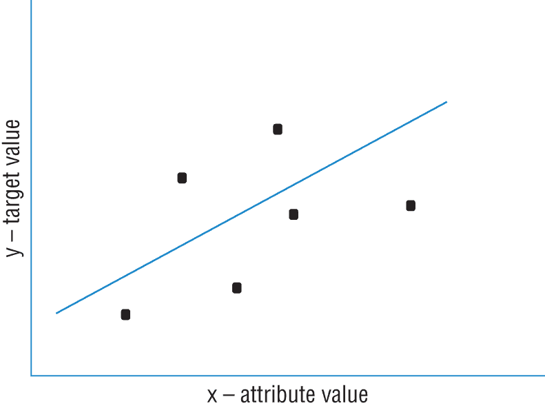

**图 1.1：普通最小二乘拟合**

图 1.1 中的点代表男性薪资与身高的关系。图中的线代表该预测问题的 `OLS` 解。在某种意义上，这条线是基于身高预测男性薪资的最佳模型。数据集包含六个点。假设数据集只有两个点。想象存在一个类似图 1.1 的点群体，但你无法看到所有点。也许生成它们成本太高，如前所述的基因数据。有足够的人类可用于分离罪魁祸首基因，问题在于因成本原因你没有许多人的基因序列。

### 模拟数据点减少的影响

为了在简单示例中模拟这种情况，假设不是给定六个点，而是只给出了这六个点中的两个。这将如何改变拟合这些点的直线的性质？这取决于你恰好得到哪两个点。要了解这会产生多大影响，从图 1.1 中任选两个点，并想象一条穿过它们的直线。图 1.2 展示了从图 1.1 中成对点可能穿过的几条直线。请注意，根据点的选择不同，这些直线的变化有多大。

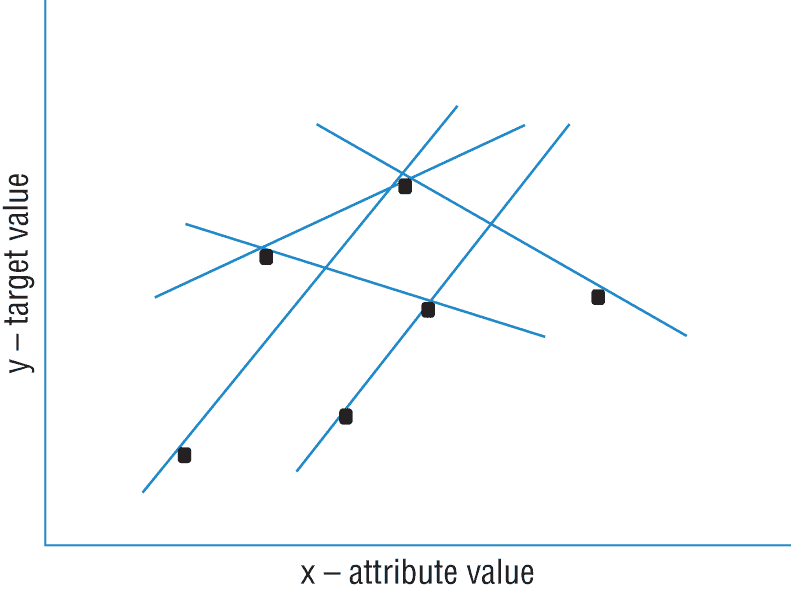

**图 1.2**：仅用两个点拟合直线

### 自由度与数据量的关系

用两个点拟合一条直线的问题在于，数据量不足以支撑该模型的自由度。一条直线有两个自由度。拥有两个自由度意味着有两个独立参数唯一确定一条直线。你可以想象抓住平面上的一条直线，在平面上上下滑动它，或扭转它以改变其斜率。因此，垂直位置和斜率是相互独立的。它们可以单独改变，而它们共同完全指定了一条直线。直线的自由度可以用几种等价的方式表示（例如它在 y 轴上的截距及其斜率、直线上的两个点等）。所有这些直线的表示都需要两个参数来指定。

当自由度的数量等于点的数量时，预测效果不佳。这些直线会穿过用于绘制它们的点，但用不同点对绘制的直线之间存在很大差异。你不能对自由度数量与数据集中点数量相等的预测抱有太大信心。图 1.1 中的图表有六个点，并拟合了一条直线（两个自由度）。即六个点对应两个自由度。确定导致遗传性状况的基因这一思维实验说明了：可供选择的基因越多，就需要更多的数据，才能从 20,000 个左右可能的人类基因中分离出病因。这 20,000 个不同的基因代表了 20,000 个自由度。即使来自 20,000 个不同人的数据也不足以得到可靠的答案，在许多情况下，合理研究范围内所能负担的只是来自 500 人左右的样本。这就是惩罚线性回归可能成为最佳算法选择的地方。

惩罚线性回归提供了一种系统的方法，将自由度减少至与可用数据量和底层现象的复杂性相匹配。这些方法已成为自由度极高问题的热门选择。它们是遗传学问题的首选算法，因为那里的自由度（即基因数量）可能高达数万；也适用于文本分类等问题，那里的自由度可能超过一百万。第 4 章“惩罚线性回归”将详细介绍这些方法的工作原理、演示算法机制的示例代码，以及使用可用 Python 包实现机器学习系统的流程示例。

### 什么是集成方法？

本书涵盖的另一类算法是集成方法。集成方法的基本思想是构建一大群不同的预测模型，然后组合它们的输出——通过对输出求平均或采用多数表决（投票）。单个模型称为*基学习器*。计算学习理论的一些结果表明，如果基学习器仅比随机猜测略好，只要有足够数量的独立模型，集成的性能就可以非常好。

推动集成方法发展的问题之一是观察到某些特定的机器学习算法表现出不稳定性。例如，向数据集添加新数据可能导致生成的模型或其性能发生剧烈变化。二叉决策树和传统神经网络就表现出这种不稳定性。这种不稳定性导致模型性能的高方差，而对许多模型进行平均可以被视为降低方差的一种方法。关键在于如何生成大量独立模型，特别是当它们都使用相同的基学习器时。第 6 章“集成方法”将详细介绍如何做到这一点。这些技术非常巧妙，且其基本操作原理相对容易理解。以下是即将介绍内容的预览。

应用最广泛的集成方法采用二叉决策树作为其基学习器。二叉决策树通常如图 1.3 所示。

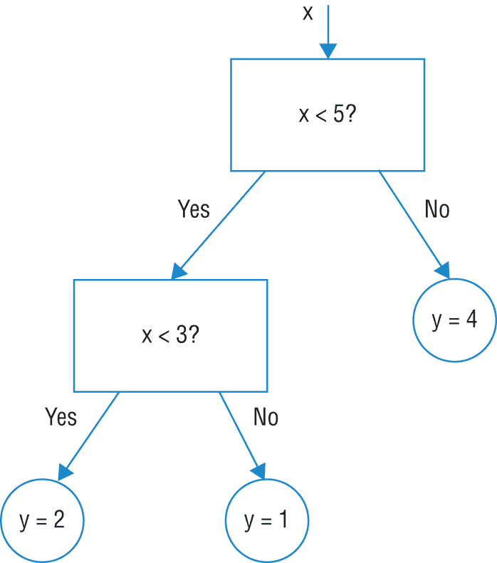

**图 1.3**：二叉决策树示例

图 1.3 中的树在顶部接收一个称为 `x` 的实数作为输入，然后使用一系列二元（双值）决策来决定针对 `x` 应输出什么值。第一个决策是 `x` 是否小于 5。如果答案是“否”，二叉决策树将输出上部决策框“否”分支下方圆圈中指示的值 4。`x` 的每一个可能值都会导致树输出某个值 `y`。图 1.4 绘制了输出（`y`）作为树输入（`x`）的函数图。

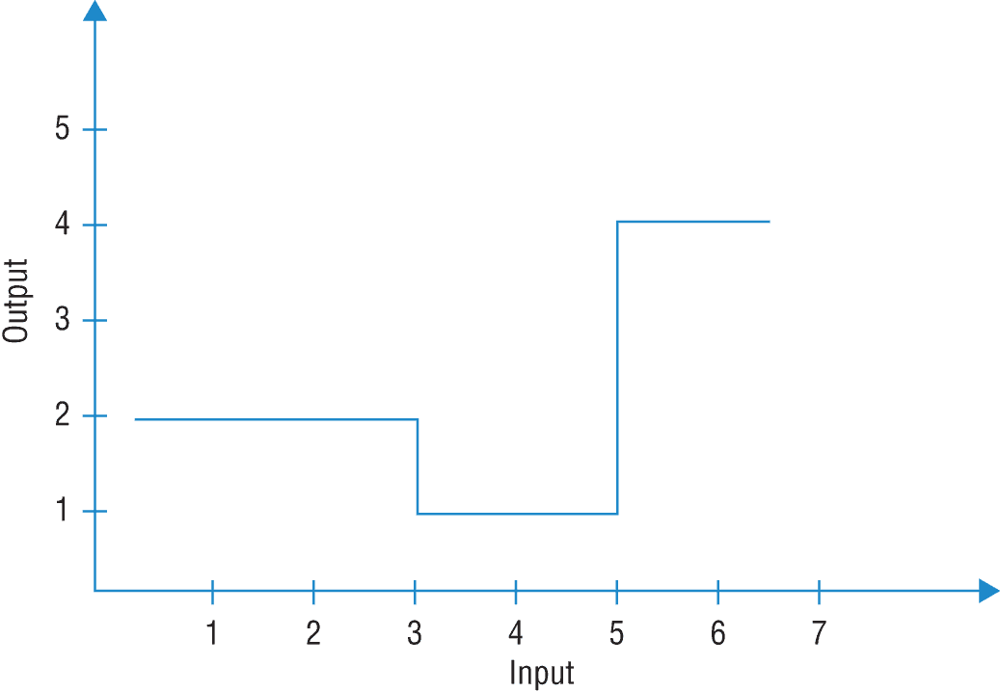

**图 1.4**：二叉决策树示例的输入-输出图

这一描述引出了一个问题：比较值（例如 `x < 5`？）和输出值（树底部圆圈中的值）从何而来？这些值来自于在输入数据上训练二叉树。该训练算法不难理解，将在第 6 章中介绍。此时需要注意的重要一点是，给定数据后，训练好的二叉决策树中的值是固定的。生成树的过程是确定性的。获得不同模型的一种方法是对训练数据进行随机抽样，并在这些随机子集上进行训练。该技术称为*装袋法*（*Bagging*，*bootstrap aggregating* 的简称）。它提供了一种生成大量略有不同的二叉决策树的方法。然后对这些树求平均（或针对分类器进行投票）以得出最终结果。第 6 章将更详细地描述这一技术和其他更强大的技术。

### 如何决定使用哪种算法

### 表 1.4：惩罚线性回归与集成算法的高层权衡

表 1.4 对这两类算法进行了简要对比。惩罚线性回归方法的优势在于训练速度极快。在大型数据集上，训练时间可能长达数小时、数天甚至数周。在得到可部署的解决方案之前，通常需要进行多次训练。漫长的训练时间会阻碍大型问题的开发与部署。惩罚线性方法的快速训练特性使其显而易见地更有用——因为更快意味着更好。视具体问题而定，这些方法相较于集成方法可能存在一定的性能劣势。第 3 章 将深入探讨惩罚回归更适用的问题类型，以及集成方法更适用的问题类型。即使在惩罚线性方法性能不如集成方法的情况下，它们有时也可以作为开发过程中的有用第一步。

**表 1.4** [#c01.xhtml#R_c01-tbl-0004]：惩罚线性回归与集成算法的高层权衡

| | 训练速度 | 预测速度 | 问题复杂度 | 处理宽属性 |
| --- | --- | --- | --- | --- |
| **惩罚线性回归** | + | + | – | + |
| **集成方法** | – | – | + | – |

在开发早期，为了特征选择、特征工程以及巩固数学问题陈述，需要进行多次训练迭代。决定将什么作为预测模型的输入可能需要一些时间和思考。有时这显而易见，但通常需要一些迭代。把能找到的所有东西都扔进去通常不是一个好方案。

通常需要通过试错来确定模型的最佳输入。例如，如果你试图预测网站访问者是否会点击广告链接，你可能会尝试使用访问者的人口统计数据。也许这无法给你所需的准确率，于是你尝试结合访问者在网站上的过往行为数据——访问者过去点击过什么广告，或者购买过什么产品。也许增加访问者来你网站前所在网站的数据会有帮助。这些问题会引出一系列实验，你在其中加入新数据，观察其是有害还是有益。这种迭代无论是在数据处理还是模型训练方面，通常都很耗时。惩罚线性回归通常比集成方法快，时间差异可能成为开发过程中的关键因素。

例如，如果训练集量级为千兆字节，惩罚线性回归的训练时间可能在 30 分钟量级，而集成方法可能需要 5 或 6 小时。如果特征工程过程需要 10 次迭代来选择最佳特征集，仅计算时间就相差一天与一周。因此，一个有用的流程是在开发早期、特征工程等阶段训练惩罚线性模型。这能让数据科学家对哪些变量有用、重要有直观感受，并为后续开发中与其他算法的对比提供基准性能。

除了训练时间优势，惩罚线性方法生成预测的速度也比集成方法快得多。生成预测涉及使用训练好的模型。惩罚线性回归的训练模型只是一个实数列表——每个用于预测的特征对应一个。涉及的浮点运算次数等于用于预测的变量数量。对于高频交易或互联网广告插入等高度时间敏感的预测场景，计算时间决定了盈亏。

对于某些问题，线性方法可能给出与集成方法相当甚至更好的性能。有些问题不需要复杂的模型。第 3 章 详细阐述了问题复杂度的本质，以及数据科学家如何平衡问题复杂度、预测模型复杂度和数据集规模以获得最佳可部署模型。基本思路是：在不复杂的问题上，以及可用数据不足的问题上，线性方法可能比更复杂的集成方法取得更好的整体性能。基因数据很好地说明了这类问题。

普遍认为基因数据量巨大。按字节计算，基因数据集确实很大；但就生成准确预测而言，它们并不大。为理解这一区别，考虑以下思想实验。假设有两个人，一个患有遗传性疾病，另一个没有。如果你有他们的基因序列，能确定是哪个基因导致了该疾病吗？显然不可能，因为两人之间会有许多基因差异。那么需要多少人？至少需要与基因数量相当的人的基因序列，考虑到测量噪声，甚至需要更多。人类大约有 20,000 个基因（视计数方式而定），每个数据点成本约 1,000 美元。因此，仅拥有在完美测量下足以解析疾病的数据就需要 2,000 万美元。

这种情况与本章前面讨论的“用两个点拟合一条线”非常相似。模型的自由度需要少于数据点数量。数据集规模通常需要是模型自由度的倍数。因为数据集规模通常固定，所以模型的自由度需要可调。涉及惩罚线性回归的章节将展示这种可调性是如何内置于惩罚线性回归中的，以及如何利用它实现最优性能。

第 3 章 将更详细地探讨为何某种算法比另一种更适合特定问题。这与问题的复杂度及算法固有的自由度有关。线性模型训练迅速，且通常能达到与非线性集成方法相当的性能，尤其是在可用数据受限时。鉴于其训练极快，在早期特征选择和对特定问题可达性能的粗略估计时，训练线性模型往往很方便。本书涉及的线性模型能提供变量重要性信息，辅助特征选择过程。集成方法在数据充足时通常性能更好，也能给出某种间接的相对变量重要性度量。

### 构建预测模型的流程步骤

使用机器学习需要多种不同技能。一是编程技能，本书不涉及。其他技能关乎如何训练并部署合适的模型，这些正是本书关注的内容。这些其他技能包括哪些？

最初，问题通常以某种模糊的基于语言的术语陈述，例如“向网站访问者展示他们可能点击的链接”。要将其转化为一个可工作的系统，需要用具体的数学术语重述问题，寻找用于预测的数据，然后训练一个预测模型，该模型将预测网站访问者点击可用于展示的链接的可能性。用数学术语陈述问题，意味着对将从可用数据源中提取哪些特征以及如何构建这些特征做出假设。

如何着手解决一个新问题？首先，你需要浏览可用数据，以确定哪些数据可能对预测有用。“浏览数据”意味着对数据运行各种统计检验，以了解数据揭示了什么以及它们与你试图预测的目标有何关联。直觉可以在一定程度上指导你。你还可以量化结果，并测试潜在预测特征与这些结果的相关程度。第 2 章“通过理解数据来理解问题”将针对本书其余部分中用于表征和比较算法的数据集，详细讲解这一过程。

通过某种方式，你开发出一组特征，并开始训练你所选择的机器学习算法。这将产生一个训练好的模型并评估其性能。接下来，你需要考虑对特征集进行更改，包括添加新特征或移除一些被证明无用的特征，或者可能更换不同类型的训练目标（也称为 `target`），以查看是否能提高性能。你将对各种设计决策进行迭代，以确定是否有提升性能的可能。你可以挑选出表现最差的示例，然后尝试确定这些示例是否有某种共同点。这可能会引出另一个要添加到预测过程中的特征，或者可能导致你将数据分叉，并在不同人群上训练不同的模型。

本书的目标是让你熟悉这些过程，以便你能自信地完成这些开发步骤。这要求你在构建问题并开始提取用于训练和测试算法的数据时，熟悉不同算法所需的输入数据结构。该过程通常包括以下几个步骤：

1. 提取并组装用于预测的特征。
2. 开发用于训练的目标。
3. 训练模型。
4. 在测试数据上评估性能。

机器学习不仅仅需要熟悉几个包。它需要理解并实践开发可部署模型所涉及的过程。本书旨在赋予你这种理解。它假设读者具备基本的大学数学知识以及一些概率和统计的基本概念，但不预设读者有机器学习背景。同时，它旨在为读者提供针对广泛问题类别的最佳算法，而不一定是调查所有机器学习算法或方法。有些算法虽然有趣，但由于各种原因不常被使用。例如，可能它们扩展性不好，也许它们无法提供关于内部运作机制的洞察，也许它们难以使用，等等。例如，众所周知，梯度提升（本书涵盖的算法之一）在在线机器学习竞赛中以巨大优势领先获胜。一些算法之所以更常被从业者使用，是有充分理由的，如果你读完本书后能理解这些理由，本书就算成功。

### 界定机器学习问题

开始机器学习竞赛的工作，模拟了真实的机器学习问题。竞赛会提供简短的描述（例如，宣布一家保险公司希望更好地预测其汽车保单的赔付率）。作为参赛者，你的第一步是打开数据集，查看可用数据，并确定预测需要采取何种形式才有用。对数据的检查将直观地让你了解数据代表什么以及它们与手头的预测任务有何关联。数据可以提供关于方法选择的洞察。图 1.5 描绘了从目标的通用语言陈述出发，逐步转变为可作为机器学习算法输入的数据排列的过程。

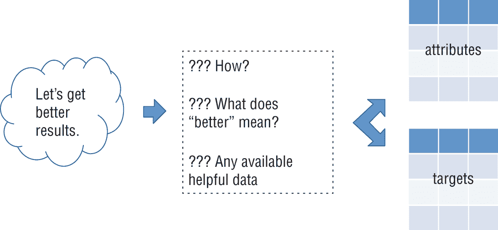

**图 1.5**：界定机器学习问题

“让我们获得更好结果”这种笼统的陈述，首先必须转化为可衡量和可优化的具体目标。对于网站所有者，具体性能指标可能是提高点击率或增加销售额（或更高的贡献毛益）。下一步是组装数据，使其能够预测给定客户点击各种链接或购买各种在线提供产品的可能性。图 1.5 将这些数据描绘为一个属性矩阵。对于网站示例，它们可能包括访问者查看过的其他页面或访问者过去购买过的商品。除了用于预测的属性外，此类问题的机器学习算法还需要正确答案来进行训练。这些在图 1.5 中标记为 `targets`。本书涵盖的算法通过检测过去行为中的模式来学习，但重要的是它们不能仅仅记住过去的行为；毕竟，客户可能不会重复购买昨天买过的东西。第 3 章将详细讨论这种不记忆化训练的过程。

通常，问题表述的几个方面可以有多种处理方式。这导致在界定问题、选择和训练模型以及生成性能估计之间进行一些迭代。图 1.6 描绘了这一过程。

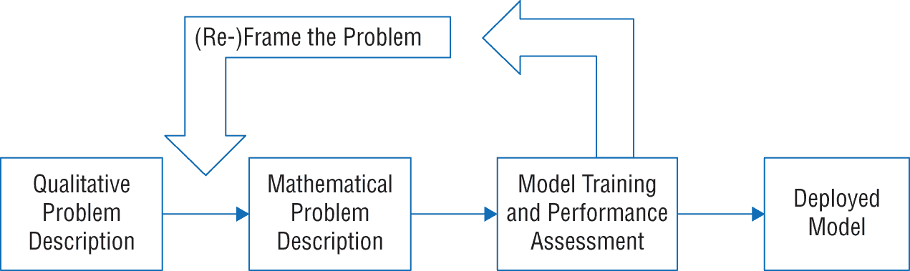

**图 1.6**：从表述到性能的迭代

问题可能附带具体的定量训练目标，或者部分工作可能是提取这些数据（称为 `targets` 或 `labels`）。例如，考虑构建一个自动交易证券的系统。要进行自动交易，第一步可能是预测证券价格的变化。价格很容易获得，因此概念上很简单，即利用历史数据构建训练示例，其中未来的价格变化是已知的。但即使这样也涉及选择和实验。未来价格变化可以用几种不同的方式计算。变化可以是当前价格与 10 分钟后价格的差值。也可以是当前价格与 10 天后价格的变化。也可以是当前价格与未来 10 分钟内最高/最低价格的差值。价格变化可以用一个双状态变量来表征，取值为“上涨”或“下跌”，具体取决于 10 分钟后价格是高于还是低于当前价格。每一种选择都会导致一个预测模型，预测结果将用于决定是买入还是卖出证券。需要一些实验来确定最佳选择。

### 特征提取与特征工程

### 决定用于预测的变量

决定用于预测的变量也可能涉及实验。这个过程称为*特征提取*和*特征工程*。


# 特征提取与特征工程

**特征提取**是从自由形式的排列（如文档或网页中的单词）中获取数据，并将它们排列成数字的行和列的过程。例如，垃圾邮件过滤问题始于电子邮件的文本，可能会提取诸如文档中大写字母的数量、全大写单词的数量、文档中“buy”一词出现的次数以及其他被选中以突出垃圾邮件和非垃圾邮件之间差异的数字特征等内容。

**特征工程**是操作和组合特征以得出更有信息量特征的过程。构建证券交易系统涉及特征提取和特征工程。特征提取将决定使用什么来预测价格。过去的价格、相关证券的价格、利率以及从新闻稿中提取的特征，都已被纳入各种公开讨论的交易系统中。此外，证券价格还有一些具有名称的工程特征，如随机指标、`MACD`（移动平均收敛发散）和 `RSI`（相对强弱指数），它们基本上是过去价格的函数，其发明者认为这些函数在证券交易中很有用。

开发出一组合理的特征后，您可以训练一个像本书所述的预测模型，评估其性能，并决定是否部署该模型。通常，您会想要更改所用的特征，哪怕只是为了确认模型的性能是否达标。确定使用哪些特征的一种方法是尝试所有组合，但这可能非常耗时。不可避免地，您将面临提高性能但也要快速投入使用训练模型的相互竞争的压力。本书讨论的算法具有在生成预测时提供每个属性效用指标的有益特性。一次训练过程将生成特征排名，以指示其相对重要性。此信息有助于加快特征工程过程。

模型训练过程（每次尝试基线特征集时开始）也涉及一个过程。现代机器学习算法（如本书所述）训练类似 100 到 5,000 个不同的模型，这些模型必须筛选出单个模型用于部署。生成如此多模型的原因是提供各种复杂程度的模型。这使得可以选择最适合问题和数据集的模型。您不想要过于简单的模型，否则会牺牲性能；但也不想要过于复杂的模型，否则会过拟合问题。拥有各种复杂程度的模型，可以让您挑选一个恰到好处的模型。

## 确定训练模型的性能

模型的拟合度由其在未用于训练模型的数据上的表现决定。这是一个重要的步骤，概念上很简单。只需留出一些数据。不要在训练中使用它们。训练完成后，使用留出的数据来确定算法的性能。本书讨论了几种系统性的留出数据的方法。不同方法有不同的优势，主要取决于训练数据的大小。尽管听起来很简单，但人们总能想出复杂的方法让测试数据“泄露”到训练过程中。该过程结束时，您将获得一个算法，它将筛选传入的数据并为您做出准确的预测。随着条件变化改变底层统计特性，它可能需要监控。

# 章节内容与依赖关系

不同的读者可能希望根据他们的背景以及是否有时间理解基本原理，采取不同的路径阅读本书。图 1.7 展示了书中各章节之间的相互依赖关系。

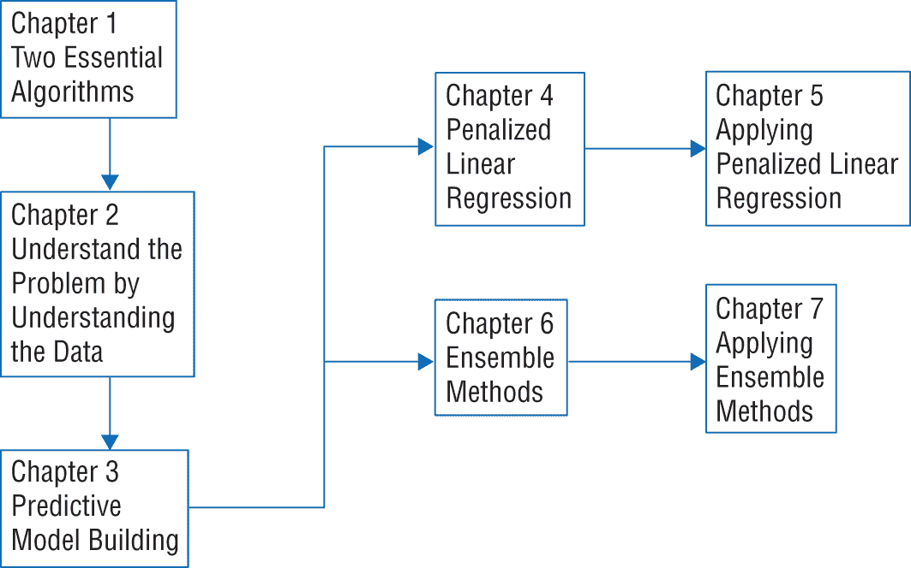

**图 1.7**：章节之间的相互依赖关系

**第 2 章** 介绍了将用作问题示例的各种数据集，以说明算法的使用，并根据性能和其他特征比较算法。解决新机器学习问题的起点是深入研究数据集，以更好地理解它，并了解其问题和特性。**第 2 章** 的部分目的是演示 Python 中可用于数据探索的一些工具。您可能想浏览 **第 2 章** 中的一些但并非所有示例，以熟悉该过程，然后在稍后深入研究解决方案示例时再回到 **第 2 章**。

**第 3 章** 解释了机器学习问题中的基本权衡，并介绍了贯穿全书的几个关键概念。一个关键概念是预测问题的数学描述。展示了分类和回归问题之间的基本区别。**第 3 章** 还介绍了使用样本外数据来确定预测模型性能的概念。样本外数据是指未包含在模型训练中的数据。良好的机器学习实践要求开发者对预测模型部署时的性能给出可靠的估计。这需要从训练集中排除一些数据，并用它们来模拟新数据。本书描述了这一要求的原因、实现方法以及不同方法之间的权衡。另一个关键概念是存在许多系统性能度量指标。**第 3 章** 概述了这些方法并讨论了它们之间的权衡。已经熟悉机器学习的读者可以浏览本章并扫描代码示例，而不必仔细阅读并运行代码。

**第 4 章** 展示了训练惩罚回归模型算法的核心思想。本章介绍了基本概念，并展示了算法是如何推导出来的。**第 3 章** 中介绍的一些示例被用来激发惩罚线性回归方法及其求解算法的动机。本章运行了求解惩罚线性回归训练的核心算法代码。**第 4 章** 还解释了线性回归方法的几种扩展。其中一种扩展展示了如何将因子变量编码为实数，以便应用线性回归方法。线性回归只能用于预测变量为实数的问题；即用于预测的量必须是数值型的。许多实际且重要的问题都有像“单身、已婚或离婚”这样的变量，它们有助于进行预测。为了在线性回归模型中纳入此类变量（称为*分类变量*），已经设计出了将分类变量转换为实数变量的方法。**第 4 章** 涵盖了这些方法。此外，**第 4 章** 还展示了（称为*基扩展*）从非线性回归中获得非线性函数的方法。有时基扩展可以用来从线性回归中榨取更多的性能。

## 第 5 章

第 5 章 将 第 4 章 中开发的惩罚回归算法应用于 第 2 章 中概述的许多问题。本章概述了实现惩罚回归方法的 Python 包，并使用它们来解决问题。目标是涵盖足够广泛的问题，以便从业者能找到一个与他们面前要解决的问题相近的问题。除了量化和比较预测性能外，第 5 章 还考察了训练算法的其他特性。变量选择和变量排序对于理解至关重要。这种理解将有助于加快新问题的开发速度。

## 第 6 章

第 6 章 介绍集成方法。由于集成方法最常基于二叉决策树，因此第一步是理解训练和使用二叉决策树的原理。集成方法的许多特性都是直接从二叉决策树继承而来的。建立这种理解后，本章将解释本书涵盖的三种主要集成方法。它们的通用名称分别是 Bagging（装袋法）、Boosting（提升法）和 Random Forest（随机森林）。对于每一种方法，都概述了其运行原理，并开发了核心算法的代码，以便您理解其运行原理。

## 第 7 章

第 7 章 使用集成方法解决 第 2 章 中的问题，然后比较已开发的各种算法。比较涉及多个要素。预测性能是比较的一个要素。训练所需时间和性能是另一个要素。所有涵盖的算法都给出变量重要性排序，并且跨几种不同算法在给定问题上比较了这些信息。

根据我的经验，在向程序员和计算机科学家教授机器学习时，我发现代码示例对某些人比数学更有效。这里采用的方法是提供一些数学、算法草图和代码示例来说明重点。讨论的几乎所有方法都可以在书中附带的代码和网站上找到。其意图是提供可修改的代码，帮助您尽快在自己的问题上上手运行。

# 总结

本章给出了您将能够解决的问题类型的规范，以及构建预测模型的过程步骤描述。本书重点关注两个算法家族。限制所涵盖算法的数量，可以更彻底地解释这些算法的背景及其使用机制。本章展示了一些比较性能结果，以说明选择这两个特定家族的理由。本章讨论了这两个家族不同的优势和特点，并描述了倾向于选择其中一个家族的问题类型。

本章还列出了开发预测模型的过程步骤，并详细阐述了每一步的权衡和结果。建议使用未包含在模型训练中的数据来生成预测模型的性能估计。

本书的目标是让几乎没有机器学习经验的程序员达到这样一个程度：他们感觉有能力且自如地将机器学习融入项目中。本书并不广泛调查大量算法。相反，它涵盖了几个最佳算法，它们能为您提供性能、灵活性和清晰度。一旦您了解这些算法的工作原理并积累了一些使用经验，就会发现它们易用且快捷。它们将使您能够解决各种各样的问题，而无需费心调试即可训练好模型，并能让您洞察其性能来源。

# 参考文献

1. Caruana, Rich, and Alexandru Niculescu-Mizil. "An Empirical Comparison of Supervised Learning Algorithms." *Proceedings of the 23rd International Conference on Machine Learning*. ACM, 2006.

2. Caruana, Rich, Nikos Karampatziakis, and Ainur Yessenalina. "An Empirical Evaluation of Supervised Learning in High Dimensions." *Proceedings of the 25th International Conference on Machine Learning*. ACM, 2008.

# 第 2 章：通过理解数据来理解问题

一个新的数据集（问题）就像一个包裹着的礼物。它充满了希望和期待，期待您解决它后能创造奇迹。但在您打开它之前，它仍然是个谜。本章旨在打开您的新数据集，以便您看清里面的内容，了解能用这些数据做什么，并开始思考如何利用它构建模型。

本章有两个目的。一是让您熟悉稍后将作为示例的数据集，这些示例展示了不同类型的问题，您将使用在 第 4 章 “惩罚线性回归” 和 第 6 章 “集成方法” 中学到的算法来解决它们。另一个目的是演示 Python 中可用于数据探索的一些工具。

本章使用一个简单示例来回顾机器学习数据集的一些基本问题结构、术语和特征。本节介绍的语言将在本书其余部分中使用。建立通用语言后，本章逐一介绍几种不同类型的函数逼近问题。这些问题说明了机器学习问题的常见变体，以便您在遇到时能识别出这些变体，知道如何处理它们（并拥有相应的代码示例）。

## 新问题的剖析

本书涵盖的算法从一个充满数字的矩阵（或表格）开始，可能还包含一些字符变量。表 2.1 中的示例建立了一些术语，并用二维表格表示了一个小型机器学习数据集。该表格将为您提供数据集的心智图像，以便您对“对应属性的列”或“对应单个样本的行”等引用感到熟悉。在本例中，预测分析问题在于预测个人在未来一年在网上购书的花费。

**表 2.1**：机器学习问题的数据

| USERID | 属性 1 | 属性 2 | 属性 3 | 标签 |
| --- | --- | --- | --- | --- |
| 001 | 6.5 | Male | 12 | $120 |
| 004 | 4.2 | Female | 17 | $270 |
| 007 | 5.7 | Male | 3 | $75 |
| 008 | 5.8 | Female | 8 | $600 |

数据按行和列排列。每一行代表一个单独的案例（也称为 `instance`、`example` 或 `observation`）。表 2.1 中的列被赋予了指定，指示它们将在机器学习问题中扮演的角色。指定为属性的列将用于预测购书花费。在指定为标签的列中，您将看到每位顾客去年在购书上的花费。

在表 2.1 中，一行代表一个单独的客户，该行中的数据都与该个体相关。第一列称为`UserID`，包含每行（案例）唯一的标识符。唯一标识符可能存在于你的问题中，也可能不存在。例如，网站通常用用户 ID 标记站点访问者，该 ID 在其访问期间与其关联。如果用户未在网站注册，则同一用户每次访问都会获得不同的 ID。该 ID 通常分配给每个观察值，这将是你要构建的预测主体。第 2、3、4 列称为`Attributes`，而不是给出更具体的名称，如`Height`或`Gender`。关键在于突出它们在预测过程中的作用。`Attributes`是关于案例的可用数据，将用于进行预测。

`Labels`是你想要预测的事物。在本例中，`UserID`是一个简单的数字，`Attribute 1`是身高，`Attribute 2`是性别，`Attribute 3`是该人去年阅读的书籍数量。`Labels`列下包含该个体去年在网上购书花费的金额。这些不同类别的数据将扮演什么角色？机器学习算法如何利用用户 ID、属性和标签？简短的回答是：你忽略用户 ID。你使用属性来预测标签。

唯一 ID 用于记账目的，允许你回溯到特定案例可用的其他数据。通常，唯一 ID 不会直接用于机器学习算法。`Attributes`是你选择用于进行预测的事物。`Labels`是机器学习算法将用来构建预测模型的观察结果。

`User ID`通常不用于进行预测，因为它太具体了。它仅与单个示例相关。机器学习的诀窍在于构建一个能泛化到新案例的模型（而不仅仅是记忆过去的案例）。为了实现这一点，算法的推导必须强制其关注不止一行数据。排除用户 ID 的一个可能例外是：当用户 ID 为数字且按用户注册顺序分配时。基本上，在这种情况下它指示注册日期，可能很有用，因为 ID 相近的用户在相似时间注册，可以以此为依据视为一组。

构建预测模型的过程称为*训练*。该过程的进行方式取决于算法，后续章节将介绍细节，但通常是迭代的。算法假设属性和标签之间存在预测关系，观察其犯下的错误，进行一些修正，然后对该过程进行迭代，直到获得一个可靠的模型。许多技术细节将在后面解决，但这就是基本思想。

## 不同类型的属性和标签驱动建模选择

表 2.1 中显示的属性有两种不同类型：数值变量和分类（或因子）变量。`Attribute 1`（身高）是数值变量，也是最常见的属性类型。`Attribute 2`是性别，由`Male`或`Female`条目表示。这种类型的属性称为*分类*或*因子*变量。分类变量的特性是其各个值之间没有顺序关系。`Male < Female`没有意义（尽管争论了几个世纪）。分类变量可以是双值的，如`Male`、`Female`，也可以是多值的，如州（`AL`、`AK`、`AR` … `WY`）。关于属性可以划分其他区别（例如整数与浮点数），但它们对机器学习算法的影响不一样。原因在于许多机器学习算法仅接受数值属性；它们无法处理分类或因子变量。惩罚回归算法仅处理数值属性。支持向量机、核方法和 k-近邻算法也是如此。第 4 章将介绍将分类变量转换为数值变量的方法。变量的性质将决定你的算法选择以及开发预测模型的方向，因此这是面对新问题时需要关注的事项之一。

标签也存在类似的二分法。表 2.1 中显示的标签是数值型的：个体去年在网上购书花费的金额。但在其他问题中，标签也可能是分类的。例如，如果表 2.1 的任务是预测哪些个体明年将花费超过 200 美元，问题就会改变，解决问题的方法也会改变。预测哪些客户将花费超过 200 美元的新问题将有新的标签。新标签将取两个值之一。表 2.2 显示了表 2.1 中给出的标签与基于逻辑命题`Spending > $200`的新标签之间的关系。表 2.2 中显示的新标签取两个值之一——`True`或`False`。

**表 2.2**：数值目标与分类目标

| TABLE 1 LABELS | >$200? |
| --- | --- |
| $120 | False |
| $270 | True |
| $75 | False |
| $600 | True |

当标签为数值型时，该问题称为*回归问题*。当标签为分类型时，该问题称为*分类问题*。如果分类目标仅取两个值，该问题称为*二元分类问题*。如果取两个以上的值，则称为*多类分类问题*。

在许多情况下，问题类型的选择取决于设计者。你刚才看到，通过简单转换标签，本示例问题可以从回归问题转换为二元分类问题。这些是你在解决问题时可能做出的权衡。例如，分类目标可能更好地支持在两个行动方案之间做出决策。

分类问题也可能比回归问题更简单。考虑例如仅有一条等高线（如 100 英尺等高线）的地形图与每 10 英尺就有一条等高线的地形图之间的复杂性差异。单条等高线将地图分为高于 100 英尺和低于 100 英尺的区域，包含的信息比更详细的等高线地图少得多。分类器试图计算单条分割等高线，而不考虑远离决策边界的行为，而回归则试图绘制整张地图。

## 关于新数据集需要注意的事项

作为初步检查数据的一部分，你需要确定数据集的许多其他特征。以下是一个清单，以及一系列了解数据集的步骤，旨在让你熟悉数据并规划预测模型开发的步骤。这些都是简单的检查，但直接影响你的后续步骤。此外，该过程能让你开始探索数据并了解其属性。

**以下是需要检查的项目**

*   行数和列数
*   分类变量的数量及每个变量的唯一值数量
*   缺失值
*   属性和标签的汇总统计量

首先要检查的事情之一是数据的大小和形状。将数据读入列表的列表中；然后外层列表的维度是行数，内层列表之一的维度是列数。下一节将展示这一方法在某个数据集上的具体应用，该数据集稍后将用于说明将要开发的算法的特性。

流程中的下一步是确定每行中有多少缺失值。按行逐行进行的原因是，处理缺失值最简单的方法是丢弃不完整的实例（至少有一个缺失值的样本）。在许多情况下，这会使结果产生偏差，但仅有少数不完整的样本不会造成实质性差异。通过统计含有缺失数据的行数（除了缺失条目总数之外），你就能知道如果使用这种简单方法，必须丢弃数据集的多大比例。

如果你有大量行（收集网络数据时可能会这样），与你拥有的可用数据行数相比，你损失的行数可能很少。如果你在处理生物学问题，数据获取昂贵且属性很多，你可能无法承担丢弃数据的代价。在这种情况下，你必须想办法填补缺失值，或者使用能够处理缺失值的算法。填补缺失值称为 `imputation`（插补）。插补缺失数据最简单的方法是使用每行条目的平均值来填充缺失条目。一种更复杂的方法是使用 第 4 章 和 第 6 章 中介绍的预测方法之一。要使用预测方法，你需要将含有缺失值的属性列视为标签。在进行此过程之前，请务必移除原始问题的标签。

接下来的几节将演示此处概述的流程，并介绍一些表征数据集的方法，以帮助你决定如何着手建模过程。

## 分类问题：利用声纳探测未爆水雷

本节将逐步介绍在开始深入研究分类问题时可能进行的几项检查。它从简单的大小和形状测量、数据类型报告、缺失值计数等开始。然后转向数据的统计特性，以及属性之间、属性与标签之间的相互关系。该数据集来自 UC Irvine 数据存储库 [参考文献 1988]。这些数据源自一些实验，旨在确定声纳是否可用于探测军事行动后遗留在港口中的未爆水雷。声纳信号是所谓的 `chirped signal`（调频信号/啁啾信号）。这意味着信号频率在声脉冲持续时间内上升（或下降）。数据集中的测量值代表声纳接收机在返回信号的不同点收集到的功率测量值。大约一半样本中声纳照射的是岩石，另一半照射的是形状类似水雷的金属圆柱体。该数据集名为“Rocks versus Mines”（岩石与水雷）。

### “岩石与水雷”数据集的物理特征


处理新数据集的第一件事是确定其大小和形状。清单 2-1 展示了用于确定 UC Irvine 数据存储库中“Rocks versus Mines”数据集（即岩石与水雷数据）大小和形状的代码。本章稍后你将了解更多关于该数据集的信息，并且全书将在介绍算法时使用它作为示例。在这种情况下，确定行数和列数的过程非常简单。该文件以逗号分隔，一个实验的数据占据一行文本。这使得读取一行、按逗号分隔符拆分、并将生成的列表堆叠成一个包含整个数据集的外层列表变得非常容易。

#### 清单 2-1：评估新数据集规模 — rockVmineSummaries.py

```python
__author__ = 'mike_bowles'

#read data from uci data repository
xList = list_read_rvm()
  
print('Number of Rows of Data = ' + str(len(xList)))
print('Number of Columns of Data = ' + str(len(xList[1])))

Printed Output:
Number of Rows of Data = 208
Number of Columns of Data = 61 
```

正如示例输出所示，该数据集有 208 行（行数）和 61 列（每行字段数）。这有什么区别？行数和列数对后续步骤有多方面影响。首先，整体规模能让你大致了解训练时间会有多长。对于像岩石与水雷数据这样小的数据集，训练时间将少于一分钟，这将便于你迭代训练和调整的过程。如果数据集增长到 1,000 x 1,000，惩罚线性回归的训练时间将增长到几分之一分钟，而集成方法则需要几分钟。当数据集达到数万行和列时，惩罚线性回归的训练时间将扩展到 3 或 4 小时，集成方法则为 12 到 24 小时。较大的训练时间会影响你的开发时间，因为你需要迭代多次。

关于行数和列数的第二个重要观察是，如果数据集的列数远多于行数，你可能更有可能通过惩罚线性回归获得最佳预测，反之亦然。第 3 章 “预测模型构建：平衡性能、复杂性与大数据” 以及稍后你将运行的示例将让你更好地理解为什么会这样。

检查清单的下一步是确定有多少列数据是数值型与分类型。清单 2-2 展示了针对岩石与水雷数据集实现此目的的代码。该代码遍历每一列，统计数值型条目（`int` 或 `float`）、非空字符串条目以及空条目的数量。结果显示前 60 列全为数值，最后一列全为字符串。这些字符串值即为标签。通常，分类变量以字符串形式呈现，如此例所示。在某些情况下，二值分类变量会呈现为 0、1 数值变量。

#### 清单 2-2：确定属性性质 — rockVmineContents.py

### 岩石与地雷数据集的统计摘要

在确定哪些属性是分类属性、哪些是数值属性之后，你需要获取数值变量的描述性统计信息，以及每个分类属性中唯一类别的计数。清单 2-3 给出了这两个过程的一些示例。

#### 清单 2-3：数值与分类属性的汇总统计 — rVMSummaryStats.py

```python
__author__ = 'mike_bowles'
import numpy as np

#read data from uci data repository
xList = list_read_rvm()
 
nrow = len(xList)
ncol = len(xList[1])

type = [0]*3
colCounts = []

#generate summary statistics for column 3 (e.g.)
col = 3
colData = []
for row in xList:
    colData.append(float(row[col]))

colArray = np.array(colData)
colMean = np.mean(colArray)
colsd = np.std(colArray)
print("Mean = " + '\t' + str(colMean) + '\t\t' +
            "Standard Deviation = " + '\t ' + str(colsd))


#calculate quantile boundaries
ntiles = 4

percentBdry = []

for i in range(ntiles+1):
    percentBdry.append(np.percentile(colArray, i*(100)/ntiles))

print("\nBoundaries for 4 Equal Percentiles")
print(percentBdry)
print(" \n")
```

**打印输出：**

```
Mean =      0.053892307692307684             
Standard Deviation =       0.04641598322260027 

Boundaries for 4 Equal Percentiles
[0.0058, 0.024375, 0.04405, 0.0645, 0.4264]
 
 
Boundaries for 10 Equal Percentiles 

[0.0058, 0.0141, 0.022740000000000003, 0.027869999999999995, 0.03622, 
0.04405, 0.050719999999999, 0.0599599999999999, 0.07794000000000001, 
0.10836, 0.4264]
 
 
Unique Label Values
{'M', 'R'}

Counts for Each Value of Categorical Label
['M', 'R']
[111, 97] 
```

代码的第一部分选取一列数值数据，然后为其生成一些统计信息。第一步是计算所选属性的`均值`和`标准差`。了解这些将为你在开发模型时建立直觉提供基础。

代码的下一部分用于寻找`离群值`。其工作原理如下。假设你试图判断以下数字列表中是否存在离群值：`[0.1, 0.15, 0.2, 0.25, 0.3, 0.35, 0.4, 4]`。此示例特意构造了一个离群值。最后一个数字（`4`）与其他数字相比显然超出了量级。

揭示此类不匹配的一种方法是将一组数字划分为百分位数。例如，第 25 百分位包含最小的 25% 的数据。第 50 百分位包含最小的 50% 的数据。可视化这些分组形成过程的最简单方法是想象数据已按数值顺序排序。前面列表中的数字已按数值顺序排列。这使得很容易看出百分位边界的位置。一些常用的百分位数有特殊的名称。将集合划分为相等的四分之一、五分之一和十分之一所定义的百分位数分别称为`四分位数`、`五分位数`和`十分位数`。

对于前面的列表，因为列表已排序且包含八个元素，所以很容易定义四分位数。第一四分位数包含 `0.1` 和 `0.15`，以此类推。请注意这些四分位数的宽度。第一四分位数的范围是 `0.5`（`0.15–0.1`）。第二四分位数大致相同。然而，最后一个四分位数的范围是 `4.6`，这是其他四分位数范围的 100 倍。

你可以在清单 2-3 中计算出的四分位边界中看到类似的行为。首先程序计算四分位数。这显示出上四分位数比其他四分位数宽得多。为了更确定，还计算了十分位边界，同样表明上十分位异常宽。由于分布在尾部通常会变稀疏，因此一定程度的变宽是正常的。

#### 使用分位数-分位数图可视化离群值

更详细地研究离群值的一种方法是，将相关数据的分布与某些合理的分布进行绘图对比，以查看相对数值是否匹配。清单 2-4 展示了如何使用 Python 函数 `probplot` 来帮助确定数据集是否存在离群值。生成的图表显示了数据中经验百分位数相关的边界与高斯分布相同百分位数的边界之间的比较。如果被分析的数据来自高斯分布，绘制的点将落在一条直线上。图 2.1 显示，岩石与地雷数据第 4 列的几个点距离该直线非常远。这意味着岩石与地雷数据的尾部包含的样本比高斯密度的尾部更多。

#### 清单 2-4：岩石与地雷数据第 4 个属性的分位数-分位数图 — qqplotAttribute.py

```python
__author__ = 'mike_bowles'
import numpy as np

import scipy.stats as stats

#read rocks v mines data
xList = list_read_rvm()
nrow = len(xList)
ncol = len(xList[1])

type = [0]*3
colCounts = []

#generate summary statistics for column 3 (e.g.)
col = 3
colData = []
for row in xList:
    colData.append(float(row[col]))


stats.probplot(colData, dist="norm", plot=plt)
plt.show() 
```

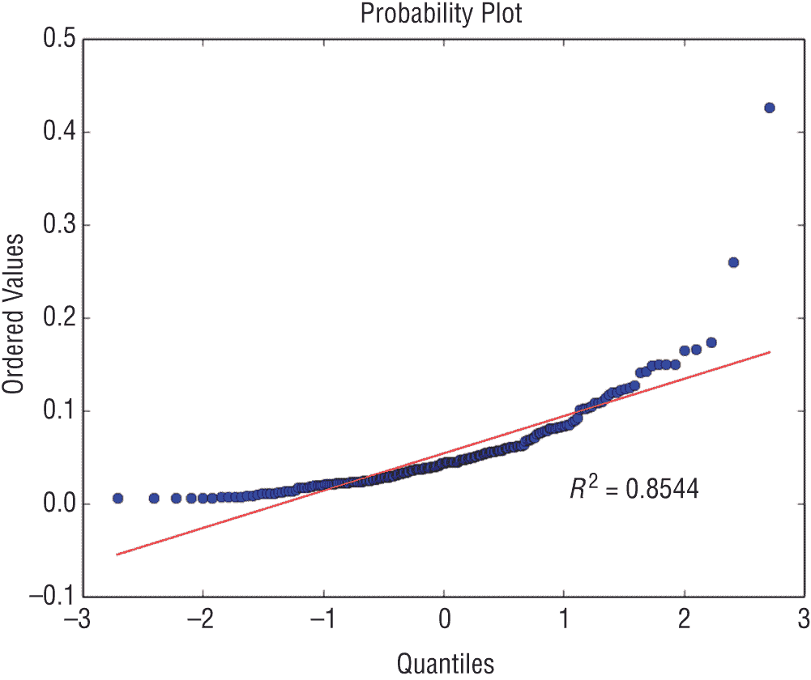

**Figure 2.1**：岩石与矿山数据中属性 4 的分位数-分位数图

如何利用这些信息？异常值可能会给模型构建或预测带来麻烦。在该数据集上训练好模型后，你可以检查模型产生的误差，看这些误差是否与这些异常值相关。如果相关，则可以采取措施进行修正。例如，你可以复制表现不佳的样本，迫使它们得到更充分的代表。你可以将它们隔离出来，作为一个单独的类别进行训练。如果它们代表的是一种异常情况，且在模型部署后将要面对的数据中不会出现，你也可以将它们从数据中剔除。一个合理的流程可能是在探索阶段生成四分位数边界，并标记潜在的异常值，以了解问题可能有多严重（或者根本不严重）。然后在评估性能数据时，使用分位数-分位数（Q-Q）图来确定哪些点应被称为异常值，以便用于误差分析。

### 分类属性的统计特征描述

上述过程适用于数值属性。但分类属性怎么办？你需要检查它们有多少个类别，以及每个类别有多少个样本。了解这些有几个原因。性别属性只有两个可能值（男性和女性），但如果该属性是美国的州，就会有 50 个可能的类别。随着属性数量的增加，处理它们的复杂性也会增加。大多数二叉树算法（集成方法的基础）都限制了能处理的类别数量。由 Breiman 和 Cutler（该算法的发明者）编写的流行 Random Forests 包将类别数量限制在 32 个。如果某个属性有超过 32 个类别，你就需要对它们进行聚合。

稍后你会看到，训练涉及随机抽取数据子集并在其上训练一系列模型。例如，假设类别是美国的州，而爱达荷州只有两个样本。随机抽取训练样本可能一个爱达荷州的样本也抽不到。你需要在问题发生前就发现这类问题，以便加以解决。对于爱达荷州的这两个样本，你可以将它们与蒙大拿州或怀俄明州合并，可以复制它们，或者可以管理随机抽取过程，以确保抽到爱达荷州的样本（这一过程称为`分层抽样`）。

### 如何使用 Python Pandas 对岩石与矿山数据集进行汇总

Python 包 pandas 可以帮助自动化数据检查和处理过程。它在数据检查和预处理的早期阶段特别有用。pandas 包使得将数据读入一种称为`数据框`的专用数据结构成为可能。数据框是仿照 CRAN-R 中同名数据结构建模的。

你可以把数据框想象成 **Table 2.1** 所示的表格或矩阵状结构。数据框的行代表单个案例（实验、样本、测量），列代表特定属性。该结构类似矩阵，但不是矩阵，因为不同列中的元素可能属于不同类型。从形式上讲，矩阵定义在一个域上（如实数、二进制数、复数），矩阵中的所有条目都是该域的元素。对于统计问题，矩阵过于局限，因为统计样本通常包含混合的不同类型。

**Table 2.1** 中的简单示例在 Attribute 1 列中有实数值，在 Attribute 2 列中有分类变量，在 Attribute 3 列中有整数变量。在同一列内，条目类型相同，但不同列之间类型不同。数据框结构支持通过索引访问单个元素，这大致类似于访问 Python `numpy` 数组或列表的列表中的条目。同样，索引切片可用于访问数组中的整行或整列。此外，pandas 数据框还支持通过名称访问行和列。这非常方便，特别是在列数较少到中等的情况下。（搜索“pandas introduction”将提供许多链接，指导你了解 pandas 的基本用法。）

**Listing 2-5** 展示了如何简单地从 UC Irvine 数据存储库网站读取岩石与矿山 CSV 文件。清单中显示的输出是从实际输出中截取的。你可以通过自行运行代码获得完整版本。

#### Listing 2-5: 使用 Python pandas 读取和汇总数据 — pandasReadSummarize.py

```python
__author__ = 'mike_bowles'

#read rocks versus mines data into pandas data frame
rocksVMines = pd_read_rvm()

#print head and tail of data frame
print(rocksVMines.head())
print(rocksVMines.tail())

#print summary of data frame
summary = rocksVMines.describe()
print(summary)
```

读取文件后，程序的第一部分会打印出数据集的前几行和后几行。请注意，所有前几行的示例都带有 R 标签，而后几行的示例带有 M 标签。在这个数据集中，所有的 R 都排在前面，所有的 M 都排在后面。在检查数据时要注意这类情况。你将在后续章节看到，确定模型质量需要对数据进行采样。数据存储方式中的结构可能需要纳入你后续采样方法的考量中。代码片段的最后一部分打印出了数据集中实值列的摘要统计。

Pandas 使得自动计算均值、方差和分位数成为可能。请注意，`describe` 函数生成的摘要本身就是一个数据帧，因此你可以自动化筛选包含异常值属性的过程。为此，你可以比较不同分位数之间的差异，如果某属性的任意差异与该属性的其他差异相比超出了比例尺度，则标记该属性。输出中显示的属性表明，其中几个存在异常值。值得进一步查看涉及异常值的行数。它们可能都来自少数几个示例。这可以指出需要更仔细检查的数据。

## 可视化岩石与地雷数据集的属性

可视化有时能让你洞察到在数字表格中难以发现的数据规律。本节介绍几种你可能会觉得有用的可视化方法。其中一些可视化在分类问题和回归问题中略有不同。你将在介绍鲍鱼数据集和红酒质量数据集的章节中看到这些方法的回归变体。

### 使用平行坐标图进行可视化

一种适用于属性数量超过几个的问题的可视化方法称为`平行坐标图`。图 2.2 展示了平行坐标图的构建过程。图右侧的数字向量代表机器学习数据集中一行属性数据。该数字向量的平行坐标图显示在图 2.2 的折线图中。折线图绘制了每个属性的值与其索引的关系。整个数据集的平行坐标图为数据集中每一行属性绘制一条线。基于标签的颜色编码可以帮助你看清属性值与标签之间某些类型的系统性关系。将一行的实值属性绘制在其属性索引上。（搜索“parallel coordinates”并查看维基百科页面以获取更多示例。）

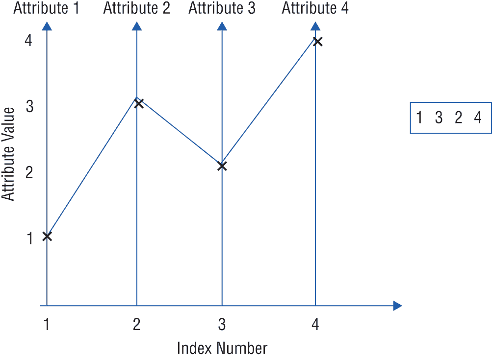

**图 2.2**：构建平行坐标图

清单 2-6 展示了该过程在岩石与地雷数据集上的应用。图 2.3 显示了生成的折线图。线条根据其标签进行颜色编码：R（岩石）为蓝色，M（地雷）为红色。有时这种类型的图会显示出类别之间清晰的分离区域。著名的“Iris 数据（鸢尾花数据）”显示出非常清晰的分离，机器学习算法将利用这一点进行分类。对于岩石与地雷数据集，折线图中没有明显的极度清晰的分离，但存在一些蓝色和红色分离的区域。在图表底部，蓝色略微突出，在属性索引 30 到 40 的范围内，蓝色比红色稍高一些。这类洞察有助于解释和验证训练模型做出的预测。

#### 清单 2-6：用于实值属性可视化的平行坐标图 — linePlots.py

```python
__author__ = 'mike_bowles'

#read rocks versus mines data into pandas data frame
rocksVMines = pd_read_rvm()

for i in range(208):
    #assign color based on color based on "M" or "R" labels
    if rocksVMines.iat[i,60] == "M":
        pcolor = "red"
    else:
        pcolor = "blue"

    #plot rows of data as if they were series data
    dataRow = rocksVMines.iloc[i,0:60]
    dataRow.plot(color=pcolor, alpha=0.5)
   
plt.xlabel("Attribute Index")
plt.ylabel(("Attribute Values"))
plt.show() 
```

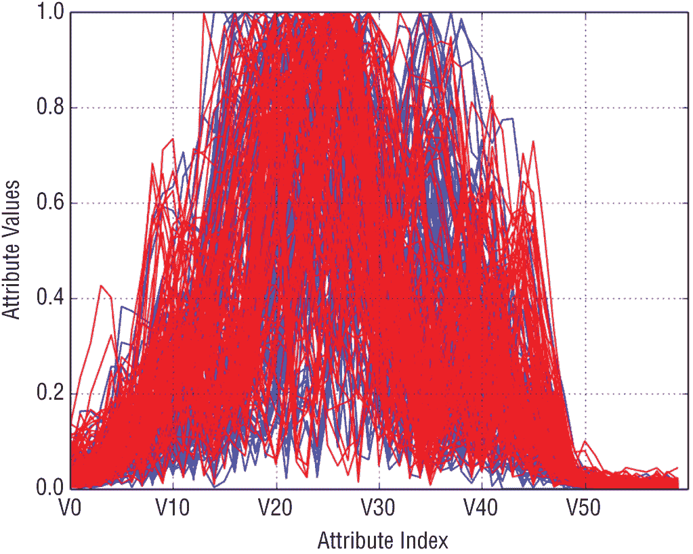

**图 2.3**：岩石与地雷属性的平行坐标图

### 可视化属性与标签之间的相互关系

你可能想问数据的另一个问题是各个属性之间是如何相互关联的。快速了解成对关系的一种方法是将带标签的属性进行交叉绘图。清单 2-7 展示了为几对代表性属性生成交叉图所需的内容。这些交叉图（也称为散点图）能让你看出成对变量之间的关联程度。

#### 清单 2-7：属性成对交叉绘图 — corrPlot.py


__author__ = 'mike_bowles'

# 将岩石与地雷数据读入 pandas 数据框
rocksVMines = `pd_read_rvm()`

# 计算实值属性之间的相关性
dataRow2 = `rocksVMines.iloc[1,0:60]`
dataRow3 = `rocksVMines.iloc[2,0:60]`

`plt.scatter(dataRow2, dataRow3)`

`plt.xlabel("第 2 个属性")`
`plt.ylabel(("第 3 个属性"))`
`plt.show()`

dataRow21 = `rocksVMines.iloc[20,0:60]`

`plt.scatter(dataRow2, dataRow21)`

`plt.xlabel("第 2 个属性")`
`plt.ylabel(("第 21 个属性"))`
`plt.show()`

图 2.4 和 2.5 展示了来自岩石与地雷数据集的两对属性的散点图。岩石与地雷的属性是声纳回波的样本。声纳信号被称为*调频*波形，因为它是一个从低频开始并在脉冲持续时间内频率升高的脉冲。岩石与地雷数据集中的属性是反射自岩石或地雷的声波的时间样本。这些返回的声学信号在时间和频率之间具有与发射信号相同的关系。岩石与地雷数据中的 60 个属性是在 60 个不同时间（因此也是 60 个不同频率）下采集的回波样本。你会预期相邻属性比在时间上分离的属性更具相关性，因为相邻时间样本之间的频率差别不大。

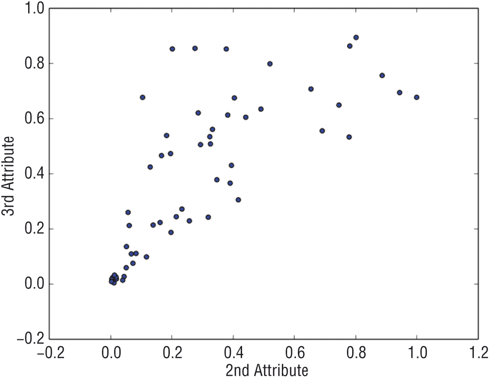

**图 2.4**：岩石与地雷属性 2 和 3 的交叉图

这种直觉在图 2.4 和 2.5 中得到了验证。图 2.4 中散点图的点比图 2.5 中的点更紧密地聚集在一条直线周围。如果你想培养关于数值相关性与散点图形状之间关系的直觉，只需搜索“相关性”并查看出现的维基百科页面。那里展示了一些散点图及其关联的数值相关性。基本上，如果散点图中的点沿着一条细直线分布，则两个变量高度相关；如果它们形成一团点，则它们不相关。

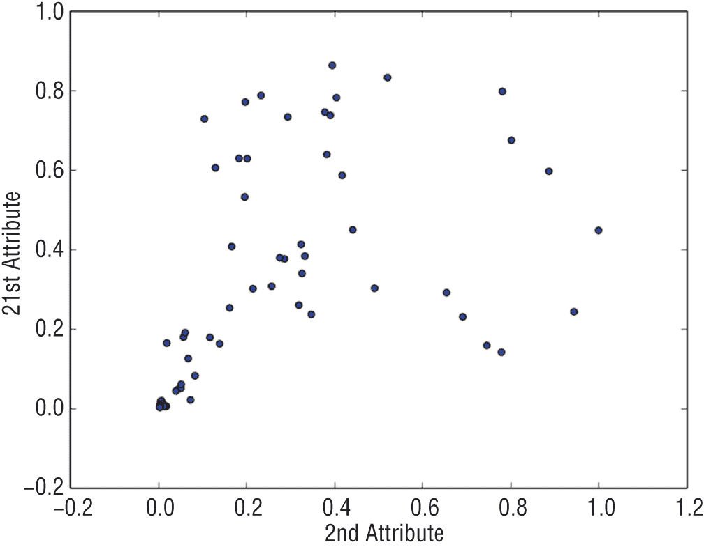

**图 2.5**：岩石与地雷属性 2 和 21 的交叉图

你可以应用相同的原则来绘制每个属性与目标之间的相关性。对于目标是实数的问题（回归问题），这些图看起来与图 2.4 和 2.5 非常相似。岩石与地雷数据集是一个分类问题。目标只有两个值。你可以遵循相同的通用过程。

清单 2-8 展示了绘制目标与属性 35 之间散点图的代码。在图 2.3 的平行坐标图中，索引值 35 附近显示出岩石和地雷（红线和蓝线）有一定的分离，因此选用属性 35 作为展示与目标相关性的示例。目标与该索引值附近的某个属性之间的相关性也应显示出一定的分离。图 2.6 和 2.7 绘制了结果。

#### 清单 2-8：分类目标与实值属性之间的相关性 — targetCorr.py

```python
__author__ = 'mike_bowles'
from random import uniform

# 将岩石与地雷数据读入 pandas 数据框
rocksVMines = `pd_read_rvm()`

# 将目标转换为数值
target = []
for i in range(208):
    # 根据 "M" 或 "R" 标签分配 0 或 1 目标值
    if `rocksVMines.iat[i,60] == "M"`:
        target.append(1.0)
    else:
        target.append(0.0)

    # 将数据行绘制为序列数据
dataRow = `rocksVMines.iloc[0:208,35]`
`plt.scatter(dataRow, target)`

`plt.xlabel("属性值")`
`plt.ylabel("目标值")`
`plt.show()`

#
# 为了改善可视化效果，此版本对点进行轻微抖动
# 并使其具有一定透明度
target = []
for i in range(208):
    # 根据 "M" 或 "R" 标签分配 0 或 1 目标值
    # 并添加一些抖动
    if `rocksVMines.iat[i,60] == "M"`:
        target.append(1.0 + `uniform(-0.1, 0.1)`)
    else:
        target.append(0.0 + `uniform(-0.1, 0.1)`)

    # 将数据行绘制为序列数据
dataRow = `rocksVMines.iloc[0:208,35]`
`plt.scatter(dataRow, target, alpha=0.5, s=120)`

`plt.xlabel("属性值")`
`plt.ylabel("目标值")`
`plt.show()`
```

这些图展示了如果你创建一个与 R 或 M 目标列表对应的列表，但将 M 替换为 1，R 替换为 0，会发生什么。然后你可以绘制如图 2.6 所示的散点图。图 2.6 凸显了交叉图的一个常见问题。当被绘制的变量之一只取少量离散值时，点会重叠在一起。如果数量很多，你只会得到一条粗粗的深色线，无法感知点沿线的分布情况。

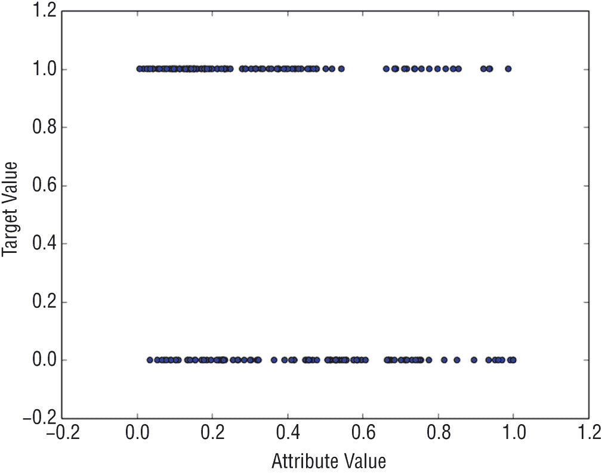

**图 2.6**：目标-属性交叉图

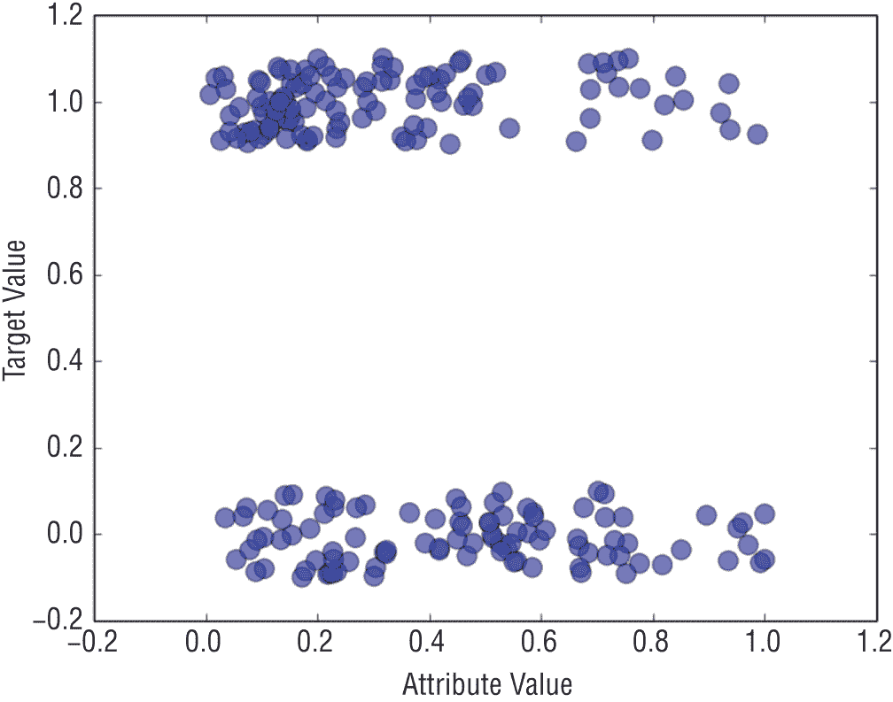

**图 2.7**：带点抖动和部分不透明度的目标-属性交叉图

清单 2-8 中的代码通过两个小改动生成了第二个图，以克服这个问题。向每个点添加一个小随机数，这些点原本只取少量离散值（本例中为目标值）。目标值由构造决定只能是 0 或 1。在代码中，你会看到添加的随机数在 -0.1 和 0.1 之间均匀分布。这将点分开，但不会分得太远以至于混淆两条线。其次，点以 `alpha=0.5` 绘制，使其仅部分不透明。这样，任何重叠绘制都会在散点图中显示为加深的区域。你可能需要微调这些数字，以使图表展示你所需的信息。

图 2.7 展示了这两项改动的效果。注意上带点的左端属性 35 的浓度略高，而下带点从右到左分布更均匀。上带点对应地雷，下带点对应岩石。你可以通过测试属性 35 是大于还是小于 0.5 来为该问题构建一个分类器。如果大于 0.5 则判为岩石，如果小于 0.5 则判为地雷。属性 35 小于 0.5 的示例包含更高浓度的地雷而非岩石，而属性 35 大于 0.5 的示例包含较低密度的地雷，因此你的表现会比随机猜测好得多。

### 两个属性（或一个属性与目标）之间的相关程度可以使用皮尔逊相关系数来量化

皮尔逊相关系数针对两个等长向量 `u` 和 `v` 定义如下（参见公式 2.1 和 2.2）。首先从 `u` 的所有元素中减去 `u` 的平均值（参见公式 2.3），对 `v` 执行相同操作。

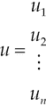

**公式 2.1**:  向量 u 的元素

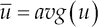

**公式 2.2**:  u 中各条目的平均值

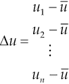

**公式 2.3**:  从 u 中的每个元素减去平均值

对于第二个向量 `v`，以定义 `Δu` 对应向量 `u` 的相同方式定义向量 `Δv`。

然后 `u` 和 `v` 之间的皮尔逊相关性如公式 2.4 所示。

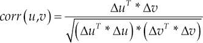

**公式 2.4**:  皮尔逊相关系数的定义

清单 2-9 展示了该函数的 Python 实现，用于计算图 2.3 和 2.5 中绘制的属性对的相关性。相关性数值与绘制的数据一致。索引编号接近的属性具有比间隔较远的属性相对更高的相关性。

#### 清单 2-9: 属性 2 对 3 和属性 2 对 21 的皮尔逊相关性计算 — corrCalc.py

```python
__author__ = 'mike_bowles'
from math import sqrt
from Read_Fcns import `pd_read_rvm`
from scipy.stats.stats import `pearsonr`

rocksVMines = `pd_read_rvm()`

# calculate correlations between real-valued attributes
dataRow2 = `np.array(rocksVMines.iloc[1,0:60])`
dataRow3 = `np.array(rocksVMines.iloc[2,0:60])`
dataRow21 = `np.array(rocksVMines.iloc[20,0:60])`

mean2 = 0.0; mean3 = 0.0; mean21 = 0.0
numElt = `len(dataRow2)`
for i in range(numElt):
    mean2 += dataRow2[i]/numElt
    mean3 += dataRow3[i]/numElt
    mean21 += dataRow21[i]/numElt

var2 = 0.0; var3 = 0.0; var21 = 0.0
for i in range(numElt):
    var2 += (dataRow2[i] - mean2) * (dataRow2[i] - mean2)/numElt
    var3 += (dataRow3[i] - mean3) * (dataRow3[i] - mean3)/numElt
    var21 += (dataRow21[i] - mean21) * (dataRow21[i] - mean21)/numElt

corr23 = 0.0; corr221 = 0.0
for i in range(numElt):
    corr23 += (dataRow2[i] - mean2) * \
              (dataRow3[i] - mean3) / (`sqrt(var2*var3) * numElt`)
    corr221 += (dataRow2[i] - mean2) * \
               (dataRow21[i] - mean21) / (`sqrt(var2*var21) * numElt`)

print('Correlation between attribute 2 and 3')
print(corr23, '\n')

print('Correlation between attribute 2 and 21')
print(corr221, '\n')

print('Now that you see how the calculation is done, using the python \
pearsonr function will save you time')
print(`pearsonr(dataRow2, dataRow3)`)

Printed Output:
Correlation between attribute 2 and 3
0.7709381211911223

Correlation between attribute 2 and 21
0.46654808078868865

Now that you see how the calculation is done, using the python pearsonr 
function will save you time
(0.7709381211911221, 5.79499196668097e-13)
```

### 使用热力图可视化属性与标签的相关性

计算相关性并打印它们或绘制交叉图对于少量相关性效果很好，但很难从大量数字表格中掌握规律，如果问题有 100 个属性，也很难将所有交叉图挤在一页上。

检查大量属性相关性的一种方法是计算属性对的皮尔逊相关系数，将这些相关性排列成一个矩阵，其中第 `i`、`j` 个条目是第 `i` 个属性和第 `j` 个属性之间的相关性，然后在热力图中绘制它们。清单 2-10 给出了制作此图的代码。图 2.8 显示了该图。对角线上的浅色区域确认了索引上彼此接近的属性具有相对较高的相关性。如前所述，这是由于数据生成方式造成的。相近的索引以短时间间隔相互采样，因此具有相似的频率。相似的频率以类似的方式从目标反射（以此类推）。

#### 清单 2-10: 直观呈现属性相关性 — sampleCorrHeatMap.py

```python
__author__ = 'mike_bowles'

# read rocks versus mines data into pandas data frame
rocksVMines = `pd_read_rvm()`

# calculate correlations between real-valued attributes

corMat = `DataFrame(rocksVMines.corr())`

# visualize correlations using heatmap
`plt.pcolor(corMat)`
`plt.show()`
```

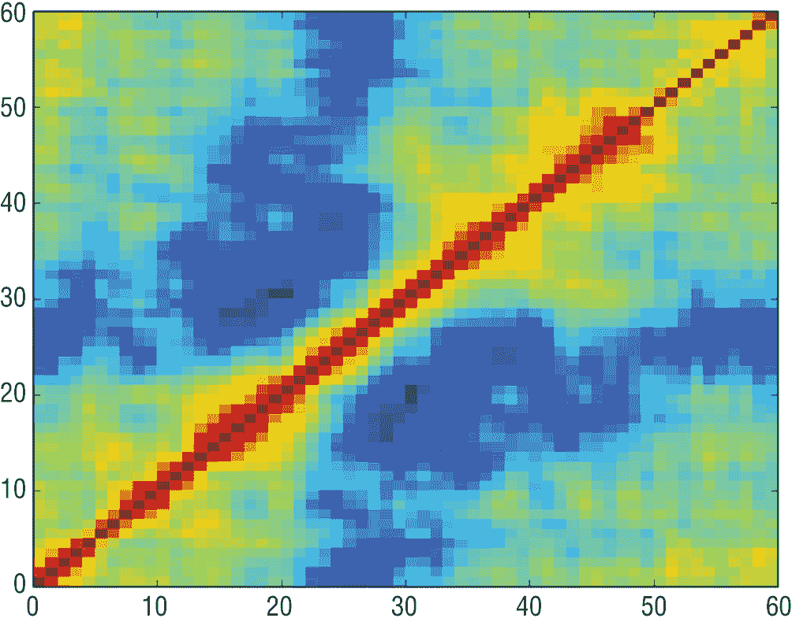

**图 2.8**: 显示属性交叉相关性的热力图

属性之间的完全相关（相关性 = 1）意味着你可能犯了错误，两次包含了同一事物。一组属性之间的极高相关性（成对相关性 > 0.7）称为 `multicollinearity`（多重共线性），可能导致不稳定的估计。与目标的相关性则另当别论。拥有与目标相关的属性通常表明存在预测关系。

### 理解岩石与地雷数据集过程的总结

在理解岩石与地雷数据集的过程中，本节介绍了许多工具供你用于获取对数据集的理解和直觉。本节详细阐述了它们的推导和使用，使其清晰明了。后续章节将使用这些相同的工具来检查本书将用于开发机器学习算法的其他数据集。既然你现在已经熟悉了数据检查的工具，后续章节将仅在因问题性质不同而需要修改工具的范围内对工具进行评论。

## 含因子变量的实值预测：你的鲍鱼多大了？

你所见到的用于理解探测未爆地雷问题的大多数工具都可以应用于回归问题。给定物理测量值预测鲍鱼的年龄，提供了此类问题的一个示例。鲍鱼属性还包括一个因子变量属性，这将说明因子变量所涉及的差异。

鲍鱼数据集提出了通过进行若干测量来预测鲍鱼年龄的问题。通过切开贝壳并计数生长环，可以获得鲍鱼年龄的精确读数，这很像通过数年轮来判断树龄。对于研究鲍鱼种群的科学家来说，问题是切片贝壳并在显微镜下计数年轮既昂贵又耗时。如果能进行简单的物理测量，如长度、宽度、重量等，然后使用预测模型处理这些测量值并准确确定鲍鱼的年龄，那将更加方便且经济。预测分析有无数科学应用，学习机器学习的好处之一就是能够为一系列有趣的不同问题做出贡献。

数据可通过 UC Irvine 数据存储库获取。该数据集的 URL 为 `http://archive.ics.uci.edu/ml/machine-learning-databases/abalone/abalone.data`。数据集为不带列标题的逗号分隔文件，列名在单独文件中。Listing 2-11 将鲍鱼数据集读入 pandas 数据框，并运行了与“分类问题：利用声呐探测未爆地雷”中相同的部分分析。对于岩石与地雷数据集，因数据性质列名较为通用；而鲍鱼数据集各列含义明确，对建立直观理解至关重要。因此代码中将列名直接复制粘贴并附加到数据集，帮助理解后续机器学习算法如何进行预测。可用于构建预测模型的列包括：Sex、Length、Diameter、Height、Whole Weight、Shucked Weight、Viscera Weight、Shell Weight 和 Rings。最后一列 Rings 需通过锯开外壳并在显微镜下计数获得，这是监督学习问题的典型安排：拥有已知答案的特殊数据集，以构建在答案未知时能生成预测的模型。

除了展示生成摘要的代码，Listing 2-11 还显示了摘要的打印输出。第一部分打印数据集的头部和尾部，输出中仅显示头部以节省空间（运行代码时两者均可见）。数据框大部分为浮点数。第一列包含动物性别，取值为 M（雄性）、F（雌性）、I（不确定）。鲍鱼性别非出生时确定，而是成熟后才定，因此幼年鲍鱼性别不确定。性别为三值分类变量，需特殊处理。某些算法仅处理实值属性（如支持向量机、K 近邻、惩罚线性回归，见第 4 章）。第 4 章 讨论了将分类变量转换为实值变量的技术以适用这些算法。Listing 2-11 还展示了实值属性的逐列统计摘要。

#### Listing 2-11：读取并汇总鲍鱼数据集 — abaloneSummary.py


# 鲍鱼数据集的探索性数据分析

## 代码示例：数据加载与摘要统计

```python
__author__ = 'mike_bowles'

from Read_Fcns import pd_read_abalone
#read abalone data
abalone = pd_read_abalone()

print(abalone.head())
print(abalone.tail())

#print summary of data frame
summary = abalone.describe()
print(summary)
```

## 代码示例：箱线图可视化

```python
#box plot the real-valued attributes
#convert to array for plot routine
array = abalone.iloc[:,1:9].values
plt.boxplot(array) 
plt.xlabel("Attribute Index")
plt.ylabel(("Quartile Ranges"))
plt.show()

#the last column (rings) is out of scale with the rest
# - remove and replot
array2 = abalone.iloc[:,1:8].values
plt.boxplot(array2)
plt.xlabel("Attribute Index")
plt.ylabel(("Quartile Ranges"))
plt.show()

#removing is okay but renormalizing the variables generalizes better.
#renormalize columns to zero mean and unit standard deviation
#this is a common normalization and desirable for other operations
# (like k-means clustering or k-nearest neighbors
abaloneNormalized = abalone.iloc[:,1:9]


for i in range(8):
    mean = summary.iloc[1, i]
    sd = summary.iloc[2, i]
    abaloneNormalized.iloc[:,i:(i + 1)] = (
                    abaloneNormalized.iloc[:,i:(i + 1)] - mean) / sd

array3 = abaloneNormalized.values
plt.boxplot(array3)
plt.xlabel("Attribute Index")
plt.ylabel(("Quartile Ranges - Normalized "))
plt.show()
```

## 打印输出结果

```
  Sex  Length  Diameter  Height  Whole wt  Shucked wt  Viscera weight  
0   M   0.455     0.365   0.095    0.5140      0.2245          0.1010   
1   M   0.350     0.265   0.090    0.2255      0.0995          0.0485   
2   F   0.530     0.420   0.135    0.6770      0.2565          0.1415   
3   M   0.440     0.365   0.125    0.5160      0.2155          0.1140   
4   I   0.330     0.255   0.080    0.2050      0.0895          0.0395   

   Shell weight  Rings  
0         0.150     15  
1         0.070      7  
2         0.210      9  
3         0.155     10  
4         0.055      7  
    Sex  Length  Diameter  Height  Whole weight  Shucked weight  \
4172   F   0.565     0.450   0.165        0.8870          0.3700   
4173   M   0.590     0.440   0.135        0.9660          0.4390   
4174   M   0.600     0.475   0.205        1.1760          0.5255   
4175   F   0.625     0.485   0.150        1.0945          0.5310   
4176   M   0.710     0.555   0.195        1.9485          0.9455   
   
       Viscera weight  Shell weight  Rings  
4172          0.2390        0.2490     11  
4173          0.2145        0.2605     10  
4174          0.2875        0.3080      9  
4175          0.2610        0.2960     10  
4176          0.3765        0.4950     12  
            Length     Diameter       Height  Whole wt        Shucked wt
count  4177.000000  4177.000000  4177.000000   4177.000000     4177.0000
mean      0.523992     0.407881     0.139516      0.828742      0.359367
std       0.120093     0.099240     0.041827      0.490389      0.221963
min       0.075000     0.055000     0.000000      0.002000      0.001000
25%       0.450000     0.350000     0.115000      0.441500      0.186000
50%       0.545000     0.425000     0.140000      0.799500      0.336000
75%       0.615000     0.480000     0.165000      1.153000      0.502000
max       0.815000     0.650000     1.130000      2.825500      1.488000

       Viscera weight  Shell weight        Rings  
count     4177.000000   4177.000000  4177.000000  
mean         0.180594      0.238831     9.933684  
std          0.109614      0.139203     3.224169  
min          0.000500      0.001500     1.000000  
25%          0.093500      0.130000     8.000000  
50%          0.171000      0.234000     9.000000  
75%          0.253000      0.329000    11.000000  
max          0.760000      1.005000    29.000000   
```

## 箱线图分析

作为统计摘要列表的替代方案，清单 2-11 为每个实数型数据列生成了箱线图。其中第一个如图 2.9 所示。在图 2.9 中，统计摘要以箱线图表示，也称为*箱须图*。这些图显示了一个中间穿过一条红线的小矩形。红线标记了该数据列的中位数（或第 50 百分位数）。矩形的顶部和底部分别标记了第 25 百分位数和第 75 百分位数。你可以将打印摘要中的数字与箱线图中的水平线进行比较以确认这一点。在箱体上方和下方，你会看到小的水平刻度，即所谓的须线。这些线绘制在箱体上方和下方 1.4 倍四分位距的位置。四分位距是第 75 百分位数与第 25 百分位数之间的差值。换句话说，箱体顶部到上须线的距离是箱体高度的 1.4 倍。须线的 1.4 倍间距是可调的；请参阅箱线图文档。你会注意到在某些情况下，须线比 1.4 倍间距更近。在这些情况下，数据值并未延伸至计算出的须线位置。在这些情况下，须线放置在最极端的数据点处。在其他情况下，数据延伸至计算出的须线位置相当远的距离之外。这些点可被视为异常值。

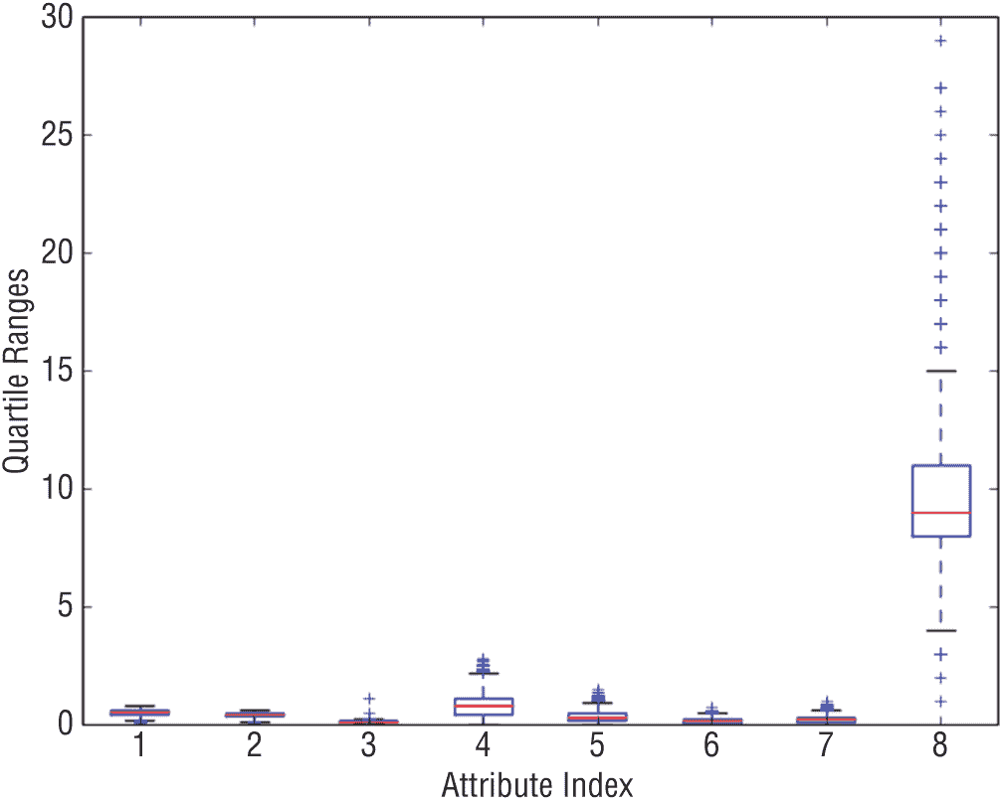

**图 2.9**：鲍鱼数据集实数型属性的箱线图

图 2.9 中的箱线图比打印数据更快、更直观地识别异常值，但 `rings` 属性（最右侧的箱线图）上的刻度导致其他属性被压缩（使其难以看清）。解决此问题的一种方法是直接移除较大刻度的属性。结果如图 2.10 所示。但这种方法并不令人满意，因为它无法很好地实现自动化或扩展。

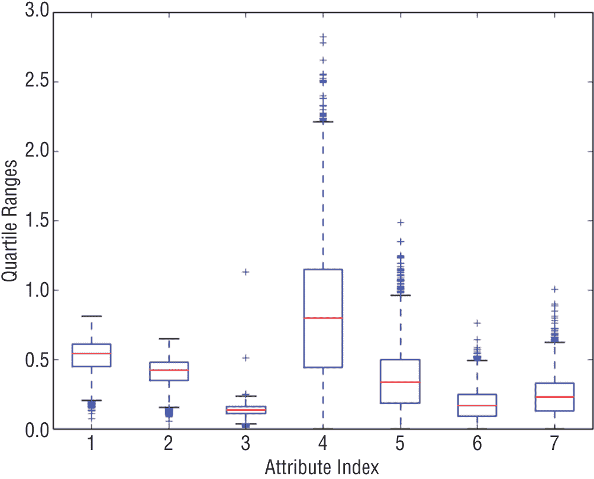

**图 2.10**：鲍鱼数据集实数型属性的箱线图

清单 2-11 代码的最后一部分在绘制箱线图前对所有数据列进行了归一化。这里的*归一化*是指将每一列进行中心化和缩放，使得属性 1 的一个单位意味着与属性 2 的一个单位相同的含义。数据科学中的许多算法和操作都需要这种类型的归一化。例如，`K-Means` 聚类基于数据行之间的向量距离来构建簇。距离是通过将一个点减去另一个点并求平方来测量的。如果单位不同，数值距离也会不同。去杂货店的距离如果用英里衡量可以是 1，如果用英尺衡量则是 5,280。清单 2-11 中所示的归一化将变量调整为均值为 0、标准差为 1。这是一种非常常见的归一化。归一化的计算利用了 `summary()` 函数生成的数字。结果绘制在图 2.11 中。

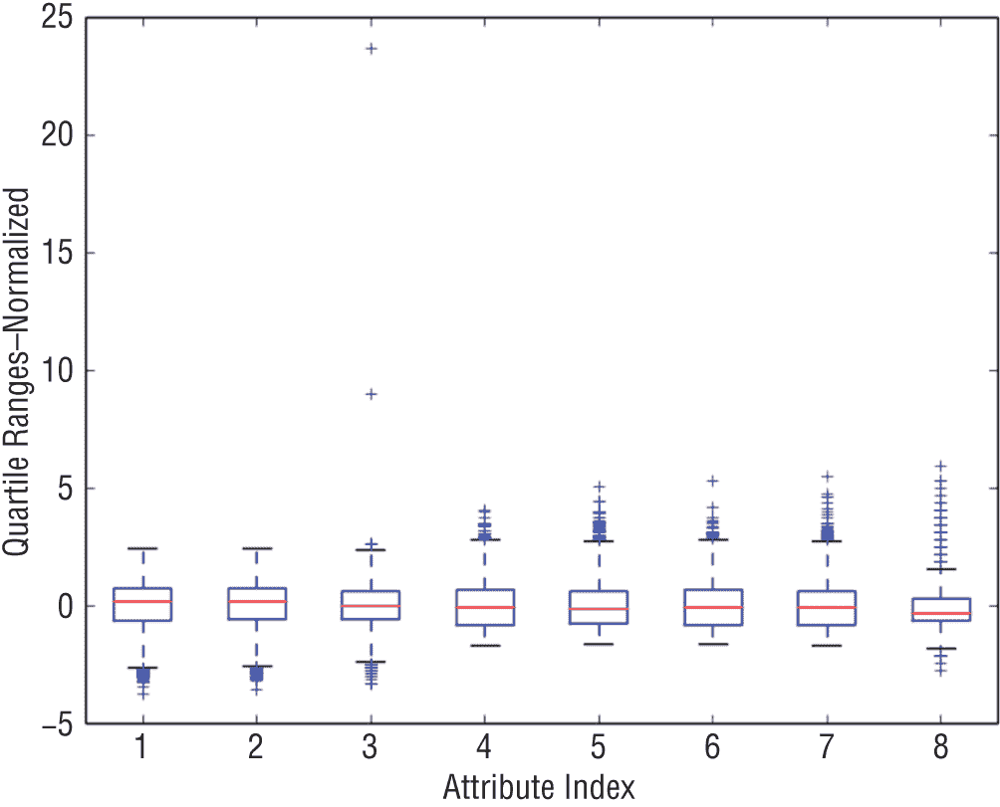

**图 2.11**：归一化后的鲍鱼属性箱线图

请注意，归一化为标准差 1.0 并不意味着所有数据都落在 -1.0 和 +1.0 之间。它或多或少地将箱体的下边缘和上边缘分别置于 -1.0 和 +1.0 处，但大部分数据位于这些边界之外。

## 回归问题的平行坐标图——可视化鲍鱼问题的变量关系

下一步是了解属性之间以及属性与标签之间的关系。对于岩石与矿石数据，颜色编码的平行坐标图以图形方式描绘了这些关系。该方法需要一些修改才能适用于鲍鱼问题。岩石与矿石是一个分类问题。该问题的平行坐标图根据数据行的真实分类对代表数据行的线条进行颜色编码。这有助于可视化预测目标与预测变量之间的关系。鲍鱼问题是一个回归问题，因此此示例中的颜色编码需要是对应于较高或较低目标值的色调。要为真实值分配色调，真实值需要被压缩到区间 `[0.0, 1.0]` 内。清单 2-12 使用 pandas `summary()` 函数生成的最小值和最大值来实现这一点。图 2.12 显示了结果。

### 清单 2-12：鲍鱼数据的平行坐标图 — abaloneParallelPlot.py

```python
__author__ = 'mike_bowles'

from math import exp
from Read_Fcns import pd_read_abalone

abalone = pd_read_abalone()

#get summary to use for scaling
summary = abalone.describe()
min_rings = summary.iloc[3,7]
max_rings = summary.iloc[7,7]
nrows = len(abalone.index)

for i in range(nrows):
    #plot rows of data as if they were series data
    data_row = abalone.iloc[i,1:8]
    label_color = (abalone.iloc[i,8] - min_rings) / (max_rings - \
        min_rings)
    data_row.plot(color=plt.cm.RdYlBu(label_color), alpha=0.5)

plt.xlabel("Attribute Index")
plt.ylabel(("Attribute Values"))
plt.show()

#renormalize using mean and standard variation, then compress
# with logit function

mean_rings = summary.iloc[1,7]
sd_rings = summary.iloc[2,7]

for i in range(nrows):
    #plot rows of data as if they were series data
    data_row = abalone.iloc[i,1:8]
    norm_target = (abalone.iloc[i,8] - mean_rings)/sd_rings
    label_color = 1.0/(1.0 + exp(-norm_target))
    data_row.plot(color=plt.cm.RdYlBu(label_color), alpha=0.5) 

plt.xlabel("Attribute Index")
plt.ylabel(("Attribute Values"))
plt.show() 
```

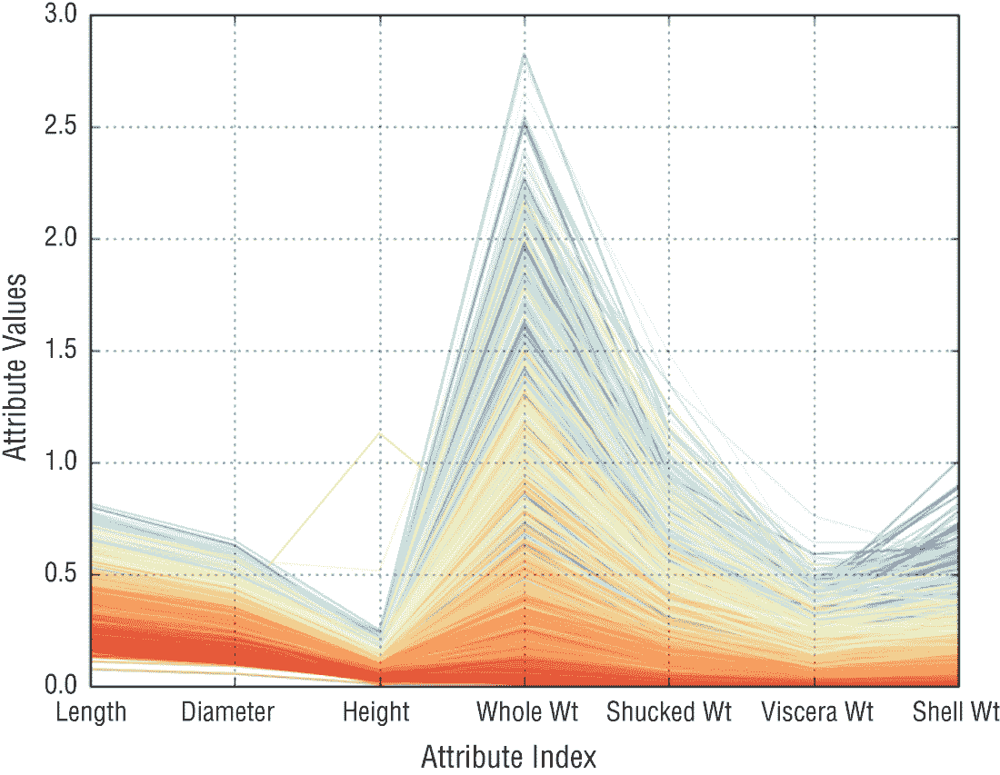

**图 2.12**：鲍鱼数据的颜色编码平行坐标图

图 2.12 中的平行坐标图展示了鲍鱼年龄（贝壳环数）与用于预测年龄的可用属性之间的直接关系。生成此图所用的颜色刻度范围从非常深的红褐色，经过较浅的色调、黄色、浅蓝色，到非常深的蓝色。图 2.11 中的箱线图显示，最大值和最小值与大部分数据相距甚远。这产生了压缩刻度的效果，使大部分数据在颜色刻度上处于中间范围。尽管如此，图 2.12 表明每个属性与每个样本测得的环数之间存在显著相关性。相似的色调在多个属性的相似值处聚集在一起。这种相关性表明你将能够构建一个准确的预测模型。与属性和目标之间总体有利的相关性相反，一些淡蓝色的线条混杂在图表较深橙色区域中，表明存在一些难以正确预测的样本。

更改颜色映射有助于在不同目标值层级上可视化关系。清单 2-11 代码的最后一部分使用了你在箱线图中看到的归一化方法。这种归一化并不能使所有值都适配在 0 和 1 之间。首先，生成的值包含同样多的负值和正值。清单 2-11 中的程序采用 `logit` 变换将值映射到 `(0, 1)` 区间。`logit` 变换由 Equation 2.5 所示表达式给出。该函数的图形如 Figure 2.13 所示。

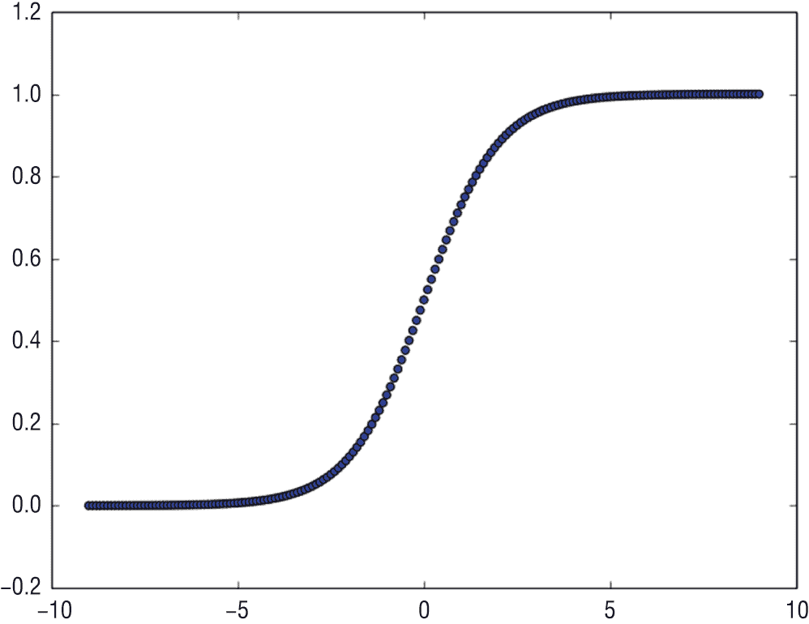

**Figure 2.13**: Graph of the logit function (logitCurve.png)

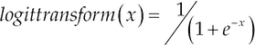

**Equation 2.5**: Using logit transform for soft range compression

该函数的图形如 Figure 2.13 所示。正如你所见，`logit` 变换将大负值映射到 0（近似），大正值映射到 1（近似）；将 0 映射到 0.5。你将在 Chapter 4 中再次看到 `logit` 函数，它在将线性函数关联到概率方面起着关键作用。

Figure 2.14 展示了这些步骤的结果。这些变换使得可用的完整色彩范围得到了更好的利用。请注意，在较浅蓝色的示例中混杂着几条较深的蓝色线（对应环数较多的样本），甚至在 `Whole Weight` 和 `Shucked Weight` 区域的图表中出现了黄色和浅红色的样本。这表明这些属性可能不足以正确预测老年样本的年龄（环数）。幸运的是，其他一些属性（`Diameter` 和 `Shell Weight`）能更好地正确排序深蓝色线条。这些观察结果在后续分析预测误差时将大有裨益。

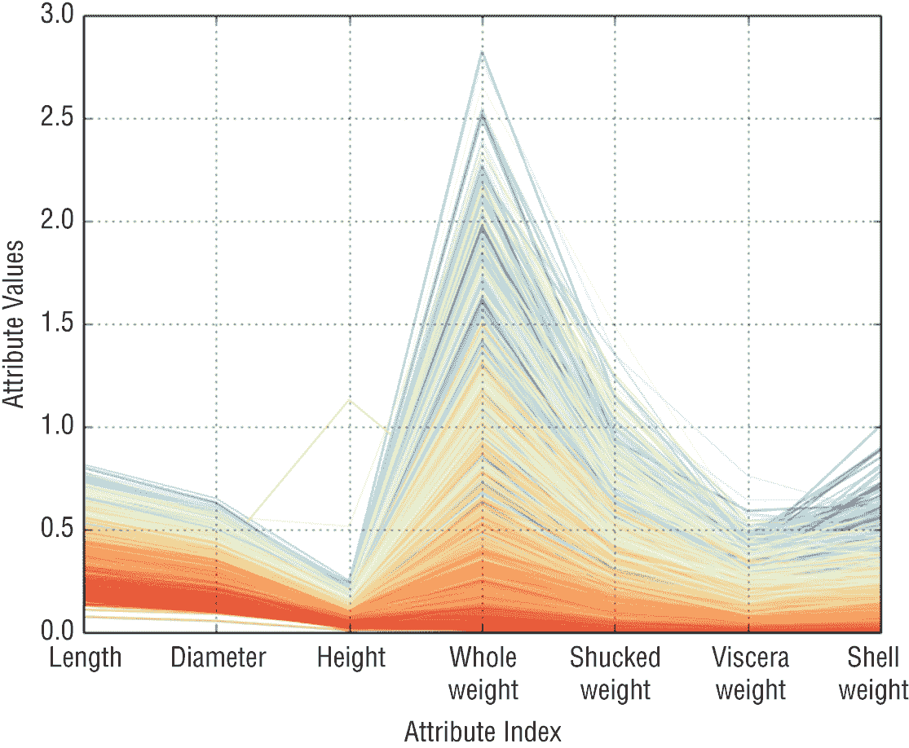

**Figure 2.14**: Parallel coordinate plot for the abalone data

## 如何使用相关性热力图进行回归——可视化鲍鱼问题的成对相关性

最后一步是查看各属性之间以及属性与目标之间的相关性。清单 2-13 展示了生成鲍鱼数据相关性热力图和相关性矩阵的代码。这些计算遵循了针对岩石与地雷数据所概述的相同方法，但有一个重要区别：因为鲍鱼问题要求进行实数预测，相关性计算可以在相关性矩阵中包含目标变量。


#### Listing 2-13: Correlation Calculations for the Abalone Data — abaloneCorrHeat.py

```python
__author__ = 'mike_bowles'

abalone = pd_read_abalone()

#calculate correlation matrix
corr_mat = DataFrame(abalone.iloc[:,1:9].corr())
#print correlation matrix
print(corr_mat)
   
#visualize correlations using heatmap
plt.pcolor(corr_mat)
plt.show()
```

**Printed Output:**

```
                 Length  Diameter    Height  Whole weight     Shucked wt
Length          1.000000  0.986812  0.827554      0.925261     0.897914
Diameter        0.986812  1.000000  0.833684      0.925452     0.893162
Height          0.827554  0.833684  1.000000      0.819221     0.774972
Whole weight    0.925261  0.925452  0.819221      1.000000     0.969405
Shucked weight  0.897914  0.893162  0.774972      0.969405     1.000000
Viscera weight  0.903018  0.899724  0.798319      0.966375     0.931961
Shell weight    0.897706  0.905330  0.817338      0.955355     0.882617
Rings           0.556720  0.574660  0.557467      0.540390     0.420884
 
                 Viscera weight  Shell weight     Rings  
Length                0.903018      0.897706  0.556720  
Diameter              0.899724      0.905330  0.574660  
Height                0.798319      0.817338  0.557467  
Whole weight          0.966375      0.955355  0.540390  
Shucked weight        0.931961      0.882617  0.420884  
Viscera weight        1.000000      0.907656  0.503819  
Shell weight          0.907656      1.000000  0.627574  
Rings                 0.503819      0.627574  1.000000   
```

Figure 2.15 展示了相关性热力图。在该图中，红色表示高相关性，蓝色代表弱相关性。目标变量（贝壳环数）位于最后一项，即热力图的顶行和最右列。这些位置的蓝色值意味着属性与目标之间的相关性较弱。浅蓝色对应目标与 `Shell weight` 之间的相关性。这证实了你在平行坐标图中所见。Figure 2.15 中其他非对角单元格的红色值表明属性之间高度相关。这在一定程度上与平行坐标图所呈现的画面相矛盾，在平行坐标图中，目标与属性之间的对应关系在视觉上似乎相当紧密。Listing 2-13 给出了相关性的数值。

在本节中，你已经了解了如何将针对分类问题（岩石与地雷）描述的工具修改为适用于回归问题（鲍鱼）。所有修改都源于这两类问题的基本区别——回归问题的标签是实数，而二分类问题的标签是双值。下一节将对一个具有全数值属性的回归问题进行相同的研究。因为是回归问题，本节用于鲍鱼问题的相同工具均可使用。因为拥有全数值属性，所有属性都可以纳入研究，如相关性分析和沿实数线绘图。

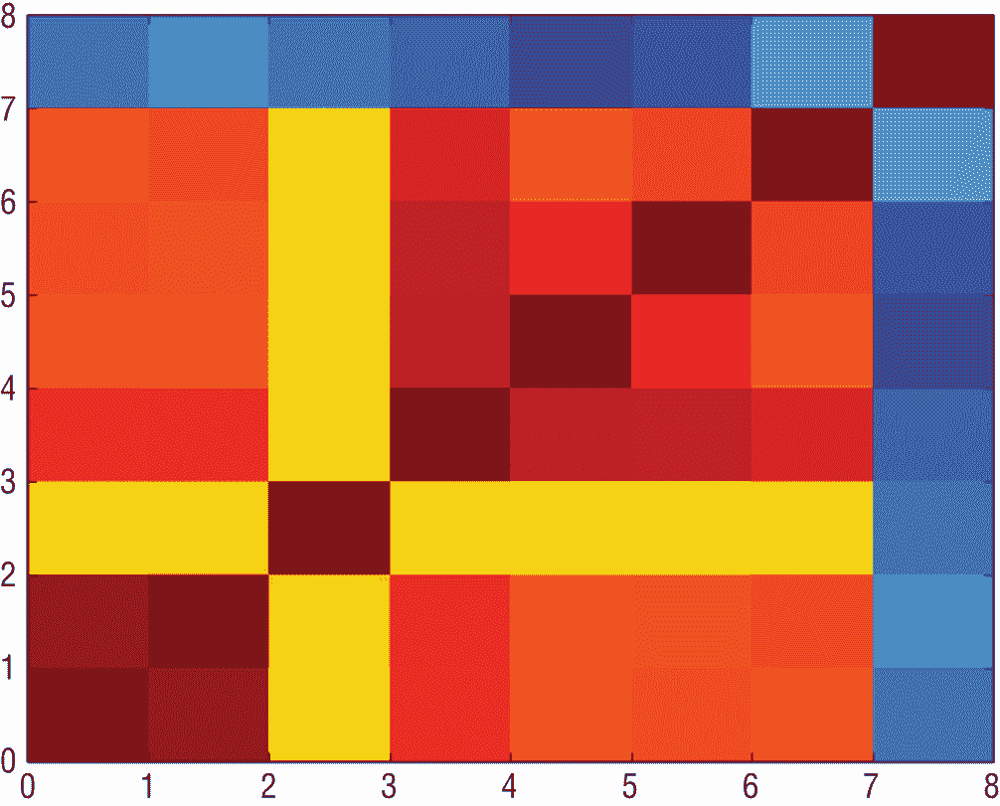

**Figure 2.15**: Correlation heat map for the abalone data

## Real-Valued Predictions Using Real-Valued Attributes: Calculate How Your Wine Tastes

葡萄酒口味数据集包含约 1500 种红葡萄酒的数据。每种葡萄酒都有多项化学成分测量值，包括酒精含量、挥发性酸度和亚硫酸盐等。每种葡萄酒还有一个口味评分，由三位专业品酒师的评分平均而得。问题在于构建一个模型，融合化学测量值来预测口味评分，使其与人工品酒师给出的评分相匹配。

Listing 2-14 展示了生成葡萄酒数据集摘要的代码。代码打印出数据的数值摘要，列在该清单底部。代码还生成了归一化变量的箱线图，以便可视化数据中的离群值。Figure 2.16 展示了箱线图。数值摘要和箱线图均显示存在大量离群值。在基于此数据集训练模型时应牢记这一点。在分析训练模型的性能时，这些离群样本将是理解模型误差来源的一个切入点。

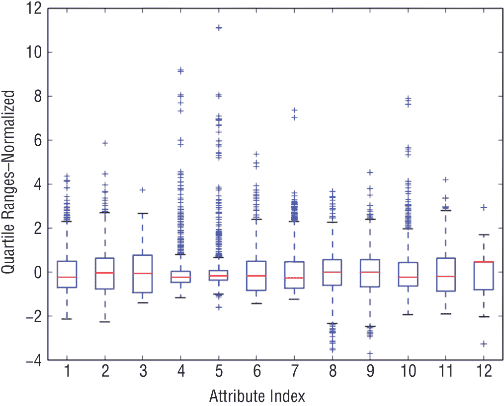

**Figure 2.16**: Attribute and target box plots of normalized wine data

#### Listing 2-14: Wine Data Summary — wineSummary.py

### 代码示例：读取葡萄酒数据并生成统计摘要

```python
__author__ = 'mike_bowles'

# read wine data into pandas data frame
wine = pd_read_wine()

print(wine.head())

# generate statistical summaries
summary = wine.describe()
print(summary)

wineNormalized = wine
ncols = len(wineNormalized.columns)

for i in range(ncols):
    mean = summary.iloc[1, i]
    sd = summary.iloc[2, i]
    wineNormalized.iloc[:, i:(i + 1)] = \
        (wineNormalized.iloc[:, i:(i + 1)] - mean) / sd

array = wineNormalized.values
plt.boxplot(array)
plt.xlabel("Attribute Index")
plt.ylabel("Quartile Ranges - Normalized")
plt.show()
```

### 打印输出

```
  fixed acidity  volatile acidity  citric acid  residual sugar  chlorides
0            7.4              0.70         0.00             1.9      0.076
1            7.8              0.88         0.00             2.6      0.098
2            7.8              0.76         0.04             2.3      0.092
3           11.2              0.28         0.56             1.9      0.075
4            7.4              0.70         0.00             1.9      0.076

   free sulfur dioxide  total sulfur dioxide  density    pH  sulphates
0                 11.0                  34.0   0.9978  3.51       0.56
1                 25.0                  67.0   0.9968  3.20       0.68
2                 15.0                  54.0   0.9970  3.26       0.65
3                 17.0                  60.0   0.9980  3.16       0.58
4                 11.0                  34.0   0.9978  3.51       0.56

   alcohol  quality
0      9.4        5
1      9.8        5
2      9.8        5
3      9.8        6
4      9.4        5
       fixed acidity  volatile acidity  citric acid  residual sugar
count    1599.000000       1599.000000  1599.000000     1599.000000
mean        8.319637          0.527821     0.270976        2.538806
std         1.741096          0.179060     0.194801        1.409928
min         4.600000          0.120000     0.000000        0.900000
25%         7.100000          0.390000     0.090000        1.900000
50%         7.900000          0.520000     0.260000        2.200000
75%         9.200000          0.640000     0.420000        2.600000
max        15.900000          1.580000     1.000000       15.500000

       chlorides  free sulfur dioxide  total sulfur dioxide     density
count  1599.000000         1599.000000         1599.000000  1599.000000
mean      0.087467           15.874922           46.467792    0.996747
std       0.047065           10.460157           32.895324    0.001887
min       0.012000            1.000000            6.000000    0.990070
25%       0.070000            7.000000           22.000000    0.995600
50%       0.079000           14.000000           38.000000    0.996750
75%       0.090000           21.000000           62.000000    0.997835
max       0.611000           72.000000          289.000000    1.003690

              pH    sulphates      alcohol      quality
count  1599.000000  1599.000000  1599.000000  1599.000000
mean      3.311113     0.658149    10.422983     5.636023
std       0.154386     0.169507     1.065668     0.807569
min       2.740000     0.330000     8.400000     3.000000
25%       3.210000     0.550000     9.500000     5.000000
50%       3.310000     0.620000    10.200000     6.000000
75%       3.400000     0.730000    11.100000     6.000000
max       4.010000     2.000000    14.900000     8.000000
```

葡萄酒数据的颜色编码平行坐标图可以大致展示属性与目标变量的相关程度。Listing 2-15 展示了生成该图的代码。Figure 2.17 展示了生成的平行坐标图。Figure 2.17 中的图表存在一个问题：在数值范围较小的变量方向上，图形被压缩了。

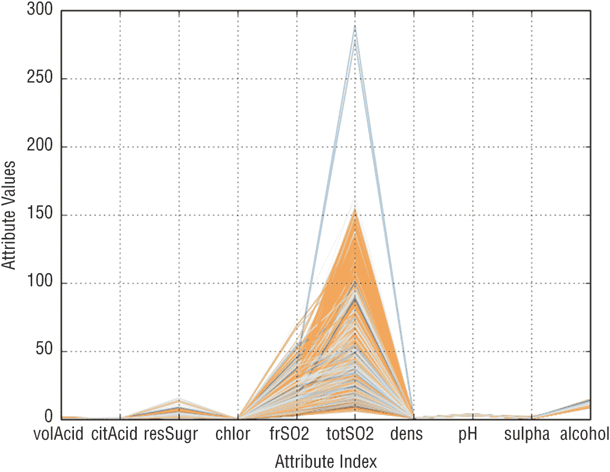

**Figure 2.17**：葡萄酒数据的平行坐标图

#### Listing 2-15: 为葡萄酒数据生成平行坐标图 — wineParallelPlot.py

```python
__author__ = 'mike_bowles'

from math import exp

wine = pd_read_wine()

# print column names in order to have the full versions
print(wine.columns)

# change column names to shorter ones to fit graph
wine.columns = ['fixAcid', 'volAcid', 'citAcid',
    'resSugr', 'chlor', 'frSO2', 'totSO2',
    'dens', 'pH', 'sulpha', 'alcohol', 'quality']

# generate statistical summaries
summary = wine.describe()
nrows = len(wine.index)
tasteCol = len(summary.columns)
meanTaste = summary.iloc[1, tasteCol - 1]
sdTaste = summary.iloc[2, tasteCol - 1]
nDataCol = len(wine.columns) - 1

for i in range(nrows):
    # plot rows of data as if they were series data
    dataRow = wine.iloc[i, 1:nDataCol]
    normTarget = (wine.iloc[i, nDataCol] - meanTaste) / sdTaste
    labelColor = 1.0 / (1.0 + exp(-normTarget))
    dataRow.plot(color=plt.cm.RdYlBu(labelColor), alpha=0.5)

plt.xlabel("Attribute Index")
plt.ylabel("Attribute Values")
plt.show()

wineNormalized = wine
ncols = len(wineNormalized.columns)

for i in range(ncols):
    mean = summary.iloc[1, i]
    sd = summary.iloc[2, i]
    wineNormalized.iloc[:, i:(i + 1)] = \
        (wineNormalized.iloc[:, i:(i + 1)] - mean) / sd

# Try again with normalized values
for i in range(nrows):
    # plot rows of data as if they were series data
    dataRow = wineNormalized.iloc[i, 1:nDataCol]
    normTarget = wineNormalized.iloc[i, nDataCol]
    labelColor = 1.0 / (1.0 + exp(-normTarget))
    dataRow.plot(color=plt.cm.RdYlBu(labelColor), alpha=0.5)

plt.xlabel("Attribute Index")
plt.ylabel("Attribute Values")
plt.show()
```

### 打印输出


```
Index(['fixed acidity', 'volatile acidity', 'citric acid',
  'residual sugar', 'chlorides', 'free sulfur dioxide',
  'total sulfur dioxide', 'density', 'pH', 'sulphates',
  'alcohol', 'quality'], dtype='object')
```

为了克服这一局限性，Listing 2-15 对葡萄酒数据进行了归一化处理并重新绘图。Figure 2.18 展示了归一化后的平行坐标图。

归一化后的葡萄酒数据图能更好地同时展示所有坐标方向上与目标变量的相关性。Figure 2.18 显示了几个属性之间明显的相关性。在图的最右侧，深蓝色线条（高口味评分）聚集在高 `alcohol`（酒精度）数值处。在最左侧，深红色线条（低口味评分）聚集在高 `volatile acidity`（挥发性酸度）数值处。这些是最明显的相关属性。你将在 Chapter 5 和 Chapter 7 中看到的预测模型会根据属性在生成预测中的重要性对其进行排序。你将看到这些视觉观察结果是如何被预测模型支持的。

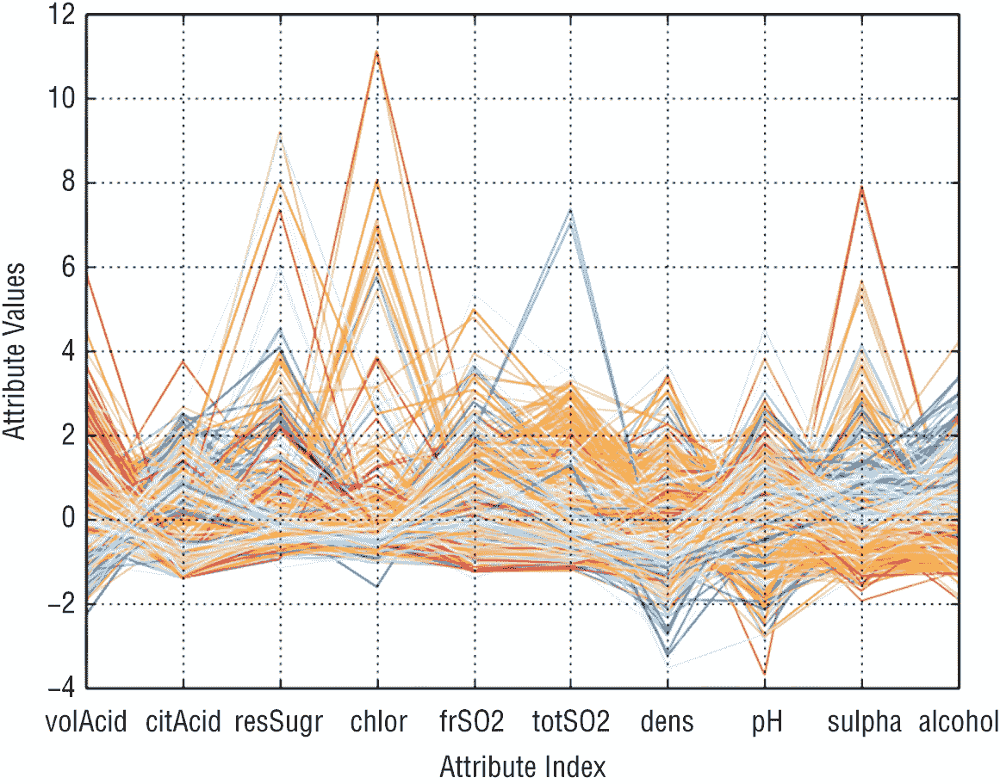

**Figure 2.18**：归一化葡萄酒数据的平行坐标图

Figure 2.19 展示了属性之间以及属性与目标变量之间相关性的热力图。在热力图中，暖色代表高相关性（这与平行坐标图中使用的颜色刻度相反）。葡萄酒数据的热力图显示 `taste`（口味，最后一列）与 `alcohol`（酒精度，倒数第二列）之间存在较高的相关性，而其他几个属性（包括第一个属性 `volatile acidity` 挥发性酸度）则显示极低的数值（高负相关）。

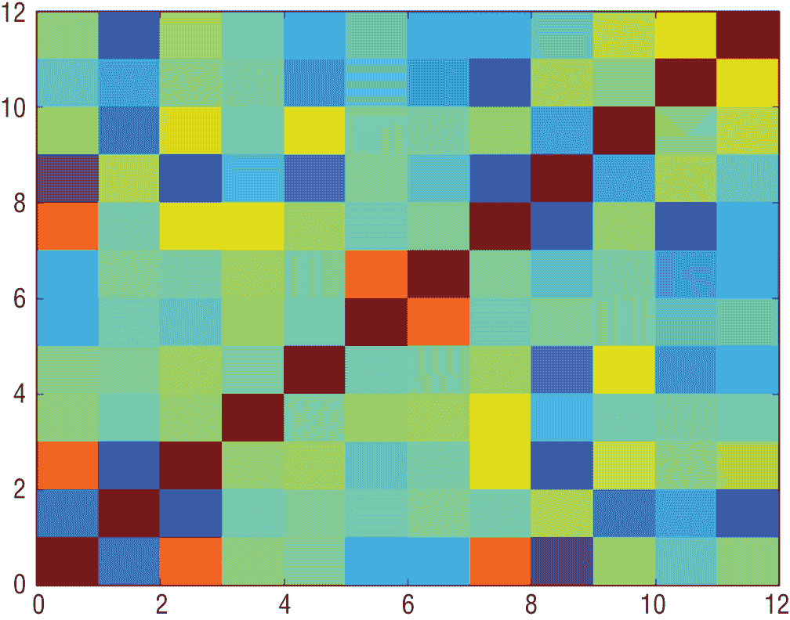

### 图 2.19：葡萄酒数据的相关性热力图

对葡萄酒数据集的探索是利用已经解释和使用过的工具完成的。葡萄酒数据集展示了这些工具能揭示什么。平行坐标图和相关性热力图都显示，高酒精含量对应高口感评分，而高挥发性酸度对应低口感评分。您将在第 5 章和第 7 章中看到，作为预测建模一部分的变量重要性研究将呼应这些发现。葡萄酒数据很好地例证了数据探索能在多大程度上推动您构建和验证预测模型。下一节将探索多类分类问题的数据。

## 多类分类问题：那是什么类型的玻璃？

多类分类与二元分类类似，区别在于有多个可能的离散结果，而不仅仅是两个。回想一下，探测未爆炸地雷的问题涉及两种可能的结果：声纳照射的物体是岩石还是地雷。根据化学成分测量值确定葡萄酒口感的问题有几种可能的结果（口感评分从 3 到 8）。但对于葡萄酒问题，评分之间存在顺序关系。评分为 5 的葡萄酒比评分为 3 的好，但比评分为 8 的差。对于多类问题，结果之间不存在顺序感。本节描述的玻璃问题提供了一个多类问题的示例。

在本节中，玻璃问题展示了各种类型玻璃的化学成分。该问题的目标是确定玻璃的用途。可能的玻璃类型包括建筑窗户玻璃、车辆窗户玻璃、玻璃容器等。确定玻璃类型的动机是法医鉴定。在事故或犯罪现场，会有玻璃碎片，确定其来源有助于判断谁有过错或谁实施了犯罪。清单 2-16 显示了生成玻璃数据集摘要的代码。图 2.20 显示了归一化数据的箱线图。箱线图显示有相当数量的极端值。

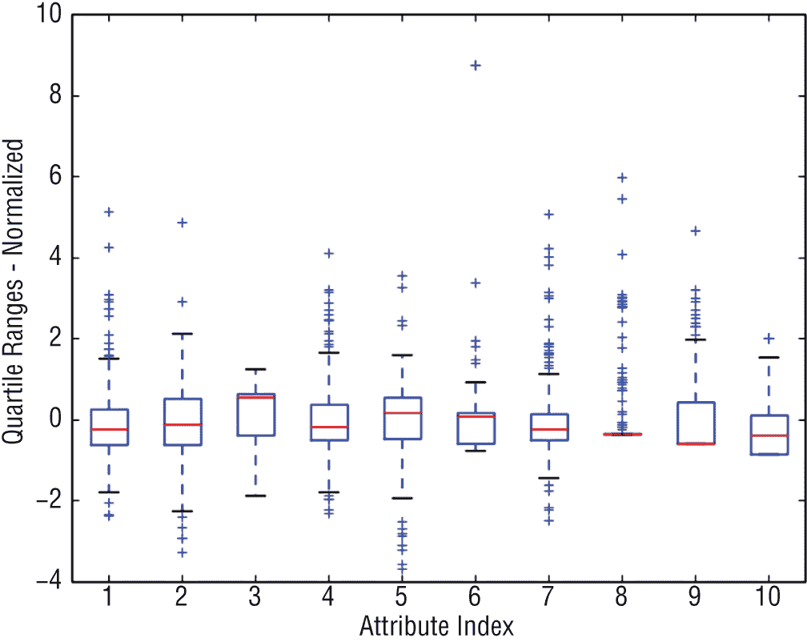

### 图 2.20：玻璃数据的箱线图

#### 清单 2-16：玻璃数据集摘要 — glassSummary.py

```
__author__ = 'mike_bowles'

glass = pd_read_glass()

print(glass.head())

#generate statistical summaries
summary = glass.describe()
print(summary)
ncol1 = len(glass.columns)

glassNormalized = glass.iloc[:, 1:ncol1]
ncol2 = len(glassNormalized.columns)
summary2 = glassNormalized.describe()

for i in range(ncol2):
    mean = summary2.iloc[1, i]
    sd = summary2.iloc[2, i]
    glassNormalized.iloc[:,i:(i + 1)] = \
        (glassNormalized.iloc[:,i:(i + 1)] - mean) / sd

array = glassNormalized.values
plt.boxplot(array)
plt.xlabel("Attribute Index")
plt.ylabel(("Quartile Ranges - Normalized "))
plt.show()
```

**打印输出：**

```
   Id       RI     Na    Mg    Al     Si     K    Ca   Ba   Fe  Type
0   1  1.52101  13.64  4.49  1.10  71.78  0.06  8.75  0.0  0.0     1
1   2  1.51761  13.89  3.60  1.36  72.73  0.48  7.83  0.0  0.0     1 
2   3  1.51618  13.53  3.55  1.54  72.99  0.39  7.78  0.0  0.0     1
3   4  1.51766  13.21  3.69  1.29  72.61  0.57  8.22  0.0  0.0     1
4   5  1.51742  13.27  3.62  1.24  73.08  0.55  8.07  0.0  0.0     1
               Id         RI         Na         Mg         Al         Si
count  214.00000  214.00000  214.00000  214.00000  214.00000  214.00000
mean   107.50000    1.51836   13.40785    2.68453    1.44490   72.65093
std     61.92064    0.00303    0.81660    1.44240    0.49927    0.77454
min      1.00000    1.51115   10.73000    0.00000    0.29000   69.81000
25%     54.25000    1.51652   12.90750    2.11500    1.19000   72.28000
50%    107.50000    1.51768   13.30000    3.48000    1.36000   72.79000
75%    160.75000    1.51915   13.82500    3.60000    1.63000   73.08750
max    214.00000    1.53393   17.38000    4.49000    3.50000   75.41000


                 K          Ca          Ba          Fe        Type  
count  214.000000  214.000000  214.000000  214.000000  214.000000  
mean     0.497056    8.956963    0.175047    0.057009    2.780374  
std      0.652192    1.423153    0.497219    0.097439    2.103739  
min      0.000000    5.430000    0.000000    0.000000    1.000000  
25%      0.122500    8.240000    0.000000    0.000000    1.000000  
50%      0.555000    8.600000    0.000000    0.000000    2.000000  
75%      0.610000    9.172500    0.000000    0.100000    3.000000  
max      6.210000   16.190000    3.150000    0.510000    7.000000   
```

玻璃数据属性的箱线图显示了大量的异常值——至少与其他一些示例问题相比是显著的。玻璃数据有几个因素可能驱动这种异常值行为。一个是这是一个分类问题。属性值与类别成员资格之间不一定存在连续关系——没有理由预期跨类别的属性值会接近。玻璃数据的另一个独特特征是它有些不平衡。每个类别的示例数量从最多类别的 76 个到最少类别的 9 个不等。平均统计量可能被数量最多的类别的值主导，也没有理由预期其他类别的成员会有相似的属性值。这种剧烈的行为有利于区分不同类别，但也意味着用于预测的方法必须能够在不同类别之间勾勒出相当复杂的边界。您将在第 3 章中了解到，如果给予足够的数据，集成方法产生的决策边界比惩罚线性回归更复杂，并且您将在第 5 章和第 7 章中看到哪一类方法在该数据集上表现更好。

平行坐标图可能会更多地揭示这些数据的行为。图 2.21 显示了平行坐标图。数据使用离散颜色绘制，对应每种可能的输出分类。图中的某些变量显示出相当明显的颜色路径。例如，深蓝色线条聚集得相当好，并且在许多属性上与其他类别明显分开。深蓝色线条在几个属性上处于数据的边缘——换句话说，在这些属性上是异常值。浅蓝色线条比深蓝色线条少，并且在一些与深蓝色相同的属性上处于边缘，但并非所有相同的属性。中间的棕色线条也聚集在一起，但处于中等数值范围内。清单 2-17 显示了生成玻璃数据平行坐标图的代码。对于岩石与地雷问题，平行坐标图中的线条使用两种颜色，以适应两种不同的标签值。在回归问题（葡萄酒口感和鲍鱼年龄）中，标签可以取任何实数值，图中的线条以一系列不同的颜色绘制。在这个多类问题中，每个类别获得自己的颜色。有六种离散颜色。标签从 1 到 7；没有 4。颜色的计算类似于回归问题中进行的计算——将数字标签除以其最大值。图中的线条呈现六种离散颜色。

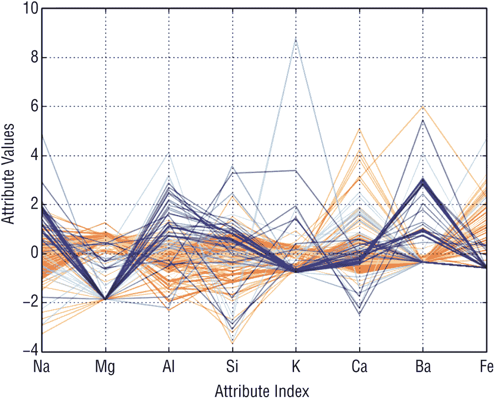

**Figure 2.21**: 玻璃数据的平行坐标图

#### Listing 2-17: 玻璃数据的平行坐标图 — glassParallelPlot.py

```
__author__ = 'mike_bowles'

glass = pd_read_glass()

glassNormalized = glass
ncols = len(glassNormalized.columns)
nrows = len(glassNormalized.index)
summary = glassNormalized.describe()
nDataCol = ncols - 1

#normalize except for labels
for i in range(ncols - 1):
    mean = summary.iloc[1, i] 
    sd = summary.iloc[2, i]
    glassNormalized.iloc[:,i:(i + 1)] = \
        (glassNormalized.iloc[:,i:(i + 1)] - mean) / sd

#Plot Parallel Coordinate Graph with normalized values
for i in range(nrows):
    #plot rows of data as if they were series data
    dataRow = glassNormalized.iloc[i,1:nDataCol]
    labelColor = glassNormalized.iloc[i,nDataCol]/7.0
    dataRow.plot(color=plt.cm.RdYlBu(labelColor), alpha=0.5)

plt.xlabel("Attribute Index")
plt.ylabel(("Attribute Values"))
plt.show() 
```

Figure 2.22 显示了玻璃数据的相关性热力图。该图显示属性之间大多呈低相关性。这意味着属性之间大多相互独立，这是一件好事。目标变量未包含在相关性热力图中，因为该问题的目标采用若干离散值之一。这削弱了相关性热力图的部分解释力。

对玻璃数据的探索性研究揭示了一个非常有趣的问题。特别是箱线图结合平行坐标图表明，如果有足够的数据来拟合模型，集成方法可能是一个很好的算法选择。对应于不同类别的属性集之间显然存在复杂的边界。哪种算法能提供最佳的预测性能仍有待观察。您所学的探索性方法已经完成了它们的任务。它们让您很好地理解了该问题的权衡，从而对哪种算法能提供最佳性能做出了一些推测。

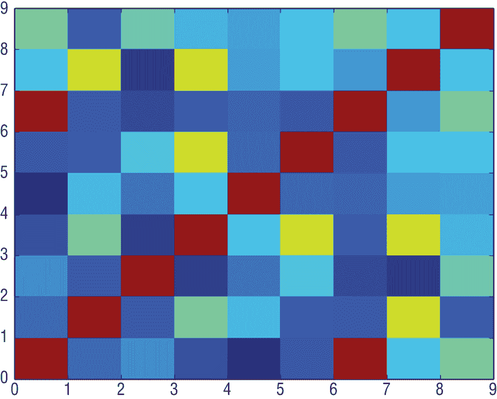

**Figure 2.22**: 玻璃问题的相关性热力图

## 使用 PySpark 理解大型数据集

理解大型数据集与小型数据集的唯一区别在于大型数据集更大。为什么这会是个问题？首先，它们可能大到无法放入内存，甚至可能无法放入硬盘。这使得数据检查变得困难。`PySpark` 正是为此而生。

`PySpark` 基本上允许您将本章中看到的技术应用于真正的大型数据集。而且所需的代码非常简单。后台有大量复杂的活动来支撑其运行，但从数据科学家的角度来看，这相当直观。

将大型数据集放到计算集群上可能会带来一些麻烦。有多种方法可以完成此任务。亚马逊、谷歌、微软和 Databricks 等云计算供应商提供服务，使数据上传到云端并在 Spark 上运行变得更加容易。具体流程因供应商而异，并随着技术发展而变化。总体而言，这些流程正变得越来越易用。由于两个原因，目前如何上传数据的描述超出了本书的范围：存在多种依赖供应商的方法，且这些方法正在不断变化。

在后续示例中，您将看到数据集在云端启动并运行后如何进行机器学习。该方法是将您在 Python 中运行的数据集转换为 `PySpark` 数据集，然后使用 `PySpark` 机器学习工具。

Listing 2-18 中的代码展示了如何使用 `PySpark` 生成与 Listings 2-11、2-14 和 2-16 中相同的统计摘要。即使数据集分布在多台计算机上，这些计算也会在整个数据集上进行。

#### Listing 2-18: 使用 PySpark 汇总数据集 — SparkDataFrameProperties.py


> ```
> __author__ = 'mike_bowles'
> 
> from Read_Fcns import pd_read_abalone
> from pyspark.sql import SparkSession
> spark = SparkSession.builder.appName("explore").getOrCreate()
> 
> import pandas as pd
> from pandas import DataFrame
> 
> abalone_df = pd_read_abalone()
> abalone_sp_df = spark.createDataFrame(abalone_df)
>   
> #look at some of the properties of the spark data frame you've just 
> #created
> print('Number of rows = ', abalone_sp_df.count())
> print('Number of columns = ', len(abalone_sp_df.columns))
> print('Column Names', abalone_sp_df.columns, '\n\n')
> 
> #generate sample rows from spark dataframe
> abalone_sp_df.show()
> ```

Printed Output:

Number of rows = 4177
Number of columns = 9

Column Names ['Sex', 'Length', 'Diameter', 'Height', 'Whole weight', 'Shucked weight', 'Viscera weight', 'Shell weight', 'Rings']

Printed Output:

```
+---+------+--------+------+------------+-------------------+
|Sex|Length|Diameter|Height|Whole weight|     Shucked weight|
+---+------+--------+------+------------+-------------------+
|  M| 0.455|   0.365| 0.095|       0.514|             0.2245|
|  M|  0.35|   0.265|  0.09|      0.2255|             0.0995|
|  F|  0.53|    0.42| 0.135|       0.677|             0.2565|
|  M|  0.44|   0.365| 0.125|       0.516|             0.2155|
|  I|  0.33|   0.255| 0.08|       0.205|             0.0895|
|  I| 0.425|     0.3| 0.095|      0.3515|              0.141|
|  F|  0.53|   0.415|  0.15|      0.7775|              0.237|
|  F| 0.545|   0.425| 0.125|       0.768|              0.294|
|  M| 0.475|    0.37| 0.125|      0.5095|             0.2165|
|  F|  0.55|    0.44|  0.15|      0.8945|             0.3145|
|  F| 0.525|    0.38|  0.14|      0.6065|0.19399999999999998|
|  M|  0.43|    0.35|  0.11|       0.406|             0.1675|
|  M|  0.49|    0.38| 0.135|      0.5415|             0.2175|
|  F| 0.535|   0.405| 0.145|      0.6845|             0.2725|
|  F|  0.47|   0.355|   0.1|      0.4755|             0.1675|
|  M|   0.5|     0.4|  0.13|      0.6645|              0.258|
|  I| 0.355|    0.28| 0.085|      0.2905|              0.095|
|  F|  0.44|    0.34|   0.1|       0.451|              0.188|
|  M| 0.365|   0.295|  0.08|      0.2555|0.09699999999999999|
|  M|  0.45|    0.32|   0.1|       0.381|             0.1705|
+---+------+--------+------+------------+-------------------+
only showing top 20 rows and first 6 columns to see the full output
run the jupyter notebook for this chapter.
```

```
+-------+----+-------------------+-------------------+
|summary| Sex|             Length|           Diameter|
+-------+----+-------------------+-------------------+
|  count|4177|               4177|               4177|
|   mean|null| 0.5239920995930093| 0.4078812544888676|
| stddev|null|0.12009291256479956|0.09923986613365948|
|    min|   F|              0.075|              0.055|
|    max|   M|              0.815|               0.65|
+-------+----+-------------------+-------------------+
```

```
+-------------------+-------------------+-------------------+----------+
|     Shucked weight|     Viscera weight|       Shell weight|     Rings|
+-------------------+-------------------+-------------------+----------+
|               4177|               4177|               4177|      4177|
|0.35936748862820195|0.18059360785252573|0.23883085946851815|9.93368446|
| 0.2219629490332201|0.10961425025968448|0.13920266952238614|3.22416903|
|              0.001|             5.0E-4|             0.0015|          |
| 1.4880000000000002|               0.76|              1.005|        29|
+-------------------+-------------------+-------------------+----------+
```

Listing 2-18 中的计算可以在大数据集上高效完成。您所见到的一些探索性工具则无法做到这一点。例如，对数百万个变量进行平行坐标绘图可能太耗时。一种始终行之有效的方法是对数据集进行采样，并取足够小的样本，使其结果能在单个处理器上处理。

### Listing 2-19: 使用 PySpark 对数据进行采样——SamplingSparkDataFrame.py

> ```
> __author__ = 'mike_bowles'
> 
> from Read_Fcns import pd_read_abalone
> from pyspark.sql import SparkSession
> spark = SparkSession.builder.appName("explore").getOrCreate()
> 
> import pandas as pd
> from pandas import DataFrame
> 
> abalone_df = pd_read_abalone()
> abalone_sp_df = spark.createDataFrame(abalone_df)
> 
> print('Number of rows before sampling  = ', abalone_sp_df.count())
> abalone_smaller = abalone_sp_df.sample(0.5)
> print('Number of rows after sampling   = ', abalone_smaller.count())
> 
> Printed Output:
> Number of rows before sampling  =  4177
> Number of rows after sampling   =  2058 
> ```

任何数据集都可以被采样，并对样本进行检查、绘图、热力图绘制等。自然而然的问题是这些样本是否具有代表性。通过抽取多个样本，您可以对此有所了解。

## 摘要

本章向您介绍了几种深入研究新数据集的工具，帮助您理解如何着手构建预测模型。这些工具从简单地了解数据集的大小和形状、确定属性和标签的类型开始。关于数据集的这些事实将帮助您规划数据预处理和预测模型训练的路径。本章还涵盖了几种不同的统计研究，可帮助您了解数据集。这些包括简单的描述性统计（均值、方差和分位数）以及二阶统计，如属性之间的相关性、属性与标签之间的相关性。属性与二元标签的相关性需要一些不同于实数（回归标签）的技术。本章还介绍了几种可视化技术。一种是 Q-Q 图，用于直观显示数据中的异常值行为。另一种是平行坐标图，用于直观显示属性与标签之间的关系。所有这些都应用于本书其余部分中用于演示所涵盖算法并进行比较的问题。

## 参考文献

1. Gorman, R. P. , and Sejnowski, T. J. (1988). UCI Machine Learning Repository. `https://archive.ics.uci.edu/ml/datasets/Connectionist+Bench+%28Sonar%2C+Mines+vs.+Rocks%29`. Irvine, CA: University of California, School of Information and Computer Science.

# 第 3 章：预测模型构建：平衡性能、复杂性与大数据

本章讨论影响机器学习模型性能的因素。本章为不同类型的机器学习问题中*性能*提供了技术定义。例如，在电子商务应用中，良好的性能可能意味着返回正确的搜索结果或展示网站访问者经常点击的广告；在遗传学问题中，可能意味着分离出导致遗传性疾病的少数基因。本章描述了针对这些不同问题的相关性能度量。

选择和拟合预测算法的目标是实现最佳可能性能。实现性能目标涉及三个因素：问题的复杂性、所采用预测模型的复杂性，以及可用数据的数量和丰富度。

在本章中，你将了解到：在复杂问题上实现高性能需要复杂的模型，但复杂的模型需要大量、丰富的数据集来进行充分训练。当你的问题不太复杂，或者可用数据不多时，一个不太复杂的模型将是最佳选择。这个过程涉及两件事。首先，你需要复杂度易于调整的模型；其次，你需要一种衡量其性能的方法。本章将针对一些特定示例讨论这两件事，并特别关注性能度量。后续章节将更详细地介绍特定的预测模型。

本章包含一些可视化示例，演示问题与模型复杂性之间的关系，随后提供用于设计和开发的技术指南。

## 基本问题：理解函数逼近

本书涵盖的算法解决一类特定的预测问题。这类问题的问题陈述包含两类变量：

* 您试图预测的变量（例如，网站访问者是否会点击广告）
* 可用于进行预测的其他变量（例如，访问者的人口统计特征或在网站上的过往行为）

这类问题被称为 `function approximation problems`（函数逼近问题），因为目标是构建一个模型，根据第二类变量生成对第一类变量的预测，即将其作为第二类变量的函数。

在函数逼近问题中，设计者从一组已知正确答案的历史示例入手。例如，历史网络日志文件会指示访问者在看到广告时是否点击了该广告。数据科学家接下来必须寻找可用于构建预测模型的其他数据。例如，为了预测网站访问者是否会点击广告，数据科学家可能会尝试使用访问者在看到广告前浏览的其他页面。如果用户在网站上注册过，过去的购买记录或浏览页面数据可能可用于进行预测。

被预测的变量有许多不同的名称，如 `target`（目标）、`label`（标签）和 `outcome`（结果）。用于进行预测的变量有各种称呼，如 `predictors`（预测变量）、`regressors`（回归变量）、`features`（特征）和 `attributes`（属性）。本书中这些术语交替使用，这在一般实践中也是如此。确定用于预测的属性被称为 `feature engineering`（特征工程）。数据清洗和特征工程占据了数据科学家 80% 到 90% 的时间。

特征工程通常需要一个手动的、迭代的过程来选择特征、确定最佳潜力并尝试不同的特征组合。本书涵盖的算法为每个属性分配数值重要性值。这些值指示属性在进行预测中的相对重要性。该信息有助于加快特征工程过程。

### 处理训练数据

数据科学家从训练集开始算法开发。训练集由结果示例和数据科学家选择的特征集组成。训练集包含两类数据：

* 您想要预测的结果
* 可用于进行预测的特征

表 3.1 提供了一个训练集示例。最左列包含结果（网站访问者是否点击了链接）以及用于预测访问者将来是否会点击链接的特征。

**表 3.1**：示例训练集

| 结果：点击了链接 | 特征 1：性别 | 特征 2：在网站上的花费 | 特征 3：年龄 |
| --- | --- | --- | --- |
| 是 | M | 0 | 25 |
| 否 | F | 250 | 32 |
| 是 | F | 12 | 17 |

预测变量值（即特征、属性等）可以按矩阵形式排列（参见 公式 3.1）。本书使用的符号约定如下。预测变量表将称为 `X`，其形式如下：

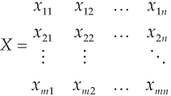

**公式 3.1**：预测变量集的符号

参考 表 3.1 中的数据集，`x_11` 为 M（性别），`x_12` 为 0.00（在网站上的花费），`x_21` 为 F（性别），依此类推。

有时为了方便，需要引用某个特定示例的所有属性值。为此，`x_i`（带单个索引）将指代 `X` 的第 *i* 行。对于 表 3.1 中的数据集，`x_2` 将是一个包含值 F、250、32 的行向量。

严格来说，`X` 不是一个矩阵，因为预测变量可能并非都是同一类型的变量。一个合规的矩阵包含类型完全相同的变量。然而，预测变量有不同的类型。以预测广告点击为例，预测变量可能包括网站访问者的人口统计数据。这些数据可能包括婚姻状况和年收入等。年收入是实数，而婚姻状况是分类变量。这意味着婚姻状况不支持加法或乘法等算术运算，且 `single`（未婚）、`married`（已婚）和 `divorced`（离婚）之间不存在序关系。`X` 中某一列的条目类型相同，但类型可能因列而异。

婚姻状况、性别或居住州等属性有几种不同的称呼。它们可能被称为 `factor`（因子）或 `categorical`（分类）。用数字表示的年龄或收入等属性被称为 `numeric`（数值型）或 `real-valued`（实值型）。这两类属性的区别很重要，因为某些算法可能无法处理其中一类。例如，线性方法（包括本书涵盖的方法）要求属性为数值型。你将看到的 PySpark 算法要求所有特征均为数值型。第 4 章“惩罚线性回归”涵盖线性方法，将展示将分类变量转换（或编码）为数值型以便将线性方法应用于包含分类变量的问题的方法。你还将学习使用 PySpark 函数将分类变量编码为数值型。

与 `X` 中每一行对应的目标值排列成一个列向量 `Y`（参见 公式 3.2），如下所示：

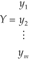

**公式 3.2**：目标向量的符号

目标 $y_i$ 对应于 $x_i$——即 X 的第 *i* 行中的预测变量。参考表 3.1 中的数据，$y_1$ 为 Yes，$y_2$ 为 No。

目标可以有几种不同的形式。例如，它们可以是实数，就像目标是预测客户将花费多少钱时那样。当目标为实数时，该问题称为*回归问题*。线性回归意味着使用线性方法来解决回归问题。（本书涵盖了线性和非线性回归方法。）

如果目标是双值的，如表 3.1 所示，该问题称为*二分类问题*。预测客户是否会点击广告就是一个二分类问题。如果目标包含若干个离散值，则该问题为*多分类问题*。预测客户会点击几个广告中的哪一个将是一个多分类问题。


基本问题是找到一个预测函数 `pred()`，它利用属性来预测结果（参见公式 3.3）：

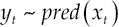

**公式 3.3**：进行预测的基本方程

函数 `pred()` 使用属性 $x_i$ 来预测 $y_i$。本书介绍了一些用于生成函数 `pred()` 的当前最佳方法。这些算法可在各种平台上使用。在本书中，你将看到如何在 Python 和 PySpark 中使用它们。如果你需要用另一种语言实现它们，你获得的理解将同样适用。

### 评估预测模型的性能

良好的性能意味着利用属性 $x_i$ 生成的预测接近 $y_i$，但“接近”在不同问题中有不同的含义。对于 $y_i$ 为实数的回归问题，性能通过均方误差 (MSE) 或平均绝对误差 (MAE) 等指标来衡量（参见公式 3.4）：

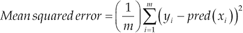

**公式 3.4**：回归问题的性能度量

在回归问题中，目标（$y_i$ 和 $x_i$ 均为实数），因此将误差描述为它们之间的数值差异是合理的。公式 3.4 中的 MSE 对误差进行平方并对数据集求平均，以得出总体误差水平的度量。MAE 对误差的绝对值求平均（参见公式 3.5），而不是对误差的平方求平均。

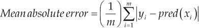

**公式 3.5**：回归的另一种性能度量

如果问题是分类问题，则必须使用其他一些性能度量。最常用的之一是误分类误差——即函数 `pred()` 预测错误的样本所占的比例。“不同类型问题的性能度量”一节展示了如何计算误分类率。

为了使我们的函数 `pred()` 在预测中发挥作用，必须有某种方法来预测它在新样本到达时将产生什么水平的误差。在新数据上——即未参与开发函数 `pred()` 的数据——性能如何？本章介绍了估算新数据性能的最佳方法。

本节介绍了本书将要解决的基本预测问题类型，并描述了构建这些预测模型等同于构建一个将属性（或特征）映射到预测结果的函数。它还概述了如何评估这些预测中的误差。执行这些步骤会导致几个复杂问题。本章剩余部分将描述这些复杂问题、如何应对它们，以及在问题约束和可用数据条件下如何得出最佳模型。

## 驱动算法选择和性能的因素——复杂性与数据

有几个因素会影响预测算法的整体性能。这些因素包括问题的复杂性、所用模型的复杂性以及可用训练数据的数量。以下各节描述了这些因素如何相互关联以决定性能。

### 简单问题与复杂问题的对比

本章前一节描述了量化性能的几种方法，并强调了新数据性能的重要性。设计预测模型的目标是在新样本（如您网站的新访客）上做出准确预测。作为一名实践数据科学家，您会希望获得算法性能的估计，以便设定客户预期并比较不同算法。预测建模的最佳实践要求您从训练集中保留一些数据。这些保留的样本具有相关标签，可以与在剩余数据上训练的模型产生的预测进行比较。统计学家将此技术称为*样本外误差*，因为它是未用于训练的数据上的误差。（本章后面的“测量预测模型的性能”一节将更详细地介绍此过程的机制。）重要的是，唯一算数的性能是模型在针对新样本运行时的性能。

### 影响性能的因素：问题复杂度与数据规模

影响性能的因素之一是待解决问题的复杂度。图 3.1 展示了一个二维空间中相对简单的分类问题。图中有两组点：深色点和浅色点。深色点随机抽样自以 (1,0) 为中心、两个维度方差均为 1 的二维高斯分布。浅色点同样抽样自方差相同但以 (0,1) 为中心的高斯分布。该问题的属性是图中的两个坐标轴：$x_1$ 和 $x_2$。分类任务是在 $x_1$, $x_2$ 平面上划定边界，将浅色点与深色点分开。在这种情况下，最好的做法是在图中画一条 45 度线——即 $x_1$ 等于 $x_2$ 的那条线。从精确的概率意义上讲，这是该问题的最优分类器。因为一条直线就能最好地分开浅色和深色点，所以线性分类器的表现将不亚于非线性分类器。本书介绍的线性方法能完美解决此问题。

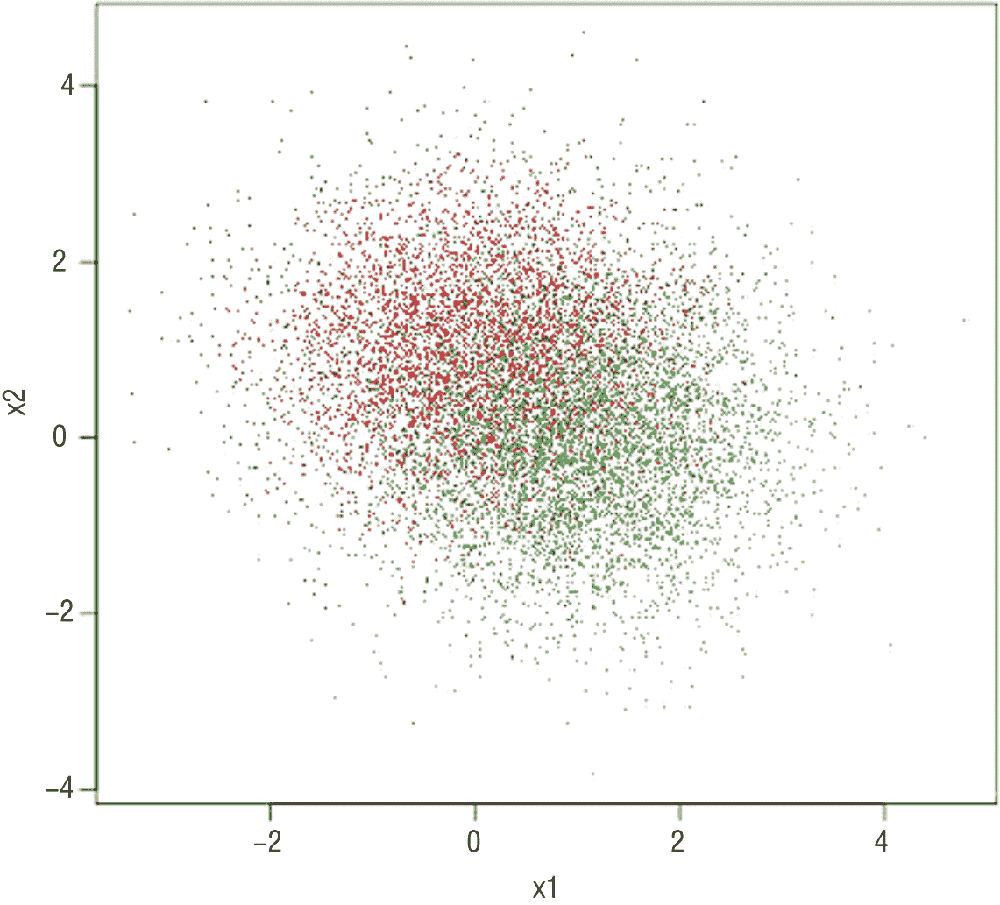

**图 3.1**：一个简单的分类问题

图 3.2 描绘了一个更复杂的问题。图 3.2 中的点是通过随机抽样生成的。与生成 图 3.1 的随机抽样过程的主要区别在于，图 3.2 中的点是从多个分布中抽取的：浅色点来自几个分布，深色点来自另外几个不同的分布。这被称为*混合模型*。总体目标基本相同：在 $x_1$, $x_2$ 平面上划定边界以分开浅色点和深色点。然而在 图 3.2 中，显然线性边界无法像曲线那样很好地分离这些点。第 6 章“集成方法”中介绍的集成方法能很好地解决此问题。

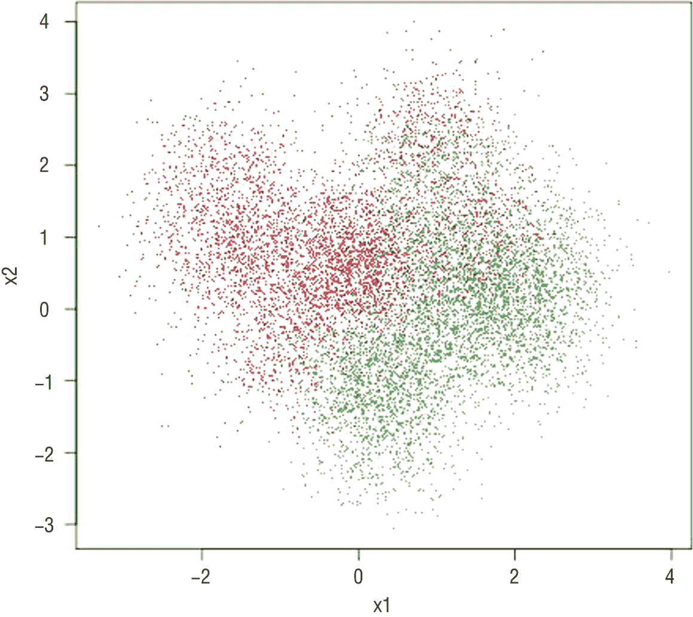

**图 3.2**：一个复杂的分类问题

然而，决策边界的复杂度并非影响线性或非线性方法性能优劣的唯一因素。另一个重要因素是数据集的大小。图 3.3 说明了这一性能要素。图 3.3 中绘制的点是 图 3.2 中数据的 1% 子样本。

在 图 3.2 中，数据量足以直观呈现分隔浅色和深色点集的曲线边界。数据减少时，这些点集在视觉上不易辨别，此时线性模型的表现可能等同于或优于非线性模型。数据越少，边界越难以可视化，也越难以计算。这直观地演示了拥有大量数据的价值。如果底层问题复杂（例如为个别购物者个性化响应），复杂模型配合大量数据可产出准确结果。但如果模型不复杂（如 图 3.1 所示），或数据不足（如 图 3.3 所示），线性模型可能给出最佳答案。

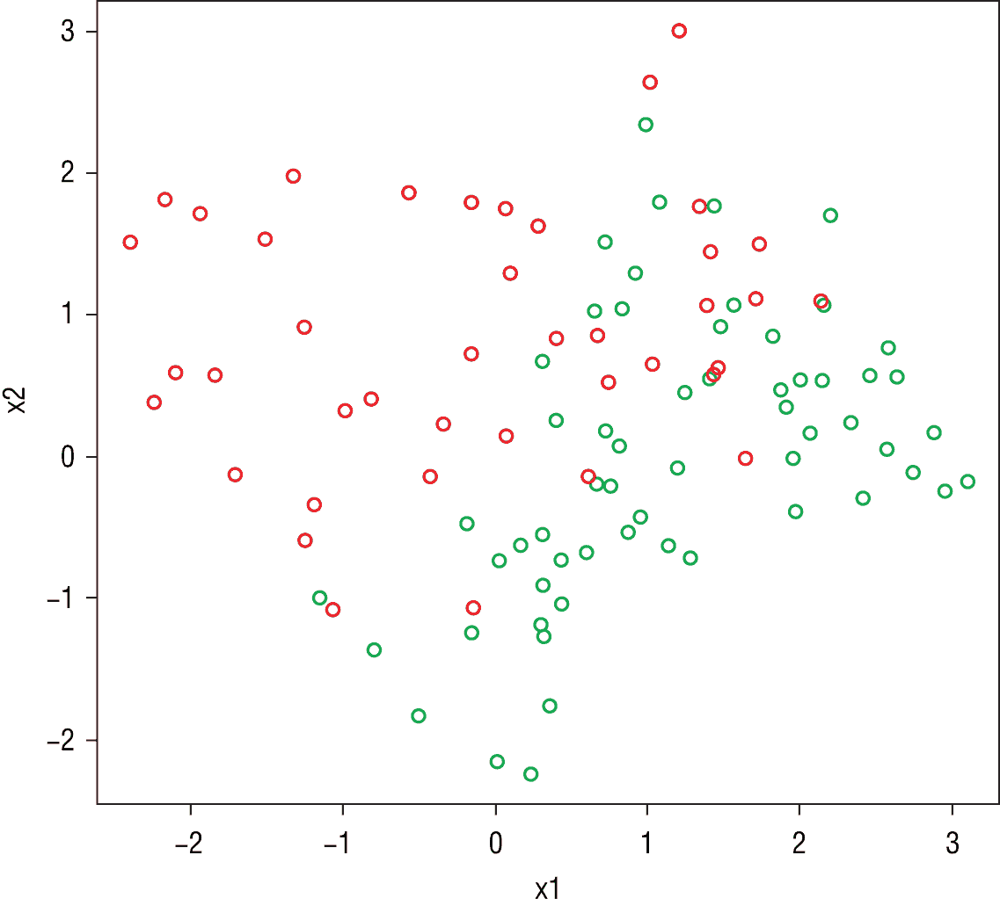

**图 3.3**：数据稀疏时的复杂分类问题

### 简单模型与复杂模型的对比

上一节通过可视化对比了简单问题与复杂问题。本节描述用于解决这些问题的各类模型有何不同。直觉上认为复杂模型应拟合复杂问题，但上一节的可视化示例表明，数据集大小可能决定简单模型在复杂问题上的拟合效果优于复杂模型。

另一个重要概念是：现代机器学习算法生成的是模型族，而非单一模型。本书涵盖的算法每个都能生成成百上千个不同复杂度的模型。总体而言，第 6 章介绍的集成方法产出的模型比 第 4 章的线性方法更复杂，但这两类方法都会生成不同复杂度的多个模型。（这一点将在详细讲解线性技术的 第 4 章 和集成技术的 第 6 章 中变得更清晰。）

图 3.4 展示了拟合上一节简单问题的线性模型。图 3.4 中的线性模型由 `glmnet` 算法生成（详见 第 4 章）。该线性模型大致将数据对半分开。图中的直线由 公式 3.6 给出。

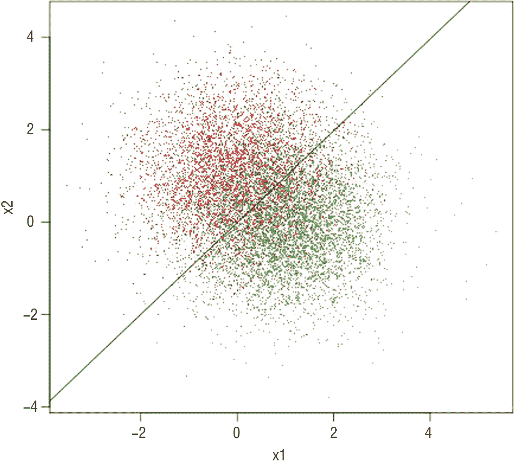

**图 3.4**：拟合简单数据的线性模型

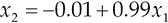

**公式 3.6**：拟合简单问题的线性模型

这条线非常接近 $x_2$ 等于 $x_1$ 的直线，从概率意义上讲这是最优边界。从视觉直觉上看，该边界也很合理。对这个简单问题拟合更复杂的模型不会提升性能。

一个具有更复杂决策边界的更复杂问题，为复杂模型提供了超越简单线性模型的机会。图 3.5 展示了拟合非线性决策边界数据的线性模型。在这种情况下，线性模型会将本应为浅色的区域误分类为深色，反之亦然。

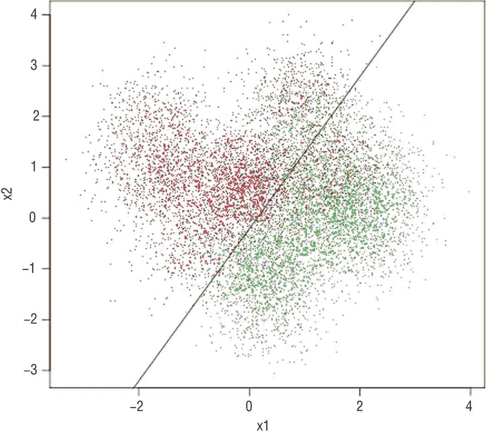

**图 3.5**：拟合复杂数据的线性模型

图 3.6 展示了复杂模型处理复杂数据时能好到什么程度。用于生成此决策边界的模型是一个集成（集合），包含 1,000 棵使用梯度提升算法构建的二元决策树。（梯度提升决策树将在第 6 章中详细介绍。）非线性决策边界曲线被用来更好地划分深色点更密集的区域和浅色点更密集的区域。

人们很容易得出结论：最佳方法是对复杂问题使用复杂模型，对简单问题使用简单模型。但是，你必须考虑问题的另一个维度。正如上一节所述，你必须考虑数据集大小。图 3.7 和 3.8 展示了来自一个复杂问题的 1% 数据。图 3.7 展示了拟合该数据的线性模型，图 3.8 展示了拟合该数据的集成模型。数一下被误分类的点数。数据集中有 100 个点。图 3.7 中的线性模型误分类了 11 个点，误分类率为 11%。复杂模型误分类了 8 个，误分类率为 8%。它们的性能大致相当。

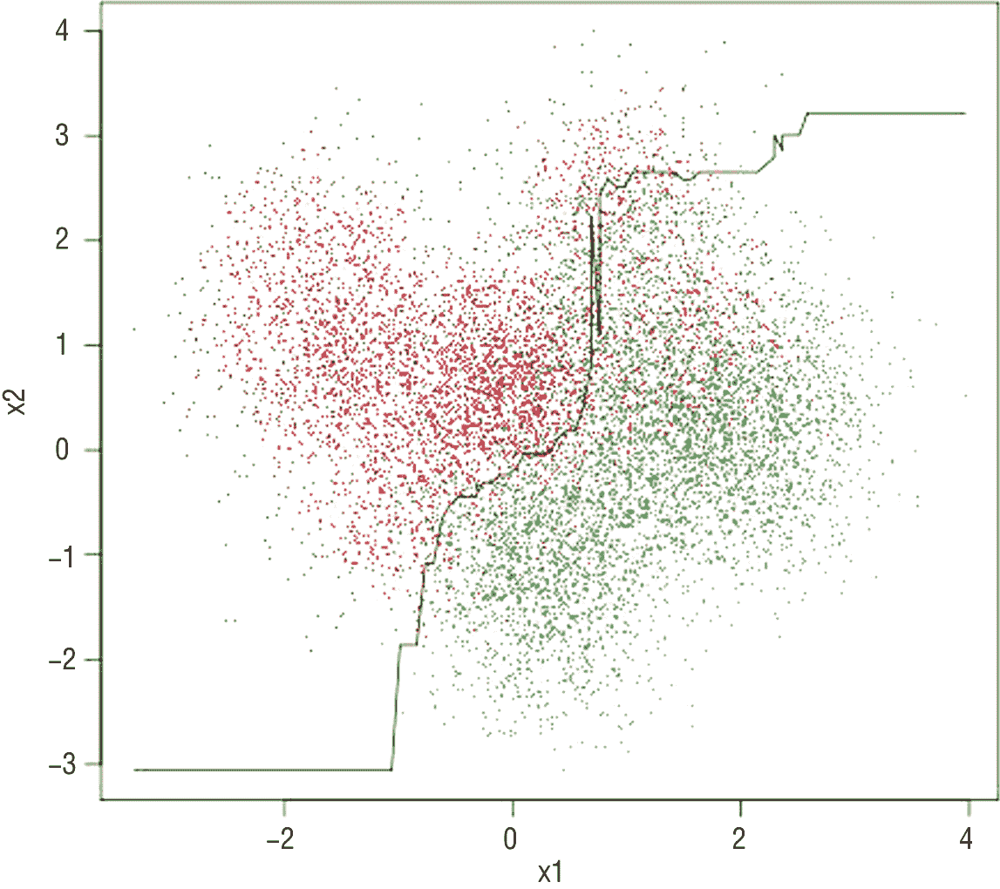

**图 3.6**：拟合复杂数据的集成模型

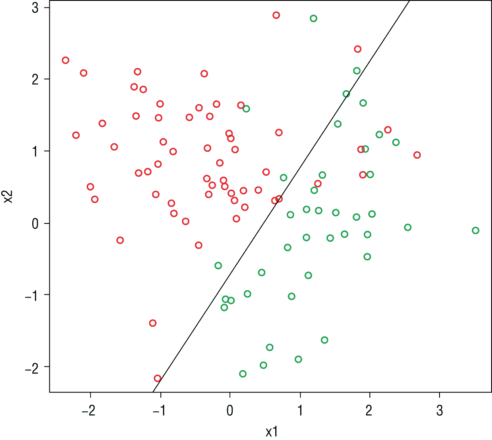

**图 3.7**：拟合复杂数据小样本的线性模型

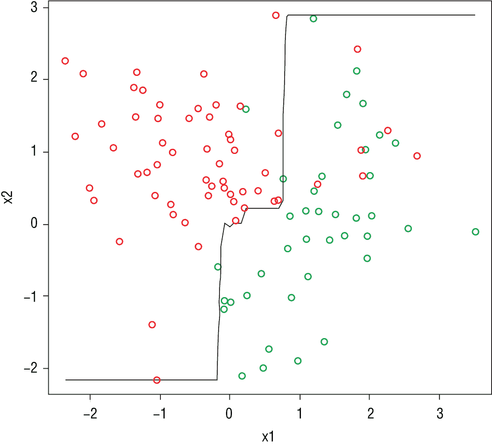

**图 3.8**：拟合复杂数据小样本的集成模型

#### 驱动预测算法性能的因素

这些结果解释了人们对大数据量的热情。对复杂问题进行准确预测需要大量数据。但数据量并不是一个足够精确的衡量标准。数据的形状也很重要。

公式 3.1 将预测变量数据描述为一个矩阵，具有若干行（高度）和若干列（宽度）。矩阵中的条目数是行数与列数的乘积。当数据用于预测建模时，行数和列数之间存在一个重要区别。增加一列意味着增加一个新属性。增加一行意味着获得现有属性的一个额外历史样本。为了理解新行的影响与新列的影响有何不同，请考虑一个将公式 3.1 中的属性与公式 3.2 中的标签相关联的线性模型。

假设一个以下形式的模型（见公式 3.7）：

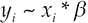

**公式 3.7**：属性与结果之间的线性关系

此处，`xi` 是一行属性，是待确定的系数列向量。向属性矩阵增加一列会增加一个需要确定的系数。这个增加的系数也称为 `自由度`。增加另一个自由度意味着使模型更复杂。前面的例子表明，使模型更复杂需要更多数据。因此，通常从行数与列数的比率——即纵横比——来思考问题。生物数据集和自然语言处理数据集就是例子，它们之所以很大是因为拥有大量列，但有时它们不够大，无法让复杂建模方法发挥良好性能。在生物学中，基因组数据集可以轻松包含 10,000 到 50,000 个属性。即使有数万个单独实验（数据行），基因组数据集可能也不足以训练复杂的集成模型。线性模型可能给出同等或更好的性能。基因组数据成本高昂。一个实验（行）的成本可能高达 5,000 美元，使得完整数据集的成本高达 5,000 万美元。文本收集和存储相对便宜，但也可能比基因组数据更宽。在某些自然语言处理问题中，属性是单词，行是文档。属性矩阵中的条目是单词在文档中出现的次数。列数是文档集合的词汇量大小。取决于预处理（例如，移除 `a`、`and` 和 `of` 等常用词），词汇量可以从几千到几万不等。当 n-gram 与单词一起被计数时，文本的属性矩阵会变得非常宽。N-gram 是指紧挨着出现（或足够接近以形成短语）的两个、三个或四个单词的组合。当两个、三个或四个单词的组合也被计数时，自然语言处理的属性空间可以增长到超过一百万个属性。再一次，线性模型可能比更复杂的集成模型给出同等或更好的性能。

#### 选择算法：线性还是非线性？

你刚才看到的可视化示例，让你对线性和非线性预测模型之间的性能权衡有了一些了解。当数据集的列多于行，或者底层问题简单时，线性模型更可取。对于数据行数远多于列数的复杂问题，非线性模型更可取。一个额外因素是训练时间。快速线性技术的训练速度比非线性技术快得多。（在我们介绍完第 4 章和第 6 章中描述的技术并完成一些示例后，你将有更多依据来做出此决定。）

选择非线性模型（例如集成方法）意味着要训练许多不同复杂度的模型。例如，生成图 3.6 中决策边界的集成模型，是在训练过程中生成的大约一千个不同模型中的一个。这些模型具有各种不同的复杂度。其中一些与图 3.6 中直观可见的边界相比，只能给出粗糙得多的近似。选择生成图 3.6 中决策边界的模型，是因为它在样本外数据上表现最好。这一过程适用于许多现代机器学习算法。示例将在“选择模型以平衡问题复杂度、模型复杂度和数据集大小”一节中介绍。

本节使用了可视化的数据集和分类器解决方案，旨在让你直观地掌握影响你构建的预测模型性能的因素。通常，你将使用性能的数值度量，而不是依赖图片。下一节将介绍生成预测模型数值性能度量的方法和注意事项，以及如何利用这些度量来估计模型部署时将达到的性能。

## 预测模型性能度量

本节涵盖与预测模型性能度量相关的两大领域。第一个领域是针对不同类型问题可使用的不同度量指标（例如，回归问题使用 `MSE`，分类问题使用误分类错误率）。在文献中（以及机器学习竞赛中），你还会看到诸如受试者工作特征曲线（`ROC` 曲线）和曲线下面积（`AUC`）之类的度量。此外，这些概念对于优化性能也很有用。

第二大领域由用于收集样本外误差估计的技术组成。回想一下，样本外误差旨在模拟新数据上的误差。在设计实践中，使用这些技术来比较不同算法，并为给定的问题复杂度和数据集大小选择最佳模型复杂度，这是一个重要环节。该过程将在本章后面详细讨论，并在本书其余部分的示例中加以应用。

### 不同类型问题的性能度量

回归问题的性能度量相对简单直接。在回归问题中，目标值和预测值都是实数。误差自然定义为目标值与预测值之间的差值。生成误差的统计摘要以便进行比较和诊断非常有用。最常用的摘要是均方误差（`MSE`）和平均绝对误差（`MAE`）。清单 3.1 对比了 `MSE`、`MAE` 和均方根误差（`RMSE`，即 `MSE` 的平方根）的计算。

#### 清单 3.1：MSE、MAE 和 RMSE 的对比——regressionErrorMeasures.py


# 岩石与矿石分类：线性回归模型分析

## 代码实现

```python
__author__ = 'mike_bowles'

from Read_Fcns import list_read_rvm
import numpy as np
import random
from sklearn import datasets, linear_model
from sklearn.metrics import roc_curve, auc
import matplotlib.pyplot as plt


def confusionMatrix(predicted, actual, threshold):
    if len(predicted) != len(actual):
        return -1
    tp = 0.0
    fp = 0.0
    tn = 0.0
    fn = 0.0
    for i in range(len(actual)):
        if actual[i] > 0.5:  # 标签为 1.0 的样本（正例）
            if predicted[i] > threshold:
                tp += 1.0  # 正确预测为正例
            else:
                fn += 1.0  # 错误预测为负例
        else:  # 标签为 0.0 的样本（负例）
            if predicted[i] < threshold:
                tn += 1.0  # 正确预测为负例
            else:
                fp += 1.0  # 错误预测为正例
    rtn = [tp, fn, fp, tn]
    return rtn

#### 使用 scikit-learn 包执行线性回归
#### 从 uci.edu 数据仓库读取岩石与矿石数据集
xList, labels = list_read_rvm()

#### 将属性和标签划分为训练集和测试集（2/3 和 1/3）
indices = range(len(xList))
xListTest = [xList[i] for i in indices if i % 3 == 0]
xListTrain = [xList[i] for i in indices if i % 3 != 0]
labelsTest = [labels[i] for i in indices if i % 3 == 0]
labelsTrain = [labels[i] for i in indices if i % 3 != 0]

#### 构建训练和测试数据数组
xTrain = np.array(xListTrain)
yTrain = np.array(labelsTrain)
xTest = np.array(xListTest)
yTest = np.array(labelsTest)

#### 检查形状以查看其结构
print("Shape of xTrain array", xTrain.shape)
print("Shape of yTrain array", yTrain.shape)
print("Shape of xTest array", xTest.shape)
print("Shape of yTest array", yTest.shape)

#### 训练线性回归模型
rocksVMinesModel = linear_model.LinearRegression()
rocksVMinesModel.fit(xTrain, yTrain)

#### 生成样本内误差的预测值
trainingPredictions = rocksVMinesModel.predict(xTrain)
print("\nSome values predicted by model", trainingPredictions[0:5], \
      trainingPredictions[-6:-1])

#### 生成训练集预测的混淆矩阵（样本内
confusionMatTrain = confusionMatrix(trainingPredictions, yTrain, 0.5)
#### 选取阈值并生成混淆矩阵条目
tp = confusionMatTrain[0]
fn = confusionMatTrain[1]
fp = confusionMatTrain[2]
tn = confusionMatTrain[3]

print("\ntp = " + str(tp) + "\tfn = " + str(fn) + "\n" + "fp = " + \
      str(fp) + "\ttn = " + str(tn) + '\n')

#### 生成样本外数据的预测值
testPredictions = rocksVMinesModel.predict(xTest)

#### 根据样本外数据的预测生成混淆矩阵
conMatTest = confusionMatrix(testPredictions, yTest, 0.5)

#### 选取阈值并生成混淆矩阵条目
tp = conMatTest[0]
fn = conMatTest[1]
fp = conMatTest[2]
tn = conMatTest[3]
print("tp = " + str(tp) + "\tfn = " + str(fn) + "\n" + "fp = " + \
      str(fp) + "\ttn = " + str(tn) + '\n')

#### 生成样本内 ROC 曲线

fpr, tpr, thresholds = roc_curve(yTrain, trainingPredictions)
roc_auc = auc(fpr, tpr)
print('AUC for in-sample ROC curve: %f' % roc_auc)

#### 绘制 ROC 曲线
plt.clf()
plt.plot(fpr, tpr, label='ROC curve (area = %0.2f)' % roc_auc)
plt.plot([0, 1], [0, 1], 'k--')
plt.xlim([0.0, 1.0])
plt.ylim([0.0, 1.0])
plt.xlabel('False Positive Rate')
plt.ylabel('True Positive Rate')
plt.title('In sample ROC rocks versus mines')
plt.legend(loc="lower right")
plt.show()

#### 生成样本外 ROC 曲线
fpr, tpr, thresholds = roc_curve(yTest, testPredictions)
roc_auc = auc(fpr, tpr)
print('AUC for out-of-sample ROC curve: %f' % roc_auc)

#### 绘制 ROC 曲线
plt.clf()
plt.plot(fpr, tpr, label='ROC curve (area = %0.2f)' % roc_auc)
plt.plot([0, 1], [0, 1], 'k--')
plt.xlim([0.0, 1.0])
plt.ylim([0.0, 1.0])
plt.xlabel('False Positive Rate')
plt.ylabel('True Positive Rate')
plt.title('Out-of-sample ROC rocks versus mines')
plt.legend(loc="lower right")
plt.show()
```

## 运行结果

```
Shape of xTrain array (138, 60)
Shape of yTrain array (138,)
Shape of xTest array (70, 60)
Shape of yTest array (70,)

Some values predicted by model [-0.10240253 0.42090698 0.38593034 
0.36094537 0.31520494] [1.11094176 1.12242751 0.77626699 1.02016858
0.66338081]

tp = 68.0  fn = 6.0
fp = 7.0   tn = 57.0

tp = 28.0  fn = 9.0
fp = 9.0   tn = 24.0

AUC for in-sample ROC curve: 0.979519
```


代码的第一部分从加州大学欧文分校（UCI）数据存储库读取输入数据，然后将其格式化为用于标签的列表和用于属性的列表的列表。下一步是将数据（标签和属性）分成两个子集：包含三分之一数据的测试集，和包含另外三分之二数据的训练集。标记为 `test` 的数据不会用于训练分类器，而是会在分类器训练完成后保留用于评估性能。这一步模拟了分类器在部署后对新数据示例的行为。稍后，本章将讨论各种不同的留出数据方法以及对新数据性能进行估计的方法。

通过将原始数据集中的标签 M（代表 mine，地雷）和 R（代表 rock，岩石）转换为数值——1.0 对应地雷，0.0 对应岩石——然后使用普通最小二乘回归拟合线性模型来训练分类器。这是一种相当简单易懂且易于实现的方法，通常能产生与稍后讨论的更复杂算法非常相似的性能。Listing 3.2 中的程序使用 `scikit-learn` 中的线性回归类来训练普通最小二乘模型。然后使用训练好的模型在训练集和测试集上生成预测。

代码打印出预测值的一些代表性数值。线性回归模型生成的数字大多在 0.0 到 1.0 的区间内，但并非完全如此。这些预测值并不完全是概率。它们仍可通过与阈值比较来生成预测分类。函数 `confusionMatrix()` 生成混淆矩阵的数值，类似于 Figure 3.9。它接受预测值、相应的实际值（标签）和一个阈值作为输入。它将预测值与阈值比较，以确定将每个示例分配到混淆矩阵的“预测为正”还是“预测为负”列。它使用实际值将示例分配到混淆矩阵的相应行。

可以从混淆矩阵中读出每个阈值对应的错误率。总错误数是 FP（假正例）和 FN（假反例）之和。示例代码生成了样本内数据和样本外数据的混淆矩阵，并将两者都打印出来。样本内数据的误分类错误率约为 8%，样本外数据约为 26%。通常，样本外性能会比样本内性能差。它也能更具代表性地反映新示例的预期误差。

当阈值改变时，误分类错误率也会随之变化。Table 3.2 展示了误分类错误率如何随着决策阈值的变化而变化。表中的数字基于样本外结果。这通常适用于本书中表征性能的数字。任何样本内错误都会附带警告标签：“警告：这些是样本内错误。”如果目标是最小化误分类错误，最佳阈值为 0.25。

**表 3.2**：误分类错误对决策阈值的依赖关系

| 决策阈值 | 误分类错误率 |
| --- | --- |
| 0.0 | 28.6% |
| 0.25 | 24.3% |
| 0.5 | 25.7% |
| 0.75 | 30.0% |
| 1.0 | 38.6% |

最佳阈值可能是使误分类错误最小化的那个。然而，有时一种错误类型的代价比另一种高。例如，假设在岩石与地雷的问题中，派遣潜水员进行目视检查的成本是 100 美元，而如果未清除地雷，未爆地雷造成的预期伤亡和财产损失成本为 1,000 美元。FP 成本 100 美元，FN 成本 1,000 美元。基于这些假设，Table 3.3 总结了不同阈值下错误的美元成本。将地雷误判为岩石（并将其留在原地威胁健康安全）的较高成本将决策阈值推低至零。这意味着会有更多 FN，但它们的代价不那么高昂。更彻底的分析可以包括与 TP（真正例）和 TN（真反例）相关的成本。例如，TP 可能包含清除地雷的成本，以及因清除地雷而带来的 +1,000 美元收益。如果这些数字在你的问题中可用（或可合理估算），你最好利用它们来得出更好的阈值。

**表 3.3**：不同决策阈值下的错误成本

| 决策阈值 | 假反例成本 | 假正例成本 | 总成本 |
| --- | --- | --- | --- |
| 0.0 | 1,000 | 1,900 | 2,900 |
| 0.25 | 3,000 | 1,400 | 4,400 |
| 0.5 | 9,000 | 900 | 9,900 |
| 0.75 | 18,000 | 300 | 18,300 |
| 1.00 | 26,000 | 100 | 26,100 |

请注意，总 FP 与 FN 的相对成本取决于数据集中正例和反例的比例。岩石与地雷数据集拥有相同数量的正例和反例（地雷和岩石）。这大概是由实验方案决定的。实际部署中遇到的正例和反例比例可能不同。如果部署时的数字可能不同，你需要做一些调整以适应实际使用中的比例。

数据科学家可能没有可用的成本数据，但可能仍希望用一种方法来表征分类器的整体性能，而不是使用特定决策阈值下的误分类错误率。一种常用的技术称为*受试者工作特征曲线*（ROC 曲线）（`http://en.wikipedia.org/wiki/Receiver_operating_characteristic`）。

ROC 这个名字源于其最初的应用——处理雷达接收机的回波以确定敌机的有无。ROC 曲线生成单个图表来汇总所有这些不同的列联表。ROC 曲线绘制真正例率（简称 TPR）与假正例率（FPR）的关系。TPR 是被正确分类为正例的正例比例（参见 Equation 3.8）。FPR 是 FP 相对于实际反例总数的比率（参见 Equation 3.9）。用列联表的元素表示，这些公式如下：

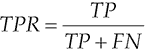

**公式 3.8**：真正例率


**公式 3.9**：假正例率

作为一个简单的思想实验，考虑使用一个极低的决策阈值。对于极低的值，每个示例都被预测为正例。这使得 TPR 为 1.0。因为所有东西都被分类为正例，所以没有 FN（FN 为 0.0）。这也使得 FPR 为 1.0，因为没有东西被分类为负例（TN 为 0.0）。然而，当决策阈值设得非常高时，TP 等于零，因此 TPR 也是零，FP 也是零，因为没有东西被分类为正例。因此，FPR 也是零。以下两个图是使用 `pylab` 的 `roc_curve()` 和 `auc()` 函数绘制的。Figure 3.10 显示了基于样本内数据的 ROC 曲线性能。Figure 3.11 显示了基于样本外数据的 ROC 曲线。

### ROC 曲线与 AUC

通过随机判定岩石或矿石运行的分类器的 ROC 曲线，在图表上形成一条从左下角到右上角的对角线。该线通常被绘制在 ROC 曲线上作为参考基准。对于完美的分类器，ROC 曲线从 (0, 0) 直线上升到 (0, 1)，然后水平延伸至 (1, 1)。毫不奇怪，图 3.10（基于样本内数据）比 图 3.11（基于样本外数据）更接近完美。分类器的 ROC 曲线越接近左上角，其性能越好。如果 ROC 明显低于对角线，通常意味着数据科学家在某处搞反了符号，应仔细检查代码。


**图 3.10**：岩石与矿石分类器的样本内 ROC 曲线


**图 3.11**：岩石与矿石分类器的样本外 ROC 曲线

图 3.10 和 3.11 还展示了曲线下面积（AUC）数值。顾名思义，AUC 即 ROC 曲线下的面积。完美分类器的 AUC 为 1.0，随机猜测的 AUC 为 0.5。图 3.10 和 3.11 的 AUC 值再次证明：基于训练集误差（样本内数据）的性能估计会高估实际性能。样本内数据的 AUC 为 0.98，样本外数据的 AUC 为 0.85。

用于衡量二分类器性能的某些方法同样适用于多分类器。误分类错误率依然适用，混淆矩阵也同样有效。ROC 曲线和 AUC 也存在多分类的推广形式。¹

#### 模拟已部署模型的性能

前一节的示例演示了：为了获得模型部署后预期性能的有用估计，必须在未包含于训练集的数据上测试性能。示例将可用的标记数据分成了两个子集。其中一个子集称为*训练集*，包含约三分之二的可用数据，用于拟合普通最小二乘模型。第二个子集包含剩余的三分之一数据，称为*测试集*，仅用于确定性能（模型训练期间不使用）。这是机器学习中的标准程序。

测试集大小通常占数据的 25% 到 35%，尽管没有关于大小的硬性规定。需牢记一点：随着训练数据集规模缩小，训练模型的性能会下降。从训练集中分出过多数据可能会损害最终性能。

另一种保留数据的方法称为 *n 折交叉验证*。图 3.12 示意性地展示了如何使用 n 折交叉验证将数据集划分为训练集和测试集。数据集被分成 *n* 个大小大致相等的不相交集合。图中 *n* 为 5。需对数据进行多轮训练和测试。第一轮中，第一块数据被保留用于测试，其余 `n-1` 块用于训练。第二轮中，第二块数据被保留用于测试，其他 `n-1` 块用于训练。此过程持续进行，直到所有数据都被保留过一次（如 图 3.12 所示的五折示例，共五次）。


**图 3.12**：N 折交叉验证

n 折交叉验证过程可产生预测误差的估计值，并拥有多个误差样本，从而能估计误差的误差界。它能在训练集中保留更多数据，通常能带来更低的泛化误差和更好的最终性能。例如，若选择 10 折交叉验证，则每轮训练仅保留 10% 的数据用于测试。n 折交叉验证的这些优势是以更长的训练时间为代价的。采用固定保留集的方法具有训练更快的优势，因为它只需对训练数据进行一次遍历。当 n 折交叉验证的训练时间难以忍受，且可用训练数据量大到保留集中的额外数据不会对性能产生不利影响时，采用固定保留集可能是更好的选择。

另一点需注意：样本应具有整个数据集的代表性。前一节示例中使用的抽样方案并非随机抽样，而是每隔三个数据点取一个样本。在数据中均匀分布样本通常效果良好。但必须避免以引入训练集和测试集偏差的方式进行抽样。例如，若给定的数据是按采样日期排序的每日一次采样数据，则应避免编码七折交叉验证并每隔七个点采样一次。

若研究现象具有异常统计特性，抽样可能需要严格控制。可能需要小心保留测试样本中的统计特性。例如预测欺诈或广告点击等罕见事件。建模目标事件极其罕见，随机抽样可能导致测试集中过度或不足地代表这些事件，从而导致性能估计出错。分层抽样（`http://en.wikipedia.org/wiki/Stratified_sampling`）将数据划分为单独抽样后再重新组合的独立子集。当标签为罕见事件时，可能需要分别对欺诈样本和正常样本进行抽样，然后将它们合并作为测试集，以匹配训练集，更重要的是匹配模型将要应用的新数据。

模型训练和测试完成后，最佳实践是将训练集和测试集重新合并为单一数据集，并在更大的数据集上重新训练模型。样本外测试过程已给出预期预测误差的良好估计。保留部分数据正是为此目的。在更多数据上训练，模型性能和泛化能力会更好。部署的模型应在所有数据上进行训练。

本节为您提供了量化预测模型性能的工具。下一节将向您展示如何用数值比较取代您在“驱动算法选择和性能的因素——复杂性与数据”一节中看到的模型与问题复杂性的直观图形比较。这种替换使得部分选择过程实现机械化成为可能。

### 实现模型与数据的和谐

本节使用普通最小二乘法（OLS）回归来说明几个问题。首先，它说明了 OLS 有时会*过拟合*问题。过拟合意味着训练数据上的误差与测试数据上的误差之间存在显著差异，正如你在上一节中看到的，OLS 被用于解决岩石与地雷的分类问题。其次，它介绍了两种克服 OLS 过拟合问题的方法。这些方法将培养你的直觉，并为第 4 章中更深入介绍的惩罚线性回归方法奠定基础。此外，克服过拟合的方法具有一个大多数现代机器学习算法共有的特性。现代算法生成多个复杂度各异的模型，然后利用样本外表现来平衡模型复杂度、问题复杂度和数据集丰富度，从而决定部署哪个模型。这一过程将在本书的其余部分反复使用。

普通最小二乘法回归是一般机器学习算法的一个良好原型。它是一种具有训练过程和部署过程的监督算法。在某些情况下它会过拟合。它与其他更现代的函数逼近算法共享这些特性。然而，OLS 缺少现代算法的一项重要特性。在其原始公式（最熟悉的公式）中，没有在过拟合时“减速”的手段。这就像有一辆只能全速行驶的汽车（在宽阔的道路上很棒，但在狭窄的环境中很难使用）。幸运的是，自高斯和勒让德 200 多年前发明普通最小二乘法回归以来，已经有了大量的研究成果。本节介绍了两种调整普通最小二乘法回归“油门”的方法。一种称为*前向逐步回归*；另一种称为*岭回归*。

### 选择模型以平衡问题复杂度、模型复杂度和数据集大小

几个示例将说明现代机器学习技术如何调整以最佳地拟合给定的问题和数据集。第一个示例是对普通最小二乘法回归的一种修改，称为前向逐步回归。其工作原理如下。回顾公式 3.1 和 3.2，它们定义了待解决的问题（参见此处的公式 3.10 和 3.11，它们重复了那些公式）。向量 `Y` 包含标签。矩阵 `X` 包含用于预测标签的属性。


**公式 3.10**：数值标签向量


**公式 3.11**：数值属性矩阵

如果这是一个回归问题，那么 `Y` 是一个实数列向量，线性问题就是寻找一个权重列向量和一个标量 0（参见公式 3.12）。


**公式 3.12**：线性模型的系数向量

选择 的值，使得 `Y` 能被良好地近似（参见公式 3.13）。


**公式 3.13**：将标签近似为属性的线性函数

如果 `X` 的列数与行数相同，且 `X` 的列是独立的（不是彼此的线性倍数），则 `X` 可逆， 可以替换为 `=`。一个系数向量 将使线性拟合完全精确地拟合标签。这好得令人难以置信。问题在于过拟合（即在训练数据上获得极佳性能，却无法在新数据上复现）。在实际问题中，这不是一个好的结果。过拟合的根源是 `X` 中包含太多的数据列。答案可能是去除 `X` 的某些列。然而，去除某些列涉及决定去除多少列以及去除哪些列。暴力方法称为*最佳子集选择*。

#### 使用前向逐步回归控制过拟合

以下代码概述了最佳子集选择的算法。基本思想是对列数施加一个约束（假设为 `nCol`），然后取 `X` 的所有包含该数量列的子集，执行普通最小二乘法回归，找出具有最小样本外误差的 `nCol` 子集，增加 `nCol`，然后重复。该过程产生一个列表，包含最佳的单列子集、双列子集，直到完整的矩阵 `X`（全列子集）。它还给出了每个子集的性能。下一步是决定部署单列版本、双列版本等。但这相对容易；只需选择误差最小的那个：

```
Initialize: Out_of_sample_error = NULL
Break X and Y into test and training sets
for i in range(number of columns in X):
  for each subset of X having i+1 columns:
     fit ordinary least squares model
     Out_of_sample_error.append(least error amoung subsets containing
        i+1 columns)
Pick the subset corresponding to least overall error
```

最佳子集选择的问题在于，即使对于适度数量的属性（`X` 的列），它也需要过多的计算。例如，10 个属性会导致 <math display="inline" overflow="scroll" xmlns="http://www.w3.org/1998/Math/MathML" xmlns:xlink="http://www.w3.org/1999/xlink"><mrow><msup><mn>2</mn><mn>10</mn></msup><mo>=</mo><mn>1</mn><mo>,</mo><mn>000</mn></mrow></math> 个子集。有几种技术可以避免这种情况。以下代码展示了前向逐步回归的过程。前向逐步回归的思路是从单列子集开始，然后在给定最佳单列的情况下，找到要追加的最佳第二列，而不是评估所有可能的双列子集。前向逐步回归的伪代码如下：

```
Initialize: ColumnList = NULL
Out-of-sample-error = NULL
Break X and Y into test and training sets
For number of column in X:
  For each trialColumn (column not in ColumnList):
    Build submatrix of X using ColumnList + trialColumn
    Train OLS on submatrix and store RSS Error on test data
    ColumnList.append(trialColumn that minimizes RSS Error)
    Out-of-sample-error.append(minimum RSS Error)
```

最佳子集选择和前向逐步回归具有相似的过程。它们训练一系列模型（单列的若干个、双列的若干个，以此类推）。它们产生一个参数化的模型族（所有线性回归，参数化为列数）。模型复杂度各异，最终模型根据样本外误差性能从该模型族中选择。

代码清单 3.3 展示了在葡萄酒数据集上实现前向逐步回归的 Python 代码。

##### 代码清单 3.3：前向逐步回归：葡萄酒质量数据——fwdStepwiseWine.py


> ```
> __author__ = 'mike_bowles'
> 
> from Read_Fcns import list_read_wine
> import numpy as np
> from sklearn import datasets, linear_model
> from math import sqrt
> import matplotlib.pyplot as plt
> 
> def xattrSelect(x, idxSet):
>     #takes X matrix and return subset containing columns in idxSet
>     xOut = []
>     for row in x:
>         xOut.append([row[i] for i in idxSet])
>     return(xOut)
> 
> #read data into iterable
> names, xList,labels = list_read_wine()
> 
> #divide attributes and labels into training and test sets
> indices = range(len(xList))
> xListTest = [xList[i] for i in indices if i%3 == 0 ]
> xListTrain = [xList[i] for i in indices if i%3 != 0 ]
> labelsTest = [labels[i] for i in indices if i%3 == 0]
> labelsTrain = [labels[i] for i in indices if i%3 != 0]
> 
> #build list of attributes one-at-a-time - starting with empty
> attributeList = []
> index = range(len(xList[1]))
> indexSet = set(index)
> indexSeq = []
> oosError = []
>   
> for i in index:
>     attSet = set(attributeList)
>     #attributes not in list already
>     attTrySet = indexSet - attSet
>     #form into list
>     attTry = [ii for ii in attTrySet]
>     errorList = []
>     attTemp = []
>     #try each attribute not in set to see which one gives least oos error
>     for iTry in attTry:
>         attTemp = [] + attributeList
>         attTemp.append(iTry)
>         
>         #use attTemp to form training and testing sub matrices 
>         xTrainTemp = xattrSelect(xListTrain, attTemp)
>         xTestTemp = xattrSelect(xListTest, attTemp)
> 
>         #form into numpy arrays
>         xTrain = np.array(xTrainTemp); yTrain = np.array(labelsTrain)
>         xTest = np.array(xTestTemp); yTest = np.array(labelsTest)
>         
>         #use sci-kit learn linear regression
>         wineQModel = linear_model.LinearRegression()
>         wineQModel.fit(xTrain,yTrain)
>         
>         #use trained model to generate prediction and calculate rmsError
>         rmsError = np.linalg.norm((yTest-wineQModel.predict(xTest)), 2)\
>         /sqrt(len(yTest))
>         errorList.append(rmsError)
>         attTemp = []
> 
>     iBest = np.argmin(errorList)
>     attributeList.append(attTry[iBest])
>     oosError.append(errorList[iBest])
> 
> print("Out of sample error versus attribute set size" )
> print(oosError)
> print("\n" + "Best attribute indices")
> print(attributeList)
> namesList = [names[i] for i in attributeList]
> print("\n" + "Best attribute names")
> print(namesList)
> 
> #Plot error versus number of attributes
> x = range(len(oosError))
> plt.plot(x, oosError, 'k')
> plt.xlabel('Number of Attributes')
> plt.ylabel('Error (RMS)')
> plt.show()
>   
> #Plot histogram of out of sample errors for best number of attributes
> #Identify index corresponding to min value, 
> #retrain with the corresponding attributes
> #Use resulting model to predict against out of sample data.  
> indexBest = oosError.index(min(oosError))
> attributesBest = attributeList[1:(indexBest+1)]
> 
> #Define column-wise subsets of xListTrain and xListTest convert to numpy
> xTrainTemp = xattrSelect(xListTrain, attributesBest)
> xTestTemp = xattrSelect(xListTest, attributesBest)
> xTrain = np.array(xTrainTemp); xTest = np.array(xTestTemp)
> 
> #train and plot error histogram
> wineQModel = linear_model.LinearRegression()
> wineQModel.fit(xTrain,yTrain)
> errorVector = yTest-wineQModel.predict(xTest)
> plt.hist(errorVector)
> plt.xlabel("Bin Boundaries")
> plt.ylabel("Counts")
> plt.show()
> 
> #scatter plot of actual versus predicted
> plt.scatter(wineQModel.predict(xTest), yTest, s=100, alpha=0.10)
> plt.xlabel('Predicted Taste Score')
> plt.ylabel('Actual Taste Score')
> plt.show() 
> ```

前面的代码清单包含一个小函数 `xattrSelect(x, idxSet)`，用于从 X 矩阵（以列表的列表形式）中提取选定的列。然后，它将 X 矩阵和标签向量分割为训练集和测试集。之后，代码遵循前面的算法描述。算法的一次遍历从解中包含的属性子集开始。对于第一次遍历，此子集为空。对于后续遍历，该子集包括在早期遍历中逐个选择的属性。每次遍历选择单个新属性添加到属性子集中。要添加的属性是通过测试每个未包含的属性来选择的，以查看哪一个在添加到子集后产生最佳性能。依次将每个属性添加到属性子集中，并使用普通最小二乘法拟合具有生成的属性子集的线性模型。对于测试的每个属性，都会测量样本外性能。产生最佳均方根（RSS）误差的测试属性将被添加到属性集中，并捕获相关的 RSS 误差。

图 3.13 绘制了作为回归中包含的属性数量函数的 RMSE。误差随属性增加而减少，直到包含 9 个属性时达到最小，之后略有增加。

代码清单 3.4 展示了将前向逐步回归应用于葡萄酒质量数据的数值输出。


**图 3.13**：使用前向逐步回归进行葡萄酒质量预测误差

##### 代码清单 3.4：前向逐步回归输出

> ```
> 打印输出：
> 
> 样本外误差与属性集大小的关系
> [0.7234259255116278, 0.6860993152837196, 0.6734365033420278, 
> 0.6677033213897796, 0.6622558568522271, 0.6590004754154625, 
> 0.6572717206143076, 0.65709058062077, 0.6569993096446137, 
> 0.6575818940043473, 0.657390986901134]
> 
> 最佳属性索引
> [10, 1, 9, 4, 6, 8, 5, 3, 2, 7, 0]
> 
> 最佳属性名称
> alcohol, volatile acidity, sulphates, chlorides, total sulfur dioxide, pH, 
> free sulfur dioxide, residual sugar, citric acid, density, fixed acidity 
> ```

第一个列表显示了 RSS 误差。误差减少直到列表中的第 10 个元素，然后再次变大。相关的列索引显示在下一个列表中。最后一个列表给出了相关属性的名称（列标题）。

#### 评估和理解你的预测模型

其他几个图表有助于理解训练算法的性能，并能指出改进其性能的方法。图 3.14 显示了测试集中真实标签与预测标签的散点图。理想情况下，图 3.14 中的所有点都将位于一条 45 度线上——即真实标签和预测标签相等的线。由于真实评分是整数，散点图显示出水平的点行。当真实值只取少量值时，使数据点部分透明很有用，这样深浅可以表明图表某一区域积累了许多点。实际口味评分 5 和 6 重现得相当好。更极端的值则没有被系统很好地预测。一般来说，机器学习算法在数据集边缘处的表现较差。


**图 3.14**：使用前向逐步回归生成的实际口味评分与预测值对比

图 3.15 展示了使用前向逐步回归预测葡萄酒口感评分时的预测误差直方图。有时误差直方图会呈现两个或更多离散的峰值。也许它会在图表的最右侧或最左侧出现一个小峰值。在这种情况下，可能可以找到误差中不同峰值的解释，并通过添加一个新属性来降低预测误差，该属性解释了数据点属于哪一组。


**图 3.15**：使用前向逐步回归预测葡萄酒口感的误差直方图

你需要注意该输出的几个方面。首先，让我们重述一下这个过程。该过程是训练一族模型（在本例中，是在 X 的列子集上训练的普通线性回归）。这系列模型是参数化的（在本例中，由线性模型中使用的属性数量参数化）。选择用于部署的模型是为了最小化样本外误差。纳入解决方案的属性数量可以称为 `complexity parameter`（复杂度参数）。具有较大复杂度参数的模型拥有更多自由参数，比复杂度较低的模型更容易过拟合数据。

还要注意，属性已根据其预测质量的重要性进行了排序。在列编号列表和相关的属性名称列表中，列表中的第一个是首先被选中的属性，第二个是其次，以此类推。使用的属性会以一个漂亮的有序列表形式输出。这是机器学习技术的一项重要且理想的特性。机器学习任务的早期阶段主要涉及寻找（或构建）用于预测的最佳属性集。拥有按重要性对属性进行排序的技术有助于这一过程。本书中开发的其他算法也将具备这一特性。

最后一个观察点是关于从机器学习技术生成的模型族中挑选模型。模型越复杂，其泛化能力越差。最好倾向于选择复杂度较低的模型。前面的例子表明，第 9 个（最佳）模型和第 10 个模型之间的性能几乎没有下降（第 4 位有效数字发生了变化）。最佳实践是移除那些属性，即使它们在第 4 位有效数字上表现更好，以保持保守策略。

#### 通过惩罚回归系数控制过拟合——岭回归

本节介绍另一种修改普通最小二乘回归的方法，以控制模型复杂度并避免过拟合。该方法作为惩罚线性回归的初步介绍。你将在第 4 章中看到更多相关内容。

普通最小二乘回归旨在寻找标量 $\beta_0$ 和向量 $\beta$，使其满足（参见公式 3.14）。


**公式 3.14**：OLS 最小化问题

表达式 `argmin` 意为“使表达式最小化的 $\beta_0$ 和 $\beta$ 的值”。得到的系数 $\beta_0^*, \beta^*$ 即为普通最小二乘解。最佳子集回归和前向逐步回归通过限制使用的属性数量来抑制普通回归。这等同于施加一个约束，即向量 $\beta$ 中的某些条目等于零。另一种方法称为*系数惩罚回归*。系数惩罚回归通过使所有系数变小（而不是使其中一些变为零）来实现相同目的。系数惩罚线性回归的一种版本称为*岭回归*。公式 3.15 展示了岭回归的问题公式化。


**公式 3.15**：岭回归最小化问题

公式 3.15 与普通最小二乘法（公式 3.14）的区别在于增加了 $\alpha \beta^T \beta$ 项。$\beta^T \beta$ 项是 $\beta$（系数向量）的欧几里得范数的平方。变量 $\alpha$ 是该问题公式化中的复杂度参数。如果 $\alpha = 0$，问题就变成了普通最小二乘回归。当 $\alpha$ 变大时，$\beta$（系数向量）趋近于零，只有常数项 $\beta_0$ 可用于预测标签 $y_i$。scikit-learn 中提供了岭回归。清单 3.5 展示了使用岭回归解决葡萄酒口感回归问题的代码。

##### 清单 3.5：使用岭回归预测葡萄酒口感——ridgeWine.py


> ```
> __author__ = 'mike_bowles'
> 
> from Read_Fcns import list_read_wine
> import numpy as np 
> from sklearn import datasets, linear_model
> from math import sqrt
> import matplotlib.pyplot as plt
> 
> # 将数据读入列表
> names, xList, labels = list_read_wine()
> 
> # 将属性和标签划分为训练集和测试集
> indices = range(len(xList))
> xListTest = [xList[i] for i in indices if i%3 == 0 ]
> xListTrain = [xList[i] for i in indices if i%3 != 0 ]
> labelsTest = [labels[i] for i in indices if i%3 == 0]
> labelsTrain = [labels[i] for i in indices if i%3 != 0]
> 
> xTrain = np.array(xListTrain); yTrain = np.array(labelsTrain)
> xTest = np.array(xListTest); yTest = np.array(labelsTest)
> 
> alphaList = [0.1**i for i in [0,1, 2, 3, 4, 5, 6]]
> 
> rmsError = []
> for alph in alphaList:
>     wineRidgeModel = linear_model.Ridge(alpha=alph)
>     wineRidgeModel.fit(xTrain, yTrain)
>     rmsError.append(np.linalg.norm((yTest-wineRidgeModel.\
>                             predict(xTest)), 2)/sqrt(len(yTest)))
> 
> print('{:18}'.format("RMS Error"), "alpha") 
> for i in range(len(rmsError)):
>     print(rmsError[i], alphaList[i])
> 
> # 绘制样本外误差随 alpha 变化的曲线
> x = range(len(rmsError))
> plt.plot(x, rmsError, 'k')
> plt.xlabel('-log(alpha)')
> plt.ylabel('Error (RMS)')
> plt.show()
> 
> # 为最佳 alpha 值绘制样本外误差直方图
> # 以及实际值与预测值的散点图
> # 找出对应最小值的索引，用对应的 alpha 值重新训练
> # 使用生成的模型对样本外数据进行预测
> indexBest = rmsError.index(min(rmsError))
> alph = alphaList[indexBest]
> wineRidgeModel = linear_model.Ridge(alpha=alph)
> wineRidgeModel.fit(xTrain, yTrain)
> errorVector = yTest-wineRidgeModel.predict(xTest)
> plt.hist(errorVector)
> plt.xlabel("Bin Boundaries")
> plt.ylabel("Counts")
> plt.show() 
> 
> plt.scatter(wineRidgeModel.predict(xTest), yTest, s=100, alpha=0.10)
> plt.xlabel('Predicted Taste Score')
> plt.ylabel('Actual Taste Score')
> plt.show() 
> ```

回想一下，前向逐步回归算法生成了一系列不同的模型——第一个模型包含一个属性，下一个包含两个属性，依此类推，直到最终模型包含所有属性。岭回归的代码也有一系列模型。不同之处在于，岭回归模型序列具有不同的 $\alpha$ 值，而不是不同数量的属性——$\alpha$ 是决定对 $\beta$ 施加惩罚严重程度的参数。$\alpha$ 序列的构建是按 10 的幂次递减的。一般来说，你会希望让它们按指数级递减，而不是按固定增量递减。该范围需要相当宽泛，且可能需要一些实验来确定。

图 3.16 绘制了 RMSE 作为岭复杂度参数 $\alpha$ 函数的图表。参数从左侧的最大值排列到右侧的最小值。惯例是将最不复杂的模型显示在图表左侧，最复杂的模型显示在右侧。该图表显示的特性与前向逐步回归大致相同。误差大体相当，但略微倾向于前向逐步回归。


**图 3.16**：使用岭回归进行葡萄酒质量预测的误差

清单 3.6 显示了岭回归的输出。数字表明岭回归的特性与前向逐步回归大致相同。数字略微倾向于前向逐步回归。

##### 清单 3.6：岭回归输出

```
RMS Error alpha
(0.65957881763424564, 1.0)
(0.65786109188085928, 0.1)
(0.65761721446402455, 0.010000000000000002)
(0.65752164826417536, 0.0010000000000000002)
(0.65741906801092931, 0.00010000000000000002)
(0.65739416288512531, 1.0000000000000003e-05)
(0.65739130871558593, 1.0000000000000004e-06) 
```

图 3.17 显示了岭回归预测器在葡萄酒口味数据上训练得到的实际口味评分与预测口味评分的散点图。图 3.18 显示了预测误差的直方图。


**图 3.17**：使用岭回归生成的实际口味评分与预测值对比

你可以将同样的通用方法应用于分类问题。“预测模型性能度量”一节讨论了几种量化分类器性能的方法。概述的方法包括使用误分类误差、将经济成本与各种预测结果相关联，以及使用 ROC 曲线下面积（AUC）来量化性能。该节使用普通最小二乘回归构建了一个分类器。清单 3.7 显示了遵循同一总体计划的 Python 代码。它不使用 OLS，而是使用岭回归作为构建岩石与地雷分类器的回归方法（带有复杂度调节参数），并使用 AUC 作为分类器的性能度量。清单 3.7 中的程序与使用岭回归进行葡萄酒口味预测类似。最大的区别在于，该程序将测试数据上的预测值和测试标签作为输入传递给 scikit-learn 包中的 `roc_curve` 程序。这使得计算每次训练过程中的 AUC 变得容易。这些值被累积起来，打印出的值如 清单 3.8 所示。


**图 3.18**：使用岭回归进行葡萄酒口味预测误差的直方图

##### 清单 3.7：使用岭回归进行岩石与地雷分类——classifierRidgeRocksVMines.py

#### Python 代码示例：岭回归分类岩石与矿山数据

```python
__author__ = 'mike_bowles'

import numpy as np
from Read_Fcns import list_read_rvm
from sklearn import datasets, linear_model
from sklearn.metrics import roc_curve, auc
import matplotlib.pyplot as plt
  
##### read data from uci data repository
xList, labels = list_read_rvm()

##### divide attribute label vector into training and test sets (2/3, 1/3)
indices = range(len(xList))
xListTest = [xList[i] for i in indices if i%3 == 0 ]
xListTrain = [xList[i] for i in indices if i%3 != 0 ]
labelsTest = [labels[i] for i in indices if i%3 == 0]
labelsTrain = [labels[i] for i in indices if i%3 != 0]

xTrain = np.array(xListTrain); yTrain = np.array(labelsTrain)
xTest = np.array(xListTest); yTest = np.array(labelsTest)

alphaList = [0.1**i for i in [-3, -2, -1, 0, 1, 2, 3, 4, 5]]

aucList = []
for alph in alphaList:
    rocksVMinesRidgeModel = linear_model.Ridge(alpha=alph)
    rocksVMinesRidgeModel.fit(xTrain, yTrain)
    fpr, tpr, thresholds = roc_curve(yTest, rocksVMinesRidgeModel.\
                    predict(xTest))
    roc_auc = auc(fpr, tpr)
    aucList.append(roc_auc)

print('{:18}'.format("AUC"), "alpha") 
for i in range(len(aucList)):
    print(aucList[i], alphaList[i])

##### plot auc values versus alpha values
x = [-3, -2, -1, 0, 1, 2, 3, 4, 5]
plt.plot(x, aucList)
plt.xlabel('-log(alpha)')
plt.ylabel('AUC')
plt.show()

##### visualize the performance of the best classifier
indexBest = aucList.index(max(aucList))
alph = alphaList[indexBest]
rocksVMinesRidgeModel = linear_model.Ridge(alpha=alph)
rocksVMinesRidgeModel.fit(xTrain, yTrain)

##### scatter plot of actual vs predicted
plt.scatter(rocksVMinesRidgeModel.predict(xTest), yTest, \
            s=100, alpha=0.25)
plt.xlabel("Predicted Value")
plt.ylabel("Actual Value")
plt.show() 
```

Listing 3.8 显示了 AUC 及其相关的 alpha（系数惩罚的乘数）。

#### Listing 3.8：使用岭回归进行岩石与矿山分类模型的输出

```
AUC alpha
(0.84111384111384113, 999.9999999999999)
(0.86404586404586403, 99.99999999999999)
(0.9074529074529073, 10.0)
(0.91809991809991809, 1.0)
(0.88288288288288286, 0.1)
(0.8615888615888615, 0.010000000000000002)
(0.85176085176085159, 0.0010000000000000002)
(0.85094185094185093, 0.00010000000000000002)
(0.84930384930384917, 1.0000000000000003e-05) 
```

AUC 值接近 1 表示性能极佳。接近 0.5 的值则效果不佳。因此，AUC 的目标是使其最大化，这与前面示例中最小化 MSE 不同。AUC 在 $\alpha=1.0$ 处显示出一个相当尖锐的峰值。数字和图表显示，相对于 $\alpha=1.0$，性能有相当显著的下降。回想一下，随着 alpha 变小，解会趋近于无约束线性回归问题的解。Alpha 值小于 1.0 时性能的下降表明，无约束解的表现不如岭回归好。在前一节“衡量预测模型的性能”中，你看到了无约束普通最小二乘法的结果。样本内数据的 AUC 为 0.98，样本外数据为 0.85——非常接近使用 alpha 相对较小（1E-5）的岭回归所得的 AUC。岭回归显著提高了性能。

这里的问题是，岩石与矿山问题的属性空间有 60 个属性宽，而完整数据集包含 208 行数据。移除 70 个作为留出数据的样本后，有 138 行数据可用于训练。这比属性数量多出两倍多，但无约束（普通最小二乘法）解仍然会过拟合数据。这种情况可能适合尝试 10 折交叉验证。这将导致每折仅留出 20 个样本（数据集的 10%），并可能显示出随之而来的性能改进。这种方法将在第 5 章“使用惩罚线性方法构建预测模型”中介绍。

Figure 3.19 绘制了 AUC 作为 alpha 参数函数的图。这直观地演示了通过对系数向量的欧几里得长度施加约束来降低普通最小二乘解复杂度的价值。

Figure 3.20 显示了该分类器实际分类与预测的散点图。该图与葡萄酒预测的散点图具有相似的特征。由于实际结果的数量是离散的，散点图由两行水平点组成。


**Figure 3.19**：使用岭回归的岩石与矿山分类器的 AUC


**Figure 3.20**：使用岭回归的岩石与矿山分类器的实际值与预测值图

本节介绍并探讨了普通最小二乘回归的两种扩展。这些作为训练和平衡现代预测模型过程的说明。此外，这些扩展有助于引入更通用的惩罚回归方法，这些方法将在第 4 章中解释，并用于解决第 5 章中的各种问题。

#### 在极大数据集上使用 PySpark 训练惩罚回归模型

Listing 3.9 演示了你在 Listing 3.5 和随后的性能表和图表中看到的葡萄酒岭回归的 PySpark 实现。两者之间的相似性有助于你了解，一旦掌握了使用这些技术的基础知识，它们对你来说是多么容易上手。还有一些值得指出和讨论的细节差异。

普通 Python 版本和 PySpark 版本的大纲是相同的：

*   读取数据并将其分为训练集和测试集。
*   定义一系列惩罚参数（alpha），用于生成不同复杂度的模型。
*   为每个 alpha 值构建模型，并通过在留出的测试数据上运行它们来确定其性能。

PySpark 版本的代码结构是从 Python 版本复制粘贴而来的。

两者之间的差异可以分为几类。一些差异是由底层代码结构的差异决定的。例如，在 Python 版本中，为葡萄酒模型指定了一个命名对象，且 `.fit()` 函数对其进行训练。在 PySpark 版本中，模型类型及其参数被赋予一个名称，而 `.fit()` 函数将训练好的模型返回到另一个不同的命名对象中。经过一点练习，你就会熟悉这些语法上的细微差别。

数据集大小的差异导致了一些其他差异。例如，PySpark 版本暴露了一个 `maxIter` 变量，用于控制遍历数据的次数，以实现对最终答案的收敛。这是因为当数据集足够大时，计算时间在时间或金钱上可能变得负担沉重。这对 Python 版本来说不太成问题。另一个例子是 PySpark 代码中将输入定义为来自输入数据集的指定列的部分。在葡萄酒数据集这种列已为构建预测模型而选定的场景下，这似乎显得奇怪。在许多实际问题中，用于预测的数据是更大数据集的一部分，可能也是你为获得最佳答案而进行实验的一部分。如果数据集很大，复制它们的存储空间成本可能太高，因此 PySpark 允许你从更大的数据框中选择列。

算法实现的差异可能导致答案的差异。正如你在 图 3.21 中所见，性能与正则化参数曲线的整体形状大致相同。但正如你从打印输出中所见，数值上存在差异。这些差异很小，且它们在相同的正则化参数值处达到最低值（这正是你要寻找的）。

##### 代码清单 3.9：葡萄酒数据上岭回归的 Spark 实现——`linear_regression_w_spark.py`


__author__ = 'mike_bowles'

# Import sparksession
from pyspark.sql import SparkSession
from pyspark.ml.feature import VectorAssembler
from pyspark.ml.regression import LinearRegression
import matplotlib.pyplot as plt

spark = SparkSession.builder.appName("regress_wine_data").getOrCreate()

# read in abalone data as pandas data frame and create Spark data frame.
import pandas as pd
from pandas import DataFrame
from Read_Fcns import pd_read_wine

wine_df = pd_read_wine()

# Create spark dataframe for wine data
wine_sp_df = spark.createDataFrame(wine_df)
print('Column Names', wine_sp_df.columns, '\n\n')

vectorAssembler = VectorAssembler(inputCols = ['fixed acidity', \
    'volatile acidity', 'citric acid', 'residual sugar', 'chlorides', \
    'free sulfur dioxide', 'total sulfur dioxide', 'density', 'pH', \
                    'sulphates', 'alcohol'], outputCol = 'features')
v_wine_df = vectorAssembler.transform(wine_sp_df)
vwine_df = v_wine_df.select(['features', 'quality'])

splits = vwine_df.randomSplit([0.66, 0.34])
xTrain_sp = splits[0]
xTest_sp = splits[1]

alphaList = [0.1**i for i in [0, 1, 2, 3, 4, 5, 6]]

rmsError = []
for alph in alphaList:
    wine_ridge_sp = LinearRegression(featuresCol = 'features', \
        labelCol='quality', maxIter=100, regParam=alph, \
        elasticNetParam=0.0)
    wine_ridge_sp_model = wine_ridge_sp.fit(xTrain_sp)
    test_result = wine_ridge_sp_model.evaluate(xTest_sp)
    rmsError.append(test_result.rootMeanSquaredError)

print('{:18}'.format("RMS Error"), "alpha")
for i in range(len(rmsError)):
    print(rmsError[i], alphaList[i])

# plot curve of out-of-sample error versus alpha
x = range(len(rmsError))
plt.plot(x, rmsError, 'k')
plt.xlabel('-log(alpha)')
plt.ylabel('Error (RMS)')
plt.savefig('linear_regression_w_spark.png', dpi=500)
plt.show()

Printed Output:
Column Names ['fixed acidity', 'volatile acidity', 'citric acid',
'residual sugar', 'chlorides', 'free sulfur dioxide',
'total sulfur dioxide', 'density', 'pH', 'sulphates', 'alcohol',
'quality']


RMS Error             alpha
0.6581102654673014 1.0
0.6290665424695905 0.1
0.6265318770170585 0.010000000000000002
0.6263116678129375 0.0010000000000000002
0.6262902244707693 0.00010000000000000002
0.6262880862875198 1.0000000000000003e-05
0.6262878725310369 1.0000000000000004e-06


**图 3.21**：使用 PySpark 版本岭回归的葡萄酒质量预测误差

## 总结

本章涵盖了几个主题，为后续内容奠定了基础。首先，本章提供了问题复杂度和模型复杂度的可视化演示，并讨论了这些因素以及数据集大小如何共同决定给定问题上的预测性能。易于调整的模型复杂度和随之而来的性能度量，使你能够为你的问题找到这些要素的最佳平衡。本章首先回顾了与不同问题类型（回归、分类和多分类）相关的多种预测性能度量指标。这些涵盖了作为函数逼近问题一部分而出现的大多数问题类型。本章描述了两种估算新数据性能的方法（留出法和 n 折交叉验证）。本章介绍了一个概念框架，其中机器学习技术生成一系列具有不同复杂度的参数化模型族，然后根据样本外性能选择其中一个进行部署。基于普通最小二乘回归的修改（前向逐步回归和岭回归）的几个例子实例化了该概念框架。

你还看到了 Python 和 PySpark 工作流的相似之处。这应该让你对将所学应用于超大数据集充满信心。大数据集确实增加了一些棘手的困难，但构建和调优模型的算法过程非常相似。

## 参考文献

1.  David J. Hand and Robert J. Till (2001). A Simple Generalization of the Area Under the ROC Curve for Multiple Class Classification Problems. Machine Learning, 45(2), 171–186.

# 第 4 章 惩罚线性回归

正如你在 `第 3 章 “预测模型构建：平衡性能、复杂度与大数据”` 中所见，要让线性回归在实践中发挥作用，需要对普通最小二乘算法进行一些操作。普通最小二乘回归无法节制其对所有可用数据的使用以尝试最小化训练数据上的误差。`第 3 章` 说明了这种情况可能导致模型在测试数据上的表现比在训练数据上差得多。`第 3 章` 展示了普通最小二乘回归的两种扩展：前向逐步回归和岭回归。这两种方法都涉及审慎地减少普通最小二乘可用的数据量，并利用样本外误差度量来确定多少数据量能产生最佳性能。

逐步回归开始时让普通最小二乘回归仅使用一个属性列进行预测，并选取最好的一个。然后通过递归地向模型中已使用的属性列添加单个额外的属性列来进行。

岭回归引入了一种不同类型的约束。岭回归对系数的大小施加惩罚以收缩解。岭回归和前向逐步回归在示例问题上都比普通最小二乘法（OLS）表现更好。

### 惩罚线性回归：规范线性回归以实现最优性能

本章开发了一系列扩展方法，用于控制普通最小二乘法（OLS）固有的过拟合问题。本章讨论的方法称为*惩罚线性回归*。惩罚线性回归涵盖了几种算法，它们的运作方式与 `第 3 章` 介绍的方法相似。岭回归是惩罚线性回归算法的一个具体示例。岭回归通过惩罚回归系数平方和来规范过拟合。其他惩罚回归算法使用不同形式的惩罚。本章将解释惩罚方法如何决定解的性质以及关于解的可用信息类型。

### 为什么惩罚线性回归方法如此有用

有几个特性使得惩罚线性回归方法极其有用，包括以下几点：

*   模型训练极快
*   提供变量重要性信息
*   部署时评估极快
*   在各种问题上表现可靠——特别是在属性矩阵行数不比列数大得多，或者矩阵稀疏的情况下
*   稀疏解（即更简约的模型）
*   法规可能要求使用线性模型

以下是这些特性对您作为机器学习模型设计者的意义。

#### 极快的系数估计

训练时间之所以重要，有几个原因。其中一个原因是构建模型的过程是迭代的。您会发现训练是特征选择和特征工程过程的一部分。您会挑选一些看似合理的特征，训练模型，在样本外数据上评估它，想要更好的性能，做一些更改，然后再试一次。如果基础训练能快速完成，您就不会浪费太多时间在等待答案时喝咖啡（并获得降低咖啡因摄入的健康益处）。这使得开发过程更快。训练时间重要的另一个原因是，您可能需要重新训练模型以使其在条件变化时保持有效。如果您在对推文分类，可能需要跟上词汇的变化。如果您在为金融市场交易训练模型，条件总是在变化。即使不进行特征重构，训练所花费的时间也将决定您对变化条件的响应速度。

#### 变量重要性信息

本书涵盖的两类算法都能生成变量重要性信息。变量重要性信息包含您选择用于建模的每个属性的排名。排名告诉您模型对每个属性的重视程度与其他属性相比如何。排名高的属性对模型预测的贡献大于排名低的属性。这对多种原因至关重要。首先，它帮助您在特征工程过程中剔除变量。好的特征会浮到列表顶端，不那么好的则会沉到低端。除了帮助特征工程外，了解哪些变量驱动预测有助于您理解模型并向他人解释（您的老板、客户、公司的主题专家等）。在重要属性符合预期的程度上，这会让他们对模型讲得通充满信心。如果某些排名令人惊讶，您可能会对问题获得新见解。关于相对重要性的讨论可以为您的开发团队提供新思路，指明在哪里寻找性能改进。

快速训练和变量重要性这两个特性使惩罚回归成为尝试新问题时的首选算法。这些算法帮助您快速掌握问题全貌，并了解哪些特征将会有用。

#### 部署时评估极快

在某些问题场景中，快速评估是关键性能指标。在某些电子市场（例如互联网广告和自动化交易）中，谁先得到答案谁就赢得生意。在许多其他应用中（例如垃圾邮件过滤），时间可能很关键，虽然不是绝对的通过/失败标准。很难有模型能在评估速度上超越线性模型。预测计算所需的操作数量是每个属性一次乘法和一次加法。

#### 可靠性能

*可靠性能*意味着惩罚线性方法将为各种形状和大小的问题生成合理的答案。在某些问题上，它们将达到可用的最佳性能。在某些情况下，它们可能需要一点技巧才能超越其他竞争者。本章将讨论一些可用于提高惩罚线性模型性能的技术。`第 6 章“集成方法”` 将重访此主题，并解释一些将惩罚线性回归与集成方法结合使用以提高性能的方法。

#### 稀疏解

*稀疏解*意味着模型中的许多系数为零。这意味着不需要那么多的乘法和求和运算。更重要的是，稀疏模型（即非零系数较少的模型）易于解释。当某些模型系数乘以特征的结果为零时，很容易看出哪些属性在驱动模型的预测。

#### 问题可能要求线性模型

使用惩罚线性回归的最后一个原因是线性模型可能是解决方案的要求。保险赔付计算就是一个要求使用线性模型的例子，其中赔付公式通常是合同的一部分，规定了变量及其系数。一个包含一千棵树、每棵树有一千个参数的集成模型，几乎不可能用英语写出来。药物测试是另一个监管机构要求线性形式进行统计推断的领域。

#### 何时使用集成方法

不使用惩罚线性回归的主要原因是您可能通过其他技术（如集成方法）获得更好的性能。正如 `第 3 章` 所述，集成方法在复杂问题（例如高度不规则的决策面）且拥有足够数据以解决问题复杂性时表现最佳。此外，用于衡量变量重要性的集成方法可以提供关于属性与预测之间关系的更多信息。例如，集成方法将给出二阶（及更高阶）信息，说明哪些变量对组合在一起比其单独重要性之和更重要。该信息实际上有助于从惩罚回归中榨取更多性能。您将在 `第 6 章` 中阅读更多相关内容。

### 惩罚线性回归：规范线性回归以实现最优性能

正如 `第 3 章` 所述，本书解决的一类问题称为*函数逼近*。为函数逼近问题训练模型的起点是一个包含若干示例或实例的数据集。每个实例都有一个结果（也称为*目标*、*标签*、*终点*等）和若干用于预测结果的属性。`第 3 章` 给出了一个简单的说明性示例。这里以稍作修改的形式重复，见表 4.1。

**表 4.1**：示例训练集

| 结果 | 特征 1 | 特征 2 | 特征 3 |
| --- | --- | --- | --- |
| 2013 年花费 ($) | 性别 | 2012 年花费 ($) | 年龄 |
| 100 | M | 0.0 | 25 |
| 225 | F | 250 | 32 |
| 75 | F | 12 | 17 |

在本表中，结果（2013 年的花费）为实数值——这使其成为一个回归问题。性别属性（特征 1）为双值，使其成为一个分类（或因子）属性。其他两个属性为数值型。函数逼近问题的目标是（1）建立一个将属性与结果相关联的函数，以及（2）在某种意义上最小化误差。`第 3 章` 讨论了可用于量化总体误差的一些替代误差表征。

如表 4.1 所示类型的数据集，通常由一个包含结果的列向量（表 4.1 中的第一列）和包含属性的其他列（第一列之后的三个特征列）来表示。属性是用于预测结果的可用信息。数据科学家通常将表 4.1 中的这种数据结构称为 `dataframe`。在 `dataframe` 中，一列中的数据类型均相同：实数、整数、字符串变量，有时也包括布尔值。你可以在 Python pandas 和 PySpark 中（以及 R 编程语言中）找到 `dataframe`。`dataframe` 的形状与矩阵相同，但矩阵包含的元素均为相同的数值类型：实数、整数或布尔值。矩阵不能混合实数和分类变量。

这里有一个重要的观点。线性方法仅适用于数值数据。表 4.1 中的数据包含非数值数据，因此线性方法无法直接用于所示数据。幸运的是，将表 4.1 中的数据转换（或编码）为数值数据相对简单。在存在两个不同类别的情况下（如表 4.1 中，可能性为 M 或 F），你可以用 `0.0` 替代 M，用 `1.0` 替代 F，然后进行线性回归。你将在“将非数值属性纳入线性方法”一节中学习一种将分类属性编码为数值属性的更通用技术。

鉴于所有属性均为实数（无论是在初始问题公式中，还是通过将分类属性编码为实数），线性回归问题的数据可以用两个对象表示：`Y` 和 `X`，其中 `Y` 是结果的列向量，`X` 是实值属性的矩阵。公式 4.1 展示了如何用单个大写字母 `Y` 来表示一列数字 `y_i`。


**公式 4.1**：结果向量

在表 4.1 给出的示例中，`Y` 是标记为 Outcomes 的列。公式 4.2 展示了如何用单个大写字母 `X` 来表示一个数字矩阵（矩形网格）`x_ij`。


**公式 4.2**：属性矩阵

在表 4.1 给出的示例中，`X` 是排除 Outcomes 列后剩下的列集合。

来自 `Y` 的第 `i` 个元素 `y_i` 与 `X` 的第 `i` 行来自同一个实例。`X` 的第 `i` 行将用单下标的 `x_i` 表示，并由 `x_i = (x_i1, x_i2, ..., x_im)` 给出。普通最小二乘回归问题在于最小化 `y_i` 与线性函数 `x_i` 之间的误差，即 `X` 的第 `i` 行属性（即寻找一个实数向量 `β`，如公式 4.3 所定义，以及一个标量 `β_0`），使得来自 `Y` 的每个元素 `y_i` 均可由公式 4.4 近似。


**公式 4.3**：模型系数β向量


**公式 4.4**：`X` 与 `Y` 预测值之间的线性关系

你或许能利用你的专业知识找到 `β` 的值。例如在表 4.1 中，你可能估计人们在 2013 年的花费比 2012 年多 10%，购买额随年龄每增长一年增加 10 美元，甚至新生儿也会购买 50 美元的书籍。这给出了一个预测图书支出的方程，如公式 4.5 所示。


**公式 4.5**：预测图书支出

公式 4.5 未使用 Gender 变量，因为它是一个分类变量。（这将在“将非数值属性纳入线性方法”中介绍，目前暂时忽略。）公式 4.5 生成的预测值与表 4.1 中的 Outcomes（实际数值）并不完全匹配。这个简单模型存在一些误差，模型通常都会有。

#### 训练线性模型：最小化误差及其他

手动寻找 `β` 的值通常不是最佳途径，尽管如果你能做到，这始终是一个很好的合理性检验。在许多问题中，问题的规模或变量之间的相互关系使得猜测 `β` 成为不可能。因此，采取的方法是通过求解一个最小化问题来寻找属性上的乘数（即 `β`）。该最小化问题旨在找到使平均平方误差最小（但非零）的 `β` 值。

使公式 4.4 两边完全相等通常意味着模型过拟合。公式 4.4 的右侧是你将要训练的预测模型。基本上，它表明要进行预测，你需要获取每个属性，乘以其对应的 beta，对这些乘积求和，再加上一个常数。*训练模型*意味着找到组成向量 `β` 和常数 `β₀` 的数值。*误差*定义为 `yᵢ` 的实际值与公式 4.4 给出的预测值 `ŷᵢ` 之间的差值。使用平均平方误差将个别误差归约为一个待最小化的单一数值。选择误差的平方是因为无论误差是正还是负，其平方均为正，且平方函数便于某些数学运算。普通最小二乘回归问题的表述则变为寻找满足公式 4.6 的 `β₀*, β*`（上标 * 表示这些是 `β` 的最佳值）。


**公式 4.6：OLS 的最小化问题**


符号`argmin`意为“使以下表达式最小化的自变量”。求和针对各行进行，其中一行包含属性值和对应的标签。`(...)`²内的表达式是`yᵢ`与用于近似它的线性函数之间的误差。对于2013年图书支出的预测值，求和内的表达式将是Outcome列中的值减去根据公式4.4计算出的预测值。

用英语表述，公式4.6表示向量`beta star`和常数`beta zero star`是使期望预测平方误差最小化的值——即所有数据行`i = 1, …, n`上`yᵢ`与属性行预测值`ŷᵢ`之间的平均平方误差。公式4.5中的最小化产出了该回归模型的普通最小二乘值。这个机器学习模型是一个实数列表——即包含在向量`β*`中的数值和数值`β₀*`。

### 在OLS表述中添加系数惩罚

惩罚线性回归问题的数学表述与公式4.5非常相似。你在第3章中看到的岭回归，就是惩罚线性回归的一个例子。岭回归在公式4.5所述的基本普通最小二乘问题中添加了一个惩罚项。岭回归的惩罚项如公式4.7所示。


**公式4.7：施加于系数的惩罚**

公式4.6中的OLS问题是选择`β`以最小化平方误差之和。惩罚回归问题将公式4.7中的系数惩罚添加到公式4.6的右侧。随后，最小化过程被迫在最小化平方预测误差和最小化系数平方值这两个相互冲突的目标之间取得平衡。单独最小化平方系数之和很容易，只需令所有系数为零即可。但这会导致巨大的预测误差。同样，OLS解单独最小化预测误差，但可能导致巨大的系数惩罚，具体取决于`λ`有多大。

#### 为什么这讲得通？

为了帮助建立一些直观理解，说明为什么这讲得通，请考虑一下你在第3章中看到的子集选择过程。使用子集选择通过丢弃某些属性（或者等价地将它们的系数设为零）来消除过拟合。惩罚回归做的是同样的事情，但它不是像子集选择那样将少数属性的系数一直降到零，而是减小*所有*系数的大小，从而减弱*所有*属性的影响。一些极限情况也将有助于形象化理解这种方法。

参数`λ`的取值范围可以是0到正无穷大之间的任何值。如果`λ = 0`，惩罚项消失，问题退化为普通最小二乘问题。如果`λ → ∞`，对`β`的惩罚变得极其严厉，以至于迫使它们全部变为零。（但请注意，`β₀`不包含在惩罚项中，因此预测值变成一个与`x`无关的常数。）

正如你在第3章的示例中所见，岭惩罚的效果类似于排除某些属性。该过程是为公式4.6所示的惩罚版最小化问题生成一整族解。这意味着针对各种不同的`λ`值求解惩罚最小化问题。然后在样本外数据上测试这些解，并使用使样本外误差最小化的解来进行现实世界的预测。第3章使用岭回归演示了这一系列步骤。

### 其他有用的系数惩罚——曼哈顿距离和弹性网

岭惩罚并非可用于惩罚回归的唯一有用惩罚。任何向量长度的度量都可以。你可以用多种方式衡量向量的长度。使用不同的长度度量会改变解的重要特性。岭回归采用了欧几里得几何度量（即*平方β*之和）。另一种称为Lasso回归的有用算法采用*绝对β*之和或L1度量。这种度量也称为出租车度量或*曼哈顿距离*，因为它是出租车受限于曼哈顿方格街道网格所行驶的距离。Lasso回归具有一些有用的特性。

岭回归和Lasso回归的区别在于它们用于惩罚`β`（线性系数向量）的长度度量不同。岭回归使用平方欧几里得距离——即`β`各分量平方之和。Lasso使用`β`各分量绝对值之和。Lasso惩罚由公式4.8给出。


**公式4.8：Lasso系数惩罚公式**

双竖线称为范数符号。它们用于表示向量和算子等事物的大小。范数符号右侧的下标1表示`L₁`范数，即绝对值之和。你也会看到它写作小写的`l₁`。带下标2的范数符号表示平方值之和的平方根——欧几里得距离。这些不同的系数惩罚函数会导致解中出现一些重要且有用的变化。主要区别之一是Lasso系数向量`β*`是稀疏的，意味着对于中等到较大的`λ`值，许多系数为零。相比之下，岭回归的`β*`是完全填充的（即所有系数均非零）。

#### 为什么Lasso惩罚会导致稀疏系数向量

图4.1和4.2说明了这种稀疏性特性如何直接源于系数惩罚函数的形式。这些图针对的是一个具有两个属性的问题：`x1`和`x2`。


**图4.1：平方系数惩罚下的最优解**

图4.1和4.2都包含两组曲线。一组是同心椭圆，代表公式4.6中的普通最小二乘误差。椭圆代表恒定平方和误差曲线。你可以把它们想象成地面上椭圆形洼地的地形图。越靠近中心的椭圆误差越小，就像洼地的海拔越靠近底部越低一样。洼地的最低点标记为`x`。点`x`标记了普通最小二乘解——即在没有系数惩罚时解所在的位置。


**图4.2：绝对值系数惩罚下的最优解**

图4.1和4.2中的其他曲线组分别代表公式4.7和4.8中的系数惩罚——即岭回归惩罚和Lasso惩罚。

在图4.1中，代表系数惩罚的曲线是以原点为中心的圆。当`β₁`和`β₂`的平方和为常数时，这些点的集合构成一个圆。恒定惩罚曲线的形状取决于所用距离度量的性质——平方和惩罚函数对应圆（在高维空间中称为超球面或`L₂`球），绝对值之和惩罚对应菱形（或`L₁`球）。较小的圆（或菱形）对应距离函数的较小值。形状由惩罚函数的性质决定，但与每条曲线关联的值由非负参数`λ`决定。

假设图4.1中两条曲线分别对应内圆和外圆的`β₁² + β₂²`等于1.0和2.0。那么如果`λ = 1`，这两个圆关联的惩罚分别为1和2。如果`λ = 10`，关联的惩罚分别为10和20。图4.2中的菱形同理。增大`λ`会增加图4.2中同心菱形关联的惩罚。

对应预测误差平方和的椭圆环，随着环远离图中用`x`标记的无约束最小值而变大。如公式4.7所示，最小化这两个函数之和需要在预测误差的最小值和系数惩罚的最小值之间做出妥协。较大的`λ`值会将妥协点拉向惩罚的最小值（所有系数为零）。较小的`λ`值会将最小值拉向无约束的最小预测误差（图4.1和4.2中的`x`）。

平方系数惩罚之和与绝对值系数惩罚之和的区别在此变得重要。公式4.7或4.8的总体最小值将始终位于恒定惩罚曲线与平方预测误差曲线相切的点上。图4.1和4.2展示了说明这种相切性的两个示例。这里的关键点在于：在图4.1中，随着`λ`变化并移动最小值点，平方和惩罚（圆）的相切点通常不在任一坐标轴上。`β₁`和`β₂`均不为零。相比之下，在图4.2中，绝对值惩罚的相切点在一系列解中始终“卡”在`β₂`轴上。沿`β₂`轴，`β₁ = 0`。

稀疏系数向量是算法告诉你可以完全忽略某些变量的方式。当`λ`变得足够小时，`β₂`和`β₁`的最佳值将脱离`β₂`轴，且两者均为非零。较小的惩罚即可使`β₁`变为非零这一事实，给`β₂`和`β₁`确立了顺序。在某种意义上，`β₂`比`β₁`更重要，因为它在更大的`λ`值下获得非零系数。请记住，这些系数乘以属性。如果对应某属性的系数为零，算法即在告诉你该属性不如获得非零系数的属性重要。通过从大到小扫描`λ`，你可以按重要性对所有属性排序。下一节将通过具体问题演示这一点，并展示Python代码，在求解Equation 4.8的过程中明确属性间的重要性比较。

### ElasticNet惩罚融合了Lasso和Ridge

在了解如何计算这些系数之前，你还需要知道惩罚回归问题的另一种广义表述。这称为ElasticNet表述。ElasticNet表述的惩罚回归问题，是使用Ridge惩罚和Lasso惩罚的可调混合。ElasticNet引入了另一个参数`α`，用于参数化总惩罚中Ridge惩罚所占的比例和Lasso惩罚所占的比例。端点`α=1`对应全Lasso惩罚、无Ridge惩罚。端点`α=0`对应全Ridge惩罚。

在ElasticNet表述中，必须同时指定`λ`和`α`才能求解线性模型的系数。通常的做法是选定一个`α`值，然后求解一系列`λ`的值。稍后你将看到这样做的计算原因。在许多情况下，`α=1`与`α=0`或某个中间`α`值之间没有巨大的性能差异。有时差异会很大，因此你最好检查几个不同的`α`值，以确保不会无谓地牺牲性能。

## 求解惩罚线性回归问题

在前一节中，你了解到确定惩罚线性回归模型等同于求解一个优化问题。许多通用数值优化算法可求解Equations 4.6、4.8和ElasticNet中的优化问题，但惩罚线性回归问题的重要性促使研究人员开发了专用算法，能极快地生成解。本节介绍这些算法的基础并运行代码，以便你理解每种算法的机制。本节讲解两种算法的机制：*最小角回归*（LARS）和`glmnet`。选择这两种是因为它们可以相互关联，也能关联到你已见过的一些方法，如Ridge回归和前向逐步回归。此外，它们训练速度极快，且作为Python包的一部分可用。第5章“使用惩罚线性方法构建预测模型”将使用包含这些算法的Python包来探索示例问题。

### 理解最小角回归及其与前向逐步回归的关系

一种非常快、非常巧妙的算法是由Bradley Efron、Trevor Hastie、Iain Johnstone和Robert Tibshirani开发的最小角回归（LARS）算法（`http://en.wikipedia.org/wiki/Least-angle_regression`）。LARS算法可理解为对你在第3章中看到的前向逐步算法的一种改进。前向逐步算法总结如下：

**前向逐步回归算法**

*   将所有`β`初始化为零。

**每一步**

*   计算使用已选变量后的残差（误差）。
*   确定哪个未用变量最能解释残差，并将其加入模型。

LARS算法非常相似。主要区别在于LARS不会无保留地纳入每个新属性，而只是部分纳入。LARS算法总结如下：

**最小角回归算法**

*   将所有`β`初始化为零。

**每一步**

*   确定哪个属性与残差的相关性最大。
*   若相关性为正，则以微小量增加该变量的系数；若为负，则以微小量减少。

#### LARS算法

LARS算法解决的问题与前面列出的那些略有不同。然而，它生成的解通常与Lasso相同，即使存在差异，差异也相对较小。深入研究LARS算法的原因在于它与Lasso和前向逐步回归关系非常密切，且LARS算法易于概述，代码实现也相对紧凑。通过阅读LARS的代码，你将理解更通用的ElasticNet求解器内部的工作原理。更重要的是，你将看到伴随惩罚回归求解器的各种问题及其变通方法。实现LARS算法的代码如代码清单4.1所示。

代码主要分为三个部分，此处简要描述，随后将详细讨论：

*   以列表形式读取数据和表头。
*   标准化属性和标签。
*   求解组成解的系数（`β₀*, β*`）。

##### 代码清单4.1：用于预测葡萄酒口感的LARS算法——larsWine2.py

```
from Read_Fcns import list_read_wine
import numpy as np
from sklearn import datasets, linear_model
from sklearn.preprocessing import StandardScaler

from math import sqrt
import matplotlib.pyplot as plt

####### 将葡萄酒数据读入列表
names, xList, labels = list_read_wine()

####### 标准化特征
xScaler = StandardScaler()
xNormalized = xScaler.fit_transform(xList)
nrows, ncols = xNormalized.shape
  
####### 标准化标签
labelScaler = StandardScaler()
labelNormalized = labelScaler.fit_transform(np.array(labels).reshape(
          [-1,1]))

####### 初始化系数向量 beta
beta = np.zeros([ncols, 1])

####### 初始化每一步的 beta 矩阵
betaMat = beta.copy()

####### 初始化列表以累积已使用的特征
nzList = []

####### 步数和步长
nSteps = 350
stepSize = 0.004

for i in range(1, nSteps):
  
    # 计算残差
    residuals = labelNormalized - np.dot(xNormalized, beta)
    
    # 属性列与残差之间的相关性
    corr = np.mean(xNormalized * residuals, axis=0) 
  
    # 定位与残差相关性幅度最大的特征
    iStar = np.argmax(np.abs(corr))
    corrStar = corr[iStar]
  
    # 增加或减少对应的系数 (beta)
    # 相关性为正则增加，为负则减少
    beta[iStar] += stepSize * corrStar / abs(corrStar)
    betaMat= np.concatenate( (betaMat, beta.copy()), axis=1)

    # 形成非零系数列表并累积新增的系数
    nzBeta = [index for index in range(ncols) if beta[index] != 0.0]
    for q in nzBeta:
        if (q in nzList) == False:
            nzList.append(q)

nameList = [names[nzList[i]] for i in range(len(nzList))]

print(betaMat.shape)
print(nameList)
for i in range(ncols):
    # 绘制每个属性的 beta 值范围
    coefCurve = betaMat[i,:].reshape([-1,])
    xaxis = range(nSteps)
    plt.plot(xaxis, coefCurve) 

plt.xlabel("Steps Taken")
plt.ylabel(("Coefficient Values"))
#plt.savefig('larsWine2.png', dpi=500)
plt.show()
```

**打印输出：**

```
(11, 350)
alcohol, volatile acidity, sulphates, total sulfur dioxide, chlorides,
fixed acidity, pH, free sulfur dioxide, citric acid, residual sugar,
density 
```

第一步是读取表头、属性值和标签。此处使用普通的Python列表作为这些数据结构。

第二步是标准化属性。所用的标准化方法与你在第2章“通过理解数据来理解问题”中看到的相同。在第2章中，属性标准化是为了将属性置于可比较的尺度上，以便它们能方便地绘图并充分占据同一尺度。出于大致相同的原因，标准化通常作为惩罚线性回归的第一步。属性需要具有相同的尺度，以便系数值的选择仅基于哪个属性最有用，而非基于哪个属性具有最有利的尺度。作为说明，若距离属性以微米为单位，与以公里为单位的同一属性相比，只需一个非常小的系数就能在标签上产生巨大差异。标准化对于从惩罚回归中获得合理结果至关重要。

LARS算法的每一步都会按固定量增加其中一个`β`。如果属性具有不同的尺度，这个固定增量对不同属性意味着不同的事情。此外，更改某个属性的尺度（例如从英里改为英尺）会导致结果不同。基于这些原因，惩罚线性回归包通常使用你在第2章中看到的通用标准化方法进行标准化。它们将数据标准化为零均值（通过减去均值）和单位标准差（通过除以标准差）。包通常会提供不标准化的选项，但我从未听说过不标准化的充分理由。

第三个也是最后一个部分求解`β₀*, β*`。因为算法在标准化变量上运行，所以不需要截距`β₀*`。截距通常用于解释标签与加权属性之间的任何差异。因为所有属性都已标准化为零均值，它们之间没有偏移量，因此`β₀*`没有任何作用。请注意，初始化了两个与beta相关的列表。一个称为`beta`，其元素数量与属性数量相同——每个属性一个权重。另一个是一个类矩阵的列表的列表，将存放LARS算法每一步的beta列表。这触及了惩罚线性回归以及现代机器学习算法的一个关键概念。

#### LARS如何生成数百个复杂度各异的模型


现代机器学习算法总体而言，特别是惩罚线性回归，生成的是一族解，而非单一解。请回顾公式 4.6 和 4.8。这些公式左侧是 `β`，右侧全是由问题可用数据固定的数值，只有一个例外。在公式 4.6 和 4.8 中，有一个参数 `λ` 需要通过其他方式确定。正如在讨论这些公式时指出的，当 `λ = 0` 时，问题退化为普通最小二乘回归；当 `λ → ∞` 时，`β* → 0`。因此，公式 4.6 和 4.8 所述问题中的 `β` 取决于参数 `λ`。

LARS 算法不显式处理 `λ` 值，但效果相同。LARS 算法从 `β` 等于零开始，然后将一个小增量加到能使误差减少最多的那个 `β` 上。所加的小增量会使 `β` 绝对值之和增加该增量的大小。如果增量很小，且用在最好的属性上，该过程的效果等同于求解公式 4.8 中的最小化问题。你可以在清单 4.1 中追踪这一过程的演变。

基本迭代仅仅是 `nSteps` 循环开头的几行代码。迭代的起点是 `β` 的一个值。第一次遍历时，它们全设为零。后续遍历时，它们来自上一次遍历的结果。迭代分两步。首先，用 `β` 计算残差。*残差* 指观测结果与预测结果之差。本例中，预测方法是将每个属性乘以 `β` 中对应的元素，然后求和。第二步是求每个属性与残差的相关性，以确定哪个属性对减小残差（误差）贡献最大。两个变量的相关性是它们偏离各自均值的乘积，再除以各自标准差进行归一化。

互为缩放版本的变量，其相关性为 +1 或 -1，取决于它们之间的缩放是正还是负。如果两个变量相互独立变化，其相关性为零。维基百科相关性页面 `http://en.wikipedia.org/wiki/Correlation_and_dependence` 给出了变量间具有其他程度相关性的很好示例。名为 `corr` 的列表包含每个属性的计算结果。你可能会注意到，严格来说，代码省略了均值、残差和归一化属性的标准差计算。之所以可行，是因为属性已归一化为标准差均为 1，且结果值将用于寻找最大相关性，所有值乘以一个常数不会改变其顺序。

计算出相关性后，确定哪个属性与残差的相关性最大（绝对值最大）就很简单了。`β` 列表中对应的元素增加一小量。若相关性为正则增量为正，否则为负。然后用 `β` 的新值重新运行迭代。

LARS 算法的净结果是图 4.3 所示的系数曲线。查看这些曲线的方法是：想象图中“步数”轴上的一个点。此时，一条垂直线将穿过所有系数曲线。垂直线与系数曲线的交点处的值，即为 LARS 算法演变该步骤下的系数。若用 350 步生成曲线，则有 350 组系数。每一组都针对某个 `λ` 值优化了公式 4.8。这就引出了该用哪一组的问题。稍后将解决该问题。


**图 4.3**：葡萄酒数据上 LARS 回归的系数曲线

注意，前 25 步左右，只有一个系数非零。这是 Lasso 回归固有的稀疏性。最先离开零的系数是酒精含量；有一段时间，它是 LARS 回归唯一使用的变量。随后第二个变量加入。这一过程持续到所有变量都被用于解中。系数离开零的顺序可作为变量重要性排序的指示。如果必须丢弃一个变量，你会想丢弃最后加入的，而不是最先加入的。

### 从 LARS 生成的数百个模型中选择最佳模型

现在你有了 350 个可能的解，用于根据葡萄酒的化学性质预测其口感评分。如何选择最佳模型？要决定使用哪条曲线，需确定这 350 个选择各自的表现。正如第 3 章所述，*性能* 指在样本外数据上的表现。第 3 章概述了几种从训练过程中保留数据以评估性能的方法。清单 4.2 展示了执行 10 折交叉验证以确定最佳部署系数集的代码。

十折交叉验证是将输入数据分成 10 个大致相等的组，移除其中一组，用其余数据训练，然后在被移除的组上测试。通过循环遍历所有 10 组并逐个移除它们进行测试，可以得到误差及其变异性的良好估计。

#### 清单 4.2：用于确定最佳系数集的 10 折交叉验证——larsWineCV.py

```
__author__ = 'mike-bowles'

from Read_Fcns import list_read_wine
import numpy a np
from sklearn import datasets, linear_model
from math import sqrt
import matplotlib.pyplot as plt

#read data into iterable
names, xList, labels = list_read_wine()

#Normalize columns in x and labels
nrows = len(xList)
ncols = len(xList[0])

#read wine data into lists
names, xList, labels = list_read_wine()

#Normalize features
xScaler = StandardScaler() 
xNormalized = xScaler.fit_transform(xList)
nrows, ncols = xNormalized.shape

#Normalize labels
labelScaler = StandardScaler()
labelNormalized = labelScaler.fit_transform(np.array(labels).reshape( \
                  [-1,1]))

#Build cross-validation loop to determine best coefficient values.

#number of cross validation folds
nxval = 10

#number of steps and step size
nSteps = 350
stepSize = 0.004

#initialize accumulator for errors
mean_sq_err = np.zeros([nSteps,1])

for ixval in range(nxval):
    #Define test and training index sets
    idxTest = [a for a in range(nrows) if a%nxval == ixval]
    idxTrain = [a for a in range(nrows) if a%nxval != ixval]

    #Define test and training attribute and label sets
    xTrain = xNormalized[idxTrain, :] 
    xTest = xNormalized[idxTest] 
    labelTrain = labelNormalized[idxTrain] 
    labelTest = labelNormalized[idxTest] 

    #Train LARS regression on Training Data
    nrowsTrain = len(idxTrain)
    nrowsTest = len(idxTest)

    #initialize a vector of coefficients beta
    beta = np.zeros([ncols, 1])
  
  for iStep in range(nSteps):
      #calculate residuals
      residuals = labelTrain - np.dot(xTrain, beta)

      #correlation between attribute columns and residual
      corr = np.mean(xTrain * residuals, axis=0) 

      #locate feature w largest magnitude correlation with residuals
      iStar = np.argmax(np.abs(corr))
      corrStar = corr[iStar]
  
      #update coefficients 
      beta[iStar] += stepSize * corrStar / abs(corrStar)
    
      #calculate out of sample squared errors
      err = labelTest - np.dot(xTest, beta)
      mean_sq_err[iStep,0] += np.mean(err*err) / float(nxval)
    
cvCurve = mean_sq_err

minPt = np.argmin(cvCurve)
minMse = cvCurve[minPt]
print("Minimum Mean Square Error", minMse)
print("Index of Minimum Mean Square Error", minPt)

xaxis = range(len(cvCurve))
plt.plot(xaxis, cvCurve)

plt.xlabel("Steps Taken")
plt.ylabel(("Mean Square Error"))
#plt.savefig('larsWineCV.png', dpi=500)
plt.show() 
```

#### 用于模型选择的 Python 代码中的交叉验证机制化

清单 4.2 中的代码开头与清单 4.1 中的代码类似。差异在循环 `nxval` 次的交叉验证循环处变得清晰。在本例中 `nxval = 10`，但也可以设置为其他值。关于使用多少折的权衡在于：折数较少意味着你在较少的数据上进行训练。如果你采用 5 折，则每次训练都会留出 20% 的数据。如果你采用 10 折，则只留出 10%。正如你在 第 3 章 中所见，在较少数据上训练会导致算法所能达到的准确率下降。然而，折数越多意味着需要更多次地遍历训练过程。就训练所需的时钟或日历时间而言，这可能会很繁琐。

在交叉验证循环之前，初始化了一个误差列表。该误差列表将包含 LARS 算法演进过程中每一步的误差列表。它将累积所有 10 个交叉验证折中每一步的误差。在交叉验证循环内部，你将看到训练集和测试集的定义。除非有特殊原因，我通常使用取模函数来定义这些集合。例如，有时你可能需要进行所谓的*分层抽样*。假设你正试图在不平衡的数据上构建分类器，因此某个类别的样本非常少。你希望训练集能代表完整的数据集。你可能需要按类别隔离数据，以便类别在样本内和样本外数据中都有代表。

你可能更倾向于使用随机函数来定义训练集和测试集。你需要注意数据集中是否存在任何模式，这些模式会与抽样过程产生不利的相互作用（即观测值不可交换）。例如，如果数据是在工作周内每天采集的，那么结合五折交叉验证使用取模函数可能会导致一个集合包含所有的周一，另一个包含所有的周二，依此类推。

#### 在每个交叉验证折上累积误差并评估结果

一旦定义了训练集和测试集以及一些常量，LARS 算法的迭代就开始了。这与清单 4.1 中定义的过程非常相似，但有两个重要的区别。首先，算法的基本迭代是在训练集上而非完整数据集上进行的；其次，在每次迭代的每一步以及每个交叉验证折中，当前的 `β` 值会与测试属性和测试标签一起用于确定该步骤在测试集上的误差。你将在交叉验证循环底部看到该计算。每次更新 `β` 时，都会将其应用于测试数据，并将误差累积到“error”中相应的列表中。然后对 error 中的每个列表进行平方和求平均，这是一件简单的事。这将生成一条在所有 10 个交叉验证折上平均的每次迭代的均方误差（MSE）曲线。

你可能会担心测试数据是否被正确使用。时刻警惕测试数据泄露到训练过程中始终很重要。有许多方法会让人误以为自己没有违反这一必要性。在本例中，你会注意到测试数据未用于 `β` 增量的计算。那里只使用了训练数据。

#### 模型选择和训练序列的实际考量

LARS 迭代步数与 MSE 的曲线如图 4.4 所示。这条曲线呈现出一种相当常见的模式。它在整个范围内或多或少单调递减。严格来说，正如程序相关打印输出所示，它在 311 步左右确实有一个最小值点。但图表显示该最小值相当平缓，不够尖锐。在某些情况下，这条曲线会在某处有一个尖锐的最小值，并在最小值的左右两侧显著上升。你利用交叉验证的结果来决定 LARS 生成的 350 个解中哪一个应用于预测。在本例中，最小值位于第 311 步。第 311 组 `β` 将是用于部署的系数。当对部署哪个最佳解存在歧义时，通常最好部署更保守的解。对于惩罚回归，更保守意味着系数值更小的那个。按照惯例，样本外性能通常将复杂度较低的模型描绘在左侧，复杂度较高的模型描绘在右侧。复杂度较低的模型具有更好的泛化误差；即它们在新数据上的表现更可预测。更保守的模型将是样本外性能图中更靠左侧的那个。


**Figure 4.4**: Cross-validated mean square error for LARS on wine data

本节对 LARS 算法和交叉验证过程的描述，是先在整个数据集上训练算法，然后再进行交叉验证。在实践中，你可能会先运行交叉验证，然后再在整个数据集上训练算法。交叉验证的目的是确定你能达到的 MSE（或其他指标）性能水平，并了解你的数据集能支撑多复杂的模型。如果你还记得，第 3 章讨论了数据集大小和模型复杂度的问题。交叉验证（或其他把数据留出以获得可靠性能估计的过程）正是你确定将要部署的模型的最佳复杂度的方法。你确定的是复杂度，而不是具体的模型（即不是具体的 `β` 集合）。正如你在清单 4.2 中所见，使用 10 折交叉验证，你实际上已经训练了 10 个模型，但无法从这 10 个模型中做出选择。最佳实践是在完整数据集上训练，并利用交叉验证结果来决定部署哪个模型。在清单 4.2 所示示例中，交叉验证在训练过程的第 311 步给出了 0.59 的最小 MSE。Figure 4.5 中的系数曲线是在完整数据集上训练的。深入讨论交叉验证的动机在于不知道 Figure 4.5 中表示的 350 组系数中的哪一组应该被部署。交叉验证给出了 MSE 的可靠估计，并告诉我们要部署在完整数据集上训练得到的第 311 个模型。


**Figure 4.5**: Plot of `S()` function

### 使用 Glmnet：极快且极通用

glmnet 算法由斯坦福大学的 Jerome Friedman 教授及其同事于 2010 年开发。glmnet 算法求解 ElasticNet 问题。回顾一下，ElasticNet 问题包含一个惩罚函数的推广，该函数同时包含 Lasso 惩罚（绝对值之和）和岭回归惩罚（平方和）。ElasticNet 有一个参数 `λ`，用于确定系数惩罚相对于拟合误差的惩罚程度。它还有一个参数，用于确定惩罚接近岭回归（`α=0`）还是 Lasso（`α=1`）。glmnet 算法产生完整的系数曲线，类似于 LARS 算法。LARS 算法通过将系数量子累积到 `β` 中来推动曲线向前，而 glmnet 算法则通过稳步减小 `λ` 来推动系数曲线向前。Equation 4.9 展示了 Friedman 论文中的关键方程——求解 ElasticNet 方程的系数的关键迭代方程。


**Equation 4.9**: Coordinate-wise update for glmnet

Equation 4.9 是 Friedman 论文中 Equation 5 和 Equation 8 的组合（供想深究数学细节的读者参考）。它看起来很复杂，但稍加审视就会发现它与你在上一节看到的 LARS 方法有一些相似之处和联系。

#### Glmnet 和 LARS 算法机制的比较

Equation 4.9 给出了 `β` 的基本更新方程。LARS 的更新方程是“找到与残差相关性幅度最大的属性，并按一个小的固定量增加（或减少）其系数”。更新后的 Equation 4.9 稍微复杂一些。它使用箭头而不是等号。箭头意味着类似“映射为”的意思。注意 `βⱼ~` 出现在箭头的两边。箭头右边是 `βⱼ~` 的旧值，箭头左边（箭头指向的方向）是 `βⱼ~` 的新值。经过 Equation 4.9 推断的迭代的若干次遍历后，`βⱼ~` 停止变化。（更准确地说，变化变得微不足道。）一旦 `βⱼ~` 停止变化，算法就为给定的 `λ` 和 `α` 值找到了解。该移动到系数曲线上的下一个点了。

首先要注意求和内部的表达式 `xᵢⱼ rᵢ`。对 `i` 求和 `xᵢⱼ rᵢ`（即对数据行求和）得出第 `j` 个属性与残差之间的相关性。回想一下，在 LARS 回归中，算法的每一步都会将每个属性与残差进行相关性计算。在 LARS 算法中，这些相关性会被检验以查看哪个属性与残差的相关性最大，然后增加相应属性的系数。使用 glmnet 算法时，相关性的用法略有不同。


在 `glmnet` 中，残差之间的相关性被用来计算每个系数的大小应改变多少。但在导致 $\tilde{\beta}_j$ 发生变化之前，结果会先通过函数 `S()`。函数 `S()` 是 Lasso 系数收缩函数。它绘制在图 4.5 中。正如你在图 4.5 中所见，如果第一个输入小于第二个，输出为零。如果第一个输入大于第二个，输出为第一个输入减去第二个输入后的值。这被称为软限幅器。

清单 4.3 展示了 `glmnet` 算法的代码。你可以在代码中看到如何使用公式 4.9（用于更新 $\beta$'s）来生成 ElasticNet 系数曲线。清单 4.3 中的代码标注了 Friedman 论文中的公式编号。该论文非常通俗易懂，如果你感兴趣，可以参考它以获取更多数学细节。

### 初始化和迭代 Glmnet 算法

迭代从一个较大的 $\lambda$ 值开始。它从一个足以使所有 $\beta$'s 为零的 $\lambda$ 值开始。你可以通过参考公式 4.9 来了解如何计算 $\lambda$ 的起始值。公式 4.9 中的函数 `S()` 如果其第一个输入（$x_{ij}r_i$ 的相关性）小于第二个输入——$\lambda\alpha$，则输出为零。迭代开始时所有 $\beta$'s 都等于零，因此残差等于原始标签。用于确定起始 lambda 的代码计算每个属性与标签之间的相关性，找到幅度最大的一个，然后求解使最大相关性恰好等于 $\lambda\alpha$ 的 $\lambda$ 值。这是导致所有 $\beta$ 为零的最大 $\lambda$ 值。

然后迭代通过减小 $\lambda$ 开始。这是通过将 $\lambda$ 乘以一个略小于 1 的数来实现的。Friedman 建议选择乘数使得 $\lambda^{100}=0.001$。这给出的值大约为 0.93。如果算法运行很长时间仍未收敛，则需要使 $\lambda$ 的乘数更接近 1。在 Friedman 的代码中，实现这一机制的方法是将步数从 100 增加到（例如）200，这样将起始 $\lambda$ 减少到其起始值的 0.001 需要 200 步。在清单 4.3 中，你可以直接控制乘数。系数曲线如图 4.6 所示。

#### 清单 4.3：Glmnet 算法——glmnetWine2.py

```python
__author__ = 'mike_bowles'

from Read_Fcns import list_read_wine
import numpy as np
from sklearn import datasets, linear_model
from math import sqrt
import matplotlib.pyplot as plt
from sklearn.preprocessing import StandardScaler

def S(z, gamma):
    if gamma >= abs(z):
        return 0.0
    return (z / abs(z)) * (abs(z) - gamma)

####### 将葡萄酒数据读入属性行列表和标签列表
names, xList, labels = list_read_wine()
nrows = len(xList)
ncols = len(xList[0])

####### 归一化 x 
xScaler = StandardScaler()
xNormalized = xScaler.fit_transform(xList)

####### 归一化标签
yScaler = StandardScaler()
labelNormalized = yScaler.fit_transform(np.array(labels).reshape(
                   [-1, 1]))

####### 选择 alpha 参数的值
alpha = 1.0

####### 定义迭代参数
nSteps = 100
lamMult = 0.93 # 100 步使 lambda 减少 1000 倍

####### 遍历数据一次以确定恰好抑制所有系数为零的 lambda 值
xy = np.mean(xNormalized * labelNormalized, axis=0)
maxXY = np.amax(np.abs(xy))
lam = maxXY / alpha  # 起始 lambda 值

####### 初始化系数向量 beta
beta = np.zeros([ncols, 1])

####### 初始化每一步的 beta 矩阵
betaMat = beta.copy()

####### 开始迭代
nzList = [] # 按进入顺序排列的 betas

for iStep in range(nSteps):
    # 减小 lambda 使某个系数变为非零
    lam = lam * lamMult

    deltaBeta = 100.0
    eps = 0.01
    iterStep = 0
    betaInner = beta.copy()
    while deltaBeta > eps:
        iterStep += 1
        if iterStep > 100: break

        # 循环遍历属性并一次更新一个
        # 记录起始值用于比较
        betaStart = betaInner.copy()
        for iCol in range(ncols):
            residual = labelNormalized - np.dot(xNormalized, betaInner)
            xjr = np.mean(xNormalized[:, iCol].reshape([-1, 1]) * \
                    residual)
            uncBeta = xjr + betaInner[iCol] 
            betaInner[iCol] = S(uncBeta[0], lam * alpha) / (1 + \
                                            lam * (1 - alpha))

        sumDiff = np.sum(np.abs(betaInner - betaStart))
        sumBeta = np.sum(np.abs(betaInner))
        deltaBeta = sumDiff / sumBeta
  
    print('\r', 'Step', iStep, 'Iteration', iterStep, end='')
    beta = np.array(betaInner.copy()).reshape([-1, 1])

    # 将新确定的 beta 添加到列表
    betaMat = np.concatenate((betaMat, beta.copy()), axis=1)

    # 跟踪 betas 变为非零的顺序
    nzBeta = [index for index in range(ncols) if beta[index] != 0.0]
    for q in nzBeta:

        if (q in nzList) == False:
            nzList.append(q)

####### 打印出有序的 beta 列表
nameList = [names[nzList[i]] for i in range(len(nzList))]
print('\n\n', nameList)

nPts = betaMat.shape[1]

for i in range(ncols):
    # 绘制每个属性的 beta 值范围
    coefCurve = betaMat[i,:].reshape([-1,])
    xaxis = range(nSteps + 1)
    plt.plot(xaxis, coefCurve)
plt.xlabel("Steps Taken")
plt.ylabel(("Coefficient Values"))
####### plt.savefig('glmnetWine2.png', dpi=500)
plt.show()
```

打印输出：
```
Step 99 Iteration 1

alcohol, volatile acidity, sulphates, total sulfur dioxide, chlorides, 
fixed acidity, pH, free sulfur dioxide, residual sugar, citric acid,
density 
```


**图 4.6**：用于预测葡萄酒口感的 glmnet 模型系数曲线

图 4.6 展示了由清单 4.3 生成的系数曲线。这些曲线的特性看起来与 LARS 生成并在图 4.3 中显示的曲线相似——相似但不完全相同。LARS 和 Lasso 通常给出相同的曲线，但有时会给出略有不同的结果。判断哪一个更优的唯一方法是将它们都应用于样本外数据进行测试，看哪一个表现最好。

Lasso 模型的测试和部署过程与 LARS 模型相同。请使用第 3 章中描述的方法之一对样本外数据进行测试（例如 n 折交叉验证）。利用样本外数据的结果确定最优模型复杂度。然后在完整数据集上训练以构建系数曲线，并根据样本外测试的结果，在系数曲线中选出最优步骤。

本节介绍了两种求解定义惩罚线性回归模型的最小化问题的方法。您已经了解了这两种方法在算法层面是如何工作的，它们之间有何关联，以及实现它们的代码是什么样子的。这应该能为您使用 Python 中实现这些算法的软件包打下坚实基础。这也使您处于有利位置，能够理解下一节将介绍的各种模型扩展，以及您将在第 5 章中看到的示例中使用的扩展。

## 将线性回归扩展到分类问题

到目前为止，开发重点一直放在回归问题上——即预测结果取实数值的问题。如何将讨论过的方法应用于分类问题——即结果取两个（或更多）离散值（如“点击”或“不点击”）的问题？有几种方法可以将您目前所见的内容扩展以涵盖分类问题。

### 使用惩罚回归求解分类问题

对于二元分类问题，通过将二元结果编码为实数，通常能获得良好的结果。这一简单过程将两个二元值中的一个编码为 `1`，另一个编码为 `0`（或 `+1` 和 `-1`）。通过这种简单的安排，标签列表变成了实数列表。例如，结果“点击”和“不点击”变为 `1.0` 或 `0.0`。然后就可以使用前面讨论的算法。尽管存在更复杂的方法，但这通常是一个很好的替代方案。这种简单的编码方法通常比更复杂的方法训练得更快，这一点可能很重要。

清单 4.4 给出了一个示例，展示如何在岩石与地雷数据集中，用数字 `0` 或 `1` 标签替代类别成员身份，从而将分类问题转化为普通回归问题。您可能还记得在第 2 章中，岩石与地雷数据集呈现了一个分类问题。该数据集源于一项实验，旨在确定声纳是否可用于探测水中遗留的未爆地雷。除了地雷，其他各种物体也会反射声纳的声波。预测问题在于判断反射波来自未爆地雷，还是来自海底岩石。

实验中的声纳使用了所谓的**调频波形**。调频波形是指在发射的声纳脉冲持续时间内，频率上升（或下降）的波形。岩石与地雷数据集中的 `60` 个属性是在 `60` 个不同时间点对返回脉冲进行采样得到的，这些时间点对应于调频脉冲中的 `60` 个不同频率。

清单 4.4 演示了如何将分类标签 `R` 和 `M` 转换为 `0.0` 和 `1.0`，从而将问题转化为普通回归问题。随后代码使用 LARS 算法构建分类器。清单 4.4 对完整数据集进行了一次遍历。正如上一节所讨论的，您需要使用交叉验证或其他留出法来选择最优模型复杂度。第 5 章将介绍这些设计步骤以及在该数据集上的性能比较。此处的重点是让您了解如何将已经见过的回归工具应用于分类问题。

#### 清单 4.4：通过为二元标签分配数值将分类问题转化为普通回归问题——larsRocksVMines.py


__author__ = 'mike_bowles'
from Read_Fcns import list_read_rvm
from math import sqrt
import matplotlib.pyplot as plt
import numpy as np
from sklearn.preprocessing import StandardScaler

#define function for producing coef curves
def lars_coef_curves(xNormalized, labelNormalized, nSteps, stepSize):
    nrows, ncols = xNormalized.shape
    
    beta = np.zeros([ncols, 1])
    betaMat = beta.copy()
    
    for i in range(1, nSteps):
        
        #calculate residuals
        residuals = labelNormalized - np.dot(xNormalized, beta)
        
        #correlation between attribute columns and residual
        corr = np.mean(xNormalized * residuals, axis=0) 
        
        #locate feature w largest magnitude correlation with residuals
        iStar = np.argmax(np.abs(corr))
        corrStar = corr[iStar]
        
        #increment or decrement corresponding coefficient (beta)
        #increment if corr is + decrement if it's - 
        beta[iStar] += stepSize * corrStar / abs(corrStar)
        betaMat= np.concatenate( (betaMat, beta.copy()), axis=1)
        
        #form list of non-zero coefficients and accumulate new ones
        nzBeta = [index for index in range(ncols) if beta[index]\
                 != 0.0]
        for q in nzBeta:
            if (q in nzList) == False:
                nzList.append(q)
    return betaMat, nzList

#read data from uci data repository
xNum, labels = list_read_rvm()

xNum = np.array(xNum)
labels = np.array(labels)

#number of rows and columns in x matrix
nrow, ncol = xNum.shape

#normalize features
xScaler = StandardScaler()
xNormalized = xScaler.fit_transform(xNum)

#Normalize labels
yScaler = StandardScaler()
labelNormalized = yScaler.fit_transform(labels.reshape([-1, 1]))

#number of steps to take
nSteps = 350
stepSize = 0.004
print('shapes', xNormalized.shape, labelNormalized.shape)

betaMat, nzList = lars_coef_curves(xNormalized, labelNormalized, \
                         nSteps, stepSize)

#make up names for columns of xNum
names = ['V' + str(i) for i in range(ncol)]
nameList = [names[nzList[i]] for i in range(len(nzList))]

print(nameList)
for i in range(ncol):
    #plot range of beta values for each attribute
    coefCurve = betaMat[i,:].reshape([-1,])
    xaxis = range(nSteps)
    plt.plot(xaxis, coefCurve)

plt.xlabel("Steps Taken")
plt.ylabel(("Coefficient Values"))
#plt.savefig('larsRocksVMines.png', dpi=500)
plt.show() 

打印输出：
shapes (208, 60) (208, 1)
'V10', 'V48', 'V44', 'V11', 'V35', 'V51', 'V20', 'V3', 'V21', 'V15', 
'V43', 'V0', 'V22', 'V45', 'V53', 'V27', 'V30', 'V50', 'V58', 'V46', 
'V56', 'V28', 'V39' 

图 4.7 展示了 LARS 算法生成的系数曲线。它们在特性上类似于您在葡萄酒口感预测问题中看到的曲线。然而，曲线更多，因为岩石与地雷数据集拥有更多属性。（岩石与地雷数据有 `60` 个属性和 `208` 行数据。）根据 第 3 章 的讨论，您可能会预期最优解不会使用所有属性。您将在 第 5 章 中看到这种权衡的结果，该章重点介绍此问题及其他问题的解决方案，以及不同方法之间的比较。


**图 4.7**：通过转换为标签求解的岩石与地雷分类问题的系数曲线

另一种方法是从问题中两种结果的可能性角度来构建问题。这将引出所谓的*逻辑回归*。`glmnet` 算法可以置于该框架中，Friedman 的原始论文详细阐述了 `glmnet` 的逻辑回归版本及其向多类问题（具有两个以上离散结果的问题）的扩展。你将在第 5 章中看到该算法二分类和多分类版本的应用。

### 处理具有两个以上结果的分类问题

某些问题需要在多个备选方案中做出决定。例如，假设你向网站访问者展示多个链接。访问者可能会点击任意一个链接，点击返回按钮，或完全退出网站。存在多个备选方案，它们不像整数葡萄酒口味评分那样有序。4 分的口味评分自然位于 3 分和 5 分之间，如果改变某个属性（如酒精度）使评分从 3 变为 4，进一步改变该属性似乎很可能使评分继续沿同一方向变化。而网站访问者采取的替代行为没有这种顺序。这被称为多分类问题。

你总是可以使用二分类算法来处理多分类问题。该技术称为*一对其余*或*一对其他*，名称暗示了该方法的工作原理。基本上，你将多分类问题构建为若干个二分类问题。对于该示例，你可以预测访问者是离开网站还是选择其他选项。另一个二分类问题是预测用户是点击返回按钮还是采取其他可用选项。你最终将得到与备选结果数量相同的二分类问题。所有二分类器都给出数值，如清单 4.4 中的 LARS 分类器。具有最大一对其余值的结果即为胜出者。第 5 章针对玻璃数据集实现了此方法，该数据集有六种不同的可能结果。

### 理解基扩展：在非线性问题上使用线性方法

从本质上讲，线性方法假设分类和回归预测可以表示为设计者可用属性的线性组合。如果你有理由怀疑线性模型不够用怎么办？你可以通过所谓的基扩展，让线性模型处理强非线性。基扩展背后的基本思想是，你问题中的非线性可以用属性的多项式（或属性的其他非线性函数之和）来近似；然后你可以添加原始属性幂次的属性，让线性方法确定多项式的最佳系数集。

要具体了解其工作原理，请查看清单 4.5 中的代码。清单 4.5 从葡萄酒口味数据集开始。如果你记得的话，本章前面生成的线性模型都发现酒精度是决定葡萄酒口味的最重要属性。你可能会想到这种关系可能不是一条直线，而是在酒精度非常高和非常低时会趋于平缓。

清单 4.5 展示了如何验证这一想法。

#### 清单 4.5：葡萄酒口味预测的基扩展——wineBasisExpansion.py

```python
__author__ = 'mike-bowles'

from Read_Fcns import list_read_wine
import matplotlib.pyplot as plt
from math import sqrt, cos, log

#read wine data
names, xList, labels = list_read_wine()

#extend the alcohol variable - the last column in that attribute matrix
xExtended = []
alchCol = len(xList[1])


for row in xList:
    newRow = list(row)
    alch = row[alchCol - 1]
    newRow.append((alch - 7) * (alch - 7)/10)
    newRow.append(5 * log(alch - 7))
    newRow.append(cos(alch))
    xExtended.append(newRow)

nrow = len(xList)
v1 = [xExtended[j][alchCol - 1] for j in range(nrow)]

for i in range(4):
    v2 = [xExtended[j][alchCol - 1 + i] for j in range(nrow)]
    plt.scatter(v1,v2)

plt.xlabel("Alcohol")
plt.ylabel(("Extension Functions of Alcohol"))
plt.show()
```

代码像以前一样读取数据。在读取数据之后（并在归一化之前），代码遍历读取的数据行，向行中添加几个新元素，然后将新的扩展行追加到一组新属性中。追加的新元素都是原始数据中酒精度属性的函数。例如，第一个新属性是 `((alch - 7) * (alch - 7)/10)`，其中 `alch` 是该行的酒精度。引入常数 `7` 和 `10` 是为了让生成的新属性都能在一张图上漂亮地绘制。基本上，新属性是酒精度的平方。

该过程的下一步是获取扩展后的属性集，并使用本章已开发的工具（或其他可用的构建线性模型的方法）构建线性模型。无论使用哪种算法构建线性模型，该模型都将包含每个属性（包括新属性）的乘数（或系数）。如果扩展中使用的函数都是原始变量的幂次，则线性模型会产生原始变量多项式函数的系数。通过为扩展选择不同的函数，可以构建其他函数序列。

图 4.8 说明了新属性（和原始属性）对原始属性的函数依赖关系。你可以看到扩展中所选函数的平方、对数和正弦行为。


**图 4.8**：生成用于扩展葡萄酒属性会话的函数

### 将非数值属性纳入线性方法

#### 带分类变量的惩罚线性回归

惩罚线性回归（以及其他线性方法）要求属性为数值型。如果你的问题包含一些非数值属性（也称为分类或因子属性）该怎么办？一个常见的例子是性别属性，其可能取值为男性和女性。将分类变量转换为数值型的标准方法是将它们编码为几个新的属性数据列。如果一个属性有 `N` 个可能的值，它将按如下方式编码为 `N - 1` 个新的数据列。用 `N - 1` 个数据列分别对应 `N` 个属性中的 `N - 1` 个。在每一行中，如果该行取分类变量的第 `i` 个可能值，则在第 `i` 列输入 `1`。其他列填入零。如果该行取分类变量的第 `N` 个值，则所有条目均为零。

##### 代码清单 4.6：为惩罚线性回归编码分类变量——鲍鱼数据——larsAbalone.py

```python
__author__ = 'mike_bowles'

from Read_Fcns import list_read_abalone
import matplotlib.pyplot as plt
from math import sqrt
from sklearn.preprocessing import StandardScaler

####### read abalone data
xList, labels = list_read_abalone()

names = ['Sex', 'Length', 'Diameter', 'Height', 'Whole weight', \
         'Shucked weight', 'Viscera weight', 'Shell weight', 'Rings']

####### code three-valued sex attribute as numeric
xCoded = []
for row in xList:
    # first code the three-valued sex variable
    codedSex = [0.0, 0.0]
    if row[0] == 'M': codedSex[0] = 1.0
    if row[0] == 'F': codedSex[1] = 1.0

    numRow = [float(row[i]) for i in range(1, len(row))]
    rowCoded = list(codedSex) + numRow
    xCoded.append(rowCoded)

namesCoded = ['Sex1', 'Sex2', 'Length', 'Diameter', 'Height', \
              'Whole weight', 'Shucked weight', 'Viscera weight', 'Shell weight', \
              'Rings']

nrows = len(xCoded)
ncols = len(xCoded[1])

####### Normalize features (w coded 3-valued sex)
xScaler = StandardScaler()
xNormalized = xScaler.fit_transform(xCoded)

##### Normalize labels
yScaler = StandardScaler()
labelNormalized = yScaler.fit_transform(np.array(labels).reshape([-1, 1]))

####### initialize matrix of betas at each step
betaMat = []
betaMat.append(list(beta))

####### number of steps to take
nSteps = 500
stepSize = 0.01

betaMat, nzList = lars_coef_curves(xNormalized, labelNormalized, \
           nSteps, stepSize)

nameList = [namesCoded[nzList[i]] for i in range(len(nzList))]

print(nameList)
for i in range(ncols):
    # plot range of beta values for each attribute
    coefCurve = betaMat[i,:].reshape([-1,])
    xaxis = range(nSteps)
    plt.plot(xaxis, coefCurve)

plt.xlabel("Steps Taken")
plt.ylabel(("Coefficient Values"))
plt.savefig('larsAbalone.png', dpi=500)
plt.show()

Printed Output:
['Shell weight', 'Height', 'Sex2', 'Shucked weight', 'Diameter', 'Sex1',
 'Whole weight', 'Viscera weight']
```

第一个属性是鲍鱼的性别，取三个值。当鲍鱼处于幼年期时，其性别无法确定，因此第一列的条目为 `M`、`F` 和 `I`。

与各列关联的变量名显示在一个名为 `names` 的 Python 列表中。对于鲍鱼数据集，这些名称并非来自数据的第一行，而是来自 UC Irvine 网站上的一个单独文件。列表中的第一个变量是 `Sex`——动物的性别。列表中的最后一个变量是 `Rings`。这些是贝壳环，通过切开贝壳并在显微镜下数环来计数。环的数量本质上代表了鲍鱼的年龄。该问题的目标是训练一个回归系统，利用更容易、更省时且成本更低的测量值来预测 `Rings`。

`Sex` 属性的编码是在属性矩阵归一化之前完成的。该过程是构建两列来表示三个可能的值。构建的逻辑是：如果对应行来自雄性（`M`），则第一列为 `1`，否则为零。第二列对雌性（`F`）为 `1`。如果样本是幼体（`I`），则两列均为零。替换 `Sex` 的新列被命名为 `Sex1` 和 `Sex2`。


完成此编码后，属性矩阵便包含全数值，随后的示例流程与前面的示例相同。它将变量归一化为零均值和单位标准差，然后应用前面介绍的 `LARS` 算法来生成系数曲线。打印输出显示了变量进入惩罚线性回归解的顺序。你会观察到，编码 `Sex` 的两列均出现在解中。

图 4.9 显示了将 `LARS` 应用于此问题所得的系数曲线。第 5 章将深入探讨针对该问题的不同方法的性能表现。


**图 4.9**：在编码分类变量的鲍鱼数据上训练 `LARS` 得到的系数曲线

本节讨论了惩罚回归的几种扩展，拓宽了其效用范围，可涵盖广泛的问题类别。本节描述了一种简单且经常有效的方法，将分类问题转化为普通回归问题。还讨论了如何将二分类器转化为多分类器。接着讨论了如何通过添加作为旧属性非线性函数的新属性，利用线性回归对非线性行为进行建模。最后，本节展示了如何将分类变量转化为实值变量，以便在分类变量上训练线性算法。这种转换分类变量的方法不仅适用于线性回归，对其他线性方法（如支持向量机）也很有用。

## 总结

## Chapter Objectives

This chapter aims to lay the foundation for you to confidently understand and use the Python packages that implement the algorithms described here. The chapter characterizes the nature of the input data set as: a column vector of outcomes to be predicted, and a table of attributes for prediction. Chapter 3 demonstrated that predictive models need to adjust their complexity to achieve optimal performance for a given problem complexity and data set size. Chapter 3 also showed some ways to introduce tuning parameters into linear regression. This chapter builds on that context by introducing several minimization problems in which a tunable coefficient penalty is added to the error penalty of least squares regression. As demonstrated, this tunable penalty on the magnitude of linear coefficients suppresses coefficients to a greater or lesser extent, thereby adding complexity adjustment. You saw how to use error on out-of-sample data to tune the complexity of the generated model to achieve optimal performance.

The chapter describes the workings of two modern algorithms for solving penalized regression minimization problems, and the Python code implementing the main features of these algorithms, so that you have concrete instances of the algorithmic cores to make the workings clearer. The ordinary regression problem (numeric features and numeric target) serves as the exemplar for in-depth coverage of the algorithms. The chapter shows several extensions to broaden use cases to cover binary classification problems, multi-class classification problems, problems with non-linear relationships between attributes and outcomes, and problems containing non-numeric features.

Chapter 5 will use the Python packages implementing these algorithms to run a series of examples chosen to exercise a variety of different problem characteristics to solidify these concepts. Based on what you learn in this chapter, the various parameters and methods in the Python packages will become easy to understand.

## References

1. Bradley Efron, Trevor Hastie, Iain Johnstone, and Robert Tibshirani (2004). “Least Angle Regression.” *Annals of Statistics*, 32(2), 407–499.

2. Jerome H. Friedman, Trevor Hastie, and Rob Tibshirani (2010). “Regularization Paths for Generalized Linear Models via Coordinate Descent.” *Journal of Statistical Software*, vol. 33, issue 1, Feb 2010.

# Chapter 5 Building Predictive Models with Penalized Linear Methods

Chapter 2 looked at many different data sets with the aim of understanding the data sets, the relationships between the various attributes and the labels, and the nature of the problems faced. This chapter selects those data sets again to demonstrate, through case studies, the process of building predictive models using the penalized linear methods you saw in Chapter 4 "Penalized Linear Regression". Typically, model building will be divided into two or more parts.

You may recall from Chapter 4 that building a model using penalized linear regression involves two steps. The first step is to run cross-validation to determine the best achievable out-of-sample performance and identify the model that achieves that performance. Determining achievable performance contains the hard design work, and in many examples in this chapter, only this step is shown. The second step is to train on the entire data set to depict the coefficient paths. The purpose of training on the entire data set is to obtain the best estimate of the model coefficients. But this does not change your estimate of error, which is the measure of performance.

This chapter exercises many different types of problems: regression problems, classification problems, problems with categorical attributes, and problems where the label has a non-linear dependence on the attributes. It examines basis expansions to see if they can improve predictive performance. In each case, the goal is to complete the steps you need to take to obtain a deployable linear model, and to consider some alternative paths to ensure you have squeezed out all potential performance.

## Python Packages for Penalized Linear Regression

The examples in Chapter 4 used Python versions of the training algorithms involved: `LARS` and Coordinate Descent with `ElasticNet` penalty. The purpose of using Python code in Chapter 4 was to show how the algorithms work to deepen your understanding of them. Fortunately, you do not have to rewrite these algorithms every time you want to use them.

`scikit-learn` has packages implementing `Lasso`, `LARS`, and `ElasticNet` regression. There are several advantages to using these packages. One is reducing the lines of code you need to write and debug. Another huge advantage is that they are much faster than the code in Chapter 4. The `scikit-learn` packages leverage practices such as not computing correlations for unused attributes to reduce computation. You will find they execute very fast when running these packages.

You can find the packages used in this chapter in `sklearn.linear_model`. The link `http://scikit-learn.org/stable/modules/classes.html#module-sklearn.linear_model` lists the models used here. Note that several models have two forms. For example, there is both `linear_model.ElasticNet` and `linear_model.ElasticNetCV`. These two models correspond to the two tasks discussed at the beginning of this chapter. The Python package `linear_model.ElasticNet` is used to compute coefficient paths on the entire data set, while `linear_model.ElasticNetCV` performs cross-validation runs to generate out-of-sample performance estimates. Having both forms is very convenient.

These two versions basically use the same input objects (two NumPy arrays—one attribute array, one label array). In some cases, you cannot use the cross-validation version because you need very specific control over the contents of the training and test sets for each fold:

*   If your problem has a categorical attribute with a value that occurs very infrequently, you may need to control sampling so that attribute is evenly distributed across folds.

*   If you want an error metric other than the *Mean Squared Error* (`MSE`) provided by the CV packages, you may also need access to individual fold data to compile error statistics tailored to your problem. You might prefer *Mean Absolute Error* (`MAE`) because it better matches the penalty you will pay for errors in the real problem.

*   Another example needing per-fold access to error statistics is using linear regression to solve classification problems. As described in Chapter 3 "Building Predictive Models: Balancing Performance, Complexity, and Big Data", standard error metrics for classification problems include misclassification error rate or *Area Under the ROC Curve* (`AUC`). You will see this specifically in the "Rocks vs. Mines" and "Glass Classification" case studies in this chapter.

在查看这些包并开始考虑使用它们时，有几点需要注意。首先，其中一些（但并非全部）会在拟合模型前自动归一化属性。其次，`scikit-learn` 包对变量的命名方式与第 4 章和 Friedman 的论文不同。第 4 章使用变量 `λ` 表示系数惩罚的乘数，用变量 `α` 表示 `ElasticNet` 惩罚中 Lasso 惩罚与岭惩罚的比例。`scikit-learn` 包用 `α` 代替 `λ`，用 `l1_ratio` 代替 `α`。后文将采用 `scikit-learn` 包使用的符号表示法。

## 多元回归：预测葡萄酒口感

正如第 2 章“通过理解数据来理解问题”所述，葡萄酒口感数据集来自 UC Irvine 数据存储库（`http://archive.ics.uci.edu/ml/datasets/Wine+Quality`）。该数据集包含 1,599 款葡萄酒的化学分析数据，以及品酒师小组给出的平均口感评分。预测问题是根据化学成分数据预测口感。化学成分数据由 11 种不同化学属性的数值测量组成——酒精含量、pH 值、柠檬酸等。请参阅第 2 章对这些数据的探索，或查看 UC Irvine 网站上的数据集页面以获取更多信息。


预测葡萄酒口感是一个回归问题，因为目标是预测质量评分，这是一个 0 到 10 之间的整数。数据集仅包含 3 到 8 之间的评分示例。由于仅给出整数评分，也可以将此问题视为多类分类问题。多类问题将有六种可能的分类（3 到 8 的整数）。这将忽略不同评分之间存在的顺序关系（例如，5 分比 6 分差，比 4 分好）。回归是更自然的问题建模方式，因为它保留了顺序关系。

考虑如何建模问题的另一种方式是对比回归问题与多类分类问题所附带的不同误差度量。回归误差函数是平均平方误差。当真实口感为 3 时，预测为 5 对累积误差的贡献大于预测为 4。多类问题的误差度量是分类错误的示例数量。使用该度量时，如果真实口感为 3，预测为 5 或 4 对累积误差的贡献相同。回归似乎更自然，但我不知道有什么方法能证明它会产生更优的性能。唯一的验证方法是两者都尝试。在“多类分类：对犯罪现场玻璃样本进行分类”部分，你将看到如何处理多类分类问题。随后你可以回来尝试多类方法，看看效果是更好还是更差。你将使用什么误差度量？

## 构建并测试预测葡萄酒口感的模型

构建模型的第一步是生成一些样本外性能指标，以查看它们是否满足性能要求。清单 5-1 展示了执行 10 折交叉验证并绘制结果的代码。`sklearn.linear_model` 包中的 `LassoCV` 完成了将数据划分为交叉验证折、在每折的样本内数据上运行 Lasso 建模过程、在一系列权重惩罚参数（`alpha`）值上测试样本外性能的所有工作。请查阅 sklearn 文档以了解所需参数的默认值。至少你可能需要提供折数并设置 `normalize=True`。默认情况下不归一化数据。图 5.1 和 图 5.2 分别展示了运行代码时归一化与不归一化的结果。你可以通过运行本书代码中的 Python 笔记本来自行生成这两个图形。只需在 `normalize=True` 和 `normalize=False` 之间切换 `normalize` 参数，相应的绘图将出现在代码的结果单元格中。


**图 5.1**：归一化数据的样本外误差——葡萄酒口感数据上的 Lasso 模型


**图 5.2**：未归一化数据的样本外误差——葡萄酒口感数据上的 Lasso 模型

### 清单 5-1：使用交叉验证估算 Lasso 建模葡萄酒口感的样本外误差——wineLassoCV.py

```
__author__ = 'mike-bowles'

from Read_Fcns import list_read_wine
import numpy
from sklearn import datasets, linear_model
from sklearn.linear_model import LassoCV
from math import sqrt
import matplotlib.pyplot as plt
  
#read data into iterable
names, xList, labels = list_read_wine()

#Use LassoCV class from sklearn.linear_model
#sklearn lasso class includes a normalization option, so 
#normalization isn't required
#to get the unnormalized version of the curves just change
#normalize=True to normalize=False
wineModel = LassoCV(cv=10, normalize=True).fit(xList, labels)

##### Display results
plt.figure()
plt.plot(wineModel.alphas_, wineModel.mse_path_, ':')
plt.plot(wineModel.alphas_, wineModel.mse_path_.mean(axis=-1), 
         label='Average MSE Across Folds', linewidth=2)
plt.axvline(wineModel.alpha_, linestyle='--', 
        label='CV Estimate of Best alpha')
plt.semilogx()
plt.legend()
ax = plt.gca()
ax.invert_xaxis()
plt.xlabel('alpha')
plt.ylabel('Mean Square Error')
plt.axis('tight')
#plt.savefig('wineLassoCVNormalized.png', dpi=500)
plt.show()

#print out the value of alpha that minimizes the Cv-error
print("alpha Value that Minimizes CV Error", wineModel.alpha_)
print("Minimum MSE  ", min(wineModel.mse_path_.mean(axis=-1)))
```

**打印输出：**

Normalized Version:
alpha Value that Minimizes CV Error 0.00029358033516
Minimum MSE   0.4339376197674394

Unnormalized Version:
alpha Value that Minimizes CV Error  0.0052692947038
Minimum MSE   0.4393606730929137 

清单 5-1 中的性能指标显示，如果数据保持未归一化状态，性能会略微下降。然而，图 5.2 中 CV 误差与 `alpha` 的关系图与图 5.1 有着根本不同。该图呈现波浪状特征，这是由于保持 X 未缩放导致的尺度混杂引起的。发生的情况是：算法选取了一个需要相应小系数的大变量。如果该变量与 Y 高度相关，或者该变量与 Y 相关性低但尺度大，就会出现这种情况。算法会使用一个略微劣质的变量进行几次迭代，直到 `α`（以前称为 `λ`）变得足够小以允许更好的变量进入，此时误差会急剧下降。这说明应归一化 X，或者对不归一化保持警惕。这样能获得更好的模型。

## 部署前在完整数据集上训练

清单 5-2 展示了在整个数据集上训练的代码。如前所述，在整个数据集上训练的原因是为了获得用于部署的最佳系数集。交叉验证给出了部署模型性能的估计，并提供了产生最佳性能的 α 值。清单 5-2 中的程序做两件事。它在归一化数据上训练模型，以便可视化系数曲线并评估变量重要性。变量重要性使用应用于归一化数据的系数来确定哪些变量最重要。但您可能希望拥有可以直接应用于自然状态数据的系数。这正是在清单末尾调用的 Lasso 包内部完成归一化时所得到的结果。Lasso 包与大多数其他惩罚回归包一样，将接受具有自然缩放的数据。如果您采用该包的归一化数据选项，该包将在内部对数据进行归一化并计算系数。然后，它将把系数转换回您应用于未归一化数据所需的形式。您将在清单末尾看到这些系数。相对于归一化数据的系数曲线如图 5.3 所示。

### 清单 5-2：在完整数据集上进行 Lasso 训练——wineLassoCoefCurves.py

```
__author__ = 'mike-bowles'

from Read_Fcns import list_read_wine
import numpy as np
from sklearn import datasets, linear_model
from sklearn.linear_model import LassoCV, lasso_path, Lasso
from sklearn.preprocessing import StandardScaler
from math import sqrt
import matplotlib.pyplot as plt

#read data 
names, xList, labels = list_read_wine()

#First let's see the coefficient curves for the full data set and get a
#feel for variable importance
#For variable importance you'll need to normalize the variables before
#fitting otherwise the models will 
#return coefficients relative to full scale variables which is what you
#need for applying the model
#but to determine importance you need coefficients on normalized
#features. 
#lasso_path doesn't have a built-in normalize option
alphas, coefs, _  = lasso_path(StandardScaler().fit_transform(xList), 
        labels,  return_models=False)

plt.xlabel('alpha')
plt.ylabel('Coefficients')
plt.semilogx(alphas,coefs.T)
plt.axis('tight')
ax = plt.gca()
ax.invert_xaxis()
plt.savefig('wineLassoCoefCurves.png', dpi=500)
plt.show()
nattr, nalpha = coefs.shape

#find coefficient ordering
nzList = []
for iAlpha in range(1,nalpha):
    coefList = list(coefs[: ,iAlpha])
    nzCoef = [index for index in range(nattr) if coefList[index] 
         != 0.0]
    for q in nzCoef:
        if not(q in nzList):
            nzList.append(q)

print("Features Ordered by How Early They Enter the model:")
_ = [print(names[nzList[i]]) for i in range(len(nzList))]


#find coefficients corresponding to best alpha value = 0.00029358033
alphaStar = 0.00029358033516075065
indexLTalphaStar = [index for index in range(100) if alphas[index] >
       alphaStar]
indexStar = max(indexLTalphaStar)

#here's the set of coefficients to deploy
coefStar = list(coefs[:,indexStar])

##### The coefficients on normalized attributes give another slightly 
##### different ordering
absCoef = [abs(a) for a in coefStar]

#sort by magnitude
coefSorted = sorted(absCoef, reverse=True)

idxCoefSize = [absCoef.index(a) for a in coefSorted if not(a == 0.0)]

print('\nFeatures ordered by coefficient size on normalized features:')
_ = [print(names[idxCoefSize[i]]) for i in range(len(idxCoefSize))]
 
  
lasso_model = linear_model.Lasso(alpha=0.00029358033516075065, 
       normalize=True)
lasso_model.fit(xList, labels)

print('\nCoefficient relative to natural features (from model trained
      on normalized features)')
_ = [ print(a, '\t', b) for (a,b) in zip(names, lasso_model.coef_)]
```

**打印输出：**

Features Ordered by How Early They Enter the Model:
"alcohol"
"volatile acidity"
"sulphates"
"total sulfur dioxide"
"chlorides"
"fixed acidity"
"pH"
"free sulfur dioxide"
"residual sugar"
"citric acid"
"density"

Features ordered by coefficient size on normalized features:
"alcohol"
"volatile acidity"
"sulphates"
"total sulfur dioxide"
"chlorides"
"pH"
"free sulfur dioxide"
"fixed acidity"
"citric acid"
"density"
"residual sugar"

Coefficient relative to natural features (from model trained on normalized features)
"fixed acidity"             0.0
"volatile acidity"         -1.0281352611594459
"citric acid"              -0.0
"residual sugar"            0.0
"chlorides"                -1.5880563981842544
"free sulfur dioxide"       0.0014678661905409881
"total sulfur dioxide"     -0.002355585750391008
"density"                  -0.0
"pH"                       -0.3458236199282011
"sulphates"                 0.7946569090063523
"alcohol"                   0.28388450021384204 


**图 5.3**：用于预测葡萄酒质量的 Lasso 训练系数曲线

清单 5-2 中的打印输出展示了以两种不同方式计算的变量重要性。一种方法是根据变量在 α 减小时变为非零的早晚顺序对变量进行排序。这仅在归一化数据时才有意义。第一个获得非零系数的变量最重要，第二个次之，依此类推。您将在清单 5-2 的打印输出中看到按该顺序列出的变量。确定变量重要性的第二种方法是查看在交叉验证中产生最佳性能的 α 值处系数的大小。同样，这种排序仅在变量归一化时才有意义。该列表也显示在清单 5-2 的打印输出中。通常，这两种方法在最重要的变量及其排序上是一致的。这两种方法在某些不太重要的变量上存在分歧。这是正常的。列表越往后，重要性排名越不稳定。由于所有变量最终都会进入模型，第一种方法给所有变量都提供了排名。第二种方法使用最佳 α 值处的系数，这意味着某些系数可能为零。

排序中有一个有趣的怪癖。您会看到 `fixed acidity` 在由系数值生成的列表中排在倒数第四位，并且从系数值可以看出，`fixed acidity` 在交叉验证选择的模型中系数为 `0.0`。但根据那种重要性度量，`fixed acidity` 排在倒数第六位。仔细观察系数曲线。您会看到 `fixed acidity` 的系数曾短暂地变为非零。正如您在系数图中所见，它是第六个这样做的变量。但它又回归到零，并在最佳系数集中被另一个变量 `free sulphur dioxide` 取代。要看到这种级别的细节，最好在 Jupyter 笔记本中运行该程序，您可以从本书的代码页面获取。它会将图像存储为高分辨率 PNG 文件，您可以将其放大以查看细节。

程序硬编码了在交叉验证中产生最佳结果的 α 值。代码中的版本是使用归一化属性和标签训练出的最佳 alpha。将其中任意一个改为非归一化都会改变相应的最佳 α 值。将 Y 改为非归一化会使其按 1.2 的因子变化，该因子源于将标准差归一化为 1.0（如前文在归一化与非归一化标签的 MSE 差异背景下所讨论的）。硬编码的 α 值用于识别对应于最佳交叉验证结果的系数向量。

## 基展开：通过从旧变量创建新变量来提升性能

第 4 章 讨论了以旧属性函数的形式添加新属性。这样做的目的是查看是否能提升性能。清单 5-3 展示了如何向葡萄酒数据中添加两个新属性。

### 清单 5-3：使用样本外误差评估预测葡萄酒质量的新属性——wineExpandedLassoCV.py


# 使用扩展属性集的葡萄酒质量 Lasso 回归

```python
__author__ = 'mike-bowles'

from Read_Fcns import list_read_wine
import numpy as np
from sklearn.preprocessing import StandardScaler
from sklearn import datasets, linear_model
from sklearn.linear_model import LassoCV
from math import sqrt
import matplotlib.pyplot as plt

##### read data into iterable
names, xList, labels = list_read_wine()

##### append two new attributes - square of last term (alcohol) and product
##### of alcohol and volatile acidity
for i in range(len(xList)):
    alcElt = xList[i][-1]
    volAcid = xList[i][1]
    temp = list(xList[i])
    temp.append(alcElt * alcElt)
    temp.append(alcElt * volAcid)
    xList[i] = list(temp)

##### check the new dimensions
print('New number of attributes   ', len(xList[0]))

# add new names to variable list
names.append("alco²")
names.append("alco*volAcid")
  
##### Normalize columns in x and labels
##### Note: be careful about normalization.  Some penalized regression 
##### packages include it
##### and some don't.

xScaler = StandardScaler()
xNormalized = xScaler.fit_transform(xList)

##### Normalize labels
yScaler = StandardScaler()
yNormalized = yScaler.fit_transform(np.array(labels).reshape([
         -1, 1])).reshape([-1])

# normalized labels
Y = np.array(yNormalized)

# Normalized Xs
X = np.array(xNormalized)

# Call LassoCV from sklearn.linear_model
wineModel = LassoCV(cv=10).fit(X, Y)

##### Display results

plt.figure()
plt.plot(wineModel.alphas_, wineModel.mse_path_, ':')
plt.plot(wineModel.alphas_, wineModel.mse_path_.mean(axis=-1),
         label='Average MSE Across Folds', linewidth=2)
plt.axvline(wineModel.alpha_, linestyle='--',
            label='CV Estimate of Best alpha')
plt.semilogx()
plt.legend()
ax = plt.gca()
ax.invert_xaxis()
plt.xlabel('alpha')
plt.ylabel('Mean Square Error')
plt.axis('tight')
plt.savefig('wineExpandedLassoCV.png', dpi=500)
plt.show()

# print out the value of alpha that minimizes the Cv-error
print("alpha Value that Minimizes CV Error  ", wineModel.alpha_)
print("Minimum MSE  ", min(wineModel.mse_path_.mean(axis=-1)))
```

**Printed Output:**

```
New number of attributes    13

alpha Value that Minimizes CV Error   0.020612103466917726
Minimum MSE   0.6666999823938234 
```

关键步骤发生在读取属性并将其转换为浮点数之后。十几行代码获取每一行属性，提取出对应酒精度和挥发性酸度度量的两个变量，然后追加`酒精度的平方`和`酒精度乘以挥发性酸度的乘积`。之所以选择这些变量，是因为从在解中更重要的变量入手是合理的。彻底寻找可能的改进可能包括多次尝试顶层变量的组合。

结果表明，添加这些新变量略微降低了性能。稍微搜索一下可能会合成出一些能产生有用差异的新变量。你可以为这个例子绘制系数曲线，看看新变量是否在最优解中替换了任何重要的旧变量。该信息可能会引导你用这些新的合成变量代替旧变量。

图 5.4 显示了使用扩展属性集训练的 Lasso 的交叉验证误差曲线。交叉验证曲线的特性与未进行基展开时的曲线没有实质性差异。


**图 5.4**：使用扩展特征集在葡萄酒质量数据上训练的 Lasso 交叉验证误差曲线

本节演示了在结果为实数的问题（回归问题）上使用惩罚回归方法。下一节展示在结果为双值的问题上使用惩罚线性回归方法。代码将类似于本节所见，一些技术（如基展开）可用于分类问题。主要区别在于分类问题的性能评分方式。

# 二分类：使用惩罚线性回归检测未爆地雷

第 4 章讨论了如何将惩罚线性回归用于分类问题，并为岩石与地雷问题建立了流程。本节详细介绍了如何使用惩罚线性回归方法解决二分类问题。本节结合了 Python 的 `ElasticNet` 包。你可能还记得在 第 4 章 中，`ElasticNet` 包含一个更通用的惩罚函数，该函数将 Lasso 和岭回归惩罚函数作为特例。这使得可以观察分类器性能如何随惩罚函数的变化而变化。解决问题的步骤如下：

1.  将二分类问题转化为回归问题。通过在类别结果取两个值之一时分配 0.0，取另一个值时分配 1.0，构建一个实数标签的结果向量。
2.  执行交叉验证。交叉验证变得稍微复杂一些，因为你需要为每一折计算一个误差量。Scikit-learn 有一些方便的工具来简化这些计算。

第一步（在 第 4 章 中概述）是通过用实数标签替换分类标签，将二分类问题转化为回归问题。岩石与地雷问题本质上是利用声纳建立一个系统来检测海底的未爆地雷。你可能还记得在 第 2 章 的数据探索中，该数据集包含从岩石和金属圆柱体（形状像地雷）返回的信号的数字化版本。目标是建立一个预测系统，能够处理数字化信号，正确识别物体是岩石还是地雷。数据集包含 208 个实验。其中 111 个是地雷，97 个是岩石。数据集宽 60 列。前 60 列包含数字化的声纳回波。最后一列包含 M 或 R，取决于物体是岩石还是地雷。这 60 列数字是该问题的属性。回归问题也需要数字标签。第 4 章 中概述的一种方法是通过给两种情况中的一种分配数字 1，另一种分配 0 来构建数字标签列。清单 5-4 初始化一个名为 `labels` 的空列表，并为每一行 M 追加 1.0，为每一行 R 追加 0.0。

## 使用弹性网络回归构建二分类分类器

已具备数值型属性和数值型标签，一切就绪，可使用惩罚线性回归的回归版本。下一步是执行交叉验证，以估计样本外性能并确定惩罚参数 `α` 的最佳值。对于该问题，交叉验证需要构建一个交叉验证循环来包裹训练和测试过程。为什么要构建交叉验证循环，而不是使用 Python 中可用的交叉验证包（如本章前面葡萄酒质量示例中使用的那个）？

回归的交叉验证基于 MSE（均方误差）。这对于回归问题完全合理，但不适用于分类问题。正如第 3 章所述，分类问题的性能表征方式与回归问题不同。第 3 章讨论了多种表征性能的方法。一种自然的方式是测量误分类样本的百分比。另一种方式是测量 AUC（曲线下面积）。请参阅第 3 章或维基百科页面 `http://en.wikipedia.org/wiki/Receiver_operating_characteristic` 以复习 AUC 度量。测量这两者中的任一指标都要求你能访问每个交叉验证折叠中的预测值和标签。你无法仅凭折叠的 MSE 摘要来判断误分类误差。

交叉验证循环将数据分割为训练集和测试集，然后调用 Python 的 `enet_path` 方法在训练部分数据上完成训练。有两个输入参数不同于默认值。一个是 `l1_ratio`，设置为 `0.8`。该参数决定惩罚中系数绝对值之和所占的比例。值 0.8 意味着惩罚函数由 80% 的绝对值之和和 20% 的平方和组成。另一个非默认参数是 `fit_intercept`，设置为 `False`。代码使用了归一化的标签和归一化的属性。因为这些均为零均值，所以无需计算截距项。仅当属性和标签之间存在常数偏移时才需要截距。通过使用归一化标签消除对截距项的需求，使预测计算更简洁。归一化标签的唯一缺点是使 MSE 计算相对于回归问题不那么有意义，但对于分类问题，反正也不会使用该性能指标。

在每个折叠中，训练完成后，生成的系数用于为该折叠的样本外数据生成预测。代码通过 `numpy.dot` 函数、该折叠的样本外属性数据和该折叠的系数来实现。两个 NumPy 数组的类矩阵乘法产生另一个二维数组，其行对应该折叠样本外测试数据的行，列对应 `enet_path` 生成的模型序列（即系数向量序列和对应的 `α` 序列）。这些每个折叠的预测矩阵被拼接在一起（想象将它们垂直堆叠），样本外标签也是如此。然后，在运行结束时，这些逐折叠的样本外结果汇总可以轻松高效地处理，以生成每个模型的性能数据并选择用于部署的模型复杂度（`α`）。

Listing 5-4 使用两个指标生成比较。第一个是误分类误差。第二个是*接收者操作特征曲线*（ROC）下面积。预测矩阵的每一列代表针对一组模型系数的全部样本外数据生成的预测。由于每一行在且仅在一个折叠中被保留，因此所有数据都在每一列中得到体现。误分类比较逐列考虑预测数据和逐折叠累积的样本外标签（代码中称为 `yOut`）。将每个预测与固定阈值（本例中为 0.0）比较以确定预测分类。然后将预测分类与 `yOut` 中对应的条目比较，以判断预测分类是否正确。

### Listing 5-4：使用弹性网络回归构建二分类（两类）分类器——rocksVMinesENetRegCV.py


> ```
> __author__ = 'mike_bowles'
> 
> from Read_Fcns import list_read_rvm
> from math import sqrt, fabs, exp
> import matplotlib.pyplot as plt
> from sklearn.preprocessing import StandardScaler
> from sklearn.linear_model import enet_path
> from sklearn.metrics import roc_auc_score, roc_curve
> import numpy as np
> 
> # 从 UCI 数据仓库读取数据
> xNum, labels = list_read_rvm()
> 
> # x 矩阵的行数和列数
> nrow = len(xNum)
> ncol = len(xNum[1])
> 
> # 使用 StandardScaler 归一化数据
> xScaler = StandardScaler()
> xNormalized = xScaler.fit_transform(xNum)
> 
> yScaler = StandardScaler()
> labelsNormalized = yScaler.fit_transform(np.array(labels).
> reshape([-1, 1])).reshape([-1])
> 
> # 交叉验证折数
> nxval = 10
> 
> 
> for ixval in range(nxval):
>     # 定义测试集和训练集索引集合
>     idxTest = [a for a in range(nrow) if a % nxval == ixval % nxval]
>     idxTrain = [a for a in range(nrow) if a % nxval != ixval % nxval]
> 
>     # 定义测试集和训练集的属性与标签集合
>     xTrain = np.array([xNormalized[r] for r in idxTrain])
>     xTest = np.array([xNormalized[r] for r in idxTest])
>     labelTrain = np.array([labelsNormalized[r] for r in idxTrain])
>     labelTest = np.array([labelsNormalized[r] for r in idxTest])
> 
>     alphas, coefs, _ = enet_path(xTrain, labelTrain, l1_ratio=0.8,
> fit_intercept=False, return_models=False)
> 
>     # 将系数应用于测试数据以生成预测并累积
>     if ixval == 0:
>         pred = np.dot(xTest, coefs)
>         yOut = labelTest
>     else:
>         # 累积预测结果
>         yTemp = np.array(yOut)
>         yOut = np.concatenate((yTemp, labelTest), axis=0)
> 
>         # 累积预测结果
>         predTemp = np.array(pred)
>         pred = np.concatenate((predTemp, np.dot(xTest, coefs)),
> axis = 0)
> 
> 
> # 计算误分类错误率
> misClassRate = []
> _, nPred = pred.shape
> for iPred in range(1, nPred):
>     predList = list(pred[:, iPred])
>     errCnt = 0.0
>     for irow in range(nrow):
>         if (predList[irow] < 0.0) and (yOut[irow] >= 0.0):
>             errCnt += 1.0
>         elif (predList[irow] >= 0.0) and (yOut[irow] < 0.0):
>             errCnt += 1.0
>     misClassRate.append(errCnt / nrow)
> 
> # 寻找用于绘图和打印的最小值点
> minError = min(misClassRate)
> idxMin = misClassRate.index(minError)
> plotAlphas = list(alphas[1:len(alphas)])
> 
> plt.figure()
> plt.plot(plotAlphas, misClassRate, label='Misclassification Error Across
> Folds', linewidth=2)
> plt.axvline(plotAlphas[idxMin], linestyle='--',
>             label='CV Estimate of Best alpha')
> plt.legend()
> plt.semilogx()
> ax = plt.gca()
> ax.invert_xaxis()
> plt.xlabel('alpha')
> plt.ylabel('Misclassification Error')
> plt.axis('tight')
> plt.show()
> 
> # 计算 AUC。
> idxPos = [i for i in range(nrow) if yOut[i] > 0.0]
> yOutBin = [0] * nrow
> for i in idxPos: yOutBin[i] = 1
> 
> auc = []
> for iPred in range(1, nPred):
>     predList = list(pred[:, iPred])
>     aucCalc = roc_auc_score(yOutBin, predList)
>     auc.append(aucCalc)
> 
> maxAUC = max(auc)
> idxMax = auc.index(maxAUC)
> 
> plt.figure()
> plt.plot(plotAlphas, auc, label='AUC Across Folds', linewidth=2)
> plt.axvline(plotAlphas[idxMax], linestyle='--',
>             label='CV Estimate of Best alpha')
> plt.legend()
> plt.semilogx()
> ax = plt.gca()
> ax.invert_xaxis()
> plt.xlabel('alpha')
> plt.ylabel('Area Under the ROC Curve')
> plt.axis('tight')
> plt.show()
> 
> 
> # 绘制最佳版本的 ROC 曲线
> fpr, tpr, thresh = roc_curve(yOutBin, list(pred[:, idxMax]))
> ctClass = [i * 0.01 for i in range(101)]
> 
> plt.plot(fpr, tpr, linewidth=2)
> plt.plot(ctClass, ctClass, linestyle=':')
> plt.xlabel('False Positive Rate')
> plt.ylabel('True Positive Rate')
> plt.show()
> 
> print('Best Value of Misclassification Error = ', misClassRate[idxMin])
> print('Best alpha for Misclassification Error = ', plotAlphas[idxMin])
> 
> print('')
> print('Best Value for AUC = ', auc[idxMax])
> print('Best alpha for AUC   =  ', plotAlphas[idxMax])
> 
> print('')
> print('Confusion Matrices for Different Threshold Values\n')
>   
> # 选取曲线上的某些点进行打印。共有 57 个点。
> # 极端值没有用处
> # 在 14、28 和 42 处采样。使用计算出的 tpr 和 fpr 值
> # 以及定义和阈值。
> # 部分术语（例如参见维基百科 "receiver operating curve"）
> 
> 
> P = len(idxPos)   # P = 正例数
> N = nrow - P      # N = 负例数
> TP = tpr[14] * P  # TP = 真正例 = tpr * P
> FN = P - TP       # FN = 假负例 = P - TP
> FP = fpr[14] * N   # FP = 假正例 = fpr * N
> TN = N - FP       # TN = 真负例 = N - FP
> 
> print('Threshold Value =   ', thresh[14])
> print('TP = ', TP, 'FP = ', FP)
> print('FN = ', FN, 'TN = ', TN)
> 
> TP = tpr[28] * P; FN = P - TP; FP = fpr[28] * N; TN = N - FP
> 
> print('\nThreshold Value =   ', thresh[28])
> print('TP = ', TP, 'FP = ', FP)
> print('FN = ', FN, 'TN = ', TN)
> 
> TP = tpr[42] * P; FN = P - TP; FP = fpr[42] * N; TN = N - FP
> 
> print('\nThreshold Value =   ', thresh[42])
> print('TP = ', TP, 'FP = ', FP)
> print('FN = ', FN, 'TN = ', TN)
> 
> Printed Output:
> Best Value of Misclassification Error =  0.22115384615384615
> Best alpha for Misclassification Error =  0.017686244720179392
> 
> Best Value for AUC =  0.8686727965078481
> Best alpha for AUC   =   0.020334883589342524
> 
> Confusion Matrices for Different Threshold Values
> 
> Threshold Value =    0.21560082129001007
> TP =  61.00000000000001 FP =  11.0
> FN =  49.99999999999999 TN =  86.0
> 
> Threshold Value =    -0.09435189216167568
> TP =  89.0 FP =  23.0
> FN =  22.0 TN =  74.0
> 
> Threshold Value =    -0.3223693818719528
> TP =  100.0 FP =  40.0
> FN =  11.0 TN =  57.0 
> ```

图 5.5 中的图表显示有多个点达到了相同的最小值。当你有选择时，一个好的做法是选择性能与 `alpha` 关系图中最左侧的点。这是因为右侧的点更倾向于过拟合。选择更靠左的解更为保守。这样部署时的错误与交叉验证中看到的错误匹配的几率会更大。


**图 5.5**：样本外分类器误分类性能

衡量分类器性能的另一种方法是 AUC。AUC 的优势在于，在最大化 AUC 时，无论你打算在何处操作系统——无论你想要不同类型错误率大致相等，还是倾向于将错误偏向某一类型——你最终都能获得最佳性能。严格来说，最大化 AUC 并不能保证你在特定错误率下获得最优性能。对比由 AUC 选择的模型与通过最小化总体错误率选择的模型，并观察曲线的形状，有助于你对解决方案建立信心，并让你大致了解通过更彻底的优化还能获得多少性能提升。

清单 5-4 中展示的 AUC 计算使用了来自 `sklearn.metrics` 包的 `roc_curve` 和 `roc_auc_score` 程序。生成 AUC 与 `alpha` 曲线的过程与误分类错误率的过程类似，不同之处在于将预测列和真实值传递给 `roc_auc_score` 程序以生成 AUC 数值。这些数值随后被绘制在图 5.6 中。生成的曲线看起来大致像是倒置的误分类错误率曲线——之所以倒置，是因为 AUC 越大越好，而误分类错误率越小越好。清单 5-4 末尾的打印输出显示，基于误分类错误率的最优模型位置与基于 AUC 的最优模型位置并不完全相同，但两者相距不远。图 5.7 展示了使 AUC 最大化的分类器的 ROC 曲线。


**图 5.6**：样本外分类器 AUC 性能


**图 5.7**：表现最佳分类器的接收者操作特征曲线

在您的问题中，某些错误的代价可能比其他错误高昂，这会促使您希望将结果偏向代价较低的错误，远离代价高昂的错误。对于岩石与地雷的问题，将未爆地雷错误分类为岩石的代价，可能远高于将岩石错误分类为地雷的代价。

一种系统的处理方法是使用混淆矩阵，这在第 3 章中已有讨论。根据 `roc_curve` 程序的输出构建混淆矩阵相对容易。ROC 曲线上的点对应不同的阈值。点 (1,1) 对应阈值设置极低、以至于所有点都被分类为地雷的极端情况。这使得真正例率和假正例率均等于 1；分类器正确识别了所有正例，但也将所有负例都判断错误了。将阈值设得高于所有点则得到图表的另一端。要了解数据点如何在混淆矩阵的各个格子之间移动的详细情况，需要选取一些阈值并打印出结果。清单 5-4 展示了从阈值范围的四分位数内部（即不包括端点）选取的三个阈值。设置较高的阈值会导致假正例少、假反例多。设置较低的阈值则表现相反。将阈值设在中间则能较为平衡地权衡这两类错误。

您可以通过为每种错误类型关联成本，并找到使总成本最小化的阈值，来获得最佳阈值。打印输出中的三个混淆矩阵可以作为该方法如何运作的示例。如果假正例和假反例的成本均为 1 美元，中间的表格（对应阈值 -0.0455）给出的总成本为 46 美元，而较高阈值给出 68 美元，较低阈值给出 54 美元。然而，如果假正例成本为 10 美元、假反例成本为 1 美元，较高阈值给出 113 美元，中间给出 226 美元，较低给出 504 美元。您可能希望以更细的粒度测试更多阈值。要使该方法正常工作，您需要将成本控制在合理的大致范围内，并确保正例和负例的百分比与您在实际案例中将看到的相匹配。岩石与地雷的示例是在实验室环境中设置的，可能无法代表港口中实际的岩石与地雷数量。通过过采样某一类别——即复制某一类别中的部分样本，使比例与您预期在部署中看到的相匹配——这很容易修正。

岩石与地雷训练集中的数据分布均衡。也就是说，正例和负例的数量大致相同。在某些数据集中，一类样本可能比另一类多得多。例如，互联网广告的点击次数仅占广告展示次数的一小部分（不足 1%）。通过过度代表数量较少的样本，使比例更接近相等，您可能会获得更好的训练结果。您可以通过复制部分数量较少的案例，或移除部分数量较多的案例来实现这一点。

交叉验证能为您提供部署该系统时将看到的性能的可靠估计。如果交叉验证指示的性能不够好，您将不得不努力改进它。例如，您可以尝试在“多变量回归：预测葡萄酒口味”一节中使用的基扩展方法。您也可以检查产生最差错误的案例，看看能否辨别出某种模式，无论它们是数据录入错误，还是可以添加另一个变量来解释为何它们会被严重误判。如果误差满足您问题的需求，您将希望在整个数据集上训练一个模型用于部署。下一节将介绍该过程。

### 构建用于部署的岩石与地雷分类器

与葡萄酒质量案例研究一样，下一步是在完整数据集上重新训练模型，并提取对应于最佳 `alpha` 的系数——即通过交叉验证估计的、使样本外误差最小化的那个 `alpha`。清单 5-5 展示了实现此过程的代码。

#### 清单 5-5：在岩石与地雷数据上训练的 ElasticNet 系数轨迹——rocksVMinesCoefCurves.py


> ```
> __author__ = 'mike_bowles'
> 
> from Read_Fcns import list_read_rvm
> from math import sqrt, fabs, exp
> import matplotlib.pyplot as plt
> from sklearn.preprocessing import StandardScaler
> from sklearn.linear_model import enet_path
> from sklearn.metrics import roc_auc_score, roc_curve
> import numpy as np
> 
> # 从 UCI 数据仓库读取数据
> xNum, labels = list_read_rvm()
> 
> # x 矩阵的行数和列数
> nrow = len(xNum)
> ncol = len(xNum[1])
> 
> # 使用 StandardScaler 归一化数据
> xScaler = StandardScaler()
> xNormalized = xScaler.fit_transform(xNum)
> 
> yScaler = StandardScaler()
> labelsNormalized = yScaler.fit_transform(np.array(labels).
> reshape([-1, 1])).reshape([-1])
> 
> # 将归一化标签转换为 numpy 数组
> Y = np.array(labelsNormalized)
> 
> # 将归一化属性转换为 numpy 数组
> X = np.array(xNormalized)
> 
> alphas, coefs, _ = enet_path(X, Y, l1_ratio=0.8, fit_intercept=True, 
>        return_models=False)
> 
> plt.xlabel('alpha')
> plt.ylabel('Coefficients')
> plt.semilogx(alphas, coefs.T)
> plt.axis('tight')
> ax = plt.gca()
> ax.invert_xaxis() 
> # plt.savefig('rocksVMinesCoefCurves.png', dpi=500)
> plt.show()
> nattr, nalpha = coefs.shape
> 
> # 寻找系数排序
> nzList = []
> for iAlpha in range(1, nalpha):
>     coefList = list(coefs[: ,iAlpha])
>     nzCoef = [index for index in range(nattr) if coefList[index] 
>              != 0.0]
>     for q in nzCoef:
>         if not(q in nzList):
>             nzList.append(q)
> 
> # 为 X 的列编造名称
> names = ['V' + str(i) for i in range(ncol)]
> nameList = [names[nzList[i]] for i in range(len(nzList))]
> print("Attributes Ordered by How Early They Enter the Model")
> print(nameList)
> print('')
> 
> # 寻找对应最佳 alpha 值的系数。对应归一化 X 和归一化 Y 的
> # alpha 值为 0.020334883589342503
> 
> alphaStar = 0.020334883589342503
> indexLTalphaStar = [index for index in range(100) if alphas[index]> 
>      alphaStar]
> indexStar = max(indexLTalphaStar)
> 
> # 这是用于部署的系数集
> coefStar = list(coefs[:,indexStar])
> print("Best Coefficient Values ")
> print(coefStar)
> print('')
> 
> # 归一化属性上的系数给出了另一种略有不同的排序
> 
> absCoef = [abs(a) for a in coefStar]
> 
> # 按大小排序
> coefSorted = sorted(absCoef, reverse=True)
> 
> idxCoefSize = [absCoef.index(a) for a in coefSorted if not(a == 0.0)]
> 
> namesList2 = [names[idxCoefSize[i]] for i in range(len(idxCoefSize))]
> 
> print("Attributes Ordered by Coef Size at Optimum alpha")
> print(namesList2)
>   
> 打印输出：(输出截断，请在仓库中运行 jupyter notebook 以获取更多)
> Attributes Ordered by How Early They Enter the Model:
> ['V10', 'V48', 'V11', 'V44', 'V35', 'V51', 'V20', ... , 'V41', 'V40',
> 'V59', 'V12', 'V9', 'V18', 'V14', 'V47', 'V42']
> 
> Best Coefficient Values 
> [0.08225825681376615, 0.0020619887220037283, -0.11828642590855767, 
> ... 0.06809647597425712, 0.07048886443547747, 0.0]
> 
> Attributes Ordered by Coef Size at Optimum alpha
> ['V48', 'V30', 'V11', 'V29', 'V35', 'V3', 'V15', ... 'V20', 'V23',
> 'V38', 'V55', 'V31', 'V13', 'V26', 'V4', 'V21', 'V1'] 
> ```

### Listing 5-5 代码分析

`Listing 5-5` 中的代码结构与 `Listing 5-4` 类似，不同之处在于没有交叉验证循环。寻找系数时的 `alpha` 值是硬编码的，直接来自 `Listing 5-4` 生成的结果。生成了两个 `alpha` 值：一个使分类错误最小化，另一个使 AUC 最大化。使 AUC 最大化的 `alpha` 稍大且略微更保守。它位于使分类错误最小化的值的左侧，因此略微更保守。程序打印的系数列在代码底部。在 60 个系数中，有 20 多个为 0。在此次运行中（与交叉验证程序中一样），`l1_ratio` 变量被设置为 `0.8`，这通常比 Lasso 回归（对应 `l1_ratio` 为 `1.0`）产生更多的系数。

列表底部打印了两个变量重要性度量。一个是随着 `alpha` 向下递减时变量进入解的顺序。另一个排序是根据最优解处系数的大小。正如结合葡萄酒质量数据所讨论的，这些排序仅在属性归一化时才有意义。这两种不同的变量排序之间存在一定程度的一致性，但并不完全一致。例如，变量 `V48`、`V11`、`V35`、`V44` 和 `V3` 在两个列表中都相对靠前，但 `V10` 出现在第一个列表的顶部，而在基于系数大小的排序中则靠后得多。显然，当系数惩罚非常大以至于算法只允许单个属性时，`V10` 很重要；但当系数惩罚收缩到允许包含多个属性的程度时，属性 `V10` 的重要性趋于平稳并有所下降，因为其他属性被加入了组合中。

通常，物体对波长与其特征尺寸同阶的波反射最强。地雷（金属圆柱体）具有长度和直径——与岩石相比，反射的特征尺寸相对较少且较长，岩石的性质更具分形特征，反射更宽范围的波长。由于数据集中的所有属性值均为正（功率电平），人们可能会预期对应低频的波长会获得正系数，而对应高频的波长会获得负系数。你可以看到，这种差分很容易导致过拟合数据，并建立一个在该数据集上表现极好但泛化能力差的模型。交叉验证过程确保模型不会过拟合，前提是训练数据在统计上与模型部署时将遇到的数据相似。交叉验证中看到的错误将与部署中的错误相匹配，程度取决于部署中遇到的地雷和岩石的性质和比例与训练数据中的匹配程度。

`Figure 5.8` 绘制了在完整岩石与地雷数据集上训练的 `ElasticNet` 回归模型的系数曲线。这些曲线强调了可用属性相对重要性的复杂性和变化性。


**Figure 5.8**：在岩石与地雷数据上训练的 ElasticNet 的系数曲线

正如第 4 章所述，分类的替代方法是使用惩罚逻辑回归，而非惩罚回归。`清单 5-5` 展示了惩罚逻辑回归的实现代码，用于构建岩石与地雷数据的分类器。该清单及其相关结果突出了这两种方法的异同。算法差异体现在迭代结构上。逻辑回归方法涉及使用属性的线性函数来计算每个训练样本为岩石或地雷的概率和似然。（更多关于逻辑回归的背景及相关方程的详细推导，请参见 `http://en.wikipedia.org/wiki/Logistic_regression`。）非惩罚逻辑回归的算法称为*迭代重加权最小二乘法*（IRLS）。名称源于算法的性质（参见 `http://en.wikipedia.org/wiki/Iteratively_reweighted_least_squares`）。它根据训练集中每个样本的概率估计推导权重。给定权重后，问题转化为加权最小二乘回归问题。该过程必须迭代进行，直到概率（及相应权重）不再变化。基本上，逻辑回归的 IRLS 在第 4 章中你看到的（非逻辑）惩罚回归算法基础上增加了另一层迭代。

读取变量并归一化后，程序初始化逻辑回归及其惩罚版本核心的权重和概率。每次惩罚参数递减时，这些概率和权重都必须与系数（β）一起估计。你会在代码中看到一些变量名添加了 `IRLS` 字母，以表示它们与 IRLS 迭代层相关。估计概率的迭代位于 λ 递减的循环内部，并包裹着对 β 进行坐标下降迭代的循环。

更新细节比普通（非逻辑）惩罚回归算法稍复杂。一是 IRLS 带来的权重。权重和概率是逐个输入样本计算的。代码中用 `p` 和 `w` 表示。权重对*属性乘以残差*和*属性平方*等乘积求和的影响也需收集。这些用类似 `sumWxx` 的变量表示，它是一个列表，包含权重乘以各属性平方的和。另一复杂点是残差现在是标签、概率，以及（更熟悉的）属性及其系数（β）的函数。

代码运行后生成变量排序和系数曲线，以便与非逻辑惩罚回归生成的结果比较。逻辑变换导致非线性尺度变化，使系数直接对比变得困难。普通和逻辑回归（无论是否惩罚）都生成系数向量，再将（相同的）属性乘以它们并与阈值比较。阈值次要，因可在训练后确定（如前所示）。因此，β 的整体尺度不如其分量间的相对大小重要。判断相对大小的一种方法是观察两种方法引入新变量的顺序。通过对比 `清单 5-5` 和 `清单 5-4` 的打印输出可见，两方法在前八个属性的排序上完全一致。接下来的八个变量中，有七个为两列表共有，只是顺序略有不同。再下八个大致相同。两方法的排序总体吻合度良好。

另一问题是哪种性能更好。评估需对惩罚逻辑回归运行交叉验证。你已具备工具和代码执行此操作。`清单 5-6` 中的代码未针对速度优化，但在岩石与地雷问题上运行时间不长。

#### 清单 5-6：在岩石与地雷数据上训练的惩罚逻辑回归——rvmGlmnet2.py


> ```
> __author__ = 'mike_bowles'
> 
> from Read_Fcns import list_read_rvm
> from math import sqrt, exp, fabs
> import matplotlib.pyplot as plt
> import numpy as np
> from sklearn.preprocessing import StandardScaler
> 
> # 定义几个工具函数
> def S(z, gamma):
>     if gamma >= fabs(z):
>         return 0.0
>     if z > 0.0:
>         return z - gamma
>     else:
>         return z + gamma
> 
> def Pr(b0, b, x):
>     """
>     :param b0: 偏置值
>     :param b: 系数的 np 列矩阵
>     :param x: 特征矩阵
>     :return: 概率的列矩阵
>     """
>     # 计算名义值
>     sum = b0 + np.dot(x, b)
>     p = (1.0 / (1.0 + np.exp(-sum))).reshape([-1, 1])
>     w = (p * (1.0 - p)).reshape([-1, 1])
> 
>     # 极值处理
>     idxSmall = np.abs(p) < 1e-5
>     idxLarge = np.abs(1.0 - p) < 1e-5
> 
>     p[idxSmall] = 0.0
>     w[idxSmall] = 1e-5
>     p[idxLarge] = 1.0
>     w[idxLarge] = 1e-5
>     return p, w
> 
> # 从 uci 仓库读取数据并整理
> xNum, labels = list_read_rvm()
> 
> nrow = len(xNum)
> ncol = len(xNum[1])
> 
> alpha = 1.0
>   
> # 标准化特征
> xScaler = StandardScaler()
> xNormalized = xScaler.fit_transform(xNum)
> 
> 
> # 不标准化标签，但计算平均值
> labels = np.array(labels).reshape([-1, 1])
> meanLabel = np.mean(labels)
> sdLabel = np.std(labels)
> 
> # 初始概率为 1 的频率
> p = meanLabel
> w = p * (1.0 - p)
> z = (labels - p) / w
> sumWxz = np.sum(w * xNormalized * z, axis=0)
> maxWxz = np.amax(np.abs(sumWxz))
> 
> # lambda 的起始值
> lam = maxWxz / alpha
> 
> 
> 
> # 此 lambda 值对应 beta = 全 0 列表
> # 初始化系数向量 beta
> beta = np.zeros([ncol, 1])
> beta0 = 0.0
> 
> # 初始化每一步 beta 的矩阵
> betaMat = beta.copy()
> 
> beta0List = [0.0]
> 
> 
> # 开始迭代
> nSteps = 100
> lamMult = 0.93 # 100 步使 lambda 减少 1000 倍 
>                #（作者推荐）
> nzList = []
> for iStep in range(nSteps):
>     # 减小 lambda
>     lam = lam * lamMult
> 
> 
>     # 使用 beta 的增量变化来控制内层迭代
> 
>     # 将中间循环的 beta 值设为外层值
>     # 这些值用于计算权重和概率
>     # 内层值用于计算惩罚回归更新
> 
>     # 遍历数据以计算迭代所需的数据平均值
>     # 初始化累加器
>   
>     betaIRLS = beta.copy()
>     beta0IRLS = beta0
>     distIRLS = 100.0
>     # 中间循环：在固定 IRLS 权重和概率下计算新的 beta
>     iterIRLS = 0
>     while distIRLS > 0.01:
>         iterIRLS += 1
>         iterInner = 0
> 
>         betaInner = betaIRLS.copy()
>         beta0Inner = beta0IRLS
>         distInner = 100.0
>         while distInner > 0.01:
>             iterInner += 1
>             if iterInner > 100: break
>             p, w = Pr(beta0IRLS, betaIRLS, xNormalized)
>             z = (labels - p) / w + beta0IRLS + np.dot(xNormalized, 
>                      betaIRLS)
>             # 遍历属性并逐个更新
>             # 记录起始值以供比较
>             betaStart = betaInner.copy()
>             for iCol in range(ncol):
>                 r = (z - beta0Inner - np.dot(xNormalized, 
>                        betaInner)).reshape([-1, 1])
>                 xTemp = xNormalized[:, iCol].reshape([-1, 1])
>                 sumWxr = np.sum(w * xTemp * r)
>                 sumWxx = np.sum(w * xTemp * xTemp)
>                 sumWr = np.sum(w * r)
>                 sumW = np.sum(w)
>                 avgWxr = sumWxr / nrow
>                 avgWxx = sumWxx / nrow
> 
>                 beta0Inner = beta0Inner + sumWr / sumW
>                 uncBeta = sumWxr + sumWxx * betaInner[iCol, 0]
>                 betaInner[iCol, 0] = S(uncBeta, lam * alpha) / (sumWxx 
>                                + lam * (1.0 - alpha))
> 
>             sumDiff = np.sum(np.abs(betaInner - betaStart))
>             sumBeta = np.sum(np.abs(betaInner))
>             distInner = sumDiff / sumBeta
> 
>         # print(iStep, iterIRLS, iterInner)
>         print('\r', 'Step', iStep, 'IRLS iteration', iterIRLS, 'Inner 
>                              iteration', iterInner, end='')
>         # 如果退出内层 while 循环，则设置 betaMiddle = betaMiddle 并
>         # 再次运行中间循环。
> 
>         # 检查 betaMiddle 的变化以判断 IRLS 是否收敛
>         a = np.sum(np.abs(betaIRLS - betaInner))
>         b = np.sum(np.abs(betaIRLS)) 
>         distIRLS = a / (b + 0.0001)
>         dBeta = betaInner - betaIRLS
>         gradStep = 1.0
>         temp = betaIRLS + gradStep * dBeta
>         betaIRLS = temp
> 
>     beta = betaIRLS.copy()
>     beta0 = beta0IRLS
>     betaMat = np.concatenate((betaMat, beta.copy()), axis=1)
>     beta0List.append(beta0)
> 
>     nzBeta = [index for index in range(ncol) if beta[index] != 0.0]
>     for q in nzBeta:
>         if not(q in nzList):
>             nzList.append(q)
> 
> # 为 xNum 的列编造名称
> names = ['V' + str(i) for i in range(ncol)]
> nameList = [names[nzList[i]] for i in range(len(nzList))]
> 
> print('\n', nameList)
> for i in range(ncol):
>     # 绘制每个属性的 beta 值范围
>     nSteps = betaMat.shape[1]
>     coefCurve = betaMat[i, :].reshape([-1, 1])
>     xaxis = range(nSteps)
>     plt.plot(xaxis, coefCurve)
> 
> plt.xlabel("Steps Taken")
> plt.ylabel("Coefficient Values")
> plt.savefig('rocksVMinesGlmnet2.png', dpi=500)
> plt.show() 
> ```

## 图 5.9：岩石与地雷数据的惩罚逻辑回归系数曲线

图 5.9 展示了使用惩罚逻辑回归对岩石与地雷数据的系数曲线。如前所述，由于两种方法中逻辑函数的差异，系数的尺度与普通惩罚回归不同。普通回归试图拟合一条直线来逼近值为 0.0 和 1.0 的目标。逻辑回归则通过拟合一条直线来逼近“log odds ratio（对数几率比）”，从而预测类别成员的概率。假设 `p` 是某样本对应地雷类别的预测概率。那么几率比就是比率 `p / (1 - p)`。对数几率比是几率比的自然对数。当 `p` 的范围是 0 到 1 时，`p` 的对数几率比范围是从负无穷到正无穷。对数几率非常大且为正的情况，对应于模型非常确信该样本属于地雷类别的情况。而非常大的负数则对应岩石类别。


因为这两种方法预测的量截然不同，预测的尺度差异很大，系数也随之不同。但正如两个程序的打印输出所示，变量进入解中的顺序非常相似，且系数曲线显示，最先进入解中的前几个属性的符号是相同的。

## 多分类：犯罪现场玻璃样本分类

您在上一节中看到的岩石与地雷问题是一个**二分类问题**，因为标签和预测值仅取两个可能值之一（正在处理的声纳回波是来自岩石还是地雷的反射？）。如果标签和预测值可以取两个以上的值，该问题称为**多分类问题**。本节将使用惩罚线性回归来解决玻璃样本分类问题。正如第 2 章中更详细描述的那样，玻璃数据集包含 214 个 6 种不同类型玻璃样本的 9 项物理化学测量值（折射率和化学成分测量值）。该问题旨在利用物理化学测量值来判断给定样本属于这六种类型中的哪一种。其应用场景是犯罪和事故现场的法医分析。该数据集来自 UCI 数据仓库，该数据集的网页引用了一篇使用支持向量机解决同一问题的论文。在查看了解决此问题的代码后，本节将把其性能与支持向量机方法进行比较。

### 清单 5-7：带惩罚线性回归的多分类：犯罪现场玻璃样本分类——glassENetRegCV.py

```
__author__ = 'mike-bowles'

from Read_Fcns import list_read_glass
from math import sqrt, fabs, exp, log
import matplotlib.pyplot as plt
from sklearn.preprocessing import StandardScaler
from sklearn.linear_model import LogisticRegressionCV
import numpy as np

# define custom cv folds
def custom_cv_folds(X, nFolds):
    n = X.shape[0]
    i = 0
    while i < nFolds:
       idxTest = np.array([it for it in range(n) if it % nFolds == i])
       idxTrain = np.array([it for it in range(n) if it not in idxTest])
       yield idxTrain, idxTest
       i += 1

# read in glass data
names, xNum, labels, yOneVAll = list_read_glass()

# use StandardScaler to normalize data
xScaler = StandardScaler()
xNormalized = xScaler.fit_transform(xNum)

# define custom x-val folds to insure labels are balanced across folds
custom_cv = custom_cv_folds(xNormalized, 9)

glassModel = LogisticRegressionCV(Cs=20, 
             cv=custom_cv, 
             multi_class='ovr').fit(xNormalized, labels)

# Note - LogisticRegressionCV uses inverse the usual reg param.  
Cs = np.array(glassModel.Cs_)

# Average accuracy for each label across cross-validation folds
keys = list(glassModel.scores_.keys())
xvalScores = np.zeros([len(Cs), len(keys)])
for ikey in range(len(keys)):
    key = keys[ikey]
    xvalScores[:, ikey] = np.average(np.transpose(np.array(glassModel.
                    scores_[key])), axis=1)
    
   

##### Display results
plt.figure()
plt.plot(Cs, xvalScores, ':')
plt.plot(Cs, xvalScores.mean(axis=1),
         label='Average accuracy for each glass type', linewidth=2)

plt.semilogx()
plt.legend()
ax = plt.gca()

plt.xlabel('C')
plt.ylabel('Average Accuracy')
plt.axis('tight')
plt.savefig('glassMulticlassLogisticRegression.png', dpi=500)
plt.show()

# print val alpha that minimizes the Cv-error for each glass type
print("C values that maximize accuracy for each type \n", glassModel.C_)
print("Maximum Accuracy for each type \n", np.amax(xvalScores, axis=0))

Printed Output:
C values that maximize accuracy for each type 
 [4.28133240e+00 5.45559478e+02 1.00000000e-04 3.35981829e-02
  2.97635144e+01 5.45559478e+02]
  
Maximum Accuracy for each type 
 [0.784219   0.69746377 0.92049114 0.94404187 0.98611111 0.97181965] 
```


请看一下玻璃数据的标签。您会看到标签由整数玻璃类型组成。每一行都有一个整数，反映与该行化学测量值相关的玻璃类型。这正是 `sklearn` 逻辑回归包所需的形式：单列，包含每个不同类别的唯一标识符。

特征经过了归一化处理，但正如上一节中的 `glmnet` 代码一样，逻辑回归使用标签的方式不会从归一化中获益。

图 5.10 显示了每个玻璃类别的交叉验证误差作为惩罚参数 `C` 的函数。对于这个 `sklearn` 逻辑回归包，惩罚参数不同于我们在其他地方见到的。它是常规惩罚参数的倒数。`C` 从左向右变大。较大的 `C` 值对应于对惩罚的权重较小。正则化参数 `C` 的最佳值因玻璃类型而异。选择能为您的问题提供最佳整体性能的值。这将取决于您对每个类别性能的重视程度。


**图 5.10** (#c05.xhtml#R_c05-fig-0010)：使用惩罚线性回归进行玻璃分类的误分类错误率

图 5.10 显示了误分类错误率与惩罚参数递减步数的关系图。图中显示，与图左侧边缘最简单的模型相比，在最小值处有显著改进。表现最差的类别准确率约为 70%，即错误率约为 30%。您可以尝试基扩展来改进结果。在接下来介绍集成方法的章节中，您将看到其他一些方法。

## 使用 PySpark 进行线性回归和分类

本节将重现您已经见过的几个问题，但将使用 `PySpark`，这意味着您将看到的代码示例可以在数百或数千个处理器上同时运行。这将使您能够在海量数据集上构建模型。本节将通过各种示例，向您展示如何使用 `PySpark` mllib 包解决回归、二分类和多分类问题。您将看到各种您已经熟悉的算法和分析技术：惩罚回归、变量归一化、交叉验证等。

`PySpark` 的一些计算序列乍看之下可能有点奇怪。由于 `PySpark` 旨在处理分布在多台机器上的数据，它使用可以一次处理一行数据的数据转换，无论数据存储和处理在何处。您将看到其运作方式，稍加练习，这些操作就会成为您熟悉的工具。

本节将展示四个问题：预测葡萄酒口感、将声纳目标分类为岩石或地雷、预测鲍鱼壳的年轮数、以及根据化学成分识别玻璃类型。选择这些问题是为了演练 `PySpark` 中您需要了解的几个特性。我们将在深入每个问题时讨论每个问题所突出的特性。

### 使用 PySpark 预测葡萄酒口感

第 3 章“在海量数据集上使用 PySpark 训练惩罚回归模型”一节中介绍了使用 `PySpark` 解决葡萄酒口感预测问题。本节将增加在构建模型前归一化变量的功能，以便利用系数指示变量重要性。第 3 章中该节的目的是展示 `PySpark` 代码的简洁性及其与 `sklearn` Python 代码的相似性。本节将讨论 `PySpark` 代码中的每个操作。清单 5-8 显示了使用归一化特征预测葡萄酒口感的代码。

#### 清单 5-8：使用 PySpark 惩罚回归确定葡萄酒口味预测中的变量重要性——wine_variable_importance:spark.py

```
__author__ = 'mike_bowles'

##### 导入 sparksession 
from pyspark.sql import SparkSession
from pyspark.ml.feature import VectorAssembler
from pyspark.ml.regression import LinearRegression
import matplotlib.pyplot as plt
from pyspark.ml.feature import StandardScaler
import pandas as pd
from pandas import DataFrame
from Read_Fcns import pd_read_wine

spark = SparkSession.builder.appName("regress_wine_data").getOrCreate()

##### 将鲍鱼数据作为 pandas 数据框读入并创建 Spark 数据框。
wine_df = pd_read_wine()

##### 为葡萄酒数据创建 spark 数据框
wine_sp_df = spark.createDataFrame(wine_df)
print('Column Names for initial data frame\n', wine_sp_df.columns, 
       '\n\n')

vectorAssembler = VectorAssembler(inputCols = ['fixed acidity', \
    'volatile acidity', 'citric acid', 'residual sugar', 'chlorides', \
    'free sulfur dioxide', 'total sulfur dioxide', 'density', 'pH', \
                    'sulphates', 'alcohol'], outputCol = 'features')
v_wine_df = vectorAssembler.transform(wine_sp_df)
  
##### 对特征调用 StandardScaler
scaler = StandardScaler(inputCol="features", 
     outputCol="scaledFeatures")
scalerModel = scaler.fit(v_wine_df)

##### 将每个特征归一化为单位标准差。
scaledData = scalerModel.transform(v_wine_df)

##### scaledData 包含单个原始特征以及
##### 原始特征和缩放特征的向量化版本
scaledData.show()

vwine_df = scaledData.select(['scaledFeatures', 'quality'])

splits = vwine_df.randomSplit([0.66, 0.34])
xTrain_sp = splits[0]
xTest_sp = splits[1]

##### alpha 列表 从大到小，以及用于存储结果的空列表
alphaList = [0.1**i for i in [0,1, 2, 3, 4, 5, 6]]
wt_list = []
intercept_list = []
rmsError = []

for alph in alphaList:
    wine_ridge_sp = LinearRegression(featuresCol = "scaledFeatures", \
        labelCol='quality', maxIter=100, regParam=alph, \
        elasticNetParam=0.0)
    wine_ridge_sp_model = wine_ridge_sp.fit(xTrain_sp)
    test_result = wine_ridge_sp_model.evaluate(xTest_sp)
    
    rmsError.append(test_result.rootMeanSquaredError)
    coef = wine_ridge_sp_model.coefficients.toArray()
    wt_list.append(coef)
    intercept_list.append(wine_ridge_sp_model.intercept)

print('{:18}'.format("RMS Error"), "alpha") 
for i in range(len(rmsError)):
    print(rmsError[i], alphaList[i])

##### 根据表现最佳的 alpha (index=2) 的系数幅度对属性排序

len_coef = len(wt_list[0])
ordered_idx = sorted(zip(range(len_coef), wt_list[2]), key=lambda x:
                       -abs(x[1]))
print('\n\nAttributes ordered by coef magnitude----------')
[print(wine_sp_df.columns) for (a,b) in ordered_idx]
 
 
##### 绘制样本外误差与 alpha 的曲线
x = range(len(rmsError))
plt.plot(x, rmsError, 'k')
plt.xlabel('-log(alpha)')
plt.ylabel('Error (RMS)')
plt.savefig('linear_regression_w_spark.png', dpi=500)
plt.show()

打印输出： 
Column names for initial data frame
 ['fixed acidity', 'volatile acidity', 'citric acid', 'residual sugar',
'chlorides', 'free sulfur dioxide', 'total sulfur dioxide', 'density',
'pH', 'sulphates', 'alcohol', 'quality']

Column names for transformed data set
[fixed acidity, volatile acidity, citric acid, residual sugar,
chlorides, free sulfur dioxide, total sulfur dioxide, density,
pH, sulphates, alcohol, quality, features, scaledFeatures]

Note: Printout of data frame can be seen by running Ch5 code notebook 
in this book's code repo

RMS Error          alpha
0.6464799847389207 1.0
0.6173125740380354 0.1
0.6174096728881342 0.010000000000000002
0.6178333051859206 0.0010000000000000002
0.6178884012227639 0.00010000000000000002
0.6178940680418457 1.0000000000000003e-05
0.617894636333235 1.0000000000000004e-06

Attributes ordered by coef magnitude----------
alcohol
volatile acidity
sulphates
total sulfur dioxide
chlorides
pH
free sulfur dioxide
density
citric acid
residual sugar
fixed acidity 
```

该过程的第一步是启动一个 `SparkSession`。该会话被命名为 "`regress_wine_data`"。第二步是将数据集读入 pandas 数据框，然后将其转换为 PySpark 数据框。回想一下，数据框是一个矩形数据数组，类似于矩阵，不同之处在于特定的数据框列可能与另一列不是相同的数据类型。数据框列可以是字符串变量，例如岩石与矿石数据中的标签列，其中标签为 `M` 和 `R` 分别表示矿石或岩石。在矩阵中，变量都是同一类型，通常是实数。数据框对于处理统计数据非常有用，因为数据集很少全是实数。Python 和 PySpark 都引入了数据框正是出于这个原因。

PySpark 代码中的下一个操作是 `VectorAssembler`。这需要一些解释。PySpark 采用的前提是：机器学习问题的输入示例可以被描述为一个实值特征的行向量和一个关联的标签。对于葡萄酒数据，特征都是实数，因此它们自然符合这一前提，而标签都是单个实数口味评分。标签也符合该前提。您可能会想到鲍鱼数据，其中性别属性取值为 `M`、`F` 和 `I`，或者您见过的标签不是实数的分类问题。后面的章节将展示如何转换这些情况以符合这一前提。

通常，您用于训练模型的数据可能来自一个大得多的数据框中的几列。因此，第一步是组装将用于预测的实数向量。对于葡萄酒数据，这就像将所需特征列的列标题放入一个字符串变量列表中一样简单。这就是您在 `VectorAssembler` 函数调用中看到的内容。变量 `inputCols` 被设置为特征名称列表。`VectorAssembler` 中的 `outputCol` 变量被设置为您选择的名称，用于命名将作为特征矩阵的行向量列。您将经常看到输出名称“features”。从概念上讲，PySpark 将跟踪一个名为 `features` 的行向量列。后面的示例将向您展示这些列条目的一些样本（即特征矩阵的样本行）。

现在 `VectorAssembler` 已定义，下一步是将此转换应用于原始数据框并将其分配给新数据框。新数据框将与旧数据框几乎相同，只是会添加一个名为 `features` 的新列。

下一步是标准化特征。这需要几个步骤。首先是实例化一个 `StandardScaler()` 函数（在代码中命名为 `scaler`）并定义输入和输出列。输入列是 `features`，即之前定义的行向量列。第二步是在 `VectorAssembler` 之后对数据集调用 `scaler.fit()`，以便有一个 `features` 列可供操作。`fit()` 函数会将 `features` 列中的每个单独特征转换为零均值、单位方差。在第 2 章的清单 2.11 中，你已经看到归一化操作需要遍历每一列来确定其均值和标准差，然后减去均值并除以标准差。`fit()` 函数计算均值和标准差，而 `transform()` 函数执行减法和除法运算。这些操作的结果显示在清单 5-8 的输出部分。最终 `scaledData` 数据帧的列标题显示了 `features` 和 `scaledFeatures` 列。显示的输出不包含任何实际的特征值。输出过于繁杂，无法以页面格式打印。你可以通过运行 Jupyter Notebook 生成输出，该 Notebook 可在本书的代码仓库中找到。

现在数据已标准化，拟合 ElasticNet 惩罚线性模型的其余过程相当直接：首先定义训练-测试集划分，然后选择一系列惩罚参数。惩罚参数作为 0.1 的幂次生成。ElasticNet 参数选为 0.0，这给出了岭回归。运行完流程后，样本外 MSE 表表明索引为 2 的惩罚参数是最佳选择。（注意，由于随机训练-测试划分的不同，该值会略有波动。）所有系数都已存储，因此使用索引 2 对应的系数集对特征进行排序并打印结果（图 5.11）。


**图 5.11**：PySpark 模型性能与正则化参数的关系

本示例中模型构建过程的总体流程应该很熟悉，类似于你迄今为止看到的 Python 示例。新元素是使用 PySpark 执行这些熟悉操作的机制和语法。此处的示例实现了特征标准化，部分原因是这是一个你可能想要使用的过程，部分是为了说明在 PySpark 中对数据执行一系列转换的过程是如何工作的。下一节将介绍我们的基本二分类示例：岩石与地雷。

### 使用 PySpark 进行逻辑回归：岩石与地雷

本节将介绍一个与上一节非常相似的过程。它将包括用于生成 `features` 列的 `VectorAssembler` 等。会有几个不同之处。它将使用 `LogisticRegression` 包而不是 `LinearRegression` 包。它将使用 `StringIndexer` 将岩石与地雷问题中的 `M` 和 `R` 转换为 PySpark `LogisticRegression` 所需的分类标签。最后，此处的代码将使用 PySpark Pipeline 框架来完成所需的转换序列。在前一个示例中，转换是一次应用一步，命名生成的数据帧，然后用于下一步。这可能会变得有些重复。Pipeline 框架使流程更加整洁。

第一步与之前相同：启动 PySpark 会话，将数据读入 pandas 数据帧，将其转换为 PySpark 数据帧，并生成一个列名列表，这些列名将作为特征传递给 `VectorAssembler`。然后是 `StringIndexer`。

`StringIndexer` 作用于标签列 `V60`。它将 `M` 和 `R` 转换为 0 和 1。`StringIndexer` 作用于字符串值。它确定有多少个唯一值，并从 0 开始为数量最多的值分配索引编号，然后按数量从多到少的顺序继续向下分配。在本例中，两个类别的样本量相同。

使用 Pipeline 框架需要定义一系列定义步骤顺序的“阶段”。这些阶段累积在一个列表中。列表中的第一个操作是 `StringIndexer` 的实例化，在清单 5-9 中称为 `label_string_idx`。第二个是 `VectorAssembler` 的实例化，它组装了特征列 `V0` 到 `V59`。

接下来，创建 `pipeline` 作为 `Pipeline` 类的实例。对其应用 `fit()` 以学习字符串索引。如果包含标准化，那也将作为 fit 过程的一部分完成。拟合后的模型称为 `pipelineModel`，然后用于转换输入数据。为最终数据帧选择的列以模式形式打印，打印输出显示了来自字符串索引器的标签、向量化特征以及为简洁起见被截断的原始变量。你可以通过运行本书代码仓库中的 Jupyter Notebook 获取完整列表。


接下来的步骤基本不言自明。`LogisticRegression` 中的 `maxIter` 参数是一个新元素。逻辑回归通常通过迭代过程求解，随着迭代的进行结果会改进。每次迭代都需要对整个数据集进行一次遍历。对于大到需要使用 PySpark 的数据集，这可能花费的时间比你想要的要多。因此，要谨慎地增加迭代次数。你可以先尝试将其设为 10 运行几遍，然后增加两倍，看看是否能显著提高分类性能。在此过程中请留意云计算费用。

#### 清单 5-9：用于训练岩石与地雷问题 PySpark 模型的代码——rocksVMines_spark.py

##### PySpark 逻辑回归：岩石与矿山分类

###### 代码实现

```python
__author__ = 'mike_bowles'

####### Import sparksession
from pyspark.sql import SparkSession
from pyspark.ml.feature import VectorAssembler
import matplotlib.pyplot as plt
from pyspark.ml.feature import OneHotEncoderEstimator, StringIndexer, VectorAssembler
from pyspark.ml.classification import LogisticRegression
import pandas as pd
from pandas import DataFrame
from Read_Fcns import pd_read_rvm
from pyspark.ml import Pipeline
from pyspark.ml.evaluation import BinaryClassificationEvaluator


spark = SparkSession.builder.appName("log_regress_rvm").getOrCreate()

####### read in abalone data as pandas data frame and create Spark data frame.
rvm_df = pd_read_rvm()

####### Create spark dataframe for wine data
rvm_sp_df = spark.createDataFrame(rvm_df)
print('Column Names', rvm_sp_df.columns, '\n\n')

cols = rvm_sp_df.columns

assembler_inputs = ['V0', 'V1', 'V2', 'V3', 'V4', 'V5', 'V6', 'V7',
'V8', 'V9', 'V10', 'V11', 'V12', 'V13', 'V14', 'V15', 'V16', 'V17',
'V18', 'V19', 'V20', 'V21', 'V22', 'V23', 'V24', 'V25', 'V26',
'V27', 'V28', 'V29', 'V30', 'V31', 'V32', 'V33', 'V34', 'V35',
'V36', 'V37', 'V38', 'V39', 'V40', 'V41', 'V42', 'V43', 'V44',
'V45', 'V46', 'V47', 'V48', 'V49', 'V50', 'V51', 'V52', 'V53',
'V54', 'V55', 'V56', 'V57', 'V58', 'V59']

label_string_idx = StringIndexer(inputCol='V60', outputCol='label')
stages = [label_string_idx]

assembler = VectorAssembler(inputCols=assembler_inputs, outputCol="features")
stages += [assembler]

pipeline = Pipeline(stages=stages)
pipelineModel = pipeline.fit(rvm_sp_df)
df = pipelineModel.transform(rvm_sp_df)
selectedCols = ['label', 'features'] + cols
df = df.select(selectedCols)
df.printSchema()

train, test = df.randomSplit([0.7, 0.3], seed=2018)
print("Training Dataset Count: " + str(train.count()))
print("Test Dataset Count: " + str(test.count()))
lr = LogisticRegression(featuresCol='features', labelCol='label', maxIter=10)
lrModel = lr.fit(train)

import matplotlib.pyplot as plt
import numpy as np

coefs = np.sort(lrModel.coefficients)

plt.plot(coefs)
plt.ylabel('Coefficient Value')
plt.xlabel('Order')
plt.title('Ordered Coefficients')
plt.savefig('RVM_Ordered_coef.png', dpi=500)
plt.show()

trainingSummary = lrModel.summary

roc = trainingSummary.roc.toPandas()
plt.plot(roc['FPR'], roc['TPR'])
plt.ylabel('False Positive Rate')
plt.xlabel('True Positive Rate')
plt.title('ROC Curve')
plt.savefig('rvm_AUC_spark.png', dpi=500)
plt.show()

print('AUC on training data: ', trainingSummary.areaUnderROC)

predictions = lrModel.transform(test)
predictions.select('rawPrediction', 'prediction', 'probability').show(10)

evaluator = BinaryClassificationEvaluator()
print('Area Under ROC for test data:', evaluator.evaluate(predictions))
```

###### 运行结果

```text
Printed Output:
Column Names ['V0', 'V1', 'V2', ...  'V58', 'V59', 'V60']
root
 |-- label: double (nullable = false)
 |-- features: vector (nullable = true)
 |-- V0: double (nullable = true)
 |-- V1: double (nullable = true)
 |-- V2: double (nullable = true)
 |-- V3: double (nullable = true)
 |-- V4: double (nullable = true)
 |-- V5: double (nullable = true)
 |-- V6: double (nullable = true)
 |-- V7: double (nullable = true)
 |-- V8: double (nullable = true)

Training Dataset Count: 146
Test Dataset Count: 62
+--------------------+----------+--------------------+
|       rawPrediction|prediction|         probability|
+--------------------+----------+--------------------+
|2.26719814662696...|       0.0|[0.90612372329706...|
|[-0.5790337888769...|       1.0|[0.35915494912187...|
|[-2.0218815259206...|       1.0|[0.11692457719563...|
|[-4.4709894959055...|       1.0|[0.01130669112437...|
|[-1.6387815219325...|       1.0|[0.16263092929058...|
|[-3.7082566096388...|       1.0|[0.02393338222852...|
|[-6.6240100794511...|       1.0|[0.00132633299300...|
|[0.16127279447651...|       0.0|[0.54023103925663...|
|[3.80688871531552...|       0.0|[0.97826568007947...|
|[-3.4453630613992...|       1.0|[0.03090744405746...|
+--------------------+----------+--------------------+
only showing top 10 rows

Area Under ROC for test data: 0.8250000000000002
```

###### 结果分析

图 5.12 展示了逻辑回归生成的系数。系数已按从小到大的顺序排列，以便更好地直观显示数值范围。按特征编号排序也可能很有用，特别是在本例中，顺序对应于从 `V0` 到 `V59` 持续增加的声纳频率。通过修改代码以不按大小排序来绘制曲线，测试你对代码的理解。


**图 5.12**：岩石与矿山的 PySpark 有序系数图

图 5.13 展示了 PySpark 逻辑回归模型的 ROC 曲线。正如打印出的 AUC 和一些具体预测所证实的那样，性能看起来相当不错。


**图 5.13**：预测岩石与矿山的 PySpark 模型 ROC 曲线

本节展示了如何使用 PySpark 逻辑回归，并介绍了用于执行所需数据转换的 PySpark `Pipeline` 框架。`Pipeline` 使代码结构相当整洁有序，并避免了为所有中间步骤构思新的 DataFrame 名称。下一节将展示如何使用 `StringIndexer` 对分类特征进行编码。这与在标签上使用 `StringIndexer` 略有不同。

### 在 PySpark 模型中引入分类变量：预测鲍鱼年龄

本节将展示如何为鲍鱼问题构建回归模型。在鲍鱼数据上进行回归的唯一棘手部分在于 `sex` 变量有三个值，因为未成熟的鲍鱼没有性别。性别只有在它们成熟时才会发育。因此，`sex` 变量有三个可能的值——`M`、`F` 和 `I`（代表 indeterminate 或 immature）。我们有两个复杂因素需要理清。

一个是分类变量（`sex`）首先会被索引。`StringIndexer` 会识别出有三个值。对于标签，索引器的输出可以直接使用，但这不适用于特征。如果我们只是在一列中放入 0、1、2 来表示 `M`、`F` 或 `I`，那么算法会推断这些值之间存在顺序关系（1 > 0，2 > 1 等）。

在 清单 5-10 中，分类变量（`sex`）的每个值都被分配了自己的列。`M` 的列对于雄性样本为 1，对于其他样本为 0。这被称为*独热编码*。在 PySpark 中，跟在 `StringIndexer` 后面的 `OneHotEncoder` 将执行此转换。

第二个复杂因素是进行独热编码的列应该从传递给回归算法的数据中排除。原始变量会被一个行向量替换。在本例中，行向量有两个变量，每个可能的性别减一，因为其中一个变量值（例如 `M`）可以用全零来表示。清单 5-10 经历了以下过程。它将特征分离为分类特征和数值特征。对于每个分类变量，它运行 `StringIndexer` 和 `OneHotEncoder` 转换，然后将该过程生成的向量与数值变量一起作为输入包含在向量组装过程中。然后该过程就是一个熟悉的回归过程。

#### 清单 5.10：独热编码分类特征：鲍鱼数据——`abalone_data_spark.py`


```python
__author__ = 'mike_bowles'

##### 导入 sparksession 
from pyspark.sql import SparkSession
from pyspark.ml.feature import VectorAssembler
from pyspark.ml.regression import LinearRegression
import matplotlib.pyplot as plt
from pyspark.ml.feature import StandardScaler
from pyspark.ml.feature import OneHotEncoderEstimator, StringIndexer, VectorAssembler
from pyspark.ml import Pipeline
import pandas as pd
from pandas import DataFrame
from Read_Fcns import pd_read_abalone
from pyspark.ml.evaluation import RegressionEvaluator

spark = SparkSession.builder.appName("abalone_regression").getOrCreate()

##### 将鲍鱼数据读取为 pandas 数据框并创建 Spark 数据框。
abalone_df = pd_read_abalone()
abalone_sp_df = spark.createDataFrame(abalone_df)
print('Column Names', abalone_df.columns, '\n\n')

cols = abalone_sp_df.columns
abalone_sp_df.printSchema()

numeric_cols = ['Length', 'Diameter', 'Height', 'Whole weight', 
               'Shucked weight', 'Viscera weight', 'Shell weight']     

stringIndexer = StringIndexer(inputCol="Sex", outputCol="SexIndex")
encoder = OneHotEncoderEstimator(inputCols=[stringIndexer.getOutputCol()], outputCols=["SexClassVec"])
stages = [stringIndexer, encoder]

assembler_inputs = ["SexClassVec"] + numeric_cols 

assembler = VectorAssembler(inputCols=assembler_inputs, outputCol="features")
stages += [assembler]

pipeline = Pipeline(stages=stages)
pipelineModel = pipeline.fit(abalone_sp_df)
df = pipelineModel.transform(abalone_sp_df)
selectedCols = ['features'] + cols
df = df.select(selectedCols)
df.printSchema()

pd.DataFrame(df.take(4), columns=df.columns).transpose()

train, test = df.randomSplit([0.7, 0.3], seed=2018)
print("Training Dataset Count: ", train.count())
print("Test Dataset Count: ", test.count())

lr = LinearRegression(featuresCol='features', labelCol='Rings', maxIter=10, regParam=0.003, elasticNetParam=0.8)
lr_model = lr.fit(train)
print("Coefficients: ", lr_model.coefficients)
print("Intercept: ", lr_model.intercept)

trainingSummary = lr_model.summary
print("RMSE: ", trainingSummary.rootMeanSquaredError)
print("R Squared on training data:", trainingSummary.r2)

lr_predictions = lr_model.transform(test)
lr_predictions.select("prediction", "Rings", "features").show(5)

from pyspark.ml.evaluation import RegressionEvaluator
lr_evaluator = RegressionEvaluator(predictionCol="prediction", labelCol="Rings", metricName="r2")
print("R Squared on test data:" , lr_evaluator.evaluate(lr_predictions))
```

打印输出：

```
Column Names Index(['Sex', 'Length', 'Diameter', 'Height',  
'Whole weight', 'Shucked weight', 'Viscera weight', 'Shell weight', 
'Rings'], dtype='object') 

root
 |-- Sex: string (nullable = true)
 |-- Length: double (nullable = true)
 |-- Diameter: double (nullable = true)
 |-- Height: double (nullable = true)
 |-- Whole weight: double (nullable = true)
 |-- Shucked weight: double (nullable = true)
 |-- Viscera weight: double (nullable = true)
 |-- Shell weight: double (nullable = true)
 |-- Rings: long (nullable = true)
 
root
 |-- features: vector (nullable = true)
 |-- Sex: string (nullable = true)
 |-- Length: double (nullable = true)
 |-- Diameter: double (nullable = true)
 |-- Height: double (nullable = true)
 |-- Whole weight: double (nullable = true)
 |-- Shucked weight: double (nullable = true)
 |-- Viscera weight: double (nullable = true)
 |-- Shell weight: double (nullable = true)
 |-- Rings: long (nullable = true)

features     ---row of attribute vectors - run notebook for more
                0       1       2       3
Sex             M       M       F       M
Length          0.455   0.35    0.53    0.44
Diameter        0.365   0.265   0.42    0.365
Height          0.095   0.09    0.135   0.125
Whole weight    0.514   0.2255  0.677   0.516
Shucked weight  0.2245  0.0995  0.2565  0.2155
Viscera weight  0.101   0.0485  0.1415  0.114
Shell weight    0.15    0.07    0.21    0.155
Rings           15      7       9       10

Training Dataset Count: 2924
Test Dataset Count: 1253

Coefficients:  [-0.306360840416938, -1.5588226677602282,
 2.9172381109536025, 4.568071822665666, 32.918696234090376,-
0.09751444851762599, -7.477249822177075, -4.238501196414483,
 12.00722955259035]
Intercept:  3.2080030819683936
RMSE:  2.2246864543509055
R Squared on training data: 0.5023819644971068
 
+-----------------+-----+--------------------+
|       prediction|Rings|            features|
+-----------------+-----+--------------------+
|8.126455982607062|    6|0.0,0.0,0.345,0....|
|8.301277100910529|    5|[0.0,0.0,0.36,0.2...|
|9.238211710278332|   12|[0.0,0.0,0.415,0....|
|9.930756998402277|    9|[0.0,0.0,0.445,0....|
|9.987207321370438|    9|[0.0,0.0,0.45,0.3...|
+-----------------+-----+--------------------+
only showing top 5 rows
R Squared on test data = 0.424898 
```

### 使用元参数优化的多类逻辑回归

本节介绍几个新要素。其中之一是使用字符串索引器转换多类问题中的标签。另一个是将 PySpark 逻辑回归用于多类问题。这些都是基于你已见内容的适度延伸。另一个新要素是使用参数网格搜索来确定元参数（如 ElasticNet 参数和正则化参数）的最佳值。

该多类问题的基本编码（清单 5-11）与清单 5-9 中二分类问题的编码看起来相同。它适用于标签在单列中表示的情况，该列指示由字符串索引器分配给它们的编号。

参数搜索通过使用 `CrossValidator` 和 `ParamGridBuilder` 来完成。代码展示了如何为正则化参数和 ElasticNet 参数提供待搜索的值。最后，读出由交叉验证结果确定的最佳值。搜索确实带来了改进。

#### 清单 5.11：构建并优化用于玻璃分类的 PySpark 模型的代码——`glass_log_regress_spark.py`

```python
__author__ = 'mike_bowles'

# Import sparksession 
from pyspark.sql import SparkSession
from pyspark.ml.feature import VectorAssembler
from pyspark.ml.classification import LogisticRegression
import matplotlib.pyplot as plt
from pyspark.ml import Pipeline
from pyspark.ml.feature import OneHotEncoder, StringIndexer, VectorAssembler
import pandas as pd
from pandas import DataFrame 
from Read_Fcns import pd_read_glass
from pyspark.ml.tuning import ParamGridBuilder, CrossValidator
from pyspark.ml.evaluation import MulticlassClassificationEvaluator


spark = SparkSession.builder.appName("glass_mc_log_regress").getOrCreate()

# read glass data into pandas data frame and create spark df
glass_df = pd_read_glass()

# Create spark dataframe for glass data
glass_sp_df = spark.createDataFrame(glass_df)

cols = glass_sp_df.columns
print('Column Names', cols, '\n\n')

glass_sp_df.printSchema()

pd.DataFrame(glass_sp_df.take(5), columns=glass_sp_df.columns).transpose()

feature_cols = ['RI', 'Na', 'Mg', 'Al', 'Si', 'K', 'Ca', 'Ba', 'Fe']

label_stringIdx = StringIndexer(inputCol="Type", outputCol="label")
assembler = VectorAssembler(inputCols=feature_cols, outputCol='features')
pipeline = Pipeline(stages=[assembler, label_stringIdx])

pipelineFit = pipeline.fit(glass_sp_df)
dataset = pipelineFit.transform(glass_sp_df)

# have a look at the dataset
dataset.show(5)

# train test split
trainingData, testData = dataset.randomSplit([0.7, 0.3], seed=1011)

# select model p
lr = LogisticRegression(maxIter=20, regParam=0.003, elasticNetParam=0.5)
lrModel = lr.fit(trainingData)

predictions = lrModel.transform(testData)

evaluator = MulticlassClassificationEvaluator(predictionCol="prediction")
print(evaluator.evaluate(predictions))

# search for best parameter values
paramGrid = (ParamGridBuilder() 
             .addGrid(lr.regParam, [0.003, 0.03, 0.3]) 
             .addGrid(lr.elasticNetParam, [0.0, 0.2, 0.4, 0.6])
             .build())

# 5-fold CrossValidator
cv = CrossValidator(estimator=lr, 
                    estimatorParamMaps=paramGrid, 
                    evaluator=evaluator, 
                    numFolds=5)

cvModel = cv.fit(trainingData)

predictions = cvModel.transform(testData)
# Evaluate best model
evaluator = MulticlassClassificationEvaluator(predictionCol="prediction")
print(evaluator.evaluate(predictions))

print('Best Param (regParam): ', cvModel.bestModel._java_obj.getRegParam())
print('Best Param (elasticNetParam): ', cvModel.bestModel._java_obj.getElasticNetParam()) 
```

本节演示了如何使用 PySpark 解决多类分类问题，并展示了如何使用 `ParamGridBuilder` 和交叉验证来确定元参数的最佳值。

## Summary


# 本章概述

本章演示了惩罚回归的使用以及许多用于预测建模的通用工具。本章展示了几种您将经常遇到的不同类型的问题。这些包括回归、二分类和多分类。本章使用体现各种不同风格惩罚回归的 Python 包来完成这些任务。此外，本章还演示了解决您遇到的建模问题所需的几种工具的使用。这些包括将因子变量编码为数值的技术、使用二分类器解决多分类问题的技术，以及扩展线性方法以预测属性与结果之间非线性关系的技术。

本章还演示了多种量化预测模型性能的方法。回归问题最容易量化，因为它们的误差自然可以用实数来表示。分类问题可能更复杂。您看到了分类性能被量化为误分类错误率、接收者操作特征曲线下面积和经济成本。您应该选择最接近以您的实际目标（业务目标、科学目标等）衡量性能的方法。

随后，本章介绍了许多不同的问题设置（多分类、分类变量、回归、分类），并展示了如何使用 `PySpark` 构建解决方案。此外，本章还涵盖了一系列用于构建模型和评估其性能的工具。您将在 Chapter 6 中再次看到许多相同的工具，届时我们将把它们与集成模型一起使用。

## References

1.  P. Cortez, A. Cerdeira, F. Almeida, T. Matos, and J. Reis. (2009). “Modeling Wine Preferences by Data Mining from Physicochemical Properties.” *Decision Support Systems*, Elsevier, 47(4):547–553.

2.  T. Hastie, R. Tibshirani, and J. Friedman. (2009). *The Elements of Statistical Learning: Data Mining, Inference, and Prediction*. 2nd ed. Springer-Verlag, New York.

3.  J. Friedman, T. Hastie, and R. Tibshirani. (2010). “Regularization Paths for Generalized Linear Models via Coordinate Descent.” *Journal of Statistical Software*, 33(1).

4.  K. Bache and M. Lichman. (2013). UCI Machine Learning Repository. Irvine, CA: University of California, School of Information and Computer Science. `http://archive.ics.uci.edu/ml`.

# Chapter 6: Ensemble Methods

集成方法源于这样一个观察：如果模型之间相对独立，多个模型的性能优于单个模型。一个正确率为 55% 的分类器仅属于平庸水平，但如果您拥有 100 个正确率均为 55% 的分类器，它们大多数正确的概率将跃升至 82%。（请自行搜索“cumulative binomial probability”并尝试一些数字。）

获得一组相对独立模型的一种方法是使用不同的机器学习算法。例如，您可以使用支持向量机、线性回归、K 近邻、二叉决策树等构建模型。但很难通过这种方式获得非常长的模型列表。此外，这很繁琐，因为不同模型具有需要单独调整的不同参数，且可能对输入数据有不同要求。因此，模型需要单独编码。这无法满足生成数百或数千个模型的需求（您很快就会这样做）。

因此，集成方法的关键在于开发一种算法方法，生成大量相对独立的模型，然后将它们组合成一个集成。在本章中，您将学习最流行的方法是如何实现这一点的。本章将讲解最流行的集成方法的机制，概述算法的基本结构，并通过 Python 代码演示这些算法，以帮助您深入理解其工作原理。

集成方法采用两层算法层次结构。低层算法称为 `基学习器`。基学习器是一种单一的机器学习算法，用于生成将被聚合到集成中的所有模型。本章将主要使用二叉决策树作为基学习器。上层算法操纵基学习器的输入，使其生成的模型相对独立。相同的算法如何生成不同的模型？有几种广泛使用的上层算法。它们被称为 `Bagging`、`Boosting` 和 `随机森林`。（严格来说，随机森林是上层算法与二叉决策树特定修改的结合体。您将在“Random Forests”一节中看到更多详细信息。）

## 二叉决策树

许多不同的算法都可以作为基学习器——二叉决策树、支持向量机等——但从实际应用来看，二叉决策树是最广泛使用的。它们是你将在项目中使用的开源和商业软件包中的基学习器。集成模型是由数百或数千棵二叉决策树组成的集合，这些集成模型的许多特性都是从二叉决策树继承而来的。因此，本章将从二叉决策树简介开始。

二叉决策树通过让属性经历一系列二元（是/否）决策来运作。每个决策会导致两种可能性之一：要么进入另一个决策，要么得出一个预测。一个训练好的树的例子将有助于巩固这一概念。在理解训练结果后，你将学习训练是如何工作的。

清单 6-1 展示了使用 scikit-learn 的 `DecisionTreeRegressor` 包为葡萄酒质量数据构建二叉决策树的代码。图 6.1 描绘了由清单 6-1 生成的训练好的树。

### 清单 6-1：构建决策树预测葡萄酒质量——wineTree.py

```python
__author__ = 'mike-bowles'

import numpy
from sklearn import tree
from sklearn.tree import DecisionTreeRegressor
from sklearn.tree import export_graphviz
from sklearn.externals.six import StringIO  
from IPython.display import Image 
from math import sqrt
import matplotlib.pyplot as plot
from Read_Fcns import list_read_wine
import pydotplus

#read data into iterable
names, xList, labels = list_read_wine()

wineTree = DecisionTreeRegressor(max_depth=3)
wineTree.fit(xList, labels)

f = StringIO()
export_graphviz(wineTree, out_file=f, filled=True, rounded=True,
        special_characters=True)
graph = pydotplus.graph_from_dot_data(f.getvalue()) 
Image(graph.create_png())
#Note: You'll need to install pydotplus to draw this graph.
##### conda install -c conda-forge pydotplus 
```


**图 6.1**：用于确定葡萄酒质量的决策树

图 6.1 展示了在葡萄酒质量数据上训练产生的一系列决策。训练好的树的框图显示了许多方框，在决策树术语中称为 `nodes`（节点）。节点分为两类：节点要么向数据提出一个是/否问题，要么是为最终落入其中的样本分配预测值的终端节点。终端节点通常被称为 `leaf`（叶）节点。在图 6.1 中，终端节点是图底部那些没有分支或进一步决策节点的节点。

### 二叉决策树如何生成预测

当一个观测值或行被传递给非终端节点时，该行回答节点的问题。如果回答是，该属性行被传递给当前节点下方左侧的叶节点。如果回答否，该属性行被传递给当前节点下方右侧的叶节点。该过程递归继续，直到该行到达终端（即叶）节点，在那里为该行分配一个预测值。叶节点分配的值是所有最终落入该叶节点的训练观测值结果的平均值。

虽然在这棵树中，第二个决策在树的两个分支中都涉及变量 `X[9]`，但这两个决策可以针对不同的属性。（例如，见第三层决策。）

看顶部节点，称为 `root`（根）节点。该节点提出问题 `X[10] <= 10.525`。在二叉决策树中，重要的变量会被尽早分裂（或靠近树顶），因此决策树认为变量 `X[10]`，即酒精含量，很重要。在这方面，它与第 5 章“使用惩罚线性方法构建预测模型”中的惩罚线性回归一致，后者也认为酒精含量是决定葡萄酒质量最重要的因素。

图 6.1 中的树被称为深度为 3。树的深度定义为沿树中最长路径向下必须做出的决策数量。“树的训练等于分裂点选择”部分的训练讨论将向你展示，所有通往终端节点的路径没有理由必须长度相同（就像在图 6.1 中那样）。

你现在对训练好的树的样子有了一定了解，也看到了如何使用训练好的树进行预测。现在你将看到树是如何被训练的。

### 如何训练二叉决策树

了解树如何训练的最简单方法是看一个简单的例子。清单 6-2 展示了给定一个实数属性预测实数标签的例子。该数据集是在代码中创建的（所谓的合成数据）。基本思想是单个属性 `x` 在 -0.5 和 +0.5 之间有 100 个等间距值。标签向量 `y` 等于特征向量 `x`，并加上一些随机噪声。

#### 清单 6-2：为简单回归问题训练决策树——simpleTree.py

##### 树训练等于分裂点选择

```python
__author__ = 'mike-bowles'

import numpy as np
import matplotlib.pyplot as plt
from sklearn import tree
from sklearn.tree import DecisionTreeRegressor
from sklearn.externals.six import StringIO
from sklearn.tree import export_graphviz
from IPython.display import Image 
import pydotplus

##### 构建一个简单的数据集，y = x + 随机噪声
nPoints = 100

##### 用于绘图的 x 值
x = np.linspace(-0.5, 0.5, nPoints)
tree_depth = 2

##### y（标签）在 x 值基础上添加了随机噪声
##### 设置随机种子
np.random.seed(1)
y = x + np.random.randn(nPoints) * 0.1

plt.plot(x, y)
plt.axis('tight')
plt.xlabel('x') 
plt.ylabel('y')
plt.title('标签 (y) 与特征 (x) 的可视化')
plt.savefig('Labels_versus_attribute_visualization_ex.png', dpi=500)
plt.show()

x_feat = x.reshape([-1, 1])
simpleTree = DecisionTreeRegressor(max_depth=tree_depth)
simpleTree.fit(x_feat, y)

##### 绘制树 -- 此代码块需要在独立的单元格中运行
f = StringIO()
export_graphviz(simpleTree, out_file=f, filled=True, rounded=True, 
         special_characters=True)
graph = pydotplus.graph_from_dot_data(f.getvalue()) 
Image(graph.create_png())

##### 将树的预测与真实值进行比较

yHat = simpleTree.predict(x_feat)

plt.figure()
plt.plot(x, y, label='真实 y')
plt.plot(x, yHat, label='树预测 ', linestyle='--')
plt.legend(bbox_to_anchor=(1, 0.2))
plt.axis('tight')
plt.xlabel('x')
plt.ylabel('预测值与实际值')
plt.title('实际值与预测值的比较 - 深度 = ' + str(tree_depth))
plt.savefig('simpleTreeActuaVPrediction_' + str(tree_depth) + '.png', 
            dpi=500)
plt.show()

##### 绘制树
f = StringIO()
export_graphviz(simpleTree, out_file=f, filled=True, rounded=True, 
      special_characters=True)
graph = pydotplus.graph_from_dot_data(f.getvalue()) 
Image(graph.create_png())


##### 分裂点计算 - 尝试每一个可能的分裂点以找到最佳分裂点
sse = []
xMin = []
for i in range(1, nPoints):
    # 根据分裂点将 y 数组分为左侧和右侧的点
    lh_array = y[0:i]
    rh_array = y[i:]
   
    # 计算各侧的平均值
    lhAvg = np.average(lh_array)
    rhAvg = np.average(rh_array)

    # 计算左侧、右侧和总和的平方误差和
    lhSse = np.sum((lh_array - lhAvg) * (lh_array - lhAvg))
    rhSse = np.sum((rh_array - rhAvg) * (rh_array - rhAvg))

    # 将左右误差之和加入误差列表
    sse.append(lhSse + rhSse)
   
plt.plot(x[1:], sse)
plt.xlabel('x 分裂点值')
plt.ylabel('平方误差和')
plt.title('平方误差和与分裂点位置的关系')
plt.savefig('Error_vs_split_pt_location.png', dpi=500)
plt.show() 
```

图 6.2 绘制了标签 `y` 与单个属性 `x` 的关系。正如预期的那样，`y` 大致遵循 `x` 但带有一些随机性。


**图 6.2**：简单示例的标签与属性关系

### 分裂点选择如何影响预测

清单 6-2 的第一步是运行 scikit-learn 的回归树包并指定深度为 1。该过程的结果如 图 6.3 所示。图 6.3 展示了深度为 1 的树的框图。深度为 1 的树也称为 `树桩`。根节点的单一决策是将属性值与 -0.071 进行比较。这个数字称为 `分裂点`，因为它将数据分成两组。决策节点发出的两个框表明，100 个输入样本中有 43 个沿树的左分支向下，剩余 57 个样本沿右分支向下。如果属性值小于分裂点，则树的预测值为框图中指示的 value 值——大约为 -0.3。


**图 6.3**：简单问题深度 1 树的框图

查看训练好的树的另一种方式是观察其预测值与标签真实值的对比。由于这个简单的合成问题只有一个属性，将训练好的树生成的预测值与实际值一起绘制，可以初步了解这个简单树的训练过程。图 6.4 中显示的预测值遵循一个简单的规则。预测是属性的阶跃函数。阶跃发生在分裂点处。


**图 6.4**：简单示例中预测值与实际值相对于属性的比较

### 选择分裂点的算法

指定这棵简单树只需要三个量：分裂点的值，以及当预测落入两个可能的点组中的任意一组时所赋予的预测值。获得这些量的过程发生在树的训练期间。具体工作原理如下。树的训练旨在最小化其预测的平方误差。首先假设分裂点已知。一旦分裂点确定，分配给两个组的值也就确定了。每组的平均值是使均方误差最小化的单一量。这就只剩下如何确定分裂点的问题了。清单 6-2 中有一小段代码演示了确定分裂点的过程。该过程是尝试每一个可能的分裂点。具体做法是将数据分成两组，用各组的平均值近似每组，然后计算由此产生的平方误差和。

图 6.5 展示了平方误差和如何随分裂点位置变化。训练决策树意味着穷举搜索所有可能的分裂点，以确定哪一个能使平方误差和最小化。正如你所见，在数据集大致中点处存在一个明确的最小值。你也可以看到由于引入的噪声导致的一些随机变化。你可能也会想到，随着数据量增加，部分随机性会变得平滑。你将在本章后面关于装袋法的部分看到这一点的演示。


**图 6.5**：每个可能分裂点位置产生的平方误差和

### 多变量树训练——选择哪个属性进行分裂？

如果问题有不止一个属性怎么办？那么算法会检查所有属性的所有可能分裂点，看哪个分裂点能给每个属性带来最佳的平方误差和，进而确定哪个属性能给出总体最小值。

这种分裂点计算是训练决策树计算周期的主要消耗所在——延伸而言，也是训练树集成模型计算周期的主要消耗所在。如果用于分裂的属性没有重复值，则每个数据点（减一）都有一个分裂点需要检查。

随着数据集变大，分裂点计算的数量与数据集大小成正比。被检查的分裂点也可能变得极其接近。为超大数据集设计的算法允许分裂点检查比数据的原始粒度粗得多。论文“PLANET: Massively Parallel Learning of Tree Ensembles with MapReduce”中阐述了一种方法，概述了 Google 工程师在大数据集上构建决策树算法所采取的方法。正如论文中提到的，他们想要决策树算法以便实现梯度提升（本章后面将学习的集成算法之一）。

#### 递归分裂以增加树深度


Listing 6-2 展示了随着树深度从 1 增加到 2，预测曲线发生的变化。生成的预测曲线如 Figure 6.6 所示，树的框图如 Figure 6.7 所示。预测曲线不再是单个阶跃，而是有三个阶跃。第二组分裂点的确定方式与第一组相同。树中的每个节点处理由其上方分裂确定的点子集。每个节点的分裂点旨在最小化其下方两个节点中的平方误差之和。Figure 6.6 中的曲线用更精细的阶跃函数逼近实际曲线。更大的树深度会产生更精细的阶跃，并对训练数据有更高的保真度。这种情况会无限持续下去吗？


**Figure 6.6** (#c06.xhtml#R_c06-fig-0006): Prediction using depth 2 tree


**Figure 6.7** (#c06.xhtml#R_c06-fig-0007): Block diagram for depth 2 tree

随着分裂的继续，最深节点中的样本数量减少。这可能导致分裂在达到指定深度之前终止。如果一个节点中只有一个样本，分裂当然无法继续。树训练算法通常有一个参数，用于控制要分裂的最小样本量。节点中的小样本量可能导致预测结果的高方差。

### 二叉树的过拟合

上一节展示了如何训练任意深度的二叉决策树。二叉树会过拟合吗？本节讨论如何测量和调节二叉树的过拟合。二叉树过拟合的机制与你在 Chapter 4 “惩罚线性回归” 和 Chapter 5 中看到的不同，但你会在症状和过拟合测量方法上看到一些相似之处。你将看到二叉树具有参数（例如树深度和最小叶节点大小），可用于调节模型复杂度，这与你在 Chapter 4 和 Chapter 5 中看到的过程类似。

#### 用二叉树测量过拟合

Figure 6.8 展示了将树深度增加到 6 时会发生什么。在 Figure 6.8 中，很难分辨真实值与预测值的区别。预测几乎跟随每一个锯齿变化。这开始暗示模型正在过拟合数据。数据生成方式表明，最佳预测应为预测值等于属性值。添加到属性中的噪声是不可预测的，但预测却跟随了标签因噪声偏离属性值的情况。合成数据提供了知道正确答案的便利。

用二叉树查看过拟合的另一种方式是考虑树中终端节点的数量与可用数据量的对比。生成 Figure 6.8 所示预测的树深度为 6。这意味着它有 64 个终端节点 (2⁶)。数据集中有 100 个点。这意味着许多点是终端节点的唯一占有者，因此它们的预测值精确匹配其观测值。难怪预测图会匹配由噪声引起的摆动。


**Figure 6.8** (#c06.xhtml#R_c06-fig-0008): Prediction using depth 6 tree

#### 平衡二叉树复杂度以获得最佳性能

在实际问题中，可以执行交叉验证来控制过拟合。Listing 6-3 展示了在不同深度的树上针对该简单问题运行的 10 折交叉验证。代码清单显示了两个循环。外层循环为内层交叉验证循环定义树深度。内层循环划分数据并进行 10 次迭代以计算样本外误差。每个深度的均方误差 (MSE) 结果绘制在 Figure 6.9 中。


**Figure 6.9** (#c06.xhtml#R_c06-fig-0009): Out-of-sample error versus tree depth for simple problem

#### Listing 6-3 (#c06.xhtml#R_c06-fea-0003): Cross-Validation at a Range of Tree Depths—simpleTreeCV.py

```python
__author__ = 'mike-bowles'

import numpy as np
import matplotlib.pyplot as plt
from sklearn import tree
from sklearn.tree import DecisionTreeRegressor


#Build a simple data set with y = x + random
nPoints = 1000

#x values for plotting
x = np.linspace(-0.5, 0.5, nPoints)
x_feat = x.reshape([-1,1])

#y (labels) has random noise added to x-value
#set seed
np.random.seed(1)
y = x + np.random.randn(nPoints) * 0.1

#perform 10-fold x-val to see what tree depth works best.
nrow = nPoints
depthList = [1, 2, 3, 4, 5, 6, 7]
xvalMSE = []
nxval = 10

for iDepth in depthList:

    #build x-val loop to fit tree and evaluate on out of sample data
    oosMSE = 0.0
    for ixval in range(nxval):

        #Define test and training index sets
        idxTest = [a for a in range(nrow) if a%nxval == ixval%nxval]
        idxTrain = [a for a in range(nrow) if a%nxval != ixval%nxval]

        #Define test and training attribute and label sets
        xTrain = x_feat[idxTrain]
        xTest = x_feat[idxTest]
        yTrain = y[idxTrain]
        yTest = y[idxTest]

        #train trees of various depths and accumulate test errors
        treeModel = DecisionTreeRegressor(max_depth=iDepth)
        treeModel.fit(xTrain, yTrain)
   
        treePrediction = treeModel.predict(xTest)
        error = yTest - treePrediction

        oosMSE += np.average(error * error) / nxval

    #average the squared errors and accumulate by tree depth

    xvalMSE.append(oosMSE)

plt.plot(depthList, xvalMSE)
plt.axis('tight')
plt.xlabel('Tree Depth' )
plt.ylabel('Mean Squared Error')
plt.title('MSE versus Tree Depth - '+ str(nPoints) + ' pts')
plt.savefig('CV_Perf_vs_Tree_depth-' + str(nPoints) +  '.png', dpi=500)
plt.show() 
```

树深度是调节二叉树模型复杂度的一种方式。它的效果类似于 Chapter 4 和 Chapter 5 中惩罚回归模型中的系数惩罚。更大的树深度使模型能够以增加复杂度为代价从数据中提取更复杂的行为。Figure 6.8 显示，对于 Listing 6-2 中的合成问题，深度 3 给出了最佳的 MSE 性能。该深度在复现潜在关系和过拟合问题之间做出了最佳权衡。

回顾第 3 章“预测模型构建：平衡性能、复杂度与大数据”，最优模型复杂度是数据集大小的函数。这个合成数据问题提供了一个演示该原理的机会。图 6.10 展示了如果将数据点数量增加到 1000，最优模型复杂度和性能会如何变化。


**图 6.10**：1000 个数据点下的样本外 MSE 与树深度关系

你可以通过将清单 6-3 中的变量`nPoints`改为`1000`来自行运行绘图。增加数据会导致两个结果：首先，最佳树深度从 3 增加到 4。增加的数据支持更复杂的模型。其次，MSE 略微下降。增加的深度允许在真实模型的阶梯近似中使用更精细的步长。这种模型保真度的提高正是大数据集令人兴奋的地方。

### 分类和分类特征的修改

为了让你完整了解决策树是如何训练的，我们还需要讨论几个细节。其中之一是：这如何用于分类问题？之前用于判断分裂的标准——MSE——仅适用于回归问题。正如你在本书其他地方所见，分类问题有不同于回归问题的优劣指标。有几种优劣指标可用于分类问题，以替代 MSE 来判断分裂。你已经熟悉的一种是误分类误差。另外两种常用的度量是基尼不纯度度量和信息增益。更多信息请参见`http://en.wikipedia.org/wiki/Decision_tree_learning#Gini_impurity`。这另外两种度量与误分类误差具有略微不同的属性，但在概念上并无不同。

最后一个细节是如何基于分类属性而非数值属性训练树。树中的（非终端）节点提出一个是/否问题。对于数值变量，问题的形式是给定属性是否小于某个参数。将分类变量分成两个子集，包含尝试将类别划分为两组的每一种可能分法。如果类别为 A、B 和 C，可能的分裂有：A 在第一组而 B 和 C 在第二组，B 在第一组而 A 和 C 在第二组，以此类推。在某些情况下，一些数学结果可以简化这一过程。

本节提供了二元决策树的一些背景知识。二元决策树本身就是一个合法的预测工具，值得研究，但在此概述它们的主要目的是作为集成方法的背景，后者包含大量二元决策树。你将看到，使用单个树时出现的一些问题（需要调整的多个参数、结构不稳定性、大树过拟合）在成百上千棵树组合时会退居次要地位。这正是开发集成方法的初衷，它们具有显著的鲁棒性、易于训练且准确。接下来的章节将逐一讨论三种主要的集成方法。

## Bootstrap 聚合：“Bagging”

Bootstrap 聚合由 Leo Breiman 开发。该方法始于选择一个基学习器。这里将使用二元决策树作为基学习器来实现该方法。随着方法的推进，你会看到其他机器学习算法也可用作基学习器。二元决策树是合乎逻辑的选择，因为它们自然地建模具有复杂决策边界的问题，但二元决策树可能表现出过大的性能方差。通过组合大量基于树的模型可以克服方差。

### Bagging 算法如何工作？

Bootstrap 聚合算法使用所谓的`bootstrap`样本。Bootstrap 样本常用于从适度大小的数据集生成样本统计量。一个（非参数）bootstrap 样本是从数据集中有放回地随机选择若干元素（即 bootstrap 样本可以包含原始数据中某一行的多个副本）。Bootstrap 聚合从训练数据集中获取若干个 bootstrap 样本，然后在每个样本上训练一个基学习器。对于回归问题，将生成的模型进行平均。对于分类问题，模型可以进行平均，也可以基于不同类别的百分比生成概率。清单 6-4 展示了将 bagging 算法应用于本章开头介绍的合成问题的代码。

该代码保留 30%的数据用于测量样本外性能，而不是使用交叉验证。参数`numTreesMax`决定集成中包含的最大树数量。代码构建从第 1 棵树、前 2 棵树、前 3 棵树，以此类推，直到`numTreesMax`棵树的模型，以观察准确率如何随集成中包含的树的数量而变化。代码将训练好的模型存储在列表中，并将保留用于样本外误差测试的数据的预测结果存储起来。

#### 清单 6-4：Bootstrap 聚合算法——simpleBagging.py

```python
__author__ = 'mike-bowles'

import numpy as np
import matplotlib.pyplot as plt
from sklearn import tree
from sklearn.tree import DecisionTreeRegressor
from math import floor
from numpy.random import choice


##### 构建一个简单的数据集，y = x + 随机噪声
nPoints = 1000

##### 用于绘图的 x 值
x = np.linspace(-0.5, 0.5, nPoints)
x_feat = x.reshape([-1, 1])

##### y（标签）在 x 值基础上添加了随机噪声
##### 设置随机种子
np.random.seed(1)
y = x + np.random.randn(nPoints) * 0.1

##### 取固定测试集，占样本的 30%
indices = list(range(nPoints))
nSample = int(nPoints * 0.30)
idxTest = choice(indices, nSample, replace=False)
idxTest.sort()
idxTrain = [idx for idx in indices if not (idx in idxTest)]

##### 定义测试集和训练集的属性与标签
xTrain = x_feat[idxTrain]
xTest = x_feat[idxTest]
yTrain = y[idxTrain]
yTest = y[idxTest]
idx_Train = list(range(len(xTrain)))

##### 在训练数据的随机子集上训练一系列模型
##### 将模型收集在列表中，并检查随着列表增长组合模型的误差

##### 要生成的最大模型数量
numTreesMax = 20

##### 树的深度 - 通常取较高值
treeDepth = 1

##### 初始化一个列表来保存模型
modelList = []
predList = []

##### 随机装袋法抽取的样本数量
nBagSamples = int(len(xTrain) * 0.5)

for iTrees in range(numTreesMax):
    # 取装袋样本并定义训练集
    idxBag = choice(idx_Train, nBagSamples, replace=True)
    xTrainBag = xTrain[idxBag]
    yTrainBag = yTrain[idxBag]

    modelList.append(DecisionTreeRegressor(max_depth=treeDepth))
    modelList[-1].fit(xTrainBag, yTrainBag)

    # 使用最新模型进行预测并添加到预测列表中
    latestPrediction = modelList[-1].predict(xTest)
    predList.append(latestPrediction)


##### 从前 "n" 个模型构建累积预测
mse = []
allPredictions = []

for iModels in range(len(modelList)):
    prediction_i = np.zeros_like(predList[0])
    for i in range(iModels):
        prediction_i += predList[i] / float(iModels + 1)

    allPredictions.append(prediction_i)
    errors = yTest - prediction_i
    mse.append(np.average(errors * errors))

nModels = [i + 1 for i in range(numTreesMax)]

plt.plot(nModels, mse)
plt.axis('tight')
plt.xlabel('集成模型中的树的数量')
plt.ylabel('均方误差')
plt.ylim((0.0, max(mse)))
plt.title('MSE 与集成树数量的关系 - 深度 = ' + str(treeDepth))
plt.savefig('bagging_mse_vs_nTrees_' + str(treeDepth) + '.png', dpi=500)
plt.show()

plotList = [0, 9, 19]
for iPlot in plotList:
    plt.plot(xTest, allPredictions[iPlot], label=str(iPlot))
plt.plot(xTest, yTest, linestyle="--")
plt.legend()
plt.axis('tight')
plt.xlabel('x 值')
plt.ylabel('预测值')
plt.title('预测曲线形状 - 深度 = ' + str(treeDepth))
plt.savefig('bagging_response_curve_vs_nTrees_' + str(treeDepth) + '.png', dpi=500)
plt.show()

print('最小 MSE')
print(min(mse))
```

打印输出：

`treeDepth = 1` 时

最小 MSE

0.0277111866174121


`treeDepth = 5` 时

最小 MSE

0.012089941293578658

该代码生成两张图。一张展示了随着集成中包含的树越来越多，MSE 如何变化。第二张展示了第一棵树的预测、前 10 棵树的平均预测和前 20 棵树的平均预测之间的对比。该对比图类似于单属性函数下预测曲线与实际标签的对比图。

图 6.11 展示了 MSE 随树数量增加而变化的情况。误差大致在 0.025 左右趋于稳定。这并不是一个特别好的模型。添加的噪声标准差为 0.1。预测算法能达到的最佳 MSE 是该标准差的平方，即 0.01。本章早先训练的单棵二叉树接近 0.01。为什么这个更复杂的算法表现反而不佳？


#### 装袋性能——偏差与方差

查看图 6.12 可以深入了解问题所在，并提出一个重要观点，因为这与其他问题也息息相关。图 6.12 展示了单棵树预测、10 棵树预测和 20 棵树预测。单棵树的预测很容易辨别，因为只有一个阶跃。10 棵和 20 棵树的预测叠加了多棵略有不同的树，因此它们在第一棵树所采取的单个阶跃附近呈现出一系列更精细的阶跃。多棵树的阶跃点并不完全在同一位置，因为它们是在不同的数据样本上训练的，这导致分裂点存在一些随机性。但这种随机性仅在图表中心附近的一个相对较小的邻域内抖动分裂点。因此，最终的集成模型没有看到太多的多样性，因为集成中的所有树大致都认同单个分裂点应该放在哪里。


存在两类误差：偏差和方差。考虑用一条直线去拟合一条蜿蜒曲线。获取更多数据可以减少用于拟合的数据中噪声的影响，但更多数据无法将直线变成蜿蜒曲线。随着数据点增加而不减小的误差称为*偏差误差*。将深度为 1 的树拟合到该合成问题上就存在偏差误差。所有分裂点都选在数据中心附近，导致模型在数据边缘处准确率下降。

深度为 1 的树产生的偏差误差源于基础模型过于简单并共享一个共同的局限性。装袋法减少的是模型间的方差。但对于深度为 1 的树，它得到的是偏差误差，这无法通过平均来消除。解决该问题的方法是使用深度更大的树。

图 6.13 展示了深度为 5 的树在集成中 MSE 随树数量变化的曲线。深度为 5 的树的 MSE 略小于 0.01（可能是由于噪声数据的随机性），性能明显优于深度为 1 的树。

图 6.14 展示了基于第一棵树、前 10 棵树和前 20 棵树的预测图。单棵树的预测与其他预测截然不同，因为它有许多尖锐的尖峰，即犯下严重错误的地方。换句话说，它具有高方差。其他单棵树无疑表现出类似的性能。但当它们平均后，方差降低了；代表装袋算法预测的曲线变得平滑得多，也更接近真实答案。


#### 装袋法在多变量问题上的表现

Listing 6-5 展示了装袋法算法在预测葡萄酒质量任务中的应用。葡萄酒示例演示了与你在合成数据中看到的相同原则。这些原则在 Figures 6.15 到 6.17 中体现得最为明显，这些图表来自于使用不同参数设置运行 Listing 6-4 的结果。

### Listing 6-5：使用装袋法预测葡萄酒质量——wineBagging.py

```
__author__ = 'mike-bowles'

import numpy as np
from sklearn import tree
from sklearn.tree import DecisionTreeRegressor
from numpy.random import choice
from math import sqrt
import matplotlib.pyplot as plt

from Read_Fcns import list_read_wine

##### 将数据读入可迭代对象
names, xList, labels = list_read_wine()
xArray = np.array(xList)
yArray = np.array(labels)

nrows = len(xList)
ncols = len(xList[0])


##### 取固定测试集，占样本的 30%
indices = list(range(nrows))
nSample = int(nrows * 0.30)
idxTest = choice(indices, nSample, replace=False)
idxTrain = [idx for idx in indices if not(idx in idxTest)]

##### 定义测试集和训练集的属性及标签集
xTrain = xArray[idxTrain]
xTest = xArray[idxTest]
yTrain = yArray[idxTrain]
yTest = yArray[idxTest]
idx_Train = list(range(len(xTrain)))

##### 在训练数据的随机子集上训练一系列模型
##### 将模型收集在列表中，并检查随着列表增长组合模型的误差

##### 要生成的最大模型数量
numTreesMax = 100

##### 树的深度 - 通常取较高值
treeDepth = 12

##### 初始化一个列表以保存模型
modelList = []
predList = []

##### 随机装袋法要抽取的样本数量
nBagSamples = int(len(xTrain) * 0.5)
  
for iTrees in range(numTreesMax):
    idxBag = choice(range(len(xTrain)), nBagSamples, replace=True)
    xTrainBag = xTrain[idxBag]
    yTrainBag = yTrain[idxBag]

    modelList.append(DecisionTreeRegressor(max_depth=treeDepth))
    modelList[-1].fit(xTrainBag, yTrainBag)

    # 使用最新模型进行预测并添加到预测列表中
    latestPrediction = modelList[-1].predict(xTest)
    predList.append(latestPrediction)


##### 从前 "n" 个模型构建累积预测
##### 从前 "n" 个模型构建累积预测
rmse = []
allPredictions = []

for iModels in range(len(modelList)):
    
    prediction_i = np.zeros_like(predList[0]) 
    for i in range(iModels): 
        prediction_i += predList[i] / float(iModels + 1)

    allPredictions.append(prediction_i)
    errors = yTest - prediction_i
    rmse.append(sqrt(np.average(errors * errors)))


nModels = [i + 1 for i in range(numTreesMax)]


plt.plot(nModels,rmse)
plt.axis('tight')
plt.xlabel('Number of Tree Models in Ensemble')
plt.ylabel('Root Mean Squared Error')
plt.ylim((0.0, max(rmse)))
plt.title('RMS Error vs Ensemble Size - Depth = ' + str(treeDepth))
plt.savefig('bagging_wine_' + str(treeDepth) + '.png', dpi=500)
plt.show()

print('With Tree Depth = ', treeDepth)
print('With Number of Trees = ', numTreesMax)
print('Minimum RMSE = ', min(rmse))

Printed Output: 

With Tree Depth = 1
With Number of Trees = 30
Minimum RMSE = 0.7440534935904853
  
With Tree Depth = 5
With Number of Trees = 30
Minimum RMSE = 0.6540549863025144

With Tree Depth = 12
With Number of Trees = 100
Minimum RMSE = 0.5727542363996668 
```


**Figure 6.15：** 在深度为 1 的树上使用装袋法预测葡萄酒质量


**Figure 6.16：** 在深度为 5 的树上使用装袋法预测葡萄酒质量


**Figure 6.17：** 在深度为 12 的树上使用装袋法预测葡萄酒质量

Figure 6.15 展示了随着装袋集成中包含的树越来越多，MSE 是如何变化的。在葡萄酒质量数据上，树桩（深度为 1 的树）的集成相比单棵树，其 MSE 几乎没有改善。葡萄酒数据上缺乏改善的情况比合成数据上要显著得多。这可能有几个原因。一种可能是葡萄酒质量数据边缘处的误差比合成数据更显著。另一种可能是变量间的交互作用在葡萄酒数据中更为重要。

合成数据只有一个变量，因此不存在变量间的交互作用。葡萄酒数据有多个属性，因此属性组合在一起可能比其单独贡献之和更重要。如果你走路绊倒了，那可能不重要。如果你在悬崖边缘行走，那可能也不重要。但如果你在悬崖边缘行走时绊倒了，那可能就很重要了。这两个条件需要结合起来考虑。深度为 1 的树只能考虑单个属性，因此无法解释变量之间的强交互作用。

### 装袋法需要树的深度来保证性能

Figure 6.16 展示了当树的深度均为 5 时，MSE 如何随树的数量变化。装袋集成随着树的增加显示出明显的改善。由此产生的性能远好于装袋深度为 1 的树。这种改善表明，或许更大的树深度会带来进一步的改善。

Figure 6.17 展示了当树的深度为 12 时，装袋集成中 MSE 与树数量的关系。除了使用更深的树之外，集成运行了 100 棵树而不是 30 棵，以更好地了解通过为装袋集成训练更多树可以获得多少性能改进。Figure 6.17 显示了三次运行中最低的 MSE。

### 装袋法总结

现在你已经看到了一个集成方法的初步示例。装袋法清晰地展示了集成方法通用的两层层次结构。严格来说，装袋法是定义一系列由基学习器求解的子问题，然后对其预测进行平均的高层算法。构成装袋集成的各个单独问题，是通过对原始训练数据进行随机自助采样（bootstrap sampling）得到的。装袋法降低了单个二叉树表现出的方差。为了使装袋法正常工作，装袋集成中的树需要生长到足够的深度。

装袋法作为集成方法的一个良好入门，因为它相对容易理解，且相对容易演示其方差降低特性。接下来介绍的两种算法是梯度提升和随机森林。它们采用不同的方法构建集成，并表现出比装袋法某些优势。我认识的大多数当前从业者首先使用梯度提升或随机森林，并不经常使用装袋法。

## 梯度提升

梯度提升是由斯坦福大学教授 Jerome Friedman 开发的，他还开发了用于求解 ElasticNet 问题的坐标下降算法（见第 4 章和第 5 章）。梯度提升通过在集成中的每棵树上使用不同的标签进行训练，然后将这些树组合起来，从而开发出一组基于树的模型集成。对于目标是最小化 MSE 的回归问题，每棵后续的树都是在前几棵树集合留下的误差上进行训练的。关于算法的推导，请参阅本章末尾“参考文献”部分。理解梯度提升工作原理最简单的方法是查看一些实现该算法的代码。

### 梯度提升算法的基本原理

清单 6-6 详细介绍了本章前面介绍的合成问题的梯度提升算法。代码的早期部分使用前面的过程来构建合成数据集。

#### 清单 6-6：简单问题的梯度提升——simpleGBM.py


```python
__author__ = 'mike-bowles'

import numpy as np
import matplotlib.pyplot as plt
from sklearn import tree
from sklearn.tree import DecisionTreeRegressor
from math import floor
from numpy.random import choice

##### Build a simple data set with y = x + random
nPoints = 1000

##### x values for plotting
x = np.linspace(-0.5, 0.5, nPoints)
x_feat = x.reshape([-1, 1])

##### y (labels) has random noise added to x-value
##### set seed
np.random.seed(1)
y = x + np.random.randn(nPoints) * 0.1

##### take fixed test set 30% of sample
indices = list(range(nPoints))
nSample = int(nPoints * 0.30)
idxTest = choice(indices, nSample, replace=False)
idxTest.sort()
idxTrain = [idx for idx in indices if not (idx in idxTest)]

##### Define test and training attribute and label sets
xTrain = x_feat[idxTrain]
xTest = x_feat[idxTest]
yTrain = y[idxTrain]
yTest = y[idxTest]
idx_Train = list(range(len(xTrain)))

##### train a series of models on random subsets of the training data
##### collect models in a list and check error of composite as list grows

##### maximum number of models to generate
numTreesMax = 30

##### tree depth - typically at the high end
treeDepth = 5

##### initialize a list to hold models
modelList = []
predList = []
eps = 0.3

##### initialize residuals to be the labels y
residuals = yTrain

for iTrees in range(numTreesMax):

    modelList.append(DecisionTreeRegressor(max_depth=treeDepth))
    modelList[-1].fit(xTrain, residuals)

    # make prediction with latest model and add to list of predictions
    latestInSamplePrediction = modelList[-1].predict(xTrain)

    # use new predictions to update residuals
    residuals -= eps * latestInSamplePrediction

    latestOutSamplePrediction = modelList[-1].predict(xTest)
    predList.append(latestOutSamplePrediction)


##### build cumulative prediction from first "n" models
mse = []
allPredictions = []
for iModels in range(len(modelList)):

    # add the first "iModels" of the predictions and multiply by eps
    prediction_i = np.zeros_like(predList[0])
    for i in range(iModels):
        prediction_i += predList[i] * eps

    allPredictions.append(prediction_i)
    errors = yTest - prediction_i
    mse.append(np.average(errors * errors))

nModels = [i + 1 for i in range(len(modelList))]

plt.plot(nModels, mse)
plt.axis('tight')
plt.xlabel('Number of Models in Ensemble')
plt.ylabel('Mean Squared Error')
plt.title('Error vs Ensemble Size - Depth = ' + str(treeDepth))
plt.savefig('simple_gbm_error_vs_trees_' + str(treeDepth) + str(eps) +
            '.png', dpi=500)
plt.ylim((0.0, max(mse)))
plt.show()

plotList = [0, 3, 29]
lineType = [':', '-.', '--']
plt.figure()
for i in range(len(plotList)):
    iPlot = plotList[i]
    textLegend = 'Prediction with ' + str(iPlot + 1) + ' Trees'
    plt.plot(xTest, allPredictions[iPlot], label=textLegend,
             linestyle=lineType[i])
plt.plot(xTest, yTest, label='True y Value', alpha=0.25)
plt.legend(bbox_to_anchor=(1, 0.3))
plt.axis('tight')
plt.xlabel('x value')
plt.ylabel('Predictions')
plt.title('Actual vs Predictions - Depth= ' + str(treeDepth))
plt.savefig('simple_gbm_real_vs_pred_' + str(treeDepth) + str(eps) +
            '.png', dpi=500)
plt.show()
```

## 梯度提升的参数设置

第一个看起来不熟悉的是关于设置梯度提升集成中训练的单个树的深度参数的注释。梯度提升不同于装袋法和随机森林，因为它除了能降低方差外，还能降低偏差。梯度提升有一个有用的特性：它通常使用树桩（stumps，即深度为 1 的树）也能达到与使用更深层树同样低的 MSE 值。对于梯度提升而言，树的深度仅在变量之间存在显著交互作用时才需要增加。通过增加树深度获得的性能提升，可以作为衡量你的问题中变量交互作用程度的一个指标。

接下来看起来略有不同的是名为 `eps` 的变量定义。这是一个步长控制变量，如果你熟悉优化问题，可能对这类变量不陌生。梯度提升采取梯度下降步骤，与其他梯度下降过程一样，如果步长过大，优化可能会发散而不是收敛。如果步长过小，该过程可能需要太多的迭代次数。在生成一些结果后，本章将讨论如何调整步长 `eps`。

代码中下一个不熟悉的元素是名为 `residuals` 的变量定义。*残差* 通常用来表示预测误差（即观测值减去预测值）。梯度提升算法将对其标签预测进行一系列改进。在每一步中，残差都会重新计算。在过程开始时，梯度提升将预测值初始化为空（或零）值，因此残差等于观测标签。

## 梯度提升如何迭代生成预测模型

`iTrees` 循环开始时使用属性训练一棵树，但训练目标是残差而不是标签。只有在第一次遍历时才使用原始标签作为训练目标。后续遍历获取训练生成的预测值，并从残差中减去其 `eps` 倍，然后再进行训练。如前所述，残差的减少相当于梯度下降，乘以步长控制参数 `eps` 的目的是确保迭代过程收敛。代码使用固定的留出集来测量样本外性能，然后绘制 MSE 随训练树数量变化的函数图，以及显示预测值与单个属性关系的函数图。

## 从梯度提升中获得最佳性能

第一组图表（见图 6.18 和图 6.19）显示了 `eps = 0.1` 和 `treeDepth = 1` 时的 MSE 与树数量关系图以及预测函数图。图 6.18 显示误差平滑下降，在训练 30 棵树后达到约 0.014，且 MSE 仍在下降，表明通过训练更多树还可以进一步降低。


**图 6.18**：合成问题的 MSE 与树数量关系图——eps = 0.1，treeDepth = 1

### 梯度提升模型的预测与属性值关系

图 6.19 展示了三个梯度提升模型的预测值与属性值的关系——一个仅训练一棵树，一个训练 15 棵树，一个训练 30 棵树。仅包含单棵树的模型看起来像是决策树入门部分所见树模型的简化版。正如所述，它确实是一棵在标签上训练的深度为 1 的树，然后乘以 `0.1`——即 `eps` 的值。使用 10 棵树构建的模型变得更有趣。该模型很好地近似了正确答案——图中 45 度的直线。包含 10 棵树的模型正确预测了大约一半的范围，并将左右两侧预测为常数。包含 30 棵树的模型在整个数据边缘处进一步接近良好的近似。这与装袋法使用树桩时表现出的行为截然不同。


**图 6.19** (#c06.xhtml#R_c06-fig-0019): 梯度提升预测值与属性值问题——eps = 0.1, treeDepth = 1

装袋法无法超越使用浅层树为彼此差别不大的问题构建预测时固有的偏差误差。梯度提升以相同方式开始，但随着它开始减少数据中间的误差，它开始更多地关注出错的区域。这将分裂点移动到了有错误的区域。这一过程无需增加树深度即可得出良好的近似。

改变控制训练的参数会发生什么？图 6.20 和 6.21 展示了如果树深度为 5 时图景如何变化。图 6.20 中的 MSE 图显示，随着树的数量增加，MSE 平滑下降，趋势相似。训练 30 棵深度为 5 的树后，MSE 值非常接近完美（0.01）——比深度为 1 的树更低。该图未显示的是训练时间。树的每一层训练时间大致相同。在每一层，都必须比较所有可能的分裂点的 MSE。一棵深度为 5 的树所需时间是五棵深度为 1 的树的五倍。公平的比较应是：深度为 1 的树训练 150 棵后达到的误差，与深度为 5 的树训练 30 棵后的误差相比。


**图 6.20** (#c06.xhtml#R_c06-fig-0020): 合成问题的 MSE 与树数量关系——eps = 0.1, treeDepth = 5


**图 6.21** (#c06.xhtml#R_c06-fig-0021): 梯度提升预测值与属性值问题——eps = 0.1, treeDepth = 5

图 6.21 明显反映了用于构建梯度提升集成的更深层树。即使是基于单棵树的第一次预测，也显示出属性整个范围内的一些结构。基于 15 棵树和 30 棵树的模型在数据边缘处仍表现出较高的误差水平。

图 6.22 和 6.23 展示了随着步长参数 `eps` 增加时发生的情况。图 6.22 显示了步长参数（此处命名为 `eps`）过大时的典型行为。MSE 与树数量的图表急剧下降，但随后在右侧再次上升。最小值位于图表左侧，靠近三分之一处。你需要调整 `eps`，使最小值位于或接近图表的右边缘。这通常能获得更好的性能。

作为属性函数的预测图显示，与使用 `eps=0.1` 的两个版本相比，其偏离正确 45% 线的尖峰波动更多。总体而言，深度为 1 的树版本表现最佳。看起来训练更多树可能会改善深度为 1 模型在边缘处的性能，从而为梯度提升得出最佳答案。


**图 6.22** (#c06.xhtml#R_c06-fig-0022): 合成问题的 MSE 与树数量关系——eps = 0.3, treeDepth = 5


**图 6.23** (#c06.xhtml#R_c06-fig-0023): 梯度提升预测值与属性值问题——eps = 0.3, treeDepth = 5

### 多变量问题上的梯度提升

清单 6-7 展示了将梯度提升应用于预测葡萄酒质量的任务。除使用葡萄酒数据集作为输入外，清单 6-7 中的代码与用于简单合成数据集的代码非常相似。

#### 清单 6-7 (#c06.xhtml#R_c06-fea-0007): 用于预测葡萄酒质量的梯度提升——wineGBM.py


```python
__author__ = 'mike-bowles'

import numpy as np
from sklearn import tree
from sklearn.tree import DecisionTreeRegressor
from numpy.random import choice
from math import sqrt
import matplotlib.pyplot as plt

#read data into iterable
from Read_Fcns import list_read_wine

#read data into iterable
names, xList, labels = list_read_wine()
xArray = np.array(xList)
yArray = np.array(labels)

nrows = len(xList)
ncols = len(xList[0])

#take fixed test set 30% of sample
indices = list(range(nrows))
nSample = int(nrows * 0.30)
idxTest = choice(indices, nSample, replace=False)
idxTrain = [idx for idx in indices if not(idx in idxTest)]

#Define test and training attribute and label sets
xTrain = xArray[idxTrain]
xTest = xArray[idxTest]
yTrain = yArray[idxTrain]
yTest = yArray[idxTest]
idx_Train = list(range(len(xTrain)))

#train a series of models on random subsets of the training data
#collect models in a list and check error of composite as list grows

#maximum number of models to generate
numTreesMax = 100

#tree depth - typically at the high end
treeDepth = 3

#initialize a list to hold models
modelList = []
predList = []
eps = 0.1

#initialize residuals to be the labels y
residuals = list(yTrain)
   
for iTrees in range(numTreesMax):

    modelList.append(DecisionTreeRegressor(max_depth=treeDepth))
    modelList[-1].fit(xTrain, residuals)

    #make prediction with latest model and add to list of predictions
    latestInSamplePrediction = modelList[-1].predict(xTrain)

    #use new predictions to update residuals
    residuals -= eps * latestInSamplePrediction
    
    latestOutSamplePrediction = modelList[-1].predict(xTest)
    predList.append(latestOutSamplePrediction)


#build cumulative prediction from first "n" models
rmse = []
allPredictions = []
for iModels in range(len(modelList)):

    #add the first "iModels" of the predictions and multiply by eps
    prediction_i = np.zeros_like(predList[0]) 
    for i in range(iModels): 
        prediction_i += predList[i] * eps

    allPredictions.append(prediction_i)
    errors = yTest - prediction_i
    rmse.append(sqrt(np.average(errors * errors)))


nModels = [i + 1 for i in range(len(modelList))]

plt.plot(nModels,rmse)
plt.axis('tight')
plt.xlabel('Number of Trees in Ensemble')
plt.ylabel('Root Mean Squared Error')
plt.title('Error vs Ensemble Size for GBM')
plt.savefig('gbm_wine_error_vs_nTrees.png', dpi=500)
plt.ylim((0.0, max(rmse)))
plt.show()

print('Minimum RMSE = ', min(rmse))
```

代码中显示的参数选择是针对 30 棵深度为 5 的树和 `eps=0.1`。这组参数产生的 MSE 大约为 0.4。这比装袋法在同一问题上取得的性能差 10% 左右。尝试调整树的数量、`eps`、步长参数和树的深度，看看能否获得更好的结果。

MSE 与树的数量的曲线在右侧看起来相当平坦（参见图 6.24）。通过向集成中添加更多树，仍有可能获得更多性能提升。榨取更多性能的其他可能方法是调整树的深度或步长参数。


**图 6.24：** 梯度提升模型预测葡萄酒质量的 MSE 与树的数量关系

### 梯度提升总结

本节展示了梯度提升的运作原理，并演示了如何控制其行为以获得最佳性能。本节讨论了改变步长、树的深度和树的数量的影响。你已经看到梯度提升如何避免了装袋法在浅树上遇到的偏差错误。装袋法和提升法在原理上的基本区别在于，提升法持续监控其累积误差，并将该残差用于后续训练。这种差异解释了为什么梯度提升仅在问题的各属性之间存在显著交互作用时才需要树的深度。

## 随机森林

随机森林算法由已故的伯克利教授 Leo Breiman 和 Adele Cutler 开发。随机森林通过在数据子集上训练来生成其模型序列。这些子集是从完整训练集中随机抽取的。选择子集的一种方式是以与 Breiman 的自助聚合算法相同的方式，对行进行有放回的随机采样。另一个随机因素是，随机森林集成中各个树的训练集并不包含所有属性，而是也随机选取属性的一个子集。清单 6-8 使用 Python `DecisionTreeRegression` 近似实现了随机森林。

#### 清单 6-8：带随机属性选择的装袋法——wineRF.py

```
__author__ = 'mike-bowles'

import numpy as np
from sklearn import tree
from sklearn.tree import DecisionTreeRegressor
from numpy.random import choice
from math import sqrt
import matplotlib.pyplot as plt
from Read_Fcns import list_read_wine

##### 将数据读入可迭代对象
names, xList, labels = list_read_wine()
xArray = np.array(xList)
yArray = np.array(labels)

nrows = len(xList)
ncols = len(xList[0])

##### 取固定测试集，占样本的 30%
indices = list(range(nrows))
nSample = int(nrows * 0.30)
idxTest = choice(indices, nSample, replace=False)
idxTrain = [idx for idx in indices if not(idx in idxTest)]

##### 定义测试集和训练集的属性及标签集
xTrain = xArray[idxTrain]
xTest = xArray[idxTest]
yTrain = yArray[idxTrain]
yTest = yArray[idxTest]
idx_Train = list(range(len(xTrain)))

##### 在训练数据的随机子集上训练一系列模型
##### 将模型收集在列表中，并随着列表增长检查组合模型的误差

##### 要生成的最大模型数量
numTreesMax = 30

##### 树的深度 - 通常取较高值
treeDepth = 12

##### 选定每个模型将使用多少属性。
##### 作者建议回归问题使用 1/3
nAttr = 4

##### 初始化一个列表以保存模型
modelList = []
indexList = []
predList = []
n_bag = int(0.5 * len(yTrain))
   
for iTrees in range(numTreesMax):

    modelList.append(DecisionTreeRegressor(max_depth=treeDepth))

    # 随机采样属性
    idx_attr = choice(list(range(ncols)), nAttr, replace=False)
    
    # 对训练行进行随机采样 - 装袋法
    idx_bag = choice(idx_Train, n_bag, replace=True)
  

    # 构建训练集
    xRfTrain = xTrain[idx_bag, ]
    xRfTrain = xRfTrain[:, idx_attr]
    yRfTrain = yTrain[idx_bag]

    modelList[-1].fit(xRfTrain, yRfTrain)

    # 将 xTest 限制为训练时选定的属性
    xRfTest = xTest[:,idx_attr]
    
    latestOutSamplePrediction = modelList[-1].predict(xRfTest)
    predList.append(latestOutSamplePrediction)


##### 从前 "n" 个模型构建累积预测
rmse = []
allPredictions = []

for iModels in range(len(modelList)):
    
    prediction_i = np.zeros_like(predList[0]) 
    for i in range(iModels): 
        prediction_i += predList[i] / float(iModels + 1)

    allPredictions.append(prediction_i)
    errors = yTest - prediction_i
    rmse.append(sqrt(np.average(errors * errors)))

nModels = [i + 1 for i in range(len(modelList))]

plt.plot(nModels,rmse)
plt.axis('tight')
plt.xlabel('集成中的树的数量')
plt.ylabel('均方根误差')
plt.title('随机森林 RMSE - 深度 = ' + str(treeDepth))
plt.savefig('rf_wine_depth_' + str(treeDepth) + '.png', dpi=500)
plt.ylim((0.0, max(rmse)))
plt.show()
   
print('树的数量 = ', numTreesMax)
print('树的深度 = ', treeDepth)
print('最小 RMSE = ', min(rmse))
```

打印输出：

树的数量 = 30
树的深度 = 1
最小 RMSE = 0.7554878119435257

树的数量 = 5
树的深度 = 30
最小 RMSE = 0.6924346211106107

树的数量 = 12
树的深度 = 30
最小 RMSE = 0.6396042882586701 

### 随机森林：装袋法加随机属性子集

清单 6-5 中所示示例在葡萄酒质量数据集上进行训练。之前用于说明装袋法和梯度提升算法的简单单属性示例不适用于随机森林。该示例只有一个属性。对单个项目进行随机抽取是没有意义的。清单 6-5 中的代码看起来很像装袋法的代码。在 `iTrees` 循环之前，两者唯一的区别是指定了一个名为 `nAttr` 的变量。属性的随机抽取需要知道要选择多少属性。原始论文的作者建议回归问题使用三分之一的属性数量（分类问题使用属性数量的平方根）。在 `iTrees` 循环内部，对属性矩阵的行进行随机采样——就像装袋法一样。还对属性矩阵的列进行无放回随机抽取（如果将列表的列表转换为 numpy 数组，那将是行和列）。然后训练一棵树，并用它对样本外数据进行预测。

清单 6-5 中实现的内容与随机森林算法有所不同。清单 6-5 中的算法随机选取属性子集，并用该子集训练一棵树。Breiman 的原始版随机森林算法则为树中的每个节点选取不同的随机属性集。实现 Breiman 的原始版算法需要访问树生长算法的内部结构。尽管如此，该示例仍能让人对算法的运作方式有所了解。有人认为在每个节点上对属性进行随机抽取并没有太大优势。

### 随机森林性能驱动因素

### 图 6.25–6.27：随机属性选择下的 MSE 与树的数量关系

图 6.25 至 6.27 展示了随机属性选择的加入如何影响集成中包含的树的数量与 MSE 曲线之间的关系。

图 6.25 显示了单个树为深度 1 树时的结果。这幅图与 Bagging 非常相似，因为集成并没有显著提升性能。深度 1 的树主要导致偏差误差，而非方差误差。偏差无法通过平均化来消除。


**图 6.25**：Bagging + 随机属性选择下的 MSE 与树的数量关系——深度 1 树


**图 6.26**：Bagging + 随机属性选择下的 MSE 与树的数量关系——深度 5 树


**图 6.27**：Bagging + 随机属性选择下的 MSE 与树的数量关系——深度 12 树

图 6.26 显示了使用深度 5 树时的 MSE 曲线。现在 Bagging 加随机属性选择带来的方差减少开始显现出一些性能。这种组合带来的改进获得了与其他演示方法相似的性能。

图 6.27 显示，使用深度 12 的树可以获得略微更多的性能提升。

### 随机森林总结

随机森林是 Bagging 与二叉树基学习器随机属性选择修改的结合体。这些差异看似不大，但它们赋予了随机森林与 Bagging 和梯度提升截然不同的性能特征。一些结果表明，随机森林在宽稀疏属性空间（如文本挖掘问题中出现的空间）中具有优势。随机森林比梯度提升更容易并行化，因为各个基学习器可以相互独立地进行训练，而梯度提升中每个基学习器都需要前面基学习器的结果。

这些差异意味着，如果你需要从数据中榨取尽可能多的性能，你可能想要在梯度提升之外，尝试随机森林。

## 总结

本章介绍了基本集成算法的一些背景知识。它解释了集成方法由两层算法组成。集成方法训练成百上千个被称为`基学习器`的低层算法。高层算法控制基学习器的训练，使它们的模型彼此相对独立，从而使组合它们能够降低组合模型的方差。对于 Bagging，高层算法是对训练集进行自助采样，并在这些样本上训练基学习器。对于梯度提升，高层算法在每个阶段对输入数据进行采样，并在其上训练一个基学习器。使用梯度提升时，训练每个基学习器的目标是所有早期基学习器累积产生的误差。随机森林是将 Bagging 作为高层算法，并结合经过修改的二叉决策树版本作为基学习器的组合。随机森林中的基学习器是二叉树，在这些树中，每个节点的分裂点决策被限制在可用属性的随机样本上，而不是考虑每次分裂时的所有属性。Python 中可用的梯度提升包允许你将随机森林基学习器与梯度提升结合使用。你将在下一章“使用 Python 构建集成方法”中看到这种用法。

本章为每个高层算法编写了代码，并展示了随机森林基学习器的模拟实现。编写这些代码的目的是让你理解每个算法内部运作的机制。其背后的想法是，你将更好地理解这些算法的 Python 包的选项、输入变量、名义起始值等。下一章将使用可用的 Python 包来生成一些解决方案，这些问题是你之前用惩罚线性回归解决过的。


## 参考文献

1. Panda Biswanath, Joshua S. Herbach, Sugato Basu, and Roberto J. Bayardo. (2009). "PLANET: Massively Parallel Learning of Tree Ensembles with MapReduce." *第 35 届国际超大型数据库会议论文集*。检索自 `http://research.google.com/pubs/pub36296.html`。

2. Leo Breiman. (1994 年 9 月). "Bagging Predictors." *技术报告第 421 号*。加州大学伯克利分校统计系。检索自 `http://statistics.berkeley.edu/sites/default/files/tech-reports/421.pdf`。

3. Leo Breiman. (2001). "Random Forests. *Machine Learning*," *45*:5–32. 检索自 `https://www.stat.berkeley.edu/~breiman/randomforest2001.pdf`。

4. J.H. Friedman. (2001). "Greedy Function Approximation: A Gradient Boosting Machine." *Annals of Statistics*, *29*(5):1189–1232. 检索自 `http://statweb.stanford.edu/~jhf/ftp/trebst.pdf`。

5. J.H. Friedman. (2002). "Stochastic Gradient Boosting." *Computational Statistics and Data Analysis*, *38*(4):367–378. 检索自 `http://statweb.stanford.edu/~jhf/ftp/stobst.pdf`。

# 第 7 章：使用 Python 构建集成模型

本章使用多个可用的 Python 包来构建预测模型，采用的是你在第 6 章“集成方法”中看到的集成算法。用于说明这些算法的问题在第 2 章“通过理解数据来理解问题”中已介绍。你在第 5 章“使用惩罚线性方法构建预测模型”中看到了如何使用惩罚线性回归为它们构建预测模型。本章使用集成方法来解决相同的问题。这将使你能够从包的易用性、集成方法与惩罚线性回归可达到的准确性、训练时间对比等方面来比较这些算法和可用的 Python 包。本章末尾展示了你已熟悉的各种算法的汇总对比。

## 使用 Python 集成包解决回归问题

接下来的几个节演示了可用 Python 包在构建集成模型中的应用。你将看到第 6 章中学到的知识付诸实践。第 6 章中解释的方法将用于第 2 章中探讨的一系列问题，然后用于演示第 5 章中惩罚线性回归的应用。使用相同的问题使得沿多个维度比较此处涵盖的算法成为可能，包括原始性能、训练时间和易用性。本章还涵盖了可用的 Python 包。第 6 章给出的背景知识有助于你理解 Python 包为何以这种方式构建，并帮助你看到如何从这些方法中获得最大收益。本节将介绍各种不同的问题类型，从回归问题开始。

### 使用梯度提升预测葡萄酒口感

#### 使用 GradientBoostingRegressor 的类构造函数

要查阅 XGBoost Python 版本的文档，请搜索 "xgboost python api"。查看标题为 "Python API Reference"（Python API 参考）的部分。在该部分中，你会找到 "Core Data Structure"（核心数据结构）。它定义了 XGBoost 为内存和速度优化而使用的一种专用输入数据结构。你会看到一个名为 `DMatrix()` 的函数，它接受特征和标签作为 numpy 数组，并返回所需的数据结构。下一节（清单 7-1）中的代码示例将向你展示这有多么易用。

接下来是学习 API 和 scikit-learn API 的描述，它们定义了训练函数、交叉验证训练，以及类 scikit-learn 的回归器和分类器类。对于这些，你需要为各种控制训练过程的参数提供值。通过搜索问题，你几乎可以找到任何问题的答案。

以下列表描述了你需要熟悉的参数和方法，并在适当的地方给出了一些关于选择和权衡的评论。你需要了解这些才能入门（文档中有更长的列表）：

* `max_depth` (`int`)——基学习器的最大树深度。
* `learning_rate` (`float`)——提升学习率。
* `n_estimators` (`int`)——要拟合的树的数量。
* `verbosity` (`int`)——冗长程度。有效值为 `0`（静默）到 `3`（调试）。
* `objective` (`string` 或 `callable`)——指定学习任务及相应的学习目标。这基本上是在训练过程中被最小化的损失函数。对于回归问题，通常的选择是 `'reg:squarederror'`；对于二分类问题，则是 `'binary:logistic'`。文档的 "learning parameters"（学习参数）部分概述了其他选择。
* `booster` (`string`)——指定使用哪种 booster：`gbtree`、`gblinear` 或 `dart`。这里你只会看到 `gbtree` 的用法，但我鼓励你尝试其他一些类型。
* `n_jobs` (`int`)——用于运行 XGBoost 的并行线程数（替代 `nthread`）。
* `subsample` (`float`)——用于逐棵树构建的数据采样比例。

接下来的三个参数通过为每棵树、每层或每个节点随机选取特征子集，将集成中的树变为随机森林树。

* `colsample_bytree` (`float`)——构建每棵树时的列采样比例。
* `colsample_bylevel` (`float`)——每层的列采样比例。
* `colsample_bynode` (`float`)——每次分裂的列采样比例。
* `reg_alpha` (`float` [xgb 的 `alpha`])——权重上的 L1 正则项。
* `reg_lambda` (`float` [xgb 的 `lambda`])——权重上的 L2 正则项。
* `seed` (`int`)——随机数种子。（已弃用，请使用 `random_state`。）
* `random_state` (`int`)——随机数种子（替代 `seed`）。

使用 XGBoost 进行建模的过程是：实例化 `XGBRegressor` 或 `XGBClassifier`，并提供将定义训练和评估过程的参数值。然后你将在该对象上调用一系列类函数。你将经常看到的包括 `fit()`，它将触发训练和相关输出；`predict()`，它将使用训练好的模型生成预测；以及 `feature_importances()`，它将给出特征重要性的估计。这些足以让你入门了。

对于新用户来说，为梯度提升设置参数可能有点令人困惑。以下列表建议了梯度提升的参数设置和调整序列：

1. 从默认设置开始，但设置 `subsample=0.5`。训练一个模型，并观察集成中树的数量与样本外 (OOS) 性能的曲线。在第一次和后续运行后，观察 OOS 性能曲线的形状。
2. 如果图表右端的 OOS 性能正在快速提升，则增加 `n_estimators` 或增加 `learning_rate`。
3. 如果图表右端的 OOS 性能正在快速恶化，则减小 `learning_rate`。
4. 一旦 OOS 性能曲线在其整个长度上都有所改善（或仅非常轻微地恶化），并在图表右侧趋于平稳，尝试调整 `max_depth` 和 `max_features`。

#### 使用 GradientBoostingRegressor 实现回归模型

清单 7-1 展示了为葡萄酒质量数据集构建梯度提升模型所需的内容。

### 清单 7-1：构建梯度提升模型预测葡萄酒质量——wine_gbm.py

```
__author__ = 'mike_bowles'

import numpy as np
from sklearn.metrics import mean_squared_error
from Read_Fcns import list_read_wine
from math import sqrt
import matplotlib.pyplot as plt
import xgboost as xgb

# 从 UCI 网站读取葡萄酒质量数据
names, xList, labels = list_read_wine() 
names = [x.replace('\"', '') for x in names]
print(names)

nrows = len(xList)
ncols = len(xList[0])

X = np.array(xList)
y = np.array(labels)

n_fold = 5

idx_array = np.array(range(len(y))).reshape([-1, 1])
params = {"objective":"reg:linear",
        'colsample_bytree': 0.4,
        'learning_rate': 0.02, 
        'n_estimators': 500,
        'max_depth': 4, 
        'alpha': 10, 
        'verbosity':1}

reg_model = xgb.XGBRegressor(**params)
results_list = []
for i_fold in range(n_fold):
    idx_test = idx_array[np.mod(idx_array, n_fold) == i_fold]
    idx_train = idx_array[np.mod(idx_array, n_fold) != i_fold]
    x_test = X[idx_test]
    y_test= y[idx_test]
    x_train = X[idx_train]
    y_train = y[idx_train]
  
    reg_model.fit(x_train, y_train, eval_set=[(x_train, y_train), 
        (x_test, y_test)], eval_metric='rmse', verbose=False)
    results_list.append(reg_model.evals_result())

train_err = [eval['validation_0']['rmse'] for eval in results_list]
test_err = [eval['validation_1']['rmse'] for eval in results_list]

train_err_array = np.array(train_err)
test_err_array = np.array(test_err)

train_avg = np.mean(train_err_array, axis = 0)
test_avg = np.mean(test_err_array, axis = 0)

print('Final training rmse', train_avg[-5:])
print('Final test rmse', test_avg[-5:])

plt.plot(train_avg)
plt.plot(test_avg)
plt.xlabel('Number of Trees in Ensemble')
plt.ylabel('RMSE')
plt.title('Train and Test Errors') 
plt.savefig('wineXGB_train_test_rmse.png', dpi=500)
plt.show()

# 在完整数据集上重新训练以计算重要性
data_matrix = xgb.DMatrix(data=X, label=y, feature_names=names[0:-1])
params = {"objective":"reg:linear",'colsample_bytree': 0.4,
     'learning_rate': 0.02, 'n_estimators': 500, 'max_depth': 4, 
     'alpha': 10, 'silent':1}

wine_xg = xgb.train(params=params, dtrain=data_matrix,
     num_boost_round=500)
xgb.plot_importance(wine_xg)
plt.rcParams['figure.figsize'] = [5, 5]
plt.savefig('wineGBM_variable_importance.png', dpi=500)
plt.show()


打印输出：
['fixed acidity', 'volatile acidity', 'citric acid', 'residual sugar',
'chlorides', 'free sulfur dioxide', 'total sulfur dioxide', 'density',
'pH', 'sulphates', 'alcohol', 'quality']
Final training rmse [0.4301812 0.4299654 0.4296578 0.429428 0.4292482]
Final test rmse [0.5996246 0.5995986 0.599513 0.5995322 0.5994808] 
```

第一部分代码读取数据集，将属性矩阵与目标值分离，转换为 NumPy 数组，然后形成训练集和测试集。下一步是定义一个名为 `params` 的 Python 字典。该字典包含定义 GBM 模型所需的参数值。其中一些参数或多或少是标准的，而另一些则会因问题而异。第一个参数是 `objective` 函数。由于这是一个回归问题，`reg:linear` 是此处的常用选择。如果你遇到标签呈指数分布的问题（无负值，正值拥挤在零附近，较大值分布稀疏），则可以尝试逻辑回归。

定义参数后，下一步是实例化模型对象。此处的训练循环执行 5 折交叉验证。训练集和测试集的索引在列表推导式中定义，用于为每一折定义相应的训练集和测试集。然后，通过在名为 `reg_model` 的 `xgb.XGBRegressor` 对象上调用 `fit` 函数来训练模型。`fit` 函数中定义的 `eval_set` 参数被选为一对列表。一对是训练特征集及其对应标签。另一对是测试数据的类似组合。`eval_metric='rmse'` 告诉 `fit` 函数将模型预测应用于特征，然后计算两者之间的均方根误差（RMSE）。它对测试数据遵循相同的过程。

XGBoost 机制将一个字典传递给 `reg_model.evals_result()`。这些字典中的每一个都包含在交叉验证的每一折中，随着树被添加到集成中而逐点生成的训练和测试 RMSE。这使得使用列表推导式跨交叉验证折聚合结果、将生成的数组列表转换为二维 NumPy 数组，并计算集成增长每个阶段的平均训练和测试误差变得容易。

清单中的最后一部分代码在完整数据集上训练一个新模型。重新训练使用 XGBoost 的 `train` 函数完成。这具有略微不同的特性，尽管底层机制相同。使用 `train` 函数不需要实例化类对象。它是一个函数调用。该函数调用要求输入数据（训练集和测试集）采用 XGBoost 的 `DMatrix` 数据结构。你可以看到，此过程仅需一行代码即可接受 NumPy 数组作为输入。

#### 评估梯度提升模型的性能

图 7.1 和 清单 7-1 中的打印输出显示，梯度提升获得略低于 0.6 的 RMS 误差。你将在下一节看到，随机森林获得大致相同的结果。这种情况经常发生，但也存在差异显著的问题，因此你可能想两者都试试以确保万无一失。图 7.1 中的图表显示，样本外误差在 x 轴中途变平。有时通过略微降低学习率并重新训练，可以榨出更多性能。不妨试试看能得到什么结果。


**图 7.1**：梯度提升葡萄酒模型的训练和测试性能

图 7.2 显示了作为梯度提升实现一部分确定的变量重要性。请注意，酒精含量是第二重要的变量。与你在惩罚线性回归中看到的相比，它与挥发性酸度互换了位置。


**图 7.2**：梯度提升测量的变量重要性

### 构建随机森林模型预测葡萄酒口感

随机森林不作为 XGBoost 的一部分提供，但 scikit-learn 拥有优秀的随机森林包。竞争表现的证据以及过去几年开发工作的相对强度表明，梯度提升在性能上比随机森林具有优势。但随机森林毫无疑问更容易使用。如果你遵循布雷曼（发明者）的建议，将树生长到全深并取平均。你可以调整用于训练的数据集采样比例，也可以调整每次分裂可用的特征数量，但性能通常是这两个因素的弱函数。相比之下，梯度提升具有学习率、两个正则化参数、树深度等众多参数。如果你想要快速得到答案，随机森林是个不错的选择。

#### Python scikit-learn ensemble 模块包含用于回归问题的随机森林算法


该模块还包含梯度提升算法。首先，本节解释实例化 `RandomForestRegressor` 类成员所需的参数。然后，本节使用 `RandomForestRegressor` 类为葡萄酒口味数据训练随机森林模型，并探索模型的性能。

## 构建 RandomForestRegressor 对象

以下是 `sklearn.ensemble.RandomForestRegressor` 的类构造函数：

```
sklearn.ensemble.RandomForestRegressor(n_estimators=10, criterion=
'mse', max_depth=None, min_samples_split=2, min_samples_leaf=1,
max_features= 'auto', max_leaf_nodes=None, bootstrap=True, 
oob_score=False, n_jobs=1, random_state=None, verbose=0, 
min_density=None, compute_importances=
None)
```

以下描述参考了 sklearn 文档，但仅涵盖您最可能想要更改的参数值。对于这些参数，列表描述了如何选择默认值的替代方案。要查看此处未涵盖的参数的描述，请参阅 sklearn 包文档。以下列表描述了这些参数：

### `n_estimators`

*integer, optional (default = 10)*

这是集成中树的数量。如果您编码正确，默认值可以使用，但通常您需要超过 10 棵树才能获得最佳性能。您可以尝试不同的数量，以了解需要多少棵树。正如本书始终强调的，合适的模型复杂度（树的深度和树的数量）取决于底层问题的复杂性以及您拥有的数据量。一个好的起点是 100–500。

### `max_depth`

*integer or None, optional (default=None)*

如果此参数设置为 `None`，则树将生长直到所有叶节点要么是纯净的，要么包含的样本少于 `min_samples_split` 个。作为指定树深度的替代方案，您可以使用 `max_leaf_nodes` 来指定树中的叶节点数量。如果您指定了 `max_leaf_nodes`，则 `max_depth` 将被忽略。将 `max_depth` 设置为 `auto` 并生长全深度树可能具有性能优势。这也伴随着与全深度树相关的训练时间成本。如果您需要多次训练运行来完成建模过程，可能需要尝试不同的深度。

### `min_samples_split`

*integer, optional (default=2)*

包含样本数少于 `min_samples_split` 的节点将不会被分裂。分裂较小的节点是过拟合的来源。

### `min_samples_leaf`

*integer, optional (default=1)*

如果分裂导致节点包含的样本数少于 `min_samples_leaf`，则不会进行该分裂。此参数的默认值导致该参数被忽略，这通常没问题——特别是在您对数据集进行前几次训练运行时。您可以从几个方面考虑为该参数选择一个有意义的值。一是分配给叶节点的值是该叶节点中样本的平均值，如果叶节点中有不止一个样本，您将获得方差更低的平均值。另一种考虑该参数的方式是将其作为控制树深度的替代方法。

### `max_features`

*integer, float or string, optional (default=None)*

寻找最佳分裂时考虑的特征数量取决于 `max_features` 设置的值以及问题中的特征数量。将问题中的特征数量称为 `nFeatures`。则：

*   如果 `max_features` 的类型是 `int`，则在每次分裂时考虑 `max_features` 个特征。注意：`max_features > nFeatures` 会抛出错误。

*   如果 `max_features` 的类型是 `float`，则 `max_features` 是要考虑的特征比例：`int(max_features * nFeatures)`。

*   可能的字符串值包括以下内容：

```
auto max_features=nFeatures
sqrt max_features=sqrt(nFeatures)
log2 max_features=log2(nFeatures)
If max_features=None, then max_features=nFeatures.
```

Breiman 和 Cutler 建议对回归问题使用 `sqrt(nFeatures)`。答案通常对 `max_features` 不太敏感，但该参数可能有一些影响，因此您需要测试一些替代值。

### `random_state`

*int, RandomState instance, or None (default=None)*

*   如果类型是 `integer`，该整数将用作随机数生成器的种子。

*   如果 `random_state` 是 `RandomState` 的实例，则该实例将用作随机数生成器。

*   如果 `random_state` 为 `None`，则随机数生成器是 `numpy.random` 使用的 `RandomState` 实例。

`RandomForestRegressor` 有几个属性，包括组成集成的训练好的树。有一个 predict 方法将使用训练好的树进行预测，因此您通常不会直接访问那些树。您会想要访问变量 `feature_importances_`。以下是描述：

### `feature_importances_`

这是一个数组，其长度等于问题中的特征数量（前文称为 `nFeatures`）。数组中的值为正浮点数，表示相应属性的相对重要性。`importances` 由 Breiman 在随机森林原始论文中发明的程序确定。基本思想是，一次随机打乱每个属性的值，并确定模型预测准确性的变化。预测准确性受损越大，该属性越重要。

以下是所用方法的描述：

### `fit(XTrain, yTrain, sample_weight=None)`

`XTrain` 是属性值的数组。它有 `nInstances` 行和 `nFeature` 列。`yTrain` 是目标值数组。`y` 也有 `nInstances` 行。在本章您将看到的示例中，`yTrain` 将只有一列，但该方法可以拟合具有不同目标的多个模型。为此，`y` 将有 `nTargets` 列——每组结果一列。`sample_weight` 使得为训练数据中的每个实例分配不同的权重成为可能。它可以采取两种形式之一。默认值 `None` 导致所有输入实例权重相等。要对每个实例应用不同的权重，`sample_weight` 应为具有 `nInstances` 行和一列的数组。

### `predict(XTest)`

`XTest` 是用于生成预测的属性值数组。输入 `predict()` 的数组与用于 `fit()` 方法训练的数组具有相同数量的列，但可以有不同数量的行，包括可能只有一行。`predict()` 输出中的行与训练中使用的目标数组 `y` 中的行具有相同的形式。

## 使用 RandomForestRegressor 对葡萄酒口味建模

Listing 7-2 展示了如何使用 sklearn 版本的随机森林算法构建集成模型来预测葡萄酒口味。

代码从 UCI 数据存储库读取葡萄酒数据集；进行一些处理以将属性、标签和属性名称放入列表中；并按 `RandomForestRegressor` 所需的输入格式将列表转换为 numpy 数组。将这些输入对象设为 numpy 数组形式的一个额外好处是，它允许使用 sklearn 工具 `train_test_split` 来构建输入的训练版本和测试版本。代码将 `random_state` 设置为指定的整数值，而不是让随机数生成器选取一个不可重复的内部值。这样做是为了让你在运行代码时，能得到与此处展示的结果相同的图表和数值。在开发过程中设置 `random_state` 也很方便，因为结果中的随机性可能会掩盖你所做的更改。在实际模型训练期间，你可能想要将 `random_state` 设置为其默认值 `None`。固定 `random_state` 会固定留出集，因此，重复的参数调整和重新训练可能会开始在你的留出集上过度训练。

代码的下一步是定义一个集成规模列表，以生成性能图表，展示性能如何随集成中树的数量变化而变化。为了生成详细的图表，清单 7-2 中选择的数字从训练 10 棵树开始，然后获取结果并分批训练更多树。分增量训练使你能看到误差与树数量曲线的形状。这样你就可以衡量最终模型需要多少棵树。清单 7-2 中的代码展示了如何使用 `warm_start` 参数，以便在添加新树时累积训练。

### 清单 7-2：构建随机森林预测葡萄酒质量——wine_rf.py

```
__author__ = 'mike_bowles'

import numpy as np
from sklearn.model_selection import train_test_split
from sklearn.ensemble import RandomForestRegressor
from sklearn.metrics import mean_squared_error
import matplotlib.pyplot as plt
from Read_Fcns import list_read_wine
from math import sqrt


##### 从 UCI 网站读取葡萄酒质量数据
names, xList, labels = list_read_wine()

nrows = len(xList)
ncols = len(xList[0])

X = np.array(xList)
y = np.array(labels)
wineNames = np.array(names)

##### 取固定留出集，占数据行的 30%
xTrain, xTest, yTrain, yTest = train_test_split(X, y, test_size=0.30, 
        random_state=531)

##### 针对不同森林规模训练随机森林 - 观察 mse 如何变化
rmseOos = [] 
depth = None  # None - 给出最大深度树，可尝试限制
maxFeat  = 4 # 可尝试调整

num_iterations = 50 # 训练 10 棵额外的树 50 次
trees_per_iteration = 10

wineRFModel = RandomForestRegressor(n_estimators=trees_per_iteration,
                      max_depth=depth, 
                      max_features=maxFeat, 
                      oob_score=False, 
                      random_state=531, 
                      warm_start=True)

for iters in range(num_iterations):
    wineRFModel.fit(xTrain,yTrain)
    wineRFModel.n_estimators += trees_per_iteration
    
    # 累积测试集上的 mse
    prediction = wineRFModel.predict(xTest)
    rmseOos.append(sqrt(mean_squared_error(yTest, prediction)))


print("RMSE" )
print(min(rmseOos))
print(rmseOos[-1])

##### 绘制训练和测试误差随集成中树数量变化的曲线
num_trees = [i * trees_per_iteration for i in range(num_iterations)]
plt.plot(num_trees, rmseOos)
plt.xlabel('Number of Trees in Ensemble')
plt.ylabel('Root Mean Squared Error')
plt.title('RF Performance vs Number of Trees')
plt.savefig('wine_rf.png', dpi=500)
plt.show()

##### 绘制特征重要性
featureImportance = wineRFModel.feature_importances_

##### 按最大重要性归一化
featureImportance = featureImportance / featureImportance.max()
sorted_idx = np.argsort(featureImportance)
barPos = np.arange(sorted_idx.shape[0]) + .5
plt.barh(barPos, featureImportance[sorted_idx], align='center')
plt.yticks(barPos, wineNames[sorted_idx])
plt.xlabel('Variable Importance')
plt.subplots_adjust(left=0.2, right=0.9, top=0.9, bottom=0.1)
plt.title('Relative Importance of Features')
plt.savefig('wine_rf_var_imp.png', dpi=500)
plt.show()
   
打印输出
RMSE
0.5618291717498893
0.5644169041290903 
```

影响训练的大多数参数是在实例化 `RandomForestRegressor` 对象的构造函数中设置的。在这种情况下，对构造函数的调用非常简单。唯一没有保留默认值的参数是 `max_features` 参数。默认值 (`None`) 会导致在树的每个节点都考虑所有特征，这意味着它实际上是在实现装袋法，因为不涉及属性的随机选择。

实例化 `RandomForestRegressor` 对象后，下一步是调用 `fit()` 方法并传入训练集作为参数。完成此操作后，使用测试集的属性调用 `predict()` 方法会生成预测值，这些预测值可以与测试集标签进行比较。清单中的代码使用 sklearn.metrics 函数 `mean_squared_error` 来计算预测误差。生成的均方误差数字被收集在一个列表中，然后绘制出来。图 7.3 显示了生成的图表。


**图 7.3**：随机森林葡萄酒质量模型的训练和测试性能

均方误差的最小值和最后一个值也会被打印并在 清单 7-2 底部复制。请注意，最后一个值比最小值略高。我更倾向于信任最后一个（较高的）值而不是最小值。随机森林通过平均越来越多的某种程度上独立的高方差树来最小化方差。从概念上讲，误差应该单调下降。在它没有单调下降的程度上，这些变化是随机波动。到 图 7.3 中图表的末尾，图表已经变得或多或少是平坦的。开始附近的最小值很可能是随机波动，而非可实现的性能。

### 可视化随机森林回归模型的性能

图 7.3 中的曲线展示了随机森林算法的方差减少特性。随着树的增加，误差水平下降，曲线中的统计波动量也随之减少。

随机森林会生成每个变量对预测准确性重要性的估计。清单 7-2 提取数据成员 `feature_importances_`，将重要性值重新缩放到 `0` 和 `1` 之间，对生成的重要性值进行排序，然后在条形图中绘制它们。图 7.4 显示了该图表。最重要的变量具有 `1.0` 的缩放重要性，是条形图中最顶端的条形。随机森林模型将酒精度排为最重要的特征，将挥发性酸度排为第二重要。这与梯度提升的结果相反，但与你在 第 5 章 中看到的惩罚线性回归的结果相同。

## 在 Python 集成模型中融入非数值属性

非数值属性是指那些取若干个离散非数值值的属性。例如，人口普查记录拥有无数个非数值属性——已婚、单身、离婚等；家庭所在的州是另一个例子。非数值属性可以提高预测准确性，但 Python 集成方法需要数值输入。在第 4 章“惩罚线性回归”和第 5 章“使用惩罚线性方法构建预测模型”中，你已经看到了如何对因子变量进行编码，以便将其纳入惩罚线性回归。相同的技术在这里也适用。估算鲍鱼年龄的问题将作为一个示例来说明该技术。


**图 7.4**: 随机森林估算的变量重要性

### 为 Python 梯度提升回归对鲍鱼性别进行编码

假设你的问题有一个取 *n* 个值的属性。“美国州”取 50 个值，“婚姻状况”取 3 个值。要对这个 *n* 值因子变量进行编码，你需要创建 *n* – 1 个新的哑属性。如果变量取其第 *i* 个值，则第 *i* 个哑变量为 1，所有其他哑变量为 0。如果因子变量取其第 *n* 个值，则所有哑变量均为 0。鲍鱼数据将对此进行说明。清单 7-3 包含训练梯度提升模型的代码。

#### 清单 7-3: 训练梯度提升模型预测鲍鱼年龄——abalone_gbm.py


# 使用梯度提升评估性能和编码变量的重要性

```python
__author__ = 'mike_bowles'

import matplotlib.pyplot as plt
import numpy as np 
from sklearn.metrics import mean_squared_error
from Read_Fcns import list_read_abalone
import xgboost as xgb


#read abalone data
xList, labels = list_read_abalone()

names = ['Sex', 'Length', 'Diameter', 'Height', 'Whole weight', 
'Shucked weight', 'Viscera weight', 'Shell weight', 'Rings']

#code three-valued sex attribute as numeric
xCoded = []
for row in xList:
    #first code the three-valued sex variable
    codedSex = [0.0, 0.0]
    if row[0] == 'M': codedSex[0] = 1.0
    if row[0] == 'F': codedSex[1] = 1.0

    numRow = [float(row[i]) for i in range(1,len(row))]
    rowCoded = list(codedSex) + numRow
    xCoded.append(rowCoded)

namesCoded = np.array(['Sex1', 'Sex2', 'Length', 'Diameter', 'Height', 
        'Whole weight', 'Shucked weight', 'Viscera weight', 
        'Shell weight', 'Rings'])

nrows = len(xCoded)
ncols = len(xCoded[1])

#form x and y into numpy arrays and make up column names
X = np.array(xCoded)
y = np.array(labels)

data_dmatrix = xgb.DMatrix(data=X,label=y,
feature_names=namesCoded[0:(-1)])

##### Train gradient boosting model to minimize mean squared error
params = {"objective":"reg:linear",
          'colsample_bytree': 0.6,
          'learning_rate': 0.02, 
          'max_depth': 5, 
          'alpha': 0, 
          'silent':1}

cv_results = xgb.cv(dtrain=data_dmatrix, 
                    params=params, nfold=5,
                    num_boost_round=500,
                    early_stopping_rounds=50, 
                    metrics="rmse",
                    as_pandas=True, seed=123) 

print(cv_results.head())
print(cv_results.tail())
plt1 = cv_results['train-rmse-mean']
plt2 = cv_results['test-rmse-mean']

plt.plot(plt1)
plt.plot(plt2)
plt.xlabel('Number of Trees in Ensemble')
plt.ylabel('RMSE')
plt.title('Train and Test Errors')
plt.savefig('abaloneXGB_train_test_rmse.png', dpi=500)
plt.show()

#retrain on full set for importance calc
abalone_xg = xgb.train(params=params, 
                       dtrain=data_dmatrix, 
                       num_boost_round=500)
xgb.plot_importance(abalone_xg)
plt.rcParams['figure.figsize'] = [5, 5]
plt.savefig('abaloneGBM_variable_importance.png', dpi=500)
plt.show()
```

Printed Output:
```
   train-rmse-mean  train-rmse-std  test-rmse-mean  test-rmse-std
0         9.783807        0.037574        9.783015       0.150659
1         9.600569        0.036505        9.599989       0.150391
2         9.421384        0.036425        9.421522       0.149063
3         9.246224        0.035644        9.247294       0.147877
4         9.074526        0.035122        9.076285       0.147339
     train-rmse-mean  train-rmse-std  test-rmse-mean  test-rmse-std
397         1.648841        0.022800        2.135843       0.061627
398         1.647947        0.022618        2.135824       0.061578
399         1.647266        0.022787        2.135831       0.061678
400         1.646389        0.022872        2.135730       0.061664
401         1.645507        0.023043        2.135672       0.061829 
```

清单 7-3 中的打印输出显示了梯度提升在鲍鱼数据上的表现。GBM 在没有进行大量调优的情况下，就将测试数据上的误差降到了 2.13。所做的调优表明，限制用于树训练的特征似乎有帮助。看看你能否通过进一步调优来改进这些结果。你可以在本书的在线代码库中找到相关代码。你可以在 Python 笔记本中运行它，也可以使用每个代码块的单独函数。在本章后面的“使用梯度提升对玻璃进行分类”一节中，你将看到如何实现网格搜索以自动化调优过程。尝试在该问题中实现这一点以加快你的调优过程。图 7.5 显示了随着集成中树的增加，训练误差和测试误差是如何衰减的。这是另一个已经趋于平稳的案例。降低学习率可能会有所帮助。


**图 7.5**: 梯度提升鲍鱼年龄模型的训练和测试性能

图 7.6 显示了梯度提升的变量重要性。请注意，经过数值编码的性别变量位于列表底部。你将看到它们在随机森林中也占据底部位置。

本节已经讲解了预测鲍鱼年龄——通过切开贝壳并在显微镜下计算年轮数来确定。可用于预测的测量值是其他更容易测量的量，如贝壳重量、去壳重量和动物性别。由于在鲍鱼生命的某些阶段性别无法确定，因此性别变量有三个值。本节演示了如何处理该变量的编码，并演示了它如何与梯度提升模型配合工作。你将在“使用 PySpark 集成方法预测鲍鱼年龄”一节中再次看到这一点。


**图 7.6**: 鲍鱼模型中梯度提升对变量重要性的估计

# 为 Python 随机森林回归输入对鲍鱼性别进行编码

清单 7-4 展示了训练随机森林模型以根据鲍鱼的重量、贝壳大小等数据预测鲍鱼年龄的步骤。该问题的目标是根据各种物理测量值（鲍鱼各部分的重量、尺寸等）预测鲍鱼的年龄。这使得它成为一个回归问题，适用于前两节中用于构建预测葡萄酒口味评分模型的算法。

## 清单 7-4: 训练随机森林模型预测鲍鱼年龄——abalone_rf.py

```python
__author__ = 'mike_bowles'

import numpy as np
import matplotlib.pyplot as plot
from sklearn.model_selection import train_test_split
from sklearn.ensemble import RandomForestRegressor
from sklearn.metrics import mean_squared_error
from Read_Fcns import list_read_abalone


#read abalone data
xList, labels = list_read_abalone()

names = ['Sex', 'Length', 'Diameter', 'Height', 'Whole weight',
         'Shucked weight', 'Viscera weight', 'Shell weight', 
         'Rings']
   
#code three-valued sex attribute as numeric
xCoded = []
for row in xList:
    #first code the three-valued sex variable
    codedSex = [0.0, 0.0]
    if row[0] == 'M': codedSex[0] = 1.0
    if row[0] == 'F': codedSex[1] = 1.0

    numRow = [float(row[i]) for i in range(1,len(row))]
    rowCoded = list(codedSex) + numRow
    xCoded.append(rowCoded)

namesCoded = np.array(['Sex1', 'Sex2', 'Length', 'Diameter', 'Height', 
        'Whole weight', 'Shucked weight', 'Viscera weight', \
        'Shell weight', 'Rings'])

nrows = len(xCoded)
ncols = len(xCoded[1])

#form x and y into numpy arrays and make up column names
X = np.array(xCoded)
y = np.array(labels)

#break into training and test sets.
xTrain, xTest, yTrain, yTest = train_test_split(X, y, 
                               test_size=0.30, 
                               random_state=531)

#instantiate model
depth = None
maxFeat = 4
subsamp = 0.5

#train random forest over ensemble sizes to see how the mse changes

num_iterations = 50 #train 10 additional trees 50 times
trees_per_iteration = 10

abaloneRFModel = RandomForestRegressor(
                              n_estimators=trees_per_iteration, 
                              max_depth=depth, 
                              max_features=maxFeat,
                              oob_score=False, 
                              random_state=531, 
                              warm_start=True)

rmseOos = []
for iters in range(num_iterations):
    abaloneRFModel.fit(xTrain,yTrain)
    abaloneRFModel.n_estimators += 10
     
    #Accumulate mse on test set
    prediction = abaloneRFModel.predict(xTest)
    rmseOos.append(sqrt(mean_squared_error(yTest, prediction)))

print("RMSE" )
print(min(rmseOos))

#plot training and test errors vs number of trees in ensemble
num_trees = [i * trees_per_iteration for i in range(num_iterations)]
plt.plot(num_trees, rmseOos)
plt.xlabel('Number of Trees in Ensemble')
plt.ylabel('Root Mean Squared Error')
plt.title('Random Forest RMSE on Abalone Data')
#plt.ylim([0.0, 1.1*max(mseOob)])
plt.savefig('abalone_rf.png', dpi=500)
plt.show()

# Plot feature importance
featureImportance = abaloneRFModel.feature_importances_

# normalize by max importance
featureImportance = featureImportance / featureImportance.max()
sortedIdx = np.argsort(featureImportance)
barPos = np.arange(sortedIdx.shape[0]) + .5
plt.barh(barPos, featureImportance[sortedIdx], align='center')
plt.yticks(barPos, namesCoded[sortedIdx])
plt.xlabel('Variable Importance')
plt.title('Relative Importance of Features')
plt.subplots_adjust(left=0.2, right=0.9, top=0.9, bottom=0.1)
plt.savefig('abalone_rf_var_imp.png', dpi=500)
plt.show()
```

Printed Output:
```
RMSE
2.0709035863949925 
```

Listing 7-4 中的打印输出显示随机森林的 RMSE 误差为 2.07。这比梯度提升在经过少量调优后显示的结果要低。这两种方法之间可能几乎没有性能差异。它已经相当低了（0.06 ~ 3%）。这些差异对您可能很重要。另一方面，随机森林不需要大量调优，因此它能在更少的开发时间内得出答案。

数据集中的属性之一是鲍鱼的性别。鲍鱼的性别有三种可能的值：雄性、雌性和幼体（尽管鲍鱼在幼年期性别不确定）。因此，性别属性是一个三值因子变量。在数据集中，性别属性是三个字符变量之一：`M`、`F` 或 `I`。对该属性进行编码的程序部分以一个填充了两个浮点零的列表开始。如果属性值为 `M`，则第一个列表元素更改为 `1.0`。如果属性值为 `F`，则第二个列表元素更改为 `1.0`。否则，列表保留两个零（即属性值为 `I` 时）。然后，新的两元素列表替换旧的字符变量，并用于构建随机森林模型。

# 评估性能和编码变量的重要性


## 使用 Python 集成方法解决二分类问题

本节涵盖两种基本类型的分类问题：二分类和多分类。二分类问题是指只有两种可能结果的问题。例如，这些结果可能是“点击了广告”或“未点击广告”。此处用于说明集成方法用法的示例是岩石与地雷问题，其任务是利用声纳回波来确定声纳扫描的物体是岩石还是地雷。

多分类问题是指具有两种以上可能结果的问题。根据化学成分对玻璃样本进行分类，用于说明针对此类问题使用 Python 集成方法的情况。

### 使用 Python 梯度提升检测未爆地雷

Listing 7-5 展示了使用 `XGBoost` 构建检测未爆地雷二分类器的代码。此示例使用 `XGBoost` 的函数式形式，以便将交叉验证作为训练的一部分来实现。您可能会注意到参数中几乎没有什么差别。差异体现在三个地方。一是目标函数需要从回归更改为分类。二是标签需要是二值的。三是性能评估指标需要更改。

#### 二分类的三个目标

二分类有三个可用目标：`binary:logistic`、`binary:logitraw` 和 `binary:hinge`。清单 7-5 中的代码使用了 `binary:logistic`。尝试在这些选项中切换，看看它们如何影响你获得的性能。这些选项有一些重要的区别。

一种可能性是 `error` 或 `error@t`。梯度提升将计算两个类别中每个类别的类别概率估计。误差指标将预测概率与 0.5 阈值进行比较。高于 0.5 的预测将导致预测为 1，低于 0.5 的预测将导致预测为 0。然后指标 `error` 会将相对于真实标签的错误累加起来。你的问题可能要求你对某一类错误比另一类错误更加谨慎。例如，分类为 1 可能会导致一场危险的手术。将阈值上调将导致更少的 1 的预测。你可以通过使用 `error@0.6` 将阈值上调至 0.6。

除了这些分类错误计数指标外，你还可以选择 `auc`（ROC 曲线下面积）作为指标。该指标值越大越好，其优点是不需要选取阈值。还有 `aucpr`，即精确率-召回率曲线下面积。清单 7-5 使用了 `auc`。

#### 清单 7-5：构建梯度提升模型以区分水下地雷与岩石——rocks_v_mines_gbm.py

```python
__author__ = 'mike_bowles'

from math import sqrt, fabs, exp
import matplotlib.pyplot as plt
from sklearn.metrics import roc_auc_score, roc_curve
import numpy as np
from Read_Fcns import list_read_rvm
import xgboost as xgb

##### 从 uci 数据仓库读取数据
xList, labels = list_read_rvm()


##### x 矩阵中的行数和列数
nrows = len(xList)
ncols = len(xList[1])

##### 将 x 和 y 转换为 numpy 数组并编造列名
X = np.array(xList)
y = np.array(labels)
rocksVMinesNames = np.array(['V' + str(i) for i in range(ncols)])

data_dmatrix = xgb.DMatrix(data=X, label=y,
                    feature_names=rocksVMinesNames)

##### 训练梯度提升模型以最小化均方误差
params = {"objective": "binary:logistic",
          'colsample_bytree': 0.3,
          'learning_rate': 0.5,
          'max_depth': 5,
          'lambda': 1.0,
          'alpha': 0,
          'silent': 1}


cv_results = xgb.cv(dtrain=data_dmatrix,
                    params=params, nfold=5,
                    num_boost_round=200,
                    early_stopping_rounds=100,
                    metrics="auc",
                    as_pandas=True, seed=123)

print(cv_results.head())
print(cv_results.tail())
plt1 = cv_results['train-auc-mean']
plt2 = cv_results['test-auc-mean']

plt.plot(plt1)
plt.plot(plt2)
plt.xlabel('Number of Trees in Ensemble')
plt.ylabel('AUC')
plt.title('Train and Test Performance')
plt.savefig('rvmXGB_train_test_rmse.png', dpi=500)
plt.show()
```

打印输出：

```
Best AUC
0.940052

   train-auc-mean  train-auc-std  test-auc-mean  test-auc-std
0        0.969936       0.009852       0.839870      0.080966
1        0.996107       0.001422       0.873191      0.061629
2        0.999883       0.000143       0.885021      0.053079
3        0.999971       0.000058       0.895060      0.042255
4        1.000000       0.000000       0.900222      0.049393
    train-auc-mean  train-auc-std  test-auc-mean  test-auc-std
95             1.0            0.0       0.938621      0.041431
96             1.0            0.0       0.938641      0.042119
97             1.0            0.0       0.939091      0.041444
98             1.0            0.0       0.939582      0.042113
99             1.0            0.0       0.940052      0.042141
```

`XGBoost` 分类器的打印输出显示最佳 AUC 为 0.94。考虑到完美性能为 1.0，这是一个相当不错的数字。

### 确定梯度提升分类器的性能

图 7.9 绘制了两条曲线。一条是训练集上的 AUC。另一条是测试数据上的 AUC。这两条曲线都是针对集成中的树的数量绘制的，以展示性能如何随着树的数量增加而变化（或者等价地说，随着采取更多梯度步骤而变化；每一步都会导致训练一棵额外的树）。


**图 7.9** (#c07.xhtml#R_c07-fig-0009)：梯度提升玻璃分类模型的训练和测试性能

图 7.10 绘制了梯度提升地雷探测器中最重要变量的变量重要性。图 7.10 中的变量重要性难以直观评估，因为它们不像其他数据集中出现的贝壳重量或酒精含量那样容易识别。在这种情况下，这些对应于声纳从目标反弹回来的不同频率。如果我们有原始数据和实验条件，我们可能能够识别岩石和地雷上的特征，这些特征将对应于最重要特征的波长。如果这是你正在处理的问题，那可能是一个很好的研究方向。

在本节中，你已经看到了如何使用集成方法来解决二分类问题。在大多数方面，将集成方法应用于二分类问题与回归问题是相同的。你还了解到，构建用于分类和回归的集成模型之间的许多差异，源于这两类问题在度量误差和以其他方式表征误差方面的差异。


**图 7-10** (#c07.xhtml#R_c07-fig-0010)：梯度提升对岩石与地雷模型中变量重要性的估计

下一节将展示如何将这些方法用于多类问题。

### 使用 Python 随机森林探测未爆地雷

以下列表显示了 `RandomForestClassifier` 的构造函数及其参数。`RandomForestClassifier` 的大多数参数与 `RandomForestRegressor` 相同。`RandomForestRegressor` 的参数已在使用 `RandomForestRegressor` 预测葡萄酒质量的部分中概述和讨论。本节仅重点介绍 `RandomForestClassifier` 类中与其回归对应项不同的元素。

第一个区别是用于判断分裂质量的标准。回顾第 6 章，训练树的过程涉及尝试所有可能的属性和每个属性的所有可能分裂点，然后选择能产生最佳分裂的属性和分裂点。对于回归树，分裂的质量是基于平方和误差来判断的。平方和误差不适用于分类问题。需要类似于误分类误差的东西。

以下是 `sklearn.ensemble.RandomForestClassifier` 的类构造函数：

```python
sklearn.ensemble.RandomForestClassifier(n_estimators=10, criterion=
'gini', max_depth=None, min_samples_split=2, min_samples_leaf=1,
max_features='auto', max_leaf_nodes=None, bootstrap=True, oob_score=
False, n_jobs=1, random_state=None, verbose=0, min_density=None,
compute_importances=None)
```

以下描述了 `criterion` 参数：

*   **criterion**

    *字符串，可选（默认='gini'）*

    可能的值包括以下内容：

    *   `gini`——使用基尼不纯度度量。

    *   `entropy`——使用基于熵的信息增益。

有关这两种节点不纯度度量的更多信息，请参阅维基百科上关于二叉决策树的页面：`http://en.wikipedia.org/wiki/Decision_tree_learning`。就实际应用而言，这种选择对集成性能影响不大。

分类树自然会根据落入各个叶节点的训练数据中不同类别的百分比，生成类别成员概率。根据您的应用场景，您可能希望直接使用这些概率作为答案，也可能希望将数量最多的类别的值作为落入该叶节点样本的预测结果返回。如果您打算调整与预测配合使用的阈值，则需要概率。对于生成曲线下面积（AUC），使用概率可以在接收者操作特征曲线（ROC）上获得更好的保真度。如果您想计算误分类错误，则需要将概率转换为特定类别的预测。

以下列表描述了这些方法：

*   **`fit`**(X, y, sample_weight=None)

    分类版本随机森林的参数说明仅在标签 y 的性质上有所不同。对于分类问题，标签为取值从 0 到类别数减 1 的整数。对于二分类问题，标签为 0 或 1。对于具有 `nClass` 个不同类别的多分类问题，它们是从 0 到 `nClass – 1` 的整数。

*   **`predict`**(X)

    对于属性矩阵（二维 numpy 数组）X，此函数生成特定的类别预测。它产生一个与 X 行数相同的单列数组。每个条目都是一个预测类别，无论问题是二分类还是多分类。

*   **`predict_proba`**(X)

    此版本的预测函数生成一个二维数组。行数与 X 的行数匹配。列数等于被预测的类别数（例如二分类问题为两列）。每行中的条目是相关类别的概率。

*   **`predict_log_proba`**(X)

    此版本的预测函数生成一个类似于 `predict_proba` 的二维数组。它显示的是概率的对数，而不是概率本身。

#### 构建用于探测未爆地雷的随机森林模型

Listing 7-8 展示了如何使用声纳构建随机森林模型来探测未爆地雷。数据设置和训练的整体结构应与本章前面及 Chapter 6 中的其他随机森林示例相似。差异源于分类问题的特性。首先，您会注意到标签是 0 和 1。这是 `RandomForestClassifier` 的输入要求。接下来的差异在训练后评估测试集性能时显现。对于二分类问题，您可以选择使用 ROC 曲线下面积（AUC）或误分类错误率。当 AUC 可用时，我通常倾向于使用它，因为它提供了一个总体性能度量。

要计算 AUC，需使用 `predict()` 函数的 `predict_proba` 版本。您无法使用已简化为特定类别的预测来获得有用的 ROC 曲线。（更准确地说，您计算出的 ROC 曲线上只有三个点：两个端点和中间的一个点。）sklearn 度量工具使得计算 AUC 变得简单，只需几行代码。这些值被累积到一个列表中，以便绘制 AUC 性能随集成中树木数量变化的曲线。Listing 7-6 中的代码随后绘制 AUC 与树木数量的关系图、前 30 个最重要特征的特征重要性图，以及生成的最大集成的 ROC 曲线。代码的最后一部分选取三个不同的阈值水平，并打印出每个阈值水平的混淆矩阵。阈值水平选在三个四分位数边界，结果展示了随着阈值移动以偏向其中一个，假阳性和假阴性如何变化。

##### Listing 7-6：构建随机森林模型以区分水下地雷与岩石——rocks_v_mines_rf.py


> ```
> __author__ = 'mike_bowles'
> 
> from math import sqrt, fabs, exp
> import matplotlib.pyplot as plt
> from sklearn.model_selection import train_test_split
> from sklearn.ensemble import RandomForestClassifier
> from sklearn.metrics import roc_auc_score, roc_curve
> import numpy as np
> 
> # 从 UCI 数据仓库读取数据
> xList, labels = list_read_rvm()
> 
> # x 矩阵中的行数和列数
> nrows = len(xList)
> ncols = len(xList[1])
> 
> # 将 x 和 y 转换为 numpy 数组并生成列名
> X = np.array(xList)
> y = np.array(labels)
> rocksVMinesNames = np.array(['V' + str(i) for i in range(ncols)])
> 
> # x 矩阵中的行数和列数
> nrows = len(X)
> ncols = len(X[1])
> 
> # 划分为训练集和测试集
> xTrain, xTest, yTrain, yTest = train_test_split(X, y, test_size=0.30, random_state=531)
> 
> # 定义分类器
> depth = None
> maxFeat = 8 # 尝试调整
> 
> num_iterations = 50 # 每次训练 10 棵额外的树，共 50 次
> trees_per_iteration
> rocksVMinesRFModel = RandomForestClassifier(n_estimators=
> trees_per_iteration,  
>                         max_depth=depth, 
>                         max_features=maxFeat,
>                         oob_score=False, 
>                         random_state=531, 
>                         warm_start=True)
> 
> auc = [] # 累积 AUC 分数
> 
> for iters in range(num_iterations):
>   
>     rocksVMinesRFModel.fit(xTrain,yTrain)
>     rocksVMinesRFModel.n_estimators += trees_per_iteration
> 
>     # 在测试集上累积 AUC
>     prediction = rocksVMinesRFModel.predict_proba(xTest)
>     aucCalc = roc_auc_score(yTest, prediction[:,1:2])
>     auc.append(aucCalc)
> 
> print("AUC" )
> print(auc[-1])
> 
> 
> # 绘制训练和测试误差与集成中树的数量的关系图
> num_trees = [i * trees_per_iteration for i in range(num_iterations)]
> plt.plot(num_trees, auc)
> plt.xlabel('集成中树的数量')
> plt.ylabel('ROC 曲线下面积 - AUC')
> plt.title('随机森林的 AUC 性能')
> #plt.ylim([0.0, 1.1*max(mseOob)])
> plt.savefig('rvm_rf_auc_performance_v_num_trees.png', dpi=500)
> plt.show()
> 
> # 绘制特征重要性
> featureImportance = rocksVMinesRFModel.feature_importances_
> 
> # 按最大重要性归一化
> featureImportance = featureImportance / featureImportance.max()
> 
> # 绘制前 30 个重要特征
> idxSorted = np.argsort(featureImportance)[30:60]
> idxTemp = np.argsort(featureImportance)[::-1]
> print(idxTemp)
> barPos = np.arange(idxSorted.shape[0]) + .5
> plt.barh(barPos, featureImportance[idxSorted], align='center')
> plt.yticks(barPos, rocksVMinesNames[idxSorted])
> plt.xlabel('变量重要性')
> plt.title('随机森林的变量重要性')
> plt.savefig('RVM_variable_importance_rf.png', dpi=500)
> plt.show() 
> 
> # 绘制最佳版本的 ROC 曲线
> fpr, tpr, thresh = roc_curve(yTest, list(prediction[:,1:2]))
> ctClass = [i*0.01 for i in range(101)]
> 
> plt.plot(fpr, tpr, linewidth=2)
> plt.plot(ctClass, ctClass, linestyle=':')
> plt.xlabel('假正率')
> plt.ylabel('真正率')
> plt.title('随机森林岩石与地雷 ROC 曲线')
> plt.savefig('rocksVMines_roc_rf.png', dpi=500)
> plt.show()
> 
> # 选取一些阈值并计算最佳预测的混淆矩阵
> # 注意 GBM 预测值不在 (0, 1) 范围内
> # 在第 25、50 和 75 百分位处选取阈值
> idx25 = int(len(thresh) * 0.25)
> idx50 = int(len(thresh) * 0.50)
> idx75 = int(len(thresh) * 0.75)
> 
> # 计算总点数、总正例和总负例
> totalPts = len(yTest)
> P = sum(yTest)
> N = totalPts - P
> 
> print('')
> print('不同阈值的混淆矩阵')
> 
> 打印输出：
> AUC
> 0.9452332657200812
> 
> 不同阈值的混淆矩阵
> 
> 阈值 =    0.724
> TP =  0.3492063492063492 FP =  0.015873015873015872
> FN =  0.19047619047619047 TN =  0.4444444444444444
> 
> 阈值 =    0.63
> TP =  0.4603174603174603 FP =  0.031746031746031744
> FN =  0.07936507936507936 TN =  0.42857142857142855
> 
> 阈值 =    0.516
> TP =  0.5079365079365079 FP =  0.15873015873015872
> FN =  0.031746031746031744 TN =  0.30158730158730157 
> ```

### 确定随机森林分类器的性能

图 7.11 展示了 AUC 与树的数量的关系图。该图看起来与你之前见过的涉及均方误差或误分类误差的图是**倒置**的。对于均方误差和误分类误差，越小越好。对于 AUC，1.0 是完美的，0.5 是完全糟糕的。因此，对于 AUC，越大越好，你要寻找的不是图中的**谷底**，而是**峰值**。图 7.11 显示峰值出现在图的左侧。然而，由于随机森林仅减少方差而不会过拟合，该峰值可归因于随机波动。正如本章前面的一些回归问题一样，最佳模型选择是包含所有树的模型，其性能对应曲线最右侧的点。


**图 7.11**：岩石与地雷模型中随机森林的变量重要性估计


**图 7.12**：岩石与地雷模型中随机森林的变量重要性估计

图 7.12 绘制了随机森林地雷探测器中最重要的 30 个变量的重要性。地雷探测问题中的不同属性对应声纳信号的不同频率，因此对应不同的波长。如果让你为这个问题设计机器学习，你的下一步可能是确定这些变量对应的波长，并将这些波长与测试集和训练集中岩石和地雷的特征尺寸进行比较。这能帮助你建立对模型的信心和理解。

图 7.13 展示了随机森林实现的 ROC 曲线。模型获得了非常高的 AUC，ROC 曲线相应地也非常好。它虽然没有完全贴合左上角，但非常接近。


**图 7.13**：随机森林岩石与地雷模型的接收者操作特征曲线 (ROC)

## 使用 Python 集成方法解决多类分类问题

`XGBoost` 中的梯度提升和随机森林包以及 Python `sklearn` 库都能构建二分类和多类分类模型。这两类模型之间存在一些自然的差异。一是标签（`y`）取更多的值。梯度提升和随机森林包的讨论描述了指定标签的方式。对于具有 `nClass` 个不同类别的分类问题，标签取从 0 到 `nClass – 1` 的整数值。类别数量的另一种体现是各种预测方法的输出。预测类别的预测方法生成与标签相同的整数值。预测概率的方法生成 `nClass` 个可能类别的概率。

另一个明显不同的领域是性能指标的指定。误分类误差仍然适用，你将看到示例代码使用它来衡量样本外性能。当类别超过两个时，AUC 的使用变得更加复杂，权衡不同错误类型也变得更具挑战性。

### 处理类别不平衡

本节代码将使用“使用 Python 梯度提升检测未爆地雷”和“构建随机森林模型检测未爆地雷”两节中应用的分类器，但需要针对玻璃数据进行调整。一个重要的区别是玻璃数据是不平衡的。“不平衡”意味着某些类别的样本数量明显多于其他类别。你将在代码清单中看到每种玻璃类型的样本数量。有些类型的样本相对较多（70 多个），而有些类型的玻璃代表性不足。其中有一种类型仅有 9 个样本。

类别不平衡有时会导致问题，因为对代表性不足的类别进行随机采样，可能导致样本中的比例与原始数据中的比例截然不同。例如，玻璃数据中某一类别仅有 9 个样本。如果你想进行 10 折交叉验证，其中一个测试折叠将没有该类别的样本。为避免这些问题，代码采用了一种称为*分层采样*的过程。在此情况下，这意味着数据根据标签进行分离（分层），然后对每个组进行采样，以在每个类别内获得训练集和测试集。随后，将特定类别的训练集合并为一个训练集，其各类别比例与原始数据完全匹配。下一节中的梯度提升代码通过使用 `sklearn` 的 `StratifiedKFold` 包来实现这一点。随机森林代码则展示了如何自行构建分层。

### 使用梯度提升对玻璃进行分类

Listing 7-7 使用 `XGBoost` 构建模型对玻璃进行分类。这是一个多类分类问题。Listing 7-7 中的代码还展示了如何从多个不同的参数组合中构建网格搜索以寻找最佳参数值。网格搜索的基本思路是为若干参数选择一些值，然后遍历所有可能的组合以找到最佳组合。代码使用一个名为 `grid_dict` 的字典来存放被调整的参数。每个参数名作为键，字典为每个键保存一个值列表。随后，一个 `for` 循环遍历所有可能的值组合列表。代码展示了如何使用 Python 的 `itertools` 包从列表字典中生成组合列表。

随着网格搜索迭代的进行，当发现表现更好的参数组合时，对应最佳性能的参数值会被更新。随后，使用最佳参数集重新训练模型，并打印训练性能和测试性能。Listing 7-7 中演示的过程将帮助你自动化寻找最适合你问题的最佳模型的过程。

#### Listing 7-7：构建梯度提升模型以区分不同类型的玻璃——glass_gbm.py


> ```
> __author__ = 'mike_bowles'
> 
> from math import sqrt, fabs, exp
> import matplotlib.pyplot as plt
> from sklearn.metrics import roc_auc_score, roc_curve, confusion_matrix
> from sklearn.model_selection import StratifiedKFold
> import numpy as np
> from Read_Fcns import list_read_glass
> import xgboost as xgb
> from itertools import product
> 
> # 读取玻璃数据
> names, xNum, labels, yOneVAll = list_read_glass()
> 
> glassNames = np.array(['RI', 'Na', 'Mg', 'Al', 'Si', 'K', 'Ca', 'Ba', 'Fe',
>                        'Type'])
> 
> # x 矩阵的行数和列数
> nrows = len(xNum)
> ncols = len(xNum[1])
> 
> # 标签为 1 到 7 的整数，没有 4 的样本。
> # xgb 要求从 0 开始的连续整数
> newLabels = []
> labelSet = set(labels)
> labelList = list(labelSet)
> labelList.sort()
> nlabels = len(labelList)
> for l in labels:
>     index = labelList.index(l)
>     newLabels.append(index)
> 
> X = np.array(xNum)
> y = np.array(newLabels)
>   
> # 类别分布：
> # 旧标签     新标签     样本数量
> # 1              0               70
> # 2              1               76
> # 3              2               17
> # 5              3               13
> # 6              4               9
> # 7              5               29
> #
> 
> n_fold = 5
> 
> # 由于某些类别样本较少，使用分层采样
> # 分层采样产生的测试集类别概率与完整数据匹配
> skf = StratifiedKFold(n_splits=n_fold)
> skf.get_n_splits(xNum, newLabels)
> 
> 
> # 设置待搜索参数 - 两个示例
> grid_dict = {'colsample_bytree': [0.5, 0.7, 1.0], 
>              'learning_rate':[0.1, 0.5, 1.0], 
>              'max_depth':[3,4], 
>              'alpha':[0]}
> grid_dict = {'colsample_bytree': [0.7], 
>              'learning_rate':[0.001], 
>              'max_depth':[3,4,5,6], 
>              'alpha':[0]}
> # 用于记录最佳值
> best_test_err = 1.0
> 
> # 使用 itertools product 函数进行简单的网格搜索
> for colsample_bytree, learning_rate, max_depth, alpha \
>              in list(product(*grid_dict.values())):
> 
>     params = {'objective':'multi:softmax', 
>               'num_class': 6, 
>               'colsample_bytree': colsample_bytree,
>               'subsample': 0.5,
>               'learning_rate': learning_rate, 
>               'n_estimators': 300, 
>               'max_depth': max_depth, 
>               'alpha': alpha, 
>               'verbosity':1}
> 
>     clf_model = xgb.XGBClassifier(**params)
>     results_list = []
>     for idx_train, idx_test in skf.split(X, y):
>     
>         x_test = X[idx_test]
>         y_test= y[idx_test] 
>         x_train = X[idx_train]
>         y_train = y[idx_train]
>     
>         clf_model.fit(x_train, y_train, 
>                eval_set=[(x_train, y_train), (x_test, y_test)], 
>                eval_metric='merror', 
>                verbose=False)
>         results_list.append(clf_model.evals_result())
> 
>     train_err = [eval['validation_0']['merror'] for \ 
>                           eval in results_list]
>     test_err = [eval['validation_1']['merror'] for \ 
>                           eval in results_list]
> 
>     train_err_array = np.array(train_err)
>     test_err_array = np.array(test_err)
> 
>     train_avg = np.mean(train_err_array, axis = 0)
>     test_avg = np.mean(test_err_array, axis = 0)
> 
>     print('colsample_bytree=', colsample_bytree, 'learning_rate=',
>           learning_rate, 'max_depth=',max_depth, 
>           'alpha=', alpha, 'avg error=', np.amin(test_avg))
>     
>     if np.amin(test_avg) < best_test_err:
>         best_params = [colsample_bytree, learning_rate, max_depth, alpha]
> 
> # 使用最佳值重新训练
> [colsample_bytree, learning_rate, max_depth, alpha] = best_params 
> 
> params = {'objective':'multi:softmax', 
>          'num_class': 6, 
>          'subsample': 0.5, 
>          'colsample_bytree': colsample_bytree,
>          'learning_rate': learning_rate, 
>          'n_estimators': 300,
>          'max_depth': max_depth,  
>          'alpha': alpha, 
>          'verbosity':1}
> 
> clf_model = xgb.XGBClassifier(**params)
> results_list = []
> for idx_train, idx_test in skf.split(X, y):
>     
>     x_test = X[idx_test]
>     y_test= y[idx_test]
>     x_train = X[idx_train]
>     y_train = y[idx_train]
>      
>     clf_model.fit(x_train, y_train, 
>                  eval_set=[(x_train, y_train), (x_test, y_test)], 
>                  eval_metric='merror', verbose=False) 
>     results_list.append(clf_model.evals_result())
> 
> train_err = [eval['validation_0']['merror'] for eval in results_list]
> test_err = [eval['validation_1']['merror'] for eval in results_list]
> 
> train_err_array = np.array(train_err)
> test_err_array = np.array(test_err)
> 
> train_avg = np.mean(train_err_array, axis = 0)
> test_avg = np.mean(test_err_array, axis = 0)  
>   
> print('\nFinal training error', train_avg[-5:])
> print('Final test error', test_avg[-5:])
> 
> plt.plot(train_avg)
> plt.plot(test_avg)
> plt.xlabel('Number of Trees in Ensemble')
> plt.ylabel('Multiclass Error')
> plt.title('Train and Test Errors')
> plt.savefig('glassXGB_train_test_merror.png', dpi=500)
> plt.show()
> 
> 打印输出：
> colsample_bytree= 0.7 learning_rate= 0.001 max_depth= 3 alpha= 0 avg
>     error= 0.3361334
> colsample_bytree= 0.7 learning_rate= 0.001 max_depth= 4 alpha= 0 avg 
>     error= 0.3211646
> colsample_bytree= 0.7 learning_rate= 0.001 max_depth= 5 alpha= 0 avg 
>     error= 0.3115134
> colsample_bytree= 0.7 learning_rate= 0.001 max_depth= 6 alpha= 0 avg 
>     error= 0.3115134
> 
> 最佳参数下的性能：
> Final train error [0.1086792 0.1086792 0.1074956 0.1074956 0.1086652]
> Final test error [0.3115134 0.3115134 0.3115134 0.3115134 0.3115134] 
> ```

值得注意的是，在 Listing 7-7 的搜索过程中，最佳参数选择包括了对参数`colsample_bytree`的搜索。该参数在代码清单中打印的优化过程中被固定为`0.7`，但你会看到`grid_dict`在清单中有两个不同的定义。只有第二个定义在程序执行时生效，但第一个版本作为前序运行。那个版本的`grid_dict`包含了`colsample_bytree`的一系列可能性。参数`colsample_bytree`控制着用于生长每棵树的特征随机采样。如果该参数设置为`1.0`，则使用所有特征。如果设置为`0.7`，则每次构建新树时随机选择 70%的参数。这正逐渐接近随机森林基学习器，在随机森林中，每个分裂点都会随机选择一部分特征。在达到最佳性能模型的过程中，通常值得在某个阶段对这些参数进行一些实验。

## 确定梯度提升模型在玻璃分类上的性能

Figure 7.14 展示了随着树被添加到集成中，梯度提升分类器性能如何提升。最佳性能出现在图表的最右端。这表明可能需要添加更多树，或者稍微增加学习率以提高性能。


**Figure 7.14**: Train and test performance for gradient boosting glass classification model

## 使用随机森林进行玻璃分类

Listing 7-8 遵循与检测地雷所用代码相似的大纲。在本示例中，采用了一种更手动的方法来处理类别不平衡，以便您可以直观地了解其工作原理。输入数据按类别分离，然后每个类别单独划分为 70:30 的训练集和测试集。接着，各类别的训练集被汇总为一个整体训练集，测试集同理。

### Listing 7-8：构建随机森林模型以区分不同玻璃类型——glass_rf.py


__author__ = 'mike_bowles'

from math import sqrt, fabs, exp
import matplotlib.pyplot as plt
from sklearn.metrics import accuracy_score, confusion_matrix, roc_curve
from sklearn.model_selection import train_test_split
from sklearn import ensemble
import numpy as np
from Read_Fcns import list_read_glass

### 读取玻璃数据
names, xNum, labels, yOneVAll = list_read_glass()

glassNames = np.array(['RI', 'Na', 'Mg', 'Al', 'Si', 'K', 'Ca', 'Ba', 'Fe',
                       'Type'])

### x 矩阵的行数和列数
nrows = len(xNum)
ncols = len(xNum[1])

### 标签为 1 到 7 的整数，没有 4 的示例。
### gb 需要从 0 开始的连续整数
newLabels = []
labelSet = set(labels)
labelList = list(labelSet)
labelList.sort()
nlabels = len(labelList)
for l in labels:
    index = labelList.index(l)
    newLabels.append(index)

### 类别分布：
### 旧标签     新标签     样本数量
### 1              0               70
### 2              1               76
### 3              2               17
### 5              3               13
### 6              4               9
### 7              5               29
#
### 抽取 30% 测试样本可能无法保持总体比例

### 按标签进行分层抽样。
xTemp = [xNum[i] for i in range(nrows) if newLabels[i] == 0]
yTemp = [newLabels[i] for i in range(nrows) if newLabels[i] == 0]
xTrain, xTest, yTrain, yTest = train_test_split(xTemp, yTemp,
test_size=0.30,
                                                random_state=531)
for iLabel in range(1, len(labelList)):
    # 根据标签分离 x 和 y
    xTemp = [xNum[i] for i in range(nrows) if newLabels[i] == iLabel]
    yTemp = [newLabels[i] for i in range(nrows) if newLabels[i] == 
                iLabel]

    # 在分离出的示例子集上形成训练集和测试集
    xTrainTemp, xTestTemp, yTrainTemp, yTestTemp = train_test_split(xTemp, 
                                yTemp, test_size=0.30, random_state=531)

    # 累积
    xTrain = np.append(xTrain, xTrainTemp, axis=0)
    xTest = np.append(xTest, xTestTemp, axis=0)
    yTrain = np.append(yTrain, yTrainTemp, axis=0)
    yTest = np.append(yTest, yTestTemp, axis=0)

num_iterations = 50
trees_per_iteration = 10
depth = None
maxFeat  = 4 # 尝试调整

glassRFModel = ensemble.RandomForestClassifier(
                       n_estimators=trees_per_iteration, 
                       max_depth=depth, 
                       max_features=maxFeat,
                       oob_score=False, 
                       random_state=531, 
                       warm_start=True)    
   
missCLassError = []

for iteration in range(num_iterations):
    
    glassRFModel.fit(xTrain,yTrain)
    glassRFModel.n_estimators += trees_per_iteration
    
    # 在测试集上累积 auc
    prediction = glassRFModel.predict(xTest)
    correct = accuracy_score(yTest, prediction)
  
    missCLassError.append(1.0 - correct)

print("Misclassification Error" )
print(missCLassError[-1])

### 生成混淆矩阵
pList = prediction.tolist()
confusionMat = confusion_matrix(yTest, pList)
print('')
print("Confusion Matrix")
print(confusionMat)

### 绘制集成中树的数量与训练和测试错误的关系图
num_trees = [i * trees_per_iteration for i in range(num_iterations)]
plt.plot(num_trees, missCLassError)
plt.xlabel('Number of Trees in Ensemble')
plt.ylabel('Misclassification Error Rate')
plt.title('Random Forest Classifier Perf on Glass Data')
plt.savefig('rf_glass_perf.png', dpi=500)
#plt.ylim([0.0, 1.1*max(mseOob)])
plt.show()

### 绘制特征重要性
featureImportance = glassRFModel.feature_importances_

### 按最大重要性归一化
featureImportance = featureImportance / featureImportance.max()

### 绘制变量重要性
idxSorted = np.argsort(featureImportance)
barPos = np.arange(idxSorted.shape[0]) + .5
plt.barh(barPos, featureImportance[idxSorted], align='center')
plt.title('RF Variable Importance on Glass Data')
plt.yticks(barPos, glassNames[idxSorted])
plt.xlabel('Relative Variable Importance')
plt.savefig('rf_glass_var_importance.png', dpi=500)
plt.show()

```
Misclassification Error
0.2272727272727273

Confusion Matrix
[[17  2  1  0  0  1]
 [ 2 18  1  2  0  0]
 [ 2  0  4  0  0  0]
 [ 0  1  0  3  0  0]
 [ 0  1  0  0  2  0]
 [ 0  2  0  0  0  7]]
```

该代码生成随机森林模型，并绘制训练进度和变量重要性图。它还会打印出一个混淆矩阵，显示预测模型如何处理数据总体中的每个类别。它展示了预测器将每个类别中多少样本映射到正确类别，以及多少映射到错误类别。如果分类器完美无缺，矩阵中不应有非对角线元素。

## 确定随机森林模型在玻璃分类上的性能

Figure 7.15 展示了随着集成中包含的树越来越多，随机森林的性能如何提升。曲线通常随树的增加而下降。随着树的增加，改进率逐渐降低。在图表停止的位置，改进已大幅放缓。


**Figure 7.15**：随机森林的整体性能


**Figure 7.16**：随机森林所用变量的相对重要性

Figure 7.16 是一个条形图，显示了随机森林所用变量的相对重要性。图表显示许多变量的性能大致相当。这种行为不寻常。在许多情况下，变量重要性在前几个变量后就会迅速下降。本问题包含多个同等重要的变量。

## 使用 PySpark 集成包解决回归问题

本节将回顾您在全书中看到的示例，并演示如何使用 PySpark 中可用的集成方法为每个示例构建模型。本节结合了您在第 5 章中学到的内容以及您刚刚看到的关于使用集成方法构建模型的内容。在 PySpark 中使用集成方法涉及与您在第 5 章中看到的完全相同的数据准备步骤，并使用您在本章中迄今为止学到的相同梯度提升和随机森林算法。PySpark 的梯度提升和随机森林算法具有您之前见过的相同可调参数。一旦数据像在第 5 章中那样准备就绪，只需学习一些符号和变量名的细微差别即可。

PySpark 中的数据准备仅取决于数据集。无论您选择使用惩罚线性回归还是梯度提升，PySpark 回归包接受的输入都是相同的。下一节“使用 PySpark 集成方法预测葡萄酒口感”将演示，只需更改极少数几行代码，即可从使用梯度提升切换到使用随机森林。后续章节涵盖的其余问题（鲍鱼、岩石与地雷、玻璃分类）将包含梯度提升示例的数据准备，并在单独的代码清单中给出随机森林的代码。

从第 5 章中介绍的 PySpark 示例中，您已经看到 PySpark 中的数据准备比 Python 中的 `numpy` 或 `pandas` 更复杂。另一方面，从用户的角度来看，集成算法更简单。它们没有像您在 `XGBoost` 或 `sklearn` 随机森林中看到的那么多选项。PySpark 的用户界面更简单，因为在分布式环境中对算法进行编程要难得多，因此要像本章前面学习的那些包那样提供那么多可调功能要困难得多。

梯度提升和随机森林的特性足够相似，可以在一个描述中涵盖，仅在极少数存在差异的地方加以说明。

首先，实例化模型后，用于训练和进行预测的函数是 `fit()` 和 `transform()`。`fit` 函数的唯一参数是用于训练的数据帧。正如您在第 5 章中所见，输入的 PySpark 数据帧同时携带特征集和标签。`transform` 函数也接受单个参数，通常是用于训练的数据帧的测试版本。

### 使用 PySpark 集成方法预测葡萄酒口感

清单 7-9 逐步介绍了构建数据帧的过程，该数据帧将用于训练和测试 PySpark 梯度提升模型。您将熟悉在第 5 章中看到的向量组装器。您在这里看到的代码与之前完全相同，一直到实例化 `GBTRegressor` 模型为止。实例化过程指定数据帧中的哪些列将作为特征和标签，并定义任何梯度提升模型所需的训练参数——集成中的树的数量、这些树的深度、从训练集中抽取用于训练每棵树的随机子样本的大小，以及学习率。在 PySpark 梯度提升模型中，树的数量称为 `maxIter`，树的深度称为 `maxDepth`，子样本大小称为 `subsamplingRate`，学习率称为 `stepSize`。它们的功能与您在本章前面看到的 `XGBoost` 模型中的功能相同。生成预测只需两步。首先，`transform` 函数使用训练好的模型将测试数据帧转换为预测结果。下一步实例化一个 `RegressionEvaluator`，它从转换输出中定义预测列和真实列，并选择一个回归指标。您将看到两个不同的评估器——一个用于生成均方根误差，另一个用于生成解释方差（R 平方）。此处显示的性能为 0.739。您从之前的研究中知道这可以改进。尝试调整参数以获得更好的结果。

#### 清单 7-9：使用 PySpark GBM 预测葡萄酒质量——wine_taste_pred_spark_gbm.py


# 使用 PySpark 集成方法预测葡萄酒质量

## 清单 7-9：使用 PySpark GBM 预测葡萄酒质量——wine_taste_prediction_spark_gbm.py

```python
__author__ = 'mike_bowles'

# Import sparksession
from pyspark.sql import SparkSession
from pyspark.ml.feature import VectorAssembler
from pyspark.ml.regression import GBTRegressor
from pyspark.ml.evaluation import RegressionEvaluator
import matplotlib.pyplot as plt

spark = SparkSession.builder.appName("regress_wine_data").getOrCreate()

# read in abalone data as pandas data frame and create Spark data frame.
import pandas as pd
from pandas import DataFrame
from Read_Fcns import pd_read_wine

wine_df = pd_read_wine()

# Create spark dataframe for wine data
wine_sp_df = spark.createDataFrame(wine_df)
print('Column Names', wine_sp_df.columns, '\n\n')

vectorAssembler = VectorAssembler(inputCols=['fixed acidity', \
    'volatile acidity', 'citric acid', 'residual sugar', 'chlorides', \
    'free sulfur dioxide', 'total sulfur dioxide', 'density', 'pH', \
    'sulphates', 'alcohol'], outputCol='features')
v_wine_df = vectorAssembler.transform(wine_sp_df)
vwine_df = v_wine_df.select(['features', 'quality'])

splits = vwine_df.randomSplit([0.66, 0.34])
x_train_sp = splits[0]
x_test_sp = splits[1]

gbt = GBTRegressor(featuresCol='features',
                   labelCol='quality',
                   maxIter=100,
                   maxDepth=5,
                   subsamplingRate=0.5,
                   stepSize=0.1)

gbt_model = gbt.fit(x_train_sp)
gbt_predictions = gbt_model.transform(x_test_sp)
gbt_predictions.select('prediction', 'quality').show(5)

gbt_evaluator1 = RegressionEvaluator(
    labelCol="quality",
    predictionCol="prediction",
    metricName="rmse")
rmse = gbt_evaluator1.evaluate(gbt_predictions)
gbt_evaluator2 = RegressionEvaluator(
    labelCol="quality",
    predictionCol="prediction",
    metricName="r2")
r2 = gbt_evaluator2.evaluate(gbt_predictions)

print("Root Mean Squared Error (RMSE) on test data = %g" % rmse)
print('R-squared on test data =', r2)
```

**打印输出：**

```
Column Names ['fixed acidity', 'volatile acidity', 'citric acid',
              'residual sugar', 'chlorides', 'free sulfur dioxide',
              'total sulfur dioxide', 'density', 'pH', 'sulphates',
              'alcohol', 'quality']

+-----------------+-------+
|       prediction|quality|
+-----------------+-------+
|5.888749136462941|      4|
|6.160043612129055|      6|
|4.770216506879649|      5|
|5.238104393216513|      5|
|3.957840392301747|      4|
+-----------------+-------+
only showing top 5 rows

Root Mean Squared Error (RMSE) on test data = 0.739396
R-squared on test data = 0.18213112569257273
```

清单 7-10 展示了如何使用 PySpark 随机森林构建预测葡萄酒口感的模型。数据准备与清单 7-9 中使用 GBM 的方法完全相同。随机森林使用默认参数运行——即 `numTrees=20` 和 `maxDepth=5`。尝试更改这些参数，看看它们对性能和运行时间有何影响。性能评估采用与清单 7-9 中梯度提升相同的方法。随机森林易于调优（几乎不需要调优），使其成为一个简单的首选。梯度提升有时能提供更好的性能，但需要更多的工作和计算时间。

## 清单 7-10：使用 PySpark RF 预测葡萄酒质量——wine_taste_prediction_spark_rf.py

```python
__author__ = 'mike_bowles'

# 导入 sparksession
from pyspark.sql import SparkSession
from pyspark.ml.feature import VectorAssembler
from pyspark.ml.regression import RandomForestRegressor
from pyspark.ml.evaluation import RegressionEvaluator
import matplotlib.pyplot as plt

spark = SparkSession.builder.appName("regress_wine_data").getOrCreate()

# 将鲍鱼数据读入 pandas 数据帧并创建 Spark 数据帧。
import pandas as pd
from pandas import DataFrame
from Read_Fcns import pd_read_wine

wine_df = pd_read_wine()

# 为葡萄酒数据创建 spark 数据帧
wine_sp_df = spark.createDataFrame(wine_df)
print('Column Names', wine_sp_df.columns, '\n\n')

vectorAssembler = VectorAssembler(inputCols=['fixed acidity', \
    'volatile acidity', 'citric acid', 'residual sugar', 'chlorides', \
    'free sulfur dioxide', 'total sulfur dioxide', 'density', 'pH', \
    'sulphates', 'alcohol'], outputCol='features')
v_wine_df = vectorAssembler.transform(wine_sp_df)
vwine_df = v_wine_df.select(['features', 'quality'])

splits = vwine_df.randomSplit([0.66, 0.34])
x_train_sp = splits[0]
x_test_sp = splits[1]

rf = RandomForestRegressor(featuresCol='features', labelCol='quality')
rfModel = rf.fit(x_train_sp)
rf_predictions = rfModel.transform(x_test_sp)

# 使用评估器评估性能
rf_predictions.select('prediction').show(10)
rf_evaluator1 = RegressionEvaluator(
    labelCol="quality",
    predictionCol="prediction",
    metricName="rmse")
rmse = rf_evaluator1.evaluate(rf_predictions)
rf_evaluator2 = RegressionEvaluator(
    labelCol="quality",
    predictionCol="prediction",
    metricName="r2")
r2 = rf_evaluator2.evaluate(rf_predictions)
print("Root Mean Squared Error (RMSE) on test data = %g" % rmse)
print('R-squared on test data =', r2)
```

**打印输出：**

```
Column Names ['fixed acidity', 'volatile acidity', 'citric acid',
'residual sugar', 'chlorides', 'free sulfur dioxide', 'total sulfur
dioxide', 'density', 'pH', 'sulphates', 'alcohol', 'quality']

+------------------+
|        prediction|
+------------------+
|  5.69127321080815|
| 4.674311642629709|
|   7.0567290737358|
|5.4275048042025125|
| 5.745206950323335|
| 5.298549695208836|
| 5.892330445514402|
|  5.36424137629707|
| 5.246211813151428|
|5.4748655383336695|
+------------------+
only showing top 10 rows

Root Mean Squared Error (RMSE) on test data = 0.62608
R-squared on test data = 0.3916738063214933
```

本节演示了用于预测葡萄酒口感的数据准备和模型构建过程——这是一个输入和输出均为实数的回归问题。您已经看到，这两个模型共享完全相同的数据准备步骤。后续章节将省略第二次重复的数据准备过程。如果您在 `Jupyter Notebook` 中运行这些示例，可以将梯度提升代码（清单 7-9）粘贴到一个单元格中执行，然后将随机森林代码粘贴到后续单元格中执行。

# 使用 PySpark 集成方法预测鲍鱼年龄

## 梯度提升树模型

以下代码演示了如何使用 PySpark 构建梯度提升树（`GBT`）回归模型来预测鲍鱼年龄。


```python
__author__ = 'mike_bowles'

#### Import sparksession 
from pyspark.sql import SparkSession
from pyspark.ml.feature import VectorAssembler
from pyspark.ml.evaluation import RegressionEvaluator
from pyspark.ml.regression import GBTRegressor
import matplotlib.pyplot as plt
from pyspark.ml.feature import StandardScaler

spark = SparkSession.builder.appName("abalone_regression").getOrCreate()

#### read in abalone data as pandas data frame and create Spark data frame. 
import pandas as pd
from pandas import DataFrame
from Read_Fcns import pd_read_abalone

abalone_df = pd_read_abalone()

#### Create spark dataframe for abalone data
abalone_sp_df = spark.createDataFrame(abalone_df)
print('Column Names', abalone_df.columns, '\n\n')

cols = abalone_sp_df.columns
abalone_sp_df.printSchema()
  
numeric_cols = ['Length', 'Diameter', 'Height', 'Whole weight', 
                'Shucked weight', 'Viscera weight', 'Shell weight']
    
from pyspark.ml.feature import OneHotEncoderEstimator, StringIndexer, VectorAssembler
from pyspark.ml import Pipeline

stages = []
stringIndexer = StringIndexer(inputCol="Sex", outputCol="SexIndex")
encoder = OneHotEncoderEstimator(inputCols=[stringIndexer.getOutputCol()],
                                 outputCols=["SexClassVec"])
stages += [stringIndexer, encoder]

assembler_inputs = ["SexClassVec"] + numeric_cols 

assembler = VectorAssembler(inputCols=assembler_inputs, outputCol="features")
stages += [assembler]

pipeline = Pipeline(stages=stages)
pipelineModel = pipeline.fit(abalone_sp_df)
df = pipelineModel.transform(abalone_sp_df)
selectedCols = ['features'] + cols
df = df.select(selectedCols)
df.printSchema()

pd.DataFrame(df.take(4), columns=df.columns).transpose()

train, test = df.randomSplit([0.7, 0.3], seed=2018)
print("Training Dataset Count: ", train.count())
print("Test Dataset Count: ", test.count())

gbt = GBTRegressor(featuresCol='features', labelCol='Rings', maxIter=100)
gbt_model = gbt.fit(train)
gbt_predictions = gbt_model.transform(test)
gbt_predictions.select('prediction', 'Rings').show(5)

gbt_evaluator1 = RegressionEvaluator(labelCol="Rings", predictionCol="prediction", metricName="rmse")
rmse = gbt_evaluator1.evaluate(gbt_predictions)
gbt_evaluator2 = RegressionEvaluator(labelCol="Rings", predictionCol="prediction", metricName="r2")
r2 = gbt_evaluator2.evaluate(gbt_predictions)

print("Root Mean Squared Error (RMSE) on test data = %g" % rmse)
print('R-squared on test data =', r2)
```

### 模型输出结果

#### 数据列名

```
Index(['Sex', 'Length', 'Diameter', 'Height', 'Whole weight',
       'Shucked weight', 'Viscera weight', 'Shell weight', 
       'Rings'], dtype='object')
```

#### 原始数据 Schema

```
root
 |-- Sex: string (nullable = true)
 |-- Length: double (nullable = true) 
 |-- Diameter: double (nullable = true)
 |-- Height: double (nullable = true)
 |-- Whole weight: double (nullable = true)
 |-- Shucked weight: double (nullable = true)
 |-- Viscera weight: double (nullable = true)
 |-- Shell weight: double (nullable = true)
 |-- Rings: long (nullable = true)
```

#### 特征工程后 Schema

```
root
 |-- features: vector (nullable = true)
 |-- Sex: string (nullable = true)
 |-- Length: double (nullable = true)
 |-- Diameter: double (nullable = true)
 |-- Height: double (nullable = true)
 |-- Whole weight: double (nullable = true)
 |-- Shucked weight: double (nullable = true)
 |-- Viscera weight: double (nullable = true)
 |-- Shell weight: double (nullable = true)
 |-- Rings: long (nullable = true)
```

#### 数据集划分

```
Training Dataset Count:  2924
Test Dataset Count:  1253
```

#### 预测样例（前 5 行）

```
+------------------+-----+
|        prediction|Rings|
+------------------+-----+
| 8.509670984422382|    6|
| 8.706689087368456|    5|
| 8.845143090365704|   12|
|10.344913796129237|    9|
| 9.292785676640456|    9|
+------------------+-----+
only showing top 5 rows
```

#### 模型评估指标

```
Root Mean Squared Error (RMSE) on test data = 2.43757
R-squared on test data = 0.4803196949324039
```

### 随机森林模型

`Listing 7-12` 展示了在 `Listing 7-11` 梯度提升模型基础上，新增构建随机森林模型所需的代码。建模过程与性能评估方式相同。

#### Listing 7-12: 使用 PySpark 随机森林预测鲍鱼年龄——`abalone_rf_spark.py`

```python
__author__ = 'mike_bowles'
##### Use the same data pipeline as for gbt. 

from pyspark.ml.regression import GBTRegressor
rf_abalone = RandomForestRegressor(featuresCol='features', labelCol='Rings')
rf_model = rf_abalone.fit(train)
rf_predictions = rf_model.transform(test)
rf_predictions.select('prediction', 'Rings').show(5)

##### use evaluator to assess performance
rf_evaluator1 = RegressionEvaluator(labelCol="Rings", predictionCol="prediction", metricName="rmse")
rmse = rf_evaluator1.evaluate(rf_predictions)
rf_evaluator2 = RegressionEvaluator(labelCol="Rings", predictionCol="prediction", metricName="r2")
r2 = rf_evaluator2.evaluate(rf_predictions)

print("Root Mean Squared Error (RMSE) on test data = %g" % rmse)
print('R-squared on test data =', r2)

+-----------------+-----+
|       prediction|Rings|
+-----------------+-----+
|7.948640573830748|    6| 
|7.992553171937639|    5|
| 9.17707071700458|   12|
|9.766365653629238|    9|
| 9.37061976521712|    9|
+-----------------+-----+
only showing top 5 rows

Root Mean Squared Error (RMSE) on test data = 2.46559
R-squared on test data = 0.46830523987797523

rf_evaluator1 = RegressionEvaluator(labelCol="Rings", predictionCol="prediction", metricName="rmse")
rmse = rf_evaluator1.evaluate(rf_predictions)
rf_evaluator2 = RegressionEvaluator(labelCol="Rings", predictionCol="prediction", metricName="r2")
r2 = rf_evaluator2.evaluate(rf_predictions)

print("Root Mean Squared Error (RMSE) on test data = %g" % rmse)
print('R-squared on test data =', r2)

Root Mean Squared Error (RMSE) on test data = 2.46559
R-squared on test data = 0.46830523987797523
```

本节介绍了使用两种最常用的集成方法——梯度提升和随机森林——进行数据准备和模型构建的过程。接下来的两节“使用 PySpark 集成方法区分矿石与岩石”和“使用 PySpark 集成方法识别玻璃类型”，将展示如何为回归问题构建 PySpark 模型。

### 使用 PySpark 集成方法区分矿石与岩石

本节展示如何使用 PySpark 的梯度提升包来构建模型，以解决贯穿全书的岩石与地雷分类问题。在大多数方面，数据准备代码与上一节回归示例中的数据准备代码相似。主要区别在于，你需要使用 `StringIndexer` 将 0、1 标签编码为 PySpark 分类器所需的正确形式。本示例中的代码使用了 PySpark 中可用的管道结构。输入数据处理的各个阶段被封装在一个可复用的单一“管道”中。使用管道使得后续代码更加整洁。

#### 清单 7-13：使用 PySpark 区分地雷与岩石——`rocks_v_mines_gbt_spark.py`


# PySpark 集成方法示例

## 导入 SparkSession

```python
__author__ = 'mike_bowles'

from pyspark.sql import SparkSession
from pyspark.ml.feature import VectorAssembler
from pyspark.ml.classification import GBTClassifier
from pyspark.ml.classification import RandomForestClassifier
from pyspark.ml.evaluation import BinaryClassificationEvaluator
import matplotlib.pyplot as plt
from pyspark.ml.feature import StandardScaler

spark = SparkSession.builder.appName("log_regress_rvm").getOrCreate()
```

## 将鲍鱼数据读入 pandas 数据帧并创建 Spark 数据帧

```python
import pandas as pd
from pandas import DataFrame
from Read_Fcns import pd_read_rvm

rvm_df = pd_read_rvm()
```

## 为葡萄酒数据创建 Spark 数据帧

```python
rvm_sp_df = spark.createDataFrame(rvm_df)
print('列名', rvm_sp_df.columns, '\n\n')

cols = rvm_sp_df.columns

assembler_inputs = [
    'V0', 'V1', 'V2', 'V3', 'V4', 'V5', 'V6', 'V7', 'V8', 'V9',
    'V10', 'V11', 'V12', 'V13', 'V14', 'V15', 'V16', 'V17', 'V18',
    'V19', 'V20', 'V21', 'V22', 'V23', 'V24', 'V25', 'V26', 'V27',
    'V28', 'V29', 'V30', 'V31', 'V32', 'V33', 'V34', 'V35', 'V36',
    'V37', 'V38', 'V39', 'V40', 'V41', 'V42', 'V43', 'V44', 'V45',
    'V46', 'V47', 'V48', 'V49', 'V50', 'V51', 'V52', 'V53', 'V54',
    'V55', 'V56', 'V57', 'V58', 'V59'
]

from pyspark.ml.feature import OneHotEncoderEstimator, StringIndexer, VectorAssembler

stages = []
label_string_idx = StringIndexer(inputCol='V60', outputCol='label')
stages += [label_string_idx]

assembler = VectorAssembler(inputCols=assembler_inputs, outputCol="features")
stages += [assembler]

from pyspark.ml import Pipeline

pipeline = Pipeline(stages=stages)
pipelineModel = pipeline.fit(rvm_sp_df)
df = pipelineModel.transform(rvm_sp_df)
selectedCols = ['label', 'features'] + cols
df = df.select(selectedCols)
df.printSchema()

train, test = df.randomSplit([0.7, 0.3], seed=2018)
print("训练数据集数量: " + str(train.count()))
print("测试数据集数量: " + str(test.count()))
```

## 梯度提升树分类器

```python
gbt = GBTClassifier(featuresCol='features', labelCol='label', maxIter=100)
gbt_model = gbt.fit(train)

predictions = gbt_model.transform(test)
predictions.select('rawPrediction', 'prediction', 'probability').show(10)

evaluator = BinaryClassificationEvaluator()
print("测试集 ROC 曲线下面积: " + str(evaluator.evaluate(predictions, {evaluator.metricName: "areaUnderROC"})))
```

### 输出结果

```
列名 ['V0', 'V1', 'V2', 'V3', 'V4', 'V5', 'V6', 'V7', 'V8',
'V9', 'V10', 'V11', 'V12', 'V13', 'V14', 'V15', 'V16', 'V17', 'V18',
'V19', 'V20', 'V21', 'V22', 'V23', 'V24', 'V25', 'V26', 'V27', 'V28',
'V29', 'V30', 'V31', 'V32', 'V33', 'V34', 'V35', 'V36', 'V37', 'V38',
'V39', 'V40', 'V41', 'V42', 'V43', 'V44', 'V45', 'V46', 'V47', 'V48',
'V49', 'V50', 'V51', 'V52', 'V53', 'V54', 'V55', 'V56', 'V57', 'V58',
'V59', 'V60']

root
 |-- label: double (nullable = false)
 |-- features: vector (nullable = true)
 |-- V0: double (nullable = true)
 |-- V1: double (nullable = true)
 |-- V2: double (nullable = true)
.............
 |-- V58: double (nullable = true)
 |-- V59: double (nullable = true)
 |-- V60: string (nullable = true)

训练数据集数量: 146
测试数据集数量: 62
+--------------------+----------+--------------------+
|       rawPrediction|prediction|         probability|
+--------------------+----------+--------------------+
|-1.7597810427667...|       1.0|[0.02876072590667...|
|[1.82542450921326...|       0.0|[0.97468825140490...|
|[-2.2263645624067...|       1.0|[0.01151265329721...|
|[-0.1228667018215...|       1.0|[0.43887393096213...|
|[-0.2634614568499...|       1.0|[0.37123485505299...|
|[-2.2152521276024...|       1.0|[0.01176834016224...|
|[-2.2091975339739...|       1.0|[0.01191000394705...|
|[-2.2291594195578...|       1.0|[0.01144921510524...|
|[0.00969027556420...|       0.0|[0.50484498613265...|
|[-0.3100908686794...|       1.0|[0.34974011922974...|
+--------------------+----------+--------------------+
仅显示前 10 行

测试集 ROC 曲线下面积: 0.8885416666666667
```

清单 7-14 展示的代码运行在由清单 7-13 中的管道生成的相同 `'label'` 和 `'features'` 列上。

## 清单 7-14：使用 PySpark 随机森林区分地雷与岩石——rocks_v_mines_rf_spark.py

```python
from pyspark.ml.classification import RandomForestClassifier

rf = RandomForestClassifier(featuresCol='features', labelCol='label')
rf_model = rf.fit(train)

predictions = rf_model.transform(test)
predictions.select('rawPrediction', 'prediction', 'probability').show(10)

evaluator = BinaryClassificationEvaluator()
print("Test Area Under ROC: " +
       str(evaluator.evaluate(predictions,
      {evaluator.metricName: "areaUnderROC"})))
```

### 输出结果

```
+--------------------+----------+--------------------+
|       rawPrediction|prediction|         probability|
+--------------------+----------+--------------------+
|[9.93333333333333...|       1.0|[0.49666666666666...|
|         [10.0,10.0]|       0.0|           [0.5,0.5]|
|[2.69292929292929...|       1.0|[0.13464646464646...|
|[12.8213463947460...|       0.0|[0.64106731973730...|
|[9.77578633164038...|       1.0|[0.48878931658201...|
|[4.03959627329192...|       1.0|[0.20197981366459...|
|[1.37476943346508...|       1.0|[0.06873847167325...|
|[6.90565178640626...|       1.0|[0.34528258932031...|
|[11.1235640964849...|       0.0|[0.55617820482424...|
|        [8.05,11.95]|       1.0|0.4025,0.5974999...|
+--------------------+----------+--------------------+
only showing top 10 rows

Test Area Under ROC: 0.9104166666666667
```

本节介绍了用于封装拟合预测模型前数据准备步骤的管道流程。它展示了如何将 PySpark 集成方法用于二元回归问题。

## 使用 PySpark 集成方法识别玻璃类型

清单 7-15 展示了如何使用 PySpark 中的随机森林构建多类分类器。`StringIndexer` 被用于对分类多类标签进行编码，方式类似于前两个示例中的用法。本示例使用了管道框架。代码末尾展示了模型的性能。

### 清单 7-15：使用 PySpark 随机森林识别玻璃类型——glass_multiclass_rf_spark.py


> ```
> __author__ = 'mike_bowles'
> 
> # Import sparksession 
> from pyspark.sql import SparkSession
> from pyspark.ml.feature import VectorAssembler
> from pyspark.ml.classification import RandomForestClassifier
> import matplotlib.pyplot as plt
> from pyspark.ml import Pipeline
> from pyspark.ml.feature import OneHotEncoder, StringIndexer, VectorAssembler
> import pandas as pd
> from pandas import DataFrame
> from Read_Fcns import pd_read_glass
> from pyspark.ml.tuning import ParamGridBuilder, CrossValidator
> 
> spark = SparkSession.builder.appName("glass_mc_log_regress").getOrCreate()
> 
> # read glass data into pandas data frame and create spark df
> glass_df = pd_read_glass()
> 
> # Create spark dataframe for glass data
> glass_sp_df = spark.createDataFrame(glass_df)
> 
> cols = glass_sp_df.columns
> print('Column Names', cols, '\n\n')
> 
> glass_sp_df.printSchema()
> 
> pd.DataFrame(glass_sp_df.take(5), columns=glass_sp_df.columns).transpose()
> 
> feature_cols = ['RI', 'Na', 'Mg', 'Al', 'Si', 'K', 'Ca', 'Ba', 'Fe']
> 
> label_stringIdx = StringIndexer(inputCol="Type", outputCol="label")
> assembler = VectorAssembler(inputCols=feature_cols, outputCol='features')
> pipeline = Pipeline(stages=[assembler, label_stringIdx])
> 
> pipelineFit = pipeline.fit(glass_sp_df)
> dataset = pipelineFit.transform(glass_sp_df)
>   
> # have a look at the dataset
> dataset.show(5)
> 
> # train test split
> trainingData, testData = dataset.randomSplit([0.7, 0.3], seed=1011)
> 
> # select model p
> lr = RandomForestClassifier(featuresCol='features', labelCol='label')
> lrModel = lr.fit(trainingData)
> 
> predictions = lrModel.transform(testData)
> 
> from pyspark.ml.evaluation import MulticlassClassificationEvaluator
> evaluator = MulticlassClassificationEvaluator(predictionCol="prediction")
> print(evaluator.evaluate(predictions))
> 
> Column Names ['Id', 'RI', 'Na', 'Mg', 'Al', 'Si', 'K', 'Ca', 'Ba', 'Fe', 'Type'] 
> 
> root
>  |-- Id: long (nullable = true)
>  |-- RI: double (nullable = true)
>  |-- Na: double (nullable = true)
>  |-- Mg: double (nullable = true)
>  |-- Al: double (nullable = true)
>  |-- Si: double (nullable = true)
>  |-- K: double (nullable = true)
>  |-- Ca: double (nullable = true)
>  |-- Ba: double (nullable = true)
>  |-- Fe: double (nullable = true)
>  |-- Type: long (nullable = true)
> 
> +---+------------------+-----+----+----+-----+----+----+---+---+----+------------------+-----+
> | Id|                RI|   Na|  Mg|  Al|   Si|   K|  Ca| Ba| Fe|Type|            features|label|
> +---+------------------+-----+----+----+-----+----+----+---+---+----+------------------+-----+
> |  1|  1.52101|13.64|4.49| 1.1|71.78|0.06|8.75|0.0|0.0|   1|1.52101,13.64,4....|  1.0|
> |  2|1.5176100000000001|13.89| 3.6|1.36|72.73|0.48|7.83|0.0|0.0|   1|[1.51761000000000...|  1.0|
> |  3|1.5161799999999999|13.53|3.55|1.54|72.99|0.39|7.78|0.0|0.0|   1|[1.51617999999999...|  1.0|
> |  4|           1.51766|13.21|3.69|1.29|72.61|0.57|8.22|0.0|0.0|   1|[1.51766,13.21,3....|  1.0|
> |  5|           1.51742|13.27|3.62|1.24|73.08|0.55|8.07|0.0|0.0|   1|[1.51742,13.27,3....|  1.0| 
> +---+------------------+-----+----+----+-----+----+----+---+---+----+------------------+-----+
> only showing top 5 rows
> 
> 0.8098768104960057 
> ```

### 随机森林多类别预测示例

在本节中，你已经了解了如何为多类别预测问题构建`RandomForestClassifier`模型。截至撰写本文时，PySpark 版本的`GBTClassifier`不支持多类别问题，因此此处未包含梯度提升模型。

## 总结

本章演示了作为`XGBoost`、`Python sklearn`和`PySpark`包可用的集成方法。示例展示了这些方法在各种不同类型问题上的建模应用。本章还涵盖了回归、二分类和多类别分类问题，并讨论了这些主题的变体，例如为`XGBoost`、`Python`和`PySpark`集成方法编码分类变量作为输入，以及分层采样。这些示例涵盖了你在实践中可能遇到的许多问题类型。

这些示例还演示了集成算法的一些重要特性——这也是它们成为数据科学家首选的原因。集成方法使用相对容易——它们没有太多需要调优的参数，能提供变量重要性数据以帮助模型开发的早期阶段，并且通常能达到可实现的最佳性能。

本章演示了可用的`XGBoost`、`Python sklearn`和`PySpark`包的用法。[第 6 章中提供的背景知识有助于你理解在 Python 包中看到的参数和调整。在示例代码中看到它们的应用可以帮助你开始使用这些包。

## 参考文献

1.  J. H. Friedman. “Greedy Function Approximation: A Gradient Boosting Machine,” `https://statweb.stanford.edu/~jhf/ftp/trebst.pdf`

2.  J. H. Friedman. “Stochastic Gradient Boosting,” `https://statweb.stanford.edu/~jhf/ftp/stobst.pdf`

3.  sklearn documentation for GradientBoostingRegressor, `http://scikit-learn.org/stable/modules/generated/sklearn.ensemble.GradientBoostingRegressor.html`

4.  sklearn documentation for RandomForestRegressor, `http://scikit-learn.org/stable/modules/generated/sklearn.ensemble.RandomForestRegressor.html`

5.  Leo Breiman. (2001). “Random Forests.” *Machine Learning*, *45*(1): 5–32. doi:10.1023/A:1010933404324

6.  J. H. Friedman. “Greedy Function Approximation: A Gradient Boosting Machine,” `https://statweb.stanford.edu/~jhf/ftp/trebst.pdf`

7.  sklearn documentation for RandomForestClassifier, `http://scikit-learn.org/stable/modules/generated/sklearn.ensemble.RandomForestClassifier.html`

8.  sklearn documentation for RandomForestRegressor, `http://scikit-learn.org/stable/modules/generated/sklearn.ensemble.RandomForestRegressor.html`

9.  L. Breiman. “Bagging predictors,” `http://statistics.berkeley.edu/sites/default/files/tech-reports/421.pdf`

10. Tin Ho. (1998). “The Random Subspace Method for Constructing Decision Forests.” *IEEE Transactions on Pattern Analysis and Machine Intelligence*, *20*(8): 832–844. doi:10.1109/34.709601

11. J. H. Friedman. “Greedy Function Approximation: A Gradient Boosting Machine,” `https://statweb.stanford.edu/~jhf/ftp/trebst.pdf`

12. J. H. Friedman. “Stochastic Gradient Boosting,” `https://statweb.stanford.edu/~jhf/ftp/stobst.pdf`

13. J. H. Friedman. “Stochastic Gradient Boosting,” `https://statweb.stanford.edu/~jhf/ftp/stobst.pdf`

14. sklearn documentation for GradientBoostingClassifier, `http://scikit-learn.org/stable/modules/generated/sklearn.ensemble.GradientBoostingClassifier.html`

## 索引

*   **A**

*   abalone, predicting age of 

    *   coding sex of abalone for input to random forest regression in Python, 284–286

    *   coding sex of for gradient boosting regression in Python, 280–282

    *   incorporating categorical variables in PySpark model on, 213–217

    *   incorporating non-numeric attributes into linear methods, 163–166

    *   with PySpark ensemble methods, 317–321

    *   real-valued predictions with factor variables, 50–61

*   algorithms 

    *   bagging algorithm, 222, 235–246, 259

    *   binary tree algorithms, 35–36

    *   boosting algorithm, 222

    *   choosing linear or nonlinear? 90–91

    *   decision tree algorithm, 230

    *   factors driving choices and performance of, 82–91

*   预测算法性能的驱动因素，89–90

*   如何决定使用哪一个，11–13

*   随机森林算法

    *   装袋法加随机属性子集，259

    *   使用随机森林对玻璃进行分类，307–310

    *   描述，222

    *   使用 Python 随机森林探测未爆地雷，292–294

    *   概述，256–259

    *   性能驱动因素，260–261

*   alpha 值，46，121，122，124，172，174，178，179，191，193

*   Anaconda Python 发行版，36

*   曲线下面积 (AUC)，91，120，121，122，123，171，183，188，193，212，289，291，293，294，298

*   argmin，116，136

*   人工神经网络 (ANNs)，4

*   属性

    *   受青睐的属性，3

    *   分类属性，35–36，80，163

    *   诅咒属性，3

    *   定义，25

    *   不同类型的属性作为建模选择的驱动因素，26–27

    *   因子属性，80，163

    *   别名，25

    *   非数值属性，163–166，279–288

    *   数值属性，26，35，61，80，163，182

    *   实值属性，61–67，80

    *   使用实值属性进行实值预测，61–67

    *   属性的平方，195

    *   术语用法，25，78

    *   使用热力图可视化属性和标签的相关性，48–49

    *   可视化属性与标签之间的相互关系，41–48

*   属性乘以残差，195

*   AUC（曲线下面积），91，120，121，122，123，171，183，188，193，212，289，291，293，294，298

### B

*   装袋算法，222，235–246，259

*   装袋性能

    *   偏差与方差，239–241

    *   在多变量问题上，241–245

    *   作为需要树深度，245–246

*   基学习器，222

*   基扩展，理解，161–163

*   最佳子集选择，108，110

*   偏差误差，240，251

*   偏差-方差权衡，78

*   二元分类

    *   多类分类与之相似，67

    *   使用惩罚线性回归探测未爆地雷，182–200

*   二元分类问题

    *   定义，27，80

    *   使用 Python 集成方法求解，288–300

*   二元决策树，9，10，11，20，222–236，293

*   二元树算法，35–36

*   `binary:hinge`，289

*   `binary:logistic`，289

*   `binary:logitraw`，289

*   受青睐的属性，3

*   `booster (string)`，267

*   提升算法，222

*   自助聚合，235–246

*   自助样本，236

*   箱线图，53

*   箱形图，53–55，57，61，62，68，69，71

*   Breiman, Leo，36，235，256，272

### C

*   Caruana, Rich，2，5


*   分类属性
    *   示例，80
    *   统计特征描述，35–36
    *   术语用法，163
*   分类变量，26
*   调频信号，28
*   调频波形，42，158
*   类别不平衡，处理，301
*   分类问题
    *   二元分类问题
        *   定义，27，80
        *   使用 Python 集成方法求解，288–300
    *   定义，27
    *   使用声纳探测未爆地雷，28–39
    *   线性回归的扩展，157–166
    *   修改，235
    *   多类分类问题，67–71
        *   定义，27，80
        *   使用 Python 集成方法求解，300–311
    *   使用惩罚回归求解，157–160
    *   处理结果多于两种的情况，161
*   编码变量，评估性能和重要性，287–288
*   系数曲线，146，156，160，166，175，178，194，199–200
*   系数估计，130
*   系数惩罚回归，116
*   系数惩罚
    *   添加到 OLS 公式中，136–137
    *   Lasso 惩罚导致稀疏系数向量，138–140
    *   曼哈顿和 ElasticNet，137–138
*   `colesample_bynode (float)`，267
*   `colsample_bylevel (float)`，267
*   `colsample_bytree (float)`，267
*   `colsample_bytree` 参数，305
*   复杂模型，与简单模型对比，85–89
*   复杂问题，与简单问题对比，82–85
*   复杂性

## 索引

### A

*   作为驱动算法选择和性能的因素，82–91
*   LARS 如何生成数百个复杂度各异的模型，145–147

### C

*   复杂度参数，115，116，118
*   混淆矩阵，94，95，101，105，189，190，295，310
*   列联表，94，103
*   Continuum Analytics，36
*   相关性，145–146
*   CRAN-R 数据结构，36
*   犯罪现场玻璃样本，分类，200–203，217–219
*   准则参数，293
*   交叉图，41，42，43，44，45，48
*   交叉验证
    *   在每个交叉验证折叠上累积误差并评估结果，150
    *   在 Python 代码中将其机械化以用于模型选择，149–150
    *   n 折交叉验证，105
    *   十折交叉验证，147
*   `CrossValidator`，217
*   诅咒属性，3
*   Cutler, Adele，36，256

### D

*   数据
    *   实现模型与数据之间的和谐，107–124
    *   作为驱动算法选择和性能的因素，82–91
    *   基因数据，12–13
    *   训练子集和测试子集，105
    *   处理训练数据，79–81
*   数据清洗，78
*   数据框，36，133，206–207
*   数据准备，17，312，315，316，317，321，324
*   数据集
    *   机器学习数据集的排列，24
    *   新数据集如包裹的礼物，23
    *   “岩石与地雷”数据集的物理特征，29–31
    *   评估新数据集，29
    *   “岩石与地雷”数据集的统计摘要，32–34
    *   关于新数据集要注意的事项，27–28
    *   部署前在整个数据集上训练，175–181
    *   使用 PySpark 在极大数据集上训练惩罚回归模型，124–126
    *   使用 PySpark 理解大型数据集，72–74
*   十分位数，33
*   决策树算法，230
*   `DecisionTreeRegression`，256
*   `DecisionTreeRegressor` 包，222
*   自由度，90
*   因变量，术语用法，26
*   `Dmatrix()` 函数，266

### E

*   Efron, Bradley，141
*   ElasticNet 系数曲线，153
*   ElasticNet 包，182–200
*   ElasticNet 参数，217
*   ElasticNet 惩罚线性模型，208
*   ElasticNet 惩罚，140–141，170，171
*   ElasticNet 问题，152，246
*   ElasticNet 回归，170，194
*   端点，术语用法，133
*   `enet_path` 方法，183
*   集成方法
    *   二元决策树，222–235
    *   作为求解近似问题的一类算法，1
    *   描述，9–11
    *   概述，221–222
    *   用处，2
    *   何时使用，132
*   集成模型，使用 Python 构建，265–328
*   误差
    *   偏差误差，240，251
    *   平均绝对误差 (MAE)，81，91–93，170
    *   均方误差 (MSE)，81，91–93，122，150，151，170，179，183，208，233，234，235，239，240，241，245–246，249，250，251–253，255–256
    *   错分类误差，81，101，102，171，203
    *   样本外误差，82，91，109，110，115，129，137，173，179，191，232，236
    *   残差平方和 (RSS) 误差，110，111
    *   方差误差，240
*   `eval_set` 参数，270
*   示例，术语用法，24

### F

*   因子属性，80，163
*   因子变量，26，50–61
*   驱动预测算法性能的因素，94
*   假阴性 (FN)，94，95，102
*   假阳性 (FP)，94，95，102，103
*   假阳性率 (FPR)，103
*   特征工程，7，11，17–18，78，146–147
*   特征提取，17–18
*   特征选择，7，11
*   `feature_importance:`，279
*   `feature_importances`，275
*   `feature_importances()`，268
*   特征，术语用法，25，78
*   `features` 列，207，208
*   `fit()` 函数，207，209，268，270
*   `fit()` 方法，278
*   `fit_intercept`，183
*   `.fit()` 函数，124
*   `fit(XTrain, yTrain, sample_weight=None)`，275
*   Friedman, Jerome，152，154，160，246
*   函数逼近
    *   定义，1
*   理解，78–82
*   函数逼近问题，78，132–133
*   函数
    *   `Dmatrix()` 函数，266
    *   `fit()` 函数，207，209，268，270
    *   `.fit()` 函数，124
    *   `mean_squared_error` 函数，278
    *   `objective` 函数，270
    *   `pred()` 函数，81，82
    *   `probplot` 函数，34
    *   `scaler.fit()` 函数，207
    *   `StandardScaler()` 函数，207
    *   `summary()` 函数，56
    *   `train` 函数，271
    *   `transform()` 函数，207，313

### G

*   高斯，卡尔·弗里德里希，7，107
*   高斯分布，34，83
*   遗传数据，12–13
*   基尼不纯度度量，235，293
*   玻璃问题
    *   使用随机森林对玻璃进行分类，307–310
    *   使用梯度提升对玻璃进行分类，301–305
    *   确定梯度提升模型在玻璃分类上的性能，306
    *   确定随机森林模型在玻璃分类上的性能，310–311
    *   使用 PySpark 集成方法识别玻璃类型，325–327
    *   作为多类分类问题，67–71
*   glmnet，141，152–157，160
*   Goldbloom, Anthony，266
*   梯度提升
    *   使用其评估编码变量的性能和重要性，282–284
    *   基本原理，246–250
    *   使用其对玻璃进行分类，301–305
    *   使用其探测未爆地雷，288–300
    *   从中获得最佳性能，250–253
    *   其如何迭代向预测模型靠拢，249–250
    *   作为在线机器学习竞赛的主要获胜者，15
    *   在多变量问题上，253–256
    *   参数设置，249
    *   用于预测葡萄酒口感，266–272
*   梯度提升分类器，确定其性能，291–292
*   梯度提升模型，评估其性能，271–272
*   `GradientBoostingRegressor`
    *   用于实现回归模型，268–271
    *   使用类构造函数，266–268
*   `graphviz`，222
*   `grid_dict`，301–302，305

### H

*   Hastie, Trevor，141
*   热力图
    *   玻璃问题的相关性热力图，71
    *   葡萄酒数据的相关性热力图，66
    *   如何使用相关性热力图进行回归，59–61
    *   使用热力图可视化属性和标签相关性，48–49
*   Howard, Jeremy，13

### I

*   类别不平衡，301
*   自变量，25
*   个别案例，24
*   信息增益，235，293
*   `inputCols` 变量，207
*   输入，术语用法，25
*   实例，术语用法，24
*   迭代重加权最小二乘法 (IRLS)，194–195

### J

*   Johnstone, Iain，141
*   Jupyter Notebook，208，209

### K

*   Karampatziakis, Nikos，2
*   K 近邻 (KNN)，4

### L

*   `label_string_idx`，209
*   标签
    *   不同类型的标签作为建模选择的驱动因素，26–27
    *   别名，26
    *   术语用法，16，25，26，78，133
    *   使用热力图可视化属性和标签相关性，48–49
    *   可视化属性和标签之间的相互关系，41–48
*   Lasso 模型，测试和部署流程，157
*   Lasso 包，175
*   Lasso 惩罚，137，138，140，152，171
*   Lasso 回归，137，146，193
*   `learning_rate (float)`，267
*   最小角回归 (LARS)，141–152，153，157，160
*   勒让德，阿德里安-马里，7，107
*   LightGBM，266
*   线性方法
    *   将非数值属性纳入其中，163–166
    *   在非线性问题上使用，161–163
    *   仅处理数值数据，133
*   线性模型
    *   选择，90–91
    *   最小化误差等，135–141
*   线性回归，*另见* 惩罚线性回归
    *   扩展至分类问题，157–166
    *   使用 PySpark，203–208
*   `linear_model.ElasticNet`，170
*   `linear_model.ElasticNetCV`，170
*   `LinearRegression` 包，209
*   逻辑回归，1，4，5，160，194，195，199，202，208–213，217–218，270，*另见* 惩罚逻辑回归
*   `LogisticRegression` 包，208–209

### M

*   MACD (移动平均收敛发散)，17
*   机器学习数据集，排列方式，24
*   机器学习问题，框架构建，15–17
*   曼哈顿距离，137
*   `max_dept (float)`，267
*   `max_depth` 参数，273
*   `max_features`，274
*   `maxDepth`，313
*   `maxIter` 参数，209，313
*   平均绝对误差 (MAE)，81，91–93，170
*   均方误差 (MSE)，81，91–93，122，150，151，170，179，183，208，233，234，235，239，240，241，245–246，249，250，251–253，255–256，260–261
*   `mean_squared_error` 函数，278
*   元参数优化，多类逻辑回归配合，217–219
*   方法
    *   `enet_path` 方法，183
    *   集成方法
        *   二元决策树，222–235
        *   作为求解近似问题的算法类，1
        *   描述，9–11
        *   概述，221–222
        *   实用性，2
        *   何时使用，132
    *   `fit()` 方法，278
    *   线性方法
        *   将非数值属性纳入，163–166
        *   在非线性问题上使用，161–163
        *   仅处理数值数据，133
    *   惩罚线性方法，使用其构建预测模型，169–220
    *   惩罚回归方法，描述，7–9
*   `min_samples_leaf`，273–274
*   `min_samples_split`，273
*   错分率，81，101，102，171，203
*   混合模型，84
*   模型训练，5，18，21，130，135，276
*   模型
    *   实现模型与数据的和谐，107–124
    *   构建并测试模型以预测葡萄酒口感，172–175
    *   选择模型以平衡问题复杂度、模型复杂度和数据集大小，107–109
    *   复杂模型，与简单模型对比，85–89
    *   简单模型与复杂模型的对比，85–89
    *   Lasso 模型，测试和部署流程，157
    *   线性模型
        *   选择，90–91
        *   使用线性模型最小化误差及更多，135–141
    *   混合模型，84
    *   非线性模型，选择，90–91
    *   惩罚回归模型，使用 PySpark 在超大数据集上训练惩罚回归模型，124–126
    *   模型选择和训练序列的实际考量，150–152
    *   预测模型
        *   评估性能，81–82
        *   构建，平衡性能、复杂度和大数据，77–127
        *   构建，使用惩罚线性方法，169–220
        *   评估与理解，114–115
        *   梯度提升如何迭代逼近，249–250
        *   衡量性能，91–107
        *   构建流程步骤，13–18，25
    *   随机森林模型
        *   构建以预测葡萄酒口感，272–279
        *   构建以探测未爆地雷，294–297
    *   简单模型，与复杂模型对比，85–89
    *   模拟已部署模型的性能，105–107
    *   训练好的模型，7，12，14，17，18，61，101，105，124，236，268，313
    *   训练模型，135
*   移动平均收敛发散指标 (MACD)，17
*   MSE (均方误差)，*参见* 均方误差 (MSE)
*   多类分类问题
    *   定义，27，80
    *   使用 Python 集成方法求解，300–311
*   多类分类，67–71，200–203
*   多类逻辑回归，配合元参数优化，217–219
*   多重共线性，49
*   多元回归，用于预测葡萄酒口感，171–181
*   **N**
*   `n_estimators (int)`，267
*   `n_jobs (int)`，267
*   `nAttr` 变量，259
*   `n-estimators` 参数，273
*   新数据集


* 评估大小，29
* 需注意的事项，27–28
* 作为包裹好的礼物，23
* n 折交叉验证，105
* Niculescu-Mizil, Alexandru，2
* 节点不纯度，293
* 非线性模型，选择，90–91
* 非线性问题，使用线性方法，161–163
* 非数值属性
  * 在 Python 集成模型中纳入，279–288
  * 在线性方法中纳入，163–166
* 归一化，55，57，144，171，172，175，202，207
* `normalize=False`，172
* `normalize=True`，172
* 数值属性，26，35，61，80，163，182
* `numTreesMax` 参数，236
* **O**
* `objective (string OR callable)`，267
* `objective` 函数，270
* 观测值，术语用法，24
* 一对多，161
* 一对其余，161
* 独热编码，213，214–217
* 普通最小二乘（OLS）回归，7，8，107，129
* 结果，术语用法，26，78
* 异常值，使用分位数-分位数（Q-Q）图可视化，34–35
* 样本外误差，82，91，109，110，115，129，137，173，179，191，232，236
* 过拟合
  * 二元树的，231–235
  * 通过惩罚回归系数来控制（岭回归），116–124
  * 定义，107
  * 使用前向逐步回归进行控制，109–113
* **P**
* 成对相关性，鲍鱼问题中的可视化，59–61
* pandas。*请参阅* Python pandas
* 平行坐标，39、40、41、43、55–59
* 平行坐标图，39–41、60、63–64、65、66–67、69–71、75
* `ParameterGridBuilder`，217
* `params` 字典，270
* 惩罚线性方法，使用惩罚线性方法构建预测模型，169–220
* 惩罚线性回归
  * 内置的可调性，13
  * 优势，5
  * 作为求解近似问题的算法类别，1
  * 具有极快的系数估计，130
  * 部署时评估速度极快，131
  * 用于惩罚线性回归的 Python 包，170–171
  * 调节线性回归以实现最优性能，132–141
  * 可靠的性能，131–132
  * 求解惩罚线性回归问题，141–157
  * 稀疏解，132
  * 用于探测未爆地雷，182–200
  * 实用性，2
  * 变量重要性信息，131
  * 为什么惩罚线性回归方法如此有用，130–132
* 惩罚逻辑回归，194、195、196、200
* 惩罚回归方法，描述，7–9
* 惩罚回归模型，使用 PySpark 在超大数据集上训练惩罚回归模型，124–126
* 惩罚项
  * 系数惩罚，136–140
  * ElasticNet 惩罚，140–141、170、171
  * Lasso 惩罚，137、138、140、152、171
  * 岭惩罚，137、140、152、171
* 惩罚参数，124、172、182、195、202、203、208
* 百分位数，33
* 完全相关，49
* 性能
  * 评估编码变量的性能和重要性，287–288
  * 使用梯度提升评估编码变量的性能和重要性，282–284
  * 评估梯度提升模型的性能，271–272
  * Bagging 性能
    * 偏差与方差，239–241
    * 在多变量问题上，241–245
    * 需要树深度，245–246
  * 定义，77、147
  * 确定梯度提升分类器的性能，291–292
  * 确定梯度提升模型在玻璃分类上的性能，306
  * 确定随机森林分类器的性能，298–300
  * 确定随机森林模型在玻璃分类上的性能，310–311
  * 驱动算法选择和性能的因素，82–91
  * 驱动预测算法性能的因素，89–90
  * 从梯度提升中获得最佳性能，250–253
  * 通过从旧变量创建新变量来提高性能，179–181
  * 测量预测模型的性能，91–105
  * 随机森林性能驱动因素，260–261
  * 调节线性回归以实现最优性能，132–141
  * 可靠性能，131–132
  * 模拟已部署模型的性能，105–107
  * 可视化随机森林回归模型的性能，279
* `pipeline`，209
* `Pipeline` 类，209
* `pipelineModel`，209
* “PLANET: Massively Parallel Learning of Tree Ensembles with MapReduce”，230
* 图表
  * 箱线图，53
  * 箱形图，53–55、57、61、62、68、69、71
  * 交叉图，41、42、43、44、45、48
  * 平行坐标图，39–41、60、63–64、65、66–67、69–71、75
  * 分位数-分位数（Q-Q）图，34–35
  * 散点图，41
* 正例，3
* `pred()` 函数，81、82
* `predict()`，268、278
* 预测，进行预测，11–2
* 预测模型
  * 评估性能，81–82
  * 构建，平衡性能、复杂性和大数据，77–127
  * 使用惩罚线性方法构建，169–220
  * 评估和理解，114–115
  * 梯度提升如何迭代趋向于预测模型，249–250
  * 测量性能，91–107
  * 构建预测模型的流程步骤，13–18、25
* 预测变量值，术语用法，79
* 预测变量，术语用法，25、78
* `predict(XTest)`，275
* 问题陈述，78
* 问题
  * 新问题的剖析，24–28
  * Bagging 在多变量问题上的性能，241–245
  * 二分类问题，27、80、288–300
  * 分类问题
    * 二分类问题，27、80、288–300
    * 定义，27
    * 使用声纳探测未爆地雷，28–39
    * 线性回归向分类问题的扩展，157–166
    * 针对分类问题的修改，235
  * 多类分类问题，27，67–71，80，300–311
    * 使用惩罚回归求解，157–160
    * 处理具有两个以上结果的问题，161
  * 简单问题与复杂问题的对比，82–85
  * 函数逼近问题，78，132–133
  * 玻璃问题
    * 使用随机森林对玻璃进行分类，307–310
    * 使用梯度提升对玻璃进行分类，301–305
    * 确定梯度提升模型在玻璃分类上的性能，306
    * 确定随机森林模型在玻璃分类上的性能，310–311
    * 使用 PySpark 集成方法识别玻璃类型，325–327
    * 作为多类分类问题，67–71
  * 机器学习问题，构建方法，15–17
  * 多类分类问题，27，80，300–311
  * 作为新数据集，23
  * 非线性问题，在其上使用线性方法，161–163
  * 不同类型问题的性能度量，91–105
  * 回归问题，27，80，311–327
  * 简单问题，与复杂问题对比，82–85
  * 监督学习问题，1
  * 对问题的理解，23–74
* `probplot` 函数，34
* `pydottable`，222
* PySpark
  * 算法要求，80
  * 数据框，133
  * 在 PySpark 模型中纳入分类变量，213–217
  * 使用 PySpark 进行线性回归和分类，203–208
  * 使用 PySpark 进行逻辑回归，208–213
  * Pipeline 框架，209
  * 使用 PySpark 集成包求解回归问题，311–327
  * 用于在极大数据集上训练惩罚回归模型，124–126
  * 用于预测葡萄酒口感，204–208
  * 用于理解大型数据集，72–74
* Python
  * 使用 Python 构建集成模型，265–328
  * 使用 Python 集成包求解回归问题，265–279
* Python pandas
  * 数据框，133
  * 如何使用它汇总“岩石与地雷”数据集，36–39
  * 安装，36
  * 来自 pandas 的 `summary()` 函数，56
* **Q**
* 分位数-分位数（Q-Q）图，使用它可视化异常值，34–35
* 四分位数，33
* 五分位数，33
* **R**
* 随机森林算法
  * 装袋法加随机属性子集，259
  * 使用随机森林对玻璃进行分类，307–310
  * 描述，222
  * 使用 Python 随机森林探测未爆地雷，292–294
  * 概述，256–259
  * 性能驱动因素，260–261
* 随机森林分类器，确定其性能，298–300
* 随机森林模型
  * 构建模型以预测葡萄酒口感，272–279
  * 构建模型以探测未爆地雷，294–297
* Random Forest 包，36
* 随机森林回归模型，可视化其性能，279
* `random_state`，274，276
* `random_state (int)`，268
* `RandomForestClassifier`，292，293，294
* `RandomForestRegressor`，275–279，292
* `RandomForestRegressor` 类，272
* `RandomForestRegressor` 对象，273
* `re_alpha (float [xgb's alpha])`，267
* 实值属性
  * 使用实值属性进行实值预测，61–67
  * 术语的使用，80
* 实值预测
  * 使用因子变量，50–61
  * 使用实值属性，61–67
* 接收者操作特征（ROC 曲线），103–104，183，189
* 接收者操作曲线（ROC），91，120，188，212，293，294，299，300
* `reg_lamda (float [xgb's lamda])`，268
* `reg_model` 对象，270
* `reg_model.evals_result()`，270
* `reg:linear`，270
* 回归
  * 前向逐步回归，107，109–113，118，141
  * 最小角回归（LARS），141–152，153，157，160
  * 线性回归
    * 扩展至分类问题，157–166
    * 使用 PySpark，203–208
  * 多类逻辑回归，带元参数优化，217–219
  * 多元回归，用于预测葡萄酒口感，171–181
  * 普通最小二乘（OLS）回归，7，8，107，129
  * 惩罚线性回归
    * 内置可调性，13
    * 优势，5
    * 作为求解逼近问题的一类算法，1
    * 具有极快的系数估计，130
    * 部署时具有快速评估，131
    * Python 包，170–171
    * 调节线性回归以获得最优性能，132–141
    * 可靠的性能，131–132
    * 求解惩罚线性回归问题，141–157
    * 稀疏解，132
    * 用于探测未爆地雷，182–200
    * 实用性，2
    * 变量重要性信息，131
    * 为什么惩罚线性回归方法如此有用，130–132
  * 惩罚逻辑回归，194，195，196，200
  * 岭回归，107，116–124，129，136
* 回归问题
  * defined（已定义），27，80
  * 使用 PySpark 集成包求解，311–327
* 回归树包，227
* `RegressionEvaluator`，313
* 回归器，术语用法，78
* 相对强弱指标 (RSI)，17
* 可靠性能，定义，131–132
* `residual` 变量，249
* 残差，145，249
* 响应变量，术语用法，26
* 岭惩罚，137，140，152，171
* 岭回归，107，116–124，129，136
* RMSE (root MSE 均方根误差)，91–93，110，112，118，270，286
* ROC (receiver operating curve 接收者工作特征曲线)，91，120，188，212，293，294，299，300
* ROC 曲线 (receiver operating characteristic 接收者工作特征)，103–104，183，189
* `roc_auc_score` 程序，188
* `roc_curve` 程序，188，189
* “岩石与地雷”数据集
  * 属性和数据行，160
  * 构建用于部署的岩石与地雷分类器，191–200
  * 构建随机森林模型以探测未爆地雷，294–297
  * 使用梯度提升探测未爆地雷，288–290
  * 使用 Python 随机森林探测未爆地雷，292–294
  * 使用 PySpark 集成方法区分地雷与岩石，321–325
  * 如何使用 Python pandas 进行汇总，36–39
  * 使用该数据集进行 PySpark 逻辑回归，208–213
  * 测量在该数据集上训练的分类器的性能，95–105
  * 物理特征，29–31
  * 统计摘要，32–34
  * 用于理解的汇总过程，50
  * 使用惩罚线性回归探测未爆地雷，182–200
  * 使用岭回归，120–124
  * 可视化属性，39–50
* root MSE 均方根误差 (RMSE)，91–93，110，112，118，270，286
* 平方和根 (RSS) 误差，110，111
* RSI (relative strength index 相对强弱指标)，17
### S
* `scaledFeatures` 列，207
* `scaler.fit()` 函数，207
* 散点图，41
* scikit-learn，116，170，171，227，267，272
* `seed (int)`，268
* `SGBClassifier`，268
* 简单模型，与复杂模型对比，85–89
* 简单问题，与复杂问题对比，82–85
* `sklearn.linear_`model 包 `LassoCV`，172
* `sklearn.metrics` 包，188
* 声纳，用于探测未爆地雷，28–31
* 声纳信号，名称，28，42
* Spark。*请参阅* PySpark
* `SparkSession`，206
* 稀疏系数向量，140
* 稀疏解，定义，132
* 分裂点，228–230，239，240，251，252，293，306
* 属性的平方，195
* `StandardScaler()` 函数，207
* `stepSize`，313
* 逐步回归，129。*另请参阅* 前向逐步回归
* Strata Conference (2012 年)，13
* 分层抽样，36，106，149，301，327
* 字符串索引器，209，213，214，217
* `StringIndexer`，209，325
* 桩（树桩/单层决策树），227
* `subsample (float)`，267
* `subsamplingRation`，313
* `summary()` 函数，56
* `sumWxx`，195
* 监督学习问题，1
* 支持向量机 (SVMs)，4
### T
* 目标变量，术语用法，14，16，26，78，133
* 出租车度量（曼哈顿距离），137


*   十折交叉验证，147
*   测试集，示例，105
*   Tibshirani, Robert，141
*   `train` 函数，271
*   `train_test_split`，276
*   训练好的模型，7，12，14，17，18，61，101，105，124，236，268，313
*   训练好的树，222，224，225，228，274
*   训练
    *   定义，25
    *   模型训练，5，18，21，130，135，276
    *   数据的训练子集和测试子集，105
    *   树训练，229–231，282
    *   部署前在整个数据集上训练，175–181
*   训练数据，处理，79–81
*   训练集
    *   构成，79
    *   示例，105，133
*   训练速度/训练时间，5，11，12，130
*   `transform()` 函数，207，313
*   树训练，229–231，282
*   试错法，使用，12
*   真负例 (TN)，95，102
*   真正例 (TP)，94，95，102
*   真正例率 (TPR)，103

### U

## 索引

### U

- UC Irvine 数据存储库，28、29、37、50、100、171、200、275
- 不平衡，3
- 用户 ID，24、25

### V

- 变量重要性信息，131
- 变量关系，鲍鱼问题中的可视化，55–59
- 变量
    - 分类变量，26
    - 因子变量，26、50–61
    - 自变量，25
    - 别名，78
    - `nAttr` 变量，259
    - `residual` 变量，249
- 方差误差，240
- `VectorAssembler`，207、208、209
- `verbosity (int)`，267
- 可视化，使用，39

### W

- 葡萄酒，预测口感
    - 使用装袋法，241–245
    - 基函数扩展，162–163
    - 二元决策树，222–231
    - 评估和理解预测模型，114–124
    - 使用梯度提升，254–256
    - LARS 算法，142–149
    - 使用 `RandomForestRegressor` 建模，275–279
    - 多元回归，171–181
    - 使用 PySpark 集成方法，312–317
    - 使用真值属性进行真值预测，61–67
    - 岭回归的 Spark 实现，125–126
    - 使用梯度提升，268–271
    - 使用 PySpark，204–208
    - 使用随机森林模型，272–279

### X

- XGBoost，266–267、268、270、271、288、301、313
- `XGBRegressor`，268
- `xgb.SGBRegressor`，270

### Y

- Yessenalina, Ainur，2

---

# Machine Learning with Spark™ and Python^®: Essential Techniques for Predictive Analytics, Second Edition

由以下机构出版

John Wiley & Sons, Inc.

10475 Crosspoint Boulevard

Indianapolis, IN 46256

`www.wiley.com`

版权所有 © 2020 John Wiley & Sons, Inc., Indianapolis, Indiana

在加拿大同步出版

ISBN: 978-1-119-56193-4

ISBN: 978-1-119-56201-6 (ebk)

ISBN: 978-1-119-56195-8 (ebk)

未经出版商事先书面许可，或未通过版权许可中心（Copyright Clearance Center，地址：222 Rosewood Drive, Danvers, MA 01923，电话：(978) 750-8400，传真：(978) 646-8600）支付适当的每份复制费用获得授权，不得以任何形式或任何方式（电子、机械、复印、录制、扫描或其他方式）复制、存储于检索系统或传播本出版物的任何部分，除非符合 1976 年美国版权法第 107 或 108 条的规定。要求出版商许可的请求应发送至：John Wiley & Sons, Inc., Permissions Department, 111 River Street, Hoboken, NJ 07030, (201) 748-6011, fax (201) 748-6008，或在线访问 `http://www.wiley.com/go/permissions`。

**责任限制/免责声明：** 出版商和作者不对本书内容的准确性或完整性做出任何陈述或保证，并明确免除所有保证，包括但不限于针对特定用途的适销性保证。销售或推广材料不得创建或延伸任何保证。本书包含的建议和策略可能不适用于所有情况。本书的销售不代表出版商从事法律、会计或其他专业服务。如需专业协助，请寻求合格专业人士的服务。出版商和作者概不负责因本书内容引起的损害赔偿责任。本书引用的组织或网站作为引用和/或潜在的进一步信息来源，并不意味着作者或出版商认可该组织或网站提供的信息或建议。此外，读者应知悉，本书列出的互联网网站在本书撰写时和读者阅读时之间可能已更改或消失。

如需了解我们其他产品和服务的一般信息，请联系美国境内的客户服务部，电话：(877) 762-2974；美国境外：(317) 572-3993；传真：(317) 572-4002。

Wiley 以多种印刷和电子格式出版，并采用印刷按需方式。标准印刷版包含的某些材料可能不包含在电子书或印刷按需版本中。如果本书提及的媒体（如 CD 或 DVD）未包含在您购买的版本中，您可以在 `http://booksupport.wiley.com` 下载这些材料。有关 Wiley 产品的更多信息，请访问 `www.wiley.com`。

**美国国会图书馆控制号：** 2019940771

**商标：** Wiley 和 Wiley 徽标是 John Wiley & Sons, Inc. 及/或其关联公司在美国和其他国家的商标或注册商标，未经书面许可不得使用。Spark 是 Apache Software Foundation, Inc. 的商标。Python 是 Python Software Foundation 的注册商标。所有其他商标均为其各自所有者的财产。John Wiley & Sons, Inc. 与本书提及的任何产品或供应商无关联。

*我将此书献给我不断壮大的子孙大家庭——Scott、Seth、Cayley、Rees 和 Lia。能参与他们的生活是我持续不断的快乐源泉。希望看到他们的名字印在书上能让他们露出微笑。我同时也将此书献给我的挚友 Dave，尽管我尽了最大努力（指可能让友谊破裂的努力），我们的友谊依然坚定。希望这也能让他露出微笑。*

*Mike Bowles，硅谷，2019 年*

# 作者简介

**Dr. Michael Bowles** (Mike) 拥有机械工程学士和硕士学位、仪器学 ScD 学位以及 MBA 学位。他曾在学术界、技术界和商界工作。Mike 目前与那些人工智能或机器学习对其成功至关重要的公司合作。他以管理团队成员、顾问或顾问等不同身份为这些公司服务。他还在 UC Berkeley 和 Hacker Dojo（位于加利福尼亚州山景城的联合办公空间和初创企业孵化器）教授机器学习课程。

Mike 出生于俄克拉荷马州，在那里获得了学士和硕士学位，随后在东南亚工作一段时间后前往剑桥攻读 ScD 学位，毕业后获得 MIT 的 C. Stark Draper Chair 职位。Mike 离开波士顿前往南加州的 Hughes Aircraft Company 从事通信卫星工作，随后在 UCLA 完成 MBA 学位后搬到旧金山湾区，担任两家成功的风险投资支持的初创公司的创始人兼 CEO。

Mike 仍积极参与技术和初创企业相关工作。近期项目包括在工业检测和自动化、金融预测、基于分子图结构预测生物学结果以及金融风险估计中应用机器学习。他曾参与人工智能和机器学习领域公司的尽职调查工作。可通过 `mbowles.com` 联系 Mike。

## 关于技术编辑

**James York-Winegar** 是 Accenture Enkitec Group 的基础设施首席顾问。James 通过帮助从初创公司到大型企业的各种规模公司弥合系统管理与数据科学之间的鸿沟，协助它们管理数据生命周期。他以物理学起家，曾在超级计算机上进行大规模量子化学模拟，随后投身技术领域。他拥有伯克利大学的数据科学硕士学位。

## 致谢

我想感谢 Wiley 的各位在撰写本书和修订第二版过程中提供的大力支持。一切始于收购编辑 Robert Elliot，是他首先联系我撰写本书——合作非常愉快。Tom Dinse 在编辑第二版方面做得非常出色。他反应迅速、工作细致、灵活高效、极其专业，这正是我对 Wiley 的期望。谢谢你们。

我还要感谢有 James Winegar 这样一位反应敏捷、能力出众的计算机科学家担任本书的技术编辑，这让我倍感安心。James 让文风更加统一，并做出了许多改进，使随书附带的代码更易于使用和理解。谢谢你为此所做的一切。

本书使用的示例问题源自加州大学欧文分校的数据存储库。UCI 通过收集、整理这些数据集并免费开放，为机器学习社区做出了巨大贡献。该资料的参考文献为：

Bache, K. & Lichman, M. (2013). UCI Machine Learning Repository (`http://archive.ics.uci.edu/ml`). Irvine, CA: University of California, School of Information and Computer Science.

## WILEY 最终用户许可协议

访问 [www.wiley.com/go/eula](http://www.wiley.com/go/eula) 以查看 Wiley 的电子书 EULA。
