# 机器学习渴望（草案版）

## 草案版本

## 1 为什么机器学习策略

机器学习是无数重要应用的基础，包括网络搜索、电子邮件反垃圾邮件、语音识别、产品推荐等等。我假设你或你的团队正在从事一个机器学习应用，并且你希望取得快速进展。本书将帮助你做到这一点。

### 示例：构建猫图创业公司

假设你正在构建一家创业公司，为猫爱好者提供源源不断的猫图片。

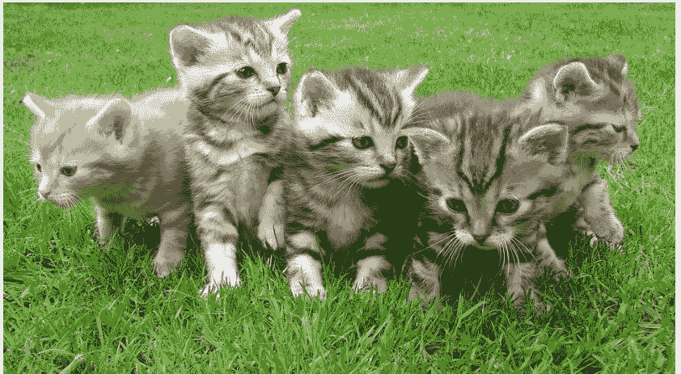

你使用神经网络构建一个用于在图片中检测猫的计算机视觉系统。

但不幸的是，你的学习算法的准确率还不够好。你承受着巨大压力来改进你的猫检测器。你该怎么办？

你的团队有很多想法，例如：

- 获取更多数据：收集更多猫的图片。
- 收集更具多样性的训练集。例如，不寻常姿势的猫；颜色不寻常的猫；使用多种相机设置拍摄的图片；....
- 通过运行更多梯度下降迭代来更长时间地训练算法。
- 尝试更大的神经网络，拥有更多层/隐藏单元/参数。
- 尝试更小的神经网络。
- 尝试添加正则化（例如 L2 正则化）。
- 更改神经网络架构（激活函数、隐藏单元数量等）
- ...

如果你在这些可能的方向中做出明智选择，你将建立领先的猫图平台，并带领公司取得成功。如果你选择不当，你可能会浪费数月时间。你该如何进行？

本书会告诉你怎么做。大多数机器学习问题都会留下线索，告诉你什么是有用的尝试，什么不是有用的尝试。学会阅读这些线索将为你节省数月甚至数年的开发时间。

## 2 如何使用本书帮助你的团队

读完本书后，你将对如何为机器学习项目设定技术方向有深入的理解。

但你的队友可能不理解你为什么推荐某个特定方向。也许你希望你的团队定义一个单一数字评估指标，但他们并不信服。你如何说服他们？

这就是我把章节写得很短的原因：这样你就可以把它们打印出来，让你的队友只阅读你需要他们知道的 1-2 页。

优先级的少量改变会对团队的生产力产生巨大影响。通过帮助团队做出几个这样的改变，我希望你能成为团队的超级英雄！

## 3 先决条件和记号

如果你曾修过机器学习课程，例如我在 Coursera 上的机器学习 MOOC，或者如果你有应用监督学习的经验，你就能理解本文。

我假设你熟悉 **监督学习**：学习一个从 x 映射到 y 的函数，使用带标签的训练示例 (x,y)。监督学习算法包括线性回归、逻辑回归和神经网络。机器学习有许多形式，但今天机器学习的大部分实际价值来自监督学习。

我将经常提到神经网络（也称为“深度学习”）。你只需要对其有一个基本理解就能跟上本文。

如果你不熟悉这里提到的概念，请观看 Coursera 上机器学习课程的前三周视频 http://ml-class.org

## 4 规模推动机器学习进展

深度学习（神经网络）的许多思想已经存在数十年。为什么这些思想现在才起飞？

近期进展的两个最大驱动因素是：

- **数据可用性。** 人们现在在数字设备（笔记本电脑、移动设备）上花费更多时间。他们的数字活动产生了海量数据，我们可以将这些数据输入学习算法。
- **计算规模。** 我们才在几年前开始能够训练足够大的神经网络，以利用我们现在拥有的海量数据集。

详细来说，即使你积累更多数据，通常像逻辑回归这样的旧学习算法的性能会“停滞”。这意味着其学习曲线“变平”，算法在你提供更多数据时停止改进：

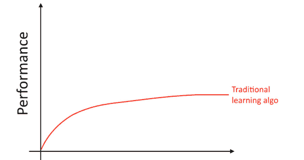

就好像旧算法不知道该如何处理我们现在拥有的数据。

如果你在同一监督学习任务上训练一个小型神经网络（NN），你可能会获得稍好的性能：

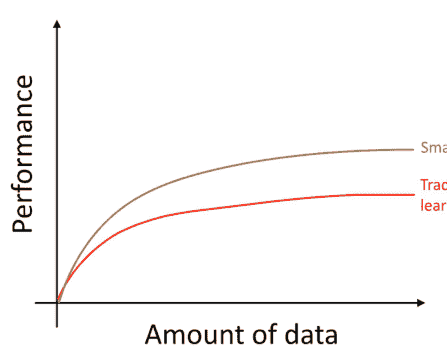

这里，“小型 NN”指的是只有少量隐藏单元/层/参数的神经网络。最后，如果你训练越来越大的神经网络，你可以获得更好的性能：¹

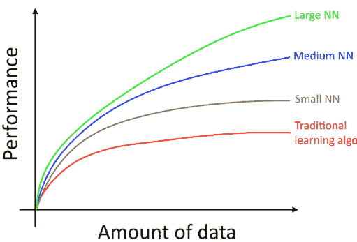

因此，你在以下情况下获得最佳性能：（i）训练一个非常大的神经网络，使其处于上图中的绿色曲线上；（ii）拥有海量数据。

神经网络架构等许多其他细节也很重要，这里已有大量创新。但今天提高算法性能的更可靠方法之一仍然是（i）训练更大的网络和（ii）获取更多数据。

¹ 该图显示神经网络在小数据集情况下表现更好。这种效应比神经网络在海量数据集情况下表现好的效应不一致。在小数据情况下，取决于特征的手工设计，传统算法可能表现更好也可能更差。例如，如果你有 20 个训练示例，使用逻辑回归还是神经网络可能没什么区别；特征的手工设计对算法选择的影响更大。但如果你有 100 万个示例，我会更倾向于神经网络。

完成（i）和（ii）的过程出人意料地复杂。本书将详细讨论这些细节。我们将从对传统学习算法和神经网络都有用的一般策略开始，逐步深入到构建深度学习系统的最现代策略。

## 设置开发集和测试集

### 5 你的开发集和测试集

回到我们之前猫图片的例子：你运行一个移动应用，用户正在向你的应用上传许多不同种类的图片。你想要自动找出猫的图片。

你的团队通过从不同网站下载猫的图片（正样本）和非猫的图片（负样本）获得了一个大型训练集。他们将数据集按70%/30%的比例拆分为训练集和测试集。利用这些数据，他们构建了一个在训练集和测试集上表现良好的猫检测器。

但当你将这个分类器部署到移动应用中时，你发现性能非常糟糕！

发生了什么？

你发现用户上传的图片与你训练集所包含的网站图片看起来不同：用户上传的是用手机拍摄的图片，往往分辨率更低、更模糊、光线也更差。由于你的训练集/测试集由网站图片构成，你的算法无法很好地泛化到你真正关心的实际分布：手机图片。

在现代大数据时代之前，机器学习中一个常见的规则是使用随机的70%/30%拆分来形成训练集和测试集。这种做法有时可行，但在越来越多的应用中，训练分布（如上例中的网站图片）与你最终关心的分布（手机图片）不同，因此这是一个糟糕的主意。

我们通常定义：

- **训练集** — 你用来运行学习算法的数据集。
- **开发集（dev set）** — 你用来调整参数、选择特征以及做出关于学习算法的其他决策的数据集。有时也称为**留出交叉验证集**。
- **测试集** — 你用来评估算法性能的数据集，但不用它来决定使用哪种学习算法或参数。

一旦你定义了开发集和测试集，你的团队会尝试很多想法，比如不同的学习算法参数，以查看哪种效果最好。开发集和测试集让你的团队能够快速看到算法的表现如何。

换句话说，**开发集和测试集的目的是引导你的团队对机器学习系统做出最重要的改进。**

所以，你应该这样做：

选择能够反映你期望在未来获得并希望表现良好的数据的开发集和测试集。

换句话说，你的测试集不应简单地是可用数据的30%，尤其是当你期望未来的数据（手机图片）在本质上与你的训练集（网站图片）不同时。

如果你还没有发布你的移动应用，你可能还没有任何用户，因此可能无法获得能准确反映你未来需要做好的数据。但你仍然可以尝试近似模拟。例如，请你的朋友用手机拍摄猫的图片并发送给你。一旦你的应用发布，你就可以使用实际的用户数据来更新你的开发集/测试集。

如果你真的没有办法获得能近似反映你未来预期数据的数据，也许你可以从使用网站图片开始。但你应该意识到这可能导致系统无法良好泛化的风险。

决定在开发优秀的开发集和测试集上投入多少需要判断力。但不要假设你的训练分布与测试分布相同。尽量选择能够反映你最终想要做好的测试样本，而不是你碰巧拥有的训练数据。

### 6 你的开发集和测试集应来自同一分布

根据你的最大市场，你的猫应用图片数据被划分为四个区域：（i）美国，（ii）中国，（iii）印度，以及（iv）其他。为了构建开发集和测试集，假设我们把美国和印度放入开发集；中国和其他放入测试集。换句话说，我们可以随机将其中两个区域分配给开发集，另外两个分配给测试集，对吗？

一旦你定义了开发集和测试集，你的团队将专注于提高开发集的性能。因此，开发集应该反映你最想改进的任务：要在所有四个地区都表现良好，而不仅仅是两个地区。

开发集和测试集分布不同还有第二个问题：你的团队有可能构建出在开发集上表现良好，却发现在测试集上表现不佳的系统。我见过这导致许多挫败和浪费精力。避免让这种情况发生在你身上。

举个例子，假设你的团队开发了一个在开发集上表现良好但在测试集上表现不佳的系统。如果你的开发集和测试集来自同一分布，那么你就会对问题出在哪里有一个非常明确的诊断：你过拟合了开发集。明显的解决方法是获取更多的开发集数据。

但如果开发集和测试集来自不同分布，那么你的选择就不那么清晰了。可能出错的情况有几种：

1. 你过拟合了开发集。
2. 测试集比开发集更难。因此你的算法可能已经达到了预期的最佳表现，无法再取得显著的进一步改进。
3. 测试集不一定更难，只是与开发集不同。因此，在开发集上效果好的方法在测试集上就是效果不好。在这种情况下，你为提升开发集性能所做的很多工作可能都是白费力气。

从事机器学习应用已经够难了。开发集和测试集不匹配会带来额外的不确定性，即在开发集分布上的改进是否也能提升测试集的性能。开发集和测试集不匹配使得更难弄清什么有效、什么无效，因而也更难决定优先处理什么工作。

如果你在处理一个第三方基准测试问题，其创建者可能指定了来自不同分布的开发集和测试集。与开发集和测试集来自同一分布的情况相比，在这种基准上，运气而非技巧对你的性能影响更大。开发能够在一个分布上训练并很好地泛化到另一个分布的学习算法是一个重要的研究问题。但如果你目标是在特定的机器学习应用上取得进展，而不是在研究上取得进展，我建议尽量选择来自同一分布的开发集和测试集。这会让你的团队更高效。

### 7 开发集/测试集需要多大？

开发集应该足够大，以便能够检测出你正在尝试的不同算法之间的差异。例如，如果分类器A的准确率为90.0%，分类器B的准确率为90.1%，那么一个包含100个样本的开发集将无法检测出这0.1%的差异。与我见过的其他机器学习问题相比，100个样本的开发集很小。开发集的规模通常在1,000到10,000个样本之间。有了10,000个样本，你就有很大机会检测出0.1%的改进。²

对于成熟且重要的应用——例如广告、网络搜索和产品推荐——我也见过一些团队非常有动力去争取哪怕0.01%的改进，因为这会对公司的利润产生直接影响。在这种情况下，开发集可能需要远大于10,000个样本，以便检测出更小的改进。

测试集的大小呢？它应该足够大，以便对你系统的整体性能给出高置信度。一个流行的经验法则是将30%的数据用于测试集。当你拥有的样本数量适中——比如100到10,000个样本时，这很有效。但在大数据时代，我们现在面对的机器学习问题有时有超过十亿个样本，分配给开发集/测试集的数据比例一直在缩小，尽管开发集/测试集中的绝对样本数一直在增长。没有必要拥有超出评估算法性能所需规模的过大开发集/测试集。

² 理论上，还可以测试对算法的更改是否在开发集上产生统计学上的显著差异。在实践中，大多数团队不会费心去做这件事（除非他们发表学术研究论文），而且我通常也认为统计显著性检验对衡量阶段性进展没什么用处。

## 8 为你的团队建立一个单一数值评估指标进行优化

分类准确率是 **单一数值评估指标** 的一个例子。你在开发集（或测试集）上运行分类器，并得到一个关于它正确分类的样本比例的单一数值。根据该指标，如果分类器 A 的准确率为 97%，分类器 B 的准确率为 90%，那么我们判断分类器 A 更优。

相比之下，Precision 和 Recall 并不是单一数值评估指标。[^3]它为评估你的分类器提供了两个数值。拥有多数值评估指标会使比较算法变得更困难。假设你的算法表现如下：

| 分类器 | 精确率 | 召回率 |
|---|---:|---:|
| A | 95% | 90% |
| B | 98% | 85% |

这里，没有一个分类器明显更优，因此它并不能立即指导你做出选择。

| 分类器 | 精确率 | 召回率 | F1 分数 |
|---|---:|---:|
| A | 95% | 90% | **92.4%** |

在开发过程中，你的团队会尝试很多关于算法架构、模型参数、特征选择等方面的想法。拥有如准确率这样的 **单一数值评估指标** 可以让你根据该指标的表现对所有模型进行排序，并快速决定什么效果最好。

如果你真的同时关心 Precision 和 Recall，我建议使用其中一种标准方法将它们组合成一个单一数值。例如，可以取 precision 和 recall 的平均值，得到一个单一数值。或者，你可以计算“F1 分数”，[^4]这是一种计算它们平均值的改进方法，比简单取均值效果更好。

| 分类器 | 精确率 | 召回率 | F1 分数 |
|------------|-----------|--------|----------|
| A | 95% | 90% | 92.4% |
| B | 98% | 85% | 91.0% |

拥有单一数值评估指标可以加快你在众多分类器中做出决策的能力。它为所有分类器提供清晰的偏好排序，因此也提供了明确的进步方向。

作为最后一个例子，假设你分别跟踪你的猫分类器在四个主要市场的准确率：（i）美国，（ii）中国，（iii）印度，（iv）其他。这就产生了四个指标。通过取这四个数值的平均值或加权平均值，你就得到了一个单一数值指标。取平均值或加权平均值是将多个指标组合成一个指标最常见的方法之一。

[^3]: 猫分类器的精确率是其标记为猫的开发集（或测试集）图像中真正是猫的比例。其召回率是开发集（或测试集）中所有猫图像被正确标记为猫的百分比。通常在高精确率和高召回率之间存在权衡。

[^4]: 如果你想了解更多关于 F1 分数的信息，请参阅 https://en.wikipedia.org/wiki/F1_score。它是精确率和召回率之间的“调和平均值”，计算公式为 2/((1/Precision)+(1/Recall))。

## 9 优化与满意度指标

这是组合多个评估指标的另一种方法。

假设你同时关心学习算法的准确率和运行时间。你需要在以下三个分类器中选择：

| 分类器 | 准确率 | 运行时间 |
|------------|----------|--------------|
| A | 90% | 80ms |
| B | 92% | 95ms |
| C | 95% | 1,500ms |

将准确率和运行时间放入单一公式中推导出单一指标似乎不自然，例如：

Accuracy - 0.5*RunningTime

你可以这样做：首先，定义什么是“可接受”的运行时间。假设运行时间在 100ms 以内都是可接受的。然后，在分类器满足运行时间标准的前提下，最大化准确率。这里，运行时间是一个“满意度指标”——你的分类器在这个指标上只需“足够好”，即运行时间最多为 100ms。准确率是“优化指标”。

如果你在权衡 N 个不同的标准，例如模型的二进制文件大小（对移动应用很重要，因为用户不希望下载大型应用）、运行时间和准确率，你可以考虑将其中 N-1 个标准设为“满意度”指标。也就是说，你只需要求它们达到某个值。然后将最后一个定义为“优化”指标。例如，为二进制文件大小和运行时间设定可接受的阈值，并在这些约束条件下尝试优化准确率。

作为最后一个例子，假设你正在构建一个硬件设备，它使用麦克风监听用户说出特定的“唤醒词”，从而使系统唤醒。示例包括 Amazon Echo 监听“Alexa”；Apple Siri 监听“Hey Siri”；Android 监听“Okay Google”；以及 Baidu 应用监听“Hello Baidu”。你关心的是误报率——系统在无人说出唤醒词时仍唤醒的频率，以及漏报率——有人说出唤醒词时系统未能唤醒的频率。一个合理的性能目标是在运行 24 小时内误报不超过一次（满意度指标）的条件下，最小化漏报率（优化指标）。

一旦你的团队在要优化的评估指标上达成一致，他们就能更快地取得进展。

## 10 拥有开发集和指标可加快迭代速度

很难事先知道哪种方法对新问题最有效。即使是经验丰富的机器学习研究人员，通常也会尝试几十种想法后才会发现令人满意的东西。

在构建机器学习系统时，我经常会：
- 1. 先有一个关于如何构建系统的 **想法**。
- 2. 将想法实现为 **代码**。
- 3. 进行一个 **实验** 来告诉我这个想法效果如何。（通常我的前几个想法都不会成功！）基于这些学习成果，回到生成更多想法，并不断迭代。

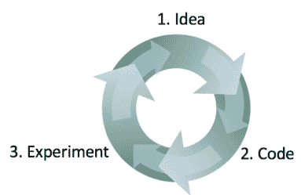

这是一个迭代过程。你能更快地完成这个循环，就能更快地取得进展。这就是为什么拥有开发/测试集和指标很重要：每次尝试一个想法时，衡量该想法在开发集上的表现能让你快速判断是否走在正确的方向上。

相反，假设你没有特定的开发集和指标。那么每次你的团队开发一个新的猫分类器时，你都必须将其集成到应用中，并花几个小时使用应用来判断新分类器是否有所改进。这会非常缓慢！此外，如果你的团队将分类器的准确率从 95.0% 提高到 95.1%，你可能无法通过使用应用来察觉到这 0.1% 的改进。然而，你的系统的大部分进展将是通过逐步积累数十个这样的 0.1% 改进实现的。拥有开发集和指标可以让你非常快速地检测出哪些想法成功带来了小的（或大的）改进，因此可以让你快速决定哪些想法值得继续完善，哪些应该放弃。

## 11 何时更改开发/测试集和指标

在新项目启动时，我会尝试快速选择开发/测试集，因为这为团队提供了明确的目标。我通常要求我的团队在一周内——很少更长——提出初始的开发/测试集和初始指标。与其过度思考，不如快速提出一个不完美的方案并开始行动更好。但这个一周的时间表并不适用于成熟的应用。例如，反垃圾邮件是一个成熟的深度学习应用。我见过团队在已经成熟的系统上花费数月时间来获取更好的开发/测试集。

如果你后来意识到初始的开发/测试集或指标未能达到预期，请务必快速更改它们。例如，如果你的开发集 + 指标将分类器 A 排在分类器 B 之上，但你的团队认为分类器 B 对你的产品实际上更优，那么这可能是你需要更改开发/测试集或评估指标的信号。

开发集/指标错误地将分类器 A 评得更高的三个主要可能原因如下：
- 1. 你需要表现良好的实际分布与开发/测试集不同。

假设你的初始开发/测试集主要包含成年猫的图片。你发布了猫应用后，发现用户上传的幼猫图片比预期多得多。因此，开发/测试集的分布并不能代表你需要表现良好的实际分布。在这种情况下，更新你的开发/测试集使其更具代表性。

## 2. 你已经过拟合了开发集。

反复在开发集上评估想法会导致你的算法逐渐“过拟合”到开发集。当你完成开发后，你会在测试集上评估系统。如果发现开发集上的性能远好于测试集上的性能，这就是过拟合开发集的迹象。在这种情况下，获取一个新的开发集。

如果你需要跟踪团队的进展，你也可以定期——比如每周一次或每月一次——在测试集上评估系统。但不要使用测试集来做出任何关于算法的决策，包括是否回滚到上周的系统。如果你这样做，你就会开始过拟合测试集，并且不能再指望它给出系统性能的完全无偏估计（如果你要发表研究论文，或许使用该指标做出重要的业务决策时就需要这种估计）。

## 3. 指标衡量的是项目不需要优化的东西。

假设对于你的猫应用，你的指标是分类准确率。该指标目前将分类器 A 评为优于分类器 B。但假设你尝试了两种算法，发现分类器 A 会偶尔放行色情图片。尽管分类器 A 更准确，但偶尔出现的色情图片留下的坏印象意味着其性能不可接受。你该怎么办？

这里，指标未能识别出算法 B 实际上比算法 A 更适合你的产品。因此，你不能再信任该指标来挑选最佳算法。是时候改变评估指标了。例如，你可以更改指标以对放行色情图片进行重罚。我强烈建议选择一个新的指标并使用该新指标为团队明确定义新的目标，而不是在没有可信指标的情况下继续太久并退回到手动在分类器之间选择。

在项目期间更改开发/测试集或评估指标是很常见的。拥有初始的开发/测试集和指标有助于你快速迭代。如果你发现开发/测试集或指标不再指引团队走向正确的方向，这没什么大不了！只需更改它们并确保团队了解新的方向即可。

## 12 经验总结：设置开发集和测试集

- 从反映你未来期望获得的数据分布并且希望表现良好的分布中选择开发集和测试集。这可能与你的训练数据的分布不同。
- 如果可能，从同一分布中选择开发集和测试集。
- 为团队选择一个单一数值评估指标进行优化。如果有多个你关心的目标，考虑将它们合并为一个单一公式（例如对多个误差指标取平均）或定义满意度和优化指标。
- 机器学习是一个高度迭代的过程：在找到一个令你满意的方案之前，你可能需要尝试数十种想法。
- 拥有开发/测试集和单一数值评估指标有助于你快速评估算法，从而更快地迭代。
- 在全新应用起步时，尝试快速建立开发/测试集和指标，比如在一周以内。对于成熟的应用，花更长时间也可以接受。
- 70%/30% 训练/测试划分的旧经验法则不适用于数据量很大的问题；开发集和测试集可以远小于数据的 30%。
- 你的开发集应足够大以检测算法准确率的有意义变化，但不必大很多。你的测试集应足够大以给出对系统最终性能的可靠估计。
- 如果你的开发集和指标不再指引团队走向正确的方向，请迅速更改它们：(i) 如果你过拟合了开发集，获取更多开发集数据。(ii) 如果你关心的实际分布与开发/测试集分布不同，获取新的开发/测试集数据。(iii) 如果你的指标不再衡量你最关心的内容，改变指标。

## Basic Error Analysis

### 13 快速构建你的第一个系统，然后迭代

你想构建一个新的邮件反垃圾系统。你的团队有几个想法：

- 收集大量的垃圾邮件训练集。例如，设置一个“蜜罐”：故意向已知垃圾邮件发送者发送虚假的电子邮件地址，以便自动收集他们发送到这些地址的垃圾邮件。
- 开发用于理解邮件文本内容的特征。
- 开发用于理解邮件信封/头部特征的特征，以显示消息经过了哪些互联网服务器。
- 以及更多。

即使我已经在反垃圾邮件方面做了大量工作，我仍然很难选择其中一个方向。如果你不是应用领域的专家，那就更难了。

所以不要一开始就试图设计和构建完美的系统。相反，快速构建并训练一个基础系统——也许只需要几天时间。⁵ 即使基础系统远非你能构建的“最佳”系统，检查基础系统如何运行也是很有价值的：你会很快找到线索，显示出最有希望投入时间的方向。接下来的几章将向你展示如何解读这些线索。

⁵ 这条建议是针对想要构建 AI 应用的读者，而不是目标是发表学术论文的人。我稍后会回到研究的话题。

### 14 错误分析：查看开发集示例以评估想法

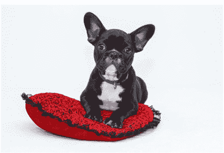

当你使用你的猫应用时，你注意到几个它把狗误认为猫的例子。有些狗确实看起来像猫！

一名团队成员建议集成第三方软件，使系统在狗图像上表现更好。这些更改需要一个月时间，团队成员对此很热情。你应该让他们继续吗？

在投入一个月时间完成此任务之前，我建议你先估计它实际上会将系统准确率提高多少。然后你就可以更理性地决定这是否值得一个月开发时间，还是把时间用在其他任务上更好。

详细来说，你可以这样做：

- 1. 收集 100 个开发集示例的样本，这些示例被你的系统错误分类了。也就是你的系统出错的示例。
- 2. 手动查看这些示例，并统计其中有多少比例是狗图像。

查看错误分类示例的过程称为错误分析。在这个例子中，如果你发现只有 5% 的错误分类图像是狗，那么无论你如何改进算法在狗图像上的性能，你都不会消除超过 5% 的错误。换句话说，5% 是该提议项目可能带来的帮助的“上限”（意思是最大可能量）。因此，如果你的整体系统目前准确率为 90%（错误率为 10%），这种改进最多可能导致 90.5% 的准确率（或 9.5% 的错误率，即比原始 10% 错误率减少了 5% 的错误）。

相反，如果你发现 50% 的错误都是狗，那么你可以更有信心地认为该提议项目会产生重大影响。它可以将准确率从 90% 提高到 95%（错误率相对减少 50%，从 10% 降至 5%）。

错误分析的这种简单计数程序为你提供了一种快速估计集成狗图像第三方软件的可能价值的方法。它提供了在决定是否进行此投资时可量化的依据。

错误分析通常可以帮助你判断不同方向的前景如何。我见过许多工程师不愿进行错误分析。直接跳进去实现某个想法往往感觉更令人兴奋，而不是质疑该想法是否值得投入时间。这是一个常见错误：可能导致你的团队花费一个月时间，最后才发现收益甚微。

手动检查 100 个示例并不需要很长时间。即使每个图像花费一分钟，你也将在两个小时内完成。这两个小时可能会为你节省一个月浪费的精力。

**错误分析**是指检查你的算法错误分类的开发集示例的过程，以便了解错误的根本原因。这可以帮助你优先安排项目——就像本例中一样——并激发新的方向，我们接下来会讨论。接下来的几章还将介绍进行错误分析的最佳实践。

正确地查看图片通常会激发你提出新的错误类别和解决方案。

最有帮助的错误类别是那些你有改进想法的类别。例如，如果你有想法“撤销”Instagram滤镜并恢复原始图像，那么添加Instagram类别会最有帮助。但你不必仅限于你知道如何改进的错误类别；这个过程的目标是培养你对最有前景的关注领域的直觉。

错误分析是一个迭代过程。如果一开始没有类别在 mind 也不要担心。看过几张图片后，你可能会想出一些错误类别的想法。在手动对一些图片进行分类后，你可能会想到新的类别，并根据新的类别重新审视图片，以此类推。

假设你对100个被错误分类的开发集示例完成了错误分析，得到了以下结果：

| 图像 | 狗 | 大猫 | 模糊 | 注释 |
|---|---|---|---|---|
| 1 | ✓ |  |  | 常见的比特犬颜色 |
| 2 |  |  | ✓ |  |
| 3 |  | ✓ | ✓ | 狮子；在雨天动物园拍摄的照片 |
| 4 |  | ✓ |  | 树后有豹 |
| ... | ... | ... | ... | ... |
| 总计占比 | 8% | 43% | 61% |  |

你现在知道，开展项目解决狗的错误最多可以消除8%的错误。处理大猫或模糊图像错误可以帮助消除更多错误。因此，你可能会选择其中两个后者类别之一作为重点。如果你的团队有足够的人手并行推进多个方向，你也可以让一些工程师处理大猫问题，其他人处理模糊图像。

错误分析并不会产生一个僵化的数学公式来告诉你最高优先级的任务应该是什么。你还需要考虑在不同类别上预期取得的进展程度以及处理每个类别所需的工作量。

### 16 清理开发集和测试集中错误标注的示例

在进行错误分析时，你可能会注意到开发集中的一些示例被错误标注了。当我说“错误标注”时，我指的是这些图片在算法遇到它们之前就已经被人工标注员错误标注了。也就是说，示例 (x,y) 中的类别标签 y 的值是错误的。例如，也许一些不包含猫的图片被错误标注为包含猫，反之亦然。如果你怀疑错误标注图像的比例显著，请添加一个类别来跟踪错误标注示例的比例：

| 图像 | 狗 | 大猫 | 模糊 | 错误标注 | 注释 |
| ... |  |  |  |  |  |
| 98 |  |  |  | ✓ | 标注员遗漏了背景中的猫 |
| 99 |  | ✓ |  |  |  |
| 100 |  |  |  | ✓ | 猫的画作；不是真猫。 |
| 总计占比 | 8% | 43% | 61% | 6% |  |

你应该纠正开发集中的标签吗？请记住，开发集的目标是帮助你快速评估算法，以便判断算法 A 或 B 是否更好。如果开发集中错误标注的比例阻碍了你做出这些判断的能力，那么花时间修复错误标注的开发集标签是值得的。

例如，假设你的分类器的性能如下：
- 开发集上的整体准确率.................... 90%（10%整体错误率。）
- 由于错误标注示例导致的错误....... 0.6%（开发集错误的6%）
- 由于其他原因导致的错误.................... 9.4%（开发集错误的94%）

这里，由于错误标注导致的0.6%不准确性相对于你可能改进的9.4%错误可能并不显著。手动修复开发集中的错误标注图像并无害，但并非至关重要：不知道你的系统整体错误率是10%还是9.4%可能是可以接受的。

假设你继续改进猫分类器，达到以下性能：
- 开发集上的整体准确率.................. 98.0%（2.0%整体错误率。）
- 由于错误标注示例导致的错误....... 0.6%。（开发集错误的30%）
- 由于其他原因导致的错误.................. 1.4%（开发集错误的70%）

你的30%错误是由于开发集中错误标注的图像造成的，这给你的准确率估计增加了显著误差。现在改进开发集标签的质量是值得的。处理错误标注的示例将帮助你判断分类器的错误更接近1.4%还是2%——这是一个显著的相对差异。

在系统改进后，容忍一些错误标注的开发集/测试集示例起初并不少见，随后你可能会改变主意，因为错误标注示例的比例相对于总错误集而言增长了。

上一章解释了你如何通过算法改进来改进诸如狗、大猫和模糊等错误类别。你在本章中学到，你也可以通过改进数据的标签来处理错误标注类别。

无论你采用什么流程来修复开发集标签，请记住也要将其应用于测试集标签，以便你的开发集和测试集继续来自相同的分布。同时修复开发集和测试集可以防止我们在第6章中讨论的问题，即你的团队只优化开发集性能，最后才意识到他们是根据不同的测试集基于不同的标准进行评判的。

如果你决定改进标签质量，请考虑同时复查系统错误分类的示例的标签以及其正确分类的示例的标签。原始标签和你的学习算法在某个示例上都可能是错误的。如果你只修复系统错误分类的示例的标签，你可能会在评估中引入偏差。如果你有1,000个开发集示例，并且你的分类器准确率为98.0%，那么检查它错误分类的20个示例比检查全部980个正确分类的示例更容易。由于在实践中只检查错误分类的示例更容易，偏差确实会渗入一些开发集。这种偏差是可以接受的，如果你只对开发产品或应用感兴趣，但如果你计划在学术研究论文中使用结果或需要完全无偏的测试集准确率度量，这就会成为问题。

### 17 如果你有一个大的开发集，将其拆分为两个子集，其中只有一个你会查看

假设你有一个包含5,000个示例的大型开发集，错误率为20%。因此，你的算法错误分类了约1,000张开发图像。手动检查1,000张图像需要很长时间，因此我们可能会决定不在错误分析中使用全部图像。

在这种情况下，我会明确地将开发集拆分为两个子集，其中一个你会查看，一个你不会。你会更快地对你手动查看的部分过拟合。你可以使用你不手动查看的部分来调参。

让我们继续上面的例子，其中算法错误分类了5,000个开发集示例中的1,000个。假设我们想手动检查约100个错误进行错误分析（占错误的10%）。你应该随机选择开发集的10%并将其放入我们称之为Eyeball开发集以提醒我们是用眼睛查看它。（对于语音识别项目，其中你会收听音频剪辑，也许你会将此集合称为Ear开发集）。Eyeball开发集因此有500个示例，我们预计我们的算法会错误分类其中约100个。

开发集的第二个子集称为Blackbox开发集，将包含剩余的4,500个示例。你可以使用Blackbox开发集通过测量其错误率来自动评估分类器。你也可以用它来在算法之间选择或调优超参数。然而，你应该避免用眼睛查看它。我们使用“Blackbox”这个术语，因为我们只会使用这一数据子集来获得“Blackbox”评估的分类器。

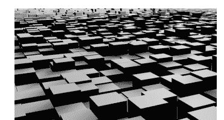

为什么我们要明确地将开发集分为“肉眼观察”和“黑盒”开发集？因为你会逐渐对肉眼观察开发集中的样本产生直觉，从而更快地开始过拟合这个子集。如果你发现模型在肉眼观察开发集上的性能提升速度远快于在黑盒开发集上的表现，那么你就已经过拟合了肉眼观察开发集。此时，你可能需要丢弃它，并通过从黑盒开发集中移入更多样本，或者获取新的带标签数据，来建立一个新的肉眼观察开发集。

将开发集明确划分为肉眼观察和黑盒开发集，可以让你判断手动错误分析过程是否正在导致你对数据中的肉眼观察部分过拟合。

### 18 肉眼观察和黑盒开发集应该有多大？

你的肉眼观察开发集应该足够大，以便让你了解算法的主要错误类别。如果你正在处理一项人类擅长完成的任务（例如识别图像中的猫），以下是一些粗略的指导原则：

- 如果分类器在肉眼观察开发集上只犯10个错误，这会被认为是非常小的。仅有10个错误，很难准确估计不同错误类别的影响。但如果你的数据非常少，无法承担将更多数据放入肉眼观察开发集的代价，那么这总比没有好，并且有助于确定项目的优先级。
- 如果分类器在肉眼观察开发集样本上犯约20个错误，你就能开始对主要错误来源有一个粗略的认识。
- 大约有50个错误时，你就能比较清楚地了解主要错误来源。
- 大约有100个错误时，你就能非常清楚地了解主要错误来源。我见过有人手动分析更多的错误——有时多达500个。只要你有足够的数据，这并无坏处。

假设你的分类器错误率为5%。为了确保肉眼观察开发集中有约100个被错误分类的样本，肉眼观察开发集需要包含大约2000个样本（因为0.05*2000=100）。你的分类器错误率越低，为了获得足够大的错误集进行分析，你的肉眼观察开发集就需要越大。

如果你正处理一项连人类也难以做好的任务，那么检查肉眼观察开发集这项工作就不会那么有用了，因为更难弄清楚算法为什么没有正确分类某个样本。在这种情况下，你可以省去肉眼观察开发集。我们将在后面的章节中讨论此类问题的指导原则。

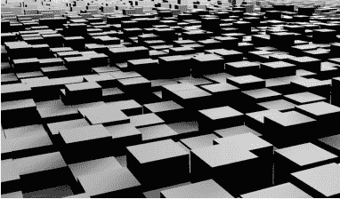

那么黑盒开发集呢？我们之前提到，大约1000到10000个样本的开发集是常见的。进一步说明，一个包含1000到10000个样本的黑盒开发集通常能提供足够的数据来调整超参数和选择模型，而拥有更多数据也几乎没有坏处。一个100个样本的黑盒开发集会有点小，但仍然有用。

如果你的开发集很小，那么可能就没有足够的数据来拆分成能够各自发挥作用的肉眼观察和黑盒开发集。在这种情况下，你可能不得不将整个开发集用作肉眼观察开发集——也就是说，你会手动检查所有开发集数据。

在肉眼观察和黑盒开发集之间，我认为肉眼观察开发集更重要（假设你在处理一个人类能够很好解决的问题，并且检查样本能帮助你获得洞察）。如果只有一个肉眼观察开发集，你可以在这个集合上进行错误分析、模型选择和超参数调整。但仅拥有肉眼观察开发集的缺点是过拟合开发集的风险更大。

如果你有充足的数据来源，那么肉眼观察开发集的大小将主要取决于你有多少时间可以手动分析样本。例如，我很少见到有人手动分析超过1000个错误。

### 19 要点：基本错误分析

- 当你启动一个新项目时，特别是如果你在该领域并非专家，很难准确猜出最有前景的方向。
- 因此，不要一开始就试图设计和构建完美的系统。相反，尽快构建并训练一个基础系统——也许只需要几天时间。然后利用错误分析来帮助你确定最有前景的方向，并在此基础上迭代改进算法。
- 通过手动检查约100个算法错误分类的开发集样本，并统计主要错误类别来进行错误分析。利用这些信息来确定优先修复哪些类型的错误。
- 考虑将开发集划分为肉眼观察开发集（你会手动检查）和黑盒开发集（你不会手动检查）。如果肉眼观察开发集上的性能远好于黑盒开发集，说明你已过拟合肉眼观察开发集，应考虑为其获取更多数据。
- 肉眼观察开发集应该足够大，以便算法错误分类足够多的样本供你分析。一个包含1000到10000个样本的黑盒开发集对许多应用来说已经足够。
- 如果你的开发集不足以这样拆分，那就将整个开发集用作肉眼观察开发集，进行手动错误分析、模型选择和超参数调整。

## 偏差与方差

### 20 偏差与方差：两大误差来源

假设你的训练集、开发集和测试集都来自相同的分布。那么你应该总是设法获取更多的训练数据，因为这样只会提高性能，对吗？

虽然拥有更多数据不会有坏处，但遗憾的是，它并不总是像你希望的那样有帮助。花时间获取更多数据可能是在浪费时间。那么，如何决定何时该添加数据，何时又不必费心呢？

机器学习中有两大误差来源：偏差和方差。理解它们将帮助你决定添加数据以及其他改善性能的策略是否是合理的时间投入。

假设你希望构建一个错误率为5%的猫识别器。目前，你的训练集错误率为15%，开发集错误率为16%。在这种情况下，添加训练数据可能不会有太大帮助。你应该专注于其他改动。事实上，向训练集添加更多样本只会让算法更难在训练集上表现良好。（我们将在后面的章节解释原因。）

如果你的训练集错误率是15%（即85%的准确率），但你的目标是5%的错误率（即95%的准确率），那么首先要解决的问题是提高算法在训练集上的表现。你的开发集/测试集性能通常比训练集性能要差。所以，如果你在算法已经见过的样本上取得85%的准确率，那么在算法从未见过的样本上，你不可能获得95%的准确率。

假设如上所述，你的算法在开发集上有16%的错误率（84%的准确率）。我们将这16%的错误率分解为两个部分：

- 首先，算法在训练集上的错误率。在本例中，是15%。我们非正式地将其视为算法的**偏差**。
- 其次，算法在开发集（或测试集）上比在训练集上差多少。在本例中，它在开发集上的表现比训练集差1%。我们非正式地将其视为算法的**方差**。

[^6]: 统计学领域对偏差和方差有更正式的定义，我们不必纠结于此。粗略来说，偏差是当你的训练集非常大时，算法在训练集上的错误率。方差则是在这种情况下，算法在测试集上比在训练集上差多少。当你的误差指标是均方误差时，你可以写出公式来定义这两个量，并证明总误差=偏差+方差。但就我们决定如何在机器学习问题上取得进展而言，这里给出的更非正式的偏差和方差定义就足够了。

对学习算法的一些改动可以解决第一个误差成分——**偏差**——并提高其在训练集上的表现。另一些改动则解决第二个成分——**方差**——并帮助算法更好地从训练集泛化到开发集/测试集。⁷为了选择最有前景的改动，非常有用的一点是弄清楚这两个误差成分中哪一个更迫切需要解决。

培养关于偏差与方差的良好直觉将帮助你为算法选择有效的改动。

⁷还有一些方法可以通过对系统架构进行重大改动来同时减少偏差和方差。但这些方法通常更难确定和实施。

### 21 偏差与方差的示例

以我们的猫分类任务为例。一个“理想”的分类器（比如人类）可能在这个任务上取得近乎完美的表现。

假设你的算法表现如下：

- 训练误差 = 1%
- 开发集误差 = 11%

它存在什么问题？应用上一章的定义，我们估计偏差为1%，方差为10%（=11%-1%）。因此，它具有**高方差**。该分类器的训练误差非常低，但未能泛化到开发集。这也被称为**过拟合**。

现在考虑这种情况：

- 训练误差 = 15%
- 开发集误差 = 16%

我们估计偏差为15%，方差为1%。这个分类器对训练集的拟合效果很差，误差为15%，但它在开发集上的误差仅比训练误差略高一点。因此，这个分类器具有**高偏差**，但低方差。我们说这个算法**欠拟合**。

现在，再考虑这种情况：

- 训练误差 = 15%
- 开发集误差 = 30%

我们估计偏差为15%，方差为15%。这个分类器具有**高偏差和高方差**：它在训练集上表现不佳，因此具有高偏差，而它在开发集上的表现更差，所以也具有高方差。过拟合/欠拟合这两个术语在这里很难套用，因为这个分类器同时处于过拟合和欠拟合状态。

最后，考虑这种情况：

- 训练误差 = 0.5%
- 开发集误差 = 1%

这个分类器表现良好，因为它具有低偏差和低方差。恭喜你取得了如此出色的表现！

- **可避免偏差**：1%。它是训练误差与最优误差率之间的差值。⁸
- **方差**：15%。即开发集误差与训练误差之间的差值。

⁸ 如果这个数字为负，说明你在训练集上的表现优于最优误差率。这意味着你在训练集上过拟合，算法过度记住了训练集。你应该专注于降低方差的方法，而不是进一步降低偏差的方法。

为了将其与我们之前的定义联系起来，偏差与可避免偏差的关系如下：⁹

偏差 = 最优误差率（“不可避免的偏差”）+ 可避免偏差

⁹ 选择这些定义是为了传达关于如何改进学习算法的见解。这些定义与统计学家对偏差和方差的定义不同。严格来说，我在这里定义的“偏差”应当被称为“我们归因于偏差的误差”；而“可避免偏差”应当被称为“我们归因于学习算法偏差的误差，且该偏差超出了最优误差率”。

“可避免偏差”反映的是你的算法在训练集上的表现比“最优分类器”差多少。

方差的概念与之前相同。理论上，我们可以通过在庞大的训练集上训练，将方差降到几乎为零。因此，只要有足够大的数据集，所有方差都是“可避免的”，所以不存在“不可避免的方差”这种东西。

再看一个例子，假设最优误差率为14%，我们有：

- 训练误差 = 15%
- 开发集误差 = 16%

虽然我们在上一章称之为高偏差分类器，但现在我们会说，来自可避免偏差的误差为1%，来自方差的误差约为1%。因此，这个算法已经表现良好，几乎没有改进空间。它只比最优误差率差2%。

从这些例子中我们可以看出，了解最优误差率有助于指导我们接下来的步骤。在统计学中，最优误差率也被称为**贝叶斯误差率**，或贝叶斯率。

我们如何知道最优误差率是多少？对于人类比较擅长的任务，比如识别图片或转录音频片段，你可以请人提供标签，然后衡量人工标签相对于训练集的准确率。这样就能得到最优误差率的估计。如果你正在处理一个连人类都很难解决的问题（例如预测该推荐哪部电影，或该向用户展示哪条广告），那么最优误差率就很难估计了。

在“与人类水平表现进行比较”一节（第33至35章）中，我将更详细地讨论如何将学习算法的表现与人类水平表现进行比较。

在最后几章中，你学会了如何通过查看训练集和开发集的误差率来估计可避免/不可避免的偏差与方差。下一章将讨论如何利用此类分析的见解，在降低偏差的技术与降低方差的技术之间确定优先级。根据你的项目当前问题是高（可避免）偏差还是高方差，你应该应用截然不同的技术。继续往下读吧！

### 23 处理偏差与方差

以下是处理偏差与方差问题的最简单的公式：

- 如果你有较高的可避免偏差，就增大模型规模（例如，通过增加层/神经元来扩大神经网络的规模）。
- 如果你有较高的方差，就向训练集中添加数据。

如果你能够无限制地增大神经网络规模并增加训练数据，那么在许多学习问题上都可能取得很好的表现。

在实践中，增大模型规模最终会让你遇到计算问题，因为训练非常大的模型很慢。你还可能会耗尽获取更多训练数据的能力。（即使在互联网上，猫的图片数量也是有限的！）

不同的模型架构——例如不同的神经网络架构——针对你的问题会有不同程度的偏差/方差。近年来，大量深度学习研究开发了许多创新的模型架构。因此，如果你使用神经网络，学术文献可以成为很好的灵感来源。GitHub 上也有很多优秀的开源实现。但与“增大模型规模并添加数据”这一简单公式相比，尝试新架构的结果更难预测。

增大模型规模通常会降低偏差，但也可能增加方差和过拟合的风险。然而，这种过拟合问题通常只在你不使用正则化时才会出现。如果你采用了设计良好的正则化方法，那么通常可以安全地增大模型规模，而不会增加过拟合。

假设你在应用深度学习，使用 L2 正则化或 dropout，并采用在开发集上表现最佳的正则化参数。如果你增大模型规模，性能通常会保持不变或有所提升；不太可能明显变差。避免使用更大模型的唯一原因是计算成本增加。

### 24 偏差与方差的权衡

你可能听说过“偏差与方差的权衡”。在对大多数学习算法可以做出的改动中，有些会降低偏差误差，但代价是增加方差，反之亦然。这就形成了偏差与方差之间的“权衡”。

例如，增大模型规模——在神经网络中增加神经元/层，或增加输入特征——通常会降低偏差，但可能会增加方差。反过来，添加正则化通常会增大偏差，但会降低方差。

在现代，我们通常可以获得大量数据，并使用非常大的神经网络（深度学习）。因此，权衡变得更少，现在有更多选择可以在不损害方差的情况下降低偏差，反之亦然。

例如，你通常可以增大神经网络规模并调整正则化方法，在不显著增加方差的情况下降低偏差。通过添加训练数据，你通常也能在不影响偏差的情况下降低方差。

如果你选择了非常适合任务的模型架构，你可能还可以同时降低偏差和方差。但选择这样的架构可能很困难。

在接下来的几章中，我们将讨论处理偏差与方差的其他具体技术。

### 26 训练集上的误差分析

你的算法必须在训练集上表现良好，然后你才能期望它在开发集/测试集上表现良好。

除了前面描述的用于解决高偏差的技术外，我有时也会对 *训练数据* 进行误差分析，其协议类似于对 Eyeball 开发集的误差分析。如果你的算法存在高偏差——即它不能很好地拟合训练集——这可能会很有用。

例如，假设你正在为一款应用构建语音识别系统，并收集了志愿者提供的音频片段训练集。如果你的系统在训练集上表现不佳，你可以考虑收听算法表现较差的约 ~100 个示例，以了解训练集错误的 major 类别。类似于开发集误差分析，你可以统计不同类别中的错误：

| 音频片段 | 嘈杂的背景噪音 | 用户说话很快 | 远离麦克风 | 注释 |
|---|---|---|---|---|
| 1 | ✔ |  |  | 汽车噪音 |
| 2 | ✔ |  | ✔ | 餐厅噪音 |
| 3 |  | ✔ | ✔ | 用户在客厅对面大喊？ |
| 4 | ✔ |  |  | 咖啡店 |
| 总占比 | 75% | 25% | 50% |  |

在这个例子中，你可能会意识到你的算法在背景噪音很多的训练示例上特别困难。因此，你可能会专注于能够让它更好地拟合具有背景噪音的训练示例的技术。

你也可以 double-check 是否在与学习算法相同的输入音频条件下，人类能够转录这些音频片段。如果背景噪音大到任何人都无法辨别所说内容，那么期望任何算法都能正确识别此类话语可能是不合理的。我们将在后面的章节讨论将你的算法与人类水平性能进行比较的好处。

### 27 降低方差的技术

如果你的学习算法存在高方差，你可以尝试以下技术：

- **增加更多训练数据**：只要你能获取显著更多的数据并且有足够的计算能力来处理数据，这是解决方差最简单、最可靠的方法。
- **添加正则化**（L2 正则化、L1 正则化、dropout）：该技术会降低方差但增加偏差。
- **添加早停**（即基于开发集误差提前停止梯度下降）：该技术会降低方差但增加偏差。早停的行为与正则化方法非常相似，有些作者称其为正则化技术。
- **特征选择以减少输入特征的数量/类型**：该技术可能有助于方差问题，但也可能增加偏差。稍微减少特征数量（例如从 1,000 个特征减少到 900 个）不太可能对偏差产生巨大影响。显著减少（例如从 1,000 个特征减少到 100 个——减少 10 倍）更可能产生显著影响，只要你没有排除太多有用的特征。在现代深度学习中，当数据充足时，人们已逐渐远离特征选择，我们更有可能将所有特征都交给算法，让算法根据数据自行决定使用哪些特征。但当你的训练集很小时，特征选择非常有用。
- **减小模型大小**（例如神经元/层数）：*请谨慎使用。* 该技术可能会降低方差，同时可能增加偏差。然而，我不推荐用此技术来解决方差问题。添加正则化通常能获得更好的分类性能。减小模型大小的优势在于降低计算成本，从而加快模型训练速度。如果加快模型训练有用，那么当然可以考虑减小模型大小。但如果你的目标是降低方差，并且你不关心计算成本，请考虑添加正则化代替。

以下是来自上一章关于解决偏差的重复的两个额外策略：

- **基于误差分析的见解修改输入特征**：假设你的误差分析启发你创建额外的特征，帮助算法消除某一特定类别的错误。这些新特征可能同时有助于偏差和方差。理论上，增加更多特征可能会增加方差；但如果你发现确实如此，请使用正则化，这通常会消除方差的增加。
- **修改模型架构**（例如神经网络架构）使其更适合你的问题：该技术会影响偏差和方差。

## 学习曲线

- 如果你长时间从事一个重要应用，那么你可能对未来一个季度/一年内可以合理取得多少进展有直觉。

将期望的性能水平添加到你的学习曲线中：

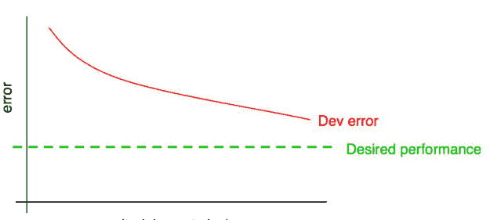

你可以通过视觉外推红色“开发集误差”曲线来猜测通过增加更多数据可以更接近期望的性能水平。在上面的例子中，看起来将训练集大小加倍可能足以达到期望的性能。

但如果开发集误差曲线已“趋于平稳”（即变平），那么你就可以立即知道增加更多数据不会达到你的目标：

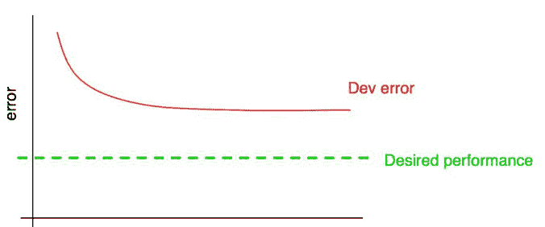

因此，查看学习曲线可以帮助你避免花费数月时间收集两倍多的训练数据，最后才发现它没有帮助。

### 29 绘制训练误差

随着训练集大小的增长，你的开发集（和测试集）误差应该会下降。但你的训练集误差通常会随着训练集大小的增长而 *增加*。

让我们用一个例子来说明这种效应。假设你的训练集只有 2 个示例：一个猫图像和一个非猫图像。那么学习算法很容易“记住”训练集中的这两个示例，并获得 0% 的训练集误差。即使其中一个或两个训练示例被错误标记，算法记住这两个标签仍然很容易。

现在假设你的训练集有 100 个示例。也许其中几个示例被错误标记或模糊——有些图像非常模糊，甚至人类也无法判断是否有猫。也许学习算法仍然可以“记住”训练集的大部分或全部，但现在获得 100% 准确率更困难。将训练集从 2 个增加到 100 个示例，你会发现训练集准确率会略微下降。

最后，假设你的训练集有 10,000 个示例。在这种情况下，算法很难完美拟合全部 10,000 个示例，尤其是其中一些模糊或被错误标记。因此，你的学习算法在该训练集上的表现会更差。

让我们在之前的图表中加入训练误差的图：

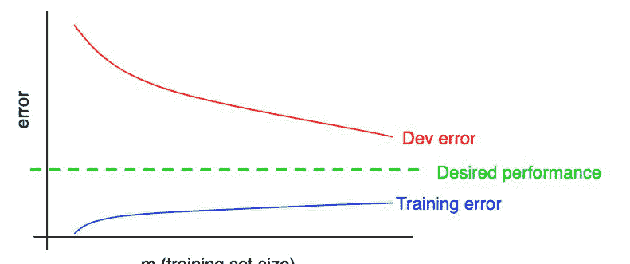

你可以看到，随着训练集大小的增加，蓝色的“训练误差”曲线会增加。此外，你的算法通常在训练集上比在开发集上表现更好；因此红色的开发集误差曲线通常严格位于蓝色的训练误差曲线之上。

让我们接下来讨论如何解释这些图。

### 30 解释学习曲线：高偏差

假设你的开发集误差曲线看起来像这样：

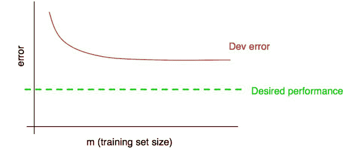

我们之前说过，如果你的开发集误差曲线趋于平稳，仅靠增加数据不太可能达到期望的性能。

但很难准确知道红色开发集误差曲线的外推会是什么样子。如果开发集很小，你会更不确定，因为曲线可能很嘈杂。

假设我们将训练误差曲线添加到此图并得到以下结果：

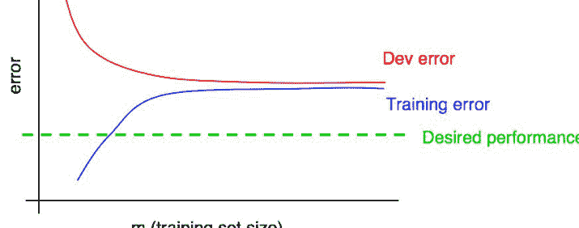

现在，你可以绝对确定，仅靠增加数据是不够的。为什么呢？记住我们的两个观察：

- 随着我们添加更多训练数据，训练误差只能变差。因此，蓝色训练误差曲线只能保持不变或升高，因此它只能离（绿色线）期望性能水平越来越远。
- 红色开发误差曲线通常高于蓝色训练误差。因此，当训练误差甚至高于期望性能水平时，几乎没有办法通过添加更多数据使红色开发误差曲线下降到期望的性能水平。

同时检查同一图表上的开发误差曲线和训练误差曲线，可以让我们更自信地外推开发误差曲线。

假设为了讨论起见，期望性能是我们对最优误差率的估计。图上方的图就是学习曲线具有高可避免偏差时的标准“教科书”示例：在最大的训练集大小——大概对应于我们拥有的所有训练数据——训练误差与期望性能之间存在较大差距，表明存在较大的可避免偏差。此外，训练曲线与开发曲线之间的差距很小，表明方差很小。

之前，我们只在该图的右侧点测量训练和开发集误差，这对应于使用所有可用的训练数据。绘制完整的学习曲线可以让我们更全面地了解算法在不同训练集大小下的性能。

### 31 解释学习曲线：其他情况

考虑这个学习曲线：

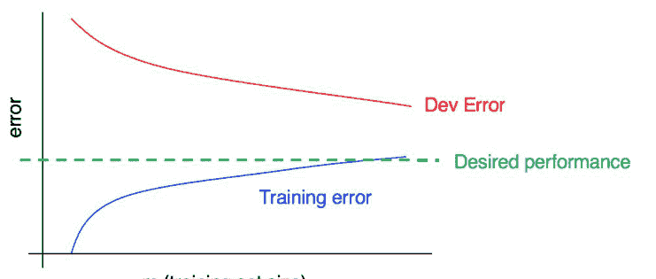

该图表明高偏差、高方差还是两者兼有？

蓝色训练误差曲线相对较低，而红色开发误差曲线比蓝色训练误差高得多。因此，偏差很小，但方差很大。添加更多训练数据可能会有助于缩小开发误差与训练误差之间的差距。

现在，考虑这个：

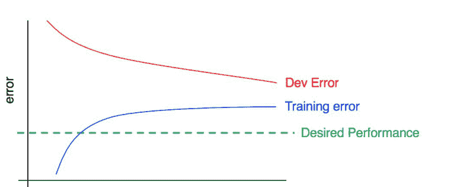

这次，训练误差很大，因为它远高于期望的性能水平。开发误差也比训练误差大得多。因此，你的算法存在显著的偏差和显著的方差。你必须找到一种方法来同时减少算法的偏差和方差。

### 32 绘制学习曲线

假设你有一个非常小的训练集，共 100 个示例。你使用随机选择的 10 个示例、然后 20 个示例、然后 30 个示例，直到 100 个示例来训练算法，每次增加 10 个示例。然后你使用这 10 个数据点绘制学习曲线。你可能会发现曲线在较小的训练集大小时看起来有点嘈杂（意味着值高于/低于预期）。

当仅使用 10 个随机选择的示例进行训练时，你可能运气不好，得到一个特别“差”的训练集，例如包含许多模糊/错误标记的示例。或者，你可能运气好，得到一个特别“好”的训练集。训练集很小意味着开发误差和训练误差可能会随机波动。

如果你的机器学习应用严重偏向某一类（例如猫分类任务，其中负例的比例远大于正例），或者它具有大量的类别（例如识别 100 种不同的动物物种），那么选择一个特别“不具代表性”或差的训练集的几率也会更大。例如，如果 80% 的示例是负例（y=0），只有 20% 是正例（y=1），那么 10 个示例的训练集可能只包含负例，从而使算法很难学习到有意义的东西。

如果训练曲线中的噪声使很难看到真实趋势，这里有两个解决方案：

- 不要只在 10 个示例上训练一个模型，而是从原始的 100 个示例中通过有放回采样¹⁰选择几个（比如 3-10 个）不同的随机选择的 10 个示例训练集。对每个训练集训练不同的模型，并计算每个所得模型的训练和开发集误差。计算并绘制平均训练误差和平均开发集误差。
- 如果你的训练集偏向某一类，或者它有很多类别，选择一个“平衡”的子集，而不是从 100 个示例中随机选择 10 个训练示例。例如，你可以确保 2/10 的示例是正例，8/10 是负例。更一般地说，你可以确保每个类别的示例比例尽可能接近原始训练集中的总体比例。

¹⁰ 这里是有放回采样意味着什么：你会从 100 个示例中随机挑选 10 个不同的示例来形成第一个训练集。然后为了形成第二个训练集，你会再次挑选 10 个示例，但不考虑第一次训练集中选择的内容。因此，一个特定示例可能同时出现在第一个和第二个训练集中。相比之下，如果是无放回采样，第二个训练集将从第一次未被选中的 90 个示例中选择。实际上，有放回或无放回采样不会有巨大差异，但前者是常见做法。

我不会在你已经尝试绘制学习曲线并得出曲线过于嘈杂而无法看到底层趋势之前费心使用这些技术。如果你的训练集很大——比如超过 10,000 个示例——并且类别分布不是很偏斜，你可能不需要这些技术。

最后，绘制学习曲线可能在计算上很昂贵：例如，你可能需要训练十个模型，使用 1,000 个、然后 2,000 个，一直到 10,000 个示例。使用小数据集训练模型比使用大数据集训练模型快得多。因此，与其像上面那样在线性尺度上均匀间隔训练集大小，你可以训练使用 1,000、2,000、4,000、6,000 和 10,000 个示例的模型。这仍然可以让你清楚地了解学习曲线的趋势。当然，只有当训练所有额外模型的计算成本显著时，该技术才相关。

## 与人类水平性能比较

### 33 为什么我们要与人类水平性能比较

许多机器学习系统旨在自动化人类擅长的事情。示例包括图像识别、语音识别和电子邮件垃圾邮件分类。学习算法也改进了很多，以至于我们现在在越来越多的这些任务上超越了人类水平性能。

此外，如果你尝试做人们能做好的任务，构建 ML 系统会更容易，有几个原因：

- 1. **从人工标注者获取数据的便捷性。** 例如，由于人们能很好地识别猫图像，因此人们为你的学习算法提供高准确度标签是直接的。
- 2. **误差分析可以利用人类直觉。** 假设语音识别算法的性能不如人类水平。假设它错误地将一段音频转写为“这份食谱需要一颗苹果的梨”，把“pair”误认为“pear”。你可以利用人类直觉并尝试理解一个人用来获得正确转写的信息，并利用这些知识修改学习算法。
- 3. **利用人类水平性能来估计最优误差率并设定“期望误差率”。** 假设你的算法在某项任务上达到 10% 的误差，但一个人达到 2% 的误差。那么我们知道最优误差率是 2% 或更低，可避免偏差至少为 8%。因此，你应该尝试降低偏差的技术。

尽管第 3 项可能听起来不重要，但我发现拥有一个合理且可实现的目标误差率有助于加速团队的进展。知道你的算法具有高可避免偏差是非常有价值的，并打开了一系列可尝试的选项。

有一些任务即使人类也不擅长。例如，为你推荐一本书；或为网站上的用户挑选广告；或预测股市。计算机在这些任务上已经超越了大多数人的表现。在这些应用中，我们会遇到以下问题：

- **获取标签更困难。** 例如，让人工标注者为用户数据库标注“最优”图书推荐是困难的。如果你运营一个销售书籍的网站或应用，你可以通过向用户展示书籍并观察他们的购买行为来获取数据。如果你不运营此类网站，你需要找到更具创造性的方法来获取数据。

-   **人类直觉更难依赖。** 例如，几乎没有人能预测股市。所以如果我们的股票预测算法表现不比随机猜测好，就很难弄清楚如何改进它。
-   **很难知道最优错误率和合理的期望错误率是多少。** 假设你已经有一个表现相当不错的图书推荐系统。没有人类基准的情况下，你怎么知道它还能改进多少？

### 34 如何定义人类水平性能

假设你正在开发一个医疗影像应用，该应用可自动根据 X 光图像做出诊断。一个除了接受过一些基础培训之外没有医学背景的普通人，在此任务上的错误率为 15%。初级医生错误率为 10%。有经验的医生错误率为 5%。而一小队讨论并辩论每张图像的医生错误率为 2%。这些错误率中的哪一个定义了“人类水平性能”？

在这种情况下，我会将 2% 用作我们最优错误率的人类水平性能代理。你也可以将 2% 设为期望性能水平，因为上一章中将性能与人类水平进行比较的全部三个原因都适用：

-   **从人类标注者获取标注数据的便利性。** 你可以让一队医生为你提供标注，错误率为 2%。
-   **错误分析可以借鉴人类直觉。** 通过与一队医生讨论图像，你可以借鉴他们的直觉。
-   **利用人类水平性能来估计最优错误率并设定可实现的“期望错误率”。** 使用 2% 错误率作为我们对最优错误率的估计是合理的。最优错误率可能甚至低于 2%，但不可能更高，因为医生团队能够达到 2% 错误率。相比之下，使用 5% 或 10% 作为最优错误率的估计是不合理的，因为我们知道这些估计必然过高。

在获取标注数据时，你可能不希望让整个医生团队讨论每张图像，因为他们的时间很宝贵。也许你可以让一名初级医生标注绝大多数案例，只把更困难的案例带给更有经验的医生或医生团队。

如果你的系统目前错误率为 40%，那么使用初级医生（错误率 10%）还是有经验的医生（错误率 5%）来标注数据并提供直觉差别不大。但如果你的系统已经达到 10% 错误率，那么将人类水平参考定义为 2% 就能为你提供更好的工具来持续改进系统。

### 35 超越人类水平性能

你正在从事语音识别工作，并且有一个音频片段数据集。假设你的数据集中有很多嘈杂的音频片段，以至于人类也有 10% 的错误率。假设你的系统已经达到 8% 的错误率。你还能使用第 33 章中描述的三种技术中的任何一种来继续快速进步吗？

如果你能识别出人类明显优于你的系统的子集数据，那么你仍然可以使用这些技术来推动快速进步。例如，假设你的系统在嘈杂音频中识别语音方面远胜于人类，但人类在转录非常快速的语音方面仍然更好。

对于快速语音的子集数据：

1.  你仍然可以从人类那里获得质量高于算法输出的转录文本。
2.  你可以借鉴人类直觉来理解他们为何能正确听出快速语语音而你的系统却不能。
3.  你可以将快速语音上的人类水平性能作为期望性能目标。

更一般地说，只要在开发集中有人类正确而算法错误的情况，那么之前描述的许多技术仍然适用。这即使在整个开发/测试集上平均来看，你的性能已经超过人类水平性能，也成立。

有许多重要的机器学习应用中机器超过了人类水平性能。例如，机器在预测电影评分、送货车前往某地所需时间、或是否批准贷款申请方面更好。一旦人类很难识别出算法明显出错的例子，只有部分技术适用。因此，在机器已经超过人类水平性能的问题上进展通常较慢，而在机器仍在努力追赶人类的情况下进展更快。

## 在不同分布上训练和测试

### 36 何时应在不同分布上训练和测试

你的猫图应用的用户上传了 10,000 张图像，你已手动标注它们是否包含猫。你还有一个更大的 200,000 张从互联网下载的图像集。你应如何定义训练/开发/测试集？

由于这 10,000 张用户图像密切反映了你希望表现良好的实际数据概率分布，你可能会将其用于开发集和测试集。如果你在训练一个数据饥渴的深度学习算法，你可能会为其提供额外的 200,000 张互联网图像用于训练。因此，你的训练集和开发/测试集来自不同的概率分布。这如何影响你的工作？

我们也可以不将数据划分为训练/开发/测试集，而是将我们拥有的全部 210,000 张图像随机打乱后划分为训练/开发/测试集。在这种情况下，所有数据都来自同一分布。但我不建议这种方法，因为大约 205,000/210,000 ≈ 97.6% 的开发/测试数据将来自互联网图像，这并不反映你希望表现良好的实际分布。记住我们关于选择开发/测试集的建议：

Choose dev and test sets to reflect data you expect to get in the future and want to do well on.

机器学习学术文献的大部分假设训练集、开发集和测试集都来自同一分布。¹¹在机器学习早期，数据稀缺。我们通常只有一个从某个概率分布中抽取的数据集。因此我们会将该数据随机划分为训练/开发/测试集，并且所有数据来自同一来源的假设通常成立。

¹¹ 有一些学术研究涉及在不同分布上训练和测试。例如“domain adaptation”、“transfer learning” 和 “multitask learning”。但理论与实践之间仍存在巨大差距。如果你用数据集 A 训练并在完全不同类型的数据 B 上测试，运气可能会对算法表现产生巨大影响。（这里的“运气”包括研究人员为特定任务手工设计的特征，以及我们尚未理解的其他因素。）这使得对不同分布上训练和测试的学术研究难以系统地开展。

但在大数据的时代，我们现在可以访问巨大的训练集，例如猫的互联网图像。即使训练集来自与开发/测试集不同的分布，我们仍然希望使用它进行学习，因为它可以提供大量信息。

对于猫检测器示例，我们可以不把全部 10,000 张用户上传的图像都放入开发/测试集，而是把其中 5,000 张放入开发/测试集。我们可以将剩下的 5,000 个用户上传示例放入训练集。这样，你的 205,000 个示例的训练集包含一些来自开发/测试分布的数据以及 200,000 张互联网图像。我们将在后面的章节讨论这种方法为何有帮助。

让我们考虑第二个例子。假设你正在构建一个语音识别系统，用于为语音控制的移动地图/导航应用转录街道地址。你有 20,000 个用户说街道地址的示例。但你还有 500,000 个其他音频片段示例，其中用户谈论其他主题。你可以取 10,000 个街道地址示例用于开发/测试集，并将剩下的 10,000 个加上额外的 500,000 个示例用于训练。

我们将继续假设你的开发数据和测试数据来自同一分布。但重要的是要理解，不同的训练和开发/测试分布会带来一些特殊挑战。

### 37 如何决定是否使用全部数据

假设你的猫检测器的训练集包含 10,000 张用户上传的图像。这些数据来自与单独的开发/测试集相同的分布，并且代表了你希望表现良好的分布。你还有另外 20,000 张从互联网下载的图像。你应该将全部 20,000+10,000=30,000 张图像都提供给学习算法作为其训练集，还是担心它会使学习算法产生偏差而丢弃这 20,000 张互联网图像？

在早期一代学习算法（如手工设计的计算机视觉特征，后接简单的线性分类器）中，合并这两种数据确实存在导致性能变差的真实风险。因此，一些工程师会警告你不要包含这 20,000 张互联网图像。

但在现代强大的、灵活的学习算法时代——例如大型神经网络——这种风险已大大降低。如果能够构建一个具有足够多隐藏单元/层的神经网络，你可以安全地将 20,000 张图像添加到训练集中。添加这些图像更有可能提高你的性能。

这一观察依赖于存在一个对两种数据类型都有效的 x -> y 映射。换句话说，存在某种系统可以输入互联网图像或移动应用图像，并可靠地预测标签，而无需知道图像的来源。

添加额外的 20,000 张图像会产生以下影响：

- 1. 它为你的神经网络提供了更多关于猫长什么样/不长什么样的例子。这是有帮助的，因为互联网图像和用户上传的移动应用图像确实有一些相似之处。你的神经网络可以将从互联网图像中学到的部分知识应用到移动应用图像上。
- 2. 它迫使神经网络花费部分容量去学习特定于互联网图像的属性（例如更高的分辨率、图像构图的分布不同等）。如果这些属性与移动应用图像差异很大，它就会“用掉”神经网络的部分表征容量。因此，用于识别来自移动应用图像分布的数据的容量就减少了，而这正是你真正关心的。理论上，这可能会损害算法的性能。

为了用不同的术语描述第二种效应，我们可以转向虚构人物夏洛克·福尔摩斯，他说你的大脑就像一个阁楼；它只有有限的空间。他说“对于每一次知识的增加，你都会忘记以前知道的一些东西。因此，最重要的是不要让无用的事实挤占有用的事实。”12

幸运的是，如果你拥有构建足够大的神经网络所需的计算能力——即足够大的阁楼——那么这就不是严重的问题。你有足够的容量从互联网和移动应用图像中学习，而两种类型的数据不会为容量竞争。你的算法的“大脑”足够大，不必担心阁楼空间用完。

但如果你没有足够大的神经网络（或其他高度灵活的学习算法），那么你应该更注意使训练数据与开发/测试集分布相匹配。

如果你认为某些数据没有益处，就应该出于计算原因将其排除。例如，假设你的开发/测试集主要包含人们、地点、地标、动物的随意照片。假设你还有一个大量的扫描历史文档集合：

这些文档不包含任何类似猫的东西。它们也与你的开发/测试分布完全不同。将这些数据作为负例包含进去毫无意义，因为上述第一种效应的收益可以忽略不计——你的神经网络几乎无法从这些数据中学到任何可以应用到你的开发/测试集分布上的东西。包含它们会浪费计算资源和神经网络的表征容量。

12 阿瑟·柯南·道尔著《血字的研究》

### 38 如何决定是否包含不一致的数据

假设你想学习预测纽约市的房价。给定房屋的大小（输入特征 x），你想预测价格（目标标签 y）。

纽约市的房价非常高。假设你还有一个底特律、密歇根州的房价数据集，那里的房价要低得多。你应该将这些数据包含在训练集中吗？

给定相同的大小 x，房屋的价格 y 会因房屋位于纽约市还是底特律而大不相同。如果你只关心预测纽约市的房价，将这两个数据集放在一起会损害你的性能。在这种情况下，最好排除不一致的底特律数据。¹³

这个纽约市与底特律的例子与移动应用与互联网猫图像的例子有何不同？

猫图像的例子不同，因为给定一张输入图片 x，可以可靠地预测表示是否有猫的标签 y，而无需知道该图像是互联网图像还是移动应用图像。也就是说，存在一个函数 f(x)，它可以可靠地将输入 x 映射到目标输出 y，而无需知道 x 的来源。因此，从互联网图像中识别的任务与从移动应用图像中识别的任务是“一致的”。这意味着包含所有数据几乎没有缺点（除了计算成本之外），并且可能有显著的提升。相比之下，纽约市和密歇根州底特律的数据不一致。给定相同的 x（房屋大小），价格会因房屋所在地的不同而大不相同。

¹³ 解决底特律数据与纽约市数据不一致问题的一种方法是为每个训练示例添加一个额外的特征来指示城市。给定一个输入 x——现在指定了城市——目标值 y 现在是明确的。然而，实践中我很少看到这种做法。

### 39 数据加权

假设你有 200,000 张来自互联网的图像和 5,000 张来自移动应用用户的图像。这两个数据集的大小比例为 40:1。理论上，只要你构建一个巨大的神经网络并在全部 205,000 张图像上训练足够长的时间，让算法同时在互联网图像和移动图像上表现良好是不会有害的。

但在实践中，互联网图像比移动应用图像多 40 倍，可能会意味着你需要花费 40 倍（或更多）的计算资源来同时建模两者，而如果仅在 5,000 张图像上训练则不需要。

如果你没有巨大的计算资源，你可以作为折中方案给互联网图像赋予更低的权重。

例如，假设你的优化目标是平方误差（这对于分类任务来说不是一个好的选择，但会简化我们的解释。）因此，我们的学习算法试图优化：

$\min_{\theta} \sum_{(x,y)\in\text{MobileImg}} (h_{\theta}(x)-y)^2 + \sum_{(x,y)\in\text{InternetImg}} (h_{\theta}(x)-y)^2$

上面的第一个求和是对 5,000 张移动图像求和，第二个求和是对 200,000 张互联网图像求和。你可以改为使用一个额外的参数 β 进行优化：

$\min_{\theta} \sum_{(x,y)\in\text{MobileImg}} (h_{\theta}(x)-y)^2 + \beta \sum_{(x,y)\in\text{InternetImg}} (h_{\theta}(x)-y)^2$

如果将 β=1/40 设置，算法就会对 5,000 张移动图像和 200,000 张互联网图像给予相同的权重。你也可以将参数 β 设置为其他值，也许通过在开发集上调参。

通过降低额外互联网图像的权重，你就不必构建如此庞大的神经网络来确保算法在两种类型的任务上都表现良好。这种重新加权只有在你怀疑额外数据（互联网图像）与开发/测试集的分布非常不同时才需要，或者当额外数据比来自与开发/测试集相同分布的数据（移动图像）大得多时才需要。

### 40 从训练集到开发集的泛化

假设你在一种训练集和开发/测试集分布不同的场景下应用机器学习。举例来说，训练集包含互联网图像 + 手机图像，而开发/测试集仅包含手机图像。然而算法表现不佳：其开发/测试集错误率远高于你期望的水平。以下是可能出错的一些原因：

- 1. 它在训练集上表现不佳。这是训练集分布上存在高（可避免）偏差的问题。
- 2. 它在训练集上表现良好，但在来自*与训练集相同分布*的先前未见数据上泛化能力不佳。这是高方差。
- 3. 它能很好地泛化到来自训练集相同分布的新数据，但不能泛化到来自开发/测试集分布的数据。我们称此问题为**数据不匹配**，因为训练集数据与开发/测试集数据匹配度较差。

例如，假设人类在猫识别任务上达到近乎完美的性能。你的算法达到以下指标：

- 1% error on the training set
- 1.5% error on data drawn from the same distribution as the training set that the algorithm has not seen
- 10% error on the dev set

在这种情况下，你显然存在数据不匹配问题。为了解决这个问题，你可以尝试使训练数据更接近开发/测试数据。我们稍后会讨论一些相关技术。

为了诊断算法在上述 1-3 个问题上各自受影响的程度，拥有另一个数据集会很有帮助。具体来说，与其将所有可用训练数据都交给算法，不如将其拆分为两个子集：算法将用于训练的实际训练集，以及一个单独的集合，我们称之为“训练开发集”，该集合不用于训练。

现在你有四个数据子集：

- Training set. 这是算法将从中学习的数据（例如，互联网图像 + 手机图像）。它不必来自我们真正关心的分布（开发/测试集分布）。
- Training dev set: 该数据来自与训练集相同的分布（例如，互联网图像 + 手机图像）。它通常比训练集小；只需足够大以评估和跟踪我们的学习算法的进展即可。
- Dev set: 它来自与测试集相同的分布，并反映了我们最终希望表现良好的数据的分布。（例如，手机图像。）
- Test set: 它来自与开发集相同的分布。（例如，手机图像。）

借助这四个独立的数据集，你现在可以评估：

- Training error, by evaluating on the training set.
- The algorithm’s ability to generalize to new data drawn from the training set distribution, by evaluating on the training dev set.
- The algorithm’s performance on the task you care about, by evaluating on the dev and/or test sets.

第 5-7 章中关于选择开发集大小的大多数指导原则也适用于训练开发集。

### 41 识别偏差、方差和数据不匹配错误

假设人类在猫检测任务上达到几乎完美的性能（≈0% 错误），因此最优错误率约为 0%。假设你有：

- 1% error on the training set.
- 5% error on training dev set.
- 5% error on the dev set.

这说明了什么？这里，你知道你存在高方差。前面描述的方差减小技术应该能让你取得进展。

现在，假设你的算法达到：

- 10% error on the training set.
- 11% error on training dev set.
- 12% error on the dev set.

这说明你在训练集上存在高可避免偏差。也就是说，算法在训练集上表现不佳。偏差减小技术应该会有帮助。

在上述两个示例中，算法仅受高可避免偏差或高方差影响。算法可能同时遭受高可避免偏差、高方差和数据不匹配的任意子集。例如：

- 10% error on the training set.
- 11% error on training dev set.
- 20% error on the dev set.

该算法同时存在高可避免偏差和数据不匹配问题。然而，它在训练集分布上并不存在高方差。

通过将不同类型的错误绘制成表格中的条目，可能更容易理解它们之间的关系：

|  | Distribution A: Internet + Mobile Images | Distribution B: Mobile Images |
|---|---|---|
| Human level | "Human Level Error" (≈0%) |  |
| Error on examples algorithm has trained on | "Training Error" (10%) |  |
| Error on examples algorithm has not trained on | "Training-Dev Error" (11%) | "Dev-Test Error" (20%) |

*右侧标签：可避免偏差，方差*
*数据不匹配表示在训练-开发误差与开发-测试误差之间*

继续以猫图像检测器的例子，你可以看到 x 轴上有两种不同的数据分布。在 y 轴上，我们有三种类型的错误：人类水平错误、算法已训练过的示例上的错误，以及算法未训练过的示例上的错误。我们可以用上一章中识别出的不同类型的错误来填充这些方框。

如果愿意，你也可以填入此表中剩余的两个方框：你可以通过让一些人类标注你的手机猫图像数据并测量其错误率，来填入右上角的方框（手机图像上的人类水平性能）。你可以填入下一个方框的方法是取手机猫图像（分布 B）中的一小部分放入训练集中，以便神经网络也能在上面学习。然后你测量学习模型在该数据子集上的错误率。填写这两个额外条目有时可以提供关于算法在两种不同数据分布（分布 A 和 B）上表现的额外见解。

通过了解算法最受哪种类型错误影响，你将更能确定是应专注于减小偏差、减小方差，还是减小数据不匹配。

### 42 解决数据不匹配

假设你开发了一个语音识别系统，它在训练集和训练开发集上表现非常好。然而，它在你的开发集上表现不佳：你存在数据不匹配问题。你能做什么？

我建议你：（i）尝试了解训练集和开发集分布之间数据的哪些属性不同。（ii）尝试找到更多与算法难以处理的开发集示例更匹配的训练数据。¹⁴

例如，假设你对语音识别开发集进行错误分析：你手动检查 100 个示例，并尝试了解算法出错的地方。你发现系统表现不佳的原因是开发集中大多数音频片段是在车内录制的，而大多数训练示例是在安静背景下录制的。发动机和道路噪音严重恶化了语音系统的性能。在这种情况下，你可以尝试获取更多包含在车内录制的音频片段的训练数据。进行错误分析的目的是了解训练集和开发集之间的显著差异，而这正是导致数据不匹配的原因。

如果你的训练集和训练开发集包含车内录制的音频，你还应再次检查系统在该数据子集上的性能。如果它在训练集中的车载数据上表现良好，但在训练开发集中的车载数据上表现不佳，那么这进一步验证了获取更多车载数据会有帮助的假设。这就是为什么我们在上一章讨论了在训练集中包含一些来自与开发/测试集相同分布的数据的可能性。这样做可以让你比较在训练集与开发/测试集上的车载数据性能。

不幸的是，这个过程没有保证。例如，如果你没有任何方法获取与开发集数据更匹配的训练数据，你可能就没有明确的改进性能路径。

¹⁴ 也有一些关于“领域适应”的研究——如何在一个分布上训练算法并使其泛化到不同的分布。这些方法通常仅适用于特殊类型的问题，并且比本章描述的想法使用得少得多。

### 43 人工数据合成

你的语音系统需要更多听起来像是车内采集的数据。与其在开车时收集大量数据，也许有一种更简单的方法来获取这些数据：通过人工合成。

假设你获得了大量汽车/道路噪音音频片段。你可以从多个网站下载这些数据。假设你还有一个大量的人在安静房间里说话的训练集。如果你取一段人说话的音频片段并“add”到一段汽车/道路噪音的音频片段上，你将得到一段听起来像是那个人在嘈杂的汽车里说话的音频片段。通过这个过程，你可以“synthesize”大量听起来像是车内采集的数据。

更一般地说，在几种情况下，人工数据合成允许你创建一个与开发集相当匹配的庞大数据集。让我们以猫图像检测器作为第二个例子。你注意到开发集中的图像运动模糊更多，因为它们往往来自使用手机拍照时手机略有移动的手机用户。你可以从互联网图像的训练集中取非模糊图像，并为其添加模拟的运动模糊，从而使其更类似于开发集。

请记住，人工数据合成有其挑战：有时创建对人来说看起来逼真的合成数据比创建对计算机来说看起来逼真的合成数据更容易。例如，假设你有 1,000 小时的语音训练数据，但只有 1 小时的汽车噪音。如果你反复使用相同的 1 小时汽车噪音与原始 1,000 小时训练数据的不同部分，你将得到一个合成数据集，其中相同的汽车噪音一遍又一遍地重复。虽然听这段音频的人可能无法分辨——对我们大多数人来说所有的汽车噪音听起来都一样——但学习算法可能会“overfit”到这 1 小时的汽车噪音上。因此，它可能无法很好地推广到汽车噪音听起来不同的新音频片段。

或者，假设你有 1,000 小时的独特汽车噪音，但所有这些都只来自 10 辆不同的汽车。在这种情况下，算法可能会“overfit”到这 10 辆汽车，如果在不同汽车的音频上测试，性能会很差。不幸的是，这些问题很难发现。

再举一个例子，假设你正在构建一个计算机视觉系统来识别汽车。假设你与一家视频游戏公司合作，该公司拥有几辆汽车的计算机图形模型。为了训练你的算法，你使用这些模型生成汽车的合成图像。即使合成图像看起来非常逼真，这种方法（已被许多人独立提出）可能也不会工作得很好。视频游戏可能整个游戏只有 ~20 种汽车设计。制作一辆汽车的 3D 汽车模型非常昂贵；如果你在玩游戏，你可能不会注意到你一次又一次看到相同的汽车，也许只是涂装不同。也就是说，这些数据对你来说看起来非常逼真。但与道路上所有汽车的集合——因此你在开发/测试集中可能看到的内容相比，这 20 辆合成汽车只捕捉到世界汽车分布的极其微小的一部分。因此，如果你的 100,000 个训练示例都来自这 20 辆汽车，你的系统将“overfit”到这 20 种特定的汽车设计上，并且无法很好地推广到包含其他汽车设计的开发/测试集。

在合成数据时，请思考一下你是否真的在合成一组有代表性的示例。尽量避免给合成数据添加使学习算法能够区分合成与非合成示例的属性——例如，如果所有合成数据都来自 20 种汽车设计中的一种，或者所有合成音频都只来自 1 小时的汽车噪音。这种建议很难遵循。

在进行数据合成工作时，我的团队有时需要花几周时间才生产出细节足够接近实际分布的数据，以至于合成数据能产生显著效果。但如果你能把细节做对，你就可以突然访问到比以前大得多的训练集。

## 调试推理算法

### 44 优化验证测试

假设你正在构建一个语音识别系统。你的系统通过输入音频片段 A，并为每个可能的输出句子 S 计算某个 Score_A(S)。例如，你可能尝试估计 Score_A(S) = P(S|A)，即在输入音频为 A 的情况下，正确输出转录为句子 S 的概率。

给定一种计算 Score_A(S) 的方法，你仍然需要找到使之最大化的英文句子 S：

Output = arg max_S Score_A(S)

你如何计算上面的“arg max”？如果英语有 50,000 个词，那么长度为 N 的句子就有 (50,000)^N 种可能——太多而无法穷举。因此，你需要应用近似搜索算法，尝试找到使 Score_A(S) 优化（最大化）的 S 值。一个示例搜索算法是“beam search”，它在搜索过程中只保留 K 个顶级候选。（就本章而言，你不需要理解 beam search 的细节。）像这样的算法不能保证找到使 Score_A(S) 最大化的 S 值。

假设音频片段 A 记录了有人说“I love machine learning”。但与输出正确的转录相反，你的系统输出了错误的“I love robots”。现在出错的原因有两种可能：

- 1. **搜索算法问题。** 近似搜索算法（beam search）未能找到使 Score_A(S) 最大化的 S 值。
- 2. **目标（评分函数）问题。** 我们对 Score_A(S) = P(S|A) 的估计不准确。特别是，我们选择的 Score_A(S) 未能识别出“I love machine learning”是正确的转录。

根据哪一个是失败的原因，你应该非常不同地优先考虑你的工作。如果 #1 是问题，你应该致力于改进搜索算法。如果 #2 是问题，你应该致力于估计 Score_A(S) 的学习算法。

面对这种情况，一些研究人员会随机决定改进搜索算法；其他人会随机改进学习 Score_A(S) 值的更好方法。但除非你知道哪一个是错误的根本原因，否则你的努力可能会被浪费。如何更系统地决定要做什么？

设 S_out 为输出转录（“I love robots”）。设 S* 为正确转录（“I love machine learning”）。为了了解 #1 还是 #2 是问题，你可以执行 **优化验证测试**：首先，计算 Score_A(S*) 和 Score_A(S_out)。然后检查 Score_A(S*) > Score_A(S_out) 是否成立。有两种可能性：

#### 情况 1：Score_A(S*) > Score_A(S_out)

在这种情况下，你的学习算法已正确地给 S* 分了比 S_out 更高的分数。尽管如此，我们的近似搜索算法选择了 S_out 而不是 S*。这告诉你，你的近似搜索算法未能选择使 Score_A(S) 最大化的 S 值。在这种情况下，优化验证测试告诉你你有一个搜索算法问题，应该专注于此。例如，你可以尝试增加 beam search 的 beam 宽度。

#### 情况 2：Score_A(S*) ≤ Score_A(S_out)

在这种情况下，你知道计算 Score_A(.) 的方式有问题：它未能给正确的输出 S* 分出严格高于错误的 S_out 的分数。优化验证测试告诉你你有一个目标（评分）函数问题。因此，你应该专注于改进如何学习或近似不同句子 S 的 Score_A(S)。

我们的讨论集中在一个示例上。为了在实践中应用优化验证测试，你应该检查开发集中的错误。对于每个错误，你将测试 Score_A(S*) > Score_A(S_out) 是否成立。对于该不等式成立的每个开发示例，将被标记为由优化算法引起的错误。对于该不等式不成立的每个示例（Score_A(S*) ≤ Score_A(S_out)）将被计为由于你计算 Score_A(.) 的方式而导致的错误。

例如，假设你发现 95% 的错误是由于评分函数 Score_A(.) 造成的，只有 5% 是由于优化算法造成的。现在你知道无论你如何改进优化程序，你现实中最多只能消除 ~5% 的错误。因此，你应该转而专注于改进如何估计 Score_A(.)。

### 45 优化验证测试的一般形式

当给定某个输入 x，并且你知道如何计算 Scoreₓ(y)（它表示对于输入 x，响应 y 的好坏程度）时，你就可以运用优化验证测试。此外，你正在使用一种近似算法来尝试找到 arg max_y Scoreₓ(y)，但怀疑该搜索算法有时无法找到最大值。在我们之前的语音识别示例中，x=A 是一段音频片段，y=S 是输出的转录文本。

假设 y* 是“正确的”输出，但算法却输出了 y_out。那么关键的测试就是衡量 Scoreₓ(y*) > Scoreₓ(y_out) 是否成立。如果这个不等式成立，那么我们就把错误归咎于优化算法。请参阅前一章，确保你理解这背后的逻辑。否则，我们归咎于 Scoreₓ(y) 的计算。

再看一个例子。假设你正在构建一个中译英机器翻译系统。你的系统通过输入中文句子 C，并为每个可能的译文 E 计算某个 Score_C(E) 来工作。例如，你可以使用 Score_C(E) = P(E|C)，即在输入句子为 C 的条件下译文是 E 的概率。

你的算法通过尝试计算以下内容来翻译句子：

Output = arg max_E Score_C(E)

然而，所有可能的英语句子 E 的集合过于庞大，因此你依赖于一种启发式搜索算法。

假设你的算法输出的是不正确的译文 E_out，而不是某个正确的译文 E*。那么优化验证测试要求你计算 Score_C(E*) > Score_C(E_out) 是否成立。如果这个不等式成立，那么 Score_C(.) 正确地将 E* 识别为优于 E_out 的输出；因此，你会将这个错误归因于近似搜索算法。否则，你将这个错误归因于 Score_C(.) 的计算。

在人工智能领域，一种非常常见的“设计模式”是先学习一个近似的评分函数 Scoreₓ(.)，然后使用一个近似的最大化算法。如果你能够识别出这种模式，你就能利用优化验证测试来理解你的错误来源。

### 46 强化学习示例

假设你正在使用机器学习来教一架直升机执行复杂的飞行动作。这是一张延时摄影照片，展示了一架由计算机控制的直升机在发动机关闭的情况下执行着陆。

这被称为“自转”机动。它使直升机即使发动机意外故障也能着陆。人类飞行员会在训练中练习这一机动。你的目标是使用学习算法让直升机沿着一条以安全着陆结束的轨迹 *T* 飞行。

要应用强化学习，你必须设计一个“奖励函数” *R(.)*，它给出一个分数来衡量每个可能的轨迹 *T* 有多好。例如，如果 *T* 导致直升机坠毁，那么奖励可能是 *R(T) = -1,000*——一个巨大的负奖励。导致安全着陆的轨迹 *T* 可能会获得正的 *R(T)*，其具体值取决于着陆的平稳程度。奖励函数 *R(.)* 通常由人工选择，以量化不同轨迹 *T* 的可取程度。它需要权衡着陆的颠簸程度、直升机是否精确降落在期望的位置、乘客在下降过程中感受到的颠簸程度等等。设计出好的奖励函数并不容易。

给定一个奖励函数 $R(T)$，强化学习算法的任务是控制直升机以实现 $\max_T R(T)$。然而，强化学习算法会做出许多近似，可能无法成功实现这个最大化。

假设你选择了一个奖励函数 $R(\cdot)$ 并运行了你的学习算法。然而，它的性能看起来比人类飞行员差得多——着陆更颠簸，似乎也比人类飞行员实现的结果更不安全。你如何判断问题出在强化学习算法（它试图执行一条能实现 $\max_T R(T)$ 的轨迹）还是出在奖励函数（它试图衡量并指定乘坐颠簸程度与着陆点准确性之间的理想权衡）上？

为了应用优化验证测试，令 $T_{\text{human}}$ 表示人类飞行员实现的轨迹，令 $T_{\text{out}}$ 表示算法实现的轨迹。根据我们上面的描述，$T_{\text{human}}$ 是优于 $T_{\text{out}}$ 的轨迹。因此，关键的测试是：$R(T_{\text{human}}) > R(T_{\text{out}})$ 是否成立？

**情况 1：** 如果这个不等式成立，那么奖励函数 $R(\cdot)$ 正确地将 $T_{\text{human}}$ 评为优于 $T_{\text{out}}$。但我们的强化学习算法找到的是较差的 $T_{\text{out}}$。这表明花精力改进我们的强化学习算法是值得的。

**情况 2：** 这个不等式不成立：$R(T_{\text{human}}) \leq R(T_{\text{out}})$。这意味着 $R(\cdot)$ 给 $T_{\text{human}}$ 打出了更差的分数，尽管它是更优越的轨迹。你应该努力改进 $R(\cdot)$，以更好地捕捉与良好着陆相对应的权衡。

许多机器学习应用都有这种“模式”：使用近似搜索算法来优化一个近似的评分函数 $\operatorname{Score}_x(\cdot)$。有时没有指定的输入 $x$，因此简化成 $\operatorname{Score}(\cdot)$。在我们上面的例子中，评分函数是奖励函数 $\operatorname{Score}(T)=R(T)$，而优化算法是试图执行一条好轨迹 $T$ 的强化学习算法。

这个例子与之前例子的一个区别是：你并不是与“最优”输出作比较，而是与人类水平的性能 $T_{\text{human}}$ 作比较。我们假设 $T_{\text{human}}$ 相当好，即使不是最优。一般来说，只要你有某个 $y^*$（在这个例子中是 $T_{\text{human}}$）它优于当前学习算法的输出——即使它不是“最优”输出——那么优化验证测试就可以表明，改进优化算法还是改进评分函数哪个更有前景。

## 端到端深度学习

### 47 端到端学习的兴起

假设你想构建一个系统来检查在线产品评论，并自动判断作者是喜欢还是不喜欢该产品。例如，你希望将以下评论识别为高度正面：

This is a great mop!

以及将以下评论识别为高度负面：

This mop is low quality--I regret buying it.

识别正面与负面意见的问题被称为“情感分类”。要构建这个系统，你可能会构建一个包含两个组件的“流水线”：

1. 解析器：一个用信息标注文本以识别最重要词汇的系统。¹⁵ 例如，你可以使用解析器来标注所有的形容词和名词。因此，你会得到以下带标注的文本：

   This is a greatAdjective mopNoun!

2. 情感分类器：一个以标注文本为输入并预测整体情感的学习算法。解析器的标注能极大地帮助这个学习算法：通过给形容词更高的权重，你的算法将能够迅速锁定像“great”这样的重要词汇，而忽略像“this”这样不那么重要的词汇。

我们可以将你的两个组件的“流水线”可视化如下：

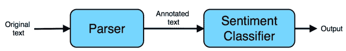

近年来出现了一种趋势，即用单一学习算法替代流水线系统。针对这个任务的端到端学习算法会直接将原始文本“This is a great mop!”作为输入，并尝试直接识别情感：

¹⁵ 解析器对文本的标注比这丰富得多，但这个简化的描述足以解释端到端深度学习。

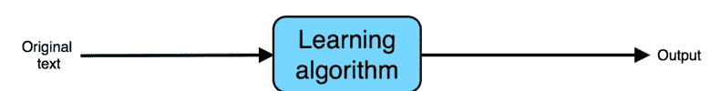

神经网络在端到端学习系统中被广泛使用。术语“end-to-end”指的是我们要求学习算法直接从输入到期望输出。也就是说，学习算法直接将系统的“input end”连接到“output end”。

在数据充足的问题中，端到端系统取得了显著成功。但它们并非总是最佳选择。接下来的几章将提供更多端到端系统的示例，并给出何时应该以及不应该使用它们的建议。

### 48 More end-to-end learning examples

假设你想构建一个语音识别系统。你可能会构建一个包含三个组件的系统：

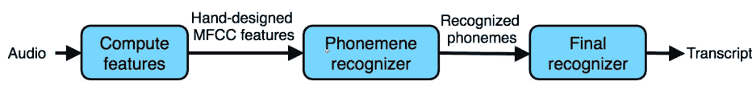

组件的工作方式如下：

- 1. Compute features: 提取手工设计的特征，例如 MFCC（Mel-frequency cepstrum coefficients）特征，它们试图捕捉话语的内容，同时忽略较不相关的属性，例如说话者的音高。
- 2. Phoneme recognizer: 一些语言学家认为存在称为“phonemes”的基本声音单位。例如，“keep”中的初始“k”音与“cake”中的“c”音是同一个音素。该系统试图识别音频片段中的音素。
- 3. Final recognizer: 取已识别音素的序列，并尝试将其串联成输出转录文本。

相比之下，端到端系统可能会输入音频片段，并尝试直接输出转录文本：

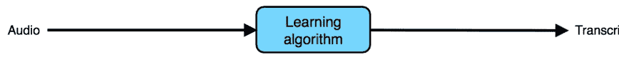

到目前为止，我们只描述了完全线性的机器学习“pipelines”：输出按顺序从一个阶段传递到下一个阶段。管道可以更复杂。例如，这里是自动驾驶汽车的一个简单架构：

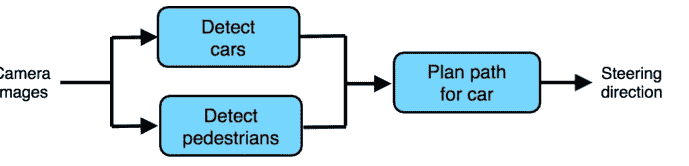

它有三个组件：一个使用摄像头图像检测其他车辆；一个检测行人；然后一个最终组件为我们的汽车规划一条避开车辆和行人的路径。

管道中的并非每个组件都需要学习。例如，“robot motion planning”文献中为汽车的最终路径规划步骤提供了众多算法。其中许多算法不涉及学习。

相比之下，端到端方法可能会尝试接收传感器输入并直接输出转向方向：

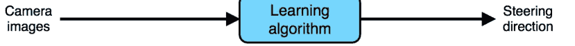

尽管端到端学习取得了许多成功，但它并不总是最佳方法。例如，端到端语音识别效果良好。但我对自动驾驶的端到端学习持怀疑态度。接下来的几章将解释原因。

### 49 Pros and cons of end-to-end learning

考虑我们前面示例中的相同语音管道：

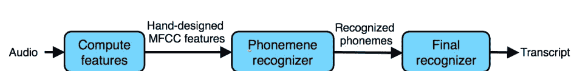

该管道的许多部分是“hand-engineered”：

- MFCCs 是手工设计的音频特征集。尽管它们提供了音频输入的合理摘要，但它们也通过丢弃一些信息来简化输入信号。
- Phonemes 是语言学家的发明。它们是对语音声音的不完美表示。在音素是对现实的糟糕近似的程度上，强制算法使用音素表示会限制语音系统的性能。

这些手工设计的组件限制了语音系统的潜在性能。然而，允许手工设计的组件也有一些优点：

- MFCC 特征对不影响内容的语音属性具有鲁棒性，例如说话者音高。因此，它们有助于为学习算法简化问题。
- 在音素是对语音的合理表示的程度上，它们也可以帮助学习算法理解基本声音成分，从而提高其性能。

拥有更多手工设计的组件通常允许语音系统用更少的数据学习。MFCC 和音素捕获的手工设计知识“supplements”算法从数据中获得的知识。当我们没有太多数据时，这些知识是有用的。

现在，考虑端到端系统：

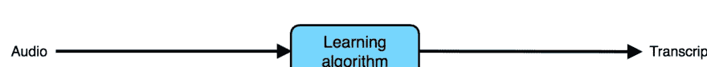

该系统缺乏手工设计知识。因此，当训练集很小时，它可能表现不如手工设计的管道。

然而，当训练集很大时，它不会受到基于 MFCC 或音素表示的限制。如果学习算法是一个足够大的神经网络，并且用足够多的训练数据进行训练，它有潜力表现非常好，甚至可能接近最佳错误率。

端到端学习系统在“both ends”——输入端和输出端——有大量标注数据时往往表现良好。在此示例中，我们需要大量（audio, transcript）对的数据集。当这种类型的数据不可用时，应谨慎对待端到端学习。

如果你正在处理训练集非常小的机器学习问题，你算法的大部分知识将必须来自你的个人洞察力。也就是说，来自你的“hand engineering”组件。

如果你选择不使用端到端系统，你将不得不决定管道中的步骤是什么，以及它们应如何组合。在接下来的几章中，我们将给出设计此类管道的一些建议。

### 50 Choosing pipeline components: Data availability

在构建非端到端管道系统时，管道组件的良好候选是什么？你如何设计管道将极大地影响整体系统的性能。一个重要因素是你是否可以轻松收集数据来训练每个组件。

例如，考虑这种自动驾驶架构：

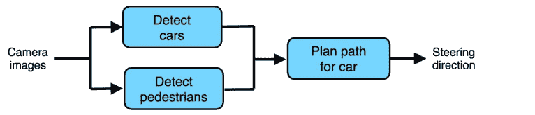

你可以使用机器学习来检测汽车和行人。此外，获取这些数据并不困难：有大量计算机视觉数据集包含大量标注的汽车和行人。你也可以使用众包（如 Amazon Mechanical Turk）获得更大规模的数据集。因此，相对容易获得训练数据来构建汽车检测器和行人检测器。

相比之下，考虑纯端到端方法：

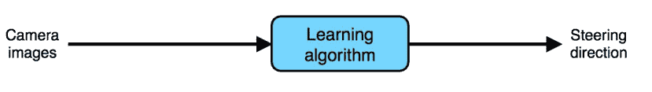

要训练该系统，我们需要大量（Image, Steering Direction）对的数据集。让人们驾驶汽车并记录其转向方向以收集此类数据非常耗时且昂贵。你需要一支专门仪器化的车队，以及大量的驾驶来覆盖各种可能的场景。这使得端到端系统难以训练。获得大量标注的汽车或行人图像数据集要容易得多。

更一般地说，如果有大量数据可用于训练管道的“intermediate modules”（例如汽车检测器或行人检测器），那么你可以考虑使用多阶段管道。这种结构可能更优越，因为你可以使用所有可用数据来训练中间模块。

在更多端到端数据可用之前，我认为非端到端方法对自动驾驶更有前景：其架构更好地匹配数据的可用性。

### 51 Choosing pipeline components: Task simplicity

除了数据可用性之外，在选择管道组件时你还应考虑第二个因素：各个组件解决的任务有多简单？你应该尝试选择单独易于构建或学习的管道组件。但组件“easy”学习意味着什么？

考虑这些机器学习任务，按难度递增顺序列出：

- 1. Classifying whether an image is overexposed (like the example above)
- 2. Classifying whether an image was taken indoor or outdoor
- 3. Classifying whether an image contains a cat
- 4. Classifying whether an image contains a cat with both black and white fur
- 5. Classifying whether an image contains a Siamese cat (a particular breed of cat)

这些都是二元图像分类任务：你必须输入图像，并输出 0 或 1。但列表中较早的任务似乎对神经网络来说要“easier”得多。你可以用更少的训练示例学习较容易的任务。

机器学习尚未对什么使任务容易或困难有一个良好的正式定义。¹⁶随着深度学习和多层神经网络的兴起，我们有时说如果任务可以用更少的计算步骤完成（对应于浅层神经网络），则任务“easy”，如果需要更多计算步骤（需要更深的神经网络），则任务“hard”。但这些是非正式的定义。

¹⁶信息论有“Kolmogorov Complexity”的概念，它指出学习函数的复杂度是能够产生该函数的最短计算机程序的长度。然而，这一理论概念在人工智能中几乎没有找到实际应用。另请参阅：https://en.wikipedia.org/wiki/Kolmogorov_complexity

如果能够将一个复杂任务分解为更简单的子任务，然后通过显式地编码子任务的步骤，你就是在为算法提供先验知识，这有助于它更高效地学习任务。

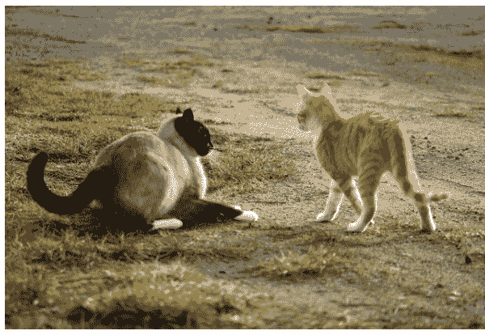

假设你正在构建一个暹罗猫检测器。这就是纯端到端架构：

相比之下，你也可以使用一个包含两个步骤的流水线：

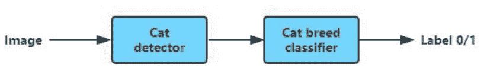

第一步（猫检测器）检测图像中的所有猫。

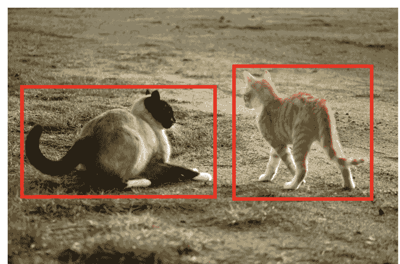

第二步然后将每个检测到的猫的裁剪图像（一次一个）传递给猫品种分类器，最后如果检测到的猫中有暹罗猫则输出 1。

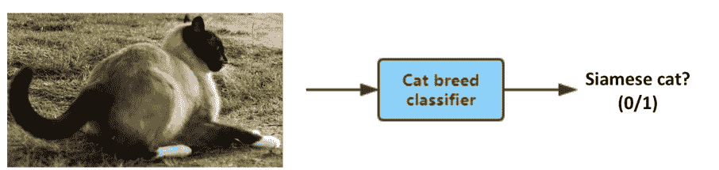

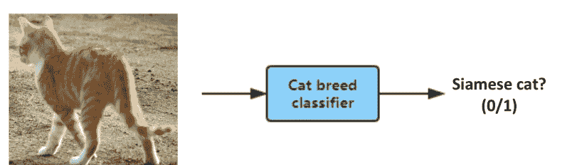

与仅使用 0/1 标签训练纯端到端分类器相比，流水线中的两个组件——猫检测器和猫品种分类器——似乎更容易学习，并且需要显著更少的数据。¹⁷

¹⁷ 如果你熟悉实用的目标检测算法，你会认识到它们不仅仅使用 0/1 图像标签进行学习，而是使用作为训练数据一部分提供的边界框进行训练。对它们的讨论超出了本章的范围。如果你想了解更多此类算法，请参阅 Coursera 上的 Deep Learning 专项课程 (http://deeplearning.ai)。

作为最后一个例子，让我们重新审视自动驾驶流水线。

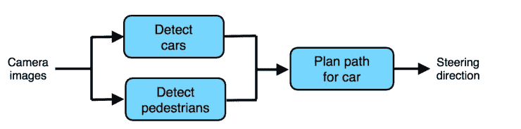

通过使用这个流水线，你是在告诉算法驾驶有 3 个关键步骤：（1）检测其他车辆，（2）检测行人，以及（3）为你的汽车规划路径。此外，每一个都是相对更简单的函数——因此可以用更少的数据学习——比纯端到端方法。

总之，在决定流水线的组件时，尝试构建一个流水线，其中每个组件都是相对“简单”的函数，因此可以从适量的数据中学习。

### 52 直接学习丰富的输出

图像分类算法会输入图像 x，并输出表示对象类别的整数。算法能否改为输出完整的一句话来描述图像？

例如：

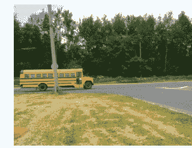

y = “一辆黄色公共汽车行驶在道路上，背景中有绿树和绿草。”

监督学习的传统应用学习一个函数 h:X→Y，其中输出 y 通常是一个整数或实数。例如：

| 问题 | X | Y |
|---|---|---|
| 垃圾邮件分类 | 邮件 | 垃圾邮件/非垃圾邮件 (0/1) |
| 图像识别 | 图像 | 整数标签 |
| 房屋价格预测 | 房屋特征 | 美元价格 |
| 产品推荐 | 产品与用户特征 | 购买概率 |

端到端深度学习最令人兴奋的发展之一是它让我们能够直接学习比数字更复杂的 y。在上面的图像描述示例中，你可以让神经网络输入图像（x）并直接输出描述（y）。

这里有更多示例：

| 问题 | X | Y | 示例引用 |
|---|---|---|---|
| 图像描述 | 图像 | 文本 | Mao et al., 2014 |
| 机器翻译 | 英文文本 | 法文文本 | Sutskever et al., 2014 |
| 问答 | (文本,问题) 对 | 答案文本 | Bordes et al., 2015 |
| 语音识别 | 音频 | 转录 | Hannun et al., 2015 |
| TTS | 文本特征 | 音频 | van der Oord et al., 2016 |

这是深度学习中加速的趋势：当你拥有正确的（输入,输出）标注对时，有时即使输出是句子、图像、音频或其他比单个数字更丰富的输出，也能实现端到端学习。

## 错误分析
### 按部分

#### 53 按部分进行错误分析

假设你的系统使用复杂的机器学习流水线构建，并且你希望提高系统的性能。流水线的哪一部分应该改进？通过将错误归因于流水线的特定部分，你可以决定如何优先安排工作。

让我们使用我们的暹罗猫分类器示例：

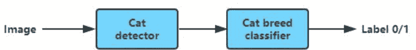

第一部分，猫检测器，检测猫并将其从图像中裁剪出来。第二部分，猫品种分类器，判断它是否是暹罗猫。花费数年时间改进这两个流水线组件中的任何一个都是可能的。你如何决定关注哪个组件（或组件）？

通过按部分进行错误分析，你可以尝试将算法犯的每个错误归因于流水线的两个部分之一（有时两者）。例如，算法将此图像错误分类为不包含暹罗猫（y=0），尽管正确标签是 y=1。

让我们手动检查算法的两个步骤做了什么。假设暹罗猫检测器检测到猫如下：

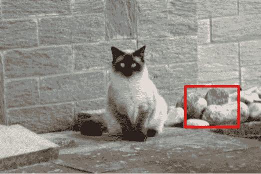

这意味着猫品种分类器被给出以下图像：

然后猫品种分类器正确地将此图像分类为不包含暹罗猫。因此，猫品种分类器是无辜的：它被给出了一堆岩石并输出了一个非常合理的标签 y=0。事实上，一个对上面裁剪图像进行分类的人也会预测 y=0。因此，你可以清楚地将此错误归因于猫检测器。

如果另一方面，猫检测器输出了以下边界框：

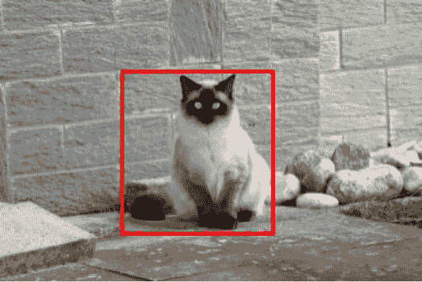

那么你会得出结论猫检测器已完成其工作，而猫品种分类器才是错误的。

假设你检查了 100 张被错误分类的开发集图像，发现 90 个错误可归因于猫检测器，只有 10 个错误可归因于猫品种分类器。你可以放心地得出结论，你应该更专注于改进猫检测器。

此外，你现在也方便地找到了 90 个猫检测器输出了错误边界框的示例。你可以使用这 90 个示例对猫检测器进行更深入的错误分析，以了解如何改进它。

到目前为止，我们对如何将错误归因于流水线某一部分的描述是不正式的：你查看每个部分的输出，看看是否能判断哪个部分犯了错误。这种非正式方法可能已经足够了。但在下一章，你也会看到一种更正式的归因错误的方法。

#### 54 将错误归因于某一部分

让我们继续使用这个示例：

假设猫检测器输出了这个边界框：

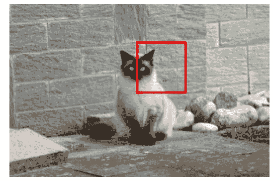

因此猫品种分类器被给出这个裁剪图像，随后它错误地输出 y=0，即图片中没有猫。

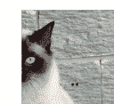

猫检测器做得不好。然而，一个技艺高超的人或许仍然可以从裁剪不好的图像中识别出暹罗猫。那么我们应该将此错误归因于猫检测器，还是猫品种分类器，或两者兼有？这是模糊的。

如果像这样的模糊案例数量很少，你可以做出任何决定并得到类似的结果。但这里有一个更正式的测试，可以让你更明确地将错误归因于确切的一个部分：

- 1. 用手工标注的边界框替换猫检测器的输出。

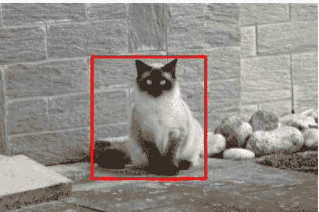

- 2. 将对应的裁剪图像通过猫品种分类器运行。如果猫品种分类器仍然错误分类它，则将错误归因于猫品种分类器。否则，将错误归因于猫检测器。

换句话说，进行一个实验，给猫品种分类器一个“完美”的输入。有两种情况：

- Case 1: 即使给出“完美”的边界框，猫品种分类器仍然错误地输出 y=0。在这种情况下，显然猫品种分类器有错。
- Case 2: 给出“完美”的边界框后，品种分类器现在正确地输出 y=1。这表明如果猫检测器只给出更完美的边界框，那么整个系统的输出就会正确。因此，将错误归因于猫检测器。

通过对被错误分类的开发集图像进行此分析，你现在可以明确地将每个错误归因于一个组件。这使你能够估计流水线每个组件导致的错误比例，从而决定将注意力集中在哪里。

#### 55 错误归因的一般情况

以下是错误归因的一般步骤。假设流水线有三个步骤 A、B 和 C，其中 A 直接输入到 B，B 直接输入到 C。

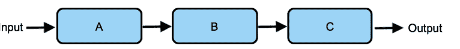

对于系统在开发集上犯的每一个错误：

- 1. 尝试手动将 A 的输出修改为“完美”输出（例如，猫的“完美”边界框），然后在此输出上运行流水线的其余部分 B、C。如果算法现在给出正确输出，则表明只要 A 给出更好的输出，整体算法的输出就会正确；因此，你可以将这个错误归因于组件 A。否则，继续执行步骤 2。
- 2. 尝试手动将 B 的输出修改为 B 的“完美”输出。如果算法现在给出正确输出，则将错误归因于组件 B。否则，继续执行步骤 3。
- 3. 将错误归因于组件 C。

让我们看一个更复杂的例子：

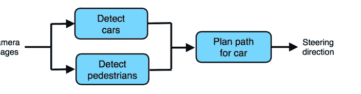

你的自动驾驶汽车使用此流水线。你如何按组件进行错误分析来决定应该关注哪个（哪些）组件？

你可以将三个组件映射到 A、B、C，如下所示：

- A：检测车辆
- B：检测行人
- C：规划车辆路径

按照上述过程，假设你在封闭测试车道上测试你的汽车，并发现一种情况：汽车选择了比熟练司机更突兀的转向方向。在自动驾驶领域，这种情况通常称为**场景**。你将：

- 1. 尝试手动将 A（检测车辆）的输出修改为“完美”输出（例如，手动进入并告诉它其他车辆的位置）。像之前一样运行流水线的其余部分 B、C，但允许 C（规划路径）使用 A 现在完美的输出。如果算法现在为汽车规划出明显更好的路径，则表明只要 A 给出更好的输出，整体算法的输出就会更好；因此，你可以将此错误归因于组件 A。否则，继续执行步骤 2。
- 2. 尝试手动将 B（检测行人）的输出修改为 B 的“完美”输出。如果算法现在给出正确输出，则将错误归因于组件 B。否则，继续执行步骤 3。
- 3. 将错误归因于组件 C。

机器学习流水线的组件应根据有向无环图（DAG）进行排序，这意味着你应该能够按照某个固定的从左到右的顺序计算它们，并且后面的组件只能依赖于前面组件的输出。只要组件到 A->B->C 顺序的映射遵循 DAG 排序，错误分析就会没问题。如果你交换 A 和 B，可能会得到略有不同的结果：

- A：检测行人（之前为*检测车辆*）
- B：检测车辆（之前为*检测行人*）
- C：规划车辆路径

但此分析的结果仍然有效，并为应该将注意力集中在哪里提供良好的指导。

#### 56 按组件进行错误分析并与人类水平表现进行比较

对学习算法进行错误分析，就像使用数据科学来分析机器学习系统的错误，以得出下一步该做什么的见解。在最基本的层面上，按组件进行错误分析告诉我们哪些组件的性能值得投入最大的努力来改进。

假设你有一个关于客户在网站上购买商品的数据集。数据科学家可能有许多不同的方式来分析这些数据。她可能会得出许多不同的结论，例如网站是否应该涨价，通过不同营销活动获得的客户的终身价值等等。分析数据集没有一种“正确”的方法，人们可以从中获得许多可能有用的见解。同样，进行错误分析也没有一种“正确”的方法。通过这几章，你学到了许多关于为你的机器学习系统获取有用见解的最常见设计模式，但你也应该自由地尝试其他分析错误的方法。

让我们回到自动驾驶应用，其中一个车辆检测算法输出附近车辆的位置（也可能包括速度），一个行人检测算法输出附近行人的位置，这两个输出最终用于规划汽车路径。

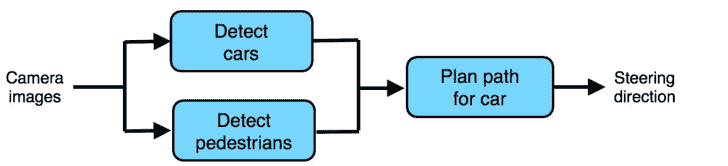

为了调试此流水线，与其严格遵循你在上一章中看到的过程，你可以更非正式地问：

- 1. 检测车辆组件在检测车辆方面与人类水平的表现相差多远？
- 2. 检测行人组件与人类水平的表现相差多远？
- 3. 整个系统的性能与人类水平的表现相差多远？这里，人类水平的表现假设人类只能根据前两个流水线组件的输出来规划汽车路径（而不是访问摄像头图像）。换句话说，当人类只获得相同的输入时，规划路径组件的性能与人类相比如何？

如果你发现其中一个组件与人类水平的表现相去甚远，那么你就有充分的理由专注于改进该组件的性能。

当我们试图自动化人类能做的事情，并因此可以与人类水平的表现进行对比时，许多错误分析过程效果最好。我们之前的大多数例子都有这个隐含的假设。如果你正在构建一个机器学习系统，其中最终输出或某些中间组件正在做的事情甚至人类都无法做好，那么其中一些过程将不适用。

这是研究人类能解决的问题的另一个优势——你拥有更强大的错误分析工具，因此你可以更有效地安排团队工作的优先级。

#### 57 发现存在缺陷的机器学习流水线

如果机器学习流水线的每个单独组件都达到人类水平或接近人类水平的表现，但整个流水线却远低于人类水平，该怎么办？这通常意味着流水线存在缺陷，需要重新设计。错误分析也可以帮助你理解是否需要重新设计流水线。

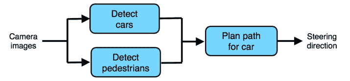

在上一章中，我们提出了一个问题：三个组件的性能是否都处于人类水平。假设三个问题的答案都是肯定的。也就是说：

- 1. 检测车辆组件在从摄像头图像检测车辆方面达到了（大致）人类水平的表现。
- 2. 检测行人组件在从摄像头图像检测行人方面达到了（大致）人类水平的表现。
- 3. 与只能根据前两个流水线组件的输出（而不是访问摄像头图像）来规划汽车路径的人类相比，规划路径组件的性能处于相似的水平。

然而，你的整个自动驾驶汽车的性能显著低于人类水平。也就是说，能够访问摄像头图像的人类可以为汽车规划出明显更好的路径。你能得出什么结论？

唯一可能的结论是机器学习流水线存在缺陷。在这种情况下，规划路径组件在其给定输入下已经尽力而为，但输入没有包含足够的信息。你应该问自己，除了前两个流水线组件的输出之外，还需要哪些其他信息才能很好地为汽车规划路径？换句话说，一个熟练的人类驾驶员还需要哪些其他信息？

例如，假设你意识到人类驾驶员还需要知道车道标线的位置。这表明你应该按如下方式重新设计流水线¹⁸：

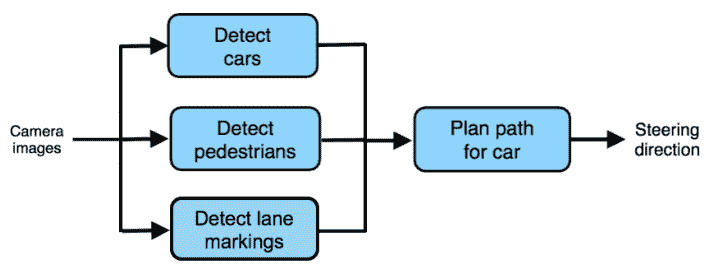

归根结底，如果你认为整个流水线无法达到人类水平的表现，即使每个单独组件都具有人类水平的表现（记住，你是在与获得与组件相同输入的人类进行比较），那么该流水线就是有缺陷的，应该重新设计。

¹⁸ 在上述自动驾驶示例中，理论上可以通过将原始摄像头图像也输入到规划组件来解决这个问题。然而，这会违反第51章中描述的“任务简单性”设计原则，因为路径规划模块现在需要输入原始图像并解决非常复杂的任务。这就是为什么添加一个检测车道标线的组件是更好的选择——它有助于将重要的、以前缺失的车道标线信息传递给路径规划模块，同时避免使任何特定模块的构建/训练变得过于复杂。

## 结语

### 58 打造超级英雄团队 - 让你的队友也读一读

恭喜你读完了这本书！

在第 2 章中，我们讨论了这本书如何帮助你成为团队中的超级英雄。

唯一比成为超级英雄更棒的事情，就是成为超级英雄团队的一员。我希望你能把这本书送给朋友和队友，帮助创造出更多超级英雄！

