# 机器学习渴望

## 1 为什么机器学习策略

机器学习是无数重要应用的基础，包括网络搜索、电子邮件反垃圾、语音识别、产品推荐等等。我假设你或你的团队正在开发一个机器学习应用，并且希望快速取得进展。这本书将帮助你做到这一点。

假设你正在创办一家初创公司，为猫爱好者提供源源不断的猫咪图片。

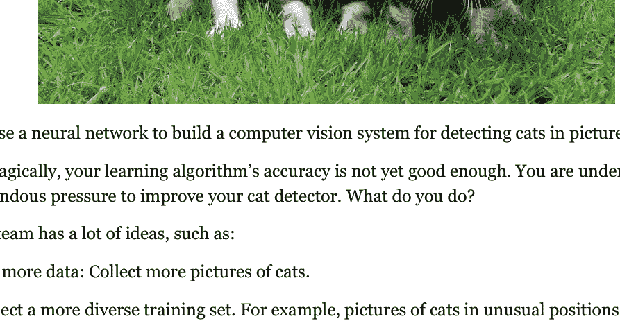

你使用神经网络构建一个计算机视觉系统，用来检测图片中的猫。

但悲剧的是，你的学习算法的准确率还不够好。你正承受着巨大的压力来改进你的猫检测器。你该怎么办？

- 获取更多数据：收集更多猫的图片。
- 收集更多样化的训练集。例如，不同寻常姿势的猫；颜色特别的猫；各种相机设置下拍摄的照片；……
- 通过运行更多梯度下降迭代，让算法训练更久。
- 尝试更大的神经网络，使用更多的层/隐藏单元/参数。
- 尝试更小的神经网络。
- 尝试添加正则化（例如 L2 正则化）。
- 更改神经网络架构（激活函数、隐藏单元数量等）
- ……

如果你在这些可能的方向中做出明智的选择，你将打造出领先的猫图平台，带领公司走向成功。如果选择不当，你可能浪费数月时间。你该怎么做？

这本书将告诉你方法。大多数机器学习问题会留下线索，告诉你哪些尝试是有用的，哪些是没用的。学会读懂这些线索，会为你节省数月乃至数年的开发时间。

## 2 如何使用本书帮助你的团队

读完这本书，你将对如何为机器学习项目设定技术方向有深刻的理解。

但你的队友可能不明白你为什么推荐某个特定方向。也许你想让团队定义一个单一数字评估指标，但他们并不认同。你如何说服他们？

这就是为什么我把章节写得简短：你可以打印出来，让你的队友阅读你需要他们知道的1-2页即可。

几个优先级上的改变就能对你的团队生产力产生巨大影响。通过帮助你的团队做出一些这样的改变，我希望你能成为团队中的超级英雄！

## 4 规模推动机器学习进步

深度学习（神经网络）的许多想法已经存在了几十年。为什么这些想法现在才蓬勃发展？

近期进步的两个最大驱动因素：

- **数据可用性。** 人们现在花更多时间在数字设备（笔记本电脑、移动设备）上。他们的数字活动产生了海量数据，我们可以将这些数据输入学习算法。
- **计算规模。** 就在几年前，我们才得以训练足够大的神经网络，来充分利用我们现在所拥有的大规模数据集。

具体来说，随着你积累更多数据，逻辑回归等较老的学习算法的性能通常会“停滞不前”。这意味着它的学习曲线“趋于平缓”，即使你给它更多数据，算法也不再改善：

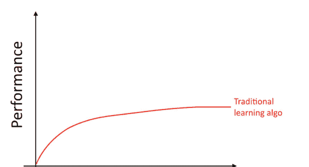

就好像较老的算法不知道如何利用我们现在拥有的所有数据。

如果你在相同的监督学习任务上训练一个小的神经网络（NN），你可能获得稍好的性能：

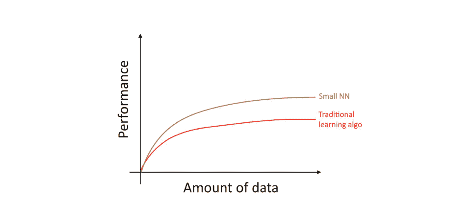

这里，“小 NN”指的是一个只有少量隐藏单元/层/参数的神经网络。最后，如果你训练越来越大的神经网络，你可以获得更好的性能：¹

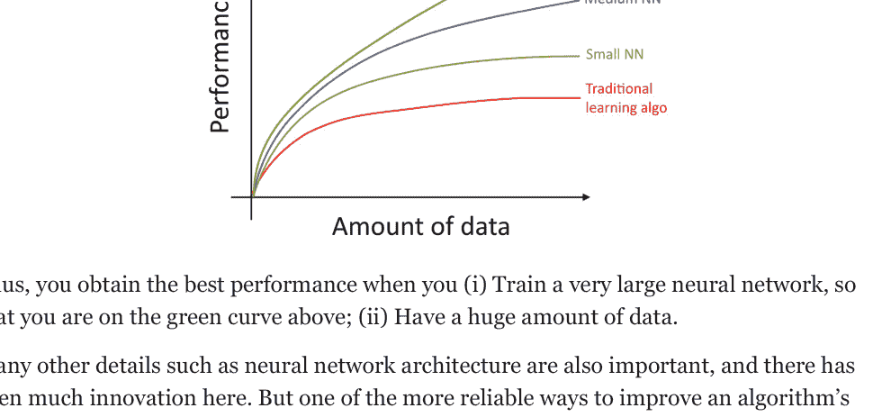

因此，当你（i）训练一个非常大的神经网络，使你处于上图绿色曲线上；（ii）拥有大量数据时，你会获得最佳性能。

许多其他细节，例如神经网络架构，也非常重要，在这方面已经有很多创新。但今天提高算法性能的更可靠方法仍然是（i）训练更大的网络和（ii）获取更多数据。

> 该图显示 NN 在小型数据集领域表现更好。这种效果不如 NN 在大型数据集领域表现良好那么一致。在小型数据领域，取决于特征的手工工程化方式，传统算法可能好也可能不好。例如，如果你有20个训练样本，使用逻辑回归还是神经网络可能差别不大；特征的手工工程化将比算法选择产生更大的影响。但如果你有100万个样本，我会倾向于神经网络。

如何完成第(i)和第(ii)项的过程出乎意料地复杂。本书将详细讨论这些细节。我们将从对传统学习算法和神经网络都有用的通用策略开始，逐步深入到构建深度学习系统的最现代策略。

## 设置开发集和测试集

### 5 你的开发集和测试集

让我们回到之前猫咪图片的例子：你运营一个移动应用，用户正在向你的应用上传许多不同内容的图片。你想自动找出猫咪图片。

你的团队通过从不同网站下载猫咪图片（正样本）和非猫咪图片（负样本）来获得一个大型训练集。他们将数据集按70%/30%的比例分成训练集和测试集。利用这些数据，他们构建了一个在训练集和测试集上表现良好的猫咪检测器。

但当你将这个分类器部署到移动应用中时，你发现性能非常差！

发生了什么？

你发现用户上传的图片与构成你训练集的网站图片看起来不同：用户上传的是用手机拍摄的图片，这些图片往往分辨率更低、更模糊、光线也更差。由于你的训练集/测试集是由网站图片组成的，你的算法没有很好地泛化到你所关心的实际数据分布：手机图片。

在大数据时代之前，机器学习中一个常见的规则是使用随机的70%/30%分割来形成训练集和测试集。这种做法有时能奏效，但在越来越多的应用中，训练数据分布（上面例子中的网站图片）与你最终关心的数据分布（手机图片）不同，这种做法就变得不可取了。

我们通常定义：

- **训练集** — 你在其上运行学习算法的数据集。
- **开发（开发）集** — 你用来调整参数、选择特征以及做出关于学习算法的其他决策的数据集。有时也称为**留出交叉验证集**。
- **测试集** — 你用来评估算法性能的数据集，但不用于决定使用什么学习算法或参数。

一旦你定义了开发集（开发集）和测试集，你的团队将尝试许多想法，比如不同的学习算法参数，看看哪种效果最好。开发集和测试集让你的团队能够快速了解算法的表现如何。

换句话说，**开发集和测试集的目的是引导你的团队对机器学习系统做出最重要的改变。**

因此，你应该做到以下几点：

选择开发集和测试集，以反映你期望在未来获得并希望表现良好的数据。

换句话说，你的测试集不应仅仅是可用数据的30%，尤其是当你期望未来的数据（手机图片）在本质上与你的训练集（网站图片）不同时。

如果你还没有推出你的移动应用，你可能还没有用户，因此可能无法获得能准确反映你未来必须做好的数据。但你仍然可以尝试近似这种情况。例如，请你的朋友用手机拍摄猫咪图片并发送给你。一旦你的应用上线，你可以使用真实的用户数据来更新你的开发集/测试集。

如果你真的没有任何办法获取能近似你期望未来数据的样本，也许你可以先从网站图片开始。但你应当意识到这可能导致系统泛化能力不佳的风险。

决定投入多少精力来开发高质量的开发集和测试集需要判断力。但不要假设你的训练分布与测试分布相同。尽量选择能反映你最终希望表现良好的测试样本，而不是仅仅使用你手头恰好用于训练的数据。

### 6 你的开发集和测试集应来自同一分布

根据你的最大市场，你的猫咪应用图片数据被划分为四个区域：(i) 美国，(ii) 中国，(iii) 印度，以及 (iv) 其他。为了得到开发集和测试集，假设我们把美国和印度放入开发集，中国和其他放入测试集。换句话说，我们可以随机将其中两个区域分配给开发集，另外两个分配给测试集，对吗？

一旦你定义了开发集和测试集，你的团队将专注于提高开发集的性能。因此，开发集应该反映你最想改进的任务：在所有四个地理区域都表现良好，而不仅仅是两个。

开发集和测试集分布不同还有第二个问题：有可能你的团队构建的系统在开发集上表现良好，却发现在测试集上表现不佳。我见过这种情况导致许多挫折和浪费的精力。避免让这种情况发生在你身上。

举个例子，假设你的团队开发了一个在开发集上表现良好但在测试集上不佳的系统。如果你的开发集和测试集来自同一分布，那么你就能非常清楚地诊断出哪里出了问题：你过拟合了开发集。明显的补救措施是获取更多的开发集数据。

但如果开发集和测试集来自不同的分布，那么你的选择就不那么清晰了。可能出错的情况有几种：

- 1. 你过拟合了开发集。
- 2. 测试集比开发集更难。因此你的算法可能已经表现出了预期的最佳水平，并且不可能再有显著的改进。
- 3. 测试集不一定更难，只是与开发集不同。因此在开发集上效果好的方法在测试集上就是效果不好。在这种情况下，你为改进开发集性能所做的许多工作可能都是白费力气。

从事机器学习应用已经够难了。开发集和测试集不匹配会引入额外的不确定性，使你难以判断在开发集分布上的改进是否也能提升测试集性能。开发集和测试集不匹配使得更难弄清楚什么有效、什么无效，从而也更难确定工作优先级。

如果你在做一个第三方基准测试问题，其创建者可能指定了来自不同分布的开发集和测试集。与开发集和测试集来自同一分布的情况相比，运气而非技巧，将对你在这些基准测试上的表现产生更大的影响。开发能够在一个分布上训练并良好泛化到另一个分布的学习算法是一个重要的研究问题。但如果你的目标是在一个特定的机器学习应用上取得进展，而不是获得研究进展，我建议尽量选择来自同一分布的开发集和测试集。这会让你的团队更高效。

### 7 开发集/测试集需要多大？

开发集应该足够大，以便能够检测出你正在尝试的不同算法之间的差异。例如，如果分类器A的准确率为90.0%，分类器B的准确率为90.1%，那么一个包含100个样本的开发集将无法检测出这0.1%的差异。与我见过的其他机器学习问题相比，100个样本的开发集很小。开发集的大小通常在1,000到10,000个样本之间。有了10,000个样本，你将有很好的机会检测出0.1%的改进。²

对于成熟且重要的应用——例如广告、网络搜索和产品推荐——我也见过一些团队非常有动力去争取哪怕0.01%的改进，因为这直接影响公司的利润。在这种情况下，开发集可能会远大于10,000个样本，以便检测更小的改进。

测试集的大小呢？它应该足够大，以便对你系统的整体性能提供高置信度。一个流行的经验法则是使用30%的数据作为测试集。当样本数量适中时——比如100到10,000个样本——这很有效。但在大数据时代，我们有时会遇到超过十亿样本的机器学习问题，分配给开发集/测试集的数据比例一直在缩小，即使开发集/测试集中的绝对样本数量一直在增长。没有必要拥有超出评估算法性能所需规模的开发集/测试集。

² 理论上，人们也可以测试对算法的更改是否在开发集上产生统计显著的差异。在实践中，大多数团队不会为此费心（除非他们发表学术研究论文），而且我通常发现统计显著性检验对于衡量中期进展并不怎么有用。

## 8 为团队建立一个单一数字评估指标来优化

分类准确率是单一数字评估指标的一个例子：你在开发集（或测试集）上运行分类器，得到一个单一数字，表示它正确分类的样本比例。根据这个指标，如果分类器 A 的准确率是 97%，分类器 B 的准确率是 90%，那么我们会判断分类器 A 更优。

相比之下，精确率和召回率³不是单一数字评估指标：它给出两个数字来评估你的分类器。使用多数字评估指标会让算法之间的比较变得更困难。假设你的算法表现如下：

| 分类器 | 精确率 | 召回率 |
|------------|-----------|--------|
| A | 95% | 90% |
| B | 98% | 85% |

这里，两个分类器都没有明显的优势，因此无法立刻指导你做出选择。

| 分类器 | 精确率 | 召回率 | F1 分数 |
|------------|-----------|--------|----------|
| A | 95% | 90% | 92.4% |

在开发过程中，你的团队会尝试很多关于算法架构、模型参数、特征选择等方面的想法。拥有一个像准确率这样的单一数字评估指标，你可以根据这个指标上的表现对所有模型进行排序，并快速判断哪种方法最有效。

如果你确实同时关心精确率和召回率，我建议使用一种标准方法将它们合并成一个单一数字。例如，可以取精确率和召回率的平均值，得到单一数字。或者，你可以计算“F1 分数”，这是计算它们平均值的一种改进方式，比简单取平均效果更好。⁴

> 猫分类器的精确率是开发集（或测试集）中它标记为猫的图像里真正是猫的比例。它的召回率是开发集（或测试集）中所有猫的图像里被它正确标记为猫的百分比。高精确率和高召回率之间往往存在权衡取舍。

| 分类器 | 精确率 | 召回率 | F1 分数 |
|------------|-----------|--------|----------|
| A | 95% | 90% | 92.4% |
| B | 98% | 85% | 91.0% |

拥有单一数字评估指标可以加快你在大量分类器中进行选择时做出决定的能力。它给出了所有分类器之间清晰的偏好排名，从而也为进展提供了明确的方向。

最后一个例子：假设你分别跟踪猫分类器在四个关键市场的准确率：（i）美国，（ii）中国，（iii）印度，（iv）其他。这会得到四个指标。通过取这四个数字的平均值或加权平均值，你会得到一个单一数字指标。取平均值或加权平均值是将多个指标合并为一个指标的最常见方法之一。

⁴ 如果你想了解更多关于 F1 分数的内容，请访问 https://en.wikipedia.org/wiki/F1_score。它是精确率和召回率之间的“调和平均数”，计算公式为 2/((1/精确率)+(1/召回率))。

## 9 优化指标与满意指标

这是合并多个评估指标的另一种方法。

假设你同时关心学习算法的准确率和运行时间。你需要从这三个分类器中选择：

| 分类器 | 准确率 | 运行时间 |
|------------|----------|--------------|
| A | 90% | 80ms |
| B | 92% | 95ms |
| C | 95% | 1,500ms |

把准确率和运行时间放进一个公式来计算单一指标，似乎不太自然，比如：

准确率 - 0.5*运行时间

你可以这样做：首先，定义什么“可接受”的运行时间。假设任何在 100ms 内完成的运行时间都是可接受的。然后，在分类器满足运行时间标准的前提下，最大化准确率。这里，运行时间是一个“满意指标”——你的分类器在这个指标上只需要“足够好”，即运行时间最多为 100ms。准确率则是“优化指标”。

如果你要在 N 个不同标准之间进行权衡，例如模型的二进制文件大小（这对移动应用很重要，因为用户不想下载大型应用）、运行时间和准确率，你可以考虑将其中 N-1 个标准设为“满意”指标。也就是说，你只需要它们达到某个特定值。然后将最后一个定义为“优化”指标。例如，为二进制文件大小和运行时间设置一个可接受的阈值，并在这些约束条件下尽量优化准确率。

最后一个例子：假设你正在构建一个硬件设备，它使用麦克风监听用户说出特定的“唤醒词”，然后系统被唤醒。例如，Amazon Echo 监听“Alexa”；Apple Siri 监听“Hey Siri”；Android 监听“Okay Google”；百度应用监听“Hello Baidu”。你既关心误报率——没有人说唤醒词时系统被唤醒的频率；也关心漏报率——有人说唤醒词时系统未能唤醒的频率。这个系统性能的一个合理目标是：

在每 24 小时运行中不超过一次误报（满意指标）的前提下，最小化漏报率（优化指标）。

一旦你的团队就优化哪个评估指标达成一致，他们就能更快地取得进展。

## 11 何时更改开发/测试集和指标

在开始一个新项目时，我会尽快选择开发/测试集，因为这给了团队一个明确的目标。

我通常要求团队在一周以内（很少超过一周）确定初始的开发/测试集和初始指标。与其过度思考，不如先拿出一个不完美的方案并快速行动起来。但这一周的时间期限并不适用于成熟应用。例如，反垃圾邮件就是一个成熟的深度学习应用。我见过一些团队在已经成熟的系统上花费数月时间来获取更好的开发/测试集。

如果你后来发现最初的开发/测试集或指标没有达到目标，务必迅速更改它们。例如，如果开发集+指标将分类器 A 排在分类器 B 之上，但你的团队认为分类器 B 实际上对你的产品更优，那么这可能是你需要更改开发/测试集或评估指标的信号。

开发集/指标错误地将分类器 A 评得更高，主要有三种可能原因：

### 1. 你需要表现优异的实际分布与开发/测试集不同

假设你最初的开发/测试集主要是成年猫的图片。你的猫应用上线后，发现用户上传的幼猫图片比预期多得多。因此，开发/测试集的分布并不能代表你需要表现优异的实际分布。在这种情况下，更新开发/测试集，使其更具代表性。

### 2. 你对开发集过拟合了

在开发集上反复评估各种想法的过程，会导致算法逐渐“过拟合”开发集。当你完成开发后，会在测试集上评估系统。如果你发现开发集的性能远好于测试集的性能，这表示你已经对开发集过拟合了。在这种情况下，换一个新的开发集。

如果你需要跟踪团队的进展，你也可以定期——例如每周或每月——在测试集上评估系统。但不要使用测试集对算法做出任何决定，包括是否回退到上周的系统。如果你这样做了，你就会开始对测试集过拟合，并且不能再指望它给出对系统性能完全无偏的估计（如果你要发表研究论文，或者可能使用这个指标来做重要的商业决策，你就需要这种无偏估计）。

### 3. 指标衡量的不是项目需要优化的目标

假设对于你的猫应用，指标是分类准确率。这个指标目前将分类器 A 排在分类器 B 之上。但假设你尝试了这两种算法，发现分类器 A 偶尔会漏过一些色情图片。尽管分类器 A 更准确，但偶尔出现的色情图片留下的糟糕印象意味着它的表现是不可接受的。你该怎么办？

这里，指标未能识别出算法 B 实际上比算法 A 更适合你的产品。因此，你不能再信任这个指标来选择最佳算法。是时候更改评估指标了。例如，你可以修改指标，让它对漏过色情图片的行为进行严厉惩罚。我强烈建议选择一个新的指标，并用这个新指标为团队明确一个新目标，而不是在没有可信指标的情况下进行太久，然后退回到手动在分类器之间做选择。

在项目进行过程中更改开发/测试集或评估指标是很常见的。拥有初始的开发/测试集和指标有助于你快速迭代。如果你发现开发/测试集或指标不再指引团队朝着正确方向前进，这并不是什么大问题！更改它们，并确保你的团队了解新方向即可。

## 12 条要点：设立开发集和测试集

-   从能反映你期望在未来获得并希望表现良好的数据分布中选择开发集和测试集。这可能与训练数据的分布不同。
-   如果可能，从同一分布中选择开发集和测试集。
-   为你的团队选择一个单一数值的评估指标来优化。如果你关心多个目标，可以考虑将它们合并为一个公式（例如对多个错误指标取平均）或定义满意指标和优化指标。
-   机器学习是一个高度迭代的过程：你可能要尝试几十个想法，才能找到一个让你满意的方案。
-   拥有开发集/测试集和一个单一数值评估指标，能帮助你快速评估算法，从而更快地迭代。
-   在启动一个全新应用时，尽量在短时间内（例如不到一周）建立开发集/测试集和指标。对于成熟的应用，花更长时间或许也是可以的。
-   旧的 70%/30% 训练/测试分割经验法则并不适用于数据量很大的问题；开发集和测试集可以远少于数据的 30%。
-   你的开发集应足够大，以检测算法准确率的有意义变化，但未必需要大得多。你的测试集应足够大，以便对系统最终性能给出可信的估计。
-   如果你的开发集和指标不再指引团队朝着正确方向前进，应迅速修改它们：（i）如果你对开发集过拟合了，获取更多开发集数据。（ii）如果你实际关心的分布与开发集/测试集分布不同，获取新的开发集/测试集数据。（iii）如果你的指标不再衡量对你最重要的事项，请更改指标。

## 基础错误分析

### 13 先快速构建第一个系统，然后再迭代

你想构建一个新的电子邮件反垃圾邮件系统。你的团队有几个想法：

-   收集大量垃圾邮件训练集。例如，设置一个“蜜罐”：故意将虚假电子邮件地址发给已知的垃圾邮件发送者，这样你就可以自动收集他们发送到这些地址的垃圾邮件。
-   开发用于理解电子邮件文本内容的特征。
-   开发用于理解电子邮件信封/头信息的特征，以显示消息经过哪些互联网服务器。
-   以及其他想法。

尽管我在反垃圾邮件方面有大量工作经验，但我仍然很难从中选择一个方向。如果你不是该应用领域的专家，那就更难了。

所以不要一开始就试图设计和构建完美的系统。相反，快速构建并训练一个基础系统——也许只需几天。⁵ 即使基础系统远非你能构建的“最佳”系统，检查基础系统的运行方式也很有价值：你会很快发现线索，指明最值得投入时间的方向。接下来的几章将教你如何解读这些线索。

⁵ 这条建议针对的是想构建 AI 应用的读者，而非目标是发表学术论文的人。我稍后会回到研究这个话题。

### 14 错误分析：查看开发集示例以评估想法

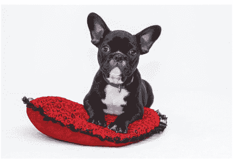

当你在使用猫咪应用时，你注意到几个把狗误认为猫的例子。有些狗确实看起来像猫！

一位团队成员建议引入第三方软件，使系统在狗图像上表现更好。这些改动将花费一个月时间，而且这位成员热情高涨。你应该让他们放手去做吗？

在投入一个月时间之前，我建议你首先估算这个改动实际上会提高系统多少准确率。这样你就能更理性地决定，这是否值得一个月的开发时间，或者你是否应该把时间花在其他任务上。

具体来说，你可以这样做：

-   1. 收集 100 个系统分类错误的开发集示例。即，系统出错的例子。
-   2. 手动查看这些例子，统计其中有多少是狗图像。

查看分类错误示例的过程称为错误分析。在这个例子中，如果你发现只有 5% 的错误分类图像是狗，那么无论你如何改进算法在狗图像上的表现，你最多也只能消除 5% 的错误。换句话说，5% 是这个提议项目所能带来帮助的“上限”（即最大可能量）。因此，如果你的系统目前准确率为 90%（错误率 10%），这项改进最多可能将准确率提高到 90.5%（或错误率 9.5%，比原来的 10% 错误率减少了 5%）。

相反，如果你发现 50% 的错误是狗，那么你可以更有信心地认为这个提议项目会产生很大影响。它可以将准确率从 90% 提升到 95%（错误率相对减少 50%，从 10% 降到 5%）。

这种简单的错误分析计数过程为你提供了一种快速估算引入第三方软件处理狗图像可能带来价值的方法。它为决定是否值得投资提供了定量依据。

错误分析通常能帮助你判断不同方向的前景。我见过许多工程师不愿意进行错误分析。直接跳进去实现某个想法，往往比质疑这个想法是否值得投入时间更令人兴奋。这是一个常见错误：它可能导致你的团队花了一个月时间，事后才发现收益甚微。

手动检查 100 个示例并不会花太长时间。即使每个图像花一分钟，你也能在两小时内完成。这两个小时可能为你节省一个月的无效努力。

#### 错误分析

指的是检查算法分类错误的开发集示例的过程，以便理解错误的根本原因。这可以帮助你确定项目的优先级——如本示例所示——并激发新的方向，我们将在接下来讨论。接下来的几章还将介绍进行错误分析的最佳实践。

### 15 在错误分析期间并行评估多个想法

你的团队有几个改进猫咪检测器的想法：

-   修复算法将*狗*识别为猫的问题。
-   修复算法将*大型猫科动物*（狮子、豹等）识别为家猫（宠物）的问题。
-   改进系统在*模糊*图像上的表现。
-   ...

你可以高效地并行评估所有这些想法。我通常会创建一个电子表格，在查看约 100 个错误分类的开发集图像时填充它。我还会记下一些有助于我记住具体示例的备注。为了说明这个过程，让我们看一个你可能用包含四个示例的小型开发集生成的电子表格：

| 图像 | 狗 | 大型猫科动物 | 模糊 | 备注 |
|---|---|---|---|---|
| 1 | ✓ |  |  | 不寻常的比特犬毛色 |
| 2 |  |  | ✓ |  |
| 3 |  | ✓ | ✓ | 狮子；雨天在动物园拍摄 |
| 4 |  | ✓ |  | 树后的豹 |
| 占总数的百分比 | 25% | 50% | 50% |  |

上面的图像 #3 同时勾选了“大型猫科动物”和“模糊”两列。此外，由于一个示例可能关联多个类别，底部的百分比之和可能不等于 100%。

虽然你可能先制定类别（狗、大型猫科动物、模糊），然后手动对示例进行分类，但在实践中，一旦开始查看示例，你很可能受到启发而提出新的错误类别。例如，假设你查看了十几个图像，发现很多错误发生在经过 Instagram 滤镜处理的图片上。你可以返回并在电子表格中添加一个“Instagram”列。手动查看算法错误分类的示例，并思考作为人类你如何/是否能正确标注

正确查看图片往往会激发你想到新的错误类别和解决方案。

最有用的错误类别将是那些你有改进思路的类别。例如，如果你有想法“撤销”Instagram滤镜并恢复原始图像，那么添加Instagram这一类别将最有帮助。但你不必只局限于你知道如何改进的错误类别；这个过程的目标是培养你关于哪些领域最值得关注的直觉。

错误分析是一个迭代过程。如果你一开始脑中没有任何类别，也不必担心。看过几张图片后，你可能会想出一些错误类别的想法。在手动分类一些图片后，你可能会想到新的类别，并根据新类别重新检查图片，如此反复。

假设你对100个被错误分类的开发集示例完成了错误分析，得到以下结果：

| 图片 | 狗 | 大型猫科动物 | 模糊 | 备注 |
|---|---|---|---|---|
| 1 | ✓ |  |  | 常见的比特犬颜色 |
| 2 |  |  | ✓ |  |
| 3 |  | ✓ | ✓ | 狮子；雨天在动物园拍摄 |
| 4 |  | ✓ |  | 树后的豹子 |
| ... | ... | ... | ... | ... |
| 占总数百分比 | 8% | 43% | 61% |  |

现在你知道，着手解决“狗”类错误最多只能消除8%的错误。处理“大型猫科动物”或“模糊”图像错误则可以帮助消除更多错误。因此，你可能会选择这两个类别之一作为重点。如果你的团队有足够的人手可以并行推进多个方向，你也可以让一些工程师处理“大型猫科动物”，另一些处理“模糊”图像。

错误分析并不会产生一个严格的数学公式来告诉你最高优先级的任务应该是什么。你还必须考虑你预期能在不同类别上取得多少进展，以及处理每个类别所需的工作量。

- 开发集上的总体准确率.................. 98.0%（总体错误率2.0%。）
- 错误标记示例导致的错误....... 0.6%（占开发集错误的30%。）
- 其他原因导致的错误.................. 1.4%（占开发集错误的70%。）

你30%的错误是由开发集中被错误标记的图像导致的，这会给你的准确率估计带来显著误差。现在值得提高开发集中标签的质量。处理错误标记的示例将帮助你判断分类器的错误率更接近1.4%还是2%——这是一个显著的相对差异。

一开始容忍开发集/测试集中的一些错误标记示例并不罕见，但随着系统改进，错误标记示例在所有错误中所占的比例会相对增大，这时你往往会改变想法。

上一章解释了如何通过算法改进来改善“狗”、“大型猫科动物”和“模糊”等错误类别。你在本章中学到，你同样可以通过改进数据标签来处理“错误标记”类别。

无论你采用什么流程来修复开发集标签，记住也要将其应用于测试集标签，这样你的开发集和测试集才能继续来自同一个分布。同时修复开发集和测试集将避免我们在第6章讨论过的问题：你的团队优化开发集性能后，却发现自己是根据不同的标准、基于不同的测试集来被评判。

如果你决定提高标签质量，请考虑同时仔细检查你的系统错误分类的示例标签和正确分类的示例标签。有可能在一个示例上，原始标签和你的学习算法都出错了。如果你只修复系统错误分类的示例标签，可能会给评估引入偏差。如果你有1,000个开发集示例，并且分类器准确率为98.0%，那么检查它错误分类的20个示例比检查全部980个正确分类的示例更容易。由于在实践中只检查错误分类的示例更容易，偏差确实会渗入某些开发集。如果你只对开发产品或应用感兴趣，这种偏差是可以接受的；但如果你计划将结果用于学术研究论文，或者需要完全无偏差的测试集准确率度量，那它就会成为问题。

### 17 如果你有一个大型开发集，将其分成两个子集，并且只查看其中一个

假设你有一个包含5,000个示例的大型开发集，错误率为20%。因此，你的算法大约会错误分类1,000张开发集图像。手动检查1,000张图像需要很长时间，所以我们可能决定不全用它们来做错误分析。

在这种情况下，我会明确将开发集分成两个子集，一个供你查看，另一个供你不查看。你手动查看的那部分会让你更快过拟合。你可以用不手动查看的那部分来调整参数。

让我们继续上面的例子，其中算法在5,000个开发集示例中错误分类了1,000个。假设我们想手动检查约100个错误来做错误分析（错误的10%）。你应该随机选择10%的开发集，放入我们所说的“目测开发集”（Eyeball dev set），以提醒自己我们是在用眼睛查看它。（对于语音识别项目，你会听音频片段，也许你会称之为“耳听开发集”。）因此，目测开发集有500个示例，我们预计算法在其中约100个示例上会出错。

开发集的第二个子集称为“黑盒开发集”（Blackbox dev set），包含剩余的4,500个示例。你可以通过测量错误率，用黑盒开发集来自动评估分类器。你也可以用它来选择算法或调整超参数。但是，你应该避免用眼睛查看它。我们使用“黑盒”一词，是因为我们只会用这部分数据来获得分类器的“黑盒”评估。

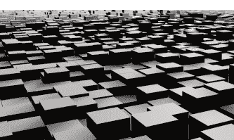

为什么我们要明确将开发集分为目测和黑盒开发集呢？因为你将从目测开发集的示例中获得直觉，于是你会更快地开始过拟合目测开发集。如果你发现目测开发集上的性能提升速度远快于黑盒开发集，那说明你已经过拟合目测开发集了。在这种情况下，你可能需要丢弃它，并通过从黑盒开发集中移入更多示例到目测开发集，或获取新的标记数据，来寻找一个新的目测开发集。

明确将开发集分为目测和黑盒开发集，可以让你判断手动错误分析过程是否导致你过拟合了数据中的目测部分。

### 18 目测和黑盒开发集应该有多大？

你的目测开发集应该足够大，以让你了解算法的主要错误类别。如果你正在处理人类擅长做（例如识别图像中的猫）的任务，这里有一些粗略的指导原则：

- 一个分类器会犯10个错误的目测开发集会显得非常小。只有10个错误，很难准确估计不同错误类别的影响。但如果你数据很少，无法在目测开发集中放更多数据，那也总比没有好，并且有助于项目优先级排序。
- 如果你的分类器在目测开发集示例上犯约20个错误，你就会开始对主要错误来源有个粗略的了解。
- 约50个错误时，你会对主要错误来源有较好的了解。
- 约100个错误时，你会对主要错误来源有非常好的了解。我见过人们手动分析更多的错误——有时多达500个。只要你有足够的数据，这没有坏处。

假设你的分类器错误率为5%。为了确保目测开发集中有约100个错误分类的示例，目测开发集需要大约2,000个示例（因为0.05 × 2,000 = 100）。分类器的错误率越低，为了获得足够大的错误集来进行分析，你的目测开发集就需要越大。

如果你正在处理一个连人类也无法做好的任务，那么检查目测开发集的做法就没有那么有帮助了，因为更难弄明白为什么算法没有正确分类某个示例。在这种情况下，你可以不设目测开发集。我们将在后面的章节讨论针对这类问题的指导原则。

那么黑盒开发集呢？我们之前说过，大约 1,000 到 10,000 个样本的开发集是很常见的。为了更精确地说明，一个包含 1,000 到 10,000 个样本的黑盒开发集通常足以让你调整超参数和选择模型，不过拥有更多数据也几乎没有什么坏处。一个包含 100 个样本的黑盒开发集会比较小，但仍然有用。

如果你的开发集很小，那么你可能没有足够的数据来将其划分为足够大的肉眼开发集和黑盒开发集，以满足各自的目的。在这种情况下，你整个开发集可能都必须用作肉眼开发集——也就是说，你需要手动检查所有开发集数据。

在肉眼开发集和黑盒开发集之间，我认为肉眼开发集更重要（假设你正在处理一个人类能够很好解决的问题，并且检查样本有助于你获得洞察）。如果你只有一个肉眼开发集，你可以在这个集上进行错误分析、模型选择和超参数调整。只拥有肉眼开发集的缺点是，过拟合开发集的风险更大。

如果你有充足的数据来源，那么肉眼开发集的大小主要取决于你有多少时间手动分析样本。例如，我很少见到有人手动分析超过 1,000 个错误样本。

### 19 要点：基础错误分析

- 当你开始一个新项目时，尤其是当这个项目属于你并不擅长的领域时，你很难准确猜测最有希望的方向。
- 所以不要一开始就试图设计和构建完美的系统。相反，尽快构建并训练一个基础系统——也许只需要几天时间。然后利用错误分析来帮助你确定最有希望的方向，并从此处迭代改进你的算法。
- 通过手动检查算法错误分类的约 100 个开发集样本，并统计主要错误类别来进行错误分析。利用这些信息来确定优先修复哪些类型的错误。
- 考虑将开发集划分为肉眼开发集（你将手动检查）和黑盒开发集（你不会手动检查）。如果算法在肉眼开发集上的表现远好于在黑盒开发集上的表现，说明你已经过拟合了肉眼开发集，应考虑为其获取更多数据。
- 肉眼开发集应该足够大，以便你的算法错误分类足够的样本供你分析。一个包含 1,000 到 10,000 个样本的黑盒开发集对于许多应用来说已经足够了。
- 如果你的开发集不足以这样划分，那就把整个开发集用作肉眼开发集，用于手动错误分析、模型选择和超参数调整。

## 偏差与方差

### 20 偏差与方差：两大错误来源

假设你的训练集、开发集和测试集都来自相同的分布。那么你应该总是尝试获取更多的训练数据，因为这样只会提升性能，对吗？

尽管拥有更多数据不会有害，但不幸的是，它并不总能像你希望的那样有帮助。花精力去获取更多数据可能是在浪费时间。那么，你如何决定何时添加数据，何时不必费心呢？

机器学习中有两大错误来源：偏差和方差。理解它们将帮助你决定添加数据以及其他提升性能的策略是否值得花时间。

假设你希望构建一个错误率为 5% 的猫识别器。当前，你的训练集错误率是 15%，开发集错误率是 16%。在这种情况下，添加训练数据可能不会有太大帮助。你应该专注于其他改变。事实上，向训练集中添加更多样本只会让算法在训练集上表现得更困难。（我们将在后面的章节解释原因。）

如果你的训练集错误率是 15%（或准确率 85%），但你的目标是 5% 的错误率（95% 的准确率），那么首先要解决的问题是提高算法在训练集上的表现。你的开发集/测试集表现通常比训练集表现差。因此，如果算法在它已经见过的样本上只有 85% 的准确率，那么它在你没见过的样本上不可能达到 95% 的准确率。

假设如上所述，你的算法在开发集上有 16% 的错误率（84% 的准确率）。我们将这 16% 的错误分解为两个部分：

- 首先，算法在训练集上的错误率。在这个例子中，是 15%。我们非正式地将其视为算法的**偏差**。
- 其次，算法在开发集（或测试集）上比在训练集上差多少。在这个例子中，它在开发集上比训练集差 1%。我们非正式地将其视为算法的**方差**。

⁶ 统计学领域对偏差和方差有更正式的定义，我们这里不必深究。粗略地说，偏差是当你拥有非常大的训练集时，算法在训练集上的错误率。方差是在这种情况下，你在测试集上比在训练集上差多少。当你的错误指标是均方误差时，你可以写出指定这两个量的公式，并证明总误差 = 偏差 + 方差。但就我们决定如何在机器学习问题上取得进展而言，这里给出的关于偏差和方差的非正式定义就足够了。

对学习算法的一些修改可以解决错误的第一部分——**偏差**——并提高其在训练集上的表现。一些修改可以解决第二部分——**方差**——并帮助算法从训练集更好地泛化到开发集/测试集。⁷ 为了选择最有希望的修改，了解这两个错误部分中哪一个更迫切需要解决是非常有用的。

培养关于偏差和方差的良好直觉将帮助你为算法选择有效的修改。

⁷ 也有一些方法可以通过对系统架构进行重大改动来同时减少偏差和方差。但这些方法往往更难识别和实施。

### 21 偏差与方差的示例

考虑我们的猫分类任务。一个“理想”的分类器（比如人类）可能在这个任务上达到近乎完美的表现。

- 训练错误率 = 1%
- 开发错误率 = 11%

它有什么问题？根据上一章的定义，我们估计偏差为 1%，方差为 10%（=11%-1%）。因此，它具有高方差。分类器的训练错误率非常低，但无法泛化到开发集。这也被称为过拟合。

现在考虑这个：

- 训练错误率 = 15%
- 开发错误率 = 16%

我们估计偏差为 15%，方差为 1%。这个分类器在训练集上表现不佳，错误率为 15%，但它在开发集上的错误率仅略高于训练错误率。因此，这个分类器具有高偏差，但低方差。我们说这个算法是欠拟合的。

现在，考虑这个：

- 训练错误率 = 15%
- 开发错误率 = 30%

我们估计偏差为 15%，方差为 15%。这个分类器具有高偏差和高方差：它在训练集上表现不佳，因此具有高偏差，而它在开发集上的表现更差，所以也具有高方差。过拟合/欠拟合的术语在这里很难适用，因为这个分类器同时过拟合和欠拟合。

最后，考虑这个：

- 训练错误率 = 0.5%
- 开发错误率 = 1%

这个分类器表现良好，因为它具有低偏差和低方差。恭喜你取得了这么好的表现！

### 22 与最优错误率比较

在我们的猫识别例子中，“理想”错误率——即“最优”分类器可以达到的错误率——接近 0%。人类看一眼图片几乎总能识别出其中是否有猫；因此，我们可以期望机器也能做得同样好。

其他问题则更难。例如，假设你在构建一个语音识别系统，发现 14% 的音频片段有太多背景噪声，或者难以听懂，以至于人类也无法识别出说了什么。在这种情况下，即使是最“最优”的语音识别系统，其错误率也可能在 14% 左右。

假设在这个语音识别问题上，你的算法达到了：

- 训练错误率 = 15%
- 开发错误率 = 30%

训练集的表现已经接近最优错误率 14%。因此，在偏差或训练集表现方面，提升空间不大。然而，这个算法没有很好地泛化到开发集；因此，在由方差导致的错误方面还有很大的改进空间。

这个例子与上一章的第三个例子类似，后者也有 15% 的训练错误率和 30% 的开发错误率。如果最优错误率约为 0%，那么 15% 的训练错误率意味着还有很大的改进空间。这提示减少偏差的修改可能会很有效。但如果最优错误率是 14%，那么相同的训练集表现则告诉我们，分类器的偏差几乎没有改进空间。

对于最优错误率远不为零的问题，以下是算法错误的更详细分解。继续上面的语音识别例子，总开发集错误率 30% 可以分解如下（类似的分析也可以应用于测试集错误率）：

- 最优错误率（“不可避免的偏差”）：14%。假设我们认定，即使使用世界上最好的语音系统，我们仍然会有 14% 的错误。我们可以将此视为学习算法偏差中“不可避免”的部分。

- **可避免偏差**：1%。这是训练误差与最优误差率之间的差值。⁸
- **方差**：15%。即开发集误差与训练误差之间的差值。

为了与我们之前的定义联系起来，偏差和可避免偏差的关系如下：⁹

偏差 = 最优误差率（“不可避免的偏差”）+ 可避免偏差

“可避免偏差”反映的是你的算法在训练集上的表现比“最优分类器”差多少。

方差的概念与之前相同。理论上，我们可以通过在庞大的训练集上训练，将方差几乎降到零。因此，只要有足够大的数据集，所有方差都是“可避免的”，所以并不存在所谓的“不可避免的方差”。

再考虑一个例子：假设最优误差率为14%，并且我们有：

- 训练误差 = 15%
- 开发集误差 = 16%

在上一章中，我们称这种情况为高偏差分类器，而现在我们会说，可避免偏差造成的误差为1%，方差造成的误差约为1%。因此，该算法已经表现得很好了，几乎没有改进空间，它只比最优误差率差2%。

从这些例子中可以看出，了解最优误差率有助于指导我们下一步的行动。在统计学中，最优误差率也被称为**贝叶斯误差率**（Bayes error rate），或贝叶斯率。

我们如何知道最优误差率是多少呢？对于人类比较擅长的任务，比如识别图片或转录音频片段，你可以请人为数据提供标签，然后衡量这些人工标签相对于你的训练集的准确率。这样就可以估算出最优误差率。如果你正在处理一个甚至连人类都很难解决的问题（例如预测推荐哪部电影，或向用户展示哪条广告），那么最优误差率可能很难估计。

⁸ 如果这个数值为负，说明你在训练集上的表现优于最优误差率。这意味着你在训练集上过拟合了，算法过度记忆了训练集。此时你应该关注降低方差的方法，而不是进一步降低偏差的方法。

⁹ 这些定义是为了帮助你理解如何改进学习算法而选择的。这些定义与统计学家对偏差和方差的定义不同。严格来说，我在这里定义的“偏差”应该被称为“我们归因于偏差的误差”；而“可避免偏差”应该被理解为“我们归因于学习算法超出最优误差率的那部分偏差的误差”。

在“与人类水平表现进行比较”（第33至35章）一节中，我将更详细地讨论如何将学习算法的表现与人类水平的表现进行比较。

在最近几章中，你学习了如何通过查看训练集和开发集的误差率来估计可避免/不可避免的偏差和方差。下一章将讨论如何利用这类分析的见解，来确定是优先采用降低偏差的技术，还是优先采用降低方差的技术。根据你的项目当前的问题是高（可避免）偏差还是高方差，你应该采用截然不同的技术。继续往下读吧！

### 23 解决偏差和方差问题

以下是解决偏差和方差问题的最简单公式：

- 如果你有较高的可避免偏差，请增大模型规模（例如，通过增加层数/神经元来扩大神经网络的规模）。
- 如果你有较高的方差，请向训练集添加数据。

如果你能够无限制地增大神经网络规模并增加训练数据，那么在许多学习问题上都可以取得非常好的表现。

在实践中，增大模型规模最终会导致计算问题，因为训练非常大的模型速度很慢。你也可能耗尽获取更多训练数据的能力。（即使在互联网上，猫的图片数量也是有限的！）

不同的模型架构——例如不同的神经网络架构——对于你的问题会有不同程度的偏差/方差。近年来大量深度学习研究已经开发出许多创新的模型架构。因此，如果你使用神经网络，学术文献可以成为灵感的绝佳来源。GitHub 上也有很多优秀的开源实现。不过，尝试新架构的结果不如“增大模型规模并添加数据”这个简单公式那样可预测。

增大模型规模通常会降低偏差，但也可能增加方差和过拟合的风险。然而，这种过拟合问题通常只在你没有使用正则化时才会出现。如果你加入了设计良好的正则化方法，那么通常可以安全地增大模型规模而不会增加过拟合。

假设你正在应用深度学习，使用 L2 正则化或 dropout，并采用在开发集上表现最佳的正则化参数。如果你增大模型规模，通常你的表现会保持不变或有所提升；不太可能明显变差。唯一避免使用更大模型的原因是计算成本增加。

### 24 偏差与方差的权衡

你可能听说过“偏差与方差的权衡”。在对大多数学习算法可以做出的修改中，有些会降低偏差误差，但代价是增加方差，反之亦然。这就形成了偏差与方差之间的“权衡”。

例如，增大模型规模——在神经网络中增加神经元/层数，或增加输入特征——通常会降低偏差，但可能增加方差。另一方面，增加正则化通常会增大偏差，但会降低方差。

在现代，我们往往可以获得丰富的数据，并且可以使用非常大的神经网络（深度学习）。因此，权衡减少了，现在有更多选项可以在不损害方差的情况下降低偏差，反之亦然。

例如，你通常可以通过增大神经网络规模并调整正则化方法来降低偏差，而不会明显增加方差。通过添加训练数据，你通常也可以在不影响偏差的情况下降低方差。

如果你选择了一个非常适合任务的模型架构，你甚至可能同时降低偏差和方差。但选择这样的架构可能很困难。

在接下来的几章中，我们将讨论解决偏差和方差问题的其他具体技术。

### 25 降低可避免偏差的技术

如果你的学习算法存在较高的可避免偏差，你可以尝试以下技术：

- **增大模型规模**（例如神经元/层数）：这种技术可以降低偏差，因为它应该能让你更好地拟合训练集。如果你发现这会增加方差，那么请使用正则化，这通常会消除方差的增加。
- **根据误差分析中的见解修改输入特征**：假设你的误差分析启发你创建了额外的特征，帮助算法消除某一特定类别的错误（我们将在下一章进一步讨论）。这些新特征可能同时有助于偏差和方差。理论上，添加更多特征可能会增加方差；但如果你发现确实如此，那么请使用正则化，这通常会消除方差的增加。
- **减少或消除正则化**（L2 正则化、L1 正则化、dropout）：这会降低可避免偏差，但会增加方差。
- **修改模型架构**（例如神经网络架构），使其更适合你的问题：这种技术可能同时影响偏差和方差。

有一种方法没有帮助：

- **添加更多训练数据**：这种技术有助于解决方差问题，但通常对偏差没有显著影响。

### 27 种降低方差的技术

如果你的学习算法存在高方差问题，可以尝试以下技术：

- 添加更多训练数据：这是解决方差最简单、最可靠的方法，前提是你能够获得显著更多的数据，并且有足够的计算能力来处理这些数据。

- 添加正则化（L2 正则化、L1 正则化、随机失活）：这种技术能降低方差，但会增加偏差。

- 添加早停法（即根据开发集误差提前停止梯度下降）：这种技术能降低方差，但会增加偏差。早停法的行为与正则化方法非常相似，有些作者称其为一种正则化技术。

- 特征选择以减少输入特征的数量/类型：这种技术可能有助于解决方差问题，但也可能增加偏差。稍微减少特征数量（比如从 1,000 个特征减到 900 个）不太可能对偏差产生巨大影响。大幅减少特征数量（例如从 1,000 个特征减到 100 个——减少 10 倍）则更可能产生显著影响，前提是你没有排除太多有用的特征。在现代深度学习中，当数据充足时，人们已经不再强调特征选择，而是更倾向于把所有特征都交给算法，让算法根据数据自行决定使用哪些特征。但当你的训练集较小时，特征选择可能非常有用。

- 减小模型规模（例如神经元/层数）：请谨慎使用。这种技术能在可能增加偏差的同时降低方差。不过，我不推荐用这种技术来解决方差问题。添加正则化通常能带来更好的分类性能。减小模型规模的优点在于降低计算成本，从而加快模型训练速度。如果加快模型训练是有用的，那么完全可以考虑减小模型规模。但如果你的目标是降低方差，并且不在意计算成本，那么可以考虑改而添加正则化。

以下是上一章讨论解决偏差问题时提到过的另外两种策略：

- 根据误差分析的洞察修改输入特征：比如，误差分析启发你创建一些附加特征，帮助算法消除某一类特定错误。这些新特征可能同时有助于解决偏差和方差问题。理论上，添加更多特征可能会增加方差；但如果你发现确实如此，可以使用正则化，这通常能消除方差增加的问题。

- **修改模型架构**（如神经网络架构），使其更适合你的问题：这种技术能同时影响偏差和方差。

### 28 诊断偏差和方差：学习曲线

我们已经了解了一些估算多少误差可归因于可避免偏差与方差的方法。我们通过估算最优错误率，并计算算法在训练集和开发集上的误差来做到这一点。下面我们来讨论一种信息量更大的技术：绘制学习曲线。

学习曲线将开发集误差作为训练样本数量的函数绘制出来。为了绘制它，你需要使用不同的训练集规模来运行算法。例如，如果你有 1,000 个样本，你可能要在 100、200、300、...、1000 个样本上分别训练算法副本。然后你就可以绘制开发集误差如何随训练集规模变化。下面是一个示例：

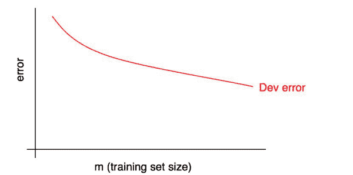

随着训练集规模增大，开发集误差应该降低。

我们通常会有某个“期望错误率”，希望学习算法最终能达到。例如：

- 如果我们追求人类水平的性能，那么人类错误率就可以作为“期望错误率”。
- 如果我们的学习算法服务于某个产品（比如推送猫咪图片），我们可能对需要达到什么样的性能水平才能给用户良好的体验有所直觉。
- 如果你在一个重要应用上工作了很久，你可能对下一个季度/年还能合理取得多少进展有所判断。

将期望的性能水平添加到你的学习曲线中：

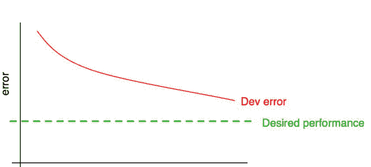

你可以通过目测外推红色“开发误差”曲线，猜测添加更多数据后，你能离期望性能水平近多少。在上面的例子中，看起来如果训练集规模翻倍，你有可能达到期望性能。

但如果开发误差曲线已经“趋于平缓”（即变平），那么你马上就能判断，添加更多数据无法让你达到目标：

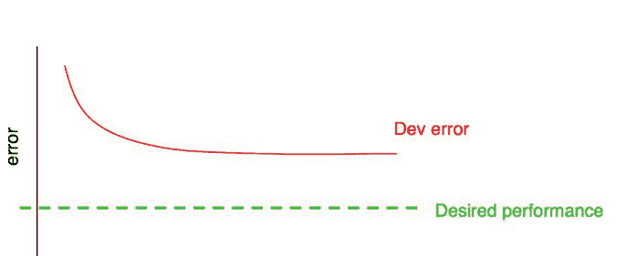

因此，查看学习曲线可能帮助你避免花费数月时间收集两倍的训练数据，却最终发现它无济于事。

这个过程的一个缺点是，如果你只看开发误差曲线，很难外推并准确预测如果有更多数据红色曲线会走向哪里。还有一个额外绘图可以帮助你估计添加更多数据的影响：训练误差。

### 29 绘制训练误差

你的开发集（和测试集）误差应该随训练集规模增大而下降。但你的训练集误差通常会随训练集规模增大而*增加*。

下面用一个例子说明这种效应。假设你的训练集只有 2 个样本：一张猫的图片和一张非猫的图片。那么学习算法很容易“记住”训练集中的两个样本，并取得 0% 的训练集误差。即使其中一个或两个训练样本的标签有误，算法仍然很容易记住这两个标签。

现在假设你的训练集有 100 个样本。也许即使有少数样本被错误标记或存在歧义——比如一些图像非常模糊，连人都不清楚是否含有猫。学习算法也许仍然能“记住”训练集的大部分或全部内容，但现在想获得 100% 的准确率就更难了。通过将训练集从 2 个样本增加到 100 个样本，你会发现训练集准确率会略有下降。

最后，假设你的训练集有 10,000 个样本。在这种情况下，算法要完美拟合全部 10,000 个样本就更难了，尤其是一些样本存在歧义或被错误标记。因此，你的学习算法在这个训练集上的表现会更差。

让我们在之前的图中加入训练误差的曲线：

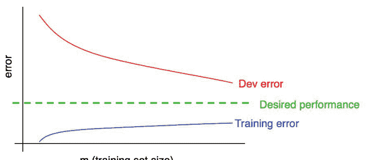

你可以看到，蓝色“训练误差”曲线随训练集规模的增大而上升。此外，你的算法通常在训练集上的表现优于开发集；因此，红色开发误差曲线通常严格位于蓝色训练误差曲线上方。

接下来，我们来讨论如何解读这些图。

### 30 解读学习曲线：高偏差

假设你的开发误差曲线如下所示：

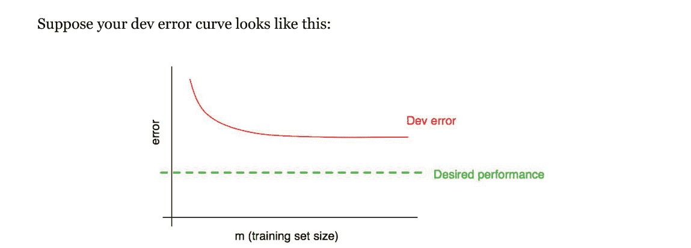

我们之前说过，如果你的开发误差曲线趋于平缓，仅靠添加数据不太可能达到期望性能。

但很难准确知道红色开发误差曲线外推后会是什么样子。如果开发集很小，你会更不确定，因为曲线可能会有噪声。

假设我们在这张图中加入训练误差曲线，得到下图：

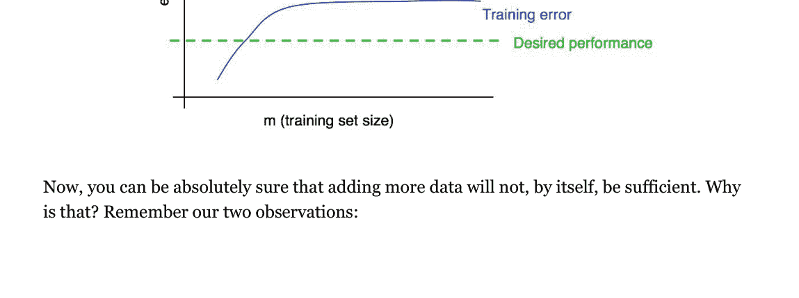

现在，你可以绝对肯定，仅仅添加更多数据是不够的。这是为什么呢？回想我们的两条观察结果：

- 随着我们添加更多训练数据，训练误差只会变得更差。因此，蓝色训练误差曲线只能保持不变或继续走高，因而只会离（绿线代表的）期望性能水平越来越远。
- 红色开发误差曲线通常高于蓝色训练误差。因此，当训练误差都已经高于期望性能水平时，添加更多数据几乎不可能让红色开发误差曲线下降到期望性能水平。

在同一张图中同时检查开发误差曲线和训练误差曲线，可以让我们更有信心地外推开发误差曲线。

假设为了讨论方便，期望性能就是我们估计的最优错误率。那么上图就是高可避免偏差学习曲线的标准“教科书”式示例：在最大的训练集规模上——大概对应我们拥有的全部训练数据——训练误差与期望性能之间存在很大的差距，表明存在较大的可避免偏差。此外，训练曲线与开发曲线之间的差距很小，表明方差较小。

之前，我们只在本图最右边的点测量训练集和开发集误差，这对应使用所有可用的训练数据。绘制完整的学习曲线可以让我们更全面地了解算法在不同训练集规模下的表现。

### 31 解读学习曲线：其他情况

考虑下面这条学习曲线：

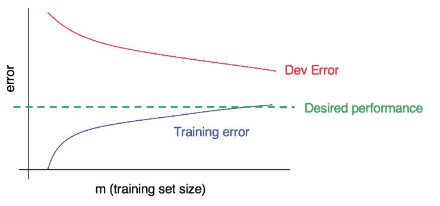

该图表示高偏差、高方差，还是两者兼有？

蓝色训练误差曲线相对较低，而红色开发误差曲线远高于蓝色训练误差。因此，偏差较小，但方差较大。增加更多训练数据很可能有助于缩小开发误差与训练误差之间的差距。

现在，考虑这个：

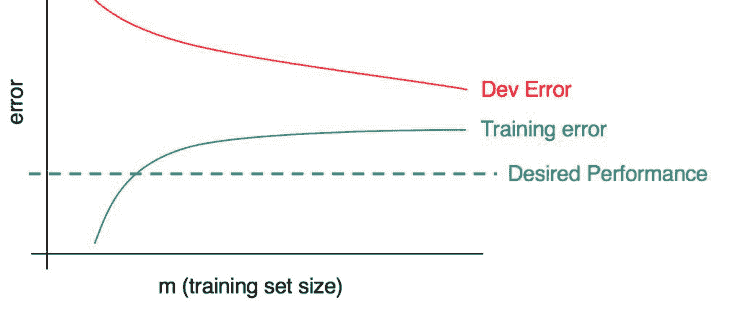

这次，训练误差很大，因为它远高于期望的性能水平。开发误差也远大于训练误差。因此，你同时具有显著的偏差和显著的方差。你需要找到一种方法来同时减少算法中的偏差和方差。

### 32 绘制学习曲线

假设你有一个非常小的训练集，包含 100 个样本。你使用随机选择的 10 个样本子集训练算法，然后是 20 个样本，接着 30 个，直到 100 个，每次增加 10 个样本。然后你用这 10 个数据点绘制学习曲线。你可能会发现，在较小的训练集规模下，曲线看起来略有噪声（即数值高于或低于预期）。

当仅用 10 个随机选择的样本进行训练时，你可能运气不好，得到一个特别“差”的训练集，例如其中包含许多模糊或错误标记的样本。或者，你可能运气好，得到一个特别“好”的训练集。训练集较小意味着开发误差和训练误差可能会随机波动。

如果你的机器学习应用严重偏向于某一个类别（例如猫分类任务，其中负样本的比例远大于正样本），或者它包含大量类别（例如识别 100 种不同的动物物种），那么选出一个特别“不具有代表性”或糟糕的训练集的概率也会更大。例如，如果 80% 的样本是负样本（y=0），只有 20% 是正样本（y=1），那么一个包含 10 个样本的训练集有可能只包含负样本，这使得算法很难学到有意义的内容。

如果训练曲线中的噪声使得难以看清真实趋势，这里有两种解决方案：

- 不要只在一个包含 10 个样本的训练集上训练一个模型，而是通过从你原来的 100 个样本中有放回地抽样¹⁰，选择多个（例如 3 到 10 个）不同的随机选择的 10 样本训练集。在每个训练集上训练一个不同的模型，并计算每个模型的训练误差和开发误差。计算并绘制平均训练误差和平均开发误差。
- 如果你的训练集偏向于某一类，或者包含许多类别，请选择一个“平衡”的子集，而不是从 100 个样本中随机抽取 10 个作为训练样本。例如，你可以确保 10 个样本中有 2 个是正样本，8 个是负样本。

¹⁰ 这里有放回抽样的含义：你会从 100 个样本中随机挑出 10 个不同的样本组成第一个训练集。然后，组成第二个训练集时，你会再次挑出 10 个样本，但不会考虑第一个训练集中已经选择了哪些。因此，一个特定的样本有可能同时出现在第一个和第二个训练集中。相比之下，如果你是无放回抽样，第二个训练集将从第一次未被选中的 90 个样本中选出。在实践中，有放回和无放回抽样不会有太大差别，但有放回抽样是常见做法。

## 与人类水平表现进行比较

### 33 为什么我们要与人类水平表现进行比较

许多机器学习系统旨在自动化人类擅长的事情。例如图像识别、语音识别和电子邮件垃圾邮件分类。学习算法也已经取得了很大进步，以至于我们在越来越多的这类任务上超越了人类水平的表现。

此外，如果你要完成的任务是人类能够做好的，那么构建 ML 系统会更容易，原因如下：

1.  更容易从人类标注者那里获取数据。例如，由于人类能够很好地识别猫的图像，因此人们可以直接为你的学习算法提供高精度的标签。

2.  误差分析可以借助人类直觉。假设一个语音识别算法的表现不如人类水平的识别。假设它错误地将一段音频转写为“This recipe calls for a pear of apples”，把“pair”误认成了“pear”。你可以借助人类直觉，尝试理解人类使用哪些信息来获得正确的转写，并利用这些知识来修改学习算法。

3.  使用人类水平的表现来估计最优误差率，并设定一个“期望误差率”。假设你的算法在某项任务上达到了 10% 的误差，但一个人可以达到 2% 的误差。那么我们知道最优误差率是 2% 或更低，而可避免的偏差至少为 8%。因此，你应该尝试减少偏差的技术。

尽管第 3 点听起来可能不重要，但我发现，拥有一个合理且可实现的目标误差率有助于加快团队的进展。知道你的算法具有很高的可避免偏差是极其有价值的，它为你提供了一个可以尝试的各种选项菜单。

有些任务即便是人类也不擅长。例如，挑选一本书推荐给你；或者在网站上为用户选择要展示的广告；或者预测股票市场。计算机在这些任务上已经超越了大多数人的表现。对于这些应用，我们会遇到以下问题：

-   更难获得标签。例如，人类标注者很难为用户的数据库标注“最优”的图书推荐。如果你运营一个销售图书的网站或应用，你可以通过向用户展示图书并观察他们购买什么来获取数据。如果你不运营这样的网站，你需要寻找更有创造性的方式来获取数据。

-   **人类直觉更难依赖。** 例如，几乎没有人能预测股票市场。因此，如果我们的股票预测算法并不比随机猜测好多少，就很难弄清楚如何改进它。

-   **很难知道最优误差率和合理的期望误差率是多少。** 假设你已经有一个表现相当好的图书推荐系统。在没有人类基线的情况下，你怎么知道它还能改进多少？

### 34 如何定义人类水平的表现

假设你正在处理一个医学影像应用，该应用根据 X 射线图像自动进行诊断。一个除了接受过一些基本训练外没有医学背景的普通人，在此任务上的误差为 15%。一名初级医生的误差为 10%。一名经验丰富的医生误差为 5%。一个由医生组成的小团队，讨论并辩论每张图像后，误差为 2%。在这些误差率中，哪一个定义了“人类水平的表现”？

在这种情况下，我会使用 2% 作为我们最优误差率的人类水平表现代理。你也可以将 2% 设定为期望的性能水平，因为上一章中提到的与人类水平表现进行比较的三个原因都适用：

-   从人类标注者那里获取带标签数据更容易。你可以让一个医生团队为你提供误差率为 2% 的标签。
-   误差分析可以借助人类直觉。通过与医生团队讨论图像，你可以借助他们的直觉。
-   使用人类水平的表现来估计最优误差率，并设定可实现的目标误差率。使用 2% 的误差作为我们对最优误差率的估计是合理的。最优误差率可能低于 2%，但不可能更高，因为一个医生团队可以达到 2% 的误差。相比之下，使用 5% 或 10% 作为最优误差率的估计是不合理的，因为我们知道这些估计必然过高。

在获取带标签数据方面，你可能不想与整个医生团队讨论每一张图像，因为他们的时间很昂贵。也许你可以让一名初级医生为绝大多数病例打标签，只将较难的病例交给更有经验的医生或医生团队。

如果你的系统目前有 40% 的误差，那么无论是使用初级医生（10% 误差）还是经验丰富的医生（5% 误差）来为你的数据打标签并提供直觉，都没有太大区别。但如果你的系统已经处于 10% 的误差水平，那么将人类水平参考定义为 2% 将为你提供更好的工具来持续改进系统。

## 35 超越人类水平表现

你正在从事语音识别工作，并且有一个音频片段的数据集。假设你的数据集中有许多嘈杂的音频片段，以至于人类也有 10% 的错误率。假设你的系统已经达到了 8% 的错误率。你还能使用第 33 章中描述的三种技术中的任何一种来继续快速进步吗？

如果你能识别出一个人类明显优于你的系统的子集，那么你仍然可以使用这些技术来推动快速进步。例如，假设你的系统在嘈杂音频中识别语音方面远优于人类，但人类在转录语速非常快的语音方面仍然更好。

对于语速很快的语音数据子集：

- 1. 你仍然可以从人类那里获得质量高于算法输出的转录文本。
- 2. 你可以借鉴人类的直觉来理解他们为何能正确听出快速语速的语句而你的系统却不能。
- 3. 你可以将人类在快速语速语音上的表现作为期望的性能目标。

更一般地，只要在开发集上存在人类正确而算法错误的情况，那么之前描述的许多技术仍然适用。即使在整个开发/测试集上平均来看，你的性能已经超过了人类水平，这一点也成立。

有很多重要的机器学习应用，机器在其中超越了人类水平的表现。例如，机器在预测电影评分、送货汽车行驶到某地需要多长时间、或是否批准贷款申请方面更好。一旦人类很难识别出算法明显出错的例子，只有部分技术适用。因此，在机器已经超越人类水平表现的问题上，进展通常较慢，而当机器仍在努力追赶人类时，进展更快。

## 在不同分布上训练和测试

但在大数据的时代，我们现在可以访问巨大的训练集，例如猫的互联网图片。即使训练集来自与开发/测试集不同的分布，我们仍然希望使用它进行学习，因为它可以提供大量信息。

对于猫检测器的例子，与其将全部 10,000 张用户上传的图片放入开发/测试集，我们可能会改为将 5,000 张放入开发/测试集。我们可以将剩余的 5,000 个用户上传示例放入训练集。这样，你的包含 205,000 个示例的训练集就包含了一些来自开发/测试分布的数据，以及 200,000 张互联网图片。我们将在后面的章节讨论为什么这种方法有帮助。

让我们考虑第二个例子。假设你正在构建一个语音识别系统，用于为语音控制的移动地图/导航应用转录街道地址。你有 20,000 个用户说街道地址的示例。但你还有 500,000 个其他音频片段的示例，其中用户谈论其他主题。你可以取 10,000 个街道地址示例用于开发/测试集，并使用剩余的 10,000 个，加上另外的 500,000 个示例，用于训练。

我们将继续假设你的开发数据和测试数据来自相同的分布。但重要的是要理解，不同的训练和开发/测试分布会带来一些特殊挑战。

### 37 如何决定是否使用所有数据

假设你的猫检测器的训练集包含 10,000 张用户上传的图片。这些数据来自与单独的开发/测试集相同的分布，并且代表了你希望表现良好的分布。你还有另外 20,000 张从互联网下载的图片。你应该将全部 20,000+10,000=30,000 张图片提供给学习算法作为其训练集，还是因担心它会使学习算法产生偏差而丢弃 20,000 张互联网图片？

在使用早期一代学习算法时，例如手工设计的计算机视觉特征，然后是简单的线性分类器，合并这两种类型的数据会导致性能变差的风险是真实存在的。因此，一些工程师会警告你不要包含这 20,000 张互联网图片。

但在强大的、灵活的学习算法的现代时代，例如大型神经网络，这种风险大大降低了。如果你负担得起构建一个具有足够数量的隐藏单元/层的神经网络，你可以安全地将 20,000 张图片添加到训练集中。添加这些图片更有可能提高你的性能。

这一观察依赖于存在一个对两种类型数据都有效的 x → y 映射。换句话说，存在一个系统，它输入的是互联网图片或移动应用图片，并且能够可靠地预测标签，而无需知道图片的来源。

添加额外的 20,000 张图片会产生以下影响：

- 1. 它为你的神经网络提供了更多关于猫看起来像/不像什么的示例。这是有帮助的，因为互联网图片和用户上传的移动应用图片确实有一些相似之处。你的神经网络可以将从互联网图片中学到的一些知识应用到移动应用图片上。
- 2. 它迫使神经网络花费部分容量来学习特定于互联网图片的属性，例如更高的分辨率、图片构图的分布不同等。如果这些属性与移动应用图片差异很大，它将“用掉”神经网络的部分表征容量。因此，用于识别来自移动应用图片分布的数据的容量就更少了，而这正是你真正关心的。理论上，这可能会损害算法的性能。

为了用不同的术语描述第二种效应，我们可以转向虚构人物夏洛克·福尔摩斯，他说你的大脑就像一个阁楼；它只有有限的空间。他说“每增加一种知识，你就会忘记以前知道的东西。因此，最重要的是不要让无用的事实挤走有用的事实。”¹²

幸运的是，如果你拥有构建足够大的神经网络所需的计算能力——即足够大的阁楼——那么这就不是一个严重的问题。你有足够的容量从互联网和移动应用图片中学习，而两种类型的数据不会为容量竞争。你的算法的“大脑”足够大，你不必担心阁楼空间用完。

但如果你没有足够大的神经网络或另一个高度灵活的学习算法，那么你应该更注意你的训练数据与开发/测试集分布相匹配。

如果你认为你有数据没有任何益处，你应该出于计算原因将其排除。例如，假设你的开发/测试集主要包含人们、地点、地标、动物的随意图片。假设你还有一个大量的扫描历史文档集合：

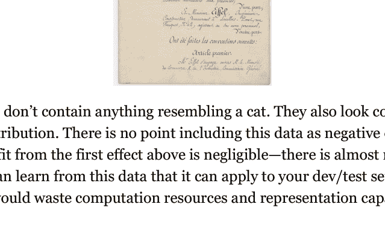

这些文档不包含任何类似猫的东西。它们也完全不像你的开发/测试分布。将此数据作为负例包含在内没有任何意义，因为上述第一种效应的益处可以忽略不计——几乎没有你的神经网络能从这些数据中学到任何可以应用到你的开发/测试集分布的东西。将它们包含在内会浪费计算资源和神经网络的表征容量。

### 38 如何决定是否包含不一致的数据

假设你想学习预测纽约市的房价。给定房屋的大小（输入特征 x），你想预测价格（目标标签 y）。

纽约市的房价非常高。假设你有一个底特律、密歇根州的房价的第二个数据集，那里的房价要低得多。你应该将此数据包含在训练集中吗？

给定相同的大小 x，房屋的价格 y 取决于它是在纽约市还是在底特律而有很大不同。如果你只关心预测纽约市的房价，把这两个数据集放在一起会损害你的性能。在这种情况下，最好排除不一致的底特律数据。¹³

这个纽约市与底特律的例子与移动应用与互联网猫图片的例子有何不同？

猫图片的例子不同，因为给定一张输入图片 x，可以可靠地预测表示是否有猫的标签 y，而无需知道图片是互联网图片还是移动应用图片。也就是说，存在一个函数 f(x)，它可以可靠地将输入 x 映射到目标输出 y，而无需知道 x 的来源。因此，从互联网图片的识别任务与从移动应用图片的识别任务是“一致的”。这意味着包含所有数据几乎没有缺点（除了计算成本），并且有一些可能的显著好处。相比之下，纽约市和密歇根州底特律的数据是不一致的。给定相同的 x（房屋大小），价格取决于房屋所在地的不同。

¹³ 解决底特律数据与纽约市数据不一致问题的一种方法是为每个训练示例添加一个额外的特征，指示城市。给定一个输入 x——现在指定了城市——目标值 y 现在是明确的。然而，在实践中我很少看到这样做。

### 39 加权数据

假设你有 200,000 张来自互联网的图像和 5,000 张来自手机应用用户的图像。这些数据集之间存在 40:1 的比例。理论上，只要你构建一个巨大的神经网络并在全部 205,000 张图像上训练足够长的时间，就没有害处去尝试让算法同时在互联网图像和手机图像上表现良好。

但在实践中，互联网图像比手机应用图像多 40 倍，可能意味着你需要花费 40 倍（或更多）的计算资源来同时建模两者，而如果仅在 5,000 张图像上训练则不需要。

如果你没有庞大的计算资源，可以作为折中方案给互联网图像赋予更低的权重。

例如，假设你的优化目标是平方误差（这对于分类任务来说不是一个好的选择，但它会简化我们的解释。）因此，我们的学习算法试图优化：

min_θ Σ_{(x,y)∈MobileImg} (h_θ(x) − y)² + Σ_{(x,y)∈InternetImg} (h_θ(x) − y)²

上面的第一个求和是对 5,000 张手机图像进行的，第二个求和是对 200,000 张互联网图像进行的。你可以改用一个额外的参数 β 进行优化：

min_θ Σ_{(x,y)∈MobileImg} (h_θ(x) − y)² + β Σ_{(x,y)∈InternetImg} (h_θ(x) − y)²

如果你将 β=1/40，算法就会对 5,000 张手机图像和 200,000 张互联网图像赋予相同的权重。你也可以将参数 β 设置为其他值，也许通过在开发集上调参。

通过降低额外互联网图像的权重，你就不必构建如此庞大的神经网络来确保算法在两种类型的任务上都表现良好。这种重新加权只有在你怀疑额外数据（互联网图像）与开发/测试集的分布非常不同时才需要，或者如果额外数据比来自与开发/测试集相同分布的数据（手机图像）大得多时才需要。

### 40 从训练集到开发集的泛化

假设你在一种训练和开发/测试分布不同的场景下应用机器学习。比如，训练集包含互联网图像 + 手机图像，而开发/测试集仅包含手机图像。然而，算法工作不佳：它在开发/测试集上的错误率比你希望的要高得多。这里有一些可能出错的原因：

- 1. 它在训练集上表现不佳。这是训练集分布上高（可避免）偏差的问题。
- 2. 它在训练集上表现良好，但不能很好地泛化到之前未见过的数据 *从与训练集相同的分布中抽取*。这是高方差。
- 3. 它能很好地泛化到从训练集分布中抽取的新数据，但不能泛化到从开发/测试集分布中抽取的数据。我们称此问题为 **数据不匹配**，因为它是由于训练集数据与开发/测试集数据匹配度较差造成的。

例如，假设人类在猫识别任务上几乎达到完美性能。你的算法达到了以下结果：

- 训练集错误率为 1%
- 在算法未见过但与训练集相同分布的数据上错误率为 1.5%
- 开发集错误率为 10%

在这种情况下，你明显存在数据不匹配问题。为了解决这个问题，你可以尝试使训练数据更类似于开发/测试数据。我们稍后会讨论一些针对此的技术。

为了诊断算法在上述 1-3 个问题上受影响的程度，有另一个数据集会很有用。具体来说，而不是把所有可用的训练数据都交给算法，你可以将其拆分为两个子集：算法将用于训练的实际训练集，以及我们将不进行训练的单独集合，我们称之为“训练开发”集。

现在你有四个数据子集：

- 训练集。这是算法将从中学习的数据（例如，互联网图像 + 手机图像）。它不必来自我们真正关心的相同分布（开发/测试集分布）。
- 训练开发集：该数据来自与训练集相同的分布（例如，互联网图像 + 手机图像）。它通常比训练集小；它只需要足够大以评估和跟踪我们学习算法的进展。
- 开发集：它来自与测试集相同的分布，并反映了我们最终希望表现良好的数据的分布。（例如，手机图像。）
- 测试集：它来自与开发集相同的分布。（例如，手机图像。）

借助这四个独立的数据集，你现在可以评估：

- 通过在训练集上评估来计算训练误差。
- 通过在训练开发集上评估来衡量算法对从训练集分布中抽取的新数据的泛化能力。
- 通过在开发集和/或测试集上评估来衡量算法在你关心的任务上的性能。

第 5-7 章中关于选择开发集大小的大多数指南也适用于训练开发集。

### 41 识别偏差、方差和数据不匹配误差

假设人类在猫检测任务上几乎达到完美性能（≈0% 错误），因此最优错误率约为 0%。假设你有：

- 训练集错误率为 1%。
- 训练开发集错误率为 5%。
- 开发集错误率为 5%。

这说明了什么？这里，你知道你有高方差。之前描述的方差减小技术应该能让你取得进展。

现在，假设你的算法达到：

- 训练集错误率为 10%。
- 训练开发集错误率为 11%。
- 开发集错误率为 12%。

这说明你在训练集上存在高可避免偏差。即，算法在训练集上表现不佳。偏差减小技术应该有所帮助。

在上述两个示例中，算法仅遭受高可避免偏差或高方差。算法可能同时遭受高可避免偏差、高方差和数据不匹配的任意子集。例如：

- 训练集错误率为 10%。
- 训练开发集错误率为 11%。
- 开发集错误率为 20%。

该算法同时存在高可避免偏差和数据不匹配。它在训练集分布上并不存在高方差。

通过将不同类型的错误绘制为表格中的条目来理解它们之间的关系可能会更容易：

|  | 分布 A：互联网 + 手机图像 | 分布 B：手机图像 |
|---|---|---|
| 人类水平 | "人类水平误差" (≈0%) |  |
| 算法已训练过的示例上的误差 | "训练误差" (10%) |  |
| 算法未训练过的示例上的误差 | "训练-开发误差" (11%) | "开发-测试误差" (20%) |

*右侧标签：可避免偏差，方差*
*训练-开发误差与开发-测试误差之间的数据不匹配*

继续以猫图像检测器的例子，你可以看到 x 轴上有两种不同的数据分布。在 y 轴上，我们有三种类型的误差：人类水平误差、算法已训练过的示例上的误差，以及算法未训练过的示例上的误差。我们可以用上一章中识别的不同类型的错误来填充方框。

如果你愿意，你也可以填写此表中的另外两个方框：你可以通过让一些人类标注你的手机猫图像数据并测量其误差来填写右上角的方框（手机图像上的人类水平表现）。你可以通过取手机猫图像（分布 B）并将其中的一小部分放入训练集中，以便神经网络也能学习它，来填写下一个方框。然后你测量学习模型在该数据子集上的误差。填写这两个额外的条目有时可以提供关于算法在这两种不同分布（分布 A 和 B）数据上所做工作的额外见解。

通过了解算法最受哪种类型错误影响，你将更能确定是专注于降低偏差、降低方差还是降低数据不匹配。

### 42 解决数据不匹配问题

假设你已经开发了一个语音识别系统，在训练集和训练开发集上表现非常好。然而，它在你的开发集上表现不佳：你遇到了数据不匹配问题。你能做些什么？

我建议你：(i) 尝试理解训练集和开发集分布之间的数据属性差异。(ii) 尝试寻找更多与你的算法难以处理的开发集样本更匹配的训练数据。¹⁴

例如，假设你对语音识别开发集进行错误分析：你手动检查100个样本，并尝试理解算法在哪些地方出错。你发现系统表现不佳的原因是开发集中的大多数音频片段是在车内录制的，而大多数训练样本是在安静背景下录制的。发动机和道路噪声极大地恶化了你的语音系统的性能。在这种情况下，你可以尝试获取更多包含车内录制音频片段的训练数据。错误分析的目的是理解训练集和开发集之间的显著差异，这正是导致数据不匹配的原因。

如果你的训练集和训练开发集都包含车内录制的音频，你还应该仔细检查系统在这部分数据上的表现。如果它在训练集的车内数据上表现良好，但在训练开发集的车内数据上表现不佳，那么这进一步验证了获取更多车内数据会有帮助的假设。这就是我们在前一章讨论将一些与开发集/测试集同分布的数据纳入训练集的原因。这样做可以让你比较系统在训练集和开发集/测试集的车内数据上的表现。

不幸的是，这个过程没有保证。例如，如果你没有任何办法获取更多与开发集数据更匹配的训练数据，你可能就没有明确的改进性能的路径。

¹⁴也有一些关于“领域适应”的研究——如何在一个分布上训练算法，使其能够泛化到不同的分布。这些方法通常只适用于特殊类型的问题，远不如本章描述的思想应用广泛。

### 43 人工数据合成

你的语音系统需要更多听起来像是在车内录制的数据。与其开车到处收集大量数据，也许有更简单的方法来获得这些数据：通过人工合成。

假设你获得了大量车内/道路噪声音频片段。你可以从几个网站下载这些数据。假设你还有一个大量的、人们在安静房间里说话的训练集。如果你取一个说话人的音频片段，并在其上“叠加”一个车内/道路噪声的音频片段，你就会得到一个听起来像是该人在嘈杂车内说话的音频片段。利用这个过程，你可以“合成”大量听起来像是在车内收集的数据。

更一般地说，在某些情况下，人工数据合成能让你创建与开发集合理匹配的庞大数据集。以猫图像检测器作为第二个例子。你注意到开发集图像有更多的运动模糊，因为它们往往来自手机用户，这些用户在拍照时轻微移动了手机。你可以从训练集的互联网图像中取出未模糊的图像，并对其添加模拟运动模糊，从而使它们更接近开发集。

请记住，人工数据合成有其挑战：有时创建对人类来说看起来逼真的合成数据，比创建对计算机来说看起来逼真的数据更容易。例如，假设你有1000小时的语音训练数据，但只有1小时的车内噪声。如果你反复使用这相同的1小时车内噪声，并与原始1000小时训练数据的不同部分组合，你最终会得到一个合成数据集，其中相同的车内噪声被一遍又一遍地重复。虽然一个听这段音频的人可能无法分辨——大多数人都觉得所有车内噪声听起来都一样——但学习算法可能会“过拟合”到这1小时的车内噪声。因此，它可能无法很好地泛化到新的、车内噪声恰好听起来不同的音频片段。

或者，假设你有1000个不同的小时车内噪声，但所有这些噪声都来自仅仅10种不同的车。在这种情况下，算法可能会“过拟合”到这10辆车，如果测试来自不同车的音频，表现就会很差。不幸的是，这些问题很难被发现。

再举一个例子，假设你正在构建一个用于识别汽车的计算机视觉系统。假设你与一家视频游戏公司合作，该公司拥有几辆汽车的计算机图形模型。为了训练你的算法，你使用这些模型生成汽车的合成图像。即使合成图像看起来非常逼真，这种方法（已由许多人独立提出）可能效果不佳。视频游戏中可能只有大约20种汽车设计。构建一个汽车的3D模型非常昂贵；如果你在玩游戏，你可能不会注意到你反复看到的是同样的车，也许只是涂装不同。也就是说，这些数据对你来说看起来非常逼真。但是，与道路上所有汽车——以及因此你在开发集/测试集中可能看到的汽车——相比，这20辆合成汽车只捕捉了世界汽车分布的极小一部分。因此，如果你的10万个训练样本全部来自这20辆汽车，你的系统将“过拟合”到这20种具体的汽车设计，并且无法很好地泛化到包含其他汽车设计的开发集/测试集。

在合成数据时，请仔细思考你是否真的合成了一个具有代表性的样本集。尽量避免让合成数据具有使学习算法能够区分合成样本与非合成样本的特性——例如，所有合成数据都来自20种汽车设计之一，或者所有合成音频都来自仅仅1小时的车内噪声。这条建议可能难以遵循。

在从事数据合成工作时，我的团队有时会花上几周时间，才能生成细节足够接近实际分布的合成数据，使其产生显著效果。但如果你能把细节做好，你就能突然获得比以往大得多的训练集。

## 调试推理算法

### 44 优化验证测试

假设你正在构建一个语音识别系统。你的系统通过输入一个音频片段A，并为每个可能的输出语句S计算某个Score_A(S)来工作。例如，你可能会尝试估计Score_A(S) = P(S|A)，即在输入音频为A的情况下，正确输出转录为语句S的概率。

在给定计算Score_A(S)的方法后，你仍然需要找到使Score_A(S)最大化的英语语句S：

输出 = arg max_S Score_A(S)

你如何计算上述“arg max”？如果英语有50,000个单词，那么长度为N的可能语句就有(50,000)^N个——数量太多，无法穷举。因此，你需要应用一种近似搜索算法，试图找到使Score_A(S)优化（最大化）的S值。一种搜索算法是“束搜索”，它在搜索过程中只保留K个最佳候选。（就本章而言，你不需要理解束搜索的细节。）这类算法并不能保证找到使Score_A(S)最大化的S值。

假设一个音频片段A记录了某人说“我爱机器学习”。但你的系统没有输出正确的转录，而是输出了错误的“我爱机器人”。现在有两种可能出错的原因：

- 1. **搜索算法问题。** 近似搜索算法（束搜索）未能找到使Score_A(S)最大化的S值。
- 2. **目标（评分函数）问题。** 我们对Score_A(S) = P(S|A)的估计不准确。特别是，我们选择的Score_A(S)未能识别出“我爱机器学习”是正确的转录。

根据哪一个是失败的原因，你需要非常不同地安排你的工作优先级。如果是#1的问题，你应该改进搜索算法。如果是#2的问题，你应该改进估计Score_A(S)的学习算法。

面对这种情况，一些研究者会随机决定去改进搜索算法；另一些则会随机决定去学习更好的Score_A(S)值。但除非你知道哪个是错误的根本原因，否则你的努力可能会被浪费。你如何更系统地决定该做什么？

设 S_out 为输出转录（“I love robots”）。设 S* 为正确转录（“I love machine learning”）。为了理解上面 #1 或 #2 是否是问题，你可以执行 **优化验证测试**：首先，计算 Score_A(S*) 和 Score_A(S_out)。然后检查是否 Score_A(S*) > Score_A(S_out)。存在两种可能性：

#### Case 1: Score_A(S*) > Score_A(S_out)

在这种情况下，你的学习算法已正确地给 S* 分了比 S_out 更高的分数。尽管如此，我们的近似搜索算法选择了 S_out 而非 S*。这说明你的近似搜索算法未能选择使 Score_A(S) 最大化的 S 值。在这种情况下，优化验证测试告诉你存在搜索算法问题，应集中于此。例如，你可以尝试增加束搜索的束宽。

#### Case 2: Score_A(S*) ≤ Score_A(S_out)

在这种情况下，你知道计算 Score_A(.) 的方式有问题：它未能给正确的输出 S* 分出严格高于错误输出 S_out 的分数。优化验证测试告诉你存在目标（评分）函数问题。因此，你应专注于改进如何学习或近似不同句子 S 的 Score_A(S)。

我们的讨论集中在一个示例上。要在实践中应用优化验证测试，你应检查 dev 集合中的错误。对于每个错误，你将测试是否 Score_A(S*) > Score_A(S_out)。对于该不等式成立的每个 dev 示例，将被标记为由优化算法引起的错误。对于该不等式不成立的每个示例（Score_A(S*) ≤ Score_A(S_out)），则计为因计算 Score_A(.) 方式而导致的错误。

例如，假设你发现 95% 的错误源于评分函数 Score_A(.)，只有 5% 源于优化算法。现在你知道，无论如何改进优化程序，现实中也只能消除约 ~5% 的错误。因此，你应改为专注于改进如何估计 Score_A(.)。

### 46 Reinforcement learning example

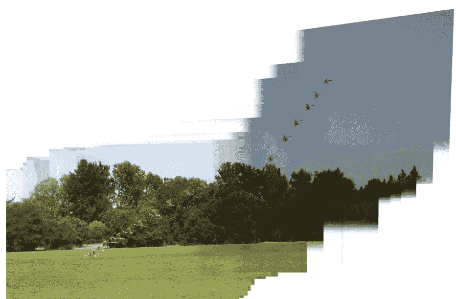

假设你正在使用机器学习教直升机执行复杂机动。以下是计算机控制的直升机在发动机关闭的情况下执行降落的延时照片。

这被称为“自转”机动。它允许直升机即使发动机意外失效也能着陆。人类飞行员在训练中会练习这种机动。你的目标是使用学习算法让直升机沿着轨迹 T 飞行并最终安全着陆。

要应用强化学习，你必须开发一个“奖励函数” R(.)，它给出衡量每种可能轨迹 T 好坏的分数。例如，如果 T 导致直升机坠毁，那么奖励可能是 R(T) = -1,000——一个巨大的负奖励。导致安全着陆的轨迹 T 可能会产生正的 R(T)，其具体数值取决于着陆的平稳程度。奖励函数 R(.) 通常由人工选择来量化不同轨迹 T 的期望程度。它必须权衡着陆的颠簸程度、直升机是否恰好降落在期望位置、乘客下降过程中的颠簸程度等等。设计好的奖励函数并不容易。

给定一个奖励函数 R(T)，强化学习算法的工作是控制直升机使其实现 max_T R(T)。然而，强化学习算法会做出许多近似，可能无法实现这种最大化。

假设你选择了一些奖励 R(.) 并运行了你的学习算法。然而，其性能看起来远不如你的人类飞行员——着陆更颠簸，似乎也不如人类飞行员安全。你如何判断过错在于试图执行实现 max_T R(T) 的轨迹的强化学习算法，还是在于试图衡量并指定颠簸程度与着陆点精度之间理想权衡的奖励函数？

要应用优化验证测试，设 T_human 为人类飞行员实现的轨迹，设 T_out 为算法实现的轨迹。根据我们上面的描述，T_human 是优于 T_out 的轨迹。因此，关键测试如下：是否成立 R(T_human) > R(T_out)？

Case 1：如果该不等式成立，则奖励函数 R(.) 正确地将 T_human 评为优于 T_out。但我们的强化学习算法找到了劣等的 T_out。这表明改进强化学习算法是值得的。

Case 2：不等式不成立：R(T_human) ≤ R(T_out)。这意味着 R(.) 给 T_human 分了更差的分数，尽管它是更优的轨迹。你应改进 R(.) 以更好地捕捉对应于良好着陆的权衡。

许多机器学习应用都有这种“模式”：使用近似搜索算法优化近似评分函数 Score_x(.)。有时没有指定的输入 x，这就简化为只是 Score(.)。在我们上面的例子中，评分函数是奖励函数 Score(T)=R(T)，优化算法是试图执行良好轨迹 T 的强化学习算法。

与早期示例的一个不同之处在于，与比较“最优”输出不同，你是与人类水平性能 T_human 进行比较。我们假设 T_human 相当不错，即使不是最优。一般来说，只要你有一些 y*（在此例中为 T_human）是优于当前学习算法性能的输出——即使它不是“最优”输出——优化验证测试就可以指示改进优化算法还是评分函数更有前景。

## End-to-end deep learning

### 47 The rise of end-to-end learning

假设你想构建一个系统来检查在线产品评论并自动判断作者是否喜欢或不喜欢该产品。例如，你希望将以下评论识别为高度正面：

This is a great mop!

以及以下评论识别为高度负面：

This mop is low quality--I regret buying it.

识别正面与负面意见的问题称为“sentiment classification”。要构建此系统，你可能会构建由两个组件组成的“pipeline”：

- 1. Parser：一个用信息标注文本以识别最重要的词的系统。¹⁵ 例如，你可能会使用解析器来标记所有形容词和名词。你因此会得到以下标注文本：
- This is a greatAdjective mopNoun!
- 2. Sentiment classifier：一个学习算法，其输入为标注文本并预测整体情感。解析器的标注可以极大地帮助该学习算法：通过给形容词更高权重，你的算法能够迅速聚焦于“great”等重要词，并忽略“this”等不太重要的词。

我们可以将你的两个组件的“pipeline”可视化如下：

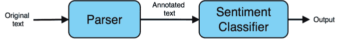

最近出现了一种趋势，用单一学习算法取代 pipeline 系统。对于此任务的端到端学习算法只需将原始原始文本“This is a great mop!”作为输入，并尝试直接识别情感：

¹⁵ 解析器对文本的标注比这丰富得多，但这种简化描述足以解释端到端深度学习。

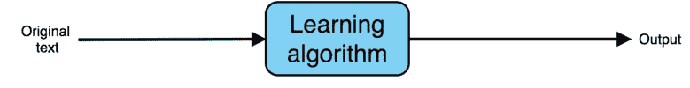

神经网络在端到端学习系统中常用。“端到端”指的是我们要求学习算法直接从输入到期望输出。也就是说，学习算法直接连接系统的“输入端”到“输出端”。

在数据充足的问题中，端到端系统取得了显著成功。但它们并不总是好的选择。接下来的几章将给出更多端到端系统的例子，并提供关于何时应使用以及不应使用它们的建议。

### 48 更多端到端学习示例

假设你要构建一个语音识别系统。你可能会构建一个包含三个组件的系统：

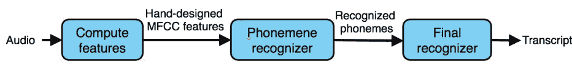

这些组件的工作方式如下：

-   1. 计算特征：提取手工设计的特征，例如 MFCC（梅尔频率倒谱系数）特征，这些特征试图捕捉话语的内容，同时忽略不太相关的属性，比如说话者的音高。
-   2. 音素识别器：一些语言学家认为，存在称为“音素”的基本声音单元。例如，“keep”中的首音“k”与“cake”中的“c”发音是同一个音素。该系统试图识别音频片段中的音素。
-   3. 最终识别器：将识别出的音素序列串联起来，尝试生成输出的转录文本。

相比之下，端到端系统可能输入一段音频，并尝试直接输出转录文本：

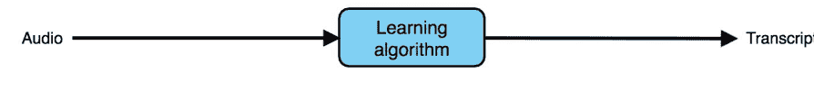

到目前为止，我们只描述了完全线性的机器学习“流水线”：输出按顺序从一个阶段传递到下一个阶段。流水线可能更复杂。例如，下面是一个自动驾驶汽车的简单架构：

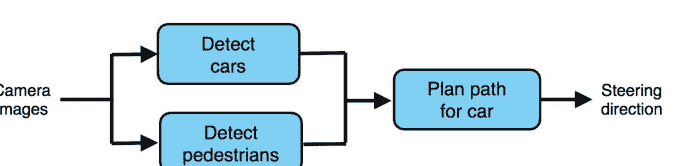

它有三个组件：一个利用摄像头图像检测其他车辆；一个检测行人；最后一个组件为我们的汽车规划一条避开车辆和行人的路径。

流水线中的每个组件并非都必须经过学习。例如，“机器人运动规划”方面的文献中有大量算法可用于汽车的最终路径规划步骤。其中许多算法不涉及学习。

相比之下，端到端方法可能试图接收传感器输入，并直接输出转向方向：

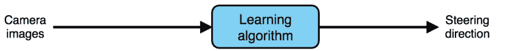

尽管端到端学习已经取得许多成功，但它并非总是最佳方法。例如，端到端语音识别效果很好。但我对自动驾驶的端到端学习持怀疑态度。接下来的几章将解释原因。

### 49 端到端学习的优点和缺点

考虑之前示例中的同一个语音流水线：

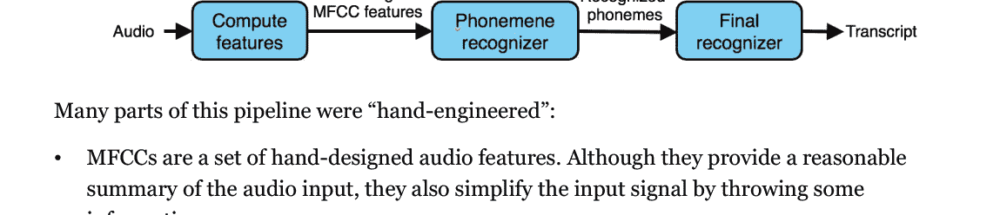

这个流水线的许多部分都是“手工设计”的：

-   MFCC 是一组手工设计的音频特征。虽然它们提供了对音频输入的合理总结，但它们也通过丢弃一些信息来简化输入信号。
-   音素是语言学家的一种发明。它们是对语音声音的不完美表示。如果音素是对现实的一种糟糕近似，那么强制算法使用音素表示将限制语音系统的性能。

这些手工设计的组件限制了语音系统的潜在性能。然而，允许使用手工设计的组件也有一些优点：

-   MFCC 特征对某些不影响内容的语音属性（如说话者的音高）具有鲁棒性。因此，它们有助于简化学习算法的问题。
-   如果音素能合理表示语音，它们也可以帮助学习算法理解基本的语音组成部分，从而提高其性能。

通常，拥有更多手工设计的组件可以让语音系统用更少的数据进行学习。MFCC 和音素所捕获的手工设计知识“补充”了我们的算法从数据中获得的知识。当我们没有太多数据时，这些知识是有用的。

现在，考虑端到端系统：

这个系统缺乏手工设计的知识。因此，当训练集较小时，它的表现可能不如手工设计的流水线。

然而，当训练集很大时，它不会受到 MFCC 或基于音素表示的局限性的阻碍。如果学习算法是一个足够大的神经网络，并且用足够的训练数据进行训练，它就有潜力表现得非常好，甚至可能接近最优错误率。

当“两端”——输入端和输出端——有大量标注数据时，端到端学习系统往往表现良好。在这个示例中，我们需要一个大型的（音频，转录文本）配对数据集。当这类数据不可用时，应谨慎使用端到端学习。

如果你正在处理一个训练集非常小的机器学习问题，那么你的算法知识大部分将必须来自你的人类洞察力。也就是说，来自你的“手工设计”组件。

如果你选择不使用端到端系统，你将不得不决定流水线中的步骤是什么，以及它们应如何衔接在一起。在接下来的几章中，我们将为设计此类流水线提供一些建议。

### 50 选择流水线组件：数据可用性

在构建非端到端流水线系统时，流水线组件有哪些好的候选？你如何设计流水线将极大影响整个系统的性能。一个重要因素是，你是否能轻松收集数据来训练每个组件。

例如，考虑这个自动驾驶架构：

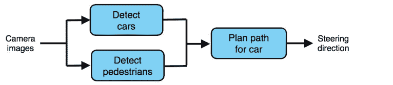

你可以使用机器学习来检测车辆和行人。此外，获取这些数据并不困难：有许多计算机视觉数据集包含大量标注的车辆和行人。你还可以使用众包（如亚马逊 Mechanical Turk）来获取更大的数据集。因此，获取训练数据来构建车辆检测器和行人检测器相对容易。

相比之下，考虑一个纯粹的端到端方法：

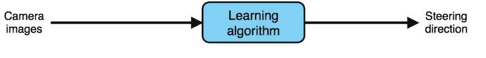

要训练这个系统，我们需要一个大型的（图像，转向方向）配对数据集。让人们驾驶汽车并记录他们的转向方向来收集此类数据非常耗时且昂贵。你需要一支经过特殊装备的车队，以及大量的驾驶里程来覆盖各种可能的场景。这使得端到端系统难以训练。获取大型标注车辆或行人图像数据集要容易得多。

更一般地说，如果有大量数据可用于训练流水线的“中间模块”（例如车辆检测器或行人检测器），那么你可以考虑使用多阶段流水线。这种结构可能更优越，因为你可以利用所有可用数据来训练中间模块。

在更多端到端数据可用之前，我认为非端到端方法在自动驾驶方面更有前景：它的架构更好地匹配了数据的可用性。

### 51 选择流水线组件：任务简单性

除了数据可用性之外，在选择流水线组件时，你还应考虑第二个因素：各个组件解决的任务有多简单？你应该尝试选择那些单独构建或学习起来比较容易的流水线组件。但是，一个组件“容易”学习意味着什么？

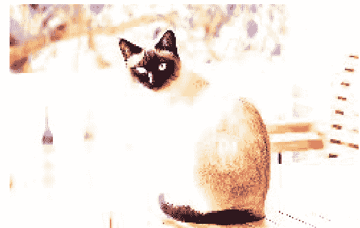

考虑以下机器学习任务，按难度递增的顺序排列：

-   1. 分类图像是否曝光过度（如上例所示）
-   2. 分类图像是在室内还是室外拍摄
-   3. 分类图像中是否包含猫
-   4. 分类图像中是否包含一只既有黑色又有白色毛发的猫
-   5. 分类图像中是否包含暹罗猫（一种特定品种的猫）

上述每个任务都是一个二分类图像识别任务：你必须输入一张图像，并输出 0 或 1。但是列表中靠前的任务对神经网络来说似乎“更容易”学习。你将能够用更少的训练样本学习更容易的任务。

机器学习对于什么使任务变得容易或困难，目前还没有一个良好的正式定义。¹⁶ 随着深度学习和多层神经网络的兴起，我们有时会说，如果一个任务可以用更少的计算步骤完成（对应于较浅的神经网络），则该任务是“容易的”；如果需要更多的计算步骤（需要更深的神经网络），则该任务是“困难的”。但这些都是非正式的定义。

¹⁶ 信息论中有“柯尔莫哥洛夫复杂度”的概念，它认为一个学习函数的复杂度是能够产生该函数的最短计算机程序的长度。然而，这一理论概念在人工智能中几乎没有实际应用。另见：https://en.wikipedia.org/wiki/Kolmogorov_complexity

如果你能够将一个复杂任务拆解为更简单的子任务，那么通过显式地编码子任务的步骤，你就为算法提供了先验知识，这可以帮助它更高效地学习任务。

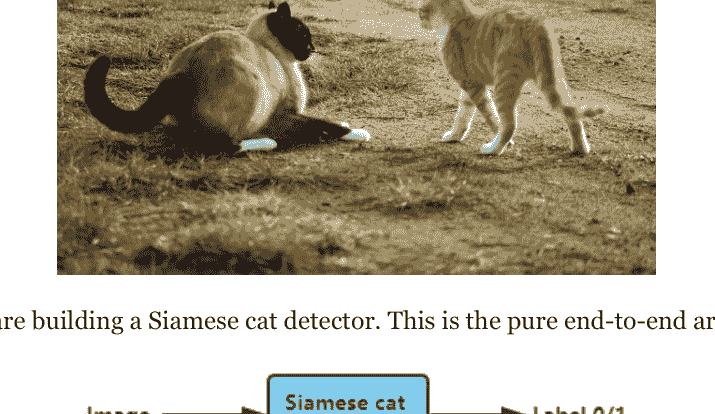

假设你正在构建一个暹罗猫检测器。这就是纯端到端架构：

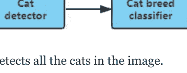

相比之下，你也可以使用一个包含两个步骤的流水线：

第一步（猫检测器）检测图像中的所有猫。

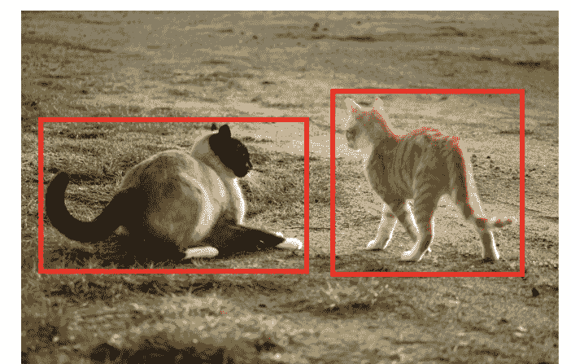

第二步然后将每个检测到的猫的裁剪图像（一次一个）传递给猫品种分类器，最后如果检测到的猫中有暹罗猫则输出 1。

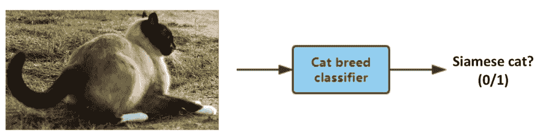

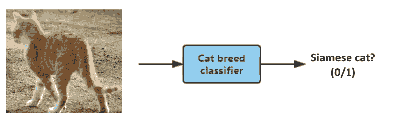

与仅使用 0/1 标签训练纯端到端分类器相比，流水线中的两个组件——猫检测器和猫品种分类器——似乎更容易学习，并且需要显著更少的数据。17

17 如果你熟悉实用的目标检测算法，你会认识到它们不仅仅使用 0/1 图像标签进行学习，而是使用作为训练数据一部分提供的边界框进行训练。对它们的讨论超出了本章的范围。如果想了解更多此类算法，请参阅 Coursera 上的深度学习专项课程 (http://deeplearning.ai)。

作为最后一个例子，让我们重新审视自动驾驶流水线。

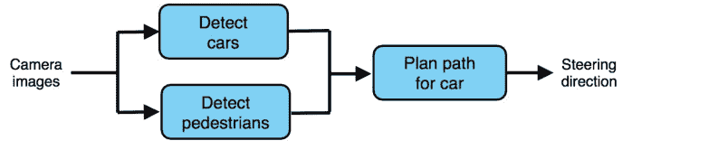

通过使用这个流水线，你是在告诉算法驾驶有 3 个关键步骤：（1）检测其他车辆，（2）检测行人，（3）为你的汽车规划路径。此外，每一个都是相对更简单的函数——因此可以用更少的数据学习——比纯端到端方法。

总之，在决定流水线的组件时，尝试构建一个流水线，其中每个组件都是相对“简单”的函数，因此可以仅从适量的数据中学习。

### 52 直接学习丰富的输出

图像分类算法会输入图像 x，并输出表示对象类别的整数。算法能否改为输出完整的一句话来描述图像？

例如：

x =

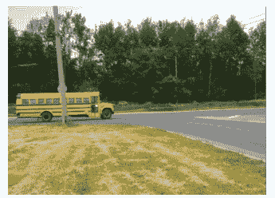

y = “一条黄色公共汽车驶下道路，背景中有绿树和绿草。”

监督学习的传统应用学习一个函数 h:X→Y，其中输出 y 通常是整数或实数。例如：

| Problem | X | Y |
|---|---|---|
| Spam classification | Email | Spam/Not spam (0/1) |
| Image recognition | Image | Integer label |
| Housing price prediction | Features of house | Price in dollars |
| Product recommendation | Product & user features | Chance of purchase |

端到端深度学习最令人兴奋的发展之一是它让我们可以直接学习比数字更复杂的 y。在上面的图像描述示例中，你可以让神经网络输入图像 (x) 并直接输出描述 (y)。

#### 这里有更多示例：

| Problem | X | Y | Example Citation |
|---------|---|----|------------------|
| Image captioning | Image | Text | Mao et al., 2014 |
| Machine translation | English text | French text | Sutskever et al., 2014 |
| Question answering | (Text,Question) pair | Answer text | Bordes et al., 2015 |
| Speech recognition | Audio | Transcription | Hannun et al., 2015 |
| TTS | Text features | Audio | van der Oord et al., 2016 |

这是深度学习中加速的趋势：当你拥有正确的（输入、输出）标注对时，有时即使输出是句子、图像、音频或其他比单个数字更丰富的输出，也能实现端到端学习。

## 按部分进行错误分析

### 53 按部分进行错误分析

假设你的系统使用复杂的机器学习流水线构建，并且你希望提高系统的性能。流水线的哪一部分应该改进？通过将错误归因于流水线的特定部分，你可以决定如何优先安排工作。

让我们使用我们的暹罗猫分类器示例：

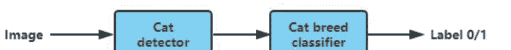

第一个部分，猫检测器，检测猫并将其从图像中裁剪出来。第二个部分，猫品种分类器，判断它是否是暹罗猫。花费数年时间改进这两个流水线组件中的任何一个都是可能的。你如何决定关注哪个组件？

通过进行 **按部分进行错误分析**，你可以尝试将算法犯的每个错误归因于流水线两个部分中的一个（有时是两者）。例如，算法将此图像错误分类为不包含暹罗猫 (y=0)，尽管正确标签是 y=1。

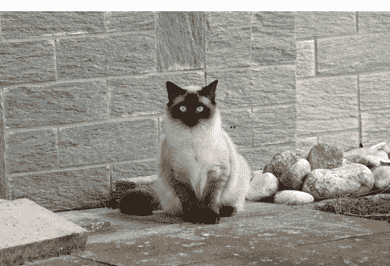

让我们手动检查算法的两个步骤做了什么。假设暹罗猫检测器检测到猫如下：

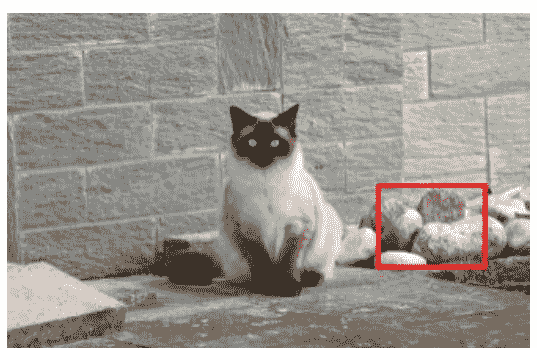

这意味着猫品种分类器得到以下图像：

猫品种分类器随后正确地将此图像分类为不包含暹罗猫。
因此，猫品种分类器是无辜的：它被给予了一堆岩石并输出了一个非常合理的标签 y=0。事实上，一个对上述裁剪图像进行分类的人也会预测 y=0。因此，你可以清楚地将此错误归因于猫检测器。

如果另一方面，猫检测器输出了以下边界框：

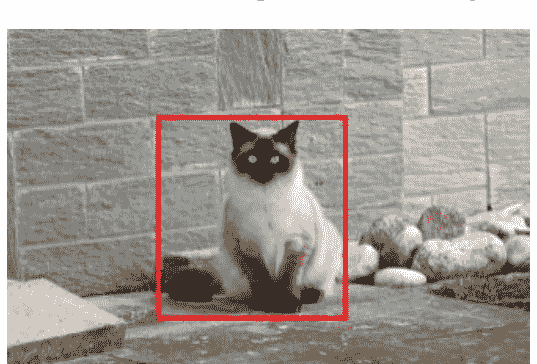

那么你会得出结论猫检测器已完成其工作，而猫品种分类器有问题。

假设你检查了 100 张被错误分类的开发集图像，发现 90 个错误可归因于猫检测器，只有 10 个错误可归因于猫品种分类器。
你可以安全地得出结论，你应该更关注改进猫检测器。

此外，你现在也方便地找到了 90 个猫检测器输出了错误边界框的示例。你可以使用这 90 个示例对猫检测器进行更深入的错误分析，以了解如何改进它。

到目前为止，我们对如何将错误归因于流水线某一部分的描述是非正式的：你查看每个部分的输出，看看是否能判断哪个部分犯了错误。这种非正式方法可能已经足够你使用。但在下一章，你也会看到一种更正式的归因错误的方法。

### 54 将错误归因于某一部分

让我们继续使用这个示例：

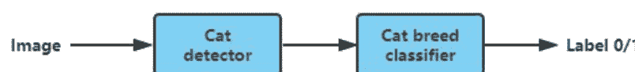

假设猫检测器输出了这个边界框：

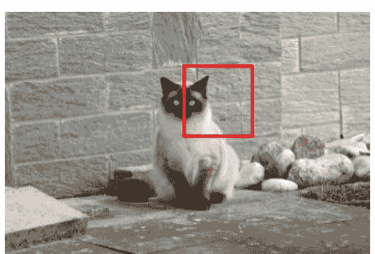

因此猫品种分类器得到这个裁剪图像，随后错误地输出 y=0，即图片中没有猫。

猫检测器做得不好。然而，一个技艺高超的人或许仍能从裁剪不佳的图像中识别出暹罗猫。那么我们应该将此错误归因于猫检测器，还是猫品种分类器，或两者兼有？这是模糊的。

如果像这样的模糊案例数量很少，你可以做出任何决定并得到类似的结果。但这里有一个更正式的测试，可以让你更明确地将错误归因于确切的一个部分：

- 1. 用手工标注的边界框替换猫检测器的输出。

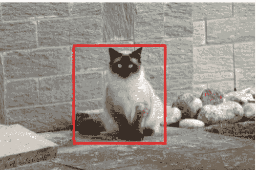

- 2. 将对应的裁剪图像通过猫品种分类器运行。如果猫品种分类器仍然将其错误分类，则将错误归因于猫品种分类器。否则，将错误归因于猫检测器。

换句话说，进行一个实验，给猫品种分类器一个“完美”的输入。有两种情况：

- Case 1: 即使给出“完美”的边界框，猫品种分类器仍然错误地输出 y=0。在这种情况下，显然猫品种分类器有问题。
- Case 2: 给出“完美”的边界框后，品种分类器现在正确地输出 y=1。这表明如果猫检测器只提供更完美的边界框，那么整个系统的输出就会正确。因此，将错误归因于猫检测器。

通过对被错误分类的开发集图像进行此分析，你现在可以明确地将每个错误归因于一个组件。这使你能够估计流水线每个组件导致的错误比例，从而决定将注意力集中在哪里。

### 55 错误归因的一般情况

以下是错误归因的一般步骤。假设流水线有三个步骤 A、B 和 C，其中 A 直接馈入 B，B 直接馈入 C。

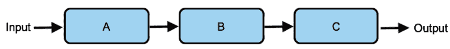

对于系统在开发集上犯的每个错误：

- 1. 尝试手动修改 A 的输出使其成为“完美”输出（例如，猫的“完美”边界框），并在此输出上运行流水线的其余部分 B、C。如果算法现在给出正确输出，则说明如果只有 A 给出更好的输出，整体算法的输出本应是正确的；因此，你可以将此错误归因于组件 A。否则，继续进行第 2 步。
- 2. 尝试手动修改 B 的输出使其成为 B 的“完美”输出。如果算法现在给出正确输出，则将错误归因于组件 B。否则，继续进行第 3 步。
- 3. 将错误归因于组件 C。

让我们看一个更复杂的例子：

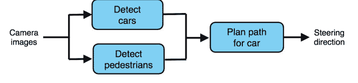

你的自动驾驶汽车使用此流水线。你如何使用分部件错误分析来决定应关注哪些组件？

你可以将三个组件映射到 A、B、C 如下：

- A: Detect cars
- B: Detect pedestrians
- C: Plan path for car

按照上述程序，假设你在封闭赛道上测试汽车，发现汽车选择的转向方向比熟练司机更突兀。在自动驾驶领域，这样的情况通常被称为 **场景**。你将：

- 1. 尝试手动修改 A（检测车辆）的输出使其成为“完美”输出（例如，手动输入告诉它其他车辆的位置）。像之前一样运行流水线的其余部分 B、C，但允许 C（规划路径）使用 A 现在完美的输出。如果算法现在为汽车规划出好得多的路径，则说明如果只有 A 给出更好的输出，整体算法的输出本会更好；因此，你可以将此错误归因于组件 A。否则，继续进行第 2 步。
- 2. 尝试手动修改 B（检测行人）的输出使其成为 B 的“完美”输出。如果算法现在给出正确输出，则将错误归因于组件 B。否则，继续进行第 3 步。
- 3. 将错误归因于组件 C。

ML 流水线的组件应按照有向无环图（DAG）排序，这意味着你应能够以某种固定的从左到右顺序计算它们，并且后面的组件应仅依赖于前面组件的输出。只要组件映射到 A->B->C 顺序遵循 DAG 排序，则错误分析就会没问题。你可能会得到略有不同的结果如果你交换 A 和 B：

- A: Detect pedestrians (was previously *Detect cars*)
- B: Detect cars (was previously *Detect pedestrians*)
- C: Plan path for car

但此分析的结果仍然有效，并能很好地指导你关注的重点。

### 56 分部件错误分析与与人类水平性能的比较

对学习算法进行错误分析就像使用数据科学分析 ML 系统的错误以得出下一步该做什么的见解。其最基本的形式，分部件错误分析告诉我们哪些组件的性能值得投入最大努力去改进。

假设你有一个关于客户在网站上购买商品的数据集。数据科学家可能有许多不同的数据分析方法。她可能会得出许多不同的结论，关于网站是否应提高价格，关于通过不同营销活动获得的客户的生命周期价值等等。没有一种“正确”的分析数据集的方法，可以得出许多有用的见解。同样，也没有一种“正确”的进行错误分析的方法。通过这些章节，你已经学习了许多最常见的设计模式，用于为你的 ML 系统得出有用的见解，但你也可以自由尝试其他分析错误的方法。

让我们回到自动驾驶应用，其中车辆检测算法输出附近车辆的位置（以及可能的速度），行人检测算法输出附近行人的位置，这两个输出最终用于为汽车规划路径。

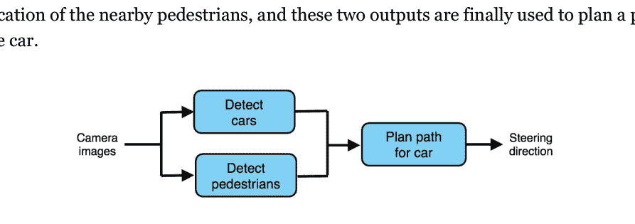

为了调试此流水线，而不是严格遵循上一章中看到的程序，你可以更非正式地问：

- 1. How far is the Detect cars component from human-level performance at detecting cars?
- 2. How far is the Detect pedestrians component from human-level performance?
- 3. How far is the overall system’s performance from human-level performance? Here, human-level performance assumes the human has to plan a path for the car given only the outputs from the previous two pipeline components (rather than access to the camera images). In other words, how does the Plan path component’s performance compare to that of a human’s, when the human is given only the same input?

如果你发现某个组件远未达到人类水平性能，你现在就有充分理由专注于改进该组件的性能。

许多错误分析流程在我们试图自动化人类可以做的事情并且因此可以与人类水平性能进行基准比较时效果最好。我们之前的大多数示例都隐含了这一假设。如果你正在构建一个 ML 系统，其中最终输出或某些中间组件执行的是即使人类也无法做好的事情，那么这些程序中的一些将不适用。

这是解决人类可以解决的问题的另一个优势——你拥有更强大的错误分析工具，因此可以更有效地优先安排团队的工作。

### 57 发现有缺陷的 ML 流水线

如果你的 ML 流水线的每个单独组件都达到人类水平性能或接近人类水平性能，但整体流水线远未达到人类水平怎么办？这通常意味着流水线存在缺陷，需要重新设计。错误分析也可以帮助你了解是否需要重新设计流水线。

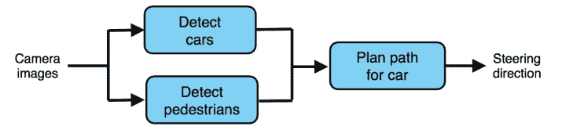

在上一章中，我们提出了每个三个组件的性能是否达到人类水平的问题。假设这三个问题的答案都是肯定的。即：

- 1. The Detect cars component is at (roughly) human-level performance for detecting cars from the camera images.
- 2. The Detect pedestrians component is at (roughly) human-level performance for detecting pedestrians from the camera images.
- 3. Compared to a human that has to plan a path for the car given only the outputs from the previous two pipeline components (rather than access to the camera images), the Plan path component’s performance is at a similar level.

然而，你的整体自动驾驶汽车的性能明显低于人类水平性能。即，被给予访问摄像头图像的人类可以为汽车规划明显更好的路径。你能得出什么结论？

唯一可能的结论是 ML 流水线存在缺陷。在这种情况下，Plan path 组件在给定其输入的情况下已经做得尽可能好，但输入不包含足够的信息。你应该问自己，除了来自两个早期流水线组件的输出之外，还需要什么其他信息才能非常好地为汽车规划行驶路径。换句话说，熟练的人类驾驶员还需要什么其他信息？

例如，假设你意识到人类驾驶员还需要知道车道标记的位置。这表明你应该按如下方式重新设计流水线¹⁸：

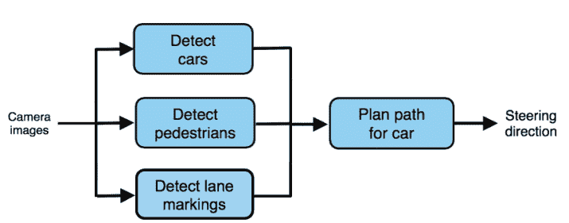

最终，如果你认为即使每个单独组件都具有人类水平性能（记住你是将组件与被给予相同输入的人类进行比较），你的流水线整体也无法达到人类水平性能，那么流水线存在缺陷，应该重新设计。

¹⁸ In the self-driving example above, in theory one could solve this problem by also feeding the raw camera image into the planning component. However, this would violate the design principle of “Task simplicity” described in Chapter 51, because the path planning module now needs to input a raw image and has a very complex task to solve. That’s why adding a Detect lane markings component is a better choice--it helps get the important and previously missing information about lane markings to the path planning module, but you avoid making any particular module overly complex to build/train.

## 结论

### 58 组建超级英雄团队 - 让你的队友阅读此书

恭喜你读完这本书！

在第 2 章中，我们谈到这本书如何帮助你成为团队的超级英雄。

比成为超级英雄更好的唯一事情就是成为超级英雄团队的一员。我希望你能把这本书的副本送给你的朋友和队友，帮助创造其他超级英雄！

