# Macromedia Dreamweaver MX 2004 With ASP, ColdFusion, and PHP：官方培训指南


## 致谢

**作者**
Jeffrey Bardzell

**编辑**
Wendy Sharp

**文字编辑**
Peggy Gannon

**制作协调员**
Becky Winter

**排版**
Rick Gordon, Emerald Valley Graphics
Debbie Roberti, Espresso Graphics
Myrna Vladic, Bad Dog Graphics

**索引编制**
Julie Bess

**技术审阅**
Robert Crooks, Macromedia 培训与课程总监

**封面制作**
George Mattingly, GMD

## 引言

Macromedia Dreamweaver 多年来一直是可视化 HTML 编辑器的市场领导者，集易用性、强大功能和异常高质量的代码编写于一身。但是，自第 1 版首次发布以来，Web 已经发生了变化。多年来，众多技术——其中许多与 Web 独立发展——已成为关键的 Web 制作工具，包括 JavaScript、数据库、SQL、Java、WML、WSDL、层叠样式表、XML、XSLT、CGI 脚本，尤其是一组使开发人员能够将网页转变为功能强大、数据驱动、交互式 Web 应用程序的新服务器语言：这些包括 Macromedia ColdFusion、Microsoft ASP 和 ASP.NET，以及 JSP 和 PHP。在不牺牲易用性或其始终生成的代码质量的前提下，Macromedia Dreamweaver 已吸收了这些技术，不仅可以单独使用每种技术，还可以构建结合这些技术的复杂应用程序。

### 前提条件

虽然 Dreamweaver 已设法跟上 Web 技术的快速发展，但许多开发人员却没有做得那么好。HTML、图像编辑和层叠样式表是一回事：文档对象模型、for 循环、关系数据、串联、记录集、Cookie 和方法则是另一回事。然而，对我们许多人来说，我们的职业生涯取决于从静态 HTML 跃升到功能齐全的动态 Web 应用程序的能力——这意味着要掌握上一段中列出的几种技术的能力。

这就是 Macromedia Dreamweaver MX 2004 with ASP, ColdFusion, and PHP: Training From the Source 派上用场的地方。在一系列实践教程中，你将掌握使用当今最热门的三种动态应用程序开发语言的能力：Microsoft ASP (VBScript) 和 Macromedia ColdFusion Markup


语言（CFML），以及开源的 PHP。在此过程中，你还将学习数据库设计、编写 SQL 查询、层叠样式表、全新的 XHTML 标准等内容。

本书采用了一种创新策略，既提供足够的手动编码练习，让你熟练掌握这些语言的编程，又详细介绍了 Dreamweaver 提供的基于对话框和向导的服务器行为以及预构建的应用程序对象，以加速应用程序开发。目标不仅仅是构建动态应用程序，更是让你深入理解其工作原理，即使你在使用基于 GUI 的服务器行为时也是如此。

本课程假设你具备以下条件：

- 你对操作系统有基本了解，包括使用菜单系统和文件管理。
- 已安装 Dreamweaver MX，并且你的系统满足运行它所需的要求。
- 你熟悉在 Dreamweaver 中工作，包括使用属性检查器、各种面板和主菜单。你还应该了解站点定义过程和站点面板。
- 你了解 HTML 代码的工作原理，并熟悉其最常见的标记和属性，例如 <p>、<table>、<tr>、<td>、<ol>、<ul>、<h1>、<h2> 和  标记。你还应该了解常见的 HTML 概念，例如绝对链接与相对链接、有效嵌套的标记，以及文档 head 和 body 之间的区别。

## 大纲

本 Macromedia 培训课程将引导你完成每个课中的项目，演示如何在 Dreamweaver MX 2004 中使用 ASP、ColdFusion 和 PHP 创建数据库驱动的交互式 Web 应用程序。本课程的课程预计需要 20 到 24 小时完成，包括以下课程：

- Lesson 1: 介绍 Newland Tours
- Lesson 2: 升级到 XHTML
- Lesson 3: 创建表现层
- Lesson 4: 动态 Web 站点
- Lesson 5: 在页面之间传递数据
- Lesson 6: 从 Web 表单发送电子邮件
- Lesson 7: 构建旅游价格计算器
- Lesson 8: Web 上的数据库
- Lesson 9: 完成价格计算器
- Lesson 10: 筛选和显示数据
- Lesson 11: 构建旅游描述
- Lesson 12: 构建搜索界面
- Lesson 13: 用户身份验证
- Lesson 14: 使用表单管理内容
- Lesson 15: 构建更新页面
- Lesson 16: 手动编码基本 CMS

## 项目站点

在完成本书的过程中，你将为一家名为 Newland Tours 的虚构旅行旅游公司构建一个站点。Newland Tours 向世界各地的众多国家提供旅行旅游服务。目前，旅游项目列在一个静态 HTML 网页上。不幸的是，新旅游项目不断添加，旧旅游项目被移除，旅游详细信息（尤其是价格）经常更改。Newland Tours 公司内部没有专职 Web 开发人员，难以保持站点内容的更新，他们正在寻找更好的方法来保持 Web 上内容的及时更新。此外，站点用户抱怨旅游项目很难找到，因为除了浏览冗长的旅游列表页面之外，没有搜索旅游项目的方法。

当然，解决方案是将旅游项目的数据存储在数据库中，并使用户能够通过 Web 搜索数据库记录。同样，正如你将学到的，Web 表单可用于从任何可访问 Internet 的计算机更新数据库。当然，通过 Web 表单将 Newland Tours 数据库暴露给普通公众并不是良好的安全实践，因此你还将为站点实现一个授权框架，该框架会阻止用户查看页面，除非他们已登录。

在此过程中，你将构建许多常见的 Web 应用程序，包括旅游价格计算器、“联系我们”表单（会自动生成电子邮件消息）、搜索界面，以及一种基于表单的内容管理系统，它使 Newland Tours 员工能够插入、更新和删除国家简介。

## 元素和格式

本书中的每个课程首先概述当前课程的主要重点并介绍新功能。学习目标和完成所有练习所需的大致时间也列在每个课程开头。项目被分为简短的练习，解释你所学每项技能的重要性。每个课程都将建立在之前课程所使用的概念和技术之上。

**提示：** 执行任务的替代方法，以及在应用所学技能时值得考虑的建议。

**注释：** 用于扩展知识的其他背景信息，以及你可以探索的高级技术，以进一步发展你的技能。

粗体术语：每个课程中介绍并强调的新词汇。

斜体文本：斜体表示你需要输入的文本。

菜单命令和键盘快捷方式：在 Dreamweaver 中，执行同一任务通常有多种不同的方法。每个课程中都会指出不同的选项。菜单命令在菜单名称和命令之间用尖括号显示：Menu > Command > Subcommand。键盘快捷方式在键名称之间用加号显示，表示你应同时按下这些按键；例如，Shift+Tab 表示你应同时按下 Shift 和 Tab 键。

光盘：你完成每个课程项目所需的文件位于以课程命名的文件夹中，例如 Lesson01、Lesson02 等。光盘位于书的末尾。课程文件夹中包含 Start 和 Complete 文件夹，分别表示该课程开始和结束时 Newland Tours 项目的状态。在最初的几个课程之后（这些课程无论你计划使用哪种服务器模型（ASP、ColdFusion 或 PHP）都使用相同的文件），Start 和 Complete 文件夹中包含每个服务器模型的子文件夹——newland-asp、newland-cfm 和 newland-php。

你将用于每个项目的文件列在每个课程开头。

## 如果你遇到困难

学习动态 Web 站点开发时一个令人沮丧的方面是你将遇到的错误。动态 Web 站点通常是多种技术的融合，其中一些技术（尤其是 ASP、ColdFusion 和 PHP 本身）依赖于服务器的配置。如果服务器（或数据库）未正确配置，即使你在 Dreamweaver 中输入了所有正确的代码，也会看到错误消息。更糟糕的是，你看到的错误消息通常很难解释（尤其是 ASP 中的错误消息），在某些情况下还可能具有误导性。

以下是你可以用来解决这些问题的一些策略：

使用课程 Complete 文件夹中的文件。提供这些文件的原因之一是，以便你在文件出现问题时可以使用它们。你还可以打印出你的文件和 Complete 文件夹中文件的代码以进行比较。

查阅 Macromedia 关于常见服务器错误的技术说明。虽然此页面最初是为 Dreamweaver UltraDev（Dreamweaver MX 的前身）创建的，但其中列出了一些最常见的服务器错误及其解决方案：http://www.macromedia.com/support/ultradev/ts/documents/common_server_errors.htm

验证你正在测试的页面拥有所需的所有数据。某些页面依赖于表单或查询字符串/URL 变量的存在才能工作。例如，详细信息页面上的 SQL 查询可能会根据来自相关页面的预期查询字符串或 URL 变量筛选数据库记录。如果你直接测试该详细信息页面，而不先经过相关页面，则 ASP、ColdFusion 或 PHP 期望的数据将不存在，从而导致错误。始终从应用程序的起始页面开始测试，而不是从流程中间的页面开始测试。

知道何时继续前进。虽然你应该尝试解决遇到的任何错误，但不要死磕不休。本书的真正目标是让你学习动态 Web 站点开发，而不是字面意义上构建 Newland Tours 站点的每个方面。如果你遇到困难，到了某个时候，最好替换为 Complete 文件夹中的文件并继续前进。

尝试确定问题是由于代码还是配置引起的。在静态 HTML 开发中，如果页面显示不正确，几乎总是因为你的代码中有问题。当看到服务器错误时，许多初学者认为是自己代码出错了，虽然这有可能，但同样可能是配置问题，例如权限错误、服务不可用或缺少 DSN。最简单的测试方法是替换为 Complete 文件夹中的文件——如果它也无法工作，那么你的代码可能没问题。请与服务器管理员讨论此事。

查看本书的网站。由于 ASP、ColdFusion 和 PHP 错误非常常见且难以排查，作者和编辑团队特别注意确保本书和光盘中的代码没有错误。但是，没有哪本书是完全没有错误的，如果我们发现任何错误，会将其发布在本书页面上：http://www.allectomedia.com。

在相关的 Macromedia Dreamweaver 论坛中提问。Macromedia 拥有多个免费论坛，任何人都可以前往提问或搜索以前的帖子。这些论坛由 Macromedia 技术支持人员以及 Dreamweaver/ASP/ColdFusion/PHP 资深人士和专家经常访问，你通常可以在几分钟内得到问题的解答。要访问论坛，请访问 http://www.macromedia.com/support/dreamweaver/ts/documents/dream_newsgrp.htm。我会定期访问 Dreamweaver 应用程序开发新闻组，并特别关注标题中提及本书的帖子。我无法保证为每位读者可能遇到的每个问题提供支持，但该论坛的社区足以帮助大多数人获得所需内容。


## 来源于源头的 Macromedia 培训

“来源于源头的 Macromedia 培训”系列是与 Macromedia 合作开发，并由产品支持团队审核的。该系列丛书非常适合主动学习者，提供动手实践的指导，旨在帮助您掌握程序的基础知识。如果您最擅长通过实践来学习，那么这个系列非常适合您。“来源于源头的 Macromedia 培训”系列的每一本书都旨在教授您创建复杂专业级项目所需的技术。每本书都包含一张 CD-ROM，其中包含课程中使用的所有文件、用于比较的完整项目以及更多内容。

## Macromedia 授权培训与认证

本书旨在让您使用来自源头的内容自主学习。其他培训选择可通过 Macromedia 授权培训合作伙伴计划获得。参加由 Macromedia 认证讲师教授的任务导向课程，只需几天时间即可快速上手。或者，您可以通过 Macromedia University 的交互式在线培训自行学习。所有这些培训来源都将帮助您成为 Macromedia 认证开发人员。

有关授权培训和认证的更多信息，请访问 www.macromedia.com/go/training

## 您将学到的内容

在学习这些课程的过程中，您将培养创建和维护自己网站所需的技能。

课程结束时，您将能够：

- 更新现有网站，使其使用可维护且符合标准的 XHTML 和 CSS 代码
- 了解 HTTP 协议的局限性，以及 ASP、ColdFusion 和 PHP 如何与其配合以启用 Web 应用程序
- 在页面之间传递数据，并使用表单、查询字符串/URL、cookie、会话和应用程序变量使数据随时间持久化
- 收集和处理用户通过 Web 表单输入的信息
- 使用客户端（JavaScript）和服务器端（ASP、ColdFusion 或 PHP）代码验证表单中输入的数据
- 编写代码以计算表达式并执行简单的数学计算
- 将网站连接到数据库，以便显示数据库内容
- 过滤从数据库检索的数据
- 构建搜索界面，使用户只能访问所需信息
- 对用户进行身份验证并限制页面访问
- 构建内容管理系统，使网站所有者可以使用 Web 表单而不是 HTML 编辑器和 FTP 来维护 Web 内容
- 手动编写常见的 ASP、ColdFusion 和 PHP 脚本，以便在未来项目中重复使用
- 学习核心 SQL 语句，使您能够构建以复杂方式与数据交互的页面
- 使用条件语句和循环控制脚本流
- 使用 Dreamweaver 的服务器行为、记录集对话框和预构建的应用程序对象，快速开发动态 Web 应用程序

## 最低系统要求：WINDOWS

- Macromedia Dreamweaver MX 2004（CD-ROM 上附带 30 天试用版。）
- Intel Pentium III 处理器或等效 600+ MHz
- Windows 98 SE、Windows 2000 或 Windows XP
- 128 MB 内存（建议 256 MB）
- Internet Explorer 或 Netscape Navigator 4.0 或更高版本
- 因特网访问（仅第 6 课需要）
- 可以访问能够处理所需应用程序语言的服务器，具体如下：
  - ASP/VBScript 用户必须能够访问 Microsoft Internet Information Services (IIS)。IIS 与 Windows 2000 和 Windows XP Professional 捆绑提供，因此您可以在本地系统上运行它。或者，您可以通过网络或通过 Web 使用 FTP 连接到 IIS 服务器。
  - ColdFusion 用户除了 Web 服务器（例如 IIS、Apache 或 ColdFusion 自己的独立服务器）之外，还必须能够访问 ColdFusion 应用程序服务器。单 IP 开发者版 ColdFusion 可从 http://www.macromedia.com 免费下载。
  - PHP 用户必须能够访问 Web 服务器（例如开源的 Apache Web 服务器），并加载 PHP 模块。可以在 IIS 环境中运行 PHP，但推荐将 Apache 用于 PHP。

## 最低系统要求：MACINTOSH

- Macromedia Dreamweaver MX 2004（CD-ROM 上附带 30 天试用版。）
- 500 MHz Power Mac G3 处理器
- Mac OS 10.2.6
- 128 MB 计算机内存（建议 256 MB）
- Internet Explorer 4.0 或 Safari 1.0 或更高版本
- 因特网访问（仅第 6 课需要）
- 可以访问能够处理所需应用程序语言的服务器，具体如下：
  - ASP/VBScript 用户必须能够通过网络或因特网访问 Microsoft Internet Information Services (IIS) Web 服务器。IIS 和 ASP 无法从 Macintosh 本地运行。
  - ColdFusion 用户必须能够通过网络或因特网访问 ColdFusion 服务器。ColdFusion 无法从 Macintosh 本地运行（除非它运行在 J2EE 服务器之上，例如 Macromedia JRun）。
  - PHP 用户必须能够访问支持 PHP 的 Web 服务器，例如开源的 Apache。您可以通过网络或因特网连接到支持 PHP 的 Apache 服务器。此外，Mac 用户现在可以在本地运行带 PHP 的 Apache，而无需通过网络或因特网连接到单独的服务器。

## 介绍 Newland Tours

## 第 1 课

Web 正在发生变化。HTML 不再是一种新技术，大多数成熟的组织不再寻求吸引人的 Web 形象站点，即在 Internet 上建立静态形象但功能有限的站点。他们已经拥有站点，在许多情况下，这些站点已经存在了几年。当今的 Web 设计师和开发人员面临的问题与几年前越来越不同。

- 当今的设计师和开发人员不再是创建全新的站点，而是需要在不断变化的标准、新技术和不断发展的内容面前维护现有站点。

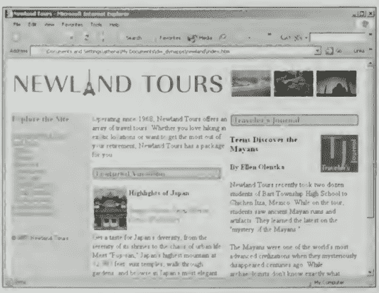

Newland Tours 网站的主页看起来还不错，但其中的某些部分（例如右侧的每周 Traveler’s Journal 栏目）需要大量工作来维护。

- 不同浏览器之间的差异（现在包括为数百万有障碍的用户提供的辅助技术）已经非常显著，以至于仅在 Netscape 和 Internet Explorer 中检查页面已不再是可接受的做法。
- 现代 Web 网站应响应用户需求，这通常意味着 Web 网站必须实时响应用户交互。
- 当今的设计师和开发人员通常需要构建内容管理系统，通过创建发布内容的 Web 表单，将站点内容维护从 IT 部门转移到非技术业务用户，从而促进这一转变。

诸如此类的需求引发了一系列实际问题。更新站点外观或结构的最快方法是什么？如何设计站点，使非技术内容专家也能为其贡献内容？如何开发能够根据用户需求和兴趣自定义的站点？最后，如何同时实现所有这些目标？

为了解决这些问题，一系列全新的技术解决方案应运而生，用于解决 Web 开发问题：级联样式表（CSS）、ColdFusion、ASP、SQL、数据库服务器、XHTML、DHTML、XML、Web 服务、ADO、CDO、JavaScript、Flash、PHP、Java、.NET、XSLT 等等。Web 开发软件（例如 Macromedia Dreamweaver MX 2004）也已跟上步伐，使开发人员可以使用上述任何技术创建站点。但是，对于过去的 HTML 编写者来说，这场技术解决方案的洪流可能看起来和它们声称要解决的问题一样棘手。

日益增加的是，掌握其中许多技术已成为当今 Web 开发人员的核心技能组合的一部分。本书的目标是帮助您朝着这个目标迈出坚实的步伐。本书的核心项目将一个静态 Web 站点转变为交互式、易于维护且符合标准的站点。该站点面向名为 Newland Tours 的虚构旅游运营商。完成本书后，站点访问者将能够快速轻松地定位所需内容。此外，拥有该站点的非技术用户无需了解任何 HTML 代码即可更新它。这些目标雄心勃勃但可以实现；而且，由于 Dreamweaver 的工具和环境，它们比您想象的更容易实现。

在本课中，您将熟悉本书的起点和终点。您将在 Dreamweaver 中打开当前存在的站点。第一个任务是创建一个新页面；想象一下，在开始重新设计站点之前，客户需要您立即创建一个缺失的页面。一旦紧急危机过去，您将


网站的不足之处。这些不足之处可分为两类：技术性不足，例如网站中使用的过时且不符合标准的代码；以及业务性不足，即网站不再满足其业务需求。最后，您将访问网络，查看您在本书过程中将要构建的网站的完成版本。

## 您将学习的内容

本课中，您将：

- 在 Dreamweaver 中定义静态站点
- 在 Dreamweaver 环境中工作，创建并布置新的内容页面
- 探索现有 HTML 代码
- 了解客户的需求
- 探索本书结束时所示的已完成项目
- 制定网站升级策略

## 大致所需时间

本课程大约需要 60 分钟完成。

## 课程文件

### 起始文件：

Lesson01/Start/newland/about.htm
Lesson01/Start/newland/contact_text.txt
Lesson01/Start/newland/index.htm
Lesson01/Start/newland/profiles.htm
Lesson01/Start/newland/tours.htm

### 已完成文件：

Lesson01/Start/newland/contact.htm

## 定义静态站点

您继承的 Newland Tours 网站是一个静态 HTML 站点。因此，
您可以轻松将其拉入 Dreamweaver 并开始处理它。

使用 Web 站点通常涉及数百甚至数千个单独的文件，包括网页、图像、层叠样式表、多媒体资源等。这些文件通过 HTML 相互链接。不幸的是，即使是一个小拼写错误也会产生丑陋的（或用户无法解读的）错误消息，甚至阻止访问站点的部分内容。Dreamweaver 提供了许多复杂的站点管理工具，以帮助确保站点在开发期间和上线后的整体完整性。要利用这些功能，您必须首先定义站点，至少在此过程中，您需要告诉 Dreamweaver 站点根文件夹位于硬盘驱动器上的哪个位置。

定义站点有多种好处，您很快就会看到其中许多好处。它有助于
防止链接损坏，如果您移动或重命名文件，它会自动更新整个站点中的文件。站点管理器还允许您执行站点范围的操作，例如
查找和替换，这大大提高了生产力。站点管理器的另一个关键优势是它具有内置的文件上传功能（包括 FTP），
这意味着您可以随时单击按钮将文件发布到 Web。您甚至可以同步本地文件（在硬盘驱动器上）和远程
文件（在 Web 或暂存服务器上），以确保文件的最新版本位于正确位置。

在此任务中，您将在站点定义对话框中定义一个常规静态站点，该
过程只需为站点命名并告诉 Dreamweaver 它在本地磁盘上的存储位置即可。在几个课程之后，一旦您做好了适当的
准备，您将返回此对话框并定义动态站点。动态站点
定义稍微复杂一些，在这个早期阶段额外的开销对我们没有好处。幸运的是，您随时可以更改站点定义，因此我们暂时定义一个静态站点并立即开始工作，无所损失。

- 1) 在硬盘上创建名为 dw_dynapps 的新目录。您将在该文件夹中存储站点的本地版本。

- 2) 将 CD-ROM 上 Lesson01/Start 文件夹中找到的 newland 文件夹（及其内容）复制到此新目录中。

在现实生活中，您经常会继承现有站点并被要求对其进行升级。对于任何重大升级，最好是复制现有站点并在其副本上工作。您绝不应该直接编辑生产环境中的站点（即公众看到的站点）。

- 3) 打开 Dreamweaver MX 2004。

文件在 Dreamweaver 中可见后，您应仅在 Dreamweaver 中编辑它们。任何文本编辑器都可以打开任何 HTML 文件，每个操作系统都有文件管理实用程序（例如 Macintosh Finder 或 Windows Explorer），可让您移动和删除文件。但您应避免使用这些工具，因为任何更改都可能破坏 Dreamweaver 的站点管理器，从而可能导致链接损坏。因此，文件放置后，请直接前往 Dreamweaver，避免通过其他任何方式对其进行操作的诱惑。

- 4) 在启动页面上，单击“创建新 Dreamweaver 站点”链接。

**注释** 您还可以选择 站点 > 管理站点，然后单击新建按钮。

虽然文件在您的硬盘上，但 Dreamweaver 目前尚未看到它们。通过定义站点，您可以使 Dreamweaver 看到——并管理——这些文件。您在站点定义对话框中定义站点。如果您看到的对话框与屏幕截图中的不同，可能是因为您处于高级视图中。单击对话框顶部附近的“基本”选项卡，以调出屏幕截图中所示的基本视图。

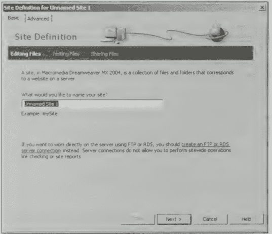

- 5) 在屏幕上唯一的字段中输入 *纽兰旅游*，然后单击下一步。

站点定义对话框的基本视图采用向导式方法，不同于早期版本 Dreamweaver 中更复杂的对话框。

**提示** 如果您更喜欢旧式站点定义对话框，可以通过单击“高级”选项卡来访问它。

- 6) 在“编辑文件，第 2 部分”屏幕上，选择“不，我不想使用服务器技术”。单击下一步。

本书后面您将使用服务器技术。但现在选择不，即可跳过几个复杂步骤。

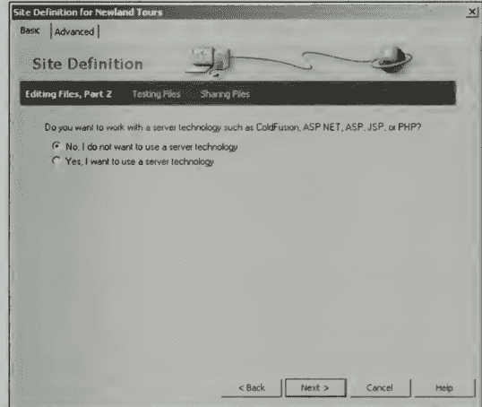

- 7) 在下一个屏幕上，选择第一个选项：在我的计算机上编辑本地副本，然后在准备就绪时上传到服务器（推荐）。

因此，站点始终会有两组文件：一组本地（通常在硬盘驱动器上，如果您愿意，也可以将其放在网络文件夹中），一组远程（通常在服务器上）。这样更安全，因为您始终至少有一个文件备份。更重要的是，这意味着您所处理的文件将存储在硬盘驱动器上，客户永远看不到它们。

大多数专业站点都采用 3 层设置工作。本地站点包含 Dreamweaver 用户硬盘驱动器上正在开发的所有文件。暂存服务器包含仅用于测试和开发目的的站点镜像。公众永远看不到暂存服务器上的内容，但它是一个真正的 Web 服务器环境，通常与生产服务器的环境相同或几乎相同。生产服务器是站点的公开版本。只有经过测试、编辑、润色和批准的文件才能发布到生产服务器上。

- 8) 单击“您希望在计算机上的哪个位置存储文件”字段旁边的文件夹图标，浏览到 dw_dynapps 文件夹中的 newland 文件夹，然后单击“选择”以选择文件夹并返回站点定义对话框。在此步骤中，您正在定义本地站点——所有操作都在此处进行。每当您编辑文件时，都会编辑本地站点中显示的文件。公众通常看不到本地站点，这意味着在工作时如果暂时破坏了站点的功能，也不会造成任何损害。

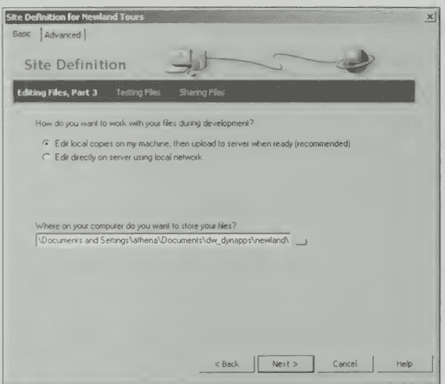

- 9) 在下一个屏幕上，在下拉菜单中选择“无”。通常，您会将暂存服务器或生产服务器指定为远程站点。使用动态、数据库驱动的内容时，暂存服务器是绝对必要的。本书后面，您将定义远程站点，并将其用作暂存服务器。该暂存服务器将能够处理完全动态的站点，而您正在定义的本地站点无法做到这一点——稍后您将看到。但目前，远程站点是不必要的复杂因素。

> 注释 本书中您构建的站点没有生产服务器，因为 纽兰旅游 是虚构的。


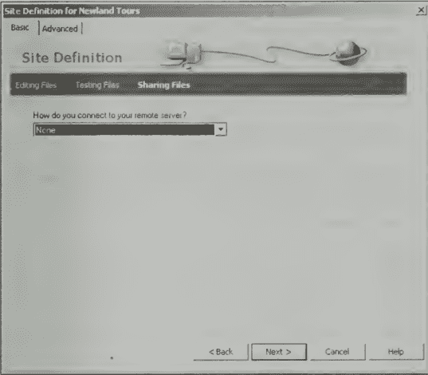

- 10) 单击“下一步”。查看摘要，然后单击“完成”。

完成后，将出现一个对话框，指示 Dreamweaver 正在生成站点缓存。这意味着 Dreamweaver 正在分析站点中的所有文件，检查所有链接，并将其存储在内存中。这样，如果您决定重命名页面或将资产移动到不同文件夹，Dreamweaver 将自动更新所有链接到修改文件的文件。一旦 Dreamweaver 生成了站点缓存，对话框会自行消失。

完成后，站点面板（默认位于屏幕右下角）中应显示文件。您可能还会注意到每个文件旁边出现一个锁图标。此锁表示文件是只读的，这意味着您无法修改它们。

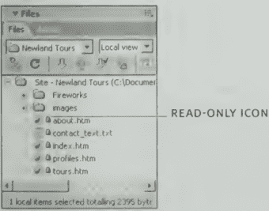

这显然不是您想要的行为——在 Dreamweaver 中使用文件的整个目的就是要修改它们。之所以显示为只读，是因为您从 CD-ROM 复制了它们，而 CD-ROM 是只读的（事实上，CD-ROM 中的 RO 即表示此含义）。如果单击展开 Fireworks 或 images 文件夹，您会看到这些文件也都带有锁图标。

在开始处理文件之前，您需要关闭只读状态。

- 11) 将光标定位到顶级文件夹上（应显示为“Site – Newland Tours”），然后右键单击（Windows）或 Control-单击（Macintosh）打开上下文菜单。在该菜单中，选择“关闭只读”。

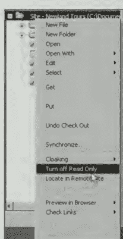

此时如果浏览站点，您会发现所有锁图标都已移除。站点已定义，您可以开始操作了！

## 创建“联系我们”页面

与 Web 项目通常的情况一样，在着手改版 Newland Tours 站点之前，必须先解决一个更紧迫的需求：站点的“联系我们”页面缺失，需要重新创建。

此练习主要旨在快速学习/回顾在 Dreamweaver 中创建和编辑 Web 页面的基础知识。如果您已经非常熟悉在 Dreamweaver 中开发静态页面，可以跳过此练习——最终结果位于本章 Complete 文件夹的 CD 中，以及所有后续章节 Start 文件夹中。如果跳过此练习，请从两个章节后继续阅读，“评估站点：代码”。

此快速练习仅旨在为您在 Dreamweaver 环境中工作提供基础。它不旨在作为使用 Dreamweaver 开发静态 Web 站点的全面指南。有关此内容，请参阅 *Macromedia Dreamweaver MX 2004: Training From the Source*（Macromedia Press）或 *Macromedia Dreamweaver MX 2004: Visual Quickstart Guide*（Macromedia Press/Peachpit）。

- 1) 在“文件”面板中，双击文件 contact_text.txt 在 Dreamweaver 中打开它。如果“文件”面板不可见，请选择 窗口 > 文件 使其显示。从内容可以推测，此文件包含“联系我们”页面所需的所有文本。

这是一个纯文本文件，而不是 HTML 文档。它不包含任何 HTML 标签，尽管它在 Dreamweaver 中显示有格式，但如果在浏览器中查看，所有格式都会丢失，并且会折叠成一个大段落。折叠的原因是浏览器忽略空白字符——段落返回、空格（除用于分隔单词的第一个空格外）和制表符。要在浏览器中显示的页面上创建空白，请使用 HTML 标签，例如段落 (<p>) 标签。在接下来的几个步骤中，您将复制站点中的现有页面 (about.htm)，并用此文件的内容替换其内容，使用 HTML 对这些内容进行格式化，并将页面另存为 contact.htm。

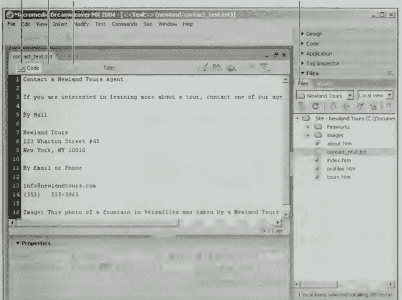

请注意，在“视图”工具栏上，“代码”按钮已选中，其旁边的“拆分”和“设计”按钮呈灰色。由于文档缺少 HTML，Dreamweaver 无法以设计视图打开它。在本书中，您将频繁在代码视图和设计视图之间切换。

- 2) 单击文本中的任意位置，然后选择 编辑 > 全选。选择 编辑 > 复制，将所有文本放到剪贴板上。

文本现已准备好粘贴到目标文档中——只是您目前还没有目标文档。

- 3) 在“文件”面板中，双击 about.htm 将其打开。如果需要，请单击“设计”按钮以查看渲染后的页面，而不是其代码。

您将使用此页面作为创建新页面的指南。

- 4) 选择 文件 > 另存为，并将文件命名为 contact.htm。

您即将修改 about.htm 的此版本。为确保不覆盖原始版本，请使用“另存为”并赋予新名称来创建副本。

每个页面的导航栏中都有一个名为“联系代理”的按钮。

单击该按钮会加载 contact.htm，直到此刻该文件才不存在。

- 5) 拖动以从“关于新兰旅游”选择到包含图片说明的所有内容。按 Delete 键。

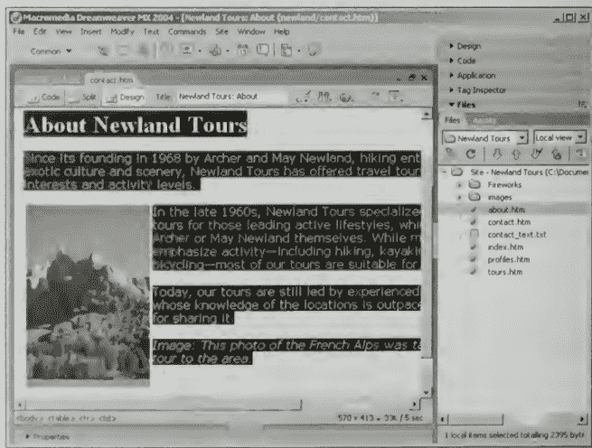

此内容仅适用于 about.htm。您将使用剪贴板上的内容替换它。

按 Delete 键后，您会注意到与文本其余部分内联放置的图像也被删除了。

- 6) 在光标在页面主（现已为空）内容区域中闪烁时，通过单击“拆分”按钮切换到代码和设计视图（以下简称拆分视图）。

通过同时使用两种模式，您可以直观地进行设计，并确保 Dreamweaver 按照您的预期编写代码。

请注意，在代码视图中，光标位于 <h1> 标签内部。<h1> 标签指示浏览器使用一级标题呈现封闭内容。在文档窗口下方的“属性”检查器中，请注意 格式 下拉菜单显示“标题 1”。换句话说，“属性”检查器显示的就是您刚才在代码视图中看到的内容：插入点已格式化为一级标题。如果此时粘贴剪贴板上的内容，所有内容都将格式化为一级标题。

作为默认段落格式，更合理的选择是常规段落格式，由 <p> 标签指示。

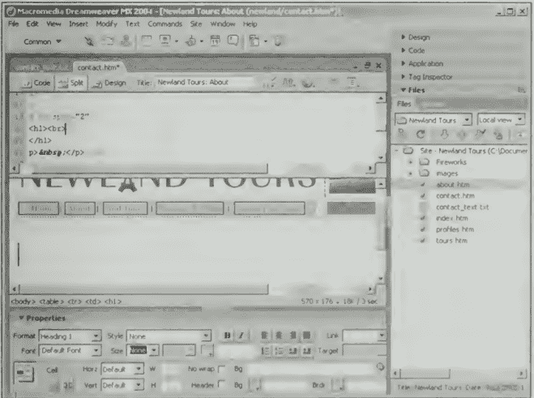

属性检查器

- 7) 在“属性”检查器的 格式 下拉菜单中，选择“段落”。

请注意，在代码视图中，<h1></h1> 标签已替换为 <p></p> 标签。现在，如果粘贴剪贴板上的内容，它们将格式化为常规段落。

- 8) 如果 <br> 标签出现在代码视图的 </p></p> 标签之间，请选中并删除它。

此标签是 about.htm 的遗留物，可能会或可能不会遗留，具体取决于您如何选择和删除原始页面内容。

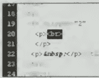

- 9) 在窗口代码部分的 <p> 和 </p> 标签之间放置光标，选择 编辑 > 粘贴。

contact_text.txt 中的文本已被粘贴，并与原始文件中的格式相同。如果您在设计和代码视图中比较文本和代码，您会发现 Dreamweaver 已自动插入换行符 (<br>) 以创建段落分隔的外观。

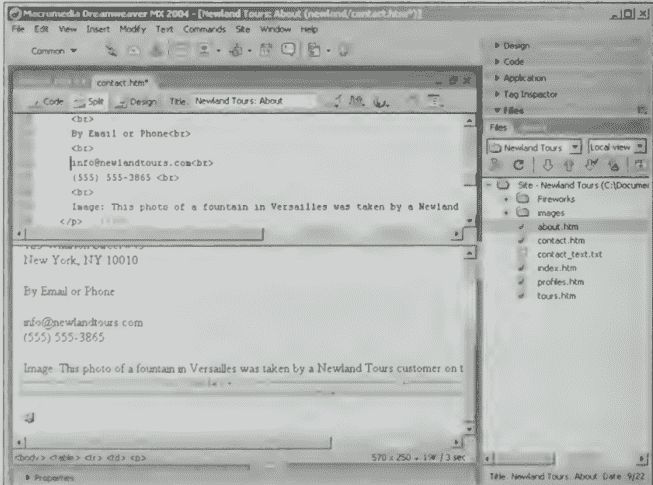

内容已在新页面中，您现在可以开始格式化内容了。

## 格式化“联系我们”页面

在此任务中，您将格式化文本，将 Dreamweaver 的换行符转换为适当的段落，并使用 Dreamweaver 的一些布局功能。您将首先将段落彼此分开。

- 1) 在拆分视图的设计部分中，将插入点定位到“联系新兰旅游代理”和“如果您有兴趣”之间，按三次 Delete 键以删除换行符，然后在键盘上按 Enter（Windows）或 Return（Macintosh）。

Dreamweaver 将文本分为两个段落，每个段落都包含在自己的 <p></p> 标签中。

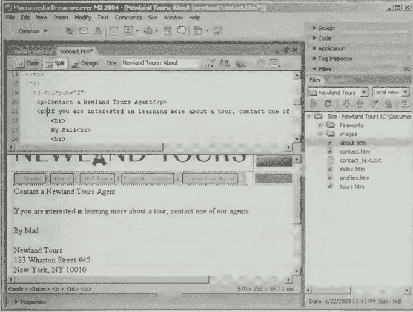

- 2) 重复步骤 1，在以下每个单词前创建段落分隔：通过邮件、Newland Tours、123 Wharton、New York、通过电子邮件、info@newlandtours.com、(555) 和图像。


完成此步骤后，窗口主内容区域中应该有十个独立的段落。它们目前可能还不美观，但至少已经分开了。

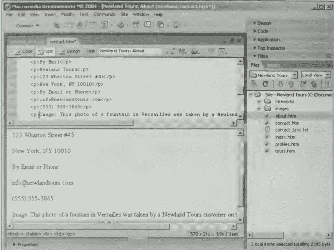

- 3) 在设计视图中，将插入点放置在第一个段落“联系纽兰旅游代理”的任意位置。在“属性”检查器的“格式”菜单中，选择“标题 1”。

请注意，页面标题现在看起来像个页面标题了。在代码视图中，你会看到该段落的 <p> 标签已被替换为 <h1> 标签。

还要注意，页面标题离横幅非常近。你可以输入换行标签 <br>，让标题离横幅稍远一些。

- 4) 在代码视图中，在开头 <h1> 标签与单词 Contact 之间输入 <br> 以创建换行。

要查看设计视图中的更新结果，请单击文档窗口设计视图一侧。

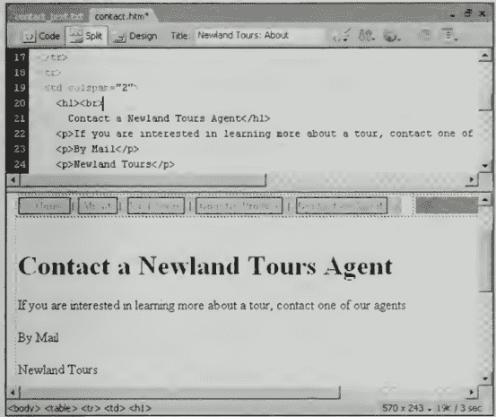

- 5) 在设计视图中，将光标放置在“如果您有兴趣”之前，然后单击插入栏“常用”类别中的“插入图像”按钮。

图像会与其周围的 HTML 和文本内联插入，因此仔细选择插入点非常重要。

请注意，插入图像按钮旁边有一个小箭头，表示下拉菜单。单击箭头会显示可从此菜单插入的许多其他图像相关资产，包括图像占位符、交互式 Fireworks HTML/图像、滚动图像、热点等。本书不会使用这些功能，但需知道它们就在那里。插入栏中的几个其他按钮也隐藏了类似命令。

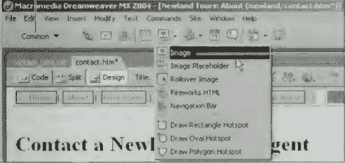

- 6) 在“选择图像源”对话框中，浏览至网站 images 文件夹中的 fountain_versailles.jpg。单击“确定”。

除了让您能够浏览到图像，以便 Dreamweaver 可以从 contact.htm 写入正确的路径外，此对话框还包含多个其他功能和选项。这些包括图像预览、关于图像大小和尺寸的信息，以及有关链接类型的选项（文档相对或站点根相对；默认为文档相对，即您想要的）。

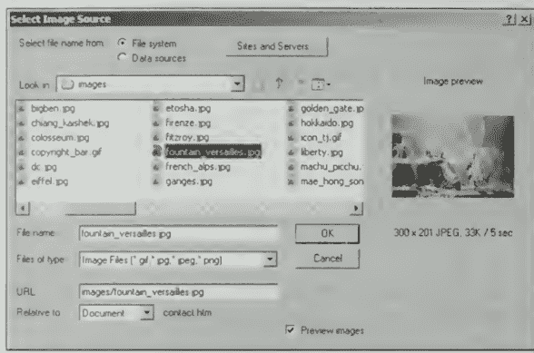

在对话框顶部，有一个选项“从中选择文件名”。您的选择是“文件系统”（即，您浏览到计算机上的文件）或“数据源”（即，您从数据库动态提取 URL）；您将在全书中大量使用这两种方法。在此步骤中，请验证是否选择了“文件系统”。

- 7) 在页面上选中图像后，使用“属性”检查器将图像的“对齐”设置更改为“左”。

默认设置通常会导致图像渲染到一行文本的左侧，而所有其他文本都换行至图像下方。这会造成大量页面空间浪费。通过选择“左”（或其相反的“右”），图像将以文本环绕其周围的方式呈现。

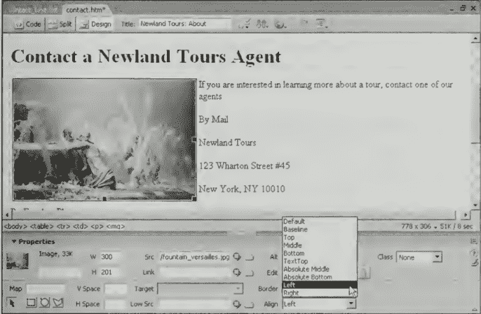

- 8) 将插入点放置在“By Mail”二字之前，然后单击插入栏中的“插入表格”按钮。

在此步骤中，您正在准备插入一个表格，该表格将保存用户如何联系 Newland Tours 的信息。表格可用于呈现表格数据，正如人们所料。表格也可用作页面布局工具。在接下来的步骤中，您将创建一个简单表格，以两列格式呈现街道地址、电子邮件地址和电话。

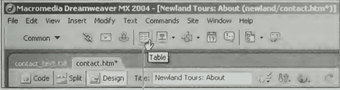

插入表格

- 9) 在“插入表格”对话框中，指定 2 行、2 列、表格宽度 400 像素、边框粗细 1、单元格内边距 3、单元格间距 0。在“无障碍”部分，将摘要输入为 Newland Tours 联系信息。单击“确定”。

这些设置将生成一个宽度为 400 像素的 4 单元格表格。单元格内边距指单元格边框与单元格内容之间的空间。单元格间距指单元格之间的距离。当您填写摘要信息时，Dreamweaver 会向 `<table>` 标签添加 summary 属性，屏幕阅读器使用该属性让视障用户快速了解表格内容。

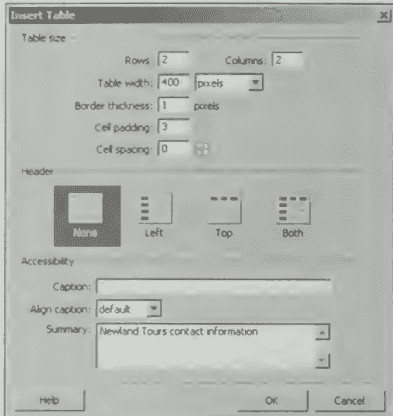

- 10) 三击 **邮寄** 二词以选中其整个段落（仅这两个词）。将选定的段落拖入表格左上角单元格。同样，三击选中 **电子邮件** 或 **电话** 二词，然后拖入表格右上角单元格。拖动选择包含邮寄地址的三个段落到左下角单元格，并将电子邮件和电话信息拖入右下角单元格。Dreamweaver 会将文本块及其所有包含的 `<p>` 标签一起移动到相应单元格中。

请注意，地址、电话和电子邮件信息的行之间有大量额外空白。


- 11) 将插入点放置在 123 Wharton Street 之前，按 Backspace (Windows) 或 Delete (Macintosh) 以删除分隔 123 Wharton Street 与 Newland Tours 的段落换行；也就是说，它们应该在同一行上。在两行文本之间的插入点处，按住 Shift 键并按 Enter (Windows) 或 Return (Macintosh)。

而按 Enter 或 Return 会导致 Dreamweaver 创建新段落 (<p>)，Shift+Enter/Return 会导致 Dreamweaver 插入换行符 (<br>)。

## 联系纽兰旅游代理

如果您想了解有关旅游的更多信息，请联系我们的一位代理：

| 邮寄 | 电子邮件或电话 |
| :--- | :--- |
| Newland Tours<br>123 Wharton Street #45<br>New York, NY 10010 | info@newlandtours.com<br>(555) 555-3865 |

- 12) 重复步骤 11，以删除左单元格中街道地址行与城市/州/邮编行之间的额外空白，同样删除右单元格中电话和电子邮件地址行之间的空白。

表格现已完成。剩下的工作是删除表格下方的多余空白（如适用），并使用斜体格式化说明文字。

## 联系纽兰旅游代理

如果您想了解有关旅游的更多信息，请联系我们的一位代理：

| 邮寄 | 电子邮件或电话 |
| :--- | :--- |
| Newland Tours<br>123 Wharton Street #45<br>New York, NY 10010 | info@newlandtours.com<br>(555) 555-3865 |

- 13) 将插入点放置在“图片：这张照片...”之前，按 Backspace (Windows) 或 Delete (Macintosh)，按必要次数，直到图像说明出现在表格下方的段落中。

这些额外空格是删除原始地址段落并将其放入表格后的遗留内容。如果您查看代码，会看到一系列 <p>&nbsp;</p> 块。这是 Dreamweaver 创建空段落的方式。在 HTML 中，<p></p> 开始和结束标签之间没有内容是非法的。因此，Dreamweaver 会输入一个空格字符作为空占位符。由于 HTML 忽略代码中的空白，Dreamweaver 会输入空格字符的字符实体：&nbsp;，即不换行空格。

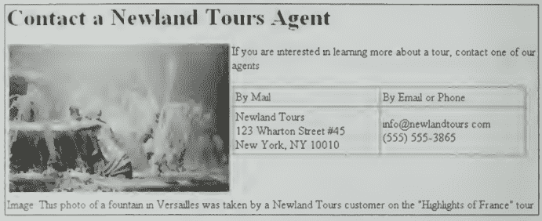

- 14) 三击说明行中的任意位置，选中后，使用“属性”检查器应用斜体。

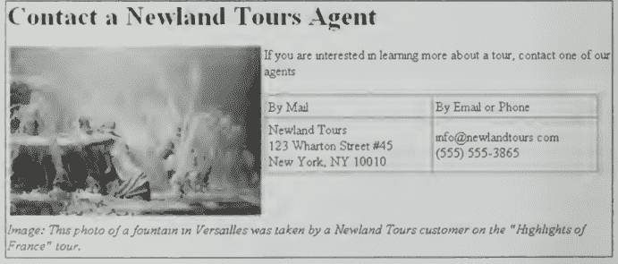

请注意，在代码中，Dreamweaver 使用 <em> 标签而非 <i> 标签应用斜体。此问题的意义将在本书后面讨论。

- 15) 保存 contact.htm。

新页面设计现已完成。在现实世界中，此时您会将页面发布到 Web 服务器，但暂时无需担心此事。在解决缺少联系页面的危机后，您现在可以将精力转向更具挑战性的网站改版任务。


## 评估网站：代码

在本任务中，你不会对文件做任何更改；相反，你将自定义 Dreamweaver 环境，使其更适合我们即将进行的工作，然后探索入门文件索引页面中的代码，以便了解其不足之处。

在浏览器中查看页面时，这些缺陷根本不会显现出来。也就是说，页面在大多数主流浏览器中看起来都应该正常。如果页面在浏览器中看起来正常，你可能会纳闷：代码怎么会有缺陷呢？答案是，本项目中的起始代码已过时且不符合最新标准。我们将在本任务结束时探讨代码和标准的重要性。

通常，网站改造项目会从过时且不符合标准的代码开始，因此你不妨学习如何识别它。稍后，你将学习如何修复它。

- 1) 双击 index.htm 打开它。

取决于你是否完成了“联系我们”练习，你可能会以设计视图（如果未完成该练习）或拆分视图（如果完成了该练习）来查看文档。

20世纪90年代末，当HTML编辑器市场上挤满了要么只擅长代码而设计差劲、要么相反的编辑器时，Dreamweaver的推出引发了一场革命，因为它在两方面都表现出色。多年后，在同时处理设计和代码方面，Dreamweaver仍然是同类编辑器中独一无二的存在。许多设计师知道Dreamweaver在后台编写着整洁的HTML，因此他们满足于在设计视图中设计网站，从不太担心代码问题。

但仅在设计视图中工作已成为过去的奢侈。

如果你认真对待Web开发，并且需要开发数据库驱动的Web内容，就必须深入代码。而且，如果你想将较旧的HTML代码升级为符合标准的XHTML代码，就需要卷起袖子进行一些手动编码。

- 2) 如果需要，单击“拆分”按钮。

拆分视图是一种鱼和熊掌兼得的功能。它让你能够访问代码，以便在必要时手动编辑代码，同时保持传统的设计视图打开，这使得某些类型的编辑（例如正文文本编辑）比在代码视图中工作要容易得多。

## 显示代码和设计视图

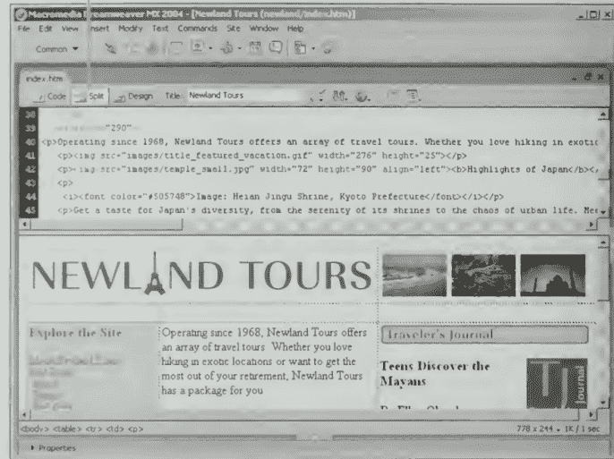

拆分视图对于处理动态网站至关重要。虽然Dreamweaver允许你使用基于向导的服务器行为和其内置的可视SQL生成器来完成许多任务，但你仍然需要直接编辑代码。你还会发现，某些编辑在代码视图中比在设计视图中快得多。另一个好处是，它会教你代码。虽然我假设如果你在阅读本书，你熟悉HTML，但你可能已经忘记了一些细节；例如，你可能记不住某个标签的所有属性。拆分视图将帮助你掌握HTML。从现在开始（以及对于你未来的所有项目），请将拆分视图设置为默认视图。除非你有特定理由，否则应避免单独使用代码视图或设计视图。完成后，请切换回拆分视图。

本任务后续步骤中指定的所有问题仅在代码视图中显现——它们在设计视图中都不可见。拆分视图已经开始发挥作用了。

在拆分视图中工作的另一个好处是，你可以通过在设计视图中单击其对应的对象，轻松在代码视图中找到一段代码。例如，要查看某个图像的代码，请单击该图像。所有相关的HTML将在窗口中居中显示，并在代码视图中高亮显示。这对于代码行数达数百行的页面尤其有帮助。

## 代码会自动高亮显示并居中

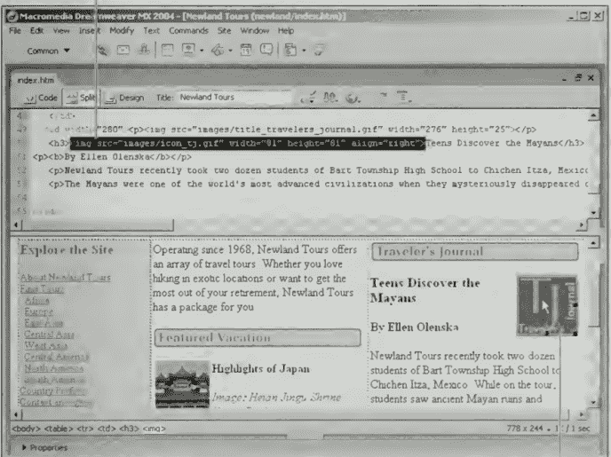

所选图像

- 3) 如果需要，请通过选择“视图 » 代码视图选项 » 行号”来打开代码视图中的行号。

此设置会在屏幕代码区域的代码旁显示行号。行号使与他人讨论代码部分变得更加容易。（本书将经常使用行号。）它还使故障排除更加容易，因为当ASP和ColdFusion遇到问题时，会发回指定导致问题的代码行号的错误消息。

### 4) 确定文档当前使用的HTML版本（滚动到第1行）

在设计视图中这项任务很难完成，但拆分视图立即显示该文档的代码是HTML 4.01过渡版。我们怎么知道这一点？在第1行的DOCTYPE声明中写明了这一点。此声明告诉浏览器文档使用的是哪个版本的HTML，以便浏览器可以正确呈现：所有格式良好的HTML文档都应该有DOCTYPE声明。

HTML 4.01过渡版现在是一个过时的HTML版本。它在每个主要浏览器中的呈现效果仍然和以前一样好。但它已被XHTML取代，未来的浏览器可能不再支持它。在第2课中，你将把网站升级到XHTML。

当然，升级到XHTML不仅仅是更改DOCTYPE声明。XHTML是HTML的一次重大修订，多种编码惯例已发生变化。例如，其中一项变化是所有元素都必须关闭。在HTML 4及更早版本中，空元素是可接受的。空元素没有关闭标签；或者开始标签和关闭标签之间没有内容。空标签的示例包括<br>、<hr>、<input>和< img >。在XHTML中，所有标签都必须关闭。要对空标签做到这一点，只需在闭合尖括号之前添加一个空格和一个正斜杠(/)，因此<br>变为<br />，变为。如果你查看第32行末尾，会看到一个<br>标签。它是网站中数百个空元素之一。我们将稍后处理它们。

### 5) 检查是否符合公认的可访问性惯例（滚动到第11行和第12行）

多年来，许多Web开发人员忽视了那些有障碍且这种障碍妨碍其使用网站的人的需求。例如，因视觉障碍而无法查看网站的用户无法访问网站的内容。鉴于网站的大部分内容是文本，因此开发出了一种特殊的浏览器，称为屏幕阅读器，它会大声读取网页内容。然而，这些阅读器的一个问题是，它们无法表达视觉内容，例如图形。如果这些图形传达了关于网站的任何重要信息（大多数图形都会），那么使用这些浏览器访问网站的用户就无法访问该内容。

启用屏幕阅读器表达页面所传达所有信息的一种简单方法是添加文本说明来描述图像的内容。如果你为每个图像添加描述，包括实质性图形（例如图表）和仅用于装饰甚至间距的图形，那么用户就永远不必怀疑自己错过了什么。

你可以通过在代码中为每个图像元素添加一个属性来实现这一点，该属性将文本字符串与该图像关联。相关的属性是alt。要使用它，你需要在文档中每个标签上添加alt="A description of the image"。屏幕阅读器会大声读取alt描述，用户就可以访问该内容。

```
6 </head>
7 
8 <body link="#3D7030" vlink="#505748" alink="#009900">
9 <table width="750" border="0" cellpadding="3" cellspacing="0">
10 <tr>
11 <td colspan="2" width="470">  </td>
12 <td width="280">  </td>
13 </tr>
14 <tr valign="top">
15 <td width="180"> &nbsp; </td>
```

当你滚动到当前文档的第11行和第12行时，你会看到表格第一行中的两个图像。这些图像是Newland Tours的横幅以及一个包含三张照片（海滩、森林和清真寺）的单个图形。如你所见，它们缺少alt属性，这意味着使用屏幕阅读器访问页面的用户无法访问这些图像。

**注意** 为图像添加`alt`属性并非唯一的可访问性问题。例如，为了使页面可访问，你可以在页面顶部添加快捷方式，使用户能够跳过导航栏直接访问页面内容。另一个破坏可访问性的代码特性是滥用HTML表格。虽然HTML表格本身并非天然不可访问，但过度使用会打断内容，并可能使屏幕阅读器难以按逻辑顺序呈现页面内容。

可访问性的首要目标是确保所有用户都能平等地访问你的所有内容。关于可访问性的详细讨论超出了本书的范围，但你可以在Macromedia的网站上了解更多信息：www.macromedia.com/macromedia/accessibility/。

### 6) 检查过时和弃用的HTML代码（滚动到第21行）

在第21行代码中，你看到：

```
<p><b><font color="#505748" size="4">Explore the Site</font></b></p>
```

虽然这行代码在Dreamweaver和浏览器中呈现效果良好，但该代码已经过时且存在问题。

正如我们将在稍后更详细地讨论的那样，最近版本HTML的目标之一是将HTML标记与表现细节分开。换句话说，HTML标记应描述文档的结构和内容，但不应试图描述内容应如何呈现。上述代码行中的两个标签出于此原因已被弃用。术语“deprecated”


指的是已从标准中移除但仍被（暂时）支持的技术或代码结构。

<b> 标签（代表粗体）是一个表示标记。对于屏幕阅读器用户来说，粗体可能没有任何含义。有时当我们将内容设为粗体时，我们试图传达该内容比普通文本更强调或更突出。不过，在此例中，“Explore the Site” 根本不具备强调性；它只是一个章节标题。使用 <b> 标签会使某内容是强调的还是仅需突出显示变得不清楚。

代码片段中另一个糟糕的标签是 <font> 标签。该标签在 HTML 3 及更早版本中用于让 HTML 开发者指定其文档的显示方式。此后，它已被功能更强大、更高效的层叠样式表所取代。<font> 标签会为开发者带来重大问题，因为这些标签附着在单个文本块上。例如，假设你使用 <font> 标签来指定整个站点中所有二级标题的呈现方式。为此，你需要将该标签添加到每个二级标题实例中。如果出错，你的站点将不再一致。更糟糕的是，如果进行站点重新设计，你必须手动更改该标签的每个实例。站点中每个 <font> 标签都需要移除，既然你已知道这是问题，就可以这样做。

总结我们在此处的发现，代码已过时且不再符合当前标准。它不是 XHTML（在 DOCTYPE 声明中已看到这一点）。其空标签未关闭。图片没有 alt 属性。代码中充斥着需要替换的呈现标签，例如 <b> 和 <font>。这些并非代码中的所有问题，但足以让你了解所面临的情况。

此时，你可能会问：“在浏览器中看起来一切都没问题，何必费心？修复似乎是件麻烦事——我们能不能直接忽略它，继续做动态内容？” 这个问题有几个答案。

仅因为它今天在 Netscape 和 Internet Explorer 中渲染正常，并不意味着未来也会显示良好。如果下一版 Internet Explorer 发布时你的代码出错，你的客户不会对你的工作印象深刻。

事实上，该代码现在并非在所有当前浏览器中都能正常渲染。你必须考虑屏幕阅读器，正如你已经看到的，其中所有图片都无法访问。

此外，XSLT（eXtensible Stylesheet Language Transformations，可扩展样式表语言转换）等新兴技术需要 XHTML 合规才能运行。XSLT 不是本书的一部分，在撰写本书时也不太可能在像这样的小型企业网站上实现，但未来可能会。自本书第一版出版以来，我已看到几家主要网站开始将 XHTML 与 XSLT 配合使用。

现在走捷径可能会在未来造成巨大的麻烦。Newland Tours 目前是一个小型网站——五个 HTML 页面。到本书结束时，Newland Tours 网站将包含大约 30 个页面，如果是实际项目，其规模也会迅速超过这个数字。在开始重新设计之前，最好在仍然容易处理时将其整理好。

## 评估网站：业务流程

许多客户不了解其代码与当前标准相比的情况，也不太可能有很多项目，客户愿意仅为了将代码从 HTML 4.0 升级到 XHTML 而付费。事实上，大多数网站重新设计项目之所以发生，是因为当前网站不再符合站点所有者的业务需求。业务需求与站点不匹配的常见示例如下：

- 导航令人困惑。站点用户无法找到所需内容。
- 更新站点过于困难。许多小型企业没有庞大的 IT 部门来更新其网站。小型企业所有者可能需要更新站点内容，但缺乏相应知识和工具。站点开始落后于业务，或者企业不得不花费过多资金来支付 IT 人力资源。
- 外观已过时。平面设计如同时尚，有周期性变化，几年前还很前卫的东西今天可能显得陈旧。过时的外观会向企业的目标群体传递错误的信息。
- 企业希望将某些当前通过其他资源处理的服务迁移到 Web 上。许多客户希望其网站向公众提供足够信息，以减少来电数量。例如，许多公司部署 Web 知识库以减少技术支持呼叫，而其他公司则提供在线定价和销售，以减少销售呼叫和/或在不雇佣整个夜班团队的情况下提供 24 小时服务。
- 企业正在扩展或改变其产品。如果企业提供全新类别的产品或服务，网站需要反映这一点。在这种情况下，在现有页面上增加一两个段落是不够的。站点需要许多新页面，需要新站点地图、导航系统等等。

显然，此列表并非详尽无遗，但它说明了业务流程与网站之间存在的某些关系。在大多数情况下，客户出于多种此类原因希望进行站点升级。归根结底，正是这些信息应推动整个站点修订过程。它应使你和你的客户能够确定升级的范围以及你应该执行的每个具体细节。

**提示** 花时间从客户那里获取这些信息。有些客户在定义自己想要的内容时比较懒散。如果你不提示他们提供更多信息，你交付的网站可能无法满足他们的需求。不要指望他们在那个时候能足够自我批评，认识到自己不够坦诚；责任在于你，需要提前处理好所有这些问题。

在此任务中，你将对现有网站进行导览。在此过程中，我将扮演客户角色，指出网站的一些缺陷。因此，此任务代表了与客户会面，并识别网站与业务需求和流程不同步的地方。随着这些问题的识别，解决方案——即你需要对网站进行的具体更改和增强——开始显现。这样一来，推动站点升级过程的主要力量是客户的需求，而非其他因素，例如你对网站可能是什么样子的看法，或者像太常见的情况一样，市场上最热门的技术。

- 1) 仍在查看 index.htm，按 F12 在浏览器中打开站点。F12 快捷键会自动在浏览器中打开活动文件。考虑到浏览器显示的内容通常与你在 Dreamweaver 中看到的内容不同（尤其是在处理动态内容时），你需要经常进行测试。F12 快捷键是 Dreamweaver 中最常用的键盘快捷键之一。

- 2) 浏览主主页。

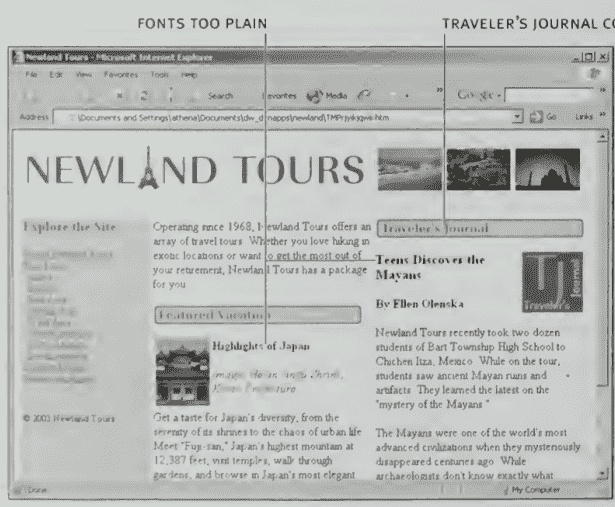

从图形上看，网站设计还不错。客户不打算推翻外观。这种特定设计也用于几种印刷广告中，因此客户希望网站能强化该品牌。

不过，可改进的一个设计方面是字体。网站坚持使用 HTML 标签的默认设置，因此看起来有点平淡。客户希望标题更突出一些，并且可能带有颜色。

除了设计之外，页面存在一个重大的实际问题。名为“Traveler’s Journal”的栏目需要每周更新一次。有时是业务所有者更新该栏目，有时是旅行社代理人更新该栏目。并非所有人都知道如何处理代码或将文件上传到站点。此外，所有者不想提供密码来允许人们上传新页面。目前，日记是在文字处理器中撰写，然后交给知道如何修订和上传页面的一位旅行社代理人。但这种瓶颈阻碍了站点及时更新，尤其是当那位代理人忙碌或不在办公室时。客户希望找到一种方法，使每周发布 Traveler’s Journal 足够简单，让每个人都能参与，而不影响安全性。

- 3) 在屏幕左侧的导航栏中，单击 About Newland Tours 链接。

除了之前讨论过的字体问题之外，此页面不需要更改。其内容几乎从不更改，客户对现状很满意。除了将代码升级到 XHTML（这一更改在大多数浏览器中不可见）之外，这是你完全不会更改的页面。

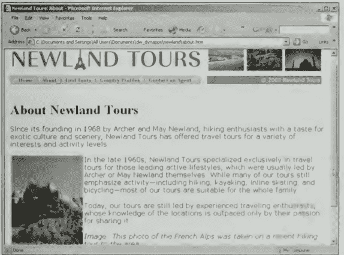


4) 在屏幕顶部的导航栏中，单击 Find Tours。向上或向下滚动页面，或使用顶部附近的内部导航链接，浏览这些旅游团。

这个页面存在多种不同的问题。

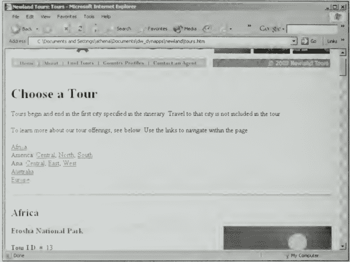

让我们先来看看客户在使用这样的页面时面临的问题。再说一次，该页面难以维护，因为 Newland Tours 没有 IT 部门。从客户的角度来看，这是一个严重的问题，因为此页面上的信息是用户了解旅游团的主要信息来源。客户面临的业务问题是旅游团会发生变化——有些被添加，有些被移除。更糟糕的是，价格波动非常频繁，以至于客户决定不在网站上发布价格，考虑到保持价格更新的困难以及如果不更新的后果。此外，Newland Tours 提供的旅游团比此处列出的还要多，但没有人有机会将它们添加进来。这意味着，由于网站难以维护，客户正在损失业务。

从用户的角度来看，该页面的可用性不高。它非常冗长，很难找到感兴趣的旅游团。除了查看特定地区列出的旅游团之外，没有筛选旅游团的方法。例如，Newland Tours 提供一些运动强度大的旅游团和一些不强调运动的旅游团；用户无法筛选出仅运动强度大的旅游团。当然，由于没有列出价格，用户也无法知道旅游团的费用，除非他们打电话咨询。

作为开发人员，我们应该注意到，此页面上的许多信息在结构上是冗余的。也就是说，每个旅游团都有一个标题、一张图片、一段描述等等。这种可预测的结构应该让我们想到，这些信息最好存储在数据库中，并按需动态加载。这将简化维护，并创造筛选的可能性，从而增强页面的可用性。

5) 在页面顶部的导航栏中，单击 Country Profiles 按钮。

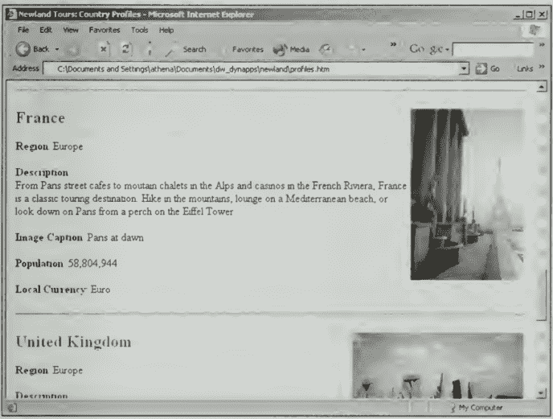

前一页上识别出的几乎所有问题也都存在于此。该页面难以维护，使得 Newland Tours 的员工很难添加他们现在提供旅游团的国家。用户可能会错误地认为 Newland Tours 不提供前往（例如）意大利的旅游团，因为意大利不在这个列表中。但 Newland Tours 确实提供前往意大利的旅游团，因此网站向用户传递了一条适得其反的信息。

对于用户来说，问题也依然存在。很少有用户想要了解 Newland Tours 服务的*所有*国家；他们只想查看感兴趣的国家。同样，一个简单的筛选机制就会带来巨大的变化。

另一个可用性问题是，要从关于纳米比亚埃托沙国家公园的旅游团页面跳转到纳米比亚国家简介，用户必须向上滚动回到导航栏，单击 Country Profiles，然后向下滚动到纳米比亚。理想情况下，可以从埃托沙国家公园信息自动链接到纳米比亚国家简介。但这需要使用静态 HTML 进行额外的编码。

6) 返回导航栏，单击 Contact an Agent 链接。

这是你在本课前面开发的文件，用于替换丢失的版本。

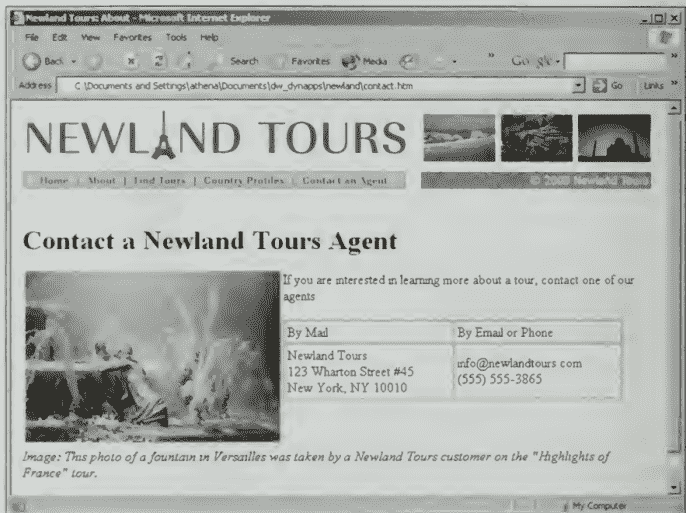

这个简单的表格更改不频繁，而且使用起来也足够简单。客户不喜欢这个页面的一点是电子邮件地址直接出现在页面上：在带有该电子邮件地址的页面发布大约一周后，垃圾邮件发送者开始用减肥、减债以及其他不太体面的信息淹没该账户。

另一个问题是，Newland Tours 的一些客户没有自动配置的电子邮件客户端，或者在电子邮件客户端打开时感到困惑。客户希望能有一种方法让客户无需依赖电子邮件客户端配置即可联系 Newland Tours。此外，客户还想找到一种方法来阻止垃圾邮件发送者用垃圾信息淹没账户。

当然，解决方案是使用 Web 表单。表单非常完美，因为它对用户的要求很低，并且可以隐藏电子邮件地址，从而防止垃圾邮件机器人（会爬取网络“收集”电子邮件地址供垃圾邮件发送者使用的自动化程序）找到 Newland Tours 代理人的电子邮件地址。表单还可以根据内容将电子邮件发送到不同的地址。例如，如果表单要求用户选择一个地区，你可以创建一个脚本，仅将表单数据发送给该地区的专业代理人。你不会在本书中创建该功能，但到你学完时，你肯定有能力实现它。

## 未来展望

虽然本课只展示了一个静态网页，但你实际做的比你意识到的要多，并且经历了一个常被捷径跳过、后果灾难性的步骤。你已经对网站进行了彻底的评估，包括代码、业务流程以及（间接的）可用性。你清楚自己需要做什么。为方便起见，以下是网站升级项目目标的摘要：

- 将 HTML 代码升级为 XHTML
- 改善网站的可访问性和可用性
- 将结构化和/或频繁更新的内容存储在数据库中
- 提供搜索和/或筛选机制，使用户能够更轻松地找到旅游团和国家简介
- 开发一个 Web 表单，使用户能够联系 Newland Tours 员工，而无需使用电子邮件
- 开发一系列 Web 表单，使 Newland Tours 员工能够添加、更新和删除存储在数据库中的内容（请记住，数据库中存储的内容也是出现在网站上的源材料）

如果其中一些内容听起来有点抽象，请参看本书结束时网站的最终版本。

1) 将浏览器指向 http://www.allectomedia.com/newland_dynamic/。索引页面应该与你刚才在 Dreamweaver 中打开的版本几乎相同。但是，幕后却大不相同。例如，旅行者日记栏目实际上是从数据库中动态检索并格式化的。此外，此版本页面上的文本格式更加优美。

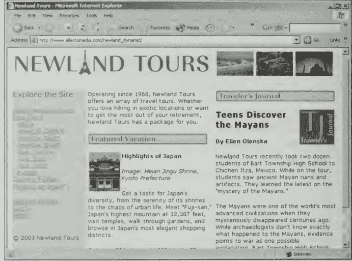

2) 单击左侧导航栏中的 Find Tours 链接。与你预期的看到 Find Tours 页面不同，你会被一个登录屏幕打断。之前的网站显然没有这样的功能。之所以添加此功能，是因为客户希望用户在访问网站前注册，以便客户能够了解客户，并通过优惠和促销活动与他们联系。你可以使用以下凭据登录：

电子邮件地址：osiris@allectomedia.com
密码：osiris

**注意** 这是一个虚构的账户，创建目的是让读者无需注册即可访问网站。不存在这样的账户，因此请不要向其发送电子邮件。

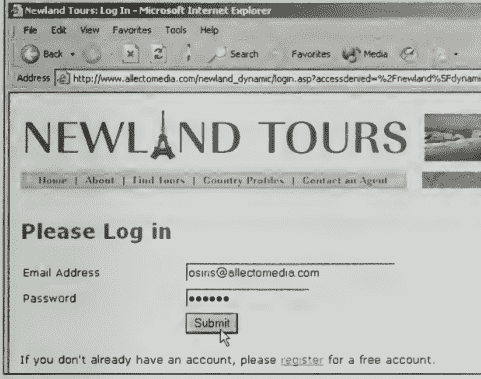

> 通过身份验证后，你将被发送到之前请求的页面。

3) 随你喜欢探索网站。

到这一点，我会放手让你自己探索。你会发现网站提供了多种内容筛选方法、链接到相关内容的方式（例如，从旅游团到国家简介），甚至还有一个价格计算器实用程序。

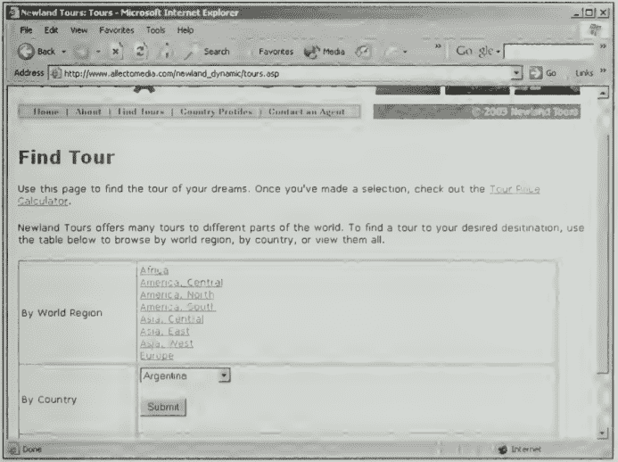

你会注意到，Admin 区域对 osiris@allectomedia.com 账户是禁止访问的。该区域允许用户更改数据库的内容，进而更改网站的大部分内容。显然，我无法在书中发布那部分内容！如你稍后将看到，里面的是内容管理系统——也就是使 Newland Tours 员工能够更新网站内容的 Web 表单。

伴随的截图展示了其中一个表单。使用此表单，员工只需填写表单并按照屏幕上出现的说明操作，即可创建新的旅行者日记条目。员工单击提交后，数据库条目会被添加，且员工会被重定向到网站的主页，在那里，他们会发现旅行者日记已经在公共网站上更新了——更新发生在单击提交按钮和加载索引页面之间的瞬间。

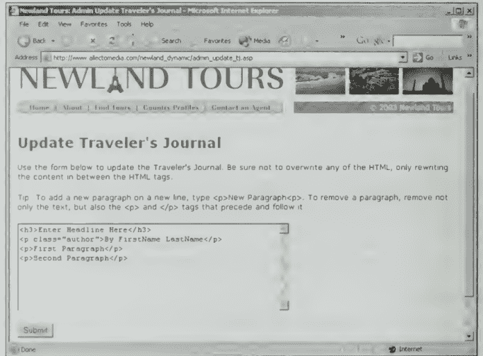


## WHAT YOU HAVE LEARNED

在本课中，你已：

- 在 Dreamweaver 中定义了静态站点（第 13–18 页）
- 创建了基本静态页面（第 18–22 页）
- 格式化了页面（第 23–30 页）
- 评估了现有代码并发现其中的若干问题（第 31–37 页）
- 将客户的业务需求与当前站点进行对比，发现了若干不足之处（第 37–43 页）
- 规划了若干站点增强功能，使其更好地满足客户需求（第 43 页）
- 预览了其中一些增强功能，以便更好地了解本书其余部分你将要做的工作（第 44–46 页）

## upgrading to XHTML

## LESSON 2

在上一章的评估任务中，你找出了本次站点修订中需要解决的两类问题：过时的代码，以及现有站点与其应支持的业务流程之间的不匹配。在本课中，你将解决其中的第一个问题：将站点转换为 XHTML。解决业务流程问题需要本书剩余部分（甚至更多）的内容。不过，在着手构建动态 Web 应用程序之前，你应先解决代码问题。这样，你就不会延续现有的代码问题，而是可以从源头上消除它们。

我将在课程本身中深入探讨 XHTML 的具体内容——它是什么，以及需要更改哪些代码才能实现转换。目前，让我们先看看升级代码这一整体任务。由于 HTML 和 XHTML 之间存在相似之处，本章的主要任务是找出过时的代码并用当前代码替换它。严格来说，做到这一点最简单的方法是使用 Dreamweaver 的转换功能（文件 > 转换 > XHTML）。不过，我们将改用查找和替换。既然有更简单的替代方案，为什么还要费这个劲呢？本课涵盖了几项关键的 Dreamweaver 技能。你应该阅读本课，了解以下内容：

- 关于 HTML 的一般知识。对于对 HTML 生疏或希望通过练习来刷新记忆的人来说，本章的 HTML 代码介绍将大有裨益。
- 关于 XHTML 的具体内容。对于 XHTML 新手，不确定它与 HTML 有何区别，或不明白 XHTML 为何如此重要的人，到本课结束时都将了解所有这些内容。
- 查找和替换的强大功能。大多数 Dreamweaver 用户都尝试过它，但很少有人花时间去掌握它，而它是 Dreamweaver 最强大的自动化和生产力工具之一。
- 本书中将使用的站点。在本课中处理该站点，将使你在代码层面上深入熟悉当前页面。动态 Web 站点开发本质上是面向代码的，尤其是按照本书所教的方式，如果你完成了本课，就会更容易理解。

如果你已经掌握了手动编写 XHTML，并了解 W3C 对 XHTML 的发展方向，并且对查找和替换对话框中的更高级和冷门的功能有相当的经验，那么你可以跳过本课，进入第 3 课。不过，在离开之前，请在 Dreamweaver 中打开每个页面，逐个选择“文件” > “转换” > “XHTML”以将其升级为 XHTML。

字处理器用户可能对查找和替换功能很熟悉。使用一个简单的对话框，你指定需要替换的字符串和用于替换的字符串。从本质上讲，Dreamweaver 的查找和替换功能的工作方式相同。但 Web 站点不同于字处理器文档——站点内容分布在多个文件中，字符串可以是文档文本，也可以是文档代码，等等。Dreamweaver 的查找和替换对话框提供了大量选项，使你能够以难以置信的方式自定义任务，从而大幅提升生产力。

Dreamweaver 的查找和替换对话框还有一个名为正则表达式的功能，它使你可以搜索文本模式，而不是特定的文本字符串。正则表达式使用代表其他字符的占位符字符。当你想要搜索某种类型的文本，但又无法指定确切文本本身时，它们非常有用。例如，假设你想要搜索电子邮件地址，或验证是否已输入电子邮件地址。显然，你无法为 Dreamweaver 列出所有曾经（或可能）输入过的每个电子邮件地址。但你知道，所有有效的电子邮件地址都具有以下语法：username@domain.com（或其他扩展名，例如 .org 或 .edu）。并且得益于正则表达式，你可以告诉 Dreamweaver 查找符合以下条件的模式：“查找任何不含空格的文本字符串，后跟一个 @ 字符，后跟另一个不含空格且包含零个或多个句点字符 (.) 的文本字符串，后跟一个句点字符 (.)，后跟另一个最多三个字符且不含空格的文本字符串。”这样的指令可以查找任何有效的电子邮件地址。不幸的是，正则表达式可能难以使用。例如，用于匹配任何电子邮件地址的正则表达式如下：

```
^([a-zA-Z0-9\_\-\.]+)@((\[[0-9]{1,3}\.[0-9]{1,3}\.[0-9]{1,3}\.)|(([a-zA-Z0-9\-]+\.)+))([a-zA-Z]{2,4}|[0-9]{1,3})(\]?)$
```

来源：Todd Moon 于 http://www.regexlib.com

许多正则表达式并不那么疯狂，但它们仍然可能难以使用。幸运的是，Dreamweaver 在查找和替换对话框中内置了数十个正则表达式的等效功能。在本课中，你将使用其中相当多的内置搜索表达式，并了解它们的强大功能如何提高你的生产力。如果你已经精通正则表达式，还要知道你可以将它们直接输入到查找和替换对话框中。

查找和替换显然是一个强大的生产力工具，其适用性不仅限于将 HTML 站点升级到 XHTML。例如，查找和替换将是全站更改导航栏、处理公司名称变更（例如，律师事务所增加新合伙人）或更新每个页面页脚中地址的理想方案。

尽管查找和替换功能强大，但你可能想知道如何确保自己没有遗漏任何内容，站点确实完全符合 XHTML 标准。在本课结束时，你将使用 Dreamweaver 的验证器验证你的页面，证明它们完全符合 XHTML 标准。如果验证器发现任何偏差，它将向你显示问题出现的确切位置——当然，你发现的任何问题都只需一次查找和替换即可纠正。

## WHAT YOU WILL LEARN

在本课中，你将：

- 了解 HTML、XHTML、XML 和 CSS 之间的关系
- 使用查找和替换将过时的 HTML 标记替换为其 XHTML 对应项
- 使用 Dreamweaver 的“指定标记/操作”实用程序查找和替换复杂的文本模式
- 从今以后强制 Dreamweaver 编写 XHTML 代码，而不是 HTML 代码
- 使用 Dreamweaver 内置的代码验证实用程序验证 XHTML 代码

### APPROXIMATE TIME

本课大约需要 90 分钟完成。

### LESSON FILES

#### Starting Files:
- Lesson02/Start/newland/about.htm
- Lesson02/Start/newland/contact.htm
- Lesson02/Start/newland/index.htm
- Lesson02/Start/newland/profiles.htm
- Lesson02/Start/newland/tours.htm

#### Completed Files:
- Lesson02/Complete/newland/about.htm
- Lesson02/Complete/newland/contact.htm
- Lesson02/Complete/newland/index.htm
- Lesson02/Complete/newland/profiles.htm
- Lesson02/Complete/newland/tours.htm

## UPGRADING TO THE XHTML DOCUMENT TYPE

本课的目标是将站点的 HTML 代码升级为 XHTML，并确保你在 Dreamweaver 中工作时添加的所有后续代码都符合 XHTML 标准。你可能想知道 XHTML 究竟是什么，以及它与 HTML 有何不同。XHTML 是 HTML 的当前标准，这意味着两者的关系是历史性的：XHTML 取代了 HTML。

也许 XHTML 带来的最重大变化与代码几乎无关：它是 XHTML 的新概念导向，使 HTML 与 XML（即可扩展标记语言）保持一致。XML 是一种元语言——开发人员可以用来按照共同标准开发自定义语言的一组规则。XML 与 HTML 一样，基于标记，因此其语法应该很熟悉，如下所示：<authorname type="first">Jeffrey</authorname>。已经出现了几种 XML 变体，例如 MathML，这是数学家用于编码数学表达式的一种标记语言。XHTML 是一种变体，开发人员使用它来（伴随鼓声）标记 Web 页面。

XML 的核心原则之一是，标签描述文档的内容，而不是其表现。XML 内容的表现由单独的代码类型（如 CSS、XSLT 或 XSL-FO）处理。HTML 的早期版本将内容和表现标记混合在一起。例如 <font color="green" size="+1"> 之类的元素缺乏语义价值。出于这个原因，它们已被弃用，这意味着不鼓励使用它们，并且它们最终将被从标准中删除，但目前仍然有效。它们既不告诉用户（或浏览器）其中包含的内容。相反，这些标签只是告诉浏览器如何呈现其中包含的内容，这与前一段中的 <authorname> 元素不同，后者几乎不需要想象就知道它包含什么。

简言之，你应该使用 XHTML 来描述文档的结构：标题（<h1>、<h2> 等）、列表（<ol>、<ul>、<li>）、正文文本（<p>）、强调文本（<strong>、<em>）、锚点（<a>）等等。要指定图形浏览器（如 Internet Explorer 和 Netscape）应如何呈现这些信息，你应该使用层叠样式表，而不是表现标签，例如 <font> 或 <b>。

这种将代码与内容和表现分离的做法不仅具有理论上的好处。首先，它使各种浏览器（包括面向视力障碍人士的屏幕阅读器）能够呈现内容，而无需剔除（更糟糕的是，试图解释）表现标签。其次，正确使用 XHTML 和层叠样式表可以极大地加快 Web 站点的开发和维护速度。


你可能已经知道，XHTML 与 HTML 大体相似。许多标签是相同的，包括 <body>、<head>、<h1>、<p>、<ol>、<a>、<table>、<tr>、<td>、<form> 等等。事实上，在向 XHTML 过渡时，大部分 HTML 代码都保持不变。这限制了你升级到 XHTML 时实际需要更改的内容。

**注意** XHTML 具有向后兼容性。也就是说，在 XHTML 规范出台之前创建的浏览器仍然可以几乎完美地显示 XHTML 代码。

但 XHTML 代码与 HTML 代码并不完全相同。本课的任务是找出这些差异并相应地更改代码。除了已讨论过的强制分离逻辑与表现之外，最显著的差异如下：

- 所有 XHTML 标签及其属性都必须是小写。在 HTML 中，<p> 和 <P> 同样可接受，许多开发者会将 HTML 标签大写以便突出显示。但在 XHTML 中，遵循 XML 规则，所有标签都必须是小写，因此只有 <p> 可接受。同样，标签属性也必须是小写，例如 <table> 标签的 cellpadding="3" 属性。Newland Tours 网站已经使用小写标签，因此你不必太担心这个问题。

- 所有 XHTML 标签都必须关闭。例如，如果有一个 <h1> 标签，则在其他地方应该有一个关闭的 </h1> 标签。不过，有些元素没有关闭标签。这些空标签的示例包括 <br>、、<hr> 和 <input>。此外，HTML 中有些标签可以关闭也可以为空，包括 <p> 和 <li> 标签。但在 XHTML 中，<p> 和 <li> 标签需要相应的 </p> 和 </li> 标签。至于空标签，它们以特殊方式关闭。语法是 <my_empty_tag />。因此，你应该将上述空标签转换为 <br />、、<hr /> 和 <input />。添加的空格和反斜杠替代了关闭标签。

- 由于 Web 上并存着许多不同的 HTML 变体，多年来开发者一直在 HTML 文档前加上文档类型声明。例如，Dreamweaver 在大多数新文档的顶部添加以下内容：<!DOCTYPE HTML PUBLIC "-//W3C//DTD HTML 4.01 Transitional//EN">。这会告诉浏览器文档使用的代码版本（HTML 4.01 Transitional）及其语言（英语）。XHTML 不仅有不同的文档类型语句，而且作为有效的 XML 形式，它还具有 XML 声明。

- 如前所述，表现标签不再允许使用。请改用层叠样式表来处理表现。

有了这些背景知识，让我们开始吧！

### 1) 在 Dreamweaver 中打开 index.htm。

你要执行的查找和替换操作是全站范围的，因此理论上打开哪个文件都无所谓。事实上，你可以打开一个空白的未保存文档。Dreamweaver 不会在意。只要打开一个文件，你就可以访问查找和替换对话框。

稍后，你将使用查找和替换来正式将网站转换为 XHTML。为此，你需要将文档类型定义从 HTML 4.01 Transitional 替换为 XHTML 1.0 Transitional。你的文档不会完全符合 XHTML 规范，因为所有不符合规范的代码仍然会存在。但通过更改文档类型信息，你不仅告诉浏览器文档是 XHTML，还会告诉 Dreamweaver。一旦这样做，Dreamweaver 从那时起就会自动编写符合 XHTML 规范的代码，你自己会看到。

### 2) 仍在拆分视图下，将光标放在设计窗格中“特色度假”段落的末尾（$899/child USD 之后），然后按 Shift+Return（Macintosh）或 Shift+Enter（Windows）。

此键盘快捷键会插入一个换行元素（HTML 中的 <br> 标签）。这是一个空元素，如你所见，它未以正确的 XHTML 格式插入。这证明 Dreamweaver 默认编写的不是符合 XHTML 规范的代码。Dreamweaver 这样做的原因是文档类型是 HTML 4.01 Transitional，在该版本的 HTML 中，<br> 是编码换行元素的正确方式。

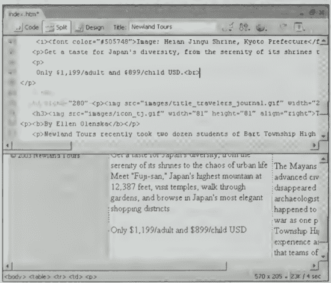

让我们更改文档类型信息。

### 3) 选择“文件” > “新建”以创建新文档。确保选定的类别是“基本页面”，并且在第二个窗格中选中了 HTML。在右下角附近，勾选“使文档符合 XHTML 规范”。按“创建”。

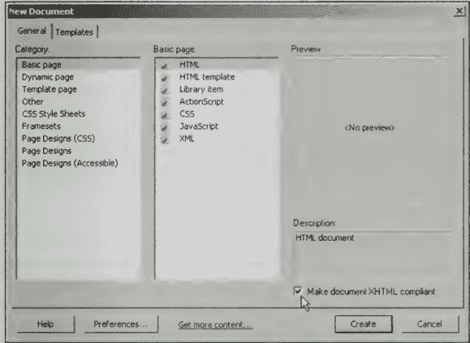

创建符合 XHTML 规范的新文档时，Dreamweaver 会在新文档顶部编写正确的文档类型信息。我们将复制该代码，并用它来替换 HTML 4.01 Transitional 站点中现有的代码。

### 4) 选择新文档的第 1-2 行，并选择“编辑” > “复制”以将代码复制到剪贴板。你可以不保存而关闭新文件。

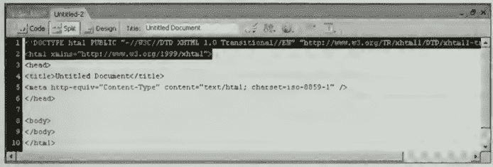

让我们看看刚才复制的代码。

```
<!DOCTYPE html PUBLIC "-//W3C//DTD XHTML 1.0 Transitional//EN"
"http://www.w3.org/TR/xhtml1/DTD/xhtml1-transitional.dtd">
<html xmlns="http://www.w3.org/1999/xhtml">
```

第一行是 DOCTYPE 声明，与 HTML 4.01 的声明非常相似。只有 HTML 版本发生了变化。一个新的区别是一个指向 DTD 文件的 URL。DTD（文档类型定义）是一份文档，包含指定特定 XML 版本中允许的标签和属性的所有规则。

第二行是所有 HTML 文档都必须有的起始 <html> 标签。这个标签很特殊，因为它带有 xmlns 属性。该属性（XML Name Space 的缩写）指定所有标签的来源。在 XML 中需要此属性，因为可以想象两种不同的基于 XML 的语言会使用相同的标签。通过指定默认名称空间，呈现程序（在此示例中为浏览器）可以解决任何此类冲突。

### 5) 选择“编辑” > “查找和替换”。

查找和替换对话框会出现。随附的屏幕截图中显示了出厂默认设置，但你的设置可能有所不同，具体取决于之前使用的设置。如果“替换为”区域或其上方的区域中已有任何文本，请将其删除。在进行下一步之前，两个字段都应为空。

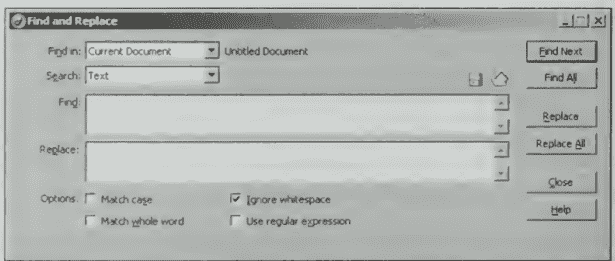

### 6) 单击“替换为”文本区域，并按 Command+V（Macintosh）或 Ctrl+V（Windows）粘贴这两行代码。

代码可能会在对话框中换行，因此看起来不止两行，但不必担心。

在这一步中，你正在告诉 Dreamweaver 将搜索到的文本替换为什么。当然，你还没有告诉 Dreamweaver 首先要搜索什么。你也没有告诉 Dreamweaver 想要它在哪些文件中搜索。

### 7) Index.html 应该仍然是打开的。滚动到代码视图的顶部，选择第 1-2 行，选择“编辑” > “复制”，单击“替换为”文本区域上方的文本区域，然后粘贴这两行代码。
同样，代码行可能会换行，但这无关紧要。

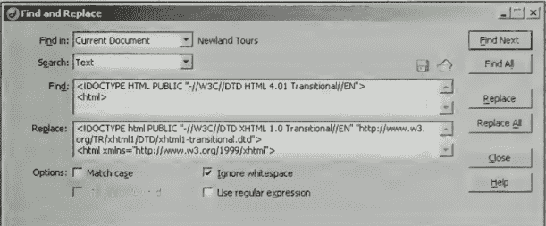

此刻，你已经告诉了 Dreamweaver 要查找什么以及用什么替换。目前为止，进展良好。但你仍然没有告诉 Dreamweaver 应该在哪些文件中搜索这些字符串。

### 8) 在顶部的“查找位置”下拉菜单中，选择“整个当前本地站点”。
此处你正在告诉 Dreamweaver 在站点的每个 HTML 文件中查找该字符串。这意味着，你无需一次只升级一个页面为 XHTML，而是可以一次更新所有文件。

> **注意** 对多个文件进行替换是一项潜在的危险操作，因为对当前关闭的站点文件（除 index.htm 以外的所有文件）所做的更改是永久性的，且无法撤销。在对多个文件运行查找和替换操作时要小心。

### 9) 在“搜索”下拉菜单中，选择“源代码”。取消勾选“区分大小写”、“匹配整个字”和“使用正则表达式”。勾选“忽略空白字符”。

“搜索内容”下拉菜单很重要。默认情况下，查找和替换在文本中查找，即用户在浏览器中看到的文本。“文本”选项不包括代码。由于你要升级的是页面代码而不是文本，因此选择“源代码”至关重要。

“区分大小写”会在搜索中考虑大小写（a 和 A）。如果未勾选此框，则会忽略大小写差异。

“匹配整个字”会强制 Dreamweaver 只查找整个单词。如果未选中此选项，搜索 design 将匹配 design、designer 和 designed。如果选中此选项，则仅匹配 design。


忽略空白会忽略任何空白字符，例如文本或元素之间的硬回车、制表符和缩进。因为 HTML 忽略空白字符，许多程序员使用空白字符来使代码更易读。

启用正则表达式会导致 Dreamweaver 将正则表达式中使用的保留字符（例如 \d）解释为正则表达式字符。如果未选中，并且 Dreamweaver 遇到 \d，它会搜索 \d，而不是任何单个数字（即 \d 在正则表达式中的含义）。

查找和替换对话框的最终版本应与附带的屏幕截图一致。

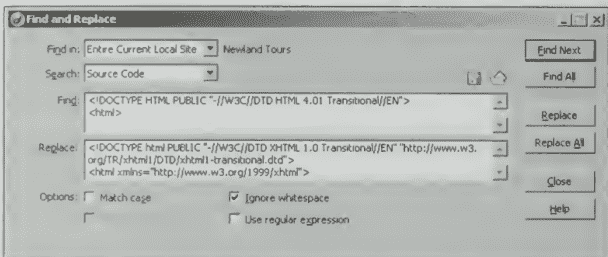

- 10) 单击“全部替换”。当警告对话框出现时，单击“是”。

操作已运行。默认情况下，Dreamweaver 结果面板会打开以显示更改了哪些文件。如您所见，已更改五个文件。由于站点中有五个文件，因此您知道操作已成功。

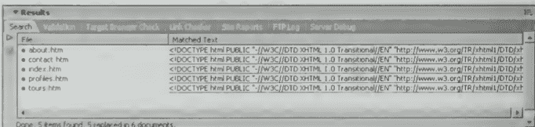

- 11) 要结束换行符实验，请返回您先前插入换行符的“特色度假”部分底部，再次按 Shift+Return（Macintosh）或 Shift+Enter（Windows）。

当您查看代码视图时，您会发现 Dreamweaver 此次在先前添加的 <br> 标签旁添加了一个 <br /> 标签。请记住，<br /> 语法用于空元素；它等同于 <br></br>，而不仅仅是一个闭合的 </br> 标签。这证明 Dreamweaver 知道该文档是 XHTML 文档，您可以放心，今后 Dreamweaver 不会在代码中添加任何不符合 XHTML 规范的标签。

**注意** 取决于您如何格式化文本，Dreamweaver 仍可能添加 <font> 标签。最好约束自己，不要使用“属性”检查器来格式化颜色和大小等属性。相反，请尽可能依赖 CSS。

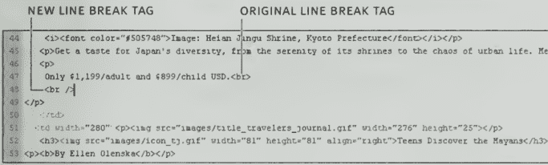

更改顶部的文档类型信息可确保新标签符合 XHTML 规范。当然，这对现有标签无效。您需要自行修复这些标签。

- 12) 如果需要，请删除这两个换行符，并保存文件。

每次进行重大更改时，都应该保存 index.htm。您不需要保存任何已关闭的文件——Dreamweaver 一旦替换了文档类型信息，就会保存这些文件。

## 在源代码中替换字符串

在此任务中，您将替换少量简单的标签。例如，您将把所有 <br> 实例替换为 <br />。这些更改很简单，因为没有属性或变体会干扰搜索。（相比之下，像  这样的标签由于其属性，处理起来会稍微麻烦一些；我们稍后会处理这些较难的标签。）

- 1) 选择“编辑”>“查找和替换”以再次打开对话框。

这一次，您不需要粘贴信息，可以直接在文本区域中输入。

- 2) 在上方文本区域中输入 <br>，在下方文本区域中输入 <br />（不要忘记 r 和 / 字符之间的空格）。请确保已完全删除这些窗口中先前的文本。

“查找位置”下拉列表应仍显示“整个当前本地站点”，这是您想要的，“搜索”下拉列表中的“源代码”也是如此。

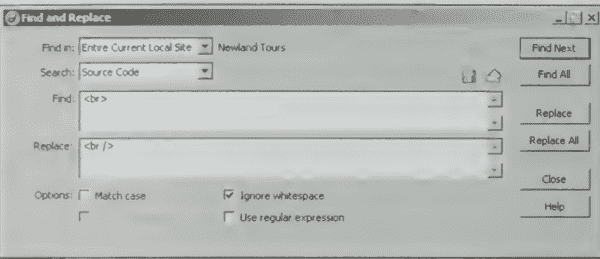

- 3) 单击“全部替换”。
您又会看到警告，结果面板会显示更改内容。在此情况下，整个站点进行了相当多的更改。

- 4) 重复步骤 2 和 3，将 <hr> 替换为 <hr />。
查找和替换能快速完成原本非常繁琐的任务。

- 5) 重复步骤 2 和 3，将 <meta http-equiv="Content-Type" content="text/html; charset=iso-8859-1"> 替换为 <meta http-equiv="Content-Type" content="text/html; charset=iso-8859-1" />。

> **提示** 为避免输入此字符串，您可以从任何页面的第 6 行复制它。

原始 Newland 站点是在 Dreamweaver 中创建的，它自动添加了您在此处替换的 <meta> 标签。通常，开发人员使用 <meta> 标签来传达有关文档的信息。您经常会看到带有描述和关键字列表的 <meta> 标签。由于这些内容显然各不相同，因此通过查找和替换来更新它们可能具有挑战性。但是，在此特定情况下，这不是问题。在每个页面上，Dreamweaver 仅添加了一个 <meta> 标签，且内容每次都相同。因此，您可以放心，已全部修复。

- 6) 重复步骤 2 和 3，将 <map name="navbarMap"> 替换为 <map name="navbarMap" id="navbarMap">。

**提示** index.html 中没有此标签。您可以手动输入它，也可以打开其他四个站点文件之一并从中复制。该标签位于这些页面的底部附近。

某些网页对象具有标识属性，这些属性（除其他外）使脚本能够访问甚至操作对象。在早期版本的 HTML 中，您会使用 name 属性来为对象赋予唯一标识符。在 XHTML 中，适当的标识符已从 name 更改为 id。不幸的是，许多旧浏览器尚未识别 id。并且您可以假设，较新的浏览器最终也不会识别 name。解决此问题的方法是同时包含 name 和 id 属性并设置为相同的值，以便所有浏览器都能识别它们。

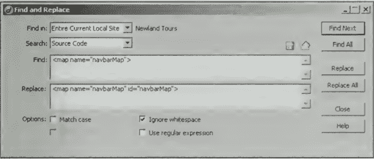

- 7) 保存 index.html。

## 替换标签

作为从面向呈现的 HTML 标签迁移到描述性内容的 HTML 标签的一部分，<b>（粗体）和 <i>（斜体）标签已不再受青睐。两者均已被描述性内容的标签 <strong> 和 <em> 取代。大多数主流浏览器将 <strong> 标签呈现为粗体，将 <em> 标签呈现为斜体。换句话说，通过将 <b> 升级为 <strong> 并将 <i> 升级为 <em>，您可以在不更改文档在主要浏览器中外观的前提下，实现标准合规性并增强可访问性。

由于此更改是简单的一对一更改，并且涉及的四个标签均没有任何属性，您可以轻松查找 <b> 并将其替换为 <strong>，查找 </b> 并将其替换为 </strong>，依此类推。但是 Dreamweaver 有更简单的替换标签的方法：查找和替换对话框中的“更改标签”操作。

- 1) 在保持 index.htm 打开的情况下，选择“编辑”>“查找和替换”。确保“查找位置”下拉列表指定为“整个当前本地站点”。

到目前为止，设置与您之前执行的搜索相同，但情况即将改变。

- 2) 从“搜索”下拉列表中选择“特定标签”。

查找和替换对话框的其余部分会发生巨大变化。

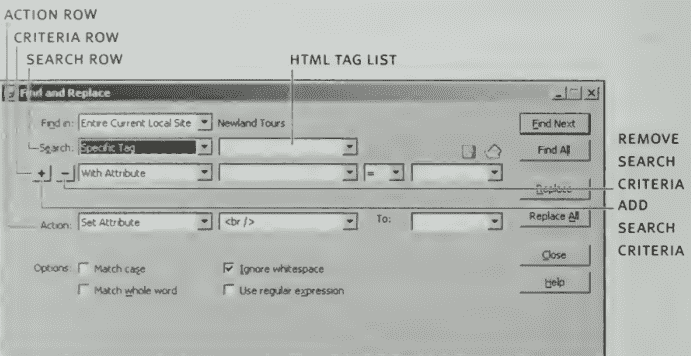

“特定标签”设置会打开许多选项，使您能够操作标签。由于我们的目标是将标签从 HTML 更新为 XHTML，因此此处显示的选项非常有用。

- 3) 从位于“搜索”下拉列表右侧的 HTML 标签列表下拉列表中选择 b。

您的第一个目标是将 <b> 标签升级为 <strong> 标签。稍后您将处理 <i> 标签。通过指定 b 元素，您实际上是在告诉 Dreamweaver 查找不仅包括开始 <b> 标签，还包括结束 </b> 标签。

- 4) 单击“删除搜索条件”按钮，以删除默认添加的“带属性”行。

您可以添加多个其他条件以进一步细化搜索。您将在课程后面使用此功能，但目前无需使用，因此请将其删除。

- 5) 在“操作”下拉列表中选择“更改标签”。在出现的“到”下拉列表中，选择 strong。

“操作”列表包含您可以让 Dreamweaver 对 HTML 标签列表下拉列表中指定的标签执行的所有操作。您将看到其中一些操作的实际效果。此刻，您正在告诉 Dreamweaver 查找所有 <b> 和 </b> 标签并将其更改为 <strong> 和 </strong> 标签，而不会更改其中的任何内容。此时，您的屏幕应与屏幕截图中显示的一致。

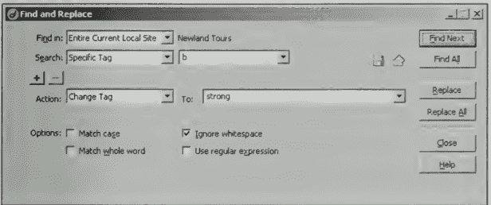

- 6) 单击“全部替换”按钮，并在出现的警告对话框中单击“是”。
结果窗口打开，您可以看到 Dreamweaver 在整个站点中替换了相当多的这些标签。

- 7) 重复上述步骤，将 <i> 标签更改为 <em> 标签。
幸运的是，当您重新打开查找和替换对话框时，Dreamweaver 会记住上一次操作，因此您不需要做太多事情即可为这些新标签自定义操作。

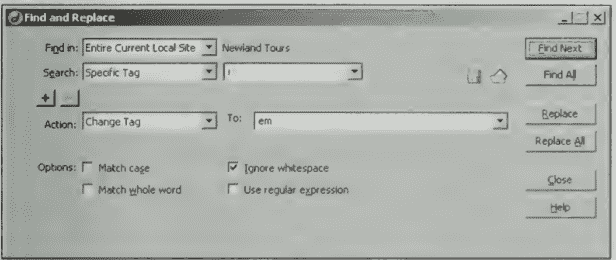

- 8) 保存 index.htm。


## 删除不需要的标签

如你现在已知，<font> 标签已过时，但与 <b> 和 <i> 标签不同，它没有可以替换它的简单对应物。<font> 标签曾用于指定的表现细节，现在由一项全新的技术来处理：CSS。因此，与你在上一个任务中执行的一对一修复不同，解决这个问题需要分两步进行。首先，你需要删除所有旧标签。其次，你需要开发并应用 CSS。你将在本任务中完成这两步中的第一步。第二步构成了第 3 课的基础。

删除 <font> 标签可能看起来很困难。毕竟，考虑到它们有许多属性，且属性中可以输入许多可能的值，你不能像搜索 <b> 标签那样简单地搜索 <font> 标签。你需要找到一种方法来捕捉 <font color="#00FF00"> 和 <font size="+1"> 等标签之间的差异。要解决这个问题，有两种绕过方法可供考虑。你可以搜索不带闭合 ">" 的字符串 "<font"，然后手动删除每个实例。或者，你可以使用正则表达式来构建一个搜索 font 标签的模式，该模式包含属性及其值的任何可能变体。

> 正则表达式使查找函数能够在文本字符串中查找模式，而非硬编码字符串。正则表达式通过用通配符字符替换真实字符，并提供描述字符串中模式的其他方式来工作。你可以在以下网址找到正则表达式的实质性介绍：http://www.webreference.com/js/column5/。出于好奇，查找 <font> 标签的所有实例（包括所有变体）所需的正则表达式如下：<(font) [^>]*>

Dreamweaver 将原本困难的任务变得简单。其“剥离标签”操作会在幕后为你生成正确的正则表达式，无需你干预。完成后，它会删除 <font> 标签的每个实例，不论其属性及属性值。当然，同时它也会删除闭合的 </font> 标签。

- 1) 仍在 index.html 中，再次打开“查找和替换”对话框，并验证“查找位置”下拉菜单中仍选中了“整个当前本地站点”。再次强调，此步骤为本任务的主要工作做准备。

- 2) 在“搜索”下拉菜单中仍选中“特定标签”的情况下，在 HTML 标签列表下拉菜单中选择 font。如有需要，请单击“搜索”下拉菜单下方的“移除搜索条件”（减号）按钮。与之前一样，你在此处告诉 Dreamweaver 要查找什么，即所有 <font> 和 </font> 标签的实例。

- 3) 在“操作”下拉菜单中，选择“剥离标签”。

不会出现其他属性，因此你已准备好运行该操作。首先，再次检查以确保屏幕与截图一致。在“查找和替换”操作中出现的错误可能会导致严重后果。

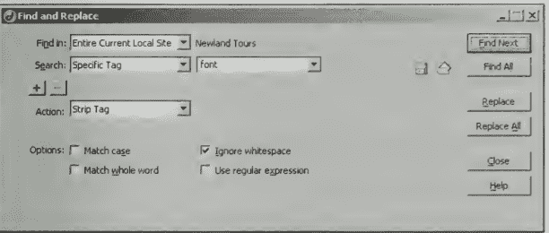

- 4) 单击“全部替换”，然后在出现警告对话框时单击“是”。

如预期，“结果”面板显示整个站点有大量活动。

但是，“结果”面板并非“查找和替换”操作成功的唯一迹象。index.htm 上的部分文本发生了变化。导航栏顶部的“探索站点”标题现在更小了，并且更改了字体。此处需要注意的是，此操作实际上不仅影响代码；它还会更改页面在浏览器（或 Dreamweaver 的设计视图）中显示的外观。

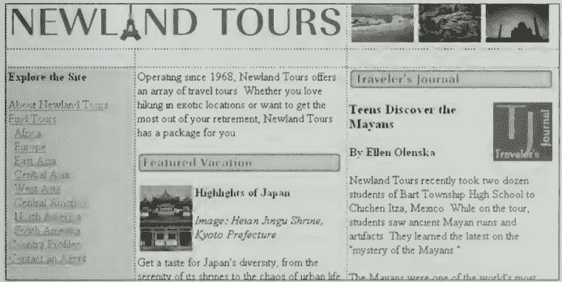

- 5) 保存 index.htm。

## 关闭带有属性的空标签

本课早些时候，你轻松关闭了没有属性的空标签；例如，你让 Dreamweaver 查找 <br> 并将其替换为 <br />。但关闭带有属性的空标签则是另一回事。也就是说，关闭  面临与 <font> 标签相同的挑战：不同的属性及其值使它们更难搜索。

与 <font> 标签一样，Dreamweaver 可以编写成功查找所有 img 标签所需的正则表达式。你只需选择“特定标签”，并从 HTML 标签列表下拉菜单中选择 img 即可。不幸的是，“查找和替换”对话框中没有“以 XHTML 样式关闭空标签”操作，这意味着查找比替换更容易。尽管如此，仍有一种权宜之计，虽然有些笨拙，但可以完成任务。

关闭 img 标签后，你还需要关闭其他带有属性的空标签。在本任务中，你还将关闭每页图像映射中使用的 <area> 标签。如果站点有表单（目前没有），你还将使用此方法关闭 <input> 标签，它们也是空标签且带有许多属性。

- 1) 打开 index.htm，打开“查找和替换”对话框，并验证是否选中了“整个当前本地站点”。验证“搜索”下拉菜单中是否选中了“特定标签”，并从 HTML 标签列表下拉菜单中选择 img。如有需要，请单击“移除搜索条件”按钮，以免指定其他搜索条件。

流程的这部分你可能已经比较熟悉了。

- 2) 在“操作”下拉菜单中，选择“在后面添加”。

此处的策略是查找每个 img 标签（不论其属性及其值），并在其后添加一个特殊的文本字符串。一旦你选择“在后面添加”，就会出现一个文本区域，使你可以输入该额外字符串。

- 3) 在文本区域中输入 QWERTY。

运行此“查找和替换”操作时，Dreamweaver 会将 QWERTY 直接追加到 img 标签的闭合尖括号 (>) 之后。这个闭合 > 正是你要修复的问题，因为它应为 “ />” 而非仅 “ >”。但你不能逐个查找所有 “ >” 并将其替换为 “ />”，因为该搜索会更改所有尖括号，包括在 <p> 等正确使用的标签中使用的尖括号。你需要能够仅识别关闭 img 标签的那些尖括号。

通过在尖括号后追加唯一的 QWERTY 文本字符串，你实际上已标记站点中每个 img 标签的每个闭合 >。然后，你可以运行第二次“查找和替换”操作，将 >QWERTY 替换为 />，这是正确的闭合语法。花一点时间在“查找和替换”中发挥创造力，你就能解决各种大问题。

注意 QWERTY 不是关键字或特殊术语。它只是一个我知道在站点中其他任何位置都不会出现的唯一字符串。例如，你可以使用你的名字（只要不是 Newland），即可达到相同效果。

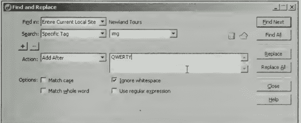

- 4) 单击“全部替换”，并在出现的警告对话框中像往常一样单击“是”。

如果你花点时间在设计视图中查看文档，你会看到 QWERTY 出现在文档中所有图像之后。它不好看，但你知道它起作用了。

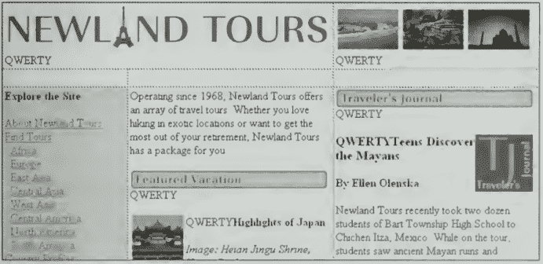

- 5) 重新打开“查找和替换”，在“查找内容”下拉菜单中选择“源代码”。在顶部文本区域中键入 >QWERTY（不要忘记尖括号），然后在底部文本区域中键入 />（不要忘记空格）。

既然你已让 Dreamweaver 查找仅关闭 img 标签的尖括号，你就可以让 Dreamweaver 将该括号替换为正确的 XHTML 闭合语法。


- 6) 单击“全部替换”，并在出现警告对话框时单击“是”。

在设计视图中单击几张图片，并查看代码视图中的相应代码。你应该看到完全正常的 XHTML 样式 img 元素。无需让任何人知道整个 QWERTY 的事情。


- 7) 重复 QWERTY 流程以正确关闭网站中所有的 <area> 标签。


如果要验证此更改是否生效，需要打开 index.htm 以外的任何页面。<area> 标签用作导航栏上图像映射的一部分。图像映射的代码位于文档的最底部，就在关闭的 </body> 标签上方。

```html
113 <map name="naverMap" id="naverMap">
114 <area shape="rect" coords="1,0,62,20" href="index.htm" alt="Home" />
115 <area shape="rect" coords="71,0,117,20" href="about.htm" alt="About" />
116 <area shape="rect" coords="129,0,196,20" href="tours.htm" alt="Find Tours" />
117 <area shape="rect" coords="209,0,311,20" href="profiles.htm" alt="Country Profiles" />
118 <area shape="rect" coords="327,0,434,20" href="contact.htm" alt="Contact An Agent" />
119 </map>
120 </body>
121 </html>
```

- 8) 保存 index.htm。

## 查找缺少 alt 属性的图片

此时，Newland 站点符合 XHTML 标准，因此您已成功实现本课的主要目标，即将站点升级到 XHTML。仍然存在一个问题，虽然从严格意义上讲它与 XHTML 无关，但这是一个代码问题：许多图片缺少 alt 属性。如您所记得的，标签的 alt 属性提供图片的描述，供那些无法访问图片的人使用，例如，因为他们正在使用屏幕阅读器或正在使用仅文本浏览器。

此更改也很难自动化，因为每个图片都应具有不同的 alt 属性。在本任务中，您将以几种不同的方式使用查找和替换。首先，您将使用它为所有页面上横幅的四个图片添加 alt 文本。其次，您将使用它查找缺少 alt 属性的其余图片。

- 1) 打开 about.htm。

  主页 index.htm 没有其他页面拥有的完整导航栏，因此通过切换到 about.htm，您可以确保处理导航栏中使用的所有图片。

- 2) 在设计视图中单击埃菲尔铁塔以选择 Newland Tours 横幅的左半部分。其对应的 HTML 应在代码视图中被突出显示。在突出显示的代码上右键单击 (Windows) 或 Control 单击 (Macintosh)，并从上下文菜单中选择复制。

  这是将给定对象的代码复制到剪贴板的最快方法之一，这使得将其粘贴到查找和替换对话框中或在其他页面上重复使用变得非常方便。它不仅适用于图片，还适用于其他对象，从图像映射到 Macromedia Flash 电影。

### 自动突出显示的代码

  

- 3) 按 Ctrl+F (Windows) 或 Command+F (Macintosh) 打开查找和替换对话框，删除上方文本区域中任何现有文本（来自之前的搜索），并粘贴图片的 HTML 代码。别忘了双查确认“查找位置”下拉菜单中选择了“整个当前本地站点”，并且“搜索”下拉菜单中选择了“源代码”。

  > **提示** 您可以调整查找和替换对话框的大小以容纳长文本字符串。

- **4)** 将相同的 HTML 代码粘贴到“替换为”（下方）文本区域中。在标签内的某个位置，添加以下文本：alt="Newland Tours Banner, Left"。属性的顺序无关紧要。只需确保属性使用小写输入，并且属性值加引号。

  

- **5)** 单击全部替换，当警告对话框出现时单击是。横幅左侧的 alt 标签现在已在整个站点中更新。

- **6)** 对横幅右侧图形（三张照片）重复上述步骤。alt 标签应读取如下：alt="Newland Tours Banner, Right"。单击全部替换。

  

  横幅的两部分现在都有 alt 属性。

- 7) 重复上述步骤，为 Newland Tours 横幅下方的按钮栏添加 alt 属性。alt 属性应读取 alt="Navigation Bar"。

  文件 index.htm 缺少横幅导航，因此您必须打开其他页面之一来对其进行修改。

  导航栏是一个有趣的问题，因为重要的是不是导航栏整体，而是栏上的单个按钮图形。为这张图片添加 alt 属性并不能传达每个按钮的功能。请记住，使按钮起作用（即单击时加载另一个页面）的是图像映射，而不是图像本身。因此，有必要为图像映射中的每个 <area> 标签添加 alt 属性。我已经为您完成了此操作。

  

- 8) 重复上述步骤，为三张照片下方的大理石纹理栏添加 alt 属性。alt 属性应读取 alt="Copyright 2004 Newland Tours"。

  横幅和导航栏到此结束。

  下一步是识别其余没有 alt 属性的图形。其余图片都不会出现在多个页面上，因此无法使用查找和替换自动化替换过程。幸运的是，您可以自动化查找过程，这将使您轻松识别仍需要 alt 属性的图片。

- 9) 再次打开查找和替换，并从“搜索”下拉菜单中选择“特定标记”。从“HTML 标记列表”下拉菜单中选择 img。会自动出现一个新行用于其他搜索条件，默认设置为“具有属性”。将其更改为“不具有属性”，并从下一个下拉菜单中选择 alt。无需担心“操作”行。

  这些设置告诉 Dreamweaver 查找所有没有 alt 属性的图片实例。这应该能让您轻松确保找到所有没有 alt 属性的图片。您不需要在操作行中指定任何内容，因为您不执行任何操作。您不替换任何内容。您只是使用 Dreamweaver 工具查找符合特定条件的标记。

  

- 10) 按查找下一个。

  您将自动跳转到一个没有 alt 标记的图片。您会被带到哪一个取决于发起搜索时光标的位置。

- 11) 为除了 tours.htm 和 profiles.htm 之外的所有页面上找到的每个图片添加 alt 属性。几张图片中嵌入了说明或描述性文本，请将其作为指南。

  您输入的内容并不太重要，只要它具有描述性并在文本中传达图片在视觉上传达的内容即可。

  您不需要在 tours.htm 和 profiles.htm 上输入 alt 属性的原因是这些页面将被升级为动态页面，您将在本书后面实现更彻底的 alt 属性解决方案。

  

- 12) 保存并关闭任何打开的文件。

## 验证您的 XHTML

在本课中，您做了大量工作来规范代码。现在是时候了解您做得如何了。Dreamweaver 拥有多个内置代码验证工具，您可以使用它们来检查代码。在本任务中，您将验证是否已成功将整个站点的代码升级到 XHTML。

- 1) 选择 窗口 > 结果 > 验证。

  这将打开“结果”面板（如果尚未打开），并将其切换到“验证”选项卡。

  

- 2) 单击验证按钮，并从弹出列表中选择设置。

  此选项是首选项对话框中验证器类别的快捷方式，您将在其中看到几个不同版本的 HTML 和专有语言代码列表。在验证代码之前，您需要告诉 Dreamweaver 您希望根据哪个版本的代码进行验证。

- 3) 在“验证目标”列表中，选择 XHTML 1.0 Transitional。取消选择所有其他选项。单击确定继续。

  通过选择 XHTML 1.0 Transitional，您正在使验证器与本课开始时指定的设置保持一致，当时您将 DOCTYPE 声明粘贴到了文档开头。

  


- 4) 再次单击“Validate”按钮，这次从列表中选择“Validate Entire Site”。

验证器运行可能需要片刻，完成后，它将在“验证”选项卡中列出任何问题，包括文件、行号和问题性质。如果你遵循了本课的所有步骤，则应该看到该站点每个文件都显示消息“无未发现错误或警告”。

| 文件 | 行 | 描述 |
|---|---|---|
| about.htm | | No errors or warnings found. [XHTML 1.0 transitional] |
| contact.htm | | No errors or warnings found. [XHTML 1.0 transitional] |
| index.htm | | No errors or warnings found. [XHTML 1.0 transitional] |
| profiles.htm | | No errors or warnings found. [XHTML 1.0 transitional] |
| tours.htm | | No errors or warnings found. [XHTML 1.0 transitional] |

如果确实遇到了问题，则双击该错误，Dreamweaver 将在相关行打开该文件，你可以自行检查代码。

- 5) 如果问题仍然存在，请研究代码直到弄清楚哪里出了问题，然后使用本章所学内容，利用 Dreamweaver 的“查找和替换”工具进行修复。

在最坏的情况下（并非鼓励懒惰），请记住，光盘中本课的已完成文件是干净的，因此如果你只想继续进行，可以随意用光盘上的文件替换你的文件。

## 你已学到的内容

在本课中，你已：

- 将文档类型升级为 XHTML（第 52–59 页）
- 使用查找和替换自动更改源代码（第 56–61 页）
- 用当前标签替换过时标签（第 61–63 页）
- 从代码中剥离标签（第 64–65 页）
- 使用正确的 XHTML 语法关闭空元素（第 66–69 页）
- 查找并修复缺少 alt 属性的图像（第 69–74 页）
- 验证页面是否符合 XHTML 1.0 过渡型标准（第 74–76 页）

## 创建表现层

## 第 3 课

过去，设计师开发静态 HTML 页面时，通常会将几页纯文本复制粘贴到 Dreamweaver 中，然后着手对其进行标记以使其具有可呈现性。换句话说，内容草稿早于大部分设计工作，而设计工作仅在流程结束时进行。

从某种意义上说，使用动态网站时，这种工作流被颠倒了。用户访问你的网站时看到的内容，往往是在页面请求和浏览器显示之间的一瞬间添加到 HTML 页面中的。这意味着你必须使用占位符内容来创建设计。因此，在动态网站开发工作流中，你会首先处理设计和呈现问题，然后让服务器模型（ASP、ColdFusion、PHP 等）将正确的内容填入其中。


使用改进的 CSS 样式面板管理所有 CSS 样式，无论它们是重新定义的 HTML 标签还是自定义 CSS 类。

完成本课任务后，你将指定 Newland 网站所使用的几乎所有样式和设计信息。应用程序开发阶段会出现一些问题——它们总是如此——但总的来说，你将在本课结束时敲定主要的平面设计决策。最重要的任务是创建并应用层叠样式表，它控制网站中的大部分呈现问题。在相关练习中，你还将创建一个通用页面模板，可用作添加到网站的任何新页面的基础。

## 本课你将学到

在本课中，你将：

- 向网站创建并应用层叠样式表
- 为网站添加的所有新页面构建可重用模板
- 通过隐藏导航层增强每个页面的可访问性

## 大约所需时间

本课大约需要 75 分钟完成。

## 课程文件

起始文件：

- Lesson03/Start/newland/about.htm
- Lesson03/Start/newland/contact.htm
- Lesson03/Start/newland/index.htm
- Lesson03/Start/newland/profiles.htm
- Lesson03/Start/newland/tours.htm

完成的文件：

- Lesson03/Complete/newland/about.htm
- Lesson03/Complete/newland/contact.htm
- Lesson03/Complete/newland/index.htm
- Lesson03/Complete/newland/generic_template.htm
- Lesson03/Complete/newland/profiles.htm
- Lesson03/Complete/newland/tours.htm
- Lesson03/Complete/newland/css/newland.css

## 使用 CSS 重新定义 HTML 元素

HTML 的一个优势在于它包含一系列逻辑标签，足够灵活，可以描述大多数基本文档的逻辑。借助其六个内置的标题级别（<h1>、<h2>、<h3> 等）；常规文本标签（<p>）；列表（<ol> 和 <ul>）及列表项（<li>）；表格（<table>、<tr>、<td>）；块引用（<blockquote>）；地址（<address>）标签等，你可以快速标记文档，并且标签实际描述了文档的内容和结构。此外，浏览器会识别这些样式并知道如何呈现它们。例如，<h1> 标签中的内容字体较大且加粗，上下有额外间距，而 <p> 标签内的内容则以正常正文字体呈现，例如 12 磅的系统字体。

由于每个页面都依赖浏览器进行呈现，因此所有 HTML 页面看起来可能都一样。例如， Internet 上的每个一级标题可能都是 18 磅 Times New Roman 加粗。这种统一的外观阻止组织与自身区分开来，并使用户感到厌倦。出于此原因，在 HTML 发展初期，编码者就要求有一种方法来控制内容的呈现。为满足此需求，特殊呈现标签（例如 <font> 标签）被添加到标准中。如你从前一课中所了解的，<font> 标签现已不再受青睐，主要原因是它效率低下。它要求开发者为每个需要偏离标准浏览器模板的段落添加特殊格式属性。

随着 CSS 的出现，开发者拥有处理呈现的一种更强大、更灵活的方式。CSS 最简单、也最终最强大的功能或许在于，你可以使用它告诉浏览器如何呈现标准 HTML 标签。例如，你可以指定浏览器将所有包含在 <p> 标签中的内容呈现为 Verdana 12 磅黑色，并将所有二级标题呈现为 Verdana 16 磅紫色加粗。之所以如此有用，是因为你在一个位置指定这些方向，你的网站中每个 <p> 标签和 <h2> 标签都会自动正确格式化，无需任何其他代码。此外，如果你稍后对此小段代码进行更改，更改将立即级联到整个网站。任何来自 20 世纪桌面出版甚至专业文字处理世界的人都会熟悉自动样式的好处。

除了能够定义现有 HTML 标签的外观外，CSS 还使开发者能够创建自定义样式，称为类，这些类可以应用于任何部分的文本，无论是块级标签（如 <p>）还是常规段落中的一段字符。使用类的唯一问题是，你不仅必须定义自定义样式，还必须添加一小段代码来应用它们（这与重新定义 HTML 标签形成对比，后者在保存样式后立即更新）。

幸运的是，Dreamweaver 允许你应用自定义 CSS 类，而无需手动键入代码，除非你想这样做。

## 1) 打开 index.htm 并选择 Window > CSS Styles 以打开 CSS 样式面板（如有必要）。

你使用 CSS 面板创建并在某些情况下应用样式。你还可以从“属性”检查器访问相同的命令和任何自定义 CSS 类。

面板底部的 CSS 样式按钮有时会变灰，除非你选择了样式名称（或者，如本例所示，占位符文本“无样式已定义”）。


## 2) 单击“新建 CSS 样式”按钮。在“新建 CSS 样式”对话框中，在“选择器类型”单选按钮组中选择“Tag”，在“定义在”单选按钮组中选择“(New Style Sheet File)”。从“Tag”下拉菜单中选择 body 元素。单击“OK”。

在此步骤中，你正准备重新定义 <body> 标签。为此，你需要告诉 Dreamweaver，你想要创建的样式是重新定义 HTML 标签，而不是创建自定义样式。“定义在”单选按钮组使你可以指定是只希望样式存储在 index.htm 中（“仅此文档”），还是存储在外部样�表（“[New Style Sheet File]”）中。


将样式存储在外部样式表中的好处是，网站中的多个页面可以引用同一个文件，这意味着对该外部文件所做的更改会立即影响每个引用该文件的页面（在 Newland Tours 网站中，这将是网站中的每个页面）。


3) 在“另存为样式表文件”对话框中，确认当前位于 newland 文件夹，并创建一个名为 css 的新文件夹。双击打开此新 css 文件夹。将文件命名为 newland.css，然后单击“保存”。

虽然 Newland Tours 不需要，但有些网站需要多个样式表。将它们都放在同一个地方是个好主意。出于这个原因，我总是创建一个与 images 文件夹并列的 css 文件夹。


请注意对话框底部附近，Dreamweaver 在 URL 字段中写入了相对于当前活动文档的样式表路径。在此示例中，路径为 css/newland.css。

4) 在 newland.css 中的 body CSS 样式定义对话框中，在“类型”类别下，从“字体”下拉菜单中选择 Verdana, Arial, Helvetica, sans-serif，从“大小”下拉菜单中选择 10 点（不是像素！）。单击“确定”。


在这一步中，您正在为页面上的所有文本创建默认文本设置。由于 <body> 标签内的所有文本通常也位于另一组标签（如 <p> 或 <h1>）内，这如何工作呢？答案围绕**继承**的概念展开。嵌套在其他标签内的标签将（理论上）继承其父标签的样式。由于所有页面内容都出现在 <body> 标签内，因此所有页面内容都应继承这些标签的 CSS 样式信息。

这是否意味着 <h1> 标签内的文本现在将使用 10 点 Verdana 字体进行格式化？不，因为浏览器为 <h1> 标签具有一组默认的格式说明。当此格式信息与 <body> 标签中的格式信息冲突时，它会覆盖它。是否覆盖格式以及覆盖哪些格式，取决于优先级顺序。一般来说，标签离文本越近，其格式属性的权重就越大。由于 <h1> 元素中的内容比离 <body> 标签更靠近 <h1> 标签，因此 <h1> 格式优先。

无论如何，这是理论。但浏览器并不一致地遵循此 CSS 层次结构，有时本不应被忽略的格式属性会被忽略。因此在实践中，您通常需要定义比理论上更多的信息。

由于不同浏览器对 CSS 的实现存在差异，经过足够的测试，您可能会发现，无论您为 `<body>` 标签指定什么大小，浏览器都可能忽略它。发生这种情况的原因是，某些浏览器如果 body 格式信息与 `<td>`（表格单元格）标签固有的格式信息冲突，则会忽略 body 格式信息。换句话说，某些浏览器中 `<td>` 标签的格式可能会覆盖您在 `<body>` 标签中指定的大小。但这不是大问题：要解决它，您只需重新定义 `<td>` 标签。

注意：无论何时创建新样式，DW 实际上会在后台打开 CSS 文件。这使您可以直接编辑 CSS 文件。此外，将其视为学习机会：查看 Dreamweaver 编写的 CSS 代码。尝试更改某些值或添加新属性（在表达式 font-size: 10pt; 中，font-size 是属性，10pt; 是值）。使用 Dreamweaver 的代码提示来确保语法正确。

5) 再次单击“新建 CSS 样式”，验证类型为“标签”，且“定义于”设置为 newland.css。从“标签”下拉菜单中选择 td，然后单击“确定”。

注意：如果 newland.css 在“定义于”菜单中不可用，请尝试关闭对话框，关闭 newland.css 文件，然后单击“新建 CSS 样式”重新开始。

随着时间的推移，这个对话框会对您变得非常熟悉。


6) 在 newland.css 中的 td CSS 样式定义对话框中，选择 Verdana, Arial, Helvetica, sans-serif 作为字体，10 点（不是像素）作为大小。单击“确定”创建新样式。

这些是您与 `<body>` 标签关联的相同设置，在 Dreamweaver 中看不到任何变化，但您已为旧版浏览器增加了保障。例如，在 Netscape 4.x 中，<td> 标签内的文本出于某种奇怪的原因不继承 `<body>` 标签的格式。当然，这是一个 bug，但数百万用户可能仍在经历这个 bug。您通过此步骤规避了它。

我们需要使用 CSS 重新定义更多 HTML 样式，但 index.htm 实际上没有那么多样式，因此在下一步中，您将打开一个不同的文件。


## 7) 保存并关闭 index.htm。打开 tours.htm。

这个结构更清晰的文档使用了 <h1>、<h2> 和 <h3> 标签，以及一些外观朴素的 <a> 元素。


8) 在 CSS 样式面板中，单击“附加样式表”，在“附加外部样式表”对话框中，浏览到 css 文件夹中的 newland.css 并单击“打开”。验证是否选择了“作为链接添加”，然后单击“确定”。

在开始定义新样式之前，您需要附加到已创建的样式表。否则，您最终会创建第二个样式表。同样，目标是创建一个网站中所有文件都引用的单个样式表。

为什么要选择“链接”而不是“导入”来应用外部文件？如果您选择“导入”，Dreamweaver 会将 newland.css 中的样式复制到此文件的标题中。换句话说，导入会在每个页面上复制样式表，抵消了使用样式表的主要好处之一。当您希望页面拥有应覆盖默认样式表的独特样式时，导入样式表很有用。但这不是您想要的行为，因此请选择“链接”。


现在您应该看到页面上的所有文本都已转换为 Verdana，并且正文文本为 10 点。看到此情况后，您就知道样式表已附加并应用。

不过，三级标题有些平淡。让我们为它们添加一些颜色。

9) 单击“新建 CSS 样式”按钮，并进行适当设置以重新定义 h1 元素，并将其保存在 newland.css 中。进入 CSS 样式定义对话框后，将大小设置为 18 点；粗细设置为粗体；颜色设置为 #505748。单击“确定”。

到这个时候，您应该已经习惯于创建样式定义了。这里唯一的新内容是您正在指定颜色。您可以单击颜色框从弹出窗口中选择颜色，也可以直接输入颜色值。

选择颜色的另一种方法是从屏幕上的其他位置选取。为此，单击颜色框弹出窗口，然后使用吸管工具在屏幕上的任意位置单击，Dreamweaver 将选取该颜色。在此步骤中，如果单击 Newland Tours 横幅中的任何字母，正确的颜色值应自动出现。


从吸管颜色框弹出窗口中正确选取的吸管颜色

- 10) 使用以下设置重新定义 <h2> 标签：大小 = 16 点；粗细 = 粗体；颜色 = #646482。

查看页面上的大洲名称以查看结果。它们应该呈现深紫色。

- 11) 使用以下设置重新定义 <h3> 标签：大小 = 14 点；粗细 = 粗体。

在 tours.htm 页面中，此设置会影响旅游名称。您可能注意不出什么区别。我们仅重新定义此 HTML 样式，以确保它与刚才定义的两个标题保持一致。

## 12) 使用以下设置重新定义 <a> 标签：装饰 = 下划线；颜色 = #447832。


您可能知道可以在 HTML 的 <body> 标签中（或在 Dreamweaver 修改 > 页面属性对话框中）指定链接颜色。但是，同样，为什么要在每个页面上都指定相同的信息，而可以在 CSS 中只指定一次并让其应用于所有页面呢？

完成后，页面顶部的链接应变为绿色，这比默认蓝色更适合网站的颜色。

## 13) 保存并关闭 tours.htm。

我们已完成重新定义网站中使用的所有 HTML 标签。我们尚未创建自定义样式——这将在下一部分介绍——但首先，花点时间将 newland.css 附加到每个剩余文件。

## 14) 依次打开 about.htm、contact.htm 和 profiles.htm，并使用 CSS 样式面板中的“附加样式表”按钮将 newland.css 附加到每个页面。

快速查看页面内容，验证样式是否已确实应用。如果成功，您不仅会看到文本使用了 Verdana 字体和合适的颜色，还会在 CSS 样式面板中看到列出的一系列样式。


## 创建并应用自定义 CSS 样式

通过为 HTML 样式提供演示规范，你已快速格式化了网站的绝大部分内容，包括当前状态以及本书后续开发过程中将要发展的状态。更好的是，你还针对维护优化了网站，因为要更新网站外观，只需更改 CSS 文件。你可以使用 Dreamweaver 的 CSS 样式面板，从站点中的任何页面进行此操作，设置会立即在整个站点中更新。如果站点已加载到服务器上，你只需上传更新后的 CSS 文件；无需重新上传每个页面。

到目前为止所做工作的唯一缺点是，你只能重新定义预先存在的 HTML 样式的外观。你尚未能够为不属于 HTML 规范的文本元素创建自定义样式。例如，索引页面的 Traveler's Journal 中有一个作者署名行，但 HTML 没有 `<authorbyline>` 标签。在此任务中，你将学习如何创建和应用自定义样式，也就是类。

- 1) 打开 index.htm。确保可以看到页面右侧的 Traveler's Journal 部分。

Traveler's Journal 部分由三部分组成：标题、作者署名行和文章正文。标题包含在标题标签中，正文使用 `<p>` 标签标记，因此在这两种情况下，HTML 标记都相当合理地表示了内容。作者署名行则不太容易分类。它使用 `<strong>` 标签以粗体表示。然而，作者署名行加粗并非因为它比周围文本更强调或更突出，而是因为它执行另一项功能：向作者致谢。同样，由于 HTML 没有 `<author_byline>` 标签，这是创建自定义 CSS 样式的绝佳机会。

此新样式（我们将其命名为 .author）所做的只是将其附加到的元素（在此例中为 `<p>` 标签）加粗，在浏览器中的外观与现在无异。但做出此更改将使代码更有意义地描述文本，你还将再次看到继承的概念在起作用。


- 2) 单击“新建 CSS 样式”。在“新建 CSS 样式”对话框中，在“选择器类型”组中选择“类”，并验证“定义在”组中仍指定 newland.css。在“名称”字段中，输入 .author。单击“确定”。


此时，这些设置应该都能让你理解，唯一的例外是：为什么类名以句点（.）开头？句点表示该样式本身不重新定义 HTML 标签，例如“所有 `<p>` 标签都应采用 XYZ 外观”，而是定义从属于 HTML 标签的元素。这一做法的一个实际应用是，你可以使用自定义类来指定*某些* `<p>` 标签的外观，而不是全部。在这种情况下这很合理——只有某些段落应被指定为作者段落。

自定义类的另一个好处是它们可以应用于不同的 HTML 元素。例如，你不仅可以将 .author 类应用于任何 `<p>` 标签，还可以将其应用于 `<span>` 或 `<div>` 标签。

- 3) 在“CSS 样式定义”对话框中，将粗细设置为粗体并单击“确定”。此处无需指定任何其他信息，例如字体或大小，因为这些信息已在父标签（在此例中为 `<td>` 和 `<body>` 标签）中指定。因此，样式只需继承所有这些演示信息并添加加粗效果。


- 4) 创建名为 .navhead 的新类，设置如下：大小 = 12 点；粗细 = 粗体；颜色 = #505748。此样式将用作 index.htm 左侧列导航栏顶部的导航标题。

- 5) 创建名为 .caption 的新类，唯一属性为样式 = 斜体。此样式将用于站点中所有图片说明。目前，它们使用 `<em>` 格式化，大多数浏览器将其呈现为斜体。同样，.caption 比 `<em>` 更好地描述了内容，创建此样式使我们能够精确控制站点中所有说明的呈现方式（一旦应用该样式，即可实现）。

此时，你的 CSS 样式面板应显示九种样式。目前这已足够，不过在开发过程中你会根据需要向此列表添加内容。


接下来，当然是应用这些自定义样式。

- 6) 回到 index.html 页面，单击导航栏顶部“Explore the Site”文本中的任意位置。右键单击（Windows）或 Control-单击（Macintosh）标记选择器中的 `<strong>` 标签，并从上下文菜单中选择“删除标记”。在此步骤中，你正从代码中删除 `<strong>` 标签。它已不再需要，因为你创建的 .navhead 类已内置粗体。

确保你单击的是标记选择器，而不是页面上的文本。


标记选择器

**TIP** 标记选择器是一个非常有用的工具，用于指定在 Dreamweaver 操作中要影响的标签。使用图形程序编辑 HTML 代码时的挑战之一是，往往很难告诉编辑器你想要影响嵌套元素组中的哪个元素。例如，如果要为一串文本添加背景颜色，编辑器如何知道你并非试图更改该文本碰巧嵌套其中的 `<td>` 单元格的背景颜色？

**TIP** 相关问题是让 Dreamweaver 显示你想要的属性检查器版本。假设你想要更改用于页面布局的表格的 cellpadding 属性。如何让属性检查器显示 `<table>` 元素的设置，而不是其内部数十个嵌套元素之一的设置？答案是标记选择器：单击你想要影响的属性内部的页面任意位置，然后从标记选择器中选择所需的标签。属性检查器将显示该标签的设置，上下文菜单还提供几个用于修改它的额外选项。

- 7) 在标记选择器中单击 `<p>` 标签，然后在属性检查器的样式下拉菜单中单击 navhead。

不仅设计视图中的标题会更新，新样式还会反映在源代码和标记选择器本身中。

HTML 代码中出现的 class 属性


设计视图中导航栏标题的外观更新 标记选择器显示附加的样式

让我们花点时间来看看代码：

```
<p class="navhead">Explore the Site</p>
```

在上一个任务中，当你重新定义 HTML 标签时，页面会立即更新，无需更新代码。然而，要应用 CSS 类，你需要更改 HTML 代码。具体来说，你需要将 class 属性添加到所需的 HTML 标签，并将样式名称（不带句点）作为属性值列出。类附加到整个标签，其中的所有内容（包括文本、图像和其他标签）都受该样式影响。

因此，你无法将类附加到标签的部分内容。例如，如果你只想将 navhead 样式附加到单词 Explore，则不能通过将样式附加到 `<p>` 标签来实现，因为该样式也会应用到标签内的其他所有内容。但是，你可以通过在 Explore 周围创建一个新标签并将类附加到该标签来达到同样的效果。为此，你将使用内联标签 `<span>`，因为它用于创建任意内联容器，你可以使用这些容器来指定较大元素的一部分。因此，要完成此示例，如果出于某种原因你只想将 Explore 放入 .navhead 样式，代码将如下所示：<p><span class="navhead">Explore</span> the Site</p>。

**NOTE** 应用 CSS 样式的另一种便捷方式是通过属性检查器。将插入点置于任意文本段落内，在属性检查器中，单击“格式”和“字体”字段之间的 A 图标，这将把属性检查器切换到 CSS 模式。一旦进入 CSS 模式，最常见的 HTML 标签和自定义 CSS 类将在属性检查器中可用。

- 8) 重复步骤 6 和 7，删除日本神社图片旁图片说明周围的 `<em>` 标签，然后将 .caption 类应用于该段落。设计视图中的显示不应改变，因为你正在删除的 `<em>` 标签以斜体表示，而你正在附加的 .caption 样式仅指定斜体。但你应该能在标记检查器和源代码本身中看到更改。

- 9) 删除作者署名（By Ellen Olenksa）周围的 `<strong>` 标签，并将 .author 类附加到该段落。同样，页面外观不会改变，但类应在标记检查器和源代码中体现。

- 10) 保存并关闭 index.htm。你已完成 index.htm 的设计和呈现。从此时起对其所做的所有更改都将影响其内容和功能，但不会影响其设计。


当然，该网站不仅包含 index.htm。

- 11) 依次打开 about.htm 和 contact.htm，并将这两个页面标题说明中的 `<em>` 标签替换为 `.caption` 类。保存并关闭这两个页面。关于 about.htm 和 contact.htm 都没有导航栏标题或作者署名，因此你不需要使用 `.navhead` 或 `.author` 类。


你不需要更新 profile.htm 或 tours.htm 上的类，因为本书后面将对这两个页面进行相当彻底的改版，现在投入任何精力都将是徒劳的。

## 创建可复用模板

大部分而言，Newland Tours 网站的表现层已完成。如前所述，过程中仍需要进行一些小的调整和添加，但总体上网站设计是稳定的。

在开发进程中到达这一点时，你通常应暂停下来，为所有新文件创建一个通用的网站设计模板。例如，本站点中的所有页面都将共享相同的横幅、基本布局、样式表等等。与其每次都重新创建所有这些内容，不如创建一个通用页面模板，这样你就可以直接开始工作。

在本任务中，你将创建这样的模板，并在本书余下部分将其作为本站点所有新页面的基础。

在继续之前，有必要澄清一点：你即将构建的模板 *并非* Dreamweaver 模板文件。Dreamweaver 模板是一项特殊功能，可让设计师构建页面模板，然后锁定指定区域，以防用户修改其内容。其他区域保持可编辑状态，因此用户可以根据需要进入并更改内容，而不会破坏跨页面的站点外观或导航。Dreamweaver 模板是一项强大的功能，尤其是与 Macromedia Contribute 结合使用时，它可以让非技术内容专家控制页面内容和维护，同时最大限度地减少他们对 Web 开发技能的需求，并降低他们搞乱代码的可能性。

尽管这是一项有趣且有用的功能，但使用 Dreamweaver 模板超出了本书的范围。在创建大型站点时，请务必牢记 Dreamweaver 模板，尤其是在协作环境中工作时。

总而言之，本课和全书中使用的 *模板* 一词是指通常含义，而不是指 Dreamweaver 模板功能的特殊含义。

- 1) 打开 about.htm。

要创建模板，你需要从站点页面中删除所有独特内容。显然，最快的方法是从独特内容最少的页面入手。about.htm 文件是站点中最简单的页面，因此是一个很好的起点。

- 2) 选择“文件 > 另存为”，并将文件另存为 *generic_template.htm*。

在开始破坏文件内容之前，你应该将其另存为新名称。迟早，如果你等到最后，就会覆盖源文件并不得不从头重建它。

- 3) 单击选择阿尔卑斯山的大照片并按 Delete 键。选择最后两段正文和图片说明，并按 Delete 键。

所有这些内容都是独特的，因此需要删除。我们稍后将处理标题和第一段正文。

你可能会发现，在 Dreamweaver 删除内容后，它没有调整表格大小（尽管 Macromedia Dreamweaver MX 2004 比早期版本更擅长处理此问题），导致出现大量空白区域。但这并非代码问题，而是屏幕刷新问题；它会在浏览器中按预期显示。

如果遇到此问题，只需在标记选择器中单击 `<table>` 标签，即可强制 Dreamweaver 重新绘制表格。

**注意** 大量用户试图通过向上拖动表格底部边框来修复空白区域问题。但这通常会导致 Dreamweaver 指定表格（或可能是表格单元格）的高度属性。换句话说，你实际上是在试图通过修改代码来解决显示问题。实际上，这种方法会引起新问题，并且仍然无法解决原始问题。不要动表格的底部边框！


- 4) 选择文本“About Newland Tours”并将其替换为 Page Title Goes Here。模板中的占位符文本将加快标准内容的输入速度，并确保跨页面的一致性：例如，每个页面都应该有一个标题，并且该标题应使用重新定义的 `<h1>` 样式。通过大写每个单词的首字母，你可以提醒自己（或其他处理模板的人员）页面标题使用首字母大写。

- 5) 将第一段正文替换为 Body text goes here。多次按 Delete 键，直到删除正文下方的所有空行。如果需要，在标记选择器中单击 `<table>`，以强制 Dreamweaver 重新绘制表格。页面模板应如屏幕截图所示。


- 6) 保存 generic_template.htm。

## 使用不可见导航增强辅助功能

在创建页面模板时，你省去了每次想要创建新页面时重建基本页面内容的冗余任务。在本任务中，你将向通过屏幕阅读器访问站点的访问者提供同样的便利。

如你现在所知，屏幕阅读器是会大声读取页面内容的浏览器，因此视觉障碍用户仍然可以访问该站点。问题是，屏幕阅读器从页面开头开始，逐步向下阅读。这意味着，使用屏幕阅读器的访问者在浏览站点时，将不得不一遍又一遍地听取导航栏及其所有热点的描述。

在本任务中，你将使用一个微小的不可见图形和一个链接来实现此问题的一个简单解决方案。这将使这些访问者能够直接跳转到页面的主内容。而通过传统浏览器访问站点的用户永远不需要知道此功能的存在。

其工作原理如下：你将插入一个 1×1 像素图形，并为其添加一个链接，以便在每个页面上跳转到页面标题。你将把它放在 `<body>` 元素的最顶端，以便它是屏幕阅读器遇到的第一个元素。

- 1) 保持 generic_template.htm 打开，单击主表内的任意位置，然后在标记选择器中单击 `<table>` 标签。接着，使用键盘方向键，按一次左箭头。

这应该会将一个相当大的插入点定位在页面表格左侧，这表明插入点现在位于 `<body>` 开始标记之后的第一个项目。


插入点

- 2) 在插入栏中单击“插入图像”按钮，并启用常规类别。浏览到 images 文件夹中的 spacer.gif，然后单击“确定”。

spacer.gif 文件的宽度和高度均为 1 像素，因此下载速度快。此外，该像素设置为 100% 透明，因此不可见。尽管不可见，它仍然具备你最需要的两个功能：添加超链接的能力和添加 alt 描述的能力。


- 3) 将插入点定位在页面标题中单词“Page”的左侧。选择“插入 > 命名锚点”。在命名锚点对话框中，将其命名为 top，然后单击“确定”。


Dreamweaver 在代码中插入锚点。根据你的视图设置，你可能还会在页面标题旁边看到一个黄色的锚点图标。此图标仅是 Dreamweaver 的可视化辅助功能；它不会出现在浏览器中。页面上已有另一个可视化辅助功能，用于导航栏中的图像映射。


**TIP** 你可以通过选中或取消选中“View > Visual Aids > Invisible Elements”来切换这些图标的显示或隐藏。

ANCHOR ICON


IMAGE MAP ICON

4) 在拆分视图的代码部分中，单击紧接在开头 `<body>` 标签下方的 `` 标签内部的任意位置。

请注意，属性检查器会更新以显示此图像的选项。


5) 在属性检查器的 Alt 字段中，键入 *跳转到主页面内容*。
你正在使用 alt 属性为用户提供指引。

6) 在 Link 字段中，键入 #top。
此选项会创建一个指向几分钟前输入的命名锚点的链接。

7) 在 Align 下拉菜单中，选择 Left 作为对齐方式。
此设置会使表格出现在 1 像素图形旁边。默认设置会使表格从下一行开始，并在页面顶部引入不需要的空白区域。


8) 保存 generic_template.htm。
模板现已可供使用。

9) 在拆分视图的代码部分中，复制 `<body>` 标签下方的整行内容，该行应包含创建无障碍功能的 `<a>` 和 `` 标签。
尽管模板已可供复制，但现有页面缺少你刚刚创建的无障碍功能。你可以通过将此行代码粘贴到每个现有页面，并在每个页面顶部插入一个命名锚点，轻松地复制它。

**TIP** 以下步骤将指导你在五个现有文件中逐个复制和粘贴此行。但你应该知道一个更好的方法：如果你愿意，可以跳过其余步骤，使用“查找和替换”一次性更新所有五个页面。还要记得使用“查找和替换”来插入锚点标签。


10) 打开 about.htm，单击页面主表格内部的任意位置，在标签选择器中选择 `<table>`，然后按一次左箭头键。选择 Edit > Paste。
这会将无障碍间距图形粘贴到页面上的正确位置。
因为它不可见，所以你在设计视图中看不到它。

11) 在设计视图（或拆分视图的设计部分）中，将插入点定位在页面标题左侧，然后按 Ctrl+Alt+A（Windows）或 Command+Option+A（Macintosh）以插入命名锚点。再次将其命名为 top，然后单击 OK。
显然，为了使链接生效，必须插入命名锚点！

12) 对除 index.htm 以外的每个剩余页面重复步骤 10 和 11。
index.htm 结构不同，因此不能以相同方式操作。如果你仍想插入无障碍间距图形，可以继续操作，但此页面可选。

## 你已学到的内容

在本课中，你已：

- 使用层叠样式表重新定义站点中使用的多个 HTML 标签（第 80–89 页）
- 创建自定义 CSS 样式（或类）并将其应用于页面上的特定位置（第 89–95 页）
- 创建可用于生成站点未来页面的通用模板（第 95–97 页）
- 添加无障碍间距图像，以使屏幕阅读器用户能够跳过导航栏（第 98–102 页）

## 动态网站

## 第 4 课

你已在 Newland Tours 站点的修订工作中达到一个重要里程碑。你已升级到 XHTML，删除低效的呈现代码，为整个站点创建了层叠样式表，构建了模板，并增强了站点的无障碍性。在浏览器中浏览站点时，可能感觉不到你完成了三课的工作量。但你知道屏幕后正在发生重要的事情：你已为符合标准、面向未来且易于维护的站点奠定了基础。

从本课开始，你将（在很大程度上）抛弃传统的静态 Web 开发，转向数据驱动、交互式的动态站点开发。不过，在开始开发之前，你需要先处理一些概念性和技术性的先决条件。本课结束时，你将了解动态站点的工作原理及其用途；你将配置 Dreamweaver 以处理动态数据；并且你将创建第一个使用动态内容的页面。


开发动态网页通常意味着将普通文本与占位符变量混合使用。

## 本课将学习的内容

在本课中，你将：

- 学习动态站点的基础概念
- 选择服务器模型（ASP、ColdFusion 或 PHP）
- 配置计算机以运行带有服务器模型的 Web 服务器（可选）
- 重新配置 Newland Tours 站点定义以用于动态站点生产
- 开发一个简单的动态应用程序

## 预计所需时间

本课大约需要一小时完成。

## 课程文件

### 起始文件：

- Lesson04/Start/newland/about.htm
- Lesson04/Start/newland/contact.htm
- Lesson04/Start/newland/css/newland.css
- Lesson04/Start/newland/generic_template.htm
- Lesson04/Start/newland/index.htm
- Lesson04/Start/newland/profiles.htm
- Lesson04/Start/newland/tours.htm

### 完成的文件：

- Lesson04/Complete/newland-asp/about.asp
- Lesson04/Complete/newland-asp/contact.asp
- Lesson04/Complete/newland-asp/css/newland.css
- Lesson04/Complete/newland-asp/generic_template.asp
- Lesson04/Complete/newland-asp/index.asp
- Lesson04/Complete/newland-asp/profiles.asp
- Lesson04/Complete/newland-asp/test_form.asp
- Lesson04/Complete/newland-asp/test_form_processor.asp
- Lesson04/Complete/newland-asp/tours.htm

**NOTE** 如果你使用 ColdFusion 或 PHP，并想要访问完成的文件，请使用 CD 中包含的镜像文件夹（newland_cf 或 newland_php）。所有文件名均相同，只是扩展名为 .cfm 或 .php，而不是 .asp。

## 动态站点基础

暂且不论 Newland Tours 站点的具体情况，在前面的课程中，你探索了几种对动态站点开发至关重要的概念。其中之一是逻辑与呈现的分离。目前，站点逻辑完全由 XHTML 处理，而呈现由层叠样式表处理。你还探索了即时合并两个不同文档（一个 HTML 页面和一个 CSS）以创建不同于两个源文档各自的内容的概念。这些概念是创建动态网站的基础。

为了理解这些交互，并为接下来的任务做好准备，让我们花点时间分析构成每个网页的三个主要信息来源之间的关系：内容（文本、图像等）、逻辑（文档层次结构，如标题和正文）和呈现（颜色、字体大小、定位及其他装饰效果）。

在早期版本的 HTML 中，文本、标记和呈现代码都存在于同一位置：HTML 文档本身。从有意义的角度来看，开发者在硬盘上创建的文档与站点访问者在浏览器中查看的文档是相同的。下图显示了这种简单的关系。


由于你在第 2 课和第 3 课中所做的升级，关系已发生变化：你已将文档的呈现与其逻辑和内容分开。呈现信息现在存储在 CSS 中。文档内容作为文本存储在 XHTML 标记中，XHTML 还提供文档逻辑。只有在 XHTML 文档和 CSS 合并时，才会创建“真实”页面。下图展示了这种新关系。


从本课开始，你将为这种关系添加另一层复杂性——这一层甚至比从 HTML 迁移到 XHTML 和 CSS 更深刻、更强大。具体来说，当你向站点添加数据库内容时，你将把内容与逻辑分开。这意味着所有三个层级——呈现、逻辑和内容——准独立于彼此，这意味着你可以对其中一个层级进行彻底更改，而无需更改另一个。这种关系——以及本书其余部分的基本蓝图——在下图中显示。


HTML 无法将内容与文档逻辑分开。即使在其第五次重大修订版 XHTML 1.1 中，HTML 最终仍旨在标记纯文本文档。它无法处理脚本、计算表达式、执行数学运算、与数据库交互，也无法与用户发送和接收信息。然而，将逻辑与内容分开有时需要这些能力及更多。为了完成这些任务，您需要给 HTML 一些帮助，而微软 ASP、Macromedia ColdFusion MX 和 PHP 等服务器端技术正是为此而生。

> **注意** 样式表语言（可将其视为“加强版的 CSS”），XSLT（用于转换的可扩展样式表语言）能够循环、数据转换等。其最有用的功能之一是能够将一种类型的 XML 文档（例如，为内部使用开发的专有 XML 语言）转换为另一种类型的 XML 文档（例如，可与他人共享的标准 XML 文档），反之亦然。尽管实用，XSLT 并不像使用 ASP、ColdFusion 或 PHP 构建的服务器端应用程序那样强大或灵活。

像 ASP、ColdFusion 和 PHP 这样的服务器技术（还有其他技术，包括 JSP 和 ASP.NET）能够处理计算表达式、执行数学运算和处理脚本等编程任务。此外，它们还能够与数据源交互，包括数据库、结构化文本文件，在某些情况下还包括 XML 数据。它们还拥有仅适用于 Web 的特殊能力，例如收集用户发送的数据并控制发回给用户的信息。

但问题在于。浏览器仅限于处理 HTML、CSS 和 JavaScript——它们不理解服务器脚本（这里所说的服务器脚本，是指用 ASP、ColdFusion、PHP 等编写的代码）。服务器发送给浏览器的任何内容都必须是标准 HTML。所有服务器脚本都必须在服务器上处理，并以标准 HTML 输出，然后才能发送到浏览器。

更直白地说，要查看带有动态内容的页面，您需要通过能够处理代码的服务器运行该页面。这与标准 HTML 页面形成对比，您可以直接在浏览器中查看标准 HTML 页面，无论它们是否经过服务器。您可以打开 Internet Explorer 或 Netscape，浏览 Lesson04/Start 文件夹中的任何 HTML 页面，它们都将按预期显示。如果您尝试浏览 Lesson04/Complete 文件夹中的页面，会发现这些页面无法打开（或者在 Dreamweaver MX 中打开，而不是在浏览器中）。浏览器看到它不理解的代码，拒绝打开文件。这就是为什么在 Lesson 1 中，您是在 allectomedia.com 上查看网站的最终版本，而不是从 CD 查看。

通常，当我们谈论 Web 上的服务器时，会使用“服务器”一词来指代存放 HTML 文件的计算机。这种服务器正式名为 Web 服务器。最常见的 Web 服务器包括用于 Unix/Linux 系统（包括 Mac OS X）的 Apache，以及用于 Windows Web 服务器的 Microsoft Internet Information Services (IIS)。

除了 Web 服务器，您可能还需要使用其他服务器来提供动态数据。您可以使用数据库服务器，例如 MySQL 或 Microsoft SQL Server。您也可以使用应用程序服务器。应用程序服务器处理服务器脚本。ColdFusion 是一个应用程序服务器。处理 ASP 脚本的应用程序服务器实际上集成在 IIS 中，因此可以说 IIS 是混合 Web 和应用程序服务器。PHP 是一个以模块形式在 Apache 内部运行的应用程序服务器。

## 选择服务器模型

您已经知道有几种常见的服务器端语言。这就引出了一个问题（动态网站开发新手经常会问）：“我应该使用哪种服务器模型？”下面的列表总结了每种模型的主要功能、优点和缺点：

- Active Server Pages (ASP)：ASP 是一种微软技术，它将其 IIS（适用于 Windows 2000 和 XP 的 Internet Information Services）或 PWS（适用于 Windows 98 的个人 Web 服务器）服务器与 VBScript（Visual Basic Script）结合起来，用于动态 Web 站点开发（您也可以使用微软的 JavaScript 实现 JScript）。ASP 是免费的，内置于所有 IIS 和 PWS 服务器中，这意味着几乎所有 Windows 用户都可以免费开发 ASP 站点，且配置很少。其代码 VBScript 对几乎没有编程经验的人来说可能有些令人生畏。ASP 目前正在被微软备受吹捧的 ASP.NET 所取代（见下文）。

- ColdFusion：ColdFusion 是 Macromedia 的服务器技术。其基于标签的语法比 VBScript 更易于使用，而且当然需要更少的代码行数。大多数设计师认为它是所有服务器模型中最易于上手的。除了新手之外，ColdFusion 是一种强大的语言，可以加快动态网站开发速度。随着 Macromedia ColdFusion MX 6.1 的发布，ColdFusion 的性能（早期版本常受到诟病）得到了极大改善。ColdFusion 的缺点是它不是免费的，不过它带来的生产力提升通常意味着它能收回成本。它也非常容易设置和配置。

- PHP Hypertext Processor (PHP)：PHP 是一个递归缩写，由于各种原因，它是快速增长的服务器模型。作为开源解决方案，它是免费的，并且与其他出色的开源产品（包括 Apache Web 服务器和 MySQL 数据库管理系统）配合良好。在本书使用的 PHP 4 中，其代码难度与 ASP 相当——可能稍微容易一些。在新发布的 PHP 5 中，该语言已升级为更面向对象的方法，因此对于新手来说要困难得多（但对经验丰富的面向对象程序员来说要好得多）。一个缺点——这也是许多开源产品的通病——是设置和配置 PHP-Apache-MySQL 可能会很困难。

- ASP.NET：ASP.NET 是 .NET 现象中的 Web 创作部分，是一种强大的新技术，为快速、强大的 Web 开发充满希望。与它的前身 ASP 类似，它在安装了免费 .NET 扩展的任何 Microsoft IIS 服务器上运行。但是，ASP.NET 在概念和架构上与经典 ASP、ColdFusion 和 PHP 不同。无论您只懂 HTML，还是有 JavaScript 甚至 ASP 的经验，都需要做一些调整才能有效地使用 ASP.NET。ASP.NET 支持众多开发语言，但绝大多数情况下使用的是 VisualBasic.NET 和 C#。

- Java Servlet Pages (JSP)：JSP 是基于 Java 的动态网站开发解决方案，需要 Java 服务器（例如 J2EE 服务器）来解释代码。JSP 速度快，响应时间令人印象深刻。它也非常强大——在 .NET 出现之前，它绝对是功能最强大的解决方案，并且绝对足以与 .NET 直接竞争。但是，其代码再次对初学者来说有些令人生畏。

本书涵盖了 ASP 经典版（以下简称 ASP）、ColdFusion 和 PHP。但是，本书并非专门讲 ASP、ColdFusion 或 PHP 的书。本书旨在引导读者了解使用 Macromedia Dreamweaver MX 2004 构建数据库驱动型动态网站的概念和实践。在学习过程中，您将学习大量代码和编码概念，并将使用 Dreamweaver 的服务器行为来加快和简化开发。完成后，您将清楚了解什么是可能的，多种不同技术如何融合以创建动态页面，以及如何规划和构建有效使用这些技术的网站。很可能，您最终不会成为 ASP、ColdFusion 或 PHP 方面的专家，但到那时，您应该能够获得一本面向代码、非入门级的 ASP、ColdFusion 或 PHP 书籍，并足够理解它以继续开展雄心勃勃的 Web 项目开发。

在总结了各种服务器模型的优缺点后，我来告诉你一个秘密。Web 开发人员很少基于理性标准做出选择，


例如，哪种模型比另一种更符合他们的需求。我几乎很少有那个机会。在现实中，选择通常由可用技术、你的预算、现有站点使用的技术以及可用人力资源的技能和经验所驱动。更进一步，除非你只为一个组织开发，并且打算在那里待很长时间，你可能没有奢侈地只学一种技术。我最初同时学习了ColdFusion和ASP，因为我正在做的不同项目都需要两者。

## 与ASP、ColdFusion和PHP并行学习：一种学习策略

不要因为要同时学习所有三种技术而感到惊慌。事实是，在绝大多数情况下，如果你需要添加一段ASP代码来处理某些功能，那么你也需要添加等价的ColdFusion或PHP代码块来处理相同的功能。最困难的部分不是某种代码的语法，而是理解有哪些数据可用、数据在哪里可用，以及决定如何让数据执行你想要的操作。如果你了解这些，语法就不难了。

因此，本书将ASP、ColdFusion和PHP并排使用。虽然你不需要开发同一个站点三次来使用所有三种服务器模型，但你应该努力理解所有三组代码。也就是说，如果你决定使用ColdFusion开发，不要只跳过ASP和PHP代码。花点时间看看ASP和PHP代码如何完成与ColdFusion代码相同的事情。如果你能理解所有三段代码块如何完成相同的任务，你将加速对Web编程的掌握。

例如，以下三段代码执行相同的功能：它们输出（或显示）用户在XHTML表单字段中输入的值，名为“firstName。”

```
In ASP:
<p>Thank you, <%= Response.Write(Request.Form("firstName")) %>, for your submission.</p>
```

```
In ColdFusion:
<p>Thank you, <cfoutput>#form.firstName#</cfoutput>, for your submission.</p>
```

```
In PHP:
<p>Thank you, <?php echo $_POST['firstName']; ?>, for your submission.</p>
```

让我们回顾这三段代码的相似之处。

- 都使用一组特殊标签来指示服务器标记。ASP使用<%和%>，ColdFusion使用<cf[tagname]>和</cf[tagname]>，PHP使用<?php和?>。
- 都表明它们正在输出数据：ASP使用Response.Write，ColdFusion使用<cfoutput>，PHP使用echo。
- 都明确引用变量名（firstName）。
- 都指定这是一个表单/POST变量（稍后将讨论表单变量，它们使用POST发送）：ASP使用Request.Form("firstName")，ColdFusion使用#form.firstName#，而PHP使用$_POST['firstName']。
- 除了这四点之外，都不包含任何其他代码。

你不需要记忆这段代码：不会有考试，而且你稍后会有大量练习。现在的重点是看看这三段代码所做的事情之间的深层相似之处：它们都在请求一个名为firstName的表单变量，并在一串普通XHTML代码中间输出它。因此，这三段代码的区别完全是表面的：一个是语法问题，一个是查阅参考资料的问题。最困难的部分是首先理解你*可以*捕获在表单中输入的值，并将其与普通的旧XHTML代码混合发送回来。

因此，贯穿全书，我将并排展示所有三组代码。在所有情况下，我都会拆解代码块的功能，因此你应该确切地了解发生了什么。你所要做的就是阅读这三组代码，看看每种代码如何以自己的方式完成我在正文中概述的功能。

但在开始深入代码之前，你需要为动态站点开发配置你的系统。

## 为动态开发重新定义Newland Tours站点

配置Dreamweaver以处理动态Web站点比配置静态Web站点要复杂一些。无论哪种情况，你都使用“站点定义”对话框来配置站点。那么，定义动态站点之所以如此困难，原因在于Dreamweaver之外：要开发动态站点，你需要访问（并拥有权限）一个真正的Web服务器，带有（如果适用）应用程序和/或数据库服务器。

这对许多读者来说可能是一种新的工作流程。过去，你可能在本地硬盘上开发站点，然后在准备发布时将其上传到生产（或公共）服务器。开发动态Web站点时，你仍然可以在本地硬盘上开发，但你也需要访问开发服务器。只有在使用开发服务器完成站点后，才将其上传到公共Web服务器。

开发Web服务器与常规Web服务器的唯一区别在于开发服务器不可公开访问。但从技术角度来看，开发服务器与常规Web服务器相同：它以同样的方式处理和输出代码。

你可以用两种不同的方式连接服务器：在本地机器上设置服务器并在本机上开发一切，或者使用远程机器（例如网络服务器或使用FTP连接到Web上的机器，例如你的ISP）进行开发。

如果你想在本地工作，那么你首先需要花些时间配置你的电脑；说明如下。如果你想远程工作，那么你不需要对机器进行任何配置，但你需要从服务器管理员那里获取几条信息，以便配置Dreamweaver与该机器一起工作。

根据你的设置，你需要按以下方式学习本课：

- 如果你在本地开发，请阅读紧随其后的部分，“使用本地服务器开发”。
- 如果你在远程开发，请跳到课程后面的部分，“使用远程服务器开发”。
- 完成相应部分后，无论你设置了哪种服务器模型或配置，你都需要配置Dreamweaver以与你选择的服务器和服务器模型一起工作；此主题在“在Dreamweaver中定义动态站点（所有用户）”部分中讨论。

## 使用本地服务器开发

使用本地服务器开发有优点和缺点。在本地开发的好处包括以下几点：

- 对自己电脑的控制和自主权：你永远不需要经过服务器管理员。
- 开发过程中不需要Internet或网络连接。
- 登录、身份验证和通过网络传输数据没有延迟时间。

在本地开发的主要缺点如下：

- 运行服务器会使你的电脑面临安全风险，你对自己在做什么了解得越少，就越容易受到攻击、病毒、入侵和蠕虫的威胁。
- 如果配置出现问题，或者某些东西无法按预期工作，你通常只能自己解决。

提示：保护服务器免受入侵、病毒和蠕虫攻击的最佳方法是定期运行Windows Update（Windows）或Software Update（Macintosh）—至少每周两次—并安装所有安全补丁。这对于Windows用户尤其重要，因为Windows更常受到恶意代码的攻击。Windows Update可以在“开始”菜单中找到，而Macintosh Software Update可以在“系统偏好设置”中找到。

如果你决定在本地开发Newland Tours站点，那么你必须选择要使用的服务器模型，并相应地配置系统。使用下面的加粗标题来选择满足你需求的说明。完成后，直接跳到课程后面标题为“在Dreamweaver中定义动态站点（所有用户）”的部分。

注意 在本地开发的Macintosh OS X用户只有一种选择：PHP，使用Apache Web服务器。Macintosh OS 9用户以及想要开发ASP或ColdFusion站点的OS X用户也可以这样做，但不能在本地进行。他们需要连接到已经运行这些技术的远程服务器。

注意 严格来说，在Macintosh上在本地开发ColdFusion站点是可能的。如果你安装了Macromedia JRun 4 for Macintosh服务器，你可以在其上安装ColdFusion并进行本地开发。这种设置对初学者来说非常不典型，并且需要大量投资，特别是如果你只是尝试使用Newland Tours入门。但是，希望运行Macintosh服务器的以Mac为中心的组织应该认真考虑此选项。本书没有明确涵盖在Macintosh上通过JRun开发ColdFusion，尽管大多数步骤和代码是相同的。

## 为IIS/ASP设置本地环境

ASP用户需要确保其系统上已安装并运行Internet Information Services（IIS）。IIS免费随Windows 2000和XP Pro提供。

注意 Windows 98和ME可以使用Personal Web Server（PWS）代替IIS。但是，此Web服务器现已停用，功能明显较少，安全性也较不可靠。如果你要开发动态的、数据库驱动的Web站点，你需要专业环境，而PWS不是。升级到Windows 2000或Windows XP Professional并使用IIS。Windows XP Home用户也无法使用：Microsoft官方声明，如果你需要Web服务器，必须使用Windows XP Professional。请参阅以下文章以获取变通方法（我未测试此方法；请自行承担风险）：http://www.15seconds.com/issue/020118.htm。

取决于Windows最初的安装方式，你可能已经安装并运行了IIS。要确定是否安装了IIS，请在“控制面板”>中查看。


管理工具（Windows XP 用户需要切换到经典视图才能查看此选项）。如果列表中有一个名为 Internet Information Services 的图标，则表示已安装。要验证它是否正在运行，双击该图标，在对话框的左侧，向下导航到 Web Sites。在右侧窗格中，您应该能看到列出的 Default Web Site，其旁边应该显示单词 Running。如果显示 Stopped，请单击 Start 按钮重新启动它。


要安装并运行 IIS，请执行以下步骤：

- 1) 在控制面板中使用“添加/删除程序”实用程序，然后选择“添加/删除 Windows 组件”。

  Windows 需要几分钟来分析您的计算机并确定已安装的内容。一旦建立了配置文件，您将看到 Windows 组件向导。

- 2) 从列表中，勾选 Internet Information Services，然后单击 Next。

  默认设置应足以满足我们的目的，因此无需进一步自定义。单击 Next 后，Windows 将安装并启动 IIS。


## 为 ColdFusion 设置本地环境

得益于其安装程序，在本地为开发目的设置 ColdFusion 非常简单。

> **注意** 此选项仅适用于 Windows 用户。

- 1) 从 CD 启动 ColdFusion 安装程序。几分钟后，安装将开始。

- 2) 阅读并单击两次 Next 以通过简介和许可协议部分。这两部分都包含重要信息，因此请不要直接跳过。

- 3) 在“安装类型”屏幕中，系统将提示您输入序列号。选中“开发者版”复选框并单击 Next。您可以免费无限期使用开发者版。主要限制是它只能从本地计算机进行测试。也就是说，如果网络上的其他计算机尝试访问由开发者版提供支持的 ColdFusion 网页，用户将看到错误，指出已超过最大 IP 地址数量。

如果您正在安装 ColdFusion 服务器的企业版，您将拥有序列号，且单台计算机的限制将被解除。


- 4) 在“安装配置”屏幕中，保持默认的“服务器配置”不变。单击 Next。

其他两个选项用于配置在 J2EE 服务器上运行的 ColdFusion 服务器。

- 5) 在“选择安装目录”屏幕中，接受默认值并单击 Next。

此屏幕允许您指定安装 ColdFusion 应用程序文件的位置。

- 6) 在“Web 服务器选择”屏幕中，选择“内置 Web 服务器”（如果您未运行 Web 服务器，例如 IIS），或者（如果您正在运行 Web 服务器）选择“为 ColdFusion MX 配置 Web 服务器连接器”并验证您的服务器是否列在“Web 服务器/站点”框中。

作为应用程序服务器，ColdFusion 不打算充当 Web 服务器的角色。在真正的生产站点上，通常由 IIS 或 Apache 等其他服务器承担此角色。

在开发环境中，可能没有合法的 Web 服务器可用。如果需要，Macromedia 允许您让 ColdFusion 同时充当 Web 服务器用于开发目的；要激活它，请选择“内置 Web 服务器”。

如果您已安装 Web 服务器（如 IIS 或 Apache），可以让其继续作为主服务器，并使 ColdFusion 能够连接到它，这样当该 Web 服务器看到不理解的 ColdFusion 代码时，就会知道将其发送到 ColdFusion 应用程序服务器进行处理。


您在此处的选择最终会影响用于查看 ColdFusion 页面的 URL，这在稍后课程中配置 Dreamweaver 时非常重要。

- 7) 继续完成向导，从这一点开始它不言自明。

> **注意** 安装过程中，系统将要求您输入密码。不要忘记此密码！您需要它来配置 ColdFusion 服务器，并且在开发期间还需要它从 Dreamweaver 内部访问 ColdFusion。

安装过程可能需要几分钟才能运行，因为它正在安装并启动 ColdFusion 服务器。

完成后，浏览器将打开，让您进入 ColdFusion 管理员应用程序。该应用程序本身就在 ColdFusion 中运行。登录后，系统将提示您输入 RDS 登录密码。您需要此密码才能在 Dreamweaver 中使用许多应用程序开发功能，因此请在此处不要禁用此功能，并输入一个您能记住的密码。

您需要再单击几次 Next，并再等待几分钟，以便 ColdFusion 完成设置过程。当您进入 ColdFusion 管理员应用程序时，设置即已完成，即可开始开发。

## 为 Apache/PHP 设置本地环境

使用开源 Apache 和 PHP 设置在本地环境中，对于大多不熟悉 Unix 系统的 Windows 和 Macintosh 用户来说，可能会很困难且令人沮丧。令人沮丧的两个原因是：通常有多个版本的相同软件可用，并且通常有多种安装和配置该软件的方法。

但是，Windows 和 Macintosh 用户常常对 Apache/PHP 设置感到畏惧的最大原因是，用户与软件交互的方式与他们习惯的方式有根本区别。Windows 和 Macintosh 用户习惯于通过对话框、窗口和向导与计算机交互。例如，要设置 IIS，您需要通过 Windows 控制面板访问对话框。要配置 ColdFusion，您需要访问一个特殊的 Web 页面，在其中填写设计精美且文档完善的 Web 表单。要配置 PHP、Apache 和（稍后）MySQL，您需要打开并手动编辑埋藏在嵌套应用程序目录中的文本文件。一个拼写错误就可能导致系统故障或完全停止运行（直到您修复它为止），而且在您处于文本文档中时，几乎没有指导告诉您该做什么。这就是开源技术的代价。

本节将逐步引导 Windows 和 Macintosh 用户完成此过程，尽管层面略显概括。这样做的原因是，从我撰写本文到您阅读本文之间，确切步骤可能会（以小方式）发生变化。

您首先需要下载 Apache Web 服务器和 PHP 模块软件的最新版本，两者都可在 Web 上免费获得。您应在尝试安装 PHP 之前安装 Apache，因为 PHP 依赖于 Web 服务器。

> **注意** 在其机器上运行 IIS 的 Windows 用户可能会想直接将 PHP 模块安装到 IIS 中，并完全跳过安装 Apache。这种方法当然可行，但有一个缺点：提供 PHP 的 ISP 中极少有在 IIS 服务器上运行 PHP 的。也就是说，PHP 几乎总是与 Apache 配对。由于通常希望您的开发环境尽可能接近最终的生产环境，因此安装 Apache 是值得的。此外，熟悉 Apache 环境（权限结构、命令、界面等）也是一种很好的做法。

下载 Apache、PHP 或 MySQL 时，除了针对不同操作系统的不同版本外，您通常还会看到下载“源代码”或“二进制文件”的选项。源代码是实际运行这些产品的非编译代码。在安装和使用之前，必须对其进行编译，即转换为 0 和 1（也称为二进制代码）。二进制代码已经为您编译好了，可以直接在系统上安装。对于商业产品，例如 Microsoft 或 Macromedia 产品，您永远没有机会查看源代码——光盘上提供的是二进制文件。能够访问源代码的一个好处是，您可以对其进行修改。但是，我假设如果您正在阅读本书，您可能还未准备好重写 Apache 或 PHP 后面的编程代码部分！此外，如果您获取了源代码，就需要经过将其转换为二进制文件的额外麻烦。因此，就本书而言，我强烈建议您采取简单方法，下载二进制文件。

## 在 Windows 上安装 Apache

要下载并安装适用于 Windows 的 Apache Web 服务器，请按照以下说明操作。

> **注意** 以下说明假设 IIS 未作为本地 Web 服务器运行。如果 Apache 不是唯一的 Web 服务器，则设置和配置会有所不同。

- 1) 访问以下 URL，阅读说明，然后单击“下载”链接。

http://httpd.apache.org/


除了下载 Web 服务器本身之外，该站点还包含大量对 Web 开发者有用的资源。

- 2) 找到最新生产版本的 Windows 二进制文件，并单击其链接。
  撰写本文时，最新的生产版本是 2.0.47。

- 3) 将文件保存到磁盘，并等待下载完成。
  撰写本文时，Apache 的 Windows 二进制文件小于 6 MB。
  该应用程序以单个安装程序文件的形式下载。

- 4) 双击名为类似 apache_2.0.47-win32-x86-no_src.msi 的安装程序文件以启动安装向导。
  安装程序文件位于您的硬盘上，即上一步中保存它的目录。

- 5) 完成安装向导。在“服务器信息”屏幕中，将 localhost 输入到“网络域”和“服务器名称”字段中。保持默认的“针对所有用户”选项被选中。

  Apache 安装程序完全不言自明，唯一的例外是“服务器信息”屏幕。该屏幕告诉 Apache 开发者和用户应如何访问服务器。如果您要在网络服务器上安装 Apache，则需要指定计算机名和域，但由于您只是将其安装在单台计算机上使用，因此可以只输入 localhost。


- 6) 要验证服务器是否已成功安装，请打开浏览器并转到以下位置：

  http://localhost/

  您应该会看到一个占位符页面，如下所示。


## 在 Windows 中安装 PHP

在 Windows 中安装 PHP 比安装 Apache 稍微复杂一些，因为文件不带安装程序。相反，程序所需的文件以压缩包形式提供。解压缩后，您必须手动将几个文件移动到不同的位置。

- 1) 转到 http://www.php.net/downloads.php 并下载 PHP 的最新稳定版（非 beta 版），选择 Windows 二进制版本。

撰写本文时，最新的稳定版本是 PHP 4.3.2。PHP 5 有 beta 版可用，到您读到本文时，它可能已成为稳定版。其发布也可能更改下面的一些步骤。如果您安装 PHP 5，请查看本书网站（位于 http://www.allelectomedia.com）以获取勘误表和补充材料。

只要您拥有 PHP 4.2 或更高版本，本书中的代码应按描述工作。

- 2) 打开下载文件的目录并解压缩该文件。指定将提取的文件放在 C: 驱动器上。
  在我的设置中，PHP 位于 C:\php-4.3.2-Win32。稍后您需要引用此位置，所以请务必记住把它放在哪里了！

- 3) 打开 C: 驱动器上的 PHP 目录，找到文件 php.ini-dist，并将其移动到 c:\windows（Windows XP）或 c:\winnt（Windows 2000）文件夹。移动到那里后，将其重命名为 php.ini。
  php.ini 文件使您能够指定 PHP 在计算机上的运行方式；也就是说，它是 PHP 的主配置文件。

- 4) 返回 PHP 目录，找到文件 php4ts.dll 并将其移动到 c:\windows\system32 文件夹。
  所有文件都已就位。下一步是告诉 Apache PHP 就在那里。

- 5) 在计算机上找到文件 httpd.conf，并在文本编辑器中打开它。
  在我的配置中，它位于以下目录：C:\Program Files\Apache Group\Apache2\conf/Httpd.conf。
  就像 php.ini 对 PHP 所做的那样，此文件使您能够配置 Apache。大多数 Windows 程序使用对话框来处理此类信息，但开源程序遵循 Unix 的做法，通常通过文本文件让用户与应用程序交互。


- 6) 使用查找功能，或直接滚动，直到看到若干行以 LoadModule 或 #LoadModule 开头。

正如其名称所示，LoadModule 会在 Apache 服务器上激活包括 PHP 在内的扩展。

行首的井号（#）表示注释。也就是说，解释器会忽略任何以井号开头的行。


- 7) 在 LoadModule 部分中查找以下代码行。如果它存在且前面带有 # 号，请删除该号并验证版本号是否与您刚刚安装的版本相同。如果版本不同，只需编辑文件以更正版本号。如果不存在这样的行，请按照下面所示，将其键入 LoadModule 块的末尾，如有需要，请替换您的版本号。

```
LoadModule php4_module c:/php-4.3.2-Win32/sapi/php4apache2.dll
```

完成此步骤后，无论 PHP 的 LoadModule 行最初是否存在，您的 LoadModule 部分中都应有上面打印的那一行，并且它应完全按照上面打印的方式出现，版本号除外（版本号可能会更改）。

- 8) 保存并关闭文件 httpd.conf。
  您需要重新启动 Apache 才能使这些更改生效。

- 9) 通过双击任务栏中的图标打开 Apache 监视器。单击“重新启动”按钮。
  重新启动服务器时，您将在对话框中看到一条确认消息。另请注意，在监视器的左下角，它会显示类似 Apache/2.0.46 (Win32) PHP/4.3.2 的内容。这些信息确认 PHP 已成功加载。


- 10) 关闭 Apache 监视器并跳至“在 Dreamweaver 中定义动态站点”部分。
  您已配置本地系统以在 Apache 上运行 PHP。

## 在 Mac OS X 中设置 Apache

Apache 预装在 Mac OS X 及更高版本中作为默认软件，因此实际上无需安装。不过，您仍需将其打开，因为默认情况下，Apache Web 服务处于停止状态。

- 1) 打开“系统偏好设置”并单击“共享”。
  “共享”用于控制文件共享、Web 服务、FTP 访问、打印机共享和防火墙等功能。


- 2) 在“共享”的“服务”选项卡中，选中“个人 Web 共享”选项。选中此框即可启动 Apache。就这样！

> **注意** 随 Mac OS X 随附的 Apache 版本为 1.3.x。撰写本文时，当前版本为 2.0.x。版本 1.3 对于本书用途而言工作正常。如果您想要最新版本的 Apache，请转到 http://www.apache.org 并按照那里的说明进行最新安装。

> **注意** Macintosh 有一个用于为 Mac 配置 Web 开发的有用网站：http://developer.apple.com/internet/macosx/intro.html。


## 在 Mac OS X 中设置 PHP

与 Apache 本身一样，PHP 预装在 Mac OS X 中，因此您无需安装。同样，随 Mac OS X 随附的 PHP 版本（PHP 4.1.2）并非最新版本。您可以下载并安装最新最强大的 PHP 版本（为此，请参见前一条注意中提到的 Apple 开发者网站）。这需要一些额外工作，对于本书用途而言，使用随附版本已足够。在剩余章节中，只有一行代码在此版本中无法工作，但它有一个简单的解决方法，我会在适当的时候指出。

要在 Mac OS X 上使用 PHP，您需要将其打开。与打开 Apache Web 服务器不同，您不能只是勾选一个复选框；您需要在 Apache Web 服务器的配置文件 httpd.conf 中键入一些代码。

> **注意** _在 Mac 平台上进行 Web 开发不仅需要对名为 Darwin 的 Macintosh Unix 实现有浅显的了解，还包括使用 Terminal 窗口、浏览目录、使用权限系统和 root 用户，以及在常见的 Unix 文本编辑器（如 pico）中编辑文本。本节中的说明假设您能熟练使用命令行 Unix 界面。如果这是对您而言的新事物，我强烈推荐 Unix For Mac OS X: Visual QuickPro Guide (Peachpit)，这是我个人最喜欢的 OS X 书籍。_

- 1) 在 Terminal 窗口中，在文本编辑器中打开文件 httpd.conf。通常，可以在以下位置找到此文件 /etc/httpd/httpd.conf。
- 2) 搜索或直接滚动，直到看到若干行以 LoadModule 或 #LoadModule 开头。正如其名称所示，LoadModule 会在 Apache 服务器上激活包括 PHP 在内的扩展。

行首的井号（#）表示注释。也就是说，解释器会忽略任何以井号开头的行。

- 3) 在 LoadModule 部分中查找以下代码行。如果它存在且前面带有 # 号，请删除该号。如果不存在这样的行，请按照下面所示，将其键入 LoadModule 块的末尾。

```
LoadModule php4_module libexec/httpd/libphp4.so
```

这是 httpd.conf 中激活 Apache 中 PHP 的两行代码之一。


- 4) 在 LoadModule 行块之后不久，你会看到一组全部以 AddModule 或 #AddModule 开头的行。以下代码行需要出现在该块中。它可能已经存在，但被注释掉了；如果是这样，请删除其前面的注释符号 (#)。如果该代码行根本不存在，请将其输入在 AddModule 块的末尾。

- AddModule mod_php4.c

在此行与上一步中输入的 LoadModule 行之间，我们已经为 Apache 提供了足够的信息来激活 PHP。


- 5) 在文件中向后搜索或滚动，直到看到一组 AddType 语句。AddType 组稍微难以发现，但你可以通过搜索其前面的注释来找到它，如下一个屏幕截图所示。


- 6) 验证以下两行代码是否出现在此 AddType 组中，并且未被注释。如果它们最初不存在，请自行输入。

```
AddType application/x-httpd-php .php
AddType application/x-httpd-php-source .phps
```

这两行告诉 Apache 将所有以 .php 扩展名结尾的文件视为 PHP 文件，同样地，将所有 .phps 文件视为 PHP 源文件。PHP 源文件实际上会在 HTML 文档中显示 PHP 代码（带有代码着色），而不是对其进行解释和输出。此选项对调试很有用。

- 7) 保存并关闭 httpd.conf。
你现在已将 Apache 配置为与 PHP 一起使用。不过，在使用之前，必须重新启动 Apache。

- 8) 要重新启动 Apache，请返回系统偏好设置的“服务”选项卡，从左侧列表中选择“个人网页共享”，单击“停止”按钮，然后在其变为“启动”按钮后再次单击它。

你的系统现在已配置为处理和提供 PHP 文件。


## 使用远程服务器进行开发

本地服务器配置不适合所有人。Macintosh 用户显然无法访问 IIS 或 ColdFusion。此外，许多 Windows 和 Macintosh 用户无权安装和运行 Web 服务器。即使在大学防火墙后面，我也不允许在我的 XP 机器上运行 IIS。其原因是安全性。Web 服务器需要定期维护，以应对使企业或大学网络易受攻击的病毒和安全漏洞。为了防止或至少最大限度地减少入侵者绕过整体安全系统的可能性，管理员通常禁止用户在自己的机器上安装 Web 服务器。

显然，如果你无法访问本地服务器，则需要找到其他开发服务器的访问权限。这可能是一台专用的开发服务器（即我在大学使用的那种），也可能是你公共 Web 服务器内的非公开文件夹。如果你与服务器有网络连接，可以通过网络访问服务器，也可以使用 FTP 访问。无论哪种方式，在继续并在 Dreamweaver 中定义站点之前，你都需要从服务器管理员处获取网络路径或 FTP 详细信息。服务器需要是 IIS（用于 ASP 开发）、安装了 ColdFusion MX（用于 ColdFusion 开发），或者安装了 Apache 或 IIS 并加载了 PHP 模块（用于 PHP 开发）。

除了账户以及在该账户中添加和删除文件和文件夹的权限外，你还需要从站点管理员处获取以下信息之一：

- 网络上文件夹的路径，可能如下所示：
  \\webdev.bigcompany.com\your_site\
  \\serverName\your_site\

> **注意** 如果你可以通过网络访问服务器，应该将该服务器上的账户映射为网络驱动器。

- 访问站点的 FTP 信息，包括主机名/地址（通常是 IP 地址，例如 123.12.123.12）以及用于访问该服务器上账户的用户名/密码组合。

上述信息足以让你上传内容到这些文件夹。但你还需要一种方式来浏览内容。具体来说，你需要一个 URL 来访问服务器上的内容。通常，URL 类似于 `http://webdev.bigcompany.com/your_site/` 或 `http://serverName/your_site/`。当你将站点迁移到生产环境时，生产 URL（在此示例中）将是 `http://www.bigcompany.com/your_site/`。需要寻找的是包含 `http://` 的完整 URL。只有你的服务器管理员才能提供此信息。

## 在 Dreamweaver 中定义动态站点（所有用户）

无论上面哪个部分适用于你，请使用以下步骤在 Dreamweaver 中定义站点。在开始之前，你必须能够访问已完全配置的 Web 服务器，并且所需的应用程序服务器/模块已加载并运行。

- 1) 在 Dreamweaver 中打开 Newland 站点，选择“站点” > “管理站点”。在“管理站点”对话框中，确保选中了 Newland Tours，然后单击“编辑”。
  请记住，Newland Tours 站点已定义。你无需从头开始。只需向现有站点添加远程和测试服务器信息即可。

- 2) 在“Newland Tours 的站点定义”对话框中，单击“高级”选项卡。然后，从左侧的类别列表中选择“远程信息”类别。从“访问”下拉菜单中进行选择，并在出现的字段中输入适当的信息，参考以下准则。

如果你在安装了 IIS 本地版本的计算机上进行开发（通过 IIS 使用 ASP 或 ColdFusion），请从“访问”下拉菜单中选择“本地/网络”。在“远程文件夹”字段旁边，单击“浏览”按钮，然后浏览到 C:\Inetpub\wwwroot\ 文件夹。单击“添加新文件夹”按钮创建一个名为 newland 的新文件夹。双击此文件夹将其选为远程文件夹。

> Inetpub\wwwroot 文件夹是系统上 IIS 的根 Web 文件夹。当你浏览站点 (http://[localhost]/) 时，将从此文件夹提供页面。


如果你在运行独立 ColdFusion Web 服务器本地版本的计算机上进行开发，请在“访问”下拉菜单中选择“本地/网络”。在“远程文件夹”字段旁边，单击“浏览”按钮，然后浏览到 C:\CFusionMX\wwwroot\ 文件夹。单击“添加新文件夹”按钮创建一个名为 newland 的新文件夹。双击此文件夹将其选为远程文件夹。

> CFusionMX\wwwroot 文件夹是系统上独立 ColdFusion 服务器的根文件夹。当你浏览站点 (http://localhost:8500/) 时，将从此文件夹提供页面。

如果你在运行 Apache 本地版本的计算机上进行开发，请在“访问”下拉菜单中选择“本地/网络”。在“远程文件夹”字段旁边，单击“浏览”按钮，然后浏览到 C:\Program Files\Apache Group\Apache2\htdocs 文件夹（Windows）或 HD:Library:WebServer:Documents 文件夹（Macintosh）。单击“添加新文件夹”按钮（Windows）或“新建文件夹”按钮（Macintosh）来创建一个名为 newland 的新文件夹。双击此文件夹将其选为远程文件夹。

> 注意 C:\Program Files\Apache Group\Apache2\htdocs 文件夹是 Windows 上 Apache 的根文件夹。HD:Library:WebServer:Documents 文件夹是 Macintosh 上 Apache 的根文件夹。当你浏览站点 (http://localhost) 时，将从此文件夹提供页面。

如果你在与服务器有网络连接的计算机上进行开发，请在“访问”下拉菜单中选择“本地/网络”，然后浏览到服务器上的文件夹。这很可能显示为映射的网络驱动器。使用“选择远程文件夹”对话框添加一个名为 newland 的新文件夹，并将其选为远程文件夹。

如果你在具有 FTP 访问服务器权限的计算机上进行开发，首先确保你的账户中有一个名为 newland 的文件夹。然后，在 Dreamweaver 的“站点定义”对话框中，从“访问”菜单中选择 FTP，并在 FTP 主机字段中键入 IP 或 Web 地址。在“主机目录”字段中输入 newland 文件夹的路径。然后填写“登录名”和“密码”字段。完成所有这些操作后，单击“测试”按钮以确保已正确配置。

- 3) 从左侧的类别列表中选择“测试服务器”。从“服务器型号”菜单中，根据你决定使用的服务器型号选择 ASP VBScript、ColdFusion 或 PHP MySQL。在“访问”菜单以及其下方出现的任何选项中，输入与上一步相同的信息。

> 注意 不要选择 ASP JavaScript。尽管该服务器型号在一般情况下工作正常，但它与此书中你将使用的大多数代码不兼容。

对于 Newland Tours 站点，远程站点和测试服务器站点基本相同。区别在于，远程站点的存在是为了让 Dreamweaver 能够将文件保存到正确的文件夹，而测试服务器则让 Dreamweaver 能够在服务器处理文件后对其进行测试，以便你验证它们是否确实有效。

- 4) 在“测试服务器”类别选项卡底部附近的“URL 前缀”字段中，输入站点的 URL。
  如果你在计算机上本地使用 IIS（所有 ASP 用户和一些 ColdFusion 用户），请输入 http://localhost/newland/。


如果您在本地以独立服务器运行 ColdFusion（未使用 IIS），请输入 http://localhost:8500/newland/。

如果您在 Windows 或 Macintosh 上在本地运行 Apache，请输入 http://localhost/newland/。


注意 如前所述，localhost 是一个快捷方式，用于激活计算机上的 Web 服务器，并指示其查看服务器根文件夹（IIS 和独立 ColdFusion Web 服务器的 wwwroot 文件夹，或 Apache 上的 htdocs），您在之前的步骤中在该文件夹里创建了 newland 文件夹。

如果您使用远程服务器（无论是通过网络还是通过 FTP），请输入服务器的 URL，站点管理员应该已经将其提供给您。它可能类似于 http://www.bigcompany.com/newland/。

无论如何，URL 前缀必须以 http:// 开头，且其中任何位置都不应包含驱动器号（例如 h:）。另请注意，URL 中的斜杠为正斜杠，而非反斜杠。

提示 如果本课后面站点显示不正常，排除故障时应首先检查 URL 前缀。如果此信息有误，即使您的所有代码都正确，且服务器和服务器模型配置正确并正在运行，也无法浏览站点并查看其运行情况。

- 5) 单击“确定”保存并关闭对话框，然后单击“完成”关闭“Edit Sites”对话框。

站点现已重新定义，应已准备好进行动态开发。

- 6) 依次在“Site”面板中右键单击（Windows）或 Control-单击（Macintosh）每个 HTML 文件，选择“Edit > Rename”，并根据需要将扩展名从 .htm 更改为 .asp、.cfm 或 .php。每当出现“Update Files”对话框时，单击“更新”。

升级到动态站点时，更改扩展名是必需的，因为服务器使用扩展名来确定是否处理页面上的任何特殊代码。


更改扩展名后，所有指向该页面的链接都会失效。Dreamweaver 的站点管理器会捕获此问题，并在您选择“更新”时修复它。


- 7) 单击顶级文件夹一次，然后单击“Put File(s)”按钮。

这会将整个站点上传到远程文件夹和测试服务器。

注意 如果出现询问是否要“Put”整个站点的对话框，请单击“确定”。


PUT FILE(S) 按钮

- 8) 在“Site”面板中单击一次以选择 index.asp、index.cfm 或 index.php，然后按 F12。

按 F12 将通过服务器运行站点进行测试。此测试的结果要么是好消息，要么是坏消息。如果您能看到 Newland Tours 索引页，则表示已正确配置站点，可以开始开发了。如果收到错误消息或站点显示不正常，则说明出了问题。要排除故障，请再次检查 URL 前缀。此外，请使用 Windows 资源管理器或 Macintosh Finder 确保文件确实已上传到远程站点。如果仍无法解决，请与站点管理员交谈，他们应该能够帮助您解决此问题。

## 站点 URL 显示在地址栏中


## 构建简单的动态应用程序

您现已通过远程服务器测试了站点，并且——假设您在浏览器中看到了 index.asp、index.cfm 或 index.php——表示一切都已正确配置。但是，Newland 站点中目前尚无任何实际动态内容。此时，您已完成所有工作，却尚未看到任何好处。在此任务中，您将创建一个非常简单的动态应用程序，它将让您提前体验即将到来的内容，无论是在概念上（动态站点的工作原理）还是在行为上（创建功能所需的步骤顺序）。

### 创建输入页面

您将构建一个包含表单的页面，用于询问用户姓名。然后他们单击“提交”，此时将被重定向到第二个页面，该页面将显示他们输入的姓名。不，这个应用程序并不能确切地将 ASP、ColdFusion 或 PHP 推向极限。不过，它确实会向您介绍构建表单、处理动态数据以及区分服务器端代码和客户端代码。

- 1) 在打开 Newland 站点的情况下，选择“文件 > 新建”。在“新建文档”对话框中，从左侧“类别”列表中选择“动态页面”，然后在右侧选择“ASP VBScript”、“ColdFusion”或“PHP”。确保选中“使文档符合 XHTML 标准”。单击“创建”。


在此步骤中，您正在创建一个新的动态页面。通过指定动态页面类型，您告诉 Dreamweaver 在使用其现成的服务器行为时应使用什么代码，保存文件时应使用哪个扩展名，以及在某些情况下，应向文档标题添加哪些额外代码。

ASP 用户将看到 <%@LANGUAGE="VBSCRIPT" CODEPAGE="1252"%>；此行指定您是使用 VBScript 还是 JScript（两者均可与 ASP 一起使用）。但是，对于本书中的练习，您必须使用 VBScript。ColdFusion 和 PHP 没有多种脚本语言，因此新的 ColdFusion 或 PHP 页面没有此行的等效内容。

- 2) 在设计窗口中单击任意位置，在“插入”面板中选择“表单”类别，然后单击“表单”按钮插入表单。单击“文本字段”按钮，然后单击“按钮”按钮。

您刚刚向页面添加了一个基本表单。


红色虚线指示表单的边界。这在浏览器中不会显示；它仅用于帮助您了解表单在页面上的起始和结束位置。

此阶段的表单尚未自定义，且没有任何功能。它甚至在文本字段旁边都没有文本标签，因此不会告诉您有关其自身的任何信息。

- 3) 单击文本字段，然后按一次键盘左箭头键，将插入点定位到文本字段之前。键入 *名*。

如果您不为文本字段添加标签，没有人会知道在其中键入什么。

- 4) 单击文本字段，在“属性检查器”中将其命名为 *firstName*，然后按 Tab 或 Enter/Return。


几分钟后，您将使用此名称在 ASP、ColdFusion 或 PHP 中检索值。始终为表单字段赋予有意义的名称。编写代码本身就已足够困难——不要沿用 Dreamweaver 默认插入的 "Textfield1、Textfield2 和 Textfield3"，让事情变得更糟。

您按 Tab 或 Enter/Return 以应用在“属性检查器”中输入的设置。

- 5) 在标记选择器中单击 <form#form1>，以激活表单的“属性检查器”。将表单命名为 *frm_name*，并在“操作”字段中键入 *test_form_processor.asp*（或 *.cfm* 或 *.php*）。

“操作”字段指向包含可处理表单数据的脚本的页面（或其他资源）。它始终是一个 URL。在此情况下，它指向一个不存在的 URL，因为您尚未创建 test_form_processor.asp（或 .cfm 或 .php）。方法应设置为 POST。我将在后面的课程中解释 POST 的含义。

注意 从今以后，我将假设您能自行确定扩展名。每次提到文件时都指定“(or .cfm or .php)”既浪费空间，也有辱您的聪明。我将始终使用 .asp，因此如果您使用 ColdFusion，只需改用 .cfm 扩展名；如果您使用 PHP，则改用 .php 扩展名。


- 6) 选择“文件 > 另存为”并将文件命名为 *test_form.asp*。

这是一个您创建的临时文件，仅用于测试简单的动态站点功能。我经常将此类测试文件的前缀设为 "test_"；这样一来，等我完成后，就可以轻松找到并删除它们。


## 创建输出页面

您已完成输入页面。现在是时候展示 ASP 或 ColdFusion 如何收集这些信息，将其插入常规 XHTML 代码，并将其返回到客户端浏览器了。

### 1) 创建新动态页面

如果您忘记了如何操作，请参阅上一任务中的步骤 1。

### 2) 将新文件另存为 test_form_processor.asp。

我通常会为存在以处理某种数据的页面使用后缀“_processor”。此页面将处理用户在表单中输入的数据。

### 3) 在设计视图中，输入 Thank you, , for filling out my form。将光标置于此段落内的任意位置，在属性检查器的“格式”菜单中选择“段落”。

最终，此文本将显示 Thank you, [用户的名], for filling in my form。句子的大部分只是静态文本。动态部分将是名的实际值，它将从表单中获取。

通过选择“段落”作为格式，您将文本字符串包裹在 <p></p> 标签中。


### 4) 将光标定位在两个逗号之间，即输入某人姓名的位置。打开“绑定”面板（窗口 > 绑定）。

“绑定”面板用于指定可用于页面的所有数据。数据通常以名称-值格式存储。在此特定情况下，名称是 firstName。该值尚不存在——在有人填写表单之前它都不会存在。还要记住，此值来自 test_form.asp 页面上的表单。除了表单之外的其他可能来源（您稍后将对这些相当熟悉）包括 URL、记录集（从数据库检索的数据）、Cookie 等。但此次，数据来自表单。


### 5) 单击“+”按钮以添加新绑定。从菜单中，选择“请求变量 (ASP)”或“表单变量 (ColdFusion 和 PHP)”。在随即出现的对话框中，对于 ASP，在“类型”菜单中选择 Request.Form 并在“名称”字段中键入 firstName；对于 ColdFusion 或 PHP，在“名称”字段中键入 firstName。单击“确定”。

第一个截图显示 ASP 用户看到的“请求变量”对话框，第二个截图显示 ColdFusion 和 PHP 用户看到的“表单变量”对话框。


“绑定”面板已更新，以显示 firstName 变量。截图显示了 ASP 中“绑定”面板的外观。在 ColdFusion 和 PHP 中，它略有不同（单词 Request 被 Form 替换，单词 Form.firstName 被 firstName 替换）。


您可能想知道刚刚完成了什么。如果查看您的代码，您会发现您根本没有更改文档。代码与打开“绑定”面板之前完全相同。您所做的是使用 Dreamweaver 的图形界面告诉 Dreamweaver 如何编写一段动态代码。

在本章开头，我并排列出了三段代码片段：一种是 ASP，一种是 ColdFusion，一种是 PHP。这些片段中的代码指定了一个变量（firstName）；它的来源（表单）；以及如何处理它（将其输出到 XHTML）。您刚才在“绑定”面板中所做的就是以 Dreamweaver 可以理解并转换为代码的方式指定该逻辑。

对于 ASP，您指定了一个请求变量。在 ASP 中，Request 对象用于从指定位置检索信息。在对话框中，您随后指定了 Request.Form，它告诉 ASP 在 Request 对象中查找表单中的变量。最后，您指定了变量本身的名称。简而言之，您为 Dreamweaver/ASP 提供了一张路线图，用于查找 firstName 变量的值。

对于 ColdFusion 和 PHP，您指定了一个表单变量，这足以让 ColdFusion 在正确位置查找（无需担心 Request 对象之类的东西）。然后，您提供了变量的名称。再次总结，您为 Dreamweaver/ColdFusion 或 PHP 提供了一张路线图，用于查找 firstName 变量的值。

不过，到此时为止，您只是告诉了 Dreamweaver 如何查找变量。您并未真正要求它查找该变量；也未要求 Dreamweaver 在获取该值后对其执行任何操作。

### 6) 确保在“绑定”面板中选中了变量 Form.firstName (ASP) 或 firstName (ColdFusion/PHP)，然后单击底部的“插入”按钮。

页面两个逗号之间会出现蓝色高亮的 [Form.firstName]。
蓝色高亮文本表示 Dreamweaver 中存在动态内容。
在浏览器中查看时，文本不会显示为蓝色。同样，它也不会显示 {form.firstName}。相反，它将显示用户的名。


> **注意** [Form.firstName] 虽然看起来像代码，但实际上是伪代码。无论服务器模型如何，它都显示相同。可以推断 Macromedia 使用伪代码创建一种通用且描述性的语言来传达动态内容中实际指定的内容。只要不尝试使用该语法编写代码，这就没问题。

如果查看实际代码，您应该看到已添加了 <%= Request.Form("firstName") %>
(ASP)、<cfoutput>#form.firstName#</cfoutput> (ColdFusion) 或 <?php echo
$_POST['firstName']; ?> (PHP)。这些是我之前在本章中向您展示的相同片段，ASP 代码中有一个微小的例外。

告诉 IIS 输出表达式的方法是使用 Response 对象。Response 对象最常见的用法是 Response.Write()。这是一个命令，告诉 IIS 将括号内的任何内容插入文档。稍有细微差别，Response.Write() 与 <cfoutput> 或 echo 大致等价。Response.Write() 非常流行，以至于它有快捷方式。当您看到以 <%= 而不是仅仅以 <% 开头的 ASP 代码块时，它表示 <%= Response.Write()。换句话说，以下两行代码含义完全相同：

```
<%= Response.Write(Request.Form("firstName")) %>
<%= Request.Form("firstName") %>
```

总结一下最后两步所做的操作：您使用“绑定”面板上的“+”按钮，告诉 Dreamweaver/ASP、Dreamweaver/ColdFusion 或 Dreamweaver/PHP 如何查找 firstName 变量。然后，您将该绑定插入页面，这告诉了 ASP、ColdFusion 或 PHP 如何查找变量以及如何显示变量的当前值。

### 7) 保存并关闭所有打开的文档。在“站点”面板中，按住 Shift 键并同时选择 test_form.asp 和 test_form_processor.asp。单击面板顶部工具栏中的“放置文件 (Put File(s))”按钮。


除非通过服务器运行网站，否则无法测试网站，而您的服务器并非本地站点。因此，要测试您的网站，必须上传或“放置”文件到服务器上。

**提示** 这是一个我反复忘记的步骤。如果在开发过程中遇到意外错误，您首先应该验证是否已上传所有必需的文件。

### 8) 在“站点”面板中选择 test_form.asp，并按 F12 在浏览器中测试它。页面加载后，在字段中输入您的名并单击“提交”。

您将被重定向到 test_form_processor.asp 页面。正如我希望您所预料的，您在表单中输入的名现在出现在屏幕上。


### 9) 在浏览器中，依然选择“查看 » 源代码”（或浏览器的等效命令）。查看 <p> 标签内的行。

这正是有趣的地方。动态代码已被完全删除！此页面的代码是静态 XHTML 网页的代码。即使是动态部分（即名）看起来也像是硬编码在其中。但您当然知道它不是。


通过对输出代码的回顾，引出了一个关键概念。您在 Dreamweaver 中编写的页面与用户在浏览器中看到的页面不同，尽管它们名称相同（并且当然仍有许多共同之处）。


两个页面版本之间的区别在于，原始页面的所有 ASP/ColdFusion/PHP 代码都被处理和移除，其输出值写入 XHTML 作为常规 XHTML。

两个页面版本还有一些相似之处：原始中写入的所有标准 XHTML 代码，包括 <body> 和 <p> 标签，以及大部分文本，都原封不动地传递到页面的输出版本。

## 你已学到的内容

在本课中，你已经：

- 了解了展示、文档逻辑和内容之间的关系（第 106–109 页）
- 探索了五种主要服务器模型的优缺点（第 109–112 页）
- 设置了本地 Web 服务器和服务器模型（第 112–130 页）
- 在 Dreamweaver 中定义了动态站点（第 130–135 页）
- 开发了 Web 表单（第 136–138 页）
- 创建了一个收集并显示来自 Web 表单数据的页面（第 139–144 页）

## 在页面之间传递数据

## 第 5 课

动态 Web 页面的显著特征是，浏览器中显示的内容不是像静态 HTML 那样编码在页面中，而是在页面被提供时即时插入页面中的。这意味着，开发动态 Web 应用程序的核心技能是知道如何捕获和嵌入数据，以便在提供 Web 页面时可以将其插入其中。

在上一课结束时，你初步体验了这一过程，当时你将用户在表单中输入的名字显示在另一个页面上。为了完成此任务，你使用 ASP、ColdFusion 或 PHP 代码来捕获 firstName 变量，并将其内联插入常规 XHTML 代码中。虽然这是一个简单的小应用程序，但你在第 4 课结束时实现的表单到 Web 的传输，代表了动态站点开发的很大一部分。


> 在本课中，你将把数据从 URL 传递到用户硬盘上的 cookie 中，以创建持久动态数据。

你可能已经知道，动态 Web 站点开发远不止表单和表单变量。你知道可以将数据库内容嵌入 Web 页面，并且你可能也听说过 cookie，它在客户端计算机上存储少量信息以供日后使用。因此，构建动态 Web 页面通常意味着处理来自不同来源的几种不同类型的数据，并将其输出到标准 XHTML 页面中。

在本课中，你将探索在 Web 页面中捕获和嵌入数据的另外两种方法（也称为**绑定**）。在这样做时，你将发现从编码角度看，这些绑定数据的方法彼此非常相似。然而，你还将看到每种方法都提供了其他方法不具备的独特优势。在本课中，你不会为 Newland Tours 做任何事情；这些文件本身也不会特别吸引人或有用。但它们将教你很多关于将数据绑定到 Web 页面这一核心技能的内容。

当你学习每种绑定数据的方法时，你还将了解更多关于 Web 使用的 HTTP 协议。该协议的性质决定了我们将数据绑定到 Web 页面的方式，理解 HTTP 协议基础知识可以揭开动态 Web 页面内部工作原理的许多神秘面纱。随着本书的深入，除了表单、数据库和 cookie 数据之外，你还将学习几种更多将数据绑定到 Web 页面的方法，以及何时和为何使用每种技术。

## 你将学到的内容

在本课中，你将：

- 了解 HTTP 协议，以及它如何使开发人员能够创建动态站点
- 发现 GET 和 POST 之间的区别
- 编码和检索查询字符串或 URL 变量
- 编码和检索 cookie
- 使用动态数据创建 cookie

## 预计时间

本课大约需要 75 分钟完成。

## 课程文件

起始文件：

- Lesson05/Start/newland/about.asp
- Lesson05/Start/newland/contact.asp
- Lesson05/Start/newland/generic_template.asp
- Lesson05/Start/newland/index.asp
- Lesson05/Start/newland/profiles.asp
- Lesson05/Start/newland/test_form.asp
- Lesson05/Start/newland/test_form_processor.asp
- Lesson05/Start/newland/tours.asp

完成的文件：

- Lesson05/Complete/newland/about.asp
- Lesson05/Complete/newland/animal_home_page.asp
- Lesson05/Complete/newland/animal_questions.asp
- Lesson05/Complete/newland/contact.asp
- Lesson05/Complete/newland/generic_template.asp
- Lesson05/Complete/newland/index.asp
- Lesson05/Complete/newland/profiles.asp
- Lesson05/Complete/newland/test_form.asp
- Lesson05/Complete/newland/test_form_processor.asp
- Lesson05/Complete/newland/test_form_processor_cookies.asp
- Lesson05/Complete/newland/tours.asp

## 了解 HTTP 协议

Web 上的页面使用 HTTP 协议进行传输。该协议规定了用户（或在某些情况下是系统）如何通过万维网向服务器发出请求，以及服务器如何响应这些请求。了解该协议的基础知识将有助于你了解动态页面的工作原理。

从本质上讲，HTTP 协议是一个事务系统。客户端向服务器发送请求，服务器将响应发送回客户端。请求的一部分是 URL（统一资源定位符）。当你在浏览器中点击链接时，会向包含所需文件的服务器发送请求。

大多数人没有意识到的是，客户端计算机发送给服务器的内容远不止 URL 请求。它还会发送关于自身的大量信息，包括浏览器（称为 **用户代理**）、用户名、IP 地址、可接受的文件类型（例如 GIF 和 JPEG）以及多个数据源。请求包含标头和正文；刚才指定的大部分信息都在标头中发送。当然，人们没有意识到这一点发生的原因是，标头对人类用户不可见。

服务器收到请求后，如果可以，就会进行响应。它会查看请求的文档，如果该文档中有任何服务器端代码（例如 ASP VBScript、ColdFusion 标记语言或 PHP 代码），服务器就会处理这些指令。完成后，它会移除服务器端代码，并将服务器端代码的输出与文档中的 XHTML 合并，然后全部在响应正文中发送回客户端。响应（与请求一样）包含一个标头，其中包含供客户端系统使用的信息（例如文档大小和类型以及响应的日期和时间）。用户对此事务能看到的基本上只有 URL 和输出的 XHTML 页面。

下图表示一个 HTTP 事务。实心矩形表示用户可见的文档，而虚线矩形表示对用户隐藏的文档。


如果你在第 4 课结束时曾好奇 test_form_processor.asp 究竟是如何访问用户在该页面表单中输入的数据的，那么请求就是你的答案。当你点击提交按钮时，firstName 变量及其值是在请求消息正文中发送的。换句话说，HTTP 请求和响应消息的隐藏部分使得可以在客户端和服务器之间来回发送数据值，从而使这些数据可用于服务器上的 ASP、ColdFusion 或 PHP 脚本。这也意味着，如你将在本课中看到的，服务器可以将数据发送回客户端，并附带指示将数据存储在 cookie 中。

在我们开始探讨如何利用 HTTP 协议来促进动态 Web 开发之前，还有一个关于该协议的重要行为你需要知道：一旦服务器将响应发送给客户端，它就会忘记整个事务。也就是说，如果客户端向服务器发出第二个请求，服务器不知道这是刚才发出请求的同一客户端。因此，HTTP 被称为 **无状态协议**。

HTTP 协议的无状态性是开发 Web 应用程序的人面临的一个重大问题。如果 Web 在每个页面之间都忘记你是谁，你如何通过在线购物车的连续页面？如果你有一个多部分调查，如何确保在第 1 页输入的数据被插入到


第4页的数据库及其中输入的数据？你见过网上购物车，很可能也填写过多页调查表，所以你知道这些问题都有解决方案。

如果不了解请求-响应事务以及HTTP的无状态性，就很难开发动态网站。将数据绑定到页面发生在这个上下文中，当你理解它们与HTTP协议的关系时，查询字符串（或URL）变量与表单变量、POST和GET、设置和检索Cookie之间的差异——所有这些你即将变得熟悉——都会不再那么晦涩难懂。

## 从URL检索数据

在上一课结束时，用户填写了一份简短的表单并将其提交到一个显示他们在表单中输入值的页面。如前一节所述，从表单发送到 test_form_processor.asp 页面的变量包含在请求体中。页面之间发送数据还有其他方式。你可以通过URL、Cookie，以及（取决于你的服务器技术）会话和应用程序变量来发送变量。在本书过程中你将了解每种方式的所有细节，但目前只需明白页面之间有许多共享数据的方式即可。

由此引发的逻辑问题是，为什么有这么多不同的方式，以及你如何知道该使用哪一种？答案是每种方式都有其独特的功能和局限性。

例如，你在第4课中在请求体内发送的表单变量，将数据从表单页面发送到处理并显示信息的页面。这种方法的一个局限是，一旦服务器完成此事务，它就会忘记 firstName 名值对。因此，尽管它会将用户的名输出到该页面，但如果用户转到另一个页面，服务器就不再知道 firstName 变量的值，这意味着该名值对不再对你的代码可用。如果你正在开发一个多页购物车或调查表，你很快就会遇到表单变量的局限性。

在此任务中，你将以不同的方式将数据从表单传递到 test_form_processor.asp 页面：你将使用查询字符串。查询字符串是附加到URL末尾的一组变量。当你上网冲浪时，可能已经注意到，有时URL非常长，似乎包含比页面地址多得多的信息；那些信息就是查询字符串。让我们修改你在第4课中创建的Web表单，使其使用查询字符串而不是表单变量来发送信息。

- 1) 打开 test_form.asp。

目前该表单相当简约。

- 2) 将插入点定位到文本字段后面，并按 Enter/Return 键。键入 Last Name 并添加第二个文本字段。使用属性检查器将新字段命名为 lastName。将插入点定位到 LastName 文本字段后面，并再次按 Enter/Return 键，将提交按钮移至新字段下方。

在此步骤中，你正在添加并格式化第二个表单字段。仅仅因为你在表单中放置内容，并不意味着你不能按需对其进行格式化。你可以在表单内插入几乎任何有效的HTML元素。


- 3) 在标记选择器中单击 <form#frm_name> 以选择整个表单，同时在属性检查器中显示表单选项。

修改元素属性的最简单方法——尤其是带有多个子元素的元素，例如 <form> 元素——是在标记选择器中选择它。

- 4) 在属性检查器的 Method 下拉菜单中，选择 GET。

最初，该值设置为 POST，即你在上一课中指定的方法。通过将方法从 POST 更改为 GET，你正在更改数据发送到 test_form_processor.asp 的方式。使用 POST 时，数据在请求体中发送，如前面所讨论。但使用 GET 时，数据将作为查询字符串发送，这意味着你将看到 firstName 和 lastName 名值对附加到URL上，如你稍后将看到的那样。


- 5) 保存并关闭 test_form.asp。打开 test_form_processor.asp。

你需要修改 test_form_processor.asp 页面，因为该页面上的动态文本正在查找以表单变量形式传入页面的 firstName 值。现在你已将 POST 更改为 GET，firstName 值不再作为表单变量可用；它只能作为查询字符串可用。这意味着你必须返回到绑定面板并定义一个新绑定。

- 6) 在绑定面板中，对于 ASP 单击新建绑定（+）按钮，选择请求变量，并在请求变量对话框中将类型指定为 Request.Querystring。键入 firstName 作为名称。对于 ColdFusion 和 PHP，单击新建绑定（+）按钮，选择 URL 变量，并输入 firstName 作为名称。单击确定。

“查询字符串”和“URL变量”是同一事物的两种变体：附加到URL的变量。ASP和ColdFusion处理这类变量的方式有一些细微差别，但就本书目的而言，我们将它们视为同一事物的两个不同名称。

完成后，更改应在绑定面板中体现。此截图适用于 ASP。ColdFusion 和 PHP 用户将看到两个变量类别：Form（其中嵌套了 firstName）和 URL（其中嵌套了 firstName）。


- 7) 重复步骤 6 为 lastName 变量添加 Request.Querystring/URL 变量。

同样，绑定面板应会更新，你现在应该看到三个已定义的变量：两个 firstName 版本和一个 lastName。


同一个变量——firstName——出现两次可能看起来很奇怪。但就 ASP、ColdFusion 和 PHP 而言，这是两个完全不同的变量。一个是表单变量，仅可从 HTTP 请求体中检索。另一个是查询字符串变量，仅可从 URL 本身检索。这种概念——即变量仅在指定位置可用——称为 **变量作用域**。变量的作用域包括变量存在的位置，而不包括其不存在的位置。lastName 变量仅作为 URL 查询字符串存在。如果 ASP、ColdFusion 或 PHP 在请求体中查找它，将找不到：请求体位于查询字符串作用域之外。

对变量进行作用域划分是任何编程语言中的基本任务。如果没有它，你将无法确保数据在需要时可用，并且两个不同的数据不会意外共享同一名称。

通过将表单方法从 POST 更改为 GET，你更改了 firstName 变量的作用域。通过在绑定面板中进行这些更改，你使服务器端代码能够访问适当的作用域。除了表单变量和查询字符串变量之外，还有更多作用域（你在使用绑定面板时无疑已经注意到），但从概念上讲，它们的工作原理相同。

- 8) 单击以选择页面上蓝色遮罩的 {Form.firstName} 动态文本，并按 Delete 键将其删除。将插入点定位到第二个逗号之前，在绑定面板中单击 QueryString.firstName（ASP）或 URL » firstName（ColdFusion 和 PHP），然后按 Insert 键。

完成后，你应该会看到一个新的蓝色遮罩动态文本块，其中包含 {QueryString.firstName}（ASP）或 {URL.firstName}（ColdFusion 和 PHP）。


既然你理解了作用域，可能也能阅读 Dreamweaver 的动态文本伪代码了。花括号 {} 表示动态代码块，其中列出了作用域，后跟句点，再后跟变量名。Dreamweaver 伪代码让你快速访问所有动态文本的作用域和名称。

超越伪代码查看实际代码，你应该在 ASP 页面的 HTML 中看到嵌入的 <%= Request.QueryString("firstName") %>，在 ColdFusion 页面中看到 <cfoutput>#URL.firstName#</cfoutput>，并在 PHP 页面中看到 <?php echo $_GET['firstName']; ?>。

> **注意** 在 ColdFusion 中，被 # 井号 # 包围的值是 ColdFusion 在输出前必须解析的变量。在前面的示例中，如果你省略了井号，ColdFusion 将写入：“感谢你，URL.firstName，填写我的页面。”一旦使用井号，ColdFusion 就知道需要对井号中的变量进行求值——在这种情况下，即输出存储在 URL 中的 firstName 变量中的任何值。

- **9)** 将插入点定位到 firstName 块之后，并将 QueryString.lastName 或 URL.lastName 变量绑定到页面。

这两个变量应该并排显示，以便输出显示用户的全名。

> **注意** 如果名和姓连在一起（这似乎在 ASP 中发生，但在 ColdFusion 或 PHP 中不会发生），则在两者之间插入一个非断行空格字符（&nbsp;）。


- 10) 保存 test_form_processor.asp，并在 Site 面板中，按住 Shift 键选择 test_form.asp 和 test_form_processor.asp，然后单击 Put File(s) 按钮。请记住，除非将文件上传到服务器，否则无法测试文件。

- 11) 在 Site 面板中单击 test_form.asp，然后按 F12 在浏览器中进行测试。输入您的名和姓，然后单击 Submit。

如您所料，页面现在会使用您的名和姓向您道谢。


不过，更有趣的是 URL。页面地址后面跟着一个问号，后面是三个名称-值对：

```
http://localhost/newland/test_form_processor.asp?firstName=Yuki&lastName=Makimura&Submit=Submit
```

附加的这三个变量即为查询字符串。输出的名和姓直接从 URL 中获取。无论服务器模型如何，此 URL 看起来都相同，因为查询字符串是 HTTP 协议本身的一部分，而非动态 Web 页面技术。

通常，您应使用 POST 而非 GET 来发送要存储在数据库中的表单数据，因为使用 POST 时，数据对用户不可见。想象一下，如果您的表单要求用户输入用户名和密码组合，然后该密码显示在 URL 中供所有人查看！此外，与在 URL 中（使用 GET）相比，您可以在请求正文中（使用 POST）嵌入更多的数据。不过，出于本练习的目的，GET 就足够了。不过，您马上就会发现，查询字符串具有一些表单变量所没有的优势。

- 12) 关闭浏览器。在 Dreamweaver 的 Site 面板中，单击 test_form_processor.asp，然后按 F12。


这次，当您测试页面时，它缺少 ASP、ColdFusion 和 PHP 所期望的查询字符串数据，因为您关闭了浏览器并将该数据从内存中清除。有趣的是，ASP 和 PHP 处理此问题的方式与 ColdFusion 不同。ASP 和 PHP 显示“谢谢您，，填写了我的表单。”ColdFusion 完全拒绝显示页面，并显示一个错误：“无法显示页面。”

动态网站开发的挑战之一是确保没有用户在缺少页面处理所需全部数据的情况下进入页面。如果发生这种情况，结果通常是一个让用户困惑和沮丧的错误。解决此问题的方法有两方面：首先，防止用户在没有足够数据的情况下访问页面；如果这失败，则捕获错误并将用户重定向到一个通用错误页面，该页面允许他们通知 Webmaster，这比让他们看到晦涩的 ASP、ColdFusion 或 PHP 错误消息要好。在本书的过程中，我们将使用多种不同类型的验证来防止用户在没有所需数据的情况下访问页面。

## 使用超链接发送数据

查询字符串对数据的公开显示，虽然对于机密信息来说是个问题，但也有某些好处。其中之一是您可以在超链接中嵌入数据。也就是说，您可以收集用户的信息，而无需要求他们填写表单。在本任务中，您将构建一个简单的页面，虽然表面上有点傻，但它展示了几个关键动态网站概念的实际应用。

您将构建一个两页的小型应用程序，让每个用户指定自己是爱猫人士还是爱狗人士。第一页包含两个链接——一个用于猫，一个用于狗。这些链接有趣的地方在于它们都指向同一个页面。这些链接的区别在于，每个链接都附加了带有所选动物偏好的查询字符串。在第二页中，会根据所选链接输出动态文本。如果您先选择一种动物，然后返回并选择另一种，将会给人您访问了两个不同页面的印象，而实际上您只访问了一个页面，只是显示了不同的动态文本值。

这是一个重要概念。想想大型电子商务网站，例如 Amazon。它们不为每本书都设置一个不同的页面，只有一个产品详情页面，当用户选择一本书时，页面会动态填充。换句话说，动态页面使开发人员能够大幅减少必须创建和维护的页面数量，同时扩展页面可以显示的内容量。

暂时搁置此应用的不切实际之处。它构成了您稍后在 Newland 网站中将构建的网站维护功能的基础。

- 1) 选择“文件 > 新建”，并使用 ASP/VBScript、ColdFusion 或 PHP 创建一个新的动态页面。确保其符合 XHTML 标准。

通过在此对话框中选择正确的文档类型，可确保 Dreamweaver 为您的网站编写正确类型的代码。


- 2) 在设计视图中，键入随附图中所示的文本。将第一个格式化为 <h1> 标题，将后两个格式化为正文段落元素 <p>。

在此步骤中，您只是对应用程序的静态部分进行标记。


- 3) 将文件另存为 *animal_questions.asp*。然后选择“文件 > 另存为”再次保存页面，这次另存为 *animal_home_page.asp*。在此过程中，您既保存了文件，又基于第一个页面创建了第二个页面。

- 4) 仍在 *animal_home_page.asp* 中，将现有标题替换为 **个人主页**，并将第一条语句替换为 *你是一个人*。删除第二条语句。同样，您正在设置此页面的静态部分。目前看来，这毫无意义。稍后，当您添加功能（在每个段落中将 Cat 或 Dog 放在 person 一词之前）时，它将变得更有意义。


- 5) 打开 animal_questions.asp。双击选择第二段中的单词 Cat。在属性检查器的 Link 字段中，键入以下内容：
animal_home_page.asp?mypet=Cat.

在此操作中，您正在手动向 URL 添加查询字符串。当用户单击此链接时，URL 和查询字符串都会被发送，查询字符串的内容将在 animal_home_page.asp 上可用。


- 6) 重复步骤 5 为单词 Dog 添加链接，并在链接中添加相应的查询字符串。保存并上传 (Put) 文件。至此，此页面已完成。

- 7) 返回 animal_home_page.asp。在 Bindings 面板中，添加一个名为 mypet 的 QueryString/URL 变量。

这是您在上一页中编码到每个链接 URL 中的变量。但是，您将每个变量设置为不同的值—Cat 或 Dog。在此步骤中，您正在使用 Bindings 面板检索此名称-值对。

- 8) 将光标定位在标题中 Person 一词之前。单击 Bindings 面板中的 mypet 变量，然后单击 Insert。在正文段落中 person 一词之前再添加一个此变量的实例。保存并上传页面。


应用程序已完成。

- 9) 在 Site 面板中选择 animal_questions.asp，然后按 F12 测试应用程序。依次单击 Cat 和 Dog，以便您可以看到页面确实会发生变化。


如您所见，animal_home_page.asp 是一个可以容纳任何内容的模板。您可以轻松在 animal_questions.asp 上为鬣蜥、热带鱼和蟒蛇添加链接，而 animal_home_page.asp 无需对代码进行任何更改即可正常工作。这就是动态网页的终极威力：您可以呈现无限内容——以及添加或更改该内容——而无需重新制作 XHTML 页面。更改源中的内容，更新将无缝发生在输出的 XHTML 页面中。

## 设置和检索 Cookie

到目前为止，您已经了解了使用表单和简单链接来收集用户数据、使数据可供另一页面使用以及在该页面上使用数据的不同方法。尽管如此，表单和查询字符串变量有一个重要的共同点：它们都适用于从一个页面向另一个页面发送数据，但之后它们就会消失在 HTTP 协议的遗忘中。

在构建 Web 应用程序时，您通常希望某些数据能够超出单个请求/响应事务而持久存在，而表单和查询字符串无法做到这一点。但是，其他变量类型确实可以超出单个事务而持久存在。鉴于 HTTP 协议的局限性，这是如何可能的呢？答案是，它们的数据存储在硬盘上——用户的或服务器的——并作为每个需要该数据的请求/响应事务的一部分进行检索或设置。

这种变量类型之一就是 Cookie。Cookie 是写入用户硬盘的微小文本文件。您可以将 Cookie 保存在用户的硬盘上，并在多个页面之间检索它们。这样一来，您就可以在无状态的 HTTP 协议下维护状态。


NOTE 许多用户都担心 Cookie 和安全问题。在很多情况下，这种担忧是没有根据的，因为 Cookie 不能用于在计算机上植入病毒，而且唯一能读取 Cookie 的网站是设置该 Cookie 的网站。然而，无论实际登录的是哪个用户，Cookie 都会持久保存在计算机的硬盘上。因此，当用户从公共终端或与其他同事共享的工作站操作时，在 Cookie 中存储信用卡信息就会变得危险。开发人员既不应该在 Cookie 中存储任何敏感信息（例如信用卡号码或密码），或者网站至少应该为用户提供是否保存该信息的选项。

在本任务中，你将学习如何设置和检索 Cookie。你会再次使用表单应用程序，但这次，当表单被提交并且用户被重定向到 test_form_processor.asp 时，用户的名和姓将存储在其硬盘上的一个 Cookie 中。然后，你将创建一个第三个页面来请求这些值——不使用表单或查询字符串变量——以演示 firstName 和 lastName 变量如何在单个 HTTP 请求/响应事务之外持续存在。

### 1) 打开 test_form_processor.asp。

如你所记得，此页面期望 firstName 和 lastName 变量以查询字符串形式出现；事实上，它在页面唯一的一行文本中输出这些值：“感谢您填写我的表单，(QueryString.firstName) (QueryString.lastName)。”

稍后，你将捕获这些相同的值，其目的不是将它们输出到正文文本中，而是将其保存为用户硬盘上的 Cookie。

- 2) 在代码视图中，ASP 和 ColdFusion 用户应将插入点放置在位于 <html> 标记之前的那行代码的末尾（ASP 中为第 2 行，ColdFusion 中为第 1 行）。PHP 用户应将插入点放置在文档的最开头。按 Enter/Return 三次以添加一些空白空间。


稍后你将手动添加一些代码。因此，你需要为其腾出空间。
请注意，你要在 HTML 文档本身之前添加代码，HTML 文档从 <html> 元素开始。服务器代码通常放置在 HTML 文档之外，这样更容易查找和编辑。切勿忘记：当页面从服务器输出到客户端时，服务器代码会被剥离，因此用户永远看不到这段代码。

> NOTE 在 PHP 中，每当你尝试通过标头向浏览器发送内容时——设置 Cookie 就是其中一个示例——你必须将此脚本添加到第一行 XHTML 代码之前，否则你会看到类似“cannot add header information”的错误。解决此问题的简单方法是将此类内容放在文件的最开头。

### 3) 根据需要键入以下代码块。

在 ASP：

```
<%
Response.Cookies("firstName") = Request.QueryString("firstName")
Response.Cookies("firstName").Expires = Date+30
Response.Cookies("lastName") = Request.QueryString("lastName")
Response.Cookies("lastName").Expires = Date+30
%>
```

在 ColdFusion：

```
<cfcookie name="firstName" expires="never" value="#url.firstName#">
<cfcookie name="lastName" expires="never" value="#url.lastName#">
```

在 PHP：

```
<?php
setcookie('firstName', $_GET['firstName'], time() + (60*60*24));
setcookie('lastName', $_GET['lastName'], time() + (60*60*24));
?>
```


在讨论这段代码的具体细节之前，我想指出，使用 Dreamweaver 没有可视化的方法来编写 Cookie，因此你必须亲自编写代码。虽然 Dreamweaver 可以帮助你开发动态网站，但如果你真的想要构建动态网站，就必须愿意进行一些手工编码。如果你一直在研究代码，那么你可能已经能够理解代码的工作原理了。

尽管在比较 ASP、ColdFusion 和 PHP 时语法差异显著，但这三组代码的工作方式相同。它们创建两个新的 Cookie 变量，一个名为 firstName，另一个名为 lastName。与之前一样，我们为两个完全不同的变量使用相同的名称（QueryString.firstName 和 Cookies.firstName，姓氏也有一对可比拟的变量），但它们不同的作用域防止任何可能的混淆。两者都指定了过期日期（ASP 中为从今天起 30 天，ColdFusion 中为 never，PHP 中为一天）。最后，三者都将新 Cookie 变量的值指定为 QueryString.firstName 和 QueryString.lastName 的当前值。

换句话说，新 Cookie 变量的值是动态设置的。你不仅可以将变量设置为静态的硬编码值，例如 Cat 或 Dog，还可以创建变量来保存从其他变量获取的内容。在这里，Cookie 变量是使用查询字符串/URL 变量的内容动态设置的。

- 4) 返回设计视图，在现有段落下方创建一个新段落，并键入“检查 Cookie”。将单词“Cookie”链接到名为 test_form_processor_cookies.asp 的页面。保存并上传此页面。

```
<%@LANGUAGE="VBScript" CODEPAGE="1252"%>
<!DOCTYPE html PUBLIC "-//W3C//DTD XHTML 1.0 Transitional//EN" "http://www.w3.org/TR/xhtml1/DTD/xhtml1-t...
<html>
<%
Response.Cookies("firstName") = Request.QueryString("firstName")
Response.Cookies("firstName").Expires = Date+30
Response.Cookies("lastName") = Request.QueryString("lastName")
Response.Cookies("lastName").Expires = Date+30
%>
<html xmlns="http://www.w3.org/1999/xhtml">
<head>
<title>Untitled Document</title>
<meta http-equiv="Content-Type" content="text/html; charset=iso-8859-1" />
</head>
```

这个新页面 test_form_processor_cookies.asp 目前不存在，但你将稍后创建它。

在创建这个新页面之前，根据你到目前为止在这一课中所学的内容，你能猜猜需要做什么才能在该页面上显示这两个 Cookie 变量吗？

- **5)** 创建一个新的动态、符合 XHTML 标准的页面，并将其保存为 `test_form_processor_cookies.asp`。

创建新的动态页面现在应该对你来说很熟悉了。

- **6)** 在设计视图中，键入 *你好，！*

**NOTE** 因为你的文本来自两个不同的来源（静态 XHTML 和动态数据源），请务必仔细检查语法和标点，以确保文本在全部组装后能作为一个整体正常工作。

- **7)** 在绑定面板中，单击新建绑定（+）按钮。ASP 用户应选择请求变量，然后指定 Request.Cookies 和 firstName。ColdFusion 和 PHP 用户只需选择 Cookie 变量，并在对话框中键入 *firstName*。

添加 Cookie 绑定就像添加查询字符串和表单绑定一样。

- **8)** 重复步骤 7，将 lastName Cookie 添加到绑定面板中。

一如既往，绑定面板会更新以显示你添加的变量。

ASP 与 ColdFusion/PHP 的绑定面板之间的一个区别是，ASP 按页面显示变量，而 ColdFusion 用户在其他页面上创建的绑定在整个网站中都可用。实际后果是，此时 ASP 用户的绑定面板仅显示两个 Cookie 变量，而 ColdFusion 用户的绑定面板此时显示你为网站创建的所有绑定。


- 9) 将插入点放置在感叹号之前，在绑定面板中选择 Cookies.firstName（ASP）或 Cookie > firstName（ColdFusion），然后单击插入。重复此操作以添加姓氏。

到本课此处为止，你应该已经熟悉这一流程了。


- 10) 保存并上传页面。在站点面板中单击 test_form.asp，然后按 F12 进行测试。填写表单，单击 Submit，然后按照“检查 Cookie”链接操作。

如你所料，它可以正常工作。尽管数据始于第一个页面，但你已使其在第三个页面上显示。信息不是作为表单变量从 URL 或请求正文中获取的，而是从你的硬盘中获取的。


注意 与前面一样，ASP 用户可能需要在名和姓之间添加一个非断空格字符（&nbsp;），以防止它们连在一起。

注意 由于 HTTP 仅限于请求/响应事务，服务器无法直接访问硬盘，因此 Cookie 变量通过请求从硬盘传递到服务器。但是，源值本身位于硬盘上。


- 11) 关闭浏览器。返回 Dreamweaver，在“站点”面板中选择 test_form_processor_cookies.asp，然后按 F12。

先前，当你使用 test_form_processor.asp 做这个实验时，它不起作用，因为查询字符串中没有数据——你一关闭浏览器，数据就会丢失。ASP 和 PHP 将文本留空，而 ColdFusion 抛出了错误。但是，当你使用 Cookie 进行相同的实验时，即使关闭了浏览器，数据仍然保留，因为它已作为 Cookie 保存在你的硬盘上。如你所见，Cookie 是创建可在整个站点的多个页面之间访问的一组持久数据的强大方式。

## 你已学到的内容

在本课中，你已经：

- 了解 HTTP 协议的请求/响应事务模型的一些具体细节（第 149–151 页）
- 捕获并显示嵌入在查询字符串中的数据（第 151–157 页）
- 使用链接和查询字符串收集用户数据并输出动态结果（第 157–162 页）
- 编写代码，使 ASP、ColdFusion 和 PHP 设置 Cookie 变量（第 162–165 页）
- 检索并输出存储在 Cookie 中的数据（第 165–168 页）

## 从 Web 表单发送电子邮件

## 第 6 课

你现在已经有多种在页面之间发送数据的经验。在页面之间发送数据对用户很有帮助，因为它能创造一致的体验。对网站所有者来说，发送数据更有用，因为它允许他们根据用户的选择通过 Web 提供定制服务。简而言之，在页面之间发送数据使一组页面能够作为一个单元协同工作——考虑到 HTTP 协议的易忘性，这绝非易事。


你将使用此表单收集的数据生成一封发给自己的电子邮件。

虽然在页面之间传递数据很有用，但页面不是你需要发送数据的唯一地方。有时，你会想将数据发送到信息存储仓库，例如数据库。其他时候，你会想将信息直接发送给读者。在本课中，你将学习如何从 Newland Tours 网站收集用户信息，并将其发送给 Newland Tours 旅行社代理。（当然，由于 Newland Tours 并不真实存在，你只能将消息发给自己来测试功能。）

在本课中，你将学习如何配置系统以发送电子邮件，前提是你在本地运行 IIS 或 ColdFusion。

如果你在 Windows 或 Macintosh 上在本地运行 Apache 和 PHP，不幸的是，你将无法发送消息。PHP 完全有能力发送消息，本章提供了相关说明。但是，Apache 没有内置邮件服务器，这与 IIS 和 ColdFusion 不同。大多数托管 Apache/PHP 网站的 ISP 都有专用邮件服务器，因此在实际环境中的 PHP 实现中，你应该能够使用本课讨论的代码。你只是无法实际测试它，除非你使用 ASP/IIS、ColdFusion，或者你的文件已经保存在提供邮件服务的 ISP（任何服务器模型）上。

除了配置邮件服务器（如果适用）之外，你还将使用特殊的邮件对象。你可能听说过“对象”这一术语，例如在“面向对象编程”中，但可能不完全明白它的意思。使用 ASP 时，你会遇到许多对象，并不得不处理起初陌生的语法。

对初学者来说，对象可能令人生畏。但事实是，面向对象编程（OOP）中的对象在概念上是模拟现实世界中可触摸的对象。也就是说，OOP 的整个目的是让编程更容易、更易于上手、更易于维护。但起初，你可能会觉得对象毫无必要地复杂。尽管如此，它们的大部分复杂性都是故意隐藏的，同时其功能可供你使用。ColdFusion 和 PHP 用户不像 ASP 用户那样显式地使用对象，但对象无处不在，有时隐藏在底层代码中。

本课需要一些手写代码。同样，尽管 Dreamweaver 的界面非常用户友好，但有时你需要超越页面设计、超越向导和对话框，输入自己的代码。不要担心：我假设你没有编程经验，并会附带详细说明，逐步指导你。

## 你将学到的内容

在本课中，你将：

- 如果在本地使用 IIS 或 ColdFusion 进行开发，请配置 IIS 或 ColdFusion 以发送电子邮件
- 使用邮件对象从 Web 页面生成电子邮件
- 创建表单以收集用户数据
- 使用表单数据填充电子邮件内容
- 部署客户端表单验证

## 大致所需时间

本课大约需要一小时完成。

## 课程文件

起始文件：
Lesson06/Start/newland/contact.asp
Lesson06/Start/newland/generic_template.asp
Lesson06/Start/newland/index.asp

完成文件：
Lesson06/Complete/newland/contact.asp
Lesson06/Complete/newland/messageSent.asp
Lesson06/Complete/newland/generic_template.asp
Lesson06/Complete/newland/index.asp

## SMTP 邮件服务简介

你将在本章中使用的邮件服务是 SMTP。SMTP（简单邮件传输协议）是一种互联网标准，用于发送电子邮件，这些邮件可以被多种不同的客户端（包括 POP3 和 IMAP）接收并正确解读。

关于 SMTP，也许最重要的是要明白，它用于发送邮件，而不是接收邮件。因此，在本章中，当你将服务器配置为使用 SMTP 邮件时，你是在使 Web 应用程序能够发送消息。但你并不是在创建一个功能齐全的邮件服务。有一些扩展和其他解决方案可以使你的本地工作站能够发送和接收消息，但这样做超出了本书的范围。

本课的目标是使你能够在 Web 应用程序内生成消息并通过互联网发送它们——一项你很快就会发现很有用的功能。

## 配置系统以发送 SMTP 电子邮件

在从 Web 应用程序内发送电子邮件之前，你需要确保托管应用程序的服务器可以发送电子邮件。你们中的一些人正在本地使用 IIS 开发 ASP 页面，一些人正在本地使用 ColdFusion，一些人正在本地使用 Apache，还有一些人正在连接到远程服务器，这些服务器上可能安装了 ASP、ColdFusion 和/或 PHP 的任意组合。取决于你连接服务器的方式，在本任务中需要遵循不同的步骤，如下列清单所述：

- 在本地使用 IIS（Windows 2000 或 Windows XP）开发的 ASP 用户应阅读“为 ASP 用户配置 IIS 以发送电子邮件”部分。
- 在本地开发的 ColdFusion 用户应跳至“配置 ColdFusion 以发送电子邮件”部分。
- 在本地使用 Apache 开发的 PHP 用户，不幸的是，没有办法。Apache 不支持 SMTP 邮件。你仍然可以（也应该）学习本章，但无法实际发送消息。但是，如果以后你能将页面上传到 ISP 的生产 Web 服务器，这些页面将按预期工作。请跳至“编写发送消息的代码”部分。
- 在远程服务器（使用映射的网络驱动器或 FTP）上开发的 ASP、ColdFusion 或 PHP 用户需要与服务器管理员确认服务器是否已启用 SMTP 电子邮件，并同样确认其在该服务器上的文件夹拥有发送 SMTP 电子邮件的权限。验证后，请跳至“编写发送消息的代码”部分。


## 配置 IIS 以发送电子邮件（ASP 用户）

如果你在本地 IIS 服务器（Windows 2000 或 XP）上使用 ASP，应阅读本节。你的系统很可能已配置为使用 SMTP 电子邮件，但你需要验证这一点。如果因某种原因未安装 SMTP 服务，你需要安装它。请按照以下步骤操作。

- 1) 打开 Windows 控制面板，打开“添加/删除程序”对话框。单击“添加/删除 Windows 组件”按钮。


当你单击“添加/删除 Windows 组件”按钮时，将出现第二个对话框，即“Windows 组件向导”。

正如你可能知道的，你不仅可以通过控制面板的“添加/删除程序”部分维护已安装的程序，还可以维护 Windows 的安装和配置。由于 IIS 是 Windows 2000 和 Windows XP 的一部分，你可以通过此对话框添加和删除其已安装的组件。

- 2) 在“Windows 组件向导”中，单击选择“Internet Information Services (IIS)”，然后单击“详细信息”按钮。


“Internet Information Services (IIS)”对话框将打开。使用此对话框安装和卸载 IIS 组件，包括 SMTP 服务。

- 3) 向下滚动（如有必要），验证“SMTP 服务”已被选中。

如果已被选中，则 SMTP 外发电子邮件服务已安装。

如果未被选中，则未安装 SMTP。当你选中它时，Windows 将为你安装并启动它。


- 4) 单击“确定”以接受“Internet Information Services (IIS)”对话框中的更改，然后单击“下一步”让 Windows 完成安装。

此时，已安装外发 SMTP 邮件服务。你可以跳转到“编写发送消息代码”部分。

## 配置 ColdFusion 以发送电子邮件

如果你在工作站上本地使用 ColdFusion，应阅读本节。为 ColdFusion 配置外发 SMTP 服务可以使用 ColdFusion 的管理器应用程序轻松处理。

- 1) 从“开始”菜单，打开 Macromedia > Macromedia ColdFusion MX > Administrator。

如果你已自定义“开始”菜单，则其中的路径可能会有所不同。

页面打开后，你需要登录。登录后，你将看到 ColdFusion 管理器。你使用此页面进行多项 ColdFusion 管理设置，以后在本书中还会使用它来创建数据源，从而使你能够在 Newland Tours 页面中使用数据库内容。


- 2) 在“服务器设置”类别中，单击左侧导航栏上的“邮件”链接。

你将看到一个包含多个邮件服务器设置的页面。除了外发邮件服务器的 Internet 或 IP 地址外，你可以将所有设置保留为默认值。


- 3) 在“邮件服务器”字段中，输入外发邮件服务器的 Internet 或 IP 地址。

如果不确定外发邮件服务器的地址，请查看电子邮件软件的账户设置。它们应该是相同的。

例如，在 Outlook Express 中，查看“工具”>“账户”。选择你的电子邮件账户，然后单击“属性”。单击“服务器”选项卡，并复制“外发邮件 (SMTP)”字段中的地址。其他电子邮件客户端中的菜单和命令可能有所不同，但外发 Internet 或 IP 地址信息应该在界面的某个位置可用。

- 4) 单击页面顶部或底部的“提交”按钮。

ColdFusion 将更新设置，只要你输入的 SMTP 地址有效，它就会按预期工作。

## 编写发送消息代码

在此任务中，你将创建一个向你自己的电子邮件地址发送电子邮件的页面。最初，消息内容将被硬编码。也就是说，如果你给自己发送 20 条消息，它们将具有相同的主题和正文内容。一旦验证它可以正常工作，你就可以为邮件消息构建一个前端表单，并将硬编码值更改为动态表单值。

- 1) 打开 generic_template.asp，选择“文件”>“另存为”，并将新文件命名为 messageSent.asp。

此新文件将负责生成和发送电子邮件消息，并通知用户消息已发送。

- 2) 将占位符标题替换为“Message Sent”。将占位符正文替换为“Your message has been sent. You should hear from us within two days.”。插入一段新段落，文本为“Return to Newland Home”，并将单词“Home”链接到 index.asp。

你已经可以看到创建模板带来的好处了。新页面实际上只需几秒钟即可创建和自定义。


目前缺少的是生成和发送电子邮件的功能。在处理这个问题之前，让我们暂停片刻来讨论对象。许多现代计算机语言——包括大多数用于 Web 编程的语言——都包含对象，因此掌握这个概念非常有用。

### 理解对象、方法和属性

编程语言是为了解决特定问题或启用特定功能而开发的——它们并非凭空出现。例如，Flash ActionScript 是为了让开发人员充分发挥原生 Flash 功能和特性而创建的。因此，ActionScript 的几个功能是 Flash 所独有的，这些功能将 ActionScript 与类似的语言（例如 JavaScript）区分开来。

ASP、ColdFusion 和 PHP 也不例外。每种语言都是为了在 HTTP 协议的上下文中启用动态网站功能而设计的。各自的开发者知道，你希望完成某些任务，例如在页面之间发送数据、连接到数据库和生成电子邮件消息。为了简化这些任务，每种语言都包含内置对象。对象是为简化给定任务而创建的通用实体。例如，ASP 的 Message 对象使在 ASP 中创建和发送新邮件消息变得容易。

**提示** 严格来说，Message 对象并不属于 ASP，而是属于内置于 Windows 2000 和 XP 并可供 IIS 使用的一大类对象。这种细微差别对我们的目的几乎没有影响，我仅为了准确起见在此提及它。

要使用对象，必须首先创建其实例。如果你曾在 Macromedia Flash、Fireworks 或 Dreamweaver 中使用过“库”，你已经熟悉这种关系。对象，或者更准确地说是类，仅在潜力中存在；你不能直接使用类本身。当你创建其实例时，你会创建该类的唯一副本，但也会根据其环境对其进行自定义。你可以将其视为科学意义上的智人定义与个体之间的区别。所有智人都有身高、发色和体重等属性。但这些值因人而异。

大多数对象类都有内置功能。通常，这些功能分为两类：属性和方法。有些对象甚至还有具有自己属性和方法的子对象。属性是描述性属性。以智人为例，身高、发色、生日、当前位置和体重都是属性。方法是对象可以执行的操作。人类可以走路、跳舞、唱歌和睡觉；这些都将是智人的方法。当你创建对象实例时，你通常会定义其属性。当你希望发生某事时，你会调用一个或多个方法。

最后，当你创建对象实例时，通常需要为其提供一个唯一 ID 或名称。此名称使脚本能够跟踪该实例，因为你通常可以在同一脚本或文档中使用同一对象的多个实例。同样，人类之所以有名字也是出于这个原因——名字帮助我们识别和引用彼此。

总结来说，你可以通过使用内置对象在脚本中实现特定功能。要使用对象，必须创建其实例。为了让脚本正确识别你的实例，你需要为其赋予唯一名称。最后，为了使用该实例（并完成你的任务），你需要设置其属性并调用其方法。


在以下步骤中，ASP 用户将编写一个脚本，以便查看每个步骤的实际运行情况。ColdFusion 和 PHP 用户会发现，各自的语言隐藏了其中的大部分复杂性，尽管其痕迹仍然可见。

以下步骤已分开，以反映使用对象的不同阶段。

注意 这些步骤延续自上一个任务，“编写发送消息的代码”。

- 3) 使用代码视图，将光标定位在第 2 行开头（即位于 <html> 开始标记之前），然后多次按 Enter/Return 键。
  在此步骤中，你只是为新脚本腾出空间。

- 4) 仅限 ASP 和 ColdFusion 用户：要实例化并为新邮件对象指定标识，请输入以下代码：
  对于 ASP：

  ```
  <%
  theSchema="http://schemas.microsoft.com/cdo/configuration/"
  Set cdoConfig=server.CreateObject("CDO.Configuration")
  cdoConfig.Fields.Item(theSchema & "sendusing")= 2
  cdoConfig.Fields.Item(theSchema & "smtpserver")="your.SMTP.server.com"
  cdoConfig.Fields.Update

  set cdoMessage=Server.CreateObject("CDO.Message")
  cdoMessage.Configuration=cdoConfig
  %>
  ```

  对于 ColdFusion：

  ```
  <cfmail>
  </cfmail>
  ```

  ASP 用户：请务必将高亮显示的代码“your.SMTP.server.com”替换为实际 SMTP 服务器的名称或 IP 地址。这很可能与你在电子邮件客户端（例如 Microsoft Outlook Express）中列出的用于发送邮件的服务器相同。

  ColdFusion 代码相当自解释：这两个标记告诉 ColdFusion 创建一个新邮件对象。在它变得有用之前，它仍然需要一些帮助，但至少你已经创建了它。在幕后，ColdFusion 还会为这个邮件对象分配一个唯一 ID，因此在这个简单的步骤中，你已经完成了多项任务。

  ASP 代码（毫不奇怪）有些晦涩难懂。在第一个代码块中，你提供 ASP 实际连接到邮件服务器所需的信息。它确实晦涩难懂，但你应该能够在任何现代 Windows 服务器上原样使用它。

  ASP 中的第二个代码块（你将稍后添加内容）会实例化 Message 对象。

  ```
  1 <!DOCTYPE html PUBLIC "-//W3C//DTD XHTML 1.0 Transitional//EN" "http://www.w3.org/TR/xhtml1/DTD/xhtml1-t
  2
  3 <%
  4
  5   theSchema="http://schemas.microsoft.com/cdo/configuration/"
  6   Set cdoConfig=server.CreateObject("CDO.Configuration")
  7   cdoConfig.Fields.Item(theSchema & "sendusing")=2
  8   cdoConfig.Fields.Item(theSchema & "smtpserver")="mail.insightbb.com"
  9   cdoConfig.Fields.Update
  10
  11   set cdoMessage=server.CreateObject("CDO.Message")
  12   cdoMessage.Configuration=cdoConfig
  13
  14
  15   <html xmlns="http://www.w3.org/1999/xhtml">
  16   <head>
  ```

  ## 5) 自定义实例，以便将所需信息发送到正确的电子邮件地址。为此，请在 ASP 的结束 `%>` 或 ColdFusion 的结束 `</cfmail>` 之前添加以下代码。PHP 用户：请在上面第 3 步中创建的空白处输入以下 PHP 代码行。

  对于 ASP，请输入以下代码，并将 yourname@yourserver.com 替换为你的实际电子邮件地址：

  ```
  cdoMessage.From="yourname@yourserver.com"
  cdoMessage.To="yourname@yourserver.com"
  cdoMessage.Subject="This is the message subject"
  cdoMessage.TextBody="This is the message body"
  cdoMessage.Send
  ```

  然后，ASP 用户应按如下方式添加两个新行：

  ```
  Set cdoMessage=Nothing
  Set cdoConfig=Nothing
  ```

  对于 ColdFusion，请修改 `<cfmail>` 标记，使其读取如下内容，并将 [enter your email address] 替换为你的实际电子邮件地址：

  ```
  <cfmail from="yourname@yourserver.com" to="yourname@yourserver.com"
  subject="This is the Message Subject">
  ```

  ColdFusion 用户随后应在 `<cfmail>` 开始和结束标记之间添加一个新行，并输入：

  ```
  This is the message body.
  ```

  对于 PHP，请键入以下代码：

  ```
  <?
  mail('yourname@yourserver.com','This is the message subject','This is the message body.' );
  ?>
  ```

  ASP 和 ColdFusion 都要求你指定消息的发件人、收件人、主题以及正文文本本身。

  注意 对于 ASP，你会调用 Send 方法，这意味着你正在明确指示 ASP 发送消息。在执行此操作之前，你需要填充 Message 对象的多个属性，包括发件人和收件人的电子邮件地址，以及主题行和消息正文。调用 Send 方法后，你会销毁 cdoMessage 和 cdoConfig 对象。这样做可以让页面将来使用相同的对象发送不同的消息。

  ASP 的完整脚本如下所示：

  ```
  <%
  theSchema="http://schemas.microsoft.com/cdo/configuration/"
  Set cdoConfig=server.CreateObject("CDO.Configuration")
  cdoConfig.Fields.Item(theSchema & "sendusing")=2
  cdoConfig.Fields.Item(theSchema & "smtpserver")="your.SMTP.server.com"
  cdoConfig.Fields.Update

  set cdoMessage=Server.CreateObject("CDO.Message")
  cdoMessage.Configuration=cdoConfig
  cdoMessage.From="yourname@yourserver.com"
  cdoMessage.To="yourname@yourserver.com"
  cdoMessage.Subject="This is the message subject"
  cdoMessage.TextBody="This is the message body"
  cdoMessage.Send

  Set cdoMessage=Nothing
  Set cdoConfig=Nothing
  %>
  ```

  

  ColdFusion 的完整脚本如下所示：

  ```
  <cfmail from="yourname@yourserver.com" to="yourname@yourserver.com"
  subject="This is the Message Subject">
  This is the message body.
  </cfmail>
  ```

  与 ASP 和 ColdFusion 类似，PHP 块也要求你指定收件人、主题和消息。但是，它不要求你指定发件人。此外，指定发件人的能力取决于外部因素，最重要的是，你指示 PHP 使用的操作系统和邮件服务器。出于本书的目的，你无需指定发件人。你可以在以下网址了解有关在 PHP 的 mail() 函数中指定发件人的更多信息：http://www.php.net/manual/en/function.mail.php。

  - 6) 保存文件并将其上传到远程服务器。单击文档中的任意位置，然后按 F12 进行测试。

  当浏览器打开时，你应该会看到一条指示消息已发送的消息。如果你看到错误消息，并且已仔细检查代码中的拼写，那么你的服务器邮件配置有问题。如果你使用工作单位或 ISP 的暂存服务器或生产服务器，可以联系服务器管理员进行故障排除。

  如果你在运行 IIS 的独立计算机上工作，可以尝试自行排除故障。在这种情况下，排除此问题可能并不值得。重点是，你应该理解代码，并知道只要服务器配置为允许发送电子邮件，它就可以在生产服务器上工作。但是，放下所有事情花费数小时令人沮丧地调试服务器，并不是学习动态 Web 开发最有效的方法；你可能只想继续往下进行。

  现在是最终检验：查看你的电子邮件。你应该已收到一条消息，如屏幕截图所示，只是使用你自己的电子邮件地址。不用说，这并不是你收到过的最有趣的电子邮件，并且由于它被硬编码为包含该文本，因此不太可能改进。

  

  如果你没有收到该消息，则可能出了几种问题中的一种。最可能的原因是，你的服务器未正确配置以发送 SMTP 电子邮件消息。IIS 用户可能会检查“控制面板” > “管理工具” > “服务”，并确保“简单邮件传输协议”列为“已启动”。你还可以在“控制面板” > “管理工具” > “Internet 信息服务 (XP)”或“Internet 信息服务管理器 (Windows 2000)”中查看，选择带有服务器的计算机，并浏览“默认 SMTP 虚拟服务器”的属性。


如果您使用的是 ColdFusion，很可能您没有输入正确的外发 SMTP 邮件服务器的 Internet 或 IP 地址。

- 7) 关闭 messageSent.asp。

现在消息传递功能本身已可用，您需要通过在消息中放入有意义的内容来使其有用。为此，您将使用表单从用户那里收集消息数据，然后将该数据发送到邮件对象，该对象又会将其（名义上）发送给 Newland Tours 的员工。

## 创建 Web 表单

在本任务中，您将创建一个表单来从用户收集数据，并将这些数据发送到 messageSent.asp。在继续阅读步骤之前，先测试一下您的知识。如何将数据发送到 messageSent.asp？应该使用 GET 还是 POST？表单应包含哪些字段？

- 1) 打开 contact.asp。更改页面中包含邮寄、电话和电子邮件信息的表格，使其如屏幕截图所示。同时，更改第一个正文段落，使其反映新的页面结构。

将电子邮件地址放在服务器端代码中的一个好处是，垃圾邮件发送者无法访问它。如果您像当前网站版本那样将电子邮件地址放在页面上，垃圾邮件发送者的自动电子邮件地址收集工具可以轻松访问它，并且会（必将）将其添加到他们的列表中。通过切换到基于邮件的表单，您可以使电子邮件地址更加私密。


- 2) 将插入点定位在图片说明下方，并选择“插入 > 表单 > 表单”来创建新表单。在不移动插入点的情况下，选择“插入 > 表格”，并提供以下设置。单击确定。

| 设置 | 值 |
|---------|-------|
| 行数 | 4 |
| 列数 | 2 |
| 宽度 | 95% |
| 边框 | 0 |
| 单元格填充 | 3 |
| 单元格间距 | 0 |

人们常常忘记他们可以在表格中放入各种 HTML。通过使用表格，您可以以更结构化的方式呈现表单。


- 3) 在表格右列中插入两个文本字段、一个文本区域和一个提交按钮。在左列的前三个单元格中，输入以下文本：您的电子邮件地址、主题、消息正文。

在此步骤中，您正在构建表格的呈现方式。您尚未处理其数据——例如，为您创建的字段命名或担心表单的操作语句。您很快就会涉及那些内容。

**提示** 当向表格单元格添加或删除大量内容时，Dreamweaver 有时会出现屏幕重绘问题。例如，在此步骤中，表单的虚线边框可能看起来穿过了表格。但请记住，这只是屏幕刷新问题；底层代码没有任何问题。要随时查看页面的真实外观，请单击标记选择器中最左侧的 `<table>` 标记，这将迫使 Dreamweaver 重绘表格。

- 4) 在标记检查器中选择 `<table>` 标记，并使用属性检查器将其 `bgcolor`（背景色）属性更改为 #eeeeee，即浅灰色。


灰色背景使表单与页面的其余部分区分开来，同时也吸引了对其文本字段的注意，这些字段突然显得更白了。

- 5) 在表格上方插入一个读作 **发送消息给我们** 的二级标题元素。

表单本身很显眼，但如果不加标签，其目的就不明确。

此步骤和前面步骤的效果在伴随的屏幕截图中可见。


- 6) 依次选择前两个文本字段，并将它们命名为 *emailAddress* 和 *subject*。选择文本区域，将其命名为 *body*，并将其字符宽度指定为 55、行数指定为 6、换行方式指定为 Virtual。

在此步骤中，您将处理大部分幕后逻辑——为每个字段赋予有意义的 ID，这将使在 messageSent.asp 上收集该数据变得更加容易。

通过自定义文本区域，您使用户能够比默认文本区域设置所允许的更轻松地输入更长的消息。


- 7) 在标记选择器中选择 `<form#form1>`，并在属性检查器中将其命名为 *frm_message*。在“操作”字段中键入 *messageSent.asp*。在“方法”下拉列表中，选择 POST。

希望您在任务开始时就预料到了“操作”和“方法”设置。作为回顾，这意味着表单将调用 messageSent.asp，并在 HTTP 请求正文中以名称-值对的形式包含表单中输入的数据。


- 8) 保存、关闭并上传 contact.asp。

表单已准备就绪。不过，要使用它，您需要将表单值动态加载到邮件对象中。

## 发送动态表单值

既然您已经完成了第 4 课和第 5 课，并能够将表单数据从一个页面发送到另一个页面，那么您可能无需依赖此处打印的步骤就能完成本任务。的确，我挑战您尝试一下，仅在卡住或遇到问题时再回头参考。不要忘记回来查看最后一节，“客户端表单验证”。

但在您放下书本亲自尝试之前，我想指出您即将进行的操作的全部复杂性。您已学习如何使用不同作用域（Cookie、表单、查询字符串等）来发送和捕获数据。您已学习如何使用 ASP 的 Response.Write()、ColdFusion 的 <cfoutput> 和 PHP 的 echo 来显示动态文本。在本课中，您学习了对象，特别是您的服务器模型具有专门用于发送 SMTP 电子邮件的对象。单独来看，在页面和邮件对象之间传递数据互不相关。

但在本课的最后一个任务中，您将把这两种截然不同的技术结合起来，创建 ASP 或 ColdFusion 中未明确内置的特定功能。您通过组合不同的工具和技术（HTML、HTTP 请求以及 ASP/ColdFusion/PHP 通信对象）创建了自己的应用程序。在某种意义上，这种融合隐喻地代表了所有动态网站开发：您组合不同的对象和技术，以开放的方式使用户能够利用信息和通信工具。

- 1) 在代码视图中打开 messageSent.asp。

  设计视图在此无济于事，因为您需要更改的代码在页面上甚至不可见。

- 2) 在邮件代码中查找发件人电子邮件地址，并用相应的表单变量替换它，如下所示：

  - 对于 ASP，将您电子邮件地址的第一次出现更改为 Request.Form("emailAddress")。
  - 对于 ColdFusion，将 from="yourname@yourserver.com" 替换为 from="#form.emailAddress#"。
  - 如前所述，PHP 没有简单可靠的方法来指定发件人，而且对 PHP 来说发件人也是可选的，因此您可以跳过此步骤。同样，有指定发件人的方法，因此请与您的 ISP 合作，了解如何在其服务器环境下执行此操作。

与其始终在电子邮件地址的 From 部分打印您的电子邮件地址，不如让消息指示其来自表单中输入的任何值。

- 3) 继续浏览代码，用表单数据替换每个值的硬编码主题和正文值。

因为没有字段让用户输入收件人的电子邮件地址，而且出于测试目的，邮件需要发送给您，因此您将把自己的电子邮件地址作为收件人硬编码保留。最终代码块应如下所示：

在 ASP 中：

```
<%
theSchema="http://schemas.microsoft.com/cdo/configuration/"
Set cdoConfig=Server.CreateObject("CDO.Configuration")
cdoConfig.Fields.Item(theSchema & "sendusing")=2
cdoConfig.Fields.Item(theSchema & "smtpserver")="your.SMTP.server.com"
cdoConfig.Fields.Update

set cdoMessage=Server.CreateObject("CDO.Message")
cdoMessage.Configuration=cdoConfig
cdoMessage.From=Request.Form("emailAddress")
cdoMessage.To="yourname@yourserver.com"
cdoMessage.Subject=Request.Form("subject")
cdoMessage.TextBody=Request.Form("body")
cdoMessage.Send

Set cdoMessage=Nothing
Set cdoConfig=Nothing
%>
```


## 在 ColdFusion 中：

```
<cfmail from="#form.emailAddress#" to="yourname@yourserver.com" subject="#form.subject#">
#form.body#
</cfmail>
```

## 在 PHP 中

```
<?
mail('yourname@yourserver.com', $_POST['subject'], $_POST['body']);
?>
```

- 4) 保存并上传页面，通过填写表单、单击“提交”并检查电子邮件来测试功能。


如果您看到的不是您输入的值，而是主题显示为 form.subject，或正文显示为 form.body，那么您可能忘记删除动态变量周围的引号（ASP 和 PHP），或者忘记包含井号 ##（ColdFusion）。

## 客户端表单验证

具体取决于您在测试时在表单中输入的内容，您可能已经暴露了一个问题。表单不会验证用户是否输入了正确类型的数据。例如，您可以将任何内容作为电子邮件地址——没有任何内容验证它是否符合 username@domain.com 格式。但是，如果用户忘记输入完整的电子邮件地址，Newland Tours 的员工将无法回复消息，这可能导致业务损失。

在此任务中，您将使用一个简单的 Dreamweaver 行为，该行为验证用户是否输入了正确类型的信息。此验证称为表单验证，分为两种类型：客户端验证和服务器端验证。

- 客户端验证会在用户单击“提交”按钮且 HTTP 请求发送之前，从浏览器内部验证表单中输入的数据是否满足页面的要求。
- 服务器端验证发生在 HTTP 请求发送后的服务器脚本中。每种验证形式都有其自身的优势和局限性。

在此任务中，您将使用 Dreamweaver 行为部署客户端表单验证。此行为会编写 JavaScript 以确保用户输入了正确的信息。如果用户没有输入，则会出现警告弹出窗口，阻止进一步操作。如果用户输入了正确的信息，JavaScript 将允许页面按编程继续。

- 1) 打开 contact.asp，并在设计视图中选择“提交”按钮。

  您希望表单验证在用户单击“提交”按钮时立即生效。因此，您将把该行为附加到“提交”按钮上。用户单击该按钮将成为触发验证脚本的事件。

- 2) 在“行为”面板（窗口 > 行为）中，单击“添加行为（+）”按钮，并从列表中选择“验证表单”。

  此行为允许您在对话框中输入一些参数，然后为您编写所需的 JavaScript。


- 3) 在“验证表单”对话框中，选择列表中的第一个项目，选中“必填”复选框，并在“接受”组中选择“电子邮件地址”单选按钮。

  此处您指定用户必须填写表单的 emailAddress 字段，并且用户输入的内容必须采用正确的电子邮件格式。

> **注意** 此验证仅验证正确的电子邮件语法。它无法确保特定电子邮件地址实际存在，更不用说尝试验证它是否属于当前用户了。


- 4) 依次选择列表中剩余的两个项目，并选中“必填”复选框。将“接受”单选按钮设置保留为“任何”。

  此处您强制用户输入主题和正文文本，但未指定任何特定格式。
  完成的对话框在第一个项目旁边显示 (RisEmail)，在剩余两个项目旁边显示 (R)。


- 5) 单击“确定”。

  这将该行为应用到“提交”按钮。

- 6) 保存、上传并测试功能，方法是留空某个字段或在“电子邮件地址”字段中输入非电子邮件地址，然后单击“提交”。

  如果违反其中一条验证规则，您将看到 JavaScript 警告对话框。更正错误，提交表单，并检查您的电子邮件。


## 您已学到的内容

在本课中，您已：

- 配置您的服务器以提供 SMTP 消息服务（第 173–177 页）
- 了解对象、方法和属性（第 178–179 页）
- 使用了两个 ASP 对象（CDO.Configuration 和 CDO.Message）、一个使用对象的 ColdFusion 标记（<cfmail>）以及一个 PHP 函数（mail()）（第 180–183 页）
- 使服务器使用硬编码值生成电子邮件消息（第 180–185 页）
- 构建表单以收集来自用户的消息数据（第 185–188 页）
- 将用户输入的数据动态加载到电子邮件消息中（第 189–191 页）
- 应用客户端表单验证以确保生成消息的完整性（第 192–194 页）

## 构建旅游价格计算器

## 第 7 课

动态网站最重要的优势之一是它们能够包含自助服务应用程序。自助服务应用程序对企业和客户都是双赢的局面。客户不必费心拨打电话、按一串数字（“请按 3，现在”），然后无限期地等待（“您的来电对我们很重要”），最后却发现办公时间三小时前已经结束。企业减少了来电，从而减少了长途电话费用和工时，但仍可以每周 7 天、每天 24 小时为客户提供服务。

在本课中，您将构建一个旅游价格计算器，该计算器使用户能够根据参加旅游的成人和儿童人数获得旅游费用估算。您将使用 ASP、ColdFusion 或 PHP 将旅游价格乘以成人和儿童人数，从而得出估算。该估算将使用正确格式的货币输出。

然而，计算器直到第 9 课结束时才会具备完整功能，因为其中一部分使用从数据库动态提取的价格金额。但是，在本课中，您将构建应用程序的大部分内容，并在确定功能时暂时硬编码价格值。

但这还不是全部。您还将扩展表单验证技能，这次将编写自定义 ASP、ColdFusion 或 PHP 代码，在服务器端（而非客户端，如第 6 课中那样）处理表单验证。您将创建一个自定义层叠样式表（CSS）类，并了解如何使用 ASP、ColdFusion 或 PHP 创建页面的条件显示区域：如果用户未填写表单，则会出现之前隐藏的、以 HTML 内联形式编写的错误消息。

## 您将学到的内容

在本课中，您将：

- 创建一个简单的自助服务应用程序
- 收集和处理表单数据
- 显示数据，使用内置函数将其格式化为货币
- 部署服务器端表单验证
- 创建自定义 CSS 类
- 使用条件 HTML 区域

## 预计时间

本课大约需要两个小时完成。

## 课程文件

- 起始文件：
  - Lesson07/Start/newland/generic_template.asp
  - Lesson07/Start/newland/contact.asp
  - Lesson07/Start/newland/newland.css
- 完成的文件：
  - Lesson07/Complete/newland/tourprice.asp
  - Lesson07/Complete/newland/tourprice_processor.asp
  - Lesson07/Complete/newland/newland.css

## 创建页面

要开始此应用程序，您将创建其运行所需的两个页面，并粗略拟定静态内容。一旦这些内容就位，您就可以逐个添加各个功能模块。在此之前，您只是在进行普通的 HTML 编写。

- 1) 打开 generic_template.asp，将其另存为 tourprice_processor.asp，然后再次另存为 tourprice.asp。

  您根据模板创建了两个页面，其中一个页面 tourprice.asp 正在 Dreamweaver 中打开。

- 2) 在工具栏中，将页面标题更改为 Newland Tours: Tour Price Calculator。在主文档中，将标题更改为 Tour Price Calculator。然后将以下文本作为正文输入：

请输入您同行的成人和儿童人数，以及您要计算的旅游名称。

所有字段均为必填（如有必要，输入 0）。

在这段文本下方您将创建一个表单，但目前此文件已完成。


- 3) 保存并关闭 tourprice.asp。打开 tourprice_processor.asp。

  创建第二个页面与创建第一个页面非常类似。


4) 在工具栏中，将页面标题更改为 Newland Tours: Tour Price Calculator。在主文档中，将标题更改为 Tour Price Calculator。然后将以下文本作为正文输入：
您的旅游预估费用为 XXX。
价格包括旅游期间的酒店、住宿和差旅费用。它们不包括前往起始目的地的机票。
计算另一次旅游。
联系我们的一位合格代理人。
本课程稍后，占位符文本字符串 XXX 将被 ASP/ColdFusion 脚本输出的金额替换。


5) 选择 XXX 占位符文本，并单击属性检查器中的 B 按钮为文本应用加粗。
仅仅因为最终输出将使用 ASP 动态生成，并不意味着你不能按自己想要的方式格式化文本。
奇怪的是，此过程并不像 Dreamweaver 通常做的那样将文本包装在 <strong> 标签中，而是将文本包装在 <span class="author"> 标签中。显然，Dreamweaver 假设如果你想要加粗，你可能希望使用自定义类来完成。在这种情况下，这种转换相当无害，只是可能会让使用屏幕阅读器的用户感到困惑。由于这不是一个真实的生产站点，你可以让 Dreamweaver 这样做，无需担心。或者，如果这让你困扰，你可以进入代码视图并将 <span class="author"> 替换为 <strong>。

- 6) 选择单词 Calculate，并使用属性检查器将其链接到 tourprice.asp。选择单词 Contact 并将其链接到 contact.asp。
从视觉上看，除了占位符文本外，此页面已准备就绪。你将在本课程稍后为其添加两个重要功能——服务器端表单验证和旅游价格计算本身——但这些功能将通过脚本创建，对用户不可见。


- 7) 保存并关闭 tourprice_processor.asp。

## 构建表单

在此任务中，你将构建用户填写的表单，以向计算脚本提供足够的信息来生成估算值。你即将构建的表单有两点值得注意。它包含一个用于格式化的嵌入式表格。你在第 6 课构建联系表单时见过这种技术。另一点值得注意是使用下拉菜单。

- 1) 打开 tourprice.asp。将插入点定位在 All fields required 行的末尾，句号之后。使用插入面板中的 Forms 选项卡，单击 Form 按钮。在属性检查器中，将表单命名为 frm_tourprice，将 tourprice_processor.asp 指定为其 Action，并验证 POST 已作为其 Method 选定。

没有任何字段或提交按钮，表单无法执行任何操作，但这只是个开始。


虚线表示表单边界

- 2) 将插入点置于表单内，单击插入面板 Tables 选项卡中的 Insert Table 按钮。在随即出现的对话框中，指定 4 行、2 列、宽度 60%、边框 0、单元格填充 3、单元格间距 0。

完成后，表单将伸展以容纳出现的新表格。


- 3) 在左列的前三个单元格中，输入 **成年人数量**、**儿童数量**、**旅游名称**。在右列中，从上到下，使用插入面板中的 Forms 选项卡插入一个文本字段、另一个文本字段、一个列表/菜单和一个 **提交** 按钮。

Forms 选项卡使构建 Web 表单变得轻而易举。但是，你仍然需要配置每个表单元素。


- 4) 选择第一个文本字段，并在属性检查器中将其命名为 **numAdults**。同样，将第二个文本字段命名为 **numChildren**。

请记住，字段名称也是 ASP/ColdFusion/PHP 用来提取数据的变量名称，因此为它们赋予有意义的名称很重要。

- 5) 选择菜单，在属性检查器中将其命名为 **tourName**，然后单击 List Values 按钮。在 List Values 对话框中，单击 Item Label 下方，并键入 **阿根廷亮点游**。按 Tab 键并键入 500。继续按 Tab 键，输入 **加拿大西部亮点游**、700、**埃及金字塔及更多**，最后输入 900。


要了解此步骤中发生的情况，让我们比较一下表单菜单与文本字段。创建文本字段时，你会为其命名。当用户在字段中键入内容时，该信息就是字段的值。因此，你在之前的课程中创建的 firstName 文本字段带有用户在第二页（即收集和显示表单数据的页面）中输入的任何值。

菜单的工作方式与表单略有不同。与文本字段一样，它们被赋予名称，与之关联的数据也以该名称存储。因此，在处理此表单的页面上，Request.Form("tourName") (ASP)、#form.tourName# (ColdFusion) 或 $_POST['tourName'] (PHP) 将检索此数据。

但相似之处到此结束。下拉菜单不像文本字段那样开放。使用下拉菜单时，用户从开发人员指定的有限数量的选项中进行选择。用户选择的选项在 List Values 对话框的 Item Label 列中输入。List Values 对话框的 Value 列是随表单一起发送的数据值。因此，如果用户选择 Egyptian Pyramids and More，则 Request.Form("tourName") (ASP)、#form.tourName# (ColdFusion) 或 $_POST['tourName'] (PHP) 将检索 900。你将在稍后执行实际计算时使用该值。

项标签不会随表单一起提交到下一页。它保留在表单本身中，以便用户进行选择。将项标签和值分开的原因是，你可以向脚本提交与标签不同的值。由于你正在执行数学计算，你需要数值数据，而不是文本字符串。

显然，Newland Tours 提供的旅游不止三个。逐个输入它们将是一件乏味的事，更不用说更糟的是，如果你想添加或删除一个旅游，你将不得不重新访问 List Values 对话框来修复它。有一种更好的方法：你可以从数据库动态加载标签及其值，以自动生成此菜单。你将在第 9 课中了解如何做到这一点。但目前，你将硬编码这些值，仅为了构建核心功能。

你可能也注意到当前表单的另一个问题。目前，如果用户选择 Egyptian Pyramids and More，则仅发送值 900。你可以将其乘以成年人或儿童的数量，但无法为每个人发送单独的值。该应用程序的整个重点是提供一个反映成人和儿童价格两方面价值的估算值。你将在第 9 课中通过从数据库检索两个数字来修复这个问题。

- 6) 保存 tourprice.asp，并按 F12 在浏览器中测试它。

表单已完成并可供使用。但是，在转到服务器端代码之前，你应该先在浏览器中测试它，以验证它是否按预期显示。如果你愿意，可以按 Submit，tourprice_processor.asp 应该会出现，但它看起来不会与之前有任何不同。完成后，关闭 tourprice.asp。


## 收集、处理和显示数据

舞台已搭建好，现在是时候捕获表单中输入的数据，并根据用户输入的数据执行价格计算了。你已经熟悉收集表单数据并在页面上显示它，因此在此任务中，你应该专注于计算本身。

- 1) 打开 tourprice_processor.asp。如有必要，切换到拆分视图或代码视图。

要执行计算，你需要数据，这些数据在表单的 action 属性指定的页面上可用。

目前切换到代码视图是必要的，因为你即将进行一些手工编码，而设计视图中无法执行此操作。

- 2) 仅限 ASP：将插入点定位在文档顶部，在开头 <!DOCTYPE...> 标记之前，按 Enter/Return 两次，返回第 1 行，并键入 <%@LANGUAGE="VBSCRIPT" CODEPAGE="1252" %>。

此行之所以必要，有两个原因。首先，它告诉服务器所使用的脚本语言是 VBScript。请记住，ASP 可以使用多种语言进行编码。ASP 最常用的语言是 VBScript 和 JScript，而使用 ASP.NET 时，你有更多选择。ColdFusion 用户不必担心


此设置，因为 ColdFusion 仅支持 ColdFusion 标记语言 (CFML)，因此不会存在混淆的可能。

第二个属性 CODEPAGE 指定页面的语言。1252 指英语。

- 3) 仅限 ASP：将插入点定位在第 2 行，按两次 Enter/Return 键以添加更多空间。从第 3 行开始，键入以下代码：

```
<%
Dim numAdult, numChild, basePrice, tourPrice
%>
```

如前所述，<% 用于标记服务器需要处理的 ASP 代码。结尾 %> 上方的额外空间是为留给后续脚本预留空间，您稍后将添加该脚本。

第二行可能看起来有点奇怪。在 ASP 中，每当您想要创建新变量时，必须先声明它。您使用 Dim 声明新变量。因此，第二行向服务器宣布您正在创建三个新变量。这些变量尚未分配任何值——您将立即为它们赋值。

> 注意 某些语言不要求您在设置变量值之前先声明变量。ColdFusion 和 PHP 都不要求先声明变量，因此它们没有与 Dim 行对应的内容。

到本步骤结束时，ASP 用户的代码窗口应如下屏幕截图所示。ColdFusion 和 PHP 用户，再次强调，在此任务中尚未执行任何操作，但情况即将改变。


- 4) 所有用户：将三个变量 numAdult、numChild 和 basePrice 设置为在 numAdults、numChildren 和 tourName 表单字段中输入的值。

在 ASP 中，在 Dim 行后面的空行处插入以下代码：

```
numAdult = Request.Form("numAdults")
numChild = Request.Form("numChildren")
basePrice = Request.Form("tourName")
```

在 ColdFusion 中，在文档顶部、开头 <!DOCTYPE> 标记之前输入以下代码：

```
<cfset numAdult = form.numAdults>
<cfset numChild = form.numChildren>
<cfset basePrice = form.tourName>
```

在 PHP 中，在文档顶部、开头 <!DOCTYPE> 行之前输入以下代码：

```
$numAdult = $_POST['numAdults'];
$numChild = $_POST['numChildren'];
$basePrice = $_POST['tourName'];
```

在之前的课程中，您已经见过 Request.Form("fieldname")、form.fieldname 和 $_POST['fieldname']。此次，与之前直接在页面上打印它们不同，您是将这些值存储在新变量中。这样做的原因是，页面上需要打印的是计算结果。通过使用命名描述性的变量来存储这些值，计算更容易编写（也更易读）。

ColdFusion 用户可能会疑惑，为什么表单变量没有像以前课程中那样用井号（##）括起来。井号仅在 ColdFusion 向外部源（例如 HTML）输出动态值时使用。如果没有井号，ColdFusion 会打印变量名，而不是其值。但在此处不需要井号，因为此操作是在 ColdFusion 内部执行的——它没有向任何位置输出值。

- 5) 设置第四个变量 tourPrice，使其等于计算本身的输出。

在 ASP 中：在 basePrice 行下方插入以下代码：

```
tourPrice = (numAdult * basePrice) + (numChild * basePrice)
```

在 ColdFusion 中，在 basePrice 行下方插入以下代码：

```
<cfset tourPrice = (numAdult * basePrice) + (numChild * basePrice)>
```

在 PHP 中，在 basePrice 行下方插入以下代码：

```
$tourPrice = ($numAdult * $basePrice) + ($numChild * $basePrice);
```

假设您七年级数学及格了，您可能知道这一行在做什么。它将 tourPrice 的值设置为简单计算的输出。括号如同在算术中一样，用于确保计算按正确顺序执行。

当服务器解析此代码行时，tourPrice 的值即为最终计算出的美元金额。有了这个，我们只需要将其输出到 HTML 代码中 XXX 占位符所在的位置，用户就能看到所需的信息。

```
<%@LANGUAGE="VBScript" CODEPAGE="1252" %>
<%
Dim numAdult, numChild, basePrice, tourPrice
numAdult = Request.Form("numAdults")
numChild = Request.Form("numChildren")
basePrice = Request.Form("basePrice")
tourPrice = (numAdult * basePrice) + (numChild * basePrice)
%>

<!DOCTYPE html PUBLIC "-//W3C//DTD XHTML 1.0 Transitional//EN" "http://www.w3.org/TR/xhtml1/DTD/xhtml1-t
<html xmlns="http://www.w3.org/1999/xhtml">
```

## 6) 仍在代码视图中，向下滚动到 XXX 占位符（ASP 中大约在第 34 行，ColdFusion 中大约在第 30 行，PHP 中大约在第 33 行）。删除 XXX，并在此处输入以下代码以输出 tourPrice 变量的值。

在 ASP 中：

<% Response.Write(tourPrice) %>

在 ColdFusion 中：

<cfoutput>#tourPrice#</cfoutput>

在 PHP 中：

<?php echo $tourPrice; ?>

输出变量值对您来说现在应该很熟悉了。此次输出变量与您在第 5 课中所做的主要区别在于，您不需要指定 HTTP 兼容的作用域——URL/查询字符串、表单、cookie 等。此变量的作用域是页面本身，在 ASP、ColdFusion 或 PHP 中处理时，该变量会在代码通过 HTTP 发送到浏览器之前被解析并移除。

```
25 </tr>
26 </table>
27 <td>
28 <td>
29 </tr>
30 </table>
31 <td colspan="2">
32 <h1><br />
33 <p name="top" id="top"><strong>Tour Price Calculator</strong></p>
34 <p>The estimated cost of your tour is <strong><%= Response.Write(tourPrice) %></strong>.</p>
35 <p>Prices include hotel, accommodation, and travel expenses during the tour. They do not include airf
36 <p><a href="tourprice_processor.asp">Calculate</a> another tour.</p>
37 <p><a href="contact.asp">Contact</a> one of our qualified agents. </p>
38 </div>
39 </td>
40 </table>
```

- 7) 保存并上传 tourprice.asp 和 tourprice_processor.asp 两个文件。在“站点”面板中选择 tourprice.asp，并按 F12 进行测试。

您应始终尽快测试页面的功能。这两个页面已准备好进行测试。您将为这个应用程序添加很多增强功能，但其核心功能已经可以工作——或者应该可以。

尝试多种不同的变体。在每个字段中输入数值，选择一个旅程，然后单击提交。您应该能看到计算出的金额以粗体显示的输出页面。请注意，美元金额会显示出来，但没有任何内容表明它是美元金额。ASP、ColdFusion 和较新版本的 PHP 都具有内置函数，可让您以正确的货币格式输出数字，如您稍后将看到的那样。


一旦您验证了在最佳情况下（即正确输入数字时）它能正常工作，就尝试在表单中输入错误数据来使应用程序崩溃。将一个或两个字段留空，或输入一个字母，例如 D。


页面要么返回错误消息，要么无论如何都会尝试完成计算，并返回一个无意义的数字。原因是您的脚本会相乘和相加表单字段的内容。如果这些字段没有内容或包含非数字字符，它就无法执行计算。这个应用程序可以从表单验证增强功能中受益，该功能将确保用户在两个字段中都实际输入了数字，然后再尝试计算价格。

## 8) 返回 Dreamweaver 中的 tourprice_processor.asp，并插入将输出数字转换为美元货币格式的函数。

在 ASP 中：

```
<% Response.Write(FormatCurrency(tourPrice)) %>
```

在 ColdFusion 中：

```
<cfoutput>#DollarFormat(tourPrice)#</cfoutput>
```

在 PHP 中：

```
<?php echo number_format($tourPrice, 2, '.', ','); ?>
```

**注意** PHP 4.3 及更高版本有一个 money_format() 函数，但早期版本的 PHP（包括随 Macintosh OS X 附带的版本）中没有此函数。在此上下文中使用 number_format() 的唯一缺点是它不会输出美元符号 ($)。您可以手动添加它，方法是在 <strong>（或者，如果您未更改，则为 <span class="author"> 标签）和 <?php echo... 开始标记之间输入 $。

函数是预定义的操作，用于告诉解释器如何执行某项操作。计算机语言通常为常见任务内置了几十个甚至更多函数。将数字转换为货币格式是一项常见任务，因此许多语言都有执行此任务的函数。

函数采用以下格式：FunctionName(Parameter)。在某些情况下，没有参数，但括号仍然存在，例如 ColdFusion 的 Now() 函数，它返回服务器上的当前时间。在 ASP 的 FormatCurrency() 和 ColdFusion 的 DollarFormat() 中，唯一的参数是您要格式化的数字。由于数字存储在 tourPrice 变量中，您将该变量放在参数中。

PHP 的 number_format() 函数接受四个参数。它们按顺序是：要格式化的数字 ($tourPrice)、允许的小数位数 (2)、用于指示小数点的标点符号 (.) 以及用于分隔千位的标点符号 (,)。由于句点和逗号字符在

最后两个参数不是函数语法的一部分，而是 PHP 应该打印的实际文本字符串，它们被单引号括起来。如果没有单引号，PHP 解释器会错误地尝试将句点读作连接字符，将逗号读作参数之间的分隔符，这将导致错误。

如果您现在测试页面，结果会更令人满意。


## 添加服务器端表单验证

如您在上一个任务中发现的那样，当用户在两个字段中都输入数字时，应用程序运行良好。但是，如果用户留空其中一个字段或输入非数字字符，单击提交时会出现一个难看的错误消息。如前面所示的此类错误消息旨在帮助开发者调试应用程序；理想情况下，用户永远不应该看到它们。

为防止出现此错误，您可以添加表单验证，以确保已输入所需的数字。您在 Lesson 6 中将表单验证与电子邮件表单一起使用过。那是客户端表单验证——使用 Dreamweaver 行为，您添加了一个 JavaScript 表单验证脚本，用户单击提交按钮时该脚本就会触发。那当然很容易部署，但是

如您所记得的，当表单未正确填写时出现的 JavaScript 错误弹出窗口并不十分有帮助。

在此任务中，您将在服务器端添加表单验证；也就是说，您将编写一些 ASP、ColdFusion 或 PHP 代码来验证是否输入了数字。如果没有输入，HTML 页面的隐藏区域将出现并显示错误。由于错误将以 HTML 编码，您可以让它显示任何您想要的内容，也可以按您想要的方式对其进行格式化。

流程如下：用户填写表单并单击提交。请求页面 tourprice_processor.asp。该页面顶部有一个用 ASP、ColdFusion 或 PHP 编写的小型表单验证脚本，用于验证两个字段中是否输入了数字。如果两个字段都输入了数字，则页面正常处理。如果两个字段中未输入数字，则用户将被重定向回 tourprice.asp，并显示先前隐藏的带有错误消息的 HTML 区域。

要创建此功能，我们需要编写表单验证脚本，您将在此任务中完成。然后，在下一个任务中，您将创建 HTML 错误区域并将其隐藏。最后，您将使用 CSS 对 HTML 错误区域中的文本进行格式化。

现在您了解了全局情况，让我们来勾勒一下这个表单验证脚本的工作原理。首先，我们将其用于流程控制。也就是说，根据用户是否输入了正确的数据，脚本需要继续进行计算，或者将用户重定向回 tourprice.asp。基于条件处理流程控制很容易，使用 if..else 构造。以下伪代码概述了脚本的预期功能：

```
if the user entered a non-numeric or null value in either field
    redirect the user back to tourprice.asp
else
    continue as usual
end if
```

我们将以两种方式进一步完善此脚本。首先，如果您只想照常继续，则不需要写出 else 部分。因此，我们真正只需要脚本的 if 部分。

第二个改进是，您不仅希望重定向回 tourprice.asp，还希望发送一个触发器来更改隐藏区域的可见性。在这种情况下，一个查询字符串/URL 变量就能完成这项工作。然后，您将添加一个脚本来查找该 URL 变量的存在，如果存在，则显示该区域。如果不存在，该区域将隐藏。如果这看起来很抽象，请不要担心；您将在本课结束前有大量机会练习。表单验证脚本的最终伪代码如下：

```
if the user entered a non-numeric or null value in either field
redirect the user back to tourprice.asp with a querystring
end if
```

现在我们有了计划，让我们来编写一些代码。

- 1) 打开 tourprice_processor.asp。在文档顶部（之前任务中编写的计算脚本之前）为新脚本腾出一些空间。

表单验证脚本应放在开头，因为在您甚至没有验证正确的表单值是否存在之前，您不希望 ASP、ColdFusion 或 PHP 尝试进行计算。

ASP 用户：确保新代码的空间位于 `<%@LANGUAGE="VBSCRIPT" CODEPAGE="1252"%>` 行下方，该行应始终保持为第一行。

> 提示 构建脚本块时，在上下添加一些额外空间，以便在视觉上将其区分开来。

- 2) 使用 if 创建脚本的外部框架，测试每个表单变量是否为数字。

在 ASP 中：

```
<%
If Not IsNumeric(Request.Form("numadults")) or Not IsNumeric(Request.Form("numchildren")) Then
End If
%>
```

在 ColdFusion 中：

```
<cfif Not IsNumeric(form.numAdults) or Not IsNumeric(form.numChildren)>
</cfif>
```

在 PHP 中：

```
<?php
if (is_numeric($_POST['numAdults']) == false or
is_numeric($_POST['numChildren']) == false)
?>
```

每个代码块中的空行留给您下一步要添加的代码。

三种语言都有一个函数，IsNumeric() 或 is_numeric()，用于测试封闭参数是否为数字。如果是，则返回 true。如果不是，则返回 false。因为您希望在值不是数字时进行重定向，所以您添加了单词 Not（ASP 和 ColdFusion）或指定 == false（PHP）来反转 IsNumeric() 或 is_numeric() 函数的输出。最后，因为您要检查两个字段而不是一个，所以必须单独列出它们，并用 or 连接。

### 3) 添加在 if 子句为真时执行的内部操作。

在 ASP 中，在 if 语句下方的空行中缩进：

```
Response.Redirect("tourprice.asp?error=notnumeric")
```

在 ColdFusion 中，在打开和关闭 `<cfif>` 标记之间的空行中缩进：

```
<cflocation url="tourprice.cfm?error=notnumeric">
```

在 PHP 中，在打开 if 行下方的空行中：

```
{
    header("Location: tourprice.php?error=notnumeric");
    exit;
}
```

Response.Redirect() 是一个 ASP 函数，用于将浏览器发送到指定的 URL。同样，ColdFusion 的 `<cflocation>` 和 PHP 的 header("Location: ...") 也会将浏览器重定向。除了指定 URL 外，您还添加了一个查询字符串。您将在 tourprice.asp 上添加一个脚本来查找此查询字符串，使用 if...else 来控制错误区域的可见性。

```
1 <%@LANGUAGE="VBSCRIPT" CODEPAGE="1252"%>
2 <%
3 <%
4 If Not IsNumeric(Request.Form("numAdults")) or Not IsNumeric(Request.Form("numChildren")) Then
5     Response.Redirect("tourprice.asp?error=notnumeric")
6 End If
7 %>
8 <%
9 
10 Dim numAdult, numChild, basePrice, tourPrice
11 numAdult = Request.Form("numAdults")
12 numChild = Request.Form("numChildren")
```

### 4) 保存并上传 tourprice_processor.asp。测试 tourprice.asp。

您会发现，如果两个字段都不输入数字，不仅会卡在 tourprice.asp 上，而且查询字符串变量还会出现在地址栏中。它目前尚未被使用，但它在那里。它的存在使您的服务器脚本和您能够区分页面首次加载和因错误而加载的情况。


## 创建条件区域

可显示或隐藏的 HTML 区域这个想法听起来可能很高级，但实际上，您可以使用本章学到的技能来实现。您只需在 if 语句中嵌入标准 HTML。如果其计算结果为 true，则显示 HTML。如果其计算结果为 false，则跳过 HTML 并继续。

- 1) 打开 tourprice.asp。将光标放在打开的 `<form>` 标记之前，按几次 Enter/Return 为新代码腾出一些空间。

您应该在第 38 行左右找到打开的 `<form>` 标记。在此处插入条件区域，可使错误消息在页面重新加载时出现在显眼位置。


## 2) 如前所述，先从外部结构开始，编写 if 语句。

在 ASP 中：

```
<%
If Request.QueryString("error") = "notnumeric" Then
End If
%>
```

在 ColdFusion 中：

```
<cfif url.error is "notnumeric">
</cfif>
```

在 PHP 中：

```
<?
if ($_GET['error'] == "notnumeric")
?>
```

这里的 if 语句用于测试是否存在名为 error 的查询字符串（或 URL）变量，如果存在，则测试其值是否设置为 "notnumeric"。页面首次加载时，不存在名为 error 的查询字符串或 URL 变量，因此此 if 语句将返回 false。但是，如您所见，如果页面已从 tourprice_processor.asp 上的表单验证脚本重定向回 tourprice.asp，则查询字符串会带有该值。

## 3) 在开头和结尾 if 行之间嵌入，插入告诉 ASP/ColdFusion 输出所需 HTML 的代码。

在 ASP 中：

```
Response.Write("<p>*** Error! One or more fields was left blank or contained
a non-numeric character.</p>")
```

在 ColdFusion 中：

```
<cfoutput><p>*** Error! One or more fields was left blank or contained a
non-numeric character.</p></cfoutput>
```

在 PHP 中：

```
{
echo "<p>*** Error! One or more fields was left blank or contained a
non-numeric character.</p>";
}
```

Response.Write、<cfoutput> 和 echo 可用于输出静态或动态代码。迄今为止，我们已使用它们来输出动态代码，但您完全可以将静态代码放入其中，也可以混合使用静态和动态代码。

```
24 <p>Enter the number of adults and children in your party as well as the tour name of the tour you want
25 <p>All fields required (enter 0 if necessary).</p>
26
27 <%
28 if Request.QueryString("error") = "notnumeric" Then
29 Response.Write("<p>*** Error! One or more fields was left blank or contained a non-numeric character
30 End If
31 %>
32
33 <form name="frm_tourprice" id="frm_tourprice" method="post" action="tourprice_processor.asp"
34 <table width="600" border="0" cellpadding="0" cellspacing="0" cellpadding="3">
35 <tr>
36 <td>Number of Adults</td>
```

- 4) 仅限 ColdFusion 用户：使用另一个 <cfif> 脚本包装整个 <cfif> 脚本，以便原始 <cfif> 脚本仅在 URL 变量 error 实际存在时运行。

```
<cfif isDefined("url.error")>
<cfif url.error is "notnumeric">
<cfoutput><p>*** Error! One or more fields was left blank or contained a
non-numeric character.</p></cfoutput>
</cfif>
</cfif>
```

```
24 <p>Enter the number of adults and children in your party, as well as the tour name of the tour you want
25 <p>All fields required (enter 0 if necessary).</p>
26
27 <cfif isDefined("url.error")>
28 <cfif url.error is "notnumeric">
29 <cfoutput><p>*** Error! One or more fields was left blank or contained a non-numeric character.</p></cfoutput>
30 </cfif>
31 </cfif>
32
33 <form name="frm_tourprice" id="frm_tourprice" method="post" action="tourprice_processor.cfm"
34 <table width="600" border="0" cellpadding="0" cellspacing="0" cellpadding="3">
35 <tr>
```

isDefined 函数的工作方式与 isNumeric 非常相似，只是它不测试参数是否为数字，而是测试参数是否存在。

此额外代码在 ColdFusion 中是必要的，因为 ColdFusion 假设如果你正在测试一个变量（<cfif url.error = "notnumeric">），那么该变量已存在。如果它不存在，而你尝试对其进行测试，ColdFusion 将显示错误消息。错误 URL 变量仅在页面因来自 tourprice_processor.cfm 上的表单验证的重定向而加载时才存在。因此，当页面首次加载时，丑陋的错误消息会占据页面。我们通过测试以确保 url.error 已定义来解决问题。如果未定义，则 ColdFusion 将忽略测试 error 的值是否设置为 notnumeric 的指令。如果 url.error 已定义，ColdFusion 将像以前一样继续进行测试。

ASP 和 PHP 与 ColdFusion 的不同之处在于，如果 querystring.error 未定义，则解释器知道 error 不能等于 notnumeric，并按预期继续。

- 5) 保存并上传 tourprice.asp。在浏览器中测试它。

现在，当两个字段都未输入数字时，错误消息将出现。

只剩下一个问题：错误消息不是很明显，是吧？

## 创建并应用自定义 CSS 类

要使错误消息更加显眼，关键在于呈现方式。在 XHTML 中，您应使用 CSS 进行与呈现相关的控制。XHTML 为标题、正文文本、列表等提供了内置样式，但 XHTML 缺少您可以用 CSS 重新定义的 <errormessage> 标签。幸运的是，CSS 使开发人员能够创建自定义样式，这些样式可以应用于标准 XHTML 元素，例如 <p> 标签。

在此任务中，您将创建一个仅用于错误消息的自定义 CSS 样式（也称为类）。

- 1) 在 CSS 样式面板中，单击“新建 CSS 样式”按钮。在对话框中，选择类（可应用于任何标签），并将 .error 输入为名称。使用“定义于”字段验证新样式是否已添加到 newland.css。单击确定。

单词 error 前面的句点（.）是必填项，因此不要遗漏。

您之前在本书中多次经历过此过程，因此应该很熟悉。只需记住，您不是重新定义现有标签，而是正在创建自定义类。


- 2) 在 CSS 样式定义对话框中，将粗细设置为粗体，颜色设置为 #990000（深红色）。单击确定。


CSS 样式的一个优势是，它们会继承与它们不明确相悖的其他样式的属性。此新类将附加到包含错误消息的 <p> 标签。<p> 已定义为使用某种字体、某种字号等等。.error 类继承所有这些属性。因此，创建 CSS 类时，只需定义该类特有的属性——在本例中，即文本应为粗体且呈红色。

注意 取决于 Dreamweaver 首选项中的设置，CSS 样式表文档可能已在 Dreamweaver 中打开。如果是，您可以此时将其关闭。

现在样式已创建，您需要应用它。

- 3) 使用“站点”面板，将 newland.css 上传到远程服务器。

请记住，新的 .error 样式仅已本地保存，因此如果您不上传样式表，在测试文件时将不会看到任何差异。


- 4) 返回代码视图，滚动到输出错误消息的 Response.Write、<cfoutput> 或 <?php echo 行，并修改其 <p> 标签，使其读取 <p class="error">。
要将 CSS 样式应用于标签，请使用 class 属性。请注意，class 属性中省略了句点。

- 5) 仅限 ASP 和 PHP 用户：在 class 属性中的每个引号前添加第二组引号（ASP）或反斜杠（PHP）。
在 ASP 中，标签现在应读取 <p class=""error"">，在 PHP 中，它应读取 <p class=\"error\">。

第二组引号（ASP）或反斜杠（PHP）是必要的，因为整个 HTML 字符串嵌套在引号中。如果使用正常的引号，ASP/PHP 会感到困惑。通过添加额外的引号/反斜杠，您正在向 ASP/PHP 传达，它应该将这些引号视为文本字符串的一部分，而不是文本字符串的边界。

在 ColdFusion 中，无需此额外步骤，因为 ColdFusion 中的输出文本字符串用 <cfoutput> 标签而不是引号括起来。

```
21 <cf_liquidpix22"~.
22 <!---< ?CF
23 <a name="top" id="top"><a>Tour Price Calculator</a>
24 <p>Enter the number of adults and children in your party as well as the tour name of the tour you want
25 <p>All fields required (enter 0 if necessary). </p>
26 <cf
27 If Request.QueryString("error") = "notnumeric" Then
28 Response.Write("<p class=""error"">*** Error! One or more fields was left blank or contained a n
29 End If
30 End If
31 <cf
32 <form name="frm_tourprice" ... action="tourprice_processor.asp"
33 <table width="604" border="0" cellspacing="0" cellpadding="3">
34 <td>
35 <td>Number of Adults </td>
```

- 6) 保存、上传并测试文件。

对于如此简单的应用程序，需要相当多的工作。但额外的润色显而易见：该应用程序既有用又易于使用。现在它已正常工作，您需要删除虚拟美元值并使用真实数据。这需要使用数据库，将在下一课中介绍。


## 你已学到的内容

在本课中，你已经：

- 使用文本字段和下拉菜单元素构建了一个表单（第 198–204 页）
- 编写了一个操作用户输入数据的脚本（第 204–206 页）
- 输出了操作后的值，并使用内置函数对其进行格式化（第 206–210 页）
- 编写了一个执行服务器端表单验证的脚本（第 210–214 页）
- 将用户重定向到第一页，同时附加查询字符串（第 212–214 页）
- 根据服务器端表单验证的结果创建并激活了条件区域（第 214–217 页）
- 使用自定义 CSS 类格式化了条件区域中的文本（第 217–220 页）

## 网上的数据库

## 第 8 课

开发动态网页比开发静态网页更困难。静态网页开发仅使用少数几种技术——XHTML、CSS 和 FTP——而动态网页开发则使用这些技术以及更多技术，包括 ASP、ColdFusion、PHP、数据库、服务器、ODBC 和 SQL 等。此外，正如你已经体验到的，动态网页开发涉及更多的编码。

第 4 课到第 7 课向你介绍了服务器端脚本。你学习了在页面之间传递数据、操作数据、使用内置函数、显示动态数据、使用 if...else 语句进行流程控制、表单验证等内容。这四章的介绍在第 7 课（代码密集型课程）中达到高潮，你在其中编写了许多脚本来构建一个简单的应用程序。我故意向你抛出所有这些代码，旨在帮助你克服对编写服务器端代码可能存在的任何顾虑，并让你熟悉 ASP、ColdFusion 和 PHP 的概念和语法。


数据库中的数据存储在表中，乍一看，这些表就像 Excel 电子表格。

本课是本书的转折点。今后我将默认你已经熟悉将数据从一页发送到另一页的概念和技术，尽管我会继续解释你编写的每个脚本，无论你是手写还是使用 Dreamweaver 行为。在本课和接下来的几节课中，你将专注于使用数据库。你将学习如何连接到数据库、显示从数据库中提取的数据，以及构建将数据保存到数据库中的表单。

很少有人意识到数据库是一个多么深奥和复杂的话题，直到他们开始使用它。本课主要包含数据库速成课程，包括对我为你准备用于本书其余部分的数据库的参观，以及让你将网站连接到数据库并动态显示从数据库中提取的文本块的任务。虽然上一课侧重代码，但本课侧重理论，请相应地做好心理调整。

## 你将学到的内容

在本课中，你将：

- 了解核心数据库术语和概念
- 了解数据库如何用于支持网站
- 安装并启动 MySQL 数据库服务器（仅限 PHP 用户）
- 参观我为你创建的 Newland 数据库
- 将你的网站副本连接到数据库
- 在网站主页上显示从数据库中提取的文本列

## 大致所需时间

本课大约需要 75 分钟完成。

## 课程文件

- 起始文件：
- Lesson08/Start/newland_tours.mdb
- Lesson08/Start/newland_tours.sql
- （仅限 PHP/MySQL 用户）
- Lesson08/Start/newland/index.asp

- 完成文件：
- Lesson08/Complete/newland/index.asp

## 数据库速成课

基于教程的书籍应该让你保持积极工作，因此我尽量避免为冗长的段落解释晦涩概念而中断操作。但如果你没有扎实的（尽管不一定是精通的）数据库知识，开发动态网站就进展不快。在本节中，我将使用 Microsoft Access 作为示例，向你介绍基本的数据库概念和术语。MySQL 中的数据布局（以及数据本身）与 Access 中相同。但是，Access 的用户界面更好，因此所有屏幕截图均来自 Access。我强烈建议你在继续掌握动态网站开发的同时，花额外的时间学习如何使用数据库。目前，本节内容应该足以让你入门。

尽管 MySQL 的外观与 Access 截然不同，但所有关键概念仍然适用。以下部分讨论以 Access 为中心，如果 MySQL 没有等效功能，我会予以说明。

## 介绍数据库对象

简单来说，数据库是一种数据存储系统。但在当代用法中，数据库一词通常意味着更多内容——尤其是在 Microsoft Access 或 MySQL，或企业级数据库系统（如 Microsoft SQL Server 或 Oracle）的情况下。每个系统都是关系数据库管理系统（RDBMS）。RDBMS 模型在 1970 年代和 1980 年代开发，目的是让数据库管理人员以反映不同数据类型之间关系的方式存储数据。我们稍后将再次提到关系的概念，但首先你应该了解构成数据库的对象。

数据库中的数据存储在表中。乍一看，表看起来像 Excel 电子表格，因为它们由行和列组成。列（称为字段）包含单一类别的信息。行（称为记录）包含一组信息，包括每个字段的一个数据元素。例如，在名为 tbl_customers 的表中，你可能会找到名、地址、城市、州、邮政编码、电话号码等字段。每个客户都有自己的记录。

附带的图片显示了 Access 中 Newland 数据库的一个表。该表包含有关国家的基本信息。你可以轻松看到每个国家都列在 countryName 字段的一行中，并且你会看到每个国家都列出了相同类型的信息。你可以通过单击单元格并直接输入来编辑表，但有一种更好的方法，即使用界面，例如 Access 表单或 Web 表单。


活动行记录导航

表不是你在数据库中可以期望找到的唯一对象类型。值得注意的还有表单、报表和查询。**表单**用于插入新数据和修改现有数据。前一张屏幕截图中所示国家表使用的表单可以在下一张屏幕截图中看到。表单使插入和编辑信息变得容易，你还可以使用它们来控制输入的信息类型，这有助于确保输入数据的完整性。表单底部有一组记录导航按钮，你可以使用这些按钮访问要编辑的记录，或从头创建新记录。

> **注意** MySQL 本身缺乏 GUI 界面。命令通过命令行发送到 MySQL。但是，可以为 MySQL 下载 GUI 界面，例如 phpmyadmin。不过，没有任何 MySQL 界面具有与 Access 相同的深度和复杂性。MySQL 处理重要部分（数据存储和访问）可能比 Microsoft Access 更出色，但 MySQL 的界面最多也只是简单的。


与表单作为将信息输入表格的手段不同，**报表**是输出该数据的手段。你可能注意到，无法直接读取表中的所有信息，因为字段不够宽，无法容纳所有文本。你可以使用报表使数据具有可读性。更好的是，你可以在报表中有选择地仅显示某些数据，而不是显示所有数据，这使得报表更加有用。

| 国家名称 | 人口 | 货币 | 描述 |
|---|---|---|---|
| Argentina | 36265463 | Nuevo Peso Argentinos | 南美洲第二大国，从安第斯山脉延伸到大西洋上的几个岛屿，一直到南极点（Punta Dungeness）。拥有数千英里海岸线和世界最 formidable 的山脉之一，阿根廷是徒步旅行者的天堂。 |
| Canada | 30007094 | Canadian Dollar | 美国北部的国家，加拿大以其双语人口（法语和英语）、冰球、尼亚加拉瀑布和班夫国家公园而闻名。 |
| Egypt | 66050004 | Egyptian Pound | 拥有最先进且保存完好的古代文明之一，埃及以其金字塔、陵墓、尼罗河和其他地标而闻名，其国土 90% 是无人居住的沙漠。 |
| France | 58804944 | Euro | 从巴黎街头咖啡馆到阿尔卑斯山的山间小屋和法国里维埃拉的村庄，法国是一个 class... |

你使用**查询**在报表中有选择地显示数据。查询类似于搜索：你提供某些条件，数据库返回一份报表。例如，你可以获取 Newland 数据库中所有以 'T' 开头的国家的报表，这将返回 'Taiwan' 和 'Thailand'。查询是用一种称为 SQL 或 **结构化查询语言** 的语言编写的。从本章开始使用数据库时，你将大量使用 SQL，因为你必须使用 SQL 从数据库中检索数据，以便通过 ASP、ColdFusion 或 PHP 将其用于网页。其原因是 SQL 是开发人员与数据库系统通信的主要方式。Access 有可视 SQL 编辑器，但你不能在 Dreamweaver 中使用它。在 Dreamweaver 中，你可以手写 SQL，或使用 Dreamweaver 的可视 SQL 编辑器。


对 SQL 的熟悉是开发动态 Web 应用程序的前提条件。在本书中你会学到不少内容，但作为一本易读且全面的入门读物，请参阅 _SQL: 可视化快速入门指南_ (Peachpit Press)。

伴随截图中的 SQL 片段将检索 tbl_country 表中 countryName、population、country_currency 和 description 字段的所有记录。


## 了解关系

关系是使用现代数据库时的一个关键概念。它们使开发人员能够指定不同数据库表如何通过共享数据相互连接。通过创建关系，数据库设计师能够将数据建模为反映现实的表，并能够长期高效地维护数据。我已创建本书中将使用的数据库文件，其中已经建立了许多关系。虽然你不会再创建任何关系，但你通常需要从多个表中一起检索和使用数据，除非理解关系，否则无法做到这一点。

> **NOTE** 关系概念不依赖于任何特定的数据库管理系统。也就是说，此讨论同样适用于 Access 和 MySQL，以及用于 Web 开发可能使用的任何数据库，包括 Microsoft SQL Server、Oracle 或 PostgreSQL。

也许理解关系最简单的方法是通过示例。想象你使用 Excel 电子表格存储公司财务交易的信息。你希望将每个事务存储为单独的行，因此创建带有以下列的电子表格：

| f_name | l_name | str_add | city | state/prov | country | postal | cred_card | subtotal | tax | total |
| --- | --- | --- | --- | --- | --- | --- | --- | --- | --- | --- |

随着时间的推移，数百条记录被添加到此电子表格中。其中许多记录是针对回头客的。问题在于，每次客户返回时，其地址信息都会被再次存储。随着时间的推移，其中一些回头客会搬家。他们的新地址会被如实录入电子表格，但所有旧记录中的地址仍是旧的。迟早，某人会不小心使用错误的地址。更新这些地址很困难，因为记录太多；而且不幸的是，在 Excel 中对此问题几乎无能为力。

更合理的表示事务的方法是将客户与事务分开。一个表将跟踪个别销售，但客户信息将存储在单独的客户表中。客户表中每个客户只有一条且仅有一条记录。如果客户搬家，只需更新适用于该客户的单条记录，而无需更新其所有事务记录。然后，回到事务表中，不再列出所有客户信息，而是列出一个引用客户表中客户的唯一标识符。数据库使您能够在此类表之间创建这种关系。

> NOTE 如果您曾好奇过为什么目录公司有产品 ID 或客户 ID 需要您引用，这就是原因：这些 ID 是其数据库中的唯一编号，仅指代您本人，或仅指代某个特定产品。

因此，客户表将如下所示：

| cust_ID | F_name | l_name | str_add | city | state/prov | postal | credit_card |
| --- | --- | --- | --- | --- | --- | --- | --- |

事务表将如下所示：

| transaction_ID | cust_ID | subtotal | tax | total |
| --- | --- | --- | --- | --- |

请注意，两个表都有一个 cust_ID 字段。客户表中的 cust_ID 是该表中的唯一标识符，也称为**主键**。该表中不会有两个列拥有相同的 cust_ID。可能会有两个 John Smith，也可能有两个人居住在邮政编码 90210。但每一行都保证是唯一的，因为每一行都有其自身唯一的主键 cust_ID。

相比之下，事务表中的 cust_ID 可能会重复多次——这意味着同一客户下过不止一个订单。当将一个表的主键用作另一个表中的字段时，它被称为**外键**。通过在表中放置外键，你可以在表之间创建**关系**。这样做的好处同样在于，你移除了冗余信息，并更好地维护了数据的完整性。

> NOTE 为便于讨论，我已简化了这些表。例如，你通常会期望看到第三个表来处理产品（即库存表），其中 product_ID 用作事务表中的外键。此外，此示例假设客户只能持有一张信用卡。显然，你可以添加新表、字段和关系来处理这些现实情况。

以下图显示了本示例中两个表之间的关系。两个表之间的线条指示关系。左侧的数字 1 表示在 tbl_customers 表中，cust_ID 是唯一的，而右侧的无穷符号表示 cust_ID 可以出现多次。这被称为一对多关系。


关系的威力不仅限于防止冗余。例如，你可以编写 SQL 查询，根据特定条件从两个表中提取数据。例如，你可以编写一个查询，列出所有花费超过 100 美元的客户的名和姓。你还可以创建写入多个表的表单。

> TIP 此简单数据库的副本位于 CD-ROM 上，为 Microsoft Access 格式，路径为 Lesson08\Start\transaction.mdb。

## Web 上的数据库

现在你已经了解数据库的样子及其功能，应该准备好理解它们在 Web 上如何工作了。

数据库内容在 Web 上有多种不同的用途。最简单的方法——你将在本课末尾亲自实践——是在 Web 上显示字段的内容。但你可以显示的不仅仅是简单的文本字符串。你还可以显示多个字段、填充菜单并处理用户身份验证。除了读取和显示信息外，你还可以收集信息并将其存储在数据库表中。利用这种技术，你可以创建用户注册、调查、测验和内容管理系统。

> **TIP** 内容管理系统允许用户在无需了解任何 HTML、购买任何特殊软件或担心文件上传的情况下，使用 Web 表单和数据库添加或修改站点内容。用户在 Web 表单中输入站点内容。随后，该内容将存储在数据库中，并输出到另一个 Web 页面。

如果将数据库驱动的 Web 页面与本课前面讨论的 Access 数据库对象进行比较，你会意识到可以有效地使用 Web 页面和 Web 表单作为数据库报表和表单的替代品。输出和显示数据的页面类似于报表，而带有 Web 表单的页面可以执行与数据库表单相同的功能。这种系统的优势在于，用户不需要 Access 或 MySQL（或贵组织使用的任何 RDBMS）来维护其内容，并且用户可以分布在世界各地，借助 Internet 仍能访问数据存储。更好的是，由于你没有向用户提供直接访问数据库的权限，因此降低了数据（无论是恶意还是无意）被泄露的可能性。

酷炫功能暂且不提；现在这一切是如何工作的？就像你可以访问硬盘上的文件一样，用户也可以访问服务器硬盘上的文件。Internet 用户无权开始修改任何服务器上的文件——那将是安全噩梦。但你可以允许系统上的应用程序访问某些文件。

一种方法是使用 Windows 的 ODBC，它使你能够创建数据源名称 (DSN)，从而允许 ASP 或 ColdFusion 读取和写入 Access 数据库。以下图说明了这种关系。


这个图中有很多内容。不过，在我对其进行拆解之前，请注意用户与实际数据相距多远；这种复杂的序列使用户能够访问数据，但保护数据免受便捷访问，从而提供了一定的安全性。

让我们详细看看这个图。你会发现该图分为四个不同的区域：客户端层、中间件层、ODBC 层和数据库层。


The client layer includes static HTML interpreted by the browser. This static HTML may have been coded as static HTML, or as dynamic HTML, but as you know, by the time it is returned to the browser, it's all static HTML.

ODBC has all of the information needed to access the database, including the appropriate database driver and the path to the database. These two pieces of information are stored in ODBC and are referred to using the DSN.

Finally, the SQL reaches the database itself, and it looks in the proper table(s) and retrieves the appropriate information.

So much for the way in. On the way out, the data is sent back the same way it came in, until it gets to the middleware layer. At this point, the data retrieved is stored in the server's memory (RAM). It is not actually on the page yet. A set of data stored in memory as the result of a query is called a recordset. You use ASP or ColdFusion to output the recordset data (or any subset of it) inside the HTML, much as you did with form variables, so that the user can see it.

PHP/MySQL doesn't work exactly the same way, since it doesn't make use of ODBC. Instead, you provide the information the PHP processor needs to access the database directly in the code. I'll cover the details later in the chapter, but the gist is that PHP has a special function (mysql_connect()) used for connecting to a MySQL database. When you use this function, you provide a path to the database server as well as username and password credentials. Then you use another function (mysql_select_db()) to specify the name of the MySQL database that you want to access. MySQL can contain numerous databases; in contrast, in Access, each database is stored in its own *.mdb file. At any rate, though PHP and MySQL use a slightly different approach, the process is, in a generic way, similar.

NOTE ODBC drivers for MySQL are available, but Dreamweaver doesn't use ODBC to connect PHP pages to MySQL, so you don't have to worry about installing ODBC drivers for MySQL.

## 数据库安全与 Web

Security is a major issue with dynamic applications that link to data sources. The integrity (and usually confidentiality) of a company's data is vital to that company's interests. If you read the news, you know that malicious users are out there who try very hard to hack into other organizations' databases and business logic. But, ironically, an equally dangerous threat comes not from malicious users at all, but rather from well-intentioned employees making mistakes while doing their job.

Security issues are largely beyond the scope of this book, but the following bullets offer suggestions for protecting the integrity of your database from yourself and/or end users. For more information, see Macromedia's Security Development Center, a free resource containing dozens of articles, white papers, tips, tutorials, and more. It can be found at http://www.macromedia.com/devnet/security/.

To maintain the integrity of your data, consider:

- Checking all user input for correct data type and format. That is, in a field that holds phone numbers, make sure that any data a user tries to enter is composed of digits and has the correct number digits.
- Letting the database do manipulation of data (via SQL) rather than the application where possible.
- Setting proper constraints on tables and fields to prevent users from inputting bad data.
- Having users choose from a menu of permissible options rather than letting them input free-form text where appropriate.

Implementing these features doesn't guarantee that data cannot be compromised, but it is a significant step in the right direction. As you develop, be sure to keep these considerations in mind throughout the project design and development phases.

## 安装和运行 MySQL

This section is only for those running PHP locally on a Windows or Macintosh OS X system. If you are using ASP or ColdFusion in any configuration, or you are using PHP on a remote server (e.g., via Intranet or FTP), skip to the next section, “Touring the Newland Database.”

The process of installing MySQL on Windows and Macintosh systems is quite different, so I’ve broken each one out into its own section.

## 在 Windows 中安装和运行 MySQL

The easiest way to get MySQL running on a Windows machine is to download and use a MySQL installer. Once MySQL is installed, you can start it up and start using it.

- Go to http://www.mysql.com, navigate to the downloads page, and download the Windows installer to your hard drive.
- If necessary, unzip the file to a folder on your hard drive.
- Double-click setup.exe to start the installation. Use the default directory, c:\mysql.

Although you can specify a different directory, doing so requires some extra work—you'll need to create a configuration file that points to the directory you choose, whereas if you choose the default, you don't have to worry about creating the configuration file.


- Continue through the installation, accepting all the defaults.

Once the installer completes, phpmyadmin is installed. However, it is not yet running. In Windows, you run MySQL as a service. To activate the service, you use a Windows MySQL utility called WinMySqlAdmin.

- In Windows Explorer, look in c:\mysql\bin.

This folder contains the applications related to mysql, including WinMySqlAdmin.

- Double-click winmysqldadmin.exe.

You'll be prompted for a username and password.

Once you provide this information, WinMySqlAdmin starts up MySQL as a service. It also places a stoplight icon in the task bar, which indicates whether MySQL is running. The light should be green, indicating that it is running.


By right-clicking the traffic light, and choosing Show Me, you can see the WinMySQLadmin console, which provides information about MySQL and which can be used to specify various configuration options.


Now that you have installed MySQL and started it, you can create and populate the Newland Tours database and begin using it for site development.

- Copy newland_tours.sql from the Lesson08\Start folder to the C:\mysql folder on your hard drive.

The exact location of the file doesn’t matter too much, but in a moment you’ll have to type its path, so it’s best to copy it into an easily accessible directory.

- Using Windows Explorer, navigate to C:\mysql\bin, and double-click mysql.exe to open the mysql command prompt.

The mysql> prompt appears.

- At the mysql> prompt, type the following to generate the newland_tours database in your copy of MySQL. Press Enter.

```
source C:\mysql\newland_tours.sql
```

```
c:\mysql\bin\mysql.exe
Welcome to the MySQL monitor. Commands end with ; or \g.
Your MySQL connection id is 8 to server version: 4.0.14-nt

Type 'help;' or '\h' for help. Type '\c' to clear the buffer.

mysql> source c:\mysql\newland_tours.sql
```

The source command is used to run one or more SQL commands stored in an external document. If you open newland_tours.sql in a text editor, you'll see all the code needed to create the newland_database, tell MySQL to start using that database, provide instructions to generate each of the six tables in the database, and finally populate each of those tables with data.

Once you press Enter, MySQL goes to work, outputting dozens of success messages that fly by your screen too fast to read, until it reaches the end.

```
c:\mysql\bin\mysql.exe
Query OK, 1 row affected (<0.01 sec)
Query OK, 1 row affected (<0.01 sec)
Query OK, 1 row affected (<0.00 sec)
Query OK, 8 rows affected (<0.01 sec)
Query OK, 8 rows affected (<0.02 sec)
Query OK, 1 row affected (<0.01 sec)
Query OK, 1 row affected (<0.01 sec)
Query OK, 1 row affected (<0.00 sec)
Query OK, 1 row affected (<0.01 sec)
Query OK, 1 row affected (<0.00 sec)
Query OK, 1 row affected (<0.02 sec)
Query OK, 1 row affected (<0.01 sec)

mysql>
```

The newland_tours database is properly installed and running in MySQL. You can skip ahead to the section, “Touring the Newland Database.”


## 在 OS X 上安装和运行 MySQL

Installing MySQL on a Macintosh OS X is quite easy, because installers are already available. However, turning on the database requires that you go into the ‘Terminal’ and type some code at the command prompt.

- 1) Go to http://www.mysql.com and download the installer file for Macintosh OS X. The file should download directly to your desktop and auto-extract.

- 2) Double-click the mysql-standard-4.0.14 icon. Note that the version number may be different.

- 3) In the Finder window, double-click the mysql-standard-[version].pkg file to begin installation. The files themselves are installed in the /usr/local/mysql-[version] directory, but a symbolic link (or shortcut) is created, so that you can always access MySQL via /usr/local/mysql/. The actual program files that you'll use to run and maintain MySQL can be found in the bin subdirectory.


- 4) Continue clicking through the wizard until the software is installed. You can accept the defaults all the way through. When it is done, MySQL is installed, but it is probably not running.


- 5) To start MySQL, open the Terminal (Applications/Utilities/Terminal). Unless (and until) you install a separate interface for MySQL, you access it via the command line.

- 6) Log in as the root user: To do so, type su, press Return, and when prompted, enter the root password. To run MySQL, you must be logged into the Terminal as the all-powerful root user. This step assumes that you have some familiarity with working in the Macintosh OS X implementation of the Unix environment.

- 7) Switch to the MySQL directory by typing cd /usr/local/mysql. Remember, you can type ls at any time to see a listing of the files and directories within the current directory.

- 8) To start up MySQL, type bin/mysqld_safe &.


mysqld_safe & is the command used to start up the MySQL daemon and keep it running in the background. If this command doesn't work, try typing ./bin/mysqld_safe & instead. If it still doesn't work, type cd bin/ to enter the bin directory, and type mysqld_safe & or ./mysqld_safe &.

As long as you are logged in, MySQL will run and will be available. As soon as you log off, shut down, or restart your Macintosh, MySQL will shutdown and will not restart unless you go back to the Terminal, log in, navigate to the usr/local/mysql directory, and re-execute the mysqld_safe & command from the bin directory.

> **TIP** You can write a simple script that executes this command for you automatically every time you log in. A quick Web search should result in a number of sample scripts.

- 9) Copy the file newland_tours.sql from the Lesson08/Start folder on the CD to your desktop.
- Though it doesn't matter where on your hard drive you save the file, the subsequent steps assume you save it on your desktop.

- 10) In the terminal window, open the mysql command line interface. To do so, assuming you are in the mysql directory (/usr/local/mysql), type the following command and press Return. Enter your password, and press Return again.

```
./bin/mysql -p
```


The mysql> prompt appears.


- 11) At the prompt, type source /Users/[username]/Desktop/newland_tours.sql and press Enter.


Make sure you replace [username] with your actual login name. Also, remember that UNIX is case-sensitive.

The source command is used to run one or more SQL commands stored in an external document. If you open newland_tours.sql in a text editor, you'll see all the code needed to create the newland database, tell MySQL to start using that database, provide instructions to generate each of the six tables in the database, and finally populate each of those tables with data.

Once you press Enter. MySQL goes to work, outputting dozens of success messages that fly by your screen too fast to read, until it reaches the end.


The newland_tours database is properly installed and running in MySQL. You can skip ahead to the section, “Touring the Newland Database.”

## 在远程服务器上安装 Newland Tours 数据库

Unfortunately, I can't tell you how to install the newland_tours database into a remote MySQL server. Only your ISP can tell you how to do it.

In my experience, many Linux-based ISPs offer a utility for maintaining MySQL databases remotely, called phpMyAdmin. phpMyAdmin is a Web-based interface, which lists all of the databases to which your account has access. It lets you view the data in your databases, see the SQL code used to generate each table, and it has a host of database maintenance features that make it easy to add new tables, modify existing ones, and even drop tables and even whole databases. The following screenshot provides a glimpse of phpMyAdmin.


One of the benefits of phpMyAdmin is that it lets users generate tables using SQL stored in an external text file. You can use this feature to install the newland_tours database on a remote server running phpMyAdmin. Before you can do so, you'll need to copy the newland_tours.sql file from the Lesson08/Start folder on the CD to your computer. Open the file and delete the following two lines of code:

```
CREATE DATABASE newland_tours;
USE newland_tours;
```

The new first line of code should begin DROP TABLE IF EXISTS.

The reason for this change is that you create the database directly in phpMyAdmin, so these two lines of code would be redundant.

Once the file is prepared, you can install the database using phpMyAdmin. To begin, log in and create a new database called newland_tours. Follow the link to open this database in phpMyAdmin, if necessary. Click the SQL tab, and near the bottom of the page, click the Choose File button to browse to the newland_tours.sql file included in the Lesson08/Start folder on the CD. Proceed to run the file and the database will be populated.

> **NOTE** Those developing with local copies of MySQL may be interested to know that phpMyAdmin can be downloaded for free, at the following URL: http://www.phpmyadmin.net/

## 游览 Newland 数据库

DSNs, SQL, ODBC, relationships, tables, queries, forms, reports, recordsets—that’s a lot to absorb! Don’t worry if you don’t feel as if you’ve mastered all of this yet. You’ll get lots of experience from here on until the end of the book. The important thing is that you understand the big picture: that data is stored in tables; that the Web can be used as a read/write interface for these tables; that tables may be related to one another; and that the connection between the Web and database tables happens through a combination of ASP, ColdFusion, or PHP; SQL code; and information to connect to the database, such as ODBC (ASP or ColdFusion) or a direct connection string (PHP/MySQL).

In this task, you’ll get a quick tour of the newland_tours database that will drive the Newland Tours Web site. This tour uses Microsoft Access, because its interface makes it easy to understand the data and the ways it is structured.

> NOTE Though MySQL lacks an interface anything close to that of Access, the structure of the data is exactly the same, so even if you are using MySQL, you should read through this section (without actually doing the steps.)

- 1) ASP and ColdFusion users only, copy the entire Lesson08/Start/newland-asp/ folder into an appropriate location on the server (see below for details).

If you are developing ASP or ColdFusion on your local computer, and you are using Windows XP, paste the database folder into the Shared Documents folder, which you can access in My Computer. By placing the database folder and the Access database file (newland_tours.mdb) in this directory, you ensure that the proper permissions are applied so that ASP/ColdFusion and Dreamweaver can access the database.

If you are developing ASP or ColdFusion alongside IIS on your local computer, and you are using Windows 2000, paste the database folder in the C:\Inetpub\wwwroot\newland directory. Remember, everything in wwwroot is on your local Web server and accessible through localhost.

If you are developing ColdFusion using the standalone Web server on your local computer, and you are using Windows 2000, paste the database folder in the C:\CFusionMX\wwwroot\newland directory.

If you are developing ASP or ColdFusion and are using a remote server, such as an Intranet server or at your ISP via FTP, put the newland_tours.mdb file wherever the server administrator tells you to put databases. This varies by ISP.


### 2) 如果你安装了 Access，请打开 newland_tours.mdb，该文件位于你刚刚复制的数据库文件夹中。如果你没有安装 Access，请跟随文本阅读并查看截图。

打开数据库文件后，你会看到一个窗口，左侧列出了几个对象类别，右侧是一组对象。这些对象类别与课程中之前讨论的相同。


### 3) 依次单击左侧列出的每个对象，以查看数据库中已存在的对象。

如你所见，‘表格’类别中有六个表，‘窗体’类别中有相应数量的窗体。其余类别均为空。


### 4) 在表格组中，双击打开每个表以查看其包含的内容。有些表的数据比其他表多。信息最多的两个表是 tbl_country 和 tbl_tours，这些表将用于填充“国家概况”和“查找旅游”板块。


打开 tbl_journal 时，你会发现它包含主页“旅行者日记”部分使用的文本。

tbl_agents 表很特殊，因为它只包含数字，而没有你可能预期的名称。之所以这样，是因为这些数字实际上是外键——user 字段来自 tbl_users 中的 userID，specialty 字段来自 tbl_region 中的 regionID。

tbl_users 表包含用于网站登录和身份验证的信息。用户注册时，其信息会存储在此表中。请注意，userGroup 字段中有两个类别：admin 和 visitor。用户可以根据其 userGroup 类别访问网站的不同区域。

关闭表格窗口以返回主屏幕。

### 5) 在窗体组中，打开每个窗体，浏览记录以查看其包含的内容。

窗体同样是通过方便的界面向表格中输入数据的方式。你不会在 Newland Tours 网站上使用这些窗体——窗体无法通过 Web 访问，因此你将创建自己的 Web 窗体来替代它们。但我使用这些窗体创建了网站中使用的表格，并且保留了它们，以便你可以探索。


### 6) 单击工具栏上的“关系”按钮。

Access 提供了一个方便的可视化界面，可让你查看和修改表格之间的关系。


### 7) 查看不同表格之间的关系。

每个表中加粗的字段是其主键。外键通过一条线链接到主键。你还记得 tbl_agents 表中只有数字吗？现在你可以明白了。该表包含一个主键 (agentID) 和两个外键 (user 和 specialty)。另请注意，tbl_journal 没有链接到任何其他表。并非每个表都需要成为关系的一部分。


### 8) 在不进行任何更改的情况下继续探索，然后关闭所有打开的窗口和 Access。你现在已经完成了 Access 速成课程，并熟悉了一个真实的数据库。

## 连接到数据库

理论和探索暂告一段落：是时候将此数据库连接到你的页面了。你想必已经了解，要让一切就绪需要进行许多初步步骤。而且，步骤因你连接服务器的方式以及所使用的服务器技术（ASP、ColdFusion 或 PHP）而异。

对于 ASP 和 ColdFusion 用户，连接到数据库需要执行两个步骤。首先，你必须在服务器上创建 DSN，以便利用 ODBC 连接。请记住，DSN 只是你在服务器上注册的数据库指针。其次，你需要让 Dreamweaver 识别此 DSN，以便它可以确保单个页面上的脚本能够通过此 DSN 访问数据库。

PHP/MySQL 不使用 ODBC 或 DSN；相反，你直接在 PHP 代码中提供连接信息——数据库位置和名称以及登录凭据。如你所见，Dreamweaver 允许你在对话框中输入此信息，然后 Dreamweaver 会编写一个通用连接文件，每当你创建引用数据库的页面时，它都会引用该文件。

配置数据库的差异非常大，因此我不尝试创建一套通用说明，而是将它们分开介绍。

## ASP 用户（在本地运行 IIS 或连接到远程服务器）

本节适用于所有 ASP 用户，无论他们如何连接到服务器。

在本节中，你将配置 Dreamweaver 以连接到现有 DSN。在本地工作的 ASP 用户需要先设置 DSN，本节包含相关说明。然后，他们将启用 Dreamweaver 连接到该 DSN。

连接到远程服务器的 ASP 用户必须让该服务器的管理员为他们创建系统 DSN，并使用以下信息：DSN 应命名为 "newland"。数据库类型是 Microsoft Access（使用 JET 驱动程序）。数据库位于你目录中的 newland/database 文件夹。假设你确实已将数据库文件夹复制到该目录，你的服务器管理员拥有创建 DSN 所需的足够信息。不幸的是，在创建此 DSN 之前，你无法继续。创建完成后，你将使用本节中的步骤启用 Dreamweaver 连接到该 DSN。

### 1) 打开 index.asp。

在最初创建连接时，网站中打开哪个页面无关紧要。Dreamweaver 会为整个网站创建连接。你打开了 index.asp，因为你将稍后向该页面添加动态内容。

### 2) 打开应用程序面板组中的数据库面板。单击连接 (+) 按钮，然后选择数据源名称 (DSN)。

这将打开数据源名称对话框，用于为网站创建数据库连接。


### 3) 连接到远程服务器的用户，请跳至下面的第 8 步。仅在本地运行 IIS 的用户：单击定义按钮，开始创建系统 DSN 的过程。

将打开 ODBC 数据源管理员对话框。这是一个 Windows 对话框，而非 Dreamweaver 对话框，你也可以通过控制面板访问它。


### 4) 单击系统 DSN 选项卡。

要为数据源提供 Web 访问权限，你必须使用系统 DSN 选项卡添加 DSN，而不是默认显示的用户 DSN 选项卡。


### 5) 单击添加按钮。在创建新数据源对话框中，从对话框中选择 Microsoft Access 驱动程序 (*.mdb)，然后单击完成。

DSN 需要三个信息：与数据库通信所需的驱动程序、DSN 的名称以及服务器上数据库的路径。在此对话框中，你提供第一个信息。


### 6) 在出现的 ODBC Microsoft Access 设置对话框中，将 *newland* 输入为数据源名称。单击选择按钮，在选择数据库对话框中，浏览到 *newland_tours.mdb* 文件，该文件应位于 Windows XP 用户的以下目录中：`C:\Documents and Settings\All Users\Documents\database`；Windows 2000 用户应查看以下目录：`C:\inetpub\wwwroot\newland\database`。

在此步骤中，你提供了 DSN 的名称和数据库路径。


### 7) 单击三次 OK 以关闭窗口并返回到数据源名称对话框。

DSN 现已完成，你可以返回 Dreamweaver 并使用新 DSN 连接到数据源。

### 8) 在对话框底部的单选按钮组中，选择“在测试服务器上使用 DSN”（这将清除对话框中的所有内容，但不会影响你创建的 DSN）。返回对话框顶部，在连接名称字段中输入 *conn_newland*。将 *newland* 输入为数据源名称。单击测试按钮以验证连接是否已建立，然后单击 OK。

完成此对话框后，你就为 Dreamweaver 提供了足够的信息，以便它可以使用 ODBC 连接到你的数据库。


当您关闭对话框时，Dreamweaver 会在您的站点中创建一个名为 Connections 的新文件夹，文件夹内包含一个名为 conn_newland.asp 的新文件。您还应注意到，数据库面板现在显示了可展开的数据库及其资产列表。


- 9) 在文件面板中选择 Connections 文件夹，然后单击“上传”按钮将其上传到服务器。

您现在可以创建记录集并开始绑定数据库数据。跳转至任务：“检索记录集并显示数据库信息。”

## ColdFusion 用户（在本地运行 ColdFusion 或连接到远程服务器）

本节适用于所有 ColdFusion 用户，无论他们如何连接到服务器。

连接到远程服务器的 ColdFusion 用户必须让该服务器的管理员授予其 RDS 登录信息（该信息由密码组成）。如果没有 RDS 登录权限，您将无法完成本书的学习。

- 1) 打开 index.cfm。

在最初创建连接时，无关您的站点中哪个页面处于打开状态。Dreamweaver 会为整个站点创建连接。您打开了 index.cfm，因为您将在下一个任务中向该页面添加动态内容。

- 2) 打开“应用程序面板组”中的数据库面板。单击“为您的 ColdFusion 服务器指定 RDS 登录”链接，输入密码，然后单击“确定”。

RDS 登录授予开发人员访问 ColdFusion 服务器的权限，这是定义和使用数据源所必需的。


此步骤结束时，如果 ColdFusion 服务器上已存在许多数据源，它们都会在数据库面板中显示。

唯一的问题是，Newland 数据库不在其中。

- 3) 单击“创建 ColdFusion 数据源”链接（如果可用），或单击数据库面板右侧的“修改数据源”按钮。

无论您单击的是按钮还是链接，稍后 ColdFusion 管理员将在浏览器中打开“数据源”页面。您首先需要输入密码才能访问管理员。


- 4) 在“添加新数据源”框中，将 Data Source Name 输入为 newland。在“驱动程序”下拉菜单中，选择 Microsoft Access，然后单击“添加”。

DSN 包含一个名称、一个使应用程序能够与数据库通信的驱动程序，以及数据库的路径。在此步骤中，您已输入了这三项信息中的前两项。


- 5) 在出现的“Microsoft Access 数据源”框中，单击第一个“浏览服务器”按钮，然后浏览到站点上的 newland_tours.mdb 文件。单击“提交”。
对于 Windows XP 用户，请浏览到以下目录：C:\Documents and Settings\All Users\Documents\database\'。这是快捷方式“共享文档”所指向的目录。
对于以独立模式运行 ColdFusion 的 Windows 2000 用户，请浏览到以下目录：C:\CFusionMX\wwwroot\newland\database\。
对于与 IIS 一起运行 ColdFusion 的 Windows 2000 用户，请浏览到以下目录：C:\Inetpub\wwwroot\newland\database\。
此步骤为 ColdFusion 提供了连接到数据库所需的其余信息。


- 6) 关闭 ColdFusion 数据源网页以返回 Dreamweaver。在数据库面板中，单击您先前单击过的“修改数据源”旁边的“刷新”按钮。newland DSN 应该会显示出来。单击其旁边的 + 按钮将其展开并探索数据源。


既然您可以查看 newland_tours.mdb 数据库的内容，就知道 Dreamweaver 已成功建立连接。您现在可以创建记录集并开始绑定数据库数据。

跳转至标题为“检索记录集并显示数据库信息”的部分。

## PHP 用户（在本地运行 PHP/MySQL 或在远程服务器上运行）

由于 PHP 不使用 ODBC 或 DSN，您可以直接在 Dreamweaver 中指定访问 MySQL 数据库所需的所有信息。

- 1) 打开 index.php。
  无关打开哪个文件，因为 Dreamweaver 会使连接在整个站点中可用。但是，在创建到 MySQL 的连接之前，站点中必须至少打开一个文件。

- 2) 在“数据库”选项卡中，单击 + 按钮并选择 MySQL 连接以创建到 MySQL 的新连接。
  “MySQL 连接”对话框将打开。

- 3) 指定以下信息，以便 Dreamweaver 可以向您的站点提供 MySQL 数据源。
  连接名称：conn_newland
  MySQL 服务器：localhost（如果在本地开发）或您的服务器管理员告诉您的内容（如果在远程开发）
  用户名和密码：您用于访问 MySQL 的 MySQL 帐户的用户名和密码。
  数据库：newland_tours。


如果您在远程服务器上开发，只有您的服务器管理员才能告诉您如何从 Dreamweaver/PHP 访问 MySQL。如果您在本地开发，则只需使用首次安装 MySQL 时指定的信息即可。如果您是自己安装 MySQL 且不确定用户名和密码，请尝试将 root 作为用户名，并将密码留空。

**提示** 可选：单击“测试”按钮以确保 Dreamweaver 确实可以访问 MySQL。

- **4) 单击“确定”。** Dreamweaver 在您的站点中创建一个名为 Connections 的目录，目录内包含名为 conn_newland.php 的文件。该文件包含您的页面访问 MySQL 所需的信息。每当您从 PHP 调用数据库时，Dreamweaver 都会引用此文件。

- **5) 在数据库面板中展开 conn_newland，以便在 Dreamweaver 内部探索 newland_tours 数据库的结构。** Dreamweaver 实际上正在访问 MySQL 内部的数据库，并向您提供有关它的信息。尽管方式有限，您仍可通过 Dreamweaver 与 MySQL 进行交互。


- **6) 在文件面板中单击 Connections 文件夹，然后单击“上传”按钮将其上传到服务器。** 除非上传该文件夹，否则 PHP/MySQL 连接无法正常工作。

## 检索记录集并显示数据库信息

距您上次对实际站点进行任何改进似乎已过去很长时间。您已经完成了一些理论、一些探索和一些配置。但您尚未对任何页面进行任何操作。在本课的最后一个任务中，您将使“旅行者日志”从数据库动态加载。在浏览器中，主页看起来与之前相同，但在 Dreamweaver 中，差异将显而易见。

- 1) 在设计视图中打开 index.asp 时，选择底部的文本，从“Teens Discover...”一直到“...putting together”。不要选择 Teens 中 T 旁边的黄色图像图标（如果出现）。按 Delete 键。
  您将用动态文本替换此文本，因此此步骤只是腾出空间。


- 2) 单击“旅行者日志”图片将其选中。在标记选择器（文档窗口左下角）中，右键单击位于  标记左侧的 <h3> 标记，并从菜单中选择“删除标记”。
  数据库中的日志条目已使用 HTML 进行标记。您需要在此处删除 <h3> 标记，否则日志条目中的标记将非法地嵌套在 <h3> 标记内。

- 3) 在“绑定”面板中，单击“新建绑定 (+)”按钮，并从菜单中选择“记录集 (查询)”。

此时，您已将站点连接到数据源，这意味着您已使 Dreamweaver 能够为您编写从数据库检索数据的代码。但是，您尚未实际检索任何数据。在接下来的三个步骤中，您将创建一个记录集，正如您从本课开头所记得的那样，记录集是使用 SQL 从数据库中检索的、满足特定条件的数据集合。


您的目标是显示日志条目，但您不想显示所有日志条目，只想显示最新的一条。为了方便这一点，每个日志条目都已赋予一个唯一 ID（主键）。随着记录的添加，这些 ID 以增量方式编号。因此，journalID 最高的记录是最新的一条。您需要对数据进行排序，然后检索最新日志条目的内容以显示它。您将在下一步中开始执行此操作。

- 4) 在“记录集”对话框中，将 Name 输入为 rs_journal。从 Connection 下拉列表中选择 conn_newland（ColdFusion 用户为 newland）。从 Table 下拉列表中选择 tbl_journal。在 Columns 部分，选择 Selected 单选按钮，然后 Ctrl-选择 (Windows) 或 Command-选择 (Macintosh) journalID 和 journal_entry。

在此对话框中，您正在创建名为 rs_journal 的记录集。此记录集中的数据是使用在 SQL 中指定的条件检索的。您可能没有意识到，但您已经开始编写 SQL 语句。

具体来说，您已指定存储在 conn_newland 中的数据源中的数据（该连接指定 newland DSN）。在该数据源中，您指定数据位于名为 tbl_journal 的表中。进一步地说，您指定只想从该表中检索 journalID 和 journal_entry 字段。


- 5) 在“排序”下拉菜单中，选择 JournalID，然后在下一个下拉菜单中选择“降序”。单击“确定”。

这会添加必要的 SQL 以将条目从最新到最旧进行排序。您已输入创建记录集所需的信息。


单击“确定”后，记录集将出现在“绑定”面板中，类似于本书前面介绍的表单和 URL 变量。

- 6) 在“绑定”面板中展开 Recordset(rs_journal)，并将 journal_entry 拖动到图像右侧附近，然后释放。

可能需要多次尝试才能正确排列动态文本和图像，因此请不断尝试，直到图像图标、动态文本和图像本身看起来与屏幕截图一致为止。


- 7) 从主菜单中选择“视图”>“实时数据”。

您已经知道，当想要测试动态页面时，可以按 F12 在从服务器运行的浏览器中打开它。如果这对您来说太麻烦，也可以在 Dreamweaver 内部查看实时数据。这是一个非常方便的功能，因为您可以直接在 Dreamweaver 创作环境中查看工作效果。在尝试格式化动态内容时，这尤其有用，因为 Dreamweaver 的伪代码占位符无法让您充分直观地了解页面的外观。


显然，记录集和实时数据的显示正常工作，因为您可以在 Dreamweaver 中看到数据库数据。您还可以看到格式正确。之所以可以格式化，是因为我直接在数据库中输入了 HTML 标签，因此当数据放置到页面上时，浏览器（在这里是 Dreamweaver）能够正确解析和呈现 HTML 标签。

**注意** 文本以黄色突出显示，以表明它是动态的，无法像普通文本一样编辑。这种黄色突出显示不会出现在实际浏览器中；它只是 Dreamweaver 的创作辅助功能。


- 8) 再次选择“视图”>“实时数据”以将其关闭。保存并上传 index.asp。按 F12 在浏览器中测试。

如果您看到的内容与屏幕截图一致，则表示系统已完全配置，从这一点开始，一切都与代码有关。

## 您已学到的内容

在本课中，您已：

- 了解数据库包含的对象（第 224–227 页）
- 了解数据库关系（第 227–229 页）
- 了解如何在 Web 上使用数据库内容（第 229–232 页）
- 在 Mac 或 PC 上安装 MySQL（仅限本地开发的 PHP 用户）（第 232–241 页）
- 在 Access 中浏览 Newland Tours 数据库（第 242–246 页）
- 配置系统，以便 Dreamweaver 可以连接到数据库（第 246–254 页）
- 动态显示 XHTML 格式的数据库内容（第 255–259 页）

## 完成价格计算器

## 第 9 课

回想在第 7 课中，您开始了旅游价格计算器应用程序并创建了大部分功能。不过，如前所述，您缺少使其运行所需的实际数据。这些数据存储在 newland_tours 数据库中（取决于您的设置，可能是 Access 或 MySQL）。在本课中，您将完成开始的工作，使用数据库中的信息，控制检索哪些数据以及如何显示数据。

虽然本课会有一些手写代码，但您也将使用 Dreamweaver 的一些可视化功能来处理数据库数据。例如，您将学习如何使用简单的对话框，用动态数据填充 tourprice.asp 表单中的下拉列表。


到本课结束时，旅游价格计算器应用程序将使用实时数据完全正常运行。

您还将花更多时间使用 SQL 和创建查询。您将看到如何使用动态数据过滤 SQL 查询，这使您能够为用户提供真正个性化的体验。

此外，到本课结束时，tourprice.asp 和 tourprice_processor.asp 都将包含许多服务器端代码块——足以使它们难以阅读。您将学习如何使用注释记录这些代码块，使脚本（以及整个文档）更易于阅读和维护。

## 本课您将学习

在本课中，您将：

- 使用数据库数据动态填充表单菜单
- 使用动态数据过滤查询
- 使用实时数据更新旅游价格计算
- 使用注释记录代码

## 大约所需时间

本课大约需要 45 分钟完成。

## 课程文件

入门文件：

- Lesson09/Start/newland/tourprice.asp
- Lesson09/Start/newland/tourprice_processor.asp

完成的文件：

- Lesson09/Complete/newland/tourprice.asp
- Lesson09/Complete/newland/tourprice_processor.asp

## 动态填充的下拉菜单

如前所述，在第 7 课中，当用户提交 tourprice.asp 上的表单时，会发送三个数据：成人数量、儿童数量以及旅游费用的虚拟值。tourprice_processor 中的 ASP、ColdFusion 或 PHP 脚本会将成人数量乘以虚拟旅游价格，将儿童数量乘以虚拟旅游价格，将两个结果相加，并以 HTML 形式输出该数字。

要用真实数据替换虚拟值需要一些工作。首先，您需要用真实数据填充表单中的下拉菜单。您知道，下拉菜单只能发送一个数据，但您需要访问两个数据：成人价格和儿童价格。因此，您将发送旅游的唯一标识符，而不是发送美元金额。在 tourprice_processor.asp 上，您将使用该唯一标识符查询数据库，以获取该旅游的成人价格和儿童价格。您将把这些值插入计算中，输出正确的最终值。

现在让我们更仔细地看看表单菜单元素。您知道，表单菜单中的每个条目都有两个需要设置的属性：标签（用户阅读的部分，不会随表单一起提交）和数据（作为表单元素的值提交的信息）。很容易猜到标签应该是什么：旅游名称本身。因为数据库中有与旅游名称对应的字段，所以这应该很容易检索。那么数据呢？我之前说过，随表单发送的数据值应该是旅游的“唯一标识符”。如果您在读到这里时想到了 tbl_tours 的主键，那么您就是在正确思考。请记住，每个数据库表都有（或应该有）主键，该键包含该字段中每一行的唯一值（通常此键只是自动编号）。总结一下，每个菜单项的标签将是旅游名称，其数据值将是其主键（tourID），两者均存储在 tbl_tours 表中。

- 1) 打开 tourprice.asp。在“绑定”面板中单击“新建绑定 (+)”按钮，然后从列表中选择“记录集 (查询)”。

在配置菜单之前，您需要创建记录集以使数据可用，从而将其绑定到表单。每当使用数据库数据时，首先要做的就是创建记录集。


- 2) 在“记录集”对话框中，将名称输入为 rs_tourprices。选择 conn_newland 作为连接。从“表”菜单中选择 tbl_tours。在“列”部分，选择“选中”，然后 Ctrl-select（Windows）或 Command-select（Macintosh）tourID 和 tourName。

> **注意** ColdFusion 用户应在“连接”字段中选择 newland。ColdFusion 不需要 ASP 和 PHP 所需的单独 conn_newland 连接文件。换句话说，ASP 和 PHP 引用 conn_newland.asp/php 以获取指向 newland DSN 的指引，而 ColdFusion 直接访问 newland DSN。

到目前为止，在对话框中，您已指定填充菜单所需的大部分信息。您正在创建一个名为 rs_newland 的记录集脚本，该记录集包含通过 conn_newland 找到相应数据库，然后查找 tbl_tours 表，并检索 tourID 和 tourName 列中存储的所有值所获得的数据。您将使用 tourName 数据作为菜单标签，使用 tourID 数据作为菜单数据。


- 3) 在 Sort 下拉菜单中，选择 tourName，并验证其旁边的框设置为 Ascending。

除非您另有指示，否则数据库将按照数据在数据库中出现的顺序显示数据。但是，数据录入时并未按任何特定顺序排列。通过按 tourName 升序对数据进行排序，可确保所有旅游团按字母顺序列出，这将使用户更轻松地找到想要的旅游团。


- 4) 单击 Test 按钮。

单击此按钮将为您显示记录集的内容（及顺序）。在构建查询时，您通常需要进行一些试错。在此，您可以看到全部 19 个旅游团均已被检索，并且它们已按 tourName 字母顺序排列。


- 5) 在 Test 窗口中单击 OK 以返回到对话框，然后单击 OK。

文档的外观没有变化，但是如果您查看代码，将看到一个包含创建查询所需代码的新块。我们稍后将专门查看此代码，但您至少可以通过切换到代码视图来查看它——它应该位于文档顶部下方。屏幕截图显示的是 ASP 代码。将他们的屏幕与屏幕截图进行比较的 ColdFusion 用户可能会惊讶于他们的代码少了多少，以及代码有多容易阅读。

```
<%@LANGUAGE="VBSCRIPT"%>
<!--#include file="Connections/conn_newland.asp" -->
<%
Dim rs_tourprices
Dim rs_tourprices_numRows
Set rs_tourprices = Server.CreateObject("ADODB.Recordset")
rs_tourprices.ActiveConnection = MM_conn_newland_STRING
rs_tourprices.Source = "SELECT tourID, tourName FROM tbl_tours ORDER BY tourName ASC"
rs_tourprices.CursorType = 0
rs_tourprices.CursorLocation = 2
rs_tourprices.LockType = 1
rs_tourprices.Open()
rs_tourprices_numRows = 0
%>
<!DOCTYPE html PUBLIC "-//W3C//DTD XHTML 1.0 Transitional//EN" "http://www.w3.org/TR/xhtml1/DTD/xhtml1-t">
<html xmlns="http://www.w3.org/1999/xhtml">
<head>
<title>Newland Tours: Tour Price Calculator</title>
```

- 6) 切换到设计视图，并单击以选择表单中的菜单。在属性检查器中，单击 List Values 按钮打开 List Values 对话框。依次选择每个标签/数据对，并单击 Remove Value（减号）按钮。

此步骤结束时，对话框中不应有任何标签标签或值。

在第 7 课中，您添加了占位数据，以便构建功能。在此步骤中，您正在删除占位数据，以便添加刚刚放入 rs_tourprices 记录集的实际数据。


- 7) 在菜单仍然被选中的情况下，在属性检查器中单击 Dynamic 按钮。这将打开 Dynamic List/Menu 对话框，用于将动态数据绑定到表单菜单。

- 8) 从 Options from recordset 字段中选择 rs_tourprices。在 Values 字段中指定 tourID，并在 Labels 字段中指定 tourName。单击 OK。

Dreamweaver 添加将数据绑定到菜单所需的代码。需要注意的重要一点是，生成的 ASP、ColdFusion 或 PHP 脚本将循环遍历从数据库中提取的数据。换句话说，正如您在第 7 课中逐个手动输入标签和项目值一样，19 个旅游标签/值对中的每一个也必须逐个加载到菜单中。ASP、ColdFusion 或 PHP 使用一种称为循环的编程结构，遍历记录集中的每个 tourName/tourID 配对并将其添加到菜单项中。

显然，除了最初的便利之处——您刚才所做的远比手动输入 19 个标签/值对快——您还有一个额外好处：如果数据库发生更改，此菜单字段会自动且即时更新。这意味着只要您维护数据库，Web 维护就会自动发生。


- 9) 保存、上传并测试页面。当您单击菜单时，您应该看到全部 19 个旅游团按字母顺序列出。

- 10) 看到“未定义索引”错误的 PHP 用户，如以下屏幕截图所示：按如下方式修改 tourprice.php 中的代码。


在 tours.php 中找到以下代码。

```
<?php
if ($_GET['error'] == "notnumeric")
{
echo "<p class=\"error\">*** Error! One or more fields was left blank or contained
a non-numeric character.</p>";
}
?>
```

将该代码块更改为如下内容。

```
<?php
if (isset($_GET['error']))
{
if ($_GET['error'] == "notnumeric")
{
echo "<p class=\"error\">*** Error! One or more fields was left blank or contained
a non-numeric character.</p>";
}
}
?>
```

该错误仅出现在某些 PHP 实现上。原因在于，您正在测试变量 ($_GET['error']) 是否为某个值 (notnumeric)，而没有首先确保变量本身存在。

解决方案是使用嵌套 if 块（即一个 if 块包装在另一个 if 块内）。外部 if 块确定错误变量是否存在于 URL 中。如果存在，则它会检查其值是否等于 notnumeric。但是，如果错误变量不存在于 URL 中，则整个操作将被跳过，从而避免问题根源。


- 11) 完成表单并提交。

页面 tourprice_processor.asp 应加载，计算应仍能正常工作。当然，旅游价格现在甚至能满足最节俭的预算。这是因为计算现在使用 tourID 作为美元金额，而所有 tourID 均低于 20。


## 创建筛选记录集

两次——本课中一次，前一课中一次——您都已创建记录集并显示了它们的数据。在两种情况下，您只是检索了数据库中存储的所有信息并将其绑定到页面。但现在您面临不同的问题。要使计算器正常工作，您需要为所选旅游团输入成人价格和儿童价格——不是所有旅游团，也不是第一个旅游团，而是用户选择的那个旅游团。

那该如何实现呢？用户在表单菜单中选择了一个旅游团并提交了表单。在 tourprice_processor.asp 中，与该旅游团关联的 tourID 已作为表单变量包含在内。因此，在查询数据库时，您将构建类似于以下内容（伪代码）的内容：

```
Retrieve the adult price (basePriceAdult) and the child price (basePriceChild)
from tbl_tours where tourID equals the tourID submitted by the user on the form.
```

在尝试任何类型的编程之前，即使编程（在此例中为 SQL 编程）被图形界面（即 Dreamweaver 的记录集对话框）所掩盖，也非常有必要非常清晰地表述您的意图。

- 1) 打开 tourprice_processor.asp。使用 Bindings 面板打开 Recordset 对话框。

在 Dreamweaver 中创建记录集时，它仅在单个页面中持续存在：

- 2) 将 Name 输入为 rs_tourprices_filtered，Connection 为 conn_Newland，Table 为 tbl_tours，在 Columns 类别中选择 Selected，并选中以下字段：tourID、tourName、basePriceAdult 和 basePriceChild。

目前（您可以通过单击 Test 自行查看），该查询将返回 tbl_tours 中全部 19 条记录的四个字段数据。但您希望查询仅返回用户在表单中指定的旅游团的数据。


- 3) 在 Filter 类别中，通过在四个下拉菜单中输入适当选项来创建以下公式：tourID = 表单变量 tourName。
在此步骤中，您正在为查询添加一个额外条件：用伪代码来说，您是在表述，从表中检索所有指定信息，但仅从用户在表单中选择的匹配记录中检索。


- 4) 单击 Test 按钮。在 Please Provide a Test Value 对话框中输入 9，并单击 OK。
此次测试与以前的工作方式不同。这一次，您必须指定一个测试值。原因是查询需要从表单发送的值，但在创作环境中，该数据不存在。因此对话框将出现提示您输入一个值。


这一次，当输出窗口打开时，仅列出一个旅游团——如果您输入了 9，则为马丘比丘。如果您返回并输入不同的测试值，您将看到从数据库中检索的不同旅游团记录。

- 5) 单击 OK 退出测试输出，并再次单击 OK 以保存记录集。
再次，页面的外观和功能没有更改，因为创建记录集仅检索数据并将其存储在服务器的内存中——您尚未使用它。


## 使用实时数据修订计算脚本

此前两次，当您从数据库输出数据时，都是直接输出到 HTML 中。您将“旅行者日记”条目输出到 index.asp 的主页面中，并将 tourName/tourID 配对输出到表单菜单元素中。在此步骤中，您无需向用户可见的位置输出成人和儿童价格。事实上，它们需要输出到计算本身中。不过，您会看到，向脚本内部输出的方式与向 XHTML 输出的方式相同。

不过，在执行此操作之前，让我们添加一个简单的功能：显示用户刚刚计算的旅游名称，以防他们忘记或选择了错误的旅游。

- 1) 在 tourprice_processor.asp 中，切换到设计视图。在第一句中的单词 tour 之后，添加以下文本：, XX,。选择 XX，并使用属性检查器对其应用加粗。

再次说明，X 被用作占位符文本。使用此文本的优势在于，您可以按照希望动态内容显示的方式对其进行格式化，在此示例中为加粗。


- 2) 选择 XX 文本，然后切换到插入栏的 Application 类别。单击 Dynamic Data 按钮，并在弹出菜单中选择 Dynamic Text。

Application 选项卡用于插入常见的动态元素，例如动态文本。


- 3) 在 Dynamic Text 对话框中，展开 Recordset (rs_tourprices_filtered)，然后单击 tourName。单击 OK。


您刚刚完成的操作相当于将绑定从“绑定”面板拖动到页面上。您还应该能够理解 Dreamweaver 在代码窗口中输出的代码：

在 ASP 中，XX 原先出现的位置会添加以下内容：<%= (rs_tourprices_filtered.Fields.Item("tourName").Value) %>。请记住，<%=（与 <% 相对）表示 <% Response.Write，因此这是一个输出脚本。从其余内容您大概可以猜到，它正在输出记录集 rs_tourprices_filtered 中 tourName 字段的值。

在 ColdFusion 中，会出现以下代码：<cfoutput>#rs_tourprices_filtered.tourName#</cfoutput>。同样，<cfoutput> 标签等同于 ASP 的 Response.Write，输出的是存储在 rs_tourprices 中的 tourName 值。

在 PHP 中，会出现以下代码：<?php echo $row_rs_tourprices_filtered ['tourName']; ?>。echo 命令大致相当于 ASP 的 Response.Write 和 ColdFusion 的 <cfoutput>。与 ASP 和 ColdFusion 版本一样，此块正在输出 rs_tourprices 中的 tourName 值。

阅读和理解代码非常重要，因为在下一步中，您需要进行一些手动编码。

- 4) **在代码视图中，查找计算脚本。删除将 basePrice 变量的值设置为表单变量 tourName 的行。**

要在 ASP 中删除的行是 basePrice=Request.Form("tourName")，在代码视图中大约位于第 34 行（上下几行）。

要在 ColdFusion 中删除的行是 <cfset basePrice = form.tourName>，在代码视图中大约位于第 14 行（上下几行）。

要在 PHP 中删除的行是 $basePrice = $_POST['tourName'];，在代码视图中大约位于第 12 行。

此行已不再必要，因为您不再从表单获取基础价格，而是从数据库获取。此外，您现在需要使用两个价格：儿童价格和成人价格。

```
25   IF Not IsNumeric(Request.Form("numAdults")) Or Not IsNumeric(Request.Form("numChildren")) Then
26      Response.Redirect("tourprice.asp?error=notnumeric")
27   End If
28  %>
29  <%
30  
31   Dim numAdult, numChild, basePrice, tourPrice
32   numAdult = Request.Form("numAdults")
33   numChild = Request.Form("numChildren")
34   basePrice = Request.Form("tourName")
35   tourPrice = (numAdult * basePrice) + (numChild * basePrice)
36   %>
37
38   <!DOCTYPE html PUBLIC "-//W3C//DTD XHTML 1.0 Transitional//EN" "http://www.w3.org/TR/xhtml1/DTD/xhtml1-transitional.dtd"
39   <html xmlns="http://www.w3.org/1999/xhtml">
40   <head>
```

- 5) **添加两行新代码，用于设置两个新变量的值：basePriceAdult 和 basePriceChild。**

```
In ASP:

basePriceAdult=rs_tourprices_filtered.Fields.Item("basePriceAdult").Value
basePriceChild=rs_tourprices_filtered.Fields.Item("basePriceChild").Value
```

```
In ColdFusion:

<cfset basePriceAdult = rs_tourprices_filtered.basePriceAdult>
<cfset basePriceChild = rs_tourprices_filtered.basePriceChild>
```

```
In PHP:

$basePriceAdult = $row_rs_tourprices_filtered['basePriceAdult'];
$basePriceChild = $row_rs_tourprices_filtered['basePriceChild'];
```

所有这些脚本都会创建两个新变量，并将值设置为从数据库中检索到的相应成人和儿童价格。

```
<%
Dim numAdult, numChild, basePrice, tourPrice
numAdult = Request.Form("numAdults")
numChild = Request.Form("numChildren")
basePriceAdult = rs_tourprices_filtered.Fields.Item("basePriceAdult").Value
basePriceChild = rs_tourprices_filtered.Fields.Item("basePriceChild").Value
tourPrice = (numAdult * basePrice) + (numChild * basePrice)
%>
```

- 6) 仅限 ASP 用户：从 Dim 行中删除 basePrice，并将 basePriceAdult 和 basePriceChild 添加到列表中。

由于 ASP 要求显式声明所有变量，因此每次更改变量时，都要记得更新该声明。

- 7) 在计算行本身中，使用适当的新变量更新 basePrice 变量。

In ASP:

```
tourPrice = (numAdult * basePriceAdult) + (numChild * basePriceChild)
```

In ColdFusion:

```
<cfset tourPrice = (numAdult * basePriceAdult) + (numChild * basePriceChild)>
```

In PHP:

```
$tourPrice = ($numAdults * $basePriceAdult) + ($numChildren * $basePriceChild);
```

现在，计算反映了您从数据库中检索到的值。

```
<%
Dim numAdult, numChild, basePriceAdult, basePriceChild, tourPrice
numAdult = Request.Form("numAdults")
numChild = Request.Form("numChildren")
basePriceAdult = rs_tourprices_filtered.Fields.Item("basePriceAdult").Value
basePriceChild = rs_tourprices_filtered.Fields.Item("basePriceChild").Value
tourPrice = (numAdult * basePriceAdult) + (numChild * basePriceChild)
%>
```

- 8) 保存并上传 tourprice_processor.asp。在站点面板中，选择 tourprice.asp 并按 F12 测试应用程序。

应用程序按预期运行。应用程序会根据用户输入的信息输出正确的计算结果。最棒的是，维护此应用程序与维护数据库一样简单。如果价格上涨并将新值添加到数据库中，计算器会立即反映该变化。如果您添加或删除整个旅游，该变化也会在应用程序中体现。


## 使用注释记录代码

您添加了大量功能，使旅游价格计算器应用程序能够运行。您可以在所有 Web 页面中看到这项工作的结果。例如，在我的 tourprice_processor.asp 副本中，正式的 XHTML 文档直到第 39 行才开始——其上方全部是 ASP 脚本！使用 ColdFusion 的用户会发现，他们的 XHTML 文档大约从第 18 行开始。在大多数情况下，它们具有相同的脚本并执行相同的操作——只是 ColdFusion 所需的代码行数较少。PHP 介于两者之间——我的 XHTML 文档从第 28 行开始。

如果您浏览 tourprice.asp 和 tourprice_processor.asp 顶部的所有代码，应该能够理解您会发现的几乎所有脚本（ASP 和 PHP 用户会有一个例外，我稍后会说明）。您之所以能够阅读这些脚本，不仅是因为您开始掌握 ASP、ColdFusion 或 PHP 脚本，还因为它们在您脑海中记忆犹新。但是，如果您六个月后回来，或者今天有人第一次将这段代码交给您，您可能无法一眼看出所有内容的作用。


这是一个重要问题，因为 Web 文档往往会保存多年——往往比开发人员还要长久。为了你自己，也为了你的继任者，你应该编写代码文档，让每个人都了解代码的作用。

你使用注释来记录代码，注释是添加到代码中的信息片段，用来告诉读者代码的作用，但会被解释代码的计算机忽略。在本节末尾，你将浏览 tourprice.asp 和 tourprice_processor.asp 并为代码块添加注释。

- 1) 打开 tourprice.asp。在查询上方添加一条注释。

在 ASP 中，在查询开头的 `<%` 下方添加一行新行（在 `Dim rs_tourprices` 之前），然后键入以下内容：

```
' Creates a recordset of all the tour names and IDs from the tbl_tours table in
the database. This data is used later to populate the form drop-down menu.
```

在 ColdFusion 中，在文档顶部键入以下内容：

```
<!---Creates a recordset of all the tour names and IDs from the tbl_tours table in
the database. This data is used later to populate the form drop-down menu. --->
```

在 PHP 中，在以 `mysql_select_db` 开头的行之前（大约在第 3 行）键入以下内容：

```
// Creates a recordset of all the tour names and IDs from the tbl_tours table in
the database. The data is used later to populate the form drop-down menu.
```

在所有三种语言中，注释都以特殊方式表示。在 ASP 的 VBScript 中，你使用单引号 (') 字符。从该字符到行尾的所有内容都会被注释掉，或被解释器忽略。在 ColdFusion 中，你将注释包装在特殊的注释标记中。实际上，它们与 HTML 注释标记相同，只是使用三个破折号而不是两个。ColdFusion 注释可以跨多行。单行 PHP 注释可以用两个斜杠 (//) 或单个井号 (#) 开头。你也可以通过以下方式在 PHP 中创建多行注释：/* my comment */。

因为这些注释使用的是服务器语言（VBScript、ColdFusion 标记语言或 PHP，而非 HTML），所以在文档发送到客户端之前会被剔除。这意味着你可以随意编写代码文档，而无需担心用户能够看到它。

```
<%@LANGUAGE="VBSCRIPT"%>
<%--include file="Connections/conn_newland.asp"--%>
<%
'Creates a recordset of all the tour names and IDs from the tbl_tours table in the database. This form will
Dim rs_tourprices
Dim rs_tourprices_numRows
Set rs_tourprices = Server.CreateObject("ADODB.Recordset")
rs_tourprices.ActiveConnection = MM_conn_newland_STRING
rs_tourprices.Source = "SELECT tourID, tourName FROM tbl_tours ORDER BY tourName ASC"
```

- 2) 保存并关闭 tourprice.asp，打开 tourprice_processor.asp。此应用程序中使用的大多数脚本都出现在 tourprice_processor 中。

- 3) 仅限 ASP 和 PHP 用户：在 <% LANGUAGE 声明（仅限 ASP）和 <!-include (ASP) 或 require_once (PHP) 块之后的第一个代码块中添加以下注释，记得根据需要用 (ASP) 的 ' 或 (PHP) 的 // 作为前缀。

A small script generated by Dreamweaver to help with the dynamic query

Make sure you always add comments in ASP or PHP inside the <% %> or <?php ?> block.

This script is probably unfamiliar to you, because Dreamweaver added it automatically, when you created the dynamic query (that is, when you filtered the data with the criterion: where tourID = form variable tourName). This comment will remind you what it's doing there and how it got there.

ColdFusion lacks this script, because it handled its functionality in a different—and simpler—way.

```
<%@LANGUAGE="VBSCRIPT" CODEPAGE="1252" %>
<%--include file="Connections/conn_newland.asp"--%>
<%
'A small script generated by Dreamweaver to help with the dynamic query
Dim rs_tourprices_filtered_MMColParam
rs_tourprices_filtered_MMColParam = "1"
If (Request.Form("tourName") <> "") Then
rs_tourprices_filtered_MMColParam = Request.Form("tourName")
End If
%>
Dim rs_tourprices_filtered
Dim rs_tourprices_filtered_numRows
```

- 4) 找到创建记录集的脚本，并为其添加以下注释：Queries the database for the tour name, adult price, and child price; data is filtered so that the only record retrieved corresponds to what the user entered in the form.

在 ASP 中，查询脚本以其变量的声明开头：

```
Dim rs_tourprices_filtered.
```

在 ColdFusion 中，查询脚本很容易识别，因为 <cfquery> 标记将其包围。

在 PHP 中，查找以 mysql_select_db 开头的行。

Don't forget to use the proper comment syntax for your server technology.

```
<%@LANGUAGE="VBSCRIPT" CODEPAGE="1252" %>
<!--#include file="Connections/connNewland.asp" -->
<%
' ------txtPr1_getSQL generated by Dreamweaver to help with the dynamic query
Dim rs_tourprices_filtered_MMColParam
rs_tourprices_filtered_MMColParam = "1"
If (Request.Form("tourName") <> "") Then
  rs_tourprices_filtered_MMColParam = Request.Form("tourName")
End If
%>
<%
' customize the query for tour name, adult price, and child price; data is filtered so that the only
Dim rs_tourprices_filtered
Dim rs_tourprices_filtered_numRows

Set rs_tourprices_filtered = Server.CreateObject("ADODB.Recordset")
```

- 5) 找到表单验证脚本，并添加以下注释：Form validation script; redirects user back to tourprice.asp if form fields do not have numeric values.

在 ASP 中，此脚本以 If Not IsNumeric 开头。在 ColdFusion 中，它以 <cfif Not IsNumeric 开头。在 PHP 中，它以 if (is_numeric 开头。

```
rs_tourprices_filtered.Open()

rs_tourprices_filtered_numRows = 0

%>

<%
' Form validation script; redirects user back to tourprice.asp if form fields do not have numeric values.
If Not IsNumeric(Request.Form("numAdults")) or Not IsNumeric(Request.Form("numChildren")) Then
  Response.Redirect("tourprice.asp?error=notnumeric")
End If

%>

<%
Dim numAdult, numChild, basePriceAdult, basePriceChild, tourPrice
numAdult = Request.Form("numAdults")
numChild = Request.Form("numChildren")
```

- 6) 找到计算脚本，并添加以下注释：Collects data for number of adults and children, and the prices for both adults and children; multiplies data to calculate total.

After all you've done with this script, you should be able to find it on your own.

When you are finished, don't forget to save and upload these files.

```
End If
%>

<%
'Collects data for number of adults and children, and the prices for both adults and children; multiplies data to calculate total.
Dim numAdult, numChild, basePriceAdult, basePriceChild, tourPrice
numAdult = Request.Form("numAdults")
numChild = Request.Form("numChildren")
basePriceAdult = rs_tourprices_filtered.Fields.Item("basePriceAdult").Value
basePriceChild = rs_tourprices_filtered.Fields.Item("basePriceChild").Value
tourPrice = (numAdult * basePriceAdult) + (numChild * basePriceChild)
%>

<!DOCTYPE html PUBLIC "-//W3C//DTD XHTML 1.0 Transitional//EN" "http://www.w3.org/TR/xhtml1/DTD/xhtml1-t...
<html xmlns="http://www.w3.org/1999/xhtml">
<head>
```

## 你已学到的内容

在本课中，你已经：

- 用数据库数据填充菜单（第 262–268 页）
- 创建动态过滤的记录集（第 269–270 页）
- 在 HTML 和服务器脚本中输出结果数据（第 271–275 页）
- 为代码添加注释以使其更易理解（第 275–279 页）

## 筛选和显示数据

## 第 10 课

使用数据库的众多好处之一是其可扩展性。目前，Newland Tours 数据库包含 16 个国家的档案。但随着时间的推移，业务可能会增长，并包含 40 个甚至 60 个国家的档案。即使是 16 个，单个网页上的完整国家档案列表对于大多数用户来说也是难以浏览的。在大多数情况下，用户并不关心所有国家，而只是关心其中一个子集——他们正在考虑访问的国家。同样的情况也适用于旅游描述本身，甚至更广泛地适用于 Web 上的大多数数据库数据。想象一下，如果你必须在一个页面上下载并显示数百万种商品，去 Amazon.com 会是什么样子！

因此，在开发动态网站时，轻松筛选数据非常重要，以便用户可以看到他们想要看到的数据。你可以使你的


> 整个国家档案是从数据库动态提取的，使用 URL 变量 countryid=5 进行标识，并使用 CSS 即时格式化。


网站访问者可以以多种不同的方式筛选数据，从简单的 URL 参数到功能齐全的搜索引擎。在本课及接下来的两课中，你将构建多个不同的界面，以便控制如何向用户显示数据。

在本课中，你将使用 URL 参数（也称为查询字符串）来筛选数据。你在 Lesson 5（在页面之间传递数据）中构建猫派/狗派小部件时就用过这种技术。但那只是一个演示观点的玩具。在本课中，你不仅将根据 URL 参数筛选结果，还将动态生成超链接本身，包括用户看到的链接文本和每个链接的唯一 URL 参数。

像许多动态 Web 应用程序一样，这个应用程序分为两个页面。在第一个页面上，用户单击想要查看的国家档案的 URL。在第二个页面上，会显示相应的国家档案。但同样，两个页面中的大部分信息都是动态生成的。这种方法的优势在于，一旦构建了两页应用程序，维护它就像更新数据库本身一样简单——如果添加、删除或重命名某个国家，无人需要修改任何一个页面（这种情况会发生）。

## 你将学到的内容

在本课中，你将：

- 创建一个筛选和显示数据库数据的两页应用程序
- 动态生成 URL
- 布局多个填充了动态数据的元素
- 动态显示图像
- 创建重复的动态数据区域
- 手写 SQL 以合并来自多个表的筛选数据

## 预计时间

本课大约需要两小时完成。

## 课程文件

起始文件：

Lesson 10/Start/newland/profiles.asp

完成的文件：

Lesson 10/Complete/newland/profiles.asp

Lesson 10/Complete/newland/profiles_detail.asp

## 准备输入页面

目前，国家档案页面（profiles.asp）包含以静态 HTML 列出的许多 Newland 提供旅游的国家。各国本身将列在第二个页面上，而你尚未添加该页面。这意味着该页面上的几乎所有内容（横幅除外）都已过时，因此你需要删除它。

删除所有旧内容后，你需要添加一个链接列表，让用户可以选择国家档案。由于此列表将动态生成，你首先需要创建一个包含创建链接所需数据的记录集，其中包括 countryName 和 countryID 字段。因此，在这项任务中，你将清除旧内容并添加创建动态 URL 列表所需的记录集。

- 1) 在设计视图中打开 profiles.asp。

我发现，在设计视图中删除页面内容比在代码视图中到处寻找要容易得多。

- 2) 从 Namibia 上方的水平线开始拖动选择页面上的所有内容，一直到表格底部。

表格底部外部的黄色图标（表示图像映射）不应被选中。


- 3) 按 Delete。

内容被删除，表格大小被调整。


- 4) 将页面标题替换为选择国家档案。将正文的第一行替换为以下列表显示我们当前提供旅游的所有国家。要了解有关某个国家的更多信息，请单击其链接。

在这里，你只是更改页面的标题和说明，以反映页面的新功能。


- 5) 在绑定面板中，单击新建绑定（+）按钮，然后从列表中选择记录集（查询）。

到现在，你应该已经熟悉添加新记录集的操作了。

- 6) 将记录集命名为 rs_countryNames。选择 conn_newland 作为连接。选择 tbl_country 表，并选择 countryName 和 countryID 字段。按 countryName 升序排列。

到这时你大概知道会有什么结果。请记住，如果不确定给定查询将返回什么数据，请单击 Test 按钮以查看预览。如果现在单击此按钮，你将看到按字母顺序排列的 16 个国家，从 Argentina 到 United States。


- 7) 保存文件。

## 动态生成 URL

在这项任务中，你将创建用户可以单击以查看特定国家档案的链接列表。由于此链接列表将动态生成，且所有链接均指向同一页面（仅通过 URL 参数区分），因此在这项任务中你需要处理几件不同的事情。你必须将所有国家名称输出到页面，以便用户可以阅读。你必须将每个名称封装在指向 profiles_detail.asp 的链接中。而且，你必须将 countryID 名值对追加到 URL，以便可以在 profiles_detail.asp 上筛选结果。

- 1) 将光标放在正文段落下方的行中。（如有需要，创建新段落。）在绑定面板中，如有需要展开记录集（rs_countryNames），从列表中选择 countryName，然后单击 Insert。

你以前做过这个：你正在将数据库中 countryName 字段的值绑定到页面上的此段落。

**提示** 除了选择标记并单击 Insert 按钮之外，将动态数据绑定到页面的另一种方法是，从绑定面板将数据元素拖放到页面上。此方法的唯一缺点是，很容易不小心将数据绑定到错误的 HTML 元素上，因此使用此方法时请务必再次检查。


- 2) 单击选择动态文本 {rs_countryNames.countryName}，然后在属性检查器的 Link 字段中输入 abc（或任何其他文本字符串）。

稍后，你将向 URL 添加动态数据。执行此操作时，Dreamweaver 会覆盖字段中输入的任何内容。但是，如果你没有向 Link 字段添加任何内容，Dreamweaver 就无法向 <a> 标记添加动态参数，因为它不存在。也就是说，输入 abc 只是一个临时解决方法。


- 3) 在动态文本仍处于选中状态的情况下，单击标记选择器中的 <a> 标记，在绑定面板中单击 countryID，在面板底部的绑定到下拉菜单中选择 a.href，然后单击 Bind 按钮。

在这一步中，你正在将 countryID 的值绑定到 <a> 标记的 href 属性。你稍前输入的 abc 文本将被替换。

> 我注意到（尤其是在使用 ColdFusion 时），此步骤中有时绑定到菜单会置灰。要解决此问题，请在绑定面板中选择 regionID 之前，先在标记选择器中选择 <a>。

目前唯一的问题是，href 属性中的信息是 countryID，例如 6 或 9。你没有名为 6 或 9 的页面，因此链接尚无法正常工作。


- 4) 在属性检查器的 Link 字段中，将插入点定位在开头（ASP 中的开头 <%= 之前、ColdFusion 中的 <cfoutput> 之前或 PHP 中的开头 <?php 之前），然后输入以下文本：

```
profiles_detail.asp?countryID=
```

在这段文本之后，应紧跟 ASP、ColdFusion 或 PHP 代码。测试页面时，ASP、ColdFusion 或 PHP 代码将解析为一个数字，因此以 Argentina 为例，URL 将如下所示：profiles_detail.asp?countryID=15。

> 请记住，你应根据服务器模型将 .asp 替换为 .cfm 或 .php。


- 5) 保存、上传文件，并按 F12 进行测试。将光标移到链接上（不要单击）。

目前页面有几点需要注意。首先，只列出了一个国家：Argentina。这行不通！你需要添加一些功能，以确保列出所有国家，而不仅仅是第一个。

好消息是，当你将光标移到链接上时，应该能在浏览器的右下角看到正确的 URL，因此至少你知道动态 URL 绑定已生效。

**注意** 在 Windows XP 的 Internet Explorer 和 Mac OS X 的 Safari 中，状态栏的可见性有时默认关闭，因此你无法在左下角看到列出的 URL。在两种浏览器中，你可以通过选择 View > Status Bar 将其重新打开。


带正确参数的 URL

- 6) 返回 Dreamweaver 中的页面，再次选择动态文本，然后单击标记选择器中的 <a> 标记，在服务器行为面板（Window > Server Behaviors）中，单击添加服务器行为（+）按钮，然后从列表中选择重复区域。


重复区域行为将添加必要的代码，以确保显示多条记录，而不仅仅是第一条。


- 7) 在“重复区域”对话框中，保持“记录集”字段不变，并从“显示”单选组中选择“所有记录”。

“记录集”选项允许您指定要重复的记录集；但是，此页面上只有一个记录集，因此您无需在该字段中输入任何信息。

“显示”选项——每次显示[ ]条记录和显示所有记录可让您创建记录集分页。某些记录集会输出如此多的数据行，以至于页面变得难以管理，因此结果被分成每次10条或25条的组进行显示。大多数搜索引擎都采用这种策略。由于您的记录集中仅有16个国家名称，这并不太庞杂，因此您可以直接一次性显示所有记录。


- 8) 保存、上传并测试文件。

您现在应该能看到列出的所有16个国家，并且如果您将鼠标悬停（不要单击！）在每个链接上，应该能看到每个链接具有不同的countryID参数。

唯一的问题是格式。所有国家都并列显示在一行难以阅读的单行中（ASP和ColdFusion），或者它们之间间距太大（PHP）。


正在发生的是，ASP、ColdFusion和PHP都在使用循环结构。在编程中，循环是反复执行直到有什么东西将其跳出循环的结构。循环是流程控制结构，就像if...else结构一样。区别在于，if...else结构根据一个或多个条件只执行一次，而循环会反复执行直到满足给定条件。

您通过将动态文本设为重复区域来创建了循环。重复区域是循环内部的一个文本输出块，导致同一区域被多次输出。在此示例中，该区域是国家名称及其链接。在循环中断并处理页面其余部分之前必须满足的条件是：记录集中的所有记录都已显示。

- 9) 返回Dreamweaver，切换到代码视图，找到正文段落“The following list shows…”下方的动态代码。

要了解显示问题的原因，您需要直接查看循环结构，并找出输出无法正确显示的原因。一如既往，我强烈建议您理解所有三个代码块中发生的情况，而不仅仅是您正在使用的服务器模型。

## ASP代码块

在ASP中，Dreamweaver为我们编写的用于处理此功能的代码如下：

```
<%
    While ((Repeat1__numRows <> 0) AND (NOT rs_countryNames.EOF))
    %>
    <a href="profiles_detail.asp?countryid=<%= (rs_countryNames.fields.item("countryid").value) %>"><%= (rs_countryNames.Fields.Item("countryName").Value) %></a>
    <%
    Repeat1__index=Repeat1__index+1
    Repeat1__numRows=Repeat1__numRows-1
    rs_countryNames.MoveNext()
    Wend
    %>
```

对于非程序员来说，这段代码看起来眼花缭乱，但至少了解发生了什么是很重要的。请注意，这里有两个ASP块（每个都包含开始和结束<% %>标签）。上面的块包含一个while语句：while用于开始循环，其参数（括号中的代码）是导致循环停止的条件。在VBScript中，EOF指文件结束，因此该条件表示当没有更多记录可处理时中断循环。下面的ASP块包含实际逐条记录推进循环并最终结束循环（Wend）的代码。

在这两个循环代码块之间嵌套着被循环的代码；即链接本身。请注意，此代码中的</a>标签之后没有<br />标签，后者会在每个URL后添加换行。您需要在该文本行末尾手动添加该代码，以便页面正确显示。（您稍后将执行此操作。）

## ColdFusion代码块

可想而知，ColdFusion块要简单得多。

```
<p><a href="profiles_detail.cfm?countryID=<cfoutput>#rs_countryNames.countryID#</cfoutput>"><cfoutput query="rs_countryNames">#rs_countryNames.countryName#</cfoutput></a></p>
```

假设您已阅读了ASP脚本的解构，您首先应该注意到，没有明显的循环结构。事实上，确实存在循环；但ColdFusion将其隐藏在简单的标签语法之后。每当您使用<cfoutput>并将查询列为该标签中的属性时，ColdFusion会自动循环。中断循环的条件——当ColdFusion到达记录集末尾时——是隐含的。

具体问题是，循环仅发生在<cfoutput>标签内，该块内没有<br />或<p>标签来创建换行。次要问题是，Dreamweaver生成了两个<cfoutput>块，而实际上只需要一个。

您将稍后修复这两个问题。

## PHP代码块

PHP块更类似于ASP块：

```
<?php do { ?>
<p><a href="profiles_detail.php?countryID=<?php echo $row_rs_countryNames['countryID']; ?>"><?php echo $row_rs_countryNames['countryName']; ?></a>
<?php } while ($row_rs_countryNames = mysql_fetch_assoc($rs_countryNames)); ?>
```

PHP中的循环结构由do..while结构执行。do部分出现在代码块的第一行，而while部分出现在最后一行。当然，中间是创建国家名称列表并带有正确countryID作为URL参数的超链接的那一行。

为了确定需要多少次循环，此代码块使用mysql_fetch_assoc()引用记录集本身。当您使用mysql_query()配合SELECT语句查询数据库时，返回的数据不会立即可供PHP使用。要获取数据，您必须使用PHP用于该目的的各种函数之一（包括mysql_fetch_assoc()）“获取”它。该函数一次返回一条记录（或一行）数据，在前面的代码块中，该数据被赋值给$row_rs_countryNames变量。因此，要返回所有行，您需要遍历记录集。每次循环时，$row_rs_countryNames的值都会发生变化，并相应地输出到HTML中。

> **注意** _循环第一次运行时，使用$row_rs_countryNames的默认值；该值设置在文档顶部附近的主查询块本身中，即我页面上的第6行。_

既然您了解了代码的工作原理，您可能已经看到问题所在了：每次代码循环时，它都会打印一个由`<p></p>`标签对包围的文本块。而`<p>`标签是块级HTML元素，输出时带有额外空间。换句话说，您需要用`<br />`标签替换`<p>`标签。您将稍后添加它。

因此，所有三种服务器模型（ASP、ColdFusion和PHP）都不完全按照我们想要的方式进行循环，这就是页面显示不正确的原因。在所有情况下，我们所需要做的就是修改被循环的代码，使循环内没有段落标签，并且在每个链接后都有一个换行。这显然是一个简单的解决方案——但只有在查看代码并花点时间了解正在发生的情况时才简单。

解决方案因服务器模型而异。

- 10) 所有服务器模型：在循环内找到`</a>`结束标签，并紧随其后插入一个`<br />`标签。

此换行修复了ASP和PHP之前的显示问题。ColdFusion用户需要完成还有一个步骤。


- 11) 仅限PHP用户：将开始`<p>`标签移动到`<?php do`开始行之前；同样，将结束`</p>`标签移动到`<?php } while`结束行之外（但在`</td>`结束之前）。

这解决了嵌套问题。现在，循环输出的所有元素实际上都在一个段落中，并用换行符（`<br />`）分隔。

最终的PHP块应如下所示：

```
<p><?php do { ?>
<a href="profiles_detail.php?countryID=<?php echo $row_rs_countryNames['countryID']; ?>"><?php echo $row_rs_countryNames['countryName']; ?></a><br />
<?php } while ($row_rs_countryNames = mysql_fetch_assoc($rs_countryNames));
?></p></td>
```


### 12) 仅限 ColdFusion 用户：重写代码，使其如下所示（全部在一行中）：

```
<p><cfoutput query="rs_countryNames"><a href="profiles_detail.cfm?countryID=#rs_countryNames.countryID#">#rs_countryNames.countryName#</a><br /></cfoutput></p></td>
```

您已进行了两种不同类型的更改。首先，您将原先的两个 <cfoutput> 块合并为一个。请记住，<cfoutput> 可用于输出静态 HTML 文本以及 ColdFusion 变量，因此没有必要将它们分开。现在，循环中的整个代码块都包含在 <cfoutput> 标签内。

做出该更改后，修复原始问题（行间距）就更容易了。与前面步骤中的 ASP 和 PHP 代码一样，目标是将所有循环代码放在一组 <p> 标签内，并在循环中包含一个 <br /> 标签，以创建换行。

### 13) 再次保存、上传并测试文件。

输入页面既功能完善又外观吸引人。


## 准备输出页面

输入页面已准备就绪，但它指向一个尚不存在的页面。您将在此步骤中修复该问题。您还将创建一个记录集，用于收集基于用户在上一页单击链接时提供的 URL 参数的数据。

- 1) 在设计视图中打开 generic_template.asp。在工具栏中将标题设置为 Newland Tours: Country Profiles，并将其另存为 profiles_detail.asp。再次强调，我们的模板可让页面的初始模型快速且轻松地制作。

- 2) 将 Country Profiles: Individual Profiles 作为页面上的第一个标题。然后键入以下文本，每段一行：
- 国家名称：
- 世界地区：
- 描述：
- 图片说明：
- 人口：
- 当地货币：

在此步骤和接下来的几个步骤中，您正在构建一个用于保存动态数据的布局。


- 3) 在“国家名称”中单击一次，然后在属性检查器的“格式”字段中选择 H2。

国家名称应变为大号紫色，因为 CSS 样式已生效。

您将在下一个练习中格式化其余字段。

- 4) 使用“绑定”面板，根据以下信息创建一个新记录集：

| 属性 | 值 |
|------|-----|
| 名称 | rs_countries |
| 连接 | conn_newland |
| 表 | tbl_country |
| 列 | 全部 |
| 筛选器 | countryID = URL 参数 countryID |
| 排序 | 无 |


您可能知道这些设置将要完成什么，但如果不确定，请单击“测试”按钮。由于它基于 URL 参数进行筛选，您需要提供一个测试值。输入 3，您将看到台湾。

完成后，“绑定”面板将包含新记录集，您可以使用它来填充页面。

## 动态填充页面布局

到目前为止，在本书中，您显示的大部分动态数据都很简单——通常是单个项目。但现在，您将输出一个完整的国家简介，包含多种数据。要完成此操作，您将把动态输出与前一个任务中插入的静态 HTML 代码交错在一起。

- 1) 将光标定位在“国家名称”刚后面，在“绑定”面板中展开 Recordset(rs_countries) 并单击 CountryName，然后单击“插入”。在文档窗口中，删除占位符文字“国家名称”，仅保留动态文本。这将导致所选记录中的国家名称以重新定义的 <h2> 元素格式出现。


> **注意** 如果 Dreamweaver 使用 <span class="author"> 标签包装文本（如在之前的课程中所做），您可以删除该标签并在代码视图中手动键入 <strong> 标签。

您将在“世界地区”下方一行添加动态数据，而加粗可将类别名称与将显示在那里的数据区分开来。

“世界地区”下方的行不应加粗。

### NEWLAND TOURS

### 国家简介：个人简介

`{rs_countries.countryName}`

世界地区：
描述：
图片说明：

- 3) 逐个以相同的方式格式化其余四个类别，添加换行且仅对第一行加粗。

您现在已为所有动态数据腾出了空间。

### NEWLAND TOURS

### 国家简介：个人简介

`{rs_countries.countryName}`

世界地区：
描述：
图片说明：
人口：
当地货币：

- 4) 逐个将 region 绑定到“世界地区”下方一行；将 description 绑定到“描述”下方；将 imageALT 绑定到“图片说明”下方；将 population 绑定到“人口”下方；将 country_currency 绑定到“当地货币”下方。
使用动态数据布局页面非常简单。


### 5) 保存、上传并测试文件。

作为一个开头，这还不错，但仍有几个问题需要解决。

您可能会好奇为什么显示的国家是加拿大。原因是，当您创建查询时，Dreamweaver 将默认 URL 参数设置为 1（在 ASP、ColdFusion 和 PHP 中），而加拿大是数据库中具有该值的国家。如果 Dreamweaver 未添加该默认值，您将看到错误消息或数据缺失的页面（取决于服务器模型），因为查询依赖于一个不存在的 URL 参数。当然，如果您是从 profiles.asp 访问此页面，则会有 URL 参数。

世界地区显示为 1，这并不十分有用。为什么加拿大的世界地区是 1，而不是像北美洲这样有意义的值？这与数据库结构有关。请记住，关系数据库通常在字段中存储外键，而不是实际数据。情况正是如此。由于大多数国家与其他国家共享大洲，我在数据库中创建了一个单独的大洲表，并将 tbl_region 中的键（唯一 ID）用作 tbl_country 中的外键。结果是，该键值——在此例中为 1——显示在页面上，而不是地区名称。要修复此问题，您需要在 tbl_region 中查找与 1 关联的地区名称。

最后，人口数字显示为 30007094，但将其读作 30,007,094 会更容易。您将使用服务器模型中内置的数字格式化函数来正确格式化此数字。


## 添加动态图像并格式化人口数字

国家简介基本上已功能完善，因此此时，您将添加一些增强功能以改善其外观。在此任务中，您将动态添加图像，并格式化人口数字以使其更易读。格式化人口数字类似于将数字格式化为货币（您在之前的课程中已做过）。（您将在课程后面修复地区名称问题。）

您可能会好奇，如何才能动态插入图像，因为您无法将整个图像放入 Access 或 MySQL 数据库中。但是，您可以将图像的 URL 放入数据库，这正是我所做的。每个旅游项目和每个国家都有一个图像，所有图像均位于 images 文件夹中。数据库中的一个额外字段存储图像的 URL，我在添加新记录时输入了这些 URL。要显示图像，您只需将其 URL 动态加载到 HTML 中的一个原本静态的  元素中即可。

- 1) 仍在 profiles_detail.asp 中，切换到设计视图，并将光标插入 `<h2>` 元素（rs_countries.countryName）之前。

稍后，您将在此处插入图像。

- 2) 从主菜单中选择“插入”>“图像”。在“选择图像源”对话框中，选择顶部的“数据源”单选按钮（Windows）或底部附近的“数据源”按钮（Macintosh）。

通常，在插入图像时，您会浏览到图像，Dreamweaver 会插入路径。因为您正在插入动态图像，所以无法指定路径。通过选择“数据源”，您可以访问包含动态图像路径的记录集。


- 3) 从列表中选择 imageURL，然后单击“确定”。

动态图像已插入，由占位符图形表示。不过，在继续之前，让我们快速看一下代码。

在 ASP 中，将添加以下代码：

```
" />
```

在 ColdFusion 中，将添加以下代码：

```
#rs_countries.imageURL#</cfoutput>" />
```

在 PHP 中，将添加以下代码：

```
" />
```

虽然插入此代码的技术与您使用“绑定”面板所做的不同，但生成的代码是相同的。Dreamweaver 创建一个带有 src 属性的  标签。与在 src 属性中硬编码路径不同，ASP、ColdFusion 或 PHP 会检索该路径——那只不过是数据库中的一段文本字符串，如伴随的图所示。


### 存储在数据库中的文本字符串 URL

- 4) 返回设计视图，单击插入图片位置的动态图像图标，并使用属性检查器将其对齐方式更改为右对齐。完成此步骤后，动态图像图标将出现在右侧，且一个黄色的图像图标将出现在其原始位置，以指示图像的插入位置。


动态图像图标
对齐方式

在测试此功能之前，让我们先快速处理一下数字格式。ASP 和 ColdFusion 用户可以使用 Dreamweaver 的界面完成此任务，但 PHP 用户将不得不手动编写代码。

- 5) ASP 和 ColdFusion 用户：选择并删除“人口”标题下方的动态文本。将光标定位在现在空白的行中。从“插入”面板的“应用程序”选项卡中，选择“动态文本”。

动态文本功能提供与“绑定”面板相同的功能，只不过它允许您指定如何格式化数据。


- 6) ASP 和 ColdFusion 用户：在“动态文本”对话框中，从列表中选择 population。在“格式”下拉列表中，选择“数字 – 四舍五入至整数”。单击“确定”。

在第 7 课中，我让您直接输入函数（FormatCurrency() 或 DllarFormat()），以便您可以处理代码。在此步骤中，您正在做同样的事情（使用不同的函数来格式化数字，而不是货币），但使用的是 Dreamweaver 的可视界面。

完成此步骤后，Dreamweaver 中的页面看起来与您删除原始人口数字之前完全一样。


- 7) PHP 用户：切换到代码视图，并找到输出人口的行：

```
<?php echo $row_rs_countries['population']; ?>.
```

此行输出未格式化的数字。在下一步中，您将把它包装在一个函数中，该函数将为我们格式化数字。


- 8) PHP 用户：修改您刚才找到的行，使其读取如下：

```
<?php echo number_format($row_rs_countries['population'],0,'.',''); ?>
```

number_format() 函数接受四个参数，每个参数之间用逗号分隔。第一个参数是要格式化的数字；在这里我们指定从数据库中检索的总人口数。第二个参数是小数位数；我们指定 0。第三个参数是用于小数点的字符；由于我们没有任何小数，这在学术上没有意义，但我们指定了句号。请注意，句号用单引号括起来，因此 PHP 知道它是一个文本字符串，而不是应该尝试解析的内容。最后，第四个参数是用于分隔千位的字符；在这里我们指定了逗号，同样用引号表示它是一个字符串。


- 9) 保存、上传并测试文件。

图像和格式化后的数字现在都会显示在屏幕上。


- 10) 仍在浏览器中，通过单击导航栏中的“国家简介”，然后单击列表中的任何国家/地区来测试这两个页面的功能。现在您至少知道加拿大不是数据库中唯一的国家/地区！


## 使用 SQL 查找外部表数据

此页面正在成形，但您仍未解决世界区域显示为数字而不是大洲名称的问题。在此任务中，您将使用一些精妙的 SQL 来解决此问题。

在尝试解决此问题之前，让我们先回顾一下问题。关系是大多数现代数据库管理系统（例如 Microsoft Access 和 MySQL）的基石。它们使人们能够以尽可能高效的格式组织数据，方法是消除冗余并简化数据维护。再说一遍，它们的工作方式是：数据库开发人员将给定表中的唯一键作为外键放入另一个表中。这样做，开发人员可以使用查询组装两个表中的所有信息，并与任何给定记录相关联。在 tbl_country 中，有一个用于区域的字段，其值是取自 tbl_region 的唯一 regionID 字段的唯一键。

让我们更具体一点。在 tbl_region 中，包含北美洲的记录的唯一键为 1。包含东亚的记录的唯一键为 4。在 tbl_country 中，包含加拿大和美国的记录的世界区域均为 1，这意味着两者都位于北美洲。日本、泰国和台湾的世界区域均为 4，这意味着它们位于东亚。此关系在以下屏幕截图中显示。


您知道，问题在于，来自区域表的唯一实际数据就是这个唯一键，这对普通用户来说没有意义。您需要做的是合并两个表（tbl_country 和 tbl_region）在它们交叉处的数据。因此，如果用户选择加拿大，查询不仅会检索 tbl_country 中加拿大行的所有数据，还会检索该表中与区域值（1）关联的数据——而在加拿大的情况下，该数据是北美洲。

不幸的是，Dreamweaver 的 SQL 生成器旨在处理相对简单的查询，而不是使用关系合并两个表数据的查询。这意味着您将不得不手动编写一些 SQL。Dreamweaver 有一个高级 SQL 窗口，可让您手动编写 SQL，但让我们直接在文档中编辑它，以便您可以获得使用 SQL 的一些经验。

- 1) 在 profiles_detail.asp 中，切换到代码视图。使用以下代码清单查找代码中出现的 SQL 语句。

在 ASP 中：

```
SELECT * FROM tbl_country WHERE countryID = "" + Replace(rs_countries_MMColParam, "", "","") + ""
```

在 ColdFusion 中：

```
SELECT * FROM tbl_country WHERE countryID = #URL.countryID#
```

在 PHP 中：

```
SELECT * FROM tbl_country WHERE countryID = %s", $colname_rs_countries);
```

意译，所有三条语句都说的是同一件事：检索 tbl_country 中的每个字段，条件是给定记录的 countryID 字段的值等于作为 URL 参数传递的 countryID。

如前所述，为了防止在页面加载且没有 URL 参数时发生错误，Dreamweaver 已添加一个默认值（1）。该值在 ASP 中使用 MMColParam 变量存储，在 ColdFusion 中存储在 URL.countryID 中，在 PHP 中使用 $colname_rs_countries 变量存储。

目前为止一切良好——没有检索我们不想要的数据。只是我们需要更多一点。

```
14 Set rs_countries = Server.CreateObject("ADODB.Recordset")
15 rs_countries.ActiveConnection = MM_conn_Newland_STRING
16 rs_countries.Source = "SELECT * FROM tbl_country WHERE countryID = "" + Replace(rs_countries_MMColParam,
17 rs_countries.CursorType = 0
18 rs_countries.CursorLocation = 2
19 rs_countries.LockType = 1
20 rs_countries.Open()
```

**提示** 虽然 ColdFusion 和 PHP 用户会发现他们的代码与屏幕截图中显示的 ASP 代码有所不同，但步骤仍按描述的方式工作。

- 2) 在查询中，将 tbl_country 替换为 tbl_country, tbl_region，注意保持其余代码完整。

最初，查询正在检索 tbl_country 中的所有字段。通过此更改，您告诉它检索 tbl_country 和 tbl_region 中的所有字段。

- 3) 将插入点放在 WHERE 之后，并插入以下代码，注意不要更改后续代码。

```
tbl_region.regionID = tbl_country.region AND
```

```
13
14 Set rs_countries = Server.CreateObject("ADODB.Recordset")
15 rs_countries.ActiveConnection = MM_conn_Newland_STRING
16 rs_countries.Source = "SELECT * FROM tbl_country, tbl_region WHERE tbl_region.regionID = tbl_country.region AND countryID = "
17 rs_countries.CursorType = 0
18 rs_countries.CursorLocation = 2
19 rs_countries.LockType = 1
20 rs_countries.Open()
```

此代码创建一个新条件，仅检索与从 tbl_country 检索的记录对应的 tbl_region 中的记录。换句话说，如果仅从 tbl_country 检索加拿大，则仅检索 tbl_region 中具有相同 regionID（在加拿大的情况下为 1）的记录。

附加到末尾的额外 AND 意味着必须同时满足此条件和原始条件（后者指定仅应检索与 URL 参数对应的记录）。

更具体地说，此修订后的查询将向记录集添加两个字段：来自 tbl_regions 的 regionID 和 regionName。此外，当这样做时，这些字段将被关联，以便仅检索活动国家的 regionID 和 regionName。

- 4) 在“绑定”面板中，单击“刷新”按钮，以验证 regionID 和 regionName 是否已附加到列表中。

尽管 Dreamweaver 的记录集对话框不允许您从向导构建此代码，但 Dreamweaver 能够理解它。


- 5) 在设计视图中，删除“世界区域”下方的 rs_countries.region 动态文本，取而代之的是从 Bindings 面板插入 regionName 字段。

在此步骤中，您正在输出区域名称本身。您确信它将输出正确的区域（也就是说，它不会说加拿大位于东亚），这是因为您刚刚编写的 SQL 代码。


- 6) 保存、上传并测试文件。

您现在看到的是国家所在的大洲，而不是“世界区域”部分中的任意数字。


## 本课您已学习

在本课中，您已：

- 创建了一个用于检索数据以构建动态生成的 URL 列表的记录集（第 282–284 页）
- 构建了动态生成的 URL 列表（第 284–293 页）
- 创建了一个用于生成国家简介的记录集（第 294–295 页）
- 创建了一个使用静态 HTML 和 ASP/ColdFusion/PHP 脚本的混合布局，用于显示国家简介（第 296–299 页）
- 部署了动态插入的图像，并格式化了大数字（第 299–305 页）
- 手动修改了 SQL 代码，以合并和过滤来自两个不同表的数据（第 306–310 页）

## 构建旅游描述

## 第 11 课

我在大学时学习了几年意大利语。

第二年第一天，我问教授：“我们今年学什么？”

教授回答说：“和去年一样，只不过这次我期望你们能学会它。”

虽然第二年的课程涵盖了与前一年大部分相同的语法，但它有所不同。

我们对语言的细微差别更加敏感，更能用该语言表达自己；我们开始将其内化，使之成为自己的语言。

您在第 11 和 12 课中将要构建的应用程序也是如此。

您将要做的大部分事情已经很熟悉，但这次，您既应该内化这些任务，又应该更有雄心。

在前三课中，您使用了从数据库中提取的动态数据，因此您应该已经习惯了创建记录集并在页面上动态输出其值的过程。

除了输出简单文本外，您还动态输出了图像，并学习了如何使用逗号和货币格式设置数字。

第 10 课结束时，您甚至查询了


SQL 能做的远不止从单个表中调取数据。

在本课中，您将进行一些更高级的 SQL 手写编码，包括使用一种称为连接（join）的结构。

使用另一个表提供的条件从一个表中检索数据。

这样的任务是动态网站开发的实质——您将反复执行这些任务。

第 11 和 12 课建立在该知识基础之上。

与国家简介搜索和显示应用程序一样，您将创建一个两页的小型应用程序，使用户能够搜索和显示旅游描述。

但是旅游——毕竟是 Newland Tours 网站的主要功能——需要一组更精炼的功能。

您将实现三种不同的访问旅游方式（查看全部、按区域查看或查看单个国家）。

您还将学习如何将实时数据从此应用程序传递到国家简介和旅游价格计算器应用程序中，使这组应用程序协同工作更加智能。

在本系列课程中，您将通过编写自己的 SQL 代码而不是依赖 Dreamweaver 的“记录集”对话框来提升您的技能。

SQL 代码也变得更加复杂。

您还将开始更具战略性地思考如何集成动态数据、服务器端脚本和 SQL 以实现某些功能。

同时，您将能够轻松地在已学习的作用域之间移动数据：表单、查询字符串/URL、本地和查询。

最后，您应该能够以创造性和多样的方式混合使用 HTML 和 ASP/ColdFusion/PHP 代码。

## 本课您将学到

在本课中，您将：

- 规划旅游的搜索和显示应用程序
- 使用手写 SQL 代码创建记录集
- 设计旅游描述的布局，并使用动态数据填充它
- 应用记录集分页，以防止一次显示过多描述
- 将旅游描述与旅游价格计算器智能集成

## 大约所需时间

本课大约需要两小时完成。

## 课程文件

- 起始文件：
- Lesson11/Start/newland/generic_template.asp
- Lesson11/Start/newland/tourprice.asp
- Lesson11/Start/newland/tourprice_processor.asp

- 完成文件：
- Lesson11/Complete/newland/tours_detail.asp
- Lesson11/Complete/newland/tourprice.asp
- Lesson11/Complete/newland/tourprice_processor.asp

## 规划应用程序

在开发任何应用程序之前，您应该清楚地了解它将如何工作。

在构建过程中，潜在的改进和可用性问题无疑会出现，您的想法也会不断演变。

但在开始之前，您应该知道自己正在构建什么。

我通常会绘制流程图，使用 Freehand MX，或者仅用纸和笔。

对于这个应用程序，您可以上网查看应用程序的完成版本。

一旦知道要去哪里，到达那里的步骤就更有意义了。

- 1) 在浏览器中打开 http://www.allectomedia.com/newland_dynamic/tours.asp，输入 osiris@allectomedia.com 作为用户名，输入 osiris 作为密码，然后单击“提交”。

登录是您在未来几节课中不会实现的功能。

- 2) 不要单击，将光标悬停在底部附近的世界区域链接和“查看所有旅游”链接上。

注意，该页面包含三种不同的访问旅游描述的方式。

您可以显示来自某个世界区域的所有旅游。

您可以显示特定国家的所有旅游。

或者，您可以通过单击“查看所有旅游”链接来显示所有未经过滤的旅游。

当您将光标悬停在按世界区域过滤的链接上时，您会看到 URL 参数 regionID=1（或其他数字）已附加到 URL。

不出所料，描述页面（tours_detail.asp）上的 SQL 语句使用此参数进行过滤。

但是，当您将光标悬停在“查看所有旅游”链接上时，不会出现 URL 参数。

因为用户单击此链接时没有进行数据过滤，因此无需向下一页发送任何特殊数据。

如您（希望）已猜到，如果您从菜单中选择一个单独的国家并单击提交，则该数据将作为表单变量发送，并用于过滤下一页上的描述。

此菜单中的国家列表当然是动态生成的，因此列表始终是最新的。


- 3) 单击几个不同的链接并提交表单几次，以了解搜索和显示页面如何协同工作。

请特别注意 URL。

注意，当您单击世界区域链接之一时，它仅包含 URL 参数。

当您通过表单访问页面时，它没有参数；当您通过“查看所有旅游”链接访问页面时，也没有参数。

另请注意，您可以通过三种方式使任何特定国家的旅游显示出来。


- 4) 从任何国家的描述中，单击“旅游价格计算器”链接。

请注意，显示旅游名称的下拉菜单反映了您在单击链接之前正在查看的旅游。

也就是说，如果您正在阅读“摩洛哥亮点”之旅描述并单击“旅游价格计算器”链接，那么“摩洛哥亮点”之旅将在菜单中被预选。

这在一定程度上要归功于 URL 参数（例如，“摩洛哥亮点”之旅的 tourID=17）。

在本课的介绍中，我提到您将使两个应用程序协同工作——即旅游描述的搜索和显示配对，以及旅游价格计算器。

您将在本课稍后设置此协作。

再次请记住，只要数据库得到维护，网站就会始终显示 Newland 提供的所有旅游，并且显示将满足用户选择的任何搜索条件。

探索完毕后，关闭浏览器并返回 Dreamweaver。


## 使用连接创建记录集

在本任务中，你将开始构建显示旅游团的页面。这是网站的一个新页面，因此你将从 generic_template.asp 开始。这个页面将包含大量 SQL——事实上不少于三个查询——你将在本课中构建最简单的一个。此查询将检索所有旅游团的所有信息，不带任何过滤机制。

创建此查询时，你将使用一种称为连接（join）的 SQL 结构。如你所知，关系型数据库被拆分为许多不同的表，这些表之间存在不同的关系。有时，你需要从两个或多个相互关联的表中获取一组数据。为收集所有这些信息，你需要使用连接。如果这听起来令人担忧，别担心：你已经做过了！在第 10 课的国家简介页面中，当你修改 SQL 语句以检索区域名称（而非仅区域 ID）时，你创建了一个连接。（还记得 WHERE 子句吗？）

你在第 10 课中使用的依赖于 WHERE 的语法不再是处理连接的首选方式，尽管它最容易理解，并且在可预见的未来将在所有主要数据库管理系统（如 Access 和 MySQL）中受到支持，因此使用它也没问题。但是，连接表的更好方法，你将在本任务中学习。

- 1) 打开 generic_template.asp，使用工具栏将页面标题设置为 Newland Tours: Tour Descriptions。将占位符标题文本替换为 Tour Descriptions。将文件另存为 tours_detail.asp。


- 2) 在正文的第一行中，输入 Find Tours: Tour Descriptions。选中 Find Tours 并使用属性检查器将其链接到 tours.asp。将光标定位在单词 Descriptions 的末尾，按两次 Enter/Return 以添加两个新行。复制 Find Tours 行并粘贴到底行。

在这两个步骤中，你正在构建页面的静态部分。你将在两个 Find Tours 链接之间放置旅游团描述，以便用户可以从详细页面轻松返回旅游团搜索页面。


- 3) 使用以下信息向页面添加新记录集：

  - 名称：rs_tourDetail
  - 连接：conn_newland
  - 表：tbl_tours
  - 列：全部

你需要创建一个查询，从 tours 表中提取所有信息，以便用于构建描述。与国家简介一样，其中一个字段（country）包含外键，这意味着它将检索一个任意数字（国家的主键），而不是你真正想要的国家名称。你将使用连接来检索此信息，但无法在此简单界面中完成，因此在此步骤中，你正在构建 SQL 查询的部分内容，你可以将其作为下一步中将要编写的更高级查询的基础。


- 4) 单击高级按钮以打开记录集对话框的高级版本。如你所见，此版本的对话框包含你在简单版本的对话框中指定的 SQL。你将在此处的 SQL 窗口中编写其余代码。

提示 你可以通过单击简单按钮返回对话框的简单版本。


- 5) 将窗口中的 SQL 语句更改为如下内容：

```
SELECT *
FROM tbl_tours INNER JOIN tbl_country
ON tbl_country.countryID=tbl_tours.country
ORDER BY tbl_country.countryName
```

对许多人来说，连接的语法难以阅读。但是，此查询与以下（更易读）查询的作用完全相同：

```
SELECT *
FROM tbl_tours, tbl_country
WHERE tbl_country.countryID=tbl_tours.country
ORDER BY tbl_country.countryName
```

也就是说，它从两个表中选择所有记录和字段。在合并两个表时，它通过将 tbl_tours 中的 country 字段的值与 tbl_country 表的主键 countryID 字段进行匹配来实现。这样可确保正确的国家数据与每个旅游团关联。换句话说，国家 Argentina（以及在 tbl_country 中输入的所有其数据）与 Highlights of Argentina 相关联。

一旦两个表一起连接，并使用共享的 country/countryID 值作为连接条件，检索到的记录将按国家名称排序列出。

**提示** 输入此 SQL 代码后，你将无法再切换回简单视图，因为该视图无法表示你刚刚创建的复杂 SQL 语句。


- 6) 单击测试按钮。

此操作将调出大量记录。你需要向右滚动才能查看大部分数据，因为初始时数据在屏幕外。


此处有几点需要注意。首先，查看 country 列（应该是从左数第四列）。请注意，它仅列出数字。如果你没有执行连接，并在旅游团描述中输出 country，这些数字将出现在国家名称的位置。向右滚动，直到看到 countryName 列。在那里，你将看到按字母顺序列出的每个国家。由于连接，添加了此列，这意味着你可以输出实际的国家名称，而不是其任意主键数字。

再次强调，这与你在第 10 课中使用区域名称所做的结果没有不同。现在唯一的区别是，你正在使用最佳语法（INNER JOIN...ON...语法）来检索此数据。

- 7) 单击两次确定以关闭测试，然后关闭记录集对话框。

在 Bindings 面板中，你将看到新记录集已就位。如前所述，虽然记录集对话框的简单版本无法处理此 SQL，但 Dreamweaver 可以。数据在 Bindings 面板中正确表示。

> 如果在 Bindings 面板中双击记录集以对其进行编辑，你将直接进入高级视图，因为简单视图无法表示代码。

数据现在可用于页面，因此你可以开始布局旅游团描述。


## 构建描述

在本任务中，你将准备旅游团描述。与国家简介一样，此活动将静态元素和动态元素结合在一起。

- 1) 在设计视图中，将插入点定位在两个 Find Tours 行之间，然后选择 插入 > HTML > 水平线。

水平线将用于分隔每个旅游团描述。

- 2) 在文档中键入以下内容：
- XX 国家名称：旅游团名称 XX
- 旅游团描述：
- 夜数：
- 每天包含的餐数：
- 运动要求：
- 行程：
- 了解有关 XX 国家名称 XX 的更多信息
- 使用旅游团价格计算器为本旅游团定价
- 所有照片 © PhotoDisc

再次强调，你首先输入静态内容，只是为了为页面提供初始结构。在接下来的步骤中，你将在页面中适当的位置插入动态内容。

要添加 © 符号，请选择 插入 > HTML > 特殊字符 > 版权。


- 3) 在 XX 国家名称：旅游团名称 XX 行中单击一次，并使用属性检查器的 格式 菜单将其更改为标题 2 元素。接下来，针对接下来的五个段落，每次选择文本直至（但不包括）冒号，然后单击插入栏文本类别中的 Strong 按钮。

在此步骤中，你正在格式化之前步骤中创建的静态 HTML 框架。

因为在属性检查器中单击粗体按钮会导致 Dreamweaver 插入 <span class="author"> 标签，而不是 <strong> 标签，因此我们手动指示 Dreamweaver 在这些元素周围插入 <strong> 标签。


4) 从标题中选择 XX Country Name，并使用“绑定”面板中的 countryName 将其替换。Dreamweaver 会用其伪代码替换您键入的占位符文本，以指示动态文本的来源。


5) 选择 Tour Name XX，并使用“绑定”面板中的 tourName 将其替换。选择“视图” > “实时数据”以验证一个国家和旅游团是否显示正确。验证正常工作后，关闭实时数据。

我在开发过程中经常切换实时数据的开启和关闭，只是为了确保不会出现意外情况。您应该在标题中看到 Argentina: Highlights of Argentina。值得指出的有趣之处在于，标题不仅源自记录集中的两个字段，而且这些字段还源自两个不同的数据库表。国家名称来自 tbl_country，旅游团名称来自 tbl_tours。国家（Argentina）与旅游团（Highlights of Argentina）正确关联的事实，进一步证实了您的查询中的连接已成功。

### Argentina: Highlights of Argentina

Tour Description:
Number of Nights:
Meals Per Day Included:
Exercise Required:
Itinerary:

Learn More About XX Country Name XX
Price This Tour With the Tour Price Calculator
All photography © PhotoDisc
Find Tours: Tour Descriptions

6) 在以下五项中的每一项后绑定动态数据（与步骤 3 中加粗的相同五项，如下所示）：

- Tour Description: description
- Number of Nights: numNights
- Meals per day included: meals_per_day
- Exercise Required: exerciseReqd
- Itinerary: itinerary

这是向页面添加大部分动态内容的关键步骤。这与您之前所做的没有不同。

### Argentina: Highlights of Argentina

Tour Description: 南美洲第二大国从安第斯山脉延伸到大西洋上的几个岛屿，一直到南极点（Punta Dungeness，大陆南端）。拥有数千英里的海岸线，并且是世界上最令人生畏的山脉之一的家园，阿根廷是徒步旅行者的天堂。

Number of Nights: 6
Meals Per Day Included: 2
Exercise Required: False
Itinerary: Buenos Aires: 3 nights
Mar del Plata: 3 nights

Learn More About XX Country Name XX
Price This Tour With the Tour Price Calculator
All photography © PhotoDisc

7) 重新打开实时数据。

总的来说，事情似乎进展得相当不错。但是，行程部分看起来有点乱，因为第二天在另一行，与第一行不对齐。一个简单的表格将解决这个问题。

8) 关闭实时数据并创建一个具有一行两列的表格，以将静态文本与动态文本分开。按照屏幕截图所示进行设置。然后将 Itinerary: 拖到左侧单元格，将动态块拖到右侧。


这样一来，当行程输出多行时，它们都会正确对齐。
您需要重新打开实时数据才能查看结果。

### Argentina: Highlights of Argentina

Tour Description: 南美洲第二大国从安第斯山脉延伸到大西洋上的几个岛屿；一直到南极点（Punta Dungeness，大陆南端）。拥有数千英里的海岸线，并且是世界上最令人生畏的山脉之一的家园，阿根廷是徒步旅行者的天堂。
Number of Nights: 6
Meals Per Day Included: 2
Exercise Required: False
| Itinerary: | Buenos Aires: 3 nights | Mar del Plata: 3 nights |
|---|---|---|
Learn More About XX Country Name XX
Price This Tour With the Tour Price Calculator
All photography © PhotoDisc

9) 在行程表格下方段落中选择 XX Country Name XX，并使用“绑定”面板中的 countryName 将其替换。

这将再次输出国家名称。在本课后面，您将从该国家名称添加指向其个人资料的链接。

```
{rs_tourDetail.countryName}: {rs_tourDetail.tourName}
Tour Description: {rs_tourDetail.description}
Number of Nights: {rs_tourDetail.numNights}
Meals Per Day Included: {rs_tourDetail.meals_per_day}
Exercise Required: {rs_tourDetail.exerciseReqd}
Itinerary: {rs_tourDetail.itinerary}
Learn More About {rs_tourDetail.countryName}
Price This Tour With the Tour Price Calculator
All photography © PhotoDisc
Find Tours: Tour Descriptions
```

## 插入图像和 ALT 属性

旅游团描述（如同国家简介一样）都包含一张图片。在这项任务中，您将添加这些图片（当然是动态添加），并使用数据库中存储的信息添加 alt 描述。

- 1) 将插入点定位在页面顶部标题中旅游团名称
- {rs_tourDetail.countryName} 的前面。

图片将位于每个旅游团描述的右上角，与国家简介的情况类似。

- 2) 选择“插入” > “图片”。在“选择图片源”对话框中，单击“数据源”单选按钮。展开记录集，并在列表中选择 tour_imageURL。单击“确定”。


再次说明，包含 URL 的文本字符串存储在数据库中。插入动态图片时，您实际插入的是一段动态文本字符串，它由指向图像的 URL 组成，并位于一个  元素中。

图标将出现在文档中，位于刚才插入点所在的位置。

- 3) 图标仍然被选中时，在“属性”检查器中将其对齐方式设置为右侧。

图标移动到页面右侧。

为了确保图片按预期工作，您可以打开实时数据。您应该看到一张瀑布系列的照片，前景中有彩虹和湖泊。

> **注意** 如果您看到前景有湖泊的雪山，则表示您在“选择图片源”对话框中选择了 imageURL，而不是 tour_imageURL。imageURL 包含指向国家图片的链接（即应显示在国家简介中的图片）。旅游团显示的是单独的图片，并存储为 tour_imageURL。

### Argentina: Highlights of Argentina

Tour Description: 南美洲第二大国从安第斯山脉延伸到大西洋上的几个岛屿，一直到南极点（Punta Dungeness，大陆南端）。拥有数千英里的海岸线，并且是世界上最令人生畏的山脉之一的家园，阿根廷是徒步旅行者的天堂。

Number of Nights: 6

Meals Per Day Included: 2

Exercise Required: False

| Itinerary: | Buenos Aires: 3 nights | Mar del Plata: 3 nights |
|---|---|---|

Learn More About Argentina

Price This Tour With the Tour Price Calculator


- 4) 选择页面上的图片，并在“绑定”面板中单击选择 tour_imageALT。

当您选择 tour_imageALT 时，面板底部的“绑定到”菜单将变为活动状态，通常默认为 img.src。


- 5) 在“绑定到”菜单中，将选定的选项更改为 img.alt。单击“绑定”。


图片说明现在已作为替代描述绑定到图片。要确认这一点，选择图片后，查看“属性”检查器中的 Alt 字段。您应该会看到一些动态代码，并且在该代码的某处，您应该能看到 rs_tourDetail.tour_imageALT。


- 6) 保存、上传并测试文件。

此时，页面在浏览器中应该看起来相当不错。具体取决于您的浏览器，如果将光标悬停在图片上，可能会出现显示 alt 描述的工具提示。另外，再次检查所有动态文本字段是否正确。例如，在行程表格下方，您应该看到“了解有关阿根廷的更多信息”。


## 实现记录集分页

除了描述底部附近的两个链接（链接到其他应用程序，即国家简介和旅游团价格计算器应用程序）之外，描述已完成。然而，一个明显的问题是，Newland Tours 似乎只提供一个旅游团（即去阿根廷的旅游团）。您需要使输出循环，以便包含每个旅游团描述，而不仅仅是返回的第一个。

您在课程 10 中使用了重复区域服务器行为来输出 profiles.asp 上的每个国家名称。您将再次对描述使用该行为来输出多个。然而，问题在于，与您在 profiles.asp 上输出的国家名称不同，后者仅包含国家名称，而这里您将输出完整的描述，并包含图片。这可能导致页面冗长和下载时间较长。

如果您可以限制显示的记录数量（例如，一次只显示五个描述，并且用户可以在它们之间来回导航），页面的功能会更好。这可以使用一组内置的 Dreamweaver 服务器行为轻松实现。重复区域行为允许您限制页面上显示的记录数量（在此例中为旅游团描述）。另一种名为记录集导航栏的行为可自动创建第一个、上一个、下一个和最后一个链接（或按钮），使用户能够访问所有描述。您将在这项任务中同时使用这两种行为来创建所需的功能。


- 1) 从（包含）水平线拖动选定内容，直到“使用旅游价格计算器计算此旅游”段落结束。

这将是重复区域。你不希望在重复区域中包含版权声明或第二个查找旅游链接——这些内容应出现在所有旅游之下。


- 2) 使用服务器行为面板为选定内容添加重复区域行为。

在重复区域对话框中，输入 5 作为每次显示的记录数。

单击确定。


重复区域方块将绘制在整个选定内容周围，以指示其边界。

- 3) 保存、上传，并按 F12 测试页面，以便在浏览器中查看。

你将看到前五条记录，按国家名称字母顺序排列。第一条仍然是阿根廷精华之旅，而页面上的最后一条记录应该是法国精华之旅。


但是此时，你无法显示接下来的五条记录或跳到末尾。你只能看到前五条旅游描述。

- 4) 返回 Dreamweaver，在重复区域下方插入一个空行。将插入点放在该空行中，选择 插入 > 应用程序对象 > 记录集分页 > 记录集导航栏。

这个“应用程序对象”实际上是一组服务器行为。它会创建第一条、上一条、下一条和最后一条链接或按钮（由你选择）。这些链接中的每一个都会告诉 ASP、ColdFusion 或 PHP 在单击时显示哪五条记录集。此外，如果用户正在查看第一组记录集，则第一条和上一条链接/按钮将被隐藏，因为它们不适用。同样，如果用户正在浏览最后一组记录，则下一条和最后一条链接/按钮将不可见。中间时，所有四个链接/按钮均可见。

- 5) 在记录集导航栏对话框中，接受默认值（rs_tourDetail 作为记录集，文本作为显示使用选项），然后单击确定。


完成后，你将看到页面上添加了一个新表格，包含四个链接。如果你查看底部附近的服务器行为面板，还会看到几个新行为，包括几个以“如果不显示...”开头的行为，以及几个“移动到 XXX 记录”的行为。同样，这些是添加记录集导航栏时创建的单个行为。


如果你愿意，可以手动构建这种类型的导航栏，因为你需要的所有服务器行为都在服务器行为面板中单独可用，位于记录集分页和显示区域部分的菜单中。

- 6) 单击包含四个链接的表格内的任意位置，在标签选择器中选择最右侧的 <table> 标签，并使用属性检查器将单元格内边距设置为 3，单元格间距设置为 0，边框设置为 1。


默认情况下，存放链接的表格是不可见的。通常这没问题，但鉴于页面上其他元素非常突出，导航栏容易被忽略。
通过添加边框，可以使其更加突出。

- 7) 保存、上传，并按 F12 测试页面。使用导航栏在记录之间向前和向后移动。

导航按预期工作。唯一的问题是，存放导航栏的表格在第一页和最后一页看起来不太正确。这是因为在 HTML 中，表格单元格不能没有内容，这是非法的。在第一页和最后一页，条件区域正在抑制第一条/上一条或下一条/最后一条链接，因此单元格为空。你可以通过向每个单元格添加一个空格来解决此问题。


- 8) 逐个单击每个链接之后（ASP 和 PHP 用户），选择 插入 > HTML > 特殊字符 > 不间断空格。ColdFusion 用户需要进入代码视图，并在每个 <td> 和 </td> 标签的开头和结尾之间、<cfif> 块内部之外的任意位置插入 &nbsp;（不间断空格 HTML 字符实体）。

虽然空格显然不可见，但它满足了每个表格单元格内需要包含一些内容的要求。如果你再次测试文件，表格将显示正常。

之前或之后都无所谓，只要在条件区域之外输入空格即可。在 ColdFusion 中单击链接之后往往会将链接放入内部，因此我建议 ColdFusion 用户手动输入不间断空格字符。

| 50% (371) | 31% (107) | 23% (78) | 23% (73) |
| :--- | :--- | :--- | :--- |
| 显示第一条 | 显示上一条 | 显示下一条 | 显示最后一条 |

已添加不间断空格 (ASP 和 PHP)


手动输入到代码中的 &nbsp; (ColdFusion)

用户现在可以每次浏览五条旅游描述。这些描述排版美观，记录集导航栏使在记录集之间前后移动变得容易。在结束本课之前，你需要添加两个额外的功能。

每个描述的底部应有两个链接。第一个链接是国家名称，将用户带到 profiles_detail.asp 上的国家档案。第二个链接将用户带到旅游价格计算器 (tourprice.asp)。但是，你不能简单地创建指向这两个页面的链接。你还需要向两个页面传递数据，以便页面知道用户在单击链接时正在阅读哪个旅游描述。

对于国家档案，处理此功能很容易。如你所记得，国家档案页面使用 URL 参数 countryID 来确定显示哪个国家。当用户在 profiles.asp 上单击国家名称时，会出现此 URL 参数。为了获得相同的功能，你需要将相同的 URL 参数添加到 tours_detail.asp 上的链接。

旅游价格计算器链接会稍微复杂一些。该页面有一个动态生成的下拉菜单，列出所有旅游。但是，如果用户正在阅读意大利精华之旅，然后单击使用旅游价格计算器计算此旅游链接，并到达旅游价格计算器表单，他或她希望看到意大利精华之旅的价格（而不是默认选项牛津至伦敦骑行游）。同样，解决方案类似于国家档案链接——你只需要向页面发送一些额外数据。但是，旅游价格计算器稍微复杂一些，因为它尚未准备好接收和使用该数据；这与国家档案页面形成对比，后方期待 countryID URL 参数。你将在此任务中处理此问题（以及其他几个问题）。

首先，让我们处理指向国家档案页面的链接。

- 1) 选择“了解更多关于”段落末尾出现的动态文本。在属性检查器中，输入 abc 作为占位符以创建链接。

与第 10 课一样，一旦你附加动态数据，占位符 URL 将被替换。但你需要先在那里放入一些内容才能创建链接。


- 2) 动态文本仍处于选中状态时，在绑定面板中单击 countryID，确保在绑定到菜单中选择了 a.href，然后单击绑定。

此步骤将 countryID 的值绑定到 URL。目前，URL 的 href 属性仅包含一个数字。你需要返回并输入主 URL 本身，以及 URL 参数的变量名。


- 3) 链接仍处于选中状态时，在属性检查器的链接字段中，将插入点放在动态代码的最前面，并输入 profiles_detail.asp?countryID=。

这是指向页面本身的链接，服务器解析所有代码后，countryID 的值将附加在 = 号之后。profiles_detail.asp 页面此时将正常运行。如果你愿意，可以测试此页面并单击一个国家名称链接，以确保无误。


- 4) 在描述的最后一段中，选择“旅游价格计算器”单词。在属性检查器的链接字段中输入 abc 以添加链接。使用与之前相同的技术，使用绑定面板将 tourID 绑定到绑定到下拉菜单中的 a.href。

同样，abc 将被 tourID 值替换。你仍然需要返回并添加其余 URL。


- 5) 将光标放在属性检查器的链接字段开头，在动态文本之前输入以下 URL：tourprice.asp?tourID=。保存并关闭 tours_detail.asp。

完成此步骤后，你已添加将 tourID 值发送到 tourprice.asp 的功能。不幸的是，该页面上没有任何内容期待该值，因此不会发生任何事情。


6) 打开 tourprice.asp，打开 Bindings 面板。添加一个名为 tourID 的新 Request.QueryString（ASP）或 URL（ColdFusion 和 PHP）变量。


创建此绑定后，来自 tours_detail.asp 发送的 URL 变量将在此页面可用。在下一步中，您将把此信息绑定到菜单，以便自动突出显示正确的旅游团。

在 ColdFusion 和 PHP 服务器模型中，先前定义的 URL、表单和 cookie 变量往往会长期存在，这可能很有用，也可能很烦人，具体取决于您是否经常重用某些变量。例如，第 5 课中构建的临时小部件的 myPet 变量仍列在 Bindings 面板中。像这样的旧变量无害，但如果杂乱开始让您烦恼，您可以考虑删除它们。要删除绑定，只需单击并按 Delete 键（或单击 Removing Binding [minus] 按钮）。如果删除的绑定是某个类别（例如 cookie）中的最后一个或唯一的绑定，那么该整个类别将消失。从此面板删除绑定不会影响您拖到任何页面上的绑定。

7) 单击选择表单中“Tour Name”旁边的下拉菜单。在 Property inspector 中，单击 Dynamic 按钮。

您已经将动态数据绑定到此菜单。事实上，菜单中列出的所有项目都是从数据库动态添加的。此时您的目标不是添加更多项目——它们都已齐全——而是将默认值设置为与 URL 中发送的参数匹配。


8) 在 Dynamic List/Menu 对话框中，单击底部 Select Value Equal To 字段旁边的闪电图标以打开 Dynamic Data 对话框。在该对话框中，选择 QueryString.tourID（ASP）或 URL.tourID（ColdFusion 和 PHP），然后单击两次 OK 保存设置。

如您可能记得的第 9 课，菜单对象有两条主要信息定义了它：它的标签（人类可读，并填充了旅游团名称）和它的值（随表单发送，并填充了旅游团 ID）。在这里，您将选定的值（及因此的标签）设置为等同于作为 URL 参数发送的值。


9) 保存并上传 tourprice.asp。在 Site 面板中选择 tours_detail.asp，按 F12 进行测试。选择一个随机旅游团，单击其国家名称链接（应带您前往正确的个人资料）和 Tour Price Calculator 链接（应在表单菜单中加载正确的旅游团名称）。注意，当您将鼠标悬停在 Tour Price Calculator 链接上时，URL 参数会显示在浏览器窗口底部。功能运行得相当好，只有一个例外。


10) 仍在浏览器中，单击任何旅游团的 Tour Price Calculator 链接。在不输入成人数量或儿童数量值的情况下，单击 Submit。表单验证将触发并重新加载页面，显示错误消息。到目前为止，一切都好。但请注意，Tour Name 已恢复为 Biking From Oxford to London。页面重新加载后，tourID URL 参数不再存在，因此菜单无法显示正确的旅游团，而是显示记录集中的第一个旅游团。

理想情况下，tourprice_processor.asp 上的表单验证脚本在重定向页面时应将 tourID URL 参数发送回 tourprice.asp。


11) 关闭 tourprice.asp，打开 tourprice_processor.asp。切换到代码视图。在顶部附近，查找注释，“Form validation script; redirects user back to tourprice.asp if form fields....” 在该脚本中，找到以下代码：

In ASP:

```
Response.Redirect("tourprice.asp?error=notnumeric")
```

In ColdFusion:

```
<cflocation url="tourprice.cfm?error=notnumeric">
```

In PHP:

```
header("Location: tourprice.php?error=notnumeric");
```

这段代码就是表单验证重定向回 tourprice.asp 的地方。如您所见，它已经在附加 URL 参数。不妨再添加一个，以完善功能。

12) 将您刚刚识别的代码更改为如下内容：

In ASP:

```
Response.Redirect("tourprice.asp?error=notnumeric&tourID=" & Request.Form("tourName"))
```

In ColdFusion:

```
<cflocation url="tourprice.cfm?error=notnumeric&tourID=#form.tourName#">
```

In PHP:

```
header("Location: tourprice.php?error=notnumeric&tourID=".$_POST['tourName']);
```

您可能已经猜到添加的代码有什么作用。页面重定向时，它会附加一个名为 tourID 的 URL 变量。此 tourID 变量的值是 form.tourName 的值，即按下 Submit 按钮时激活的旅游团。如您所知，由于您在上面的步骤 6 到 8 中刚刚对其进行了编程，tourprice.asp 根据名为 tourID 的 URL 变量在菜单中选择正确的旅游团。

13) 再次保存、上传和测试文件。

这一次，整个事务应该可以正常工作。您可以无缝地从一个应用程序转移到另一个应用程序，页面会做出适当响应，这要归功于一些简单的数据传输和准备。

## 本课您已学到

在本课中，您已：

- 学习了 SQL 连接的语法并创建了 SQL 连接（第 317–321 页）
- 设计了旅游团描述，混合了静态 HTML 和动态数据（第 322–327 页）
- 动态添加了图像，并动态生成了 alt 属性的内容（第 327–330 页）
- 应用了 Repeat Region 服务器行为，以便同时显示多个描述（第 331–336 页）
- 部署了 Recordset Navigation Bar 服务器对象（第 333–336 页）
- 通过发送和接收数据，智能地集成了三个不同的应用程序（第 337–344 页）

## 构建搜索界面

## 第 12 课

是时候完成您在第 11 课中开始的旅游团搜索应用程序了。在那里，您构建了 tours_detail.asp，它以未过滤的格式显示所有旅游团。在本课中，您将构建一个搜索页面，使用户能够以三种不同的方式搜索旅游团：显示全部、按世界地区显示和按国家显示。

挑战在于创建三种独立的搜索旅游团的方式，同时在同一页面（tours_detail.asp）上显示结果。搜索页面（tours.asp）将包含三种访问 tours_detail.asp 的方式。一种方式是一个不带 URL 参数的简单 URL，它将显示未过滤的 tours_detail.asp（即当前存在的方式）。第二种方式将使用带有其他 URL 变量的 URL。第三种方式将通过提交表单访问页面，该表单传递表单变量。URL 变量和表单变量都将用于动态过滤记录集。

为了使这三种获取 tours_detail.asp 的方式都能正常工作，您需要在 tours_detail.asp 中设置一个脚本，根据访问方式（无数据、带 URL 参数或带表单变量）做出不同反应。

```
10 If IsEmpty(Request.Form("tourCountry")) Then
11   If IsEmpty(Request.QueryString("regionID")) Then
12     rs_tourDetail.Source = "SELECT * FROM tbl_tours INNER JOIN tbl_country ON tbl_country.countryID
13   Else
14     rs_tourDetail.Source = "SELECT * FROM tbl_tours INNER JOIN tbl_country ON tbl_country.countryID
15   End If
16 Else
17   rs_tourDetail.Source = "SELECT * FROM tbl_tours INNER JOIN tbl_country ON tbl_country.countryID"
18 End If
```

在本课中，您将再次深入 GUI 之后，大量使用代码，尤其是 SQL 代码。

该脚本将根据 URL 和表单变量的存在或不存在，知道如何过滤显示旅游团描述的查询。

这在早期阶段可能听起来令人困惑，但您之前已经完成了本课涉及的大多数任务——只是从未全部合并在一起。但能够创造性地结合所学的不同技术，以及在必要时手动调整代码的能力，才定义了 ASP、ColdFusion 或 PHP 的熟练程度。在本课中，您将发送和接收 URL 和表单变量，手动编写 SQL，编写嵌套 if...else 块以确定运行哪个 SQL 查询，使用注释，并使用 IsEmpty()（ASP）、IsDefined()（ColdFusion）或 isset()（PHP）来确定变量的存在。

## 本课您将学到

在本课中，您将：

- 构建一个动态搜索界面，让用户以三种不同的方式搜索和过滤数据
- 使用连接、动态过滤数据和子查询手动编写多个 SQL 查询
- 根据需要显示或隐藏 Recordset Navigation Bar
- 使用注释暂时禁用代码以进行测试和调试
- 使用内置函数检查 URL 和表单变量的存在
- 使用嵌套 if...else 块创建复杂的流程控制结构

## 大约所需时间

本课大约需要两个半小时完成。

## 本课文件

### 起始文件：

Lesson12/Start/newland/tours.asp
Lesson12/Start/newland/tours_detail.asp

### 完成的文件：

Lesson12/Complete/newland/tours.asp
Lesson12/Complete/newland/tours_detail.asp
Lesson12/Complete/newland/index.asp


## 准备搜索页面并创建“搜索全部”链接

在这项任务中，你将开始通过从 tours 页面中删除现已过时的内容来准备搜索页面。目前，tours.asp 包含许多旅游的静态列表。现在你已构建了动态的旅游列表（tours_detail.asp），此内容在 tours.asp 上已不再需要。但是，网站中所有导航栏都在“查找旅游”链接下指向 tours.asp，因此此页面非常适合用于包含搜索接口。

不出所料，第一项活动是删除所有静态旅游列表。接下来，你将拟定整体页面布局。最后，你将创建三个搜索接口中的第一个，但在此情况下，“搜索接口”一词有些言过其实：它只是一个指向 tours_detail.asp 的简单超链接，会导致页面显示所有旅游。

- 1) 打开 tours.asp，并将“选择旅游”标题改为“查找旅游”。从标题之后一直到表格底部的所有内容选中，然后按 Delete。在新的“查找旅游”页面标题下方输入以下文本作为正文文本。

使用此页面查找梦想中的旅游。选择后，请查看“旅游价格计算器”。

Newland Tours 提供前往世界各地的许多旅游。要查找前往理想目的地的旅游，请使用下方的表格按世界地区、国家进行浏览，或查看全部旅游。

虽然到本步骤结束时页面看起来大不相同，但你所做的不过是用更新后的静态 HTML 替换了过时的静态 HTML。


- 2) 将“旅游价格计算器”链接到 tourprice.asp。

由于未指定任何旅游，因此无法发送任何 URL 参数。但是，旅游价格计算器应用程序仍然可用；只是页面加载时，表单的下拉菜单中不会将特定旅游指定为默认值。

- 3) 在第二个正文段落下方新建一行，并插入一个具有三行、两列、宽度 95%、边框厚度 1、单元格填充 3、单元格间距 0 的表格。

此表格包含三行，每行对应一种搜索类型。左列最终将包含每种搜索类型的描述，而右列将用于执行搜索本身。


- 4) 从上到下，在第一列的三个单元格中依次键入以下内容：按世界地区、按国家、查看所有旅游。将列分隔线向左拖动，使右列比左列更宽。

再次强调，在向页面添加动态内容之前，通常你会先构建静态内容，然后将动态内容插入到页面中的离散位置。


- 5) 在“查看所有旅游”单元格中拖动选择“查看全部”，并将页面链接到 tours_detail.asp。

单击此链接将打开 tours_detail.asp 的默认版本——即你在第 11 课中完成的版本。

- 6) 保存、上传文件，并在浏览器中测试。
单击“查看全部”链接时，你将被带到 tours_detail.asp，它应像之前一样正常工作。稍后需要牢记的重要一点是：当用户单击此链接时，不会将任何其他变量作为 URL 或表单变量发送。


## 按地区搜索：构建接口

你已准备好创建其余两个搜索选项中的第一个：按世界地区搜索。完成后，页面上将列出八个地区，每个地区都将链接到 tours_detail.asp，并附加包含唯一地区 ID 的唯一查询字符串。返回到 tours_detail.asp 时，返回旅游描述的 SQL 查询将被过滤，以便仅显示具有该 regionID 的旅游。完成后，你将在 index.asp 中重复整个过程，以允许用户直接从主页跳转到其喜爱地区的旅游。当你去在 index.asp 中重复此过程时，我会鼓励你尝试凭记忆完成；因此，在遵循 tours.asp 中的步骤时，尝试将其内化。

- 1) 在 tours.asp 上创建一个新记录集，使用以下设置：
  - 名称：rs_worldregions
  - 连接：conn_newland
  - 表：tbl_region
  - 列：全部
  - 筛选器：无
  - 排序：regionName，升序

此记录集检索所有地区名称及其唯一 ID。地区名称将用于创建地区列表，而相应的 ID 将作为 URL 参数传递。你在处理国家简介时使用了类似的策略。


- 2) 将插入点定位在“按世界地区”右侧的空单元格中。使用插入面板的“应用程序”类别插入动态文本元素。在“动态文本”对话框中，单击 regionName，然后单击确定。

如果现在测试此页面，第一个地区名称（Africa）将被输出到页面上。其余地区不会显示，因为你尚未将此输出指定为重复区域。不过，在执行该操作之前，你需要先为动态文本添加超链接。


- 3) 单击选择动态文本（在 Dreamweaver 伪代码中，你应看到 {rs_worldregions.regionName}）。单击“属性检查器”中 Link 字段旁边的“浏览文件”文件夹图标，打开“选择文件”对话框。单击一次选择 tours_detail.asp。

在此步骤中，你使用 Dreamweaver 的“浏览链接”功能链接到 tours_detail.asp。当然，将“指向文件”拖动到 tours_detail.asp 会更简单。但通过浏览文件，你可获得一项额外功能：Dreamweaver 可以轻松创建附加查询字符串/URL 变量的链接。


- 4) 在“选择文件”对话框中，单击右下角的“参数”按钮。在“参数”对话框中，将 name 键入为 regionID。

在此步骤中，你正在创建 regionID 变量。此时，Dreamweaver 已拥有足够信息来生成以下代码：<a href="tours_detail.asp?regionID=">。当然，这还不够。regionID 变量必须等于某个值，在此情况下，等于 regionID 的当前值。

- 5) 在“值”类别中单击闪电图标。从列表中选择 regionID，然后单击确定返回到“参数”对话框。再单击两次确定返回到文档。

在此步骤中，你为 regionID 查询字符串/URL 变量指定了值。

此时，如果你查看“属性检查器”的 Link 字段，你将看到 tours_detail.asp?regionID=<%= (rs_worldregions.Fields.Item("regionID").Value)%> 或 ColdFusion 或 PHP 中的等效行。


- 6) 单击选择动态代码块。在“服务器行为”面板中，添加“重复区域”行为，一次显示所有记录。

“重复区域”行为会创建一个循环，输出查询检索的每条记录。tbl_region 中有八个地区，因此现在将显示所有地区，而不仅仅是第一个。


- 7) 选中动态块后，如有必要切换到拆分视图。ASP 和 PHP 用户：在高亮代码后面查找关闭的 `</a>` 标签。紧接着之后，输入换行标签 `<br />`。ColdFusion 用户，删除 `<td> ... </td>` 标签之间的所有内容（不包括标签本身），然后改键入以下代码：

```
<cfoutput query="rs_worldregions"><a href="tours_detail.cfm?regionID=#rs_worldregions.regionID#">#rs_worldregions.regionName#</a><br /></cfoutput>
```

这是你在早先课程中遇到过的问题重演：如果没有此换行标签，所有地区都将输出在同一行上。在循环中放置一个 `<br />` 标签足以将其正确格式化。遗憾的是，对于 ColdFusion 用户来说，Dreamweaver 编写用于创建循环的 ColdFusion 方式效率低下，因此你不得不重写整行，而不仅仅是添加一个 `<br />` 标签。

```
<!-- IF (rs_worldregions.EOF) -->
...
<!-- End IF -->
...
```

现在已放置换行标签，记录将以更像菜单的格式显示。

- 8) 保存、上传文件，并在浏览器中测试。

你应该在页面上看到所有八个地区都显示出来。如果单击任何链接，你应该被带到 tours_detail.asp，除了新的 URL 参数外，它看起来和行为都应与之前相同。

所需的过滤尚未发生，因为你尚未更改该页面上的查询，该查询目前是用于检索所有旅游的。


## 9) 重复执行步骤 1 至 7，在索引页面上创建一个动态菜单，替换当前的区域列表，并参考以下注释和变体。

尝试凭记忆完成此操作，仅在卡住时参考步骤。这是一个检验你吸收知识程度的好方法。需要记住的几点：

- 不要忘记在页面上创建一个新的记录集，并将其命名为 rs_worldregions。一个页面可以有多个记录集，只要它们名称不同即可。
- 添加“重复区域”行为时，请确保在“重复区域”对话框中指定正确的记录集（rs_worldregions）；错误的记录集可能会显示为默认值。在“重复区域”对话框中指定错误的记录集会导致在浏览器中测试文件时出现错误消息。
- 除了在输出循环内添加 </a> 标记闭合后的 <br /> 标记（如有必要，还要实施 ColdFusion 修复）之外，还请在打开的 <a 标记之前插入两个不间断空格（在代码视图中键入 &nbsp; 来添加每个空格），以便区域列表略微缩进。
- 在执行此步骤时，导航栏的格式在 Dreamweaver 中可能看起来很糟糕，因为它无法在指定的设计中容纳所有伪代码和“重复区域”框。这将在浏览器中自行消失，所以请忽略它！


完成后，保存、上传并在浏览器中测试页面，点击一些链接，确保你被重定向到 tours_detail.asp，并且每次 URL 中都会附加不同的 URL 参数。


## 修订查询并注释代码以进行测试和调试

区域链接将 URL 变量发送到 tours_detail.asp，但该页面未设置任何内容来处理这些变量。在本任务中，你将实现该功能。但有个问题。

通常，当你将 URL 变量绑定到页面时，如果用户访问页面且该 URL 变量不存在，将显示错误消息。但在这种情况下，当用户点击“查看所有”链接时，不会发送 URL 参数。稍后，当你添加使用户能够从列表中选择国家的表单后，用户将有另一种无需使用 URL 变量即可访问 tours_detail.asp 的方式。因此，你必须以一种不依赖 URL 变量是否存在的方式设置页面。

创建应用程序时——即使是像搜索和结果页面对这样简单的应用程序——防止错误发生是你的职责。预防通常需要一些战略规划，所以让我们在继续构建之前先仔细考虑一下。目标是找到一种方法，使页面能够根据可用（或不可用）的数据类型返回正确的结果。

如果页面可用数据（例如 URL 或表单变量），则该数据将仅在一个地方使用：在 SQL 查询内部，作为过滤机制。页面上其他任何地方都不依赖该数据。为防止错误，你需要防止依赖不存在的变量的代码运行。你已经知道 if..else 结构擅长阻止或启用特定的代码块。因此，解决问题的一个方法是将多个 SQL 语句嵌入 if..else 结构中，为每种搜索类型提供一个查询。if..else 结构将确保仅执行正确的查询，具体取决于你指定的变量是否存在。

你将在本课末尾编写 if..else 结构。但目前，你需要创建当 URL 变量（regionID）发送到页面时将运行的 SQL 语句。该语句将与现有 SQL 语句不同，后者只返回所有记录。不过，你仍然需要原始查询，以防未发送 URL 参数。因此，你将复制现有 SQL 语句并对其进行修订，使其适用于 URL 变量。

但这会导致另一个问题：你的代码中将有两个不兼容的查询。你稍后将使用 if..else 结构修复该问题。但在构建和调试新查询期间，如何绕过此问题？你将暂时禁用现有查询。这种禁用将防止其运行，但当你稍后需要时，代码仍会留在页面上。为创造这种双赢局面，你将原始查询指定为注释。如前所述，ASP、ColdFusion 和 PHP 都会忽略注释，因此代码仍会存在，但不会干扰页面的测试。正如你之前学到的，这种技术称为“注释掉代码”，在开发复杂应用程序时是一种关键策略。

提示 程序员采用的一种策略是一次解决一个明确定义的问题。在这种情况下，你可以尝试同时创建新查询和 if..else 结构，但如果出问题，你可能不知道哪段代码是罪魁祸首。一次专注于一项任务可以更轻松地调试代码。

在本任务中，你将复制原始查询，将其注释掉，并修订和测试副本。

- 1) 在代码视图中打开 tours_detail.asp。在页面顶部附近找到查询。对于 ASP 和 ColdFusion，查询代码大约从第 4 行开始。在 PHP 中，它出现得稍晚一些，大约在第 12 行（查找 mysql_select_db()）。本步骤的目标是尽可能少地干扰 ASP、ColdFusion 或 PHP 代码，同时尝试隔离 SQL 代码（以 SELECT * FROM tbl_tours 开头）。

- 2) 对于 ASP 用户) 选择以 rs_tourDetail.Source = 开头的整行。复制该行，并将其粘贴到下一行，以便你有两个完全相同的副本。将插入点定位在这两行的第一行之前，并输入单引号 (') 字符以注释掉该行。
你已复制原始查询并暂时禁用了它。你可以开始修订和测试新查询了。

```
Set rs_tourDetail = Server.CreateObject("ADODB.Recordset")
rs_tourDetail.ActiveConnection = MM_conn_Nevland_STRING
rs_tourDetail.Source = ...
rs_tourDetail.Source = "SELECT * FROM tbl_tours INNER JOIN tbl_country ON tbl_country.countryID=tbl_tour ..."
rs_tourDetail.CursorType = 0
rs_tourDetail.CursorLocation = 2
rs_tourDetail.LockType = 1
rs_tourDetail.Open()
```

- 2) 对于 ColdFusion 用户) 找到 <cfquery> 标记内部括起来的 SQL 语句。如果需要，删除任何换行符，以便所有 SQL 都在同一行上。选择整行 SQL，复制它，并将其粘贴到下一行。将插入点定位在第一个 SQL 语句之前，并键入 <!---。然后跳到该行末尾并键入 --->。
你已复制原始查询并暂时禁用了它。你可以开始修订和测试新查询了。

```
<cfset CurrentPage=GetFileFromPath(GetTemplatePath())>
<cfparam name="PageMua_rs_tourDetail" default="1">
<cfquery name="rs_tourDetail" datasource="Nevland">
SELECT * FROM tbl_tours INNER JOIN tbl_country ON tbl_country.countryID=tbl_tours.country ORDER BY tbl_country
</cfquery>
<cfset MaxRows_rs_tourDetail=5>
```

- 2) 对于 PHP 用户) 选择以 $query_rs_tourDetail = "SELECT" 开头的整行。复制该行，并将其粘贴到下一行，以便你有两个完全相同的副本。将插入点定位在这两行的第一行之前，并添加两个正斜杠 (//) 以注释掉该行。
你已复制原始查询并暂时禁用了它。你可以开始修订和测试新查询了。


- 3) 在语句末尾附近的 ORDER BY 子句之前，插入以下代码：

### 在 ASP 中：

```
WHERE tbl_country.region="" & Request.QueryString("regionID") & ""
```

### 在 ColdFusion 中：

```
WHERE tbl_country.region = #url.regionid#
```

### 在 PHP 中：

```
WHERE tbl_country.region = ". $_GET['regionID'] ." .
```


请注意，ASP 和 PHP 中右引号 (") 后应有一个空格；ColdFusion 中右井号 (#) 后也应有一个空格。也就是说，单词 ORDER 不应直接紧挨着引号或井号。


**提示** 记住，在 ASP 中，& 字符用于连接或拼接文本字符串。PHP 中的 . 字符具有相同的目的。在这两种情况下都需要拼接，因为您正在混合使用 ASP 或 PHP 应原样传递而不求值的字符串字面量（占 SQL 语句的大部分）以及 ASP/PHP 应求值的特殊 ASP 或 PHP 代码，例如 ASP 的 `Request.QueryString()` 和 PHP 的 `$_GET()`。字符串带引号，而表达式不带。组合两者需要您进行拼接——因此在这些代码块中使用 & 和 .。ColdFusion 没有这个问题，因为它使用井号（#...#）来标记 ColdFusion 应求值的表达式。

那么，对查询的这个添加有什么作用呢？它创建了另一个条件，进一步限制了原始搜索。原始搜索检索构建所有旅游描述所需的所有信息。这个查询也做了同样的事情，但它将集合限制为那些国家与作为 URL 参数传递的 regionID 相同的旅游。

让我们看一个示例。每个旅游都有一个指定其国家的字段。正如您所记得，此国家列表是一个外键，指向 tbl_country。因此，在法国举行的两个旅游都将法国的 countryID 作为其记录之一。这个共享字段将旅游表与国家表链接起来，在此情况下，将法国的所有旅游链接到 tbl_country 中法国国家的记录。

每个国家都有一个字段是地区表的外键。因此，法国的记录在其 region 字段中有一个 3，因为 3 是包含法国的欧洲的 regionID。欧洲还包含英国和意大利，因此这些国家的 region 字段中也都包含一个 3。日本的 region 值是 4，即东亚的 regionID。因此，所有将日本列为其国家的旅游都与 regionID 4 相关，而不是 1 或 3。由于泰国也在东亚并且 regionID 为 4，因此其所有旅游都与 regionID 4 相关。

因此，总结来说，每个 regionID 与国家具有一对多的关系。也就是说，每个地区可能有几个属于它的国家。同样，每个国家与旅游具有一对多的关系，这意味着一个国家可以有多个旅游。但是，没有一个国家可以属于多个地区，也没有一个旅游可以前往多个国家。因此，您可以编写一个检索旅游的查询，其中该旅游的国家属于给定的地区，并且只会检索那些旅游，而所有其他旅游都将被排除。

这就是您在 SQL 语句中使用这个 `WHERE` 子句所指定的内容。测试文件以确保其按预期工作。

- 4) 保存、上传并关闭 tours_detail.asp。在“站点”面板中选择 tours.asp，并按 F12 来测试该文件。

您无法直接测试 tours_detail.asp，因为这样做会导致错误。您刚才编写的 SQL 查询需要 regionID URL 变量才能执行。如果直接测试该页面，该变量将不可用，这会导致 SQL 查询失败并返回错误。

- 5) 单击页面菜单中的任何地区。

单击后，您应该只看到页面上显示来自该地区的旅游，因此该功能部分正常工作。


但也有坏消息：记录集导航栏表格仍然可见。它的所有单元格都是空的，因为（目前）没有哪个地区拥有超过五个旅游，因此页面始终是第一页也是最后一页。请记住，此页面上显示旅游的重复区域服务行为被限制为每页显示五条记录。当页面是第一页也是最后一页时（即显示五条或更少记录时），隐藏记录集导航栏会很好。但是，如果该数字将来超过五个（例如，明年 Newland 为德国、挪威和西班牙添加了旅游），则需要再次使记录集导航栏可见。

## 隐藏导航栏

一如既往，在开始编码之前，您应该明确自己想要完成的具体目标。您希望在页面上显示的旅游数量大于五个（即六个或更多）时显示记录集导航栏（存储在表格中）。请记住，该页面被设置为每次只显示五条记录。但是，如果有五个或更少，那么记录集导航栏无法被激活，因此您不希望它出现。

和往常一样，ASP、ColdFusion 和 PHP 的代码有所不同，但它们都使用相同的概念。

- 1) 仍在 tours_detail.asp 中，使用拆分视图和标签选择器，选择包含记录集导航栏的表格。

您已在设计视图和代码视图中选择了整个表格。下一步您需要在代码视图中工作，但必须隔离该表格，因为您需要在其上下方添加代码以使其有条件地显示。这是一个拆分视图简化在代码中查找埋藏元素的情况。

或者，作为一种选择，您可以在表格上下方添加几行额外的空白行，以便将其突出显示。


- 2) 在代码视图中，在表格开始之前，输入控制表格基于记录数显示与否的脚本的前半部分。

在 ASP 中：

```
<% If (MM_acTotal = false Or Not IsEmpty(Request.QueryString("offset"))) Then %>
```

在 ColdFusion 中：

```
<cfif rs_tourDetail.recordcount gt 5>
```

在 PHP 中：

```
<?php if ($totalPages_rs_tourDetail != 0) { ?>
```

创建记录集时，不仅记录集本身的数据存储在服务器内存中，关于该数据的一些基本信息也存储在内存中。ASP、ColdFusion 和 PHP 都可用的一条信息是记录计数，即查询检索的记录数。在 ASP 和 ColdFusion 中，保存记录总数的变量是 RecordCount，访问方式如下：rs_myQuery.recordcount。PHP 的等价物是 mysql_num_rows()，访问方式如下：mysql_num_rows($rs_myQuery)。（在两个示例中，rs_myQuery 是您假设创建的记录集的虚构名称。）

每当您处理循环记录或分页记录时，RecordCount 变量（ASP 和 ColdFusion）或 mysql_num_rows() 函数（PHP）都非常有帮助。在当前情况下，有一个问题：您已经应用的服务行为生成的脚本正在使用这些变量。如果您再次使用它们，您的脚本可能会以意外的方式发生冲突。因此，您通过使用服务行为创建的变量，在 ASP 和 PHP 脚本中绕过了这些问题。

现在让我们来看看脚本本身。在 ColdFusion 版本的脚本中（这是最简单的一个），您正在告诉服务器，如果记录数大于五个（您随时可以在屏幕上显示的记录数），那么执行此行之后的所有内容。其后的是包含记录集导航栏的表格。如果记录数少于五个（if 语句求值为 false），脚本将跳转到 if 结构的结束处（您尚未创建结束部分）并继续。换句话说，如果记录数少于五个，则包含记录集导航栏的表格不会出现。这种灵活的结构很方便，因为无论数据库中发生什么情况——添加或删除新旅游——记录集导航栏将仅在需要时才可用。

ASP 版本的编写旨在使用您在上一课中插入的记录集导航栏对象生成的一对变量。准确理解此行的工作原理，预设您对记录集导航栏输出的 VB 代码以及构成该脚本的近 300 行代码有一定了解，而这有些超出了本书所涵盖的范围。简而言之，该脚本会检测返回的记录是否过多以至于无法在一页中显示。如果为真，则显示保存记录集导航栏的表格；否则将其隐藏。

```
'Repeat__NumRows=__Repeat__Params__1
num_row_Total = num_row_Total+1
rs_tourDetail.MoveNext()
Wend
%>
<% If (MM_acTotal = false Or Not IsEmpty(Request.QueryString("offset"))) Then %>
<table width="50%" borders="1" align="center" cellpadding="3" cellspacing="0">
<tr>
<td width="23%" align="center">
<% If MM_offset <> 0 Then %>
<a href="<%MM_moveFirst%>">First</a>
<% End If %>
```

PHP 版本的脚本稍微复杂一些。现有的服务行为已创建 $totalPages_rs_tourDetail 变量，脚本使用该变量来跟踪记录的总页数，该数字由记录总数和每页显示的记录数得出。该变量还初始化为 0，这意味着（虽然看起来奇怪）如果有一页记录，其值为 0，如果有三页记录，则其值为 2。因此，您知道如果该值不是 0（运算符 != 表示“不等于”），则存在两个或更多页面，并且需要记录集导航栏。反之，如果该值为 0，则整个 if 块将被跳过，记录集导航栏永远不会显示。


- 3) 在步骤 6 中您突出显示的表格的 </table> 结束标记之后，关闭您在前一步中打开的 if 块。

## 在 ASP 中：

```
<% End If %>
```

## 在 ColdFusion 中：

```
</cfif>
```

## 在 PHP 中：

```
<?php } ?>
```

这是 if 块的外部边界。如果起始行求值为 false，ASP、ColdFusion 或 PHP 会查找块的结束位置，以便知道从何处继续。


如果您此时测试页面（请记得通过 tours.asp 或 index.asp 进行测试并单击区域链接），您会看到记录集导航栏已被隐藏。如果您想更加谨慎，可以注释掉第二条 SQL 语句，并移除第一条 SQL 语句上的注释，然后测试未过滤的页面。您应该能看到列出的所有旅游团，而记录集导航栏应能帮助您在旅游团之间前后移动。如果您两种方式都进行了测试，请务必将第一行 SQL 再次注释掉，并重新激活第二行 SQL。

- 4) 保存并关闭 tours_detail.asp。

## SEARCHING BY COUNTRY: FILTERING BY FORM VARIABLE

## 按国家搜索：按表单变量筛选

您已实现按区域搜索的完整功能。实现按国家搜索类似，仅有一些变化。您将不再使用链接和 URL 参数，而是使用表单和表单变量。与之前一样，您将创建一条新的 SQL 语句来处理此筛选方法。

- 1) 在设计视图中打开 tours.asp，将插入点定位到右侧列的第二行，并插入一个包含一个列表/菜单元素和一个提交按钮的表单。

到此，您应该已能熟练在页面上模拟表单元素。


- 2) 在标记选择器中选择 `<form>` 标记，并使用属性检查器将表单命名为 frm_bycountry。将操作指定为 tours_detail.asp。将方法指定为 POST。

这些设置适用于整个表单，现已可供使用。当然，您仍需配置其元素，尤其是菜单元素。


- 3) 使用“绑定”面板创建新记录集，使用以下设置：
名称：rs_countries
连接：conn_newland
表：tbl_country
列：Selected, countryName
筛选器：无
排序：countryName, 升序

如果您单击“测试”按钮，您会发现此记录集会按字母顺序生成 tbl_country 中所有国家的列表。您将使用它来构建表单中的下拉菜单。


- 4) 单击选择菜单，并在属性检查器中将其命名为 tourCountry。
单击“动态”按钮以打开“动态列表/菜单”对话框。从“记录集选项”菜单中选择 rs_countries。保持“值”和“标签”为默认值 countryName，然后单击“确定”。

您以前做过，因此这些步骤的结果应该并不神秘。当页面在浏览器中显示时，国家名称将按字母顺序填充到菜单中。当用户单击“提交”时，tours_detail.asp 将加载（这是在表单的操作属性中指定的），名称-值对 tourCountry=Argentina（或用户选择的任何其他国家）将作为表单变量发送。


如果您愿意，可以保存并在浏览器中测试页面，只是为了确保菜单实际上已填充国家名称。不过，不要单击“提交”，否则会出现错误，因为 tours_detail.asp 期望的是名为 regionID 的 URL 变量，而不是名为 countryName 的表单变量。

- 5) 在代码视图中打开 tours_detail.asp。找到两个查询（其中一个应已注释）。复制第二个查询并将其粘贴到下一行。注释掉第二个查询。

再次，您使得可以修订和测试新的 SQL 语句，该语句将处理由表单提交的数据。

```
<%@LANGUAGE="VBSCRIPT"%>
<!--#include file="Connections/conn_newland.asp" -->
<%
Dim rs_tourDetail
Dim rs_tourDetail_numRows
Set rs_tourDetail = Server.CreateObject("ADODB.Recordset")
rs_tourDetail.ActiveConnection = MM_conn_newland_STRING
rs_tourDetail.Source = "SELECT * FROM tbl_tours INNER JOIN tbl_country ON tbl_country.countryID=tbl_tours.countryID"
rs_tourDetail.CursorType = 0
rs_tourDetail.CursorLocation = 2
rs_tourDetail.LockType = 1
rs_tourDetail.Open()
```

- 6) 仅更改语句中的 WHERE 子句，使其读取如下：

## 在 ASP 中：

```
WHERE tbl_country.countryName = '" & Request.Form("tourCountry") & "'"
```

## 在 ColdFusion 中：

```
WHERE tbl_country.countryName='#form.tourCountry#'
```

## 在 PHP 中：

```
WHERE tbl_country.countryName = '" . $_POST['tourCountry'] . "'"
```

与之前一样，请确保结束单引号 (') 与以 ORDER BY 开头的下一个子句之间有一个空格。

在大多数情况下，这个版本的查询对您来说应该是可以理解的。您正在将表单中指定的国家名称与关联到相同国家名称的任何旅游团进行匹配（不过，您仍必须通过 tbl_tours 和 tbl_country 之间的关系来访问此名称）。

这里唯一令人费解的可能是所有三种服务器模型中围绕动态内容的单引号 (')。这是一个 SQL 问题。任何时候您指定文本字符串（而非表达式或数字）时，都必须将其置于单引号中。否则，数据库会尝试将文本解释为函数或其他特殊数据库命令。通过将其置于单引号中，您是在告诉数据库不要解释或求值，而是将其与数据库中存储的文本进行匹配。


- 7) 保存并上传文件。在“站点”面板中选择 tours.asp，然后按 F12 进行测试。从菜单中选择一个国家，然后单击“提交”。

大多数国家只有一个旅游团，因此当您选择一个国家时，应该能看到列出的那个旅游团。如果您选择拥有多个旅游团的国家（法国、日本、英国、美国），则应该能看到其所有旅游团。


如果您选择台湾，将看到一个空白页。原因是，虽然台湾存在于 tbl_country 中，但没有与其关联的旅游团。在理想世界中，这种差异绝不会发生。然而，前往台湾的旅游团可能正在筹备中。负责创建国家档案的人员已将此信息插入数据库，但旅游描述尚未最终确定。在许多数据库中（包括 Microsoft Access，但不包括 MySQL），您可以在填充 tours.asp 中菜单的查询中仅检索拥有关联旅游团的国家，从而解决此情况。

- 8) ASP 和 ColdFusion 用户：打开 tours.asp。在“绑定”面板中，双击记录集 (rs_countries) 进行编辑。在记录集对话框中单击“高级”按钮。在 FROM tbl_country 和 ORDER BY countryName ASC 之间，输入以下代码。PHP 用户：跳过此步骤，但阅读随附文本。

```
WHERE EXISTS
(SELECT * FROM tbl_tours WHERE tbl_tours.country = tbl_country.countryID)
```


空格无关紧要，因此请随意使用换行符以提高可读性。让我们花点时间讨论一下这个 SQL，因为这里发生了几件事。首先，它使用了子查询，即查询中的查询，或者更具体地说，是用作另一个查询中的条件的查询。子查询是括号内的部分。该子查询查找 tbl_tours 中的所有字段，其中 tbl_tours 和 tbl_country 之间存在匹配。数据库中除了“台湾”之外的所有国家都属于此类。

EXISTS 关键字用于检查子查询结果中是否存在行。不会检索实际值，因为它只是在检查它们是否存在。因为它发现 15 个国家在两个位置（tbl_tours 和 tbl_country）中都存在，所以将它们包含在主 SELECT 语句中。由于“台湾”不在两个地方都存在，因此将其排除。


> 注意 虽然 WHERE EXISTS 以及一般的子查询属于 ANSI SQL 标准的一部分，但 MySQL 不支持它们。如果你在 MySQL 中输入这段代码，会收到一个错误。正因为如此，PHP 用户无法完成此步骤，需要另行解决这个问题。这种情况下的最佳解决方案是拥有独立的开发和生产数据库，并且仅在开发数据准备好时才将数据上传到生产环境。当然，这个项目本身纯属虚构，所以在本书的其余部分不用担心这个问题——只需不要在 tours.php 上点击 Taiwan 链接即可。

Click the Test button to see the results. You should now see 15, rather than 16 countries listed. Taiwan is no longer in the group. If a tour to Taiwan is added to tbl_tours, then Taiwan will be listed in the menu once again, because it would meet the EXIST criterion.

| Record | countryname |
| :--- | :--- |
| 1 | 阿根廷 |
| 2 | 加拿大 |
| 3 | 埃及 |
| 4 | 法国 |
| 5 | 印度 |
| 6 | 以色列 |
| 7 | 意大利 |
| 8 | 日本 |
| 9 | 墨西哥 |
| 10 | 摩洛哥 |
| 11 | 纳米比亚 |
| 12 | 秘鲁 |
| 13 | 泰国 |
| 14 | 英国 |
| 15 | 美国 |

- 9) 保存并关闭 tours.asp。

## 根据环境变量切换 SQL 语句

你通过测试知道每个界面都能正常工作——只要有两条 SQL 语句被注释掉即可。这种设置在测试时很合适，因为你可以打开文档并根据需要应用正确的注释，但显然在投入生产之前它还需要改进。你需要一种基于搜索类型自动切换查询的方法。你的第一项任务是确定 tours_detail.asp 如何知道用户选择了哪种搜索类型。然后，基于此，你需要替换为适当的 SQL 语句。if...else 结构非常适合替换正确的 SQL 语句，但它如何知道用户提交了哪种搜索类型呢？

在之前的课程中，你实现了服务器端表单验证。其工作方式是检查名为 numadults 或 numchildren 的表单变量是否存在且为数字。如果不存在，或者不是数字，用户将被重定向回旅游价格页面上的表单以修复问题。我提醒你这一点，因为它提供了确定用户选择了哪种搜索类型的策略：检查某些变量是否存在，如下所示：

- 如果没有表单或 URL 变量存在，则用户点击了“查看所有旅行”链接。
- 如果存在 URL 变量，则用户点击了某个区域链接。
- 如果存在表单变量，则用户从表单菜单中选择了一个国家。

有了这些信息，你可以构建所需脚本的逻辑。以下伪代码阐述了逻辑。括号中的陈述是你根据某些信息可以得出的结论；但是，这些结论不会明确写入最终脚本。

```
If no form variable exists //either the user clicked View All Tours or clicked a
=>region link
If no URL variables exist //the user clicked the View All Tours link
Run the first query
Else a URL variable does exist //the user clicked a region link
Run the second query
Else a form variable does exist //the user selected a country from the form menu
Run the third query
```

查看此伪代码，你会发现它需要一对 if...else 结构，一个嵌套在另一个之中。这是因为其中一个条件——表单变量不存在——可能有两个不同的原因：要么是用户点击了“查看所有”链接且没有 URL 变量，要么是用户点击了区域链接且存在 URL 变量。

- 1) 在代码视图中打开 tours_detail.asp。找到三行 SQL 代码，并删除它们中的所有注释。在它们上下各添加几个换行，以在代码中将它们隔离开。

在此步骤中，你正准备将 if...else 脚本包装在这些 SQL 行周围。你不希望干扰相邻代码。一旦 ASP 或 ColdFusion 确定要执行哪个 SQL 查询，其他两个查询就会仿佛从不存在一样。

```
Set rs_tourDetail = Server.CreateObject("ADODB.Recordset")

rs_tourDetail.ActiveConnection = MM_conn_newland_STRING

rs_tourDetail.Source = "SELECT * FROM tbl_tours INNER JOIN tbl_country ON tbl_country.countryID=tbl_tou...

rs_tourDetail.Source = "SELECT * FROM tbl_tours INNER JOIN tbl_country ON tbl_country.countryID=tbl_tou...

rs_tourDetail.Source = "SELECT * FROM tbl_tours INNER JOIN tbl_country ON tbl_country.countryID=tbl_tou...

rs_tourDetail.CursorType = 0
rs_tourDetail.CursorLocation = 2
rs_tourDetail.LockType = 1
rs_tourDetail.Open()
```

- 2) 在第一行 SQL 上方，编写用于测试表单变量是否存在的代码行。

In ASP:
```
If IsEmpty(Request.Form("tourCountry")) Then
```

In ColdFusion:
```
<cfif Not IsDefined("form.tourCountry")>
```

In PHP:
```
if (!isset($_POST['tourCountry'])) {
```

与所有 if 语句一样，这可以求值为 true 或 false。如果为 true（即，表单变量不存在），则脚本仍需确定是否存在 URL 变量。如果为 false，则我们知道用户已从表单中选择了国家，并且可以执行第三个查询。

- 3) 同时使用 Tab 键缩进所有三条 SQL 语句。在第三条 SQL 语句上方创建一个新行，并输入将执行该行代码的脚本。

### 在 ASP 中：

```
Else
```

### 在 ColdFusion 中：

```
<cfelse>
```

### 在 PHP 中：

```
} else {
```

当 if 语句求值为 false 时，解释器会查找任何 else if 或 else 语句。如果找到它们，则会执行它们。通过在此处添加此代码，你可以确保如果存在表单变量，则将使用该变量进行筛选的 SQL 语句会被执行。

- 4) 在第三行 SQL 之后，关闭 if...else 块。

### 在 ASP 中：

```
End If
```

### 在 ColdFusion 中：

```
</cfif>
```

### 在 PHP 中：

```
}
```

```
9   If IsEmpty(Request.Form("tourCountry")) Then
10      rsTourDetail.Source = "SELECT * FROM tbl_tours INNER JOIN tbl_country ON tbl_country.countryID=tb
11      rsTourDetail.Source = "SELECT * FROM tbl_tours INNER JOIN tbl_country ON tbl_country.countryID=tb
12  Else
13      rsTourDetail.Source = "SELECT * FROM tbl_tours INNER JOIN tbl_country ON tbl_country.countryID=tb
14  End If
```

你已经完成了一半。事实上，如果你现在上传此页面，并通过在 tours.asp 上的表单中选择一个国家并单击提交来访问它，它将按预期工作。但是，如果你以其他任何方式尝试访问该页面，你将会收到错误，因为它将同时尝试执行另外两个查询。

- 5) 将前两行 SQL 再次缩进一次。在第一行 SQL 上方，输入一个用于检查 URL 变量是否存在的 if 语句。

In ASP:
```
If IsEmpty(Request.QueryString("regionID")) Then
```

In ColdFusion:
```
<cfif Not IsDefined("url.regionid")>
```

In PHP:
```
if (isset($_GET['regionID'])) {
```

如果这也求值为 true，则表单和 URL 变量都不存在，最宽泛的 SQL 查询——即第一个查询——应该运行。该查询位于此行的正下方，因此如果确实为 true，则该查询将运行。
如果它为 false，则 URL 变量存在，第二个 SQL 查询应该运行。

- 6) 在前两个查询之间的行中，输入激活第二个查询所需的代码。

In ASP:
```
Else
```

In ColdFusion:
```
<cfelse>
```

In PHP:
```
} else {
```

同样，执行此代码的唯一方式是表单变量不存在，但 URL 变量存在。

- 7) 在第二个 SQL 语句之后的行中，输入一个新行来关闭嵌套的 if 块。

In ASP:
```
End If
```

In ColdFusion:
```
</cfif>
```

In PHP:
```
}
```

这些行完成了嵌套的 if 块、该课程以及旅游搜索和显示应用程序。

```
9    If IsEmpty(Request.Form("tourCountry")) Then
10    If IsEmpty(Request.QueryString("regionID")) Then
11    rs_tourDetail.Source = "SELECT * FROM tbl_tours INNER JOIN tbl_country ON tbl_country.countryID
12 Else
13    rs_tourDetail.Source = "SELECT * FROM tbl_tours INNER JOIN tbl_country ON tbl_country.countryID
14 End If
15
16 Else
17    rs_tourDetail.Source = "SELECT * FROM tbl_tours INNER JOIN tbl_country ON tbl_country.countryID=tbl
18 End If
19
```

- 8) 保存并上传此文件。在浏览器中测试 tours.asp，来回尝试每种可用的搜索。

此时，应用程序应该是万无一失的。你应该看到所有（且仅）符合搜索条件的旅行。记录集导航栏应根据搜索返回的记录数显示或隐藏。如果你点击旅行的国家，你应该看到其简介。如果你点击旅行的“旅游价格计算器”链接，你应该进入该应用程序，并且该旅行应在菜单中被预选。简而言之，你的用户现在应该拥有一个非常流畅的界面，通过该界面可以了解更多关于 Newland Tours 产品的信息。


## 你已学到的内容

在本课中，你已：

- 已准备 tours.asp，使其能够容纳三种不同的搜索（第 348–350 页）
- 已构建一个动态菜单，使用动态生成的 URL 变量向 tours_detail.asp 发送数据（第 350–354 页）
- 已在另一页上复制该动态菜单（第 355 页）
- 已使用代码注释作为测试和调试孤立代码片段的策略（第 356–359 页）
- 已构建一个包含动态数据填充菜单的表单（第 358–361 页）
- 已根据查询返回的记录数显示或隐藏记录集导航栏（第 362–366 页）
- 已编写一个 SQL 查询，根据 URL 变量的值过滤连接到两个表中的数据，以及另一个使用表单变量进行过滤的查询（第 367–373 页）
- 已编写一个使用 EXISTS 关键字和子查询的 SQL 查询（第 372–373 页）
- 已根据环境变量的存在或不存在，使用嵌套的 if...else 结构配合 IsEmpty() (ASP)、IsDefined() (ColdFusion) 和 isset() (PHP) 动态切换 SQL 查询（第 374–378 页）

## 用户身份验证

## 第 13 课

实现允许用户注册（和登录）的框架是 Web 开发人员最常见的任务之一。网站中的页面分为公开可访问的页面和要求用户登录的页面。一组注册和登录页面允许用户通过障碍并访问需要身份验证的页面。创建用户身份验证框架是本课的重点。得益于一系列 Dreamweaver 服务器行为，创建身份验证框架比你想象的要容易得多。


在本课中，你将创建一个完整的注册和登录系统，同时考虑事情顺利和出错的情况。

你可能会好奇 Newland Tours 为何需要用户身份验证。Newland 将用户分为三组：

- 首次访问网站并正在判断是否对 Newland Tours 感兴趣的访问者
- 认真对待旅行并希望了解特定旅游信息的访问者
- 有权维护网站内容的 Newland Tours 员工

第一组可以访问网站的主页、关于和联系区域。要访问旅游描述、国家概况或旅游价格计算器，用户首先需要注册以访问网站。注册是免费的，Newland Tours 仅将信息用于营销和推广目的——了解更多关于用户的信息，等等。第三组用户有权访问网站的内容管理系统功能。你将在本书后面构建这个系统，它将使 Newland Tours 员工能够填写 Web 表单以将新内容发布到网站，而无需编写 HTML 代码或通过 FTP 传输文件。

### 本课你将学到

在本课中，你将：

- 了解 Web 应用程序作为与网站页面集合可区分的实体
- 创建注册页面
- 创建登录页面
- 使登录页面拦截未登录且试图访问受限页面的用户
- 确保用户登录后，被重定向到他们尝试访问的受限页面

### 大约所需时间

本课大约需要 90 分钟完成。

### 课程文件

### 入门文件：

- Lesson13\Start\newland\generic_template.asp
- Lesson13\Start\newland\index.asp
- Lesson13\Start\newland\profiles.asp
- Lesson13\Start\newland\profiles_detail.asp
- Lesson13\Start\newland\tour_detail.asp
- Lesson13\Start\newland\tourprice.asp
- Lesson13\Start\newland\tourprice_processor.asp
- Lesson13\Start\newland\tours.asp

### 已完成文件：

- Lesson13\Complete\newland\generic_template.asp
- Lesson13\Complete\newland\index.asp
- Lesson13\Complete\newland\login.asp
- Lesson13\Complete\newland\login_failed.asp
- Lesson13\Complete\newland\profiles.asp
- Lesson13\Complete\newland\profiles_detail.asp
- Lesson13\Complete\newland\register.asp
- Lesson13\Complete\newland\registration_failed.asp
- Lesson13\Complete\newland\tour_detail.asp
- Lesson13\Complete\newland\tourprice.asp
- Lesson13\Complete\newland\tourprice_processor.asp
- Lesson13\Complete\newland\tours.asp
- Lesson13\Complete\newland\application.cfm
- (仅限 ColdFusion)

### 作为 Web 应用程序的用户身份验证

一如既往，在开始使用创建身份验证框架的服务器行为之前，至少在概念上了解它们的工作原理很重要。用户只有在成功登录后才能访问受限页面。登录时，用户提供用户名和密码组合。ASP、ColdFusion 或 PHP 会查询数据库，查看是否有记录同时包含用户名和密码。如果有，登录成功，用户会被标记为已登录（稍后将详细介绍）。如果没有同时包含用户名和密码的记录，登录失败，用户将被重定向到指示登录失败的页面。

每个受限页面顶部都有一个脚本，用于检查用户是否已登录，如果是，则处理并显示页面。如果用户未登录，通常会被重定向到允许登录的页面，受限页面实际上永远不会加载。

除一个例外外，你可能可以理解这一切如何在 ASP、ColdFusion 或 PHP 中发生。这个例外是将用户标记为已登录并跨多个页面检查该标记的概念。因为服务器在每个页面之间都会“忘记”用户，所以设置和检查已登录标记的存在是有问题的。你在以前的课程中通过在页面之间发送 URL（或查询字符串）和表单变量来克服了服务器的健忘。但这些解决方案是临时的，需要你手动将数据发送到每个需要它的页面。需要的是更持久的东西。

你已经使用过一种持久变量：cookie。如你所记得，cookie 是存储在用户硬盘上的名称-值对，当用户发出 HTTP 请求时会发送到服务器。使用此技术，你可以通过让页面使用并响应 cookie 数据，来模拟服务器在多个页面之间记住用户的效果。

很大程度上是为了便于需要随时间跟踪用户和数据的应用程序，ASP、ColdFusion 和 PHP 拥有特殊的内置功能，可为你处理大部分这项工作。这些功能包括两种变量作用域：应用程序变量和会话变量。

- 应用程序作用域变量数据：应用程序作用域变量数据包括你想要为整个应用程序设置的任何变量信息，而不考虑用户。例如，如果你想在网站的每个页面上指定联系人，而不是将该人的姓名和电子邮件地址硬编码到每个页面，你可以将姓名和地址定义一次为应用程序变量，并将该值绑定到网站中每个联系地址的实例。然后，如果该人被替换，你只需在一个位置更改姓名，网站的其余部分就会更新。只有 ASP 和 ColdFusion 明确具有应用程序作用域，尽管可以在 PHP 中轻松模拟。

- 会话作用域变量数据：会话变量包含单个用户在单个会话中的信息。如果用户离开网站或关闭浏览器一段时间（通常约 20 分钟），则会话结束，信息会从内存中清除。

> **注释** ColdFusion 还具有内置的 Client 作用域，使你能够跨多个会话存储关于单个客户端的数据。本书未介绍 Client 作用域。

显然，会话变量非常适合处理登录标记。也就是说，一旦用户成功登录，就会设置一个指示登录成功的会话变量。每个限制访问的页面只需检查此会话变量的存在，即可确定是授予页面访问权限还是将用户重定向到其他页面。

这里的关键概念是持久性。通过这些增强的应用程序功能，ASP、ColdFusion 和 PHP 使开发人员能够创建数据在一定时间内持续存在的网站，克服了无状态 HTTP 协议的内在限制。这种持久性在许多应用程序中都至关重要，不仅仅是用户身份验证。想象一下一个 Web 购物车，在你输入送货地址和信用卡信息的页面之间忘记了你是谁！你可能会为商品付款，然后商品被送到别人那里。

为了让数据持久存在，必须将其存储在某个位置。存储位置取决于变量的作用域。应用程序作用域变量存储在服务器上，通常驻留在内存中。出于这个原因，你应该将应用程序作用域变量保持在最低限度。

相比之下，会话变量通常作为 cookie 存储在用户的计算机上，并与存储在服务器上的临时会话变量匹配。在两个位置存储数据及其后续匹配通常对开发人员不可见；也就是说，虽然你可以设置和检索会话变量，但你不会同时设置和检索服务器和 cookie 变量，因为这些操作在幕后发生。

要启用所有这些功能，ASP、ColdFusion 和（在一定程度上）PHP 将构成你网站的页面集合视为一个单一实体；即应用程序。当不同页面可以访问相同的会话和应用程序数据时，它们就是应用程序的一部分。你在任何地方都看不到整个应用程序——它不是一个有形的实体——但它确实存在。Web 应用程序由 ASP、ColdFusion 或 PHP 作为一组管理的一组文件组成。


ASP 和 ColdFusion 都有一个特殊页面，可用于存放与应用程序相关的数据和脚本。ASP 有 global.asa，ColdFusion 有 application.cfm。虽然这两个文件在许多细节上有所不同，但它们的角色是可比拟的。两者都处理应用程序作用域的变量和事件，以及会话管理。你添加到 global.asa 或 application.cfm 的任何变量、脚本或功能，都会包含在并可供同一应用程序内的每个 ASP 或 ColdFusion 站点使用。在大多数情况下，global.asa 或 application.cfm 位于站点的根目录中，因此应用程序的作用域是整个站点。

PHP 没有与 global.asa 和 application.cfm 的直接等价物。但是，在 PHP 中模拟它们的功能相对容易。例如，application.cfm 最重要的用途之一是，它启用会话、会话作用域变量和会话管理。ColdFusion 开发者在 application.cfm 中启用会话管理，ColdFusion 基本上将此文件作为前缀添加到应用程序中请求的每个页面。换句话说，使 ColdFusion 会话管理起作用的是，归根结底，在 ColdFusion 将每个文件与 application.cfm 的内容作为前缀之后，启用会话的代码会被插入到每个页面的顶部。在 PHP（4.1 及更高版本）中，你可以在任何页面的顶部插入等效代码，即名为 session_start() 的方法，以启用会话。或者，你可以创建一个包含此方法的包含文件，并在每个页面的顶部包含该文件。因此，即使 PHP 与 ASP 或 ColdFusion 不完全相同，其相似之处也远比差异更根本。

即使是这一简要概述，也能让你理解为什么会话管理框架对身份验证如此重要。它通过登录页面实现单一入口，以访问多个页面，而无需开发者手动创建将每个页面的数据发送到下一个页面的脚本。

## 构建注册页面

登录预设数据库中有一组有效的用户名和密码。将这些组合存入数据库的最佳方法是创建一个注册表单，将它们插入其中。这与你过去几课中一直使用的数据库交互方式不同。在那些课程中，你从数据库中检索数据，并为用户过滤和操作这些数据。在此处，你使用户能够将信息插入数据库。幸运的是，Dreamweaver 具有一种行为，可使该插入操作变得容易。

但是，仅插入信息还不够。你还需要检查，确保两个人没有使用相同的用户名。为防止此问题，你将使用一整套用户身份验证服务器行为中的一个：Check New Username。如果成功，用户将被注册并重定向到登录页面。如果失败，用户将被重定向到注册失败页面。

- 1) 打开 generic_template.asp。将其另存为 register.asp。在工具栏中，将标题设置为 Newland Tours: Register。将占位符标题替换为 Please Register to Use the Site。

现在页面已具有基本标识。


- 2) 删除占位符正文行，并插入一个表单。使用属性检查器将表单命名为 frm_register（暂时保留 action 和 method 属性不变）。在表单内插入一个表，包含 10 行、2 列，宽度为 95%，边框粗细为 0，单元格内边距为 3，单元格间距为 0。

该表将用于构建表单中的元素。


- 3) 插入文本字段和提交按钮，如屏幕截图所示。使用属性检查器将文本字段命名如下：

- firstName
- lastName
- username
- pwd
- address1
- city
- state_province
- zip_postal
- country

此步骤不要走捷径。如果你让每个文本字段都保留默认名称（textfield1、textfield2 等），你会非常后悔。你应该始终为每个字段使用描述性名称，否则几乎不可能创建使用这些字段数据的脚本。此外，上述名称与数据库中存储这些数据的字段对应，这使添加插入记录的服务器行为变得容易得多。

使用属性检查器中的 Char Width 设置来调整文本字段的长度。例如，我将 address1 设置为 55 个字符宽，以便在该字段中留出更多空间。

如果需要，可以将列分隔符向左拖动，为右列留出更多空间。


- 4) 将插入点定位在提交按钮左侧的空单元格中。从插入面板的“表单”选项卡插入一个隐藏字段元素。将其命名为 userGroup，并将其值设置为 visitor。


除非你知道接下来会发生什么，否则此步骤的目的并不明显。

隐藏字段用于在表单提交时传递预定义数据。在此例中，当表单提交时，除了 firstName=Lyra 和 lastName=Bellacqua 等名称-值对外，表单还会传递 userGroup=visitor。与 firstName 和 lastName 字段不同，userGroup 值是只读的，这意味着用户无法对其进行编辑。

你可能在想 userGroup 到底是什么。请记住，该站点将设置为启用三种不同级别的访问者：非注册访问者、注册访问者和 Newland Tours 员工。其中两组（注册访客和员工）将拥有不同的权限。员工将能够访问注册访客无法访问的一整套管理页面。问题是，两组用户都将使用同一个表单登录。因此，登录脚本需要一种方法来区分不同类型的用户。它的做法是检查用户被分配到了哪个组——这是数据库中 tbl_users 中其记录存储的一个设置。但你显然不希望用户自己做此决定——你需要确保使用公共表单注册的每个人都被设置为访问者。

要将员工添加到管理员组，你要么需要构建第二个登录页面，要么现有员工将不得不在数据库中修改新员工的记录。在下一课中，你将在站点的管理部分构建一个简单的界面，使员工能够将某人的个人资料更改为管理员组。

- 5) 单击选择提交按钮，并在服务器行为面板中，单击添加服务器行为（+）按钮以添加插入记录行为。插入记录行为将表单中输入的数据与数据库中的字段相匹配，在数据库中创建新记录，并用用户输入的数据填充它。此表单将向 tbl_users 添加一条记录，稍后你将在登录脚本中使用它来验证用户是否已注册，以及确定用户属于哪个用户组。

- 6) 在插入记录对话框中，选择 conn_newland 作为连接，tbl_users 作为表。在插入后转到字段中，键入 login.asp。在从中获取值字段中，确保选中 frm_register。


你构建查询已经足够熟悉，因此该对话框的大部分内容对你来说应该已经很熟悉（尤其是连接和插入到表设置）。与记录集对话框类似，插入记录对话框构建一个 SQL 查询。但与记录集对话框不同，此处构建的查询不是检索数据，而是插入数据。

**注意** ColdFusion 和 PHP 用户会注意到，他们版本的插入记录对话框与此处针对 ASP 显示的略有不同。但是，差异大多是表面的，所有变体都会在相应文本中注明。


如前所述，插入数据是一项匹配活动：表单中的一项数据与目标表中的一个字段相匹配。对话框的下半部分正是关于这种匹配。每个项目应遵循以下语法：（针对 ASP）item_x 将插入到列 "item_x"（文本）中，或（针对 ColdFusion 和 PHP）item_x 从 'FORM.item_x' 获取值并作为 'Text'。item_x 的一个实例是表单中的字段（在 ASP 中位于左侧，在 ColdFusion 和 PHP 中位于右侧）。另一个是表中的列名（在 ASP 中位于右侧，在 ColdFusion/PHP 中位于左侧）。文本部分指变量类型（例如，文本、日期、整数等）。

在你的对话框中，左侧的所有项目应与右侧的项目匹配，并且类型必须相同。也就是说，如果数据库期望一个数字，则 ASP 或 ColdFusion 必须插入一个数字；否则，ASP 或 ColdFusion 将显示错误消息。在此例中，表单名称和数据库字段名称匹配，但不必如此：你可以将表单字段命名为不同于数据库的名称


表字段。但是，如果它们的名称相同，Dreamweaver 会为您执行匹配。如果它们的名称不同，您将不得不手动将表单字段与相应的表字段匹配。

如果您有没有对应列的字段（除了 userID 和 address2，它们不应有对应列或值；这些应在 ColdFusion 和 PHP 中出现），请选中它们，并在对话框底部的下拉菜单中选择适当的 Column (ASP) 或 Value (ColdFusion)。不过，您不应有任何多余字段，除非您将表单中的某个文本字段的字段名输入拼写错了。

- 7) 单击“确定”。
将应用服务器行为。表单会变成青色，表明已向其应用了服务器行为。

- 8) 再次单击以选择“提交”按钮，这次添加“检查新用户名”服务器行为，它出现在新服务器行为菜单的“用户身份验证”部分的子菜单中。
此服务器行为确保表单中输入的用户名是唯一的。

- 9) 在“检查新用户名”对话框中，从“用户名”字段下拉菜单中选择 username（或 FORM.username，ColdFusion 可能会这样显示），并在“如果已存在，转到”字段中键入 registration_failed.asp。单击“确定”。
在此，您正在确保用户名字段中输入的值不存在。由于您要求使用用户的电子邮件地址作为其用户名，这对合法用户来说不应该是问题。


- 10) 回到主页面，再次选择“提交”按钮，然后从“行为”（而非“服务器行为”）面板中添加“验证表单”行为。将每个字段设置为必填。此外，请确保用户名字段仅接受“电子邮件地址”。

每次创建表单时，请务必部署某种形式的表单验证，无论是客户端 JavaScript 行为（如此处使用的行为），还是服务器端脚本（如您在书中前面编写的脚本）。


- 11) 保存、上传并关闭 register.asp。
您现在无需对其进行测试，因为无论注册是否成功，您都将被重定向到一个尚不存在的页面。

- 12) 从 generic_template.asp 开始，创建一个名为 registration_failed.asp 的新页面。使用工具栏将其标题设置为“Newland Tours: 注册失败”。使其看起来如屏幕截图中所示。链接应指向 register.asp。
如果“检查新用户名”服务器行为检测到用户名已存在，用户将被重定向到此页面。


## 构建登录页面

既然您的注册页面已经正常运行，现在可以构建登录页面了。
请记住，登录页面的作用是（通过表单）获取用户的用户名和密码。然后，它将把这些值与 tbl_users 中的记录进行比较。如果匹配，登录脚本会设置一个会话变量，指示用户已登录。如果不匹配，用户将被重定向到登录失败页面。

- 1) 从 generic_template.asp 开始，创建一个名为 login.asp 的新文件。将其标题设置为“Newland Tours: 登录”。将“请登录”作为标题输入。

现在您已创建基本页面框架。


- 2) 使用表单替换正文的第一行。将表单命名为 frm_login。在表单中，插入一个包含 3 行、2 列、宽度 95%、边框 0、单元格内边距 3、单元格间距 0 的表格。

再次说明，表单中的表格用于构建表单元素。此外，与之前一样，您不需要指定表单的 action 或 method 属性。两者都是必需的，但当您添加服务器行为时，它们会自动为您完成，因此暂时可以忽略它们。


- 3) 与之前一样，插入文本标签、文本字段和“提交”按钮。将“电子邮件地址”旁边的文本框命名为 username，将“密码”旁边的文本框命名为 pwd。确保 pwd 文本字段在“属性检查器”中设置为“密码”类型。

表单已构建，但目前还无法执行任何操作。

- 4) 单击以选择“提交”按钮，并使用“服务器行为”面板添加“用户身份验证 > 登录用户”行为。

此行为将完成所有工作：验证用户的凭据是否与数据库中的某对匹配；如果登录成功，将设置会话变量；并根据登录是否成功，将用户重定向到适当的位置。

- 5) 在“登录用户”对话框的上四分之一部分，验证 frm_login 是所选表单，username 已设置为“用户名”字段，pwd 已设置为“密码”字段。在对话框的第二四分之一部分，选择 conn_newland 作为连接，tbl_users 作为表，username 作为“用户名”列，pwd 作为“密码”列。

使用这些设置，您正在为脚本提供所需的参数，以便将登录表单中输入的身份验证信息与数据库中的注册用户列表进行比较。

- 6) 在“登录用户”对话框的第三四分之一部分，为成功登录的重定向输入 index.asp，为失败登录的重定向输入 login_failed.asp。确保已选中“转到上一个 URL”。在对话框的第四四分之一部分，选择“用户名”、“密码”和“访问级别”，并在“从中获取级别”菜单中选择 userGroup。单击“确定”。

在此步骤中，您要实现两个目标。首先，您指定用户应根据登录的成功或失败重定向到何处。

“转到上一个 URL”设置需要一些说明。用户访问此登录页面有两种方式。首先，他们可以通过单击主页上的“登录”链接直接访问。但如果他们尝试访问需要登录的页面而尚未登录，也会看到此页面。也就是说，登录页面可能会拦截他们在网站上的进程。登录成功后，用户不希望被重定向到主页——尤其是他们单击了链接以访问旅游或国家简介时。通过选中此选项，您为脚本添加了功能，确保这些用户登录后，会被重定向到他们登录前尝试加载的页面。

您要实现的第二个目标是创建前面讨论过的独立用户组功能。这将使您能够区分已登录的注册用户和已登录的员工。由于这些访问级别存储在 tbl_Users 的 userGroup 字段中，您需要在“从中获取级别”菜单中指定该信息。


- 7) 单击“提交”按钮，并添加一个“表单验证”行为，使两个字段都成为必填字段。

每个表单都需要某种验证机制。


- 8) 在表单下方，以普通正文输入以下内容：如果您还没有帐户，请注册一个免费帐户。将单词 register 链接到 register.asp。保存并上传页面。
因为登录页面可能会拦截用户获取信息的路径，而且用户可能甚至没有意识到需要注册，所以添加带有链接的简单说明是一个有用的易用性功能。


- 9) 从 generic_template 开始，创建 login_failed.asp。将其标题设置为“Newland Tours: 登录失败”。将“登录失败”作为标题输入。将以下内容作为正文输入：
用户名和密码组合未被识别。请重试。将“重试”这两个词链接到 login.asp。


静态页面已经过时了。我知道，但它们也有用处。


ASP用户可以测试整个登录应用程序。打开 register.asp，并创建个人资料。然后使用用户名和密码登录。一如既往，也尝试破坏应用程序。注册两次相同的名字。尝试使用错误密码登录。尝试输入电话号码而不是电子邮件地址。等等。

ColdFusion用户在测试应用程序之前有一个快速的任务要做：他们需要创建 application.cfm 文件，该文件控制Web应用程序框架。ASP用户不必担心创建 global.asa 文件——即使没有它，ASP也能很好地处理会话管理。

PHP用户也可能有他们自己的快速任务。取决于你的配置，会话管理可能未正确设置。此问题通常出现在Windows PHP用户中，而不会出现在Macintosh PHP用户中。有关详细信息，请参见本课后面部分“确保已启用会话管理（仅限Windows PHP用户）”部分。

## 创建 APPLICATION.CFM（仅限COLDFUSION）

“登录用户”服务行为的功能之一是，当用户成功登录时创建会话变量。问题是，会话作用域默认处于非活动状态，这意味着登录页面将无法工作。您需要在ColdFusion Web应用程序框架中激活会话管理。这样做只需创建一个新文件（Application.cfm），并输入一行代码。

- 1) 在代码视图中创建一个新页面。删除页面上的所有代码，包括任何HTML、XML或其他标记或代码。

Application.cfm 不是常规Web页面，因此开始时不应在其中包含任何代码。

- 2) 在第一行中，键入以下代码：

```
<cfapplication sessionmanagement="yes" setclientcookies="yes" name="newland_tours" sessiontimeout="#CreateTimeSpan(0, 0, 20, 0)#"/>
```

<cfapplication> 标签可有效创建应用程序并启用Web应用程序框架。它有多个属性，其中许多是可选的。一个必需的属性是 name，即您想为应用程序指定的任意名称。此处使用的其他属性用于启用会话管理、启用Cookie设置以及创建会话超时。

您会注意到，sessiontimeout 属性中不是指定一段简单的时间，而是一个函数 CreateTimeSpan()。该函数采用四个参数，分别代表天数、小时数、分钟数和秒数。因此，sessiontimeout 设置为20分钟。换句话说，如果用户处于非活动状态，或离开网站去浏览其他页面超过20分钟，则与该用户关联的所有会话变量都将被清除。从实际角度来看，这意味着用户将需要重新登录。


- 3) 保存、关闭并上传 Application.cfm。

此时，您可以测试在本课中添加的注册和登录功能。如前所述，尝试输入您能想到的每种变体来破坏应用程序。

## 确保已启用会话管理（仅限Windows PHP用户）

使用默认设置安装PHP时，会话管理处于启用状态。当PHP开始使用会话时，它会将事务信息存储在文本文件中。安装PHP时，此文本文件也应已设置，或者至少应该如此。不幸的是，Windows上某些PHP版本的默认设置使用错误的路径来查找该文本文件。结果是会出现一些看不见的错误。


如果在测试 login.php 时看不到此错误，则可以跳至“限制对页面的访问”部分。

仔细查看错误时，您会发现它试图打开一个路径极不可能的文件，类似于 /tmp\sess_sess_6002c7a1f3cba0838a2d56d8e659b615, 0_RDWR)。使此路径如此不同寻常的是，它以正斜杠 (/) 开头，而所有Windows路径都使用反斜杠 (\)。这很可能是一个源于PHP的Unix起源的错误；Unix（包括Mac OS X）中的路径都使用正斜杠。更糟的是，它正在查找的文件夹（tmp）不存在！

修复此问题相对容易，只需两步：

- 修改指定PHP应使用哪个路径映射到会话目录的 .ini 文件
- 创建 .ini 文件实际指向的目录。

- 1) 导航到 C:\windows\php.ini。双击以在记事本中打开它。

此文件包含PHP实现的大部分配置说明。请记住，在Unix世界中，最常见的界面不是对话框或向导，而是文本文件。

- 2) 使用“编辑”>“查找”搜索 session.save_path。查找指定保存目录的路径。


请记住，分号后的任何内容都被注释掉了，可能是文档。因此，您发现的第一个 session.save_path 实例很可能是文档的一部分，而不是问题本身。

您需要的实例后面跟着一个路径。您的路径可能与屏幕截图中显示的不同。事实上，这就是问题所在！

```
[Session]
; Handler used to store/retrieve data.
; session.save_handler = files

; Argument passed to save_handler. In the case of files, this is the path
; where data files are stored. Note: Windows users have to change this
; variable in order to use PHP's session functions.
;
; As of PHP 4.0.1, you can define the path as:
;
;     session.save_path = "N;/path"
;
; where N is an integer. Instead of storing all the session files in
; /path, what this will do is use subdirectories N-levels deep, and
; store the session data in those directories. This is useful if you
; or your OS have problems with lots of files in one directory, and is
; a more efficient layout for servers that handle lots of sessions.
;
; NOTE 1: PHP will not create this directory structure automatically.
;         You can use the script in the ext/session dir for that purpose.
; NOTE 2: See the section on garbage collection below if you choose to
;         use subdirectories for session storage
; The file storage module creates files using mode 600 by default.
; You can change this by using
;
;     session.save_path = "N;MODE;/path"
;
; where MODE is the octal representation of the mode. Note that this
; does not overwrite the process's umask.
session.save_path = "C:\\PHP-4.1.2-Win32\\temp"

; whether to use cookies.
; session.use_cookies = 1

; This option enables administrators to make their users invulnerable to
; attacks which involve passing session ids in URLs; defaults to 0.
; session.use_only_cookies = 1
```

- 3) 修改路径，使其符合以下公式：

```
C:\php-[version_number]-Win32\temp\
```

也就是说，键入您看到的完全相同的内容，但将 [version_number] 替换为您的PHP副本的实际版本号。

如果您忘记了PHP副本的版本号，请查看硬盘上的 C:\ 目录。在那里列出的实际上是该文件夹的名称，而不完全是您的版本号，尽管通常版本号是目录名称的一部分。

```
NOTE 1: PHP will not create this directory structure automatically.
NOTE 2: You can use the script in the ext/session dir for that purpose.
        See the section on garbage collection below if you choose to
        use subdirectories for session storage
session.save_path = C:\PHP-4.1.2-Win32\temp\

whether to use cookies.
session.use_cookies = 1
```

- 4) 保存并关闭 php.ini。

您刚刚更新了PHP存储会话信息的位置。

- 5) 使用系统托盘中的Apache图标停止并重新启动Apache。

这将强制 php.ini 重新加载并实际应用新设置。


- 6) 在Windows资源管理器中，导航到 C:\php-[version_number]-Win32\ 并验证内部是否有一个名为 temp 的文件夹。
如果该文件夹不存在，请创建一个。


## 限制对页面的访问

到现在为止，您应该已经测试了注册和登录页面，并且它们应该按预期工作。唯一的问题是，在您为要阻止访问的页面实现页面限制功能之前，您的注册和登录框架并不十分有用。在此任务中，您将添加服务行为，以防止用户访问页面，除非他们先登录。

- 1) 打开 profiles.asp。

这是用户必须登录才能查看的页面之一。

- 2) 单击页面上的任何位置，插入“限制对页面的访问”服务行为，该行为位于“服务行为”菜单的“用户身份验证”子菜单中。在“基于限制”组中，选择“用户名”、“密码”和“访问级别”。

此对话框不仅让您限制对页面的访问；它还允许您根据用户的访问级别限制对页面的访问。


当然，在“选择级别”区域中并未定义此类级别，因此你需要先定义一些。


- 3) 单击“定义”按钮。在“定义访问级别”对话框中，将光标放在“名称”字段中，键入 visitor，然后按 + 按钮。重复此过程以添加 admin。单击“确定”。

Dreamweaver 不会检查这些组是否实际存在；它会相信你所说的，所以请确保拼写正确。这些对应于 tbl_users 的 userGroup 字段中的可用值。一旦知道它们的名称，Dreamweaver 就可以授予访问任一或两组用户的页面访问权限，并拒绝不在任一组中的用户的访问。


- 4) 返回“限制页面访问”对话框，Ctrl+单击（Windows）或 Command+单击（Mac）以从“选择级别”区域中选中 visitor 和 admin。在“若拒绝访问，转至”字段中，输入 login.asp。单击“确定”。

在此步骤中，你做了两件事。你已授予访问 visitor 或 admin 组中用户的页面访问权限。如果你只想授予访问其中一个组的页面访问权限，则只需选择该组即可。一旦创建了网站的 admin 部分，你将使用此对话框，只允许 admin 组的成员进入。

你做的另一件事是，如果访问被拒绝，将用户重定向到 login.asp。这就是前面描述的拦截发生的方式。用户尝试在未登录的情况下访问受限页面，会看到登录对话框。登录成功后，他们尝试访问的受限页面将出现。


- 5) 对以下每个文件重复步骤 1 至 4：
  - profiles_detail.asp
  - tourprice.asp
  - tourprice_processor.asp
  - tours.asp
  - tours_detail.asp

这些页面现在也都需要身份验证。

- 6) 保存并上传本课中处理过的所有页面，然后从主页 (index.asp) 开始，尝试访问旅游和国家简介页面。

身份验证框架已完全可用。如果你尝试访问受保护的页面，应会出现登录屏幕。如果你已创建注册帐户，请使用它。或者，请记住你可以使用用户名：osiris@allectomedia.com 和密码：osiris 进行测试。登录后，你应会自动重定向到最初请求的页面。


**注意** 使用 PHP 4.2 及更高版本的 PHP 用户会很失望地发现，登录后他们不是被重定向到最初请求的页面，而是被发送到主页。其原因是，负责将用户重定向到最初请求页面的服务器行为依赖于名为 register_globals 的配置设置被打开才能工作。自 PHP 4.2 以来，register_globals 的默认设置为关闭。你可以进入 php.ini 文件并将其更改为开启，网站将按预期工作。但是，关闭它是有原因的——此设置会在 PHP 中创建潜在的安全漏洞。因此，在决定进入 php.ini 并更改该设置之前，我建议你上网研究这个问题。

- 7) 打开 index.asp，在左侧导航栏底部添加指向注册和登录页面的链接：免费注册（Free!）和登录。

由于用户尝试进入受限页面时会被拦截，并且你已经从登录页面添加了指向注册页面的链接，因此即使没有这些链接，用户也应该能找到所有内容。不过，它们的存在让访问者和员工都更容易使用网站。


## 你学到的内容

在本课中，你：

- * 了解持久性数据（第 383–385 页）
- * 创建注册页面，使用“插入记录”和“检查新用户名”服务器行为（第 385–392 页）
- * 构建登录页面，使用“用户登录”行为（第 393–397 页）
- * 创建用于处理注册和登录失败的页面（第 394–397 页）
- * 将“限制页面访问”服务器行为应用于网站中每个受保护的页面（第 401–405 页）

## 使用表单管理内容

## 第 14 课

正如其名称所暗示的那样，内容管理系统是一个便于维护内容的界面，包括添加新内容、修改现有内容和删除不需要的内容。在本课及接下来的两课中，你将着手为 Newland Tour 网站构建一个内容管理系统 (CMS)。你不会构建一个全面的 CMS，这是一项雄心勃勃且常常冗余的任务，在本书中价值有限。但你会构建足够的内容，以了解其工作原理，并获得开始构建自己的 CMS 所需的知识。

通过在文本区域中插入一些 HTML 作为默认文本，你可以为用户提供创建格式化文本的模板。


通过在文本区域中插入一些 HTML 作为默认文本，你可以为用户提供创建格式化文本的模板。

CMS 是如何工作的？你可以将此问题视为功能问题（如何通过 Web 维护 Web 内容？）或技术问题（如何利用现有技术实现此功能？）。每当你遇到此类问题时，先回答功能问题，再考虑技术答案。

在实践中，CMS 通常包含带有表单的多个页面。当用户填写表单时，他们输入的内容会出现在网站上。你不希望这些表单对公众开放，这就是为什么你首先创建了登录框架。你可能已经猜到从表单到 Web 的过程是如何工作的：数据库连接。你知道网页内容可以由数据库数据填充，也知道你可以捕获表单中用户输入的信息并将其放入数据库。将两者结合起来，瞧！一个内容管理系统。

2002 年，Macromedia 推出了一种名为 Contribute 的革命性内容管理新方法。Contribute 目前处于第二个版本，使非技术用户能够在类似办公生产力工具的友好环境中维护站点内容。与使用数据库和 ASP、ColdFusion 或 PHP 的 CMS 相比，Contribute 既有优点也有缺点。作为 Web 编辑器，Contribute 使用户能够比最好的数据库驱动 CMS 更稳健、更轻松地格式化内容。与使用 ASP、ColdFusion 或 PHP 的数据库驱动网站不同，Contribute 不需要大量的前期编程即可实现最基本的功能。由于它主要用于静态网站，Contribute 通常是一种成本较低的解决方案。缺点是，Contribute 不支持实时数据库内容。此外，与需要浏览器和 Internet 访问才能更新数据库驱动网站不同，使用 Contribute 更新网站需要 Internet 访问和 Contribute 的副本，尽管价格低廉，但并非免费。

原则上，对内容需要偶尔更新的文本和图片较多的静态网站使用 Contribute，而对内容经常变化或需要可搜索的高度结构化或面向数据的网站，则使用动态页面和数据库。许多企业网站同时使用数据库和服务器端脚本（例如 ASP、ColdFusion 或 PHP）以及 Contribute——各用其所长。

回到我们将在本课中开始构建的 CMS。内容维护意味着三种能力：插入内容、修改内容和删除内容。如果你了解任何 SQL，你可能知道 INSERT、UPDATE 和 DELETE 语句，它们使从数据库中插入、修改和删除数据成为可能。如果你不了解 SQL，请不要担心：你将在本课和接下来的两节课中


课程。你将在查询中使用这些，而不是简单的 SELECT 语句，以使内容易于管理。

剩余的主要任务是创建表单界面，作为后台工作的前端。其中一些，尤其是用于插入数据的表单，创建起来相当容易。事实上，通过构建注册表单，你已经创建了一个。更新和删除数据稍微棘手一些，因为你需要从数据库中检索数据并使其可供用户使用，以便她或他可以将所需的查询发送回数据库以执行实际的更新或删除。

在本课中，你将创建 CMS 中最简单的部分：Newland Tours 员工可以用来更新主页上旅行者日志的表单。此功能只需要一个页面、一个表单和一个服务器行为（插入记录）。

## 本课你将学到

在本课中，你将：

- 使非技术用户能够立即将格式化内容添加到网页中
- 为网站创建管理员部分，包括一个新模板
- 使用和自定义文本区域表单元素
- 使用会话变量和隐藏字段跟踪用户活动
- 了解 SQL 的 INSERT 语句
- 使用“插入记录”服务器行为

## 大致所需时间

本课大约需要 45 分钟即可完成。

## 课程文件

起始文件：
Lesson14/Start/newland/generic_template.asp
Lesson14/Start/newland/index.asp

完成文件：
Lesson14/Complete/newland/admin_template.asp
Lesson14/Complete/newland/admin_index.asp
Lesson14/Complete/newland/admin_update_tj.asp
Lesson14/Complete/newland/index.asp

## 创建管理员部分

当网站完成时，员工将能够执行多项管理任务，包括插入新的“旅行者日志”文章、维护国家简介和维护旅游描述。所有这些活动都将仅限于管理员用户组的成员。创建一个管理主页是个不错的点子——一个单页面，链接到管理员可以使用网站完成的所有不同任务。

此外，创建 CMS 功能意味着要创建几个新页面。每个页面都需要应用“限制用户访问”服务器行为，以便只有管理员用户组的成员才能进入。这样做可能会变得单调，因此为了避免这种情况，你将创建一个专用的仅限管理员的模板，名为 admin_template.asp，它几乎与 generic_template.asp 相同，只是已预先应用了“限制用户访问”服务器行为。

- 1) 打开 generic_template.asp。使用工具栏将标题更改为 Newland Tours: Admin，并将文件另存为 admin_template.asp。

当你使用模板来创建其他模板时，你就知道你的模板很有用了！


- 2) 使用“服务器行为”面板添加“限制页面访问”行为。在对话框中，基于用户名、密码和访问级别进行限制，并确保在“选择级别”区域中仅选中 admin。在“拒绝访问时”字段中指定 login.asp，然后单击确定。

所有管理页面都应要求用户以管理员用户组成员身份登录，因此你不妨直接将“限制用户访问”行为附加到模板上。


- 3) 选择 文件 > 保存。

你对模板进行了更改，因此需要保存它。

- 4) 选择 文件 > 另存为，并将文件保存为 admin_index.asp。将页面标题更改为 Newland Tours: Admin Home，并将主标题更改为 Admin Home。

员工将使用此页面作为管理任务的起点。你还将使他们能够直接登录到此页面。


- 5) 在正文部分，输入以下文本行：
从下面的列表中选择一项管理任务。如果有任何问题或疑问，请联系网站管理员。

- 更新旅行者日志
- 向管理员组添加或移除注册用户
- 添加新的旅游描述
- 修改或移除现有的旅游描述
- 添加新的国家简介
- 修改或移除现有的国家简介

这是页面的主菜单。你将在后续步骤中添加实际链接，但现在你已经有了框架。


- 6) 将单词 webmaster 链接到你自己的电子邮件（不要忘记 mailto: 前缀）。
保存并关闭 admin_index.asp。

每次部署内容管理系统时，请务必提供明确的说明和联系信息，以防用户遇到任何问题。

提示 开发者通常将管理文件放在单独的文件夹中，该文件夹具有不同的权限。
为简单起见，我们将所有内容放在同一位置，并为所有管理页面加上 admin_ 前缀。Web 应用程序安全的主题超出了本书的范围，但在现实世界中开始开发动态应用程序时，这是一个不应该轻易忽略的主题。

- 7) 打开 index.asp，在“登录”链接正下方添加一个名为 Admin 的新链接，该链接指向 admin_index.asp。

现在所有用户（无论是访客还是员工）都可以通过网站的前门访问所需内容。


- 8) 打开 index.asp 并按 F12 测试新链接（包括登录功能），尝试访问 admin_index.asp。在登录屏幕上，使用以下凭据访问你网站的管理部分。

用户名：sfrome@starknet.com

密码：hypochondriac

虽然你可能已在第 13 课中创建了一个或多个自己的注册帐户。请记住，这些帐户设置为访客用户组。你（目前）无法使用它们来访问 admin_index.asp。上面提供的凭据已存在于数据库（tbl_users）中，其中 userGroup 列的值为 admin。

你可以尝试使用自己的用户名和密码登录，仅为了验证自己无法进入。如果你没有用户名和密码，请记住可以使用 osiris@allectomedia.com 作为用户名，使用 osiris 作为密码，因为该用户帐户具有访客身份。

## 格式化数据库中存储内容的两种方法

现在你已经为管理员部分建立了基本框架，可以开始构建其功能了。在此任务中，你将创建一个表单，使用户能够输入新的旅行者日志条目，这些条目会立即生效。该表单将输出到 tbl_Journal，这是与 index.asp 用于显示旅行者日志的内容相同的表。


但如果你查看“旅行者日志”，你会注意到其内容是有格式的。标题位于标题中（具体来说是 <h3>），作者行位于应用了 author 类的 <p> 标记中，随后的每个段落都位于其自己的 <p> 标记中。

如何捕获内容以便对其进行标记和格式化？你可以采用两种方法：

- 将每个元素分开。采用此方法，你在表单和数据库表中为标题创建一个字段。然后使用记录的内容动态填充 <h3> 元素。接着为作者添加另一对字段，以此类推。国家简介和旅游描述正是通过这种方式进行如此精确的格式化的。

- 在数据库表中嵌入 HTML 标记。采用此方法，存储在数据库中的部分文本是 HTML 标记。检索记录时，也会检索标记。由于服务器将此文本作为页面的一部分插入，浏览器不知道它是动态生成的 HTML，并且会将其呈现为与其他任何 HTML 相同的效果。

每种方法都有不同的优缺点，并且它们并非互斥，因此如果你愿意，可以采用混合方法。分离元素的优点在于 HTML 标签是文档中硬编码的，并且不会出现在数据库中。这种方法的一个缺点是它仅限于段落级样式。也就是说，存储整个标题并将其绑定到 <h3> 元素很容易，但要将标题中的某个单词斜体化则比较困难。另一个缺点是它需要在数据库和表单中都有更多字段。如果有人在文字处理器中输入了旅行者日志并想将其转移到表单中，则必须一次转移一块。

嵌入 HTML 方法有其自身的优点和局限性。一个优点是你可以随心所欲地格式化内容。如果愿意，你可以将单词斜体化、加粗、将其变为粉色，或者将其放大到 100 像素。这种方法的弱点在于它要求用户手写 HTML。CMS 的目标之一是使非技术人员能够维护内容，因此要求他们手写 HTML 违背了拥有 CMS 的关键目的。

某些商业 CMS 包含基本格式化 GUI，使用户能够在从未见过 HTML 的情况下使用 HTML 进行格式化——他们只需高亮文本并单击 B 按钮来使所选内容加粗。此类功能集同样超出了本书的范围，但可以实现。

> **注意** *旅行者日志是一个可以从 Macromedia Contribute 中受益的元素：用户可以直接快速地替换它，并随心所欲地对其进行格式化。我们将继续为其构建 CMS，因为这样做会让你接触到你会反复使用的概念和技术。*

在此任务中，你将采用一种折中的方法，用户必须看到一些 HTML 标记，但实际上不需要编写任何标记。他们只需在文本区域中设置为默认的、已加标记的文本块中覆盖描述性占位符即可。

## 创建表单界面

大多数 CMS 都是基于表单的，因此构建它们涉及创建大量表单。开发表单的关键在于分析数据库中数据的结构，并使表单相应匹配。在此示例中，你将向只有三个字段的表中插入一条新记录，其中一个字段是主键。因此，这个表单会很简单，只包含两个元素和一个提交按钮。在此任务中，你将制作表单可见部分的模型。


- 1) 打开 admin_template.asp，将页面标题设为 **Newland Tours: 管理员更新游记**，将标题改为 **更新游记**，并将文件另存为 *admin_update_tj.asp*。

和往常一样，你先通过模拟页面的核心元素来开始制作页面。

- 2) 使用以下两段文字替换占位符正文：

*使用以下表单更新游记。请确保不要覆盖任何 HTML，仅重写 HTML 标签之间的内容。*

*要在新行添加新段落，请键入 <p>New Paragraph</p>。要删除段落，不仅要删除文本，还要删除其前后的 <p> 和 </p> 标签。*

同样，在创建 CMS 时，有责任记录其用法并培训用户。添加页面说明是满足用户需求的简单方法。


- 3) 在说明下方插入一个新表单（*frm_update_tj*）。其中放置一个文本域和一个提交按钮。

文本域表单元素允许用户输入比文本字段通常允许的更长的文本块。

> > **提示** 当使用输出到 Access 数据库的文本域时，请确保目标字段类型为 Memo。普通的 Access 文本类型限制为 255 个字符，默认为 50 个。
> Memo 类型允许 65,535 个字符。


- 4) 选择文本域，在属性检查器中将其命名为 journal_entry，将字符宽度设为 55，行数设为 9，换行方式设为 Virtual。

这些设置为文本域命名并使其稍大一些，以便用户有更多空间书写。它们还会设置文本在行尾自动换行。


- 5) 在文本域仍被选中的情况下，切换到拆分-设计和代码视图（如果你不在那里的话）。在打开和关闭的 <textarea> 标签之间，添加以下 HTML。如果需要，切换回设计视图。

```
<h3>Enter Headline Here</h3>
<p class="author">By FirstName LastName</p>
<p>First Paragraph</p>
<p>Second Paragraph</p>
```

此 HTML 将是页面加载时文本域中出现的默认文本。因此，用户只需键入覆盖“Enter Headline Here”来输入新标题，只要不干扰周围标签，新标题就会以 <h3> 格式出现。

> 你也可以在属性检查器中输入默认文本。具体做法是选择文本域，然后直接在“初始值”字段中键入。此方法适用于两三个词，但如果要输入更多内容，你最好配好强力老花镜。这就是为什么我要切换到代码视图。

```
45 <p>Use the form below to update the Traveler's Journal. Be sure not to overwrite any of the HTML, only
46 <p>Tip: To add a new paragraph on a new line, type <br>. <p>tag
47 <form name="frm_update_tj" ...
48 <p>
49 <textarea name="journal_entry" ...>
50 <p class="author">By FirstName LastName</p>
51 <p>First Paragraph</p>
52 <p>Second Paragraph</p>
53 </textarea>
54 </p>
55
56 <p>
57 <input type="submit" ...>
58 </p>
59 </form>
60 </table>
```

**注意** Dreamweaver 的设计视图不显示 <h3> 和 <p> 标签，即使你在代码视图中输入了它们。不过，它们会在浏览器中正常显示。

- 6) 回到设计视图，注意页面上高亮显示的 </p> 标签错误。要修复它，切换回代码视图，删除围绕 <textarea> 标签的打开和关闭的 <p> 和 </p> 标签。


REMOVE THIS OPENING <P>
REMOVE THIS CLOSING </P>
INVALID MARKUP ERROR SHOWS ON PAGE

问题出在文本域被插入到了 <p> 标签内，这本身不是问题，但文本域中的默认文本也包含 <p> 标签。这让 Dreamweaver 感到困惑，从而导致错误。修复方法很简单：删除围绕 <textarea> 块级元素的 <p> 标签即可。

- 7) 打开 admin_index.asp，选择“更新游记”，并将其链接到 admin_update_tj.asp。

创建新页面后，不要忘记为其添加链接。保存并关闭 admin_index.asp，并保存 admin_update_tj.asp。


## 使用会话变量和隐藏字段跟踪用户

管理员对内容管理系统的一个担忧是滥用的可能性。如果有人设法访问用于添加新游记的表单以进行恶意操作，你想知道是谁干的。或者更具体地说，你想知道使用的是哪个账户。这样，你就可以识别责任员工（如果是员工的话），或者至少删除该账户（如果不是）。在这项任务中，你将捕获用于访问管理页面的账户，并将其与相关的 journal_entry 保存一起。

你将使用的技术——并在操作过程中详细说明——是捕获存储在会话变量中的用户身份，并使用隐藏字段将该值复制到表单中。隐藏字段的内容将与文本域的内容一起提交，并存储在数据库中。

- 1) 在 admin_update_tj.asp 中，在提交按钮左侧插入一个隐藏字段。

将其命名为 author。

此隐藏字段将存储用于访问页面的账户名称。不过，在这个阶段，它没有值，因为你尚未向其绑定任何数据。


问题是，我们如何知道使用的是哪个账户？要回答这个问题，请考虑页面可用的数据。该页面附带了“限制页面访问”行为。该行为会检查用户成功登录时设置的会话变量是否存在。如果该变量存在，它会检查其用户是否在管理员组中。换句话说，用户要出现在此页面，不仅必须使用管理员账户登录，而且页面也必须已经知道是哪个账户。由于这些信息已经以会话变量的形式可用于页面，你只需将该值绑定到隐藏字段，它就会连同表单一起写入数据库。

- 2) 使用绑定面板添加新的会话变量绑定。在会话变量对话框中，输入 MM_Username，然后单击确定。

MM_Username 是用户登录时设置的会话变量。当你使用“登录用户”服务器行为时，它会自动创建。

关于绑定面板要记住的一点是：它列出的绑定仅限于你输入的绑定。换句话说，尽管 MM_Username 一直作为会话变量可用，作为“限制页面访问”服务器行为的一部分，但除非你明确将其添加进去，否则它不会出现在绑定面板中。


- 3) 如有必要，选择隐藏字段，然后在绑定面板中选择“会话 > MM_Username”，并单击绑定。

这将 MM_Username 的值（即此会话登录所用的账户名）绑定到隐藏字段。现在你将连同日记条目本身一起提交作者数据。


## 插入记录

表单现已就绪；但按下提交按钮时没有任何事情发生。在这项任务中，你将使用“插入记录”服务器行为，将表单中存储的数据插入数据库的 tbl_Journal 表中，同时实现网站的即时更新。

得益于 Dreamweaver 的“插入记录”服务器行为，所有 SQL 代码都会为你编写。不过，你应熟悉 INSERT 语句的基本语法，以防将来需要对其进行编辑。

```
INSERT INTO tbl_table(
fieldname1 ,
fieldname2 ,
fieldname3)
VALUES(
'value1' ,
'value2' ,
'value3');
```

你可以将“插入记录”对话框（同样适用于“更新记录”对话框，尽管你尚未看到它）视为一项匹配练习，在其中将表单元素与表字段相匹配。底层 SQL 揭示了对话框之所以这样行为的原因。你在 INSERT INTO 行中指定表，然后按要插入数据的顺序，一次列出要插入数据的每个表字段，并放在括号中。

然后你使用 VALUES 语句来指定要插入的数据本身；这些数据也放在一组括号中。每个文本字符串数据


（与数字或表达式相对）被放置在单引号内。各个数据片段由逗号分隔。底部的值按顺序与顶部列出的字段匹配，因此不仅字段数量和值的数量必须匹配，而且您还必须确保按正确顺序列出它们。

> **提示** _构建 INSERT INTO SQL 语句时最常见的拼写错误之一是在最后一个字段名或最后一个值后添加逗号。最后一个值后不应跟逗号，如果添加了，您将看到一条错误消息。_

- 1) 单击选择 Submit 按钮，开始添加 Insert Record 服务器行为的过程。

此服务器行为将用于将文本域（journal_entry）和隐藏字段（author）输入到 tbl_journal 的 journal_entry 和 author 字段中。

- 2) 在 Insert Record 对话框中，将 conn_newland 指定为连接，将 tbl_journal 指定为 Insert Into 表，将 index.asp 指定为插入后转至页面。验证对话框下半部分是否为 Dreamweaver 提供了将 journal_entry 插入 journal_entry 以及将 author 插入 author 所需的指令。

这是匹配练习部分，您在其中指定哪个数据库表的哪个字段由表单的哪个字段填充。由于您将表单元素命名为与目标表字段名相同，Dreamweaver 会正确为您匹配一切。

您将 index.asp 指定为重定向页面，以便用户可以验证其输入的内容现在显示在主页上。

同样，ColdFusion 和 PHP 用户会注意到，他们看到的对话框虽然功能相同，但在外观上与屏幕截图中显示的有所不同。


- 3) 测试新功能，确保以管理员身份登录。


主页现在包含您输入的所有内容，并使用指定的 HTML 进行格式化。


如果查看数据库的 tbl_journal 表，您将看到您输入的文本的第一行（换行后输入的文本在 Access 的表视图中不显示）以及您用来登录的帐户，该帐户作为会话变量存储并通过表单传递到数据库。


## 您已学到的内容

在本课中，您已：

- 创建了一个管理员区，使用户能够方便地访问管理任务（第 409–412 页）
- 将 generic_template.asp 重新用作管理员区的特殊模板（第 409–410 页）
- 使用带有 HTML 格式默认文本的文本区元素构建了表单（第 413–418 页）
- 设计了一个系统来捕获更新“旅行者日志”的用户身份（第 418–420 页）
- 使用 Insert Record 服务器行为插入数据（第 420–423 页）

## 构建更新页面

## 第 15 课

在本课中，您将构建一个界面，让员工可以将注册用户从一个用户组更改为另一个用户组（从访问者更改为管理员，或反之亦然）。这意味着某种工作流：要将员工添加到管理员组，该员工必须先在网站上注册，然后另一名员工进入并更改其用户组。同样，如果员工离开 Newland Tours，另一名员工可以轻松将前员工的用户配置文件更改回访问者。该界面将使用两个页面——一个是员工选择要更改其配置文件的用户的页面，另一个是实际更新配置文件的页面。


您将使用户能够使用 Web 表单、SQL 的 UPDATE 语句以及 Dreamweaver 的 Update Record 服务器行为来更新数据库数据。

使用此结构的双页应用程序称为母子页集。
母子页结构是您作为 Web 开发人员将要掌握的最常见——也是最有用——的结构之一。第一页是母页，因为它以摘要格式列出许多记录。用户浏览此摘要，然后选择要了解更多信息或修改/删除的记录。第二页是子页，因为它包含所选记录的详细信息。在此页面上，用户可以了解有关产品的更多信息或修改/删除记录。总而言之，母页列出数据库中多条记录的少量字段示例，而子页显示单条记录的许多字段。

在本书的过程中，您已经构建了两个母子页集：国家概况页面完全符合此描述，而旅游描述页集是此主题的变体。但在两种情况下，子页仅显示数据。在本课中，您将使用子页来更新数据。

更新数据比插入新数据（您在第 13 课和第 14 课中完成的操作）稍微复杂一些。插入新数据时，您需要标识表并指定将哪些数据写入该表中的哪个字段。更新数据时，您需要对特定的现有记录执行相同操作；您不能只是将信息作为新记录附加到表的末尾。SQL 有一个命令——UPDATE——您可以使用它来完成此任务，而 Dreamweaver 有一个 Update Record 服务器行为，使其更加容易。

在本课中，您将把母子页结构与更新记录页结构相结合。您将使用多个 Dreamweaver 行为来实现这一点。在本课中，理解正在发生的事情的大局至关重要：Dreamweaver 行为有时让我们无需过多担心正在发生的事情的机制，但在下一课中，您将使用更雄心勃勃的实践方法来复制此结构，因此最好现在就掌握这些概念。

## 您将学到的内容

在本课中，您将：

- 通过分析应用程序所需的数据来规划母子页集
- 使用上一课创建的管理员模板创建母子页集
- 了解 SQL 的 UPDATE 语句
- 将子页转换为能够更新（而非仅显示）数据库内容的动态填充表单

## 预计时间

本课大约需要一小时完成。

## 课程文件

起始文件：
Lesson15\Start\newland\admin_template.asp

完成文件：
Lesson15\Complete\newland\admin_addUser_master.asp
Lesson15\Complete\newland\admin_addUser_detail.asp

## 准备页面

要插入母子页对象，您必须打开将成为母页的页面。在完成创建页集的对话框过程中，您还需要指定子页的名称。如果您尚未创建子页，Dreamweaver 可以为您创建一个。但是，很难回头将模板应用到该页面上。因此，在此任务中，您将创建此集中使用的母页和子页。

- 1) 打开 admin_template.asp，将页面标题设置为 Newland Tours Admin: Add User to Admin Group，将标题更改为 Add User to Admin Group，并将文件另存为 admin_addUser_master.asp。

此页面将是母页，保存每个注册用户的摘要信息。

- 2) 用以下内容替换占位符正文。要将注册用户添加到管理员组，请从列表中选择其姓名，并在下一页中将权限组更改为 admin。保存文件。

同样，现在提供说明可以提高网站的有效性，并减少日后的技术支持电话和沮丧情绪。


- 3) 打开 admin_template.asp，将页面标题设置为 Newland Tours Admin: Add User to Admin Group，将标题更改为 Add User to Admin Group，并将文件另存为 admin_addUser_detail.asp。

此页面将是子页，将包含员工可用于实际更改用户权限组的表单。


- 4) 将占位符正文替换为以下内容。使用下方表单中的下拉菜单更改用户的权限组。单击 Submit 使更改生效。保存文件。

你现在已构建基本的页面骨架，将向其中添加 Master-Detail Page Set 对象。


- 5) 在 admin_index.asp 中，将“添加或删除注册用户”一行链接到 admin_addUser_master.asp。

现在用户可以便捷地访问新的页面集。


## 规划主从页面

如前所述，在开发国家简介和旅游描述的主从页面集时，你已经了解到，创建这些页面集通常需要多种服务器行为和其他动态元素协同工作。

- 在主页面上创建记录集以填充菜单。
- 因为你要处理多条记录，通常需要创建记录集导航栏，它由多种行为组成，包括“显示区域”组的行为以及“记录集分页”组的行为。
- 使用动态文本输出记录，并应用重复区域服务器行为，以确保输出所有记录。
- 如果记录带有超链接，请将唯一查询字符串或 URL 参数绑定到 href 属性。
- 使用 WHERE 子句中动态值的 SQL 语句将根据用户在主页面上提供的条件过滤记录集。

手动构建主从页面可能速度缓慢且枯燥乏味。Dreamweaver 通过一个特殊的应用程序对象加快了这种常见结构的开发，该对象会添加所有所需的服务器行为并为你创建页面。此服务器对象称为主从页面集，可在“插入 > 应用程序对象”菜单中找到。正如你将在本课中看到的，这是一个非常方便的工具。

主从页面集对象通过收集构建页面集所需的所有相关信息来工作。部分信息源自查询，因此你必须先创建记录集。总而言之，该应用程序对象需要大量信息，一个错误就会使整个过程功亏一篑。出于此原因，你应事先明确自己想要什么。（编写本课时，我在对话框中尝试了几次才做对，因为我试图走捷径。）

你需要搞清楚的主要事情是，你希望哪些信息出现在主页面上，同样，你希望哪些信息出现在详细信息页面上。这些信息全部从数据库中检索，因此你在这里所做的是确定在初始记录集中应该检索什么。

对于这个主从页面集，你希望主页面作为菜单包含以下信息，这应该足够员工查找并选择正确的用户帐户。

| Last Name | First Name | Username | Current User Group |
|---|---|---|---|

详细信息页面应包含以下信息。

| Last Name | First Name | Current User Group |
|---|---|---|

讽刺的是，在这种情况下，详细信息页面包含的信息比主页面少。但请记住，此详细信息页面的目的不是显示关于记录的大量信息（就像你在在线目录中对产品描述所做的那样），而是为记录提供扩展功能（在此示例中，即更新记录的权限）。

至少，你需要使上述信息可供页面使用（通过记录集）。但这四个元素并不代表从数据库中所需信息的完整列表。你是否记得，在为国家简介和旅游描述创建主从页面集时，当用户单击链接时，URL 参数会附加到 URL 中？详细信息页面上的查询需要此 URL 参数的数据来过滤，以便只显示所需的记录。在这种情况下，你需要一段能够使详细信息页面显示唯一记录的信息。每当你需要使用某个唯一标识来识别数据库记录时，都应立即想到表的主键，在此示例中为 userID。

因此，总结一下，你的主从页面集将基于的记录集需要从 tbl_users 获取以下字段：

- userID
- firstName
- lastName
- username
- userGroup

此外，此数据需要按姓氏按字母顺序排序以便查找，因此你需要对 lastName 进行升序排序。请立即创建此记录集。

- 1) 在 admin_addUser_master.asp 中，按照刚才概述的规范添加名为 rs_registeredUsers 的新记录集。

通过创建此记录集，你已使构建主从页面集所需的数据可用。

请记住，单击记录集对话框中的“测试”按钮始终是个好主意，以确保你获得所需的一切，并且顺序正确。


- 2) 将光标定位在说明下方的新行上，并选择“插入 > 应用程序对象 > 主从页面集”。

选择此选项将打开一个大型对话框。

- 3) 在“插入主从页面集”对话框中，确保选择了 rs_registeredUsers 作为记录集。在“主页面字段”部分，选择 userID 并单击减号按钮将其删除。在“从以下字段链接到详细信息”菜单中，选择 username。在“传递唯一键”字段中，选择 userID。选中“每次显示 20 条记录”。

你刚刚完成的对话框上半部分用于控制主页面的外观和功能。“主页面字段”部分表示你希望显示的每条记录的所有字段。此处选择的四个字段对应于本任务介绍中讨论的四个字段。也就是说，它们将在页面上显示为四列，构成用户的菜单。

“从以下字段链接到详细信息”菜单允许你指定哪个字段的数据将超链接到详细信息页面。username 字段是一个不错的选择，因为它是唯一的。

“传递唯一键”菜单允许你指定哪段数据将用于过滤详细信息页面上的数据。同样，它应该是唯一的，因此表的主键 userID 是正确的选择。

当你选择每次显示 20 条记录时，你正在为 Dreamweaver 提供它所需的信息，以便为你插入记录集导航栏服务器对象。考虑到注册用户的数量可能会增长到很多，记录集导航栏是一个好主意。否则，员工将被迫一次性下载可能数百条记录。


- 4) 在主从页面集对话框的下半部分，键入或浏览至 admin_addUser_detail.asp。选择 userID 并单击减号按钮将其删除。选择 username 并单击减号按钮将其删除。单击 OK。

此时 Dreamweaver 可能需要片刻时间，因为它正在向两个不同的页面添加多种服务器行为。但完成后，主从页面集应该完整且功能正常。

主页面现在可能比之前宽得多。这种伸展是为了容纳 Dreamweaver 在每个单元格中插入的伪代码字符串（例如，rs_registeredUsers.lastName）。将填入这些字段的实际数据没有伪代码那么宽，因此在浏览器中查看页面时，页面根本不会显得被拉伸，所以请忽略 Dreamweaver 中的拉伸现象。最重要的是，不要尝试修复它。


- 5) 切换到 admin_addUser_detail.asp。将新表移动到主页面表内部，位于说明下方。

Dreamweaver 必须猜测表在页面上的位置，并且并不总是猜对。移动表不会影响任何功能，因此此更改纯粹是外观上的。


6) 保存并上传这两个文件。测试其功能。

首先您会被拦截到登录屏幕。使用以下凭据登录：

用户名：sfrome@starknet.com

密码：hypochondriac

主页面包含您指定的四列表格。此外，所有用户名都是超链接，如果将鼠标悬停在链接上，您将在浏览器状态栏（如果可见）中看到详细信息页面的 URL，其中唯一的 userID 已作为 URL 参数附加。

此外，您将看到 "Records 1 to 5 of 5"（或数据库中此时现有的任意数量的记录）。这是通过 Recordset Navigation Status 应用程序对象（插入 > 应用程序对象 > Recordset Navigation Status）创建的，它作为主从页面集应用程序对象的一部分自动插入。


单击其中一个用户名后，您将看到详细信息页面，其中包含一个小表格，包含您在对话框中指定的信息。该表格仍然是只读的——您暂时无法更新它——但至少可以看到已检索到正确的记录。

您可能已经注意到，两个页面上的列/行标题既不显眼也不具有意义。


- 7) 在 admin_addUser_master.asp 中，逐个选择 firstName、lastName、username 和 userGroup，并将其设置为粗体。然后按如下方式替换每个项：
  - firstName: First Name
  - lastName: Last Name
  - username: Email Address
  - userGroup: Current Permission Group

生成表格时，Dreamweaver 使用数据库列名作为默认表格标题。但数据库是为了存储数据而设计的，而不是用作列标题。这些更改使表格更易于理解和使用。

自定义表格标题还能提高安全性。如果您没有更改它们，恶意用户（例如黑客）仅通过查看表格标题就能了解有关数据库架构的大量信息。当然，如果黑客正在查看您的管理页面，那么您的安全问题比表格标题大得多！但关键点仍然是：对用户隐藏数据库字段名是一种良好做法。


- 8) 在 admin_addUser_detail.asp 中，如前一步所示，将三个行标题设置为粗体，并按如下方式替换文本：
  - firstName: First Name
  - lastName: Last Name
  - userGroup: Current User Group
  - 进行这些更改的原因已在前一步中描述。

您可以将分隔两列的线向右拖动，为行标题创建更多空间。您还可能需要通过拖动表格右侧边缘来增大表格尺寸。

## 将用户添加到管理员组

使用下面表格中的下拉菜单更改用户的权限组。单击 Submit 以使更改生效。

| | |
| - | - |
| First Name | {rs_registeredUsers.firstName} |
| Last Name | {rs_registeredUsers.lastName} |
| Current User Group | {rs_registeredUsers.userGroup} |

- 9) 保存、上传并再次测试页面，以确保它们显示正确。

尽管所做的更改仅属外观上的，但在继续之前再次检查效果也绝无坏处。


## 使详细信息页面可更新

除了使用现成对象创建主从页面的便利性之外，您迄今所做的一切都不算新鲜，因为您在本书过程中已部署了这两个页面上汇总的大部分功能。但本任务中您要添加的内容是新的：您将使用筛选后的显示作为识别要更新行的方法。

此任务应该很简单，因为您只是在表单中添加一个简单的服务器行为，该表单将只有一个字段。但事情并非那么简单。所有三个版本的服务器行为最终都无法按预期工作，尽管原因不同。ASP 版本的服务器行为会发送一个多余的查询字符串参数，从而与另一个查询字符串产生冲突。而 ColdFusion 和 PHP 版本的服务器行为会给 URL 参数赋予一个意外的名称，这可能导致您不匹配一对值。

我必须强调，如果将“更新记录”行为应用到简单页面，则这两个问题都无关紧要。但正如您所知，admin_addUser_detail.asp 并非简单页面——它是主从页面集应用程序对象所包含的服务器行为和动态元素的巨大复杂性的一部分。

这两组问题都相对容易修复。重要的一点是，再次意识到您不能完全依赖方便的服务器行为：您必须处理代码，无论是创建服务器行为无法创建的功能，还是自定义（在此情况下修复）服务器行为生成的代码。

- 1) 在 admin_addUser_detail.asp 中，创建一个新表单（frm_updateUser），并将表格放入其中。

您在本书中已使用表格来构建表单内容。在此，您在表格中包含动态内容，但动态内容的存在对表单本身没有区别。表单本身影响的只有表单元素，而您尚未添加这些元素。


- 2) 将插入点定位在底行的任意位置。选择“修改 > 表格 > 插入行或列”。在对话框中，指定在所选内容下方插入 2 行，然后单击“确定”。

新创建的第四行将包含一个菜单，使用户能够更改用户组，第五行将保存提交按钮。


- 3) 在第四行左侧单元格中，键入 New User Group 并将其加粗。在右侧单元格中，插入菜单元素。使用“属性检查器”将此元素命名为 userGroup。单击“列表值”按钮，为第一行输入 Visitor 作为项标签和 visitor 作为值，为第二行输入 Admin 作为项标签和 admin 作为值。单击“确定”。返回“属性检查器”，在“最初选定”区域中单击 Visitor。

此菜单使用户只能指定两个用户组选项中的一个。其值为静态值，如果 Newland Tours 重命名或添加了新用户组，则必须修改 HTML。当然，这可以动态处理，但这将需要一个新数据库表、连接以及各种代码。有时，硬编码比全部动态处理更具成本效益。

注意 确保不要拼错任何值，否则受影响的用户将完全无法登录！


- 4) 将插入点放在底行右侧单元格中，并插入提交按钮。大多数表单没有提交按钮也没什么用。


- 5) 仅限 ColdFusion 和 PHP 用户：在提交按钮左侧的单元格中，插入一个隐藏字段元素并将其命名为 userID。使用“绑定”面板添加一个名为 recordID 的新 URL 变量。在表单中选择隐藏字段，并将新 URL 变量绑定到该隐藏字段。

ColdFusion 和 PHP 版本的“更新记录”服务器行为要求您将主键传递到要更新的字段。相比之下，ASP 版本要求您不要传递此值。

您可能会认为传递到此页面的 URL 参数会称为 userID，因为您在“插入主从页面集”对话框中指定传递的值正是该值。在 ASP 中，这正是其名称。出于某种原因，ColdFusion 和 PHP 版本的服务器行为将 URL 参数命名为 recordID，而不是 userID。因此，当将 URL 参数绑定到 userID 隐藏字段时，您必须指定 Dreamweaver 添加到 ColdFusion/PHP 代码中的变量名。


6) 单击选择 Submit 按钮，并在 Server Behaviors 面板中启动 Update Record 服务行为。

Updating records requires a special SQL command, called UPDATE. You have used both SELECT and INSERT in the course of this book, but you haven't looked at UPDATE yet. The server behavior will generate all of the SQL for you, but you should at least be generally familiar with the UPDATE syntax, which is as follows:

```
UPDATE tbl_table
SET fieldName = 'New value for this field'
WHERE keyID = '123456';
```

When you update a record, you specify a table. Then, you use SET to specify the new value. Finally, you use the WHERE clause to identify which row. Optionally, you can specify multiple fields to update in the SET clause; to do so, just separate each field name-new value combination with a comma.

> NOTE If you use UPDATE without a WHERE clause that specifies the row, you’ll end up changing the value of every row.

Though you won’t need to in this lesson, sometimes you need to modify the SQL, and it’s important to learn SQL as you learn dynamic Web site development.

The ASP, ColdFusion and PHP versions of the Update Record dialog are sufficiently different cosmetically that I’ll break them down separately.

7) ASP Users Only: In the Update Record dialog, choose conn_newland as the connection, tbl_users as the Table To Update, rs_registeredUsers in the Select Record From menu, userID as the Unique Key Column (the Numeric checkbox should remain checked). In the After Updating, Go To field, enter admin_addUser_master.asp. Verify that the Form Elements area contains this text: userGroup updates column “userGroup” (Text).

With this information, you are telling Dreamweaver to write a SQL query that will update tbl_users’ userGroup field with the information stored in the userGroup form element, in the row whose primary key matches the one retrieved in the rs_registeredUsers query.

Once users submit the form, they are redirected to admin_addUser_master.asp, where, as you’ll recall, the summary lists each user’s current user group, enabling users to make sure that the change went through.


ColdFusion and PHP Users Only: In the Update Record dialog, choose newland as the Data Source and tbl_users as the Update Table. In the Columns area, make sure that the following two statements appear: 'userID' Selects Record Using 'FORM.userID' as 'Numeric'; 'userGroup' Gets Value From 'FORM.userGroup' as 'Text'; and the rest say Does Not Get a Value. Lower in the dialog, in the After Updating, Go To field, enter admin_addUser_master.cfm. ColdFusion users only: Make sure that Pass Original Query String is unchecked.

With this information, you are telling Dreamweaver to write a SQL query that will update tbl_users' userGroup column with the information stored in the userGroup form element, in the row whose primary key matches the one stored in the form's userID (hidden field) element.

Once users submit the form, they are redirected to admin_addUser_master.cfm, where, as you'll recall, the summary lists each user's current user group, enabling users to make sure that the change went through.


8) Save and upload the page. Then, test the page set, starting from the master page. You should be able to select a user, change their status on the detail page, and see the change reflected when redirected to the master page. The application works to this point. There's still a problem with the ASP version, but ColdFusion and PHP users are finished with the lesson.

Once again. the login information is as follows:
Username: zfrome@starknet.com
Password: hypochondriac


ASP users: Once you've tested the page pairing once, go ahead and try it again. The second time you try it, you get an error message. The problem is easy to spot—just look at the URL. Somehow, the querystring contains userID= twice. This is tripping up the ASP interpreter. Click the Back button, and you'll see that one instance of userID=7 is present on the master page. But that shouldn't be there. The master page is supposed to send the URL variable, but it is not supposed to have a URL variable of its own. Why is this happening? When the form is submitted on the detail page, it passes back a URL variable to the master page. In ColdFusion, a checkbox called Pass Original Query String lets you determine whether to pass the URL variable back or not; in ASP, however, Dreamweaver assumes you want the querystring to be passed, even though you don't.


There is no way to fix this problem in a dialog or wizard. You'll have to fix it in the code itself.

9) ASP Users Only: In Admin_addUser_detail.asp, switch to code view. Look for a comment, append the query string to the redirect URL. Insert an apostrophe before the next seven lines to comment them out.

In my version of the page, the offending code begins in line 81. If you have trouble finding it, use Edit > Find.

You'll see a nested pair of If statements. These do the work of appending the querystring, so you want to deactivate them. You could just delete them, but it's safer to comment them out, just in case you need them at some later point.

Make sure you don't inadvertently comment out the third End If, because it belongs to the parent block of code, not the portion you are commenting out.

```
73    MM_fields = Split(MM_fieldsStr, ",")
74    MM_columns = Split(MM_columnsStr, ",")
75
76    ' hide the MM_ Restore...
77    For MM_i = LBound(MM_fields) To UBound(MM_fields) Step 2
78      MM_fields(MM_i + 1) = CStr(Request.Form(MM_fields(MM_i + 1)))
79    Next
80

81    ''''''''''''''''''''''''''''''''''''''''''''''''''''''''''''''
82    ' if querystring exists, then replace the querystring values
83    If (CStr(Request("MM_update")) <> "" And CStr(Request("MM_recordId")) <> "") Then

84

85

86

87    End If
88    ''''''''''''''''''''''''''''''''''''''''''''''''''''''''''''''
89

90    End If
91

92

93

94

95    If (CStr(Request("MM_update")) <> "" And CStr(Request("MM_recordId")) <> "") Then
```

Once you've commented out these lines of code, test the page set again, multiple times. It should work as expected.

## 你在本课中学到了什么

在本课中，你已：

- 提前创建了每个页面的基本布局（第 427–428 页）
- 规划了主从页面集中将使用的精确数据（第 429–430 页）
- 创建了足以处理两个页面的记录集（第 430 页）
- 基于记录集插入了主从页面集应用程序对象（第 431–437 页）
- 将详细信息表转换为表单（第 438–441 页）
- 应用了 Update Record 服务行为（第 442–445 页）
- 对 ASP 应用了修复程序，使 Update Record 服务行为能与主从页面集应用程序对象协同工作（第 445–446 页）

## 手动编写基本 CMS

## 第 16 课

作为本书的最终活动，你将为国家简介构建一个内容管理系统。使用它，Newland Tours 员工将能够使用简单的 HTML 表单作为界面，插入新的国家简介，并修改或删除现有的国家简介。你已经使用过 UPDATE 和 INSERT SQL 语句来管理内容，因此本课中唯一的新 SQL 是 DELETE 语句。


> 你将从头开始手动编写一个完整的内容管理系统，使用户能够使用 Web 表单维护站点内容。

在本课中，与之前构建插入和更新数据页面的课程不同，你将不依赖 Dreamweaver 服务行为。这并非说使用服务行为有什么问题，但本书的主要目标之一是为你提供概念基础和使用代码的经验，使你能够创建自己的动态网站。如我在书中一再强调的那样，构建动态网站通常需要一定程度的 ASP、ColdFusion 或 PHP 代码能力。

Although server behaviors are convenient, some of them effectively mask what's going on, enabling you to add functionalities that you don't even understand. That's great for rapid development, but not good for learning. And the code generated by the server behaviors is often incredibly complex—too complex for someone new to dynamic development to read. This complexity is often due to Dreamweaver's need for a given server behavior to work under a tremendous variety of circumstances, rather than the task itself. But it means that you often can't deconstruct the server behaviors that you add. (ColdFusion users are more likely to understand Dreamweaver's server behavior code than ASP or PHP users, due to the intrinsic nature of each language.) Avoiding server behaviors in this lesson will teach you more than you would otherwise learn.

Much of what you'll do in this lesson is not new. You'll build a group of pages that work together to handle certain functionalities. You'll create forms that collect information from the user. You'll use SQL to retrieve data from and send it to a database. You'll have a master-detail page pairing. The difference is that you'll put it all together in one lesson, and you will do all of it manually.

At the same time, the directions will be a little more high level. That is, for certain tasks you have done over and over again in this book (such as creating new pages and mocking up form interfaces), I will not provide detailed step-by-step instructions, but will assume you can manage with comparatively less guidance. That will enable the lesson to focus on the more challenging aspects of the job—connecting ASP, ColdFusion, or PHP to a database and writing the queries that will make the CMS work.


## 你将学到的内容

- 构建一个协调的内容管理系统，使用户能够插入、更新和删除数据
- 开发代码时尽量减少对 Dreamweaver GUI 的依赖
- 手写代码以建立数据库连接
- 使用 SQL 的 INSERT、UPDATE 和 DELETE 语句

## 大致所需时间

本课程大约需要三小时完成。

## 课程文件

### 起始文件：

- Lesson16/Start/newland/admin_template.asp

### 完成的文件：

- Lesson16/Complete/newland/admin_cp_insert.asp
- Lesson16/Complete/newland/admin_cp_insert_processor.asp
- Lesson16/Complete/newland/admin_cp_master.asp
- Lesson16/Complete/newland/admin_cp_update.asp
- Lesson16/Complete/newland/admin_cp_update_processor.asp
- Lesson16/Complete/newland/admin_cp_delete_processor.asp

## 准备内容管理系统

虽然直接打开 Dreamweaver 并立即开始构建页面往往很诱人，但在开发 Web 应用程序时，最好先仔细思考你想要创建的内容，并至少概述所需的主要文件资产。这个内容管理系统的目标是创建一组页面，允许用户插入新的国家概况，并修改或删除现有概况。

你应该已经看出这两个过程之间的区别：插入新记录时，你只需创建一个收集要插入数据的表单，但要允许用户删除或修改现有记录，用户需要能够指定某条记录。换句话说，插入页面不需要主页-详细页配对，但其他两个功能都需要。不过，没有理由让允许用户修改记录的页面和允许用户删除记录的页面不能共享同一个主页。

这三个功能中的每一个都需要一个脚本来完成插入、更新或删除记录的实际工作。实现这些脚本的最简单方法是将它们放在各自的页面上，使用本书中一贯采用的 __processor 后缀。给定脚本处理完成后，我们会将用户重定向到主页，以便他们验证是否采取了正确的操作。这些页面是隐藏的，因为它们仅在将用户重定向到另一个页面之前处理脚本所需的那一瞬间处于活动状态。

**注意** 尽管将这些脚本存储在隐藏文件中很容易，但许多开发人员实际上将它们放在与表单相同的页面上，并让页面将表单提交给自身。页面顶部附近的 `if_else` 结构确定表单变量是否存在，如果存在，则处理脚本。如果不存在，则跳过脚本并显示页面。这种方法减少了服务器上的文件数量，并将创建某个功能的所有脚本保留在一个文件中，但将脚本分开保存也有一些优势。首先，优秀的程序员可以编写可重用的脚本，在多个页面中使用同一个脚本。其次，你可以将脚本放在特殊文件夹中，并为其设置特殊权限以增强安全性。

以下图示总结了创建此应用程序所需的页面。


从 admin_index.asp 开始，用户可以选择插入新的国家概况（在这种情况下，他们将被重定向到 admin_cp_insert.asp）或修改/删除现有的国家概况（在这种情况下，他们将被重定向到 admin_cp_master.asp）。

admin_cp_insert.asp 页面包含一个空白表单。当用户想要创建新的国家概况时，他们会填写此表单。当他们提交表单时，数据将发送到 admin_cp_insert_processor.asp，在那里插入数据库，并将用户重定向到主页。主页上新国家的存在证明插入操作成功。

一旦进入 admin_cp_master.asp，用户可以点击链接修改现有记录，在这种情况下，他们将被带到 admin_cp_update.asp，该页面包含一个表单，其内容已预填现有数据。他们可以修改这些数据，提交后，admin_cp_update_processor.asp 上的脚本会使用新数据更新数据库，并将用户重定向回主页。他们可以再次查看概况以验证更新是否成功。

或者，从主页，用户可以选择删除一个国家概况。当他们点击此链接时，他们将被重定向到 admin_cp_delete_processor.asp，该页面包含一个删除所选国家并将用户重定向回主页的脚本。这个过程只需不到一秒钟，用户感觉就像从未离开过主页——它只需更新并移除所选国家即可。

现在你已经牢牢掌握了内容管理系统的基本布局，可以开始构建它了。

## 1) 使用 admin_template.asp 作为源，按照以下方式创建用户将看到的每个页面。

- admin_cp_insert.asp
- admin_cp_master.asp
- admin_cp_update.asp

这三个页面对用户可见，所以不要删除代码，并确保相应地自定义每个页面。在工具栏中添加页面标题，并用适当的内容覆盖页面顶部的占位符标题，例如“插入新的国家概况”、“选择要修改或删除的国家概况”和“更新国家概况”。


## 2) 同样创建每个隐藏页面，保存三个文件（如下所示）。确保在代码视图（而非设计视图）中删除这些页面中的所有代码。

- admin_cp_insert_processor.asp
- admin_cp_update_processor.asp
- admin_cp_delete_processor.asp

这些页面绝不应该向用户显示，因此它们不应包含任何 HTML 代码。它们只包含执行功能所需的代码（插入新记录、更新记录等等）。

**提示** 完成此步骤的最简单方法是创建一个新文件，去除代码，然后使用不同的文件名保存三次。

现在你有六个新文件了。诚然，它们是空的，但既然它们存在，在构建应用程序本身时，链接到它们会更容易。


## 构建表单和手写记录集

在本任务中，你将创建员工可以用来插入新国家概况的表单。你将让表单将其数据提交到 admin_cp_insert_processor.asp，你还将在那里编写插入新记录所需的代码。

- 1) 在 admin_cp_insert.asp 中，创建一个表单（表单名称：frm_insertProfile；操作：admin_cp_insert_processor.asp），并在其中插入一个包含八行、两列、边框为 1 的表格，如屏幕截图所示。

左列列出的七个项目对应 tbl_country 中的七个字段（第八个是自动生成的主键）。


## 插入新的国家概况

| 区域 | |
|---|---|
| 国家名称 | |
| 人口（不要使用逗号） | |
| 国家货币 | |
| 描述 | |
| 图像 URL（使用此格式：images/imagename.jpg，并记住将图像上传到服务器上的 images 文件夹）。 | |
| 图像替代描述 | |

- 2) 根据以下表格，向右列添加表单元素：

| 元素类型 | 元素名称 | 备注 |
|---|---|---|
| 列表/菜单 | region | 在属性检查器中将其类型保留为默认值“菜单” |
| 文本字段 | countryName | |
| 文本字段 | population | |
| 文本字段 | country_currency | |
| 文本区域 | description | 在属性检查器中将其字符宽度设置为 55，行数设置为 9，为用户输入描述提供足够空间。将其换行方式设置为虚拟。 |
| 文本字段 | imageURL | |
| 文本区域 | imageALT | 这不需要像描述的文本区域那样大。同样将其字符宽度设置为 55，但行数留空。将其换行方式设置为虚拟。 |


再次说明，元素名称与相应表中的字段名称相同，从而更容易匹配两者。这一次，您将手动编写 SQL，因此不会使用 Dreamweaver 的“插入记录”对话框，但如果表单字段与数据库表字段匹配，无论如何都会更容易。

表单几乎准备就绪，但缺少一个关键部分：顶部的菜单中没有任何数据。它应该由 tbl_region 中的数据填充，这意味着您需要创建一个记录集。


- 3) 切换到代码视图，滚动到“限制页面访问”服务器行为之后、但位于 `<!DOCTYPE...>` 开始标记之前的文档部分。输入创建数据库连接所需的代码。

在 ASP 中：

```
<%
'Create connection object
Dim dbConn
Dim rs_regions
set dbConn = server.CreateObject("adodb.connection")
'Connect to database via DSN
dbConn.open("newland")
%>
```

在 ColdFusion 中：

```
<cfquery name="rs_regions" datasource="newland">
</cfquery>
```

在 PHP 中：

```
<?php
// Set up connection to MySQL
$host = "localhost";
$user = "[enter your username]";
$pwd = "[enter your password]";
$dbConn = mysql_connect($host,$user,$pwd);
// Connect to newland_tours database
$database = "newland_tours";
mysql_select_db($database);
?>
```


这段代码足以打开到数据库的连接。但是，连接建立后，它实际上不会执行任何操作。您仍然需要添加 SQL 语句才能使任何事情发生。

让我们来看看代码。ColdFusion 用户相对容易：他们使用 <cfquery> 标签，为查询命名（rs_regions）并指定数据源（newland）。ColdFusion 会处理其余部分。

ASP 需要多做一些工作。Dim 关键字用于声明新变量。这里创建了两个变量：dbConn 和 rs_regions。变量 dbConn 用于创建数据库连接本身，rs_regions 用于保存记录集。这两个名称都是任意的，您可以随意命名。Dim 语句之后的那一行（以 set dbConn = 开头）指示 ASP 创建一个名为 dbConn 的新数据库连接对象。接下来的一行则指示 ASP 实际打开到名为 "newland" 的 DSN 的连接。

**NOTE** ASP 和 PHP 用户可能会疑惑，为什么他们分别输入 "newland" 和 "newland_tours"，而不是像书中其他地方那样输入 "conn_newland"。对于 ASP，原因是 "newland" 是服务器上存在的 DSN 名称，指向 Newland Tours 数据库。对于 PHP，newland_tours 是 MySQL 服务器上的数据库名称。相比之下，对于 ASP 和 PHP，conn_newland 是在 Dreamweaver 中创建的连接，它使用 newland DSN (ASP) 或 newland_tours 数据库 (PHP)，但与其分离。由于您是手动编写代码，而不是通过 Dreamweaver 服务器行为，因此您需要直接指定 DSN (ASP) 或 MySQL 服务器上的 newland_tours 数据库。

ASP 框架的一部分是一组用于处理常见任务的现成对象。ASP 有许多此类对象，您在本书中广泛使用了它们（尽管您可能没有意识到）。这些对象包括 Request、Response、Session 和 Application 对象等。Connection 和 Recordset 对象是 ActiveX Data Objects（或 ADO）的一部分。面向对象编程（或 OOP）的主题超出了本书的范围，但目前只需知道，您可以可靠地将本课中开发的代码用作连接数据库的模板。

PHP 代码虽然是该组中最冗长的，但相当易读。内置的 mysql_connect() 函数用于帮助 PHP 找到 MySQL 服务器。如代码所示，它接受三个参数：要访问的帐户的主机名、用户名和密码。这个用户名和密码组合与您 earlier 在本书中 MySQL 连接对话框中输入的相同。请务必在代码中输入它，即在本步骤的代码清单中看到 "[enter your username]" 和 "[enter your password]" 的位置。一旦 PHP 找到 MySQL 服务器，它还需要找到数据库本身。为此，您使用内置的 mysql_select_db() 函数，其唯一参数是 MySQL 服务器上的数据库名称。

4) 在上一步中留出的空白行上添加检索所需记录所需的代码。

### 在 ASP 中：

```
Set rs_regions = dbConn.Execute("SELECT * FROM tbl_region ORDER BY regionName")
```

### 在 ColdFusion 中：

SELECT * FROM tbl_region ORDER BY regionName

### 在 PHP 中：

```
$query_rs_regions = "SELECT * FROM tbl_region ORDER BY regionName";
$rs_regions = mysql_query($query_rs_regions);
$row_rs_regions = mysql_fetch_assoc($rs_regions);
```

到本书这一阶段，这个特定的 SQL 对您来说应该不构成挑战。它检索 tbl_region 中所有记录的所有字段，并按区域名称字母顺序对它们进行排序。

同样，ASP 和 PHP 可能有些令人困惑。我先从 ASP 开始。请记住，dbConn 是连接对象，而不是记录集。这行代码通过创建一个记录集对象来创建记录集，其内容等于通过连接执行的查询所检索到的任何内容。


您可能已经猜到，PHP 代码的前两行用于查询数据库。您可能也猜到，查询结果将是存储在 $rs_regions 变量中的记录集。但那里您就错了。在 PHP 中使用 mysql_query() 查询 MySQL 数据库时，结果不是记录集，而是一个指向数据的数字。数据本身不会被返回。相反，它处于既非 PHP 也非 MySQL 的“limbo”区域。现在，要将数据从该区域获取出来，必须使用 mysql_fetch_assoc()（或其变体之一）将其“提取”。该函数从 limbo 中检索数据并构建一个数组来包含它。在这个代码块中，该数组名为 $row_rs_regions。一旦数据位于 $row_rs_regions 数组中，它的行为很像 ASP 或 ColdFusion 中的记录集——要访问它，请引用 $row_rs_regions。

这段代码足以创建记录集并使页面可用数据。如果在“绑定”面板中查看，您不会看到列出此记录集。Dreamweaver 没有意识到它存在。不幸的是，这也意味着您无法将记录集绑定到表单对象。您将不得不手动编写代码。

- 5) 仍在代码视图中，向下滚动直到看到表单。在其下方几行、表格内部，查找 <select> 元素（即菜单）。按几次 Enter 或 Return 键，在开始标记和结束标记之间留出一些空间。

<select> 标签创建菜单本身。要填充菜单，请使用 <option> 标签。每个 option 标签会在菜单中添加一个选项。它使用以下语法：

```
<option value="data">Label</option>
```

在此示例中，Label 是菜单中人类可读的显示内容，而 data 是随表单提交的值。我们需要将 regionName 绑定到 label，并将 regionID 绑定到 value 属性。


- 6) 在 `<select>` 标记之间的空白处，输入将数据库数据绑定到 `<option>` 标记所需的代码。

在 ASP 中：

```
<%
Response.Write("<option value="" & rs_regions("regionID") & "">" &
=>rs_regions("regionName") & "</option>")
%>
```

在 ColdFusion 中：

```
<cfoutput>
<option value="#rs_regions.regionID#">#rs_regions.regionName#</option>
</cfoutput>
```

在 PHP 中：

```
<?php
echo "<option value="\" .$row_rs_regions['regionID']. "\">" .$row_rs_regions
=>['regionName']."</option>";
?>
```


您已将 regionID 绑定到 value 属性，regionName 作为菜单中的标签显示。

像往常一样，ASP 和 PHP 代码块需要进一步解释。如前所述，Response.Write() 和 echo 分别是 ASP 和 PHP 向浏览器输出文本的方式。在这一行中，您正在指示服务器为 <option> 标签输出一行 HTML。当您希望 ASP 或 PHP 输出文本字符串时，会将该字符串用引号括起来。麻烦之处在于，您不希望 ASP 将 <option value="" rs_regions("regionID")">rs_regions ("regionName")</option>（或 PHP 的等价内容）原样写入浏览器。您希望 ASP 对 rs_regions("regionID") 和 rs_regions("regionName") 进行求值，并希望 PHP 对 $row_rs_regions['regionID'] 和 $row_rs_regions['regionName'] 进行求值。求值后，您希望 ASP 和 PHP 将其结果（“6”和“非洲”，分别）写入浏览器。但是，如果将脚本的这部分留在引号内，ASP 或 PHP 只会原样写入代码，而不是对其求值并输出。


要绕过这个问题，你使用一种称为连接的技术，它指的是由不同部分构建字符串。这里，这些部分是字符串文本，如 "option value=" 和表达式，如 rs_regions("regionID") 和 $row_rs_regions['regionID']。你在 ASP 中使用与符号 (&) 字符，在 PHP 中使用句点字符 (.) 将这些部分粘合在一起。ASP/PHP 然后知道要对表达式求值，并将它们粘合到字符串中。ColdFusion 使用井号 (#) 来区分字符串文本和表达式，从而消除了连接元素的需要。因此，无论你使用 ASP、ColdFusion 还是 PHP，这段代码最终输出到浏览器的内容都是 <option value="6">Africa</option>。

ASP 和 PHP 还有另一个复杂之处：引号在这段代码中有两种不同的用法。和大多数编程语言一样，ASP 和 PHP 使用引号来区分字符串和表达式。引号内的所有内容 ASP 和 PHP 都会忽略并原样输出。不幸的是，ASP 和 PHP 需要输出的字符串包含引号：ASP 和 PHP 需要输出的 HTML 属性的正确语法是 <option value="XYZ">。在这段代码的最终输出中，rs_regions("regionID") 和 $row_rs_regions['regionID'] 输出的数字应该出现在引号中，例如 <option value="6">。当 ASP 和 PHP 看到 value 属性中使用的引号时，就会感到困惑，并认为你正在标记字符串的结束，但实际上并非如此。要解决这个问题，当你想告诉 ASP 和 PHP 写入引号，而不是将其解释为引号时，请插入两组引号 (ASP) 或在引号前加上反斜杠 (\) (PHP)。因此，在你刚输入的 ASP 代码中，"<option value=""" &，当你看到连续的三个引号时，前两个表示 ASP 应该写入 HTML 的引号，第三个表示字符串的结束。同样，在你刚输入的 PHP 代码中，"<option value="\, 反斜杠 \ 告诉 PHP 输出一对引号，而紧接着的下一组引号（紧跟在句点之前）则向 PHP 指示字符串的结束。

保存、上传并测试文件，查看菜单。你会立即看到 Africa 已加载，并且它是数据库表中按字母顺序排列的第一个区域。这很好。但我们有个问题。菜单中唯一的选项是 Africa！你需要让 ASP、ColdFusion 或 PHP 为数据库中的每条记录创建一个新的 <option> 标签。这需要一种称为循环的编程结构。在循环中，同一段代码会反复执行，直到满足某个条件。在此例中，我们需要创建一个循环，不断输出 <option> 行，直到没有记录为止。


## 7) 修改步骤 6 中添加的代码块，使其包含循环结构。

在 ASP 中：

```
<%
Do Until rs_regions.EOF
   Response.Write("<option value="" & rs_regions("regionID") & "">" &
   rs_regions("regionName") & "</option>")
   rs_regions.MoveNext
Loop
%>
```

在 ColdFusion 中：

```
<cfoutput query="rs_regions">
<option value="#rs_regions.regionID#">#rs_regions.regionName#</option>
</cfoutput>
```

```php
<?php
do
{
echo "<option value=\"" . $row_rs_regions['regionID'] . "\">" . $row_rs_regions['regionName'] . "</option>";
}
while ($row_rs_regions = mysql_fetch_assoc($rs_regions));
?>
```


ColdFusion 用户只需向 <cfoutput> 标签添加 query 属性，循环就会自动为他们在后台创建。

像往常一样，ASP 和 PHP 用户要麻烦一些。ASP 的 Do Until 和 PHP 的 do_while 都是循环结构。它们各自唯一的参数是必须满足才能跳出循环的条件，在这两种情况下，都是当记录集没有更多记录时。（ASP 的 EOF 表示 End of File，即文件末尾。）下一行与之前一样构建 <option> 元素。PHP 使用花括号 {} 来标识要循环的代码。ASP 的 MoveNext 方法告诉 ASP 前进到下一条记录。ASP 的最后一行 Loop 将 ASP 发送回 Do Until 行，而 PHP 的最后一行（带有 while 语句）为循环的 do 部分提供了跳出循环的条件。

在浏览器中再次测试文件，并点击菜单。现在你会看到列出了所有区域。


## 8) 仅限 ASP 和 PHP 用户：在代码视图中，将文档滚动到最底部，在代码的最后一行 </html> 之后，插入以下脚本，以关闭并销毁记录集。

在 ASP 中：

```
<%
rs_regions.Close()
Set rs_regions = Nothing
%>
```

在 PHP 中：

```
<?php
mysql_free_result($rs_regions);
?>
```

在文档顶部，你打开了一个连接并创建了一个记录集。此记录集存在于服务器的内存中。除非你让它消失，否则它可能会留在服务器的内存中。随着时间的推移，你可能会用不再使用的无用记录集数据压垮服务器。ASP 代码块从记录集中删除所有记录 (rs_regions.Close())，然后销毁记录集对象本身 (Set rs_regions = Nothing)。PHP 版本只是清除 $rs_regions 记录集数组。当然，你将此脚本添加到页面底部，以便在销毁记录集之前处理页面的其余部分。如果在有机会使用其数据填充菜单之前就销毁了记录集，那对你的表单毫无好处！

ColdFusion 用户不必担心此步骤，因为任何时候你部署 <cfquery> 时，它都会在后台自动发生。

## 添加插入功能

表单现在已完全准备就绪。问题是，尚不存在将表单数据写入数据库的脚本。在此任务中，你将编写用于插入数据的脚本。你编写的脚本与“插入记录”行为具有相同的功能，但代码会更精简一些，而且这次，你会理解它。

- 1) 在代码视图中打开 admin_cp_insert_processor.asp。

文件中应该没有任何代码。如果有，请删除任何代码。

在添加代码之前，让我们回顾一下此页面应该做什么。它应该检索表单中输入的数据，并将其作为新记录插入 tbl_country。完成后，它应该将用户重定向到 admin_cp_master.asp。

- 2) 插入创建数据库连接的代码。

在 ASP 中：

```
<%
Dim dbConn
set dbConn = server.CreateObject("adodb.connection")
dbConn.open("newland")
%>
```

在 ColdFusion 中：

```
<cfquery name="rs_insertCountry" datasource="newland">
</cfquery>
```

在 PHP 中：

```php
<?php
// Set up connection to MySQL
$host = "localhost";
$user = "[enter your username]";
$pwd = "[enter your password]";
$dbConn = mysql_connect($host,$user,$pwd);
// Connect to newland_tours database
$database = "newland_tours";
mysql_select_db($database);
?>
```

这基本上与前一个任务中用于创建填充表单菜单的记录集的代码相同。这里的区别在于，你甚至不需要返回记录集。你正在向数据库插入数据，而不是检索记录集。

> 因为我们通常反复使用相同的代码将页面连接到数据库，许多开发人员将连接数据库的基本代码存储在单独的文件中，然后在每个文档中引用它。这可能是一个特殊的包含文件，例如 Application.cfm，或者通过类似于 PHP 的 require_once() 的内容访问的常规包含文件。事实上，当你“定义连接”时，Dreamweaver 在 ASP 和 PHP 模型中所做的就是如此。换句话说，ASP 和 PHP 用户在本书中使用的 conn_newland 源，仅仅是一个包含连接到 newland_tours 数据库所需基本信息的包含文件。

- 3) 插入将数据插入表中的代码，在前一步中留出的空白处插入。

在 ASP 中（全部在一行上）：

```
dbConn.Execute("INSERT INTO tbl_country (region, countryName, population, country_currency, description, imageURL, imageALT) VALUES (" & Request.Form("region") & "", " & Request.Form("countryName") & "", " & Request.Form("population") & "", " & Request.Form("country_currency") & "", " & Request.Form("description") & "", " & Request.Form("imageURL") & "", " & Request.Form("imageALT") & "");
```

在 ColdFusion 中（可以分多行）：

```
INSERT INTO tbl_country
(region, countryName, population, country_currency, description, imageURL,
imageALT)
VALUES
('#form.region#', '#form.countryName#', '#form.population#',
'#form.country_currency#', '#form.description#', '#form.imageURL#',
'#form.imageALT#')
```

在 PHP 中（分两行）：

```
$query_rs_insertCountry = "INSERT INTO tbl_country (region, countryname, population, country_currency, description, imageURL, imageALT) VALUES (\"".$_POST['region']."\", \"".$_POST['countryname']."\", \"".$_POST['population']."\", \"".$_POST['country_currency']."\", \"".$_POST['description']."\", \"".$_POST['imageURL']."\", \"".$_POST['imageALT']."\");";
$rs_insertCountry = mysql_query($query_rs_insertCountry);
```

```
<%
Dim dbConn
set dbConn = server.CreateObject("adodb.connection")
dbConn.open("newland")
dbConn.Execute("INSERT INTO tbl_country (region, countryName, population, country_currency, description, im
Response.Redirect("admin_cp_master.asp")
%>
```


理解这些行更容易，如果你回忆 SQL 中 INSERT 语句的基本语法：

```
INSERT INTO tbl_table
(field1, field2, field3)
VALUES
('value1', 'value2', 'value3')
```

ASP、ColdFusion 和 PHP 代码块正在构建使用此语法的 SQL 语句。但是，同样，由于它们正在用实际值替换变量，你需要让每个服务器知道在将这些表达式插入数据库之前先对其进行求值。结果，你会在 ColdFusion 版本中看到大量的井号，在 ASP 和 PHP 版本中看到大量的字符串连接。

> **提示** ASP 和 PHP 用户应该善用代码着色。通常在你输入错误的一瞬间着色就会改变，从而在页面测试之前轻松发现问题。ASP：在所有情况下，Request.Form 应该是紫色，而表单字段名应该始终是绿色。用于连接的和号（&）应始终是蓝色。PHP：在所有情况下，字符串字面量（包括所有逗号和单引号）是红色，$_POST 始终是浅蓝色，而句点和方括号始终是深蓝色。

> **注意** ASP 和 PHP 同时使用双引号（""）和单引号（''），这可能会令人困惑。双引号括起来的内容是 ASP/PHP 的一部分，具体来说，是 ASP/PHP 应该原样传递而不求值的字符串字面量。单引号括起来的内容属于 SQL，表示正在插入数据库的值。

- 4) 插入将用户重定向到主页面的代码，一旦插入完成。

在 ASP 中，在闭合 `%>` 之前：

```
Response.Redirect("admin_cp_master.asp")
```

在 ColdFusion 中：

```
<cflocation url="admin_cp_master.cfm">
```

在 PHP 中，在闭合 `?>` 之前：

```
header("Location: admin_cp_master.php");
```

因为 ASP、ColdFusion 和 PHP 会在出现问题时显示错误消息，所以只有在插入成功时才会执行重定向行。

测试页面以确保其正常工作（你可以随意编造关于你国家的详细信息）。插入数据后，你将被发送到一个尚未完成的 admin_cp_master.asp。但是，有一个简单的方法可以查看插入是否成功：转到国家配置文件。更新国家配置文件是这个应用程序的全部目的。你应该在那里找到刚插入的国家。不要担心无意义的数据——你将在本课后面构建一个删除应用程序，并且需要一个或两个虚拟国家来测试它，所以暂时让你的创作留在数据库中。


> **注意** 在测试这些页面的功能时，不要在任何描述中输入撇号。如果这样做，你会看到错误消息。本课后面将解决此问题。

> **注意** 除非你将图片上传到 images 文件夹，并且名称与表单中输入的名称相同，否则图片链接将损坏。

## 创建主页面

主页面-详细页面配对对于更新和删除功能是必要的，因为你必须允许用户选择要更新或删除的国家。在此任务中，你将创建一个简单的主页面-详细页面，包含一个表格，每行显示每个国家的名称、修改国家的链接和删除国家的链接。与以前一样，这些链接中的每一个都会传递一个 URL 参数，标识用户选择的国家。

- 1) 打开 admin_cp_master.asp，并切换到代码视图。
  与以前一样，你将在布局页面之前创建记录集，并且由于你将手写创建记录集所需的代码，你需要处于代码视图。

- 2) 在限制访问服务器行为代码和文档本身开头之间（就在 `<!DOCTYPE>` 标记之前），输入创建记录集所需的代码，该记录集（"rs_countries"）将检索 tbl_country 中每条记录的国家名称和 ID。
  在 ASP：

```
<%
Dim dbConn
Dim rs_countries
set dbConn = Server.CreateObject("adodb.connection")
dbConn.open("newland")
Set rs_countries = dbConn.Execute("SELECT countryID, countryName FROM tbl_country ORDER BY countryName ASC")
%>
```

在 ColdFusion 中：

```
<cfquery name="rs_countries" datasource="newland">
SELECT countryID, countryName FROM tbl_country ORDER BY countryName ASC
</cfquery>
```

在 PHP 中：

```
<?php
// Set up connection to MySQL
$host = "localhost";
$user = "[enter your username]";
$pwd = "[enter your password]";
$dbConn = mysql_connect($host,$user,$pwd);
// Connect to newland_tours database
$database = "newland_tours";
mysql_select_db($database);
$query_rs_countries = "SELECT countryID, countryName FROM tbl_country ORDER BY
countryName ASC";
$rs_countries = mysql_query($query_rs_countries);
$row_rs_countries = mysql_fetch_assoc($rs_countries);
?>
```

```
19 Response.Redirect(MM_urlFailedURL)
20 End If
21 %>
22 <%
23 <%
24 Dim dbConn
25 Dim rs_countries
26 Set dbConn = Server.CreateObject("adodb.connection")
27 dbConn.open("newland")
28 Set rs_countries = dbConn.Execute("SELECT countryID, countryName FROM tbl_country ORDER BY countryName ASC")
29 %>
30 <%
31 <!DOCTYPE HTML PUBLIC "-//W3C//DTD XHTML 1.0 Transitional//EN" "http://www.w3.org/TR/xhtml1/DTD/xhtml1-t...
32 <html xmlns="http://www.w3.org/1999/xhtml">
33 <head>
```

除了 SQL 语句的细节之外，这段代码与本课前面使用的代码相同，因此你应该能够理解它。查询本身也很容易阅读：它按国家名称检索国家名称和唯一 ID，并按国家名称排序。

- **3) 仅限 ASP 和 PHP 用户：在文档末尾添加关闭和销毁记录集的代码。**

在 ASP 中：

```
<%
rs_countries.Close()
Set rs_countries = Nothing
%>
```

在 PHP 中：

```
<?php
mysql_free_result($rs_countries);
?>
```

同样，这段代码防止记录集在服务器上浪费内存。

```
70 </body>
71 </html>
72 <%
73 rs_countries.Close()
74 Set rs_countries = Nothing
76 %>
```

- 4) 切换到设计视图，并键入以下两行文本：

Select a country to modify or delete.

Caution: Deleting is instant and permanent.

同样，为用户提供指示对于应用程序的成功至关重要。


## 选择要修改或删除的国家配置文件

Select a country to modify or delete.

Caution: Deleting is instant and permanent.

- 5) 返回代码视图，在刚刚创建的段落下方，添加代码以创建一个具有一行三列的新表。

```
<table width="98%" border="1" cellspacing="0" cellpadding="3">
<tr>
<td>XX</td>
<td>XX</td>
<td>XX</td>
</tr>
</table>
```

这将创建表的基本框架。完成后，其内容将动态生成，每条记录将映射到单个行。由于你无法预先知道行数，你将不得不遍历记录集，为每条记录创建一个新行。

- 6) 输入创建循环结构所需的适当代码，该结构应围绕 `<tr>` 标记。代码应包装在开头和结尾的 `<tr>` 标记之外。

在 ASP：

```
<%
   Do Until rs_countries.EOF
   %>
   <tr>
   <td>XX</td>
   <td>XX</td>
   <td>XX</td>
   </tr>
   <%
   rs_countries.MoveNext()
   Loop
   %>
```

### 在 ColdFusion 中：

```
<cfoutput query="rs_countries">
<tr>
<td>XX</td>
<td>XX</td>
<td>XX</td>
</tr>
</cfoutput>
```

### 在 PHP 中：

```
<?php
 do {
 ?>
 <tr>
 <td>XX</td>
 <td>XX</td>
 <td>XX</td>
 </tr>
 <?php
 }
 while ($row_rs_countries = mysql_fetch_assoc($rs_countries));
 ?>
```

在这一步中，你实际上正在创建重复区域——只是不使用 Dreamweaver 行为。尽管三种服务器模型在外观上有所不同，但它们使用的逻辑非常相似。每个模型都有一段代码位于要循环的部分（`<tr>` 部分）之前和之后。每个模型都指定一个查询并创建一个循环，只有在记录集没有更多记录时才会中断：ASP 的 EOF 明确实现此功能；ColdFusion 中的记录集循环是隐含的；当你在 `<cfoutput>` 标记中指定 query 属性时；PHP 使用 mysql_fetch_assoc() 进行测试。

接下来，你需要构建表格单元格的内容，这些内容将包含 HTML 与 ASP、ColdFusion 或 PHP 代码的混合物。


- 7) 使用占位符为 <td> 标签内的内容创建静态 HTML 结构。

```
<td>Country Name</td>
<td><a href="admin_cp_update.asp?countryID=CountryID">Modify this country's profile</a></td>
<td><a href="admin_cp_delete_processor.asp?countryID=CountryID">Delete</a></td>
```

此代码对 ASP 和 ColdFusion 都相同（除了 ColdFusion/PHP 的 href 属性中文件扩展名应为 .cfm/.php 而非 .asp），因为它仅是静态 HTML。我们在此处使用占位符，以确保在添加动态代码之前 HTML 语法正确。


- 8) 如下所示，将三个占位符替换为动态输出。

### 在 ASP 中：

```
<td><%=rs_countries("countryName")%></td>
<td><a href="admin_cp_update.asp?countryID=<%=rs_countries("countryID")%>">Modify this country's profile</a></td>
<td><a href="admin_cp_delete_processor.asp?countryID=<%=rs_countries("countryID")%>">Delete</a></td>
```

### 在 ColdFusion 中：

```
<td>#countryName#</td>
<td><a href="admin_cp_update.cfm?countryID=#countryID#">Modify this country's profile</a></td>
<td><a href="admin_cp_delete_processor.cfm?countryID=#countryID#">Delete</a></td>
```

### 在 PHP 中：

```
<td><?php echo $row_rs_countries['countryName']; ?></td>
<td><a href="admin_cp_update.php?countryID=<?php echo $row_rs_countries['countryID']; ?>">Modify this country's profile</a></td>
<td><a href="admin_cp_delete_processor.php?countryID=<?php echo $row_rs_countries['countryID']; ?>">Delete</a></td>
```

在本书学习过程中，你已经看到过大量的 ASP、ColdFusion 和 PHP 输出代码，因此代码应该易于阅读，尤其是记住 ASP 中的 <%= 等同于 <% Response.Write() 之后。

```
57 <table width="984" border="1" cellspacing="0" cellpadding="3">
58 <%
59 Do Until rs_countries.EOF
60 <tr>
61 <td><%=rs_countries("countryName")%></td>
62 <td><a href="admin_cp_update.asp?countryID=<%=rs_countries("countryID")%>">Modify this country's</a></td>
63 <td><a href="admin_cp_delete_processor.asp?countryID=<%=rs_countries("countryID")%>">Delete</a></td>
65 </tr>
66
67 rs_countries.MoveNext()
68
69 Loop
70 </table>
```

- 9) 在浏览器中保存、上传并测试文件。

表格的行数与 tbl_country 中的记录数相同。如果将鼠标悬停在其中一个链接上，你将看到不仅有 URL，还会看到附加了正确国家 ID 的 countryID 参数。


你也可以关闭 admin_cp_master.asp。

## 创建更新记录详细信息页面

主页已准备就绪，因此下一步是创建详细信息页面。在此任务中，你将构建用于更新记录的详细信息页面。实际上，你不需要为删除记录创建详细信息页面，因为用户不需要查看页面的任何详细信息——他们只需要一个处理删除的脚本。

你即将创建的更新页面与你之前构建的允许用户插入新国家文件的页面非常相似。事实上，该页面将使用同一表单的修改版本。唯一的区别是，更新页面上的表单字段将已经填好，并且，当然，当用户提交表单时，将更新数据库记录，而不是创建新记录。

- 1) 打开 admin_cp_insert.asp。选择“文件”>“另存为”，并将其另存为 admin_cp_update.asp（覆盖原始文件）。将页面标题更改为“更新国家简介”，并将网页标题更改为“Newland Tours Admin: 更新国家简介”。

这样做，你将保留所创建的表单以及 rs_regions 记录集，该记录集检索所有区域及其 ID，并填充“区域”下拉菜单。

使用此技术时，你必须牢记所有需要更改的内容。在此表单中，每个字段都必须为所选国家自动填充来自数据库的相应数据；需要创建一个新记录集来便于此更改。<form> 标签的 action 属性需要指向 admin_cp_update_processor.asp，而不是插入处理器页面，并且应重命名表单。

- 2) 在代码视图中，查找打开的 <form> 标签，并按如下所示设置其属性。

action (ASP):

```
admin_cp_update_processor.asp?countryID=<%=Request.QueryString("countryID")%>
```

action (ColdFusion):

```
admin_cp_update_processor.cfm?countryID=<cfoutput>#URL.countryID#</cfoutput>
```

action (PHP):

```
admin_cp_update_processor.php?countryID=<?php echo $_GET['countryID']; ?>
```

method: post（与之前相同）

name: frm_updateProfile

id: frm_updateProfile

这是一个容易忽略的步骤，因此最好立即完成。

```
<div>
 <% name="top" id="top"/> %>Update a Country Profile </div>
 <div id="tmp_updateProfile" runat="server">
 <form id="form1" runat="server">
```

action 属性需要解释。请记住，当此页面首次加载时，countryID 变量会出现在从主页发送的 URL 中。查询依赖于此变量，因此知道用户想要修改哪个国家。
现在，数据库的实际更新将在另一个页面上完成：
admin_cp_update_processor.asp。但是，该页面也需要知道应更新哪个记录。通过将查询字符串或 URL 参数附加到表单的 action 属性，你实际上将此查询字符串变量发送到处理器页面。

> 提示 通过表单传递只读数据的另一种常见方法是使用隐藏表单字段。

- 3) 创建一个新记录集 rs_countryDetail，它检索主页上所选国家简介的所有存储信息。

在 ASP 中，在 dbConn 块内，在当前以 Set rs_regions = 开头的行下方新建一行：

```
Set rs_countryDetail = dbConn.Execute("SELECT * FROM tbl_country INNER
JOIN tbl_region ON tbl_region.regionID=tbl_country.region WHERE
tbl_country.countryID=" & Request.QueryString("countryID")")
```

在 ColdFusion 中：

```
<cfquery name="rs_countryDetail" datasource="newland">
SELECT *
FROM tbl_country
INNER JOIN tbl_region ON tbl_region.regionID=tbl_country.region
WHERE tbl_country.countryID=#url.countryID#
</cfquery>
```

在 PHP 中，在你先前编写的查询块末尾，就在闭合 ?> 之前：

```
$query_rs_countryDetail = "SELECT * FROM tbl_country INNER JOIN tbl_region
ON tbl_region.regionID=tbl_country.country WHERE
tbl_country.countryID=" . $_GET['countryID'];
$rs_countryDetail = mysql_query($query_rs_countryDetail);
$row_rs_countryDetail = mysql_fetch_assoc($rs_countryDetail);
```

```
$rs ...
Dim rs_countryDetail
...
```

```
<?php
$host = "localhost";
$user = "root";
$pwd = "priscilla";
$dbConn = mysqli_connect($host,$user,$pwd);

// $dbconn = "newland_tours";
$valSelect_db = mysqli_select_db($dbConn,
"newland_tours");
$query_rs_regions = "SELECT * FROM tbl_region ORDER BY regionName";
$rs_regions = mysqli_query($dbConn, $query_rs_regions);
$row_rs_regions = mysqli_fetch_assoc($rs_regions);
$query_rs_countryDetail = "SELECT * FROM tbl_country INNER JOIN tbl_region ON tbl_region.regionID=tbl_country";
$rs_countryDetail = mysqli_query($query_rs_countryDetail);
$row_rs_countryDetail = mysqli_fetch_assoc($rs_countryDetail);
?>
```

再次，此代码中的大部分内容对你来说应该很熟悉。不过，解构一下 SQL 语句是值得的。请记住，tbl_country 包含 Newfoundland 关于一个国家的大部分信息。例外是区域名称，它存储在另一个表中，并通过关系与 tbl_country 链接。因此，SQL 语句使用 JOIN 来检索此附加信息。注意的是，此 SQL 语句不会检索所有国家简介——只检索用户在主页上选择的那个简介，其 ID 作为查询字符串/URL 变量发送。

> ASP 用户还应在脚本顶部其他 Dim 语句出现的位置附近 Dim 新变量 rs_countryDetail。没有它代码仍应能工作，但声明所有变量是良好实践。

你现在拥有 Newfoundland 保存的所选国家的所有信息。你将使用此信息使用数据库中的实时数据填充页面上的表单。当用户提交表单时，脚本将用表单中的信息替换现有数据库数据。既然此数据已可用，你需要将其绑定为每个相应表单元素的默认值。

- 4) ASP 和 PHP 用户：滚动到页面底部，添加关闭和销毁记录集所需的代码。

在 ASP 中：

```
<%
rs_countryDetail.Close()
Set rs_countryDetail = Nothing
%>
```

在 PHP 中：

```
<?php
mysql_free_result($rs_countryDetail);
?>
```


同样，这会释放服务器上的内存，一旦您的页面不再需要该记录集。

### 5) 在代码视图中，找到countryName表单元素。为其提供一个value属性，如下所示：

```
value="XX"
```

这是标准HTML，因此对于ASP、ColdFusion和PHP都是相同的。如果现在测试页面，字母XX将出现在“Country Name”字段中。

> **提示** 如果在课程中测试此页面，请记住它期望一个querystringURL参数。如果未提供（按F12时从不提供），您将看到错误。要解决此问题，在浏览器地址/位置栏中的URL末尾，键入以下内容：?countryID=3 然后按Enter/Return。这样做会为查询运行提供必要的信息，错误将被消除。

### 6) 将XX占位符替换为动态值，如下所示：

In ASP：

```
<%=rs_countryDetail("countryName")%>
```

In ColdFusion：

```
<cfoutput>#rs_countryDetail.countryName#</cfoutput>
```

In PHP：

```
<?php echo $row_rs_countryDetail['countryName']; ?>
```

这样一来，当页面加载时，正确的国家名称将默认出现在字段中。如果用户对其进行修改，则国家名称将在数据库中更新。如果用户未做任何更改，那么从严格意义上讲，表单值仍将替换数据库中的值，但由于它们相同，因此不会有任何变化。


### 7) 使用正确的ASP、ColdFusion或PHP语法，对其余每个文本字段元素重复步骤5和6，使用以下信息（以伪代码提供）：

人口：rs_countryDetail.population

国家货币：rs_countryDetail.country_currency

图片URL：rs_countryDetail.imageURL，

现在，四个文本字段已准备就绪。您仍需处理两个文本区域。


### 8) 在description和imageALT的两组<textarea></textarea>开始和结束标签之间，插入将动态数据作为其默认值输出所需的代码。

In ASP：

```
<%=rs_countryDetail("description")%>
<%=rs_countryDetail("imageALT")%>
```

In ColdFusion：

```
<cfoutput>#rs_countryDetail.description#</cfoutput>
<cfoutput>#rs_countryDetail.imageALT#</cfoutput>
```

In PHP：

```
<?php echo $row_rs_countryDetail['description']; ?>
<?php echo $row_rs_countryDetail['imageALT']; ?>
```


<textarea>标签使用的语法与其他表单元素标签略有不同。它没有value属性，而是将默认值放在开始标签和结束标签之间。不过，ASP、ColdFusion或PHP代码的语法是相同的。

完成后，保存并上传文件以便进行测试。

### 9) 在“站点”面板中选择admin_cp_master.asp，登录，然后单击选择任何非非洲国家。


更新表单将出现，所有默认值均已提供。但是，只要您选择了非非洲国家，就会看到一个问题：该国家的区域列为非洲。这是因为不同的记录集(rs_regions)正在填充下拉菜单，而非洲是记录集中的第一个区域，因此默认显示。您可以更改菜单，使其显示rs_countryDetail的数据，但由于该记录集只有一条记录，只会显示一个区域，从而无法更改区域。虽然意大利不太可能搬到南美洲，但您应该保留更改区域的灵活性，以防万一Newland Tours的某人决定使用不同于大洲的区域划分逻辑，例如北欧和南欧，而不仅仅是欧洲。

您可能会考虑要求员工每次根据需要更改此下拉菜单，但这属于糟糕的易用性。迟早，员工会忘记更改它，那么墨西哥等国家将被列为非洲。此错误的后果是重大的：请记住，用户可以按区域搜索，因此如果他们在中美洲下搜索，将看不到墨西哥。如果一家旅行社宣称墨西哥在非洲，设想一下它将遭受的信誉打击！这是一个需要解决的问题。

但是，解决方案需要一些工作。目前，发送到浏览器的（即在经过ASP、ColdFusion或PHP解释器处理后）此菜单元素的代码如下所示：

```
<select name="region" id="region">
<option value="6">Africa</option>
<option value="8">America, Central</option>
<option value="1">America, North</option>
<option value="2">America, South</option>
<option value="7">Asia, Central</option>
<option value="4">Asia, East</option>
<option value="5">Asia, West</option>
<option value="3">Europe</option>
</select>
```

如您所知，<select>元素有一个附加属性selected，可用于指定哪个项目默认显示。因此，在以下列表中，Asia, Central将是浏览器中默认显示的元素（应用了加粗以便更容易发现更改）。

```
<select name="region" id="region">
<option value="6">Africa</option>
<option value="8">America, Central</option>
<option value="1">America, North</option>
<option value="2">America, South</option>
<option value="7" selected>Asia, Central</option>
<option value="4">Asia, East</option>
<option value="5">Asia, West</option>
<option value="3">Europe</option>
</select>
```

因此，您需要做的是将单词selected插入到对应于活动国家的区域的代码中。现在，您面临的复杂情况是，您的菜单不是硬编码的，而是由一个循环填充的，该循环为rs_regions记录集中的每条记录插入一行新的<option>。

问题的解决方案如下：每次遍历填充下拉菜单的循环时，脚本都会测试当前记录的regionID是否与rs_countryDetail记录集中的区域匹配。如果匹配，脚本将把单词selected输出到代码中。如果不匹配，脚本将按常规继续。伪代码中的块如下所示：

```
Loop the following code until rs_regions runs out of records
Write the <option> line, using rs_regions.regionID as the value attribute,
=>and rs_regions.regionName as the label
If the active rs_regions.regionID equals rs_countryDetail.region
Write the word "selected" into the code
End If
```

返回循环开头并开始下一次迭代

从概念上讲，这需要吸收很多内容，但一旦您理解了这个想法，实际编写代码并不难。

### 10) 更新region之间开始和结束<select></select>标签中的代码，如下所示：

In ASP：

```
<%
 Do Until rs_regions.EOF
%>
<option value="<%=rs_regions("regionID")%>"
<%
 If rs_regions("regionID")=rs_countryDetail("region") Then
 Response.Write(" selected")
 End If
%>
><%=rs_regions("regionName")%></option>
<%
 rs_regions.MoveNext
 Loop
%>
```

In ColdFusion：

```
<cfoutput query="rs_regions">
 <option value="#regionID#"<cfif (rs_regions.regionID EQ rs_countryDetail.region)> selected</cfif>>#regionName#</option>
</cfoutput>
```

In PHP：

```
<?php
 do {
 ?>
 <option value="<?php echo $row_rs_regions['regionID']; ?>"
 <?php
 if ($row_rs_regions['regionID'] == $row_rs_countryDetail['region']) {
 echo " selected";
 }
 ?>
><?php echo $row_rs_regions['regionName']; ?></option>
 <?php
 } while ($row_rs_regions = mysql_fetch_assoc($rs_regions));
 ?>
```

我将`<option>`标签的开始部分和结束部分加粗，只是为了使其更易于阅读——特别是闭合尖括号(`>`)，在ASP、ColdFusion和PHP中看起来像是孤立的。（顺便说一句，在所有三种服务器模型的代码编辑器中，该括号应为橙色。）之所以这样做，是因为`selected`必须写在该闭合括号之前，因此该括号本身位于`if`部分代码的右侧，而其余标签位于`if`部分代码的左侧。

```
63     <td name="region">"region"</td>
64     <%
65     Do Until rs_regions.EOF
66     <%
67     <% Response.Write "<" & rs_regions("regionID") & ">" %>
68     <%
69     If rs_regions("regionID") = rs_countryDetail("region") Then
70     Response.Write(" selected")
71     End If
72     %>
73     <% =rs_regions("regionName") %></option>
74     <%
75     rs_regions.MoveNext
76     Loop
77     %>
78
```

键入此代码时，请仔细注意间距——在`selected`之前必须有一个空格，以免它与前面的value="X"连在一起。

ASP和PHP用户可能会注意到，此部分用于`<option>`语句的语法与您在课程开始时构建的插入表单中的菜单不同。它不是使用单个ASP/PHP块来串联多个元素来构建`<option>`行，而是使用多个ASP/PHP块，使用ASP分隔符(`<%...%>`)或PHP分隔符(`<?...?>`)。此更改没有功能影响。主要区别是，一旦您添加了`if`部分，像这样拆分后，代码更容易理解。

### 11) 保存并上传文件。测试admin_cp_master.asp，并像之前一样选择一个非非洲国家。

正确的区域将默认选定，但所有其他区域仍然可用。


更新表单已完成，最糟糕的部分已经过去。


## 添加更新功能

在前面的任务之后，最后两个任务会显得平淡无奇。在本任务中，你将创建更新处理器页面。

- 1) 在代码视图中打开 admin_cp_update_processor.asp。删除看到的任何代码。

再次，制作这个仅含脚本的页面时，你将从一张白纸开始。

- 2) 编写创建数据库连接的代码。

在 ASP 中：

```
<%
Dim dbConn
set dbConn = server.CreateObject("adodb.connection")
dbConn.open("newland")
%>
```

在 ColdFusion 中：

```
<cfquery name="update_cp" datasource="newland">
</cfquery>
```

在 PHP 中：

```
<?php
// Set up connection to MySQL
$host = "localhost";
$user = "[enter your username]";
$pwd = "[enter your password]";
$dbConn = mysql_connect($host,$user,$pwd);
// Connect to newland_tours database
$database = "newland_tours";
mysql_select_db($database);
?>
```

现在你已经有了连接，可以添加 SQL 了。

## 3) 在上一步留出的空行中输入更新数据库所需的代码。

在 ASP 中（全部在一行上）：

```
dbConn.Execute("UPDATE tbl_country SET region='" & Request.Form("region") & '", countryName='" & Request.Form("countryName") & '", population='" & Request.Form("population") & '", country_currency='" & Request.Form("country_currency") & '", description='" & Request.Form("description") & '", imageURL='" & Request.Form("imageURL") & '", imageALT='" & Request.Form("imageALT") & '" WHERE countryID=" & Request.QueryString("countryID"))
```

在 ColdFusion 中（可以使用多行）：

```
UPDATE tbl_country
SET region='#form.region#',
countryName='#form.countryName#',
population='#form.population#',
country_currency='#form.country_currency#',
description='#form.description#',
imageURL='#form.imageURL#',
imageALT='#form.imageALT#'
WHERE countryID=#URL.countryID#
```

在 PHP 中：

```
//Update database
$query_updateCountry = "UPDATE tbl_country SET region='.".$_POST['region']."',countryName='.".$_POST['countryName']."', population='.".$_POST['population'].',"', country_currency='.".$_POST['country_currency'].', description='.".$_POST['description'].' , imageURL='.".$_POST['imageURL'].', imageALT='.".$_POST['imageALT']."' WHERE countryID=".$_GET['countryID'];
$updateCountry = mysql_query($query_updateCountry);
```

再次，充分利用代码着色，尤其是 ASP 和 PHP 用户。另外，请确保不要意外地在 WHERE 子句前的元素末尾添加逗号。

```
<%
Dim dbConn
set dbConn = server.CreateObject("adodb.connection")
dbConn.open("newland")
dbConn.Execute("UPDATE tbl_country SET region='" & Request.Form("region") & "", countryName='" & Request.Form
%>
```

## 4) 插入将用户重定向回主页面所需的代码行。

在 ASP 中，在关闭 %> 标记的上一行：

```
Response.Redirect("admin_cp_master.asp")
```

在 ColdFusion 中，在关闭 </cfquery> 标记的下一行：

```
<cflocation url="admin_cp_master.cfm">
```

在 PHP 中，在关闭 ?> 标记之前：

```
header("Location: admin_cp_master.php");
```

这会将用户返回到主页面，以便她或他可以方便地验证修改是否已生效。

```
<%
Dim dbConn
set dbConn = server.CreateObject("adodb.connection")
dbConn.open("newland")
dbConn.Execute("UPDATE tbl_country SET region='" & Request.Form("region") & "", countryName='" & Request.Form
Response.Redirect("admin_cp_master.asp")
%>
```

## 5) 保存并上传文件。测试主页面（F12），单击一个国家，修改它，然后单击“提交”。返回该国家的更新页面以将值改回。

更新功能已完成并可用——至少对部分国家来说是这样。如果你使用 ASP，并且使用 Argentina、Thailand、India 或其他一些国家进行测试，将会看到错误。问题的原因是，description 或 imageALT 文本区域中的文本包含一个单引号字符，SQL 会对其进行错误解释。（PHP 和 ColdFusion 会自动转义此字符，因此 ColdFusion 和 PHP 用户不会看到此错误。）

解决此问题的方法是从文本中删除所有单引号——但这并非合理的商业做法。或者真的是这样吗？

在接下来的几个步骤中，你将添加一些代码，在将文本更新到数据库之前，自动将单引号替换为其 HTML 字符实体等价项（&#39;）。SQL 会忽略字符实体（这就是我们想要的），并且当其发送回 HTML 页面时，浏览器会将字符实体正确转换为单引号。最终用户和维护 Newland Tours 网站内容的用户都永远不会知道幕后发生了这种情况。除你即将编写的 ASP 代码外，此更改的唯一痕迹是，&#39; 将在数据库中取代所有单引号出现。

- 6) 仅限 ASP 用户：返回 admin_cp_update_processor.asp。

- 7) 仅限 ASP 用户：在页面顶部的 <% 之后、Dim dbConn 之前添加以下脚本：

Dim description_fixed, imageALT_fixed
description_fixed = Replace(Request.Form("description"), "", "" ,"&#39;")
imageALT_fixed = Replace(Request.Form("imageALT"), "", "" ,"&#39;")


ASP 有一个内置的 Replace() 函数，它以要搜索的文本、要搜索的字符串以及用于替换的字符串作为前三个参数。

如果现在测试文件，你仍然会收到错误。这是因为，尽管你创建了保存两个文本字段值的变量，但并未插入该变量的内容。你需要修改 SQL 代码。

- 8) 仅限 ASP 用户：在 SQL 语句中替换两个变量，使 UPDATE 语句使用修复后的版本。

将 description="" & Request.Form("description") & "" 替换为 description="" & description_fixed & ""，将 imageALT="" & Request.Form("imageALT") & "" 替换为 imageALT="" & imageALT_fixed & ""。

完成此步骤时，请注意 description 部分后面跟着逗号，而 imageALT 部分（系列中的最后一项）没有逗号。

Request("country_currency") & "", descriptions="" & Request.Form("description_fixed") & "", imageURL="" & Request.Form("imageURL"

- 9) 仅限 ASP 用户：保存、上传并测试页面。

这一次，即使描述和 alt 描述中包含单引号的国家也可以被更新。

既然你知道如何修复单引号问题，你可以修复插入国家配置文件页面。

## 10) 仅限 ASP 用户：返回 admin_cp_insert_processor.asp 并在此处应用修复。

所需的代码更改与你输入到 admin_cp_update_processor.asp 中的更改几乎相同——唯一的区别是 SQL 语句看起来略有不同，但需要替换的内容保持不变。

## 添加删除功能

编写删除处理器页面的脚本比编写更新处理器页面的脚本更容易。请记住，用户将从你已经构建的主页面访问此页面，因此剩下的就是添加从数据库中删除记录的脚本。

## 1) 在代码视图中打开 admin_cp_delete_processor.asp，并删除任何代码。

再次，此页面将仅包含一个短脚本和一个重定向到其他位置的操作，因此根本不需要 HTML 代码。

## 2) 添加创建连接的代码。

在 ASP 中：

```
<%
Dim dbConn
set dbConn = server.CreateObject("adodb.connection")
dbConn.open("newland")
%>
```

在 ColdFusion 中：

```
<cfquery name="delete_country" datasource="newland">
</cfquery>
```

在 PHP 中：

```
<?php
// Set up connection to MySQL
$host = "localhost";
$User = "[enter your username]";
$pwd = "[enter your password]";
$dbConn = mysql_connect($host,$User,$pwd);
// Connect to newland_tours database
$database = "newland_tours";
mysql_select_db($database);
?>
```

现在你可以插入执行 SQL 语句的代码了。

- 3) 在上一步留出的空间中，添加删除 URL 参数中指定的记录的代码。

在 ASP 中（全部在一行上）：
dbConn.Execute("DELETE FROM tbl_country WHERE countryID=" & Request.QueryString("countryID"))

在 ColdFusion 中（可以分多行）：

DELETE FROM tbl_country
WHERE countryID=#URL.countryID#

在 PHP 中：
$query_deleteCountry = "DELETE FROM tbl_country WHERE countryID=".$_GET['countryID'];
$deleteCountry = mysql_query($query_deleteCountry);

使用 SQL 的 DELETE 语句，你不需要逐个字段指定，因为它会删除所有字段，这使得编写更加方便。但如果忘记指定 WHERE 子句，也很容易意外地清空整个表！

- 4) 在适当位置添加返回主页面的重定向。

在 ASP 中，在关闭 %> 标记的上一行：

```
Response.Redirect("admin_cp_master.asp")
```

在 ColdFusion 中，在关闭 </cfquery> 标记的下一行：

```
<cflocation url="admin_cp_master.cfm">
```

在 PHP 中，在关闭 ?> 标记之前：

```
header("Location: admin_cp_master.php");
```


这将用户返回到母版页，以便她或他可以方便地验证删除是否已发生。

```
<%
Dim dbConn
set dbConn = server.CreateObject("adodb.connection")
dbConn.open("newland")
dbConn.Execute("DELETE FROM tbl_country WHERE countryID=" & Request.QueryString("countryID"))
Response.Redirect("admin_cp_master.asp")
%>
```

5) 保存并上传文件。按 F12 在浏览器中打开 admin_cp_master.asp，并删除本课前面插入的国家。
承诺如期兑现，该国家会立即永久消失——别费劲尝试使用“后退”按钮了！


## 接下来去哪里

随着 CMS 的完成，你也已完成本书中包含的所有教学内容。学习动态 Web 开发和编程是一项艰巨的任务，其规模大到一个人无法在一本书中掌握完毕。然而，如果你已经学到了这里，那么你已经掌握了动态应用程序开发的基础知识，并准备好着手开发数据库驱动的网站。

如果想要额外练习，可以使用 Newland Tours 网站和数据库——它们专为学习而设计。例如，如果你想更多地练习构建 CMS，可以为旅游描述构建一个 CMS。

如果你准备好回到现实世界，那么请重新审视你负责的网站，并尝试找出：如果它们使用动态脚本，会变得更高效、更易于维护。本书中你已经见过并编写了大量 ASP、ColdFusion 和/或 PHP 代码，很可能马上就能开始解决问题。对于更有雄心的任务，可以去书店或在线查找 ASP、ColdFusion 或 PHP 的书籍或教程。现在你已经构建了 Newland Tours 网站，你可能会惊讶于它们阅读起来容易得多。

## 你学到的内容

在本课中，你已经：

- 设计了 CMS 应用程序，包括其各个页面和数据流（第 451–454 页）
- 在不依赖 Dreamweaver 的“记录集”对话框的情况下创建了记录集（第 454–466 页）
- 编写了一个基于 Web 表单插入新记录的脚本（第 466–469 页）
- 使用两个记录集、循环和 if 语句构建了下拉菜单表单元素（第 469–475 页）
- 编写了一个基于 Web 表单更新现有记录的脚本（第 476–489 页）
- 编写了一个从数据库表中删除现有记录的脚本（第 489–491 页）

## 索引

### A

- <a> 标签，286
- Active Server Pages。另请参阅 ASP
- “添加/删除程序”对话框，174
- <address> 标签，80
- CMS 的管理主页，409–412
- alt 属性
  - 旅游描述应用程序，327–331
  - XHTML，69–74
- Apache
  - 电子邮件，171
  - 本地环境设置，118–119
  - Mac OS X 中的安装，124–125
  - Windows 中的安装，119–121
- “应用程序”命令（“插入”菜单），333
- “应用程序对象”命令（“插入”菜单），431
- 创建 application.cfm，397–398
- ASP（Active Server Pages），109
  - CMS 手动编码，448–449
  - 添加删除功能，489–491
  - 添加更新功能，485–489
  - 构建表单，454–466
  - 创建详细信息页，476–485
  - 创建母版页，470–479
  - 数据插入功能，466–469
  - 将详细信息页转换为可更新页面，438–446
  - 主从页面规划，429–437
  - 页面布局，427–428
  - 规划内容，451–454
- 连接，360
- 数据，动态生成 URL，290
- 数据库与 Web 页面的连接，246–250
- 电子邮件，配置发送，174–175
- 本地环境设置，114–115
- Send 方法，182
- 与 ColdFusion 和 PHP 的并列对比，111–112

### B

- <b> 标签，36
- 向后兼容性，XHTML，53
- “行为”命令（“窗口”菜单），192
- 数据绑定，146–147
- cookie
  - 检索，162–169
  - 设置，162–169
- HTTP 协议基础，149–151
- 超链接，发送数据，157–162
- URL 检索，151–157
- Web 页面，285
- “绑定”命令（“窗口”菜单），140
- “绑定”面板，153
- <blockquote> 标签，80
- <br> 标签，22
- 业务流程，37–43

### C

- 调用，179
- 层叠样式表。另请参阅 CSS
- <cfif> 脚本，216
- CFML（Macromedia ColdFusion 标记语言），1–2
- “检查新用户名”对话框，391
- 类，80，179
- CMS（内容管理系统），406–408
  - 管理主页，409–412
  - 格式化数据库内容，413–414
  - 表单
    - 创建界面，414–418
    - 插入记录，420–423
  - 手动编码，448–449
  - 添加删除功能，489–491
  - 添加更新功能，485–489
  - 构建表单，454–466
  - 创建详细信息页，476–485
  - 创建母版页，470–479
  - 数据插入功能，466–469
  - 将详细信息页转换为可更新页面，438–446
  - 主从页面规划，429–437
  - 页面布局，427–428
  - 规划内容，451–454
  - 跟踪用户，418–420
- “代码视图”命令（“视图”菜单），33
- 代码
  - 文档编写，275–279
  - 电子邮件，178–185
  - XHTML，在源代码中替换字符串，59–61
- 编码
  - CMS，448–449
  - 添加删除功能，489–491
  - 添加更新功能，485–489
  - 构建表单，454–466
  - 创建详细信息页，476–485
  - 创建母版页，470–479
  - 数据插入功能，466–469
  - 规划内容，451–454
  - 评估，31–36
- ColdFusion，109
  - CMS 手动编码，448–449
  - 添加删除功能，489–491
  - 添加更新功能，485–489
  - 构建表单，454–466
  - 创建详细信息页，476–485
  - 创建母版页，470–479
  - 数据插入功能，466–469
  - 将详细信息页转换为可更新页面，438–446
  - 主从页面规划，429–437
  - 页面布局，427–428
  - 规划内容，451–454
  - 创建 application.cfm，397–398
  - 数据，动态生成 URL，291
  - 数据库与 Web 页面的连接，250–253
  - 电子邮件，171
  - 配置发送，176–177
  - 本地服务器设置，116–118
  - 与 ASP 和 PHP 的并列对比，111–112
- 命令
  - “编辑”菜单
    - “复制”，20
    - “查找”，399
    - “查找和替换”，56
    - “粘贴”，22
    - “全选”，20
  - “文件”菜单
    - “转换”，48
    - “新建”，55
    - “保存”，410
    - “另存为”，20
  - “插入”菜单
    - “应用程序”，333
    - “应用程序对象”，431
    - “表单”，186
    - HTML，322，336
    - “图像”，300，328
    - “命名锚点”，99
    - “表格”，186
  - “修改”菜单
    - “页面属性”，88
    - “表格”，439
  - “会话”菜单，MM_Username，420
  - “站点”菜单，“管理站点”，14，130
  - “开始”菜单，Macromedia，176
  - “视图”菜单
    - “代码视图”，33
    - “实时数据”，258
    - “状态栏”，287
    - “可视化辅助”，100
  - “窗口”菜单
    - “行为”，192
    - “绑定”，140
    - “CSS 样式”，81
    - “文件”，19
    - “结果”，74
    - “服务器行为”，287
- 连接，360
- “联系我们”页面
  - 创建，18–22
  - 格式化，23–30
- 内容管理系统。另请参阅 CMS
- Contribute，407
- “转换”命令（“文件”菜单），48
- cookie
  - 检索，162–169
  - 设置，162–169
- “复制”命令（“编辑”菜单），20
- “创建新数据源”对话框，248
- CreateTimeSpan() 函数，398
- CSS（层叠样式表），78–79
  - 自定义样式，89–95
  - 旅游价格计算器，217–220
  - 隐形导航，98–102
  - 重新定义 HTML 元素，80–89
  - 可重用模板，95–97
  - 服务器模型选择，109–111
  - ASP、ColdFusion 和 PHP 的并列对比，111–112
- “CSS 站点定义”对话框，86，91
- “CSS 样式”命令（“窗口”菜单），81
- “CSS 样式”对话框，81，90
- 自定义样式，CSS，89–95

### D

- 数据
  - 筛选，280–281
  - 动态图像，299–305
  - 格式化人口数量，299–305
  - 动态生成 URL，284–293
  - 输入页面，282–284
  - 使用 SQL 查询，306–310
  - 输出页面，294–295
  - 动态填充页面，296–299
  - 主从页面规划，429–437
  - 传递到其他应用程序，337–344
  - 数据源名称，230
  - 旅游价格计算器，204–210
- 数据绑定，146–147
- cookie
  - 检索，162–169
  - 设置，162–169
- HTTP 协议基础，149–151
- 超链接，发送数据，157–162
- “数据源名称”对话框，249
- 数据库，222–223
  - 基础，224
  - 连接到 Web 页面
    - ASP 用户，246–250
    - ColdFusion 用户，250–253
    - PHP 用户，253–254
  - 动态显示，255–259
  - 动态网站，104–105
    - 基础，106–109
    - 构建简单应用程序，136–145
    - 在 Dreamweaver 中定义，130–136
    - 本地服务器，113–119
    - 将站点重新定义为 XHTML，112–113
    - 远程服务器站点开发，129–130
  - MySQL
    - Mac OS X 中的安装，236–240
    - Windows 中的安装，232–235
  - 在远程服务器上安装 Newland Tours，240–241
- Newland Tours 项目，222–223
  - 对象，224–227
  - 关系，227–229
  - Web 安全性，231–232
  - 旅游价格计算器，196–197，260–261
    - 构建表单，200–204
    - 代码文档，275–279
    - 条件语句，214–217
    - CSS 自定义样式，217–220
    - 数据，204–210
    - 表单菜单的动态填充，262–268
    - 筛选后的记录集，269–270
    - 页面创建，198–200
    - 修订计算脚本，271–275
    - 服务器端验证，210–214
  - Web，229–231
- 弃用，52
- 创建详细信息页，476–485
- 开发 Web 服务器，113
- 对话框
  - “添加/删除程序”，174
  - “检查新用户名”，391
  - “创建新数据源”，248
  - “CSS 站点定义”，86，91
  - “CSS 样式”，81，90
  - “数据源名称”，249
  - “动态数据”，341
  - “动态列表/菜单”，341
  - “动态文本”，272，302，351
  - “查找和替换”，48
  - 调整大小，71
  - “图像源”，328
  - “插入主从页面集”，431
  - “插入记录”，421
  - Internet Information Services (IIS)，175
  - “链接外部样式表”，86
  - “列表值”，265
  - “登录用户”，394
  - “命名锚点”，99
  - “新建 CSS 样式”，84
  - “新建文档”，136
  - ODBC Microsoft Access 设置，249
  - “页面属性”，88
  - “参数”，352
  - “请提供测试值”，270
  - “首选项”，75
  - “记录集”，256，318–319
  - “记录集导航栏”，333
  - “重复区域”，288
  - “请求变量”，153
  - “限制对页面的访问”，403
  - “将样式表另存为”，82
  - “选择数据库”，249


- 选择文件, 352
- 选择图像源, 26, 300
- 会话变量, 419
- 站点定义, 13
- 更新记录, 442
- 验证表单, 193
- <!DOCTYPE> 标签, 53–56, 456
- Dreamweaver, 网站, 5
- 动态数据对话框, 341
- 动态列表/菜单对话框, 341
- 动态网站, 104–105
  - 基础, 106–109
  - 绑定数据, 146–147
  - Cookie, 162–169
  - HTTP 协议基础, 149–151
  - 超链接, 发送数据, 157–162
  - URL 检索, 151–157
- 构建简单的应用程序
  - 输入页, 136–138
  - 输出页, 139–145
- 在 Dreamweaver 中定义, 130–136
- 本地服务器, 113–114
  - Apache, 118–119
  - ASP, 114–115
  - ColdFusion, 116–118
  - IIS, 114–115
  - PHP, 118–119
- 新兰德之旅项目, 将站点重新定义为 XHTML, 112–113
- 远程服务器, 网站开发, 129–130
- 动态文本对话框, 272, 302, 351

## E

- 编辑菜单命令
  - 复制, 20
  - 查找, 399
  - 查找和替换, 56
  - 粘贴, 22
  - 全选, 20
  - <em> 标签, 30, 63
- 电子邮件, 170–171
  - 客户端表单验证, 192–194
  - ColdFusion, 配置发送, 176–177
  - 动态值, 189–191
  - IIS, 配置发送电子邮件, 174–175
  - 编程代码, 178–185
  - SMTP, 配置发送, 173
  - Web 表单, 185–188
- 空标签, 34
  - XHTML, 闭合, 66–69
- 可扩展标记语言 (XML), 52
- 可扩展样式表语言转换 (XSLT), 108

## F-G

- 隐藏字段, 用户跟踪, 418–420
- 文件菜单命令
  - 转换, 48
  - 新建, 55
  - 保存, 410
  - 另存为, 20
- 文件命令 (窗口菜单), 19
- 筛选后的记录集, 旅游价格计算器, 269–270
- 筛选数据, 280–281
  - 动态图像, 299–305
  - 格式化人口数量, 299–305
  - 动态生成 URL, 284–290
    - ASP 块, 290
    - ColdFusion 块, 291
    - PHP 块, 291–295
  - 输入页, 282–284
  - 使用 SQL 查找, 306–310
  - 输出页, 294–295
  - 动态填充页面, 296–299
- 查找和替换命令 (编辑菜单), 56
- 查找和替换对话框, 48
  - 调整大小, 71
- 查找命令 (编辑菜单), 399
- <font> 标签, 36, 64
- 外键, 228
- 表单命令 (插入菜单), 186
- <form> 标签, 476
  - <form#form1> 标签, 138
- 表单, 225
  - CMS
    - 创建界面, 414–418
    - 插入记录, 420–423
    - 记录集, 454–466
  - 电子邮件, 客户端验证, 192–194
  - 筛选变量, 367–373

## H-I

- </h1> 标签, 22
- <h1> 标签, 22, 80
- <h2> 标签, 80
- <h3> 标签, 80
- HTML
  - CSS, 重新定义元素, 80–89
  - 数据库, 在数据库表中嵌入标记, 413
  - 表格过度使用, 35
  - 升级到 XHTML, 52–59
- HTML 命令 (插入菜单), 322, 336
- HTTP 协议, 绑定数据, 149–151
  - 超链接, 发送数据, 157–162
- <i> 标签, 30, 63
- 忽略空格差异选项 (查找和替换对话框), 58
- IIS (Internet Information Services), 114
- CMS 手动编码, 448–449
  - 添加删除功能, 489–491
  - 添加更新功能, 485–489
  - 构建表单, 454–466
  - 创建详细信息页, 476–485
  - 创建主页, 470–479
  - 数据插入功能, 466–469
  - 详细信息页转换为可更新页, 438–446
  - 主从页规划, 429–437
  - 页面布局, 427–428
  - 规划内容, 451–454
- 电子邮件, 171
  - 配置发送, 174–175
- 本地环境设置, 114–115
- 图像命令 (插入菜单), 300, 328
- 图像源对话框, 328
- 图像
  - 筛选数据, 299–305
  - 插入, 旅游说明应用程序, 327–331
  - XHTML, 查找没有 alt 属性的项, 69–74
-  标签, 80
- 链接外部样式表对话框, 86
- 列表值对话框, 265
- 实时数据命令 (视图菜单), 258
- 本地服务器
  - Apache, 118–119
  - 在 Mac OS X 上安装, 124–125
  - 在 Windows 上安装, 119–121
  - ASP, 114–115
  - ColdFusion, 116–118
  - 动态网站, 113–114
  - IIS, 114–115
  - PHP, 118–119
  - 在 Windows 上安装, 121–124
- 登录用户对话框, 394
- 登录页, 身份验证, 393–397
- 循环, 289, 462

## M

- Mac OS X, 数据库, MySQL 安装, 236–240
- Macintosh, 系统要求, 9
- Macintosh OS 9, 本地服务器开发, 114
- Macintosh OS X
  - 本地服务器开发, 114
  - 设置 PHP, 126–129
- Macromedia ColdFusion 标记语言 (CFML), 1–2
- Macromedia 命令 (开始菜单), 176
- 邮件. 另请参见 email
- 管理站点命令 (站点菜单), 14, 130
- 主页, 手动编码 CMS, 470–479
- 主从页, 425
  - 页面布局, 427–428
  - 规划, 429–437
- 匹配大小写选项 (查找和替换对话框), 57
- MathML, 52
- <meta> 标签, 60
- 方法, 编程电子邮件, 178–185
- Microsoft ASP. 另请参见 ASP
- MM_Username 命令 (会话菜单), 420
- 修改菜单命令
  - 页面属性, 88
  - 表格, 439
- MySQL
  - 数据库
    - 在 Mac OS X 上安装, 236–240
    - 在 Windows 上安装, 232–235
    - 新兰德之旅在远程服务器上安装, 240–241
  - GUI 界面, 225

## N

- 新兰德之旅项目, 3
  - 业务流程, 37–43
  - 代码评估, 31–36
  - 联系我们页面
    - 创建, 18–22
    - 格式化, 23–30
  - CMS 手动编码, 448–449
    - 添加删除功能, 489–491
    - 添加更新功能, 485–489
    - 构建表单, 454–466
    - 创建详细信息页, 476–485
    - 创建主页, 470–479
    - 数据插入功能, 466–469
    - 详细信息页转换为可更新页, 438–446
    - 主从页规划, 429–437
    - 页面布局, 427–428
    - 规划内容, 451–454
  - CSS
    - 自定义样式, 89–95
    - 隐藏导航, 98–102
    - 重新定义 HTML 元素, 80–89
    - 可重用模板, 95–97
  - 数据库审查, 242–246
  - 动态网站, 104–105
    - 基础, 106–109
    - 构建简单的应用程序, 136–145
    - 在 Dreamweaver 中定义, 130–136
    - 本地服务器, 113–119
    - 将站点重新定义为 XHTML, 112–113
    - 远程服务器网站开发, 129–130
  - 在远程服务器上安装数据库, 240–241
  - 静态网站
    - 定义, 13–18
    - 预览, 43–46

## O

- 面向对象编程, (OOP), 171
- 对象
  - 数据库, 224–227
  - 编程电子邮件, 178–185
- ODBC Microsoft Access 设置对话框, 249
- <ol> 标签, 80
- OOP (面向对象编程), 171
- <option> 标签, 460
- 输出页, 筛选数据, 294–295

## P

- </p> 标签, 22
- <p> 标签, 19, 21–22, 29–30, 80
- 页面属性命令 (修改菜单), 88
- 页面属性对话框, 88
- 参数对话框, 352
- 粘贴命令 (编辑菜单), 22
- Personal Web Server (PWS), 114
- PHP (PHP Hypertext Processor), 110
  - CMS 手动编码, 448–449
    - 添加删除功能, 489–491
    - 添加更新功能, 485–489
    - 构建表单, 454–466
    - 创建详细信息页, 476–485
    - 创建主页, 470–479
    - 数据插入功能, 466–469
    - 详细信息页转换为可更新页, 438–446
    - 主从页规划, 429–437
    - 页面布局, 427–428
    - 规划内容, 451–454
  - 串联, 360
  - 数据, 动态生成 URL, 291–295
  - 数据库到网页的连接, 253–254
  - 电子邮件, 171
  - 确保会话管理, 119–121
  - 本地环境设置, 118–119
  - 在 Windows 上安装, 121–124
  - 在 Mac OS X 上设置, 126–129
  - 设置 Cookie, 164
  - 与 ASP 和 ColdFusion 并列, 111–112
- 请提供测试值对话框, 270
- 井号 (#), 155
- 首选项对话框, 75
  - 先决条件, 1–2
- 价格计算器, 196–197, 260–261
  - 构建表单, 200–204
  - 代码文档, 275–279
  - 条件语句, 214–217
  - CSS 自定义样式, 217–220
  - 数据, 204–210
  - 表单菜单动态填充, 262–268
  - 筛选后的记录集, 269–270
  - 页面创建, 198–200
  - 修改计算脚本, 271–275
  - 服务器端验证, 210–214
- 主键, 228
- 生产服务器, 15
- 属性, 编程电子邮件, 178–185
- 属性检查器, 21
  - CSS 样式应用, 94
  - 显示, 93
- PWS (Personal Web Server), 114

## Q-R

- 查询, 226
- QWERTY, 67
- 只读图标, 17
- 记录, 224


- 记录集对话框，256, 318–319
- 记录集导航栏，隐藏，362–366
- 记录集导航栏对话框，333
- 记录集，231
  - 筛选的，269–270
  - 连接，317–324
  - 分页，288, 331–336
- 注册页面，身份验证，385–392
- 正则表达式，49
- 关系数据库管理系统，224
- 关系，数据库，227–229
- 远程服务器，动态站点开发，129–130
- 重复区域对话框，288
- 报表，226
- 请求变量对话框，153
- 限制页面访问对话框，403
- 结果命令（窗口菜单），74

## S

- 另存为命令（文件菜单），20
- 保存命令（文件菜单），410
- 将样式表文件另存为对话框，82
- 搜索界面，346–347
- 旅游描述应用程序，312–313, 346–347
  - alt 属性，327–331
  - 构建描述，322–327
  - 动态切换 SQL 查询，374–378
  - 按表单变量筛选，367–373
  - 图像插入，327–331
  - 传递数据，337–344
  - 规划，314–316
  - 记录集，317–324, 331–336
  - 搜索页面，348–356
  - 隐藏记录集导航栏，362–366
  - 调试时临时禁用代码，356–361
- 安全
  - 身份验证
    - 登录页面，393–397
    - 注册页面，385–392
    - 限制页面访问，401–405
    - 会话管理，397–401
    - Web 应用程序，383–385
- Cookie，163
- 全选命令（编辑菜单），20
- 选择数据库对话框，249
- 选择文件对话框，352
- 选择图像源对话框，26, 300
- </select> 标签，483
- <select> 标签，460
- 自助服务应用程序
  - 旅游描述，312–313, 346–347
    - alt 属性，327–331
    - 构建描述，322–327
    - 动态切换 SQL 查询，374–378
    - 按表单变量筛选，367–373
    - 图像插入，327–331
    - 传递数据，337–344
    - 规划，314–316
    - 记录集，317–324, 331–336
    - 搜索页面，348–356
    - 隐藏记录集导航栏，362–366
    - 调试时临时禁用代码，356–361
  - 旅游价格计算器，196–197, 260–261
    - 构建表单，200–204
    - 代码文档，275–279
    - 条件语句，214–217
    - CSS 自定义样式，217–220
    - 数据，204–210
    - 表单菜单的动态填充，262–268
    - 筛选后的记录集，269–270
    - 页面创建，198–200
    - 修订计算脚本，271–275
    - 服务器端验证，210–214
- Send 方法，ASP，182
- 服务器行为命令（窗口菜单），287
- 服务器模型，选择，109–112
  - ASP、ColdFusion 和 PHP 并列比较，111–112
- 服务器
  - 错误，4–5
  - 脚本，108
- 会话菜单命令，MM_Username，420
- 会话变量对话框，419
- 会话
  - 管理
    - 创建 application.cfm，397–398
    - 测试登录，398–401
  - 变量，跟踪用户，418–420
  - sessiontimeout 属性，398
- 显示代码和设计视图按钮，32
- 显示代码视图按钮（视图工具栏），20
- 站点定义对话框，13
- 站点菜单命令，管理站点，14, 130
- SMTP，电子邮件，配置系统，173
- 软件更新，114
- 分割视图，32–33
- SQL（结构化查询语言），226
  - 查找表数据，306–310
  - 动态切换查询，374–378
- SQL：Visual QuickStart 指南，227
- isset() 函数，347
- 暂存服务器，15
- 开始菜单命令，Macromedia，176
- 无状态协议，150
- 静态站点
  - 业务流程，37–43
  - 代码评估，31–36
  - 联系我们页面
    - 创建，18–22
    - 格式化，23–30
  - 定义，13–18
  - Newland Tours 项目，将站点重新定义为 XHTML，112–113
  - 预览，43–46

## T

- 表格命令（插入菜单），186
- 表格命令（修改菜单），439
- <table> 标签，28, 80
- 表格，224
- 标签
  - <!DOCTYPE> 标签，456
  - </h1> 标签，22
  - </p> 标签，22
  - </select> 标签，483
  - </textarea> 标签，480
  - <a> 标签，286
  - <address> 标签，80
  - <b> 标签，36
  - <blockquote> 标签，80
  - <br> 标签，22
  - <em> 标签，30, 63
  - <font> 标签，36, 64
  - <form#form1> 标签，138
  - <form> 标签，476
  - <h1> 标签，22, 80
  - <h2> 标签，80
  - <h3> 标签，80
  - <i> 标签，30, 63
  -  标签，35
  - <li> 标签，80
  - <meta> 标签，60
  - <ol> 标签，80
  - <option> 标签，460
  - <p> 标签，19, 21–22, 29–30, 80
  - <select> 标签，460
  - 选择器，93
  - <table> 标签，28, 80
  - <td> 标签，80
  - <textarea> 标签，416
- <tr> 标签，80
- <ul> 标签，80
- XHTML，53
  - 带属性的空标签的闭合，66–69
  - 替换，61–63
  - 剥离，64–65
- <td> 标签，80
- 模板，CSS，95–97
- <textarea> 标签，480
- <textarea> 标签，416
- 旅游描述应用程序，312–313, 346–347
  - alt 属性，327–331
  - 构建描述，322–327
  - 动态切换 SQL 查询，374–378
  - 按表单变量筛选，367–373
  - 图像插入，327–331
  - 传递数据，337–344
  - 规划，314–316
  - 记录集
    - 带连接，317–324
    - 分页，331–336
  - 搜索页面
    - 构建界面，350–356
    - 创建搜索全部超链接，348–350
    - 隐藏记录集导航栏，362–366
    - 调试时临时禁用代码，356–361
- 旅游价格计算器，196–197, 260–261
  - 构建表单，200–204
  - 代码文档，275–279
  - 条件语句，214–217
  - CSS 自定义样式，217–220
  - 数据，204–210
  - 表单菜单的动态填充，262–268
  - 筛选后的记录集，269–270
  - 页面创建，198–200
  - 修订计算脚本，271–275
  - 服务器端验证，210–214
- <tr> 标签，80

## U

- <ul> 标签，80
- 更新页面，424–425
- 更新记录对话框，442
- UPDATE SQL 命令，442
- URL
  - 动态生成，284–295
  - 检索数据，151–157
- 使用正则表达式选项（查找和替换对话框），58
- 用户代理，149
- 用户，CMS，跟踪，418–420

## V

- 验证表单对话框，193
- 变量作用域，154
- 视图菜单命令
  - 代码视图，33
  - 实时数据，258
  - 状态栏，287
  - 视觉辅助，100
- 视图工具栏，显示代码视图按钮，20
- 视觉辅助命令（视图菜单），100

## W

- Web
  - 应用程序，身份验证，383–385
  - 数据库，229–231
  - 安全，231–232
  - 表单，电子邮件，185–188
  - 页面，数据库连接
    - ASP 用户，246–250
    - ColdFusion 用户，250–253
    - PHP 用户，253–254
- Web Reference 网站，64
- 网站
  - Dreamweaver，5
  - Dreamweaver 培训，6
  - Web Reference，64
- 全字匹配选项（查找和替换对话框），57
- 窗口菜单命令
  - 行为，192
  - 绑定，140
  - CSS 样式，81
  - 文件，19
  - 结果，74
  - 服务器行为，287

## Windows

- Apache 安装，119–121
  - 数据库，安装 MySQL，232–235
- PHP
  - 确保会话管理，119–121
  - 安装，121–124
  - 系统要求，8
- Windows 98，PWS，114
- Windows ME，PWS，114
- Windows 更新，114

## X-Y-Z

- XHTML
  - 图像，查找没有 alt 属性的图像，69–74
  - Newland Tours 项目，从静态站点重新定义站点，112–113
  - 在源代码中替换字符串，59–61
  - 标签
    - 带属性的空标签的闭合，66–69
    - 替换，61–63
    - 剥离，64–65
  - 从 HTML 升级，52–59
  - 验证，74–77
- XML（可扩展标记语言），52
- XSLT（可扩展样式表语言转换），108

## 现实世界。实战培训。真实成果。

利用 Macromedia 培训和认证，在更短时间内完成更多工作。

### 两种培训类型

撸起袖子，立即通过 Macromedia 的授权培训投入工作。

- 1. 课堂培训

  向经过 Macromedia 全面培训和认证的讲师学习。课程节奏快，面向任务，能让您快速上手。

- 2. 在线培训

  随时通过 Macromedia 大学提供的经济实惠、交互式在线培训获得 Macromedia 培训。

### 在竞争中脱颖而出

向同事、雇主或潜在客户证明您具备有效开发、部署和维护动态应用程序的能力——成为 Macromedia 认证专业人员。

### 了解更多

欲了解有关授权培训的更多信息或查找您附近的课程，请访问 www.macromedia.com/go/training1


## 许可协议

本书中的信息仅供参考，如有更改，恕不另行通知。Macromedia, Inc. 和 Macromedia Press 对本书中可能出现的任何错误或不准确之处不承担任何责任。书中描述的软件是在许可下提供的，只能按照许可条款使用或复制。

此处附带的 CD-ROM 上的软件文件由 Macromedia, Inc. 享有版权。您拥有使用这些程序和文件的非独占权。您一次可以在一台计算机上使用它们。您不得通过网络将文件从一台计算机转移到另一台计算机。只要您能证明拥有原始 CD-ROM 的所有权，就可以将文件传输到单个硬盘上。

您不得对软件进行逆向工程、反编译或反汇编。未经 Macromedia, Inc. 的书面同意，您不得修改或翻译软件，也不得分发软件副本。

打开光盘包装即表示您接受许可协议。有关安装说明，请参阅 CD-ROM 上的 ReadMe 文件。

## 在 Macromedia® Dreamweaver® MX 2004 与 ASP、ColdFusion 和 PHP 的“从源头培训”中，学习如何：

- 使用关系型数据库（Microsoft Access 或 MySQL）作为网站的驱动力
- 使用 Dreamweaver 的内置服务器行为和应用程序对象，协助快速开发动态 Web 应用程序
- 阅读并手工编写 ASP VBScript、ColdFusion 标记语言和 PHP 脚本，以足以理解动态 Web 页面的工作原理、排查错误并自定义脚本
- 收集和处理用户输入的数据，并即时进行计算
- 使用 SQL 在您的页面和数据库之间传递信息
- 使用客户端和服务器端脚本验证表单

## 通过实践学习：

按照步骤，逐步跟随操作，将使用过时代码的静态 HTML 网站升级为符合 XHTML 标准、采用 CSS 格式、使用 Microsoft Active Server Pages (ASP)、Macromedia ColdFusion 或开源 PHP 的动态网站。为一个虚构的旅行社运营商创建多个集成应用程序，包括可搜索的旅游描述列表、国家简介和旅游价格计算器。

## CD-ROM 上的内容：

- 所有必要的项目课程文件
- Dreamweaver MX 2004 的 30 天试用版

## 系统要求

您需要访问 Microsoft IIS Web 服务器（用于 ASP）、Macromedia ColdFusion 服务器（用于 ColdFusion）或 Apache Web 服务器（用于 PHP），以便测试作为本书练习一部分创建的应用程序。ASP 和 ColdFusion 推荐使用 Microsoft Access，但并非必需。PHP 需要 MySQL

从数据库检索数据，编写您自己的 SQL 代码——并在 Dreamweaver 的记录集对话框中测试结果

构建用户身份验证框架，包括注册、登录和受限页面

提供搜索界面，使用户能够访问他们想查看的信息

动态生成和格式化整个页面，包括标题、图像，甚至它们的 ALT 描述

创建表单，其默认值根据用户指定的条件从数据库中检索

创建将数据输出到数据库或自动发送电子邮件的表单

计算机图书类别：Web 开发 $44.99 美国 · $67.99 加拿大 · £33.99 英国

ISBN 0-321-24157-6

