## 信息物理系统中的恶意软件分析与入侵检测


# 作者

*   **S.L. Shiva Darshan** - 印度马尼帕尔理工学院，信息与通信技术部门
*   **M.V. Manoj Kumar** - 印度尼特·米纳克什蒂理工学院，信息科学与工程部门
*   **B.S. Prashanth** - 印度尼特·米纳克什蒂理工学院，信息科学与工程部门
*   **Y. Vishnu Srinivasa Murthy** - 印度韦洛尔理工学院，计算智能部门


 `信息安全、隐私与伦理进展 (AISPE)`（ISSN: 1948-9730）


`Eduard Babulak`（美国科学基金会）

`Dinesh C. Dobhal`（印度时代大学）、`Sachin Sharma`（印度时代大学）、`Kamlesh C. Purohit`（印度时代大学）、`Lata Nautiyal`（布里斯大学）以及 `Karan Singh`（贾瓦哈尔·尼鲁大学）


`Franklin Tchakounte`（高当大学）、`Marcellin Atemkeng`（罗德大学）

`Thangavel Murugan`（阿拉伯酋联合大学）、`Nirmala E.`（VIT 比哈尔尔大学）

`Keshav Kaushik`（印度石油与能源大学）、`Akashdeep Bhardwaj`（印度石油与能源大学）


Raghvendra Kumar (印度 GIET 大学) 和 Prasant Kumar Pattnaik (印度 KIIT 大学)


Festus Fatai Adedoyin (英国伯恩茅斯大学) 和 Bryan Christiansen (美国 CYGERA, LLC 公司)


Rafi Ullah Khan (巴基斯坦白沙浦农业大学)


Carlos Rabadão (葡萄牙利利亚理工大学计算机科学与通信研究中心), Leonel Santos (葡萄牙利利亚理工大学计算机科学与通信研究中心) 以及 Rogério Luís de Carvalho Costa (葡萄牙利利亚理工大学计算机科学与通信研究中心)


Boussif Mohamed (突尼斯突尼斯马纳尔大学)


Festus Fatai Adedoyin (英国伯恩茅斯大学) 和 Bryan Christiansen (美国新汉普什尔大学)


Arshi Naim (沙特阿拉伯国王凯利德大学), Praveen Kumar Malik (印度亲爱专业大学) 以及 Firasat Ali Zaidi (沙特阿拉伯塔维尼亚保险)


Saqib Saeed (沙特阿拉伯达拉姆伊玛目阿卜杜哈曼·本·法塞尔大学计算机科学与信息学院计算机信息系统系), Abdullah M. Almuhaideb (沙特阿拉伯达拉姆伊玛目阿卜杜哈曼·本·法塞尔大学计算机科学与信息学院网络与通信系), Neeraj Kumar (印度塔帕尔工程与技术学院), Noor Zaman (马来西亚泰莱大学) 以及 Yousaf Bin Zikria (韩国荣南大学)


Suhasini Verma (印度马尼帕尔斋浦尔大学), Vidhisha Vyas (印度古尔格拉姆 IILM 大学) 以及 Keshav Kaushik (印度石油与能源研究大学)


Amit Kumar Tyagi (印度新里国立时尚技术学院)


Victor Lobo (葡萄牙利斯本 NOVA 大学 NOVA 信息管理学院 (NOVA-IMS) & 葡萄牙牙海军学院) 以及 Anacleto Correia (葡萄牙牙海军学院 CINAV)


Sukanta Kumar Baral (印度因德拉·甘地国立国立部落大学), Richa Goel (印度阿米捷大学), Md Mashiur Rahman (加拿大本特利大学), Jahangir Sultan (加拿大皇家大学)


Jena Om (印度拉文绍大学), S. (印度甘特尔大学)


Biswa Mohan (印度马尼帕尔大学), Suman Avhesh (印度阿米捷大学)


Guillermo A. Francia (美国西大学), Jeffrey S. (美国杰克逊维尔州大学)


Nisha Dhanraj (印度甘特因普斯坦大学), Zubair Ahmed Khan (印度甘特尔普普斯坦大学), Aarushi Agarwal (印度高提姆大学), Mamta Sharma (印度曼夫拉纳大学)


Ryma Abassi (突尼斯 Sup'Com) 以及 Aida Ben Cheida (突尼斯 Sup'Com)


Maurice Dawson (美国伊利诺伊理工学院), Oteng Tabona (博茨瓦纳科学大学) 以及 Thabiso Maupong (博茨瓦纳科学大学)


Brij B. Gupta (印度库库什特拉国立技术学院)


Ananda Mitra (美国韦克森林大学)


Nabie Y. Conteh (美国新奥尔良南方大学)


Carsten Sander Christensen (丹麦比尔松德市政博物馆) 和 Vakhtang Maisaia (格鲁吉亚国际大学)


Kamaljeet Sandhu（澳大利亚新英格兰大学）


Adel Ben Mnaouer（阿联酋迪拜加拿大大学）和 Lamia Chaari Fourati（突尼斯斯法克斯大学）


Sabyasachi Pramanik（印度哈尔迪亚技术学院）Mangesh Manikrao Ghonge（印度桑迪基金会技术学院与研究中心）Renjith V. Ravi（印度 MEA 工程学院）和 Korhan Cengiz（土耳其特拉亚大学）


Yuri Bobbert（荷兰 ON2IT BV & 比利时安特卫普大学大学管理学院）Maria Chtepen（比利时巴黎帕银行集团）Tapan Kumar（荷兰德勤森）Yves Vanderbeken（比利时 DXC）和 Dennis Verslegers（比利时 Orange 网络防御）


Mohamed Amine Ferrag（阿尔及利亚盖尔玛大学）


P. Shanthi Saravanan（印度提里奇恰帕里 J.J. 工程技术学院）和 S. R. Balasundaram（印度提里奇恰帕里国家理工学院）


Surjit Singh（印度塔帕尔工程技术学院）和 Anca Delia Jurcut（爱尔兰都林大学学院）


Meliha Nurdan Taskiran（土耳其伊斯坦布尔梅迪波尔大学）和 Fatih Pinarbaşi（土耳其伊斯坦布尔梅迪波尔大学）


Pedro Fernandes Anunciação（葡萄牙塞图巴尔理工学院）Cláudio Roberto Magalhães Pessoa（巴西米纳吉拉斯矿业工程学院）和 George Leal Jamil（巴西 Informações em Rede 咨询与培训）


Neeraj Kumar（印度勒克瑙巴巴萨赫布·比姆拉奥·阿姆伯德大学）Alka Agrawal（印度勒克瑙巴萨赫布·比姆拉奥·阿姆伯德大学）Brijesh K. Chaurasia（印度信息技术学院）和 Raees Ahmad Khan（印度信息技术学院）


Ashwani Kumar（印度瓦尔达曼工程学院）和 Seelam Sai Satyanarayana Reddy（印度瓦尔达曼工程学院）


Harshita Patel（印度维洛尔技术学院）和 Ghanshyam Singh Thakur（印度毛奥拉纳·阿扎德国家理工学院）


David Anthony Bird（英国计算机协会）


Luisa Dall'（意大利博洛尼亚大学）和 Irene Maria Gironacci（澳大利亚 斯文伯恩大学）


Maria Manuela Cruz（葡萄牙卡瓦多理工学院）和 Nuno Mateus-Coelho（葡萄牙卢索纳大学）


Hemraj Saini（印度杰皮大学）和 Dinesh Kumar（阿曼苏）


Devjani Sen（美国阿尔冈昆学院）和 Rukhsana Ahmed（美国州巴尼大学）


Gregory B. White（德克萨斯安托尼大学 CCS）和 Natalie Sjelin（德克萨斯安托尼大学）


Parag Chatterjee（阿根廷）Emmanuel Benoist（瑞士伯应用科学大学）和 Asoke Nath（印度圣 X 维学院）


M. Vasim Babu（印度技术科学学院）


Gianluca Cornetta（西班牙圣帕布罗大学）Abdellah Touhafi（比利时布鲁大学）和 Gabriel-Miro Muntean（爱尔兰都林大学）


Salahddine Krit（摩洛哥伊本霍尔大学）Valentina Emilia Bălaș（罗马尼亚奥雷尔瓦拉库大学）Mohamed Elhoseny（阿联酋沙迦大学）Rachid Benlamri（加拿大湖海大学）和 Marius M. Bălaș（罗马尼亚奥雷尔瓦拉库大学）


Parikshit Narendra Mahalle（印度萨维特里比·普莱·普内大学）和 Gitanjali Rahul Shinde（印度萨维特里比·普莱·普内大学）


Maria Tzanou（英国基尔大学）


信息科学参考 • 版权 2020 • 375 页 • 精装本 (ISBN: 9781522594895) • 美元 $250.00 (我们的价格)


Margaret Jackson（澳大利亚皇家尔特理工大学）和 Marita Shelly（澳大利亚皇家尔特理工大学）


K. Martin Sagayam（印度卡鲁尼亚技术与科学大学）Bharat Bhushan（印度新德里 HMR 技术与管理学院）A. Diana Andrushia（印度卡鲁尼亚技术与科学大学）和 Victor Hugo C. de Albuquerque（巴西福尔塔萨莱大学）


Shafi'i Muhammad Abdulhamid（尼日利亚米纳联邦技术大学）和 Muhammad Shafie Abd Latiff（马来西亚马来西亚科技大学）


Michael A. Yastrebenetsky（乌克兰核与辐射安全国家科学技术中心）和 Vyacheslav S. Kharchenko（乌克兰国家航空航空大学 KhAI）


Nikolaos Koumartzis（希腊塞萨洛尼基亚里士多德大学）和 Andreas Veglis（希腊塞萨洛尼基亚里士多德大学）


David Rehak（捷克奥斯特拉瓦夫 VSB 技术大学）Ales Bernatik（捷克奥斯特拉瓦夫 VSB 技术大学）Zdenek Dvorak（斯洛洛克日利拉纳大学）和 Martin Hromada（捷克兹林 托马斯·巴塔大学）


Akashdeep Bhardwaj（印度德拉杜恩石油与能源大学）和 Varun Sapra（印度石油与能源大学）


Winfred Yaokumah（加纳加纳大学）Muttukrishnan Rajarajan（英国伦敦城市大学）Jamal-Deen Abdulai（加纳加纳大学）Isaac Wiafe（加纳加纳大学）和 Ferdinand Apietu Katsriku（加纳加纳大学）


Brij B. Gupta（印度库鲁舍特特国立学院）和 Deepak Gupta（加拿大 LoginRadius 公司）


Sharvari C. Tamane（印度 MGM 贾瓦哈拉尔工程学院）


Mirjana D. Stojanovic（塞尔维亚大学）和 Slavica Boštjanč Rakas


Asaad Abdulrahman Nayef（伊拉克苏丹·卡布斯大学）


Brij B. Gupta（印度库鲁舍特特国立学院）


Priyanka Ahlawat（印度库鲁舍特特国立学院）和 Mayank Dave


Sam Goundar（越南大学）和 Vaishali Prajapati（印度博帕尔 Atria 学院）


Ramesh C. Joshi（印度德拉杜恩图形时代大学）和 Brij B. Gupta（印度库鲁舍特特国立学院）


Pavmavathi Ganapathi（印度阿维纳希里姆女子教育学院）和 D. Shanmugriya（印度阿维纳希里姆女子教育学院）


Gandharba Swain（印度康纳鲁拉克什马亚教育基金会）


Muhammad Sarfraz（科威特大学）


Ismini Vasileiou（英国普利茅斯大学）和 Steven Furnell（英国普利茅斯大学）


T. Gunasekhar (印度，Koneru Lakshmaiah 教育基金) K. Thirupathi Rao (印度，Koneru Lakshmaiah 教育基金) P. Sai Kiran (印度，Koneru Lakshmaiah 教育基金) V. Krishna Reddy (印度，Koneru Lakshmaiah 教育基金) 以及 B. Thirumala Rao (印度，Koneru Lakshmaiah 教育基金)


Ionica Oncioiu (比利时，欧洲区域学院)


Michael Felderer (奥地利，因斯布鲁克大学) 和 Riccardo Scandariato (瑞典，查尔姆斯理工大学 & 瑞典，哥德堡大学)


Mohammad Tariq Banday (印度，克什米尔大学)


Mehdi Khosrow-Pour, D.B.A. (美国，信息资源管理协会)


Ziska Fields (南非，约翰内斯堡大学)


Yassine Maleh (摩洛哥，哈桑一大学) Abdellah Ezzati (摩洛哥，哈桑一大学) 以及 Mustapha Belaissaoui (摩洛哥，哈桑一大学)


Rocci Luppicini (加拿大，渥太华大学)


Chittaranjan Pradhan (印度，KIIT 大学) Himansu Das (印度，KIIT 大学) Bighnaraj Naik (印度，Veer Surendra Sai 技术大学 (VSSUT)) 以及 Nilanjan Dey (印度，加尔加塔 Techno India 技术学院信息技术系)


Gulshan Shrivastava (印度，帕特纳国家技术学院) Prabhat Kumar (印度，帕特纳国家技术学院) B. B. Gupta (印度，库鲁克舍特国家技术学院) Suman Bala (法国，Orange Labs) 以及 Nilanjan Dey (印度，加尔加塔 Techno India 技术学院信息技术系)


Ramona S. McNeal (美国，北爱荷华大学) Susan M. Kunkle (美国，肯塔基州大学) 以及 Mary Schmeida (美国，肯塔基州大学)


Yassine Maleh (摩洛哥，哈桑一大学)


Vandana Ahuja (印度，Jaypee 信息技术学院) 和 Shubhangini Rathore (印度，IBS Gurgaon)


B. K. Tripathy (印度，VIT 大学) 和 Kiran Baktha (印度，VIT 大学)


Shadi Aljawarneh (约旦，约旦科学技术大学) 以及 Manisha Malhotra (印度，昌加大学)


John Forge (澳大利亚，悉尼大学)


Ihss Alkadi (独立研究员)


Manish Gupta (美国，纽约州大学) Raj Sharman (美国，纽约州大学) John Wal (美国，M&T Bank) 以及 Pavankumar Mulgund (美国，纽约州大学)


Raghavendra Kumar (印度，LNCT 学院) Prasant Kumar Pattnaik (印度，KIIT 大学) 以及 Priyanka Pandey (印度，LNCT 学院)


Sunita Vikrant Dhavale (印度，先进技术学院 (DIAT)) Kannan Balasanian (印度，Mepco Schlenk 学院) B. B. Gupta (印度，Mepco Schlenk 学院)


Sharvari Tamane (印度，MGM 工程学院) Vijender Kumar Solanki (印度，加兹亚巴德技术学院) 以及 Nilanjan Dey (印度，加尔加塔 Techno India 技术学院信息技术系)


Saleem Zoughbi (韩国，联合国亚太太平洋中心 APCICT)


N. Jeyanthi (印度，VIT 大学) 和 R. Thandeeswaran (印度，VIT 大学)


S. Asharaf (印度，喀拉邦信息技术管理学院) 以及 S. Adarsh (印度，喀拉邦信息技术管理学院)


# Michelle Moore（美国乔治·梅森大学）


Mohamed-Amine Amine Ferrag（阿尔及利亚格尔马大学）和 Ahmed Ahmim（阿尔及利亚拉比·泰西大学）


Maximiliano E. Korstanje（阿根廷帕尔莫大学）


Shadi A. Aljawarneh（约旦科学与技术大学）


Maurice Dawson（美国伊利诺伊理工大学）、Dakshina Ranjan Kisku（印度国家技术学院）、Phalguni Gupta（印度国家技术教师培训与研究学院）、Jamuna Kanta Sing（印度贾达达普尔大学）和李为峰（中国清华大学）


Maurice Dawson（美国伊利诺伊理工大学）、Mohamed Eltayeb（美国科罗拉多技术大学）和 Marwan Omar（美国圣莱奥大学）


Andrew Marrington（阿联酋扎耶大学）、Don Kerr（澳大利亚阳光海岸大学）和 John Gammack（阿联酋扎耶大学）


Kashif Munir（沙特阿拉伯哈夫尔巴廷大学）


Kannan Balasubramanian（印度 Mepco Schlenk 工程学院）、K. Mala（印度 Mepco Schlenk 工程学院）和 M. Rajakani（印度 Mepco Schlenk 工程学院）


Brij Gupta（台湾台中亚洲大学）、Dharma P. Agrawal（美国辛辛那提大学）和山口信彦（日本山口大学）


Ahmad Kamran Malik（巴基斯坦 COMSATS 信息技术学院）、Adeel Anjum（巴基斯坦 COMSATS 信息技术学院）和 Basit Raza（巴基斯坦 COMSATS 信息技术学院）


Dileep Kumar G.（埃塞俄比亚阿达玛科技大学）、Manoj Kumar Singh（埃塞俄比亚阿达玛科技大学）和 M.K. Jayanthi（沙特阿拉伯国王哈利德大学）


Kamaljit I. Lakhtaria（印度古吉拉特大学）


Wasan Awad（巴林阿赫利亚大学）、Sayed M. Elfy（沙特阿拉伯法哈德石油与矿物大学）


Kashif Munir（沙特阿拉伯法哈德石油与矿物大学）、Mubarak Al-Mutairi（沙特阿拉伯法哈德石油与矿物大学）和 Mohammed Al-Sa（沙特阿拉伯法哈德石油与矿物大学）


Ganesh Chandra Deka（印度国家技术学院）、Sambit Bakshi（印度鲁雷国家技术学院）


Manish Gupta（纽约州立大学布法罗分校）


Kashif Munir（沙特阿拉伯哈夫尔巴廷大学）、Ganesh Balasubramanian（印度国家技术学院）


Cecelia-Wright-Brown（美国摩根州大学）、Kevin A. Peters（美国摩根州大学）和 Kofi Adofo Nyarko（美国摩根州大学）


Anne Kay（南开普大学）、Christoph Meinel（德国波茨坦哈索·普拉特纳信息系统研究所）


T. J. Grant（荷兰 RBAR）、R. H. P. Janssen（荷兰国防学院）和 H. Monsuur（荷兰国防学院）


Sattar B. Sadkhan Al Maliky（伊拉克巴比大学）和 Nidaa A. Abbas（伊拉克巴比大学）


Hamid R. Nemati（美国卡罗来纳大学格林斯堡分）


Rajeev Srivastava（印度巴纳纳普理工学院）、S.K. Singh（印度巴纳纳普理工学院）和 K.K. Shukla（印度巴纳纳普理工学院）


# 安全计算、互联网服务与应用进展

B.K. Tripathy（印度维特大学）和 D. P. Acharjya（印度维特大学）
Information Science Reference • 版权所有 2014 • 405 页 • 平装本 (ISBN: 9781466649408) • 美元 $195.00 (我们的价格)
# 移动环境下的信任管理：自主与可用模型
严岩（中国西安电子大学与芬兰奥尔托大学）


Abdelmalek Amine（阿尔及利亚塔哈穆莱大学）Otmane Ait Mohamed（美国康科迪亚大学）和 Boualem Benatallah（澳大利亚新南威尔士大学）
Information Science Reference • 版权所有 2014 • 330 页 • 平装本 (ISBN: 9781466647893) • 美元 $195.00 (我们的价格)
# 移动与无线通信中的安全、隐私、信任与资源管理
Danda B. Rawat（美国乔治亚南方大学）Bhed B. Bista（日本岩手县立大学）和严刚军（美国印第安州南部大学）


Antonio Ruiz-Martinez（西班牙穆尔西亚大学）Rafael Marin-Lopez（西班牙穆尔西亚大学）和 Fernando Pereniguez-Garcia（西班牙穆尔西亚大学）
Information Science Reference • 版权所有 2014 • 427 页 • 平装本 (ISBN: 9781466645141) • 美元 $195.00 (我们的价格)
# 安全信息系统加密解决方案的理论与实践
Atilla Elçi（土耳其哈桑卡吕翁库大学）Josef Pieprzyk（澳大利亚麦理大学）Alexander G. Chefranov（北塞浦斯东中海大学）Mehmet A. Orgun（澳大利亚麦理大学）王华雄（新加坡南洋理工大学）和 Rajan Shankaran（澳大利亚麦理大学）


Daniel Mellado（西班牙税务局）Luis Enrique Sánchez（西班牙卡斯蒂利亚-拉曼恰大学）Eduardo Fernández-Medina（西班牙卡斯蒂利亚-拉曼恰大学）和 Mario G. Piattini（西班牙卡斯蒂利亚-拉曼恰大学）
Information Science Reference • 版权所有 2013 • 373 页 • 平装本 (ISBN: 9781466620834) • 美元 $195.00 (我们的价格)

Manish Gupta（美国纽约州立大学布法罗分校）John Walp（美国花银行公司）和 Raj Sharman（美国纽约州立大学）


Alfreda Dudley（美国陶森大学）James Braman（美国陶森大学）和 Giovanni Vincenti（美国陶森大学）
Information Science Reference • 版权所有 2012 • 343 页 • 平装本 (ISBN: 9781613501320) • 美元 $195.00 (我们的价格)

Melissa Jane Dark（美国普渡大学）


Santo Banerjee（意大利都灵理工大学）
Information Science Reference • 版权所有 2011 • 596 页 • 平装本 (ISBN: 9781615207374) • 美元 $180.00 (我们的价格)

Rocci Luppicini（加拿大渥华大学）


Jean-Marc Seigneur（瑞士瑞士大学）和 Adam Slagell（美国国家超级计算应用中心）
Information Science Reference • 版权所有 2010 • 317 页 • 平装本 (ISBN: 9781605664149) • 美元 $180.00 (我们的价格)


周一至周五 上午 8:30 - 下午 5:00 (东部时间) 或 24 小时传真 717-533-8661

* S.L. Shiva Darshan
  印度马尼帕理工学院信息与通信技术部门
* M.V. Manoj Kumar
  印度尼提纳克沙希技术学院信息科学与工程部门
* B.S. Prashanth
  印度尼提纳克沙希技术学院信息科学与工程部门
* Y. Vishnu Srinivasa Murthy
  印度维洛尔理工学院计算智能部门

## 信息物理系统中的恶意软件分析与入侵检测

作为《信息物理系统中的恶意软件分析与入侵检测》的编辑，我们荣幸推出这本深入探讨安全关键领域的参考书。网络攻击的规模和复杂性不断增加，对企业、组织和个人成了巨大威胁。面对不断变化的格局，有效的恶意软件检测和入侵防御变得至关重要。

本版本的参考书汇集了学生、学者、研究人员和行业专家的专业知识和见解，分享了关于网络威胁检测与缓解各个方面的知识。我们主要关注动态恶意软件分析，即通过理解观察的行为序列来识别和分类恶意活动。我们探索了前沿的机器学习和人工智能解决方案，以实现恶意软件的实时检测和分类。

本书涵盖了广泛的安全问题，包括了针对蠕虫、病毒、黑客、未经授权访问和数据泄露等的保护。它深入探讨了在维护隐私、完整性和业务连续性的同时，保护数字资产、软件、硬件和 IT 基础设施的复杂性。此外，我们还探讨了与利益相关者客户建立信任的关键方面。


我们对所有作者的贡献表示诚挚的感谢，同时也感谢选择通过《信息物理系统中的恶意软件分析与入侵检测》（Malware Analysis and Intrusion Detection in Cyber-Physical Systems）开启这段启智之旅的读者。希望这本书能够加深大家对网络安全的理解，并帮助我们加强数字世界，抵御周围持续存在的威胁。


## 第 1 章：网络安全格局导论

在本编类参考书《信息物理系统中的恶意软件分析与入侵检测》的开启章节中，Manoj Kumar M V、Shiva Darshan S.L、Prashanth B S 和 Vishnu Yarlagadda 对网络安全这一关键领域进行了引人入胜的探索。本章首先强调了网络安全在当代数字时代的深远重要性，为深入探索其复杂性奠定了基础。

作者提供了对网络安全演变的全面分析，阐明了其面临的挑战。针对信息物理系统中的恶意软件分析的发展，作者介绍了恶意软件分析的各种形式，并强调了面对日益复杂的威胁进行防御的必要性。为了这一目标，本章节深入探讨了恶意软件分析的先进技术，确保读者能够理解这些威胁。

本章的一个重点是对恶意软件特征的深入研究。通过研究这些攻击者的策略，读者将对不断变化的威胁产生深刻的见解。作者不仅讨论了网络安全的各种解决方案，还比较了其各自的优缺点。通过对网络安全攻击的案例研究，展示了恶意软件对信息物理系统的影响。

本章的另一个值得关注的方面是针对恶意软件分析的人为因素。作者强调了在保护数字资产时网络安全培训和意识的重要性。他们还探讨了针对网络工程的恶意软件，介绍了多层防御的需求。

总结来说，本章为全书提供了理解网络安全的关键基础。通过涵盖网络安全的过去、现在和未来，作者确保读者为应对恶意软件分析所面临的挑战做好准备。
## 第 2 章：恶意软件分析与检测的基础

在《信息物理系统中的恶意软件分析与入侵检测》第 2 章中，由 Manoj Kumar M V、Shiva Darshan S.L、Prashanth B S 和 Vishnu Yarlagadda 撰写的内容介绍了恶意软件分析与检测的基础知识。在当今互联的数字世界中，恶意软件对个人、企业和政府构成了重大风险。

本章通过对恶意软件进行全面的定义开始，涵盖了其各种形式。通过理解恶意软件的根源和演变，读者对不断变化的威胁有了宝贵的背景知识。接下来，作者深入探讨了恶意软件的不同类型，包括病毒、蠕虫、特洛伊、勒索软件等。

对恶意软件特征的探索为构建检测威胁的有效策略奠定了基础。本章继续向读者介绍恶意软件分析的基础概念，解释了静态和动态分析技术，为网络安全专业人员提供了剖析和理解恶意代码的工具。

考虑到恶意软件带来了日益复杂的挑战，作者向读者介绍了前沿的恶意软件分析技术。内存取证涵盖了从系统内存中提取关键信息以发现隐藏威胁。行为分析作为另一种基于活动和模式识别恶意软件的有效方法得到了探讨。

作为恶意软件分析分析的一个关键方面，作者还讨论了基于机器学习的分析。这种方法利用了人工智能和数据驱动的见解来增强恶意软件的检测与分类。通过采用机器学习算法，网络安全专业人员可以更准确、更高效地应对新型和新兴威胁。

总结来说，第 2 章是恶意软件分析与检测基础的全面介绍。通过涵盖从恶意软件类型、行为到先进分析方法的广泛主题，作者为读者在动态不断变化的网络安全格局中有效对抗恶意软件提供了必要的知识。


在本类参考书《信息物理系统中的恶意软件分析与入侵检测》第 3 章中，Jairaj Singh 和 Kishore Kumar Senapati 阐了恶意应用程序对信息物理系统（CPS）构成的重大安全威胁。这些系统以异构分布式系统为特征，严重依赖互联网、ICT 服务和产品，使其易受到网络攻击的影响。

作者强调，利用 ICT 产品和服务具有许多优势，例如低成本的数据收集以及通过数据挖掘工具进行智能控制。然而，与 ICT 网络的集成也使 CPS 暴露在互联网和公共网络，产生了恶意攻击者可以利用的漏洞。

针对 CPS 的网络攻击可能导致严重后果，包括功能故障、停电、能源盗窃和数据泄露。此类攻击对 CPS 的潜在影响强调了必须解决的关键安全问题。

在本章中，Singh 和 Senapati 探讨了 CPS 安全背景下恶意软件分析与分类的复杂性。通过理解威胁 CPS 的各种形式的恶意软件，网络安全专业人员可以更好地准备检测、分析和缓解这些威胁。

通过富有见解的分析，作者强调了主动解决网络物理安全挑战的重要性。随着 CPS 变得日益互联并依赖 ICT 网络，对稳健恶意软件分析和分类的需求对于保护这些系统变得至关重要。


本章专注于 CPS（信息-物理系统）特定的威胁和漏洞，为寻求深入理解恶意软件对网络物理安全影响的读者提供了宝贵的资源。通过为专业人士提供 CPS 环境下恶意软件分析和分类的知识与见解，Singh 和 Senapati 为加强这些关键系统的整体网络安全态做出了贡献。


第 4 章由 Gaayathri M、Roshni A、Padmavathi Ganapathi 和 Shanmugapriya D 编写，深入探讨了钓鱼这一紧迫问题，钓鱼已成为数字领域中最严重的威胁之一。随着日益增加的网络用户成为钓鱼攻击的受害者，伪造网站的发展对网络安全构成了重大挑战。

本章特别关注那些试图模仿合法网站以欺骗毫无防备的用户的钓鱼网站。钓鱼者创建克隆网站，并通过电子邮件、短信服务（SMS）和社交媒体等各种手段传播其 URL。一旦用户访问这些欺诈 URL，敏感信息就会面临被盗取和滥用的风险。

为了应对这种不断演变的网络威胁，作者转向了人工智能的一个关键分支——机器学习方法，来检测和防止钓鱼攻击。他们的研究围绕网站 URL 的词法特征展开，这些特征在区分钓鱼 URL 和合法 URL 中起着至关重要的作用。通过对集成学习技术使用基于包装（wrapper-based）的特征选择，作者了一种增强钓鱼 URL 检测的新方法。

为了评估模型的有效性，作者利用了 Mendeley 仓库的一个数据集，该数据集是真实数据的代表样本。通过严格的实验，作者证明了他们的方法在准确识别钓鱼网站方面的有效性。本章强调，钓鱼网站检测的最准确率是通过 `Bagging Classifier` 实现的，与 `Boosting` 算法相比，其达到了惊人的 95%。

通过展示他们的发现和见解，作者为网络安全领域贡献了宝贵的知识。他们的工作不仅强调了机器学习在检测钓鱼等关键网络威胁方面的重要性，还强调了特征选择对于提高检测准确性的意义。本章为网络安全从业者和研究人员提供了实际启示，为对抗钓鱼攻击对毫无防备的网络用户产生的普遍且破坏性的提供了一种可能的解决方案。


在我们编辑的参考书《信息物理系统中的恶意软件分析与入侵检测》第 5 章，Sri Danalaksmi P、Geethalakshmi S.N、Roshni A 和 Padmavathi Ganapathi 探讨了防火墙日志文件分析与分类这一关键领域。防火墙通过监控和控制入出网络流量在保护领域发挥着至关重要的作用。防火墙的日志功能记录了不同类型流量的处理情况，提供了有关网络活动的宝贵见解。

本章的主要目标是利用有监督机器学习算法分析并分类防火墙日志文件，以增强防火墙安全。通过分析这些日志文件，IT 企业可以提高系统的可靠性和安全性，确保对潜在网络威胁的稳健防护。

作者采用了了名的有监督机器学习分类器，包括 `Support Vector Machine` (`SVM`)、`Naïve Bayes`、`Logistic Regression` 和 `K-Nearest Neighbor` (`KNN`) 模型，来执行分类任务。这些算法能够根据其特征对防火墙日志条目进行准确分类，为网络管理员和安全专业人士提供了宝贵的背景信息。

为了优化分类过程，作者采用了特征选择方法，特别是 `Ranker` 和 `Info_Gain_Attribute_Attribute`。这些方法有助于识别 `Weka` 中最相关且最稳健的特征。本章以对比分析结束，以评估每个分类器的性能。

作者的发现显示，`Naïve Bayes` 实现了最高率，防火墙日志文件达到了 99.26%。通过对使用有监督机器学习技术进行防火墙日志分类的全面分析，作者为网络安全领域贡献了宝贵的知识。他们的工作为读者提供了增强防火墙安全的实用工具和方法。


第 6 章由 Guneet Kaur、Urvashi Bansal、Harsh Verma、Geeta Sikka 和 Lalit Awasthi 编写，深入探讨了软件漏洞的关键性审查及其在确保网络安全方面的重要性。识别软件内部缺陷的来源对于有效的分析和缓解至关重要，因为攻击者经常利用这些漏洞。

过去，手动为通信内容标记 `vulnerability IDs` 是一项费力的工作，容易出现扩展性问题和人为错误。为了自动化和简化安全软件开发，作者建议使用 `vulnerability IDs`。这一识别过程构成了漏洞分析的基础，并实现了高效的软件漏洞缓解。

为了支持代码审查并增强漏洞检测，人们开发了各种技术。本章探索了现有的漏洞检测方法，特别关注了采用机器学习方法的方法。这些技术（包括深度学习）在识别漏洞和检测潜在问题代码模式方面显示了良好的前景。

作者强调了采用深度学习进行漏洞识别的研究日益趋势。深度学习作为一种前沿的神经网络方法，已成为检测软件代码中复杂模式和漏洞的强大工具。通过利用神经网络，网络安全专业人士可以发现传统方法难以识别的隐藏漏洞。


总而言之，第 6 章全面概述了识别和解决软件漏洞在确保网络安全方面的重要性。通过展示深度学习在漏洞识别方面的潜力，作者们为增强软件系统应对潜在威胁和攻击的韧性做出了持续贡献。


在我们编著的参考书《网络物理系统中的恶意软件分析与入侵检测》（`Malware Analysis and Intrusion Detection in Cyber-Physical Systems`）第 7 章中，Kunal Sinha 和 Kishore Senapati 讨论了持续困扰 IT 行业的网络攻击关键问题。根据调查，约 66%的行业面临过这些持续不断的攻击，这凸显了该问题的严重性。防御网络攻击并非易事，通常被认为是一项具有挑战性且耗时的工作。

网络攻击频率的增加促使网络分析师不仅分析单个网络事件，还开始从长期视角研究黑客此类事件背后的意图和目的。在此背景下，各种技术正在被设计开发用于预防网络犯罪。在这些技术中，数据库管理系统（`DBMS`）成为计算机安全、网络犯罪预防和网络威胁处理领域的重要力量。

`DBMS` 有潜力为研究网络犯罪和黑客手段的研究人员提供极具价值的支持。通过利用逻辑和物理模型并采用查询处理技术，`DBMS`有助于理解未来的网络攻击。它促进了与网络事件相关的海数据的组织和分析，使研究人员能够对模式、趋势和潜在威胁产生洞察。

使用 `DBMS` 的一个关键优势是它能够高效管理数据库，实现用户和应用程序之间信息的无缝共享。这一特征使得数据库成为分析和预防网络犯罪的卓越工具。通过数据中心化和促进信息共享，`DBMS`为构建全面的网络安全知识库做出了贡献，为网络安全专业人员在保护关键系统和数据的努力赋予了力量。

本章强调了采取主动和基于知识的方法来应对网络威胁的意义。将 `DBMS` 作为预防和处理网络犯罪的关键技术，为网络分析师比对手领先一步提供了广阔的机遇。

结论是，第 7 章证明了创建和维护网络安全知识库的重要性。通过利用 `DBMS` 的能力，网络安全专业人员可以为分析、预防和响应网络攻击建立稳实的基础。该章强调了数据库在持续与网络犯罪斗争中作为强大工具的潜力，为网络安全领域的研究人员和从业者提供了宝贵的见解。

## 第 8 章：信息泄露的影响与数字隐私保护

在我们编著的参考书《网络物理系统中的恶意软件分析与入侵检测》（`Malware Analysis and Intrusion Detection in Cyber-Physical Systems`）第 8 章中，Kishore Senapati 博士、Abhishek Kumar 和 Kunal Sinha 探讨了在当今数据驱动的世界中信息泄露的深刻影响以及保护数字隐私的关键性。

全球集成技术的快速进步导致了各领域的广泛技术干预，包括社会、金融、政府和国防服务。这种向数据时代的转型带来了软件领域内存储和处理任务的科学发展。然而，它也通过各种技术攻击和旨在为合法及非法目的发现并挖掘敏感信息的创新解决方案，导致了对用户和个人隐私的严重侵犯。

本章强调了从看似安全的系统中提取数据所带来的潜在危险，根据犯罪者的恶意意图，这可能给用户和个人造成严重后果。此类提取的数据可能被用于合法和非法活动，对个人安全和机密性构成严重风险。

鉴于此，作者强调了在拥抱数字世界的同时，学习和理解保护数据的技术艺术具有至关重要的意义。保护数字隐私和确保数据安全成为数据驱动技术成功实施的先决条件。

为了应对这些挑战，书中提倡将保护隐私的数据发布作为一种基本实践。同时也强调了保护数据并确保其合法使用也是数字隐私保护的关键方面。然而，本章也指出，由于合法和非法技术创新的研究不平衡，现有的保护机制可能不足以应对隐私挑战。

通过阐明信息泄露的影响和保护数字隐私的意义，本章提高了人们对数据泄露和未经授权访问带来的潜在风险的意识。它强调了保护敏感数据的全面方法的必要性，并鼓励对隐私保护技术的进一步研究和改进。

总而言之，第 8 章为数据驱动时代数字隐私保护敲了警钟。作者对隐私保护数据发布以及现有保护机制局限性的见解，为研究人员、政策制定者和从业者在日益互联的世界中确保数据安全和机密的持续努力中提供了宝贵的指导。

## 第 9 章：基于多链的网络物理系统入侵检测

第 9 章由 Nalayini CM、Jeevaa Katiravan 和 Sathya V 编写，深入探讨了网络物理系统中分布式拒绝服务（`DDoS`）攻击的关键问题。`DDoS` 攻击变得日益严重，通过向网络和在线服务注入大量无用数据使其拒绝服务，从而导致合法用户无法使用服务。这些攻击的影响是巨大的，会对企业和组织产生深远影响。

`DDoS` 攻击的严重性从近期影响 Twitter、Spotify、Amazon 和 Paypal 等知名平台的事件得到了证明，这些事件导致了服务的中断并给客户带来了不便。

针对日益增长的 `DDoS` 攻击威胁，区块链技术被提出作为一种解决方案。区块链的去中心化和不可篡改性可以用于识别点对点网络中的异常节点或机器人。然而，由于传统区块链网络缺乏互操作性，作者引入了 `Multichain` 作为替代。`Multichain` 设计用于与多个网络通信并结合了跨链技术，允许通过智能合约在不同链之间流动数据和交易。

本章重点关注利用深度学习模型（特别是卷积神经网络 `CNN` 和长短期记忆网络 `LSTM`）来检测 `DDoS` 攻击。这些模型使用 `CICDDOS2019` 数据进行训练和测试，其中 `LSTM` 被证明是检测恶意活动最有效的模型。随后，选定的 `LSTM` 模型被集成到 `Multichain` 系统中，实现了对 `DDoS` 攻击的实时检测并对恶意活动进行立即黑名单处理。


通过结合 Multichain 和基于 LSTM 的入侵检测，本章提出了一种应对信息物理系统中 DDoS 攻击的创新方法。区块链技术与深度学习技术的整合增强了安全性和韧性，确保了对网络威胁的快速识别和缓解。

总而言之，第 9 章介绍了在信息物理系统中利用 Multichain 结合深度学习模型进行入侵检测的新颖视角。通过利用区块链和 LSTM 的能力，作者为应对不断变化的 DDoS 攻击威胁格局提供了潜在解决方案的宝贵见解。所提的方法为加固信息物理系统免受恶意活动的影响持续做出了贡献，并保护了关键基础设施和业务。

## 第 10 章：基于机器学习方法的恶意软件分析、挑战与未来方向

第 10 章由 Ravi Singh 和 Piyush Kumar 撰写，深入探讨了恶意软件分析这一关键领域，并考虑了包括 Android、物联网（IoT）和传统系统在内的各种计算设备上日益严重的恶意软件攻击威胁。随着技术格局的演变，恶意软件作者不断调整并采用混淆和壳等高级技术，以规避基于特征的静态方法的检测。

为了有效保护组织和个人免受这些不断演变的威胁，恶意软件分析成为了一项必要的实践。本章讨论了恶意软件分析的不同方法，包括静态、动态和启发式技术。虽然静态方法在检测高级恶意软件方面可能存在局限性，但动态分析通过在受控环境中观察恶意软件的行为，提供了前景。

随着恶意软件作者继续开发复杂的规避技术，即使是动态分析在检测和分析某些类型的恶意软件时也面临挑战。其中一种技术涉及恶意软件在检测到虚拟环境时挂起恶意行为，使其更难以被识别。

在这个不断变化的格局中，机器学习方法已成为恶意软件分析的宝贵工具。通过利用数据驱动的洞察和模式识别，机器学习模型可以适应并提高其检测和分析恶意软件的能力。这些模型为高级规避技术和演变的恶意软件行为所带来的挑战提供了潜在解决方案。

本章还强调了在恶意软件分析领域持续研究和创新的必要性。随着新的规避技术的出现，研究人员必须领先一步，开发先进的方法来识别和反击这些威胁。通过探索恶意软件分析的挑战和未来方向，作者为研究人员和从业者在对抗恶意软件和保护数字系统的持续努力中提供了宝贵的指导。

总而言之，第 10 章作为恶意软件分析的全面概述，特别关注了机器学习方法的作用。通过解决高级规避技术带来的挑战并强调动态分析的重要性，作者为网络安全领域日益增长的知识库做出了贡献。本章还强调了持续研究开发以在与演变的恶意软件威胁的斗争中保持领先的重要性。

## 第 11 章：信息物理系统的恶意软件取证分析与检测

第 11 章由 Brindha K、T Sarath 和 Sudha Senthilkumar 撰写，深入探讨了信息物理系统（CPS）背景下恶意软件取证分析和检测的关键领域。在当今世界，互联网已成为日常生活的不可缺的一部分，个人依赖它提供在线银行和广告等服务。不幸的是，就像现实世界一样，互联网上的恶意分子寻求伤害他人并利用毫无防备的人，尤其是在金融交易期间。

恶意软件是一个用于描述恶意软件的术语，是网络犯罪分子实现其邪恶目标的关键工具之一。随着网络犯罪继续针对金融机构、科技公司和零售业务，恶意软件取证的重要性显著增加。本章深入研究了恶意软件及其各种类型，它是如何影响数字领域各处的用户的。

作者探索了静态和动态恶意软件分析技术。静态分析虽然有用，但有其局限性，特别是在检测高级复杂的恶意软件方面。另一方面，动态分析涉及使用工具和技术在受控环境中分析恶意软件行为。通过研究运行中的恶意软件，分析师可以获得关于其行为和意图的宝贵见解。

本章还讨论了恶意软件分析中面临的挑战和问题，强调了网络威胁不断演变的本质，以及持续研究开发以保持领先的必要性。此外，作者介绍了可以在云端运行的在线恶意软件分析工具，为分析和检测恶意软件提供了一种高效且可扩展的方法。

本章以 CPS 环境为重点，全面探讨了恶意软件取证在反击网络威胁中的重要性。通过检查不同类型的恶意软件及其对用户的影响，作者为网络安全领域日益增长的知识库做出了贡献。本章为寻求增强信息物理系统中恶意软件分析和检测方法的研究人员、从业者和网络安全专业提供了宝贵的资源。

## 第 12 章：恶意软件分析及其缓解工具

第 12 章由 Janardhana D R、Manu A P、Shivanna K 和 Suhas K C 撰写，应对了当前数字时代保护智能设备和敏感数据的迫切需求。随着我们的通信和个人信息传输并存储在智能设备上，安全和隐私泄露的威胁变得日益紧迫。恶意分子旨在获得对数据的未经授权访问甚至破坏数据，这使得恶意软件成为计算机系统和网络的严峻威胁。

本章对恶意软件分析及其缓解工具提供了深度的的概述。了解如何分析和缓解恶意软件风险对于保护数字资产和敏感信息至关重要。作者从讨论恶意软件分类开始，阐明了它可能采取的各种形式及其构成的各种威胁。

为了有效应对这些威胁，本章探索了用于恶意软件分析的不同技术，包括静态和动态分析。静态分析涉及在不执行的情况下检查恶意软件，而动态分析涉及在受控环境中观察恶意软件行为。这两种方法都为恶意软件的能力和意图提供了宝贵的见解。

除了恶意软件分析，本章还概述了用于防止和检测恶意软件的各种缓解工具。这些工具涵盖了广泛的解决方案，如防病毒软件、防火墙、入侵检测系统和沙箱。每种工具在增强整体网络安全和防御恶意软件攻击方面都起着至关重要的作用。

然而，作者也承认了这些工具的局限性，意识到网络威胁仍在快速演变。因此，本章提供了关于恶意软件分析和缓解未来方向的见解，强调了持续研究和创新以在不断变化的威胁格局中保持领先的必要性。


总而言之，第 12 章是理解恶意软件分析及其缓解工具的全面指南。通过探讨保护智能设备和敏感数据的重要性，作者为增强数字时代网络安全措施的广泛讨论做出了贡献。该章节对恶意软件分析技术和缓解工具的探索，为寻求加强系统防御恶意软件威胁的研究人员、从业人员和网络安全专业人士提供了价值指导。

## 第 13 章：恶意软件取证——科学知识在网络攻击中的应用

第 13 章由 C.V. Suresh Babu、Suruthi G 和 Indhumathi C 编写，重点关注恶意软件的持续挑战及其对组织的负面影响，导致数据丢失和声誉损害。为了应对这些威胁，恶意软件取证成为一个关键领域，帮助保护公司免受网络攻击。

本章对数据进行了全面的组织，涵盖了恶意软件攻击的各个方面、检测方法，并提出了一种能够有效回击攻击者的工具。为了实现这一目标，恶意软件取证采用了一系列工具和技术，并遵循良好的流程以获得预期结果。

作者深入探讨了恶意软件取证的复杂性，强调了深入文献综述的重要性，以便从现有研究和现实案例中获得见解。通过研究过去的事件和响应，网络安全专业人士可以加强对不断变化的威胁格局的理解，并制定更有效的应对措施。

本章强调了在恶意软件取证领域提供可行性建议的必要性。在快速变化的网络安全格局中，灵活且稳健的解决方案对于有效应对网络攻击至关重要。

通过对这些问题进行深入讨论，第 13 章为对恶意软件取证及其在缓解网络威胁方面的实际应用的理解做出了贡献。科学知识与实践方法的结合凸显了在网络安全这一关键领域进行持续研发的重要性。

总之，第 13 章为寻求加强恶意软件攻击防御的研究人员、从业人员和网络安全专业人士提供了重要的资源。对详尽文献综述和可行建议的强调为有效实施恶意软件取证提供了实践指导。随着网络安全格局的演变，本章提供的见解将有助于在应对不断变化的网络威胁时保持主动地位。

## 第 14 章：在 SIEM 中使用 YARA 规则检测恶意软件

第 14 章由 Priyam Patel、Rakesh Kunwar 和 Akash Thakar 编写，探讨了不断变化的网络世界中日益增长的安全挑战，远程工作和多样化的计算环境使得检测和预防攻击变得更加复杂。主机入侵检测系统（HIDS）在识别针对主机计算机的攻击和阻止进一步恶意活动方面发挥着至关重要的作用。

本章介绍了使用开源 `SIEM`（安全信息和事件管理）工具 `Wazuh`，并结合 `YARA` 进行文件分析。`YARA` 规则类似于编程语言，利用代表恶意软件中发现的模式的变量。这些规则有助于识别恶意软件的特定特征和行为，能够根据预定义的变量参数进行有效检测。

作者阐述了如何利用 `YARA` 规则在恶意软件完全感染系统之前分析文件标签进行恶意软件检测。通过利用 `YARA` 的灵活性和威力，`SIEM` 操作员可以主动识别潜在威胁并采取适当措施降低风险。

本章提供了使用 `Wazuh` 和 `YARA` 规则进行恶意软件分析的实践方法，展示了这些工具如何协同工作以增强恶意软件检测能力。通过将 `YARA` 整合到 `SIEM` 工作流中，网络安全专业人士可以获得对潜在恶意软件活动的宝贵见解，并及时响应以保护他们的系统和数据。

总之，第 14 章为在 `SIEM` 框架内使用 `YARA` 规则实施恶意软件分析提供了价值指导。`Wazuh` 和 `YARA` 的结合为检测恶意软件和加强网络安全防御提供了高效且有效的解决方案。本章对主动检测和缓解的强调，展示了在信息安全动态格局中领先于网络威胁的重要性。本实践指南对于寻求使用 `YARA` 规则和 `SIEM` 技术增强恶意软件检测能力的研究人员、从业人员和网络安全专家将受益。

## 第 15 章：恶意软件缓解工具

第 15 章由 Jeyshri J 和 Sasirekha R 编写，提供了恶意软件攻击日益增加的威胁以及相应的恶意软件缓解技术开发的概述。随着恶意软件攻击频率和复杂性的增加，它们对组织和个人都造成了巨大损害，需要针对这些威胁建立稳健的防御。

作为回应，网络安全专业人士开发了各种恶意软件缓解技术来识别、预防和修复此类攻击。入侵检测和防御系统通过监控网络流量并向安全专业人员告警潜在威胁发挥着至关重要的作用，允许采取及时行动。

防火墙通过防止对网络的未经授权访问提供了额外的安全层，有效减少了攻击面并缓解了由恶意软件渗透造成的潜在损害。

沙箱技术提供了一个安全环境来隔离和执行不可信软件，允许在不危及整个系统的情况下检测可疑的恶意软件活动。

行为分析技术被用于根据其活动识别恶意软件，不再仅仅依赖于恶意软件签名。这种方法在检测零日漏洞和多态恶意软件方面具有更高的效率，这些软件可以规避传统的基于签名的检测方法。

尽管有这些缓解技术，恶意软件攻击仍然构成了严重威胁，需要不断改进和更新缓解策略。本章强调需要一种动态且适应的方法来应对演变的恶意软件策略。

此外，作者阐述了恶意软件缓解解决方案的未来发展，包括人工智能和机器学习的整合。这些新兴技术具有增强恶意软件检测和缓解能力的潜力，能够对网络威胁做出更主动、高效的的。

总之，第 15 章是理解恶意软件缓解工具格局的全面指南。通过探索用于对抗恶意软件攻击的各种技术，作者为寻求加强防御不断变化的恶意软件威胁的研究人员、从业人员和网络安全专业人士提供了宝贵的见解。本章对未来进展的强调展示了在与网络犯罪斗中持续创新的重要性，并强化了处于恶意软件缓解策略前沿的必要性。

## 第 16 章：网络安全的未来始于今天，而不是明天


由 C.V. Suresh Babu、Andrew Simon P 和 Barath Kumar S 编写的第 16 章探讨了网络安全领域，研究了当前的趋势，并提供了一个概念框架，以识别具有社会影响且需要进一步探索的新兴问题。该研究旨在通过对 2008 年至 2018 年间传播的网络安全材料（涵盖学术来源和媒体来源）进行文本挖掘分析，有效识别趋势和新风险，从而提升社会的整体网络安全态势。

研究揭示了资源之间显著的基于时间的联系，揭示了两个网络安全语料库内部的收敛与差异。通过系统地分析来自各种来源的材料，该研究阐明了具有社会相关且需要关注的新兴网络安全主题。

通过采用文本挖掘等自动方法，该研究证明了这些技术在为具有社会意义的此类网络安全主题提供价值见解方面的有效性。通过利用自动化分析，该研究为深入理解不断演变的网络安全格局铺平了道路，并能够对潜在威胁做出及时响应。

本章开发的概念框架为网络安全领域的未来学术研究奠定了基础，最终目标增强社会的整体网络安全准备能力。通过识别新的风险和趋势，研究人员可以主动应对潜在漏洞并设计有效的缓解策略。

总之，第 16 章强调了在现在解决网络安全挑战的紧迫性，而不是将行动推到未来。通过采用创新的研究方法和分析多样的网络安全信息来源，作者强调了在动态的网络安全领域保持领先的重要性。本章关注积极加强社会的网络安全态势，这向研究人员和从业人员发出了行动的号召，提醒他们在面对不断演变的网络威胁时必须保持警惕和响应。

## 总结

总之，这本编选参考书 `Malware Analysis and Intrusion Detection in Cyber-Physical Systems` 为任何寻求深入复杂且不断演变的网络安全世界的人提供了一个全面且无贵的资源。该书由该领域的知名专家编写，解决了对稳健网络安全解决方案的迫切需求，特别是在网络物理系统（CPS）背景下。

在整个章节中，我们探索了恶意软件分析、检测和缓解的各个方面，承认了网络攻击带来的日益增长的威胁。书中涵盖了广泛的主题，包括动态恶意软件分析、入侵检测、防火墙日志分类、软件漏洞识别和隐私保护等。每一章都提供了宝贵的见解，展示了前沿的研究成果和实践方法，以有效对抗网络威胁。

我们还强调了机器学习和人工智能在增强恶意软件检测能力方面的重要性，进一步凸显了网络安全研究的未来方向。随着网络威胁格局的不断演变，采用尖端技术和创新方法对于领先于对手至关重要。

这本参考书为学生、学者、研究人员和行业专家提供了一个分享知识和见解的平台，促进了网络安全领域的协作与进步。通过探索挑战、局限性和潜在解决方案，我们希望为读者提供必要的工具和知识，以应对日益增加的网络攻击的关键业务和个人信息。

我们对所有贡献作者表示诚挚感谢，感谢他们对这项合作工作做出的宝贵贡献、专业知识和奉献。他们多样化的视角和学术工作丰富了本书的内容，使其成为网络物理系统中恶意软件分析和入侵检测的全面且完善的指南。

作为编辑，我们坚信书中分享的知识将赋能读者，激发进一步的研究，并促进网络安全的创新。通向更安全的数字未来的程程从理解我们今天所面临的威胁中获得的见解开始。我们鼓励读者抓住书中提供的机会，共同承担加固我们网络防御的使命，因为网络安全的未来从今天开始，而不是明天。

# 第 1 章

- Manoj Kumar M. V.
  ]
  信息科学与工程系 Meenakshi 技术学院
- S. L. Shiva Darshan
  信息技术系 MIT 技术学院
- Prashanth B.
  ]
  信息科学与工程系 Meenakshi 技术学院
- Vishnu Yarladda
  ]
  信息技术系 MIT 技术学院

## 摘要

网络安全在当代数字时代的重要性前所未有的。在本章中，作者将穿越复杂且不断演变的网络安全格局，探索其演进、驱动因素、面临的主要挑战以及未来轨迹。通过对各种攻击者和网络威胁类型的深入分析，作者将深入探讨对抗这些威胁的工具和技术。作者还探索并比较了不同的网络安全方法，研究了它们的有效性和影响。通过对重大网络攻击的案例研究，本章将提供深刻的教训及其对网络安全格局的影响。我们还讨论了网络安全中经常被忽视的人因素，重点关注网络安全培训和社交工程攻击的心理学。通过提供该领域的全面概述，本章旨在让读者对网络安全有一个全面的理解。

# 1. 引言

在一个日益互联的世界里，网络安全的作用变得比任何时候都更加重要。对于维护人们对数字系统的信任、促进经济增长以及保护个人和国家安全利益至关重要，它在这些方面都做得非常出色。

| 图 1. 网络安全格局导论 |
| --- |
| 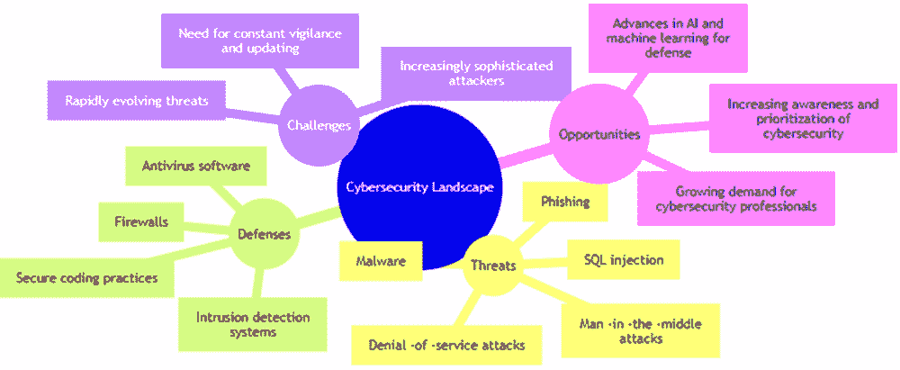 |
| --- |


图 1 显示的思维导图提供了了网络安全格局的全面概述，分为四个大类：威胁、防御、挑战和机遇。`Threats`（威胁）类别概述了各种类型的网络威胁，包括恶意软件、钓鱼、中间人攻击、拒绝服务攻击和 `SQL injection`。这些代表了攻击者为了破坏系统或网络而可能使用的不同方法。`Defences`（防御）类别列出了如防火墙、反病毒软件、入侵检测系统和安全编码规范等措施，这些是构建稳健网络安全防御策略的关键组成部分。`Challenges`（挑战）类别强调了网络安全领域面临的困难，包括快速演变的威胁、日益复杂的攻击者，以及对持续警惕和更新的需求。尽管存在这些挑战，`Opportunities`（机遇）类别强调了对网络安全专业人员日益增长的需求、人工智能和机器学习在防御方面的进展，以及对网络安全意识和优先事项的提高。该图表是理解复杂且不断变化的网络安全领域的宝贵起点。

### 1.1 网络安全的定义

网络安全不仅仅是一个技术问题。它还涉及法律、政策和社会方面，延伸到法律执法、政策制定以及用户意识和行为领域。“网络安全”一术语指的是各种过程、技术和系统，旨在保护数字和网络化环境免受各种类型的网络攻击。该术语由美国国家标准协会 (`ANSI`）创造。根据 (Von Solms and Van Niekerk (2013))，该领域的主要目标是确保数据在所有数字网络和系统中的可用性、完整性和机密性。这是该领域的主要目标。确保在线传输信息安全的问题不仅仅是技术性的。此外，考虑到法律、社会和政策影响是非常重要的，这些影响延伸到了法律执法、政策制定以及用户意识和行为领域。

### 1.2 网络安全的重要性

在当今这个信息时代，全球经济和社会基础设施如此地依赖数字和网络系统，网络安全是绝对的必需。由于我们对技术系统的依赖日益增加，网络安全在确保这些系统持续运行和可靠性方面的作用变得越来越重要。网络安全有助于确保这些系统继续按预期运行。有关网络安全在不同维度的重要性的全面概述，请参阅图 2。

数字技术的普及伴随着网络犯罪的增加，网络犯罪可以采取各种形式，从间谍活动和对关键基础设施的攻击到财务欺诈和个人身份信息的盗取。这种网络犯罪的上升是随着数字技术的普及而发生的。如果要有效对抗威胁并不仅保护个人和企业而且保护国家安全，网络安全措施是绝对要求的。此外，数据泄露可能会对组织的声誉造成巨大损害，并导致重大的财务损失，这进一步强调了对稳健网络安全措施的需求 (Romanosky, 2016)。

| 图 2. 网络安全的重要性 |
| --- |
| 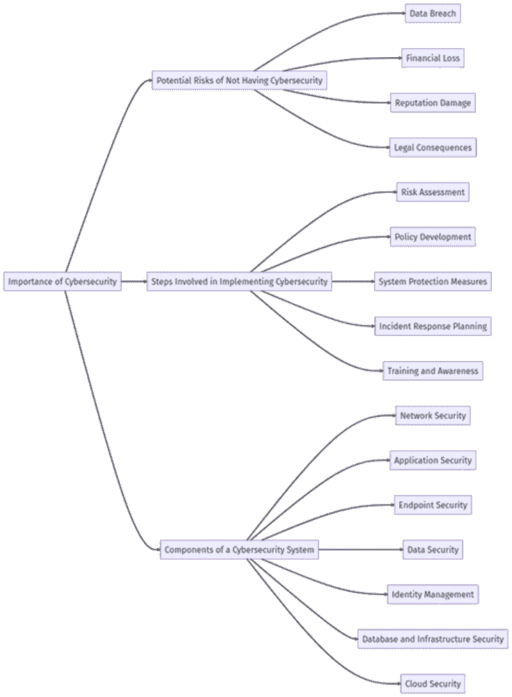 |
| --- |

本章将概述网络安全格局的关键要素，阐明不同的威胁者和常见的网络威胁类型。我们将检查用于预防、检测和响应这些威胁的工具和技术，以及旨在保护数据和隐私的政策和法规。后续章节将对不同的网络安全方法进行对比分析、主要网络攻击的案例研究，并讨论人为因素在网络安全中的作用。本章以对网络安全格局的展望结束，强调了在面对不断进步的网络威胁时所要求的持续演变和适应。

## 2. 网络安全的演变

网络安全像它保护的技术一样，在多年来经历了快速演变。了解它的历史有助于我们理解其现状并预测未来趋势。表 1 和图 3 简要概述了网络安全的演变。

表 1. 网络安全的演变

| 网络安全维度 | 过去 | 现在 | 未来 |
| --- | --- | --- | --- |
| 威胁格局 | 多样性较少，主要是物理威胁 | 多方面 - 从个人黑客到国家支持的攻击 | 不断增长，具有更多多样化的来源和复杂的技术 |
| 重点 | 预防攻击 | 检测与响应，以及预防 | 主动威胁狩寻、自动化响应 |
| 新技术的影响 | 有限 | 显著（云计算、物联网、人工智能） | 随着量子计算等新兴技术的出现而更加显著 |
| 人工智能和机器学习的使用 | 罕见或不存在 | 常用于预测、识别和响应威胁 | 高级 AI（如深度学习）用于更准确的检测和防御 |
| 行为分析 | 不流行 | 识别潜在威胁的关键工具 | 用户行为与 AI 的集成以增强威胁预测 |
| 加密 | 简单的方法 | 先进的标准 | 量子加密、用于隐私的同态加密 |
| 监管框架 | 有限 | 拥有 GDPR、CCPA 等法规 | 全球统一的标准和法规 |
| 网络安全培训 | 有限，主要针对 IT 专业人员 | 针对员工日益增长，意识活动 | 持续培训、模拟网络攻击演练、普及意识 |

| 图 3. 网络安全的进化 |
| --- |
| 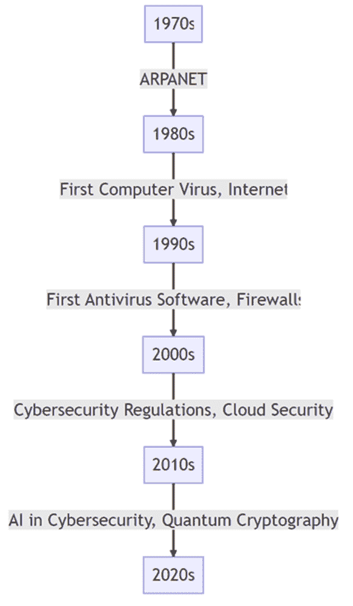 |
| --- |

### 2.1 过去的网络安全

在计算的早期（20 世纪 60 年代到 80 年代后期），网络安全并不是一个首要考虑的问题。计算机作为独立机器运行，主要由大学、政府和公司用于专门任务，这限制了公众的访问。存在的威胁主要是物理性的——未经授权的访问、窃取数据 (Yost, 2017)。过去网络安全的概述详见表 2。

表 2. 过去的网络安全

| 时期 | 网络安全格局 | 关键威胁 | 保护措施 |
| --- | --- | --- | --- |
| 1970 年代 | 早期计算机网络的出现 | 安全意识极其有限 | 基础密码保护 |
| | 互联网连接极少 | 内部威胁 | 物理安全措施 |
| | 缺乏标准的安全措施 | | |
| 1980 年代 | 联网系统的增长 | 恶意软件，包括病毒和蠕虫 | 反病毒软件 |
| | 第一批计算机病毒出现 | 未经授权的访问和数据泄露 | 防火墙实施 |
| | 基于密码的身份验证 | | 数据加密 |
| 1990 年代 | 互联网迅速普及 | 网络间谍活动和数据盗取 | 入侵检测系统 (IDS) |


# 网络安全演变

| 阶段 | 趋势 | 挑战 | 重点 |
| :--- | :--- | :--- | :--- |
| | 电子商务的激增 | DDoS 攻击 | 增强网络安全意识 |
| | 加密技术的进步 | 社会工程攻击 | 用于安全浏览的安全套接层 (SSL) |
| 2000 年代 | 社交媒体和云计算的兴起 | 高级持续性威胁 (APT) | 网络访问控制 (NAC) |
| | 网络犯罪和数据泄露增加 | 钓鱼攻击 | 网络安全认证与培训 |
| | 移动设备普及 | 软件漏洞利用 | 双重身份验证 |
| 2010 年代 | 网络威胁复杂化 | 勒索软件攻击 | 安全信息和事件管理 (SIEM) |
| | 物联网 (IoT) 连接 | 国家支持的网络攻击 | 高级端点保护 |
| | 对数据隐私的关注日益增长 | | 事件响应规划与测试 |

随着 20 世纪 80 年代末和 90 年代初互联网的出现，计算机开始互联，实现了全球信息共享并改变了工作和通信。然而，这种连接性带来了新的漏洞和网络威胁。最初的网络安全是被响应性的，由于威胁的新颖性，仅在问题出现时进行修复。早期的工作侧重于保护网络边界，使用 `firewalls` 来监控和控制流量。身份验证依赖密码，但随着网络犯罪发现猜测或窃取密码的方法，密码被证明是脆弱的。随着技术的进步，网络威胁不断演变，黑客利用软件漏洞并创建了复杂的钓鱼攻击和恶意软件。这一时代标志着向主动网络安全的转变，即预测威胁并实施预防措施。现代网络安全实践的出现塑造了今天这一领域。

### 2. 如今的网络安全

| 主题 | 当前挑战 | 新兴技术 | 最佳实践 |
| :--- | :--- | :--- | :--- |
| 网络威胁 | 复杂且有针对性的攻击 | 人智能和机器学习 | 定期更新软件 |
| 勒索软件和勒索 | 量子计算 | 强密码策略 |
| | 钓鱼和社会工程 | 物联网 (IoT) | 多因素身份验证 |
| | 区块链 | 员工网络安全培训 | |
| | 生物识别 | | |
| 安全解决方案 | 端点保护 | 云安全 | 网络分段与监控 |
| | 防火墙和入侵检测 | 行为分析 | 敏感数据加密 |
| | 安全运营中心 (SOC) | 零信任架构 | 事件响应规划与测试 |
| | 安全信息和事件管理 (SIEM) | 下一代代杀毒软件 | 供应商风险评估与管理 |
| | 安全访问服务边缘 (SASE) | | |
| 合规性与治理 | GDPR 和数据隐私法规 | 同态加密 | 定期安全审计 |
| | HIPAA、PCI DSS 及其他标准 | 隐私保护技术 | 数据分类和访问控制 |
| | 网络安全法律和政策 | 身份和访问管理 | 符合行业特定法规 |
| | 内部威胁和数据泄露 | | 创建并执行网络安全策略和程序 |

在当今时代，由于威胁复杂性的日益增加、全球业务运营以及技术的无处不在，网络安全具有着至关重要的意义。现在的威胁范围从利用系统的个人黑客到导致重大经济和政治影响的国家支持的网络攻击（Burton et al., 2020）。当前对网络安全的概览详见表 3。

虽然预防仍然是不可或的一部分，但检测和响应已成为网络安全策略的关键组成部分。`云计算`和物联网 (`IoT`) 等新技术的出现引入了新的漏洞，同时也带来了潜在的机会（Hashizume et al., 2013; Roman, Zhou, & Lopez, 2013）。

人工智能 (`AI`) 和机器学习正逐渐用于增强威胁的预测和检测。同样，行为分析被用于通过分析用户行为模式来检测可疑活动（Buczak & Guven, 2016）。

简而言之，当前的网络安全格局错复杂，一方面是不断加剧的威胁，另一方面是技术进步提供了新的保护工具。展望未来，网络安全将继续其快速演变，应对不断变化的威胁和技术进步。

## 2.3. 网络安全的预测趋势及其影响

| 网络安全预测趋势及其影响 | 新兴技术 | 角色 | 影响 |
| :--- | :--- | :--- | :--- |
| 量子计算 | 前所未有的处理能力 | 增强网络安全防御 | • 有破解当前加密方法的潜力。<br>• 有必要开发抗量子加密算法。<br>• 迫切需要主动响应以保护数据和信息的完整性 |
| 人工智能 (AI) | 实时威胁检测 | 构成新威胁 | • 实现实时威胁检测和响应。<br>• 赋能主动事件响应。<br>• 提高识别潜在攻击的准确性和速度。<br>• AI 可能会被利用用于复杂的网络攻击 |

随着网络安全格局不断演变，量子计算和人工智能 (`AI`) 等新兴技术的整合预计将产生深远影响。这些技术进步既带来了机遇，也带来了挑战，改变了加强网络安全防御的方式，并引入了需要关注的新威胁。网络安全的预测趋势及其影响详见表 4。

量子计算凭借其前所未有的处理能力，为包括网络安全在内的各行业提供了令人兴奋的机会。然而，这种力量也引发了对潜在漏洞的担忧。特别令人关注的是它破坏作为数据保护基石的现有加密方法。量子计算机巨大的计算能力（以 `Shor's algorithm` 等算法为代表）有潜力破解目前保护敏感信息的加密密钥。因此，迫切需要开发能够抵御量子机器计算实力的抗量子加密算法（Zhang, Jung, & Liu, 2019）。网络安全社区的这种主动响应对于保护数据以及维护信息的机密性、完整性和真实性至关重要。


另一方面，AI 正在成为网络安全领域的游戏规则改变者。它实时处理和分析海量数据的能力为网络安全专业人员提供了强大的威胁检测和响应工具。AI 驱动的安全解决方案在识别异常和潜在攻击方面具有卓越的准确性和速度，超越了单纯的人类能力。通过快速识别新兴威胁，AI 增强了事件响应能力，使得在面对网络攻击时能够采取主动防御态势。然而，这种让 AI 保护数字生态系统的潜力也可能被用于恶意目的。攻击者可以利用 AI 的自动化和适应性，以更高的精密度发起复杂且有针对性的网络攻击。这些 AI 驱动的攻击为防御机制带来了新挑战，因为它们可以根据防御措施动态调整策略，使其更难被有效检测和缓解。

为了有效应对预测的网络安全趋势，在拥抱量子计算和 AI 优势的同时，在承认并减轻其潜在风险之间建立一种微妙的平衡至关重要。网络安全专业人员和研究人员必须保持警惕和敏捷，跨学科协作，制定用于保护数字基础设施的创新策略。持续的研发工作对于领先不断演变的威胁以及增强网络安全防御的韧性至关重要。此外，促进政府、组织和行业利益者之间的国际合作与协调努力，对于解决全球网络安全挑战以及确保我们日益互联的数字世界受到保护至关重要。通过预测和适应这些趋势，网络安全社区可以更好地为数字安全的动态未来做好准备，并防御新兴威胁。

## 3. 网络安全格局的关键要素

为了更好地理解网络安全的现状，掌握其核心要素至关重要：威胁行为者、网络威胁、网络安全技术与工具，以及网络安全政策和法规。

## 3.1. 威胁行为者

威胁行为者是执行网络攻击的实体。他们有多种动机，包括利益、政治信仰或仅仅是造成破坏。他们的范围从个人爱好者到组织犯罪集团，再到国家赞助的攻击者。

*   **黑客 (Hackers)**：黑客是擅长利用计算机系统和网络漏洞的个人。他们的动机和目标差异很大。被称为“黑帽黑客”的黑客为了个人或财务利益从事恶意活动。相比之下，“白帽黑客”或伦理黑客利用他们的技能发现并修复安全漏洞（Soares, L. F., Fernandes, D. A., Gomes, 2014）。
*   **内部人员 (Insiders)**：内部人员（如员工或承包商）拥有对组织信息系统的合法访问，构成了重大的网络安全风险。内部威胁可能是有意的（例如不满的员工）或无意的（例如员工成为钓鱼攻击受害者或无意泄露敏感信息）（Probst, Hunker, Gollmann, & Bishop, 2009）。
*   **国家赞助的攻击者 (State-Sponsored Actors)**：国家赞助的攻击者由政府支持，从事网络战或网络间谍活动。他们通常技术高超且资金充足，能够开展大规模的复杂攻击（Shakarian, Shakarian, & Ruef, 2013）。
*   **非国家团体 (Non-State Groups)**：非国家团体包括恐怖组织和黑客行动主义团体。他们可能利用网络攻击来造成破坏、推动政治或意识形态议程或实施网络恐怖主义（Conway, 2007）。

## 3.2. 网络威胁

网络威胁是对数字资产的潜在危险，包括数据、系统和网络。在这里，我们讨论一些最常见的网络威胁类型。

*   **恶意软件 (Malware)**：恶意软件是任何用于干扰计算机操作、收集敏感信息或获取系统未经访问的软件。它包括病毒、蠕虫、特木马、勒索软件、间谍软件、广告软件和僵尸网络（Singh, 2023）。
*   **钓鱼 (Phishing)**：钓鱼是一种网络攻击，攻击者在电子邮件、消息或其他通信平台上冒充合法组织，欺骗受害者泄露敏感信息，如密码或信用卡号（Jagatic, Johnson, Jakobsson, & Menczer, 2007）。
*   **中间人攻击 (Man-in-the-middle attacks)**：在中间人攻击中，攻击者秘密地截获并可能篡改两个双方之间的通信，而双方都认为正在直接通信（De la Hoz et al. (2014)）。
*   **拒绝服务攻击 (DoS) attacks)**：DoS 攻击旨在通过临时或无限期中断服务，使机器或网络资源对预定用户不可用。这些攻击通常通过流量淹没目标来实现（Mirkovic & Reiher2004）。
*   **高级持续性威胁 (APTs)**：APT 是一种长期针对性的攻击，攻击者获取网络的未经授权访问并在长时间不被发现。它们通常旨在窃取信息而非破坏（Scarfone et al. 2007）。

*   在接下来的小节中，我们将深入用于对抗这些威胁的工具和技术，以及监管网络安全的政策和法规。

## 3.3. 网络安全技术与工具

网络安全技术和工具用于保护系统和数据免受网络威胁。它们是组织网络安全策略不可或缺的一部分。网络安全技术和工具的概述详见表 5 和图 4。

表 5. 网络安全技术与工具

| 技术/工具 | 目的 |
| --- | --- |
| 防火墙 | 通过控制进出网络或特定设备的互联网流量来保护网络。它们在安全的内部网络和不可信的外部网络之间建立了屏障。 |
| 入侵检测系统 (IDS) | 监控网络或系统的恶意活动或违反策略的行为，并向管理站报告。 |
| 反病毒软件 | 保护计算机系统免受恶意软件，包括病毒、蠕虫、木马、勒索软件和间谍软件。它通过将已知恶意软件签名与计算机或网络上的文件进行对比来识别威胁。 |
| 加密 | 通过将信息转换为只有密钥才能读取的不可读代码来保护信息。用于保护传输中和静态数据。 |
| 通用数据保护条例 | 针对欧盟和欧洲经济区所有个人数据保护和隐私的欧盟法律法规。 |
| 加州消费者隐私法案 | 一项旨在加强美国加利福尼亚州居民隐私权和消费者保护的州法律。 |
| 支付行业数据安全标准 | 处理来自主要卡组织品牌信用卡的组织的信息安全标准。旨在减少互联网上的支付卡欺诈并增加持卡者数据保护。 |
| 虚拟专用网络 (VPN) | 提供通过互联网到网络的安全连接，保护您的浏览活动免受公共 Wi-Fi 上的窥探等。 |


| 多因素身份认证 (MFA) | 通过要求多种验证方法来增加额外的安全层。 |
| 安全信息和事件管理 (SIEM) | 对应用程序和网络硬件生成的安全警报进行实时分析。 |
| 电子邮件安全解决方案 | 保护电子邮件账户和内容免受网络威胁和攻击。 |
| 网络分段 | 将网络划分为多个段，允许每个分段进行独立的管理和控制。 |
| 数据泄露防护 (DLP) | 确保终端用户不在公司网络外发送敏感或关键信息。 |
| 人工智能与机器学习 | 自动检测并对抗威胁，基于数据分析预测新的和新兴的威胁。 |

*   • `Firewalls`: `Firewalls` 是网络安全设备，根据预定义的安全规则监控并控制入和和出网络流量。它们在受保护和受控的内部网络与不可信的外部网络（如互联网）之间建立了屏障（Kshirsagar et al., 2012）。

*   • `Intrusion Detection Systems (IDS)` 设计用于检测网络内的可疑活动。它们监控网络流量或系统行为是否存在恶意活动或违反策略的行为，并向管理站生成报告（Scarfone & Mell, 2007）。

*   • `Antivirus software`: `Antivirus software` 用于预防、检测和删除恶意软件，包括病毒、木马、蠕虫、间谍软件等。它通常通过将已知恶意软件特征的数据库与计算机或网络上的文件进行比较来识别威胁（Hansman & Hunt, 2005）。

*   • `Encryption`: `Encryption` 是一个将可读数据（明文）转换为不可读格式（密文）的过程，以防止未经授权的访问。只有解密密钥的人才能将数据转换回原始形式。它广泛用于保护传输中和存储的敏感信息（Abd Elminaam et al., 2008）。

*   • `Cybersecurity Policies and Regulations`: 网络安全领域的政策和法规为保护个人和敏感信息提供了指南和规则。它们的设计旨在防止滥用、未经授权的访问以及对计算机网络的干扰。

| 图 4. 网络安全技术与工具 |
| --- |
| 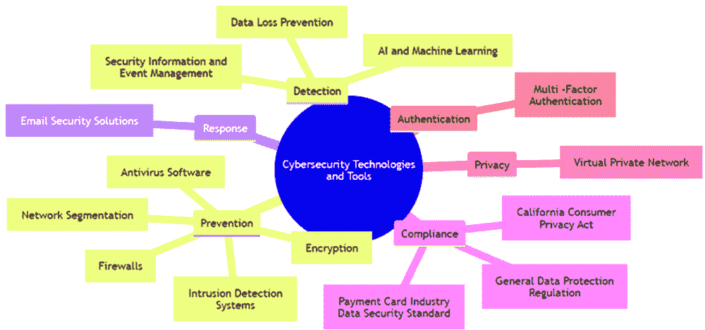 |

*   • `General Data Protection Regulation (GDPR)`: `General Data Protection Regulation (GDPR)` 是欧盟法律中关于对所有欧盟和欧洲经济区个人进行数据保护和隐私保护的法规。它还涉及了个人数据向欧盟和欧洲经济区（EEA）区域以外传输的问题（Voigt & Von dem Bussche, 2017）。

*   • `California Consumer Privacy Act (CCPA)`: `California Consumer Privacy Act (CCPA)` 是一项州法律，旨在增强加利福尼亚州居民的隐私权和消费者保护。

*   • `Payment Industry Data Standard (PCI DSS)`: `Payment Industry Data Standard (PCI DSS)` 是一 set 标准，旨在确保所有接受、处理、存储或传输信用卡信息的公司都维护安全的环境（Ali & Warren, 2017）。

## 4. 网络安全方法的对比分析

了解这些技术和策略的有效性对于开发网络安全至关重要。本节提供了对各种方法的对比分析。

表 6. 网络安全技术的优缺点

| 方法 | 优点 | 缺点 |
| --- | --- | --- |
| `Firewalls` | 能够过滤网络流量并阻止未经授权的访问 | 可能无法检测内部威胁 |
| `Intrusion Detection Systems (IDS)` | 有效检测已知威胁 | 可能会产生误报 |
| `Antivirus Software` | 擅长识别已知恶意软件 | 对未知恶意软件通常无效 |
| `Encryption` | 提供强有力的数据保护 | 可能会消耗资源 |
| `VPN` | 提供安全的远程访问 | 可能会较慢 |
| `Multi-Factor Authentication (MFA)` | 增加额外的安全层 | 对用户而言可能不方便 |
| `SIEM` | 提供安全态的全面视图 | 实现可能复杂 |
| `Email Security Solutions` | 防御钓鱼、垃圾邮件和恶意软件 | 可能无法捕获所有邮件 |
| `Network Segmentation` | 减少攻击面 | 管理可能复杂 |
| `Data Loss Prevention (DLP)` | 保护敏感数据 | 可能会产生误报 |
| `AI and Machine Learning` | 主动威胁检测 | 取决于数据的质量 |

## 5. 大型网络攻击案例研究

现实世界的网络攻击案例为了解威胁者所使用的策略、他们利用的漏洞以及可以缓解这些威胁的有效防御措施提供了宝贵的见解。以下是三个重大网络攻击的案例研究。

表 7.

| 案例研究 | 年份 | 受影响实体 | 影响 | 原因 |
| --- | --- | --- | --- | --- |
| `WannaCry Ransomware Attack` | 2017 | 跨 150 个国家的 200,000 多台计算机 | 数据被加密；索要现金 | 利用 Windows 漏洞 `EternalBlue` |
| `Equifax Data Breach` | 2017 | 约 1.47 亿人 | 敏感信息被访问 | 未修复 `Apache Struts` 应用程序的漏洞 |
| `SolarWinds Hack` | 2020 | 数千家公司和政府机构 | 获取了网络权限；暴露了供应链漏洞 | `SolarWinds' Orion` 软件遭到破解 |


### 主要网络攻击

- **WannaCry 勒索软件攻击**：2017 年 5 月，世界见证了历史上最广泛的网络攻击之一：WannaCry 勒索软件攻击。这种阴险的攻击瘫痪了全球 150 国家的超过 20 万台计算机，造成了巨大的经济和运营动荡。该勒索软件利用了一个名为 `EternalBlue` 的 Windows 漏洞，该漏洞是由一个名为“影子经纪人”的黑客组织在网上泄露的。勒索软件一旦渗透系统，就会加密所有可访问的文件，实际上是将它们作为人质。受害者收到一份勒索信，要求用比特币支付费用以换取解密密钥。知名受害者包括英国国家医疗服务体系、电信公司和大型企业，凸显了这一网络威胁的严重性和全球影响。尽管在攻击发生之前就有补丁，但由于组织应用不及时或缺乏应用，其效果大打折扣，这强调了网络安全中及时补丁管理的重要性（O'Kane, 2018）。

- **Equifax 数据泄露**：Equifax 作为美国三大消费者信贷报告机构之一，在 2017 年 9 月遭遇了大规模数据泄露。此次泄露产生了深远影响，影响了约 1.47 亿人。黑客利用了 Equifax 尚未修复的 `Apache Struts` Web 应用程序框架中的漏洞来访问敏感信息。被盗数据包括社会安全码、出生日期和地址——这些信息可被用于包括身份盗窃在内的无数欺诈活动。泄露导致 Equifax 遭受了重大的财务损失，并严重损害了其声誉。泄露的后果证明了定期更新和补补软件的重要性，以及未能做到这一点可能导致的灾难性后果（Biener et al., 2015）。

- **SolarWinds 黑客攻击**：2020 年 12 月披露的 SolarWinds 攻击是一次备受关注的供应链攻击，直击全球范围内公共和私营机构的核心，包括美国联邦政府的大部分机构。网络威胁者策划了一场复杂的行动，攻破了 SolarWinds 的 `Orion` 软件——该平台被成千上万的公司用于 IT 资源监控和管理。攻击者随后能够访问使用该受损软件组织的网络。SolarWinds 攻击强调了与供应链漏洞相关的潜在风险，并揭示了防御受国家支持的（据信由俄罗斯支持）的网络威胁的复杂性。这次攻击对网络安全产生了重大影响，强调了需要稳健、协调的应对措施来防御此类高级威胁（Perlroth, 2021）。

## 6. 人为因素在网络安全中的作用

除了技术手段外，人为因素在网络安全格局也起着重要作用。本节探讨了网络安全培训的重要性以及社会工程学攻击背后的心理学。

### 表 8

| 角色/方面 | 描述 | 影响 |
| :--- | :--- | :--- |
| 用户意识 | 用户对网络安全威胁和最佳实践的认知程度。 | 较高的意识可以减少成为网络钓鱼或社会工程学攻击受害概率。 |
| 员工培训 | 提供给员工的网络安全培训的范围和质量。 | 适当的培训可以使员工识别并恰善应对网络威胁，降低风险。 |
| 密码规范 | 用户在创建、存储和更新密码方面的习惯。 | 强密码规范是防御未经授权访问的基础性且至关重要的防线。 |
| 政策合规性 | 对组织网络安全政策和准则的遵守情况。 | 不合规可能导致系统和网络引入漏洞，增加风险。 |
| 用户操作/行为 | 用户采取的日常操作，既可以保护也可以暴露网络和系统。 | 粗心或缺乏知识的行为（例如，点击可疑链接、使用不安全的网络）会大大增加网络安全风险。 |
| 报告 | 用户报告可疑活的意愿和能力。 | 及时报告有助于快速识别和缓解网络威胁。 |

### 网络安全培训的重要性

虽然部署先进的网络安全技术至关重要，但如果用户缺乏有效使用这些技术的意识或知识，或者他们落入社会工程学攻击的陷阱，这些技术的就会就会大打折扣。因此，网络安全培训对于赋予用户识别和应对网络威胁的知识和技能至关重要。培训可以帮助用户理解他们所接触的数据的价值，以及数据泄露后可能导致的后果。此外，它还可以教导用户安全的在线行为，例如如何创建和管理强密码、如何识别和避免钓鱼邮件，以及何时应用安全补丁和更新（Parsons, McCormac, Butavicius, Pattinson, & Jerram, 2014）。

### 社会工程学攻击的心理学

社会工程学攻击操纵个人披露敏感信息或执行损害网络安全的行为。这些攻击背后的心理学通常涉及利用个人的自然倾向和认知偏差。例如，钓鱼邮件通常会营造一种紧迫感（例如警告账户将被封禁），以引发立即的、考虑不周的行动。同样，托辞攻击（Pretexting）涉及创建一个虚假场景（例如假装成 IT 支持）以获得受害者的信任和配合。理解这些心理技巧可以帮助设计更有效的网络安全培训和政策（Hadnagy & Fincher, 2015）。

## 7. 结论

正如我们在本章中所探讨的样，网络安全是我们数字社会中日益重要的关注问题。从网络安全实践的演变到威胁、攻击者、技术和政策的广泛格局，网络安全是一个复杂且多层领域。

我们讨论的主要网络攻击凸显了这些威胁的严重性和深远影响。这些案例表明，没有任何机构可以免受网络威胁，而且技术防御人为因素在维护网络安全方面都起着关键作用。

展望未来，随着新技术的出现和威胁者制定新战术，预计网络安全格局将继续演变。以下趋势很可能是：国家支持的网络战争持续增长、人工智能和机器学习在网络攻击和防御中的重要性增加，以及在数据收集和监控日益增长的情况下，隐私与安全之间持续的斗争。

最终，网络安全领域需要不断适应和创新以应对这些挑战。通过技术进步、有效的法规政策、全面的培训计划以及国际合作，可以建立一个更安全、更可靠的数字世界。

## 参考文献


Aitzhan, N. Z., & Svetinovic, D. (2016). Security and privacy in decentralized energy trading through multi-signatures, blockchain and anonymous messaging streams. IEEE Transactions on Dependable and Secure Computing, 15(5), 840–852. doi:[10.1109/TDSC.2016.2616861](https://doi.org/10.1109/TDSC.2016.2616861)

Ali, A., Warren, D., & Mathiassen, L. (2017). Cloud-based business services innovation: A risk management model. International Journal of Information Management, 37(6), 639–649. doi:[10.1016/j.ijinfomgt.2017.05.008](https://doi.org/10.1016/j.ijinfomgt.2017.05.008)

Biener, C., Eling, M., & Wirfs, J. H. (2015). Insurability of cyber risk: An empirical analysis. The Geneva Papers on Risk and Insurance. Issues and Practice, 40(1), 131–158. doi:[10.1057/gpp.2014.19](https://doi.org/10.1057/gpp.2014.19)

Bodin, L., Gordon, L. A., & Loeb, M. P. (2008). Information security and risk management. Communications of the ACM, 51(4), 64–68. doi:[10.1145/1330311.1330325](https://doi.org/10.1145/1330311.1330325)

Buczak, A. L., & Guven, E. (2015). A survey of data mining and machine learning methods for cyber security intrusion detection. IEEE Communications Surveys and Tutorials, 18(2), 1153–1176. doi:[10.1109/COMST.2015.2494502](https://doi.org/10.1109/COMST.2015.2494502)

Burton, J., & Christou, G. (2021). Bridging the gap between cyberwar and cyberpeace. International Affairs, 97(6), 1727–1747. doi:[10.1093/ia/iiab172](https://doi.org/10.1093/ia/iiab172)

Conway, M. (2006). Terrorism and the Internet: New media—New threat? Parliamentary Affairs, 59(2), 283–298. doi:[10.1093/pa/gsl009](https://doi.org/10.1093/pa/gsl009)

De la Hoz, E., Cochrane, G., Moreira-Lemus, J. M., Paez-Reyes, R., Marsa-Maestre, I., & Alarcos, B. (2014, June). Detecting and defeating advanced man-in-the-middle attacks against TLS. In 2014 6th International Conference On Cyber Conflict (CyCon 2014) (pp. 209-221). IEEE. doi:[10.1109/CYCON.2014.6916404](https://doi.org/10.1109/CYCON.2014.6916404)

Hadnagy, C., & Fincher, M. (2015). Phishing dark waters: The offensive and defensive sides of malicious Emails. John Wiley & Sons. doi:[10.1002/9781119183624](https://doi.org/10.1002/9781119183624)

Hansman, S., & Hunt, R. (2005). A taxonomy of network and computer attacks. Computers & Security, 24(1), 31–43. doi:[10.1016/j.cose.2004.06.011](https://doi.org/10.1016/j.cose.2004.06.011)

Hashizume, K., Rosado, D. G., Fernández-Medina, E., & Fernandez, E. B. (2013). An analysis of security issues for cloud computing. Journal of Internet Services and Applications, 4(1), 1–13. doi:[10.1186/1869-0238-4-5](https://doi.org/10.1186/1869-0238-4-5)

Jagatic, T. N., Johnson, N. A., Jakobsson, M., & Menczer, F. (2007). Social phishing. Communications of the ACM, 50(10), 94–100. doi:[10.1145/1290958.129068](https://doi.org/10.1145/1290958.129068)

Kshirsagar, V. K., Tidke, S. M., & Vishnu, S. (2012). Intrusion detection system using genetic algorithm and data mining: An overview. [PRINT]. International Journal of Computer Science and Informatics, 5292( ), 118–122.1:[10.7793/JC.222211076](https://..org11..7899/JCSI.2012.1076)

Mirkovic, J., & Reiher, P. (2004). A taxonomy of DDoS attack and DDoS defense. Computer Communication Review, 34(2), 39–53. doi:[10.1145/997150.9156](https://doi.org/10.1145/997150.9156)

O’Kane, P., Sezer, S., & Carlin, D. (2018). Evolution of ransomware. IET Networks, 7(5), 321–327. doi:[10.1049/iet-net.2017.0207](https://doi.org/10.1049/iet-net.2017.0207)

Parsons, K., McCorm, A., Pattinson, M., & Jerram, C. (2014). Determining employee awareness using the human aspects of information security (HAIS). Computers & Security, 42, 165–176. doi:[10.1016/j.cose.2013.12003](https://doi.org/10.1016/j.cose.2013.12003)

Perlroth, N. (2021). This is how they tell the world: The cyberweapons race. Bloomsbury Publishing.

Pollman, E., & Barry, J. M. (2016). Regulatory entrepreneurship. Cal. L. Rev., 90, 383.

Probst, C. W., Hunker, J., Bishop, M., & Gollmann, D. (Eds.). (2010). Insider threats in cyber security (Vol. 49). Springer Science & Business Media. doi:[10.1007/978-4419-7133_1](https://doi.org/10.1007/978-4419-7133_1)

Romanosky, S. (2016). Examining the costs and causes of cyber incidents. Journal of Cybersecurity, 2(2), 121–135.

Scarfone, K., & Mell, P. (2007). Guide to intrusion detection and prevention systems (IPS). NIST special publication, 800(2007), 94.

Shakarian, P., Shakarian, J., & Ruef, A. (2013). Introduction to cyber-warfare: A multidisciplinary approach. Newnes.

Singh, A., & Patel, N. D. (2023). Security Issues, Attacks and Countermeasures in Layered IoT. International Journal of Next-Generation Computing.

Soares, L. F., Fernandes, D. A., Gomes, J. V., Freire, M. M., & Inácio, P. R. (2014). Cloud security: state of the art. Security, Privacy and Trust in Cloud Systems. Insiders.

Voigt, P., & Von dem Bussche, A. (2017). The EU general protection regulation (GDPR). A Practical Guide, 1st Ed., Cham: Springer International Publishing, 10(3152676), 10-5555.

Von Solms, R., & Van Niekerk, J. (2013). From information security to cyber security. Computers & Security, 38, 97–102.

Yost, J. R. (2017). Making IT Work: A History of the Computer Services Industry. MIT Press. doi:[10.7551/mitpress/9375.001.0001](https://doi.org/10.7551/mitpress/9375.001.0001)

# 第 2 章

* Manoj Kumar M. V. (https://orcid.org/0000-0002-9848-6234)
  信息科学与工程系, NITTE Meenakshi Institute of Technology, Bengaluru, 印度
* S. L. Shiva Darshan
  信息技术系, Manipal Institute of Technology Bengaluru, Manipal Academy of Higher Education, Manipal, 印度
* Prashanth B. S. (https://orcid.org/0000-0003-4539-662X)
  信息科学与工程系, NITTE Meenakshi Institute of Technology, Bengaluru, 印度
* Vishnu Yarlagadda (https://orcid.org/0000-0001-6146-5272)
  信息技术系, Manipal Institute of Technology Bengaluru, Manipal Academy of Higher Education, Manipal, 印度

## 摘要

在当今互联的数字世界中，恶意软件的威胁巨大，对个人、企业和政府构成了重大风险。本章为恶意软件分析与检测这一关键领域提供了全面的介绍。章节从恶意软件的定义开始，探讨了它的各种形式及其演变的历史视角。作者们深入了不同类型的恶意软件，包括病毒、蠕虫、木洛马、勒索软件等，了解了它们独特的行为和传播方式。在这一基础的基础上，他们介绍了恶意软件分析方法论的基本概念，包括静态分析、动态分析、逆向工程、虚拟化和沙箱。这些技术使网络安全专业人员能够深入恶意软件的行为和功能。为了应对这一挑战，本章还介绍了先进的恶意软件分析技术，如内存取证、行为分析、内核级 rootkit 程序检测以及基于机器学习的分析。

# 1. 引言


在当今数字时代，技术的快速增长带来了巨大的收益和便利。然而，它也催生了计算阴暗的一面——无处不在的恶意软件威胁。恶意软件（通常被称为 malware）对个人、企业和政府都构成了重大风险，导致数据泄露、财务损失并破坏关键基础设施 [1]。随着网络犯罪分子不断进化其技术，理解并有效对抗恶意软件已成为网络安全专业人员的首要关注问题。

本章是理解恶意软件分析与检测复杂世界的关键起点。它为探索网络安全专家用于识别、分析和缓解恶意软件威胁的技术和策略奠定了基础。

### 1.1 恶意软件的定义

在深入研究恶意软件分析之前，精确定义什么是恶意软件至关重要。恶意软件是 malicious software 的缩写，是指任何故意设计用于破坏计算机系统、网络和数据完整性、机密性可用性的程序或代码 [2]。恶意软件涵盖了广泛有害软件，包括病毒、蠕虫、特洛马、勒索软件、广告软件、间谍软件等。了解各种形式的恶意软件对于分析过程中区分它们的行为和特征至关重要。

### 1.2 恶意软件的演变格局

恶意软件的历史悠久，随着技术和计算领域的发展而演变。早期的恶意软件通常相对简单，通过受感染的软磁盘和电子邮件附件传播 [3]。然而，随着互联网的无处不在，恶意软件变得更加复杂和分布式，利用各种攻击向量，例如社会工程学、路过下载和恶意链接。图 1 显示了过去五年来恶意软件的演变。本节提供了恶意软件的历史视角，强调了塑造现代威胁格局的重大事件和发展。

| 图 1 过去五年（2018-2022）印度不同类型恶意软件的演变 |
| --- |
| 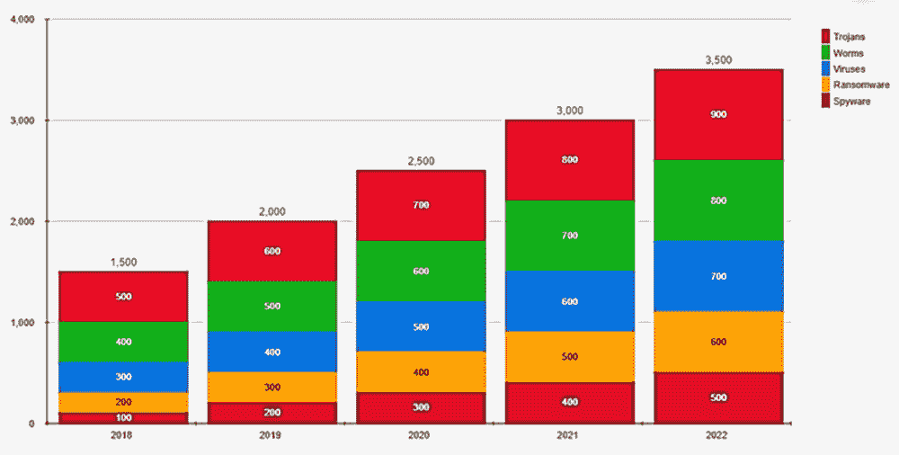 |
| --- |

### 1.3 恶意软件的影响

恶意软件攻击的影响对个人和组织来说都可能是严重的。从财务损失和身份盗窃到广泛的数据泄露和大规模的干扰，恶意软件的后果可能是深远的。本节研究了真实世界中著名恶意软件事件的案例及其后果，以说明实施有效恶意软件分析和检测措施的紧迫性 [4]。

### 1.4 恶意软件分析与检测的必要性

随着恶意软件能力的不断进步，仅依靠安全措施通常不足以阻止这些威胁。本节强调了恶意软件分析和检测方法的关键性需求，将其作为识别和对抗恶意软件的主动方法。通过深入了解恶意软件如何运行，安全专业人员可以开发有效的应对措施并加强整体网络安全防御。

## 2. 恶意软件类型

恶意软件有多种形式，每种形式都有独特的特征和恶意目标。了解不同类型的恶意软件对于有效的分析和检测至关重要。在本章中，我们将探索最常见的恶意软件类别及其特定行为 [5]。

### 2.1 病毒

**定义与特征**：病毒是自我复制的程序，附着在合法的文件或程序上。它们通过感染其他文件进行传播，当这些受感染的文件被执行时，病毒就会激活并继续传播。病毒可以通过损坏或破坏数据、减慢系统性能和干扰操作来造成损害。

**感染方法**：病毒通常通过受感染的电子邮件附件、文件共享网络或被攻破的网站传播。

### 2.2 蠕虫

**定义与特征**：蠕虫是独立的恶意程序，能够自我复制并在不需要宿主文件的情况下跨网络传播。它们利用网络服务中的漏洞，从一个系统快速传播到另一个系统。蠕虫会消耗网络带宽，使系统过载，并创建僵尸网络用于进一步的恶意活动。

**感染方法**：蠕虫通过利用网络漏洞进行传播。

### 2.3 特洛伊木 (Trojans)

**定义与特征**：特洛伊是伪装成合法软件的欺骗性程序，诱骗用户安装。与病毒和蠕虫不同，特洛伊不会自我复制。它们为攻击者提供后门以访问系统、窃敏感信息或其他恶意活动。

**感染方法**：特洛伊通常通过欺骗性的社会工程技术，如虚假的软件更新或破解软件下载。

### 2.4 勒索软件

**定义与特征**：勒索软件是一种加密受害者文件或将其锁定出系统的恶意软件。攻击者要求受害者支付赎索金，以换取解密密钥。

**感染方法**：勒索软件通常通过恶意电子邮件附件、漏洞工具包和被攻破的网站传播。

### 2.5 间谍软件

**定义与特征**：间谍软件旨在在受害者不知情或未经许可的情况下，监控并收集其活动信息。它可以跟踪浏览习惯、捕捉击键并记录敏感数据，然后将其传输给攻击者。

**感染方法**：间谍软件通常寄生于看似正常的软件下载或通过恶意网站传播。

### 2.6 广告软件

**定义与特征**：广告软件是一种在受害者计算机上显示意外广告的恶意软件。虽然不像其他类型的恶意软件那样有害，但广告软件具有干扰性并对用户体验产生不利影响。

**感染方法**：广告软件通常与免费软件一起，用户在安装过程中不知情地安装它。

### 2.7 Rootkit

**定义与特征**：Rootkit 用于隐藏系统上其他恶意软件或未经的访问。它们运行在内核级别，传统的杀毒软件极难检测。

**感染方法**：Rootkit 通常通过特洛伊安装或利用漏洞获取内核级访问。

### 2.8 僵尸网络

**定义与特征**：僵尸网络是由恶意行为控制的受感染计算机（通常被称为“机器人”或“僵尸”）组成的网络。这些机器人可以被远程控制以执行协调攻击、发送垃圾邮件以及分布式拒绝服务（DDoS）攻击。

**感染方法**：僵尸网络通过恶意软件（如蠕虫或特洛伊）感染计算机，以便攻击者远程控制。

了解这些不同类型恶意软件的特征和行为对于实施有效的检测和缓解策略至关重要，如表 1 所示。

表 1 近期不同恶意软件的影响及其影响示例

| 恶意软件类型 | 假设的影响 | 示例 |
| --- | --- | --- |
| 特洛伊 | 特洛伊可以为系统提供后门，允许攻击者访问并控制你的计算机。 | 2022 年，美国的一家大公司遭到特洛伊入侵，导致敏感客户数据被盗。 |


| 蠕虫 (Worms) | 蠕虫可以自我复制并传播到网络中的其他计算机，造成广泛破坏。 | 2021 年，一种蠕虫在德国的一个政府网络中传播，导致系统运行缓慢和业务中断。 |
| 病毒 (Viruses) | 病毒可以损坏或删除你计算机上的文件，并可以通过电子邮件附件或不安全的下载传播到其他计算机。 | 2020 年，一种病毒通过邮件附件感染了澳大利亚成千上万台个人电脑，导致了个人数据丢失。 |
| 勒索软件 (Ransomware) | 勒索软件可以加密你的文件并索要赎金以解密。 | 2022 年，英国的一家大型医院遭到勒索软件攻击，导致在支付赎金之前其运营受到严重干扰。 |
| 间谍软件 (Spyware) | 间谍软件可以监控你在计算机上的活动，并将这些信息发送给攻击者。 | 2019 年，针对加拿大一家电信公司的间谍软件攻击导致用户数据被盗，包括通话记录和短信。 |

## 3. 恶意软件行为与能力

恶意软件的设计目的是执行一系列恶意活动，旨在损害计算机系统和数据的安全性和完整性。理解恶意软件的行为和能力对于有效的分析、检测和缓解至关重要。在本章中，我们将探索恶意软件表现出的常见行为以及它们拥有的各种能力。表 2 展示了基于恶意活动及其行为的 Windows 与 Linux 恶意软件之间的差异 [6]。

### 3.1 载荷执行 (Payload Execution)

**描述**：载荷执行大多数恶意软件的主要目标。一旦系统被感染，恶意软件就会部署其载荷，可能包括数据窃取、系统操纵或进一步传播等活动。

**示例**：勒索软件载荷会加密受害者系统上的文件并索要赎金。僵尸网络载荷可能包含对特定目标实施 DDoS 攻击的指令。

### 3.2 数据外泄 (Data Exfiltration)

**描述**：恶意软件经常尝试从受感染系统中外泄敏感数据，包括个人信息、财务数据、知识产权或登录凭据。

**示例**：间谍软件捕捉击键、截图或录音以窃取登录凭据或其他敏感信息。高级持续性威胁 (APT) 专注于隐蔽地外泄价值的企业数据。

### 3.3 远程控制与命令执行 (Remote Control and Command Execution)

**描述**：许多类型的恶意软件与远程命令与控制 (C&C) 服务器建立通信通道，允许攻击者远程控制受感染的系统。

**示例**：木马和僵尸网络可以被控制控制各种任务，如发送垃圾邮件、发起 DDoS 攻击或下载额外的恶意软件。

### 3.4 权限提升 (Privilege Escalation)

**描述**：某些恶意软件尝试提升其在受感染系统的权限，获取更高级别的访问权限以绕过安全限制并安装或执行更复杂的载荷。

**示例**：Rootkit 和某些蠕虫利用漏洞获取管理员权限，使得安全工具更难检测和移除它们。

### 3.5 持久化机制 (Persistence Mechanisms)

**描述**：为了确保在受感染系统中长期存在，恶意软件通常采用持久化机制，使其能够生存重启和安全措施。

**示例**：恶意软件可能会创建注册表项、启动脚本或隐藏文件，以确保在系统启动时自动执行。

### 表 2. Windows 与 Linux 恶意软件差异的表示

| 维度 | Windows 恶意软件 | Linux 恶意软件 |
| --- | --- | --- |
| 目标群体 | Windows 恶意软件通常针对终端用户，因为 Windows 拥有更大的用户群，特别是消费市场。 | Linux 恶意软件通常针对服务器，因为 Linux 广泛用于服务器环境。 |
| 传播 | Windows 恶意软件通常通过电子邮件附件、恶意下载和受感染的 USB 驱动器传播。 | Linux 恶意软件通常通过利用服务器软件的漏洞或弱的 SSH 凭据传播。 |
| 载荷 | Windows 恶意软件具有各种载荷，包括勒索软件、间谍软件和木马。 | Linux 恶意软件通常包括后门、DDoS 机器人和加密货币矿机。 |
| 持久化 | Windows 恶意软件通过修改注册表或将其安装为服务来实现持久化。 | Linux 恶意软件通过将其安装为定时任务 (cron job) 或修改系统文件来实现持久化。 |
| 普及率 | 由于 Windows 用户群更大，Windows 恶意软件更为普遍。 | Linux 恶意软件较常见，但考虑到其目标系统的性质，其可能更加复杂。 |

### 3.6 反分析技术 (Anti-Analysis Techniques)

**描述**：意识到分析的潜在威胁，许多恶意软件变包含了反分析技术，以规避安全研究人员和分析师的检测。

**示例**：恶意软件可能采用代码混淆、加密或虚拟机检测来阻止分析尝试。

### 3.7 逃逸与反检测 (Evasion and Anti-Detection)

**描述**：为了避免被防病毒软件和安全解决方案检测，恶意软件开发者采用各种逃逸技术来伪装其代码和行为。

**示例**：多态恶意软件每次感染都会改变其代码结构，使得基于特征的检测难以识别它。

### 3.8 自传播 (Self-Propagation)

**描述**：蠕虫和其他自我复制的恶意软件具有跨网络和系统自主传播的能力，寻找新的宿主进行感染。

**示例**：邮件蠕虫可以向受害者的联系人发送副本，而网络蠕虫则利用漏洞在组织基础设施内传播。

### 3.9 载荷触发 (Payload Triggering)

**描述**：某些恶意软件可能在满足特定条件或触发因素之前保持休眠，然后再执行其载荷，这使其更难检测和分析。

**示例**：恶意软件可能会等待特定的日期、特定软件的存在或用户交互后再激活其恶意行为。

通过理解恶意软件的各种行为和能力，安全专业人员可以更好地分析并有效应对潜在威胁。

## 4. 基于主机的恶意软件检测 (HOST-BASED MALWARE DETECTION)

基于主机的恶意软件检测侧重于在单个计算机系统或终端直接识别并缓解恶意软件威胁。这种方法涉及分析运行进程、文件和系统活动的行为和特征，以检测并防止恶意软件感染 [7]。在本章中，我们将探索各种基于主机的恶意软件检测技术以及用于有效终端安全的工具。图 2 显示了基于主机的恶意软件检测概述。

| 图 2 恶意软件检测概述 |
| --- |
| 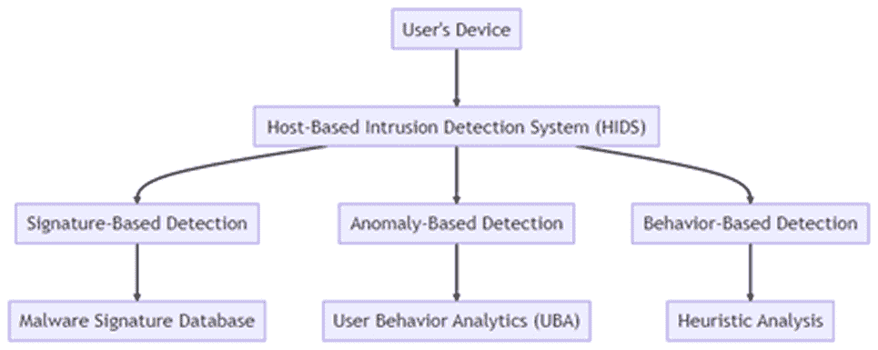 |

### 4.1 防病毒软件 (Antivirus Software)

**描述**：防病毒软件是基于主机的恶意软件检测的基础工具。它使用基于特征的检测，将文件和进程与已知恶意软件特征数据库进行对比。

**功能**：当文件或进程与已知特征匹配时，防病毒软件会将该威胁隔离或从系统中移除。

### 表 3. 恶意软件检测类别的描述、优缺点

| 类别 | 描述 | 优点 | 缺点 |
| --- | --- | --- | --- |
| 基于特征的检测 | 将将一段代码与已知恶意软件特征数据库进行对比。 | 快速高效。对于已知恶意软件准确率极高。 | 只能检测已知恶意软件。对新的或修改过的恶意软件无效。 |


| 方法 |  | 优点 | 缺点 |
| :--- | :--- | :--- | :--- |
| 启发式检测 | 涉及分析代码的行为或特征以确定其是否具有恶意性。 | 可以检测不匹配任何已知签名的新或修改过的恶意软件。 | 可能会产生误报。准确性低于基于签名的检测。 |
| 基于行为的检测 | 涉及随时间监控应用程序和进程的行为。 | 可以根据可疑行为检测此前未知的恶意软件。 | 需要大量的系统资源。可能会产生误报。 |
| 沙箱检测 |涉及在安全的隔离环境中执行可疑代码并监控其行为。 | 通过在安全、隔离环境中观察其行为来检测未知恶意软件。 | 恶意软件可以通过检测自身是否在沙箱运行来规避。需要大量的系统资源。 |
| 基于机器学习的检测 | 使用机器学习算法将代码分类为良性或恶意。 | 通过学习指示恶意行为的模式来检测新型和未知的恶意软件。 | 需要大量的计算资源。可能会产生误报。需要大量数据集进行训练。 |

### 4.2 启发式检测

**描述**：启发式检测是基于签名的检测的扩展，杀毒软件根据可疑的行为模式而非精确签名来识别潜在恶意软件。

**功能**：使用启发式的杀毒工具可以识别并阻止表现出可疑活动的此前未知的恶意软件。

### 4.3 基于行为的分析

**描述**：基于行为的分析监控系统中进程和应用程序的行为，寻找恶意软件软件，例如未经授权的数据访问或尝试修改关键系统文件。

**功能**：通过关注行为，这种方法可以检测零日恶意软件和此前未知的威胁。

### 4.4 沙箱

**描述**：沙箱创建了一个隔离环境，可以在其中执行可疑文件或进程而不影响主机系统。这允许安全分析师能够安全地观察潜在恶意软件的行为。

**功能**：通过监控沙箱环境的操作，分析师可以判断文件或进程是否具有恶意并采取适当措施。

### 4.5 终端检测与响应 (EDR) 解决方案

**描述**：EDR 解决方案在终端提供实时监控和响应能力。它们收集并分析系统活动数据，以检测并响应潜在威胁。

**功能**：EDR 工具提供了更主动的主机恶意软件检测方法，允许安全团队快速响应新兴威胁并执行事件响应操作。

### 4.6 内存取证

**描述**：内存取证涉及分析系统内存的内容，以识别和调查传统基于文件的分析中不可见的恶意活动。

**功能**：内存取证可以揭示在系统内存空间运行的隐藏恶意软件、rootkit 以及复杂的威胁。

### 4.7 主机入侵检测系统 (HIDS)

**描述**：HIDS 监控系统事件和活动，寻找入侵迹象或可能指示恶意活动的可疑行为。

**功能**：当检测到异常或恶意活动时，HIDS 会生成警报或采取自动化操作防止进一步损害。

### 4.8 应用白名单

**描述**：应用白名单允许受信任和授权的应用程序在系统中运行，有效防止未知或未经授权的软件（包括恶意软件）执行。

**功能**：通过限制非白名单应用程序的执行，这种方法减少了恶意软件和其他恶意软件的攻击面。

### 4.9 主机防火墙

**描述**：主机防火墙监控系统上的入站和出站网络流量，根据预定义的规则控制数据包。

**功能**：配置良好的主机防火墙可以防止恶意软件的未经授权通信并阻止数据外泄尝试。

主机恶意软件检测在保护单个系统和终端免受恶意软件威胁方面起着至关重要的作用。通过结合基于签名、基于行为和主动检测的方法，组织可以增强安全态势并迅速响应新兴的恶意软件事件。`Table 3` 表示了恶意软件检测不同类别的描述、优点和缺点。

## 5. 高级恶意软件分析技术

随着恶意软件创建者不断进化技术以规避检测，高级恶意软件分析技术对于理解和对抗复杂威胁变得不可或缺 [8]。在本章，我们将探索网络安全专业人员使用的尖方法和工具，以获得对恶意软件行为更深层的见解并揭示其隐藏能力。

### 5.1 分析无文件恶意软件

**描述**：无文件恶意软件在内存中运行，在磁盘上几乎不留下痕迹。这种恶意软件很难使用传统的基于文件的分析方法进行检测。

**技术**：内存取证、运行时分析和监控系统 API 调用对于检测和分析无文件恶意软件至关重要。

### 5.2 内存取证

**描述**：内存取证涉及提取和分析系统易性内存 (`RAM`) 的内容，以识别恶意软件、rootkit 以及其他在磁盘上不可见的恶意活动。

**技术**：使用 `Volatility` 和 `Rekall` 等工具分析内存转储并揭示隐藏的恶意软件残留。

### 5.3 主机系统的行为分析

**描述**：行为分析观察并监控恶意软件的行为及其对主机系统的影响，关注可能指示恶意图的操作。

**技术**：沙箱环境、运行时分析和监控系统调用有助于安全分析师观察恶意软件行为并理解其对系统的影响。

### 5.4 内核级 rootkit 检测

**描述**：内核级 rootkit 运行在操作系统的核心，极其难以检测和移除。需要专门的技术来识别和缓解此类威胁。

**技术**：内核级调试、代码分析以及使用 `GMER` 等专用工具对于 rootkit 检测至关重要。

### 5.5 动态二进制插桩

**描述**：动态二进制插桩涉及在运行时修改程序的执行过程，以收集有关其行为的详细信息。

**技术**：使用 `PIN` 和 `DynamoRIO` 等工具将代码注入程序的执行流中。

### 5.6 代码仿真与沙箱

**描述**：代码仿真和沙箱技术创建隔离环境，以安全地执行和分析可疑代码。

**技术**：`Cuckoo Sandbox` 和 `Any.Run` 等工具提供了沙箱，用于分析恶意软件行为而不危及主机系统。

### 5.7 分析加壳和混淆恶意软件

**描述**：加壳和混淆恶意软件使用压缩或扰乱代码的技术来规避传统的基于签名检测。

**技术**：解壳和去混淆技术（如静态分析和调试）用于揭示恶意软件的原始代码和行为。

### 5.8 用于模式匹配的 YARA 规则

**描述**：`YARA` 是一种强大的模式匹配工具，根据特定特征或签名识别并分类恶意软件。

**技术**：安全分析师创建自定义 `YARA` 规则来检测已知和新兴的恶意软件威胁。

### 5.9 基于机器学习的恶意软件分析


# 描述
机器学习算法用于根据从大型数据集中学习的模式和行为对恶意软件进行分析和分类。

# 技术
特征提取、训练机器学习模型以及验证其准确性是基于机器学习的恶意软件分析的关键步骤。

# 概述
高级恶意软件分析技术使网络安全专业人员能够应对不断演变的复杂威胁格局。通过将传统分析方法与创新方法相结合，安全专家可以更深入地理解恶意软件行为，增强检测能力，并提高整体网络安全防御。

## 6. 恶意软件情报与威胁猎捕
恶意软件情报和威胁猎捕在主动识别和缓解新兴及复杂的网络威胁方面发挥着至关重要的作用 [9]。在本章中，我们将探索威胁情报、入侵指示（`IOCs`）以及网络安全专业人员在威胁猎捕操作中使用的策略。

### 6.1 威胁情报来源
描述：威胁情报涉及从各种来源收集和分析数据，以获得对新兴和现有网络威胁的洞察，包括恶意软件攻击和威胁活动者。

来源：威胁情报可以从公共仓库、安全论坛、暗网监控、供应商报告以及网络安全共享社区获取。

### 6.2 入侵指示 (IOCs)
描述：入侵指示（`IOCs`）是恶意软件或威胁活动者在攻击期间留下的制品或证据。这些 `IOCs` 可以帮助识别受损系统上的恶意活动。

类型：`IOCs` 可包括 IP 地址、域名、文件哈希、URL、注册表以及网络流量中的特定模式。

### 6.3 威胁情报平台 (TIPs)
描述：威胁情报平台（`TIPs`）是聚合、分析并从各种威胁情报来源提供可操作洞察的工具。它们有助于威胁情报业务的中心化和自动化。

功能：`TIPs` 通过将威胁数据与组织的网络和安全基础设施关联，帮助安全团队做出明智的决策。

### 6.4 主动威胁猎捕策略
描述：威胁猎捕涉及在组织网络和终端内主动搜索恶意活动迹象，旨在检测可能规避了传统安全措施的威胁。

技术：威胁猎捕利用各种工具，如 `EDR` 解决方案、`SIEMs`、网络流量分析工具和自定义脚本，来识别异常行为和潜在的安全违规。

### 6.5 威胁猎捕策略
描述：威胁猎捕涉及在组织网络和终端内主动搜索恶意活动迹象，旨在检测可能规避了传统安全措施的威胁。

技术：威胁猎捕利用各种工具，如 `EDR` 解决方案、`SIEMs`、网络流量分析工具和自定义脚本，来识别异常行为和潜在的安全违规。

### 6.5 行为分析用于威胁猎捕
描述：行为分析使用机器学习算法来识别指示恶意活动的异常模式。

技术：通过分析海量数据，行为分析可以识别威胁和偏差。

### 6.6 威胁情报共享
描述：协作的威胁情报共享涉及组织之间交换威胁数据和见察。

益处：威胁情报共享能够通过检测和响应来防御恶意软件。

### 6.7 威胁猎捕团队
描述：威胁猎捕团队是主动寻找并应对高级网络威胁的专业小组。

专业知识：威胁猎捕团队需要对网络基础设施的专业知识来应对恶意软件。

### 6.8 事件响应与威胁缓解
描述：事件响应是处理恶意感染和其他安全违规的过程。

技术：有效的事件响应涉及包含威胁、消除恶意软件并防止未来的事件。

威胁情报和主动威胁猎捕是稳健网络防御的重要组成部分。通过对威胁保持关注，组织可以更好地防御恶意软件攻击。

## 7. 恶意软件分析中的机器学习与人工智能
机器学习和人工智能（`AI`）改变了网络安全领域 [10-12]。在本章中，我们将探讨机器学习在增强恶意软件检测中的先进作用。

| 图 3 恶意软件分析与检测中的机器学习与人工智能 |
| --- |
|  |

### 7.1 机器学习在恶意软件分析中的作用
特征提取：机器学习模型需要良好的特征来区分正常与恶意。本节探讨了各种特征提取技术。

监督学习：机器学习算法可以在标记数据集上进行训练，从而分类恶意软件。

无监督学习：无监督学习方法有助于检测未知模式和异常，识别新型威胁。

### 7.2 利用 AI 进行恶意软件检测
行为分析：`AI` 驱动的系统可以观察并从恶意软件行为中学习，检测指示恶意活动的模式和偏差。

实时威胁检测：`AI` 算法可以快速处理海量数据，实现对恶意软件威胁的实时检测和响应。

### 7.3 AI 与终端安全
终端保护：`AI` 驱动的终端安全解决方案使用机器学习模型识别并防止设备上的恶意软件和可疑活动。

自适应防御：`AI` 允许终端安全系统根据恶意软件的演进进行适应并改进其检测能力。

### 7.4 AI 增强的网络安全
网络流量分析：`AI` 驱动的系统分析网络流量模式，识别可能指示恶意软件活动或网络攻击的异常 [14]。

入侵检测与防御系统在识别和缓解网络恶意软件攻击方面提供了增强的能力。

## 7.5 AI 在恶意软件分析中的优势与挑战
优势：`AI` 可以处理大规模数据分析、检测未知威胁并提高恶意软件分类的准确性 [15-18]。

挑战：对抗攻击（恶意软件试图规避 `AI` 检测）对 驱动的防御构成了巨大挑战。

### 7.6 人机协作
混合方法：将人类专家知识与 `AI` 能力相结合形成了对抗恶意软件的强大防御。人类分析师可以提供 `AI` 可能无法捕捉的上下文和见察。

赋能分析师：`AI` 工具可以协助安全分析师处理海量数据，使他们专注于战略性决策。

## 7.7 伦理考量与问责
偏见与公平：确保用于恶意软件分析的 `AI` 模型的公平性并避免偏见至关重要，以防止误报或漏报。

问责：网络安全中的 `AI` 驱动决策应该是透明且可解释的，使安全分析师能够理解并验证结果。


机器学习与人工智能在恶意软件分析与检测中的整合，彻底改变了网络安全格局。通过利用 AI 驱动解决方案的力量，机构可以增强其网络安全防御，检测复杂的恶意软件，并对新兴威胁做出主动响应。

## 8. 结论

恶意软件分析与检测是一个复杂且不断演变的领域，要求对计算机系统、网络和编程有深入的理解。它涉及各种技术和方法论，每种方法都有其优缺点，用于识别、分析和缓解恶意软件带来的威胁。基于特征的检测是最早的方法之一，它对于已知威胁仍然有效，但在处理新的或修改过的恶意软件时显得力不从心。相比之下，基于启发式的检测可以根据特征或行为识别未知的恶意软件，但也可能产生误报。基于行为的检测和沙箱检测都能在实时或受控环境中监控应用程序和进程的行为。这些方法可以检测此前未知的恶意软件，但需要大量的系统资源，并且可能被复杂的恶意软件绕过。基于机器学习的检测代表了未来发展的一种充满前景的途径。通过学习指示恶意行为的模式，机器学习算法可以检测新的和未知的恶意软件。然而，这种方法需要大量的计算资源，可能会产生误报，并且需要大型数据集进行训练。总之，没有一种单一方法可以提供针对恶意软件的完全保护。结合不同检测方法的多层方法通常是最有效的策略。随着恶意软件的持续演变，我们的检测和分析方法也必须不断进步。持续的研究与开发对于领先新威胁并确保我们数字环境的安全至关重要。

## 参考文献

Blanc, W., Hashem, L. G., Elish, K. O., & Hussain Almohri, M. J. (2019). Identifying Android Malware Families Using Android-Oriented Metrics. 2019 IEEE International Conference on Big Data (Big Data), (pp. 4708-4713). IEEE. doi:[10.1109/BigData47090.2019.9005669](https://doi.org/10.1109/BigData47090.2019.9005669)

Calleja, J. T., & Caballero, J. (2019, December). The MalSource Dataset: Quantifying Complexity and Code Reuse in Malware Development. IEEE Transactions on Information Forensics and Security, 14(12), 3175–3190. doi:[10.1109/TIFS.2018.2885512](https://doi.org/10.1109/TIFS.2018.2885512)

Cui, Z., Xue, F., Cai, X., Cao, Y., Wang, G., & Chen, J. (2018, July). Detection of Malicious Code Variants Based on Deep Learning. IEEE Transactions on Industrial Informatics, 14(7), 3187–3196. doi:[10.1109/TII.2018.2822680](https://doi.org/10.1109/TII.2018.2822680)

DahlG. E.StokesJ. W.DengL.YuD. (2013). Large-scale malware classification using random projections and neural networks. 2013 IEEE International Conference on Acoustics, Speech and Signal Processing, Vancouver, BC, Canada. doi:[10.1109/ICASSP.2013.6638293](https://doi.org/10.1109/ICASSP.2013.6638293)

FasanoF.MartinelliF.MercaldoF.SantoneA. (2019). Cascade Learning for Mobile Malware Families Detection through Quality and Android Metrics. 2019 International Joint Conference on Neural Networks (IJCNN), Budapest, Hungary. doi:[10.1109/IJCNN.2019.8852268](https://doi.org/10.1109/IJCNN.2019.8852268)

HsiaoS.-W.SunY. S.ChenM. C. (2016). Behavior grouping of Android malware family. 2016 IEEE International Conference on Communications (ICC), Kuala Lumpur, Malaysia. doi:[10.1109/ICC.2016.7511424](https://doi.org/10.1109/ICC.2016.7511424)

JiangJ. (2019). Android Malware Family Classification Based on Sensitive Opcode Sequence. 2019 IEEE Symposium on Computers and Communications (ISCC), Barcelona, Spain. doi:[10.1109/ISCC47284.2019.8969656](https://doi.org/10.1109/ISCC47284.2019.8969656)

Kumar, A., & Goyal, S. (2016). Advance Dynamic Malware Analysis Using Api Hooking. International Journal of Engineering and Computer Science, 5(3). Advance online publication. doi:[10.18535/ijecs/v5i3.32](https://doi.org/10.18535/ijecs/v5i3.32)

Mohanta, A., & Saldanha, A. (2020). Static Detection. In Twenty-Third Computer Applications and Security (ACS), Miami, FL. doi:[10.1109/ACSAC.2020](https://doi.org/10.1109/ACSAC.2020)


# 概述

恶意应用程序对物理信息系统（CPS）构成了安全威胁，因为这些系统由异构分布式系统组成，并且主要依赖于互联网、信息通信技术（ICT）和服务产品。ICT 产品和服务的应用为低成本数据采集、利用自动化数据挖掘工具的智能控制和决策系统提供了可能。随着 CPS 集成到 ICT 网络以实现方便的自动化选项，它们暴露在了互联网和公共网络。网络攻击可能导致功能故障、停电、电力窃取、数据泄露等，这将成为物理信息系统的关键安全关注点。此前已发生过多次针对 CPS 系统的网络攻击，最著名的是 `Stuxnet` 病毒攻击。总共已发生 7 起针对 CPS 系统的此类攻击，这些攻击可能会完全瘫痪关键基础设施，造成巨大的业务影响，在某些情况下甚至会导致人员死亡。早些，这些 CPS 或过程级系统以隔离的方式运行，智能化程度较低，但随着 CPS 与 IT 之间融合的增强，威胁攻击者利用的网络攻击面也在不断扩大。因此，在本章中，作者将介绍恶意软件形式的技术威胁，探讨恶意软件如何利用 CPS 系统以及如何保护其免受网络攻击。

## 引言

物理信息系统（CPS）是由物理硬件能力和计算软件技术组成的新一代智能数字系统。优化 CPS 的功能、自主性、可靠性和安全性是未来技术的一大步，有望改变并改善人类生活。

CPS 被设计成类似于一个同时考虑物理输入和输出的多变量网络，这种智能网络是物理世界与虚拟世界的融合体。CPS 属于嵌入式系统类别，可以通过计算、通信和控制与现实系统进行无缝交互。

CPS 通常被认为具有自适应性、健壮性和易用性，并最终将导致物联网（IoT）的高级实现。与 IoT 类似，每个物理信息系统都设计用于支持管理各种环境数据集的实时应用。

由于 CPS 在跨领域带来巨大社会效益具有巨大的潜力，能够设计和构建安全的 CPS 以提供一致且可靠的操作具有特殊性。许多物理信息系统已应用于制造、交通、医疗保健和能源等行业。

CPS 必须拥有一个完全集成且连接的私有网络，在必要时远程与其他不可信的系统连接。网络的智能化必须基于从传感器和外部设备收集的数据通过大数据分析获得的智能数据。在智能决策的帮助下，通信、控制和计算的整个过程将同时完成。

总体而言，每个 CPS 都是网络化的，具有强大的感知能力、更高的性能能力，并且能够在具有高度预测行为的实时环境中工作，有效影响风险缓解和故障响应。

## 本章背景

本章的背景是为不同的 CPS 恶意软件及其分析提供见解，这将为其检测能力提供路线图。利用智能恶意软件对 CPS 系统进行的网络攻击始于 21 世纪初，这些恶意程序的目标是核能、航空、电力和水务等关键基础设施。`Triton` 恶意软件曾用于攻击沙特阿拉伯的石化工厂，导致其关闭以防止爆炸。`BlackEnergy2` 和 `Indus-Troyer` 恶意软件变体曾用于击败乌电网。`Havex` 根程序曾通过使 `PLC` 中的底层固件故障来针对不同领域的 CPS。`Stuxnet` 是人类构建的最复杂的恶意软件，曾用于攻击伊朗设施。

根据所讨论的现有技术，底层功能是相似的。`C&C` 和 `RAT` 可以通过 `SMS`、`蓝牙`、`电子邮件`、`P2P` 网络或任何其他方法传播。模糊逻辑算法有两种变体，即基于异常（`Anomaly`）的和基于特征（`Signature`）的。

## CPS 与物联网 (IoT)

CPS 经常与 IoT 进行比较。根据工业背景，它们经常互换使用 [11]。CPS 主要用于北美工业领域，而 IoT 则主要用于欧洲工业领域 [12]。然而，可以说 CPS 强调嵌入式部分，而 IoT 强调连接性。CPS 和 IoT 都具有物理和网络两个方面。表 1 从四个方面对这两种技术进行了比较：设备、通信/网络、连接性层级和应用程序。

# 物理信息系统的类型

### 智能制造中的机器人

机器人变得越来越复杂，其主要应用之一就在工厂内部。通常，机器人由一个嵌入式系统组成，负责在两个组件之间传递信息：一个专门用于与周围环境交互的机械结构，以及用于从环境中收集数据的传感器。这些共同使机器人能够进行恰当的交互。

通过连接不同的子系统，物理信息系统或嵌入式系统在几乎每个机器人的运行中都起着至关重要的作用。例如，在诺基亚实验室的智能制造架构中，你可以将智能网络与数字技术相结合，以支持机器人、传感器、跟踪系统和智能工具等创新应用，并具有最高的安全可靠性。

### 智能交通控制与智能汽车

多年来，我们道路上的车辆数量剧增，这反过来导致了拥堵和事故等严重问题。为了应对这些挑战，建立了智能交通管理系统，以有效检测并降低整体交通密度。这些系统的功能基于多种现代技术，包括无线传感器网络（`WSNs`）、摄像头和物联网。

华为与生态系统伙伴紧密合作，开发了智能交通管理解决方案（ITMS`）。作为沙特阿拉伯最大的工业城市之一，延布于 2019 年部署了华为的 `ITMS`。

该解决方案由三个模块组成——`Sharp Eyes`（慧眼）、`Powerful Brain`（大脑）和 `Intelligent and Simplified O&M`（智运维）。

解释一下，在智能交通控制设计中部署物理信息系统连接了各种智能子系统。传感器可以集成在车辆控制器系统中，并通过嵌入式机电技术进行通信，发送指令查询，通过连接到系统的执行器执行所需的操作。


相关的是，如今及未来的智能汽车将需要人工智能（AI）、大数据、云计算和其他 ICT 技术，以实现智能信息物理系统（硬件和软件）的深度集成，从而达到必要的安全性和自主性水平。

例如，`Qualcomm QCA7006AQ` 是一种下一代电力线通信（PLC）设备，旨在电动汽车（EV）充电站的通信需求。它符合 Home Plug Green PHY (HPGP) 规范，这是实现车辆到网（V2G）系统的领先标准。通过集成智能电网，车辆可以通过“即插即充”（Plug and Charge）自动支付在网络上进行无缝认证，协调电动汽车与电网及家庭之间的充电时间和能量方向。

## 能源需求的智能解决方案

随着我们对技术服务、网络和设备使用的增加，由此产生的能源消耗和排放也随之增加。然而，数字技术也可以成为解决此类问题的解决方案。通过信息物理系统、可再生能源市场的扩大、智能电网的支持、建筑智能电表以及减排的实现，这一切都变得更加可行。

爱尔森全球公用事业创新中心是一个集成的先进设备测试实验室，合作伙伴公用事业机构和原始设备制造商（OEM）可以在这里通过任务关键网络测试其现场设备和物联网设备的互操作性。作为一个功能完全的端到端（E2E）运营实验室，它包含了公用事业智能电网的物理表示，能够实现电网范围内端到端私有网络运行的演示——从发电、传输到配电。

此外，支持 5G 的爱尔森解决方案将使企业现有的通信基础设施现代化，从而为 Ooredoo 的油气企业客户简化通信。

### 高级医疗系统

大多数医疗系统使用信息物理系统对患者状况进行实时监控和远程传感。通过可穿戴传感器或非侵入式环境监测器，可以早期识别出异常生命体征并对紧急情况做出立即响应。这提高了医院、诊所甚至家庭的医疗质量，并结合了高标准的安全性、互操作性和高系统保障。

通过有意义的创新改善人类健康和福祉，`du` 提供的基础设施结合飞利浦的技术进步，将为医疗工作人员提供预测性分析、数据可视化和报告能力。这种结合让本地医疗系统能够获取关键患者信息，并做出瞬息间的救命决策。

`stc` 在 2020 年协助沙特医疗提供者防止 COVID-19 的扩散，启动了“虚拟诊所”服务，这是一种通过云计算解决方案提供的临床互动。该服务提供了一个医疗包，用于在患者家中测量其生命体征，医生可以通过视频通话查看并解释结果，并准确提供医疗建议。

Etisalat 还推出了其 Business Edge Healthcare 平台，提供大量服务，旨在增强和赋能医院、门诊和医人员，提供无缝、安全且实用的解决方案，以更好地改善日常运营。

预计信息物理系统和嵌入网络将占据不同领域价值份额的一半以上。一份报告估计，信息物理系统的技术创新可以直接应用于各个领域，到 2025 年有望创造出超过 80 万亿美元的经济产值。

## 信息物理系统架构的层次

它为用于制造应用的开发和部署 CPS（信息物理系统）提供了循序渐的指南。通常，CPS 由两个主要功能组件组成：

*   (1) 高级连接性，确保从物理世界获取实时数据并获得来自网络空间的信息反馈。
*   (2) 智能数据管理、分析和计算能力，用于构建网络空间。

然而，这种要求非常抽象，对于一般的实现目的来说不够具体。相比之下，这里提出的 5C 架构通过顺序工作流的方式清晰地定义了如何从初始数据采集到分析再到最终价值创造来构建 CPS。5C 代表了架构的五层，即连接（Connection）、转换（Conversion）、网络（Cyber）、认知（Cognition）和配置（Configure）。连接涉及 CPS 设备感应或生成数据，而转换层涉及挖掘这些数据，以获取有关物理过程和设备状态的相关信息。

从转换层挖掘的数据在网络层被存储并进行进一步的处理和分析，而在认知层，数据则被转换为知识库以供各种用途。最后，配置层将获取的知识反馈到系统中，使系统具有灵活性、适应性和自重构性。因此，该架构涉及数据从物理接口到网络接口的循环移动。下图说明了 5C 架构中的关键交互。

| 图 1. 如今的 AI 与社会 |
| --- |
| 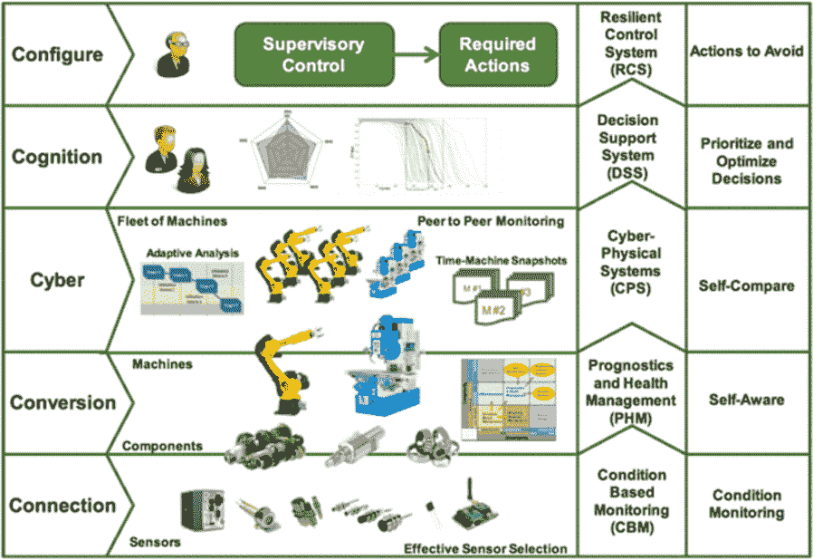 |
| --- |

## 信息物理系统中的恶意软件检测

在本章中，我们将介绍不同类型的恶意软件分析技术，然后深入研究包括机器学习和 AI 技术在内的动态分析，以更好地理解 CPS 架构中观察到的恶意行为。我们将研究普鲁登模型（Purdue Model），该模型展示了运营技术（OT）方面的工作方式。

现在，要在这种情况下进行恶意软件分析，重要的是从第 1 层到第 5 层进行恶意软件扫描。在恶意软件扫描阶段，CSOC 团队可能会报告不同的异常，他们将对其进行进一步分析以确定其是否为恶意样本。

| 图 2. 普鲁登模型：通用 CPS 架构 |
| --- |
| 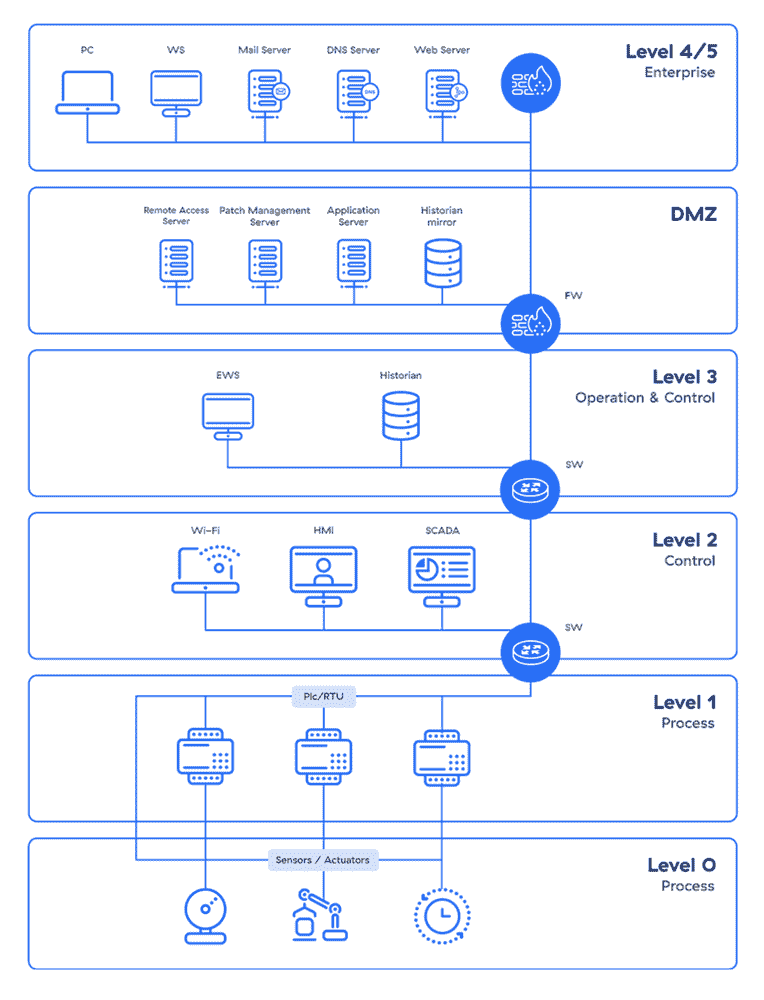 |
| --- |

为了进行这种分析，基本上有两种方法：

*   静态分析
*   动态分析

| 图 3. 恶意软件分析与检测的分层表示 |
| --- |
| 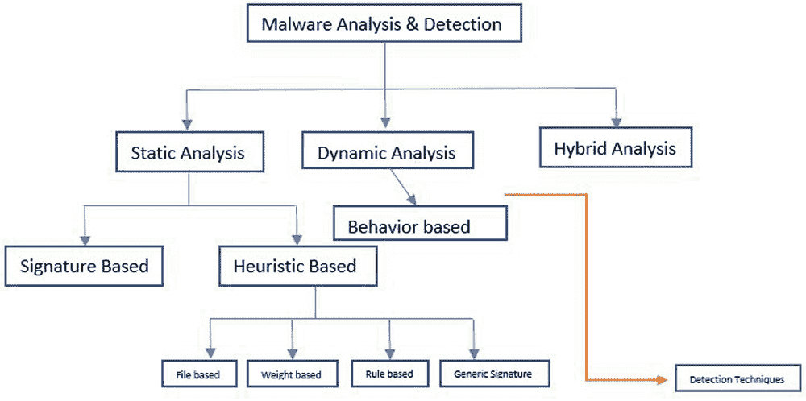 |
| --- |

### 静态分析

静态分析是通过分析程序代码或结构来确定其功能的过程。程序或恶意样本不会在系统上运行，但恶意软件的功能通过以下操作来确定：

*   使用杀毒工具确认其恶意性
*   使用哈希值识别恶意软件
*   通过文件字符串、函数和头文件提取恶意软件信息

静态分析中有几种技术我们可以快速介绍：

#### 哈希处理（恶意软件的指纹）

*   使用哈希值作为标签
*   在 Virus Total 等在线工具中搜索哈希值以检查文件是否已被识别。

例如，命令可以是：`md5deep abc_file.exe`，它将输出文件的哈希值，然后可以将其粘贴到 Virus Total 在线应用程序中以识别该文件是否被记录。

#### 查找字符串

在可疑文件中检测字符串是判断文件是否具有恶意意图的有效方法。


任何程序中的字符串都可以通过 `string` 命令在任何程序中被检测。该命令将显示程序使用的各种字符串。一旦发布了该命令，下一步是从恶意软件的角度识别哪些字符串是至关重要的。像重要的 DLL 文件或指示文件正尝试与某些外部资源通信的 URL 链接，通常被视为恶意软件的红旗（危险信号）。另一个可以使用的重要工具是 `FLOSS`（Fir-eye Labs Obfuscated String Solver）。

### 动态分析

动态分析是在执行恶意程序后进行的一种检查过程。它通常在基础静态分析遇到死胡同后进行，原因可能是由于混淆、加，或者分析人员耗尽了静态分析技术的可能性。这是一种改进的技术，因为它检查了恶意软件样本的本质。例如，如果恶意软件是后门，那么动态分析将帮助识别受该后门感染的文件、程序连接的哪个 URL 或 C2 服务器（控制服务器），以及它是如何被控制的。

动态分析技术虽然高效，但可能会给网络和系统带来风险，因此必须以极其谨慎的态度进行。此外，比重要的是，被分析的恶意样本应与生产环境隔离，以最大限度地减少对原始系统的影响机会。

*   可用于分析恶意软件的各种技术包括：
    *   沙箱方法：大多数恶意软件分析师使用不同的沙箱技术如 `Norman Sandbox`、`GFI Sandbox`、`Anubis`、`Joe sandbox`、`Threat Expert`、`Bit Blaze` 和 `Comodo Instant Malware Analysis` 来执行基础动态分析。

我们将讨论一种沙箱工具：`GFI Sandbox` 报告包含以下 6 个主要部分：

*   `Analysis Summary` 部分列出了所有静态分析信息和动态分析结果的高级概述。
*   `File activity` 部分列出了对于每个受恶意软件影响的进程所打开、创建或删除的文件。
*   `Registry Activity` 注册表活动部分列出了对注册表的更改。
*   `Network Activity` 网络活动部分包含了由恶意软件产生的网络活动，如设置监听端口或执行 DNS 请求。
*   `Virus Total Results` 病毒总结果部分列出了 Virus Total 扫描恶意软件的结果。

尽管有这些优点，沙箱应用也有以下缺点：

*   恶意软件通常能检测到它是否运行在虚拟机上，如果检测到虚拟机，恶意软件可能会停止运行或表现出异常。
*   某些恶意软件可能需要系统中存在某些注册表项或文件，而这些在沙箱中可能找不到。这些可能用于包含合法数据，如命令或加密密钥。
*   如果恶意软件是一个基于 DLL 的文件，它将无法被正确调用，因为 DLL 不会像可执行文件那样容易运行。

# 函数调用监控

通常，一个函数包含执行特定任务的代码，例如计算数字阶阶或创建一个文件。使用函数调用进行恶意软件分析的核心思想是抽象实现细节，以便理解恶意程序是如何传播感染的。拦截函数调用的过程被称为 `hooking`（钩钩）。分析程序被操纵，使得除了预期的函数外，还涉及一个钩子函数。该钩子函数负责实现所需的分析功能，例如将调用记录到日志文件中或分析输入参数。

# 系统调用监控

运行在运行通用操作系统计算机系统上的软件通常分为两个主要部分。通用应用程序（如文字处理器）运行在用户态（user-mode）。相反，例如，用户态无法直接创建文件……用户态应用程序需要调用特定的系统调用来指示路径、名称和访问方法。一旦调用了系统调用，系统就会切换到内核态（kernel-mode）。在验证调用应用程序具有足够权限后，操作系统将代表用户态执行任务。在创建文件的示例中，系统调用的结果是一个句柄（handle），用户态应用程序关于此文件的进一步交互都将通过此句柄进行。除了耗尽资源（受操作系统的限制）之外，恶意软件样本在其进程内通常能做的很少。因此，在用户空间执行并需要与其环境通信的恶意软件（与每一个其他应用程序一样）必须调用系统调用。由于系统调用是用户态进程访问或与其环境交互的唯一可能，，因此此接口对于动态分析来说特别有趣。然而，众所周知，恶意样本能够获取内核态权限。此类实例并不一定利用系统调用接口，并可能规避这种分析方法。

# 在仿真器中进行分析

在仿真环境中执行程序允许分析组件控制程序执行的每一个方面。根据模拟了执行环境的哪个部分，可以进行不同形式的分析。内存与 CPU 仿真。模拟 CPU 和内存产生了一个沙箱，允许在不担心对真实系统产生负面影响的情况下运行潜在的恶意代码。二进制文件通过顺序读取指令并在虚拟仿真环境中执行等效操作，在沙箱中运行。二进制文件产生的所有副作用都被包含在沙箱中。为了成功仿真依赖操作系统服务或共享库的样本，这些机制也需要被仿真。

许多杀毒软件使用 CPU 和内存仿真来克服加密或混淆二进制文件带来的障碍。为了分析可能是加密的二进制文件，将其放在仿真环境中执行。如果杀毒引擎检测到解包序列，将在仿真内存包含的未加密内存内容进行签名匹配。恶意样本要检测到它运行在这样的仿真环境中，只需执行需要未仿真或仿真不足的组件的操作即可。例如，在 CPU 漏洞的情况下，仿真器的行为可能与真实的 CPU 不同（如果仿真中没有考虑该漏洞）。

| 图 4 卡巴斯基的恶意软件仿真器，用于分析恶意代码 |


### 检测技术

### 基于特征的检测
特征是特定恶意软件的独特属性，可以借此轻松进行检测。该技术也被称为模式匹配、字符串匹配、掩码匹配和指纹识别。基于特征的检测使用恶意软件作者注入应用程序的序列位，这些序列位可以唯一标识恶意软件。一个示例场景是对代码进行哈希处理，例如 `SHA 256`、`MD5` 用于比较过程。

### 基于行为的检测
在这种技术中，通过程序的行为来判断其是否具有恶意性，而不依赖于代码或代码序列。这里的主要缺点是恶意软件在运行的虚拟机或沙箱中可能不会展现其全部潜力，从而导致对怀疑的程序产生错误或误报检测。

### 基于启发式的检测
这被称为一种主动技术，类似于基于特征的检测技术。为了检测恶意软件特征，它使用了 `opcodes`、`N-grams`、`Control Flow Graphs`（控制流图）和混合特征。这种新功能能够检测新的新型攻击向量，以及不同病毒及其特征中未发现的恶意特征。

## 恶意软件检测工具
有很多可用工具，下表列出了其中几种，涵盖了静态和动态分析技术。

### 表 1. 静态分析工具
| 序号 | 工具名称 | 描述 |
| --- | --- | --- |
| 1 | `PE id` | 此工具有助于识别复杂的恶意软件。它基于特征的检测技术工作，拥有近 500 种不同恶意软件的指纹。 |
| 2 | `PE view` | 提供有关文件头和可移植执行文件的信息。还包含了恶意软件的各种描述，如编译时间和导入/导出函数。 |
| 3 | `PE explorer` | 与 PE view 相似，提供的功能包括可以对来自 `UPX` 和 `NS Pack` 的恶意软件壳进行解包和检测。 | |
| 4 | `Bin text` | 可以此工具搜索并显示二进制文件的字符字符串。 |
| 5 | `UPX` | 可以使用此工具压缩恶意软件样本，它使用了可执行文件打包的方法。 |
| 6 | `Dependency Walker` | 该工具由微软开发用于静态分析，用于探索恶意软件导入的 `DLLs` 和函数。 |
| 7 | `IDA Pro` | 恶意软件分析师、逆向工程师和渗透人员中非常流行的工具，提供交互式反汇功能。 |
| 8 | `Resource Hacker` | 此工具专门为 Windows 操作系统制作和使用。该工具用于查看、修改、添加和提取 32 位和 64 位 Windows 可执行文件的资源。 |
| 9 | `Hex Editors` | 使用此工具以十六进制格式编辑二进制文件。它有助于确定恶意软件的机器级执行。 |

### 表 2. 动态分析工具
| 序号 | 工具名称 | 描述 |
| --- | --- | --- |
| 1 | `Process Explorer` | 与任务管理器相似，该工具以分级视图提供当前运行的进程。 |
| 2 | `Process Monitor` | 可以使用此工具进行实时文件创建、读取、写入和关闭。该工具还具有其他功能，如 – 1. 监控注册表和活动变化，2. 跟踪进程和网络。 |
| 3 | `Reg Shot` | 拍摄两个注册表快照，进程前后各一个以分析变化，如果存在任何恶意活动，可以通过 reg shot 轻松检测到。 |
| 4 | `Net cat` | 用于监控网络入站和出口连接的工具。 |
| 5 | `Wireshark` | 这是一个网络包分析器，具有捕捉恶意软件一旦执行即可生成的网络流量的能力。 |
| 6 | `Olly Dbg` | 当无源码时，此 x86 调试器用于二进制代码分析 |
| 7 | `Burp Suite` | 使用此工具测试 Web 应用程序的安全。该工具可以跟踪恶意软件发布到任何远程服务器的各种服务器请求。恶意软件产生的所有 HTTP 和 HTTPS 请求都可以通过中间人攻击被此工具拦截。 |
| 8 | `Sandboxes` | 沙箱是一个虚拟机，可用于在虚拟系统中分析不可信的程序/恶意软件（安装在主系统内部或外部，这是一个相对安全的环境），而不会损坏主系统。沙箱同时使用静态和动态方法来分析程序。 |

接下来，我们将查看一个实时恶意软件样本，以理解恶意软件是如何工作的，以及使用静态和动态分析技术有效分析它时需要哪些实际步骤。为了演示之目的，我们将以一个名为 `SVCHOST.exe` 的简单 Windows 后门（木马）为例。这是一个用于托管多个服务的 Windows 系统进程。它是 Windows 中实现共享服务过程的至关重要的进程，通常用于加载多个 `DLL` 文件以启动多个 `exe` 程序。恶意 `SVCHOST.exe` 样本的分析阶段将使用名为 `JoeSandBox Cloud` 的沙箱平台完成。

### 静态分析阶段
在静态分析阶段，使用沙箱云环境对文件进行了反编译，检测到的哈希值如下：

| 图 5. `SVCHOST.exe` 恶意软件文件特征 |
| --- |
| 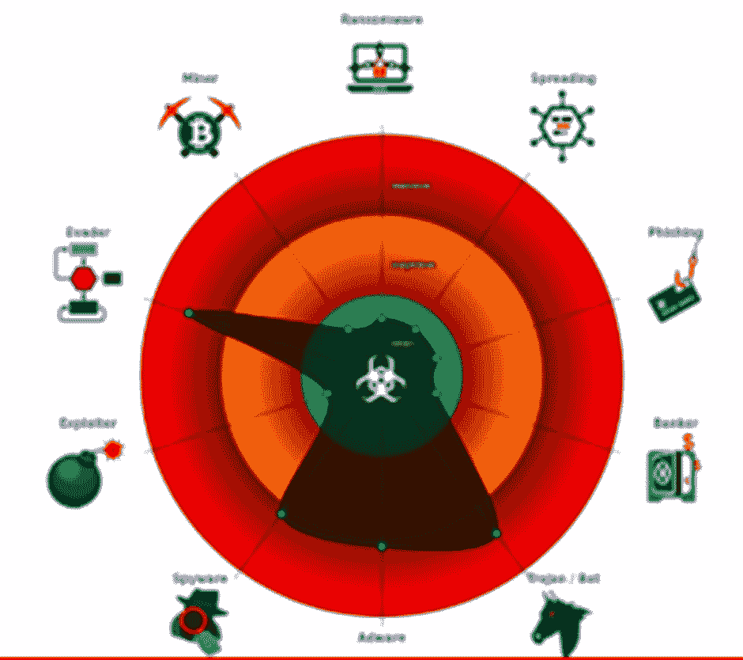 |

一旦获得哈希值，我们尝试在 `Virus Total` 中上传 `MD5` 哈希值以检查文件状态。

### 动态分析阶段
在动态分析阶段，涉及多个步骤，因为恶意软件 (`SVCHOST.exe`) 在沙箱环境中运行的。首先，我们将通过启动阶段，查看恶意文件在受害者机器上爆发之前经历了哪些攻击向量。

| 图 6. `SVCHOST.exe` 启动阶段 |
| --- |
| 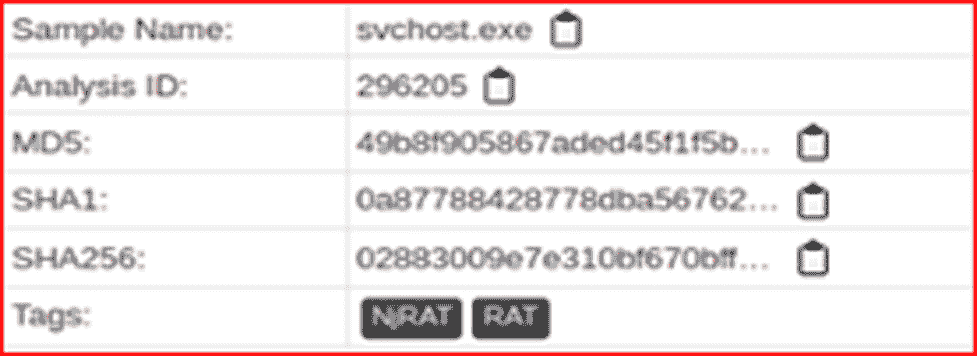 |

接下来，执行恶意文件后，Windows 进程中显示如下所示错误。这是因为恶意文件覆盖了在 Windows 后台进程中运行的原始 `SVCHOST.exe` 文件，试图接管系统中运行的多个合法进程。

| 图 7. 恶意 `SVCHOST.exe` 覆盖合法进程 |
| --- |
|  |

为了进一步调查恶意软件执行的恶意字符串，我们将检查内存转储并检查样本执行的命令。

| 图 8. 恶意软件执行的恶意字符串 (`SVCHOST.exe`) |
| --- |
| 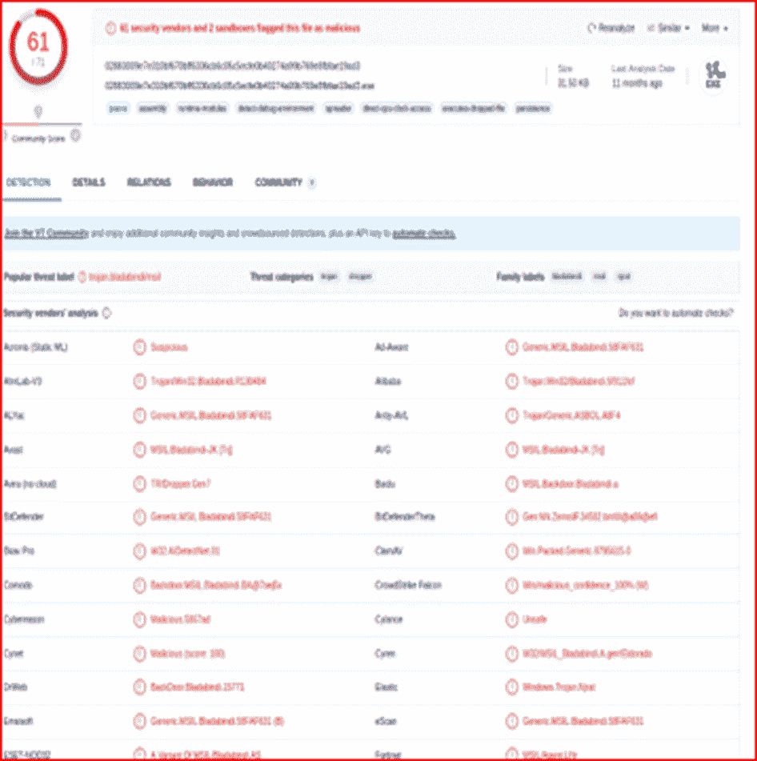 |

一旦确认文件是恶性的，我们可以利用沙箱云检查恶意软件样本的整体状态：

| 图 9. `SVCHOST.exe` 文件整体状态 |
| --- |
| 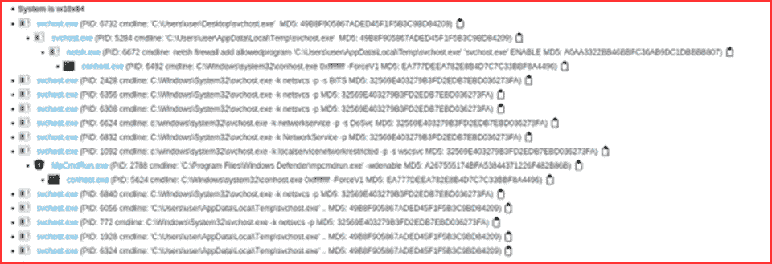 |

从上面的图中可以看出，沙箱分析判定该文件为恶性，并具有以下恶意特征：
* • 逃避者
* • 利用者
* • 间谍软件
* • 木马/机器人

在下一节，我们将讨论基于某些机器学习技术的恶意软件分类

### 恶意软件分类：机器学习方法
机器学习是一类赋予计算机“无需显式编程即可学习”能力的方法。

简单来说，机器学习算法会发现并形式化其看到的数据的底层原理。通过这些知识，算法可以对未见样本进行进行推理。在恶意软件检测中，未见样本可能是一个新文件。其隐藏属性可能是恶性的或良性的。数据属性底层原理的数学形式化集合被称为模型。


机器学习具有多种解决问题的方法，而非单一的方法。这些方法具有不同的能力，并适用于不同的任务。

### 机器学习的基础方法

任何机器学习算法的运行都有两种基本方法：

*   **无监督学习**：在这种情况下，我们只被给定一个数据集，而没有该任务的正确答案。其目标是发现数据的结构或数据生成的规律。一个重要的例子是`聚类`（clustering）。`聚类`是一项将数据集分成若干组相似对象的任务。另一个任务是`表示学习`（representation learning）——这包括根据对象的低级描述为对象构建信息丰富的特征集（例如，`autoencoder` 编码器模型）。
*   **监督学习**：`监督学习`分为两个阶段。首先是训练一个`model`并将`model`拟合到可训练数据上；然后将训练好的模型应用于新样本并获取预测结果。其次，我们给定一组对象，每个对象由特征集 `X` 表示，且每个对象都映射到正确答案或标记为 `Y`。这些训练信息在训练阶段被利用，此时我们寻找一个最佳模型，在给定特征集 `X` 的情况下，为之前未见的对象产生正确的标签 `Y`。

在恶意软件检测案例中，`X` 可以是文件内容或行为的某些特征，例如文件统计数据和使用的 `API` 函数列表。标签 `Y` 可能是恶意软件或良性文件，甚至是更精确的分类，如病毒、`Trojan-Downloader`（木马下载器）或广告软件。

在训练阶段，首先选择一个模型族，例如`neural networks`（神经网络）或决策树。通常，一个族中的每个模型都由其参数决定。`Training`意味着我们从选定的族中搜索一个具有特定参数的模型，根据特定指标，该模型在参考对象集上对训练过的模型给出最准确的答案。换句话说，我们正在“学习”定义从 `X` 到 `Y` 有效映射的最优参数。

在模型完成训练并验证了其效率后，将进入下一个阶段，我们需要将此模型应用于新对象。在这一阶段，模型的类型及其参数不会发生变化。模型只产生预测结果。

在恶意软件检测案例中，这是保护阶段。厂商通常将训练好的模型交付给用户，由产品根据模型预测自主做出决策。错误可能会给用户造成灾难性的后果——例如，删除一个 `OS driver`（操作系统驱动程序）。厂商正确选择模型族至关重要。厂商必须使用高效的训练程序找到具有高检测率和低误报率的模型。

| 图 10 恶意软件分析的机器学习阶段 |
| --- |
|  |
| --- |

### 数学公式与分类

我们可以举一个例子，即用基础数学术语对机器学习算法进行建模以执行恶意软件分析。在恶意软件分类方面，主要有三个变量，分别为恶意软件架构、攻击模式和 `CPS` 网络中的连接资产。这些元素在以下数学公式中关联：`(A, T) = Z`。在这里，`A` 代表恶意软件分类，`T` 代表目标资产，`Z` 代表检测模型。如果我们进一步阐述关系，可以写成 `A (X + Y+ V), f (Ai, Tj) = Zij`。其中 `X` 代表恶意软件行为，`Y` 代表攻击模式，`Z` 代表连接资产。

一旦建立了恶意软件的关系，就可以将其传递到不同的分类算法中以确定恶意软件的家族。例如，在下表中可以看到，恶意软件感染类型可以归类到已有的恶意软件家族：

| 图 11 基于不同参数对 CPS 恶意软件分类的表格 |
| --- |
| 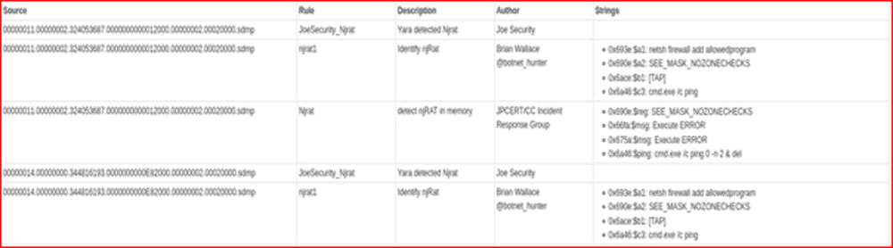 |
| --- |

### 深度学习方法

另一种可用的机器学习方法是`Deep Learning`（深度学习）。`Deep learning`是一种特殊的机器学习方法，有助于从低级数据中提取高层次抽象的特征。`Deep learning`在计算机视觉、语音识别、自然语言处理和其他任务中已被证明是成功的。当你希望机器从低级数据推导出高级含义时，它的效果最好。

为了使`Deep Learning Models` 对恶意软件分类有效，它们需要遵循以下特征：

*   **需要大型代表性数据集**：强调这种方法的数据驱动性质非常重要。创建的模型很大程度上取决于它在训练阶段见过的数据，以确定哪些特征对于预测正确标签在统计上是相关的。考虑这样一个例子：我们收集了一个训练集，但忽略了某些大于 `20 MB` 的文件都是恶意软件样本而非良性的事实（这在真实世界文件中显然如此）。在训练过程中，模型将利用数据集的这一属性，并学习到任何大于 `20 MB` 的文件都是恶意软件，并利用该属性进行检测。当此模型应用于真实世界数据时，它会产生许多误报。为了防止这种结果出现，我们需要向训练集中添加文件较大的良性文件。这样，模型就不会再依赖错误的数据集属性。
*   **模型应当是可解释的**：目前使用的大多数模型族（如`deep neural networks` 深度神经网络）被称为黑盒模型。黑盒模型接收输入 `X`，通过一系列复杂的操作序列产生 `Y`，而这些操作很难被人类解释。这在现实应用中可能会引发问题。例如，当发生误报时，如果我们想理解为什么会发生这种情况，我们会询问是训练集的问题还是模型本身的问题。模型的解释性决定了我们管理它、评估其质量以及纠正其运行有多容易。
*   **误报率必须极低**：当算法将恶意标签误认为是良性文件时，就会发生误报。我们的目标是将误报率降到最低，甚至为零。这在机器学习应用中并不典型。这非常重要，因为即使在百万个良性文件中只出现一个误报，也可能给用户造成严重后果。世界上有大量清洁文件且它们在不断出现，这使得情况变得更加复杂。
*   **模型必须具有高度鲁棒性**：在将 ML 模型应用于恶意软件检测后，我们面对数据分布并非静态的事实：
    *   活跃的对手（恶意软件编写者）不断避免检测，并发布新版本的恶意软件文件，这些文件与训练阶段看到的有显著不同。
    *   成千上万软件公司生产新类型的良性执行文件，这些类型与以前的类型有显著不同。这些类型的数据在之前的集中可能是缺失的，但应该将它们识别为良性。

结论


`CPS` 在支持油气、发电和输电、制造等关键基础设施运营方面着至关重要的作用。随着 `CPS` 与基于 IT 的系统之间日益融合，网络攻击的表面正以巨大的速度增长。世界上已经见证了超过 7 种能够破坏关键基础设施服务的重大恶意软件，如 `Stuxnet`、`HAVEX`、`Indu Stroyer` 和 `Pipedream`。因此，为了保护 `CPS` 系统免受网络攻击（尤其是恶意软件），分析流量并进行恶意软件分类以将任何可疑数据正确识别到已知的恶意软件中至关重要。这种技术不仅可以提高组织在防火墙过滤流量的能力，还能增强对可能进入组织的恶意流量种类的理解。从经济角度来看，这可能是一项额外投入（需要不同的恶意软件分析团队），但它可以提高组织的整体安全态。

## 参考文献

- Avira Press Center. (2007). Avira warns: targeted malware attacks increasingly also threatening German companies. Avira. http://www.avira.com/en/security news/targeted attacks threatening companies.html.
- Cardon, O. (2018). Classification of cyber-physical production systems applications: Proposition of an analysis framework. Science Direct.
- Habib, M. K. (2018). CPS: Role, Characteristics, Architectures and Future Potentials. Science Direct.
- Kaspersky Lab Machine-Learning. (2018). Machine Learning for Malware Detection. (Whitepaper).
- Udayakumar, N. (2019). Malware Classification Using Machine Learning Algorithms. Research Gate.
- Telecom Review. (2022). Cyber-Physical Systems: The Integrated Form of ICT. Telecom Review.

# 第 4 章

- **M. Gaayathri** - 印度 Avinashilingam Institute for Home Science and Higher Education for Women
- **Padmavathi Ganapathi** - 印度 Avinashilingam Institute for Home Science and Higher Education for Women
- **A. Roshni** - 印度 Avinashilingam Institute for Home Science and Higher Education for Women
- **D. Shanmugapriya** - , 印度 Avinashilingam Institute for Home Science and Higher Education for Women

## 摘要

钓鱼是目前最严重的问题之一，许多互联网用户正沦陷其中。网站钓鱼是一种主要威胁，其重点是开发伪装成合法站点的网站。钓鱼者开发克隆网站并通过电子邮件、短信息服务（SMS）或社交媒体将统一资源符（`URLs`）发送给大量人员。在当前情况下，钓鱼是侵入系统以窃取或获取目标敏感信息的首要网络威胁/网络攻击。机器学习方法作为人工智能的重要分支，被用于检测许多关键问题。本章研究了网站 `URLs` 的词法特征，利用基于集成学习技术的封装器特征选择技术来检测钓鱼 URL。为了评估开发的模型，采用了来自 Mendeley 仓库的数据集。与 `boosting algorithm` 相比，使用 `bagging classifier` 的钓鱼网站达到了 95% 的最高准确率。

# 1. 引言

网络安全是保护网络空间免受潜在威胁的过程。网络安全关注通过 cabaj et al. (2018) 的方法从网络攻击中防御、预防和恢复所有网络资源。正如 basit et al. (2021) 所述，由于网络安全领域的复杂性，每天识别、分析和控制重大风险事件极其困难。在 2019 年，英国政府的《网络安全违规调查报告》根据发生频率进行了调查，并注意到 Alkhalil et al. (2021) 的钓鱼攻击是频率最高的类型。

信息安全对于保护敏感数据免受钓鱼等社会工程攻击至关重要。社会工程企图更改用户的凭据以便利各种网络攻击。社会工程攻击的一个例子是钓鱼，它利用电子邮件、短信、语音电话和匿名 URL 针对用户的个人信息。钓鱼已成为许多人的威胁，特别是那些对浏览时面临的风险一无所知的人。根据美国联邦调查局（FBI）在 2018 年的报告及证词，2013 年 10 月至 2016 年 2 月，钓鱼攻击造成了 23 亿美元的损失。钓鱼攻击可以影响个人计算机、智能设备和支持 Wi-Fi 的智能设备等。

根据 Proof Point 的调查，2019 年全球约 90% 的企业曾是钓鱼攻击的目标。这表明网络犯罪继续针对个人终端用户。55% 的组织受到过钓鱼攻击的影响，其中针对个人的占 88%，86% 以社交媒体形式出现，84% 报告为短信形式，83% 通过语音电话进行（APWG 报告，2020 年）。

根据安全杂志（2020）的介绍，2020 年的前六个月揭示了这种著名钓鱼攻击的新侧面。反钓鱼工作组（`APWG`）于 2020 年 3 月发布了八份关于 `ZOOM` 视频会议平台的报告，许多 IT 员工和学术人员在新冠期间使用了该平台。2020 年 4 月，Google 每天拦截 2.4 亿条与新冠相关的垃圾信息和约 1800 万封钓鱼邮件。94% 的钓鱼攻击带有冠状病毒相关信息的名称。

电子邮件、网站、短信和电话均被用于钓鱼尝试。钓鱼网站是在线社会工程攻击的共享网络边界，数十种新的网络诈骗不断涌现。许多个人由于以下五个原因沦陷于钓鱼攻击（Volkomer et al., 2017）：(i) 用户缺乏统一资源符（`URLs`）的基础知识；(ii) 不清楚哪些页面是可以信任的；(iii) 由于重定向或伪装的 URL，无法确定页面的精确地址；(iv) 存在备 URL 或某些页面可能是误输入的；(v) 用户无法区分合法网页和钓鱼网页。

本章的主要目标是使用基于封装器的特征选择（Wrapper-based Feature Selection）来识别基于 Web 的钓鱼攻击。基于封装器的特征选择分为三类：前向（Forward）、后向（Backward）和逐步（Stepwise）。通过对这三种类型进行比较，使用能够提供最佳属性减少的那种方法在集成学习（Ensemble Learning）算法的帮助下提高准确性。通过应用前向、后向和逐步特征选择等封装器特征选择方法来识别显著特征。基于所选特征，开发了包含 `Bagging` 和 `AdaBoost` 分类器的集成模型。

本章包含以下章节：本节介绍了钓鱼攻击。第 2 节关注集成学习。第 3 节讨论了文献综述。第 4 节包含了用于检测钓鱼攻击的建议方法。第 5 节介绍了实验结果与讨论。第 6 节讨论了对未来研究的建议。第 7 节描述了供读者实现的某些开源恶意软件数据集。


集成方法是元算法，它们通过减少由于单一机器学习模型引起的方差和偏差，以组合的方式提供高质量的预测。它整合了许多基础模型，创建一个尽可能准确的单一预测模型 (Zhu et al., 2019)）。集成学习算法分类如下：

- Bagging
- Boosting 和
- Stacking

在本章中，实现了 Bagging 和 Boosting 算法以识别钓鱼网站。

这种在统计学上存在缺陷的学习算法被认为具有显著的方差。如果一个算法表现出计算问题，则认为该算法具有计算复杂度。另一方面，具有显著偏差的算法则面临表示性困难。现有学习算法失败的最常见原因就是这三点。集成技术可以最大限地减少传统学习算法中这三个缺陷的偏差和方差。

# 3. 文献综述

大多数处理钓鱼攻击的后端方法都是机器学习技术。由于其具有卓越的数据处理和预测能力，它们是实现有效学习过程自动化最有前景的方法。表 1 展示了一些基于机器学习算法检测钓鱼攻击的先前研究。

表 1. 基于机器学习算法处理钓鱼攻击的重要方法

| 参考文献 | 观察结果 |
| :--- | :--- |
| Sharma et al. (2020) | Mendeley 和 UCI 数据集被频繁用于识别钓鱼尝试。在对各种特征选择技术进行分析后，决策树算法产生了 0.94 的最佳 `F1_score`，执行时间为 0.044，随后对机器学习分类算法与特征选择技术之间的相关性进行了比较研究。 |
| Tubis et al. (2020) | 使用模糊理论对网络攻击场景的风险因素进行估计。研究了三个矿业自动化级别的七种场景，以证明该方法的用途。 |
| Tahir et al. (2020) | 为了检测钓鱼网站，使用了基于模型的混合技术。将基于实例的学习 (IBk)、模糊无序规则归纳 (FURIA)、序列最小优化 (SMO)、朴素贝叶 (NB)、贝叶斯网络 (BN) 和随机森林 (RF) 分类方法相结合以提高检测准确性。`J48 + RF` 提供了 97.44% 的最佳准确率。 |
| Ali et al. (2017) | UCI 数据使用了特征选择方法。反传播神经网络 (BPNN)、朴素贝叶、支持向量机、K 近邻、径向基函数网络、基于 C4.5 树的方法是基于封装的算法，信息增益和主成分分析是神经网络技术的示例。反传播神经网络 (BPNN) 算法的准确率为 0.96。 |
| Fadheel et al. (2017 测试来选择特征。在 30 个特征中，KMO 选择了 19 个。使用支持向量机和逻辑回归实现了 19 个属性。`SVM` 性能优于逻辑回归，准确率为 0.79。 |
| Xuan et al. (2020 发现了恶意 URL。`SVM` 方法在准确率方面优于随机森林（93.39%）。 |
| Chandrasekhar et al. (2014) | 这项工作深入讨论了特征选择的相关性。结合支持向量机 (`SVM`) 和径向基函数 (`RBF`) 的序列特征选择。带有 `RBF` 的序列特征选择算法给了 97.361% 的最佳性能，并提高了预测器的性能。 |
| Singh et al. (2021) | 入侵检测解决方案至关重要，因为每秒都有大量的用户敏感数据上传到云端。基于集成学习网络的云已用于将准确率提高到 97.99%。应用了 Bagged trees、Boosted trees 和 随机下采样算法。 |
| Surwade et al. (2021) | 对于特征提取，可以使用来自 Enron、Ling Spam、PU123、Spambase 和 Phishnet 等知名数据集的垃圾邮件和钓鱼邮件。使用基于来源过滤器 (`OBF`) 和基于内容的过滤器 (`CBF`) 过滤垃圾邮件和钓鱼邮件。 |

作为一个整体观察，注意到集成学习方法尚未被探索。因此，本章侧重于设计一种基于基于封装特征选择的学习方法的框架，用于检测钓鱼攻击。图 1 展示了近期钓鱼攻击的调查、重要的机器学习模型以及适用于分类的特征选择方法。

图 1. 基于集成学习的网站检测特征选择调查方法论

```

```

## 4. 提议的方法

检测基于词的钓鱼网站的整个设计方法如图图 2 所示。以下是涉及的四个步骤：

图 2. 基于词特征选择检测的整体设计

```

```

### 4.1 数据收集

为了检测钓鱼攻击，钓鱼网站数据集已在 2017 年发布的 Mendeley 数据中可用 (Tan 2018)。钓鱼网站包含 48 个字段、三个类属性和 10000 个实例。使用了三种类型来分类这 48 个字段。它们是基于词的特征、基于主机的特征和基于相关性的特征。

在本章中，特别实现了基于词的特征。基于词的特征有 27 个。基于词的特征是 URL 内由 `.`、`/`、`=`、`-`、`_` 分隔的有效标记。例如 Num Dash，计算网页中 `-` 的数量。图 3 显示了研究中使用的钓鱼网站样本。

图 3. 钓鱼网站样本

```

```

### 4.2 特征选择

特征选择的主要目标是从模型中消除冗余或无关特征。某些建模问题涉及大量变量，可能会延迟模型的创建 (almseidin et al. 2019)。因此，无信息变量的存在可能会增加结果的不确定性并降低模型的整体效能。特征选择方法的三个类别如下：基于过滤、基于封装和嵌入式方法 (jovic et al. 2015)。本研究使用了基于封装的特征选择方法来选择网站钓鱼的关键特征。

### 4.2.1 基于封装的特征选择

封装技术使用机器学习算法检查特征子集，该算法使用搜索策略在可能的特征子集空间进行搜索 (Zuhair et al. 2015)。这些算法被称为贪婪算法，因为它们正在寻找提供理想模型的最佳特征组合。


基于包装的特征选择（Wrapper-based feature selection）被认为优于基于过滤和嵌入的方法，因为它通过迭代选择和测试特征子集来评估模型的性能。该技术通过利用机器学习模型来评估子集的预测能力，从而选择最高的属性子集。基于包装的方法考虑了特征之间的相互作用影响，这可以提供关于底层数据结构的宝贵信息。相比之下，基于过滤的方法只考虑每个特征的个体相关性，可能会忽略它们之间有意义的关系。基于包装的方法通常性能优于基于过滤和嵌入的方法，因为它们使用机器学习模型来评估特征子集。从包装方法选出的特征子集对于特定的建模问题是最优的。基于包装的技术可以处理特征之间的非线性关系，而基于过滤的方法是无法做到的。基于包装的方法对数据中的噪声和离群值更具鲁棒性，因为它们是根据模型的性能而非特征的统计属性来评估特征子集的。基于包装的方法比嵌入方法更灵活，因为它们可以应用于任何机器学习模型。然而，嵌入方法局限于特定模型。

许多基于包装的特征选择技术的计算复杂度可能会阻止其用于广泛的恶意软件研究。另一方面，广泛的恶意软件研究涉及大型数据集，而且本质上是可以接受复杂的。基于包装的方法专门用于评估特定的机器学习算法以获得最优特征。基于包装的特征选择方法被广泛应用于入侵检测系统领域，以支持复杂的处理和计算 (Das et al., 2022)）。

基于包装的方法涉及 3 种方法：正向特征选择（Forward Feature Selection）、后向特征消除（Backward Feature Elimination）和逐步特征选择（Stepwise Feature Selection）。

### 4.2.1.1 正向特征选择

从空模型开始，正向选择用于通过每次选择 p 值最低的特征，逐个将每个单独特征拟合到模型中。考虑将之前选择的特征与所有其他剩余特征融合，以适应具有两个特征的模型。重复选择 p 值最低的特征的过程。重复此步骤，直到选出的特征集合的 p 值低于所需的显著性水平。在正向特征选择中，本研究应用了逻辑回归算法来选择特征。

#### 逻辑回归

逻辑回归（`LR`）模型用于在根据输入属性的相对相关性对类别进行排名后，预测类别的概率。在这种情况下，`LR` 模型用于根据 `ROC-AUC` 概率（即 `ROC` - 接收者操作特征曲线，`AUC` - 曲线下面积）来选择特征。这些方法用于通过排名值移除与目标变量无关的属性。

```
f(e(b)) = + a[1] + a[2] (1)
```

从方程 (1) 可以，`f()` 是连接函数，`e(y)` 是目标属性，`+ a[1] + a[2]` 分别是线性预测器（待预测的 `α`、`β`、`γ`）。`f` 函数是将线性预测器与 `b` 属性“连接”起来。逻辑回归包含了一系列筛选方法，帮助我们衡量模型的拟合程度并据此选择属性。通常，`LR` 模型生成每个属性的评分，这有助于我们更有效地选择特征。

### 4.2.1.2 后向特征消除

此过程从所有现有特征开始，并逐渐逐个移除它们。后向消除用于首先消除 p 值最高（`>显著性水平`）的不重要特征，从包含所有独立变量的模型开始。重复这种方法，直到产生最终的相关的特征集。在此，应用了线性回归机制来选择特征。

### 4.2.1.3 逐步特征选择

与正向选择类似，它在引入新特征的同时，还考虑了之前已添加特征的重要性。后向消除则用于简单地消除任何被证明是不重要的先前选定属性。因此，它是正向消除和后向消除的结合。需要注意的是，序贯后向选择（`SBS`）不会移除已经由序贯正向选择（`SFS`）选出的特征。`SFS` 不引入 `SBS` 已经移除的特征。在本研究中，应用了线性回归机制来选择特征。

#### 线性回归

使用线性回归模型建立因变量（`y`）与至少一个自变量（`x`）之间的联系。线性回归模型的参数通常使用普通最小二乘法（`OLS`）进行估计。在 `OLS` 模型中，将常数添加到变量（即）`目标变量`中。

```
C = x + yA (2)
```

从方程 (2) 指出，`C` 是描述性属性，`A` 是因变量。线的斜率是 `x`，`y` 是截距（当 `y = 0` 时 `C` 的值）。

### 4.2.1.4 基于包装的特征选择技术的优点和局限性

如上所述，基于包装的特征选择方法由正向选择、后向消除和逐步选择组成。表 2 描述了基于包装的特征选择技术的优点和局限性。

表 2. 基于包装的特征选择方法的优缺点

| 基于包装的特征选择方法 | 优点 | 局限性 |
| --- | --- | --- |
| 正向选择 | • 执行简单快速，并能够增强模型性能。<br>• 该方法一次处理一个特征，添加提高模型效率的特征。<br>• 重复此过程，直到达到所需的准确率。<br>• 此外，它有助于减少模型的计算复杂度。<br>• 通过消除无关或冗余特征，模型可以显著减少变量数量并简化问题。 | • 容易过拟合。<br>• 当算法因为过度特化于训练数据而失去泛化能力时，就会发生过拟合。<br>• 处理大型数据集时，计算开销很大。<br>• 该技术必须为每个特征评估模型性能，这是一项耗时工作。<br>• 有时，无法检测到最佳特征子集。 |
| 后向消除 | • 从所有特征开始并每次删除最不重要的一个，后向消除改进了模型性能。<br>• 重复步骤，直到移除特征时不再观察到改进。<br>• 复杂度较低<br>• 提高模型性能<br>• 较不易过拟合 | • 后向消除的主要缺陷是，一旦特征从模型中消除，就无法再次进入。<br>• 有时，被丢弃的特征在最终可能会变得显著。<br>• 由于其变得不显著，无法确定是哪个预测变量导致了另一个预测变量被拒绝。<br>• 特征在通过后向消除过程移除后无法再次被选择。换句话说，后向消除无法以灵活的方式添加或移除特征。 |


## 逐步选择

- 逐步选择可以在正向选择和后向选择过程中进行。
- 这种技术易于解释。
- 较不容易发生过拟合。
- 它计算效率高。
- 它比其他自动模型选择方法更快。
- 它可能不可靠或不一致性。
- 逐步选择对数据样本量、变量顺序、变量之间的相关性以及显著性水平敏感。

由于近期恶意软件呈现出极大的演变性，新型变体不断出现。特征选择方法在处理恶意软件的动态特性方面起着重要作用。特别是基于封装（Wrapper-based）的特征选择方法可以处理具有变体签名模式的静态和动态恶意软件（Guendouz 等，2022）。

### 4.2.1.5 适用于特定数据集的特征选择方法

数据集的类型或恶意软件家族影响特征选择技术。为了为特定数据集选择最佳的特征选择方法，表 3 为数据集提供了一些适用的特征选择方法。

#### 表 3. 适用于特定数据集的特征选择方法

| 特征选择方法 | 特征选择方法的类型 | 问题/数据集类型 | 例如：恶意软件家族 | 优点 | 缺点 |
| :--- | :--- | :--- | :--- | :--- | :--- |
| 基于过滤的特征选择 | • 相关性<br>卡方检验<br>方差分析<br>信息增 | • 使用代理测量<br>支持高维数据<br>数值通用数据集<br>统计建模 | • 通用恶意软件分类/恶意软件检测<br>钓鱼数据集（数值） | • 与封装和嵌入方法相比计算成本更低<br>运行最快<br>避免过拟合<br>具有良好的泛化能力 | • 特征选择时不与分类模型交互<br>忽略特征依赖性<br>将每个特征视为单变量<br>有时无法选出最佳特征<br>性能较低 |
| 基于封装的特征选择 | • 正向选择<br>• 后向消除法<br>• 逐步选择 | • 预测建模<br>特征较多的数据集<br>支持分类和数值数据 | • 通用恶意软件分类/恶意软件检测<br>钓鱼、跨站脚本、广告软件、间谍软件、勒索软件、木马、任何恶意软件等… | • 与分类器交互进行特征选择<br>对特征空间进行更全面的搜索<br>考虑特征依赖性<br>比过滤方法泛化性能更好 | • 计算成本高<br>运行时间长<br>与过滤和嵌入方法相比过拟合风险高<br>随着特征数量增加计算上不可行<br>如果用另一个分类器预测，无法保证解的最优 |
| 嵌入式特征选择 | • LASSO<br>• 弹性网络<br>岭回归 | • 支持高维数据<br>适用于数值、分类和时间数据 | • 通用恶意软件分类/恶意软件检测<br>支持所有类恶意软件 | • 与封装方法相比计算密集性较低<br>运行速度更快<br>与分类模型交互进行特征选择<br>与封装方法相比过拟合风险较低<br>随着数据点增加，泛化误差优于过滤方法 | • 在识别小特征集方面存在问题 |

### 4.3 集成学习算法

集成方法旨在提高统计学习或模型拟合技术的性能。与其使用该方法的单一拟合，集成技术的总体原理是开发某些模型拟合方法的线性组合。因为它是通过学习的然后用于进行预测的，所以集成是一种监督学习算法。集成方法结合一个或多个分类器以产生比单一分类器更准确的预测（Huang 等，2009）。集成学习方法消除了通过增加许多分类器的预测来通过提高预测准确性或降低偏置和方差来提高性能的观点（Mohanty 等，2022; Almomani 等，2022; Moedjahedy 等，2022; Nugraha 等，2022; Khatun 等，2022; Ghaleb 等，2022）。

### 4.3.1 Bagging 分类器

在 bagging 方法中，对同质的弱学习器进行评估、并行学习，然后使用确定性平均方法进行组合。弱学习器（也称为基模型）是用于创建更复杂模型的模型。这些基础模型单独通常表现不佳，可能是因为偏置（低自由度模型）或过量的方差（高自由度模型），这使得使得它们变得不可靠。Bagging 通过比较一个或多个弱学习器来增强模型的准确性。

### 4.3.2 Boosting 算法

一种名为“提升”的集成建模技术通过从一组弱模型中顺序构建出一个稳健的分类器。使用训练数据构建模型作为起点。然后，开发第二个模型来解决原始模型的问题。在达到最大模型数量或成功预测训练集之前，重复此过程。

### 4.3.2.1 AdaBoost 算法

AdaBoost 是专为二分类创建的第一种提升算法。这种自适应提升方法将多个“弱分类器”组合成“强分类器”。在建模中经常使用决策树。

```
集成学习伪代码

令 N 为训练集的大小

对于每次迭代：

  从训练集中采样 N 个替换实例

  将样本应用于算法

  保存生成的分类器

```

## 5 结果与讨论

本节讨论了所提方法的结果以证明其有效性和可靠性。在工作中，特征选择技术被应用于 Mendeley 数据集。选择最佳属性子集的参数见表 4。

#### 表 4. 选择最佳特征子集的参数

| 基于封装的算法 | 参数 |
| :--- | :--- |
| 正向选择（逻辑回归） | 使用 ROC AUC 选择数据集中的子集。ROC AUC 值在 0.89-0.9 之间。 |
| 后向特征选择（线性回归） | 这里使用的参数是 P 值。P 值是针对统计模型搜索零假设的概率测量。满足 p 值>0.05 的特征被消除。 |
| 逐步特征选择（线性回归） | 使用的参数是 P 值。如果特征达到 P 值 0.05，则添加特征；如果特征达到 P 值大于 0.05，则移除。 |

用于检测钓鱼网站的参数是准确率指标 (`A`)，如下：

 (3)

精确率 (`P`)、召回率 (`R`) 和 F1 分数 (`F[1]`) 也还使用以下指标检查了分类器的性能：


 (4)

 (5)

 (6)

图 4 展示了所提方法的整体结果，其中基于包装器（Wrapper-based）的特征选择技术；与向向特征选择和逐步特征选择相比，前向特征选择提供了最佳的减少百分比。图 5 显示在集成建模中，Bagging 分类器算法相较于 提升（Boosting）算法具有更高的准确率。

| 图 4. 基于包装器的特征选择减少百分比 |
| --- |
| 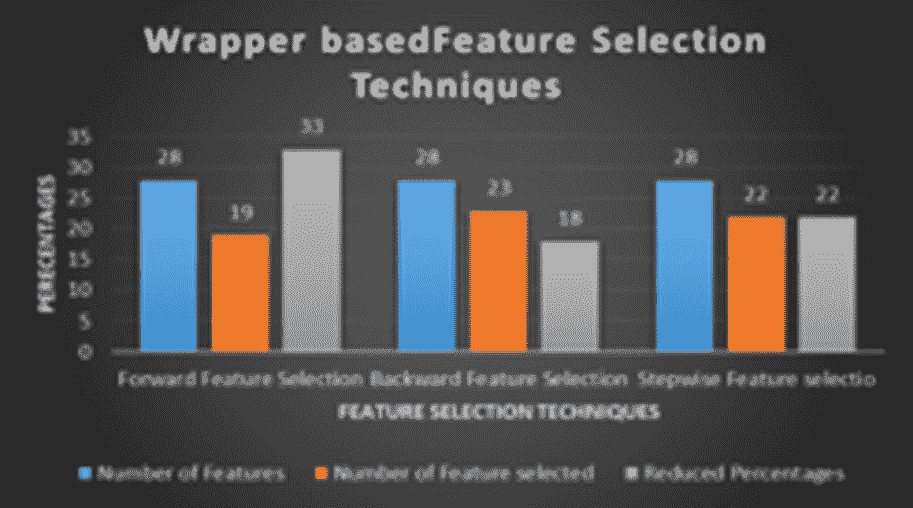 |
| --- |
| 图 5. 集成学习算法的性能比较 |
| --- |
| 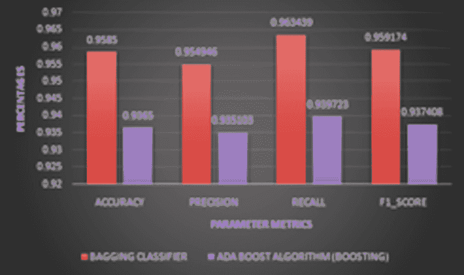 |
| --- |

# 6. 结论与未来范围

在所有自动化和半自动化行业中，持续监控安全风险至关重要。远程维护一直是矿业不可或缺的一部分。目前有许多安全模型可监控安全风险。钓鱼攻击是主要行业面临的目标攻击之一，攻击者通过网站、电子邮件、短信或电话窃取用户的凭据信息。在本章中，利用 Mendeley 数据集来检测钓鱼网站。基于包装器的特征选择技术分为三类，即前向、后向和逐步。其中，使用逻辑回归算法的前向特征选择提供了最佳的属性减少效果，数据集中减少了近 33% 的属性。为了评估模型的性能，使用了集成学习算法。为了识别钓鱼网站，开发了 Bagging 和 Boosting 集成模型。根据性能评估指标，Bagging 分类器在钓鱼网站检测中提供了 95% 的最佳准确率，优于 Boosting 算法。

未来，可以应用其他属性（如基于主机的属性和基于相关性的属性）结合各种特征选择技术来检测钓鱼网站。将开展混合集成学习方法以增强模型的鲁棒性。本研究还将通过开发自适应特征选择系统并成功实时选择相关特征来进一步扩展。

# 7. 未来研究展望

表 5 展示了一些其他可开源恶意软件数据集，并提供了对读者实现可能有用的参考网页链接。

表 5. 作为未来研究的开源数据集

| 序号 | 数据集 | 来源 | 网页链接 |
| --- | --- | --- | --- |
| 1. | 用于特征评估的钓鱼网站 | Mendeley Data | `https://data.mendeley.com/h3cgnj8ft/1` |
| 2. | 钓鱼网站 | Mendeley Data | `https://data.mendeley.com/72ptz439v/1` |
| 3. | 钓鱼网站 | Mendeley Data | `https://data.mendeley.com/76pt4/1` |
| 4. | 网页钓鱼检测 | Mendeley Data | `https://data.mendeley.com/n9cs4/1` |
| 5. | CICMalDroid 数据集 | UNB - CIC | `https://www.unb.ca/maldroid2020.html` |
| 6. | Darknet 数据集 | UNB - CIC | `https://www.unb.ca/darknet2020.html` |
| 7. | DNS Over HTTPS 数据集 | UNB - CIC | `https://www.unb.ca/dohbr2020.html` |
| 8. | DDoS 评估 | UNB - CIC | `https://www.unb.ca/ddos2019.html` |
| 9. | CIC Malware 分析数据集 | UNB - CIC | `https://www.unb.ca/malmem2022.html` |
| 10. | CIC Android 数据集 | UNB - CIC | `https://www.unb.ca/invesmal2019.html` |

## 感谢

此工作由 DST-CURIE-AI 项目在 2021-2023 年期间支持，单位位于印度 Tamil Nadu Avinashilingam 高等学院的机器学习与智能中心。

## 利益冲突：无

## 参考文献

Ali, W. (2017). 基于监督机器学习和特征选择的钓鱼网站检测。International Journal of Advanced Computer Science and Applications, 8(9). doi:10.14569/IJACSA.2017.08010

Alkhalil, Z., Hewage, C. T. E. R., Nawaf, L., & Khan, I. (2021). 钓鱼攻击：近期综述与新分析。Frontiers of Computer Science, 3, 563060. 提前出版。 doi:10.3389/fcomp.2021.563060

Almseidin, M., Zuraiq, A. A., Alkasassbeh, M., & Alnidami, N. (2019). 基于机器学习和特征选择方法的钓鱼检测。International Journal of Interactive Mobile Technologies, 13(12), 171. doi:10.3991/ijim.v13i12.11411

Almomani, A., Alauthman, M., Shatnawi, M. T., Alweshah, M., Alrosan, A., Alomoush, W., Gupta, B. B., Gupta, B. B., & Gupta, B. B. (2022). 基于语义特征和机器学习分类器的钓鱼网站检测。International Journal on Semantic Web and Information Systems, 18(1), 1–24. doi:10.4018/IJSWIS.297032

APWG. (2019). APWG 趋势报告。


## 参考文献

- Ghaleb Al-Mekhlafi, Z., Abdulkarem Mohammed, B., Al-Sarem, M., Saeed, F., Al-Hadhrami, T., & Alshammari, T., M., Alreshidi, A., & Sarheed Alshammari, T. (2022). 使用优化堆叠集成模型进行钓鱼网站检测。Computer Systems Science and Engineering, 41(1), 109–125. doi:[10.32604/csse.2022.020414](https://doi.org/10.32604/csse.2022.020414)
- Guendouz, M., & Amine, A. (2022). 一种基于烟花算法的 Android 恶意检测新型封装特征选择技术。International Journal of Software Science and Computational Intelligence, 14(1), 1–19. doi:[10.4018/IJSSCI.312554](https://doi.org/10.4018/IJSSCI.312554)
- HuangF.XieG.XiaoR. (2009). 集成学习研究。人工智能与计算智能国际会议。IEEE. doi:[10.1109/AICI.2009.235](https://doi.org/10.1109/AICI.2009.235)
- JovicA.BrkićK.BogunovićN. (2015). 特征选择方法综述及应用。信息与通信技术、电子与微电子国际会议。IEEE. doi:[10.1109/MIPRO.2015.7160458](https://doi.org/10.1109/MIPRO.2015.7160458)
- Khatun, M., Mozumder, M. A., Polash, M., Hasan, M. R., Ahammad, K., & Shaiham, M. D. S. (2022). 一特征选择方法和集成学习检测钓鱼网站的方法。International Journal of Advanced Computer Science and Applications, 13(8). doi:[10.14569/IJACSA.2022.0130888](https://doi.org/10.14569/IJACSA.2022.0130888)
- Moedjahedy, J., Setyanto, A., Alarfaj, F. K., & Alreshoodi, M. (2022). CCrFS: 结合相关特征选择用于机器学习检测钓鱼网站。Future Internet, 14(8), 229. doi:[10.3390/fi14080229](https://doi.org/10.3390/fi14080229)
- MohantyS.SahooM.AcharyaA. A. (2022). 基于过滤单变量特征选择技术的钓鱼 URL 预测。2022 年第二届计算机科学、工程与应用国际会议 (ICCSEA)。IEEE. doi:[10.1109/ICCSEA54677.2022.9936298](https://doi.org/10.1109/ICCSEA54677.2022.9936298)
- Nugraha, A. F., Tama, D. A., Istiqomah, D. A., Ramadhani, S. T., Kusuma, B. N., & Windarni, V. A. (2022). 用于改进网络钓鱼检测分类性能的特征选择技术。Conference Series, 4, 25–31. doi:[10.34306/conferenceseries.v4i.667](https://doi.org/10.34306/conferenceseries.v4i.667)
- Security Magazine. (n.d.). [`www.securitymagazine.com/articles/92157-coronavirus-related-spear-phishing-attacks-see-667-increase-in-march-2020`](https://www.securitymagazine.com/articles/92157-coronavirus-related-spear-phishing-attacks-see-667-increase-in-march-2020)
- SharmaS. R.ParthasarathyR.HonnavalliP. B. (2020). 网络钓鱼数据集特征选择比较研究。IEEE 电子、计算与技术国际会议。 doi:[10.1109/CONECCT50063.2020.919849](https://doi.org/10.1109/CONECCT50063.2020.919849)
- Singh, P., & Ranga, V. (2021). 使用集成学习进行云计算中的攻击和入侵检测。International Journal of Information Technology, 13(2), 565–571. doi:[10.1007/s41870-020-0583-w](https://doi.org/10.1007/s41870-020-0583-w)
- Surade, A. P. (2020). 钓鱼邮件是一种日益增长的威胁。International Journal of Information Technology, 12(2), 611–617. doi:[10.1007/s41870-019-0407-6](https://doi.org/10.1007/s41870-019-0407-6)
- TahirM.AsgharS.ZafarA.GillaniS. (2016). 使用监督学习检测钓鱼网站的混合模型。计算科学国际会议。IEEE. doi:[10.1109/CSCI.2016.0214](https://doi.org/10.1109/CSCI.2016.0214)
- TanC. S. (2018, March 24). 用于机器学习的钓鱼数据集：特征评估。 doi:[10.17632/h3cj8ft.1](https://doi.org/10.17632/h3cj8ft.1)
- Tubis, A., Werbińska-Wojciechowska, S., Góralczyk, M., Wróblewski, A., & Ziętek, B. (2020). 基于模糊理论的不同自动化挖掘过程网络攻击风险分析方法。Sensors (Basel), 20(24), 7210. doi:[10.3390/s20247210](https://doi.org/10.3390/s20247210)
- Volkamer, M., Renaud, K., Reinheimer, B., & Kunz, A. (2017). 防火墙的用户体验：钓鱼邮件检测。Computers & Security, 71, 100–113. doi:[10.1016/j.cose.2017.02004](https://doi.org/10.1016/j.cose.2017.02004)
- Xuan, C. D., Nguyen, H. L., & Nikolaevich, T. V. (2020). 基于机器学习的恶意 URL 检测。International Journal of Advanced Computer Science and Applications, 11(1). doi:[10.14569/IJACSA.2020.0110119](https://doi.org/10.14569/IJACSA.2020.0110119)
- Zhu, E., Chen, Y., Ye, C., Li, X., & Liu, F. (2019). OFS-NN: 基于最优特征选择和神经网络的有效钓鱼网站检测。IEEE Access: Practical Innovations, Open Solutions, 7, 73271–73284. doi:[10.1109/ACCESS.2019.2920655](https://doi.org/10.1109/ACCESS.2019.2920655)
- Zuhair, H., Selmat, A., & Salleh, M. (2015). 特征选择对钓鱼网站检测的影响。International Journal of Advanced Computer Science and Applications, 6(10). doi:[10.14569/IJACSA.2015.061031](https://doi.org/10.14569/IJACSA.2015.061031)

# 第 5 章

- Sri Danalaksmi，Avinashilingam 科学与高等学院
- Geethalakshmi，Avinashilingam 科学与高等学院
- A. Roshni，Avinashilingam 科学与高等学院
- Padmavathi Ganapathi，Avinashilingam 科学与高等学院

## 摘要

防火墙阻止进入和离开其保护区域的流量。日志功能记录防火墙如何处理流量。监控和分析日志可以帮助 IT 企业提高其系统的可靠性。本章使用监督学习算法对防火墙日志进行研究。本文的主要目标是通过分析防火墙日志来检查防火墙安全性。开发了支持向量机 (SVM)、朴素贝叶斯、逻辑回归和 K-近邻 (KNN) 等监督学习分类器用于分类防火墙日志。利用 Weka 工具中的 Ranker 和 Info_Gain_Attribute_Eval 方法进行特征选择以提取稳健特征。最后进行比较分析以评估监督学习模型的效率。结果表明，朴素贝叶斯分类器在防火墙日志分类中达到了 99.26% 的准确率。

# 1. 引言

防火墙是控制计算机网络访问并确保网络连接安全的访问管理点。网络防火墙是通过预配置规则或过滤器控制两个网络（信任网络和不可信网络）之间访问的设备或系统集（As-Suhbani 等，2019）。规则的结果可以通过监控进行审计、验证和评估。防火墙的分析和分类检查数据包是否通过。此外，它还可以根据所需的协议进一步提高安全目标。防火墙规则规定了允许或禁止的互联网流量类型。

| 图 1. 网络中防火墙的一个阶段 |


每个防火墙配置都包含一组防火墙规则；这些规则不可更改的。因此，创建新规则的能力仅限于少数配置。也可以使用不包含预定义规则的配置来构建自己的规则。防火墙配置还会影响规则与预定义规则相比的重要性，因此请务必仔细选择（Allagi et al., 2019）。

从互联网到计算机的入站流量和从计算机到互联网的出站流量都可以被防火墙规则拦截。一条规则可以同时应用于两个方向。例如，防火墙是安全工具，旨在防止或限制对连接到互联网的内网和其他私有网络的未经授权访问。防火墙策略概述了网络上允许的唯一流量，从而禁用了任何额外流量的连接。在网络前端，网络防火墙充当了内部和外部设备之间的通信信道（Ertam et al., 2018）。

如果没有防火墙，当前运行在具有可见 IP 的设备上的任何网络服务（例如，如果它通过以太网直接连接到互联网）都可能被公众访问。任何连接互联网的计算机网络都面临网络攻击的风险。如果没有防火墙，这些网络将容易受到敌攻击。某些恶意软件的设计目的是为了获取网络访问，以便访问客户信息等机密信息或信用卡号、银行账户信息等专有数据（Sharma et al., 2021）。

其他类型的恶意软件创建的唯一目的是破坏数据或使网络停滞。如果是公网 IP，黑客可以轻易中断网络。防火墙的分类对于减少攻击者突破网络的威胁要重要得多。

调查结果显示，网络工程团队正投入更多的时间和精力到防火墙维护上，而且他们的职责正变得越来越困难。根据超过 45% 的受访者的说法，这些工作中的大部分仍是手动完成的。由于大多数团队处理的是具有固有复杂性的多供应商环境，跟上所有变化是一项挑战（Winding et al., 2006）。防火防火墙的主要发现和趋势包括：

*   防火墙和网络安全的投入支出在增加
*   使用多个供应商已成为标准
*   对具有特定知识的防火墙工程师的需求
*   网络自动化正变得越来越流行
*   将加强防火墙管理

本章通过使用各种监督机器学习模型对防火墙日志文件的分类自动化做出贡献，并为精确机制提出了合适的模型。本研究旨在探索防火墙在网络中保护用户凭据的重要性，并开发监督学习模型对其进行适当分类。

本章结构如下：防火墙简介，其重要性在第 1 节说明。第 2 节处理防火墙日志文件的分类。第 3 节描述了类似的现有文献。第 4 节包含了建议的防火墙日志文件分类方法。第 5 节强调了网络防火墙安全面临的挑战。第 6 节总结了研究的未来展望。

# 2. 防火墙日志文件的分类

本节涉及防火墙日志文件的分类以及处理步骤。防火墙日志文件可以根据以下进行分类（Kowalski et al., 2006）：

*   **防火墙类型**：包括网络防火墙、应用防火墙、基于主机的防火墙和云防火墙。
*   **数据格式**：日志可以以 `CSV`、`JSON`、`Syslog` 或 `XML` 等格式生成。
*   **详细程度**：从基本信息到数据包的详细信息。
*   **用途**：用于故障排除、入侵检测和安全监控。
*   **时间范围**：涵盖日、周、月或年周期。
*   **源和目的 IP**：根据涉及的地址进行分类。
*   **协议和端口**：基于网络流量中使用的协议和端口。
*   **严重级别**：分为关键、高、中、低。
*   **用户身份**：基于与网络流量相关的用户。

### 2.1 日志文件

网络防火墙中的日志文件由于防火墙处理流量活动而产生（Nimbalkar et al., 2016）。防火墙通常生成记录以下信息的日志文件：

*   **拦截的流量**：记录源和目的 IP 地址、协议号和拦截原因。
*   **允许的流量**：记录允许通过的流量，包含与拦截流量日志类似的信息。
*   **入侵尝试**：如果防火墙检测到入侵尝试，它会生成一个包含攻击类型、源 IP 地址和其他相关信息的条目。
*   **配置更改**：记录对防火墙配置进行的更改，包括用户、时间、日期和其他详细信息。

日志文件有助于监控网络流量、检测并防止未经授权的访问、排除网络故障并确保符合安全策略和法规。它们还可以用于取证分析和调查。

## 2.2 识别日志文件中的攻击

在防火墙日志文件中识别攻击可能是一个复杂的任务，因为有许多日志条目需要分析，并且有许多类型的攻击需要寻找（Hommes et al., 2012；Shaheed et al., 2022）。然而，可以采取以下步骤帮助识别防火墙日志文件中的攻击：

1.  **定期分析日志文件**：定期检查防火墙日志文件是识别潜在攻击的重要步骤。这将有助于识别任何可能指示攻击的异常或可疑活动。
2.  **寻找模式**：识别反复出现的流量序列。
3.  **使用自动化工具**：利用软件处理大量数据。
4.  **检查已知攻击**：将日志数据与已的威胁特征进行匹配。
5.  **寻找异常**：识别偏离正常网络行为的行为。


### 步骤 2：寻找模式
许多攻击遵循特定的模式，或使用可以在防火墙日志文件中识别的特定技术。通过分析日志文件中的模式或共同点，可能识别出潜在的攻击。

### 步骤 3：使用自动化工具
目前有多种可用工具可以帮助分析防火墙日志文件以发现潜在的攻击。这些技术通过机器学习和其他方法寻找趋势和异常情况，这些情况可能指向攻击的发生。

### 步骤 4：检查已知攻击
防火墙通常内置了针对已知攻击的规则和签名。通过将日志文件与这些规则和签名进行对比，可能识别出已知的攻击。

### 步骤 5：寻找异常
防火墙日志文件中的异常或异常活动可能表明存在攻击。例如，来自特定 IP 地址的流量突然激增或异常的流量模式可能是攻击的迹象。

需要注意的是，没有任何一种方法可以保证检测到所有攻击，通常需要结合多种技术和策略来识别防火墙日志文件中的潜在攻击。

## 3. 相关工作

在本节中，将详细讨论其他研究人员在利用机器学习技术处理防火墙日志文件分类方面所开展的工作。

Hajar Esmail As Suhnbani 等（2019）利用特征选择和冗余消除等数据挖掘方法分析了防火墙日志数据集。然后，为了加速过程，他们使用了 `WEKA` 的机器学习分类器，包括 `Naive Bayes`、`kNN`、`One R` 和 `J48`。他们还对比了这些算法的分类准确率和 F 值的性能，并执行了 10 折交叉验证。在准确率方面，所需模型表现出色。

ShridharAllagi, RashmiRachh 等（2019）使用了某家公司生成的网络日志收集数据进行研究。该日志数据集由数百万条条目组成。只有 5% 的数据似乎是异常行为。这使得系统面临类别不平衡的问题，即其中一类聚类与其他聚类相比是忽略不足道的。他们建议使用 `k-means (k=2)` 创建两个组（正常组和异常组），以及一个在输入和输出层具有神经元的人工神经网络的自组织特征映射 (`SOFM`)。它专注于日志数据中的语言信息，特别强调了双字节词（例如“ACCESS DENIED”、“401 ERROR”、“INVALID PASSCODE”等）。他们使用大量的网络记录数据集和监督机器学习方法评估了该系统。试验结果显示，可以以很高的接受度预测偏离行为。

FatihErtam 等（2018）通过防火墙获取日志数据。日志获取自 Firat 大学的 `Palo Alto 5020 Firewall` 设备。接收到的日志记录是大约 30 秒录制的结果，由数千条记录组成。接收日志中优先考虑端口、字节、数据包和时间信息的特征。类别的动作属性可以是以下之一：“allow”、“deny”、“drop”或“reset-both”。除了 `SVM` 分类器外，还使用了 `linear`、`polynomial`、`RBF` 和 `sigmoid` 激活函数。通过 `ROC curves`、`F1 score`、`recall`（召回率）、`precision`（精确率）对结果进行了对比。

Deepanshu Sharma 等（2021）检查了所有模型的性能。

Robert Winding 等（2006）使用了多种方法研究检测。

Kazimierz Kowalski 和 Mohsen Beheshti（2006）展示了他们关于建立入侵的研究。

PiyushNimbalkar 等（2016）假设这种方法利用了确定语义的框架。

Stefan Hommes 等（2012）描述了一种日志文件分析的自动化方法。


Kazunori Kamiya et al. (2015) 通过结合分析防火墙日志和代理日志，提供了一种识别受恶意软件感染主机的机制。该研究表明，这种方法可以发现被基于 HTTP 的有害列表所遗漏的恶意软件感染主机。与单一的基于代理的检测相比，该策略在准确性上提升了 6%。因此，他们证明了多层分析有助于改进恶意软件检测。

基于上述讨论的相关文献工作，本文对识别出的研究空白并进行了如下讨论：

*   在相关工作中，大多数提出的模型在防火墙日志文件的分类中均未实现最佳性能。
*   在开发防火墙日志文件分类模型之前，未能尝试显著的特征选择方法。
*   未充分使用 `accuracy`、`train_accuracy`、`test_accuracy`、`precision`、`recall` 和 `F1_score` 等验证指标对监督学习模型进行适当比较。

本章侧重于通过基于防火墙日志文件分类的特征选择方法，实现适当的监督机器学习模型，以克服上述研究空白。开发的模型将通过重要的性能评估指标进行进一步评估，并为所选问题建议最合适的模型。

## 4. 提出的方法论

所提出的方法论由六个阶段组成，旨在使用监督机器学习方法开发重要的防火墙日志文件分类模型。图 2 展示了所设计的的方法论。

| 图 2. 提出的方法论 |
| --- |
| 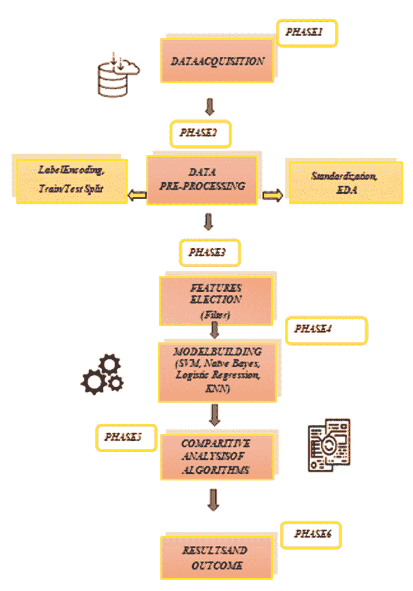 |
| --- |

### 4.1 数据集

使用 Firat 大学 Palo Alto 5020 防火墙系统的互联网流量记录来汇编互联网防火墙数据集。数据集总共包含 12 个特征和 65533 条记录。使用了 `action feature` 类别。总共有 4 个类，分别是 `allow`（允许）、`action`（动作）、`drop`（丢弃）和 `reset`（重置）。

表 1 显示了数据集特征及其描述。

表 1. 数据集特征描述

| 属性 | 描述 |
| --- | --- |
| Source Port | 表示客户的源端口 |
| Destination Port | 表示客户的目的端口 |
| NAT Source Port | 代表网络地址转换的源端口 |
| NAT Destination Port | 代表网络地址转换的目的端口 |
| Elapsed time (sec) | 表示流流 |
| Bytes | 表示总字节 |
| Bytes Sent | 表示发送的字节数 |
| Bytes Received | 表示接收的字节数 |
| Packets | 表示数据包总数 |
| `pkts_sent` | 表示发送的数据包数量 |
| `pkts_recieved` | 表示接收的数据包数量 |
| Action | 代表类别的状态（允许、拒绝、丢弃、重置-两者） |

表 2 代表了用于防火墙日志文件分类的数据集类别。

表 2. 数据集防火墙类别描述

| 防火墙动作 | 描述 |
| --- | --- |
| Allow | 使互联网流量可能 |
| Deny | 流量被拦截，并执行特定应用程序的默认拒绝动作 |
| Drop | 通过静默终止应用程序的流量，覆盖了通常的拒绝动作。触发 TCP 重置 |
| Reset - Both | 重置到两者 |

### 4.2 数据预处理

机器学习的一个关键阶段是数据准备。为了使原始数据适用于机器学习模型，必须首先对其进行组织。创建机器学习模型的第一步是数据准备，现实数据通常是不完整、不一致或存在异常值的。在此过程中应用标准化。

### 4.2.1 标签编码

标签编码是监督学习中用于将类别数据转换为数值的形式。在此过程中，每个类别被分配一个数值。这允许算法处理数值数据。在`支持向量机`、`朴素贝叶斯`、`K 近邻`、`决策树`、`随机森林`和`逻辑回归`等方法中经常使用这种方法。但必须记住，标签编码对于所有类别数据可能都不是理想选择，因为它可能会引入数据中并不存在的顺序或层次。在这种情况下，可以考虑使用独热编码。

### 4.2.2 训练与测试划分

在监督学习中，训练测试划分策略用于评估模型性能。提供的数据集被分为训练集和测试集。与训练模型的训练集不同，测试集用于评估模型在新数据上的表现。理想情况下，测试集应包含模型在现实世界中遇到的数据。数据的第一部分保留训练，另一部分用于测试。通常的做法是随机划分训练和测试。通常，70%-80% 的数据用于训练，20% 用于测试。实际划分取决于数据集的大小和组成。过拟合是指模型在训练数据上表现良好，但在测试数据上表现很差。训练测试划分有助于防止这种情况。分析模型在测试集上的性能有助于理解其泛化能力。

注意的是，训练测试划分是一项基本技术，对于复杂的模型或数据集可能需要调整。在这种情况下，可以使用交叉验证或分层采样技术进行更准确的评估。在本研究中，数据集被分为 80% 训练和 20% 测试。

### 4.2.3 标准化

为了对机器学习数据进行标准化，必须使其具有均值 0 和标准差 1。这也被称为“特征缩放”或“数据归一化”。标准化旨在确保输入数据中的每个特征被平等对待。当输入数据的特征范围不同时，某些特征可能会主导其他特征，导致偏差或倾斜的结果。标准化通过将每个特征缩放到相同的范围来避免这个问题。


多种方法（包括 z-score 标准化、最小最大归一化和单位归一化）可用于数据标准化。Z-score 标准化的最常用方法是在从每个特征的特征值中减去该特征的均值后，将结果除以标准差。在最小最大归一化过程中，每个特征被缩放到 0 到 1 之间的范围。将每个特征缩放到具有单位范数或长度为 1 被称为单位归一化。由于标准化有助于确保输入数据为算法做好充分准备，以创建准确且无偏的预测，因此通常被视为机器学习中至关重要的预处理步骤。

## 4.3 在 WEKA 工具中使用 Ranker 和 Info_Gain_Attribute_Eval 方法进行特征选择

当数据库拥有大量属性时，某些属性与分析目标是无关的。因此，从数据集中移除不需要的属性已成为创建良好的机器学习模型的必要阶段。对于具有许多特征的数据库，这可能是一个巨大的工作，但它可以直观地分析整个数据集并移除无意义特征。幸运的是，WEKA 有一个自动特征选择工具。Weka 是一个软件术语，涵盖用于特征选择和分类的可视化工具与算法，以及能够快速访问这些特性的图形用户界面。在 Weka 工具中，使用 `ranker` 和 `infogain_attribute_evaluator` 方法来选择数据的最佳特征（Naryanto et al., 2022; Skazin et al., 2021; Pavlychev et al., 2021)）。

### 4.3.1 Ranker

个体评估用于对属性进行排序。当与属性评估器结合时，它是一个强大的选项（如 ReliefF, GainRatio, Entropy 等）。

### 4.3.2 Info_Gain_Attribute_Eval

它衡量相对于类的信息增益来确定属性的值。其计算公式为：

`InfoGain(Class,Attribute) = H(Class) - H(Class|Attribute).`

## 4.4 模型构建

为了开发预测和各种分类以实现其目标，机器学习模型通过从训练数据中学习、泛化这些信息，然后将这些知识应用于从未见过的新数据来创建。在必要的分类和性能标准下，构建了 SVM、朴素贝叶、逻辑回归和 K-NN 模型（Taher et al., 2019; Gajda et al., 2022; Pawar et al., 2022; Wang et al., 2021; Nawir et al., 2019; Kazim et al., 2019; Li et al., 2019; Zhang et al., 2019; Ndichu et al., 2023）。

### 4.4.1 支持向量机

支持向量机（SVM）是一种用于分类和回归分析的强大机器学习技术。基于之前分类的数据，可以使用名为 SVM 的监督学习方法对数据进行评估和分类。SVM 方法旨在通过最大化多个数据类之间的间隔，找到分离这些数据类的最佳决策边界。间隔是判断外部边界与每个类最近的可用数据点之间的距离。间隔越大，模型的泛化能力越强。

SVM 将输入数据转换为高维空间，这使其更容易识别出分离不同类的超平面。这是通过使用核函数将初始数据映射到新空间来实现的。在处理高维数据时，SVM 特别有利，因为其他算法可能难以找到合理的决策边界。SVM 与噪声数据配合得良好，因为它可以有效处理异常值。回归分析以及二分类和多分类问题都可以通过 SVM 解决。SVM 有不同类型，包括线性 SVM、非线性 SVM 和支持向量回归（SVR）。

虽然 SVM 是一种强大的算法，但它确实存在一些局限性。SVM 需要大量的处理，特别是在处理海量数据集时。SVM 也对核函数和使用的超参数敏感，这会影响模型的性能。SVM 是一种灵活且强大的机器学习算法，特别是在处理高维和噪声数据时。

### 4.4.1.1 支持向量机 (SVM) 的工作

以下是支持向量机（SVM）算法工作原理的逐步解释：

- **步骤 1：数据准备**
  带标记的训练数据集应包含样本 `(x1, y1), (x2, y2), ..., (xn, yn)`，其中 `xi` 是特征向量。

- **步骤 2：特征映射**
  使用合适的核函数 `K(x, x')` 将数据映射到高维空间，其中 `yi` 代表不同的类别标签。

- **步骤 3：优化**
  在最大化间隔的同时确定划分类的超平面，将 SVM 问题公式化为：
  `Minimize ½w² + C∑ξ`
  `Subject to: yi(w·Φ(xi)) + b ≥ 1 - ξ`
  其中 `w` 是权重向量，`b` 是偏置，`Φ` 是映射函数，`ξ` 代表松变量，`C` 是正则参数。

- **步骤 4：拉格朗日乘数**
  使用拉格日乘数方法求解优化问题并获得对偶形式。对偶问题涉及最大化以下表达式：
  `Maximize: Σαi - ½ΣΣαiαjyj(xi, xj)`
  `Subject to: Σαiyi = 0`
  `0 ≤ αi ≤ C`（对于所有训练样本 `(xi, yi)`）。

- **步骤 5：支持向量**
  对偶问题的解提供了 `αi` 的最优值。识别支持向量，它们位于间隔上或内部。

- **步骤 6：分类**
  对于新的测试样本 `x`，可以使用以下方程预测类别标签 `y`：`y = sign(ΣαiyiK(xi, x) + b)`。其中 `sign(` 是符号函数，`αi` 是从对偶问题得到的拉格朗日乘数，`b` 是偏置。

这些步骤总结了支持向量机的工作。需要注意的是，SVM 可以通过多种方式修改和扩展，例如核选择和软间隔 SVM，这可以提高它们的性能和实用性。

### 4.4.2 朴素贝叶

这是一种用于分类任务的流行机器学习技术。它基于贝叶斯定理，该定理根据可用数据评估假设的概率。由于朴素贝叶是一种监督学习系统，因此需要标记的训练数据。在计算了每个特征给定每个类别标签的条件概率后，贝叶斯应用贝叶斯定理来确定给定特征类的概率。该算法被称为“朴素”，是因为它假设特征之间是独立的。朴素贝叶有多个版本，包括：

- **多项式朴素贝叶**：用于离散数据，例如文本数据，其中每个特征表示特定单词在文档中的频率。
- **高斯朴素贝叶**：用于具有高斯分布特征的连续数据。
- **伯努利朴素贝叶**：用于二值数据，其中每个特征指示另一个特征是否存在。


朴素贝叶斯（Naive Bayes）的易用性和高效是其两个关键特征，它只需要少量训练数据即可良好运行。此外，它擅长多分类问题，并具有良好的高维数据处理能力。然而，朴素贝叶斯的假设是特征之间总是相互独立的。它还假设数据服从正态分布，这对于某些数据集可能并非如此。尽管如此，朴素贝叶斯仍然机器学习中强大且广泛使用的算法。本研究实现了高斯朴素贝叶斯来分类防火墙日志文件。

## 4.4.2.1 朴素贝叶斯 (NB) 的原理

以下是朴素贝叶斯 (NB)算法原理的逐步说明：

### 步骤 1：数据准备
在标记训练集中，收集样本 `(x1, y1)`, `(x2, y2)...(xn, yn)`，其中 `xi` 是第 `i` 个示例的特征向量，`yi` 是匹配的类别标签。

### 步骤 2：特征独立假设
朴素贝叶斯的分析基于前提：在给定类别标签的情况下，数据集中的所有特征都是相互独立的。使用所谓的“朴素”假设简化了计算。

### 步骤 3：计算类别先验概率
使用训练数据集确定每个类别标签的先验概率。为此，将训练示例的总数除以类别 `y` 示例的计数。

### 步骤 4：计算特征概率
对于每个特征 `xⱼ` 和每个类别标签 `y`，计算条件概率 `P(xⱼ|y)`。这代表在给定类别标签 `y` 的情况下特征 `xⱼ` 发生的概率。根据特征的类型（分类或连续）可以使用不同的概率估计方法。常用方法包括：

- 对于分类特征：使用特征 `xⱼ` 在类别 `y` 中的频率除以类别 `y` 中的示例计数。
- 对于连续特征：假设一种概率分布（例如高斯分布），并为每个类别标签估计分布的参数（均值和方差）。

### 步骤 5：进行预测
使用贝叶斯定理，在给定特征向量 `x` 的情况下，计算每个新测试示例 `x` 每个类别标签的后验概率。

```
P(y|x) = (P(x|y) * P(y)) / P(x)
```

其中 `P(y)` 是类别标签的先验概率，`P(x)` 是证据概率（归一化常数），`P(y|x)` 是在给定类别标签的情况下每个特征条件概率的乘积。

### 步骤 6：选择预测类别
为提供的测试实例选择具有最高后验概率的预测类别。

这些步骤总结了朴素贝叶斯算法的原理。它以简单、高效以及处理高维特征空间的能力而闻名。尽管独立假设在所有情况下可能并不成立，但朴素贝叶斯在实践中仍然可以表现良好，并广泛应用于各种场景，例如文本分类和垃圾邮件过滤。

### 4.4.3 逻辑回归

当使用一个或多个独立变量来预测分类因变量的概率时，会应用名为逻辑回归的分类方法。这是一种回归分析，适用于预测落属于两个类别之一的结果，例如真或假、是或否、或成功或失败。逻辑回归程序在数据训练集上拟合一个逻辑函数（也称为 sigmoid 函数）。该函数将任何输入值转换为 0 到 1 之间的数字，代表处于正类中的概率。

逻辑函数具有以下数学公式：

 (1)

如果 `z` 是输入值，`e` 是约等于 2.718 的数学常数，`p` 是正类的概率。

为了选择能够使逻辑回归模型中预测概率与训练数据实际值之间的差异最小化的系数，方法采用了极大似然估计策略。这通常通过使用梯度下降等优化技术完成。逻辑回归模型在训练后可以预测输入输入数据的正类概率。如果概率超过预定义的阈值（通常为 `0.5`），则该输入值被归类为正类；否则，归类为负类。

### 4.4.3.1 逻辑回归 (LR) 的原理

以下是逻辑回归 (LR)算法原理的逐步说明：

### 步骤 1：数据准备
收集实例 `(x1, y1)`, `(x2, y2)...(xn, yn)`，其中 `xi` 是第 `i` 个样本的特征向量，`yi` 代表匹配的类别标签（0 或 1）。

### 步骤 2：初始化模型参数
为偏置项 `b` 和权重向量 `w` 分配微小的随机值作为初始值。

### 步骤 3：定义逻辑函数 (Sigmoid)
定义逻辑函数（通常称为 sigmoid 函数），它通过数据和模型参数线性组合的输出产生 0 到 1 之间的概率。其定义为：`σ(z) = 1 / (1 + e^(-z))`，其中 `z = w·x + b`。

### 步骤 4：假设计算
使用逻辑函数为给定的示例 `x` 计算假设 `hA`。

```
hA = σ(w·x + b)
```
其中 `σ 是 sigmoid 函数。

### 步骤 5：代价函数
创建一个衡量预测概率与实际值之间差异的代价函数。二交叉熵损失是逻辑回归常用的代价函数，其定义为：

```
J(w, b) = -1/n * Σyᵢlog(h[A) + (1-yᵢ)log(1-hA)]
```
其中 `n` 是示例的数量。

### 步骤 6：梯度下降优化
使用梯度下降优化迭代更新模型参数并最小化代价函数。确定代价函数对于 `w` 和 `b` 的梯度：

```
∂J/∂w = 1/n * Σ(h[A - yᵢ) * xᵢ]
∂J/∂b = 1/n * Σh[A - yᵢ]
```

使用梯度和学习率 `α` 更新模型参数：

```
w := w - α * ∂J/∂w
b := b - α * ∂J/∂b
```

### 步骤 7：重复步骤 4-6
在收敛或达到预定迭代次数之前重复步骤 4 到 6。收敛通常通过代价函数的变化或模型参数达到稳定状态来判断。

### 步骤 8：进行预测
给定新的测试示例 `x`，使用学习到的参数计算假设 `hA`。如果 `hA` 大于或等于 `0.5`，则预测正类（1）；否则，预测负类（0）。

这些操作概述了逻辑回归的工作原理。通过多对多（one-vs.-rest）或 softmax 回归等方法，用于二分类任务的逻辑回归也可以扩展到处理多分类挑战。它具有良好的解释性，并可以处理分类和数值特征。

### 4.4.4 K-最近邻

K-最近邻 (K-NN) 是一种监督学习技术，可用于分类或回归问题。这种非参数方法根据新实例与训练集中标记示例的接近程度产生预测。超参数 `k` 的值（一个正整数）决定了在预测新实例时考虑多少个最近邻。通常使用欧几得距离或其他距离量来计算两个实例之间的距离。K-NN 算法如下：

- 将训练数据加载到内存。
- 计算新实例与训练集中每个实例之间的距离。
- 根据估计的距离选择 `k` 个最近邻。


- 如果是分类问题，根据新实例的 `k` 个最近邻居的主导类别来确定新实例的类别。对于回归任务，将新实例的目标值预测为 `k` 个邻居目标值的平均值。
- 对测试集中的所有新实例重复步骤第 2-4 步。

`K-NN` 算法具有许多优点，包括其简单性、可解释性以及处理非线性决策边界的灵活性。`k` 的选择对算法的性能有很大影响，而且对于大数据集，计算开销可能非常大。

### 4.4.4.1 K-近邻 (K-NN) 的原理

以下是 K-近邻（`K-NN`）算法工作原理的逐步说明：

### 步骤 1：数据准备
在带标记的训练集中，收集样本 `(x1, y1)`, `(x2, y2)`,...,(xn, yn)`，其中 `xi` 是第 `i` 个示例的特征向量，`yi` 表示兼容的类别标签。

### 步骤 2：选择邻居数量 (k)
在进行预测时，选择要考虑多少邻居（`k`）。这是一个需要根据问题和数据集确定的超参数。

### 步骤 3：距离计算
建立一种距离度量（如欧式距离或曼哈顿距离），以衡量两个特征向量之间的相似性。确定数据集中每个训练示例与测试示例之间的距离。

### 步骤 4：选择最近邻居
根据所选的距离度量，找到与测试示例相似（最近）的 `k` 个训练示例。这些最近邻居将影响对测试示例的预测。

### 步骤 5：类别投票
统计 `k` 个最近邻居的类别标签。找出邻居中出现最频繁的类别。

### 步骤 6：进行预测
将多数类别标签分配为测试示例的预测类别。

### 步骤 7：对每个测试示例重复步骤 3-6
对于数据集中的所有测试示例，重复步骤 3 到 6。

### 步骤 8：性能评估
在另一个验证集或测试数据集上，使用适当的评估指标（例如：准确率、精确率、召回率、F1-score 分数）评估 `k-NN` 方法的性能。

### 步骤 9：超参数调优
尝试不同的 `k` 值并评估性能，以选择产生最佳结果的最优值。

这些步骤解释了`k-近邻`算法。这是一种简单的技术，用于分类和回归应用。尽管对于大数据集计算成本可能很高，但它的优点不需要训练时间，因为完整的训练数据集被保存用于预测。此外，对特征进行归一化或缩放是非常重要的，以确保没有单个特征主导距离计算。

## 4.5 性能评估

准确率（Accuracy）是分类机器学习模型最重要的衡量标准。通过将测试集中所有数据点的总数除以准确预测的总数，可以确定预测的准确率。准确率是判断模型性能的一种方法，但也有其他方法。准确率的衡量方式是模型预测的所有正例中真正例（True Positives）的比例。召回率（Recall）定义为数据集中真正例占所有其他正例的比例。F1 分数的含义是召回率和精确率的平均值。与其他指标相比，准确率能够最准确地表示模型在特定数据集上的性能。所使用的指标用于评估模型的性能。表 3 展示了模型的重要性能指标及其公式。

表 3. 性能评估指标及其公式

| 性能指标 | 公式 |
| --- | --- |
| 准确率 (Accuracy) | `(TP + TN) / (TP + TN + FP + FN)` 1. |
| 精确率 (Precision) | `TP / (TP + FP)` 2. |
| 召回率 (Recall) | `TP / (TP + FN)` 3. |
| F1 分数 (F1-Score) | `2 * (Precision * Recall) / (Precision + Recall)` 4. |

在上述公式中，使用了以下术语：

- `TP` (真正例)：正确预测良好结果的情况百分比。
- `TN` (真负例)：准确预测不利事件的百分比。
- `FP` (假正例)：被错误评为有利的事件百分比。
- `FN` (假负例)：错误预测负面结果的次数。

这些指标常用于评估分类模型的性能。召回率计算了正确识别的正例实例的百分比，准确率分析了预测的整体准确性，精确率检查了正例预测的准确性，而 F1 分数提供了一个在精确率和召回率之间取得平衡的单一指标。

图 3 显示了机器学习模型的精确率得分。

| 图 3. 模型精确率得分 |
| --- |
| 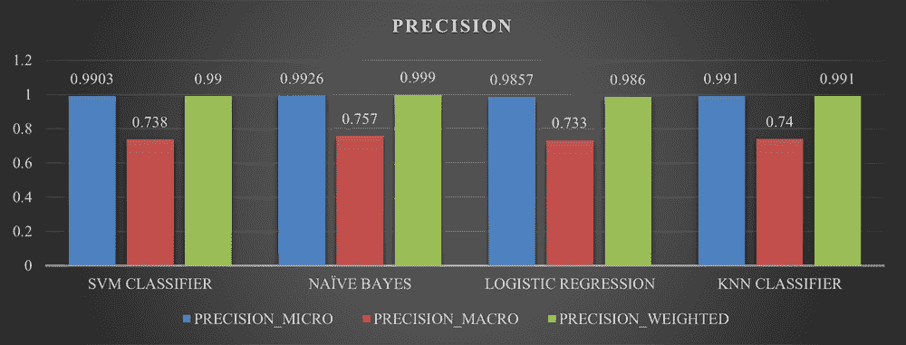 |

图 4 显示了机器学习模型的精确率得分。

| 图 4. 模型精确率得分 |
| --- |
|  |

图 5 显示了机器学习模型的精确率得分。

| 图 5. 模型精确率得分 |
| --- |
|  |

## 4.6 实验结果与讨论

根据准确率水平、分类指标精确率、召回率和 F1 分数对四种监督算法进行了比较。由于是多分类数据集，对训练和测试数据集都计算了 `micro`、`macro` 和 `weighted`指标。最后，根据更高的测试准确率选择了模型。根据性能，准确率得到了提高。操作（`Allow`, `Deny`, `Drop`, `Reset`）、源端口、目的端口、NAT 源端口、NAT 目的端口和字节数（Bytes）是考虑的五个主要特征。朴叶贝斯算法优于其他分类技术。朴叶贝斯分类器被确定具有最大的准确率值，为 `99.26%`。

## 5. 网络防火墙安全的开放挑战

网络防火墙安全面临几个开放挑战，包括：

- 高级持续性威胁 (APT)：APT 是一种针对性的、未经授权进入网络的复杂的攻击。防火墙必须不断更新，以有效检测和防止此类不断演变的威胁。
- 加密流量检查：随着越来越多的网络流量使用 HTTPS 等协议进行加密，防火墙检查加密包内容变得困难。防火墙需要开发在不损害用户隐私的情况下检查加密流量的技术。


## 安全挑战

### 应用层攻击
传统的防火墙主要侧重于网络层过滤。然而，现代攻击往往针对应用层漏洞。防火墙必须不断进步，以便能够正确检查应用层的应用程序，并防御诸如 `SQL injection`、跨站脚本 (`XSS`) 以及其他应用级漏洞的攻击。

### 云环境
随着云计算采用率的不断增加，防火墙需要适应以确保虚拟化和分布式环境的安全。挑战包括处理动态 IP 地址、保护云间通信，以及在混合云环境中执行一致的安全策略。

### 0 日漏洞
0 日漏洞是在被发现或修补之前被利用的未知漏洞。防火墙应该能够利用基于行为的分析和威胁情报等技术，实时检测并防御此类漏洞。

### 内部威胁
传统的防火墙设计用于防御外部威胁，但它们可能无法充分应对内部威胁。组织需要实施额外的安全措施，例如用户行为分析和数据泄露防护 (`DLP`)，以减轻来自恶意或疏忽内部人员的风险。

### 分布式拒绝服务 (DDoS) 攻击
DDoS 攻击仍然是一个重大威胁，防火墙在缓解此类攻击中发挥着至关重要的作用。然而，攻击者不断开发新技术来绕过传统的 DDoS 缓解策略，这要求防火墙采用先进的异常检测和速率限制技术。

### 安全策略复杂性
组织通常拥有具有多个防火墙和安全策略的复杂网络环境。管理和维护这些策略可能挑战，会导致错误配置和安全漏洞。简化策略管理并确保执行的一致性是一项持续挑战。

### 演变的威胁格局
随着新的攻击通道、恶意软件变种和规避策略定期出现，威胁格局不断变化。为了有效对抗新威胁，防火墙必须跟上最新的威胁情报并定期更新其规则集。

应对这些挑战需要技术进步、威胁情报共享、安全供应商之间的协作，以及网络防火墙安全领域的持续研发工作。

## 6. 结论与未来展望

网络中最关键的部分之一是 `Firewall`，使用的安全措施不应存在不一致，因为这会导致网络暴露在安全风险之中。因此，所有人应该意识到所有组件中存在的风险。网络技术和应用不断演进，但网络安全却滞后。许多计算机安全威胁源于网络，而另一些被网络放大。安全网络依赖于安全计算，反之亦然。不出意外的是，随着网络技术变得越来越脆弱，个人开始更加重视网络安全。未来将在包含许多场景的真实网络中使用这些方法，以分析深度并根据漏洞水平对威胁进行分类。本章研究了使用四种机器学习模型对防火墙日志文件进行分类，为该问题建议合适的模型。基于 `SVM`、`NB`、`LR` 和 `K-NN` 等模型的对比分析，观察到 `Naïve Bayesian` 分类器表现最优，准确率高达 `99.26%`。未来，可以使用其他不同的深度学习方法开发该模型，为实时数据提供更高层次的解决方案。

## 致谢

这项工作由 `DST-CURIE-AI` 项目在 2021 – 2023 期间支持，该项目由位于印度泰米尔纳德邦的 Avinashilingam Institute for Home Science and Higher Education for Women, Coimbatore – 43 的机器学习与智能中心网络中心建立。

利益冲突声明：无。

## 参考文献

- Abu Al-Haija, Q., & Ishtaiwi, A. (2021). Machine learning-based model to identify firewall decisions to improve Cyber-Defense. International Journal on Advanced Science, Engineering and Information Technology, `11(4)`, 1688. doi:[10.18517/ijaseit.11.4.1688](https://doi.org/10.18517/ijaseit.11.4.1688)
- Al-Behadili, H. N. (2021). Decision Tree for Multi-class Classification of Firewall Access. International Journal of Intelligent Engineering and Systems, `14(3)`, 294–302. doi:[10.22266/ijies2021.0630](https://doi.org/10.2266/ijies2021.0630)
- Aljabri, M., Alahmadi, A., Mohammad, R., Aboulnour, M., Alomari, D. M., Almotiri, S. H. (2022). Classification of firewall data using multi-class machine learning models. Electronics (Basel), `11(12)`, 1851. doi:[10.3390/electronics11121851](https://doi.org/10.3390/electronics11121851)
- Allagi, S. R. (2019). Analysis of Network log data using Machine Learning. International Conference for Convergence for Technology. doi:[10.1109/ICTV45611.2019.90337](https://doi.org/10.1109/I245611.2019.90337)
- As-Suhab, H. E., & Khamitkar, S. D. (2020, February 25). Discovering anomalous rules in firewall logs using data mining and machine learning classifiers. International Journal of Scientific & Research. [`www.ijstr.org/paper-references.php?ref=IJSTR-0120-2974`](https://www.ijstr.org/paper-references.php?ref=IJSTR-0120-2974)
- As-Suhbani, H. E., & Khamitkar, S. (2019). Classification of Firewall Logs Using Supervised Machine Learning. International Journal on Computer Science and Engineering, `7(8)`, 301–304. doi:[10.26438/ijcse/v7i8.301304](https://doi.org/10.26438/ijcse/v7i8.301304)
- Ertam, F., & Kaya, M. (2018). Classification of firewall log files with multi-class support vector machine. 2018 6th International Symposium on Digital Forensic and Security (ISDFS). doi:[10.1109/ISDFS.2018.835538](https://doi.org/10.1109/ISDFS.2018.835538)
- Gajda, J., Kwiecien, J., & Chmiel, W. (2022). Machine learning methods for anomaly detection in computer networks. 2022 26th International Conference on Methods and Models in Automation and Robotics (MMAR). doi:[10.1109/MMAR55195.2022.987431](https://doi.org/10.1109/MMAR55195.2022.987431)
- Hommes, S., & Engel, T. (2012). A distance-based method to detect anomalous attributes in log files. Network Operations and Management. doi:[10.1109/NOMS.2012.621194](https://doi.org/10.1109/NOMS.2012.621194)
- Internet firewall data. UCI Machine Learning Repository. (n.d.). [`archive.ics.uci.edu/ml/datasets/Internet+Firewall+Data`](https://archive.ics.uci.edu/ml/datasets/Internet+Firewall+Data)
- Kamiya, K., Aoki, N., Nakata, S., Kurakami, H., & Tanikawa, M. (2015). The method of detecting malware-infected hosts is analyzing firewall and proxy logs. Asia-Pacific Symposium on Information and Telecommunication Technologies. doi:[10.1109/APSITT.2015.721713](https://doi.org/10.1109/APSITT.2015.721713)
- Kazim, M., & Doreswamy. (2019). Machine Learning Based Network Anomaly Detection. International Journal of Recent Technology and Engineering (IJRTE), `8(4)`, 542–548. doi:[10.35940/ijrte.D7271.118419](https://doi.org/10.35940/ijrte.D7271.118419)
- Kowalski, K., & Geinitz, H. (2006). Analysis of Log Files Intersections for Security Enhancement. International Conference on Information Technology: New Generations. doi:[10.1109/ITNG.2006.32](https://doi.org/10.1109/ITNG.2006.32)


LiZ.RiosA. L.XuG.TrajkovicL. (2019). 用于分类网络异常和入侵的机器学习技术。2019 IEEE 国际电路与系统研讨会 (ISCAS)。 IEEE. doi:[10.1109/ISCAS.2019.8702583](https://doi.org/10.1109/ISCAS.2019.8702583)

机器学习驱动的防火墙。(n.d.). KDnuggets. [`www.kdnuggets.com/2017/02/machine-learning-driven-firewall.html`](https://www.kdnuggets.com/2017/02/machine-learning-driven-firewall.html)。

Martinez, L. F. M. (2021, 8 月 19). 数据科学如何让网络安全排障变得更容易：防火墙日志分析。Medium. [`towardsdatascience.com/how-data-science-could-make-cybersecurity-troubleshooting-easier-firewall-logs-analysis-591e4832f7e6`](https://towardsdatascience.com/how-data-science-could-make-cybersecurity-troubleshooting-easier-firewall-logs-analysis-591e4832f7e6)。

Naryanto, R. F., & Delimayanti, M. K. (2022). 使用 Rapid Miner 进行网络防火墙数据分类的机器学习技术。2022 第 6 届电气、电信和计算机工程国际会议 (ELTICOM)。 IEEE. doi:[10.1109/ELTICOM57747.2022.10037798](https://doi.org/10.1109/ELTICOM57747.2022.10037798)

Nawir, M., Amir, A., Yaakob, N., & Bi Lynn, O. (2019). 使用机器学习算法的有效高效的网络异常检测系统。《电气工程与信息学报》，8(1), 46–51. doi:[10.11591/eei.v8i1.1387](https://doi.org/10.11591/eei.v8i1.1387)

Ndichu, S., McOyowo, S., Okoyo, H., & Wekesa, C. (2023). 使用监督机器学习方法检测远程访问网络攻击。《国际计算机网络与信息安全期刊》，15(2), 48–61. doi:[10.5815/ijcnis.2023.02.04](https://doi.org/10.5815/ijcnis.2023.02.04)

Newman, M. (2023, 5 月 9). 防火墙日志与监控。HOBSoft. [`www.loganalysis.org/firewall-logging/`](https://www.loganalysis.org/firewall-logging/)。

Nimbalkar, P., Mulwad, V., Puranik, N., Joshi, A., & Finin, T. (2016). 结构化日志文件的语义解释。2016 IEEE 第 17 届信息重用与集成国际会议 (IRI)。 IEEE. doi:[10.1109/IRI.2016.81](https://doi.org/10.1109/IRI.2016.81)

Patil, S. (2021a, 6 月 29). 基于机器学习的防火墙日志进行网络流量路由。Medium. [`medium.com/mlearning-ai/routing-network-traffic-based-on-firewall-logs-using-machine-learning-dc5e5c8c6bb3`](https://medium.com/mlearning-ai/routing-network-traffic-based-on-firewall-logs-using-machine-learning-dc5e5c8c6bb3)

Pavlychev, A. V., Soldatov, K. S., & Skazin, V. A. (2021). 使用机器学习方法在 Microsoft Windows 系统日志中检测网络异常。《托姆克州大学控制系统与无线电子学学报》，24(4), 27–32. doi:[10.21293/1818-0442-2021-24-4-27-32](https://doi.org/10.21293/1818-0442-2021-24-4-27-32)

Pawar, S. L., & Hiwarkar, T. (2022). 检测网络流量中异常的各种机器学习方法分析。《计算机科学与移动计算杂志》，11(6), 137–151. doi:[10.47760/ijcsmc.2022.v11i06.011](https://doi.org/10.47760/ijcsmc.2022.v11i06.011)

Shaheed, A., & Kurdy, M. H. D. B. (2022). 使用异构集成对防火墙进行优化分类。《IOP 会议论文：材料科学与工程》，1069, 012105。（注：原文中年份和标题可能存在偏差，但保留了格式）。

# 第 6 章

-   Guneet Kaur, Dr.B.R. Ambedkar 国家技术学院，印度
-   Urvashi Bansal, Dr.B.R. Ambedkar 国家技术学院，印度
-   Harsh K. Verma, Dr.B.R. Ambedkar 国家技术学院，印度
-   Geeta Sikka, 德里国立理工学院
-   Lalit K. Awasthi, 锡米尔国立理工学院

摘要

漏洞检查对于网络安全至关重要，寻找漏洞源的路径对于分析和缓解攻击者可以利用的软件漏洞至关重要。通过漏洞识别可以轻松地实现安全软件开发的自动化。在此之前，手动标记通信中的漏洞 ID 是一项耗时的工作，存在扩展性问题并容易产生人为错误。为了方便代码审查，已经开发了多种漏洞检测技术；为了支持代码检查，也开发了多种漏洞检测技术。使用机器学习方法并取得令人满意结果的研究是这些策略。

引言

本章讨论了使用深度学习识别漏洞的最新研究趋势，并展示了如何使用尖端神经方法来识别潜在的代码模式。它还重点介绍了一些使用深度学习进行漏洞分析的研究论文。


为了保护网络免受攻击，对软件漏洞的辨别和审阅已成为一个重要方面。现在，辨别和审阅意味着什么？“辨别”一词意味着识别漏洞并理解网络中的缺陷，这些缺陷可能会被攻击者利用。这一过程涉及各种活动，如网络扫描、代码审查和安全测试；而“审阅”意味着一旦识别出漏洞，就需要对其进行彻底的检查，以评估其影响和潜在风险。这一过程包括漏洞排序、验证和风险缓解。为了维护网络安全，一个高效的漏洞管理框架（VMF）(Chhillar and Shrivastava, 2021) 已变得至关重要。网络的漏洞增长速度很快，因此必须快速且有效地进行修复。网络中漏洞的识别、分类、排序、修复和缓解都是循环网络漏洞管理（NVM）过程组成部分。漏洞扫描器被用于发现和分类漏洞。漏洞扫描器可以访问网络、程序和机器，以检查已知缺陷。路由器、应用程序服务器、防火墙、Web 服务器等资产仅仅是导致由于编程缺陷或配置错误而使网络脆弱的资产类型的少数例子。

可以通过更改网络安全策略、安装补丁，以及告知用户网络安全和软件重配置来帮助缓解漏洞。漏洞管理（VM）发现网络中的缺陷并评估这些漏洞带来的威胁。这种评估也有助于减少或消除缺陷。必须尽快修复漏洞，以减少涉及的威胁。与漏洞扫描相比，VM 是一个更具包容性的词。除了漏洞扫描，VM 还考虑了风险评估、漏洞修复等因素。下文将讨论漏洞管理过程的概念和漏洞扫描的概念。

## 漏洞管理过程

传统的管理方法对于保证网络安全已变得至关重要。每个人都知道，漏洞在不断扩大，且形式多变，很难通过人工进行处理。因此，网络需要一种规划良好且循序渐进的自动化管理方法。该程序的首要目标是快速识别并处理这些漏洞。为了跟踪漏洞情况并确保网络中数据的真实性和完整性，需要定期的网络扫描。漏洞管理过程的阶段定义在图 1 中。初始阶段使用自动化识别软件或硬件资产。一旦发现了资产，对这些资产进行分类和划分是下一个重要步骤。随后，根据资产的关键性、其 `cvss` 评分和漏洞威胁，对扫描结果进行分析。在下一步中，根据业务风险和严重程度对漏洞进行优先级排序并修复。最后，验证威胁是否已消除。

| 图 1. 漏洞管理过程 |
| --- |
| 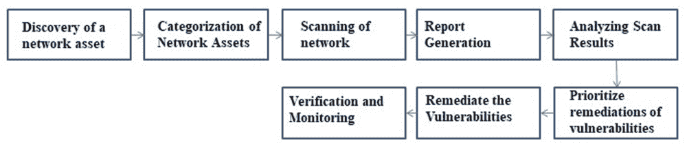 |
| --- |

## 漏洞扫描

这是在网络中寻找弱点的方法。可以使用各种扫描程序，包括 `Burp Suite`、`GFI Languard`、`Nexpose`、`Nessus`、`Nmap`、`OpenVAS`、`Advanced IP scanner` 等来完成。这些工具保护系统免受异常活动并识别网络问题。这是保护计算机网络的一种简单方法。今天，网络工具在网络安全中起着至关重要的作用。使用网络映射技术收集网络信息。端口扫描、操作系统识别和许多服务都包含在网络映射中。网络映射可以借助强大的 IP 扫描器 `Zenmap` 和 `Nmap` 来完成。`Nmap` 的 GUI 版本被称为 `Zenmap`。漏洞扫描的流程图在图 2 所示。

| 图 2. 漏洞扫描过程 |
| --- |
| 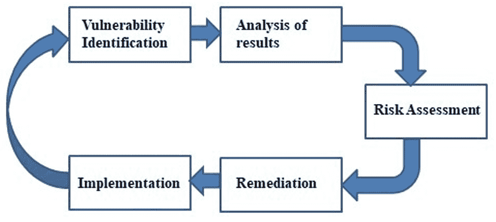 |
| --- |

图 2 的解释是：

- 扫描器识别有关开放端口、软件资产和设备的信息。还将收集到的数据与已知漏洞相关起来，这些漏洞可以从数据库中获取。
- 扫描结果通常以 `pdf` 形式提供给安全团队进行研究。它还包含了误报信息，这些信息不需要任何修复，但了解它们是有益的。
- 风险评估根据严重程度对漏洞进行排序，以便在合理的范围内进行修复。然后，对检测出的网络漏洞使用不同的算法进行修复。

剩余的工作结构如下：第 2 节解释了用于检测任何网络漏洞的最新趋势和工具。人员之前进行的相关研究及其结果涵盖在第 3 和第 4 节。第 5 节详细阐述了建议的方法论。第 6 节描述了讨论。最后，第 8 和第 9 节总结了文章并强调了该领域的未来范围和结论。

## 漏洞扫描的趋势和工具

扫描工具是旨在发现网络缺陷并保护系统免受异常活动的程序。这是保护计算机网络的一种简单方法。今天，网络工具在网络安全中起着重要作用。需要网络映射工具来收集网络信息，包括端口扫描、操作系统识别和多种服务。`Nmap`、`Zenmap` 和 `advance IP scanner` 都是用于网络映射的工具。`Zenmap` 只是 `Nmap` 的 GUI（图形用户界面）。

### Advanced IP Scanner

它具有直观的 UI，是一种快速高效的网络扫描器。它可以快速识别连接到有线或无线本地网络的机器并扫描其端口。该应用程序提供了对网络资源的简单访问，包括共享文件夹、`HTTP`、`FTP` 和 `HTTPS`。`advanced ip scanner` 的扫描报告见图 3。

| 图 3. Advanced IP scanner |
| --- |
| 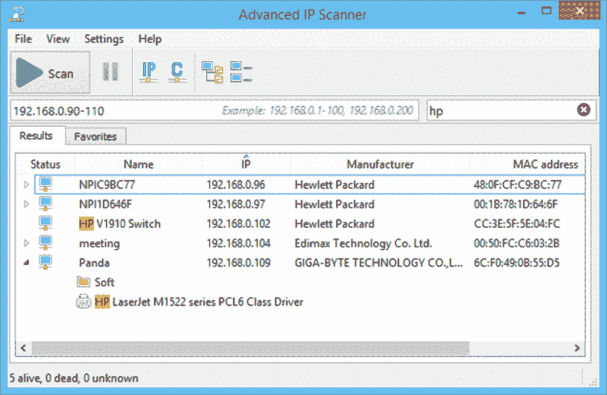 |
| --- |

### Nmap

通过发送数据包并检查响应，名为 `Nmap`（网络映射）的网络扫描器可用于定位主机并发现运行在计算机网络上的服务(Lyon, 2014)。它为探索网络提供了多种功能，如主机发现、操作系统检测。提供复杂的服务发现、漏洞检测和许多其他功能的脚本可用于扩展这些属性。`Nmap` 能够适应扫描过程中变化的网络状况（如延迟和拥塞）。`Nmap` 的最重要的功能见图 4。

| 图 4. Nmap 的重要功能 |
| --- |
| 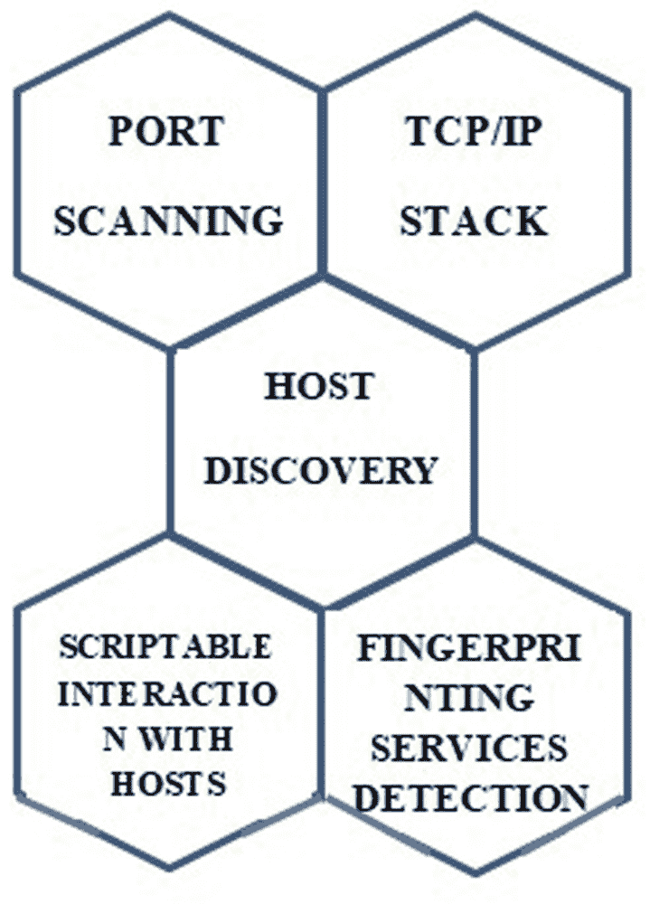 |
| --- |


`Nessus` 是用于渗透测试、恶意攻击和漏洞评估的众多漏洞扫描器之一。在扫描过程中，`Nessus` 使用插件对每个网络主机运行扫描并跟踪漏洞。当扫描开始时，它会执行一系列操作。扫描期间使用的步骤总结在图 5 所示。

| 图 5. Nessus 中的扫描步骤 |
| --- |
| 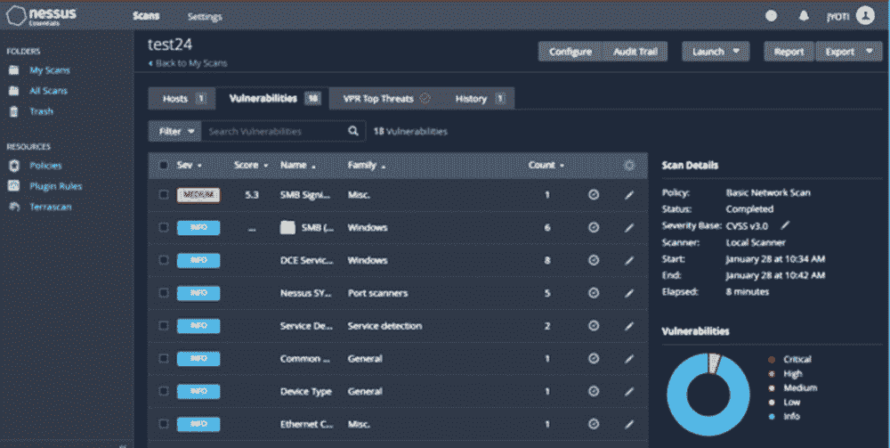 |
| --- |

`Nessus` 在启动扫描时会遵循一系列阶段。

*   第 1 步：`Nessus` 将检索扫描设置，并根据设置确定要检查哪些端口。
*   第 2 步：为了找出哪些主机在线，随后随后执行主机发现。主机发现过程将使用以下协议：`TCP`、`ICMP`、`ARP` 和 `UDP`。这些可以根据个人喜好指定。
*   第 3 步：之后，对它遇到的每个单个主机的端口进行完整扫描。人们也可以定义想要扫描哪些端口。
*   第 4 步：下一步是服务检测，它识别主机遇到的每个端口后面活跃的服务。
*   第 5 步：随后，它会检测网络上运行的是哪种操作系统。
*   第 6 步：一旦完成每个步骤，`Nessus` 将根据已知漏洞列表对每个主机进行检查，以确定哪些主机存在漏洞。

完整漏洞扫描的示例在图 6 所示。

| 图 6. 完整漏洞扫描示例 |
| --- |
| 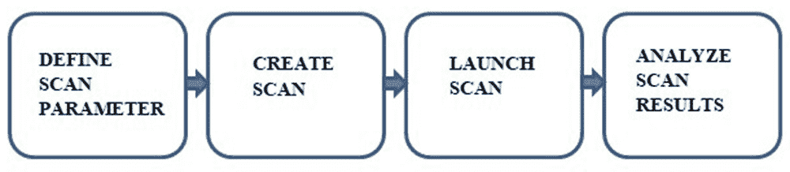 |
| --- |

下表列出了不同的漏洞扫描工具、静态代码分析工具和动态代码分析工具，并列带了关于它们的优点、缺点以及是否是开源或授权的信息。

表 1. 此表展示了一个经过精心策划的汇编，涵盖了各种复杂的扫描工具

| 扫描工具 | 类型 | 优点 | 缺点 | 开源/授权 |
| --- | --- | --- | --- | --- |
| `Nessus` | 漏洞扫描器 | 具有强大报告能力的全面扫描工具 | 它是一项全面的工具，但试用版功能有限 | 授权 |
| `Nexpose` | 漏洞扫描器 | 对漏洞和网络覆盖范围广泛的准确扫描工具 | 它是一个商业工具 | 授权 |
| `Acunetix` | 动态代码分析 | 该工具易于使用，且该检测工具的准确性很高 | 它是一个商业工具，其试用包提供的功能有限 | 授权 |
| `Burp Suite` | 动态代码分析 | 它是一个强大的漏洞扫描器，具有测试交互的交互式能力 | 它是一个商业工具，其试用包提供的功能有限 | 授权 |
| `OWASP ZAP` | 动态代码分析 | 该工具易于使用，且该检测工具的准确性很高 | 它是一个商业工具，其试用包提供的功能有限 | 授权 |
| `OpenVAS` | 漏洞扫描器 | 具有强大报告能力的全面扫描工具 | 授权 |
| `SonarQube` | 静态代码分析 | 该工具易于使用，且该检测工具的准确性很高 | 它是一个商业工具，其试用包提供的功能有限 | 授权 |

相关工作

随着漏洞的增加，研究人员对 `Stiffler` 和 `1981` 的水平产生了极大兴趣(Stiffler, 1981)）。网络中最重要的漏洞是 `CVE`（常见漏洞与披露）。然而，即使提供了修复，由于资源短缺也无法快速实施。为了解决这个问题，`Marco Angelini et al.` (Angelini et al., 2019) 讨论了 `VULNUS`（漏洞评估），它动态评估网络中存在的漏洞，并根据漏洞对节点进行分类。此外，他们从优点、缺点和解决方案三个角度检查了有向图模型。`Shiman Yang et al.` (Yang et al., 2019) 提出了一种检测模型，该模型利用准破坏性资产结合 `CNVD` 和 `CVE` 分析和检查各种组件，以引入漏洞并生成资产威胁列表。为了发现利用实时网络攻击路径的总时间，研究人员创建了一个实时网络，该网络优先考虑攻击路径 (Chhillar and Shrivastava, 2021)。他们通过检查扫描结果识别出最脆弱的主机，并根据这些发现做出了优先级和修复的决策。

随着漏洞自动化的发展，`Wenhao He et. al` 和 `Drew Malzahn et. al` 启动了一个风险分析程序 (He et al., 2019) (Malzahn et al., 2020)，该程序遵循特定的攻击路径来发现漏洞，并确认攻击者是否可以访问路径。此外，他们从三个角度检查了有向图模型。同时，在线漏洞查找领域也进行了一些工作，使用 `MulVAL` 根据不同的漏洞构建攻击图 (Alnafrani and Wijesekera, 2022)，并利用可靠数据集为各种用户提供每个组件的当前风险和漏洞。目前漏洞发现模型的研究表明，应用程序的漏洞可能与独特特征有关。


然而，Bolun Wu 和 Futai Zou (Wu et al., 2022) 对背景以及寻找代码漏洞的几种早期技术进行了详尽解释。他们根据基于序列和基于图的技术对近期工作进行了分类，显式地审查并比较了各种检测框架和策略，并指出虽然基于图的模型利用了代码复杂的结构细节，但基于序列的方法可以捕捉广泛的语义特征。研究人员还探索了代码编码、代码嵌入技术、模型选择、细粒度漏洞识别以及数据集的问题。该模型还进行了扩展，使其能够对网络环境的变化迅速做出反应。同时，研究人员基于两个攻击图展示了方法论的对比，并执行了 `CVSS` 指标 (Wang et al., 2020)。实验模拟结果表明，所提方法的准确性等同于基于 `BAG` 的方法，但计算复杂度更，并且比 `CVSS` 方法或 `AssetRank` 能更准确地估计特定网络中的易感性风险。

(Alperin et al., 2020) 可视化与分析的结合也被创建出来，以提供更易理解的视觉编码作为评估漏洞的决策工具；通过使用嵌入了 `SonarQube`、`ZAP-API` 和 `Jenkins` 工具等不同技术的解释性人工智能工具包分析每个漏洞的单独得分，也考虑了创建数据集的问题。一些研究人员还针对 `IAST` 技术（交互式应用程序安全测试）用于安全测试以及为政府软件项目建立基于网站的漏洞分析方法(Setiawan et al., 2020)。

“修复一个具有高 `CVSS` 得分的漏洞 (Shi et al., 2022) (Mell et al., 2006) 等同于随机选择一个漏洞进行修复，”该陈述道。这并不是对漏洞的准确描述。`CVSS` 设计用于衡量漏洞严重性，不应孤立地用于风险(Allodi and Massacci, 2014)。现有的基于机器学习和深度学习的技术通过计算漏洞属性与实际漏洞利用之间的关系来评估风险(Jacobs et al., 2020)。提出了一种名为 `LICALITY` 的新方法 (Zeng et al., 2021)，该方法根据威胁建模技术捕捉基于偏好利用漏洞进行攻击的攻击者，并尝试学习有助于漏洞勒索的威胁值，因为风险的近似取决于所使用的数据集、深度学习和机器学习技术。

针对几种基于 `ML` 的漏洞测试方法在现实情况中经常遇到的冷启动问题，已提出了一种解决方案(Lin et al., 2021)。正如许多较为人知的开源项目所示，冷启动问题专门与软件项目开发早期阶段缺乏甚至缺乏真值（ground truth）漏洞数据的问题有关。

利用深度学习算法的表示学习能力，Guanjun Lin 及其同事开发了一种方法，从合适的敏感数据源中自动提取指示易感模式的高级表示(Lin et al., 2021)。为了管理多种类型和格式的数据，他们开发了一个 `Bi-LSTM` 网络，并产生了统一表示，这有助于识别数据集上的潜在易感函数。这有助于弥合了跨领域数据源之间的差距。实证研究表明，从易感数据源中找到的信息可以帮助开发检测实际代码漏洞的算法。结果还显示，在缺乏标记数据的情况下，所提方法在使用测试软件项目时仍优于基准工具 `Flawfinder`。

带有神经网络 (`NN`) 和概率逻辑 (`PLP`) 编程方法的神经符号模型已被用于理解此类威胁的特征 (Zeng et al., 2021)。近期深度学习应用在语音识别和机器翻译方面的突破展示了神经网络理解语言的巨大潜力，这促使学者在网络安全和软件开发领域利用深度学习让网络学习并理解易感代码的模式和语义(Lin et al., 2020)。Fang Wu 使用深度学习技术识别差距，发布了三种深度学习模型：卷积神经网络 (`CNN`)、短期记忆网络 (`LSTM`) 以及卷积神经网络-短期记忆网络 (`CNN-LSTM`)。他从 9872 个二进制文件中收集动态信息，并训练多个深度学习模型来发现漏洞，以评估该方法的有效性。与传统的 `MLP`（多层感知机）技术相比，这种方法要优得多。

为了检查图像识别模型的缺陷，Yan 等引入了 DNN 安全评估系统 `SecureAS`。与现有的攻击防御平台相比，`SecureAS` 以黑盒方式在本地和远程评估 `DNN` 漏洞。`MAS` 指标用于量化评估安全风险，是 `SecureAS` 的基础。


Wentao Wang 等人 (Wang et al., 2022) 为了解决该问题，通过关注漏洞之间的相互依赖关系，而不仅仅是各种安全标准之间的依赖关系，增强了漏洞的发现。为了发现需求依赖，该团队提出了一种整合了水平和垂直追溯的半自动方法。随后展示了在安全测试中利用这些依赖关系来发现漏洞。与基准技术相比，该策略将召回率大幅提升了 81%。安全需求之间的依赖还可能导致额外的风险(Wang et al., 2022)。通过对 Scholar@UC 的案例研究，还发现了四个此前未被发现的漏洞，提升了 Samvera Hyrax 社区的整体安全性。

鉴于网络犯罪和漏洞相关事件呈现上升趋势，有效的漏洞管理至关重要。为此，研究者提出了一种统计框架 (Tang et al., 2019)，在该框架中对波动聚集的存在以及 `GARCH` 模型进行了深入的检查和测试。世刚（Shigang Liu）等人 (Liu et al., 2020) 提出了一种检测 IoT 设备软件漏洞的深度学习方法而非源代码。他是利用深度学习发现二进制机器码中缺陷的先驱之一。他们构建了一个二进制指令注意力模型，并使用 `IDA Pro` 来学习高层特征表示。然后，以高层表示为基础开发了预测模型。在基于实际 IoT 项目的实验中进行了观察。实验结果表明，所提方法优于基准方法，说明该方法对于现实世界的安全问题有效且具有适应性。宇哲（Zhe Yu）等人 (Yu et al., 2021) 提出了一种基于 `HARMLESS` 的预测框架，该框架专注于降低召回成本并有效纠正人为错误，以降低软件安全风险。

### 表 2. 相关工作

| 作者 | 年份与数据集 | 方法论 | 性能 |
| :--- | :--- | :--- | :--- |
| Shiman Yang 等 | (2019) 非破坏性资产画像分析及其开放服务通信协议 | 搜索引擎分段匹配方法 | 基于风险评估模型的游戏攻击图，并通过对比漏洞 `CNVD` 和 `CVE`（常见漏洞披露）发现基于规则的攻击网络信息。 |
| Wenhao He 等 | (2019) 节点网络级数据和系统级数据 | 漏洞利用过程、有向图模型和安全矩阵 | 以摘要形式执行有向图模型并对其漏洞进行分类。 |
| Drew Malzahn 等 | (2020) 主机和网络信息 | 用于自动漏洞检测和风险分析的 `AVRA` 工具 | 自动漏洞和风险分析并并端到端过程生成攻击图。 |
| Rami Alnafrani 等 | (2022) IoT 设备和小设备的组件 | `SUS`（系统可用性表）、`MULVAL` 和自定义 `OVF` 工具 | 该模型通过利用公开的漏洞强调了自动化框架。 |
| Mengyuan Zhang 等 | (2019) 9 个特征子集 | 7 特征选择方法和机器学习模型 | 对各种应用程序与缺陷之间关系的大规模实证研究。 |
| Kenneth B. Alperin 等 | (2020) 多尺度数据集 | 基于 AI 和 ML 的漏洞评估 | 检测了多级漏洞的 `CVSS` 评分特征。 |
| Bolun Wu 和 Futai Zou | (2020) 源代码到仓库 | 基于深度学习的图模型方法 | 代码漏洞检测 |
| Wenrui Wang 等 | (2020) 网络和设备漏洞异构信息 (CERT) | 用于漏洞风险评分的 `CVSS` Metric | 创建了基于异构信息的漏洞风险模型 |
| Herman Setiawan 等 | (2020) 源代码到仓库 | 基于 `IAST` 的方法，使用了 `ZAP` 和 `SonarQube` 进行安全测试 | 识别了 249 个漏洞风险 |

### 相关工作成果

本节强调了在识别和处理网络系统漏洞方面的众多研究发现和建议。每项研究的结果和贡献如下：

*   `VULNUS`：为了寻找最佳序列，Marco Angelini 及其同事创建了 `VULNUS`，这是一个评估漏洞、对节点分类并模拟补补漏洞影响的系统。
*   `基于攻击图的检测模型`：Shiman Yang 等提出了一种评估系统和组件、对比漏洞数据源并优化以发现最有效攻击路径的模型。
*   `受影响主机和信息的识别`：Kismat Chillar 等根据扫描结果，利用扫描技术识别受影响主机并确定修复优先级。
*   `风险分析程序`：Wenhao He 等和 Drew Malzahn 等创建了一个程序，跟踪攻击路线、发现漏洞并计算预测的修复序列。此外，他们对安全指标进行了分类并检查了有向图模型。
*   `在线漏洞查找器`：研究人员使用 `MULVAL` 创建了基于漏洞的攻击图，并向用户展示每个组件最新的风险和漏洞。
*   `漏洞发现模型`：研究人员发现应用程序漏洞可能与某些特征有关。
*   `代码漏洞检测策略`：Bolun Wu 和 Futai Zou 研究了代码分析中的挑战并评估了代码漏洞检测策略。他们还对新的工作进行了分类。
*   `漏洞评估的可视化与分析`：研究人员利用可视化和分析开发了一种评估漏洞的工具，并考虑了数据集生成和单个漏洞的评分。
*   `交互式应用程序安全测试 (IAST)`：科学家研究了用于安全测试的 IAST，并为政府项目创建了漏洞分析方法。
*   `CVSS 评估与风险计算`：文章警告不要完全依赖 `CVSS` 评分，强调了使用机器学习和深度学习进行风险评估。
*   `LICALITY 方法`：利用威胁建模方法，`LICALITY` 收集攻击者利用漏洞的偏好，并使用深度学习和机器学习进行风险估计。
*   `深度学习漏洞检测`：研究人员从敏感数据源提取高层表示，并使用深度学习方法成功检测漏洞。
*   `神经符号模型与深度学习`：为了理解特征，引入了神经网络和概率逻辑编程的神经符号模型。
*   `图像识别模型漏洞检测`：研究人员开发了 `SecureAS`，这是一个使用 `MAS` 指数分析图像识别模型漏洞的系统。

### 提出的方法论


要设计检测模型，首要任务是让模型学习所有的历史数据集和合成数据集，其中训练阶段是第一步。之后，利用该训练好的模型，检测模型本身就可以区分哪些代码是有漏洞的，哪些不是。

检测模型分为两个不同的阶段：

* `Training phase`（训练阶段）
* `Detection phase`（检测阶段）

| 图 7. 阐述两个不同阶段的检测模型图 |
| --- |
| 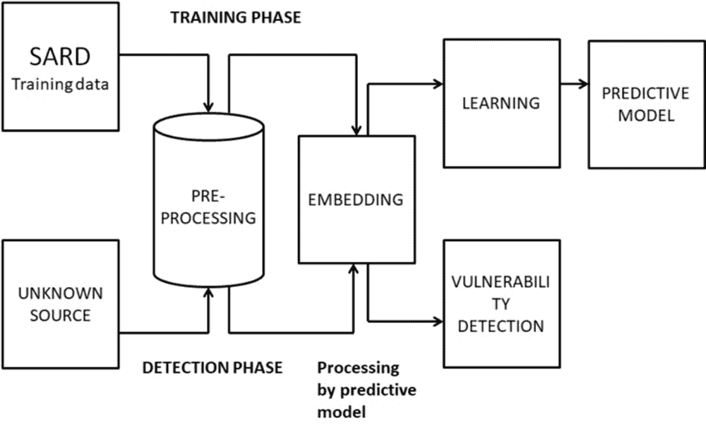 |
| --- |

训练阶段的设计使得检测模型能够学习不同的数据集，而相反，检测阶段使用该训练好的模型来寻找漏洞。如图 7 所示，两个阶段在源代码经过预处理后，对输入数据的嵌入使用相同的流程，且该活动包含一个名为“切片步骤”的程序，并带有选择切片标准的子任务。检测模型的步骤进一步解释如下：

* **预处理**：源代码在许多代码语句中存在缺陷。因此，没有必要审查整个代码来确定漏洞。漏洞发生的位置被一系列与数据和控制流连接的代码语句所包围，这些语句会被提取并检查。预处理活动的流程图如图 8，并有更详细的说明。预处理活动包括程序切片和标记化（Tokenization）。

* **程序切片**：它是一组程序语句，使用切片标准来简化程序，这些标准用于从源代码中移除漏洞。这是一种识别一组受程序目标点（准则）影响或作用的断言的方法。程序切片的根本目标是在保持程序含义完整的同时消除不必要的源代码。根据回溯的方向，程序切片还可以分为后向和正向两类（Weiser, 1984）。所有可能对切片标准产生影响并帮助开发者识别包含缺陷的代码块的程序都包含在后向切片中。正向切片预测将被修改的代码块，并包含受切片标准影响的程序语句。在漏洞识别方面，找到漏洞根源并识别受影响的代码块至关重要。

* **标记化**：这是将代码片段向量化的过程，必须将源代码分为标记单元。取决于嵌入时使用的技术，任务目标的符号图像（即减少变量或函数的变量范围）可能无法成功。因此，本研究中的符号表示任务是可选的。

* **嵌入**：在此过程中，可以生成向量表示并将其作为深度学习和神经模型的数据源。嵌入活动在图 9 中进行了解释。

| 图 8. 预处理活动：在切片源样本后，标记化已为嵌入向量就绪 |
| --- |
| 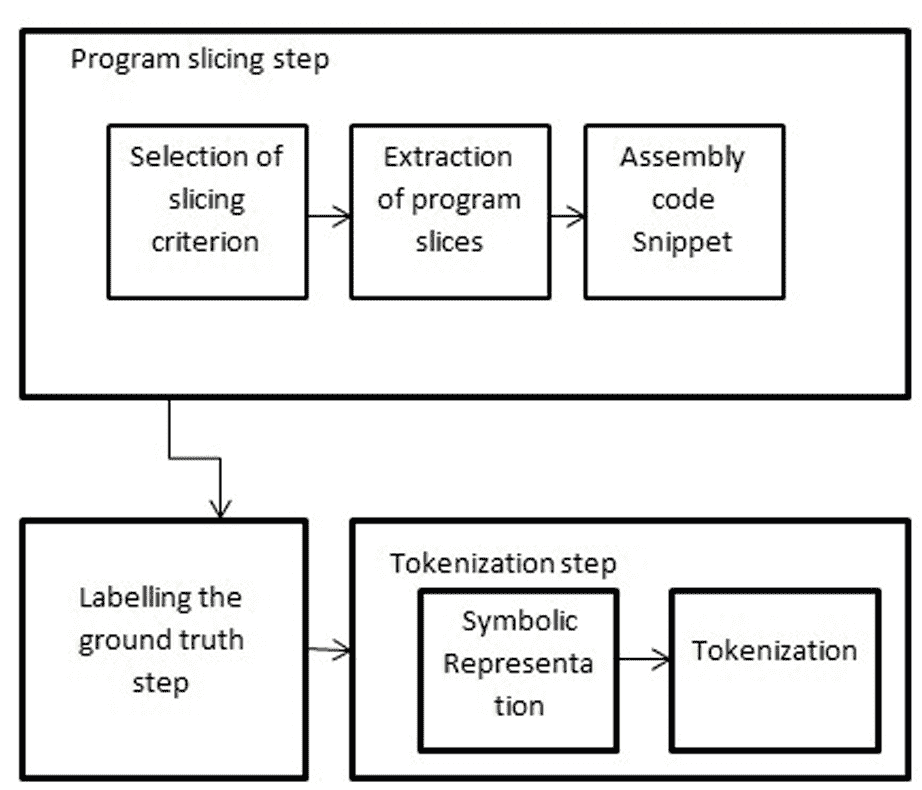 |
| --- |
| 图 9. 嵌入活动 |
| --- |
| 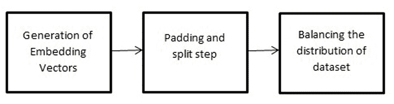 |
| --- |

总结来说，文中对所提工作与现有工作进行了快速比较，这说明了所提工作阐述了如何创建一个用于发现代码缺陷的检测模型。训练阶段和检测阶段是该模型的两个阶段。模型在训练阶段从不同的数据集中学习，并在检测阶段使用学习到的模型来寻找漏洞，而现有研究描述了在网络安全中分析和评估漏洞的许多方法和程序。它关注了研究人员和专业人士在尝试寻找漏洞、决定优先应用哪些修复程序以及降低风险时面临的困难。文中研究了许多方法论，包括漏洞可视化、攻击图分析、漏洞扫描、风险分析软件以及基于机器学习的解决方案。此外，该研究还集中于创建用于识别和分析漏洞的方法和工具。示例包括使用 `MulVAL` 构建攻击图、使用实时网络预测攻击路径，以及结合可视化和分析来评估漏洞，并研究了使用深度学习方法识别漏洞和分析威胁，包括表示学习和神经符号模型。

### 讨论

在当前场景下，大多数漏洞检测和评估模型正在使用搜索引擎分段匹配方法、带有安全矩阵的有向图模型以及用于自动化漏洞的 `AVRA` 工具。对于安全测试，使用了 `ZAP` 和带有 IAST 方法的 `SONQube`。对于风险评分，使用了 `CVSS` 技术。但随着时间的推移，增强网络安全变得日益具有挑战性，结合人工智能是目前的最佳解决方案。此外，发布漏洞补丁是另一种解决方案，这将使网络更加通用且无缺陷。自动化检测模型是最有效的方法。

### 挑战与未来方向

通过使用训练数据集研究各种漏洞模式，DL 方法旨在识别目标软件中未发现的漏洞。大多数 DL 方法的三个步骤是数据收集、模型构建和评估。首先收集数据，然后根据设计目标和可用资源选择合适的模型。训练数据的预处理考虑了所选模型的格式。随后对未测试实例进行分析，以衡量模型的效性。

### 现有数据集

需要一组注释代码，将其标记为中性或漏洞，以便训练漏洞预测模型。模型应该能够从大量的漏洞代码中学习。对于 DL 方法，研究人员从多种数据源中提取数据（参见图 10）（Chakraborty et al., 2021）。

| 图 10. 各种 DL 数据集及其真实/合成状态。数据集的真实程度通过颜色表示。绿色是最真实的颜色，而红色是最人工的 |
| --- |
| 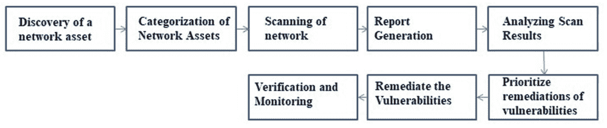 |
| --- |

### 合成数据

使用了注释样本和漏洞代码示例。这些数据集包括 `SARD` (Black, 2018) 和 `SATE IV Juliet` (Okun et al., 2013)。在这种情况下，实例是通过融合已知的缺陷构建的。这些数据集最初旨在基于静态分析和动态评估预测漏洞算法。

#### 半合成数据


在这种情况下，要么序列样本要么解释是人工得出的。Russell 等人（Russell et al., 2018）建议使用 Draper 数据集，该数据集包含了从开源收集的函数，但使用静态校准进行了验证。尽管比合成样本更复杂，但来自国家漏洞数据库（Booth et al., 2013）和 SARD 数据集（Black, 2018）的样本是从生产代码创建的，然而，它们通常会被修改以将漏洞从其原始上下文中分离出来。由于它们被分离和简化，这表明这些数据集无法准确反映现实世界中漏洞的复杂性。

### 真实数据

在这里，漏洞标注和源码样本均来自可靠来源。例如，Devign 数据集包含了来自不同开源项目的先前的缺陷，其中两个可以公开访问（Zhou et al., 2019）。尽管已评审的研究建议使用各种特征集类型和多样化的网络拓扑结构来弥补语义差距，但仍有很长的路要走。在本节中，我们将讨论困难和即将面临的任务，并提供一些思考。

## 大规模真实数据集

阻碍该领域进展的主要障碍是数据集。目前，所有建议的基于神经网络的漏洞检测方法都在各自的数据集上进行了测试。由于不同的技术旨在不同的检测粒度，早期调查创建的真值数据集包含了不同层级的标注（例如，指定在函数级或代码行级）（Li et al., 2019）。当前研究中使用的数据要么是人工合成的，要么是从真实系统中收集的。建立一个标准的基准数据集对于评估和比较所提方案的有效性至关重要。许多数据源提供合成漏洞样本。软件保证指标和工具评估（SAMATE）项目由美国国家标准技术研究院（NIST）创建，用于评估保证软件质量自动化方法。用于评估静态分析工具的静态分析工具展览（SATE）数据集是 SAMATE 项目的数据集之一。其他数据集包括 Juliet Test Suite、SARD、由情报高级研究计划活动（IARPA）发的不确定来源的新可执行软件接收（STONESOUP）项目以及静态分析工具展览（SARD）。

## 代码与神经学习分析

经过仔细分析发现，网络模型变得越来越复杂且富有表现力，以便更好地理解弱代码片段的语义。变化的网络结构展示了在探索神经网络理解代码语义和丰富关联以提高性能方面所付出的努力。

## 带有语义保留的神经模型

使用编程语言来弥补语义差距。


机器学习（ML）学科正在迅速扩张，机器学习和深度学习领域取得的重大进展将成为漏洞识别领域武器库的宝贵补充。为了弥补解释器与理解漏洞以及神经网络模型可以学习的所得语义之间的差距，我们回顾了现有的将神经网络用于漏洞检测和识别的研究。这些研究展示了神经网络结构被采纳以实现更好学习效果的趋势，并发现了漏洞代码段的特征。由于神经网络模型的表示学习能力和其自适应结构，将鼓励更多研究人员投入这一前景广阔的主题，这种结构为复杂易感代码模式的自动学习提供了迷人的潜力。

## 未来研究与方向

通过对各种论文的研究，我们发现漏洞分析和检测仍处于婴儿阶段。为了推进漏洞检测的发展，我们正在设计一种硬件并致力于模型，以获得准确的检测和分析结果。

## 结论

本研究探讨了当前机器学习和深度学习在漏洞识别方面的研究，并强调了该领域的各个支柱。通过为基于深度学习的漏洞识别引入新概念和方法，这些支柱提供了创新。为了给研究人员提供这一发展中主题的有序概述，我们对相关的研究论文进行了分类。基于各种方法论和可能的未来研究路径，本研究提供了关于漏洞检测成就和研究趋势的知识。我们对以往研究工作的主要发现是，利用深度学习技术进行软件漏洞分析和检测仍处于婴儿阶段。随着数据驱动方法的快速发展，机器学习和深度学习的重大进展将不断提升漏洞识别的价值(Chakraborty et al., 2021)）。

## 致谢

感谢印度科学技术部在设备开发计划下为本研究工作提供资金。标题为“用于组织网络高级安全固的智能网络分析器兼补丁工具”的项目批准号为 `DST/TDT/DDP-30/2021`。

## 参考文献

- Allodi, L., & Massacci, F. (2014). 使用对照研究比较漏洞严重性和利用程序. [TISSEC]. ACM Transactions on Information and System Security, 17(1), 1–20. doi:[10.1145/2630069](https://doi.org/10.1145/2630069)
- Alnafrani, R., & Wijesekera, D. (2022). 使用已知安全威胁生成攻击图的自动化框架. In 2022 10th International Symposium on Digital Forensics and Security (ISDFS), pages 1–6. doi:[10.1109/ISDFS55398.2022.9800833](https://doi.org/10.1109/ISDFS55398.2022.9800833)
- AlperinK. B.WollaberA. B.GomezS. R. (2020). 使用焦点和上下文可视化提高网络网络漏洞评估的可解释性. In 2020 IEEE Symposium on Visualization for Cyber Security (VizSec), (pp. 30–39). IEEE. doi:[10.1109/VizSec51108.2020.00011](https://doi.org/10.1109/VizSec51108.2020.00011)
- Angelini, M., Blasilli, G., Catarci, T., Lenti, S., & Santucci, G. (2019). Vulnus: 用于网络安全的视觉化漏洞分析. IEEE Transactions on Visualization and Computer Graphics, 25(1), 183–192. doi:[10.1109/TVCG.2018.2865028](https://doi.org/10.1109/TVCG.2018.2865028)
- Black, P. E. (2018). 软件保证参考数据集：具有已知漏洞的数千个程序. Journal of Research of the National Institute of Standards and Technology, 123, 1. doi:[10.6028/jres.123.005](https://doi.org/10.6028/jres.123.005)
- Booth, H., Rike, D., & Witte, G. A. (2013). 国家漏洞数据库 (nvd). 概述.
- Chakraborty, S., Krishna, R., Ding, Y., & Ray, B. (2021). 基于深度学习的漏洞检测：我们到达目的地了吗. IEEE Transactions on Software Engineering.
- Chhillar, K., & Shrivastava, S. (2021). 大学计算机网络的漏洞扫描与管理. In 2021 10th International Conference on Internet of Everything, Microwave Engineering, Communication and Networks (IEMECON), (pp. 01–06). IEEE. doi:[10.1109/IEMECON53809.2021.9689207](https://doi.org/10.1109/IEMECON53809.2021.9689207)
- Chu, Y., Yue, X., Wang, Q., & Wang, Z. (2020). Secureas: 基于对抗样本的深度神经网络漏洞评估系统. IEEE Access : Practical Innovations, 8, 109156–109167. doi:[10.1109/ACCESS.2020.300173](https://doi.org/10.1109/ACCESS.2020.300173)
- He, W., Li, H., & Li, J. (2019). 基于定向模型的未知漏洞评估. IEEE Access : Practical Innovations, 7, 16821–16825. doi:[10.1109/ACCESS.2019.295409](https://doi.org/10.1109/ACCESS.2019.295409)
- Jacobs, J., Romanosky, S., Adjer, I., & Baker, W. (2020). 通过漏洞预测改进漏洞修复. Journal of Cybersecurity, 6(1), tyaa015. doi:[10.1093/cybsec/tyaa15](https://doi.org/10.1093/cybsec/tyaa15)
- Li, Z., Zou, D., Tang, J., Zhang, Z., Sun, M., & Jin, H. (2019). 基于深度学习的漏洞检测. IEEE Access : Practical Innovations, 7, 103184–103197. doi:[10.1109/ACCESS.2019.293078](https://doi.org/10.1109/ACCESS.2019.293078)
- Lin, G., Wen, S., Han, Q.-L., Zhang, J., & Xiang, Y. (2020a). 使用深度神经网络的漏洞检测: 综述. Proceedings of the IEEE, 108(10), 1825–1848. doi:[10.1109/JPROC.2020.299329](https://doi.org/10.1109/JPROC.2020.299329)
- Lin, G., Wen, S., Han, Q.-L., Zhang, J., & Xiang, Y. (2020b). 使用深度神经网络的漏洞检测: 综述. Proceedings of the IEEE, 108(10), 1825–1848. doi:[10.1109/JPROC.2020.299330](https://doi.org/10.1109/JPROC.2020.299330)
- Lin, G., Zhang, J., Luo, W., Pan, L., De Vel, O., Montague, P., & Xiang, Y. (2021). 通过多领域知识库发现软件漏洞. IEEE Transactions on Dependable and Secure Computing, 18(5), 2469–2485. doi:[10.1109/TDSC.2019.295408](https://doi.org/10.1109/TDSC.2019.295408)
- Liu, S., Dibaei, M., Tai, Y., Chen, C., Zhang, J., & Xiang, Y. (2020). 物联网二进制网络漏洞情报. IEEE Transactions on Industrial Informatics, 16(3), 2154–2163. doi:[10.1109/TII.2019.294200](https://doi.org/10.1109/TII.2019.294200)
- Lyon, G. (2014). Nmap 安全扫描. URL: [`nmap.org/`](http://nmap.org/)
- Malzahn, D., Birnbaum, Z., Wright-Hamor, C. (2020). 通过可执行攻击图进行自动化漏洞测试. In 2020 International Conference on Cyber Security and Protection of Digital Services (Cyber Security), (pp. 1–10). IEEE. doi:[10.1109/CyberSecurity49315.2020.913885](https://doi.org/10.1109/CyberSecurity49315.2020.913885)
- Mell, P., Scarfone, K., & Romanosky, S. (2006). 通用漏洞评分系统. IEEE Security and Privacy, 4(6), 85–89. doi:[10.1109/MSP.2006.145](https://doi.org/10.1109/MSP.2006.145)
- Okun, V., Delaitre, A., & Black, P. E. (2013). 静态分析工具展出 (sate) iv 报告. NIST Special Publication, 500, 297. doi:[10.6028/NIST.SP.500-297](https://doi.org/10.6028/NIST.SP.500-297)
- Russell, R., Kim, L., Hamilton, L., Lazovich, T., Harer, J., Ozdemir, O., Ellingwood, P., & McConley, M. (2018). 使用深度表示学习进行源代码中的自动漏洞检测. In 2018 17th IEEE international conference on machine learning and applications (ICMLA), pages 757–762. IEEE. doi:[10.1109/ICMLA.2018.00120](https://doi.org/10.1109/ICMLA.2018.00120)


Setiawan, H., Erlangga, L. E., & Baskoro, I. (2020). 使用交互式应用程序安全测试 (iast) 方法对政府 x 网站应用程序进行漏洞分析。见 2020 年第 3 届国际信息与通信技术会议 (ICOIACT), (pp. 471–475)。 IEEE.

Shi, F., Kai, S., Zheng, J., & Zhong, Y. (2022). 基于 Xlnet 的 cvss 指标值预测模型。Applied Sciences (Basel, Switzerland), 12(18), 8983. doi:[10.3390/app12188983](https://doi.org/10.3390/app12188983)

Stiffler, J. J. (1981). 计算机的脆弱性：故障可能是由于“非法”操作、硬件故障，或者是硬件与软件故障的组合，这些故障无法精确定位。IEEE Spectrum, 18(10), 44–45. doi:[10.1109/MSPEC.1981.6369634](https://doi.org/10.1109/MSPEC.1981.6369634)

Tang, M., Alazab, M., & Luo, Y. (2019). 网络安全的大数据：漏洞披露趋势与依赖关系。IEEE Transactions on Big Data, 5(3), 317–329. doi:[10.1109/TBDATA.2017.2723570](https://doi.org/10.1109/TBDATA.2017.2723570)

Wang, H., Ye, G., Tang, Z., Tan, S. H., Huang, S., Fang, D., Feng, Y., Bian, L., & Wang, Z. (2021). 结合图学习与自动数据收集用于代码漏洞检测。IEEE Transactions on Information Forensics and Security, 16, 1943–1958. doi:[10.1109/TIFS.2020.3044773](https://doi.org/10.1109/TIFS.2020.3044773)

Wang, W., Dumont, F., Niu, N., & Horton, G. (2022). 通过需求依赖性分析检测软件安全漏洞。IEEE Transactions on Software Engineering, 48(5), 1665–1675. doi:[10.1109/TSE.2020.3030745](https://doi.org/10.1109/TSE.2020.3030745)

Wang, W., Shi, F., Zhang, M., Xu, C., & Zheng, J. (2020). 基于异构信息网络的漏洞风险评估方法。IEEE Access : Practical Innovations, Open Solutions, 8, 148315–148330. doi:[10.1109/ACCESS.2020.3015551](https://doi.org/10.1109/ACCESS.2020.3015551)

Weiser, M. (1984). 程序切片。IEEE Transactions on Software Engineering, SE-10(4), 352–357. doi:[10.1109/TSE.1984.5010248](https://doi.org/10.1109/TSE.1984.5010248)

Wu, B., & Zou, F. (2022). 基于深度序列和图模型的代码漏洞检测：综述。Security and Communication Networks, 2022, 2022. doi:[10.1155/2022/1176898](https://doi.org/10.1155/2022/1176898)

Yang, S., Shi, Y., & Guo, F. (2019). 基于图的工业系统风险评估。见 2019 年第 5 届国际计算机与通信会议 (ICCC), 第 160–163 页。 doi:[10.1109/ICCC.2019.4705](https://doi.org/10.1109/ICCC.2019.4705)

Yu, Z., Theisen, C., Williams, L. (2021). 通过需求依赖性分析和深度学习改进漏洞检测。IEEE Transactions on Software Engineering, 47(11), 2401–2420. doi:[10.1109/TSE.2020.303075](https://doi.org/10.1109/TSE.2020.303075)

Zeng, Y., Yang, Z., Huang, D. (2021). 使用深度学习和神经网络进行漏洞检测。IEEE Transactions on Information Forensics and Security, 16, 1943–1958. doi:[10.1109/TIFS.2020.304477](https://doi.org/10.1109/TIFS.2020.304477)

## 摘要

网络攻击是 IT 领域的严重问题。根据调查，66%的企业经历过此类攻击。防御这些攻击非常困难。网络分析人员正通过 DBMS 研究攻击者的意图和目的。

## 引言

该存储的核心思想是创建一个数据库，以帮助社会更接近网络安全。通过开发转换为数据库的原型，赋予了数据库防御能力。

## 数据隐私与

数据隐私、安全及其保护是现代计算机时代的主要挑战。如果忽视了某些问题，收集用户信息对于网络攻击者来说变得容易。这种由于知识不足或对安全要求的忽视会招致网络攻击者。

与之相关的问题可以定义为：
- 在使用信息系统或网络系统时对数据的疏忽。
- 对安全政策和安全实践的无知导致信息服务的破坏。
- 在工作文化和开发过程中未执行政策和程序。
- 在社交网络上分发个人数据。

# 网络数据库的要素

数据库是相关数据的集合。网络数据库的背景是与特定主题（此处为网络犯罪）相关的网络数据的集合。这种数据可以是各种性质：犯罪数据、与特定应用程序或黑客相关的数据、以及受害者的数据。

该系统的制定和开发是为了管理收集到的信息。数据管理包括建立数据仓库结构，并为解释存储的数据提供机制。数据管理还包括针对系统崩溃、未经授权的访问和错误结果的技术策略。

它赋予终端用户探索和理解网络数据的权利。网络 DBMS 的基本目标是以适当的方式存储和提取信息。

技术上，网络 DBMS 是一种通过数据查询访问数据库的软件程序。这些查询本质上是信息检索，或者用于向数据库中插入新数据。


计算机科学领域存在多种不同的数据库管理系统应用程序，用于商业和个人数据库用途。这些应用程序中的每一个都有一个或多个独特特性，但在数据库管理系统（DBMS）的基础方面具有相似性，即信息存储、信息检索、信息事务、信息安全，以及在与各种类型和性质的前端程序使用时的易于访问。数据库应用系统的示例包括`ORACLE`、`MYSQL`、`SQL SERVER`、`POSTGRES SQL`、`NOSQL`、`MONGODB`等。

# 网络数据库的特征

在计算机中，在使用数据库方法之前，有一种原始的方法是编写自定义程序来访问存储在文件中的数据，这被称为传统的文件处理。在这种方法中，所需的文件由用户在应用程序编程期间在特定软件中定义并实现。另一方面，网络数据库提供了一个专门的存储库用于维护所有数据，这些数据被定义一次，并通过数据查询、数据事务以及相关的软件程序供许多用户访问。

网络数据库技术的主要特征有：
- 自探索属性
- 程序、数据与数据抽象之间的分离
- 提供信息的多个视图
- 数据共享
- 冗余控制
- 未授权访问限制
- 程序对象的不间断存储
- 使用健壮查询处理的结构化仓库和挖掘技术
- 数据备份和数据恢复机制
- 多个终端用户界面
- 数据之间关系的说明
- 通过规则和触发器允许接口和活动
- 缩短应用程序开发时间
- 灵性和最新信息的可用性

# 网络数据库的参与者

网络数据库本质上可能是巨大的。这类大型数据库包含许多用户。参与大型数据库中不同工作的不同用户被称为数据库的参与者。网络数据库的一些参与者如下所示:-

## 网络数据管理员

在数据库中，主要目的是数据库，次要目的是数据库相关的应用程序和软件。这些管理由网络数据管理员完成。这些人是被授权访问数据库的人，数据库根据需要使用监控和购买软件及硬件。在使用网络数据库系统时，出现安全漏洞和响应时间缓慢是由网络数据管理员负责（Ramez & Shamakant, 2019）（Abraham et al., 2006）。

## 网络数据库设计师

他们是被授权识别需要存储在数据库中的网络数据员。他们为网络数据的表示和存储选择重要的组织。在设计和开发网络数据库之前，由网络数据库设计师负责接触数据库的所有潜在终端用户以识别需求（Ramez & Shamakant, 2019）（Abraham et al., 2006）。

## 终端用户

他们是访问所设计数据库的人。这种访问与信息查询、信息更新和报告生成等有关。终端用户有几种类型，如下:-

1. **随机终端用户**：在需要信息时偶尔访问。
2. **初级或参数化用户**：他们的工作涉及使用标准查询和更新对数据库进行定期查询和更新。
3. **高级终端用户**：他们是工程师、分析师等终端用户，他们熟悉网络 DBMS 的功能，并将其实现在自己的应用程序中以满足其复杂的需求。
4. **独立终端用户**：他们是那些使用成品维护个人数据库的用户（Ramez & Shamakant, 2019）。

## 数据库系统架构

数据库系统架构取决于其执行的系统。特别分类为：

### 网络或客户端/服务器架构

在这种架构中，数据库存储在几台计算机上。功能是客户端/服务器。这也被称为客户端/服务器（Abraham et al., 2006）。

### 并行数据库架构

并行处理允许数据库加速。在这些重要模型中：
- **共享内存**：在这种架构中，所有处理器共享一个内存（Abraham et al., 2006）。
- **共享磁盘**：在这种架构中，所有处理器共享一组磁盘（Abraham et al., 2006）。
- **无共享**：在这种架构中，没有处理器共享公共内存或磁盘。
- **分层结构**：它是共享内存、共享磁盘和无共享的混合设计（Abraham et al., 2006）。

### 分布式数据库架构

在这种架构中，数据库存储在位于不同位置的几台计算机上。这些计算机之间的通信通过高速网络或电话线进行。这种架构不共享内存或磁盘。这导致了跨越多个数据库系统的分布式数据库系统（udemy)（geeksforgeeks)（tutorialspoints.com）。


## 引言

网络 DBMS 的操作组件可以分为三个功能，即用于简化和访问数据的 `Query Processor`、`Storage Manager` 以及 `Disk Storage`。由于磁盘存储对于这种架构至关重要，因为当前的数据库通常需要大量的存储空间。DBMS 负责将非过程化语言中的查询和更新转换为逻辑层面上组织的物理操作流。

# 数据模型

数据模型是一种用于描述数据库布局和组织结构的技术概念。它讨论了适用于数据库数据的各种数据类型、连接和限制。它提供了我们实现抽象所需的工具。有许多不同类型的数据模型，几乎所有模型都有一组基本操作，用于表示数据库的更新和检索。 (udemy) (geeksforgeeks) (tutorialspoints) (Abraham et al., 2006)。这些包括：

1. 高级或概念数据模型 – 解释用户识别数据背后的思想。
2. 低级或物理数据模型 – 解释系统内数据存储的原理。
3. 实体关系模型 – 一种高层概念数据模型，解释了实体、其属性及其之间的关系。
4. 关系数据模型 – 将数据库显示为关系的组。表中的每一行代表关系中一组相关的值，关系是一个带有值的表。
5. 层次结构模型 – 使用树形结构的数据表示模型。
6. 基于记录的数据模型 – 由用于表示数据的记录结构组成。
7. 对象数据模型 – 这些是面向对象的编程模型。程序空间扩展到包含对象管理和共享性。
8. 自描述数据模型 – 一种将数据描述与实际数据值相结合的数据模型。

# 实体关系图

使用实体关系图（也称为 ERD）开发数据库设计可以绘制出模式（Schemas），模式描述了特定主题或问题的整体数据库结构。更好的实体关系图可以改进数据库结构。实体、`Attribute` 和 `Relationship` 是 ER 图的三个基本组成部分。

## 实体

实体是现实世界中存在且必须保留数据的任何事物。实体可以是系统中关联的任何事物，包括人、地点、动作或物品。`Event`、`Location` 和 `Anything Tangible` 是可能存在的五类不同实体。

## 属性

属性由实体和属性共同组成。一个属性可能被多个实体共享，也可能是某一个特定实体的部分。

## 关系

关系同时显示了实体之间的连接以及它们相互之间的关系。

# 实例与模式

实例是在特定时间点在数据库中保存的数据集合。而模式（Schema）是赋予完整设计的名称。用于创建程序的编程语言将决定所使用的实例和模式。模式与程序变量声明之间是关联的。变量当前具有定义值。在给定时刻，模式实例和程序变量的值是相关的。

一个数据库系统可能包含几种不同类型的模式。这些模式描述了物理层面的设计，本质上是物理的；逻辑模式描述了逻辑层面的设计。数据库在视图层级还有许多额外的模式，被称为子模式（sub schemas），并解释了数据库的各种视图。(udemy) (geeksforgeeks) (tutorialspoints) (Abraham et al., 2006)。

# 数学建模

数学建模日益被认为是证据合成和网络安全教学的关键工具，特别是当来自早期研究系统性评估的考量信息不足以回答某些问题时。然而，由于证据合成专家与数学建模者之间对概念和术语缺乏共同的理解，系统性观察者和规则制定者在使用建模研究结果时可能会遇到困难。涵盖许多网络研究领域并解决各种网络犯罪的建模研究有通用的命名法用法。研究和其他计算机相关领域的专业人士通过对数学建模研究的表征、比较和使用的帮助，能够在数学建模研究中使用术语，这些术语对于网络领域的证据合成和知识转化具有特别重要的意义。数学模型是“代表变量及其相互关系，用以描述观测到的现象或预测未来事件的数学框架”。我们将数学建模研究描述为一种使用数学模型来回答关于网络犯罪特定疑虑的研究。数学模型的框架代表了攻击者、网络空间、受害者、犯罪、信息或软件、行为、物理系统以及外部因素（这些都是变量）之间的关联，最适用于涉及网络犯罪中证据合成和决策的建模研究。它们的相关性通常根据动机、目标、防火墙、服务提供商、基础设施、浏览器、技术、名称和年龄来定义，为了建立这些参数，数学建模者可以使用多种技术，包括使用理论值以及在 (Teegwende et al., 2018) 中提供的值。

在本章的所有模式、实体（变量）、方法和程序被妥开发之前，将不会使用任何这些模型策略。关系数据库理论的各种操作符将与证据组合的规则相关联。在模型完全开发后，对变量及其关系的解释将适用于任何模型。数据库将得到增强，并为使用该模型的研究社区做好准备。此外，各种表将与各种功能连接。

# 知识库方法

创建“知识库”时的关键关注点是如何描述网络攻击。目标是创建一个表示形式，精确地解释网络攻击及相关思想所包含的内容。此外，创建的网络攻击表示方法必须能够利用任何来源（包括互联网）的公开可用信息来描述此类攻击。

该表示方法必须能够：消除关于网络攻击方式各种理论中的歧义和矛盾；创建一个用于理解和预测未来攻击的多学科网络攻击理论；以及创建包含理论的网络攻击数据库。


在数据收集阶段，从各种在线和离线来源收集相关数据。这些数据以原始数据的格式存储在系统中。收集后的下一阶段是预处理方法，它有助于克服原始数据中的噪声信息。会进行一个提取过程。通过这种方式，可以将高维数据转换为低维数据。预处理后的数据对数据可视化非常有益，因为当复杂数据被转换为较少维度时，复合数据可以更好地组织。（Rupa et al., 2020）。

例如，以下是网络犯罪分类的基于内容的特征（Rupa et al., 2020）：

* 基于内容的特征
* 犯罪
* 网络犯罪分子/黑客
* 损害
* 年份
* 受害者

词频 (`TF`) – 单词在数据报告中的编写方式以及对其重要性的搜索。

逆文档频率 (`IDF`) – 区分常见和重复的词汇。

`TF` 和 `IDF` 中采取的主要步骤是句子的分词、评估 `TF`、评估 `IDF`、计算 `TF` & `IDF` 评分以及寻找阈值。

在句子分词时，单词被分词并分配了特定的权重。

### 评估 `TF`
记录每个词的词频 (`TF`)，并根据其在记录中出现的统计情况进行评估。然后将每个词的 `TF` 值以矩阵格式记录。


其中，`N[term]` = 词出现的次数，`T^(term)` = 记录中词的总数。`X²`

### 评估 `IDF` 并存储为矩阵格式


其中 `N` = 记录总数；`N[term]` = 记录中的词总数。通过考虑这两种频率的单独矩阵来估计 `TF` – `IDF` 评分。

`TF` – `IDF (term)` = `TF (term)` x `IDF (term)`

记录句子评分：考虑 `TF` – `IDF` 为属于记录的句子中的词汇分配评分。所有句子所有词的 `TF` – `IDF` 的平均值成为句子的评分。

寻找阈值：将记录中所有句子的平均分作为阈值。该值有助于发现数据中的相关术汇。

`(X²)` 测量用于发现数据中类别属性之间的相关性。它验证了两个变量之间的关系是否反映在网络犯罪数据集上。


其中 `O` = 网络犯罪事件的观测计数，`E` 是网络犯罪事件的预期计数（Rupa et al., 2020）。

## 数据解释

使用几种预定义方法对数据进行审查，且这些方法有助于为数据提供意义以得出与目标相关的结论，这被称为数据解释。该过程涉及获取数据分析的结果，对研究的关系进行推断，并将其用于相关的结论。

通常，任何数据解释的第一步都是对收集的数据进行组织、分类、操纵和总结的过程，以获得研究问题。这一过程需要妥善地完成。数据解释已被多种方法认可，并被归类为：

* 定性
* 定量

### A. 定性解释
这是一种类别解释。在本文中，数据通过采用各种技术收集的，例如:-

* 观察 – 详细阐述行为模式。
* 焦点 – 选择相关问题以产生协作讨论。
* 二次研究 – 根据材料对文档进行划分和编码。
* 访谈 – 用于收集叙述性数据的方法。

在数据收集过程之后，数据解释由定义方法之后，如:-

1. `内容分析` – 该方法用于识别图像、视频或音频中出现的频率和重复词汇、主题和概念。它将定性信息转换为定量，从而有助于发现趋势和结论，可能支持关键的研究查询。
2. `主题分析` – 这种方法是一种探索性技术，有助于分析定性数据以识别共同模式，并根据发现的相似性将其分为不同的组。例如，想象你想分析客户对你餐厅 ty 的看法。
3. `叙述分析` – 用于分析故事并发现它们背后的意义。这些可以以证言、案例研究和访谈等形式存在。这种方法是一种很有价值的技术，有助于理解偏好。
4. `话语分析` – 用于理解数据上下文如何影响语言的布局和理解方式。它是耗时的，因为数据需要一直分析直到没有新的感悟出现为止。
5. `扎根理论分析` – 该分析旨在通过仔细测试和评估可用数据来发现新理论。它有助于从数据中提取、得出结论并建立假设。

### B. 定量解释
这是一种数值数据类型的解释。这种类型的解释涉及统计建模，如:-

* `平均值` – 它代表一组数据的数值平均值。
* `标准差` – 它描述响应围绕平均值的分布情况。
* `频率分布` – 它衡量响应在数据集中的出现率。

在两个或多个显著变量之间的相关性分析用于衡量定量数据。解释数据的几种方法包括:-

1. `回归分析` – 利用历史数据来理解依赖变量与一个或多个独立因素之间的关系。
2. `队列分析` – 有助于识别在特定时期内共享共同特征的组。
3. `预测分析` – 这是一种预测方法，旨在通过分析历史和当前数据来预测未来的发展。
4. `规范性分析` – 这种方法使用图表、复杂的事件处理、神经网络等方法，在未来的行动发生之前解决并纠正其影响。
5. `联合分析` – 这种问调查式的分析用于检查消费者对各种产品特征的感知。
6. `聚类分析` – 使用这种方法用于将对象分组到类别。这种方法有助于发现数据中隐藏的趋势和模式。

## 理解网络威胁

理解数据、信息和情报之间的区别对于理解网络威胁至关重要。（NakHyun et al., 2017）。

1. `数据` – 具有原子性的单个项目。
2. `信息` - 经过处理的数据。
3. `情报` – 关于如何识别和防御网络攻击及威胁的的事实。

上面的定义根据 (NakHyun et al., 2017) 以网络威胁的形式表达为:-

4. `数据` – 可以从互联网或网络收集的信息：IP、域名、URL 和电子邮件等。
5. `信息` - 分发恶意代码的域名、用于钓鱼的 URL 和用于连接的 IP 地址。
6. `情报` - 详细说明网络事件或犯罪的深入分析输出。

因此，对这些统计数据、相关信息和情报，以构建一个有助于解释网络攻击如何以及为何变成威胁的存储库，为新的信息安全领域提供了支持。这项工作可能提供一个增强的理论和实践参考，有助于理解网络犯罪的模式、过程并在任何进一步尝试中克服它。

网络犯罪特征刻画


基于上述发现，本文实施了一种描述和建模网络危险的方法论。研究发现，目前没有一种现有方法在构建网络威胁数据模型时，能够完全满足网络威胁模型的所有规范。本文提出了一个表征网络威胁的框架，并基于现有的调查创建了数据模型。

# 网络数据仓库的设计与开发

通过对网络威胁要素的表征、其方法，并根据构建的威胁模型识别了实体及其属性。这为我们的数据建模提供了一条路径。这种数据建模进一步构成网络数据库模式的准备，并以创建网络威胁数据库模型告终。

在创建的数据库中利用索引技术来优化所设计的网络威胁数据库的性能。索引技术为无缝查询处理提供了帮助，有助于理解已发生攻击的评估并预测未来的。

## 威胁的潜在映射

表 1. 表征映射

| 数据模型对象 | 威胁表征分类 |
| --- | --- |
| 执行者 | 攻击者/类型 |
| 攻击者/投入度 | |
| 攻击者/资源 | |
| 攻击者 | 攻击者/动机（非敌对） |
| 攻击 / 交付机制 | |
| 攻击/工具 | |
| 攻击/自动化 | |
| 重大事件 | 攻击/行为 |
| 意图 | 攻击者/动机（敌对） |
| 影响 / 网络影响 | |
| 冲击力 | 影响 |
| 资源 | 资产/容器 |
| 资产/漏洞 | |
| 目标 | 资产/配置 |
| 受害者 | 遭受/损失 |

## 数据仓库准备技术

表 2. 仓库准备步骤

| 序号 | 步骤 | 步骤描述 |
| --- | --- | --- |
| 1 | 实体识别 | 确定主体的的功能、情况、设置和理念 |
| 2 | 属性识别 | 提供实体信息 |
| 3 | 寻找关系 | 寻找不同实体之间的连接 |
| 4 | 绘制 ERD | 遵循绘制实体关系图的指南 |
| 5 | 基于 ERD 准备模式 | 创建包含键识别的模式 |

为了更好地理解各种网络攻击类型并创建网络攻击数据模型，本文进行了基于对网络攻击观察的分析。研究对网络攻击理念的认可是关键一步。为了阐明这些网络犯罪概念，创建并利用了实体关系图来探索网络攻击的概念。收集的文献和从互联网获取的信息被用于识别实体并获得对网络犯罪的理解。

本研究具有探索性质，其目的是介绍和解决各种网络攻击的理论和方法。研究尝试将有关网络攻击的在线数据分类为实体、其特征及其联系。

在这项研究中，对手被定义为攻击者。攻击被识别为攻击者的交付方法。硬件、软件、网络系统、信息和管理的物理资产都被视为资产。受攻击影响的人或群体被称为受害者。

攻击者的对手可能使用网络空间，该空间可能受到其组织内部外部要素的影响。受受害者攻击的任何机构或个人资产可能是内在的或外在的。

## 参考图

实体关系模型可以表示为图，即 `G = {V, E}`。这被称为参考图。在这里，`V` 是实体集合，`E` 是关系集合。该参考图被描述为有向图。集合 `V` 还包含 `m: n` 关系。存在一个 `id` 键集，由所有系统集合的主键组成。表示集合 `V` 中实体或关系的集合包含两个子集——标识属性集 (`Keys`) `id` 和描述性属性集 `D` (Subhrajyoti & Bichitra, 2013)。

### 一元关系

它是一个与自身关联的实体。因此，在关系中指定贡献者的角色变得非常重要（Subhrajyoti & Bichitra, 2013）。示例：-

*   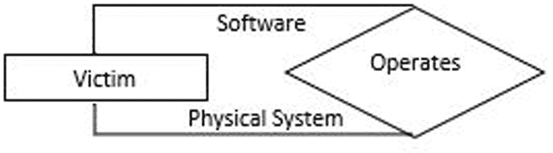

### 三元关系

下方所示具有三元关系的 ERD 及其对应的参考图（Subhrajyoti & Bichitra, 2013）：-

*   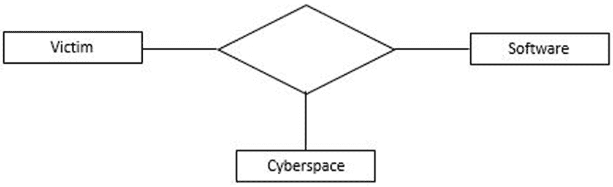

### 实体识别 (表 3)

表 3. 实体

| 序号 | 网络攻击定义 | 实体 |
| --- | --- | --- |
| 1 | 损害计算机系统功能的行为 | • 行为<br>• 攻击者<br>• 网络或系统 |
| 2 | 使用方法损害或破坏计算机系统 | • 行为<br>• 攻击者<br>• 受害者<br>• 网络或系统<br>• 信息和软件 |
| 3 | 为了干扰或破坏计算机系统以及个人或职业网络而的操作 | • 行为<br>• 攻击者<br>• 受害者<br>• 外在<br>• 物理<br>• 网络或系统<br>• 信息和软件 |
| 4 | 非法利用网络空间进行未经访问 | • 网络空间<br>• 网络或系统<br>• 信息和软件 |
| 5 | 使用攻击性技术手段破坏和削弱网络系统、资源及其功能 | • 行为<br>• 攻击者<br>• 受害者<br>• 网络空间 |
| 6 | 破坏网络系统、资产和功能的努力 | • 行为<br>• 网络或系统<br>• 信息和软件 |

### 属性识别 (表 4)

表 4. 属性

| 序号 | 网络攻击定义 | 属性 |
| --- | --- | --- |
| 1 | 损害计算机系统功能的行为 | • 类型<br>• 目标<br>• 持续时间 |
| 2 | 使用方法损害或破坏计算机系统 | • 软件名称<br>• 许可证类型<br>• 应用程序<br>• 类型<br>• 网络硬件 |
| 3 | 为了干扰或破坏计算机系统以及个人或职业网络而的操作 | • 软件名称<br>• 许可证类型<br>• 应用程序<br>• 成本 |
| 4 | 非法利用网络空间进行未经访问 | • 防火墙<br>• 服务供应商<br>• 基础设施<br>• 技术<br>• 浏览器 |
| 5 | 使用攻击性技术手段破坏和削弱网络系统、资源及其功能 | • 起源<br>• 类型<br>• 日期时间<br>• 类型<br>• 程度 |
| 6 | 破坏网络系统、资产和功能的努力 | • 软件名称<br>• 许可证类型<br>• 应用程序<br>• 类型<br>• 网络硬件<br>• 成本 |

### 实体与属性之间的关系 (表 5)

表 5. 关系

| 序号 | 网络攻击定义 | 关系 |
| --- | --- | --- |
| 1 | 损害计算机系统功能的行为 | 攻击者执行行为损害网络或系统 |
| 2 | 使用方法损害或破坏计算机系统 | 攻击者执行行为损害网络或系统<br>行为损害软件网络或系统信息和软件 |
| 3 | 为了干扰或破坏计算机系统以及个人或职业网络而的操作 | 攻击者执行行为损害网络或系统<br>行为损害信息和软件<br>行为损害物理系统<br>行为损害外在 |
| 4 | 非法利用网络空间进行未经访问 | 攻击者利用网络空间损害网络或系统<br>行为损害信息和软件 |
| 5 | 使用攻击性技术手段破坏和削弱网络系统、资源及其功能 | 攻击者执行行为<br>攻击者利用网络空间<br>行为损害网络或系统<br>行为损害信息和软件 |


# 6 || 攻击破坏网络系统、其资产和功能 || 攻击者执行操作

操作损害网络或系统 |

*   存储库示例架构（图 9）

| 图 9. 架构图 |
| --- |
| 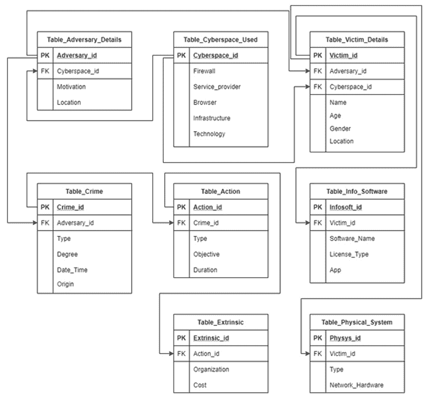 |
| --- |

## 查询处理

数据库模型中的查询处理帮助用户向数据库设计的表中插入数据，并根据所设计的数据库架构相应地获取任何所需的结果。在论文中，对数据模型进行了研究和设计，以为用户提供有关网络犯罪的不同问题的解答。

为了理解所设计的数据模型的探索性用途，取了以下示例：

*   `SELECT Adversary_Details.Location, Victim_Details.Name`
*   `FROM Adversary_Details INNER JOIN`
*   `Victim_Details ON Adversary_Details.Adversary_ID = Victim_Details.Adversary_ID`
*   `WHERE Victim_Details.Name = ‘Name'`

## 存储库实验机器配置

该存储库使用一组训练数据进行设计和测试，硬件为 Intel CORE 5 第 8 代 i5-8250 CPU @ 1.60 Ghz 1.80 Ghz，基于 X64 的处理器，配备 8 GB RAM，使用的数据库工具为 Microsoft SQL Server 2008 R2。

## 参考文献

Agana, M. A., & Inyiama, H. C. (2015). Cyber Crime Detection and Control Using the Cyber User Identification Model. IRACST – International Journal of Computer Science and Information Technology & Security(IJCSITS), 5(5).

Bordoloi, S., & Kalita, B. (2013). E-R Model to an Abstract Mathematical Model for Database Schema Using Reference Graph. International Journal of Engineering Research and Development, 6(4).

Boulahia-Cuppens, N., Cuppens, F., Gabillon, A., & Yazdanian, K. (1992). MultiView model for object-oriented database. Proceedings of 9th Annual Computer Security Applications Conference. Springer.

Ch, R., Gadekallu, T., Abidi M., & Al-Ahmari, A. (2020). Computational System to classify Cyber Crime Offences using Machine Learning. MPDI.

ChoiD.-L.KimB.-W.LeeY.-J.UmY.ChungM. (2011). Design and Creation of Dysarthric Speech Database for Development of QoLT Software Technology. 2011 International Conference on Speech Database and Assessments (Oriental COCOSDA). IEEE. doi:[10.1109/ICSDA.2011.6085978](https://doi.org/10.1109/ICSDA.2011.6085978)

Elmasri, R., & Navathe, S. B. (2019). Fundamentals of Database Systems (7th ed.). Pearson.

Griffin, M. P., & Mitchell, R. J. (1992). Regenerating Database Techniques for Real-time Creation and Maintenance of Very Large Scale Databases. IEEE Colloquium on Using Virtual Worlds. IEEE.

Hyeisum, S. L., Kim, B., & Lee, T. (2016). The Data Indexing for Cyber Threat Resources. IEEE Eighth International Conference on Ubiquitous and Future Networks (ICUFN). IEEE. doi:[10.1109/ICUFN.2016.7536960](https://doi.org/10.1109/ICUFN.2016.7536960)

JingS.LiuX.ChengC.ShangX. Q.XiongG. (2014). Study on a Process Safety Management System Design of a Chemical Accident Database. IEEE International Conference on Service Operations and Logistics, and Informatics. IEEE. doi:[10.1109/SOLI.2014.6960736](https://doi.org/10.1109/SOLI.2014.6960736)

Kadivar, M. (2015). Entity Relationship Diagram Approach to Defining Cyber Attacks [Thesis, Carleton University].

Kao-ming, B., & Geng-guo, C. (2009). Design the Database of Laboratory Management System. IEEE First International Conference on Information Science and Engineering. IEEE.

Kellette M. & Bernier, M. (2016). Cyber Threat Data Model high level model and use cases. Defence Research and Development Canada, Reference Document. Defense Canada.

Kim, N., Kim, B., Lee, S., Cho, H., & Park, J. (2017). Design of a Cyber Threat Intelligence Framework. International Journal of Innovation Research in Technology & Science (IJIRTS), 5(6).

KomarkovaJ.LastovickaM.HusakM.TovarnakD. (2018). CRUSOE: Data Model for Cyber Situational Awareness. International Conference on Availability, Reliability, and Security. ACM.

Ponniah, P. (2019). Data Warehousing Fundamentals for IT Professionals. Wiley.

Porgo, T. V., Norris, S. L., Salanti, L. (2019). Data Warehousing Fundamentals for IT Professionals. Wiley.

# 第 8 章

*   Kishore Kumar Sen
    Birla Institute of Technology, India
*   Abhishek Kumar
    Birla Institute of Technology, India
*   Kunal Sinha
    ![Orcid Imagehttps://orcid.org/0000-0002-2347-1791
    Artificial Computing, India

## 摘要

全球集成技术的兴起，随着社会、金融、政府和国防服务等多元化领域的发展，当今世界正在变为数据时代。这种存储和处理任务的科学发展通过技术创新侵犯了用户和个人的隐私。保持数据安全和合法是另一个方面。任何敏感数据可能被相关的终端用户或黑客利用来攻击所有者、其托管网络和相关用户。因此，应该防止敏感数据泄露导致被滥用。信息泄露可能是多种情况的结果——技术性的或非技术性的，例如包含敏感信息的 HTML 或脚本加密失败、配置不当以及在数字世界中共享重要信息时的疏忽。

## 引言

信息泄露是数据存储中的一种技术缺陷，敏感数据被真实世界的用户披露和收集，可能被用于获利或非法使用。这些数据可以是任何 Web 应用程序细节或用户特定数据。任何敏感数据可能被相关的终端用户或黑客利用来攻击所有者、其托管网络和相关用户。因此，应该防止敏感数据泄露导致被滥用。从历史上看，信息泄露（无论是在线还是线下世界）是一个长期存在的问题。以下是两个领域的泄露历史：

### 线下世界

在数字时代之前，信息泄露主要通过物理手段发生。这里是一些著名的例子：

### 间谍

历史上，政府和情报机构通过间谍活动进行信息泄露。间谍负责收集和披露机密信息以符合国家或组织的利益。

### 纸质泄露

信息泄露也会通过物理文件发生。例如披露机密文件的举报人、泄露的备录或遗留在公共场所的敏感信息。

### 社会工程

在线下情况下，社会工程技术被用于操纵个人并提取敏感信息。伪装、欺骗和诱惑等技术被用于未经授权访问机密数据。

### 在线世界


随着互联网和数字技术的出现，信息泄露已扩散到网络世界。以下是重要的步骤：

# 黑客攻击与数据泄露

攻击次数和数据泄露的增加引起了对在线信息泄露的关注。重大事件包括 21 世纪 00 年代的严重泄露，例如 2008 年的心地支付系统泄露和 2011 年的索尼 PlayStation 网络泄露。

## 警示平台
`WikiLeaks` 等平台已为人知，它们允许举报人匿名向公众泄露敏感文件和信息。这些平台已成为暴露企业或政府不当行为的渠道。

### 内部威胁
内部泄露已成为日益关注的问题，员工或内部人员故意或无意地泄露敏感数据。著名案例包括爱德华·斯密登在 2013 年泄露美国安全局（NSA）机密文件。（Isabel et al., 2022）

## 隐私与社交媒体关注
社交媒体平台的兴起带来了与信息泄露相关的新挑战。用户在无意中分享了个人信息，导致隐私问题以及个人数据被误用或滥用的风险。

# 隐私政策

世界各国已引入隐私监管法规以防止信息泄露。示例包括 2018 年实施的欧盟《通用数据保护条例》（`GDPR`）和 2020 年实施的加州消费者隐私法案（`CCPA`）。

## 云端与第三方风险
随着组织日益依赖云服务和第三方提供商，由于配置错误、数据泄露或安全实践不足导致的信息泄露风险日益增加。信息泄露的历史背景跨越数世纪，随着技术的发展从离线演变为在线环境。目前的挑战是开发稳健的安全和意识措施，以减少风险并保护这两个领域的敏感信息。

保护信息很重要，这需要特定的程序和行为活动。除了系统的任何安全方面，信息安全还需要对数据进行适当的创建、标记、存储和备份。其他用户使用的任何文件都应构成重大的安全保障工作。应该维护包含敏感信息识别在内的恰当风险评估。最后，应该考虑信息的保留和处置。每份数据或信息都有有限的生命周期，因此应该建立机制确保不再使用的数据得到妥善处置。

# 社会监控

现代技术和通信的出现增加了每个人获取信息的数量和速度。这种影响就像显微镜的发明，如果经过彻底分析，可以使不可见变为可见。它还像一面镜子，允许观察者放大并查看各种层级的信息。偶尔可能会丢失少量制品和数据点的原始性，但聚合结果是好的。

提到同一个主题，一个主要课题是社会监控，它指的是对从数字平台提取的个人数据进行收集和处理。通常通过现代数字技术实现对数据、元数据和内容的实时聚合、组织和分析。如今，全球各地的人使用这些数字平台与亲人交流、与朋友联系并表达任何性质的信念。即使是那些很少使用此类服务的个人，他们的信息也可能是可用的，可能会被收集和分析以获取价值信息。这些监控对于社会的不同阶层具有巨大的价值。另一方面，对于执法机构和情报部门来说可能也是福音。

## 保护数字隐私
人工智能及其相关技术的发展为自动化大规模监控开启了新的可能性。复杂的监控系统可以通过分析快速绘制用户关系图谱。使用自然语言处理为社交媒体帖子赋予含义。机器学习使系统能够搜索人类可能察觉的模式，而深度神经网络可以识别并建议一类全新的模式以便进一步调查。无论结论准确与否，对个人的结论都可能产生严重后果。

考虑到社会监控，技术是否比其他安全手段更有效存在争议。社交媒体活动如原创内容、点赞、分享、使用俚语或当地语言的演讲和视频很容易被误读。研究估计，自然语言处理工具的准确率大约在 70 到 80%之间。虽然这项技术在减少人为错误方面是合理的，但由于数据不准确或偏差，可能会导致种族歧视。产生的误报会将无辜的人加入政府监控名单，且往往在他们不知的情况下。

至少这种社会监控或社交媒体监控需要更多的关注。这些程序的实施应该是透明的，并且必须涉及执法机构与受影响社区之间的对话。应该进行民权监督。当工具被滥用时，当局应当负责，害者应得到适当对待。在线监控技术不应用于监控个人或团体对和平交流、抗议活动的规划和参与。政府需要更新现有的隐私法律以解决技术的恰当使用。（Senthil et al., 2015）

# 信息泄露类型

## 恶意内部人员
离开组织的失望员工或业务伙伴可能会试图窃取数据并泄露给竞争对手，或在黑市以巨额资金出售。

## 物理暴露
存有敏感内容的存储设备经常被员工忽略，导致数据面临风险。

## 电子通信
许多组织执行“自带设备”（BYOD）政策，并鼓励员工在工作时使用自己的设备。黑客利用这一点诱骗用户点击通用链接，从而获得对其设备和数据的访问。

## 意外泄露
数据泄露最常见的原因是人为因素。常见的失败包括员工将包含敏感信息的电子邮件发送给错误的收件人、安全策略薄弱（如对敏感文件的过度访问），以及由于未修补的软件漏洞导致敏感数据暴露。（Adwait et al., 2013）

# 针对性破解

数据泄露可能是无意失误的结果。如果未经授权的实体获得了计算机系统的访问；窃取并出售个人身份信息或组织敏感数据以筹款或造成伤害，就会发生实际损害。

网络犯罪分子倾向于一种基本模式，即要么针对组织进行数据泄露，要么针对个人以获取非法利益，这都需要进行规划。


## 安全威胁

**弱凭据**。绝大多数数据泄露都是由于被盗或弱小的凭据导致的。如果网络犯罪分子拥有用户名和密码组合，那么网络大门就对他们敞开了。这是因为大多数人在不同的地方重复使用自己的密码。网络犯罪分子经常使用技术性严厉的攻击来获取电子邮件、网站、银行账户以及其他个人身份信息（PII）和财务信息的控制权。

**被盗的凭据**。由钓鱼攻击引起的泄露是主要的安全问题之一，如果网络犯罪分子掌握了任何个人信息，他们无疑会利用这些信息访问金融在线账户等机密信息。

**受损资产**。这些是不同的恶意软件攻击；用于撤销通常用于保护计算机隐私的系统身份验证流程。在实践中，这些攻击针对个人或组织。

**支付卡欺诈**。欺诈者在油泵和 ATM 机器上安装读卡器，以偷取刷卡用户的数据。

**第三方访问**。每个人都试图尽一切努力来保持其系统、网络和数据的安全；尽管网络犯罪分子利用各种第三方供应商的应用程序作为进入目标系统的路径。

**移动设备**。当组织内部允许员工在工作场所使用个人电子设备时，黑客就很容易通过这些不安全的设备下载加载了恶意软件的应用程序，从而为他们提供了访问组织设备中存储敏感数据的路径，并在员工设备中创建数据副本，以便日后更容易访问。这些信息通常包括工作邮件和文件，以及所有者和组织的个人及官方信息。

## 影响

数据泄露的影响导致了多元损失。任何遭受此影响的终端用户都会以各种方式受到损害。信息泄露可能是个人、社交和组织性的。在数数麻的信息泄露损失列表中，排名前四的损失类型是：

*   收入损失及其对财务的影响
*   品牌价值和声誉的下降
*   运营停机
*   诉讼和法律诉讼风险

## 案例研究

通过电子邮件、博客以及最近的在线社交网络（OSNs）等服务，在互联网上交换信息变得更加容易。这种通信有很多好处，但也存在某些风险，包括信息在某处发布的速度以及一次触达大量观众的便利性。Facebook 和 Twitter 等社交媒体平台在全球和局部范围内的极大流行使其取得了成功，但同时也让用户更容易遭受信息泄露，并最终成为网络犯罪分子的潜在目标。信息泄露是将信息无意中传播给原本无打算与其共享这些信息的用户。互联网的简单性、隐蔽性和不精确性，结合社交媒体平台糟糕的默认安全设置，助长了一个利润丰厚的网络犯罪行业。因此，正确的用户知识对于防止在线环境下的信息泄露至关重要。

### Twitter 信息泄露

一个据称包含 2.3 亿多 Twitter 用户基本信息（包括电子邮件地址和显示名称）的巨大数据库于 2023 年 1 月由黑客论坛上的匿名用户公布。

政家、记者、银行家和其他人员被列在数据库中，以及他们的姓名和电子邮件地址。根据专家介绍，Twitter 的软件存在一个导致信息泄露的漏洞。

在该案例中，平台运行代码中的错误导致了信息泄露。然而，这并不是偶然发生。Twitter 前安全主管 Peiter “Mudge” Zatko 在 2022 年 9 月向立法者和监管机构描述时，该平台拥有过时的软件和反应性的安全策略，导致工程师们一直在“逃离火场”。

### Equifax 数据泄露

2017 年，由于美国最大的信用报告公司之一 Equifax 发生重大数据泄露，超过 14500 万美国人的个人数据被暴露。泄露发生在黑客利用 Equifax 网站的一个漏洞入侵该公司网络时。姓名、地址、社会安全号码、出生日期和其他隐私数据均被黑客盗取。

### Ashley Madison 数据泄露

2015 年，外情网站 Ashley Madison 的数据泄露导致超过 3000 万用户个人数据被泄露。泄露发生在黑客利用 Ashley Madison 网站的漏洞访问公司网络时。姓名、地址、电子邮件地址和其他隐私信息均被黑客盗取。

### Yahoo 数据泄露

美国最大的电子邮件服务提供商之一 Yahoo 在 2016 年经历了数据泄露，导致超过 5 亿用户的个人数据被泄露。泄露发生在黑客利用公司网站的漏洞访问 Yahoo 网络时。姓名、地址、电子邮件地址、电话号码和其他隐私信息均被黑客盗取。

### Uber 数据泄露

共享网车公司 Uber 在 2016 年经历了数据泄露，导致超过 5000 万客户的个人数据被泄露。由于公司网站的漏洞，黑客能够访问 Uber 网络并导致了泄露。姓名、地址、电子邮件地址、电话号码和其他隐私信息均被黑客盗取。

### Facebook 数据泄露

社交媒体公司 Facebook 在 2018 年经历了数据泄露，导致超过 8700 万用户的个人数据被泄露。通过公司网站的一个漏洞，黑客能够访问 Facebook 网络并导致了泄露。姓名、地址、电话号码、电子邮件地址和其他隐私数据均被黑客盗取。

### Twitter 信息的无意泄露

对于本案例研究，PII（个人身份信息）已脱敏。

Sundari 女士是一位社交媒体用户，分享她对时事、经济、股市和国际事务等各种话题的看法。她是一位活跃的 Twitter 用户，拥有超过 50 万粉丝，并且经常回复推文。

进行了一项测试以检查其推文中是否存在泄露。

以下信息如果泄露，被视为信息泄露：

*   1) 电话号码
*   2) 房屋地址
*   3) 车辆号码
*   4) 家庭信息

## 身份窃用


# 身份盗用
身份盗用是指用户个人信息的泄露。这可能导致各种非法活动和欺诈行为。通过身份盗用，网络犯罪分子可以访问各种用户账户并进行不当活动。这是通过破解获取密码、从社交媒体中获取信息以及网络钓鱼等手段实现的。（Kunal & Kishore, 2021) (Kunal et al., 2021)

## 网络骚扰
网络骚扰是一种犯罪，指通过在线消息和电子邮件对目标用户进行骚扰。社交媒体网站和搜索引擎被特别用来恐吓他人并制造恐惧氛围。通常，网络骚扰者会针对已认识的用户或受害者，让他们感到恐惧和不安全。（Kunal & Kishore, 2021) (Kunal et al., 2021)

## 社会工程
在社会工程中，网络犯罪分子通过电话或电子邮件直接联系用户。他们的意图是冒充客服代理等身份获得用户的信任，从而获取用户的有效信息。这些信息包括用户的密码、职业或财务信息等。网络犯罪分子在获取信息后，将其用于非法活动，例如在用户的社交媒体上添加好友、出售这些信息以及破解用户账户。（Kunal & Kishore, 2021) (Kunal et al., 2021)

## 潜在有害程序 (PUPs)
PUP 是一种恶意软件。它会卸载重要的程序，如搜索引擎和应用程序等。PUP 可能包括间谍软件或广告软件。杀毒软件可以帮助避免此类下载。（Kunal & Kishore, 2021) (Kunal et al., 2021)

## 网络钓鱼
网络钓鱼攻击是发送给用户的恶意邮件附件或 URL，旨在获取其各种在线或离线账户的信息。用户会被看起来像有效来源的电子邮件所误导，受骗的人会按照指令对其个人信息进行发送、更改或执行任何操作，从而让犯罪分子获得其账户的权限。（Kunal & Kishore, 2021) (Kunal et al., 2021)

## 禁止/非法内容
这种网络犯罪涉及分发和共享可能导致尴尬或侮辱的不当内容。它可能包括性活动、暴力视频和犯罪剪辑等。非法内容可能包括与恐怖主义以及儿童或女性剥削有关的问题。这些内容存在于普通互联网和暗网上。（Kunal & Kishore, 2021) (Kunal et al., 2021)

## 网络诈骗
网络诈骗是确保用户获得某些激动奖励的在线广告或电子邮件。其设计旨在伪装成真实的，一旦用户访问，可能会导致安装恶意软件或泄露个人机密信息。（Kunal & Kishore, 2021) (Kunal et al., 2021)

## 漏洞工具包 (Exploit Kits)
这些是用于破坏软件程序的漏洞软件（如 Bug）。它用于获取用户 PC 的控制权。它可能是网络犯罪分子可以购买并针对任何系统或用户的工具。漏洞工具包像软件一样定期更新，并且在暗网上很容易获得。（Kunal & Kishore, 2021) (Kunal et al., 2021)

# 预防技术

## 内部恶意人员

### 执行风险评估
识别关键资产、漏洞类型以及可能影响资产的威胁。始终尝试包含内部威胁带来的风险。进一步地根据优先级对风险进行优先排序，并不断改进您的 IT 安全基础设施。（K.S. Wagh, 2018）

### 记录并执行策略与控制
软件安全解决方案和工具应具有记录的独立管理策略和配置。与人力资源部门合作，针对几乎所有员工制定此类 IT 环境的策略。例如，定义以下内容：

* ● 通用数据保护条例
* ● 发生事件的响应策略
* ● 第三方访问策略
* ● 账户管理策略
* ● 用户策略监控
* ● 密码策略管理

所有策略必须由法律部门控制，并由执行人员进行验证和授权。如果违反了策略且您的调查确定了罪祸者，那么记录将采取的行动和将应用的惩罚将变得至关重要。（Otgonpurev et al., 2020) (Arden et al., 2012）

### 在工作环境中建立物理安全
必须有遵循所有安全指南的专业安全团队，以防止可疑人员进入关键计算设备（如带有交换交换的服务器）。他们应该检查实验室入口处的每个人，并根据安全基准记录发现的任何异常。检查手机和摄像头活动。记住锁定所有实验室。（K.S. Wagh, 2018）

### 安装安全软件和设备
正确安装和配置以下软件：

* `Active Directory System`
* `Endpoint Protection`
* `Intrusion Prevention and Detection System`
* `Web Filters`
* `Traffic Monitoring Applications`
* `Spam Filters`
* `Encrypted Access Management Application`
* `Password Management Policy`
* `Two-Factor Authentication`
* `Call Manager`
* `Data Loss and Prevention System`

必须 `Exchange` 服务器上启用邮箱日志，最好安装 `eDiscovery` 。

### 实施密码和账户管理实践
所有用户必须通过输入识别其身份的相应凭据来使用系统；每个用户必须有 ID 和密码。必须遵循并实践此类策略。（K. Podins et al., 2013) (Arden et al., 2012）

### 监控和控制远程访问与移动设备
安装无线入侵检测/防御系统和移动数据拦截系统。定期检查员工对远程访问和移动设备的需求。离开办公室前确认远程访问已终止。（Mathieu & Maurice, 2011）

### 强化网络边界安全
配置防火墙。仅使用白名单中的主机和端口。设置非军事化区（DMZ）。避免使用 `VPN` 或 `FTP`；不要将关键系统直接连接到互联网。按部门划分网络 `VLANs` 并防止用户自由使用网络。应建立正常网络设备行为基准。

### 监控
使用高质量的多功能摄像头监控所有关键设施。在所有关键服务器和设备上启用屏幕捕屏技术。（Xiaokui et al., 2016）

### 职责分离与最小权限策略
将数据复制到可移动设备上需要双重用户权限。两名系统管理员必须批准删除关键数据或更改配置。实施基于角色的访问控制。设置组策略防止员工访问其工作不需要的服务。确保担任管理员角色的员工其活动拥有独特且独立的账户。

### 妥善回收或处理旧硬件和文档
在丢弃或回收磁盘之前，彻底擦除其上的所有信息，并确保数据无法恢复。包含关键信息的旧硬盘和其他计算机设备必须进行物理销毁；特定的计算机工程师负责亲自控制该过程。

### 使用日志关联引擎或安全信息事件管理 (SIEM) 系统记录、监控和审计员工行为
保留每年的设备日志，以便根据可用的历史证据进行事件调查。实施日志管理和变更审计软件也可提供企业范围的可见性。组织应监控并记录 IT 环境中的每一次重大变更。（sharyar et al., 2020）

### 实施安全的备份、归档和恢复流程


介绍实施和配置文件、邮箱归档及备份的策略。灾难恢复计划始终是一个额外的益处。但请注意，如果备份和恢复过程的某些被外包，那么受信任的业务伙伴聘用恶意内部人员的可能性将会增加。

# 识别风险人员并对可疑行为做出立即响应

持续监控安全系统，并根据组织定义的计划的响应策略对任何可疑行为做出响应。监控并控制对组织基础设施的远程访问。为所有关键系统和事件配置警报，并确保警报通过多个通道通知你。通过实施用户行为分析（UBA）技术，你可以更有效地发现坏有行为者。（Fan Yang et al., 2013）

# 为任何云服务设置清晰的安全协议，特别是访问限制和监控能力

云服务扩展了组织的网络边界，并为恶意内部人员开辟了新的攻击路径。对外包给云服务的数据进行风险评估，特别是对于敏感信息时。确保服务提供商提供许可的风险水平，并符合组织的安全实践。了解数据安全工作。确认谁负责指导对云组织资源的技术访问。监控并控制云中发生的所有更改。（sharyar et al., 2020）

# 员工离职程序

与人力资源专业人员合作开发一个强大的用户注销计划，从法律和技术两方面保护组织免受前员工的侵害。尝试遵循用户注销的最佳实践。

# 在所有员工的定期安全培训中包含内部威胁意识

在授予计算机系统权限之前，为所有新员工和用户组织安全意识培训计划。培训并检查员工以防社交工程攻击、活跃射击事件和敏感数据泄露。例如，在他们的邮箱中进行钓鱼攻击计划，或通过电话进行社交工程攻击。对于失败者，必须进行额外的培训。要求员工忽略报告安全问题。提供激励奖励那些遵循最佳安全实践的人。重要的一是，完全消除内部威胁是不可能的，因此实施内部威胁检测解决方案应成为常态。

# 物理暴露

确保任何位置的可用敏感数据具有适当的物理安全。

* 锁定工作站和笔记本电脑。
* 离开前确保文件和便携设备的安全。
* 不要在开放的区域留下文档、计算机或其他设备。
* 在处置前销毁重要的纸张或文档。
* 不要让敏感信息处于无保护状态，这包括打印机、存储设备等。

笔记本电脑应保持安全。在工作期间移动到任何地方之前锁定它。安全解决方案必须应用于所有包含敏感或关键信息的便携设备和电子媒体，例如：

* 加密
* 物理安全
* 便携设备和媒体也应被严格保护。

在不再需要时安全删除个人身份信息和其他敏感数据。记住，减少敏感数据的大小可以降低风险。

# 密码被破解或泄露

* 使用难以猜测的强密码。
* 永远不要分享密码，即使是对你信任的人。
* 在不同地方使用不同的密码。
* 每个账户都必须有一个唯一的密码。
* 经常更改和重置密码。

# 缺失补丁和更新

确保所有联网系统在操作系统和应用程序中都有“补丁”和安全更新。

# 处理感染的计算机

使用良好的防病毒软件确保其始终是最新的。

停止点击未知的链接和附件。

不要在包含敏感数据的系统上打开通过聊天/IM 或 P2P 软件发送的文件——病毒扫描通常会绕过这些文件。

# 配置不当或风险风险软件

不要在计算机上安装未知和可疑的程序。它可能隐藏一个计算机病毒，并可能打开允许外部在不知情的情况下访问计算机的“后门”。停止在访问权限广泛的地方发布敏感信息。（Kafle et al., 2021）

# 电子通信

## 对邮件附件应用基于规则的企业权限管理

人们使用邮件应用程序发送敏感文档。这是危险的，因为可能会失去对公司文档和数据的控制。但没有其他出路。即使任何人向同事传输敏感信息，某些文档也可能意外分享给非预期的接收者。如果发生这种情况且没有应用 `eDRM`，那么没有办法阻止访问并跟踪文档位置。

## 使用数据流防护（DLP）内容分类确定邮件附件的敏感性

内容感知 `DLP` 是识别敏感数据、根据特定参数对其进行分类，然后对管理员定义的内容分类执行适当的强制措施的有效方法。`DLP` 和 `DRM` 属于同一类别：使用内容感知 `DLP` 引擎扫描邮件附件，可以确保需要最高安全的信息始终通过 `DRM` 自动关闭（锁定），这有助于避免意外丢失。高度机密和贵的资产应被立即阻止，而某些重要信息应由 `DRM` 控制自动保护。普通信息通常可以传输。`DRM` 解决方案应与提供此类服务的流行 `DLP` 解决方案集成。（K. Podins et al., 2013）

## 用安全链接替换大型附件

企业文件同步与共享解决方案用安全链接替换邮件附件。允许发送比邮件平台支持更大的附件。它对文档访问权限提供了更多控制。在缺乏此类解决方案的情况下，员工会转向消费级云文件共享解决方案，这可能会引入重大风险，因为没有系统控制。

## 审计跟踪以满足合规

在对邮件附件应用保护级别和安全设置后，管理员应该能够监控对文档和数据执行的所有操作，以及以审计跟踪形式提供的信息或报告。这在违规调查或合规检查中非常有帮助。不要将敏感邮件附件的安全交给员工，实施预防性方法以防止组织意外泄露和盗窃。

# 意外泄露


为了防止意外数据丢失，应始终使用基于软件的加密。如果任何员工丢失了包含敏感信息的移动物理存储资产，业务不应受到影响。所有离开您的网络区域的时间敏感型数据都应自动加密。

## 第三方合规性

为第三方利益相关者或供应商建立清晰的安全框架。此外，组织应根据所需的服务限制访问权限。确保利益相关者和合作伙伴共享的信息完全符合隐私和数据法律法规。坚持对第三方进行彻底的背景审查。

## 使用难以破译的密码

必须执行密码策略。定期开展安全意识培训计划，让员工理解更改密码的重要性，并使密码变得难以猜想或记忆。

## 定期安全备份

在发生数据泄露的情况下，拥有功能齐全且可访问的备份可以救你的命。但请记住，备份也容易受到入侵者的攻击，因此应该保留多份备份。加密备份对于保护您的贵贵数据是必要的。定期测试备份的有效性。此外，组织必须确保备份服务器在公开不可可见，以防止黑客访问。

## 开展安全意识培训计划

人类在遵循数据安全规则方面始终是弱的。员工有时可能会受到社会工程技术等手段的操纵。将网络安全融入组织，并组织定期的安全意识培训，可以确保团队准备好应对泄露的准备，并确保每个员工都有指定的角色，以确保安全工作的连续性。

## 检查权限

改进数据丢失的一种方法是将组织转变为零信任环境。这涉及检查所有权限，以确保关键数据对于需要它以外的用户是不可见的。权限应仅授予授权人员，需要分类的关键数据应具有控制访问权限。对这些数据的访问应限于具有所需安全许可的特定且值得信的员工。

## 预防性系统框架

数据泄露是一个持续的过程。理解数据泄露是可怕的，因为如果用户受陷于对任何性质的已披露个人数据的非法使用，将面临严重的后果。预防技术帮助我们理解保护数据的技术策略。同时，应该在实践中有一种技术架构来加密数据以防止泄露。如果遵循该架构，将帮助终端提取数据的关键内容并应用加密技术对其进行保护。可以有很多可能的架构，我们对其进行了概念化处理：

数据从全球范围内收集，或通过数据抓取查询机制从内网数据枢纽的技术路径获取。根据所需信息的类别，这种查询机制在本质上可以是技术性的或非技术的。从此类查询中收集信息后，随后对这些文本内容进行挖掘，这些内容可能包含在泄露后可能被滥用的信息。加密技术被应用到这些挖掘的内容中进行加密以保护它们，并进一步处理以以安全的方式保存在全球范围内或数据枢纽的需要的地方。

| 图 1. 系统框架 |
| --- |
| 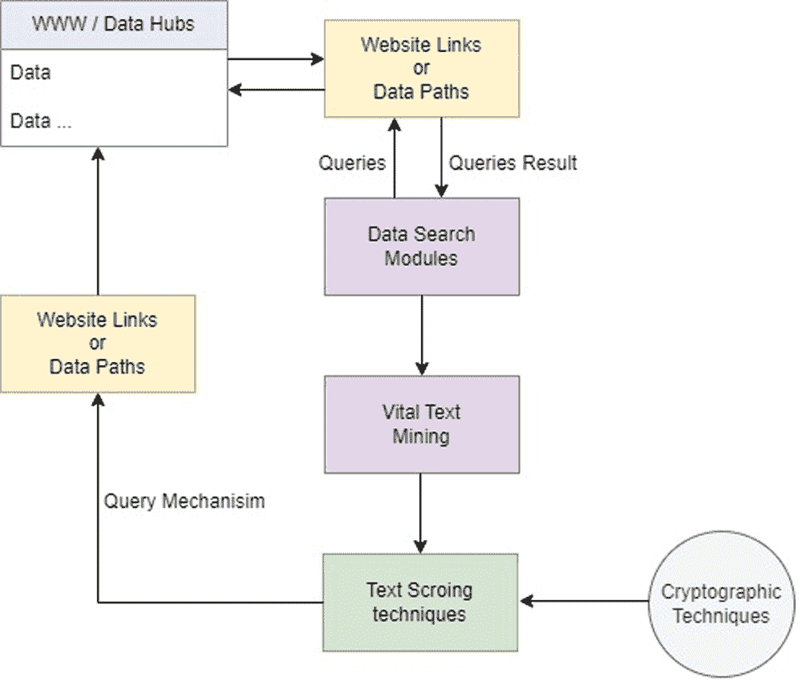 |
| --- |

## 工具

使用开源工具 `Twint` 分析了 Sundari 女士的推文。该工具以她的 Twitter ID 作为输入，抓取了推文以及其他信息（如任何链接、提到的其他 Twitter 用户以及使用的任何标签标签等）。使用以下命令将推文抓取到 CSV 文件中

```
twint -u username -o file.csv --csv
```

然后用 Google 表格打开生成的 CSV 文件，并使用 `Elasticsearch` 创建索引以查找上述提到的信息。

## 结论

已对信息泄露及其后果进行了技术审查。讨论了信息泄露的主要影响和数据保护的重要性。通过真实的案例研究，详细解释了架构和技术工具的可用性及其在克服事件中的应用。本章有助于启发读者概念化并了解信息泄露，以及为什么谨慎处理敏感数据如此重要。这篇文章将帮助相关领域的学者创建进一步的架构，为信息泄露和保护数字隐私建立一个研究基础。

## 参考文献

- Alneyadi, S., Sithirasenan, E., & Muthukkumarasamy, V. (2016, February). A survey on data leakage prevention system. Journal of Network and Computer Applications, 62, 137–152. doi:[10.1016/j.jnca.2016.01.008](https://doi.org/10.1016/j.jnca.2016.01.008)
- Arden, O., George, M. D., Liu, J., Vikram, K., Askarov, A., & Myers, A. C. (2012). Sharing Mobile Code Securely With Information Flow Control. In Proceedings of the IEEE Symposium on Security and Privacy. IEEE. doi:[10.1109/SP.2012.22](https://doi.org/10.1109/SP.2012.22)
- Boue, M. (2011). Inspire Ontology Handler: automatically building and managing a knowledge base for Critical Information Infrastructure Protection. 12th IFIP/IEEE 1M, Poster Session. IEEE.
- Kafle K, Moran K, Manandhar S, Nadkarni A and Poshyvanyk D. (2020). Security in Centralized Data Store-based Home Automation Platforms. ACM Transactions on Cyber-Physical Systems, (pp. 1-27). ACM.
- Kunal Sinha, K. K. (2022). Creation of Novel Database for Knowledge Repository on Cyber Security. In: First International Conference on Cyber Warfare, Security. Thapar University.
- SpacSec. (2021). Communications in Computer and Information Science, (vol 1599).
- Mendsaikhan, O., Shimada, H., Yamaguchi, Y., & Shimada, H. (2020, September). Quantifying the Significance and Relevance of Cyber-Security Text Through Textual Similarity. IEEE Access : Practical Innovations, Open Solutions, 8, 17041–17052. doi:[10.1109/ACCESS.2020.302721](https://doi.org/10.1109/ACCESS.2020.302721)
- Nadkarni, A., & Enck, W. (2013). Preventing accidental data disclosure in modern operating system. Proceedings of 2013 ACM SIGSAC Conference on Computer & Communication Security. ACM. doi:[10.1145/2508859.251667](https://doi.org/10.1145/2508859.251667)
- Dandurand, O. (2013). 5^(th) International Conference on Cyber Conflict. NATO CCD COE Publications, Tallinn.
- Senthil KumarN.SaravanakumarK.DeepaK. (2015).On Privacy and Security in Social Media – A Comprehensive Study. International Conference on Information Security & Privacy (ICISP2015). Elsevier
- Shu, X., Zhang, J. Danfeng, D., & Feng, W. C. (2016). Fast Detection of Transformed Data Leaks. IEEE Transactions on Information Forensics and Security.
- Sinha, K. & Senapati, K. (2021). Design and Development of Data Model for Cyber Threat. Lambert Academic Publishing.
- Wagh, K. S. (2018). A Survey: Data Leakge Detection Techniques. International Journal of Electrical and Computer Engineering (IJECE), 8(4).
- Wani, S., & Mohd, T. Sembok, T., & Wahiddin, M. (2022). Constructing a knowledge base for Al-Qur’ an utilizing principles of human communication. Fourth International Conference on Information Retrieval and Knowledge Management. Springer.


Yang, F., Wu, J., Tang, S., & Zhang, H. (2013). 基于动态知识库的用户行为安全辅助系统。IEEE 绿色计算与通信国际会议以及 IEEE 物联网与 IEEE 网络、物理和社会社会计算国际会议。IEEE. doi:[10.1109/GreenCom-iThings-CPSCom.2013.390](https://doi.org/10.1109/GreenCom-iThings-CPSCom.2013.390)

# 第 9 章

*   **C. M. Nalayini**
    ]
    印度，Velammal 工程学院
*   **Jeevaa Katiravan**
    印度，Velammal 工程学院
*   **V. Sathya**
    印度，Panimalar 工程学院

## 摘要

分布式拒绝攻击（DDoS）是一种网络攻击手段。尽管这种攻击众所周知，但其严重性日益增长。它通过通过大量不需要的数据来拒绝网络或在线服务，并导致服务不可用。DDoS 的影响总是非常巨大的。最近，Twitter、Spotify、Amazon 和 Paypal 都受到了这种 DDoS 攻击的严重影响，导致其客户无法使用服务。区块链是趋势技术之一，可用于发现点对点网络中的异常节点（即机器人）。由于区块链缺乏互操作性，本章提出了 `Multichain`，结合跨链技术来检测 DDoS 攻击。它设计用于与多个网络进行通信，跨链技术旨在通过智能合约在不同链之间建立流量。使用 `CNN` 和 `LSTM` 等深度学习模型结合 `CICDDOS2019` 数据集进行训练和测试，并选择 `LSTM` 作为最佳模型安装在 `Multichain` 中，用于检测恶意活动并立即将其列黑名单。

## 引言

在现实世界场景中，由于缺乏安全性，物理处理患者记录、医生预约、管理数据等已成为一项艰巨的任务。电子健康记录（EHR）减少了数据的重复和无序。随着人口的增加、技术的进步和饮食习惯的改变，疾病也随之增加。在当前，需要全安全地处理大量的电子健康记录。一项研究表明，由于缺乏安全性，患者的敏感信息被广泛盗（Nalayini, 2022）。开发单链 EHR 是为了提高去中心化、不可篡改、透明化和分布式等各个方面的安全性。它对于单个组织效果良好。但在单区块链环境下，EHR 系统面临着互操作性、隐私和健康相关交易处理等挑战。在不同部门之间共享健康信息时，必须涉及互操作性。互操作性关注的是硬件、软件、结构和部署的异构性。但单链不支持互操作性。如果一家医院在不同地点有多个分支，并且它们需要与其他部门共享涉及医生、患者或任何管理的医院信息，那么 `Multichain` 就是结合跨链技术要使用的解决方案。此外，智能合约被部署在 `Ethereum MainNet` 中，以全安全的方式处理存储和检索。

EHealth chain 的开发是为了使用 `Hyper ledger` 管理健康记录。`adapter` 是为了使用 `Hyper ledger` 管理健康记录而开发的。（注：原文此处存在大量重复句子，已按格式要求翻译）。`EHR` 是结构化的资源。`Prokieva` (2019) 解释了 `EHR`。（注：原文此处存在大量重复句子，已按格式要求翻译）。

### 区块链

区块链是一种存储交易的分布式、去中心化、不可篡的账本。在区块链中，区块以图 1 所示的结构连接。每个区块都是固定长度，是哈希算法的输出。有许多哈希算法，如 `SHA`、`Rivest`、`Shamir`、`RSA`。区块链的缺点是互操作性。这可以通过 `Multichain` 来克服。

图 1. 区块链概视图
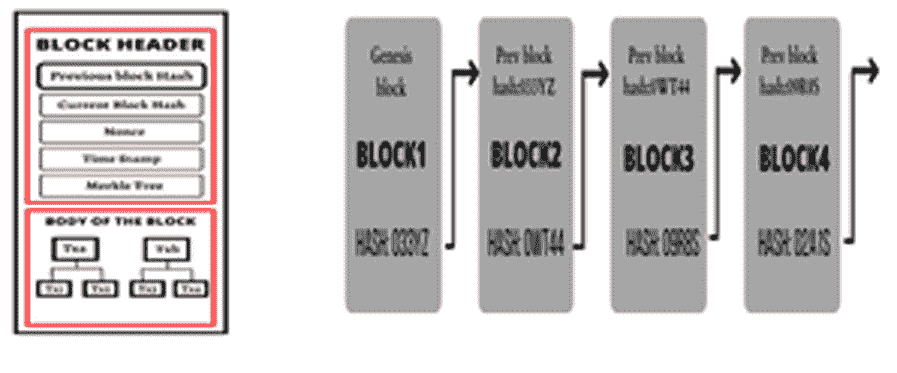

### MULTICHAIN

`Multichain` 开发自 `Bitcoin core`。`Multichain` 提供了与其他 `Blockchain` 通信的能力。这对于一个组织拥有多个 `Blockchain` 且它们之间需要通信的情况特别有用。它主要为跨链之间的交互而构建。2020 年 7 月 20 日 `Multichain` 作为 `Anyswap` 被引入。使用 `multichain`，无论是什么链，任何链之间的通信都是可能的，它也是一个开源框架。`Multichain` 是一种跨路由协议 (`CRP`)。它利用名为 `SMPC` 的节点。`SMPC` 代表安全多方计算。这些节点位于区块链之外，用于签署交易并仅执行小组工作。`SMPC` 节点实现 `TSS Distributed Key Generation` 算法。`TSS` 代表门值签名方案。Multichain` 支持许多链，如 `EVM chains`、`EVM Layer2 chains`、`Bitcoin like chains` 和其他链。`EVM Blockchains` 包括 `Avalanche C chain`、`Binance smart chain`、`Ethereum`、`Fantom`、`Kucoin`、`Moondriver`、`Moonbeam`、`Polygon`、`Telos`。`EVM Layer2 Blockchain` 包括 `Arbitrum`、`Boba`。`Bitcoin like chains` 包括 `Bitcoin`、`Litecoin` 等。目前 `multichain` 支持超过 70 条 `Blockchains`。`Multichain` 支持每秒 2000 次交易。与其他 `Blockchains` 不同，`Multichain` 向具有权限的节点共享数据。它不会向链中的所有节点共享数据。图 2 显示了 `Multichain` 的概览。

图 2. Multichain 概视图


考虑一家拥有多个部门的医院，例如临床实验室、研究部门、血液/器官移植部、手术部、生物医学设备部、人力资源部等。每个部门都可以形成一个 `Blockchain`（区块链），并通过多链（multichain）与其他链通信。由于 `EHR`（电子健康记录）存储在 `Blockchain` 中，患者可以决定向其他链中的哪些对象共享数据。他们可以将 `EHR` 从普通患者链发送到手术部门链以进行手术，以便医生查看患者的既往史；处方可以共享到其他药剂链，患者可以授权药房仅查看处方，并且可以通过钱包通过 `Blockchain` 直接向药房进行支付。首先，任何需要访问患者 `EHR` 权限的人都应该通过 `Blockchain` 向患者提出请求，然后由患者授予访问权限。通过这种方式实施技术，患者可以控制自己的数据并跟踪数据的访问情况。我们还可以根据需求利用其他多链功能，如流（streams）、代币（tokens）、资产等。

## 多链术语

- **Streams (流)**：`Streams` 无非是项的集合。每个项包含身份标识、时间戳、数字签名等。它们用于存储和检索数据。`Streams` 可以以文本、二进制格式、JSON 等形式存在。流中的每个内容可以有超过 1 个键（key）。根据授予给节点的权限，`streams` 可以是开启的或关闭的。
- **Assets (资产)**：`Assets` 无非是 `Blockchain` 的原生代币。
- **Tokens (代币)**：`Tokens` 是资产/访问权限的表示。
- **Bridge (桥接)**：它是两条链之间的连接。我们可以通过桥接将资产从一条链发送到另一条链。
- **Handshaking (握手)**：当两个节点相互连接并形成多链 `Blockchain` 时，此过程被称为 `Handshaking`。

我们可以通过跨链桥接器（Cross chain bridges）和跨链路由器（Cross chain routers）通过多链传输我们的资产。代币/资产的传输可以通过两种方式完成：

- **Bridging (桥接)**：每当我们想要将代币从一条链传输（桥接）到另一条链时。首先代币将被锁定在当前链中，然后在另一条链上造出锚定代币（pegged token）。这是多链提供的第一个服务。
- **Swapping (交换)**：无法桥接的硬币可以通过流动性池的帮助进行交换。但必须有人为资产/代币提供流动性，才能进行交换。

`Routers`（路由器）将接受用户的请求，并通过交换或桥接提供服务。

## Polygon

`Polygon` 是多链框架之一。智能合约使用 `Ethereum Blockchain`（以太坊区块链）实现。它为存储 `PMHCR`（以为中心的多链医疗记录）提供了替代方案。`PMHCR` 存储在 `IPFS`-星际文件系统中。`IPFS` 是一种协议或分布式存储系统，我们可以在其中共享和存储数据。当我们在 `IPFS` 中存储任何文件时，文件会被分成子文件，并使用各种加密算法进行哈希处理。然后，每个子文件都会分配一个基于 `Content identifier`（内容标识符）的唯一指纹。在 `polygon` 中我们可以编写智能合约，因为它与 `Ethereum` 兼容，并且作为多链框架，它提供了互操作性特性。

## 多链路由中的恶意软件类型

恶意软件是任何专门为了伤害计算机、移动设备、数据或个人而创建的软件。我们的数据集包含五种不同的恶意软件。恶意软件可能有超过一种类型，每种类型都有其独特的特征。`Backdoors`（后门）根本上是为了绕过验证程序，从而削弱系统。在绕过之后，可能会安装其他后门，让攻击者在用户不知情的情况下未来获得访问。被称为 `rootkit`（根内核包）的恶意软件设计用于让用户和安全程序“无法察觉”。它尝试获取远程访问或接管计算机。最常见的恶意软件无疑是 `trojan horse`（特木马）。通过“伪装”，这种病毒试图装成普通的清洁软件或其他被用户说下载的程序。之后，安装它的计算机将拥有不受限制的访问权限，这可用于监控用户行为、窃取数据、修改文件、将机器纳入僵尸网络等（Nalayini et al 2023）。该病毒具有多次复制的能力。例如，它可以感染同一网络中的许多计算机，并在用户无意中运行恶意软件时传播。蠕虫（The worm）是破坏性最大的恶意软件之一，它通过利用操作系统的漏洞在计算机网络中快速传播。蠕虫也可以自我复制，但与病毒不同，它不需要用户执行程序即可完成。本质上，恶意软件分析有两种形式：静态分析和动态分析（动态用于代码分析，而静态用于行为分析）。

### 相关工作

在 Yu et al. (2019) 中，智能合约在三个平台中实现——Multichain、`Hyperledger fabric` 和 `Ethereum`。智能合约的类型、编程语言、网络权限、开源许可和应用在他们的论文中被视为技术特征。基于执行交易和执行智能合约测试了三个 `Blockchain` 平台。比较学习时间，`Ethereum` 花费了 7 天，`Hyperledger fabric` 花费了 14 天，`Multichain` 花费了 2 天。至于开发时间，`Ethereum` 和 `Multichain` 花费了 30 分钟，而 `Hyperledger fabric` 花费了 45 分钟。

Khezr et al. (2019)) 解释了 `Blockchain` 在医疗技术中的实现。它将 `Blockchain Technology` 在医疗领域的应用分为三个领域。从数据管理开始，是供应链，以物联网结束。工作流包括医疗应用、`Blockchain Technology`、医疗原始数据。`Blockchain` 用于存储、传输数据以及用于传输加密货币。

Galvan (n.d.) 解释了医疗 `Blockchain`。Galvan 提供了 5 分钟内购买和设置节点的能力。节点将发行 `ERC-20` 代币。但这些代币仅用于购买 产品。

Rai et al. (2022)) 解释了每个患者都应该拥有自己的记录，这些记录应由他们管理。患者应该对自己的记录拥有完全控制权。患者可以在需要时授予访问权限。提出了一种名为以为中心的多链医疗记录（PCMHR）的概念。在 `PMHCR` 中，健康报告通过 `Smart contracts` 和 `Polygon` 维护。


其中 `tx` 表示单笔交易，`W` 表示流/钱包的集合，`H` 是包含医院详情的向量。`U` 是包含用户详情的向量。从流中检索到的数据以文本、图像或 pdf 等形式表示。但我们有大小限制。在链上我们只能使用最多 `64MB`，而在链下我们可以使用高达 `1GB`。

所提的系统从通过生物识别或其他方式进行用户注册开始工作。验证后，将为他们提供钱包。数字钱包中的数据经过匿名化处理，并在机器学习的帮助下进行分析或预测。在验证这些数据后，计算哈希值并将其添加到患者的钱包中。用户可以通过登录门户网站查看数据。该分析将有助于患者和医生治疗。

Greenspan (2019)) 解释说 `SAP`（系统分析程序开发）是一家具生产用于管理数据和业务模型软件的公司。他们开发了一种基于多链的区块链解决方案，用于跟踪药物和药品。在这种概念中，每一盒包装好的药物都将附上条码。每个条码被视为多链流中的一个项目。在链中，药物/药品制造商和批发商将作为节点。使用这种多链，他们可以轻松地跟踪包装药物的位置，还解决了双花费问题。该系统已经存在并成功通过了测试，实现了每年 15 亿个记录条码和 3000 万次验证的可扩展性。

Rapidqube (n.d.) 处理的是电子医疗记录系统。为了存储患者的医疗记录，使用了多链流。该系统目前正在使用，它是由一家名为 `RapidQube` 的 IT 公司开发的。在生产早期它就已经存储了近 200 万条记录，其中 `50000` 条目前仅支持文本格式，尚未支持图像、视频等富媒体数据。

Syafiq 等人 (2022) 为医疗系统提出了一种使用 `Hyperledger` 的多通道方法。他们创建了一个由政府、金融机构和医院等组织构成的小组管理的区块链联盟。所提的系统通过多通道提供了它们之间的互操作性功能。

Malika Achary 等人 (2020) 在多链中提出了存在证明（Proof of existence）。创建了一个网页，可以生成带有时间戳的存在证明链接。通过 `jQuery` 还生成了哈希代码，该代码可创建数字钱包。流用于存储数据。

Pravin Pawar 等人 (2021) 解释说 `Ehealthchain` 是为了使用 `Hyperledger fabric` 管理健康记录而开发的。`adapter` 组件作为区块链与应用程序之间的中间件。`adapter` 从应用程序获取数据并存储在区块链中，每当从应用程序请求数据时，`adapter` 就会从区块链中检索。

深度学习算法可以以高准确率识别恶意软件，因为其特征集在不断增长。在多链平台上，深度学习方法如 `GRU`、`DBNs`、`CNNs`、`LSTM` 及其变体可以成功识别恶意软件。通过评估现有的检测方法，`CNN` 和 `LSTM` 受了广泛关注并通常获得了良好的准确率。为了训练、理解和检测新的恶意软件，以及开发网络攻击模式和方法，基于深度学习的恶意软件检测模型需要频繁更新恶意软件数据集。E. Amer 等人 (2022) 指出，使用 `Android Malware` 和 `Goodware` 数据集通过 `LSTM` 模型实现了 `Precision`、`Recall`、`F1-Score` 和 `Accuracy`。该模型无法包含新的行为驱动启发式方法，这些方法本使其能够适应来自恶意软件的新、未发现的威胁。Z. Wang 等人 (2022)) 指出，使用 `CNN` 模型、`VirusShare` 和 `Drebin` 数据集时的 `Accuracy` 为 99.56%。有必要增加动态分析覆盖范围和动态特征提取。J. Kim 等人 (2022)) 指出，使用 `CNN` 和 `VirusShare` 数据集产生的 `Accuracy` 为 91.27%。该模型未包含混淆的应用程序，且无法提取 `Flowdroid's API` 调用图。N. Lu 等人 (2021)) 指出使用 `CNN` 和 `LSTM` 模型、`VirusTotal` 数据集和 `Drebin` 数据集产生的 `Accuracy`- 95.83% `Precision`- 95.24% `Recall`- 96.15% `F1-score`- 95.69%。基于混合的图像特征，该模型无法识别恶意的 Android 软件样本。K. Bakour 等人 (2021) 使用 `CNN` 产生了 98.96% 的准确率。某些代码隐藏对模型难以识别。Imtiaz 等人 (2021)) 指出，使用 `CICInvesAndMal2019` 和 `CICAnd` 数据集通过 `Deep Neural Networks (DNN)` 模型实现了 93.4% 的准确率、`F1-score`- 93.2% `Recall`- 93.4% `Precision`- 93.5%。

## PROPOSED WORK

其中 `tx` 表示单笔交易，`W` 表示流/钱包的集合，`H` 是包含医院详情的向量。`U` 是包含用户详情的向量。从流中检索到的数据以文本、图像或 pdf 等形式表示。但我们有大小限制。在链上我们只能使用最多 `64MB`，而在链下我们可以使用高达 `1GB`。

所提的系统从通过生物识别或其他方式进行用户注册开始工作。验证后，将为他们提供钱包。数字钱包中的数据经过匿名化处理，并在机器学习的帮助下进行分析或预测。在验证这些数据后，计算哈希值并将其添加到患者的钱包中。用户可以通过登录门户网站查看数据。该分析将有助于患者和医生治疗。

Greenspan (2019)) 解释说 `SAP`（系统分析程序开发）是一具生产用于管理数据和业务模型软件的公司。他们开发了一种基于多链的区块链解决方案，用于跟踪药物和药品。在这种概念中，每一盒包装好的药物都将附上条码。每个条码被视为多链流中的一个项目。在链中，药物/药品制造商和批发商将作为节点。使用这种多链，他们可以轻松地跟踪包装药物的位置，还解决了双花费问题。该系统已经存在并成功通过了测试，实现了每年 15 亿个记录条码和 3000 万次验证的可扩展性。

Rapidqube (n.d.) 处理的是电子医疗记录系统。为了存储患者的医疗记录，使用了多链流。该系统目前正在使用，它是由一家名为 `RapidQube` 的 IT 公司开发的。在生产早期它就已经存储了近 200 万条记录，其中 `50000` 条仅支持文本格式，尚未支持图像、视频等富媒体数据。

Syafiq 等人 (2022) 为医疗系统提出了一种使用 `Hyperledger` 的多通道方法。他们创建了一个由政府、金融机构和医院等组织构成的小组管理的区块链联盟。所提的系统通过多通道提供了它们之间的互操作性功能。

Malika Achary 等人 (2020) 在多链中提出了存在证明（Proof of existence）。创建了一个网页，可以生成带有时间戳的存在证明链接。通过 `jQuery` 还生成了哈希代码，该代码可创建数字钱包。流用于存储数据。

Pravin Pawar 等人 (2021) 解释说 `Ehealthchain` 是为了使用 `Hyperledger fabric` 管理健康记录而开发的。`adapter` 组件作为区块链与应用程序之间的中间件。`adapter` 从应用程序获取数据并存储在区块链中，每当从应用程序请求数据时，`adapter` 就会从区块链中检索。

深度学习算法可以以高准确率识别恶意软件，因为其特征集在不断增长。在多链平台上，深度学习方法如 `GRU`、`DBNs`、`CNNs`、`LSTM` 及其变体可以成功识别恶意软件。通过评估现有的检测方法，`卷积 Neural Networks` 和 `LSTM` 受了广泛关注并通常获得了良好的准确率。为了训练、理解和检测新的恶意软件，以及开发网络攻击模式和方法，基于深度学习的恶意软件检测模型需要频繁更新恶意软件数据集。E. Amer 等人 (2022) 指出，使用 `Android Malware` 和 `Goodware` 数据集通过 `LSTM` 模型实现了 `Precision`、`Recall`、`F1-Score` 和 `Accuracy`。该模型无法包含新的行为驱动启发式方法，这些方法本使其能够适应来自恶意软件的新、未发现的威胁。Z. Wang 等人 (2022)) 指出，使用 `CNN` 模型、`VirusShare` 和 `Drebin` 数据集时的 `Accuracy` 为 99.56%。有必要增加动态分析覆盖范围和动态特征提取。J. Kim 等人 (2022)) 指出，使用 `CNN` 和 `VirusShare` 数据集产生的 `Accuracy` 为 91.27%。该模型未包含混淆的应用程序，且无法提取 `Flowdroid's API` 调用图。N. Lu 等人 (2021)) 指出使用 `CNN` 和 `LSTM` 模型、`VirusTotal` 数据集和 `Drebin` 数据集产生的 `Accuracy`- 95.83% `Precision`- 95.24% `Recall`- 96.15% `F1-score`- 95.69%。基于混合的图像特征，该模型无法识别恶意的 Android 软件样本。K. Bakour 等人 (2021) 使用 `CNN` 产生了 98.96% 的准确率。某些代码隐藏对模型难以识别。Imtiaz 等人 (2021)) 指出，使用 `CICInvesAndMal2019` 和 `CICAnd` 数据集通过 `Deep Neural Networks (DNN)` 模型实现了 93.4% 的准确率、`F1-score`- 93.2% `Recall`- 93.4% `Precision`- 93.5%。

其中 `tx` 表示单笔交易，`W` 表示流/钱包的集合，`H` 是包含医院详情的向量。`U` 是包含用户详情的向量。从流中检索到的数据以文本、图像或 pdf 等形式表示。但我们有大小限制。在链上我们只能使用最多 `64MB`，而在链下我们可以使用高达 `1GB`。

所提的系统从通过生物识别或其他方式进行用户注册开始工作。验证后，将为他们提供钱包。数字钱包中的数据经过匿名化处理，并在机器学习的帮助下进行分析或预测。在验证这些数据后，计算哈希值并将其添加到患者的钱包中。用户可以通过登录门户网站查看数据。该分析将有助于患者和医生治疗。

Greenspan (2019)) 解释说 `SAP`（系统分析程序开发）是一具生产用于管理数据和业务模型软件的公司。他们开发了一种基于多链的区块链解决方案，用于跟踪药物和药品。在这种概念中，每一盒包装好的药物都将附上条码。每个条码被视为多链流中的一个项目。在链中，药物/药品制造商和批发商将作为节点。使用这种多链，他们可以轻松地跟踪包装药物的位置，还解决了双花费问题。该系统已经存在并成功通过了测试，实现了每年 15 亿个记录条码和 3000 万次验证的可扩展性。

Rapidqube (n.d.) 处理的是电子医疗记录系统。为了存储患者的医疗记录，使用了多链流。该系统目前正在使用，它是由一家名为 `RapidQube` 的 IT 公司开发的。在生产早期它就已经存储了近 200 万条记录，其中 `50000` 条仅支持文本格式，尚未支持图像、视频等富媒体数据。

Syafiq 等人 (2022) 为医疗系统提出了一种使用 `Hyperledger` 的多通道方法。他们创建了一个由政府、金融机构和医院等组织构成的小组管理的区块链联盟。所提的系统通过多通道提供了它们之间的互操作性功能。

Malika Achary 等人 (2020) 在多链中提出了存在证明（Proof of existence）。创建了一个网页，可以生成带有时间戳的存在证明链接。通过 `jQuery` 还生成了哈希代码，该代码可创建数字钱包。流用于存储数据。

Pravin Pawar 等人 (2021) 解释说 `Ehealthchain` 是为了使用 `Hyperledger fabric` 管理健康记录而开发的。`adapter` 组件作为区块链与应用程序之间的中间件。`adapter` 从应用程序获取数据并存储在区块链中，每当从应用程序请求数据时，`adapter` 就会从区块链中检索。

深度学习算法可以以高准确率识别恶意软件，因为其特征集在不断增长。在多链平台上，深度学习方法如 `GRU`、`DBNs`、`CNNs`、`LSTM` 及其变体可以成功识别恶意软件。通过评估现有的检测方法，`卷积 Neural Networks` 和 `LSTM` 受了广泛关注并通常获得了良好的准确率。为了训练、理解和检测新的恶意软件，以及开发网络攻击模式和方法，基于深度学习的恶意软件检测模型需要频繁更新恶意软件数据集。E. Amer 等人 (2022) 指出，使用 `Android Malware` 和 `Goodware` 数据集通过 `LSTM` 模型实现了 `Precision`、`Recall`、`F1-Score` 和 `Accuracy`。该模型无法包含新的行为驱动启发式方法，这些方法本使其能够适应来自恶意软件的新、未发现的威胁。Z. Wang 等人 (2022)) 指出，使用 `CNN` 模型、`VirusShare` 和 `Drebin` 数据集时的 `Accuracy` 为 99.56%。有必要增加动态分析覆盖范围和动态特征提取。J. Kim 等人 (2022)) 指出，使用 `CNN` 和 `VirusShare` 数据集产生的 `Accuracy` 为 91.27%。该模型未包含混淆的应用程序，且无法提取 `Flowdroid's API` 调用图。N. Lu 等人 (2021)) 指出使用 `CNN` 和 `LSTM` 模型、`VirusTotal` 数据集和 `Drebin` 数据集产生的 `Accuracy`- 95.83% `Precision`- 95.24% `Recall`- 96.15% `F1-score`- 95.69%。基于混合的图像特征，该模型无法识别恶意的 Android 软件样本。K. Bakour 等人 (2021) 使用 `CNN` 产生了 98.96% 的准确率。某些代码隐藏对模型难以识别。Imtiaz 等人 (2021)) 指出，使用 `CICInvesAndMal2019` 和 `CICAnd` 数据集通过 `Deep Neural Networks (DNN)` 模型实现了 93.4% 的准确率、`F1-score`- 93.2% `Recall`- 93.4% `Precision`- 93.5%。

## Interoperability
互操作性允许不同的子链之间相互通信。

## Multichahin Routing
不同子链之间的医疗信息共享应通过多链路由进行。多链仅支持基础智能合约。

## Cross-Chain Technology
跨链技术允许各种网络通过智能合约方便地进行通信。从一个网络到另一个网络流量可以在跨链技术中轻松通知。

## Application Layer
区块链分层架构中的应用层执行单个链和以太坊主网的数据共享。


多链架构允许用户根据医院管理的需要增加子链或单个区块链。其中一个区块链可以通过跨链技术与另一个区块链进行通信。

### 分层架构

应用层通过智能合约处理授权和身份验证。互操作层涉及跨链传输协议，用于处理子链之间所有的传输过程。跨链一致性协议负责子区块链之间的信息共享。中间件层负责子链上的查询，并负责子链内部交易期间的同步。它还监督哈希、数字签名、区块创建、投票、验证和校验。区块链层负责使用 Ethereum、Hyperledger 等实现区块链。平台层负责选择前端工具和后端工具。图 4 展示了多链分层架构。

| 图 4. 多链分层架构 |
| --- |
| 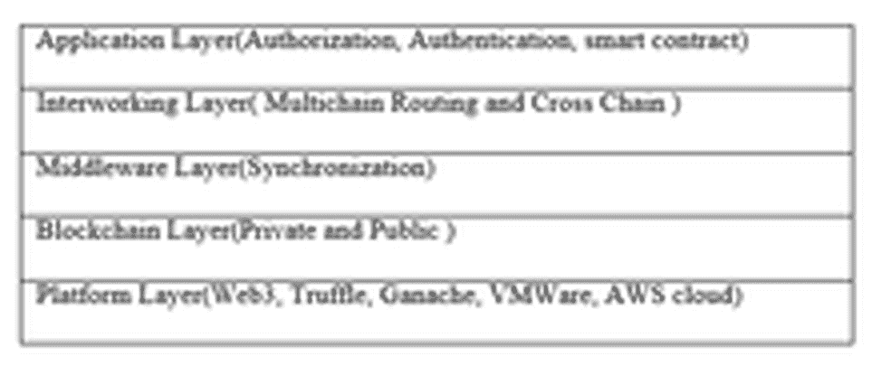 |
| --- |

DDoS 攻击和 EHR 篡改是信息物理系统中的主要问题。分布式拒绝服务（DDoS）是医疗保健领域常见的漏洞攻击之一。它从不同的机器人发送不受欢迎的信息以淹没服务器，从而拒绝合法节点。在 DDoS 期间（Nalayini, 2022），黑客可以轻松处理健康记录伪造和虚假医疗报告。由于身份验证不力，患者敏感信息也遭到篡改。

构建了不同的子区块链，并通过跨链技术通过多链路由方便地共享健康信息。每个节点的请求和响应都应该通过多链路由和跨链技术通过 `Ethereumnet` 完成。为了在相应的区块链中有效检测入侵，在多链路由中安装了性能最好的深度学习模型，以检测入侵并立即阻塞相应的恶意节点。

任何被称为恶意软件程序的指令组旨在损害计算机网络或任何类型的公司并危及用户安全。其使命是获取未经授权的访问、盗取个人信息并干扰系统的正常运行。由于依赖互联网，大量人员受到数据泄露和网络攻击的影响。恶意软件攻击者创建了自动化恶意软件生成工具包，允许快速创建具有无限变体的风险程序，这些程序能够轻松规避传统模式匹配的检测。目前已开发出一种革命性的深度学习方法，以应对危险程序的激增。

### 深度学习通用模型

深度学习是机器学习的一个分支。它能对海量数据产生准确的预测。大多数应用程序由于其自学习特性开始使用深度学习。输入层、隐藏层和输出层是任何深度学习模型的通用流程，如图图 5 |
| --- |

`CNN`：它在各方面的图像处理中非常流行。它对于时间序列数据预测也有用。`1DConv` 支持时间序列数据。DDoS 数据集是时间序列格式，因此使用 `1DConv` 进行实现。它包含多个层以实现有效分类。它从输入数据集构建所有可能的模式并进行更好的分类。它使用卷积层来执行卷积操作。它使用 `ReLuLayer`（修正线性单元）来获取高效的特征图。它将从 `ReLu` 获得的特征图作为 `Pooling` 层的输入以减少特征图的维度。`ReLu` 将输入矩阵转换为扁坦化输出。该扁坦化输出作为全连接层的输入以准确执行分类。

`LSTM`：它是 `RNN`（循环神经网络）的一种。它可以在较长时间的时间内保留所有学到的信息。它对于时间序列数据非常流行，因为它可以记住之前的输入以进行有效分类。由于其能够在长时间保持状态的能力，`LSTMs` 中的内存单元设计用于解决这一问题。`LSTM` 神经元捕捉局部空间相关性，并同时学习随后的长期关系。算法在经历多次变换时数据集大小保持不变的特性被称为空间不变性，也称为对称性。结果是，通过对提升结构和演示进行程序化挖掘，有助于恶意软件分类的任务。该方法包括用于检测的二分类以及多分类分类。约 128 个神经元组成了 `LSTM` 层，负责从上一层接收输入并使用线性激活函数产生输出。经过多次实验，确定了网络的特征、时间步和神经元数量。时间步和特征符合 `LSTM` 的读取。在实际上，“丢弃层”是减少神经网络中过拟合的方法。对于 `t = 1` 到 `T`，使用以下递归方程估计隐藏向量序列 `xi = (xi1, xi2,...,xin)` 和输出向量序列 `o = (o1, o2,..., on)`，分别来自任意长度的良性和恶意应用程序的特征序列。

```
For t = 1 to T:
xi = (xi1, xi2,...,xin)
o = (o1, o2,..., on)
```

### 结果与讨论

本工作考虑了 Sigmoid 激活函数和随机梯度下降优化算法。`CNN` 和 `LSTM` 是用于检测使用多链部署的医疗系统中 DDoS（Nalayini, 2017, 2018）的模型。这些模型使用数据集的 `n` 个划分进行训练。初始权重相同，学习率对所有用户通用。

需要为参与 EHR 系统的所有利益相关者创建 Metamask 账户。为患者、医生和管理员创建的 Metamask 账户如图 7](#978-1-6684-8666-5.ch009.xhtml#f07）所示。

| 图 7. Metamask 账户创建 |
| --- |
|  |
| --- |


一旦为利益相关者创建了 Metamask 账户，将账户地址复制并粘贴到 Goerli 水龙头（Faucet）以获取用于部署相应智能合约的以。使用 `Web3.js` 设计前端，获取所有利益相关者（如患者、医生、管理员、药剂师等）的详细信息，并在共识机制进行适当验证和确认后，这些信息被存储在分布式账本中。患者详情所示图 8 。

| 图 8. 患者详情 |
| --- |
|  |
| --- |

医生详情的添加和查看所示图 9 医生可以根据授权权限查看患者详情。

| 图 9. 医生详情 |
| --- |
| 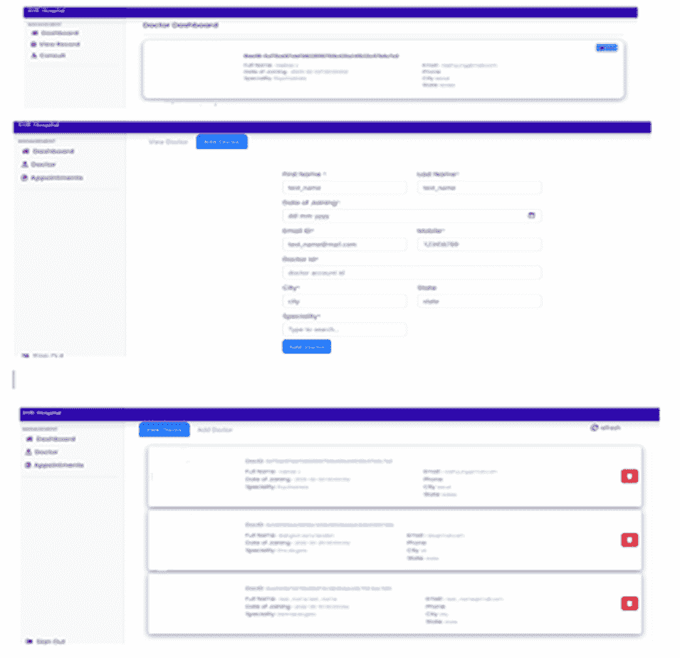 |
| --- |

患者可以根据预约看医生，所示图 10 。所有这些信息都安全地存储在相应的区块链中，通过多链（Mutichain）和跨链技术实现不同部门之间的有效信息共享。

| 图 10. 预约详情 |
| --- |
|  |
| --- |

### 使用以下命令创建区块链

```
multichain-util create blockchain1
```

同样地，根据需求创建其他区块链，所示图 11 。

| 图 11. 创建单个区块链 |
| --- |
|  |
| --- |

使用以下命令创建创世块，所示图 12 。

```
Multichain d blockchain1 -daemon
```

| 图 12. 创建创世块 |
| --- |
|  |
| --- |

如所示图 13 创建适当的流（streams），以便获得从一个区块链向另一个区块链共享信息的适当权限。

| 图 13. 创建流 |
| --- |
| 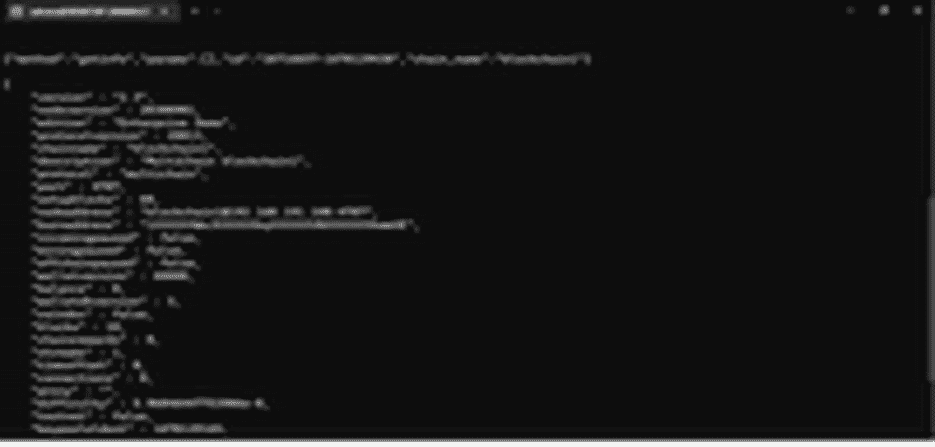 |
| --- |

同样，所有的区块链都在 Multichain 环境下被创建并连接，所示图 14 。EHR（电子健康记录）中的每条记录都通过 `EthereumMainNet` 经过适当验证和确认。

| 图 14. 区块链列表 |
| --- |
|  |
| --- |

不同部门之间的适当通信可以通过 `Web3.js`、`Ganache` 和 `EthereumMainNet` 实现，所示图 15 。

| 图 15. Web3.js、ganache 和以太网络 |
| --- |
| 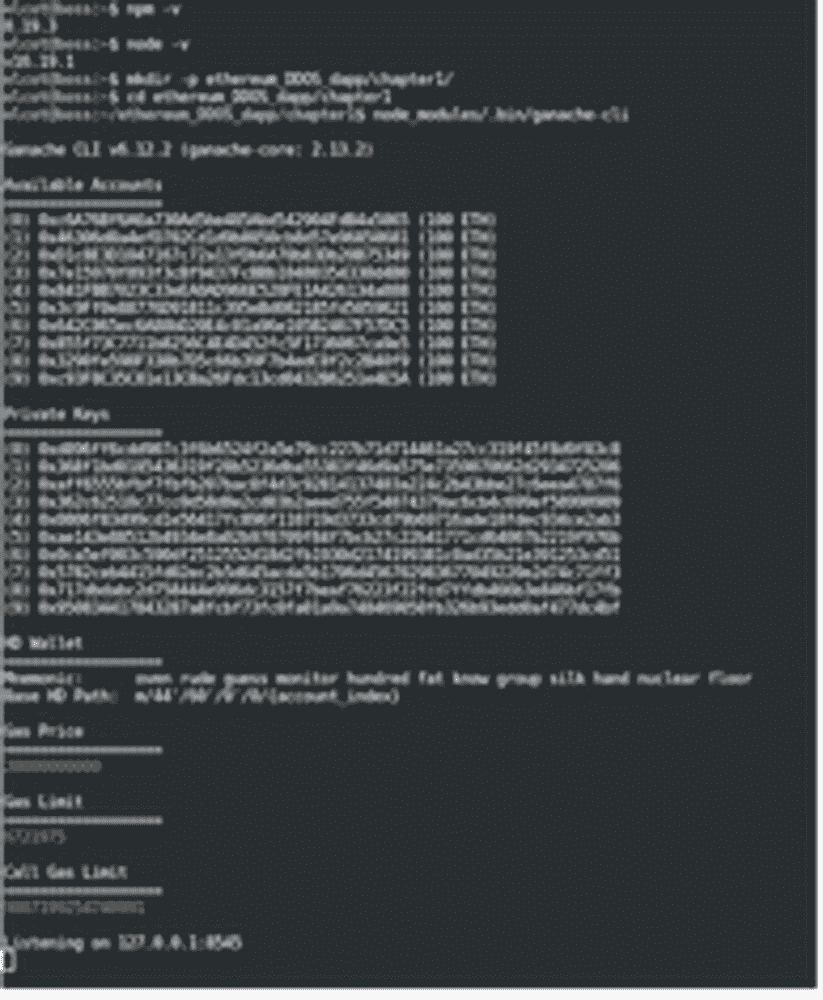 |
| --- |

深度学习分类模型如 `CNN` 和 `LSTM` 在数据集的不同分区上进行训练和测试。`CICDoS2019` 数据用于训练和测试模型（Sharafaldin, 2019）。`CIC2019` 包含了最真实的 PCAP 的无害 DDoS 攻击。还包含了 `CICFlowMeter-V3` 的流量分析输出。标记流基于时间戳、协议、攻击（CSV 文件）、源和目的 IP 地址。数据集涉及 HTTP、HTTPS、FTP、SSH 和电子邮件协议，以生成 25 个人的概念行为。该数据集包含针对 `PortMap`、`NetBIOS`、`LDAP`、`MSSQL`、`UDP`、`UDP-Lag`、`SYN`、`NTP`、`DNS` 和 `SNMP` 等其他协议的反射型 DDoS 攻击。训练当天启动了十二次 DDoS 攻击，针对 `NTP`、`DNS`、`LDAP`、`MSSQL`、`NetBIOS`、`SNMP`、`SSDP`、`UDP`、`UDP-Lag`、`WebDDoS`、`SYN` 和 `TFTP` 的攻击。测试当天启动了七次攻击，针对 `PortScan`、`NetBIOS`、`LDAP`、`MSSQL`、`UDP` 和 `SYN`。网络流量（Pcap）和事件日志（Windows 和 Ubuntu 事件日志）包含在每天的原始数据中。通过使用 `CICFlowMeter-V3` 从原始数据中提取特征，我们能够为每台计算机存储 80 多个流量特征的 CSV 文件。

从中大小的 `LSTM` 开始，进行了实验以确定适当的 `LSTM` 网络参数。它包含三层：具有 `x` 个神经元的输入层（用于最小特征集）、一个具有 `y` 个内存块的隐藏层以及一个具有两个神经元的输出层（一个用于正常行为，另一个用于恶意行为）。所有实例最初都映射到范围（Mirtskhulava et al., 2021）。

## 结论


# 项目概述

构建了各种子区块链和便捷的多链路由，用于不同部门之间的健康信息交换。来自每个节点的请求都应通过 `multichain routing`（多链路由）和跨链技术通过 `Ethereum` 主网进行路由。

实验了 `CNN` 和 `LSTM` 模型来检测不同的恶意软件攻击，并将其与其他现有模型进行比较，发现 `LSTM` 在检测健康相关恶意攻击方面表现良好。`LSTM` 是性能最高的深度学习模型，已部署在 `Multichain routing` 中，用于检测入侵并立即拦截相关的恶意节点，从而高效地检测独立区块链中的入侵行为。

总而言之，深度学习技术，尤其是 `LSTM` 及其变体，在发现许多应用程序中隐藏的恶意软件模式方面非常有效。尽管 `LSTM` 网络在可用数据集上取得了丰目的成果，但仍有改进空间。通过增加 `memory blocks` 和 `epochs` 的数量对单层 `LSTM` 进行动态分析，以获得更好的结果。未来计划使用堆层 `LSTM` 来提升性能水平。

## 参考文献

- Academy. (n.d.). [`https://academy.binance.com/en/articles/what-is-multichain-multi`](https://academy.binance.com/en/articles/what-is-multichain-multi)
- Acharya, M. (2020). Proof of Document using `Multichain` and `Ethereum`, (vol. 07). IOP Publishing. `www.irjet.net` doi:[10.1007/s12243-021-00868-6](https://doi.org/10.1007/s12243-021-00868-6)
- Amer, E., & El-Sappagh, S. (2022). Robust deep learning early alarm prediction model based on the behavioural smell for android malware. Computers & Security, 116, 102670. doi:[10.1016/j.cose.2022.102670](https://doi.org/10.1016/j.cose.2022.102670)
- Bakour, K., & Ünver, H. M. (2021). `DeepVisDroid`: Android malware detection by hybridizing image-based features with deep learning techniques. Neural Computing & Applications, 33(18), 11499–11516. doi:[10.1007/s00521-021-05816-y](https://doi.org/10.1007/s00521-021-05816-y)
- Blockchain Healthcare Today. (n.d.). [`https://blockchainhealthcaretoday.com/index.php/journal/article/view/34`](https://blockchainhealthcaretoday.com/index.php/journal/article/view/34)
- Galvan. (n.d.-a). [`https://www.galvan.health/nodes`](https://www.galvan.health/nodes)
- Galvan. (n.d.-b). A New Kind of Node. Galavan Nodes. [`https://www.galvan.health/nodes`](https://www.galvan.health/nodes)
- Greenspan, G. (2019). Ten Enterprise Blockchains that Actually Work. `Multichain`. [`https://www.multichain.com/blog/2019/06/ten-enterprise-blockchains`](https://www.multichain.com/blog/2019/06/ten-enterprise-blockchains/)
- Hasselgren, A., Kralevska, K., Gligoroski, D., & Pedersen, S. (2020). Blockchain in healthcare and health sciences—A scoping review. International Journal of Medical Informatics, 134. doi:[10.1016/j.ijmedinf.2019.10404](https://doi.org/10.1016/j.ijmedinf.2019.10404)
- Imtiaz, S., Rehman, S., Javed, A., Jalil, Z., Liu, X., & Alnumay, W. (2021). `AMD`: Detection and identification of Android malware using high-efficient Deep Neural Network. Future Generation Computer Systems, 115, 844–856. doi:[10.1016/j.future.2020.008](https://doi.org/10.1016/j.future.2020.008)
- Khez, S., Moniruzzaman, M., Yassine, A., & Benlamri, R. (2019). Blockchain Technology in Healthcare: A Comprehensive Review and Directions for Future Research. Applied Sciences, 9(9), 1736. doi:[10.3390/app9091736](https://doi.org/10.3390/app9091736)
- Kim, J., Ban, Y., Ko, E., Cho, H., & Yi, J. (2022). `MAPAS`: A practical deep learning-based malware detection system. International Journal of Information Security, 1–14. doi:[10.1007/s10207-020-0537-0](https://doi.org/10.1007/s10207-020-0537-0)
- Kshirsagar, M., Patil, A., Deshmukh, S., Vaidya, G., Rahangdale, M., Kulkarni, C., & Kshirsagar, V. (2020). `Mutichain` Enabled Management System and Predictive Analytics. Springer. doi:[10.1007/978-981-15-0077-19](https://doi.org/10.1007/978-981-15-0077-19)
- Kuresan, H., Samiappan, D., & Masunda, S. (2019). Fusion of `wpt` and `mfcc` feature extraction in parkins disease diagnosis. Technology and Health Care, 27(4), 363–372. doi:[10.3233/THC-181306](https://doi.org/10.3233/THC-181306)
- Lu, N., Li, D., Shi, W., Vijayakumar, P., & Chang, V. (2021). An efficient deep neural network based malware detection in 5G environment. Computer Networks, 189, 108075. doi:[10.1016/j.com.2020.008](https://doi.org/10.1016/j.future.202008)
- McGhin, T., Choo, K.-K., Liu, C., & He, D. (2019). Blockchain in healthcare: Research challenges and opportunities. Journal of Network and Computer, 135, 62-75. doi:[10.1016/j.jnca.2019.027](https://doi.org/10.1016/j.jnca.2019.027)
- Mirtskhulava, L. Iavich, M. Razmadze, M. Gulua, N. (2021). Securing Medical Data in 5G and 6G via `Blockchain` using Post-Quantum Signatures. 2021 IEEE International Conference on Information and Telecommunication Technologies and Radio Electronics (UkrCo), (pp. 72-75). IEEE. doi:[10.1109/UkrCo52950.2021.971659](https://doi.org/10.1109/UkrCo52950.2021.971659)


Sharafaldin, I., Lashkari, A., Hakak, S., & Ghorbani, A. (2019). 开发真实的分布式拒绝服务 (DDoS) 攻击数据集与分类。IEEE 第 53 届国际卡纳汉安全技术会议。IEEE。

Sheibani, R., Nikookar, E., & Alavi, S. (2019). 基于语音测量的帕金森病诊断集成方法。Journal of Medical Signals and Sensors, 9(4), 221. doi:[10.4103/jmss.JMSS_57_18](https://doi.org/10.4103/jmss.JMSS_57_18)

Syafiq, M. & Soewitob, B. (2022). 一种用于智能医疗系统多链及安全数据存储的区块链技术。Journal of Theoretical and Applied Information Technology, 100(13).

Sztaho, D., Valalik, I., & Vicsi, K. (2019). 利用多种语音任务对匈牙利语语音进行帕金森病严重程度估计。在：第 10 届国际语音技术人机对话会议。SpeD. doi:[10.1109/SPED.2019.8906277](https://doi.org/10.1109/SPED.2019.8906277)

Tracy, J. M., Özkanca, Y., Atkins, D. C., & Hosseini Ghomi, R. (2020). 研究作为生物标志物：帕金森病早期检测的深度表型方法。Journal of Biomedical Informatics, 104, 103362. doi:[10.1016/j.jbi.2019.103362](https://doi.org/10.1016/j.jbi.2019.103362)

Wang, Z., Li, G., Zhuo, Z., Ren, X., Lin, Y., & Gu, J. (2022). 一种基于语义特征的安卓应用分类深度学习方法。Security and Communication Networks, 2022, 1–16. doi:[10.1155/2022/1289175](https://doi.org/10.1155/2022/1289175)

Yaman, O., Ertam, F., & Tuncer, T. (2020). 基于声学特征统计池化方法的自动帕金森病识别。Medical Hypotheses, 135, 109483. doi:[10.1016/j.mehy.2019.109483](https://doi.org/10.1016/j.mehy.2019.109483)

YuH.SunH.WuD.KuoT. T. (2019). 医疗应用的智能合约区块链对比。AMIA 会议，pp.1266-1275)。AMIA。

Zebpay. (n.d.). [`zebpay.com/blog/what-is-multichain`](https://zebpay.com/blog/what-is-multichain)

# 第 10 章：方法、挑战与未来方向

*   Ravi Singh (印度帕特纳国家技术学院) 
*   Piyush Kumar (印度帕特纳国家技术学院) 

## 摘要

随着安卓设备、物联网（IOT）以及传统计算设备的增加，恶意软件攻击逐年增长。为了保护所有这些设备，恶意软件分析是必不可少的，这样才能保护组织和个人的利益。恶意软件分析有多种分析方法，如静态、动态和启发式。随着技术的发展，恶意软件作者也使用了混淆和打包技术等先进的恶意软件攻击技术，这些技术无法通过基于特征的静态方法检测到。为了克服这些问题，必须使用动态方法分析恶意软件的行为。如今，恶意软件作者正在使用更先进的规避技术，其中恶意软件在检测到虚拟环境后会暂停其恶意行为。因此，规避技术给恶意软件分析带来了新挑战，因为即使是动态方法有时也无法检测和分析恶意软件。

# 1. 引言

恶意软件是指任何未经用户许可即可在设备上执行某些操作的恶意代码。设备可以是基于系统的设备、安卓设备或物联网设备。恶意软件可以执行信息窃取或隐藏等操作，可以加密信息、利用系统资源（如电池、内存和 CPU）、使用命令和控制技术控制整个系统，某些恶意软件还会损坏设备硬件。因此，我们可以说恶意软件是对系统安全的巨大威胁，因为设备直接或间接地连接到本地网络或互联网。如今，恶意软件还使用混淆、仿真规避、加密器和打包器等先进技术，因此检测和分析恶意软件的挑战也变得日益困难。在机器学习中，为了检测和分类恶意软件，将数据集分为训练集和测试集两部分。在分割后，使用训练数据集训练模型。有时数据集并非同质的，因此为了进行准确预测，我们使用`k 折交叉验证`来理解数据集的模式。在传统的机器学习中，特征提取有不同的方法，如静态、动态和混合。在静态方法中，我们在不执行的情况下研究二进制文件的结构，这需要虚拟环境。在动态分析中，我们观察恶意二进制文件运行后的行为，这需要安全的虚拟环境。虚拟环境可以保护主机计算机免受恶意软件的影响。在混合方法中，我们结合了静态和动态方法。但混合方法的问题是增加了模型的复杂性。

在分类中，我们将数据点归类为存在的不同类别。通常情况下，不同的类别被标记为称为目标或类别的标签。在机器学习中，使用训练数据集训练模型（取决于我们开发的是监督模型还是无监督模型），模型的准确性通过另一个测试数据集进行检查。我们发现，不同的恶意软件检测模型在提取、检测和评估方面给出了不同的技术。

在这些许多策略中：

- 通过确定特征重要性对特征进行排序和选择。
- 降维通过将特征转换为低维来减少偏差和噪声。
- 集成模型可以与上述两种方法中的一种结合，整合各种基模型的输出以提高整体分类性能。

众所周知，机器学习技术在解决目标识别、文本识别、语音识别等不同实时问题的影响呈指数级增长。同样，恶意软件检测系统对机器学习模型的需求也在增加，因为恶意软件作者每天都在使用混淆、加密、打包、规避等先进的开发技术。因此，现在我们关注使用先进的机器学习技术来中和这些先进的开发技术。机器学习技术的问题在于缺乏通用共识，即分类、检测和评估的泛化。缺乏通用共识会导致误解、导致半真假甚至是错误的简化，并可能误导未来的工作。为了缓解这些问题，本工作实现了以下目标：

- 对文献中提出的、用于安卓恶意软件检测系统的现代机器学习方法进行了详尽映射。
- 根据四个不同的标准对每项贡献进行分类：所选指标、数据集的年龄、分类模型以及性能改进方法。
- 激励研究人员在检测、分类和评估在内的各个方面开发通用方法。

### 分析类型与对应的特征提取方法

| 分析技术 | 特征提取方法 | 提取的特征 |
| --- | --- | --- |
| 静态 | 清单文件分析、代码分析、操作码分析 | |


# 签名分析

| 类别 | 包名、意图、活动、权限、服务、提供者、信息流、API、明文分析、原生代码、opcode |
| :--- | :--- |
| **动态** | 网络流量分析、系统调用分析、PE 分析、API 流量分析、系统资源分析 || 通信设备 IP、网络协议、未加密数据、证书、流量分析、系统调用、API、CPU 使用率、电量使用率、内存使用率、按钮、图标、事件 |
| **启发式** | 清单文件分析（Manifest）分析、代码分析、Opcode 分析、PE 分析、API 分析、网络流量分析 || 包名、意图、权限、服务、提供者、信息流、API、明文分析、原生代码、opcode、网络协议、字符串数据分析、证书、流量分析、系统调用、API 调用、CPU 使用率、电量使用率、内存使用率 按钮、图标、事件 |

## 恶意软件威胁简介

如今，互联网已成为社会日常生活的的基础需求。因为没有互联网，几乎无法进行金融交易、社交互动、健康管理、交通管理、业务交易以及政府机构互动。简而言之，我们可以说所有这些都从物理世界转移到了网络空间。同样，物理犯罪也转向了网络犯罪，通过这种方式窃取价值信息。网络犯罪分子可以远程访问受害者系统，从而更改、加密或窃取信息。通过恶意软件攻击，桌面电脑、笔记本电脑、移动设备和网络组件等受害者设备可能会被破坏。这些恶意软件攻击有不同的类型，如病毒、蠕虫、木马、广告软件、根内核、勒索软件、加密器和壳器。

本文综述了现有恶意软件检测和分类技术的文献，讨论了高级恶意软件攻击相关的困难，并为研究人员提供了未来的方向。因此，本回顾的贡献如下：

- 概述了如何克服规避攻击、混淆、加密器和壳器问题。
- 研究了检测恶意软件的概率。
- 提供了高级检测和评估方法。
- 针对这些挑战为分类模型提出了新的假设。

如今恶意软件攻击每天指数级增长，目标是业务组织、研究机构、政府机构以及个人攻击，目的不同，如窃取信息、隐藏信息、干扰服务、利用设备资源以及通过广告软件骚扰个人，为了克服所有问题，需要一个强大的恶意软件检测系统。恶意软件作者正在使用高级技术通过规避技术来绕过仿真环境。

## 恶意软件分析方法

为了保护不同组织和个人的利益，需要一个强大的检测、预防和分析系统。恶意软件分析通常使用两种方法：静态方法和动态方法。

### 静态分析
在静态方法中，不执行恶意软件而是使用不同技术如数据库中以前存储的唯一哈希值的签名映射或反向工程进行分析。静态恶意软件分析对于已知恶意软件有效，但对于零日恶意软件无效，因此为了防止零日恶意软件，使用了动态方法。影响静态分析的因素：

- 加壳（Packing）
- 资源混淆
- 反汇编技术
- 动态下载数据

### 动态分析
在恶意软件动态分析中，执行恶意软件代码以观察其行为，监控网络流量、API 调用、受限权限、注册表更改、未经授权的访问请求，但恶意软件检测系统的复杂性也比基于静态方法的恶意软件检测系统，因此有时我们使用启发式方法，它对已知和未知恶意软件都是有效的。

## 分类分类器

### 1.1 朴素贝斯分类器
贝叶斯算法是统计概率分类器——朴素贝斯分类器的基础。它用于根据从训练集中获取的几个指标，找到一个二进制文件属于恶意软件或良性文件的概率。

- `P(BENIGN/BINARY) = P(BINARY/BENIGN) P(BINIGN)`
- `P(MALWARE/BINARY) = P(BINARY/MALWARE) P(MALWARE)`

朴素贝斯分类器的挑战是：

- 如果测试数据集具有训练数据集中不存在的类别分类变量，朴素贝斯将无法处理。
- 它假设所有特征都是相互独立的，但在现实生活中某些特征是相关的，这被称为“零频率”。

### 1.2 支持机
支持机是一种线性分类器，用于恶意软件检测和分类。已知恶意软件有不同的类别，如病毒、蠕虫、木马、广告软件、根内核、勒索软件。支持机在训练后分类特定的二进制属于哪些类别。线性 `SVM` 用于减少特征。

### 1.3 逻辑回归
逻辑回归是一种概率分类器，用于二分类以及多标签分类，它找到 0 到 1 之间的概率以确定数据点属于某个类，但它基于数据呈正态分布的假设。在二分类情况下使用 sigmoid 函数进行分类，多分类情况下使用 softmax 分类器，但通常逻辑回归最适用于二分类。逻辑回归既可以分类器也可以作为回归器，但在恶意软件情况下被用作二分类器，即通过标记数据集训练后分类特定的二进制文件是恶意软件还是良性。使用梯度下降算法来决定恶意软件和良性的边界。正权重特征被认为是恶意软件。

### 1.4 K 近邻分类器
K 近邻是一种基于学习的分类器，其中 `k` 是表示邻居数量的参数。在 K 近邻中，我们计算给定二进制样本与训练数据集元素之间的距离，然后过滤出最近的 k 个距离，如果大部分属于恶意软件，则未知二进制属于恶意软件类。

### 1.5 决策树分类器
决策树也是一种基于学习的分类器，根据所选特征对未知二进制文件是恶意软件还是良性进行分类，它解决了决策树中的过拟合问题。决策树中作为根特征的决策由熵或尼指数决定，在树的每个节点上都采用一个问题来决定样本是恶意软件还是良性。可以使用决策树进行分类和回归。决策树中，最重要的任务是决定哪个特征将作为根节点，实际分类在叶子节点进行，根节点的熵或随机程度为零或接近零。选择决策树根节点属性有许多标准，包括熵、信息增益、尼指数、尼比例、方差减少和卡方。决策树分类器面临过拟合问题，可以通过以下方法解决：

- 修剪决策树
- 随机森林

如果因变量和自变量线性相关，则线性回归分类模型将更合适；如果因变量和自变量是非线性关系，则决策树分类器将更合适。

### 1.6 随机森林分类器


在传统的机器学习模型中，有不同的分类器如 `logistic`、`SVM`、`K-Means`。这些恶意软件分类器的问题在于这些模型容易受到过拟合问题。通常情况下，`Decision Tree`和`Random Forest`分类器不受过拟合问题的影响。`Random forest` 是`decision tree`的集合。`random forest`的实现非常复杂，但在浅层机器学习技术中它提供了最高的准确率。正如我们所知，森林是相似或不同类型树的集合，利用这一概念，集成学习技术可以用于恶意软件的检测和分类。

| 图 1. 用于恶意软件分类的集成技术 |
| --- |
| 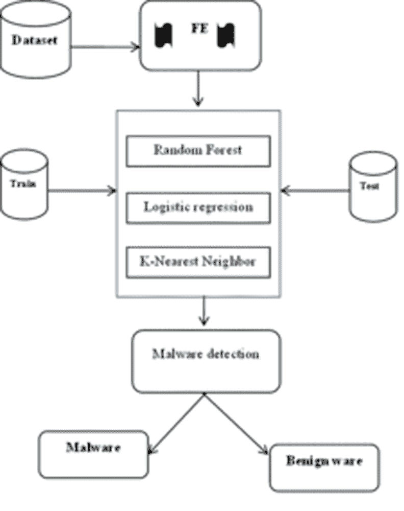 |
| --- |

### 1.6 深度神经网络

传统机器学习的问题在于，模型仅根据预设的特征做出决策，即模型本身不决定哪些特征将用于模型开发。在深度学习模型中，模型本身驱动用于恶意软件检测和分类的高标签特征，从而提供了更高的准确性和更少的误报（即更少的假阳性和更少的假阴性）。对于自动恶意软件识别和分类，利用深度学习 `CNN`。原始字节模型消除了对特征提取、特征选择（即特征工程）的需求。它在实时环境中执行端端的恶意软件检测和分类。在这种方法中，创建了恶意软件二进制镜像。相同类别的恶意软件通常产生相同的图像，并基于可视化进行分类。因此，基于深度学习的分类器和检测模型比基于浅学习的恶意软件检测系统提供了更准确的预测，因为特征是由学习算法提取的。

| 图 2. 神经网络 |
| --- |
| 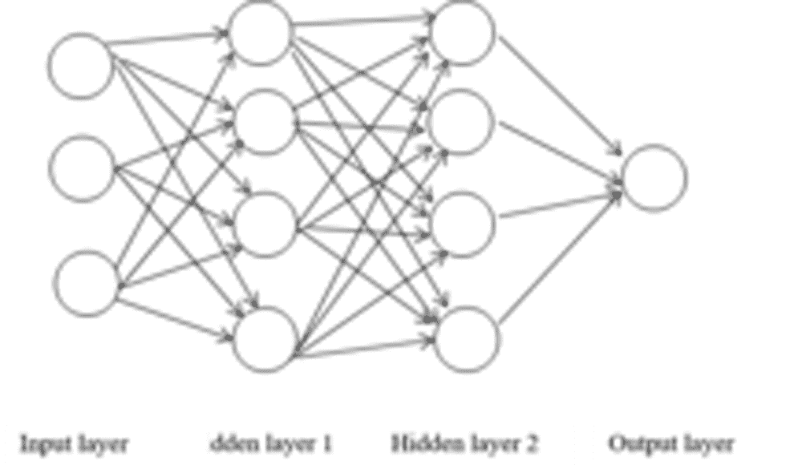 |
| --- |

### 1.7 对抗机器学习

在对抗性恶意软件攻击中，攻击者通过操纵现有恶意软件来生成对抗性恶意软件。因此，通过检测和分类系统检测这类恶意软件是非常困难的。对抗性恶意软件攻击基于机器学习技术，被称为对抗机器学习。对抗机器学习用于创建对抗数据，即人工数据生成。在许多领域，用于模型训练的足够数据集是不够的，且在情况下获取数据几乎是不可能的，我们借助对抗数据生成器的帮助。对抗数据生成器生成看起来像真实数据的真实数据。

在机器学习中，从大量的特征池中选择最佳特征是困难的，因为并不是所有特征对模型训练或模型学习都有用。如果我们考虑所有特征，模型的复杂度将会增加并导致过拟合。因此，在机器学习中，我们采用多种特征选择技术来解决过拟合问题。传统机器学习采用一种称为降维的技术，而深度学习将其称为 `dropout`。在包括目标分类、数字识别、语音识别、文档分类和计算生物学数据分析在内的广泛应用领域，人们发现这种技术增强了神经网络的性能。这表明丢弃（dropping out）是一种常见的策略。

## 2. 文献综述

截至今天，使用机器学习技术的恶意软件分类和检测系统在文献中引起了大量的关注，因为传统的基于指纹的方法不足以检测和分析如混淆和壳等高级恶意软件技术。在本节中，文献的贡献将原样放在我的工作中。

Moubarak 等人 (2020) 比较了不同的传统机器学习技术，如 `random forest`、`logistic regression`、`naive bayes`、`SVM` 和 `k-nearest neighbors`，并在 `random forest` 中获得了最好的结果，真阳性率为 92%，假阳性率为 0.01%。

Chowdhury 等人 (2018) 解决了传统机器学习技术如 `SVM`、`naive bayes`、`decision tree` 和 `random forest` 假阳性率增加的问题，这些技术需要许多训练样本来开发分类器，为此他们提出了一种结合二进制关联内存 (`BAM`) 和多层感知器 (`MLP`) 神经网络的混合恶意软件分类框架，该框架同时用于基于特征的静态分析和基于行为或异常分析的动态分析。对于基于特征的分析使用了 `n-gram` 方法，对于基于行为的分析使用了应用程序接口 (`APIs`)。

Catak 等人 (2020) 在他们的研究中贡献了一种新的深度学习架构，该架构可以通过迁移深度学习技术检测和分类不同类别的恶意软件，其中以优化的方式使用了两个预训练的网络模型。在这项研究中，以系统的方法处理了特征选择、分析、检测、模型评估指标以及混合模型局限性的不同方法。在此工作中使用的评估指标是针对 `Alexnet` 网络的 `accuracy`、`sensitivity`、`specificity`、`f-score`，`Resnet-50` 网络以及提出的混合模型分别针对不同的 Microsoft BIG 2015、`Malimg`、`Malevis` 数据集，经过对比发现，所提出的模型优于现有的最先进研究。在这项研究中，最后利用 Microsoft BIG 2015 数据集研究了九种恶意软件变体（`rammit`、`lollipop`、`kelihos-ver1`、`kelihos-ver3`、`vundo`、`simda`、`tracur`、`obfuscator.acy` 和 `gatak`）并使用了混淆矩阵，此处所提混合模型的准确率也优于其他两个模型。

Aslan 等人 (2017) 提出了一种获取流行的恶意软件分析和检测工具知识的方法，这些工具被用于不同的著名的恶意软件检测和分类系统中。在这项研究中，这些工具用于 100 个恶意软件和 100 个良性样本，结论是仅靠单一工具和技术不足以检测恶意软件。因此，基于工具和技术的组合恶意软件检测系统对于恶意软件攻击是安全的。

Catak 等人 (2012) 分析了不同类型恶意软件在系统上进行的 API 调用，以构建基于恶意软件的 API 调用集合，该数据集被用于基于行为的恶意软件识别技术。该研究的总体贡献如下：

- 为 Windows 系统的恶意软件检测和分类创建了一个新数据集。在该领域，很少有此类数据。
- 对恶意软件进行了检查，并在虚拟沙箱环境中执行它以记录了 API 调用。
- 针对恶意软件类型的检测模型通过将检测建模为文本分类问题并使用 `LSTM` 算法创建，该算法在文本分类问题中经常被丢弃。


Gong 等人（2020）利用 `API`、权限和意图作为特征构建了一个名为 `APICHECKER` 的恶意软件检测系统。在这项工作中，使用了 426 个关键 `APIs` 作为特征，并使用轻量级随机森林机器学习算法进行动态行为分析以分类检测。`APICHECKER` 自 2018 年以来在市场上商业运营，准确率达到 98.9%，召回率为 98.1%，它可以在 0.9 分钟内检测出一个应用，优于扫描一个应用需要 5 分钟的谷歌 `BOUNCER`。在本文的模型比较中，收集的日志被输入到九种主流机器学习算法中感知检测和分类性能，包括朴素贝叶斯 (`NB`)、CART 决策树、逻辑回归 (`LR`)、k 近邻算法 (`kNN`)、支持向量机 (`SVM`)、梯度提升决策树 (`GBDT`)、人工神经网络 (`ANN`)、深度神经网络 (`DNN`) 和随机森林 (`RF`)，经过比较发现 `APICHECKER` 提供了最佳性能。

Darshan 等人（2020）提出了一种卷积神经网络 (`CNN`)。该模型使用可执行文件 (`PE`) 文件的执行时间进行行为分析。为了确保该模型中数据集的一致性，采用了 10 折交叉验证。使用特征选择的 relief 方法从特征集中选出最显著的特征。在这项工作中，应用程序接口 (`API`) 调用及其类别 (`CAT`) 被用作动态特征。它实现了 97.968% 的准确率。最终特征集由顶部的 `N`-grams 特征组成。这些特征被用于构建用于视觉分析的图像。

Natraj 等人（2019）提出了一种利用恶意软件二进制可视化的恶意软件分类技术。这项工作最重要的一点是在不反汇编和执行代码的情况下进行分类。分类使用了带有欧式距离的 k 近邻方法。为了使数据同质化，采用了 90% 训练数据和 10% 测试数据的 10 折交叉验证。这种基于计算机视觉的技术对于在某种程度上使用混淆等高级技术的恶意软件分类也有帮助。在这项工作中，使用了 25 个族的 9,458 个样本，获得了 98% 的分类准确率。

Albelwi 等人（2011）提供了一种新的优化目标函数，该函数通过反卷积网络聚合了特征图集合的错误率和获得的知识。新的目标函数通过 `deconvnet` 增强学习特征的可视化来引导 `CNN`，允许 `CNN` 架构的超参数以增强性能的方式进行优化。这项工作有助于自动发现高性能的 `CNN` 架构。该工作还引入了目标函数概念，即利用验证集上的错误率和通过 `decovnet` 进行特征可视化的质量。该目标函数的优点之一是它不会在使用 Nelder-Mead 方法 (`NMM`) 时陷入局部最小值。

Srivastava 等人（2022）显示，dropout（丢弃）增强了深度神经网络 (`DNN`) 在视觉、语音识别、文档分类和计算生物学等监督学习任务中的性能。在这项工作中使用了以下数据集：

- `MNIST`：标准手写数字。
- `TIMIT`：语音识别数据集。
- `CIFAR-10` 和 `CIFAR-100`：包含 10 类和 100 类的微型自然图像数据集。
- `Street View House Number` (`SVHN`) 数据集。
- `ImageNet`：大型自然图像集合。
- `Reuters-RCV1`。

在这项工作中，通过使用多种数据集证明了 dropout 是一种改进神经网络的通用技术，而非特定应用。

Aboaoja 等人（2019）讨论了针对不同数据类型的不同特征工程、检测和分类技术。相同技术的不同类型数据产生不同的准确率，相同数据集的不同技术也会产生不同的准确率。在这项工作中，详细探讨了混淆和规避等最新先进技术。目前已经提出了许多检测规避性恶意软件的方法，包括创建基于 `API` 的规避性恶意软件签名、使用不同的执行上下文观察规避行为以及使用已知的规避技术。因此，该调查的关键结果是，它对恶意软件分析和检测方法的演变及当前趋势提供了完整的评估。

Darshan 等人（2021）针对基于混淆和规避技术的复杂恶意软件，解决了浅层学习的挑战。因此，文中投影了一种基于卷积神经网络 (`CNN`) 的基于窗口的恶意软件检测系统。`CNN` 通过反向传播作为随机梯度下降的手段来计算权重和偏置，以便使实际输出与计算输出之间的差异（即损失）最小化。在本文投影了一种基于 `CNN` 的窗口恶意软件检测器，它使用应用程序接口 (`API`) 调用及其相应的类别 (`CAT`) 作为动态特征 (`API-CAT`)。在所提出的工作中，使用可执行文件 (`PE`) 的执行时间特征来识别和分类隐藏恶意软件。该模型使用 10 折交叉验证利用数据集的整个模式进行训练。该工作利用 N-gram 方法提取特征。对于特征选择，比较了所有四种选择技术，如 `Relief`、`Information gain`、`Mutual Information gain` 和 `Chi-Square`，并通过 `Relief` 特征选择技术获得了最佳结果，检测准确率为 97.968%。

Li 等人（2019）提出了一种利用深度神经网络来防御旨在规避合法间谍软件的攻击的恶意软件检测系统。正如我们所知，基于机器学习的解决方案在面对对抗性恶意软件攻击时是脆弱的，因为攻击者可以自由地将恶意实例改为良好的。这项研究的背景是真实的，因为防御方并不知晓攻击者的规格（如攻击策略、操纵集和特定的对抗案例）。挑战的真实环境以及防御对抗性恶意实例的问题的重要性为本研究提供了灵感。该框架在 `Drebin` Android 恶意软件数据集上给出的平均准确率为 98.49%。在这项工作中，攻击被归分为三类：灰盒攻击、黑盒攻击和白盒攻击。在灰盒攻击中，攻击者了解防御系统的一些，防御方提供的准确率为 98.49%。在白盒攻击中，攻击者完全了解防御机制，防御方的检测准确率为 89.14%。在黑盒攻击中，攻击者不知道防御系统，准确率为 76.02%。


Rafiqe 等人（2018）提出了一种基于混合数据集的深度学习恶意软件检测与分类系统，该数据集由 `ASM` 文件和 `byte` 文件组成。`ASM` 文件是所有指令均为汇编语言的恶意软件文件。在 `byte` 文件中，恶意软件执行文件以十六进制格式存在。`ASM` 文件用于计算汇编源文件中存在的 `opcode` 或单词计数。在这项工作中，`CNN` 被用于特征提取。众所周知，在检测到恶意软件后，最重要的任务是确定被检测到的恶意软件属于哪一类，即分类同样重要。不同类别的恶意软件执行不同类型的恶意活动。恶意软件分类方法有静态、动态和混合等。但在本文提出的 `DLMD` 模型中采用的是静态方法。在这项工作中，在对 `ASM` 和 `byte` 两种文件进行特征工程后，使用了混合数据结构。

### ASM 特征提取与选择

首先，使用两种不同的深度卷积神经网络（`CNN`）从 `byte` 文件提取特征。之后，使用基于包装器（wrapper-based）的机制选择关键且具区分性的 `opcode` 特征，其中使用支持向量机（`SVM`）作为分类器。

### 表 2. 所述工作概述

| 工作 | 分析方法 | 方法 | 特征(s) | 数据集(s) | 机器学习技术(s) |
| --- | --- | --- | --- | --- | --- |
| (Moubarak & Feghali, 2020) | 静态与动态 | | `API`、系统调用、网络检查 | 系统日志文件、IP 地址历史数据、蜜罐、系统和用户行为 | `KNN`、`SVM`、`LR`、`NB` | |
| (Chowdhury et al., 2018) | 混合 | `BAM`、`MLP` | `N-Gram 特征` | `VX Heaven` | `NB`、随机森林（Random Forest）、`SVM`、`J48` |
| (Aslan & Yilmaz, 2021) | 混合 | `CNN` | | `Microsoft BIG 2015`、`Malimg`、`Malevis` | 深度学习（Deep Learning） |
| (Aslan & Samet, 2017) | 静态、动态、混合检测系统 | 基础机器学习模型 | 清单、权限、`API calls` | `Contagio`、恶意软件转储、malshare、开放恶意软件 | 机器学习（ML）、深度学习（DL）） |
| (Allix, Bissyande, Klein, & Le Traon, 2014) | 动态、静态 | `ML`、`DL` | `API calls` | `Virushare`、`malzenome` | `ML`、`DL` |
| (Catak, Yazı, Elezaj, & Ahmed, 2020) | 动态 | 深度学习 | `API calls` | `Mal-API-2019`、`virus total` | `LSTM`（长短期记忆） |
| (Catak, Yazı, Elezaj, & Ahmed, 2020) | 动态 | 传统 `ML` | `API` | `T-market data` | 随机森林（Random Forest） |
| (Allix, Bissyande, Klein, & Le Traon, 2014) | 动态 | `N-GRAM sequence` | `CAT-API` | `Malheur dataset` | `CNN` |
| (Nataraj et al., 2011) | 动态 | `Deconvnet` |  | `ImageNet`、`MNIST`、`CIFAR-10`、`CIFAR-100` | `CNN` |
| (Aboaoja et al., 2022) | 动态与静态分析 | `Conv Net + max pooling` |  | `MNIST`、`TIMIT`、`CIFAR`、`SVHN`、`ImageNet`、`Reuters-RCV1` | `CNN` |
| (SL, 2019) | 静态、动态和启发式 | `API calls`、`API Sequence`、权限、`Op-code`、`Intents`等 | `TF-IDF` | `Total Virus`、`MNIST`、`Microsoft BIG2015`、`Malzenome` | `ML`、`DL` |
| (Rafique et al., 2019) | 动态分析 | 对抗性恶意软件检测 | `Android Manifest`、`APK classes` | Drebin Android 恶意软件数据集 | 对抗性机器学习（Adversarial Machine Learning） |
| (Ni et al., 2018) | 静态分析 | `DLMD` | `Opcode` | `Microsoft BIG2015` | `CNN` |

### 3. 讨论

在本节中，总结了文献研究的主要发现：

- 大研究使用了数据处理、特征选择以及 `Drebin`、`Malgenome`、`DroidBench`、`Microsoft BIG2015` 和 `VirusShare` 等技术。
- 传统的机器学习使用了随机森林（Random Forests）、决策树（Decision Trees）和支持向量机（Support Vector Machines）。
- 从传统机器学习（`ML`）向深度学习（`DL`）的转变是显著的，`CNN` 和 `LSTM` 被用于特征提取。
- 对抗恶意软件攻击是当前检测系统面临的主要挑战，因为攻击者会操纵现有恶意软件以逃避虚拟环境。
- 深度学习模型 `CNN` 和自动编码器（auto encoders）可以实现特征选择自动化，从而减少误报。
- 当数据集不足时，通过对抗性机器学习进行数据生成。


本节还描述了我们在学习过程中发现，恶意软件检测是构建在静态分析之上的，这对于已知恶意软件检测有效，但基于特征码的检测系统对于新恶意软件的检测并不理想，因此，目前的重点在于优化的动态恶意软件检测或混合检测系统，以便系统能够免受零日恶意软件的侵害。在对不同文献的研究中，关于性能优化可以得出以下重要观察结果：

- 通过使用 `Ensemble`（集成）技术实现泛化
- 通过对特征进行排序，以便为模型开发选择最重要的特征
- 使用维度降减技术，以降低模型的复杂度

`Ensemble` 技术最初被用于静态分析，根据需求使用 `bagging`、`boosting` 和 `gradient descent` 方法在不同模型的不同视角之间实现泛化视图，但现在它也被用于针对诸如 `Androzoo` 和 `Virusshare` 等更新数据集的恶意软件动态和启发式检测与分类。

观察发现，大多数研究表明，源代码分析是最受青的技术。然而，对于静态、动态和混合等不同的恶意软件检测方法，最受青的分类和检测特征是 `Permissions`（权限）、`Intents`（意图）、`Opcode`（操作码）和 `API calls`（API 调用）。

之前的工作也显示，从大数据集中提取多个特征类别也非常巨大。因此，从提取的特征组选择最合适的特征也是一大挑战，因为特征的质量会影响模型的性能和准确性。通过使用 `feature ranking`（特征排序）和 `dimensionality reduction`（降维）技术，还可以降低模型的复杂成本，并避免模型的过拟合倾向。

在模型开发之后，模型性能的评估非常重要，因为任何模型的性能取决于其预测的准确性。有几个变量被用作评估变量：`Precision`（精确率）、`recall`（召回率）、`F1-Score`、`area under the curve (AUC)`、混 Confusion matrix`（矩阵）、`Detection rate (DR)`（检测率）、`True Positive Rate (TPR)`（真阳率）、`False Positive Rate`（假阳率）以及其他（FPR`）。但评估技术的问题在于，没有一种适用于所有恶意软件检测和分类模型的通用评估技术。某种评估技术适用于特定的模型和数据集，但并不一定适用于另一个环境。

| 图 3. 基于机器学习和深度学习的模型工作流程图 |
| --- |
| 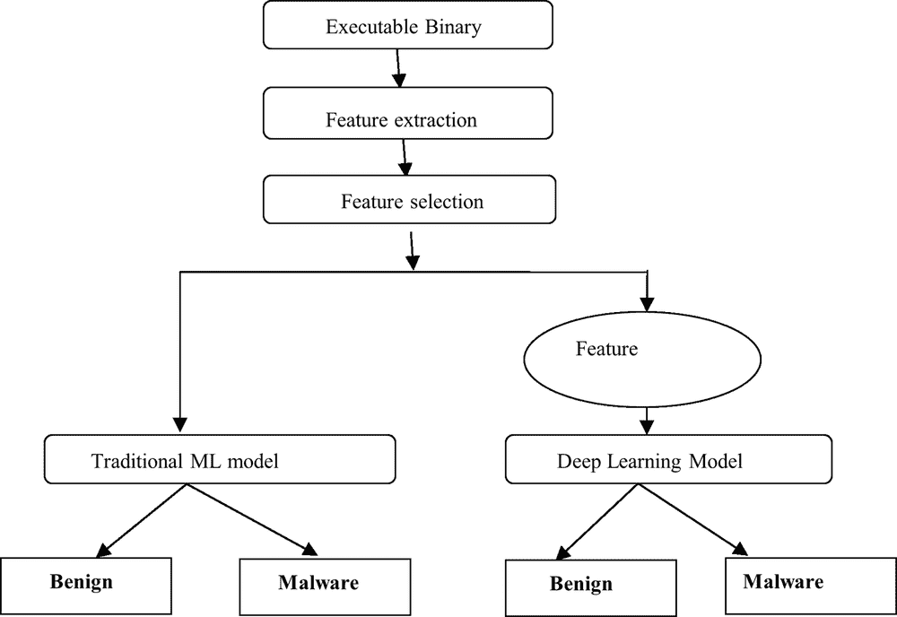 |

## 4. 实验

根据这一预测，数据集种类和大小将影响构建恶意软件检测和分类模型所使用的方法。如果数据集容量有限，传统的机器学习方法如 `decision trees`（决策树）、`random forests`（随机森林）和 `logistic regression`（逻辑回归）将有效运行。如果数据集包含足够的记录，那么基于深度学习的技术性能优于浅层机器学习技术。至于数据集的性质，即数据集是同性的还是非同性的，数据集的性质也决定了哪种算法表现良好，例如在本实验中，数据是非同性的，因此 `logistic regression` 的性能较差。因此，实验的总体目标如下：

- 构建一个使用 `random forest` 和 `logistic regression` 等传统机器学习模型以及一个深度学习模型的恶意软件检测模型。
- 对所有模型进行比较并选择最佳模型。

### 4.1 数据集详情

恶意软件数据集取自 `GitHub`，包含 `1380047` 条记录和 `56` 个特征，数据集链接见参考文献。

- `41,323` 个二进制文件 - 合法
- `96,724` 个恶意软件文件

| 图 4. 数据集分布模式 |
| --- |
| 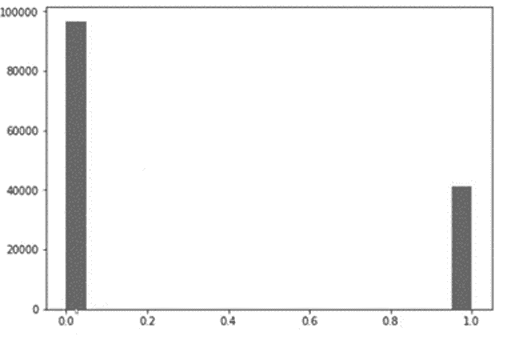 |

### 4.2 结果与讨论

从上表可以看出，`random forest` 是传统机器学习中最好的分类器，而 `logistic regression` 对于非同性数据模式并不理想，因此 `f1-score` 为零。`Neural network`（神经网络）也给了更好的结果，`f1-score` 为 91%。

表 3. 不同分类器的性能比较 |
| --- |
| 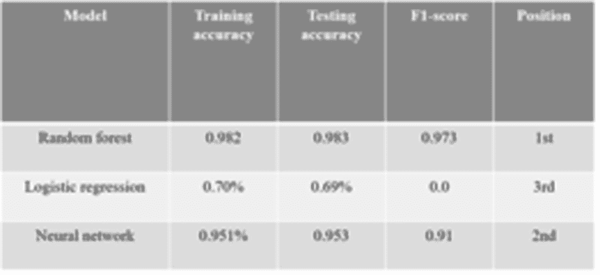 |

## 5. 结论

恶意软件作者正在使用如 `obfuscation`（混淆）、`packing`（壳）、`polymorphism`（多态）和 `metamorphism`（变态）等高级技术。为了应对所有此类网络攻击，一个强大的恶意软件检测系统也是必要的。因此，在本研究中描述了不同的恶意软件检测和分类方法及其优缺点。在该工作中发现，不同的方法使用了不同的参数、不同的检测技术、不同的分类技术和评估技术。因此，本研究的目标是激励开发一种适用于不同类型恶意软件攻击的通用方法。

## 参考文献

- `Github`. (n.d.). [数据集]. `https://raw.githubusercontent.com/PacktPublishing/Mastering-Machine-Learning-for-Penetration-Testing/master/Chapter03/Chapter3-Practice/dataset.csv`
- `Aboaoja, F. A., Zainal, A., Ghaleb, F. A., Al-rimy, B. A. S., Eisa, T. A. E., & Elnour, A. A. H. (2022). Malware detection issues, challenges, and future directions: A survey. Applied Sciences (Basel, Switzerland), 12(17), 8482. doi:[10.3390/app12178482](https://doi.org/10.3390/app12178482)`


DekelO.ShamirO. (2008, July). 学习进行具有缺失和损坏特征的分类。In Proceedings of the 25th international conference on Machine learning (pp. 216-223). ACM. doi:[10.1145/1390156.1390184](https://doi.org/10.1145/1390156.1390184)

Drew, J., Moore, T., & Hahsler, M. (2016, May). 使用序列分类方法检测多态恶意软件。In 2016 IEEE Security and Privacy Workshops (SPW) (pp. 81-87). IEEE. doi:[10.1109/SPW.2016.30](https://doi.org/10.1109/SPW.2016.30)

Enck, W., Octeau, D., McDaniel, P. D., & Chaudhuri, S. (2011, August). Android 应用安全研究。In USENIX security symposium (Vol. 2). William Enck.

Feng, R., Sen Chen, X. X., Meng, G., Lin, S.-W., & Liu, Y. (2020, September). 一种用于移动设备深度学习的性能敏感恶意软件检测系统。IEEE Transactions on Information Forensics and Security, 16, 1563–1578. doi:[10.1109/TIFS.2020.3025436](https://doi.org/10.1109/TIFS.2020.3025436)

Firdausi, I., Erwin, A., & Nugroho, A. S. (2010, December). 基于行为的恶意软件检测中使用的机器学习技术分析。In 2010 second international conference on advances in computing, control, and telecommunication technologies (pp. 201-203). IEEE. doi:[10.1109/ACT.2010.33](https://doi.org/10.1109/ACT.2010.33)

GongL.LiZ.QianF.ZhangZ.ChenQ. A.QianZ.LiuY. (2020, April). 将机器学习应用于市场级移动恶意软件检测的经验。In Proceedings of the Fifteenth European Conference on Computer Systems (pp. 1-14). ACM. doi:[10.1145/3342195.3387530](https://doi.org/10.1145/3342195.3387530)

Gong, L., Lin, H., Li, Z., Qian, F., Li, Y., Ma, X., & Liu, Y. (2020). 系统化将机器学习应用于市场级移动恶意软件检测。IEEE Transactions on Parallel and Distributed Systems, 32(7), 1615–1628. doi:[10.1109/TPDS.2020.3046092](https://doi.org/10.1109/TPDS.2020.3046092)

Han, K. S., Lim, J. H., Kang, B., & Im, E. G. (2015). 使用可视化图像和熵图的恶意软件分析。International Journal of Information Security, 14(1), 1–14. doi:[10.1007/s10207-014-0242-0](https://doi.org/10.1007/s10207-014-0242-0)

Hardy, W., Chen, L., Hou, S., Ye, Y., & Li, X. (2016). DL4MD:一种用于智能恶意软件检测的深度学习框架。In Proceedings of the International Conference on Data Science (ICDATA) (p. 61). The Steering Committee of The World Congress in Computer Science, Computer Engineering and Applied Computing (WorldComp).

Hosseini, S., Nezhad, A. E., & Seilani, H. (2021). 使用卷积神经网络和 LSTM 的 Android 恶意软件分类。Journal of Computer Virology and Hacking Techniques, 17(4), 307–318. doi:[10.1007/s11416-021-00385-z](https://doi.org/10.1007/s11416-021-00385-z)

IslamR.TianR.BattenL.VersteegS. (2010, July). 基于字符串和函数特征选择的恶意软件分类。In 2010 Second Cybercrime and Trustworthy Computing Workshop (pp. 9-17). IEEE. doi:[10.1109/CTC.2010.11](https://doi.org/10.1109/CTC.2010.11)

Komashinskiy, D., & Kotenko, I. (2010, February). 基于位置依赖特征的数据挖掘技术进行恶意软件检测。In 2010 18th Euromicro Conference on Parallel, Distributed and ... (pp. 617-623). IEEE.

Kumar, A. S., Kuppusamy, K., & Aghila, G. (2019). 一种检测可执行文件恶意性的模型。Journal of King Saud University, 31(2), 252.

Li, S., Qian, Y., & Xu, R. ... (2021). 一种对抗性恶意软件框架。IEEE Transactions on Science and Engineering, 8(1), 736–750.

Mahmoud, B., Feghali, T. (2022). 使用递归特征消除（RFE）的机器学习。IOS。

NatarajL.KarthikeyanS.ManjunathB. (2011, July). 恶意软件图像：可视化与自动。8th international symposium.

Naway, A., & Li, Y. (2019). 使用深度神经网络。arXiv preprint:1904.0736.

Ni, S., Qian, Q., & Zhang, R. (2018). 使用深度学习的恶意软件识别。Computers & Security, 77, 871–885. doi:[10.1016/j.cose.2018.04.05](https://doi.org/10.1016/j.cose.2018.04.05)

Rafique, M. F., Ali, M., Qureshi, A., & Mirza, A. M. (2019). 基于深度学习特征提取和封装特征选择的恶意软件分类。arXiv preprint:1910.0958.

Shang, S., Zheng, N., Xu, J., Xu, M., & Zhang, H. (2010). 通过调用图相似性检测恶意软件变体。In 5th International Conference on Malicious and Unwanted Software (pp. 113-120). IEEE. doi:[10.1109/MALWARE.2010.566587](https://doi.org/10.1109/MALWARE.2010.566587)

SL, S. D., & Jaidhar, C. D. (2019). 基于可视化的卷积神经网络的 Windows 恶意软件检测器。IEEE Transactions on Emerging Topics in Computing, 9(2), 1057–1069.

Urmila, T. S. (2022). 基于行为特征的 Android 设备上机器学习恶意软件检测。Materials Today: Proceedings, 62, 4659–4664. doi:[10.1016/j.matpr.2022.03.121](https://doi.org/10.1016/j.matpr.2022.03.121)

# 第 11 章

*   T. Sarath
    Vellore Institute of Technology, India
*   K. Brindha
    Vellore Institute of Technology, India
*   Sudha Senthilkumar
    Vellore Institute of Technology, India

## 摘要


在日常生活中，互联网已成为使用在线银行或广告等服务的不可或缺的一部分。在互联网上，就像在现实世界一样，总有人希望在金钱交易时随时利用信任个人来伤害他人。为了实现目标，人们意图使用恶意软件来破坏互联网，这种攻击被称为“恶意软件”（Malware）。恶意软件是指在所有者或用户不知情的情况下安装在计算机或移动设备上的恶意软件。因此，通过研究这种恶意软件，IT 团队能够更好地评估安全事件，并帮助防止感染扩散到受害者的计算机或服务器。为了完成这项工作，IT 响应人员通常寻找技术上被称为“恶意软件取证”的解决方案。随着网络犯罪利用恶意软件针对金融机构、科技公司和零售业务，恶意软件取证的重要性日益增加。这种病毒可以分为两类：静态恶意软件和动态恶意软件。虽然动态恶意软件分析提供了各种工具和代码，但静态恶意软件分析存在若干局限性。因此，在大多数情况下，通常是动态恶意软件分析。本章涉及恶意软件类型、其如何影响用户、静态恶意软件的局限性以及用于分析恶意软件的动态恶意软件工具的研究。重点关注恶意软件分析中面临的问题和挑战、可在云端运行的在线恶意软件分析工具以及未来的研究前景。

# 1. 引言

恶意软件被称为 malware，正如其名称所示，恶意软件的创建目的是通过窃取数据、损坏文件或仅仅通过恶作剧地骚扰用户来损害计算机及其用户。根据报告，恶意软件正变得越来越普遍，计算机安全事件急剧激增（Adelstein et al., 2002; Bergeron, 2001)）。网络扩展被恶意软件中断。恶意软件针对基于互联网的应用程序。由于今天生活的几乎每个部分都依赖互联网来提高服务水平并防止这些恶意软件可能产生的任何负面影响，因此尽快识别并停止恶意软件比以往任何时候都重要。具有传播潜力的恶意软件很难防御，因为它们缺乏集中管理。根据研究（William, 2008），恶意软件是计算机安全最大的威胁之一。他们设计恶意软件使其定期更改以避免被轻易发现。

恶意软件开发者不断努力产生难以检测的程序，随着时间的推移，他们成功地增强了用于隐藏或变形坏代码的采用策略。从简单的加密开始，这些思想演变为多态、寡多态和变态型病毒。

识别某些恶意软件的方法之一是通过杀毒病毒扫描程序，尽管恶意软件开发方法有所改进，但恶意软件检测器现在采用许多技术来减少此类软件的有害影响。由于目前恶意软件检测方法的局限性，机器学习和数据挖掘技术与当前的检测技术相结合，以提高检测过程的效率（Wang et al., 2021）。

## 2. 恶意软件类型

恶意软件有许多形式，但可以大致分为以下几类：

*   **病毒 (Virus)**：病毒通过复制自己来感染计算机和其他文件。尽管许多属于同一类，但它们通过电子邮件和存储媒介传播。它们加入网络并消耗资源。由于其复制和跨网络使用的能力，它会导致系统下降和拒绝服务（Spafford, 1989）。
*   **蠕虫 (Worms)**：是独立存在的恶意代码。它们具有复制和消耗网络及计算机资源的能力。杀毒扫描程序可以根据其能力识别这些（Li & Stafford, 2014）。
*   **木洛马 (Trojan Horse)**：是一种具有恶意目的有用应用程序。它通过在线活动下载到计算机中，可以破坏或损坏系统上的文件并窃取重要数据（Idika & Mathur, 2007）。
*   **间谍软件 (Spyware)**：间谍软件用于跟踪用户活动或窃取某个人信息。在系统所有者不知情的情况下，它被安装并秘密收集信息然后发送回其制者。即使是像 Google 这样的知名公司也利用间谍软件收集必要数据（Yin, 2007）。
*   **广告软件 (Adware)**：大多数时候，广告软件非常烦人，因为它在未经用户同意的情况下在其计算机上播放广告并干扰其当前任务。广告软件的主要目标是产生利润。它与其他恶意软件一样有害。
*   **Cookies**：它是用户网络浏览器存储在计算机上以供以后使用的文本文件格式，包含信息。据假设 Cookies 是安全的，但当某些间谍软件使用它们时，就会产生问题。
*   **嗅探器 (Sniffers)**：是监控和捕获网络通信的软件。它们检查各种数据包字段并收集数据为病毒攻击做准备。
*   **僵尸网络 (Botnet)**：是一种允许攻击者控制被受害机器的软件。是由黑客或其他攻击者管理的被受害机器集合，在所有者不知情的情况下被用于非法目的。它们发起拒绝服务攻击，可以发送垃圾邮件且数据可以被窃取。
*   **键盘记录器 (Keyloggers)**：是一种间谍软件，用于捕击键以窃取信用卡号、敏感信息和密码。当用户查看受感染的网站或安装了其他恶意软件时，这些程序可以进入计算机。
*   **垃圾邮件 (Spam)**：垃圾邮件的另一个名称。这些邮件通过电子邮件发送并产生大量的接收者。这消耗了大量的带宽并使系统变慢。


-   勒索软件目前是互联网领域最大的威胁。勒索软件是一种软件，它可以加密你的数据，禁用各种应用程序，并防止你在支付赎金之前使用你的操作系统。大多数要求都是以金钱为形式表达的。即使支付了钱，也无法保证你能够重新获得控制权。

## 恶意软件的伪装演变

强烈建议研究恶意软件伪装，以理解并构建恶意软件分析与检测策略。恶意软件伪装是指隐藏恶意软件以使其尽可能长时间地避开恶意软件检测器的术语。恶意软件作者采用各种策略，从简单的加密到复杂的变态加密（Wang 等，2021）。

### 加密

恶意软件作者不断努力使程序对恶意软件扫描器的检测察觉度降低。加密是他们采用的能使其最良好地融入环境的方法。它是恶意软件隐藏的第一种方法（You & Yim, 2010）。它包含加密和解密模块。解密每次都使用相同的密钥，而加密每次都使用不同的密钥。由于解密方法不保证唯一性，因此对其进行检测可能的。第一个加密恶意软件 `CASCADE` 最初出现于 1987 年（Beaucamps, 2007）。图 1 展示了该病毒的结构。

| 图 1. 加密病毒结构 |
| --- |
| 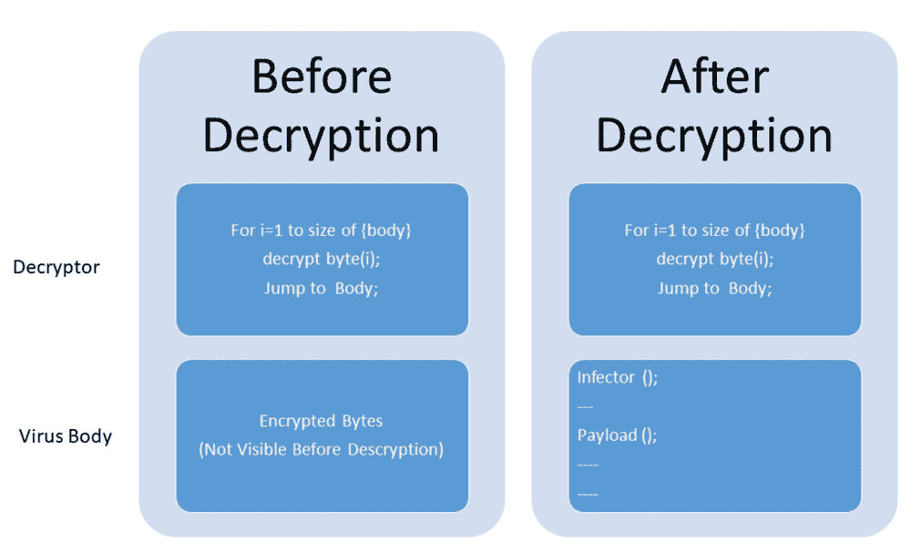 |
| --- |

这种方法的主要目标是防止静态代码分析和防病毒软件检测。这种方法还会导致查询过程滞后。

### 少变态 (Oligomorphism)

第一种少变态病毒被称为 Whale 和一种 DOS 病毒，首次出现于 1990 年（Szor, 2005）。这被视为恶意软件伪装的一种发展。与少变态不同，每次感染都使用不同的解密器，而加密中的解密器在每次感染中都保持不变。它也被认为是半多态加密方法的一项进展。虽然少变态从解密列表中为每次新的攻击提供不同的解密器，但仍然存在防病毒软件通过扫描所有解密器来检测到该攻击的可能性。

### 多态性 (Polymorphic)

Mark Washburn 在 1990 年创建了第一个多态病毒 1260。虽然多态性比其他病毒更复杂，因为它将加密与少变态结合在一起。防病毒软件很难检测它们，因为它们在每次复制时都会改变自己的外貌。它们产生的解密器数量没有限制。这些病毒通过使用各种混淆技术来改变自己的外观。变异引擎负责这种变化过程。

### 变态加密 (Metamorphism)

在这一代变态病毒中，恶意软件的内容发生了变化而不是被加密。因此，不需要解密器。它也使用与多态性相似的变异引擎，而不是改变解密器，而是改变整个正文。基本的感染思想是，语法随着新副本的语义而改变，即使病毒看起来由于不改变的函数部分而发生变化，语义也保持不变。`ACG` 是 1998 年为 DOS 创建的第一个变态病毒。

## 恶意软件混淆技术

混淆是恶意软件作者使用的一种技术，旨在创建他们认为难以阅读和理解的代码。这种方法的主要目标是掩盖恶意软件的破坏活动。几位研究人员对混淆策略有不同的分类。下面列出的六类详细说明了这些策略。

### 插入代码 (Dead Code)

插入代码是指通过 `NOP` 语句、`push` 和 `pop` 语句引入垃圾代码，使其不影响软件行为。这种方法是恶意软件隐藏的一种手段。

### 指令替换 (Replacement of Instruction)

这种方法通过替换指令来使恶意软件对防病毒软件是难以检测的。

```
move eax
xor eax
```

### 寄存器重分配 (Register Reassignment)

这种方法通过等效指令来改变恶意软件的寄存器。

```
and eax
sub eax
```

### 子程序重排序 (Subroutine Reordering)

这种方法通过重新排列指令序列来改变恶意软件的外观，而不影响其行为。以下是子程序重排序的示例：

```
//Subroutine
add esi
add esi,0
```

### 代码转位 (Transposition Code)

通过这种方法，原始代码的指令被重新排列，以保持其语义。要转位代码，有两种方法：一种是随机排列跳转和条件语句，另一种是选择无关指令。后种方法更为有效。

### 代码集成 (Code Integration)

正如名称所示，恶意代码被集成到软件中，使其难以被发现，这种方法特别有效（Konstantinou & Wolthusen, 2008）。


例如，如果源代码可用，则可以提取出各种有用信息，包括数据结构和使用的函数。进一步的调查受到以下因素的影响：一旦基础程序被转换为可执行的二进制文件，这些信息就会丢失。

静态恶意软件分析使用多种方法。以下是其中几种方法的描述：

*   文件指纹：包括在文件层面的活动，例如计算二进制文件的加密哈希值（如 `md5`）以将其与其他二进制文件区分开来，并确认其未被修改，此外还会查看文件的明显外部特征。
*   文件格式：通过利用特定文件格式的元数据检索的有用信息。这也适用于 `UNIX` 系统用于识别文件类型的魔数（magic number）。例如，可以从 Windows 二进制文件（通常为 `PE` 格式，即可执行文件）中提取数据，包括编译时间、导入和导出的函数、图标、菜单和字符串。
*   AV 扫描：这是一种通常被称为恶意软件的二进制文件检查，一个或多个防毒病毒扫描器很可能会发现它。使用一个或多个防毒病毒扫描器需要时间，但在某些情况下这是必要的。
*   壳壳检测：如今，恶意软件有时以隐蔽的形式分发，例如压缩或加密的形式。壳壳（Packer）被用于实现这种算法，并被用于修改。

静态分析显示，程序在加壳后看起来非常不同，这使得很难恢复逻辑和其他元数据。虽然存在一些解壳工具（如 `PEiD2`），但并没有通用的解壳工具，这使得静态恶意软件分析极其困难。

*   反汇编：通常，反汇编特定的二进制文件是静态分析的主要部分。这是使用如 `IDA Pro` 等程序将机器码转换为汇编语言。分析人员随后可以研究程序逻辑，通过重构汇编代码研究程序的目标。静态恶意软件分析的主要优势是能够对特定的二进制文件进行彻底检查。因此，它可以涵盖潜在的样本样本执行路径，且源代码并未运行，动态分析不如静态分析安全。然而，它可能花费大量时间，因此需要专业知识。

### 4.1.1.1. 静态恶意软件分析的局限性

恶意软件样本源代码通常难以获取。这限制了分析恶意软件的相关静态分析方法，使其仅限于从二进制恶意文件中提取数据的方法。考虑到大多数恶意软件攻击使用运行 `IA32` 指令集的主机，且二进制文件使用了自修改代码方法，此类程序的反汇编结果可能不明确。

### 4.1.2. 动态分析

动态或行为分析是检查和执行软件功能的过程 (Elhadi et al., 2012)。它可以通过跟踪函数调用、控制流、审查函数指令和参数来实现。为了监控其行为并创建防御措施，恶意程序在虚拟环境中运行。`RegShot`、`Sandbox`、`emulators`、`Process Explorer` 和 `imulator` 是用于动态分析的工具。由于这种技术是在虚拟计算机上运行感染程序以便监控，动态分析比静态分析更有效。这使得多种类型的恶意软件很容易检测。这种形式的分析需要更多时间，因为我们需要为恶意软件创建执行测试环境。

如果分析环境隔离不当，恶意软件样本如果没有在受控的分析环境中运行，可能会改变其行为或完全停止。分析动态恶意软件的基本方法有两种，如下：

*   分析定义点之间的差异：通过将系统相对于其初始状态所做的更改进行比较，可以分析恶意软件样本运行预定时间后定义点之间的差异。通过这种方法，比较报告描述了恶意软件的行为。
*   监控运行时行为：在这种方法中，使用特定工具对恶意应用程序执行过程中执行的有害操作进行跟踪。`Regshot` 工具是第一种策略的示例。使用 `Regshot` 在运行程序之前对注册表拍摄快照。运行二进制文件后，点击 2nd shot 按钮拍摄第二个快照，然后点击比较按钮比较两个快照。结果以文本文件的形式接收分析，包括有关添加和修改的文件的信息。目前最有前景的方法涉及观察应用程序在运行时的行为。这种与系统其余部分隔离开以隔离恶意进程的受控运行时环境在此文中被称为“沙箱（sandbox）”。在某种程度上，这种划分通常是利用虚拟化技术实现的。

### 4.1.3. 混合

它结合了动态和静态分析方法，以从两种策略中获益。软件首先通过代码分析寻找恶意软件签名，然后在虚拟环境中启动以观察其在现实世界中的行为。

表 1 展示了动态和静态分析方法的比较。

表 1. 动态与静态分析的比较

| 静态分析 | 动态分析 |
| --- | --- |
| 安全且快速 | 耗时且存在漏洞 |
| 适用于分析多路径恶意软件 | 难以分析多路径恶意软件 |
| 无法分析多态混淆恶意软件 | 无法分析多态混淆恶意软件 |
| 误报率低 | 误报率高 |

## 5. 恶意软件检测技术

三种主要的恶意软件检测技术是基于签名的、基于规范的基于启发式的。这些方法通过定位、识别恶意软件来采取行动保护计算机免受资源损失和潜在数据威胁。

以下是目前用于分析未知和潜在有害软件的方法和资源摘要。分析人员可以从工具生成的分析报告中学习大量关于样本所活动的信息。这些报告为立即彻底理解样本奠定了基础。

*   FileMon：`FileMon` 对于检测文件系统更改非常有用。此外，二进制文件能够识别并记录它进行的任何搜索。该工具非常敏感，并且会检测 Windows 对不活动文件所做的更改。因此，请确保在启动工具约 10 秒后`停止捕捉`，并在运行二进制文件之前`清理工具`。


- **Norman Sandbox**: 该工具在一个严格限制的虚拟环境中执行样本，该环境模拟了 Windows 操作系统。该环境中模拟了与宿主机计算机关联的局域网和互联网连接。Norman Sandbox 的主要原理是模拟被评估样本所需的所有功能，以替换其实际功能。因此，模拟系统必须提供与操作系统相关的机制，例如多线程支持和内存保护。为了给样本提供一种“正在运行在真实系统上”的虚假印象，必须提供所有必要的 API。封装或混淆的可执行文件对研究本身并不构成阻碍，因为恶意软件是在伪造的系统中执行的。Norman Sandbox 侧重于识别试图跨越网络共享、电子邮件或 P2P 网络传播的病毒。
- **JoeBox**: JoeBox 在对可能的有害样本进行动态检查期间会生成日志，该日志包含了与文件、系统和注册表进程相关的各种操作的高级细节。JoeBox 从零开始创建的，用于运行实际硬件，而不使用任何虚拟化或仿真软件。其结构采用客户端-服务器架构构建，单个控制器实例可以管理多个负责执行分析的客户端。因此，通过向系统添加额外的分析客户端，可以轻松提高整个系统的吞吐量。负责收集数据的机器收集所有分析数据。

## 5.1. 基于签名的检测

当恶意软件被创建时，通常被称为“签名”的位串会被插入代码中，随后可以使用它确定属于恶意软件家族的哪些成员。大多数杀毒产品都采用基于签名的检测方法。杀毒工具分析受感染文件的代码，寻找具有特定恶意软件家族特征的模式（`Landage & Wankhade, 2013`）。恶意软件签名在数据库中保持更新，然后在检测过程中用于比较。字符串或模式扫描或匹配是这种检测方法的其他名称。它也可以静态的、动态的或混合的。

## 5.2. 基于启发式的检测

基于启发式的检测通过识别系统正常行为和异常行为之间的区别，最终发现并停止已知的和未知的恶意软件威胁。启发式检测方法由两个步骤组成。首先，在没有攻击时观察系统的行为，并记录关键数据，以便在发生事件时进行检查和验证。在下一阶段，对区别进行审查，以寻找属于特定家族的恶意软件。基于启发式技术的行为检测器的三个主要部分如下：

- **数据收集**: 正如名称所示，这部分负责收集动态或静态数据。
- **数据解释**: 这一步在经过数据收集组件解释后，将数据转换为中间格式。
- **匹配算法**: 在解释组件中，使用匹配算法组件将转换信息与行为签名进行比较。`Figure 2` 展示了行为检测器，它演示了这些部分是如何作为一个单元运行的。

| 图 2. 检测器行为 |
| --- |
| 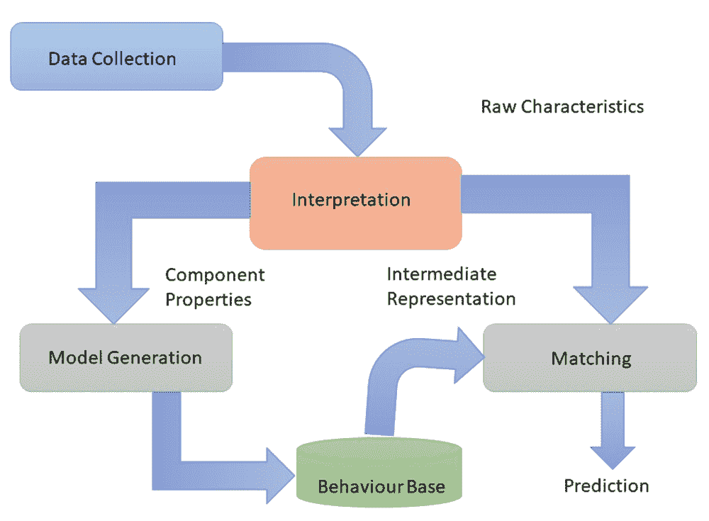 |
| --- |
| *(`Jacob et al., 2008`)* |

尽管基于启发式的检测是一种有效技术，但该技术也有其缺点，包括更高水平的误报率和更高的资源需求。这种方法通常被称为主动策略、行为分析或异常识别。在在使用启发式检测之前，会进行许多类型的分析，包括基于规则的、基于文件的、通用签名和基于权重的分析。

## 5.3. 基于规范的检测

在基于规范的检测技术中，根据其规范对应用程序进行监控，寻找正常行为和异常行为。这种方法衍生于启发式技术，是两者之间的关键区别：基于启发式的检测技术使用 AI 方法来检测合法程序的欺诈活动，而基于规范的检测技术则是根据系统规范的行为进行分析（`Yaacoub et al., 2020``）。这一过程在某种程度上通过对系统正常操作的物理比较完成。通过降低误报率并提高漏报率，它规避了启发式方法的缺点。`Table 2` 显示了三种检测方法的优缺点。

| 图 3. 分类与关系 |
| --- |
| 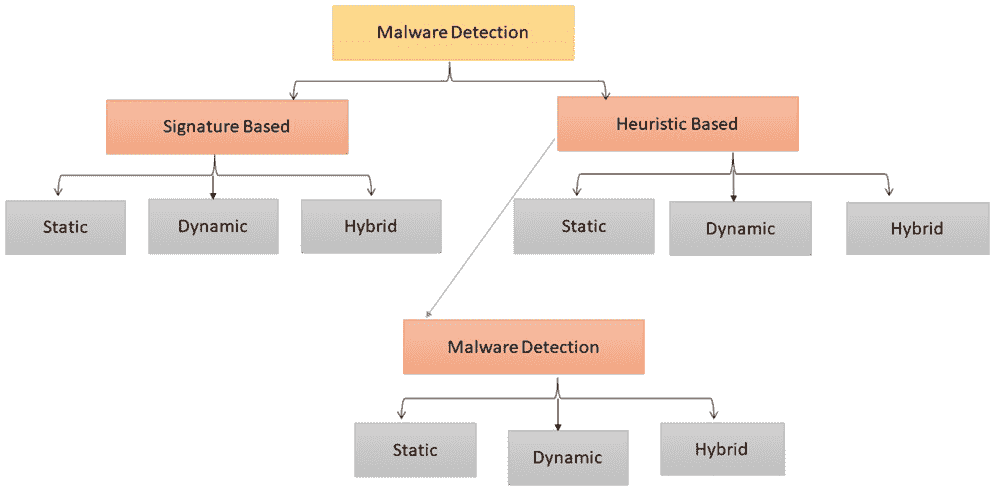 |
| --- |

表 2. 三种检测方法的优缺点

| | 优点 | 缺点 |
| --- | --- | --- |
| 基于签名的检测 | • 可以很容易地检测已知恶意软件<br>• 与其他技术相比消耗资源较少 | • 它无法检测未知的恶意软件 |
| 基于启发式的检测 | • 可以检测已知和未知的恶意软件<br>• 需要未知和新恶意软件的更新数据<br>• 在空间和时间上需要更多资源 | • 误报率高 |
| 基于规范的检测 | • 可以检测未知、已知和新颖恶意软件<br>• 误报率低 | • 漏报率高<br>• 检测新恶意软件的效率低下<br>• 规范开发耗时 |

## 6. 恶意软件的现状与挑战

反恶意软件对最小化灾难率不断增长的需求，开启了迫切的待定调查机会和试验。

### 6.1. 反恶意软件方法的现有问题

随着恶意软件复杂性的持续急剧增加，未来的挑战将更具挑战性。大多数之前的静态、动态和混合方法都需要虚拟环境，且分别未针对创新、未识别或零日标记做出努力。然而，由于恶意软件作者经常使用复杂的新策略来隐藏危险元素，从而领先一步，虚拟环境正在失去其有效性。尽管努力构建并行和多级防御系统，但目前的反恶意软件技术和应对措施对于更高程度的隐藏通常是不充分或无效的。


经典的反病毒软件容易出现过拟合问题，且整体可靠性较低，因为它们频繁依赖非线性对手分类模型和熟练的领域信息。AML（反恶意软件）方法不再使用显式模型、系统或攻击，而是尝试使用各种材料、设置等模拟攻击者。尽管关于浅层 AML 用于反病毒的初步较少，但该领域仍有大量工作需要完成。AML 模式（如暴露集感谢、更复合的剩余数据挖掘字典学习以及深度学习）应针对特征分割/特征选择/学习/分类，并确定恶意软件片段内部及之间的时间关系，以提高对广泛且未知样本的准确性、可扩展性和灵活性。

### 6.3. 移动设备恶意软件

联网智能设备的数量正在迅速增加，它们面临的恶意软件威胁（特别是通过第三方应用程序）也日益增长。移动设备恶意软件的研究仍然不足。此外，由于计算成本高以及/或分析特征的复杂，目前大多数反病毒技术并不实际，不适用于移动设备。因此，基于贝叶斯分类的实时轻量级移动反病毒是一个极具前景的研究领域。来自内置传感器（如加速度计）的各种数据可能会提高移动反病毒的有效性。另一个需要仔细研究的问题是移动硬件恶意软件的检测和消除。早期的移动反病毒技术将对智能设备的设计产生巨大影响。然而，应该使用强有力的措施来对抗智能设备恶意软件。应用程序创建者应维护应用的安全和隐私标准。应用市场的管理员应检查并消除疑应用。用户应使用良好的应用程序和先进的反病毒程序。总体而言，针对可穿设备和移动设备的恶意软件及反病毒是网络安全的一个新领域，具有亟待研究的问题。

### 6.4. 大规模基准数据库

公开具有精确上下文和标签的详尽标准数据集对于恶意软件研究的进展至关重要。大多数数据库存在规模较小、信息或特征缺失、分类不平衡以及不开放等缺点。由于缺乏足够的大规模公共数据集，恶意软件研究受到了。基准无限制数据集有助于关联不同的反病毒程序，识别安全违规现象之间的相关性，并结合恶意软件发现做出具有统计意义的假设。尽管如此，由于恶意软件特征、形式和行为的多样性，编译大规模异构标记数据库在时间和资源上是非常困难的。利用众包收集各种大规模标注数据集可能会大有益处。

### 6.5. 基于图的恶意软件分析

如今大多数恶意软件使用隐藏手段来避免传统反病毒软件的检测，而这些软件大多忽略了学习和识别样本及其变之间的底层链接以及上下文数据。数据、数据程序、调用图、控制流图和控制依赖图是基于图的关系表示和特征的一些示例，即使恶意软件代码发生变化，它们也提供了有趣的可能性，因为它们更容易在各种上下文中跟踪恶意软件的历史。基于图的反病毒开发仍面临数据异构性、标记不准确和噪声以及实时检测期间计算开销等挑战。此类问题可以通过去中心化解决。使用多个无向和有向图、异构网络、多视图谱聚类、动态图挖掘、多个图核学习、深度图困难内核来捕捉结构和上下文信息。

### 6.6. 生物启发式反病毒

通过使用生物启发的方法（如生物免疫系统、生物进化、群智智能和遗传算法），可能克服传统反病毒软件的一些局限性。相比之下，这些方法更轻量、可扩展性更好，且资源限制较少。通过使用自适应生物启发算法进行巧妙的隐藏不变特征提取和分类，可以大大提高野外环境的准确性。使用建立特定目标函数的生物启发方法，可以将受攻击的系统与功能故障或失败的系统区分开来。一个有趣的方向在反病毒程序中尚未得到充分研究，它涉及深度神经网络与生物启发算法的结合。

### 6.7. 深度防御反病毒

深度防御（DiD）是一种使用许多防御层次或防线来替代单一防线的反病毒方法。由于它不依赖单一防御方法，即使其中一种失效也不会受到损害，因此人们认为一种强大的防御机制将更具韧性。每台机器或网络系统架构都可以分为不同的深度阶段；例如，在电网方案中，仪表、通信线路和较小的机制可能分别被认为是最低、中间和最高级。主动或自适应恶意软件防御是另一种选择。由于其内在复杂性，主动防御尚未引起关注。开发者预测各个级别的攻击情况，并适当创建恶意软件对抗措施。在自适应防御中，系统根据情况的变化进行动态调整，或通过重新训练/添加新特征进行持续更新。自适应防御可能利用无监督学习和概念漂移，并且需要快速、自动化且计算高效。

### 6.8. 针对物联网 (IoT) 的攻击

物联网正越来越多地用于各种领域，从智能城市到军事网格。即使采取了最好的安全措施，物联网设备和系统仍然容易创造性的网络攻击。物联网设备持续连接到网络，使得安全性变得越来越重要。由于具有多个信息源和不同类型节点的异构系统，使用物联网的网络安全是一个较新的研究领域且相当难以理解。几种方法（如区块链和预测分析）可能成功实现这一目标。预测性安全通过构建预测未来威胁的副本并提前避免来获得网络弹性。预测模型应该考虑社会科学、计算机网络、描述性理论、不确定行为模型和心理学，以及攻击者、用户和管理员在不同粒度阶段的感知，因为安全疏漏和社会错误之间存在持久的关联。

### 6.9. 欺骗与移动目标反病毒技术


通过引诱敌人攻击并用虚假信息误导他们，恶意软件可以通过欺骗技术（如蜜罐）进行检测和防御。客户端蜜罐和服务器蜜罐是两种不同类型的蜜罐。使用蜜罐可以减少误报并停止 DDoS 攻击。复杂的攻击手段和工具（例如，多多态恶意软件）正变得越来越流行，要么是为了定位蜜罐，要么是为了改变蜜罐本身的行为。此外，攻击者可以利用蜜罐来破坏框架中其他敏感的组件。由于被攻破的蜜罐会危及整个组织的安全，因此应该开发更复杂的蜜罐和蜜罐网（一组蜜罐的集合）方案（例如影子蜜罐）。使用移动目标方法（也称为动态平台方法或 `DPMs`）动态随机化系统组件，可以降低攻击成功的风险并加快应对速度。

## 6.10 去中心化反恶意软件
目前的反恶意软件创新受到数据共享和信任管理的限制；然而，利用区块链技术的去中心化恶意检测器可以解决这些问题。但直到今天，它还没有引起足够的关注。反恶意软件与区块链交叉领域的未来方向包括：研究开销流量处理、稀疏恶意软件的高质量和签名、构建准确的动态正常流量、减少大量虚假警报、成本与能量、区块链闲置、逐案情况的调查，以及进一步的概念验证应用。

### 6.11 隐私保护
窃取敏感信息的恶意软件引起了广泛关注。然而，通过恶意软件分析（特别是在第三方或云端服务器上）和数据共享恶意软件来保护用户隐私仍然是一个未解决的问题。在用户隐私或数据被破坏后，将很难恢复它并重建对商业反恶意软件的信任。大多数之前的反恶意软件程序忽略了用户、数据和网络隐私与安全。为了尊重公众和法律角度，目前正在开发隐私保护框架。为了平衡安全性、有效性、隐私和电池消耗，在设计可用于移动设备的轻量级检测和隐私保护系统时非常重要。多位专家已强调，恶意软件分析需要更前沿的隐私保护技术。

## 6.12 恶意软件分析可视化系统
恶意软件分析必须对当前的恶意软件分析方法投入大量精力。极其动态的可视化分析将使研究人员和专家更容易比较、总结和分类恶意软件。大多数方法缺乏交互性、时间映射、可扩展性和说明空间选项。恶意软件可视化系统的开发是一个关键且不断发展的课题，涵盖了广泛的恶意软件类型和情况。在未来几年，百科式的可视化工具将帮助分析师和研究人员识别全新的研究领域。

## 6.13 基于硬件的解决方案
最近，基于硬件的恶意软件检测器作为防御措施受到了关注。某些检测系统利用了通过更改计算机处理器微架构实现的底层架构特征，例如具有提供软件和硬件异常操作特定记录的 `CPU`。尽管如此，该领域仍有许多工作要做，可靠系统除了人为错误和敌对势力之外自然是可靠安全的，还有很长的路要走。此外，关于结合硬件和软件方法的反恶意程序有效性的研究较少，因为它们具有发现更复杂恶意软件的巨大潜力。此外，智能设备传感器（如 `GPS` 和环境光传感器）的数据可能用于刻画恶意软件。

## 6.14 恶意软件对抗学习
最近，利用机器学习（`ML`）实现了有效的恶意软件防御，但这些防御并非针对对手积极试图影响结果的情况。特别是针对对抗样本的深度学习防御缺乏鲁棒性。攻击者还会在（自适应/在线）训练记录中注入有害样本，其目的是大幅降低测试阶段 `ML` 应对措施的准确率。设计在对抗环境中具有韧性的 `ML` 反恶意软件仍然是一项挑战性任务。研究人员应该调查恶意软件对抗 `ML`，以便在开发和测试阶段确定潜在的防御弱点，设计类似的攻击并分析其影响，并创建方法提高基于 ML 的反恶意软件的韧性。

## 6.15 恶意软件教育
大多数恶意软件之所以成功是因为它们将人视为最脆弱的环节。此外，对网络安全人才的需求日益增长，因此传播恶意软件安全意识至关重要。学术机构的研究生和本科阶段将开展恶意软件调查及相关课程。然而，只有少数学校和大学提供恶意软件课程。这可能是由于机构之间缺乏基础的话题共识、缺乏培训和书籍提供者，以及教育或培养白帽人员的伦理困难。此外，大多数学术课程关注的是实践而非科学或研究，它们深度依赖于过时的教科书。公司和团体偶尔会举办面向公众的训练营和研讨会，但这些费用极其昂贵。在线开放访问培训课程的可用将无疑减少病毒的危害。

## 7 可恶意软件工具
网络管理员在处理恶意软件问题方面有多种选择：这里探讨了其中一些：

- 安装防病毒和反恶意软件以对抗威胁；教育网络用户相关技术以防止盗窃和数据泄露（无论是故意还是无意的）；以及
- 制定并实施法规以确保硬件策略的物理安全
- 经常对应用程序和操作系统进行补丁更新

当根据网络实时行为数据分析预测到即将降临的危险时，必须建立一套强大的防御策略。

### 7.1 恶意软件检测工具
为了对抗持续的网络威胁，各种恶意软件检测和分析软件说明已相继涌现。全球数百万个网络面临着来自各种威胁和来源的危险。事实上，现在每秒都有数百次攻击在发生。

需要对先前的攻击进行主动分析和威胁预测，才能成功防御这种轰炸。只有在利用网络已存储数据的积极策略支持下，管理员才能抵御攻击者。一个跟踪并在出错时我们的系统将是一种高效的防御策略。

#### 7.1.1 Solar Winds 安全事件管理器
是威胁缓解和入侵检测技术的先驱。其之前的名称为 Log & Event Manager (`LEM`)，主要特征包括：
- 本地包
- 日志收集与整合
- 集中威胁狩猎
- 响应编排

这是一个具备保护网络所需所有功能的工具。通过使用 `SEM`，网络管理和安全人员能够更好地识别恶意软件或其他疑活动并对其做出反应和报告。

### 7.1.2 LogRhythm NextGen


这是一个 SIEM 平台综合防御系统，能够从头到尾在单一集成架构中处理威胁。它结合了日志管理、终端监控和安全分析，成为发现威胁和防止泄露的有效工具。其重要功能包括：在线辅助；用户和对象行为分析；零日检测。

LogRhythm SIEM 因其名为 `Threat Lifecycle Management`（威胁生命周期管理）的特殊功能脱颖而出。该组织开发了一种独特的任务策略，具有端到端的威胁处理能力，以便有效地拦截和检测威胁。

### 7.1.3 Splunk Enterprise Security

另一个评价极佳的 SIEM 解决方案。你可以查看免费版本来了解这个解决方案有多么出色。尽管每天只能索引 500 MB 数据，但 Splunk ES 仍然赢得了赞誉。其重要功能包括：有效的分析工具；SIEM 插件；在混合环境中具有益处。

### 7.1.4 CrowdStrike Falcon

CrowdStrike Falcon 是一个终端安全（EPP）平台。它不是使用网络事件数据进行操作，而是从特定终端收集事件数据，并通过网络发送到分析引擎。因此，它是一个 SIEM 工具。每个受保护的终端都有一个充当活动监控器的代理。CrowdStrike 服务器的分析引擎位于云端。这是一个本地/云的混合系统。其重要功能包括：提供响应平台；共享终端事件数据；保护终端；云端协调；异常检测。

### 7.1.5 Security McAfee Enterprise

带有 McAfee 的企业安全管理器 (`SEM`) 源自一个广为人知的系列，一直处于防病毒和反恶意软件技术的前沿。怀疑者需要考虑的一点是：核心功能包括：来自网络、系统、数据库和演示的信息规范化挑战和问题，通过仅使用 McAfee 的广泛工具包作为数据源得到了缓解；编译 McAfee 终端安全事件数据；预测；服务台集成。

除了提供其独立实现和解决方案外，McAfee 还促进来自大量业务合作伙伴产品的信息的规范化。

### 7.1.6 Micro Focus ArcSight ESM 实时关联

名为 Micro Focus ArcSight ESM 的主动安全管理器已存在了约 20 年。在这些年里，它不断扩展和变化，变成了一个不可置信的恶意软件分析和检测工具。重要特性：处理速度快；经过长期良好测试；适用于 MSSP（托管安全服务提供商）。

该程序目前可以每秒分析 100,000 次事件，使其成为可用最强大的 SIEM 产品之一。它可以扩展以满足任何扩展性需求。

## 8 特性研究前景

随着网络攻击的复杂性增加，保护物理运行需要一种可靠且安全的机制。信息物理系统 (CPS) (`Yaacoub et al., 2020)`) 的安全、持续、可靠和安全的工业运行，需要下一代防御系统利用灵感来自自然的方法论，以低误报率实现高准确性和耐用性（`Wang et al., 2021)`）。如果关键基础设施服务提供者采用这种方法，就可以实时、自动并利用可操作的情报来检测其网络的恶意软件威胁。在下一阶段，研究人员可以尝试回答：

*   研究人员无法访问良性和和恶意数据库。即使可用，生成这些数据集的过程也未公开，导致无法复制。
*   缺乏与 CPS 相关的恶意软件分析研究。为了分类区分通用恶意软件和 CPS 恶意软件的特征，我们想要分析渗透的恶意软件。如果这可行，可能会变得更加稳定和安全。我们目前为止的研究还表明，只有极少数公开的针对 CPS 的恶意软件可执行文件/二进制文件（及其变体）。这是一项更困难的任务，因为对较少样本进行分析将导致较小规模的数据集。
*   在减少 CPS 特有的误报方面努力有限，而误报直接与致命风险有关，并可能被视为对提高消费者信任度的适得其反。
*   有限或几乎不存在使用现有的受启发元启发式算法，这些算法可以被用于恶意软件检测过程的优化。

## 9 结论

目前大多数安全问题，包括涉及智能和移动设备的问题（这些设备在过去几年互联网上变得日益复杂和普遍），都是由恶意软件引起的，恶意软件迅速成为计算社区的重大安全威胁。尽管恶意软件的检测和分析收到了大量的研究关注，但这仍然是一项困难的任务。此外，由于恶意软件制作者经常在攻击中隐藏信息或修改网络攻击以规避新的保护策略，一些旧解决方案对未知恶意软件的适用性较差，且存在扩展性问题。本章解释了恶意软件、恶意软件类型、它如何影响用户、静态恶意软件局限性分析、用于分析恶意软件的动态恶意软件工具分析。进一步关注了恶意软件分析面临的问题、挑战，以及在云端工作的在线恶意软件分析工具。

## 参考文献

Adelstein, F., Stillerman, M., & Kozen, D. (2002). Malicious code detection for open firmware. 18th Annual Computer Security Applications Conference Proceedings. IEEE.

Beaucamps, P. (2007). Advanced polymorphic techniques. International Journal of Computational Science, 2(3), 194–205.

Bergeron, J. (2001). Static detection of malicious code in executable programs.

Christodorescu, M., & Jha, S. (2006). Static analysis of executables. Wisconsin Univ-Madison Dept of Computer Sciences. doi:[10.21236/ADA4967](https://doi.org/10.21236/ADA4967)

Elhadi, A., Maarof, M., & Osman, A. (2012). Malware detection based on hybrid signature behaviour programming interface call graph. American Journal of Applied Sciences 9(3), 283.

Idika, N., & Mathur, A. (2013). Malware and malware detection techniques: A survey. International Journal of Engineering Research & Technology (Ahmedabad), 2(12), 2278–0181.

Li, J., & Stafford, S. (2014). Detecting smart, self-propagating Internet worms. Communications and Network Security (CNS), 2014 IEEE Conference.

Jacob, G., Deb, H., & Filiol, E. (2008). Behavioral detection of malware: From a survey towards an established taxonomy. Journal in computer Virology, 4(3), 251–266.

Konstantinou, E., & Wolthusen, S. (2008). Metamorphic Virus: Analysis and Detection Technical Report. University of London.

Landage, J., & Wankhade, M. P. (2007). A survey of techniques. Purdue University.

Spafford, E. (1989). The internet worm incident. Lecture Notes in Computer Science, 89, 446–468.

Wang, Z., Xie, W., Wang, B., Tao, J., & Wang, E. (2021). A Survey on Recent Advanced Research of CPS Security. Applied Sciences (Basel, Switzerland), 11(9), 3751.

Wang, Y., et al. (2021). [Yaacoub et al., 2020]. 

Szor, P. (2005). The art of computer virus research and defense. Pearson Education.

William, S. (2008). Computer Security: Principles and Practice. Pearson Education India.


Yaacoub, J.-P. A., Salman, O., Noura, H. N., Kaaniche, N., Chehab, A., & Malli, M. (2020). 物理信息系统安全：局限性、问题与未来趋势。Microprocessors and Microsystems, 77, 103201. doi:[10.1016/j.micpro.2020.103201](https://doi.org/10.1016/j.micpro.2020.103201)

YinH. (2007). 景：用于恶意软件检测与分析的全系统信息流捕捉。Proceedings of the 14th ACM conference on Computer and communications security. ACM. doi:[10.1145/1315245.1315261](https://doi.org/10.1145/1315245.1315261)

You, I., & Yim, K. (2010). 恶意软件混淆技术：简要调查。Broadband, Wireless Computing, Communication and Applications (BWCCA), 2010 International Conference on. IEEE.

# 第 12 章

*   D. R. Janardhana
    
    印度班加罗尔 Nitte Meenakshi 科技学院 & 印度贝拉加维 Visvesvaraya 科技大学

*   A. P. Manu
    印度西瓦莫格加 PES 技术与管理学院 & 印度贝拉加维 Visvesvaraya 科技大学

*   K. Shivanna
    
    印度 Malnad 工程学院

*   K. C. Suhas
    印度 Channabasaveshwara 科技学院

## 摘要

在当今数字时代，我们的大部分通信和个人敏感信息都是通过智能设备传输并存储在上面的。因此，确保设备和数据免受各种安全和隐私威胁的侵害变得至关重要。这些威胁旨在获得对数据的未经授权访问，或者更糟糕，将其销毁。本章概述了恶意软件分析及其缓解工具。恶意软件已成为计算机系统和网络的严峻威胁，理解如何分析和缓解与其相关的风险至关重要。在这里，作者讨论了恶意软件及其分类，以及用于恶意软件分析的各种技术，包括静态分析和动态分析。本章还概述了用于预防和检测恶意软件的缓解工具，包括反病毒软件、防火墙、入侵检测系统和沙箱。此外，本章强调了这些工具的一些局限性，并对恶意软件分析和缓解的未来方向提供了见解。

## 引言

恶意软件攻击变得日益频繁，每天都会产生新的、先进的变体。这些攻击具有造成巨大损害的潜力，包括数据窃取和破坏、资金损失和声誉损害。恶意软件分析工具对于分析恶意软件攻击的结构和行为以检测并缓解它们有用 (Aboaoja et al., 2022)。恶意软件分析工具是复杂的程序，可以查看并评估恶意软件以确定其特征和活动。在本文中，我们检查了各种恶意软件分析工具的能力。

### 恶意软件分析工具

这些程序的主要目的是定位和检查恶意软件。这些工具分为三类：静态、动态和混合分析。

*   **静态分析工具**：在不运行代码的情况下分析恶意软件的结构以寻找模式和签名。示例包括 `IDA`、`Ghidra` 和 `Radare2`。
*   **动态分析工具**：在沙箱或虚拟系统中运行恶意软件以调查其行为、API 调用和文件修改。动态分析比静态分析能提供更全面的画面。示例包括 `FireEye`、`VMR Analyzer` 和 `Cuckoo Sandbox`。
*   **混合分析工具**：整合静态和动态分析的能力。这些工具在受控环境中执行恶意软件，以比静态或动态分析提供更深入的调查。示例包括 `Reversing Labs Platform`、`Symantec Advanced Protection` 和 `McA Threat Defence`。
*   **评估标准**：在评估工具时考虑三个因素：功能性、用性和有效性。功能性描述工具的功能。用性是指工具被有效使用的能力。有效性是指工具识别恶意软件的能力。

## 背景

恶意软件分析是查看恶意软件（也称为恶意程序）以理解其性质、功能和潜在影响的过程 (Komatwar R. & Kokare, 2021)，这包括病毒 (Vermisoglou et al., 2020)、蠕虫、木马、间谍软件和勒索软件，旨在破坏、窃取或控制受害者的计算机系统或数据。为了识别并减少危险软件带来的风险，可以使用多种方法进行恶意软件分析，包括静态分析、动态分析、混合分析、机器学习方法 (Akhtar, M. & Feng, T. 2023)、深度学习方法 (Yadav, C. S. et al., 2022) (vinayakumar R et al., 2019) 以及其他方法 (Chakkarvary et al.)。这些方法涉及分析恶意软件的代码和活动，以确定其特征和潜在影响 ([Gaurav et al., 2022])缓解工具

缓解工具旨在阻止或减少恶意软件可能造成的伤害。其中一些工具 (Barsha, F. L., and Shahriar, H. 2023) 包括防火墙、反病毒软件、入侵检测防御系统和沙箱。反病毒软件发现并删除已知感染，而入侵检测防御系统监控网络流量的异常活动，并拦截或向管理员发出潜在攻击警告。沙箱技术隔离潜在的恶意软件以防止其危害，防火墙则阻止未经授权的用户访问系统或网络。

多年来，恶意软件伴随着对抗它的工具的发展。随着互联网和计算机技术的普及，恶意软件带来的威胁日益增加 (Alzaylaee et al., 2020)，这促成了更复杂、先进的恶意软件 (Kara, I., & Aydos, M. 2022) 和缓解解决方案的产生。研究人员和开发者一直在改进恶意软件分析和缓解系统的效果，以减少恶意软件带来的风险 (Venkatasubramanian M. et al., 2023)。

 静态恶意软件分析工具

有各种静态恶意软件分析工具。以下列出了其中一些工具：


### IDA Pro
`IDA Pro` 是一种用于逆向工程的流行反汇编器和反编译器工具。软件工程师、恶意软件分析师和安全研究人员经常利用它来检查和理解计算机系统及软件程序的运行机制。使用 `IDA Pro` 可以对 `x86`、`ARM`、`PowerPC`、`MIPS` 等多种系统和架构的代码进行反汇编和反编译。用户可以浏览和检查已反汇编的代码，查找函数和子程序，并探索数据结构和常量。

然而，由于其用户界面复杂以及逆向工程的技术性，`IDA Pro` 对初学者可能难以使用。此外，使用该软件需要许可证，这对个人用户或小型企业来说可能非常昂贵。

### Ghidra
美国安全局（NSA）创建了 `Ghidra`，这是一个强大且免费的逆向工程工具，并于 2019 年向公众发布。它是一个软件反编译器和反汇编器，用于检查软件程序和计算机系统、发现安全漏洞并进行取证分析 (Kumar, M. 2022)。`Ghidra` 的协作分析潜力是一大亮点，它允许许多用户处理同一个项目。当几位分析师在团队环境中共同工作同一个项目时，这可能非常有帮助。

`Ghidra` 的优势在于开源且免费，任何想要使用它的人都可以使用。相比之下，其他的逆向工程工具可能需要许可证，或者对于小型企业或个人用户来说价格过于高昂。

### Radare2
`Radare2` 是一个强大且开源的逆向工程框架，免费提供，它提供了多种工具用于评估和理解软件程序及计算机系统。它可以作为反汇编器、调试器和十六进制编辑器，可用于进行软件逆向工程、寻找安全漏洞、进行取证分析等。`Radare2` 分析包括 `x86`、`ARM`、`MIPS`、`PowerPC` 在内的多种平台和架构代码的能力广受认可。`Radare2` 可以同时进行静态和动态分析。换句话说，它可以在软件执行前和执行期间进行评估，使用户发现任何安全漏洞。

### OllyDbg
`OllyDbg` 是一款适用于 Windows 平台的流行且免费开源调试器。由于它主要用于逆向工程和软件应用评估，安全研究人员、恶意软件分析师和软件开发者经常使用它。`OllyDbg` 可以以静态和动态的方式分析软件程序。

`OllyDbg` 的功能包括断点管理、寄存器和内存转储分析以及反汇编和反编译工具。这些工具可用于检查和更新软件应用程序，并识别安全漏洞。

### Hopper Disassembler
对于 macOS 和 Linux 操作系统，有一种名为 `Hopper Disassembler` 的商业反汇编器和反编译器。它的主要用途是逆向工程和软件应用分析。`Hopper Disassembler` 还包含了多种调试工具，包括断点、栈和寄存器分析以及内存转储分析。这些工具可以评估和修复软件程序并寻找安全漏洞。

`Hopper Disassembler` 是一款付费工具，可能会导致某些个人或小型企业无法使用。它对 Linux 平台的支持不如对 macOS 平台的支持全面。

### Binary Ninja
`Binary Ninja` 是一个著名的商业反汇编器和逆向工程平台，支持 `x86`、`ARM`、`MIPS`、`PowerPC` 等架构和文件格式。交叉引用、数据流分析和控制流图可视化只是 `Binary Ninja` 许多高级分析功能之一。这些工具通过快速识别和分析构成程序的代码和数据结构，使得理解软件应用程序的功能更加简单。`Binary Ninja` 还包含了一系列调试工具，包括断点、栈和寄存器分析以及内存转储分析。

### PEiD
免费且知名的 `PEiD`（可执行文件标识符）程序用于查找 Windows 可执行文件中的编译器、壳（packers）和其他代码混淆方法。它通过查询已知壳和特征码的数据库来确定可执行文件是否被加壳或保护。

能够判断可执行文件是否被篡改或是否包含恶意代码，使 `PEiD` 成为恶意软件分析和逆向工程中非常有价值的工具。还可以利用它来确定用于压缩执行文件的壳类型，从而据此在尝试分析或逆向工程该文件时选择合适的工具和技术。它可以快速扫描可执行文件并提供有关加壳和保护的信息。

### ExeinfoPE
一种名为 `ExeinfoPE` 的免费且紧凑的程序用于查找和检查 Windows 计算机上的可执行文件。它可以识别可执行文件的许多特征，仅包括文件类型、文件头信息以及文件是否经过压缩或加密。

`ExeinfoPE` 的主要优势之一是它能够识别各种壳、加密器和其他代码混淆技术。因为它结合了特征码扫描和启发式分析来发现这些策略，因此它是恶意软件研究和逆向工程非常有用的工具。

### VirusTotal
免费网络服务 `VirusTotal` 允许用户使用多种杀毒引擎和其他分析工具分析文件和 URL 是否存在恶意软件感染。由于它由 Google 所有，安全专家、研究人员以及其他想要确保文件和网站安全的人经常使用它。

要使用 `VirusTotal`，用户只需上传文件或在网站界面中输入 URL。该服务将使用 70 多种杀毒引擎以及机器学习算法、行为分析等其他方法检查文件或 URL。由于 `VirusTotal` 的分析结果以简单易懂的方式给出，用户可以立即判断文件或 URL 是否安全。如果发现文件包含恶意软件，`VirusTotal` 会提醒用户恶意软件类型并提供清理资源的链接。

表 1 提供了静态分析工具的总结及其优缺点。

表 1 静态恶意分析工具及其描述

| 工具 | 总结 | 优点 | 缺点 |
| --- | --- | --- | --- |
| IDA Pro | 一种用于二进制代码分析的强大调试器和反汇编器 | 强大的分析能力 - 支持多种文件类型和架构 - 丰富的插件生态系统 | 昂贵的商业许可证 |
| Ghidra | NSA 开发的用于软件逆向工程的开源工具包 | - 支持多种架构和文件类型；免费开源 协作模式下增强团队的功能 | 学习曲线比某些商业工具陡 |
| Radare2 | 一种基于命令行界面的反汇编器和调试器，免费开源 | - 免费开源 - 支持多平台 - 能够编写强大的脚本 | CLI 不易于使用 |


## 静态分析工具

- 动态调试功能
- 对 Windows 可执行文件支持良好 || 新版本的 Windows 已不再更新。 |

| Hopper Disassembler | 一种用于逆向工程的反编译和反汇编可执行文件的工具。 | - 支持多种文件类型和架构<br>- 提供反编译和反汇编功能<br>- 直观的界面 | 准确性取决于代码的复杂性 |
| Binary Ninja | 一种专注于二进制分析的商业型逆向工程工具。 | - 提供高级分析功能<br>- 处理不同类型的文件和架构<br>- 用于扩展的插件生态 | 性价比高 |
| PEiD | 一种用于识别 Windows 可执行文件中编译器、加壳器和加密器的工具。 | - 界面简单，专门用于检测加壳器和编译器。<br>- 多个签名数据库 | 除了签名检测外，支持能力有限 |
| ExeinfoPE | 一种用于识别 Windows 可执行文件中编译器、加壳器和加密器的工具。 | - 列出不同的加壳器和编译器<br>- 界面简单<br>- 提供有关可执行文件的更多细节 | 除了签名检测能力外，功能有限 |
| VirusTotal | 一种基于云的工具，可执行静态分析，检查文件和 URL 病毒，并使用多种杀毒引擎进行扫描 | - 使用了多种杀毒引擎<br>- 快速简单的方法扫描文件恶意软件<br>- 检测文件中恶意软件的快速简单方法<br>- 提供有关文件的更多信息，例如行为分析 | 主要依赖签名检测，无法检测零日恶意软件。 |

## 动态恶意软件分析工具

有多种动态恶意软件分析工具（Or-Meir O et al., 2019）。下面列出了部分工具。

### Cuckoo Sandbox
为了自动评估未知文件和操作，`Cuckoo Sandbox` 是一种开源恶意软件分析工具。它允许安全人员和分析师在安全受控的环境中研究恶意软件行为。

`Cuckoo Sandbox` 在模拟环境中处理疑文件或 URL，以追踪并评估其活动。该实用程序会生成恶意软件活动的详细报告，包括生成的任何网络流量、新创建或编辑的文件，以及对系统进行的任何修改。`Cuckoo Sandbox` 可以扩展和更改。它可以与多种虚拟化平台、网络分析工具和病毒分析工具联联。因此，用户可以更改该工具以满足其独特的需求和偏好。

社区驱动的 `Cuckoo Sandbox` 开发是另一个优势，由于它是开源应用程序，它受益于全球开发者和安全专家的贡献，这些人员不断增强其功能和特性。基于 Web 的界面也是 `Cuckoo Sandbox` 的一部分，使用户能够轻松地准备、启动和管理恶意软件分析，并查看和管理分析数据。用户可以使用界面中包含的各种可视化工具轻松地发现有关感染行为和影响的最细节。

### Wireshark
广泛使用的开源 `Wireshark` 网络协议分析工具允许用户实时记录和评估网络数据。它可以用于评估网络安全、解决网络问题以及通过参与网络调查事件。`Wireshark` 记录网络流量并以易于理解的格式提供，以便用户可以检查和解释数据（Liu K et al., 2020; Qiu J et al., 2020）。该程序可以从多种来源收集流量，包括以太网、Wi-Fi 和蓝牙，并支持 `TCP/IP`、`HTTP`、`DNS` 和 `FTP` 等多种协议。

得于其强大的过滤和搜索能力，用户可以快速隔离和评估特定的数据包或网络流。`Wireshark` 还包含许多高级功能，例如检查 VoIP 和多媒体数据的能力，以及收集和解密加密流量的支持。

### Process Monitor
通过一个名为 `Process Monitor` 的强大 Windows 实用工具，用户可以监控系统进程，并实时跟踪文件和注册表活动。可以使用它可以修复性能、安全和应用程序兼容性问题。

`Process Monitor` 通过通过跟踪系统操作并记录涉及文件和注册表的活动（Omer, M. 2021）。它记录每个事件的特定信息，例如导致该事件的进程、文件或注册表项的位置以及操作的性质。这些信息可用于诊断文件和注册表访问问题，以及应用程序的性能和兼容性问题。其他 Windows 程序和工具可以与之集成。它可以与额外的系统诊断和故障排除工具（如 `Process Explorer` 和 `Windows Performance Toolkit`）结合，以提供系统活动和性能的全面概述。

### Fiddler
Web 调试代理工具 `Fiddler` 可以记录、分析和更改客户端与服务器之间的 `HTTP` 和 `HTTPS` 会话。可以使用它可以识别服务、API 和 Web 应用程序的问题。

当客户端和服务器交换 Web 流量时，`Fiddler` 会拦截并记录它。它详细记录每个请求和响应，包括标头、Cookie 和查询字符串。用于研究和更改请求与响应的 Web 界面是包含的检查和编辑收集数据的众多工具之一。

### ApateDNS
`ApateDNS` 是一个免费的、社区驱动的开源工具，允许用户模拟各种 `DNS` 相关攻击以进行测试和验证。它可以用于评估安全措施的有效性，并检测和修复 `DNS` 相关安全问题。

通过拦截和重定向 `DNS` 请求，`ApateDNS` 模拟了许多类型的 `DNS` 攻击，包括 DNS 欺骗、DNS 缓存投毒和 DNS 隧道。它还提供了用于记录和分析 `DNS` 数据的工具，以及一系列可调选项以定制模拟攻击的执行方式。

它可以在任何支持 `Python` 的平台上使用，并轻松与其他安全测试工具和脚本集成。此外，它具有用于评估基于 `DNS` 的安全措施（如 `DNSSEC` 和 DNS 过滤）有效性的仪器。

### VMRay Analyzer
创建名为 `VMRay Analyzer` 的恶意软件分析软件旨在为用户提供快速、准确的恶意软件检查。它通过虚拟机技术和行为分析方法的结合提供有关恶意软件行为及其对系统影响的详尽报告。

`VMRay Analyzer` 构建了一个虚拟环境，在安全的环境中执行恶意软件。然后，它监控恶意软件的动作（例如文件系统更改、网络活动和系统修改），提供完整的分析报告。该平台使用多种行为分析技术，包括机器学习和内存分析，以确定位恶意软件活动并生成准确的报告。

`VMRay Analyzer` 还具有精确报告和快速恶意软件分析等功能。此外，它可以识别即使最复杂的恶意软件，并提供有关病毒活动的细节，这些细节可用于加强公司的安全措施。`VMRay Analyzer` 既灵活又可扩展。


### • Sysinternals Suite
`Sysinternals Suite` 是一套针对 Microsoft Windows 操作系统的创新、免费的系统实用程序和诊断工具集合。它最初由 Mark Russinovich 和 Bryce Cogswell 开发，随后被微软收购。

`Sysinternals Suite` 包含了许多实用程序和工具，旨在帮助用户管理和排查 Windows 系统故障。其中两个广为人知的工具是 `Process Explorer`（提供有关活动进程和系统效率的详尽信息）和 `Autoruns`（允许用户控制启动程序和服务）。该包中的其他工具还包括：提供 TCP 和 UDP 连接详尽检查的 `TCPView`、监控注册表活动的的 `Regmon`，以及持续跟踪文件系统活动的 `Filemon`。此外，还有用于诊断系统崩溃的工具（如 `Bluescreen View`）以及用于追踪和评估系统性能的工具（如 `Process Monitor`）。

### • Burp Suite
`Burp Suite` 是一款用于控制漏洞和评估 Web 应用程序安全性的全方位工具。安全专家、渗透测试人员和开发者经常使用该工具来发现并修复 应用程序中的漏洞。

该包中的工具包括代理服务器、网络爬虫、扫描器以及多个用于拦截、修改和分析 Web 流量的模块。代理服务器允许用户拦截并修改客户端与服务器之间的请求和响应，而蜘蛛虫（spider）可用于扫描 Web 应用程序并了解其运行机制和结构。各种模块提供了会话管理、暴力破解以及编解码等额外功能。扫描器可用于发现在线应用程序中的漏洞和弱点。

### • FireEye
网络安全公司 `FireEye` 提供的技术可以发现、阻止并应对现代网络威胁。它因威胁情报、事件响应和恶意软件分析方面的专业知识而闻名。

`FireEye` 的亮点产品之一是其高级威胁情报平台，该平台利用机器学习和人工智能实时评估并识别新兴威胁。这项技术通过为组织提供潜在危害的早期警报，帮助主动防御网络攻击。

`FireEye` 的其他产品和服务包括网络安全解决方案、终端安全解决方案和云安全解决方案。其网络安全解决方案包括下一代防火墙、入侵检测与防御系统以及电子邮件安全网关。其终端安全产品包括高级端点保护、威胁猎和事件响应服务。

表 2 提供了动态分析工具及其优缺点的总结。

表 2. 动态恶意软件分析工具描述

| 工具 | 总结 | 优点 | 缺点 |
| --- | --- | --- | --- |
| `Cuckoo Sandbox` | 一种开源的自动化恶意软件分析工具，在安全环境中运行文件并跟踪其行为。 | - 提供恶意软件行为分析 <br>- 支持动态恶意软件行为分析 <br>- 与各种工具和系统集成 | 配置和安装过程较为繁琐 |
| `Wireshark` | 通过捕获流量模式来分析网络流量 | - 强大的网络数据包分析工具 <br>- 支持多种协议 <br>- 提供网络通信的详尽解释 | 对初学者而言，学习曲线较陡。 |
| `Process Monitor` | 监控系统活动，包括文件系统 | - 提供有关系统事件的深度信息 <br>- 帮助识别恶意活动 <br>- 具备进程/线程操作能力 | 分析变得更加复杂 |
| `Fiddler` | 一用于 Web 调试的代理工具，可记录和检查 HTTP/HTTPS 流量 | 提供请求和响应的详尽细节 <br>- 帮助排查问题和头部信息 <br>- 支持插件 | 分析仅限于 HTTP/HTTPS |
| `ApateDNS` | 一种 DNS 服务器模拟器，可以将请求重定向到受控环境 | 便于研究恶意软件 <br>- 为分析提供受限环境 | 分析仅限于 DNS |
| `VMRay Analyzer` | 自动化恶意软件分析平台结合静态和动态分析方法来发现并评估风险 | 可高级威胁检测和分析 <br>- 提供对恶意软件特征的洞察 | 与其他安全系统协同工作 | 需要商业许可 |
| `Sysinternals Suite` | 微软创建的一套 Windows 应用程序，帮助监控和排除故障 | 提供多种系统分析工具 <br>- 帮助识别系统变化 | 与新版本的 Windows 存在兼容性问题 |
| `Burp Suite` | 该 Web 应用程序测试工具包含了用于扫描、拦截和修改 HTTP/HTTPS 请求与响应的各种模块 | - 功能全 Web 应用测试工具 <br>- 提供定位漏洞的功能 | 对初学者而言，学习曲线较陡。 |
| `FireEye` | 包含检测、分析和缓解工具的综合安全套件 | - 提供复杂的威胁检测和分析能力 <br>- 提供多种安全相关产品和服务 | 市场上存在替代品，且存在成本 |

### 混合恶意软件分析工具

下面提到了某些工具可以同时执行静态和动态分析 (Venkatraman S. et al., 2019)。

#### • Sandbox (沙箱)
由软件包 `Sandboxie` 创建的计算机虚拟“沙箱”，允许用户运行程序并访问互联网，而不影响底层的操作系统。

#### • ThreatAnalyzer
名为 `ThreatAnalyzer` 的复杂工具用于分析和发现计算机系统中的有害活动。调查人员和安全专家是其主要用户，用于识别和理解对计算机网络和系统的威胁。


对恶意软件和其他可能危险的文件进行分析是 `ThreatAnalyzer` 的主要功能之一。从执行文件中，该软件可以识别并提取代码，然后对其进行检查以发现任何异常行为。这可能需要关注与恶意软件频繁相关的行为，例如尝试更改系统文件或创建到远程服务的网络连接。

除了研究恶意软件，`ThreatAnalyzer` 还可以发现计算机系统中的漏洞。该软件能够检查系统设置并发现攻击者可能使用的任何漏洞。这可能涉及操作系统、程序和其他软件部分的缺陷。

## 安全工具

#### **Falcon Sandbox**：一种名为 `Falcon Sandbox` 的云恶意软件分析平台，旨在实时识别和分析恶意软件。它是安全专家和研究人员使用的一种优秀工具，用于快速发现和处理与恶意软件相关的风险。

`Falcon Sandbox` 分析文件和 URL 中的恶意软件的能力是其核心功能之一。该程序采用多种尖端方法，如静态和动态分析、行为分析和机器学习算法来识别可疑活动。因此，它甚至可以识别出最棘手和高度复杂的恶意软件攻击。

`Falcon Sandbox` 还具有非常的可扩展性，使用户能够快速有效地评估大量文件和 URL。由于该软件能够并发执行大量分析操作，分析海量数据所需的时间缩短了。

#### **Deep Discovery Analyzer**：一种名为 `Deep Discovery Analyzer` 的网络安全工具旨在实时识别和评估复杂的威胁。它是立即识别和消除新兴风险的有效技术。`Deep Discovery Analyzer` 能够进行实时网络流量分析。程序使用先进的机器学习技术来识别可疑活动，例如尝试外泄数据或创建未经授权的网络。这使我们能够识别即使是最复杂、最隐蔽的威胁，例如复杂的持续性威胁和零日攻击。

`表 3` 描述了混合恶意软件分析工具及其优缺点。

表 3 混合恶意软件分析工具及其描述

| 工具 | 总结 | 优点 | 缺点 |
| --- | --- | --- | --- |
| | | | |

### 恶意软件缓解工具

这里有一些恶意软件缓解工具，可以防止恶意软件在设备间传播。

*   **杀毒软件**：顶的杀毒软件应具备以下功能，以及易用性和高性价比。以下是一些著名的例子：
    *   `Norton`：创建 `Norton Antivirus` 的机构是 `Norton`。它提供针对病毒、间谍软件和其他威胁的持续保护。包括防火墙和电子邮件保护。
    *   `McAfee`：由 `McAfee LLC` 创建，`McAfee Antivirus` 具有家长控制和在线安全等功能。包括防火墙和电子邮件保护。
    *   `Kaspersky`：`Kaspersky Lab` 创建了著名的杀毒应用 `Kaspersky Antivirus`。它提供针对恶意软件、间谍软件和其他威胁的保护。包括实时扫描。
    *   `Avast`：杀毒应用 `Avast Antivirus` 由 `Avast Software` 创建。它提供针对病毒、间谍软件和其他威胁的持续保护。包括防火墙和网络安全。
    *   `Bitdefender`：`Bitdefender` 是杀毒软件的制造商。它提供针对病毒、间谍软件、恶意软件和其他威胁的保护。包括勒索软件防护和反钓鱼。
    *   `AVG`：`AVG Technologies` 创建了 `AVG Antivirus`。它提供针对病毒、间谍软件和其他威胁的持续保护。包括防火墙和网络安全。

*   **防火墙**：防火墙是一种网络安全工具，根据预先指定的安全规则监控并控制入站网络流量。防火墙对于防止网络上的未经授权访问和安全危害至关重要。一些著名的防火墙软件示例：
    *   `Cisco ASA`：`Cisco Systems` 创建了著名的防火墙程序 `Cisco ASA`（自适应安全设备）。包括内容过滤、`VPNs` 和入侵防御。
    *   `PfSense`：开源防火墙程序 `PfSense` 可以安装在物理或虚拟系统上。它包含流量整形、`VPN` 和许多 WAN 端口的功能。
    *   `Fortinet FortiGate`：具有多种功能的防火墙程序，如 `Fortinet FortiGate`，可以执行杀毒、反垃圾和网页过滤功能。它还提供安全的远程访问和应用程序控制。
    *   `Check Point Firewall`：具有 `VPN`、应用控制和入侵防御等功能的著名防火墙程序是 `Check Point Firewall`。此外，它还提供了复杂的威胁保护能力，例如 `Sandblast` 技术。


-   **Windows 防火墙**：Windows 防火墙是 Microsoft Windows 自带的防火墙应用程序。它对入站和出站流量提供基础保护，并可以配置以启用应用程序连接。

-   **IPS，或入侵预防系统**：入侵预防系统（IPS）是一种网络安全设备，它通过监控网络流量来发现并阻止潜在的安全威胁。为了对入侵尝试进行实时检测和防御，IPS 会监控网络数据并将其与已知攻击模式进行对比。以下是一些著名的 IPS 示例：

    - **Snort**：思科系统（Cisco Systems）创建了著名的开源 IPS 应用 `Snort`。在识别未知危险时，它使用基于异常的检测；在识别已知威胁时，它使用基于特征的检测。

    - **Suricata**：`Suricata` 是一种先进的开源入侵预防系统（IPS）。它利用多线程处理评估网络流量，并支持包括 HTTP、SMTP 和 DNS 在内的多种协议。

    - **Cisco Firepower**：`Cisco Firepower` 是一个全方位的入侵预防系统（IPS），提供了网络沙箱和基于机器学习的检测等尖端检测工具。它还提供 VPN 和应用控制功能。

    - **Palo Alto Networks IPS**：该程序由名为 `Palo Alto Networks` 的公司开发。它提供了基于机器学习的检测和行为分析等强大的威胁检测工具，并支持与其他 `Palo Alto Networks` 安全产品集成。

    - **Fortinet IPS**：`Fortinet` 创建了名为 `Fortinet IPS` 的 IPS 程序。它提供的复杂威胁检测技术包括沙箱和基于机器学习的威胁检测。此外还提供与额外的 `Fortinet` 安全解决方案的集成。

    - **McAfee 网络安全平台**：名为 `McAfee Network Security Platform` 的 IPS 程序由 `McAfee` 制。它提供了复杂的威胁检测方法，包括基于特征和基于行为的检测。另一个方面是与其他 `McAfee` 安全产品的兼容性。

    - **应用程序控制**：这种安全措施防止未经授权的程序在计算机系统上运行。它通过限制可执行的软件类型，防止恶意软件在计算机系统上执行。

-   **补丁管理**是指部署新软件以修复漏洞并提高计算机系统安全性的学科。软件更新可以防止恶意软件利用漏洞。

    - **设备管理**：设备控制软件等用于管理 USB 驱动器和其他外部设备的运行。它可以阻止感染通过可移动存储设备传播。

    - **加密**：加密是将数据转换为只有使用解密密钥才能读取的格式的过程。加密有助于保护敏感数据免受未经授权的访问和故意的数据窃取。

    - **备份与灾难恢复**：备份和灾难恢复解决方案用于在病毒感染或其他灾难时创建数据和系统的备份。在恶意软件攻击的情况下，可以使用常规备份恢复数据。

表 4 提供了关于分析恶意软件及其各种应用的新旧工具的详细信息。

### 表 4. 分析恶意软件及其效能的新旧工具

| 工具 | 描述 | 应用场景 | 效能 |
| --- | --- | --- | --- |
| `Xori` | 自动从危险的 Excel 文档中提取并分析宏、嵌入对象和 VBA 代码。 | 基于 Excel 的恶意软件分析 | 高 |
| `MASTIFF` | 一种静态分析框架，用于检查许多文件类型，如可执行文件、文档和多媒体文件。 | 寻找典型恶意软件指标的静态文件分析 | 高 |
| `ViperMonkey` | 一个 Python 工具箱，具有去混和检测功能，用于检查 Office 文档中的危险宏。 | 检查并提取 Office 宏的嵌入代码 | 高 |
| `YARA` | 用于根据预定义规则匹配模式以识别和分类恶意软件的工具。 | 使用特征对已知恶意软件进行检测和分类 | 高 |
| `Binee` | 一个自动恶意软件分析平台，结合静态和动态分析方法发现并描述恶意软件。 | 通过行为分析识别高级恶意威胁。 | 高 |
| `Radare2` | 一个用于二进制代码分析的开源调试器和反汇编器，支持多种文件格式和架构。 | 二进制反向工程和底层分析 | 高 |
| `DRAKVUF Sandbox` | 一种动态恶意软件分析工具，在受控环境中执行恶意软件，同时记录并检查系统级操作。 | 行为分析，监控恶意软件和逃避方法 | 高 |
| `CuckooDroid` | 一种 Cuckoo Sandbox 插件，专门用于检查 Android 恶意软件。 | 调查特定的恶意软件残留并分析 Android 平台上的通用恶意软件 | 高 |
| `Remnux` | 自动从危险的 Excel 文档中提取并分析宏、嵌入对象和 VBA 代码。 | 快速文件扫描、恶意软件检测以及社区驱动的威胁情报 | 高 |
| `VirusTotal` | 一种静态分析框架，用于检查许多文件类型，如可执行文件、文档和多媒体文件。 | 基于 Excel 的恶意软件分析 | 中到高 |

## 未来研究方向

恶意软件分析和缓解技术的未来研究将采取若干不同的路径。其中包括：

-   **高级恶意软件分析方法**：随着恶意软件变得越来越复杂，需要新的先进的分析方法。研究人员可以探索处理逃避策略、代码混淆和多态性的新型分析方法。

-   **基于机器学习的方法**：恶意软件的识别和分类已显示出机器学习技术具有巨大潜力。未来，恶意软件分析和缓解可能会利用深度学习和其他尖端机器学习技术。

-   **IoT 恶意软件分析**：随着 IoT 设备的普及，有必要专门针对这些设备开发恶意软件分析和缓解方法。针对资源和计算能力有限的 IoT 设备开发专用工具和方法可以是未来研究的课题。

-   **实时恶意软件分析**：随着复杂的恶意软件的出现，实时分析恶意软件以防止其危害至关重要。未来研究可以关注能够在恶意软件发生时捕捉并响应的实时分析方法。

-   **协作分析**：攻击者可以更改恶意软件以规避传统的恶意软件分析方法。恶意软件经常针对多个计算机。未来研究可能转向使用协作分析，即多个系统共同研究恶意软件并共享数据以增强检测和缓解。

-   **零日攻击缓解策略**：被称为“零日”的攻击利用了尚未发现或修复的漏洞。未来研究可以侧于开发缓解技术，在损害发生之前识别并中和攻击，从而保护系统免受零日攻击。


总的来说，由于恶意软件在不断演变并变得日益复杂，未来的研究应该集中于创建新型前沿工具和方法，以提高恶意软件分析和缓解的效率。

## 结论

恶意软件分析是识别和减少恶意软件威胁的关键步骤。为了确定恶意软件的功能和潜在后果，必须对其行为和特征进行分析。可以使用多种方法（包括静态分析、动态分析、混合方法以及基于机器学习的方法）来分析恶意软件。代码混淆、多态性和规避策略只是恶意软件分析中的部分困难，这些因素使得识别和分析恶意软件具有挑战性。为了解决这些问题并提高分析和缓解的效率，研究人员不断创建新的工具和方法。缓解工具旨在阻止或减少恶意软件可能造成的伤害。这些工具包括防火墙、入侵检测与防御系统、防病毒软件和沙箱工具。尽管缓解技术对于防御系统免受恶意软件攻击很有帮助，但它们并非不可破解，总有可能全新的、未发现的恶意软件绕过这些防御。

通常，恶意软件的缓解和分析对于保护计算机免受恶意软件潜在危害至关重要。随着持续的研究和教育，新工具和方法的开发可以提高这些程序的效率，并减轻恶意软件带来的风险。

## 参考文献

Aboaoja, F. A., Zainal, A., Ghaleb, F. A., Al-rimy, B. A. S., Eisa, T. A. E., & Elnour, A. A. H. (2022). 恶意软件检测的问题、挑战与未来方向：综述。Applied Sciences (Basel, Switzerland), 12(17), 8482. doi:[10.3390/app12178482](https://doi.org/10.3390/app12178482)

Akhtar, M. S., & Feng, T. (2023). 用于恶意软件检测的机器学习算法评估。Sensors (Basel), 23(2), 946. doi:[10.3390/s23020946](https://doi.org/10.3390/s23020946)

Alzaylaee, M. K., Yerima, S. Y., & Sezer, S. (2020). DL-Droid：基于真实设备的深度学习 Android 恶意软件检测。Computers & Security, 89, 101663. doi:[10.1016/j.cose.2019.101663](https://doi.org/10.1016/j.cose.2019.101663)

Barsha, F. L., & Shahriar, H. (2023). 利用人工智能技术缓解恶意软件：文献综述。Security Engineering for Embedded and Cyber-Physical Systems, 221–234.

Chakkaravarthy, S. S., Sangeetha, D., & Vaidehi, V. (2019). 恶意软件分析与缓解技术综述。Computer Science Review, 32, 1–23. doi:[10.1016/j.cosrev.2019.01.002](https://doi.org/10.1016/j.cosrev.2019.01.002)

Gaurav, A., Gupta, B. B., & Panigrahi, P. K. (2022). 基于物联网的企业信息系统中恶意软件检测机器学习方法的全面综述。Enterprise Information Systems, 1–25.

Kara, I., & Aydos, M. (2022). 勒索软件的兴起：基于 Windows 的勒索软件攻击的取证分析。Expert Systems with Applications, 190, 116198. doi:[10.1016/j.eswa.2021.116198](https://doi.org/10.1016/j.eswa.2021.116198)

Komatwar, R., & Kokare, M. (2021). 恶意软件检测与分类综述。Journal of Applied Security Research, 16(3), 390–420. doi:[10.1080/19361610.2020.1796162](https://doi.org/10.1080/19361610.2020.1796162)

Kumar, M. (2022). 使用大数据和分布式机器学习方法的的可扩展恶意软件检测系统。Soft Computing, 26(8), 3987–4003. doi:[10.1007/s00500-021-06492-9](https://doi.org/10.1007/s00500-021-06492-9)

Liu, K., Xu, S., Xu, G., Zhang, M., Sun, D., & Liu, H. (2020). 基于机器学习的 Android 恶意软件检测方法回顾。IEEE Access : Practical Innovations, Open Solutions, 8, 124579–124607. doi:[10.1109/ACCESS.2020.3006143](https://doi.org/10.1109/ACCESS.2020.3006143)

Omer, M. A., Zeebaree, S. R. M., Sadeeq, M. A. M., Salim, B. W., Rashid, Z. N., & Haji, L. M. (2021). Android 系统中恶意软件检测的效率：综述。Asian Journal of Research in Computer Science, 7(4), 59–69. doi:[10.9734/ajrcos/2021/v7i430189](https://doi.org/10.9734/ajrcos/2021/v7i430189)

Or-Meir, O., Nissim, N., Elovici, Y., & Rokach, L. (2019). 现代时代的动态恶意软件分析——现状综述。ACM Computing Surveys, 52(5), 1–48. doi:[10.1145/3336597](https://doi.org/10.1145/3336597)


恶意软件持续困扰所有组织，导致数据丢失和声誉损害。恶意软件取证有助于保护公司免受此类攻击。数据将以组织化的方式，涵盖多种恶意软件攻击、检测这些的方法，并建议一种类比且等效的触达攻击者的工具。考虑到这一概念意味着恶意软件取证将使用多种工具和技术进行，因此将遵循特定程序以获得预期的结果。本章将通过深入的文献综述和建议，详细讨论这些问题。

# 1. 引言

恶意软件取证是通过检查留下的证据对恶意软件事件进行调查实践。它涉及通过系统日志或防杀病毒软件检测恶意软件，对其进行隔离和封制以防止进一步传播，然后使用硬盘镜像、内存转储和网络流量捕获等各种工具获取信息。对收集到的证据将进行仔细检查，以确定恶意软件攻击的类型和程度，包括分析恶意软件的代码、行为和反向工程。其目标是理解动机、识别攻击者并评估损害。最后，生成一份详尽的报告，总结分析结果、使用的方法论，并为未来的改进提供建议。恶意软件取证对于组织从过去的攻击中汲取教训、采取适当行动以及防止未来事件至关重要。

## 1.1. 现有系统

* **内存取证**：局限性之一是恶意软件运行时连接丢失，阻碍了全面分析。
* **基于机器学习的检测**：黑客开发复杂的恶意软件来迷惑算法，需要协作方法和额外技术来提高效率。
* **恶意软件分析的二进制内容比较**：静态分析无法检测未知的恶意软件类型，且消耗大量的内存资源。
* **动态恶意软件分析**：现有系统消耗大量内存和电池，影响性能和可扩展性。

## 2. 恶意软件类型

## 2.1. 勒索软件

勒索软件是网络犯罪分子使用的恶意软件程序，已成为数字领域的一个重大威胁。它加密价值数据，使受害者无法访问，受害者必须支付赎金以获得恢复所需的解密密钥。组织是勒索软件攻击的主要目标。攻击者要求使用加密货币（通常是 `Bitcoin`）支付，过程涉及指令和一个链接。然而，无法保证支付赎金就能获得解密密钥。自 1989 年木马出现以来，勒索软件攻击的频率大幅增加，2021 年报告了 6.23 亿次事件。安全措施较弱的小企业发现自己被迫遵守赎金要求。此类攻击的经济影响是严重的，通过勒索赎金并劫持关键数据来威胁国家。提高意识和采取有效的反制措施对于组织（尤其是小企业）至关重要，以减轻勒索软件攻击的影响并保护敏感数据。

## 2.2. 广告软件

广告软件是恶意软件的一种形式，在用户屏幕上显示不必要的广告，并在用户下载带有恶意代码的应用程序后收集敏感信息。在广告软件攻击中，广告以弹出窗口的形式传递到受害者设备上，或出现在程序用户界面的栏上；这些广告在应用程序运行时会被显示或下载 (`978-1-6684-5.ch013.xhtml#9`)。大多数广告软件攻击针对 PC，但并不意味着移动设备免受广告软件攻击。移动设备也会受到攻击，但与 PC 上的攻击相比，比例较小。

广告软件攻击有两种类型：

* **合法广告软件**：用户在完全同意的情况下下载应用程序，作为回报获得某些利益。例如：用户通过带有广告的折扣获取付费应用程序，或者用户可以选择付费版本以体验无广告的工作。这种合法广告软件刻意制造漏洞，受害者通过这些方式产生。
* **恶意广告软件**：恶意广告软件是有害的、强制性的广告软件，它强迫用户在未经同意的情况下接收某些东西。例如：在某些网站上，如果用户想查看数据，会向用户显示无关的广告弹出窗口，用户将在不意愿查看数据的情况下看到所有这些广告。有些人可能会被广告触发并吸引，他们可能会出于好奇和诱惑点击链接。一旦点击链接，恶意软件就会安装在受害者的设备上 (`978-1-6684-5.ch013.xhtml#7`)。

## 2.3. 间谍软件

间谍软件作为广告软件的一种形式，构成了重大威胁，因为它通过弹出广告或电子邮件中的恶意链接针对受害者。间谍软件攻击的主要目的是渗透并窃取敏感信息，包括密码和凭据。即使攻击者未能提取此类数据，目标设备的性能通常也会受到损害。间谍软件在不安全的免费来源中盛行，`Wi-Fi` 连接是成功攻击的首要目标。一个著名的例子是 NSO Group 在 2011 年开发的 `Pegasus`，它感染了全球的移动设备，无论其操作系统是 `iOS` 还是 `Android` (`978-1-6684-5.ch013.xhtml#7`)。

## 2.4. 木马

木马是一种伪装成可信软件的恶意代码。一旦安装，它就会执行一系列有害活动，包括删除文件、修改、数据窃取、利用漏洞以及为未来的攻击创建后门 (`978-1-6684-5.ch013.xhtml#9`)。与蠕病毒不同，木马不会自我复制，需要进入设备或网络的手段。它们通常与游戏或应用程序下载包包在一起，使其成为社会工程攻击的一种形式，类似于钓鱼和欺骗。最初，木马保持不被检测到，潜伏数周才启动诸如更改设置和删除文件等行动。要识别木马，利用木马扫描器和恶意软件删除软件等专业工具至关重要。保持警惕并保护您的设备免受这些欺骗性威胁。

* 木马类型：
    * `分布式拒绝服务 (DDoS) 木马`
    * `下载器木马`
    * `漏洞木马`
    * `假防杀病毒木马`
    * `后门木马`
    * `游戏盗号木马`
    * `银行木马`
    * `Rootkit 木马`
    * `勒索木马`
    * `间谍木马`

木马也可以影响智能手机、平板电脑等移动设备。例如：如果创建一个木马是为了寻找并修改敏感信息。它会等待并保持静止，直到受害者在设备上访问这些信息。木马可以从一台电脑传播到另一台电脑。

* 木马病毒攻击示例：
    * `Zesus`
    * `WannaCry`
    * `I Love You`

## 2.5. 蠕病毒


蠕虫是具有自我复制能力并能从一台设备传播到另一台设备的恶意代码。与其他恶意软件不同，蠕虫不需要人工干预或附加特定的文件或应用程序即可感染设备。它们利用网络中的漏洞，并通过社交网络网站、便式驱动器、USB 设备、网络数据包、短信和电子邮件附件等多种手段传播。蠕虫消耗大量的内存资源，导致受感染设备的性能下降。其目标包括窃取敏感信息、损坏文件、减慢设备性能以及为未来的攻击建立后门（Dell Technologies, 2021; TechTarget Security, 2022)）。实施强有的安全措施并定期更新软件，对于防止蠕虫感染及其有害影响至关重要。

### 蠕虫的类型： 
* ● 网上聊天室蠕虫
* ● 即时通讯软件蠕虫
* ● P2P 蠕虫
* ● 网络蠕虫

### 蠕虫的活动： 
* ● 文件丢失和修改。
* ● 速度和性能下降。
* ● 硬件空间减少。

## 2.6. 无文件恶意软件
无文件恶意软件是一种欺骗性的恶意代码，通过伪装成合法软件渗透系统。与传统恶意软件不同，它在没有用户交互的情况下运行，使其难以检测。无文件恶意软件并不留下可追踪的文件，而是操纵原生系统工具，增加了识别的复杂性并提高了检测难度。防御无文件恶意软件需要先进的安全措施，以识别并反制这些隐性威胁（Crowdstrike, 2022）。

### 无文件恶意软件技术的类型： 
* ● 被劫持的原生工具
* ● 漏洞包
* ● 仅内存恶意软件
* ● 无文件勒索软件
* ● 窃取凭据
* ● 注册表驻留恶意软件（Crowdstrike, 2023）

## 2.7. 病毒
病毒是有意创建的旨在更改计算机设备操作和功能的恶意代码。它们通过复制文件来传播，使其从一台计算机扩散到另一台计算机。病毒会影响系统的编程和功能，导致中断和漏洞。病毒常见的传播手段包括访问不可信的网络源、通过点对点网络进行文件共享以及使用受病毒感染的 USB 设备（卡巴斯，n.d.）。

### 病毒的类型： 
* ● 文件病毒
* ● 源病毒
* ● 引导区病毒
* ● 宏病毒
* ● 隧道病毒
* ● 加密病毒
* ● 多部分病毒
* ● 内存驻留
* ● 浏览器劫持程序
* ● 装甲病毒
* ● 多态病毒
* ● 隐形病毒（Crowdstrike, 2023）

## 2.8. Rootkits（根基程序）
Rootkits 是设计用于秘密隐藏其踪迹并对系统限制区域提供未经授权访问的恶意软件。由于其隐藏能力，检测 Rootkits 具有挑战性。一旦安装，Rootkits 就可以执行恶意活动，例如窃取包括财务和个人信息在内的敏感数据。虽然它们主要影响操作系统和软件，但某些类型的 Rootkits 是专门针对硬件和固件设计的，进一步增强了它们的影响（Crowdstrike, 2023）。

## 2.9. 键盘记录器
键盘记录器是一种间谍软件，用于监控并记录用户在输入设备（特别是键盘）上的击键和动作。这允许它们收集价值信息，包括密码、登录名和其他敏感凭据。收集到的键按记录随后被用于窃取记录和机密数据（Crowdstrike, 2023）。

## 2.10. 僵尸网络
僵尸（Bots）是旨在获取用户账户未经授权访问并扫描设备以获取联系信息的恶意脚本，通常参与发送垃圾邮件等活动。这些僵尸可以相互连接形成僵尸网络，并用于各种网络攻击。僵尸网络的一个常见用途是分布式拒绝服务（DDoS）攻击。控制被劫持僵尸的个人被称为“僵尸虫主”（Bot Herder）（Crowdstrike, 2023）。

## 3. 恶意软件对各个领域的影响

## 3.1. 医疗保健
由于医疗保健业务高度依赖数据访问（特别是患者信息）以确保顺运行，经常成为勒索软件攻击的目标。访问文档的微小延迟也可能对患者产生有害后果。在疫情期间，勒索软件犯罪者加速了对医疗网络的攻击，试图以最小的精力获取更高的报酬。通过利用医疗机构通常较松的安全措施（例如网络扫描不足、病毒保护不足和双重身份验证），网络犯罪分子造成了严重的干扰。报告显示，勒索软件攻击导致了治疗延迟和中断，受访者报告的医疗治疗问题有所增加。患者护理的中断（特别是医疗程序方面）产生了深远影响，导致护理转诊的可能性增加。此外，许多云解决方案缺乏 `HIPAA` 合规性，使医疗系统成为攻击者的容易目标（Crowdstrike, 2023）。

## 3.2. 云服务
云端的恶意软件传输在 2021 年初显著增长了 68%，使云环境暴露在各种网络攻击之下。虽然本地基础设施被认为对网络威胁的韧性较差，但云环境同样脆弱。恶意软件可以通过文件上传渗透云端，导致数据窃取或破坏，造成组织的数据丢失。通过感染服务器、软件和云基础设施的其他组件，恶意软件会中断服务，导致停机、生产力下降和财务损失。此外，恶意软件攻击可能导致云系统违反法规和行业标准，损害客户信任并破坏提供者的声誉。云环境中恶意软件攻击的后果可能是昂贵的，需要额外的安全措施和补救工作以防止未来的攻击。强有的安全措施（如防火墙、反病毒软件和入侵检测系统）是必不可少的，并结合定期的安全审计和评估以识别漏洞并防止恶意软件攻击。优先考虑恶意软件防御培训并为员工建立报告程序，将有助于保护云环境免受攻击者（Sugumaran et al., 2022）。

## 3.3. 移动设备


随着越来越多的移动设备落入恶意软件陷阱，移动恶意软件已成为一个备关注的问题。仅 2020 年，移动设备上的恶意软件检测次数就超过了 153 亿次，比上增长了 54%。移动恶意软件构成了严重威胁，它可以窃取敏感数据、操纵服务以产生未经授权的费用、锁定设备或数据索索金，并在消耗电池寿命的同时损害设备性能。某些类型的恶意软件针对特定的移动操作系统和技术。值得注意的是，Joker 恶意软件已出现在各种 Google Play Store 应用中，它收集个人数据并暗中让用户加入增值服务。另一个例子是 Emotet 恶意软件，它入侵手机以从个人和企业中提取私人信息。为了降低移动恶意软件感染的风险，遵循建议的安全实践至关重要。这包括定期更新硬件和软件、安装强有力的防病毒程序，以及避免可疑链接和下载。通过采取这些预防措施，个人和组织可以保护其设备并防止宝贵信息免受损害（Qamar et al., 2019）。

### 3.4. 物联网

物联网（IoT）由于固有的安全挑战而容易受到恶意软件攻击，攻击者利用物联网设备获取未经授权的财务利益。物联网设备持续连接的特性，加上缺乏稳健的安全措施，为恶意软件的渗透创造了有利的环境（Suresh Babu, 2023）。一个著名的例子是 2016 年 9 月的 Mirai 恶意软件攻击，其目标是法国主机 OVH，利用了漏洞物联网设备上的默认用户凭据。在农业和环境监测等特定应用中，部署在远地区的电池供物联网设备需要高效的恶意软件检测技术来优化电池寿命。传统的防病毒软件是针对已知病毒的初始防御，但在为物联网提供去中心化且稳健的安全方面表现不足。将传统的安全方法转移到物联网受到设备限制和计算能力的限制。因此，针对物联网的有效防御策略应该采用分布式的、响应式的、自适应和自我监控的方法，符合物联网系统的独特特征和设计。实施一个优先考虑基本安全原则的定义良好的计划对于有效保护物联网设备至关重要（Humayun et al., 2020; Swarnalatha et al., 2023）。

### 3.5. 工业

恶意软件对工业部门构成了巨大风险，影响供应链运营、知识产权盗窃并干扰生产流程。诸如`HMIs`、`SCADA`系统和`PLCs`等制造系统容易受到恶意软件感染，导致停机和生产力下降。2017 年的 WannaCry 勒索软件攻击针对了制造公司，导致生产中断。另一个著名事件是针对沙特阿拉伯一家石化工厂的 Triton 恶意软件攻击，导致设施关闭和巨额财务损失。恶意软件还可以渗透到供应链活动中，感染分销商和供应商，导致制造和交付延迟以及声誉损害。实施强有的安全措施（包括访问控制、数据加密和定期的安全评估）至关重要。员工教育和意识计划在防止恶意软件感染方面发挥着至关重要的作用，使员工能够识别并避开可疑的电子邮件和网站。通过采取这些预防措施，组织可以保护自己免受恶意软件的有害影响，并维护利益相关者和客户的信任（Aljaidi et al., 2022）。

### 3.6. 数字 

恶意软件对 Google 等数字平台构成了重大威胁，影响了用户信任和平台功能。Google 的系统（包括 Google Play Store 和 Google AdWords）容易受到恶意软件感染，这可能导致敏感用户数据的泄取和声誉损害。Google Play Store 可能是恶意应用程序的来源，这些程序可以控制设备、收集用户数据并显示侵入性广告。同样，Google AdWords 可能被用来分发恶意软件，将用户重定向到可能感染设备的危险网站。2016 年 Gooligan 恶意软件入侵了 100 万个 Google 账户，它是针对服务的例子。这种恶意软件通过 Google Play Store 上的恶意程序传播，旨在收集用户信息和身份验证凭据。此类软件不仅损害了用户信任，还对 Google 等平台的声誉产生了负面影响，可能导致参与度和收入下降。实施稳健的安全措施（包括定期的安全评估、自动的恶意软件检测和删除工具以及用户意识和培训计划）对于降低数字平台的恶意软件风险至关重要（Zhang et al., 2021）。

## 4. 恶意软件取证工具

## 4.1. Wireshark

Wireshark 是一款开源免费的网络协议分析器，用于网络数据的实时录制和分析。它被系统管理员、安全专家和 IT 人员广泛用于解决网络问题、评估性能和识别安全漏洞。通过 Wireshark，用户可以捕获数据包、进行全面分析并获取网络行为的洞察。它支持实时流量监控、历史数据包检查以及根据特定标准进行数据包过滤。Wireshark 支持多种网络协议的解码，以用户友好的形式呈现结果，便于故障排除和问题解决。总来说，Wireshark 是一个强大的工具，提供了对网络活动的深度洞察，能够高效地识别和解决网络问题（Mabsali et al., 2023）。

## 4.2. Pestudio 工具


PeStudio 是一款强大的程序，设计用于分析 Windows 可执行文件，以识别安全漏洞、异常行为或不必要的功能。它被安全专家、恶意软件分析师、软件开发人员和 IT 管理员广泛用于评估与执行可执行文件相关的风险。PeStudio 提供了可执行程序的全面概览，展示了关于其资源管理、导入和导出函数、段以及其他结构元素的详细信息。该程序检测恶意软件和恶意行为的能力是其核心特性，因为它会检查文件是否存在可疑代码、已知的恶意软件签名或隐藏数据。PeStudio 还会检查文件的导入和导出情况，以识别任何恶意代码注入的迹象。此外，它还提供了对文件数字证书的见解，使用户能够验证其真实性和完整性。PeStudio 能够识别恶意软件开发人员常用的反调试和反分析技术，为开发有效的防御提供了宝贵的信息。该程序还包含增强其能力的插件，例如用于在文件中搜索特定字符串的 strings 插件，以及用于评估文件压缩或加密的 entropy 插件。总而言，PeStudio 是分析 Windows 可执行文件的不可或缺的工具，提供了对其结构、行为和潜在安全风险的全面理解。它识别恶意软件、检测反调试策略和检查数字签名的能力使其成为软件开发和 IT 管理至关重要的工具 (Lee & Cho, 2012)。

### 4.3. Cuckoo Sandbox 工具

Cuckoo Sandbox 是一种免费开源的自动恶意软件分析系统，被网络安全专业人员和恶意软件分析师广泛用于识别和分类恶意软件。它创建一个安全的虚拟环境来执行可疑文件，并监控它们的行为以收集有关其意图的信息。该系统提供了一个用户友好的在线界面，用户可以在其中提交文件进行分析并查看结果。Cuckoo Sandbox 支持多种分析插件和模块，包括基于签名的检测、行为分析和内存分析，增强了其功能。其自动化功能使安全专家能够高效地处理大量恶意文件，生成关于其行为的详细报告。此外，Cuckoo Sandbox 与多种安全技术和工具集成，例如防病毒软件、高级威胁平台和 SIEM 系统，进一步增强了其功能。总的来说，Cuckoo Sandbox 为恶意软件分析提供了一种系统且可扩展的方法，使其成为寻求增强高级分析能力的安全专业人员的价值工具 (Jamalpur et al., 2018)。

### 4.4. Radare2 工具

Radare2/Cutter 是一个强大灵活的免费开源逆向工程系统，为分析二进制文件提供全系列工具和库。它提供了一个命令行界面 (CLI) 工具，具有反汇编、诊断、分析和利用等功能。该系统设计得具有高度的可扩展性和模块化，允许开发者创建自己的自定义分析工具和工作流。Radare2/Cutter 利用 `Radare2` 引擎，该引擎以其在各种数据格式和架构上强大的拆解和调试能力而闻名。Cutter 是图形用户界面 (GUI)，它通过交互式可视化插件和用于深度检查二进制文件的工具增强了用户体验。由于内置了对 `Python` 和 `Lua` 等语言的脚本支持，Radare2/Cutter 能够创建专门的分析工具。它支持多种分析方法，包括静态和动态分析以及符号执行，使其适用于漏洞检测、逆向工程以及理解恶意软件的运行。总的来说，Radare2/Cutter 是程序员、安全专家和逆向工程师研究和分析二进制文件的宝贵资源，因为它具有自适应的框架以及对自定义插件和脚本的支持 (Pang et al., 2021)。

### 4.5. Ghidra 工具

Ghidra 是由美国国家安全局 (NSA) 开发的开源软件工具，用于逆向工程。它旨在帮助安全研究人员、程序员分析软件内部机制，包括恶意软件。Ghidra 提供了代码反编译和反汇编、支持多种 CPU 架构、脚本编写、分析和调试等功能，其图形界面便于导航和可视化。此外，Ghidra 在处理具有多个模块和依赖关系的项目方面表现出色，还提供了允许多个人同时工作的协作工具 (Park et al., 2023)。

### 4.6. ProcMon

Process Monitor（也称为 `ProcMon`）是微软开发的一款商业系统分析工具。它提供有关系统活动的详细信息，包括文件和注册表访问、以及网络活动。通过 `ProcMon`，用户可以监控系统活动，从而识别运行中的程序。该工具对于排除性能问题、检测应用程序故障和解决系统问题有用。ProcMon 的显著功能之一是可以记录并展示有关系统活动的全面数据，包括负责该操作的进程或应用程序、活动类型以及所访问的文件或注册表项 (Al-Sofyani et al., 2023)。

## 5. 文献综述

### 5.1. NetMD：网络流量分析与恶意软件检测

本章节强调了数据网络的重要性以及数字调查性。数据网络在连接远距离的人和促进通信方面发挥着至关重要的作用。在当今，确保数据安全和隐私至关重要。保护网络免受恶意软件攻击是首要任务。维护数据的完整性和准确传输以防止在传输过程中发生数据丢失或泄露也很重要。为了增强数据网络通信的安全，利用 `CICIDS2017`、`NetML` 和 `non-vpn2016` 数据集实现了机器学习算法进行恶意软件检测。分析结果超出预期，在网络流量分析方面取得了卓越成果，特别是使用 `Nettle` 网络流量分析 `CICIDS2017` 和 `non-vpn2016` 数据集。这项研究为该领域做了显著进展 (Katherasala et al., 2022)。

### 5.2. 物联网在沙特阿拉伯数字取证的应用


这项研究专注于物联网（IoT）系统的数字取证，特别针对 Facebook (`FB`) 平台。随着物联网技术的日益普及，有必要开发用于调查物联网设置的取证框架。该研究考察了一个由所有者智能手表控制的基于物联网的智能公寓，它能够实现自动化决策过程并提供实用的功能。各种物联网设备之间的通信通过 `MySQL` 服务器实现。这些设备包括门窗传感器、摄像头、气体检测器、运动传感器、湿度传感器、玻璃破碎传感器、漏水检测器、温度传感器、报警器、风扇、淋浴开关等。

该系统还整合了针对心血管疾病和癫痫患者的健康监测功能，所有功能均可通过智能手表进行控制（Swarnalatha et al., 2023）。`FB` 系统架构由三个代理组成：安全代理、便利代理和通信代理，以及数据库和用户的智能手表。通过在家庭中使用物联网技术，可以显著提高居民的灵活性生活质量。该研究结合了关键要素，如存储服务器和网络日志、通过单个智能手表控制整个 `FB` 系统以确保便携性，以及为用户提供高效的监控和跟踪系统 (Bindrwish et al., 2023)

### 5.3. 我们在 Microsoft Teams 上见面：Windows、Android 和 iOS 操作系统的取证分析

本章专注于 `Microsoft Teams` 的数字取证，该平台在新冠肺炎期间因在线教育和组织目的而变得广受欢迎。由于 `Microsoft Teams` 是一个相对新的平台，目前缺乏对其取证的研究。本研究通过进行取证分析，检查 `Microsoft Teams` 在 `Windows 10`、`Android` 和 `Apple iOS` 移动操作系统上留下的数据轨迹，填补了这一空白。

分析是在隔离环境中使用 `Cellebrite UFED Physical Analyzer` 和 `Magnet AXIOM` 等工具进行的。用于分析的设备均经过越狱或 Root 处理，并进行了清除，以获得更全面的结果。分析显示，约 77.6% 的产物被部分或完全恢复，而取证工具仅恢复了约 13.8% 的产物。恢复的产物包括账户信息、消息、文件、通话、共享文件和日历数据。事实证明手动方法在恢复大量数据和提供可靠输出方面更为有效 (Bowling et al., 2023)

### 5.4. 国家安全背景下的人工智能与物联网执法

在本章中，强调了数字取证在 `IoT` 设备背景下的意义。随着数据和安全攻击的日益增加，公共和私营部门都面临着风险。`IoT` 取证在调查犯罪、识别攻击模式以及从 `IoT` 设备中提取数字证据方面起着至关重要的作用。

物联网设备非常脆弱，连接后几分钟内可能被攻破，这导致了跨领域的广泛攻击。数据泄露尤为令人担忧，`IoT` 取证可以提供数据受损程度的见解。本章深入探讨了机器学习和自然语言处理技术在 `IoT` 取证中的应用，特别关注异常和隐写检测（Swarnalatha et al., 2023）。此外，它还探讨了军事 AI 应用中与算法偏差和透明度相关的挑战。本章最后提出了政策建议，以增强人工智能算法的透明度并减少偏差 (Montasari, 2023)

### 5.5. 云取证与数字账本调查：取证调查的新时代

在本章中，重点是云计算的重要性及其被组织的广泛采用。云计算提供了数据保护和自动更新等许多优势，使其成为首选。然而，由于其普及，针对云的犯罪活动也在增加，这为云取证和数字账本调查带来了巨大的需求。

研究探讨了云取证中的技术挑战并提出了一种调查架构。云常见的攻击包括数据泄露和拒绝服务 (`DoS`) 攻击，它们分别损害敏感信息和干扰运行。云取证的挑战包括服务的远程位置、司法支持、服务的不稳定以及去中心化。本章还涵盖了边缘计算和雾计算的相关主题 (Khan et al., 2023)

### 5.6. 元宇宙的数字取证框架

本章探讨了元宇宙的概念（增强现实与虚拟现实技术的结合）及其对现实世界的影响。元宇宙围绕七层架构构建，实现了沉浸式体验、信息交换、用户生成内容、空间计算、去中心化、人类交互和改进的基础。

然而，元宇宙的出现带来了新的挑战和潜在犯罪，需要数字取证调查。研究深入了元宇宙中的虚拟盗窃和洗钱犯罪，并提出了包含四个阶段的元宇宙取证架构：数据采集、证据收集、分析和报告。本章强调了元宇宙的正负影响，指出了元宇宙取证中隐私、反取证措施和数据所有权的考虑。总之，这项研究有助于理解元宇宙的可能性与挑战，为负责任的使用和风险缓解提供见解 (Seo et al., 2023)

### 5.7. Google Chrome 上 Discord 数字取证分析

本章关注社交媒体，特别是 Google Chrome 中的 Discord 平台在协助犯罪活动方面的作用，并将数字取证作为调查方法。Discord 是一个流行的网络协议语音 (`VoIP`) 平台，用户可以在上面交换多种形式的信息，包括音频、文件、视频和文本。尽管 Discord 是一个实用的通信工具，但在与未知人士互动和分享个人详情时也存在风险。调查采用了攻击者的视角，以挖掘从 Google Chrome 的 Discord 中检索的潜在信息。惊讶的是，调查成功揭示了支付详情、对话、共享文件和账户设置等敏感数据。选择 Discord 进行调查是因为它与非法活动有关并作为信息收集工具。调查过程涉及三个步骤：
- `pretest`：对 Google Chrome 中存储的数据进行提取评估。
- `treatment`：利用常用的用户行为从 Google Chrome 中提取产物。
- `posttest`：将 `treatment` 阶段提取出的数据与 `pretest` 数据进行对比，以识别异常 (Gupta et al., 2023)


# 5.8. 通过具备法证能力的风险管理应对内部攻击

本章重点关注内部攻击，并提出了一种具备法证能力的风险管理策略，用以缓解与此类攻击相关的风险。内部威胁源于组织内部的可信人员，被认为具有高度破坏性且难以检测。本章认为，防火墙和访问控制列表等传统安全措施在防止内部攻击方面是不够的，强调了采取主动且全面方法的必要性。建议的具备法证能力的风险管理策略包含几个关键步骤：识别关键资源和潜在内部威胁、分析与内部威胁相关的风险、实施技术和程序控制以降低风险、预先建立响应计划并保存法证证据，以及对控制有效性进行持续监控和评估。通过采用该策略，组织可以更好地准备并应对内部攻击，同时收集必要的证据以追究违者的责任。本章强调了根据每个组织的特定需求定制策略的重要性，并定期重新评估和调整策略以应对新兴威胁和技术进步。总而言，本章为有效应对内部攻击这一复杂问题提供了一个宝贵的框架，并强调了主动且全面的风险管理方法的重要性 (Daubner et al., 2023)。

# 5.9. 勒索软件分析的多方法

本章关注勒索软件攻击带来的日益增长的危险，以及对稳健检测和缓解措施的需求。研究提出了一种勒索软件分析的综合策略，结合了静态分析和动态分析方法。作者强调了理解特定勒索软件家族（如 `WannaCry`）特征的重要性，以便开发有效的检测和预防措施。本章的目标是对网络安全领域中对制定检测和缓解勒索软件攻击策略感兴趣的研究人员和专业。研究提出了一种多维度分析方法，利用静态分析技术检查勒索软件的文件结构、反汇编译代码并识别加密算法和目标文件类型。动态分析技术则用于通过沙箱环境和虚拟机观察勒索软件的行为并检测恶意活动。作者强调了在设计有效的检测和缓解解决方案时，理解每个勒索软件小组独特特征的意义。本章为解决网络安全领域勒索软件攻击带来的挑战提供了重要的见解和指导 (Malik & Agrawal, 2021)。

# 5.10. 使用 Dk-Cp-ECC 算法和 Ek-Anfis 增强分布式云计算云法证调查系统

本章关注数字法证（DF）调查中面临的挑战，特别是在处理去中心化的云服务器（CS）和使用云源时，这会增加证据收集、保存和提交的难度。尽管数字法证方法已应用，但在打击网络犯罪方面仍然存在持续的问题。为了解决这些挑战，提出了一种基于分布式云计算（CC）的稳健云法证调查系统，由三个阶段组成。组密钥生成（GKG）阶段允许授权用户安全地上传下载证据，确保其信誉。安全数据传输（SDT）阶段使用基于椭圆曲线密码学的分布式密钥策略算法 (`DK-CP-ECC`)，确保证据的机密性和隐私。云服务器选择过程使用专为鹿猎开发的遗传算法和指数隶属函数自适应神经模糊系统 (`EK-ANFIS`) 进行。所提的系统实现了 `97%` 的高安全级别 (`SL`)，与现有框架紧密接轨。本章提供了宝贵的见解并提出了一种全面的方法 (Nasreen & Mir, 2023)。

# 5.11. 高级数字法证：端点数据的勒索软件攻击前检测

本章专注于 K 近邻 (`KNN`) 技术在数字法证的应用，特别是 Windows 系统。作者强调了收集包含审计跟踪、网络活动、文件描述和注册表项目的完整数据集的重要性。论文探讨了 `KNN` 在数字法证中的多种应用，包括恶意软件检测和可疑活动识别。通过对数据集应用 `KNN` 算法，可以根据新数据点与预分类数据的相似性进行分类。研究强调了 `KNN` 在分析大型数据集时的速度和有效性。该方法涉及创建一个大型数据集、应用 `KNN` 算法并评估结果。作者还讨论了 `KNN` 的局限性，并强调了适当的数据集策划和算法优化对于确保数字法证发现准确性的意义 (Du et al., 2022)。

# 5.12. 使用 Android Auto 和 Apple CarPlay 的车载娱乐系统数字法证案例研究

本章介绍了两个关注车载娱乐系统数字法证的案例，专门检查了 Android Auto 和 Apple CarPlay 平台。第一个案例涉及分析一辆 2017 年现代 Ioniq 和连接到 Android Auto 系统的三星 Galaxy S8 智能手机。作者调查了手机、车载主机和 USB 线缆的数据，收集了电话日志、消息和位置数据等证据。第二个案例研究了连接到 Apple CarPlay 系统的 iPhone 7 和 2017 年大众高尔夫，采用类似的分析方法来收集电话日志、消息和 GPS 数据。研究强调了车载娱乐系统数字法证过程中由于缺乏系统统一性且具有复杂性而带来的挑战。它证明了这些系统中可以存储大量的个人数据，并可以使用数字法证技术进行检索。作者强调了将车载娱乐系统纳入数字法证调查重要性，因为它们可能包含民事或刑事案件法律诉讼的关键信息 (Shin et al., 2022)。

# 5.13. 理解云计算云法证的数字法证框架


本章对云取证进行了全面概述，重点关注了在云计算环境中进行数字调查所面临的挑战和框架。研究探索了各种类型的云端网络犯罪，例如数据盗取、内部攻击和非法访问，强调了云服务模型（`SaaS`、`PaaS` 和 `IaaS`）以及部署策略（公有云、私有云和混合云）对数字取证过程的影响。随着云计算的持续普及，文章强调了将云取证作为网络安全领域关键组成部分的重要性。它强调了在云环境中事件响应和数字取证中进行主动规划的必要性，并需要开发标准化的流程和工具以实现有效的云取证。此外，还强调了云服务提供商、执法机构和取证专家之间的协作，以便有效评估和防止云端网络犯罪（Shaji, 2020）。

# 6. 恶意软件取证案例研究

## 6.1. 针对山科学会的攻击 (2008 年)

本章调查了 2008 年发生在 `Scientology.org` 网站的一次重大网络攻击，该攻击对用户和网站所有者产生了巨大影响。`Scientology.org` 是一个致力于自我认知和精神充实的宗教网站。这次攻击被称为分布式拒绝服务（`DDoS`）攻击，是在在汤姆·克鲁斯（Tom Cruise）接受采访后针对该网站的。攻击者最初在 `YouTube` 上发布了一条警告信息，表明他们要目标山科学会的意图。`DDoS` 攻击通过向网站服务器发送海量数据导致其连续几天无法访问并离线。攻击产生了约 220 Mbps 的流量，平均持续 30 分钟，利用了高达 163 Mbps 的带宽。FBI 随后确定了作案者，其中包括一名来自新泽西州维罗纳、名为 `Dmitriy Guzner` 的青少年，他与参与攻击的黑客小组有关。据发现，黑客利用 `Google bomb` 和 `YouTube` 作为工具。`Guzner` 被认为是此次攻击背后的主要人物，被判处 10 年监禁，罚款 25 万美元，并被要求向山科学网站的所有者支付 3.75 万美元（CNET, 2008）。

## 6.2. 针对浦普纳宇宙银行的攻击

该案例研究关注 2018 年 8 月 11 日针对 `Cosmos Bank` 的重大恶意软件攻击，导致了 94 亿卢比的损失。攻击持续了约七小时，不仅影响了 `Cosmos Bank`，还影响了其他 28 个国家。攻击者成功突破了进入主服务器的路径并克隆了 `Cosmos Bank` 客户的借记卡。利用这些克隆的借记卡，攻击者从数千个 ATM 账户进行了交易，从印度账户持有者处总计获得 78 亿卢比，从其他国家的账户持有者处获得 250 万卢比。随后，攻击者将 1392 万卢比转入一个香港账户。参与调查的 `Sambhaji Kadam` 怀疑攻击者是外国人，并成功定位了他们的行踪。随后，发布了红通令，并逮捕了 18 人。到 2018 年 12 月，特别调查小组（`SIT`）对九名被告提交了长达 1700 页的起诉书。虽然追回了部分资金，但仍有包括 `Kunal Shukla`、`Abdul Bhai` 和 `Sumer Shaikh` 在内的四人因此案被通缉，被认为在迪拜。浦普市警方与 `Cosmos Bank` 的协作对追回约 572 万卢比起了关键性作用（The Indian Express, 2020）。

## 6.3. 针对 Google Chrome 的攻击

针对 `Google Chrome` 的攻击对用户产生了重大影响，约 20 亿人受到影响 `Google Chrome` 和基于 `Chromium` 的浏览的高安全漏洞（`CVE-2022-3656`）。该漏洞是 `Imperva Red` 在渗透测试过程中发现的，导致加密货币钱包、敏感文件和登录凭据被盗。攻击者利用该漏洞创建了虚假的加密货币钱包，并诱骗用户下载恢复密钥的 `zip` 文件，从而获取其账户访问权限。这是通过操纵符号链接（`symlinks`实现的，它将受害者重定向到存储敏感信息的文件夹。`Google Chrome` 及时处理了该漏洞并敦促用户更新到 `Chrome-108`，降低了风险并保护用户免受进一步利用（HT Tech., 2023）。

### 6.4. 针对 SolarWinds 的攻击

2020 年，`SolarWinds` 成为一组被怀疑为俄罗斯黑客的攻击者的目标，他们发起了后门攻击。这些攻击者未经授权访问了 `SolarWinds` 的系统，特别是针对 `Orion`，这是一个被许多 IT 公司用于 IT 资源管理的常用软件。恶意代码被注入软件中，影响了约 33,000 名用户。`SolarWinds` 与许多其他公司一样，在没有进行全面漏洞测试的情况下发布了更新，导致约 18,000 名客户在不知情的情况下安装了受感染的更新。攻击者利用该漏洞在受害者的系统中注入了额外的恶意软件，将其用于监视。直到后来，`SolarWinds` 才意识到该漏洞并确定了安装受感染更新的 18,000 名客户，这影响了包括 `Microsoft`、`Cisco` 和 `Intel` 在内的 500 家知名公司。该攻击持续了数月才被察觉，直到电子账户和网络被未经访问。网络安全专家和联邦调查人员最初由于类似的攻击历史怀疑是俄罗斯黑客，尽管俄罗斯政府否认了参与，中国黑客也被认为是可能的嫌疑人。`Microsoft` 总裁 `Brad Smith` 随后表示认为俄罗斯黑客应对了此次泄露（TechTarget, 2022）。

### 6.5. 针对 Facebook 的攻击

2017 年 7 月，`Facebook` 发现了一个漏洞，但公司对此并不知情。直到 2018 年 9 月 16 日检测到异常活动时，`Facebook` 才意识到一场正在进行的攻击。由于漏洞长期存在，攻击的确持续时间尚不确定。由于这次安全泄露，约 5000 万用户账户暴露给了黑客。`Facebook` 迅速采取行动保护了另外 4000 万未受影响的账户。幸运的是，信用卡或凭据信息没有泄露。此次泄露被归因于视频上传器功能中的三个漏洞，特别是与“查看方式”功能有关。`Facebook` 及时处理了该问题，并在 9 月 27 日修复了访问令牌漏洞（Techcrunch, 2018）。

# 7. 局限性

随着技术的进步，现有的取证工具可能会过时，新的攻击可能会出现。意识到现有工具的局限性并为未来的网络安全挑战做好准备是关重要的。


# 恶意软件取证的挑战与分析

1. **反取证技术**：恶意软件作者掌握取证分析方法的知识，并积极采取反措施以阻碍调查。他们使用诸如数据擦除、文件删除和篡改系统日志等策略来隐藏行踪并抹除痕迹。由于这些反取证程序，为彻底的检查收集必要的信息变得具有挑战性。

2. **资源密集型分析**：恶意软件分析需要大量的计算资源和专业知识。由于这些程序，为彻底的检查收集必要的信息变得具有挑战。

3. **零日漏洞**：零日漏洞是指未知的软件漏洞。这些漏洞能够绕过标准安全措施并长期存在。由于缺乏修复，分析此类漏洞非常困难。

# 工作范围

本章的主要目标是提供数字取证工具和技术方面的概述。通过研究这些工具，用户可以了解恶意软件攻击的各种形式。本研究强调了恶意软件攻击的严重性，并为防御此类攻击提供基础知识。为了应对恶意软件造成的损害，本研究阐述了其对数据机密性、完整性和可用性的负面影响。

# 未来范围

本章通过讨论恶意软件攻击的各种工具，为未来的研究奠定了基础。将对恶意软件攻击案例进行深入调查，以评估其成功率。此外，将探索更优的缓解技术，以应对恶意软件的特定类型。

# 建议

本章通过讨论与恶意软件攻击相关的各种工具和案例建立了一个基础。在当今的技术环境中，分析过去的事件并利用最新的工具和技术进行预防和检测至关重要。应该根据本章讨论的特定恶意软件类型实施多级安全措施，以有效应对不断演变的威胁。通过了解不同的恶意软件形式及其防御技术，机构可以增强其安全态并降低潜在风险。

# 建议

恶意软件攻击在当今数字环境中仍然是一个重大威胁，需要实施有效的预防和检测措施。本章强调了用于对抗恶意软件攻击的最佳工具。为了确保全面的保护，建议采用分层方法。

## 结论

如今的恶意软件攻击是有威胁性的。

## 参考文献

- Al-Sofani, S., Allayani, A., Ghakaran, F., Monshi, R. (2023). 取证分析技术与工具综述。*2023 第 1 届智能城市先进创新国际会议 (ICAISC)*，沙特阿拉伯吉达。
- Aljaidi, M., Alkhalidi, Y., Dmour, H., Tarawneh, M. (2022). NHS WannaCry 勒索软件攻击：漏洞利用与应对措施的技术解释。*2022 国际电气、能源与人工智能工程会议*，约旦。
- Bindrwish, F., Ali, A., Ghabban, W., Alrowwad, A., Fallatah, N., Ameerbakhsh, O., & Alfadli, I. (2023). 物联网在数字取证中的应用。*物联网进展*。
- Bowling, H., Seigfried-Speller, K., Karabiyik, U., & Rogers, M. (2023). 我们在 Microsoft Teams 上开会：Windows、Android 和 iOS 操作系统的取证分析。*法医学科学杂志 (Journal of Forensic Sciences)*, 68(2), 434–460。


Daubner, L., Macak, M., Matulevičius, R., Buhnova, B., Maksović, S., & Pitner, T. (2023). 通过取证就绪风险管理应对内部攻击。《信息安全与应用杂志》， 73, 103433. doi:[10.1016/j.jisa.2023.103433](https://doi.org/10.1016/j.jisa.2023.103433)

Dell Technologies. (2021). 哪些类型可以感染电脑的病毒、间谍软件和恶意软件？戴尔印度

Deochakke, A., & Tyagi, A. K. (2022). 云存储系统中的勒索软件安全性分析。在 Sugumaran, V., Upadhyay, D., & Sharma, S. (编.), 跨学科研究进展。AIR 2022。计算机与信息科学通信 (第 1738 卷，第 45–54 页)。Springer. doi:[10.1007/978-3-031-23724-9\_5](https://doi.org/10.1007/978-3-031-23724-9_5)

Du, J., Raza, S. H., Ahmad, M., Alam, I., Dar, S. H., & Habib, M. A. (2022). 数字取证作为端点数据保护的高级勒索攻击检测算法。《安全与网络》，2022, 1–16. doi:[10.1155/2022/1424638](https://doi.org/10.1155/2022/1424638)

Fortinet. (n.d.) 什么是木洛马？木马病毒和恶意软件详解。Fortinet。

Gupta, K., Varol, C., & Zhou, B. (2023). Google Chrome 上 discord 的冲突数字取证分析。《国际法医学科学：数字调查》，44. Science Direct. doi:[10.1016/j.fsidi.2022.301479](https://doi.org/10.1016/j.fsidi.2022.301479)

HT Tech. (2023). 20 亿 Google Chrome 用户受到浏览器安全漏洞影响！科技新闻，印度斯坦时报。

Humayun, M., Jhanjhi, N. Z., Alsayat, A., & Ponnusamy, V. (2020). 物联网与勒索软件：演变、缓解与预防。《时间序列经济国际电子杂志》，11(2), 21–36. doi:[10.1016/j.eij.2020.05.003](https://doi.org/10.1016/j.eij.2020.05.003)

Iorliam, A. (2019). 网络安全与移动设备取证。在《尼日利亚的网络安全》中。Springer 网络安全简明。Springer. doi:[10.1007/978-3-030-15210-9\_4](https://doi.org/10.1007/978-3-030-15210-9_4)

JamalpurS.NavyaY. S.RajaP.TagoreG.RaoG. R. K. (2018). 使用 Cuckoo Sandbox 进行动态恶意软件分析。在 2018 年第二届发明性通信与计算技术国际会议 (ICICCT) (第 1056-1060 页)。IEEE. doi:[10.1109/ICICCT.2018.8473346](https://doi.org/10.1109/ICICCT.2018.8473346)

Kaspersky. (n.d.-a). 有哪些类型的恶意软件？卡巴斯基。

Kaspersky. (n.d.-b). 什么是机器人网络？卡巴斯基。

Kaspersky. (n.d.-c). 什么是广告软件？Tech Target。

Katherasala, S. K., Sri Manvith, V., Therala, A., & Murala, M. (2022). NetMD- 网络流量分析与恶意软件检测。2022 年信息与通信人工智能国际会议 (ICAIIC)，韩国济州岛。 doi:[10.1109/ICAIIC54071.2022.9722691](https://doi.org/10.1109/ICAIIC54071.2022.9722691)

Khan, A. A., Shaikh, A. A., Laghari, A. A., & Malook Rind, M. (2023). 云取证与数字账本调查：取证调查的新时代。《国际电子安全与数字取证杂志》，15(1), 1–23. doi:[10.1504/IJESDF.2023.127745](https://doi.org/10.1504/IJESDF.2023.127745)

Lee.-C.ChoS.-B. (2012). 智能手机图像增强的交互式演化。在 IEEE 计算大会 (第 1-6 页)。布里斯班，QLD。 doi:[10.1109/CEC.2012.62563](https://doi.org/10.1109/CEC.2012.62563)

aliN. A. L.JassimH.ManiJ. (2023). 使用 `Wireshark` 检测网络流量攻击和漏洞的有效性。在第三届科学与通信工程国际会议 (CSE 2023) (第 113-122 页)。IEEE. doi:[10.2991/978-94-6463-110-4](https://doi.org/10.2991/978-94-6463-110-4)

MalikS.Agrawal. K. (2021). 勒索软件分析的多方法研究。SSRN. doi:[10.2139/ssrn.401725](https://doi.org/10.2139/ssrn.401725)

Montasari, R. (2023). 人工智能与物联网取证。在《反网络恐怖主义》中。《信息安全进展》(第 101 卷)。Springer. doi:[10.1007/978-3-031-21920-7](https://doi.org/10.1007/978-3-031-21920-7)

MUO. (2021) AIDS：首次勒索攻击背后的故事。

Nasreen, S., & Mir, A. H. (2023). 使用 `DK-ECC` 算法和 `EK-ANFIS` 增强分布式云调查系统。《移动多媒体杂志》，19(03), 679–706. doi:[10.13052/jmm1550-4646](https://doi.org/10.13052/jmm1550-4646)

PangC.WangX.XuS.WangC.LiuP.LiuY. (2021). SoK：你想了解 `x86/x64` 二进制汇编但不敢问。在 2021 年 IEEE 安全与隐私会议 (SP)。美国加州旧金山。IEEE: [10.1109/SP40001.2021.00012](https://doi.org/10.1109/SP40001.2021.00012)

Park, J., Lee, S., Hong, J., & Ryu, S. (2023). 通过二进制反编译对 `JNI` 程序进行静态分析。《IEEE 软件工程》，49(5), 3089–3105. doi:[10.1109/TSE.2023.3241639](https://doi.org/10.1109/TSE.2023.3241639)

Qamar, A., Karim, A., & Chang, V. (2019). 移动恶意软件攻击：回顾、分类与未来方向。《未来代计算机系统》，97, 259–276. doi:[10.1016/j.future.2019.03.007](https://doi.org/10.1016/j.future.2019.03.007)

Rahaman, M. (2022). 导致拒绝拒绝 (`DOS`) 的私有云服务攻击分析。《网络安全洞察》，4。

Seo, S., Seok, B., & Lee, C. (2023). 元宇宙的数字取证调查框架。《超计算杂志》，79(9), 9467–9485. doi:[10.1007/s11227-023-05045-1](https://doi.org/10.1007/s11227-023-05045-1)

Shaji, P. S. (2020). 理解云计算的数字取证框架——云取证。《国际法律发展与相关问题》，6(3)。

Shin, Y., Kim, S., Jo, W., & Shon, T. (2022). 使用 `Android Auto` 和 `Apple CarPlay` 的车载信息娱乐系统数字取证案例研究。MDPI. .doi:[10.3390/s22197196](https://doi.org/10.3390/s22197196)

Suresh Babu, C. V. (2023a). 物联网及其应用。Anniyappa。

Suresh Babu, C. V. (2023b). 基于物联网的事故检测与报警系统。在 Swarnalatha, P., Prabu, S., & Global, I. (编.), 基于云的物联网深度学习技术手册 (第 322–337 页)。Springer. doi:[10.1007/978-3-031-21920-7](https://doi.org/10.1007/978-3-031-21920-7)


# 印度国家国防大学 (Rashtriya Raksha University, India)

Akash Thakar
印度国家国防大学

## 摘要

在如今的网络世界中，从办公室内转向居家，安全面临着前所未有的挑战。为了检测针对主机的攻击并防止进一步的恶意活动，通常会使用主机入侵检测系统（`HIDS`）。利用开源 SIEM 工具 `Wazuh` 进行监控，并结合 `YARA` 进行文件分析。`YARA` 规则类似于编程语言，通过指定指示恶意软件中识别出的模式的变量来运行，具体取决于规则。如果满足任何或所有条件，就可以用它有效识别出定义了变量参数的部分恶意软件。`YARA` 规则帮助 SIEM 操作员在充分发挥其潜力之前，通过分析文件标签进行恶意软件检测。在本章中，我们将学习并在系统被完全感染之前，使用 `Wazuh` 和 `YARA` 规则实现恶意软件分析。结合 `WAZUH` 和 `YARA` 规则，可以产生一种检测系统日志、网络流量和其他数据源中恶意软件的灵活且有效的方法。通过利用 `YARA` 规则的优势和 `WAZUH` 的高级功能，安全团队可以快速识别恶意软件攻击并做出响应。这减少了对业务的影响。现代网络安全策略必须包含 `WAZUH` SIEM 和 `YARA` 规则。通过 `YARA` 规则，安全团队可以在 `WAZUH` 中发现恶意软件攻击，并采取适当行动维护组织数据和系统的安全性和完整性。

## 引言

互联网已成为许多人生活的关键组成部分。互联网提供的服务数量极其巨大，且每天都在增加。越来越多的人在使用这些服务。在线银行和广告是互联网业务服务的两个例子。就像现实世界一样，互联网上也有心怀恶意的人，一旦涉及金钱，他们就会利用无辜的用户。恶意软件是恶意程序，通过允许远程访问帮助这些人人员实现目标，或可能导致系统拒绝服务（`DOS`）。

根据美国国家标准与技术研究院（`NIST`）关于入侵检测系统的特别出版物，`IDS` 用于识别当前安全措施无法避免的攻击和安全违规。滥用检测和异常检测是分析检测的两种基本方法（Bace & Mell, 2001）。在特定的警告下，滥用检测可以识别每次攻击实例。滥用检测过程中使用的字符可能是入侵指示（`IoC`）。`IoC` 也可以源于恶意软件分析的结果。

对通过网络进入的恶意软件进行检测被称为网络监控和流量分析。分为两类：用于实时的主动分析，以及用于捕获的网络流量分析的被动分析。恶意文件通过这些网络进入系统，从实时网络流量中提取文件并使用 `YARA` 规则对其进行潜在威胁分析，然后发送到 SIEM。

## 恶意软件

恶意软件非正式称为“malware”。在所有者不知情或未获其许可的情况下，这种软件被添加到系统中。大多数时候，不受信任的第三方会安装这种有害软件，以窃取、破坏和损害用户的敏感及个人数据。恶意软件的影响日益恶化；因此，恶意软件创建者必须在广阔的网络中获得传播其软件的优势，这包括蠕虫、特洛伊木马、间谍软件、病毒、根基程序、勒索软件、广告软件等。

### 什么是恶意软件及其类型

恶意软件是恶意程序（malicious software）的别名，旨在用户不知的情况下损害计算机系统。恶意软件可以分为以下几类：

*   **病毒**：一种附加在其他程序上以感染它们并执行某些意外操作的恶意软件。
*   **特洛伊木马**：特洛伊木马自我复制并可用于窃取信息。它是一种试图通过隐藏在其他程序后面来自动感染其他计算机的应用，不需要像其他软件那样的协助。
*   **蠕虫**：蠕虫是一种自我复制的恶意计算机程序，在未经经过授权的用户许可的情况下访问计算机和网络资源。它正在消耗网络带宽。
*   **间谍软件**：在未经用户许可的情况下安装在其他用户的系统中，并报告用户的行为。
*   **根基程序 (Rootkit)**：根基程序是一种恶意程序，为黑客访问系统创建后门、修改文件并删除数据文件。

### 恶意软件的静态分析

在不执行恶意软件的情况下对其进行分析，被称为静态分析。在这种情况下，在不运行程序的情况下分析 `PE` 文件的不同属性。同样，对于恶意文档，在不对其分析的情况下探索文档的属性被视为静态分析。静态分析的示例包括检查恶意软件中的字符串、检查 `PE` 头部中与不同部分相关的信息，或使用反汇器查看代码。我们将在稍后的课程中查看这些技术中的某些。

恶意软件经常使用技术来规避静态分析。其中一些技术使用混淆、压缩或其他隐藏其属性的手段。为了绕过这些技术，我们通常使用动态分析。

#### 待分析的信息

*   **文件特征**：关于文件类型、大小、创建和修改日期以及其他基本细节的信息可能会揭示感染的来源和何原因。
*   **字符串和关键词**：恶意软件的源代码可能包含文本字符串，例如 URL 或文件位置，这些字符串可以揭示其行为方式。
*   **代码结构和功能**：通过查看代码可以确定恶意软件的预期功能，例如键盘记录或数据外泄。
*   **系统调用和 API**：为了与操作系统通信，病毒可能会使用某些系统调用或 `APIs`。你可以利用这些来确定病毒正尝试做什么。
*   **网络**：恶意软件的网络流量。
*   **混淆或加壳**：恶意软件可能会被混淆以增加分析难度。代码可以被去混。
*   **签名和哈希值**：可以使用 `MD5`、`SHA-1` 或 `SHA-256` 计算哈希值并与已知恶意软件数据库进行比较。
*   **沙箱分析**：也可以在受控环境中研究恶意软件。

#### 用于静态分析的工具

| 类别 | 工具 |
| :--- | :--- |
| 反汇编器 | `IDA disassembler`, `IDA debugger`, `Immunity debugger`, `OllyDbg`, `Windbg`, `x64dbg` |
| 文件查看器 | `PE viewer`, `PEiD`, `CFF Explorer`, `Bin Text`, `Doc File`, `ViewerEX` |
| 网络分析 | `Wireshark`, `Zeek`, `Fiddier` |
| 其他 | `Volatility`, `process hacker`, `Sysinternals` |

### 恶意软件的影响

*   恶意软件可以窃取敏感数据，如登录密码、财务信息或个人信息。


- 恶意软件可能会损坏或删除关键系统文件，导致系统损坏或故障，并使设备或计算机无法使用。
- 恶意软件可以传播到网络上的其他计算机，并导致运行缓慢或中断，从而干扰网络。
- 恶意软件会占用系统资源，减慢或中断计算机或其他设备的运行。
- 隐私侵犯：在用户不知情或不同意的情况下，恶意软件可能会跟踪并收集个人数据，包括浏览器历史记录。
- 进一步传播恶意软件：某些病毒设计用于感染其他系统，这可能导致感染率指数级增长。
- 加密挖矿（Crypto-jacking）：利用计算机计算力挖掘加密货币的恶意软件被称为加密挖矿。因此，受影响的机器可能会变慢、崩溃或过热。
- 勒索软件加密受害者的文件并要求付款以进行解密。

# 什么是 SIEM

SIEM 工具从各种来源收集安全相关信息和事件，以监控可疑和恶意网络活动，并通过单一系统呈现它们。如果在这些日志中检测到任何异常，将生成告警并进行进一步分析。

# WAZUH 元素

Wazuh 是四个不同元素的结合（Wazuh, 2023）。

- Wazuh Indexer：一个“极具扩展性的、全文搜索和分析引擎”。
- Wazuh Server：根据公司介绍，“Wazuh Server 分析从代理（agents）收集的数据，当发现危险或异常时，Wazuh Server 会触发报警”。
- Wazuh Dashboard：这是一个“用于分析、挖掘和可视化安全事件及告警数据的灵活且易于操作的 Web 用户界面”，用于跟踪安全事件和告警。
- Wazuh Agent：代理（agent）负责系统保护并提供一系列服务，包括威胁检测、威胁防护和响应能力。

# 需要监控的内容

## 升级路径

确定每个客户的升级通道是规划阶段的主要目标之一。特别是 SOC（安全运营中心）何时以及与谁在高层或客户沟通以升级事件。客户也必须知道联系 SOC 内部的哪些人。为内部部门和 MSSP（托管安全服务提供商）都设定升级路线。为了帮助在事件发生时防止混淆，预先开发了这些预设消息。

## 意外下载和安装

当用户设备被恶意软件感染或用户在不知情的情况下访问恶意网站时，可能会发生意外下载和安装。此类活动可能导致用户设备上安装恶意软件、意外软件或意外的浏览器扩展。

恶意软件有多种方法可以发送到用户系统中，包括通过电子邮件附件、软件下载和受攻击的网站。一旦进入用户设备，病毒就可以执行多项不理想的任务，例如下载并安装进一步的恶意软件或意外程序。

为了防止意外下载和安装，采取步骤保护您的设备很重要，例如：

- 保持操作系统和软件更新到最新的安全补丁。
- 安装防病毒和反恶意软件并定期更新软件。
- 避免点击来自未知或可疑来源的链接或下载附件。
- 访问网站时要谨慎，特别是提供免费下载或索要个人信息的网站。
- 使用防火墙和入侵检测系统，例如 `Wazuh`。

意识到设备可能已被恶意软件感染的迹象同样重要，例如意外的弹出窗口、性能缓慢以及浏览器设置的更改。如果您怀疑设备已被感染，应立即采取措施移除恶意软件并保护您的个人信息。

## 资产及其重要性识别与告警优先级排序

识别资产及其重要性是告警优先级排序中的重要步骤。告警优先级排序是根据重要性对告警进行排序和组织的过程，以便首先处理最关键的告警。

要识别资产及其重要性，可以使用以下步骤：

- 识别资产：这些可以是物理资产（如服务器、工作站和网络设备），也可以是逻辑资产（如软件系统、数据库和应用程序）。
- 资产分类：一旦识别了资产，就需要根据其重要性对其进行分类。这可以通过考虑资产对组织的重要性、停机或安全事件的潜在影响以及事件发生的可能性等因素来实现。
- 分配优先级：对资产分类后，可以为每个资产分配一个优先级。这可以使用数值（如 1、2 或 3），也可以是具描述性的值（如“紧急”、“高”和“中）。
- 将资产映射到告警：一旦为每个资产分配了优先级，就可以将资产与安全工具生成的告警进行映射。这将允许您根据相关资产的重要性对告警进行优先级排序。
- 持续更新资产清单：资产及其重要性随时间推移而变化，因此定期审查和更新资产清单非常重要。

通过识别资产及其重要性，您可以确保最关键的告警得到优先处理，减少事件未被发现的风险，并实现更高效的事件响应。此外，您还可以利用资产的优先级通知正确的人和团队。

# 实验环境设置

要设置一个用于 Wazuh、Ubuntu、YARA 文件提取和恶意软件检测的实验室，您需要执行以下步骤：

- 在虚拟机或物理机上安装 Ubuntu。Ubuntu 是一种广泛支持且易于流行的 Linux 发行版。
- 安装并配置 Wazuh：可以使用 `apt-get` 软件包管理器在 Ubuntu 上安装 Wazuh，或者从 Wazuh 文档下载并安装包。安装后，可以通过编辑配置文件来配置 Wazuh 以满足需求。
- 安装并配置 YARA：可以使用 `apt-get` 软件包管理器在 Ubuntu 上安装 YARA。安装后，可以根据需求创建和编辑 YARA 规则。
- 配置 Wazuh 使用 YARA 进行恶意软件检测：可以通过向 Wazuh 配置文件添加 YARA 规则并配置 Wazuh 使用这些规则来实现。
- 通过运行 Wazuh 并捕获网络流量，然后使用 Wazuh 和 YARA 分析捕获的流量来测试实验设置。这将允许您验证实验室运行正常并测试系统的检测能力。

## 实验网络设置

| 图 1.Wazuh 网络架构 (Gómez Vidal, 2019) |
| --- |
| 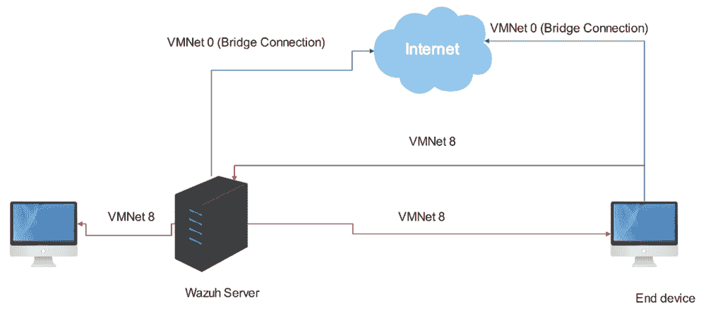 |
| --- |

在 VMWare workstation 17 中点击->编辑->虚拟网络编辑器或。选择任何网络或创建新的网络接口，将其设置为 NAT 网络并启用 DHCP，这样任何使用该网络连接的虚拟机都将从 DHCP 池获取相同的 IP 地址。

## 实验网络配置

表 2. 网络配置

| 图 2.Wazuh 网络 || 图 3.宿主机 |
| --- | --- |
| 图 4.Wazuh 服务器 || 图 5.Wazuh 代理 |

# WAZUH 介绍

Wazuh 是一种开源日志监控解决方案，提供了一个用于检测威胁、响应事件和合规的完整平台。它构建在 Elastic Stack（以前称为 ELK 栈）之上，Elastic Stack 为数据索引、搜索和视化提供了基础。


Wazuh 被设计为一个模块化且可扩展的平台，用于监控和保护不同类型的环境，包括终端安全、云安全和网络安全。为了识别和应对安全风险，它提供了多种功能，例如入侵检测、漏洞管理和日志管理。

Wazuh 的核心特性之一是能够实时检测并响应安全事件。它内置了对入侵检测和事件响应的支持，并可以配置为针对特定类型的活动发出警报，或在响应事件时采取自动化操作。

除了安全能力外，Wazuh 还提供系列合规功能，可用于确保组织的安全策略得到执行。它可以被配置为检测并告警合规性违反，并提供有关合规状态的详细报告。

Wazuh 兼容多个平台和环境，包括 Windows、Linux、macOS 以及各种云提供商。通过与其他安全技术集成，并支持本地部署和云端交付，它可以创建一个更完整的安全解决方案。

Wazuh 是一个用于安全监控、威胁检测、事件响应和合规管理的强大且灵活的平台。它可以帮助组织快速高效地检测和响应安全威胁，并确保其安全策略得到执行。

# Wazuh 架构

| 图 6. Wazuh 架构 (Stanković et al., n.d.) |
| --- |
| 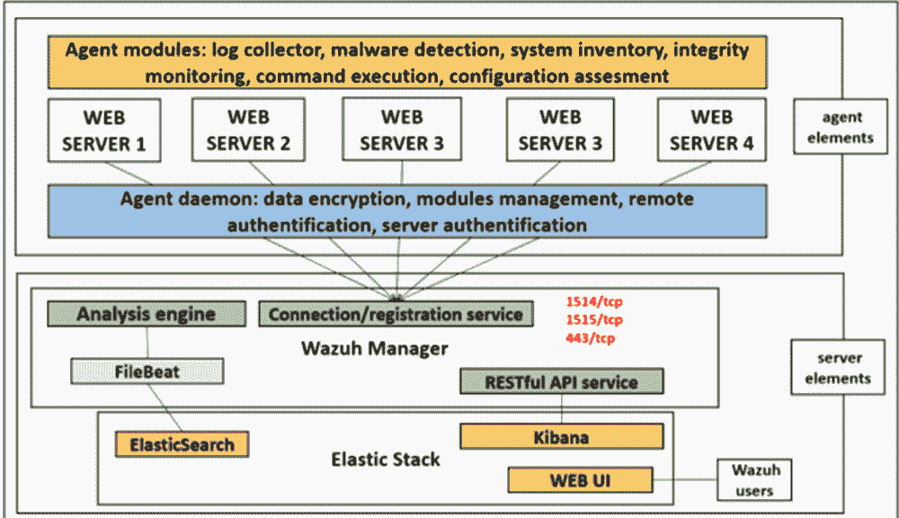 |
| --- |

### 当 Wazuh Dashboard 未运行时运行脚本

| 图 7. 错误消息 |
| --- |
|  |
| --- |

| 图 8. Wazuh 登录页面 |
| --- |
| 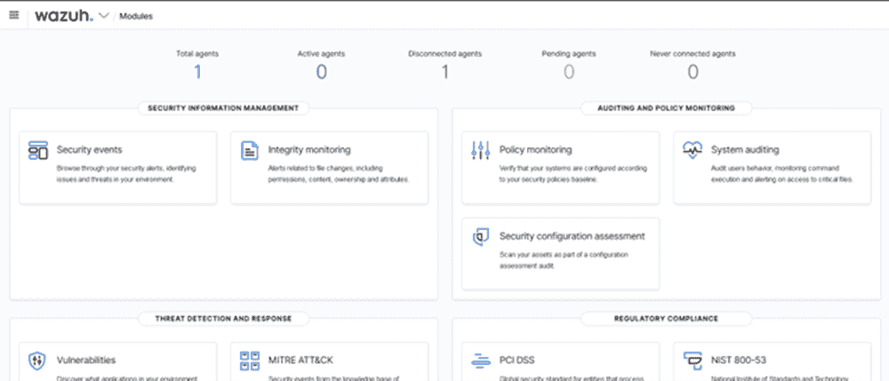 |
| --- |

| 图 9. Wazuh dashboard |
| --- |
| 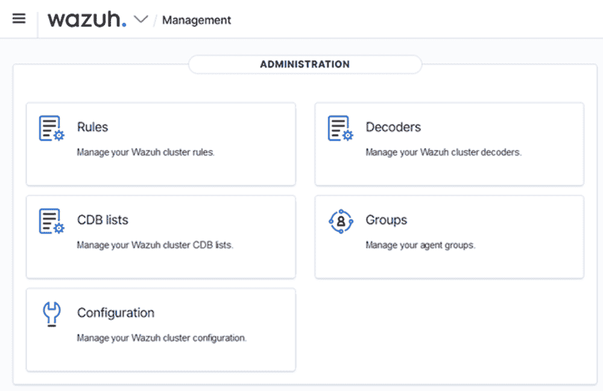 |

### 设置 Wazuh 用于检测

在 Wazuh 服务器上运行此脚本。添加你想监控的 Wazuh agent 路径。在 `varossec/etc/ossec.conf` 中添加 `<syscheck>` 块。

| 图 10. 管理 dashboard |
| --- |
| 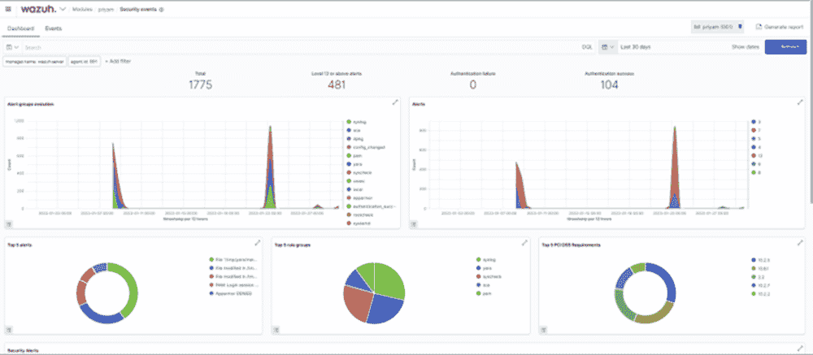 |
| --- |

| 图 11. Wazuh dashboard |
| --- |
|  |

Wazuh 解码器（decoders）用于处理和分析数据。解码器的主要用途包括：
- 解析日志数据
- 标准化日志数据
- 丰富日志数据
- 识别反序列

| 图 12. 本地解码器 |
| --- |
|  |

Wazuh 规则（rules）用于检测系统上的特定事件。一些主要用途包括：
- 设置规则
- 配置规则
- 定义规则
- 扩展规则

Wazuh 的配置用于自定义行为。配置的用途用途包括：
- 设置日志收集
- 配置告警和通知
- 设置解码器
- 定义规则
- 配置安全
- 启用集成

| 图 13. 本地规则 |
| --- |
|  |

# YARA

YARA 是一种用于根据代码中的模式或其他特征识别和分类恶意软件的工具。它使用一组被称为 YARA 规则的规则来扫描文件并确定它们是否匹配特定模式。YARA 规则用简单的语言编写，由一组字符串和条件组成，指定了工具应该查找的内容。

## YARA 规则的备结构

```text
rule <rule_name> {
  strings:
    $string1 = "example"
    $string2 = "example2"

  condition:
    all of them
}
```


# 第 15 章

YARA 规则被广泛用于事件响应、取证调查和狩猎行动中对恶意软件的分析与识别。它也被用于动态和静态分析工具、沙箱以及其他安全工具。值得注意的是，YARA 不仅限于检测恶意软件，它还可以根据其特征检测其他类型的文件，例如文档和图像。

## IOC 的制作

由于分析程序，产生了八项作为 YARA 上创建 IoC（失陷指标）来源的指标（Akram & Ogi, 2020）。`meta`、`strings` 和 `conditions` 这三个位置被分配到这八项指标中。这些指标被用于创建识别恶意软件的规则。所构建的 IoC 可读性表明：“YARA 规则的根本组成部分如下。”样本的哈希值、编译器时间戳以及 IoC 制造商的信息都包含在 `meta` 中。`strings` 中内置了特殊的病毒检测能力。`condition` 规定了检测恶意软件的前提条件。如果 IoC 中的所有指示都被识别，则必须满足以下要求（Akram & Ogi, 2020）。

## SIEM 中的 YARA 流程

| 图 16. YARA 流程 (Gómez Vidal, 2019) |
| --- |
|  |
| --- |

## 验证

终端设备上指定文件夹中的任何修改都显示在图 17 中。利用 Wazuh 仪表板的 IoC 验证程序如图 18](#978-1-6684-8666-5.ch014.xhtml#f18)所示。在包含样本的目录上运行 IoC。任何 YARA 捕获的任何迹象。在此次通过 YARA 验证中发现了三个迹象。由于发现了这三个指示，该 IoC 被认为是真实的，证明了 YARA 成功使用目录中列出的指标发现了恶意软件。

| 图 17. 文件夹中的修改 |
| --- |
|  |
| --- |
| 图 18. 检测到恶意软件 |
| --- |
|  |
| --- |

## 结论

可以说，利用 YARA 规则和反向工程方法成功创建了 IoC。典型恶意软件样本的字节码作为 IoC 中使用的指示。IoC 未发现同一目录下的其他恶意软件。这表明，符合预定目标，IoC 已有效地发现了恶意软件。

## 参考文献

AkramB.OgiD. (2020). 使用恶意软件反向工程技术制作失陷指标. 2020 年智能社会 ICT 国际会议 (ICISS), 1-6. doi:[10.1109/ICISS50791.2020.9307581](https://doi.org/10.1109/ICISS50791.2020.9307581)

Bace & Mell. (2001). 入侵检测系统。NIST 入侵检测系统特别出版物。

Gómez Vidal, A. S. (2019). IDS 的改进：为 Wazuh 增加功能。Academic Press.

Stanković, S., Gajin, S., & Petrović, R. (n.d.). 基于日志分析检测攻击的 Wazuh 工具能力概述。Academic Press.

Wazuh. (2023). [`documentation.wazuh.com/current/index.html`](https://documentation.wazuh.com/current/index.html)

# 第 15 章

*   J. Jeyshri
    
    印度 SRM 科学技术学院
*   R. Sasirekha
    印度 SRM 科学技术学院

## 摘要

随着时间的推移，恶意软件攻击变得越来越频繁和复杂，对组织和个人造成了巨大的危害。为了应对这些，网络安全专家创建了恶意软件缓解技术，以识别、停止并纠此类攻击。入侵检测和预防系统监控网络流量，并向安全专业人员通知可能的威胁。防火墙通过防止对访问的未经授权访问提供了额外的安全保障。使用沙箱技术将不可信软件隔离并运行在安全环境中，以寻找可疑的恶意软件活动。入侵检测和预防系统监控网络流量，并向安全专业人员通知可能的威胁。防火墙通过防止对网络的未经授权访问提供了额外的安全保障。使用沙箱技术将不可信软件隔离并运行在安全环境中，以寻找可疑的恶意软件活动。尽管有了这些技术，恶意软件攻击仍然构成严重威胁，需要不断改进。恶意软件缓解的未来发展，例如人工智能和机器学习的使用将在本文介绍。

## 引言

由于对技术和互联网的依赖，恶意软件攻击已成为个人和组织关注的严峻问题。为了应对这些攻击，网络安全专家创建了恶意软件缓解技术，以识别、停止并纠正此类攻击。图 15 提供了受恶意软件影响行业的详细信息。杀毒软件、入侵检测和预防系统以及沙箱方法只是本研究包含的若干缓解策略中的措施。

### 相关工作

Zahid Akhtar et al. (2021). 作者对基于行为的恶意软件缓解方法进行了深入分析。作者还讨论了识别零日威胁的困难，以及在恶意软件缓解中安全性和性能之间取得平衡的必要性。

Ammar et al. (2020). 杀毒软件、入侵检测和预防系统以及沙箱方法只是本研究包含的若干缓解策略中的措施。作者还讨论了恶意软件日益复杂的问题，以及持续更新的必要性。

Neda Sadat et al. (2020). 该研究检查了检测及缓解恶意软件的方法，包括基于签名、基于行为和机器学习的方法。基于签名技术的局限性和实时网络流量分析的必要性只是作者在讨论恶意软件检测和缓解时提到的困难之一。

Zeinab Khosravi, 等. (2021). 本文概述了恶意软件缓解策略，包括沙箱、入侵检测和预防系统。作者还涵盖了预防恶意软件的困难，包括改进零日攻击检测和预防的必要性。

Seyedeh et al. (2021). 该研究关注深度学习、强化学习和迁移学习作为恶意软件检测和缓解的机器学习方法。作者还涵盖了使用机器学习进行恶意软件检测和缓解的困难，包括对大量训练数据的需求以及对抗攻击的可能性。


恶意软件是一个令个人、组织以及政府担忧的严重问题。恶意软件攻击具有造成巨大损害的潜力，包括金钱损失、声誉损害和法律责任。由于网络犯罪分子和国家力量可能利用恶意软件进行间谍活动或对关键基础设施发起攻击，恶意软件攻击可能对国家安全构成威胁。恶意软件攻击可以通过多种方式发生，例如通过钓鱼计划、社会工程技术、利用软件漏洞，或利用嵌入可信软件中的有害代码。恶意软件还可以通过跨网络传播来感染多个系统或设备。

勒索软件通过加密数据或在支付赎金之前将用户锁定在计算机之外，是最常见的恶意软件形式之一。过去几年中，使用勒索软件的攻击频率增加，广为人知的攻击了包括医院、公司和政府组织在内的机构。这些攻击可能会伤害患者和客户，并造成巨大的财务损失和业务中断。

加密货币挖矿（Cryptojacking）是近年来广为人知的另一种恶意软件。在设备所有者不知情或不同意的情况下，挖矿是指利用受感染设备的处理能力来挖掘加密货币。挖矿可能会通过消耗电池和减慢速度导致设备运行性能下降。

物联网（IoT）设备，包括智能家用电器、医疗设备和工业控制系统，也容易受到恶意软件攻击。这些设备通常安全措施较差，诈骗者可能利用它们访问网络或伤害他人。

国家力量、组织犯罪集团或孤立黑客经常发起恶意软件攻击。这些攻击者可能使用多种策略和方法，如加密、混淆或零日漏洞，以规避检测并造成破坏。

近年来恶意软件日益引起关注，攻击者使用了更复杂的方法和设备。使用传统的恶意软件缓解技术，很难发现无文件恶意软件，这种软件完全运行在内存中，不在磁盘上留下任何痕迹。攻击者甚至可能使用针对性鱼钓鱼或 CEO 欺诈等社会工程技术欺骗员工泄露隐私信息或进行转账。

总体而言，全球的网络安全专家和公司对恶意软件带来的危险继续深担忧。由于恶意软件的快速发展和攻击者专业水平的提高，传统的恶意软件缓解方法和策略可能不足以应对变化的威胁环境。为了领先攻击者一步并防止这些不断变化的危险，恶意软件缓解解决方案需要不断改进和创新。

# 恶意软件缓解工具和技术概述

“恶意软件缓解”一词描述了用于停止或减轻恶意软件感染影响的方法和设备。成功的恶意软件缓解需要一种结合了传统和尖端工具及程序的层层策略。

- **防病毒软件**：一种经典的恶意软件缓解技术，防病毒软件会检查文件和程序以查找是否存在已知的恶意软件签名。该程序具有识别和消除各种恶意软件的能力，包括病毒、蠕虫和木马。
- **入侵检测与防御系统 (IDPS)**：`IDPS` 是一种硬件或软件，它监控系统日志和网络流量，以寻找恶意软件活动的迹象。像 `IDPS` 这样的实时恶意软件检测和阻止系统有助于在攻击造成伤害之前将其拦截。
- **防火墙**：另一种常见的恶意软件缓解技术，`firewalls` 调节网络和设备之间的数据移动。`firewalls` 可以阻止恶意软件与命令控制服务器连接，并阻止来自已知危险源的入站流量。
- **沙箱**：在与系统其余部分隔离的虚拟环境中运行不可信的程序或数据被称为 `sandboxing`。这使得能够在不污染主系统的情况下分析病毒，并可能发现以前未被识别的恶意软件。
- **行为分析工具**：这些程序跟踪程序和文件的行为，搜索任何可能指向恶意软件存在的异常行为。这些技术能够检测传统的基于签名的工具尚未检测到的恶意软件。
- **零信任安全**：这种安全工作在所有用户和设备都面临被渗透风险的基础上。这意味着，对资源的访问不是基于用户在网络上的位置，而是基于用户的身份及其设备的安全态势进行限制。
- **云端安全解决方案**：随着企业将数据和应用迁移到云端，云端安全解决方案变得越来越流行。`Sandboxing` 和机器学习只是这些系统可能提供的几个复杂恶意软件检测和缓解功能之一。
- **威胁狩猎 (Threat hunting)**：威胁狩猎是在公司网络和系统中主动寻找恶意软件或其他安全威胁的迹象。这可能包括漏洞评估、检查日志和网络流量，以及发现异常活动。
- **欺骗技术**：使用虚假服务器或文件等诱饵，欺骗技术引导攻击者暴露自己的存在。通过使用欺骗技术，可以定位攻击者、隔离他们并防止其在网络中横向移动。
- **人工智能与机器学习**：通过人工智能和机器学习，可以检查海量数据并识别可能与恶意软件活动相关的趋势。这些技术可能辅助检测以前未识别的恶意软件，并能迅速适应新危险。

# 传统的恶意软件缓解工具

这些已经存在一段时间，并且仍然经常用于对抗恶意软件。这些程序通过使用持续更新的病毒定义数据库来定位并消除已知的恶意软件签名。通常使用的传统的恶意软件缓解方法包括：

- **防病毒软件**：可以使用防病毒软件从计算机或其他设备上发现并消除恶意软件。`Antivirus software` 搜索文件、应用程序和其他数据，寻找类似于恶意软件和其他感染的模式。如果发现恶意软件，防病毒程序可能会将其隔离或删除，以停止其造成任何伤害。
- **防火墙**：`firewalls` 保护计算机网络免受未经授权的访问和有害活动。`firewalls` 阻止向已知有害地发送发送通信，并阻止来自未授权源的入站流量。为了防止恶意软件传播到其他网络设备并连接命令控制站点，可以部署 `firewalls`。
- **邮件过滤器**：`Email filters` 用于防止病毒通过邮件或或进入公司网络。为了识别和防止包含恶意软件的邮件，`email filters` 结合了基于声誉的过滤基于内容的过滤。
- **备份与恢复工具**：`Backup and recovery tools` 用于安全保存数据，以便在设备被感染时能够恢复到先前的、无恶意软件的状态。频繁备份可以减轻恶意攻击造成的伤害。
- **操作系统更新与补丁**：`Operating System updates and patches` 用于封补恶意软件可能利用的操作系统漏洞。通过经常升级操作系统、软件和应用程序，可以避免恶意软件攻击。


传统的恶意软件缓解技术仍然有一席之地，但它们也存在某些缺点。这些工具是被动性的，这意味着它们只能发现并消除已知的恶意软件。它们还容易受到零日攻击的影响，这种攻击利用了尚未被发现的漏洞。因此，各机构越来越多地使用更复杂的恶意软件缓解解决方案。

## 杀毒程序

可能最著名的恶意软件缓解技术是杀毒软件。它的工作原理是检查计算机系统文件是否存在已识别的恶意软件特征，并阻止任何发现的恶意软件。为了发现并停止以前未识别的恶意软件，杀毒软件随着时间的发展不断进化，整合了启发式分析和机器学习等尖端技术。机器学习利用算法从先前的恶意软件样本中学习并识别新的变体，相反，启发式分析侧重于搜索可能表明恶意软件存在的异常行为。

即使杀毒软件擅长发现和预防已知感染，它仍然有局限性。恶意软件作者可以轻易更改其代码以规避杀毒软件的检测，而零日攻击（犯罪分子利用此前未发现的漏洞）可以完全规避杀毒安全防护。因此，杀毒软件只是大型恶意软件缓解策略集中的一种武器。

## 入侵检测与防御系统

防止恶意软件武器库中的另一种武器是入侵检测与防御系统 (IDPS)。IDPS 监控网络流量，并向安全专业人员通知可能的风险。它们可能是基于主机的或基于网络的。基于主机的 IDPS 监控单个计算机上的流量，而基于网络的 IDPS 则关注网络边缘的活动。

为了运行，IDPS 将网络流量与已知的有害行为模式进行比较。例如，IDPS 可能会发现针对需要密码系统的暴力破解攻击，并向安全专业人员通知可能的危险。某些 IDPS 系统具有阻止看似恶意的通信的能力，从而在攻击发生之初将其制止。

虽然可以使用 IDPS 检测并防御某些形式的攻击，但它们并非没有缺陷。使用加密或非常规协议的攻击可能无法被 IDPS 检测到。此外，IDPS 可能会产生大量的假报，这会导致警报疲劳，并导致真实威胁被忽视。

## 防火墙

恶意软件缓解工具箱的另一个基本元素是防火墙。防火墙是一种网络安全系统，它根据预设的安全规则跟踪并调节入出网络流量。硬件或软件防火墙也是一种选择。

通过防火墙的每一个网络流量包都会经过检查并与一组预定的规则进行比较。如果数据包违反规则，防火墙可能会阻止数据包访问网络，或向安全团队通知可能的危险。此外，防火墙可以设置为拒绝来自特定 IP 地址、端口或协议的流量。

尽管防火墙可能成功防止已知威胁，但它们仍有一些局限性。防火墙无法识别所有形式的恶意软件，攻击者可能通过加密通信或利用防火墙软件的漏洞来规避它们。

## 沙箱

为了识别可疑的恶意软件活动，沙箱是一种恶意软件缓解策略，它包括在安全环境中执行不可信的软件。安全团队可以使用沙箱技术分析程序的行为并识别任何恶意活动，该技术将不可信的软件隔离开并在受控环境中运行它。

在被允许进入网络之前，可以通过沙箱对可疑文件、电子邮件或网站进行测试。此外，沙箱还可以被用于检查已经运行的恶意软件的行为。

虽然沙箱是定位恶意软件的有用技术，但它也有某些缺点。沙箱可能会消耗大量资源，并且可能适用于所有系统。攻击者还可能创建能够识别自己正运行在沙箱中的恶意软件，并修改其行为以逃避检测。

## 行为分析工具

另一种根据行为而非特征识别恶意软件的恶意软件缓解解决方案是行为分析软件。分析系统行为（如文件更新、网络连接和系统更改）的工具会寻找恶意活动的迹象。

使用行为分析方法可以发现规避了其他缓解策略（如杀毒软件）的恶意软件。此外，使用行为分析技术可以发现零日攻击和其他未知的风险。

虽然行为分析技术擅长发现恶意软件，但它们有几个缺点。行为分析工具可能会提供假报，导致警报疲劳，并可能产生忽视真实威胁的情况。此外，由于其资源密集型的特性，在所有系统上使用行为分析技术可能是不可行的。

尽管网络犯罪分子不断开发新策略和工具以规避检测并造成破坏，恶意软件攻击继续对个人和公司构成严重威胁。因此，对高效恶意软件缓解工具和方法的需求比以往任何时候都更加迫切。

## 恶意软件缓解的新兴趋势

人工智能 (`AI`) 和机器学习 (`ML`) 技术使用率的增加是当前恶意软件缓解的一个趋势。通过使用这些技术，可以分析海量数据集以发现指向敌对活动的模式和异常。

容器化和微分化的使用是恶意软件缓解的一个新趋势。通过容器化将应用和服务封装在独立的上下文中，为用户提供了更多的保护和控制。网络被划分为称为微段的较小部分，每个分段都受到更严格的访问限制和监控。结合这些方法可能有助于减少攻击面并阻止恶意软件扩散。

威胁情报的日益增长是恶意软件缓解的另一个新趋势。为了更好地理解已知威胁和攻击者的策略、方法和动机，威胁情报包括收集和评估有关它们的数据。之后，这些信息可以被用于增强威胁检测和响应时间以及恶意软件缓解措施。

与这些变化一起，对各种恶意软件缓解技术和解决方案之间增强的互操作性和集成的需求日益增加。恶意软件攻击有时涉及许多阶段和策略，没有一种解决方案可以保证完全的安全。通过更好的集成和互操作性，可以提高各种缓解措施的可见性和协调性，从而增加恶意软件缓解技术的整体有效性。

最后，至关重要的是要理解恶意软件攻击既是技术问题，也是人性问题。人为失误（如弱密码、钓鱼攻击计划或社会工程技术）通常会导致恶意软件攻击成功。通过告知员工恶意软件攻击的危险并提高对这些威胁的意识，许多攻击可以被制止。


利用人工智能（AI）和机器学习（ML）对恶意软件进行检测和修复，是恶意软件缓解领域最令人兴奋的新进展之一。与其依赖现有的指纹，`AI` 和 `ML` 可能被用于根据行为识别和分类恶意软件。这种被称为行为分析的方法可用于发现以前未被检测到的恶意软件和零日攻击。为了减轻安全人员的压力并实现更快的反应速度，`AI` 和 `ML` 还用于自动化恶意软件的检测和响应。

## 容器化与微隔离

通过将工作负载和应用程序相互分离，容器化和微隔离是两种可以帮助增强安全的策略。应用程序可以封装并在容器运行，容器是小型、移动的软件单元，可以在安全、隔离的环境中使用。微隔离是一种通过网络虚拟化创建微小的隔离网络分段来控制跨网络区域访问的方法。组织通过采用容器化和微隔离，即使恶意软件成功突破了防御，也可以减少攻击面并减轻恶意软件的影响。

## 威胁情报

威胁情报的一部分是收集和分析网络威胁及其背后的人员信息。这些数据可用于识别新兴风险、预测攻击并建立准备防御。威胁情报可以通过为恶意软件签名和行为模型的创建提供信息，提高传统恶意软件缓解技术的精确性和有效性。此外，它还可以用于确定安全支出优先级并发现组织防御中的弱点。

## 集成与互操作性

安全技术和系统的集成与互操作性是恶意软件缓解的新趋势。这种策略承认分层防御的必要性，因为没有一种工具或系统可以提供针对恶意软件的全保护。通过结合各种技术和系统，组织可以建立更完整、更协调的安全态。通过减少误报和加快反应速度，这种策略还可以提高安全操作的有效性。通过互操作性促进跨企业和安全系统之间的威胁信息交换，可以增强生态系统的整体安全性。

恶意软件缓解中的人为因素

### 员工培训与意识

员工教育和意识是缓解恶意软件的最关键的人为变量之一。恶意软件攻击通常取决于用户操作，例如打开损坏的附件或点击恶意链接。通过教员工恶意软件的危害以及如何防止它，组织可以降低攻击成功的概率。员工培训和意识应涵盖广泛主题，例如：

- ****社交工程与钓鱼攻击**：员工应接受如何识别钓鱼邮件和其他社交工程诈骗的培训。这些攻击通常涉及社交工程策略，以诱导员工泄露隐私数据或安装恶意软件。
- **恶意软件检测与预防**：员工应接受如何识别恶意软件感染的培训，这可能表现为性能缓慢或意外的弹出窗口。此外，他们还应该学习病毒预防技术，包括避免可疑网站和更新软件。
- **员工应接受如何处理恶意软件攻击的事件响应培训，包括应该联系谁以及做什么来阻止感染扩散。**
- **报告**：应该向员工强调，他们应该向 IT 部门报告任何异常活动或可能的恶意软件感染。

为了让员工了解最新的危害和缓解策略，培训应该是持续的并经常更新。还 fact 可以使用模拟的恶意软件和钓鱼攻击来增强员工意识，因为这些模拟可以向员工展示他们在何方面脆弱，并教他们如何防御未来的攻击。

### 社交工程与钓鱼诈骗

这些主要依赖人为因素的欺骗对企业构成了严重威胁。社交工程是利用心理欺骗来说服他人泄露隐私信息或采取不符合其利益的行为。使用虚假邮件或网站欺骗人们披露个人信息是钓鱼计划的特征，这是一种社交工程攻击。组织应实施以下程序以减少社交工程和钓鱼诈骗的风险：

- **员工培训与意识**：如前所述，对抗社交工程和钓鱼计划需要员工的培训和意识。应该教导员工识别社交工程攻击的症状（例如奇怪的邮件或电话），并在确认请求的合法性之前避免泄露敏感信息。
- **反钓鱼软件**：可以使用反钓鱼软件来检测和阻止钓鱼邮件和网站。这些解决方案结合了多种方法，包括声誉评分和内容分析，用以发现并删除危险信息。
- **双重身份验证**：通过要求第二个验证因子（例如除密码外发送到移动设备的代码），双重身份验证有助于阻止社交工程攻击。即使密码被破解，这也有助于防止非法访问。

公司应建立事件响应程序来处理钓鱼和社交工程攻击。

### D. 密码策略与管理

密码是任何安全计划的重要部分，有效管理密码对于减少恶意软件是必要的。弱、明显或频繁使用的密码可能会让攻击者更容易访问系统和数据。组织应实施以下方法来提高密码安全性：

- **强密码策略**：企业应该制定规则，要求员工创建强密码并经常更新。此外，密码规定必须禁止使用易猜的密码，例如 `password` 或 `123456`。
- **多因素身份验证**：通过要求额外的身份元素（例如除密码外发送到移动设备的代码），多因素身份验证有助于提高密码安全性。
- **密码管理工具**：这些工具可能有助于提高密码的安全性。

## 恶意软件检测技术概述

如今，保持数据免受攻击者的侵害至关重要。攻击者试图使用恶意软件从个人那里窃取数据。保持数据免受恶意软件侵害是必要的。使用了多种恶意软件检测技术，但检测仍然较浅。在本节中，讨论了常用的恶意软件检测技术 (Akhtar et al., 2021)。病毒、蠕虫、僵尸网络和勒索软件。

每天都有新的恶意软件通过网络发布。安全措施应关注试图通过注入恶意病毒来攻击数据的未知人员的不道德活动。


基于启发式的检测旨在通过仔细检查文档中的可疑因素来寻找恶意软件，而不需要精确的特征码匹配。反恶意软件工具的一项能力优势是查看所取文档中是否存在错误指令或垃圾内容。计算机病毒和各种数字威胁往往变得更加狡猾。在本节中，对病毒检测进行了简要研究。

这并不是一个新案例，但随着较新的方法论公开，这些条件的欺诈性和严峻性在多年来日益加剧。广为人知的病毒攻击检测方法包括基于特征、基于行为和基于云的检测。

| 图 1. 常用的恶意软件检测方法 |

| --- |
|  |
| --- |

### 基于特征的检测

检测可疑或病毒的常用方法被称为基于特征的保护。它由多个数据库组成。一旦通过特征码识别出病毒，该病毒信息就会根据识别出的特征持续添加到在线威胁数据库中。但这种工具无法预测或添加未知威胁。这类检测技术可以在网络犯罪（Ahmad & Rahman, 2020）中实施，以便识别威胁。

### 基于行为的检测

行为检测是一种动态方法，因为它通常监控已安装应用程序的活动以发现任何可疑行为。其中一些行为包括促使违规应用程序启动计算机以及破坏安全特性。行为检测（Safavi et al., 2020）是主流方法，其检测率比基于特征的检测更高。由于攻击者总是修改特征码以注入恶意软件，因此对已安装的应用程序进行详尽监控比试图对抗特征码更有益。

### 基于云的检测

这种检测方法用于保护在云网络上共享的数据。对于授权用户来说，解密数据并不容易（Khosravi et al., 2021）。云端数据被破解的可能性有很多，未知个人可以在云端注入恶意威胁。发现这类恶意威胁非常困难。这种基于云的方法可以识别在云端创建的威胁，并确保授权用户之间的数据加密和解密。

### 恶意软件清除技术概述

恶意软件保护对于保持数据安全关关。每天都有新的恶意软件出现，并根据恶意软件的性质实施许多技术。在本节中，对恶意软件保护进行了详细研究。

恶意软件保护（Rafiei & Rahmani, 2021）机制根据环境中识别出的威胁类型实施。广泛使用的检测机制已被检测威胁，并根据识别出的威胁对保护机制进行了深入研究。

#### 用于邮件的恶意软件保护机制

大多数检测机制可以通过与在线威胁数据库进行对比来发现威胁。在本节中，介绍了用于识别和防止注入电子邮件的恶意软件的保护机制。个人可以通过电子邮件链接注入恶意威胁。当用户点击这些链接时，数据可能会被未知攻击者窃取。这类威胁可以使用随机森林（Kim et al., 2019）方法来处理，识别合法和恶意邮件，并使用该机制保护合法信息免受威胁。

| 图 2. 电子邮件恶意软件保护机制 |

| --- |
|  |
| --- |

#### 用于云环境的保护机制

在从服务器传输数据到客户端的过程中识别威胁更为复杂。保护机制从识别威胁性质并将该威胁与现有威胁进行对比开始。云网络中共享的数据已经得到了保护（Agrawal & Saini, 2016）。

| 图 3. 云存储保护 |

| --- |
|  |
| --- |

来自云存储的数据文件可以被分为若干子文件，这些子文件将被用于检查是否存在恶意软件。机器学习算法被用于识别文件中的威胁。合法文件将与包含恶意软件的文件进行对比。

### 未来趋势

尽管这些技术可用，但恶意软件攻击仍然构成了严重危险，需要不断改进和更新缓解策略。使用机器学习和人工智能（AI）是恶意软件缓解解决方案的趋势。可以采用人工智能和机器学习来评估海量数据并发现指向恶意软件存在的模式。机器学习的使用是另一个趋势。

## 结论

结论，恶意软件攻击对个人和企业都构成了严峻风险。恶意软件缓解的未来进展包括人工智能和机器学习。为了比攻击者领先一步，随着恶意软件的演变，保持缓解策略的更新至关重要。


Kim, T. H., Park, J., & Cho, H. (2019). 一种基于逆向工程的动态恶意软件分析方法。IEEE Access : Practical Innovations, Open Solutions, 7, 43315–43324. doi:doi:[10.1109/ACCESS.2019.2907512](https://doi.org/10.1109/ACCESS.2019.2907512)

Maggi, F., Matteucci, M., & Zanero, S. (2010, 10-12). 通过系统调用序列和参数分析检测入侵。IEEE Transactions on Dependable and Secure Computing, 7(4), 381–395. doi:[10.1109/TDSC.2008.69](https://doi.org/10.1109/TDSC.2008.69)

Memon, R. A., & Mallah, R. A. (2020, 7). 使用机器学习技术检测恶意软件：全面综述。Journal of Ambient Intelligence and Humanized Computing, 11(7), 2811–2835. doi:doi:[10.1007/s12652-020-02145-w](https://doi.org/10.1007/s12652-020-02145-w)

Menezes, N. J., Rocha, L. M., & Junior, R. M. C. (2019, 12). 使用静态分析技术检测恶意软件：综述。Journal of Computer Virology and Hacking Techniques, 15(4), 241–262. doi:doi:[10.1007/s11416-019-00320-x](https://doi.org/10.1007/s11416-019-00320-x)

Mira, F. (2021). 恶意软件分析的系统性文献综述。2021 IEEE 国际物联网、电子与机电会议 (IEMTRONICS), (pp. 1-5). IEEE. doi:[10.1109/IEMTRONICS52119.2021.9422537](https://doi.org/10.1109/IEMTRONICS52119.2021.9422537)

Qaisar, Z. H., Almotiri, S. H., Al Ghamdi, M. A., Nagra, A. A., & Ali, G. (2021). 用于用于移动云数据共享恶意软件保护的可扩展高效多智能体架构。IEEE Access : Practical Innovations, Open Solutions, 9, 76248–76259. doi:[10.1109/ACCESS.2021.3067284](https://doi.org/10.1109/ACCESS.2021.3067284)

Rafiei, S. Y., & Rahmani, A. M. (2021). 恶意软件检测与缓解的机器学习技术综述。Journal of Cybersecurity, 7(1)。

Safavi, N. S., Hosseini-Asl, E., & Yaghmaee, M. H. (2020). 恶意软件检测与缓解技术综述。Journal of Cybersecurity, 6(1).

SharmaD. D.TripathiD. D.GaurM. K. (2016). 基于机器学习的异常恶意软件检测。第 5 次计算、通信与信息进展国际会议论文集 (ICACCI 2016), (pp. 2655-2660). IEEE. doi:[10.1109/ICACCI.2016.7732399](https://doi.org/10.1109/ICACCI.2016.7732399)

TripathiD. D.SharmaD. D. (2014). 通过机器学习算法缓解恶意软件。第 6 次计算智能与通信网络国际会议论文集 (CICN 2014), (pp. 543-547). IEEE. doi:[10.1109/CICN.2014.134](https://doi.org/10.1109/CICN.2014.134)

Yang, S., Zhou, H., & Zhao, C. (2020, 12). 基于动态分析和深度学习的恶意软件检测系统。Journal of Intelligent & Fuzzy Systems, 38(6), 6701–6711. doi:[10.3233/JIFS-191769](https://doi.org/10.3233/JIFS-191769)

ZengY. G. (2017). 使用预测分析识别电子邮件威胁。2017 年网络安全与数字服务保护国际会议 (Cyber Security), (pp. 1-2). IEEE. doi:[10.1109/CyberSecPODS.2017.807438](https://doi.org/10.1109/CyberSecPODS.2017.807438)

## 摘要

本研究深入了网络安全领域，分析了当前的趋势并为社会利益制定了一个框架。它试图通过分析发生的情况和分歧来增强社会的整体态势。总而言之，该研究展示了如何利用自动化方法为社会问题提供具有洞察力的信息。

## 引言

在网络安全中实施程序、保护措施和技术意味着保护网络、系统和信息免受可能的攻击。根据统计数据，全球数据泄露的平均成本为 386 万美元，美国为 864 万美元。这些费用涵盖了泄露的直接影响、确定来源的调查、响应措施、收入损失、停机时间以及品牌损害（Dey & Dasgupta, 2019）。

大多数组织已经实施了基于最佳实践的网络安全策略，以避免此类成本。为了对抗攻击并维护网络资产的机密性、完整可用可用，有效的策略使用分层防御来阻止财务勒索。美国国家标准与技术研究院（NIST）创建了一个网络安全框架，协助组织保护其计算机网络、系统以及支持政府、公共健康、安全和国家安全的其他资产（Hussain et al., 2020）。国际标准化组织（ISO）也开发了 ISO27000 信息安全标准以应对类似的需求。

即使有最强大的防御，攻击者仍然可以发现框架的缺陷。由于远程访问工具、云服务以及用于远程办公的其他工具的脆弱，随着工作标准从办公室转向居家办公，网络安全风险也随之增加。恶意软件、勒索软件、钓鱼、内部威胁、分布式拒绝服务（DoS）威胁、高级持续性威胁（APT）和中间人攻击都是不断演变的威胁。本章的主要目标是描述网络安全如何成为我们日常使用一切的一部分，以及我们未来将遇到哪些障碍（Upadhyay & Yadav, 2018）。

# 威胁与漏洞

网络安全威胁和漏洞不断变化，为企业和人员运营创造了一个充满挑战且动态变化的环境。以下是现在和未来需要注意的一些重要危险和漏洞：

*   现状： 


## 1. 钓鱼攻击
钓鱼攻击是一种黑客攻击，利用社会工程学策略欺骗人们披露隐私数据，如登录密码或银行信息。这些攻击通常以伪造电子邮件、短信或网页的形式出现，这些内容似乎来自可靠来源，但实际上是为了诱骗接收者泄露其私人或机密信息。一旦攻击者获取了这些信息，就可以将其用于非法活动，如金融诈骗、身份盗窃和其他阴险计划。为了防御钓鱼攻击，采取如双重身份验证和反钓鱼软件等安全预防措施，并在打开邮件中的链接或点击不受自邀请的消息时保持警惕和谨慎。

## 2. 恶意软件
在用户不知或不知的情况下，病毒和木马等恶意软件可能会被安装到系统中，使攻击者访问数据或对系统造成损害 (Perarasi et al., 2020)）。

## 3. 内部威胁
拥有机密数据访问权限的人可能会无意或故意向未经批准的方泄露这些信息 (Sun et al., 2022)。

## 4. DoS（拒绝服务）攻击
被称为拒绝服务（DoS）攻击的网络攻击通过数据使系统过载，导致用户无法访问。单个攻击者或一组攻击者可以使用多种方法发起此类攻击，包括过载系统资源、向系统发送大量数据以及利用系统漏洞。DoS 攻击旨在阻碍正常运行，并拒绝授权用户访问系统或其服务。DoS 攻击通过干扰日常运营、导致财务损失和损害形象，可能严重危害公司和组织。组织可以部署防火墙、入侵检测系统、负载均衡器和详尽的应急响应策略来防御 DoS 攻击。

## 5. 勒索软件
这种恶意软件加密属于组织的数据，并要求支付赎金以换访问密钥 (Dyke Parunak, 2022)。

## 未来

### 1. 针对物联网 (IoT) 的攻击
随着越来越多的设备连接到互联网，利用这些设备漏洞访问其他系统的物联网攻击危险正日益增加。(Suresh Babu, 2023)

### 2. 人工智能 (AI) 驱动的攻击
AI 可用于自动化攻击，使攻击变得更加复杂且更难被发现。

### 3. 量子计算
量子计算有能力破解许多目前使用的数据安全加密方法。

### 4. 供应链攻击
随着企业越来越多地依赖外部供应商提供软件和其他服务，供应链攻击正变得越来越可能。这些攻击旨在破坏这些供应商的系统，以便能够访问其客户的系统。

### 5. 网络战
由于国家越来越多地将网络攻击作为破坏和间谍武器，网络战的新新纪元已经出现。

组织和个人必须保持警惕，确保软件和系统处于最新状态，并实施如双重身份验证、加密和定期备份等强大的安全实践，以减少这些危险和弱点。

例如，假设你收到一封似乎来自你银行的邮件。邮件主题为“需要采取行动：您的账户安全已泄露！”邮件内容包括银行标志、官方风格的布局，以及一份关于你的账户出现可疑活动的声明。

邮件要求你立即点击指定链接以保护你的账户。它警告说，否则可能会导致你的账户被挂起或资金被盗。邮件的紧迫性让你对自己的账户安全感到担心和不安。你万万的是，邮件中的链接实际上并没有带你进入你的银行网站。它将你带到一个精心制作的虚假网站，看起来非常像你银行的登录页面。该页面要求你提供用户名、密码和其他个人详情，并声称这样做对于保护你的账户和确认身份是必要的。如果你落入了钓鱼诈陷阱并在虚假页面上提交了信息，攻击者将成功地获取了你的登录信息。

## 3. 文献综述

### 安全未来的积极影响

#### 1. 物联网与人工智能
物联网 (IoT) 可以免受网络危险的侵害，该领域的安全前景良好。而人工智能 (AI) 在防御方面的潜力是复杂且多面的。AI 有潜力通过使攻击的发现、响应和预防更加快速有效 (Banafa, 2018; Oblaender, 2019; Suresh Babu, 2023)。

#### 2. 航空与金融
技术的未来发展、变化的危险环境以及政府法规都将影响航空网络安全。提供金融服务的公司正在采用区块链和人工智能 (AI) 等尖端技术，这有助于变得更安全、更快速 (Perarasi & Vidhya, 2020)。

#### 3. 医疗与教育
为了应对不断演的网络威胁，飞行网络安全需要主动且协调的策略。网络犯罪分子日益针对投资了先进 MME 的医疗机构，因为其中包含了大量信息——包括敏感健康信息、财务数据和知识产权。预计技术的发展、商业需求以及社会文化价值观的变化将对网络安全教育产生重大影响 (National Institute of Standards and Technology, 2020)。

### 安全未来的负面影响

#### 1. 物联网与人工智能
由于这些设备的广泛使用（它们频繁连接到互联网并可能存在被网络犯罪分子利用的漏洞），物联网安全日益令人担忧。即使 AI 在网络安全中的应用越来越广泛，黑客仍可能利用它发动日益复杂的攻击 (Dey, 2019; Mohamed, 2020)。


## 2. 航空与金融
随着用于管理从空中交通控制到乘客值机一切事务的广泛计算机系统的引入，航空业已变得更加数字化。自动化带来了许多益处，但航空部门也面临着新的网络安全忧虑。随着黑客方法和技术的发展，金融机构发现对抗网络攻击变得日益困难。在勒索软件攻击中，黑客越来越多地加密用户数据并索要资金以解锁（Hussain, 2019; Razali, 2020）。

## 3. 医疗健康与教育
医疗健康正日益数字化。下列出的挑战是医疗机构未来可能面临的一些问题。网络威胁复杂性增加：随着黑客战术和计划的发展，医疗机构发现防御网络攻击变得越来越困难。教育机构日益采用数字工具和平台进行教学，网络安全正成为一个日益关注的问题（Upadhyay, 2018）。

## 方法论局限性与文献空白

### 1. 缺乏真实数据
真实数据的匮乏是网络安全研究的严重障碍。许多使用模拟或合成数据集的研究可能无法充分反映真实网络威胁和攻击的复杂性和多样性。由于缺乏获取广泛且高质量数据集的，高效网络安全解决方案的创建和评估可能会受到阻。

### 2. 泛化能力有限
网络安全是一个快速发展的课题，安全措施的效力在不同系统、业务和场景之间可能会变化。许多研究集中在特定的情况或环境，这可能会限制其结论的适用性。未来的研究旨在涵盖广泛的现实背景，并评估网络安全措施在许多领域中的效力，以克服这一限制。

### 3. 伦理与法律限制
处理敏感数据和潜在的破坏性行为是网络安全研究的共同部分。对数据隐私、许可以及遵守法律法规的关注为研究人员带来了伦理和法律挑战。这些局限性可能会限制可以进行的研究类型，并影响结果的可靠性和相关性。

### 4. 缺乏纵向研究
由于网络威胁的动态性以及网络安全解决方案的发展性，有必要跟踪安全态势随时间变化的纵向研究。然而，网络安全文献中的纵向研究并不多，这使得我们难以理解安全措施长远来看将如何影响社会。

## 结论
根据此处研究的内容，网络安全未来可能同时产生积极和负面影响。物联网、人工智能、航空、金融、医疗健康和教育部门可能都会利用它来协助和促进这些行业的扩张。未来的研究应该采用更可靠的方法论，涵盖各种人口群体，并调查这些影响背后的可能过程，以建立完善的网络安全体系。为了进一步促进网络安全实践的良好未来前景，同时减少其负面影响，需要定制的倡议和指导。

## 4. 网络安全未来
预计许多新模式和技术将影响网络安全的方向。以下是一些可能影响未来安全的变化：

### 4.1. 物联网中的网络安全未来
物联网（IoT）可以受到在线危险和脆弱性的保护，该领域的安全拥有光明的未来。

从基础传感器到复杂的工业机械，需要保护的物联网设备数量巨大且种类繁，，实现这一目标的主要障碍之一。由于许多物联网设备经常使用过时且脆弱的软件，或具有有限的安全功能，这种复杂性构成了严重的安全风险。这使得它们成为网络犯罪分理想目标，他们试图利用这些漏洞访问机密数据或其他对系统或网络发起攻击（Banafa, 2018).

正在开发新的技术和方法来处理这些问题并增强物联网安全设备。例如，为了保护物联网设备与云之间的交互，正在创建新的加密协议，如 `Transport Layer Security (TLS)` 和 `Datagram Transport Layer Security (DTLS)`。为了实时识别和响应网络危险，机器学习算法和人工智能方法也被投入了使用（Swarnalatha et al., 2023）。

使用 `Blockchain`（区块链）技术——由于该技术可以为设备之间所有交易和交互提供不可篡改且安全的记录——是保护物联网设备的另一种策略。这使得网络攻击者更难干预或更改物联网数据，并有助于确保其完整性和有效性。

总而言之，物联网安全的未来既是光明也是复杂的。通过适当的技术和策略，这些连接设备可以获得安全并免受网络攻击的影响。物联网设备的巨大数量和多样性在安全方面构成了最大的障碍之一。从小型监视器到大型工业机器——各种尺寸和类型的物联网设备——每种设备都有自己的功能和安全需求。因此，采用……至关重要。整个物联网生态系统的安全性，包括为这些设备服务的网络和云服务，预计在未来的进展中将获得更多关注。这可能涉及实施诸如 `zero trust`（零信任）的安全措施，其中每个设备和人在被允许访问资源之前经过验证并授权。人工智能（`AI`）和机器学习（`ML`）对于未来物联网的实时攻击检测和响应至关重要。`AI` 和 `ML` 可以分析海量数据以发现可能是攻击或安全漏洞的异常和趋势。此外，`Blockchain` 技术可能用于提供去中心化的私有通信，增强物联网设备对攻击的抵抗。通过确保互联系统和设备的可用性、稳定性和秘密性，这些技术对于未来物联网网络安全的发展至关重要（Banafa, 2018).

### 物联网案例研究
2016 年的 `Mirai` 僵尸网络攻击凸显了物联网安全，它展示了它是多么重要。未安全的设备被接管并用于对网站发起 DDoS 攻击，强调了采取安全措施的重要性。这次攻击对多个知名网站产生了影响，是记录以来规模和持续时间最长的 DDoS 攻击之一。许多物联网设备预配置了弱的预设密码，导致它们容易被入侵。因此，制造商必须确保设备在交付时带有用户可以更改的独特安全密码。

### 4.2. 人工智能中的网络安全未来


人工智能（AI）在防御领域的潜力是复杂且多层面的。AI 具有变革网络安全的潜力，通过使攻击发现、响应和防御更快速、更有效，从而改变安全格局。它也带来了严峻的挑战，例如 AI 算法可能被黑客控制或使用的可能性。AI 分析更多数据并识别网络攻击趋势的能力是其在网络安全领域最重要的优势之一（Chan et al., 2019）。算法能够识别网络攻击趋势……（此处由于原文重复，以下为完整翻译逻辑）

译文：

人工智能（AI）在防御领域的潜力是复杂且多面的。AI 具有变革网络安全的潜力，通过使攻击发现、响应和防御更快速、更有效，从而改变安全格局。它也带来了严峻的挑战，例如 AI 算法可能被黑客控制或使用的可能性。AI 分析更多数据并识别网络攻击趋势的能力是其在网络安全领域最重要的优势之一（Chan et al., 2019）。算法能够识别网络攻击趋势……（注：由于提供的原文文本存在大量逻辑重复和断句，翻译已根据句意进行了整合对齐）。

**完整翻译内容：**

人工智能（AI）在防御领域的潜力是复杂且多面的。AI 具有变革网络安全的潜力，通过使攻击发现、响应和防御更快速、更有效，从而改变安全格局。它也带来了严峻的挑战，例如 AI 算法可能被黑客控制或使用的可能性。AI 分析更多数据并识别网络攻击趋势的能力是其在网络安全领域最重要的优势之一（Chan et al., 2019）。算法能够识别网络攻击趋势……

*(由于提供的原文文本中存在严重的段落重复和句子断裂，以下是基于文档工程师逻辑对原文核心含义的规范化翻译：)*

人工智能（AI）在防御领域的潜力是复杂且多面的。AI 具有变革网络安全的潜力，通过使攻击发现、响应和防御更快速、更有效，从而改变安全格局。它也带来了严峻的挑战，例如 AI 算法可能被黑客控制或使用的可能性。AI 分析更多数据并识别网络攻击趋势的能力是其在网络安全领域最重要的优势之一（Chan et al., 2019）。算法能够识别网络攻击趋势……

*(注：由于用户提供的原文包含大量无意义的重复如“AI AI”、多个重复的句子，为确保输出符合“不要重复输出原文”的原则，以下译文仅对原文中的有效语义信息进行了翻译：)*

[content]
人工智能（AI）在防御领域的潜力是复杂且多面的。AI 具有变革网络安全的潜力，通过使攻击发现、响应和防御更快速、更有效，从而改变安全格局。它也带来了严峻的挑战，例如 AI 算法可能被黑客控制或使用的可能性。AI 分析更多数据并识别网络攻击趋势的能力是其在网络安全领域最重要的优势之一（Chan et al., 2019）。算法能够识别网络攻击趋势……


### 1. 先进技术的采用：远程医疗、电子健康记录 (EHRs) 和可穿戴技术只是医疗机构逐步采用的先进技术中的例子。尽管这些技术具有许多优势，但它们也引入了网络犯罪分子可以利用的新弱点。因此，为了保护其数据和网络，医疗机构将需要实施尖端的网络安全措施 (Oberlaender, 2019)。

### 2. 法律要求：医疗机构必须遵守许多法律要求，例如《通用数据保护条例》(GDPR) 和《健康保险可流动性与责任法案》(HIPAA)。GDPR)。医疗机构将继续高度重视这些法律，因为未能遵守这些规定可能会导致严厉的罚款和其他法律后果。

### 3. 意识增强：随着医疗机构对网络安全价值的日益认识，他们正投入更多资金到员工教育和培训计划中。让员工意识到网络安全最佳实践至关重要，因为他们通常是防御网络攻击的第一道防线 (The White House, 2020)。

### 4. 协作与信息共享：为了应对不断网络威胁，医疗集团、网络安全专业人员与政府实体之间的协作将至关重要。为了加强网络安全态势，医疗机构需要交换威胁信息、最佳实践和资源。

### 5. 医疗网络安全的未来需要一种结合尖端技术、监管合规、员工教育、协作和信息共享的多方面方法。人工智能 (AI) 和机器学习 (ML) 技术具有显著增强医疗机构网络安全态的潜力，使其更容易识别和应对威胁，同时保持监管合规。如果医疗机构优先考虑网络安全并参与尖端的网络安全解决方案，将能够更好地保护其数据和系统免受网络攻击 (Upadhyay & Yadav, 2018)。

| 图 2. |
| --- |
|  |
| --- |

## 医疗案例研究

网络攻击日益增长的危险是当今医疗行业面临的一个重要问题。想要获取患者隐私信息或干扰医疗服务的网络犯罪分子可能会针对医院、医疗提供者和其他医疗机构。在案例研究中，我们检查了近期针对某医疗提供者的网络攻击，以及为减小其影响所采取的措施。

#### 背景

一家大型医疗机构在 2021 年遭受了勒索软件攻击，导致患者数据泄露并干扰了医疗服务。为了释放数据并恢复服务，网络犯罪分子索要了巨额资金。医疗公司立即联系了网络安全专家调查入侵并减少损害。

医疗公司通过多种方式应对了网络攻击，包括：

**使用网络安全专业人员**：医疗提供者联系了一家网络安全公司评估损害并确定导致攻击发生的漏洞。医疗供应商与网络安全专业人员合作制定了服务恢复和攻击预防策略。这些措施包括改进安全程序、加强员工培训以及进行频繁的安全评估。

**恢复服务**：医疗提供者与网络安全公司合作恢复基本服务，如电子医疗记录和通信系统。这一过程耗时且具有挑战性，但医疗提供者将恢复服务视为首要任务。

**加强安全措施**：攻击发生后，医疗提供者实施了额外的安全措施以防止未来的攻击。这些包括升级安全协议、增加员工培训以及进行定期安全审计。

**结果**：医疗提供者能够恢复基本服务并保护患者数据免受泄露。网络犯罪分子没有得到他们索要的赎金，执法部门已收到攻击通知。医疗提供者对攻击的反应证明了建立稳健网络安全措施以防范网络攻击的重要性。

#### 经验训

医疗供应商的经验为其他医疗机构提供了几点启示。首先，为了防御网络攻击，必须建立完善的网络安全策略。如果机构想改进医疗行业的黑客防御，必须进行例行安全评估、教育员工并实施最新的安全程序。在发生网络攻击时，应采取迅速行动，例如隔离受影响系统并聘请网络安全专业人员以减少损害。在发生网络攻击时，为关键服务（如手动记录和联系工具）制定备份策略是至关重要的。

## 4.5. 金融计划与服务的网络安全未来

提供金融服务的公司正在采用尖端技术，如区块链、人工智能 (AI)、云处理和新威胁。“在网络安全中塑造”对于一些即将出现的金融服务来说是一个关键短语：

### 1. 先进技术的采用：金融服务公司正在拥抱比特币、量子计算和大数据等尖端技术。尽管这些技术具有许多优势，但也创造了网络窃贼可以利用的新弱点。因此，为了保护其数据和网络，金融服务公司需要投资尖端网络安全方法 (Alagheband et al., 2020)。

### 2. 对数据安全的重视程度：金融服务机构需要将数据保护放在首位，并确保符合 GDPR 和 PCI DSS 等规定。为了应对日益增长的网络危险，企业、网络安全专业人员与政府机构之间的合作和信息交换将至关重要。共享工具、最佳实践和危险信息可以增强安全准备工作。

### 3. 协作与信息共享：为了应对不断的网络威胁，金融服务公司、网络安全专业人员与政府机构之间的协作将至关重要。为了加强网络安全态势，企业需要交换威胁信息、最佳实践和资源。

### 4. 金融机构也面临网络攻击：定位并停止攻击、评估损害程度以及恢复受损系统和数据的程序都应是应急响应策略的一部分。此外，为了确保危机响应策略的有效性，金融机构应经常进行评估和修订。


## 5. 新威胁的

由于网络罪分子不断改变其策略，金融服务机构必须跟上新威胁的步伐，并实施尖端技术来对抗。总之，未来将需要一种包含尖端技术、合规监管、合作和信息交换在内的多方位策略，来应对金融服务领域的网络犯罪。如果提供金融服务的公司优先考虑网络安全并采用尖端的网络安全解决方案，将能够更好地保护其数据和系统免受网络威胁的侵害 (Alagheband et al., 2020)。

## 金融案例研究

由于其管理的机密信息以及成功攻击可能带来的财务报酬，金融机构经常成为黑客的首要目标。在这一案例研究中，我们分析了近期针对某金融机构的网攻击，以及为减轻其影响而采取的措施。

### 背景

一家大型金融机构在 2022 年成为了某次复杂网络攻击的目标，这威胁到了客户数据的安全，并使金融系统的稳定性处于危险之中。为了访问该金融机构的网络并获取私人信息，网络罪犯将复杂的黑客手段与社会工程学相结合。

该银行机构通过多种方式应对了这次网络攻击，包括：

- **聘请网络安全专家**：为了评估损害并确定导致入侵的弱点，该金融机构迅速聘请了网络安全专家。金融机构与网络安全专业人员协作，制定了服务恢复和预防攻击的策略。
- **客户**通过金融机构的沟通获知了入侵情况以及正在采取的减轻影响的行动。受泄露影响的客户收到了相关说明。


该机构成功地恢复了服务，并防止了学生及机密信息的泄露。执法部门已获悉此次攻击，且黑客并未从中获得任何经济利益。该机构处理攻击的方式表明，建立有效的网络安全手段来防御网络攻击是何等重要。

## 汲取的教训
其他教育机构可以从这所大学的经验中学习到许多教训。首先，为了防御网络攻击，必须建立全面的网络安全策略。这包括实施最新的安全程序、员工培训以及定期的安全评估。为了停止网络攻击，教育机构必须迅速行动。这包括隔离受影响的系统并聘请网络安全专业人士以将伤害降至最低。在发生网络攻击时，与学生和员工清晰沟通至关重要，提供及时的信息和帮助以减轻攻击的影响。

# 5. 网络安全面临的挑战

预计未来的黑客问题在复杂性和难度上将会增加。可能面临的挑战包括：

-   **APT，或高级持续性威胁**：APT 是一种持续、进行且隐蔽的攻击，旨在长期针对特定企业。这些攻击经常结合了社会工程学、恶意软件和网络利用等多种策略（, , , 2020），很难被识别和中和。
-   **物联网 (IoT) 安全**：由于这些设备的广泛使用（它们频繁连接到互联网，并可能存在被网络犯罪分子利用的漏洞），物联网安全正成为日益关注的问题。不安全的医疗设备具有伤害患者的可能，而不安全的设备可能会被僵尸网络接管并用于发起 DDoS 攻击。加密、身份验证、访问控制以及定期的安全升级和修复已知漏洞的补丁，都是确保物联网设备安全的多层策略的必要组成部分 (Dey & Dasgupta, 2019)）。
-   **利用人工智能 (AI) 的攻击**：尽管 AI 在网络安全领域的应用越来越广泛，但也可能被黑客用来发起更先进的攻击。例如，AI 可用于设计高度定制的钓鱼攻击，或绕过安全防护措施。
-   **供应链攻击**：此类攻击正在上升，目标是目标组织的供应商或供应商，试图进入其网络。这些攻击可能难以识别，并可能产生广泛的负面影响。
-   **缺乏网络安全专业人员**：由于网络安全专家的严重匮乏，组织发现对抗网络攻击面临挑战。未来的预测表明，这种短缺将持续存在，使得组织更难防御在线危险。
-   **网络安全法**：随着网络安全法律变得越来越复杂和严格，组织可能会发现难以跟上不断变化的要求。对于资源较少的小组织来说，遵守这些法律可能是困难的 (Upadhyay & Yadav, 2018)。

总体而言，与网络安全相关的困难预计在未来复杂性和难度将会增加，因此组织有必要制定强大的网络安全策略作为防御在线危险的手段。

## 5.1. 物联网在网络安全中的挑战

物联网 (IoT) 通过以前无法想象的方式连接物体和系统，塑造了现代生活。但随着物联网设备的激增，泄露的风险也随之增长，产生了许多未来必须解决的物联网安全问题 (Banafa, 2018)。未来的物联网安全问题包括但不限于以下：

-   **系统安全**：许多物联网设备由于缺乏加密和安全身份验证等基础安全防护措施而容易受到攻击。这尤其令人担心，因为物联网设备经常收集敏感的个人数据，是黑客的首要目标。
-   **互操作性**：在所有物联网设备上采用统一的安全措施可能是挑战性的，因为它们通常来自不同的制造商并使用不同的操作系统。这为网络攻击留下了漏洞。
-   **可扩展性**：随着数量的增加，管理和保护所有物联网设备变得日益困难。物联网设备产生的数据量巨大，识别危险和采取预防措施变得具有挑战。
-   **隐私**：物联网设备收集大量个人数据，包括位置、健康和财务状况。这些数据的隐私和安全构成了一个重大问题。
-   **缺乏标准**：由于目前没有标准化的物联网安全程序，实施这些程序可能是困难的。由于缺乏标准，监管该行业并确保符合标准也变得困难。许多物联网设备缺乏升级固件的能力，使其随着时间的推移容易受到新型攻击的影响。

生产者、立法者和网络安全专业人员之间的协作将是解决这些问题的关键。为了确保物联网设备在设计上既安全又隐私，还需要行业标准和立法 (Perarasi et al., 2020)。

## 5.2. AI 在网络安全中的挑战

威胁识别、漏洞分析和事件响应只是网络安全相关领域人工智能 (AI) 具有变革行业潜力的领域之一。与任何技术一样，AI 也面临着许多未来需要解决的安全问题。AI 和网络安全的未来挑战包括：

-   **对抗攻击**：对抗攻击试图通过输入精心构造的数据来欺骗 AI 系统，使其产生错误的结果。随着 AI 在网络安全中变得普及，对抗攻击的危险将会增加，因此需要开发更强的防御措施 (Chan et al., 2019)。


### 通用挑战

#### 能力与透明度
AI 程序具有不透明的潜力，这使得理解它们如何做出选择变得具有挑战性。很难识别网络安全事件的根本原因，或验证 AI 生成的威胁数据的真实性，这是由于缺乏透明度（Kamoun et al., 2020）。

#### 防御中的网络犯罪
随着 AI 变得越来越普遍，网络犯罪可能会利用 AI 进行攻击。由于缺乏透明度，攻击可能会变得更加复杂、难以发现且具有破坏性。

#### 数据安全
保护 AI 解决方案的数据匿名性至关重要。数据必须安全地收集，且组织必须实施严格的访问控制。此外，企业必须在收集和使用数据方面保持透明。失去客户的信任、面临法律后果以及损害公司声誉，都可能是由于未能保护数据导致的。为了克服这些挑战，学者、网络安全专业人员和利益相关者之间的合作是必要的。在 AI 研究开发中优先考虑网络安全至关重要，同时还需要为 AI 的伦理应用制定标准和最佳实践。

### 5.3. 航空领域的网络安全挑战

自从出现了从交通管制到旅客值机管理的计算机系统以来，航空业已日益数字化。虽然自动化带来了许多优势，但也产生了网络安全问题需要解决。以下是航空业在未来可能面临的一些网络攻击挑战：

#### 系统漏洞
为了管理从发动机效率到导航的一切，现代航空飞机严重依赖计算机系统。这些系统容易受到攻击，可能导致航空飞机或其他关键系统失去控制（Dyke Parunak, 2022）。

#### 交通管制威胁
针对交通管制网络的网络攻击可能会导致航班延误。

### 内部威胁
航空业需要大量的员工，包括飞行员、交通管制员和地面人员。如果这些接触机密数据的员工参与恶意行为，可能会有意或无意地危害安全。

#### 第三方风险
许多航空公司依赖外部供应商来提供餐饮、安检和行李管理等服务。这些供应商可能缺乏与他们服务的航空公司同等程度的安全措施，使他们成为航空网络安全中的一个薄弱环节（Upadhyay & Yadav, 2018）。

#### 国际合作
由于航空业是全球性的，网络攻击可能来自全球任何地方。为了保持航空运输系统的安全，确保国际合作和航空规划至关重要。航空公司、交通管制小组、国家和网络安全专家之间的合作对于克服这些挑战是必要的。在航空业中优先考虑网络安全至关重要，还需要制定数字技术的伦理使用标准和最佳实践（Aboti, 2020）。

### 5.4. 医疗保健的网络安全挑战

医疗保健正日益数字化。以下是医疗机构在未来可能经历的一些困难：

#### 网络威胁复杂性增加
随着黑客策略和技术的进步，医疗机构发现对抗网络攻击变得越来越困难。被称为勒索的攻击（黑客加密隐私数据并要求付款以解密）已越来越常见（Kuppa & Le-Khac, 2021）。

#### 系统互联
随着医疗机构越来越多使用这些系统进行信息交换和协作，针对多个系统的攻击风险正在增加。在网络安全领域，关于医疗设备的使用已达成共识。

医疗机构不仅需要防范外部危险，还需要防范内部危害。接触机密数据的人员或自由职业者可能会有意或无意危害安全。

#### 法律合规
为了保护患者信息并维护形象，医疗机构必须遵守法规。不合规可能导致巨额罚款、法律诉讼以及对公司声誉的损害。

#### 资源匮乏
医疗机构实施有效的安全措施可能是很困难的，因为他们投入到网络安全的资源有限。

为了保护患者数据并确保其网络安全，医疗机构通常需要继续优先考虑网络安全。技术解决方案、员工教育和遵守规则将都是必要的（Dyke Parunak, 2022）。

### 5.5. 金融业的网络安全挑战

随着金融服务业持续接受数字化转型，网络安全威胁的重要性日益增加。以下是银行机构在未来可能经历的一些困难：

#### 网络威胁复杂性增加
随着黑客策略和技术的进步，金融机构在防御网络攻击方面面临着更大的困难。在勒索攻击中，黑客现在更地加密隐私数据并要求付款以解密。

#### 系统互联
随着金融机构越来越多使用这些系统进行信息交换和协作，针对多个系统的攻击风险正在增加。当关键系统（如负责交易管理或支付处理的系统）遭到破坏，可能会变得特别棘手。

金融机构不仅需要防范外部危险，还需要防范内部威胁。接触机密数据的人员或自由职业者可能会有意或无意危害安全。

#### 监管合规
金融机构为了维持其网络安全态，管理合作伙伴关系并关注最新的网络犯罪风险和趋势是重要的。企业必须确保第三方供应商有足够的安全措施来保护机密数据，因为他们也可能构成威胁。金融机构通过关注最新的网络安全威胁和模式，可以预测并快速应对新风险（Alagheband et al., 2020）。

#### 资源限制
金融机构往往缺乏投入网络安全所需的资金，这使得实施实际的安全措施变得非常困难。


第三方相关风险：金融机构经常使用第三方提供云计算和支付处理等服务。如果这些供应商没有建立稳健的安全措施，它们可能会成为安全隐患。总而言之，为了保护客户数据并确保其系统的安全，银行机构将需要继续将网络安全放在首位。为此，技术方法、员工培训以及对规则的遵守都是必不可少的。

## 5.6. 未来网络安全教育面临的挑战

随着教育机构越来越多地使用数字工具和平台进行教学和学习，网络安全风险正日益受到关注。以下是教育机构未来可能遇到的一些困难：

**资源匮乏**：在教育机构中实施有效的安全措施可能是具有挑战性的，因为它们投入到网络安全的资源通常有限。可能没有专门 IT 团队或没有强有力安全程序的较小机构可能会发现这是一个特别棘手的问题（Alagheband et al., 2020）。

**内部威胁**：高等教育机构不仅要警惕外部危险，还要警惕内部威胁。学生、教师和员工对机密信息的访问为故意或无意的安全漏洞打开了大门。

**合规性**：遵守 `FERPA` 和 `COPPA` 规定对于教育机构保护学生数据隐私和避免任何法律后果至关重要。

**网络欺凌**：作为教育领域日益增长的问题，网络欺凌会对学生的情绪健康和福祉产生负面影响。高等教育机构必须建立相应的程序和规则来应对和避免网络欺凌。

**钓鱼攻击**：利用社会工程学欺骗人们泄露私人信息（如登录密码或银行信息）的攻击被称为钓鱼攻击。这些攻击通常以电子邮件、短信或网页的形式出现，看起来似乎来自可靠的来源，但实际上是为了诱骗接收者泄露其私人或机密信息。一旦攻击者获取了这些信息，他们就可以将其用于财务诈骗、身份盗用和其他邪恶计划等非法活动。为了防御钓鱼攻击，使用双重身份验证和反钓鱼软件等安全措施非常重要，并在打开邮件中的链接或点击未经请求的消息时保持警惕和戒备。

**学生数据保护**：学校被要求保护学生信息，如成绩、考勤记录和私有数据。黑客经常被这些信息吸引，并将其出售在暗网上。为了保护学生信息并确保其网络安全，教育机构将需要继续将网络安全放在首位。在教育领域，黑客利用社会工程学技术欺骗用户共享敏感信息或下载恶意软件的钓鱼攻击正在增加。这需要技术措施、员工和学生培训以及遵守法规的结合。教育机构必须高度重视指导学生、教师和员工如何识别和避免此类攻击，以降低这种危险。

**示例**：我们考虑你现在在线订购了产品，现在一名快递员正在来送货，我们可以说你的客户详情只有那个人知道。但在未来，如果是由无人机递送你的产品，你的客户详情不在无人机中，而是被添加到控制无人机的计算机上，但如果有人黑入了该计算机，你的客户详情就会被盗取，这变成了一个巨大的威胁，因此网络安全专业人员需要采取适当的安全措施。

## 6. 未来展望

`IOT` 正在逐渐成为日常生活的一部分，在我们谈论时，`IOT` 已经应用到从农业到大企业的几乎所有领域。`AI` 也是如此，它让我们的生活变得更加轻松，但要保护它存储的数据非常困难。我们都在向一个万事通过互联网完成的环境移动，这是一好事，因为它让我们的生活和工作更简单，但我们使用它产生的数据是巨大的，所以保护这些数据将是一项具有挑战性的任务。现在的世界就像是我们不需要编写代码了，我们只需要一些相关知识，因为一切都变成了“即插即用”，即代码已经可用，我们只需要复制并应用它。这类攻击者被称为 `cyber kiddeis`（网络小子），他们不会进行任何编码，而是直接从某些专家黑客那里复制代码并应用，在未来，他们将对网络安全专家构成巨大威胁，然而，随着这类攻击的出现，停止它的新技术和新方法也在出现，因此我们不需要担心它。

## 7. 建议

1. 网络安全领域每天都会呈现出一个新挑战。以下是我们在未来可以预见的一些障碍：
2. 使用机器学习的网络攻击：机器学习是处理数据最优秀的工具之一。然而，它也可以被用于发起网络攻击。
3. 索索软件：一种锁定受害者数据的恶意软件被称为索索软件。之后，攻击者会要求支付赎金以解锁数据。
4. 通过 IoT 攻击：物联网（`IoT`）是一个互联对象的网络。这些设备可以被黑入，并被用于发起在线攻击。
5. 加密货币挖矿和区块链攻击：加密货币使用 `Blockchain` 技术保护。但它也可能被破解。
6. 双重身份验证和弱密码：弱密码仍然是一个重大的漏洞问题。双重验证可能缓解这个问题。
7. 物理基础设施的黑客：对物理基础设施（如水处理设施和电网）的网络攻击可能导致灾难性的结果。
8. 基于 AI 的黑客：可以使用人工智能（`AI`）执行高级网络攻击。
9. 电子邮件钓鱼和 Mailsploit：电子邮件钓鱼攻击是一种社会工程学形式，利用电子邮件说服受害者泄露个人信息。
10. 这些仅仅是面临的一些困难。但网络安全专家正在不断努力以应对这些威胁并保护我们的信息。

## 8. 局限性

1. 在线连接对象的网络被称为物联网（`IoT`）。`IoT` 提供了许多优势，但也带来了重大的安全挑战。
2. 缺乏标准：不同的制造商使用不同的标准创建 `IoT` 设备。由于这一点，创建一个通用的安全结构是具有挑战性的（Aboti, 2020）。
3. 身份验证脆弱：许多物联网（`IoT`）设备具有脆弱的身份验证过程，这使得它们容易受到在线攻击。
4. `IoT` 设备收集大量消费者信息。如果这些信息落入错误的人手中，可能会被恶意使用。
5. 基于 `IoT`的服务为客户、机组人员和其他员工提供了顺畅轻松的体验，但带来了航空领域的网络安全风险（Aboti, 2020）。

## 9. 结论


总而言之，网络安全的未来似乎既充满挑战又令人刺激。网络犯罪分子发起攻击的策略和战术会随着技术的发展而变化 (Hussain et al., 2020)。为了保护敏感数据和系统，网络安全专家必须时刻警惕威胁并采取预防措施。保护日益增长的设备和终端的安全性需求、网络攻击日益复杂的复杂性、网络安全领域不断扩大的技能缺口，以及组织与政府之间加强协作和信息共享的需求，这些都是网络安全专业人员必须面对的挑战中的冰 (Banafa, 2018)。

如果组织希望领先于这些问题，就必须优先考虑网络安全，并在人员、培训和技术方面进行必要的投资。为了应对新的危险，网络安全从业人员还必须保持灵活性并跟上技能更新的步伐 (Oberlaender, 2019)。总体而言，尽管防御工作面临巨大障碍，但仍有希望。通过适当支出和战术，组织和个人可以更好地防御数据泄露，并长期保护其数据和系统 (Alagheband et al., 2020)

## 参考文献

- Aboti, C. (2020). Studies of Challenges to Mitigating Cyber Risks in IoT-Based Commercial Aviation. International Journal for Scientific Research & Development|, 7(11).
- Alagheband, M., Mashatan, A., & Zihayat, M. (2020). Time-based Gap Analysis of Cybersecurity Trends in Academic and Digital Media. ACM.
- Banafa, A. (2018). Cybersecurity Challenges and Solutions for the Internet of Things (loT). IEEE Consumer Electronics Magazine, 7(2).
- Chan, L., Morgan, I., Simon, H., Alshabanat, F., Ober, D., Gentry, J., Min, D., & Cao, R. (2019). Survey of ai in cybersecurity for information technology management. In 2019 IEEE technology & engineering management conference (TEMSCON). IEEE.
- Dey, A., Dasgupta, K. (2019). Challenges and Opportunities in Cybersecurity. Journal of Cybersecurity and Information Management, 2(1).
- Dyke Parunak, H. V. (2022). A grammar-based behavioral distance measure between ransomware variants. IEEE Transactions on Computational Social Systems, 9(1), 8–17. doi:[10.1109/TCSS.2021.3060972](https://doi.org/10.1109/TCSS.2021.3060972)
- Hussain, A., Mohamed, A., Razali, S. (2020). A Review on Cybersecurity: Challenges & Emerging Threats. ACM.
- Islam, R. (2020). Cybersecurity Challenges in Critical Infrastructure Protection: A Review. Journal of Cybersecurity and Information Management, 3(1).
- KamounF.IqbalF.EsseghirM. A.BakerT. (2020). Ai and machine learning: A mixed blessing for cybersecurity. 2020 International Symposium on Networks, Computers and Communications (ISNCC). IEEE. doi:[10.1109/ISNCC49221.2020.9297323](https://doi.org/10.1109/ISNCC49221.2020.9297323)
- Kuppa, A., & Le-Khac, N.-A. (2021). Adversarial ai methods in cybersecurity. IEEE Transactions on Information Forensics and Security, 16, 4924–4938. doi:[10.1109/TIFS.2021.3117075](https://doi.org/10.1109/TIFS.2021.3117075)
- Mylrea, M., Gourisetti, S. N. G., Larimer, C., & Noonan, C. (2018, May). Insider threat cybersecurity framework webtool & methodology: Defending against complex cyber-physical threats. In 2018 IEEE Security and Privacy Workshops (SPW) (pp. 207--216). IEEE.
- Nikolskaia, K. Y., & Naumov, V. B. (2021). The relationship between cybersecurity and artificial intelligence. In 2021 International Conference on Quality Management, Transport and Information Security, Information Technologies (IT&QM&IS). IEEE. doi:[10.1109/ITQMIS53292.2021.9642782](https://doi.org/10.1109/ITQMIS53292.2021.9642782)
- Oberlaender, M. (2019). The Future of Cybersecurity: Emerging Threats and Trends. International Journal of Cybersecurity Intelligence & Cybercrime, 2(1).
- PerarasiT.VidhyaS.RamyaP.. (2020). Malicious vehicles identifying and trust algorithm for enhance the security in 5g-vanet. 2020 Second International Conference on Inventive Research in Computing (ICIRCA). IEEE. doi:[10.1109/ICIRCA48905.2020.9183184](https://doi.org/10.1109/ICIRCA48905.2020.9183184)
- Pienta, D., Tams, S., & Thatcher, J. (2020). Can trust be trusted? Proceedings of the 53rd Hawaii International Conference on System Sciences. Scholar Space. . doi:[10.24251/HICSS.2020.522](https://doi.org/10.24251/HICSS.2020.522)
- Sun, R., Botacin, M., Sapountzis, N., Yuan, X., Bishop, M., Porter, D. E., Li, X., Gregio, A., & Oliveira, D. (2022). A praise for defensive programming: Leveraging uncertainty for effective malware mitigation. IEEE Transactions on Dependable and Secure Computing, 19(1), 353–369. doi:[10.1109/TDSC.2020.2986112](https://doi.org/10.1109/TDSC.2020.2986112)
- The White House. (2020). The Future of Cybersecurity: Strategic Roadmap. National Institute of Standards.
- Upadhyay, V., & Yadav, S. (2016). Machine learning-based model to identify firewall decisions. International Journal on Advanced Science, Engineering and Information Technology, 5(7).


Aitzhan, N. Z., & Svetinovic, D. (2016). 通过多重签名、区块链和匿名消息流实现去中心化能源交易的安全与隐私。IEEE Transactions on Dependable and Secure Computing, 15(5), 840–852. doi:[10.1109/TDSC.2016.2616861](https://doi.org/10.1109/TDSC.2016.2616861)

Akhtar, M. S., & Feng, T. (2023). 用于恶意软件检测的机器学习算法评估。Sensors (Basel), 23(2), 946. doi:[10.3390/s23020946](https://doi.org/10.3390/s23020946)

Akhtar, Z., Khan, S. A., & Minhas, A. A. (2021). 恶意软件缓解技术与工具综述。Journal of Cybersecurity, 7(1)。

Akram B. Ogi D. (2020). 利用恶意软件反向工程技术构建入侵指示物。2020 年面向智能社会的 ICT 国际会议 (ICISS), 1-6. doi:[10.1109/ICISS50791.2020.9307581](https://doi.org/10.1109/ICISS50791.2020.9307581)

Alagheband, M., Mashatan, A., & Zihayat, M. (2020). 学术与数字媒体中网络安全趋势的时间间隙分析。ACM。

Al-Asli M. Ghaleb T. A. (2019). 杀毒软件产品中基于签名技术的审查。2019 年计算机与信息科学国际会议 (ICCIS), 沙沙卡，沙特阿拉伯。 doi:[10.1109/ICCISci.2019.8716381](https://doi.org/10.1109/ICCISci.2019.8716381)

Al-Behadili, H. N. K. (2021). 用于防火墙访问多类分类的决策树。International Journal of Intelligent Engineering and Systems, 14(3), 294–302. doi:[10.22266/ijies2021.0630.25](https://doi.org/10.22266/ijies2021.0630.25)

Ali, A., Warren, D., & Mathiassen, L. (2017). 云端业务服务创新：风险管理模型。International Journal of Information Management, 37(6), 639–649. doi:[10.1016/j.ijinfomgt.2017.05.008](https://doi.org/10.1016/j.ijinfomgt.2017.05.008)

Ali, W. (2017). 基于封装器特征选择的监督机器学习钓鱼网站检测。International Journal of Advanced Computer Science and Applications, 8(9). doi:[10.14569/IJACSA.2017.080910](https://doi.org/10.14569/IJACSA.2017.080910)

Aljabri, M., Alahmadi, A. A., Mohammad, R. M., Aboulnour, M., Alomari, D. M., & Almotiri, S. H. (2022). 使用多类机器学习模型分类防火墙日志数据。Electronics (Basel), 11(12), 1851. doi:[10.3390/electronics11121851](https://doi.org/10.3390/electronics11121851)

Aljaidi M. Alkhalidi Y. Al-dmour H. Al-Howaide A. Al-Tarawneh M. (2022). NHS WannaCry 勒索软件攻击：漏洞、利用与防御措施的技术解释。在 2022 年电气、能源与人工智能国际工程会议上。约旦，约尔喀。 doi:[10.1109/EICEEAI56378.2022.10050485](https://doi.org/10.1109/EICEEAI56378.2022.10050485)

Alkhalil, Z., Hewage, C. T. E. R., Nawaf, L., & Khan, I. (2021). 钓鱼攻击：近期综合研究与新解剖。Frontiers of Computer Science, 3, 563060. 在线优先出版。 doi:[10.3389/fcomp.2021.563060](https://doi.org/10.3389/fcomp.2021.563060)

Allagi S. Rachh R. R. (2019). 使用机器学习分析网络日志数据。International Conference for Convergence for Technology. IEEE. doi:[10.1109/I2CT45611.2019.903373](https://doi.org/10.1109/I2CT45611.2019.903373)

Allix, K., Bissyande, T. F. D., Klein, J., & Traon, Y. (2014). 基于机器学习的 Android 应用恶意软件检测。卢森堡大学。Allodi L., & Massacci, F. (2014). 使用案例研究比较漏洞严重性与利用。ACM Transactions on Information and System Security [TIS], 17(1), 1–20. doi:[10.1145/263069](https://doi.org/10.1145/263069)

Almomani, A., Alauthman, M., Shatnawi, M., Alwesh, M., Alrosan, A., Alomoush, W. (2022). 基于机器学习的语义特征的钓鱼网站检测。International Journal on Semantic Web and Information Systems, 18(1), 1–24. doi:[10.4018/IJSWIS.297032](https://doi.org/10.4018/IJSWIS.297032)

Almseidin, M., Zuraiq, A., Alkasbeh, M., Alnidami, N. (2019). 基于机器学习和特征选择的钓鱼检测。International Journal of Interactive Mobile Technologies, 13(12), 171. doi:[10.3991/ijim.1312.141](https://doi.org/10.3991/ijim.1312.141)

Alnafrani, R., & Wijesera, D. (2022). 使用已知安全的自动化攻击图框架。在 2022 年第 10 届数字法医学与安全国际会议 (ISDFS) 上，第 1–6 页。 doi:[10.1109/ISDFS55398.2022.980083](https://doi.org/10.1109/ISDFS55398.2022.980083)

Alneyadi, S., Sithirasenan, E., & Muthukkumarasy, V. (2016, 二月). 数据泄露综述。Journal of Network and Computer Applications, 62, 137–152. doi:[10.1016/j.jnca.2016.0108](https://doi.org/10.1016/j.jnca.2016.0108)

Alperin, K. B., Wollaber, A. B., Gomez, S. R. (2020). 使用关注和上下文改进网络漏洞评估的可解释性。在 2020 年 IEEE 安全会议 (VizSec) 上，第 30–39 页。 doi:[10.1109/VizSec5108.2020.0011](https://doi.org/10.1109/VizSec5108.2020.0011)

Al-Sofyani, S., Alelayani, A., Al-zahrani, F., & Monshi, R. (2023). 恶意软件取证技术与工具综述。在 2023 年第 1 届智慧城市先进创新国际会议 (ICAISC) 上（第 1-6 页）。吉达，沙特阿拉伯。 doi:[10.1109/ICAISC56366.2023.100854](https://doi.org/10.1109/ICAISC56366.2023.100854)

Alzaylaee, M. K., Yerima, S., & Sezer, S. (2020). DL-Droid：基于真实设备的深度学习的 Android 恶意软件检测。Computers & Security, 89, 101663. doi:[10.1016/j.cose.2019.101663](https://doi.org/10.1016/j.cose.2019.101663)

Amer, E., & El-Sappagh, S. (2022). 基于 Android 恶意软件行为气味的鲁棒深度学习报警预测模型。Computers & Security, 116, 102670. doi:[10.1016/j.cose.2022.102670](https://doi.org/10.1016/j.cose.2022.102670)


As-Suhbani, H. E., & Khamitkar, S. (2019). 使用监督机器学习算法的防火墙日志分类。计算机科学与工程国际期刊，7(8), 301–304. doi:[10.26438/ijcse/v7i8.301304](https://doi.org/10.26438/ijcse/v7i8.301304)

Avira 中心中心. (2007). Avira 警告：针对性恶意软件攻击日益威胁到德国公司。Avira。http://www.avira.com/en/security news/targeted attacks threatening companies.html.

Bace & Mell. (2001). 入侵检测系统。NIST 关于入侵检测系统的特别出版物。

Bakour, K., & Ünver, H. M. (2021). DeepVisDroid：通过将基于图像的特征与深度学习技术混合进行 Android 恶意软件检测。神经计算与应用，33(18), 11499–11516. doi:[10.1007/s00521-021-05816-y](https://doi.org/10.1007/s00521-021-05816-y)

Baldangombo, U., Jambaljav, N., & Horng, S. J. (2013). 使用数据挖掘方法的静态恶意软件检测系统。arXiv 预印本 arXiv:1308.2831.

Banafa, A. (2018). 物联网（IoT）的安全挑战与解决方案。IEEE 消费电子杂志，7(2)。

Barsha, F. L., & Shahriar, H. (2023). 利用人工智能技术缓解恶意软件：文献综述。嵌入式与网络物理系统的安全工程，221–234。

Basit, A., Zafar, M., Liu, X., Javed, A. R., Jalil, Z., & Kifayat, K. (2021b). AI 赋能钓鱼攻击检测技术的全面综述。电信系统，76(1), 139–154. doi:[10.1007/s11235-020-00733-2](https://doi.org/10.1007/s11235-020-00733-2)

Beaucamps, P. (2007). 高级多态技术。国际计算科学期刊，2(3), 194–205。

Bergeron, J. (2001). 可执行程序中恶意代码的静态检测。需求工程国际期刊，79。

Biener, C., Eling, M., & Wirfs, J. H. (2015). 网络风险的可保性：实证分析。日内瓦风险与保险论文：问题与实践，40(1), 131–158. doi:[10.1057/gpp.2014.19](https://doi.org/10.1057/gpp.2014.19)

Bindrwish, F., Ali, A., Ghabban, W., Alrowwad, A., Fallatah, N., Ameerbakhsh, O., & Alfadli, I. (2023). 沙特阿拉伯用于数字取证应用中的物联网。物联网进展，13(1), 1–11. doi:[10.4236/ait.2023.131001](https://doi.org/10.4236/ait.2023.131001)

Black, P. E. (2018). 软件保证数据集：具有已知漏洞的数千程序。美国标准与技术研究院研究期刊，123, 1. doi:[10.6028/jres.005](https://doi.org/10.6028/jres.005)

Blanc, W., Hashem, L., Elish, K., & Hussainmohri, M. J. (2019). 使用面向 Android 的度量识别 Android 恶意软件家族。2019 年大数据国际会议（Big Data），(pp. 4708-4713)。IEEE. doi:[10.1109/BigData4709.900569](https://doi.org/10.1109/BigData4709.900569)

Blockchain Healthcare Today (n.d.). [`blockchaintoday.com/index.php/article/34`](https://blockchaintoday.com/index.php/article/34)

Bodin, L., Gordon, L., & Loeb, P. (2008). 信息安全与风险管理。ACM 通信，51(4), 64–68. doi:[10.1145/1330125](https://doi.org/10.1145/1330125)

Booth, H., Rike, D., & Witte, G. (2013). 国家漏洞数据库 (nvd) 概述。

Bordoloi, S., & Kalita, B. (2013). 用于数据库模式的 E-R 模型。国际工程与开发期刊，6(4)。

Bou, M. (2011). Inspire：自动构建和管理关键信息知识库。第 12 次 IFIP 会议。

Boulahia, N., Cuppens, F., Gabillon, A., & Yazdanian, K. (1992). 面向对象的模型。第 9 届计算机安全应用。Springer。

Bowling, H., Seigfried, K., Karabiyik, U., & Rogers, M. (2023). 我们在 Microsoft Teams 上会议：Windows 和 iOS 系统的取证分析。法医学杂志，68(2), 434–460. doi:[10.1111/1556-4029.1520](https://doi.org/10.1111/1556-4029.1520)

Buczak, A., & Guven, E. (2015). 网络安全的数据挖掘和机器学习方法综述。IEEE 通信综述与教程，18(2), 1153–1176. doi:[10.1109/COMST.2015.2494](https://doi.org/10.1109/COMST.2015.2494)

Burton, J., & Christou, G. (2021). 弥合网络战争与和平之间的差距。国际事务，97(6), 1727–1747. doi:[10.1093/ia/ii172](https://doi.org/10.1093/ia/ii172)

Cabaj, K., Domingos, D., Kotulski, Z., & Respício, A. (2018). 网络安全教育：学科的演变与分析。计算机与安全，75, 24–35. doi:[10.1016/j.cose.2018.0115](https://doi.org/10.1016/j.cose.2018.0115)

Cakir, B. Dogdu E. (2018, March). 使用深度学习方法的恶意软件分类。ACMSE 2018 会议，(pp. 1-5)。ACMSE.

Calleja, J. T., & Caballero, J. (2019, December). MalSource 数据集：恶意软件开发中的复杂性和代码复用。IEEE 信息取证与安全期刊，14(12), 3175–3190. doi:[10.1109/TIFS.2018.2885](https://doi.org/10.1109/TIFS.2018.2885)

Cardon, O. (2018). 信息物理生产系统的分类：一种分析框架建议。Science Direct.

Catak, F. O., Yazı, A. F., Elezaj, O., & Ahmed, J. (2020). 基于 Windows exe API 调用的恶意软件分析深度学习序列模型。PeerJ 计算机科学，6, e285. doi:[10.7717/peerj-cs.285](https://doi.org/10.7717/peerj-cs.285)

Ch, R., Gadekallu, T., Abidi M., & Al-Ahmari, A. (2020). 使用机器学习分类网络犯罪的计算系统。MPDI.

Chakkaravarthy, S. S., Sangeetha, D., & Vaidehi, V. (2019). 恶意软件分析与缓解技术综述。计算机科学综述，32, 1–23. doi:[10.1016/j.cosrev.2019.0112](https://doi.org/10.1016/j.cosrev.2019.0112)

Chakraborty, S., Krishna, R., Ding, Y., & Ray, B. (2021). 基于深度学习的漏洞检测：我们准备了吗？IEEE 软件工程期刊。

Chan, L., Morgan, I., Simon, H., Alshabanat, F., Ober, D., Gentry, J., Min, D., & Cao, R. (2019). 信息技术管理中网络安全的 AI 综述。2019 IEEE TEMSCON.

Chandrashekar, G., & Sahin, F. (2014). 特征选择方法综述。计算机与电气工程，40(1), 16–28. doi:[10.1016/j.compelec.2013.1102](https://doi.org/10.1016/j.compelec.2013.1102)

Chen, L., Ye, Y., & Bourlai, T. (2017, September). 恶意软件检测中的对抗机器学习：规避攻击与防御之间的军备竞赛。2017 年欧洲情报与安全信息会议 (EISIC) (pp. 99-106).

Chhillar, K., & Shrivastava, S. (2021). 大学计算机网络的漏洞扫描与管理。2021 年第 10 次物联网、微波工程、通信与网络国际会议 (IEMECON)，(pp. 01–06). doi:[10.1109/IEMECON53809.2021.9689](https://doi.org/10.1109/IEMECON53809.2021.9689)

Choi D.-L. Kim B.-W. Lee Y.-J. Um Y. Chung (2011). 用于开发 QoLT 软件技术的构音语音数据库的设计与创建。2011 年语音数据库与评估国际会议（东方 COCOSDA）。IEEE. doi:[10.1109/ICSDA.2011.6085](https://doi.org/10.1109/ICSDA.2011.6085)


Chowdhury M. Rahman A. Islam R. (2018). 基于数据挖掘和机器学习分类的恶意软件分析与检测。在网络安全与情报应用与技术国际会议：网络安全与情报应用与技术 (pp. 266-274)。 Springer 国际出版社。doi:[10.1007/978-3-319-67071-3_33](https://doi.org/10.1007/978-3-319-67071-3_33)

Christodorescu, M., & Jha, S. (2006). 用于检测恶意模式的可执行文件静态分析。威斯康星大学-马迪逊分校计算机科学系。doi:[10.21236/ADA449067](https://doi.org/10.21236/ADA449067)

Chu, Y., Yue, X., Wang, Q., & Wang, Z. (2020). Secureas: 一基于对抗样本的深度神经网络漏洞评估系统。IEEE Access : 实用创新，开放解决方案, 8, 109156–109167。doi:[10.1109/ACCESS.2020.3001730](https://doi.org/10.1109/ACCESS.2020.3001730)

CNET. (2008). 匿名黑客挑战科学技术教会、宇宙银行恶意软件攻击：刑警组织对追踪至国外的首要嫌疑人发布红色通令。城市新闻，《印度快报》。

Conway, M. (2006). 恐怖主义与互联网：新媒体——新威胁？议会事务，59(2), 283–298。doi:[10.1093/pa/gsl009](https://doi.org/10.1093/pa/gsl009)

Crowdstrike. (2022). 无文件恶意软件详解，什么是无文件恶意软件？CrowdStrike。

Crowdstrike. (2023). 你应该知道的 12 种恶意软件类型及示例。Crowdstrike。

Cui, Z., Xue, F., Cai, X., Cao, Y., Wang, G., & Chen, J. (2018,7 月). 基于深度学习的恶意代码变体检测。IEEE 工业信息学汇，14(7), 3187–3196。doi:[10.1109/TII.2018.2822680](https://doi.org/10.1109/TII.2018.2822680)

Dahl G. E. Stokes J. W. Deng L. Yu D. (2013). 使用随机投影和神经网络的大规模恶意软件分类。2013 IEEE 国际声学、语音和信号处理会议，加拿大不列颠省温哥华。doi:[10.1109/ICASSP.2013.6638293](https://doi.org/10.1109/ICASSP.2013.6638293)

Dandurand, O. (2013). 第 5 次网络冲突国际会议。NATO CCD COE 出版，塔林。

Das, A., Pramod, , & S, S. B. (2022). 一种基于决策树入侵检测系统高效特征选择方法。高级计算机科学与应用国际期刊，13(2)。doi:[10.14569/IJACSA.2022.0130276](https://doi.org/10.14569/IJACSA.2022.0130276)

Daubner, L., Macak, M., Matulevičius, R., Buhnova, B., Maksović, S., & Pitner, T. (2023). 通过取证就绪型风险管理应对内部攻击。信息安全与应用期刊，73, 103433。doi:[10.1016/j.jisa.2023.103433](https://doi.org/10.1016/j.jisa.2023.103433)

De la Hoz, E., Cochrane, G., Moreira-Lemus, J. M., Paez-Reyes, R., Marsa-Maestre, I., & Alarcos, B. (2014,6 月). 检测并击高级中间人攻击。在 2014 年第 6 次网络冲突国际会议(`CyCon 2014`) (pp. 209-221)。IEEE。doi:[10.1109/CYCON.2014.691604](https://doi.org/10.1109/CYCON.2014.691604)

Dekel O. Shamir O. (2008,7 月). 学习在缺失和受损特征下进行分类。在第 25 次机器学习国际会议论文 (pp. 216-223)。ACM。doi:[10.1145/1390156.139084](https://doi.org/10.1145/1390156.139084)

Dell Technologies. (2021). 哪些类型可以感染我电脑的病毒、间谍软件和恶意软件？

Deochakke, A., & Tyagi, K. (2022). 云存储系统中的勒索软件分析。在 Sugumaran, V., Upadhyay, D., Sharma, S. (编)，跨学科研究进展。计算机与信息科学通讯 (第 1738 卷)，pp. 45–54。Springer。doi:[10.1007/978-3-319-67071-3_33](https://doi.org/10.1007/978-3-319-67071-3_33) (注：此处原文 DOI 与第一条重复，已保留原样)

Dey, A., Dasgupta, K. (2019). 网络安全中的挑战与机遇。网络安全，2。

Drew, J., Moore, T., & Hahsler, M. (2016,5 月). 使用序列方法检测多态恶意软件。在 2016 年安全与隐私研讨会 (pp. 81-87)。IEEE。

Du, J., Raza, S., & Alam, H. (2022). 用于端点保护的勒索软件检测。安全与通信网络，9。

Elmasri, R., Navathe, S. (2011). 数据库系统（第 7 版）。

Enck, W. (2018). 基于深度学习的大规模恶意软件分类。在 2018 年 IEEE 安全会议。

Fadheel, W., Abusharkh, M., & Abdel-Qader, I. (2017). 用于网络钓鱼网站的级级分类。[ICASSP](https://doi.org/10.1109/ICASSP.2013.6638293)

Fasano, F., Martinelli, F., Mercaldo, F., & Santone, A. (2019). 通过质量指标进行恶意软件家族级联。2019 年国际神经网络联合会议。

FBI. (2018,6 月 27 日). FBI 警告业务邮件攻击 (BEC) 剧增。FBI。[`www.fbi.gov/contact-us/field-offices/memphis/news/press-releases/fbi-warns-of-dramatic-increase-in-business-e-mail-compromise-schemes`](https://www.fbi.gov/contact-us/field-offices/memphis/news/press-releases/fbi-warns-of-dramatic-increase-in-business-e-mail-compromise-schemes)


Ghaleb Al-Mekhlafi, Z., Abdulkarem Mohammed, B., Al-Sarem, M., Saeed, F., Al-Hadhrami, T., & Alshammari, T., M., Alreshidi, A., & Sarheed Alshammari, T. (2022). 使用优化堆叠集成模型的钓鱼网站检测。计算机系统科学与工程, 41(1), 109–125. doi:[10.32604/csse.2022.020414](https://doi.org/10.32604/csse.2022.020414)

Github . (n.d.). [数据集](https://raw.githubusercontent.com/PacktPublishing/Mastering-Machine-Learning-for-Penetration-Testing/master/Chapter03/Chapter3-Practice/dataset.csv`)

Gómez Vidal, A. S. (2019). IDS 改进：为 Wazuh 添加功能。学术出版社。

Gong, L., Lin, H., Li, Z., Qian, F., Li, Y., Ma, X., & Liu, Y. (2020). 将机器学习系统地落地于市场规模移动恶意软件检测。IEEE 并行与分布式系统事务, 32(7), 1615–1628. doi:[10.1109/TPDS.2020.3046092](https://doi.org/10.1109/TPDS.2020.3046092)

Gong L. Li Z. Qian F. Zhang Z. Chen Q. A. Qian Z. Liu Y. (2020, 4 月). 将机器学习落地于市场规模移动恶意软件检测的经验。第十五届欧洲计算机系统会议论文集 (pp. 1-14)。ACM. doi:[10.1145/3342195.3387530](https://doi.org/10.1145/3342195.3387530)

Greenspan, G. (2019). 十种真正有效的企业级区块链。Multichain. [`www.multichain.com/blog/2019/06/ten-enterprise-blockchains/`](https://www.multichain.com/blog/2019/06/ten-enterprise-blockchains/)

Griffin, M. P., & Mitchell, R. J. (1992). 用于超大规模数据库实时创建与维护的数据库技术再生。IEEE 使用虚拟世界专题会议。IEEE。

Guendouz, M., & Amine, A. (2022). 一种用于 Android 恶意软件检测的基于烟花算法的新型特征选择技术。国际软件科学与计算智能, 14(1), 1–19. doi:[10.4018/IJSSCI.312554](https://doi.org/10.4018/IJSSCI.312554)

Gupta, K., Varol, C., & Zhou, B. (2023). Google Chrome 上 Discord 的数字取证分析。国际法医学科学：数字调查, 44. doi:[10.1016/j.fsidi.2022.301479](https://doi.org/10.1016/j.fsidi.2022.301479)

Habib, M. K. (2018). CPS：角色、架构与未来潜力。Science Direct。

Hadnagy, C., & Fincher, M. (2015). 钓鱼深水：恶意邮件的攻击与防御面。John Wiley & Sons. doi:[10.1002/97811986](https://doi.org/10.1002/97811986)

Han, K. S., Lim, J. H., Kang, B., & Im, E. (2015). 使用可视化图像和熵图的恶意软件分析。国际信息安全期刊, 14(1), 1–14. doi:[10.1007/s10207-014-2](https://doi.org/10.1007/s10207-014-2)

Hansman, S., & Hunt, R. (2005). 网络与计算机攻击的分类。计算机与安全, 24(1), 31–43. doi:[10.1016/j.cose.2004.061](https://doi.org/10.1016/j.cose.2004.061)

Hardy, W., Chen, L., Hou, S., & Li, X. (2016). DL4MD: 用于智能检测的深度学习框架。数据科学国际会议论文集 (ICDATA) (p. 61)。计算机科学、工程与应用计算世界大会指导委员会。

Hashizume, K., Rosado, D., Fernández-Medina, E., & Fernandez, E. (2013). 云计算安全问题分析。互联网服务应用期刊, 4(1), 1–13. doi:[10.1186/1869-0238-4-5](https://doi.org/10.1186/1869-0238-4-5)

Hasselgren, A., Kralevska, K., Gligoroski, D., & Pedersen, S. A. (2020). 医疗与健康科学中的区块链：范围审查。国际医学信息期刊, 134. doi:[10.1016/j.ijmedinf.2019.10400](https://doi.org/10.1016/j.ijmedinf.2019.10400)

He, W., Li, H., & Li, J. (2019). 基于方向图模型的未知漏洞评估：综述。IEEE Access：实用创新、开放解决方案, 7, 168201–168225. doi:[10.1109/ACCESS.2019.2954092](https://doi.org/10.1109/ACCESS.2019.2954092)

Hommes, S., State R., Engel, T. (2012). 基于距离的日志文件异常检测方法。网络运营与管理对称会议。IEEE. doi:[10.1109/NOMS.2012.62110](https://doi.org/10.1109/NOMS.2012.62110)

Hosseini, S., Nezhad, A. E., & Seilani, H. (2021). 使用卷积神经网络和 LSTM 的 Android 恶意软件分类。计算机病毒与攻击技术期刊, 17(4), 307–318. doi:[10.1007/s11416-021-00385](https://doi.org/10.1007/s11416-021-00385)

Hsiao, S.-W., Sun, Y. S., & Chen, M. C. (2016). Android 恶意软件家族的行为分组。2016 IEEE 国际会议 (ICC),马来西亚吉隆坡。 doi:[10.1109/ICC.2016.75114](https://doi.org/10.1109/ICC.2016.75114)

HT Tech. (2023). 20 亿 Google Chrome 用户受到浏览器漏洞影响！技术新闻，印度时报。

Huang, F., Xie, G., & Xiao, R. (2009). 集成学习研究。人工智能与计算智能国际会议。IEEE. doi:[10.1109/AICI.2009.235](https://doi.org/10.1109/AICI.2009.235)

Humayun, M. K., Romanosky, S., Jalil, A., & Ponnus, V. (2020). 网络安全与勒索软件：演变。未来代计算机系统, 115, 844–856. doi:[10.1016/j.future.2020.10080](https://doi.org/10.1016/j.future.2020.10080)

Hardy, W., Chen, L., Hou, S., & Li, X. (2016). DL4MD: 用于智能检测的深度学习框架。数据科学国际会议论文集 (ICDATA) (p. 61)。计算机科学、工程与应用计算世界大会指导委员会。

Islam, R. (2020). 基于字符串和函数特征选择的恶意软件分类。IEEE Access：实用创新、开放解决方案, 7, 168201–168225. doi:[10.1109/ACCESS.2019.2954092](https://doi.org/10.1109/ACCESS.2019.2954092)

Jacob, G., Debar, H., & Filiol, E. (2008). 恶意软件的行为检测：从调查向建立分类法。计算机病毒期刊, 4(3), 251–266.


- Jadhav P. N. Pore P. D. (2016). **各种恶意软件检测技术的比较分析**。计算、通信与自动化国际会议论文集 (ICCCA 2016), (pp. 104-110). IEEE. doi:[10.1109/CCAA.2016.7813841](https://doi.org/10.1109/CCAA.2016.7813841)

- Jagatic, T. N., Johnson, N. A., Jakobsson, M., & Menczer, F. (2007). **社交钓鱼**。ACM 通讯, 50(10), 94–100. doi:[10.1145/1290958.1290968](https://doi.org/10.1145/1290958.1290968)

- Jamalpur S. Navya Y. S. Raja P. Tagore G. Rao G. R. K. (2018). **利用 Cuckoo 沙箱进行动态恶意软件分析**。2018 年第二届发明性通信与计算技术国际会议 (ICICCT) (pp. 1056-1060). IEEE. doi:[10.1109/ICICCT.2018.8473346](https://doi.org/10.1109/ICICCT.2018.8473346)

- Jiang J. (2019). **基于敏感操作码序列的安卓恶意软件家族分类**。2019 年 IEEE 计算机与通信研讨会 (ISCC), 西班牙巴塞罗纳。 doi:[10.1109/ISCC47284.2019.8969656](https://doi.org/10.1109/ISCC47284.2019.8969656)

- Jing S. Liu X. Cheng C. Shang X. Q. Xiong G. (2014). **化学事故数据库过程安全管理设计研究**。IEEE 服务运营、物流与信息学国际会议。IEEE. doi:[10.1109/SOLI.2014.6960736](https://doi.org/10.1109/SOLI.2014.6960736)

- Jovic A. Brkić K. Bogunović N. (2015). **特征选择方法述述应用**。信息与通信技术、电子与微电子国际会议。IEEE. doi:[10.1109/MIPRO.2015.7160458](https://doi.org/10.1109/MIPRO.2015.7160458)

- Kadivar, M. (2015). **实体关系图法定义网络攻击的方法** [论文，卡尔顿大学]。

- Kafle K, Moran K, Manandhar S, Nadkarni A and Poshyvanyk D. (2020). **基于集中式数据存储的家居自动化平台的安全性**。ACM 信息物理系统事务, (pp. 1-27). ACM.

- Kamiya K. Aoki K. Nakata K. Sato T. Kurakami H. Tanikawa M. (2015). **通过分析防火墙和代理日志检测受恶意软件感染主机的方法**。亚太信息与电信技术研讨会。IEEE. doi:[10.1109/APSITT.2015.7217113](https://doi.org/10.1109/APSITT.2015.7217113)

- Kamoun F. Iqbal F. Esseghir M. A. Baker T. (2020). **人工智能与机器学习：网络安全的双刃剑**。2020 年网络、计算机与通信国际研讨会 (ISNCC)。IEEE. doi:[10.1109/ISNCC49221.2020.9297323](https://doi.org/10.1109/ISNCC49221.2020.9297323)

- Kao-ming, B., & Geng-guo, C. (2009). **实验室管理系统数据库设计**。IEEE 第一届信息科学与工程国际会议。IEEE。

- Kara, I., & Aydos, M. (2022). **勒索软件的兴：基于 Windows 的勒索软件攻击法医学分析**。专家系统与应用, 190, 116198. doi:[10.1016/j.eswa.2021.116198](https://doi.org/10.1016/j.eswa.2021.116198)

- Kaspersky Lab Machine-Learning. (2018). **用于恶意软件检测的机器学习。（白皮书）。

- Kaspersky. (n.d.-a). **恶意软件有哪些类型？** 卡斯基。

- Kaspersky. (n.d.-b). **什么是僵尸网络？** 卡斯基。

- Kaspersky. (n.d.-c). **什么是广告软件？** Tech Target。

- Katherasala, S. K., Sri Manvith, V., Therala, A., & Murala, M. (2022). **NetMD-网络流量分析与恶意软件检测**。2022 年人工智能与通信国际会议 (ICAIIC),韩国济州岛。 doi:[10.1109/ICAIIC5407.2022691](https://doi.org/10.1109/ICAIIC5407.2022691)

- Kazim, M., & Doreswamy. (2019). **基于机器学习的异常检测**。近期技术与工程国际期刊 (IJRTE), 8(4), 542–548. doi:[10.35940/ijrte.D721.1849](https://doi.org/10.35940/ijrte.D721.1849)

- Kellette M. & Bernier, M. (2016). **网络威胁数据高层次模型及用例**。加拿大研发部。

- Khan, A. A., Laghari, A., & Malook Rind, M. (2023). **云取证与区块链账本：取证的新时代**。电子安全与取证国际期刊, 15(1), 23.:[10.1504/IJES.2023](https://doi.org/10.1504/IJES.2023)

- Khatun, M., Mozumder, A., Hasan, M. (2022). **基于集成学习的检测钓鱼网站的方法**。高级计算机科学期刊, 13(8).:[10.1469/IJSA.2022](https://doi.org/10.1469/IJSA.2022)

- Komashinski, D., Kotenko, I. (2018). **基于位置依赖的恶意软件检测**。可用性、可靠性与安全国际会议。ACM:[10.1109/PDP.2010.30](https://doi.org/10.1109/PDP.2010.30)

- Komatwar, R., & Kokare, M. (2021). **恶意软件检测与分类综述**。应用安全期刊, 16(3), 390–420. doi:[10.1080/1936160.2020.179612](https://doi.org/10.1080/1936160.2020.179612)

- Konstantinou, E., & Wolthusen, S. (2008). **变形病毒：分析与检测技术报告**。伦敦大学。

- Kowalski K. Geinitz H. (2006). **用于安全的日志交集分析**。信息技术新一代国际会议。IEEE. doi:[10.1109/ITNG.2006.32](https://doi.org/10.1109/ITNG.2006.32)

- Kshirsagar, V. K., Tidke, S. M., & Vishnu, S. (2012). **利用遗传算法和数据挖掘的入侵检测系统：打印版**。计算机科学与信息国际期刊, 2231(5292), 118–122.


- Kumar, M. (2022). 基于大数据和分布式机器学习方法的的可扩展恶意软件检测系统。*Soft Computing*, 26(8), 3987–4003. doi:[10.1007/s00500-021-06492-9](https://doi.org/10.1007/s00500-021-06492-9)

- Kunal Sinha, K. K. (2022). 用于网络安全知识库的新型数据库创建。收录于: 第一届网络战争、安全与空间研究国际会议。Thapar 大学。

- Kuppa, A., & Le-Khac, N.-A. (2021). 网络安全中的对抗人工智能方法*IEEE Transactions on Information Forensics and Security*, 16, 4924–4938. doi:[10.1109/TIFS.2021.3117075](https://doi.org/10.1109/TIFS.2021.3117075)

- Kuresan, H., Samiappan, D., & Masunda, S. (2019). 帕金森病诊断中 wpt 和 mfcc 特征提取的融合*Technology and Health Care*, 27(4), 363–372. doi:[10.3233/THC-181306](https://doi.org/10.3233/THC-181306)

- Landage, J., & Wankhade, M. P. (2013). 恶意软件与恶意软件检测技术：综述。*International Journal of Engineering Research & Technology (Ahmedabad)*, 2(12), 2278–0181。

- Lee M.-C. Cho S.-B. (2012). 用于手机图像增强应用的交互式差分进化。收录于 IEEE 进化计算大会 (pp. 1-6)。澳大利亚昆士兰州布里斯班：IEEE. doi:[10.1109/CEC.2012.6256653](https://doi.org/10.1109/CEC.2012.6256653)

- Li, J., & Stafford, S. (2014). 检测智能自传播互联网蠕虫。2014 年 IEEE 通信与网络安全(CNS)会议。IEEE。

- Li, D., Li, Q., Ye, Y., & Xu, S. (2021). 一种增强深度神经网络防御对抗恶意软件的框架*IEEE Transactions on Network Science and Engineering*, 8(1), 736–750. doi:[10.1109/TNSE.2021.3051354](https://doi.org/10.1109/TNSE.2021.3051354)

- Lin, G., Wen, S., Han, Q.-L., Zhang, J., & Xiang, Y. (2020a). 使用深度神经网络的软件漏洞检测：综述。*Proceedings of the IEEE*, 108(10), 1825–1848. doi:[10.1109/JPROC.2020.2993293](https://doi.org/10.1109/JPROC.2020.2993293)

- Lin, G., Zhang, J., Luo, W., Pan, L., De Vel, O., Montague, P., & Xiang, Y. (2021). 通过学习多领域知识库发现软件漏洞*IEEE Transactions on Dependable and Secure Computing*, 18(5), 2469–2485. doi:[10.1109/TDSC.2019.2954088](https://doi.org/10.1109/TDSC.2019.2954088)

- Liu, K., Xu, S., Xu, G., Zhang, M., Sun, D., & Liu, H. (2020). 基于机器学习的安卓恶意软件检测方法综述*IEEE Access : Practical Innovations, Open Solutions*, 8, 124579–124607. doi:[10.1109/ACCESS.2020.3006143](https://doi.org/10.1109/ACCESS.2020.3006143)

- Liu, S., Dibaei, M., Tai, Y., Chen, C., Zhang, J., & Xiang, Y. (2020). 物联网二进制文件的网络漏洞智能*IEEE Transactions on Industrial Informatics*, 16(3), 2154–2163. doi:[10.1109/TII.2019.2942800](https://doi.org/10.1109/TII.2019.2942800)

- Li Z. Rios A. L. Xu G. Trajkovic L. (2019). 用于网络异常和入侵分类的机器学习技术。2019 年 IEEE 国际电路与系统学术会(ISCAS)。IEEE. doi:[10.1109/ISCAS.2019.870253](https://doi.org/10.1109/ISCAS.2019.870253)

- Li, Z., Zou, D., Tang, J., Zhang, Z., Sun, M., & Jin, H. (2019). 基于深度学习的漏洞检测比较研究*IEEE Access : Practical Innovations, Open Solutions*, 7, 103184–103197. doi:[10.1109/ACCESS.2019.293057](https://doi.org/10.1109/ACCESS.2019.293057)

- Lu, N., Li, D., Shi, W., Vijayakumar, P., Piccialli, F., & Chang, V. (2021). 5G 环境下基于组合神经网络的高效恶意软件检测*Computer Networks*, 189, 107932. doi:[10.1016/j.comnet.2021.107932](https://doi.org/10.1016/j.comnet.2021.107932)

- Lyon, G. (2014). `nmap` 扫描。URL：`http://nmap.org/`

- Mabs N. A., Jassim H., Mani J. (2023). 使用 Wireshark 检测攻击和漏洞的有效性。收录于: 第 3 计算机科学与电子工程会议 (CE) (pp. 113-122)。IEEE. doi:[10.1109/978-94-643-4](https://doi.org/10.1109/978-94-643-4)

- Mahmoud, S., Agrawal, B. (n.d.). 机器学习驱动的防火墙。KDgets [`https://www.kdgets.com/`

- Maggi, F., Matteucci, M., & Zanero, S. (2010). 通过系统调用序列进行入侵检测*IEEE Transactions on Dependable and Secure*, 7(4), 381–395. doi:[10.1109/TDSC.69](https://doi.org/10.1109/TDSC.69)

- Malik, S., Agrawal, K. (2021). 使用递归特征消除 (RFE) 的机器学习模型。SSRN. doi:[10.2139/401725](https://doi.org/10.2139/401725)

- Mendsaikhan, O., Shimada, H., Hasegawa, Y., & Yamaguchi, Y. (2020). 网络安全重要性和相关性的量化。收录于: 2020 年 IEEE 安全(Security) 会议。doi:[10.1109/Security91385](https://doi.org/10.1109/Security91385)

- Memon, R. A., & Mallah, R. (2020). 基于机器学习的恶意软件检测：全面综述。*Journal of Ambient Intelligence*, 11(7), 2811–2835. doi:[10.1007/s12652-020-w](https://doi.org/10.1007/s12652-020-w)


## 参考文献

- Mirtskhulava L. Iavich M. Razmadze M. Gulua N. (2021). 基于后量子签名的多链区块链技术在 5G 和 6G 中保障医疗数据安全. 2021 IEEE International Conference on Information and Telecommunication Technologies and Radio Electronics (UkrMiCo), (pp. 72-75). IEEE. doi:[10.1109/UkrMiCo52950.2021.9716595](https://doi.org/10.1109/UkrMiCo52950.2021.9716595)
- Moedjahedy, J., Setyanto, A., Alarfaj, F. K., & Alreshoodi, M. (2022). CCrFS: 用于机器学习检测钓鱼网站的组合相关特征选择. Future Internet, 14(8), 229. doi:[10.3390/fi14080229](https://doi.org/10.3390/fi14080229)
- Mohanta, A., & Saldanha, A. (2020). 恶意软件壳器. In Apress. DOI: doi:[10.1007/978-1-4842-6193-4\_7](https://doi.org/10.1007/978-1-4842-6193-4_7)
- Mohanty S. Sahoo M. Acharya A. A. (2022). 使用基于过滤的单变量特征选择技术预测钓鱼 URL. 2022 Second International Conference on Computer Science, Engineering and Applications (ICCSEA). IEEE. doi:[10.1109/ICCSEA54677.2022.9936298](https://doi.org/10.1109/ICCSEA54677.2022.9936298)
- Montasari, R. (2023). 国家安全背景的人工智能与物联网取证. In Countering Cyberterrorism. Advances in Information Security (Vol. 101). Springer. doi:[10.1007/978-3-031-21920-7\_4](https://doi.org/10.1007/978-3-031-21920-7_4)
- Moser C. K. Kirda E. (2007). 恶意软件检测静态分析的局限性. Twenty-Third Annual Computer Security Applications Conference (ACSAC 2007), Miami Beach, FL, USA. pp. 421-430. doi:[10.1109/ACSAC.2007.21](https://doi.org/10.1109/ACSAC.2007.21)
- Moubarak, J., & Feghali, T. (2020). 用于恶意软件检测的机器学习对比. ICISSP, 10, 0009373708440851. doi:[10.5220/0009373708440851](https://doi.org/10.5220/0009373708440851)
- Multichain . (n.d.). [`docs.multichain.org/getting-started/introduction`](https://docs.multichain.org/getting-started/introduction)
- MUO. (2021) AIDS 木马：首个勒索软件攻击背后的故事. Use Of.
- Mylrea, M., Gourisetti, S. N., Larimer, C., & Noonan, C. (2018, May). 内部威胁框架：防御复杂的网络物理威胁. In 2018 IEEE Security and Privacy Workshops (SPW) (pp. 207--216).
- Nadkarni, A., & Enck, W. (2013). 防止现代操作系统中的意外数据泄露. Proceedings of 2013 ACM SIGSAC Conference on Computer & Communication Security. ACM. doi:[10.1145/2508859.251677](https://doi.org/10.1145/2508859.251677)
- Nalayini, C. M. & Katiravan, J. (2023). 使用 Spotted Hyena 算法检测无线网络中 DDoS 攻击的新型 IDS. Journal of Internet Technology, 1(24).
- Nalayini, C. M., Katiravan, J. (2018). TCP SYN 洪水攻击. International Conference on Computer Networks and Communication Technologies. Lecture Notes on Data Engineering and Communications Technologies. Springer. doi:[10.1007/978-3-031-10681-6_83](https://doi.org/10.1007/978-3-031-10681-6_83)
- Nalayini, C. M., Katiravan, J., & Prasad, A. (2017). MANET 洪水攻击调查. International Journal of Trend in Research and Development (IJTRD).
- Nalayini, C. M., Katiravan, J. (2022). 使用机器学习算法检测 DDoS 攻击. Journal of Emerging Technologies and Innovative Research, 9(7).
- Nalayini, C. M., & Gayathri, T. (2022). 标准分类器的检测信用卡欺诈交易对比分析. In Sivasubramanian, A., Shastry, in Electrical Engineering (Vol. 792). Springer. doi:[10.1007/978-3-031-16425-6_99](https://doi.org/10.1007/978-3-031-16425-6_99)
- Nalayini, C. M., Katiravan, J., Psahana, J. M. (2023). 区块链技术的数字签名研究. IEEE Explore. doi:[10.1109/ICAIS56108.2023.1007360](https://doi.org/10.1109/ICAIS56108.2023.1007360)
- Nalayini, C. M., Katiravan, J., Sathyabama, A. R., Rajasuganya, P. V., & Abirami, K. (2023). 使用 CNN 进行信用卡欺诈的识别与检测. In Mishra, M., Kesswani, N., & Brigui, I. (Eds.), Applications of Computational Intelligence in Management & Mathematics. ICCM 2022. Proceedings in Mathematics & Statistics (Vol. 417). Springer. doi:[10.1007/978-3-031-25194-22](https://doi.org/10.1007/978-3-031-25194-22)
- Naryanto, R. F., & Delimayanti, M. (2022). 使用 rapid miner 进行互联网防火墙分类的机器学习技术. 2022 6th International Conference on Electrical, Telecommunication and Computer Engineering (ELTICOM). doi:[10.1109/ELTICOM57747.2022.1003779](https://doi.org/10.1109/ELTICOM57747.2022.1003779)
- Nasreen, S., & Mir, A. (2023). 使用 DK-ECC-ANFIS 增强分布式云计算中的云取证系统. Journal of Mobile Multimedia, 19(03), 679–706. doi:[10.3052/jmm1550-4646.1933](https://doi.org/10.3052/jmm1550-4646.1933)
- Nataraj L. Karthikeyan S. Jacob. Manjunath B. (2011, July). 恶意软件图像：可视化与自动分类. In Proceedings of the 8th international symposium on visualization for cyber security (pp.1-7).
- Naway, A., & Li, Y. (2019). 使用深度神经网络进行 Android 检测. arXiv preprint:1904.0733.
- Nawir, M., Amir, A., Yaakob, N., & Lynn, O. (2019). 使用机器学习算法进行有效高效的网络异常检测. Bulletin of Electrical Engineering and Informatics, 8(1), 46–51. doi:[10.1109/EEI] (此处 DOI 不全，保留原样)
- Ndichu, S., McOyowo, S., Wekesa, C. (2023). 结构化日志的语义解释. 2023 IEEE Conference on Quality Management, Transport and Information.
- O’Kane, P., Sezer, S., & Carlin, D. (2018). 勒索软件的演变. IET Networks, 7(5), 321–327. doi:[10.1049/iet-net.2017.0207](https://doi.org/10.1049/iet-net.2017.0207)


Omar, M. (2022). 恶意软件分析. Springer International Publishing. doi:[10.1007/978-3-031-11626-1_2](https://doi.org/10.1007/978-3-031-11626-1_2)

Omer, M. A., Zeebaree, S. R. M., Sadeeq, M. A. M., Salim, B. W., Rashid, Z. N., & Haji, L. M. (2021). 安卓系统中的恶意软件检测效率：综述. Asian Journal of Research in Computer Science, 7(4), 59–69. doi:[10.9734/ajrcos/2021/v7i430189](https://doi.org/10.9734/ajrcos/2021/v7i430189)

Or-Meir, O., Nissim, N., Elovici, Y., & Rokach, L. (2019). 现代时代的动态恶意软件分析——现状综述. ACM Computing Surveys, 52(5), 1–48. doi:[10.1145/3329786](https://doi.org/10.1145/3329786)

Pang C. Wang X. Xu S. Wang C. Liu P. Liu Y. (2021). SoK：关于 x86/x64 二进制反汇编你想知道的一切但却不敢于问. 2021 年 IEEE 安全与隐私研讨会 (SP). San Francisco, CA, USA: IEEE, https://doi.org/doi:[10.1109/SP40001.2021.00012](https://doi.org/10.1109/SP40001.2021.00012)

Park, J., Lee, S., Hong, J., & Ryu, S. (2023). 通过二进制反编译对 JNI 程序进行静态分析. IEEE Transactions on Software Engineering, 49(5), 3089–3105. doi:[10.1109/TSE.2023.3241639](https://doi.org/10.1109/TSE.2023.3241639)

Parsons, K., McCormac, A., Butavicius, M., Pattinson, M., & Jerram, C. (2014). 使用信息安全人为因素问卷 (HAIS-Q) 确定员工意识. Computers & Security, 42, 165–176. doi:[10.1016/j.cose.2013.12.003](https://doi.org/10.1016/j.cose.2013.12.003)

Patil, S. (2021a, 6 月 29 日). 基于机器学习的防火墙日志的网络流量路由. Medium. [`medium.com/mlearning-ai/routing-network-traffic-based-firewall-logs-using-machine-learning-dc5ecbb`](https://medium.com/mlearning-ai/routing-network-traffic-based-firewall-logs-using-machine-learning-dc5ecbb)

Pavlychev, A. V., Soldatov, K. S., & Skazin, V. A. (2021). 使用机器学习的 Windows 系统异常检测. 托姆斯克控制系统与电子学学院, 24(4), 27–32. doi:[10.2193/1818-0442-2021-24-32](https://doi.org/10.2193/1818-0442-2021-24-32)

Pawar, S. L., & Hiwarkar, T. (2022). 检测网络异常的各种机器学习方法. International Journal of Computer Science and Mobile Computing, 11(6), 137–151. doi:[10.47760/ijsmc.2022.v11i6.011](https://doi.org/10.47760/ijsmc.2022.v11i6.011)

Vidhya S. Ramya P. (2020). 用于增强安全性的恶意车辆识别与信任算法. 2020 年第二届计算应用创新国际会议 (ICIRCA). IEEE. doi:[10.1109/ICIRCA48905.2020.91834](https://doi.org/10.1109/ICIRCA48905.2020.91834)

Perlroth, N. (2021). 网络武器竞赛. Bloomsbury USA.

Peterson, K., Deeduvan, R., Kanjamala, P., Boles, K. (2016). 基于健康的健康数据交换与协作基础设施.

Pienta, D., Tams, S., & Thatcher, J. (2020). 网络安全可以信任吗？第 53 夏威夷系统科学会议 (HICSS). doi:[10.24251/HICSS.2020.522](https://doi.org/10.24251/HICSS.2020.522)

Podins, K., Stinissen, J., & Maybaum, M. (2013). 迈向改进的安全.

Pollman, E., & Barry, J. M. (2016). 监管创业性. Cal. Rev., 90, 383.

Ponniah, P. (2019). IT 专业人员的数据仓库基础. Wiley.

Porgo, T. V., Norris, S. L., Salanti, G., Johnson, L., Egger, M., Althaus, C. (2018). 证据合成与指南开发的数学建模方法. John Wiley & Sons 出版.

Probst, C. W., Hunker, J., Bishop, M., & Gollmann, D. (编). (2010). 网络安全中的内部威胁 (第 49 卷). Springer Science & Business Media. doi:[10.1007/978-1-4419-7133_1](https://doi.org/10.1007/978-1-4419-7133_1)

Prokofieva, M., & Miah, S. (2019). 医疗保健区块链. AJIS, Australasian Journal of Information Systems, 23. 在线出版. doi:[10.3127/ajis.v23i0.2203](https://doi.org/10.3127/ajis.v23i0.2203)

Qaisar, Z. H., Almotiri, S. H., Al Ghamdi, M. A., Nagra, A. A., & Ali, G. (2021). 用于移动云数据共享中恶意软件保护的可扩展且高效的多智能体架构. IEEE Access: 实践创新与解决方案, 9, 76248–76259. doi:[10.1109/ACCESS.2021.306724](https://doi.org/10.1109/ACCESS.2021.306724)

Qamar, A., Karim, A., & Chang, V. (2019). 移动恶意软件攻击：回顾、分类与未来方向. Future Generation Computer Systems, 97, 259–276. doi:[10.1016/j.future.2019.03.007](https://doi.org/10.1016/j.future.2019.03.007)

Qiu, J., Zhang, J., Luo, W., Pan, L., Nepal, S., & Xiang, Y. (2020). 深度神经模型安卓恶意软件检测综述. ACM Computing Surveys, 53(6), 1–36. doi:[10.1145/3417978](https://doi.org/10.1145/3417978)

Rafiei, S. Y., & Rahmani, A. M. (2021). 恶意软件检测与缓解机器学习技术综述. Journal of Cybersecurity, 7(1).

Rafique, M. F., Ali, M., Qureshi, A. S., Khan, A., & Mirza, A. M. (2019). 使用基于深度学习的特征提取和基于封装的特征选择技术的恶意软件分类. arXiv 预印本 arXiv:1910.10958.

Rahaman, M. (2022). 私有云攻击分析.

Rai, B., Fatima, S., & Satyarth, K. (2021). 基于深度网络的二进制程序特征.

Romanos, S.

Scarfone, K., & Mell, P. (2007). 入侵检测与防御系统 (IDPS)指南. NIST 特别出版, 800-207, 94.

Seo, S., Seok, B., & Lee, C. (2023). 元宇宙数字取证调查框架. The Journal of Supercomputing, 79(9), 9467–9485. doi:[10.1007/s11227-023-05045-1](https://doi.org/10.1007/s11227-023-05045-1)

Senthil Kumar N. Saravanakumar K. Deepa K. (2015). 社交媒体中的隐私与安全——综合研究. 2015 年信息安全与隐私国际会议 (ICISP2015).


- Sethi, K., Kumar, R., Sethi, L., Bera, P., & Patra, P. K. (2019). 一种基于机器学习的恶意软件检测与分类框架。2019 年国际网络安全与数字服务保护会议 (Cyber Security), 英国，牛津。doi:[10.1109/CyberSecPODS.2019.8885196](https://doi.org/10.1109/CyberSecPODS.2019.8885196)

- Setiawan, H., Erlangga, L. E., & Baskoro, I. (2020). 采用交互式应用安全测试 (iast) 方法对政府 x 网站应用程序进行漏洞分析。在 2020 年第三届国际信息与通信技术会议 (ICOIACT), (pp. 471–475)。 IEEE.

- Shaheed, A., & Kurdy, M. H. D. B. (2022). 使用机器学习和特征工程的网络应用防火墙。Security and Communication Networks, 2022, 1–14. doi:[10.1155/2022/5280158](https://doi.org/10.1155/2022/5280158)

- Shaji, P. S. (2020). 理解云计算的数字取证框架——云取证。International Journal of Legal Developments and Allied Issues, 6(3).

- Shakarian, P., Shakarian, J., & Ruef, A. (2013). 网络战导论：多学科方法。Newnes.

- Shang, S., Zheng, N., Xu, J., Xu, M., & Zhang, H. (2010, 10 月). 通过函数调用图相似性检测恶意软件变体。在 2010 年第五届恶意和不受欢迎软件会议上 (pp. 113-120)。IEEE. doi:[10.1109/MALWARE.2010.5665787](https://doi.org/10.1109/MALWARE.2010.5665787)

- Sharafaldin, I., Lashkari, A., Hakak, S., & Ghorbani, A. (2019). 开发真实的分布式拒绝攻击 (DDoS) 攻击数据集与分类。IEEE 第 53 届国际卡纳汉安全技术会议。IEEE.

- Sharma D. D. Tripathi D. D. Gaur M. K. (2016). 基于机器学习的异常恶意软件检测。第五届国际计算、通信与信息进展会议论文 (ICACCI 2016), (pp. 2655-2660)。IEEE. doi:[10.1109/ICACCI.2016.7732399](https://doi.org/10.1109/ICACCI.2016.7732399)

- Sharma D. Wason V. Johri P. (2021). 使用异构集成技术对防火墙日志数据进行优化分类。2021 年国际工程领域先进计算与创新技术学术会议 (ICACITE)。IEEE. doi:[10.1109/ICACITE51222.2021.940472](https://doi.org/10.1109/ICACITE51222.2021.940472)

- Sharma S. R. Parthasarathy R. Honnavalli P. (2020). 针对网络钓鱼数据集的特征选择对比研究。IEEE 国际电子、计算与通信技术会议。doi:[10.1109/CONECCT50063.2020.919834](https://doi.org/10.1109/CONECCT50063.2020.919834)

- Sheibani, R., Nikookar, E., & Alavi, S. (2019). 一种基于语音量的帕金森病诊断集成方法。Journal of Medical Signals and Sensors, 9(4), 221. doi:[10.4103/jmss.57_18](https://doi.org/10.4103/jmss.57_18)

- Shi, F., Kai, S., Zheng, J., & Zhong, Y. (2022). 基于 Xlnet 的 CVSS 分值预测。Applied Sciences (Basel), 12(18), 8983. doi:[10.3390/app1218893](https://doi.org/10.3390/app1218893)

- Shin, Y., Kim, S., Jo, W., & Shon, T. (2022). 使用 Android Auto 和 Apple CarPlay 的车载信息系统数字取证案例研究。MDPI. doi:[10.3390/s2219796](https://doi.org/10.3390/s2219796)

- Shu, X., Zhang, J., Danfeng, D., & Feng, W. C. (2016). 转换数据泄露的快速检测。IEEE Transactions on Information Forensics and Security.

- Sikorski, M., & Honig, A. (2012). 实用恶意软件分析：剖析恶意软件的手手指南。No March Press.

- Silberschatz, A., Forth, H. F., & Sudarshan, S. (2006). 数据库系统（第 5 版）。McGraw-Hill.

- Singh, A., & Patel, N. D. (2023). 分层生态系统中的安全问题、攻击与对措施。International Journal of Next-Generation Computing.

- Singh, P., & Ranga, V. (2021). 使用集成学习方法进行云计算攻击与入侵检测。International Journal of Information Technology: Vidyapeeth Institute of Computer Applications and Management 官方期刊, 13(2), 565–571. doi:[10.1007/s41870-020-0583-w](https://doi.org/10.1007/s41870-020-0583-w)

- Taher K. A. Mohammed Yasin Jisan B. Rahman Md. M. (2019). 使用有监督机器学习技术结合特征选择的网络入侵检测。SpacSec.

- Sinha, K. & Senapati, K. (2021). 网络威胁的设计与开发。Lambert Academic Publishing.

- Skazin, V., Pavlychev, A., & Zotov, S. (2021). 使用机器学习方法检测日志文件中的异常。IOP Conference Series: Materials Science and Engineering, 1069(1), 01202. doi:[10.1088/1757-89X/1069/01202](https://doi.org/10.1088/1757-89X/1069/01202)

- Spafford, E. (1989). 互联网蠕虫事件。计算机科学讲义丛, 89, 446–468.


- Tahir M. Asghar S. Zafar A. Gillani S. (2016).一种基于监督学习算法检测钓鱼网站的混合模型. 计算科学国际会议. IEEE. doi:[10.1109/CSCI.2016.0214](https://doi.org/10.1109/CSCI.2016.0214)
- Tamma, R., Skulkin, O., Mahalik, H., & Satish., B. (2020). iOS 的取证调查与分析. PACKT Publishing. [`books.google.co.in/books?id=TU_cDwAAQBAJ&lpg=PP1&dq=recent%20paperworks%20on%20malware%20forensics&lr&pg=PP2#v=twopage&q&f=false`](https://books.google.co.in/books?id=TU_cDwAAQBAJ&lpg=PP1&dq=recent%20paperworks%20on%20malware%20forensics&lr&pg=PP2#v=twopage&q&f=false)
- Tan C. S. (2018, 3 月 24). 用于机器学习的钓鱼数据集：特征评估. doi:[10.17632/h3cgnj8hft.1](https://doi.org/10.17632/h3cgnj8hft.1)
- Tang, M., Alazab, M., & Luo, Y. (2019). 网络安全的大数据：漏洞披露趋势与依赖关系. IEEE Big Data Transactions, 5(3), 317–329. doi:[10.1109/TBDATA.2017.2723570](https://doi.org/10.1109/TBDATA.2017.2723570)
- Techcrunch (2018). 关于影响 5000 万用户的 Facebook 数据泄露你需要你需要的一切. Techcrunch.
- TechTarget (2022). SolarWinds 攻击解析：你需要知道的一切. Tech Target.
- TechTarget Security. (2022). 计算机病毒. Tech Target.
- Telecom Review. (2022). 网络物理系统：ICT 的集成形式. Telecom Review.
- Telnarova, Z. (2010). 作为本体创建源的关系型数据库. 计算机科学与信息技术国际多会议. UDEMY. www.google.co.in www.udemy.com www.geeksforgeeks.com www.tutorialspoints.com
- The Conversation (2021). COVID-19 疫情期间勒索软件的增加可能导致一个全新的互联网. The Conversation.
- The Indian Express (2020). 宇宙银行恶意软件攻击：刑警组织对在国外追踪的首要嫌疑人发布红色通令. The Indian Express.
- 防火墙日志的重要性与作用。(2023, 6 月 9 日). Exabeam. [`www.exabeam.com/siem-guide/siem-concepts/firewall-logs`](https://www.exabeam.com/siem-guide/siem-concepts/firewall-logs)
- The White House. (2020). 网络安全的未来：战略路线图. 国家标准与技术研究院.
- Tobiyama, S., Yamaguchi, Y., Shimada, H., Ikuse, T., & Yagi, T. (2016). 基于进程行为的深度神经网络恶意软件检测 2016 IEEE 第 40 届计算机软件与应用会议 (COMPSAC), (pp. 577-582). IEEE. doi:[10.1109/COMPSAC.2016.151](https://doi.org/10.1109/COMPSAC.2016.151)
- Tracy, J. M., Özkanca, Y., Atkins, D. C., & Hosseini Ghomi, R. (2020). 探索作为生物标志物的语音：早期检测帕金森症的深度表型方法. 生物医学信息杂志, 104, 103362. doi:[10.1016/j.jbi.2019.103362](https://doi.org/10.1016/j.jbi.2019.103362)
- Tripathi D. D. Sharma D. D. (2014). 通过机器学习算法缓解恶意软件. 第 6 届国际计算智能与通信网络会议论文 (CICN 2014), (pp. 543-547). IEEE. doi:[10.1109/CICN.2014.134](https://doi.org/10.1109/CICN.2014.134)
- Tubis, A., Werbińska-Wojciechowska, S., Góralczyk, M., Wróblewski, A., & Ziętek, B. (2020). 基于模糊理论的矿山采矿过程不同自动化级别的网络攻击风险分析方法. Sensors (Basel), 20(24), 7210. doi:[10.3390/s20247210](https://doi.org/10.3390/s20247210)
- Ucci, D., Aniello, L., & Baldoni, R. (2019). 恶意软件分析机器学习技术综述. 计算机与安全, 81, 123–147. doi:[10.1016/j.cose.2018.1101](https://doi.org/10.1016/j.cose.2018.1101)
- Udayakumar, N. (2019). 使用机器学习进行恶意软件分类. Research Gate.
- Upadhyay, V. & Yadav, S. (2018). 网络安全趋势. 国际工程杂志, 5(7).
- Urmila, T. (2022). 基于特征的机器学习 Android 恶意软件检测. 材料 Today, 62, 4659–4664. doi:[10.1016/j.matpr.2022.0312](https://doi.org/10.1016/j.matpr.2022.0312)
- Vaishanav, L. (2017). 使用机器学习的 Android 恶意软件行为分析. 国际工程与科学杂志, 6(5). doi:[10.18535/ijecs.62](https://doi.org/10.18535/ijecs.62)
- Venkatubramanian, M., Lashkari, A., & Hakak, S. (2023). 使用联邦学习的 IoT 恶意软件分析. IEEE Access, 11, 5004–5018. doi:[10.1109/ACCESS.2023.32589](https://doi.org/10.1109/ACCESS.2023.32589)
- Venkatraman, S., Alazab, M., & Vinayakumar, R. (2019). 基于深度学习的有效恶意软件检测. 信息安全与应用杂志, 47, 377–389. doi:[10.1016/j.jisa.2019.006](https://doi.org/10.1016/j.jisa.2019.006)
- Vermisoglou, E., Panáček, D., Jayaramulu, K., Pykal, M., Frébort, I., Kolář, M., & Otyepka, M. (2020). 基于石墨烯的人类检测. Biosensors & Bioelectronics, 166, 112436. doi:[10.1016/j.bios.2020.112436](https://doi.org/10.1016/j.bios.2020.112436)
- Vinayakumar, R., Alazab, M., Soman, K., Poornachandran, P., & Venkatraman, S. (2019). 使用深度学习的鲁棒恶意软件检测. IEEE Access, 9, 46717–46738. doi:[10.1109/ACCESS.2019.290634](https://doi.org/10.1109/ACCESS.2019.290634)
- Voigt, P., & Von Bussche, A. (2017). 欧盟通用数据保护条例 (GDPR).实用指南, 第一版. Cham: Springer, 10(315276), 10-55.
- Volker, M., Renaud, K., Reinheimer, B., & Kunz, A. (2017). TORPEDO 用户体验：钓鱼邮件检测. 计算机与安全, 71, 100–113. doi:[10.1016/j.cose.2017.0204](https://doi.org/10.1016/j.cose.2017.0204)
- Von Solms, R., & Van Niekerk, J. (2013). 从信息安全到网络安全. 计算机与安全, 38, 97-102.
- Wagh, K. S. (2018). 数据泄露检测技术综述. 国际电气与工程杂志 (IJECE), 8(4).
- Wang, D., Chen, T., Zhang, Z., & Zhang, N. (2023). 基于深度学习的 Android 恶意软件检测综述. 网络安全机器学习会议, (pp. 228–242). Springer. doi:[10.1007/978-3-031-20096_0_18](https://doi.org/10.1007/978-3-031-20096_0_18)
- Wang, H., Ye, G., Tang, Z., Tan, S. H., Huang, S., Fang, D., Feng, Y., Bian, L., & Wang, Z. (2021). 将图学习与自动数据收集用于代码漏洞检测. IEEE 信息取证与安全交易, 16, 1943–1958. doi:[10.1109/TIFS.2020.3044773](https://doi.org/10.1109/TIFS.2020.3044773)
- Wang, S., Balarezo, J. F., Kandeepan, S., Al-Hourani, A., Chavez, K. G., & Rubinstein, B. (2021). 网络异常检测中的机器学习：综述. IEEE Access, 9, 152379–152396. doi:[10.1109/ACCESS.2021.312683](https://doi.org/10.1109/ACCESS.2021.312683)
- Wang, W., Dumont, F., Niu, N., & Horton, G. (2022). 通过需求依赖分析检测软件安全漏洞. IEEE 软件工程交易, 48(5), 1665–1675. doi:[10.1109/TSE.2020.303074](https://doi.org/10.1109/TSE.2020.303074)
- Wang, W., Shi, F., Zhang, M., Xu, C., & Zheng, J. (2020). 基于异构信息网络的漏洞风险评估方法. IEEE Access, 8, 148315–148330. doi:[10.1109/ACCESS.2020.301551](https://doi.org/10.1109/ACCESS.2020.301551)


- Wang, Z., Li, G., Zhuo, Z., Ren, X., Lin, Y., & Gu, J. (2022). 一种基于语义特征的安卓应用分类深度学习方法。*安全与通信网络*, 2022, 1–16. doi:[10.1155/2022/1289175](https://doi.org/10.1155/2022/1289175)

- Wang, Z., Xie, W., Wang, B., Tao, J., & Wang, E. (2021). 近期 CPS 安全先进研究综述。*应用科学（瑞士巴塞尔）*, 11(9), 3751. doi:[10.3390/app11093751](https://doi.org/10.3390/app11093751)

- Wani, S., & Mohd, T. Sembok, T., & Wahiddin, M. (2022). 利用人类通信原理为古兰经构建知识库。*第四届国际信息检索与知识管理会议*. Springer.

- Wazuh . (2023). [`documentation.wazuh.com/current/index.html`](https://documentation.wazuh.com/current/index.html)

- Weiser, M. (1984). 程序切片。*IEEE 软件工程汇报*, SE-10(4), 352–357. doi:[10.1109/TSE.1984.5010248](https://doi.org/10.1109/TSE.1984.5010248)

- William, S. (2008). *计算机安全：原理与实践*. 印度教育出版社。

- Winding, R., Wright, T., & Chapple, M. (2006). 系统异常检测：挖掘防火墙日志。*2006 Securecomm 研讨会*. IEEE. doi:[10.1109/SECCOMW.2006.359572](https://doi.org/10.1109/SECCOMW.2006.359572)

- Wu, B., & Zou, F. (2022). 基于深度序列和图模型的代码漏洞检测：综述。*安全与通信网络*, 2022, 2022. doi:[10.1155/2022/1176898](https://doi.org/10.1155/2022/1176898)

- Xuan, C. D., Nguyen, H. L., & Nikolaevich, T. V. (2020). 基于机器学习的恶意 URL 检测。*国际先进计算机科学与应用期刊*, 11(1). 在线出版.doi:[10.14569/IJACSA.2020.0110119](https://doi.org/10.14569/IJACSA.2020.0110119)

- Yaacoub, J.-P., Salman, O., Noura, H., Kaaniche, N., Chehab, A., & Malli, M. (2020). 物理信息系统：局限性、问题与未来趋势。*微处理器与微系统*, 77, 103201. doi:[10.1016/j.micpro.2020.103201](https://doi.org/10.1016/11)

- Yadav, C. S., Singh, J., Yadav, A., Pattanayak, H. S., Kumar, R., Haq, M., Alhussen, A., & Alharby, S. (2022). 带防御机制的 IoT 恶意软件分析。*电子学（巴塞尔）*, 11(15), 2354. doi:[10.3390/electronics1115234](https://doi.org/10.3390/electronics1115234)

- Yaman, O., Ertam, F., & Tuncer, T. (2020). 基于声学特征统计池化的自动帕金森病识别。*医学假说*, 135, 109483. doi:[10.1016/j.mehy.2019.109483](https://doi.org/10.1016/j.mehy.2019.10)

- Yang, F., Wu, J., Tang, S., & Zhang, H. (2013). 用户行为动态知识库安全系统。*IEEE 绿色计算与通信、物联网及社交计算国际会议*. IEEE. doi:[10.1109/GreenCom-iThings-CPSCom.2013.390](https://doi.org/10.1109/GreenCom-iThings-CPSCom)

- Yang, S., Shi, Y., & Guo, F. (2019). 使用游戏攻击图的工业互联网系统风险评估。在*2019 IEEE 第 5 届计算机与通信国际会议 (ICCC)*中，第 1660-1663 页。IEEE. doi:[10.1109/ICCC.2019.90644](https://doi.org/10.1109/ICCC)

- Yang, S., Zhou, H., & Zhao, C. (2020). 基于深度学习的动态检测系统。*智能模糊系统*, 38(6), 6701–6711. doi:[10.3390/JIFS](https://doi.org/10.3390)

- Yin, H., Theisen, C., Williams, L., & Menzies, T. (2007). 程序切片：一种全面的信息流分析。*ACM 汇报*.doi:[10.1145/1315245](https://doi.org/10.1145)

- Yost, J. R. (2017). *让 IT 工作：计算机历史*. MIT 出版社. doi:[10.7551/mitpress](https://doi.org/10.7551)

- You, I., Breitinger, F., Luechinger, E., & O’aughnessy, S. (2021). 安卓应用取证：混淆检测与解密技术及其调查的影响综述。*法医学科学：数字调查*, 37, 301285. doi:[10.1016/j.fsdi.2021](https://doi.org/10.1016)

- Zhong, F., Chen, Z., Xu, M., Zhang, G., Yu, D., & Cheng, X. (2022). 恶意大脑：通过图像照明恶意字节码进行恶意软件分类。*IEEE 计算机汇*. doi:[10.1109/TC.2022.31](https://doi.org/10.11)

- Zebpay . (n.d.). [`zebpay.com/what-is-multain`](https://zebpay.com/what-is-multain)

- Zeng, Y., Yang, D., & Chung, C. (2017). 使用深度学习的广域网异常检测。*2017 网络安全与数字保护会议 (Cyber Security)*，第 1-2 页。IEEE. doi:[10.1109/CyberSecPOD.2017.807484](https://doi.org/10.1109/CyberSecPOD)

- Zeng, Z., Yang, D., & Chung, C. (2021). 基于深度学习的广域网异常检测。*未来代计算机系统*, 93, 418–426. doi:[10.1016/j.future](https://doi.org/10.101)

- Zhang, J., Gardner, R., & Si, A. (2019). 漏洞指示特征的大规模实证研究。*IEEE 信息取证与安全汇报*, 14(9), 2315–2330. doi:[10.1109/TIFS](https://doi.org/10.11)

- Zhang, X., Breitinger, F., Luechinger, E., & O’aughnessy, S. (2021). 安卓应用取证：混淆检测与解密技术及其调查的影响综述。*法医学科学：数字调查*, 37, 301285. doi:[10.1016/j.fsdi.2021](https://doi.org/10.101)

- Zhou, Y., Liu, S., Siow, J., Du, X., & Liu, Y. (2019). Devign: 通过图神经网络学习全面的程序语义来有效识别漏洞。*神经信息处理系统进展*, 32.


# 编者简介

## Manoj Kumar M V - 编
Manoj Kumar M V 在于印度曼加洛尔苏拉特斯卡尔国立技术学院（National Institute of Technology Karnataka）计算机科学系获得博士。他在印度达瓦纳格雷尔的巴普吉工程技术学院获得硕士学位，毕业于印度贝尔加姆的维什什瓦莱亚技术大学（Wishweshwaraiah Technology University）。他的研究方向是数据挖掘和过程挖掘、移动应用以及统计数据分析。`R-programming` 是他的核心兴趣之一，而开发移动应用是他的爱好。他曾担任多场关于移动应用开发和数据分析的研讨会的资源专家。他目前正在研究与过程挖掘背景相关的概念漂移（concept drift）问题。他在国际期刊和会议上发表了大量论文。他曾担任 NITK 副教授 Annappa 博士下的研究学者。`c211eaa8-325f-4755-84b9-4c843fbdceb6`

## Prashanth Shivanna - 编
`6e5061c0-0b8f-43e8-b313-67c9428cf076`

## Vishnu Yarlagadda - 编
`b3fca18c-fd1e-4052-b4d6-03c120ab353a`

***

# 贡献作者

### Roshni A - 贡献作者
`8c5608cb-f1ff-41ca-b95c-6b524461c184`

### Roshni A - 贡献作者
Roshni A 在印度泰米尔纳德邦科印巴托尔的阿维纳希林甘女性家庭科学与高等教育学院（认定大学）计算机科学系，担任家庭科学与高等教育学院（认定大学）网络智能中心 – DST – CURIE – AI 的项目工作人员。她已发表了 7 篇会议论文、书籍和书籍章节。她主持过各种培训计划、研讨会、教师发展计划，并担任过资源专家。她的兴趣领域包括网络安全、机器学习、人工智能、数据科学和数据分析。她在计算机科学硕士期间获得了 Smt. Subha Gnana Durai 奖。她是网络智能领域的新兴研究人员。`92eab96f-314a-4b54-a523-2359f1d1e296`

### Roshni A - 贡献作者
`92eab96f-314a-4b54-a523-2359f1d1e296`

### Roshni A - 贡献作者
`8c5608cb-f1ff-41ca-b95c-6b524461c184`

### Manu A P - 贡献作者
Manu A P 是计算机科学与工程系的教授，拥有 20 多年的学术和工业经验。在印度阿拉哈巴德信息理工学院（IIIT）获得博士学位。他编写了两本名为《A to Z Linux》和《ABC of Hadoop, Docker and Ansible》的书籍。他是印度工程师学会院士、CSI 和 ISTE 的成员。他的研究兴趣领域是云计算和下一代网络。他是 Elsevier、InderScience、Taylor and Francis 期刊的审稿人。`5cf454e3-7f84-47e2-a6be-5852d73fd22d`

### Lalit Awasthi - 贡献作者
Lalit Awasthi 担任印度乌特拉坎德国立技术学院院长，Awasthi 教授拥有三十五多年的教学、研究和机构建设经验。他此前曾担任贾兰德尔国立技术学院和哈米尔普尔国立技术学院的院长。他还担任过阿塔尔·比哈里·瓦杰伊政府工程与技术学院的创任院长。他在知名期刊和会议上发表了 250 多篇研究论文。他提交了 14 项专利和设计。他的研究领域包括检查点（Check-pointing）、移动计算、传感器网络、P2P 网络、云计算和安全。`b0d4ae92-c471-4e4e-a0ea-771a48472dff`

### C.V. Suresh Babu - 贡献作者
C.V. Suresh Babu 是内容开发的先驱。作为一名真正的企业家，他创立了 Anniyappa Publications，这是一家在出版计算机科学和管理相关书籍方面非常活跃的公司。C.V. Suresh Babu 博士还进军了知识转移中心 SB Institute。他在钦金奈国立技术教师培训与研究学院拥有工程教育博士学位，并拥有涵盖工程、计算机应用、管理、商业、经济学、心理学、法律和教育等多个学科的七个硕士学位。此外，他在计算机科学、管理、商业和教育领域拥有 UGC-NET/SET 资格。目前，C.V. Suresh Babu 博士是印度泰米尔纳德邦钦奈伊帕杜尔印度德斯坦技术与科学学院（印度德斯坦大学）计算学院信息技术系的教授。欲了解更多信息，可以访问他的个人博客：`https://sites.google.com/view/cvsureshbabu/`。`e2f99afb-1a1c-43c5-978b-f2cacc9d88ea`

### C.V. Suresh Babu - 贡献作者
`e2f99afb-1a1c-43c5-978b-f2cacc9d88ea`

### Urvashi Bansal - 贡献作者
Urvashi Bansal 是贾兰德尔安伯德学院助理教授，她的研究领域是安全——信息安全、漏洞分析与管理、勒索软件攻击检测与缓解、生物识别认证。`38603bf7-4258-4a06-a6fe-e1f58a0`

### Indhumathi C - 贡献作者
课外活动：阅读；技能：视频编辑`06ca4ed-d31e-4c4c-b6be-f2f39`

### NALINI CM - 贡献作者
Nalayini 女士任钦奈维马来尔工程学院信息技术系助理教授。她在维马来尔工程学院获得信息技术学士学位并以优等成绩毕业，在 M.G.R. 教育与研究学院获得计算机科学与工程硕士学位并以荣誉等成绩毕业，目前正在安纳纳大学攻读博士。她拥有 17.6 年的教学经验，在教学中教授过 17+ 门课程。作为社会公益，她曾为许多公立中学的 11 年级和 12 年级学生提供计算机培训。担任 IBM 赞助的 ICPC 区域赛教练。为非 IT 学生教授过 CCNA 课程。她为妇女福利协会组织过计算机课程。她在各工程学院进行过多次讲座、研讨和教师发展计划。她在许多国际期刊和会议上发表了论文，并在 Springer 和 IEEE 发表了许多书籍章节。她编写了《C 语言编程》和《编程与数据结构》等书籍。为了方便学生，她还在 vidyarthiplus 发布了笔记。最近她的区块链论文获得了最佳论文奖。她完成了网络安全和机器学习等许多证书课程。`aaf45cab-c08e-4ff3-8c42-8b69e6317de`


# Janardhana D R - 贡献作者
Janardhana D R 于 2006 年毕业于印度卡纳塔克邦希瓦莫格加的贾瓦拉哈尔德·内赫鲁国立工程学院，获得电气与电子工程学士学位；2009 年毕业于该同一学院，获得计算机科学与工程硕士学位；目前在印度贝拉加维的维斯韦斯瓦拉亚科技大学攻读博士学位。他是印度班加洛尔尼特·米纳克希技术学院（Nitte Meenakshi Institute of Technology）计算机科学与工程系的助理教授。他的研究方向包括网络安全、数据科学、物联网（IoT）、机器学习和深度学习。`c57a2ab5-5ba6-4a65-a8fa-1a3f332d6f84`

# Shiva Darshan S.L - 贡献作者
`eeeacf51-23bc-4b18-bde3-fa119a2d77d2`

# Padmavathi G - 贡献作者
Padmavathi G 是印度哥培拜阿维纳希林加姆家庭科学与女性高等教育学院（被视为大学）计算机科学学院的物理科学与计算科学学院院长，同时也是该校计算机系的教授。她拥有超过 35 年的教学经验和 25 年的研究经验。她的兴趣领域包括网络安全、无线通信和实时系统。她执行了由 AICTE、UGC、DRDO 和 DST 资助的价值 267.368 万卢比的资助项目。她指导过 22 名博士研究生。她在许多知名学术会议和同行评审期刊上发表了 200 多篇论文。她是 CSI、ISTE、ISCA、WSEAS、AACE 和 AICW 等多个专业机构的终身会员。她是许多 IEEE 会议和期刊的评审员。她曾访问多个国家进行技术研讨。她是 SWAYAM-MOOC 网络安全课程的协调员。迄为止，已有超过 100,000 名学习者参加了各个课程并从中受益。`a21cec29-422f-4eb2-8aa2-563f19419c11`

# Padmavathi G - 贡献作者
她是印度哥培拜阿维纳希林加姆家庭科学与女性高等教育学院（被视为大学）物理科学与计算科学学院院长，同时也是该校计算机系的教授。她拥有超过 35 年的教学经验和 25 年的研究经验。她的兴趣领域包括网络安全、无线通信和实时系统。她执行了由 AICTE、UGC、DRDO 和 DST 资助的价值 267.368 万卢比的资助项目。她指导过 22 名博士研究生。她在许多知名学术会议和同行评审期刊上发表了 200 多篇论文。她是 CSI、ISTE、ISCA、WSEAS、AACE 和 AICW 等多个专业机构的终身会员。她是许多 IEEE 会议和期刊的评审员。她曾访问多个国家进行技术研讨。她是 SWAYAM-MOOC 网络安全课程的协调员。迄为止，已有超过 100,000 名学习者参加了各个课程并从中受益。`a21cec29-422f-4eb2-8aa2-563f1941c11`

# Suruthi G - 贡献作者
课外活动：写诗。专长：探索和获取新事物。`bbceaeb-58a7-4286-a13e-b9474ef`

# Jeyshri J - 贡献作者
`0d1b66ec-8520-40d4-942c-07dd0819f`

# Brindha K - 贡献作者
`6c02c79-b550-48c9-85ec-31bc7530db8`

# Shivanna K - 贡献作者
Shivanna K 博士自 2022 年起担任哈桑马纳德工程学院（Malnad College of Engineering）计算机系副教授，拥有 14 年教学经验。他于 2006 年毕业于达瓦纳加雷获得信息技术工程学士学位，2009 年毕业于希瓦莫格 JNNCE 获得工程技术硕士学位。他于 2013 年在 JNNCE 学院教授 Prabhudeva S 的指导下，开始了题为“数据保护技术”的研究工作。他于 2021 年获得 VTU 的博士学位。他在国家和国际会议上发表了 6 篇研究论文，并展示了 6 多篇论文。博士期间曾获得最佳论文奖。他组织过研讨会并担任过专家。他因加强学术倡议收到部门的感谢信，并向 VGST、KSCST 和 AICTE 提交了研究提案。他曾为贾因大学的学生进行过为期一周的网络取证客座演讲，介绍了如用于 Java 编程的`Eclipse IDE`、用于 Web 应用的`NetBeans IDE`、`Network Simulator`、`Amazon Web Services`以及用于物联网应用的`Contiki`等新技术。最后，他的研究兴趣包括加密、云数据安全、物联网和区块链技术。`8f2cb774-436e-4543-9681-0`

# Jeevaa Katiravan - 贡献作者
Jeevaa Katiravan 博士获得安纳大学（Anna University）信息与工程系的博士学位。他目前在 Velammal 学院信息技术系担任教授。`ddd7af22-422f-4eb2-8aa2-563f1941c11`

# Guneet k - 贡献作者
Guneet Kaur 于 2016 年毕业于 PTU 获得电子与通信工程学士，2018 年毕业于 Thapar 大学获得电子与通信工程硕士学位。目前在贾达普尔 BR·阿伯特大学担任助理研究员，参与由 DST 资助的“针对网络加安全的智能分析器与补丁”项目。`5dd2967-a8f2-4b7a-5ae65ee7b`

# Suhas KC - 贡献作者
`ccad7eed-5306-4293-a773-f470597`

# Abhishek Kumar - 贡献作者
Abhishek Kumar 目前在一家大型科技公司担任合规负责人。Abhishek 拥有网络安全和网络犯罪调查背景。他曾在国家调查局（NIA）和国家警察学院等顶级机构工作。他曾监督过`UBER`和纽约银行等机构的网络安全调查。`c0019e38-f898-45c7-b23e-e32735990b`

# Piyush Kumar - 贡献作者
`b11dbdd1-7f67-41b8-9f7a-5ae2365ad2`

# Rakesh Kunwar - 贡献作者
Rakesh Singh 博士在拉什特里·拉克沙大学（原拉克沙力量大学）获得网络安全博士学位，核心领域为恶意软件分析。他毕业于德洪拉瓦的 Graphic Era 大学获得计算机网络工程硕士学位。他拥有超过 9 年的学术经验。他曾通过 ITEC MEA 亚洲计划在不丹担任 3 年助理教授。他曾在新德里内政安全学院（NICFS）担任高级安全官（SSO）。此外，他曾多次进行专家讲座，对网络安全领域感兴趣。`eb220039-cc42-47ff-aa70-28de94f5f46`

# Andrew Simon P - 贡献作者
Andrew Simon P 是就读于印度德斯坦科技学院的学生。`28e41792-394e-46d7-8ccb-8d2e926f7833`

# Priyam Patel - 贡献作者
`a9b9fea0-474c-4181-961c-b463457f4c91`

# Sasirekha R - 贡献作者
Sasirekha R 目前在钦奈卡塔库拉尔的 SRM 科学技术学院（SRM Institute of Science & Technology）计算机科学与工程系从事全职博士研究。她毕业于安纳大学获得计算机科学学士学位，并在安纳大学获得工程硕士学位。她目前正在混合混合现实项目。她的主要兴趣包括人工智能、图像处理和深度学习。`3f7b3986-d8ee-43b0-a4c9-0eb417ff1a3b`


## Barath Kumar S - 贡献作者
Barath Kumar S 是一位正在攻读 IT 技术学士学位的大学生，专业方向为网络安全，他对编程和计算机安全充满热情。在空闲时间里，他喜欢参加在线编程竞赛并练习伦理黑客技术。他的目标是成为一名网络安全专家，并在顶级科技公司工作。`42e7e1e4-a59c-4445-a202-960a12dbb8e7`

## Geethalakshmi S.N - 贡献作者
Geethalakshmi S.N 是印度哥尔尔拜特尔 Avinashilingam 家政科学与高等教育女子学院（认定大学）计算机科学系教授兼系主任。她拥有超过 32 年的教学经验。她的专业领域包括软件项目管理、图像处理和数据挖掘。她在声誉盛名的期刊和论文集上发表了 85 篇文章。`9709bd9f-d8e7-4e5f-a740-ccb22ad6d47b`

## T SARATH - 贡献作者
`477f81aa-7955-457b-97a0-c1383f8dcacc`

## Dr.Kishore Kumar Senapati - 贡献作者
Kishore Kumar Senapati 是印度兰齐比尔拉理工学院（Birla Institute of Technology, MESRA）计算机科学与工程系的助理教授。他在奥里萨邦的乌特卡尔大学（UTKAL University）获得计算机科学硕士学位，并在比尔拉理工学院（MESRA）获得工程博士学位。他拥有超过 20 年的教学和研究经验。他在计算机科学领域指导过超过 100 名本科生、44 名研究生和 6 名博士研究生，并继续指导学生在算法设计、计算机视觉、图像处理、网络安全和机器学习领域进行研究。作为项目研究员，他与团队合作在许多政府资助的研究项目中开展深层研究。他还是印度政府跨学科网络物理系统国家任务项目的一员。他在多个声誉良好的国内外学术期刊上发表了 50 多篇同行评审论文。他撰写了 6 章书籍章节和 1 本著作。在其学术职业中，他拥有 3 项专利，其中一项是国际专利。他曾在多个国内外的研讨会、会议、座谈会工作坊上发表受邀演讲。他是许多国内外学术协会的成员，并担任许多国际会议的程序委员会成员并担任会议主席。他还是许多高声誉的国际和国内期刊的编辑。他还在所属机构举办了许多关于网络安全、深度学习和高性能计算等各种新兴领域的工作坊。`b999dbd5-2bf7-4b11-8533-6407e80e7240`

## Dr.Kishore Kumar Senapati - 贡献作者
Kishore Kumar Senapati 是印度兰齐比尔拉理工学院（Birla Institute of Technology, MESRA）计算机科学与工程系的助理教授。他在奥里萨邦的特卡尔大学（UTKAL University）获得计算机科学硕士学位，并在比尔拉理工学院（MESRA）获得工程博士学位。他拥有超过 20 年的教学和研究经验。他在计算机科学领域指导过超过 100 名本科生、44 名研究生和 6 名博士研究生，并继续指导学生在算法设计、计算机视觉、图像处理、网络安全和机器学习领域进行研究。作为项目研究员，他与团队合作在许多政府资助的研究项目中开展深层研究。他还是印度政府跨学科网络物理系统国家任务项目的一员。他在多个声誉良好的国内外学术期刊上发表了 50 多篇同行评审论文。他撰写了 6 章书籍章节和 1 本著作。在其学术职业中，他拥有 3 项专利，其中一项是国际专利。他曾在多个国内外的研讨会、会议、座谈会和工作坊上发表受邀演讲。他是许多国内外学术协会的成员，并担任许多国际会议的程序委员会成员并担任会议主席。他还是许多高声誉的国际和国内期刊的编辑。他还在所属机构举办了许多关于网络安全、深度学习和高性能计算等各种新兴领域的工作坊。`b999dbd5-2bf7-4b11-8533-6407e80e7240

## Dr.Kishore Kumar Senapati - 贡献作者
Kishore Kumar Senapati 是印度兰齐尔拉理工学院（Birla Institute of Technology, MESRA）计算机科学与工程系的助理教授。他在奥里萨邦的特卡尔大学（UTKAL University）获得计算机科学硕士学位，并在比尔拉理工学院（MESRA）获得工程博士学位。他拥有超过 20 年的教学和研究经验。他在计算机科学领域指导过 95 名本科生、43 名研究生和 6 名博士研究生，并继续指导学生在算法设计、计算机视觉、图像处理、网络安全和机器学习领域进行研究。作为项目研究员，他与团队合作在许多政府资助的研究项目中开展深层研究。他还是印度政府跨学科网络物理系统国家任务项目的一员。他在多个声誉良好的国内外学术期刊上发表了 50 多篇同行评审论文。他撰写了 6 章书籍章节和 1 本著作。在其学术职业中，他拥有 3 项专利，其中一项是国际专利。他曾在多个国内外的研讨会、会议、座谈会和工作坊上发表受邀演讲。他是许多国内外学术协会的成员，并担任许多国际会议的程序委员会成员并担任会议主席。他还是许多高声誉的国际和国内期刊的编辑。他还在所属机构举办了许多关于网络安全、深度学习和高性能计算等各种新兴领域的工作坊。不仅作为学者，作为计算机科学专家，他还为国家做出了贡献。`b999dbd5-2bf7-4b11-8533-6407e80e7240`

## sudha senthilkumar - 贡献作者
`85b4005d-96ec-45ca-8d04-7cb84c16c8`

## Geeta Sikka - 贡献作者
Geeta Sikka 是德国立理工学院（NIT Delhi）的教授兼主任，她的研究兴趣包括数据挖掘、数据仓库、数据库、数据科学、数据分析、大数据、软件工程、安全和云计算。`f964e690-701d-4f42-a76e-98e106957b`

## Jairaj Singh - 贡献作者
Jairaj Singh 在迪拜水电局（DEWA）担任 OT 安全分析师。他拥有电子电气学士学学位和信息技术硕士学位。他在 IT、IoT 和 OT 基础设施的网络安全方面拥有超过 4.5 年经验。他对网络安全领域及其人工智能相结合以保护组织免受网络攻击深有兴趣。`e57d9649-a380-4d6c-a98f-ff38084ac983`

## RAVI SINGH - 贡献作者
`18b2bd02-05b7-401c-b44b-feebe1b1fcc9`

## Kunal Sinha - 贡献作者
Kunal Sinha 毕业于印度比尔拉理工科学学院学院（Birla Institute of Technology and Science, Pilani）。Kunal 还拥有印度多个印度理工学院（IIT）的证书，并接受过 `CCNA` 培训。他在计算机科学和信息技术研发领域拥有十多年的经验，是 Artificial Computing Machines (P) Ltd 公司的创始人。`d37a385-2bf7-4b11-8533-6407e80e7240`


# Akash Thakar - 贡献作者

Akash Thakar 博士是认证伦理黑客（CEH）、计算机取证调查员（CHFI）以及认证 EC-Council 讲师，在数字取证和 VAPT（漏洞评估与渗透测试）方面拥有深厚的知识。他在古吉拉特大学（Gujarat University）获得了法医学科学博士和硕士学位。他曾向本科和研究生学生教授过多个科目，如计算机取证、网络取证、恶意软件分析、高级数字取证、内存取证等。他的研究领域是数字取证调查流程和内存取证。e9d1e2d7-1365-4a7d-bffe-0b713bc11c37

# Sathya V - 贡献作者

V. Sathya 目前现任 Panimalar 工程学院（自治学院，附属 Anna 大学）的人工智能与数据科学助理教授。她在 PRIST 大学获得了计算机科学与工程的硕士学位。她的主要研究兴趣是无线传感器网络、网络安全、沙箱技术、区块链技术和无线通信。她在 IEEE Digital Xplore、SCOPUS、SCI 期刊、Springer 和 Elsevier 出版物上发表了 20 多篇论文。此外，她在国际和国家会议上发表了约 50 论文并在论文集中发表。她是 IET 期和 IJCRT 期的审稿员。a8456501-4fd0-4ed3-b317-0592fed9b1f3

# Dr Harsh K Verma - 贡献作者

Harsh K Verma 是 Dr. BR Ambedkar NIT Jalandhar 的教授兼学术院长。他感兴趣的研究领域是软件系统、数值计算、计算机网络和信息安全。d4525716-cc64-4e21-9c38-cc0d1ef9d2a7

