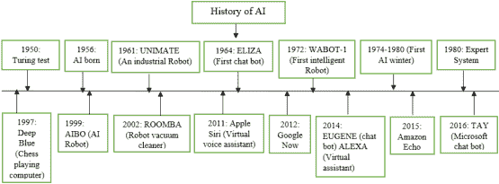
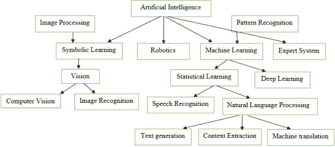
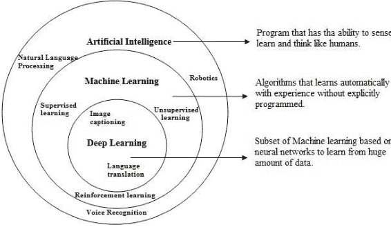
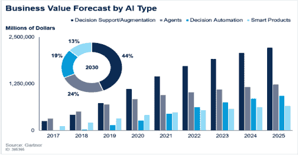
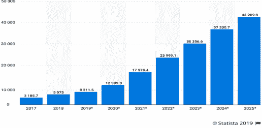
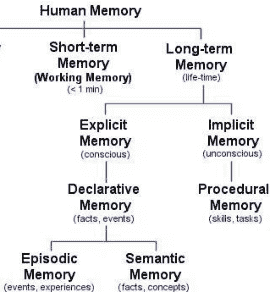
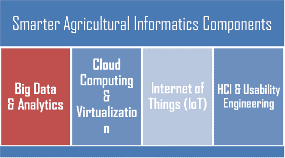
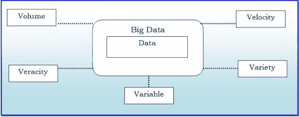
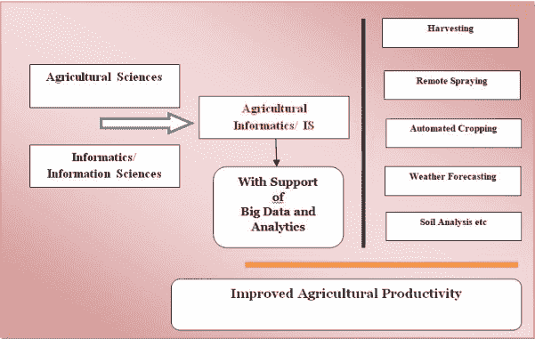

# AI 时代的数据管理

机器被开发并应用于各个领域，以减少人类的体力劳动，这在科学和技术领域带来了重大变革。在二十世纪，信息技术革命催生了人工智能的发展，其概念是创造能够像人类一样通过学习、推理和自我纠正来执行任何任务的智能机器[11]。借助这一发明，机器将取代并减少人类的脑力劳动。因此，人工智能的目标是开发能够智能且独立运行的系统[14]。

人工智能的概念由来已久，但最近才广受欢迎。图1.1展示了人工智能历史中的一些里程碑。从1950年至今，人工智能领域取得了巨大的进步和发展。1950年，艾伦·图灵提出了图灵测试，以检验机器能否像人类一样智能地工作[16]。他提出，为什么机器不能像人类那样以相似的方式工作和思考呢？“人工智能”一词最早由约翰·麦卡锡在1956年的达特茅斯会议上提出，该会议促成了第一个AI程序的开发。随后，他为AI开发了`LISP`编程语言。1961年，第一个工业机器人被开发出来，取代了装配线上的人类工人。1964年，第一个名为`ELIZA`的聊天机器人被开发出来，这是一种早期的`NLP`（自然语言处理）程序，用于实现人与机器之间的交流。1974年至1980年间，由于政府资金短缺，人工智能领域没有进行任何研发，这一时期是第一次AI寒冬，没有任何发明诞生。AI寒冬之后，随着专家系统的发展，发明重新出现，此后人工智能领域的众多发明一直持续至今，如`Siri`、`Google Now`、`亚马逊Echo`等，如下图所示。

图1.1 人工智能的历史

以往我们的数据量非常小，无法预测准确的结果。如今，我们的数据量大幅增加。甚至有统计数据表明，到2020年，数据将从4.4 ZB增加到44 ZB。除了大量的数据，如今我们还拥有高性能的系统计算能力和大容量存储来存储这些海量数据。因此，预计超过70%的企业将利用人工智能。

人工智能被定义为对智能代理的研究，这些智能代理能够感知、分析和理解周围环境，并据此采取行动以实现其目标[1]。人工智能是一种通过复制人类的行为和本质，使机器像人类一样行动的技术[14]。因此，它使机器能够从过去的经验中学习，并像人类一样对新的输入执行任务[16]。它使机器能够通过处理大量数据来训练特定任务并识别模式，这种智能也被称为机器学习[8]。

因此，人工智能是一个更广泛的保护伞，其下包含机器学习和深度学习等子领域。在我们的日常生活中，我们都在使用人工智能，从语音驱动的个人助理（如`Apple Siri`、`Alexa`）到`Netflix`、`Pandora`，以及特斯拉自动驾驶汽车，这些都是基于自然语言处理、深度学习的人工智能示例。因此，人工智能正以许多前所未有的方式让我们的生活变得更美好、更高效。图1.2描绘了人工智能的各种方法及其在各个领域的应用。人类通过语言进行听说和交流，这是语音识别领域，它基于统计学，因此被称为统计学习。人类能够阅读和书写某种语言的文本，这是自然语言处理领域。我们人类能用眼睛观察并处理所见之物，这是计算机视觉领域，它是计算机处理知识和信息的一种符号化方式。人类具有识别模式的能力，例如将相似物体分组，这是模式识别的学科；而机器甚至更擅长识别模式，机器学习领域因此应运而生。人类的大脑是一个神经元网络，帮助我们学习和记忆事物。如果我们能够重建人脑的结构和功能，机器将拥有像人脑一样的认知能力。

这就是神经网络领域，它们是我们可以用来学习复杂事物的复杂结构，属于深度学习领域。因此，人工智能可以应用于机器学习、专家系统、自然语言处理、机器人技术、模式识别、决策制定、预测、聚类和分类等领域。

图1.2 人工智能各种方法概述

机器学习是人工智能中最常见的类型，也是AI的一个子集，在处理海量数据的企业发展中发挥着重要作用。它主要侧重于设计系统并对其进行训练，使其能够基于过去经验的学习来进行预测。它涉及从数据集中提取模式，这有助于预测。

机器学习的工作主要侧重于训练，即使用机器学习算法对有标签/无标签的数据进行系统训练。输入数据被传递给机器学习算法，然后进行预测。对预测的准确性进行评估，如果可接受，则部署机器学习算法；否则，使用增强的数据集对其进行反复训练。

另一种是深度学习，它是机器学习[8]的子集，利用机器学习算法训练深度神经网络，以在传统方法效果不佳的情况下实现更好的准确性。因此，人工智能是一个更宽广的部分，使机器能够像人类一样以更聪明的方式执行任务，而机器学习和深度学习是其子部分，如图1.3所示。

图1.3 人工智能 vs 机器学习 vs 深度学习 [2]

## 人工智能学习的类型

- 人工狭义智能 - 也称为弱人工智能或狭义人工智能，应用于特定领域，AI只能执行特定任务而不会学习新内容。人工狭义智能将基于编程算法和训练数据做出决策。人工狭义智能的一些示例包括AI驱动的网络搜索、`Self`

生物传感器通过对取自人体的血液样本进行测试来检测任何疾病，可用于监测患者健康状况以治愈疾病。基因表达是重要的诊断工具之一，可通过机器学习（`ML`）分析微阵列数据，从而对异常进行分类和检测[19]。借助AI，生物传感器系统能够在早期阶段检测和诊断心血管疾病，因此AI技术有助于预测疾病并提高癌症患者的生存率。

## 银行业中的人工智能

由于在线移动银行服务的快速增长，AI在银行业中的受欢迎程度正在增加，它在维护一个高度机密的用户数据集[17]。由AI驱动的聊天机器人正在帮助客户获得服务。一款名为`Erica`的聊天机器人——一个虚拟金融助手——于2017年由美国银行试点，并于2018年6月开放下载`Erica`应用。`Erica`利用AI和自然语言开发，帮助用户访问其银行信息、查询余额、转账等。通过此应用，客户会利用预测分析并根据客户的平均月支出收到有关其支出的提醒。如果客户的支出可能导致余额过低，则会提前收到提醒。客户还会收到定期付款的提醒，这有助于他们了解如何在任何购买上花费资金。

## 推荐系统中的人工智能

零售公司正在使用最新技术，即人工智能和机器学习，以在竞争激烈的市场中保持领先地位。这些公司利用基于客户购买行为的推荐系统，通过收集其购买偏好细节来提高用户互动，并提升其购物潜力。`Amazon.com` 在其网站上利用推荐功能收集客户关于先前购买和浏览过的产品的信息，并据此向其用户推荐产品。它使用诸如逐项协同过滤之类的推荐算法，从用户购买中收集信息并编制推荐列表，以便下次用户面临这一重大经济损失时，`Blue River Technology` 推出了一款除草喷洒机器——`See and Spray` 机器人，作为减少化学品对作物影响的解决方案。该机器人利用AI工具、摄像头和传感器，帮助农民按自己希望的方式管理田地。该机器使用深度学习算法，并通过约1万种不同植物的大型数据集进行训练，在测试土壤和作物后在田间喷洒。

## AI的应用领域

随着人工智能在当今世界变得越来越重要，以高效方式解决复杂问题变得至关重要。通过使用这种认知智能技术，机器正以更智能的方式工作，并被应用于许多领域，下面将讨论这些领域：

- 医疗保健 —— 正如案例研究中所讨论的，AI在医疗保健领域发挥着重要作用，并日益增长，对医疗保健行业越来越有利。AI可用于帮助医生更好地监测和诊断患者。

- 社交媒体 —— `Facebook`、`Gmail`、`Twitter`、`Snapchat` 是一些使用AI来存储和管理数据的应用程序。

- 建筑 —— 建筑行业广泛使用AI应用，这些应用有助于提供与建筑设计相关的建议，并有助于提供安全功能的建议。它将帮助工程师以更高效的方式执行任务。

- 教育 —— AI正在通过创建虚拟学习环境，以最佳和最智能的方式提供教育，帮助学生和教师使教育系统更加智能化。

- 农业 —— 众所周知，未来我们的地球将需要比目前生产更多的粮食。因此，AI将是解决这一持续存在的问题的办法。`PEAT`是一个已开发的应用，通过扫描记录的图像来测试和分析土壤特性。因此，它将有助于检测作物感染，并有助于作物管理实践，以最大化产出。

- 数据安全 —— AI可被用于网络攻击，而在当今数字世界中，由于每个领域都有大量数据，网络攻击日益增多。因此，保护数据安全是一项关键要求，AI可以帮助发现漏洞、故障和网络攻击。`AEG`（自动漏洞利用生成）是智能设备中用于防止安全漏洞的软件。

- 机器人技术 —— 在机器人技术中，AI扮演着令人难以置信的角色，可以通过编程帮助商业领域像人类一样执行任务。`Sophia` 和 `Erica` 是迄今为止开发的机器人示例。`Sophia` 于2016年开发，能模仿人类的姿势和面部表情，进行对话，并像人类一样进行分析。

- 金融 —— 基于AI的解决方案正在帮助金融部门在各种信贷和金融流程中做出更明智的决策，以增加更多价值并节省时间。一个例子是机器人顾问 `Wealthfront`，它跟踪客户账户，分析他们的投资方式，并使用AI做出决策，从而以更好的方式给出建议。

### B. 人工智能在赋能商业模式中的作用

在过去十年中，我们都见证了全球数字化转型显著改变了世界各地的商业模式。不仅是组织，数字化也有意地影响了个人生活及其工作方式[II]。数字技术和底层数据的使用彻底改变了消费者与行业互动的方式。此外，人工智能（AI）与新兴技术的融合已经彻底改变了商业领域消费者与行业互动的方式，制定了新的商业战略以增加收入等等。

从最近的研究中可以明显看出，在制定商业策略时纳入AI技术已被证明对`Facebook`、`Google`、`Uber`、`Amazon`、`Alibaba`、`Tesla`等不同顶尖公司非常有益[I]。与那些未能在其商业模式中采用AI的公司相比，这些公司通过使用AI技术在市场上获得了竞争优势。然而，除了将AI技术纳入创新商业模式的构建外，顶级公司高管还需要具备创业精神和独创性思维，以保持竞争力和可信度。

- 61% 的商业专业人士认为，人工智能和机器学习是其组织中最重大的数据举措。

- 这些声明还揭示，基于机器学习/人工智能的技术的使用随着时间的推移发展非常迅速。因此，正如那些将积极利用人工智能创造新商业模式作为短期目标之一的企业所表明的那样，这些技术已成为业务优先事项。

从`Gartner` [7] 发布的报告可以明显看出：

> 2021年，人工智能（AI）增强将在全球创造2.9万亿美元的商业价值和62亿小时的工人生产力。`Gartner`将增强智能定义为一种以人为本的人与AI协作模式，共同提升认知表现，包括学习、决策和新体验。

图1.4：按AI类型划分的商业价值预测 [7]

### C. 人工智能与大数据在商业创新中的协作

在“大数据”发展之前，企业完全不知道自身持续产生的数据所蕴含的力量。企业采用的传统商业方法论忽视了数据在制定商业战略方面的潜力。随着迎合数据（包括非结构化和结构化数据）潜力的新技术出现，企业如今正采用内部数据分析工具来改进其商业模式。[1]

正如许多研究人员所阐述的那样，大数据远不止是数据的简单集合。三个V的概念——容量（Volume）、速度（Velocity）和多样性（Variety）——以精妙的方式定义大数据，以获得洞察，从而带来更优的决策和更完善的商业战略。

2001年，在研究了海量数据带来的挑战、问题和潜力后，`Gartner`提出了“3V模型”，该模型通过三个属性来界定大数据：

> “大数据是高容量、高速度和/或高多样性的信息资产，需要具有成本效益且创新的信息处理方式，以增强洞察力、支持决策并实现流程自动化。”

因此，人们创造了“大数据分析”（`BDA`）这一术语，以更好地表达大数据在检测海量数据中揭示隐藏模式、趋势、相关性、机会和其他有用分析方面的潜力。这反过来又促成了更明智的商业决策、更高效和更有成效的运营、更高的盈利能力和可持续性，以及更高的客户满意度。对数据池中趋势的洞察以及对隐藏信息优势的利用，已彻底重新定义了这个数字时代的商业行动，足以冲击全球市场和各类组织。[21]

此外，人工智能领域的进步将`BDA`的潜力在企业中提升到了一个新的高度。AI与`BDA`的融合促成了创新商业模式的构建。为了在企业中利用AI做出有效的前瞻性决策和预测，大数据发挥着重要作用。AI的有效使用在很大程度上取决于用于训练和测试算法的可用数据的范围和质量 [3]。在AI和`BDA`带来的强劲势头下，数据如今已成为企业中的宝贵商品，各企业正竞相收集最有价值的数据池。此外，随着AI和数据挖掘技术的进步，现在已经能够高效地收集和存储由用户和客户生成的数据。[1]

例如，为了预测客户流失率，`Moz`使用基于AI的深度学习神经网络来分析客户行为和动向。基于客户过往行为历史，企业获得了有效的商业洞察，从而减少现有客户的流失，否则这种流失本来可能会阻碍公司增长。[1]

从商业角度看，`BDA`与AI之间的相互作用也为从物理环境中收集数据铺平了道路。与早期基于搜索查询、下单或购买记录和客户点击的在线数据收集技术相比，许多零售公司如今也希望收集线下数据以实现高效决策。

例如，亚马逊已在杂货店中部署企业监控策略，以收集与客户偏好和行为相关的数据。店内安装了执行器和先进传感器，以完成线下数据收集任务。此外，基于物联网（`IoT`）的工具、无人机和基于AI的私人助理也被用于将客户行为转化为有价值的数据。这些收集到的数据是定价算法背后的驱动力，该算法根据客户需求作出响应并采取相应行动。[1]

人工智能和大数据在产生新洞察以促进产品、流程和商业创新方面所展现的潜力，使这些技术的应用成为了业务优先事项。

### D. 机器学习在商业中的应用

机器学习是人工智能的一个子集，具备自动识别和检测给定数据中模式、关系、相关性和趋势的能力。一旦识别出这些关系和模式，就可进一步用于对新模式的表现做出假设。从本质上讲，这与人类的学习、思考方式以及基于与环境和他人的互动所获得的日常经验得出结论的方式相似。随后，人类利用这些结论来应对新情况。[6]

在这个时代，人工智能的崛起带来了机器学习（`ML`）技术在许多领域应用的空前繁荣，包括医疗保健、银行业、汽车、金融、制造业、零售业等。虽然`ML`技术已经运作了相当长一段时间，但得益于近年来的技术进步，它们已在以往受限的商业领域得到广泛应用。即便是那些因实施成本高、缺乏相关人才而完全未使用`ML`的企业，也开始采用基于`ML`的解决方案。[12]

从事零售业务的组织正在使用`ML`技术分析客户购买历史，以了解其兴趣、需求和购买力，从而为下次购买生成个性化产品推荐 [1]。`ML`在商业中的另一个应用是目标营销，即根据提供的性别、收入、年龄、浏览历史、购买历史、位置等信息，系统会预测该用户是否对特定产品感兴趣。基于这些预测，营销部门将相应决定是否为该用户提供促销优惠 [6]。

深度学习是机器学习的一种变体，近年来因其利用不同架构层次实现分层处理的潜力而广受欢迎。此外，深度学习已被认为最适合处理高维和动态数据，广泛应用于生物信息学、视觉与语音识别以及传感器网络。

深度学习在电子商务的个性化产品推荐中甚至也展现出惊人的效果。电子商务网站中部署的深度学习算法会追踪客户的浏览路径和行为。基于所查看产品的规格、查看每个产品所用的时间、查看每个产品前后的客户行为、客户登录电子商务网站的时段、位置、性别及其他相关因素，电子商务网站随后会向客户提供最终能吸引其的个性化购买选项。因此，深度学习被认为能为提升业务转化率创造更多机会，并通过向客户推送个性化内容最终帮助改善品牌形象。

### E. 群组推荐系统——在线商务中的新型交互工具

推荐系统正被广泛应用于各种商业应用中，包括电影、产品、音乐、书籍、新闻以及其他项目，如`Amazon.com`上的推荐。社会互动的变革加剧了推荐系统的必要性。信息过载问题在很大程度上已通过推荐系统得到解决，并证明有助于使用户从可用选项中进行更简单、更高效的选择。推荐系统通过收集客户过去的偏好和选择，根据客户满意度生成适当的项目推荐[4]。

个性化产品推荐是AI在业务中的主要应用之一。最初使用AI开发的推荐系统更侧重于单用户模型，通过推荐产品或服务来满足单个用户的需求和偏好。但是，根据在线使用的新场景，已经观察到用户喜欢以群体形式进行活动，例如在线群体玩游戏、看电影等。因此，为了适应这些情况，需要设计能够应对群体推荐问题的AI技术，这种推荐在很大程度上能满足该群体中几乎所有个体的需求[1]。

移动电话、数字设备和社会网络的日益普及，提升了群体推荐在不同业务领域的重要性和必要性。

在群体推荐系统中发挥重要作用的关键因素包括用户的社交历史、社会关系、兴趣和选择的相似性、社交互动等。此外，所有这些因素现在都可以很容易地从特定用户群的社交网络结构中提取出来[4]。大多数关于群体推荐系统的研究主要集中在探索用于生成群体推荐的核心算法。

已经确定了两种生成群体推荐的主要策略，如下所述：

- 1. 通过聚合一组用户的个人资料来制定共同的群体资料，并基于群体资料生成推荐[10]。

- 2. 为特定群体的成员生成个性化推荐，然后将它们合并为单一的群体推荐[9]。

### 推荐引擎——业务用例

`Netflix`、`亚马逊`、`Facebook`、`LinkedIn`等大公司都使用推荐系统来为客户提供服务，并了解客户需求以获得更高的客户满意度。`Netflix`的流媒体服务使用推荐引擎来生成符合用户观看电影、节目等偏好的推荐。根据偏好、年龄、兴趣，用户在调查中表达对电影评分的观点，这些观点作为用户的特征，由机器学习以提供推荐。此外，还会检查用户对推荐的反应，以做出更好的推荐。

如今，推荐系统已经足够普及，尤其是在在线业务中，并已部署到广泛的企业中，以增加客户互动和丰富购物潜力，如下所述：

- 超市：通过考虑之前的购买历史并包含客户可能感兴趣的商品，为下一次购买生成定制优惠券。

- 零售行业：公司在购买后向客户发送电子邮件和短信，并推荐新书、音乐专辑、杂货、服装等新产品。`亚马逊`和类似网站等许多公司会在客户访问其在线网站时，根据客户的偏好实时提供产品推荐。

- 股票市场：通过分析投资者之前的资产、偏好、收益和股息，为投资者提供个性化股票推荐。

- 电影和电视服务：像`Netflix`这样的公司会分析每个客户以前的内容选择，并据此提出推荐，同时还会根据其浏览历史实时主动推荐内容。

- 社交网络站点：像`LinkedIn`和`Facebook`这样的网站使用推荐系统，根据个人现有的网络推荐额外的联系人或朋友。

### F. 自然语言处理——AI的另一个商业视角

自然语言处理（NLP）是AI的一个子领域，涉及使用自然语言进行机器与人类之间的交互。它是自然语言、机器学习和人工智能的融合，共同构建了一种以正常人语言与机器交互的技术。NLP的目标是以有价值的方式读取、解码、理解并领会人类语言。大多数NLP技术高度依赖机器学习算法来从人类语言中获取含义。

自然语言处理是一门完全致力于让机器能够理解自然语言的科学学科。NLP处理诸如识别文档中的句子边界、从文档中提取关系、搜索和检索文档等任务。NLP是通过在非结构化文本中建立结构来促进文本分析的必要手段，以便进一步分析[1]。

基本NLP任务包括分词和句法分析、词形还原/词干提取、词性（POS）标注、命名实体识别、词分割、形态转换或文本增强，以获得更大的价值并得出有用的文本分析。[1]

### 自然语言处理——业务用例

如今，自然语言处理正在成为企业中发展最快的AI技术。组织正在转向NLP技术，以便从在线和通话记录中可用的众多非结构化数据中获取理解。

2019年Statista报告显示，到2025年，NLP市场将增至439亿美元。

*图1.5：2017年至2025年全球自然语言处理（NLP）市场收入（百万美元）[20]*

[^1]: www.statista.com

从统计数据中可以清楚地看出，企业现在相信NLP在帮助提高业务利润方面的潜力。

以下是业务中最常见的NLP用例：

- **情感分析：** 情感分析被广泛用作社交媒体和互联网监控工具。它包含自然语言处理，以理解和分析与业务消息相关的社交媒体平台（如Twitter、Facebook、Instagram等）上收到的回应。它有助于检验消费者在与业务帖子相关的帖子和评论中的态度、情绪状态和感受。社交媒体上发布的产品评论、情感被用来识别消费者对产品是否满意或不满意。同样，企业组织可以使用情感分析来衡量新产品、广告活动或消费者对社交媒体上最近公司新闻的反应的影响。[1]

情感分析也称为意见挖掘。它通过自然语言处理和统计相结合的方式实现，根据文本中的积极、消极和中性情感分配数值，从而有助于识别作者在特定语境下的潜在情绪（快乐、高兴、担忧、悲伤、烦恼等）。NLP的这一应用帮助商业组织深入了解消费者的反应和情绪。

因此，有助于进行竞争比较，并相应地调整商业策略。通过情感分析任务收集的信息在设计更好的客户方面也非常有用

深入了解受众的口味、偏好、感受、兴趣和看法，进而有助于改善组织的客户服务和支持功能。

语音分离是人工智能辅助自然语言处理的一项应用，有助于从其他来电者的混合声音中识别出目标来电者的声音，从而分别应答每位来电者。此外，组织还会分析客户的通话录音，以了解客户是高兴还是难过、其需求以及未来的要求[22]。

客户服务中相关的自然语言处理任务包括：

- *语音识别* – 将口语转换为文本

- *问答* – 用自然语言回答人类提出的问题

- **声誉监测** – 早期的商业组织仅限于利用内部数据库生成文本分析，以了解客户需求并改进商业策略。但随着改进型学习算法的发展，企业开始采用工具分析公共数据。虽然其中一些数据是结构化的且可直接分析（例如人口普查数据、股票价格），但大多数数据仍是非结构化的，尤其是以人类生成的文本形式存在，如新闻、博客文章、论坛、评论、报告以及 Twitter、Facebook 等社交媒体。这些来源包含大量尽管非结构化但关于竞争对手、客户和整个市场如何演变的有用信息。组织现在正利用这些信息来源进行声誉监测，识别其品牌和产品的提及情况，并判断何时应采取行动。

    声誉监测包括以下自然语言处理任务：

    - *情感分析*，用于确定客户的态度、情绪状态、感受、判断或意图。这可以通过为文本赋予极性（正面、中性或负面）或尝试识别潜在的情绪（快乐、悲伤、平静、愤怒等）来实现。

    - *共指消解*，将代词连接到正确的对象。例如，如果客户写道：“卖方那边有人打电话来问我是否喜欢我的新公寓。”我回答：“它太棒了。”在这里，重要的是要识别出“它”指的是公寓而不是那个人。简而言之，客户是在对产品给予正面反馈[]。

- **市场情报** – 商业市场深受各行业、利益相关者、政府和监管机构之间的市场知识和信息交流的影响。紧跟最新行业趋势和不断变化的标准至关重要。自然语言处理是一种有用的技术，可用于跟踪和监测市场情报报告，并提取必要信息，帮助组织制定关于其行业的新业务、市场、竞争对手、客户及其他重要细节的策略。

    有数十种工具可帮助企业家监测竞争对手。像 Zirra² 这样的自然语言处理驱动引擎简化了自动构建竞争格局的过程[23]。当 Zirra 分析某事物时，它会收集一份公司列表并按 0 到 1 进行排名。该排名通过多模态语义场显示这些公司之间的关联紧密程度。Zirra 等算法解决方案通过扫描互联网上的文章并将数据输入到自然语言处理模块中来创建公司列表，该模块能够揭示公司之间的语义关系。

² www.zirra.com

以上是自然语言处理的一些应用，这些应用将在未来被商业组织所见证。还有其他应用，例如广告投放、神经机器翻译、招聘工具与管理、监管合规、数据可视化、生物识别、机器人技术、流程自动化等。自然语言处理概念背后的系统本质上具有统计性质。要使这一概念从自然语言处理（NLP）发展到自然语言理解（NLU），让消费者能够看到并体验到与机器之间的人性化情感连接，是未来努力的方向。在过去十年中，信息技术行业已迈出信任的一步，深入挖掘了自然语言处理的各个方面。

商业组织已经发现、测试并实施了最有利的自然语言处理应用，以推进商业智能的发展。然而，该技术仍需要大量数据和流程来理解、分析并响应人类思维的需求。

### G. 关于商业中人工智能的总结性评论

从上述事实和数据可以推断，采用人工智能的企业未来有望看到生产率提高。通过简化以前需要人工数天才能完成的任务，并以新的方式将人和机器结合起来改进工作流程，可以衍生出新的能力。许多企业还相信，人工智能将加速和增强创新，从而创造新的就业机会和商业前景。一些人预计，更加个性化和更高质量的人工智能增强产品和服务将带来消费需求的增长。

与此同时，一个关键的争论问题是人工智能将导致岗位消失。例如，部署虚拟助手来增强客户支持可能会导致许多从事客户服务的人失业。

尽管人工智能在商业中的使用正在增加，但人工智能和机器学习尚不足以有效部署到每一项业务运营中。虽然企业的许多方面可以实现自动化，也必然需要自动化，但需要判断、优先级排序和权衡取舍的任务仍然需要人类智能。

为了利用人工智能技术，企业将需要雇佣具有人工智能经验或具备分析和使用数据技能的人员，以将人类监督的需求与人工智能相结合。企业还需要计算能力和系统基础设施来支持人工智能驱动的产品和服务，并且需要平台来组织和整合其数据。建立这种基础设施可能成本高昂。

此外，人工智能收集的数据带来了另一个巨大挑战。企业如何保证所收集数据在正确性和可靠性方面的有效性？他们需要对其使用设置哪些限制？如何确认机器会按照预期执行人类的指令？

有人担心无意的偏见可能会进入人工智能算法或决策模型。企业需要建立强有力的控制措施以防止这种情况发生，并监测通过人工智能学习的系统。让利益相关者了解企业的监督机制，有助于建立利益相关者对企业可靠使用人工智能的信任。

## 参考文献：

- [1] Akerkar, R. (2019). *Artificial Intelligence for Business*, Springer Briefs in Business, pp. 1–92. Springer, Cham, https://doi.org/10.1007/978-3-319-97436-1

- [2] Aslam, M. A., Kaur, A. (2020). *Emerging Trends and Applications of Machine Learning: A Survey*, The Mattingley Publishing Co Inc., Vol. 82, 16701-16705.

- [3] BaFin (2018). *Big Data Meets Artificial Intelligence—Challenges and Implications for the Supervision and Regulation of Financial Services.* https://www.bafin.de/SharedDocs/Downloads/EN/dl_bai_studie_en.html (accessed on 30/5/2020).

- [4] Dara, H., Chowdary, R. & Kumar, C. (2019). *A survey on group recommender systems.* Journal of Intelligent Information Systems. 10.1007/s10844-018-0542-3.

- [5] Das, S., Ghosh, I., Banerjee, G. & Sarkar, U. (2018). *Artificial Intelligence in Agriculture: A Literature Survey.* International Journal of Scientific Research in Computer Science Applications and Management Studies, Volume 7, Issue 3

- [6] Finlay, S. (2018). *Artificial Intelligence and Machine Learning for Business: A No-Nonsense Guide to Data Driven Technologies* (Third Edition). Relativistic, ISBN-13: 9781999730345.

- [7] Gartner. (2019). *Gartner Says AI Augmentation Will Create $2.9 Trillion of Business Value in 2021.* https://www.gartner.com/en/newsroom/press-releases/2019-08-05-gartner-says-ai-augmentation-will-create-2point9-trillion-of-business-value-in-2021 (accessed on 30th May 2020).

- [8] Girasa, R. (2020). *AI as a Disruptive Technology.* Springer Science and Business Media LLC, DOI: https://doi.org/10.1007/978-3-030-35975-1_1

- [9] Kim, H.N., & El Saddik, A. (2015). *A stochastic approach to group recommendations in social media systems.* Information Systems, 50(Supplement C), 76–93.

- [10] Kim, J.K., Kim, H.K., Oh, H.Y., Ryu, Y.U. (2010). *A group recommendation system for online communities.* International Journal of Information Management, 30(3), 212–219.

- [11] Krishnan, P.R. (2019). *Reshaping a Business Around AI: The Machine First™ Approach to Digital Transformation.* https://www.tcs.com/content/dam/tcs/pdf/perspectives/volume-12/Reshaping-a-Business-Around-AI-The-Machine-First-Approach-to-Digital-Transformation.pdf (accessed on 30th May 2020).

- [12] Management Solutions (2018)，*机器学习——商业模式转型的关键组成部分*，https://www.managementsolutions.com/sites/default/files/publicaciones/eng/machine-learning.pdf（访问于2020年5月30日）。

- [13] MemSQL，*调查发现机器学习和人工智能是企业首要业务优先事项*，https://www.globenewswire.com/news-release/2018/02/07/1335563/0/en/Survey-Finds-Machine-Learning-and-Artificial-Intelligence-are-Top-Business-Priorities.html（访问于2020年5月30日）。

- [14] Minsky M. (1961)。 *迈向人工智能的步骤。* Proceedings of the IRE，第49卷，第1期，第8-30页。IEEE

- [15] MobiDev (2010)。用于业务优化的自然语言处理（NLP）用例。https://mobidev.biz/blog/natural-language-processing-nlp-use-cases-business（访问于2020年5月30日）。

- [16] O’Leary, D.E. (1995)，*人工智能应用的历史，第一部分：IEEE Expert的前九年*，IEEE Expert，第10卷，第1期，https://doi.org/10.1109/64.391956

- [17] Pau L.F., Gianotti C. (1990) *人工智能在银行业、金融服务和经济学中的应用。* 载于：经济与金融知识处理。Springer，柏林，海德堡，ISBN：978-3-642-76004-4。

- [18] PwC (2018)。 *2018年人工智能预测——塑造商业战略的8个见解。* https://www.pwc.es/es/publicaciones/tecnologia/assets/ai-predictions-2018.pdf（访问于2020年5月30日）。

- [19] Rong, G., Mendez, A., Bou Assi, E., Zhao, B. & Sawan, M. (2020)。 *医疗保健中的人工智能：综述与预测案例研究。* Engineering. Volume 6, Issue 3, Pages 291-301.

- [20] Statista (2020)，*2017–2025年全球自然语言处理市场收入*，https://www.statista.com/statistics/607891/worldwide-natural-language-processing-market-revenues/#statisticContainer（访问于2020年5月30日）。

- [21] Soofastaei, A. (2019)。 *引言章节：高级分析与人工智能应用*，IntechOpen，DOI：10.5772/intechopen.89784

- [22] UpGrad (2019)。 *面向企业的自然语言处理5个应用*。https://www.upgrad.com/blog/5-applications-of-natural-language-processing-for-businesses/（访问于2020年5月30日）。

- [23] Zirra (2017)。 *简化竞争分析的9种工具（2017年）。* https://wisdom.zirra.com/2017/08/24/9-tools-that-simplify-competitive-analysis/（访问于2020年5月30日）。

# 应用人工智能——让AI作为核心业务组成部分为消费者服务

Mikael Wiberg，博士，教授  

瑞典于默奥大学信息学系，901 87 于默奥，瑞典  

mikael.wiberg@umu.se  

+46 (0)70 662 10 70

## 摘要

人工智能（AI）如今正迅速应用于我们的社会。尽管自20世纪50年代中期以来，关于AI在社会层面的使用和适用性的突破实际上已被反复宣告，但如今这一说法比以往任何时候都更真切。正如最近所公认的那样，经过三次发展浪潮，AI如今终于离开了研究实验室，进入了真实世界的应用场景。因此，随着AI现在日益广泛地得到应用，我们认为现在是时候解决与“应用人工智能”（AAI）相关的问题了。在本文中，我们提出这一术语，并将其定义为：研究、设计、开发、实施和应用人工智能技术来解决现实世界问题。在本文中，我们介绍了AI在过去几十年间跨越三次发展浪潮的发展历程，并通过展示我们的e-Biz Corp案例来说明应用人工智能——在该案例中，一家全球性企业正在将AI作为其在线业务的核心组成部分。最后，我们为推进应用人工智能提出了一系列建议，并展示了我们的工作对日益增长的关于如何利用AI的研究所做出的主要贡献。

**关键词：** AI，人工智能，应用人工智能，核心业务

## 人工智能在社会中的突破

*“人工智能不再是一个学术术语，而是一个现实”*。这句话在今天也可能说得出来，鉴于当前围绕AI不断升级的热潮。然而，它实际上是由Holloway和Hand（1988）在他们近30年前发表于《Business Horizons》的文章中提出的。尽管如此，关于AI大规模、现实世界突破的这一说法，在2020年的今天也同样适用。从历史的角度回顾，关于人工智能（AI）在社会层面广泛突破的概念验证，在过去几十年里——从20世纪50年代中期至今——一直是围绕该技术发展的反复承诺和讯息（参见例如Turing, 1950; Weizenbaum, 1966; Makridakis, S., 2017）。正如Xu（2019）所阐述的那样，我们现在已经处于AI的第三次浪潮中，而在AI技术发展的这三次浪潮中，关于AI的承诺每一次都在重复。

尽管如此，Holloway和Hand（1988）所阐述的关于AI突破的这一说法，如今或许比以往任何时候都更真实。正如Xu（2019）指出的，这第三次AI浪潮的特点在于技术增强以及AI解决方案在社会中的部署和使用，而第一次和第二次浪潮在很大程度上是由学术界驱动的。简而言之，AI如今正越来越多地应用于社会层面。

因此，随着AI如今日益广泛地应用，我们认为现在是时候解决与“应用人工智能”（AAI）相关的问题，并将关注的焦点从使AI作为一种技术得以运作的技术问题，扩展到使其在应用和实施背景下发挥作用。以此为出发点，我们提出“应用人工智能”（AAI）这一术语，并将其定义为`研究、设计、开发、实施和应用人工智能技术来解决现实世界问题`。在本文中，我们提出这一术语，是为了超越围绕AI领域的技术发展，并将我们的关注点重新导向：当AI在现实环境中日益广泛地应用时，这项技术如今能为消费者和企业带来什么。

AI的发展一方面由技术进步驱动，包括机器学习、模式识别和神经网络的发展（例如Gilio, 1995）；另一方面则由关于AI下一步应用前景的愿景和承诺所驱动（Xu, 2019）。在这些发展周期中，AI的突破是一个反复出现的主题，周围环绕着对不久将来的承诺（参见例如Makridakis, 2017; Kaplan & Haenlein, 2020），同时也伴随着怀疑和恐惧（参见例如Clark, 2003）。

以“超越人类”为目标的AI解决方案（Kaplan和Haenlein, 2019），以及AI可被用于完成超越人类规模的工作任务（例如收集、搜索、过滤、分析、生成和编辑海量数据）。我们可以在搜索引擎、社交媒体平台和流媒体服务中看到AI的日益广泛应用。AI不再仅仅以“类人”为目标，而是越来越多地用于完成那些单个人类甚至一群人无法在合理时间内完成的大规模任务。例如，以高精度、高速度反复过滤和分析数百万个数据点数千次。正是这类AI是我们本文关注的焦点。

正如Kaplan和Haenlein（2019）最近所阐述的，AI——“人工智能”——可以被定义为`“系统正确解释外部数据、从这些数据中学习，并通过灵活适应运用所学知识来实现特定目标和任务的能力”`。这一定义与当前AI的大规模使用是一致的，我们还可以注意到，“推理”已不再是AI定义中的明确术语。当然，如果仍然以“类人”AI为目标，它或许仍是一个核心概念，但当我们超越人类能力时，更有趣的或许是关注AI能提供什么，超越与人类心智的任何比较。简而言之，AI现在可能已经成为一种独特的智能形式，与人类大脑的类比不再富有成效或有用，反而会误导人们对AI工作原理的理解，但也许最重要的是会误导人们对AI能提供什么的理解。AI也许不再类人，但可能

相反，提供一种人工智能，它能够完成人类无法单独或集体完成的任务。

鉴于人工智能发展的这一最新转变，我们认为现在同样是时候：

-   将我们的分析视角——从个体（且类人）转向大规模（且超越人类）；

-   探索人工智能如今能提供何种人工智能；以及

-   从应用人工智能（AAI）的视角来探索这一点。

在本文中，我们进行这一探索时特别关注理解`应用人工智能`可能如何被设计来支持多个利益相关者（在我们的案例中即消费者和企业），应用人工智能如何在为消费者创造新数字服务方面发挥作用，以及人工智能如何被用作核心业务组件。我们转向应用人工智能，是因为人工智能越来越多地被应用于现实世界问题，且最近的研究显示出人工智能技术正变得越来越具有实际相关性（例如参见 Gomes et al., 2019 和 Ågerfalk, 2020）。

在本文中，我们介绍了人工智能在过去几十年间如何发展，以及其经历的三波发展浪潮，并通过展示我们的 `e-Biz` 公司（`e-Biz corp`）案例来说明应用人工智能——一家全球性企业目前将人工智能作为其在线业务的核心组成部分。我们以一组推进应用人工智能的建议来结束本文，并呈现主要

基于对话的系统，该系统旨在模仿治疗师。

在20世纪70年代和80年代，出现了许多为人工智能发展奠定下一阶段基础的发展，包括提高CPU容量的技术研究突破、并行分布式处理的进展，以及人工神经网络的发展。尽管如此，重点仍然是如何以不同方式创建大脑模型，以及如何获得更好的人类认知模型。正如 Kaplan & Haenlein (2019) 所指出的，“定义人工智能的一种常见方式是参照人类智能。”

沿着这些思路，麻省理工学院建筑机器小组的创始人尼古拉斯·尼葛洛庞帝（Nicholas Negroponte）将他1970年的著作`《建筑机器》`献给了“第一台能够理解手势的机器”，该书提出了人工智能界面理论（Vardouli & Touloumi, 2019）。同样，其目标是创造类人的智能机器。然而，随着我们从人工智能发展的早期阶段向前迈进，这种对人或大脑的反复参照受到了挑战。

在20世纪90年代，人们开发出了更先进的人工神经网络，可以读取支票上的数字，但也仅此而已。正如 Miller (2019) 所述，这些早期机器在寻找模式方面存在困难，而模式发现是数据分析的一个基本方面。当时的计算机仍不够强大，也没有足够的数据来训练算法。尽管如此，20世纪90年代标志着人工智能发展的一个重要转变——从对大脑进行建模，转向人工智能可以执行的任务，超越人类水平，超越关于大脑运作方式的基础研究，转向人工智能能做什么（即我们在本文中所称的“应用人工智能”）。

如果我们现在将这一发展与 Xu (2019) 提出的人工智能三波浪潮对应起来，我们可以看到，第一波人工智能持续了大约20年（20世纪50年代至70年代），且主要由学术界推动，重点关注技术解决方案、符号主义和联结主义。进一步看，我们还可以看到，第二波人工智能（20世纪80年代至90年代）仍然由学术界驱动并以技术为导向，如上所述，其明确侧重于语音识别、机器翻译、人工神经网络以及模式识别研究。不过，直到20世纪90年代末，焦点才开始转向将人工智能用于不同目的；根据 Xu (2019) 的说法，直到21世纪初，我们才看到第三波人工智能（2006年）的开端。

第三波人工智能带来了一个重要的转变——从研究实验室产品开始变得广泛应用。正如 Xu (2019) 所提出的，这是应用上的突破（包括基于深度学习、语音识别、模式识别和大数据构建的功能系统），并得益于高性能计算机。因此，它开始证明自身的有用性，并越来越多地被应用于现实世界的问题。

因此，从某种意义上说，正如我在本文开头引用 Holloway 和 Hand (1988) 关于人工智能突破的论述一样，我们现在可以通过第三波人工智能看到，它越来越多地关注应如何应用的问题。从技术性问题（例如机器学习和模式识别算法），到更基础和哲学性的问题（即什么是“智能”？机器在多大程度上可以具有智能？），我们可以看到人工智能领域正在转向关于人工智能不同形式的问题，即它应该是类人的（并以机器人、化身、不同场景中的对话伙伴等形式呈现），还是超人类的形式（例如基于云的人工智能解决方案）。

从转向第三波人工智能以来，最近的发展包括呼吁采用以人为中心的人工智能方法（Xu, 2019）、关注合乎伦理和负责任的人工智能设计与开发（Dignum, 2019），以及对人工智能社会和社群影响的关切。

|  | 第一波（1950年代–1970年代） | 第二波（1980年代–1990年代） | 第三波（2006年–） |
|---|---|---|---|
| 技术主要进展 | 早期符号主义和联结主义学派、生产系统、知识推理、初步专家系统 | 语音识别和机器翻译中的统计模型、模式识别中的人工神经网络、专家系统 | 深度学习在语音识别、模式识别、大数据、高性能计算机应用中的突破 |
| 人类需求 | 未满足 | 未满足 | 开始提供有用且能真正解决问题的AI解决方案 |
| 关注点 | 技术解决方案 | 技术解决方案 | 集成解决方案；伦理设计、技术增强、人因设计 |
| 特征 | 学术驱动 | 学术驱动 | 技术增强与应用 + 以人为中心的方法 |

*图1.* 人工智能的三波浪潮（来自 Xu, 2019）。

要理解应用人工智能的社会、伦理和社群影响，研究其如何被应用至关重要。在此，我们通过关注一家大规模应用人工智能的公司来回应这一日益增长的需求——该公司将人工智能嵌入其覆盖数千名消费者的 `e-biz` 平台开发中。通过这样做，我们顺应了关注人工智能能做什么（在此案例中，对消费者和企业而言）的日益增长的趋势，并呈现了他们在这一特定情境中应用人工智能技术时不得不面对的挑战。

在进入这个应用于商业情境的第三波人工智能案例之前，我们首先考察当前对人工智能发展所采取的方法。在下一节中，我们概述现有方法，包括以机器为中心的方法、以人为中心的方法和以系统为中心的方法。我们认为这些方法已取得成功，但在关于人工智能应如何在现实情境中使用的问题上，或许还有第四种方法的空间——即采用应用人工智能的方法。

## 人工智能的三种方法——呼吁第四种人工智能方法？

在介绍我们的商业案例之前，在讨论应用人工智能之前——不仅从“使用”的角度，即在这种意义上应用人工智能，而且要从“应用”作为一种特定人工智能方法的视角出发——我们应首先概述并讨论针对这一技术所采取的其他一系列方法。当然，在将“应用人工智能”作为一种独特方法提出之前（包括研究、设计、开发、实施和使用人工智能技术来解决现实-

能够像人类一样“行动”的智能机器。“图灵测试”（Turing, 1950）正是关于人工智能的这种类人特性。图灵测试由艾伦·图灵于1950年提出，用于测试计算机能否表现出与人类相当或无法区分的智能行为。在这一努力中，类人人工智能或人类水平人工智能的概念反复出现（参见例如Miller（2019）和Kaplan & Haenlein（2019））。

在追溯这种类人人工智能发展模式的根源时，我们当然应该提到`Eliza`系统。该系统由约瑟夫·维森鲍姆于1966年设计，据称是第一个通过图灵测试的计算机程序。`Eliza`程序通过检查用户输入评论中的关键词来工作，并以对话方式回应用户。依靠这种模式，`Eliza`可以用一个通用短语或重复用户之前留下的评论来回应。`Eliza`程序的设计初衷就是模拟心理治疗师的行为。由于通过了图灵测试，`Eliza`成功让一些人相信自己是在与真人交谈，而不是计算机。

`Eliza`以及当时开发的类似系统都基于这样一个理念：人类可以被建模为计算机程序，这样一来，就有可能创造出能够模拟人脑、从而表现为“智能”的人工智能。正如纽厄尔和西蒙（Newell and Simon, 1972）所阐述的那样：

> “人类在完成我们所考察的那类任务时，若从事问题解决活动，可以被表示为信息处理系统”（Newell and Simon, 1972）

正如Miller（2019）进一步描述的那样，这些研究人员扩展了计算机功能架构的概念，以反映大脑的组成方式，即大脑的认知功能架构。与人脑的类比是当时的主导模型。

> “像计算机一样，大脑拥有存储信息或事实的装置——记忆——以及检索和处理信息的方法，并使用问题求解规则——算法。”（Miller, 2019）

这第一波类人人工智能发展是多个科学学科紧密合作的成果（包括认知科学、心理学、神经科学和计算机科学之间的合作）。从这个意义上说，它是多学科的，但所有这些学科都有一个共同焦点——为智能计算机器的设计提供依据。

自那时起，围绕人工智能的研究合作的多学科传统得以延续，但如今的结果更加多样化。如今，研究人员不仅关注智能机器的设计和实现所带来的技术挑战，还关注理解其哲学、社会、文化、伦理和道德意义。在这方面，最近有一些关于“负责任的人工智能”（Dignum, 2019）的呼吁，以及将人工智能理解为“能动性”（Ågerfalk, 2020）的重要性；与此相关，还需要从能动性以及权力、控制、数据收集和处理等角度理解“算法想要什么”（Finn, 2017）。在这里，人工智能再次从以人为中心的角度被审视，但对研究对象的理解更加广泛。

## 3. 以系统为中心的人工智能方法

现在，如果我们转向人工智能的最新发展，以及促使本文提出的“应用人工智能”转向的一系列当代因素，我们就应当承认人们对以系统为中心的人工智能方法的兴趣日益浓厚。我们不再需要逐行编写代码来构建人工智能系统，也不再需要手工为这些系统喂入数据。相反，多个平台和开发框架（包括例如`Microsoft Azure`）现在提供现成的“人工智能组件”，可以将人工智能功能集成到几乎任何数字服务中。这一发展实现了人工智能解决方案的组合式设计（Stolterman & Wiberg, 2020），并降低了在现实应用场景中构建可用人工智能系统的开发门槛。

借助以系统为中心的人工智能方法，开发者现在可以专注于他们希望人工智能系统做什么（即应如何应用它），而不是仅仅让它运转起来（从技术角度看）。此外，数据访问由另一组现成组件处理（例如用于数据库访问和检索的组件，或用于网站数据抓取的组件），因此，需要思考的更多是应该使用哪些数据源，而不是首先解决与获取数据相关的任何技术问题。

## 4. 迈向第四种方法？对应用人工智能的呼吁

尽管我们现在已经具备了人工智能技术，并且可以将其作为现成的人工智能组件轻松集成到系统和数字服务中，但这里可能仍然需要一种额外的方法。如果我们现在已经具备了技术，下一个要解决的问题是如何在不同情境中将其付诸应用？为了解决这个问题，我建议我们需要从“应用人工智能”的角度来着手。虽然人工智能应该被使用这一点并不新鲜，但仍然没有一种明确的方法专门侧重于推动其发挥作用的过程。在本文中，我建议在商业层面上，我们不应仅仅将这项技术视为工具，而应努力推进更全面的实施和集成项目，让整个商业模式围绕这项技术构建，将其作为核心业务组成部分。

### 应用人工智能作为核心业务组件——eBiz公司案例

人工智能日益成为一种集成在数字平台、产品和服务中的后台技术——从搜索引擎和流媒体服务中集成人工智能组件，到人工智能在医疗保健中的应用（Rahwan et al., 2019）。

在我们的研究项目中，我们与一家`eBiz`公司紧密合作，跟踪他们开发这样一个基于人工智能的平台的过程，该平台在后台运行，为在线网店支持“智能定价”。在采用Rahwan等人（2019）提出的方法论视角时，我们在过去11个月中跟踪了这一开发过程，不仅跟踪技术人工智能系统的开发，还跟踪了首席执行官、销售经理和技术开发团队，以便深入了解他们如何通过开发这一人工智能系统来发展核心业务。

在我们与这家`eBiz`公司的研究合作中，我们也从Zook和Allen（2003）关于业务核心增长过程的研究、Strassmann（1990）关于如何使IT发展与企业价值观发展保持一致的研究，以及Zook（2007）关于如何通过数字解决方案进一步发展核心业务的研究中获得了启发。在此过程中，我们关注人工智能如何作为核心组件应用于人工智能平台的开发，以及`eBiz`公司如何成为一家由人工智能驱动的企业。在跟踪`eBiz`及其人工智能平台的发展时，我们采用了参与式学术研究方法（Van de Ven, 2007），与该公司紧密合作，而不仅仅依靠例如访谈。

我们合作的这家`eBiz`公司是一家全球性企业，在6个国家设有办事处，包括伦敦的一个创新办公室。`eBiz`为30家客户（全球连锁企业）开发和提供由人工智能驱动的网络零售平台，并将其核心业务定义为“在线进行智能品牌和产品匹配，为客户提供最佳价格”。因此，他们服务多个利益相关者（包括作为客户的其他公司，以及在线购物者（最终用户/消费者））。在此过程中，他们认识到，如果人工智能系统与组织及其贸易伙伴保持一致，就具有战略价值（Melville et al., 2004），并认识到整合IT、算法和商业模式同步发展的方式（Gomez-Uribe, 2015）。

`eBiz`还有一个与其人工智能平台完全一致的使命宣言。该宣言称，他们能够提供完整而精确的视图，展示所有客户的产品在与在线市场上的任何竞争对手进行价格比较时的情况。这种比较是数据驱动、自动化的，他们的算法每天都会抓取和分析网络信息。

这使得在线零售商能够策划商品组合、提高销量、促进增长，并实现特定的战略和战术目标。

在定价方面，通过AI技术实现完全控制，从而节省大量时间。

### eBiz AI平台的实际运行

`eBiz`开发的AI系统是一个数字平台，其客户在构建和发展在线网店时可以使用。AI模块在后台运行，抓取网页上的竞品信息，以便自动调整客户在网络上销售产品的价格。目前，该平台拥有用于数据抓取和处理的算法，系统可以基于此采取行动（即为客户实施“智能定价”）。目前，该平台处理60万件商品（网店产品）的自动智能定价，这些调整会根据竞争对手的定价策略以及一系列广泛的因素持续进行。

该AI系统按照一个简单的循环运行：1）系统输入（电子零售商的商品信息流），2）抓取网页并下载选定的竞品及其价格，3）处理这些数据（自动调整电子零售商的定价，并将处理后的数据进一步作为电子零售商ERP系统的输入）。

在实施这一循环时，`eBiz`表示，他们能让客户做到：1）通过跟踪和匹配可比产品来跟进竞争对手，同时其系统支持2）动态智能定价和规则设置（例如：“将我的价格调整为更高或更低的价格，在部分商业模式中，它既能‘维持业务运营’（Holloway & Hand, 1988），又能同时为在线客户服务。”）。

然而，让AI发挥作用也需要一些条件和前提。在我们的项目中，我们专注于让AI为消费者服务，并使其成为核心业务组成部分，我们依据以下在应用AI时的简单模型，包括1）监控、2）行动/反应、3）重新配置的循环。在此，我们简要概述这三个组成部分：

#### 1）监控

我们在本商业案例中聚焦的AI系统被配置为从相似产品价格变化的角度来监控网上的变化。为了实现这一点，AI系统依赖于一组描述每个产品的变量，然后系统可以训练其算法，持续监控网上的这些相似产品。

#### 2）行动/反应

我们聚焦的AI系统也能够采取行动。当网上类似产品的定价发生变化时，AI系统可以采取相应行动。它可以对类似产品价格的变化做出行动/反应，并且可以根据对类似产品定价方式的分析，即时、动态地调整网店商品的价格。

#### 3）重新配置

AI系统不仅能对其通过抓取其他网站所收集的数据采取行动和做出反应，而且由于AI系统也被配置为训练其底层算法，它还能适应变化（例如，适应市场中不断变化的定价策略（如“黑色星期五促销”或其他活动））。

在商业环境中成功应用AI的关键在于设计能够将这三个方面融入持续循环的AI解决方案。也就是说，解决方案不仅要配置为监控特定数据集并依据这些数据采取行动，真正的力量还在于利用AI训练算法以达到更高精度的能力，或是在其被设定监控的数据格局发生变化时，以高速和更高精度不断调整和重新配置自身的能力。

当然，将AI应用于现实使用环境也面临挑战。在本文所报告的研究项目中——该项目专门面向商业环境中的AI应用——我们发现了两个这样的总体性挑战。

第一个挑战与“*脱节的风险*”有关（Borgmann, 1984）。当我们应用自动化技术，尤其是这里提到的自我重新配置技术时，我们也将其作为我们与它自主执行的任务之间的中介。在eBiz的业务中，任何人都无法手工完成系统所做的事情，甚至无法跟踪系统的运行。系统执行的子任务太多、速度太快，人类无法监控。丧失监控系统工作方式的能力，意味着我们可能同样丧失对其工作方式的理解——它只是在运行，过程变成了一个黑箱。在我们于本文中报告的eBiz案例中，他们通过自主研发AI系统来应对这一挑战。这一策略迫使他们不断确保自己理解系统在做什么、如何运行以及如何发展。因此，这是一种积极的策略，既将AI系统的开发与其核心业务模式的发展持续对齐，同时又不断确保对核心业务的理解与对核心业务AI系统如何代表他们运行的近距离理解之间不存在脱节。

第二个挑战是*缺乏透明度*。这一挑战是AI解决方案规模扩大到业务层面时产生的效应。对于小规模的AI解决方案（例如，将机器学习应用于一个小型数据集来检查错误），我们有可能理解数据集、算法和系统输出。当数据集增长、算法重新配置自身、以及系统处理的多个变量组合的复杂性增加时，透明度很可能会丧失——这里不是第一个挑战所说的“脱节”，而是作为第二种效应，脱节也可能导致难以重新建立对AI系统工作方式的理解。对于这第二个挑战，已有大量关于“可解释AI”（XAI）的研究。然而，这些工作大多涉及小规模系统和个人。对于我们研究的这家企业，XAI没有在这里提供解决方案！（事实上，当AI系统每天抓取网页并调整60万件商品时，监控并理解其行为毫无意义，甚至是不可能的）。因此，这需要其他解决方案来审查AI的运作方式。正如Xu（2019）所表述的那样：

> “可解释AI（XAI）使用户能够理解所使用的算法和参数，旨在解决AI黑箱问题。如果一个医学诊断智能系统根据患者的个人数据预测患癌症的可能性，XAI应通过用户界面（UI）向患者提供预测的理由。此前关于XAI的研究主要通过两种方式进行：机器学习（ML）过程的可视化和可解释的ML算法。然而，这些方法在解释ML算法如何工作时可能存在偏差，并且主要依赖抽象的可视化方法或统计算法，这可能会进一步增加复杂性。”（Wei Xu, 2019）

正如这里所说明的，当前的XAI解决方案仅提供在个人层面（作为一种“逐步讲解式”XAI模型，这里隐含的假设是AI系统与个人以相同的节奏运行，从而他/她可以一步一步地监控系统在做什么）。但对于我们在本文中报道的企业级AI解决方案来说，情况并非如此。

确实，对于大规模AI系统，需要其他审查模型。在我们与eBiz公司的研究合作中，我们正在探索解释模型，这些模型提供对系统内部逻辑的解释，并描述决策模型，以便客户和eBiz公司都能检查系统的特定输出，并判断其是否合理（即是否符合该解释模型）。通过聚焦这些替代性解决方案，我们提出“可审查AI”作为可解释AI的补充，并指出这或许可以唤起旨在解决与黑箱AI系统相关的第二个挑战的研究，以及如何提高这些系统在真实使用环境中运作方式的透明度。

在进入本文结论部分之前，我们还应该总结一下在本案例中获得的几点经验教训。简而言之，我们认为我们提供了一个可以说明以下问题的案例：

- 1) **AI作为后台技术。** 在第一波和第二波AI发展浪潮中，焦点主要放在将AI作为前台技术上。重点在于开发我们可以与其交互的智能机器（如Eliza系统、DeepBlue国际象棋对弈系统或机器人）。如今，AI在我们的注意力背后运行，以提供更好的服务。这是一个根本性的转变。此外，我们的案例还说明了：

- 2) **AI超越类人智能。** 在第一波和第二波浪潮中，重点很大程度上是构建一个像人脑一样工作的系统。在我们这里报告的案例中，这个AI系统没有任何类人的特点。它能执行人类无法完成的任务，其速度之快，以至于……没有人能与它竞争。因此，我们展示了一个“超越人类水平”的应用人工智能案例。最后，我们的案例还说明了：

- 3) ***人工智能作为核心业务组件。*** 现有的人工智能方法将其视为一种待开发的技术或“工具”。在本文报道的案例中，无法区分正在开发的技术与商业模式。相反，人工智能系统就是核心业务，正是通过自主开发这一系统，并通过运行该系统，业务也得以发展。简而言之，这展示了一个第三代人工智能案例，其中人工智能被应用于社会，为客户以及开发该人工智能系统的企业服务。

## 与应用人工智能一同前进！

随着我们现已从人工智能的第一波和第二波浪潮，迈向最新的第三波发展（Xu，2019），在过去的几十年里，几件事也发生了变化。我们现在拥有了可以应用于现实世界问题的人工智能技术，而不再仅仅专注于发展人工智能以更好地理解大脑及其运作方式（以及“智能”和“推理”是什么等相关高级问题）。相反，当代的关注点要广泛得多，包括如何在社会中利用人工智能的问题，以及如何将其应用于现实世界的问题。以此为出发点，我们在本文中提出了“应用人工智能”一词，以回应这些如何利用该技术的问题。

在本文中，我们将应用人工智能（AAI）定义为“研究、设计、开发、实施和使用人工智能技术以解决现实世界问题的学科”。

在关注应用人工智能及其所能提供的东西时，我们在本文中主张，是时候抛弃以前“类人”的人工智能模型，并将我们的注意力转向当今“超越人类水平”的人工智能系统所能提供的东西。以此为重要出发点，我们在本文中明确关注人工智能如何在全球业务层面、作为核心平台组件以及作为核心业务发挥作用。

正如 Zook 和 Allen（2003）所言，“最成功的公司能够通过制定一种以可预测、可重复的方式推动其核心业务边界扩展的公式，持续地、盈利地超越其竞争对手”。在本文所呈现的案例中，他们正是借助人工智能并以其为手段进行这种扩张。通过将业务流程的发展与完美反映该业务流程的人工智能系统的发展相结合，他们展示了人工智能如何作为核心业务组件发挥作用。此外，通过安装这一业务组件，系统可以为他们提供有关业务表现的实时反馈。它可以分析系统已有的数据，并且由于人工智能在很大程度上也是一种概率技术，它还可以对接下来会发生什么提供相当精确的估计。

通过聚焦一个现实世界中的企业，以及它们如何将人工智能作为核心业务组件加以应用，我们在本文中得以展示“行动中的人工智能”。这意味着我们在本文中展示了应用人工智能在业务层面可能呈现出的概念验证。通过这样做，我们也将此案例作为第三代人工智能超越“下一件大事”之猜想的证据。关于 Holloway 和 Hand（1988）的论断，我们现在可以肯定地说，“人工智能不再是一个学术术语，而是一个现实”。

在本文中，我们还为企业在战略上思考如何将人工智能作为核心业务组件提供了一个概念框架。我们通过呈现在企业层面应用人工智能所关联的影响和挑战来做到这一点。当然，IT 的战略性商业价值早已为人所知（例如，参见 Strassmann，1990；Melville 等，2004）。我们可以补充的是，IT 不仅可以作为支持公司其他结构和流程的资源发挥作用，它也可以成为核心业务模式发展中的一种结构和流程。简而言之，我们在本文中对技术的作用提供了一个补充性视角，特别是人工智能如何作为应用技术和核心业务组件发挥作用。这一贡献与 Rahwan 等人（2019）提出的观点高度一致，他们建议需要对人工智能的机器行为进行实证研究，即对人工智能采取应用的视角。

最后，在补充 Xu（2019）对有用人工智能的定义——“一种能够在用户工作和生活的有效使用场景中提供满足目标用户需求所需功能的人工智能解决方案”——的基础上，我们希望扩展“有用人工智能”这一概念，并认为它不仅需要对用户/消费者有效，也需要对提供服务的商家有效。为了成功地将人工智能应用于现实世界的问题，它需要对其用户以及那些基于应用人工智能提供数字服务的机构都有效。

## 参考文献

- 1. Borgmann, A. (1984) 《技术与当代生活特征：哲学探究》。芝加哥大学出版社。

- 2. Clark, A. (2003) 《天生赛博格——心灵、技术与人类智能的未来》，牛津大学出版社。

- 3. Dignum, V. (2019) 《负责任的人工智能——如何负责任地开发和使用人工智能》，施普林格出版社。

- 4. Finn, E. (2017) 《算法想要什么——计算时代的想象力》，麻省理工学院出版社。

- 5. Gilio A. (1995) 精确与不精确条件概率评估的算法。载于：Coletti G., Dubois D., Scozzafava R. (编) 《人工智能中处理部分知识的数学模型》。施普林格，波士顿，马萨诸塞州。

- 6. Gomes, C., Fern, X., Fink, D., Fisher, D., Flecker, A., Freund, D., Fern, A. (2019). 计算可持续性：为更美好的世界和可持续的未来而计算。ACM 通讯，62(9)，56–65。

- 7. Gomez-Uribe, C.A. 和 Hunt, N. (2016). Netflix 推荐系统：算法、商业价值与创新。ACM 管理信息系统汇刊，6, 4, 第13条（2016年12月），10页。DOI: https://doi.org/10.1145/2843948

- 8. Holloway, C., & Hand, H. H. (1988). 到底是谁在经营商店？人工智能！《商业视野》，31(2)，70–76。

- 9. Johnson, Mark & Christensen, C.C. & Kagermann, Henning. (2008). 重塑你的商业模式。《哈佛商业评论》，87, 52–60。

- 10. Kaplan, A. M., & Haenlein, M. (2019). Siri，Siri，在我手中：谁是天下最公平的人？关于人工智能的解释、例证和启示。《商业视野》，62(1)，15–25。

- 11. Kaplan, A., Haenlein, M. (2020) 世界统治者，联合起来！人工智能的挑战与机遇，《商业视野》，第63卷，第1期，第37–50页。

- 12. McCarthy, J., Minsky, M. L., Rochester, N., & Shannon, C. E. (1955). 达特茅斯夏季人工智能研究项目的提案。可参见 http://www-formal.stanford.edu/jmc/history/dartmouth/dartmouth.html

- 13. Makridakis, S. (2017). 即将到来的人工智能革命：对社会和企业的影响。《未来》，100(90)，46–60。

- 14. Miller, A. (2019) 《机器中的艺术家——人工智能驱动的创造力世界》，麻省理工学院出版社。

- 15. Melville, Nigel & Kraemer, Kenneth & Gurbaxani, Vijay. (2004). 综述：信息技术与组织绩效——IT商业价值的整合模型。《MIS季刊》，28, 283–322. 10.2307/25148636。

- 16. Newell, A., and Simon, H. (1972) 《人类问题解决》，新泽西州：普伦蒂斯·霍尔出版社。

- 17. Rahwan, I., Cebrian, M., Obradovich, N. 等 (2019) 机器行为。《自然》，568, 477–486. https://doi.org/10.1038/s41586-019-1138-y

- 18. Stolterman, E. & Wiberg, M. (2020) 组合式交互设计——设计实践的变化及其对教学和研究的影响，《数字创造力》，1–20，劳特利奇出版社。

- 19. Strassmann, P.A. (1990) 《计算机的商业价值》，信息经济学出版社。

- [20]. Turing, Alan (1950年10月), “计算机器与智能”, *Mind*, LIX (236): 433–460, doi:10.1093/mind/LIX.236.433, ISSN 0026-4423

- [21]. Turing, Alan (1952), “自动计算机会思考吗？”, in Copeland, B. Jack（编）, *图灵精要：催生计算机时代的思想*, 牛津：牛津大学出版社, ISBN 978-0-19-825080-7

- [22]. Van de Ven, A. H., *参与式学术：组织与社会研究指南*, 牛津大学出版社, 牛津, 2007.

- [23]. Vardouli, T., & Touloumi, O. (2019) *计算机体系结构：构建共同基础*, 劳特利奇设计与技术社会研究丛书, 劳特利奇出版社.

- [24]. Wei, Xu (2019) 走向以人为中心的人工智能, *interactions* 26(4):42-46, DOI: 10.1145/3328485

- [25]. Weizenbaum, Joseph (1966年1月), “ELIZA – 研究人与机器之间自然语言交流的计算机程序”, *Communications of the ACM*, 9 (1): 36–45, doi:10.1145/365153.365168

- [26]. Zook, C., & Allen, J. (2003). 核心业务之外的成长. *Harvard Business Review*, 81(12), 66-73, 125.

- [27]. Zook, C. (2007) 寻找下一个核心业务. *Harvard Business Review*. 4月；85（4）：66-75，140.

- [29]. Ågerfalk, P. (2020) 作为数字代理的人工智能, *European Journal of Information Systems*, 29:1, 1-8, DOI: 10.1080/0960085X.2020.1721947

# 人类大脑是否会借助人工智能的深度学习来解决问题？

M S S El Namaki 教授

瑞士 VU 管理学院院长

荷兰马斯特里赫特管理学院（MSM）荣休院长

国际工商教育认证协会首席执行官

aaime.net, Dr.el.namaki@gmail.com

## 一、问题

问题解决是商业中以及人类大脑中日常发生的事情。企业采用各种方式来寻找这些问题的答案。人类大脑也采取各种措施来解决自己特有的问题。人工智能技术似乎在为商业探索问题解决机制方面伸出了援手。机器学习和深度学习目前被认为是商业洞察和问题解决的主要模式。人类大脑是否具备能够与人工智能所采用的深度学习技术相媲美的能力和工具呢？

这正是下文关注的焦点。

本文兼容并蓄，借鉴了心理学、神经学和管理学中的概念与框架。它首先从心理学和管理学的视角识别问题解决的轮廓，然后探讨大脑的认知功能以及这种认知中的深度学习维度，最后探讨在问题解决过程中管理过程与神经过程可能存在的重叠。

本文借鉴了心理学、神经学和战略管理这三个领域的最新研究。

本文有助于更好地理解人类大脑在推进管理问题解决方案中的作用，也可能为计算认知过程提供支持性工具。

## 二、关键变量：问题解决、深度学习与大脑认知

- **什么是问题解决？**

  问题解决是“一种高阶认知过程，需要调节和控制更常规或更基本的技能”（Goldstein & Levin, 1987）。当一个组织、个人或系统不知道如何从给定状态推进到期望的目标状态时，问题解决便会出现。它始于一个想法或一个问题，一直推进到最终结果。

  这一概念相当庞杂，根源在心理学，并延伸至哲学、人工智能、计算机科学、工程学、数学和医学等领域。

  “问题解决循环”是指会导向解决方案的一系列事件序列。在这个循环中，人们识别问题、定义问题、制定解决问题的策略、组织相关知识、调动所需资源、采取补救行动、监控进展并评估解决方案（Schacter, D.L. 2009）。

- **什么是深度学习？**

  深度学习是机器学习的一个子集。它涉及这样一种过程：神经网络无需监督，即可从非结构化或无标签的数据中学习。

  机器学习依靠能够检测模式并学会预测的算法工作。该过程可分为有监督、半监督或无监督。在有监督学习中，算法从带标签的训练数据中学习如何预测未知变量的结果。在无监督学习中，无标签数据会生成一个自主发现结果的模型。

  深度学习与经典机器学习的区别在于其所处理的数据类型以及所采用的学习方法。与经典机器学习不同，深度学习处理的是图像、文本、音频和视频等非结构化数据，并通过人工神经网络来学习。深度学习中的“深度”指的是这些网络中的许多层。更多的层意味着可以从数据中提取更多特征。网络通过调整层中神经元（或节点）之间的连接强度（即权重）来学习，以使输出与预期结果之间的差异最小化。

决策、语言理解与生成（Wang et al., 2008）。

### a. 记忆

记忆是我们在大脑中对信息和过往经历进行编码、存储、保留并随后回忆的能力。总体而言，它可以被视为利用过往经验来影响或改变当前行为。记忆是我们所记住的一切的总和，使我们能够从以往经验中学习和适应，并建立联系。它是记住过往经验的能力，也是回忆先前所学事实、经历、印象、技能和习惯的力量或过程。它是我们从自身活动或经验中习得并保留的事物的存储，其证据就是结构或行为的改变，或回忆和再认。用更生理学或神经学的术语说，记忆在最简单层面上是大脑中一组被编码的神经连接。它通过最初经历中所涉及的神经元同步放电，来重现或重构过去经验。

记忆与学习相关，但又有别于学习；学习是我们获取关于世界的知识并改变后续行为的过程。在学习过程中，共同放电以产生特定体验的神经元会发生改变，使它们倾向于再次同步放电。因此，记忆依赖于学习，因为它存储和检索所学的信息。但学习也在很大程度上依赖于记忆，因为所存储的知识通过推理和联想与新获得的知识相关。

**图（2）人类记忆的类型**

*来源：*人类记忆的类型，2020年7月8日，Human Memory 2010-2020

### b. 学习

大脑会学习。

大脑的学习过程会根据过程和标准呈现出不同形态。如果标准是时间，学习可分为长期和短期；如果标准是透明度，则可分为外显和内隐；最后，如果标准是分析深度，学习可成为深层学习或一般学习。

学习是人类大脑的一项关键认知功能，也是与管理绩效的纽带。它是一个获取或修正知识、行为、技能、价值观或偏好的过程。大脑会“学习”，而大脑皮层是最重要的学习装置，因为记忆和推理等高级功能都发生在这里。大脑皮层的每个区域都专门负责某一功能——视觉、听觉、言语、触觉、短期记忆、长期记忆、语言和推理能力，这些对学习最为重要。通过神经元网络，感觉信息经由神经通路上的突触传递，并暂时存储在短期记忆中；短期记忆是大脑中一个易失区域，如同一个接收中心，接收我们日常生活中遇到的大量感觉信息。经过短期记忆处理后，我们大脑的神经通路会将这些记忆送至结构核心，在那里与已有记忆进行比较，并存储到长期记忆中；长期记忆是我们毕生经验的巨大宝库，也是管理行为中的主要参照点（Ford, 2011）（UCERI, OECD, 2008）。

大脑的学习可以是外显的或内隐的。外显学习意味着对所学习内容的意识觉察和明确表达。内隐学习则没有意识通达（Roman F. Loonis, et al.，2017年10月）。

学习也可以是深度的，即将数据中的模式建模为复杂的多层网络；也可以是“通用的”，即基于样本数据或“训练数据”构建数学模型，以便在无需显式编程执行任务的情况下做出预测或决策。

## III. 所有这一切如何转化为问题解决？

上述分析可以得出这样一个假设：问题解决是人脑的核心认知功能之一。而类似深度学习的大脑配置则引导着这一过程。

因此，问题解决被视为一种更高层次的大脑活动，它意味着与许多其他认知过程相互作用，如抽象、搜索、学习、决策、推理、分析和综合（Wang et al., 2008）。

当大脑为一个给定问题寻找解决方案或为达成目标寻找潜在路径时，它就会执行这种认知功能。因此，问题解决可以被大脑视为一个学习和分析的过程。

问题情境在许多情况下可能是结构化的或非结构化的、功能性的或多功能性的、概念性的或应用性的、短期或长期的、高风险或低风险的，等等。

人脑在寻找应对所面临的无数问题情境的答案时，是否会采用自己的深度学习版本？它求助于一种对记忆和学习的“管理”过程。记忆提供了编码、存储、保留以及随后回忆信息和过往经历的能力。大脑因此学习。这种学习取决于几个标准：从时间（长期和短期学习）到透明度（显性或隐性学习），再到分析深度（深度学习或通用学习）。

大脑的这些认知过程有助于问题解决。德鲁克（Drucker）的自我管理问题就是一个例证。

## 参考文献

- [1]. Schacter, D.L. 等 (2009). 《心理学》第二版. 纽约：Worth.

- [2]. Wang, Y., Chiew, V. (2008). 《论人类问题解决的认知过程》. Cognitive Systems Research (2008).

- [3]. LeCun, Y., Bengio, Y., Hinton, G. 深度学习. Nature, 2015.

- [4]. Goldstein, F., Levin, H. (1987). 《推理与问题解决能力障碍》. 载于 M. Meier, A. Benton, and L. Diller.

# 人工智能、机器学习和数据科学作为小企业业务自动化的迭代

Pooja Sharma  

管理合伙人 – 业务自动化，SKS咨询与顾问公司，印度  

## 摘要

人工智能和机器学习作为自动化的两种迭代形式，都基于数据，无论数据是大还是小。数据越多，AI 或机器学习工具就越有效；反之，对于另一种迭代，情况则相反。凭借更大的数据池，大型企业和跨国公司已经有效地构建、开发和采用了精炼的基于人工智能和机器学习的决策系统。

本章的核心论点是探讨手中只有少量数据的小企业，是否能够很好地使用和采用基于人工智能和机器学习的工具来进行日常业务运营。

**关键词：** `面向小企业的人工智能`、`面向小企业的机器学习`、`数据科学`、`大数据`

现代自动化工具正在利用人工智能和机器学习进行开发。AI 或机器学习工具的开发基础完全取决于数据的可用性和数量。我们拥有的数据越多，自动化工具就越有效。

现在，我们遇到了这样一个问题：仅有数据的可用性和数量是否是有效 AI 或机器学习工具的唯一基础？不完全是，但在很大程度上是。要训练一个基于 AI 的工具，我们需要越来越多的数据。这些数据需要从特定行业或商业组织中发生的各种流程和操作中获取。我们为什么在这里强调来自特定行业或商业组织的数据？答案在于数据相关性的概念，而这一概念又进一步基于业务单位的数据科学或分析能力的有效性。

接下来，本章讨论的主角是小企业。小企业显然拥有较少的产品/市场供给，通常在细分市场运营，因此手中只有少量数据，尤其是在企业初创阶段。即使是那些已经建立了业务存在和市场地位的小企业，它们的数据仍然很少。

少量数据可能不足以构建、开发和训练一个 AI 系统。此外，一家小企业可能完全没有某些业务流程的数据，而这些数据其他小企业可能有。大量小企业没有人力资源部门、法律合规部门以及其他大企业拥有的职能分部。小企业缺乏与所有业务流程相关的数据，或者只拥有少量数据，这一事实要求我们重新审视或重新思考：小企业是否仍然能够采用那些基本上基于大数据驱动 AI 系统的业务自动化工具。

## AI 供应商与小企业

显而易见，小企业手中的数据不足，加之其可能投入的资金有限，使得它们无法独立构建和开发自己的 AI 系统。数据较少和财务支出有限，阻碍了小企业内部基于 AI 的自动化工具的开发。

但小企业仍然可以采用从 AI 供应商那里采购的基于 AI 的自动化工具。AI 供应商是专注于其擅长行业领域的 AI 系统全职开发者。AI 供应商将从其合作的不同小企业的业务流程中汇聚少量数据，然后将收集到的数据进行聚合，为属于特定市场细分领域的所有企业构建和训练一个独立的 AI 系统。

这样一来，即使一家小企业没有人力资源职能分部，它也可以从另一家小企业的人力资源部门的自动化数据中获益。从 AI 供应商那里采购的 AI 系统，还可以帮助小企业在业务决策和流程中采用自动化，而无需投资于内部 AI 开发。

## 这能解决 AI 采用问题吗？

上述平台是利用这些大型企业多年的经验构建的。这一切意味着，通过使用这些大型企业提供的平台，小企业正在帮助自己，受益于多年的经验和 AI 开发。当然，使用这些平台是有代价的，但这远比内部构建或从 AI 供应商采购所需的花费要少得多。

## 数据科学如何帮助小企业？

小企业拥有的数据较少。通常，手动处理较少量的数据并不困难，但让这些数据——无论其规模多小——同时为一个或多个目标服务，可能会为那些通常团队较小的小企业节省时间和精力，使其能够专注于相对更关键的业务流程。

拥有数据分析人员，或者仅仅对数据相关性和分析有所了解，就能帮助小企业在各自的细分市场中获得优势。

## 小企业中具有 AI、机器学习和数据科学应用前景的业务职能

基于 AI 的自动化工具和数据分析可以用于营销、销售、客户关系、计费与会计、售后客户体验等实际业务问题。所有这些业务职能在每家小企业中都是至关重要且普遍存在的，并且有许多大型企业为这些职能提供 AI 驱动的支持服务，小企业可以使用这些服务。

## 结论

由于基于人工智能的自动化工具的内部开发过度依赖于大数据的可用性，小企业可能没有如此大量的数据来开发自己的AI系统。那些已在利基细分市场站稳脚跟并进一步扩大规模的小型企业，可以选择从AI供应商处采购AI技术。

而那些处于起步阶段的小型企业，可以使用大型服务提供商提供的AI驱动平台，帮助它们采用和使用AI自动化来支撑其小业务。这里还得出结论，成功采用AI自动化取决于小企业如何有效地识别和分析其所拥有的数据，或已实施的AI系统中的数据。AI和机器学习仍需不断普及才能直接惠及小企业，而且AI技术需要让小企业负担得起，才能被采用。

## 参考文献

- 1. Brynjolfsson, E., & McAfee, A. (2017). 人工智能的商业. 哈佛商业评论, 1-20.

- 2. Davenport, T. H., & Dyché, J. (2013). 大公司中的大数据. 国际分析研究所, 3, 1-31.

- 3. Fountaine, T., McCarthy, B., & Saleh, T. (2019). 构建AI驱动的组织. 哈佛商业评论, 97(4), 62-73.

- 4. Furman, J., & Seamans, R. (2019). AI与经济. 创新政策与经济, 19(1), 161-191.

- 5. Ho, N. (2020年8月). AI如何帮助小企业在全球经济危机中建立韧性. 见第26届ACM SIGKDD国际知识发现与数据挖掘会议论文集（第3606-3606页）.

# 农业领域中的大数据与数据分析：迈向可持续和智能农业部门发展

P. K. Paul¹#, Anil Bhuimali², R.R. Sinha³, K.S. Tiwary⁴, Pappachan Baby⁵, R. Rajesh⁶

¹ 印度赖根杰大学计算机与信息科学系MCIS执行主任，信息科学家（代理）.

² 印度西孟加拉邦赖根杰大学副校长.

³ 汤加王国英联邦职业大学副校长（亚洲区）.

⁴ 印度西孟加拉邦赖根杰大学理学院与管理学院院长.

⁵ 多米尼克联邦博尔斯布里奇大学亚洲区负责人.

⁶ 印度泰米尔纳德邦坎亚库马里罗希尼工程技术学院（RCET）校长.

`#pkpaul.infotech@gmail.com`

## 摘要

农业对每个人来说都变得重要，因为它在日常生活中具有重要意义。种植和耕作在我们的生活中最为重要和宝贵，因为这是我们所有人所需要的。此外，必须拥有更健康的农业系统，而在这方面，农业信息学发挥着主导作用。在健康和现代农业系统及发展中，适当的机制非常重要，为此各种举措和方法都是有用且能促进发展的。在支持各种技术方面的快速变化和增长帮助实现了农业生产和系统的现代化，如基因工程和技术、计算

*`农业部门发展`*本质上是理论性的，旨在实现以下目标和议程（但不限于）——

- 了解农业信息学的基础知识，包括其起源、演变和发展。

- 了解农业信息学及其在先进农业系统运作中的应用。

- 了解新兴的农业信息学作为学术项目在国内和国际上的发展情况。

- 了解农业信息学及相关领域中新兴的信息技术。

- 了解大数据及其相关领域，并简要了解其特点和特征。

- 挖掘大数据与分析在农业及类似领域中的新兴应用。

- 探究大数据与分析在农业信息学中的应用，以及其中的问题、挑战和潜力。

## 方法

这项题为“农业领域中的大数据与数据分析：*迈向可持续和智能农业部门发展*”的工作是一篇理论性论文，本质上是跨学科的。本文参考了信息技术、农业科学、环境等领域的各种已发表的二手资料。此外，还收集、分析了各种一手资料，并在本工作中进一步报告。为了解农业信息学的真实状况，本文分析并整合了提供服务的企业和大学的各种网站，包括政府项目报告等。

## 引言

农业信息学涉及农业科学和信息科学。因此，农业信息学是一个跨学科领域。此外，“信息科学”和“农业科学”也是跨学科且非常广泛的领域。农业信息学不仅正在迅速发展以支持农业系统，还支持环境系统。农业信息学致力于提高农业信息学的生产率，包括生态系统[1]、[12]、[26]。在农业生产前活动中，农业信息学被广泛应用；此外，在农业工作的生产后阶段，农业信息学也同样有效和有用。农业信息学在发展农业实践中是必需的，并且已经开发出先进和高产的农业系统。新兴的智慧农业在许多方面依赖于更好和健康的农业信息学实践。由于农业信息学的重要性，国际上许多大学已经启动了农业信息学的教育项目和研究项目。在农业信息学的发展过程中，来自计算/信息相关领域的各个分支发挥着主导作用，其中重要的分支如下——

- 信息技术

- 信息科学

- 信息系统

- 计算机科学

- 计算/计算机应用

- 计算机科学与工程等

农业信息学正在迅速发展，并且也与工程、技术、科学、管理和经济研究相关联（另见图1）。由于它是一门应用科学，农业信息学使用各种程序、方法、工具和原则来改善农业系统，例如各种类型的作物、植物、动物等。农业实践是定居人类文明的一部分，约在10.5万年前发展起来。大约1.15万年前，雏形农业开始出现，而雏形动物养殖（猪、羊、牛等）大约在1万年前开始。在国际上，各地区都从事农业。今天的种植和农业涉及各种类型的植物、树木、种子、作物、家畜和化学品等[4]、[10]、[129]。

甚至化肥、皮革、糖、酒精、棉花等也被视为农业信息学的一部分。与农业相关的不同领域和区域，以及农业信息学，如图1所述，可应用于不同领域。

国际上已经启动了各种与农业信息学及其相关分支相关的学术项目，例如——

- 农业信息系统

- 农业信息技术

- 农业计算

- 智慧农业

- 数字农业等[6]、[19]、[28]

农业信息学正在成为一个研究领域，其实践也是如此，但在所有地区和区域的实际应用中存在局限性，因此非常需要不同利益相关者的支持，即政府支持、非政府组织、社会团体等。此外，与农业信息学相关的利益相关者也在增加，但主要包括——

- 信息或类似内容

- 技术或其他系统

- 农业系统及相关领域

- 人员，包括用户、设计师和开发人员

由于农业信息学在其他相关领域的适用性，其在发展中国家的出现和需求也在不断增加。

## 智慧与数字农业：由农业信息学驱动

农业信息学在不同的农业活动中是必需的，并且非常重要，其中重要的……

是农业系统的产前生产环节，也是农业系统的产后生产环节。因此，农业信息学最终促进了经济发展 [2], [13], [25]。信息技术（或相关领域，即信息与通信技术、计算科学）中有多种新兴技术可用于农业活动；请参阅 [2]，其中大数据与分析同样重要且很有价值。

图 2：农业信息学与新兴组成部分

农业信息学因多种目的而被需要，其中重要的包括但不限于—

- 提高生产力。

- 生产力相关的便捷性和灵活性。

- 最少的人力资源参与。

- 整合对农业有用的组件。

农业信息学在发达国家得到最大程度的实践，但近年来，许多发展中国家甚至不发达国家也正从其产前和产后活动中获益 [7], [8], [24]。

一个重要的事实是，世界各地许多农民以适当的方法和功能从事农业，然而仍有数百万人直接或间接地从事与农业相关的工作。在这种情况下，农业信息学可以通过使用 IT/计算相关组件在农业活动中发挥作用。农民必须面对各种挑战，如炎热、寒冷、洪水、天气、干旱、昆虫、害虫侵扰、农作物疾病等，而农业信息学在这里非常有效。农业信息学在营养系统、全球农业企业发展、生态等方面的应用也非常有效 [30], [31]。因此，在更广泛的背景下，农业信息学可在以下方面发挥作用—

- 产前和产后环节中包括产出系统在内的投入系统。

- 天气预报系统相关事务。

- 农作物收获。

- 粮食安全和人人有粮。

- 促进农业系统价值链的发展。

- 改善农业系统并促进可持续增长。

- 农产品营销、改善供应链系统、人力资源等。

然而，农业信息学对于借助现代技术和工具实现健康的农业发展非常重要且必不可少；其中重要的一项是大数据，将在后续章节中介绍。

## 大数据概览与特征

数据在任何地方都很重要且适用，无论是医疗保健部门、政府部门、私营或公共部门、园艺、管理、教育等，还是农业。由于各种活动中数据量不断增长，因此各种技术被用于科学的数据管理。大数据是作为一种对海量数据及相关方面进行管理的手段而发展起来的，它也有助于复杂数据管理；因此，它被称为大数据管理。这里还使用了不同的分析工具，因此也被称为数据分析或分析学 [11], [16], [22]。分析在其他领域的应用催生了其他学科和领域，即—

- 商业分析

- 医疗保健分析

- 医学分析

- 营销分析

- 政府分析

- 学习分析等。

就分析在农业中的应用而言，简称为农业分析。大数据一词于1990年出现，但近些年来，由于数据商业化，发生了巨大变化。

商业、制造业等。有许多公司参与大数据分析，其中主要是大型跨国公司，如微软公司、Teradata 公司、SAP、EMC、HP、戴尔 [15], [20], [27]。

最初只有私营组织参与大数据分析，但政府机构也逐渐采用了大数据及相关系统和服务。

## 问题与挑战：“V”的力量与大数据

大数据因其出现和需求而在不同领域的应用不断增加。然而，大数据的重要性源于其特性（另见图3）—

**数据量：** 它实际上是数据的数量，包括相似的内容和形式。

**数据多样性：** 数据以各种格式出现，包括普通文本、图像、音频、视频内容等，这种多样性被视为复杂数据管理中的一个重要特征。

图 3：大数据的核心特征

**数据可变性：** 在数据管理中，变量是一个重要量，因为数据是可变的。在大数据和数据分析中，必须处理各种不一致性（或一致性）。

**数据真实性（质量）：** 在大数据中，数据质量对于获得完美的准确性和健康的应用处理非常重要。因此，质量被视为真实性。

**数据速率：** 在数据分析中，速率也很重要，在这种情况下，数据速率是一个重要标准。

## 大数据在农业及相关领域的应用

大数据与分析对于发展更好、更智能的农业系统非常重要且极具价值。人口不断增长、粮食需求增加、气候变化等，都直接和间接地推动大数据与分析及其他新兴技术在农业中的应用。在此，物联网设备和其他技术可以获取或收集数据，随后基于云计算的系统有助于数据的虚拟化，但所产生的大量数据可以通过大数据与分析系统来处理。这些与田地、土壤、植物和作物等相关的数据是实时获取的。然后，专家或分析师将大量多样的复杂数据整合到不同模型中，使其能够用于农业及相关领域。大数据与分析在农业领域的复合年增长率（CAGR）为16.2%。大数据与分析在农业中的市场规模也在不断增长。2018年为5.85亿美元，预计到2023年底将达到12.36亿美元。大数据与分析有许多应用领域。

### 作为应对人口增长的解决方案

全球人口不断增长，这已成为粮食生产方面的重要挑战。在此背景下，各种组织、农业农场、行业、机构等正在朝着更好、更高产的农业食品、产品和产量方向良好发展。借助大数据，农民和其他利益相关者可以实时获取降雨模式、水循环、土壤状况、作物状况、肥料需求等方面的数据，这有助于生产高产的农业食品。

这使他们能够做出明智的决策，例如种植什么作物以获得更高利润，以及何时收获。正确的决策最终会提高农场产量。使用数学建模有助于各种活动，因此在不同情境下也有助于农业发展。使用传感器收集数据在数据管理和正确决策方面很有价值。

### 农药的伦理使用

大数据在农业中的应用也有助于农业系统的管理和治理。大数据结合基于人工智能的工具，有助于预测农药的使用。由于农药对土壤和农产品等总是有害的，因此大数据与分析有助于识别农药的实际需求、何时施用、如何施用以及施用多少。因此，这有助于管理农药使用，并在伦理上支持人类和社会 [14], [22]。

### 优化农场设备

大数据与分析也有助于发现和优化农场及相关设备。对于大型农场，使用大数据进行此类监控在不同情境下都是有益且健康的。这样，大数据与分析也适用于其他多样化的领域，如图4所示。

图 4：农业大数据对农业系统的影响

## 在风险管理中

就风险管理而言，大数据与分析在发现农业风险方面也十分有效，涵盖农业生产前和生产后的系统。借助这些技术，可以根据需求和要求分析作物歉收、甚至饲料效率提升等事件。在供应链管理、营销管理等产后活动中，大数据与分析同样有效[17]、[32]。

## 在食品安全与预防中

在现代农业系统中，大数据与分析可在湿度、温度和化学品等活动方面提供帮助，这能够推动智能农业系统以及不同情境下的业务发展。

## 设备与供应链管理

在设备维护方面，为了减少停机时间、保持一切高效运转，并为设备管理和供应链提供解决方案，大数据分析非常有用且切实有效。据麦肯锡称，每年为人类消费而生产的粮食中有三分之一被损失或浪费。大数据可以借助跟踪和优化送货卡车路线来帮助实现供应链效率，为此，其他相关技术也与之关联并发挥作用，例如：

- 云计算

- 物联网

- 机器人技术和人工智能等

这些技术在不同情境下仍在不断发展，并最终有助于复杂数据管理和解决与农业相关的问题。

## 更智能的农业：大数据在农业及相关领域中的出现与作用

数据挖掘是关于挖掘数据的过程，包括借助人工智能、机器学习、统计学和数据库系统在大型数据集中发现模式，而在这方面，大数据与分析发挥着至关重要的作用。通过大数据分析应用，可以实现精准农业，以确保盈利能力和效率，而这些最终有助于未来的决策。大数据分析可用于肥料、化学品、作物、种子等的应用和管理。农业中的大数据分析是指从大量来源捕获相关数据，并为健康的农业生产前和农业产后业务流程生成可操作的信息。由此，可以获得实时洞察，而且通过高级分析，甚至可以收集新兴天气等数据。在促进更好的营销方面，大数据连接性是有用的，因此企业都在寻求大数据分析带来的好处。在此，相关技术也很有用，例如机器人在各种农业相关方面的控制、分析和规划，而且在这方面，农业科技公司正在提供各种先进方法。新兴的自动驾驶车辆可以与大数据连接，以测量土壤湿度，甚至包括养分、预测天气、卫星图像采集、无人机使用等，从而了解作物健康情况[5]、[29]、[34]。

这些洞察极为重要，因为它们告诉农民何时灌溉田地、灌溉多少，以及作物健康、天气预测、病虫害侵袭甚至干旱状况。考虑到日益严重的劳动力短缺，通过大数据也成为了解这些情况的可能性，因此在人力方面，大数据也为农业提供了有益优势。新兴技术已成为现代企业和初创公司的迫切需求，而大数据在这些领域已取得重大进展。尽管事实是绝大多数农民关心土壤健康并试图确保可持续农业，但在这方面，大数据与分析是重要且紧迫的。一块地的卫星图像也可以视为农业中的重要数据，在这种情况下，与大数据相连的地理空间方法和卫星监测将适合他们的决策。由于信息被视为力量和宝贵财富，因此，在农业行业中，大数据在决策中也非常有用，包括精准农业。此外，在大数据分析的帮助下，使用传感器和分析技术可以有效地进行适当的食品和农产品追踪，并带来适当的供应链。大数据革命有可能为农民以及行业、各利益相关者等创造价值[10]、[32]。

## 建议与事实

信息技术是应用科学的重要馈赠之一，涉及信息的收集、选择、组织、处理、管理和传播。大数据在其他技术的支持下适用于农业的多个领域，并且正在快速增长。

- 借助大数据分析支持的农业信息学，`高效农业系统` 变得容易实现；在这里，包括农产品管理在内的农业监测可以有效地成为可能。因此，大数据分析应用可能是有用且可应用的。

- `农业系统的扩展`，包括农业商业化、清洁和纯度，以及农药和化肥的管理等。

- `快速农业系统` 借助大数据和相关技术成为有效农业的可能。在此，机器人技术、分析、人机交互在数字农业系统中可视为重要。

- `优质生产，即` 在生产前阶段，大数据有助于土壤、作物、天气管理、无人机监测系统；在这方面，大数据分析可以被视为重要的选择。

- `农产品数量提升` 借助大数据分析在农业中的实时监测而成为可能，这将有助于提升农产品、作物和植物。甚至在收割、施药等方面，大数据分析也有助于提升农产品数量。

- 关于农业产后，大数据分析可以帮助`畜牧管理`，如供应链管理、商业化等，在这方面，大数据分析可以被视为当务之急。

培训、倡议、适当的资金以及产业界与农业及相关组织的技术整合也是必要且值得期待的。

## 结论

每个农民都有自己的目标，并基本上据此开展作业。农民和农业组织总是期望健康的效率、降低成本、提高产品价值、盈利能力、效率和成本管理等。在这种情况下，农业素养（包括农业信息学）可能被认为是重要和有价值的，包括网站、门户、农业网络、农业系统，农民可以获得种植知识、了解当前趋势等。世界正在变化，IT的广泛作用和重要性在此可以被注意到。世界不同国家已在农业中引入信息技术，发展中国家也正在发展农业信息学。为此，教育机构、学院、大学已开始开设农业信息学教育项目。此外，农民在这里可以轻松有效地使用大数据与分析。大数据是一个新兴主题，需要各种专业协会、学会、委员会和政府部门的共同努力。此外，农业、信息技术、教育人力资源、社会福利等部门也可以采取重要举措，将大数据整合到农业系统及其他相关领域。技能提升、培训等对于农业及相关领域的大数据应用也重要且有价值，有助于实现稳固、智能、可持续的农业发展。

## 参考文献

- [1]. Abbasi, A. Z., Islam, N., & Shaikh, Z. A. (2014). 农业中无线传感器和网络应用的综述。*计算机标准与接口，36*(2)，263–270.

- [2]. Adão, T., Hruška, J., Pádua, L., Bessa, J., Peres, E., Morais, R., & Sousa, J. J. (2017). 高光谱成像：基于无人机的传感器、数据处理及其在农业和林业中的应用综述。*遥感，9*(11)，110.

- [3]. Adetunji, K. E., & Joseph, M. K. (2018, August). 使用Arduino开发基于云的监控系统：在农业中的应用。在 *2018年大数据、计算和数据通信系统进展国际会议(icABCD)*（第484–485页）。IEEE.

- [4]. Ahmad, T., Ahmad, S., & Jamshed, M. (2015, October). 基于知识的印度农业：基于云ERP的安排。在 *2015年绿色计算与物联网国际会议(ICGCIoT)*（第333–340页）。IEEE.

- [5]. Aubert, B. A., Schroeder, A., & Grimaudo, J. (2012). IT作为可持续农业的推动者：农民采用精准农业技术决策的实证分析。*决策支持系统，54*(1)，510–520.

- 6. Babu, S. M., Lakshmi, A. J., & Rao, B. T. (2015年4月). 基于云的物联网研究：CloudIoT. 载于 *2015年全球通信技术会议（GCCT）*（第60-65页）. IEEE.

- 7. Balamurugan, S., Divyabharathi, N., Jayashruthi, K., Bowiya, M., Shermy, R. P., & Shanker, R. (2016). 农业互联网：应用物联网改善食品和农业技术. *国际工程与技术研究杂志（IRJET），3*（10），713-719.

- 8. Bauckhage, C., & Kersting, K. (2013). 农业中的数据挖掘和模式识别. *KI-人工智能，27*（4），313-324.

- 9. Channe, H., Kothari, S., & Kadam, D. (2015). 使用物联网（IoT）、传感器、云计算、移动计算和大数据分析的智慧农业多学科模型. *国际计算机技术与应用杂志，6*（3），374-382.

- 10. Gill, S. S., Chana, I., & Buyya, R. (2017). 基于物联网的农业作为云和大数据服务：数字印度的开端. *组织与终端用户计算杂志（JOEUC），29*（4），1-23.

- 11. Gómez-Chabla, R., Real-Avilés, K., Morán, C., Grijalva, P., & Recalde, T. (2019年1月). 农业中的物联网应用：系统性文献综述. 载于 *第二届农学与环境信息通信技术国际会议*（第68-76页）. Springer, Cham.

- 12. Goraya, M. S., & Kaur, H. (2015). 农业中的云计算. *HCTL开放国际技术创新与研究杂志（IJTIR），16*，2321-1814.

- 13. Guardo, E., Di Stefano, A., La Corte, A., Sapienza, M., & Scatà, M. (2018). 基于雾计算的精准农业物联网框架. *互联网技术杂志，19*（5），1401-1411.

- 14. Kamble, S. S., Gunasekaran, A., & Gawankar, S. A. (2020). 在数据驱动的农业供应链中实现可持续绩效：研究与应用综述. *国际生产经济学杂志，219*，179-194.

- [24]. Othman, M. F., & Ghazali, K. (2012). 无线传感器网络应用：环境监测系统研究. *工程学程序，41*，1204–1210.

- [25]. Ozdogan, B., Gacar, A., & Aktas, H. (2017). 农业4.0背景下的数字农业实践. *经济、金融与会计杂志，4*（2），186–193.

- [26]. Paul, Prantosh Kumar, Ghosh, Minakshi, & Chaterjee, Dipak. (2014). 信息系统与网络（ISN）：以AGRIS案例研究强调农业信息网络. *农业与兽医科学学者杂志，1*（1）.

- [27]. Paul, Prantosh Kumar. (2013). 农业领域的信息与知识需求. *国际软计算与生物信息学杂志，4*（2），80–84.

- [28]. Paul, Prantosh Kumar, et al. (2015). 印度需要借助农业信息系统解决的农业问题：发展中国家的困境与前景. *国际信息科学与计算杂志，2*（1），33–40.

- [29]. Paul, Prantosh Kumar, et al. (2016). 农业领域的云计算与虚拟化：知识调查. *Palgo农业杂志，4*（2），202–206.

- [30]. Paul, Prantosh Kumar, et al. (2015). 信息通信技术与信息：在发展中国家背景下对茶叶种植和营销的作用——一种理论方法. *生物技术与化学研究当前趋势，5*（2），155–161.

- [31]. Rezník, T., Charvát, K., Lukas, V., Charvát Jr, K., Horáková, Š., & Kepka, M. (2015年9月). 面向（精准）农业应用和农业污染监测的开放数据模型. 载于 *2015年环境信息与ICT促进可持续发展*. Atlantis Press.

- [32]. TongKe, F. (2013). 基于云计算和物联网的智慧农业. *融合信息技术杂志，8*（2）.

- [33]. Tsekouropoulos, G., Andreopoulou, Z., Koliou Ska, C., Koutroumanidis, T., & Batzios, C. (2013). 互联网在营销中的作用：希腊农业中小企业网站的多标准排名. *农业信息学 / 农业信息学杂志，4*（2），22–36.

- [34]. Zamora-Izquierdo, M. A., Santa, J., Martínez, J. A., Martínez, V., & Skarmeta, A. F. (2019). 基于边缘计算和云计算的智慧农业物联网平台. *生物系统工程，177*，4–17.
