# 异构网络安全服务管理：保密性、完整性、可用性、认证和访问控制


泰勒和弗朗西斯集团  
http://taylorandfrancis.com  

# 云启用物联网中的访问控制方法

B. RAVINDER REDDY, T. ADILAKSHMI, AND C. PAVAN KUMAR  

安努鲁集团学院计算机科学与工程系，海得拉巴，特伦甘纳邦  
瓦萨维工程学院计算机科学与工程系，海得拉巴，特伦甘纳邦  
印度信息技术学院达尔瓦德分校计算机科学与工程系，卡纳塔克邦  

- 目录  
- 1.1 引言 2  
- 1.1.1 万物网络 3  
- 1.2 物联网应用领域 4  
- 1.3 云计算 4  
- 1.3.1 必备特性 4  
- 1.3.2 部署模型 5  
- 1.3.3 服务模型 5  
- 1.4 动机 6  
- 1.5 预备知识 6  
- 1.5.1 基于角色的访问控制 6  
- 1.5.2 基于能力的访问控制 8  
- 1.5.3 基于属性的访问控制 9  
- 1.6 CEIoT 中的访问控制方法 10  
- 1.6.1 云启用物联网 10  
- 1.6.1.1 面向可穿戴设备的 CEIoT 12  
- 1.6.1.2 基于云的物联网中的授权 12  
- 1.6.1.3 亚马逊网络服务支持的物联网 12  
- 1.6.2 物联网中的基于能力的访问控制 12  
- 1.6.2.1 集中式基于能力的物联网 13  
- 1.6.2.2 分布式基于能力的物联网 13  
- 1.7 未来展望 13  
- 1.8 结论 14  
- 参考文献 15  

物联网（IoT）是近年研究中最具前景的技术之一。从多种异构设备收集数据，以及对收集到的数据进行存储和分析，在医疗保健、交通、家庭自动化等众多领域都有应用，吸引了各领域研究者的关注。尽管数据来自不同的异构设备，但这些数据均存储在云端。在云启用物联网中，多租户是其特征之一。同时保护此类数据并在云端提供良好的访问控制策略而不损害用户数据和隐私是一项挑战性任务。访问控制策略为用户提供了访问云端数据的高效访问控制机制。本章详细讨论了在云和物联网背景下提出的现有访问控制策略的广泛概述。同时，概述了未来研究方向的可能性。  

## 1.1 引言  

物联网是一项先进技术，不仅需要基础设施和软件的开发，还需要设计和部署能够支持多种可扩展、互操作且安全的应用程序的服务。在设计物联网数据的安全通信架构过程中，许多人意识到需要解决的共同问题是信息安全，重点是访问控制策略，以便各种用户可以根据其要求有效地使用数据。  

本章回顾并总结了与云和物联网中的数据相关的访问控制的最新趋势和挑战，并讨论了支持数据可访问性的各种模型，以物联网和云计算作为应用领域的参考示例。  

互联网协会 [31] 将物联网描述如下：“物联网是指将网络连接和计算能力扩展到通常不被视为计算设备的对象、传感器和设备的场景，使这些对象、传感器和设备能够在无需人工干预的情况下生成、交换和利用数据。”  

Mattern 和 Floerkemeier [23] 将物联网技术描述为：“物联网代表了一种愿景，即互联网延伸到现实世界，涵盖日常物品。实物不再与虚拟世界断开连接，而是可以远程控制，并可作为互联网服务的物理接入点。”  

### 1.1.1 万物网络  

美国国家标准与技术研究院 (NIST) 为“万物网络”（包含物联网）定义了以下五种原语 [35]：  

- 测量感兴趣物理参数（如温度、湿度、压力、重量等）的传感器。  
- 将原始数据转换为处理后或聚合数据的聚合器。  
- 允许相关实体之间传输数据的通信信道。  
- 外部实用程序包括计算所需的外部组件。  
- 决策触发器是具有真值的谓词，用于启动命令或操作。  

物联网可能使用也可能不使用万物网络中定义的所有原语，例如，无需传感器即可运行的网络物理系统。物联网所需的另一种基本原语组件（未列于 NIST 原语中）是“智能性”。随着物联网原语的研究进展以及节能、低成本硬件通信设备的制造 [20]，物联网研究正在多个方向上发展。然而，


底层设备和通信技术的异构性、不同层级的互操作性及安全要求，是大规模开发通用物联网解决方案的挑战。

Xu et al. [11] 为物联网提出了一种四层架构，包含以下内容：

- 1. 感知层 – 作为物理世界与网络世界之间的接口，借助传感器、摄像头、射频识别 (RFID) 等，对数据进行感知和收集。
- 2. 网络层 – 为数据传输和集成以及控制应用提供网络支持。
- 3. 服务层 – 作为中间件，支持业务逻辑和服务集成。
- 4. 接口层 – 提供接口，以无缝集成服务层与最终用户。

## 1.2 物联网应用领域

物联网在各个领域都有应用。图 1.1 展示了从个人小工具到工业的物联网应用领域概览。

## 1.3 云计算

物联网基础设施收集数据，并将其存储在像云这样的联网服务器上。根据 NIST，云计算 [24] 被定义为“一种实现随处可及、便捷、按需的网络访问共享可配置计算资源池的模式，这些资源可以快速配置和释放，只需最小的管理努力或与服务提供商进行交互”。

此外，NIST 还针对云计算 [24] 提出了基本特性、部署模型和服务模型。

### 1.3.1 基本特性

- a. 按需自助服务
- b. 广泛的网络访问
- c. 资源池化
- d. 快速弹性
- e. 计量服务

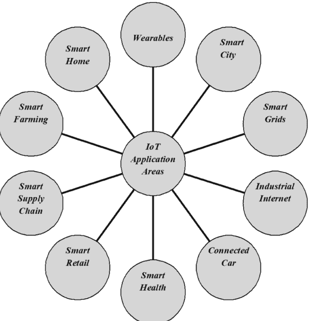

图 1.1 各领域物联网应用。

### 1.3.2 部署模型

- a. 公共云
- b. 私有云
- c. 混合云
- d. 社区云

### 1.3.3 服务模型

- a. 软件即服务 (SaaS)
- b. 平台即服务 (PaaS)
- c. 基础设施即服务 (IaaS)

连接的事物生态系统可以利用之前提到的任何云部署和服务模型的组合来存储数据，从而形成云赋能物联网 (CEIoT)。在 CEIoT 中，云基础设施被用作通过物联网设备感知的数据的存储介质；由于物联网与云的这种结合，产生了许多挑战。两端都需要确保的最常见问题是安全与隐私，因为云和物联网分别处理数据的存储和收集。在本章中，我们将重点介绍针对 CEIoT 的安全功能之一——访问控制，用于验证用户访问云上存储数据的合法性。本章概述了现有的使用访问控制方法的方法。

## 1.4 动机

本章的主要动机是：通过感知设备收集的异构数据存储在云基础设施上，在提供个人数据的安全性和隐私方面需要极大关注 [9,15,27,29,38]。由于云是一个多租户且异构的环境，它将存储通过各种来源收集的不同类型的数据。确保此类数据的安全性是最高优先级，因为简单的泄露可能导致将基础设施作为存储介质的业务实体出现差异。CIA (机密性、完整性和可用性) 特性是确保数据安全性的必要组成部分。这些特性对于提供适当的访问控制也至关重要，访问控制决定了信息安全性 [21,30,32,37]。

## 1.5 预备知识

本节讨论了定义安全访问控制策略所使用的原语。

### 1.5.1 基于角色的访问控制

基于角色的访问控制 (RBAC) 方法自 UNIX 操作系统时代以来一直被广泛用于向特定用户组指定访问文件的权限 [12]。随着技术意识的提升和进步，许多商业应用程序或供应商提出了适合其产品或组织的自有访问控制策略。RBAC 已从强制访问控制 (MAC) 和自主访问控制 (DAC) 演变而来。

DAC 是指根据行动发起者所属的组来限制或允许访问。例如，属于组 A 的用户可能会根据其在组 A 中的成员身份被允许或不允许访问某些文件。

MAC 实现要求在用户创建时本身即指定用户权限。例如，组织中的一组用户被允许访问操作系统的内核，而另一组用户则被严格禁止这种访问。MAC 方法广泛用于定义多级安全和军事应用。

RBAC 方法为用户定义角色，反之亦然。许多供应商和从业者提出了他们自己的 RBAC 策略 [33]。为了标准化 RBAC 模型，Ferraiolo et al. [13] 提出了 RBAC 的 NIST 标准，RBAC 参考模型定义了一组组件。RBAC 模型将用户、角色、权限、操作和对象视为其元素。

RBAC 参考模型 [13] 定义了以下组件：

- 1. 核心 RBAC – 对 RBAC 的一种最小化定义，其元素由用户、角色、权限、操作和对象及其功能组成。它在用户角色评审模型中运行，其中用户被分配到特定角色，角色被分配到特定用户。
- 2. 分层 RBAC – 定义角色层次结构并在组织中对角色进行结构化。它还可以定义角色之间的继承关系。

在分层 RBAC 中还定义了另外两种类型：

- a. 通用分层 RBAC – 它支持对用户进行分层和多重继承的权限。
- b. 有限分层 RBAC – 它支持对用户访问进行限制。可以使用树或倒置树等访问结构来定义访问权限。

- 3. 静态职责分离关系
  - a. 静态职责分离 (SSD) – 这将对用户到角色的分配施加约束。可用于防止将矛盾（或互斥）角色分配给单个用户。
  - b. 层次结构下的静态职责分离 – 这与 SSD 类似，可用于在直接分配权限的基础上按层次结构分配权限。
- 4. 动态职责分离关系 – 这可用于限制用户的权限和角色数量，并及时撤销权限。

核心 RBAC 组件的实现可确保功能完善的 RBAC 实现，根据要求，其他组件可以在核心 RBAC 基础上引入。有关 RBAC 标准化工作的详细信息，请参阅 [13]。

### 1.5.2 基于能力的访问控制

在基于能力的访问控制 (CapBAC) 方法中，需要服务的用户将发送请求（包含用户属性、资源 ID 等）以获取访问权限 [16,18]。策略决策点 (PDP) 评估请求并将其与其拥有的知识库进行比较。如果请求被接受，PDP 将签发功能令牌（以票证或令牌形式）以授予请求资源的权限。收到功能后，用户可以直接向资源提供方请求访问该资源。它类似于 Kerberos 机制 [25]。

CapBAC 还保证了最小权限原则 (PoLA)，即用户将获得完成任务所需的最小访问权限，而不会更多。此外，CapBAC 方法可以外包授权过程，而 RBAC 模型中不存在该过程。另外，访问策略逻辑可


可根据本模型中的要求本地定义，或者可定义上下文感知访问控制策略。

RBAC 和 CapBAC 的一个共同缺点是单点故障。如果负责验证用户请求的服务器或服务宕机，系统将无法处理请求。最近，一些分布式架构已被提出以克服这一缺点。RBAC 具有更通用的性质，可采用于任何需要 RBAC 的企业或通信环境，而 CapBAC 机制则可针对特定应用定义。

### 1.5.3 基于属性的访问控制

基于属性的访问控制（ABAC）也称为基于策略的访问控制 [19]。在 ABAC 中，主体和客体除了动作和环境外，还将拥有各自的属性。拥有一组属性的主体将向中央实体请求访问特定客体的权限。中央实体将拥有“谁可以访问什么”的策略定义。中央实体将根据客体属性评估主体请求，并考虑动作和环境来授予或拒绝访问。

ABAC 将拥有一个描述策略的中央实体。每次都不必为单个主体定义新策略，只需更改属于主体的属性即可。这将使中央实体能够高效处理组动态，这是 IoT 应用所需的核心功能。

尽管 NIST 和其他标准协会的 ABAC 标准仍处于草案阶段，但绝大多数 ABAC 模型都包含以下组件，如 Servos 和 Osborn [34] 所述：

- a. 主体
- b. 客体
- c. 属性
- d. 权限
- e. 策略

核心 ABAC 可向多个方向和环境扩展。从 ABAC 发展出来的一个研究较为深入且独特的研究领域是基于属性的加密（ABE），包括密文策略 ABE（CPABE）[5] 和密钥策略 ABE（KPABE）[14,36] 类型。由于 ABE 技术超出了本章的范围，有关详细描述可在相关参考资料中找到。

## 1.6 CEIoT 中的访问控制方法

CEIoT 是近年来吸引 IoT、云计算和访问控制方法等各领域研究人员关注的新兴研究领域之一 [2,10,26]。尽管架构之间尚无共识 [28,30]，但文献和实践中已为 IoT 提出了许多架构。通常，所提架构包含一个对象层和一个应用层，以及一个或多个中间层。对象层对应物理设备（例如传感器、摄像头、RFID 标签、智能手机等），数据从这些设备中收集。应用层由基于收集的数据提供的服务组成，例如数据访问、分析、决策支持系统、数据交易等 [1,22]。中间层由单个或多个层组成，这些层又包含 IoT 框架的网络层或类似的通信支持层。有些架构甚至在中间层中拥有额外的子层。

Gubbi 等人 [15] 提出将云计算作为对象层和应用层之间的一个层进行集成，此外还有其他层。但是，这些方法未涉及访问控制方法。在本节中，我们将回顾满足 CEIoT 标准的方案。尽管所提方案未采用云计算层，但仍予以回顾，因为它们在 IoT 中提供了 CapBAC，并可扩展以纳入云计算层。

### 1.6.1 支持云的物联网

Alshehri 和 Sandhu [2] 为 IoT 提出了支持云的访问控制方法。如前一节所讨论，在许多 IoT 架构中，最初仅提出了对象层和

应用层
云计算层
虚拟对象层
对象层

图 1.2 Alshehri 和 Sandhu 提出的面向访问控制的 IoT 架构。

应用层，后来 Gubbi 等人向 IoT 架构提出了云计算层以利用云计算的功能。为了在 CEIoT 中实现访问控制，Alshehri 和 Sandhu 提出了一种四层架构，如图 1.2 所示，并将其命名为面向访问控制的 IoT（ACOIoT）架构 [2]。

Alshehri 和 Sandhu 借助多值开关案例及其他多种设备解释了该架构 [2]。访问控制逻辑将位于云计算层，并且他们已采用 ABAC 进行访问控制。云计算层提供多租户以及不同类型的结构化和非结构化数据管理支持 [17]。对象层将由收集数据的异构设备组成，例如传感器、摄像头、智能手机（带多个传感器）和执行器，并将数据呈现给上层，即虚拟层。虚拟层由映射到对象层设备的虚拟对象组成。虚拟层对象可根据需要定义。虚拟对象有助于存储与对象层中设备相关的状态或值。虚拟对象层还用于从高层向对象层传递命令。虚拟对象可以定义为一对一（一个虚拟对象映射到一个设备）或一对多（一个虚拟对象映射到多个设备）。ACOIoT 架构用例中的 ABAC 通过多值开关案例进行演示。PDP 和策略将存储在云计算层中。

此外，Alshehri 和 Sandhu [3] 将 [2] 中的架构扩展到汽车访问控制，并为虚拟对象（VO）通信提出了操作模型。

#### 1.6.1.1 可穿戴设备的 CEIoT

Bhatti 等人 [7] 将 [2] 中的架构扩展到可穿戴设备，在对象层和虚拟对象层之间增加了一个对象抽象层，以高效实现访问控制策略，并规定了层间通信（指定哪些层允许通信，哪些层不允许相互通信）。可穿戴设备是个人设备，在这样资源受限的设备环境中提供访问控制具有挑战性。

#### 1.6.1.2 基于云的 IoT 中的授权

Bhatti 等人 [6] 还将 [2] 中提出的架构扩展到 IoT 场景中的当前授权流程。Bhatti 等人 [6] 演示了增强版 ACOIoT（EACOIoT）在实现访问策略方面的应用。该模型中存在的额外对象抽象层将处理 EACOIoT 框架中对象层与上层之间的授权和隐私。由网关设备组成的对象抽象层在对象层设备和虚拟对象层之间提供抽象。EACOIoT 框架通过智能家居和智能大学停车场用例进行演示。

#### 1.6.1.3 支持 Amazon Web Services 的 IoT

Bhatti 等人 [8] 将此模型扩展到连接到 Amazon Web Services（AWS）云的 IoT 设备，并提出了 ABAC 来定义访问控制逻辑。他们考虑了恒温器和灯泡用例来演示 AWS IoT 访问控制。该模型在提出时还考虑了 MQTT 等通信协议。与对象层中设备关联的虚拟对象被称为“影子”或“事物影子”。

### 1.6.2 IoT 中的基于能力的访问控制

尽管 CapBAC 中没有直接涉及云计算层的工作，但本节将讨论 Gusmeroli 等人 [16] 和 Hernandez-Ramos 等人 [18] 在 IoT 环境下提出的模型，因为这些模型可以直接扩展到涉及云计算层的模型。

#### 1.6.2.1 集中式基于能力的 IoT

Gusmeroli 等人 [16] 提出了 IoT 中的集中式基于能力的访问控制（CapBACIoT）。为了解决 RBAC 和 ABAC 中的可扩展性和组动态缺点，Gusmeroli 等人 [16] 在 IoT 中提出了 CapBAC 模型。他们采用这种方法是因为 CapBAC 提供了更好的委托支持、能力吊销（临时吊销）以及带有单个 PDP 的信息粒度。他们使用与汽车和家政用例相关的信息和服务访问来演示此模型。但是，此方法未概述如何为不同设备单独定义访问逻辑，这在 IoT 中非常必要，因为一个设备的访问策略可能与另一个设备相同，也可能不同。

#### 1.6.2.2 分布式基于能力的 IoT

Hernandez-Ramos 等人 [18] 提出了一种在 IoT 中实现 CapBAC 的分布式方法。IoT 架构中的分布式 CapBAC 克服了集中式 CapBAC 方法中单个 PDP 的缺点，并根据要求独立于每个终端设备提出了访问逻辑。Hernandez-Ramos 等人 [18] 甚至在 32 位 RISC 处理器上实现了所提方案，并展示了其在 IoT 中的可持续性。此外，他们还讨论了采用椭圆曲线密码学（ECC）的端到端安全通信。

## 1.7 未来展望

此处定义的访问控制模型仅限于一种环境。在大规模应用中，会出现大量实施挫折，存在许多研究挑战和未来机遇。如本章所考虑的，云和 IoT 等最先进的基础设施需要更高级别的安全性，同时在基础层面也需要稳健。即使是现有的先进访问控制策略也缺乏某些必要属性，例如不恰当的多租户架构、标准化的


整体策略架构，异构数据的有效采集，提升物联网基础设施的电力与能源效率，大数据的采集、存储与维护，数据的安全与隐私，云存储的定价与计费，所利用资源的可扩展性与灵活性，分布式与去中心化架构的必要性，免信任身份验证，例如将智能合约应用于访问控制，避免中央权威，用户匿名性，应用同态加密，以及更多内容。

## 1.8 结论

本章讨论了 CEIoT 中访问控制方法的概览，以及不同的访问控制模型。现有模型、相关参考来源和可能的研究方向也进行了讨论。本章旨在为有兴趣在 CEIoT 访问控制领域工作的研究人员提供指引。

## 参考文献

- 1. Ejaz Ahmed, Ibrar Yaqoob, Ibrahim Abaker Targio Hashem, Imran Khan, Abdellatif Ibrahim Abdalla Ahmed, Muhammad Imran, and Athanasios V Vasilakos. 大数据分析在物联网中的作用. 《计算机网络》, 129:459–471, 2017.
- 2. Asma Alshehri and Ravi Sandhu. 云使能物联网的访问控制模型：一项拟议架构与研究议程. 在 2016 年 IEEE 第 2 届协作与互联网计算国际会议（CIC）论文集中，第 530–538 页. IEEE, 2016.
- 3. Asma Alshehri and Ravi Sandhu. 云使能 IoT 中虚拟对象通信的访问控制模型. 在 2017 年 IEEE 信息再利用与集成国际会议（IRI）论文集中，第 16–25 页. IEEE, 2017.
- 4. Luigi Atzori, Antonio Iera, and Giacomo Morabito. 物联网：一项调查. 《计算机网络》, 54(15):2787–2805, 2010.
- 5. John Bethencourt, Amit Sahai, and Brent Waters. 密文策略属性基加密. 在 2007 年 IEEE 安全与隐私研讨会（SP’07）论文集中，第 321–334 页. IEEE, 2007.
- 6. Smruti Bhatt, A Tawalbeh Loai, Pankaj Chhetri, and Paras Bhatt. 云基础物联网中的授权：当前趋势与用例. 在 2019 年第四届雾计算与移动边缘计算国际会议（FMEC）论文集中，第 241–246 页. IEEE, 2019.
- 7. Smruti Bhatt, Farhan Patwa, and Ravi Sandhu. 云使能可穿戴物联网的访问控制框架. 在 2017 年 IEEE 第 3 届协作与互联网计算国际会议（CIC）论文集中，第 328–338 页. IEEE, 2017.
- 8. Smruti Bhatt, Farhan Patwa, and Ravi Sandhu. AWS 物联网的访问控制模型. 在网络与系统安全国际会议论文集中，第 721–736 页. Springer, 2017.
- 9. Alessio Botta, Walter De Donato, Valerio Persico, and Antonio Pescape. 云计算与物联网的集成：一项调查. 《未来世代计算机系统》, 56:684–700, 2016.
- 10. Luis Cruz-Piris, Diego Rivera, Ivan Marsa-Maestre, Enrique De La Hoz, and Juan R Velasco. 基于将通信过程建模为资源的 IoT 环境访问控制机制. 《传感器》, 18(3):917, 2018.
- 11. Li Da Xu, Wu He, and Shancang Li. 工业物联网：一项调查. 《IEEE 工业信息学学报》, 10(4): 2233–2243, 2014.
- 12. Glenn Faden. UNIX 管理中的 RBAC. 在第四届 ACM 基于角色的访问控制研讨会论文集中，第 95–101 页, 1999.
- 13. David F Ferraiolo, Ravi Sandhu, Serban Gavrila, D Richard Kuhn, and Ramaswamy Chandramouli. 基于角色的访问控制的拟议 NIST 标准. 《ACM 信息与系统安全学报（TISSEC）》, 4(3):224–274, 2001.
- 14. Vipul Goyal, Omkant Pandey, Amit Sahai, and Brent Waters. 用于加密数据细粒度访问控制的属性基加密. 在第 13 届 ACM 计算机与通信安全会议论文集中，第 89–98 页, 2006.
- 15. Jayavardhana Gubbi, Rajkumar Buyya, Slaven Marusic, and Marimuthu Palaniswami. 物联网（IoT）：愿景、架构要素与未来方向. 《未来世代计算机系统》, 29(7): 1645–1660, 2013.
- 16. Sergio Gusmeroli, Salvatore Piccione, and Domenico Rotondi. 基于能力的安全方法用于管理物联网中的访问控制. 《数学与计算机建模》, 58(5–6): 1189–1205, 2013.
- 17. Ibrahim Abaker Targio Hashem, Ibar Yaqoob, Nor Badrul Anuar, Salimah Mokhtar, Abdullah Gani, and Samee Ullah Khan. 云计算上大数据的兴起：综述与开放研究问题. 《信息系统》, 47:98–115, 2015.
- 18. Jose L Hernandez-Ramos, Antonio J Jara, and Antonio F Skarmeta. 物联网的分布式基于能力的访问控制. 《互联网服务与信息安全杂志（JISIS）》, 3(3/4):1–16.
- 19. Vincent C Hu, David Ferraiolo, Rick Kuhn, Arthur R Friedman, Alan J Lang, Margaret M Cogdell, Adam Schnitzer, Kenneth Sandlin, Robert Miller, Karen Scarfone, et al. 基于属性的访问控制（ABAC）定义与注意事项指南（草案）. NIST 特刊, 800(162), 2013.
- 20. Amy Loutfi, Arne Jonsson, Lars Karlsson, Leili Lind, Maria Linden, Federico Pecora, and Thiemo Voigt. Ecare@ home：基于语义互操作性的分布式研究环境. 在医疗保健 IoT 技术国际会议论文集中，第 3–8 页. Springer, 2016.
- 21. Carsten Maple. 物联网中的安全与隐私. 《网络政策杂志》, 2(2):155–184, 2017.
- 22. Mohsen Marjani, Fariza Nasaruddin, Abdullah Gani, Ahmad Karim, Ibrahim Abaker Targio Hashem, Aisha Siddiqa, and Ibrar Yaqoob. 大 IoT 数据分析：架构、机遇与开放研究挑战. 《IEEE Access》, 5:5247–5261, 2017.
- 23. Friedemann Mattern and Christian Floerkemeier. 从计算机互联网到物联网. 在《从主动数据管理到基于事件的系统及更多》中，第 242–259 页. Springer, 2010.
- 24. Peter Mell, Tim Grance, et al. 云计算的 NIST 定义. NIST 特刊, 800(415):1–7, 2011.
- 25. B Clifford Neuman and Theodore Ts’o. Kerberos：面向计算机网络的身份验证服务. 《IEEE 通信杂志》, 32(9):33–38, 1994.
- 26. Aafaf Ouaddah, Abrar Mousannif, Anas Abou Elkalam, and Abdellah Ait Ouahman. 物联网中的访问控制：巨大挑战与新机遇. 《计算机网络》, 112:237–262, 2017.
- 27. Pritee Parwekar. 从物联网迈向事物云. 在 2011 年第 2 届计算机与通信技术国际会议（ICCCT-2011）论文集中，第 329–333 页. IEEE, 2011.
- 28. Pawani Porambage, Mika Ylianttila, Corinna Schmitt, Parteep Kumar, Andrei Gurtov, and Athanasios V Vasilakos. 物联网中的隐私追求. 《IEEE 云计算》, 3(2):36–45, 2016.
- 29. B B Prahlada Rao, Paval Saluia, Neetu Sharma, Ankit Mittal, and Shivay Veer Sharma. 面向物联网与基于感知应用的云计算. 在 2012 年第六届感知技术国际会议（ICST）论文集中，第 374–380 页. IEEE, 2012.
- 30. Partha Pratim Ray. 物联网架构调查. 《卡尔苏德大学计算机与信息科学杂志》, 30(3): 291–319, 2018.
- 31. Karen Rose, Scott Eldridge, and Lyman Chapin. 物联网：概述. 互联网协会（ISOC）, 80, 2015.
- 32. Pierangela Samarati and S De Capitani di Vimercati. 云安全：问题与关切. 《云计算百科全书》, 第 1–14 页, 2016.
- 33. Ravi S Sandhu, Edward J Coyne, Hal L Feinstein, and Charles E Youman. 基于角色的访问控制模型. 《计算机》, 29(2):38–47, 1996.
- 34. Daniel Servos and Sylvia L Osborn. 属性基访问控制中的当前研究与开放问题. 《ACM 计算机调查（CSUR）》, 49(4):1–45, 2017.
- 35. Jeffrey Voas. 万物网络. NIST 特刊, 800(183): 800–883, 2016.
- 36. Chang-Ji Wang and Jian-Fa Luo. 具有固定大小密文的密钥策略属性基加密方案. 在 2012 年第八届计算智能与安全国际会议论文集中，第 447–451 页. IEEE, 2012.
- 37. Zhifeng Xiao and Yang Xiao. 云计算中的安全与隐私. 《IEEE 通信调查与教程》, 15(2):843–859, 2012.
- 38. Wei Yu, Fan Liang, Xiaofei He, William Grant Hatcher, Chao Lu, Jie Lin, and Xinyu Yang. 面向物联网的边缘计算调查. 《IEEE Access》, 6:6900–6919, 2017.


## Taylor & Francis

Taylor & Francis Group

http://taylorandfrancis.com

# 2 移动自组网的智能加权模糊聚类安全路由算法

K.P. RAMAPRABHA 和 N. JEYANTHI

维洛尔理工学院（VIT）信息技术与工程学院，印度泰米尔纳德邦维洛尔，njeyanthi@vit.ac.in

## 目录

- 2.1 引言 20
- 2.2 相关工作 21
- 2.3 系统架构 23
- 2.4 拟议工作 24
- 2.4.1 预处理 25
- 2.4.2 聚类 26
- 2.4.2.1 聚类形成 26
- 2.4.2.2 移动性 26
- 2.4.2.3 聚类维护 27
- 2.4.2.4 簇头选择 27
- 2.4.2.5 信任分数计算 27
- 2.4.2.6 规则 28
- 2.4.2.7 能量模型 29
- 2.4.2.8 基于聚类的路由算法 29
- 2.5 结果与讨论 30
- 2.6 结论 35
- 参考文献 36

## 2.1 引言

移动自组网（MANET）是一种具有动态拓扑的无线网络。在此网络场景中，节点使用点对点数据传输和多跳路由相互通信。此外，数据通信没有固定基础设施。固定基础设施可以通过形成一个组（簇）来与所有邻居节点通信，从而构成临时静态拓扑。这种基于组的通信在许多新兴场景中很有用，例如战场通信、紧急行动、灾害救援、生存搜索和传感器尘埃，可提供更好的通信设施。但由于 MANET 的动态拓扑和静态拓扑变化，为这些网络设计安全可靠的路由协议是一个挑战性过程，尤其是在大规模网络中。

在聚类中，簇头从其成员处收集数据，对其进行聚合，并以单跳或多跳方式将聚合后的数据传输到汇聚点。多跳路由为节点将恶意活动引入 MANET 提供了机会。由于传输路径中存在恶意节点，安全也是 MANET 中的一个重要问题。这些恶意节点可能会丢弃数据包、在路由中误导消息，或重播来自合法节点的所有活动路由数据包以伪造合法节点的身份。恶意节点通过在路由中使用伪造的身份来破坏网络流量。信任评估过程是 MANET 安全路由中的一项重要任务。由于许多路径上不同时间发生各种攻击，信任分数会动态变化。信任分数是节点相对于网络中另一个节点的态度的数学表示。

本章为 MANET 提出了一种智能加权模糊聚类安全路由算法（IWFCSRA），旨在在提升网络生命周期和吞吐量的同时保障安全。此外，还讨论了一种基于模糊规则的加权距离离群点检测算法（FRWDOA），用于识别网络中的离群点。在此拟议工作中，已生成带权重的新模糊规则，并用于形成聚类和计算信任分数，这些信息对于就路由过程做出最终决定很有用。此外，相应聚类的最终信任路径已根据 MANET 中的信任分数、能量和加权模糊规则最终确定。

本章余部分组织如下：第 2 节介绍了 MANET 安全路由协议领域的相关工作。第 3 节详细描述了拟议的系统架构。第 4 节解释了拟议模型的细节。第 5 节展示了本工作获得的结果，并将其与相关工作进行比较。第 6 节对本工作得出结论，并提出了一些可能的未来工作。

## 2.2 相关工作

在无线自组网环境中，需要安全且节能的传输来提高网络生命周期和吞吐量。聚类是提高计算机网络能源效率的一种广泛使用的技术。聚类技术方面已经开展了许多工作，相关文献可见 [1,6,10]。在多跳路由中，安全传输非常重要。路由中的恶意节点可能会攻击数据包。因此，许多研究人员研究了安全路由，相关文献可见 [1,2,4]。Zhan 等人 [5] 提出了一种感知信任的路由框架（TARF），以保护 WSNs 免受误导多跳路由的对手的攻击。TARF 提供了一条可信且节能的路由，保护 WSNs 免受利用路由信息重播的有害攻击。过去，Thippeswamy 等人 [6] 为动态 WSNs 提出了一种安全感知信任节能自适应路由（STEAR）协议。STEAR 使用动态密钥、数据包流状态、能量和信任有效识别恶意节点。然而，考虑到攻击者的动态特性，有必要进一步工作以检测和防止新型攻击。

Duan 等人 [7] 提出了一种感知信任的安全路由框架（TSRF）以抵御各种攻击。作者提出了特定的信任计算和信任推导方案来应对这些攻击。他们的协议在路径选择中既考虑信任度量，也考虑 QoS 要求。Gu 等人 [8] 为 WSNs 中的端到端通信设计了一种安全通信协议。在他们的协议中，采用了分级密钥预分布方法，向不同的传感器分发不同数量的密钥，以增强某些链路的韧性。Tang 等人 [9] 提出了一种安全高效的成本感知安全路由（CASER）协议，以解决网络优化和安全问题。然而，需要一种基于信任且同时考虑能量和安全的唯一路由算法，以提升路由性能和安全性。

Souza 和 Varaprasad [10] 提出了一种用于 WSN 的多路径路由协议，使用数字签名加密系统以安全方式传输数据包。Ganesh 和 Amutha [11] 提出了一种基于 SNR 的动态聚类机制（ESRPSDC）的高效安全路由协议。在他们的工作中，星间路由过程中考虑了错误恢复过程，并通过利用基于汇聚点的路由示例隔离恶意节点来实现安全。Mahmoud 等人 [12] 提出了一种新协议，将支付系统和信任系统与基于信任且节能的路由协议相结合。支付系统奖励转发其他数据包的节点，信任系统根据多维信任值评估节点在转发数据包方面的能力和可靠性。他们的算法不仅激励节点转发数据包，还能在电池电量充足的情况下保持路由强度并进行报告。

Li 等人 [13] 设计了一种新的路由方案，可提供高效且容错的路由。在他们的工作中，使用评估指标和路径空闲比来评估和定位从所有可访问路径中组织的一组无连接不相交路径。此外，他们还提出了另外两种算法，即拥塞控制算法和负载均衡算法。他们的拥塞控制算法调整多条路径上的负载，而他们的阈值共享算法将数据包拆分为多个段，利用网络中的路径空闲比通过多条路径将这些段发送到目的地。Lee 和 Choi [14] 提出了一种传感器网络安全备用路径路由（SeRINS），它通过邻居报告框架检测并隔离试图向系统注入冲突路由信息的已攻陷节点。

Kuila 和 Jana [32] 提出了一种用于有效无线通信的新型优化节能聚类路由算法。他们在这项工作中使用了粒子群优化算法进行有效优化。Mathapati 等人 [31] 引入了一种新


用于无线网络中有效通信的集群和节能可靠路由算法。Rahman 和 Matin [30] 开发了一种用于提高网络寿命的算法。Younis 和 Fahmy [29] 引入了一种名为混合节能分布式聚类算法的新方法，用于自组网络。Heinzelman 等人 [28] 提出了一种用于有效通信的节能路由协议。Villas 等人 [26] 提出了一种用于聚合无线网络中网络内区域的轻量级可靠路由技术。Attea Bara'a [25] 引入了一种用于无线网络动态分组的节能感知路由算法，可用于增强网络中的通信过程。

Balkis Hamdane 等人 [17] 解释了基于信任建模的安全方法，用于保障命名数据网络的安全。作者提出了一种基于层级身份的密码学，用于执行签名验证。他们的模型在基于密钥管理的安全性方面提供了更好的性能。Selvi 等人 [21] 提出了一种用于 WSN 节能路由的新模糊时间方法。此外，在 Selvi 等人 [21] 的另一项工作中，作者提出了一种基于规则、受延迟约束、节能的无线传感器网络路由技术。然而，此类方法必须通过安全约束进行增强，以提高路由过程的安全性。Muthurajkumar 等人 [23] 为 MANETs 提出了一种智能安全节能路由算法。此工作可以扩展到静态和移动传感器网络，以便为 WSNs 提供安全可靠的路由过程。Idris Abubakar Umar 等人 [20] 提出了一种新的安全模型，用于在网络中执行智能安全路由。在他们的工作中，作者使用了基于模糊逻辑的信任模型，用于处理信任估计过程中的不确定性并执行安全路由。尽管存在所有这些算法，但路由性能受到攻击者的影响。因此，本章提出了一种新的信任和节能感知安全路由协议。

## 2.3 系统架构

图 2.1 显示了所提系统架构。它包含七个重要组件，即预处理阶段、聚类模块、模糊规则管理器、决策管理器、知识库、信任计算模块、权重分配代理和路由模块。预处理阶段在这项工作中的作用是通过在网络场景中选择离群节点来识别贡献节点。

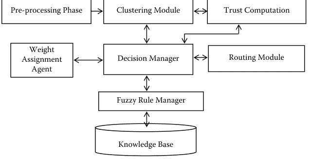

图 2.1 系统架构。

聚类模块根据预处理阶段的建议和当前节点的能量级别形成集群。加权模糊规则存储在知识库中。模糊规则管理器与权重分配代理通信以制定模糊规则。决策管理器有助于为集群和簇头节点选择合适的节点。信任计算模块负责计算动态拓扑中相应节点的信任分数。路由模块负责在决策管理器的建议帮助下选择可信路径。决策管理器负责控制所提系统架构的所有组件。它对网络中的聚类、信任计算和路由过程做出决策。

## 2.4 提出的工作

所提工作的基本系统模型由移动节点组成，这些节点随机部署以监测环境。移动节点是同质的，具有相同的初始能量。移动节点本质上是动态的，而且能量受限，目标节点的能量资源高于参与节点。目标节点也位于网络区域内。所提工作可分为三个阶段，即预处理（离群点选择）阶段、聚类阶段、信任计算阶段和路由阶段。首先，在此工作中根据基于节点能量和距离的分配权重来识别离群点。在此，离群点不考虑进行进一步处理。其次，根据距离和能量形成新的集群。第三，计算各个集群中所有可用节点的信任分数。第四，根据网络中各个节点的能量级别和信任分数执行路由过程。

### 2.4.1 预处理

在本节中，描述了一种用于区分网络中离群点的 FRWDOA。它使用与某些分配权重相匹配的某些程度的相对位置以及特征集中的感知重要性和邻居，以计算相对于所有集群的某些程度的离群点。基于加权距离的离群点检测的整体定义如下：设 f1, f2, ..., fk 为对象 x 的 K 个最近邻，权重为 wt1, wt2, wt3, ..., wtk。这些 k 个最近邻的加权距离概述为 wt1ds1, wt2ds2, ..., wtkdsk，其中 ds1, ds2, ..., dsk 是传统的闵可夫斯基距离 d(x, si) = wt dsi。典型的加权距离使用 (1) 中的公式计算。

```
\frac{1}{k} * \left( \sum_{i=1}^k \frac{wt_i ds_i}{\sum wt_i} \right) \quad (1)
```

#### FRWDOA

模糊规则是根据节点的能量级别和距离制定的，并用于执行网络中识别离群点的训练和测试过程。

- 步骤 1：使用模糊规则根据能量级别为节点分配权重。
- 步骤 2：使用 (1) 计算网络中可用节点的加权平均距离 (WAD)。
- 步骤 3：检查网络节点的距离是否大于 WAD。
- 步骤 4：计算 k 个最近内部节点的内部加权平均值 (IWA)。
- 步骤 5：训练网络中存在的节点以识别内部节点和外部节点。
- 步骤 6：使用权重为新到达节点计算加权距离。
- 步骤 7：如果范围 (Newly_Arrived_Node) > WAD 则
- 将新节点添加到 Non_Outlier_Node_Set
- 否则
- 将新节点添加到 Outlier_Node_Set
- 步骤 8：停止

在此工作中，可以在预处理阶段结束时识别离群点。在此处，离群点不会被考虑进行进一步处理。

### 2.4.2 聚类

本节详细解释了集群形成、簇头选择、集群维护、移动性和聚类过程。

#### 2.4.2.1 集群形成

最初，每个节点都分配了一个随机数用于识别它。它根据与邻居节点之间的距离宣布其身份编号，并构建一个显示网络中节点之间关系的表格。每个参与节点根据节点连通性、能量级别、移动性和距离计算自己的权重。然后，在最终确定权重后，每个节点权重会通知给其邻居。集群是根据权重形成的，权重最大的节点充当集群头。

#### 2.4.2.2 移动性

网络中可用节点的移动性是根据在特定时间段内在相同网络拓扑中从一个位置移动到另一个位置来测量的。

#### 2.4.2.3 集群维护

当节点移出其簇头 (CH) 范围之外、添加新节点或 CH 失败时，需要进行集群维护。假设添加了一个新节点——它计算自己的权重。然而，即使其权重大于 CH 的权重，它也不会立即成为 CH，而是选择当前 CH 作为其 CH。这可以减少在添加新节点时每次选择 CH 期间产生的不必要的开销。如果 CH 失败，那么附加到该 CH 的节点将重新计算它们的权重，并选择权重最大的新节点作为 CH。

#### 2.4.2.4 簇头选择

簇头是根据节点的当前能量级别和移动速度选择的。这两个因素对于选择 CH 非常重要，需要考虑此节点与其他邻居节点之间的距离。在此，与大多数节点更接近且移动性较低的节点将被选为集群的 CH。

#### 2.4.2.5 信任分数计算

网络中所有参与节点的信任分数均予计算。在此，直接、间接和声誉分数均用于计算网络中每个节点的信任分数。直接信任分数使用以下公式计算：

```
DTS (t1, t2) = PS (t1, t2)/ACKR (t1, t2) (2)
```

其中 PS 表示发送的数据包数量，ACKR 表示接收到的确认数量。使用方程 3 计算整个网络的平均直接信任分数 (AvgDTS)。

```
AvgDTS (t1, t2) = Sum (DTS <t1, t2>)/n (3)
```

其中 n 是特定时间段内网络中参与节点的总数。

网络中所有节点的间接信任分数 (IDTS) 是根据邻居节点针对特定节点接收到的推荐分数计算的。

```
IDTS (t1, t2) = (RS1(t1, t2) + RS2(t1, t2) + .... + RSn (t1, t2))/n (4)
```


where RS 表示推荐分数，n 表示从邻居节点接收到的推荐数量。使用方程 5 计算网络的平均 IDTS。

AvgIDTS(t1, t2) = (IDTS1(t1, t2) + IDTS2(t1, t2) + ...... + IDTSn(t1, t2))/n (5)

where n 表示网络中可用节点的总数。

#### 2.4.2.6 规则

在本工作中，IF...THEN 规则通过使用直接信任、间接信任、能量和移动性来制定，以识别有资格参与路由过程的节点。

- **规则 1:**
  If (DTSi(t1, t2) < AvgDTS) AND
  (DTSi(t1, t2) < AvgIDTS) AND
  (Mob(t1, t2) < AvgMob) AND
  (En(t1, t2) < AvgEn) Then
  节点为 LOW 且不符合参与路由过程的资格。

- **规则 2:**
  If (DTSi(t1, t2) > AvgDTS) AND
  (IDTSi(t1, t2) > AvgIDTS) AND
  (Mob(t1, t2) < AvgMob) AND
  (En(t1, t2) < AvgEn) Then
  节点为 LOW MEDIUM 且符合参与路由过程的资格。

- **规则 3:**
  If (DTSi(t1, t2) > AvgDTS) AND
  (IDTSi(t1, t2) > AvgIDTS) AND
  (Mob(t1, t2) > AvgMob) AND
  (En(t1, t2) > AvgEn) Then
  节点为 MEDIUM 且符合参与路由过程的资格。

- **规则 4:**
  If (DTSi(t1, t2) > AvgDTS) AND
  (IDTSi(t1, t2) > AvgIDTS) AND
  (Mob(t1, t2) < AvgMob) AND
  (En(t1, t2) > AvgEn) Then
  节点为 HIGH 且符合参与路由过程的资格并充当 CH。

#### 2.4.2.7 能量模型

在本工作中，使用的能量模型与文献 [24] 和 [25] 中提出的工作相似。传输超过距离 d 的 1 比特消息所需的能量按以下公式 (1) 给出。

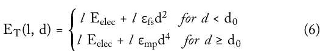

where $d_0 = \sqrt{\epsilon_{fs}/\epsilon_{mp}}$

接收 1 比特消息所需的能量在方程 (7) 中给出。

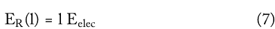

where E_{elec} – 电子能量 
\epsilon_{fs} – 自由空间中的放大器能量，且 
\epsilon_{mp} – 多径中的放大器能量。

#### 2.4.2.8 基于簇的路由算法

在本节中，为本工作中的有效路由开发了一种名为 IWFCSRA 的新型基于簇的安全路由算法。所提算法的步骤如下：

- 步骤 1: 设置 DTS = 0, IDTS = 0;
- 步骤 2: 每个节点与邻居节点通信以了解特定时间间隔的 DTS。
- 步骤 3: 源节点向其邻居节点广播请求。仿真计时器开始。
- 步骤 4: 所有节点从邻居节点接收请求并检查是否为正确的目的地。如果是，则向其邻居节点发送确认。
- 步骤 5: 使用以下公式计算所有节点的 DTS
  DTS(t1, t2) = PS(t1, t2)/ACKR(t1, t2)
- 步骤 6: 使用以下公式计算网络的 AvgDTS
  AvgDTS(t1, t2) = Sum(DTS(t1, t2))/n
- 步骤 7: 使用以下公式计算所有节点的 IDTS
  IDTS(t1, t2) = (RS1(t1, t2) + RS2(t1, t2) + .... + RSn(t1, t2))/n
- 步骤 8: 使用以下公式计算网络的 AvgIDTS
  AvgIDTS(t1, t2) = (IDTS1(t1, t2) + IDTS2(t1, t2) + ........ + IDTSn(t1, t2))/n
- 步骤 9: 应用模糊规则以识别正常节点和恶意节点
- 步骤 10: 调用加权模糊 C 均值聚类算法 [22] 以执行聚类操作。
- 步骤 11: 最后，从网络场景中检测所有恶意节点。
- 步骤 12: 与正常节点形成簇，并通过应用已为簇头选择制定的模糊规则进行簇头选举。
- 步骤 13: 通过簇头路由数据包。

## 2.5 结果与讨论

所提工作已使用仿真工具 NS2 实现。本工作中使用的仿真参数给于表 2.1 中。移动节点随机部署在 500 × 500 m² 的区域内。10 到 100 个移动节点被部署，初始能量为 0.5J。所提算法得到评估，并对这些性能进行比较

### 表 2.1 仿真参数

| 参数 | 值 |
| --- | --- |
| 区域 | 500 × 500 m² |
| 传感器节点 | 100 |
| 初始能量 | 0.5J |
| E_elec | 50 nJ/bit |
| E_fs | 10 pJ/bit/m² |
| E_mp | 0.0013 pJ/bit/m⁴ |
| 数据包大小 | 4000 bits |
| 路由协议 | AODV |

### 数据包投递比率分析

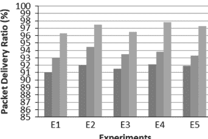

图 2.2 无异常值检测的数据包投递比率分析。

与过去在此方向上提出的现有算法进行比较。同时也与现有的基于信任的安全路由算法和无基于信任的安全路由算法进行比较。

图 2.2 显示了无异常值检测的所提 IWFCSRA 的性能。在此，标准的按需距离矢量 (AODV) 路由算法使用一种名为 AOTDV 算法的信任机制，以及无信任模型的 AODV，针对数据包投递比率。在此，已进行 E1、E2、E3、E4 和 E5 五项实验，以评估所提系统在特定时间段内的性能。

从图 2.2 可以观察到，无聚类的所提模型在与 AODV 和 AOTDV 等现有算法相比时性能更好。这是因为所提算法仅使用受信任的节点，这些节点由所提异常值检测方法识别，用于特定时间段内网络中的有效通信。

图 2.3 显示了现有路由算法（即 AODV 和 AOTDV）与无异常值检测的所提 IWFCSRA 之间的端到端延迟分析。已进行各种实验以测量所提模型的性能。

从图 2.3 可以看出，使用信任分数来识别真实节点并通过识别的真实节点执行路由过程，与使用 AODV 和 AOTDV 的路由过程相比，减少了端到端延迟。这种显著性能提升的原因是避免

### 端到端延迟分析

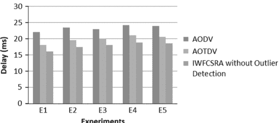

图 2.3 端到端延迟分析。

恶意节点用于路由过程。此外，端到端延迟由恶意节点造成，这些节点被所提模型避免。

图 2.4 显示了数据包投递比率分析，该分析考虑了所提模型以及 AODV、AOTDV 和无异常值检测的所提 IWFCSRA 等现有路由协议。为此数据包投递比率已进行五项不同的实验。

从图 2.4 可以看出，使用 DTS 和 IDTS 提高了数据包投递比率，与使用信任机制和聚类技术在网络中形成簇的现有安全路由算法相比。

图 2.5 显示了标准 AODV、AOTDV、带聚类的 AOTDV、CEESRA、EFCSRA 以及带信任和聚类的所提模型之间的延迟分析。

### 数据包投递比率分析

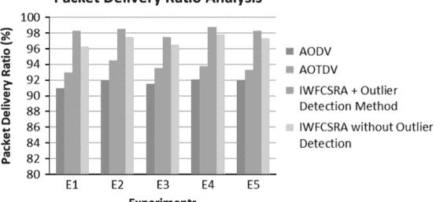

图 2.4 数据包投递比率分析。

### 端到端延迟分析

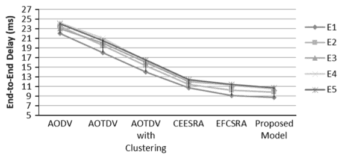

图 2.5 所提工作与现有工作之间的端到端延迟分析。

从图 2.5 可以看出，所提模型的性能优于 AODV、AOTDV、带聚类的 AOTDV、CEESRA 和 EFCSRA 等现有工作。取得此成就的原因是使用模糊规则、有效信任计算，以及在针对恶意节点的决策过程中考虑能量和移动性。

图 2.6 显示了 AODV、基于信任的 AODV、基于簇和信任的安全路由算法以及所提模型等现有算法之间的数据包投递比率分析。在此，为了在此工作中进行五项实验，已考虑 10 m/s 到 50 m/s 的五种不同移动速度。

从图 2.6 可以看出，所提模型的性能优于 AODV、AOTDV、CEESRA [23] 以及节能信任和 EFCSRA 等现有路由算法。这是因为使用了有效的模糊规则、新的信任机制以及高效的模糊 C 均值聚类技术。

图 2.7 显示了所提算法与 AODV、AOTDV、CEESRA 和 EFCSRA 等现有路由算法之间的能量消耗分析。在此，通过考虑五种不同的移动速度进行了五项不同的实验。

从图 2.7 可以看出，所提 IWFCSRA 的能量消耗低于 AODV、AOTDV、CEESRA 和 EFCSRA 等现有路由算法。这是因为使用了有效的模糊规则和信任机制。


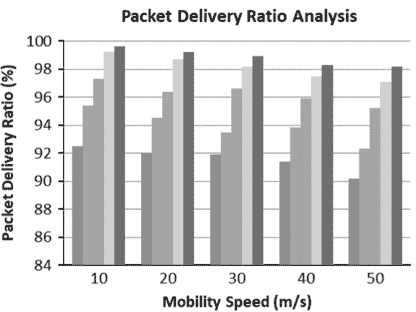

图 2.6 性能比较分析。

图 2.8 显示了所提 IWFCSRA 与现有路由算法（如 AODV、AOTDV、CEESRA 和 EFCSRA）的安全级别分析。在此，针对网络场景中不同数量的节点（如 100、200、300、400 和 500）进行了五项实验，以分析所提工作的安全级别。

从图 2.8 可以观察到，与现有路由算法（如 AODV、AOTDV、CEESRA 和 EFCSRA）相比，所提 IWFCSRA 的性能较高。这归功于使用异常值检测、智能模糊规则、有效的信任机制，以及在路由过程的决策过程中考虑移动性和能量。所提基于簇的智能加权模糊安全路由算法采用端到端延迟、能耗、投递率和安全级别等多种性能指标进行评估。与现有工作在不同评估方法中的比较表明，所提工作的总体性能得到了显著提升。

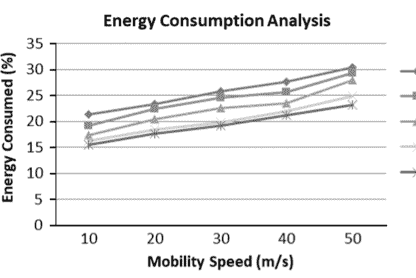

图 2.7 各种移动速度下的能耗分析。

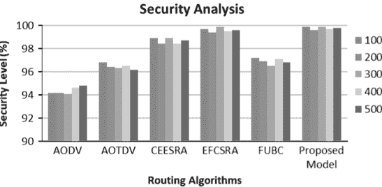

图 2.8 安全级别分析。

## 2.6 结论

本章为 MANETs 提出了一种 IWFCSRA，旨在在保障安全的前提下提升网络寿命和吞吐量。此外，还提出了一种用于区分网络中异常值的 FRWDOA。在所提工作中，生成了带权重的新模糊规则，用于形成簇，并用于计算信任分数，这些信任分数有助于在路由过程中做出最终决策。此外，基于 MANETs 中的信任分数、能量和加权模糊规则，最终确定了各簇的可信路径。本章所做实验表明，与现有算法相比，所提算法在吞吐量、延迟和数据包传输方面表现更好。所提安全路由算法的主要优势在于：基于真实节点改变簇的形成、提高恶意节点检测精度、移除恶意节点，以及改善路由性能。未来在此方向上的工作可能包括使用模糊逻辑进行信任分数评估，并在不确定性条件下改进路由决策过程。

## 参考文献

- 1. Logambigai, R., and A. Kannan, “面向无线传感器网络的基于模糊逻辑的不均匀聚类,” Wireless Networks, pp. 1–13, 2015.
- 2. Wood, A., and J. Stankovic, “传感器网络中的拒绝服务攻击.” Computer, vol. 35, no. 10, pp. 54–62, 2002 年 10 月.
- 3. Kulothungan K., S. Ganapathy, S. Indra Gandhi, P. Yogesh, “基于聚类方法的无线传感器网络中智能安全容错路由.” International Journal of Soft Computing, vol. 6, no. 5, pp. 210–215, 2011.
- 4. Ganapathy S., K. Kulothungan, S. Muthuraj Kumar, M. Vijayalakshmi, “网络入侵检测的智能特征选择与分类技术：一项综述.” EURASIP Journal on Wireless Communication and Networking, vol. 271, no. 1, pp. 1–16, 2013.
- 5. Guoxing, Zhan, Weisong Shi, and Julia Deng. “TARF 的设计与实现：面向 WSN 的可信感知路由框架.” IEEE Transactions on Dependable and Secure Computing, vol. 9, no. 2, pp. 184–197, 2012.
- 6. Thippeswamy, B. M., S. Reshma, V. Tejaswi, K. Shaila, K. R. Venugopal, and L. M. Patnaik. “STEAR：无线传感器网络中安全可信感知节能自适应路由.” Journal of Advances in Computer Networks, vol. 3, no. 2, pp. 146–149, 2015.
- 7. Duan, Junqi, Dong Yang, Haoqing Zhu, Sidong Zhang, and Jing Zhao. “TSRF：无线传感器网络中的可信感知安全路由框架.” International Journal of Distributed Sensor Networks, vol. 2014, no. 3, pp. 1–14, 2014.
- 8. Gu, Wenjun, Neelanjana Dutta, Sriram Chellappan, and Xiaole Bai. “无线传感器网络中的端到端安全通信.” IEEE Transactions on Network and Service Management, vol. 8, no. 3, pp. 205–218, 2011.
- 9. Tang, Di, Tongtong Li, Jian Ren, and Jie Wu. “面向无线传感器网络的代价感知安全路由（CASER）协议设计.” IEEE Transactions on Parallel and Distributed Systems, vol. 26, no. 4, pp. 960–973, 2015.
- 10. Souza, Robert John D., and Golla Varaprasad. “基于数字签名的无线传感器网络安全节点不相干多路径路由协议.” IEEE Transactions on Sensors Journal, vol. 12, no. 10, pp. 2941–2949, 2012.
- 11. Ganesh, Subramanian, and Ramachandran Amutha. “基于 SNR 的动态聚类机制的无线传感器网络高效安全路由协议.” Journal of Communications and Networks, vol. 15, no. 4, pp. 422–429, 2013.
- 12. Mahmoud, Mohamed M. E., Xiaodong Lin, and Xuemin Shen. “异构多跳无线网络的安全可靠路由协议.” IEEE Transactions on Parallel and Distributed Systems, vol. 26, no. 4, pp. 1140–1153, 2015.
- 13. Li, Shancang, Shanshan Zhao, Xinheng Wang, Kewang Zhang, and Ling Li. “面向服务的无线传感器网络的自适应安全负载均衡路由协议.” IEEE Systems Journal, vol. 8, no. 3, pp. 858–867, 2014.
- 14. Lee, Suk-Bok, and Yoon-Hwa Choi. “传感器网络中的安全备用路径路由.” Computer Communications, vol. 30, no. 1, pp. 153–165, 2006.
- 15. Jaisankar, N., S. Ganapathy, P. Yogesh, A. Kannan, K. Anand, “基于模糊粗集异常检测的智能代理入侵检测系统.” Soft Computing Techniques in Vision Science, vol. 395, pp. 147–153, 2012.
- 16. Ganapathy, S., N. Jaisankar, P. Yogesh, A. Kannan, “基于异常检测的入侵检测智能系统.” 2011 信息技术最新趋势国际会议（ICRTIT）, pp. 119–123, 2011.
- 17. Hamdane, Balkis, Rihab Boussada, Mohamed Elhoucine Elhdhili, Sihem Guemara El Fatmi, “面向命名数据网络的分层标识基础安全与信任密码学.” 2017 IEEE 第 26 届促进技术：协作企业基础设施国际会议, pp. 226–231, 2017.
- 18. Sethukkarasi, R., S. Ganapathy, P. Yogesh, A. Kannan, “用于时序模式挖掘的智能神经模糊时序知识表示模型.” Journal of Intelligent & Fuzzy Systems, vol. 26, no. 3, pp. 1167–1178, 2014.
- 19. Ganapathy, S., N. Jaisankar, P. Yogesh, A. Kannan, “基于异常检测和多类 SVM 的智能入侵检测系统.” International Journal on Recent Trends in Engineering & Technology, vol. 5, no. 1, pp. 166–169, 2011.
- 20. Umar, Idris Abubakar, Zarina Mohd Hanapi, Aduwati Sali, Zuriatni Ahmad Zukarnain, “TruFiX：面向无线传感器网络的可配置基于信任的跨层协议.” IEEE Access, vol. 5, pp. 2550–2562, 2017.
- 21. Selvi, M., R. Logambigai, S. Ganapathy, L. S. Ramesh, H. K. Nehemiah, A. Kannan, “WSN 中节能路由的模糊时序方法.” 信息学与分析国际会议论文集, pp. 117–122, 2016.
- 22. Hung, Chih-Cheng, Sameer Kulkarni, Bor-Chen Kuo, “用于遥感图像分类的新加权模糊 C-Means 聚类算法.” IEEE Journal of Selected Topics in Signal Processing, vol. 5, no. 3, pp. 543–553, 2011 年 6 月.
- 23. Muthurajkumar, S., S. Ganapathy, M. Vijayalakshmi, A. Kannan, “面向 MANETs 的智能安全节能路由算法.” Wireless Personal Communications, vol. 96, no. 2, pp. 1753–1767, 2017.
- 24. Selvi, M., P. Velvizhi, S. Ganapathy, H. K. Nehemiah, A. Kannan, “面向无线传感器网络的基于规则的延迟约束节能路由技术.” Cluster Computing 22 no. 5, pp. 1–10.


- 25. Bara’a, A. Attea, “面向无线传感器网络动态聚类的能量感知进化路由协议。” Swarm and Evolutionary Computation, vol. 1, no. 4, pp. 195–203, 2011.

- 26. Villas, L. Á., A. Boukerche, H. S. Ramos, H. A. B. F. de Oliveira, R. B. de Araujo; A. A. F. Loureiro, “DRINA：无线传感器网络内网聚合的轻量级可靠路由方法。” IEEE Trans. Computers, vol. 62, no. 4, pp. 676–689, 2013.

- 27. Nakamura, E. F., H. A. B. F. de Oliveira, L. F. Pontello, and A. A. F. Loureiro, “面向传感器网络事件检测的按需角色分配。” 第 11 届计算机与通信研讨会 (ISCC ’06)，意大利撒丁岛，pp. 941–947, 2006.

- 28. Heinzelman, Wendi Rabiner, Anantha Chandrakasan, and Hari Balakrishnan. “面向无线微传感器网络的能量高效通信协议。” 夏威夷国际系统科学会议，pp. 10, 2010.

- 29. Younis, O., and S. Fahmy, “HEED：面向自组织传感器网络的混合能量高效分布式聚类方法。” IEEE Trans. Mobile Computing, vol. 3, no. 4, pp. 366–379, 2004.

- 30. Wang, Chu-Fu, Suh-Chien Hang, “无线传感器网络网络寿命延长的高效算法。” 2008 年第八届智能系统设计与应用国际会议，vol. 2, pp. 196–201, 2008.

- 31. Mathapati, Basavaraj S., Siddarama R. Patil, V. D. Mytri, “面向无线传感器网络的基于簇的节能可靠路由协议。” 第 1 届国际会议 ET2ECN 论文集，pp. 1–6, 2012.

- 32. Kuila, Pratyay, Prasanta K. Jana, “面向无线传感器网络的节能聚类与路由算法：粒子群优化方法。” 工程人工智能应用，vol. 33, pp. 127–140, 2014.

# 基于软计算方法的移动自组织网络信任安全保障

NAGESWARARAO SIRISALA AND C. SHOBA BINDU

副教授，计算机科学与工程系，瓦尔达曼工程学院，海得拉巴，印度

教授，计算机科学与工程系，JNTUACE，阿南塔布尔，印度

## 目录

- 3.1 引言 40
- 3.2 移动自组织网络中的信任 41
- 3.2.1 信任定义 41
- 3.2.2 MANET 中的信任属性 41
- 3.2.3 信任传播 43
- 3.2.4 信任聚合 43
- 3.2.5 信任预测 43
- 3.2.6 信任计算 43
- 3.2.6.1 直接信任计算 43
- 3.2.6.2 基于推荐的信任 44
- 3.2.6.3 混合方法 45
- 3.3 信任扭曲攻击：分类法 45
- 3.3.1 MANET 中的信任攻击 45
- 3.3.1.1 恶言中伤攻击 45
- 3.3.1.2 双面攻击 46
- 3.3.2 抗信任扭曲的信任管理框架 47
- 3.3.2.1 抗双面攻击的信任管理框架 47
- 3.3.2.2 抗恶言中伤攻击的信任管理框架 47
- 3.4 MANET 中的基于软计算方法的信任管理
- 3.4.1 基于模糊逻辑的信任计算
- 3.4.1.1 QoS 参数计算
- 3.4.1.2 用于评估节点信任值的模糊推理系统
- 3.4.2 MANET 中的基于模糊 Petri 网的信任路由
- 3.4.2.1 DFPN 加权规则
- 3.4.2.2 使用 DFPN 的 MANET 路由
- 3.4.3 Dempster-Shafer 理论
- 3.4.3.1 组合的 Dempster 规则
- 3.4.3.2 DST 示例
- 3.4.4 信任矩阵运算
- 3.5 结论
- 参考文献

## 3.1 引言

在移动自组织网络（MANETs）中，节点在建立网络时必须与未知节点进行交互。如果所有节点都协作，应用程序将成功运行。因此，通过消除不可信任节点，每个节点的信任计算对于有效运行应用程序无疑是有利的。由于网络的严重资源约束（如能量、计算能力、带宽和时间）及动态性（如拓扑变化、移动性和信道条件），通过实施复杂加密算法（硬安全）来创建安全环境并非易事 [8]。相反，研究人员专注于软安全（信任）方法，通过监控节点活动来区分恶意节点。

在 MANET 中，当节点资源不足时，通常会切换到自私模式，并且可能不参与邻居应用程序的运行。由于恶意行为，节点可以通过丢弃或篡改数据包来削弱网络性能。就此而言，作者 [1,2] 建议在信任估计中考虑节点的能力（就资源而言）和态度。通过节点信任计算，可以提高网络中应用程序的服务质量（QoS）[10,12]。

在本章第 2 节中，讨论了 MANET 背景下的信任定义、属性、预测、聚合、传播和计算方法。第 3 节讨论了 MANET 中不同的信任攻击及其应对措施。第 4 节讨论了信任估计中的软计算方法，如模糊逻辑、模糊 Petri 网、贝叶斯条件概率、Dempster-Shafer 理论（DST）和信任矩阵运算。

## 3.2 移动自组织网络中的信任

信任与平台无关，信任原则甚至适用于通信网络。在当前研究中，信任被视为网络协议栈设计考虑因素之一 [4]。在 MANET 的分布式环境中，与其他节点维护信任关系可以提高网络性能，如可扩展性、可靠性和可信性。在本节中，这些概念在 MANET 背景下进行讨论。

### 3.2.1 信任定义

“信任”一词有多种定义，但这里讨论了两种广泛接受的定义。

在 [14] 中，特定节点的信任是代理/其他对等节点在给定上下文中对从该节点接收或通过该节点传递的信息的可靠性和准确性的主观评估。

在 [13] 中，信任反映了对目标节点未来活动/行为的诚实、正直、能力、可用性和服务质量方面的信念、信心或期望。它还反映了相互关系，即给定节点以可信方式行事，并仅与受该节点高度信任的节点保持可靠通信。

### 3.2.2 MANET 中的信任属性

在图 3.1 中，从 MANET 角度描述了信任属性，信任表现为非对称性、主观性、上下文依赖性、动态性和传递性等属性的组合。

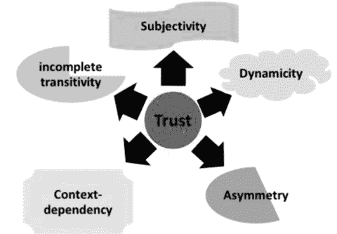

图 3.1 MANET 中的信任属性。

- **信任是动态的：** 在 MANET 中，节点行为不是静态的；它会随时间和条件的变化而变化。因此，节点的信任是一个可变因素。在 [15] 中，Adams 等人建议使用随机变量来捕捉信任变化，而不是离散变量。

- **信任是主观的：** 在网络中，节点在不同时间间隔内可能对其他节点持有不同看法，这些信任变化受网络拓扑条件的影响。

- **信任是非对称的：** 通常自组织网络由异构节点组成，节点具有不同的能力，如计算能力、内存、电池电量等。因此，两个节点之间的信任关系不是对称的。一般来说，资源良好的节点与其邻居具有良好的信任。

- **信任是传递的：** 节点可以通过中间节点利用信任传递规则来评估目标节点的可信度。考虑三个节点（n<sub>i</sub>, n<sub>j</sub>, n<sub>k</sub>），其中 n<sub>j</sub> 是 n<sub>i</sub> 和 n<sub>k</sub> 的邻居，但 n<sub>i</sub> 和 n<sub>k</sub> 不是邻居。节点 n<sub>i</sub> 采用 n<sub>j</sub> 的信任推荐来估计 n<sub>k</sub> 的可信度。

- **信任是上下文相关的：** 在自组织网络中，信任依赖于上下文，即节点在不同的上下文中对同一节点持有不同的信任看法。例如，节点可以在能量上下文中信任另一个节点，但在带宽上下文中则不能信任。


### 3.2.3 信任传播

计算出的信任值必须在网络中的节点之间共享，以避免对同一节点进行重复的信任重新计算工作。为此，每个节点与其邻域节点交换信任信息。

### 3.2.4 信任聚合

有时，一个节点可能通过多个渠道收到关于目标节点的多个信任推荐。但是，评估节点必须将这些值组合起来，得出一个单一的信任值。聚合函数在信任聚合中起着重要作用，它们可以消除或抑制有偏差的信任推荐。设一个节点从不同来源（如 x1, x2, ..... xn）接收多个信任值，聚合函数会产生一个单一的信任值。

y = Aggregate (x1, x2, ..... xn)

### 3.2.5 信任预测

如果一个节点无法直接或间接评估目标节点的信任值，则必须预测信任值。节点可以基于其与目标节点的当前和过去交互来预测信任值。

### 3.2.6 信任计算

在自组织网络中，信任可以通过三种不同的方式计算，即直接、间接和混合信任计算。如果目标节点处于直接通信中，则可以直接计算信任。对于不在直接通信中的节点，则计算间接信任。混合是直接和间接信任计算的组合。

#### 3.2.6.1 直接信任计算

通常在 MANETs 中，由于无线信道的广播特性，节点可以观察其邻域节点的活动。因此，节点可以基于与其交换的控制和数据包来估计其一跳邻域节点的信任值。

在 [16] 中，直接信任使用公式 (1) 进行评估。

\(T = R_p \times W(R_p) + R_q \times W(R_q) + R_e \times W(R_e) + D \times W(D)\)

(1)

这里 D、\(R_q\)、\(R_p\) 和 \(R_e\) 分别是数据包、路由请求、路由应答和路由错误包的不当行为因子，并在公式 (2) 中定义为归一化值 [0, 1]。

\(R_q = \frac{R_{qs} - R_{qf}}{R_{qs} + R_{qf}} \quad R_e = \frac{R_{es} - R_{ef}}{R_{es} + R_{ef}} \quad R_p = \frac{R_{ps} - R_{pf}}{R_{ps} + R_{pf}} \quad D = \frac{D_s - D_f}{D_s + D_f}\)

(2)

这里 \(R_{qs}\)、\(R_{es}\)、\(R_{ps}\) 和 \(D_s\) 定义为节点 B 成功转发的路由请求、路由错误、路由应答和数据包的数量。\(R_{qf}\)、\(R_{ef}\)、\(R_{pf}\) 和 \(D_f\) 是节点 B 未转发（失败）的路由请求、路由错误、路由应答和数据包的数量。这里 W() 表示在信任计算中分配给不同数据包的权重。

#### 3.2.6.2 基于推荐的信任

这里 \(c_{ij}\) 表示节点 i 对节点 j 的置信度，该值范围为 [-1,1]。置信度参数不对称。因此，节点 i 和 j 之间的置信度是根据公式 (3) 计算它们彼此置信度的平均值得到的。

\(\hat{c}_{ij} = \frac{c_{ij} + c_{ji}}{2}\)

(3)

\(T_i(k)\) 是节点 i 在 k 时刻的信任值。\(T_i(k + 1)\) 根据公式 (4) 计算。

\(T_i(k + 1) = \left\{ \begin{cases} 1, & m_i(k) > \tau \\ -1, & m_i(k) < \tau \end{cases} \right.\)

(4)

这里 \(m_i(k)\) 是节点 i 基于其他节点推荐的信任值。\(\tau\) 是信任阈值，如公式 (5) 所示。

m_i(k) = \sum_{j \in N_i} \hat{c}_{ji} T_j(k) (5)

#### 3.2.6.3 混合方法

在混合方法中，节点可以基于其直接交互并考虑其他节点推荐来评估目标节点的信任值。混合信任使用公式 (6) 计算。

T_{a,b} = \alpha T_d + \beta T_r (6)

这里 T_d 和 T_r 分别表示直接信任和推荐信任。\alpha、\beta 分别表示直接信任和推荐信任的权重，其中 \alpha + \beta = 1。

## 3.3 信任扭曲攻击：分类

这里讨论了各种基于信任的攻击。针对信任系统的攻击会导致网络中错误信任信息的传播，并削弱信任计算方法的性能。

### 3.3.1 MANETs 中的信任攻击

在图 3.2 中，信任攻击主要分为恶意中伤攻击和双面攻击 [4]。恶意中伤攻击类似于说谎者和颠覆性攻击。双面攻击类似于位置/用户域、引爆器和迭代攻击。

#### 3.3.1.1 恶意中伤攻击

在 [17] 中讨论了恶意中伤攻击，也称为谎言攻击。在恶意中伤攻击中，

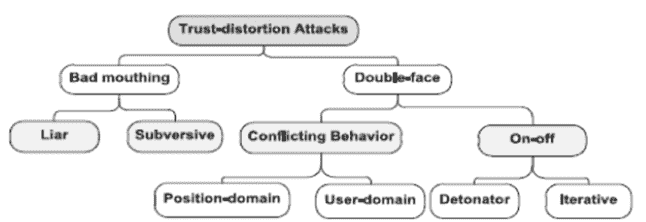

图 3.2 信任扭曲攻击。

被攻陷的节点在网络中传播有偏差的信任推荐，因此评估节点无法准确估计目标节点的信任值。在此，攻击者可以通过给出虚假推荐，将可信节点显示为恶意节点，反之亦然。通常，依赖推荐的信任组件会面临这些问题。如图 3.3 所示，说谎者攻击是指攻击节点始终向评估节点提供虚假推荐。

在颠覆性攻击中，攻击者会执行丢弃或修改数据包以及传播虚假新闻等不当行为。

#### 3.3.1.2 双面攻击

在双面攻击中，攻击者无法通过在不规则间隔执行有害活动来被识别 [4]。攻击者可以通过在不均匀时间间隔内表现好和坏来隐藏其身份。双面攻击要么是开关攻击，要么是冲突行为攻击，具体取决于威胁影响是空间性还是时间性。

- 开关攻击：在此，攻击者通过在意外时间间隔执行恶意活动，始终将信任值保持在阈值以上。攻击者在不当行为（开）和正常（关）状态之间不断切换，以隐藏其身份。开关攻击分为两类，即迭代攻击和引爆器攻击。在迭代开关攻击中，攻击者反复切换良好和不良行为，以误导观察节点。在引爆器开关攻击中，表现良好的攻击者在一段时间内可以建立可信度。过一段时间后，攻击者可以诱发恶意活动，并忠实地持续处于该状态。

- 冲突行为攻击：在此攻击中，攻击节点在网络的不同位置表现出不同的态度，以保持不被检测为恶意节点。基于目标实体（即用户或用户组），这些攻击分为用户域攻击和位置域攻击。

- 位置域冲突行为攻击：攻击节点在一个位置执行恶意活动，然后搬迁到新位置，在那里表现为正常节点。因此，它在新位置仍然是良好节点。通常，这类攻击可以通过网络中的信任传播来解决，以便所有节点了解新加入节点的过去行为。

- 用户域冲突行为攻击：攻击者始终只攻击特定的目标节点或节点组，并对其他所有节点表现良好。因此，受害节点无法获得其他节点的帮助来对抗攻击者。这种情况可能导致受害节点被孤立，因为它正在对攻击者给出负面反馈。这类攻击可以通过考虑推荐节点的信任值来解决。

### 3.3.2 抗信任扭曲的信任管理框架

为了克服恶意中伤和双面等信任攻击，已提出许多信任管理框架（TMF）。下面讨论了其中一些。

#### 3.3.2.1 抗双面攻击的 TMF

以下 TMF 旨在解决双面类型的攻击。

- Bella：在 [19] 中，Bella 等人提出了一种基于本地信任信息和信任推荐的框架。每个节点通过知识收集组件，利用直接交互收集一跳邻居的本地信任信息。该框架在每个节点中维护全局信誉表（GRT），以维护网络中所有节点的信任信息。

- Almotiri：该框架在 [20] 中提出。该 TMF 旨在抵抗 MANETs 中的双面攻击。在此，每个节点的知识收集组件记录与所有一跳邻居节点的所有成功和不成功通信。每个节点将通过路由过程中的控制数据包（RREQ、RREP）获取多跳外节点的信任信息更新。

#### 3.3.2.2 抗恶意中伤攻击的 TMF

以下方法说明了抵抗恶意中伤攻击的 TMF。

- OTMF：客观信任管理框架（OTMF）[22] 在 [30] 中提出。它可以同时处理双面攻击和恶意中伤攻击。在此，估计节点信任值时会考虑节点的当前行为和过去行为，其中当前行为的权重高于过去行为。此外，还会考虑推荐节点的信任值。


LARS：一种本地感知声誉系统（LARS）在[21]中提出，可解决恶意中伤和断续攻击。在每个节点，知识收集组件使用看门狗机制来评估邻居节点行为。在数据传输中，节点在向目标节点发送数据后设置定时器。如果节点在超时前未收到任何确认，则通过发送特殊跟踪数据包来启动探测，以查找路由中的恶意节点。

## 3.4 采用软计算方法的MANET信任管理

在MANET中，应用程序只有在网络中所有节点的合作和协调下才能成功运行。通常，当节点资源不足时会切换到自私模式，不再与其他节点合作。部分文献[3,5]提出，信任计算方法在进行信任估计时应考虑节点的态度和能力（就其可用资源而言）。这些方法可以提高应用程序的服务质量（QoS），因为每个节点的资源（质量参数）都在信任计算中得到考虑。一些轻量级软计算方法包括以下内容：

- 模糊逻辑
- 模糊Petri网
- 贝叶斯条件概率
- Dempster-Shafer理论
- 信任矩阵

### 3.4.1 使用模糊逻辑的信任计算

在[6]中，提出了一种基于模糊逻辑的QoS信任模型，并在图3.3中进行了说明。在此，节点能力和态度均被纳入信任计算。节点能力根据其QoS指标（如链接到期时间（LET）、带宽和能量）进行评估，而态度则根据其可靠性进行评估。在此，使用模糊逻辑结合所有这些QoS指标来推导节点信任值。

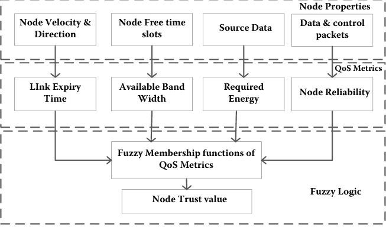

图3.3 模糊推理QoS信任模型。

在后续章节中，首先评估QoS指标，然后讨论模糊逻辑（模糊化、去模糊化和模糊规则库）以计算信任值。

#### 3.4.1.1 QoS参数的计算

在[5]中，讨论了LET、能量、带宽和可靠性的计算。

LET估计：两个节点之间的LET基于它们当前的位置、速度和运动方向计算得出。使用公式（7）进行估计。

```
LET = \frac{-(ab + cd) + \sqrt{(a^2 + c^2)r^2 - (ad - cb)^2}}{(a^2 + c^2)} (7)
```

表3.1 LET符号说明

| 项目 | 定义 |
|---|---|
| a | v1 cos θ1 - v2 cos θ2 |
| b | x1 - x2 |
| c | v1 sin θ1 - v2 sin θ2 |
| d | y1 - y2 |
| (x1, y1) 和 (x2, y2) | 节点位置 |
| v1 和 v2 | 它们的速度 |
| θ1 和 θ2 | 它们的方向 |

节点能量计算：在此，使用公式（8）计算数据包转发能量。在转发数据包时，节点需要接收并发送到其他节点。因此，它是接收能量和发送能量的组合。

```
E_{total}(k) = E_{amp} \times k \times d^2 + 2 \times (E_{ele} \times k) (8)
```

| 变量 | 描述 |
|---|---|
| E_{ele} | 收发机能量 |
| E_{amp} | 放大器能量 |
| k | 数据大小（以位为单位） |
| d | 无线覆盖范围 |

基于TDMA的带宽计算：时分多址（TDMA）用于带宽计算，其中两个节点之间的链路带宽根据它们的共同时间槽进行计算[13]。在公式（9）中，节点 n_i 可以在时间槽 s_t 向邻居节点 n_j 发送数据，前提是该时间槽未在 n_i 的任何邻居中被安排为接收槽。

```
TS_i = {s_t \in S: s_t \notin TS_i, s_t \notin RS_i, s_t \notin \cup_{n_k \in NB_i} RS_k} (9)
```

在公式（10）中，节点 n_i 可以在时间槽 s_t 从邻居节点 n_j 接收数据，前提是该时间槽未在 n_j 的任何邻居中被安排为发送槽。

```
RS_i = {s_t \in S: s_t \notin TS_i, s_t \notin RS_i, s_t \notin \cup_{n_k \in NB_i} TS_k} (10)
```

节点可靠性：节点可靠性基于数据包转发特性进行估计，并在公式（10）中制定。如果一个节点接收了 y 个数据包，其中转发了 x 个数据包，那么使用贝叶斯条件概率[9]，其可靠性 r 计算如下：

```
f(r, y/x) = \frac{P(x/r, y)f(r, y)}{\int_0^1 P(x/r, y)f(r, y)dr} (11)
```

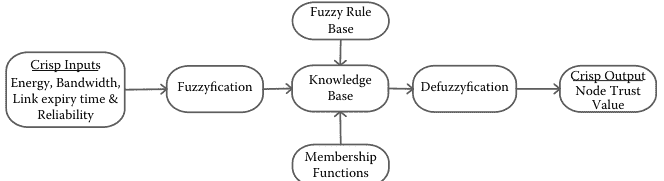

图3.4 FQTM中的模糊逻辑。

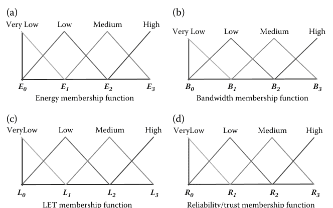

图3.5 模糊输入变量的三角隶属函数。(a) 能量隶属函数。(b) 带宽隶属函数。(c) LET隶属函数。(d) 可靠性/信任隶属函数。

#### 3.4.1.2 用于评估节点信任值的模糊推理系统

在图3.4中，模糊逻辑[7]应用于节点信任值的计算，其中QoS参数被视为模糊输入参数，节点信任是模糊输出。

模糊化：在模糊化过程中，每个QoS指标都用隶属函数表示，并量化为非常低、低、中或高。在图3.5中，显示了QoS隶属度。

| 能量 | LET | 带宽 | 可靠性 | 信任 |
|---|---|---|---|---|
| 高 | 高 | 高 | 高 | 高 |
| 高 | 中 | 高 | 高 | 高 |
| 中 | 低 | 中 | 高 | 中 |
| 高 | 中 | 中 | 高 | 中 |

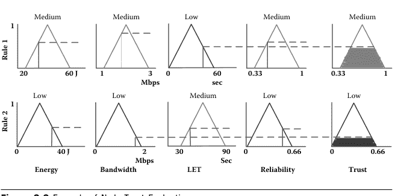

规则库：在规则库中，规则以IF-THEN条件的形式制定，可用于结合模糊输入函数以推导信任值。表3.3中描述了一些示例规则。

模糊推理系统：
在图3.6中，QoS参数使用以下规则组合。

- 1. 规则1：如果（能量为中，带宽为中，LET为低且可靠性为中），那么（信任为中）
- 2. 规则2：如果（能量为低，带宽为低，LET为中且可靠性为低），那么（信任为低）

此处，能量、带宽、LET和可靠性的QoS指标输入精确值分别为32J、1.8 Mbps、42秒和0.528。

去模糊化：在图3.6中，组合输出信任参数的部分。如图3.7所示，使用重心（COG）方法根据公式（12）求出信任值。

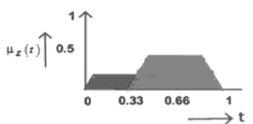

图3.7 节点信任值去模糊化。

COG = \(\frac{\int_{0}^{1} \mu_{E} (t) \, t \, dt}{\int_{0}^{1} \mu_{E} (t) \, dt}\) (12)

### 3.4.2 在MANET中使用模糊Petri网的信任路由

在此，借助动态模糊Petri网（DFPN）模型讨论了路由过程。在[11]中，讨论了DFPN。在图3.8中，DFPN显示为与图相关的结构以及场所和变迁的组合，其中场所显示为圆形，变迁显示为条形。一条有向弧连接输入场所（\(P_j\)）到输出场所（\(P_k\)），每条弧都与一个变迁（\(t_i\)）相关联。输入场所包含一个带有一定信任度（\(d_j\)）（DoT）的令牌。每个变迁都关联两个参数，如（\(\mu, \tau\)）；如果 \(\mu > \tau\)，则变迁触发，令牌从输入场所移动到输出场所，并带有一个新的DoT（即 \(d_k\)）。

此处，场所 \(p_j\) 的信任度为 \(d_j\)，即 \(\propto (p_j) = d_j\)。触发变迁 \(t_i (\mu > \tau)\) 后，令牌从场所 \(p_j\) 复制到 \(p_k\)。然后，场所 \(p_k\) 的信任度评估为 \(d_k = d_j \times w \times \mu\)。

#### 3.4.2.1 DFPN的加权规则

在图3.9中，触发变迁 \(t_i\) 后，变迁有 m 个输入，\(d_k = (d_{j1} \times w_1 + d_{j2} \times w_2 ..... d_{jm} \times w_m) \times \mu\)。

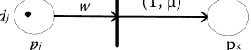

图3.8 类型1规则的DAFPN表示。

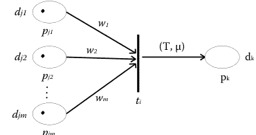

图3.9 DFPN加权规则1。

在图3.10中，变迁有多个输出；每个输出的信任度评估为 $d_{ki} = d_j \times w \times \mu_i$。

#### 3.4.2.2 使用基于模糊的确定性因子（$\mu$）评估的DFPN MANET路由

在图3.11中，MANET网络被建模为DFPN，其中场所类似于节点，变迁类似于无线链路。在此，基于模糊系统（如前所述）评估变迁的确定性因子，同时考虑两个节点的QoS参数（如能量、BW、LET和可靠性）。一旦变迁触发（节点拥有足够资源 \(\mu > \tau\)），数据包即从输入节点转发到输出节点。每个变迁的阈值（$\tau$）根据网络条件计算得出。

基于模糊Petri网的路由算法：

- 1. 源节点 $n_s$ 通过将DOT设置为1，\(\propto (n_s) = 1\)，向其单跳邻居发送路由请求（RREQ）。
- 2. 此处 w = 1（均为单输入变迁）

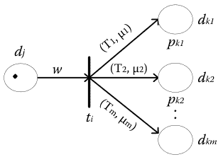

图3.10 DFPN加权规则1。


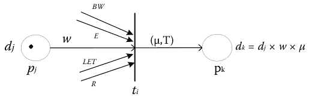

图 3.11 CF 计算。

- 3. 接收到 RREQ 数据包后，每个中间节点评估 \(\mu\)。如果 \(\mu > \tau\)，则转发 RREQ 数据包。否则，丢弃该请求。
- 4. 在传输过程中，RREQ 数据包会累乘其遇到的所有节点的 DoT。
- 5. 目标节点接受具有最高 DoT 的 RREQ 数据包并回复。

## 示例拓扑中的 QTFPN 路由

在图 3.12(a) 中，示例 MANET 拓扑包含八个节点，其中 1 和 8 分别为源节点和目标节点。在图 3.12(b) 中，相同的 MANET 被建模为 DFPN。这里，源节点到目标节点有五条备选路径，即 1-2-5-8、1-3-5-8、1-3-6-8、1-4-6-8 和 1-4-7-8。但由于 \(\mu < \tau\)，路由 1-4-6-8 无效。接下来，评估路由 1-2-5-8 的 DoT 值如下：

```
(1 x 0.8) > 0.3 => 0.8
(0.8 x 0.7) > 0.4 => 0.56
(0.56 x 0.8) > 0.3 => 0.448
```

同样，我们可以分别评估剩余三条路径的 DoT 值为 0.576、0.567 和 0.448。在此，路径 1-3-5-8 具有最大 DoT；因此，目标节点选择此路径。

### 3.4.3 Dempster-Shafer 理论

Dempster-Shafer 理论 [3] 是数学聚合函数。节点使用 DST 来聚合多个信任推荐

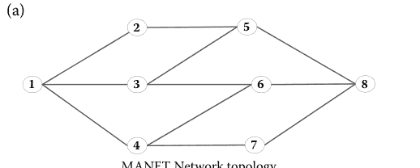

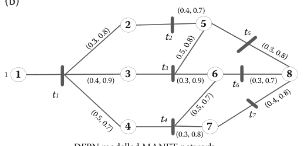

**图 3.12** (a) MANET 网络拓扑。(b) 基于 DFPN 建模的 MANET 网络。

这些推荐是从多个路径接收的。DST 方法可以识别有偏推荐，并能降低有偏推荐对信任计算的影响。

DST 函数依赖于三个函数，即质量函数、可能性函数 (PI) 和信念函数 (Bel)。设事件 e 发生，E = {e1, e2, e3} 是关于事件 e 的证据集。幂集 P(E) 是 {Ø, {e1}, {e2}, {e3}, {e1, e2}, {e2, e3}, {e1, e3}, {e1, e2, e3}}。

*质量函数*：质量函数 (m) 将 P(E) 中的所有子集映射到范围 [0,1]，m:P(E) → [0,1]，其中 m(Ø) = 0 且 ΣB∈P(E) m(B) = 1。

*信念函数* (Bel)：如果 X 是 P(E) 中的子集，则 bel(X) = ΣC⊆X m(C)。

*可能性函数* (pl)：如果 X 是 P(E) 中的子集，则 pl(X) = ΣC∩X≠Ø m(C)。

#### 3.4.3.1 组合的 Dempster 规则

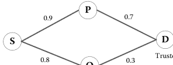

图 3.13 QoS 信任推荐的聚合。

设 X 是 P(E) 中的元素，A 和 B 是关于事件 X 的两个观测节点。它们的观测表示为 m<sub>A</sub>(X) 和 m<sub>B</sub>(X)。这两个观测的组合可以使用公式 (13) 计算。

```
m_{A,B}(X) = \frac{\Sigma_{P \cap Q=X} m_A(P) m_B(Q)}{1 - K} (13)
```

其中常数 K 定义为 K = \Sigma_{P \cap Q = \emptyset} m_A(P) m_B(Q)。

#### 3.4.3.2 DST 示例

在图 3.13 中，节点 S 正在从节点 P 和 Q 获取关于节点 D 的信任推荐。信任推荐的形式为 (T, T̄, U)，即分别表示信任、不信任和不确定性。在此，节点 P 和 Q 对节点 D 的信任推荐分别为 {0.7, 0.2, 0.1} 和 {0.3, 0.5, 0.2}。这些推荐会乘以各自的信任值。

节点 S 对 P 有 0.9 的信任，因此 P 的信任被重新计算为

```
m<sub>P</sub>(T) = T<sub>P</sub> × 0.7 = 0.63
m<sub>P</sub>(T̄) = T<sub>P</sub> × 0.2 = 0.18
m<sub>P</sub>(U) = T<sub>P</sub> × 0.1 = 0.09
```

节点 S 对 Q 有 0.8 的信任，因此 Q 的信任被重新计算为

```
m<sub>Q</sub>(T) = T<sub>Q</sub> × 0.3 = 0.24
m<sub>Q</sub>(T̄) = T<sub>Q</sub> × 0.5 = 0.40
m<sub>Q</sub>(U) = T<sub>Q</sub> × 0.2 = 0.16
```

P、Q 节点对节点 D 的推荐聚合按公式 (21) 评估如下。

\( m_{P,Q}(T) = \frac{m_P(T)m_Q(T) + m_P(T)m_Q(U) + m_P(U)m_Q(T)}{1 - [m_P(T)m_Q(\overline{T}) + m_P(\overline{T})m_Q(T)]} \)
\( = \frac{0.05}{0.09} = 0.55 \)

该公式可以扩展用于组合 n 个节点对节点 D 的推荐，即 \( m_{1.....n}(T) \)。

### 3.4.4 信任矩阵运算

信任矩阵运算用于在网络中传播信任值，以避免同一节点的信任计算工作风险。

此处每个节点都有信任信息，并以 \( n \times n \) 阶矩阵格式维护该信息（n 表示网络中的节点数量）。

\( N^T = \left( \begin{array}{ccccc} t_{11} & ... & t_{k1} & ... & t_{n1} \\ ... &  & ... &  & ... \\ t_{1k} & ... & t_{kk} & ... & t_{nk} \\ ... &  & ... &  & ... \\ t_{1n} & ... & t_{kn} & ... & t_{nn} \end{array} \right) \) (14)

在公式 (14) 中，\( t_{ij} \) 表示节点 i 对节点 j 的信任值。使用信任矩阵运算，节点可以计算非直接通信目标节点的信任值（通过应用信任传递规则）。

信任传递规则：

- i. \( t_{ij} \)：节点 i 对节点 j 的信任值
- ii. \( t_{jk} \)：节点 j 对节点 k 的信任值
- iii. 然后节点 i 对节点 k 的信任值计算为 \( t_{ik} = t_{ij} * t_{jk} \)。

设 \( t_i = [t_{i1}....t_{ik}....t_{in}] \) 为节点 i 的信任向量；它可以使用公式 (15) 进行迭代更新。

\(\left( \begin{array}{c} t_{i1} \\ ... \\ t_{ik} \\ ... \\ t_{in} \end{array} \right)_{NEXT} = \left( \begin{array}{ccccc} t_{11} & ... & t_{k1} & ... & t_{N1} \\ ... &  & ... &  & ... \\ t_{1k} & ... & t_{kk} & ... & t_{Nk} \\ ... &  & ... &  & ... \\ t_{1n} & ... & t_{kn} & ... & t_{nn} \end{array} \right) \otimes \left( \begin{array}{c} t_{i1} \\ ... \\ t_{ik} \\ ... \\ t_{in} \end{array} \right)_{CURRENT} \) (15)

在公式 15 中，值 \( t_{ik} \) 计算为 \( t_{ik} = max_{1 \le j \le n} \{t_{ij} \times t_{jk}\} \)。

此处节点 i 可以迭代应用此公式来查找多跳外节点的信任值，例如

- \( t_i = (N^T)t_i \)
- \( t_i = (N^T)^2t_i \)
- \( \vdots \)
- \( t_i = (N^T)^n t_i \)

## 3.5 结论

在 MANET 中，由于资源约束和网络动态性，复杂安全算法的实现会降低网络性能。在这项工作中，通过信任处理方法克服了这一局限性。此处在评估节点信任时会考虑能力（资源）和态度。对信任攻击及其对策进行了全面讨论。不同的软计算技术（即模糊逻辑、模糊 Petri 网、Dempster-Shafer 理论和信任矩阵运算）被讨论用于 MANET 中的信任管理。

## 参考文献

- 1. NageswaraRao Sirisala 和 C. Shoba Bindu. 基于模糊 Petri 网的 MANET 中新型 QoS 信任计算，International Journal of Intelligent Engineering and Systems，vol. 10, no. 2, 2017, pp. 116–125.
- 2. Yating Wang; Ing-Ray Chen. 面向服务的 Ad Hoc 网络中基于信任的多目标优化任务分配，vol. 14, no. 1, 2017, pp. 217–232.
- 3. NageswaraRao Sirisala 和 C. Shoba Bindu. 基于推荐的移动 Ad Hoc 网络中 QoS 信任聚合与路由，International Journal of Communication Networks and Information Security (IJCNIS)，vol. 8, no. 3, 2016, pp. 215–220.
- 4. Zeinab Movahedi, Zahra Hosseini. 移动 Ad Hoc 网络中信任扭曲信任管理框架：综述，IEEE Communications Surveys & Tutorials，vol. 18, no. 2, 2016, pp. 1287–1309.
- 5. NageswaraRao Sirisala 和 C.Shoba Bindu. 移动 Ad Hoc 网络中组播路由的基于模糊逻辑的 QoS 信任模型，International Journal of Applied Engineering Research vol. 10, no. 12, 2015, pp. 32175–32194.
- 6. NageswaraRao Sirisala 和 C. Shoba Bindu. MANET 中基于不确定规则的模糊逻辑 QoS 信任模型，International Conference on Advanced Computing and Communications - ADCOM，(IITM PhD 论坛)，2015, pp. 55–60.
- 7. F. Hao, G. Min 和 M.Lin. MobiFuzzyTrust：移动社交网络中高效模糊信任推断机制，IEEE Transactions on Parallel and Distributed Systems，vol. 25, no. 11, 2014 pp. 2944–2955.
- 8. NageswaraRao Sirisala 和 C.Shoba Bindu. 移动 Ad Hoc 网络中基于权重的可信 QoS 协议，IEEE Global Conference on Wireless Computing and Networking，2014, pp. 283–287.
- 9. W. Zhexiong 和 Tang. 使用不确定推理进行信任管理的移动 Ad Hoc 网络安全增强，IEEE Transactions on Vehicular Technology，vol. 63, no. 9, 2014 pp. 4647–4658.
- 10. F. Bao, J. Hee 和 C. Ing-Ray. 移动 Ad Hoc 网络中用于偏差最小化和应用性能最大化的信任管理，Ad Hoc Networks，vol. 19, 2014 pp. 59–74.
- 11. H. C. Liu 和 L. Liu. 使用模糊证据推理和动态自适应模糊 Petri 网进行知识获取与表示，IEEE Transactions On Cybernetics，vol. 43, no. 3, 2013, pp. 1059–1072.
- 12. Lei Ju, Edwin H. M. Sha, Hui Xia, Zhiping Jia, Xin Li. 移动 Ad Hoc 网络中的信任预测与基于信任的源路由，Ad Hoc Networks Elsevier，vol. 11, no. 7, 2013, pp. 2096–2114.


- 13. C.C. Hu, H. Wu, 和 G.H. Chen, MANETs 中带宽满足的组播树, IEEE Transactions On Mobile Computing, vol. 7, no. 6, 2008, pp. 712–723.
- 14. P. Mohapatra 和 K. Govindan. 移动自组织网络中的信任计算与信任动态：综述, IEEE Communications Surveys and Tutorials, vol. 14, no. 2, 2012, pp. 279–298.
- 15. J.-H. Cho, A. Swami, 和 I.-R. Chen, 移动自组织网络信任管理综述, IEEE Communications Surveys and Tutorials, vol. 13, no. 4, 2011 年 11 月, pp. 562–583.
- 16. W. J. Adams, G. C. Hadjichristofi 和 N. J. Davis, 移动自组织网络中节点声誉的计算, 第 24 届 IEEE 国际性能计算和通信会议论文集, 凤凰城, AZ, 2005 年 4 月 7–9 日, pp. 303–307.
- 17. Pirzada 和 C. McDonald. 纯自组织网络中的信任建立, International Journal of Wireless Personal Communications, vol. 37, 2006, pp. 139–168.
- 18. P. B. Velloso, R. P. Laufer, D. O. Cunha, O. C. M. B. Duarte, 和 G. Pujolle, 基于可扩展成熟度模型的移动自组织网络信任管理, IEEE Transactions on Network and Service Management, vol. 7, no. 3, 2010 年 9 月, pp. 172–185.
- 19. G. Bella, G. Costantino, 和 S. Riccobene, MANETs 上的声誉管理, 第 4 届信息保障安全国际会议 (IAS) 论文集, 2008, pp. 255–260.
- 20. S. Almotiri 和 I. Awan, 用于保护 DSR 路由协议的 MANET 中的信任路由, PGNet, 2010.
- 21. J. Hu 和 M. Burmester, 移动自组织网络中的合作, 无线自组织网络指南论文集, 2009, pp. 43–57.
- 22. J. Li, R. Li, 和 J. Kato, 移动自组织网络未来信任管理框架, IEEE Communications Magazine, vol. 46, no. 4, 2008 年 4 月, pp. 108–114.


泰勒和弗朗西斯

泰勒和弗朗西斯集团

http://taylorandfrancis.com

# 区块链中的美德证明：无 Nonce 哈希生成

J. JAYAPRIYA 和 N. JEYANTHI
信息技术与工程学院, VIT, 维洛尔,
印度

## 目录

- 亮点 63
- 4.1 共识机制：简介 64
- 4.2 分布式共识算法 64
- 4.2.1 中本聪共识（工作量证明） 67
- 4.2.1.1 协议设计 67
- 4.2.1.2 局限性 68
- 4.3 提出的模型：美德证明 69
- 4.3.1 新用户加入网络 70
- 4.3.2 性能要求 71
- 4.3.3 优势 72
- 4.3.4 局限性 73
- 4.4 结论与未来工作 73
- 参考文献 74

## 亮点

- 1. 由于哈希生成过程中移除了 nonce（谜题）生成，计算及其他能源资源浪费降低。
- 2. 算力在区块生成中不起任何作用，从而防止 51% 攻击。
- 3. 新用户需要等待一段时间，直到获得参与区块生成过程所需的信用评分，这将使网络具有 Sybil 抵抗力。

## 4.1 共识机制：简介

共识机制使去中心化网络能够就当前网络状态达成一致 [1]。在集中式系统或联邦组织中，所有决策均由单一选举产生的领导者或成员委员会做出，而在去中心化网络中，没有领导者可以独立决策；相反，一组系统/节点参与决策过程。该过程支持一项决策，以所有参与决策过程的人的利益为前提，称为共识。用于在分布式去中心化网络中实现共识的机制定义为共识机制。这些共识机制是颠覆性技术区块链的骨干。在投票系统中，获得多数票的方案获胜；情绪或少数群体的福祉没有权重。在共识系统中，决策是为系统中分散的整个群体的利益而做出的，为创建更民主、非歧视的社会铺平了道路。区块链的著名实现是比特币：一种使用共识机制实现的加密货币。当今世界背后任何加密货币都存在一种共识机制。共识协议还确保在加密货币中达成相互协议 [2] 且不存在双重支付。

## 4.2 分布式共识算法

分布式共识算法是为在分布式环境中达成共识而设计的算法。达成的共识应是网络中每个个体都支持的令人满意的解决方案，即使它不是他们个人最喜欢的解决方案。这些算法确保添加到系统中的下一个块/值是唯一的真实版本。这样我们可以将共识定义为在群体中达成普遍协议和共同信念的充满活力的方式。图 4.1 使用三个节点（节点 1、节点 2 和节点 3）说明了共识问题。节点 1 提出“值 2”，节点 3 向其他节点提出“值 1”，节点 2 保持安静。共识算法应以这种方式设计以解决此问题模型并最终达成某个值。

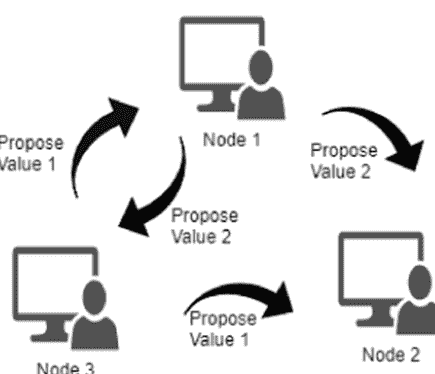

图 4.1 共识模型。

分布式共识算法表现出以下特性，以使系统正常工作并防止故障或故障 [3]。

- 1. 协作 – 系统中的所有节点应以整个群体的利益为目标共同工作。
- 2. 合作 – 系统实体应作为一个群体而非带有个人利益的个体工作。
- 3. 包容性 – 确保群体有最大程度的参与。
- 4. 参与性 – 群体的积极参与是成功所必需的。
- 5. 寻求一致 – 从参与系统的各个节点中争取尽可能多的一致意见。
- 6. 民主性 – 个人投出的每一票都应具有同等权重。

遵循前述特性的共识算法构成了革命性技术区块链的根基结构。各种区块链中部署的共识算法使它们彼此不同。此功能使数百万个节点能够存在于同一空间中，而它们永远不会互相存在或互相阻碍。

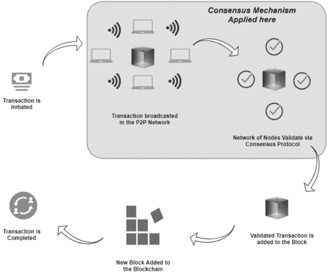

图 4.2 区块链中共识的应用。

图 4.2 中突出显示的过程展示了共识算法在区块链中的应用。当满足以下条件时，此类共识算法可达成共识 [4,5]：

- 1. 一致性 – 网络中每个非故障节点都应决定相同的输出值。
- 2. 终止 – 每个非故障节点最终都应决定某个输出值。这是终止条件。

现实世界用例中设计和实现了大量共识算法，但每种算法在术语、有效性条件（以实现最终输出值）和处理决策过程的程序方面可能有所不同。

### 4.2.1 中本聪共识（工作量证明）

中本聪共识可以定义为一种本质上具有概率性的非确定性方法。在这种模型中，每个节点无需就相同的值达成一致；相反，他们就值正确的概率达成一致。该共识机制通过其著名的实现比特币被证明具有以下特性：

- 1. 拜占庭容错 – 此过程没有领导者选举；相反，决策取决于节点更快地解决计算谜题并获得提出其值的机会。
- 2. 激励机制 – 当节点解决谜题并提出其他节点同意的值时，获胜节点会获得经济激励。
- 3. Sybil 抵抗 – 共识过程中不使用常规 PKI 身份验证方案或任何其他方案，而是涉及工作量证明（POW）机制，确保该过程具有 Sybil 抵抗力。
- 4. 流言协议 – 对等流言协议确保消息路由到异步网络中的所有节点，假设每个节点仅连接到一部分节点。

#### 4.2.1.1 协议设计

中本聪共识基于以下原则设计：区块链网络中所有节点运行相同的协议并管理其自身的分布式账本副本。该协议取决于网络中大多数节点是诚实或非故障节点这一事实。

协议设计中应用的重要规则 [5,6] 如下：

- 1. 消息广播规则 – 所有交易，无论是本地生成还是从网络内的其他对等节点接收，都应及时广播到已识别的对等节点，不得造成任何延迟。相同条件也适用于区块广播。


- 2. 有效性 – 每个节点接收到的所有交易和区块在广播前均应经过验证。一旦区块中的所有交易以及整个区块都经过验证，即应将其追加至区块链。在此过程中，无效的交易或区块将被丢弃。

- 3. 最长链规则 – 在这种共识机制中，网络中存在的任何最长链均被视为有效链。任何诚实或非故障节点都会通过追加下一个有效区块，在最长链之上进行构建。追加下一个区块的位置将取决于在最长链上投入的总计算工作量。

- 4. 挖矿过程 – 工作量证明（POW）是中本聪共识的支柱，负责处理有效区块生成过程。每个试图提议区块的节点都应找到一个 nonce（一次性数值）以插入区块头。寻找 nonce 的难度将定期调整，以确保网络内的平均区块生成速度保持不变。

中本聪共识显然基于以下几点优于传统共识机制：

- 1. 中本聪共识具有拜占庭容错性，而大多数传统共识机制不具备。
- 2. 任意数量的节点可以随时加入或离开网络，确保开放参与。
- 3. 网络中的节点无需了解网络中的所有参与者；尽管如此，它们仍将拥有一个有限的已知对等节点集合。
- 4. 不涉及通信开销，这不同于传统机制。
- 5. 中本聪共识不需要领导者选举过程。

#### 4.2.1.2 局限性

- 1. 挖矿下一个区块的节点试图使用蛮力计算。因此，计算哈希值的能源和计算能力消耗较高。
- 2. 区块的平均大小限制为 1 MB，每个区块处理的交易数量非常少（大约每秒七笔交易）。其他成熟的网络（如 VISA 和 PayPal）在相同时间内处理的交易量要高得多（VISA 中大约每秒 10,000 笔交易）。

## 4.3 提出的模型：美德证明

新模型旨在规避比特币著名 POW 共识中较高的能源和计算资源消耗。通过移除用于区块哈希生成的更耗能、耗资源的 nonce 识别来实现这一点。比特币已证明使用此谜题计算可抵御所有双重支付攻击。如果我们从处理中移除这一步会怎样？一种替代方法是引入一种比公共区块链资源消耗更少的新机制。由于这是一个无需许可的公共区块链网络，它可以容纳任何数量的参与者加入网络。

图 4.3 中的提出模型遵循与常规比特币处理相似的步骤，但这里提到的哈希计算过程中有以下注意事项：

- 1. 系统中的每个节点都有关联的信用点（类似于法币经济中的信用评分）。
- 2. 任意数量的节点可以随意加入或离开网络，这使其成为像比特币这样的公共区块链。
- 3. 拥有最低信用点阈值的任何节点都将被允许进行区块生成。在任何真实交易发生之前，初始网络将生成一个创世区块和 n 个测试区块。这将测试参与网络的节点的可靠性。
- 4. 设生成区块所需的最短时间为 t。那么初始网络设置所需的时间将为 \(t_i = (n + 1)^*t\)
- 5. 初始设置后，每个正确验证了所有测试区块的参与节点将拥有 \(c_i\) 的信用额度。我们假设正确验证一个区块所提供的信用为 \(c_1$，那么初始信用将为

$c_i = n^*c_1$

- 6. 提出的模型将设置参与区块生成的阈值为初始信用 $c_i$。
- 7. 在提议生成的区块时，节点应质押累积的信用点和激励。
- 8. 区块哈希生成在不计算 nonce 的情况下进行，这节省了计算和其他能源资源。
- 9. 所有节点都可以参与新生成区块的验证。
- 10. 一旦区块成功验证，区块生成者将获得激励并提升信用点数。
- 11. 每个成功验证生成区块的节点也将获得信用增加（虽然微乎其微）。
- 12. 如果一个区块被发现无效，则区块生成者将受到惩罚。整个信用评分将被清除，激励将被无效化。
- 13. 信用点和激励将持续存在，即使用户根据自己的可用性退出并重新进入网络。
- 14. 如果系统中的某个节点或几个节点崩溃，它们将通过与其他运行中的节点同步恢复到最新状态。恢复的节点将接受其对等节点的最长链并继续为网络做出贡献。
- 15. 参与的对等节点将立即广播系统中它们了解的任何新区块。因此，如果网络中存在任何延迟、混乱或消息丢失，网络将暂时不同步；然而，每个节点之间的同步过程最终会使其平衡，类似于比特币区块链中使用的恢复机制。

### 4.3.1 新用户加入网络

任何加入网络的新用户都将从零信用开始。一旦加入网络，用户将无法完全使用。他可以验证生成的区块并增加他的信用点数；然而，他可能无法生成新区块。这将确保网络具有抗女巫攻击能力。只有当他验证的区块成功添加到网络时，信用点数才会添加到用户身上。

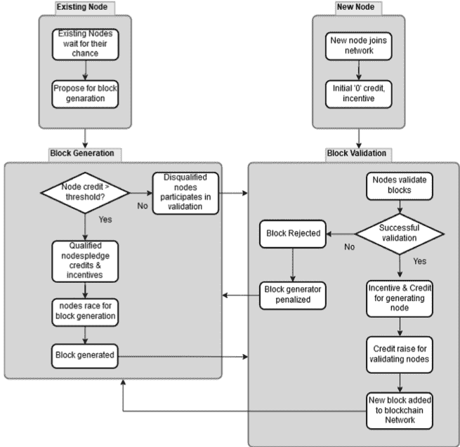

图 4.3 流程图：美德证明。

一旦新用户获得最低所需信用，他将被允许参与区块生成，从而成为完全功能的节点。

### 4.3.2 性能要求

- 1. 如图 4.4 所示，测试网络将拥有一些客户端来注入工作负载，并基于观察结果进行解释。客户端是直接与区块链网络交互的平台/实体，而不是构建在其之上的应用程序。

- 2. 客户端 – 生成负载的客户端将提交新交易

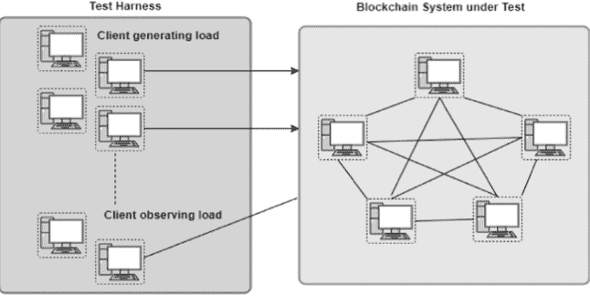

到网络，观察客户端只观察提交的交易。

- 3. 区块链网络 – 区块链网络是正在测试的实际系统，由共同同意完成交易的节点数量组成。

### 4.3.3 优势

- 1. 由于在哈希生成过程中移除了 nonce（谜题）生成，因此能源和其他资源浪费降低。
- 2. 挖矿能力在区块生成中不起任何作用，从而防止 51% 攻击。
- 3. 新用户必须等待一段时间，直到获得参与区块生成过程所需的信用评分，这将使网络具有抗女巫攻击能力。
- 4. 由于对区块生成所需的最短时间没有限制，交易速度将提高，使系统更具可扩展性。
- 5. 用于区块验证和校验的共识机制使系统具有拜占庭容错性。

### 4.3.4 局限性

- 1. 网络的安全性将根据网络中参与节点的总数来衡量。如果网络中参与的节点很少，权力集中化的可能性很高。
- 2. 在网络的初始设置期间，节点必须验证测试区块以获取初始信用。

## 4.4 结论与未来工作

共识算法用于分布式环境中的系统以达成集体协议。没有实现共识机制来达成协议，就不可能存在任何分布式或去中心化系统。网络中的节点可能互不信任，但必须遵守共识算法以决定共同目标。区块链可以从无数交易中构建区块，形成数据库，但如果没有共识算法，它们本质上不会是去中心化的。著名的 POW 共识机制也免不了因其计算密集和资源密集过程而受到批评。我们的新机制“美德证明”将同时克服这些缺点，并能抵御 51% 的女巫攻击和任何类型的故障。尽管该机制已被精心设计，但仍需进行大量测试——这将是未来工作的范围。


## References

- 1. Hong Guo, Hongqiang Zheng, Kai Xu, Xiangrui Kong, Jing Liu, Fang Liu, and Keke Gai, “区块链改进共识机制,” Springer Nature Switzerland, (2018), https://doi.org/10.1007/978-3-030-05764-0_14.
- 2. Deepak Puthal, Nisha Malik, Saraju P. Mohanty, Elias Kougianos, and Gautam Das, “关于区块链你想知道的一切,” IEEE 消费电子杂志, (2018), DOI: 10.1109/MCE.2018.2816299.
- 3. https://101blockchains.com/consensus-algorithms-blockchain/, 在线, 访问于 01/11/2019.
- 4. John Turek, and Dennis Shasha, “分布式系统中共识的多种面貌,” IEEE Computer, 1992.
- 5. V. Gramoli, “从区块链共识回到拜占庭共识,” Future Generation Computer Systems, (2017), http://dx.doi.org/10.1016/j.future.2017.09.023.
- 6. S. Nakamoto, “比特币：一种点对点电子现金系统,” 2008.

# 基于击键生物特征的密码身份验证

舒布姆·苏德 和 M. 范妮莎

维洛尔理工学院信息技术与工程学院，维洛尔-632014，泰米尔纳德邦，印度

## 目录

- 5.1 引言 75
- 5.2 相关工作 77
- 5.3 提出的方法 104
- 5.4 结论 107
- 参考文献 108

## 5.1 引言

身份验证是确认用户是否就是其声称的那个人的过程。它被用作区分合法或正当客户与冒充者的一种方法。基于密码的确认是最广泛使用的客户端验证组件。该策略利用特定于某个客户的用户名和密码提示。密码必须是独一无二、长、复杂且强的。一个人必须为不同的应用程序使用不同的密码。为各种应用程序使用相似的密码会使其持续易受攻击。强密码涉及任何由小写字母、大写字母、数字、唯一字符和图像组成的组合，长度为八个字符或更多。保持密码简单会使其易受攻击。知道某人的用户 ID 和密码会使入侵者非常容易进入系统。在这个一切都数字化的技术时代，获取某人的密码并不困难。

因此，即使有人知道你的密码，也需要一种方法来维持身份验证。

所提工作为密码身份验证系统中的这一漏洞提供了解决方案。它利用个人的打字行为来重新识别用户。研究表明，每个人打字时都有某种模式；因此，可以用来区分用户。击键特征是指基于键盘打字的方式和节奏来识别或确认个人身份的计算机化技术。击键特征是一种行为生物识别；这意味着生物识别因素是“你所做的事”。

用于击键特征的粗略估计是停留时间和飞行时间。

- 1. 停留时间: 按键按下的时间长度
- 2. 飞行时间: 释放按键和按下下一个按键之间的时间

几组字符的打字节奏可能高度依赖于个人。本研究的重点是探讨客户端身份验证，利用密码击键特征作为多因素验证来防止非法客户端访问。该研究通过利用动态时间旅行进行相似度估计完成；验证框架在向客户介绍用于系统便捷度量表调查之前，使用数据集进行了测试。为了提高身份验证系统的性能，多种技术已与生物识别身份验证系统相结合，借助 KNN 算法检查用户的模式以进行身份验证，这将允许您进入用户注册时保存的聚类区域，在此区域中，欧几里得距离公式将帮助您检查保存的聚类，并允许您访问页面或拒绝访问。用户已接受击键动力学，因为它成本低廉，仅需要一个键盘即可在访问应用程序之前对用户进行身份验证。动态框架在整个交互过程中持续观察客户端的击键，即使成功通过登录会议也是如此。这意味着，个人的打字模式在整个会议期间不断进行动态调查，以确保客户端的身份。

## 5.2 相关工作

Faisal Alshanketi 等人 [1] 提出了不规则森林算法，以提高击键动态生物识别验证的精确执行性能。我们还提出了一种新的算法来处理打字错误。在公开可用的数据集以及我们收集的数据集上进行的重演结果表明，所提方法的执行结果显著更好。除指重和区域以及计划特征外，还能从根本上提高所提方案的表现。尽管有生物识别因素，但使用固定密码字符串可能易受重放攻击。现代键盘记录器可用于嗅击键特征中的密码，然后可以重复使用这些密码来访问受保护的框架。缓解此类风险的一种方法是从一次性密码（OTP）中提取击键特征。该方法在精度方面仍面临巨大挑战。

Farida Jaha 等人 [2] 提出了一种可为客户提供验证安全的可靠密码策略。然而，如果另一个人能够泄露密码，则没有密码策略能防止未经授权的客户访问。利用动态击键，冒充者攻击是徒劳的，因为动态打字是每个人的独特特征。经过大量探索，我们认为击键特征可以是可靠的验证安全工具。动态打字是一种允许组织安全使用自带设备（BYOD）的系统。它不需要额外投资。因此，组织正在享受 BYOD 的好处，而不会成为数据泄露的受害者。基于这些及其他原因，我们提出了一段伪代码，利用停留时间功能和压力时间功能来执行击键特征。为了考虑使用控制台输入的信息并存储生物识别信息，我们选择了欧几里得距离，它将与由...决定的限制进行对比。

Purvashi Baynath 等人 [3] 提出了一种常用于识别和访问控制或识别的技术。生物识别验证的根本原因是每个人都与众不同——此外，个人可以通过其核心物理或行为特征来识别。生物识别框架与密码的结合提供了进一步提高安全性的新方法。客户已接受击键特征，因为它在客户端易于部署。击键动力学领域已进行了许多研究，在其他生物识别应用中，模拟客户端示例的神经系统是一种非常有前景的可用程序。通过分析现有的生物识别技术，可以说，混乱神经网络与生物识别特征的结合提供了比其他方法更优越的安全性。用于学习生物识别示例的混乱神经网络方法是增强生物识别系统识别速度的重要资产。因此，该方法已应用于两个数据库，即我们的内置数据库和一个在线数据库，其中已测试了特征测量缩减方法。从测试中可以看出，混乱神经网络提供了更优越的识别率。

Carlo Ferrari 等人 [4] 展示了一种自适应连续生物识别验证系统，该系统使用击键特征来检查客户端在计算框架上打字时（并且可能正在访问必须经过验证的一些服务）声称身份的真实性。使用行为生物识别参数可以节省计算资源和能量，且不需要额外设备。为了降低系统对客户端打字方式预期变化的敏感性（因疲劳、倦怠或情绪而产生），在记录打字信息的同时，每个认证客户端模型都会不断重新计算。同时，其他选定客户端的模型在匹配前也会重新计算，从而导致


卓越框架。在未来的工作中，还应解决适应性问题，并引入鼠标元素以构建更强大的框架。对组件向量进行谨慎升级，并在模型关联用于选择时同时使用两种独特的度量，也可以改进测试策略的简便性、速度和精度。最后，所提框架应在一些非常实际的应用中得到验证，例如 Webmail、在线测试和基本网站的监控。

Santanu Chatterjee 等人 [5] 提出了一种基于切比舍夫混沌映射的轻量级多服务器身份验证方案。我们利用随机预言模型和 BAN 逻辑进行了正式安全分析，并使用广泛接受的 AVISPA 工具复现了我们的方案以进行正式安全检查。结果表明，我们的方案在多服务器环境下能抵御已知的潜在攻击。此外，我们的方案满足与多服务器环境相关的已知实用性特点。我们的方案在登录、验证和密钥建立阶段不需要 RC 的参与。因此，与其他现有方案相比，我们的方案更有效，并越来越适合实际应用，特别是对于便携式和电池供电设备。

Puja Smriti 等人 [6] 提出，按键元素是一种社会生物识别策略，用于基于个人的输入节奏来验证或检查客户的身份。在本章中，我们提出了一种新策略，将个人电脑的按键信息与工作站的按键信息进行对应。获得的结果非常令人兴奋。未来，这种比较方法可以在不同类型的键盘上进行测试。可以加入更多特征以提高精度。此外，该方法还可以应用于移动电话。

Michael J. Coakley 等人 [7] 的研究主要目的是分析从当前手机中提取的各种文本输入生物特征数据的确认性能。与现有机械键盘相比，传统的按键按下/释放计时获得了 20% 的 EER。另一方面，触摸屏功能（4.0% EER）和仅包含转盘（4.3% EER）所取得的出色结果似乎为手机上的客户验证提供了一种令人信服的方法。该研究比较了两种不同的验证技术（RRS 和 LOOCV），如预期，LOOCV 策略优于 RRS，但代价是更大的计算时间。在分析的两种距离度量中，曼哈顿距离在大多数试验中始终优于欧几里得距离，无论所使用的功能列表如何。有趣的是，传统的按键按下/释放（包括机械键盘上可用的那些）与触摸屏相比，提供了更弱的性能结果。除了外形因素之外，机械键盘上单个按键的手感与触摸屏虚拟键盘上平坦、有些危险的手感相比，培养了更稳定和可重复的按键元素。这是一个值得进一步研究的领域。

Md Liatkat Ali 等人 [8] 指出，众多研究者并未关注 KD 框架准备和测试的计算成本。一个强健的 KD 框架应该具有响应性，特别是当应用程序需要持续连接时。已有一些针对自由或长文本输入的研究，但它们只使用英语作为主要通信语言。有必要考察其转换到不同语言的可行性。未来的研究还应更加强调配备大量传感器的手机。许多设备支持多点触摸屏、压力感应面板、加速度计和其他功能，所有这些都可以整合到 KD 框架中。

许多调查中的信息收集是在相对较短的时间内进行的。个人的输入行为可能会因年龄、健康或精力状态而改变。最近我们才看到一些致力于从输入行为中识别心理负担以及客户限制如何影响 KD 框架性能的研究。最后，为 KD 验证创建基准数据集将是有前途的未来研究。KD 数据集应考虑输入设备、输入类型和输入长度等因素，以便能够根据这些标准评估 KD 框架。未来的工作还应努力解释为什么特定策略能取得更好的性能。制定 KD 框架的标准化协议可能有助于使各项工作可比。KD 研究仍处于初级阶段，与其他生物识别框架相比，迄今为止开展的研究数量非常有限。尽管它具有成本低、简单、对客户无创伤、持续验证等优势，但与其他生物识别框架相比，其精度较低。

Maria Habib Ja'far Alqatawna [9] 讨论了一项关于当前生物识别程序的研究。生物识别可以是物理性的（指纹、虹膜、掌纹、面部识别）和行为性的（按键元素、声音和步态）。此外，它还讨论了它们的优点、局限性以及生物识别绩效度量中使用的评估度量。同样，它概述了正在进行的生物识别多模态方案（生理的、社会的和混合的），包括其缺点和局限性。最后，它提出了一种静脉和按键元素的组合验证方案。

Md. Asraful Haque [10] 讨论了一项研究，认为我们的策略非常直接，因为它依赖于事实的方法论，并取得了超过 93% 精度的有趣结果。我们相信，该方法将能有效克服许多常规密码安全组件无法攻克的攻击。然而，我们的方案中仍有一些潜在问题需要指出。首先，选择阈值没有数学依据，它仅是通过仔细调整结果选定的。其次，我们考虑了常规 PC 键盘设备的按键元素特性。因此，虚拟键盘上的输入速度对同一用户可能有所不同。第三，注册过程对用户来说既耗时又令人疲惫。我们的分析不涉及这些情况。尽管如此，所提框架中有许多方面可以考虑用于进一步改进。提高框架性能的一种方法是随时间更新客户输入档案。改进结果的另一种方法是利用某种科学分析找到合理的限制。如果允许用户使用删除键来修改密码，错误率可以降低。未来的任何改变都应减少假阳性和假阴性错误。最近，手机、平板电脑和其他触摸屏设备的使用正在以惊人的速度普及。

Sung-Shiou 等人 [11] 讨论了一项关于当前 PC 或移动通信框架的研究，该框架在很大程度上依赖于使用用户名/秘密密码验证策略来确保框架信息。最终，老式验证策略存在许多安全缺陷和便利性限制。今天，一种引人入胜的生物识别验证工具——按键元素，是著名的生物识别技术之一。本文扩展了动态按键概念，并提出了一种基于重量的动态按键方法，作为更安全、更易用的独特按键验证替代方案。在注册阶段捕获和分析额外的客户键码（键节奏和键压力）以及时间戳，将逐步提高验证程序的成功概率和安全性。此外，硬件和软件子系统模型的使用还证明了本文所提议验证方案的可行性和易用性。

Yekta Said Can 等人 [12] 提出，利用按键元素、D 变量高斯、KNN 和决策树的识别框架计算在 CMU 按键数据库上进行了测试。CMU 按键被用作数据库。在各种计算中，k 最近邻算法取得了最佳表征精度率。当 k 为 8 时，取得了成功。利用等效数据集，KNN 优于其他方法并取得了成功。此外，使用驻留时间、飞行时间和按键时，提供了更好的表征，尽管有一段时间 KNN 算法提供了更好的结果。

Purvashi Baynath 等人 [13] 分析了当前的生物识别技术，可以明确地说，将神经网络与生物特征结合使用比其他程序提供更优越的安全性。在本文中，与按键元素结合的分类器神经网络实现了一个更优越的安全框架。神经网络可以处理大量数据集，并且还可以可靠地识别因变量和自变量之间的复杂非线性关系。神经网络是


目前，在按键要素的发展中正逐渐受到重视。由于上述方法在其他生物识别框架中已取得显著的识别率，这激励专家们探索将此系统应用于按键要素的可行性。

Chandralekha Jadhav 等人 [14] 提出了一种模型，为基本框架提供开发级别的安全性，而安全性是其中一个重要问题。该模型不需要像其他生理生物识别框架那样任何额外设备，因此总成本非常低。我们利用五个参数构建了验证模型，使用该模型的框架分别能够实现 1% 和 4% 的 FAR 和 FRR。由于 FAR 和 FRR 都描述错误识别，这些值应尽可能低。我们的模型实现了这些值的理想且足够的范围。消除错误接受率和错误拒绝率是一项艰巨的任务。因此，完全移除这些参数将是一项重要任务，需要在该项目即将发布的版本中及时处理。不准确性可能由打字节奏的变化引起，而这种变化可能由其他因素导致，例如受伤、疲劳、药物影响或分心。框架必须足够强大，以减少此类缺陷。另一个限制是，由于针对密码短语的定制、打字能力的提升、输入设备的变更以及其他环境因素，打字样本可能会发生变化。我们需要以巧妙的方式处理这些变化。同样，预计更多工作将聚焦于使该框架具有动态性。

Made Indra Wira Pramana 等人 [15] 提出的按键要素验证技术总体上可能可用，该框架的客户 SUS 评分预计能达到 70 以上；然而，在该技术准备好应用之前，仍有更多工作需要开发。所示技术的 FAR 为 39.9%，FRR 为 3.3%——这一结果需要更大的改进。该技术的 EER 为 17.6%，远高于数据集制作者的结果。较高的 EER 可能是由于客户不习惯数据集生成时定义的固定内容所致。尽管客户指出该策略可用，但仍需一些改进，以进一步扩大该技术的性能，从而恰当地将非法客户与真实客户区分开来。

Jiaju Huang 等人 [16] 提出了 KDE 算法，该算法在 Bison、Clarkson 和 Torino 数据集上显示出可比的性能。总体而言，KDE 实现了最可靠、最稳定的性能。它不仅在不同数据集上具有最可比的表现，而且在我们的非约束数据集（Clarkson II）上的性能下降最少。Genetti 和 Picardi 算法在 Buffalo 数据集上表现较差，但在另外两个数据集上表现可比。SVM 算法在 Buffalo 数据集和 Clarkson I 上具有可比性能，但在 Torino 上要差得多，因为它缺少计算所需的按键释放时间。我们可以推测，由于这三个数据集是在可比环境中收集的，它们具有可比性能。英语和意大利语之间的差异似乎在此过程中不起作用。另一方面，我们自己新的非约束数据集（Clarkson II）由成员在日常计算行为中打字组成，并包含来自各种活动的按键，以及例如游戏等活动产生的嘈杂按键。它对三种算法都产生了最糟糕的性能；然而，它更可能反映真实按键要素的实际情况。特征数量对按键要素验证至关重要，已证明使用的双字母越多，性能越好。然而，该方法使用的特征数量仍远少于 KDE 和 Gunetti 与 Picardi 算法所使用的数量。因此，该算法的性能要差得多。具体而言，由于 Torino 数据集中没有按键释放时间，仅使用了三个所需特征中的一个。因此，我们看到其验证性能急剧下降。

Chaitanya Dwivedi [17] 展示了一项基于按键要素的研究，与其他分类问题相比，其特点是必须牢记的明确细节。此类细节要求针对预处理和扩展采用非同寻常的技术。可以看出，基于按键的框架验证的可行性取决于令人满意的分类器选择、数据准备和分类器调优。该论文高效地处理了所有这些问题。

此外，它提出了一种新型混合分类器，以应对当前按键要素基于的客户验证方法中存在的低精度和高 EER 等问题。未来工作可能包括在自由消息上执行按键要素分析。例如，鼠标移动和 GUI 交互等参数，可被用作额外特征以提高分类器性能。

Md Liakat Ali 等人 [18] 讨论了一项关于生成模型和判别模型的研究，这两类模型在生物识别应用中具有不同的优势和局限性。生成模型可以处理缺失或新颖的信息。判别模型在处理新信息时通常非常快，并且相较于生成模型具有更优的预测性能。为了兼顾生成模型和判别模型的优势，本研究提出了一种混合 POHMM/SVM 模型。所提模型在客户验证中实现了比其他发表工作更低的等错误率，同时保持了静态验证的基准评估方法。未来工作将是将所提混合模型应用于基于自由消息的数据集，用于客户识别并验证原因。所提混合 POHMM/SVM 模型由生成模型 POHMM 和判别模型 SVM 组成。在所提模型中，POHMM 充当特征提取器，SVM 充当分类器。这为所提混合模型提供了更大的稳固性，以便在基于短固定内容的数据集上实现更优的验证结果。由于 POHMM/SVM 使用判别模型 SVM 进行分类，混合 POHMM/SVM 模型还预计能在自由消息数据集上实现持续验证的更好性能。因为本研究中 POHMM/SVM 取得的性能是使用单一强密码（secret password）和非一致性验证实现的，按键要素可以轻松地从每个客户捕获大型数据集，以实现更高的验证性能。

Jigyasa Handa 等人 [19] 提出，按键检查和鼠标要素在社交生物识别研究中发挥着重要作用。从上述所有数据中获得的信息，有助于深入了解这两种策略在安全领域和数字世界不同领域的未来应用。鼠标要素可以根据鼠标指针速度进一步标准化。按键检查提供了关于客户打字风格的信息，并可用作个人的独特身份。

Debasis Giri 等人 [20] 提出了一种高效的通用验证协议，该协议已显示可在通用串行总线（USB）大容量存储设备（MSD）中对文档进行加密，从而实现安全且易用的“USB 存储棒”。本文向当前生物识别安全计算领域的最佳实践贡献了一个新颖的想法，通过防范安全攻击并提升跨会话的设备便利性。此外，论文正式证明了所提协议能够抵御重要的安全缺陷。还与现有文献进行了性能对比，以证实所提方案的计算成本和通信成本远低于其他相关方案。总体效果表明，基于 USB 的带有生物识别安全传感器的 MSD 可以实现，为客户提供关键的安全性和易用性。

V. Chandrasekar [21] 尝试对按键要素的研究进行全面概述。这些方法根据特征（包括所使用的提取技术）进行了分类，并对其性能进行了研究。可以看出，绝大多数工作都使用按键时长、非活动时间和双字母作为特征，这些特征的组合使用会导致较低的 FAR。与大多数其他生物识别验证方案相比，按键生物识别具有客户识别方面的优势。由于客户已经习惯于通过用户名和密码进行身份验证，因此大多数提议的按键生物识别策略都很简单。按键生物识别也展示了巨大的潜力，因为特征可以在不需要任何特殊设备的情况下收集。

Jiyun Wu 等人 [22] 提出了一种基于按键行为的身份验证框架，该框架考虑了客户动作的变化。该框架在客户解锁手机时以特定方式收集五个特征（即：按键加速、压力、尺寸、时间和设备方向）。同样，它采取一系列措施来提高框架的精度，for


示例、子特征确定、信息标准化预处理以及针对 SVM 的参数优化。此外，这是首个考虑多种信号在身份验证中的进展的尝试。我们对自己的工作进行了试点研究，我们的调查表明，框架在考虑运动进展时的 EER 比未考虑时低 1.2514%。同样，我们利用各种测试任务来评估不同因素对手机验证框架的影响。尽管该框架在精度方面表现不错，但仍有很长的路要走。首先，这种框架仅适用于打开触摸屏，如果手机已解锁，它会失去一道重要屏障。因此，考虑手机的持续身份验证非常重要，也就是说，无论手机处于何种状态，身份验证框架都会在后台安静地运行并持续识别客户，且不会消耗过多电池电量；此外，不仅信号的进展会导致验证结果出现一些差异——客户的运动状态也会使数据不同。例如，当客户停止行走或坐着躺着时，按键活动会有变化甚至有很大差异。因此，加入更多环境考量或捕捉一些不受其影响的新社会特征需要进一步探究；最后，我们的身份验证框架还有不同实现方式，包括如何为准备阶段方便地获取数据样本，以及如何防止框架被入侵轻易破坏。

Asma Salem 等人 [23] 提出了一项探索性研究，对基于 KSD 的行为验证框架进行了广泛调查。我们从替代角度调查了该领域。提取了主要特征，并突出了将采用的方法。本研究采用了多种方法来构建和实施基于 KSD 的验证框架，并还给出了与竞争工作的比较研究。KSD 作为第二因素验证手段，在执行度量方面达到了相当可观的性能水平。这种基于社会的框架是最经济的第二因素验证策略，因为不需要额外设备或将其添加到执行中。

在特征研究中，时序与非时序相结合可以提高 KSD 验证框架的安全性。此外，可以采用以下方向来实现验证中的最小错误率。需要找到良好的特征采集和提取策略。该领域的基准测试需求是进行正确比较研究的主要挑战。

Han Honggui 等人 [24] 发现，问题识别是 WWTP 领域的核心研究领域之一。提出了一种融合预测厂和问题查找技术的缺陷识别框架，并将其作为案例研究应用于 WWTP。在预测厂中，开发了一种名为 FNN 的智能方法，以提高 SVI 预测的准确性。此外，所提 FNN 方法的收敛性已明确设计为首要关注点。基于 FNN 的自适应预测厂的执行表明，这种巧妙方法可以提高 SVI 预测厂相对于 WWTP 特性的能力。研究结果表明，自适应预测厂可产生比不同策略更准确的 SVI 预测。然后，开发了一种基于预测残差和 SVI 传感器的缺陷查找技术，以在线揭示问题。探索性结果表明，所提缺陷定位框架能够识别 SVI 传感器的确切问题，这对于保持 WWTP 的安全和经济运行至关重要。

Chao Shen 等人 [25] 提出扩大公众对密码安全的认识，而人们对真实密码特性关注甚少，因此，了解当前真实密码特性状况，并调查密码属性如何随时间变化以及当前环境下如何理解先前的密码做法，是很正常的。目前，我们致力于展示对真实密码中客户做法的深入全面了解，并查看基于大规模测量（而非轶事数据或客户调查）过去观察是否可以得到证实或推翻。具体来说，我们对超过 600 万个密码的密码长度、密码组成和密码选择进行了密码属性测量。然后，我们对本研究与先前披露结果之间的发现进行了深入比较。我们的一般发现包括：
- 正常密码长度比过去的结果长至少 12%，且我们 75% 的密码长度在 8 到 10 个字符之间；
- 仅使用数字作为密码的情况大幅增加，当客户将符号加入密码时，易于访问的符号始终是首选；
- 使用类似密码的有意义信息的情况显著增加（约 40%），并且使用最常用密码或登录名作为密码的比例引人注目。
我们的研究还包括收集关于符号、字母大小写和重要细节的使用情况的数据，这对密码使用进行了高效分析。相对结果表明，这个庞大密码数据索引中的密码特性和密码实践在一定程度上与轶事数据和客户调查不一致，并在某些方面随时间呈现出相当大的变化。进一步研究需要在此理解基础上拓展，以获得关于如何改善密码安全性的洞察。

Nimbhorkar [26] 实际上提出，基本的一次性登录检查不足以解决与登录后会话相关的风险。因此，本文致力于提供关于构建持续生物特征验证框架所需基本结构模块的详尽研究。首要挑战是生物特征的选择。特定时间点一项或多项模态感知不可用的挑战，在模态组合部分中得到解决。此外，还使用了多种现有策略，利用多模块生物特征进行持续验证。持续验证是一种新兴方法，可降低错误率，并提高框架的准确性和速度。

A Buchoux 等人 [27] 提出，按键调查实际上可以在手持设备上实施，且客户会接受这种方法。可测量的分类器显示了低处理要求，可以用于真实设备，在模板生成和测试检查方面都有便捷的响应。无论如何，结果已表明所用信息类型的重要性；基于 4 位数 PIN 的方法过短且过于易于使用。Arwa Alsultan 等人 [28] 提出，自由内容按键元素是一种非侵入式技术，因为它仅使用客户在标准书写任务中传递的行为信息。尽管如此，它相对合理；唯一需要的设备是键盘。无论如何，自由文本按键框架提供的最重要优势是，即使在验证阶段过后很久，书写模式仍可用于验证客户。此外，自由文本验证在安全性与便利性之间提供了重要的平衡，这在组织世界中极具吸引力？关于自由内容按键的一个担忧是，它可能不稳定，因为可能受到客户状态或环境条件的影响。确实，可能会在没有明显原因的情况下出现一定程度的不稳定。因此，自由内容验证最好作为多因素验证方案的一部分使用，以提供更高级别的安全性。总的来说，按键元素对于固定内容比自由内容工作得更加准确。因此，对于自由文本测试，考虑客户正在书写的真实单词，以及按键保持时间、图表长度和空闲时间，可能是一种良好做法。此外，决定遵循哪种最佳技术以实现最佳验证准确性并非一件简单的事情。由于可能影响研究参与者、环境或方法的条件多种多样，至少两种方法之间的比较不一定总是准确。因此，必须建立一个标准化组件，以确保影响性能的变量与所有研究相一致，从而可以得到适当比较。

Nandini Chourasia [29] 提出客户可以访问账户。该应用程序可在安卓手机或智能手机上使用，通过它我们可以访问网页并执行交易。获批的客户可以轻松访问其记录并执行交易。按键动态正在取代基于信息和基于令牌的验证框架。无论如何，按键动态更可靠，


使用时所需精力最少，操作简单，用户不感知正在执行基础按键元素。非专业背景的用户也能有效访问，因为它不需要任何专业知识。

Nader Abdel Karim 等人 [30] 提出，用户验证策略可以基于信息、所有权或生物特征。基于生物特征的确认被认为是在线考试中验证用户最精确、最广为人知的策略。冒充行为是面临在线考试场景的根本风险。它可以分为两类。几款商业产品采用验证策略来保障在线考试，例如 Secureexam、delegate、ProtorCam、Webassessor 和 BIoSig_ID。

Clayton Epp 等人 [31] 提出，感知情感的能力是构建智能计算机的重要部分。能够去除情境中情感成分的系统将拥有丰富的背景，从而做出关于如何与用户交互或调整系统响应的恰当决策。当前情感识别方法存在两个根本问题，限制了其适用性：它们可能具有侵入性，并且可能需要昂贵的设备。我们提出了一种方案，通过分析用户在标准键盘上打字的节奏来判定用户情感。为收集内部标记的数据，我们开展了一项实地研究，参与者的按键被收集，并使用体验取样法通过自我报告记录他们的状态。基于这些数据，我们提取了按键特征，并使用基于相关性的特征子集属性选择精简了特征集。我们为 15 种状态构建了分类器。

Romain Giot 等人 [32] 提出了另一个公开可用的按键元素数据集。该数据集由几组拥有不同登录名和密码的用户组成。我们认为这是目前最合理的可免费获取的按键元素数据集。我们在统计上证实了：
- (a) 使用个人阈值计算的 EER 优于使用全局阈值计算的 EER（这解释了为什么大量按键元素研究采用这种技术）
- (b) 使用登录名优于使用密码
- (c) 在融合过程中使用所有特征可提升性能
- (d) 密码的长度和熵会影响性能
按键元素是一种有趣的方法；然而，在获取过程中需要严苛条件，以避免采集到不同的样本。这可能意味着需要对用户进行培训。由于其性能随时间显著下降，因此必须考虑时间波动，这将是该数据集的后续工作。

Kevin Casey [33] 提出的一项研究表明，按键测量可以有助于构建更精确的及格/不及格分类器；重要的是，提供最佳预测精度的特征是程序复杂性。该特征是利用 Jbara 和 Feitelson（2014）提出的系统获得的，其中压缩代码的长度被用作学生编写代码复杂性的替代指标。不过，这仅仅是对程序复杂性的猜测，因此改进该特征的未来工作可能会带来显著优势。虽然可以向分类器添加许多其他测量指标，但按键双键序列尤为有趣。具体来说，它们非常稳定。类型 E 双键序列延迟从最初准确测量时起变化不大。与其他测量指标（例如学生编写项目的复杂性，通常会随学生学习而随时间增加）相比，它是完美的早期指标。双键序列延迟不仅是一个良好的早期指标，还比其他反映学生投入努力的测量指标（例如花在平台上的时间或整合的项目）提供了不同的贡献。双键序列延迟衡量的是学生能力中固有的某些东西，在特定情况下，是这些与学生努力相关的测量指标的重要补充。

Brajesh Singh 等人 [34] 认定，内部人员攻击至今仍是最严重的问题。所提出的框架在应对此类内部威胁方面表现出更好的效果。同样，该框架在使用时不需要额外设备。

Pin Shen The 等人 [35] 提出，过去三十年中大部分按键元素相关研究已在本文中进行了概述和分析。本文绝非按键元素领域所有研究工作的详尽索引；然而，它是根据写作时可用的资源以及我们所知的最佳情况收集而成的。本综述论文的目的是为研究人员提供参考，以便进一步探究他人的工作，识别有希望的研究方向以供后续研究。我们相信，这也将大幅降低入门门槛，尤其是对对按键元素感兴趣的初学者而言。

S.J. Shepherd [36] 开发了一种基于打字节奏的持续验证编程系统，用于 IBM PC。该系统简单、易用，并可提供按键时长和间隔的精确测量。初步研究表明，该数据可用于识别和区分个人。该软件是独立模块，可以有效整合到先进的安全框架中。源代码对希望进一步探究的人员免费开放。

Laura K. Allen 等人 [37] 开展了一项研究，利用与写作过程相关的多个方面来审视写作培训框架在教授关于学生情感状态的隐蔽评估方面的有效性。我们的最终目标是利用这些隐蔽评估来改进 W-Pal 框架中的学生模型，从而向学生提供越来越个性化的反馈和指导。更广泛地说，本研究表明，个人差异、内容列表和在线写作度量（例如按键分析）可以作为迈向更具适应性的写作教育技术的一步。虽然这仅仅是一个初步步骤，且还有多项研究有待开展，但本研究奠定了坚实的基础，因为它展示了此类度量用于展现影响力的潜力。

Terence Sim 等人 [38] 从可度量模式识别的角度出发，探索了双字母、三字母等的区分度。关于自由文本按键元素，我们表明传统的非特定词 n 图表不具备区分度。这证实了其他研究人员的发现。我们表明，相反，特定词 n 图表表现好得多。我们还表明，对于某些序列，其独特的上下文会影响其计时。这促使我们设计了一种使用整个词作为特征的分类器。我们的分类器实现了与最先进的方法几乎相当的性能。

Eesa Al Solami 等人 [39] 提出了现有的持续生物特征确认方案，并描述了示例持续验证场景。我们从 CBAS 的通用模型中识别出了基本特性和属性。至今，尚未在真实应用中部署 CBAS，很可能是因为现有框架缺乏可行性。我们观察到，根本限制与训练数据有关，这阻碍了 CBAS 在实际应用中的落地。问题包括：训练数据必须预先可用、需要太多训练数据样本、在相关时间发生时训练和测试阶段之间行为生物特征的可变性，以及客户行为生物特征在不同集合之间的波动。最后，本文考虑了一种与 CBAS 相关的新应用，（可能）与不需要入侵者和合法用户双方训练数据的变点发现算法相结合，这可以克服与现有 CBAS 相关的已识别限制。

Tanmay Kumar Behera 等人 [40] 指出，大多数欺诈识别框架在识别虚假交易方面表现良好，但也会产生大量误报。这在信用卡欺诈识别领域尤为重要，因为信用卡组织既希望限制损失，又不希望持卡人感到频繁受限。我们提出了一种基于两种方法（即模糊聚类和神经系统）融合的新型信用卡欺诈识别框架。我们使用模糊 C-均值聚类过程对相似数据集进行聚类，并使用神经网络作为学习过程，以根据交易金额、所购物品类型和交易时间等属性降低误分类率。

Imen Gaied 等人 [41] 指出，神经-模糊模型在减少虚假警报方面非常强大，且其更高


不同模型在检验中的准确率。卓越与深刻理解之间的交流是困难的，甚至难以理解：数据确定是改善我们安排结果的非常重要的资源。事实上，我们的答案可以通过带有Mamdani模糊推理框架的安全管理员来证明，该框架允许我们提供语言原则。特征描述的任务是将恶意活动与合法活动隔离开来的基本环节。就真实阳性而言，每种中断都是由单个副本引入的，以确定在几个步骤中完成的攻击程度。

Manish Shrivastava博士[42]已证明，击键动力学通过每秒检查控制台输入数百万次来分析用户在终端上的打字方式，并旨在根据某些恒定的打字节奏模式识别用户。当一个人打字时，连续击键之间的延迟、击键跨度、手指位置以及按键施加的压力可用于为该人建立独特的标记。对于周知的、常规编写的字符串，此类标记可以非常稳定。应用控制台元素的关键重点在于，当前框架中使用的设备——控制台——是低调的，不会降低一个人的工作效率。注册和识别都会对用户保持不被察觉。

M.K. Sharma等人[43]提出，需要快速和混合的非正式社区调查方法来挖掘非正式社区上的情感评分，因为基于错误结论的聚集可能会给社会或国家带来问题。社交网络分析（SNA）可被分析师用作重要工具，因为在该社交目的地上的用户和聚会数量正在逐步增加，庞大的聚会可能会影响他人，但基本数据通常分布在社交网站服务器上并被隐藏，因此有必要构建一些新的方法来收集和分析社交Web信息。软计算系统，包括模糊集、神经系统、遗传计算、粗糙集及其混合体，最近已被用于解决数据挖掘问题。它们力求以低成本提供粗略方案，从而加快过程。已根据所用的不同软计算工具及其混合体、实施的挖掘能力以及模型选择的倾向规则给出了一个分类。神经-模糊混合体利用神经系统和模糊集的优点来生成常规规则，处理不确定和混合模式信息，并展示高度非线性的决策边界。以常见结构形式存在的空间信息可以在系统中编码以改善性能。

John C. Stewart等人[44]提出了击键生物特征框架的展示，其远优于风格特征分析（stylometry）框架。虽然击键和风格特征分析生物特征都是社会性的，但它们在不同的心理层面上运作。击键生物特征基本上在预设发动机控制级别工作。风格特征分析则在更高的主观级别上工作，并且因为它包含单词和语言结构层面的单位，所以预计较长的内容段落将与击键生物特征所需的段落相比较。为了获得当前的框架执行，模拟了许多真实用户尝试获取验证以及许多欺诈者尝试以不同用户身份获取确认的验证程序。这个向量-差异模型的一个显著优势是，它提供了相当数量的个体间和个体内分离测试。尽管由于所需信息量巨大（半份或完整测试），通过所述策略无法连续对考试参加者进行验证，但带批量处理的延迟验证对于大学和HEOA要求而言应足够。构建归属策略的重要参数是训练和测试文本的长度和数量以及潜在作者的数量。在这项风格特征分析研究中发现的另一个重要因素是调查中的文本与文本创建方式之间的联系。例如，我们发现测试回答和生成适当回答的测试问题之间存在中等程度的强联系。

P. Campisi等人[45]提出了一种基于击键要素的验证策略，应用于手机，可用作密钥强化组件。实际上，一个强大的安全验证框架不能仅依赖于击键要素，但击键要素可以是一个更复杂框架的模块，该框架可以作为基本安全提供基于密码的协议，最终通过击键分析进行强化。在此情况下，需要验证的用户既要键入正确的密码，又要使用合法用户的正确打字样本。特别是，我们研究了使用移动电话键盘作为输入设备的静态内容验证的可行性，所取得的成果与使用其他社会生物特征（例如用户的签名）所取得的成果相近。此外，基于击键验证的社会认可度很高，这与引人注目的可实现性能相结合，使击键要素成为使用移动电话进行安全验证的一个良好候选方案。

Arun Ross等人[46]提出的当前生物特征技术状况的局限性不应被理解为暗示它在许多应用中目前没有价值。事实上，大量生物特征方案已被有效部署，以在实际应用中提供有益的价值。例如，手形几何框架已在许多组织中充当良好的访问控制方案，例如大学宿舍、建筑物入口以及考勤应用程序。AFIS系统（自20世纪60年代末在美国推出以来）一直为社会提供巨大的价值，包括自动和手动流程。迪士尼世界使用个人的指形几何数据来确保季节通行证不会在不同个人之间共享。技术改进的进一步迭代模式、应用于新领域、合理的绩效评估和标准化工作将促进制造模式。随着生物特征技术的发展，市场、技术和应用之间将出现日益紧密的联系。这种联系将受到技术附加值、用户认可和服务提供商可信度的影响。现在还为时过早，无法准确预测生物特征技术将在哪里以及如何发展，以及将嵌入到哪些特定应用中（有关潜在应用列表，请参见表V）。但是可以肯定的是，基于生物特征的识别将影响我们开展日常业务的方式，因为它具有将个人有效连接到记录的内在潜力，从而确保数据安全。

Rosy Vinayak等人[47]在当前研究中使用击键动力学作为一种双因素生物特征安全形式。为了成功登录框架，首先应知道密码，其次，打字样本应匹配。用户不视这些条件为必要，因为他们觉得这些条件非常严格且难以应用。解决这些问题的答案是击键要素。击键动力学是一种改善计算机访问权限的社会生物特征方法。它通过击键打字样本来检查个人。击键生物特征依赖于每个用户的打字样本都是独特的假设。本综述论文的目标是概括击键要素中使用的显著方法。

Roman V. Yampolskiy[48]提出了最著名的行为生物特征；但是，任何人类行为都可以用作个人画像和后续确认的基础。一些社会生物特征正在迅速取得进展但不属于本综述的一部分，包括基于橱窗滞后分析的购物行为画像（Prassas et al., 2001）、Web浏览和点击流画像（Fu and Shih, 2002; Goecks and Shavlik, 2000; Liang and Lai, 2002），甚至电视偏好（Democratic Media, 2001）。社会生物特征特别适用于与计算机、手机、智能车辆或零售终端交互的用户的身份验证。随着家庭和工作场所中电子机器数量的增加，本文所涉及的这一有前途技术的应用潜力也随之增加。未来研究应着力于提高此类框架的总体精度，例如，通过探讨创建多模态社会生物特征的可能性；因为个人通常会同时参与多种行为，例如在开车时使用PDA聊天或同时使用键盘和鼠标。

Rohit A. Patil[49]撰写了一篇论文，强调了击键要素对桌面、工作站等的重要性。在桌面上使用击键要素既明智又理想，因为不需要组合外部设备。该论文的结论取决于将存储的用户信息与用于验证的登录输入进行对比。击键动力学是一种双因素安全生物特征，因此，为了成功


登录，一开始就需要知道密码，而且输入节奏必须匹配。任何键盘的人机交互安全方案都需要编写程序。在另一种生物识别策略中，需要硬件，但通过人机交互技术我们可以创建一个安全密钥来保护密码。该密钥是根据人机交互生成的，例如，当用户输入密码时，他使用自己的打字速度来填充密码。密钥由程序在毫秒级内计算多次生成。这项任务的主要缺点是各种类型的键盘。但是，如果在这个项目上投入更多工作并找到解决方案，这些按键特征可以取得更好的进展。如果所有相同风格的键盘都使用相同高度的灯光，那么它将提供更好的结果。

Yu Zhong 等人 [50] 提出，按键特征为个人电脑和手机的安全及访问安全提供了一种自然且经济高效的途径。它还通过在整个登录会话期间检查用户的打字行为，在不干扰用户常规工作的情况下考虑持续验证。在个人电脑出现之前，就已经有人思考使用键盘进行个人身份识别。随着我们对个人电脑和手机存储私密和敏感数据的依赖不断增加，对强大安全保障的需求也随之增加，这正吸引着越来越多的关注和兴趣。尽管进行了多年研究，按键特征研究仍在不断发展，面临许多开放性挑战。安全应用。这一探索领域面临着所有其他生物识别模态（例如指纹和面部识别）共有的挑战，即如何在存在各种差异的实际场景中进行可靠的性能表现。新的特征提取和分类技术仍有待开发。将按键生物识别与其他生物识别模态相结合，将提供最终完整且安全的验证方案。

Menal Dahiya [51] 提出了一项工作，阐述了基于反向传播神经网络的密码验证方案的有效性和强大性。拟议的验证方案包含两种重要技术：登录和用户批准。该系统可以准确审核所有已验证客户并拒绝未经授权的客户。该性能可以针对更多客户进行扩展。

Aleix Dorca Josa 等人 [52] 得出了最重要的结果——即将上下文信息作为识别要素的合理性。已经证明，在极不友好且真实的环境中，仅使用简单统计方法就能提供相当高的准确率，与以往在类似恶劣环境下的研究相若，甚至更好。使用集成树模型得到的结果表明，上下文信息至关重要。这一结果对于基于相关数据开展未来研究具有深远意义。最佳词长结果是使用所有可用词长。最佳递归技术不是使用任何递归，而是仅在会话和模型达到一定质量时才使用。这具有首要意义，它证实了字母位置的重要性，并且单词中的并非所有信息都应同样处理。拥有较少但质量更好的信息，比拥有大量糟糕的信息更好。当模型中发现的单词数量达到最小值时，而不是接受任何已测量的会话与模型进行比对，结果会好得多。这与其他研究的表述一致。基于所提议的投票密谋的组合技术在与部分 gd 值相比时始终能改进结果。从这些结果看，加权平均值和中位数通常表现更好。

Wendy Chen 等人 [53] 开展了关于按键特征生物识别的研究，该研究近年来不断扩大，特别是在过去十年中。推动这一工作的主要动力在于，按键特征生物识别既经济实惠，又能以极少的修改和用户干预有效集成到现有个人电脑安全框架中。关于信息获取设备的研究众多，包括表征、分类方法、试验协议和评估。然而，一个卓越的广泛概览和评估尚未提供。本文的目的是对过去三十年开展的按键特征生物识别研究进行明智的研究和比较，并提供建议和可能的未来研究方向。

Siti Fairuz Nurr Sadikan 等人 [54] 提出，KDA 为验证任何个人电脑应用程序和设备提供了一条经济高效且简单的途径。它还可以在整个会话期间不间断地持续监控用户的打字行为。目前，KDA 由于其优势和简单性仍在不断发展。因此，本文考察了其概念、生物识别类型和分类。此外，还回顾了按键特征的各种应用和按键基准数据集。建议未来的 KDA 工作集中于基于 Web 的学习，以提高 Web 学习环境的安全性。

Romain Giot 等人 [55] 指出，无论是否有现有且被使用的度量指标来评估生物识别框架，对按键特征方法进行研究比较都不是一件容易的事。这在一定程度上是因为文献中缺乏足够的细节。问题的另一部分是缺乏足够的公开按键特征数据库来测试算法。少数数据库在某些论文中被使用，但未被其他研究人员使用或公开提供。我们的贡献是传播一个按键特征数据库和一种允许访问此类数据库信息的工具。共享这些工具将使科学家能够使用相同的数据，并为独特技术的比较提供更大的可信度。

Shaimaa Hameed Shaker 等人 [56] 提出，使用全打作为添加到特征向量末端的额外特征可以增强系统安全性。全打由于其数值与其他特征值相差较远，为特征向量增加了不规则性。因此，对特征向量进行标准化以消除不一致性。不规则性和标准化为系统增加了不可预测性，从而提高安全性。在准确性方面，像按键特征认证框架一样，拟议框架以 6% 的 FAR 和 24% 的 FRR 验证客户。从表 3 中可以看出，这两个比率表示与不使用 PCA 降维特征的框架相比的降低值。拟议系统实现这一降低率的原因是，它使用了 PCA 来减少规划特征。减少特征消除了冗余信息，因此随后减少的组件彼此之间不相关。不相关信息增强了 NN 学习的泛化能力，从而带来更好的分类和更短的训练时间，因为 NN 能更快地收敛到理想输出。

Jayashri Mittal 等人 [57] 提出，当前系统旨在用户友好且强大。人类行为属性的变化通过对框架进行重新训练来表示。检查的替代策略作为一种预防措施，针对具有真实客户相似属性的冒充者。总体而言，该框架可以提供一个安全且不可攻破的验证组件。按键生物识别是验证中一项非常有价值的工具。它克服了当前框架的缺点，并且越来越强大。低配置成本和对专用设备的需求使其易于实现。密码验证作为独立框架可能无法提供所需的安全性，但是，它可以通过使用按键生物识别来加强。

Paulo Henrique Pisani 等人 [58] 提出了一种基于用户行为的入侵识别框架，这是一种控制数据欺诈的有前景的选择。在分析用于描述用户行为的特征中，本工作考虑了一种称为按键特征的生物识别技术。我们在此进行的半系统性审计可用于指导当前的未来研究。精确审计包括在开始审计前恰当定义审计惯例。因此，审计的结果可以由不同的研究人员作为验证方式进行复制。在这里，主要目标是识别按键特征中的最新技术。为了完成这项任务，该审计识别了按键特征的应用、从按键数据中提取的特征、排列算法、评估性能的方法以及用于基准测试的数据集的优点和局限性。按键特征中一个潜在的趋势是其在触摸屏设备中的应用，因为这些设备日益普及。这些设备可能提供额外的特征以提高精度。


Fatma Taher 等人 [59] 讨论了已使用的分割形式。第一种是霍普菲尔德神经网络（HNN），随后一种是模糊 C-Means（FCM）聚类计算。研究发现，在所有情况下，HNN 的分割结果均比 FCM 分组更准确、更可靠。HNN 在识别和分割细胞核及胞质区域方面占优。不过，FCM 在识别细胞核方面失败，反而只识别了其中一部分。尽管如此，FCM 对强度变化不敏感，因为与 HNN 相比，FCM 在融合时的分割错误更大。然而，由于图像中灰度变化极大且图像相对复杂，导致分割结果不够精确，我们应用了基于标准的阈值分类器作为预处理步骤。该筛选保持分类器在处理受限质量变化问题以及识别细胞核和胞质区域方面占优，它可以涵盖所有废弃单元并确定最佳阈值范围。总体而言，阈值分类器达到了 98% 的不错精度，灵敏度和特异度分别高达 83% 和 99%。HNN 将作为计算机辅助诊断（CAD）框架的基础，用于早期识别肺部疾病。今后，我们打算考虑贝叶斯决策假设来发现肺癌细胞，随后开发一种基于均值移动计算的模型，该模型结合了边缘识别和基于区域的方法，以提取图像中代表的均匀组织。

Po-Ming Lee [60] 提出了情感与击键特征之间三种推测的关联，通过使用传统统计方法结合 ML 算法得到验证。本次调查发现的证据支持击键时长和惰性受唤醒度影响的推测，但未能证实键盘打字准确率与情感之间推测的关联（尽管效价和唤醒度的 p 值均较小）。本次研究的发现预计有助于推动通过击键特征识别用户情感的技术发展，该技术可应用于不同应用场景。

## 5.3 拟议方法

拟工作将密码身份验证与击键动态/生物特征相结合。除用户名和密码外，身份验证还需以下参数：

- 1. 按键持续时间
- 2. 按键飞行时间
- 3. 退格键使用情况
- 4. 整体输入时间

存储模板后，登录时使用 k 近邻算法对输入模式进行分类。

如图 5.1 所示，在输入凭据时，用户即可访问数据。如果用户无法使用凭据，则表示用户无效，或可能有其他人试图从用户处窃取信息以获取个人信息或其他重要信息。

图 5.1 中通过分析按键按下/按住/释放事件的时序数据来提取击键特征。我们将利用三种基本特征：按下时间（亦称为持续时间）、按键间时间（亦称为飞行时间）以及检查流程的总耗时。按下时间是连续按键按下与释放之间的时间间隔，而按键间时间是释放一个键并按下下一个键之间的时长。在图 5.2 中，该框架将在数据库中存储击键时间，对应于用户的其他凭据详细信息，如用户名和密码。登录阶段在用户需要访问系统时发生。

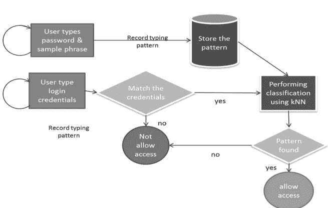

图 5.1：基于数据挖掘的密码身份验证。

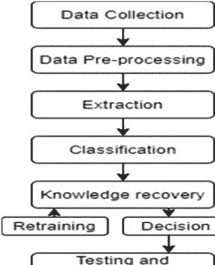

图 5.2：阶段数据抽象。

在讨论研究人员在击键特征方面采用的方法之前，图 5.3 中可见的特征已从输入数据中提取，如下所述。在输入时，计算机可以记录按键按下的时间（持续时间）、按键按下时长以及连续按键之间的惰性（例如，从一个键到下一个键所花费的时间）。按键释放与按下之间估计的时间称为飞行时间。因此，从原始数据中，可以分离出三种计时特征：按下到按下（PP）、释放到释放（RR）和释放到按下（RP）。

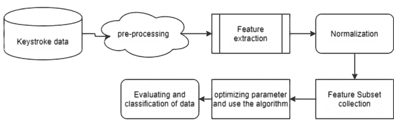

图 5.3：提取后的归一化。

如图 5.3 所示，在输入分类时，我们提出的算法会计算数据库中存储的真实值与登录客户端当前值之间的差异。此处，阈值被用于与时间进行比较。该阈值提高了结果的有效性。该值与登录客户端的当前时间进行比较，如果该值与阈值匹配，则该个人被接受或称为经过验证的客户端。该值将通过检查进行调整。使用此输出，计算 FAR（错误接受率）和 FRR（错误拒绝率）值。

其他计时数据（见图 5.4）代表输入一个单词、双字母组（两个字母）或三字母组（三个字母）所需的时间，同样可以提取。双字母组属于按下到按下分类。双字母组包含两次连续击键，而三字母组包含三次；此过程适用于任意数量的组合，从而形成 n-字母组的按键持续时间和按键延迟。

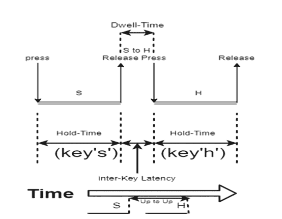

图 5.4：按键按下与释放的时间延迟。

## 5.4 结论

击键特征作为潜在的生物特征框架已取得长足进步。击键动态研究正朝着新方向发展，重点放在触摸设备上。仍需大量工作才能开发出功能完善的生物特征应用，以考虑各种变化并准确预测客户端是否合法。作为廉价的生物特征，它相较于其他传统生物特征具有优势。此外，它作为知识验证（如密码）的附加安全层，使其效果更加显著。在本研究中，我们竭尽所能介绍击键动态，以便初涉此领域的专家能够自行开展有前景的研究。

## 参考文献

- 1. Alshanketi F., Traoré I., and Ahmed A. A. “提升移动击键动态生物特征认证的性能与可用性。” 2016 IEEE 安全与隐私研讨会（SPW），第 66–73 页，2016 年。
- 2. Jaha F., and Karit A. “面向 BYOD 的双因素认证伪代码。” 2017 年电气与信息技术国际会议（ICEIT），第 1–7 页，2017 年。
- 3. Baynath P., Soyjaudah K. M., and Khan M. H. “基于混沌神经网络的击键识别。” 2017 年第 3 届伊朗智能系统与信号处理会议（ICSPS），第 59–63 页，2017 年。
- 4. Ferrari C., Marini D., and Moro M. “具有可变用户模型的自适应打字生物特征系统。” 2018 年第 32 届先进信息网络与应用国际会议研讨会（WAINA），第 564–568 页，2018 年。
- 5. Chatterjee S., Roy S., Das A. K., Chattopadhyay S., Kumar N., and Vasilakos A. V. “面向多服务器环境的基于切比舍夫混沌映射的安全生物特征认证方案。” IEEE 可靠性与安全计算事刊，第 15 卷，第 5 期，第 824–839 页，2016 年。
- 6. Smriti P., Srivastava S., and Singh S. “键盘不变生物特征认证。” 2018 年第 4 届计算智能与通信技术国际会议（CICT），第 1–6 页，2018 年。
- 7. Coakley M. J., Monaco J. V., and Tappert C. C. “智能手机上短数字输入的击键生物特征研究。” 2016 年 IEEE 第 8 届生物特征理论、应用与系统国际会议（BTAS），第 1–6 页，2016 年。
- 8. Ali M. L., Tappert C. C., Qiu M., and Monaco J. V. “击键生物特征系统中使用的认证与识别方法。” 2015 年 IEEE 第 17 届高性能计算与通信国际会议、2015 年 IEEE 第 7 届网络空间安全与安保国际研讨会及 2015 年 IEEE 第 12 届嵌入式软件与系统国际会议，第 1424–1429 页，IEEE，2015 年。
- 9. Habib M., and Alqat awna J. “基于混合静脉-击键方法的免密码认证方案建议。” 2017 年计算科学新趋势国际会议（ICTCS），第 173–178 页，2017 年。
- 10. Haque M. A., Khan N. Z., and Khatoon G. “通过击键进行身份认证：你输入什么以及如何输入。” 2015 年 IEEE 计算智能与通信网络研究国际会议（ICRCICN），第 257–261 页，2015 年。
- 11. Shen S. S., Lin S. H., Kang T. H., and Chien W. “利用压力检测的增强击键动态认证。” 2016 年应用系统创新国际会议（ICASI），第 1–4 页，IEEE，2016 年。
- 12. Can Y. S., and Alagöz F. “使用击键动态进行用户识别。” 2014 年第 22 届信号处理与通信应用会议（SIU），第 1083–1085 页，IEEE，2014 年。


- 13. Baynath P., Soyjaudah K. S., and Khan M. H. M. “基于神经网络的按键识别.” 2017年第5届计算与商业智能国际研讨会 (ISCBI), pp. 86–90, IEEE, 2017年8月.

- 14. Jadhav C., Kulkarni S., Shelar S., Shinde K., and Dharwadkar N. V. “基于按键动态的生物特征认证.” 2017年I-SMAC国际会议（物联网、社交、移动、分析与云计算）(I-SMAC), pp. 870–875, IEEE, 2017.

- 15. Pramana M. I., Suhardi, Kurniawan N. B., and Sembiring J. “使用动态时间整齐的按键动态身份认证.” 2017年第14届计算机科学与软件工程国际联合会议 (JCSSE), pp. 1–5, 2017.

- 16. Huang J., Hou D., Schuckers S., Law T., and Sherwin A. “按键认证算法基准测试.” 2017年IEEE信息取证与安全研讨会 (WIFS), pp. 1–6, IEEE, 2017.

- 17. Dwivedi C., Kalra D., Naidu D., and Aggarwal S. “基于按键动态的生物特征认证：一种混合分类器方法.” 2018年IEEE计算智能研讨会系列 (SSCI), pp. 266–273, IEEE, 2018.

- 18. Ali M. L., and Tappert C. C. “POHMM/SVM：一种用于按键生物特征用户认证的混合方法.” 2018年IEEE实时计算与机器人国际会议 (RCAR), pp. 612–617, 2018.

- 19. Handa J., Singh S., and Saraswat S. “基于鼠标和按键的认证比较研究.” 2019年第9届云计算、数据科学与工程国际会议 (Confluence), pp. 670–674, IEEE, 2019.

- 20. Giri D., Sherratt R. S., and Maitra T. “一种面向消费级USB大容量存储设备的新颖高效跨会话生物特征与密码基于三因子认证协议.” IEEE消费电子学杂志, vol. 62, pp. 283–291, 2016.

- 21. Chandrasekar V. “使用模因算法在按键动态中基于豪斯多夫距离的用户认证.” 纯粹与应用数学国际期刊, vol. 118, no. 14, pp. 117–125, 2018.

- 22. Wu J., and Chen Z. “一种基于按键行为考虑手势变化的隐式身份认证系统.” 分布式传感器网络国际期刊, vol. 11, no. 6, p. 470274, 2015.

- 23. Salem A., and Obadat M. S. “一种基于按键动态的行为认证系统新颖安全方案.” 安全与隐私, vol. 2, no. 2, p. e64, 2019.

- 24. Honggui H., Ying L., and Junfei Q. “废水处理过程在线故障检测的模糊神经网络方法.” 计算机与电气工程, vol. 40, no. 7, pp. 2216–2226, 2014.

- 25. Shen C., Yu T., Xu H., Yang G., and Guan X. “密码安全中的用户行为：现实世界中真实密码的实证研究.” 计算机与安全, vol. 61, pp. 130–141, 2016.

- 26. Nimbhokar, N. M. A. P. S. “关于多模态生物特征连续认证的综述论文.” 计算机工程与技术先进研究国际期刊 (IJARCET), vol. 4, no. 11, 2015.

- 27. Buchoux A., and Clarke N. L. “智能手机上的按键分析部署.” 2008.

- 28. Alsultan A., and Warwick K. “按键动态认证：自由文本方法综述.” 计算机科学问题国际期刊 (IJCSI), vol. 10, no. 4, p. 1, 2013.

- 29. Chourasia N. 银行交易系统中基于按键动态的用户认证. 在工程与技术进步国际会议论文集中, pp. 41–45, 2014.

- 30. Karim N. A., and Shukur Z. “在线考试用户认证方法综述.” 2015.

- 31. Epp C., Lippold M., and Mandryk R. L. “使用按键动态识别情绪状态.” 在人机交互SIGCHI会议论文集中, pp. 715–724, 2011.

- 32. Giot R., El-Abed M., and Rosenberger C. “面向按键动态生物特征系统的基于Web的基准：统计分析.” 在2012年第八届智能信息隐藏与多媒体信号处理国际会议中, pp. 11–15, IEEE, 2012.

- 33. Casey K. “使用按键分析改进通过-失败分类器.” 2017.

- 34. Brajesh Singh S. S., Shah Y., and Singh V. “关于用户认证按键动态的文献综述.” 计算与通信近期与创新趋势国际期刊, vol. 5, no. 5, pp. 280–282, 2017.

- 35. Teh P. S., Teoh A. B. J., and Yue S. “按键动态生物特征综述.” 科学世界杂志, 2013, 2013.

- 36. Shepherd S. J. “通过键盘打字特征分析进行连续认证.” 1995.

- 37. Allen L. K., Mills C., Jacovina M. E., Crossley S., D’mello S., and McNamara D. S. “利用多源信息（文章、作者和按键）调查写作过程中的无聊与投入.” 在第六届学习分析与知识国际会议论文集中, pp. 114–123, 2016.

- 38. Sim T., and Janakiraman R. “二元图对自由文本按键动态是否有效？” 2007年IEEE计算机视觉与模式识别会议, pp. 1–6, 2007.

- 39. Solami E. A., Boyd C., Clark A. J., and Islam A. K. “连续生物特征认证：它能更实用吗？” 2010年IEEE第十二届高性能计算与通信国际会议 (HPCC), pp. 647–652, 2010.

- 40. Behera T. K., and Panigrahi S. “信用卡欺诈检测：一种使用模糊聚类和神经网络的混合方法.” 在2015年第二届计算与通信工程进步国际会议中, pp. 494–499, IEEE, 2015.

- 41. Gai I., Jemili F., and Korbaa O. “基于神经模糊分类的入侵检测.” 在2015年IEEE/ACS第十二届计算机系统与应用国际会议 (AICCSA) 中, pp. 1–8, IEEE, 2015.

- 42. Shrivastava M. “使用按键生物特征的密码认证方法.” 计算机期刊, vol. 3, no. 6, pp. 125–129, 2011.

- 43. Kumar R., and Sharma M. “基于云的社交媒体挖掘方法的高级神经模糊方法.” 计算机应用国际期刊, vol. 975, p. 8887, 2016.

- 44. Stewart J. C., Monaco J. V., Cha S. H., and Tappert C. C. “关于在线考试人员认证的按键和文体特征调查.” 在2011年生物特征国际联合会议 (IJCB) 中, pp. 1–7, IEEE, 2011.

- 45. Campisi P., Maiorana E., Bosco M. L., and Neri A. “蜂窝电话的按键动态用户认证.” IET信号处理, vol. 3, no. 4, pp. 333–341, 2009.

- 46. Jain A. K., Ross A., and Pankanti S. “生物特征：信息安全的工具.” IEEE信息取证与安全期刊, vol. 1, pp. 125–143, 2006.

- 47. Vinayak R., and Arora K. “使用按键动态的用户认证综述.” 科学研究工程与技术国际期刊 (IJSRET), vol. 4, no. 4, pp. 378–384, 2015.

- 48. Yampolskiy R. V., and Govindaraju V. “行为生物特征：综述与分类.” 生物特征国际期刊, vol. 1, no. 1, pp. 81–113, 2008.

- 49. Patil R. A., and Renke A. L. “使用打字节奏进行基于按键动态的用户认证与识别.” 计算机应用国际期刊, vol. 144, no. 9, pp. 27–33, 2016.

- 50. Zhong Y., and Deng Y. “按键动态生物特征方法、进展与评估综述.” 使用按键动态生物特征进行用户认证的近期进展, pp. 1–22, 2015.

- 51. Dahiya M. “基于神经网络的用户认证机制 Menal Dahiya.” 2016.

- 52. Josa A. D., Moreno J. A. M., and Pérez E. S. “使用按键动态和上下文特征评估在线学习环境中的作者身份.”

- 53. Chen W., and Chang W. “将隐马尔可夫模型应用于按键模式分析以进行密码验证.” 在2004年IEEE信息重用与集成国际会议论文集中, 2004. IRI 2004., pp. 467–474, 2004.

- 54. Sadikan S. F. N., Ramli A. A., and Fudzee M. F. M. “面向当前应用的按键动态认证综述论文.” 在AIP会议论文集中, vol. 2173, no. 1, p. 020010, 2019.

- 55. Giot R., El-Abed M., and Rosenberger C. “Greyc按键：面向按键动态生物特征系统的基准.” 在2009年IEEE第三届生物特征：理论、应用与系统国际会议中, pp. 1–6, 2009.


56. Shaker S. H., Saydani R. J., 和 Obaid M. K. “基于主成分分析和神经网络的击键动态身份验证。” 2014.

57. D'lima N., 和 Mittal J. “使用击键生物特征的密码身份验证。” 在 2015 国际通信、信息与计算技术会议（ICCICT）中，第 1–6 页，2015.

58. Pisani P. H., 和 Lorena A. C. “击键动态的系统综述。” 巴西计算机学会杂志，第 19 卷，第 4 期，第 573–587 页，2013.

59. Taher F., 和 Sammouda R. “使用人工神经网络和模糊聚类方法进行肺癌检测。” 在 2011 IEEE GCC 会议和展览（GCC）中，第 295–298 页，IEEE，2011.

60. Lee P. M., Tsui W. H., 和 Hsiao T. C. “情绪对键盘打字的影响：使用听觉刺激的实验研究。” PloS one，第 10 卷，第 6 期，2015.

# 基于大数据的医疗数据分析

E. HARI 和 H. PARVEEN SULTANA

研究学者，VIT，维洛里，泰米尔纳德邦
VIT，维洛里，泰米尔纳德邦

目录

- 6.1 引言 114
- 6.1.1 医疗大数据分析导论 115
- 6.1.2 与医疗数据直接相关的 V 特性 115
- 6.2 用于医疗数据分析的数据源 116
- 6.2.1 医疗大数据分析的总体目标 116
- 6.2.2 医疗数据分析中的挑战 116
- 6.2.3 与 IoT 安全相关的挑战 117
- 6.2.3.1 保护受限设备 117
- 6.2.3.2 授权和认证设备 118
- 6.2.3.3 管理设备更新 118
- 6.2.3.4 安全通信 119
- 6.2.3.5 确保数据隐私和完整性 119
- 6.2.3.6 保护 Web、移动和云应用程序 119
- 6.2.3.7 确保高可用性 119
- 6.2.3.8 检测漏洞和事件 120
- 6.2.3.9 管理漏洞 120
- 6.2.3.10 预测和预防安全问题 121
- 6.3 医疗数据分析的方法 121
- 6.3.1 ICD 代码在生成大型医疗数据中的作用 123
- 6.3.2 分析 ICD 代码和 EHR 数据 123
- 6.3.3 医疗数据的基本分析 126
- 6.3.3.1 生物医学图像分析 127
- 6.3.3.2 传感器数据分析 127
- 6.3.3.3 生物医学信号分析 128
- 6.3.3.4 基因组数据分析 128
- 6.3.3.5 临床文本挖掘 129
- 6.3.3.6 生物医学文献挖掘 129
- 6.3.3.7 社交媒体分析 130
- 6.3.4 医疗高级数据分析 130
- 6.3.4.1 预测建模 132
- 6.4.1 临床文本分析中的挑战 133
- 6.4.1.1 查询加权 133
- 6.4.1.2 词汇差距 134
- 6.4.1.3 伪反馈 134
- 6.4.2 图像数据中的挑战 134
- 6.5 结论 134
- 参考文献 135

## 6.1 引言

医疗行业历史上由于记录保存、合规和监管要求以及患者护理而产生大量数据。大部分数据过去都以硬拷贝形式存储：日志表格、报告和患者详情。目前，趋势正朝着数字化方向发展，我们拥有大量数据，这些数据关注强制性要求，并且通过降低成本有潜力提高医疗数据质量。当产生这种大量数据时，这将涵盖所有医疗和保健功能范围，如疾病监测、临床决策支持和人群健康管理。这种大量数据将形成所谓的“大数据”。

医疗保健中大数据概念的普及不仅因为其数据量，还因为数据类型多样以及必须管理的速度。一般来说，医疗保健中的大数据包括临床数据、电子病历（EPRs）中的患者数据、机器生成的数据和传感器数据。医疗保健组织及医疗保健交付系统中的其他利益相关者可能会制定更加谨慎和富有洞察力的诊断和治疗方案，从而以较低成本提供更高质量的护理，并取得更好的总体结果。

### 6.1.1 医疗大数据分析导论

未来几年，医疗数据量预计将动态增长。此外，医疗补偿模式正在发生剧烈变化。虽然利润不是医疗组织的首要因素，但获取可用的工具、基础设施和技术以有效利用大数据至关重要，否则可能会损失数百万美元的收入和利润。

大数据“包括大量高速和易变的数据，需要先进的技术和方法来实现信息的捕获、存储、分发、管理和分析”[3,19]。医疗数据将满足所有这些特性，因此我们使用大数据技术。

### 6.1.2 与医疗数据直接相关的 V 特性

与大数据相关的数据分析由以下特性描述：

- 卷（Volume）
- 速度（Velocity）和
- 多样性（Variety）

此外，与健康相关的数据将不断生成和积累，从而产生难以置信的数据量。现有的医疗数据量已经包括个人病历、放射影像、提交给美国食品药品监督管理局（FDA）[3]的临床试验数据、人类遗传学和人群基因组序列数据等，此外，3D成像、基因组学和生物特征传感器读数等新型大数据也在推动医疗数据分析的指数级增长。医疗数据日益复杂或丰富的原因是，标准医疗实践[4]正在从相对即兴和主观的决策转向循证医疗，并更加激励专业人士/医院使用电子健康记录（EHR）技术。

## 6.2 用于医疗数据分析的数据源

捕获设备、传感器和移动应用程序等新技术的发展也将贡献海量数据。同时，基因组信息的采集成本也在降低，数字形式的患者社交沟通在增加，更多医学知识/发现也在积累。

### 6.2.1 医疗大数据分析的总体目标

- 利用海量数据，在正确的时间为正确的患者提供正确的干预措施 [6]。
- 在每个实例为患者提供个性化护理。
- 可能使医疗系统的所有组成部分受益，包括提供者、付款人、患者和管理层。
- 向医疗分析师和从业者介绍计算领域的进步，以有效处理和从海量且异构的医疗保健数据中进行推断。

### 6.2.2 医疗数据分析中的挑战

分析医疗数据[1]所面临的挑战列表如下：

- 从复杂异构的患者来源中推断知识，并利用纵向记录中的患者/数据相关性。
- 在正确的上下文中理解非结构化临床笔记。
- 高效处理大量医学影像数据，并提取潜在有用的信息和生物标志物。
- 分析基因组数据是一项计算密集型任务，将其与标准临床数据相结合会增加复杂性层次。
- 通过多个传感器捕获患者的行为数据：他们的各种社交互动和通信。
- 一些在线患者/护理人员支持系统，如 CancerCompass 和 PatientsLikeMe，允许患者和人道主义者发布健康相关问题。在这种情况下，存在大量重复性问题。这种重复的可能原因之一是，随着论坛变得冗长，患者和人道主义者在发布自己的问题之前没有足够的时间或耐心阅读所有先前的问题。由此产生的主要挑战是设计和实施一个系统，通过识别最多两个或三个与之最相似的现有问题来提供问题。

通过参照医疗数据观察所有这些挑战，我们将得出结论：分析并提供最合适的信息非常重要。

### 6.2.3 与 IoT 安全相关的挑战

以下是 IoT 安全的十大挑战：

- 保护受限设备
- 授权和认证设备
- 管理设备更新
- 安全通信
- 确保数据隐私和完整性
- 保护 Web、移动和云应用程序
- 确保高可用性
- 检测漏洞和事件
- 管理漏洞
- 预测和预防安全问题

#### 6.2.3.1 保护受限设备

许多 IoT 设备的存储、内存和处理能力有限，并且通常需要以较低功耗运行，例如在电池供电时。严重依赖加密的安全方法不适合这些受限设备，因为它们无法快速执行复杂的加密和解密以实现安全的实时数据传输。这些设备经常容易受到旁路攻击，例如功耗分析攻击，可用于逆向工程这些算法。相反，受限设备通常仅使用快速、轻量级加密算法。物联网（IoT）系统应利用


多层防御，例如，将设备隔离到独立网络并使用防火墙，以弥补这些设备的局限性。

#### 6.2.3.2 授权和验证设备

在物联网系统中，如此众多的设备都可能成为潜在的故障点，因此设备身份验证和授权对于保护物联网系统至关重要。设备必须先建立其身份，然后才能访问网关和上游服务及应用。然而，许多物联网设备在设备身份验证方面存在不足，例如，使用脆弱的基本密码身份验证，或使用未更改的默认密码。

采用默认提供安全性的物联网平台有助于解决这些问题，例如，启用双因素身份验证（2FA）并强制使用强密码或证书。物联网平台还提供设备授权服务，用于确定每个设备在整个系统中可以访问哪些服务、应用或资源。

#### 6.2.3.3 管理设备更新

将更新（包括安全补丁）应用于运行在物联网设备和网关上的固件或软件面临诸多挑战。例如，你需要跟踪可用的更新，以便在分布式环境中与通过多种不同网络协议通信的异构设备保持一致地应用更新。并非所有设备都支持空中下载更新或无需停机的更新，因此设备可能需要物理访问，或暂时从生产环境中移除以应用更新。

此外，并非所有设备都能获得更新，尤其是旧设备或不再由制造商支持的设备。即使有更新可用，设备所有者也可能选择不应用更新。作为设备管理的一部分，你需要跟踪每个设备上部署的版本，以及哪些设备在更新不再可用后是退役的候选对象。设备管理器系统通常支持自动向设备推送更新，以及在更新过程失败时管理回滚。它们还可以帮助确保只应用合法的更新，例如，通过使用数字签名。

#### 6.2.3.4 保护通信

一旦设备本身得到保护，下一个物联网安全挑战就是确保设备与云服务或应用之间跨网络的通信是安全的。许多物联网设备在通过网络发送消息之前不进行加密。但是，最佳实践是使用传输加密并采用诸如传输层安全（TLS）之类的标准。使用独立网络来隔离设备也有助于建立安全、私密的通信，从而确保传输的数据保持机密。

#### 6.2.3.5 确保数据隐私和完整性

同样重要的是，无论数据在跨网络传输后最终存储在何处，都需要安全地存储和处理。实现数据隐私包括在存储前编辑或匿名化敏感数据，或使用数据分离将个人身份信息与物联网数据载荷解耦。不再需要的数据应安全销毁，如果存储了数据，保持符合法律和监管框架也是一项重要挑战。确保数据完整性可能涉及使用校验和或数字签名，以确保数据未被修改。区块链作为物联网数据的去中心化分布式账本，为确保物联网数据的完整性提供了一种可扩展且具有韧性的方法。

#### 6.2.3.6 保护 Web、移动和云应用

Web、移动和云应用及服务用于管理、访问和处理物联网设备和数据，因此作为物联网安全多层方法的一部分，它们也必须得到保护。

开发物联网应用时，请务必应用安全工程实践，以避免诸如 OWASP 十大漏洞之类的漏洞。就像设备一样，应用程序也应支持安全身份验证，无论是针对应用程序本身还是应用程序的用户，方法是提供诸如 2FA 和安全密码恢复选项等功能。

#### 6.2.3.7 确保高可用性

随着我们在日常生活中越来越依赖物联网，物联网开发者必须考虑物联网数据及其依赖的 Web 和移动应用的可用性，以及我们对物联网系统所管理的实体事物的访问。由于连接中断或设备故障，或由于拒绝服务等攻击而导致的中断潜力，远不止是不便之事。

在某些应用中，缺乏可用性的影响可能意味着收入损失、设备损坏，甚至生命损失。例如，在联网城市中，物联网基础设施负责交通控制等基本服务；在医疗保健领域，物联网设备包括起搏器和胰岛素泵。为确保高可用性，物联网设备必须受到网络攻击和物理篡改的双重保护。物联网系统必须包含冗余以消除单点故障，并且还应设计为具有韧性和容错能力，以便在出现问题时能够快速适应和恢复。

#### 6.2.3.8 检测漏洞和事件

尽管竭尽全力，安全漏洞和入侵事件仍是不可避免的。你如何知道你的物联网系统是否已被攻破？在大规模物联网系统中，就连接设备数量以及涉及的设备、应用、服务和通信协议种类而言，系统的复杂性可能使得难以识别事件发生时间。检测漏洞和入侵事件的策略包括监控网络通信和活动日志以发现异常，进行渗透测试和道德黑客攻击以暴露漏洞，以及应用安全情报和分析来在事件发生时识别并发出通知。

#### 6.2.3.9 管理漏洞

物联网系统的复杂性也使得评估漏洞的后果或入侵事件的范围变得具有挑战性，以便管理其影响。挑战包括识别受影响的设备、访问或受到攻破的数据或服务，以及受影响的用户，然后采取行动解决情况。设备管理器维护设备注册表，可用于暂时禁用或隔离受影响的设备，直到可以修补它们。此功能对于网关设备等关键设备尤其重要，以限制其造成危害或中断的潜力，例如，如果已被攻破，通过向系统发送虚假数据来淹没系统。可以使用基于漏洞管理策略的规则引擎自动应用操作。

#### 6.2.3.10 预测和预防安全问题

一项更长期的物联网安全挑战是应用安全情报，不仅用于检测和缓解发生的问题，还用于预测并主动防范潜在的安全威胁。威胁建模是用于预测安全问题的一种方法。其他方法包括应用监控和分析工具来关联事件并实时可视化正在展开的威胁，以及应用人工智能（AI）根据先前操作的有效性自适应地调整所应用的安全策略。

## 6.3 使用医疗保健数据分析的方法

进行任何类型的分析都将从数据收集开始。医疗保健系统中的数据收集过程可能会带来许多问题。特别是，在一段时间内有效集成各种医疗保健数据并采用有效形式，可以回答许多迫在眉睫的医疗保健问题。

一般数据收集和分析可以图示表示，如图 6.1 所示。在此，管理员将维护所有类型的数据，并且只能从源访问这些数据。EHR [2,20] 数据库将充当我们的大数据平台。

EHR 数据是数据分析的核心部分。这还将成为维护有关医疗保健信息的最佳数据源，如图 6.2 所示。所有 EHR 均按时维护，以基于统计模型生成分析信息；这些信息也可用于对现有医疗保健数据进行研究。

在临床术语中，EHR 数据可分为两种方式，即，

- 结构化 EHR 数据
- 非结构化 EHR 数据

结构化 EHR 数据将使用记录患者信息的数据元素，这些元素采用受控词汇表


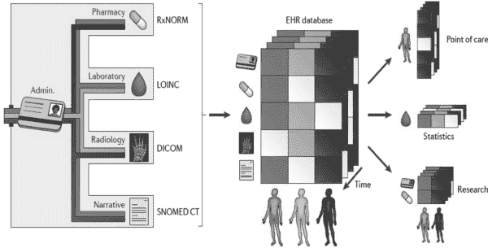

图 6.1 医疗数据收集与分析过程。

而非文本的叙述过程。当今医疗行业结构化数据和标准化的历史性不足，导致在提供者之间共享内容时出现问题。

医疗中的非结构化数据是一种通常需要人工介入才能正确读取、捕获和解释的信息。这种捕获包括非结构化纸质表格上的机器打印和手写信息、音频语音口述、电子邮件消息和附件以及输入的交易。

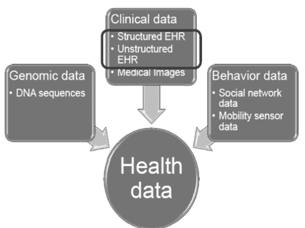

图 6.2 医疗系统中 EHR 的数据表示。

使用电子文档管理系统（EDMS）的技术组件，将医疗中的任何类型的非结构化数据带入 EHR 流，包括：

- 分类和数据捕获系统的自动化表单
- 用于版本控制、检入/检出和安全性的文档管理系统
- 维护用于在线数据输入和数据收集的电子表单
- 使用记录管理技术获取对记录的受控访问，并根据州法规保留或销毁记录

除了结构化和非结构化 EHR 之外，ICD（国际疾病分类）代码也将产生大量数据。

### 6.3.1 ICD 代码在生成大型医疗数据中的作用

ICD 是由世界卫生组织（WHO）维护的疾病、体征、症状和操作代码的分层术语。在美国，大多数人使用 ICD-9，而世界其他地区使用 ICD-10。此外，EMR 的兴起导致观察性研究的传播，这些研究有助于以巨大数量检查术前期；这也是产生大数据的主要原因之一。Thomas 等人 [4] 的工作未能使毒血症代码无效，因为作者没有调查编码的准确性，而是随时间考察了它们的使用情况。因此，不清楚是什么导致了他们发现的差异，可能是脓毒症编码随时间变得更加准确。

### 6.3.2 分析 ICD 代码和 EHR 数据

一般来说，Big Data 一词不受 MeSH（医学主题词）约束——它通过 MeSH 中的“自动数据处理”、“电子数据处理”、“数据挖掘”和“EHR”得以体现。然而，对此类数据进行一些分析非常重要。表 6.1 介绍了与医疗相关的术语以及如何从大数据中查询结果。

表 6.1 医疗数据分析统计模型中常用术语

| 类别 | 查询术语 | 类别 | 查询术语 |
| :--- | :--- | :--- | :--- |
| EHR | 电子健康记录 | 隐私与安全 | 访问控制* |
| | 电子病历* | | 保密性 |
| | 个人健康记录 | | 同意 |
| | | | 患者数据隐私 |
| | | | 数据共享 |
| | | | 隐私 |
| | | | 隐私机制* |
| | | | 计算机安全 |
| 数据分析 | 人工智能 | 自然语言处理 (NLP) | 受控词汇 |
| | 大数据* | | 去标识化* |
| | 云计算* | | 信息提取 |
| | 数据挖掘 | | 信息存储与检索 |
| | 数据解释 | | 知识表示 |
| | 计算机仿真 | | 自然语言处理 |
| | 预测模型* | | 文本挖掘 |
| | 统计模型 | | |
| | 可视化 | | |
| 健康信息技术 | 临床决策支持系统 | 转化信息学 | 监测 |
| | 监测* | | 药物警戒 |
| | 质量改进 | | 表型分析* |
| | 社交媒体 | | |

一般来说，预测模型是医疗数据分析中广泛使用的热门术语，适用于“数据可视化”。数据可视化对于解释研究结果至关重要，该技术有助于临床医生接受新方法。可视化监测也是一个广泛的概念，还包括药物监测、患者监测等。“访问控制”也是患者数据隐私研究中的新热门话题之一。从表 6.1 中，我们必须特别提到一种称为自然语言处理（NLP）的技术，这是生物医学信息学中采用的核心技术之一。NLP 可用于分析包含非结构化格式出院摘要的大量数据。因此，使用 NLP 等技术可以提取并结构化这些描述性信息。此过程可被视为许多 EHR 数据二次使用研究中的重要步骤。通过增加可计算数据的量，NLP 还可以帮助解决数据不完整的某些方面。

NLP 从琐碎数据源中提取信息开始，即从 EHR 数据中提取 ADE。信息提取（IE）是一个传统领域，NLP 用于从叙述文本（如出院摘要和处方）中识别和分类命名实体及关系。识别关系（关系识别）是 IE 中最有前景的领域，尽管我们面临许多障碍。在 IE 和 RI 中，我们关注：

- 共指识别和
- 时序关系提取

共指消解的作用是识别句子内或跨句子中指代同一实体的两个提及。目前的共指消解研究使用基于规则的机器学习和混合系统来识别名词短语，包括人称、代名词以及医学检验等概念。在此方法中，数据质量将决定系统的性能。

时序关系提取也是信息提取过程中的一种方法；它关注研究方向，因为它用于识别并发症、患者预后预测和 ADE 检测。以前，时序关系也用于急诊科（ED）计算机断层扫描（CT）影像报告的摘要。除了 NLP 之外，我们还在 EHR 数据中使用数据应用和集成机制，以在现实环境中利用并回顾性评估治疗效果、护理质量和成本。临床决策支持系统（CDSS）有助于在医疗大数据上进行多任务处理以快速决策。

图 6.3 显示了在标准平台上分析大数据的概念模型。

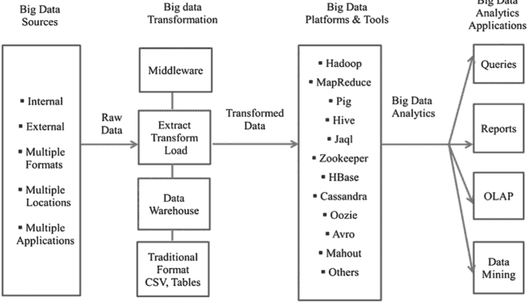

图 6.3 大数据分析的应用概念模型。

同样的方法可以应用于医疗数据，将其分为以下两类：基础分析和高级分析。之前架构中使用的不同平台将有助于将医疗数据迁移到通用结构化格式中以便快速理解。现在我们将从基础分析部分开始，着手处理医疗数据的实际分析部分。

### 6.3.3 医疗数据基础分析

似乎医疗成本一直在持续上升，与此同时，一些国家提供给患者的护理质量并未出现显著改善。在本节中，我们将尝试通过使用可用资源进行一些基础分析，来关注医疗数据的质量改进。一般而言，患者数据的不同形式可以存储在 EHR 和生物医学图像中，即我们之前讨论过的内容。此处基础分析包括挖掘各种传感器数据的技术以及生物医学信号分析。在本部分中，我们将简要介绍院内临床数据、生物医学文献以及通过社交媒体捕获的行为数据。分析列表如下：

- 生物医学图像分析
- 传感器数据分析
- 生物医学信号分析


- 基因组数据分析
- 临床文本挖掘
- 生物医学文献挖掘
- 社交媒体分析

#### 6.3.3.1 生物医学图像分析

当今的医学影像 [9] 在现代医疗保健中发挥着至关重要的作用，因为其能够提供人体解剖结构的高质量图像。如果我们对这类图像进行有效分析，结果将对临床医生和医学研究人员有用，因为它可以证明疾病监测、治疗规划和预后。我们在磁共振成像 (MRI)、超声 (U/S)、计算机断层扫描 (CT) 和正电子发射断层扫描 (PET) 中使用这些生物医学图像。生物医学图像提供了一种无需造成伤害即可查看和观察人体器官的设施；这对人类健康有着巨大的影响。通过使用这些技术，医生能够在不伤害或切割人体的情况下，更好地了解疾病或其他异常状况。分析生物医学图像的最终目标是生成定量信息，并从样本图像中进行推断，这些推断可以提供关于医学状况的更多洞察。

现在我们来看看生物医学图像分析中面临的挑战；我们使用的图像有时形状多样、复杂且不规则，并包含一些噪声值。生物医学图像处理的部分包括目标检测、图像分割、特征提取和图像配准。

#### 6.3.3.2 传感器数据分析

医疗领域的传感器将被视为普遍存在的技术，用于数据的实时和回顾性分析。脑电图 (EEG)、心电图 (ECG) 等各种形式的医疗数据采集措施本质上都是传感器，它们正在从人体不同部位采集信号。所有收集的数据仪器都经常用于回顾性分析和实时分析。实时分析的最佳示例是观察和分析重症监护室 (ICU) 数据，以及对特定医疗状况的患者进行实时远程监测。在所有这些情况下，数据量将不断增加以形成大数据。以 ICU 为例，传感器从各种数据源接收实时触发警报的数据是很常见的。因此，分析健康系统中的传感器成为一种极其重要的数据模型。这种分析方法不仅适用于患者的生理信号，还有助于为重症监护室床边提供情境帮助。

#### 6.3.3.3 生物医学信号分析

从生物源测量信号的过程称为生物信号分析；该过程的起源在于各种生理过程。此类信号的一些最佳示例包括电神经图 (ENG)、心电图 (ECG)、肌电图 (EMG)、脑电图 (EEG)、心音图 (PCG) 等等。生物医学信号分析结果将帮助我们在决定合适的护理路径时诊断病理和非预期状况。生物医学信号可以是单次的或连续的，具体取决于病理状况的严重程度。与生物医学信号相关的问题是它们具有低信噪比 (SNR)，并且生理系统之间存在相互依赖性。这一问题的出现是因为医疗仪器可能存在噪声，并且还需要预处理。

为了克服数据预处理和滤波技术中的所有问题，我们可以应用主成分分析 (PCA)、小波变换和奇异值分解 (SVD) 等降维技术。除所有这些技术外，我们还在信号数据上使用时间序列分析，以可视化行为随时间变化的情况。

#### 6.3.3.4 基因组数据分析

大量疾病具有遗传性，例如导致个体易患糖尿病 [15] 的遗传标记，但这些尚不清楚。另一个例子是由 Stargardt 病引起的失明，这也是遗传性的。这里我们将尝试理解遗传标记、突变和疾病状况之间的关系，这对支持开发不同的基因疗法来治疗这些状况具有巨大潜力。将遗传发现转化为个体化医疗实践的过程是一项高度非平凡的任务，面临着许多未解决的挑战。

最近的改进使生物技术能够生成大量数据和医疗信息。因此，专注于此类数据将产生显著结果，以改善基因组数据。

#### 6.3.3.5 临床文本挖掘

临床文本挖掘是从医院生成的关于患者的临床笔记中提取有用信息的过程。这些类型的笔记始终以非结构化数据格式存在，并且是大部分医疗数据的支柱。一些示例包括口述转录、提供者直接输入或使用移动应用程序进行语音识别——所有此类数据都属于未开发信息的范畴。分析这种自由文本的唯一来源是手动编码方法，因为这是一个昂贵且耗时的过程。由于其复杂性、非结构化特性和异质性，这也变得困难。

为了克服所有问题并改进分析方法，我们将流程转向一种称为 NLP 的高级语言处理机制，如前所述。

#### 6.3.3.6 生物医学文献挖掘

文献数据在医疗保健领域具有其自身的重要性。随着技术的快速发展，我们用于收集生物医学文献的应用也在增加。这些应用将作为医疗保健领域大数据的证据。挖掘这些文献数据将产生关于数字化可用资源的预防、可访问性和可用性，这些资源在生物医学应用中很重要。

传统的数据挖掘技术和工具为生物医学数据提供了新的知识发现方法，用于提取、分析、合并和总结文本数据。关于生物医学文本挖掘中的挑战性问题，由于该领域数据的多学科性质，我们在数据方面存在一些问题。文献挖掘方法通过将文本证据与生物医学路径相关联，为生物医学研究带来了一些其他好处。这种关联将降低专家知识验证的成本并生成不同的假设。

#### 6.3.3.7 社交媒体分析

社交媒体也可以在医疗保健行业广泛使用，以从普通公众那里获取意见和常见问题，以预测或诊断疾病。在此过程中，在线社区提供了关于医疗保健各个方面的大量信息。社交媒体数据可以被挖掘，基本上用于模式识别和知识，这些知识对人群健康和普通公共卫生监测系统做出有用的推断。似乎社交媒体帖子和消息中关于疾病的大部分个人信息包含的信息价值很小，但当我们汇总所有个人帖子和消息时，它形成了大量数据。提取和分析此类数据将始终为关于疾病的结果和预测建议提供最有希望的结果。

### 6.3.4 医疗保健高级数据分析

要进行一些高级数据分析，最好使用标准平台来处理数据并可视化大规模内容。这里我们将尝试设计一个标准平台，用于生物医学数据的预处理和分析。

数据分析流程（参见图 6.4）将从任何流中的信息提取开始。在医疗保健数据分析领域，信息提取是从所有数据收集媒介（如电子健康记录 (EHR) 和不同传感器）开始的。收集数据后，下一步是从可用数据中开始提取所有有用特征，以进行有意义的分析。生成此类分析后，最终阶段是提出预测模型以预测未来并识别疾病的根本原因。

信息提取阶段将涉及 EHR 中的所有类型的数据，即结构化和非结构化数据。借助从大量不同类型数据中获得的电子数据，可以提取有用特征。将这些特征作为参考，从中选择所需特征，为所有患者维护独立记录。随后，为生物医学数据设计预测模型。这可以借助图表进行详细解释，如下所示。


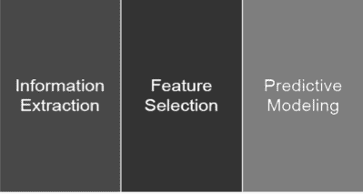

图 6.4 大数据分析通用模型。

图 6.5 描绘了使用分类、回归和患者相似性分析医疗数据的过程。这些预测技术对海量数据进行建模，并有助于从资源中提取有用信息。让我们考虑一种简单的文本挖掘方法来分析数据，并将其应用于前面的架构。

**示例：** 在临床文本挖掘中，信息提取过程用于从文献中识别命名实体。现在，特征选择将提供关于疾病和症状的信息检索。最后，预测模型生成治疗方案。

现在观察临床文本与生物医学文本之间的区别。生物医学文本是书面的医学文献，而临床文本是临床医生在临床环境中撰写的。这种区别仅体现在“信息提取”阶段；其余程序对各种医疗数据来说都是常规的。

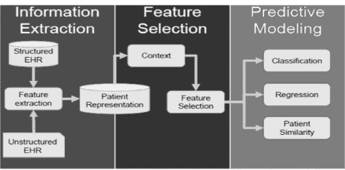

图 6.5 大数据的数据分析流程。

#### 6.3.4.1 预测建模

我们在医疗数据分析中使用三种基本预测模型 [11]：

- 回归
- 分类
- 患者相似性

回归和分类是分析数据的基本数学模型，而患者相似性是一种为特定临床环境寻找自定义距离度量的技术。让我们考虑一个案例研究来描述“患者相似性”的工作流程。

### 案例研究：心力衰竭发作预测

让我们考虑带有患者列表及其疾病信息的 EHR 数据库 [7]。从这个数据集中，尝试在医生或医疗从业者的监督下找到不同患者之间的相似性，如图 6.6 所示。

一般来说，患者相似性（如图 6.7 所示）为特定临床环境确定自定义距离度量。

在借助“cTAKES：临床文本分析与知识提取系统”分析和总结 EHR 数据集后，生成的信息以相似性组的形式呈现，如图 6.8 所示。

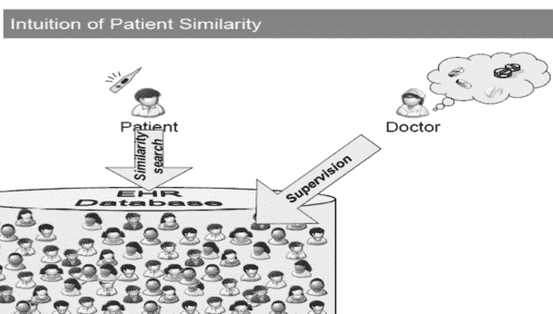

图 6.6 EHR 中带有患者信息的示例数据集。

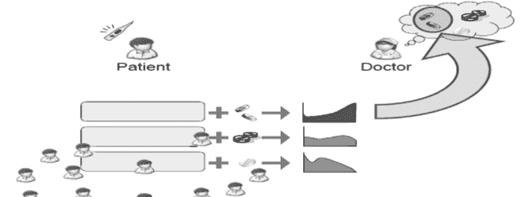

图 6.7 患者相似性直觉（基于“i2b2 生物学与床旁整合信息学”数据集）。

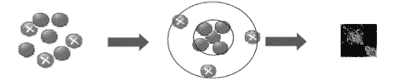

图 6.8 患者相似性组。

高级医疗数据分析也可以借助以下方法进行：

- 临床预测模型
- 时序数据挖掘 [8]
- 可视分析
- 临床基因组数据集成
- 信息检索
- 隐私保护的数据发布

对于每种技术，数据分析中都有相应的方法论，这有助于改进结果。现在我们将转向医疗保健或生物医学健康数据中数据分析面临的挑战。

### 6.4.1 临床文本分析中的挑战

#### 6.4.1.1 查询加权

与查询加权相关的问题是 [7] 查询太长，并非所有单词都有用，IDF 不能反映重要性，语义将决定权重。

#### 6.4.1.2 词汇差距

在匹配“X Rays”、“X-Ray”和“X-Rays”等单词变体以及匹配“CT”或“X rays”等同义词时存在问题。除了这些问题，我们在知识差距方面还面临另一个问题。

#### 6.4.1.3 伪反馈

为了克服上述词汇差距问题，我们使用伪相关反馈技术。这里的问题是“如果前 N 个中只有很少相关怎么办”，我们也不知道“应该选择哪些关键词”。

### 6.4.2 图像数据中的挑战

- 提取信息特征。
- 选择相关特征，例如稀疏方法和降维技术。
- 将图像数据与其他数据变量集成。示例包括：
  - 基于向量的集成中的早期融合。
  - 多核学习中的中级融合。
  - 单模态结果集成中的晚期融合。

## 6.5 结论

随着医疗数据的巨大增长，数据分析和大数据 [12,13] 概念在生物医学领域发挥着重要作用。为了在生物医学文本和 EHR 数据上产生更准确的结果，我们需要对其进行预处理，并进行一些分析以实现更好的治疗，在某些情况下还可以预测疾病的严重程度。在医疗保健领域，数据分析可以分为两种类型。文本挖掘和生物医学图像分析属于高级数据分析，它在样本数据上提供一些预测模型。回归和分类等基本数据分析技术将产生多种疾病之间的共性，并帮助诊断病因。最后，我们得出结论：借助数据分析，可以在预测和诊断不同疾病方面取得良好效果，成本更低、时间更短。

## 参考文献

1. Jane Taggart, Siaw-Teng Liaw, 和 Hairong Yu，用于改善 EHR 数据质量的结构化数据质量报告，《医学信息学国际期刊》，2015 年。
2. Kasper Jensen, Knut Augustad, Rolv-Ole Lindsetmo, 和 Stein Skrøvseth，从非结构化 EHR 文本到数据驱动的临床决策支持，《整合护理国际期刊》，2015 年。
3. Alfredo Cuzzocrea, Carlo Mastronianni, 和 Giorgio Grasso，云上的私有数据库：模型、问题和研究视角，2016 年 IEEE 大数据国际会议（Big Data），2016 年。
4. B. S. Thomas, S. R. Jafarzadeh, D. K. Warren, S. McCormick, V. J. Fraser, 和 J. Marshall，系统性炎症反应综合征、脓毒症和脓毒症医疗编码的时间趋势。http://www.biomedcentral.com/1471-2253/15/169 [PMC 免费文章] [PubMed]。
5. Nils Gruschka, Vasileios Mavroeidis, Kamer Vishi, 和 Meiko Jensen，大数据中的隐私问题与数据保护：在 GDPR 下的案例研究分析，2018 年 IEEE 大数据国际会议（Big Data），2018 年。
6. 医疗保健数据分析，Chandan K. Reddy 编著，韦恩州立大学，底特律，密歇根州，美国。Charu C. Aggarwal，IBM 托马斯·J·沃森研究中心，约克镇高地，纽约，美国。
7. Simon Thompson，用于创建新联合数据集的分布式 NLP 框架，《人口数据科学国际期刊》，2018 年。
8. Charu C. Aggarwal 和 Philip S. Yu。隐私保护数据挖掘：模型和算法。Springer。2008 年。
9. Fernando Martin-Sanchez, Guillermo Lopez-Campos, 和 Kathleen Gray，用于个性化医疗和参与式健康的生物医学信息学方法，《生物医学信息学方法》，2014 年。
10. W. Raghupathi，医疗保健中的数据挖掘。载于《医疗保健信息学：提高效率和生产力》。S. Kudyba 编，Taylor & Francis；2010 年：211–223 页。
11. A. Dembosky，“更好的医疗数据处方。”《金融时报》，2012 年 12 月 12 日，第 19 页；2012 年。可从以下网址获取：http://www.ft.com/intl/cms/s/2/55cbca5a-4333-11e2-aa8f-00144feabdc0.html#axzz2W9cuwajK。
12. IHTT。通过大数据战略转型医疗保健：在医疗保健行业利用大数据的策略；2013 年。http://ihealthtran.com/wordpress/2013/03/iht%C2%B2-releases-big-data-research-reportdownload-today/。
13. 医疗保健数据分析挑战赛 Zhiguo Yu, Byron C. Wallace, 和 Todd R. Johnson，2015 年医疗保健信息学国际会议。
14. Emam M. Shahin, Taha E. Taha, W. Al-Nuaimy, S. El Rabaie, 和 Osama，模糊数字眼底图像中糖尿病视网膜病变的自动检测，IEEE 会议，2012 年。


- 15. Komal Agicha, Priyanka Bhatia, Neha Badlani, Ashutosh Menghrajani, and Abha Tewari, 对年轻和老年患者糖尿病预测分析的调查, IJARCSSE研究论文, 5, 10, 2015年10月.

- 16. Wullianallur Raghupathi 和 Viju Raghupathi, 医疗保健中的大数据分析：前景与潜力, 健康信息科学与系统 2014, 2:3, 可用: http://www.hissjournal.com/content/2/1/3.

- 17. 使用SEMOSS进行医疗保健分析与可视化 Claire Baker, Jeannie Blackwood, Casey Hartless, Jeanne Piro, 和 Abigail A. Flower 弗吉尼亚大学, cjb4pf, jmb3qr, cah8ax, jdp6nc, aaf4q@virginia.edu, 978-1-5386-1848-6/17/ $31.00 ©2017 IEEE.

- 18. IOM (医学研究院). (2009). 健康素养、电子健康与沟通：把消费者放在第一位：研讨会摘要. 华盛顿特区: 国家科学院出版社. 从 https://www.nap.edu/read/12474/chapter/2 检索.

- 19. P., Lockard (2016). 2016年值得关注的5大医疗保健营销趋势. 2017年3月29日检索, 来自 https://www.dmn3.com/dmn3-blog/5-healthcare-marketing-trends-you-should-know-about.

- 20. D., Gotz 和 D., Borland (2016年5月-6月). 数据驱动的医疗保健：交互式可视化的挑战与机遇. IEEE计算机图形与应用. 36(3), 90–96. doi:10.1109/MCG.2016.59.

# 蓝牙：异构网络中管理安全服务的现状、分类法与开放问题

J. 因杜马蒂 和 J. 吉坦贾利

安娜大学信息科学与技术系教授，印度钦奈，泰米尔纳德邦 VIT信息技术与工程学院高级助理教授，印度维洛尔，泰米尔纳德邦

## 目录

- 7.1 引言 138
- 7.1.1 动机 138
- 7.2 研究依据 140
- 7.2.1 蓝牙的有效性 140
- 7.2.2 蓝牙范围扩展方法 141
- 7.2.3 安全系统是零散的 142
- 7.3 文献综述 143
- 7.3.1 挑战/问题 144
- 7.3.2 研究工作与差距 146
- 7.4 蓝牙技术概述 147
- 7.5 蓝牙安全架构 150
- 7.5.1 蓝牙安全功能 150
- 7.5.2 安全服务 151
- 7.5.3 蓝牙安全模式 152
- 7.5.4 蓝牙服务级别 153
- 7.5.5 蓝牙BR/EDR的安全功能 155
- 7.5.5.1 BR/EDR安全简单配对 155
- 7.5.5.2 安全连接模式 156
- 7.5.5.3 LE安全 157
- 7.6 蓝牙中的威胁 160
- 7.7 蓝牙攻击分类 160
- 7.7.1 基于威胁的攻击分类 160
- 7.7.2 基于攻击严重程度的攻击分类 161
- 7.7.3 基于影响的攻击分类 162
- 7.8 蓝牙漏洞 171
- 7.9 蓝牙风险缓解 172
- 7.10 对策 174
- 7.11 结论 176
- 7.12 未来工作 177
- 参考文献 179

## 7.1 引言

数字革命为现代人类社会留下了许多关键且前所未有的进步；这导致了智能设备的激增，由于微型化、芯片设计、传感器和执行器的进步，技术使用成本非常低。

根据欧洲委员会的估计，到2020年将有500亿至1000亿个互联系统，这将导致高质量城市流动性增加，并改进对更好环境和生活条件的整合，同时利用新通信技术对资源进行出色的整合和管理。

这些设备需要先进技术进行彼此通信，例如无线通信。

通过机器对机器(M2M)通信协议，可以实现智慧城市中高级应用和服务的部署。

像蓝牙低能耗(BLE)或近场通信(NFC)这样的无线技术已经得到很大发展和成熟。

### 7.1.1 动机

蓝牙5的最新版本不仅带有许多创新功能，使其能够适应云计算、人工智能、机器人和物联网(IoT)等颠覆性技术巨头，还引发了一大堆安全顾虑。

蓝牙SIG于2020年1月6日发布了蓝牙核心规范版本5.2。

版本5.2规范新增了增强属性协议(EATT)、LE音频、LE同步信道和LE功率控制等功能。

EATT是属性协议(ATT)的改进版本。

LE音频耗电量更低（在蓝牙低能耗无线电上运行），使用新的LC3编解码器，允许协议传输声音，并增加了一组耳机连接多个音频源或多个耳机连接一个音频源等功能 [Clover, July 2020]。

BLE音频还将增加对助听器的支持 [Android Open Source Project 2020]。

其他值得一提的显著新功能还包括高达2 Mbps的数据传输速率、高达400米的通信距离以及连接带宽提高800%。

数据传输带宽的增加和链路连接距离的增加意味着攻击者可以从比以往更远的距离访问蓝牙连接。

数据传输速度很快（2 Mbps），这意味着攻击者在任何人意识到之前就能获取所需数据。

- 本章的贡献包括
  - 对蓝牙通信中主要安全威胁进行全面检测和分类，以便采取预防措施。
  - 提出蓝牙技术的概要，重点介绍其安全性、漏洞、威胁和风险缓解方案。
  - 快速回顾蓝牙安全漏洞。
  - 建议缓解攻击的技术。
  - 建议保护蓝牙通信的措施。
  - 对蓝牙安全研究现状和未来方向的鸟瞰。

第1部分涉及技术和本章的动机。本章其余部分组织如下。第2部分描述了蓝牙技术的优势、其在各种应用中的使用以及当前蓝牙漏洞利用的实际示例。第3部分概述了文献综述及其问题。第4部分解释了蓝牙技术的优势及概述（核心规范、连接类型、类别、蓝牙协议栈、安全模式、蓝牙安全架构和配对）。第5部分介绍了部署的安全架构、功能、服务及其详细设计。第6部分详细回顾了与蓝牙相关的威胁及其目的。第7部分解释了基于威胁的不同类型的蓝牙攻击分类，这些分类基于攻击的严重程度以及渗透或攻击后的方法。第8部分讨论了提升蓝牙范围方法的漏洞和影响及其类别（配置漏洞、设计漏洞、实现漏洞）。第9部分描述了风险缓解技术。第10部分解释了应对蓝牙攻击、威胁和漏洞的应采取的对策（带有指导原则和建议的安全检查清单）。第11部分以蓝牙概要结束本章。

## 7.2 研究依据

### 7.2.1 蓝牙的有效性

蓝牙用于低带宽应用，例如PC之间的无线联网、个人电脑或PDA上的拨号上网以及实时定位系统(RTLS)。蓝牙设备可用于预测（例如，车辆的行驶时间和道路拥堵情况）以及保护手机中的个人信息。移动电话、鼠标、便携式打印机、个人电脑、个人数字助理、音频头盔、辅助技术、Hi-Fi系统、数码相机、远程银行支付和汽车应用是蓝牙技术的几个应用示例。蓝牙智能网状技术正在主导汽车、智能建筑、智慧城市以及智能家居和工业自动化等新兴市场。蓝牙用于智能钥匙、敏感加密和身份验证，也用于将任何医疗设备连接到无线基础设施 [1,2]。

蓝牙已应用于多种不同的用例，例如室内近距离系统 [3]、微定位 [3]、地震监测系统 [4,5] 以及车辆与手机的通信 [6]。


蓝牙技术的一些**关键优势**是*用无线替代电缆*、*便捷的文件共享*（设备形成一个piconet以支持文件共享）、*互联网连接*（与其他蓝牙设备共享该访问权限）以及*无线同步*（在蓝牙支持的设备之间提供自动同步）。然而，这些面临着*更容易被窃听*、*更容易被干扰*以及*阻断无线射频通信*等**问题**，因此需要良好的对策来防范新的威胁、漏洞和攻击。

### 7.2.2 蓝牙范围扩展的方法

实时 *LE支持项目在无法覆盖足够范围时，研究人员陷入了两难境地。* 工程师面临的难题可以通过四种扩展蓝牙支持产品范围的方式来解决。**关键在于选择安全的方法。**需要扩展范围的四种方法如下：

- 在Bluetooth 5中使用长距离功能（coded PHY）
- 放大信号
- 使用中继器中继信号
- 使用LE

- i. **在Bluetooth 5中使用长距离功能** – LE长距离/Coded PHY是Bluetooth 5的一种特殊功能，它通过增加输出功率并使用前向纠错（FEC）编码进行比特扩展来扩大范围。它将数据包中的每个位指示为编码的2位或8位，以便更多设备能在更远的距离接收传输。重复会增加范围。

- ii. **放大信号** – 这种第二种方法通过增加馈入天线的功率来产生更强的RF输出，从而增强信号强度。这种“蛮力”方法有一些注意事项，例如认证标准对可利用的功率放大量所规定的限制。放大信号比操作设备消耗更多电池电量。

- iii. **使用中继器中继信号** – 中继器设备作为中间人，可以扩大两个需要通信的蓝牙设备之间的距离——重复消息直到目标设备接收到。这种方法在更静态的环境下效果良好，即设备和中继器的物理布局随时间不变，且RF环境是静态的。但在更动态的环境下，这种方法会随时间漂移。在相对静态的环境下，重复信号有许多优势，但也伴随着许多注意事项。

- iv. 使用LE – 在LE网络中，消息通过LE设备本身在互连设备网络中传播，直到到达预期接收者。LE部署应利用网状协议中的低功耗节点功能（在睡眠模式下最大化寿命）以及“朋友”模式（负责主动监听角色，捕获传入消息，并仅偶尔与朋友检查适用消息），以节省网络中附近设备的电池电量。Coded PHY和LE可以在单个实现中同时利用。有可能部署一种混合专有解决方案，其中网状广告作为Coded PHY消息发送。这种方法的缺点是，利用这种专有设置的网络与普通网状部署存在互操作性问题，但有一些场景出于网状的强安全性而更倾向于此方案。

### 7.2.3 安全系统是分散的

源自Bluetooth的漏洞相当令人警觉，并未达到其设计目的。存在许多应用，例如从谷歌Nest Cam等云摄像头到蓝牙支持的高压锅等家庭自动化产品。比如说，安全摄像头中的漏洞相当令人警觉。运行Nest固件5.2.1版本的Dropcam、Dropcam Pro、Nest Cam Outdoor和Nest Cam Indoor可通过Bluetooth遭受无线攻击，导致录制的录像中断和延迟。摄像头固件5.2.1版本存在三个漏洞，且目前没有公开可用的解决方案

- 1. 攻击者可以通过Bluetooth Low Energy (BLE)使用过长的Wi-Fi SSID参数对摄像头进行ping操作，从而在摄像头中触发缓冲区溢出。这会触发缓冲区溢出条件，导致摄像头停止录制、崩溃并重新启动。

- 2. 不法分子向摄像头发送一个长Wi-Fi密码参数。这会触发缓冲区溢出条件，导致摄像头停止录制、崩溃并重新启动。

- 3. 它会完全将摄像头从其关联的Wi-Fi网络中踢出。攻击者可以向摄像头发送一个新的SSID以供连接，这会将其从网络中踢出；由于它正在连接一个显然不存在的新SSID，因此大约90秒后它会重新加入之前的无线网络。从那时起，设备将停止向其云连接后端录制录像。

Bluetooth在摄像头中默认启用且始终保持开启状态，以便设备可以通过空中重新配置。这使得它们容易受到攻击。

要深入了解这些挑战，让我们浏览一篇简短的文献综述。

## 7.3 文献综述

随着Bluetooth技术不断发展和改进，安全专家继续开展研究，目标是获取关于该技术最新版本的信息，以深入了解、增强安全性并开发更新版本。**Bluetooth网络中的安全性**取决于(i)Bluetooth介质的安全性、(ii)Bluetooth协议的安全性，以及(iii)Bluetooth通信中使用的安全参数。

R. Bouhenguel等人[7]指出，Bluetooth协议中设计了三种方法来提供安全性：(i)使用伪随机频率跳频，(ii)受限身份验证，以及(iii)加密[7]。通用Bluetooth协议包含三种安全模式：(a)非安全模式、(b)服务级安全模式和(c)链路级安全模式。

在当前安全问题的背景下，已经进行了许多研究工作，所有活动主要集中在为Bluetooth设备之间提供一个称职、简洁且有效的配对机制。Monson, Heidi [8]以及Mana Feham和Bensaber [9]中引用了一些典型的研究工作。Nateq Be-Nazir Ibn和Tarique [10]提出了2007年以来Bluetooth中存在的威胁。Panse和Panse [11]解释了Bluetooth漏洞。Hassan Bibon Hossain和Atiquzzaman [12]概述了Bluetooth技术、其背景和架构、不同类型的攻击以及预防方法。Darroudi和Gomez [13]概述了BLE Mesh网络，并简要涉及了IoT网络中的安全性。Zafari和Papapanagiotou [4]解释了无线安全和基于物理层的攻击信息。

### 7.3.1 挑战/问题

- 由于**蓝牙设备具有固有的**巨大安全风险，因为PIN码非常短，通常只有四位数，且是固定的。
- 从用户角度来看，存在一个空白，因为他们不清楚如何正确配置蓝牙设备的安全设置以保护敏感数据。
- 由于许多种类的蓝牙设备默认情况下没有强大的加密机制，因此容易受到反射攻击和数据包拦截攻击等攻击。
- 蓝牙内置安全应与额外的安全设施结合使用。
- 应用级别需要强制性安全性来克服安全问题。
- 除蓝牙内置安全外，还应使用应用层密钥交换和加密方法以提供额外安全性。
- 蓝牙设备的出厂设置必须确保默认加密，因为许多用户不知道其存在或不知道如何有效设置。第二种解决方案是强制设置Bluetooth加密，这需要对Bluetooth规范进行小幅更改。
- SWEYNTOOTH [Garbelini, M. E., Chattopadhyay, S., & Wang, C.] 识别出七大主要


片上系统（SoC）厂商。这些漏洞精确描述了BLE SoC实现中的缺陷，允许无线电范围内的攻击者触发死锁、崩溃和缓冲区溢出，或完全绕过基于条件的安全性。

- Zhiqiang Lin [14,15]指出了一种内在设计缺陷，使得BT设备及与其配合使用的移动应用程序容易受到黑客攻击。BT设备中存在的缺陷（导致漏洞）包括：(i) 当Bluetooth低功耗设备（如健身追踪器、智能恒温器、智能音箱或智能家居助手）主要与移动应用配对时，它会广播一个UUID——通用唯一标识符——以允许手机上的相应应用识别Bluetooth设备，从而创建一个允许手机和设备相互通信的链路。UUID嵌入到移动应用代码中，这使得设备容易受到指纹攻击。(ii) 当Bluetooth低功耗设备运行时。

- Bluetooth试图通过长距离、低带宽网络连接各种IoT设备时出现的问题。

- BT的流程可以拆解。McAfee研究人员报告了一款名为BoxLock的智能挂锁中的Bluetooth Low Energy配置错误问题。该设备旨在通过使用Bluetooth Low Energy配置以“即插即用模式”工作，该配置帮助设备无需任何密码或其他加密保护即可配对，这可能会连接到任何锁，分析设备的BLE命令（读写模式），并辨别哪个发出了解锁指令。BoxLock遇到了两个Bluetooth问题。它为设备部署了相对不安全的版本，并将Bluetooth流量暴露在黑客面前。研究人员强调了随着Bluetooth普及而产生的Bluetooth安全风险。黑客通过消费者设置（如智能家居设备和可穿戴设备——几乎所有东西）进行攻击。

- Bluetooth不得不与其自身的品牌声誉竞争。

- Bluetooth隐私问题仍处于萌芽阶段，有待解决。

### 7.3.2 研究工作与差距

讨论的研究工作和差距可以分类如下：

- * 使用DES和RSA进行Bluetooth通信可以提供完整性和机密性，但局限在于这些协议过长，会增加通信延迟。

- * 用于配对机制的单个用户共享密钥不安全，因此使用两个共享密钥参数的概念。

- * 由于大多数漏洞的出现，很容易破解设备的Bluetooth地址。因此，使用Bluetooth地址的别名进行Bluetooth通信。

- * Markus Jakobsson和Susanne Vitzel（2008）在考虑主要漏洞的前提下，预测了生成链路密钥和初始化密钥的不同方法。

- * Jun-Zhao、Douglas Howie、Antti和Jaakko Sauvol提出了多种链路密钥管理、身份验证和加密方案，使Bluetooth更安全、更稳健，并提出了许多应对安全问题的对策。

- * 2010年，Wuling等人提出，当前的加密和身份验证算法容易受到中间人攻击和PIN破解攻击。他推荐了一种DES和RSA的混合系统。由于DES是对称的而RSA是非对称的，两者结合可以提供机密性和完整性。

- * **在Bluetooth 5中使用远程功能** – 使用LE远程/编码PHY时，传输速度和数据传输吞吐量之间存在权衡，这仍然是一个挑战。

- * **信号放大** – 以牺牲更少电池寿命为代价进行信号放大会降低能源效率，这仍然是一个挑战。

- * **使用中继器中继信号** – 在利用中继器的部署中，调试过程更复杂且不安全。为了通过这种方法保持安全通信，网络中的所有设备都必须配备与中继器设备具有信任级别的安全协议。这不仅在调试时，而且在中继设备发生故障需要更换时都会变成一场噩梦。每次网络中的设备都需要重新调试以与新的中继设备建立安全连接，这可能会引起问题。

- 利用LE – 这种方法的缺点是，利用这种专有设置的网络与普通网状部署存在互操作性问题。

## 7.4 Bluetooth技术概述

Bluetooth设备的工作范围为10至100米。可以使用定向天线和放大器将Bluetooth范围扩展到一英里外。Bluetooth技术规范如表7.1所示。

根据Bluetooth核心规范版本5.2 | 第1卷，A部分文档，存在**两种形式的Bluetooth无线技术系统**，即**基本速率(BR)和低功耗(LE)**。BR和LE系统（表7.2）都用于发现设备并建立连接和连接机制。

Bluetooth核心规范版本5.2指出，**BR系统**包含增强数据速率(EDR)、备用介质访问控制(MAC)和物理(PHY)层扩展。BR系统提供同步和异步连接，数据速率为

| 特性 | 值 |
| :--- | :--- |
| 聚合数据速率 | 0.721-1 Mbps |
| 数据安全性 | 128位密钥 |
| 数据安全性和加密 | 8-128位可配置 |
| 频段 | 2.4 GHz ISM |
| MAC调度方案 | FH-CDMA |
| 调制技术 | 高斯频移 |
| 范围 | 10-100 m |
| 支持的站点 | 8个站点（每个微网） |
| 发射功率 | >20 dBm |
| 语音信道 | 3 |

基本速率为721.2 kb/s，EDR为2.1 Mb/s，高速操作可通过802.11 AMP高达54 Mb/s。

Bluetooth核心规范版本5.2进一步指出，**LE系统**包含预先设计的功能，以允许比BR/EDR需要更低电流消耗、更低复杂性和更低成本的产品。LE系统用于数据速率较低且占空比较低的用例和应用。LE系统包含可选的2 Mb/s物理层数据速率，并还在面向连接和无连接机制中使用等时传输来提供等时数据传输。根据用例或应用，包含任何可选部分的一个系统可能比另一个系统更优。

**Bluetooth连接类型**定义了Bluetooth设备交换数据的方式。Bluetooth有三种交换数据的连接类型，即**非连接异步**、**面向连接同步**和**扩展SCO**。

Bluetooth协议栈由以下部分组成：

**无线电(RF)层** – 该层将数据调制/解调为RF信号。它概述了Bluetooth收发器的物理特性。它表达了两种类型的物理链路：无连接和面向连接。

**基带链路层** – 该层在微网内建立连接。

**链路管理器协议层** – 该层管理之前建立的链路并执行身份验证和加密过程。

**逻辑链路控制和适应协议层/Bluetooth协议栈的核心** – 该层允许Bluetooth协议栈上下层之间的通信。从上层接收的数据包会被封装并以所需格式发送到下层。它还执行分段和复用。

**SDP层（服务发现协议）** – SDP层允许设备识别另一台启用Bluetooth的设备上可用的服务。

**RF comm层（无线电前端组件）** – 该层提供与WAP和OBEX的串行接口。

**OBEX（对象交换）**– OBEX是一种用于在两台设备之间交换对象的通信协议。

**WAP（无线访问协议）** – WAP对Internet访问很有用。

**TCS（电话控制协议）** – TCP提供电话服务。

**应用层** – 该层便于用户与应用程序交互。

Bluetooth是一种无线技术标准和短程无线通信及网络的开放规范，由Ericsson开发，由Bluetooth特别兴趣小组(SIG)维护，并由IEEE根据IEEE 802.15.1标准进行标准化。

**Bluetooth规范将Bluetooth设备分为三个等级（表7.3）：**

大多数Bluetooth设备为2类或3类。

表7.3 Bluetooth等级

| 等级 | 功率（DBM） | 功率（MW） | 距离（M） | 示例设备 |
|---|---|---|---|---|
| Class 1 | 20 | 100 | ~ 100 | BT接入点、随身适配器 |
| Class 2 | 4 | 2.5 | ~ 10 | 键盘、鼠标 |
| Class 3 | 0 | 1 | ~ 1 | 手机耳机 |


**Bluetooth 协议** – Bluetooth 协议栈的设计和开发旨在允许各种通信应用程序使用 Bluetooth。通常，应用程序只会使用此协议栈的一个垂直切片。

此处列出了 Bluetooth 协议层及其关联协议：

- **已采用协议：** IrMC, OBEX, PPP, UDP/TCP/IP, vCal, vCard, WAE, WAP
- **应用协议：** PPP, TCP/IP, OBEX, WAP, vCard, VCal, WAE
- **Bluetooth 核心协议基带：** L2CAP, LMP, SDP
- **接口协议/电缆替换协议：** RFCOMM
- **电话控制协议/应用控制规范：** AT-commands, TCS Binary
- **底层协议：** Baseband, L2CAP, LMP, 服务发现协议 (SDP)

Bluetooth 规范中的**主机控制器接口 (HCI)** 还定义了向基带控制器、链路管理器以及硬件状态和控制寄存器的命令接口。Bluetooth 设备使用**四种地址类型**，即 BD ADDR、LT ADDR、PM ADDR 和 AR ADDR。

## 7.5 Bluetooth 安全架构

### 7.5.1 Bluetooth 安全特性

表 7.4 所示示例描述了手机与笔记本电脑之间提供的 Bluetooth 安全，尽管 IEEE 802.11 安全保护了笔记本电脑与 IEEE 802.11 接入点 (AP) 之间的 WLAN 链路。有线网络上的通信不受 Bluetooth 或 IEEE 802.11 安全功能的保护。为了提供端到端安全，应在 Bluetooth 和 IEEE 802.11 的安全特性之上包含更高层安全解决方案。Bluetooth 核心安全架构包含多种安全机制。

| 安全特性 | 使用/基于 |
|---|---|
| BR/EDR 传统配对 | 基于 SAFER+ 的 E21 或 E22 算法 |
| 设备身份验证 | 基于 SAFER+ 的 E1 算法 |
| 加密 | 派生自 Massey-Rueppel 算法的 E0 算法 |
| 消息完整性 | 未提供加密机制。虽然 CRC 可提供完整性保护，但不被视为提供加密完整性，因为它很容易被伪造 |
| 安全简单配对 | FIPS 认证算法 (SHA-256、HMAC-SHA-256 和 P-192 椭圆曲线) 以及四种关联模型：Just Works、数值比较、比较、Passkey Entry 和 Out-Of-Band |
| LE 传统配对 | AES-CCM 加密和四种关联模型：Just Works、数值比较、Passkey Entry 和 Out-Of-Band。它还提供签名数据和隐私功能。 |
| BR/EDR 物理传输上的安全连接促进安全简单配对 | P-256 椭圆曲线和设备身份验证以使用 FIPS 认证算法 (HMAC-SHA-256 和 AES-CTR)。安全连接还增强消息完整性 (AES-CCM)。 |
| LE 物理传输上的安全连接升级 LE 传统配对 | FIPS 认证算法 (AES-CMAC 和 P-256 椭圆曲线) 并使安全简单配对的数值比较关联模型可用于 Bluetooth LE 物理传输。它还包含使用安全连接在任何物理传输上创建的密钥的机制，以免用户在另一物理传输上再次配对。 |

### 7.5.2 安全服务

Bluetooth 安全模型包含五种独立的安全特性，即绑定、设备身份验证、加密、消息完整性和配对。

- **身份验证** – 用于验证正在通信的设备的身份。但原生不提供用户身份验证。
- 授权 – 确保设备获准使用服务，并允许控制资源。
- 保密性 – 保证仅授权设备可以访问和分析数据，并防止因窃听造成的信息协商。
- 消息完整性 – 确保两个 Bluetooth 设备之间传输的消息完整，未经任何更改。
- 配对/绑定 – 确保生成并存储一个或多个共享密钥。

请注意，Bluetooth 不提供审计和不可否认性等安全服务。

### 7.5.3 Bluetooth 安全模式

Bluetooth 版本（最高 2.1）规定了设备可以实现的四种不同安全模式。在 Bluetooth 技术中，设备一次只能处于以下安全模式之一：

**安全模式 1（非安全）** – 一种非安全模式。身份验证和加密被跳过，使该模式缺乏所有安全措施。模式 1 仅在 BT 2.0 + EDR 及更早版本中受支持 [16]。

**安全模式 2（服务级别强制）** – 这是一种服务级别强制安全模式，并受所有 Bluetooth 设备支持。基于授权概念，决定是否授予特定设备或人员访问权限，并由集中式安全管理器控制。一旦物理链路建立，安全措施即生效。

**安全模式 3（链路级别强制）** – 该模式要求对设备的所有入站和出站链路进行身份验证和加密。物理链路在安全措施生效之前即建立。安全模式 3 仅在 Bluetooth 2.0 + EDR 及更早设备中受支持 [16]。

**安全模式 4（服务级别强制）** – 该模式在物理链路建立后，在服务级别强制实施。配对机制使用椭圆曲线 Diffie Hellman (ECDH) 技术。模式 4 支持的服务必须分类为以下之一：

- 需要经过身份验证的链路密钥。
- 需要未经过身份验证的链路密钥。
- 无需安全。

这对于符合 Bluetooth 2.1 + EDR 或更新版本 [16] 的设备之间的通信是强制性的。

### 7.5.4 Bluetooth 服务级别

安全模式 4 保护的服务的安全要求分类为以下之一：

- 级别 4：需要使用安全连接的经过身份验证的链路密钥
- 级别 3：需要经过身份验证的链路密钥
- 级别 2：需要未经过身份验证的链路密钥
- 级别 1：无需安全
- 级别 0：无需安全（仅允许用于 SDP）

这五个级别（SL 0、1、2、3 和 4）针对网络安全威胁涵盖了多种防护技术，包括：

- 中间人 (MitM) 威胁
- DDoS 攻击
- 用户交互
- 加密强度

SL 0 不提供任何网络安全防护，易受几乎所有可能攻击的影响，一直到 SL 4，后者包含前面提到的所有项目。这些 SL 的设计旨在为实现者提供灵活性，具体取决于其要求，特别是在使用安全简单配对 (SSP) 时。

SP 800-121 文档概述了一系列重要的安全功能和风险缓解策略。重点包括以下内容：

- **链路密钥：** 安全身份验证是为 Bluetooth 应用程序创建密钥对称密钥（称为链路密钥或长期密钥）。NIST 文档规定了在不同版本中如何进行创建。对于 *个人识别号码 (PIN)/传统配对*，当用户输入 PIN 时会创建链路密钥，而在 *低能耗设备* 中，密钥由每个设备创建，并且永远不会分发。
- **身份验证：** Bluetooth 设备通过质询-响应方式验证以证明其身份或进行验证（申述者/验证者方案）。旧设备通过 PIN/传统配对进行身份验证，而在创新应用（如安全汽车应用）中，这通过使用 SSP 和 P-256 椭圆曲线的安全身份验证来实现。
- **加密：** NIST 提到，AES-CMAC 和 P-256 椭圆曲线为高安全要求（最高 SL 4 所需）提供了最安全的组合。此外，实现者需要确保仅使用 FIPS 认证算法，尤其是针对 BLE 规范。
- **漏洞：** NIST 概述了多种漏洞，例如窃听、针对链路密钥的攻击、重复使用相同密钥以及对所述密钥的不安全存储、欺骗不安全设备以从其配对的其他设备获取密钥、不使用随机数生成器的短 PIN、将主设备的密钥共享到其他 piconets 以及使用弱加密算法，以及其他一些对策。

用户定义了 Bluetooth 技术中的第一层安全性。它提供了一个非常灵活的安全框架，规定何时涉及用户（例如提供 PIN）以及基本 BT 协议层遵循哪些操作以支持所需的安全检查。

- 1. 在服务和设备上存储与安全相关的信息
- 2. 通过协议实现或应用程序响应访问需求
- 3. 在链接到应用程序之前强制执行身份验证和/或加密。
- 4. 启动或处理设备用户的输入以在设备级别建立可信关系。
- 5. 启动配对并查询用户的 PIN 输入。PIN 输入也可能由应用程序完成。


| 设备安全性质 | 安全简单配对大致... |
|---|---|
| 不具备安全连接功能的设备 | 使用 FIPS 批准的 P-192 椭圆曲线的 96 位熵 |
| 具备安全连接功能的设备 | 使用 FIPS 批准的 P-256 椭圆曲线的 128 位熵 |

### 7.5.5 蓝牙 BR/EDR 的安全功能

蓝牙 BR/EDR 概述了在对等设备之间通信建立的各个阶段可能强制执行的身份验证和加密安全程序。**链路级强制**是指在建立蓝牙物理链路之前发生的身份验证和加密设置程序。**服务级强制**是指在建立蓝牙物理链路和逻辑通道部分建立后发生的身份验证和加密设置程序。

#### 7.5.5.1 BR/EDR 安全简单配对

##### 7.5.5.1.1 提供的安全目标

提供的安全目标是防止被动窃听和中间人 (MITM) 攻击（主动窃听）。它通过与 BR/EDR 旧版配对一起使用 16 个字符、字母数字、区分大小写的 PIN 来提供最高安全级别，而旧版配对通常使用 4 位数 PIN 或反复已知值的固定 PIN，故意限制链路上的安全性。

- **被动窃听保护** – 安全简单配对使用椭圆曲线 Diffie-Hellman (ECDH) 公钥加密。ECDH 提供非常高的强度来抵御被动窃听攻击，但可能易受中间人攻击。
- **中间人保护** – 安全简单配对建议两种用户辅助数值方法，即数值比较或通行密钥输入，使用六位数字。安全简单配对保护用户免受中间人攻击，因为它提供百万分之一的机会，即中间人可能发起积极攻击。选择此级别是因为当链路建立过程因未成功的中间人攻击而失败时，用户可以被提醒中间人攻击者的潜在存在。

**安全密钥层次结构**各不相同，取决于物理链路是使用安全连接还是旧版安全程序和算法。

##### 7.5.5.1.2 关联模型

安全简单配对使用四个关联模型，即直接配对、数值比较、带外和通行密钥输入。

- **直接配对** – 直接配对用于两个设备都没有显示六位数字的功能或没有用于输入六个十进制数字的键盘的场景。直接配对提供防止被动窃听的保护。
- **数值比较** – 数值比较有两种用途，即 (i) 它确保用户正确的设备相互连接（当设备没有唯一编号时首选）和 (ii) 防止中间人攻击。
- **带外 (OOB)** – 带外机制用于发现设备以及交换或转移配对过程中使用的加密数字。OOB 提供防止中间人攻击的保护。
- **通行密钥输入** – 通行密钥输入用于一个设备具有输入功能而另一个设备具有显示六位数输出功能的场景。

#### 7.5.5.2 仅安全连接模式

在此模式下，BR/EDR 物理传输上仅使用 FIPS 批准的算法。当需要高设备安全性时，首选此模式。主机将强制在整个配对过程中使用 P-256 椭圆曲线，使用安全身份验证序列，并使用 AES-CCM 进行加密。

在此模式下，LE 物理传输上仅使用 FIPS 批准的算法。当需要高设备安全性时，首选此模式。主机将强制在整个配对过程中使用 P-256 椭圆曲线。

如果 BR/EDR/LE 设备配置为仅安全连接模式，则 BR/EDR 和 LE 传输将处于仅安全连接模式。

#### 7.5.5.3 LE 安全性

核心规范 5.2 版本增强了一种新的 LE 安全模式，允许通过广播等时流 (BIS) 逻辑传输发送和接收加密的等时数据。

从用户角度看，LE 旧版配对关联模型与 BR/EDR 安全简单配对类似，但所提供的安全质量有所变化。

##### 7.5.5.3.1 关联模型

蓝牙 LE 使用称为直接配对、带外和通行密钥输入的关联模型。LE 旧版配对不具备数值比较的等效项。

- **直接配对** – **直接配对** 用于 **场景**，其中两个设备都没有显示六位数字的功能或没有用于输入六个十进制数字的键盘。直接配对提供防止被动窃听的保护。
- **带外 (OOB)** – 带外机制用于发现设备以及交换或转移配对过程中使用的加密数字。**OOB 提供防止中间人 (MITM) 攻击的保护**。
- **通行密钥输入** – **通行密钥输入** 用于 **场景**，其中一个设备具有输入功能而另一个设备具有显示六位数的输出功能。

在 LE 旧版配对中，直接配对和通行密钥输入不提供被动窃听保护，因为安全简单配对使用椭圆曲线 Diffie-Hellman，而 LE 旧版配对不使用。每个关联模型的使用基于设备的 I/O 功能。

##### 7.5.5.3.2 密钥生成

密钥由每个 LE 设备上的主机创建。多个密钥中的每个密钥都有特定用途，如 **机密性**、 **身份验证** 和 **设备身份**。在 LE 中，用于提供机密性和身份验证的密钥是在配对期间通过合并每个设备的贡献创建的。

##### 7.5.5.3.3 加密

蓝牙 LE 中使用 AES-CCM 加密进行加密。加密在控制器中完成。

### 已签名数据

蓝牙 LE 有能力在两个具有可靠连接的设备之间通过未加密的 ATT 载体传输经过身份验证的数据。数据由连接签名解析密钥 (CSRK) 签名，签名由发送设备附加在 Data PDU 之后。接收设备确认签名，如果签名被证明，则假定 Data PDU 来自可信源。签名由签名算法创建的消息身份验证码和一个计数器组成。计数器用于防范重放攻击，并在每个已签名的 Data PDU 发送时增加。

##### 7.5.5.3.4 隐私功能

蓝牙设备地址不断更改，这减少了跟踪蓝牙 LE 设备的能力。

**隐私功能的变体**包括 (i) 由主机确定和创建私有地址。(ii) 由控制器确定和创建私有地址，无需涉及主机；随后主机向控制器提供设备身份信息。当控制器中的解析列表无法存储绑定设备所需的所有设备身份解析密钥时，这涉及主机。

### 隐私模式

- **设备隐私模式** – 设备知晓设备隐私，并将接收持有其身份地址和私有地址的对等设备的广播数据包，即使对等设备过去已分发其 IRK。
- **网络隐私模式** – 设备仅将接收持有私有地址的对等设备的广播数据包。默认情况下，当私有地址由控制器确定和创建时，使用网络隐私模式。

主机通过添加和删除设备身份来维护解析列表。主机可以向控制器提供完整的解析列表或解析列表的子集。设备身份包括对等方的身份地址以及本地和对等方的 IRK 对。

控制器执行地址解析，主机需要声明涉及解析列表中的对等方时，它使用对等方的设备身份地址。

控制器到主机的传入事件使用对等方的设备身份，前提是对等方的设备地址已解析。如果控制器无法在广告中解析对等方的设备身份地址，它可以将事件传递给主机在主机中解析。

当地址解析在控制器中完成时，设备过滤成为可能，因为可以在检查对等方的设备身份地址是否在白名单之前对其进行解析。

当地址解析在主机中完成时，设备耗电量更高，并且必须禁用设备过滤。

蓝牙提供四种不同的连接和可发现模式，可由蓝牙设备的用户选择：

- 静默 – 设备监控蓝牙流量且不接受任何连接。
- 私有 (不可发现) – 设备不可被发现，如果主机知道其地址，则不接受任何连接。
- 公共 (可发现) – 设备可被发现并将接受来自潜在主机的连接。
- LE (低功耗) 隐私 – 设备可以在无连接模式下向其他蓝牙设备传递消息。

与每种模式关联的安全级别取决于配对操作。当两个设备启动连接时，会创建一个共享密钥，并通过一组协议或单个协议进行保护，该协议旨在提升进程的安全级别。


## 7.6 Bluetooth 中的威胁

威胁分类法旨在为所遇威胁提供参考点，同时提供混排、排列、修改和详细说明威胁定义的可能性。R. Brooks 等人 [17] 和 M. Wolf 等人 (2005) 已尝试对攻击者进行画像和分类，并定义了攻击场景模型。我们在图 7.2 中复现了 [17] 提出的模型，该模型源自 CERT [18–20] 使用的攻击分类法，并已调整为汽车场景。此外，为了更深入了解攻击者，Verendel 等人 [21,22] 考虑在车载网络中部署蜜罐，收集攻击数据，这与 [17] 中对攻击者所做的工作类似，其中定义了攻击场景模型。

## 7.7 Bluetooth 攻击分类

所有安全利益相关方（从安全专家到安全新手用户）都需要一个易于理解的威胁分类法。Bluetooth 易于理解的威胁分类法对于其设计、开发和实现是必需的。

### 7.7.1 基于威胁的攻击分类

- **拒绝服务攻击** – 电池耗尽、信号干扰、BlueSYN、Blueper、BlueJacking、vCard Blaster – _中等_：主要目的是通过饱和通信通道拒绝向目标提供资源
- **模糊测试** – BluePass、Bluetooth Stack Smasher、BlueSmack、Tanya、BlueStab – _中等_：主要目的是提交非标准输入以获取不同结果
- **恶意软件** – BlueBag、Caribe、CommWarrior - _中等_：主要目的是使用自复制形式的软件实施攻击
- **中间人攻击** – BT-SSP-Printer-MITM、BlueSpoof、bthidproxy – _高_：主要目的是将设备放置在两个已连接设备之间。通过通道发送的所有信息都可供中间设备获取
- **混淆攻击** – Baddr、hci config、Spooftooph – _低_：主要目的是隐藏攻击者身份
- **范围扩展攻击** – BlueSniping、bluetoothone、Vera-NG – _低_：主要目的是扩展设备范围，以便从远处实施攻击
- **嗅探攻击** – FTS4BT、Merlin、BlueSniff、HCIDump、Wireshark、kismet – _中等_：主要目的是捕获传输中的 Bluetooth 流量
- **监视攻击** – Blueprinting、bt_audit、redfang、War-nibbling、Bluefish、dptool、Bluescanner、BTScanner – _低_：主要目的是观察并收集有关设备及其位置的信息
- **未经授权的直接数据访问** – Bloover、BlueBug、BlueSnarf、BlueSnarf ++、BTCrack、Car Whisperer、HeloMoto、btpinccrack – _高_：主要目的是以未经授权的方式收集私人信息。这非常严重，因为非常重要的信息可能会被窃取

### 7.7.2 基于攻击严重程度的攻击分类

Bluetooth 攻击基于渗透方法或对目标的攻击后影响进行分类。基于对目标的攻击后影响程度，攻击严重程度分为高、中、低。

- **高严重程度攻击** 可完全控制目标，从内存或外部存储中窃取、修改或删除数据，并可能造成财务损失。_示例_ – 后门攻击、Blue-Bugging、Blue-Snarfing、Car Whisperer、免费通话、离线 PIN 恢复、PIN 破解攻击
- **中等严重程度攻击** 在数据传输过程中从目标窃取数据并提取信息。_示例_ – Blue-Bump、暴力破解攻击、强制重新配对攻击、MAC 地址欺骗攻击、中间人攻击、中继攻击
- 在 _低严重程度攻击_ 中，目标活动在不造成任何干扰的情况下被监控。_示例_ – Blue-Chop、Blue-Jacking、Blue-Printing、Blue-Stumbling、Blue-Tracking、DoS 攻击

### 7.7.3 基于影响的攻击分类

（1）PIN 窃取攻击 – PIN 被窃取，以便与目标设备建立连接并实施恶意活动。攻击者窃听配对过程，获取必要数据，并使用暴力算法查找所用 PIN。随后，攻击者列出 PIN 的所有可能变体。若已知 Bluetooth 设备的 MAC 地址，他们使用 128 位随机数来识别正确的初始化密钥。所收集的数据用于查找共享会话链接。如果所有收集的信息都正确，PIN 很容易被破解，PIN 可以轻松破解 [23]；D. K. Nilsson 等人 [24]。

PIN 破解攻击：[全程安全使用 Bluetooth] 共享的用户自定义 PIN 号码通过字典攻击或简单的 PIN 猜测攻击被破解，以截取 Bluetooth 通信链路密钥。

（1.1）离线 PIN 恢复攻击 – 离线 PIN 恢复攻击是指窃取 PIN 以进入目标设备的方法。通过设备 MAC 地址（48 位）和 PIN 码及其长度，创建一个初始化密钥 [IK（128 位）]。设备使用此初始化密钥生成两个随机值，即 RAND-1（128 位）和 RAND-2（128 位）。设备利用这两个随机值生成链路密钥以发起连接。要计算 PIN，使用解密算法。如果 PIN 长度较短，则有可能发现正确的 PIN [23,25]。PIN 恢复后，攻击者与目标设备配对，可在未经目标许可的情况下截取数据。

（1.2）窃听攻击 – 攻击者介入两个目标设备之间的通信并截取信息。以下小节阐述两种窃听攻击。

（1.2.1）中间人攻击 – 攻击者诱使两个目标设备使用相同的跳频序列，从而轻松突破传输安全性 [26]。攻击者以一种方式截获两个设备之间传输的数据，使目标设备认为一切正常，但实际上是通过使用虚假接入点设备来访问和修改蓝牙设备之间通信的数据的方法。在 [27,28] 中，作者指出，当设备想要连接到另一台设备但错误地连接到不同设备时，由于配对过程中的缺陷，也可能发生中间人攻击。

（1.2.2）中继攻击或反射攻击 – 发送设备和接收设备都被攻击，并在不知情的情况下连接到两个虚拟设备。两个目标设备相互通信，攻击者设备持续窃听其通信 [24] 并按需操纵。此攻击不会被发现。

（1.3）目标设备克隆攻击 – 通过窃取目标的设备地址，攻击者将自己克隆为目标设备并实施攻击。

（1.3.1）MAC 地址欺骗攻击 – 此攻击旨在从目标设备窃取数据。通过窃听通信，可以发现两台 Bluetooth 设备的 MAC 地址。攻击者获取数据，然后将数据转发到目标设备，从而隐藏攻击 [29]。

（1.3.2）强制重新配对攻击 – 链路密钥用于在配对过程中建立两台 Bluetooth 设备之间的通信。此链路密钥保存在两台设备中，因此在随后的未来通信中，无需验证。攻击者删除先前配对设备中的任一设备的 MAC 地址，随后，当目标尝试连接到其 MAC 地址未被欺骗的目标时，将被迫与攻击者设备重新配对。

（1.3.3）暴力破解攻击 – 暴力破解攻击会扫描 Bluetooth 设备的 MAC 地址。该攻击针对 MAC 地址的最后 24 位，假设前 24 位先前已知且固定 [25]。大约有 1680 万种可能的组合，平均需要 840 万次尝试。攻击者可以使用一个智能工具包（免费开源软件）轻松找到它。确定目标设备 MAC 地址后，攻击者将他的


将MAC地址更改为目标的MAC地址并对目标进行监视。在[30]中，作者提出了一种更快速、更有效的暴力破解程序，该程序检查与MAC地址关联的寻呼信道。因此，它可以确定不可发现的蓝牙设备的MAC地址。

#### (1.3.4) Blue-Chop
蓝牙斩（Blue-Chop）攻击通过伪造此前正在运行的任意设备的蓝牙设备地址，在已建立的蓝牙小体网中制造麻烦（不窃取或篡改文件）。仅当小体网的主设备支持多个连接时，这种攻击才可行[26]。攻击者一旦将随机从属设备骗离小体网，就会进入该小体网并联系小体网的主设备。这会导致对主设备内部状态的误判并扰乱小体网；它会不断向所有设备发送连接请求，引发干扰并堵塞小体网，从而阻碍该小体网通信的稳定流动。该攻击具有普遍有效性，不特定于任何设备制造商。

### (1.4) 背信攻击
背信攻击基于在设备之间建立信任关系，然后通过完全控制目标设备来破坏该信任。

#### (1.4.1) 后门攻击
后门攻击通过配对机制获取目标设备。攻击者的设备不显示在目标的配对设备列表中，并密切监视目标设备的活动，如图7.5所示。攻击者可以从目标设备收集数据，并进入调制解调器、Internet、WAP和GPRS网关等入口服务，而目标对此毫不知情[25]。Colleen [31]。攻击者仿佛是该服务的合法用户一样使用受害者的服务。要成功实施此攻击，受害设备必须易受后门攻击。

#### (1.4.2) Blue-Bump / 键碰撞
Blue-Bump是一种社会工程学技术。攻击首先由攻击者向目标设备发送文本、图像、视频或名片，并强制接收方进行身份验证（Mode-3滥用）。获得信任后，攻击者诱导目标在保持连接打开的情况下删除操作期间建立的链路密钥。在目标对打开的连接一无所知的情况下，攻击者诱使目标创建另一个链路密钥。攻击者设备仍在目标设备的配对列表中被掩盖，且无需再次进行身份验证即可与目标保持连接。在目标看来，攻击者设备看起来像是一台完全新的设备[26]。只要密钥不再被删除，攻击者即可随时链接到该设备。

### (1.5) 拒绝服务（DoS）攻击
拒绝服务攻击是一种无害的攻击，不会窃取或修改目标的信息。在一段时间内，它不允许目标设备的资源可用。它要么阻塞网络，要么向网络产生不必要的流量并干扰目标。要防范DoS攻击非常困难。下面列出了六种不同类型的DoS攻击。

#### (1.5.1) MAC地址复制攻击
MAC地址复制攻击是一种针对目标设备地址的黑客技术。攻击者利用被盗的MAC地址复制自身。攻击设备位于目标设备的通信范围内。每当任何设备尝试与目标建立通信时，它们都会错误地连接到攻击者。

#### (1.5.2) SCO（同步连接导向链路）/eSCO（增强同步连接导向链路）攻击
同步连接导向无线链路在现有小体网上保留一组预留时隙。作为高级版本，增强同步连接导向链路是SCO的高级版本。SCO/eSCO攻击占据蓝牙小体网的大部分资源，因此，在该小体网中连接的设备无法及时获得所选服务。

#### (1.5.3) 电池耗尽攻击或睡眠剥夺攻击
通过攻击目标设备的处理器并使其过载，从而耗尽目标设备[32,33]的蓝牙设备电池电量，导致系统失衡。

#### (1.5.4) 大NAK（负确认）攻击
此攻击使目标设备陷入无限的重传循环，从而降低目标设备的性能。攻击者向目标请求数据，当目标回复时，攻击者通过发送负确认声称尚未收到响应。因此，目标进入无限的重传循环，不断重传数据，从而显示其始终忙碌。

#### (1.5.5) 保证服务攻击
在保证服务攻击中，攻击者通过要求目标设备提供最大数据速率和最小延迟来占用目标资源。因此，已经连接到目标设备的其他设备被忽略。该攻击注定会在小体网中制造麻烦。

#### (1.5.6) Blue-Smack攻击
BlueSmack攻击会立即使某些蓝牙设备瘫痪。这种拒绝服务攻击使用随官方Linux Bluez utils包一起提供的标准工具进行。蓝牙的L2CAP协议既提供面向连接的数据服务，也提供无连接的数据服务。L2CAP通过L2CAP ping请求并获取数据，每个蓝牙设备的L2CAP ping大小受到限制。当L2CAP ping数据包超过L2CAP ping大小时，系统会崩溃，并导致恶意代码注入[34]。

随BlueZ utils标准发行版一起提供的l2ping允许用户设置发送到相应对端的数据包长度。这是通过-s < num >选项完成的。许多iPaq设备在大约600字节的大小时会立即做出反应。

### (1.6) 监视
监视攻击仔细监视目标以提取关于目标设备的信息。大多数情况下，监视攻击无害，但会为未来的攻击收集信息。

#### (1.6.1) Blue-Printing
蓝牙打印（Blue-Printing）攻击用于查找蓝牙设备的详细信息，例如国际移动设备识别码（IMEI）号码、制造商名称、制造商详细信息、设备型号以及目标设备上运行的固件版本[25]、唯一标识（蓝牙设备地址）、制造商特定（蓝牙设备地址的第一部分）或型号特定（服务描述记录）。它不会获取访问权限来窃取任何信息或对目标设备造成任何损害。攻击者使用蓝牙打印攻击收集目标设备的信息，以便对该设备发起额外攻击。

蓝牙设备地址是独一无二的，由6个字节组成（通常写作类似MAC地址MM:MM:MM:XX:XX:XX的形式）。该地址是硬编码在设备芯片组中的硬件地址。该地址的前3个字节表示芯片组的制造商。

#### (1.6.2) Blue-Stumbling
蓝牙漫游（Blue-Stumbling）方法用于任意搜索蓝牙设备以进行追踪，是发起攻击的第一步。不会对目标造成伤害。这通常在人员密集的地方进行，那里存在大量蓝牙设备。攻击者主要猎取那些安全漏洞更多、易于攻破的目标设备。

#### (1.6.3) Blue-Tracking
蓝牙跟踪（Blue-Tracking）方法通过追踪目标蓝牙设备的信号来跟踪和跟随目标，以检测目标的家庭地址或工作地址。通过观察和分析目标几天，得出一个数据集，以至于甚至可以确定目标在一天不同时间段的行踪。它不会获取访问权限来窃取目标设备的任何信息。

### (1.7) 杂项攻击
杂项攻击包括窃取目标设备数据、间谍活动和完全控制目标设备、通过发送未经请求的消息进行垃圾邮件攻击、攻击基于蓝牙的车载多媒体套件、劫持耳机并发起呼叫等。

#### (1.7.1) Blue-Snarfing
蓝牙窃取（Blue-Snarfing）攻击未经许可即可访问目标设备并检索其通讯录、短信、日历、电子邮件、文档文件、图片和视频或手机内存中的任何内容[25]。它会在未经目标同意的情况下，将来电或短信转向攻击者的设备。Blue-Snarfing在图7.7中有所示，并由Marcel Holtmann于2003年9月发现[26]。

#### (1.7.2) Blue-Snarfing ++
Blue-Snarfing ++是Blue-Snarfing的高级版本，不仅会窃取资源并转移来电或短信，而且在连接到OBEX推送配置文件时提供完全的读写访问权限；它甚至可以在未经目标设备同意的情况下修改存储在目标设备中的文件。它足以获取目标设备的国际移动设备识别码（IMEI）。运行OBEX FTP服务器的设备无需配对即可作为OBEX推送服务链接。现在攻击者可以查看文件系统中的所有文件（ls命令），也可以删除它们（rm

命令)。文件系统支持最终的内存扩展，如内存棒或 SD 卡。

#### (1.7.3) Blue-Bugging

Blue-Bugging 攻击者可完全控制目标设备，并可随心所欲地执行任何操作。Blue-Bugging 是针对目标隐私的攻击，会导致目标遭受资源损坏和财务损失 [25,35,36]。Blue-Bugging 攻击会与手机建立串行连接，从而访问所有包含的 AT 命令。它使用 GSM 手机中可用的 AT（地址转换）命令，在大约 2 秒内，攻击者即可监控附近手机的通话，且入侵没有任何痕迹。

#### (1.7.4) Blue-Jacking

Blue-Jacking 是一种无害的攻击，用于游击营销以宣传产品或服务，其中会向目标设备发送文本消息、图片、音频片段、视频片段或电子名片。攻击者向目标蓝牙设备发送未经请求的消息，这实际上是垃圾邮件，并给目标带来骚扰 [25,37–39]。它利用 OBEX 推送攻击漏洞，并在许多诺基亚、索尼和摩托罗拉手机上被报告。

#### (1.7.5) Free Calling

攻击者通过将耳机与蓝牙系统配对来定位所需的蓝牙设备，以进行免费移动通话。攻击者不仅窃听目标人员的通话，还让他们支付通话费用。

#### (1.7.6) Car Whisperer

在 Car Whisperer 攻击中，攻击者可以通过向汽车音响系统发送音频（例如虚假交通信息和错误的转向指令）来欺骗目标汽车，并窃听车内交谈人员的对话。

### (2) MISCELLANEOUS

#### WAR NIBBLING

使用配备高增益天线和特殊软件（如 Redfang）的笔记本电脑或 PC，对易受攻击的蓝牙手机进行测试和攻击。虽然攻击者保持静止，但“战争啃噬者”会四处移动，尽可能多地映射手机。有些人开车，有些人在咖啡馆之间移动，但结果是一样的——他们经常侵犯大量消费者的安全。

### (3) Worm attack [BlueBug], John Oats (2004); F-Secure Article on Lasco; Ford-Long Wong et al. (2005)

蠕虫的自我复制特性用于从一个蓝牙设备传播到另一个蓝牙设备。激活后，蠕虫会自动搜索范围内的其他蓝牙设备，并将 .sis 文件传输到目标设备上。与木马文件一样，攻击者可以使用手机执行所有合法活动。

#### BD_ADDR duplication attack

在目标设备范围内放置一个漏洞，它会复制目标的 BD_ADDR。蓝牙设备地址（或 BD_ADDR）是由制造商分配给每个蓝牙设备的独占 48 位标识符。当任何蓝牙设备与目标设备建立连接时，目标设备或两台设备都会响应并相互阻塞。因此，这会导致合法设备被拒绝访问。如果 piconet 主设备的 BD_ADDR 被复制，那么 piconet 内的所有信息都将通过主设备，此攻击变得非常有效。

#### L2CAP Guaranteed Service attack

攻击者从目标设备获得最大带宽/最高可能数据速率或最小/最低延迟性能，使得所有其他连接都被拒绝，吞吐量保留给攻击者。它还被用作**电池耗尽攻击**。攻击者的目的是探测账户、增加挑战、地位、刺激、财务收益、破坏等。攻击动作可以是认证、绕过、泛滥、修改、网络、探测、读取、扫描、欺骗等。此攻击动作/操作导致目标操作、访问权限增加、信息泄露、信息损坏、拒绝服务和资源窃取。

#### Fuzzing

模糊测试干扰包括将畸形或非标准数据传输到设备的蓝牙无线电，并观察设备如何响应。目标设备的响应因此攻击而变慢或停止，这是由于协议栈中的漏洞造成的 [40]。

#### BlueBorne

BlueBorne 攻击者利用大多数平台（Linux 设备、Android 设备、Amazon 和 Google 家居设备）上有缺陷的蓝牙实现，远程控制或提取数据 [BlueBorne]。

#### MultiBlue

MultiBlue 驴狗实际上是一个蓝牙设备（4 GB 拇指驱动器），MultiBlue 应用程序用于向可发现的节点发送配对请求。目标设备会显示一个代码（预共享密钥），MultiBlue 应用程序将其用作身份验证密钥。攻击者现在拥有访问权限和完全的节点控制权 [41]。

#### Cabir worm

Cabir 蠕虫是一种恶意软件，利用蓝牙技术搜寻可访问的蓝牙设备并将其发送给攻击者。用户必须手动接受蠕虫并安装恶意软件，以便感染手机。Mabir 蠕虫基本上是 Cabir 蠕虫的一个变体，它使用蓝牙和多媒体消息服务（MMS）消息进行复制。

#### HeloMoto

HeloMoto 攻击是 BlueSnarf 攻击和 BlueBug 攻击的结合体，之所以得名，是因为它是在摩托罗拉手机上发现的。该攻击利用某些手机（如摩托罗拉设备）上“受信任设备”管理的错误实现。一旦攻击开始，攻击者会干扰传输过程，目标会将攻击者的手机列出，并将其存储在其设备中作为“受信任设备列表”中的受信任设备。进入该列表后，攻击者可以在无需验证的情况下链接到耳机配置文件。攻击者随后与目标手机关联并发出 AT 命令 [42]（同 BlueBug）。

#### BlueDump

BlueDump 是诱导蓝牙设备“转储”其存储的链接密钥的行为，从而为密钥交换嗅探提供机会。在此攻击中，攻击者伪造其中一台设备的 BD_ADDR 地址并将其附加到另一台设备上。与此同时，攻击者没有链接密钥；当目标设备请求身份验证时，攻击者的设备将回复“HCI_Link_Key_Request_Negative_Reply”，在某些情况下，这会导致目标设备擦除其单独的链接密钥并进入配对模式。

#### Bloatver

Bloatver 是一种概念验证工具，旨在运行在启用 J2ME 的手机上，这些手机看起来相当连续。Bloatver 工具作为一种审计工具，用于检查手机和呼叫者手机是否存在漏洞，并使用 BlueBug 攻击。之所以称其为 Bloatver（源自 Bluetooth Hoover），是因为该应用程序在手持设备上运行并提取信息。

#### Bloatver II

Bloatver II 是 Bloatver 应用程序的后续版本，是移动手机审计工具的新版本。Bloatver II 支持 BlueBug 攻击和 HeloMoto 攻击（与 BlueBug 攻击非常接近）、BlueSnarf 以及通过 OBEX 发送畸形对象。

| 利用类型 | 漏洞利用方式 |
| :--- | :--- |
| 自主代理 | 独立于用户运行的程序或程序片段。示例 - 计算机病毒或蠕虫。 |
| 数据窃听 | 通过外部设备监控来自计算机或网络的电磁辐射 |
| 分布式工具 | 分布到多个主机上，经过一段时间延迟后协调秘密对目标主机发起攻击。 |
| 信息交换 | 从其他攻击者（例如通过电子公告板）或被对抗的人（通常称为社会工程学）获取信息的一种方式。 |
| 物理攻击 | 实质性地窃取或损坏计算机、网络、其组件或其支持系统（如空调、电力等）。 |
| 脚本或程序 | 通过实现命令文件（脚本）或在进程界面处的程序，向进程输入命令。示例 - 用于利用软件漏洞的 shell 脚本、木马登录程序或密码破解程序。 |
| 工具包 | 包含脚本、程序或自主代理的软件包。示例 – rootkit。 |
| 用户命令 | 通过在进程界面处直接用户输入向进程输入命令。示例 - 通过 telnet 连接输入 Unix 命令，或在 SMTP 端口输入命令。 |

## 7.8 蓝牙漏洞

漏洞是系统（计算机或网络）中的一种弱点，允许未经授权的操作 [43,44]；以达到预期结果。

Ivan Victor Krsul [45] 表明，软件漏洞是在开发或使用的各个阶段产生的错误。这种描述最终得出以下三类漏洞：

- 配置漏洞 – 此漏洞源于系统配置错误，例如共享使用默认密码的系统账户、为新文件设置"全局写入"权限，或启用易受攻击的服务 [46]。


- **设计漏洞** – 此漏洞是硬件或软件设计或规范中固有的，即使操作无误也会导致漏洞。
- **实现漏洞** – 此漏洞源于在满意设计的软件或硬件操作中出现的错误。

### 蓝牙漏洞导致以下后果：

- 密钥在首次使用后变为公开
- 加密密钥流重复
- 为窃听铺平道路
- PIN管理
- 重复身份验证尝试
- 链接密钥的安全存储

### 所有蓝牙版本中的漏洞

Cope, P. et al. [47] 指出，以下漏洞在所有蓝牙版本中都很普遍：

- 如果存储不当，对手可以查看并假设性地更改链接密钥。
- 加密密钥的短密钥长度使其易受攻击者攻击。
- 加密密钥可以短至 1 字节。
- 缺乏用户身份验证。
- 蓝牙标准中仅包含设备身份验证
- 设备可以无限期地保持可发现/可连接模式。

## 7.9 蓝牙风险缓解

蓝牙攻击者利用这些设备中的漏洞/缺陷来窃取数据、发送消息、拨打电话并使用目标设备连接到互联网。通过使用应用程序补丁，可以解决这类漏洞。

需要缓解蓝牙漏洞以便升级设备固件。结果是，许多蓝牙设备在缓解方案可用后很长一段时间内仍然容易受到攻击。

蓝牙使用无线通信，保护两台设备之间蓝牙通信的唯一方法是在法拉第笼中配对设备。

虽然无法阻止所有攻击并保证安全，但可以采用许多对策来为蓝牙通信提供合理的安全性。

此处描述了几种缓解技术：

- 教育蓝牙用户具备适当的理解和意识以及正确的安全实践。
- 将设备上的默认设置更改为最佳标准。
- 蓝牙设备设置为最低功率级别，以确保其处于安全范围内。
- 选择足够长且随机的 PIN 码，并避免静态和弱 PIN 码，这些 PIN 码更能抵抗暴力攻击。
- 链接密钥应基于组合密钥，以防止中间人攻击。
- 始终将蓝牙设备设置为不可见模式，除非已配对。
- 为了防止窃听，对所有数据传输使用链接加密。
- 如果使用多跳通信，请确保每个链接都启用加密。
- 通过要求所有访问进行相互身份验证，保证网络上的所有设备都是合法的。
- 为了防止被截获，对所有广播传输进行加密。
- 为了防止暴力攻击，使用最大加密密钥大小。
- 为了防止暴力攻击，为所有密钥协商过程设置较大的最小密钥大小（最好是 128 位）。
- 在不使用时使蓝牙设备失活，以减少暴露于威胁的风险。
- 仅在需要时配对设备，用户必须意识到窃听的可能性。
- 由于安全模式 3 是最高级别的安全性（因为它在链路建立之前在链路级别发生），因此强烈推荐。
- 如果蓝牙设备丢失或被盗，应将其与之前配对的任何设备解除配对，以防止攻击者使用丢失的设备访问所有者的其他蓝牙设备。
- 始终避免并不接受来自未知或可疑设备的任何类型的传输（消息、文件和图像），仅从受信任的设备接受内容。

## 7.10 对策

技术演进和攻击演进以相同的速度进行。针对蓝牙的所有弱点和安全漏洞开发对策的工作仍处于起步阶段。蓝牙技术中最薄弱的部分是配对过程，因为它依赖于与其他设备的信任关系。

为了应对蓝牙网络的特定威胁和漏洞，应采用对策。

- 向蓝牙设备用户提供适当水平的知识、理解和适当的安全实践意识。例如，组织应为其员工创建基于意识的教育，以提高他们对蓝牙的理解和知识。
- 设计并记录采用蓝牙技术的组织应使用的安全政策，蓝牙设备用户应了解自己的责任。

### 安全检查清单，包含指导原则以及形成和维护安全蓝牙微型网的建议：

- 确保已制定组织无线安全政策以应对蓝牙技术。
- 确保蓝牙技术用户意识到与蓝牙使用相关的安全职责。
- 定期进行彻底的安全评估，以充分了解组织的蓝牙安全态势。
- 确认从架构角度完全理解链接蓝牙技术的无线设备和网络，并据此记录。
- 为用户提供一份预防措施清单，以更好地保护手持蓝牙设备免受盗窃。
- 修改蓝牙设备的默认设置以反映组织的安全策略。
- 将蓝牙设备设置为最低功率级别，以确保它们位于组织的安全范围内。
- 在经常受恶意软件困扰的蓝牙设备主机上安装和更新杀毒软件。
- 充分测试并频繁安装蓝牙软件补丁和升级。

对策分为以下五个通用类别：

- **- **访问控制与身份验证：** 采用访问控制和身份验证方法，防止针对机密性、完整性和可用性的攻击。可使用的**访问控制**包括用户访问控制（基于角色的访问控制、基于位置的访问控制、监督访问控制、响应式访问控制）、过度特权应用程序的访问控制、默认关闭的访问控制、带授权的访问控制、数据流控制。连续身份验证机制等**身份验证**效果较好。
- **入侵检测与缓解：** 使用合适的入侵检测系统（IDS）检测恶意行为，并可能缓解针对机密性、完整性和可用性的攻击。入侵检测与缓解的使用可以基于检测侧信道攻击、检测恶意进程的执行、检测路由攻击、检测事件伪造攻击、检测语音命令注入攻击、检测通过加密流量分析的攻击，以及检测隐藏的应用程序间交互。
- **安全协议和框架：** 利用经过验证和确认的适当建议安全协议和框架，以应对保护环境的独特挑战。
- **软件可靠性：** 通过代码验证、自动更新、通过模糊测试进行软件测试和快速修补、可靠的修补和更新机制来确保软件可靠性。
- **识别和管理：** 使用适当的识别和管理技术识别和排查管理不当或配置错误的蓝牙和配对设备，例如通过流量分析进行识别、安全日志、受损设备管理以及流量整形，以防止未经授权的识别。

## 7.11 结论

蓝牙的接受度与日俱增，因为它是一种简便便捷的解决方案，用于建立无线链路并在短距离内在移动设备之间传输文件/视频、语音和数据。蓝牙为众多设备提供了可行的解决方案，这些设备如果没有蓝牙可能就没有无线连接，例如更好的通信渠道、清晰的用户界面和交互，以及使用策略。这项 15 年的技术已成为连接设备的首选便捷解决方案，包括手机、相机、电视、扬声器、耳机、智能手表和医疗设备，以及个人助理。

蓝牙本身是一个安全标准，蓝牙技术使用内置的增强安全技术来确保数据传输的可信度。只有有限的文献解释蓝牙攻击，而关于蓝牙安全的现有调查仅描绘了缺乏分类的有限攻击，且人们对这些攻击并不十分了解。

本章的目的是提供蓝牙技术中现有攻击、威胁和漏洞的全面调查，并提出可能的解决方案。本章讨论了蓝牙安全、安全服务和功能。各种蓝牙版本中的安全漏洞，很大程度上是由于


影响蓝牙技术以及蓝牙连接设备的配对过程已被分析。各种蓝牙版本中普遍存在的众多蓝牙威胁，尤其是主要源于配对过程的威胁，已被讨论。

已讨论了可用于保护蓝牙商业产品或设备及信息免受攻击者侵害的蓝牙风险缓解技术的审查，以及关于如何保障蓝牙通信安全的建议。落实认可的安全措施将有助于缓解任何与蓝牙相关的风险。蓝牙设备制造商正在积极努力保持技术安全，但如果没有最终用户的贡献，这个循环就不完整，最终用户必须意识到这些安全威胁并采取最低限度的预防措施。由于没有一个受信任的中央机构采取必要行动，蓝牙用户除了遵循对策外，还应负责保障其蓝牙通信安全。

从安全角度看，仍存在未解决的BT挑战。最新的当前对策仍存在缺陷，一旦这些缺陷被消除，肯定能提供所需的有效程度。

## 7.12 未来工作

为有效消除该问题，研究现在必须将重点转向对现有蓝牙结构进行更根本的更新。未来的研究方向将集中于一种旨在从根源上防止中间人（MITM）攻击的新理论。

*配对过程和结构*是另一个研究领域。从理论角度来看，研究蓝牙配对结构所需的不仅是摆脱传统安全简单配对方法的必要信息，还需要一种在保持/改善技术当前实用性和用户友好性的同时，关闭任何可能的安全漏洞，从而最终让用户在不做任何妥协的情况下享受蓝牙全部潜力的结构。

下一个建议是将通信从基于设备的源（因其暴露于外部入侵）改为基于虚拟通道的交换。另一个有希望的方向是提出新对策来增强“just work”模型，这是攻击者利用以发起攻击的漏洞。未来的研究方向将以这样的方式进行改进：与该关键词相关的所有电子邮件都应被识别和显示。另一个有希望的方向是通过开发更好的协议来缩小研究差距，以便处理蓝牙的漏洞。下一个有希望的研究方向可能是专注于BLE的功率攻击，因为它面向低功耗应用。

## References

- 1. BlueBorne. 在线可用：https://armis.com/blueborne/（访问日期：2019年7月18日）。
- 2. Clover, Juli. 2020. https://itechblog.co/bluetooth-sig-announces-le-audio-with-audio-sharing-lower-data-consumption-hearing-aid-support-and-more/
- 3. Estimote, Inc.，“使用蓝牙和Mesh的室内定位”，“https://estimote.com/”，[在线]；访问日期：2018年11月29日。
- 4. F. Zafari 和 I. Papapanagiotou，“使用粒子滤波增强基于iBeacon的微定位”，载于2015年IEEE全球通信会议（GLOBECOM），12，第1–7页，2015年。
- 5. F-Secure关于Lasco的文章。一种蠕虫，可用：http://www.f-secure.com/v-descs/lasco
- 6. D. K. Oka, T. Furue, L. Langenhop 和 T. Nishimura，“车载IoT蓝牙设备调查”，载于2014年IEEE第7届面向服务的计算和应用国际会议（SOCA），vol. 00，2014年11月，第260–264页。[在线]。可用：oe.iccecomputersociety.org/10.1109/SOCA.2014.20
- 7. R. Bouhenguel, I. Mahgoub 和 M. Ilyas，“可穿戴计算应用中的蓝牙安全”，载于2008年高容量光网络及使能技术国际研讨会，2008年11月，第182–186页。
- 8. Monson, Heidi - “蓝牙技术及其影响”，可用：http://www.sysopt.com/features/network/article.php/3532506（1999-12-14）。
- 9. Mohammed Mana, Mohammed Feham 和 Boucif Amar Bensaber，“一种用于无线体域网络提供位置隐私的轻量级协议”，《网络安全及其应用国际期刊》(IJNSA)，第3卷，第2期，2011年；《分布式和并行系统国际期刊》(IJDPS) 第3卷，第1期，2012年1月。
- 10. Nateq Be-Nazir Ibn, M. 和 Tarique, M. 蓝牙安全威胁与解决方案：一项调查，《分布式并行系统国际期刊》，第3卷，第127页，2012年。
- 11. T. Panse 和 P. Panse，“蓝牙通信安全威胁和漏洞攻击调查”，《计算机科学与信息技术国际期刊》，第4卷，第5期，第741–746页，2013年。
- 12. Hassan, S.S., Bibon, S.D., Hossain, M.S. 和 Atiquzzaman, M. “蓝牙技术中的安全威胁。”《计算机与安全》，第74卷，第308–322页，2017年。
- 13. Darroudi, S.M. 和 Gomez, C. “低功耗蓝牙Mesh网络：一项调查。”《传感器》，第17卷，第1467页，2017年。
- 14. Zhiqiang Lin, (2019) https://www.sciencedaily.com/releases/2019/11/191114124048.htm
- 15. Zou, Y., Wang, X. 和 Hanzo, L. 无线安全调查：技术挑战、最新进展和未来趋势。arXiv 2015，arxiv:1505.07919。
- 16. K. Scarfone 和 J. Padgette. “蓝牙安全指南”，技术报告，2008年。
- 17. R. Brooks, S. Sander, J. Deng 和 J. Tauber. “汽车安全问题”，《IEEE车辆技术杂志》，第4卷，第2期，第52–64页，2009年。
- 18. J. D. Howard 和 T. A. Longstaff, “计算机安全事件通用语言”，桑迪亚国家实验室，技术报告 SAND98-8667，1998年。
- 19. John Oates, “病毒通过蓝牙攻击移动设备”，可用：http://www.theregister.co.uk/2004/06/15/symbian_virus8/
- 20. Jun-Zhao Sun, Douglas Howie, Antti Koivisto 和 Jaakko Sauvola。芬兰奥卢大学InfoTech Oulu，机器视觉和媒体处理单元，媒体团队，“蓝牙安全的设计、实现与评估。”
- 21. V. Verendel, D. K. Nilsson, U. E. Larson 和 E. Jonsson. “车载网络中蜜罐的使用方法”，载于第68届车辆技术会议。加拿大卡尔加里：IEEE，2008年，第1–5页。
- 22. Wuling Ren, Zhiqian Miao，浙江工商大学计算机与信息工程学院，“基于DES和RSA的混合加密算法”，载于蓝牙通信第二届建模、仿真与可视化方法国际会议，2010年。
- 23. Y. Shaked 和 A. Wool, “破解蓝牙PIN码”，载于第3届移动系统、应用和服务国际会议。美国纽约：ACM，2005年，第39–50页。
- 24. D. K. Nilsson, P. A. Porras 和 E. Jonsson, “如何保护基于蓝牙的微型网络安全”，载于计算机安全、可靠性与安全国际会议。德国纽伦堡：Springer，第209–223页，2007年。
- 25. N. B.-N. I. Minar 和 M. Tarique, “蓝牙安全威胁与解决方案：一项调查”，《分布式和并行系统国际期刊》，第3卷，第1期，2012年。
- 26. M. Herfurt 和 C. Mulliner, “蓝牙安全漏洞与蓝牙项目”，网页，2005年。[在线]。可用：http://trifinite.org/trifinite_stuff.html
- 27. P. M. Raphael 和 C.-W. Phan, “分析蓝牙v4.0中的安全简单配对”，《无线个人通信》，第64卷，第4期，第719–737页，2012年。
- 28. S. Sandhya 和 K. A. S. Devi, “蓝牙网络中中间人攻击的竞争”，载于计算智能与通信网络国际会议。印度北方邦玛图拉：IEEE，11月3–5日，第700–703页，2012年。
- 29. Computer Security PGP, “蓝牙MAC地址欺骗”，博客，2016年2月。[在线]。可用：http://computersecuritypgp.blogspot.com/2016/02/mac-address-spoofing-for-bluetooth.html


- 30. D. Cross, J. Hoeckle, M. Lavine, J. Rubin, and K. Snow, “检测不可发现的蓝牙设备,” 信息处理国际联合会, vol. 253, pp. 281–293, 2008.
- 31. R. Colleen, “蓝牙安全,” 技术报告, 东卡罗来纳大学, pp. 6–9, 2006.
- 32. S. N. Premnath 和 S. K. Kasera, “蓝牙设备上的电池耗尽拒绝服务攻击,” 技术海报, 2008.
- 33. S. Pasanen, “蓝牙安全简单配对的新型高效RF指纹安全解决方案,” 安全, pp. 1–8, 2010.
- 34. D. Strobel, “IMSI捕获器,” 技术报告, 鲁尔大学波鸿分校, 2007.
- 35. G. Legg, “蓝牙面临漏洞感知：蓝杰克、蓝嗅探和蓝虫的忧郁,” 网页, 2005. [在线]. 可用: http://www.eetimes.com/document.asp
- 36. Garbelini, M. E., Chattopadhyay, S., & Wang, C. “LL加密过程”. 信道, vol. 37, no. 38, p. 39.
- 37. M. Tan 和 K. A. Masagca, “蓝牙安全威胁调查,” 在信息科学与应用国际会议上. 韩国济州岛: IEEE, 2011年4月26–29日.
- 38. M. Wolf, A. Weimerskirch, and C. Paar, “汽车总线系统中的安全,” 在第2届汽车嵌入式安全研讨会（ESCAR 2004）上, 德国波鸿, 2004, pp. 11–12.
- 39. Markus Jakobsson 和 Susanne Vitzel, 朗讯科技 – 贝尔实验室, 信息科学研究中心, 美国默里希尔, 蓝牙中的安全弱点.
- 40. Tsira, V. 和 Nandi, G. “蓝牙技术：安全问题及其预防.” 技术应用国际计算机期刊, vol. 5, pp. 1833–1837, 2014.
- 41. Lonzettta, A., Cope, P., Campbell, J. 和 Mohd, B. “物联网中使用的蓝牙技术的安全漏洞.” 传感器与执行器网络期刊, vol. 7, p. 28, 2018.
- 42. Browning, D. 和 Kessler, G. 蓝牙黑客攻击：一项案例研究. 在线可用: https://www.garykessler.net/library/bluetooth_hacking_browning_kessler.pdf (2019年9月7日访问).
- 43. Edward G. Amoroso, 计算机安全技术基础, Prentice-Hall PTR, 新泽西州上鞍河, 1994.
- 44. 国家研究委员会, 风险中的计算机：信息时代的安全计算, 国家科学院出版社, 华盛顿特区, 1991.
- 45. Ivan Victor Krsul, 软件漏洞分析, 博士论文, 普渡大学计算机科学系, 印第安纳州拉斐特, 1998.
- 46. Derek Atkins, Paul Buis, Chris Hare, Robert Kelley, Carey Nachenberg, Anthony B. Nelson, Paul Phillips, Tim Ritchey, 和 William Steen. “互联网安全专业参考”, New Riders Publishing, IN, 1996.
- 47. Cope, P.; Campbell, J.; Hayajneh, T. 蓝牙安全漏洞调查. 在第7届IEEE年度计算和通信研讨会及会议（IEEE CCWC 2017）论文集中, 美国内华达州拉斯维加斯, 2017.


泰勒和弗朗西斯集团

http://taylorandfrancis.com

- 访问控制策略, 1–2, 5, 172; 基于能力的访问控制方法 5; 基于角色的访问控制方法 5
- 按需临时距离矢量（AODV）: 路由算法, 28–30; 信任机制算法, 28–30
- AFIS系统 95
- 聚合器 2
- 替代介质访问控制（MAC）145
- Amazon Web Services（AWS）11–12
- 应用于大数据分析的概念模型, 123
- 批准技术: LOOCV 77; RRS 77
- 人工智能（AI）118
- 关联模型 153
- 基于属性的访问控制（ABAC）8
- 属性协议 136
- 身份验证过程 73, 172
- AVISPA设备 77

- 后门攻击 161
- 反向传播神经系统 97
- 恶意中伤攻击 43
- 基带链路层 146
- 大数据, 111, 120; 通用模型 128; 平台 118
- 生物医学图像分析 124
- 基于生物特征的确认 88
- 生物特征: 框架 93; 创新 95; 系统 76
- BIoSig_ID 89
- 区块链: 其中共识的应用 64
- BlueBorne攻击者 166
- BlueBug攻击 167
- Blue-Bugging攻击 165
- Blue-Bump 161
- Blue-Chop攻击 161
- Blue-Smack攻击 163
- BlueSnarf攻击 167
- Blue-Snaring攻击 164
- Blue-Stumbling方法, 164, 170
- 蓝牙: 攻击分类 157; 类 147; 连接 145; 核心安全架构安全特性 148; 设备, 137, 141, 144, 151, 163, 167; 协议 147, 技术, 136, 140, 149
- 蓝牙核心规范版本5.2 145
- 蓝牙低能耗（BLE）135; mesh网络 141; 错误配置 142
- 蓝牙安全: 模型 149; 安全模式 149
- 蓝牙智能网状网技术 137
- 蓝牙漏洞 168; 利用类型 169
- 蓝牙无线技术系统 144
- 拜占庭容错 64

- Cabir蠕虫 167
- 基于能力的访问控制（CapBAC）方法 7; 机制 8
- 捕获设备 113
- 车窃听者攻击 165
- CEESRA算法, 29, 31–32
- CEIoT: 其中的访问控制方法 9
- CIA（机密性、完整性和可用性）5
- 临床决策支持系统（CDSS）122

- 云启用的访问控制方法 10
- 云启用物联网（CEIoT）5
- 聚类, 17–18; 基于簇的路由算法 27; 簇形成 24; 簇头选择 24; 簇维护 24; 节点移动性 24
- CMU键击数据库 80
- 通信信道 2
- 计算机辅助诊断（CAD）框架 101
- 冲突行为攻击 43
- 连接签名解密密钥（CSRK）155
- 共识算法: 分布式 62
- 共识机制 61
- 共识模型 63
- 共识协议 62
- 持续验证 87
- 成本感知安全路由（CASER）协议 19
- 数据: 抽象 93; 分析 112, 127; 收集与分析 118; 通信 17; 确定 92
- 医疗数据收集与分析: 过程 118
- 委托 89
- Dempster-Shafer理论, 53–54; Dempster组合法则, 54–55; 示例, 55–56; 函数 54
- 设备隐私模式 155
- 数字革命 135
- 差别访问控制（DAC）6
- 差别模型 83
- 分布式共识算法 62
- DoS（拒绝服务）攻击 162
- 双面攻击, 43–44
- 动态模糊Petri网（DFPNs）模型 51; 确定性因子 52; 加权规则, 51–52, 52f
- 动态职责分离关系 7
- 窃听攻击 159
- EFCSRA算法, 30–32
- 电子文档管理系统（EDMS）120
- 电子健康记录（EHR）: 案例研究, 129–30; 划分 112; 技术 112; 数据表示 119
- 电子病历（EPRs）111
- 椭圆曲线密码学 13
- 能量感知路由算法, 20–21
- 能量感知路由协议, 19–20
- 增强属性协议（EATT）136
- 欧氏距离 75
- FAR（错误确认比例）104
- FIPS批准的算法 154
- 食品药品监督管理局（FDA）112
- 自由内容验证 88
- FRR（虚假拒绝率）值 104
- Fuzzer 157; 干扰 166
- 模糊C均值（FCM）100
- 模糊推理QoS信任模型 46f
- 基于模糊Petri网的路由算法, 52–53. 另见动态模糊Petri网（DFPNs）模型
- 基于模糊规则的加权距离异常值检测算法（FRWDOA）18
- 模糊规则 21
- 生成模型 83
- Gossip协议 65
- 基于组的通信 17
- 哈希计算过程 67
- 医疗保健: 大数据分析 113; 挑战 113; 目标 113; 数据分析统计模型 121
- 医疗数据: 基础分析 123; 118–20
- 医疗保健行业 111
- HeloMoto攻击 167
- 高严重性攻击 158
- Hopfield神经网络 100
- 主机控制器接口 147
- 混合信任计算 42
- 激励机制 65
- 信息提取（IE）122
- 智能安全路由 21
- 智能加权模糊基于簇的安全路由算法（IWFCSRA）, 18, 27; 端到端延迟分析, 29, 30; 能量消耗, 31, 32; 分组投递比率分析, 29, 30; 性能 28; 安全级别分析, 31, 32
- 国际移动设备识别码（IMEI）164
- 入侵检测系统（IDSs）172

- 物联网: 亚马逊Web服务启用, 11–12; 应用领域 3; 应用 4; 架构, 10, 10; 基于能力的访问控制 12; 数据 2; 分层架构 3; 有效载荷 116; 安全挑战 114; 系统, 115, 117

- KD框架 78
- 按键与释放 104
- 基于击键的框架确认 82; 基于验证 94; 生物特征 100; 动态, 93, 96; 元素, 73, 76
- KNN算法 74

- LE等时信道 136
- LE传统配对关联 154
- 链路级强制 152
- 链路管理器协议层 146
- 文献数据 126
- 最长链规则 65
- 低带宽应用 137
- 谎言攻击. 另见恶意中伤攻击

- MAC地址复制攻击 162
- 恶意节点 18
- 恶意软件 157
- 强制访问控制（MAC）6
- 中间人攻击 157, 159
- 中间人防护 152
- 大容量存储设备（MSD）83
- 中等严重性攻击 158
- MeSH（医学主题词）120
- 消息认证码 155
- 消息广播规则 65
- 挖掘过程, 65–66
- 移动自组织网络（MANET）, 17, 21, 37–38; 在聚类中 17; 模糊规则 18; 安全路由, 17–18; 信任攻击, 42–45; 信任 38–42, 45–56
- 移动应用 113
- 移动电话 137
- MultiBlue动鱼 166
- 多跳路由 17; 安全方面, 18–19
- 多路径路由协议 19

- Nakamoto共识: 定义 64; 设计 65
- 美国国家标准与技术研究院（NIST）2
- 自然语言处理（NLP）122

- 近场通信（NFC）136
- 网络隐私模式 155
- 神经-模糊混合 93

- 混淆 158
- 脱机PIN恢复攻击 159
- 一次性密钥字（OTP）75
- 开关攻击 43
- 带外（OOB）153
- OWASP十大漏洞 116

- Pantomime摆动有效性 88
- 被动窃听防护 152
- 密码认证 102
- 基于密码的确认 73
- PayPal流程 66
- 对等数据传输 17
- 基于PIN的方法论 87
- PIN破解攻击 159
- PIN窃取攻击 159
- POHMM/SVM模型 83
- 基于策略的访问控制 8
- 策略决策点（PDP）, 7–8
- 位置域冲突行为攻击 44
- 正电子发射断层扫描（PET）124
- 预测模型 121
- 隐私: 设备模式 155; 网络模式 155
- 美德证明, 66–68, 69; 优势, 69–70; 局限性 70; 性能要求 68
- 机器对机器协议（M2M）135
- ProtorCam 89

- QTFPN路由 53

- 射频识别（RFID）3
- 无线电（RF）层 145
- RBAC参考模型 6; 核心RBAC 7; 分层RBAC 7
- 实时定位系统（RTLS）137
- 基于角色的访问控制（RBAC）方法 5

- SDP层（服务发现协议）146
- 安全受限设备 114
- 无线传感器网络安全路由 19; 成本感知安全路由（CASER）协议 19; 能量高效且基于簇的


- 路由算法, 20–21; 智能安全路由 21; 在传感器网络 (SeRINS) 中 20; 基于SNR的动态聚类机制 (ESRPSDC) 19; 感知信任的路由框架 (TARF) 19
- 安全考试 89
- 安全感知信任节能自适应路由 (STEAR) 协议 19
- 安全协议与框架 173
- 传感器数据分析 124
- 传感器, 2, 113
- 服务级别强制执行 152
- 信噪比 (SNR) 125
- 奇异值分解 (SVD) 125
- 智能性 3
- 社会生物识别 96
- 社交媒体 127
- 社会网络分析 (SNA) 93
- 软件可靠性 173
- 独立模块 91
- 尖端技术 2
- 静态职责分离 (SSD) 7
- 结构化电子健康记录数据 119
- 女巫攻击抵抗 65
- 面向连接的同步 145
- 系统架构, 21, 22f; 聚类模块, 21, 22f; 决策管理器, 21, 22f; 模糊规则, 21, 22f; 知识库, 21, 22f; 预处理阶段, 21, 21f; 路由模块, 21, 22f; 信任计算模块, 21, 22f; 权重分配代理, 21, 22f
- 拟议工作的系统模型: 平均直接信任分数 (AvgDTS) 25; 聚类阶段, 22, 24–27; 直接信任分数 (DTS) 25; 端到端延迟分析, 29, 30f–31f; 能耗分析, 31, 32f; 模糊规则 23; IF...THEN规则, 25–26; 间接信任分数 (IDTS) 25; 分组投递率分析 30f; 性能, 28, 29f; 预处理（异常值选择）阶段, 22–23; 路由阶段 22; 安全级别分析, 31, 32f; 仿真参数 28f; 信任计算阶段, 22, 25
- 目标设备克隆攻击 160
- TCS (电话控制协议) 146
- 传输层安全 (TLS), 116
- 背信攻击 161
- 信任, 定义 38
- MANET中的信任攻击, 42–43, 42f; 恶意中伤攻击 43; 双面攻击 43
- 感知信任的路由框架 (TARF) 19
- 基于信任的路由协议 19
- 信任计算: 使用TDMA的带宽计算 48; 重心法 (COG) 50; 去模糊化, 50, 51f; 直接 41; 模糊化 49; 模糊推理系统, 48, 49f–50f; 模糊规则库, 49, 50f; 混合信任 42; 链路到期时间 (LET) 47; 节点能量计算, 47, 48f; 节点可靠性 48; QoS参数, 47–48; 基于推荐的信任, 41–42; 使用模糊逻辑, 45–51
- MANET中的信任: 信任聚合 40; 信任计算, 40–42; 信任预测 40; 信任传播 40; 信任特性, 39–40, 39f
- 信任管理框架 (TMFs): 抗恶意中伤攻击, 44–45; 抗双面攻击 44; 使用模糊Petri网的信任路由, 51–53
- 信任矩阵运算 56
- 信任传递规则 56
- 二因素认证 (2FA) 115
- 通用串行总线 (USB) 83
- UNIX操作系统 6
- 非结构化电子健康记录数据 119
- USB闪存盘 83
- 用户域冲突行为攻击 44
- 有效性 65
- 虚拟层对象 11
- WAP (无线接入协议) 146
- 可穿戴设备 11
- Web、移动和云应用及服务 116
- Web评估系统 89
- Wi-Fi SSID参数 140
- 无线传感器网络 (WSN): 节能路由, 20–21; 安全路由 19
- 世界卫生组织 (WHO) 120
- W-Pal框架 91

