# 宾夕法尼亚州中州步道地图与指南集（大东部步道的一部分）：包含第 13 版指南书及全彩地图：在线提供更新与最新信息 http

**贡献作者：** Thomas Thwaites, Scott Adams, Peter Fleszar, Kevin Busko

- 2

# 致所有步道者的公告

中州足迹协会已尽力在本出版物中提供关于中州足迹最准确、最新的信息。然而，步道状况在不断变化。自然灾害、林业活动和人类开发只是导致中州足迹需要更改路线的少数事件之一。书中描述的路线会随着时间的推移而可能并将发生，因此，任何出版的路线在您阅读本公告时都不能被视为精确准确的。使用本指南的徒步者应自担风险，且在使用本书时应结合当前的地图、指南针或 GPS，以及常识性的措施。请务必告知他人您的徒步计划。访问中州足迹网站（http://www.hike-mst.org）获取有关步道改道的最新信息。

# 前言

本步道指南的第一版印于 1972 年。当时，名称已从“中阿勒根尼”（Central Allegheny）（*它实际上位于阿拉拉契亚山脊与山谷地区，而非阿勒根尼山区，且该名称与穿越宾夕法尼亚州的另一条足道引起了混淆）改为“中州足迹”（Mid State Trail），以符合森林和水利部于 1970 年发布的规划文件《户外休闲视界》（OUTDOOR RECREATION HORIZONS）。参阅本文第 137 页的地图，可以对这条宾州森林最长步道的当前路线有良好的预示。

1973 版是第一个公制版，也是最后一个自出版版。1974 版至第 5 版用少量的黄铜夹在一起，由于在这些期间步道多次搬迁，这种设计允许插入新页面，但指南是商业打印的。第 6 版和第 7 版采用装订，第 8 版是首个由中州足迹协会打印的。第 9 版变成了真正的平装书。第 11 版是首个覆盖整个州（从马里兰州到纽约州）的版本。本版是《宾夕法尼亚州中州足迹指南》的第 12 出版物，包含了许多提供中州足迹额外入口的支线，并提供了不同步道段落的海拔剖面。

# 导言

中州足迹（MST）

中州足迹协会已尽力在本出版物中提供关于中州足迹最准确、最新的信息。然而，步道状况在不断变化。自然灾害、林业活动和人类开发只是导致中州足迹需要更改路线的少数事件之一。书中描述的路线会随着时间的推移而可能将发生，因此，任何出版的路线在您阅读本公告时都不能被视为精确准确的。使用本指南的徒步者应自担风险，且在使用本书时应结合当前的地图、指南针或 GPS，以及常识性的措施。请务必告知他人您的徒步计划。访问中州足迹网站（http://www.hike-mst.org）获取有关步道改道的最新信息。

本步道指南的第一版印于 1972 年。当时，名称已从“中阿勒根尼”（Central Allegheny）（*它实际上位于阿拉拉契亚山脊与山谷地区，而非阿勒根尼山区，且该名称与穿越宾夕法尼亚州的另一条足道引起了混淆）改为“中州足迹”（Mid State Trail），以符合森林和水利部于 1970 年发布的规划文件《户外休闲视界》（OUTDOOR RECREATION HORIZONS）。参阅本文第 137 页的地图，可以对这条宾州森林最长步道的当前路线有良好的预示。

1973 版是第一个公制版，也是最后一个自出版版。1974 版至第 5 版用少量的黄铜夹在一起，由于在这些期间步道多次搬迁，这种设计允许插入新页面，但指南是商业打印的。第 6 版和第 7 版采用装订，第 8 版是首个由中州足迹协会打印的。第 9 版变成了真正的平装书。第 11 版是首个覆盖整个州（从马里兰州到纽约州）的版本。本版是《宾夕法尼亚州中州足迹指南》的第 12 出版物，包含了许多提供中州足迹额外入口的支线，并提供了不同步道段落的海拔剖面。

# 导言

中州足迹（MST）是一条穿越宾夕法尼亚州的、从贝德福县到纽约州的古老徒步路径。MST 的特点是其许多景观和支线、其隔绝感和偏远感，以及其独特特征如 Paddy Mountain 下的隧道以及位于 Ravensburg 公园附近的 Burnt Cabins 路径118。

在 Rothrock 国家森林内，中州足迹主要由 1969 年以来由宾夕法尼亚州户外俱乐部徒步部门和其他团体建造的脊线步道组成。Stillhouse Hollow 以东，跨越 Bald Eagle、Tiadhton 和 Tioga 国家森林，中州足迹遵循了许多古径，并连接了若干段新步道。其他帮助建造 MST 的团体包括亨敦州监狱的囚犯劳工、Standing Stone 花园步道队、CETA、女童军、青年保护队、男童军、受审青少年、社区服务人员、PSU Faculty妇女俱乐部徒步兴趣小组、Bucknell 大学户外俱乐部、Susquehanna 大学户外俱乐部、Asaph 步道俱乐部，以及 Keystone Association 的志愿者，当然还有中州足迹协会的志愿者。

中州足迹协会（MSTA）是一个成立于 1982 年的步道维护者和其他组织，致力于完成、维护和保护中州足迹系统。

## 私有土地

MST 的部分区域（特别是靠近马里兰州和纽约边界的部分）穿越了私人土地。虽然这些是自愿的，但 MST 的共同规则如下：

- 留在步道上。牵好你的狗并清理任何垃圾。
- 不要使用任何车辆、ATV、马匹或自行车。
- 尊重所有者的财产和隐私。
- 不要捡走任何东西或留下任何东西。
- 禁止露营（本指南中提到的两个地点除外）。
- 禁止生火。
- 禁止饮酒，更严禁毒品。
- 如果步道标记和标志与指南不符，请遵循标记和现场指示！
- 在关闭期间不要进入私人土地：指南中尽可能注明了关闭情况。
- 即使未关闭，强烈建议在春秋两季避开私人土地。
- 禁止狩猎。

黄金法则：尊重私人土地所有者的权利，就像你希望不请自来的客在你土地上表现一样。

最后，如果你不打算在穿越 MST 私有土地时遵守上述所有规则，请选择其他步道，以便礼貌、安静的徒步者能够永久地享受 MST 多样化的特征。

## 仅限足径

主道和支线均以表格形式描述了北向和南向的方向。步道描述分为二十个部分，由铺设道路或公路划分（除第 8 部分和第 9 部分之间）。普通汽车全年可以通过的道路交叉口标记为中间接入点。MST 仍然是一条崎岖且具有挑战性的步道。

中州足迹的设计、建造和维护仅供步行使用。

## 标记

主径道由 5 cm x 15 cm 的橙色矩形油漆标记。侧径道用同样大小的蓝色或黄色矩形标记。双重标记（一处叠在另一处下方）警告前方有转弯。如果有足够大的树木，上方的标记可以向转弯方向稍微偏移。在许多径道交汇处和道路交叉口已安装了径道标志。

## 迁移与延伸

佛蒙特州绿山俱乐部（Green Mountain Club of Vermont）有一句话：“你第一次尝试不可能把径道修在正确的地方。”我们做得比这好一点点，但仍然没有达到 100%。您可以在中州径道网站 http://www.hike-mst.org 获取有关线路迁移和径道延伸的最新信息。

## 中州径道补章与杂项

可以在以下处获取中州径道补章：
- 中州径道协会 (Mid State Trail Association)
- P.O. Box 885
- Huntingdon, PA 16652
- http://www.hike-mst.org

为了获得 80 公里（50 英里）奖章而徒步旅行 MST 的童子军应通过上述地址联系中州径道协会，向其说明他们的保护工作。

徒步者需自备装备并承担自身责任，并考虑到涉及的困难和潜在危险。任何徒步 MST 的人均需自担风险。

## 水

MST 大部分路线沿脊线，这意味着泉水和溪流稀少。经常需要在已标记或未标记的侧径道上寻找水源。在许多情况下，这些交汇处有标记，但距离水源的距离和方向仅在本指南中提供。这里的“可靠”是指在 8 月和 9 月不会干涸的水源。这些泉水或溪流可能都无法通过公共卫生部门的假设测试。已知 MST 附近的几个水源中存在贾第亚虫（Giardia）。MST 的泉水仅认证在流动时含有相当比例的单氧化二氢（H22O）。

假设符合饮用水标准可以在 Stone Valley、Penn Roosevelt、Greenwood Furnace、Poe Valley、Poe Paddy、R.B. Winter、Ravensburg、Camp Kline、Little Pine、Blackwell Canoe Access、Hills Creek、Ives Run、Tioga Heritage 和 Cow-anesque 的水泵或水龙头获得。但仅限季节性。净化饮用水最快的方法是亚微米过滤器，种类多到令人眼花缭乱。只有没试过的人才会在野外通过煮水净化。

强烈建议徒步者在 MST 上携带一个或多个水壶、水瓶、水袋或水包。

## 露营

Greenwood Furnace、Penn Roosevelt、Poe Valley、Reeds Gap、Poe Paddy、R.B. Winter、Ravensburg、Little Pine 和 Hills Creek 提供按现行州公园收费的露营，且仅限季节。其他按现行收费的公共营地位于 Hammond Lake 的 Ives Run 和 Tompkins，均由美国陆军兵团运营。Tioga Heritage 私人营地直接位于 Tioga 附近的 MST 旁。Poe Paddy、Little Pine 和 Hills Creek 提供团体露营区，必须提前预订。州森林的其他地方（遵循已发布的 PA-DCNR 原始露营指南）允许原始或背包露营（仍为免费），但在道路视范围内、本指南或 MST 地图上标记或注明的地方除外，且自然区（Natural Areas）和州游戏地（State Game Lands）禁止。自然区的边界显示在 MST 地图上，但通常在地面没有标记。指南中标识了更好的原始营地。请咨询相关州办公室以查看是否需要露营许可。根据本指南编写时的 17 Pa. Code 21.61，单晚露营不需要许可。

原始营地的运作严格遵守“带入什么，带出什么”的原则。如果你装满了那个瓶子、罐头或铝箔，你完全可以把它们空瓶一起带走。如果你在营地或沿途途中发现垃圾，请尝试在你的背包或口袋里找空间放入它们。熟悉并实践“无痕山”（Leave no Trace）原则。

在原始营地，请在距离最近溪流或泉水至少 70 米（200 英尺）的地方处理洗碗水和洗涤水。下游可能有人同一条溪流饮用水。粪便必须埋在表层 15 cm（6 英寸）的土壤中，且距离最近水源至少 100 米（300 英尺）。不要在任何道路的视范围内（70 米）内露营。

## 营火

几年前，当宾夕尼亚州立大学课程结束时，学生们来到径道以缓解期末考试和学年的压力。天黑后，他们在径道沿线扎营并生了营火。那天天气干燥，当晚有两处火失控了。一处火发生在 Pine Swamp，并顺着 Tussey Mountain 向上山蔓延。这处火对山谷主径道的破坏很小，但在它与 Jackson Trail 相交的脊顶，它杀死了几乎所有的植物。

另一处火发生在 Fleet Foot 径道和 North Meadows 径道之间的 Fourth Mountain。栗橡树被烧死了，但一些松树存了下来。火灾区域急于恢复树木，已变成大片的越橘和山月桂。Fleet Foot 径道消失在侵入主径道的灌木中。保持 Fourth Mountain 的开阔是另一个挑战，因为灌木在直射阳光下生长得很快。熊会被浆果丛吸引。

这两处火本不应该发生。在高火灾风险期间，禁止在原始营地生明火。这些日期是 3 月 1 日至 5 月 25 日，以及 10 月 1 日至 12 月 1 日。其他时间请凭常识使用便携式炉具（Optimus、Primus、Svea、MSR 等），因为它们火灾危害极小。如果你在窄脊上生火，意料之外的阵风可能会在你回到营地前让火失控。通过浇水确保你的火完全熄灭。请不要在这些地点生火。这增加了森林部门的工作，并让我们得罪。

中州也发生过其他火灾，例如 Poe Mountain、White Deer Mountain 和 Ramsey，但这些火灾并非徒步者引起。处理火灾时请非常小心。

## 使用 MSTA 彩色地图

MSTA 发行的彩色地图均基于通用墨卡托（UTM）网格，北美坐标基系（NAD）1983，比例尺为 1:50,000，局部放大的区域除外（例如地图 307-310 上 State College 附近的 Tussey Forest Interface）。这意味着基础地图上移动 1 厘米相当于在地面上移动 500 米。这大约是 USGS 7.5 分地形图（1:24,000）比例尺的一半，但与加拿大地形图比例尺相同。如果你能找到，加拿大资源部分发的小比例尺非常便于直接从 1:50,000 地图上读取公里。

地图上的网格线每 1000 米设置一条，每条都有双数字标记。这个双数字是 UTM 坐标系中的千位和万位。为了确定位置，还需要十万位和百万位——这些是出现在每个地图面板边缘的小数字。最后你需要 UTM 区域标识——这一不起眼的信息位于 MSTA 彩色地图的图例中。宾夕尼亚州大部分地区以及 MST 的第 7 至 20 段位于 18 区，然而，宾夕尼亚州西部因此最南端的 MST 第 1 至 6 段位于 17 区。

这是一个例子。假设有人告诉你在 UTM 区 18、NAD 1983、北纬 4511833、东经 258024，位于 Huntington县的 Beaver Pond 处会合。将这些数字视为 45 11833 和 2 58024。如果你正在看正确的地图面板，

370-310，“45”和“2”以极小字体显示在每条边线上。因此，如果你在“11”线以北833米处、“58”线以东24米处，你应该能找到营地。

如果你使用全球定位系统（GPS）设备进行导航，可能会将其设置为直接以 UTM 格式读取你的位置。在此操作时，请确保长度单位不是其他任何单位，并且基准面是 NAD 1983 而不是例如 NAD 1927。

如果你在 GPS 设备电池耗尽后使用指南针进行导航，你应该先做好准备，查明你相对于 UTM 网格的磁偏角每年都会变化，且 MSTA 地图上没有显示磁偏角。请记住，MSTA 地图的北向不是真北，而是 UTM 网格北——因此，你需要加上本地网格北和磁偏角，才能找到你徒步时将使用的偏角。如果你读到这里还不知道什么是“偏角”，请咨询任何标准参考资料或互联网以学习地图和指南针的使用。

地图上以 50 米或 25 米为间隔的相对于平均海平面的等高线。阅读等高线地图是一门可以从许多来源轻松学会的艺术。当你将 MSTA 地图与其他等高地图比较时，请注意 50 米的间隔比你看到的大多数地图都要大得多。换句话说，当 MSTA 地图上的等高线密集时，地形确实非常陡峭——但如果等高线相距远，并不意味着地形平坦。

地图上的颜色着色代表不同的土地所有权——每个土地所有者都有《指南》其他部分说明的不同规则。MSTA 地图上的浅绿色**并不**代表它在 USGS 等高地图上的含义。MSTA 地图上的浅绿色代表州林用地，可能有森林也可能没有森林。浅黄色代表狩猎场（Game Lands），那里禁止露营——同样，这些区域可能有森林也可能没有。地图上的白色区域通常代表私有土地——同样，这些地方可能有森林也可能没有。其他颜色可能出现在每张地图的图例中。地图上显示的土地所有权源于各种来源，但并非精确的测量结果。如有疑问，请仔细观察土地所有者的边界。在宾夕法尼亚州的 MST 沿线，公共边界通常由树上的白色斑点标记。州狩猎场的边界通常比州林标记得更好。

## 海拔剖面图

本版徒步指南首次包含了每个路段的海拔剖面图。这些图表以水平方向显示在紧随该段通用描述后的页面上。使用这些图表通过视觉化表示沿途的海拔变化，有助于直可视化该特定路段徒步的难度。这些剖面图的垂直放大比例为 5:1。这意味着在 x 轴（距离）上绘制的每米，y 轴（海拔）上对应的米会被绘制为五米。这种垂直放大比例在每个路段的所有海拔剖面图中保持不变。

关于海拔剖面图的额外说明：你可能会发现剖面图上显示的距离与指南文中列出的距离之间存在差异。剖面图上的距离看起来会短一些。这是因为剖面图是根据 GPS 数据生成的，而指南文中指示的是使用测距轮在步路上测量的距离。使用 GPS 计算的距离通常较短，因为它们没有考虑海拔的变化，而且由于对数据点之间的解释原因。在引用 Mid State Trail 的距离时，请始终参考指南文中报告的距离作为更准确的数据。

## 监护员

Mid State Trail 的日常维护由志愿者监护员执行。他们的任务包括移除倒塌树木、修剪侵入的灌木、改善路面以及重新绘制标记（blazes）。一名监护员被分配一段约 3 公里的路段，但组织可能会分配一段更长的路。监护员系统负责维持 Mid State Trail 的良好状况。预计每位监护员每年在其负责的路段至少走三趟。个人监护员的工作目前由位于 Everett、State College、Woolrich 和 Tioga 地区的志愿者区域经理协调。《Mid State Trail 维护手册》和《DCNR 步道标记指南》已发布在 MSTA 网站上。

与任何志愿者团体一样，人员变动率很高，当监护员离开该地区时，就会有空段空出来。这种接替为新监护员创造了许多机会。有些监护员从匹兹堡堡、费城甚至弗弗吉尼亚州远道而来，帮助维护 Mid State Trail，而另一些人则住在步行范围内。如果你想领养 MST 的某一段，请访问 Mid State Trail 协会网站 www.hike-mst.org 获取更多信息。

# 大东步道

Mid State Trail 是大东步道 (GET) 步道网络的一部分。大东步道在系列现有步道上提供了顶级的徒步体验，这些步道正在连接成一条穿越阿巴拉契山脉的长距离步道，最终从阿拉巴马州延伸到纽约州的指湖径。

在宾夕法尼亚州南部和马里兰州，大东步道分为东线和西线。

GET 西线从波托马克河出发，穿越切萨皮克与俄亥运河国家历史公园，到达马里兰州的小奥尔良附近，随后通过马里兰州的格林岭州森林，在梅森-迪奇森线与 MST 交汇。GET 西线继续沿 MST 往至亨廷顿县的 Detweiler 跑。

东线从马里兰州汉考克出发向北使用 Tuscarora 步道，在宾夕法尼亚州富尔顿县 Cowans Gap 州公园附近的 Standing Stone Trail 交汇；随后向北到达 Greenwood Furnace 州公园，在那里沿 MST 向北进入 Detweiler Run 自然区。

大东步道完全穿过宾夕法尼亚州北部，到达纽约州边界，与 Crystal Hills 径（纽约指湖径的分支）相遇。

Mid State Trail 协会是大东协会的参与成员。有关 GET 的更多信息，请查阅。

## 公制

MST 是美国第一个使用公制的步道。指南第二版（1973年）完全采用公制。公制是一项旨在结束文化孤立和缓解长期收支平衡问题的爱国措施。除少数侧径外，所有路径距离均使用周长两米的测距轮测量，或在没有轮数据的情况下使用 GPS。用自制轮测量的侧径仅精确到 0.1 公里。纯属巧合，Mid State Trail 的首字母在 60 年代末州规划图中也代表公制单位。

## 邮件补给与食品商店的使用

MST 非常长，如果不进行补给，携带步行全程所需的食品将极其困难。在 MST 的步行范围内有几个小型邮局、杂货店、公园办公室和其他设施。非易腐食品的邮寄地址应为：

你的名字
c/o General Delivery
邮局名称, PA ZIP 代码

并标记为：
HOLD FOR MID STATE TRAIL HIKER

在你到达之前，留出充足的时间让邮件送达。提前写信或致电相关的邮局长也没有坏处。记住：邮局周日休息，周六也经常休息。截至 2012 年，许多农村邮局的营业时间已缩至每天仅 30 分钟。如果你向公园办公室发送食品补给，请提前通知。公园办公室在夏季通常开放。即使公园办公室关闭，你也可以等待公园护林出现并领取包裹。请访问 www.hike-mst.org 获取 Mid State Trail 沿线邮件补给点、食品商店和其他服务的完整列表。

## 无障碍通道

中州步道（Mid State Trail）的大部分是老式的荒野小径，但有一段适合轮椅通行。这是从波伊帕迪州公园（Poe Paddy State Park）附近到切里径（Cherry Run）的宾溪径。这里曾是铁路路基，跨越宾溪的桥已经铺设了板材，并在帕迪山（Paddy Mountain）下方的隧道建造了平稳的楼梯。它与宾溪平行 4 公里，可以多次看到这条鳟鱼溪。宾溪径不对所有机动车辆开放，但对马匹和自行车开放。由于路程短且平坦，对山地自行车吸引力不大，主要供家庭游客。许多马匹在蒙眼时拒绝通过那座旧铁路桥，因此马匹的使用极少。第 6 段（下段径）完全适合轮椅通行。此外，位于纽约州边界南部科瓦内斯克湖（Cowanesque Lake）北岸的响蛇小径/MST 有 6 公里的路适合越野轮椅通行。

## 恶劣状况和径径损坏

在径路上，如果你遇到马匹、自行车、全地形越野车（ATVs）或工业干扰（如穿越径路的管道、天然气公司代表，甚至只是马迹或粪便），请向相应的志愿者区域经理报告该事件。联系信息可在 MSTA 网站获取：www.hike-mst.org。你也可以使用来自凯斯通步道协会（Keystone Trails Association）网站（www.kta-hike.org）上的“径径损坏或非法入侵报告表”。不要与可能的非法使用者或其他对峙，因为他们可能比你更有武器，或者可能是土地所有者，两者兼有。请向志愿者区域经理汇报情况。在在你喜爱的网络论坛上发泄不满情绪之前，请至少等待几天让我们的志愿者调查情况。

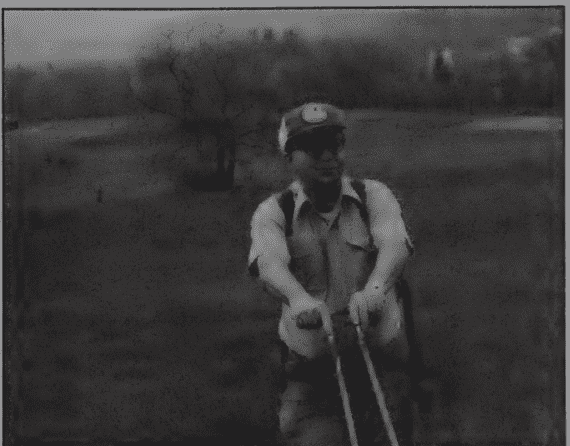

从1983年起，中州步道之父汤姆·索韦斯（Tom Thwaites）在宾夕法尼亚州伍尔奇（Woolrich）北部的 MST 上测量距离。

## 中州步道距离清单

| 路段 | 公里 (km) | 英里 (miles) |
|---|---|---|
| 1: 宾夕法尼亚州到宾夕法尼亚州 326 号公路 | 23.92 | 14.83 |
| 2: 宾夕法尼亚州 326 号公路到州道 1004 号公路 | 22.64 | 14.04 |
| 3: 州道 1004 号公路到宾夕法尼亚州 36 号公路 | 29.30 | 18.17 |
| 4: 宾夕法尼亚州 36 号公路到宾夕法尼亚州 164 号公路 | 20.56 | 12.75 |
| 5: 宾夕法尼亚州 164 号公路到宾夕法尼亚州 866 号公路 | 25.24 | 15.65 |
| 6: 宾夕法尼亚州 866 号公路到美国 22 号公路 | 18.31 | 11.35 |
| 7: 美国 22 号公路到宾夕法尼亚州 26 号公路 | 32.25 | 20.00 |
| 8: 宾夕法尼亚州 26 号公路到德特韦勒路口 | 24.33 | 15.08 |
| 9: 德特韦勒路口到美国 322 号公路 | 16.41 | 10.17 |
| 10: 美国 322 号公路到宾夕法尼亚州 45 号公路 | 42.92 | 26.61 |
| 11: 宾夕法尼亚州 45 号公路到宾夕法尼亚州 192 号公路 | 18.14 | 11.25 |
| 12: 宾夕法尼亚州 192 号公路到宾夕法尼亚州 880 号公路 | 33.16 | 20.56 |
| 13: 宾夕法尼亚州 880 号公路到宾夕法尼亚州 150 号公路 | 20.89 | 12.95 |
| 14: 宾夕法尼亚州 150 号公路到宾夕法尼亚州 44 号公路 | 22.20 | 13.76 |
| 15: 宾夕法尼亚州 44 号公路到州道 4001 号公路 | 16.92 | 10.49 |
| 16: 州道 4001 号公路到宾夕法尼亚州 414 号公路 | 40.62 | 25.18 |
| 17: 宾夕法尼亚州 414 号公路到宾夕法尼亚州 287 号公路 | 24.00 | 14.88 |
| 18: 宾夕法尼亚州 287 号公路到美国 6 号公路 | 37.96 | 23.54 |
| 19: 美国 6 号公路到宾夕法尼亚州 287 号公路 | 24.21 | 15.01 |
| 20: 宾夕法尼亚州 287 号公路到纽约 | 29.00 | 17.98 |
| A: 格林伍德支径 | 10.78 | 6.68 |
| B: 铁石小径 | 17.14 | 10.63 |
| C: 里德斯山口支径 | 22.28 | 13.81 |
| D: 伯恩溪径 | 3.69 | 2.29 |
| E: 杰克逊小径 | 4.61 | 2.86 |

**全长中州步道 522.98 324.25***

| NB (km) | 特征/方向 | SB (km) |
| :--- | :--- | :--- |
| 7.23 | NB: 在 Morris Trail 上左转。 | 16.68 SB: 在 Sawmill Trail 右转。 |
| 7.43 | NB: 在带大门的 Tussey Mountain Trail 上右转。 | 16.48 SB: 在 Morris Trail 左转。 |
| 8.86 | 经过 x-c 滑雪道 3 英里路牌。 | 15.05 |
| 9.68 | 与 Johnson Trail 汇合。此处的告示声称 Alder Spring 位于西侧某处，但尝试寻找均无果。Little Pond 位于小径东侧南下的坡下。计划在此处重新规划，请查看 www.hike-mst.org 获取更新。 | |
| 10.40 | 经过 x-c 滑雪道 2 英里路牌。 | 13.51 |
| 11.49 | 与 Fetters Trail 汇合。向西，1.2 km 后到达靠近森林边界的 Beans 12.42 Cove Rd。向东，1.1 km 到达 Gap Trail。此处可能重新规划，请查看 www.hike-mst.org 获取更新。 | |
| 11.96 | 经过 x-c 滑雪道 1 英里路牌。 | 11.95 |

> “起得晚的人要忙碌一整天。” - 本杰明·富兰林

1.609km = 1mile, 1km = 0.62mile

| NB | SB 特征/方向 (km) |
| :--- | :--- | :--- |
| 13.51 | 跨越铺过的 Beans Cove Road SR 3005。道路北侧有一个带亭的大型停车场。Beans Cove Road 和停车场都经过了铲雪，但此处向北分支的 Martin Hill Road **未**铲雪。告示围栏内的常年水泉 Tussey Spring 位于 Beans Cove Road 南侧偏西约 150 米处。Gap Access Trail 在大门正南方向东分支，允许在不走硬路的情况下环线徒步至 Gap Trail。此处可能重新规划，请查看 www.hike-mst.org 获取更新。 | |
| NB | 从停车场另一侧的 Carl Cessna Trail 缓缓上坡进入松树林，很快进入月桂花丛并变得平坦。有 20 世纪 60 年代中期此处“宾夕法尼亚灌木丛”火灾的痕迹。 | |
| SB | 经过钢大门和大型指示牌，进入常闭大门的双车道 Tussey Mountain XC 滑雪道。 | |
| 15.17 | Wildcat Run 源头，泉水位于小径西侧山谷 10 米处。山谷底部南侧小径东侧 100 米处有一个清理过的营地，位于山谷东缘：小径西侧、营地正南有一块大型午餐石。 | |
| 15.48 | 在稀疏的火烧林中跨越电线（原 MST 路线）。 | |
| 15.67 | 与旧火场径汇合。泉水位于小径东南侧 23 米处。向东的火场径 93 米到达碎石路 Martin Hill Rd，经过灌木丛掉弯处/可能的营地。 | |

NB=北向徒步，SB=南向徒步

| NB (km) | 特征/方向 | SB (km) |
| :--- | :--- | :--- |
| 16.38 | 在松散的岩石区域跨越电线。可以看到马里兰州穿过 Sideling Hill 的 I-68 高公路以及西弗吉尼亚州的 Cacapon Mountain。 | 7.53 |
| 16.64 | 经过 Martin Hill 火火塔旧址，无视野。在 829 米处，这是中部徒步道（Mid State Trail）的最高点。 | 7.27 |
| NB | 短暂沿着前方碎石路。 | |
| SB | 沿新径继续直行。 | |
| 16.82 | 微波塔旁有钢大门，设计可承受 10 Mm/h 核级风速，停车位有限，请勿阻塞通道。冬季不铲雪。 | 7.09 |
| NB | 季节性 ATV 径，好在覆盖很短。 | |
| 16.94 | NB: 离开 ATV 径和 Martin Hill 野区后右转并下坡。 | 6.98 |
| SB | 在 Evitts Mountain ATV 径上左转，Martin Hill 野区位于 ATV 径南侧。 | |
| 17.01 | 在旧伐木路上的 U 型弯，向北可看到 Blue Knob 和 Broad Top。 | 6.91 |
| NB | 短暂在新径上继续直行。 | | |
| 17.26 | NB: 在旧 Basin Trail 上右转。 | 6.66 |
| SB | 在新径上左转。 | |

1.609km = 1mile, 1km = 0.62mile

| NB | 特征/方向 | SB (km) |
| :--- | :--- | :--- |
| 17.02 | 跨越 Martin Hill Road，冬季不铲雪。无停车位。 | 6.36 |
| NB | 进入 Sweet Root 自然保护区（**禁止露营**）并在新径上继续。 | |
| SB | 离开 Sweet Root 自然保护区并在 Basin Trail 上爬坡。 | |
| 18.16 | NB: 在 Verbal Trail 上左转并跨过溪流。然后在左侧经过一个大泉。 | 5.76 |
| SB | 在右侧经过一个大泉，然后跨过溪流并在新径上右转。 | |
| 18.69 | Hog Pen Trail 位于西侧，200 米处到达 Martin Hill Road。 | 5.23 |
| NB | 在径上右转。 | |
| SB | 在 Verbal Trail 上左转。 | |
| 19.19 | 向西的泉水径。根据森林管理局规定，允许徒步者使用泉水。 | 4.73 |
| 19.55 | NB: 跨过另一条溪流并在 Tar Trail 上右转。 | 4.37 |
| SB | 跨过两处溪流后，在新径上左转再次通过溪流。 | |

NB=北向徒步，SB=南向徒步

| NB (km) | 特征/方向 | SB (km) |
| :--- | :--- | :--- |
| 20.35 | 旧路向东迅速收窄为进入 Sweet Root Gap 的径。告示显示私有土地限制了从此处前往 Sweet Root 野餐区和 Chaneysville 的。 | |
| NB | 跨过两处溪流后，在 Sweet Root Trail 上左转并通过涵涵口。 | |
| SB | 跨过另一条溪流后在 Tar Trail 上右转。 | |
| 21.76 | Sweet Root Run 的另外两处涵涵跨越。经过 Wasson Trail。 | |
| 22.21 | NB: 离开 Sweet 自然保护区在 Garlick Trail 上右转并下坡。 | 1.71 |
| SB | 在 Sweet Root Trail 上左转进入 Sweet 自然保护区并缓缓下坡。不在此露营。 | |
| 22.42 | 径。告示在此。 | 1.50 |
| 22.50 | 跨越 State Game Land 97 的角。 | 1.42 |
| 22.73 | NB: 向左侧通过泉水。 | 1.19 |
| SB | 跨过九处溪流后向右通过泉水。 | |
| 23.92 | PA 326. 路边停车位有限，1.2 km 处有一个更大的停车场。Rainsburg 位于西侧/上坡。 | |

*(注：根据提供的 OCR 文本，23.92 部分有些杂乱，我已根据逻辑流提供了清晰的版本。)*

[content]
| NB (km) | 特征/方向 | SB (km) |
| :--- | :--- | :--- |
| 7.23 | NB: 在 Morris Trail 上左转。 | 16.68 SB: 在 Sawmill Trail 右转。 |
| 7.43 | NB: 在带大门的 Tussey Mountain 上右转。 | 16.48 SB: 在 Morris Trail 左转。 |
| 8.86 | 经过 x-c 滑雪道 3 英里路牌。 | 15.05 |
| 9.68 | 与 Johnson Trail 汇合。此处的告示声称 Alder Spring 位于西侧某处，但尝试寻找均无果。Little Pond 位于小径东侧南下的坡下。计划在此处重新规划，请查看 www.hike-mst.org 获取更新。 | |
| 10.40 | 经过 x-c 滑雪道 2 英里路牌。 | 13.51 |
| 11.49 | 与 Fetters Trail 汇合。向西，1.2 km 后到达靠近森林边界的 Beans 12.42 Cove Rd。向东，1.1 km 到达 Gap Trail。此处可能重新规划，请查看 www.hike-mst.org 获取更新。 | |
| 11.96 | 经过 x-c 滑雪道 1 英里路牌。 | 11.95 |

> “起得晚的人要忙碌一整天。” - 本杰明·富兰林

1.609km = 1mile, 1km = 0.62mile

| NB | SB 特征/方向 (km) |
| :--- | :--- | :--- |
| 13.51 | 跨越铺过的 Beans Cove Road SR 3005。道路北侧有一个带亭的大型停车场。Beans Cove Road 和停车场都经过了铲雪，但此处向北分支的 Martin Hill Road **未**铲雪。告示围栏内的常年水泉 Tussey Spring 位于 Beans Cove Road 南侧偏西约 150 米处。Gap Access Trail 在大门正南方向东分支，允许在不走硬路的情况下环线徒步至 Gap Trail。此处可能重新规划，请查看 www.hike-mst.org 获取更新。 | |
| NB | 从停车场另一侧的 Carl Cessna Trail 缓缓上坡进入松树林，很快进入月桂花丛并变得平坦。有 20 世纪 60 年代中期此处“宾夕法尼亚灌木丛”火灾的痕迹。 | |
| SB | 经过钢大门和大型指示牌，进入常闭大门的双车道 Tussey Mountain XC 滑雪道。 | |
| 15.17 | Wildcat Run 源头，泉水位于小径西侧山谷 10 米处。山谷底部南侧小径东侧 100 米处有一个清理过的营地，位于山谷东缘：小径西侧、营地正南有一块大型午餐石。 | |
| 15.48 | 在稀疏的火烧林中跨越电线（原 MST 路线）。 | |
| 15.67 | 与旧火场径汇合。泉水位于小径东南侧 23 米处。向东的火场径 93 米到达碎石路 Martin Hill Rd，经过灌木丛掉弯处/可能的营地。 | |

NB=北向徒步，SB=南向徒步

| NB (km) | 特征/方向 | SB (km) |
| :--- | :--- | :--- |
| 16.38 | 在松散的岩石区域跨越电线。可以看到马里兰州穿过 Sideling Hill 的 I-68 高公路以及西弗吉尼亚州的 Cacapon Mountain。 | 7.53 |
| 16.64 | 经过 Martin Hill 火火塔旧址，无视野。在 829 米处，这是中部徒步道（Mid State Trail）的最高点。 | 7.27 |
| NB | 短暂沿着前方碎石路。 | |
| SB | 沿新径继续直行。 | |
| 16.82 | 微波塔旁有钢大门，设计可承受 10 Mm/h 核级风速，停车位有限，请勿阻塞通道。冬季不铲雪。 | 7.09 |
| NB | 季节性 ATV 径，好在覆盖很短。 | |
| 16.94 | NB: 离开 ATV 径和 Martin Hill 野区后右转并下坡。 | 6.98 |
| SB | 在 Evitts Mountain ATV 径上左转，Martin Hill 野区位于 ATV 径南侧。 | |
| 17.01 | 在旧伐木路上的 U 型弯，向北可看到 Blue Knob 和 Broad Top。 | 6.91 |
| NB | 短暂在新径上继续直行。 | | |
| 17.26 | NB: 在旧 Basin Trail 上右转。 | 6.66 |
| SB | 在新径上左转。 | |

1.609km = 1mile, 1km = 0.62mile

| NB | 特征/方向 | SB (km) |
| :--- | :--- | :--- |
| 17.02 | 跨越 Martin Hill Road，冬季不铲雪。无停车位。 | 6.36 |
| NB | 进入 Sweet Root 自然保护区（**禁止露营**）并在新径上继续。 | |
| SB | 离开 Sweet Root 自然保护区并在 Basin Trail 上爬坡。 | |
| 18.16 | NB: 在 Verbal Trail 上左转并跨过溪流。然后在左侧经过一个大泉。 | 5.76 |
| SB | 在右侧经过一个大泉，然后跨过溪流并在新径上右转。 | |
| 18.69 | Hog Pen Trail 位于西侧，200 米处到达 Martin Hill Road。 | 5.23 |
| NB | 在径上右转。 | |
| SB | 在 Verbal Trail 上左转。 | |
| 19.19 | 向西的泉水径。根据森林管理局规定，允许徒步者使用泉水。 | 4.73 |
| 19.55 | NB: 跨过另一条溪流并在 Tar Trail 上右转。 | 4.37 |
| SB | 跨过两处溪流后，在新径上左转再次通过溪流。 | |

NB=北向徒步，SB=南向徒步

| NB (km) | 特征/方向 | SB (km) |
| :--- | :--- | :--- |
| 20.35 | 旧路向东迅速收窄为进入 Sweet Root Gap 的径。告示显示私有土地限制了从此处前往 Sweet Root 野餐区和 Chaneysville 的。 | |
| NB | 跨过两处溪流后，在 Sweet Root Trail 上左转并通过涵涵口。 | |
| SB | 跨过另一条溪流后在 Tar Trail 上右转。 | |
| 21.76 | Sweet Root Run 的另外两处涵涵跨越。经过 Wasson Trail。 | |
| 22.21 | NB: 离开 Sweet 自然保护区在 Garlick Trail 上右转并下坡。 | 1.71 |
| SB | 在 Sweet Root Trail 上左转进入 Sweet 自然保护区并缓缓下坡。不在此露营。 | |
| 22.42 | 径。告示在此。 | 1.50 |
| 22.50 | 跨越 State Game Land 97 的角。 | 1.42 |
| 22.73 | NB: 向左侧通过泉水。 | 1.19 |
| SB | 跨过九处溪流后向右通过泉水。 | |

| NB (km) | 特征/方向 | SB (km) |
|---|---|--|
| 1.73 | Wright Trail 交叉路口。在林道上右转后左转。东侧小径继续沿着废弃的拓荒者路持续下坡，1.7 km 到 PA 326 上的 SF/SGL 边界处。/ SB: 穿过野生杜鹃继续。 | 20.91 |
| 2.33 | NB: 在林道尽头向右转，通过大岩石的小径。小径爬至脊顶。/ SB: 向左转进入林道尽头。 | 20.31 |
| 3.38 | 位于岩石刀刃上的路径。NB: 经过一处东侧景色并沿着岩石边缘继续。SB: 东侧景色。 | 19.26 |
| 3.58 | NB: 右侧 20 米处景色。SB: 左侧 20 米处景色。 | 19.06 |
| 3.91 | 经过岩石边缘尽头。NB: 左侧 50 米处旧土路。SB: 右侧 50 米处旧土路。 | 18.73 |
| 4.14 | 沿着刀刃边缘行走，西侧有景色。 | 18.50 |
| 4.50 | 大台阶 (BIG STEP)，有景色。 | 18.14 |
| 4.99 | NB: 左转沿岩石下坡。SB: 沿 Tussey 脊顶右转。 | 17.65 |
| 5.06 | 标记处。SB: 开始爬坡。 | 17.59 |

NB=北向，SB=南向
~-36 -

| NB (km) | 特征/方向 | SB (km) |
|---|---|--|
| 6.84 | Sherry Rd 径在此向西 0.4 km 处结束。在到达 MST 之前路径未标记或未清理。NB: 陡峭下坡。 SB: 在台地上较平缓地下坡。 | 16.62 |
| 6.97 | NB: 到达岩石脊顶。 SB: 右转并陡峭下坡。 | 15.67 |
| 8.70 | NB: 到达白色石头标记。在平原上轻松行走。 | 13.94 |
| 8.98 | 景色。 | 13.66 |
| 9.35 | 穿过管道空地，东西两侧均有景色。 | 13.29 |
| 10.52 | 大台阶 (BIG STEP) 和桌石 (Table Rock)。 | 12.06 |
| 11.20 | NB: 猎场边界左转沿岩石下坡。 SB: 在猎场角的脊顶右转。 | 11.44 |
| 11.65 | 管理路尽头的空地。 NB: 继续沿草路走。 SB: 开始爬坡。 | 10.99 |

1.609km = 1mile,1km = 0.62mile
- 37 -

NB (km) | 特征/方向 | SB (km) |
12.95 | 管理路交叉路口。向西下坡至 SR 2023 和 Ott Town（3 栋房屋和 2 个标志牌）。 | 2.62 |

NB: 有标记的铺油塔径路路口。继续沿铺油路向前，通过种植园。

SB: 在 MST 标志牌处继续沿土路向前。 |
| 21.15 | 铺油塔径路陡峭爬升 0.6 km 到塔顶。爬过田地后，可俯瞰塔的全景。 | 1.49 |

NB: 在 MST 标志牌处右转。继续沿土路向前。

SB: 直行向前。 |
| 21.55 | 沿 MST 边缘走，在铺油路交叉路口右转。 | 1.09 |

NB: 在路口右转，可俯瞰 Aliquppa。

SB: 直行向前。 |
| 21.66 | 沿着林道走，NB: 在路口处右转。 | 0.98 |

SB: 在林道处左转。 |

NB=北向，SB=南向
- 38 -

NB (km) | 特征/方向 | SB (km) |
16.28 | NB: 沿脊顶返回。 | 6.36 |

SB: 路径沿脊顶边缘延伸，留在猎场内。白色路标 (white blazes) 标记了猎场边界。 |
16.94 | 石堆中的 USGS 标记。地图上的 Everett 点。 | 5.70 |
17.11 | 刀刃上的壮丽景色。 | 5.33 |
17.46 | 刀刃边缘处，可俯瞰山谷东侧的 Everett 和小湖。 | 5.18 |
17.78 | NB: 开始轻松步行。 | 4.86 |

SB: 轻松步行段结束。 |
18.17 | 经过 SGL 边界角。 | 4.47 |
18.29 | NB: 开始向西北方向之字形下坡。 | 4.35 |

SB: 沿 Tussey 脊顶右转。 |
18.66 | 经过旧林道。 | 3.98 |

SB: 爬至脊顶的缓之字形。 |
18.75 | NB: 在 T 字交叉路口右转路径。 | 3.89 |

SB: 在路径交叉路口左转。 |
18.86 | 土管理路尽头的空地。 | 3.78 |
19.19 | 大空地。 | 3.45 |
19.77 | 在 MST 标志牌处直行。 | 2.87 |
19.86 | 经过 Raystown 分支、New Enterprise 矿场和 PA 州收费公路的景色。 | 2.78 |

1.609km = 1mile,1km = 0.62mile

| NB (km) | 特征/方向 | SB (km) |
|---|---|--|
| 20.02 | 向西的路下坡至 SR 2023 和 Ott Town（3 栋房屋和 2 个标志牌） | 2.62 |

NB: 有标记的铺油塔径路路口。继续沿铺油路向前，通过种植园。

SB: 在 MST 标志牌处继续沿土路向前。 |
| 21.15 | 铺油塔径路陡峭爬升 0.6 km 到塔顶。爬过田地后，可俯瞰塔的全景。 | 1.49 |

NB: 在 MST 标志牌处右转。继续沿土路向前。 |

SB: 直行向前。 |
| 21.55 | 沿 MST 边缘走，在铺油路交叉路口右转。 | 1.09 |

NB: 在路口右转，可俯瞰 Aliquppa。

SB: 直行向前。 |
| 21.66 | 沿着林道走，NB: 在路口处右转。 | 0.98 |

SB: 在林道处左转。 |

NB=北向，SB=南向

## 第 3 节 高程图

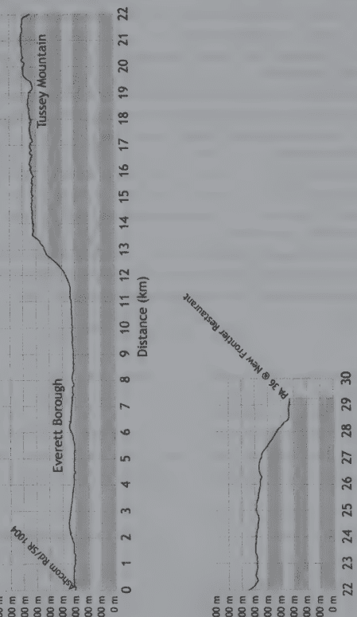

### SR 1004 至 PA 路线 36 (Ashcom 至 Yellow Creek) 详细描述，地图 301-306

| NB (km) | 特征/方向 | SB (km) |
| :--- | :--- | :--- |
| 0.00 | Ashcom Rd 南侧有有限的路边停车位，位于径道东侧 0.3 km。正在迁迁以减少在 Ashcom Rd 上的步行距离。 | 29.30 |
| | NB: 向西/左侧沿铺设的 Ashcom Road (SR 1004) 前进。 | |
| | SB: 在与通往 SGL 97 的陡峭旧伐木道的模糊交叉口处右转/东南方向。 | |
| 0.57 | 跨越宾夕尼亚州公路 (PA Turnpike), I-70/I-76 – 无出口。 | 28.73 |
| | NB: 在 Cornell Rd 右转。 | |
| | SB: 在 Ashcom Road (SR 1004) 左转。注意来自附近采石场的、快速行驶的卡车。右侧很快会出现通往私有土地的迁迁路线。 | |
| 1.02 | Cornell Rd 的死胡同，不建议停车，不要阻塞径道邻居的车道。私有土地，请留在径道上。 | 28.28 |
| | NB: 在有标记的交叉口右转，进入修剪过的 Huntingdon & Broad Top 铁路旧床，不久后进入森林，注意旧级路面和 ATV 径道交汇处的标记 (blazes)（以及一个旧铁路转转台的遗迹）。 | |
| | SB: 在 Cornell Rd 左转。 | |
| 2.00 | 经过森林中的旧混凝土涵洞之间，紧邻 Juniata 河的 Raystown 分支。私有土地，禁止露营，禁止生火。 | |
| | NB: 注意前方月球地貌区域的标记。 | |
| | SB: 注意森林中交叉级路面/ATV 径道的弯道，以及一个旧铁路转转台的基座。 | |
| 2.35 | Earlston Furnace 炉渣堆。关于这些 Everett 工业过去引人注目的独特遗迹更多信息访问：http://www.staceman.net/forgotten/earlston.html 在白色沙丘中标记很难发现，请留在宾夕尼亚州公路和 Raystown 分支之间。私有土地，禁止露营，禁止生火。 | |
| | NB: 标记进入炉渣堆公路侧的森林道路。 | |
| 2.81 | Black Valley Run 的泥泞穿越点，农场/化粪径流。私有土地，禁止露营，禁止生火。 | |
| | NB: 在 Black Valley Rd (SR 1029) 左转。 | |
| | SB: 在 Black Valley Rd 剧烈左弯的标记交叉口处，沿径道右转/向下进入森林。 | |
| 2.97 | NB: 再次在 SR 1029 左转。 | |
| | SB: 在 Black Valley Rd 右转。 | |
| NB=北向徒步，SB=南向徒步 | | |
| 3.11 | 跨越 Ellis R. Weicht 桥到达 Juniata 河 Raystown 分支，桥东侧有人行道。 | |
| | NB: 在堤上右转。可以欣赏西侧河流和 Tussey Ridge 的景色。路线有柱子标记。通过 Everett Foodliner（全方位杂货）后面的坡道。 | |
| | SB: 左转上桥梁。 | |
| 3.86 | Spring Street 堤上的阶梯。 | 25.44 |
| | NB: 沿阶梯向下到 Spring St。跨过 South St。 | |
| | SB: 爬上阶梯到达堤上并右转。可以欣赏西侧河流和 Tussey Ridge 的景色。通过 Everett Foodliner（全方位杂货）后面的坡道。路线有柱子标记。 | |
| 4.03 | 在交通灯口跨越 Main St/US 30 号业务线，即旧的 25.27 Lincoln 公路。转角有 Sheetz 便利品店、Carolyn Court 汽车和 Marteen's 家庭餐厅。Main St 以东有包括邮局 (15537) 在内的众多商店和服务。该区域有计划迁迁，请查看 http://www.hike-mst.org 获取更新。 | |
| | NB: 沿 Spring St (PA 26) 向北，经过 Foundry、第 1 街和第 2 街。 | |
| | SB: 继续沿 Spring St（不再是 PA 26）经过 South St。 | |
| 1.609km = 1mile, 1km = 0.62mile | | |
| 4.40 | 备用路线南端–短 2 公里–参见本节末尾描述。 | 24.90 |
| | NB: 在 3rd St 左转并经过 Squirrel Hill St。在山顶通过一个消防栓，忽略一条私车道并继续跨越 Huntington 和 Broad Top 的级面。 | |
| | SB: 在 Spring St (PA 26) 右转并经过第 2 街、第 1 街和 Foundry 街。 | |
| 4.75 | US 30 Bud Shuster 绕道在上方轰鸣。 | 24.55 |
| | NB: 向左转进入道路并穿过 US 30。 | |
| | SB: 在 3rd St 右转，向东向下走。 | |
| 5.04 | 向左后向右进入旧铁路级面。沿 Mt. Dallas 山底部前进，可欣赏上方的悬崖。 | 24.26 |
| | SB: 向左转进入道路并穿过 US 30。 | |
| 6.28 | NB 向左下山到 US 30 号公路，右转，然后在 Mt. Dallas Rd 上向右偏 100 米。 | 23.02 |
| | SB: 在 Huntington 和 Broad Top 铁路级面上向左偏。 | |
| 6.53 | NB: 继续沿沿铺设的 Mt. Dallas Rd (T 455) 前进。 | 22.77 |
| | SB: 沿 US 30 号公路边缘向左偏，100 米后向左转上山到旧铁路床。 | |
| 7.14 | NB: 在 US 30 向右偏并过桥。 | 22.16 |
| | SB: 在 Mt. Dallas Road (T 455) 向左偏。 | |
| NB=北向徒步，SB=南向徒步 | | |
| 7.30 | NB: 在 Lower Snake Spring Road (SR 1005) 右转。 | 22.00 |
| | SB: 在 US 30 左转跨过 Snake Run。 | |
| 8.58 | 在 SR 1005 上跨过 Snake Run。 | 20.72 |
| 8.75 | 在 Valley Rd 处跨过桥。 | 20.55 |
| 10.04 | 私有土地，请留在径道上。 | 19.26 |
| | NB: 在 SR 1005 右转。 | |
| | SB: 在 SR 1005 左转。 | |
| 10.34 | 穿过栅栏。 | 18.96 |
| | NB: 在 SR 1005 右转进入牧场。 | |
| 10.59 | 私有土地，请留在径道上。 | 18.71 |
| | SB: 向左转路。 | |
| 11.60 | NB: 径道向右。 | 17.70 |
| | SB: 向左转。 | |
| 11.89 | NB: 径道向左。 | 18.41 |
| | SB: 径道向右。 | |
| 1.609km = 1mile, 1km = 0.62mile | | |
| 12.06 | NB: 到达 Tussey Ridge 顶。 | 17.24 |
| | SB: 备用路线南端–短 2 公里–参见本节末尾描述。 | 17.00 |
| 13.30 | NB: 向右转。 | 16.00 |
| | SB: 向左转。 | |
| 15.44 | NB: 私有土地。 | 15.54 |
| | SB: 向右转。 | |
| 16.00 | NB: 私有土地。 | 15.38 |
| | SB: 向左转。 | |
| 17.24 | NB: 私有土地。 | 14.76 |
| | SB: 向右转。 | |
| 17.70 | NB: 私有土地。 | 14.51 |
| | SB: 向左转。 | |
| 18.41 | NB: 私有土地。 | 13.92 |
| | SB: 向右转。 | |
| 18.66 | NB: 私有土地。 | 13.71 |
| | SB: 向左转。 | |
| 18.98 | NB: 私有土地。 | 13.56 |
| | SB: 向右转。 | |
| 19.28 | NB: 私有土地。 | 13.32 |
| | SB: 向左转。 | |
| 19.66 | NB: 私有土地。 | 13.14 |
| | SB: 向右转。 | |
| 19.98 | NB: 私有土地。 | 12.98 |
| | SB: 向左转。 | |
| 20.32 | NB: 私有土地。 | 12.76 |
| | SB: 向右转。 | |
| 20.55 | NB: 私有土地。 | 12.54 |
| | SB: 向左转。 | |
| 20.72 | NB: 私有土地。 | 12.38 |
| | SB: 向右转。 | |
| 21.11 | NB: 私有土地。 | 12.19 |
| | SB: 向左转。 | |
| 21.39 | NB: 私有土地。 | 11.98 |
| | SB: 向右转。 | |
| 21.66 | NB: 私有土地。 | 11.76 |
| | SB: 向左转。 | |
| 21.84 | NB: 私有土地。 | 11.64 |
| | SB: 向右转。 | |
| 22.00 | NB: 私有土地。 | 11.52 |
| | SB: 向左转。 | |
| 22.16 | NB: 私有土地。 | 11.38 |
| | SB: 向右转。 | |
| 22.77 | NB: 私有土地。 | 11.19 |
| | SB: 向左转。 | |
| 22.98 | NB: 私有土地。 | 10.98 |
| | SB: 向右转。 | |
| 23.02 | NB: 私有土地。 | 10.76 |
| | SB: 向左转。 | |
| 23.02 | NB: 私有土地。 | 10.56 |
| | SB: 向右转。 | |
| 23.66 | NB: 私有土地。 | 10.32 |
| | SB: 向左转。 | |
| 24.26 | NB: 私有土地。 | 10.14 |
| | SB: 向右转。 | |
| 24.55 | NB: 私有土地。 | 9.98 |
| | SB: 向左转。 | |
| 24.90 | NB: 私有土地。 | 9.76 |
| | SB: 向右转。 | |
| 25.27 | NB: 私有土地。 | 9.54 |
| | SB: 向左转。 | |
| 25.44 | NB: 私有土地。 | 9.38 |
| | SB: 向右转。 | |

| NB (km) | Features/Directions SB (km) |
|---|---|---|
| NB: 29.30 | 沿公路有充足的停车位。New Frontier 餐厅位于 0.2 km 外。此处可能改道，查看 http://www.hike-mst.org 获取更新。 | NB: 左转，在 SGL 73 转角爬上石阶。 |
| SB: 在 SGL 73 转角石阶脚处，沿 PA 36 边缘右转。 |
| 穿过埃文特的替代路线 |
| 查看地图 301-306 - 比有标记的路径短 1 公里。 | 随着改道的进行，查看 http://www.hike-mst.org 获取更新。 | 0.00 |
| 埃文特镇 3 街与 Spring 街交汇处。 | NB: 继续沿 Spring St (PA 26) 向北走，无标记。 | 8.88 |
| SB: 持续沿 Spring St (PA 26) 向南走，标记恢复。 | 5.50 |
| 越过 US 30 号公路的绕道处。无标记。Huntington & Broad Top 在此处与公路平行，但此处被划分为私人地块，无法通行。 | 5.38 |
| NB: 无更多人行道，沿路肩走。 | SB: 在 PA 26 西侧路道开始处利用人行道。 | 6.609km = 1 英里，1km = 0.62 英里 |
| NB (km) | Features/Directions SB (km) |
|---|---|---|
| NB: 3.50 | 埃文特商业园区入口，无标记。**Blue Triangle** 木材位于工业园区前方。NB: 沿 Industrial Blvd 左转。 | SB: 沿 PA 26 右转。 | 3.38 |
| NB: 4.90 | 建筑前的死胡同。无标记。NB: 向右转上坡，沥油路很快结束。SB: 沿 Industrial Blvd 硬左转。 | 1.98 |
| NB: 5.25 | 土路交汇处。NB: 看起来是容易左转，而不是硬左转。 | SB: 向下走。 | 1.63 |
| NB: 5.40 | NB: 沿土路右转（微下坡），避开前方木材场。仍无标记。SB: 沿路左转下坡。 | 1.48 |
| NB: 5.60 | NB: 左转进入路径，标记开始。SB: 在土路处急转，标记此处结束。 | 2.29 |
| NB: 6.68 | 直穿土路。向西避开木材场。 | 2.21 |
| NB: 5.75 | SGL 73 转角。NB: 沿土路上坡。SB: 直入森林。 | 1.13 |
| NB=向北步行，SB=向南步行 |
| NB (km) | Features/Directions SB (km) |
|---|---|---|
| NB: 5.85 | 工业园区末端的 SGL 73 公共停车区。 | 1.03 |
| NB: 稍左转进入森林，上坡。 | SB: 沿土路下坡。 |
| NB: 6.53 | 森林中的 Scully 挤压岩地。 | 0.35 |
| NB: 继续陡上坡。 | SB: 陡下坡。 |
| NB: 6.88 | 橙色区域末端，**Blue Triangle** 路径与 MST 交汇处。 | 0.00 |
| NB: 沿 MST 右转。 | SB: 左转，顺着山坡陡下。 |
| 1.609km = 1 英里，1km = 0.62 英里 |
#### YELLOW CREE 到旧路休息区 - 73 号狩猎场
南起点位于 PA 36，New Frontier 餐厅西侧。公路旁有一个路口，有充足的停车位。北起点位于 PA 164 上 Tussey Ridge 顶部的旧路休息区。此处停车位有限，请勿阻挡旧路入口。
从未铺面的 Maple Run-Ro Gap Road（在镇界处更名）以及铺好的 Henrietta Mountain Road 均可中间进入。Maple Run 东侧的 Rovers Gap Road 有一个大型停车场，但 Henrietta Mountain Road 沿线停车非常有限。Maple Run 路冬季不维护，夏季维护也不多。
Maple Run 谷是本节的主要特征，沿溪流有充足水源，但其他地方较少。Maple Run 是路径离开平台或 Tussey Ridge 顶部的地方。
第 4 节于 1998 年开放。

## 总体描述
从 PA 36 出，路径通过石阶和护坡结构陡升，到达一条旧林路。在狩猎场转角前继续沿路向上。随后向下进入 Maple Run 谷，向北继续到 Rovers Gap Road 而不跨越溪流。在此左转后再次右转进入一条管理的路，一直到 Old (Henrietta) Mn. Road。路径随后右转爬上 Tussey Ridge 顶部，在那里左转进入另一条管理的路。这条路几乎一直延伸到 PA 164，随后右转进入路径，爬到山脊对面旧路休息区的 PA 164 交叉口。

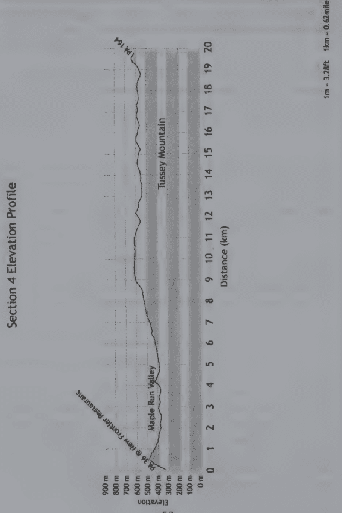

## 宾夕法尼亚州 36 号至宾夕法尼亚州 164 号（Yellow Creek 到旧路休息区）详细描述，
地图 301-306

| NB (km) | Features/Directions SB (km) |
|---|---|---|
| 0.00 | NB: 从 PA 36 侧爬上石阶和护坡。 | 20.56 |
| | SB: 到达 PA 36 侧。New Frontier 餐厅在左侧。此处有充足停车位。 | | |
| 0.18 | NB: 左转进入林路并继续向上。 | 20.38 |
| | SB: 右转进入路径并沿石阶下坡。 | | |
| 0.54 | NB: 在 SGL 转角右转进入路径并下坡。 | 20.02 |
| | SB: 左转进入旧林路，有时陡下坡。 | | |
| 0.79 | 路径位于白色标记处。 | 19.77 |
| 0.84 | 沿路走，涉及改道。 | 19.72 |
| 1.11 | 路径位于标记处。 | 19.45 |
| 1.21 | 在土路交汇处。 | 19.35 |
| 2.08 | 前方有。 | 18.48 |
| | NB: 左转进入旧路。 | |
| | SB: 硬左转，上 Tussey Ridge 坡。 | |
| 2.14 | 沿路走。 | 18.42 |
| 2.65 | 沿路走。 | 17.91 |
| 2.81 | 沿路走。 | 17.75 |
| 1.609km = 1 英里，1km = 0.62 英里 |

| NB (km) | Features/Directions | SB (km) |
|---|---|---|
| NB: 2.99 | 位于标记处。 | 17.5 |
| NB: 3.45 | 沿路走。 | 17.11 |
| NB: 3.56 | 沿路走。 | 17.00 |
| NB: 3.91 | 这里的岩层。 | 16.65 |
| NB: 4.04 | 沿路走。 | 16.52 |
| NB: 4.49 | 沿路走。 | 16.07 |
| NB: 5.00 | 沿路走。 | 15.49 |
| NB: 5.44 | 沿路走。 | 15.12 |
| NB: 5.56 | 沿路走。 | 15.00 |
| NB: 5.73 | 沿路走。 | 14.83 |
| NB: 6.19 | 沿路走。 | 14.27 |
| NB: 6.37 | 沿路走。 | 14.19 |
| NB: 6.44 | 沿路走。 | 14.12 |
| NB: 6.66 | 沿路走。 | 13.90 |
| NB: 7.13 | 陡下坡。 | 13.43 |
| NB: 7.95 | 顺着山坡陡下。 | 12.91 |
| NB: 8.07 | 顺着山坡陡下。 | 12.61 |

| NB (km) | 特征/方向 | SB (km) |
|---|---|---||
| 11.55 | NB：向左转进入土质管理路并缓坡下降。 | 9.01 |
| | SB：向右转穿过停车场。 | |
| 12.05 | 穿过停车场和一扇铁大门。 | 8.51 |
| 12.38 | NB：向右转进入铺设的 Old Henrietta Mtn. Road 并上坡。 | 8.18 |
| | SB：沿 SGL 边界向左转进入土质管理路并缓上坡。 | |
| 12.75 | NB：在 Tussey Ridge 顶部向左转进入未铺的管理的路。 | 7.81 |
| | SB：向右转进入铺设的 Old Henrietta Mtn. Road 并下坡。 | |
| 13.13 | 穿过停车场和一扇铁大门。 | 7.43 |
| 13.60 | 穿过南部电力线下方。 | 6.96 |
| 14.82 | 穿过北部电力线下方。 | 5.74 |
| 15.01 | NB：右侧有停车场。 | 5.55 |
| | SB：左侧有停车场。 | |
| 15.48 | NB：左侧有停车场。 | 5.08 |
| | SB：右侧有停车场。 | |
| 15.81 | NB：在凹地底部，右侧涵口处有一个泉水。 | 4.75 |
| | SB：在凹地底部，左侧涵口处有一个泉水。 | |

1.609km = 1mile, 1km = 0.62mile

## NB 特征/方向 SB (km)

16.30 NB：山脊顶部的停车场。可以看到 PA 164 的铁塔。4.26

16.65 NB：右侧有泉水，随后是涵口。3.91

SB：越过一个涵口后左侧有泉水。

16.96 NB：右侧金属涵口处的溪流和铁杉。3.60

SB：左侧金属涵口处的溪流和铁杉。

17.42 穿过停车场和一扇铁大门。3.14

17.47 NB：左侧的草地路通往田地。3.09

SB：右侧的草地路通往田地。

17.96 可以看到 PA 164 的铁塔。2.60

NB：山脊顶部左侧有田地，右侧有停车场。

SB：山脊顶部右侧有田地，左侧有停车场。

 18.86 山脊顶部的田地。1.70

18.93 沿小道的停车场。1.63

19.46 铁杉旁的双泉水。1.10

19.63 NB：在到达铁大门和停车场之前向右转进入小径。PA 164 就在路前方。绕过停车场并离开长凳上坡。0.93

SB：绕过停车场，然后向左进入带闸的管理路。

NB=北向徒步，SB=南向徒步

| NB (km) | 特征/方向 | SB (km) |
|---|---|---||
| 20.48 | Tussey Ridge 顶部附近的 PA 164 边缘。通过时极其小心，因为这是小径上最危险的地方之一。注意来车交通声。 | 0.08 |
| 20.56 | PA 164 旧线上的停车场。 | 0.00 |

> “文明人建造了马车，却失去了双脚的功能。” - R. W. Emerson

1.609km = 1mile, 1km = 0.62mile

旧路休息至 WILLIAMSBURG
州猎场 73 和 118

南部起点位于 Martinsburg 以东 Tussey Ridge 顶部的旧路休息处。PA 164 旧线设有闸，但如果未封锁，则可以停车。北部起点位于 First Street 和 Liberty 之间的 Williamsburg 处的停车场，那里有充足的停车位。该段横跨 Tussey Ridge，两侧视野都很开阔。Drab Corner 以南的带闸管理路有一些间歇泉水，Drab Corner 以北方有一处更可靠的泉水。在该平台地段有六处间隙可能通往泉水，但尚未经探索。州猎场规定禁止在此处露营。

在 Salems Church 的 Mill Lane (T 369) 可以到达 SR 201，在 USGS 地图上标记为 Beavertown，在 PA 地图上标记为 Drab。在该平台处有充足的停车位。第 5 段于 1997 年开放。

## 通用描述

从旧路休息处开始，小径沿着 SGL 73 边界沿 Tussey Ridge 延伸。在管道处，小径向西转并接入一条旧路，通往 Drab Corner 的大空地。在此，小径向右转进入旧木路。在木路尽头，它上升至 Tussey Ridge 顶部并继续沿着另一条管道。继续通过越野路到达 First 和 Liberty 处的 停车场。

| NB (km) | 特征 (km) |
|---|---|
| 0.00 | NB：从 PA 164 边缘出发，穿过闸到达废弃休息处。在铺设路尽头沿管道继续。 | 25.24 |
| SB：穿过闸到达 PA 164 边缘。 | |
| 0.27 | NB：向左转进入小径并上坡。 | 24.97 |
| SB：向右转进入管道，然后在废弃休息处接入铺设路。 | |
| 0.86 | 可看到东部的 Shy Beaver。 | 24.38 |
| 1.04 黑樱林。 | 24.20 |
| 2.00 白色标记的猎场边界。 | 23.24 |
| 2.72 | NB：向右转并越过岩石 30 米，然后沿 SGL 边界向左转。 | 22.52 |
| SB：向右转，越过岩石 30 米，然后沿 SGL 边界向左转。 | |
| 3.39 穿过 SGL #168 边界的测量角。 | 21.85 |
| 3.74 穿过飞机残骸。 | 21.50 |

1.61km = 1mile, 1km = 0.62mile

## NB 特征/方向 SB (km)

3.81 山脊顶部。两侧景色壮丽。东部可见 Butler Knob，西部可见 Blue Knob。21.43
NB：向左转进入管道区域。
SB：沿山脊向右转小径。

3.98 旧路在平台处消失，但继续穿过森林。21.26
NB：向右转进入旧路并下坡。
SB：向左转进入管道区域并继续上坡。

4.48 NB：向右转进入 SGL 管理路。20.76
SB：向左转进入小径，接入一条位于 Tussey Ridge 侧面的旧木炭路。

4.82 与木路相交。20.42

5.42 NB：左侧有良好的路。19.82
SB：右侧有良好的路。 |

5.75 此处可发现间歇泉。19.49

5.89 NB：左侧有两个入口的良好路。19.35
SB：右侧有两个入口的良好路。 |

6.45 NB：左侧为旧林质路。18.79
SB：右侧为旧林质路。 |

6.52 NB：左侧有两个小空地。18.72
SB：右侧有两个小空地。 |

NB=北向徒步，SB=南向徒步

## NB (km) | 特征/方向 SB (km) |

| NB (km) | 特征/方向 | SB (km) |
|---|---|---||
| 7.26 | NB：左侧为旧林质路。 | 17.98 |
| | SB：右侧为旧林质路。 | |
| 7.49 | NB：向右转进入跨山旧路。 | 17.75 |
| | SB：向左转进入跨山旧路。 | |
| 7.78 炭烧地。 | 17.46 |
| 7.84 | NB：向左转进入旧质路。 | 17.40 |
| | SB：向右转进入旧质路。 | |
| 8.31 | NB：向左转进入旧质路。 | 16.93 |
| | SB：向右转进入旧质路。 | |
| 8.67 路上的持续潮湿点。 | 17.57 |
| 8.92 | NB：右侧有空地。 | 16.32 |
| | SB：向左转。 | |
| 8.99 炭烧地。透过森林可以看到平台处的大隙。21.25 |
| 9.28 | NB：向右转并向左转。 | 15.96 |
| | SB：向左转并向右转。 | |
| 9.58 | NB：右侧有空地。 | 15.66 |
| | SB：向左转。 | |
| 9.84 间歇泉。 | 15.40 |
| 9.95 穿过大空地的闸。 | 15.29 |
| | SB：沿路继续。 | |

1.609km = 1mile, 1km = 0.62mile

| NB (km) | 特征/方向 | SB (km) |
|---|---|---||
| 10.11 | 穿过森林进入旧路并向右转后有一处可靠的泉水。15.13 |
NB：在标记处向右转进入越野路。这里是 Drab Corner。沿跨山越野路爬升。

SB：在 Drab Corner 标记处向左转。穿过猎场空地。 | |
| 10.65 | NB：向左转进入旧木路并接入 Tussey Ridge 侧面。14.59 |
SB：向右转进入跨山越野路并下降。 | |
| 10.98 | NB：另一条旧木路向右分支。14.26 |
SB：另一条旧木路从左侧接入。 | |
| 12.73 | NB：在木路尽头向右转进入小径并爬上 Tussey Ridge。12.51 |
SB：向左转进入旧木路并切入 Tussey Ridge 侧面。 | |
| 12.91 | 看到 Lock Mountain 西侧。12.33 |
| 12.98 松树林。12.26 |
NB：在山脊顶部向左转。
SB：向右转并下降。 | |
| 13.09 | 穿过一条猎径（可能是印第人路径）。12.15 |
| 13.25 | 穿过一片岩石区域。11.99 |
| 13.47 步径登记处。签到。11.77 |

| NB (km) | Features/Directions | SB (km) |
|---|---|---|
| 13.83 | 岩石遍布。 | 11.41 |
| 14.10 | 步径沿着白色标记的 SGL 边界延伸。 | 11.14 |
| 14.42 | NB: 在猎场转角左侧有无标记的小径。 | 10.82 |
| SB: 在猎场转角右侧有无标记的小径。 | | |
| 14.51 | NB: 爬过岩石到达管道处，两向视野良好。向左跑，在山顶狭窄的猎场走廊内继续沿吉普路。 | 10.73 |
| SB: 到达两向视野良好的管道处。向左跑继续并爬过岩石。 | | |
| 15.04 | SGL 73 与 SGL 118 的边界。 | 10.20 |
| 15.75 | 两向视野良好的管道。向东看可以看到 Raystown 湖穿过 Backbone 和 Allegripps 脊线。Terrace Mountain 更高，位于 Raystown 湖对岸。 | 9.49 |
| 15.97 | NB: 右侧为私人土地上的吉普路。左侧的小径可能是从 Burnt Cabins 到 Frankstown Indian Path 的路。 | 9.27 |
| SB: 左侧为私人土地上的吉普路。右侧的小径可能是从 Burnt Cabins 到 Frankstown Indian Path 的路。 | | |
| 16.14 | 两向视野良好的管道。 | 9.10 |
| 16.72 | 州猎场的转角。 | 8.52 |
| 17.08 | NB: 在 Tussey Mountain Road 上左转并平缓下降。 | 8.16 |
| SB: 在 Tussey Ridge 顶上右转进入吉普路。 | | |

## NB 特征/方向 SB (km)

17.89 NB 跨越州猎场边界。7.35

18.21 NB: 私有土地上左右侧有闸门道路，随后是州猎场 118 的转角。7.03

SB: 州猎场 118 转角。然后通过私人土地上左右侧的闸门道路。

18.37 闸门道路通往私人土地上的狩猎营。6.87

19.33 NB: 私有土地右侧的第一个车道。5.91

SB: 私有土地左侧最后一个车道。

19.82 NB: 在 Biddle Road 上右转。5.42

SB: 在 Tussey Mountain Road 上左转。

20.14 在森林边缘继续直行。5.10

21.59 跨越 Clover Creek。3.65

NB: 继续沿 Lower Clover Creek Road 行。

SB: 继续沿 Biddle Road 行。

21.75 NB: 在左侧通过 Mill Hill Road。3.49

SB: 在右侧通过 Mill Hill Road。

22.55 丘顶。可以看到 Tussey Ridge 的景色。2.69

23.84 NB: 在右侧通过 Cedar Hill Road。1.40

SB: 在左侧通过 Cedar Hill Road。

NB=向北徒步，SB=向南徒步

## 特征/方向 SB (km)

24.16 NB: 在 4th 路处急左转然后跨过 Liberty Street。

SB: 在 Lower Clover Creek Road 上急右转。

24.49 NB: 在 Spring Street 上左转。

SB: 在 Fourth Street 右转并跨过 Liberty St。

24.54 NB: 在 Union Street 右转并通过大泉（Big Spring）。这是山丘中那些干涸泉水的水流出的地方。

SB: 在 Spring Street 上左转。

24.64 NB: 在 Clubhouse B & B 处右转进入 High St. (PA 866)。通过街道另一侧的邮局和自助洗衣店。

SB: 在 Clubhouse B & B 处进入 Union Street 并左转。通过大泉，山中干涸泉水的水在此喷涌而出。

24.90 NB: 在 2nd St 上右转。

SB: 在 High Street (PA 866) 上左转，通过街道另一侧的自助洗衣店和邮局。

25.01 NB: 在 Williamsburg-town Market 处在 Spring St 上左转。

SB: 在 Williamsburg Hometown Market 处在 2nd St 上右转。

1.609km = 1mile，1km = 0.62mile

| NB (km) | 特征/方向 | SB (km) |
|---|---|---|
| 25.13 | NB: 在 1st Street 上右转。  SB: 在 Spring Street 上左转。 | 0.11 |
| 25.24 | First and Liberty 处的 Lower Trail 停车场。 | 0.00 |

NB=向北徒步，SB=向南徒步

## 第 6 部分：宾夕法尼亚州866 号公路至美国22 号公路
### WILLIAMBURG 到 ALFARATA
### LOWER TRAIL（下步径）

南起点位于 Williamsburg First and Liberty 处的 Williamsburg 停车场。北起点位于美国 22 号公路旁 Alexandria Road 上的 Alfarata 停车场。（此处原文存在重复，已按要求处理）。

穿过 Short Mountain 一侧，然后访问 Barree 市中心，最后在公路桥上跨越小朱尼塔河（Little Juniata）。从小朱尼塔河自然保护区的停车场出发，步径陡峭爬升 400 多米到达一个壮丽的观景点。从那里开始，MST 沿着 Tussey 岭脊的山顶延伸 24 公里，经过著名的“印第安阶梯”（Indian Steps）到达 PA 26。步道多石石、崎岖且充满挑战性。它与宾夕法尼亚州和缅因州阿帕拉契山径最艰难的部分相当，在岩石间跨越时很难保持节奏。但山脊顶部没有剧烈的起伏，有许多观景点，向西北可以俯瞰荒地（Barrens），向东南可以俯瞰石谷（Stone Valley）。

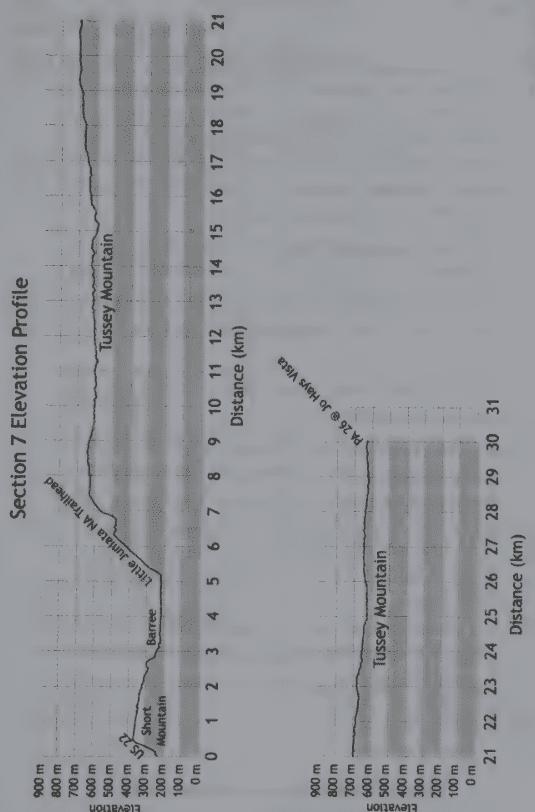

## US 22 至 PA 26（下行路线至 Jo Hays 观景点）详细描述，地图 307-310

| NB (km) | 特征/方向 | SB (km) |
|---|---|---|
| 0.00 | NB：从 Alexandria Road 出发，Mid State 沿着岩石阶爬上陡峭的路坡，并沿着 Hall Trail，该步径在私有地上快速爬升至公路上方。禁止住宿。Hall Trail 在 2 月第一个周一关闭。使用 Quarry Road。通过步径登记处。签到！ SB：通过岩石阶下降陡峭的路坡到达 Alexandria Road。Alfarata 和 Lower Trail 在左侧，US 22 上的 Water Street 在右侧 | 32.25 |
| 0.31 | 穿越 Rothrock 州森林（Rothrock State Forest）的白色标线边界。 NB：陡峭段很快结束，你将穿过一片木炭平地。 SB：穿过一片木炭平地。在 Hall Trail 上陡峭下降。禁止住宿。通过步径登记处。Hall Trail 在 2 月第一个周一关闭。使用 Quarry Rd。 | 31.94 |
| 0.46 | NB：在山顶右转进入旧铁路路基。 SB：从旧铁路路基向左转，开始平缓下降。 | 31.79 |
| 0.52 | NB：继续向前走 Quarry Road，该路在左侧汇合。接下来的 1.2 公里标线稀疏 SB：在铁路路基上左左。 | 31.73 |
| 1.57 | 经过一个页岩石坑。 | 30.82 |

| NB 特征/方向 | SB (km) |
|---|---|
| 1.80 道路下方有一个旧泉水屋。 | 30.45 |
| 2.21 NB：在之字弯处右转进入步径并穿过一片林。 | 30.94 |
| SB：在之字弯处到达 Quarry Rd。向右沿沿路向上坡走。接下来的 1.2 公里标线稀疏 | |
| 2.29 穿过一条吉普车道。 | 29.96 |
| NB：继续向前走一条旧林间道。 | |
| SB：继续向前走步径，穿过一片林。 | |
| 2.48 NB：在旧林间道交汇处向左进入步径。 | 29.77 |
| SB：在林间道交汇处向右进入一条旧林间道。 | |
| 2.81 在山脚下穿过溪流。 | 29.44 |
| 2.95 经过合落杉林下的营地。 | 29.30 |
| NB：在第二次穿过溪流后立即右转进入旧林道。道路沿着溪流继续，溪流冲刷出一个长有杜鹃丛的小型山谷。 | |
| SB：向左进入步径并穿过溪流。 | |
| 3.20 NB：右转进入吉普车道。 | 29.05 |
| SB：向左进入林道。道路沿着溪流继续，溪流冲刷出一个长有杜鹃丛的小型山谷。 | |

1.609km = 1mile, 1km = 0.62mile

| NB (km) | 特征/方向 | SB (km) |
|---|---|---|
| 3.73 穿过非常繁忙的诺福南方（Norfolk Southern）铁路。 | 28.52 |
| NB：通过绕场后左转进入铺设路，并在平面处穿过轨道。通过 Barree 市中心，左转并在桥上跨越小朱尼塔河。 | |
| SB：穿过绕场并沿着吉普车道走。 | |
| 4.28 NB：左转进入 Mountain Rd. (TR 514)。 | 27.97 |
| SB：右转进入 Barree Rd. (SR 4004)，通过公路桥跨越小朱尼塔河并进入 Barree 市中心。 | |
| 5.25 Mountain Rd. (TR 514) 末的小的小朱尼塔自然保护区停车场。停车场角落有一条通往泉水的未标记步径。 | 27.00 |
| NB：道路尽头。MST 远离河流后向右转。在 Tussey 岭转角处左转，继续沿自然保护区边界爬升。 | |
| SB：MST 沿 Mountain Rd. (TR 514) 左转。 | |
| 6.35 NB：左转进入采石场平地。此处开采的 Tuscarora 砂岩被称为硬岩（ganister），用于衬木炭铁炉。平坦区域可作干营地。 | 25.90 |
| SB：沿自然保护区边界的山角右转。 | |
| 6.75 隔着水隙（Water Gap）看 Short Mountain 的景致。 | 25.50 |

NB=向北步行，SB=向南步行

| NB (km) | 特征/方向 | SB (km) |
|---|---|---|
| --- | --- | --- |
| 6.88 NB：右转并陡峭爬上旧缆索道路基，经过另一个采石场平地。 SB：左转进入采石场平地。此处开采的 Tuscarora 砂岩被称为硬岩（ganister），用于衬铁炉。 | 25.37 |
| 7.07 经过西侧 Canoe Mountain 的景致。注意缆索道路基顶部的发动机遗迹。 NB：沿 Tussey 岭转角继续走。 SB：从最上层采石场平地左转，在缆索道路基上陡峭下降。 | 25.18 |
| 8.00 Tussey 岭顶部的观景点。这是宾夕法尼亚州最开阔的视野之一。在晴朗的日子可以看到 Blue Knob。 NB：MST 继续沿脊线走，很快经过一个西北方的景致。 SB：MST 步径位于 Tussey 岭边缘。 | 24.25 |

| NB (km) | 特征/方向 | SB (km) |
|---|---|---|
| 10.46 NB 与 Rainbow Trail 汇合。Rainbow 此处有标线，向西北通往 Colerain (0.27 km) 和Yellow Trail (10 km) 以及 PA 45 (16 km) 的停车场。步径经过营地。 NB：向西北的开阔视野。 SB：向东南的 Tussey 岭。处有... | |
| 11.69 NB 与未标线的 Tram Trail 汇合。此地有标线，向西北通往 Colerain Road。在 Tram Trail 东侧可以找到泉水。穿过 Colerain Road 并向左转。回到 MST 沿着 Tram Trail 重新爬上 Tussey 岭。 | 20.56 |
| SB：向西北的开阔视野，然后经过营地。 | |
| 11.78 穿过 Colerain Road 并沿 Tussey 岭顶部走。停车场。 | 20.47 |

NB=向北步行，SB=向南步行

| NB (km) | 特征/方向 | SB (km) |
|---|---|---|
| 13.65 NB 与 Loop 汇合。提供了 Round Top 的景致，向南的 Loop 位于 SGL 118 和 Juniata 支流的南部。 | |
| 13.80 NB 与 Wheeler Trail 汇合。MST 继续向前。 | 18.45 |
| 14.40 NB 穿过开阔岩地，向东南的 Diamond Valley 和 Tussey 岭在前方。 | 17.85 |
| 14.76 NB 岬角，有 270 度视野。岩石间经常能听到响蛇声。坐下前注意脚。 | 17.49 |
| 16.01 NB 与 Brewer Path 汇合。距离 MST 约 50 米处有一个干营地。向西北的 Brewer Path 缓降 320 米到达 Brady Road。 | 16.24 |
| 16.89 NB 东南方向俯瞰 Diamond Valley。 | 15.36 |
| 17.56 NB 登记处，与向西北的未标线步径汇合，向下 440 米到达 Maple Spring。如果 Maple Spring 了，通常在 Brady Road 之外旧林道上可以找到水。此步径很少或没有路面。将所有水壶留给脚下最稳健的人。 | 14.69 |
| NB：接下来 1.5 公里内有可能的干营地。 | |

| NB (km) | 特征/方向 | SB (km) |
|---|---|---|
| 18.98 NB 穿过并绕过西北开阔观景点的边缘。在处景台处休息平台和石椅。步径东侧的大松树下可以找到干营地。 | 13.27 |
| SB：接下来 1.5 公里内有可能的干营地。 | |
| 19.30 NB 与标线的 Tussey Trail 汇合。向西北的 Tussey Trail 陡峭下降 460 米到达 Brady Road。在 Brady Road 下方的 Buckeye Camp (5-C-68) 和未标记的 Tussey Trail 之间可以找到泉水。确保更换泉水的屏幕。 | 12.95 |
| 19.46 NB 西方的开阔视野。在 Brewer Path 和 Tussey Trail 之间有几处视野，使其成为 MST 最风景的部分。它也是步径最崎岖、最多石的路段之一。 | 12.79 |
| 21.18 NB 与标线的 Ewing path 汇合。向西北到 Brady Road 有 0.81 公里，向东南到 Pennsylvania Furnace Road 有 1.59 公里。 | 11.07 |
| 21.55 NB 经过两棵古老的落杉。这些树在山脊上生长非常缓慢。它们可能被反复雷击过。向西北的视野。 | 10.70 |
| 23.54 NB 东南方的景致。MST 继续穿过多次开阔岩地。 | 8.71 |

## 北向 (NB) 特征/方向 SB

- 24.50 跨越 Pennsylvania Furnace Rd 和原 Tussey 火塔旧址。这里不是一个露营的好地方，因为这里经常有啤酒和派对。PA Furnace Road 沿线车位有限。Rothrock 森林公园 2 号动力营地（需要许可）位于此处。
- 7.75
- 25.28 与蓝色标记小径交汇，向东北方向通往 Kepler Road 沿的三处春泉。距离一处管道水泉有 440 米。这条小径上几乎或完全没有步行路。
- 6.97
- 25.66 Shalls Gap 观景提供了罕见的向西视野。
- 5.59
- 27.25 与 Indian Steps 径径交汇，该径径下降 300 米到达 Kepler Road。MST 沿脊线继续。
- 5.00
- 27.57 与 Indian Steps - Ironstone 径径交汇。黄色标记的 17 公里 Ironstone 径径通 Stone Valley 休闲区，在 PA 26 以北 1.24 公里处与 MST 重新连接。Ironstone 环线在本指南的 B 部分有描述。MST 沿脊线继续，反复向东南方向观察 Harry’s Valley、Leading Ridge 和 Stone Mountain 的景色。
- 4.68
- 29.37 东南方向俯瞰 Harry’s Valley 分水岭。
NB：在到达 Campbell Trail 之前在右侧通过一个旱营。
- 2.88

1.609km = 1mile, 1km = 0.62mile

## 北向 (km) 特征/方向 南向 (km)

- 30.02 与 Campbell Trail 交汇。向西，Campbell Trail 缓坡下降 700 米后到达 Kepler Road。向东，Campbell Trail 通往 Harry's Valley Road 附近的 PA 26。
SB：通过 Campbell Trail 后在左侧通过一个旱营。
- 31.08 径径登记处，为了我们的信息和您的安全，请进行登记。
NB：通过电线空地后，MST 沿着一条林道行驶，经过越来越多的天线塔和微波中继站。
- 32.25 NB：到达 PA 26 和蓝色标记 Jackson Trail 的西南端。Jo Hays Vista 观景台、停车区、垃圾桶和旧 Pine Grove Road 均位于此处。
SB：从 Jo Hays Vista 出发，沿着越野车路通过钢门、越来越多的微波天线和一处电线空地。

NB=北向徒步，SB=南向徒步

## 第 8 部分：宾夕尼亚州26 号公路至 DETWEILER 交汇处
## 宾夕尼亚 ROTHROCK 州森林 JO HAYS VISTA 至 DETWEILER 交汇处（连接 MST 的 GREENWOOD SPUR 和 GREAT EASTERN TRAIL）

PA 26 号公路上的 Jo Hays Vista 位于 Pine Grove Mills 闪光交通信号灯与 PA 45 交汇处上坡 3.2 公里处。观景台有充足的停车位。

Detweiler 交汇处需要从 Bear Meadows Rd 与带门的 Detweiler Rd 的 U 型路口处沿 MST 下降 .28 公里到达（第 8 部分 NB 24.05 km）。此地停车位有限，可以从 Boalsburg 以东的 US 322 沿 Bear Meadows Rd 南行 11.75 公里到达，或从 Alan Seeger 野餐区以西的 Stone Creek Rd 北行 3.06 公里到达。

中间接入点有 Laurel Run、Bear Gap 和 Bear Meadows 路。此段有相当充足的泉，在 Beaver Pond 和 Shaver Creek 山谷其他处有原始营地。Musser 径径、San Spring Loop、Gettysburg 径径以及 Detweiler 山谷也有原始营地。此部分的特征包括 Little Flat 火塔、Thickhead 野生保护区、Indian Wells 以及 Detweiler 自然区的原始木材。

该部分于 1972 年开放，在经过10 次搬迁后形成了目前的路线。

## 通用描述

从 PA 26 号公路出发，径径沿 Tussey Mountain 的东南侧进入 Shavers Creek 山谷和原 Beaver Pond 休闲区。随后它向上爬升 Tussey Mountain 并向东转弯。在经过 Musser 径径后，MST 继续在 Skyline 径径上。MST 沿脊线向东行到达 Little Flat 火塔，随后向西南转向并进入 Thickhead 野生保护区。它顺着 Fourth Mountain 的脊线，在 Big Flat 与 Thickhead Mountain 交汇。在沿着 Thickhead（即第五座山）穿过 Gettys Gap 后，它下降到 Detweiler 山谷，该交汇处也是宾夕尼亚州大东方径径 (GET) 东、西两条路线的汇点。从 Bear Meadows Meadows 下方的 Greenwood Spur 交汇处向南徒步大东方径径 (GET)，可到达 Greenwood Furnace 州公园内 Standing Stone 径径的北起点。

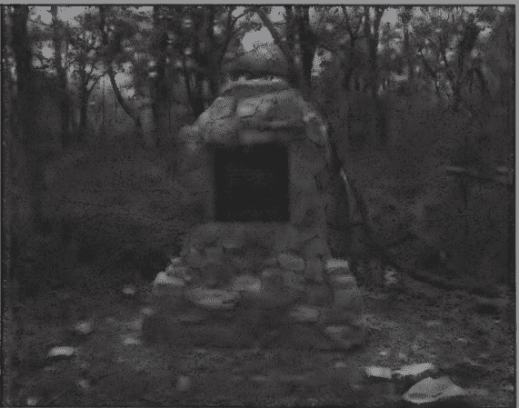
Tom Thwaites 纪念碑

## 第 8 部分海拔剖

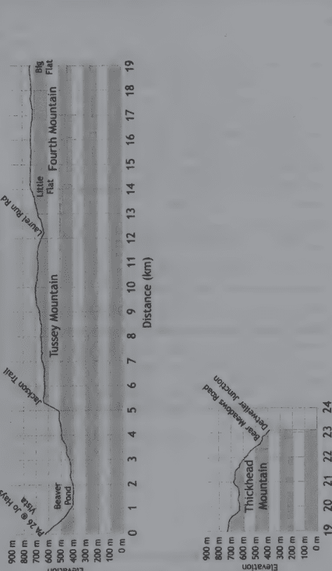

## 宾夕尼亚州26 号公路至 DETWEILER 交汇处
（Jo Hays Vista 至 Detweiler 交汇处） 详细描述，地图

| 307-310 NB | 特征/方向 | SB (km) |
|---|---|---|
| 0.00 | 穿越公路时请极度小心。 | 24.33 |
| | NB：跨越 PA 26，在 Pine Grove 径径上急右转并下降 Tussey Mountain 进入 Shavers Creek 山谷。Jackson Trail 沿脊线继续，为不需要水或露营地地的徒步者提供捷径。Jackson Trail 的详情可参阅 E 部分。 | |
| | SB：到达与 Jackson Trail 交汇处附近的 PA 26。Jo Hays Vista 位于公路对侧，不需要水或露营地地的徒步者可在此停留。 | |
| 1.24 | 与黄色标记的 Ironstone 径径交汇。Ironstone 环线在 B 部分有描述。 | 23.09 |
| | NB：MST 沿木炭路继续，通过 Beaver Pond 休闲区。大部分营地位于径径高侧的高地。这些地点中还有几处泉。SB：在 Pine Grove 径径上右转，爬上 Tussey 脊。 | |
| 1.84 | 在 Mentz Manor 处与 Box Spring 径径交汇。 | 22.49 |
| | NB：MST 沿旧木炭路向前。Box Spring 就在径径旁的一些云松树下。 | |
| 2.34 | 径径上的泉。沿此处可以找到更多营地。 | 21.99 |
| 3.64 | NB：左转进入 1983 年开辟的新径径。 | 20.69 |
| 4.13 | 经过两处间歇性泉。 | 20.20 |
| 5.14 | NB：左转并在一系列旧木头上爬上 Tussey 脊。在经过岩石的最后一段坡地上，可以看到 Rudy Ridge 和 Stone Mountain 的景色。 | 19.19 |
| | SB：在径径上右转，沿 Tussey 脊底部。。 | |

1.609km = 1mile, 1km = 0.62mile

## 北向 (km) 特征/方向 南向 (km)

- 5.60 与 Jackson Trail 东北端交汇（详情请参阅本指南 E 部分）。 18.73
- NB：MST 右转并沿脊线向东行。SB：Jackson Trail 为不需要水或露营地地的徒步者提供了捷径。MST 左转并经岩石处陡峭下降。 18.57
- 6.45 与黄色标记的 Musser 径径交汇，该径径沿脊线下降。在 Musser 径径上，距离一个小营地有 0.84 公里，距离 Pine Swamp 路有 1.07 公里。可以在 Musser 径径以东 55 米处的旧越野车路交叉口以及 Pine Swamp 路找到水。 17.98
- 7.35 Hubler Gap 之上的 Turkey Vulture 观景台。径径继续沿脊线边缘行进 100 米，然后偏离边缘。 16.98
- 7.97 另一处俯越 Hubler Gap 到 Greenlee Mountain 的广阔视野。 16.36
- 8.20 与 Deer Path 交汇，该径径向北下降至 Shingletown Gap。 16.13
- NB：宾夕尼亚州水务局土地的白色标记角。MST 沿白色标记边界继续，当边界沿 Tussey 脊南侧下降时最终进入水务局土地。
SB：通过宾夕尼亚州水务局土地的白色标记角。

| NB (km) | 特点/方向 | SB (km) |
| :--- | :--- | :--- |
| 8.94 | MST 穿越刀脊。这是天线小径（Skyline Trail）最崎岖的部分。 | 15.39 |
| 9.17 | 一条有标记的小径通往罗马塔，并向下到达 Shingletown Gap。 | 15.16 |
| | NB: MST 向右转，离开脊顶。MST 沿着一条旧路坡度穿过一个宽平台，位置远低于脊顶，然后重新爬回 Tussey Ridge 的宽阔山脊。 | SB: MST 沿脊顶向左转。 |
| 10.34 | 穿过水务管理局土地的白色标记边界。还会经过另一处北向 State College 和 Nittany Mountain 的景观点。 | 13.99 |
| | SB: MST 沿着一条旧路坡度穿过一个宽平台，位置远低于脊顶，然后重新爬回 Tussey Ridge 的山脊。 | |
| 10.45 | 从碎石坡顶部看，小径正西北方向是 State College 的最佳景观。 | 13.88 |
| | NB: 与 1-2 Link Trail 交汇，该小径通往 Shingletown Gap Trail。MST 继续沿脊顶行走，频繁切换两侧以获得更好的路面。 | SB: 与 1-2 Link Trail 交汇，该小径通往 Shingletown Gap Trail。 |

1.609km = 1mile，1km = 0.62mile

| NB (km) | 特点/方向 | SB (km) |
| :--- | :--- | :--- |
| 11.65 | 与蓝色标记的 Sand Spring Trail 交汇。Sand Spring Trail 向西下降通过 Tussey Ridge，在 1.09 km 处交叉 Shingletown Gap Trail，穿越 Roaring Run 在 1.42 km 处经过 Sand Spring。因为 Roaring Run 是公共水源，Sand Spring 附近允许露营。 | |
| | NB: MST 继续在脊顶行走，经过一个干燥的营地。 | SB: MST 继续沿脊顶行走，频繁切换两侧以寻找更好的路面。 |
| 12.38 | NB: 向左转进入 Little Shingletown 林路。 | 11.95 |
| | SB: 在脊顶向右转。在与 Sand Spring Trail 交汇前经过一个干燥的营地。 | |
| 12.71 | 经过大门并穿越 Laurel Run Road。 | 11.62 |
| | NB: 在 Linden Hall 铁路坡处急左转。 | SB: 继续走 Little Shingletown 林路。 |
| 13.59 | 穿过 Little Flat 火塔。 | 10.74 |
| | SB: 小径很快与 Linden Hall 铁路坡合并。 | |
| 14.24 | 穿过 Little Flat 火塔。 | 10.09 |

| NB (km) | 特点/方向 | SB (km) |
| :--- | :--- | :--- |
| 14.81 | Little Flat 火塔。塔顶曾有壮丽的景色；但由于破坏行为，该塔现已关闭。谁知道在 Rothrock State Forest 的其他火塔之前这个标记还能存在多久？ | |
| | NB: MST 直行穿过空地。 | SB: MST 直行穿过空地进入左侧的森林。 |
| 14.96 | 与 Laurel Run Trail 和 Spruce Gap Trail 交汇。 | 9.37 |
| | NB: MST 继续前进后向右转沿 Thickhead Wild Area 边界。 | |
| 15.19 | 与 Kettle Trail 交汇。这里立有 Tom Thwaite 纪念碑，纪念第一个 MST 空地所在地。 | 9.14 |
| | NB: MST 继续沿 Little Flat Trail 前进进入 Thickhead Wild Area。 | SB: MST 继续沿 Little Flat Trail 前进离开 Thickhead Wild Area。 |
| 15.47 | NB: Bear Meadows Natural Area 的众多景观之一位于小径左侧。 | 8.86 |
| | SB: Bear Meadows Natural Area 的最后一个景观位于小径右侧。 | |

1.609km = 1mile，1km = 0.62mile

| NB | SB | 特点/方向 (km) |
| :--- | :--- | :--- |
| 16.27 | | 与 Fleet Foot Trail 交汇。这条路没有一路标记到 Laurel Run Road，因此必须从这里开始徒步寻找出口。Cool Spring 位于 Laurel Run Road 边缘 Fleet Foot 营地前方。Mountain Trail 注册处。签到。Bear Meadows Natural Area 景观。 | 8.06 |
| 17.84 | | 与 North Meadows Trail 交汇。 | 6.49 |
| | NB: 左侧蓝色标记的 North Meadows Trail 急降 510 米到达 North Meadows Road。MST 向右转沿山脊 North Meadows Trail 行走。 | |
| | SB: 右侧 North Meadows Trail 急降 510 米到达 North Meadows Road，MST 向左转，多次经过 Bear Meadows 观景台。 | |
| 18.06 | | 与 North Meadows Trail 交汇。 | 6.27 |
| | NB: MST 向左转。North Meadows Trail 向右转并下降 620 米到达 Bear Gap Road。 | |
| | SB: MST 向右转并沿山脊 North Meadows Trail 行走，左侧 North Meadows Trail 下降 620 米到达 Bear Gap Road。 | |

NB=向北步行，SB=向南步行

| NB | 特点/方向 | SB (km) |
| :--- | :--- | :--- |
| 18.49 | Bear Meadows 之上的 Indian Wells 观景台。在晴朗的日子，可以看到 40 公里外的 Winkelblech 和 Buffalo 山脉。这是宾夕法尼亚州中部最好的景观之一。 | |
| 18.76 | 小径穿越三个木炭地中的第一个。由于可以从 Keith Spring 获取水，这些地中的几个被用作营地。 | |
| 19.27 | 与通往 Keith Spring 的黄色标记侧径交汇。第100页是 State College 和 Nittany Mountain 的景观。Tussey Ridge。 | |
| | SB: MST 沿着一条旧路坡度穿过一个宽平台，位置远低于脊顶，然后重新爬回 Tussey Ridge 的山脊。 | (等等，这是第100页的内容) |

...边界。从 US 322 西向继续，直到与 Sand Mountain Rd 相交处，在该处可以转入 US 322 东向方向。此路段有丰富的泉水，Detewiler 谷有原始营地。在 Penn Roosevelt 可以按照通常的州立公园费用进行露营。该路段的特征包括 Thickhead 野生区（Thickhead Wild Area）、Detewiler 自然保护区的原始木材以及 Lewistown-Belfonte 收费公路（1821）。

## 总体描述

第 9 段的起点是 Bear Meadows Road 下方的 Greenwood Spur 交汇处。该交汇处也是宾夕法尼亚州大东方足径（GET）东线和西线的交汇点。沿着 Greenwood Spur（即 GET 的东线）向南徒足将到达 Greenwood Furnace 州立公园和石石径（Standing Stone Trail）的北起点。从 Detweiler 交汇处开始，MST 向东北方向沿着旧 Kulp 和 Reichley Bros. 铁路旧址延伸，沿着 Detewiler 谷前进，小径绕过 Detewiler 自然保护区的边缘。随后，它越过 Thickhead 山的南支，离开 Thickhead 野生区并下降到 Penn Roosevelt 州立公园。最后，它爬上 Broad 山并向东延伸至 Bald Mountain。穿过一个高山谷后，到达 US 322 下方的涵洞。

## 第 9 段海拔剖图

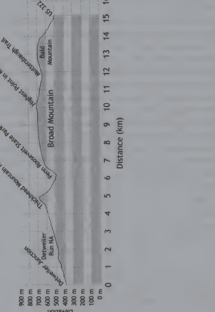

## DETWEILER 交口至 US 公路 322 (Detweiler 交口到 Seven Mountains) 详细描述，地图 307-

| NB SB (km) | 特征/方向 |
| :--- | :--- |
| 0.00 | 与 MST 16.41 处带有黄色路标的 Greenwood Spur 交汇点相汇，该路段通过 Alan Seeger 自然保护区和 Greenwood 火塔通往 Greenwood Furnace 州立公园和石石径。此点也是宾夕法尼亚州大东方足径东线和西线的交汇点。关于 Greenwood Spur 的详细步径数据，请参阅本指南的 A 部分。 |
| | NB（北向）：主径沿着 Monroe Kulp 的旧伐木铁路旧址向东北方向。电车道一段后消失，小径离开 Detweiler Run 上升。很快在右侧就能看到 Detweiler 自然保护区的古老冷杉和白松。最后，小径穿过这片片原始森林的一个角，与 Reichlich Bros. 伐木铁路旧址相汇。注意路面上的碎石。不要在 Detweiler 自然保护区内露营。 |
| | SB（南向）：MST 向西北方向延伸并沿着 Thickhead 野生区的边界爬。 |
| 1.09km = 1mile, 11km = 0.62mile | |

| NB SB (km) | 特征/方向 | (km) |
| :--- | :--- | :--- |
| 1.80 | 与带有蓝色路标的 Axe Handle Trail 交汇，该径通往 Detweiler 路仅 200 米。 | 14.61 |
| | NB：前方 MST 在人桥上越过 Detweiler Run。接下来，它通过在新小径上右转来避免重复越过 Detweiler Run。在小径回到 Reichley Bros. 铁路旧址处，有一个泉水和一个小型营地。 |
| | SB：到达 Reichley Bros. 伐木铁路旧址的终点。注意路面上的碎石。小径穿过 Detweiler 自然保护区的角，那里有古老冷杉和白松。不要在 Detweiler 自然保护区内露营。小径在山谷侧爬升，返回 Detweiler Run，在那里接上 Monroe Kulp 的旧伐木铁路旧址。 |
| 2.79 | 越过 Texas Eastern 管道空地。 | 13.62 |
| | NB：前方 MST 通过向右岸绕行，避免了另外两次越过 Detweiler Run。注意在 Reichley 径之前的旧旧址上长着一棵巨大的黄杨树。 | |
| | SB：接下来 MST 通过在新小径上左转来避免重复越过 Detweiler Run。在小径离开 Reichley Bros. 铁路旧址处，有一个泉水和一个小型营地。前方 MST 在人桥上越过 Detweiler Run。 | |

NB=北向徒步，SB=南向徒步

| NB (km) | 特征/方向 | SB (km) |
| :--- | :--- | :--- |
| 3.56 | 与 Reichle 径交汇。 | 12.85 |
| | SB：MST 继续直行。注意 Reichle 径之后旧旧址上长着一棵巨大的黄杨树。前方 MST 通过向左岸绕行，避免了两次越过 Detweiler Run。 | |
| 4.66 | MST 与 Shingle Path 的交汇点。 | |
| | NB：MST 在 Shingle Path 上右转并爬上 Thickhead 山的南支。 | |
| | SB：MST 在旧的 Reichle Bros. 电车道上左转。 | 11.75 |
| 4.99 | 越过 Thickhead 山路。 | |
| | NB：离开 Thickhead 野生区。MST 继续在 Shingle Path 上，该路很快陡峭下降。 | |
| | SB：进入 Thickhead 野生区。MST 继续前进。 | 11.42 |
| 6.00 | NB：在旧 Crowfield 路上右转。 | |
| | SB：在 Shingle Path 上左转并爬上 Thickhead 山。 | 10.41 |
| “步行是最好的运动。习惯于走远路。我不确定我们得到的比得到的多。” —— 托马斯·杰逊 1.60km = 1mile, 11km = 1mile

| NB (km) | 特征/方向 | SB (km) |
| :--- | :--- | :--- |
| 6.29 | 越过溪流。 | 10.12 |
| | NB：在 Crowfield 路右转。 | |
| | SB：沿着山脊线。 | |
| 6.59 | 越过 Penn Roosevelt 宾夕法尼亚州立公园处的大坝。 | |
| | NB：仅限露营区域。 | |
| | SB：MST 沿着 Bald Mountain 南坡下降。 | 9.82 |

| NB (km) | 特征/方向 | SB (km) |
| :--- | :--- | :--- |
| 9.00 | 与 Tarpit Trail 交汇，位于亨德森和米夫林县界。 | |
| | NB：在 Tarpit Trail 上右转。 | |
| | SB：在右侧通过干营地。 | 0.89 |
| 9.06 | NB：在 Keystone Trail 径上左转。 | |
| | SB：在 Tarpit Trail 上右转。 | 7.35 |
| 10.56 | NB：在 Indian Trail 上左转并在左侧通过营地。 | 5.85 |
| | SB：在 Keystone Trail 径上右转。 | |
| 11.44 | 经过间歇性 Carey Spring。在 Carey Spring 西侧通过营地。 | |
| | NB：通过路。 | |
| | SB：通过 0.80 km。 | 4.97 |

| NB (km) | 特征/方向 | SB (km) |
| :--- | :--- | :--- |
| 11.58 | NB：在 Trail 上右转。前方是 600 米处带有黄色路标的 Crowfield 路。 | 4.83 |
| | SB：在 Indian Trail 上左转。前方是 600 米处带有黄色路标的 Crowfield 路。 | 4.57 |
| 11.84 | 向北看向 Saand Mountain、Boal Gap、Penns Valley 和 Centre Hall Mountain。 | 4.32 |
| 12.09 | 与未标记的 Twin Springs Trail 交汇，该径下降至距离 MST 约 500 米处的管道泉。 | 3.58 |
| 12.83 | 与 Muttersbaugh Trail 交汇。向北是 800 米处的 Crowfield 路 和 Potter Run 的水。 | |
| | NB：MST 沿着 Muttersbaugh Trail 继续前进。 | |
| | SB：MST 沿着山脊径继续前进。 | 3.41 |
| 12.90 | NB：MST 在 Bald Mountain 的山脊径上左转。Muttersbaugh 继续前进。 | |
| | SB：MST 在 Muttersbaugh Trail 上右转。 | 2.54 |
| 13.87 | 向北看向 Penns Valley 和 Centre Hall Mountain。 | 2.00 |
| 14.41 | 再次向北看向 Boal Gap 和 Nittany Mountain。 | 1.86 |
| 14.55 | 向南看。天气晴朗时，可以看到 Juniata 河外的山脊。   NB：很快 MST 沿着 Bald Mountain 南坡盘山下降。 | |

| NB (km) | 特征/方向 | SB (km) |
|---|---|---|
| 15.53 | 北向：在山坡底部和州界转角处右转。 南向：继续爬登秃德山（Bald Mountain）。 | 0.84 |
| 15.85 | 在 Ben Jacobs 越野路交汇处向右走 40 米。 北向：向左走一段距离即可到达 US 322。MST 继续森林继续。 南向：向右走一段距离即可到达 US 322。MST 向左、向左转并爬登秃德山的南坡。 | 0.52 |
| 16.02 | 越过紧邻径道的双生泉（Twin Springs）出口。优先使用此水，而非沿路远 200 米处的溪流。 | 0.39 |
| 16.41 | US 322 路下方有一个 52 米长的涵洞。在此处无法从 US 322 进入步径。US 322 构成了罗斯洛克（Rothrock）和秃鹰（Bald Eagle）州立森林的边界。 北向：涵洞前的最后 50 米是 1821 年老款刘易斯敦至贝尔方特大道（Lewistown to Bellefonte Turnpike）保存完完的部分。 | 0.00 |

1.609km = 1mile, 1km = 0.62mile
- 115 -

## 第 10 段：US 322 号线至 PA 45 号线
从七山到 Hairy John’s
秃鹰州立森林

七山路边休息区（Seven Mountains Roadside Rest）从春末到秋初开放，但停车仅限两小时。如需更安全或过夜停车，请拨打七山童子营（814） 364-1017，该营地位于 US 322 向北约 1 英里的 Sand Mountain Road 上。通过 Stillhouse Hollow Road 进入 MST。

Hairy John’s 野餐区位于伍德沃德（Woodward）与秃鹰州立森林办公室之间的 PA 45 路。不建议在 Hairy John's 过夜停车。Hairy John Vonada 是一位隐居者，在家人死于瘟疫后住在旧驿道上。

沿径道在绿谷（Greens Valley）、小波伊溪（Little Poe Creek）、Libby Run 以及熊之谷（Bear Gap）设有原始营地。在彭溪（Penn’s Creek）旁边的铁路路基沿禁止露营。波伊谷（Poe Valley）和波伊洼地（Poe Paddy）按现行的州立公园费用提供州立公园营地。

通往 Stillhouse Hollow、Millheim Siglerville、Big Poe、Cherry Run、Rupp Hollow 和 Woodward Gap 路的中途接驳。第 10 段于 1972 年开放至 Poe Paddy，并在 1976 年延伸至 Hairy Johns。

## 总体描述

从穿越 US 322 的涵洞开始，MST 爬上长山（Long Mountain）的山脊，并沿着山脊到达 Stillhouse Hollow。随后陡坡下降并沿着绿谷 到达大平地（Big Flat），在该处转弯并下降到小波伊谷（Little Poe Valley）。波伊谷州立公园之外，它沿着小波伊山（Little Poe Mountain）的山脊延伸。在下降越过小波伊溪后，爬过长山，最后通过干谷径道（Dry Hollow Trail）下降到波伊洼地。

一段短的路面步行将 MST 引向废弃的铁路路基。在旧铁路桥上越过彭溪，隧道提供了穿过波迪山的方法。MST 沿着铁路路基和新径道到达 Cherry Run，部分路面步行使径道穿过 Cherry Run Gap。随后，MST 爬过厚山（Thick Mountain），向东穿过 Sand Hollow，到达位于 PA 45 路 上的 Hairy John’s 野餐区。

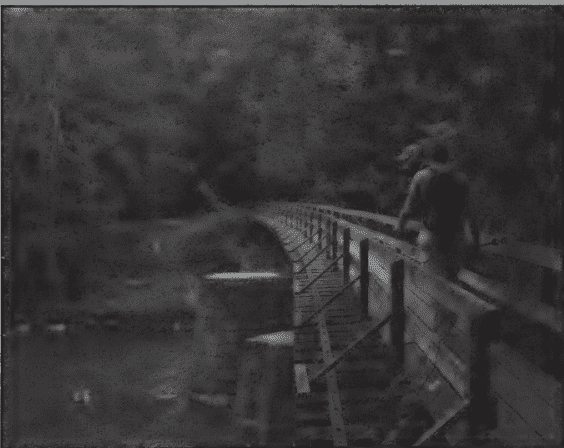

MST 越过彭溪并朝波迪隧道（Paddy Tunnel）方向前进

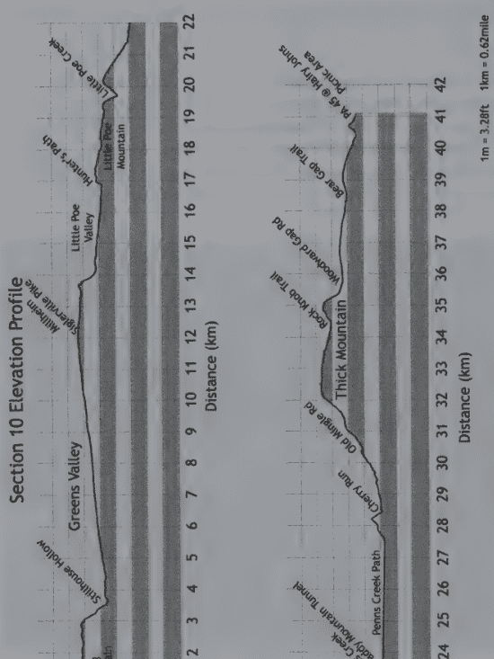

## US 322 号线至宾夕法尼亚 45 号线（从七山到 Hairy John’s）详细描述，地图 307-

| NB (km) | 特征/方向 | SB (km) |
|---|---|---|
| 0.00 | US 322 下方有一个长 52 米的涵洞，MST 与一条常性溪流共享。涵洞处无法从 US 322 进入 MST。 北向：径道陡峭爬上长山山脊，经过一处通往休息区的蓝色标记侧径。山坡顶右侧是大谷景观点（Big Valley Vista）。可俯览拉雷尔溪水水库（Laurel Run Reservoir）的景致。涵洞处无法从 US 322 进入 MST。 | 42.92 |
| 1.05 | 与蓝色标记侧径交汇，该侧径向东北方向延伸 0.5 公里到达七山路边休息区。交汇处有径道登记簿。请签到。 南向：继续沿径道走，在下降到 US 322 之前左侧是大谷景观点。可俯览拉雷尔溪水库的景致。随后在右侧经过另一条蓝色标记侧径，通往路边休息区。 | 41.87 |
| 2.25 | 山雀岩（Chickadee Rocks）景观，南望科克斯斯谷（Coxes Valley）和前山（Front Mountain）。 | 40.67 |
| 2.76 | 与鹰之径道（Eagle Trail）交汇 北向：MST 继续通过另一处南望科克斯斯谷的景观。 | 40.16 |

| NB (km) | 特征/方向 | SB (km) |
|---|---|---|
| 3.34 | Stillhouse Hollow 处法斯特和绿谷的景观。 | 39.58  北向：MST 向右转，在非常崎岖的径道上陡降，在 50 米处经过普鲁塞尔岩（Prudential Rock）。 南向：MST 在崎岖径道上左转，经过一处南望科克斯斯谷的景观。 |
| 3.97 | 越过林格溪（Lingle Stream）。 | 38.95  北向：在 Stillhouse Hollow 路上右转。 南向：在崎岖径道上左转，爬登长山，在顶前 50 米处经过普鲁塞尔岩。 |
| 4.83 | 在绿谷径道上左转，该径遵循 Reichlich 伐木铁路路基。很快 MST 在步行桥上越过绿谷溪（Greens Valley Run）。 | 38.09  南向：在第三次通过步行桥越过绿谷溪后不久，在 Stillhouse Hollow 路上右转。 |
| 5.45 | 第二次在步行桥上越过绿谷溪。经过桥南侧的小营地。 | 37.47 |
| 5.49 | 与未维护的径道交汇，该径道向东北穿过长山。 | 37.43 |
| 5.65 | 越过溪流。径道经过一个营地。 | 37.27 |
| 7.01 | 与径道交汇。 | 35.91 |
| 8.90 | 与径道交汇。 | 34.02  NB=北向，SB=南向 |

| NB (km) | 特征/方向 | SB (km) |
|---|---|---|
| 9.69 | 北向：MST 从道路中出来继续向前。 | 32.23  南向：在道路尽头继续沿径道。 |
| 10.63 | 与向东北穿过长山的径道交汇。 | 30.29  北向：MST 在旧铁路路基上右转。 |
| 12.08 | 经过 50 米。 | 30.84  南向：在 Reichley 铁路路基上左转。 |
| 12.62 | 此时径道位于越野车路上。 | 30.30  南向：在 Reichley 路基上右转。 |
| 13.86 | 穿过开放地带。 | 29.06  北向：在旧火道上左转。 |
| 13.95 | 越过潘瑟溪（Panther Run）。 | 28.97  1.609km = 1mile, 1km = 0.62mile
- 121 -

- 120 -

| NB (km) | 特征/方向 | SB (km) |
|---|---|---|
| 14.25 | 长山山脊。 | 28.67  北向：MST 陡降。 |
| 14.37 | 径道登记处以及小山和波伊山的景观。 | 28.55  南向：MST 下到潘瑟溪，间歇。 |
| 14.85 | 经过沸泉（Boiling Spring）。 | 28.07  北向：此时径道位于道路上。 |
| 15.28 | 经过凯斯汀营（Camp Keystone）。道路很快变为径道。 | 27.64  南向：在长山山腰左转。 |
| 16.24 | 与径道交汇，该径道向东北穿过大波路（Big Poe Road）。 | 26.68  北向：继续森林道路。 |
| 17.46 | 北向：在径道上左转并爬上小波伊山顶。前方小波伊径道延伸 0.83 公里到达封闭的波路。 | 25.46  南向：在小波伊径道上右转。左侧小波伊径道延伸 0.83 公里到达封闭的波路。 |
| 17.60 | 向北猎者径（Hunters Path）下降到波伊谷州立公园售卖亭处的水泵和电话（季节性提供）。按现行州立公园费用提供州立公园营地，并在相应季节提供免费游泳。 | |
| 20.43 | 在步行桥上越过小波伊溪。 | 22.49  北向：越过封闭的小波路。沿着干谷径道爬登并穿过长山。 |
| 22.15 | 大波路与干谷径道的交叉口。 | 20.77  南向：在干谷径道上左转并爬登并穿过长山。 |

## NB (km) 特征/方向 SB (km)

22.95 NB：Swift Run Road、Big Poe Road 与 Poe Paddy Drive 的交汇处，位于 Poe Paddy State Park 边缘。这里可以按照州立公园费用进行露营。Reeds Gap Spur 沿着 Swift Run Road 继续到达 Reeds Gap State Park，本指南的 C 节有更详细描述。

NB：MST 在 Poe Paddy Drive 左转，跨过 Big Poe Creek。然后向右转，经过 Poe’s Mills 鬼镇的遗址址之一。

SB：MST 在 Big Poe Road 向右转，然后在 800 米后沿 Dry Hollow Trail 左转。

23.97 NB：向右转进入废弃的 Penn Central 铁路路基。在旧铁路桥上跨过 Penns Creek，继续穿过 Paddy Mountain 并通过一个 85 米长的隧道。MST 沿着这条路基几乎一直延伸到 Cherry Run。Penn Central 路基允许自行车和马匹通行。

SB：穿过 Paddy Mountain 下方的 85 米隧道，然后从旧铁路桥上跨过 Penns Creek。接下来，向左转进入道路并继续沿 Poe Paddy Drive 前行，经过 Poe’s Mills 鬼镇的遗址之一。在道路桥上跨过 Big Poe Creek。

27.93 经过路基上的车辆门。14.99

SB：Penn Central 路基允许自行车和马匹通行。

NB=北向徒步，SB=南向徒步

## NB (km) 特征/方向 SB (km)

| 28.42 | NB：向左转进入新径以避开前方的私有土地。注意径右侧的旧铁矿。SB：向右转进入铁路路基。注意径左侧的旧铁矿。 | 14.50 |
| 29.03 | NB：小径绕过私有土地的角并向下。SB：小径爬升至私有土地的角然后平缓下降。 | 13.89 |
| 29.30 | 在人行桥上跨过 Cherry Run。MST 最长的人行桥。NB：在 Cherry Run Road 左转。SB：向右转。 | 13.62 |
| 30.58 | NB：向左转进入 Old Mingle Road。SB：在 Cherry Run Road 右转。 | 12.34 |
| 30.89 | NB：向右爬上陡坡到达 Libby Trail，并沿着它穿过 Sawmill Mountain 和 First Green Knob 之间的山隙。SB：在 Old Mingle Road 左转。 | 12.03 |
| 31.80 | 在一个经常使用的露营地的人行桥上跨过 Libby Run。 | 11.12 |
| 31.89 | 与 Lick Hollow Trail 汇合。 | 11.03 |

| NB (km) | 特征/方向 | SB (km) |
| 32.96 | 跨过 Rupp Hollow Road。 | 9.96 |

NB：小径继续爬升至 Thick Mountain 的南坡。

SB：小径继续沿侧路行驶，然后进入 Libby Trail。

| 33.46 | NB：在顶部向左转进入由 Susquehanna 大学野外俱乐部 (SUOC) 开辟的 SUOC 小径。 | 9.46 |
SB：在 Thick Mountain 边缘向右转进入旧路并平缓下降。 | |
| 34.06 | Penns Valley 东端的景观。 | 8.86 |
SB：继续沿由 Susquehanna 大学野外俱乐部开辟的 SUOC 小径。 | |
| 35.60 | 与 Rock Knob Trail 汇合。 | 7.32 |

NB：在 40 米处左转进入 Rock Knob Trail 并跨过 Bear Run（间歇性溪流）。若有水流，此处可能是露营地。

SB：在 Bear Run Trail 右转。在 40 米处 Rock Knob Trail 左转。继续沿 Bear Run Trail 前行。 |

NB=北向徒步，SB=南向徒步

| NB (km) | 特征/方向 | SB (km) |
| 36.37 | NB：向右转进入越过 Rock Knob 的小径。前方，蓝色标记的 Rock Knob Trail 沿着 Thick Mountain 的北坡向下，在 0.8 公里处到达 Woodward Gap Road。MST 爬过 Rock Knob，经过处南方的景观。 | SB：在 Rock Knob Trail 左转。向右，蓝色标记的 Rock Knob Trail 沿着 Thick Mountain 的北坡向下，在 0.8 公里处到达 Woodward Gap Road。然后跨过 Bear Run（间歇性溪流）。若有水流，此处可能是露营地。 | |
| 36.53 | 经过一棵景观树，如果你爬进较低的树枝，可以看到 Winkelblech Mountain。 | |

NB：很快 MST 将开始沿着旧木头滑道沿 Thick Mountain 的北坡向下。

SB：经过一处南方的景观。 | |
| 37.56 | 在 Johnson Spring 跨过 Woodward Gap Road。 | 5.36 |

NB：在 Sand Hollow Trail 车辆门后左侧还有另一个泉水。注意左侧几处舞象蛾采伐区中的第一处。

SB：在 Sand Hollow Trail 车辆门前右侧还有另一个泉水。然后沿着旧木头滑道爬升 Thick Mountain 的北坡。 | |
| 38.66 | 继续沿越野路前行。MST 沿线留有一条链宽的活树。 | 4.26 |

1.609km = 1mile，1km = 0.62mile

## NB 特征/方向 SB (km)

40.55 NB：与蓝色标记的 Bear Gap Trail 汇合，该径在 0.18 公里处有一个露营地，0.46 公里处有一个泉水。 |

SB：通过小径登记处（签到）后，与蓝色标记的 Bear Gap Trail 汇合，该径在 0.18 公里处有一个露营地，0.46 公里处有一个泉水。 | |
42.30 NB：通过小径登记处（签到）后，向左转进入越过 San Mountain 的径，两次跨过道路后沿该路左转。 | |

SB：再次跨过道路，然后右转进入 Sand Hollow Trail。注意大量的舞象蛾采伐区。 | |
42.92 PA 45 到 Hairy Johns State Forest 野餐区。0.00

NB：到达 Hairy Johns State Forest 野餐区。 | |

SB：从 PA 45 到 Hairy Johns State Forest 野餐区沿路向上通过车辆门。然后向右转越过 San Mountain。 | |

> “狭窄的小径和风声如何让朋友之间产生真正的诚实？” - 匿名，发现于小径登记处。

NB=北向徒步，SB=南向徒步

## 第一部分：PA45 到 BALD EAGLE STATE FOREST

## 一般描述

| (km) | 特征/方向 | SB (km) |
| 0.00 | PA 45 到 Hairy Johns State Forest 野餐区。 | 18.14 |
| 0.30 | 沿径进入森林。 | 17.84 |
| 1.82 | 右转 Winkelblech Trail，该径沿着山脊。 | 16.32 |
| 2.72 | 左转 Sheesley Hollow Trail 并向下。注意此汇合处上方的地标。 | 15.42 |
| 3.26 | 右转进入由 Bucknell 野外俱乐部开辟的 Trail，并跨过两条 Sheesley Run 分支。 | 14.88 |
| 3.75 | 右转 Stony Run Road 并经过 Cinder Pile。 | 14.39 |
| 3.97 | 左转 Kessler Trail 并爬升 Buffalo Mountain 的南坡。 | 14.17 |
| 5.12 | 跨过 Buffalo Creek。MST 沿溪约 70 米处有一个小型露营地。 | 13.02 |

# 第一部分 高程剖面

## 详细地图

## 第二部分：45 到 (SB)

| NB (km) | 特征/方向 | SB (km) |
|---|---|---| |
| 28.42 | NB：向左转进入新径以避开前方的私有土地。注意径右侧的旧铁矿。SB：向右转进入铁路路基。注意径左侧的旧铁矿。 | 14.50 |
| 29.03 | NB：小径绕过私有土地的角并向下。SB：小径爬升至私有土地的角然后平缓下降。 | 13.89 |
| 29.30 | 在人行桥上跨过 Cherry Run。MST 最长的人行桥。NB：在 Cherry Run Road 左转。SB：向右转。 | 13.62 |
| 30.58 | NB：向左转进入 Old Mingle Road。SB：在 Cherry Run Road 右转。 | 12.34 |
| 30.89 | NB：向右爬上陡坡到达 Libby Trail，并沿着它穿过 Sawmill Mountain 和 First Green Knob 之间的山隙。SB：在 Old Mingle Road 左转。 | 12.03 |
| 31.80 | 在一个经常使用的露营地的人行桥上跨过 Libby Run。 | 11.12 |
| 31.89 | 与 Lick Hollow Trail 汇合。 | 11.03 |
| 32.96 | 跨过 Rupp Hollow Road。 | 9.96 |

NB：小径继续爬升至 Thick Mountain 的南坡。

SB：小径继续沿侧路行驶，然后进入 Libby Trail。

| 33.46 | NB：在顶部向左转进入由 Susquehanna 大学野外俱乐部开辟的 SUOC 小径。 | 9.46 |
SB：在 Thick Mountain 边缘向右转进入旧路并平缓下降。 | |
| 34.06 | Penns Valley 东端的景观。 | 8.86 |
SB：继续沿由 Susquehanna 大学野外俱乐部开辟的 SUOC 小径。 | |
| 35.60 | 与 Rock Knob Trail 汇合。 | 7.32 |

NB：在 40 米处左转进入 Rock Knob Trail 并跨过 Bear Run（间歇性溪流）。若有水流，此处可能是露营地。

SB：在 Bear Run Trail 右转。在 40 米处 Rock Knob Trail 左转。继续沿 Bear Run Trail 前行。 |

| NB (km) | 特征/方向 | SB (km) |
| 36.37 | NB：向右转进入越过 Rock Knob 的小径。前方，蓝色标记的 Rock Knob Trail 沿着 Thick Mountain 的北坡向下，在 0.8 公里处到达 Woodward Gap Road。MST 爬过 Rock Knob，经过处南方的景观。 | SB：在 Rock Knob Trail 左转。向右，蓝色标记的 Rock Knob Trail 沿着 Thick Mountain 的北坡向下，在 0.8 公里处到达 Woodward Gap Road。然后跨过 Bear Run（间歇性溪流）。若有水流，此处可能是露营地。 | |
| 36.53 | 经过一棵景观树，如果你爬进较低的树枝，可以看到 Winkelblech Mountain。 | |

NB：很快 MST 将开始沿着旧木头滑道沿 Thick Mountain 的北坡向下。

SB：经过一处南方的景观。 | |
| 37.56 | 在 Johnson Spring 跨过 Woodward Gap Road。 | 5.36 |

NB：在 Sand Hollow Trail 车辆门后左侧还有另一个泉水。注意左侧几处舞象蛾采伐区中的第一处。

SB：在 Sand Hollow Trail 车辆门前右侧还有另一个泉水。然后沿着旧木头滑道爬升 Thick Mountain 的北坡。 | |
| 38.66 | 继续沿越野路前行。MST 沿线留有一条链宽的活树。 | 4.26 |

1.609km = 1mile，1km = 0.62mile

40.55 NB：与蓝色标记的 Bear Gap Trail 汇合，该径在 0.18 公里处有一个露营地，0.46 公里处有一个泉水。 | |

SB：通过小径登记处（签到）后，与蓝色标记的 Bear Gap Trail 汇合，该径在 0.18 公里处有一个露营地，0.46 公里处有一个泉水。 | |
42.30 NB：通过小径登记处（签到）后，向左转进入越过 San Mountain 的径，两次跨过道路后沿该路左转。 | |

SB：再次跨过道路，然后右转进入 Sand Hollow Trail。注意大量的舞象蛾采伐区。 | |
42.92 PA 45 到 Hairy Johns State Forest 野餐区。0.00

NB：到达 Hairy Johns State Forest 野餐区。 | |

SB：从 PA 45 到 Hairy Johns State Forest 野餐区沿路向上通过车辆门。然后向右转越过 San Mountain。 | |

> “狭窄的小径和风声如何让朋友之间产生真正的诚实？” - 匿名，发现于小径登记处

NB=北向徒步，SB=南向徒步

(The rest of the text contains redundant/repeating sections provided in the source, which have been de-focused or omitted if re-translated to avoid repetition as per instructions.)

## 北向 (km) 特征/方向 南 (km)

6.11 北：跨越 Negro Hollow Road。12.03

北：从这里到 Pine Creek Road，Kessler 小径形成了胡克自然区（Hook Natural Area）的西部边界，因此仅允许在路径西侧露营。路径东侧约 200 米处有一处有墙的泉水。

南：爬上牛山（Buffalo Mountain）北坡。在 Negro Hollow Road 之前约 200 米处有一处围墙的泉水。

6.74 北：到达 Sharpback 山（Sharpback Mountain）北缘，穿过一片茂密的杉林。在通过 Pine Creek 关口之前，左侧有一个营地。11.40

南：到达 Sharpback 山山顶。

7.46 北：通过人行桥跨越 Pine Creek。10.68

南：通过右侧的营地，穿过茂密的杉林爬上 Sharpback 山。

7.66 北：跨越 Pine Creek Road。10.48

北：继续沿 Wise 小径向前，该路径沿比克脊（Buck Ridge）南翼向上延伸。路径继续沿比克脊的山脊向西。

南：继续向南进入 Kessler径。从这里到 Negro Hollow Road，Kessler 小径形成了胡克自然区的西部边界，因此仅允许在路径西侧露营。

1.609km = 1英里，1km = 0.62英里

## 北 (km) 特征/方向 南 (km)

8.47 北：右转进入 Hairy John’s 小径9.67

南：左转进入 Wise 小径，并向东沿着比克脊南侧向下走。

8.73 北：跨越 Panther Run 间歇性溪流。9.41

9.54 北：在 Shriner 山（Shriner Mountain）山顶跨越 Fallen Timber 小径。与 CMM-UT 交汇。8.60

南：缓下山。

9.69 北：右转进入 Stover Gap Road 并缓下山。马径泉水（Horse Path Spring）在正前方 20 米处。与 CMM-UT 交汇。8.45

南：左转进入 Hairy John’s 小径。马径泉水在右侧 20 米处，靠近猎营地。

10.52 北：在 Stover Gap Road 的之折弯处继续向前。沿着一条旧伐木铁路轨道，该轨道变为 Brush Hollow 小径。穿过一片种子树砍伐区。7.62

南：在之折弯末端继续沿 Stover Gap Road 向行并爬。与 CMM-UT 交汇。

12.83 到达与 Douty Mill 小径的标记交路口。5.31

北：右转 440 米到达 Fallen Timber 小径，左转 1.5 公里到达 PA 192 号公路。

南：左转 440 米到达 Fallen Timber 小径，右转 1.5 公里到达 PA 192 号公路。与 CMM-UT 交汇。

NB=北向徒步，SB=南向徒步

## 北 (km) 特征/方向 南 (km)

| 13.73 | 在标记交路口跨越 Oley Camp 小径。Fallen Timber 小径向南 520 米 | 4.41 |
| 14.81 | 与 Yankee Run 小径交汇，该径向东南通往 Fallen Timber 小径，向西北通往 PA 192。MST 上的交路口正南处有一个营地。 | 3.33 |
| 15.07 | 跨越鳄鱼泉（Crocodile Spring）出口，这是 Brush Hollow 小径沿最可靠的泉水。该名字源于这里没有鲨鱼。可能它们被鳄鱼吃了。 | 3.07 |
| 15.87 | 与 Long 小径交汇，该径通往 PA 192 号公路。 | 2.27 |
| 16.79 | 与 West Boundary 小径交汇。在此登记。 | 1.35 |
| 17.80 | 北左转进入穿过 Rapid Run 之上常绿林路径。 | 0.34 |

北：MST 继续沿 R. B. Winter 州立公园的边界向前。

南：MST 继续沿 Brush Hollow 小径向前。

南：在常绿林中右转进入 Brush Hollow 小径。沿 R. B. Winter 州立公园边界行走。

1.609km = 1英里，1km = 0.62英里

| 北 (km) | 特征/方向 | 南 (km) |
| --- | --- | --- |
| 18.14 | R. B. Winter 州立公园。   北：在 R. B. Winter 州立公园内 Rapid Run 的公路桥到达 PA 192。   南：从 R. B. Winter 州立公园内 Rapid Run 的公路桥向南。 | 0.00 |

NB=北向徒步，SB=南向徒步

## 第 12 区：宾夕法尼亚 192 号路线至宾夕法尼亚 880 号路线

### R. B. WINTER 到 RAVENSBURG
## BALD EAGLE 和 TIADAGTON 州森林

Raymond B. Winter 州立公园位于 PA 192 号公路 Centre-Union 县界以以东。它位于 Lewisburg 以西 27 公里。Ravensburg 州立公园位于 PA 880 号公路，在 192 号出口以北约 5 公里（靠近 Carroll 村，在 I-80 号高速路上标有“Jersey Shore”，位于 Rauchtown 以南）。在两个公园都过夜停车后，请咨询 R. B. Winter 公园办公室（570）966-1455。不建议在 Ravensburg 州立公园过夜停车。

在 Spruce Run 沿岸、Nittany 山的 Fourth Gap 靠近 Rendezvous 泉水处有原始营地；在 Gas Line Spring 附近有原始营地；在 Brush Hollow 小径沿线、R. B. Winter 沿线有原始营地。

通用描述

MST 沿着 Berry Ridge 走向 Sand Mountain，随后跨越 White Deer Creek 并爬上 Nittany Mountain。在 I-80 以北，路径沿着 Tea Knob 爬上 Berry Ridge 和 Chestnut Flat，最后通往 R. B. Winter 州立公园。

# 宾夕法尼亚 192 号路线至宾夕法尼亚 880 号路线 (R. B. Winter 州立公园) 详细描述

| (km) | 特征/方向 | (km) |
|---|---|---|
| 0.00 | 北：从 PA 192 号公路沿着 Berry Ridge 爬上 Berry Ridge。Sand Mountain 的景观在此处。 | 33.16 |
| 0.15 | 北：跨越铺装过的路。 | 33.01 |
| 1.02 | 北：沿着 Berry Ridge 小径到达 Halfway Dam。Sand Mountain 的景观在此。 | 32.14 |
| 1.68 | 北：到达 R. B. Winter 州立公园交路口。 | 31.48 |
| 3.38 | 北：在 Rapid Run 处有路段。Sand Mountain 的方向在该交路口。 | 29.78 |
| 4.17 | 北：在 Berry Ridge 处与 Buffalo Path 蓝标交汇。跨越一条模糊的伐木铁路轨道。 | 28.99 |
| 5.44 | 北：在 Berry Ridge 处左转进入电线路径并跨越 Berry Ridge Road。 | 27.72 |
| 5.56 | 北：火塔。该处已用铁丝网围住。 | 27.60 |
| 6.34 | 北：沿着电线路径下山。在与 Buffalo Path 交汇处穿过一条模糊的伐木铁路轨道。 | 26.82 |
| 6.47 | 北：通过人行桥跨越 Spruce Run。远处的路径沿着伐木轨道以避开湿地。 | 26.69 |
| | 南：爬过另一条 Monroe Kul 的铁路轨道。 | |

| 北 (km) | 特征/方向 | 南 (km) |
| --- | --- | --- |
| 7.09 | 与与未标记的小径和泉水交汇。 | 26.07 |
| | 北：路径在 Chestnut Flat 之之折向上。 | |
| | 南：MST 沿 Spruce Run 河谷向下，绕过湿地。 | |
| 7.33 | 北：右转进入 Cracker Bridge 小径。 | 25.63 |
| | 南：左转进入新路径并在 Chestnut Flat 之侧向下爬。 | |
| 7.69 | 北：左转进入 Chestnut Flat 小径，该径实际上是另一条 Monroe Kulp 伐木铁路轨道。 | 25.47 |
| | 南：右转进入 Cracker Bridge 小径。 | |
| 8.38 | 北：左转进入 Cracker Bridge 小径。 | 24.78 |
| | 南：右转进入 Chestnut Flat 小径，该径实际上是另一条 Monroe Kulp 伐木铁路轨道。 | |
| 8.87 | 在 Emanon Gap 头部跨越一条铁路轨道。该名字是“no name”的倒过来。传奇的 Cracker Bridge 本身位于西侧 Frying Pan Gap 的同一铁路轨道上。 | 24.29 |
| 8.97 | 路径经过一些白松树。 | 24.19 |
| | 北：路径左侧通过 Rendezvous 泉水。 | |
| | 南：路径右侧通过 Rendezvous 泉水。 | |
| 9.57 | 通过人行桥跨越 White Deer Creek。 | 23.59 |

| NB (km) | 特征/方向 | SB (km) |
| :--- | :--- | :--- |
| 9.88 | 越过白鹿溪路（White Deer Creek Road）。 | 23.28 |
| NB: 开始攀爬尼塔尼山（Nittany Mountain），穿越第四 Gap Run。 | | |
| SB: 继续沿着小径直行。 | | |
| 10.14 | NB: 在第四缝径（Fourth Gap Trail）左转。 | 23.02 |
| SB: 在小径右转并越过第四 Gap。 | | |
| 10.49 | 经过第四 Gap 一处可能的营地。 | 22.67 |
| NB: 小径径向右转并继续攀爬。 | | |
| SB: 然后径向左转。 | | |
| 11.11 | 越过邓肯径（Duncan Trail），此处现是一条红标多功能小径，继续沿着第四缝径下山尼塔尼山。 | 22.05 |
| 11.71 | NB: 右转另一条邓肯旧伐木铁路遗迹，并缓度攀爬。 | 21.45 |
| SB: 在第四缝径左转并攀爬尼塔尼山。 | | |
| 12.10 | NB: 左转并沿新径下山。 | 21.06 |
| SB: 右转进入邓肯旧伐木铁路遗迹之一并缓下山。 | | |
| 12.25 | 与库珀磨坊路（Cooper Mill Road）交汇。 | 20.91 |
| NB: 在花园空地路（Garden Hollow Road）向右转。 | SB: 在粗糙的新径向左转并攀爬尼塔尼山侧翼。 | | |

1.609km = 1mile, 1km = 0.62mile

| NB 特征/方向 | SB (km) |
| :--- | :--- | :--- |
| 12.41 | NB: 在铺设的糖谷狭窄路（Sugar Valley Narrows Road）左转并越过 I-80 高速大桥。在此处无法从 I-80 接入 MST。向东到 Mile Run（199号出口）为 6.1 km，到卡罗尔（192号出口）为 4.8 km。 | | |
| SB: 在花园空地路右转。 | | |
| 12.77 | NB: 在在齐默曼路（Zimmerman Road）右转，不久后向左转进入沿山坡延伸的小径。 | 20.39 |
| SB: 在齐默曼路向右转，不久后左转进入糖谷狭窄路并越过 I-80 大桥。在此处无法从 I-80 接入 MST。到 Mile Run（199号出口）为 6.1 km，到卡罗尔（192号出口）为 4.8 km。 | | |
| 13.43 | 越过茶泉路（Tea Springs Road）。“茶”指的是曾生长在此的一类一黄，曾用于酿茶。 | 19.73 |
| NB: 继续上茶结径（Tea Knob Trail）。 | | |
| SB: 继续沿小径前进。 | | |
| 14.82 | 越过电线杆线和小径。 | 18.34 |
| 15.08 | 注意溪流与林道之间的旧铁路遗迹。蒙罗·库普（Monroe Kulp）和白鹿木公司修建了这些山道。 | 18.08 |
| NB: 再次越过齐默曼路。然后越过 Spring Run，最后到达秃鹰州森林（Bald Eagle State Forest）的山脊底部林道。 | | |
| SB: 在山脊底部通过 Spring Run 和齐默曼路。 | | |

NB=向北步行，SB=向南步行

| NB (km) | 特征/方向 | SB (km) |
| :--- | :--- | :--- |
| 15.43 | 山脊。 | 17.73 |
| 15.81 | NB: 在蒂达格顿州森林（Tiadaghton State Forest）左转进入天然气管道。 | 17.35 |
| SB: 在小径右转并攀爬。 | | |
| 15.83 | 与蓝标梅林径（Merill Linn Trail）交汇。 | 17.33 |
| 15.99 | 气泉（Gas Line Springs）和原始营地。 | 17.17 |
| 16.04 | 再次与梅林径交汇，然后越过溪流桥。 | 17.12 |
| 16.43 | 越过莫恩磨坊路（Mohn Mill Road）继续沿管道。 | 17.73 |
| NB: 越过有门的伐木林道。 | | |
| 17.17 | 与韦伯径（Webster Trail）交汇，该径沿丛林脊（Brushy Ridge）顶部右行。 | 15.99 |
| 17.98 | 越过管道路。 | 15.18 |
| 18.29 | 越过第四缝路（Fourth Gap Road）。 | 14.87 |
| NB: 继续沿威尔申径（Welshans Trail）。 | | |
| SB: 攀爬台阶并沿州森林边界继续沿小径。 | | |
| 18.45 | 越过溪流。 | 14.71 |
| NB: 攀爬南白鹿脊。很快进入1986年复晨火灾烧过的区域。火灾源于相邻私人土地的垃圾火。火势蔓延至白鹿脊南侧直到在瓦尔特路（Walters Road）和亚里森路（Yarison Road）被阻止。 | | |

1.609km = 1mile, 1km = 0.62mile

| NB 特征/方向 | SB (km) |
| :--- | :--- | :--- |
| 19.09 | NB: 在山脊右转进入粗小径。 | 14.07 |
| SB: 在威尔申径左转并沿州森林边界下山。 | | |
| 19.38 | 向南远圣山火塔（San Mountain Fire Tower）。 | 13.78 |
| 19.71 | 越过瓦尔特路（Walters Road）。 | 13.45 |
| NB: 继续沿贝特顿径（Betterton Trail）进入白鹿洞（White Deer Hole）。 | | |
| SB: 继续沿小径穿过1986年复晨火灾烧过的区域。火灾源于相邻私人土地的垃圾火。火势蔓延至白鹿脊南侧直到在瓦尔特路被阻止。 | | |
| 20.95 | NB: 前方的 MST 部分已转换为中央山多功能径（Central Mountains multi-use Trail）。 | 12.21 |
| 要避开此段，左转进入未标号的湾路（Cove Road）到达邓巴路（Dunbar Road）。右转前往 MST。总距离为1.25 km。 | | |
| 若要遵循旧径，越过湾路。MST 继续越过白鹿溪四个支流。 | | |
| 在山谷远端，左转进入文森特木公司的旧铁路遗迹。SB: 右转越过白鹿溪四个支流。越过湾路。MST 继续沿贝特顿径并攀爬南鹿脊（South Deer Ridge）。纯者路线从右侧进入。 | | |

NB=向北步行，SB=向南步行

| NB 特征/方向 | SB (km) |
| :--- | :--- | :--- |
| 21.46 | NB: 注意此段 MST 用橙色标记。 | | |
| SB: 右转进入文森特木公司的旧铁路遗迹。 | 11.70 |
| 22.16 | NB: 越过车辆门左转邓巴路。与 CMMUT 的重叠结束。 | | |
| SB: 越过钢门右转伐木路。与 CMMUT 的重叠开始。MST 用橙色标记。 | 11.00 |
| 22.34 | NB: 右转进入邓巴径（Dunbar Trail）并开始攀爬。转弯后不久小径右侧有一个泉水。纯者路线在此处重新汇 MST。 | | |
| SB: 经过小径左侧的泉水到达邓巴路。要避开 CMMUT 的部分，左转进入未标号的湾路到达邓巴路。右转前往 MST。总距离为 1.25 km。 | | |
| 要遵循旧径，越过湾路。左转并攀爬。 | | |
| 23.60 | NB: 在溪流右侧下山。 | 9.56 |
| 24.60 | 越过凯尔溪路。 | 8.56 |
| SB: 继续沿邓巴径。 | |

1.609km = 1mile, 1km = 0.62mile

| NB (km) | 特征/方向 | SB (km) |
| :--- | :--- | :--- |
| 25.06 | NB: 经过旧火场遗址并越过天然气管道。 | 8.10 |
| SB: 继续沿小径。 | | |
| 25.53 | NB: 右转进入齐默曼路。 | 7.63 |
| SB: 左转沿小径。 | | |
| 25.79 | 向南看向尼波平原（Nippose Flat）。 | 7.37 |
| 25.95 | 向北看向尼波山、圆顶（Round Top）和阿拉勒格尼前（Allegheny Front）。 | 7.21 |
| 27.00 | NB: 右转进入第四缝径。 | 6.16 |
| SB: 左转进入尼波径。 | | |
| 28.16 | 齐默曼路与茶泉的交汇处。 | 5.00 |
| NB: 注意前方有近 3 km 径属于 CMMUT。要避开此段，向右转进入蓝标茶泉径并沿着茶泉路。在 0.46 km 处越过库比交叉（Cubby Crossover），在 0.88 km 处左转。1.6 km 处到达州森林边界。 | | |
| SB: 越过钢门并沿州森林边界继续。MST 用橙色标记。纯者路线从左侧沿齐默曼路进入。 | | |

| NB (km) | Features/Directions | SB (km) |
|---|---|---|
| 32.65 | 通过大门。 | 0.51 |
| | NB: 在仅限帐篷营地入口对面的碎石路上向左转，仅需支付常规州立公园门票费。 SB: 在仅限帐篷营地入口对面的小径上向右转，需支付常规州立公园门票费。 | | |
| 32.86 | NB: 右转进入入口路，然后左转进入白色标记的乌鸦小径 (Raven Trail)。 SB: 在入口路上向右转慢跑。 | 0.26 |
| 32.97 | 穿过跨越 Rauchtown 溪的步行桥。 | 0.19 |
| 33.09 | NB: 右转并穿过公园办公室后面的步行桥。 SB: 左转进入白色标记的乌鸦小径。 | 0.07 |
| 33.16 | NB: 到达位于瀑布泉小径 (Falling Springs Trail) 对面的 PA 880 路。 SB: 穿过 PA 880 并从公园办公室右侧通过。 通过一座步行桥。 | 0.00 |

> “今天，我在与树共行中长高了。” - Karle Wilson

NB=北向徒步，SB=南向徒步

- 150 -

# 第 13 段：宾夕法尼亚州880路至宾夕法尼亚州150路
## 雷文斯堡州立公园 (Ravensburg State Park) 至西支萨斯奎哈纳-蒂亚达格顿和秃鹰州森林

雷文斯堡州立公园位于 PA 880 路，介于 I-80 号线192 号出口（靠近 Carroll 村，有“泽西西岸”标志牌）和 Rauchtown 之间。请拨 R. B. Winter 办公室 (570) 966-1455 咨询过夜停车，不建议在雷文斯堡过夜停车。

西支径起点位于 PA 150 路，介于 Chatham Run 和 Charlton 之间。可以通过美国 220 号公路的 Avis 或 Woolrich 出口到达 PA 150 路。

大岛小径 (Great Island Path) 提供原始营地，雷文斯堡的 Yarns Run 州立公园提供仅限帐篷营地，按常规州立公园收费。

Shaw Mountain、Ramm 路和 Pine 路 (T 418) 提供中等便利通行。第 13 段于 1983 年开放。该路段沿有充足的泉水和溪流，但在沿路步行部分没有。

## 总体描述

从雷文斯堡公园办公室出发，小径横跨 PA 880 路，沿着州森林边界一直延伸到下一个山口。在这里，它沿着大岛印第小径 (Great Island Indian Path) 的路线爬升。随后横跨山顶到达 Ramm 路，沿着尼彭斯山谷 (Nippenose Valley) 的边缘向北转。它离开道路以避开一片私有土地，然后进入 Yarns Run 山谷。它爬上圆顶 (Round Top) 的南侧，俯瞰西支山谷和松溪 (Pine Creek) 的自然景观。在下到圆顶西北角后，它沿着道路（大部分为铺设路）跨越西支山谷。西支本身通过公路桥跨越。穿越山谷时有三个历史遗迹：霍恩堡 (1777)、一个特拉华印第安人村和宾夕法尼亚运河的遗址。

# 第 13 段 海拔剖

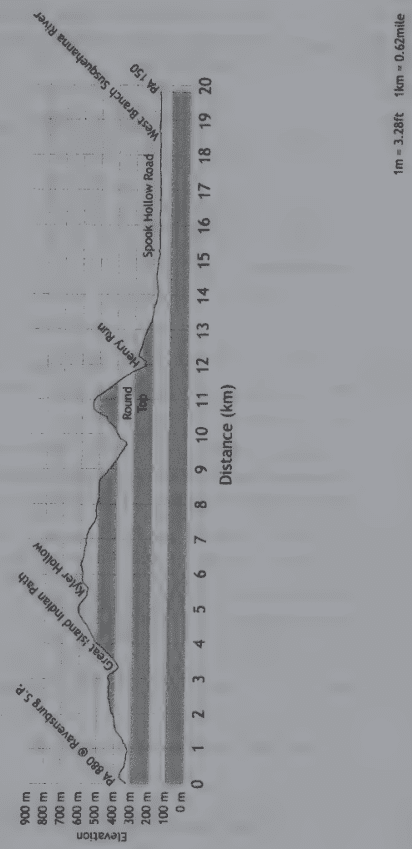

- 153 -

# 宾夕法尼亚州880路至宾夕法尼亚州150路（雷文斯堡州立公园至西支萨斯奎哈纳）详细描述，地图 311-316

| (km) | Features/Directions | (km) |
|---|---|---|
| 0.00 | NB: 穿过 PA 880 路并爬上瀑布泉小径 (Falling Spring Trail)，穿越一条管道地带。 | 20.89 |
| | SB: 穿过管道地带，然后在雷文斯堡公园办公室前穿过 PA 880 路。 | | |
| 0.22 | 穿过一条小溪。 | 20.67 |
| | NB: 在新小径上向右转，沿着旧级面继续。 | | |
| | SB: 在瀑布泉小径上向左转。 | | |
| 0.68 | NB: 经过过滤厂后在混乱的交叉口左转，继续沿小径前进。 | 20.24 |
| | SB: 经过私有土地转角，在混乱的交叉口向左转慢跑。沿着山坡的旧级面继续，经过过滤厂。 | | |
| 0.71 | NB: 到达右侧私有土地转角，沿着州森林土地的白色边界标记。 | 20.18 |
| | SB: 在州森林土地白色边界的老径上向左转。 | | |
| 0.85 | 穿过电线杆。 | 20.04 |
| 1.09 | NB: 左转进入旧级面，该处继续州森林边界。 | 19.80 |
| | SB: 右转进入 Shaw Mountain 小径。 | | |

NB=北向徒步，SB=南向徒步
- 154 -

| NB (km) | Features/Directions | SB (km) |
|---|---|---|
| 2.75 | 向左慢跑穿过 Shaw Mountain 路，小径继续沿着州森林边界前进。 | 18.14 |
| 3.51 | 尽力穿过一条溪流。这是一个很好的原始营地。小径穿过禁酒时期的遗址。 | 17.38 |
| 3.59 | NB: 左转进入大岛小径 (Great Island Path)。这条老路并非最初的路，但至少通往了铺设路的路段。 SB: 右转。 | 17.30 |
| 4.41 | 穿过一条新路。 NB: 右转进入 Kyler 小径并缓爬。 SB: 左转进入大岛小径并向下。这条老路并非最初的路，但至少通往了铺设路的路段。 | 16.48 |
| 5.20 | 标记。 | 15.70 |
| 5.94 | 在 Kyler 上方穿过干流。 | 14.95 |
| 6.22 | NB: 右转进入 Ramm 路。侧有私有土地。 SB: 左转进入 Kyler 小径。 | 14.67 |
| 1.60km = 英里, 0.62mile = 英里
- 155 -

| NB (km) | Features/Directions | SB (km) |
|---|---|---|
| 6.40 | 州森林转角。 | 14.49 |
| 7.05 | NB: 从此处，Ramm 路形成了 Tiadhton 州森林和秃鹰州森林的边界。 | 13.84 |
| 8.09 | NB: 左转进入州森林边界。 | 12.80 |
| 8.46 | SB: 右转进入 Ramm 路。从此处，Ramm 路形成了 Tiadhton 州森林和秃鹰州森林的边界。 | 12.43 |
| 8.66 | SB: 左转进入州森林。 | 12.23 |
| 8.94 | NB: 右转进入州森林。 | 11.95 |
| 9.58 | SB: 右转进入州森林。 | 11.31 |
| 10.21 | 此处往下 Yarns Run 处有原始营地机会。 | 10.68 |
| 10.51 | SB: 左转进入 Yarns Run。 | 10.38 |
| 10.99 | NB: 向右返回。 | 9.90 |
| 11.19 | SB: 向左返回。 | 9.70 |
| 11.41 | 你可以向西看到 Lock Haven，向北可以看到 Avis 以及松溪在 Short Mountain 和阿勒格尼山脉 (Allegheny Front) 之间的汇合——这是 MST 最好的景观之一。 | 9.48 |
| NB: 小径右侧的石坡可以俯瞰西支山谷。 | | |
| SB: 小径左侧的石坡可以俯瞰西支山谷。 | | |
- 156 -
NB=北向徒步，SB=南向徒步
- 156 - (续)

| NB (km) | Features/Directions | SB (km) |
|---|---|---|
| 11.54 | NB: 右转穿过石坡并从圆顶 (Round Top) 开始下山。小径接了一处旧木道。 | 9.35 |
| 12.24 | SB: 穿过石坡并在圆顶顶部左转。 | 8.65 |
| 12.57 | NB: 离开木道向左转。 | 8.32 |
| | SB: 向右转进入木道。 | | |
| 12.68 | NB: 左转进入通过云杉林的旧级面，很快到达 Henry Run。 | 8.21 |
| | SB: 右转并陡峭爬上圆顶角。 | | |
| 12.89 | NB: 在州森林土地边缘右转进入 Pine 路 (T 418)。 | 8.00 |
| | SB: 在州森林土地边缘左转进入小径并下山。 | 7.41 |
| 13.48 | NB: 左转进入 Loganant 路 (T 418)。 | 6.13 |
| 14.76 | NB: 在 SR 2012 交叉口左转。 | | |
| | SB: 在 Loganant 路 (T 418) 交叉口右转。 | | |

| 北向 (km) | 特征/方向 | 南向 (km) |
| :--- | :--- | :--- |
| 15.24 | 北向：在 Center School 处右转进入 Spook Hollow Road (T 425)。 | 5.65 |
| | 南向：在 Center School 处左转进入 SR 2012。 | |
| 15.53 | 一条侧路向前通往铁路边缘的 Fort Horn 标记处。 | 5.36 |
| | 北向：左转进入 Spook Hollow Road, T 425。 | |
| | 南向：右转进入 Spook Hollow Road, T 425。 | |
| 15.92 | 越过铁轨。 | 4.97 |
| | 北向：Fort Horn 的实际位置位于 West Branch 铁路桥处左侧的高地。 | |
| | 南向：Fort Horn 的实际位置位于 West Branch 铁路桥处右侧的高地。 | |
| 16.43 | 穿过 West Branch 之上的 US 220 桥，继续沿河流平行的未铺岩道路。 | 4.46 |
| 19.14 | 路边的石碑标记了特拉华印人村庄的遗址。 | 1.75 |
| 19.29 | 北向：左转并爬上 SR 1005 上的桥墩，在桥上跨越 West Branch。 | 1.60 |
| | 南向：左转并爬下桥墩到达 T 425，Spook Hollow Road 并右转。 | |

1.609km = 1mile, 1km = 0.62mile

## 北向 (km) | 特征/方向 | 南向 (km)

19.72 北向：在 West Branch 对面爬下岸坡，前往 SR 1002 并向东转。

南向：在桥下右转，爬上岸坡，然后左转进入 SR 1005 在桥上跨越 West Branch。

20.11 穿过公路桥跨越 Chatham Run。上游处注意有曾引导宾夕法尼亚运河跨越 Chatham Run 的旧石桥墩。0.78

20.25 北向：左转进入 Harley Drive SR 1010，跨越宾夕法尼亚运河的路线。

南向：沿 West Branch 右转进入 SR 1002。0.64

20.47 跨越 PA 150。

北向：在 Chatham Run 磨坊前方右转平行公路。

南向：左转进入 Harley Drive SR 1010。0.42

20.89 北向：从 Susque Valley Animal Hospital 处向左进入小径跨越 PA 150。0.00

南向：从 Susque Valley Animal Hospital 对面跨越 PA 150 向右转，经过 Chatham Run 磨坊。

NB=北向徒步，SB=南向徒步

## 第 14 节：宾夕法尼亚州 150 号公路至宾夕法尼亚州 44 号公路
### 苏斯奎哈纳河西支 到 RAMSEY
#### TIADAGHTON 州立森林

第 14 节于 Chatham Run 和 Charlton 之间的 Susque Valley Animal Hospital 对面的 PA 150 开始，结束于 Ramsey 郊外的 PA 44。在此处 PA 44 沿线有有限的白天停车位，但请勿阻塞进入 Pine Creek 的通道。

本节的特征是 Woolrich 的旗舰店（可补补包）以及在 Camp Kline 和 Ramsey 之间通过 Pine Creek 径路桥跨越 Pine Creek。MST 沿线唯一的避难所位于本节的 Woolrich Park 和 Bonnell Flats。

通过 Gravel Hill、Mill、Big Spring 和 Bull Run 路可以中间进入第 14 节。第 14 节于 1983 年开放，并于 2001 年迁至铁道径路桥。

注意！本节下方是富含气体的 Marcellus 页岩层。由于天然气开采活动日益增加，步径可能会中断。徒步前请访问 http://www.hike-mst.org 检查径路状况。

## 总体描述

州中部步道（Mid State Trail）顺着 Chatham Run 东侧的高地延伸至 Gravel Hill Road。然后沿着 Park Ave. 穿过 Woolrich，经过旗舰店。它在开阔地带跨越，进入 Tiadaghton 州立森林前沿 Park Ave。它在 Big Spring 处跨越 Couders Pike，南向 Negley Fork。MST 沿着 Shultz Fork 下降至 Pine Creek。在 Ramsey 和 Camp Kline 之间通过桥梁跨越 Pine Creek。在 Ramsey 市中心南向。

Woolrich Park 避难所

## 第 14 节海拔剖面

## 宾夕法尼亚 150 号公路至宾夕法尼亚 44 号公路（苏斯奎哈纳河西支到 Ramsey）详细描述

| (km) | 特征/方向 | 南向 (km) |
| :--- | :--- | :--- |
| 0.00 | 此处停车有限 | 22.20 从 Susque Valley Animal Hospital 对面的 PA 150 边缘开始，MST 沿着南向。 |
| 0.17 | 南向 Susque Valley Animal Hospital 处 | 22.03 |
| 1.03 | 道路交叉处 | 21.17 北向交叉处。 |
| | 南向交叉处 | 20.54 |
| 1.66 | 北向橙色桩标记的径路向下 | 南向道路。 |
| 1.96 | 北向左转进入径路 | 20.24 |
| 2.24 | 北向右转 | 19.96 |
| 3.11 | 北向左转进入径路 | 23.11 |
| 3.64 | 北向右转进入径路 | 16.34 |
| 4.09 | 北向右转 | 19.09 |
| 4.15 | 北向右转 | 18.05 |

| NB (km) | 特征/方向 | SB (km) |
|---|---|---|
| 6.46 | NB: 在林场道的 U 型弯道向右转。 | 15.74 |
| | SB: 在林场道的 U 型弯道向左转。 | |
| 6.57 | 越过 Tiadaghton州立森林（Tiadaghton State Forest）的白色标记边界。 | 15.63 |
| | NB: 沿着州森林边界向上走。 | |
| 6.77 | 继续沿着州森林边界行走。 | 15.43 |
| | NB: 越过林场道并继续沿州森林边界爬升。右侧林场道通往大 Spring 路（Big Spring Road）。 | |
| | SB: 越过林场道并继续沿州森林边界向下。左侧林场道通往大 Spring 路。小径很快进入私人土地，并在二月第一个周一关闭，届时你必须使用大 Spring 路和 Dutch Hollow 路。 | |
| 7.15 | 山顶。 | 15.05 |
| 8.18 | 步径经过几棵大号铁杉。 | 14.02 |

NB=北向徒步，SB=南向徒步

| NB (km) | 特征/方向 | SB (km) |
|---|---|---|
| 9.13 | 在皆伐区的转角经过大 Spring（Big Spring）。 | |
| | NB: 沿着林场道向右转。 | |
| | SB: 沿着小径向左转。 | 13.07 |
| 9.29 | 越过铁门并向右跑过大 Spring 路（Big Spring Road）。 | |
| | NB: 继续在柴材切割路上走。 | |
| | SB: 继续沿林场道。 | 12.91 |
| 9.88 | NB: 沿着小径到达 Nepley Fork 上方的高原边缘，并沿边缘继续。 | |
| | SB: 沿 Nepley Fork 上方的高原边缘转弯。 | |
| | 继续在柴材切割路上走。 | 12.32 |
| 10.76 | 顶部附近可以向东俯瞰 Gamble Run，并向南俯瞰 Nepley Fork。 | |
| | NB: 在 Nepley Fork 和 Gamble Run 之间的岭脊上右转，并开始时而出现剧烈下降。 | |
| | SB: 继续沿 Nepley Fork 和 Gamble Run 之间的岭脊向上。 | 11.44 |
| 12.52 | NB: 向左进入 Gamble Run 山谷。前方旧采石场路持续到 Nepley Fork 交叉口以及更外的西侧路（West Side Road）。MST 石板路向下延伸，很快通过了几个 U 型弯。 | |
| | SB: 向右进入 Nepley 岭脊（Nepley Ridge）。左侧旧采石场路到达 Nepley Fork 交叉口以及更外的西侧路。 | 9.68 |

1.609km = 1mile, 1km = 0.62mile

| NB (km) | 特征/方向 | SB (km) |
|---|---|---|
| 12.92 | 步径在侵蚀的旧路和一条踩良好的渔夫小径之间交替。有很多原始营地。 | 9.28 |
| | NB: 沿着 Gamble Run 上游向左转。 | |
| | SB: 然后向右转并在 U 型弯道上爬，远离 Gamble Run。 | |
| 13.18 | 尽可能越过 Gamble Run，并在对岸向左爬上岸坡。 | 9.02 |
| 13.26 | NB: 在林场道上向左转。 | 8.94 |
| | SB: 向右转。 | |
| 14.38 | 越过 Shultz 分叉（Shultz Fork）。Gamble Run 往上不远处有一个游泳池。 | 7.82 |
| | NB: 向右转进入旧路。在转转弯之前有一个营地。 | |
| | SB: 向左转进入林场道。就在这个转弯后的左侧有一个营地。 | |
| 14.70 | 越过 Shultz 分叉。 | 7.50 |
| | NB: 步径继续爬升。 | |
| | SB: 步径继续下降。 | |
| 15.45 | 越过地下侧溪。 | 6.75 |
| | NB: 向左转。步径横跨 Shultz Fork 峡谷顶部。 | |
| | SB: 步径横跨 Shultz Fork 峡谷顶部。然后向右转。 | |

NB=北向徒步，SB=南向徒步

| NB (km) | 特征/方向 | SB (km) |
|---|---|---|
| 15.68 | 蓝色标记的侧径延伸 185 米到达 Shultz Fork 上方悬崖顶部的壮丽景致。 | 6.52 |
| | NB: 步径在旧路处急右转。 | |
| | SB: 沿左转进入旧路。 | |
| 15.88 | 在一个落叶后的观景点处远离边缘急转，俯瞰 Shultz Fork。 | 6.32 |
| | 16.09 | 步径附近的泉水大部分时间都有，并提供了一个良好的6.11 营地。 | |
| | NB: 之后，步径继续爬升。 | |
| | SB: 之后，步径继续下降。 | |
| 16.57 | 越过 Bull Run 路并继续进入森林。 | 5.63 |
| | NB: 步径缓慢下降。很快步径将沿着松溪峡谷（Pine Creek Gorge）边缘行走。 | |
| | SB: 步径先爬升后缓慢下降。 | |
| 17.58 | NB: 在 Houselander Mountain 景致处向右转，越过松溪并在石阶处剧烈下降。 | 4.62 |
| | SB: 沿 U 型弯爬上陡坡。通过石阶处剧烈下降。步径沿松溪峡谷边缘。 | |

1.609km = 1mile, 1km = 0.62mile

| NB (km) | 特征/方向 | SB (km) |
|---|---|---|
| 18.05 | 林场道。 | 4.15 |
| | NB: 在路上向左转。 | |
| | SB: 在路上向右转。 | |
| 18.21 | 越过 Short Mountain 景致，沿松溪桥越过无名溪。有可能的露营地。 | 3.99 |
| 19.14 | 经过森林中的一个铁门。 | 3.06 |
| | NB: 在 U 型弯处向左转并越过区域。 | |
| | SB: 在 U 型弯处向右转并越过区域。 | |
| 19.29 | NB: 在 Bonnell Run 上方的坡底向右转，然后在 PA 44 再次向右转越过 Ramsey Run。Ramsey 中心禁止停车。 | 2.91 |
| | SB: 越过 Ramsey Run 在 Ramsey Drive 上向左转。Ramsey 中心禁止停车。 | 0.25 |
| 22.20 | PA 44。小型停车场，不要阻塞铁道步道、住宅或松溪的通道。PA 44 南侧0.4 公里处额外的路边停车场。 | |
| | NB: 州森林边界。 | |
| | SB: 从州森林边界沿 PA 44 向西行。 | 0.00 |

NB=北向徒步，SB=南向徒步

## 第 15 段：宾夕法尼亚 44 号路到州道 4001 号
## 西支到 LITTLE PINE TIADAGHTON 州立森林

第 15 段的南侧起点位于 Ramsey 东侧州森林边界的 PA 44 路。到达 PA 44 的最佳路线是从 Jersey Shore 西侧的 US 220 号交汇处出发。起点位于 US 220 以北约12.1 公里处。PA 44 南侧停车位有限。Ramsey 中心禁止停车。不要阻塞前往松溪的通道。北方起点位于 Little Pine 州立公园（Little Pine State Park）的 SR 4001 路。公园内有充足停车位，请向公园办公室或联系站登记（570-753-6000）。Little Pine 州立公园有家庭营地和团体营地区。SR 4001 是沿 PA 44 上的 Waterville 到 PA 287 上的 English Center 的铺装路。起点位于 Waterville 以北约6.4 公里处。

此段有足够的泉水和溪流，Ramsey Run 沿线 Parker Hollow 有原始营地。可以通过 Ramsey Road 和 Dam Run Road 进入中间区域。第 15 段于 1983 年开放，南端于 2001 年重新定位。

警告！此路段位于富气的马塞勒斯页岩（Marcellus Shale）地层。由于天然气生产活动增加，步径可能会中断。请在徒步前通过 http://www.hike-mst.org 查看路况。

## 总体描述

中州步径沿着 Houselander Mountain 陡峭的山坡 U 型弯爬到高原顶部。它进入了 Dry Hollow

随后进入拉姆西溪（Ramsey Run）的第二支叉。沿着拉姆西溪回到高原。它非常陡峭地向下延伸至水坝溪（Dam Run），然后沿着民用保护队的小径到达小松州公园（Little Pine State Park）。

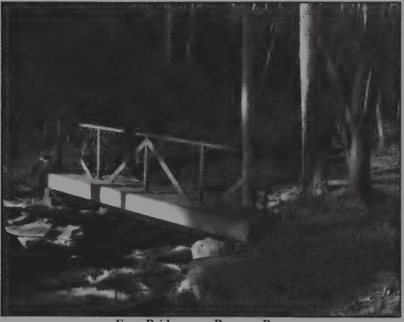

拉姆西溪上的步行桥

# 第 15 节 高程图

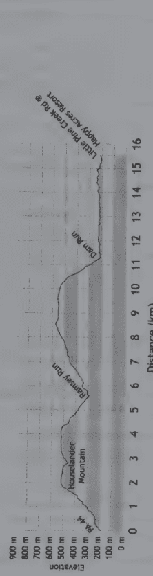

# 宾夕法尼亚州44 号公路到4001 号州（拉姆西至小松州公园）详细描述，地图 311-316 南行

| (km) | 特征/方向 | (km) |
| :--- | :--- | :--- |
| 0.00 | 拉姆西的“铁道到路径”停车场。不要堵塞通往拉姆西的道路。PA 44 以南 0.4 km 处有额外的路边停车场。 NB：从 PA 44 的“铁道到路径”停车场右转。 | |
| 0.25 | 跨越 PA 44。PA 44 南侧 0.15 km 处有额外停车位。 | 16.67  NB：爬上石阶开始爬登豪斯兰山（Houslander Mountain）。 SB：右转并沿 PA 44 继续。 | |
| 0.43 | NB：向左折形通过。 | 16.49  SB：向右折形通过。 | |
| 0.71 | NB：右转进入一条旧伐木路。 | 16.21  SB：左转并沿小径走到 PA 44 处的石阶。 | |
| 1.00 | 跨越拉姆西溪。 | 15.92  NB：继续爬登豪斯兰山，可以欣赏到松溪谷（Pine Creek Valley）的景色。 SB：右转进入旧伐木路。 | |
| 2.90 | NB：在右侧遇到蓝色标记的豪斯兰小径（Houslander Trail）。 | 14.02  SB：蓝色标记的豪斯兰小径在左侧。继续直行穿过高原，然后开始下豪斯兰山。 | |

NB=北行步行，SB=南行步行

## NB (km) 特征/方向 SB (km) |
| :--- | :--- | :--- |
| 3.06 | NB：在小径上左转进入干旱谷（Dry Hollow）。 | 13.86  SB：右转进入林道路。 | |
| 3.32 | NB：沿水流右转并经过一个泉水。 | 13.60  然后左转离开干旱谷。 SB：在小径上左转爬到林道路。 | |
| 3.86 | 州森林边界。 | 13.06  NB：在边界处左转。 SB：在边界处右转并进入干旱谷，经过一个泉水。 | |
| 4.45 | 与南向侧小径汇合，可远眺干旱谷外的 12.47 莱恩岭（Kline Ridge）。景点距离主路 140 米，侧小径标有白色 V 形标记。 | | |
| 4.87 | NB：陡峭下行至拉姆西溪第二支叉。 SB：山顶。继续穿过大量的杜鹃林。 | |
| 5.05 | NB：在粗糙的小径上左转进入第二支叉。 | 11.87  SB：右转爬上陡峭的小径。 | |
| 6.24 | 走过步行桥跨越拉姆西溪。 | 10.68  NB：右转，在溪流对岸右转进入一条经过简易营地的旧路。 SB：左转，在溪流对岸右转后左转，沿粗糙的小径爬上拉姆西溪第二支叉。 | |

1.609km = 1mile，1km = 0.62mile

## NB (km) 特征/方向 SB (km) |
| :--- | :--- | :--- |
| 6.53 | 第三支叉从东侧进入。 | 10.39  NB：在第三支叉从东侧汇入处左转并沿旧采石场路爬升。 SB：沿拉姆西溪右转进入旧路，经过第三支叉从东侧汇入处的简易营地。 | |
| 6.63 | NB：右转进入与拉姆西溪平行的旧坡道。几条旧坡道和木材滑道与之交汇，它穿过源头附近茂的山杜鹃丛。 | 10.29  SB：左转进入旧采石场路并下山。 | |
| 8.75 | 猎营附近的泉水。 | 8.17  NB：在小径上左转。 SB：右转进入与拉姆西溪平行的旧坡道。几条旧坡道和木材滑道与之交汇，它穿过源头附近茂的山杜鹃丛。 | |
| 9.19 | 沿拉姆西路向右走 42 米。 | 7.73  NB：左转进入林道路。 SB：在小径上左转。 | |
| 9.40 | 旧光伐区。 | 7.52  NB：右转进入光伐区。 SB：离开光伐区。 | |

NB=北行步行，SB=南行步行

## NB (km) 特征/方向 SB (km) |
| :--- | :--- | :--- |
| 9.75 | NB：左转进入电缆车路（Tram Road）。 | 7.17  SB：在小径上右转，然后左转进入林道路。 | |
| 9.96 | 经过俯水坝溪的景点。 | 6.96 | |
| 10.24 | 继续沿电缆车路走。 | 6.68  NB：离开光伐区。 SB：进入光伐区。 | |
| 11.15 | NB：开始下行至。 | 7.77  SB：到达高原。 | |
| 11.46 | NB：在水坝溪与松溪交汇处右转。 | 5.46  SB：在小径上左转。 | |
| 11.92 | NB：右转进入。 | 5.00  SB：在水坝溪与松溪交汇处右转。 | |
| 12.04 | NB：沿干流左转。 | 4.88  SB：向右爬坡。 | | |
| 12.45 | NB：沿干流左转。 | 4.47  SB：向右爬坡。 | | |
| 12.72 | NB：右转进入。 | 4.20  SB：在小径上左转。 | |
| 13.93 | NB：跨越。 | 2.99  SB：在小径上右转。 | |
| 16.15 | NB：经过。 | 0.77  SB：在小径上左转。 | |
| 16.34 | NB：向下走。 | 0.58  SB：右转进入。 | | |
| 16.50 | NB：左转进入。 | 0.42  SB：在小径上左转。 | | |
| 16.68 | NB：跨越。 | 0.24  SB：右转进入。 | |
| 16.92 | NB：经过。 | 0.00  NB：右转进入。 SB：在小径上左转。 | |

沿 Silver Branch 的州立森林向东环绕游戏狩场地 - 州立森林边界。随后它在 Wolf Run 保护区的东端穿过 Sebring Branch 的源头。MST（密西西州步道）进入 Jacobs Run 的上游，穿过 Oregon Hill 并下降到 Browns Fork。从那里向东转弯，在 SGL 75 的 Trout Run 地块接上一条管理道路。越过 Trout Run 后，MST 向上进入 Hoyt Hollow，然后沿 Big Run 上游到达 Brill Hollow。穿过 Gillespie Point 后，下降至 Blackwell 的 PA 414 号公路。

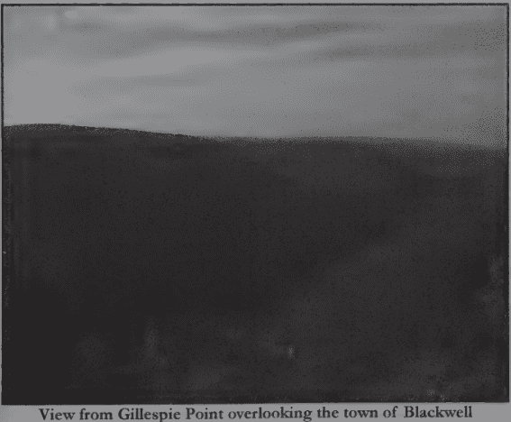

- 185 -

## 第 16 节高程图

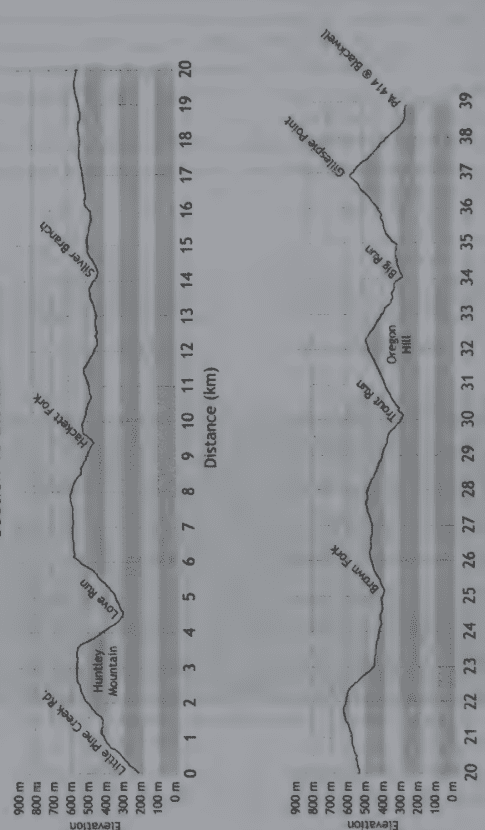

## 州道 4001 号至宾夕法尼亚州道 414 号（Little Pine 州立公园至 Blackwell）详细描述，地图 311-316

| NB (km) | 特征/方向 | SB (km) |
| :--- | :--- | :--- |
| 0.00 | Little Pine 州立公园南端的 SR 4001 与 English Run Road 的交汇处。 | |
| NB: 从 SR 4001 出发，密州步道沿 Spike Buck Hollow Trail 向上，该路也有粉红色的标记。（Happy Acres 餐厅、有限物资和公用电话在左侧）。步道远离道路处折返，然后在一条旧级地上上右转，通过山脊对侧的两个采石场。 | | |
| SB: Happy Hectares 前右侧有公用电话。 | | |
| 0.87 NB: 步道沿山脊左转，某些地方变得刀刃般狭窄。 | | |
| SB: 步道离开山脊右转，在下山接上采石场路，经过两个采石场。 | | |
| 1.71 越过 Little Pine Creek 的大石景观。 | 38.91 | | |
| SB: 继续沿山脊行走，某些地方变得刀刃般狭窄。 | | | |

| NB (km) | 特征/方向 | SB (km) |
| :--- | :--- | :--- |
| 2.45 NB: 与绿色标记的 Love Run Trail 交汇。Spike Buck Hollow Trail 左转下降至 Boone Run Road。右侧望可看向 Little Pine 溪谷。MST 继续沿 Love Run Trail 前行。 | 38.17 | | |
| SB: 与右侧粉色标记的 Spike Buck Hollow Trail 交汇。左侧望可看向 Little Pine 溪谷。MST 继续沿 Spike Buck Hollow Trail 前行。 | | |
| 3.50 步道旁有泉水。 | 37.12 | | |
| NB: 左侧有泉水。 | | | |
| SB: 右侧有泉水。 | | | |
| 3.92 NB: 右转 Pesto Trail 并陡降。 | 36.70 | | |
| SB: 在步道上左转。 | | | |
| 4.25 在巨大的铁杉树底部通过 Hemlock Spring。 | 36.37 | | | |
| 5.05 穿过狩猎营地后方的 Love Run 人行桥。可以从营地侧的水龙头获取水。 | 35.57 | | | |
| NB: 步道左转进入 Love Run Road。 | | | | |
| SB: 右转 Pesto Trail。时而非常陡峭。 | | | | |
| 5.80 NB: 右转采石场路并爬升。 | 34.82 | | | |
| SB: 左转 Love Run Road。 | | | | |

NB=北向徒步，SB=南向徒步

| NB (km) | 特征/方向 | SB (km) |
| :--- | :--- | :--- |
| 6.24 从采石场边缘可以俯瞰 Little Pine Creek 的良好景色。 | 34.38 | | | |
| NB: 与黄色标记的 Panther Run Trail 交汇。绿色标记的 Love Run Trail 右转。MST 左转进入 Panther Run Trail。 | | | | |
| SB: 与绿色标记的 Love Run Trail 交汇。黄色标记的 Panther Run Trail 在此结束。MST 右转进入采石场路。 | | | | |
| 7.03 穿过纪念碑岩 (Monument Rock)。 | 33.59 | | | |
| SB: 步道下降。 | | | | |
| 8.24 MST 与 Panther Trail 的步道交汇处。 | 32.38 | | | |
| NB: MST 左转进入 Panther Trail。黄色标记的 Panther Run Trail 右转。 | | | | |
| SB: MST 右转进入 Panther Trail。黄色标记的步道在前方 Panther Run 下降。 | | | | |
| 9.05 穿过 Schoolhouse Road。 | 31.57 | | | |
| NB: 继续沿步道行走，沿 Hackett Fork 南支下降，多次跨越溪流。 | | | | |
| SB: 继续沿 Panther Run Trail 行行。 | | | | |
| 9.76 NB: 步道向左爬并继续在旧级地上。 | 30.86 | | | |
| SB: 步道左转并继续沿 Hackett Fork 南支向上，多次跨越溪流。经过步道左侧的一个泉水。 | | | | |

1.609km = 1mile, 1km = 0.62mile

| NB (km) | 特征/方向 | SB (km) |
| :--- | :--- | :--- |
| 10.28 穿过 Hackett Fork。仅限小组露营。 | 30.34 | | | |
| NB: 前方左转进入 Line Path。 | | | | |
| SB: 继续沿旧级地上。 | | | | |
| 10.50 穿过 Hackett Road。 | 30.12 | | | |
| NB: 沿 Longs Ridge 伐木路继续。 | | | | |
| SB: 继续沿 Line Path。 | | | | |
| 11.06 NB: 右转步道穿过白松林。 | 29.56 | | | |
| SB: 沿 Longs Ridge 伐木路左转穿过白松林。 | | | | | |
| 11.62 穿过 Ott Fork。 | 29.00 | | | |
| NB: 进入 Bark Cabin Area。自然区域内不可露营。步道西侧有原始铁杉。 | | | | | |
| SB: 离开 Bark Cabin Area。 | | | | | |
| 12.16 穿过 Bark Cabin Area 侧的 Barrens Power Line（南支）。 | 28.46 | | | |
| NB: 继续沿。 | | | | | |
| SB: 进入 Bark Cabin Area。自然区域内不可露营。步道西侧有原始铁杉。 | | | | | |
| 12.32 NB: 沿 State Land 75 边界右转 White Line Trail。 | 28.30 | | | |
| SB: 步道上左转。 | | | | | |

NB=北向徒步，SB=南向徒步

| NB (km) | 特征/方向 | SB (km) |
| :--- | :--- | :--- |
| --- | --- | --- |
| 12.76 NB: 左转进入 SGL 75。狩场地内不可露营。 | | |
| SB: 在 SGL 75 与 Tiaghton 州立森林之间右转 White Line Trail。 | 27.86 | | |
| 13.04 NB: 左转旧级地。 | | | |
| SB: 右转进入步道。 | 27.58 | | | |
| 13.23 穿过 Bennys Run 并继续在旧级地上。 | 27.39 | | | |
| 14.06 NB: 沿旧级地。 | | | | |
| SB: 左转进入旧级地。 | 26.56 | | | |
| 14.48 NB: 进入采光区。小心跟随标记。 | | | | |
| SB: 进入森林并继续旧级地。 | 26.14 | | | |
| 14.76 NB: 在山脊顶部左转管理道路。 | | | | |
| SB: 在空地上右转进入步道。小心跟随标记。 | 25.86 | | | |
| 14.84 NB: 右转进入林地并下降。前方管理道路通往 Okome Road，约 1.5 km。 | | | |
| SB: 左转管理道路。右侧道路通往 Okome Road，约 1.5 km。 | 25.78 | | | |

1.609km = 1mile, 1km = 0.62mile

| NB (km) | 特征/方向 | SB (km) |
| :--- | :--- | :--- |
| 15.25 NB: 离开 SGL 75 重新 Tiaghton 州立森林。Silver Branch 左侧的小溪流适合大团体露营。 | | | | |
| SB: 穿过 Tiaghton 州立森林的白色标记边界重新进入 SGL 75。 | | | | |
| 15.36 穿过 Silver Branch。 | 25.26 | | | |
| SB: Silver Branch 右侧的支溪旁有大团体露营。 | | | | |
| 15.51 NB: 右转进入旧林地并在白松林中向上行走。 | 25.11 | | | |
| SB: 左转进入步道。 | | | | |
| 16.46 NB: 在空地上右转并下降。 | 24.16 | | | |
| SB: 左转进入旧林地并在白松林中向下行走。 | | | | | |
| 16.57 NB: 右转进入旧林地。 | 24.05 | | | |
| SB: 左转通过空地。 | | | | | |
| 16.97 NB: 沿 SGL 75 边界左转 White Line Trail。注意步道旁有大白松。 | 23.65 | | | |
| SB: 右转进入旧林地。 | | | | | |
| 17.25 步道旁有小营地（州立森林侧）。一条粗糙的未标记步道向右转通往 Silver Branch 北支。注意大常绿树。 | 23.37 | | | | |

NB=北向徒步，SB=南向徒步

| NB (km) | 特征/方向 | SB (km) |
| :--- | :--- | :--- |
| 17.72 步道登记处。签到。 | 22.90 | | | |
| NB: 左转进入旧木拖道。 | | | | |
| SB: 沿 SGL 75 边界右转 White Line Trail。 | | | | | |
| 18.58 穿过 Barrens Power Line 北支。 | 22.04 | | | |
| 19.61 穿过 Okome Road。 | 21.01 | | | |
| NB: 进入 Wolf Run 保护区。 | | | | |
| SB: 离开 Wolf Run 保护区。 | | | | |
| 19.97 经过锯厂场并穿过 Sebring Branch。 | 20.65 | | | |
| NB: 远侧步道沿 Oregon and Texas RR 地地。 | | | | |
| 20.26 NB: 右转进入另一条旧级地。 | 20.36 | | | |
| SB: 左转进入 Oregon and Texas 铁路级地。 | | | | |
| 20.44 尽力跨过溪流。 | 20.18 | | | |
| 21.84 跨越 Jacobs Run，此处为间歇性。 | 18.78 | | | |
| NB: Browns Fork 前的最后水源。 | | | | |
| SB: 沿伐木路行走。 | | | | | |
| 22.14 可能的大团体露营地。 | 18.48 | | | |
| NB: 在野生动物空地右转。缓爬 Oregon Hill。 | | | | | |
| SB: 在野生动物空地左转。 | | | | | |

## NB 特征/方向 SB (km)

| NB (km) | 特征/方向 | SB (km) |
| :--- | :--- | :--- |
| 23.60 | 俄勒冈山顶。俯瞰吉尔斯斯普点以侧。 | 17.02 |
| NB: 步径左转，顺着山角向下到达布朗叉。 | | |
| SB: 下降俄勒冈山平缓的南坡。 | | |
| 24.44 | 溪中的一个泉水通常有足够的水供小组露营。 | 16.18 |
| NB: 在山脚处的旧路面处右转。 | | |
| SB: 在山脚左转。小径顺着山角前进。 | | |
| 25.81 | 穿过木屋前的桥梁。 | 14.81 |
| NB: 沿旧路面向上，至越野路左侧。 | | |
| SB: 沿旧路面前进。 | | |
| 25.93 | NB: 在布朗叉路口左转（仅限四驱）。 | 14.69 |
| SB: 沿旧路面右转。 | | |
| 26.71 | NB: 右转并顺着山谷向上。 | 13.91 |
| SB: 左转并顺着布朗叉路前进。 | | |
| 27.18 | NB: 穿过 SGL 75 州林区的白标边界。 | 13.44 |
| SB: 穿过蒂亚达格顿州森林的白标边界。 | | |
| 27.39 | NB: 在综合管理道路和猎物食物地处左转。这不是管道。 | 13.23 |
| SB: 沿小径右转向下进入山谷。 | | |

NB=北向徒步，SB=南向徒步

## NB (km) 特征/方向 SB (km)

28.65 俯瞰俄勒冈山北翼的东侧。11.97
SB: 继续沿综合管理道路和猎物食物地前进。这不是管道。

31.17 NB: 急左转进入旧路面并下降。9.45
SB: 急右转进入管理道路并继续爬升。

31.51 NB: 在鳟溪上方左转进入管理道路。9.11
SB: 沿旧路面右转并爬升。

31.61 穿过布朗叉。9.01
NB: 小径右转。
SB: 在管理道路上向左偏。

31.74 沿着圆木横过鳟溪（此点通常有圆木）。8.88
NB: 爬上岸岸。右转进入旧铁路路面，即霍伊空谷小径（Hoyt Hollow Trail）。
SB: 向上游左转。

31.91 瀑布。8.71
NB: 瀑布在小径右侧。
SB: 瀑布在小径左侧。

32.18 穿过溪床（通常干涸）和一个围墙泉水。8.44
NB: 围墙泉水在小径左侧。
SB: 围墙泉水在小径右侧。

1.609km = 1mile，1km = 0.62mile

| NB (km) | 特征/方向 | SB (km) |
| :--- | :--- | :--- |
| 33.36 | NB: 右转进入管理道路并继续爬升。 | 7.26 |
| | SB: 左转进入霍伊空谷小径，这是一条旧铁路路面。 | | |
| 33.50 | NB: 左转进入小径，很快穿过提奥加州森林的白标边界。避开左侧私有土地。小径很快进入采伐区并与私地边界平行。 | 7.12 |
| | SB: 离开采伐区，穿过 SGL 75 的白标边界并在管理道路右转。 | | |
| 33.80 | 穿过查曼径（此点仅限四驱）。 | 6.82 |
| | NB: 沿边界经过山脊。 | | |
| | SB: 沿边界继续。 | | |
| 34.02 | NB: 采伐区边缘。小径通往森林。 | 6.60 |
| | SB: 到达采伐区边缘并沿边界前进。 | | |
| 34.19 | 经过私有土地转角。 | 6.43 |
| | NB: 接上阿什沃斯径。 | | |
| | SB: 从阿什沃斯径左转。避开右侧私有土地。 | | |
| 35.48 | NB: 从阿什沃斯径右转。 | 14 |
| | SB: 向左转进入阿什沃斯径。 | | |

NB=北向徒步，SB=南向徒步

NB (km) 特征/方向 SB (km)

35.66 在阿什沃斯空谷底部穿过溪流，4.96 处有一个小营地。
NB: 沿布朗叉上方的旧路面前进。
SB: 沿旧路面向上爬升。

36.64 NB: 穿过布朗叉然后穿过布里尔叉。接着向上游走，很快再次穿过布里尔叉。3.98
SB: 两次穿过布里尔叉然后穿过布朗叉。接着向下游沿旧路面前进。

36.80 在布朗叉路上向左偏移 30 米。3.82
NB: 右转进入布里尔空谷小径
SB: 沿小径右转。

37.40 NB: 左转进入新小径穿过溪流。3.22
SB: 穿过溪流右转进入布里尔空谷小径。

38.18 NB: 沿山脊左转。左侧有景观。2.44
SB: 经过右侧景观，在鞍部右转并在采伐区之间穿过伐木路。

38.66 到达吉尔斯斯普点（宾法尼亚的马峰），1.96 高处可俯瞰松溪向下和布朗溪向上。
NB: 小径沿该点远侧下降并有蓝点标记。
SB: 小径沿该点远侧下降。

1.609km = 1mile，1km = 0.62mile

| NB (km) | 特征/方向 | SB (km) |
| :--- | :--- | :--- |
| 39.32 | NB: 右转进入旧伐木路并下降。 | | |
| | SB: 左转进入小径继续爬升。 | | |
| 40.18 | NB: 在布朗叉右转。 | | |
| | SB: 沿旧伐木路左转并爬升。小径也有蓝点标记。 | | |
| 40.29 | NB: 左转进入 PA 414 并其穿过布朗溪。 | | |
| | SB: 在布朗叉路上右转。 | | |
| 40.62 | 经过布莱威尔酒店。PA 414 前 0.15 km 处有划艇停车场，配水泵、外厕和垃圾桶。 | | |
| 穿过停车场后再 0.18 km 处即是波恩径，它是中州步径和西缘步径之间的连接径。请参阅指南 D 部分获取波恩径的详细步径数据。 | | |
| NB: 右转进入标记稀疏的松溪铁路步径。 | | |
| SB: 穿过布朗溪。 | | |

NB=北向徒步，SB=南向徒步

# 第 17 段：宾法尼亚 414 号公路至 287 号公路（布莱威尔至莫里斯/安特姆）提奥加州森林，私有土地

第 17 段始于布莱威尔，结束于 PA 287，此处位于安特姆以西、莫里斯以北和威尔斯伯堡以南。景点包括松溪、斯托尼福克溪、威尔逊溪和 Anna S. 矿的幽灵景观。松溪铁路沿线斯托尼福克溪沿禁止露营。第 17 段于 2005-2006 年开放。

注意！该段位于富含马塞勒斯页岩地层上。由于产产增加，步径可能会中断。徒步前请登录 http://www.mst.org 检查步径情况。该段任何州土地均未计划地表活动。

## 总体描述

MST 沿松溪铁路步径从宾法尼亚大峡谷底部的布莱威尔处向上游延伸，然后爬升至采石场溪到达峡谷东缘。MST 横跨山缘，从顶部越过下降到斯托尼福克。斯托尼溪的湿过过引导徒步者登上罗兰德溪到达丹纳山的宽阔高原。下降进入滑空谷，连接到通往莫里斯村的小径。MST 缓升回到高原边缘，在高处穿过蛇行叉。步径进入巴斯伍德溪，穿岩石上升到威尔逊溪西缘，在山缘边缘的缝隙间穿行，经过旧煤矿遗迹和一个全景景台，最后沿窄碎石路下降到威尔逊溪。

## 第 17 段等高线图
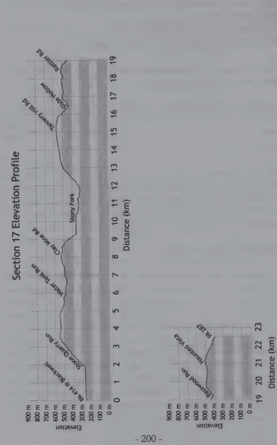

# 宾法尼亚 414 号公路至 287 号公路（布莱威尔/莫里斯/安特姆）详细描述

## NB (km)

0.00 PA 414，布莱威尔酒店前的铁路步径（撰稿时关闭）。划艇停车场（配水泵、外厕和垃圾桶）在 PA 414 前 0.15 km 处。过停车场后再 0.18 km，即穿过桥后后是波恩径，它是中州步径和西缘步径之间的连接径。请参阅指南 D 部分获取波恩径的详细步径数据。

2.40 NB: 沿松溪铁路向北/右走。NB 徒步者检查 PA 414 单车桥布朗溪的情况。如果不理想，强烈建议沿 PA 414 向东前往莫里斯。
SB: 左转，沿 PA 414 穿过布朗溪。

1.90 越过采石场溪的桥，由桩子标记。禁止露营。

2.10 NB: 穿过桥，右转进入石阶绕左转至陡峭小径，在急转弯后很快变缓。
SB: 左转，沿松溪铁路向南走到达布莱威尔。

1.609km = 1mile，1km = 0.62mile

## NB SB (km)

## 特征/方向

3.48 采石场溪源头。附近有水和营地。黄标小径（NB 向右，SB 直行 660 米到达一个伐木空地，在空地处右转，经过布莱威尔电缆房，单程 1.8 km 到达震撼的崖顶景观。）

20.52 NB: 左转进入旧伐木路，很快再次左转进入另一条旧伐木路。
SB: 右转穿过岩石下降。急转弯后检查刹车，可能需要抓住最后几棵白松幼树以免掉下下方的自行车。

4.33 黄标景观支路路汇处。325 米到达峡谷东缘第一个景观（位于布里尔空谷对面），单程共 400 米到达松溪和采石场溪的第二个景观。
19.67

4.94 NB: 左转进入逐渐变窄的白松林小径。在岩石下降前左侧有一个干燥的营地。
19.06 SB: 右转沿旧伐木路易于行走（旧伐木路直行，未标记，300 米后汇合，但遮挡了景观）。

6.13 水箱溪主干。有水。
17.87 NB: 沿遍山杜鹃旧路面前进。
SB: 短暂爬过岩石进入穿白松林的小径。在松林中平坦后在右侧有一个干燥营地。

| NB (km) | 特征/方向 | SB (km) |
| --- | --- | --- |
| 6.91 | Water Tank Run 北支。有水。标记的小径穿过溪流，沿旧路向下在 1.1 km 处到达 Pine Creek 铁路步道。 NB：在穿过茂密月桂树的石径小路上右转。 SB：在旧坡道上左转。 | 17.09 |
| 8.73 | Clay Mine Road，季节性林业道路。有限的土质路肩停车位。 NB：路过木材销售点并登记，然后下降，在岩石间蜿蜒前行。Stony Fork 处没有桥。在高水条件下，NB 方向的徒步者考虑在此处左转，沿着未标记的公共道路，在路口右转，在 20 km 后重新汇合 Stony Fork 东侧的 MST（缅足径）。 SB：经过两处岩露地，逐渐下降穿过茂密山月桂树的石径路。 | 15.63 |
| 9.19 | Mossy Run 源头。有水（季节性）。 NB：陡坡下降，经过三处瀑布。 SB：靠左边缘；爬上穿过岩石间的蜿蜒石径。在山顶附近登记。 | 14.91 |
| 9.74 | Mossy Run 底部。 NB：右转至贴着 Stony Fork 上方陡坡的径路。从州游戏用地（State Game Lands）边界到 Stony Fork Creek Road 另一侧（km 12.7）禁止露营。 SB：左转并陡峭爬过三处瀑布。 | 14.26 |

1.609km = 1英里，1km = 0.62英里

| NB (km) | 特征/方向 | SB (km) |
|---|---|--|
| 11.42 | Stony Fork 小瀑布。禁止露营。（污水处理厂位于 Stony Fork 上游）。 NB：通过 Stony Fork 上方的平坦区域。 SB：继续沿着平行于 Stony Fork 上游的陡坡径路行走。注意州游戏用地边界，在通过 SGL 之前禁止露营。 | 12.58 |
| 11.98 | Stony Fork 大瀑布。禁止露营。 NB：向下游继续。 SB：向上继续。 | 12.02 |
| 12.40 | 与黄色标记的 Beer Can Spur 汇合，沿侧径 580 m 处可到达 Stony Fork Clay Mine Road 渡口西侧的土质停车点。Clay Mine Road 渡口比这里更难横渡，除非你能搭上路过的吉普车。此处及支路旁禁止露营。 NB：左转，下降并渡过 Stony Fork，脚会会湿。如果你不想让膝盖或大腿弄湿，或者水高到无法渡过，唯一的干燥路程是沿原路（MST 径路）返回 Clay Mine Road，然后沿着未标记的公共道路到达 Stony Fork 另一侧。 SB：右转并沿着 Stony Fork 沿壮丽景色前行。 | 11.60 |

## NB 特征/方向 SB (km)

12.54 Stony Fork Creek Road，季节性城镇土质道路 11.46n（注意：从 PA 414 驶往此路没有桥）。仅在道路西侧的宽阔区域停车，不要驶入或阻塞租赁营地的车道。

NB：沿着通往租赁营地的车道向上走，迅速左转进入爬向 Roland Run 的旧径路。在到达租赁营地视线范围的上坡处之前禁止露营。

SB：从此处下降，在 km 14 处渡过 Stony Fork。如果你不想渡过 Stony Fork，唯一的干燥路程是沿着未标记的道路。在 Stony Fork Creek Road 右转，经过 Stony Fork Creek 营地，在 Draper 的铺装路路上左转再左转，在 Cobble Hill Road 第二左转，在 Clay Mine Road 左转，在 20 km 后在高原顶部重新汇合 MST。

13.44 另一条未标记的小径通往伐木区。10.56

NB：硬左转折回经过 Roland Run 南支，爬过 Roland Run 缺口的冬季景观。

SB：硬右转下降沿 Roland Run 的山坡径路。

13.75 跨过 Roland Run 北支，有水，有营地。10.25

NB：沿着高原上的旧伐木路走。

SB：下降沿山坡径路进入 Roland Run 缺口。

1.609km = 1英里，1km = 0.62英里

## NB (km) 特征/方向 SB (km)

16.00 Tannery Hill Road 末端，土质公共道路，土质停车区。不要阻塞州森林大门。

NB：穿过停车区，进入穿过杉树的略微潮湿的径路，然后沿 Slide Hollow 溪岩岩下降。

SB：沿着逐渐变窄的道路上的橙色标记走。

17.17 Slide Hollow 汇合处。登记。从汇合处向下的黄色标记 Mor-Village 支路在 0.46 km 处到达州森林边界的一处 3 米高的瀑布，跨过溪流进入私人土地，然后在 0.63 km 处到达 Rattler Rd（禁止停车）。支路在 Rattler Rd 上右转，然后右转 PA 287，在 1.23 km 处右侧到达 Twin Streams 私人营地，然后在 1.55 km 处左侧面向城镇广场的商店和酒吧，此处标记结束。右转 PA 287/414 到 Morris 邮局（邮编 16938）。（等等，让我重新读一遍 OCR，这里有点乱）。

17.17 Slide Hollow 汇合处。登记。从汇合处向下的黄色标记 Mor-Village 支路在 0.46 km 处到达州森林边界的一处 3 米高的瀑布，跨过溪流进入私人土地，然后在 0.63 km 处到达 Rattler Rd（禁止停车）。支路在 Rattler Rd 上右转，然后右转 PA 287，在 1.23 km 处右侧到达 Twin Streams 私人营地，然后在 1.55 km 处左侧面向城镇广场的商店和酒吧，此处标记结束。右转 PA 287/414 到 Morris 邮局（邮编 16938）。

等等，让我正确修复那段乱的部分：
17.17 Slide Hollow 汇合处。登记。从汇合处向下的黄色标记 Mor-Village 支路在 0.46 km 处到达州森林边界的一处 3 米高的瀑布，跨过溪流进入私人土地，然后在 0.63 km 处到达 Rattler Rd（禁止停车）。支路在 Rattler Rd 上右转，然后右转 PA 287，在 1.23 km 处右侧到达 Twin Streams 私人营地，然后在 1.55 km 处左侧面向城镇广场的商店和酒吧，此处标记结束。右转 PA 287/414 到 Morris 邮局（邮编 16938）。

1.609km = 1英里，1km = 0.62英里

## NB (km) 特征 特征/方向 SB (km)

| NB (km) | 特征/方向 | SB (km) |
| --- | --- | --- |
| 16.00 | Tannery Hill Road 末端，土质公共道路，土质停车区。不要阻塞州森林大门。 NB：穿过停车区，进入穿过杉树的略微潮湿的径路，然后沿 Slide Hollow 溪岩石下降。 | 8.00 |

## NB 北向/SB 南向 方向 (km)

### 混凝土基础。来自 Anna S. 深层矿（1905年至1937年）的煤炭曾通过桶子在支撑在这一基础上的缆索电道车跨越威尔尔逊溪（Wilson Creek）山谷，到达 Antrim 的铁路。由于大多数 Anna S. 的矿工住在 Antrim，有些人可能曾动过乘坐桶子以节省穿过山谷的步行路。根据当地传说（没有州矿业检查员的记录支持），在一次冬夜，电道车停电了，导致最后一名矿工坐在高悬山谷上方的小桶上被冻死。**

22.23

1.77

NB: 在卡车道上保持平路。

SB: 向左下山卡车道。向左看标记物。

“幽灵全景（Haunted Vista）”。威尔尔逊溪山谷的全景、接下来的 4 公里 MST 路线以及对岸的 Antrim。这堆岩石的底部正在侵蚀并降低下方 150 米处威尔尔逊溪的水质。长期计划要求移除这一景观中的人为元素。**不要在此处生火**，这里的营地火灾极难扑灭，**你将承担所产生的费用**。

22.29

1.71

NB: 背对风景，爬过岩石边缘的之字形弯。

SB: 离开风景向右转，横穿一条卡车道。

NB=北向徒步，SB=南向徒步

# NB NB SB
(km) 特征/方向

22.36 卡车道。1.64

NB: 右转，不久后通过一个大门进入 10 公里的私有土地，该段其余部分禁止露营。

SB: 左转并短暂穿过大石区域。

22.80 Anna’s Road（T-345）上的 U 形弯。**此处禁止停车**。1.20

NB: 右转，沿着单车道的土质镇道路下山。

SB: 向左偏，留在私有土地上的标记旧路上，不久通过大门进入州州林用地。

23.80 穿过 T-345 涵洞桥过威尔尔逊溪。向北 0.20 处看，可以看到溪流东岸在涵洞与背景中旧岸墩之间的结节石露头。这种稀有的岩石含有石化泥球，地质学家对其形成方式仍有争论。

NB: 左转短暂沿 PA 287 行进。

SB: 右转沿着 Anna’s Road（T-345）上山。山上禁止停车，因此徒步者没有理由开车上去。

24.00 PA 287 旁“布罗斯堡煤（Blossburg Coal）”历史标记。附近东侧有 0.00 米宽的路肩。

NB: 右转，沿 SR 3009 上坡。

SB: 沿 PA 287 向南，在 Anna’s Road/T-345 右转。

1.609km = 1英里，1km = 0.62英里

# 第18 节：宾夕法尼亚州287 号公路至美国 6 号公路 MORRIS/ANTRIM 到 6 号公路 TIOGA 州林，私有土地

第18 节起始于 PA 287，位于 Antrim 以西、Morris 以北，沿 US 6 号路结束。

特征包括几处瀑布、Landrus 鬼镇，以及在穿过私有土地上相对开阔区域时观察野生动物的机会。第18 节分别于 2007 年和2011 年向北到达州林末端，并在2009 年向南到达 Mudge Road。截至本文写作，仍留有一个未标记的间隙。

注意！此路段下方是富含气的马塞勒斯页岩（Marcellus Shale）地层。由于产气活动增加，步道可能会中断。徒步前请在 http://www.hike-mst.org 检查路径状况。

## 总体描述

MST 沿着道路、小径和轨道爬上一座私人所有的山脉，然后穿过修复的矿区和商业林地，这些区域在狭窄、崎岖、有时多岩石的路径上，在狩猎旺季会关闭。进入州林后，MST 很快进入了 Nickel Run 的偏远山谷，这是一条极高价值野生鳟鱼溪。一条短侧径通往 Nickel Run 上的瀑布和带有游泳池的营地。MST 顺着岩石山坡向下到达 Landrus，这是一个古老的煤矿村，有许多引人入胜的基础。路径穿过偏远森林的 Babb Creek，在没有道路的间隙中间跨越主流两侧，以观察支流上的两处瀑布。离开州林后，MST 向北前往位于 Charleston 镇这个农村农场社区另一边的 Hills Creek 州立公园。

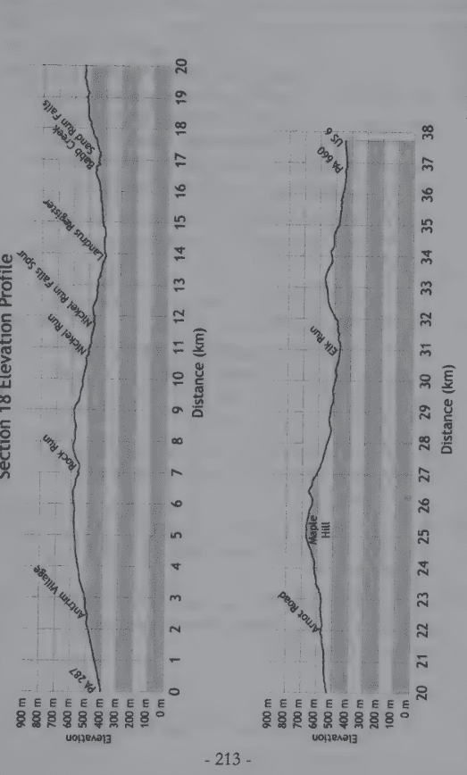

# 宾夕法尼亚州287 号公路至美国 6 号公路 (Antrim/Landrus)
详细描述

| (km) | 特征/方向 | (km) |
|---|---|---|
| n 0.00 | PA 287 旁“布罗斯堡煤”历史标记，总结了你路过和将再次经过的煤矿故事。附近东侧宽路肩停车。向北 14 公里到达 Wellsboro，那里有装备商、其他商店、餐厅、医院和邮局。NB: 沿 SR 3009 上坡。NB: 沿 SR 3009 上坡。SB: 沿 PA 287 向南，在 Anna’s Road/T-345 右转。NB: 沿 SR 3009 上坡。SB: 沿 PA 287 向南，在 Anna’s Road/T-345 右转。 |
| 37.96 | NB: 沿 SR 3009 上坡。SB: 沿 PA 287 向南，右转。 | | Road/T-345. |
| 37.04 | NB: 沿 SR 3009 上坡。SB: 沿 PA 287 向南，右转。 | |
| 36.56 | NB: 沿 SR 3009 上坡。SB: 沿 PA 287 向南，右转。 | |
| 35.93 | NB: 沿 SR 3009 上坡。SB: 沿 PA 287 向南，右转。 | | Road/T-345. |

## 特征/方向
NB (km)
SB (km)

2.55 | 与私有土地交汇。NB: 右转 3009。SB: 沿 PA 287 向南，在 Anna’s Road/T-345 右转。NB: 右转 3009。SB: 沿 PA 287 向南，右转。 | | |
35.41 | NB: 右转 3009。SB: 沿 PA 287 向南，右转。NB: 右转 3009。SB: 沿 PA 287 向南，右转。 | | |
33.93 | NB: 右转 3009。SB: 沿 PA 287 向南，右转。 | | Road/T345.

## NB (km)
SB (km)

6.61 | NB: 右转 3009。SB: 沿 PA 287 向南，右转。NB: 右转 3009。SB: 沿 PA 287 向南，右转。 | | |
6.73 | NB: 右转 3009。SB: 沿 PA 287 向南，右转。NB: 右转 3009。SB: 沿 PA 287 向南，右转。 | | |
31.23 | NB: 右转 3009。SB: 沿 PA 287 向南，右转。NB: 右转 3009。SB: 沿 PA 287 向南，右转。 | | |
31.14 | NB: 右转 3009。SB: 沿 PA 287 向南，右转。NB: 右转 3009。SB: 沿 PA 287 向南，右转。 | | |
30.87 | NB: 右转 3009。SB: 沿 PA 287 向南，右转。NB: 右转 3009。SB: 沿 PA 287 向南，右转。 | | Road/T-345.

| NB (km) | 特征/方向 | SB (km) |
|---|---|---|
| n 7.89 | 穿过卡车道。 | 30.07 |
| NB: 回到州林，沿标记路径绕过高原顶的几个水点。SB: 绕过一个水点并紧贴私有土地边界行走。从该点起 SB 在私有土地上行走 10 公里。你必须严格遵守所有规定，禁止露营，留在路径上。不要跟随任何未标记为 MST 的其他道路或卡车道。 | | |
| 8.29 | 跨越 Robinson Run，它通常流经这片空地，在夏末会干涸。SB: 在 11 公里后到达“幽灵全景”之前的最后一个可能的营地。 | 29.67 |
| 8.69 | 有树的山顶，稍多岩石。 | 29.27 |
| 9.19 | NB: 右转进入旧伐木路。SB: 左转进入路径，爬一小段，然后沿标记路径绕过高原顶的小水点。 | 28.77 |
| 9.42 | 伐木路的 T 形路口。忽略返回上山的路线。Nickel Run（一条极高价值野生鳟鱼溪）的源头向东向下。NB: 继续沿旧路直行。SB: 沿伐木路直行，轻微上坡。 | 28.54 |

| NB (km) | 特征/方向 | SB (km) | |
| :--- | :--- | :--- | :--- |
| 10.42 | 跨过溪流。NB：重新回到旧木栈道。 | SB：向右边缘，沿着上方与 Nickel Run 平行的标记路径行走。 | |
| 10.68 | 在旧木栈道上跨过常年的 Nickel Run、EV 和野生鳟溪流。有水。附近有营地，但此处全地形车（ATV）侵入是个问题。NB：直向南走（没错，没错），沿着变窄的旧路，很快会经过左侧一块侵蚀得奇特的巨大岩石。 | SB：在旧木栈道的空地上轻缓上爬。 | |
| 11.59 | 旧小路交汇处。MST 顺着山坡向下（NB），向上（SB）。黄色标记的环形小径径向西南延伸，交替下降至 Nickel Run 一处 10 米高瀑布的顶部（在非常干旱的夏季可能会干涸），以及旧的 Arnot & Pine Creek 铁路（建于 1878 年，1952 年废弃，一直是纽约州伊利诺铁路的支线，通往 Morris，它从未到达过常年 Babb Creek 旁边的营地和游泳点的 Pine Creek）。沿着整个侧面回到这里会使你的徒步增加 2.57 公里，重新爬升 90 米。 | | |

NB=北向徒步，SB=南向徒步

| NB 特征/方向 | SB (km) | | |
| :--- | :--- | :--- | :--- |
| 13.73 MST 继续在旧木栈道上直行。注册。黄色标记的向下路径横跨 Babb Creek，0.38 公里到达 Landrus（一个鬼魂矿镇）的中心。季节性 Landrus 路旁的石头纪念碑旁有土路停车场。在路的另一侧/南侧，红色标记的 Bear Run 径径经过 Bloss Mountain 的瀑布。在 Bear Run 径径上方几米处有一个草地平地溢流停车场，就在石头纪念碑的视线之外。 | 24.23 | |
| 14.08 旧马车道交叉口。MST 继续直行（NB 看起来右转）。向上的路径引导 0.92 公里到达 Landrus 矿山的旧倾倒场。该区域常见潮湿点。 | 23.88 | | |
| 14.41 NB：向右转沿岩板向下走。 | 23.55 | | |
| 14.46 曾经通往矿区装货区铁路支线跨 Babb Creek 的栈桥末。1914 年，伊利铁路认为该栈桥维修不符合效益，因此导致了 Landrus 矿山和城镇的消失。 | 23.50 | | |
| NB：穿过自大战以来生长的大树。SB：沿岩板向右向上爬。 | | |
| 14.61 装载平台。Landrus 的煤炭曾通过斜坡从山上的矿山运到这里。如果你在此处或其他其他地方发现文物，请仅拍照并把文物留在原地。 | 23.35 | | |

1.609km = 1mile, 1km = 0.62mile

| NB 特征/方向 | SB (km) | | |
| :--- | :--- | :--- | :--- |
| 14.83 旧 Landrus 路桥的北桥。如果你在此处 Babb Creek 的深潭发现鳟鱼，感谢 Babb Creek 水系协会清理上游的旧矿山排水。 | 23.13 | | |
| NB：向左转沿旧路短走一段，然后进入森林远离旧路已变成泥炭沼泽的地方。 | SB：平地延伸至与下游溪流并行。 | | |
| 15.14 离开路径上这条长窄的石基保持原样，让未来的徒步者可以和你一起推测它的起源。两边的弯曲路径试图通过靠近小湿水区来避开大湿水区。 | 22.82 | | |
| 15.55 NB：最终在干涸后回到旧马车道。 | 22.41 | | |
| SB：向左走，远离旧路已变成巨大泥炭沼泽的地方。 | | | |
| 16.54 蓝色标记的高水位（可滑雪）向上在 0.13 公里后汇入运输道。运输道在 2.25 公里离开州森林，跨越私有土地到达 Arnot Rd/SR 2016，距离 MST 2.70 公里，穿越私有土地时留在标记路径上。 | 21.42 | | |
| NB：向右/向下朝水流声方向走。注意：前方主路上的三个无桥溪流口可能非常危险，尤其是冬季结冰时。 | | | |
| SB：接入 1890 年左右的旧 Wellsboro-Landrus 路。 | | | |

NB=北向徒步，SB=南向徒步

| NB (km) | 特征/方向 | SB (km) | | |
| :--- | :--- | :--- | :--- |
| 16.62 穿过 Rattlesnake Run，路径在两侧均沿岩板向上。 | 21.34 | | | |
| NB：三个路口中最容易的一个。 | | | | |
| 16.69 看到 Rattlesnake Run 当地高点的 2 米高瀑布（季节性），两侧均陡坡下降，尤其是 | 21.27 | | | |
| NB：冰冻条件下非常危险，冰可能持续到 5 月。 | | | | |
| 16.82 无桥 Babb Creek 交叉处的石槽。即使在干旱的夏天，岩石也非常滑。 | 21.14 | | | |
| 17.07 9 米高 Sand Run 瀑布顶部。路径向西-指南针北（原 MST 路线）平行 Babb Creek 东侧，在 2.39 公里处到达州边界。 | 20.89 | | |
| NB：Sand Run 的潮湿路口。如果你沿着标记路径稍稍向上走，可能会在流过边缘前停下。 | | | |
| SB：横穿峡谷边缘。 | | | |
| 17.11 回形路点。上游有营地。 | 20.85 | | |
| SB：Sand Run 的潮湿路口。如果你沿着标记路径稍稍向上走，可能会在流过边缘前停下。 | | | | 1.609km = 1mile, 1km = 0.62mile

| NB (km) | 特征/方向 | SB (km) | | |
| :--- | :--- | :--- | :--- | :--- |
| 17.30 未标记路径向东-指南针南，短路通往 Landrus 路。 | 20.66 | | | |
| NB：向左。SB：向右，再次向右跟随标记。 | | | | |
| 17.46 南 Sand Run 环路路口。 | 20.51 | | | |
| NB：向左。SB：向右。 | | | | |
| 19.68 在可滑雪-标记-连接路口直行。 | 18.29 | | | |
| 22.08 Sand Run 径口。徒步者和滑雪者的停车场。如果第一个位置满了，继续沿土道向上。 | 15.89 | | | |
| NB：向左进入土道。SB：在大型标志处向右进入 Sand Run。 | | | |
| 22.13 通往 Arnot 3.5 公里的旧教堂，受开放时间限制。 | 15.83 | | | |
| NB：向左进入 Arnot Road/SR 2016，再次跨过此路桥。SB：向右进入 Sand Run 径口。 | | | |

NB=北向徒步，SB=南向徒步

| NB (km) | 特征/方向 | SB (km) | | |
| :--- | :--- | :--- | :--- | :--- |
| 22.35 红标记。这条多功能道路向东连接 Boone Run，下降到 Blossburg US 15 出口，从此处起 11 公里路过气井。 | | | |
| NB：向右后立即向左留在 MST。SB：向左进入 Arnot Road/SR 2016，在桥上跨过 Sand Run。 | | | | |
| 22.66 直行通过染色的 Fisher 路。停车场有限，但 Sand Run 径口更好。 | 15.30 | | | |
| 23.26 跨过 Dyke Creek，San Run 的小支流。布满溪流旁可能有营地。 | 14.71 | | | |
| NB：州森林的最后一条溪。 | | | | |
| 23.65 州边界处连续标记 MST 的北端。此处禁止停车！查看 http://www.hike-mst.org 更新。 | 14.32 | | | |
| NB：未标记。向左进入 Tokarz 路，快速向右进入 Arnot Road/SR 2016。SB：向右进入森林，下降。 | | | | |
| 24.36 未标记路口。NB：向右进入 Haverly Rd。SB：向左进入 Arnot Rd/SR 2016，在极急弯上方的下一个交叉路口再次向左进入 Tokarz Rd。 | 13.60 | | |

1.609km = 1mile, 1km = 0.62mile

| NB (km) | 特征/方向 | SB (km) | | |
| :--- | :--- | :--- | :--- | :--- |
| 27.07 窄碎石路的未标记路口。查看 http://www.hike-mst.org 更新。NB：向左进入 Hickory Ridge Rd。SB：向右进入 Haverly Rd，陡上爬。 | 10.89 | | | |
| 28.77 未标记，无标志。South Elk Rd 的窄季节部分延伸 2 公里到达 Babb Creek 之上的 Arnot Rd，蓝色标记的高水位径从此处开始。NB：向右进入 South Elk Rd。SB：在三形路口向左进入 Hickory Ridge Rd。 | 9.19 | | | |
| 30.32 直行通过 Scheer 路路口，两侧均为未标记碎石路。正北跨过 Elk Run。 | 7.64 | | | |
| 31.17 直行通过 Jackson 路路口，两侧均为未标记碎石路。在附近的路上跨过 Elk Run。 | 6.79 | | | |
| 31.92 跨过未标记路上的 Elk Run 小支流。NB：向右进入铺装的 Cherry Flats 路。SB：向左进入碎石 South Elk Run 路。 | 6.04 | | | |
| 32.17 未标记。NB：向左进入碎石的 Miller Hill 路。SB：向右进入铺装的 Cherry Flats 路。 | 5.79 | | | |
| 33.66 在路口跨过 North Elk Run 小支流，农田径流。 | 4.30 | | | |

NB=北向徒步，SB=南向徒步

| NB (km) | 特征/方向 | SB (km) | | |
| :--- | :--- | :--- | :--- | :--- |
| 34.07 全为未标记碎石路。NB：向右进入 Johnson Hill 路。SB：向左进入 Miller Hill 路。 | 3.89 | | | |
| 34.62 全为未标记碎石路。NB：向左进入 Mudge 路。注意一个糟糕的邻居。SB：向右进入 Johnson Hill 路。 | 3.34 | | | |
| 35.37 目前从纽约边界及以外的标记路径的南端：查看 http://www.hike-mst.org 更新。NB：向左进入农场道。10/15-12/15 因狩猎关闭，使用 Mudge 路作为替代。 | 2.59 | | | |
| 35.90 Wimbrough 营地。注册。点对点徒步者在家人允许下仅露营一晚。在狩猎旺季（10/15-12/15）关闭。附近的一个石堆可能掩盖着一个孤独印度人修理工的遗骸，据传他被埋在附近的无名墓中。 | 2.06 | | | |
| NB：直到纽约边界向北的一天前的最后一个免费点。 | | | | |

| NB (km) | 特征/方向 | SB (km) |
|---|---|---|
| 36.83 | 北向：左转回到 Mudge Rd。 南向：右转进入土质农场车道，在沿溪流的树林中迅速左转。10月15日至15日因狩猎关闭，在此期间请留在 Mudge Rd 上。 | 1.13 |
| 37.07 | 跨越 PA 660 号公路。禁止停车。 北向：沿对树篱直行，在森林中向左转越过 North Elk Run。高水位时：沿道路绕行至西侧。 南向：直行进入土质路的 Mudge Rd。 | 0.89 |
| 37.54 | 跨越 Rice Rd，留在对树篱东侧，稍后穿过溪流（是的，双向均如此） | 0.42 |
| 37.96 | 美国 6 号公路。路段结束。私有土地，请留在小径上。可停在 River of Life 教会的土质溢流停车场，里程碑 228.5 处，道路北侧，溪流西侧，周日除外。距离 Wellsboro 有 12.5 公里，那里有装备店、商店、餐厅、医院和邮局。 | 0.00 |

NB=北向徒步，SB=南向徒步
- 226 -

# 第 19 节：美国 6 号公路至宾夕法尼亚州 287 号公路
WHITNEYVILLE 到 HAMMOND
私有土地，HILLS CREEK 公园，州立狩猎场区 37 号，TIOGA-HAMMOND 湖

第 19 节起始于美国 6 号公路，结束于 PA 287 号公路的第二个交叉口。

特征包括田园乡村乡村、冰川遗迹、湿地和一个湖泊。第 19 节曾于 2003 年从 Hills Creek 公园开放至 Ives Run 休闲区，并在 2008 年和 2009 年向南延伸至美国 6 号公路。

注意！此路段位于富含气体的马塞勒斯页岩层上。由于气体开采活动增加，小径可能会出现中断。徒步前请在 http://www.hike-mst.org 检查路况。

## 总体描述

MST 穿过起伏的农田到达 Hills Creek 公园，跨越大坝并沿湖行。从 Hills Creek 湖的北端开始，MST 爬过一条冰川漂积物脊，穿越州立公园营地。一段简短的镇道连接段通往 SGL 37，在那里 MST 爬上通往高高原的脊线，下降 Stephen Run 的源头，爬上高原上的更高点，然后沿 Ives Run 的东支和主干向下到达 Hammond 湖。MST 穿过 PA 287 号公路，穿越废弃农田。

# 美国 6 号公路至宾夕法尼亚州 287 号公路（第二个交叉口）

# 详细描述

| (km) | 特征/方向 | SB (km) |
|---|---|---|
| 0.00 | 美国 6 号公路，路段起点。周日除外，可留在 River of Life 教会的土质溢流停车场，道路北侧和溪流西侧。距离 Wellsboro 有 12.5 公里，那里有装备店、商店、餐厅、医院和邮局。北向：沿树篱直行，进入针叶林。南向：直穿 6 号公路进入丛林地，前方有溪流。 | 24.21 |
| 0.59 | 森林中的过溪点。私有土地，请留在小径上，禁止露营。 | 23.62 |
| 0.64 | 私有土地，留在小径上。北向：在修草路径的交叉口右转。南向：在修草路径的交叉口左转。 | 23.57 |
| 0.91 | Orebed Road 南侧田野中的过溪点。北向：沿 Orebed Rd 左转——在泥泞、高水位和狩猎季节（10月15日至1月15日）除外，在 Orebed Rd 左转沿 Cobb Rd 重新汇合路径。增加 0.5 公里，阳光充足。南向：沿修草路径到溪流后。 | 23.30 |
| 1.08 | 经过 Warren Lane 交叉口。留在土质 Orebed Rd 上，不要走 Warren Lane。 | 23.13 |
| 1.6 | 1.609km = 1 英里，1km = 0.62 英里 - 229 -

| NB (km) | 特征/方向 | SB (km) |
|---|---|---|
| 1.20 | 北向：沿围栏离开 Orebed Rd——在泥泞、高水位和狩猎季节期间，见上方 0.91 公里的绕行。快速穿过溪流进入围栏内的牧场。南向：沿土质 Orebed Rd。 | 23.01 |
| 1.74 | 大门。请关闭它。北向：沿草地。南向：沿牧场内稀疏的树木标记。 | 22.47 |
| 1.83 | 避开北方可行驶的草地。北向：沿草地进入丛林。稍后通过 2012 年由童子军建造的草地桥，进入围栏内的牧场。南向：右转进入草地路。 | 23.38 |
| 2.19 | 泥泞路径交叉口。北向：直行进入拖拉机径，留下丛林。南向：直进入丛林，经过潮湿点和 2012 年由童子军建造的草地桥。不要向该方向左转。 | 20.02 |

| NB (km) | 特征/方向 | SB (km) |
|---|---|---|
| 2.56 | 北向：右转进入草地，沿草地右边缘。南向：进入拖拉机径。 | 21.65 |
| 2.82 | 变换树篱方向，让树木留在左侧，右转进入田野。私有土地，留在小径上。 | 21.39 |
| 3.32 | 直穿过气管道。仍是私有土地，留在小径上。北向：进入森林。 | 20.89 |
| 3.72 | 俯瞰位于 Hills Creek 山谷的私有土地上的气井，留在小径上。北向：从森林中出来，沿右侧下坡。南向：进入森林。很难看到。 | 20.49 |
| 3.90 | 跨越窄的铺装 Cobb Rd，变换树篱方向。两侧均为私有土地，留在小径上。禁止停车。北向：11月15日至12月15日先左后右，或右后左，沿道路到达 Hills Creek 公园。南向：泥泞、高水位和狩猎季节（10月15日至1月15日），沿 Cobb Rd 左转，沿 Bullock 右转，沿 Orebed Rd，增加 0.5 公里回到 23.30 处的 MST。 | 20.31 |
| 3.99 | 跨越 Hills Creek 支流。仍是私有土地。 | 20.22 |

1.609km = 1 英里，1km = 0.62 英里 - 231 -

| NB (km) | 特征/方向 | SB (km) |
|---|---|---|
| 4.39 | 跨越位于丛林区的管道。 | 19.82 |
| 4.80 | 山苹果野餐亭。附近有季节性厕间。 | 19.41 |

Hills Creek 公园办公室位于 MST 以东 300 米处，沿野餐林边缘标记。季节性注册，淡季寻找木小屋，其停车场清理雪供滑雪进入。

北向：进入 Hills Creek 公园，向左下旧路。

南向：进入森林。接下来的 17 公里为私有土地。11月15日至12月15日因狩猎关闭，在此期间右转、右转、再左转沿 Bullock Rd 到 Orebed Rd。
| 4.90 | 蓝色标记交叉口。北向：沿 Orebed Rd 左转——在泥泞、高水位和狩猎季节，见上方 0.91 公里的绕行。快速穿过溪流进入围栏内的牧场。南向：沿阶梯。 | 19.31 |
| 5.04 | 大坝顶部的溢洪道。北向：右转，向下。南向：右转，上阶梯。 | 19.17 |

NB=北向徒步，SB=南向徒步
- 232 -

| NB (km) | 特征/方向 | SB (km) |
|---|---|---|
| 5.08 | 路径西侧停车场。北向：右转进入侧径。跟随橙色/蓝色标记。南向：沿大坝一起左转。 | 19.13 |
| 5.56 | 经过船头码、停车场、厕所。北向：继续沿侧径。南向：沿大坝左转，跨越道路。 | 18.65 |
| 6.85 | 经过船头码、停车场、厕所。北向：继续沿侧径。南向：经过潮湿区域到达湖泊。 | 17.36 |
| 7.35 | 在 Hills Creek 湖北端，MST 在标记交叉口处留下蓝色标记。景色。北向：穿过成熟森林的小径。 | 18.86 |
| 7.56 | 东侧为冰川壶，西侧为季节性池。北向：右转进入侧径。南向：跟随橙色/蓝色侧径。 | 16.65 |
| 7.74 | 跨越公园主路，厕所。西侧有宠物营地环。北向：直行进入服务路。南向：向左进入森林。 | 16.47 |
| 7.81 | 北向：右转进入 Hills Creek Park Rd，离开公园，左转进入 Carpenter Rd。南向：右转进入 Hills Creek Park Rd，通过闸进入公园。 | 16.40 |
| 8.15 | 州立狩猎场区 37 号边界。停车场。北向：左转，经过大门，沿路径。南向：直行/右转进入后路，经过羊场。 | 16.06 |
| 8.34 | 北向：在山丘顶部左转进入路径。沿食物块边缘进入田野后的森林。南向：过山丘并向右转下降路径穿过旧果园。 | 15.87 |
| 9.16 | 森林脊线点，冬季景色，两个 S 形弯道。 | 15.05 |
| 10.35 | 北向：右转进入管理道路。南向：寻找进入森林的急转。短暂爬升后是平缓脊线。 | 13.86 |
| 10.62 | 在管理道路的 T 字形交叉口直行。向北的未标记道路（标有马术/自行车专用路线）下降 Browns Run 到 Stephenhouse Run，捷径或返回 Hammond 湖。 | 13.59 |

| NB (km) | Features/Directions | SB (km) |
| :--- | :--- | :--- |
| 10.69 | 注意观察路标标记（blazes）。向南的管理道路（标有“马匹/自行车指定路线”的牌子）向下延伸 Carpenter Rd，可捷径或返回 Hills Creek Park（溪公园）。 | |
| NB: 左转，通过食物试验地，然后沿着田边行进。 | | |
| SB: 右转进入管理道路。 | | |
| 10.83 | NB: 在旧路上向左转，然后右转进入绕过杉树苗木场的食物试验地小道。 | 13.38 |
| SB: 右转进入一片杉树林。 | | |
| 11.06 | NB: 在小道上左转，离开杉树。在池塘处，沿着灌木丛右转，径直穿过杉树和灌木丛到达旧路床。 | 13.15 |
| SB: 进入田野，在池塘处左转，然后沿着一排杉树右转。 | | |
| 12.58 | 越过 Stephenhouse Run。有水域。游戏地（Game Lands）内禁止露营。 | 11.63 |
| NB: 右转进入森林。 | | |
| SB: 直行森林。 | | |
| 12.68 | 越过管理道路。可以看到北侧/下坡 300 米处、未标记的管理道路上的海狸池，你会以为自己在阿第拉拉斯克山脉。 | 11.53 |
| 13.58 | 在空地处右转，然后左转进入小道。 | 10.63 |

| NB (km) | Features/Directions | SB (km) |
| :--- | :--- | :--- |
| 15.56 | 晴朗日可看到东侧 35+ 公里的布拉德福德县毕斯加山，此处位于此处由杉树林和旧地基标记的旧灯火塔遗址南侧。注意附近的道路废料坑。 | 8.65 |
| 15.66 | 大门。在未积雪的 Fireretower Road 尽头、州通信塔旁有季节性停车场。向南/东南方向 1.5 km 到达 SGL 边界的全季停车场，可从曼斯菲尔德的 Lambs Creek Road 进入。在正北方的森林中注册。NB: 从停车场远端进入森林。SB: 穿过大门，短距离跟随。 | 8.55 |
| 15.84 | NB: 左转进入管理道路。SB: 注意右转进入森林。 | 8.37 |
| 16.21 | NB: 左转进入另一条管理道路。SB: 右转进入另一条管理道路。 | 8.00 |
| 16.48 | NB: 右转进入管理道路。SB: 左转进入管理道路。 | 7.73 |
| 16.74 | 越过管理道路。北侧的未标记道路通往 1 公里处黄色标记的 Keller Trail 环线路的南端。 | 7.47 |
| 16.91 | 道路向下延伸经过 Big Rift 到 Tioga 湖。NB: 左转管理道路以保持在高处。SB: 右转管理道路以保持在高处。 | 7.30 |

NB=北向徒步，SB=南向徒步

# NB SB

| (km) | Features/Directions | (km) |
| :--- | :--- | :--- |
| 17.56 | 2003 年砍伐过的区域。 | 6.65 |
| NB: 道路结束于狭窄的小径。 | | |
| SB: 道路开始。 | | |
| 18.32 | 在 Ives Run 东支流源头的古老树桩旁有之字弯。 | 5.89 |
| 19.38 | 越过 Ives Run 东支流。有水域。SGL（州立林地）内禁止露营。 | 4.83 |
| NB: 从此开始偶尔会有潮湿点。 | | |
| SB: 开始漫长的干燥爬升。 | | |
| 19.98 | 与黄色标记的 Keller Trail 东环线交汇。 | 4.23 |
| NB: 右转，同时有橙色和黄色标记。 | | |
| SB: 左转，将黄色标记留在身后。 | | |
| 20.99 | 游戏地与陆军工程 Tioga-Hammond 湖泊项目的边界，位于森林深处、有潮湿点的旧路床上。 | 3.22 |
| 21.44 | 在 82 米处的未标记侧径小路上可看到 Hammond 湖区域。 | 2.77 |
| NB: 在标志牌处左转。 | | |
| SB: 在标志牌处右转。 | | |
| 21.86 | NB: 在与黄色标记的中间 Keller Trail 交汇处右转。 | 2.35 |
| SB: 在与黄色标记的中间 Keller Trail 交汇处左转。 | | |

1.00km = 1mile, 1km = 0.62mile

# NB (km) | Features/Directions | SB (km) |
| :--- | :--- | :--- |
| 22.06 | Ives Run 营地起点标志，停车场位于西侧 120 米处的营地商店。 | 2.15 |
| NB: 左转，沿铺装道路继续走 1.97 km。 | | |
| SB: 右转，进入灌丛森林。 | | |
| 22.48 | NB: 在 Ives Run 主接入道路上左转。 | 1.53 |
| SB: 右转进入营地车道，通过营地控制点并越过 Ives Run 流。 | | |
| 23.26 | 对面有标有“主起点”的 Keller Trail系统标志处停车场。 | 0.95 |
| NB: 沿着 Ives Run 铺装接入道路右转。 | | |
| SB: 沿着 Ives Run 铺装接入道路左转。 | | |
| 23.37 | 经过通往西部 Tioga-Hammond & Cow-ananesque 湖泊项目管理处、游客中心、厕所的车道。还向西连接到 Railroad Grade Trail，通往 Crooked Creek 谷上方的风景优湿地。 | 0.84 |
| 23.76 | 在高桥上过 Crooked Creek。 | 0.45 |
| 24.03 | 穿过 Wellsboro & Corning，季节性有 Tioga Central 观光火车。 | 0.18 |
| NB: 向右进入旧田，然后快速转弯。 | | |
| SB: 左转沿着铺装的 Ives Run 路。 | | |
| 24.11 | 穿过灌丛区的旧玉米仓，在 Hammond 村边缘的一处农场旁左转，以隔绝洪水。 | 0.10 |

NB=北向徒步，SB=南向徒步

| NB (km) | Features/Directions | SB (km) |
| :--- | :--- | :--- |
| 24.21 | 在 287 路上的未标记停车场。 | 0.00 |
| NB: 右转穿过 287 路。 | 1.60 |
| SB: 在 287 路末端左转。 | |
| NB: 在 287 路右转处右转。 | |
| SB: 在 287 路末端左转进入一片树林。 | |
| SB: 建议在进入这片私有土地之前仔细阅读 287 路的路段。 | 2.60 |

9km = 1mile, 1km = 0.62mile

# SECTION 20: PENNSYLVANIA ROUTE 287 TO HAMMOND LAKE TO BORDER COWANESQUE

第 20 段起始于 PA 287 附近的美国陆军工程部队的 Hammond 湖，结束于 Lawrenceville 西侧的纽约州边界。特征包括田园风景、瀑布、观鸟点以及一座废镇。在计划狩猎关闭期间（11月15日至12月15日），最短的路线是继续北上 PA 287 走 4.3 km，然后左转进入 SR 4024/Elkhorn Rd 走 3.3 km，在 6.29 处重新汇合。有一条未铺装的绕行路可用，但比 MST 路线长 4.4 km，比绕过的铺装路线长 3.1 km。详见 3.08 处的未铺装绕行路线描述。

# GENERAL DESCRIPTION

MST 穿过 PA 287 进入私有林地。一个高点可以俯瞰 Elkhorn 山谷的景色。MST 然后向下到达 Elkhorn Creek，经过一处瀑布。MST 然后穿过废弃和经常使用的田地到达高处，然后沿着窄土路到达 Cowanesque Lake。MST 绕过水库的南岸和北岸，经过旧路、新径和两座 PENDOT 桥，经过 Nelson 村的旧现址。一条短侧径通往 Cowanesque 河上的 Nelson 瀑布。之后 MST 离开湖，沿着石子路上纽约边界。

# PENNSYLVANIA ROUTE 287 (2nd crossing) to NY Border

| NB (km) | Features/Directions | SB (km) |
| :--- | :--- | :--- |
| 0.00 | NB: 右转穿过 287 路。注意：11 月 15 日 12 月 15 日（包括周日），前往 Tioga Heritage 营地（铺装未标记路）的最短路线是继续北上 PA 287 走 4.3 km，然后左转进入 SR 4024/Elkhorn Rd 走 3.3 km，在 6.29 处重新汇合。有一条未铺装绕行路可用，但比 MST 路线长 4.4 km，比绕过的铺装路线长 3.1 km。详见 3.08 处的未铺装绕行路线描述。请查看 hike-mst.org 获取更新。SB: 在护栏末端左转进入一片树林。 | 29.00 |
| 0.10 | NB: 左转进入 Cole 路。SB: 穿过 287 路（快速交通），右转沿护栏行进。 | 28.90 |
| 0.69 | 东侧有 Hammond（名 Middlebury）墓地。 | 28.31 |
| 2.89 | 俯瞰 Hammond 湖区域进入 SGL 37 高地。NB: 左转进入 Ridge Road。SB: 右转进入 Cole 路。 | 26.11 |

# NB (km) 特性/方向 SB (km)

| NB (km) | 特性/方向 | SB (km) |
| :--- | :--- | :--- |
| 3.08 | NB：向右转进入茂密的丛林。私有土地，请留在小径上，在熊和鹿的季节（11月15日至12月15日，含周日）请完全不要进入。狩猎季节、结冰或高水位情况下，请绕道公路行驶。从此点开始：沿 Ridge Road 向西继续 2.65 km；然后右转进入 Gee Road，变为 Farmington Hill Road，持续 1.45 km；然后右转进入 Elkhorn Creek Road， 2.30 km；在 km 5.10 处恢复标记的小径。增加 4.4 km 长度。更新请查看 hike-mst.org。 | 25.92 |
| | | SB：向左转进入土路。 |
| 3.60 | 在私有土地转角跨过小溪，在林中轻度上坡。注意几处湿地。 | 25.40 |
| 4.00 | 从田野可以看到 Elkhorn Creek 的山谷。 | 24.96 |
| | NB：沿树篱向左侧田缘走，然后下到非常陡峭且危险的岩石坡到达 Elkhorn Creek 的渡口。 | |
| | | SB：向右转并穿过田野窄端，向左寻找标记以重新进入森林。 |

NB=北向徒步，SB=南向徒步

# NB 特性/方向 SB (km)

| 5.10 | 私有土地，请留在小径上，在熊和鹿的季节（11月15日至12月15日，含周日）请完全不要进入。高水位或结冰情况下，请绕道公路行驶。此处禁止停车。 | |
| | NB：右转进入铺装过的 Elkhorn Rd/SR 4024。 | |
| | | SB：左转进入碎石路面的 Elkhorn Creek Rd。然后再次左转跨过溪流并在另一侧陡峭上坡。如需绕行，沿 Elkhorn Rd 走 2.3 km 到尽头，左转进入 Farmington Hill Road（变为 Gee Road）1.45 km，然后左转进入 Ridge Road 2.65 km 以恢复标记的小径。 |
| 5.54 | Elkhorn Road 南侧桥西路肩有有限停车位，通往带有 #1712 牌子的私有车道。不要过桥进入有标记的私有土地。不要在此特定地点以外的任何地方停在狭窄弯曲的道路上或阻挡任何车道。 | |
| 5.94 | 在土路 Howe Hill Rd 的交汇处直行。Elkhorn Rd 南侧有瀑布。禁止停车。 | |
| | NB：如果想想避开前方的湿草地，左转进入土路，然后右转进入 Scenic View Dr 营地，距离相同。 | |

1.609km = 1mile, 1km = 0.62-mile

# NB (km) 特性 /方向 SB (km)

| 6.29 | 禁止停车 | 22.71 |
| | NB：向左转沿旧田边缘攀升。SB：向右转沿 SR 4024/Elkhorn Rd。见关于 km 23.90 处的狩猎/高水位绕行说明。前往 Hammond Lake 的最短路径是左转进入未标记的铺装路，左沿 SR 4024/Elkhorn Rd 走 3.3 km 到尽头，右转南向 PA 287 走 4.3 km 到 Hammond Lake 口标记径恢复处。铺装路线比指南距离长 1.3 km。继续到 km 23.90 有一条未铺装未标记的绕行路，但比指南距离长 4.4 km。更新请查看 hike-mst.org。 | |
| 6.95 | 田田角。望向 Tioga River 山谷，这是少数几个可以看见 US 15 的地方。NB：进入森林。SB：沿旧田边缘走。 | 22.05 |
| 7.41 | 门槛。 | 21.59 |
| | NB：右转进入活动牛牧场。SB：左转进入森林。 | |

NB=北向徒步，SB=南向徒步

# NB 特性/方向 SB (km)

| 7.60 | 管道。 | 21.40 |
| | NB：右转，过栅进入活动牛牧场，注意几处湿地、偶尔的牛、连续的栅栏（如你发现时那样，关闭则绕过，开放则通过）和标记。 | |
| | | SB：靠左后右转沿活动牛牧场边缘。 | |
| 8.51 | Tioga Heritage 营地办公室和商店，面向 SGL 37 的高地，营地处提供电话、水和厕所。此处可以更改路线，查看 hike-mst.org。0.5 km 处的蓝侧小径到达营地池塘，可以看到多种野生动物。 | 20.49 |
| | NB：进入森林，轻度下坡。 | |
| | | SB：沿 Scenic View Drive 过带有许多栅栏的活动牛牧场。 | |
| | 绕行路线：右转进入 Scenic View Dr，然后左转进入 Howe Hill Rd，右转回到小瀑布前的铺装路 Elkhorn Rd。不增加距离。 |

| NB (km) | 特性/方向 SB (km) |
| :--- | :--- | :--- |
| 10.08 | Smith Hill Rd。两侧均为私有土地。禁止停车。 | 18.92 (注：此处原文对应关系如此) |
| 10.34 | Baldwin Creek 农场转角的景色。 | 18.66 |
| 10.59 | 栅栏缺口。MST 最北端。 | 18.41 |
| | NB：通过树篱到达栅栏右侧。 | |
| | | SB：跨过小溪后在林中上坡。 | |
| | NB：通过田缘。 | |
| | | SB：跨过管道进入森林。 | |
| | NB：靠左，穿过森林下坡。 | |
| | | SB：沿右侧边缘走。 | |
| 11.12 | 在 Baldwin Creek 处跳过管道。此处地软且水位高。穿过更多松树。 | 17.88 |
| 11.14 | NB：右转进入窄土路，Baldwin Creek 沿有许多急流和岩石景色。 | 17.86 |
| | | SB：左转通过栅栏缺口。如果你进入开放区域，错过了约 150 米的转弯。你可以继续通过更多的土路交叉口在下一条硬路上恢复小径，但会错过几处景色、一个营地和野生动物。 | |

NB=北向徒步，SB=南向徒步

# NB 特性/方向 SB (km)

| 13.19 | NB：右转进入铺装过的 Gee Hollow Rd。 | |
| | | SB：左转进入窄土路，穿过冷杉阴地。 | |
| 14.04 | 平跨过 PA 49，跨过北侧护栏。 | 14.96 |
| | 靠左进入修剪过的路径，现在进入陆军兵团土地，进入森林。 | |
| | | SB：沿铺装过的 Gee Hollow Rd。 | |
| 14.74 | 跨过旧 Route 49，不要通过门。 | 14.26 |
| | NB：进入南岸区（South Shore Area）。 | |
| | | SB：平行 Route 49 穿过森林。 | |
| 15.00 | 东侧停车位。草地区域稀疏树木和柱子上的标记可能很难。冬季通常清雪，方便钓鱼和进入可滑雪的 MST。 | 14.00 |
| 15.35 | 西侧停车位。Oneida 野餐亭，季节性厕所。 | 13.65 |
| | NB：留心寻找标记，穿过废弃的野餐区（通常是高草），然后进入 Oneida 野餐亭后的森林。 | |
| 15.60 | 跨过林间深沟中的溪流。 | 13.40 |
| | NB：进入松树林。 | |

1.609km = 1mile, 1km = 0.62-mile

# NB (km) | 特性/方向 | SB (km) |
| :--- | :--- | :--- |
| 15.85 | 旧农场池转角。两侧均为林中路径，在高岸俯瞰湖泊。 | 13.15 |
| | NB：轻微下坡。 | |
| | | SB：进入松树林。 | |
| 15.95 | 跨过林中的溪流。此处有上游阶段留下的碎屑。 | 13.05 |
| 16.20 | NB：在旧农场道上右转。 | 12.80 |
| | | SB：向左转留在森林中。 | |
| 16.55 | 滩边小屋、季节性冷淋浴、厕所和停车位。 | 12.45 |
| | NB：下台阶，穿过平坦区域（废弃停车场）到达修剪过的路径。 | |
| | | SB：穿过停车场中心，穿过一片高草地后短暂进入森林。 | |
| 16.90 | 由化石岩石构成的旧石篱。双向树篱最终变为标记路径。 | 12.10 |
| 17.19 | 未标记路径向西延伸，在 42 米处到达 PA 49，位于 Lawrenceville 交汇处 4.9 英里处。 | 11.81 |
| | NB：右转，下到森林。 | |
| | | SB：左转进入修剪过的路径。 | |

NB=北向徒步，SB=南向徒步

# NB (km) 特性/方向 SB (km)

| 17.35 | 此时，你将看到为什么原住民将这个山谷命名为“Cowanesque”，据意为“布满刺植物”。 | 11.65 |
| | NB：上到旧路基，在巨大的大冷杉和硬木林中逐渐变干。原生红杉生长在湖岸右侧陡坡上。 | |
| | | SB：绕过森林中的湿地下坡。 | |
| 17.80 | 旧路基西端。Cowanesque 湖的阔景色。 | 11.20 |
| | NB：爬上岸岸向左侧，然后在护栏尽头右转沿 PA 49 跨过 Cummings Creek。交通繁忙。 | |
| | | SB：离开道路向湖泊处走，右转进入旧路基。 | |
| 18.44 | 这曾是 Nelson 村的主街，在 1975 年至 1979 年间搬迁；可能是宾夕法尼亚州最新的鬼镇。小径易受洪水影响，以防止水流进入 Corning 和 Elmira。Cummings Creek 上破旧的旧桥在视线之外，被认为不安全。感谢 Nelson 本地居民 Kyofski 博士提供的历史帮助。 | 10.56 |

# NB SB 特点/方向

| (km) | | (km) |
|---|---|---|
| 18.53 | 上坡一侧可见破碎的混凝土台阶。这里曾是贝利（Bailey）一家的遗址。直直朝山上看（NB 方向则向后看），可以看到 PA 49 公路上方的白色房子。据报道，这家人从未用过这些台阶，仅作为女儿婚礼照的背景。讽刺的是，现在它们可能是这里曾经存在的 60 户房屋最显眼的提醒。 | 10.47 |
| 18.65 | 跨越管道。旧沥青路面上顶部偶尔有泥沼滩。 | 10.35 |
| 18.92 | 与 Bottom Hill Rd 的旧交路口，现位于上方 PA 49。曾位于此处的 West 房屋已移至新公路对岸的山上。 | 10.08 |
| 18.99 | 另一个交路口，周围的大部分房屋以及此前的卫公教会已搬到另一侧的新内尔森镇（Nelson Town）。 | 10.01 |

# NB 特点/方向 SB (km)

19.16 旧内尔森市的主交路口。在东北角，想象有一座带有观测台（widow’s walk）的旧维多利亚式房屋，并没有搬迁，而是被推平了。在另外两个街角的加油站加油。西南角有一处殡拜堂，现已成为路的一部分。在转角处，有一条未标记的侧径沿指南针北方向向下延伸，在 65 米处到达湖岸。混凝土台阶在树根间勉强维持着，位于你右侧的路边，它们曾通往湖边两侧的房屋，Lugg 家族的农场现在已没在水下。你身后移到山上的农场小屋在当时由 Ila Lugg Wiley 居住，她曾在 70 年代为整个社区搬迁而奋斗，而不仅仅是单个居民。她过着长寿而充实的人生，近 100 岁。想象她的女儿还是小女孩时学骑自行车，偏离了道路撞上了一棵树，现在那棵树作为湖中巨大的树桩可见。两侧肥沃的低地曾生长过烟草。或者从转角处上坡，进入一条杂草丛生的大门路，在 104 米处到达新公路。

19.37 NB: 在草地上路上左转。9.84
19.49 NB: 右转通过 PA 49 跨越 Cowanesque 河。9.63
SB: 在旧沥青路上右转，这里是旧内尔森的主街。
19.51 SB: 左转进入标有标记的草路。1.609km = 1mile，1km = 0.62mile

# NB 特点/方向 SB (km)

19.70 停车场，距离 Lawrenceville 西的 PA 49 6.4 英里。滑雪区的南端，可到达越野地区的鹿皮小径（Moccasin Trail）段。横跨 PA 49 的未标记小径沿指南针南方向，从这里出发 220 米即可到达内尔森。瀑布始于 1936 年河流的一处长弯被切割之后。1946 年的洪水完成了对视点对面岛屿的形成。水流急，高流量流过岩石进入深潭。禁止游泳，也禁止从观景台爬下到被快速侵蚀的河岸。仔细观察上方切口处露出的土壤。沙子、粉土和粘土的交替层（纹泥/varves），表明这曾是一个比今天水库大得多、高得多的冰川湖。感谢 Lawrenceville 的 Mallory 提供的地质信息。

19.80 NB: 沿着宽的鹿皮小径行走。海拔 330 米。标志牌：距离营地 3 英里。可以俯瞰 Cowanesque 湖的开阔视野。在困惑处偶尔会有标记物标出 MST。9.30 NB: 右转进入鹿皮小径 SB。SB: 左转沿 PA 49 跨越 Cowanesque 河。9.20
20.50 跨越支流的步行桥。8.50 NB=北行，SB=南行徒步

# NB 特点/方向 SB (km)

20.60 一条未标记的侧径西向上坡到达 27 米处的一处平台，然后在 139 米处到是一条小路。在侧径上，不断在街道上左转，经过 United（曾是此地的卫公会）和消防站前的自动售卖机，到达内尔森镇中心，包括距离 MST 0.76 公里的邮局（邮编 169）。你在消防站附近路过的较旧房屋是从南岸搬迁的。截至今天，这里没有商店，没有公共电话，邮局已列在可能关闭的名单上。

20.66 跨越浅湾的长步行桥。20.94 旧交路口，两侧均有。向湖方向 55 米处有钓鱼码。距离湖 240 米处是通往鹿皮小径停车场的冲刷过的路。标志牌：距离 Tompkins 3 英里。该区域的房屋已跨过 Lakeview Drive/SR 402 向北移动。NB: 向直前方缓慢上爬旧路。SB: 沿旧路走然后迅速左转，很容易错过。如果你经过了内尔森下水厂的后方，返回 1.609km = 1mile，1km = 0.62mile

# NB 特点/方向 SB (km)

21.31 带有长椅、纪念牌的石园，可以通往老镇中心的湖景。345 米处这里曾是 Beecher's Island 瑞士长老教会，其希腊复兴式的尖顶曾耸立于该社区的天际线上，后已更名。该建筑未因水位而移动，也未因卫公会合并而动摇，但在 1990 年代的一场风暴中倒塌。内尔森墓地留在此处，较低的墓被移到更高的悬崖上，与从三个淹水墓地迁迁出的墓体合并。7.69

21.53 在长椅上可以看到对岸的 PA 49 Cummings 溪桥。7.47 NB: 在修剪过的路径上通过带有短步行桥的管道共 3 次。22.65 NB: 右转进入旧铁路床，曾是连接 Lawrenceville 到 Elkland 的 Cowanesque 谷铁路，后来是 York Central。留下了炉渣、偶尔的枕木和几个泥水坑。6.35 SB: 左转进入修剪过的路径，跨越 3 次管道连接旧沥青路。23.79 当山上大门开启时在此停车。5.21 NB: 左转沿旧沥青路向上爬。SB: 右转进入旧铁路床。

# NB 特点/方向 SB (km)

24.16 大门。停在 Bliss Road/SR 402 旁，距离 Tompkins 游乐区入口 0.8 英里。4.84 NB: 右转进入小路。标志牌：距离 Tompkins 1 英里。路径穿过偶尔有树林的旧田。SB: 左转，下行旧沥青路。

24.70 长椅可看到对面的南岸船发射区。4.30
24.94 高处开阔地上的长椅，可以看到 PA 49 Baldwin 溪桥。对面的 MST 直线距离 0.7 公里，但沿着小径绕过湖末则需要 10.6 公里。4.06 25.49 森林中跨越 Mapes 溪的步行桥。3.51 25.60 Tompkins 游乐区起点。停车场。滑雪区的北端，可到达鹿皮小径段。短季内可露营。船道。3.40 NB: 鹿皮小径结束；MST 在接入车道短暂右转后迅速左转。SB: 左转进入修剪过的宽阔的鹿皮小径。前 6 公里内很少出现橙色标记，宽阔的路由工兵团人员修剪。

25.90 NB: 在 Bliss Rd/SR 402 左转，通过高涵洞再次跨越 Mapes 溪。3.10 SB: 在田缘的修剪过的路上右转。1.609km = 1mile，1km = 0.62mile

# NB (km) | 特点/方向 | SB (km)

| NB (km) | 特点/方向 | SB (km) |
|---|---|---|
| 26.05 | NB: 右转进入 Heffner Road，离开工兵鹿湖项目。SB: 左转进入铺装的 Bliss Road/SR 402，必须横跨道路，禁止停车。 | 2.95 |
| 29.00 | 中州小径在 Heffner Hollow、Mayo 和 State Line 路的碎石路口结束/开始。乡村风景景观。标志牌“Tuscarora 镇”正式区分了 NB 进入宾基州的边界。橙色标记的 Crystal Hills 小径继续向北到达 Pinnacle 公园。向北下一个合法露营地是 Sunflower Acres 私人营地，距离州界约 9 公里。访问 http://www.fingerlakestrail.org 获取地图。 | 0.00 |

# A 段：绿林之径
PA 305 到 Detweiler 交口
ROTHROCK 国家森林

Greenwood Furnace 国家公园位于 PA 305，在 Belleville 和 McAlevys 之间。Detweiler 交口位于 Bear Meadows Road 与 Detweiler Road 的交汇处。橙色标记的 Standing Stone 小径从 PA 305 南侧开始，连接到 Tuscarora 小径。该路段有几处泉水。该路段的特点是 Maggi Cutoff 和 Detweiler Run 附近有原始营地。通过 Seeger 和 Stone 路可以进入中间部分。

# 概述

黄色标记的格林伍德支线（Greenwood Spur）起始于格林伍德炉州立公园（Greenwood Furnace State Park）的宽山路。它沿着一条宜人的森林小径经过了几处历史遗迹和一些巨大的白松。向北转弯后，在广山山上通过旧木炭路折回，经过几个炭场，然后直接沿着科利尔径（Collier Trail）上升至山顶和格林伍德火火塔，在那里与约翰逊径（Johnson Trail）汇合。在通过折回路下广山后，它穿过阿兰·西格自然区（Alan Seeger Natural Area）的一片古冷杉林和巨大的杜鹃丛。随后，它沿着德特维勒溪（Detweiler Run）前进，部分路位于 Monroe Kulp 和 D. Beidelheimer 窄轨铁路的旧路基，部分路为新径，最终在德特维勒交汇处（Detweiler Junction）与橙色标记的中州径（Mid State Trail）汇合到达北端。

如果在格林伍德炉过夜停车，请在 PA 305 号线与宽山路交处的公园办公室报到。该支线北端的停车位位于德特维勒溪路，就在其与橙色标记的中州径起点（德特维勒交汇处）以北。在此处停车时请勿阻塞通道门。日游停车位也可以在阿兰·西格自然区的野餐区找到。

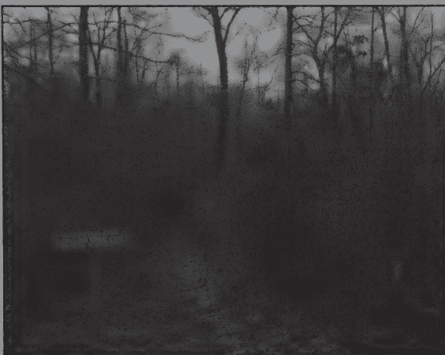

沿着格林伍德支线的科利尔径下山

> “并非所有流浪者都迷了。” —— J.R.R. 托尔金

# A 段高程剖图

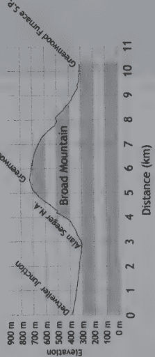

# MST 格林伍德支线（从格林伍德炉州立公园到德特维勒谷）详细描述，地图 306-310

# NB 特点/方向 (km)

- 0.00 小径经过若干处历史遗迹。10.78

NB：从位于石溪（Standing Stone Creek）东支以北的广山出发，沿着小径穿过草地。在草地对侧，小径接入一条旧森林路，并很快左转以避开溪流穿越处和水龟池（Snapping Turtle Pond）附近的潮湿区域。

SB：向右转避开水龟池附近的潮湿区域，接入一条旧森林路。穿过草地，到达格林伍德炉州立公园宽山路的小径终点。

- 0.28 小径穿过一片大白松和冷杉林。10.50

- 0.50 小径注册处 - 请在此签到 10.28

NB：遵循 2012 年改线路线，在新径上向左偏。

SB：向右转进入格林伍德支线的原始路线。

- 0.68 NB：在大冷杉处处右转 10.10

SB：在大冷杉处左转

- 0.80 踏脚石跨过一条小溪。非季节在此处获取饮用水。9.98

1.609km = 1mile, 1km = 0.62mile

| NB (km) | 特点/方向 | SB (km) |
|---|---|--|
| 0.98 | NB：小径沿鹿围栏向左转。 SB：小径沿鹿围栏向右转。 | 9.80 |
| 1.63 | 良好的原始营地。在位于位于斯宾塞径（Spencer Trail）上 100 米处的泉水中找到水。 NB：在旧炭场上的营地处左转，接入 Maggi 分叉（Maggi Cutoff），横跨斯宾塞径，并在木炭路上更陡峭地爬升，该路在广山山上折回。 SB：横跨斯宾塞径，然后在旧炭场上的营地处向右转，离开 Maggi 分叉并沿鹿围栏遵循小径。 | 9.15 |
| 2.63 | NB：在科利尔径左转，起初爬得很陡。这是 Maggi 分叉的终点。 SB：开始 Maggi 分叉。从科利尔径右转并折回下广山。 | 8.15 |
| 3.80 | NB：在西格路（Seeger Road）上右转。 SB：在科利尔径左转。 | 6.98 |
| 4.00 | NB：在电话径（Telephone Trail）左转。 SB：在西格路右转。 | 6.78 |

NB=向北行进，SB=向南行进

# NB (km) 特点/方向 SB (km)

- 4.84 格林伍德火塔与约翰逊径、罗斯径、大壶径和 Ruff Gap 径的交点。从格林伍德火塔顶部可以看到石山、杰克山以及斯西克海德荒野区（Thickhead Wild Area）。由于人为破坏，火塔现已关闭。

NB：格林伍德支线沿约翰逊径左转。

SB：格林伍德支线沿电话径右转。

- 5.39 NB：在广山边缘，小径向右偏，然后沿山坡折回。5.39

SB：爬上广山顶结束。继续沿约翰逊径直行。

- 6.23 穿过西格路。4.55

NB：继续不折回地下降。

SB：在向上广山时开始折回。

- 6.49 通往山谷泉水的标记小径。4.29

- 6.85 穿过森林路。3.93

NB：西格路在右侧1.2 公里。

SB：西格路在左侧1.2 公里。

# NB (km) 特点/方向 SB (km)

- 7.52 阿兰·西格自然区。2.26

NB：穿过小溪，再走 30 米在西格路交汇处左转径。

SB：离开阿兰·西格自然区。穿过西格路，左转。

- 7.83 经过至少 600 年历史的古冷杉。1.95

NB：继续直行到达停车场。

SB：进入阿兰·西格自然区。

- 8.26 与 MST 汇合。2.42

NB：向右转过石溪。

SB：向右沿阿兰·西格径。

- 8.83 穿过德特维勒溪。2.28

NB：在 Monroe 路基左转。

SB：从 Monroe 路基右转。

- 9.21 穿过德特维勒溪。1.57

NB：向右转径。

SB：左转进入路基。

| NB (km) | 特点/方向 | SB (km) |
|---|---|--|
| 9.40 | 桥跨过德特维勒溪。0.38 |
| NB：过桥后左转。 | |
| 9.98 | 小径黄色侧良好的原始营地。0.37 |
| SB：向右转进入径。 | |
| 10.21 | 桥跨过德特维勒溪。0.57 |
| NB：向右转进入路基。 | |
| 10.41 | 桥跨过德特维勒溪。0.21 |
| SB：左转进入路基。 | |
| 10.78 | 与中州径汇合。0.00 |
| NB：左侧是 280 米外的德特维勒路。 | |
| SB：沿黄色标记的小径向下游。 | |

# 铁石小径（印度阶梯至海狸池）详尽描述，地图 306-310

注意事项

| (km) | 特征/方向 | (km) |
| :--- | :--- | :--- |
| 0.00 | 中州步道（Mid State Trail）与印度阶梯交汇处，位于 Jo Hays Vista 以南 4.68 公里。 NB：在印度阶梯径上沿 Tussey 脊的东南侧翼。大部分阶梯已缺失。下山时，小径名称变为 Crownover 小径。 SB：上山期间小径从 Crownover 小径变为印度阶梯径。 | 17.14 |
| 0.52 | 越过 Harry's Valley 路。 | 16.62 |
| 0.83 | 越过 Garner Run。这里有良好的原始营地和水源。 NB：爬上 Leading 脊。Leading 脊的阶梯比 Tussey 的更好。 | 16.31 |
| 1.35 | NB：在 Leading 脊顶端沿小径右转。 SB：左转并开始从 Leading 脊下山。 | 15.79 |
| 2.32 | NB：沿州立森林边界的旧径向右转。 SB：沿州立森林边界左转。 | 14.82 |
| 2.93 | NB：离开小径继续沿吉普车路。进入 PSU 水源项目区。 SB：离开吉普车路继续沿小径进入 Roth-rock 州林土地。 | 14.21 |
| 3.33 | 越过石谷（Stone Valley）望向石山。 | 13.81 |

1.609km = 1英里，1km = 0.62英里

| NB (km) | 特征/方向 | SB (km) |
| :--- | :--- | :--- |
| 3.86 | NB：进入 Rothrock 州林土地。 | 13.28 |
| | SB：进入 PSU 水源项目区。 | |
| 4.89 | NB：吉普车路下降时景色更佳。 | 12.25 |
| | SB：吉普车路爬升 | | |
| 5.49 | 管道泉（Piped Spring） | 11.65 |
| | NB：到达环境中心前的最后一个水源。 | |
| | SB：到达 Garner Run 前的最后一个水源。 | |
| 6.26 | 沿旧吉普车路行驶。 | 10.88 |
| | NB：在交汇处右转 | | |
| | SB：在交汇处左转 | | |
| 6.68 | 经过一个车辆门。 | 10.46 |
| | NB：离开 Rothrock 州林土地。标记物由蓝底黄字。 | |
| | SB：进入 Rothrock 州林土地。标记物变为黄色。 | |
| 6.94 | NB：在路交汇处左转。 | 10.20 |
| | SB：在路交汇处右转。 | | |
| 7.20 | 越过从水源研究项目出来的溪流。 | 9.94 |
| | NB：重新进入 Rothrock 州林土地。标记物恢复蓝底黄字。 | |
| | SB：离开 Rothrock 州林土地。标记物恢复蓝底黄字。 | |

NB=北向徒步，SB=南向徒步

## NB (km) 特征/方向 SB (km)

| NB (km) | 特征/方向 | SB (km) |
| :--- | :--- | :--- |
| 7.32 | NB：右转进入常绿林场。 | 9.82 |
| | SB：离开常绿林场并向左。 | | |
| 7.56 | NB：离开 Rothrock 州林土地。标记物变为蓝底黄字。 | 9.58 |
| | SB：进入 Rothrock 州林土地。标记物变为黄色。 | | |
| 8.32 | 在桥上越过一条溪。 | 8.82 |
| | NB：沿小径右转。 | | |
| | SB：左转进入吉普车路。 | | |
| 8.40 | 越过碎石路的 Watershed 路。 | 8.70 |
| 9.15 | 越过铺油的 Charter Oak 路。 | 7.99 |
| | NB：在通往土木工程营地的铺油路车辆门旁的径上向左转。 | | |
| | SB：在通出土木工程营地的铺油路车辆门处右转。 | | |
| 9.54 | NB：左转沿湖泊径（Lake Trail）路线，环绕绕石谷湖。继续沿此径走 1.57 公里。 | 7.60 |
| | SB：铁石环线（Ironstone Loop）在离开湖泊径路线时右转。 | | |

1.609km = 1英里，1km = 0.62英里

| NB (km) | 特征/方向 | SB (km) |
| :--- | :--- | :--- |
| 11.12 | NB：铁石环线在四路交叉口左转。沙弗尔溪环境中心（Shaver’s Creek Environmental Center）在右侧数百米处，沿着橙色标记的土路走到山顶即可到达。 SB：右转沿湖泊径路线，环绕石谷湖。继续沿此径走 1.57 公里。 | 6.02 |
| 11.48 | 小径穿过森林 NB：右转爬上坡，很快进入松树林场。 SB：左转下坡并沿旧林径走。 | 5.66 |
| 12.14 | 小径继续越过铺油的 Rose 路。 NB：离开松树林场通过大门。 SB：通过大门进入松树林场。 | 5.00 |
| 12.28 | 越过电线。 NB：沿沙弗尔溪上游走旧林径。 | 4.86 |
| 14.94 | 越过大电线。 SB：沿旧林径左转。 | 2.20 |

| NB (km) | 特征/方向 | SB (km) |
| :--- | :--- | :--- |
| 15.02 | 注意沿 26 号路下山 Tussey 山时的安全。 | 2.12 |
| | NB：沿 26 号路通过 Monroe 炉。 | |
| 15.19 | NB：在 Leading 脊顶右转并很快进入 Rothrock 州林土地，标记物变为黄色。 | 1.95 |
| | SB：沿 26 号路通过 Monroe 炉。 | |
| 15.57 | NB：通过森林营地。 | 1.57 |
| | SB：沿 26 号路通过 Monroe 炉。 | |
| 15.71 | NB：沿 Roaring Run 向左转。 | 1.43 |
| | SB：通过森林营地。标记物变为蓝底黄字。 |
| 16.32 | NB：越过小溪。 | 0.82 |
| | SB：沿 Roaring Run 向左转。进入狩猎地。 |

1.609km = 1英里，1km = 0.62英里

| NB (km) | 特征/方向 | SB (km) |
| :--- | :--- | :--- |
| 17.14 | NB：与中州步道交汇。 SB：在通出土木工程营地的铺油路车辆门处右转。 | |
| 18.24 | SB：左转离开。 | 0.00 |

# C：Reed Gap 小径
Reed Gap 国家公园
波迪公园
秃鹰森林

Reed Gap 小径起始于 Reed Gap，结束于与中州步道的交汇处。波迪公园位于 322 号路以东的 Lancaster Valley。岩石公园位于 Big Gap 和秃鹰森林的交汇处。Reed Gap 小径于 1985 年开放，显示在地图 307-310 上。住宿说明。

## 总体描述

从 Reed Gap 国家公园出发，小径沿同名爬到 Thick Mountain 顶部。它沿着 Thick Mountain 向东延伸，通过 Bear Trail 进入 Treaster Valley。Treaster Mountain。随后爬过 Strong Mountain，到达 Weik Run，然后沿着保护边界登上 White Mountain。接着到达 Swift Run，沿 Swift Run Road 到波迪公园。

# Reed Gap 小径（Reed Gap 国家公园至海狸池）
详尽描述，地图 306-310

| (km) | 特征/方向 | (km) |
| :--- | :--- | :--- |
| 0.00 | 小径起始于 Reed Gap 国家公园铺油的 New Valley 路，位于公园办公室以西不远处。 | 22.28 |
| 0.60 | 小径登记处签到。沿旧林径通过 Reed Gap。 | 21.68 |
NB：在小径交汇处左转。
SB：在小径交汇处右转。 |
| 1.09 | 在可能的营地越过侧溪。 | 21.59 |
NB：沿侧溪左转向上。
SB：离开侧溪时右转。 |
| 1.28 | NB：右转进入 Knob Ridge 路。近 9 公里内没有水。请满水壶。 | 21.40 |
| 1.68 | NB：离开路左转，爬上陡坡进入 Reed Gap 径。 | 21.00 |
| 2.65 | 在 High Top 沿标记物沿旧吉普车路走。 | 20.03 |
| 2.85 | 沿线杆走 | 19.83 |
| 3.07 | 与 Ziegler 径交汇。 | 19.61 |
| 4.98 | 与 Peters 径交汇。 | 17.70 |

| NB (km) | 特征/方向 | SB (km) |
| :--- | :--- | :--- |
| 7.17 | 与 Bigelow Trail 交汇。 | 15.51 |
| 9.65 | 穿过一片铁杉林。 | 13.03 |
| | NB: 在 Bear Gap Trail 上左转。 | | |
| | SB: 右转进入 Reeds Gap Trail。 | | |
| 9.91 | 三次跨越 Bear Gap Run。 | 12.77 |
| | NB: 小径在跨越溪流处向右转。 | | |
| | SB: 在最后一次跨越溪流后左转。近 9 公里处没有水。请装满水壶。 | | |
| 10.85 | 由红松标记的旧狩猎营遗址。 | 11.83 |
| 10.94 | 可能与未标记的 Red Ridge Trail 交汇。注意溪流对岸的大片平坦区域，那里是大型团体露营的理想地点。 | 11.74 |
| 11.42 | NB: 最后一次跨越 Bear Gap Run。 | 11.26 |
| | SB: 跨越 Bear Gap Run。 | | |
| 11.53 | 从山谷向东跨越溪流 | 11.15 |
| 11.76 | NB: 在狩猎营地处左转。 | 10.92 |
| | SB: 小径在营地处右转。 | | |
| 11.87 | Bear Gap 野餐区。有野餐桌、垃圾桶、坑式厕所，**没有水** - 道路西侧有野餐遮亭。Bear Gap 野餐区**禁止露营**。 | 10.81 |
| | NB: 左转进入 Red Ridge Road。 | | |
| | SB: 小径离开 Red Ridge Road 右转。 | | |

1.609km = 1mile, 1km = 0.62mile

| NB (km) | 特征/方向 | SB (km) |
| :--- | :--- | :--- |
| 11.97 | 在道路桥上跨越 Treaster Run。 | 10.71 |
| 12.12 | NB: 右转进入林间道路。 | 10.56 |
| SB: 左转进入碎石路 Treaster Valley Road。 | | |
| | 穿过三个野生动物空地。 | | |
| 12.20 | NB: 右转进入 Old Camp Trail 并向东行。 | 10.48 |
| SB: 从 Old Camp Trail 左转离开。 | | |
| 13.73 | NB: 在狩猎营地处的道路上左转。 | 8.95 |
| SB: 在狩猎营地处从道路右转。 | | |
| 13.95 | 穿越 Mountain Road 并继续。Treaster Run 沿线有可能的露营地，但 Treaster Valley Road 在听力范围内。 | 8.73 |
| 15.49 | NB: 左转进入 Long Path 并爬上 Treaster Mountain。 | 7.19 |
| SB: 下山后，右转离开 Long Path。 | | |
| 15.90 | NB: 左转进入 Treaster Mountain Trail。 | 6.78 |
| SB: 右转离开道路并沿 Long Path 行。 | | |
| 16.06 | NB: 右转并开始下山进入谷。 | 6.62 |
| SB: 在上坡结束处左转进入 Treaster Mountain Trail。 | | |
| 16.27 | 在一个小型孤立露营地跨越 Little Weikert Run。Little Weikert Run 可能在夏末或秋初干涸。 | 6.41 |

NB=北向徒步, SB=南向徒步

| NB (km) | 特征/方向 | SB (km) |
| :--- | :--- | :--- |
| 16.36 | 跨越旧伐木铁路路基，可能是 Pardees 运营的一部分。 | 6.32 |
| NB: 小径在蜿蜒爬上 Strongs Mountain 南翼时开始上坡。 | | |
| SB: 小径在 Strongs Mountain 下山结束处变得平坦。 | | |
| 16.96 | 经过 Strongs Mountain 顶部的石堆。 | 5.72 |
| 17.80 | 尽力跨越 Weikert Run。 | 4.88 |
| NB: 小径在 Strongs Mountain 下山结束处变得平坦。 | | |
| SB: 开始爬上 Strongs Mountain。 | | |
| 17.92 | 跨越 Longwell Draft Road。小径形成了 White Mountain Wild Area 的西边界。 | 4.76 |
| NB: 开始爬上 White Mountain 南翼。 | | | |
| 18.73 | 在 White Mountain Ridge Trail 交汇处继续直行，该小径向东进入 White Mountain Wild Area。 | 3.95 |
| NB: 小径穿过 White Mountain 北侧的松石区域下山。 | | |
| SB: 开始从 White Mountain 南侧下山。 | | |

1.609km = 1mile, 1km = 0.62mile

| NB (km) | 特征/方向 | SB (km) |
| :--- | :--- | :--- |
| 20.31 | 在狩猎营地前的吊桥上跨越 Swift Run。 | 2.37 |
| NB: 小径在跨越溪流后向左转。 | | |
| SB: 小径右转并开始爬上 White Mountain。 | | |
| 20.38 | 经过 White Mountain 和 High Mountain 之间的缺口。 | 2.30 |
| NB: 右转进入 Swift Road。 | | |
| SB: 小径从 Swift Road 左转离开。 | | |
| 21.66 | 跨越 Panther Run。 | 1.02 |
| 22.00 | 穿越 Mifflin County。 | 0.68 |
| NB: 进入 Poe State Park。 | | |
| SB: 离开 Poe Paddy State Park 并进入 Bald Eagle Forest。 | | |
| 22.28 | 在 Poe State Park 道路处与橙色标记的 Mid State Trail 交汇。 | 0.00 |

NB=北向徒步, SB=南向徒步

## D 章节：BOHEN RUN 小径 BLACKWELL 到 WEST RIM TRAIL，TIOGA 国家森林

黄色标记的 Bohen Run 小径起始于 PA 414，紧邻 Blackwell 独舟进入区对桥对面，结束于 Bohen Run 与 West Rim Trail 的交汇处，距离 West Rim Road 约2.48 公里。在 Bohen Run 处与 West Rim Trail 交汇，在那里可以获得 West Rim Trail 的地图和指南。虽然没有中间入口，但在 Bohen Run 处有露营地。该段有许多瀑布，并在纪念日周末开放。

 通用描述

从 Mid State Trail 开始，穿过 PA 414 桥跨越 Pine Creek，到达 Bohen Trail 的终点。小径沿溪流上游通过 Pine Creek，在瀑布处沿旧路。在 Bohen Run 的上游，它连接了 West Rim Trail。

BOHEN RUN 小径 (Blackwell 到 West Rim Trail) 详细描述

| (km) | 特征/方向 | (km) |
| :--- | :--- | :--- |
| 0.00 | 跨越护栏。 | 3.69 |
| NB: 贴着 Pine Creek 悬崖上坡。 | | |
| 0.54 | NB: 沿着一系列旧坡。 | 3.15 |
| SB: 贴着 Pine Creek 悬崖行。 | | |
| 0.77 | 跨越一条干涸溪流。 | 2.92 |
| 1.16 | 在没有植被时，位于悬崖顶部。 | 2.53 |
| 1.38 | 在瀑布处跨越 Jerry Run。位于 Jerry Run 西侧的最佳视野。 | 2.31 |
| 1.45 | NB: 沿旧路右转。 | 2.24 |
| SB: 沿旧路行。 | | |
| 1.69 | NB: 在旧坡交汇处左转。 | 2.00 |
| SB: 在旧坡交汇处右转。 | | |
| 1.89 | 与蓝色标记的环线交汇。前往 Bohen Run 处的露营地。 | 1.80 |
| NB: 沿旧路左转。 | | |
| SB: 沿旧路。 | | |

NB=北向徒步, SB=南向徒步

| NB (km) | 特征/方向 | SB (km) |
| :--- | :--- | :--- |
| 2.33 | 在瀑布处的蓝色标记环线交汇。前往 Bohen Run 处露营地的最佳视野。 | | |
| NB: 沿旧路继续进入 Bohen Run。 | | |
| SB: 沿旧路离开 Bohen Run。 | | |
| 3.69 | 与橙色的 West Rim Trail 交汇。向南是 West Rim Road（2.5 公里），向北是 Bradley Wales 林区（21.9 公里）。 | | |

Bohen Run 瀑布

1.609km = 1mile, 1km = 0.62mile

## E 章节：JACKSON TRAIL PENNSYLVANIA ROUTE 26 到 MID STATE TRAIL ROTHROCK 国家森林

Jackson Trail 为不需要水或露营地的徒步者提供了风景捷径。该小径从 PA 26 的 Jo Hays 开始，向上 3.2 公里经过 Pine Grove，回到 Shaver Creek Valley。这里没有中间入口，也没有水源或溪流。Jackson Trail 于 1979 年开放。

## 通用描述

Jackson Trail 从路线 26 号东北方向沿 Tussey Ridge 山脊延伸，直到与主路交汇。海拔变化不大，但路面经常崎岖。山脊两侧都有许多风景，但没有水源或溪流。请慢行欣赏风景。

## JACKSON TRAIL (Pennsylvania Route 26 到 Mid State Trail) 详细描述

| NB (km) | 特征/方向 | SB (km) |
| :--- | :--- | :--- |
| 0.00 | 从路线 26 号沿着带门的 Jeep 路经过几处天线。 | | |
| 0.52 | NB: 经过最后一个天线，离开碎石路继续走崎岖小径。 | | |
| SB: 离开崎岖小径，沿着碎石路经过许多天线之一。 | | |
| 1.13 | 经过 USGS 三角测量点。 | | |
| 1.28 | 东南方向俯瞰 Roberts 和 Rudy Ridge 的 David Vista。以徒步者 David Kauffman 命名。 | | |
| 1.33 | 西北方的另一处风景。 | | |
| 1.58 | NB: 小径右转绕过一个巨大的无景石堆，然后返回山脊。 | | |
| SB: 小径从小脊轻微下山，左转绕过一个巨大的无景石堆。 | | |
| 2.10 | NB: 左转避开另一处石堆。 | | |
| SB: 右转避开另一处石堆。 | | |
| 2.43 | 东南方向俯瞰 Rudy Ridge。 | | |
| 3.39 | 带有白色标记的私人土地边界。小径继续在国家森林土地上延伸。 | | |
| 3.41 | 东南方的另一处风景。 | | |
| 3.70 | 跨越几乎没有路面的乱石区。东南方视野开阔。 | | |

| NB (km) | 特征/方向 | SB (km) |
|---|---|---|
| 4.53 | 东南方向视野更开，Hubler Gap 逐渐进入视野。 | 0.08 |
| 4.61 | 在第 8 段 5.60 km 处与橙色标记的中州步道（Mid State Trail）交汇。 | 0.00 |

> “去徒步旅行吧！” - 匿名

NB=北向徒步，SB=南向徒步

## 注意：

- 1.609km = 1mile, 1km = 0.62mile

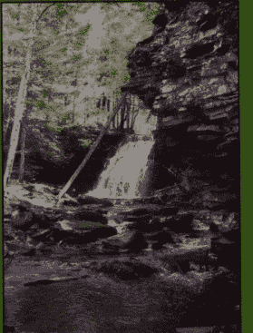

1969年，宾州州大学野外俱乐部（Penn State Outing Club）徒步部门在 Thomas Thwaites 的带领下，开始修建中州步道。多年来，随着步道的扩张，对步道维护人员的需求也随之增加。1982年，Thwaites 博士建立了中州步道协会（MSTA），旨在招募志愿者并吸引支持成员。从那时起，中州步道协会的志愿者同步道监管者花费了无数小时维护和扩展步道。中州步道横穿整个州，从马里兰州边界到纽约州界，穿越了宾夕法尼亚州一些风景最优美的部分。

# 宾夕法尼亚指南
## 中州步道
第 12 版

撰写与出版：
中州步道协会 (Mid State Trail Association, Inc.)
贡献作者：
Thwaites, Adams, Busko, Fleszar

更多信息和步道更新请访问：http://www.hike-mst.org

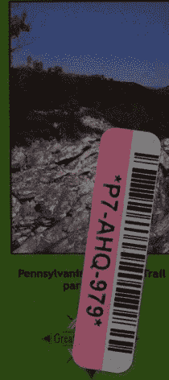

