# 基于原位运动蛋白追踪和机器学习的药物诱导性神经病变图谱绘制

ABSTRACT: 化疗可能引起中枢和外周神经系统毒性，并导致阻碍持续治疗并降低患者生活质量的慢性不良反应。目前缺乏预测、识别和抵消药物引起神经毒性的研究。快速准确地评估潜在神经病变对于具有成本效益的诊断和治疗至关重要。本文报道了动态近红外上转换成像，它允许以毫秒分辨率实时追踪神经元内转运，且无光漂白或闪烁。可在表型之前，根据神经元内转运动力学特征中的细微异常筛选药物引起的神经毒性。此外，我们证明将上转换纳米平台与机器学习相结合，为绘制化疗引起的周围神经病变图谱及评估药物引起的神经毒性提供了一种强大工具。

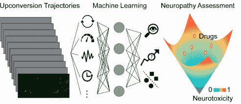

## 引言

化疗引起的周围神经病变（CIPN）是抗肿瘤治疗的常见并发症，其特征为疼痛、麻木、反应迟钝和感觉受损等症状，可能导致患者治疗过早终止。1–6 针对CIPN的可靠且稳健的诊断策略尚待建立，且亟待开发，因为目前的临床实践主要依赖于患者主观且不精确的自我报告。CIPN通常与神经元内转运受损相关，后者调节神经元中信号转导以及营养物质和细胞器运输等关键生理活动。7–12 使用荧光显微镜进行动态追踪适合定量神经元内货物运动的细微变化，从而有助于CIPN诊断。然而，要维持神经元内轨迹的高保真度并建立神经毒性评估的标准方案具有挑战性。以前量化货物转运动力学的尝试受到低保真记录的限制，这是由于传统荧光探针（如分子染料、荧光蛋白、量子点和金刚石纳米晶体）的固有约束所致（图1a和表S1）。13–20 虽然分子荧光团标记的细胞器可实现运动追踪，但通常会因光漂白和自发荧光而出现低对比度成像。13,14 荧光蛋白的基因转染常受转染效率低、蛋白质过度无控制产生以及严重光漂白的限制。15,16 量子点具有高光致发光效率和光稳定性，但受光闪烁和细胞毒性困扰。17,18 铒激活上转换纳米粒子由于其优异的光稳定性和无闪烁特性，已显示出作为细胞成像、神经调制及其他生物医学应用替代生物探针的潜力。21–29 我们的先前研究已证明利用上转换纳米粒子在多层神经元培养中进行神经元内追踪的可行性。21 然而，7 Hz的低保真追踪不太可能区分CIPN，尤其是在表型之前。因此，有必要在单纳米粒子水平上改进读出，以实现神经元内运动的高保真记录。此外，数据处理与学习在神经元内运动与神经毒性之间的关联中具有重要意义。人工智能在光子学中的应用已在数据驱动光学、神经网络和脑机接口等领域产生了变革性进展。30–32 人工智能（如机器学习）将是从海量数据中识别和定量高保真神经元内追踪的不可替代技术（图1b）。我们认为，基于

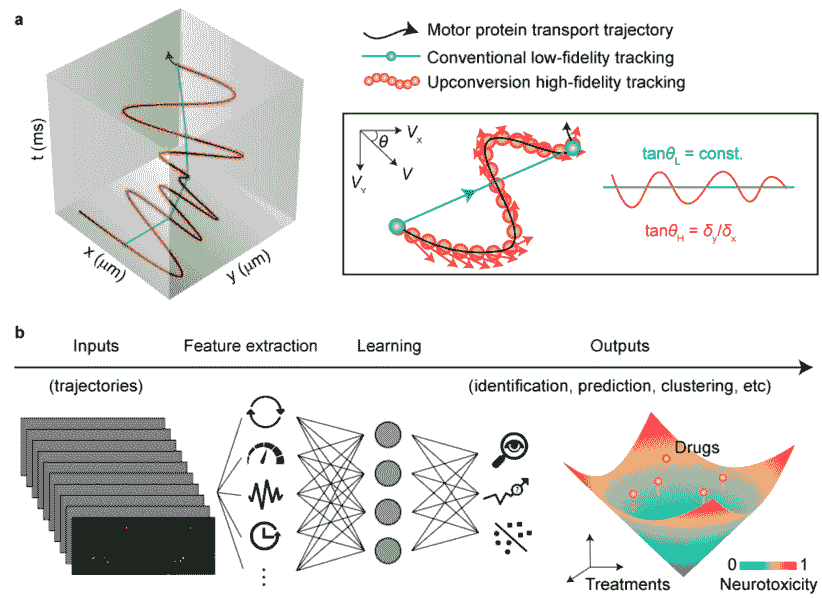

图1. 基于上转换高保真神经元内追踪和机器学习的CIPN评估示意图。(a) 具有高刷新率的上转换动态追踪可维持神经元内驱动蛋白转运的高保真轨迹，与使用荧光染料、蛋白质、量子点或上转换纳米粒子的常规追踪方法所实现的相对较低保真度形成对比。高保真度得益于具有可调瞬时速率的高帧刷新上转换动态追踪的多项式拟合。(b) 用于神经毒性预测和定量的机器学习模型，其输入为上转换显微记录中的轨迹。特征包括囊泡运动中逆行、顺行和暂停段的过程性、速度、频率和持续时间。可以建立一个超大规模多维的药物引起神经病变库，其中神经毒性基于多种参数（如药物、细胞类型、剂量和给药时间）来确定。

上转换高保真神经元内转运追踪与机器学习。

## 结果与讨论

### 上转换纳米探针设计与表征

为验证我们的假设，我们设计并合成了具有多层核–壳纳米结构的上转换纳米粒子，并优化了光致发光输出。我们确定，基于氟化钠的NaYbF4:Tm（2%）纳米粒子在400–850 nm范围内发射（图S1）。将Yb3+/Tm3+对进一步限制在三明治层中，其化学式为NaYbF4@NaYbF4:Tm@NaYbF4，增强了从Yb3+到Tm3+的能量转移（图S2）。采用NaYF4壳层来抑制表面发光淬灭。这些棒状纳米晶的平均尺寸为33 × 68 nm。其上转换发射比NaYbF4:Tm对照体亮超过10倍，比常规NaYF4:Yb/Tm纳米晶亮超过200倍。单纳米粒子成像也证实了光致发光增强，这与溶液中记录的光谱数据一致（图S3）。这些核–壳纳米棒非常适合在高刷新率下以单粒子水平实现神经元内转运的实时追踪。我们进一步在这些纳米棒上包覆了一层薄薄的二氧化硅，以提高亲水性和生物相容性（图S4）。这些包覆二氧化硅的纳米棒在PBS缓冲液和神经元基础培养基中的水动力学尺寸约为90 nm，长期稳定性超过3个月。

### 高保真上转换神经元内追踪

随后，我们利用体外集成式双室培养皿培养背根神经节（DRG）细胞，这是一种与周围神经系统神经病理性疼痛相关的原始感觉神经元（图S5）。细胞体和轴突末端由微通道相互分离。将补充于神经元基础培养基中的纳米探针加入轴突室，并被神经元内化，随后通过逆行转运到达细胞体室。孵育1 h后，在轴突和细胞体中检测到了大量纳米探针货物（图2a–e 和 视频 S1）。对所有发射斑点的统计分析显示，~99%的纳米探针发生了逆行转运（轴突至细胞体），而约1%的纳米探针通过顺行转运（细胞体至轴突）返回轴突室。这两条通路在神经元内转运中很常见。18,19 通过追踪亮斑（图S6中标记为3和4）的轨迹，阐明了逆行和顺行转运的示例。当每帧曝光时间设置为50 ms时，神经元中的发光信噪比超过15，而使用1 ms曝光时间时，信噪比仍超过3。值得指出的是，在整个追踪期间，未观察到DRG神经元中纳米探针出现光闪烁或光漂白现象。神经元内追踪中的亚微米空间分辨率揭示了沿同一轴突束分布的两个亮斑（标记为1和2）的轨迹，但

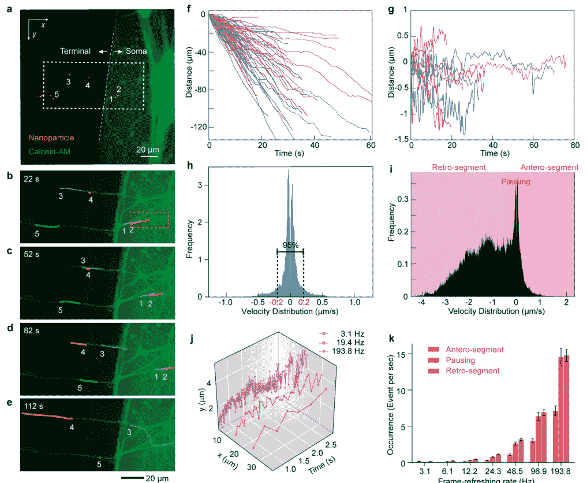

图 2. 使用上转换纳米粒子对DRG神经元中胞内运输进行实时追踪。(a) 合并光致发光图像，显示上转换纳米探针（黄色）与神经结构（绿色）之间的共定位。(b–e) (a)中白色虚线矩形区域的延时发光图像，显示神经元中货物转运的五条轨迹（曝光时间，3 ms；5 ms；刷帧频率，38 Hz）。(f) 健康DRG神经元中纳米粒子系联货物的轨迹（曝光时间，5 ms；刷帧频率，193.8 Hz）。(g) 10条从新鲜固定神经元中采集的纳米粒子系联货物的轨迹和(h)速度分布（n = 3）。胞内运输的暂停阶段阈值在95%置信区间内确定为±0.2 μm/s。(i) (f)中纳米粒子系联货物的速度分布剖面。该剖面根据确定的速度阈值分为逆行/暂停/顺行片段。(j) 单个粒子的绘制轨迹剖面和(k) 不同帧刷新率下所有轨迹的逆行/暂停/顺行片段发生率，说明在实时追踪中，只有高帧刷新率才能实现胞内运输的高保真。比例尺表示为均值 ± SEM。(f)、(i)和(k)中的数据采集自80个健康DRG神经元中的发光斑点，治疗后24 h，含0.1 vol % DMSO的26段视频录像，细胞源自6个不同批次的胚胎。

via different axons. 为探究纳米粒子内化途径，我们在纳米探针预处理的DRG神经元中用LysoTracker标记溶酶体，并观察到纳米粒子与溶酶体约7%的共定位（图 S7）。我们还对固定神经元中含纳米粒子的货物和内体进行了免疫染色，其中标记物EEA1/Rab5、Rab11、Rab7和TGN38分别对应早期、晚期、回收和高尔基体后内体。约60%的发射斑点位置与内体位置匹配，表明大部分纳米探针已通过内体途径进入细胞。18–20

随着含纳米粒子货物的逆行运动趋势，观察到了可移动轨迹的“停走”阶段（图 2f 和视频 S2）。我们对录制视频中的轨迹进行了统计分析，并量化了嵌入纳米粒子的内体的传输参数。我们在固定神经元中将速度低于0.2 μm/s的阈值定义为“停止”阶段（95%置信区间）（图 2g,h）。根据特定的“停走”特征，定量评估了神经元内货物运输的动态变化（图 2i）。我们用四个物理参数量化了“停止”（暂停）和“前进”（逆行和顺行）阶段：运行长度（μm）、过程性（s）、频率（events/min）和速度（μm/s）。速度通过测量每个片段从第一个点到最后一个点的位移向量长度（运行长度）随时间（过程性）的变化来确定。更快的帧刷新率能揭示胞内运输的更多细节（图 2j）。准确地说，暂停和顺行片段的发生可能

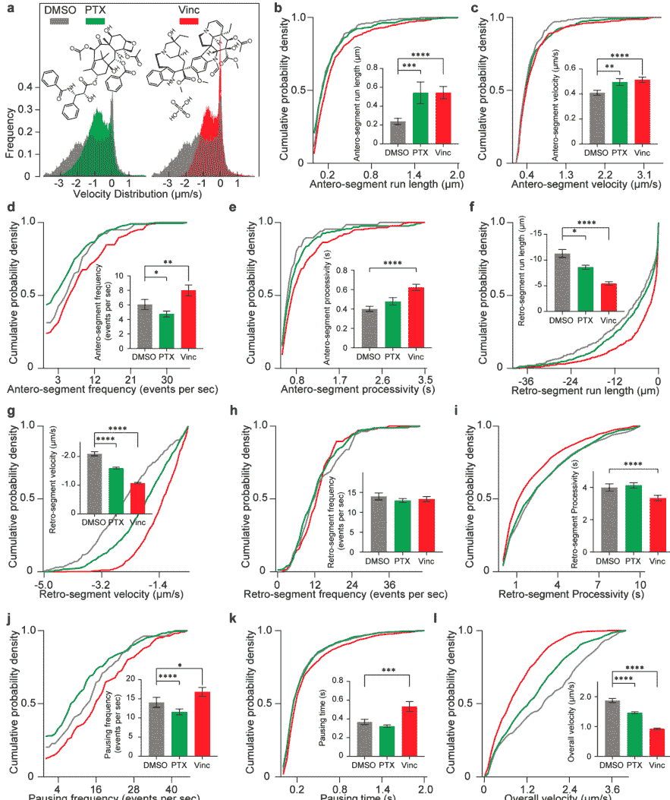

图 3. 微管活性剂对胞内运输的影响。(a) 捕获电影中每帧纳米粒子的速度分布剖面（见支持信息中的电影 2–4）。插图：紫杉醇（PTX）和硫酸长春新碱（Vinc）的分子结构。(b–l) 就运行长度、速度、频率和过程性而言，顺行和逆行片段中胞内运输的量化物理参数。定量分析基于每个实验组的单独轨迹/电影数量（DMSO为80/26，PTX为225/46，Vinc为105/37），其中DRG细胞源自六批E15胚胎。纳米探针剂量设定为PTX 100 nM和Vinc 10 nM，溶于100 μL神经元培养基中。数据以累积概率呈现，插图中的比例尺表示为均值 ± SEM。统计显著性使用Kruskal–Wallis检验并结合Dunn校正以及Wilcoxon检验进行评估。显著性水平表示为 *p < 0.05, **p < 0.01, ***p < 0.001, 和 ****p < 0.0001。

omitted at low refreshment rates (Figure 2k), resulting in insignificance of the corresponding run length, processivity, and velocity quantification. 在低刷帧率下被省略（图 2k），导致相应的运行长度、过程性和速度定量无显著性。为实现精确轨迹追踪和运动货物的准确定量，我们将曝光时间设定为5 ms，并将纵向捕获窗口降至120像素以下，以尽量减少相机读出时间。这使得视频录制中的时间分辨率高达193.8 Hz（视频 S2）。与我们之前报道的低频成像（7 Hz）不同，21 这种高频成像（~200 Hz）模式可以在收集表型信息之前识别药物诱导神经病变的早期迹象。

## 胞内运动中药物诱导异常的鉴定

为验证基于上转换的方法在绘制药物诱导神经病变图谱方面的潜力，我们测试了两种抗肿瘤药物，紫杉醇（PTX）

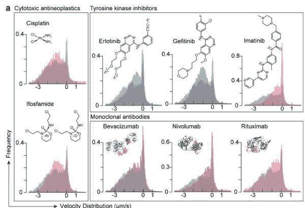
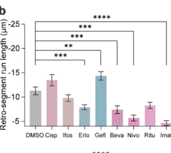
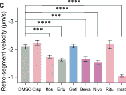
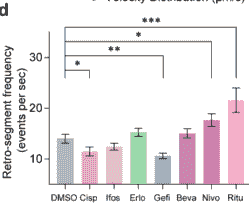
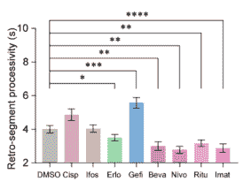
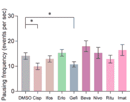
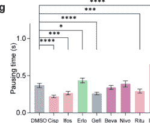
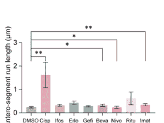
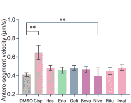
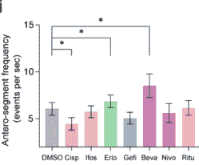
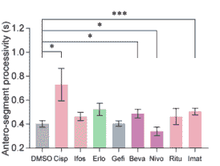
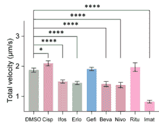

图 4. 扩展上转换显微镜技术以进行通用药物诱导神经病变评估。(a) 从每部电影的所有帧中采集的运动纳米粒子的速度分布剖面。插图为化学或蛋白质结构。(b–l) 就运行长度、速度、频率和过程性而言，顺行和逆行片段中神经元内运输的量化物理参数。定量分析基于各组独立轨迹/电影的数量（DMSO为80/26，Cisp为78/14，Ifos为95/23，Ero为109/26，Gefi为89/19，Beva为69/8，Nivo为96/11，Ritu为91/20，Imat为76/11），其中DRG细胞源自六批E15胚胎。剂量设定为所有药物在100 µL神经元培养基中为100 µM。(b–l)中的比例尺表示均值 ± SEM。统计显著性使用Kruskal–Wallis检验并结合Dunn校正以及Wilcoxon检验进行评估。显著性水平表示为 *p < 0.05, **p < 0.01, ***p < 0.001, 和 ****p < 0.0001。

and vincristine sulfate (Vinc), which are known to affect microtubule function during cellular proliferation (Figure 3a and Movies S3 and S4). 5,6 和硫酸长春新碱（Vinc），已知会在细胞增殖过程中影响微管功能（图 3a 和视频 S3 和 S4）。5,6 相对于对照组，PTX-和Vinc处理组显示出逆行片段速度降低。然而，Vinc直接结合微管蛋白二聚体并阻止其关联形成微管，而PTX改变并稳定微管构象，以防止其在三磷酸腺苷（ATP）水解时解离。33,34 进一步的统计和累积分析揭示了两种药物处理中神经元内传输运动参数的相似性和差异性（图 3b–l）。可能Vinc处理会减少细胞骨架长度并缩短运动蛋白的移动距离，从而导致中断顺行片段频率和暂停频率的尝试次数相对增加（图 3d,j）。相比之下，PTX 维持了

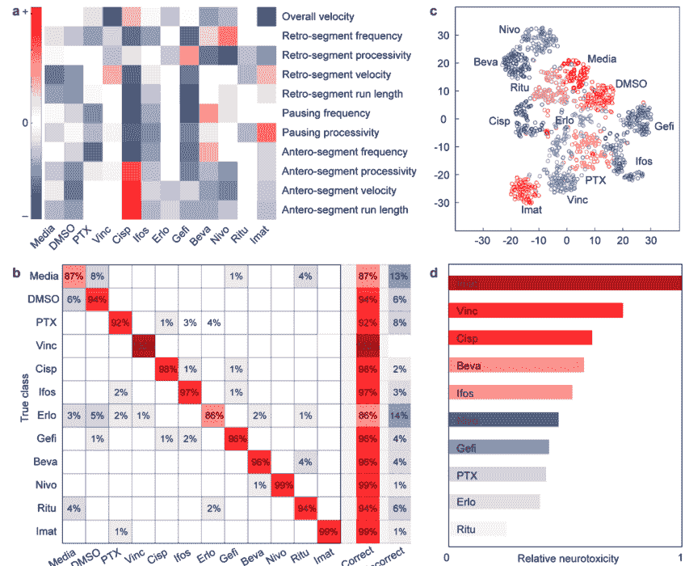

图5. 机器学习验证了基于上转换的药物诱导神经病变评估方法。(a) 热图显示所有12个测试组细胞内移动轨迹的平均特征模式。(b) 使用支持向量机（SVM）算法训练的分类器的混淆矩阵及其预测准确率。(c) 通过t分布式随机邻域嵌入（t-sne）作为降维方法显示药物空间关系的二维模式。(d) 基于移动轨迹对接受特定浓度药物治疗的组进行的神经毒性评级。

现有微管结构的稳定性，并防止早期终止和运动蛋白转运的尝试，呈现出较低的暂停频率和顺行片段频率。通过量化所有转运参数，排除了二甲基亚砜（DMSO，0.1 vol %）对货物转运的可能影响（图S8）。接着，我们在多个层面（包括生长形态、基因表达和神经元功能）研究了PTX和Vinc在DRG神经元中可能引起的变化。例如，在用两种药物预处理DRG 24小时后，原位显微镜成像显示胞体和轴突的大小或神经元形态无明显变化（图S9）。定量聚合酶链反应（qPCR）显示微管相关基因的表达无显著差异（p > 0.05，Kruskal–Wallis检验配合Dunn校正和Wilcoxon检验）（图S10）。此外，电生理学评估表明PTX和Vinc未影响DRG细胞的一般神经元功能（图S11）。动作电位阈值和潜伏期未受明显影响，尽管接受PTX处理的神经元频率略高于对照组（Mann–Whitney U检验，p = 0.0446）。对振幅、半宽、超极化和不应期的进一步表征未揭示DRG神经元动作电位波形有任何显著影响。

当这些

将这些数据综合来看，此类短期药物治疗未诱导出可检测的表型，如神经功能障碍或基因表达变化。然而，神经元行为的细微变化，使用常规生物学或分子方法（如显微监测、qPCR和电生理学）无法检测，但可通过我们的高分辨率上转换显微镜轻易区分。我们进一步考察了基于上转换的细胞内转运追踪用于多种抗癌药物神经毒性评估的适用性，包括细胞毒性抗肿瘤药物（Cispl和Ifos）、酪氨酸激酶抑制剂（Erlo、Gefi和Imat）以及单克隆抗体（Beva、Nivo和Ritu）。不同药物治疗的速度分布和运动参数差异显著（图4）。速度分布的共同特征表明，对于大多数药物治疗，高速区域（<−2 μm/s）中的逆行片段频率降低，但在低速（−0.2至−2 μm/s）和暂停（−0.2至0.2 μm/s）区域中增加（图4a）。这些特征也通过分类参数的统计分析得到证实（图4b–i）。尽管药物Gefi和Ritu未引起纳米探针速度的显著差异（图4l），但暂停时间和逆行片段过程性等其他运动特征可用于量化它们与对照组的不同之处。

一般来说，各种抗肿瘤药物诱导周围神经病变的作用机制仍不明确。例如，细胞毒性抗肿瘤药物通过烷基化DNA分子中的鸟嘌呤碱基来影响细胞增殖，从而防止复制过程中的DNA延伸。35 由于神经末端分化且不复制，不太可能受到Cispl和Ifos的直接细胞毒性影响。已证明Cispl与非DNA靶点（磷脂和蛋白质）相互作用，并影响高度依赖于蛋白质和脂质筏相互作用的关键神经元功能过程。对于酪氨酸激酶抑制剂，Gefi和Erlo是表皮生长因子受体（EGFR）抑制剂，而Imat是调节至少几个信号通路的几种酪氨酸激酶酶的抑制剂。36,37 在我们的研究中，Gefi/Erlo和Imat在许多参数上具有不同的效果，尽管它们都是酪氨酸激酶抑制剂。Imat治疗可能影响ATP水解并以非特异性方式防止运动蛋白的机械运动，从而停止神经元内转运并缩短行进长度（图4b,g,h）。Erlo和Gefi防止EGFR自磷酸化和下游信号通路的激活。然而，EGFR结合和EGFR激活如何影响全细胞微管稳态尚不清楚。单克隆抗体（Beva、Nivo和Ritu）是抗肿瘤免疫反应或血管内皮生长因子依赖性血管生成的特定靶点，可能对神经元产生较弱影响。

## 机器学习用于药物诱导神经病变评估

接下来，我们应用机器学习来更好地理解神经元内转运，并为CIPN建立一个全面的评估系统。通过整合11个运动特征，在支持向量机（SVM）模型中开发了机器学习算法。支持向量机（SVM）模型中的特征特征最初通过平行图进行可视化，而分布的上限和下限则根据均值和标准差计算得出（图S12）。不同药物之间的组内和组间相似性是通过每个组或各组对中11维特征向量的平均欧氏距离来确定的。二维模式使用t分布式随机邻域嵌入（t-sne）进行降维，以展示药物的空间关系。不同药物条件下模式的空间接近性表明药物-化学相似性。基于上述初步分析，通过11维特征矩阵的z-score标准化生成了特征指纹（图5a）。对照组（DMSO和培养基）的指纹显示为浅灰色分布，所有值均接近零，作为与其他组比较的基线。其他组中蓝色和红色团块的深度从多个方面揭示了药物效应。11维特征矩阵被用于药物识别，获得了94.8%的准确率（图5b）。药物治疗的总体差异通过将11个特征聚类在分离的空间分布中进行可视化（图5c）。我们通过对不同药物与对照组之间的相似性进行排名来估计毒性评分（图5d）。在所有测试组中，DMSO、Ritu和Erlo表现出较低的毒性评分。三种单克隆抗体（Nivo、Beva和Ritu）和两种微管活性剂（PTX和Vinc）在二维t-sne模式中显示出空间接近性，揭示了其内部类别的某些相似性。值得注意的是，Gefi和Imat表现出较大的空间距离，尽管两者都是酪氨酸激酶抑制剂。对各种药物、剂量和治疗时间的进一步系统研究将有助于通过机器学习构建用于CIPN评估的多维数据库，并深入理解其潜在机制。

## 结论

提供明亮近红外发射、高光稳定性和优异生物相容性的上转换纳米颗粒对于评估化学产品诱导的神经病变模型非常理想。基于上转换的高保真神经元内转运追踪可以轻易识别由短期药物治疗引起的神经病变细微变化。这种方法在表型信息出现之前，为早期检测药物诱导的神经病变性疾病提供了前所未有的灵敏度，而常规生物学方法无法实现。当该成像平台与机器学习相结合时，可以建立药物诱导神经病变的综合数据库，为开发用于药物发现、基础神经科学、神经元疾病诊断和癌症治疗的单纳米颗粒分析工具打开大门。

## 相关内容

- 补充信息
- 补充信息可免费获取，网址为 https://pubs.acs.org/doi/10.1021/jacs.1c07312。
- 材料与方法、详细实验程序、轨迹量化算法、纳米颗粒优化与光学表征、单颗粒成像、稳定性、细胞摄取与生长、免疫染色、定量聚合酶链反应、电生理学以及机器学习的补充数据（PDF）
- 健康DRG的视频，38 Hz；健康DRG的视频，193.8 Hz；PTX处理的DRG的视频，193.8 Hz；以及Vinc处理的DRG的视频，193.8 Hz（ZIP）

## 作者信息

### 通信作者

刘晓刚 – 新加坡国立大学化学系，新加坡117543；新加坡国立大学苏州研究院功能材料中心，中国江苏省苏州市215123；新加坡国立大学N1健康研究所，新加坡117456；新加坡国立大学与天津大学联合学院，天津大学国际校区，中国福建省福州市350207；新加坡国立大学杨潞龄医学院纳米医学中心纳米医学转化研究计划，新加坡117609；orcid.org/0000-0003-2517-5790；电子邮件：chmlx@nus.edu.sg

### 作者

易志高 – 新加坡国立大学化学系117543，新加坡；orcid.org/0000-0003-0083-5355

高虎心 – 新加坡国立大学苏州研究院功能材料中心，中国江苏省苏州市215123；系

- 生物医学工程系，新加坡国立大学，新加坡 117583, 新加坡
- Xianglin Ji – 生物医学工程系，香港城市大学，九龙, 香港特别行政区 999077, 中华人民共和国
- Xin-Yi Yeo – 分子与细胞生物学研究所 (IMCB)，科技研究局 (A*STAR)，新加坡 138667, 新加坡；生理学系，杨潞龄医学院，新加坡国立大学，新加坡 117593, 新加坡
- Suet Yen Chong – 外科系，杨潞龄医学院，新加坡国立大学，新加坡 119228, 新加坡；心血管研究所 (CVRI)，新加坡国立大学心脏中心 (NUHCS)，新加坡 117599, 新加坡
- Yujie Mao – 化学系，新加坡国立大学，新加坡 117543, 新加坡
- Baiwen Luo – N1 健康研究所，新加坡国立大学，新加坡 117456, 新加坡
- Chao Shen – 生物与环境工程学院，浙江树人大学，杭州 310015, 中华人民共和国
- Sanyang Han – 化学系，新加坡国立大学，新加坡 117543, 新加坡
- Jiong-Wei Wang – 生理学系，杨潞龄医学院，新加坡国立大学，新加坡 117593, 新加坡；外科系，杨潞龄医学院，新加坡国立大学，新加坡 119228, 新加坡；心血管研究所 (CVRI)，新加坡国立大学心脏中心 (NUHCS)，新加坡 117599, 新加坡；纳米医学转化研究计划，纳米医学中心，杨潞龄医学院，新加坡国立大学，新加坡 117609, 新加坡
- Sangyong Jung – 分子与细胞生物学研究所 (IMCB)，科技研究局 (A*STAR)，新加坡 138667, 新加坡；生理学系，杨潞龄医学院，新加坡国立大学，新加坡 117593, 新加坡
- Peng Shi – 生物医学工程系，香港城市大学，九龙, 香港特别行政区 999077, 中华人民共和国；orcid.org/0000-0003-0629-4161
- Hongliang Ren – 功能材料中心，新加坡国立大学苏州研究院，苏州 215123, 中华人民共和国；N1 健康研究所，新加坡国立大学，新加坡 117456, 新加坡；香港中文大学 (CUHK) 机器人研究所，沙田, 香港 999077, 中华人民共和国

完整联系信息可在以下网址查看：
https://pubs.acs.org/10.1021/jacs.1c07312

## 注释

作者声明不存在竞争性财务利益。

## 致谢

该工作得到科技研究局 (A*STAR) (A1983c0038)、新加坡总理府下属国家研究基金会（在 NRF 研究员计划下（奖项编号 NRF-NRFI05-2019-0003））、沙特阿拉伯科技大学 (KAUST) 赞助研究办公室 (OSR)（在奖项编号 OSR-2018-CRG7-3736 下）、NUS NANONANSH 计划 (NUHSRO/2020/002/ NanoNash/LOA; R143000B43114)、新加坡卫生部国家医学研究委员会 (NMRC/OFYIRG/0081/2018) 以及中国国家自然科学基金 (21771135, 21871071) 的资助。S.Y.C. 想衷心感谢 ESR/TENG GL 博士奖学金计划提供的慷慨支持。我们感谢 Akihiro Yamanka、Angelo All、John Jia En Chua、Yinghua Qu、Liangliang Liang、Yuxia Liu、Sirui Liu 和 Di Fu 进行富有启发性的讨论。

## 参考文献

- (1) Stone, J. B.; DeAngelis, L. M. 癌症治疗诱导的神经毒性：聚焦新型疗法. Nat. Rev. Clin. Oncol. 2016, 13, 92–105.
- (2) Magge, R. S.; DeAngelis, L. M. 双刃剑：化疗的神经毒性. Blood Rev. 2015, 29, 93–100.
- (3) Cavalletti, G.; Marmiroli, P. 化疗引起的周围神经病变. Nat. Rev. Neurol. 2010, 6, 657–666.
- (4) Lehmann, H. C.; Wunderlich, G.; Fink, G.; Sommer, R. C. 周围神经病变的诊断. Neurol. Res. Pract. 2020, 2, 20.
- (5) Sisignano, M.; Baron, R.; Scholich, K.; Geisslinger, G. 基于机制的化疗引起的周围神经病理性疼痛治疗. Nat. Rev. Neurol. 2014, 10, 694–707.
- (6) Zająckowska, R.; Kocot-Kępska, M.; Leppert, W.; Wrzosek, A.; Mika, J.; Wordliczek, J. 化疗引起的周围神经病变的机制. Int. J. Mol. Sci. 2019, 20, 1451.
- (7) Millecamps, S.; Julien, J. P. 轴突转运缺陷与神经退行性疾病. Nat. Rev. Neurosci. 2013, 14, 161–176.
- (8) Sleigh, J. N.; Rossor, A. M.; Fellows, A. D.; Tosolini, A. P.; Schiavo, G. 轴突转运与神经系统疾病. Nat. Rev. Neurol. 2019, 15, 691–703.
- (9) Stokin, G. B.; Lillo, C.; Falzone, T. L.; Brusch, R. G.; Rockenstein, E.; Mount, S. L.; Raman, R.; Davies, P.; Masliah, E.; Williams, D. S.; Goldstein, L. S. B. 阿尔茨海默病发病早期的轴突病变与转运缺陷. Science 2005, 307, 1282–1288.
- (10) Hirokawa, N. 醛解酶和动力蛋白超家族蛋白及细胞器转运机制. Science 1998, 279, 519–526.
- (11) Vale, R. D. 细胞内转运的分子马达工具箱. Cell 2003, 112, 467–480.
- (12) Roberts, A. J.; Kon, T.; Knight, P. J.; Sutoh, K.; Burgess, S. A. 动力蛋白马达蛋白的功能与机制. Nat. Rev. Mol. Cell Biol. 2013, 14, 713–726.
- (13) Qiu, W.; Derr, N. D.; Goodman, B. S.; Villa, E.; Wu, D.; Shih, W.; Reck-Peterson, S. L. 动力蛋白通过随机和协调步进共同实现过程性运动. Nat. Struct. Mol. Biol. 2012, 19, 193–200.
- (14) Hafezparast, M.; Klocke, R.; Ruhrberg, C.; Marquardt, A.; Ahmad-Annuar, A.; Bowen, S.; Lalli, G.; Witherden, A. S.; Hummerich, H.; Nicholson, S.; Morgan, P. J.; Oozageer, R.; Priestley, J. V.; Averill, S.; King, V. R.; Ball, S.; Peters, J.; Toda, T.; Yamamoto, A.; Hiraoka, Y.; Augustin, M.; Korthaus, D.; Wattler, S.; Wabnitz, P.; Dickente, C.; Lampel, S.; Boehne, F.; Peraus, J.; Popp, A.; Rudelius, M.; Schlegel, J.; Fuchs, H.; de Angelis, M. H.; Schiavo, G.; Shima, D. T.; Russ, A. P.; Stumm, G.; Martin, J. E.; Fisher, E. M. C. 动力蛋白突变将运动神经元变性与逆行转运缺陷联系起来. Science 2003, 300, 808–812.
- (15) Ross, J. L.; Wallace, K.; Shuman, H.; Goldman, Y. E.; Holzbaur, E. L. 体外动力蛋白-动力蛋白复合物的过程性双向运动. Nat. Cell Biol. 2006, 8, 562–570.
- (16) McKenney, R. J.; Huynh, W.; Tanenbaum, M. E.; Bhabha, G.; Vale, R. D. 由动力蛋白-货物适配器复合物激活的细胞质动力蛋白运动. Science 2014, 345, 337–341.
- (17) Pinaud, F.; Clarke, S.; Sittner, A.; Dahan, M. 探测细胞事件：一次一个量子点. Nat. Methods 2010, 7, 275–285.
- (18) Cui, B.; Wu, C.; Chen, L.; Ramirez, A.; Bearer, E. L.; Li, W.; Moberly, W. C.; Chu, S. 利用量子点对 NGF 轴突转运进行一次一个的实时追踪. Proc. Natl. Acad. Sci. U. S. A. 2007, 104, 13666–13671.
- (19) Haziza, S.; Mohan, N.; Loe-Mie, Y.; Lepagnol-Bestel, A.; Massou, S.; Adam, M. L.; X. L.; Viard, J.; Plancon, C.; Daudin, R.; Koebel, P.; Dorard, E.; Rose, C.; Hsieh, F.; Wu, C.; Potier, B.; Herault, Y.; Sala, C.; Corvin, A.; Allinquant, B.; Chang, H.; Treussart, F.; Simonneau, M. 荧光纳金石追踪揭示由与脑疾病相关的遗传风险因素诱导的细胞内转运异常. Nat. Nanotechnol. 2017, 12, 322–328.
- (20) Chowdhury, P. D.; Che, D. L.; Kaplan, L.; Chen, O.; Pu, K.; Bawendi, M.; Cui, B. 纳粒辅助的内体光学拴联揭示了动力蛋白在逆行轴突转运中的协同功能. Sci. Rep. 2016, 5, 18059.
- (21) Zeng, X.; Chen, S.; Weitemier, A.; Han, S.; Blasiak, A.; Prasad, A.; Zheng, K.; Yi, Z.; Luo, B.; Yang, L.; Thakor, N.; Chai, C.; Lim, K.; McHugh, T. J.; All, A. H.; Liu, X. 通过上转换显微镜可视化神经元内马达蛋白转运. Angew. Chem., Int. Ed. 2019, 58, 9262–9268.
- (22) (a) Ou, X.; Qin, X.; Huang, B.; Zan, J.; Wu, Q.; Hong, Z.; Xie, L.; Bian, H.; Yi, Z.; Chen, X.; Wu, Y.; Song, X.; Li, J.; Chen, Q.; Yang, H.; Liu, X. 高分辨率 X 射线发光延展成像. Nature 2021, 590, 410–415. (b) Han, S.; Deng, R.; Gu, Q.; Ni, L.; Huynh, U.; Zhang, J.; Yi, Z.; Zhao, B.; Tamura, H.; Pershin, A.; Xu, H.; Huang, Z.; Ahmad, S.; Abdi-Jalebi, M.; Sadhanala, A.; Tang, M.; Bakulin, A.; Beljonne, D.; Liu, X.; Rao, A. 镧掺杂无机纳粒使分子三重元激子发光. Nature 2020, 587, 594–599.
- (23) Liu, Q.; Zhang, Y.; Peng, C. S.; Yang, T.; Joubert, L.; Chu, S. 亚 10 W cm-2 辐照度下单个上转换纳粒成像. Nat. Photonics 2018, 12, 548–553.
- (24) (a) Zhong, Y.; Ma, Z.; Wang, F.; Wang, X.; Yang, Y.; Liu, Y.; Zhao, X.; Li, J.; Du, H.; Zhang, M.; Cui, Q.; Zhu, S.; Sun, Q.; Wan, H.; Tian, Y.; Liu, Q.; Wang, W.; Garcia, K. C.; Dai, H. 利用超亮近红外-IIb 稀土纳粒进行免疫治疗的体内分子成像. Nat. Biotechnol. 2019, 37, 1322–1331. (b) Zhou, L.; Wang, R.; Yao, C.; Li, X.; Wang, C.; Zhang, X.; Xu, C.; Zeng, A.; Zhao, D.; Zhang, F. 单波段上转换纳米探针用于癌症生物标志物的多重同步原位分子测绘. Nat. Commun. 2015, 6, 6938.
- (25) Nam, S. H.; Bae, Y. M.; Park, Y. I.; Kim, J. H.; Kim, H. M.; Choi, J. S.; Lee, K. T.; Hyeon, T.; Suh, Y. D. 镧离子掺杂上转换纳粒在活细胞中的长期实时追踪. Angew. Chem. 2011, 123, 6217–6221.
- (26) (a) Jiang, Y.; Fu, P.; Liu, Y.; Wang, C.; Zhao, P.; Chu, X.; Jiang, X.; Yang, W.; Wu, Y.; Wang, Y.; Xu, G.; Hu, J.; Bu, W. 近红外光触发的 NO 释放用于脊髓损伤修复. Sci. Adv. 2020, 6, eabc3513. (b) Zhu, X.; Li, J.; Qiu, X.; Liu, Y.; Feng, W.; Li, F. 通过精确控制显微温度编程联合癌症治疗的上转换纳米复合材料. Nat. Commun. 2018, 9, 2176.
- (27) Wang, F.; Wen, S.; He, H.; Wang, B.; Zhou, Z.; Shimoni, O.; Jin, D. 活细胞中单个上转换纳粒的显微检查与追踪. Light: Sci. Appl. 2018, 7, 18007.
- (28) Ma, Y.; Bao, J.; Zhang, Y.; Li, Z.; Zhou, X.; Wan, C.; Huang, L.; Zhao, Y.; Han, G.; Xue, T. 通过可注射自供电视网膜纳米天线实现哺乳动物近红外成像视觉. Cell 2019, 177, 243–255.
- (29) Chen, S.; Weitemier, A. Z.; Zeng, X.; He, L.; Wang, X.; Tao, Y.; Huang, A. J. Y.; Hashimotodani, Y.; Kano, M.; Iwasaki, H.; Parajuli, L. K.; Okabe, S; Teh, D. B. L.; All, A. H.; Tsutsui-Kimura, I.; Tanaka, K. F.; Liu, X.; McHugh, T. J. 基于上转换纳粒介导的遗传光学控制的近红外深部脑刺激. Science 2018, 359, 679–684.
- (30) Butler, K. T.; Davies, D. W.; Cartwright, H.; Isayev, O.; Walsh, A. 分子与材料科学的机器学习. Nature 2018, 559, 547–555.
- (31) Feldmann, J.; Youngblood, N.; Wright, C. D.; Bhaskaran, H.; Pernice, W. H. P. 具有自学习能力的全光突触神经网络. Nature 2019, 569, 208–214.
- (32) Shastri, B. J.; Tait, A. N.; de Lima, T. F.; Pernice, W. H. P.; Bhaskaran, H.; Wright, C. D.; Prucnal, P. R. 用于人工智能和神经形态计算的光子学. Nat. Photonics 2021, 15, 102–114.
- (33) Moudi, M.; Go, R.; Yien, C. Y. S.; Nazre, M. 长春生物碱. Int. J. Prev. Med. 2013, 4, 1231–1235.
- (34) Xiao, H.; Verdier-Pinard, P.; Fernandez-Fuentes, N.; Burd, B.; Angeletti, R.; Fiser, A.; Horwitz, S. B.; Orr, G. A. 紫杉醇稳定微管机制的洞察. Proc. Natl. Acad. Sci. U. S. A. 2006, 103, 10166–10173.
- (35) Rahal, R.; Kaur, J. 烷化剂与癌症治疗. Expert Opin. Ther. Pat. 2007, 17, 1061–1075.
- (36) Bronte, G.; Roflo, C.; Giovannetti, E.; Cicero, G.; Pauwels, P.; Passiglia, F.; Castiglia, M.; Rizzo, S.; Vullo, F. L.; Fiorentino, E.; Van Meerbeeck, J. 埃替尼和吉非替尼用于非小细胞肺癌治疗是否可互换、对立或互补？生物学、药理学和临床方面. Crit. Rev. Oncol. Hematol. 2014, 89, 300–313.
- (37) Joensuu, H.; Dimitrijevic, S. 酪氨酸激酶抑制剂伊马替尼 (STI571) 作为实体肿瘤抗癌药物. Ann. Med. 2001, 33, 451–455.

