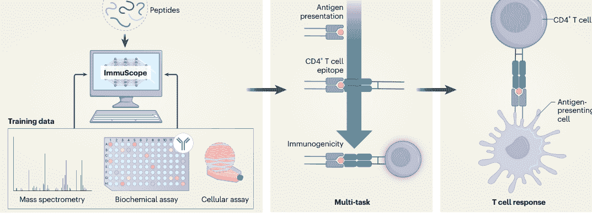

# 深度学习映射 T 辅助细胞靶点

免疫学中的 AI

## 利用深度学习绘制 T 辅助细胞靶点图

Yuan Liu & Leng Han

通过将多维数据与深度学习相结合，一种名为 ImmunoScope 的新方法可以预测组织相容性复合体 类（MHC-II）呈递和 T 辅助细胞的免疫原性。ImmunoScope 显示了加速从头发现和疫苗设计的潜力。

T 细胞扫描全身被称为肽的蛋白质片段，这些片段出现在细胞表面。一种被称为 CD4 T 细胞的亚群能够识别这些肽并向其他细胞释放信号。为了理解 T 细胞如何识别肽，考虑抗原呈递细胞的作用至关重要。这些细胞将来自肿瘤突变或在正常细胞周转期间的蛋白质分解为短肽。这些肽必须与 MHC-II 分子结合。一旦结合，细胞表面的 MHC-II 复合物就会将肽呈递给 T 辅助细胞。如果 T 辅助细胞受体与呈递的肽匹配，T 辅助细胞就会激活并启动由细胞因子驱动的免疫反应。识别一个[肽]

在传统的单变异实验中，通过基因工程使细胞表达单个 MHC-II 等位基因，以便接收到的每个肽都能被唯一分配，但仅覆盖了少数等位基因。相比之下，多变异实验中具有多个等位基因的天然抗原呈递细胞产生无法将每个肽分配给特定等位基因的数据。分析测量亲和力在所有对中的保守程度。这种方法既有优点也有局限性，大多数计算方法侧重于一种方法，如结合亲和力、多变异基序或 T 细胞激活，其他则执行[任务]，这些肽通常依赖质谱分析。在这一期《自然机器智能》杂志发表的一项研究中，作者等提出了 ImmunoScope，它通过使用深度学习预测呈递给 T 辅助细胞的肽，规避了这一要求，能够分析哪些呈递的肽会触发并激活免疫反应。通过合并多种来源的数据，ImmunoScope 能够快速绘制抗原呈递 T 辅助细胞靶点图，对个性化免疫疗法具有明确意义。

ImmunoScope 解决了这两个相关的方法 (1)。第一种 ImmunoScope EL 预测哪些肽被 MHC-II 呈递。它在三个数据集上运行：

图 1 从数据整合到细胞激活的 ImmunoScope 框架。a. 整合质谱、生化实验、细胞免疫原性数据以训练 ImmunoScope 深度学习模型。b. 多任务预测流水线，涵盖 MHC-II 抗原呈递、T 辅助表位的识别和免疫原性评分，c. 抗原呈递细胞呈递的预测肽-MHC II 复合物结合 CD4+ T 细胞以启动免疫反应。

(1) 来自 142 个等位基因的单变异质谱数据的 246,000 和 240 万个肽-等位基因对；(2) 来自覆盖相同等位基因的多变异质谱数据的约 432,000 和 440 万个示例；以及 (3) 跨越 80 类的 129,000 次结合亲和力测量。ImmunoScope 使用多实例学习将每个突变体视为肽-等位基因对的候选，并通过迭代进行从头预测。多锚点三元损失（poly-anchor triplet loss）在内部表示中聚类结合者和非结合者模型。这种方法使 ImmunoScope 能够泛化到未见的肽和等位基因，实现了召回率下面积（AUC-PR）0.856 和工作特征曲线下面积（AUC-ROC）0.825，在近 90% 的情况下性能优于其他工具。

ImmunoScope 用于预测哪些肽将触发 T 辅助细胞激活，它使用了在超过75,000 个肽-等位基因对上训练的嵌入表示，并在 T 辅助细胞中测量了干扰素-γ 的释放。它们预测的新肽未显示出激活。歧义记录被解决，并对约 17,900 个示例进行了修订评估。ImmunoScope 反映了使用交叉熵损失、用于类别不平衡的损失以及用于区分数据的三元损失的预测。ImmunoScope 的曲线下面积（AUC）达到 0.909，优于工具的 0.885 和 0.875。

为了证明现实世界的应用，作者将 ImmunoScope 应用于黑色瘤抗原和 SARS-CoV-2 的发现。在 42 名黑色瘤患者中，ImmunoScope 的预测与肿瘤样本数据强相关。在 SARS-CoV-2 中，ImmunoScope 预测了原始毒株和常见突变的棘刺蛋白片段，显示 T 辅助细胞活性下降了 68%。结构

Yuan Liu¹² & Lang Han¹³
¹印第安纳州生物信息学与数据科学，印第安纳州医学学院，印第州，³印第安纳州医学学院免疫中心，美国
邮箱: yuanliu@iu.edu; lhanghan@iu.edu

参考文献
1. Callaway, M., et al. Nature 626, 224–234 (2022).
2. Sultan, H., et al. Nature 632, 182–191 (2024).
3. Shen, L., et al. Nat. Med. https://doi.org/10.1038/s41591-023-02717-z, Nat. Med. 29, 511–521 (2023).
4. Zhang, Y., Chen, S., Wang, M., A., Baker, H., Zhang, G., G, Q., & Hoovy, K. Nat. Rev. Immunol. 23, 195 (2023).
5. Kim, J., Mason, A., & Stein, M. Science 377, eadd6354 (2022).
6. Olivera, R., et al. Nature 605, 532–538 (2022).
7. Chen, Y., et al. Cell Rep. 42, 112827 (2023).
8. Wu, J., Wang, J., Zhang, Y., & Han, L., Nat L., Nat. Rev. Clin. Oncol. 20, 211–228 (2023).
9. Graham, D. B., et al. Nat. Rev. Clin. 17, 1762–1772 (2018).
