# 文本映射：社会科学的计算文本分析（计算社会科学）


## 《文本映射》赞誉

“Stoltz 和 Taylor 成功创作出一部著作，它自信地将即使是初学者也带入精湛与技术娴熟的境界，不仅带来对前沿技术的实践掌握，也不仅仅是对数学基础的清晰理解，更让读者对产生所分析文本数据的更广泛社会背景有直观感受——而且这一切都不需要在读者面前摆出一个方程式！一件真正的珍宝。”—John Levi Martin，芝加哥大学 Florence Borchert Bartling 社会学教授，《思考方法》作者

“语言是实用的，语言是习惯性的，语言是关系性的。我一直在等待这样一本书。一本能够无缝地将哲学与理论与工具和可复现示例相结合，并以深刻的社会学方式进行的书。如果你读这本书，如果你用这本书教学，你和你的学生将拥有在社会科学中成功进行计算文本分析所需的一切。一项非凡的贡献。”—Laura K. Nelson，不列颠哥伦比亚大学社会学助理教授

“《文本映射》包含大量有趣的示例，揭示了计算文本分析在社会科学中的令人兴奋的可能性。这是一本稀有的书籍，既提供了关于做什么的有用建议，也提供了关于如何做的建议。我想许多读者会喜欢 Stoltz 和 Taylor 决定不使用方程式，并使用 R 代码来说明关键思想。《文本映射》将对任何希望了解更多关于这一动态且重要研究领域的人有所帮助。”—Matthew J. Salganik，普林斯顿大学社会学教授，《一点一点：数字时代的社会研究》作者

“这是一本进入文本数据定量分析现代思想和工具的绝佳切入点。本书组织良好、平易近人且实用，出色地展示了研究人员为何觉得这些想法如此有趣，同时也教会读者如何自己使用这些工具。”—Kieran Healy，杜克大学社会学教授，《数据可视化：实践指南》作者

“《文本映射》为进入不断发展的计算文本分析领域提供了一次及时且易于理解的探索，并用迷人的示例和前沿技术加以丰富。本书完全针对文本方法的新手量身定制。作者在不涉及方程式复杂性的情况下引导读者了解计算技术，为你提供一切所需，包括所有必要的 R 代码，以便直接进入文本分析。此外，作者的方法建立在一种语言与文本哲学之上，该哲学协调了实证主义和诠释主义传统，使本书特别适合广泛的社会科学和人文学科学者与学生。”—Anjali M. Bhatt，哈佛商学院工商管理助理教授

“Stoltz 和 Taylor 的书无疑是迄今为止撰写的关于计算文本分析最清晰、最全面的入门读物之一。他们以令人印象深刻的娴熟技巧，带领读者了解使用计算技术研究文本所需的原则和工作流程，同时从不忘记词语是复杂且多面的文化对象。在风格、组织和教学方法方面，这本书绝非寻常之作，而是一项卓越的成就。”—Juan Pablo Pardo-Guerra，加州大学圣地亚哥分校社会学副教授，《机器学习社会学牛津手册》合编辑

“这本书再及时不过了。由两位文本分析领域的领先社会学研究者撰写，它提供了一本关于最先进文本分析方法的全面指南。但不仅仅是方法入门，它还提供了关于我们应当如何思考和解释当前海量文本数据的深思熟虑且有理论依据的探讨。这是任何对计算社会科学感兴趣的人必读之作。”—Carly Knight，纽约大学社会学助理教授

## FRONT MATTER

## 致我们的学生

## 前言

隐喻为我们指明方向。许多文本分析指南使用 *mining*（挖掘）隐喻。在挖矿时，我们会在无价值的脉石中寻找可开采的富矿脉。信息检索学者通过直面（你可能猜到了）从不断增长的数据库中检索最相关文档的问题，开创了计算机辅助文本分析。文档的部分内容对于完成这项任务帮助不大。当计算资源极其有限时，这一点尤其正确。挖掘是一个贴切的隐喻。

相比之下，映射并非关于提取。而是关于 *reduction*（归约）以帮助解释。在映射文本时，我们简化了信息，但总是为了特定用途。许多有用的地形图基于相同的疆域：道路图、等高线图、政治地图，仅举几例。清理、修剪、停用词和转换文本都涉及由特定目标所指导的决策。说明白点：*并非只有一粒真理的内核待提取，而是一系列经验模式。* 文本分析具有一种未完成的特质——也许所有科学皆是如此。因此，重复是本书的基石。虽然 *scale*（规模）无疑有用，但 *iteration*（迭代）才是计算方法中不为人知的英雄。

将计算技术与社会科学文本分析相结合，模糊了定性与定量方法的界限。虽然计算方法涉及量化，但 **interpretation**（解释）存在于任何量化之前、期间和之后。文本分析在于确定模式是否存在于文本集合中以及它们如何变化。然而，确定这些模式意味着什么以及哪些模式重要，则是一个定性过程。因此，我们转向几个世纪以来的文本学术分析，以指导我们的计算工作流。

### 你将学到的内容

本书将文本分析的概念性讨论与将付诸实践的逐步指南相结合，侧重于社会科学问题和数据¹（同时还加入了一些数字人文学科和语料语言学作为点缀）。我们概述了文本分析工作流程，从构建语料库到可视化输出，并伴随每个步骤背后的理论动力。

通过涵盖从假新闻文章、总统竞选演讲到 Reddit AITA² 帖子等多样数据的可复现示例，我们将……

¹ 不过，我们的示例确实偏向社会学，因为毕竟我们是社会学家。

² 不懂这个缩写？继续往下读！或者去 Google 一下。


学习如何选择和获取文本、整理和结构化、标注和打标签，以及应用归纳和演绎方法从文本中发现有意义的模式。示例使用 R，这是一种广泛使用的开源数据分析编程语言。然而，我们的概念讨论适用于各种编程语言。我们的意图不是教你如何使用特定工具（尽管我们也会），而是思考当代计算文本分析主要技术背后的动机。

3 已经熟悉 R 的读者大部分可以跳过本章，只需安装所需的软件包即可。我们还建议前往附录，查看所有已使用软件包的表格以及与软件包关联的所有函数的表格。

我们的组织方式如下。在第一部分（**限定文本**）中，我们介绍了将语言和文本作为研究对象的一般方法，并考虑选择如何影响我们在语料库中可能发现的模式。在第二部分（**先决条件**）中，我们介绍了 R 的基本计算概念。然后我们简要回顾基本数学概念。这些章节共同提供了一本入门指南、复习资料和速查表，我们会在全书中反复参考——请注意**页边注释**！

在第三部分（**基础**）中，我们讨论如何获取不同类型的文本并将其转换为机器可读的形式，然后概述使用基本数据结构将文本转换为数字的初始步骤。在第四部分（**文档之下**）中，我们讨论通过删除和替换字符与单词来“整理”文本，随后是关于语料库标注、打标签和解析的一章。我们在第五部分（**文档及更远**）中进入文档和语料库层面。我们将这些章节组织为**归纳**和**演绎**方法。在前者中，研究人员让模式从数据中涌现；在后者中，研究人员寻找预先设想的模式。尽管，所讨论的具体技术通常可以归纳或演绎使用。在实践中，研究人员会将这些整合为一种溯因工作流，在这些模式之间来回切换。最后，我们将技术分为**核心**和更多**扩展**，后者建立在前者提供的概念和方法之上。

4 归纳：一组新闻文章中的主题是什么？演绎：哪些新闻文章谈论了黑泽明？

## 我们未涵盖的内容

本书涉及计算社会科学、关键数据科学和研究设计，但并非对这些主题中的任何一个进行全面介绍。关于研究设计，我们推荐《证据》(Becker 2017)、《透过方法思考》(Martin 2017)、《溯因分析》(Tavory and Timmermans 2014)和《清晰地思考数据》(de Mesquita and Fowler 2021)。关于关键数据科学，我们推荐《解码社会世界》(González-Bailón 2017)和《数据女权主义》(D’ignazio and Klein 2020)。关于计算社会科学，我们推荐《一点一滴》(Salganik 2019)、《进行计算社会科学》(McLevey 2021)、《社会科学数据分析》(Llaudet and Imai 2022)和《统计重思》(McElreath 2020)。

最后，没有公式！关于给定度量的数学细节，我们使用可复现的示例而不是正式公式来展示。这确实意味着我们有时必须为了清晰而牺牲精确性。任何至少具备高中数学水平（以及我们的《数学基础》章节）的人都应该能够完成本书中的分析。话虽如此，为了更深入地理解扩展章节中的内容，我们建议阅读 Strang (2020) 和 Roberts et al. (2022)。

## 供教师参考的建议课程阅读材料

以下是本书中适用于各种非计算文本分析特定课程的选读材料。5 例如，这些建议阅读材料可以与其他材料搭配，用于一周的文本数据课程。第3章和第4章列出在几乎每一组中，但对于高级课程，这些章节可能会被移除。

5 当然，我们建议你为该课程使用整本书！不过，扩展章节可以在初级课程中省略，而《计算基础》和《数学基础》可以在高级课程中省略。

- 《社会数据科学导论》：第3章和第4章概述计算和数学基础，“监督与验证”和“带监督的经典训练”章节介绍监督学习，第10章（核心归纳）中的“文档聚类”章节介绍无监督学习，第13章（项目工作流与迭代）用于数据管理。
- 《监督学习》：第3章和第4章概述计算和数学基础，第9章和第12章分别介绍核心演绎和扩展演绎方法。
- 《无监督学习》：第3章和第4章概述计算和数学基础，第10章和第11章分别介绍核心归纳和扩展归纳方法。
- 《网络科学》：第3章和第4章概述计算和数学基础，第10章（核心归纳）中的“文档相似性”章节和第12章（扩展演绎）中的“基于文本网络的推断”章节。
- 《语言社会学》：第1章（文本在语境中）和第2章（构建语料库）。

### 前言部分

## 致谢

出版：2023年12月

主题：社会研究与统计
收藏：牛津在线学术

本书源于教学：被教导、教导他人和教导我们自己。从我们最初的老师开始固然合适，但那样我们就得在这里待上一整天，所以我们先感谢最近的一批：Omar Lizardo、Erin Metz McDonnell、Terry McDonnell 和 Ann Mische。本书的许多章节最初是我们文本分析课程的简短指南和讲义，因此我们也要感谢圣母大学、新墨西哥州立大学和利哈伊大学的学生。

我们很幸运能成为社会学中计算倾向学者日益壮大的社区的一员。其中，Chris Bail、Matt Salganik、Laura Nelson、Bart Bonikowski、J. P. Pardo-Guerra、Kieran Healy 和 Clayton Childress 在一路之中提供了灵感和鼓励。反过来，如果没有 Kathleen Carley、John Mohr 和 Paul DiMaggio 的开创性工作，这个社区也不会是现在这个样子。

当然，如果没有 James Cook 的编辑工作，本书也不可能完成。在一路之中，Katherine Wiley 反复审阅了早期草稿，逐行审视散文的清晰度和目的。没有她审慎的目光和深思熟虑的反馈，本书将不尽相同。Bruce Archer 反过来逐行检查代码中的错误和低效之处。Mike Wood 从头到尾在大事小情上始终是我们不断交换意见的倾听者。我们还收到了匿名评审员的宝贵反馈。希望他们能阅读最终的书，并欣赏他们是如何改进它的。我们感谢 John Levi Martin、Alessandra Lembo、Oscar Stuhler 以及 Culture Action Network 的成员，他们对成为《构建语料库》和《项目工作流与迭代》的内容提出了意见。Jeremiah Bohr 和 Petko Bogdanov 慷慨分享了我们在《基础演绎》和《标注单词》中使用的文本数据，我们感激每一位公开发布数据和代码供他人研究的学者。我们也感谢新墨西哥州立大学和利哈伊大学的同事，他们一直是我们工作的坚定支持者。

如果没有无数志愿者程序员构建的基础设施，本书将是徒劳之举。我们向 R 社区和文本分析软件包开发者致以最深的感谢。我们也不应忘记 Stack Overflow 上耐心的评论者！本书中展示的大部分代码很可能受到 Stack Overflow 社区帖子的影响或源于这些帖子！当然，任何错误都是我们自己的（或下游依赖...）


最后，尤其是，从 Dustin 到 Kc 和 Galileo，以及从 Marshall 到 Natalie、Freddie 和 Wednesday：

第 xviii 页，某个酷东西。4

# 1 文本与语境

> > 'Don't be such an ass!', 'You silly ass!', 'What an ass he is!'……单词“ass”常出现在熟悉且习惯性的语境中，常与 you silly-、he is a silly-、don't be such an- 等词搭配。**你要认识一个词，就看它与什么样的词搭配！**
> > ——J. R. Firth

语言是宽容的。它是通往心灵的窗户，是共享意义的回声，是人们用来重构社会世界的工具。语言通常以文本的形式进入社会科学考察；要么由考察者转录，要么由被考察者书写。文本使我们能够跨越时间、空间和人群来绘制意义图谱。

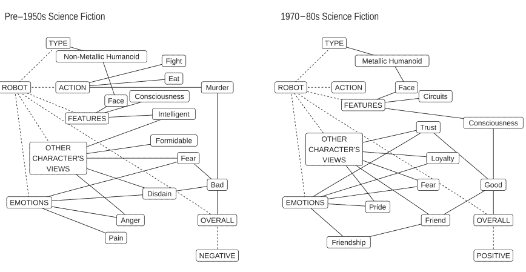

图 1.1：1950 年代之前与 1970 年代至 80 年代特有的关于“机器人”的共同认知（改编自 Carley 1994:301–4）。

通过文本，我们可以例如考察科幻作家如何定义“机器人”（参见图 1.1）。通过映射 1818 年至 1988 年间出版的 27 篇文本中发现的概念关联，我们会发现机器人最初引发痛苦和恐惧，但后来与信任和忠诚联系在一起（Carley 1994:301–4）。或者，我们可以考虑上世纪美国女性教育水平的变化如何追踪美国印刷媒体中性别刻板印象的转变。我们会发现，除了其他方面，随着“学习”变得女性化，“智力”获得了男性化内涵（Boutyline et al. 2023）。我们还可以调查跨越 350 年的 800,000 本书籍、报纸和文章，以确定围绕黑人女性经历的关键主题。然后可以利用这些主题的典型用词模式来挽救此前未被识别的非裔美国人著作（Brown et al. 2016, 2019）

语言也是滑溜溜的。它无法被审查。它蓬勃生长又衰亡。每天，新词被说出、书写、手势表达，又被遗忘。我们围绕相对稳定的语言习惯核心不断即兴发挥，助长了*语言*之间存在清晰界限的错觉。正如制图师必须应对不断变化的河流和道路一样，文本分析师也必须应对语言动态且无界本质所带来的影响。文本映射通过探索四个相互关联的问题来应对语言的这种开放性：

- 1. 我们如何在一组文本中识别模式？
- 2. 我们如何总结并解释这些模式的含义？
- 3. 这些模式如何随时间、作者或其他变量而变化？
- 4. 这些模式的来源和后果是什么？

然而，我们回答这些问题的方式取决于我们对语言的理解。那么，让我们先简要概述一下我们对语言和文本的一般性方法。

## 什么是语言？

下面我们概述六条关于语言的理论命题，它们指导我们对文本的思考。该框架借鉴了广泛的学科联盟，我们相信，这些学科在很大程度上会同意这些基础。

第一，**语言是实践性的**。正如人类学家布罗尼斯劳·马林诺夫斯基所主张，人类使用语言来行事：“指导、控制和协调人类活动”（1937:172）。我们也通过使用来习得语言（Tomasello 2009; Croft and Cruse 2004）。无论研究人员多么沮丧，任何语言样本都会缺失信息。特别是，通常缺失的是作者。语言模式在社会行动中出现。词语是围绕它们发生之事的产物和促进者。它们唤起的意义不是静态的，而是随情境变化——而且，意义并不止于可言说之境。¹

第二，**语言不等于意义**。受马林诺夫斯基（Rose 1980; Gellner 1998:149）影响，哲学家路德维希·维特根斯坦（[1953] 2009:80, 109）认为，在许多情况下……“一个词的意义在于它在语言中的用法。”² 我们对此略作修改：一个词的意义在于它被语言_社区_所使用的方式（Bloomfield 1933:29, 37）。词语本身不是其意义，个人也不能孤立地决定其意义；相反，其意义由人们如何相互使用它们来行事来决定和修改。³ 诚然，语言与许多意义构建过程密切相关（Fauconnier 1997）。然而，如果没有人来解释词语——无论是口语、手势、书面语还是其他形式——就不存在意义。这要求我们对_符号_、_声音_或_句法_与_语义_之间的区别持谨慎态度（Goldberg 1995）。

第三，**语言是习惯性的**。这意味着“语言是身体化的”，人类身体具有语言性（Di Paolo et al. 2018:5; Johnson [1987] 2015）。我们说什么以及如何说，都是所有先前经验的累积，以习惯的形式存储在我们的身体中（Bloomfield 1933:30–34; Bourdieu 1991; Croft and Cruse 2004）。我们被自己的语言所塑造（Ong 2013; Dennett 2017），而语言可能的样态也受我们——我们的生理学和传记——所限制。人人有异同，每个语言使用者也同样成为语言共同体中稳定与变迁的焦点。语言的规律性部分地源于人类惯例，根植于鲜血与肉体、泥土与石头。

第四，**语言是关系性的**。语言学家约翰·弗思——同样受马林诺夫斯基影响（Firth 1935:68–9; Young 2011）——主张我们通过“词语所伴随的公司”来“认识一个词”。但什么是词语的“同伴”？研究者在了解与某词共现的词语时，可以界定其含义（另见 Harris 1954）。然而，当我们说关系性时，我们指的是一个更一般性的命题（Mohr 1998; Mohr et al. 2020:94–127; Robins 2013）。人们不仅根据词语与其他词语的关系来推断其含义，还根据构成其使用情境的人、对象、组织和其他文本来推断。

第五，**语言是未完成的**。围绕_一种语言_划清界限的概念，归根结底是个误导性的想法（Davidson 2005:89–108）。⁴ 与各种精英主义、种族主义和民族主义项目的愿望相悖（Fishman 2011; Bourdieu 1991; Rosa and Flores 2017），不存在_一种语言_的纯粹样本。说话、书写和手势没有对错之分。

¹ “人类存在的很大一部分处于一种状态，这种状态无法通过清醒的语言、生硬的语法和推进的情节来表达清楚。”——詹姆斯·乔伊斯

² “社会科学至今仍被‘词语包含其意义’的迷信所累赘”（马林诺夫斯基 [1947] 2015:86）。

³ 当然，除非是赫邦蒂·丹普蒂：“当我使用一个词时……它只意味着我选择它意味着的东西——既不多也不少”（Carroll 1925:246）。

⁴ 一般而言，如果两个人之间的**可理解性**较低，则被认为是说_不同语言_的人。即使这也是一个模糊的标准。可理解性是分级的，甚至可能不对称。例如，“葡萄牙语使用者可以理解西班牙语，但反过来则不那么适用”（Dixon 1997:7–8）。

说话者必须遵循的规则并没有一套充分的集合（Fillmore 1979; Bauer 1998）。风格、口音、方言和语言之间的划分始终在漂移。

第六，**语言是一个场域**。语言是有组织且有模式的，因此学者通常将语言描述为一个“系统”。但是，“系统”意味着一套自治的排列部分，其中变化是内部的：改变一部分会改变所有部分。⁵ 诚然，语言是有模式的，具有规律性，甚至可能有内部变革来源，但语言“过于笨拙，无法直接作为一个整体来理解”（Di Paolo et al. 2018:106）。将语言理解为一个场域——一个有组织但又开放的结构——能更好地捕捉说话和写作中固有的规律性与动态性。

⁵ 例如，语言学家费迪南·德·索绪尔断言，语言是一个“自洽的整体”，并且“以任何方式改变系统的一切都是内部的”（Saussure 1986:23）。

上述命题对我们思考语言边界具有影响。无论多大，任何语言样本都不是一个自洽的整体。没有任何语言变革完全由内部机制引发。意义不仅仅由词语或其他语言单位之间的关系构成。没有必然正确的语言使用实例。没有一套清晰的语言规则能充分解释语言数据中的所有模式。所有这些复杂性使得文本分析更加困难。尽管如此，通过仔细考虑每一步并清晰地记录我们的决定，我们可以为语言及其在社会生活中的作用的学术理解做出贡献。

⁶ 对于本书，我们不处理可能伴随情境的有意义内容，例如图表或图片（Prior 2003; Bauer and Gaskell 2000）。

## 什么是文本？

书写是语言的一个子集。就像说话或做手势一样，它是试图将可感知的形式与意义关联起来，以便通过它，作者的意图传达给读者，即使作者不在场。⁶ 在这里，我们通过概述关于书面文本的五项命题，试图进一步“界定”我们的研究对象。

⁷ 字符通常与语音声音相关联，精炼程度各不相同（Daniels and Bright 1996; Okrent 2021）。“国际音标”旨在最大程度地忠实于发音。捕捉韵律的专门系统也存在（Jefferson and Others 2004）。虽然声音塑造语言（例如，Hinton et al. 2006），但我们将假设字符不一定代表声音。

第一，**文本是一组字符**。文本可以被分段是计算机辅助文本分析的前提（另见 Aronoff 1992）⁷ —— 数字、字母表、辅音文字（abjad）、表意文字、音元音素文字（alphasyllabary）、音节文字、标点符号、变音符号，甚至空格或其他词分隔符。这些字符不是抽象概念，而是可以通过视觉和触觉感知的。作者安排这组字符，以便读者或多或少能够恢复意义——前提是作者通常遵循读者熟悉的惯例。文本由一组相对有限的可重新排列的字符组成，这是当代文本分析中的最小假设。

第二，**文本是再现**。盖兹（Geertz, 1973:19）告诉我们，民族志作者“铭刻”社会活动，并将其“从一个转瞬即逝的事件……转化为一个"


记录，它存在于其铭文中，可以查阅。”8 访谈研究者同样将其与参与者的分析性对话转录为文字。演讲、歌词、口述指令或录音会议等也可能从声音转化为文字。书写是捕捉事件的一种尝试，而文本是捕捉此类事件的手段。文本确实重新呈现了其他交流方式、感知与表达的媒介，甚至思想。

8 Verba volant, scripta manent

第三，文本是语言。说话可能先于书写出现。这促使语言学家 Leonard Bloomfield 断言：“书写不是语言，而仅仅是记录语言的一种方式”（Bloomfield 1933:21；另见 Saussure 1986:23）。受语言学家 Noam Chomsky 启发的人进一步假设，说话和写作都只是心智中语言的反映（c.f. Aronoff 1992）。诚然，书写确实记录了说话和思想，但它不仅仅是记录。书面文字还有其自身的规范、意图和约束——这些塑造了其他交流方式、我们的思想，乃至我们的语言理论（Ong 2013; Olson 1996; Coulamas 2003）。

> “未保存的一切都将丢失。”—Nintendo“退出画面”信息。

第四，文本既耐久又易朽。文本是固化转瞬即逝之物的一种尝试；它是耐久的。然而，没有任何文本是不可摧毁的；它会腐朽。9 我们只能分析保存下来的内容，且“在其他条件相同的情况下，选择性随文件的年代而增加”（Martin 2017）。我们只能接触到这些古文本的一小部分，因此也只能接触到这些群体中意义范围的一小部分。在数字时代这一情况依然成立，“比特腐化”始终是一个令人担忧的问题，文本只需几次击键即可轻易删除，或者可能被不可逆地加密。对社会科学家来说，更令人担忧的是，文本的丢失和保存并非随机的（e.g., King et al. 2013）。这意味着我们必须理论化塑造文本访问的政治和组织项目，以准确解读这些文本（Brown et al. 2016）。

9 例如，可以考虑书写的起源，如贾湖骨刻、木乃伊Ötzi身上的纹身、陶器上的文察符号，或古乌鲁克的楔形文字泥板。

第五，文本是对象。文本之所以是对象，是因为它们既耐久又易朽，还因为它们被制作和维护（Prior 2003）。每当我们遇到一个文本时，相互关联的人群、群体、组织和其他文本都会被牵涉其中。例如，小说由作者制作和分发，但也涉及文学代理人、出版商、编辑、书店、读书会、评论家等（Childress 2017）。

综上所述，结合我们的语言工作理论，上述五个命题对任何文本分析的第一步——选择——具有重要意义。我们永远无法研究任何语言的全部体裁，无论是文本还是其他形式。我们总是——无论是否有意——研究所有可能被研究的文本的一个子集。对选择保持原则化，对于严谨且可重复的文本分析至关重要。

# 2 语料库构建

> “单词本身不代表任何意义。人们使用单词表达意义，你需要了解他们试图做什么，才能知道他们的单词意味着什么。”
> — J. L. Martin

制图学涉及在待绘制的领域或地形周围建立边界。映射空间内部和外部被认定为哪些内容，不仅决定了将要呈现的内容，还决定了其意义。例如，蒙大拿州鲍勃·马歇尔荒野保护区的详细地形图对徒步旅行者不可或缺，但对围绕其驾车行驶的司机而言毫无用处。文本分析师的情况也是如此。在进行任何分析之前，我们必须对文本进行边界划定。也就是说，我们必须确定将包括哪些文本、排除哪些文本，并且，更重要的是，确定某个给定的文本如何能被我们选择。

至少四百年来，人类一直在系统分析中使用文本作为数据（Krippendorff 2018:3–5）。这始于神学研究，随后紧随其后的是报纸分析。20世纪初出现了若干关于新闻媒体的研究，最乐观的观点认为，此类数据“将构成一系列‘社会天气’的观察，其准确性可与美国气象局的统计数据相媲美”（Tenney [1912] 2008:19）。

在这些早期分析中，报纸被视为对人群代表性样本的调查，仿佛能够触及国家态度。J. G. Speed 的（1893）文章《报纸现在还报道新闻吗？》——很可能是对报纸内容的第一次定量分析1——暗示了我们为何需要对这种假设保持谨慎。

1 社会学家 Willey 和 Weinfeld（1934）使用 Hollerith 卡片对报纸进行了定量研究，或许提供了报纸的第一次计算机分析（cf. Sumpter 2001）。

1883年，约瑟夫·普利策购买了《纽约世界报》，并利用耸人听闻的手法卖出更多报纸——这一技巧被纽约其他报纸采用。Speed 认为，这些变化中的新闻业规范也在改变报纸内容。为了回答这个问题，他考察了“十二年前[1881]的《代表性纽约报纸》，并将它们与同年[1893]的同一份报纸进行比较”（1893:706）。确实，“闲话”的数量取代了“文学”和“社论”（见图 2.1），这使他得出结论：

有一个通用说法——“报纸是世界的历史，只有一天”——人们或多或少相信这一点。没有什么比这更虚假了。我们的报纸并不记录真正严重的事件，而仅记录轰动效应、历史的灾难。（1893:710）

| | Sun | Times | Tribune | World | Total |
|---|---|---|---|---|---|
| 闲话 | | | | | |
| 体育 | | | | | |
| 小说 | | | | | |
| 音乐/戏剧 | | | | | |
| 文学 | | | | | |
| 历史 | | | | | |
| 政治 | | | | | |
| 社论 | | | | | |
| 丑闻 | | | | | |
| 犯罪/罪犯 | | | | | |
| 科学 | | | | | |
| 艺术 | | | | | |
| 宗教 | | | | | |

图 2.1：1881年和1893年纽约报纸的主题栏目（改编自 Speed 1893:707）。

我们必须理解 **语料库**² 为何以这种方式被划定边界；否则，我们可能会混淆语料库生产过程中的模式与文本内部的模式。

² 语料库（单数）或 corpora（复数）是任何文本的集合。这些集合可以非常大，也可以非常小，并用于多种目的。

举个例子，使用 2020 年 Google Books N-gram 语料库研究“认知扭曲”。早在 2002 年，“海洋项目”启动之初，Google 就与 Project Gutenberg、HathiTrust 和 JSTOR 等多个项目一起，开展书籍大规模数字化。这家搜索巨头开始扫描书籍，以最终允许在 *全文* 中搜索。到 2010 年代末，Google 团队估计，自活字印刷术引发的“印刷革命”以来，已有 1.29 亿种版本出版；他们扫描了 1500 万种。2009 年，Google 发布了这批宝库，不是以全文形式，而是以每年的 *n*-grams 列表形式。³ 2020 年，Google 发布了更新的 *n*-gram 语料库。

³ *n*-gram 是最多包含 *n* 个词的短语。Google 的语料库包含每年所有一到五个词的短语。作为 *n*-gram 列表的语料库是克服版权问题的一种技术。

次年，一支团队使用这个更新后的语料库，在四个国家中发布了所谓“认知扭曲激增”的证据——“与内化性障碍相关的思维模式……”（Bollen et al. 2021:1）。他们使用一本词典⁴ 将短语与特定的“认知扭曲”相关联——例如，“not that great”表示“否定积极面”这一扭曲——统计了扭曲每年出现的频率。他们将研究限制在 1855 年至 2019 年，并得出结论（Bollen et al. 2021:5）：

⁴ 参见 Core Deductive。


我们的研究表明，三种语言中大量认知扭曲词汇标志的表达处于历史高位……这表明，大量人口正日益受到普遍的文化、经济和社会变化带来的压力。

其他研究者为何持怀疑态度？Google Books N-gram 语料库是 Google Ngram Viewer 背后的数据集。使用该工具处理许多良性短语——"I'm calm," "we are loved," "puppy kisses," "time traveler," 或 "dog"——我们发现，2000 年之后出现了一个相当普遍的模式。它们都激增了。

要理解原因，我们需要掌握该语料库构建的背景。5 除了 Google 侧重书籍所引发的更广泛问题（Schwartz 2011）之外，关于体裁或领域还存在一个更具体的担忧（Pechennick et al. 2015）。例如，如果小说比非小说多，这会影响我们从词频得出的任何结论。而且，确实，2020 年语料库包含显著更多的小说，原因是 Google、图书馆和出版商之间关系的转变——以及该时期电子书和自助出版的迅速扩张。对“认知扭曲”的研究，可能是在测量 2000 年之后语料库中小说比例的激增（Schmidt et al. 2021）。

5 遗憾的是，截至撰写本文时，2020 年语料库的另一个明显问题是缺乏关于语料库构建过程的文档。

遵循 Leech (2014:xix)，“[W]在得出语料库分析结果的一般性推断时，我们必须谨慎，并警惕隐藏在我们收集和抽样数据方式中的隐性变量的影响。”例如，在批评一项基于“生活故事”对纳粹“叙事网络”的研究（Bearman and Stovel 2000）时，Biernacki (2012:29–30) 认为该研究使用了删节版故事。而且，删节者“倾向于删除关于个人生活决策或对家庭关系的自我反思的沉思……正是那些[据报道]在[原始研究]中奇怪缺失的东西。”依赖删节版故事，该研究的结论至多是不完整的。

计算进步并不能消除这些担忧；事实上，它们可能使问题更加复杂。研究者可能倾向于“只分析容易找到的东西，只计算最容易计数的东西”（Ball 1994:295）。就像研究人群中的个人或群体一样，我们必须小心选择一个“场所”，它不容易[引导我们]得出过度自信的推断”（Martin 2017:38）。6 这对于文本分析来说更是一个问题，因为收集大量数据的能力正在变得更容易。规模不能保证样本公平；相反，它可能会增加信心，同时降低手动验证结论的能力。

6 这与调查研究中的覆盖误差重叠：抽样框与目标总体之间的不匹配。

## 文本不是人

20 世纪初，人们对报纸和广播节目分析的日益兴趣集中在 Lazarsfeld、Katz、Merton、Cantril 和 Stanton 的工作周围。7 在这项工作中，报纸常常——但绝非总是——被视为来自明确界定人群的有代表性样本的调查。定量内容分析常常效仿这种做法，并认为文本存在概率抽样和非概率抽样，前者始终是首选（例如，Weber 1990；Neuendorf 2017:83–88；Riffe et al. 2019:95–112）。我们应该对这种框架保持谨慎，因为文本不是人。我们从三个方面来表达这一点。

始于20世纪30年代末的广播研究项目，这最终成为传播学研究。

- 首先，即使我们能够收集一个人口的所有文本，也没理由认为随机样本能代表该人口中的人。不是每个人都会产生文本，而在产生文本的人中，他们产生的量也并不相似。8 在现成文本方面，很可能存在长尾分布，即少数人产生的文本远多于其余人口的文本。9

此外，我们必须考虑生产背景，其中写作禁令或歧视性出版行为可能抹除某些声音（例如，Brown et al. 2016）

例如，皮尤研究中心的一项研究发现，在2021年6月2日至9月12日期间，美国成年用户发布的所有推文中，前25%的用户（按推文量计算）发布了大约97%的所有推文（McClain et al. 2021）。

- 第二，文本的缺失或存在并不反映人类的人口过程。例如，在通过互联网选择文本时，Riffe 和同事们警告说，传统的抽样框架——因此概率样本——可能（可能）不适用。他们指出，“互联网就像一座没有电话簿或地图来指导人们的城市。新房子不断被建造，旧房子被遗弃，且没有变化列表。抽样需要创造性的解决方案”（Riffe et al. 2019:118）。我们要强调：这适用于大多数文本。我们遇到了很大程度上无法控制的选择偏差。此外，这些选择压力与作者和受众试图用文字做什么相关联。例如，如果我们收集了每一篇电子版可用的《纽约时报》文章，我们可以获得大部分，但不是全部的文章。缺失的文章不太可能是随机缺失的。10 文章可能因各种组织、保管、意识形态和技术原因而被错放、删除和销毁。

考古学是一门学科上的同类：一门“具有理论和实践，从劣质样本的间接痕迹中恢复不可观察的南类行为模式的学科”（Clarke 1973:17）。

- 最后，文本分析中（无论是计算性的还是其他）什么构成“单元”是一个臭名昭著的棘手问题。传统上，“单元”是单个调查受访者或被采访者。在文本分析中，定义“单元”有什么棘手之处？简而言之，我们可能会选择不是我们分析单元的单元——并且我们可能甚至在开始选择之前就无法确定分析单元。我们分析中的单一文档不一定是通常理解的文档——例如一本装订成册的书，

11 这被称为单元化问题（Neundorf 2017:71）——我们称之为分块。分块具有统计诱惑：它可以廉价地增加语料库规模。但是，分块应由单元的意义来指导，并在选择后确定。

一条推文，或一篇演讲。这些 *可以* 是我们的分析单元，但书中的章节、单个Twitter用户的推文汇编或演讲中的段落也是。¹¹ 例如，我们可能会选择三家全国性报纸的评论版。这些文章可能是我们的分析单元，但也许段落或句子更适合我们的研究问题。另一个例子，Nelson (2021a) 将妇女解放组织发表的200多篇文章数字化，但她的语料库由这些文章的1100多页扫描页面组成。问题是，我们如何分块大致是一个“连续信息流”（Neundorf 2017:73）的东西？虽然某些文档的边界可能很容易识别，但情况并非总是如此。

## 平衡、范围和代表性

早期的定量语言学家很快就生成了**频率列表**（Bontrager 1991）。没有语料库，只有直觉才能提供关于某个词或短语在特定语言社区中有多常见的证据。一个早期的担忧是，这些频率是否可以从语料库推广到一种*语言*，而不是特定体裁的特性。为了解决这个担忧，布朗大学的Kučera和Francis编纂了500个美国英语样本，总计100万个词（表2.1）。这个**布朗语料库**的结构旨在跨十五种体裁*平衡*贡献，以试图代表1961年出版的作品。

表2.1：大规模平衡语料库

| 语料库 | 语言 | 词元 |
| :--- | :--- | :--- |
| Brown | 美国英语 | 100万 |
| Lancaster-Oslo/Bergen | 英国英语 | 100万 |
| British National | 英国英语 | 1亿 |
| American National | 美国英语 | 2200万 |
| BYU Corpus of American English | 美国英语 | 5.6亿 |
| Oxford English Corpus | 英语 | 21亿 |
| Bank of English | 英语 | 45亿 |

20世纪70年代，兰卡斯特-奥斯陆/卑尔根（LOB）语料库基于与布朗语料库相同的选择策略。语言学家遵循类似的选择策略构建了英国国家语料库（BNC）和美国国家语料库（ANC）。

借鉴语料库语言学和定性内容分析，**平衡**、**范围**和**代表性**是创建……的广泛指导原则。


文本的公平选择。所谓"平衡"，是指我们的语料库中不同的变异来源按比例均衡。所谓"范围"，是指在选择文本时考虑了不止一个维度的变异。所谓"代表性"，是指我们选择的文本涵盖了与我们的研究相关的所有变异来源（Biber 1993:243）。

以下变异来源可以作为界定语料库的原则，也可以作为平衡语料库的原则。例如，我们可以只选择近代小说，但用一系列体裁进行平衡。每个变异来源都会"重新加权[s]"观察特定语言模式的概率（Martin 1997:85）。

这些变异来源可能更偏向文本内容的内在属性，也可能更偏向外在属性。我们利用这一观察来组织变异来源。文本元数据是与文本相关联的信息，但可能仅间接地从文本内容中得出，包括：作者和受众、出版地点和日期、以及领域和媒介。文本数据是从文本内容中得出的信息，包括：语言和方言、体裁和主题、语域和风格。我们将在下文逐一讨论。

## 文本元数据

### 作者和受众

文档必须是书面形式。12 这是第一个选择行为；这一行为通常不在研究者的控制范围内。要理解作者写作的动机，我们可以深入研究内容。但是，我们仍然必须理解他们为何要写作。是什么驱使并使他们能够产生一段文本？哪些类型的作者可能代表性不足（Brown et al. 2016）？之后，我们还可以思考为什么会是这些词、这样的顺序和这样的数量？

相关地，我们必须考虑作者是在为谁写作，以及谁最终会阅读它——也就是说，文本的受众。广义地说，用于分析的文本可以是定制的，也可以是现成的（Salganik 2019）。定制文本数据是明确为回答科学问题而制作的。在这里，研究人员是塑造其制作过程的受众成员。这包括访谈、观察性田野笔记和开放式调查问题。制作此类文本的原因，在很大程度上与参与任何其他类型社会科学研究的动机一致。

相比之下，现成文本是为了与朋友交流、宣传产品、说服政敌、娱乐受众、创造收入等而制作的。现成文本往往会引发一组不同的选择偏见：可用的内容，通常就是*所有可用的内容*。换句话说，"数据已经就位"（Martin 2017:194）。13 在进行选择时，我们必须对受众——以及作者对受众的假设——进行理论化。作者是*为某人*制作文本，而这塑造了文本中的意义。

13 有人认为这能减少社会期望偏差。就研究者的愿望而言这是正确的，但就受众而言则不然。

### 时间和地点

14 这称为历时分析。如果语料库不断更新，这称为**监测语料库**。

文本分析中一个反复出现的问题是：文本变量如何随时间变化？14 如前面讨论的"认知扭曲"研究所示，我们必须留意文本内部*和*外部属性可能如何变化。Schwartz（2011）在评论使用 Google Books 语料库进行的文化变迁初步研究时指出："如果化石记录显示某一时期比另一时期有更多的恐龙足迹，那并不一定意味着当时恐龙更多——可能只是当时泥浆更多。"

关注特定时间（许多语料库隐含地如此做）并不能解决这个问题。某些短语在某一年可能特别常见或罕见，但这未必仅限于那一年。此类问题困扰着社会变迁研究中"代际"的使用。切断点的设定方式可能会改变研究结果。

在考虑文本产生的地点时，这些担忧也同样存在。从全球约十亿英语使用者——他们遍布印度、新西兰、南非、巴巴多斯、加拿大、英国等地——转向仅澳大利亚使用的英语，会系统性地增加同质性。如果考察整个英语世界，我们可能会发现某些短语被过度代表，恰恰是因为特定地点产生（或维持）了绝大多数文本。

### 领域和媒介

每段文本都在广泛的社会领域内，并通过某种特定的媒介形式产生。将领域和媒介作为变异原则，意味着要关注文本生产和维护所涉及的社会活动，以及不同沟通渠道所提供的可能性。

该言语最初是口头的，但后来转录成文了吗？书面文本是在书籍还是报纸中？是电子邮件还是短信？该文档是供公众消费还是个人使用（Martin 2017:190–4）？是否有某些惯例来构建文本，例如例行的开场白和结束语（Weber 1990:43）？

我们还必须考虑为何保留某份文档。例如，Enron 语料库包含了丑闻导致公司倒闭那一年，158 名员工发送和接收的大约 600,000 封电子邮件。联邦能源监管委员会聘请 Aspen Systems 创建了它。计算机科学家 Leslie Kaelbling 购买了该语料库，一个团队对其进行了清理，然后将其发布给公众——随后又发布了删除某些目录的版本。这些电子邮件经过了多个领域才到达当前阶段。我们不会知道为何某些电子邮件被保留，甚至在正常业务过程中删除了多少封。但是，同样，*数据已经就位。*15 但我们必须对从生产到分析的这一过程进行理论化。

此外，正如不同地点或作者可能产生的文本比其他人更多一样，我们还必须考虑不同领域和媒介在产生的文本数量上也存在显著差异。

15 例如，我们无法回到过去，阻止安达逊会计师事务所的会计师删除电子邮件或粉碎他们对 Enron 的审计文件。

## 文本数据

### 语言和方言

语言（复数）的存在主要基于"互通性"的主体间概念。通常，语言与方言之间的区别在于，后者是口语上的差异（口音或发音）。只要"方言"包括不同的语法、词汇甚至拼写差异，我们就必须确保工具考虑到这一点。

例如，某些工具会"纠正"所谓的拼写错误单词。正如我们所讨论，这样做的好处是降低复杂性（同时提高同质性）。我们使用引号，因为用一组字符表达意义并没有"正确"的方式，只有更多或更少的惯例方式。16 遵循这些惯例的人之间的界限也是模糊且重叠的，因为人们常常可以切换或混合方言（以及语言）。

16 马克·吐温也持有这一观点："我看不出拼写单词有统一且任意的方式有什么用处。我们不如让所有衣服都一样，让所有菜肴都一样。单调令人厌倦；多样性令人愉悦"（Paine 1912:541）。

人们也会出于各种目的故意"拼写错误"，例如创建合成词，如 smartphone，或者说、政客名字的幽默和讽刺性拼写错误（即 cacography）。替代拼写甚至会作为对我们将要讨论的自动化程序的回应而出现——例如，由游戏玩家推广的 1337 sp34k（或 leet speak）最初起源于 1990 年代的黑客社区（McKean 2002），目的是规避（真实或想象中的）内容审核和监控。17 换句话说，什么

17 "[Porta (1653)]建议使用拼写错误来逃避监控："抄写员被认为无知，总比因计划被发现而受惩罚好" (Kahn 1996:139)。


对一些人来说可能看起来像“错误”的，实际上是有意为之，并因此对该语言社区有意义。18

18 当然，也存在无意的拼写错误以及源自光学字符识别的错误（参见获取文本）和编码问题（参见处理单词）。

## 体裁与主题

随着我们进一步划定界限，便会得到关于特定文本内容的更具体惯例。例如，知道某段选文是科幻小说，我们可以推断其内容，但很可能推断不出媒介形式——这可能是一部流行流媒体剧的字幕，也可能是一本书系列的章节。在体裁与主题层面，我们不再试图在文本之上强加一个互斥的分类方案。任何文本选段都可能同时归入多个体裁或涉及多个主题（Fowler 1982:37）。19 甚至在这个变化维度内，也存在不同的笼统程度。小说与非小说属于最笼统的范畴。哲学家和文学理论家对此区别争论了千年，但它在构建语料库时仍能提供有用的护栏。20 这是因为体裁和主题告诉我们关于文本的社区和背景的一些信息——关于作者与受众意图和欲望的线索。它们为我们的分析提供了“实质性直觉”（Martin 2001）。

19 正如德里达（1980）所解释：“每一段文本都参与一种或多种体裁，不存在无体裁的文本。”

20 亚里士多德（1907:35）指出：“希罗多德的作品可以写成诗体，仍属于历史的一种，无论是否有韵律……因此，诗歌比历史更具哲学性，更为崇高：因为诗歌倾向于表达普遍性，而历史表达特殊性。”

## 语体与风格

与体裁和主题跨越媒介、领域等一样，语体和风格也是如此。语体通常等同于正式程度。例如，在土耳其语和法语中，常用复数来表示某种社会距离，而在莎士比亚的作品中，“thou”是非正式单数，而“you”是正式复数。除了正式程度，语体通常还包括视角——第一人称、第二人称、第三人称，但也可能融入语法和词汇等更广泛的语言元素。

社会学家巴兹尔·伯恩斯坦研究了阶级相关的独特谈话“语体”，将其划分为展开式和限制式“代码”。在谈话的限制式代码极端情况下，所说的内容对说话者和听话者来说“完全可预测”（2003:126）。他举的例子包括宗教仪式或各类讲故事。他主张，1950年代伦敦工人阶级的身份高度共同——因为“共同的职业功能和社会地位”——这“减少了将意图言说化的需求，使其变得明确”（2003:111–3）。说话快速且凝练。因此，他得出结论：工人阶级的人比中产阶级的人使用更受限制的语体。

那么，语体和风格有什么区别呢？为了简化大量文献：风格通常专指与某位作者——或可能是某个组织或其他集体生产者——相关的更具个性化的语言规律性。

## 重绘边界

取决于我们的研究问题，以及我们用来平衡或划定边界的变异来源，通过移除文档或纳入来自多个来源的文档来重绘现有语料库的边界是完全合理的（参见表 2.1 和表 2.2）。这凸显了推断在学术文本分析中的地位。

## 表 2.2：文本来源的选择

| 新闻与在线媒体 | 政治、法律、学术 | 非小说与小说 |
| :--- | :--- | :--- |
| 纽约时报标注语料库 | 国情咨文 | 电影字幕 |
| 纽约时报加州数字报纸 | 欧洲议会 | 谷歌图书 N-Grams |
| Lexis Nexus 和 ProQuest | 竞选演讲 | Hathi 数字信托 |
| 新闻语料库 | 判例法获取项目 | 北美奴隶叙事 |
| Reddit、Twitter、Facebook 博客、论坛、电子邮件 | PubMed | 马拉维日记 |
| 维基百科、Fandom、SongGenius | JSTOR | 妇女参政运动传记 |
| | arXiv, SocArxiv, PsyArxiv | 美国小说语料库 |

假设我们对 2000 年代的美国电视剧本进行随机抽样。我们发现亚裔和太平洋岛裔美国人（APIAs）角色的说话角色较少。我们或许可以将此推断至 2000 年代的所有美国电视剧本。如果，相反，我们关注美国媒体中 APIAs 角色的描绘，例如“模范少数民族神话”，我们可能会将选择限制在“具有随时间推移而深入且复杂发展的常驻 [APIAs] 角色”的节目中（Deo et al. 2008:150）。如果我们希望关注 *有影响力的描绘*，我们可以进一步将选择限制在“黄金时段”播出的最受欢迎的节目中。这不是随机样本。这是有目的的选择。第一个遵循传统调查研究中抽样的类似逻辑，而第二个遵循个案研究常见的方法。21

21 Small（2009）引用 Mitchell（1983）、Yin（2009）和 Zmaniecki（1934），将此称为 **统计推断**，以与 **逻辑推断** 相对。

但首先，我们必须考虑给定来源与我们的研究问题之间的关系。从这个意义上说，构建语料库就是选择个案。在实践中，这是一个乌洛波罗斯，没有明确的开始和结束（Nelson 2020; Brandt and Timmermans 2021; Wagner-Pacifici et al. 2015; Pardo-Guerra and Pahwa 2022; Ignotow and Mihalcea 2016:25–27）。幸运的是，计算方法也许独特地适合文本分析所要求的迭代。

# 3

# 计算基础

> 分析机毫无自发创造任何东西的企图。它能做我们所知道如何命令它执行的一切。——A. 乐芙莱丝

计算更多关乎惯例而非数字。在这里，我们将介绍这些惯例，解释计算概念，定义我们将使用的一些术语，并指出常见错误。本章也将为没有编程经验的人提供一个起点。对于已经熟悉 R 的人，我们还将列出所有需要安装的软件包。

## 核心要点

计算机是简单的实体。歧义是计算机的天敌。代码是一组旨在消除歧义的指令。计算机遵循我们的指令，如果一切清晰，它就会执行我们意图的任何任务。与自然语言一样，编程语言有族谱，意味着它们与更早的语言相关，并借鉴了更早的语言。1 我们可以按其一般特征对编程语言进行分类。R 是一种面向对象、过程式和函数式编程语言：我们使用函数对对象执行数据操作。这些对象是以数据结构排列的不同数据类型。函数要么包含在基础 R 中，要么在会话期间创建，要么在“软件包”中可用。软件包必须安装在我们的机器上，并在每次会话期间加载。

1 例如，R（Team 2021）是 S 的开源后代，S 本身受 Fortran 和 Scheme（Lisp 家族）的影响。

## 编程环境

计算机包含三个“层”。最上层是 GUI，即图形用户界面。每当我们使用触摸板、鼠标或触摸屏点击和点选时，我们就在与 GUI 交互。二进制——零和一——位于最底层；计算机硬件理解这一层。在这两个层之间存在若干中介。社会科学家和其他计算学者使用的大多数编程语言，如 R 或 Python，被称为“高级语言”，因为它们更接近 GUI。


2 与之类似的常见文件格式还有 XML、HTML、CSV 和 TXT 文件。

## 图 3.1：RStudio IDE

这些语言是用纯文本编写的，我们将生成的文件称为“脚本”。

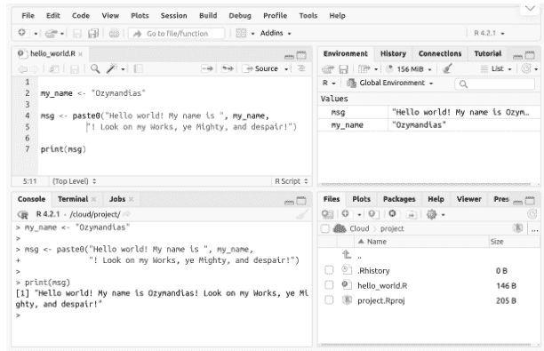

3 Microsoft Word 是文字处理器，而 Notepad 是纯文本编辑器，Mac 的 TextEdit 也可以设置为纯文本编辑器。

除了 RStudio，流行的 IDE 还包括 VS Code、VSCodium、Sublime、Vim、Emacs 和 Notepad++。

4 尽管控制台、终端、shell 和命令行之间存在差异，但它们常被混用。

5 RStudio Cloud 是 posit.cloud 上的在线 IDE。本书中几乎所有示例都可以在 RStudio Cloud 中运行。扩展章节中的一些示例所需的计算资源超出了免费计划提供的范围。

我们使用纯文本编写脚本来组织代码。不过，要“运行”脚本，我们需要将其“发送”给能够“解析”其约定并生成所需输出的程序。在我们的情况中，这个程序是 R。我们可以直接从控制台执行此操作。不过，在本书中，我们假设你使用的是集成开发环境（IDE），即功能强大的纯文本编辑器。

RStudio（图 3.1）是一个专用的 R IDE，具有许多点击式功能，可让我们的工作更轻松（Team 2020）。RStudio 的免费开源版本对大多数用户来说已经足够。

IDEs（如 RStudio）包含脚本编辑器和可视化目录（分别对应图 3.1 中的左上和右下面板）。我们的脚本和数据文件位于这些目录中。我们必须“告诉”R 这些文件在哪里。目录错误很常见，无意的拼写错误往往是罪魁祸首。最后，IDE 还会包含一个控制台。我们将代码从编辑器发送到控制台以“运行”它，该代码的“输出”会实时显示（图 3.1 左下角）。我们还可以在环境中查看该 R 会话期间创建的任何“对象”（图 3.1 右上角）。

如果你是 R 新手，我们建议使用免费的 RStudio Cloud 账户。对于本书中的每个部分，在 R 中创建一个新会话并打开一个新的 R 脚本。所需的任何包都将以“This Section Needs”为标题的边栏注释出现，并应在脚本顶部加载。然后，将每个后续的“代码块”复制到该脚本中。最后，运行此代码以在控制台中查看输出。以下是一些通用提醒（随着深入学习会更容易理解）：

- 按各部分中出现的顺序运行代码。
- 创建新对象会覆盖同名对象。
- 对象名称应简短但具有描述性。⁶
- 确保关闭任何括号、方括号和引号。⁷

## 数据对象、类型和结构

数据结构是我们组织数据的方式。在 R 中，这些包括 **vectors**、 **lists**、 **matrices** 和 **dataframes**（表 3.1）。Vectors 和 lists 很相似，因为它们是 _扁平_ 的（可以把购物清单、牲畜体重记录或硬币投掷统计看作例子）。另一方面，matrices 和 dataframes 是带有行和列的方形（例如 Excel 电子表格或成绩簿）。

## 表 3.1：基本数据结构

| 结构 | 不同类型？ | 行和列？ |
|---|---|---|
| Vector | 否 | 否 |
| List | 是 | 否 |
| Matrix | 否 | 是 |
| Dataframe | 是 | 是 |

通常，我们将使用“维度”来指代 dataframes 和 matrices 有多少行或列，或者 vectors 和 lists 的长度。

在 vectors 和 matrices 中，所有元素必须是相同的 _类型_。但是，lists 和 dataframes 可以是不同 _类型_ 元素的集合。Types 告诉 R 可以对对象执行哪些操作——它设定了预期。共有四种基本类型，按包容性从强到弱排列：character、numeric 或 double、8 integer、logical（参见表 3.2）。R 会自动选择能够涵盖向量中所有元素的类型。下面是一些快速示例（边栏中有输出）。我们将使用 c()“组合”元素来创建向量。

R 中的命名区分大小写，并推荐使用小写单词并用下划线分隔（即 snake case）。通常，我们应避免使用单字符名称，因为它们难以搜索，且可能使调试变得棘手。

如果未关闭这些符号，R 控制台将显示带有 + 的新行，等待剩余代码。输入 CTRL+C 或 CMD+C 将结束运行，以便我们可以修复代码。

```
words <- c("space", "is", "big")
typeof(words)
```

```
nums <- c(1.2, 2.8, 2)
typeof(nums)
```

[1] "character"

[1] "double"

R 之所以称这些为“double”，是因为“双精度浮点向量”。

请注意下方代码中的 `L`。这会强制 `R` 将数字视为 `integer` 而非 `double`。

```r
ints <- c(1L, 3L, 2L)
typeof(ints)
```

[1] "integer"

```r
lgcl <- c(TRUE, FALSE, TRUE, TRUE)
typeof(lgcl)
```

[1] "logical"

## 表 3.2：基本数据类型

| 类型 | 单词/标点 | 小数 | 整数 |
|---|---|---|---|
| character | 是 | 是 | 是 |
| numeric or double | 否 | 是 | 是 |
| integer | 否 | 否 | 是 |
| logical | 否 | 否 | 否 |

上述内容是 `R` 对象的基本构建块。我们可以组合它们来创建一个 `class`。与 type 类似，这为对象设定了 `R` 的预期。最简单的 class 是 `factor`，它通过将标签与级别配对来组合 `character` 和 `numeric` 类型。9

9 Factors 常用于序数变量（例如，“不同意”到“同意”）。它们还会将标签强制为特定顺序，在可视化时非常方便。

```r
levels <- c("Okay Idea", "Good Idea", "Bad Idea", "Good Idea")
levels <- c("Bad Idea", "Okay Idea", "Good Idea", "Good Idea")
fac <- factor(labels, levels)
```

```r
typeof(fac)
class(fac)
```

[1] "integer" [1] "factor"

Matrices 也是一个 class。`c()` 函数将元素组合成向量，而 `cbind()` 将向量“列绑定”。结果是一个 matrix 类对象。10

10 Arrays 包含我们的双向矩阵，但也包含多于两个维度的对象——例如立方体或四维超立方体。这些在本书中仅出现一次。

```r
c1 <- c(1.2, 2.8, 3)
c2 <- c(0, 4, 2)
mat <- cbind(c1, c2)
```

```
 c1 c2
[1,] 1.2 0
[2,] 2.8 4
[3,] 3.0 2
```

`typeof` 是“double”，因为它是可以表示整数和小数的类型。

```r
class(mat)
typeof(mat)
```

[1] "matrix" "array" [1] "double"

最后，突出显示对象名称（`mat`），然后单击“run”或输入 CTRL + ENTER 或 CMD + ENTER。它会将对象的内容打印到控制台中（边栏中有输出）。

```
mat
```

下面 `cbind()` 创建了 `matrix`，但现在它是 `character`，因为该类型既涵盖数字也涵盖单词（边栏中有输出）。

```
d4 <- c(0, 4, 2)
d5 <- c("space", "is", "big")
mat2 <- cbind(d4, d5)
typeof(mat2)
```

[1] "character"

我们可以看出，因为每个元素周围都有双引号。但是，当我们使用 `data.frame()` 时，一列是 `numeric`，另一列是 `character`，从而创建了一个 class 为 `data.frame` 的对象。从技术上讲，`data.frame` 是一组长度相同的（垂直）列表。每个列表都保留其数据类型。

```
cbind(mat2)
```

```
data.frame(d4, d5)
```

```
   d4 d5
[1,] "0" "space"
[2,] "4" "is"
[3,] "2" "big"
```

```
  d4  d5
1  0 space
2  4 is
3  2 big
```

为了帮助我们导航这些对象，每当我们有一个 `named` 列表或 dataframe 时，可以使用 `$` 操作器按名称调用该元素。让我们创建一个列表

```
lrrs_list <- list(first = "fireman",
                  second = "math teachers",
                  third = "and so on in that fashion")
names(lrrs_list)
```

[1] "first" "second" "third"

要访问名为 `third` 的元素，我们可以：

```
lrrs_list$third
```

[1] "and so on in that fashion"

我们遇到的大多数数据结构都是上述内容的变体。具体来说，对象可以嵌套于其他对象中：例如，一个列表其元素是列表（甚至是列表的列表的列表，以此类推）。

### R 的方言

有两种 `R` 的 `dialects`，我们将其标记为 *嵌套* 和 *链式*。11

- 嵌套：对象先由内层函数转换，然后传递给下一个外层函数。
- 链式：对象先由一个函数转换，然后传递给下一个右侧函数。


首先，让我们创建一个数据框：

```
df <- data.frame(x = c(1031:1032), y = c(2, 2))
```

让我们逐一执行以下几个过程（输出在边距中），一次一个：

```
df$z <- df$x^df$y # create new column as the x^y
df$a <- df$z / sqrt(df$z) # sum the column z divided by square root of z
sum(df$a) # sum the column
```

我们可以通过嵌套它们同时执行上述每个操作：

```
sum((df$x^df$y) / sqrt(df$x^df$y))
```

我们也可以使用 |> 或 "pipe" 运算符将它们链式调用来完成相同的操作。12 这种方言由 tidyverse 中的包普及开来。下面的 mutate() 和 select() 来自 dplyr，当我们使用 library() 加载 tidyverse 时即可使用。

12 基础 R 管道需要版本 4.1 或更高版本。使用 R.Version 检查。我们也可以使用来自 magrittr 的 %>%。

```
library(tidyverse)
df |>
mutate(z = x^y) |>
mutate(a = z / sqrt(z)) |>
select(a) |>
sum()
```

## 控制流程：函数、循环和 Apply

计算工具的一项关键优势是其迭代能力。假设我们想向两种动物：墨西哥钝口螈和水豚打印 "Hello _____!"。

我们可以直接这样编码：

```
msg1 <- "Hello Axolotl!"
msg1 <- "Hello Capybara!"
```

一条简单的规则：当我们需要做两次某事时，编写一个函数。下面，name 是我们新函数 wave() 中的唯一“参数”（输出在边距中）。

```
wave <- function(name) {
paste0("Hello ", name, "!")
}
```

```
wave("Axolotl")
wave("Capybara")
```

起初我们只做了一点小投资，但现在我们有了一个灵活的流程，可以向任何我们能想到的动物打招呼！

现在，想象一下我们有一个包含数千种动物的列表。将名称输入函数会变得很乏味。我们能否“遍历”名称以节省时间？为此有两种通用方法：for 循环和 apply()。下面是一个 for 循环。变量 i 13 从我们的向量 names 中获取一个元素，对该元素使用该函数，然后移动到下一个元素（输出在边距中）。

```
names <- c("Axolotl", "Capybara")
for (i in names) {
print(wave(i))
}
```

13 使用 i 是惯例，但我们可以使用不同的名称。

[1] "Hello Axolotl!"
[1] "Hello Capybara!"

最后，还有 apply 家族。我们将主要使用 lapply()。此函数获取一个列表，对该列表的每个元素应用一个函数，然后将转换后的对象作为新列表的元素返回（输出在边距中）。

```
lapply(names, wave)
```

[[1]]
[1] "Hello Axolotl!"
[[2]]
[1] "Hello Capybara!"

有更复杂的控制流程，但创建函数和使用 for 循环和 apply() 是本书中的主要工具。

## 安装和加载包

虽然 R 的基础功能很广泛，但本书中的技术需要额外的包。活跃的 R 爱好者和开发者社区通过开发包来扩展 R 的功能。出现两种常见错误，要么是因为我们在当前会话中未安装包，要么是未加载包：

```
foo(df)
```

Error in foo(df) : could not find function "foo"

```
library(foo)
```

Error in library(foo) : there is no package called 'foo'

第一个错误意味着我们需要加载包含此函数的包。第二个错误意味着我们需要安装该包。14

14 我们也可能因为拼写错误而看到这些错误！

开发者在存储库中托管这些包。CRAN 是官方 R 存储库，任何人都可以提交符合某些质量和许可要求的包。开发者将其正在开发的包托管在 R-Forge、GitLab、GitHub、Codeberg 或 Bitbucket 上。要安装 text2map，我们将使用以下代码：

```
install.packages("text2map")
```

我们只需在一台机器上安装一次包，但在每个新的 R 会话中都需要使用 library()“加载”它们。以下

15 我们永远不会一次性加载所有包！最后加载的包的函数会“屏蔽”任何同名的其他函数。因此，只加载你需要的包。我们也可以使用双冒号 :: 在包名和函数之间进行显式调用。

代码加载 text2map 包。这在本会话期间提供对其所有函数的访问。

```
library(text2map)
```

要探索这些函数并获取更多文档，请使用：

```
?text2map # main package page
help(package = text2map) # lists all functions
browseVignettes("text2map") # loads any "vignettes"
```

对于本书，我们需要几个包（见附录）。现在安装它们。15 以下是我们需要的所有可从 CRAN 获取的包：

```
cran_pkgs <- c(
  "backbone", "car",
  "factoextra", "gender", "ggpubr", "ggraph",
  "ggrepl", "ggtern", "glmnet", "gmodels", "googleLanguageR",
  "guardianapi", "gutenbergr", "hunspell", "igraph", "irr",
  "lexicon", "lsa", "marginaleffects", "Matrix", "network", "proustr",
  "qadpDictionaries", "quanteda", "quanteda.textmodels", "remotes",
  "reshape2", "reticulate", "rsample", "rsvd", "rtrek",
  "sengm", "sentimentr", "sna", "stm", "stminsights",
  "stringi", "tesseract", "text2map", "text2vec", "textclean",
  "textstem", "tidytext", "tidymodels", "tidyquant", "tidytext",
  "tidyverse", "tokenizers", "topicdoc", "topicmodels", "udpipe"
)
install.packages(cran_pkgs)
```

以下包托管在非 CRAN 的存储库上。我们将先安装托管在 GitHub 上的包。要安装它们，我们需要 remotes。

```
library(remotes)
install_github("trinker/entity")
install_github("trinker/tagger")
install_github("trinker/termo")
install_github("trinker/coreNLPsetup")
install_github("quanteda/quanteda.corpora")
install_github("lmullen/genderdata")
```

我们还编写了专门的文本分析包来支持这项工作，托管在 GitLab 上。通过运行以下内容来安装它们：

```
repo <- "culturalcartography/"
pkgs <- c("text2map.theme", "text2map.corpora",
"text2map.pretrained", "text2map.dictionaries")
gl_pcks <- paste0(repo, pkgs)
install_gitlab(gl_pcks)
```

## 在 R 中使用 Python

我们将使用的几个 R 函数依赖于用 Python（另一种流行编程语言）编写的包。为了处理这个问题，我们将在“虚拟环境”中安装 Python 包。这意味着每次使用这些包时，我们都需要“调用”这个虚拟环境。让我们现在设置它。

首先，安装以下 R 包：

```
pkgs <- c("reticulate", "keras", "spacyr")
install.packages(pkgs)
```

我们将使用的虚拟 Python 环境管理器称为“miniconda”或“conda”。我们将使用 reticulate 创建它。我们可以给环境起任何名字，但需要记住该名字以便以后复用。

```
library(reticulate)
install_python()
# miniconda_uninstall()
install_miniconda()
conda_create(envname = "myenv")
```

创建环境后，我们将在其中安装一些 Python 包。

```
py_pkgs <- c("tensorflow", "spacy", "keras")
conda_install(envname = "myenv", packages = py_pkgs, pip = TRUE)
```

当我们需要使用 use_condaenv() 访问这些包时，我们会重新激活这个虚拟环境。

```
use_condaenv(condaenv = "myenv")
```

## 数据可视化

本节需要：
- ggplot2
- ggpubr
- remotes

我们在标题旁的边距注释中包含本节使用的任何包（参见边距）。看到此提示时，创建一个新的 R 会话（以清除先前的包和对象），然后在开始本节之前使用 library() 加载这些包，如下所示：

```
library(ggplot2)
library(ggpubr)
library(remotes)
```

本书中我们将制作许多可视化。R 非常适合此项工作，尤其是因为 ggplot2 包基于一致的“图形语法”（Wickham 2010）。16 首先，ggplot() 准备数据，通常应用 stat（统计转换）。其次，aes() 指定图表的美学属性。接下来，我们将添加名为 geoms（几何对象）的不同层，它们大致对应于各种图表类型，例如点图、柱状图、折线图等。

ggplot2 的默认美学效果相当不错。在微调可视化时，代码可能会变得相当复杂。为了精确复制本书中的图表，我们构建了一个自定义主题。要设置主题，请从 GitLab 安装 text2map.theme 包：

```
install_gitlab("culturalcartography/text2map.theme")
```

然后，每次加载新的 R 会话时，运行此内容：

```
text2map.theme::set_theme()
```

让我们生成两个图表（见图 3.2）。我们将为每个 geom() 添加一个“分组”变量，以指定颜色（用于边框）和/或填充（用于内部）。我们还将使用 mutate() 在将数据传递给 ggplot() 之前对其中一个变量进行操作，实现链式调用。接下来，我们将创建两个不同的图表，并使用 ggarrange() 将它们一起打印。17

```
p3 <- mtcars |>
mutate(cyl = paste(cyl, "cylinders")) |>
ggplot(aes(x = wt, y = mpg, color = cyl))
p3.a <- p3 + geom_point()
p3.b <- p3 + geom_boxplot(aes(fill = cyl))
ggarrange(p3.a, p3.b, ncol = 2)
```

我们的主题基于城市研究所（Urban Institute）的主题。我们使用 viridis 的颜色，该颜色经过数据表示优化（即感知均匀），对色盲人士来说更易读，并且可以转换为灰度。Open Sans 和 Lato 都是数据可视化的良好字体，因为它们在小尺寸下具有高可读性且间距均匀。

17 请注意 + 运算符。它的运作方式类似于管道 |> ，但仅用于 ggplot 对象和函数。

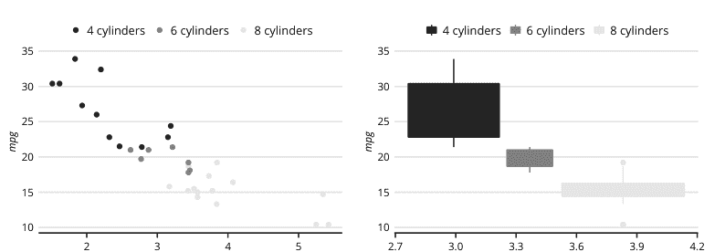

图 3.2：数据可视化示例。

在整本书中，我们将使用类似的数据可视化。可视化是强大的工具，可以帮助我们“看到”数据以及映射所涉及的数据转换。


## 接下来去哪里

本章介绍了本书所需技术中将用到的 R 计算基础。如有关于编码流程的疑问，或需要复习术语，随时可回到本章。

我们仅提供简要概述，因为存在许多详细且易于获取的资源（其中许多是免费的）。我们建议阅读每个 R 包在 CRAN 上的官方文档。18《R 官方介绍》（Venables et al. 2021）是一本不可或缺的指南，Wickham 和 Grolemund 的《R 语言数据科学》（2016）也是如此。19 两本更专业的参考书是 Bryan 和 Hester 的《他们没教你的关于 R 的事》（Bryan and Hester 2019）和 Healy 的《数据可视化》（Healy 2018a）。最后，有许多论坛可以发布编码错误，以获取经验丰富的程序员提供的潜在解决方案——例如 Stack Overflow、community.rstudio.com 以及各种 Subreddits 和 Discord 服务器。这些是宝贵的资源。

18 例如，text2map 的手册在此：cran.r-project.org/package=text2map
19 rstudio.com/resources/cheatsheets 上还有多份“速查表”。

# 4 数学基础

> 数学将最多样的现象进行比较，并发现将它们联系起来的秘密类比
> —J. Fourier

计算文本分析涉及数学。毫不意外！幸运的是，一点数学就能派上大用场。以下是我们将使用的一些数学概念和度量的概览。¹ 任何具备高中数学水平并阅读本章的人都应该能够完成本书中的分析。本章是一份我们将不断参考的入门、复习和速查指南。

¹ 我们承诺不会涉及公式，并将坚持这一承诺。

## 基础知识

量化始于标量：一个单一数字。整数或“整数”是一种标量，而实数或“带小数的整数”是另一种标量。向量是一个标量列表，其中顺序很重要。

```
## Scalars
 a_int <- 8 # integer
 a_real <- 6.5 # real number

 ## Vectors
 a_vec <- c(8, 6.5)
```

将标量相加就像二加二等于四一样简单。然而，当我们相加向量时，必须考虑所有数字及其顺序（边距中的输出）。

```
## adding scalars
scal1 <- 1
scal2 <- 15
scal1 + scal2
```

```
## adding vectors
vec1 <- c(1, 4, 4, 5)
vec2 <- c(0, 5, 1, 4)
vec1 + vec2
```

我们将每个向量中相同位置的数字相加。向量相减的工作方式相同。如果向向量中添加一个标量会发生什么？向量中的每个数字都会增加标量的量。从向量中减去标量的工作方式也相同。

我们通常会汇总向量中的数字以创建一个单一数字（即标量）。最常见的是平均值或均值，即通过对所有数字求和并除以数字个数来得到。我们还会遇到向量的范数。L1-范数涉及对向量中所有数字的绝对值求和。L2-范数是对所有数字平方、求和，然后开平方根的结果。

```
vec1 <- c(1, 4, 4, 5)
avg <- vec1 / sum(vec1)
l1n <- sum(abs(vec1))
l2n <- sqrt(sum(vec1^2))
```

根据上下文，这有时被称为长度、模或原点距离。

勾股定理是这个公式的一个著名版本，但我们使用它不仅仅是为了测量三角形和传播蚕豆宣传。

有时我们会从向量中减去均值，这会将每个数字精确地移动均值的量。这称为中心化。我们可能进行中心化的一个原因是使两个向量更容易比较。在下面的代码中，在对 vec1 和 vec2 进行中心化后，它们现在具有相同的均值（为零）和下界（为 -2.5）。这往往使数学更容易。

```
vec1 <- c(1, 4, 4, 5)
vec2 <- c(0, 5, 1, 4)
## centering vectors
vec1 - mean(vec1)
vec2 - mean(vec2)
```

```
[1] -2.5  0.5  0.5  1.5
[1] -2.5  2.5 -1.5  1.5
```

在其他情况下，我们会想要将向量归一化或规范化（作为动词），这涉及改变我们的向量，使其范数等于一，即单位向量。我们通过用相应的范数除以向量来实现这一点。最常见的两种是 L1-范数和 L2-范数。

```
vec1 <- c(37, 42, 47, 1138)
# Normalize by L1 Norm
norm1 <- sum(abs(vec1))
vecL1 <- vec1 / norm1

## Normalize by L2 Norm
norm2 <- sqrt(sum(vec1^2)) # L2 norm
vecL2 <- vec1 / norm2

# respective norms now equal 1
sum(abs(vecL1))
sqrt(sum(vecL2^2))
```

```
[1] 1
[1] 1
```

### 比较向量

在计算分析中，我们经常比较两个向量：这组数字与另一组数字是否不同，如果不同，差异有多大？假设我们询问三个人他们在工作中工作了多少年，每小时赚多少钱。我们将有一个年份列表和一个工资列表。

```
years <- c(31, 41, 5)
wages <- c(92, 65, 35)
```

顺序很重要，因为每个人的答案必须对齐。年份向量第一个位置的响应应与工资向量第一个位置的响应对齐。当我们比较两者时，我们想知道数字是否似乎在相同的位置上升和下降。在我们的示例中，这有助于我们看到人们的工资与其工作经验年限之间关系的模式。

### 点积

4 这也称为内积或标量积。

比较向量方法的基石是点积。4 两个向量的点积涉及将第一个向量中的每个数字与第二个向量中对应的数字相乘。然后将它们求和以得到一个标量。如果对单个向量平方，然后对其所有元素求和，这就是单个向量与其自身的点积。5

5 注意，L2-范数是向量与其自身点积的平方根。

```
vec1 <- c(1, 2, 4, 2)
vec2 <- c(2, 3, 1, 1)
dt1 <- sum(vec1 * vec2)
dt2 <- 1 * 2 + 2 * 2 + 3 * 4 + 1 + 2 * 1
all.equal(dt1, dt2)
```

[1] TRUE

6 Y 轴朝上！X 轴朝左！

向量是顺序重要的数字列表，我们可以将其视为空间中的坐标或地图上的地址。按照传统，在带有垂直和水平数轴的平面图中，左右方向的线称为 x，垂直方向的线称为 y。6 因为我们只有两条数轴，所以可以用两个数字精确知道任何点的位置。假设我们有三个点。分别称它们为 Galifrey、Magrathea 和 Trisolaris。第一个向量是 [1, 2]，第二个是 [3.5, 1]，第三个是 [2.5, 3.5]。绘制这些点就给出了一个向量空间（见图 4.1）。

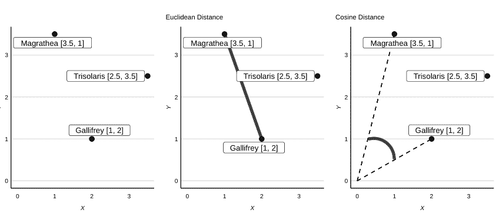

图 4.1：二维向量空间中的向量。

### 欧氏距离和余弦相似度

两个向量之间的相似性现在关乎空间：每个点之间的**距离**是多少？我们主要以两种方式测量距离：欧氏距离和余弦相似度。欧氏距离是两点之间的最短线。该度量范围从 0（相同点）到随数据集而异的某个未知上限。余弦——或**余弦相似度**——是从每个点到原点 [0, 0] 绘制一条线时形成的角。这从 1（相同点）范围到 0 或 −1，具体取决于数据。<sup>7</sup>

两者的关键是 _点积_。要找到欧氏距离，我们首先将两个向量相减。这个结果是原始两个向量之间差异的向量。接下来，我们将此差值向量平方，求和，然后开平方根。对于单个向量，这是向量与其自身点积的平方根——即 _L_<sub>2</sub>- 范数（边距中的输出）。

```
magrathea <- c(3, 1)
gallifrey <- c(3.5, 1)
# Difference vector
dif <- magrathea - gallifrey
# Dot product
dif_dot <- sum(dif^2)
# Square root
euc_dist <- sqrt(dif_dot)

euc_dist
```

要找到余弦相似度，我们首先将找到两个向量之间的点积。然后我们将找到原始向量的 _L_<sub>2</sub>- 范数

<sup>7</sup> 我们将在**核心归纳**中更详细地比较欧氏度量和余弦度量。

[1] 0.5


向量。然后我们将点积除以它们各自的范数的乘积。

```
## Dot products
dot <- sum(magrathea * gallifrey)
rom_dot <- sum(magrathea^2)
gal_dot <- sum(gallifrey^2)
# l2 norms
l2_rom <- sqrt(rom_dot)
l2_gal <- sqrt(gal_dot)
# Cosine similarity
cos_sim <- dot / (l2_rom * l2_gal)
cos_sim
```

[1] 0.5646839

相似度只是距离的逆。如果我们反转欧氏距离，就得到欧氏相似度；如果我们反转余弦相似度，就得到余弦距离。如果我们有**距离**，较小的数字表明两个向量在空间中更接近。如果我们有**相似度**，较大的数字表明向量更接近。

## 相关性

比较两个向量最常见的方法或许是**相关性**（de Mesquita and Fowler 2021:13–36）。⁸ 同样，这一度量的基石是*点积*。相关性是两个向量的余弦，只是我们首先从向量中减去均值（即中心化）。⁹ 让我们使用与之前相同的示例向量。让我们一步步手动计算相关性。

```
Magrathea <- c(3.5, 1)
gallifrey <- c(1, 3)

## Center vectors
c_rom <- Magrathea - mean(Magrathea)
c_gal <- gallifrey - mean(gallifrey)
## Dot products
dif_dot <- sum(c_rom * c_gal)
rom_dot <- sum(c_rom^2)
gal_dot <- sum(c_gal^2)
## L2 norms of centered vectors
l2_rom <- sqrt(rom_dot)
l2_gal <- sqrt(gal_dot)
## Cosine distance
res1 <- dif_dot / (l2_rom * l2_gal)
```

现在，使用R的函数`cor()`计算相关性，并使用`all.equal()`查看两个结果是否相同（输出在页边栏）。

```
res2 <- cor(Magrathea, gallifrey)

all.equal(res1, res2)
```

[1] TRUE

在我们的示例中，存在完美的负相关：当一个向量中的数值较低时，另一个向量中的数值较高，反之亦然。通过相关性，我们量化两个向量共变的程度以及这种关联的方向。¹⁰ 然而，相关性不能告诉我们一个向量随另一个向量每增加一次而增加*多少*。例如，工资随每多一年经验而倾向于增加多少？为此，我们需要另一种称为回归的工具。

¹⁰ 无论我们是比较向量空间中的位置，还是经验与工资，这都成立。

## 回归

**回归**是一类总结我们数据变化量的方法（de Mesquita and Fowler 2021:74–93）。我们将讨论被称为**普通最小二乘法**（OLS）回归（Tufte 1974:65–134）的基础技术。使用OLS，我们希望一条穿过我们数据的直线能够以最小误差“拟合”数据。¹¹

¹¹ 我们通常将回归及类似技术称为“拟合模型”。

请回顾，两个向量之间的相关性是它们的余弦，但首先，我们通过减去均值来对向量进行中心化。同样，请回顾，余弦是两个向量的点积除以它们*L2*-范数的乘积。标准OLS对这些步骤做了一个关键的改动：我们只对*一个*向量进行中心化和范数化。

使用回归时，一个向量是*结果变量*，¹² 即*Y*，一个或多个向量是*预测变量*，¹³ 即*X*s。我们感兴趣的是结果变量的变化在多大程度上与预测变量的变化相关联。使用OLS时，我们*不会*对*Y*（结果变量）进行范数化或中心化。让我们使用一项虚构的调查，调查人们养的小狗数量（预测变量）及其幸福感水平（结果变量）。

¹² 也称为*因变量*或*响应变量*。

¹³ 也称为*自变量*或*解释变量*。

```
x_puppy <- c(0, 1, 4, 3, 2)
y_happy <- c(1, 3, 6, 7, 5)

c_puppy <- x_puppy - mean(x_puppy) # center our predictor(s)
dot <- sum(y_happy * c_puppy) # dot product
dot_pup <- sum(c_puppy^2) # dot product
L2_pup <- sqrt(dot_pup) # L2 norm of predictor(s)

coef1 <- dot / (L2_pup * L2_pup) # calculate OLS
```

让我们将我们逐步计算的OLS与R基础包的OLS函数进行比较。我们必须将两个向量绑定到一个数据框中，才能使用`lm()`。

```
dfa <- data.frame(puppy = x_puppy, happy = y_happy)
ols <- lm(happy ~ puppy, data = dfa)
coef2 <- coef(ols)["puppy"]

all.equal(coef1, coef2, check.attributes = FALSE)
```

[1] TRUE

两者给出了相同的答案：1.4。这意味着什么？由于我们没有转换结果变量（即*Y*），该数字与该结果变量处于*相同的度量*中：每增加一只小狗，我们预期受访者的幸福感水平将增加1.4个单位。¹⁴

¹⁴ 这个数字称为斜率、系数、估计值或beta。

该模型有许多扩展。多元OLS回归，即我们有不止一个预测变量（Tufte 1974:135–163），使我们能够探索幸福感与人们养的小狗数量以及，例如，他们家里有多吵之间的关系。

```
x1_noise <- c(2, 4, 2, 1, 1)
x2_puppy <- c(0, 1, 4, 3, 2)
y_happy <- c(1, 3, 6, 7, 5)
## center our predictors
c1_noise <- x1_noise - mean(x1_noise)
c2_puppy <- x2_puppy - mean(x2_puppy)
## dot products
dot_x1 <- sum(c1_noise^2)
dot_x2 <- sum(c2_puppy^2)
dot_y1 <- sum(y_happy * c1_noise)
dot_y2 <- sum(y_happy * c2_puppy)
dot_x1x2 <- sum(c1_noise * c2_puppy)
## Beta 1
beta1 <- ((dot_x2 * dot_y1) - (dot_x1x2 * dot_y2)) /
  ((dot_x1) * (dot_x2) - (dot_x1x2)^2)
## beta 2
beta2 <- ((dot_x1 * dot_y2) - (dot_x1x2 * dot_y1)) /
  ((dot_x1) * (dot_x2) - (dot_x1x2)^2)
beta1
beta2
```

```
[1] -0.3529412
[1] 1.2941176
```

让我们使用R基础包的自身OLS估计值进行双重检查。

```
df <- data.frame(noise = x1_noise, puppy = x2_puppy, happy = y_happy)
ols <- lm(happy ~ noise + puppy, data = df)
coef(ols)[c("noise", "puppy")]
```

```
noise
-0.3529412
puppy
1.2941176
```

验证通过！噪音每增加一个单位，幸福感就下降0.35。请注意，我们的小狗系数仍然为正，但与之前的“拟合”不相同。在这里，在噪音条件不变的情况下，每多养一只小狗，我们预期幸福感将增加1.29个单位。表4.1列出了我们在这里回顾的一些常见向量度量。

OLS有一些假设，而我们的数据并不总是满足这些假设。我们不会深入探讨，但OLS是一个“线性模型”，或LM。对此的扩展称为“广义线性模型”或GLM。例如，我们在本书中将遇到的一种GLM是**逻辑回归**，当我们的结果变量是类别变量（如“是”或“否”）时，它是合适的。15

15 如果结果是类别变量但具有序数，那么我们可能想要所谓的有序逻辑回归。如果结果是类别变量并包含三个或更多无序类别，那么我们可能想要多类逻辑回归。

与普通OLS回归一样，逻辑回归使用一些预测变量来预测结果。在这里，我们假设结果有两个值：是或否。逻辑回归特别适合这种场景。从技术上讲，我们的结果是一个观测值是1还是0，但我们将建模获得1或0的概率。

使用OLS回归时，结果变量和预测变量在理论上可以从正无穷到负无穷。出于我们不详述的原因，

## 表 4.1：常见向量度量

| 度量 | 解释 |
|---|---|
| 点积 | 两个向量乘积之和或一个向量平方之和 |
| L2-范数 | 向量与自身点积的平方根 |
| 差向量 | 两个向量相减的结果 |
| 余弦 | 两个向量的归一化点积 |
| 相关性 | 差向量的归一化/中心化点积 |
| OLS | 两个（或多个）向量的点积，但其中一个向量未进行*归一化/中心化* |

这使得数学变得简单。使用逻辑回归，我们想要一个具有相同边界的东西——但如何做到呢？我们首先通过将概率除以一减概率来“欺骗”我们的模型。这被称为几率。在这里，我们的范围现在是0到正无穷之间——成功了一半！然后我们对这些几率取对数，得到一个介于负无穷和正无穷之间的范围。*然后*我们可以将其视为更像基础OLS回归。16 每当我们试图找到某个观测值属于某个类别的概率时，逻辑回归都是一个好的起点。

^16 几率的对数也称为*logit*。Logit并不直观，我们需要进行一些数学计算才能将结果*转换回*概率。

## 比较分布

有时我们只关心向量中的数字，而不太关心顺序。换句话说，我们关心列表中数字的**分布**。17 例如，有多少人养一只小狗？两只？三只？总结分布我们需要三个方面：**集中趋势、离散程度**和**分布类型**。

^17 如果我们向量中的数字总和为1，我们通常称其为*概率分布*。

## 集中趋势

请回顾，有时我们会找到一个单一数字（即标量）来总结一个向量。测量数字列表的*集中趋势*是做到这一点的一种方式。我们已经讨论过均值，它通常指的是*算术平均数*：将数字相加并除以数字的个数。另外两种常见的集中趋势是*中位数*和*众数*。前者是将列表的下半部分与上半部分分开的中间值。后者是出现频率最高的那个数字。


## 分散度

总结我们向量的另一种方法是衡量我们的数字有多分散或分布宽松。离散度量包括 **极差** 和 **方差**。前者是最大数和最小数之间的差。后者涉及从向量中减去均值，然后对该向量进行平方并求和（没错，又是 _点积_），然后除以观察值的数量。

18 我们也可以除以观察值的数量 _减一_，当我们处理样本而非总体时，这种做法很常见。

19 埃尔莫和科米特正好是24英寸，而大鸟是98英寸！

最后，**标准差**是方差的平方根。标准差的好处在于它可以用变量的度量单位来解释：例如，如果我们在 _芝麻街_ 上测量了一批木偶的样本，发现均值为24英寸，标准差为9英寸，那么该样本中木偶的身高平均偏离24英寸均值约9英寸。

## 分布类型

社会科学中的统计学通常基于这样一个假设：当我们测量世界中的某事物时，它将服从 _正态_（或 _高斯_）分布。那么，让我们从这里开始。

20 或者，当样本量足够大时，从该“事物”重复样本中得出的均值的分布也将呈正态分布。这被称为 **中心极限定理**。

如果数字在均值上下对称分布，则我们的列表呈正态分布。这里，我们将模拟两个具有正态分布、略有不同均值以及一个具有不同标准差的向量。这些分布如图4.2所示。

图4.2：正态（高斯）分布。

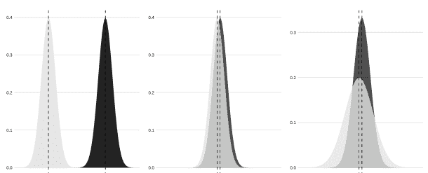

21 在本书中，我们将遇到大量非正态分布。

还有许多非正态分布——太多，无法在此详细阐述。我们不应假设数据服从正态分布。在比较两个向量时，不仅要确定它们的集中趋势是否不同，还要考察它们的整体离散程度和分布形式。

## 我们亲爱的朋友，矩阵

我们将以 **矩阵** 结束这本入门指南，矩阵是上下堆叠或并排排列的向量集合。矩阵的便利之处在于，我们可以同时处理多个向量。

```
vec1 <- c(1, 2, 4, 2)
vec2 <- c(3, 3, 3, 1)
vec3 <- c(4, 4, 4, 1)
mat <- rbind(vec1, vec2, vec3)
mat
```

```
       [,1] [,2] [,3] [,4]
vec1    1    2    4    2
vec2    3    3    3    1
vec3    4    4    4    1
```

我们经常需要对矩阵进行 **转置**，即将其“翻转”，使行变成列，列变成行：

```
t(mat)
```

```
      vec1 vec2 vec3
[1,]    1    3    4
[2,]    2    3    4
[3,]    4    3    4
[4,]    2    1    1
```

矩阵和其他数学对象一样，这意味着我们也可以对它们进行算术运算，但同样需要处理 _所有数字_ 并跟踪它们在矩阵中的位置。让我们创建两个小矩阵并将它们相加。

```
mat1 <- matrix(c(1:4), ncol = 2)
mat2 <- matrix(c(5:8), ncol = 2)
mat1 + mat2
```

```
      [,1] [,2]
[1,]    6   10
[2,]    8   12
```

我们将每个矩阵中对应的行列位置（即单元格）中的数字相加。如果我们向矩阵中添加一个标量，会发生什么？每个单元格都会增加该单一数字的量。

当矩阵形状不同时，情况会变得更加复杂。我们无法对它们进行加法或减法，但可以相乘形状不同的矩阵。**矩阵乘法**与常规乘法略有不同，在R中不使用 *，而是需要一个特殊的运算符 %*%（输出在页边距中）。这对我们后面要做的很多事情都至关重要。

> 22 Matrix一词源自拉丁语，意为“子宫”或“母亲”：“我已定义‘矩阵’为一组术语的矩形阵列，不同的行列式系统可从此中产生，如同从共同的母体中诞生一般”（Sylvester 1851:247）。

```
mat1 %*% mat2
```

```
[,1] [,2]
[1,] 23 31
[2,] 34 46
```

在这里，我们计算第一个矩阵中每个行向量与第二个矩阵中每个列向量之间逐元素乘积的总和。换句话说，我们求出了两个向量的点积。不过，这两个向量并不是矩阵中的对应行。第一个结果是第一个矩阵第一行与第二个矩阵第一列的点积，依此类推。（输出在页边距中）。

```
sum(mat1[1, ] * mat2[, 1])
sum(mat1[2, ] * mat2[, 1])
sum(mat1[1, ] * mat2[, 2])
sum(mat1[2, ] * mat2[, 2])
```

```
[1] 23
[1] 34
[1] 31
[1] 46
```

我们可以相乘形状不同的矩阵，但它们的维度必须兼容：一个矩阵的行数 *必须* 等于另一个矩阵的列数。输出是一个方阵：行数和列数相同的矩阵。

## 矩阵投影

我们需要矩阵乘法的一种常见场景是进行 **投影** (Breiger 1974; Everett and Borgatti 2013)。有时，矩阵的行和列是同一类事物。一个典型的例子是友谊网络，我们将相同的人员排列在行和列上，如果两个人是朋友，我们就在他们各自的行和列交叉处放置“1”。我们称之为一模态矩阵。通常，矩阵的行与列是不同类型的事物。假设我们询问人们午餐吃了什么水果。我们会在人员行与食物列的交叉处放置“1”。我们称之为二模态矩阵。

23 稍后将详细介绍网络。

```
fruits <- c("huckleberry", "guava", "mango", "fig", "cherry")
titania <- c(1, 0, 0, 1, 0)
oberon <- c(0, 1, 0, 1, 1)
puck <- c(1, 0, 1, 1, 0)
two_mod <- rbind(titania, oberon, puck)
colnames(two_mod) <- fruits
two_mod
```

| | huckleberry | guava | mango | fig | cherry |
|---|---|---|---|---|---|
| titania | 1 | 0 | 0 | 1 | 0 |
| oberon | 0 | 1 | 0 | 1 | 1 |
| puck | 1 | 0 | 1 | 1 | 0 |

我们经常将这个二模态矩阵转换为一模态矩阵，我们称之为 *矩阵投影*。投影涉及矩阵乘法，多了一步：我们 *转置一个矩阵*。请记住，结果矩阵的维度取决于哪个矩阵排在前面。如果转置后的矩阵在运算顺序中排在第一位，那么我们得到一个食物×食物矩阵。如果转置后的矩阵排在第二位，那么我们得到一个人×人矩阵。让我们看看这在实际中是如何运作的。

```
two_mod %*% t(two_mod)
             titania oberon puck
titania      2      1     2
oberon       1      3     1
puck         2      1     3
```

```
t(two_mod) %*% two_mod
                 huckleberry guava mango fig cherry
huckleberry    2    0   1   2   0
guava          0    1   0   1   1
mango          1    0   1   1   0
fig            2    1   1   3   1
cherry         0    1   0   1   1
```

在第一个投影中，数字表示行人员与列人员共有多少种水果。例如，Titania和Puck都吃了越橘和无花果。在第二个投影中，数字表示行水果和列水果共有多少人。例如，吃无花果的人也吃了芒果。Base R提供了两个高效的函数 24 来做到这一点：

```
## row-by-row matrix: two_mod %*% t(two_mod)
tcrossprod(two_mod)
## column-by-column matrix: t(two_mod) %*% two_mod
crossprod(two_mod)
```

矩阵帮助我们组织数据，但它们还对应另外两个数学对象：空间和图。两者都是表示数据模式的直观方式。在讨论矩阵与图的关系之前，让我们先简要讨论一下奇异值分解中矩阵与空间的关系。

## 向量空间和奇异值分解

什么是“降低”矩阵的维度？最常见的方法涉及奇异值分解，即 SVD (Martin and Porter 2012)。要理解 SVD，我们可以思考矩阵如何具有相应的几何解释。我们称矩阵的列为 *维度*，因为它们定义了向量空间中沿维度的位置。

> 24 有几种运算被称为“叉积”。在这里，它指的是矩阵行向量与其转置列向量的内积（Williams 2010:768）。


线性变换是指我们以某种方式改变空间，使得变换前的直线在变换后仍然是直线。例如，想象在我们的空间前面拿一面镜子：空间中任何直线在反射后仍然是直线。有用的是，如果我们先正确旋转空间，那么空间中的任何拉伸、压缩、翻转或剪切 25 都是线性变换。

- 25 这意味着通过推动顶角将正方形变成菱形。

假设我们有一个两列矩阵，因此是一个二维空间。我们可以使用坐标轴、原点和一个单一点在这个空间中绘制一个正方形（图 4.3，左侧面板）。当我们应用 SVD 时，我们正在将正方形转换为矩形。但我们试图压缩、拉伸、翻转和旋转它，使得矩形的一条边尽可能长。

- 26 这推广到任意维度的空间，但我们失去了可视化它的能力。

矩形边长度是奇异值，第一个奇异值是最长的边。26 如图 4.3 右侧面板所示，奇异值描述了空间在任何方向上被“拉伸”的程度。新点的坐标是奇异向量。重要的是，我们可以通过逆转相同的线性变换来“恢复”原始数据。

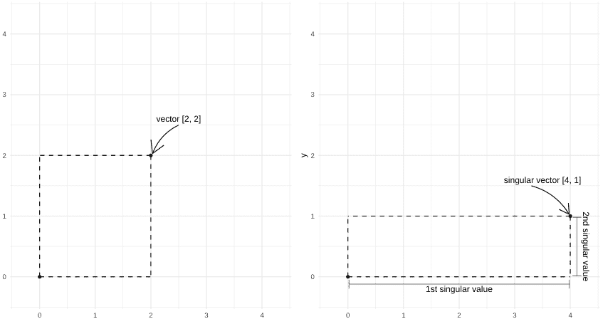

图 4.3：假设向量空间与 SVD。

从技术上讲，SVD 涉及找到 *A* 的两个矩阵投影（我们称之为 \(AA^T\) 和 \(A^TA\)）的 *特征值* 和 *特征向量*。第一个（\(AA^T\)）的特征向量是 *U* 的列，第二个（\(A^TA\)）的特征向量是 *V* 的列。\(^\text{27}\) 向量的长度只等于 *A* 中最短行和列的长度（在本例中为 4）。因此，我们需要修剪 \(AA^T\) 的输出。

出于技术原因，`eigen()` 和 `svd()` 之间的符号不会相同，但我们可以忽略这一点。

```r
A_mat <- matrix(c(1, 1, 1, 1, 1, 1,
                 1, 1, 1, 1, 1, 1,
                 0, 0, 0, 0, 0, 0,
                 2, 1, 1, 1, 0, 0),
                6, 4)
```

接下来，奇异值（*D*）是特征值的平方根。请注意，\(AA^T\) 和 \(A^TA\) 的特征值是相同的（但 \(AA^T\) 有更多零）。\(^\text{28}\)

我们将对它们进行四舍五入，因为零通常会接近零，有时甚至为负数，例如 -0.00000000013。

```r
round(eigen(AAT)$values)
round(eigen(ATA)$values)

[1] 17 2 0 0 0 0
[1] 17 2 0 0 0 0
```

```r
D_mat <- sqrt(round(eigen(ATA)$values))
round(D_mat, 3)

[1] 4.123 1.414 0.000 0.000
```

让我们将其与 `svd()` 进行比较。

```r
UDV <- svd(A_mat)
round(UDV$d, 3)

[1] 4.123 1.414 0.000 0.000
```

通常，这些数字是一个两侧为零的矩阵的对角线。

我们暂时可以忽略这些数字。请注意，*D* 是一组数字，\(^\text{29}\) 并且这些数字按降序排列（这很重要）。这些就是我们的 *奇异值*。

奇异值是 *U* 和 *V* 中每一行和每一列在“解释”原始矩阵方面的“相对重要性”。让我们计算每个奇异值“解释的方差”：

```r
prop.table(UDV$d^2) |> round(2)
```

```
[1] 0.89 0.11 0.00 0.00
```

第一个奇异值大约解释了原始矩阵中 89% 的方差。我们可以使用这个奇异值来创建原始矩阵的近似值，方法如下。

```r
# prepare the first component matrices
u1 <- - UDV$u[, 1, drop = FALSE]
v1 <- - UDV$v[, 1, drop = FALSE]
d1 <- - diag(UDV$d)[1, 1, drop = FALSE]
# approximate the original
A1 <- u1 %*% d1 %*% t(v1)
A1
```

```
[,1] [,2] [,3] [,4]
[1,] 1.333 1.333 0 1.333
[2,] 1.000 1.000 0 1.000
[3,] 1.000 1.000 0 1.000
[4,] 1.000 1.000 0 1.000
[5,] 0.667 0.667 0 0.667
[6,] 0.667 0.667 0 0.667
```

- 30 这是所有降维技术背后的动机。

如果我们包含超过第一个奇异值的数值，我们就能更精确地复原原始矩阵。我们还可以创建一个“缩减”矩阵来近似原始矩阵。30 我们原始矩阵的行是四维向量。不过，只有两个奇异值不为零。因此，让我们将矩阵缩减到两个维度。

```r
k_seq <- seq_len(2L)
v_r <- - UDV$v[, k_seq, drop = FALSE]
d_r <- - diag(UDV$d)[k_seq]
u_reduced <- A_mat %*% v_r %*% d_r
round(u_reduced, 2)
```

```
[,1] [,2]
[1,] -9.52 1.16
[2,] -7.14 0.00
[3,] -7.14 0.00
[4,] -7.14 0.00
[5,] -4.76 -1.16
[6,] -4.76 -1.16
```

这现在可能还不直观，但我们将在本书中多次回到降维的概念。

- 本部分需要：
- ggraph

## 图与矩阵投影

世界上许多模式都是元素之间的关系（Emirbayer 1997）。网络是元素及其之间关系的结构。许多现象都是网络：例如，疾病传播、家谱、市场产品扩散以及我们的神经系统。如果不考虑元素之间的关系，我们就无法理解这些过程。每个网络都包含节点（或顶点）和连接（或边缘、链接）。我们从图论中获得了这些术语，并经常将网络称为图。31

这些节点和连接包含的内容各不相同——实际上，我们只受想象力的限制。在社交网络中，节点通常是社会行为者——个人、群体、组织等。连接是连接这些社会行为者的任何东西——比如说、友谊、同居、相似品味等。使用图论，我们可以分析这些模式的“结构”属性。例如，我们可以评估流经公司电子邮件网络的闲谈，或者在组织层级中寻找经纪人。

矩阵可以表示任何图。因此，网络过着双重生活：既是图也是矩阵。32 让我们考虑一个现实世界的社交网络，既作为矩阵也作为图。下面是佛罗伦萨家族数据（Padgett 和 Ansell 1993）的矩阵表示。该数据集包含文艺复兴时期意大利佛罗伦萨 16 个家族之间的婚姻。我们将只查看前五行和前五列。

```r
data("flo", package = "network")
flo[1:5, 1:5]
```

| | Acciaiuol | Albizzi | Barbadori | Bischeri | Castellan |
|---|---|---|---|---|---|
| Acciaiuol | 0 | 0 | 0 | 0 | 0 |
| Albizzi | 0 | 0 | 0 | 0 | 0 |
| Barbadori | 0 | 0 | 0 | 0 | 1 |
| Bischeri | 0 | 0 | 0 | 0 | 0 |
| Castellan | 0 | 0 | 1 | 0 | 0 |

在矩阵中，如果两个家族之间至少有一次婚姻，则 ij（行-列）对得到 1，否则得到 0。我们通常将这些称为邻接矩阵。当它们像这样未加权（只有 0 和 1）时，我们称它们为二进制矩阵，当它们是对称的（即，行和列是相同的实体，并且连接没有方向或是双向的）时，我们称它们为无向矩阵。

让我们使用 ggraph 以图形形式查看它（参见图 4.4）。33

```r
set.seed(59812) # set a seed to make layout reproducible
flo |>
ggraph(layout = "fr") +
geom_edge_link() +
geom_node_label(aes(label = name)) +
theme_graph()
```

图和网络并非严格的同义词，但我们仍将交替使用它们。对不起，数学家们！

因此，网络科学是图论与矩阵代数的融合。

网络本身是一个 igraph 对象。igraph 是 R 中最流行的网络分析包。ggraph 是用于按照 ggplot2 语法创建图表可视化的首选工具。


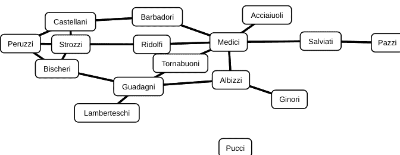

**图 4.4:** 作为图的佛罗伦萨家族网络。

34 此图的布局采用了 Fruchterman-Reingold 力导向算法 (Fruchterman and Reingold 1991)。可供选择的布局有多种。

矩阵的行名和列名是节点，单元格条目是连结。由于此网络是无权重的，连结的存在对应矩阵中的 "1"，连结的缺失对应矩阵中的 "0"。该网络也是无向的；因此，没有箭头指示连结的 "流"。34

这是一个一分图的示例，相应的矩阵是一模态矩阵。之所以知道这一点，是因为节点都是同一类事物，这里为家族。我们还将使用双模态矩阵：行和列实体不同。网络分析中的一个示例是南方妇女数据集 (Davis et al. 1941)，记录了密西西比州一个小镇的 18 名女性（行）参加了哪 14 场社交活动（列）。

回顾一模态投影。双模态矩阵有两个投影（即两种可能的“模态”）：行级投影和列级投影。由于图和矩阵是表示同一网络的两种方式，将二分图投影为两个一分图，等同于将关联矩阵投影为两个邻接矩阵。

## 少量数学也能走很远

与许多人在统计课程中遇到的数学不同，本章首先从线性代数的角度来处理量化问题。35 大多数被称为“人工智能”和“机器学习”的内容都是基于基本线性代数运算构建的，例如点积、矩阵乘法和奇异值分解。当然，这是一种简化，但并不不准确。每当本书中的某个技术使用本章涵盖的数学工具时，我们会在页边注释中将读者指回此处。

35 关于此分支数学的通俗介绍，参见 Strang (2020)。

# 5 获取文本

> 一本书接一本书，一项发明接一项发明，一件艺术品接一件艺术品，全都加起来成为无穷无尽、无定形的大团...
> —G. Simmel

山脉和三角洲、狭窄的溪流和广阔的峡谷、蔓延的街区和拥挤的城市，都可以被制图。同样，同一个地方可以催生出多种地图——政治、地形、地籍。但是，绘制一个地方当然始于选择一个地方。

正如任何地方都可以被制图一样，我们可以使用任何文本：访谈、田野笔记、档案文件、网页、书籍、杂志、演讲、期刊文章、社交媒体帖子、会议记录、课堂上传递的便条集合——任何文本都可以。但是，文本制图当然始于获取文本。这包括定位文本、收集文本，并使其在 R 中可用。我们将通过考虑收集这些数据的伦理影响来结束本章。

无论文档如何制作，它都必须以机器可读的形式存在（这越来越不成为障碍）。使其可机器读取的策略取决于文本。在这里，我们回顾五种方法：(1) 公共数据集，(2) 图像光学识别，(3) 音频文件的自动转录，(4) 应用程序编程接口 (API)，以及 (5) 网络抓取。

## 公共文本数据集

获取文本的最简单方法是使用众多公开可用的文本数据集之一。最容易获得的是随 R 包提供的。例如，托管在 GitLab 上的 text2map.corpora 包和托管在 GitHub 上的 quanteda.corpora 包都包含几个。1

```
install_github("quanteda/quanteda.corpora")
install_gitlab("culturalcartography/text2map.corpora")
```

安装一次后，我们可以使用 data() 函数从指定包加载数据集。让我们从 quanteda.corpora 加载美国国情咨文 (SOTU) 语料库。

- 本节需要：
  - remotes
  - tidyverse
  - tidytext

1 CRAN——R 包的官方仓库——限制了包的大小。托管在 GitHub 或 GitLab 上的包可以大得多，因此可以包含更大的数据集。

```
data("data_corpus_sotu", package = "quanteda.corpora")
```

**tidy()** 将语料库转换为更直观的数据结构。然后我们将使用 **mutate()** 来查找每篇演讲的长度。

```
df_sotu <- tidy(data_corpus_sotu)
# have a quick look:
head(df_sotu)
```

2 请回顾，为相同的绘图美学加载 text2map.theme 中的 settheme() 。

3 参见“整理文本”。

使用 **str_count**，为每篇演讲创建一个包含单词计数的新列。接下来，将数据框传递给 **ggplot()**。<sup>2</sup> **str_count** 计算与模式 \\w+ 匹配的项。该模式是“正则表达式”或“regex”。<sup>3</sup> 随时间变化的单词计数在图 5.1 中可视化。

```
df_sotu <- df_sotu |> mutate(Length = str_count(text, "\\w+"))
df_sotu |>
ggplot(aes(x = Date, y = Length)) +
geom_path()
```

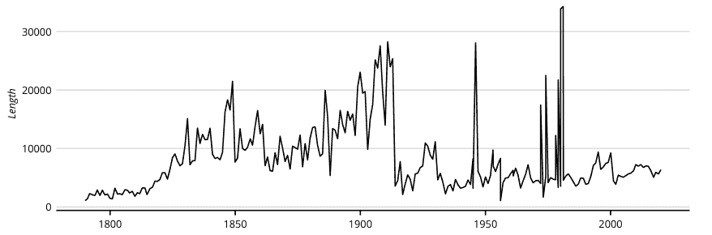

**图 5.1:** 美国国情咨文长度，1790–2020。

我们通常会将在 R 中创建的数据集或对象保存为 .Rds 文件。其他数据格式需要进行处理才能导入 R 并转换为可用形式。语料库的两种常见格式是 **纯文本格式** 文件 ( `.txt` ) 或 **逗号分隔值** ( `.csv` ) 中的单元格。下面是导入以这些格式保存的数据的示例。和 R 中的其他一切一样，导入文件有多种方法，输出取决于所使用的函数（但通常是 **数据框** 或 **列表** 。

```
# if our corpus is a column in a csv
my_corpus <- read.csv(file = "my_corpus.csv")
# from library(tidyverse)
my_corpus <- read_csv(file = "my_corpus.csv")
```

```
# if our corpus is a single .txt file
my_corpus <- read.table(file = "my_corpus.txt")
# From library(readtext)
my_corpus <- readtext(file = "my_corpus.txt")
# if our corpus is a folder of .txt files
txt.files <- list.files(pattern = "\\.txt$", full.names = TRUE)
my_corpus <- lapply(txt.files, read.table)
# From library(readtext)
my_corpus <- lapply(txt.files, readtext)
```

## 光学字符识别

如果我们的文档尚未数字化，就像档案文件的情况一样，我们将对其进行扫描或拍摄。这些图像可以保存为多种格式，例如 pdf 或 png。我们也可能以 pdf 或 png 形式获取在线文档。使用这些格式时，目标是将我们的单词整理成 txt 文件或 csv 文件中的单元格，或将其保存为 Rds 文件。为此，我们将使用光学字符识别 (OCR) 软件。

- 本节需要：
  - tesseract

> 它们是我的避难所。我在此流浪了许多天；冰窟，除了它们我什么都不怕，对人来说是栖身之所，也是人类不吝赐予的唯一栖所。我欢迎这些阴郁的天空，因为它们对我比你的同类更仁慈。如果世人知道我的存在，他们会像你一样，武装自己来毁灭我。那我难道不该恨那些憎恨我的人吗？我不会与我的敌人和解。我痛苦不堪，他们将分享我的苦难。然而，你有权力补偿我，并拯救他们免受一种邪恶，而你只需将其制得如此巨大，以致不仅你和你的家人，还有成千上万的其他人，都将被其愤怒的旋风吞没。愿你的同情心受到触动，不要鄙夷我。听我说我的故事：当你听完后，无论是抛弃我还是同情我，都取决于你认为我应得什么。但请听我说。有罪者，即使罪孽深重，也被人类法律允许在被定罪之前为自己辩护。听我说，弗兰肯斯坦。你指控我谋杀；然而你却会心安理得地毁掉你自己的造物。哦，赞美人类永恒的正义！然而我并非求你饶恕我：听我说；然后，如果你能，如果你愿意，毁掉你双手的作品。”
>
> “你为何要唤起我的记忆，”我回答说，“那些让我不寒而栗的情况，即我一直是那个可悲的起源和

图 5.2：玛丽·雪莱《弗兰肯斯坦》一书中的一页。

让我们使用一张图片（图 5.2）：玛丽·雪莱《弗兰肯斯坦》（1888:138）中的一页。我们将使用 tesseract，它使用


开源 Tesseract 引擎预训练可识别 100 多种语言。如果这是我们第一次使用它，需要先在操作系统上（在 R 之外）安装该引擎，同时也要在 R 中安装。安装并加载到 R 会话后，我们将 ocr() 指向图像的位置。

```
my_text <- ocr("images/img_shelley.png")
```

```
## _OCR of a page from Shelley's *Frankenstein* :
## are my refuge. I have wandered here many days;
## the caves of ice, which I only do not fear, are a
## dwelling to me, and the only one which man does
## not grudge. These bleak skies I hail, for they are
## kinder to me than your fellow-beings. If the
## multitude of mankind knew of my existence, they
## would do as you do, and arm themselves for my
## destruction. Shall I not then hate them who abhor
## me? I will keep no terms with my enemies. I
## am miserable, and they shall share my wretchedness. Yet it's in your power to recompense me,
## and deliver them from an evil which it only remains
## for you to make so great, that not only you and
## your family, but thousands of others, shall be
## swallowed up in the whirlwinds of its rage. Let
## your compassion be moved, and do not disdain me.
## Listen to my tale: when you have heard that,
## abandon or commiserate me, as you shall judge
## that I deserve. But hear me. The guilty are
## allowed, by human laws, bloody as they are, to
## speak in their own defence before they are condemned. Listen to me, Frankenstein. You accuse
## me of murder; and yet you would, with a satisfied
## conscience, destroy your own creature. Oh, praise
## the eternal justice of man! Yet I ask you not to
## spare me: listen to me; and then, if you can, and
## if you will, destroy the work of your hands.
## "Why do you call to my remembrance," I rejoined,
## "circumstances, of which I shudder to reflect,
## that I have been the miserable origin and
```

tesseract 将印刷文本图像转换为 R 可理解的字符。那手写文档图片呢？原理相同；但是，手写的差异要大得多。这需要在手写样本上微调 tesseract。这还包括构建一个 **标注** 数据集，其中研究人员手动将手写样本与正确单词关联起来（Rakshit et al. 2010）。同样，如果研究人员使用未预训练语言的 tesseract，他们可以使用手动标注的样本训练引擎（Clausner et al. 2020）。

## 自动音频转录

- 本部分需要：
  - googleLanguageR

我们也可能有音频数据——例如，采访或新闻广播。虽然我们可以手动转录这些内容，但自动转录既准确又快速。我们甚至可以导入音频文件并直接在 R 中转录，但这可能会变得复杂。

作为简要演示，让我们使用 Google 的 Speech-to-Text API（有关 API 的更多详细信息，请参阅下一段摘录），使用 gl_speech()，处理美国总统约翰·F·肯尼迪（JFK）在莱斯大学发表的著名演讲摘录（Kennedy 1962）（以下简称 JFK 演讲）。波形文件位于 text2map.corpora 的一个特殊文件夹中。

```
folder <- system.file("extdata", package = "text2map.corpora")
audio_file <- paste0(folder, "/jfk.wav")
```

如我们将讨论的，Google 对其 API 施加了各种限制。较长的音频文件必须上传到 Google 控制台存储，在一定使用量（~60 分钟/月）后，我们需要付费。在使用 gl_speech() 之前，我们需要获得连接到 Google Speech-to-Text API 的权限。

cloud.google.com/speech-to-text/pricing

```
# load authentication in the environment
gl_auth("my_authentication_file.json")

# call the Speech-to-Text API
# the API requires a mono, non-extensible .wav file
jfk <- gl_speech(audio_file,
    sampleRateHertz = 44100L,
    language = "en-US"
)
jfk_text <- jfk$transcript$transcript
```

该函数使用停顿将文本分成“行”。下面让我们连接转录内容并查看效果：

```
cat("__Kennedy's Rice University Speech__:\n","\n", jfk_text,"\n")
```

```
## __Kennedy's Rice University Speech__:
##
## we choose to go to the moon
## we choose to go to the moon
## we choose to go to the moon in this decade and
## we do the other things not because they are easy but
## because they are hard because they measure the best
## of our energies and skills because that challenge is
## one that we're willing to accept one we are unwilling
## to postpone and one we intend to win
```

还不错！我们可以从 Otter.ai、Temi 或 Trint 等服务中获得类似输出。这些服务能生成准确的转录内容，并提供用户界面以手动修正任何错误。从这些服务导出时，这些转录内容的最佳文件格式是 .txt 纯文本文件（而不是，例如，Word 文档或 HTML 文件）。

## 应用程序编程接口 (API)

网络抓取可识别并收集托管在万维网上的页面内容（Ignatow and Mihalcea 2017:82）。抓取的三个常见目标是新闻媒体、社交媒体和众包网站。在学术研究中使用新闻媒体可追溯到一个多世纪前的定量文本分析基础（Speed 1893）以及 1940 年代的传播研究（Lazarsfeld 1940）。新闻既因其对读者的潜在影响而被研究（Fenton 1910），也因其作为追踪地区“社会天气”的一种方式而被研究（Tenney [1912] 2008）。社交媒体是社会科学最近“大数据”工作的明星。使用社交媒体数据的项目范围从关于错误信息扩散的研究（Bail et al. 2020）到友谊形成（Wimmer and Lewis 2010）以及立法对在线情绪的影响（Flores 2017）。这些数据比调查更便宜，并且相对即时——且可能审核较少——代表了想法和感受。最后，还有众包网站，志愿者——通常出于热情——贡献信息。这包括 Wikipedia、Song Genius 和 Fandom。此类网站既因其能够生成半结构化数据集的能力而受到重视——例如，对每个漫威超级英雄的能力进行分类（Muscio 2023）——也因其作为有据可查的集体生产与治理中心而受到重视（Adams and Brückner 2015; Konieczny 2009）。

如流行文化界的阿尔·扬科维克（Alfred Yankovic）所言：“事实证明，有一种东西叫做互联网，无论西装笔挺的人喜欢与否，东西都会传播出去”（Press 2007）。

要抓取此类网站，我们将与应用程序编程接口 (API) 进行交互。在浏览器中输入网站 URL 时，浏览器会向服务器发送请求。服务器随后会“响应”浏览器——希望是返回请求的网页。服务器中负责处理和发出请求的部分就是 API（Gazarov 2016）。API 是一种中介，允许应用程序之间“交谈”，并定义标准化的“交互条款”。此接口通常用 XML 或 JSON 编写。可以将 API 视为“用户界面”。不过，它面向的不是人类用户，而是让客户端软件（即我们“请求数据”的计算机上的软件）更轻松地进行导航（Berlind 2015; McLevey 2021:63–87）。

这些是标记语言——例如 HTML——用于存储和表示数据集。

封装器受制于提供 API 的组织（Freelon 2018）。实际上，正是由于不稳定性，我们才删除了 Twitter 示例。如果以下代码出错，请耐心等待！查看封装器的最新文档。

更熟悉 R 的人可以直接与这些标记语言交互。幸运的是，“封装器”让这变得容易，例如 academictwitteR、rtimes、geniusr、WikideliR 等。许多网站都有专门用于自动交互的独立 API。

### 使用 Yahoo! Finance API 和 The Guardian API

然而，要使用这些 API，我们需要 (1) 与主机的开发者账户，以及 (2) 允许访问的令牌或密钥。我们将介绍 Yahoo! Finance API（不需要密钥）和 The Guardian API（需要密钥）。

- **本部分需要：**
  - tidyverse
  - tidyquant
  - guardianapi
  - rtweet

```
library(tidyverse)
library(tidyquant)
library(guardianapi)
library(rtweet)
```

2020 年底，GameStop（$GME）是一家业绩下滑的公司，大型投资者正在押注该公司会下跌（即做空）。2021 年 1 月 1 日，其股价约为每股 19 美元；随后飙升至每股 300 多美元。使用 tidyquant，我们将从 Yahoo! Finance 拉取财务信息并对其进行可视化（图 5.3）。

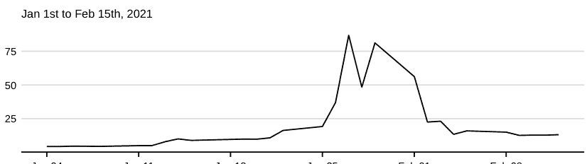

图 5.3：GameStop 股票价格。

```
gme <- tq_get("GME", get = "stock.prices",
  from = "2021-01-01", to = "2021-02-15")
gme |>
  ggplot(aes(x = date, y = close)) +
  geom_line() +
  labs(subtitle = "Jan 1st to Feb 15th, 2021",
       y = "Closing Price (US$)", x = NULL)
```

Reddit 论坛的用户协调购买了 GameStop 股票，执行了所谓的“挤空”，大幅推高了股价。假设我们想要 The Guardian 在挤空前后几个月的所有文章。首先，我们需要从 The Guardian Open Platform API 获取开发者密钥。选择“注册开发者密钥”。接下来，我们需要提交一份简短的表格，验证我们的


这是申请开发者密钥最简便的流程之一。有些流程需要详细的描述和联系信息，并且可能需要几天才能批准。

电子邮件地址，随后不久，我们会收到另一封包含 API 密钥的电子邮件：随机的字母数字字符串。1

运行以下函数，在提示符后将密钥粘贴到控制台中，然后按回车键。

```
gu_api_key()
```

请输入您的 API 密钥并按回车键：

现在，我们将使用 `gu_content()` 获取 2020 年 5 月 1 日至 2021 年 5 月 1 日期间包含单词“gamestop”的所有内容。

```
df_gme <- gu_content(query = "gamestop",
from_date = "2020-05-01",
to_date = "2021-05-01")
df_gme_daily <- ts_data(df_gme, "1 day")
```

```
df_gme |>
mutate(Date = as.Date(first_publication_date)) |>
ggplot(aes(Date)) +
geom_bar() +
labs(x = NULL, y = NULL,
subtitle = "Articles per Day, May 2020 - May 2021")
```

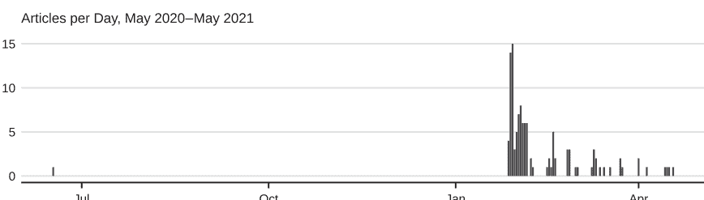

图 5.4：提及 GameStop 的文章。

我们在图 5.4 中可以看到，在1月下旬做空挤压之前，几乎没有关于 GameStop 的文章，然后它就一飞冲天，一天内达到十五篇文章的峰值！

使用带有 R 包装器的开发者 API（如 `guardianapi` 和 `tidyquant`）是收集基于 Web 数据不可或缺的方法。当我们需要从网站或平台获取数据时，搜索开发者 API 是一个极好的起点。

## 自动化网页抓取

### 本节需要：

- tidyverse
- lubridate
- rvest

许多带有 API 的网站没有 R 包装器也没有公共 API。有时，那些带有 API 和包装器的网站过于限制、过于昂贵，或者突然被弃用（Freelon 2018）。在这些场景下，我们将转向自定义抓取器。12

rvest 是构建抓取器的一个流行包。首先，我们需要一个要抓取的网页 URL。让我们从 arXiv 抓取一些数据——arXiv 是科学文章“电子预印本”（数字预印本和后印本）的免费存储库。13 假设我们想要获取 arXiv 上所有带有统计学分类的论文。让我们在 Web 浏览器中打开 arxiv.org，点击“高级搜索”，勾选“统计学（stats）”学科框，确保“所有日期”已勾选，然后点击“搜索”。

截至 2022 年 6 月，此搜索返回 82,286 条结果。图 5.5（左侧面板）是结果页面的截图。该页面为每篇论文提供了有用信息：arXiv ID、学科标签、标题、作者、摘要、摘要日期和公告日期。我们希望将这些信息汇总到一个数据框中。这就是 rvest 派上用场的地方。

首先，我们需要此搜索的基础 URL。从 Web 浏览器的地址栏复制 URL。将其赋值给 R 中的一个对象（确保没有空格）。它很长，所以我们将把它分成几段并拼接在一起。链接应以“announced_date_first”结尾。

```
url <- paste0(
"https://arxiv.org/search/advanced?advanced=&",
"terms-0-operator=AND&terms-0-term=&",
"terms-0-field=title&",
"classification-physics_archives=all&",
"classification-statistics_y=",
"classification-include cross list=include&",
"date-filter_by=all_dates&date-year&",
"date-date_type=date_type&",
"date-date_type=submitted_date&",
"abstracts=show&size=50&",
"order=-announced_date_first"
)
```

我们需要知道可以抓取多少页，但 arXiv 没有告诉我们。所以，我们需要猜测。14 每页显示 50 篇论文，例如，第二页显示第 51–100 篇论文。有大约 85,000 篇论文（参见图 5.5，左侧面板），那将是大约 1700 页——对于我们的演示来说太多了！让我们抓取前 5,000 篇论文。

这段代码生成一串数字，从 0 到 4,950（第一页从 0 开始，第 100 页从 4,950 开始，总共返回 5,000 篇论文和 100 页）。

抓取器也有缺点。我们需要为每个网站定制它们，次要的更新可能会“破坏”抓取器。但是，该技能在各个网站之间具有高度可迁移性。

arxiv.org 确实提供了一个 API，我们将在下一节中回到这一点。

也可以使用 rvest 中的 follow_link 点击“下一页”按钮。

```
paper_number <- seq(0, 4950, by = 50)
```

使用 `rvest`，将网页的原始 `HTML` 读入 `R` 非常简单。控制台会被打印的原始 `HTML` 淹没，因此 `rvest` 会将其截断。

```
read_html(url)
```

```
{html_document}
<html lang="en">
[1] <head>\n<meta http-equiv=...
[2] <body>\n \n \n <header>...
```

从技术上讲，我们正在构建一个自动化的“机器人”。因此，我们可能会被屏蔽。让我们“创建一个会话”，这样看起来有点像是在使用 Web 浏览器：

```
uast <- paste0(
  "Mozilla/5.0 (Windows NT 6.1) AppleWebKit/537.36 ",
  "(KHTML, like Gecko) Chrome/41.0.2228.0 Safari/537.36"
)

sess <- session("https://arxiv.org/", httr::user_agent(uast))
```

现在使用这个会话“跳转到”我们需要的页面。`HTML` 内容组织成嵌套层次结构。该层次结构中的每个部分都有一个称为节点或元素的唯一标识符。由于我们不需要大部分 `HTML`，`rvest` 提供了一个方便的函数 `html_elements()`，用于使用这些标识符抓取特定内容。让我们看看页面上有多少个唯一元素：

```
url |>
session_jump_to(x = sess) |>
html_elements("*") |> # asterisk matches any string
unique() |>
length()
```

```
[1] 1766
```

这很多！通过获取包含我们感兴趣抓取内容的元素的唯一 ID 或“标签”来缩小范围。要找到这些标识符，我们可以检查页面的原始 `HTML`，15 或者我们可以使用浏览器扩展，例如 SelectorGadget（适用于 Google Chrome）或 SelectorsHub（适用于 Firefox）。

15 在 PC 上的 Google Chrome 和 Mozilla Firefox 中使用 CTRL+SHIFT+I，Mac 用户使用 OPTION+COMMAND+U。

假设我们想要完整摘要，我们首先需要在页面上的某个摘要上点击“更多”按钮，然后再使用 SelectorGadget——这样我们就可以获取完整摘要的标识符，而不是“简短”摘要。如下面的截图所示（图 5.5，右侧面板），“.abstract-full”是完整摘要的标签。16

16 缩减摘要的标签是 ".abstract-short"。

图 5.5：arXiv 搜索结果和 SelectorGadget。

将该标签传入 `html_elements()`，然后使用 `html_text()` 删除额外的 HTML 标签，仅保留文本。下面是使用管道 `|>` 的“链式”版本。

```
web_page <- url |>
  session_jump_to(x = sess)
paper_abstract <- web_page |>
  html_elements(".abstract-full") |>
  html_text()
```

这给了我们*单个页面*上所有摘要的文本——但我们想要一百页上所有的评论！我们将使用 `lapply()`。首先，使用我们的论文编号序列为每个页面创建 URL 列表，然后为每个页面创建一个会话（类似于 Web 浏览器中打开了 100 个选项卡）。

```
# Create a list of all the URLs
url_list <- paste0(url, "&start=", paper_number)
# Create a list of webpages
page_list <- lapply(
  url_list,
  function(page) {
    Sys.sleep(5)
    return(session_jump_to(page, x = sess))
  }
)
```

我们将遍历这些会话，从每个会话中收集摘要。

```
paper_abstract <- lapply(
  page_list,
  function(page) {
    page |>
      html_elements(".abstract-full") |>
      html_text()
  }
)
```

17 您会看到不同的摘要，因为自我们写这本书以来，更多文章已被添加到该数据库中。

再次检查我们抓取的内容。首先，检查我们的新对象的长度是否等于我们想要的页数。如果不是，可能出了问题。其次，我们可以查看第一页上的第一个摘要。17

```r
length(paper_abstract) == 100
# remove extra white space with trimws
trimws(paper_abstract[[1]][1])
```

我们研究了汤普森采样在语境性多臂老虎机中的效率。现有的基于汤普森采样的算法需要构建拉普拉斯近似……

我们想要的不仅仅是文章摘要。使用 SelectorGadget，获取 arXiv ID、标题、作者姓名、日期以及提交和公告日期的标签。该过程几乎相同；我们只更改要隔离的元素。

```r
paper_id <- lapply(
  page_list,
  function(page) {
    page |>
      html_elements(".is-inline-block > a") |>
      html_text()
  }
)
```

```r
paper_title <- lapply(
  page_list,
  function(page) {
    page |>
      html_elements(".is-5") |>
      html_text()
  }
)
```

```r
paper_authors <- lapply(
  page_list,
  function(page) {
    page |>
      html_elements(".authors") |>
      html_text()
  }
)
```

```r
paper_subj <- lapply(
  page_list,
  function(page) {
    page |>
      html_elements(".tags.is-inline-block") |>
      html_text()
  }
)
```


```r
paper_date <- lapply(
  page_list,
  function(page) {
    page |>
    html_elements(".mathjax + .is-size-7") |>
    html_text()
  }
)
```

上面给出了六个列表。每个列表的长度应相同且顺序一致（即，第一个 `paper_abstract` 对应第一个 `paper_id`，等等）。这使得将其放入数据框中变得容易。我们还想使用 `Sys.Date()` 包含抓取数据的日期（如果感兴趣时间，可以使用 `Sys.time()`）。

```r
df_arxiv <- data.frame(
  id = unlist(paper_id),
  authors = unlist(paper_authors),
  title = unlist(paper_title),
  abstract = unlist(paper_abstract),
  tags = unlist(paper_subj),
  paper_date = unlist(paper_date),
  scrape_date = Sys.Date()
)
# look at our work
head(df_arxiv)
```

我们有 5,000 行数据——每篇论文一行。<sup>18</sup> 这与我们预期一致。有些变量不像我们需要的那么整洁。例如，每篇统计学论文都用关于其内容的关键词进行“标记”。例如，“cs.AI”代表计算机科学-人工智能。<sup>19</sup> 假设我们对不同时间段不同标签的论文提交情况感兴趣。

目前，多个标签被分组在同一列中，并以空格分隔。要分别计算每个标签，我们需要将其扩展到各自的列中。

我们首先修剪变量中的多余空格，然后通过计算每个或多个非空格字符来统计每行中的标签数量。

```r
df_arxiv <- df_arxiv |>
  mutate(tags = str_squish(tags))
maximum <- max(str_count(df_arxiv$tags, "\\S+"))
```

现在我们知道需要多少列，可以使用 `separate()` 将每篇论文的每个标签分到单独的列中。<sup>20</sup>

```r
df_arxiv <- df_arxiv |>
  separate(tags, paste0("tag_", seq_len(maximum)),
    extra = "merge", sep = "\\s+", fill = "right")
```

由于我们对每个标签*随时间*的提交情况感兴趣，我们需要处理 `paper_date` 列，使其仅保留提交日期。下面我们将使用 `gsub()` 和 `parse_date_time()` 来实现这一点。

```
df_arxiv$submit_date <- gsub("^.*Submitted\\s*\\|\\s*.*$", "",
                                 df_arxiv$paper_date)
df_arxiv$date_new <- parse_date_time(df_arxiv$submit_date,
                                         orders = c("dmy"))
```

我们将对 `df_arxiv` 数据框进行“熔化”或“透视”操作，使每行成为按日期和标签组合的行。这使得绘图更加容易，并涉及将宽数据框转换为长数据框。

```
melt_arxiv <- df_arxiv |>
  select(date_new, tag_1:tag_6) |>
  pivot_longer(!date_new)
```

有上百个唯一标签；由于我们专注于统计学论文，我们将筛选掉非统计学标签。然后，使用更有意义的标签对其重命名。最后，我们使用 `group_by()` 来统计每个标签在每个日期出现的次数。

```
melt_arxiv <- melt_arxiv |>
  filter(grepl("stat.", value, fixed = TRUE)) |>
  mutate(stats = recode(value,
                            "stat.AP" = "Applications",
                            "stat.CO" = "Computation",
                            "stat.ME" = "Methodology",
                            "stat.ML" = "Machine Learning",
                            "stat.OT" = "Other Statistics")) |>
  group_by(stats, date_new) |>
  summarize(count = n())
```

21 使用平滑条件均值。

22 当然，我们不能得出这种模式特征统计学一般情况的结论。将论文提交到 arXiv 与学习机器学习之间很可能存在某种亲和性——参见语料库构建。

使用 `ggplot()`，我们将使用 `facet_wrap()` 将数据分为单独的图表，并拟合一条总结数据的线。<sup>21</sup> 如图 5.6 所示，“机器学习”在 arXiv 的统计学论文中占据主导地位，平均每天有 30 篇投稿。<sup>22</sup>

```
melt_arxiv |>
  ggplot(aes(x = date_new, y = count)) +
    geom_smooth() +
    labs(x = "Date", y = "Average",
         subtitle = "Papers per Stats Category") +
    facet_wrap(~stats, nrow = 1)
```

通过构建这个自定义抓取器，我们拥有一个“基础设施”，例如可以扩展到包含所有 85,000 多篇统计学论文，或在新论文提交时持续更新我们的语料库。构建抓取器需要时间和精力，但更难以触达的社区和棘手的数据集可能恰恰因为更少学者有机会分析它们而带来新的洞察（参见 Martin 2017:218）。

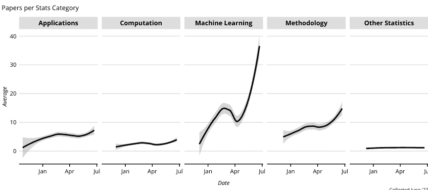

图 5.6：带有统计学分类的 arXiv 论文。

## 抓取的法律与伦理方面

在继续之前，让我们反思一下数据获取的伦理问题。

按照社会科学标准，大部分文本数据很容易获取。我们（通常）通过互联网公开访问它，因此不需要受访者、调查受访者、实验参与者、同意书、昂贵的抽样设计，甚至不需要太多时间。然而，容易获取并不意味着可以随意使用——即使数据表面上存在于公共领域中。

我们将探讨可能遇到的三个与（1）服务条款、（2）知识产权和（3）个人及组织隐私相关的伦理困境。本讨论在很大程度上借鉴了 Krotov、Johnson 和 Silva (2020:549) 提出的 Web 抓取伦理/法律框架。<sup>23</sup>

### 服务条款

在开发者 API 的情况下，我们通常会签订正式协议，限制我们如何使用该服务。R 交互的服务通常会阻止违反该协议的活动：例如，请求过多材料过快。在构建自定义抓取器时，事情会变得更复杂。一般而言，公开可用的文本——即不需要登录即可访问的文本——至少从法律上讲可以随意抓取。

23 我们的讨论并非对该框架的详尽审查。作者还涵盖了用于决策的 Web 抓取数据的问题（第 549 页）、抓取如何负面影响网站服务的价值（第 549 页），以及从事抓取的各方可能对网站或服务器造成任何实质性损害而承担责任（第 546 页）。我们在这里不讨论这些观点。

2019 年，第九巡回上诉法院维持了下级法院的裁决，即收集公开可用数据（即不需要登录即可访问的数据）不违反《计算机欺诈和滥用法案》（CFAA）。网站有“使用条款”协议；然而，法院认为，访问网站并不表明用户订立了明确协议。此外，要认定抓取者违反 CFAA，“网站必须证明其因违反“使用条款”而遭受实质性损害（例如服务器过载）”（Krotov et al. 2020:563）。因此，从法律上讲，当使用条款禁止此类活动时抓取并不被视为“违约”。此外，哪些活动被禁止并不总是一目了然。例如，arXiv（我们在上一节中抓取了它）提供了一个 API“以最大限度地提高其开放性和互操作性”；然而，该网站的 robots.txt<sup>24</sup> 声明：“不允许从此网站进行不加区分的自动下载。” 尽管我们强烈建议使用 API，但我们将我们的抓取示例是否属于“不加区分”下载的判断留给读者作为任务。

<sup>24</sup> 这是一个事实上的标准，用于告诉搜索引擎爬虫等“机器人”如何与网站交互。最初的目的是防止网站过载。

是否应遵守使用条款（或 robots.txt 规则）取决于研究人员的判断，以及研究是否证明违背网站所有者意愿是合理的。为公共利益进行非商业研究并探讨社会意义问题的研究人员，应当被允许访问 Web 上的公共资源，前提是该访问不会造成实质性损害（Vaccaro et al. 2015）。

### 知识产权

文本数据可能受版权保护。因此，使用此类数据可能受研究人员所在地版权法的约束。感兴趣的大部分文本数据通常并非由托管网站“拥有”——例如 Twitter 或 Facebook 等社交媒体网站。<sup>25</sup> 但是，如果我们抓取*确实*受版权保护的文本，比如书籍或歌词怎么办？即使在这些情况下，抓取文本本身可能也不构成版权侵权；相反，将文本*出版*在“某种有形媒介”中（US Copyright Office 2022b）——例如学术文章——可能会导致问题（Krotov et al. 2020:546）。如果作者从再版作品中获得任何财务或实物收益，这尤其成问题。

<sup>25</sup> 即使这一点也存在争议。Twitter 和 Facebook 的服务条款都声称最终用户拥有自己的内容。但是，在*纽约州诉马尔科姆·哈里斯案*中，法院得出结论，Twitter 必须为 Malcolm Harris（一名占领华尔街抗议者）交出用户数据（Jeong 和 Hoven 2012）。

在美国，研究人员通常依赖“合理使用”法律原则来主张其使用受版权保护的材料不构成版权法侵权主张。“合理使用”在《版权法》中规定


1976 年第 107 条旨在划出使用一定数量受版权保护材料而无需获得许可批准的空间。研究是“合理使用”（Fair Use）应用的一个领域，包括“批评、评论、新闻报道、教学、[和]学术研究”（US Copyright Office 2022a）。但此条款并非旨在成为“免罪金牌”；在上述任何一种使用情况下使用作品的人，仍可能面临版权侵权索赔。根据 1976 年版权法，用户（以及法院，如有需要）在确定某项使用是否受“合理使用”原则“保护”时，应采用以下因素（US Copyright Office 2022a）：26

- 1. 新用途的目的和性质。新用途是否会产生利润或某种收入？新用途与受版权保护的作品有何不同？它纯粹是“衍生性”的，还是“转换性”的？

- 2. 原作品的性质。原作品有多“有创意”？比如，它是小说还是报纸文章？由于版权法旨在保护创造性活动免受剥削，前者在满足“合理使用”方面设定的门槛高于后者。

- 3. 数量。在新用途中使用了原受版权保护作品的多少部分？无论数量多少，是否复制了受版权保护作品的“精华”？

- 4. 对原作品市场的影响。新作品是否会直接或间接损害原作品产生任何利润或收入的能力？

因此，如果一名研究人员正在分析一系列侦探悬疑小说，并打印书中多页内容，其中包含泄露主要情节反转的部分，那么该书的原版权持有人可能有理由提出侵权索赔。如同许多法律情境一样，“这要具体情况而定。”

重要的是，版权法保护固定想法的物质介质——而非想法本身（Krotov 等，2020）。因此，在理论上，如果不提供摘录，对一系列文本的分析属于合理使用范围——例如，数据被转换为文档-术语矩阵（如后文所述）。但是，社会科学受众通常希望看到一些文本来支持研究者的主张。这是一个合理的请求，但也意味着研究者应当注意他们如何从受版权保护的材料中提取内容。27

26 版权法因国家而异。例如，“合理使用”（Fair Use）在欧洲国家的理解不如在美国广泛。此外，这在欧盟成员国之间的协调程度不如版权法的其他领域（Bently 和 Aplin，2019）。为了避免版权侵权，鼓励研究者探索其所在地区的版权法。

27 如果研究者决定在其作品中使用，例如，公司标志，他们也可能受商标法约束。

## 个人与组织隐私

自动化抓取的一大好处是，我们可以在短时间内收集远超我们阅读能力的网页数量。我们通常不知道这些网页是否包含敏感信息。即使是表面上匿名的文本也是如此，就像 AOL 的研究部门发布了 650,000 名用户的搜索数据，但没有识别用户身份一样。尽管如此，_The New York Times_ 证明了仅凭搜索查询就能轻易识别一名用户（Barbaro 和 Zeller，2006）。同样请注意，从互联网获取的文本是“现成的”。28 因此，“最好假设所有数据都可能可识别且可能敏感”（Salganik，2019:314）。

28 文本的生产者在创作时并未考虑其如何为我们的研究项目做贡献——它是“无提示”的（Ignatow 和 Mihalcea，2016:13）。

此外，从多个来源自动化收集，尤其是在合并时，可能导致“去匿名化”。例如，假设我们正在抓取 Reddit，并收集某个使用化名的 Reddit 用户的帖子。我们可能从其 Reddit 帖子中提取足够多的细节——无论多么模糊——以了解其大致职业、大致位置、婚姻状况，以及或许他们更喜欢保密的某些兴趣。也许几年前的一篇帖子链接到了他们的 Twitter 账户，而他们曾在该账户上发布过其工作单位的一则职位空缺链接。有了这些信息，我们就可以去匿名化其在 Reddit 上的活动。这个假设场景表明，隐私预期并不总是清晰的。正如 Nissenbaum（2009:2）所论，“人们最关心的并不仅仅是限制信息流动，而是确保其流动得当。”

在抓取时，网站所有者并非唯一隐私预期可能受损的一方。对于学者来说，一些考虑由机构审查委员会（IRB）处理；但正如 Salganik（2019）所论，IRB 是底线而非上限。隐私考量既不始于 IRB 批准，也不止于抓取完成，甚至不止于我们发表研究。相反，这是一个持续的过程。当我们抓取文本并将其结构化为有组织的数据集时，我们便成了数据的管理者，也是文本生产者及其被代表者的管理者。我们应当不断重新审视隐私问题，并评估我们的数据——及其转换或发布——如何可能违背隐私预期。

# 6 从文本到数字

> 一张地图并非其所代表的疆域，但如果准确，它与疆域具有相似的结构，这正是其有用之处所在。
> ——A. Korzybski

人类在一万多年前就开始在石头、陶瓷和金属上刻画文字。从那时起，写作不断增殖，积累成人类意图的庞大库存，并引发一个根本性的复杂问题：我们如何在所有其他写作中找到特定的写作？这个问题模糊了三个技术考量：(1) 我们如何高效地表示文本？(2) 我们如何总结文本的内容？(3) 我们如何根据内容检索文本？许多文本分析工具应运而生，旨在回答关于**信息检索**的这些问题。

计算机辅助的文本数据表示方法，在过去二十年之前一直是一套相对小众的社会科学方法（例如，Franzosi 2004; Weber 1984; Roberts 1989; Carley 1993; Mohr 1994），但学者们常使用计算机程序来*检索*相关文献。

长期以来，研究者将表示与检索融合在一起。例如，Dewey 是 19 世纪 70 年代阿默斯特学院的一名图书馆员，他通过索引来表示书籍的内容。这个索引还指定了书架上书籍的位置。后来，开发出了几种依赖微胶片的自动“检索”系统——例如 Vannevar Bush 假设的“Memex”（Bush，1945）。尽管处理能力逐年增加，但计算机化程度越高，随着文本积累的增加，检索问题反而更加严峻。像 Dewey 那样繁琐的自上而下分类方案很快就让位于文档内容的*自动化*表示。

除了信息检索研究，我们还依赖**语料库语言学**中开发的工具。这种务实的——并且强烈反乔姆斯基的——方法在 20 世纪 50 年代兴起，并在计算机化的辅助下发展。该领域探索了单词、音节、短语或语法特征的频率分布，以及“搭配”或语言特征在特定语境中共现的程度（Firth，1957; McEnery 和 Hardie，2011）。

我们将广泛借鉴这两个领域——信息检索和语料库语言学。我们旅程的第一步是将单词转换为具有有用数值的结构化数据集。

1 DTM 是一种常见的文档-特征矩阵 (DFM)，其中术语即为我们的特征。

我们将依赖两种通用数据结构作为主要制图工具：(1) **文档-术语矩阵 (DTM)**¹ 和 (2) **术语-上下文矩阵 (TCM)**。前者是一种表格结构，其中行是我们的文档，列是单词出现的上下文。后者也是一种表格结构，但行是术语，列可以是术语出现的文档（即旋转的 DTM）或目标术语在给定窗口内同时出现的其他术语（术语共现矩阵）。我们将在本书中继续使用这些文本矩阵。

### 本节需要：

- tidyverse
- tokenizers

### 分析单位

2 如我们在 Extended Deductive 中所做的那样。

**文档**是任何词语集合，范围从短社交媒体帖子或段落到书籍章节或完整书籍。**特征**是文档内的子单元。通常，这指的是字符、单词、术语或短语，我们常称之为“标记”（tokens），有时也称为 n-grams。我们可以将标记转换、总结或合并为更复杂的特征，例如词法元素、语法、主题、概念等。按**作者**，我们是指负责文档制作的个人、群体或组织。最后，**语料库**是任何文档集合。例如，如果我们研究莎士比亚第一对开本中每部剧作涉及死亡概念的程度，² 每部剧作是一个*文档*，第一对开本是一个*语料库*，并且我们假设莎士比亚是*作者*。如果我们相反地有兴趣了解《错误的喜剧》中角色的性别如何影响其言论（例如，Hota 等，2006），每个台词部分是一个*文档*，而单部剧作就成为我们的*语料库*。

通常，研究者希望通过提取词语使用中的模式，对文档或作者进行推断。假设我们收集福岛灾难期间发布的推文。我们可能想知道哪些推文是“对话性”的，哪些是“信息性”的（Truong 等，2014），或者哪些作者经历了这场灾难。我们还想对词语本身的含义进行推断。这些推断反过来可能有助于对文档和作者进行推断。例如，“clean up”在关于福岛灾难的推文中与关于餐馆的推文中略有不同。不过，第一步是**分词**。


## 标记化

我们通常将文档拆分为更小的单元来表示文档内容。最小的单元称为**标记**，该过程称为标记化。^3 当我们想到“单词”时，脑海中想到的通常就是这些子文档单元；然而，我们可以将文档标记化为更复杂的单元，例如 n-gram——例如，二元语法（bigrams，每两个连续单词）或三元语法（trigrams，每三个连续单词）。^4 我们也可以按字符 n-gram 进行标记化——例如，每两个连续字符。

最简单的做法是假设“单词”就是我们的标记。但想要制定一条清晰的“规则”，让算法知道每个单词在哪里开始和结束，可能会很棘手。同样出于简化考虑，假设所有单词两侧都由单个空白字符清晰分隔。这一假设最适用于基于拉丁文字的书写系统，例如英语。^5 即便如此，也很容易找到我们规则的例外。“New York City”、“merry-go-round”还是“to and fro”，是一个标记还是三个标记？“I’ve”和“don’t”是一个还是两个？

让我们通过一个示例来演示。我们使用 `rtrek` 准备了《星际迷航：下一代》（Star Trek: The Next Generation）的电视剧脚本。第 5 季的脚本可在 `text2map.corpora` 中获取。下面我们将标记化首播集（标题为“Redemption, Part 2”）的第 17 行。我们将使用字符间的空格进行标记化。在任何标记化过程中，这通常是最快的选项。

```
data("corpus_tng_season5", package = "text2map.corpora")
df_trek <- corpus_tng_season5 # rename so it's tidier
dim(df_trek) # how many rows and columns
```

这将按*单个空格*拆分单词进行标记化（`fixed = TRUE` 告诉 `R` 这是字面字符）。

```
strsplit(df_trek$line[17], " ", fixed = TRUE)
```

[[1]]
 [1] "Captain's"     "log,"
 [3] "stardate"      "45020.4."
 [5] "We've"         "have"
 [7] "arrived"       "at"
 [9] "Starbase"      "Two-thirty-four,"
 [11] "where"         "I"
 [13] "have"          "taken"
 [15] "the"           "opportunity"
 [17] "to"            "make"
 [19] "a"             "proposal"
 [21] "to"            "Fleet"
 [23] "Admiral"       "Shanthi."

^3 如前文所述，语言（尤其是文本）可且应当被分段，这是一个假设（Aronoff 1992），但对于计算文本分析来说是必要的假设。

^4 单个单词通常称为一元语法（unigram）。

^5 对于阿拉伯文书写系统的标记化尤其复杂，因为字符可能会根据其在单词中的位置而发生变化。一个单词可以表现为四个不同的标记，在标记化之前需要进行形态分析（Attia 2007; Farghaly and Shaalan 2009）。

反斜杠 \\ 是用于将字面字符转换为特殊字符，或者将特殊字符转换为字面字符（通常称为“转义”）。由于 `R` 也使用反斜杠进行“转义”，这可能会变得复杂。我们必须使用两个反斜杠，使 `R` 只将一个反斜杠传递给正则表达式引擎——这也意味着我们需要四个反斜杠才能匹配一个字面反斜杠！

这方法效果不错。不过，单词之间的分隔符不只有单个空格。例如，存在双空格、制表符（\t）、回车（\r）和换行（\n）。为了确保我们对字符间的*任意*空白字符进行拆分，可以使用**正则表达式**（regex）^6 \s，并添加 + 来匹配一个或多个。由于现在使用的是正则表达式模式而非字面字符，因此移除了 fixed = TRUE 。

^6 正则表达式是匹配字符模式的特殊字符序列，而非字面（即固定）字符。Unix 操作系统使正则表达式流行起来，现在已应用于各种编程语言。正则表达式有不同的“风味”，没有大量练习，这些模式通常难以读懂。

```
# tokenize by splitting into regex whitespace
strsplit(df_trek$line[17], "\\s+")
```

除了空白字符之外，我们还可以使用正则表达式模式，针对任何非单词字符（\w）进行标记化。^7 我们还可以通过将字符放入以插入符号（^）开头的括号中，*否定*匹配。例如，a-z 匹配所有小写英文字母，A-Z 匹配大写字母，0-9 匹配数字，下表达式匹配不属于这些集合的任何字符串：[^a-zA-Z0-9]+ 。

^7 在正则表达式中，大写字母通常表示“非”，即 \w 模式匹配单词字符，而 \W 匹配非单词字符。

```
# tokenize by splitting on non-word characters
strsplit(df_trek$line[17], "\\W")
# tokenize by splitting on non-alphanumerics
strsplit(df_trek$line[17], "[^a-zA-Z0-9]+")
```

我们可以继续自定义模式——例如，将带连字符的单词（如“two-thirty-four”）视为单个标记——或者可以使用 tokenizers 包中预先开发的标记化方案。该包遵循十几条规则来定义单词边界。^8 请注意，tokenize_strings() 在标记化过程中移除了大小写和标点符号。

^8 这些规则由 Unicode 国际组件开发（site.icu-project.org）。

```
tokenize_words(df_trek$line[17])
```

[[1]]
 [1] "captain's" "log"
 [3] "stardate" "45020.4"
 [5] "we" "have"
 [7] "arrived" "at"
 [9] "starbase" "two"
[11] "thirty" "four"
[13] "where" "i"
[15] "have" "taken"
[17] "the" "opportunity"
[19] "to" "make"
[21] "a" "proposal"
[23] "to" "fleet"
[25] "admiral" "shanthi"

^9 相关但较少见的一种标记化方式是跳格 n-gram，其中允许两个或多个单词之间存在一定数量的单词。

我们还可能希望将原本分开的单词视为一个整体。例如，也许我们希望将文档分割成文本中的每个两词序列，即二元语法（bigram）。我们可以包含最多任何 n 尺寸的 n-gram。^9

```
# tokenize into bigrams
tokenize_ngrams(df_trek$line[3], n = 2L)
# tokenize into unigrams and bigrams
tokenize_ngrams(df_trek$line[3], n = 2L, n_min = 1L)
```

[[1]]
[1] "aft shields" "shields are"
[3] "are gone"

[[1]]
[1] "aft" "aft shields" "shields are"
[3] "shields" "shields are" "are gone"
[5] "are" "are gone"
[7] "gone"

最后，我们也可以采取相反方向，使用*字符*而非完整单词或短语进行标记化，方法是将单词分解为音素/语素甚至单个字符。基于字符的 n-gram 有时用于表意文字书写系统，例如中文或韩文（Lee and Ahn 1996; Nie and Ren 1999）。

```
# tokenize by each character
tokenize_characters(df_trek$line[3])
# tokenize by clusters of 3 characters
tokenize_character_shingles(df_trek$line[3],
    n = 3,
    n_min = 3
)
```

[[1]]
[1] "a" "f" "t" "s" "h" "i" "e" "l" "d" "s"
[11] "a" "r" "e" "g" "o" "n" "e"
[[1]]
[1] "aft" "fts" "tsh" "shi" "hie" "iel"
[7] "eld" "lds" "dsa" "sar" "are" "reg"
[13] "ego" "gon" "one"

无论使用哪些规则进行标记化，任何计算文本分析都始于标记化。标记化的输出是一个列表。通常，这是一个列表的列表，其中第一层列表是每个“文档”，第二层列表是每个标记。这种列表的列表通常是一个必要的，但*中间的*数据结构。

## 分块

如前文所述，我们的“文档”可以是任何长度的文本。通常，我们按收集时的形式使用文档：每条推文、每篇文章或每本书都是一个文档。文本产生的上下文决定了这些文档的起止位置。不过，有时我们会从大型作品中提取一段文本。也许我们有一整本书，但需要将章节甚至段落作为文档，或者希望标准化文本大小以便比较。

正如我们使用正则表达式模式来标记化文本一样，可以使用正则表达式模式将较大的文档拆分为较小的块。例如，可以使用标点符号将文本分割为句子，也可以使用那些表示不同类型空白字符的特殊字符——制表符（\t）、回车（\r）和换行（\n）。我们还可以按特定标记数量对文档进行分块。

```
# chunk by punctuation
strsplit(df_trek$line[17], "[!.?,]")

# chunk by newlines
strsplit(df_trek$line[17], "[\n]")

# chunk by every N tokens
chunk_text(df_trek$line[17], chunk_size = 10)
```

最后，有时我们希望使用“移动窗口”——即瓦片（shingle）——其中每个文本块与前一个块部分重叠。这相当于上面讨论的按 n-gram 进行标记化。区别在于我们打算如何使用输出。在标记化时，我们寻找表示文档内容的方式；而在分块时，我们实际上是在创建文档。

```
# chunk text into a moving window of 3 tokens
tokenize_ngrams(df_trek$line[17], n = 3L, n_min = 3L)
```

[[1]]
[1] "captain's log stardate" "log stardate 45020.4"
[3] "stardate 45020.4 we" "45020.4 we have"
[5] "we have arrived at" "have arrived at"
[7] "arrived at starbase" "at starbase two"
[9] "starbase two thirty" "two thirty four"
[11] "thirty four where" "four where i"
[13] "where i have" "i have taken"
[15] "have taken the" "taken the opportunity"
[17] "the opportunity to" "opportunity to make"
[19] "to make a" "make a proposal"
[21] "a proposal to" "proposal to fleet"
[23] "to fleet admiral" "fleet admiral shanthi"

或者，我们不想将较大的文本拆分为章节、段落、句子、n-gram 窗口等，而是希望从这些较小的块进行聚合。例如，也许我们有句子，但想要段落甚至整本书。例如，rtrek 提供的是行，但我们想要完整集的脚本。首先，按集数对所有行进行分组，然后对该分组进行“汇总”。其次，使用 paste0() 和表示换行的空白字符（\n）将行合并。现在，我们应该为每个集拥有一行。


```r
df_trek <- df_trek |>
  group_by(number) |>
  summarize(text = paste0(line, collapse = "\n"),
            doc_id = first(title),
            airdate = first(airdate))

dim(df_trek) # how many rows and columns now?

[1] 26 4
```

## 文档特征

一个 *特征* 所指代的内容取决于我们如何对文档进行分词，以及如何对这些词元进行分类或汇总。如前所述，最常见的文档-特征矩阵是文档-术语矩阵（DTM）。它通过术语计数向量来表示文档，向量中的位置对应不同的词类型。

## 本节需要：

- tidyverse
- tidytext
- tokenizers
- reshape2
- quanteda
- text2map

分词后，每个文档都是一个词元列表。接着，我们统计每个 *唯一* 词元<sup>10</sup> 在每个文档中出现的频率。对于单个文档，我们用数字向量来表示其内容。向量中的位置引用一个唯一类型。该数字表示该类型在该文档中出现的次数。

> 这被称为 *类型*，与 *词元* 相对。

将词元列表转换为词元计数列表时，有两点需要注意。首先，我们不会保留文档中 *单词顺序*。其次，我们会合并 *精确* 相同字符的词元。例如，“The”和“the”会被视为不同的词元，“Raúl”和“Raul”也是如此。让我们使用玛丽·雪莱的 *弗兰肯斯坦* 中的一段摘录。

```
doc <- "nothing is so painful to the human mind
 as a great and sudden change the sun might
 shine or the clouds might lower but nothing
 could appear to me as it had done the day
 before a fiend had snatched from me every
 hope of future happiness no creature had ever
 been so miserable as I was so frightful an
 event is single in the history of man"
```

我们将使用 `strsplit()` 和常规的“空格”进行分词。该函数的输出是一个 **词元列表**。接下来，我们将使用 `table` 来统计每个唯一词元在文档中出现的次数，创建一个 **词元计数列表**。

```
# tokenize by splitting into words by space
docs_tokens <- strsplit(doc, " ", fixed = TRUE)

# get word frequencies
docs_freqs <- table(docs_tokens)
```

```
# look at the first few
docs_freqs[1:5]
```

| a | an | and | appear | as |
|---|---|---|---|---|
| 2 | 1 | 1 | 1 | 3 |

假设我们有多个文档，每个文档都表示为一个词元计数向量。我们将把每个向量“堆叠”在一起，构建一个 DTM。让我们使用来自 Europarl Corpus<sup>11</sup> 的法语前 5,000 个句子样本以及英语中的相同前 5,000 个句子，这些句子位于 `text2map::corpora` 中。

<sup>11</sup> Europarl 语料库是 1996 年至 2011 年欧洲议会议程的集合（Koehn 2005）。

```
data("corpus_europarl_subset", package = "text2map.corpora")
df_europarl <- corpus_europarl_subset |>
    rowid_to_column(var = "doc_id")
```

```
df_europarl <- df_europarl |>
    mutate(
        text = tolower(text), # lowercase
        text = gsub("[[:punct:]]", " ", text), # remove punctuation
        text = gsub("[[:digit:]]", " ", text), # remove numbers
        text = gsub("[[:space:]]+", " ", text) # remove excess space
    )
```

<sup>12</sup> 另请参阅“处理单词”。

如前所述，我们加载了文本数据集，并通过小写化、去除标点、去除数字以及删除多余空格来转换了文本。<sup>12</sup> 现在，每个句子看起来就像一个由小写非数字字符集组成的长字符串，它们之间由单个空格分隔。接下来，我们将通过将每个文档转换为词元列表来对其进行分词，这次使用 `tokenizer` 。

```
docs_tokens <- tokenize_words(df_europarl$text)
```

一旦我们将文档表示为词元列表，下一步就是统计每个唯一词元（又称 type）在每个文档中出现的次数。从计算角度看，这涉及确定哪些元素是精确匹配。`table()` 处理此匹配和计数。下面我们将其与 `lapply()` 一起使用，它将把一个函数“应用”到列表的每个元素上（即每个文档）。

```
docs_freq <- lapply(docs_tokens, table)
```

最终输出是一个列表的列表。请回顾，第一阶列表是每个文档，第二阶列表是每个文档的词元计数。使用 `melt()`，我们将其转换为一个由三列组成的“三元组”数据框：term、count 和 document id。下文讨论的 `tidytext` 和 `udpipe` 都将此用作主要数据结构。

```
df_triplet <- melt(docs_freq)
colnames(df_triplet) <- c("term", "freq", "doc_id")

length(unique(df_triplet$doc_id)) # should equal N documents
tail(df_triplet) # have a quick look at the bottom
```

| | term | freq | doc_id |
|---|---|---|---|
| 228725 | not | 1 | 100000 |
| 228726 | should | 1 | 100000 |
| 228727 | there | 1 | 100000 |
| 228728 | this | 1 | 100000 |
| 228729 | want | 1 | 100000 |
| 228730 | we | 1 | 100000 |

与三元组数据框不同，我们可以将每个词元计数列表放入一个矩阵中，其中行是所有文档，列是语料库中的唯一单词。以下是实现此目的的 base R 方法。

首先，我们需要所有唯一词元。可选地，我们可以按字母顺序排序。

```
vocab_unique <- sort(unique(unlist(docs_tokens)))
```

第二步是用正确的维度、列名和行名初始化一个空矩阵。

```
dtm <- matrix(
  data = 0,
  ncol = length(vocab_unique),
  nrow = length(docs_freq),
  dimnames = list(df_europarl$doc_id, vocab_unique)
)
```

最后，每当文档词元列表中的单词与列中的单词匹配时，我们就会填充空单元格。使用循环，我们将用找到的匹配次数替换该单元格。

```
for (i in seq_along(docs_freq)) {
  freqs <- docs_freq[[i]]
  words <- names(freqs)
  dtm[i, words] <- as.integer(freqs)
}
```

检查我们的矩阵维度。第一个数字是行数（即文档数），第二个数字是列数（即词汇表数量）。

```
dim(dtm)
```

> 13 唯一词元称为 type，而类型的集合称为 vocabulary、vocab 或 V。

```
selection <- c("resumption", "session", "european", "you")
dtm[5001:5005, selection]
```

| | resumption | session | european | you |
|---|---|---|---|---|
| 5001 | 1 | 1 | 0 | 0 |
| 5002 | 0 | 1 | 1 | 2 |
| 5003 | 0 | 0 | 0 | 1 |
| 5004 | 0 | 1 | 0 | 1 |
| 5005 | 0 | 0 | 1 | 0 |

DTM 是一种结构化且高效的方法，用于表示文档内容，并易于按标准化特征（在此例中，语料库中的每个唯一术语）比较每个文档。

## 稀疏性

有多个专门用于构建 DTM 的函数。不过，这些函数生成的对象与我们的 base `R` 矩阵略有不同。这是因为 DTM 是包含大量零值的矩阵，或者词汇表中未出现在文档中的单词。让我们计算矩阵的“稀疏性”（即零单元格的百分比）以及语料库中只出现一次的单词数量。

```
# calculate the overall sparsity of a matrix:
total_cells <- ncol(dtm) * nrow(dtm)
zero_cells <- sum(dtm == 0)
zero_cells / total_cells
```

```
[1] 0.9985835
```

```
# how many terms in our vocabulary occur just once?
total_vocab <- ncol(dtm)
total_hapax <- sum(colSums(dtm) == 1)
total_hapax / total_vocab
```

```
[1] 0.3944386
```

超过 99% 的单元格为空！超过三分之一的唯一单词在任何文档中只出现一次，也就是说，列中只有一行会有非零值。<sup>14</sup> 这并非欧洲议会句子所特有，而是任何语料库的标准特征。

稀疏矩阵也是一种专为高稀疏性矩阵设计的 R 对象类。稀疏类不为数字零分配内存，而是假设未分配内存的位置即为零。稀疏类的内存效率高出多少取决于矩阵的稀疏性和表示类型（整数、实数或逻辑值）。例如，作为 base `R` 密集矩阵，我们的 DTM 大约占用 1200 Mbs（1.2 Gb），但作为 `Matrix` 稀疏矩阵，它会缩减到 4.4 Mbs。<sup>15</sup>

<sup>14</sup> 在语料库语言学中，语料库中只出现一次的任何单词都称为 hapax legomenon。如果一个 type 出现两次，则称为 dis legomenon。

<sup>15</sup> 作为 `R` 对象，这些特殊矩阵的类为 `dgCMatrix`、`dgTMatrix`、`lgCMatrix`（如果使用 `Matrix` 构建），或 `simple_triplet_matrix`（如果使用 `slam` 构建）。


``` 
# convert our regular dense dtm into a sparse matrix:
dtm_sparse <- as(dtm, "sparseMatrix")
# convert our sparse dtm back into a dense matrix:
dtm_dense <- as.matrix(dtm_sparse)

# compare the sizes of the two objects:
print(object.size(dtm_dense), units = "auto")
print(object.size(dtm_sparse), units = "auto")
```

1.2 Gb
4.4 Mb

大多数专门的文本分析包都依赖于表示为这些特殊稀疏类的矩阵（在处理大型语料库时，我们通常*需要*它们）。要理解其好处，想象一下处理数十万或数百万个文档。16 然而，稀疏矩阵格式的缺点是，我们失去了基础 `R` 矩阵的直观性，有时需要使用特殊函数来执行常规矩阵操作。

16 作为稠密矩阵，这将需要比大多数个人电脑当前拥有的内存多 5 到 10 倍的 RAM。

## 专用 DTM 函数

之前，我们使用基础 `R` 方法来创建 DTM。通常，我们会改用专门的文本分析包（参见表 6.1）。请记住：许多函数会创建标记为“特殊”类的对象。然而，在它们之下，是我们已经熟悉的基本数据结构：列表、数据框和矩阵。

## 表 6.1：具有 DTM 功能的包

| quanteda | tm | text2vec | tidytext |
| --- | --- | --- | --- |
| text2map | udpipe | qdap | koRpus |
| corpustools | textmineR | gofastr | textTinyR |

下面我们简要介绍几个包。17 这些包的功能有很多重叠，当我们检查每个包的输出时，会发现它们产生相似的 R 对象。

17 这些包倾向于使用类似的命名法。为了防止冲突，我们可以在包名和函数之间使用双冒号 :: 来明确指定。

quanteda 是一个流行的文本分析包。要使用 quanteda 创建 DTM，我们使用 dfm()。但首先，我们需要将每个文档转换为**标记列表**，并将使用 quanteda 的 tokens() 来完成此操作。18

18 默认情况下，输出的类是 dfm，但它是 Matrix 类的稀疏矩阵。

``` 
tokms <- quanteda::tokens(df_europarl$text)
dtm_quanteda <- quanteda::dfm(tokms)
# what kind of object is it?
class(dtm_quanteda)
is(dtm_quanteda, "Matrix")
```

或者，text2map 的 dtm_builder() 也会生成类为 dgCMatrix 的 DTM。

``` 
dtm_text2map <- df_europarl |> dtm_builder(text, doc_id)
# what kind of object is it?
class(dtm_text2map)
is(dtm_text2map, "Matrix")
```

创建 DTM 的另一种流行方法是使用 tidytext 创建标记-计数数据框。19 使用 unnest() 后，数据框采用窄格式，包含两列：一列用于文档名，一列用于每个文档中的每个标记。此时，所有标记及其在每个文档中出现的顺序都被保留。接下来，我们将使用 count() 来汇总每个唯一标记在每个文档中出现的次数。结果是一个三元组数据框，包含三列：文档、标记类型和标记计数。20

19 这会创建一个 tibble，一种“增强”型数据框。

20 这个数据框也可以“转换”为上面各个包输出的几种 DTM 类型。

``` 
# this creates a triplet dataframe
df_tidy <- df_europarl |>
unnest_tokens(word, text) |>
count(doc_id, word, sort = TRUE)
dtm_quanteda <- df_tidy |> cast_dfm(doc_id, word, n)
dtm_sparse <- df_tidy |> cast_sparse(doc_id, word, n)
```

21 这些新矩阵具有相同的维度，但各个包对列（词汇表）的排序方式不同，有些按字母顺序，有些按总频率排序。

最后，有时需要将这些稀疏矩阵转换为标准的基础 R 稠密矩阵。这通常通过 as.matrix() 完成。这可能会增加所需的内存。以下都是等价的。21

``` 
dtm_base2 <- as.matrix(dtm_quanteda)
dtm_base3 <- as.matrix(dtm_sparse)
dtm_base4 <- as.matrix(dtm_text2map)
```

## 标记分布

22 参见数学基础。

使用 DTM，可以轻松获取语料库中术语的基本统计信息。在这里，我们将学习语料库语言学中最基本的洞察之一：单词不服从正态分布。22 这对文本分析有广泛的影响。例如，大多数文档会共享大部分单词，即使它们关于截然不同的主题。让我们来探索这些分布。

首先，假设我们需要知道文档长度。我们将对矩阵的行求和。其次，我们可能对每个术语的频率（哪些术语在语料库中出现多或少）感兴趣。我们将对矩阵的列求和。23

``` 
dtm <- df_europarl |> dtm_builder(text, doc_id)
doc_length <- rowSums(dtm)
term_freqs <- colSums(dtm)
```

要获取语料库中的总词数，可以对文档长度或术语频率求和。

``` 
total_words <- sum(doc_length)
total_words <- sum(term_freqs)
```

我们应该在已发表的研究中报告这些语料库统计信息。它们还可以帮助诊断语料库中的问题。为便于此，dtm_stats() 为任何 DTM 获取这些数量。以下是 Europarl DTM 输出的一部分（在页边栏中）。我们可以看到每行平均有 26 个单词，并且有几行没有单词！空文档对本章不会是问题，但它们通常是数据收集和准备的非预期副产品。

``` 
dtm_stats(dtm)
```

| 度量 | 值 |
| --- | --- |
| 最小类型数 | 0 |
| 最小标记数 | 0 |
| 最大类型数 | 95 |
| 最大标记数 | 141 |

我们还可以使用以下脚本来探索语料库中频繁出现的单词。

``` 
# sort terms in descending order
term_freqs <- sort(colSums(dtm), decreasing = TRUE)
# total words in the corpus
total_words <- sum(term_freqs)
```

23 如果我们使用 quanteda 或 text2map 构建 DTM，输出将是使用 Matrix 格式的稀疏矩阵。因此，我们需要使用这些包中的工具来对矩阵执行上述操作。加载 Matrix 会替换本次会话所需的基础 R 函数。quanteda 和 text2map 都会加载 Matrix。如果未加载，我们会看到错误：“ ‘x’ 必须是至少两维的数组。”

| 度量 | 值 |
| --- | --- |
| 平均类型数 | 22.87 |
| 平均标记数 | 26.74 |
| 中位数类型数 | 21 |
| 中位数标记数 | 23 |

出现至少 3 次的术语所占比例是多少（页边栏输出）？

``` 
sum(term_freqs >= 3) / length(term_freqs)
```

[1] 0.446151

另外，出现次数最多的 10 个术语是什么（页边栏输出）？

``` 
term_freqs |>
data.frame() |>
slice_max(term_freqs, n = 10)
```

这些词似乎没有洞察力：“the”、“of”和“and”等，以及它们的法语对应词“la”/“le”、“de”和“et”——我们将在下面讨论这一点（另见 Wrangling Words）。目前，重点是熟悉使用 DTM 并回答基本频率问题。

## Zipf 定律与 Herdan-Heaps 定律

查看术语频率分布时，我们会看到语言的一个重要特性：单词并非均匀（或正态均匀）分布。相反，它们遵循长尾分布，即少数单词出现频率很高，而大多数单词出现次数很少，甚至只出现一次。这就是 **Zipf 定律**，即单词的频率与其在词频中的排名成反比。24 在大型英语语料库中——例如几十亿个标记——单词“the”出现频率最高，其出现次数是第二常见单词“of”的两倍。即使在我们由几百万个标记组成的中型语料库中（包含 Europarl 句子），我们也看到大约相同的分布——跨越两种不同的语言！我们甚至可以通过使用 DTM 生成频率-排名图来可视化 Zipf 定律，并查看斜率与 –1 的拟合程度。让我们分别对英语和法语句子进行此操作。我们预计两种语言的图表几乎完全相同。25

24 有几种理论（例如，Mandelbrot 1953；Miller 1957）解释了为什么会出现这种情况。例如，Zipf (1949) 认为原因是“最小努力原则”。

25 在对频率取对数之前，我们会先加上 1，以避免对零取对数（未定义）。

``` 
#the first 5000 lines are French, the last 5000 are English
term_freqs_fr <- sort(colSums(dtm[1:5000,]),
                      decreasing = TRUE)
freq_rank_fr <- data.frame(
  freq = term_freqs_fr,
  rank = seq_along(term_freqs_fr),
  lang = "French"
)
```

``` 
term_freqs_en <- sort(colSums(dtm[5001:nrow(dtm),]),
                      decreasing = TRUE)
freq_rank_en <- data.frame(
  freq = term_freqs_en,
  rank = seq_along(term_freqs_en),
  lang = "English"
)
```

``` 
freq_rank <- rbind(freq_rank_fr, freq_rank_en)
```

``` 
freq_rank |>
  ggplot(aes(x = rank, y = freq+1)) +
  geom_point(alpha = .2) +
  scale_x_log10() +
  scale_y_log10() +
  geom_smooth(method = "lm", linetype = 2, se = FALSE) +
  labs(x = "Rank", y = "Count",
       subtitle = "Terms' Rank by Frequency") +
  facet_wrap(~lang)
```

图 6.1（第一行）显示了这些图表。斜率为负，且似乎接近 45 度角，表明斜率接近 –1。26

26 如果对这些数据运行 OLS 模型（参见数学基础），我们会发现斜率确实接近 –1，符合预期。

单词分布中值得记住的另一个特征是：文档（或语料库）中的唯一单词总数随该文档（或语料库）长度的增加而增加。这就是 **Herdan-Heaps 定律**。


To show this, first, we'll *binarize* our DTM, which means creating a matrix with only ones and zeros (or `TRUE` and `FALSE`), where a one indicates that the word occurs at least once in a document.

```r
# 4 ways to create a binary matrix
bin_dtm <- dfm_weight(adtm_quanteda, scheme = "boolean")
bin_dtm <- as(dtm, "lMatrix")
bin_dtm <- ifelse(dtm > 0, 1, 0)
bin_dtm <- dtm[] > 0
```

When we sum the rows of our binarized DTM, we’ll get the number of types in each document. We then divide that by the total number of tokens in each document (the document length)—this is the *type-token ratio*.

```r
doc_types <- rowSums(bin_dtm) # get number of types
doc_lengths <- rowSums(dtm) # get number of tokens in each document
```

```r
type_token <- data.frame(
  types = doc_types,
  tokens = doc_lengths,
  lang = c(rep("French", 5000),
           rep("English", 5000))
)
```

```r
type_token |>
  ggplot(aes(x = tokens, y = types)) +
  geom_point(alpha = .2) +
  labs(x = "Tokens", y = "Types",
       subtitle = "Total Tokens by Total Type") +
  facet_wrap(~lang)
```

The plots are in the bottom two rows of Figure 6.1. There are, once again, striking similarities across the languages—as we would expect.

These two intertwined laws—Zipf’s and Herdan-Heaps’—hold for virtually any n-grams. They are a feature of corpora in most—possibly all—languages (Yu et al. 2018). This is the case even in “artificial” languages like Esperanto and Klingon (Smaha and Fellbaum 2015)! Regardless of the language we’re working with, then, *most documents will share most of their words*.

## WEIGHTING AND NORMING

- THIS SECTION NEEDS:
  - tidyverse
  - tidytext
  - quanteda
  - text2map
  - gggpubr

Up to this point, we have primarily been working with DTMs where the cells are the raw frequency counts of unique terms, typically called *term frequencies* or *tf* (1975:4). Information retrieval researchers argued that “the frequency of word occurrence in an article furnishes a useful measure of word significance” (Luhn 1958:160).

Figure 6.1: Visualizing Zipf's and Herdan-Heaps' Laws.

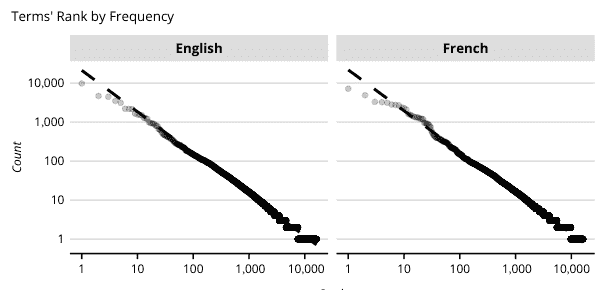

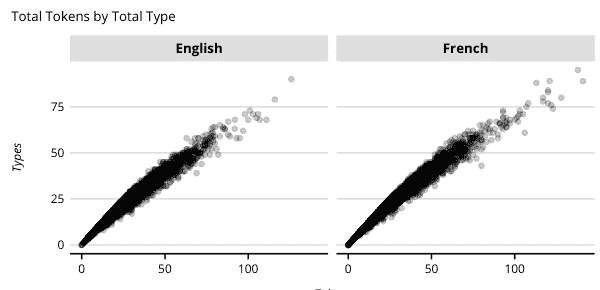

However, there is an established relationship between raw counts of types, on one hand, and the total number of tokens in a collection, on the other. The more total words, the more likely we encounter a new type of word—Herdan-Heaps' Law! Therefore, it is common practice to re-weight the DTM to shift the importance we place on different features of our DTM.

### Relative Term Frequency

The most common DTM weighting scheme is to norm the DTM by dividing these raw counts by the document lengths (i.e., the row sums of our matrix).27 This is extremely common and is often called relative frequency, or rf. To show how, we'll weight our DTM by each document's length. Let's use Europarl again, but this time only use the English sentences.

27 As term frequencies are necessarily vectors of positive integers, this is, in effect, the L1-norm (see Math Basics).

```r
data("corpus_europarl_subset", package = "text2map.corpora")
df_europarl <- corpus_europarl_subset |>
  filter(language == "English") |>
  rowid_to_column(var = "doc_id") |>
  mutate(
    text = tolower(text),
    text = gsub("[[:punct:]]", " ", text),
    text = gsub("[[:digit:]]+", " ", text),
    text = gsub("[[:space:]]+", " ", text)
  )
```

```r
dtm <- df_europarl |> dtm_builder(text, doc_id)
doc_lengths <- rowSums(dtm)
dtm_rf <- dtm / doc_lengths
# inspect our DTM
dim(dtm_rf)
```

Let's grab the first five English sentences and inspect the first five words.

```r
dtm_rf_sub <- dtm_rf[seq_len(5), ]
# keep columns with non-zero values
dtm_rf_sub <- dtm_rf_sub[, colSums(dtm_rf_sub) != 0]
# inspect the first five words
round(dtm_rf_sub[, seq_len(5)], 3)
```

| | resumption | of | the | session | i |
|---|---|---|---|---|---|
| 1 | 0.25 | 0.250 | 0.250 | 0.250 | . |
| 2 | . | 0.028 | 0.083 | 0.028 | 0.056 |
| 3 | . | 0.065 | 0.065 | . | . |
| 4 | . | 0.050 | 0.100 | 0.050 | . |
| 5 | . | 0.100 | 0.125 | . | 0.025 |

The relative frequency DTM is the same dimensions, but the cells are no longer integers. Now they are *proportions*—real numbers that cannot be greater than one or less than zero.28

If a cell has a 1, it would mean that *all the words* in this document are the same word. If a cell had a 0.5, this would mean half of the words in this document are this word. And, if summing all the rows, they each will equal 1 (output in margin).

```r
rowSums(dtm_rf_sub)
```

Below we walk through how to get a relative frequency DTM using a dedicated text analysis package—namely, `quanteda` .

```r
tokens <- tokens(df_europarl$text)
dtm_quanteda <- dfm(tokens)
quanteda_rf_dtm <- dfm_weight(dtm_quanteda, "prop")
```

28 There are two drawbacks to storing our documents in a relative frequency DTM. First, we cannot recover the raw counts unless we retained the document lengths. Second, storing "real values" consumes more memory. In `R`, integers (and logicals) consume 4 bytes, while real values consume 8 bytes.

### Term Frequency/Inverse Document Frequency

Words occurring infrequently within a corpus may still be distinctive for a particular document if it only occurs in that document (or in very few documents). Similarly, Sparck Jones (1972) argued that a word's frequency in a corpus (or **document frequency**) was inversely proportional to its significance. This was because less frequent words referred to more specific ideas. Her work introduced the idea of **inverse document frequency**, or **_idf_**. Roughly, this is the number of documents in a corpus, divided by the total documents in which a term appears. This allows us to identify words that are surprising to find in a document and thus potentially insightful.

We can use this to weight DTM cells by multiplying the term frequency within a document with the inverse of the term's document frequency in the corpus (i.e., **_tf-idf_**). This increases the weight of a word according to the times it occurs in a document _relative to_ its frequency in the corpus. Below is a method to weight our DTM by **_tf-idf_** in base R . <sup>29</sup>

<sup>29</sup> We'll use the base 10 logarithm in our calculation of the **_idf_** scores. This is also of the default in **quanteda** 's **dfm_tfidf()** . Different papers and packages use different bases, though. For example, Salton (Salton 1975:29) uses base 2 in his classic essay on indexing, and so does **tm** .

```r
# we already have term frequencies
# assign it to a new object for clarity
tf <- dtm
# this calculates inverse-document frequencies
idf <- log10(nrow(dtm) / colSums(dtm != 0))
dtmtfidf <- tf * idf
```

Several packages have functions to weight DTMs by **_tf-idf_**—and can be faster. For example, this is how we'd re-weight a matrix using **quanteda** .

```r
dtm_quanteda <- tokens(df_europarl$text) |> dfm()
dtmtfidf <- dfm_tfidf(dtm_quanteda)
```

Let's compare terms with high counts and relative frequencies with those terms that have high **_tf-idf_** scores. For this, let's use the US State of the Union addresses (SOTUs). See Figure 6.2.

We'll subset the DTMs by Richard Nixon's and John F. Kennedy's addresses. We need to divide our DTMs by which documents correspond to which president.

```r
idx_nixon <- text_sotu$President == "Nixon"
idx_kennedy <- text_sotu$President == "Kennedy"

df_nixon <- data.frame(
  tf = colSums(dtm[idx_nixon, ]),
  rf = colSums(dtm_rf[idx_nixon, ]),
  tfidf = colSums(dtmtfidf[idx_nixon, ]),
  President = "Nixon",
  Term = colnames(dtm)
)
```

rf tf tfidf

### Top Terms in Kennedy's Addresses

### Top Terms in Nixon's Addresses

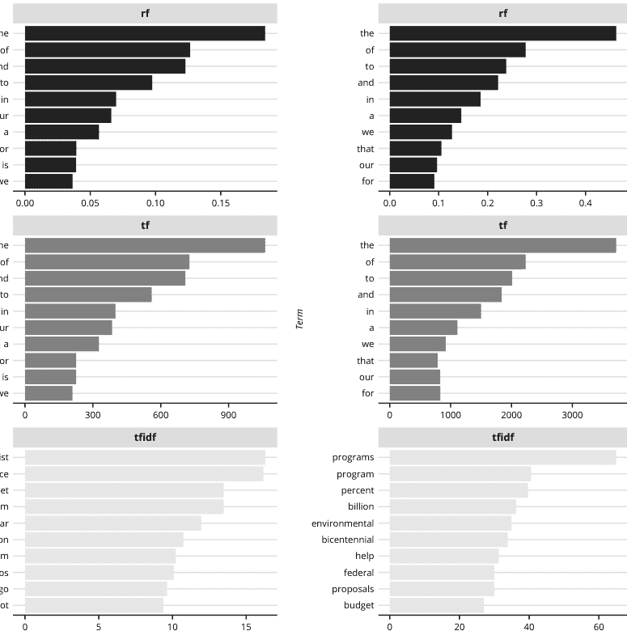

### Figure 6.2: Comparing Term Weightings.

```r
df_kennedy <- data.frame(
  tf = colSums(dtm[idx_kennedy, ]),
  rf = colSums(dtm_rf[idx_kennedy, ]),
  tfidf = colSums(dtmtfidf[idx_kennedy, ]),
  President = "Kennedy",
  Term = colnames(dtm)
)
```


```r
df_plot <- rbind(df_nixon, df_kennedy) |>
  pivot_longer(cols = c("tf", "rf", "tfidf"),
               names_to = "Weight",
               values_to = "Value") |>
  group_by(President, Weight) |>
  slice_max(Value, n = 10)
```

30 ggarrange() 将图表并排打印。

31 查找关键词还有更高级的方法，例如 TextRank 模型（Mihalcea 和 Tarau，2004 年）。

最后，我们将分别为每位总统绘图，并在每个权重变量中选出前十个术语。30 tf-idf 通过选择每位总统最独有的词汇来提供更具信息量的词汇。我们可以将 tf-idf 分数视为文档的 **关键词**——即最能概括该文本目的或内容的一组词汇。31 肯尼迪演讲的 tf-idf 包括“共产主义”和“核”，所有这些都能让我们深入了解他总统任期内的前瞻性担忧。

```r
plot_nixon <- df_plot |>
  filter(President == "Nixon") |>
  mutate(Term = fct_reorder(Term, Value)) |>
  ggplot(aes(x = Term, y = Value, fill = Weight)) +
  geom_col() +
  facet_wrap(~ Weight, scales = "free", ncol = 1) +
  coord_flip() +
  labs(subtitle = "Top Terms in Nixon’s Addresses")
```

```r
plot_kennedy <- df_plot |>
  filter(President == "Kennedy") |>
  mutate(Term = fct_reorder(Term, Value)) |>
  ggplot(aes(x = Term, y = Value, fill = Weight)) +
  geom_col() +
  facet_wrap(~ Weight, scales = "free", ncol = 1) +
  coord_flip() +
  labs(subtitle = "Top Terms in Kennedy’s Addresses")
```

```r
ggarrange(plot_kennedy, plot_nixon, common.legend = TRUE)
```

## 权重方案总结

我们介绍了几种 DTM 类型：术语频率、相对术语频率、二进制以及术语频率/逆文档频率。不过，还有更多的权重方案。几乎所有方案都试图解决词汇非正态分布的问题。虽然我们不会在这里逐一介绍，但表 6.2 包含了我们可以自行探索的其他权重方案。

表 6.2: DTM 权重方案选取

| 权重方案 | 描述 |
|---|---|
| 术语频率 (TF) | 术语在文档中的计数 |
| 相对 TF (RF) | 用 TF 除以文档中的总术语数 |
| 二进制或布尔 | 零单元为 0 (FALSE)；否则为 1 (TRUE) |
| 文档频率 (DF) | 术语出现的文档总数 |
| 逆 DF (IDF) | 总文档数除以 DF 的对数 |
| 相对 DF | 术语的库计数除以术语的 DF |
| TF-IDF | 将 RF 与 IDF 相乘 |
| 点向互信息 (PMI) | TF 除以预期计数的 log2 |
| 正点向互信息 (PPMI) | 与 PMI 相同，但负值设为 0 |

## 术语特征

除了绘制文档中的有意义模式之外，我们通常还希望总结词元的使用方式。广泛地说，我们通过查看词元的 **上下文** 来做到这一点。最简单地，我们可以考虑文本中词元的“分散”或位置（Carpeña et al. 2009; Ortuño et al. 2002）。不仅有些词在语料库中出现频率高得多，而且有些词在文档中的分布也比其他词更均匀。要了解这一点，让我们创建一个“词汇分散”图。

第一步是将给定词元与文档或语料库中的给定位置关联。让我们使用《星际迷航》剧本来看看单词在每集中是如何分散的。

```r
data("corpus_tng_season5", package = "text2map.corpora")
```

让我们挑选出现频率大致相同但分散程度不同的关键词。在此季中，“vulcan”出现 72 次；“every”出现 72 次；“romulan”出现 78 次；“klingon”出现 84 次。

```r
key_words <- c("vulcan", "romulan", "klingon", "every")
df_token_position <- corpus_tng_season5 |>
  unnest_tokens(word, line) |>
  mutate(position = 1:n()) |>
  filter(word %in% key_words)
```

```r
df_token_position |>
ggplot(aes(x = position, y = 1)) +
  geom_segment(aes(xend = position, yend = 0)) +
  facet_grid(word ~ .) +
  labs(y = NULL, x = "Position") +
  theme(panel.grid.major.y = element_blank(),
        axis.ticks.y = element_blank(),
        axis.text.y = element_blank())
```

在图 6.3 中，我们将集中术语（如“klingon”）解释为对节目情节具有重要意义。我们可以看出，在季早期，“vulcan”很重要。

- 本节需要：
  - tidyverse
  - text2map
  - quanteda
  - text2vec
  - tidytext
  - tokenizers
  - Matrix
  - ggraph
  - tidygraph

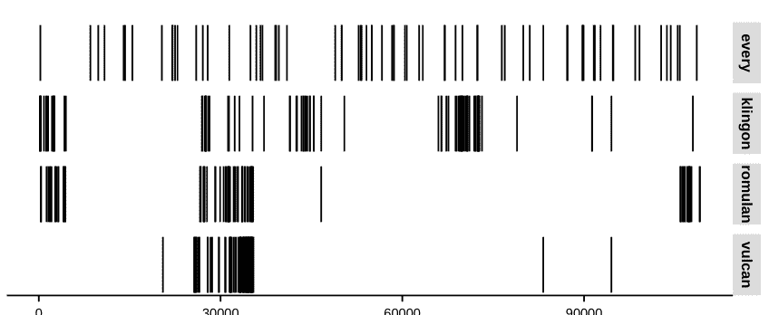

图 6.3: 词汇分散图。

在语料库的文档中，**术语共现矩阵**显示术语在语料库中的使用方式。在此，术语共现矩阵的行是目标词，列是目标术语关联的 **上下文**。在上面的示例中，上下文仅仅是单词在词符串中的位置。我们也可以旋转 DTM 以获得 *术语-文档矩阵*，其中文档是术语的上下文。最后，在术语共现矩阵中，每一行是一个术语 _i_，每一列也是一个术语 _j_，即 _i_ 与之共现的术语。这些都是术语共现矩阵；它们的“上下文”因规模而异——就像在地图上放大和缩小一样。32

32 我们将在《延伸归纳》中为术语共现矩阵增加相当大的复杂性。

术语共现矩阵捕捉两种词 _关联_。首先，我们得到 **合取的** 相似性：两个字面上是一起使用的。其次，我们得到 **范式的** 关联：两个词可以在相似的位置使用，但可能从不共现。

让我们用泰勒·斯威夫特前十张专辑中的歌曲来探索这一点。我们将再次进行最少的预处理（小写，删除标点符号）。

```r
data("corpus_taylor_swift", package = "text2map.corpora")
df_swift <- corpus_taylor_swift |>
  mutate(text = tolower(song$text),
         text = gsub("[:punct:]", " ", text),
         text = trims(text))
```

然后，我们将创建一个 DTM，其中每一行是一首歌曲。

```r
dtm <- dtm_builder(df_swift, text, song_id)
dim(dtm) # 120 songs and a vocab of 3240
```

接下来，我们将转置 DTM，将其倾斜和扭转，使维度翻转。

```r
tdm <- t(dtm) # transpose the dtm to get a tdm
dim(tdm) # A vocab of 3240 and 120 songs
```

在此术语共现矩阵中，总结每个词元的特征是其出现和未出现的歌曲。使用这样的特征矩阵，我们可以通过比较它们的向量（即术语共现矩阵中各自的行）来比较任意两个术语的关联程度。衡量矩阵行之间相似性的方法有很多——例如，Jaccard 指数、欧几里得距离、余弦相似性和 Pearson 相关。在这里，我们将介绍文本分析中最常用的方法：余弦相似性。

余弦相似性将我们术语共现矩阵的行视为表示术语用法及其在抽象度量“空间”中位置的向量。这个空间超过三个维度，因此难以想象，但我们将使用余弦来比较这两个向量之间的“角度”。如果两个向量相似——即它们在相同位置的计数相似——那么它们的角度就会更小。让我们创建自己的余弦相似性函数。

```r
cos_sim <- function(A, B) {
  sum(A * B) / sqrt(sum(A^2) * sum(B^2))
}
```

```r
# get select the rows by word
vec1 <- as.vector(tdm["shake", ])
vec2 <- as.vector(tdm["love", ])
vec3 <- as.vector(tdm["alone", ])
cos_sim(vec1, vec2) # "shake" and "love"
cos_sim(vec2, vec3) # "love" and "alone"
cos_sim(vec3, vec1) # "alone" and "shake"
[1] 0.0006406371
[1] 0.05576185
[1] 0.001531841
```

使用余弦相似性，“1”意味着向量相同。因此，“love”和“alone”比它们与“shake”的相似度更高。请记住，此处的完美相似性意味着两个词在相同的歌曲中出现，并且在相同的歌曲中缺失。这涉及词与词之间的合取关联。

使用矩阵乘法，我们可以将 DTM 投影到术语共现矩阵（术语共现矩阵），显示哪些词在文档（此处为一首歌曲）中与其他词“共现”。首先，我们转置 DTM 以获得术语-文档矩阵（TDM）。其次，我们使用矩阵乘法将我们的矩形矩阵“投影”到两个方形矩阵中的一个。


```r
# we can also create a TCM with the cross product
# column by column (i.e., term by term) matrix
tcm <- crossprod(dtm)

# this creates a document-similarity matrix
# row by row (i.e., document by document) matrix
dsm <- tcrossprod(dtm)
```

我们将要得到的要么是文档-文档相似度矩阵（DSM），要么是词项-词项共现矩阵（TCM）。输出是一个 N×N 的方阵，其中 N 要么是词汇表的大小，要么是语料库中的文档数量。在 TCM 中，特征现在是目标词项在序列中（这里是整首歌曲）倾向于与之共现的上下文词项。现在，余弦相似度将测量词项之间的范式关联。

```r
vec1 <- as.vector(tcm["shake", ])
vec2 <- as.vector(tcm["love", ])
vec3 <- as.vector(tcm["alone", ])

cos_sim(vec1, vec2)
cos_sim(vec2, vec3)
cos_sim(vec3, vec1)
```

[1] 0.4689983  
[1] 0.862345  
[1] 0.5598621  

幅度发生了相当大的变化，但相似度的排名没有改变。“Alone”和“love”仍然是最相似的。

通常，文档太大，无法为每个词项提供有信息量的上下文，或者文档长度变化太大。我们可以通过改变“上下文”的大小来优化 TCM。上下文可以不是整篇文档，而是段落、句子，或某个特定数量词组成的移动窗口（即 skipgram 或 shingle）。

我们将使用 `fcm()`（即特征共现矩阵）为泰勒·斯威夫特的歌曲创建一个上下文窗口为五个词元的 TCM。我们还将包含碧昂丝的歌曲语料库以进行比较。

```r
data("corpus_beyonce", package = "text2map.corpora")
df_beyonce <- corpus_beyonce |>
  mutate(text = tolower(song_text),
         text = gsub("[[:punct:]]", " ", text),
         text = trimws(text))
```

经验法则是，较小的窗口（例如，一到三个词）更偏向“句法”，而较大的窗口（例如，四到十个词的窗口）更偏向“语义”。36 由于我们使用的是歌曲，因此将窗口设为四。

36 语言学家对此有争议（Bybee et al. 1994）。另一种思考差异的方式是将其视为从更具体的含义（语义）到更通用的含义（句法）的光谱（Sweetser 1988）。

```r
tkns_ts <- tokens(df_swift$text)
tkns_be <- tokens(df_beyonce$text)

tcm_ts <- fcm(tkns_ts, context = "window", window = 4L, tri = FALSE)
tcm_be <- fcm(tkns_be, context = "window", window = 4L, tri = FALSE)
```

在语料库语言学中，TCM 形式化了弗思（1957:11）的著名名言“你应当从一个词的伴侣中了解这个词”。如果上下文窗口相对较小，TCM 捕获的一种特殊共现称为 **搭配**。这指的是经常紧挨在一起的词，例如，“fast food”或“european union”。搭配的一个用途是在分词过程中确定我们可能想要保留哪些 *n*-gram。

我们如何衡量两个（或更多）词项在语料库中共现的次数是否 *异常量*？我们计算目标词项与上下文词项共现的概率，*控制*这些词项独立出现的概率。如果对其取自然对数，那么我们就得到了 **点向互信息**（PMI）。37 虽然有相关包可以实现这一点，但让我们一步步构建一个函数（改编自 textvec 的 `coherence()`）。

```r
get_ppmi <- function(tcm, tkns) {
  # how big of context windows did we use
  n_windows <- round(sum(lengths(tkns)) / 4L)
  # small constant to avoid a logarithm of zero
  constant <- 1e-10
  # get overall probabilities
  tcm_pmi <- (tcm / n_windows) + constant
  # get the diagonal: how many times a word occurs at all
  tcm_diag <- diag(tcm_pmi)
  # divide the cells by the diagonal
  tcm_pmi <- tcm_pmi / tcm_diag
  # fix the diagonal and log
  tcm_pmi <- tcm_pmi %*% diag(1 / tcm_diag)
  tcm_pmi <- log(tcm_pmi)

  # convert it to a base R matrix
  tcm_pmi <- as.matrix(tcm_pmi)
  colnames(tcm_pmi) <- rownames(tcm_pmi)
  return(tcm_pmi)
}
```

运行函数后，我们可以使用它来对 TCM 进行加权。

```r
tcm_pmi_ts <- get_ppmi(tcm_ts, tkns_ts)
tcm_pmi_be <- get_ppmi(tcm_be, tkns_be)

# have a look
tcm_pmi_ts[1:3, 1:3]
tcm_pmi_be[1:3, 1:3]
```

| | V1 | V2 | V3 |
|---|---|---|---|
| i | 1.723724 | 16.46247 | 3.281868 |
| blew | 16.462466 | 23.02585 | 20.946410 |
| things | 3.281868 | 20.94641 | 7.306280 |

37 由 PMI 加权的 TCM 是“词嵌入”的基础（Levy and Goldberg 2014）；参见 Extended Inductive。

| | certified | quality | a |
|---|---|---|---|
| certified | 23.02585 | 36.81142 | 16.894625 |
| quality | 36.81142 | 23.02585 | 16.894625 |
| a | 16.89463 | 16.89463 | 3.109061 |

如果两个词项的 PMI 较高，这意味着每当我们看到一个词项，很可能就会在附近看到另一个词项（再次，句法关联）。例如，在碧昂丝的歌曲中，如果我们看到“certified”，很可能也会看到“quality”。让我们只查看泰勒·斯威夫特 TCM 中与“winning”具有最高 PMI 的词项的那一行（输出在页边）。

| | pmi | terms |
|---|---|---|
| 1 | 36.889908 | smile |
| 2 | 36.889908 | ring |
| 3 | 36.889908 | suburban |

```r
df_winning <- data.frame(
  pmi = as.vector(tcm_pmi_ts["winning", ]),
  terms = names(tcm_pmi_ts["winning", ])) |>
  arrange(desc(pmi))
head(df_winning, n = 3)
```

38 当我们查看 "Coney Island" 的歌词时，这得到了验证："...the gift-wrapped suburban dreams.... Sorry for not winning you an arcade ring."

我们可以得出结论，每当在泰勒·斯威夫特的歌曲中看到“winning”，很可能会在附近看到“smile”、“ring”或“suburban”！38

在使用点向互信息对 TCM 进行加权后，让我们再次使用余弦相似度来比较词项（即，获取范式关联）。下面，我们将使用锚定词项“sorry”来比较碧昂丝和泰勒·斯威夫特歌曲中所有共享的词项。下面，我们将对两个 TCM 进行子集化，使它们具有相同的词汇表。

```r
vocab <- intersect(colnames(tcm_pmi_be), colnames(tcm_pmi_ts))
tcm_pmi_be <- tcm_pmi_be[vocab, vocab]
tcm_pmi_ts <- tcm_pmi_ts[vocab, vocab]
```

39 除了 text2vec 中的 sim2() 和 dist2()，我们还可以使用 base R 中的 dist() 来比较行向量。quanteda 也有类似的函数。

我们将使用 text2vec 中的一个更快函数。39

```r
sim_be <- sim2(tcm_pmi_be["sorry", , drop = FALSE],
                 tcm_pmi_be, method = "cosine")
sim_ts <- sim2(tcm_pmi_ts["sorry", , drop = FALSE],
               tcm_pmi_ts, method = "cosine")
df_compare <- data.frame(
  term = rownames(tcm_pmi_be),
  swift = as.vector(sim_be),
  beyonce = as.vector(sim_ts)
)
```

最后，让我们将所有共享词项按其在碧昂丝歌曲和泰勒·斯威夫特歌曲中与“sorry”的余弦相似度进行绘图（图 6.4）。

```r
df_compare |>
  ggplot(aes(x = swift, y = beyonce)) +
  geom_abline(intercept = 0, slope = 1, linetype=2) +
  geom_label(aes(label = term)) +
  labs(x = "Cosine to 'Sorry' in Taylor Swift's Songs",
       y = "Cosine to 'Sorry' in Beyonce's Songs")
```

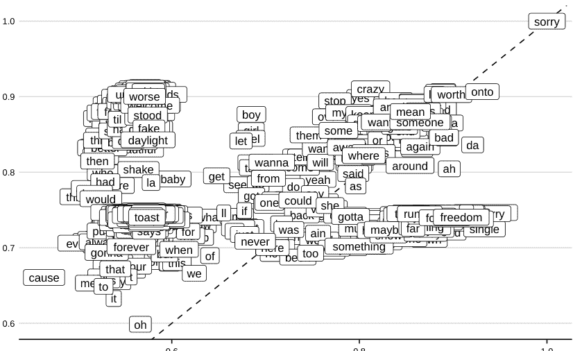

图 6.4：带有 PMI 加权的 TCM 的词项相似度。

我们添加了一条对角线，其中位于其上的词项在碧昂丝的歌曲中与“sorry”更相似，位于其下的词项在泰勒·斯威夫特的歌曲中与“sorry”更相似。“Single”在泰勒·斯威夫特的语料库中更相似，而“fake”在碧昂丝的歌曲中更相似。

不过，当我们看到这个散点图时，最引人注目的是这些词项相当混乱。语言是高维的或特征丰富的。歌曲，如同任何其他文本一样，具有多层含义（Barthes and Duisit 1975）。为了映射这些含义，我们通常*降维*以便于解释。

## 降维

我们用来表示文档和词项特征的矩阵通常是“高维”的。简单来说，这意味着我们的矩阵有很多列。例如，考虑一段短文本中的词项共现：我们之前自动转录的肯尼迪在赖斯大学的演讲摘录。它包含 35 个唯一词项类型。

```r
jfk_text <- c(
"We choose to go to the moon
We choose to go to the moon
We choose to go to the moon in this decade
and do the other things not because they are easy but
because they are hard because they measure the best of
our energies and skills because that challenges one
that we're willing to accept one we are willing to
postpone and one we intend to win"
)
```

为了创建可视化，让我们先按 5-gram 分片分块文本，然后按词边界进行分词，再创建 DTM。最后，我们将像之前一样使用矩阵乘法创建 TCM。我们还将强制函数*不*将文本转换为小写。

```r
jfk_shingles <- tokenize_ngrams(jfk_text,
                                  n = 6L, n_min = 6L,
                                  lowercase = FALSE
                              )
```

```r
dtm <- tokens(unlist(jfk_shingles)) |>
  dfm(tolower = FALSE)
```

```r
tcm <- t(dtm) %*% dtm
```

现在，让我们将我们的词项共现矩阵视为“邻接矩阵”——网络分析中常见的数据结构。40 我们可以将其绘制为网络图，其中词项是节点，连接是词项之间的共现。41 图显示在图 6.5 中。

40 参见 Math Basics 和 Extended Inductive。
41 为此，我们需要专门的包：tidygraph 和 ggraph。

```r
gr <- tcm |>
  as.matrix() |>
  as_tbl_graph(directed = FALSE) |>
  mutate(name = ifelse(name %in% c("We", "we"), 4, 1))

ggraph(gr, layout = "grid") +
  geom_edge_arc(aes(alpha = weight, strength = .04)) +
  geom_node_label(aes(label = name, fontface = "bold")) +
  theme_void() +
  theme(legend.position = "none")
```

即使是这段短文本，我们的图也已近乎混乱。我们稍后将讨论*降维*或*限制特征空间*的策略。然而，其中许多策略并非典型的降维技术，但最好这样理解。例如，当我们不将文本转换为小写时，这相当于告诉我们的脚本将“We”和“we”视为不同的类型，而不是同一类型。如果我们重新运行上面的脚本但允许函数将文本转换为小写，这将减少矩阵的维度。在我们的示例中，DTM 有 36 列。如果我们先转换为小写，则会有 35 列。这似乎不多，但在更大的语料库中，转小写可以显著减少列数。当我们删除这种区别时，信息也会丢失


图 6.5：术语邻接网络。

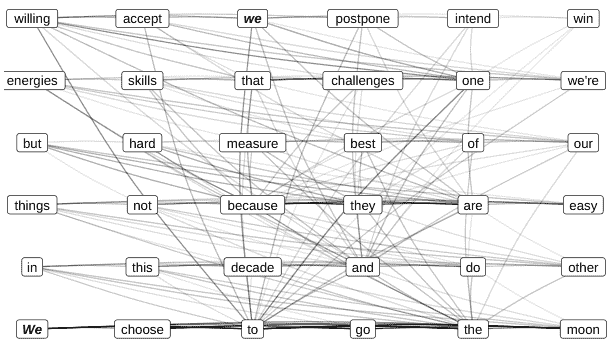

在大小写字母之间。无论这种权衡是否值得，始终取决于研究问题。

还有更多实际原因，我们可能希望降低文本数据的维度：内存和时间。下载庞大的语料库变得越来越简单。例如，维基百科提供特定时间的所有文章“数据转储”42。这有几十GB的数据，数百万个独特词类，以及数十亿个词元。即使表示为稀疏 DTM，这样的语料库也可能超过即使是高端个人电脑的内存容量。另一个考虑因素涉及时间。即使有快速处理器，某些计算也需要很长时间（几天、几周或更久）。并行化，即多个处理器或核心对数据集的不同部分进行计算，是提高速度的一种方法。通过预处理预先降低数据集的维度，也能减少对文本数据进行操作所需的时间。因此，我们经常丢弃信息，并非因为它无用，而是因为否则无法进行分析。

42 dumps.wikimedia.org/backup-index.html

文本分析中的一个总体主题涉及如何在不丢失与我们的问题相关的信息的情况下，减少矩阵的列（即维度或特征）。在分析的每个阶段，至关重要的是要记住，没有我们应该始终使用的降维方法。哪种方法最好，始终与我们希望回答的问题相关：我们打算如何使用文本地图。尽管有这些关键考量，降维始终涉及删除、提取、替换和总结的组合。在下一章中，我们将讨论对子文档单元进行“预处理”，作为一种有价值的降维形式。

# 7

# 词语处理

> 我的拼写是摇晃的。它是好的拼写，但会摇晃，字母会跑错位置
> —小熊维尼

隐喻为我们指明方向。在制图时，我们的目标是简化文本，使其“模式可供共同探索”（Lee and Martin 2014:1）。在我们旅程的这个阶段，我们考虑必须*删除、提取、替换和总结*的内容。这些程序通常涉及在构建文本矩阵或进行更复杂的分析*之前*做出的决定。因此，它通常被称为**预处理**或**清洗**。不过，这些标签有些误导（Rawson and Muñoz 2016）。它们暗示我们的分析尚未开始，研究人员必须始终采取这些步骤，或者有些词是必须清除的“污垢”。正如决定是否包含海拔、道路标签或政治边界是地形制图的一部分一样，归入“预处理”或“清洗”标签下的技术也是分析的一部分——是简化和提纯的形式。我们必须审视每个步骤如何与我们的研究目标相关。

下面我们讨论**文本处理**：系统地更改文本中的字符。实现这一点有两种方法：（1）替换和（2）删除。在两种情况下，我们都使用**规则**和**字典**。规则和字典都依赖于我们文本中*匹配的字符串*。因此，我们处理文本的顺序很重要。这也意味着我们必须考虑可能的*不匹配*。

一个有用的警示故事是，内容审核系统会无意中删除内容。例如，一个在线论坛运营商想要阻止人们使用脏话，于是构建了一个脏话字典。如果任何单词与这个字典匹配，帖子就会被屏蔽。但是，有时脏话的拼写与非脏话相同（即同音词），甚至可能出现在*普通单词内部*。如果我们查找精确匹配，会发现许多误报。这被称为斯肯索普问题。示例包括 Facebook 禁止一名叫卢克·阿努斯的比利时政治候选人，或论坛禁止讨论科克尔猎犬或阿尔弗雷德·希区柯克。这种情况的一种变体，被称为克拉伯提克错误（Clbuttic Mistake），当我们将匹配的单词替换为一个新的、大概不那么脏的词时发生。就像当“assassinate”变成“buttbuttinate”（Moore 2008）。

¹ 规则是一种形式为“如果这样，那么那样”的基本操作，主要涉及正则表达式。

² 字典是一种涉及键值对集合的数据结构，通常包含一个**键**和一个**值**。每个键是唯一的，但可以是任何字符集合。当我们找到键的匹配项时，字典会返回关联的值，该值可以是字符串或数字。

³ 1996年，互联网服务提供商AOL阻止了斯肯索普（以及其他城镇）的居民创建账户，因为该城镇名称包含禁用列表中的一个词。

修改文本的原因包括：（1）修复技术错误和（2）简化我们的文本。第一个解决了文本的人类可读形式和机器可读形式之间的无意错位。例如，在使用自动转录和光学字符识别时，看起来或听起来相似的单词可能会被混淆。或者，在发生编码错误的情况下，文本呈现给人类读者时可能会变成乱码。对于第二种情况，我们可能希望将两个或多个单词形式合并为一个单词。这可能包括删除大写或将拼写错误的单词替换为规范形式。虽然纠正技术错误更恰当地被称为“清洗”，但每当我们简化文本时，我们就在降低语料库的维度。这使得我们的语料库更易于分析和与其他研究人员共享，同时也减少了内存和处理需求。

### 字符编码

最小的子文档单元通常称为字符。这包括，例如，阿拉伯数字；拉丁文、西里尔文、阿拉伯文和姆赫德鲁利文字母表的字母；中文表意文字；天城文等元音附加音节文字；韩文谚文等音素字母；日本假名和切罗基文字等音节文字——以及更多！字符还包括标点符号、数学符号以及一系列“不可打印字符”，例如空格、制表符、换行符和回车符。4 现在，我们要进入技术细节了。

4 “字符”一词源于20世纪50和60年代的早期计算机编程。从功能上讲，它对应于语言学中的字素概念，但并不完全一致（Haralambous and Dürst 2018）。如何最好地分割给定的书写传统是一个正在进行的讨论，受连字和草书的复杂化。此外，书写的许多字形特质，例如字体，并不在字符级别编码。

当我们的文本是数字化时，文本中的每个唯一字符都必须被“编码”——即与唯一的数字序列（即代码）关联。这使得我们的操作系统、浏览器等能够区分每个字符，并将正确的字符输出到用户的屏幕上。也许最著名的字符“编码”是摩尔斯电码，其中独特的短音和长音字符串与英文字母表中的每个字母匹配。

就现代计算而言，最著名的字符编码系统是 ASCII（美国信息交换标准代码），它是在20世纪60年代由几个旨在标准化数据处理的项目开发出来的（Mackenzie 1980）。这些代码代表了英文写作中常用的字符。例如，空格以二进制“010 0000”表示，大写A为“100 0001”。“Latin 1”是另一种常见的编码系统，它扩展了ASCII，并应涵盖大多数使用拉丁文字的语言。

不过，目前最佳的编码遵循Unicode标准，具体为UTF-8。UTF-8的优点是，它是大多数机器和语言环境上的默认编码，并支持比ASCII或Latin 1大得多的字符范围——包括非英语的拉丁文字。

5 要检查系统的语言环境，请在您的 `R` 会话中运行 `Sys.getlocale()` 或 `sessionInfo()`。我们可以使用 `Sys.setlocale()` 设置语言环境。

此外，所有ASCII和Latin 1编码都与UTF-8兼容。然而，反过来则不成立，并可能导致一些奇怪的输出。例如，如果一个字符无法转换为ASCII，该字符通常会被其Unicode等效项“U-码”替换。

让我们通过一个示例来了解。第一个句子有特殊的“弯曲”双引号（称为智能引号）。如果我们使用 `cat()` 打印它，这些引号会被U-码替换，两侧带有尖括号 <>。

```
my_text <- c(‘ Why do you call to my remembrance ’)
Encoding(my_text) <- "UTF-8"
cat(my_text)
```

<U+201C>Why do you call to my remembrance<U+201D>

发生了什么？在 `cat()` 打印之前，幕后正在进行转换：输入一个UTF-8字符串，然后将其转换为语言环境编码，在这里恰好是ASCII。ASCII没有编码弯曲引号的方法。因此，一个表示带有尖括号的U-码的字符串（这些括号确实包含可以用ASCII表示的字符）取代了它们。然后该字符串被重新编码为UTF-8，但U-码现在被视为普通字符。

```
# let’s explicitly reproduce the example:
iconv(my_text, from = "UTF-8", to = "ASCII", sub = "Unicode")
```

更糟的是，当文本使用非预期的字符编码协议进行解码时。它不是替换编码中未表示的字符，而是可能仍然尝试解释字符，从而产生称为 mojibake（mo-ji bah-keh）的乱码。mojibake的一个常见示例是将UTF-8解释为Windows-1252（一种Windows 10之前的拉丁编码系统）。智能的、右侧、双


引号 ” (UTF-8 中为 U+201D)，如果我们尝试使用 Windows-1252 编码，则会呈现为 “（参见表 7.1）。

## 表 7.1: 常见“Mojibake”编码错误

| 预期 | 乱码 | Unicode | 预期 | 乱码 | Unicode |
| :--- | :--- | :--- | :--- | :--- | :--- |
| " | “ | U+201C | ' | ’ | U+2019 |
| " | â€� | U+201D | — | — | U+2014 |
| , | â€~ | U+2018 | ... | â€| | U+2026 |

上述示例充分说明有必要熟悉编码、了解我们语言环境的编码，并在整个流程中保持一致（尽我们所能）。这样做可以减轻语料库中无意的编码错误，降低最终分析乱码的可能性。

## 本节需要：

- stringi
- quanteda
- tidytext
- tidyverse
- textclean
- tokenizers
- gutenbergr
- hunspell

## 标记字符

在浏览器（如 Mozilla Firefox 或 Apple Safari）或字处理器（如 Microsoft Word 或 OpenOffice Writer）中阅读时，文本是“所见即所得”，即 WYSIWYG。我们看到不同的字体和大小，有些单词加粗或斜体，单词被分组成段落或列等。幕后是一系列不打印的字符。相反，浏览器或字处理器将这些字符解释为格式或样式。这些非内容字符通常称为标记。

6 例如，Microsoft Notepad、Linux 上的 gedit，或集成开发环境（如 RStudio 或 VS Code）内置的编辑器。

与字处理器或浏览器不同，纯文本编辑器6 不会解释标记语言。相反，它们的操作方式是“所见即所得所想”，即 WYSIWM。如果我们在纯文本编辑器中打开网页 HTML（超文本标记语言）文件，则会同时看到内容和标记字符。除 HTML 之外，最常见的标记语言还包括 XML、7 LATEX、SGML 和 Markdown。在基本 ASCII 中，有一些我们会经常遇到的标记字符。这些是非打印字符，因为它们定义了打印字符周围的空白格式（参见表 7.2）。

7 Microsoft Word “DOCX” 格式是 XML 文件的压缩存档（ZIP）。我们可以“解压”DOCX 并在纯文本编辑器中打开 XML 文件。

这些标记语言的规则性可以成为文本处理的资源。几个包可以解释标记并将其删除，或利用它将文本转换为特定的数据结构。例如，rvest 中的 html_text() 会删除所有 HTML 标记标签。

## 表 7.2: 常见非打印字符

| 描述 | 字符 |
|---|---|
| Tab | \\t |
| Newline | \\n |
| Carriage return | \\r |
| Space | \\s 包括 \\t \\n \\r |
| Line separator | \\r\\n |
| Horizontal space | \\h |
| Vertical tab | \\v |
| Word boundary | \\b |

我们也可以使用换行标记 \\n 或回车 \\r 编码将长文本分成行和段落。让我们使用肯尼迪赖斯演讲中的一段选段。下面我们将演讲安排为一个长字符串，但在每行后面包含 \\n 以表示换行。

```r
jfk_text <- c({
"we choose to go to the moon\\nwe choose to go to the moon\\n"
we choose to go to the moon in this decade and\ndo the other
things not because they are easy\nbut because they are hard\n"
because they measure the best of our energies and skills\n"
because that challenge is one that we're willing to accept\n"
one we are unwilling to postpone and one we intend to win"
})
```

我们可以通过按换行字符分割，将这个长字符串转换为每行的单独字符串。这将把我们的行结构化为离散的分析单元。

```r
strsplit(jfk_text, split = "\\n")
```

```
[[1]]
 [1] "we choose to go to the moon"
 [2] "we choose to go to the moon"
 [3] "we choose to go to the moon in this decade and"
 [4] "do the other things not because they are easy"
 [5] "but because they are hard"
 [6] "because they measure the best of our energies and skills"
 [7] "because that challenge is one that we're willing to accept"
 [8] "one we are unwilling to postpone and one we intend to win"
```

## 删除和替换字符

用一个相似的替代字符或共享的根字符替换一个字符通常很有用。这将研究人员认为“相同”的标记的两个版本“合并”。与字符编码错误不同，这些不是“更正”。它们是显式的缩减，因此应由我们的研究目标所激励。

我们已经遇到过一个例子：大小写。当然，并非所有语言都有明显的大写（majuscule）和小写（minuscule）字母，但许多语言有。在英语中，我们经常使用大写字母来表示，例如，句子的开头、专有名词、缩写词，或传达愤怒或兴奋——“camelcase”可能传达讽刺。将所有单词小写化或大写化可以确保不同大小写的相同单词仍被视为相同，尽管这也意味着我们丢失了大写所传达的信息。

8 有趣的是，格鲁吉亚语通常不写大小写（称为 Mkhedruli），但有一种仅大写的单独文字（称为 Asomtavruli）。在 1950 年代，一位语言学家曾徒劳地尝试将 Asomtavruli 与 Mkhedruli 混合，分别作为大写和小写（Unicode 2022）。

我们还可能希望将字符从一种文字转换为另一种文字——即音译。例如，使用拉丁文字的语言中带重音字符很常见，如“Raúl”和“Raül”，英语中会将其呈现为“Raul”。然而，取决于分析，我们可能希望将每个名视为等效。为此，我们可以将 u、ũ 或 ū 替换为另外两者之一，以使它们等效。

```r
names <- c("Raul", "Raúl", "Raül")
# how many unique names?
length(unique(names))

names <- gsub("[ü|ū]", "u", names)
# now how many unique names?
length(unique(names))
```

我们可以使用 stringi 来做到这一点，它使用指定从一种语言到另一种语言的广泛语言字典。9

9 stringi 使用来自 ICU (unicode-org.github.io/icu/) 的字典。使用 stri_trans_list() 查看语言转换器的完整列表。

我们将首先从“any”字符集转译到最广泛的拉丁字符范围，然后将此输出转译为仅由 ASCII 中的 128 个“基本拉丁”字符表示的字符。字符不是被 U+代码替换，而是由字典确定的基本拉丁中的最近等价字符替换。

在 UTF-8 中，ASCII 和基本拉丁分别构成第一和第二个 Unicode 块。此集合之外的字符占用更多内存。例如，比较 charToRaw("su") 与 charToRaw("ス")。

```r
in_str <- c("キャンパス", "wyladować", "Дюра", "heiß", "brûlée")
Encoding(in_str) <- "UTF-8"

# compare
stri_trans_general(in_str, id = "Latin-ASCII")
stri_trans_general(in_str, id = "Any-Latin")
```

```
[1] "キャンパス" "wyladowac" "Дюра" "heiss" "brulee"
[1] "kyanpasu" "wyladować" "Doroga" "heiß" "brûlée"
```

要将所有这些正确转译为基本拉丁，请使用：

```r
stri_trans_general(in_str, id = "Any-Latin; Latin-ASCII")
```

```
[1] "kyanpasu" "wyladowac" "Doroga" "heiss" "brulee"
```

我们还可能希望替换一些标点符号，因为 ASCII 只能表示有限的标点范围。表 7.3 显示了基本拉丁中表示的标点。也许最需要替换的常见标点是弯曲的、花体的或智能引号和撇号。它们如此讨厌，以至于 `textclean` 有一个用于替换它们的函数：`replace_curly_quote()`。

在许多情况下，我们会从语料库中删除标点。例如，我们通常希望 "wild." 和 "wild?" 以及 "wild!" 被视为相同的标记 ("wild")。如果不先删除标点，分词器可能会假设它们是不同的类型（取决于我们用来分词的规则）。

## 表 7.3: 标点符号和 Unicode

| 符号 | Unicode | 描述 | 符号 | Unicode | 描述 |
|---|---|---|---|---|---|
| ! | U+0021 | 感叹号 | : | U+003A | 冒号 |
| " | U+0022 | 引号 | ; | U+003B | 分号 |
| # | U+0023 | 数字符号 | < | U+003C | 小于号 |
| $ | U+0024 | 美元符号 | = | U+003D | 等于号 |
| % | U+0025 | 百分号 | > | U+003E | 大于号 |
| & | U+0026 | 和号 | ? | U+003F | 问号 |
| ' | U+0027 | 撇号 | @ | U+0040 | At 符号 |
| ( | U+0028 | 左圆括号 | [ | U+005B | 左方括号 |
| ) | U+0029 | 右圆括号 | \\ | U+005C | 反斜杠 |
| * | U+002A | 星号 | ] | U+005D | 右方括号 |
| + | U+002B | 加号 | ^ | U+005E | 插入符/脱字符 |
| , | U+002C | 逗号 | _ | U+005F | 低线/下划线 |
| - | U+002D | 连字符/减号 | { | U+007B | 左花括号 |
| . | U+002E | 句号/句点 | \| | U+007C | 垂直条 |
| / | U+002F | 正斜杠 | } | U+007D | 右花括号 |
| / | U+002F | 正斜杠 | ~ | U+007E | 波浪号 |

所有这些过程都依赖于 **正则表达式**——无论使用何种编程语言，这都成立。在 R 中，大多数包依赖于基础 R 的字符串匹配函数套件——这些函数基于基于 Unix 的 GREP——此外还有 `stringi` 和 `stringr`，它们是相关的（参见表 7.4）。¹⁰ 删除标点的最简单方法是使用字符类 `[:punct:]`，它匹配所有 ASCII 标点。让我们通过一个示例来演示。

¹⁰ `stringr` 在 `stringi` 之上构建，后者使用 ICU 正则表达式。


## Table 7.4: Basic String Functions

## 表 7.4：基本字符串函数

| Operation | Base R | Stringr |
|---|---|---|
| 操作 | 基础 R | Stringr |
| 提取 | regexpr() + regmatches() | str_extract(), str_match() |
| 检测 | grepl(), grepl() | str_which(), str_detect() |
| 替换 | gsub(), sub() | str_replace(), str_sub() |
| 定位 | gregexpr(), regexpr() | str_locate() |
| 分割 | strsplit() | str_split() |

```
df_punct <- tribble(
  text = c("North America! and South America.",
           "'total bone-saw!'", "$1,000 more.", "'upper_hand's? ",
           "#Cat's", "@Dog's!", "8:30 AM", "AT&T")
)
```

```
gsub("[[:punct:]]", "", df_punct$text) # remove all punctuation
gsub("[[:punct:]]", " ", df_punct$text) # replace with space
```

我们可能希望删除一些标点，但不一定全部删除，至少暂时不要。单词内的标点通常表示一个单一的概念，例如连字符短语或缩写。此外，在字符之间使用下划线表示 n-gram 也很常见，例如，“south_africa。”

```
# remove specific characters
gsub("[!?#]", "", df_punct$text)
# replace with space
gsub("[!?#]", " ", df_punct$text)
```

下一个正则表达式模式将单词之间的标点作为组 \\1 捕获，包括括号内的所有内容，并删除所有其他标点。

```
pattern <- "(\\w+[[:punct:]]+\\w+)|[[:punct:]]+"
gsub(pattern, "\\1", df_punct$text)
```

最后，此模式将单词之间的破折号、下划线、逗号和撇号作为组 \\1 捕获，并删除所有其他标点符号。

```
pattern <- "(\\w+['_-']+\\w+)|[[:punct:]]+"
gsub(pattern, "\\1", df_punct$text)
```

某些分词函数默认会删除标点。其他函数则保留单词内的标点。此外，如果保留单词末尾的标点（如感叹号），它通常被视为一个独立的标记。

```
#stringi
stri_extract_all_words(df_punct$text)

#quanteda
tokens(df_punct$text)
tokens(df_punct$text, remove_punct = FALSE)
tokens(df_punct$text, remove_punct = TRUE, remove_symbols = TRUE)

#tidytext
unnest_tokens(df_punct, word, text)
unnest_tokens(df_punct, word, text, strip_punct = FALSE)

#tokenizers
tokenize_words(df_punct$text)
tokenize_words(df_punct$text, strip_punct = FALSE)
```

最后，还有数字的问题。通常会删除阿拉伯数字（0, 1, 2, 3, 4, 5, 6, 7, 8, 9），与删除所有标点一样，使用基础 R 也很容易。

```
string_numbers <- c("1,000", "4", "40-50 feral hogs",
                    "1st place!", "$20 million",
                    "f1,000", "11/16/1980", "8:30 PM")

# compare two ways to remove all numerals
gsub("[[:digit:]]+", "", string_numbers)
gsub("\\d+", "", string_numbers)
```

删除数字的隐含目的是限制特征空间。

但是，删除的替代方案是将它们替换为字母等价词。可以构建一个字典来匹配每个数字并将其替换为相应的单词，但我们可能希望小心地对序数、日期或时间进行不同处理。幸运的是，textclean 提供了将每个数字替换为其书写等价词的函数。11

11 实际上，这涉及大量花哨的正则表达式。

```
replace_number(string_numbers)
replace_ordinal(string_numbers)
replace_money(string_numbers)
replace_date(string_numbers)
replace_time(string_numbers)
```

除了编码、小写化、音译、标点和数字之外，我们还可能逐个案例地遇到一系列与从 Web 获取的数据特定相关的特殊字符。例如，如果我们从 Twitter 获取文本数据，需要处理话题标签和用户名（例如，#ReadBannedBooks，@levarburton）以及表情符号。如果我们抓取 Web 数据，它通常带有 HTML 标记标签。rvest 提供 html_text()，textclean 有 replace_html() 来删除 HTML 语法，或者我们可以使用带有正则表达式模式的 gsub() 来剥离标记文本。12

12 有关话题标签、账号、URL、表情符号和其他特殊情况的帮助，请参阅 textclean。

## "Misspelled" Words

## "拼写错误"的单词

我们经常会发现“不寻常”的术语。也许它们呈现不正确（例如，OCR 中常见），或者存在编码问题。有时，它们带有字间距（字母之间带空格，“W H Y ?”），或被拉长（“Whyyyyyyy？”），使用不同的地区拼写（例如，color vs. colour），是俚语、无意义单词或流行语，13 或者是故意或无意的“拼写错误”单词。

- 13 “Cowabunga”、“pi-kapika”和“snoochie boochies”可能是臭名昭著的胡言乱语，但它们仍然是单词！

请记住，我们修改文本的部分原因是要在分析之前限制特征空间。问题是，与往常一样，当我们将这些拼写变体归纳为传统形式时，我们丢失了什么信息？

有许多工具用于处理“非标准”单词。textclean 提供试图“修复”字间距和拉长的函数。两者都使用字典和规则的组合。拉长函数查找连续重复至少三次的字符（不区分大小写）。这些单词被替换为其“标准”形式，即只保留第一个连续字母而丢弃其余字母，然后尝试将其与 Google n-gram 数据集中最常见的单词形式匹配。14

- 14 storage.googleapis.com/books/ngrams/books/datasetsv2.html

```
elong <- c("l o o k", "moorley's!", "real coooool!",
           "heeeeere's Johnny!", "Khaaaaaann!", "as",
           "I'm liiiike whyyyyy me?")
replace_word_elongation(elong)
kerned <- c("I'm", "a l l", "O U T", "O F", "B U B B L E G U M")
replace_kern(kerned)
```

- 15 hunspell.github.io/

textclean 还提供处理常见拼写错误的函数。这在后端使用 hunspell——因此我们不妨直接查看这个包。Hunspell15 是多种常见应用（如 Mozilla Firefox 和 Google Chrome）的拼写检查器。与我们讨论过的大多数工具一样，Hunspell 使用规则和字典的组合来识别和处理潜在的拼写错误。首先，该函数按单词将文本分词。然后，它将这些单词分解为“词干”和“词缀”。16 接下来，该函数将词干 + 词缀组合与特定语言的字典进行比较。如果没有匹配项，则该标记被视为潜在的拼写错误。

- 16 我们将在本章后面介绍词干提取。

- 17 这是一个由电子书发明者 Michael Hart 创立的免费电子书在线图书馆。

让我们使用刘易斯·卡罗尔的作品。我们可以使用 gutenbergr 从 Project Gutenberg17 下载它们。输出是一个包含 3,907 行的数据框——每本书每行一行。

```
book_ids <- c(11, 12, 13, 620, 651)
my_mirror <- "http://mirrors.xmission.com/gutenberg/"

carroll <- gutenberg_download(book_ids,
    meta_fields = "title",
    mirror = my_mirror)
```

```
# wrangle the lines a bit
carroll <- carroll |>
    mutate(
        text = replace_curly_quote(text),
        text = replace_contraction(text),
        text = gsub("", "", text),
        text = gsub("[[:punct:]]+", " ", text),
        text = gsub("[[:space:]]+", " ", text),
        text = trimws(text)
    )
```

```
# tokenize, create token-count list
tkens <- tibble(token = tokenize_words(carroll$text) ) |>
    unnest(token) |>
    count(token, sort = TRUE)
```

接下来，我们将每个唯一标记馈送给 `hunspell_check()` 并找出卡罗尔书籍中的“拼写错误”单词。

```
tkens <- tkens |>
    mutate(correct = hunspell_check(token) ) |>
    unnest(correct, keep_empty = TRUE)
```

```
tkens |>
    filter(correct == FALSE) |>
    print(n=30)
```

`hunspell` 将多种类型标记为拼写错误。许多排名靠前的“拼写错误”单词是卡罗尔发明的名称或“无意义”单词（例如，Jabberwock，Bandersnatch）。我们还会发现缩写和公司名称（或其他专有名词）被标记为拼写错误。¹⁸

`hunspell` 还会建议替代拼写——如何做到？首先，它使用常见拼写错误字典（例如，用“a lot”表示“alot”）。其次，它将字符序列与字典中“最接近”的正确序列进行比较。这里，“最接近”是键盘上的最近邻！例如，它会为标记“nide”建议“node”，因为在标准 QWERTY 键盘上，“o”紧挨着“i”。

```
tkens |>
    filter(correct == FALSE) |>
    filter(token != "oo") |> # let's skip this token
    mutate(replacement = hunspell_suggest(token) ) |> 
    unnest(replacement) |>
    print(n=30)
```

这是一种基于**编辑距离**¹⁹ 的比较字符串相似度的算法。对此有许多微小的变体，包括汉明距离、Levenshtein 距离和 Jaro-Winkler 距离。让我们比较我们的

¹⁸ Cupertino 效应是指拼写检查器错误地替换单词，因为它们*不*在其字典中。在 1990 年代，Microsoft Word 会将不带连字符的“cooperation”更改为“Cupertino”（Apple Inc. 的公司总部）。

¹⁹ 编辑距离量化了将一个字符串转换为另一个字符串需要多少次“编辑”——插入、删除、替换。例如，将“water”转换为“wine”需要一次删除和两次替换。


20 除了通过合并拼写相似的单词来降低维度之外，这些字符串相似度度量在处理经过 OCR 的档案记录以及通过基于文本的变量链接不同数据集时尤其有用——请特别参见 RecordLinkage。

将标记的单词与未标记的单词使用 Levenshtein 进行比较，这是 `adist()` 的默认设置。20

```
correct <- tkms[tkms$correct == TRUE, ]
incorrect <- tkms[tkms$correct == FALSE, ]
leven <- adist(x = correct$token, y = incorrect$token,
               ignore.case = FALSE, counts = FALSE)
rownames(leven) <- unlist(correct$token)
colnames(leven) <- unlist(incorrect$token)
```

哪个单词与 Jabberwock 的 "最大" 和 "最小" 距离？

```
which.max(leven[, "Jabberwock"])
which.min(leven[, "Jabberwock"])
```

“编辑距离”比较的一种流行替代方法是 **soundex**，它将字符串转换为语音“soundex”代码。如果两个标记具有相同的 soundex 代码，则成对比较得 1；否则得 0。`stringdist` 提供包括 soundex 在内的几种“编辑距离”度量，而 `ipa` 提供转换为语音字母表以进行比较的工具。

## 本节需要：

- quanteda
- tidytext
- tidyverse
- text2map
- gutenbergr

## 删除单词和停用词表

我们为何要完全从语料库中删除或“停用”单词呢？首先，许多文本来源与自动化内容创建者交互——例如机器人或元数据。如果我们分析电子邮件，邮件中包含一些自动化内容，但我们通常只关心人类生成的内容。例如，考虑对美国九一一恐怖袭击期间发送的寻呼机消息的分析。Back 等人（2010）将每条消息中的单词归入三种情感类别之一：悲伤、焦虑、愤怒。他们发现，与悲伤和焦虑相比，_愤怒_ 加剧了。不幸的是，他们未能捕获一个包含单词“critical”的自动化技术代码（Pury 2011；Back et al. 2011）。如果他们考虑到了这一点，他们就会发现没有证据表明愤怒随时间推移而增加。不过，在某些情况下，我们的研究可能集中于自动化内容，例如机器人如何在社交媒体上传播仇恨言论（Uyheng 和 Carley 2020）。

其次，如果我们拥有的单词类型更少——按定义——我们就拥有更少的维度！删除单词限制了特征空间。第三，删除单词类型可以降低计算需求——希望权衡较小。第四，有时我们想要可视化单词，但单词实在太多了（例如，看起来像一团苍蝇）。同样，我们希望保留最具视觉“信息量”的单词。最后，我们经常删除那些不是 *区分性的* 单词，即那些能够区分一个文档与另一个文档的单词。21

研究人员通常将要删除或“停用”的单词列表编译成一个负面字典或 **停用词表**。这种做法始于信息检索，早期自动化索引优先考虑效率。然而，随着计算资源的改善，[信息检索] 系统的一般趋势……[是从] 标准使用相当大的停用词表（200–300 个术语）到非常小的停用词表（7–12 个术语）再到根本不使用停用词表（Manning et al. 2010:27）。

不存在所谓的“停用词”22——也就是说，在任何语言中，都没有我们在每次分析中*都必须*删除的一组明确同意的单词。哪些单词被“停用”往往是惯例问题——就像威士忌的天使份额一样——并由函数的默认设置强化。这很成问题，因为它掩盖了一个降维步骤。尽管如此，错误名称“停用词”仍然是文本分析中的固定用语。

在深入构建停用词表之前，让我们回顾几种从文本数据中删除单词的方法。该方法取决于我们的数据结构：我们可以直接从 **原始文本**、**标记列表** 或 **标记计数列表** 中删除单词，最后，我们可以从 DTM 中删除单词。让我们再次使用 Carroll 的作品进行演示。

```
book.ids <- c(11, 12, 13, 620, 651)
my_mirror <- "http://mirrors.xmission.com/gutenberg/"
carroll <- gutenberg_download(book.ids,
  meta_fields = "title",
  mirror = my_mirror)
carroll <- carroll |> mutate(text = tolower(text))
```

我们首先将使用 `gsub()` 创建一个删除停用词表单词的新文本列。为此，使用垂直线 `|` 通过 `paste()` 合并停用词表。23 实际上，这告诉 `R`，每当它遇到停用词表中的 *词*1 或 *词*2 一直到 *词*n 时，就将其替换为“无空格”。

```
# create stoplist
list_stop <- c("bandersnatch", "jabberwock")
stop_pattern <- paste(list_stop, collapse = "|")
carroll$text <- gsub(stop_pattern, "", carroll$text,
  ignore.case = TRUE)
```

如果我们有标记列表或标记计数列表呢？如果将它们转换为数据框，我们可以删除与停用词表中单词匹配的任何 *行*。让我们介绍四种基于负面字典中匹配单词删除行的方法。

> 当然，这取决于我们的问题。如果我们的问题涉及区分语料库中文档的主题或概念，我们可能更关注名词或较少出现的单词。不过，如果我们希望比较作者的写作风格，我们则更关注随主题变化不大的单词和语法类别。

> 好歹，“停用词”这一术语是由 Hans Peter Luhn 于 1958 年在引入关键词上下文（KWIC）索引技术时创造的。然而，Barbara Flood（1999）很可能创造了更合适的术语“停用词表”。

> 这是一个逻辑运算符，表示“或”。

首先，使用基础 R，我们将使用 %in% 运算符，它的意思是“包含在 Y 中的每个 X”。这会创建一个与数据框行数相同长度的 TRUE 和 FALSE 元素向量。我们可以使用它来保留每个 TRUE 并删除每个 FALSE。其次，我们将使用 dplyr 的 filter() 同时否定 %in% 运算符。24 第三，我们将使用 dplyr 的 anti_join()。25 第四种也是最后一种方法使用 quanteda 的函数从标记列表中删除单词。

24 当前面带有否定符号 ! 时，它的意思是“每个 X 不包含在 Y 中”。

25 大多数连接函数通过匹配列“合并”两个数据框。这个函数删除所有匹配的行。

```
# create a token-count dataframe
df_tkns <- carroll |>
  select(title, text) |>
  unnest_tokens(word, text) |>
  count(title, word, sort = TRUE)
```

```
# #1 filter with Base R subsetting
idx <- !df_tkns$word %in% list_stop
df_tkns1 <- df_tkns[idx, ]
```

```
# #2 filter with filter()
df_tkns2 <- df_tkns |> filter(!word %in% list_stop)
```

```
# #3 filter with anti_join()
df_stop <- data.frame(word = list_stop)
df_tkns3 <- df_tkns |> anti_join(df_stop, by = "word")
```

```
# #4 removing words from quanteda's token-list
ls_tkns <- tokens(carroll$text)
ls_tkns4 <- tokens_remove(ls_tkns, list_stop)
```

最后，让我们看看如果拥有 DTM 时如何删除单词。这种删除单词的方式很高效，因为我们只需要匹配一次术语，然后从矩阵中删除其对应的列。quanteda 和 text2map 提供从 DTM 中删除列的函数。

```
# create a quanteda dtm
dtm <- tokens(carroll$text) |>
  dfm()
# #5 remove words from a quanteda dtm
dtm <- dfm_remove(dtm, pattern = list_stop)
# #8 remove words from a text2map dtm
dtm <- dtm_stopper(dtm, stop_list = list_stop)
# #9 removing column names not matching our list
dtm <- dtm[ , !colnames(dtm) %in% list_stop]
```

现在我们知道如何删除单词了。我们如何决定删除哪些单词呢？在实践中，有三种策略来识别“停用”候选项。第一种使用频率。大多数单词很少出现（即齐夫定律）。就比例而言，几乎任何长度相近的文档（同一种语言）共享高比例的单词！然而，在许多情况下，我们的研究问题取决于文档之间的差异。例如，Nelson（2021a）询问美国妇女运动组织的著作在第一波和第二波之间如何变化。对于此类问题，我们会


想要增加_区分性_词的中心性。我们可以通过对DTM进行加权，来更强调文档中特有的词（即，_tf-idf_）。或者，我们可以删除_所有文档_中最常见（即，“非_区分性_”）的词。

识别“非_区分性_”词的第二种策略是语法。可能被删除的语法类型包括冠词、介词、连词、指示代词和代词。有时，研究人员会删除属于某一类别的最高频词，或删除某个类别中的所有词。然而，其他时候，这些恰恰是应保留的词。例如，一项（Mosteller and Wallace 1963）关于谁撰写了匿名的_联邦党人文集_的调查，比较了_by_、_from_和_to_的频率，以及三位潜在作者——汉密尔顿、麦迪逊和杰伊的写作样本。或者，我们可能只想保留名词和动词（例如，Mohr et al. 2013）。无论哪种情况，我们都需要将词归类到语法类别中。

最终策略是使用_预编译_的停用词表（至少对于英文而言），这些表在文本分析包中提供（参见表7.5）。最广泛使用的英文停用词表基于20世纪60和70年代的信息检索研究（例如，Van Rijsbergen 1979），后续的停用词表扩展了这些早期列表（Kaur and Buttar 2018）。虽然理论上，早期的停用词表仅包含_高频_词，但正是Fox的“一般文本停用词表”（1989）首次将经验性词频纳入停用词表的生成中。

## 表7.5: 停用词表选集

| 列表 | 年份 | 词数 | 包 |
|---|---|---|---|
| van Rijsbergen | 1979 | 250 | text2map |
| Fox | 1990 | 421 | text2map |
| SMART | 1993 | 571 | stopwords , text2map |
| ONIX | 2000 | 198 | text2map |
| Snowball | 2001 | 127 | text2map |
| Snowball | 2014 | 175 | stopwords , text2map |
| NLTK | 2009 | 179 | stopwords , text2map |
| Jockers | 2013 | 5902 | lexicon |
| Loughran-McDonald | 2015 | 570 | lexicon |
| Marimo | 2020 | 237 | stopwords , text2map |
| Tiny | 2020 | 33 | text2map |

> 26 删除出现频率极低的词也是常见做法。这将大幅减少我们的词汇量，从而降低分析的计算需求。请回顾，词汇量的四分之一或更多只出现一次！

> 27 参见“给词打标签”。

> 28 Martin Porter的Snowball词干提取器（1980）中使用的**Snowball停用词表**（原始2001版或2014版）是大多数包的默认英文停用词表。NLTK包和CoreNLP停用词表是在Snowball列表基础上构建的。Snowball停用词表反过来基于van Rijsbergen的250词**Van停用词表**。**SMART停用词表**是另一种基于SMART检索系统（Salton 1981）的常见负面词典。

> 29 Fox使用了Brown语料库（Kučera and Francis 1967）。

这些预编译列表各不相同，例如，列表是否包含词的所有形式，或是基于频率和语法考虑构建的。不幸的是，文档很难找到。更糟糕的是，出版物通常只说明“已删除停用词”，而不明确指出删除的是*哪些*词。在选择从数据中删除词时，我们应始终谨慎行事，因为这可能会显著影响我们的发现。

我们构建了一个名为“tiny”（在`text2map`中）的最小停用词表，旨在仅删除任何体裁中最高频的词元。我们首先在几个大型语料库中选取前20个词：Brown语料库、Google Books 1 Trillion Word语料库以及Wikipedia（截至2019年）。我们包含的唯一动词是“to be”，它包含8种不同形式（“be”、“is”、“are”、“was”、“am”、“were”、“being”和“been”）。我们省略了否定形式和缩写形式。我们包含单数和复数代词，但不包含带有性别或所有格的代词。生成的停用词表包含33个词元。这是一个轻量级且有文档记录的替代频率方案。

总之，词基于其（1）频率、（2）语法类别，或使用（3）预编译停用词表进行删减。删除词是为了帮助可视化、加速计算过程和去除冗余信息。然而，此类过程可能无法帮助我们理解文本，甚至可能限制某些分析技术（Schofield et al. 2017）。在决定删除词时，我们必须始终牢记研究目标。作为最佳实践，我们应该测试删除词如何塑造我们的发现，并在与社区分享这些发现时记录删除的是哪些词。

### 本部分需要：
- textstem
- tidyverse
- stringi
- tidytext
- text2map
- proustr
- udpipe
- textclean
- text2vec

> 30 例如，要识别新闻媒体机构，CBS引用的条目可能是“CBS”；那么我们就不想“删除”大写，因为“CBS”会变成“cbs”。

## 替换词

在前几节中，我们删除了或替换了*字符*（例如，删除标点符号或多余空格），并删除了整个词元（例如，使用停用词表）。我们在什么情况下可能想要*替换词*？

首先，我们通常不想这样做。如果使用词典，修改词形会阻碍匹配。或者，如果我们要计数不同的词性，我们会希望保持词的原样。“Running”、“runs”和“ran”都是基础词“run”的屈折形式。如果研究人员需要区分这些屈折形式——例如，识别谁*将参选*政治公职，谁*正在参选*公职，以及谁*参选了*公职——同样，词应该保持原样。

我们是否对“run”、“running”、“runs”和“ran”之间的差异持无所谓态度，只希望识别对“走得比走路快”这一行为（Merriam-Webster 2020）的引用？或者，我们是否不在意“boat”是名词，“boated”是动词，而“boating”可以是名词或动词，只关心关于航行的一般讨论？如果是后者，我们可以通过对词元进行*词干提取*或*词形还原*，大幅降低数据的维度。让我们先讨论词干提取。

## 词干提取

**词干提取**是将词缩减为其“词干”或“词根”的过程——即，不带*词缀*的“核心”字符序列。自动词干提取程序使用基于规则或词典的函数，为文本或语料库中的每个词返回一个或多个这样的词干。

考虑以下词：“roll”、“rolls”、“rolling”和“rolled” 让我们逐个处理每个词，将基本形式与词缀（具体来说，是后缀）分开：

- roll
- roll - s
- roll - ing
- roll - ed

**Roll**是词干；它是添加后缀以指示复数（-s）、进行时（-ing）和过去时（-ed）的基础。这些都是*屈折后缀*的示例：用于更改词的语法特征（如数或时态），但不改变词的词性或含义的后缀。

现在考虑词**roller**：旋转的人（或事物）。我们也可以将此词分解为其词干和后缀：

- roll - er

这是一个*派生后缀*：它创造一个名词（如果将“roll”及其屈折视为动词），或另一种类型的名词（如果将“roll”及其屈折视为名词）。英语中所有*前缀*也是派生性的，因为它们改变了基础词的语法类别和/或含义，例如*un-roll*。

词干提取算法试图将术语缩减为常见形式：例如，“roll”。两个流行的词干提取器是“Porter”和“Porter2”词干提取器。这些词干提取器主要处理屈折词缀而非派生词缀，并且都专注于后缀。Porter词干提取器使用一个基于规则的系统，该系统最初在Martin Porter的一篇1980年论文中概述（Porter, et al. 1980），用于剥离（主要是）屈折后缀。Porter2词干提取器——也称为“英文词干提取器”——是原始Porter算法的修订版，但以同样的方式运作（Porter et al.

> 31 社会科学家可能更关心词干，而语言学家可能发现词缀更有用，例如，用于研究构词法。

> 32 作为本科生，计算语言学家Julie Beth Lovins发表了第一篇（1968年）系统比较潜在词干提取算法的论文，讨论了开发词干提取器的关键挑战，并还提出了Lovins词干提取器。


2002)。两个词干提取器都在 Snowball 中实现——Snowball 是一种用于在多种人类语言中实现词干提取器的编程语言（Porter 2001）。

我们可以使用 Porter2 算法对整篇文档进行词干提取。请参考以下由 Durkheim（1895）的《社会学方法准则》中的行组成的语料库。

```r
docs <- c(
  "society is not the mere sum of individuals",
  "the system formed by their association",
  "it is from this combination that social life arises",
  "individuals give birth to a being"
)
```

我们将使用 stem_strings()。该函数对每个字符串（即每份文档）进行分词，对每个词元进行词干提取，然后将提取词干的词元粘合在一起。我们将设置 language = "english"，表示我们要使用 Porter2。

```r
stem_strings(docs, language = "english")
```

这将返回以下内容：

```
[1] "societi is not the mere sum of individu'u"
[2] "the system form by their associ"
[3] "it is from this combin that social life aris"
[4] "individu give birth to a be"
```

词干提取并不总能达到我们想要的效果。有时词干提取过于激进。例如，“Universities”会被提取为“Univ.”。另一个词“Universes”也会提取为“Univ.”。很可能我们不在乎这两个词都源自拉丁语中“整体”的含义，并且不希望这些词在我们的 DTM 中等同。我们可以通过转向另一种形式的单词规范化——词形还原——来解决此类问题。

## 词形还原

与（基于规则的）词干提取涉及去词缀不同，词形还原是一种基于词典的方法，它将单词的屈折形式映射到其标准形式、“头字”或“词元”（Crystal 2011:273）：“一种抽象表示，涵盖所有可能适用的……词汇变体。”

请再次考虑“roll”及其屈折变体：“rolls”、“rolling”和“rolled”。词形还原以每个单词作为输入，并返回“roll”作为输出。但达到目的的途径不同。词干提取使用一系列“如果-那么”规则为每个屈折形式返回“roll”——例如，如果一个单词以 -ing 结尾，则删除该后缀。在最简单的情况下，词形还原使用词典查找来查找与该标记匹配的词头。

在“rolls”和“rolling”等词中，返回的词头和词干相同：“roll”。但现在考虑“continue”、“continues”和“continuing”这些词。这些词的每个词干均为“continu”。如果我们使用词典查找对这些词进行词形还原，则每个词的词头都将是“continue”。我们已经看到词形还原相对于词干提取的一个潜在好处：词形还原总是返回一个常规单词。例如，“universities”被词形还原为“university”，“universes”变为“universe”。

考虑动词时态需要不同单词的情况。动词“be”根据时态可构成“being”（进行时）、“was”/“were”（过去时）、“been”（过去分词）或“am”/“are”/“is”（现在时）。除“being”和“been”外，没有一个词干提取为“be”。然而，词形还原只要求这些变位形式（作为标记）与一个共同的词头“关联”。在我们的情况中，它对所有这些变位形式均返回“be”。

词形还原相对于词干提取的一个优势是，它可以规范不规则动词（即不使用标准后缀规则进行变位的单词）。假设我们想要对“break”、“breaks”、“broke”和“broken”进行词形还原。虽然 Porter2 词干提取会将“break”和“breaks”规范化为“break”，但它不会对“broke”和“broken”进行规范化——它们分别词干提取为“broke”和“broken”。词形还原为每个词返回相同的词头：“break”。这很可能是我们想要的。

让我们使用 lemmatize_words() 对“be”及其其他动词形式进行词形还原。这涉及八个不同的单词，因此我们将首先将单词转储到字符向量中，然后使用管道传递此函数。

```r
data("hash_lemmas", package = "lexicon")
c("be", "being", "was", "were", "been", "am", "are", "is") |>
lemmatize_words(dictionary = hash_lemmas)
```

如我们所见，此过程为每个词返回词头“be”。这就是我们预期看到的结果。

请注意，我们指定的是词典而非词干提取语言。lexicon 包含许多用于文本分析的词典。此处感兴趣的词典称为 hash_lemmas。33 textstem 还提供根据 Hunspell 和 TreeTagger（Schmid 2013）词典创建语料库特定词典的功能。

33 这使用 Michal Měchura 的英语词形还原词典：github.com/michmech/lemmatization-lists

| 标记 | 词头 |
|------|------|
| 'm | be |
| am | be |
| are | be |
| arst | be |
| been | be |
| being | be |
| is | be |
| m | be |
| was | be |
| wass | be |
| were | be |

34 这在应用词形还原器之前使用 `split_tokens()` 进行分词。该函数首先删除所有大写形式，并区分与单词紧贴的单词和标点符号。在使用不执行这些操作的分词器或词形还原器时，请注意。

35 相关地，词形还原不替换缩写形式；为此，我们可以使用 `replace_contraction()`。

`lemmatize_words()` 使用查找过程将标记与其词头匹配，然后用该词头替换该标记。让我们查找 Měchura 词典中与“be”词头相关的各种标记（参见页旁注释）。

```r
filter(hash_lemmas, lemma == "be")
```

所有这些标记都被词形还原为相同的词头——这正是我们想要的！现在让我们使用 `lemmatize_strings()` 对 Durkheim（1895）节选中的整篇文档进行词形还原。34

```r
lemmatize_strings(docs, dictionary = hash_lemmas)
```

```
[1] "society be not the mere sum of individual"
[2] "the system form by their association"
[3] "it be from this combination that social life arise"
[4] "individual give birth to a be"
```

让我们使用 *星际迷航：下一代* 语料库，将词形还原融入我们刚才讨论的数据处理工作流中。

```r
data("corpus_tng_season5", package = "text2map.corpora")
df_trek <- corpus_tng_season5 |
  filter(!is.na(line)) |
  select(number, title, airdate, character, line)
```

```r
df_trek <- df_trek |
  mutate(
    lemma = tolower(line),
    lemma = gsub("[[:digit:]]+", " ", lemma),
    lemma = lemmatize_strings(lemma, dictionary = hash_lemmas),
    lemma = gsub("[[:punct:]]+", " ", lemma),
    lemma = gsub("[[:space:]]+", " ", lemma),
    lemma = trimws(lemma)
  )
```

现在我们看看词形还原后第 17 行的样子：

```r
df_trek$lemma[17]
```

```
"captain s log startdate we have arrive at starbase
two thirty four where i have take the opportunity
to make a proposal to fleet admiral shanthi"
```

除了词形还原，我们还删除了大写形式、数字、标点符号和多余空格。与词干提取不同，词形还原不会自动删除 -'s（表示所有格）——例如，“captain’s”中的 -'s。`gsub()` 删除了_所有_标点符号，并用空格替换。

这里有多种方法可以避免得到 "captain s"。我们可以保留单词字符之间的所有标点符号，删除所有 -'s 实例，或删除仅包含一个字符的标记。35

使用我们预处理并词形还原后的行，让我们创建一个 DTM 并从 Snowball 停用词表中删除单词。

```r
dtm <- df_trek |> mutate(doc_id = rownames(df_trek)) |> dtm_builder(lemma, doc_id) |> dtm_stoplist(stop_list = stoplist("snowball2014"))
```

查看我们 DTM 的前几列。

```r
dtm[1:5, 1:7]
```

| | aft | shield | buckle | transfer | auxiliary | power | go |
|---|---|---|---|---|---|---|---|
| 1 | 1 | 1 | . | . | . | . | . |
| 2 | . | 1 | 1 | 1 | 1 | 1 | . |
| 3 | 1 | 1 | . | . | . | . | 1 |
| 4 | . | . | . | . | . | . | . |
| 5 | . | . | . | . | . | . | . |

词典查找方法有一个局限性：如何处理同形异义？考虑单词“saw”。这个词可能是过去式动词（“我看到一架飞机飞过。”），表示“切割”的动词（“我不得不把木板锯成两半。”），或者是名词（“我不得不为项目买一把锯。”）。理想情况下，词形还原器可以区分同形异义词。为此，某些词形还原器会用预测的词性“标记”每个标记。36 标记的词头根据该标记的词性分配。

TreeTagger 模型就是这样做的（Schmid 2013）。我们也可以使用 udpipe。我们将在下一章关于非英语词性标记的内容中更多地讨论 udpipe；但目前，我们将使用这个包快速说明带有词性的词形还原。首先，我们将下载一个英语语言模型37，该模型允许我们标记词性，然后使用这些标签分配词头。

```r
eng <- udpipe_download_model(language = "english-gum")
ud_eng <- udpipe_load_model(eng$file_model)
```

现在让我们进行一些标记。我们将首先使用“saw”同形异义问题创建一个小语料库。然后我们将使用 udpipe_annotate() 对文档进行标记并分配词头。

```r
docs <- c(
  "I saw an airplane,",
  "I had to saw the wood",
  "I have a saw for work"
)
udpipe_annotate(x = docs, object = ud_eng) |>
  as.data.frame() |>
  select(doc_id, token, lemma, upos)
```

我们将得到以下输出（此处仅打印文档 ID、标记、词头和词性标签）。

| 文档 ID | 标记 | 词头 | 词性 |
|--------|------|------|------|
| doc1 | I | I | PRON |
| doc1 | saw | see | VERB |


3 doc1 an a DET
4 doc1 airplane airplane NOUN
5 doc1 I I PRON
6 doc1 had have VERB
7 doc2 to to PART
8 doc2 saw saw VERB
9 doc2 the the DET
10 doc2 wood wood NOUN
11 doc3 I I PRON
12 doc3 have have VERB
13 doc3 a a DET
14 doc3 saw saw NOUN
15 doc3 for for ADP
16 doc3 work work NOUN

第一个“saw”实例被标记为动词并词形还原为“see”。第二个“saw”实例也被标记为动词，但词形还原为“saw”。最后一个“saw”被标记为名词并保持不变。这使我们能够区分同形异义词，这对于某些研究问题可能很重要。38

38 例如，如果我们在探索19世纪美国定居者日记中“工作”的含义，我们将希望区分农民是劳作播种小麦，还是母猪在分娩（labor）时产下小猪。

我们可以按照以下方式将udpipe的词形还原方法纳入工作流。为了速度，我们只使用星际迷航语料库的前20行。使用`as_tibble()`整理输出并配合`count()`，我们将创建一个标记-计数“三元列表”数据框。请注意，我们还会过滤掉任何与`[[:punct:]]+`匹配的词元的行（输出在页边栏）。

```
df_samp <- df_trek |>
  head(n = 20) |>
  mutate(lemma = tolower(line),
         lemma = gsub("[[:digit:]]+", " ", lemma))
```

```
df_trip <- udpipe_annotate(
  x = df_samp$lemma,
  object = ud_eng
) |>
  as_tibble() |>
  select(doc_id, lemma) |>
  filter(!grepl("[[:punct:]]+", lemma)) |>
  count(doc_id, lemma)
```

| doc_id | lemma | n |
|---|---|---|
| doc1 | aft | 1 |
| doc1 | buckl | 1 |
| doc1 | shield | 1 |
| doc10 | command | 1 |
| doc10 | course | 1 |
| doc10 | enter | 1 |
| doc10 | five | 2 |
| doc10 | mark | 1 |
| doc10 | my | 1 |
| doc10 | on | 1 |

然后我们可以使用tidytext将这个三元列表转换为DTM，但将`term = word`替换为`term = lemma`（因为“word”列被称为“lemma”而非“word”）。

```
dtm <- df_trip |>
  cast_dfm(
    document = doc_id,
    term = lemma,
    value = n
  )

dtm[1:3, 1:7]
```

| docs | aft | buckl | shield | command | course | enter | five |
|---|---|---|---|---|---|---|---|
| doc1 | 1 | 1 | 1 | 1 | 0 | 0 | 0 |
| doc10 | 0 | 0 | 0 | 1 | 1 | 1 | 2 |
| doc11 | 0 | 0 | 1 | 0 | 0 | 0 | 0 |

有了这个最后的DTM，我们更有把握同形异义词已被准确词形还原。

## 法语中的词形还原

udpipe可以对多种不同语言进行词形还原。39 让我们使用proustr包中的语料库，对普鲁斯特的《在斯万家那边》（Du côté de chez Swann）中的一些段落进行词形还原，proustr是一本收录了19世纪末至20世纪初法国小说家马塞尔·普鲁斯特七部作品的包。让我们来看一个段落。

39 目前，udpipe拥有65个语言模型。要查看可用模型，请运行`help(udpipe_download_model)`

```
data("ducotedechezswann", package = "proustr")
ducotedechezswann$text[60]
```

接下来，我们需要下载一个法语模型。

```
fre <- udpipe_download_model(language = "french-gsd")
ud_fre <- udpipe_load_model(fre$file_model)
```

现在，我们可以对文本进行词形还原。我们选择第60段。

```
ducotedechezswann$text[60] |> udpipe_annotate(object = ud_fre) |> as_tibble() |> select(doc_id, token, lemma, upos)
```

> —Françoise, imaginez-vous que Mme Goupil est passée plus d’un quart d’heure en retard pour aller chercher sa sœur ; pour peu qu’elle s’attarde sur son chemin cela ne me surprendrait point qu’elle arrive après l’élévation.”

```
doc_id token lemma upos
1 doc1 — PUNCT
2 doc1 Françoise Françoise PROPN
3 doc1 , , PUNCT
4 doc1 imaginer, imaginer VERB
5 doc1 -vous vous PRON
..
..
..
40 doc1 elle il PRON
41 doc1 arrive arriver VERB
42 doc1 après après ADP
43 doc1 l' le DET
44 doc1 élévation élévation NOUN
45 doc1 . . PUNCT
```

## 数据整理工作流

表7.6列出了一些常见的文本整理决策。此外，下面是一个我们可能使用的典型文本准备脚本概述。这些步骤并非总是应该采取；相反，我们将对这些脚本进行变体处理，测试不同决策对分析的影响。此外，无论我们是否采取这些步骤，都应在最终分析中予以报告——这作为最低要求。

### 表 7.6：常见文本整理决策

| 步骤 | 说明 |
| :--- | :--- |
| 标点符号 | 移除和保留哪些标点符号？ |
| 音译 | 是否将某些字符替换为等效字符？ |
| 数字 | 是否移除所有数字？是否替换？ |
| 小写转换 | 是否将所有标记转为小写？是否保留某些？ |
| 停用词 | 是否移除了标记（停用词）？哪些词？ |
| 词干提取 | 是否对标记进行词干提取？如何提取？ |
| 词形还原 | 是否对标记进行词形还原？如何还原？ |

通常，我们不希望任何单一决策导致研究结果发生剧烈变化；如果发生，我们需要理论化解释这可能是为什么。

使用`mutate()`，我们可以通过用`#`将一行“注释掉”来删除任务。例如，如果我们想要删除所有数字，而不是将其替换为书写形式，我们可以注释掉所有五个`replace_*`行，并取消注释匹配`[[:digit:]]+`正则模式的`gsub()`。

```
df_text <- df_text |> mutate(
  ## transliterate and lowercase
  text = stri_trans_general(
    text,
    id = "Any-Latin;Latin-ASCII"
  ),
  text = tolower(text),
  ## punctuation
  text = replace_curly_quote(text),
  text = gsub("[\\W+_-]+[\\w+]|[[:punct:]]+", "\\1", text),
  text = replace_contraction(text),
  text = gsub("[[:punct:]]+", " ", text),
  ## numbers
  # text = replace_number(text),
  # text = replace_ordinal(text),
  # text = replace_money(text),
  # text = replace_date(text),
  # text = replace_time(text),
  text = gsub("[[:digit:]]+", " ", text),
  ## spaces
  text = gsub("[[:space:]]+", " ", text),
  text = trimws(text)
)
```

关于我们提出的更专门的问题，例如话题标签、编码问题、拼写错误等呢？我们只有在认为这些问题存在时才需要运行这些处理。我们如何知道它们是否存在？如果我们通过阅读一些文档来深入了解文档，就会发现语料库的特殊性。另一个有用的工具由`textclean`提供，名为`check_text`，它检查二十三种可能的问题。

以这里讨论的方式修改文本，与我们稍后将讨论的更高级技术一样，很大程度上关乎维度缩减。每个步骤都可能限制我们用来表示文档的“特征空间”：两个拼写相似或由字典或规则关联的标记会被合并为一种类型。这并非微不足道的过程。

正如制图师决定省略地貌特征一样，是否应删除或修改单词或字符是一种由目的所指导的分析决策——这一决策最终必须与我们的研究目标相关联进行证明。幸运的是，在许多情况下，我们可以通过系统地调整这些决策来重复分析，比较每个决策对最终解释的影响（例如，Denny and Spirling 2018；Lucchesi et al. 2022）。

## 词性标注

> > ...all the familiar landmarks of thought—our thought, the thought that hears the stamp of our age and our geography—breaking up all the ordered surfaces and all the planes with which we are accustomed to tame the wild profusion of existing things...
> > —M. Foucault

博尔赫斯出自《慈仁天界知识百科》的臭名昭著的（半开玩笑的）动物分类法，体现了我们在社会科学中经常遇到的一个观念：分类是不可靠的。意识到这种不可靠性，导致了福柯的“当他读到博尔赫斯的这段话时，那种粉碎了他所有熟悉思想地标的大笑”（福柯，2005年）。

- 防腐处理过的动物
- 哺乳的小猪
- 流浪狗
- 传说中的动物
- 被包含在此分类中的动物

尽管我们对世界的感知存在规律性（Lakoff 2008），但对任何事物进行离散且完整的分类是不可能的（Douglas 1966）。我们的许多工具都包含我们并非为语料库量身定制，而是强加给语料库的分类方案。当我们对文本进行分类时，我们通常依赖于某人的解释，这种解释是情境化的，并且可以修订。1

1 这也是为什么我们需要仔细记录分析决策——参见项目工作流。

分类器是基于文本模式将文本与标签相关联的自动化过程。标签之间的边界通常是模糊且分级的。但这并非文本分析特有。池塘和湖泊是“被陆地包围的水体”，区别在于一个更大、更深或更冷。大多少、深多少或冷多少？没有精确的答案。

使用“准确性”和“性能”来描述分类器的效度是常见的。然而，正如我们在本书中将看到的，分类器是与某人的解释进行比较的。因此，更恰当的做法是将我们的工具与其他意义基准（包括我们自己的判断）之间的一致性视为衡量标准。

2 例如，亚马逊产品评论集合中的某条评论是“好评”还是“差评”。参见延展推理。

文档分类器告诉我们一段文本（作为一个整体）是否属于预定义的类别。2 以下我们介绍子文档分类器，即标注器。标注器与定性内容分析有许多共同之处，因为相对较短的文本片段被“编码”为某个类别或主题的实例，且每个文档可能包含多个标签。

3 在老子的名言“千里之行，始于足下”中，`thousand`是`miles`的形容词修饰语，因此在句子的句法结构中“依赖于它”。

标注本身可以是一种分析方法——例如，寻找句子中单词或短语之间3的“依赖关系”以

识别语义动机（Stuhler 2022b）或主语-动作-宾语语法（Franzosi 2004）。或者，研究人员可能会使用标记器来进一步预处理文本（例如，识别每个词的词性），以供后续分析，或使用标记来提取有用的变量（例如，命名的人或组织）。那么，目标是使用基于规则和字典的方法，将单词（或其他子文档单元）“标记”为不同的语言类型或有意义的类别。在基于规则的方法中，语义和句法特征决定目标单元如何被标记。在基于字典的方法中，单元与键（可以是字面字符或正则表达式模式）匹配，并赋予关联的值。

## 字典标记

让我们从一个简单的例子开始（从计算角度至少是简单的）：标记代词、头衔和名称的“性别”。这种方法依赖于字典，这是一种具有**键**（这里，一个唯一的名、头衔或代词）和**值**（这里，与该名、头衔或代词相关的性别类别）的数据结构。让我们通过构建字典来创建一个简单的代词标记器（请参阅页边中的输出）。

```r
# basic gender - tagging dictionary
fem_pronouns <- c("she", "her", "hers")
mas_pronouns <- c("he", "him", "his")

gender <- data.frame(
  word = c(fem_pronouns, mas_pronouns),
  gender = c(rep("feminine", 3), rep("masculine", 3))
)
gender
```

让我们在 CMU 政治博客语料库（Eisenstein 和 Xing 2010）的 100 篇帖子样本上测试此字典。

```r
data("corpus_cmu_blogs100", package = "text2map.corpora")

# let's unnest by token and join our tagger by "word"
corpus_cmu_blogs100 |>
  unnest_tokens(word, text) |>
  left_join(gender, by = "word") |>
  count(gender)
```

我们还有一个略大一些的性别标记器，tiny_gender_tagger()（在 text2map 中），它使用相同的基于字典的方法，但包括更多代词以及头衔（母亲、父亲、先生、夫人等）。

让我们比较一下。

```r
corpus_cmu_blogs100 |>
  unnest_tokens(word, text) |>
  left_join(tiny_gender_tagger(), by = "word") |>
  count(gender)
```

- 本节需要：
  - tidytext
  - tidyverse
  - text2map
  - gender
  - genderdata
  - stringi

| 词 | 性别 |
|------|--------|
| she | 女性 |
| her | 女性 |
| hers | 女性 |
| he | 男性 |
| him | 男性 |
| his | 男性 |

| 性别 | n |
|------|----|
| 1 女性 | 117 |
| 2 男性 | 532 |
| 3 <NA> | 46817 |

| 性别 | n |
|------|----|
| 1 女性 | 184 |
| 2 男性 | 668 |
| 3 <NA> | 46614 |

除了在文本中显式计数带有性别的代词和头衔外，研究人员通常还希望推断文本中命名个人或文本作者的性别。为此，我们可以将数据库（例如美国社会保障管理局的数据库）视为字典。

要看到这一点，我们将使用包含 2020 年《社会学年度评论》的数据集，其中包含 70 位作者。数据集中的每一行都是一位作者；因此，合著者与相同的标题、摘要等相关联。首先，我们只获取每位作者的名。我们将使用 `gsub()` 配合正则表达式模式来提取第一个空格之前的任何内容，并使用 `mutate()` 将名作为新列添加。我们将使用的包还要求名为小写，因此我们将使用 `tolower()`。

```r
data("corpus_annual_review", package = "text2map.corpora")
df_ars <- corpus_annual_review |>
  mutate(fname = gsub("^(.*)\\s.*", "\\1", authors),
         fname = tolower(fname))
unique(df_ars$fname)
```

| [1] | "samuel" | "claude" | "nora" | "jennifer" | "achim" |
|------|----------|----------|--------|------------|---------|
| [6] | "tom" | "danielle" | "christopher" | "fabian" | "paula" |
| [11] | "nora" | "peter" | "michael" | "thomas" | "rachel" |
| [16] | "cameron" | "edward" | "raina" | "matthew" | "adam" |
| [21] | "geneviève" | "anna" | "dorothy" | "oliver" | "lauren" |
| [26] | "nicole" | "shannon" | "nina" | "steven" | "juliet" |
| [31] | "todd" | "cynthia" | "kimberly" | "santiago" | "john" |
| [36] | "brooke" | "leonard" | "arvid" | "leslie" | "neal" |
| [41] | "kenneth" | "todd" | "christine" | "stefanie" | "frédérique" |
| [46] | "sarah" | "damon" | "eric" | "kumiko" | "jacqueline" |
| [51] | "joshua" | "melinda" | "felix" | "stefan" | "rebecca" |
| [56] | "abdoulmalik" | "kathleen" | "erin" | "alyssa" | "liang" |
| [61] | "malcolm" | "liz" | "mariana" | "ethan" | "mary" |
| [66] | "carlos" | | | | |

共有 70 位作者，但有些人共享名，因此得到 66 个唯一名。接下来，让我们加载一个专门用于将名与性别关联的包。该包还需要下载其他数据集。但首先，来自包作者的重要警告（Mullen 2021:2）：

- 1. 你的分析和报告方式应考虑到这种方法的局限性，这些局限性包括其依赖于国家创建的数据以及无法超越国家强加的性别二元论。至少，请务必阅读我们解释该方法局限性的文章，以及下方引用的批判此类方法论的综述文章。
- 2. 不要使用此包来研究个人：它最多仅适用于在总体层面研究人群。
- 3. 只有在替代方案不是一种更细致且可辩护的研究性别的方法，而是根本不研究性别时，才诉诸这种方法。例如，对于许多历史来源，这种方法可能是了解人口性别比例的唯一方式。但问问自己是否真的需要使用这种方法，是否负责任地使用它，或者是否可以使用更好的方法。

该包依赖历史记录将名与性别匹配（但在州记录中通常是出生时被指定的性别）。正如作者所警告的，由于这些数据库通常将性别记录为二元，因此它忽略了大部分性别光谱，包括非二元性别个体。作者提供了几个可用作字典的历史记录数据集。⁴

```r
data("ssa_national", package = "genderdata")
# let's have a quick look
names <- c("Irving", "myrna")
ssa_national |>
  filter(name %in% names) |
  filter(year == 1915)
```

| 名称 | 年份 | 女性 | 男性 |
|------|------|--------|------|
| irving | 1915 | 5 | 1385 |
| myrna | 1915 | 128 | 0 |

Blevins 和 Mullen 指出，“[该]算法计算给定出生年份或年份范围内某个名字的男性或女性使用比例。因此，它不仅可以提供对名字性别的预测，还可以提供该预测准确性的度量”（Blevins 和 Mullen 2015）。因此，“准确性”是指在数据库中某个名字专属地与“男性”或“女性”关联的程度。

性别标记数据集中的名称列全为小写，这就是为什么我们将名转换为小写（因为这是我们字典中的键）。尽管 gender() 允许我们限制使用的数据集和年份，但我们在此跳过该步骤。该函数输出一个数据集，包含每个名及另外五列。

```r
df_tagged <- unique(df_ars$fname) |> gender()
nrow(df_tagged)
```

我们的新数据集只有 62 行，因此仅包含 62 个带有性别标记的名。但是，我们的 70 位作者有 66 个唯一名！差异的原因是某些作者的名与我们的性别标记数据集中的任何“键”都不匹配。一个原因与英语中非标准字母有关。⁵ 让我们使用 stri_trans_general() 对这些字母进行音译，看看是否有所改进。

⁴ 如果 install.packages() 无法安装 genderdata，请尝试从 ropensci GitHub 仓库安装。

⁵ 例如，“Geneviève”和“Frédéric”——请回顾我们之前关于音译的讨论。

```r
df_tagged <- df_ars |>
  mutate(fname = stri_trans_general(
    fname, "Any-Latin; Latin-ASCII"
  ))

df_tagged <- unique(df_tagged$fname) |> gender()
nrow(df_tagged)
```

我们现在有 66 个中的 64 个。我们要么接受某些名没有匹配项，要么手动标记这些名。让我们通过在两个数据集中匹配名来“连接”这两个数据集。现在，让我们比较女性和男性作者（并务必包括根本未标记的名）。我们将使用“华夫饼”图，但首先我们将生成汇总表。

```r
df_ars <- left_join(df_ars, df_tagged, by = c("fname" = "name"))
df_ars <- df_ars |>
  count(gender) |>
  mutate(gender = replace_na(gender, "missing"))
```

⁶ 代码改编自 Parker（2011）。

现在，我们可以创建华夫饼图。⁶ 首先，我们创建一个 7 行 10 列的网格，足以容纳每个数据点（70 位作者）。接下来，我们按相对单元格计数的比例应用性别标签。现在我们已准备好制作图表，如图 8.1 所示。

```r
waffle_grid <- expand.grid(y = 1:7, x = seq_len(sum(df_ars$n) / 7))
waffle_grid$cell <- rep(df_ars$gender, df_ars$n)

waffle_grid |>
  ggplot(aes(x = x, y = y, fill = cell)) +
  geom_tile(color = "white") +
  theme(axis.ticks = element_blank(), axis.line = element_blank(),
        axis.text = element_blank(), panel.grid = element_blank()) +
  labs(title = "Authors' Predicted Gender", x = NULL, y = NULL)
```

### 作者的预测性别

■ 女性   ■ 男性   □ 缺失

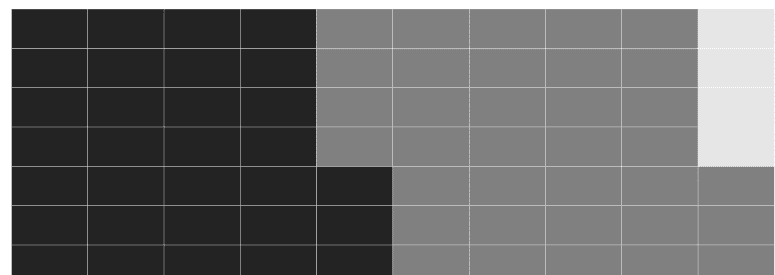

图 8.1：2020 年《社会学年度评论》中的作者。


在美国，美国社会学协会（2021 年）的会员构成在 2020 年为：女性占 53.9%，男性占 44.2%，跨性别或非二元性别者占 1.9%。但是，在 *社会学年度评论* 本卷中，被归类为“女性”和“男性”的作者较少，这表明男性社会学家在主要出版物中可能被过度代表。不过，借鉴**语料库构建**中的经验教训，我们也必须考虑到，*社会学年度评论* 并非典型的学术期刊，因为其作者是受邀撰写的。

现在，假设我们有数万篇文章和数万名作者。考虑到潜在的测量误差，自动化性别标记可能是唯一可行的选择。即便如此，我们也要牢记 Mullen 等人的谨慎提示，并在与社区分享研究结果时务必讨论这些局限性。

## 命名实体识别

有时我们需要知道语料库中的文本在讨论谁或什么。如果我们对自己的文本了解甚多——或者想要查找特定实体的提及——那么或许可以构建一个由实体名称组成的自定义词典，并利用它来识别每篇文本提及这些实体的频率。例如，共和党总统在他们的国情咨文（SOTU）演讲中（反之亦然）提及民主党的频率有多高？我们只需统计国情咨文提及这两个特定两字词组的次数即可。

如果我们对语料库中的文本可能提及的人或组织了解甚少，那么可以使用**命名实体识别（NER）**。NER 标注器输入文本文档，并返回文本中找到的“实体”：例如，人名、组织、地点和日期等。NER 对信息提取问题很有用，也有助于构建词典，因为它可以用来识别语料库中被引用最频繁的人、地、事物等。

命名实体识别在社会科学中的应用日益广泛。我们（Stoltz 和 Taylor，2017）使用 NER 来识别报纸数据中的抗议事件，并在事件内嵌套新闻报道的基础上运行多层模型。Mohr 等人（2013）使用 NER 来定位美国国家安全战略文件中的主要地缘政治行为体。Van de Rijt 等人（2013）在 Lydia 文本分析系统中使用 NER 来模拟报纸中的名人更替，Shor 等人（2015）则使用同一系统来研究媒体报道中随时间变化的性别差距。7

- 本部分需要：
  - tidyverse
  - entity
  - tidytext

> 7 有关 NER 在社会科学中应用的更多示例，请参见 Shor 等人（2014）和 Traag 等人（2015）。有关将 NER 用作进一步分析的预处理策略的讨论，请参见 D'Orazio 等人（2014:230–231）。

接下来，我们将首先从总体上介绍 NER 的工作原理，随后演示如何在 R 中进行 NER 标注。

## 命名实体识别的工作原理

请考虑以下文本（改编自 Mack 2019）。经过正确优化的 NER 标注器应当返回这些“命名实体”及其所属的实体标签，如下所示：

> 《星际迷航：皮卡德》于 2020 年 1 月 [日期/时间] 在 CBS [组织] All Access 上首播，派屈克·斯图尔特 [人物] 再次扮演这位高贵领导者的角色，此举是在《星际迷航：下一代》结束 20 多年之后。新剧预告片显示，皮卡德已在地球 [地点] 的一个葡萄园里退休，但感到格格不入，渴望太空旅行。

在这个例子中，有四种实体标注器，分别用于识别人名、组织名称、日期/时间和地点。这些是常见的实体标签，但具体标签会因所使用的 NER 标注器而异。entity 还提供金额和百分比的标注器。斯坦福 NLP 团队的 CoreNLP 库附带更多标签，包括国籍、宗教，甚至死因（Manning 等人，2014）。

NER 算法“学习”识别实体标签的方式各不相同。它们都依赖训练数据。这些训练数据是已由人类（或一组人类）标注好的句子。例如，“人名”标注器的训练数据大致如下：8

8 训练数据格式必须与所使用的软件匹配。对于 OpenNLP 库，每行必须包含一个带注释的句子（Apache，2020）。

```
The CEO of Apple, <START:person> Tim Cook <END>, unveiled the new iPhone. Mr. <START:person> Cook <END> was joined on the stage by Chief Operating Officer, <START:person> Jeff Williams <END>.
```

训练文件需要包含至少 15,000 个以行分隔的带注释句子（Apache，2020）。

因此，训练文档按句子解析，以换行符分隔，名称是手动标注的。随后，模型会遍历预设的上下文变量——即所谓的“特征集”（Apache，2020）。9 部分上下文变量可能包括：该词是否大写？该词是否紧随“先生”、“女士”或“博士”等头衔之后？

9 NER 模型通常具有预设的上下文变量，但我们可以提供自定义特征集。

10 OpenNLP NER 工具为此使用广义迭代梯度法。

该算法利用带标签词与上下文变量之间的共现关系，为每个变量开发一个权重，以指示该变量与某个类别（这里是“是人”或“不是人”）之间关联的强度。任何 NER 模型的输出都是权重——即每个上下文变量的“重要性”。10

训练好的 NER 模型随后可用于预测新的、未标注文本中的实体类别。11 我们将使用的 NER 模型是**预训练**的。因此，不需要带注释的训练数据。OpenNLP NER 模型似乎是在12 对 318 篇 *华尔街日报* 文章上训练而成，这些文章构成了第六次信息理解会议（MUC-6）的一系列 NLP 评估任务的训练集（Nouvel 等人，2016:61）。

11 在 OpenNLP 中，这是通过最大熵（“maxent”）建模完成的。

12 OpenNLP 的训练数据很难确定。我们从 Joern Kottmann 2010 年在 OpenNLP SourceForge 仓库上的一个讨论帖子中找到了 MUC-6 数据。

## R 中的命名实体

我们将用于命名实体识别的软件包是 entity。13 它是 Apache 软件基金会维护的基于 Java 的 OpenNLP 库的 R “封装器”。14 让我们使用 *星际迷航：皮卡德* 段落作为快速示例（输出在旁注中）：

```
para <- "Star Trek: Picard, which debuted in January 2020 on CBS All Access, saw Patrick Stewart reprise his role as the noble leader more than 20 years after Star Trek: Next Generation ended. The trailer for the new show showed Picard retired at a vineyard on Earth, but feeling out of place and longing for space travel."

person_entity(para)
organization_entity(para)
location_entity(para)
date_entity(para)
```

所有实体均已被识别并正确标记。

让我们使用卡内基梅隆大学政治博客语料库（Eisenstein 和 Xing，2010）中的更大示例进行讲解。这六个政治博客的文章于 2008 年收集。三个来源偏向自由派（*Digby*、*ThinkProgress* 和 *Talking Points Memo*），另外三个是保守派媒体（*American Thinker*、*Hot Air* 和 Michelle Malkin 的博客）。

13 如果 entity 无法从 CRAN 下载，请尝试从维护者的 GitHub 安装：trinker/entity。

14 我们的机器上还需要安装 Java。

```
[1] "Patrick Stewart"
[1] "CBS"
[1] "Earth"
[1] "January 2020"
```

我们将使用 100 篇博客文章的随机样本。将其读入 R 时，我们还会将其分配给一个名称较短的对象以节省空间，但这并非必需。让我们来看一篇较短文章的片段，该文章来自 *Hot Air*：15

15 我们未能找到这篇博客文章的原始作者。

```
data("corpus_cmu_blogs100", package = "textmap.corpora")
blogs <- corpus_cmu_blogs100 # rename it so it's tidier
blogs$text[[46]]
```

[1] "约翰·爱德华兹因与丽埃勒的婚外情在这次党代会上遭到民主党人冷落


亨特与亨特本人、亨特以及安德鲁·扬之间阴暗的金融联系…

当我们在完整的博客文章上使用 person_entity() 时，它返回如下内容：

```
person_entity(blogs$text[[46]])
[[1]]
[1] "John Edwards" "Hunter"
[3] "Andrew Young" "Fred Baron"
[5] "Hunter" "Baron"
[7] "John Edwards" "Chuck Schumer"
```

让我们一次对多个文档进行标记。我们首先按政治倾向——“自由派”与“保守派”——对博客进行子集划分，并且只提取“text”列。

```
text_lib <- blogs |>
filter(rating == "Liberal") |>
select(text)

text_con <- blogs |>
filter(rating == "Conservative") |>
select(text)
```

我们将分别将 person_entity 标注器应用于这两个文本向量。

```
ppl_lib <- person_entity(text_lib)
ppl_con <- person_entity(text_con)
```

下面，我们将使用 table() 统计每个唯一名称出现的次数。然后将数据框限制为仅包含出现至少两次的名称。最后，我们将按出现次数对 entity 变量进行排序。

```
ppl_lib <- table(ppl_lib, dnn = "entity") |>
data.frame() |>
mutate(lean = "Liberal")

ppl_con <- table(ppl_con, dnn = "entity") |>
data.frame() |>
mutate(lean = "Conservative")

df_ppl <- rbind(ppl_lib, ppl_con)

df_ppl <- df_ppl |>
filter(Freq >= 3) |>
mutate(entity = reorder_within(entity, by = Freq, within = lean))
```

现在，我们可以制作条形图，展示自由派和保守派博客中被提及至少三次的人物（图 8.2）。

```
df_ppl |>
ggplot(aes(x = entity, y = Freq, fill = lean)) +
geom_col() +
labs(x = "People", y = "Count") +
facet_wrap(~lean, scales = "free_y") +
coord_flip() +
scale_x_reordered()
```

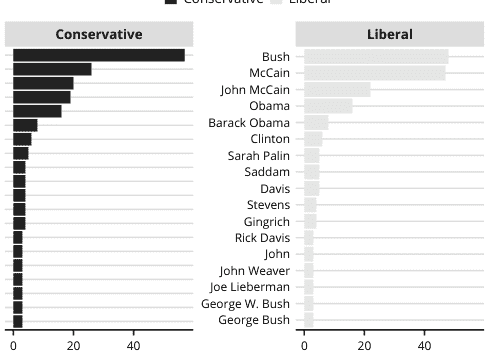

图 8.2：按政治倾向划分的博客中提到的人物。

组织机构呢？分别重用来自保守派和自由派博客的两个文本向量。对每个向量应用组织机构标注器。

```
org_lib <- organization_entity(text_lib)
org_con <- organization_entity(text_con)
```

我们还将像之前一样准备绘图数据框，并且只包含出现至少三次的命名组织机构。这些图表展示了自由派和保守派博客中被提及至少三次的组织机构（图 8.3）。

```
org_lib <- table(org_lib, dnn = "entity") |> data.frame() |> mutate(lean = "Liberal")
org_con <- table(org_con, dnn = "entity") |> data.frame() |> mutate(lean = "Conservative")
df_org <- rbind(org_lib, org_con)
df_org <- df_org |> filter(Freq >= 3) |> mutate(entity = reorder_within(entity, by = Freq, within = lean, ))
```

```
df_org |> ggplot(aes(x = entity, y = Freq, fill = lean)) + geom_col() + labs(x = "Organizations", y = "Count") + facet_wrap(~lean, scales = "free_y") +
coord_flip() +
scale_x_reordered()
```

图 8.3：按政治倾向划分的博客中提到的组织机构。

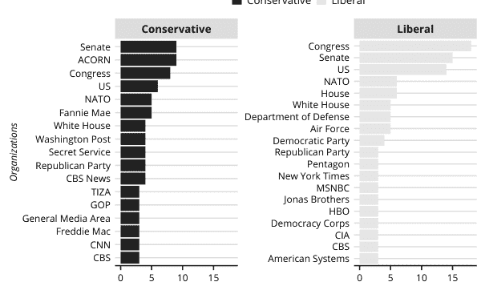

## 本节需要：

- termco
- coreNLPsetup
- tagger
- gmodels
- udpipe
- tidytext
- reticulate
- spacyr

16 如前所述，一些分词技术需要词性标注（Attia 2007; Farghaly and Shalaan 2009）。

## 词性标注与依存句法分析

许多方法依赖于文档的“词袋”表示（即，文档-术语矩阵 DTM）。这类模型背后的假设是，除了词共现的某种度量之外，文档内单词的顺序并不重要。同样，在“词袋”方法中，文档的句法结构（即语法）也不重要。

然而，研究者可能需要了解一些语法知识——例如，Klebanov 等人（2008）在分析撒切尔夫人修辞风格时，使用了她在1977年保守党大会上的演讲，对动词、名词、形容词、副词和专有名词进行了编码。Graesser 等人（2006）使用词性来识别调查问题中的复杂句法。Diemeier 等人（2012:44）在美国国会演讲中使用词性来消除词义歧义，并预测参议员的意识形态定位（例如，taxing 作为动词能预测保守派言论，但 tax 作为名词则不能）。除了使用词性之外，这些研究还有另一个共同点：它们都使用了自动词性标注器来完成这一任务。词性标注（POS）**标注**按其预测的词性对文档中的每个单词进行分类：例如，单词是名词、动词、副词、介词等等。

同样，这可以通过词典来实现——例如，每当出现 /the/ 时，我们就用词性“冠词”对其进行标记。我们也可以添加一条涉及上下文的规则：例如，跟在 /the/ 后面的任何单词都是“名词”。最后，我们可以在已标记的文本上训练一个概率模型。通常，词性标注会结合上述方法，研究人员使用预训练模型，并通过规则和词典对其进行改进。

## 词性标注的工作原理

用于词性标注的模型、规则和词典在语法类别的细粒度上有所不同。例如，斯坦福 NLP 小组的词性标注器识别九个不同的类别：形容词、副词、连词、限定词、名词、数词、介词、代词和动词。相比之下，基于宾树库 17 标注方案训练的模型包含 48 个标签，详见表 8.1（改编自 Taylor et al. 2003:8）。

再考虑一下《星际迷航：皮卡德》示例段落。阅读它以快速了解不同的词义：在第一个句子中，“Star Trek: Picard”是名词，“debuted”是动词，“in”是介词，“2020”是数字。18

下面演示中使用的包，tagger ——一个类似于 entity 的 Java-based OpenNLP 库的 R 封装器——是使用宾树库（Taylor et al. 2003）训练来对英语词性进行标记的。19 词性标签是树库中的标准标注。

与其 NER 对应物一样，OpenNLP 词性标注器使用最大熵模型来预测适当的宾树库标签。研究人员可以提供自己的带注释训练数据，但下面我们将依赖预训练的 OpenNLP 词性模型。

## R 中的词性标注

为了展示如何获取词性计数，我们将使用 tagger。20 再考虑一下《星际迷航：皮卡德》段落。让我们将其传递给 tag_pos()：

```
para <- "Star Trek: Picard, which debuted in January 2020 on CBS All Access, saw Patrick Stewart reprise his role as the noble leader More than 20 years after Star Trek: Next Generation ended. The trailer for the new show showed Picard retired at a vineyard on Earth, but feeling out of place and longing for space travel."
tag_pos(para)
```

> 17 树库是一个语料库，其中的单词已被标注以捕获不同的语言学元素。
> 18 词性标注是一种词义“消歧”形式。
> 19 宾树库是一个包含 700 万个带词性标注单词的语料库，这些词来自“IBM 计算机手册、护理记录、华尔街日报文章和转录的电话对话等”（Taylor et al. 2003:5）。
> 20 与 entity 一样，我们可能需要从 GitHub 安装它：trinker/tagger。我们还必须从 trinker/ 安装 termco 和 coreNLPsetup。

## 表 8.1：宾树库词性标签

| 标签 | 描述 | 标签 | 描述 |
|---|---|---|---|
| CC | 协调连词 | TO | 不定式 to |
| CD | 基数词 | UH | 感叹词 |
| DT | 限定词 | VB | 动词，原形 |
| EX | 存在句 there | VBD | 动词，过去式 |
| FW | 外来词 | VBG | 动词，现在分词/动名词 |
| IN | 介词 | VBN | 动词，过去分词 |
| JJ | 形容词 | VBP | 动词，非第三人称单数现在时 |
| JJR | 形容词，比较级 | VBZ | 动词，第三人称单数现在时 |
| JJS | 形容词，最高级 | WDT | Wh-限定词 |
| LS | 列表项标记 | WP | Wh-代词 |
| MD | 情态动词 | WP$ | 所有格 Wh-代词 |
| NN | 名词，单数或不可数 | WRB | Wh-副词 |
| NNS | 名词，复数 | # | 英磅符号 |
| NNP | 专有名词，单数 | $ | 美元符号 |
| NNPS | 专有名词，复数 | . | 句末标点 |
| PDT | 限定词前限定语 | , | 逗号 |
| POS | 所有格词尾 | : | 冒号，分号 |
| PRP | 人称代词 | ( | 左括号字符 |
| PP$ | 物主代词 | ) | 右括号字符 |
| RB | 副词 | `` | 直引号 |
| RBR | 副词，比较级 | , | 左侧单引号 |
| RBS | 副词，最高级 | “ | 左侧双引号 |
| RP | 小词 | ” | 右侧单引号 |
| SYM | 符号 | ” | 右侧双引号 |

```
"Star/NNP Trek/NNP :/ Picard/NNP /,/ which/WDT
dubbed/VBD in/IN January/NNP 2020/CD on/IN
CBS/NNP All/DT Access/NNP /,/ saw/VBD Patrick/NNP
Stewart/NNP reprise/NN his/PRP$ role/NN as/IN
the/DT noble/JJ leader/NN more/JJR than/IN 20/CD
years/NNS after/IN Star/NNP Trek/NNP..."
```

21 虽然 “All


让我们回到 CMU 政治博客语料库中随机抽取的 100 篇博客文章的样本。我们将再次按政治意识形态对整个样本进行标记，以分离数据：

```r
data("corpus_cmu_blogs100", package = "textmap.corpora")
blogs <- corpus_cmu_blogs100 # rename so it's tidier

text_lib <- blogs |> filter(rating == "Liberal")
text_con <- blogs |> filter(rating == "Conservative")

pos_lib <- tag_pos(text_lib$text)
pos_con <- tag_pos(text_con$text)
```

输出是一个嵌套列表。我们需要先用 `table()` 统计每个唯一标签，然后将这些数据整理成数据框。

```r
df_lib <- names(pos_lib[[1]]) |>
  table(dnn = "pos") |>
  data.frame() |>
  mutate(lean = "Liberal")

df_con <- names(pos_con[[1]]) |>
  table(dnn = "pos") |>
  data.frame() |>
  mutate(lean = "Conservative")

df_pos <- rbind(df_lib, df_con)

df_pos <- df_pos |>
  filter(Freq >= 2) |>
  mutate(pos = reorder_within(pos, by = Freq, within = lean))
```

现在我们来绘制图表（参见图 8.4）。

```r
df_pos |>
  ggplot(aes(x = pos, y = Freq, fill = lean)) +
  geom_col() +
  labs(x = "Parts of Speech",
       y = "Proportion of Total Words") +
  facet_wrap(~lean, scales = "free_y") +
  coord_flip() +
  scale_x_reordered()
```

除语言学之外，这些精细的语法映射可能并不有用——例如，最高级形容词和比较级形容词之间的区别。我们可以使用两个函数 `as_universal()` 和 `as_basic()` 来简化标签集。`as_universal()` 将标签转换为“通用”标签集——即或多或少在许多语言中通用的标签集（Petrov et al. 2011）。该标签集将 48 个宾州树库标签22 减少到 12 个标签：名词、动词、形容词、副词、代词、限定词/冠词、介词/后置词、数字、连词、助词、“.”（表示所有标点符号）和“X”（表示未识别的词义）（Petrov et al. 2011:2）。`as_basic` 返回一个更简单的标签集，包含名词、动词、形容词、副词、介词、感叹词、冠词、连词和代词（“.”和“X”的作用与通用标签集中相同）。

22 标记器似乎使用 46 个宾州树库标签。`penn_tags()` 不包括英镑符号 (#)、开头的单引号 (‘) 或结尾的单引号 (’)。但是，使用该包仍可成功标记英镑符号；单引号将被标记为其双引号对应符 (“ 和 ”)。

## 图 8.4：宾州词性标注

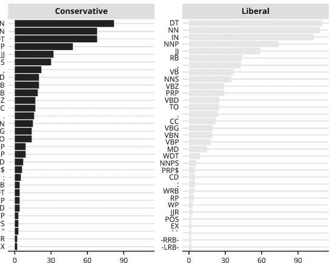

这里我们将专注于最基本的标签集。

```r
pos_lib <- pos_lib |> as_basic()
pos_con <- pos_con |> as_basic()
```

让我们看看保守派博客文章的片段，以了解这个新标签集的样子。我们可以通过高亮并运行对象名称 pos_con 来做到这一点。

```r
pos_con
```

- 1. In/preposition the/article "forgotten/adjective war/noun "/. that/pronoun is/verb ...
- 2. A/article poll/noun of/preposition 12,000/adjective citizens/noun in/preposition ...
- .
- .
- 1. Oprah/noun Winfrey/noun and/conjunction her/pronoun TV/noun staff/noun are/verb ...
- 2. Intrepid/noun bloggers/noun at/preposition Sweetness/noun &/conjunction ...
- 3. It/pronoun appears/verb Dan/noun Rather/noun was/verb unable/adjective ...
- 4. The/article Hispanic/noun National/noun Bar/noun Association/noun has/verb ...

正如我们所见，所有名词都被标记为名词。

例如，现在专有名词（Oprah/noun Winfrey/noun 和 Hispanic/noun National/noun Bar/noun Association/noun）与普通名词（citizens/noun 和 group/noun）之间没有区别。23

也许研究人员想查看样本中三个自由派博客之间的语法结构是否有所不同（我们将出于演示目的选择列）。我们将使用 `count_tags()` 统计每个组内的标签，并使用 `CrossTable()` 对博客来源和词性进行交叉表格。

```r
df_tag_lib <- count_tags(pos_lib, text_lib$blog) |> as.data.frame()
```

我们将对 `count_tags` 的输出进行子集化，仅包含标签（形容词、副词、名词和动词）。我们还将把博客名称分配给数据框的 `rownames`（这是必要的，因为矩阵中的所有单元格本质上必须是 _相同_ 变量，而不是像数据框那样混合字符和计数）。最后，我们将对象转换为 `matrix`，以便 `CrossTable()` 可以使用。

```r
df_tag_lib |>
  select(blog, adjective, adverb, noun, verb) |>
  column_to_rownames(var = "blog") |>
  as.matrix() |>
  CrossTable(
    prop.c = FALSE,
    prop.chisq = FALSE,
    prop.t = FALSE
  )
```

```
Cell Contents
-------------------------------
| N
| N / Row Total
-------------------------------
```

表中的总观察数：16065

| | 形容词 | 副词 | 名词 | 动词 | 行总计 |
|---|---|---|---|---|---|
| db | 2008<br>0.198 | 885<br>0.087 | 4486<br>0.443 | 2749<br>0.271 | 10128<br>0.630 |
| tpm | 279<br>0.177 | 133<br>0.085 | 774<br>0.492 | 386<br>0.246 | 1572<br>0.098 |
| tp | 670<br>0.153 | 318<br>0.073 | 2168<br>0.497 | 1209<br>0.277 | 4365<br>0.272 |
| 列总计 | 2957 | 1336 | 7428 | 4344 | 16065 |

这个交叉表显示了 Digby、ThinkProgress 和 Talking Points Memo 中（预测的）形容词、副词、名词和动词的频率分布。表中还包括行百分比——即每个博客按词性标记的总词数百分比。毫不奇怪的是，我们看到每个博客的作者似乎都遵循相同的语法结构：主要是名词，其次是动词，然后是形容词和副词。24

24 这是英语语言的一个特征，因为每个“语法正确”的句子都有主语和谓语。但是，形容词和副词对于“标准”句子并不是必需的。

我们还可以查看使用频率最高的特定名词、动词等。保守派博客中使用最多的名词是什么？下面我们将使用基本“标签集”，并将其转换为每个博客文章的一系列字符向量。我们将使用 unlist() 将其转换为一个单一的长字符向量。接下来，我们将进行少量数据整理，删除以某种方式进入标记名词中的“弯引号”。然后，我们将按频率降序排列名词，并保留前 10 个。

```r
noun_lib <- pos_lib |>
  select_tags("noun") |>
  unlist()

noun_lib <- table(noun_lib, dnn = "noun") |>
  data.frame() |>
  filter(!grepl("[[:punct:]]", noun)) |>
  mutate(lean = "Liberal") |>
  slice_max(Freq, n = 10)
```

```r
noun_con <- pos_con |>
  select_tags("noun") |>
  unlist()

noun_con <- table(noun_con, dnn = "noun") |>
  data.frame() |>
  filter(!grepl("[[:punct:]]", noun)) |>
  mutate(lean = "Conservative") |>
  slice_max(Freq, n = 10)
```

自由派和保守派博客中的热门名词是什么？

```r
cbind(noun_lib, noun_con)
```

|   | 名词      | 频数   | 倾向      | 名词      | 频数   | 倾向       |
|---|-----------|--------|-----------|-----------|--------|------------|
| 1 | McCain    | 126    | Liberal   | Obama     | 157    | Conservative |
| 2 | Obama     | 61     | Liberal   | McCain    | 85     | Conservative |
| 3 | Bush      | 55     | Liberal   | campaign  | 57     | Conservative |
| 4 | people    | 51     | Liberal   | people    | 36     | Conservative |
| 5 | Iraq      | 48     | Liberal   | Barack    | 35     | Conservative |
| 6 | John      | 38     | Liberal   | government| 31     | Conservative |
| 7 | time      | 33     | Liberal   | media     | 30     | Conservative |
| 8 | Americans | 29     | Liberal   | time      | 29     | Conservative |
| 9 | years     | 28     | Liberal   | John      | 28     | Conservative |
| 10| war       | 27     | Liberal   | voters    | 27     | Conservative |

如前一节中这些博客文章的 NER 标记所预测的，自由派博客文章中最常见的名词是共和党总统候选人“McCain”。相比之下，保守派博客文章中最常见的名词是民主党总统候选人“Obama。”

## 依存句法分析

我们可以通过保留不同单词之间的关系来进一步进行标记。这称为依存句法分析。让我们使用 spacy 考虑一个简短示例。25 然后，与 udpipe 一样，我们需要选择一个英语特定的语言模型。en_core_web_sm 是一个在博客、新闻文章和社交媒体评论上预训练的轻量级模型。由于这使用 Python 包 spacy，我们需要将语言模型下载到我们的 conda 环境中。26 我们还将使用此环境来“初始化”模型，这使其可供 R 函数使用。

```r
spacy_download_langmodel("en_core_web_sm", envname = "myenv")
```

```r
spacy_initialize(model = "en_core_web_sm", condaenv = "myenv")
```

依存句法分析在 POS 标记的基础上，通过跟踪文本中不同实体的交互方式来构建。例如，考虑句子“Elmo and Bert scare the pigeons”。这里有三个主要实体和一个动作。基本共现方法会注意到 Elmo、Bert 和 pigeon 与“scare”共现，但不会注意到是谁被谁吓到。依存句法分析会跟踪每个单词的“头 token”。例如，“the”的头 token 是“pigeon”，但“pigeon”的头 token 是“Elmo。”

```r
text <- "Elmo and Bert scare the pigeons"
spacy_parse(text, dependency = TRUE) |>
select(token_id, token, pos, head_token_id, dep_rel)
```

| 标记 ID | 标记 | 词性 | 头标记 ID | 依存关系 |
|---|---|---|---|---|
| 1 | Elmo | ADJ | 4 | nsubj |
| 2 | and | CCONJ | 1 | cc |
| 3 | Bert | PROPN | 1 | conj |
| 4 | scare | VERB | 4 | ROOT |
| 5 | the | DET | 6 | det |
| 6 | pigeons | NOUN | 4 | dobj |

我们可以使用有向图来可视化单词之间的依赖关系，如图 8.5 所示。

udpipe 还提供依存句法分析函数。

参见计算基础。


图 8.5：依赖句法分析图。

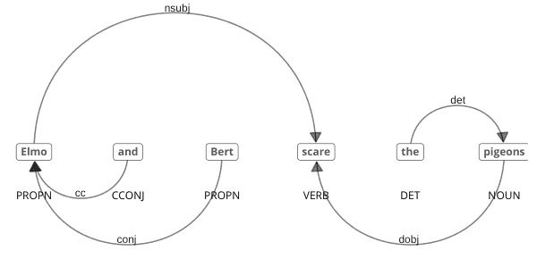

## 法语词性标注

27 universalddependencies.org/

标注器使用完全基于英语语料库训练的工具。udpipe 提供了一套分词、句法分析和标注工具，目前支持 65 种语言，训练数据来自通用依存项目（Universal Dependencies project）的树库（McDonald 2013）。27

作为示例，让我们回到前一章的 Europarl 语料库，作为回顾，它包含来自欧洲议会会议记录（1996–2011）的 5,000 句法语句和相同的 5,000 句英语句子。

首先，我们需要下载特定语言的模型。许多语言在 udpipe 中都有多种语言模型可供选择。对于法语，我们将使用基于 UD French GSD 语料库（Guillaume et al. 2019）的树库，这是法语通用依存项目的原始语料库，包含来自报纸文章、维基百科文章、博客和消费者评论的 400,000 个标记。对于英语，我们将使用基于 GUM 语料库（Zeldes 2017）的树库，这些基于网络的文本多年来已扩展到包含 113,385 个标记。

```
# download language models, this may take a couple minutes
ud_fr <- udpipe_download_model(language = "french-gsd")
ud_en <- udpipe_download_model(language = "english-gum")
ud_fr <- udpipe_load_model(file = ud_fr$file_model)
ud_en <- udpipe_load_model(file = ud_en$file_model)
```

接下来，使用这些模型对文本行进行标注。请务必按语言列限制文本。输出量较大，因为每行中的每个单词都有自己的 POS 标签。

```
data("corpus_europarl_subset", package = "text2map.corpora")
```

仅标注法语行：

```
text_fr <- corpus_europarl_subset |>
  filter(language == "French")

pos_fr <- udpipe_annotate(
  x = text_fr$text,
  tagger = "default",
  parser = "none",
  object = ud_fr
)
```

仅标注英语行：

```
text_en <- corpus_europarl_subset |>
  filter(language == "English")

pos_en <- udpipe_annotate(
  x = text_en$text,
  tagger = "default",
  parser = "none",
  object = ud_en
)
```

让我们使用 `table()` 来统计每个唯一的 POS，然后将变量整理到数据框中。接下来，使用 `left_join()` 将两个数据框并排连接。

```
df_fr <- as.data.frame(pos_fr)

df_fr <- table(df_fr$upos) |>
  as.data.frame() |>
  rename(pos = Var1, fr_freq = Freq)
```

```
df_en <- as.data.frame(pos_en)

df_en <- table(df_en$upos) |>
  as.data.frame() |>
  rename(pos = Var1, en_freq = Freq)

df_pos <- left_join(df_fr, df_en, by = "pos")
```

最后，让我们绘制每个 POS 标签的计数，以查看两种语言之间是否存在任何显著差异（参见图 8.6）。请记住，这些基于逐行翻译，虽然我们看到明显的相似之处（例如，名词是两种语言中最常见的），但词性分布存在明显差异（例如，英语中虚词更常见）。

```
df_pos |>
  mutate(pos = reorder(pos, en_freq)) |>
  ggplot() +
  geom_segment(aes(x = pos, xend = pos,
                   y = en_freq, yend = fr_freq)) +
  geom_point(aes(x = pos, y = en_freq, color = "English"), size=3) +
  geom_point(aes(x = pos, y = fr_freq, color = "French"), size=3) +
  coord_flip() +
  labs(x = NULL, y = "POS Frequencies, French and English")
```

图 8.6：比较法语和英语的 POS 标签。

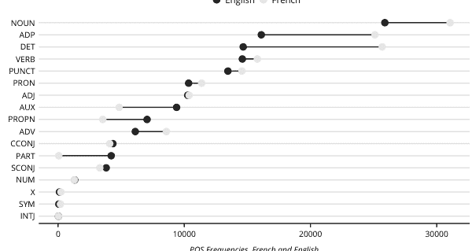

广义上讲，我们讨论了使用规则、词典和预训练语言模型对子文档单元进行标注的方法。我们还探索了几种预训练语言模型，例如 Stanford’s OpenNLP 提供的模型、udpipe 的英语和法语标注模型以及 spacy 的语言模型。无论标注什么内容——性别、词性、命名实体——这些模型都依赖于人工标注的语料库，以学习最能预测这些标签的特征。因此，我们依赖于标注者的解释。我们也可以通过在自己的语料库中标注标记来训练自己的模型。28 在此过程中，我们建议在语料库语言学的最佳实践基础上构建（例如，McEnery and Hardie 2011, Kennedy 2014）。

28 有关技术细节，请参阅 udpipe_train 的文档。

## 核心演绎法

望远镜放大了眼睛，使我们能够检查天体的内部结构或绘制银河系的宇宙邻域地图。在前几章中，我们使用显微镜审视文本，修改和分类子文档单元。在接下来的章节中，我们将采用望远镜视角，对文档进行分类并衡量语料库中的含义。

演绎方法始于一个特定的含义。例如，我们可能有兴趣了解“媒体是否以及何时报道了日益严重的经济不平等这一新问题”（Nelson et al. 2021:206），或者“流行音乐在多大程度上涉及不平等”（Carbone and Mijs 2022:2）。怀有这样的研究目标时，我们心中有一个概念，这里是不平等，然后使用工具来查找该概念。

特定含义依赖于通过反复（且归纳地）精读语料库样本而形成的分类方案（Nelson 2020; Small 2009）。方案可以引用其他元数据——例如，网站或数据库如何分类文档，或作者层面的变量，如社会身份或隶属关系。我们通常在先前工作的基础上构建，其中方案被采用和微调。开发分类方案是一个解释性过程，我们在此不再赘述。¹ 重要的是分类方案的结构。

首先，我们可以离散地测量文档是否与某个标签相关联。我们还可以渐进地测量文档与每个标签的关联程度。这可能是概率性的或排序的。²

第二点涉及标签覆盖可能含义空间的程度。如果理论上每个文档都可以在一致的概括层次上被归入一个类别，则标签是穷尽的。³ 标签是互斥的，即一个文档仅属于一个类别。这很重要，因为我们需要知道将每个文档归入类别的必要性有多大。

一旦我们有了分类方案，如何将这些标签分配给相应的文档？在传统的定性内容分析中，我们会系统地阅读文本，边读边分配标签。随着大量文本的日益丰富，学者们很快就会遇到信息过载问题（Chakrabarti and Frye 2017）。面对几万或几百万份文档，这种方法变得不可行。此外，我们还会遇到概念漂移问题（Chakrabarti and Frye 2017）。随着阅读更多文档，我们可能会改变对某个概念的理解。因此，对先前阅读文档的标签与对后来阅读文档的标签不一致。重新阅读和重新标注是解决这个问题的一个方法。然而，多次重读在面对成千上万或数百万份文档时变得不切实际。这就是自动化技术可以辅助解释性编码的地方。

4 尽管存在差异，两者通常都包括选择词汇表。

这里我们将讨论两种自动化方法：（1）离散指标和（2）加权指标。两者都依赖于基于词典和规则的程序，根据文档与感兴趣概念或实体的关联程度对给定文档进行标记或加权。4

大多数研究人员使用关键词和搜索引擎来收集原始文献和学术文献。收集后，我们使用“查找”功能在文本中搜索关键词。这两项任务都使用词汇和基于规则的字符串匹配。如果我们感兴趣的是，例如，“西雅图工人阶级青年的政治态度”，我们会收集近期讨论“政治态度和阶级”或“青年的政治态度”或“政治态度和西雅图”等的学术文章。我们可能会主动丢弃没有此类关键词的文章，或允许数据库的搜索引擎忽略这些文章。即使有些不系统，这些也是演绎程序。

5 我们将“实体”保留用于更具体的指称对象，例如人或组织，如在命名实体识别中。

内容分析人员使用多个术语来表示文本中的意义单位。这些包括主题、主题单元、类别、代码、标签、表达等。研究人员可以将这些排列为层次分类方案，例如，高阶类别涵盖低阶主题。为了简化问题，我们将对演绎方法使用概念或类别，对归纳方法使用主题或话题。5 我们不希望忽略保持这些术语区分的潜在理论用途；然而，衡量意义单位所使用的策略通常保持不变：表示给定意义的某些术语、短语或关系是否存在，如果存在，存在于何种程度？

- 本节需要：
  - tidyverse
  - quanteda
  - Matrix
  - irr

## 离散指标

基本的离散指标是记录文本中某些概念或实体的缺失或存在。例如，社会学期刊的文章是否提及“细微差别”（Healy 2017:120）。我们称其为“二元”，因为我们可以用 0 表示缺失，1 表示存在（或使用布尔值并使


“真”或“假”）。这是一种分类度量。术语可能与标签相关联，并通过使用该术语，文档会被打上该标签。⁶

离散指标可以涉及多个类别；因此，二元指标是分类的，但并非所有分类指标都是二元的。

请回顾，字典是一种由键和值组成的数据结构。键是任何唯一的字符串（或正则表达式）。在最简单的情况下，值是一个简单的存在标签（及其省略即缺失）。因此，二元指标很可能是计算机辅助文本分析中最普遍的技术。

请考虑Griswold的《意义的虚构》。Griswold用来支持“多声文化对象获得更多文化权力”这一主张的证据部分在于，巴巴多斯小说家George Lamming的书籍评论是“正面”还是“负面”，以及是否将这本书描述为具有“歧义性”。在下表9.1中（摘自Griswold 1987:1109），我们按单个协变量（即评论所针对的小说）比较了参与意义单元的书评比例。

表9.1：按小说划分的歧义性与评价

| 小说 | 提及歧义性 | 正面 |
|---|---|---|
| In the Castle of My Skin | 50% | 67% |
| The Emigrants | 31% | 19% |
| Of Age and Innocence | 42% | 75% |
| Season of Adventure | 33% | 25% |
| Water with Berries | 63% | 50% |
| Natives of My Person | 40% | 47% |

Griswold逐条手动打标记每条评论。Correll及其同事（2020:1031–2）同样由三名研究人员组成的团队对两百多份员工绩效评估进行了人工标记（另见Hallett等人，2019:552）。

这种人工打标记文档的方式仍然是衡量自动化指标的“金标准”。⁷

关于该主题的不同观点，请参见Biernacki（Biernacki 2012, 2014, 2015）以及各种回应（及对回应的回应（Lee和Martin 2014, 2015；Spillman 2014, 2015；Reed 2015），以及关于此问题的编辑文集（Reed和Alexander 2015）。

如何将此从几十或几百份文档扩展到数千份或更多？一种策略是在手动标记之前使用自动化方法识别相关子集。例如，DeSoueys和Waggoner（2022:59）收集了两千多份“在Regulations.gov上提交的……关于……‘加强航空乘客保护’的文档和评论……”，并基于“提及
8 在正则表达式中，星号将匹配前面类型的零个或多个——例如，返回复数形式。

9 可靠性是一个技术术语，指给定度量的一致性。想象一下，让高中木工课的学生使用卷尺来切割一英尺的木材。我们期望测量值有一些差异。如果该差异较低，则具有高可靠性。如果我们给每个学生一英尺的纱线来使用，而不是卷尺，我们会期望较低的可靠性。

克里潘多夫的α
受试者 = 5
评分者 = 3
α = 0.741

10 例如，如果编码人员正在为文档中的“蝙蝠”打标签，他们都需要知道这是指棒球装备还是可爱的飞行哺乳动物。

花生和食物过敏”通过匹配术语‘peanut’、‘peanut allergy’、‘allergy’、‘nut,*’和‘food allergy’（2022:73）。⁸

另一种策略是依靠更多人。语料库通常被部分重叠的部分分配给评分者。然后我们可以对由两人或更多人编码的任何文档计算评分者间信度。虽然有许多评分者间信度指标，但我们将使用Krippendorff的α（alpha）：1减去观察到的分歧除以预期分歧。⁹ 我们喜欢这个指标，因为它不受文档被分类到多少个类别或有多少人进行分类的影响。

例如，假设三名研究人员正在阅读Lamming小说的评论，并为“歧义”概念打标签。假设三人都读了每份五份评论。下面我们将为其创建一个评分者×文档矩阵。

```
# create a matrix
mat <- matrix(0, nrow = 3, ncol = 5)
# add each reviewers tagging for "ambiguity"
mat[1, 1] <- c(1, 0, 1)
mat[2, ] <- c(0, 0, 0)
mat[3, ] <- c(1, 1, 0)
mat[4, ] <- c(0, 0, 0)
mat[5, ] <- c(1, 1, 1)

[,1] [,2] [,3] [,4] [,5]
[1,] 1 0 1 0 1
[2,] 0 0 1 0 1
[3,] 1 0 1 0 1
```

让我们使用kripp.alpha()。我们的二元变量是“名目”变量，因此需要告诉该函数（边缘输出）。

```
kripp.alpha(mat, method = "nominal")
```

高信度的共识阈值通常是α高于0.7。低于此阈值意味着我们必须协调每位评分者对任务的理解——或重新定义任务。¹⁰ 为了帮助，我们可以为每个概念构建词典，其中包含预示文本中该概念存在的术语。就Griswold（1987）而言，我们可以创建一组表示正面评价的术语和一组表示歧义性的术语。不过，一旦构建了这个词典，我们也可以用它来自动打标记文档。

在《士兵、母亲、流浪汉与其他人》中，Mohr（1994）编码了救济组织如何描述其clientele和救济活动。他通过为每个身份识别关键术语来简化这项任务：“[T]he program searches each text string for the presence of a single word, in other cases, entire phrases were necessary to trigger a binary variable”

（1994:336）。重要的是，词典通常必须针对焦点语料库进行定制。¹¹

¹¹ 请注意下表9.2中的术语“dumb”（Mohr 1994:335–338）。由于此分析使用了1907年纽约市慈善目录，当时“dumb”被用作一个临床术语，指失语/无法说话。

# 表9.2：Mohr（1994）示例词典

| 值 | 键 | |
|---|---|---|
| 盲/聋 | 言语有缺陷 | 失明 |
| | 视力有缺陷 | 聋 |
| | 听力有缺陷 | 聋 |
| | 言语障碍 | 聋哑人 |
| 盲 | | 哑 |

使用此二元指标，Mohr随后构建了一个身份（行）与相关救济活动（列）的矩阵，其中单元格表示这些身份和活动共同出现的缺失（0）或存在（1）（Mohr 1994:342–3）。

在实践中，将自动词典方法与手动标记结合用于打标记文档很常见（例如，Friedman和Reeves 2020）。例如，考虑Bonikowski和Gidron（2016）的《美国政治中的民粹主义风格》。作者使用了来自安嫩伯格/皮尤总统竞选话语档案的2400多篇公开演讲。他们构建了一个词典来自动分类演讲，该词典包括一组一元词和最多五元词。在使用词典将部分演讲标记为民粹主义后，他们手动对每篇进行编码——识别假阳性。这种方法使作者节省了大量时间。

让我们复制部分分析。首先从`text2map.corpora`加载公开竞选演讲。

```
data("corpus_presidential", package = "text2map.corpora")
df_pres <- corpus_presidential |> select(year, party, text)
```

数据框的维度为2,475行和13列。让我们提取所需的变量：year、party和text。Bonikowski和Gidron提供了他们的最终词典，将其分解为一元词到最多五元词。下面，我们将创建这个词典的一个版本。我们将专注于一元词和二元词，从构建一元词词典开始。

```
unigrams <- c("bureaucrat", "loophole", "millionaire",
"baron", "venal", "crooked",
"unresponsive", "uncaring", "arrogant")
```

现在，我们将使用`dfm()`创建一个DTM。

```
tkns <- df_pres$text |>
str_replace_all("[[:punct:]]+", " ") |>
tokens()
```

```
dtm <- dfm(tkns)
```

既然我们已使用一元词创建了DTM，现在将此原始计数矩阵转换为二元矩阵。请回顾，我们只关心术语是否出现在文档中，而不关心出现次数。创建二元矩阵有几种方法。`quanteda`包含一个函数，可使用包括“boolean”在内的多种方案对DTM进行重权——“boolean”是另一种非此即彼分类的标签。

```
dtm_bin <- dfm_weight(dtm, scheme = "boolean")
```

接下来，使用`%in%`运算符识别与我们的词典匹配的列。输出是一个`TRUE`和`FALSE`的索引。使用它来对DTM中的列进行子集化，仅保留与`TRUE`对齐的列。

```
matched <- colnames(dtm_bin) %in% unigrams
dtm_sub <- dtm_bin[, matched]
df_pres$populist_unigram <- ifelse(rowSums(dtm_sub) > 0, 1, 0)
```

我们已使用一元词词典创建了民粹主义度量。现在，让我们找出每年民粹主义演讲的比例。我们通过按year变量“分组”，然后对其他变量进行“汇总”来实现这一点：一年内的演讲总数和一年内的民粹主义演讲总数。然后用最后一个数除以第一个数，得到一年中民粹主义演讲的百分比。

```
df_plot <- df_pres |>
group_by(year) |>
summarize(total = n(),
	populist = sum(populist_unigram),
	percent = populist / total)
```

现在，让我们对其进行可视化。我们将`percent`变量映射到条形的高度（我们的`y`轴）；因此，我们会告诉`ggplot()`我们的轴是百分比。图示见图9.1。

```
df_plot |>
ggplot(aes(x = year, y = percent)) +
	geom_col() +
	scale_y_continuous() +
	labs(title = "Populist Speeches, 1952-1996",
		y = "% Populist Speeches",
		x = NULL)
```


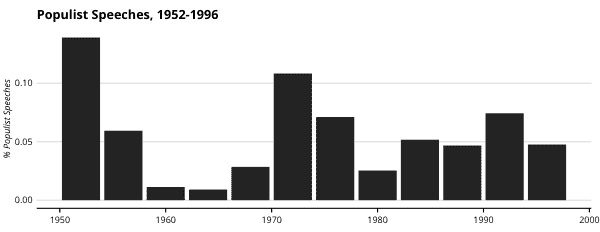

图 9.1: 使用一元词典的民粹主义演讲。

我们的一元词典会让我们相信 1952 年的竞选活动高度民粹主义——但请记住，Bonikowski 和 Gidron 使用该词典来识别可能的民粹主义演讲，然后通过阅读进行了验证。让我们来试试我们的二元词典。首先，我们将使用二元词而不是一元词创建 DTM。

```
tkns <- df_pres$text |>
str_replace_all("[[[:punct:]]]+", " ") |>
tokens()
tkns <- tkns |> tokens_ngrams(n = 2L)
dtm <- dfm(tkns)
```

请记住，quanteda DFM 下面是 Matrix 的增强稀疏矩阵。因此，我们也可以快速将 DTM 转换为“逻辑”稀疏矩阵（Matrix），其中 TRUE 表示术语的存在。

```
is(dtm, "Matrix")
dtm_bin <- as(dtm, "lMatrix")
```

```
bigrams <- c(
"Special interest", "big government",
"Wall Street", "Main Street", "big corporations",
"ordinary taxpayer", "your money", "wealthy few",
"professional politician", "big interest",
"old guard", "big money", "Washington elite",
"rich friend", "power monger", "power grabbing",
"power hungry", "easy street", "privileged few",
"forgotten Americans", "too big", "long nose"
)
```

我们根据其附录中提出的术语构建了上述词典（Bonikowski 和 Gidron 2016:1619）。文本分析中表示大于一的 n-gram 的默认做法是使用下划线作为空格或连字符的替代。此外，如果我们检查 DTM 的列——即术语所在的位置——它们已被转换为小写。因此，让我们确保我们的词典与此预处理步骤匹配。

```
bigrams <- bigrams |>
  tolower() |>
  str_replace(pattern = " ",
              replacement = "_")
```

同样，让我们使用 %in% 运算符创建一个逻辑索引，指示哪些列在我们的词典中。我们将向数据框添加一个新的民粹主义变量。

```
matched <- colnames(dtm_bin) %in% bigrams
dtm_sub <- dtm_bin[, matched]
df_pres$populist_bigram <- ifelse(rowSums(dtm_sub) > 0, 1, 0)
```

按年份和政党计算比例。为此，我们告诉 R 按 year 和 party 两个变量分组，然后以与使用一元词典时相同的方式汇总我们的变量。

```
df_plot <- df_pres |>
  group_by(year, party) |>
  summarize(
    total = n(),
    populist = sum(populist_bigram),
    percent = populist / total
  )
```

与之前一样，我们将民粹主义演讲的百分比映射到条形的高度，但我们还将条形的颜色（fill）映射到演讲者的政党（图 9.2）。

```
df_plot |>
  ggplot(aes(x = year, y = percent, fill = party)) +
  geom_col(position = "dodge") +
  scale_y_continuous() +
  labs(title = "Populist Speeches by Party",
       y = "% Populist Speeches",
       x = NULL)
```

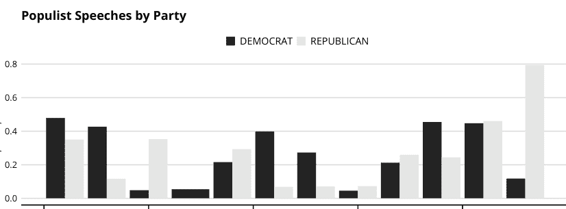

图 9.2: 使用二元词典的民粹主义演讲。

正如我们比较两种手动标注或自动分类器与手动标注一样，我们可以评估两种自动分类器之间的一致性。在这里，Cohen’s κ（kappa）很常见；然而，我们也可以使用 Krippendorff’s α——其底层逻辑相似。这两种措施都会告诉我们每个词典在多大程度上识别相同的文档。

```
mat <- df_pres |> select(populist_unigram, populist_bigram)
# documents must be columns, so transpose with t()
mat <- t(as.matrix(mat))

kripp.alpha(mat, method = "nominal")
```

这个较低的 α 值表明它们选取了不同的演讲（页边输出）。在这里，它表明它们不是冗余措施，Bonikowski 和 Gidron 纳入不止一元词典的做法是正确的。在这里，我们也看到迭代是稳健文本分析的核心。

## 加权指标

### 频率加权

上一节使用词典将文档分类为以“要么要么”（即二进制或布尔）方式参与某个概念或构成某个类别。通常，研究人员还使用关键词出现次数来表示幅度：更高的计数意味着对某个想法的参与度增加或对某个实体的关注度更高。这是加权指标的一个示例。

例如，Mohr 及其同事（2013）使用 命名实体识别12 来归纳构建一套政治文本（美国国家安全战略报告）中“行为者”的词典。被识别出的一组明显行为者是各个国家国家。使用热图（将深色关联到较高频率），他们绘制了每年对国家国家的引用。他们表示：

> ...显示了哪些国家在多年间得到了**更多关注**。我们可以看到早期 NSS 文档对苏联和乌克兰有**关注**。阿富汗和巴基斯坦在后来的年份中更**突出**。波斯尼亚在 1995 年至 2000 年间是一个**热点**。伊拉克在第一次海湾战争中获得**重要性**....（Mohr 及其同事，2013，679，强调部分由原文添加）

这里，作者将术语的计数与其所表示事物的“关注”、“重要性”或“突出性”联系起来。这预设了

```
Krippendorff's alpha
Subjects = 2475
Raters = 2
alpha = 0.043
```

### 本节需要：

- text2map
- sentimentr
- tidymodels
- rsample
- text2vec
- glmnet
- stringr

13 检查此类措施有效性的一种方法是阅读分布不同部分的文档——高、中、低。

关键词频率与作者的意图，以及或许读者的感知（Carley & Palmquist, 1992; Popping, 2000, 39）。13

让我们构建一个包含十三个国家国家的词典，以复制 Mohr 及其同事展示的热图。请注意，为简单起见，假设“Soviet”仅指苏联。这样我们可以坚持使用一元词，但更稳健的分析将包括二元词甚至三元词典。

```
dict <- c(
  "Ukraine", "Soviet", "Pakistan", "Kosovo",
  "Japan", "Israel", "Iraq", "Iran", "India",
  "Germany", "China", "Bosnia", "Afghanistan"
)
```

```
data("corpus_ussns", package = "text2map.corpora")
dtm <- corpus_ussns |>
  mutate(text = tolower(text),
         text = gsub("[[:punct:]]+", " ", text)) |>
  dtm_builder(text, year)
dtm <- dtm[, colnames(dtm) %in% tolower(dict)]
```

我们将使用 `dtm_melter()` 将我们的 DTM“融化”为三元数据框，其中包括报告的年份、与我们的词典匹配的术语子集（这里是国家国家）以及每个术语在每份报告中出现的次数（图 9.3）。

```
dtm |>
  dtm_melter() |>
  ggplot(aes(x = doc_id, y = term, fill = freq)) +
  geom_tile() +
  labs(x = "Year", y = "Nation") +
  theme(legend.position = "right",
        legend.direction = "vertical")
```

我们可以看到，NSS 报告在最早期的报告（1987 年至 1991 年）中引用了“soviet”许多次——以至于它掩盖了其余的计数。

在明确界定的领域（例如国家安全报告中的国家国家）内计算具体命名实体，是词频措施遇到局限的地方。研究人员通常对文本参与抽象概念的程度感兴趣——例如，民粹主义或男性气质。这仍然是一种幅度：研究人员从存在/缺失转向表示文档中更通用含义的普遍性或参与度。然而，在这里，词语本身不再被假设是相互独立的。

### 术语加权词典

将关键词计数直接映射到与某个概念或类别的参与幅度的一个缺点是，有些词语可能

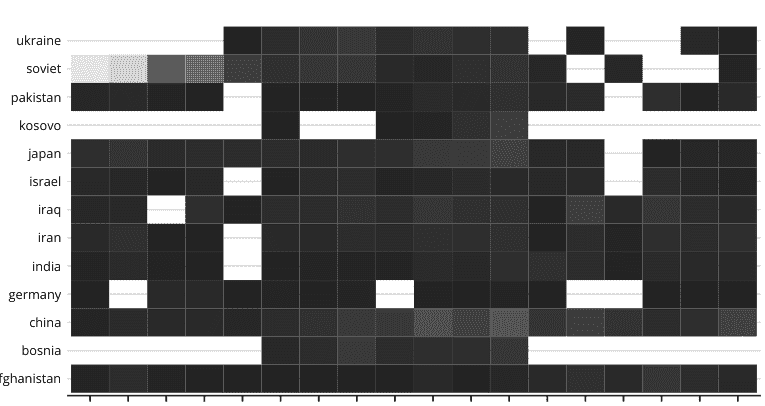

图 9.3: 美国 NSS 中引用的国家国家。

更中心于该概念或类别，而不是其他词语——无论其频率如何。这一点在情感方面最为明显：例如，“love” 比 “like” 更强烈。为了克服这一点，我们可以沿着光谱对词典中的每个术语进行加权。

在社会学中，也许最常见的术语加权词典是职业声望或地位排名。Duncan 的社会经济指数（SEI）（Duncan 1961）提供了将离散职业头衔排列为渐进地位等级的早期尝试之一。14 该词典中的每个键是一个唯一职业，值是相关声望。

14 Duncan 使用了来自 1950 年美国人口普查的收入和教育数据组合，为 1947–8 年 NORC 职业声望调查分配声望得分。

另一类常用于社会心理学的术语加权词典来自情感控制理论（ACT）。15 从 20 世纪 70 年代开始，一直到最近的 2015 年词典，ACT 研究人员构建了将术语分类为行为者、行为和对象的词典。每个行为者、行为和对象都沿着评价（好、坏）、权力（强大、弱势）和活跃度（活泼、平静）的维度被分配一个排名。从此，可以更多代数构建场景，并预测，例如，人们是否会将一种情况体验为陌生（Kelly 2022）。

15 情感控制理论的基本前提是，“人们通过社会身份对自己和他人进行刻画……唤起作为解释和 [行为] 指南的情感”（Heise 1977:163）。

该理论中的一个关键机制是偏转：反映社会对某种情境的共识的基本意义与情境本身的暂态意义之间的差异。在互动中，人们会采取行动来尽量减少这些差异。但研究人员从哪里获取


这些根本含义？这种方法的基石是对词语规范的一般研究，特别是奥斯古德及其同事的语义差异法。

20世纪初，态度可以沿单一光谱进行测量的想法是若干方法论创新的核心。在此过程中，受访者会看到关于某个主题或对象的一系列陈述。然后，他们沿着数值刻度表明对该陈述持有多么有利或不利的看法。受访者的回答随后被汇总，以得出关于该主题或对象的总体态度。

例如，使用来自桑代克（1921）《教师用书》的256个词，查尔斯·莫西尔（Charles Mosier，1941:125–7）“将[它们]呈交给受试者，让其判断有利或不利的程度”，其中11表示最有利，1表示最不利。“受试者”是修读心理学入门课和第二阶段课程的本科“学生”。每个词大约有140名“评判者”。莫西尔发现，大多数词的排名足够线性，可以放置在一维量表上，将“completely unsatisfactory”定义为零（参见表9.3）。16

## 表9.3：莫西尔有利程度量表中的术语

| 术语 | 量表数值 |
| --- | --- |
| 完全不令人满意 | 0.00 |
| 令人反感的 | 0.50 |
| 可耻的 | 1.00 |
| 错误的 | 1.50 |
| 不必要的 | 2.00 |
| 有争议的 | 2.36 |
| 可原谅的 | 2.85 |
| 平均的 | 3.08 |
| 可宽恕的 | 3.48 |
| 舒适的 | 4.04 |
| 可取的 | 4.50 |
| 非常令人愉快的 | 5.02 |
| 潜水 | 5.50 |
| 非常非常可取的 | 5.66 |

莫西尔明确选择关于判断的词汇。奥斯古德的洞见在于将此推广：与某些可能“沿单一连续体分布……的理论构造不同，我们从一开始就接受意义在若干未知数量的维度上变化”（1952:222）。例如，在一项研究中，奥斯古德发现，几乎所有受试者都将“大”与“响亮”，“近”与“快”，“亮”与“快乐”联系起来。语义差异法涉及要求受访者将一个词沿着若干可由“一对对立术语定义”的连续体进行定位（1952:227），例如，仁慈-残忍，悲伤-快乐，快-慢，大-小，公平-不公平等。奥斯古德还进一步建议，意义变化的不同“方式”可能“本质上等价”，因此可归约为一个共享的单一维度。17

通过一系列研究，他们发现，类似莫西尔的有利程度以及另外两个维度，可以解释这些连续体中很大比例的变异，他们将其标记为评价、潜力和活动（分别也称为效价、主导性和唤醒）。

广义上讲，正是这一发现——多样化的判断可以由少数线性光谱“解释”——为加权词典提供了理论依据。在每个词典中，一个标记（通常是单字或词元）沿着一条或几条有意义的维度进行评分。例如，Bail及其同事（2017）使用LIWC词典（Tausczik和Pennebaker，2010），该词典旨在测量心理内容，以捕捉来自Facebook评论中关于倡导组织的公共讨论。

除了（很可能是）第一批加权词典（与莫西尔的工作一起）之外，情感词典也是最常用的任何类型的词典。Flores（2017）使用情感词典（类似莫西尔的），在一份推特语料库中发现，由于反移民用户增加，对墨西哥和西班牙裔移民的负面情绪有所增加。使用Google的自动补全搜索数据，Dorius和Swindle（2019）表明，与某个国家相关的自动补全文本的情感与其在全球发展指数中的位置之间存在正相关关系。第一项研究使用了刘及其同事（2005）的词典，而第二项研究使用了SenticNet词典，还有几十个此类词典存在。lexicon，例如，包含十四个。18

要测量文本的情感，需要将每个标记与词典中的术语匹配，然后将该术语的权重分配给标记。让我们通过一个玩具示例来演示。首先，加载Jockers-Rinker情感词典。

```
data("hash_sentiment_jockers_rinker", package = "lexicon")
df_jr <- hash_sentiment_jockers_rinker # rename so it's tidier
head(df_jr)
```

| x | y |
|---|---|
| 1: a plus | 1.00 |
| 2: abandon | -0.75 |
| 3: abandoned | -0.50 |
| 4: abandoner | -0.25 |
| 5: abandonment | -0.25 |
| 6: abandons | -1.00 |

鉴于预期情感在较长文本中会有所变化（例如，在政治演讲中，演说家可能从愤怒或恐惧转变为以喜乐和希望结束），通常认为应该将分数分配给比段落更小的块，例如句子或推文。19 例如，考虑来自真正积极的人罗杰斯先生的一句话：“关心是表达爱意的一种方式”（页边输出）。

> 17 这正是激励“拟合”回归模型的同一概念，参见《数学基础》。
> 18 如需比较，请参见Gonçalves等人（2013）和Ribeiro及其同事（2016）。
> 19 一般而言，加权词典可能不适合长文档（Aslanidis 2018:1245–50; Hanna 2013:376–9; Stoltz and Taylor 2021）。

| | x | y |
|---|---|---|
| 1: | care | 1.00 |
| 2: | love | 0.75 |

```
text <- "taking care is one way to show your love"
tkens <- strsplit(text, " ") |> unlist()
df_jr |> filter(x %in% tkens)
```

大多数词不在词典中——即使有约一万一千个词也是如此。这就是词外词汇（OOV）问题。典型的策略是对匹配词的权重取平均值，在此情况下给我们一个0.875的情感得分。但是，文本“我不在乎，我也不爱你”又如何呢？我们的匹配-平均系统会将其评为正面，而实际上正好相反。因此，我们需要使用另一套效价或极性“转移词”词典（页边输出）。

```
data("hash_valence_shifters", package = "lexicon")
```

| | x | y |
|---|---|---|
| 1 | ain't | 1 |
| 2 | absolutely | 2 |
| 3 | almost | 3 |
| 4 | although | 4 |

```
hash_valence_shifters |>
  group_by(y) |>
  slice_head(n = 1)
```

不过，与使用权重不同，每个词被分配到四个类别之一：（1）否定词，（2）放大词，（3）缩小词，或（4）中性上下文词。`sentimentr`结合极性得分和效价转移词来计算总体情感得分。

使用Jockers-Rinker极性词典与效价转移词典，我们将测试“真实”和“假”新闻的情感极性。原始数据集包含来自路透社（一家真实新闻服务）的约20,000篇文章，以及来自各种被视为虚假或不可靠来源的约20,000篇文章（Ahmed等人，2017, 2018）。我们提供1,000篇“真实”和1,000篇“假”文章的随机样本（以加快速度）。

```
data("corpus_isot_fake_news2k", package = "text2map.corpora")
```

我们的“rating”变量是一个字符向量，因此我们还将其转换为数值1（代表真实）或0（代表假）。

```
df_isot <- corpus_isot_fake_news2k |>
  mutate(rating = ifelse(rating == "real", 1, 0)) |>
  rowid_to_column(var = "element_id")
```

使用`get_sentences()`将每个文档拆分为句子（这主要使用标点符号）。接下来，使用`sentimentr`，我们将用两个词典计算句子级情感得分。最后，我们将输出与包含文章分类真实性的原始数据框连接起来。

```
df_polar <- df_isot$text |> get_sentences() |> sentiment()
df_mod <- left_join(df_polar, df_isot, by = "element_id")
```

由于我们在预测二元结果（假或真），我们将使用逻辑回归（通过在`glm()`中将`family`设置为“binomial”）。20 我们将使用每个句子的情感得分来预测它是否来自“真实”或“假”新闻来源。

20 参见《数学基础》。


```
mod <- glm(rating ~ sentiment, family = binomial, data = df_mod)
tidy(mod)
```

| term | estimate | std.error | statistic | p.value |
|---|---|---|---|---|
| (Intercept) | -0.210 | 0.0104 | -20.1 | 2.80e-90 |
| sentiment | 0.139 | 0.0385 | 3.61 | 3.10e-4 |

请记住，“1”表示该句子来自“真实”新闻来源。由于我们的估计值（即系数）为正数，这意味着“真实”新闻来源中的句子比“假”新闻来源中的句子更可能带有积极情感。<sup>21</sup> 从广义上讲，这复制了其他学者在不同（且规模大得多）语料库上所发现的结果（例如，Zaem 等人 2020 年）。

我们还可以通过取情感分数的绝对值来检验假新闻或真实新闻是否更或不那么“情感化”。

```
df_mod <- df_mod |> mutate(emotionality = abs(sentiment))
mod <- glm(rating ~ emotionality, family = binomial, data = df_mod)
tidy(mod)
```

| term | estimate | std.error | statistic | p.value |
|---|---|---|---|---|
| (Intercept) | -0.158 | 0.0151 | -10.5 | 1.27e-25 |
| emotionality | -0.267 | 0.0561 | -4.76 | 1.96e-6 |

情感性的负估计表明，真实新闻总体上情感性较低。<sup>22</sup>

按照标准假设，它在常规水平上具有统计显著性。

同样，按照标准假设，它在常规水平上具有统计显著性。参见延展演绎部分。

## 选择与构建词典

此处讨论的方法在多种方面都依赖于词典，即键值对：一方面是一个 _词汇表_，另一方面是当单词与此词汇表匹配时要执行什么操作的某些 _规则_。在此，我们更侧重于选择和构建这些词典。

在初步探索数据时，我们可能决定手动构建词典。此过程始于确定我们需要哪种类型的词典——二元或加权——然后选择我们的词汇表。二元词典最不耗费资源，因为关键词的存在足以证明将给定文本分类为涉及我们的概念（或不涉及）。这是一个 _迭代_ 过程（例如，DeSoueey 和 Waggoner 2022；Bonikowski 和 Gidron 2016）。

构建加权词典时——语料库中的所有或大多数词汇都会获得关联值——研究者通常会招募多位评分者并取其评分的平均值。当今，研究者常使用亚马逊 Mechanical Turk 等众包平台。该程序的缺点在于可能成本高昂。另一种选择是手动修改已有的词典。

## 预构建词典

何必重复造轮子？在探索语料库时，预构建的词典是一个很好的起点。我们已经讨论过几个（通常随软件包附带），并且也可以向研究者索取词典。此外，像 Mosier 的情感词典那样，许多词典埋藏在附录中，等待被重新发现。

这些词典分为几个类别。最简单的是前面讨论过的各种“停用词表”。23 第二组，且密切相关，是词频列表。词频列表对教学很有用，最早的一个是 Thorndike 的《30,000 词教师词汇书》（Bontrager 1991; Fries 1941）。随着数字化语料库的出现，Kucera 和 Francis（1967）的列表成为金标准，其频率基于 Brown 语料库计算得出。更近期的英文词频词典基于 Common Crawl 网页爬取、Wikipedia 数据转储、Google Web 万亿词语料库、Google Books N-Gram 语料库或电影和电视字幕集（Brysbaert 和 New 2009）。

23 参见“处理文字”。

第三组涉及 Osgood 的三部分评估、潜力和活动（即效价、支配力和唤醒），其中包括情感词典（评估或效价维度）。除了使用 Osgood 语义差分法的心理学研究（Warriner 等人 2013 年）外，社会学中的情感控制理论研究者继续在这一传统中构建和验证词典（Smith-Lovin 2019）。

24 有关比较，参见 Yeomans（2021）。

第四组源自对单词“具体性”（也称为“抽象性”、“释义”或“意象”）的研究。24 例如，“pray”更具体，而“religion”则不那么具体。这项工作始于语言教学，因为更具体的词汇通常更容易记住（De Groot 和 Keijzer 2000）。由于早期关于具体性的研究侧重于视觉模式，这推动将单词规范扩展到所有感觉运动模式（Lynott 等人 2020）。

25 这些其他词典通常存储为易于共享和编辑的纯文本文件或电子表格。

最后一组与语言探究与词数计数项目（即 LIWC）相关。该项目包含多种“心理”词典，构建于 General Inquirer（Stone 等人 1966 年）和 MRC（Wilson 1988 年）之上——但被禁锢在专有软件中。因此，LIWC 缺乏先前讨论过的词典所具有的透明度和灵活性。25 我们提到它主要是因为研究人员构建了格式化以适用于 LIWC 用户界面的词典——例如，道德基础词典（Hopp 等人 2021 年）。quanteda 的 dictionary() 可以使用 LIWC 格式的词典。

## 使用监督学习构建词典

我们将讨论的最后一种词典构建方法属于“监督学习”标签下。该程序要求我们已经知道一组文本应如何分类——这就是“监督”的含义。然后我们“学习”什么能最好地预测这些标签。我们将输出称为“模型”，但在下面的示例中，它是一个像其他任何词典一样的加权词典。

首先，我们需要一个人工标注的语料库。这通常被称为“真实值”或“金标准”，因为其效度由人工评分者建立。例如，人工编码者可能会将对 1999 年科幻电影《黑客帝国》的评论标记为“积极”，如果评论者讨论了“享受电影”；或者他们可能会将竞选演讲标记为涉及“难民”，如果它讨论了“庇护城市”。

让我们先通过一个玩具示例来演示。让我们使用玛丽·雪莱的《弗兰肯斯坦》和奥塔维亚·巴特勒的《种子的比喻》中的句子。我们将根据单词“预测”句子作者的程度对单词进行加权。

```
shelley <- data.frame(
 text = c(
 "destroy your own creature oh praise the eternal justice",
 "of man yet i ask you not to spare me listen to me and",
 "then if you can and if you will destroy"
 )
)
```

```
butler <- data.frame(
 text = c(
 "we are earthlife maturing",
 "earthlife preparing to fall away from the parent world",
 "we are earthlife"
 )
)
```

```
shelley$butler <- 0
butler$butler <- 1
corpus <- rbind(butler, shelley)
```

现在我们将微型语料库转换为 DTM。我们将术语视为回归中的预测变量，将作者视为结果变量。为了本示例，我们还将 DTM 转换为 data.frame，以便可以附加我们的结果变量。

```
dtm <- corpus |
 rowid_to_column(var = "doc_id") |
 dtm_builder(text, doc_id = doc_id)
dtm <- as.data.frame(as.matrix(dtm))
dtm$butler <- corpus$butler
```

我们已准备好使用每行中的术语来预测作者。请注意，使用句点表示使用数据框中除结果变量（此处为“butler”）之外的所有列。

```
mod <- glm(butler ~ ., family = binomial, data = dtm)
```

与其检查模型（如前面所做），不如直接提取一个估计值（系数）。不看数字，“earthlife”的估计值为正数（如我们所期望）。这意味着，如果我们将这个小词典应用于新文本，“earthlife”的存在会使我们更可能将文本标记为由“Butler”撰写。26

```
round(coef(mod)["earthlife"], 6)
```

```
earthlife
49.13214
```

让我们规模化这个过程。首先，我们将使用五个社交媒体网站上四千条帖子的语料库。每条评论都已由三位人工标注者手动标记为包含积极或消极情感。

```
data("corpus_senti_bench4k", package = "text2map.corpora")
```

26 为了说明问题，我们有点不严谨。在实际操作中，我们需要更多示例和更多术语来构建这个词典，因为正如我们在“从文本到数字”中所学，语言是稀疏的。


df <- corpus_senti_bench4k |>
  mutate(text = tolower(text),
         text = gsub("[[:punct:]]+", " ", text),
         text = gsub("[[:digit:]]+", " ", text),
         text = str_squish(text)) |>
  mutate(positive = ifelse(polarity > 0, TRUE, FALSE))

Now, not only do we want to predict these labeled data, but also we want to use our model to, eventually, predict unlabeled data. If our model exactly fits our training data, but doesn't work on new data, we call this **overfitting**. The standard way to address overfitting is by dividing our labeled corpus into a training set and then one or more "hold out" or "unseen" datasets (James et al. 2021:176).27 We then later compare results using the two separate sets. Typically, we hold out about 25 to 30 percent of our data (cf. Afendras and Markatou 2019; Joseph 2022). We'll use helper functions from `rsample`. Since the function we'll use to divide our sample—`initial_split()`—makes the splits randomly (in our case, stratifying by news source), we'll set a seed to make the results reproducible.

27 This is a form of **cross validation**—which cut its teeth debunking Rorschach tests as a predictor of job success (Kurtz 1948). The final sample used is typically called the "test" set and the one or more intermediary samples are called "validation" sets used to fine-tune a model (Ripley 1996:354).

set.seed(5439)
init <- initial_split(df, prop = 3 / 4, strata = "source")
df_trn <- training(init)
df_tst <- testing(init)

Next, we'll represent our documents as DTMs, weighted by relative term frequencies (using `normalize()`). Note we are creating two DTMs, but the vocabulary must be the same. `dtm_builder()` has the `vocab` option for this. Again, for illustration, let's restrict terms to only those that show up in at least 15 documents in our training set and less than 2,700 documents.

dtm_trn <- df_trn |>
  dtm_builder(text, doc_id = doc_id) |>
  dtm_stopper(stop_doc_freq = c(15, 2700))
dtm_trn <- dtm_trn[, sort(colnames(dtm_trn))]
dtm_tst <- df_tst |>
  dtm_builder(text, doc_id = doc_id,
              vocab = colnames(dtm_trn))
dtm_trn <- normalize(dtm_trn)
dtm_tst <- normalize(dtm_tst)

28 glmnet performs penalized regression. These models are preferred when there is a large number of predictors relative to observations. `cv.glmnet` performs the regression by separating the observations into k subsets—or "folds." Using all observations outside of that fold, it predicts the labels in the heldout subset to find the weight (lambda) for how much the penalty term should factor into the model's cost function.

As the outcome is binary, we'll again use logistic regression. This time, however, our data is quite large: we'll predict the labels of several thousand documents with potentially thousands of terms. So, we'll use `glmnet` to fit our model.28

fit <- cv.glmnet(
  x = dtm_trn,
  y = df_trn$positive,
  family = "binomial",
  intercept = FALSE
)

Next, we'll use the model to "predict" the labels of our test set. As we also know the intended labels, we can calculate the accuracy of our prediction (or, the agreement between our tool and human annotators).

```r
confusion.glmnet(fit,
  newx = dtm_tst,
  newy = df_tst$positive,
  s = "lambda.min"
)
```

| | Predicted FALSE | TRUE | Total |
|---|---|---|---|
| True FALSE | 595 | 242 | 837 |
| TRUE | 36 | 139 | 175 |
| Total | 631 | 381 | 1012 |

Percent Correct: 0.7253

Using a “confusion matrix,” a table that tallies which guesses we got right and which we got wrong, we can see it did okay.29 The articles not labeled with positive sentiment (the FALSE column) were only misclassified a little. We didn’t as well guessing which articles were labeled with positive sentiment (the TRUE column). We may need to incorporate valence shifters or other fine-tuning—dictionary building is, after all, an iterative process.

Setting s to "lambda.min" means we use the lambda weights giving the smallest average mean-squared error when predicting the heldout subsets.

Another way we can see how well our dictionary “learned” sentiment is by comparing it to one of the pre-constructed sentiment dictionaries. We’ll use inner_join to only keep the words present in both, and then use cor() to calculate correlations between them.

```r
data("hash_sentiment_jockers_rinker", package = "lexicon")
dict <- data.frame(term = rownames(coef(fit)),
                   weight = coef(fit)[, 1])
dict <- inner_join(dict, hash_sentiment_jockers_rinker,
                   by = c("term" = "x"))
cor(dict$weight, dict$y)
```

[1] 0.4218874

Our learned dictionary is positively correlated with one of the best pre-built sentiment dictionaries available—albeit moderately. As a first run, though, that’s not bad!

When classifying documents, precompiled dictionaries are a great place to start. Like all methods in this book, results from such dictionaries should be checked against our intuitions, prior research, and our research questions.30 If we do end with a custom dictionary, however constructed, we must share this dictionary with our community. Otherwise, researchers will struggle to reproduce or build upon our findings—or correct our errors.

We direct readers to the very useful literature on construct validity and its various cousins. However, if we continue to fail to find what we are looking for, our corpus may simply be talking about something else!

# 10 核心归纳

INDUCTIVE approaches find patterns in text, just like deductive approaches. However, we now allow the patterns to show themselves. Imagine creating a map for a community. If we assume they require a road map, we'd proceed deductively, from a set of “road-like” features (highways, interstates, streets) to our representation of those features. If instead, we track where people tend to wander using wearable GPS devices and then create a representation of paths that emerge, we’ve engaged in inductive reasoning. In inductive research, generally, we identify patterns as they emerge from our research.

This chapter reviews some core inductive approaches in computational text analysis. We start with finding **document similarities**. We then move to **clustering documents** and then discuss a popular family of inductive approaches called **topic modeling**.

- THIS SECTION NEEDS:
  - tidyverse
  - text2map
  - text2vec

### DOCUMENT SIMILARITY

Quantifying _similarities_ is foundational to computational text analysis— especially finding _document similarities_. In fact, many text analysis applications that we encounter when writing and teaching revolve around document similarities—for instance, plagiarism detection software (Bail 2012). While we can use similarity metrics deductively—if, say, we have a hypothesis about which authors write more similarly—we can also use them inductively, allowing patterns of similarity to emerge from a corpus.

#### One-Mode Projections

DTMs are bimodal matrices: the documents are in the rows, the words are in the columns, and each cell indicates the extent to which a word is present in a document. Thinking of DTMs like this opens a world of analytical possibilities from network science.

Recall the _one-mode projection_, which turns a two-mode matrix into one-mode matrices.<sup>1</sup> We’ll focus on the document-level projection here.

<sup>1</sup> See Math Basics and Text to Numbers.

This is the dot product between each pair of documents. Bigger dot products indicate two documents with more vocabulary overlap.

Consider the small example below. Create a corpus of three documents, each one sentence long, taken from Hughes' poem, *Dreams*. Then use `dtm_builder()` to turn this corpus into a DTM.

toy_corpus <- data.frame(
  id = 1:3,
  docs = c(c("hold fast to dreams"),
           c("for when dreams go"),
           c("life is a barren field"))
)

toy_dtm <- toy_corpus |> dtm_builder(docs, id, dense = TRUE)

## Document-Term Matrix

| | hold | fast | to | dreams | for | when | go | life | is | a | barren | field |
|---|---|---|---|---|---|---|---|---|---|---|---|---|
| 1 | 1 | 1 | 1 | 1 | 1 | 0 | 0 | 0 | 0 | 0 | 0 | 0 |
| 2 | 0 | 0 | 0 | 1 | 1 | 0 | 1 | 1 | 0 | 0 | 0 | 0 |
| 3 | 0 | 0 | 0 | 0 | 0 | 0 | 0 | 0 | 1 | 1 | 1 | 1 |

## Term-Document Matrix

| | 1 | 2 | 3 |
|---|---|---|---|
| hold | 1 | 0 | 0 |
| fast | 1 | 0 | 0 |
| to | 1 | 0 | 0 |
| dreams | 1 | 1 | 0 |
| for | 0 | 1 | 0 |
| when | 0 | 1 | 0 |
| go | 0 | 1 | 0 |
| life | 0 | 0 | 1 |
| is | 0 | 0 | 1 |
| a | 0 | 0 | 1 |
| barren | 0 | 0 | 1 |
| field | 0 | 0 | 1 |

We'll need to multiply this DTM by the _TDM_—the *transpose* of the DTM (compare above with output in the margin).

toy_tdm <- t(toy_dtm)

Remember, matrix multiplication is different from regular multiplication. We find the dot product between the _row_ vectors of the DTM and the _column_ vectors of the TDM. Below, we take the first row of the DTM and the second column of the TDM.

row1 <- toy_dtm[1, ] # row vector
coll <- toy_dtm[, 2] # column vector
proj <- sum(row1 * coll) # dot product of the two vectors

This gives us a "1." In the document-level projection, we expect "1" where the first document and second document intersect (and vice versa since the projection is symmetric). This "1" is easy to interpret: documents 1 and 2 share a single word in common, *dreams*.

Let's find the document-level projection using `tcrossprod()`. ²

tcrossprod(toy_dtm)

| | 1 | 2 | 3 |
|---|---|---|---|
| 1 | 4 | 1 | 0 |
| 2 | 1 | 4 | 0 |
| 3 | 0 | 0 | 5 |

Sure enough, the _doc_<sub>1</sub>_,doc_<sub>2</sub> and _doc_<sub>2</sub>_,doc_<sub>1</sub> cells have a 1. We also see documents 2 and 3 are the least similar (no words in common). The diagonal is the total words in each document.


让我们考虑来自 *社会学年度评论* 的一些摘要。哪些摘要与例如“雇主决策”（Rivera 2020）的摘要最相似？我们将加载语料库并移除大写和标点，然后创建一个DTM。我们还通过按标题“分组”和汇总摘要来移除重复摘要（因为多作者论文）。

```
data("corpus_annual_review", package = "text2map.corpora")
df_sim <- corpus_annual_review |>
  select(title, authors, abstract) |>
  group_by(title) |>
  summarize(abstract = first(abstract)) |>
  mutate(abstract = gsub("[[:punct:]]+", " ", abstract),
         abstract = tolower(abstract))
dtm_sim <- df_sim |> dtm_builder(abstract, title)
```

现在，我们来查找文章级投影。

```
doc_proj <- tcrossprod(dtm_sim)
```

那么，哪些摘要与 Rivera 的摘要最相似？

```
doc_proj[, "Employer Decision Making"] |>
  sort(decreasing = TRUE) |>
  head(5) |>
  names()
```

- [1] "雇主决策"
- [2] "经济中的关系工作"
- [3] "黑人移民与不断变化的肖像..."
- [4] "气候变化与社会"
- [5] "计算社会科学与社会学"

这些文章摘要具有最多的词汇重叠——因此也是与 Rivera 摘要最相似的。显然，词汇重叠最多的文章是文章本身！虽然这是一个简单的示例，但研究人员可以使用这种技术的变体来识别跨领域的研究趋势多样性。

## 欧氏距离与余弦相似度

除了比较精确的词汇重叠之外，许多文档相似性方法涉及将我们的词汇视为一个 *向量空间*。³ 在这个空间中，每个文档的位置即该文档的词向量：即在 DTM 中各术语上的频率分布。想象一个二维向量空间和两个两个词的文档。我们有文档 **i**，其中术语 *x* 和 *y* 分别出现 *xᵢ* 和 *yᵢ* 次，以及文档 **j**，其中术语 *x* 和 *y* 分别出现 *xⱼ* 和 *yⱼ* 次。

如何衡量这些点之间的距离？我们可以找到文档之间直线的（1）长度，或者文档之间从原点出发的（2）角度。在这两种情况下，单词（x 和 y）及其频率（[x_i, y_i] 和 [x_j, y_j]）是共享空间中每个文档的“坐标”。直线或角度确定了它们之间的距离。距离越小，相似性越大。

直线的长度就是欧氏距离。让我们使用基础 R 中的 dist() 来获取我们 ARS 语料库中文章之间的欧氏距离。我们将 DTM 传递给该函数并指定 method = "euclidean" 。

```
mat_dist <- dist(dtm_sim, method = "euclidean") |> as.matrix()
mat_dist[, "Employer Decision Making"] |>
sort(decreasing = FALSE) |>
head(5) |>
names()
```

⁴ 记住：距离越小，相似性越大！

然后，按升序对文章进行排序，使排在前面的文本是那些与某个目标文本距离较小的文本。⁴ 在这里，我们的目标是 Rivera 的文章。与上面使用一模式投影获得的结果相比，前五个最相似的文章如何？

```
mat_dist <- dist(dtm_sim, method = "euclidean") |> as.matrix()
mat_dist[, "Employer Decision Making"] |>
sort(decreasing = FALSE) |>
head(5) |>
names()
```

- [1] "雇主决策"
- [2] "集体记忆的比较政治"
- [3] "阶级地位与富裕国家的政治观点..."
- [4] "多种族分类、身份..."
- [5] "创造力社会学..."

这两个列表中没有一篇共同的文章！这可能是为什么？

投影和欧氏距离都对文档长度敏感——即每个文档的总词数。对于投影，两个文档共有非零条目的每个单词都会贡献于这两个文档的点积。如果两个文档反复重复同一个单词，这会膨胀相似性得分。同样，由于计算欧氏距离涉及对两个文档中重叠单词的差值平方求和，一个包含大量相同单词的文档可能会扩大两个文档之间的距离。

那么衡量两个文档之间的角度呢？事实证明，余弦相似度对词数不那么敏感。这意味着我们可以更准确地比较不同长度的文档。让我们再来看看我们的玩具示例。让我们保留文档的“方向”，同时仍然增加文档长度（即重复一个文档中的每个单词）。

```
toy_corpus_2 <- data.frame(
  id = 1:3,
  docs = c(c("hold fast to dreams hold fast to dreams"),
           c("for when dreams go"),
           c("life is a barren field"))
)
toy_dtm_2 <- toy_corpus_2 |> dtm_builder(docs, id, dense = TRUE)
```

## 欧氏距离与余弦相似度如何比较？

```
# Euclidean distance for the original DTM
dist(toy_dtm, method = "euclidean") |> as.matrix()
# Euclidean distance for the new DTM
dist(toy_dtm_2, method = "euclidean") |> as.matrix()
```

欧氏距离 — 原始 DTM:

| | 1 | 2 | 3 |
|---|---|---|---|
| 1 | 0.00000 | 2.44949 | 3 |
| 2 | 2.44949 | 0.00000 | 3 |
| 3 | 3.00000 | 3.00000 | 0 |

欧氏距离 — 新 DTM:

| | 1 | 2 | 3 |
|---|---|---|---|
| 1 | 0.000000 | 4 | 4.582576 |
| 2 | 4.000000 | 0 | 3.000000 |
| 3 | 4.582576 | 3 | 0.000000 |

```
# Cosine similarity for the original DTM
sim2(toy_dtm, method = "cosine")
# Cosine similarity for the original DTM
sim2(toy_dtm_2, method = "cosine")
```

余弦相似度 — 原始 DTM:

| | 1 | 2 | 3 |
|---|---|---|---|
| 1 | 1.00 | 0.25 | 0 |
| 2 | 0.25 | 1.00 | 0 |
| 3 | 0.00 | 0.00 | 1 |

余弦相似度 — 新 DTM:

| | 1 | 2 | 3 |
|---|---|---|---|
| 1 | 1.00 | 0.25 | 0 |
| 2 | 0.25 | 1.00 | 0 |
| 3 | 0.00 | 0.00 | 1 |

第一个文档与其他两个文档之间的欧氏距离增加。但余弦相似度不受影响，保持不变。

⁵ 至少，当 DTM 仅包含正值时，例如，当 DTM 加权为术语频率、相对频率或 tf-idf 得分时。

请注意，余弦相似度范围在 [0,1] 之间。⁵ 欧氏距离的最小值为 0，但最大欧氏距离各不相同：它是平方差之和的最大可能平方根。

为了使这两个指标更具可比性，我们将每个欧氏距离除以最大可能（不一定是观察到的最大值）欧氏距离。当列是没有已知可能最大值的词频计数时，这比较棘手。我们将假设语料库中观察到的最长文档具有最高的“可能”词数。然后，我们找出两个模拟文档之间的欧氏距离，它们具有这种最大长度但没有共享单词。让我们创建一个查找此值的函数。

```
get_maxeuc <- function(dtm) {
  mx <- max(rowSums(dtm))
  d1 <- c(mx, 0)
  d2 <- c(0, mx)
  re <- dist(rbind(d1, d2), method = "euclidean")[1]
  return(re)
}
```

现在，将每个欧氏距离除以这个模拟最大值，以获得 [0,1] 范围内的距离。我们将这些称为归一化欧氏距离。

```
toy_max_euc <- get_maxeuc(toy_dtm)
(dist(toy_dtm, method = "euclidean") / toy_max_euc) |> as.matrix()
```

| | 1 | 2 | 3 |
|---|---|---|---|
| 1 | 0.0000000 | 0.3464102 | 0.4242641 |
| 2 | 0.3464102 | 0.0000000 | 0.4242641 |
| 3 | 0.4242641 | 0.4242641 | 0.0000000 |

这使得欧氏距离更具可解释性！正如我们将看到的，这种归一化并未克服词数差异的影响。让我们重复之前的测试。这次，我们将从 1 中减去每个归一化欧氏距离，以获得归一化欧氏相似度。现在两个指标朝着同一方向运行（分数越大表示相似度越高）。

```
# Normalized Euclidean similarity for the original DTM
max1 <- get_maxeuc(toy_dtm)
1 - as.matrix(dist(toy_dtm, method = "euclidean") / max1)
# Normalized Euclidean similarity for the new DTM
max2 <- get_maxeuc(toy_dtm_2)
1 - as.matrix(dist(toy_dtm, method = "euclidean") / max2)
```

### 原始 DTM

| | 1 | 2 | 3 |
|---|---|---|---|
| 1 | 1.0000000 | 0.6535898 | 0.5757359 |
| 2 | 0.6535898 | 1.0000000 | 0.5757359 |
| 3 | 0.5757359 | 0.5757359 | 1.0000000 |

### 新 DTM

| | 1 | 2 | 3 |
|---|---|---|---|
| 1 | 1.0000000 | 0.6464466 | 0.5949537 |
| 2 | 0.6464466 | 1.0000000 | 0.7348350 |
| 3 | 0.5949537 | 0.7348350 | 1.0000000 |

现在余弦相似度和欧氏相似度更具可比性了。虽然欧氏相似度似乎变化不大，但请记住，余弦相似度根本没有变化。

让我们回到我们的社会学年度评论示例。使用余弦相似度，哪些文章摘要与 Rivera 的文章最相似？

```
dtm_cos <- sim2(dtm_sim, method = "cosine")
dtm_cos[, "Employer Decision Making"] |>
sort(decreasing = TRUE) |>
head(5) |>
names()
```

- [1] "雇主决策"
- [2] "经济中的关系工作"
- [3] "拉丁美洲的暴力..."
- [4] "多种族分类、身份..."
- [5] "灾难的社会后果..."


这些列表——来自投影、欧氏距离/相似性和余弦相似性——看起来都有些不同。虽然许多因素可能导致指标之间的差异，但文档长度会改变我们的欧氏度量，这就是为什么余弦相似性更受欢迎的原因。有许多其他相似性指标可供探索，可以交叉验证差异。不过，每个指标都应与对文档样本的仔细阅读进行比较。

## 文档聚类

聚类分析是一种无处不在的技术，也是数据科学教材中首先讨论的“无监督学习”形式之一。文档聚类是一组基于相似分布归纳性地对文本进行分组的方法。这些分布可以是跨词汇表的词频、主题、情感分类得分——任何事物。

- 本节需要：
  - stringr
  - text2map
  - text2vec
  - factoextra
  - tidyverse
  - tidytext

聚类方法寻找文档的划分，以最小化簇内文档之间的差异并最大化簇间文档之间的差异（Evans and Aceves 2016:32）。这是通过一个客观函数（我们稍后将详细说明）来完成的，该函数用于逐次确定任何两个文档是否应该被聚合在一起。

例如，Miller（1997）使用层次聚类来识别美联社湿地问题新闻文章库中的“框架”；大约在同一时期，Kabanoff、Waldersee 和 Cohen（1995）使用一种k-means聚类来识别澳大利亚组织样本中的价值结构，使用了他们的组织文献。文档聚类在当代计算文本分析中仍然广泛应用——聚类与主题建模相结合（稍后详述），例如，用于聚类作者（Tierney 等人，2021）。我们关注两种流行的形式：层次聚类和k-means聚类（Grimmer 等人，2022:123–37）。其中一种需要距离矩阵，而另一种不需要。

6 文档不必是被聚类的单元。例如，我们可以不基于相似词频分布对文档进行聚类，而是基于词汇在文档间的相似分布对词汇表中的单词进行聚类。

7 这是任何划分为k个聚类的方式。

这意味着最大聚类数是语料库中的文档总数（$k = N$，其中$N$为文档总数），而最小数是一个（$k = 1$）。

### 层次聚类

层次聚类有两种形式：*自底向上* 和 *自顶向下*（Jain 等人，1999:274）。我们将重点介绍自底向上聚类，因为它比自顶向下聚类更流行（Roux，2018:345）。

8 它们在层次聚类结构中的起点不同。在自底向上聚类中，每个文档最初都是一个独立的簇。然后，最相似的文档——即最近的文档——被分组。这一过程重复进行，直到理论上所有文档都位于一个簇中。自顶向下聚类则朝相反方向工作：所有文档最初位于同一个簇中，然后文档被依次分离，直到每个文档都位于其自己的簇中。

因此，我们从每个文档位于其自身簇开始，然后依次合并簇，直到所有文档都在一个簇中。我们根据相似性合并簇。但我们如何决定哪两个簇最相似？这就是**距离矩阵**发挥作用的地方。如果两个簇相对于所有其他可能的成对簇比较彼此最近，则会合并这两个簇，其依据是它们之间的距离。

这里隐含着我们的**客观函数**：最小化簇内所有文档之间的距离。我们需要选择一个**合并标准**：一种决定两个簇之间的距离在所有其他可能的簇合并中是否最小的方法，然后根据该最小化合并这两个簇。有许多合并标准，但最流行的是完全链接、单链接和Ward方法（Jain 等人，1999:275）。

没有一种合并标准始终受到青睐。除了选择通过“眼测”标准——即提供与研究者实质性知识或理论相符的簇——之外，很少提供选择某一标准的理由。

无论选择哪种标准，聚类都能提供归纳推导出的语义相似文档组。让我们看看。我们将使用国情咨文演讲——具体来说是比尔·克林顿1993年的第一次国情咨文到唐纳德·J·特朗普2020年的演讲。

9 基于树的聚类即使在中等规模的语料库中也可能很快变得计算要求高。

加载数据，进行一些数据整理，并创建文档-术语矩阵（DTM）。我们将删除所有标点符号，但保留单词内部的下划线、逗号或连字符，并且还会删除大写、数字和多余空格。我们最终希望看到每个簇的顶级单词，因此在构建DTM时将删除2014年Snowball停用词表中的单词。我们将用于聚类的函数仅适用于基础R稠密矩阵。

10 请回顾，这在内存效率方面较低。参见文本转数字。

```r
data("data_corpus_sotu", package = "quanteda.corpora")

sotu <- tidy(data_corpus_sotu) |>
  filter(Date >= "1993-02-17") |>
  mutate(
    year = gsub("\\d+-.-*", "\\1", Date),
    doc_id = paste0(President, "_", year),
    text = tolower(text),
    text = gsub("\\W+[ '_-:]+\\w+", "", text),
    text = gsub("[[:punct:]]+", "", text),
    text = gsub("[[:digit:]]+", "", text),
    text = str_squish(text)
  )
```

```r
dtm_sotu <- sotu |>
dtm_builder(text, doc_id) |>
dtm_stopper(stop_list = get_stoplist("snowball2014"), dense = TRUE)
```

现在我们需要获取文档之间的距离矩阵。我们选择余弦。我们将使用dist2()。

11 相似性是距离的反向，因此我们可以再次使用sim2()，然后将得到的相似性减去1以得到余弦距离。

```r
cos_sotu <- dist2(dtm_sotu, method = "cosine")
```

接下来，我们将创建聚类树。我们将使用as.dist()告知hcut()这是一个距离矩阵。对于我们的合并标准，我们将使用Ward方法，通过hc_method = "ward.D2"来指定。

12 我们将使用factoextra，尽管有许多用于层次聚类的包。

```r
hier_sotu <- hcut(as.dist(cos_sotu), hc_method = "ward.D2")
```

让我们检查层次聚类的树结构——以树状图的形式可视化。我们将为此使用fviz_dend()，从k = 2开始。

13 cex参数控制文档标签的大小，horiz将图表从左到右旋转。

```r
fviz_dend(hier_sotu, cex = .5, k = 2, horiz = TRUE,
          k_colors = c("#440154FF", "#3A5E8CFF"))
```

图 10.1：层次聚类的树状图。

### 聚类树状图

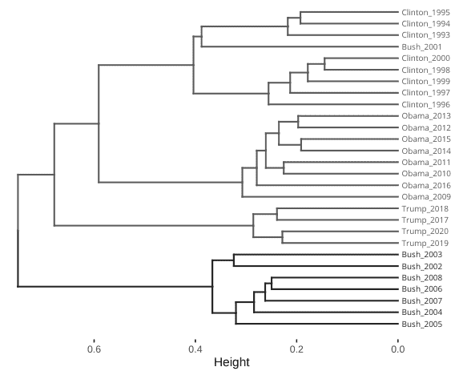

从图10.1的右侧开始，每篇演讲最初都在其自身簇中——与自底向上聚类预期一致。第一个簇（即两个文档首次被分组的情况）包含了克林顿1998年和2000年的演讲。我们知道这一点，因为如果我们“从右到左阅读”，它们是在一条线下合并的前两篇演讲。这一聚类过程持续进行，直到所有演讲都在一个簇中。

如图所示，我们在哪里“剪切”树状图会导致不同的聚类解。例如，在0.1处（沿x轴）剪切树状图会创建28个簇——每个文档一个。但在0.6处剪切则会创建三个簇（因为如果在x = 0.6处切片，我们会穿过三条水平线）。不可避免的问题是：在哪里剪切？

决定k的两种主要方式是：解释性方式和统计性方式。首先，我们可以将聚类解与领域知识和理论进行比较。例如，布什2001年的演讲与克林顿1994年和1995年的演讲是否应该在同一个簇中？他们在谈论什么？它们是否发生在相似的社会、政治、文化和/或经济背景下，从而解释语义相似性？

还有许多“拟合统计量”可以指导k的决策：例如轮廓宽度统计量、差距统计量和伽马指数。

14 NbClust提供30种不同的拟合统计量（Charrad 等人，2014年）。

我们将重点介绍我们最喜欢的一种：**轮廓宽度**统计量。

对于给定解中的每个文档，我们通过计算该文档与其簇中其他文档之间的平均余弦距离来计算其轮廓宽度。称其为c_i。然后，我们按簇计算该文档与所有其他文档之间的平均余弦距离。该文档与其他簇之间的最小平均距离是c'_i。该文档的轮廓宽度是通过用c'_i减去c_i，然后将差值除以这两个值中较大的一个来计算的。

然后，我们可以计算所有文档轮廓宽度的平均值。值范围从-1到1，其中接近1的值表示极佳的平均簇位置，接近-1的值表示非常差的平均簇位置。如果我们纯粹基于轮廓宽度来决定k（这在实践中可能不是我们想要做的），我们会希望选择平均值最大的k。

(平均)轮廓统计量推荐多少个簇？我们可以使用`fviz_nbclust()`来确定这一点。为了使其工作，我们首先想要定义一个函数，指定我们要以不同k值迭代执行带有Ward方法的层次聚类。


然后我们将该函数传递给 `fviz_nbclust()`，在那里我们还指明我们想要“silhouette”，我们想要从一个簇到 `k.max` 获取平均轮廓宽度，并且我们有一个距离矩阵，我们用 `diss` 表示它。我们将 `k.max` 设置为 20，还必须提供原始 DTM。^15

15 代码改编自 Lopez (2017)。

```
ward_link <- function(diss, k) {
hcut(diss, k, hc_method = "ward.D2")
}
fviz_nbclust(dtm_sotu,
FUNcluster = ward_link,
method = "silhouette",
diss = cos_sotu,
k.max = 20
)
```

图 10.2: 层次聚类的轮廓宽度。

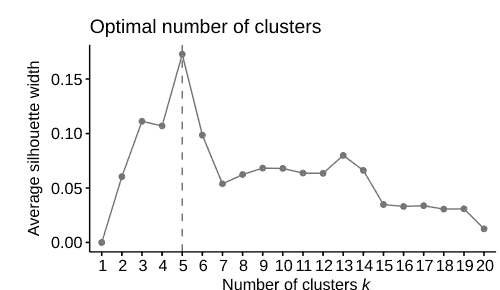

最佳统计拟合是五个簇（参见图 10.2）。如果我们想将文档分组为尽可能少但又尽可能分散的组，五组是我们的最佳选择。现在让我们创建它。

```
hier_sotu <- cos_sotu |>
as.dist() |> hcut(k = 5, hc_method = "ward.D2")
```

让我们假设，从表面上看，这些簇在实质和/或理论上是有意义的。如果不是，那么统计拟合可能不是决定簇数量的最佳选择。事实上，在大多数社会科学应用中，解释效度是衡量簇拟合度的最佳指标。^16

16 请记住：文本分析是关于映射，而非挖掘，因此不同的聚类解可以带来不同的解释！也许有些比其他更与我们的研究问题相关。

我们可以深入探讨这些簇 *意味着*什么。我们从 Jones (2021) 借用了代码并将其制成一个函数。首先，计算每个唯一单词占语料库总词数的比例（这就是 `prop`）。对于每个簇（`k`），我们将 DTM 子集化为仅包含该簇中的文档。然后我们计算该簇中每个唯一单词占该簇 *总词数* 的比例，然后减去每个单词在语料库中的比例。^17

17 这是每个单词在簇中出现的概率与在语料库中出现的所有概率之间的差异。

```
get_clust_words <- function(dtm, clusters, n_words) {
  prop <- colSums(dtm) / sum(dtm)
  k <- unique(clusters)
  words <- lapply(k, function(x) {
    sub <- dtm[clusters == x, ]
    res <- colSums(sub) / sum(sub) - prop
    res <- names(sort(res, decreasing = TRUE))
    res <- paste(res[seq.int(n_words)], collapse = ", ")
    return(res)
  })
  return(data.frame(
    cluster = k,
    size = tabulate(clusters),
    top_words = unlist(words)))
}
```

```
get_clust_words(dtm_sotu, hier_sotu$cluster, n_words = 5)
```

## 表 10.1: 五个簇和高频词（层次聚类）

| 簇 | 文档数 | 高频词 |
|---|---|---|
| 1 | 4 | people, care, health, government, work |
| 2 | 5 | must, children, century, ask, challenge |
| 3 | 7 | iraq, terrorists, america, terror, freedom |
| 4 | 8 | jobs, energy, get, like, businesses |
| 5 | 4 | american, thank, great, administration, united |

快速查看高频词似乎表明，区分国情咨文的五个一般主题是：医疗保健政策、社区及其挑战、恐怖主义与国家安全、经济与就业，以及“让美国再次伟大”（MAGA）话语。

## k-均值聚类

层次聚类的替代方案是 k-均值聚类。两者都是“硬”划分：每个文档仅属于一个簇。不过，k-均值簇是通过递归移动文档来形成最“紧凑”簇的。使用此算法，组内的文档将非常相似。不过，与层次聚类不同，我们并不试图最大化组间差异。

18 启动聚类有非随机方法（例如，Hartigan 1975:88; Pena et al. 1999）。

19 k-均值聚类有不同版本。base R 函数 kmeans() ——我们使用的函数——默认采用 Hartigan-Wong 算法（1975；1979）。

20 我们也将使用默认算法 Hartigan-Wong，但可以通过 algorithm = 参数指定其他算法。

21 我们可以设置 nstart =，它会重新运行初始聚类 nstart 次，并使用 SSE 最小的初始簇。

首先，我们必须选择 k 个簇。然后，每个文档被随机^18 分配到 k 个簇中的一个。接着，我们计算簇中所有文档的向量均值或“质心”。使用典型的 DTM，这些向量是词频计数。结果是 k 个均值。该算法最小化簇中所有文档的误差，以找到最“紧凑”的解。^19

误差是每个文档向量与簇质心之间的平方差。然后我们对这些误差求和，得到“平方误差和”（SSE）。每个文档被移动到新簇，以查看是否能减少 SSE，并留在导致 SSE 最大减少的簇中。一旦所有文档都被评估（如适用，则移动），k 个向量均值和 SSE 会被重新计算。该算法持续进行，直到 SSE 无法进一步最小化——即，簇尽可能紧凑。

让我们继续使用我们的国情咨文示例。我们将使用 base R 中的 kmeans()。除了 DTM 之外，我们还需要提供 k。让我们从 k = 5 开始，因为轮廓宽度统计支持该数字。^20 当我们将文档随机排序到初始簇时，我们将使用 set.seed() 来复现聚类解。^21

```
set.seed(589901)
kmeans_sotu <- kmeans(dtm_sotu, 5)
```

我们现在可以查看每个簇中包含哪些演讲。

```
kmeans_sotu$cluster
```

这些簇似乎是根据发表演讲的总统来区分的。让我们看看相对于整个语料库，每个簇特有的单词。我们将使用与之前相同的函数，只不过这次提供 k-均值的簇（参见表 10.2）。

```
get_clust_words(dtm_sotu, kmeans_sotu$cluster, n_words = 5)
```

## 表 10.2: 五个簇和高频词（k-均值聚类）

| 簇 | 文档数 | 高频词 |
| :--- | :--- | :--- |
| 4 | 4 | people, work, say, welfare, cut |
| 5 | 8 | must, century, ask, st, children |
| 2 | 8 | iraq, terrorists, must, america, security |
| 3 | 4 | jobs, energy, get, like, businesses |
| 1 | 4 | american, thank, great, administration, united |

比较层次聚类（HC）和 `$k$-means` 聚类（KC）的高频词。我们看到一一对应关系：

- HC #1 对应 KC #4
- HC #2 对应 KC #5
- HC #3 对应 KC #2
- HC #4 对应 KC #3
- HC #5 对应 KC #1

我们也可以通过文档位置看到这种对应关系：只有两篇演讲有所不同。这表明我们的语料库中的演讲非常独特，形成了内部紧密、外部疏远的组。

```
data.frame(hierarchical_clusters = hier_sotu$cluster,
           kmeans_clusters = kmeans_sotu$cluster) |>
  table()
```

| 层次聚类 | 1 | 2 | 3 | 4 | 5 |
|---|---|---|---|---|---|
| 1 | 0 | 1 | 3 | 0 | |
| 2 | 0 | 0 | 0 | 1 | 4 |
| 3 | 0 | 7 | 0 | 0 | 0 |
| 4 | 0 | 0 | 8 | 0 | 0 |
| 5 | 4 | 0 | 0 | 0 | 0 |

簇就像任何分类变量一样。我们可以按簇对语料库进行分层，以探索组内模式，或者将簇变量扔进我们喜欢的回归模型中——随我们喜欢。

## 主题建模

- tidyverse
- tidytext
- text2map
- lsa
- topicmodels
- topicdoc

层次聚类和 `$k$-means` 聚类之美在于其简单性。但也存在缺陷。其中之一是，这些聚类方法将每个文档分配到单个簇中。重新考虑图 10.1。在五个簇处切割树状图，使特朗普的演讲成为“MAGA”演讲。但是，如果在两个簇处切割呢？我们仍然会得到“恐怖主义与国家安全”簇——基本上是 9/11 之后布什的所有演讲——但我们会有一个混合医疗保健政策、社区、MAGA 和经济与就业主题的无定形第二簇。这对于大多数实证应用来说是一个过于笼统的簇。但是，这些演讲中每一个真的只涉及一件事吗？显然不是。

存在模糊聚类的形式，给定 $k$ 个簇时，我们衡量每个文档与每个簇的相关程度。例如，如果我们按主题对科幻小说进行聚类，我们希望将


巴特勒的 *种籽的比喻* 部分涉及“气候变化”，部分涉及“不平等。”

最流行的模糊聚类形式是 **主题建模**。有多种主题建模方法。它们都共同着重于挖掘语料库的 *潜在主题*。这些都是降维方法，目标是找到词共现组织的主要变化轴，即维度。我们可以把这些维度称作各种事物——类别、主题、标签——但我们将统一使用“主题”。

大多数所谓的“主题建模”都是概率模型。不过，我们将先从一种非概率的主题建模形式开始，但这种形式仍然允许主题以不同程度出现在文档中。

## 基于 LSA 的主题建模

最基本的主题建模形式是对 DTM 使用 *奇异值分解* (SVD)。22 这种方法已经存在很长时间了，只是名字不同：*潜在语义分析* (LSA) (Deerwester et al. 1990)，也称为 *潜在语义索引*。

假设 DTM 中有 d 个文档和 t 个术语（即 d 行和 t 列），则方形文档-主题矩阵23 将有 d × d 个主题，而方形主题-术语矩阵将有 t × t 个主题。对角矩阵的对角线上非零项的数量等于文档或术语的数量，取较小者（通常是文档）；对角线的其余部分——包括非对角项——均为零。

我们尚未降低 DTM 的维度——反而，我们增加了它！首先，我们可以忽略主题-术语矩阵中超出文档-主题矩阵维度的主题（奇异向量）（或者反之，如果我们有比术语更多的文档）。这些主题的奇异值为零。因此，现在我们剩下 d × d 和 t × d 两个矩阵。24

请回顾，奇异向量和奇异值是按秩排序的：这意味着文档-主题矩阵的第 k 个主题和主题-术语矩阵转置的第 k 个主题对应第 k 个奇异值，并且这些是按 *解释的方差* 排列的。不过，我们仍不知道想要保留多少个主题。这和聚类一样，是一个开放问题。我们希望主题有意义（我们很快会讲解解释问题）。我们还希望丢弃奇异值很小的主题，因为它们在 DTM 的语义结构中解释的方差很小。

22 参见“数学基础”。

23 在 LSA 术语中，SVD 的“维度”或“奇异向量”称为“主题”。

24 非零奇异值的数量是原始 DTM 的 *秩*。

如果对每个奇异值取平方，然后除以平方奇异值之和，那么我们可以将奇异值表示为 *该主题解释的 DTM 总方差的比例*。我们将保留主题数量，使得即使是“最小”的主题也能解释合理的方差量。

确定 *k* 后，我们需要获取该 *k* 的顶部术语。首先，我们将转置主题-术语矩阵。然后，对于每一列，我们将按降序排序术语的载荷（即其在该主题上的“权重”）。我们将保留足够的术语来解释该主题。然后，我们对文档-主题矩阵<sup>25</sup> 重复此过程，以找到在各个主题上载荷最高的文档。这些文档是精读的候选者。让我们用我们的 SOTU 语料库<sup>26</sup> 来逐步演示一个示例。

```r
data("data_corpus_sotu", package = "quanteda.corpora")
```

无需转置此矩阵，因为维度已经在列中。

```r
df_sotu <- tidy(data_corpus_sotu) |>
  filter(Date >= "1993-02-17") |>
  mutate(
    year = gsub("\\d+-.-.*", "\\1", Date),
    doc_id = paste0(President, "_", year),
    text = tolower(text),
    text = gsub("\\w+[\\d.]+\\w+", "", text),
    text = gsub("[[:punct:]]+", "", text),
    text = gsub("[[:digit:]]+", "", text),
    text = str_squish(text)
  )
```

请注意，预处理保留了单词间的标点，并删除了 Snowball 停用词表中的单词。

```r
dtm_sotu <- df_sotu |>
  dtm_builder(text, doc_id) |>
  dtm_stop(stop_list = get_stoplist("snowball2014"))
```

Base R 提供 `svd()`。还有专门用于 LSA 的包，例如 `lsa` —— 包含将 SVD 应用于 DTM 的便捷函数。我们将同时使用两者来展示它们的等效性。让我们将 DTM 传递给 `svd()`。我们将使用原始术语频率作为权重方案。<sup>27</sup>

在信息检索研究中使用 LSA 时，DTM 通常按 *tf-idf* 分数加权。

```r
svd_sotu <- svd(dtm_sotu)
lengths(svd_sotu)
```

| d | u | v |
|---|---|---|
| 28 | 784 | 243768 |

查看结果对象 `svd_sotu`。我们会看到三个矩阵：奇异值的对角矩阵（`$d`）、文档-主题矩阵（`$u`）和主题-术语矩阵（`$v`）。我们还会看到共有 28 个主题——正如预期，因为对一个 $28 \times 9477$ 的 DTM 进行 SVD 会产生 28 个非负奇异值（行或列的长度，取较小者）。让我们看看方差解释的分布。请回顾，我们是通过将奇异值取平方并除以平方奇异值之和来完成这一点的。

```r
prop.table(svd_sotu$d^2) |> head()
```

```
[1] 0.70084810 0.03687220 0.03266792
0.02435380 0.02101393 0.01654950
```

维度 #1 占 DTM 方差的 70% 以上。其余维度的解释力显著下降：接下来的三个维度合计仅解释 10%。

可能会想只保留第一个维度。不过，`lsa` 建议采用略有不同的策略。让我们先使用 `lsa` 生成 SVD。该函数期望的是 TDM 而不是 DTM，因此我们将先转置我们的 SOTU DTM。28

28 无论输入是 DTM 还是 TDM，lsa() 都会给出相同的输出，但会错误地标记 TDM 的输出。因此，我们将提供 TDM 以避免该混淆。

```r
lsa_sotu <- lsa(t(dtm_sotu))
# quick look
lengths(lsa_sotu)
```

| tk | dk | sk |
|---|---|---|
| 69648 | 224 | 8 |

将 `lsa_sotu` 与 `svd_sotu` 进行比较，我们会发现它们几乎相同。

- `svd_sotu` 中的 `$d`（奇异值向量）是 `lsa_sotu` 中的 `$sk`。
- `svd_sotu` 中的 `$u`（文档-主题矩阵）是 `lsa_sotu` 中的 `$dk`。
- `svd_sotu` 中的 `$v`（术语-主题矩阵）是 `lsa_sotu` 中的 `$tk`。

请注意一个显著差异：`lsa_sotu` 中只有八个维度。这是因为 `lsa()` 保留了在原始 DTM 中至少解释 50% 方差的维度。

不过，按照上面的策略，这应该只会得到一个主题——而不是八个。区别在于 `lsa()` 不会对奇异值取平方；相反，每个奇异值除以奇异值之和。因此，如果我们对 `svd_sotu$d` 应用 `prop.table()`，如前面一样但不取平方，我们应当会看到前八个主题至少解释 50% 的方差，而前七个主题则不足 50%。

```r
prop.table(svd_sotu$d)[1:8] |> sum() # first 8 dimensions
prop.table(svd_sotu$d)[1:7] |> sum() # first 7 dimensions
```

果然，使用这种策略，前八个主题解释了 52% 的方差，而前七个主题解释了 49%。那就是八个主题了。

每个术语和每个文档在这些主题上都有载荷。虽然这些载荷不是概率，但它们确实意味着文档涉及多个主题。

让我们继续解释我们的主题。对于术语-主题矩阵中的每个主题，我们将按降序排序术语（行），并关注载荷最高的 10 个术语。不过在此之前，我们要面对 LSA 的一个不足之处：文档-主题矩阵和术语-主题矩阵中没有什么能阻止出现负值。负值是否表示不相似性，还是说绝对值才重要？

这些尚未有定论：一些人建议关注维度上绝对载荷最大的术语和文档；另一些人建议只关注正载荷最高的术语和文档。问题是：一个主题是维度的一个“极”吗？还是说一个主题就是 *该维度*，而两个极是该主题的不同端点？例如，关于贫困的讨论是在从财富到匮乏的光谱上，还是仅仅涉及匮乏？这是一个我们的研究目标将指导我们选择的情况。

我们将关注绝对值最大的术语来定义主题。我们还将使用维度的散点图，看看极点是否有助于解释主题内部的对比。我们将使用 for 循环获取所有主题的前 4 个术语。

```r
top_names <- paste0("V", seq.int(8))
for (i in top_names) {
  abs(lsa_sotu$tk) |>
  as.data.frame() |>
  arrange(desc(get(i))) |>
  rownames() |>
  head(4) |>
  print()
}
```

```
[1] "people" "new" "can" "america"
[1] "must" "jobs" "children" "ask"
[1] "america" "people" "work" "iraq"
[1] "people" "now" "health" "government"
[1] "thank" "people" "american" "america"
[1] "plan" "us" "must" "care"
[1] "must" "ask" "help" "challenge"
[1] "government" "health" "care" "new"
```

跨主题存在一些一致的词汇——例如，“american”和“people”。29 国情咨询演说非常程式化且套路化。其他词汇语义不够丰富：例如，像“must”这样的情态动词。因此，让我们从 DTM 中移除一些词汇并重新进行分析。这将优先体现演说之间的差异。

29 即使从 Snowball 停用词表中移除了单词，我们的语料库中仍会存在共同单词。

```r
to_remove <- c(
  "will", "must", "can", "american", "america",
  "year", "people", "country", "also", "now", "have",
  "thank", "good", "new", "come", "get", "know", "would",
  "just", "let", "make", "congress", "like", "every",
)
```


"take", "americans", "st", "us", "government", "these"
)
dtm_sotu_sub <- dtm_sotu %>% dtm_stopper(stop_list = to_remove)
# redo the LSA
lsa_sotu_sub <- lsa(t(dtm_sotu_sub))
```

```
top_names <- colnames(as.data.frame(lsa_sotu_sub$tk))
for (i in top_names) {
abs(lsa_sotu_sub$tk) |> 
as.data.frame() |>
arrange(desc(get(i))) |>
rownames() |>
head(5) |>
print()
}
```

```
[1] "years" "work" "one" "world" "tonight"
[1] "children" "say" "ask" "work" "united"
[1] "jobs" "ask" "children" "security" "iraq"
[1] "health" "care" "first" "tonight" "security"
[1] "health" "century" "welfare" "help" "care"
[1] "plan" "care" "work" "tax" "health"
[1] "challenge" "want" "ask" "help" "gun"
[1] "tax" "health" "care" "last" "world"
[1] "security" "social" "century" "challenge" "children"
```

30 此处我们可以使用任意大小的 n-grams，而不仅仅是 unigrams。

这些主题看起来更好。30 它们可能不如可能的那样彼此区分开来——例如，有些主题似乎与经济和税收削减有关，但它们之间没有区别。这可能意味着某些主题应该合并，或者有些主题过于笼统，必须进一步分解。这是一个统计标准并不总是与“直观判断”一致的示例。

通常，我们会在不同的模型规格之间进行迭代：使用不同的预处理、阈值和 k 个主题。不过，我们想避免“猜测”。我们绝不应该仅仅依靠顶部术语列表来为主题赋予含义。我们需要阅读原文文本。

让我们选一个主题作为例子。有三个主题将“children”列为顶部词汇。主题 #9 似乎主要关于儿童、教育以及他们面临的挑战。我们暂且将其称为“future of education”主题。但我们不应仅基于 5 个词的列表来进行解释。我们将做两件事：将此主题与其他主题进行比较，并找出在此主题上负载最高的演讲。

首先，是否有另一个关于“future of education”的主题？很有可能，因为还有两个主题共享关键词“children”：主题 #2 和 #3。由于 LSA 建立在 SVD 之上，我们可以将我们的主题概念化为形成一个 *潜在* 空间。为了可视化这个空间，我们将按各主题中的负载创建单词散点图。这会在 *两个维度* 上“展开”我们的术语，从而能够区分具有相似顶部词汇的主题。

为了节省篇幅，我们将比较主题 #9（我们暂定的“future of education”主题）与主题 #2。我们将绘制每个术语在主题上的原始负载，而非其绝对值。我们还将使用不同颜色对在主题上负载较高的单词进行着色（任意使用绝对值大于 0.1 的标准）。在两个主题上都负载较高的单词使用各自的颜色。在任一主题上都不负载较高的单词以透明灰色打印。图表如图 10.3 所示。

```
df_sotu_lsa <- data.frame(
  term = rownames(lsa_sotu_sub$tk),
  topic9 = lsa_sotu_sub$tk[, 9],
  topic2 = lsa_sotu_sub$tk[, 2] ) |> mutate(abs9 = abs(topic9),
       abs2 = abs(topic2),
       color = case_when(
         abs9 > .1 & abs2 <= .1 ~ "high9",
         abs9 <= .1 & abs2 > .1 ~ "high2",
         abs9 > .1 & abs2 > .1 ~ "both",
         TRUE ~ NA_character_),
       alpha = case_when(
         abs9 <= .1 & abs2 <= .1 ~ .6,
         TRUE ~ 1)
)
```

```
df_sotu_lsa |>
  ggplot(aes(topic9, topic2, label = term)) +
  geom_text(aes(color = color, alpha = alpha)) +
  geom_hline(yintercept = 0, linetype = "dashed") +
  geom_vline(xintercept = 0, linetype = "dashed") +
  labs(x = "Topic #9", y = "Topic #2") +
  guides(alpha = "none", color = guide_legend(nrow = 2)) +
  scale_colour_discrete(
    breaks = c("high9", "high2", "both", NA),
    labels = c("Loads High on #9", "Loads High on #2",
               "Loads High on Both", "Loads High on Neither"),
    na.value = "gray50"
  )
)
```

主题 #2 的一个极点涉及与主题 #9 类似的内容。主题 #2 的另一个极点似乎更关注恐怖主义、国家安全，也许还有美国例外主义。看来这个主题区分了外国问题和国内问题。虽然主题 #9 关注教育的未来，但主题 #2 可以概念化为“外国问题与国内问题”主题。

假设我们与主题 #3 的比较让我们很少有理由怀疑主题 #9 的“future of education”解释。现在我们可以阅读该主题的顶部负载文档（按绝对值），看看是否会得出不同的结果（输出在页边）。

图 10.3：比较主题 #9 与主题 #2。

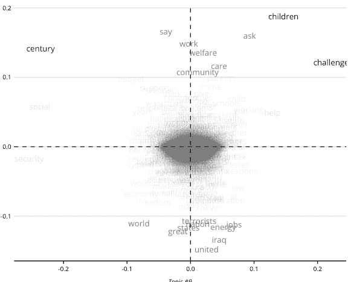

- "Clinton_1999"
- "Clinton_1996"
- "Clinton_2000"
- "obama_2015"

```
abs(lsa_sotu_sub$tk) |> 
as.data.frame() |> 
arrange(desc(v9)) |> 
rownames() |> 
head(4) |>
```

克林顿 1999 年的演讲在此主题上的负载最高。现在是阅读这篇演讲的好时机。儿童、教育和未来究竟是如何被讨论的？这与我们对主题的最初解释是否吻合？让我们来看看。

```
df_sotu |> filter(doc_id == "Clinton_1999") |> select(text)
```

这篇演讲很长，因此我们不会在此打印出来。但演讲的部分内容围绕如何处理当时 700 亿美元的盈余——政府收入超过债务的部分。他建议将部分资金用于社会保障和医疗保险，以加强为后代提供的安全网和福利。

在下文摘录中，我们也可以看到对教育的关注。

如今，我们的公立学校中来自更多元背景的儿童比历史上任何时候都多。他们的教育必须提供知识，并培养创造力，以使整个国家在新经济中蓬勃发展。

总而言之，这个主题确实带有“future of education”的元素——但似乎比那更为笼统。鑒于对投资于儿童未来的关注，也许“securing our children’s future”是对该主题更好的解释。

让我们再看一份文件，看看是否对我们的解释过于具体化。31 我们将使用负载较高的另一篇演讲：布什 2005 年的演讲。

```
df_sotu |> filter(doc_id == "Bush_2005") |> select(text)
```

我们这一代人蒙受了福祉——机遇的扩大、医学的进步，以及父母牺牲所换来的安全……

……在未来的几个月里，在一个又一个议题上，让我们做美国人一直所做的事，为我们的孩子和孙辈建设一个更美好的世界。

这确实看起来像是一个“securing our children’s future”主题。请回顾，LSA 试图使用尽可能少的维度来解释我们的 DTM 中的变化。这是基于意义向量空间方法的“变化”的空间解释。

LSA 作为一种主题建模形式有着悠久的历史。然而，对于大多数研究人员来说，LSA 可能不是他们想到主题建模时所想的内容。原因在于，在 2000 年代初期，一种新的主题建模形式——一种明确自称为主题建模的形式——出现了，即隐性狄利克雷分配，简称 LDA（Blei 等人，2003 年）。现在让我们探讨一下。

## 使用 LDA 进行主题建模

LDA 出现部分原因是 LSA 的不足之处。例如，在 LSA 中，没有什么能阻止奇异向量（无论是术语还是文档）中出现负值。以绝对值的方式解释奇异向量有点棘手。32 它们在潜在空间中为术语/文档定义一个点。较大的值表示术语/文档在其上负载较高，因此对于确定主题含义具有重要意义——但任何单个坐标本身都是不可解释的。33

为了解决这些问题，已提出许多 LSA 的替代方案，包括非负矩阵分解（Lee 和 Seung，1999 年）和概率 LSA（Hofmann，2001 年），但 LDA 是唯一流行下来的——至少在社会科学中是如此。34 因此，我们将在此处将注意力集中于此。

31 实际上，我们希望每个主题阅读更多文档，以便对维度所捕捉到的主题进行稳健的解释。

32 例如，术语“security”在主题 #9 上的主题负载（我们的“securing our children’s future”主题）为 -0.254，术语“challenge”在该主题上的负载为 0.221。那么，-0.254 和 0.221 究竟是什么？

33 有人认为，SVD 在某些任务上表现不佳，例如寻找词语相似性（Gamallo 和 Bordag，2011 年）。

34 例如，请参见期刊《Poetics》2013 年的专刊（Mohr 和 Bogdanov，2013 年）。


LDA，以及源自它的大多数主题模型算法，遵循生成式贝叶斯模型。这意味着该算法（1）假设一个文档生成过程，并且（2）基于该过程，使用迭代方法来最大化我们在 DTM 中观察到的数据的可能性。

首先，存在文档生成过程。在 LDA 中，我们假设对于任何给定文档，我们：
- 随机选择一组 k 个主题上的概率分布（其中 k 的大小由研究人员选择）。
- 我们随机从分布中选择一个主题。
- 然后从该主题中随机选择一个词（Blei 2012:78）。

我们将此过程应用于文档中的每个词，仿佛这就是写作任何东西的方式。

让我们通过这个想法来演示。假设我们正在写一个关于僵尸的故事。生成性假设是，我们首先确定故事中可能涵盖的主题范围。这可能包括“吃大脑”、“僵尸末日”、“传染性病毒”和“消费主义”。我们也更可能讨论某些主题而非其他主题。例如，如果量化它，我们可以说我们有 40% 的概率写关于吃大脑，10% 的概率写关于僵尸末日，26% 的概率写关于传染性僵尸病毒，以及 24% 的概率写关于消费主义（将僵尸作为对美国大众消费的批判）。这构成了上面步骤（1）中文档关于 k 个主题（这里 k = 4）的概率分布。

在此基础上，我们选择一个主题来写作。在我们的示例中，最可能的候选是“吃大脑”，因为它被选中的概率最高（40%）。在该主题中，我们更可能使用某些词而非其他词。例如，在这个主题中，我们更可能使用 "brains"、"skull" 和 "gore" 这样的词，而不是 "virus"、"contagious" 或 "lab" 这样的词。因此，在该主题中，我们有另一个概率分布——但不是我们的文档在一组 k 个主题上的分布，而是“吃大脑”主题在 ν 个词上的分布，其中 ν 是我们的词汇表。在这个主题-词分布中，我们选择一个词。在我们的例子中，我们会偏爱那些传达吃大脑相关内容的词。这就是被写在页面上的那个词。

写作是一个顺序过程，因此我们所要做的就是对文档中的每个词进行迭代。保持步骤（1）中的文档-主题分布，我们重复上面的步骤（2）和（3）来创建我们的僵尸故事。然后，对于语料库中任何其他僵尸故事（由我们或他人创作），我们再次选择关于那些 k 个主题的概率分布（即重复步骤（1）），然后回到步骤（2）和（3）。我们一遍又一遍地进行，直到每个故事完成。

请注意，我们假设两种分布：每个文档关于主题的概率以及每个主题关于词汇表的概率。这些是我们不 *初始* 从数据中推导的参数。35 因此，诀窍是随机选择这些分布，然后不断模拟这个文档生成过程——每次更新这些参数，直到最终得到观察到的 DTM 的最大对数似然。36

如果我们将文档-主题分布按行绑定，并将主题-词分布按行绑定，那么我们就得到了两个归纳推导的矩阵：一个 *文档-主题概率矩阵* 和一个 *主题-术语概率矩阵*。第一个通常被称为 *gamma*（或 *theta*）矩阵，而第二个被称为 *beta*（或 *phi*）矩阵。

这些矩阵是 LDA 的核心输出。我们将使用主题-术语概率矩阵来确定每个主题的内容，并使用文档-主题概率矩阵来确定哪些主题（或主题组合）37 在文档中更普遍。

让我们使用 LSA 示例中的同一份 SOTU 子集。回顾一下，我们有两个版本的 SOTU DTM：一个移除了非区分性术语（ `dtm_sotu_sub` ）和一个未移除那些术语（ `dtm_sotu` ）。我们将从后者开始，并查看这些术语（或新术语）是否必须被移除以获得更好的主题。

我们将使用 `topicmodels` 和 `LDA()` 函数。我们需要提供我们的 DTM 和我们的 *k*。我们上一个 LSA 模型给出了 9 个主题，所以就用这个。我们还可以指定估计方法——变分推断（ `"VEM"` ）或坍缩吉布采样（ `"Gibbs"` ）。原始 LDA 论文使用变分推断（Blei et al. 2003），这也是默认值。38 由于该过程存在随机性（与 LSA 不同），我们还将设置一个“种子”，以便我们的结果可以重现。

```
opts <- list(seed = 61761)
lda_sotu <- LDA(dtm_sotu, k = 9, control = opts)
```

让我们查看与每个主题相关概率最高的术语。`topicmodels` 为此有一个便捷函数：`terms()` 。

```
terms(lda_sotu, 5)
```

| | Topic 1 | Topic 2 | Topic 3 | Topic 4 | Topic 5 | Topic 6 | Topic 7 | Topic 8 | Topic 9 |
|---|---|---|---|---|---|---|---|---|---|
| [1,] | "people" | "must" | "must" | "people" | "america" | "must" | "american" | "american" | "new" |
| [2,] | "us" | "people" | "america" | "can" | "world" | "new" | "thank" | "america" | "can" |
| [3,] | "can" | "now" | "can" | "new" | "people" | "can" | "people" | "new" | "america" |
| [4,] | "new" | "work" | "security" | "us" | "must" | "people" | "one" | "one" | "jobs" |
| [5,] | "now" | "can" | "people" | "year" | "us" | "america" | "americans" | "country" | "work" |

如果我们从主题 #1 中随机选取一个词，被选中概率最高的词是 "people"。

不过，在继续之前，似乎我们又有一些非区分性词汇，它们出现在许多主题中。让我们移除 LSA 示例中的那个词向量，看看我们会得到什么。

```
lda_sotu_sub <- LDA(dtm_sotu_sub, k = 9, control = opts)
terms(lda_sotu_sub, 5)
```

| | Topic 1 | Topic 2 | Topic 3 | Topic 4 | Topic 5 | Topic 6 | Topic 7 | Topic 8 | Topic 9 |
|---|---|---|---|---|---|---|---|---|---|
| [1,] | "world" | "work" | "work" | "jobs" | "tonight" | "years" | "years" | "security" | "jobs" |
| [2,] | "one" | "years" | "health" | "years" | "one" | "children" | "one" | "world" | "one" |
| [3,] | "states" | "world" | "care" | "work" | "help" | "work" | "first" | "help" | "years" |
| [4,] | "united" | "jobs" | "years" | "one" | "great" | "ask" | "care" | "one" | "energy" |
| [5,] | "years" | "care" | "time" | "need" | "iraq" | "help" | "tonight" | "health" | "time" |

这些主题彼此之间有些可区分，但它们仍然看起来相当一般。如果我们想要更具体、更精细的主题，那么我们应该考虑增加 k。让我们再试一次，这次寻找 20 个主题。

```
lda_sotu_sub_20 <- LDA(dtm_sotu_sub, k = 20, control = opts)
```

这些 20 个主题中每个主题的顶级术语打印出来会相当大。让我们改为可视化。我们也可以借此机会查看这些术语（每个主题）相关的概率。

我们想要主题，也就是“beta 矩阵”。39 除了将这个矩阵处理成数据框之外，概率已经过对数处理，因此必须进行指数化。我们将使用 group_by() 配合 slice_max()，仅保留每个主题中概率最高的 10 个术语。

```
df_terms <- tidy(lda_sotu_sub_20, "beta")
df_top <- df_terms |>
```

35 这些分布是从 *狄利克雷分布* 中随机抽取的——因此得名该模型。
36 用迭代来做这件事有各种策略，即，坍缩吉布采样和变分推断。
37 因此，LDA 与 LSA 相似，它是模糊聚类。LDA 模型是“混合成员”（Blei et al. 2003）。每个词都会得到跨所有主题的概率向量，而每个文档都会被分配每个主题的概率。
38 最好使用两种估计类型来比较输出（Grimmer et al. 2022:149）。
39 它位于模型对象中的 @beta。使用 @ 而不是 $ 是因为 LDA() 的输出是 S4 类对象，一种更受限的 R 对象。tidytext 的 tidy() 是一个通用的“整理器”，为我们处理常见的文本分析对象，包括 S4 类对象。


group_by(topic) |> slice_max(n = 10, beta) |> ungroup() |> arrange(topic, beta) |> mutate(order = row_number())

现在，我们准备为每个主题创建一个条形图，使用 `facet_wrap()` 配合 `geom_col()`，但为节省空间，我们只展示前 4 个主题。条形图如图 10.4 所示。

```
df_top |> filter(topic <= 4) |> ggplot(aes(order, beta)) + geom_col(show.legend = FALSE) + coord_flip() + ylim(0, .013) + labs(x = NULL, y = "Probability of Term in Topic") + facet_wrap(~topic, scale = "free", ncol = 4) + theme(axis.text.x = element_blank()) + scale_x_continuous(breaks = df_top$order, labels = df_top$term)
```

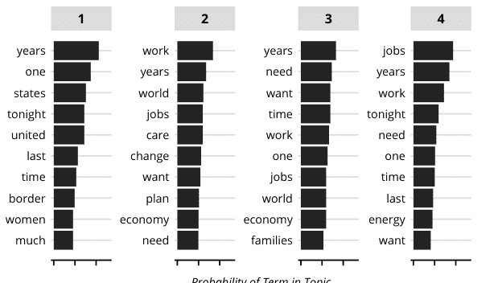

图 10.4：20 个主题解决方案的主要术语（前 4 个主题）。

这些看起来好了一点。仍然存在很多主题中都普遍出现的术语。这使得主题之间难以区分。

不过，在移除更多词汇之前，我们先看看问题是否出在我们的 _k_ 上。尽管通过对每个主题高概率文档的深入阅读，主题应始终能通过“眼球测试”，但我们也可以使用一些诊断统计量来帮助定位合适的 _k_。我们遵循 Roberts 及其同事（Roberts et al. 2014）的做法，推荐两种互补的统计量：*语义连贯性* 和 *独占性*。

**语义连贯性** 衡量主题中高概率术语在同一文档中出现的程度（Mimno et al. 2011）。40 高概率术语很少共同出现的主题可能暗示这是一个噪声主题。

40 为了避免对零取对数，通常会加上一个平滑数——一般是 1。虽然连贯性通常在 0 及以下范围，但这个平滑数允许在共现等于出现的极限情况下出现正连贯性。

如果对于给定的 k，这种情况在各个主题中都成立，那么连贯性值会更小，该 k 可能不是最佳选择。

相比之下，**独占性** 衡量主题倾向于垄断特定词语出现的程度（Bischof and Airoldi 2012）。更高的独占性得分意味着该主题最可能的术语更多地局限于该主题（它们在其他主题中的概率较低）。41

41 提出的独占性度量包括频率-独占性调和平均数（Bischof and Airoldi 2012:3）和 FREX 得分（Roberts et al. 2014:1068）。

连贯性和独占性是主题层面的统计量。如果我们对特定 k 的所有主题取平均值，就能看出哪个主题数量最好地平衡了内部一致性和主题分离度。让我们看看这个工作流推荐什么 k。首先，我们需要使用不同 k 估计多个主题模型。我们将从 k = 4 到 k = 16 获取模型，每次增加 2。我们还将创建一个新函数用于 `lapply()`。42

42 请注意，这段代码可能需要大约 20 分钟，因此请随意降低我们 k 的上限。

```
k_topic <- seq(4, 16, by = 2)
opts <- list(seed = 10001)
multi_lda <- function(k, dtm, opts) {
  print(k)
  return(LDA(dtm, k, control = opts))
}
lda_mods <- lapply(k_topic, multi_lda, dtm_sotu_sub, opts)
```

现在，我们使用 `topicdoc` 中的函数为每个模型获取诊断统计量。我们将使用每个主题的前 10 个术语来推导连贯性和独占性统计量。

```
diag_list <- lapply(lda_mods, topic_diagnostics, dtm_sotu_sub, 10)
names(diag_list) <- k_topic
df_diag <- bind_rows(diag_list, .id = "K")
```

然后，我们使用 `group_by()` 和 `summarize()` 计算每个 k 的平均连贯性和独占性。接着，我们将绘制每个 k 的统计图表，看看哪个主题最好地平衡了它们。

```
df_diag |>
  group_by(K) |>
  summarize(coherence = mean(topic_coherence),
    exclusivity = mean(topic_exclusivity)) |>
ggplot(aes(coherence, exclusivity)) +
  geom_text(aes(label = K)) +
  labs(x = "Coherence", y = "Exclusivity")
```

在图 10.5 中，最佳候选者是那些位于右上方的。尽管 k = 16 具有最高的独占性，但其连贯性较低。因此，我们选择 k = 10，因为它具有更好的平衡。我们可以使用已经估计的 10 主题解决方案；只需从 `lda_models` 列表中提取它。在我们的例子中，它是列表中的第 4 个元素。

```
lda_sotu_10 <- lda_models[[4]]
```

图 10.5：连贯性和独占性。

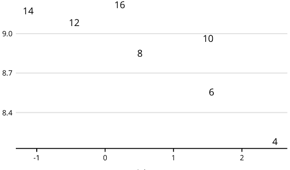

现在，让我们对 beta 矩阵使用 `tidy()`，然后提取每个主题中的前 10 个术语，最后按这些概率对得到的数据框进行排序。

```
df_terms <- tidy(lda_sotu_10, "beta")

df_top <- df_terms |>
  group_by(topic) |>
  slice_max(n = 10, beta) |>
  ungroup() |>
  arrange(topic, beta) |>
  mutate(order = row_number())
```

现在，我们可以创建一个条形图——如同 20 主题解决方案一样——并且只选择前 4 个主题（图 10.6）。

```
df_top |>
  filter(topic <= 4) |>
  ggplot(aes(order, beta)) +
  geom_col(show.legend = FALSE) +
  coord_flip() +
  ylim(0, 0.015) +
  labs(x = NULL, y = "Probability of Term in Topic") +
  facet_wrap(~topic, scale = "free", ncol = 4) +
  theme(axis.text.x = element_blank()) +
  scale_x_continuous(breaks = df_top$order, labels = df_top$term)
```

仍然有一些不具区分性的术语使主题难以解释。与其移除这些术语，不如尝试另一种解释策略。

**术语相关性** 是两个术语特定度量的总和：概率和提升度。我们已经讨论过概率：每个术语都有被分配到每个主题的概率。在某个主题中具有高使用概率的术语有助于确定该主题的内容。相比之下，提升度是衡量术语对每个主题有多 *独特* 的指标

图 10.6：10 主题解决方案（前 4 个主题）。

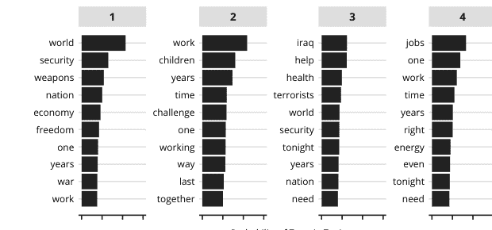

43 具体来说，用某个标量（称其为 λ）对术语的主题特定概率进行加权，并用该权重的补数（1 − λ）对同一术语的主题特定提升度进行加权。然后将这两个加权值相加，得到术语的相关性得分。

(Sievert and Shirley 2014:65)。它是术语在某个主题中的概率与该术语在所有文档中概率的比率。

提升度可能会给出特定于特定文档的术语。幸运的是，术语相关性意味着我们不必分别考虑高概率和高提升度。通过术语相关性，Sievert 和 Shirley（Sievert and Shirley 2014:66）提供了一种融合两个度量的方法。43

图 10.7：演讲涉及某个主题的概率。

| Speeches | 1 | 2 | 3 | 4 | 5 | 6 | 7 | 8 | 9 | 10 |
|---|---|---|---|---|---|---|---|---|---|---|
| Trump_2020 | 0 | 0 | 0 | 0 | 0 | 0 | 0 | 1 | 0 | 0 |
| Trump_2019 | 0 | 0 | 0 | 0 | 0 | 0 | 0 | 1 | 0 | 0 |
| Trump_2018 | 0 | 0 | 0 | 0 | 0 | 0 | 0 | 0 | 1 | 0 |
| Trump_2017 | 0 | 0 | 0 | 0 | 0.99 | 0 | 0 | 0 | 0.01 | 0 |
| Trump_2016 | 0.51 | 0 | 0 | 0.23 | 0 | 0.26 | 0 | 0 | 0 | 0 |
| Obama_2015 | 0 | 0 | 0 | 0 | 0 | 1 | 0 | 0 | 0 | 0 |
| Obama_2014 | 0 | 0 | 0 | 0 | 0 | 1 | 0 | 0 | 0 | 0 |
| Obama_2013 | 0 | 0 | 0.35 | 0.25 | 0 | 0.4 | 0 | 0 | 0 | 0 |
| Obama_2012 | 0 | 0 | 0 | 0.2 | 0 | 0.8 | 0 | 0 | 0 | 0 |
| Obama_2011 | 0 | 0 | 0 | 0.25 | 0.75 | 0 | 0 | 0 | 0 | 0 |
| Obama_2010 | 0 | 0 | 0 | 1 | 0 | 0 | 0 | 0 | 0 | 0 |
| Obama_2009 | 0 | 0 | 0 | 0 | 0 | 0 | 0 | 0 | 0 | 1 |
| Clinton_2000 | 0 | 0.03 | 0 | 0 | 0 | 0.97 | 0 | 0 | 0 | 0 |
| Clinton_1999 | 0 | 0 | 0 | 0 | 0 | 0 | 0 | 0 | 0 | 1 |
| Clinton_1998 | 0 | 0 | 0 | 0 | 1 | 0 | 0 | 0 | 0 | 0 |
| Clinton_1997 | 0 | 0 | 0 | 0 | 1 | 0 | 0 | 0 | 0 | 0 |
| Clinton_1996 | 0 | 1 | 0 | 0 | 0 | 0 | 0 | 0 | 0 | 0 |
| Clinton_1995 | 0 | 1 | 0 | 0 | 0 | 0 | 0 | 0 | 0 | 0 |
| Clinton_1994 | 0 | 0 | 0 | 0 | 0 | 0 | 0 | 0 | 1 | 0 |
| Clinton_1993 | 0 | 0 | 0 | 0 | 0 | 0 | 1 | 0 | 0 | 0 |
| Bush_2008 | 0 | 0 | 1 | 0 | 0 | 0 | 0 | 0 | 0 | 0 |
| Bush_2007 | 0 | 0 | 1 | 0 | 0 | 0 | 0 | 0 | 0 | 0 |
| Bush_2006 | 0.74 | 0 | 0.26 | 0 | 0 | 0 | 0 | 0 | 0 | 0 |
| Bush_2005 | 0.25 | 0.36 | 0.39 | 0 | 0 | 0 | 0 | 0 | 0 | 0 |
| Bush_2004 | 0 | 0 | 1 | 0 | 0 | 0 | 0 | 0 | 0 | 0 |
| Bush_2003 | 1 | 0 | 0 | 0 | 0 | 0 | 0 | 0 | 0 | 0 |
| Bush_2002 | 1 | 0 | 0 | 0 | 0 | 0 | 0 | 0 | 0 | 0 |
| Bush_2001 | 0 | 0 | 0 | 0 | 0 | 0 | 1 | 0 | 0 | 0 |

垄断某些主题。主题 #1 到 #3 由布什的演讲主导，而奥巴马的演讲主导主题 #4 和 #5。

LDA 的一个局限性是，主题之间（多少）相互独立。假设文档生成过程从狄里克莱分布中抽取文档-主题概率，其约束在于：一个主题的高概率或低概率无法预测另一个主题的高概率或低概率。这是一个严苛的约束，因为很容易想象主题会在文档中共同出现。我们将在下一章讨论结构主题建模时回到这个问题。


# 11 扩展归纳

归纳分析（INDUCTIVE analysis）是指在不对这些分组或关系抱有先入之见的前提下，寻找文本（或文本单元）的 *潜在* 分组，或文本（或文本单元）之间的关系。本章沿着这条路继续前进。在接下来的章节中，我们将扩展核心方法并以复杂的方式组合它们。

我们将回归主题建模，但着重估计主题 *参与度* 和 *内容* 如何随其他协变量而变化。例如，过去十年中，《华盛顿邮报》所涵盖的主题发生了哪些变化？我们还将使用 **词嵌入** 扩展在 **文本转数字** 中讨论的术语相似度量。我们将看到，词嵌入是寻找单词与文档之间关系及映射语义变化的灵活工具。例如，作者在两个世纪中如何以不同方式使用“网络”隐喻（Yung 2021）？

### 推断与主题模型

本节需要：

- tidyverse
- broom
- marginaleffects

### 使用协变量预测主题

本节将介绍研究人员可能将协变量（或“预测因子”、“自变量”）纳入其主题模型分析的几种方法。

我们已经完成了获取主题所需的所有工作。我们选择了一个算法——LDA，或者类似 CTM（Blei and Lafferty 2007）的东西，或者也许是针对短文本的位元主题模型（Yan et al. 2013），或者一个允许我们提供关键词的模型（Eshima et al. 2020）。我们用不同的 *k* 运行了模型，比较各解决方案的拟合统计量。我们已经解释了这些主题。那么现在怎么办？我们可以将这些主题视为任何其他变量。

我们可以看到主题可能如何塑造其他因素。例如，我们可能检验美国总统通信中的积极税收新闻对私人消费和投资的影响（Dybowski and Adämmer 2018）。我们还可以看到其他因素如何塑造主题。例如，我们可以使用联邦公开市场委员会会议记录来评估拥有私人银行经验的演讲者是否更可能讨论金融（Fligstein et al. 2017）。

请记住，主题建模会产生两个概率矩阵：文档-主题矩阵显示文档在各主题上的概率，主题-词矩阵显示主题在词汇表上的概率。我们假设大多数协变量在文档或作者层面，因此我们将关注文档-主题概率。

让我们探索一个基于 1880 至 1999 年英语小说的主题模型，¹ 由 Underwood 及其同事（2022）估计。该研究考察文化变化的程度是由“时期”——例如，1980 年代的文化——还是由“队列”——例如，出生于 1980 年代的人——所解释。他们的模型包含 200 个主题，² 每部作品都有协变量，如首次出版日期以及该作者是否为美国人。

各主题是针对每部作品的文本块估计的：每个卷跨越多行，每行对应一个（大约）10,000 词的文本块。出于空间考虑，我们只包含一个子集。不是对行进行随机抽样，而是随机抽取 1,000 部独特作品。

该研究的补充文件包含 200 个主题中的每个主题的标签和关键词。我们将关注一个主题——主题 #3，标记为“20 世纪末美国政治惊悚片”。该主题的较高概率表明作品更有可能属于美国政治惊悚片类型。

假设我们想评估该主题的时间趋势。语料库中较新或较旧的作品更有可能成为（或写得像）20 世纪末美国政治惊悚片吗？或者，我们也许想知道作者的人口统计特征是否与此主题相关？也许美国作者比其他地方的作者更有可能撰写此主题。最后，由于有些作品存在介于小说与非小说之间的“灰色地带”（Underwood et al. 2020:7），这个灰色地带的作品是否比其他作品更有可能属于此主题？让我们现在来调查这些问题。

让我们以该主题作为结果变量运行 OLS 回归。³ 预测因子是 (1) 首次出版日期，(2) 作者是否为美国人的二元变量（“False”或“真”），以及 (3) 作品为非小说的概率。感兴趣的主题是“V6”。对于日期，我们通过添加二次项（poly(firstpub, 2)）来允许大小和/或方向呈非线性。

```
data("stm_fiction_cohort", package="text2map.pretrained")
stm_fic <- stm_fiction_cohort |>
  mutate(us_national = factor(us_national))
lm(V6 ~ poly(firstpub, 2) + nonficprob + us_national,
   data = stm_fic) |> tidy()
```

| 项 | 估计值 | 标准误 | 统计量 | p 值 |
|---|---|---|---|---|
| 1 (截距) | 0.00174 | 0.000590 | 2.95 | 3.26e-3 |
| 2 poly(firstpub, 2)1 | 0.111 | 0.0117 | 9.51 | 1.44e-20 |
| 3 poly(firstpub, 2)2 | 0.0490 | 0.0116 | 4.21 | 2.79e-5 |
| 4 nonficprob | 0.00409 | 0.00173 | 2.36 | 1.84e-2 |
| 5 factor(us_national)True | 0.000758 | 0.000898 | 0.844 | 3.99e-1 |

作品收集自 HathiTrust 数字图书馆。

作者使用 MALLET（Mimno 2013），一个 Java 程序，来估计主题。

参见《数学基础》。

请注意，我们的所有估计均为正。关注出版日期（第二和第三项），我们发现较新的作品更有可能是 20 世纪末美国政治惊悚片——这种关联随时间推移而增大。4 非小说的概率（第四项）与此主题正相关。这很直观，因为政治惊悚片可能包含非小说细节，如对真实政治事件和地点的描绘。身为美国作者（第五项）似乎影响较小，但仍为正。

4 情况应当如此。如果 1800 年代的作品涉及此主题，那我们就会面临一个谜题。

现在让我们生成预测概率。我们将对每个出版年份获取三次概率：第一次当非小说概率等于第 25 百分位数，然后是第 50 百分位数（中位数），然后是第 75 百分位数。让我们在下面准备该结果变量。

```
# get the IQR value for the nonficprob variable
iqr_nonfic <- c(
  quantile(stm_fic$nonficprob, .25, na.rm = TRUE),
  quantile(stm_fic$nonficprob, .5, na.rm = TRUE),
  quantile(stm_fic$nonficprob, .75, na.rm = TRUE)
)
```

```
# create labels for the plot
lab_nfic <- c(
  "Nonfiction Probability at\\n25th Percentile",
  "Nonfiction Probability at\\n50th Percentile",
  "Nonfiction Probability at\\n75th Percentile"
)
names(lab_nfic) <- iqr_nonfic
```

让我们在出版日期与非小说概率之间添加交互效应（为简单起见，移除二次出版日期项）。我们将计算这些概率，控制美国国籍（假设作者为美国人），并关注 20 世纪后期。

```
df_md <- lm(V6 ~ firstpub * nonficprob + us_national, data = stm_fic)
df_prd <- predictions(model = df_md,
                      newdata = datagrid(
                        firstpub = seq(1975, 1999, by = 1),
                        nonficprob = iqr_nonfic,
                        us_national = "True")
)
```

现在，我们可以绘制概率图。它们在图 11.1 中可视化。

```
df_prd |>
ggplot(aes(x = firstpub, y = estimate)) +
geom_ribbon(aes(ymin = conf.low, ymax = conf.high), alpha = .2) +
geom_line() +
facet_wrap(~nonficprob,
       labeller = labeller(nonficprob = lab_nfic)) +
labs(x = "Date of First Publication",
     y = "Engaging 'Late 20c US Political Thriller'") +
scale_x_continuous(breaks = seq(1975, 1995, by = 5))
```

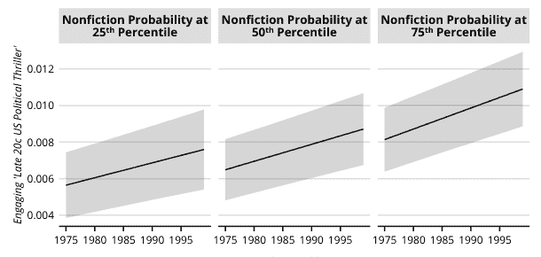

图 11.1：预测概率。

小说作品在后期年份更有可能属于（或至少读起来像）20 世纪末美国政治惊悚片。

### 主题流行度，条件于协变量

上面我们使用协变量来预测主题。然而，主题识别本身并不受这些协变量条件约束。结构主题建模，即 STM（Roberts et al. 2019），在主题估计中纳入文档级协变量，并估计这些协变量对主题流行度和主题内容的影响。

让我们简要讨论 STM 的基础知识，以便我们可以看到流行度和内容协变量在 STM 假设的数据生成过程中何时发挥作用。⁵

STM 是一个概率模型。⁶ 它试图通过找到最大化我们观察到的文档词频可能性的模型来反向工程数据生成过程。遵循 Roberts 及其同事（Roberts et al. 2016:991; Roberts et al. 2019:2–3），我们从已对该文档的“流行度”协变量条件化的逻辑正态分布中，为语料库中的每个文档随机抽取一个概率分布。

接下来，如果存在内容协变量（我们将在下一节讨论），STM 将文档在语料库词汇表上的主题分布分解为两个矩阵和一个数组（Roberts et al. 2016:991）。The

本节需要：

- tidyverse
- textclean
- textstem
- stringi
- tidytext
- text2map
- stm
- stminsights
- marginaleffects
- ggtern

⁵ STM 构建在 CTM 之上，在没有协变量时会归约为 CTM。有出色的统计概述（例如，Roberts et al. 2016, 2019）。

⁶ 像我们在上一章讨论的 LDA 模型一样，参见《核心归纳》。


矩阵和数组如下，其中 _k_ 是主题数量，_v_ 是词汇表长度，_c_ 是内容协变量中的级别数量：

- 1. 一个 _k_-by-_v_ 矩阵，表示每个主题中每个术语相对于该术语在语料库中的速率的偏差。
- 2. 一个 _c_-by-_v_ 矩阵，表示每个协变量级别中每个术语相对于该术语在语料库中的速率的偏差。
- 3. 一个 _c_-by-_k_-by-_v_ 数组，表示主题与协变量交互作用的速率偏差。^7

每个速率偏差都取对数，因此文档在词汇表上的分布是每个术语的这些对数速率偏差的 _指数化_ 之和。

最后，我们从先前绘制的文档特定概率分布中随机选取一个主题，然后从该主题在词汇表上的概率分布中随机选择一个词。我们对文档中的每个词都重复此过程，仿佛我们是作者。

STM 使用迭代算法^8 来寻找最佳拟合参数。感兴趣的参数是 (1) 文档-主题和 (2) 主题-词概率分布，^9 还有 (3) 主题-流行率系数和 (4) 主题-内容速率偏差。

现在我们已经了解了模型的基础知识，可以问：流行率和内容协变量对我的主题模型分析有何意义？让我们先从流行率开始。

主题 **流行率** 是协变量对文档涉及某个主题程度的影响。例如，我们发现，较新的小说作品，且那些介于小说与非小说之间的“灰色地带”作品，往往在“20 世纪末美国政治惊悚小说”主题上花费更多词汇。然而，STM 在估计主题时会纳入这些协变量 _在估计时_。

为演示主题流行率，让我们使用 Bohr 和 Dunlap (2018) 的一个例子。研究人员在环境社会学文章的摘要上使用 STM，以绘制该领域的主要主题及其随时间变化的流行率（以及其他内容）。他们使用 Web of Science 的社会科学引文索引 (SSCI) 抓取了 1990 年至 2014 年间发表的、包含与环境社会学相关关键词的英文摘要。研究人员仅保留了 SSCI 在“社会学”类别下列出的期刊。^10 该语料库还为每篇文章提供了三个协变量：发表年份、每年引用次数和期刊排名。^11

让我们加载数据并进行数据处理。我们将把花括号引号替换为 ASCII 双引号，将文本音译为“基本拉丁”

^7 数组是具有任意维度的数据结构。矩阵是二维数组。这个数组是三维的。

^8 即，部分坍缩变分期望-最大化。

^9 通常，第一个矩阵称为 _beta_，但 stm 将第二个矩阵称为 _theta_，而大多数其他人称其为 _gamma_。我们称其为 gamma。

^10 我们的语料库版本包含 817 篇文章，尽管发表的文章仅包含 815 篇文章。

^11 期刊排名是作者下载文章时该期刊的 h5-index 分数 (Bohr and Dunlap 2018:3)。

ASCII 字符，将缩写替换为其全词形式，删除大写，删除标点符号，删除数字，删除多余空格，然后使用词典查找过程（即，不进行词性标注）进行词形还原，使用 Měchura 的英语词元-词典（即 `lexicon` 中的默认字典，`lemmatize_strings()` 使用），^12

```r
data("corpus_envsociology", package = "text2map.corpora")

df_env <- corpus_envsociology |>
  mutate(text = replace_curly_quote(abstract),
         text = stri_trans_general(text,
                                   id = "Any-Latin; Latin-ASCII"),
         text = replace_contraction(text),
         text = gsub("\\\\Ws\\\\W|", "", text),
         text = tolower(text),
         text = gsub("[[:punct:]]+", " ", text),
         text = gsub("[[:digit:]]+", " ", text),
         text = gsub("\\\\s+", " ", text)) |>
  mutate(lemma = lemmatize_strings(text))
```

^12 参见 Wrangling Words。

构建 DTM 后，我们将删除在语料库中只出现一次的词以及 Snowball 2014 停用词表中的词。我们还将删除“environment”和“environmental”——因为所有文章都关于环境社会学。

```r
our_sl <- c(get_stoplist("snowball2014"),
            "environment", "environmental")

dtm <- df_env |> dtm_builder(lemma, title) |>
  dtm_stopper(stop_list = our_sl, stop_hapax = TRUE)
```

现在我们可以估计模型。即使对于如此小的语料库，这个过程也可能需要一些时间。请做好准备。^13 我们通过将主题流行率条件化于发表年份、将主题内容条件化于期刊排名来估计主题。作者确定 25 主题解是最佳的，因此我们也将采用同样的方案。^14 我们将 `verbose` 设置为 `FALSE`，以便不查看每个期望步骤（“E 步”）和极大化步骤（“M 步”）。

^13 通过删除更多词可以加快算法速度。

^14 STM 开发人员提供了一些统计程序来帮助找到最佳 k，包括我们在前一章中介绍的一致性-排他性权衡。有关更多信息，请参阅他们在 *统计学软件期刊* (Roberts et al. 2019) 上的论文。

```r
set.seed(60601)

# this might take a while!
stm_env <- stm(
  documents = dtm,
  K = 25,
  data = df_env,
  prevalence = ~year,
  verbose = FALSE
)
```

现在让我们获取每个主题的顶级词项以开始解读。我们将使用 `tidytext` 包中的 `tidy()` 将术语-主题概率矩阵（beta）重塑为数据框。我们还将按主题分组，仅获取前五个词，然后将它们粘贴在一起。

```r
stm_beta <- tidy(stm_env, matrix = "beta") |>
  group_by(topic) |>
  slice_max(beta, n = 5, with_ties = FALSE) |>
  summarize(terms = paste0(term, collapse = ", "))
print(stm_beta, n = 15)
```

| 主题 | 词项 |
|---|---|
| 1 | scale, study, people, use, new |
| 2 | people, global, change, indigenous, much |
| 3 | research, policy, science, political, knowledge |
| 4 | change, climate, global, adaptation, community |
| . | . |
| . | . |
| . | . |
| 14 | social, movement, examine, organization, global |
| 15 | much, use, gender, policy, fish |

这些看起来像是连贯的主题。让我们看看两个主题随时间的流行率：主题 #4——我们称之为“气候变化”——以及主题 #14——我们称之为“社会运动”。“气候变化”和“社会运动”主题的参与度随时间如何变化？我们可以使用 estimateEffect() 获取估计值和置信区间，并使用 get_effects() 整理输出以便于可视化。

```r
df_effs <- estimateEffect(c(4, 14) ~ year, stm_env,
metadata = df_env)
df_effs <- get_effects(df_effs, variable = "year",
type = "continuous") |>
mutate(Topics = case_when(
topic == 14 ~ "Social Movements",
topic == 4 ~ "Climate Change"
))
```

```r
df_effs |>
ggplot(aes(x = value, y = proportion, fill = Topics)) +
geom_ribbon(aes(ymin = lower, ymax = upper), alpha = 0.5) +
geom_line(aes(linetype = Topics)) +
labs(x = "year")
```

环境社会学论文越来越多地讨论气候变化，越来越少地讨论社会运动（参见图 11.2）。此示例说明将流行率纳入主题建模如何随时间追踪一个领域的关注点。

## 基于协变量的主题内容

除了查看文档对某个主题的参与度如何随协变量变化之外，我们还可以建模主题内容如何随协变量变化。更准确地说，主题内容是协变量影响用于阐述主题的词汇的程度。也许，例如，美国

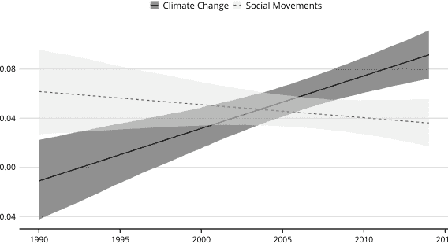

## 图 11.2：主题随时间变化的流行率。

作者撰写美国政治惊悚小说的方式与非美国作者撰写同一主题的方式截然不同。或者，也许，如果环境社会学文章发表在高排名期刊上，它们在阐述气候变化时更多地使用“灾难”或“危机”。

为演示，我们将使用期刊排名。该变量针对 31 种可能排名有 31 个级别。内容协变量，尤其是具有多个级别的协变量，会显著减慢收敛速度。因此，让我们首先将期刊排名重新编码为三个级别。

```r
df_env <- df_env |>
  mutate(rank = case_when(
    journal_rank <= 18 ~ "High",
    journal_rank > 19 &
    journal_rank <= 23 ~ "Middle",
    journal_rank >= 24 ~ "Low")
  )
```

^15 预训练版本位于 text2map.pretrained 。

```r
stm_env <- stm(
  documents = dtm,
  K = 25,
  data = df_env,
  prevalence = ~year,
  content = ~rank,
  verbose = FALSE
)
```

现在我们可以从术语-主题概率矩阵（beta）中提取顶级词项，并将其重塑为数据框。请注意，有一个列用于


我们的内容协变量（y.level），但我们会对各水平（High、Middle 和 Low）中的 betas 进行平均。

```
stm_beta <- tidy(stm_env, matrix = "beta")
stm_beta <- stm_beta |>
  group_by(topic, term) |>
  summarize(beta = mean(beta)) |>
  slice_max(beta, n = 5, with_ties = FALSE) |>
  summarize(terms = paste0(term, collapse = ", "))
```

现在提取文档-主题概率矩阵，将其重塑为数据框，并将其与我们的高频术语相连。

```
stm_gamma <- tidy(stm_env, matrix = "gamma",
                     document_names = rownames(dtm))
df_prev <- stm_gamma |>
  group_by(topic) |>
  summarize(prevalence = sum(gamma, na.rm = TRUE)) |>
  arrange(desc(prevalence)) |>
  left_join(stm_beta, by = "topic") |>
  mutate(topic = paste0("Topic ", str_pad(topic, 2, pad = "0")),
         topic = reorder(topic, prevalence))
```

现在我们可以绘制一个图表，展示最普遍的主题以及每个主题的前五个词。

```
df_prev |>
  ggplot(aes(topic, prevalence,
             label = terms, fill = topic)) +
    geom_col(show.legend = FALSE) +
    geom_text(hjust = 0, nudge_y = 0.5, size = 3) +
    coord_flip() +
    ylim(0, 110)
```

在图 11.3 中，气候变化（主题 #4）主导了环境社会学。我们也可以看到社会运动主题（#14）位列前 5 名最普遍的主题。现在，让我们获取这两个主题的内容协变量效果。这一次，我们想要在离散水平之间进行比较，因此将选择 "pointestimate"。我们还将使用 mutate() 对变量进行一些整理。

```
df_effs <- estimateEffect(c(4, 14) ~ rank,
                          stm_env,
                          metadata = df_env)
df_effs <- get_effects(
  estimates = df_effs,
  variable = "rank",
  type = "pointestimate") |>
  mutate(
    Topics = case_when(
      topic == 14 ~ "Social Movements",
      topic == 4 ~ "Climate Change"),
    rank = factor(value, levels = c("Low", "Middle", "High"))
  )
```

现在我们可以在图 11.4 中绘制效果。

### 图 11.3：带有内容协变量的主题普遍性。

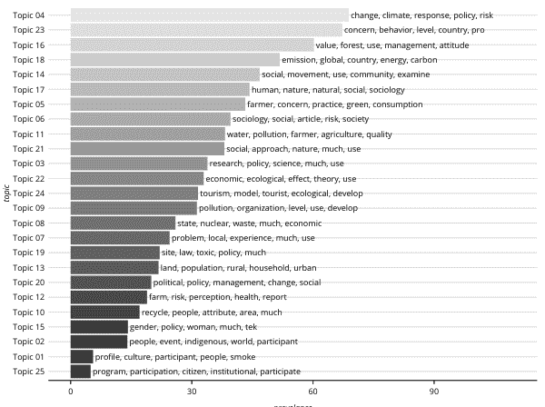

```
df_effs |>
  ggplot(aes(x = rank, y = proportion)) +
  geom_errorbar(aes(ymin = lower, ymax = upper),
                width = 0.1, size = 1) +
  geom_point(size = 3) +
  facet_grid(~Topics) +
  coord_flip() +
  labs(x = "Rank", y = "Topic Proportion")
```

### 图 11.4：按内容协变量划分的主题比例。

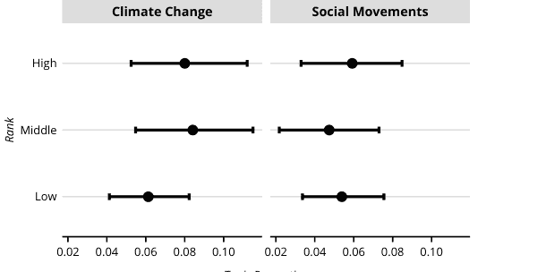

当然，对内容协变量进行条件化的一个好处是，可以看到该协变量各水平的主题词汇有何不同。例如，高排名期刊与低排名期刊在撰写气候变化相关文章方面有何不同？让我们看看“气候变化”（#4）和“社会运动”（#14）主题中与各排名最为区分的术语。

我们将使用 `tidy()` 提取 beta 矩阵，然后使用 `group_by()` 和 `sum()` 找出每个主题中每个术语的总概率。16 然后，将每个 beta 除以该总和即可得到比例。这将给出该术语总概率（在主题中）由每个协变量水平所占的比例。

16 请记住，每个词在每个协变量水平都会有一个主题特定的概率。

```
stm_beta <- tidy(stm_env, matrix = "beta") |>
  group_by(term, topic) |>
  mutate(sum = sum(beta)) |>
  ungroup() |>
  mutate(prop = beta/sum)
```

让我们通过选择主题 #4 和 #14 并将数据框重塑为宽格式来可视化这一点，使每个协变量水平成为一列。接下来，我们将按术语和主题分组，以获取每个协变量水平（高、中、低）的平均比例。

```
df_plot <- stm_beta |>
  filter(topic == 4 | topic == 14) |>
  pivot_wider(names_from = y.level, values_from = prop) |>
  group_by(term, topic) |>
  summarize(High = mean(High, na.rm = TRUE),
            Mid = mean(Middle, na.rm = TRUE),
            Low = mean(Low, na.rm = TRUE))
```

17 我们需要调整一些绘图参数才能获得相同的主题颜色和字体——因此，使用 `theme_custom()`。

让我们使用 `ggtern` 创建三元图。仅出于可视化目的，让我们随机抽样一些词语纳入图中。17 在这里，我们只取词汇表的 1%（更改 `set.seed()` 将选择不同的术语）。

```
# randomly select 1% of vocab
set.seed(011235)
prop <- (1 * nrow(df_plot)) / 100
idx <- sample(df_plot$term, prop)
```

一个词离某主题的极点越近，该词在讨论该主题时，就越多被该协变量水平的文档 _相对于_ 其他协变量水平的文档所使用（见图 11.5）。

```
df_plot |>
  mutate(labs = ifelse(term %in% idx, term, NA),
         labs = toupper(labs)) |>
  ggtern(aes(x = Low, y = High, z = Mid)) +
  geom_text(aes(label = labs), size = 2.5) +
  facet_wrap(~topic, ncol = 1) +
  theme_custom(col.L = "#541352ff",
               col.T = "#fffc20ff",
               col.R = "#2f9aa0ff",
               tern.panel.background = "white")
```

4

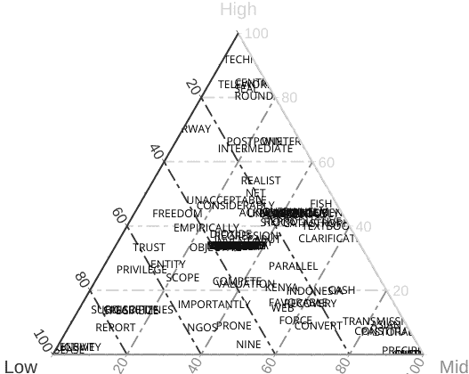

14

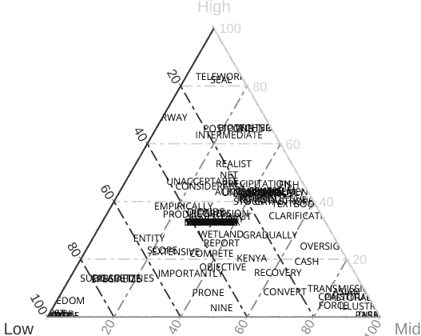

图 11.5：按内容协变量划分的主题词汇。

## 词嵌入：第一代

“你要了解一个词，就要看它常与什么词搭配！”菲斯（Firth，1957:11）发表了这一斩钉截铁的声明，以论证 *习惯性搭配* 能够捕捉词义。正是在这些持久的关系中，我们才能最好地理解人们使用某个词时“想表达”的含义。

18 词语的一致共现。

### 本节需要：

- text2map
- text2vec
- stringi
- tidyverse
- textclean
- quanteda
- rtrek
- ggrepel

我们可能会称我们的目标词习惯性搭配的其他词集合为“语境。”不过，重要的是，一个词可以出现在许多不同的语境中。这被称为“分布假设”：“意义的差异与分布的差异相关”（Harris 1954:156）。

如果我们结合这两种语言学理论——（1）一个词由其使用的语境定义，（2）一个词可以分布在许多这样的语境中——我们就得到了词嵌入背后的核心思想。

19 这里，理解为作者如何使用一个词。

具体来说，在词嵌入模型中，每个词都表示为一组数字，长度为维度的数量。每个维都是有意义变化的轴。一个词的意义在所有这些轴上都是“分布”的。因此，我们不能孤立地准确解释各个维度（参见 Tsvetkov et al. 2015）。

20 根据词嵌入模型的类型，每个唯一词可能有多个向量。当我们讨论词元嵌入时，将再次讨论这一点。

训练嵌入的输出是一个词-之-维度的 *词向量矩阵*。每一行是语料库词汇表中的一个词，每一列是一个维度。在这个矩阵中，如果两个词出现在相似的语境中，它们的向量在“嵌入空间”中就“更接近”。正如我们将看到的，我们可以使用嵌入来探索语料库中词与词之间以及文档与文档之间“正式”的关系——对立、并置、相似性。

### 词嵌入基础

术语共现矩阵（TCM）的单元格包括“目标词”与“语境词”出现在同一语境中的频率。行（通常）是目标词，列是语境词。每个单元格是列词在固定语境窗口中“紧邻”目标词出现的（加权）频率。每个词都是分布于语境中的目标词。每个词也被定义为不同语境的语境词。

21 这可能是一个不对称窗口，例如，目标词*仅一侧*的五个词。

以肯尼迪的赖斯演说为例。我们将每一行视为独立文档，并将前几行转换为窗口大小为 5 的 TCM——对于每个目标（行）词，我们将目标词两侧的五个词定义为语境窗口。我们将使用 `fcm()` 来创建 TCM。

22 quanteda 将 TCM 称为“特征共现矩阵”；因此，FCM。


```r
df_jfk <- data.frame(text = c(
  "We choose to go to the moon",
  "We choose to go to the moon",
  "We choose to go to the moon in
  this decade and do other things"
))
```

```r
df_jfk$text |>
  tokens() |>
  fcm(context = "window", window = 5)
```

特征共现矩阵：13 × 13 个特征。

| 特征 | 我们 | 选择 | 到 | 去 | 该 | 月亮 | 在 | 这个 | 十年 | 和 |
|---|---|---|---|---|---|---|---|---|---|---|
| 我们 | 0 | 3 | 6 | 3 | 3 | 0 | 0 | 0 | 0 | 0 |
| 选择 | 0 | 0 | 6 | 3 | 3 | 3 | 0 | 0 | 0 | 0 |
| 到 | 0 | 0 | 6 | 6 | 6 | 6 | 2 | 1 | 1 | 0 |
| 去 | 0 | 0 | 0 | 0 | 3 | 3 | 1 | 1 | 0 | 0 |
| 该 | 0 | 0 | 0 | 0 | 0 | 3 | 1 | 1 | 1 | 1 |
| 月亮 | 0 | 0 | 0 | 0 | 0 | 0 | 1 | 1 | 1 | 1 |
| 在 | 0 | 0 | 0 | 0 | 0 | 0 | 0 | 1 | 1 | 1 |
| 这个 | 0 | 0 | 0 | 0 | 0 | 0 | 0 | 0 | 1 | 1 |
| 十年 | 0 | 0 | 0 | 0 | 0 | 0 | 0 | 0 | 0 | 1 |
| 和 | 0 | 0 | 0 | 0 | 0 | 0 | 0 | 0 | 0 | 0 |

根据这个 TCM，单词“我们”在与“选择”相同的上下文（窗口大小为 5）中出现了 3 次。我们可以通过查看原始文档来验证这一点：“选择”在三个文档中均与“我们”相距少于 5 个单词，因此 1 + 1 + 1 = 3。我们还看到“到”在与“月亮”相同的上下文中出现了 6 次：在每个文档中，“到”有两个实例出现在“月亮”的 5 个单词以内，因此 (1 + 1) + (1 + 1) + (1 + 1) = 6。我们还可以根据上下文词在窗口中距离目标词的距离来对每个目标-上下文实例进行加权，以便窗口中更远的单词在 TCM 中“计数较少”，而紧邻目标词的单词则不然。

## 对 TCM 进行加权

这个原始频率矩阵并非衡量词语相关性的最佳指标，原因有二。首先，该矩阵非常稀疏（包含大量零值）。其次，有些词虽然常见，但区分度不高，例如“the”和“of”。我们将学习 *统计学上* 给定的上下文词是否 *特别有信息量* 地说明目标词。

我们可以通过使用点向互信息（PMI）对 TCM 进行加权来解决这个问题。23 PMI 衡量事件 x 和 y 的共现频率是否高于它们独立出现的频率。PMI 的范围从负无穷到正无穷，但在我们的案例中，负值通常不相关。24 因此，标准做法是将所有负值替换为零，以获得 *正的* 点向互信息，即 PPMI（Jurafsky and Martin 2000:109）。25

让我们转到《星际迷航：下一代》第五季的语料库。加载语料库并进行一些预处理。

```r
data("corpus_tng_season5", package = "text2map.corpora")

df_st <- corpus_tng_season5 |> 
  mutate(text = stri_trans_general(line, "Any-Latin; Latin-ASCII"),
         text = replace_contraction(text),
         text = tolower(text),
         text = gsub("[[:punct:]]+", " ", text),
         text = gsub("\\s+", " ", text)
  )
```

现在我们可以构建 TCM，并将其转换为稀疏矩阵。

```r
tcm <- df_st$text |> tokens() |>
  fcm(context = "window", window = 10) |>
  as("dgCMatrix")
```

为了加快过程，我们只保留共现次数至少为 30 的单词。

```r
tcm <- tcm[colSums(tcm) > 30, colSums(tcm) > 30]
```

20 改编自 text2vec 的 coherence()。

现在我们可以定义一个用于 PPMI 加权的函数。然后我们将该加权方案应用于 TCM。

```r
weight_ppmi <- function(tcm) {
  ## fix zero self-occurrences
  diag(tcm) <- diag(tcm) + 1
  ## weight by PMI
  tcm <- tcm %*% diag(1 / diag(tcm))
  tcm <- log(tcm)
  ## positive PMI
  tcm[tcm < 0] <- 0
  return(Matrix(tcm, sparse = TRUE))
}
```

```r
tcm_ppmi <- weight_ppmi(tcm)
```

一旦我们得到加权 PPMI 的 TCM，就可以使用前一章讨论过的余弦相似度统计量来衡量两行（即目标词）之间的相似性。

```r
vec1 <- tcm_ppmi["captain", , drop = FALSE]
vec2 <- tcm_ppmi["picard", , drop = FALSE]
vec3 <- tcm_ppmi["crusher", , drop = FALSE]

sim2(vec1, vec2, method = "cosine")
sim2(vec1, vec3, method = "cosine")
```

我们看到“captain”与“picard”出现在比“captain”与“crusher”更相似的上下文中——这是我们所期望的，因为尽管 Picard 和 Crusher 都是剧中的角色，但 Picard 是一名舰长，而 Crusher 不是。

## 基于奇异值分解的降维

PPMI 向量并未解决稀疏性问题！向量的长度仍然是词汇表的大小，可能有成千上万个元素。当我们开始将这些长向量降维为“低维”向量时，我们就迈出了朝着 **词嵌入** 迈出的一步。降低原始计数矩阵或 PPMI 加权 TCM 维度的最简单方法是应用奇异值分解（SVD）。27

100 到 300 个维度之间最适合表示词语（参见 Yin and Shen 2018）。由于我们限制了词汇表，最好将嵌入向量的维度数限制在较低端。

```r
svd_tng <- svd(tcm_ppmi)
```

```r
wv_tng <- svd_tng$v[, 1:100]
rownames(wv_tng) <- rownames(tcm_ppmi)
```

现在，我们不再使用包含超过 3,000 个术语和 3,000 个上下文的术语-术语上下文矩阵，而是得到了一个包含超过 3,000 个术语和恰好 100 个维度的术语-维度上下文矩阵。尽管两种 TCM 从技术上讲都是词向量矩阵，但后者才是大多数人所指的词向量。这些新的词向量在保留大部分协方差的同时，构成了语料库含义的 *更简单* 表达。

由于我们的词向量构成一个几何空间，我们可以使用基本算术来添加和减去词向量。经典示例是：如果从“king”的向量中减去“man”的向量，然后加上“woman”的向量，我们会得到一个非常接近“queen”向量的合成向量。

让我们试一下。如果从“picard”的向量中减去“jean”的向量，然后加上“william”的向量，我们应该会发现最近的单词之一是“riker”。28

27 参见数学基础。

28 Jean-Luc Picard 和 William Riker 是该剧中的两位主要角色。

```r
vec1 <- wv_tng["picard", , drop = FALSE]
vec2 <- wv_tng["jean", , drop = FALSE]
vec3 <- wv_tng["william", , drop = FALSE]

vec_syn <- vec1 - vec2 + vec3

sim <- sim2(wv_tng, vec_syn, method = "cosine")
sim[, 1] |> sort(decreasing = TRUE) |> head(n = 5)
```

```
picard riker william welcome macduff
0.7496190 0.4816914 0.4608522 0.4011149 0.3690412
```

果然，“riker”是我们合成向量最近的单词之一。

我们可以利用词向量空间的这些几何特性来进行更多社会科学分析。例如，如果我们分别从“boy”和“girl”的向量中得到每个单词的余弦值，然后计算这些余弦值的差，我们就能看出该系列中哪些单词更多用于“男性化”语境，哪些更多用于“女性化”语境。余弦相似度差高于零表示该词更与男性相关；低于零则更与女性相关。

让我们用《星际迷航》数据试一下。首先，从“boy”和“girl”向量中获取每个语料库单词的余弦相似度，并将结果放入一个新的数据框中。

```r
focal <- c("boy", "girl")
vecs <- wv_tng[focal, ]
sims <- sim2(vecs, wv_tng, method = "cosine")

df_sims <- data.frame(
  word1 = sims[1, ],
  word2 = sims[2, ],
  term = colnames(sims)
)
```

现在我们将定义一个新列“gender_bias”，即每个单词的余弦相似度差。我们还将创建一个名为“gender”的列，指示该词是更多用于男性化语境还是女性化语境。然后我们将在图 11.6 中绘制最男性化和最女性化的单词。

```r
df_plot <- df_sims |>
  mutate(gender_bias = word1 - word2,
         gender = ifelse(gender_bias > 0, "boy", "girl"),
         gender_bias = abs(gender_bias)
  )
```

```r
df_plot |>
  group_by(gender) |>
  slice_max(gender_bias, n = 30) |>
  mutate(term = fct_reorder(term, gender_bias)) |>
  ggplot(aes(term, gender_bias, fill = gender, label = term)) +
  geom_col() +
  coord_flip() +
  facet_wrap(~gender, scale = "free")
```

除此之外，领导力词汇（leader、certain、integrity）更与“boy”相关，而脆弱性词汇（prisoner、confined、asylum）更与“girl”相关。我们将在本章后面讨论如何使用词嵌入进行归纳分析时，再次回到探索语境如何沿社会学上有趣的维度变化的这一想法。


# 图 11.6：星际迷航：下一代第五季中的性别偏见。

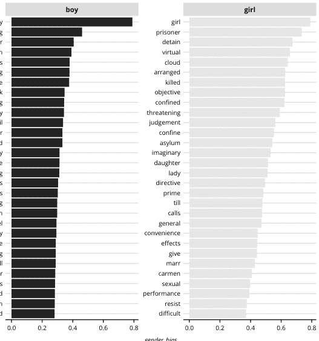

## 词嵌入：下一代

将 SVD 应用于（PPMI 加权）TCM 是创建词向量的一种方法。但它并非最流行的方法。29 广义上，有三种流行的嵌入方法：全局方法、神经网络方法和较新的“上下文化”方法。我们将在下文分别介绍。

29 首先，SVD 在大型语料库上的表现可能不佳（Pennington 等人 2014:1539）。

### 全局方法：GloVe

训练词向量最流行的算法之一是 GloVe 模型（Pennington 等人 2014），即“全局向量”模型。GloVe 结合了两种训练方法：“全局”矩阵分解（因此命名中包含“全局”）和“局部”滑动窗口方法（Pennington 等人 2014:1532）。我们从对 DTM30 进行潜在语义分析（LSA）得到的右奇异向量矩阵是词向量——只是其上下文是整篇文档。这是“全局”

30 参见核心归纳。

31 例如，“picard”在《星际迷航：下一代》第五季第一集中的出现频率是一个汇总统计量，与该集中任何单个“picard”实例所出现的任何“局部”上下文无关。

因为它是整个语料库统计量矩阵的分解。31

GloVe 考虑的第二种方法——滑动窗口方法——确实会考虑局部上下文。神经网络方法（如我们下文将讨论的 word2vec）都基于这种技术，即在上下文窗口内的一系列单词预测任务中学习词向量。GloVe 通过分解一个由滑动上下文窗口派生而来的矩阵来结合这两种方法。这个矩阵是什么？正是我们一直在讨论的 TCM！

GloVe 对待 TCM 的方式与我们之前所做的有两个关键区别。首先，加权方案不同。在 GloVe 中，目标词和上下文词的每对实例都按窗口序列中两个词之间距离的倒数进行加权。

回顾我们的 JFK 演讲摘录示例中的第一行：“We choose to go to the moon.” 假设我们的目标词是“go”，并且使用大小为 3 的对称上下文窗口——即单词“go”两侧各三个词。单词“We”、“choose”、“the”和“moon”各在 TCM 中向“go”（作为目标行）与该词（作为上下文列）之间的单元格计数贡献 1，而“to”会贡献 2，因为它在这个上下文窗口中出现了两次。然而，使用 GloVe 加权时，单词“We”的这个实例会向“go”（在其行位置）与“We”（在其列位置）之间的单元格计数贡献 0.333——即 1/3 ≈ 0.333。为什么呢？因为在这个窗口中，“We”距离“go”有三个单词的距离。如果在后续的上下文窗口中，“We”在单词序列中紧挨着“go”——例如，“We go to the moon”——那么“We”的这个实例会向单元格计数贡献 1。

在窗口中距离目标词较远的上下文词对 TCM 中目标-上下文单元的贡献较少。这奖励了“更好”的上下文词，我们假设这些词是在序列中持续出现在目标词附近的词。

让我们用我们的 JFK TCM 来创建这个。让我们转到 text2vec，因为我们稍后会用它来训练 GloVe 向量。我们将使用大小为 3 的上下文窗口。

32 改编自开发者教程。

在下面的代码中，32 我们首先对每个文档进行分词，并创建一个迭代器来遍历这些标记。create_vocabulary() 使用该迭代器来识别我们唯一的词汇表以及这些术语的术语频率和文档频率。然后我们使用该输出来向量化我们的词汇表（即，将每个术语与一个索引关联，以加快过程）。

最后，我们创建我们的 TCM。33 输出是一个稀疏矩阵。由于 TCM 是对称的（因为上下文窗口是对称的），只返回矩阵的上三角。（我们将输出打印为常规矩阵以显示列名，并且只打印前 10 列。）

```
words <- space_tokenizer(df_jfk$text)
iterate <- itoken(words)
voc <- create_vocabulary(iterate)
vocab_vec <- vocab_vectorizer(voc)
tcm <- create_tcm(iterate, vocab_vec, skip_grams_window = 3L)
```

| | 和 | 十年 | 做 | 在 | 其他 | 东西 | 此 | 我们 | 选择 | 去 | | |
|---|---|---|---|---|---|---|---|---|---|---|---|---|
| 和 | 0 | 1 | 1.0 | 0.33 | 0.50 | 0.33 | 0.50 | 0 | 0 | 0 | 0 | 0 |
| 十年 | 0 | 0 | 0.5 | 0.50 | 0.33 | 0.00 | 1.00 | 0 | 0 | 0 | 0 | 0 |
| 做 | 0 | 0 | 0.0 | 0.00 | 1.00 | 0.50 | 0.33 | 0 | 0 | 0 | 0 | 0 |
| 在 | 0 | 0 | 0.0 | 0.00 | 0.00 | 0.00 | 1.00 | 0 | 0 | 0 | 0 | 0 |
| 其他 | 0 | 0 | 0.0 | 0.00 | 0.00 | 1.00 | 0.00 | 0 | 0 | 0 | 0 | 0 |
| 东西 | 0 | 0 | 0.0 | 0.00 | 0.00 | 0.00 | 0.00 | 0 | 0 | 0 | 0 | 0 |
| 此 | 0 | 0 | 0.0 | 0.00 | 0.00 | 0.00 | 0.00 | 0 | 0 | 0 | 0 | 0 |
| 我们 | 0 | 0 | 0.0 | 0.00 | 0.00 | 0.00 | 0.00 | 0 | 3 | 1.0 | | |
| 选择 | 0 | 0 | 0.0 | 0.00 | 0.00 | 0.00 | 0.00 | 0 | 1.5 | | | |
| 去 | 0 | 0 | 0.0 | 0.00 | 0.00 | 0.00 | 0.00 | 0 | 0 | 0 | | |
| 月球 | 0 | 0 | 0.0 | 0.00 | 0.00 | 0.00 | 0.00 | 0 | 0 | 0 | | |
| 该 | 0 | 0 | 0.0 | 0.00 | 0.00 | 0.00 | 0.00 | 0 | 0 | 0 | | |
| 到 | 0 | 0 | 0.0 | 0.00 | 0.00 | 0.00 | 0.00 | 0 | 0 | 0 | | |

"go"-"We" 单元格是 1，我们预期会这样，因为"We"在每个文档中出现在"go"的上下文窗口中一次，且每次都在窗口的最末端，所以 1/3 + 1/3 + 1/3 = 1。

加权是与我们的 SVD 示例的第一个区别。第二个区别是该 TCM 的分解方式。如前所述，随着语料库变大，SVD 的性能会下降（Pennington 等人 2014:1539）。GloVe 借鉴了上下文滑动方法，将分解转化为使用模型34 的预测任务，以找到词向量，其中每对词向量的点积35 能最小化预测 TCM 中该词对单元格条件的对数值时的误差。当然，每对词的预测误差不能孤立地最小化，因此 GloVe 找到了最小化全局成本函数的完整词向量集合。36 该成本函数本身也是加权的，以便在学习向量时，非常频繁的词对和非常罕见的术语不会贡献过多。

让我们通过星际迷航数据来逐步讲解一个示例。37 我们已经预处理了数据；它是名为 df_st 的数据框。在接下来的内容中，我们首先定义一个 GloVe 模型，指定我们需要 100 个维度。x_max 参数是成本函数加权方案的一部分：它是词对共现次数的“上限”（防止非常频繁的词对变得过大），也是我们用来

33 我们可以使用 skip_grams_window_context 指定对称或不对称窗口。

34 具体来说，是一个全局对数双线性回归模型。
35 参见数学基础。
36 这与 OLS 回归中最小化平方误差之和的逻辑相同。
37 这改编自 Selivanov 的教程。

38 你的结果应该与我们的非常接近，但不完全相同。text2vec 会自动并行化。这使得设置随机种子和复现精确结果变得棘手——例如，参见 Selivanov 的此条评论：github.com/dselivanov/text2vec/issues/251

划分其他词对（确保非常罕见的词对获得更小的权重）。我们将其设置为 20。38

```
g_model <- GlobalVectors$new(rank = 100, x_max = 20)
```

然后我们将 TCM 传递给这个模型进行训练。我们需要为星际迷航数据制作一个 TCM（现在使用大小为 5 的对称上下文窗口）。

```
# Create our TCM
words <- space_tokenizer(df$st$text)
iterate <- itoken(words)
vocab <- create_vocabulary(iterate)
vocab_vec <- vocab_vectorizer(vocab)
st_tcm <- create_tcm(iterate, vocab_vec, skip_grams_window = 5L)
st_vectors <- g_model$fit_transform(st_tcm, n_iter = 50)
```

我们将看到进度更新。“epoch”是 GloVe 最小化成本函数所需的迭代次数。我们通过 n_iter 将其设置为 50。标记为“loss”的数字是成本函数的数值。该数字越小，预测越好——也就是说，词向量应当紧密复现 TCM。

GloVe 生成目标词（行）向量和上下文词（列）向量。当 TCM 是对称的（就像我们的情况）时，两者大致等价。st_vectors 是目标词向量；上下文词向量位于名为 $components 的对象中。合并这两个向量有好处（Pennington 等人 2014:1538–9），我们将这样做。39

39 GloVe 还可以创建“位置向量”，跟踪窗口中每个词的位置，然后进行拼接（Ibrahim 等人 2021）。

```
st_vectors <- st_vectors + t(g_model$components)
```

我们得到了 GloVe 向量！获取嵌入空间快照的一种方法是使用散点图。当然，在高维空间中这很棘手。我们可以使用 SVD40 将其降至二维。在将向量传递给 svd() 之前，我们将从 Snowball 2014 停用词表中移除单词。

40 还有其他用于可视化嵌入空间 2D 或 3D 降维的拟议方法，例如 tSNE。

```
st_2d <- st_vectors |>
as.data.frame() |>
mutate(name = rownames(st_vectors)) |>
filter(!name %in% get_stoplist("snowball2014")) |>
select(!name)
vw_coords <- svd(st_2d)$u
vw_coords <- vw_coords |>
as.data.frame() |>
select(V1, V2) |>
mutate(name = rownames(st_2d))
```

然后可视化前两个降维维度，只绘制在至少一个维度上加载较高的词标签。在图 11.7 中，我们可以看到各种相关术语簇，例如“bajoran，”


"cardassian" 和 "romulan"—都是《星际迷航》宇宙中外星文明的名称。

```
vw_coords |>
  mutate(col = case_when(
    abs(V1) >= 0.03 ~ TRUE,
    abs(V2) >= 0.03 ~ TRUE,
    TRUE ~ FALSE,
    lab = case_when(
    abs(V1) >= 0.03 ~ name,
    abs(V2) >= 0.03 ~ name,
    TRUE ~ NA_character_)) |>
  ggplot(aes(V1, V2)) +
  geom_point(aes(color = col), alpha = 0.1, show.legend = FALSE) +
  geom_text_repel(aes(label = lab), max.overlaps = Inf,
    show.legend = FALSE) +
  labs(x = "Dimension 1", y = "Dimension 2")
```

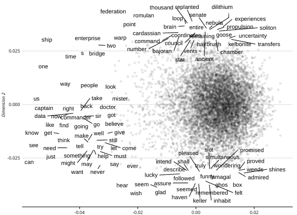

图 11.7：Star Trek GloVe 嵌入的奇异值分解（SVD）。

## 神经网络方法：CBOW、SGNS 和 fastText

虽然 word2vec 并未引入使用神经网络41来创建嵌入，但它是最流行的方法之一。与 GloVe 类似，word2vec 学习术语共现的降维表示，以预测两个目标之一。

使用连续词袋（CBOW）时，模型根据上下文词预测目标词。使用连续跳格模型（Continuous Skip-Gram）时，模型尝试根据目标词预测上下文词。开发者指出 CBOW 更快，而 Skip-Gram 更适合低频词。更技术地说，两者都最大化目标词与上下文词共现的平均对数概率。这种“最大化”通过分层 softmax 或负采样来衡量。尽管两者各有优势，但目前最常见的设置是带负采样的跳格模型（SGNS）。42

> 42 参见 word2vec (Wijffels 2021)。

SGNS 的一个重要扩展是 **fastText**，它包含“子词”字符 _n_-grams——例如，“fluffy”是“fl”、“lu”、“uf”、“ff”、“fy”的共现。该模型对这些 _n_-gram 向量求平均以得到词向量，甚至可以为未登录词创建向量。43

> 43 参见 fastText (Mouselimis 2022) 和 fastTextR (Schwendinger 和 Hvitfeldt 2020)。

虽然 SGNS 的性能与 GloVe 相当——具体取决于任务和调参（例如窗口大小）——但 SGNS 受青睐的一个原因是，它建立在语言学习的直觉模型之上 (Arseniev-Koehler 和 Foster 2020)。类似于 LDA 主题模型建立在对写作过程的理解之上，人们通过接触词序列来学习词义的观点也内置于滑动窗口架构中。人类不像 GloVe 那样拥有“全局”共现统计的优势。因此，这不是一个“合理”的学习过程。

不过，偏好 GloVe 也有技术原因。首先，它在计算上更简单。其次，GloVe 中所有词之间的平均余弦相似度远大于 SGNS；SGNS 将词分布在嵌入空间更窄的走廊中。44 这可以通过后处理技术部分解决，例如从 SGNS 嵌入中减去总体均值 (Mu et al. 2017)。

> 44 在空间中“分散”词（各向同性）通常能提高各种任务上的嵌入效果 (Arora et al. 2016; Mu et al. 2017)。

## 上下文化嵌入：ELMo 和 BERT

请回顾，_词元_ 是文本中词（或 _n_-gram）的一个实例，而词 _类型_ 是唯一的词（或 _n_-gram）。可以说，之前的方法生成的是 _类型嵌入_：每个唯一的词对应一个向量。其明显好处是效率。这些嵌入有时也被称为“静态”嵌入，因为它们不会随词的特定上下文而变化。然而，我们知道同一个词在不同的上下文中可能引发不同的词义，这些词义可能在语义上相关或无关（即，同音异义词）。一个常见的例子是 _金融_ 银行与 _河流_ 河岸。

棘手的问题是：一个词有多少种词义，我们如何定义词义之间的边界？类型嵌入通过试图总结所有可能的词义来解决这个问题。所谓的上下文模型则采取相反方向来解决：创建 _词元嵌入_，为单个上下文中的词分配一个向量。如果我们希望精确知道某个词在此特定上下文中的含义，而不是总结其在多个上下文中的含义，那么这很有用。

ELMo（Embeddings from Language Models）建立在神经网络嵌入方法之上，有两个重要区别。ELMo 不使用固定上下文窗口，而是使用 (1) 任意长度的窗口——因为句子或其他文本序列的大小各不相同——并且 (2) 分别训练 token 右侧和左侧的上下文，然后将两个向量拼接起来。结果是一个单一向量，其中某些维度完全表示左侧含义，某些维度表示右侧含义。

最流行的 token 嵌入模型是 BERT（Bidirectional Encoder Representations from Transformers）及其变体 (Devlin et al. 2018)。与 GloVe 和 word2vec 类似，它在预测任务上进行训练：根据上下文词预测目标词，并预测给定前序列后随机选择的下一个序列的概率。这种序列到序列的预测是 Transformer 模型的核心。Transformer 不关注最近的 token，而是关注整个序列（或序列的关键部分）。这种初始训练计算成本高昂。然后可以使用本地语料库对预训练模型进行微调。此外，与 ELMo 不同，基础模型中左右上下文是分开保留的（即双向），仅在微调过程中拼接。

BERT “base” 模型在 BookCorpus (Zhu et al. 2015) 和英文维基百科上进行了训练，词汇表限制为 30,000 个 token。最终的预训练模型有 12 层。45 以下是使用肯尼迪赖斯演讲摘录的示例输出。这些向量来自最终层。46

| 词元 | 词元 ID | 维度 1 | 维度 2 | ... | 维度 768 |
|---|---|---|---|---|---|
| [CLS] | 1 | 0.590 | -0.251 | ... | -0.306 |
| we | 2 | 1.44 | 0.286 | ... | -0.825 |
| choose | 3 | 1.31 | 0.728 | ... | -0.0677 |
| to | 4 | 1.93 | -0.322 | ... | -0.641 |
| go | 5 | 0.911 | -0.588 | ... | 0.467 |
| to | 6 | 0.976 | -0.349 | ... | -0.286 |
| the | 7 | 0.634 | 0.141 | ... | -0.0992 |
| moon | 8 | 1.91 | 0.830 | ... | 0.0365 |
| in | 9 | -0.681 | -0.662 | ... | -0.422 |
| this | 10 | -0.135 | -0.226 | ... | 0.213 |
| decade | 11 | 0.958 | -0.0750 | ... | -0.0239 |
| and | 12 | 1.10 | 0.0651 | ... | -0.565 |
| do | 13 | 1.24 | 1.00 | ... | -0.0328 |
| other | 14 | 0.848 | 0.419 | ... | 0.237 |
| things | 15 | 0.847 | 0.978 | ... | -0.889 |
| [SEP] | 16 | 0.0440 | 0.0162 | ... | -0.0312 |

请注意，“to”出现了两次，每个都有自己的向量。[CLS] 是一个特殊 token，表示序列中所有 token 的“聚合”向量。[SEP] 表示序列之间的分隔（但此处只有一个序列）。两者对于下一个序列预测任务都是必需的。调优后，生成的嵌入用于多个下游任务。47

对 BERT（及类似模型）的一个批评是它“参数过多”：层或维度可能是冗余的。作为回应，新模型试图将 BERT“蒸馏”为更小的基础模型。这些包括 DistilBERT 和 tinyBERT (Sanh et al. 2019; Jiao et al. 2019)。它们小得多，调优更快，并且在各种基准测试中达到与 BERT 几乎相同的性能。

或许，目前还过早地知道在什么情况下，更复杂（且计算密集）的 token 嵌入更适合社会科学分析 (c.f., Li et al. 2021; van Loon 和 Freese 2022; McLevey et al. 2022)。此外，这些 token 嵌入通常被平均在一起，以 presumably 获得更具上下文意识的“静态”类型嵌入。然而，词元嵌入是否优于类型嵌入并不明显，尤其是当这些类型嵌入本身已经过调优或后处理时。下一部分包含多种调优方法，用于将原本“静态”的词类型向量“上下文化”，以用于归纳分析。

> 47 特别是针对有监督分类。参见 Extended Deductive。

## 使用词嵌入进行归纳分析

可以看出，训练词嵌入的方法有很多种——各有利弊。我们可以在研究中利用嵌入空间做些什么？我们将在此处和下一章中探讨一些方法。

- 本部分需要：
  - text2map
  - text2map_pretrained
  - text2vec
  - stringi
  - tidyverse
  - textclean
  - rtrek

### 语义变化

词嵌入特别适合分析语义变化，即一个词的话语上下文随时间推移的转移程度。例如，Hamilton 等人 (Hamilton et al. 2016:2) 使用嵌入发现，在两个世纪中，“gay” 一词的含义已从“愉快的”或“欢快的”转变为指代同性恋，这是基于这些术语之间的相对距离得出的。

为此，我们首先需要一个随时间变化的语料库。然后按时期划分语料库子集，并为每个子集单独训练词向量。48 接下来，我们将不同时期的向量“对齐”，以将它们定位在相同的“坐标系统”中。

> 48 这些称为历时嵌入，是一种常见的可变空间（相对于固定空间）嵌入类型 (Stoltz 和 Taylor 2021)。


我们将继续使用《星际迷航》剧本。此前，我们使用的是《下一代》系列中的单一季度。让我们使用 `rtrek` 获取所有系列和季度的逐字稿。我们将把每句台词视为一个文档，然后将集数数据与这些台词合并。

```r
df_trek <- st_transcripts()
df_trek$episode <- rownames(df_trek)
df_lines <- bind_rows(df_trek$text, .id = "episode") %>%
  left_join(df_trek[-10], by = "episode")
```

在为每个系列训练一组独特的词向量之前，我们将先对文本进行预处理。

```r
dia_df <- df_lines %>%
  mutate(
    text = stri_trans_general(line,
                              "Any-Latin; Latin-ASCII"),
    text = replace_contraction(text),
    text = tolower(text),
    text = gsub("[[:punct:]]+", " ", text),
    text = gsub("\s+", " ", text)
  )
```

现在我们将按系列将语料库⁴⁹分割为独立文档。（某些《星际迷航》系列在时间上略有重叠——但它们仍有一个我们将遵循的时间顺序。）系列变量名为“series”，包含六个系列（按引入顺序）：The Original Series、The Animated Series、The Next Generation、Deep Space 9、Voyager 和 Enterprise。我们将为每个系列创建一个独特的逐字稿行数据框，然后将所有这些数据框放入一个列表中。

49 我们也可以合并台词，使每个文档成为独特的剧本。

```r
dia_df_list <- list()
for (i in unique(df_trek$series)) {
  dia_df_list[[i]] <- dia_df[dia_df$series == i, ]
}
```

接下来，我们将创建 TCM——同样，每个系列一个。我们将遵循上面创建 TNG 第 5 季 TCM 的相同程序，但现在将其全部封装到一个函数中。我们将使用 `lapply()` 将该函数应用到数据框列表中的每个数据框。

```r
make_tcm <- function(df) {
  words <- space_tokenizer(df$text)
  iter <- itoken(words)
  vocab <- create_vocabulary(iter)
  vocab_vec <- vocab_vectorizer(voc)
  tcm <- create_tcm(iterate, vocab_vec, skip_grams_window = 5L)
  return(tcm)
}
dia_tcm <- lapply(dia_df_list, make_tcm)
```

现在我们需要训练向量。我们将采用 300 个维度，共现最大值为 10（用于在代价函数上建立加权函数），学习率⁵⁰ 为 0.05，并且仅进行 10 次训练迭代以加快速度（这大约需要 10 分钟）。我们还将此封装到一个函数中并使用 `lapply()`。我们将把向量放入名为“dia_vecs”的列表对象中。

50 学习率是每次迭代中改进速度的上限。出于我们不再赘述的原因，我们希望限制改进，因为否则模型可能会“卡”在非最优解中（McLevey 2021:400-4）。

```r
make_vectors <- function(tcm) {
  g_model <- GlobalVectors$new(
    rank = 300, x_max = 10,
    learning_rate = 0.05
  )
  vectors <- g_model$fit_transform(tcm, n_iter = 10)
  vectors <- vectors + t(g_model$components)
  return(vectors)
}

dia_vecs <- lapply(dia_tcm, make_vectors)
```

还需要一步才能比较 *跨* 嵌入——我们正在进行语义变化的纵向分析。我们需要 *对齐* 我们的矩阵。更具体地说，我们将一个矩阵对齐到一个“参考”矩阵。这确保了不同嵌入矩阵中的词向量被投影到相同的“坐标系统”中（Hamilton et al. 2016:4）。

实现此目的的一种流行方法是 Procrustes 方法（Schönemann 1966）。该方法通过旋转、翻转等操作，在保持矩阵内余弦相似度的同时，最小化矩阵之间的差异。⁵¹

51 无需理解数学原理，因此我们这里不再讨论。但它使用了 SVD（参见《数学基础》）。

就我们的分析而言，参考矩阵是 *The Original Series* 矩阵。为简单起见，我们将每个矩阵中的词汇限制为所有矩阵共享的词汇。

```r
shared_words <- Reduce(
  intersect,
  lapply(dia_vecs, rownames)
)
dia_vecs <- lapply(
  dia_vecs,
  function(i) i[shared_words, ]
)

aligned_vecs <- list()

for (i in seq_len(length(dia_vecs))) {
  if (i == 1) {
    aligned_vecs[[i]] <- find_transformation(
      dia_vecs[[i]],
      ref = dia_vecs[[1]],
      method = "align"
    )
  } else {
    aligned_vecs[[i]] <- dia_vecs[[i]]
  }
}

names(aligned_vecs) <- names(dia_vecs)
```

准备就绪。假设我们有兴趣了解关于“人类”的话语在各系列中可能发生了怎样的变化。我们可以通过检查各系列中“人类”向量之间的余弦相似度来了解这一点。让我们具体看看每个系列的“人类”向量与 *The Original Series* 中向量的对比情况（输出在旁注中）。

```r
for (i in c("TAS", "TNG", "DS9", "VOY", "ENT")) {
  out <- sim2(
    aligned_vecs[["TOS"]]["human", , drop = FALSE],
    aligned_vecs[[i]]["human", , drop = FALSE],
    method = "cosine"
  )
  print(paste0(i, ": ", round(out, 4)))
}
```

[1] "TAS: 0.2918"
[1] "TNG: 0.3051"
[1] "DS9: 0.2854"
[1] "VOY: 0.3633"
[1] "ENT: 0.3733"

《原初系列》中与人性最相似的是 *Enterprise*。《原初系列》中阐述人性的语境与 *Enterprise* 系列最为相似。话虽如此，从绝对值来看，我们没有发现任何其他系列与《原初系列》具有高度相似性。52 如果我们查看各系列“人类”向量之间的两两余弦相似度，会发现它们都同样较低——这表明，也许每个系列对人性的框架不同。

让我们来探索一下。在下面的代码中，我们将遍历每个系列特定的矩阵，获取 *在每个矩阵内部* 相对于“人类”向量的余弦相似度，过滤掉 Snowball 2014 停用词列表，53 将每个矩阵的相似度按降序排列，然后打印前 5 个（我们在 `head()` 中设置 `n = 6` 以获取 *除了* “人类” 外的五个词）。我们将输出打印在一个表格中（参见表 11.1）。

### 表 11.1：“人类”在《星际迷航》系列中的演变

| 系列 | “人类”的语境（按降序排列） |
| :--- | :--- |
| TOS | 生命, 我们, 舰长, 联邦, 形式 |
| TAS | 瞬间, 碎片, 防止, 也许, 范围 |
| TNG | 生命, 方式, 像, 承担, 部分 |
| DS9 | 已知, 理论, 损失, 消失, 可能 |
| VOY | klingon, 看, 生命, 正确, 需要 |
| ENT | 一个, vulcan, 生物, 船, 地球 |

```r
for (i in names(aligned_vecs)) {
  sim2(
    aligned_vecs[[i]],
    aligned_vecs[[i]]["human", , drop = FALSE]
  ) |>
    as.data.frame() |>
    filter(!rownames(aligned_vecs[[i]]) %in%
             c(get_stoplist("snowball2014"), "s")) |>
    arrange(desc(human)) |>
    head(n = 6) |>
    print()
}
```

然后我们可以进一步探测嵌入空间，和/或对每个系列的逐字稿进行细读，以了解这些术语如何将人性这一主题置于语境中。

54 这里的“和/或”用法是有意为之。只要领域特定词汇位于嵌入空间的同一部分，它们的坐标就会相似。这也意味着单词不需要 *字面上* 共现才能接近。即使“派”和“蛋糕”从未共现，它们也共享像“甜的”和“水果”这样的上下文词。

## 语义方向与语义中心

让我们讨论在嵌入空间中概念化有意义维度的两种方式：**语义方向**和**语义中心**。

方向是事物移动或所在的路径。这类似于话语偏差：给定两个语义“极点”，我们可以将文档放置在这两个极点之间的线上——文档越靠近某个极点，相对于另一个极点，它就越“倾向于”该极点。我们之前的性别偏差演示涉及一个*语义方向*：一个词（使用余弦相似度）越接近性别方向中“男孩”一端，该词就越多用于“男孩”和/或其他“男孩相关”词汇倾向于被使用的语义语境，而非“女孩”和/或其他“女孩相关”词汇。⁵⁴ 语义方向本质上是高维嵌入空间中的一维“子空间”。

分析语义方向以及文档和文档生产者如何与之互动，是词嵌入的一种流行社会科学用途。Kozlowski, Taddy 和 Evans (2019) 使用方向分析了社会阶级含义在 20 世纪的变迁。同样，Arseniev-Koehler 和 Foster (2020) 使用方向来考察《纽约时报》在讨论肥胖问题时的性别化、道德、以健康为中心和社会经济偏见。我们（Stoltz 和 Taylor 2021）分析了 1880 年至 2000 年间美国英语中移民与公民权话语的种族、道德和富裕维度是如何演变的。

让我们获取一些方向。不过，我们将更换数据，现在转向 All the News (ATN) 语料库（Thompson 2020）中的 3,800 篇文章的小型随机样本，这些文章至少提及一次“immigrant”或“immigration”。就本文写作时而言，⁵⁵ 这是一个包含 27 家不同美国新闻机构的 270 万篇新闻文章的语料库。我们从 Stoltz 和 Taylor (2021) 中使用过的该语料库的早期较小版本进行抽样，该版本包含 18 家新闻机构的 204,135 篇文章。

55 该语料库不时会增长。


我们首先筛选了204,135篇文章，仅保留那些至少一次提到“immigrant”或“immigration”的文章（不区分大小写或标点）。56 我们加载下面的数据并进行一些预处理。

```
data("corpus_atm_immigr", package = "text2map.corpora")
data("contractions", package = "qdapDictionaries")

df_atm <- corpus_atm_immigr |>
  mutate(
    text = replace_non_ascii(text),
    text = replace_url(text, replacement = ""),
    text = replace_html(text, replacement = ""),
    text = replace_contraction(text,
                               contraction.key = contractions,
                               ignore.case = TRUE),
    text = str_replace_all(text, "[[:punct:]]", " "),
    text = replace_ordinal(text),
    text = str_replace_all(text, "\\\\s+", " "),
    text = tolower(text)
  )
```

56 筛选后，随机样本中仅有17个组织。这组文章样本位于 text2map.corpora 中。

现在我们可以创建文档-术语矩阵（DTM）。由于我们将对这些内容进行可视化，让我们删除 Snowball 停用词表中的词以及出现频率极低的词。

```
dtm_atm <- df_atm |>
  dtm_builder(text, doc_id) |>
  dtm_stopder(stop_list = get_stoplist("snowball2014"),
              stop_docprop = c(.01, Inf))
```

这一次，我们不会创建词向量。相反，我们将使用预训练模型——一组现成的词向量。我们将使用的预训练模型通常擅长捕捉细微的语义关系，因为它们在庞大的语料库上进行了训练。当研究人员关注普遍的“公共”含义时，使用预训练模型可能是理想的选择。相比之下，本地训练的向量（研究人员在其自身语料库上训练的向量）可能更适合捕捉独特的关系——特别是当语料库中文档背后的文档生产者使用行话语言时（Rodriguez and Spirling 2022）。57 ATM 语料库中的文章（或多或少）来自主流新闻媒体，因此依赖预训练模型是一个不错的选择。

有许多知名的预训练嵌入模型——例如，斯坦福 GloVe、HistWords 和 Facebook 的 fastText 嵌入。我们将使用在 Common Crawl 上训练的 fastText 嵌入。58 该矩阵包含大约 200 万个词向量（在 6000 亿个词元上训练），跨越 300 个维度。让我们加载它们。59 模型加载到会话中可能需要一些时间；它很大。

```
# download the model once
download_pretrained("vecs_fasttext300_commoncrawl")
# load the model each session
```

```
data("vecs_fasttext300_commoncrawl", package="text2map.pretrained")
wv <- vecs_fasttext300_commoncrawl # rename so it's tidier
```

现在让我们通过获取 DTM 和嵌入矩阵的词汇交集，来创建 DTM 的词向量表示。请记住，词位于 DTM 的列中，嵌入矩阵的行中。

```
atm_vectors <- wv[rownames(wv) %in% colnames(dtm_atm), ]
```

我们只拥有 ATM 语料库中使用的词的向量——而且我们不需要自己训练！现在，我们将分析一些语义方向。我们之前通过创建由 "boy" 和 "girl" 锚定的性别方向来做到这一点。让我们将注意力转向公民身份-移民方向，60 但现在让我们在每个极点添加 *更多* 术语。这将精准定位嵌入空间中具有这种精确含义的区域。让我们为每个极点采用 12 个术语的列表，61 虽然有些术语会重复。

60 移民当然可以是公民。这个方向被理解为“衡量持久的象征结构而非法律区别”（Stoltz and Taylor 2021:10）。另见 Beaman (2016) 和 Jaworsky (2013)。

61 这些是我们在 Stoltz and Taylor (2021) 中使用的相同术语。

让我们首先构建一个数据框，将每个锚点列表作为单独的列。

```
anchors <- data.frame(
  add = c("immigrants", "immigration", "immigrant", "foreign",
        "foreigner", "outsider", "stranger", "alien", "foreigner",
        "alien", "immigrant", "foreign"),
  sub = c("citizens", "citizenship", "citizen", "domestic", "native",
        "insider", "local", "resident", "resident", "native",
        "local", "familiar")
)
```

我们使用 *向量偏移* 方法来获取语义方向。首先是 *配对方法*：两个锚点列表中每对跨列表的单词（例如，"conservative" 到 "liberal" 和 "traditional" 到 "progressive"）是一对反义词，我们从一对向量中减去另一个，然后将这些向量差之和除以总对数。这种方法要求每个锚点列表中的单词数量相同——因为它们必须是配对的——尽管单词可以重复。

其次是 *聚合方法*，它涉及计算每个锚点列表的平均向量（即极点 #1 单词的平均向量和极点 #2 单词的平均向量），然后取差值。62

第三是 *PCA 方法*。我们取每对反义词的向量差（如同配对方法），将该 d×v 矩阵 63 传递给 *主成分分析（PCA）*，然后保留第一个主成分（Bolukbasi et al. 2016a, b）。

63 d 是维度的数量，v 是向量差的数量。

使用 `get_direction()` 和配对方法（默认方法），我们将找到“意识形态偏差”的语义方向。

```
cit_imm <- get_direction(anchors = anchors, wv = atm_vectors)
```

该行是方向，标记为锚点列表中“正”极点的第一个单词（即我们 *从中* 减去的那一侧），后跟“_pole”。让我们看看当讨论公民身份而非移民时，哪些词倾向于出现得更多。

```
sim_dir <- sim2(cit_imm, atm_vectors, method = "cosine")
df_dir <- data.frame(immigrants_pole = sim_dir["immigrants_pole", ],
                    terms = colnames(sim_dir)) |>
  mutate(cit_imm_label = ifelse(
                  immigrants_pole >= 0,
                  "Immigration", "Citizenship"),
         cit_imm = abs(immigrants_pole)
)
```

```
df_dir |>
  group_by(cit_imm_label) |>
  slice_max(cit_imm, n = 30) |>
  mutate(term = fct_reorder(terms, cit_imm)) |>
  ggplot(aes(term, cit_imm, fill = cit_imm_label, label = terms)) +
  geom_col() +
  guides(fill = "none") +
  labs(x = NULL, y = "Cosine Similarity to Pole") +
  coord_flip() +
  facet_wrap(~cit_imm_label, scale = "free")
```

图 11.8 显示，在美国本土新闻媒体文章倾向于采纳公民身份和移民的公共含义（由庞大的 Common Crawl 存档定义）的程度上，公民身份是“本地的”，与“社区”和“提供”同义。相比之下，移民是“非白人”、“殖民”，并与“黑人”相关联。新闻媒体倾向于以有利的术语呈现公民身份，同时延续关于移民的种族化刻板印象。64

64 关于美国话语中黑人身份与移民之间关联的研究，参见 Mora and Paschel (2020)。

与语义方向相关的是 *语义中心*。中心是一个平均向量。65 如果我们想了解某个感兴趣领域的话语语境，而不是该领域 *相对于* 另一个领域的语境（这就是方向所给出的），那么语义中心本身很有用。例如，我们可能想了解讨论“移民”的一般语境——而不是 *相对于* 讨论“公民身份”的语境。例如，Nelson (2021b) 在她对 19 世纪美国南部第一人称叙述中跨机构领域的人类社会类别 *交叉* 的分析中使用了语义中心，Lix 和同事 (2022) 也使用中心来研究话语多样性如何影响远程软件开发团队的工作绩效。

65 这正是我们使用向量偏移的聚合方法所能得到的，但在取两个平均向量之间的差值之前。这也是创建句子嵌入的一种策略。

让我们使用 `get_centroid()` 来查看与“移民”中心最相似的术语。66

66 中心标记为锚点列表中的第一个单词，后跟“_centroid。”


## 图 11.8：ATN 语料库中的公民身份–移民

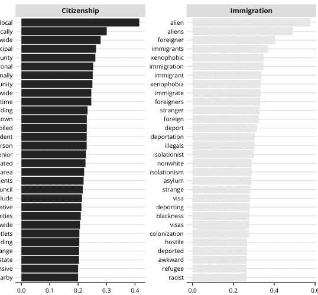

```
imm_cen <- get_centroid(anchors = anchors$add, wv = atn_vectors)
sims <- sim2(atn_vectors, imm_cen, method = "cosine")
names(head(sort(sims[,1], decreasing = TRUE)))
```

外星人 移民 外国人 外国 移民 外星人 移民

如我们所见，该质心的上下文词与考虑移民相对于公民身份时得到的词并无太大区别。思考方向和质心之间差异的一个好方法是：方向更适合捕捉关系性偏见（即，倾向于一极而排斥另一极的术语），而质心更适合识别一般上下文或上下文的交集。

不过，归根结底，这取决于我们试图衡量的意义。有些意义被紧密组织成二元光谱；有些则不是。考虑质心与方向之间对比的更理论化的方法是使用语言学家格雷马的“符号学方阵”（Greimas 1983）。格雷马将意义组织为四个极点。在我们的示例中，这些极点将是“移民”和“公民身份”，以及“非移民”和“非公民身份”。虽然语义方向捕捉的是移民/公民身份的并置，但质心更接近移民/非移民或公民身份/非公民身份的对立。在这里，理论动机和学科专长将决定哪种策略最适合我们的研究目标。

## 词移动距离

词嵌入最容易用于词级和意义级分析。我们通常想了解文档或作者的某些信息。例如，我们能否衡量某一文档写的内容和方式与语料库中其他文档有多大程度相同？

我们为此使用词移动距离（WMDs）（Kusner 等人，2015）。67 WMD 是衡量将一份文档中的所有词移动到另一份文档中词所在位置所需的最小成本的指标。68

更具体地说，文档 i 与文档 j 之间的 WMD 是两个文档中每一对词的两个数值乘积的最小和：余弦距离以及该词对在所谓“流矩阵”中的单元格条目。69 WMD 在以下约束下查找单元格条目：（1）行词的总和是该词在 i 中的相对频率，以及（2）列词的总和是该词在 j 中的相对频率。寻找最小成本在计算上要求很高，因此 Kusner 及其同事（2015:4）提出了松弛词移动距离（RWMD）。无论如何计算，结果都是一个距离得分，较大值表示两份文档之间的上下文相似性较低，较小值表示上下文相似性较高。鉴于 WMD 的计算复杂性（参见 Brunila 和 LaViolette 2021），我们将继续使用 RWMD。

假设我们想了解我们的新闻文章（均至少提及一次“immigrant”和“immigration”）与一群致力于移民相关问题的公民社会组织发布的一系列新闻稿之间的上下文相似性。70 遵循我们之前的工作（Stoltz 和 Taylor 2021），让我们考察左翼和右翼新闻来源使用与这些专注于移民的公民社会组织相似语言的程度。

我们已经处理了文章和预训练向量；现在需要处理新闻稿。让我们使用与处理“所有新闻”（ATN）文章相同的预处理工作流来加载和处理它们。

67 还有其他策略。参见 Lix 及其同事（2022）以了解一种方法。
68 它是土壤移动距离（EMD）的一个分支，EMD 比较两个概率分布的相似程度。
69 查找此矩阵称为运输问题。
70 新闻稿随 text2map.corpora 提供，并从两家右翼组织（移民研究中心和美国移民改革联合会）及两家左翼组织（移民和难民权利全国网络和妇女难民委员会）的网站上抓取。

```
data("corpus_itpr", package = "text2map.corpora")
data("contractions", package = "qpadDictionaries")
```

```
df_itpr <- corpus_itpr |>
  mutate(text = replace_non_ascii(text),
         text = replace_url(text, replacement = " "),
         text = replace_html(text, replacement = " "),
         text = replace_contraction(text,
                                  contraction.key = contractions,
                                  ignore.case = TRUE),
         text = str_replace_all(text, "[[:punct:]]", " "),
         text = replace_ordinal(text),
         text = str_replace_all(text, "[\\s]+", " "),
         text = tolower(text)
  )
```

```
dtm_itpr <- df_itpr |>
  dtm_builder(text, doc_id) |>
  dtm_stopword(stop_list = get_stoplist("snowball2014"),
               stop_docprop = c(.01, Inf))
```

现在我们希望将 ATN DTM 子集化，仅包含我们左翼和右翼来源的文章。我们将 Talking Points Memo、《纽约时报》、Buzzfeed News 作为左翼来源，将 Breitbart、Fox News 和 National Review 作为右翼来源。

```
df_atn_sub <- df_atn |>
  select(doc_id, lean, date, publication, text) |>
  filter(publication == "Talking Points Memo" |
         publication == "New York Times" |
         publication == "Buzzfeed News" |
         publication == "Breitbart" |
         publication == "Fox News" |
         publication == "National Review")
```

```
dtm_atn_sub <- df_atn_sub |> dtm_builder(text, doc_id)
```

三个项目——ATN DTM、新闻稿 DTM 和嵌入空间——中的词汇表必须相同。让我们现在确保这一点。

```
vocab <- intersect(rownames(atn_vectors), colnames(dtm_atn_sub))
vocab <- intersect(vocab, colnames(dtm_itpr))
```

```
atn_vecs_sub <- atn_vectors[vocab, ]
dtm_atn_sub <- dtm_atn_sub[, vocab]
dtm_itpr <- dtm_itpr[, vocab]
```

现在，我们可以使用 text2vec 查找 WMD 得分。71

```
wmd_mod <- RWMD$new(x = dtm_itpr, embeddings = atn_vecs_sub)
wmd_dis <- wmd_mod$sim2(x = dtm_atn_sub)
```

这给我们留下了一个 a×p 矩阵，其中 a 是文章数量，p 是新闻稿数量。每个 a、p 单元格告诉我们 a 到 p 的相似度，较高值表示更高的相似度。72

我们可以用这个矩阵做很多事。如果新闻稿都在新闻文章之前发布（事实并非如此），我们可以使用扩散建模。尽管如此，我们可以了解哪些文章更有可能就相同的事物——并且以相同的方式——撰写，就像这些移民民间团体一样。让我们看看，例如，左翼或右翼新闻组织与左翼或右翼移民团体的相似度是否更高。我们将为此使用简单的可视化——尽管我们可以采用统计检验。

我们首先将 a×p 距离矩阵转换为数据框，添加一些行名，然后使用这些行名将一些 ATN 元数据合并到相似度中。这样我们就可以看到相似度如何随文章特征而变化。

```
df_sim <- wmd_dis |> 
  as.data.frame() |> 
  rownames_to_column(var = "doc_id")
df_sim <- left_join(df_sim, df_atn_sub, by = "doc_id")
```

接下来，我们将计算每篇文章与右翼和左翼新闻稿的平均相似度。距离矩阵的列按新闻稿的顺序排列。我们将创建一个 TRUE 和 FALSE 索引以正确地对其进行子集化。

```
r_idx <- df_itpr$lean == "Right"
l_idx <- df_itpr$lean == "Left"
df_atn_sub$wmd_r <- rowMeans(wmd_dis[, r_idx])
df_atn_sub$wmd_l <- rowMeans(wmd_dis[, l_idx])
```

然后将数据框重塑为“长格式”，然后绘制图表。

```
df_plot <- df_atn_sub |> 
  select(doc_id, lean, date, wmd_r, wmd_l) |> 
  pivot_longer(cols = c("wmd_r", "wmd_l")) |> 
  mutate(name = case_when(
    grepl("wmd_r", name) ~ "Right-Wing Press Releases",
    grepl("wmd_l", name) ~ "Left-Wing Press Releases"
  ))
```

```
df_plot |> 
  ggplot(aes(x = as.Date(date), y = value, color = name)) + 
  geom_smooth(aes(linetype = name)) + 
  scale_linetype_manual(values=c("twodash", "solid"))+ 
  labs(x = NULL, y = "Average Similarity to Press Releases") + 
  guides(linetype = guide_legend(nrow = 2)) + 
  theme(legend.position = c(.65, .1)) + 
  facet_wrap(~lean)
```

图 11.9 表明，除其他外，左翼新闻来源在讨论移民时与左翼和右翼移民组织使用相似语言的数量相等，而右翼新闻在移民话语方面总体上稍微偏右。


## 图 11.9：新闻文章与新闻稿之间的上下文相似性。

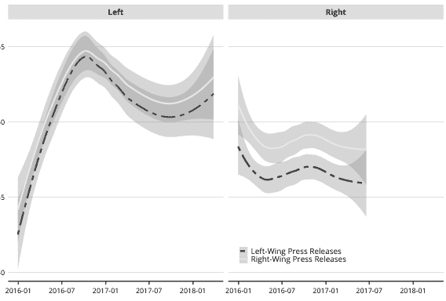

回顾过去，我们涵盖了大量内容：从通过纳入协变量来扩展主题建模，到通过总结共现来构建词义的高质量表示，然后利用这些词表示来探索焦点语料库中的含义。虽然这些模式是从我们的文本中归纳得出的，但务必牢记，我们处理文本的方式将塑造这些模式以及我们对它们的解释。

# 12 扩展演绎法

演绎分析意味着在我们的语料库中搜索一种含义。我们已经对所寻求的模式有所了解。这条推特是关于名人婚礼的吗？这篇演讲提到了福利改革吗？这篇新闻文章在讨论炫耀性消费吗？

要回答此类问题，研究人员通常会手动标记一份可管理的随机文档样本。关键问题是这些标签是用于构建分类器、验证分类，还是两者兼用。在此，我们将讨论使用标签来构建分类器（即监督学习）并使用这些标签来验证分类。我们还将探讨使用预训练模型对文档进行分类。

这些方法基于之前讨论过的有监督和无监督方法，具体而言，扩展了在核心演绎法中讨论的基于词典的方法。当我们的分类不是离散的、我们有两个或多个类别，或者当唯一词汇表无法清楚地区分类别时，这里讨论的技术很有帮助。

### 监督与验证

让我们假设我们已有分类方案。再假设我们有大量未阅读、未标记的文档，无法逐一阅读和标记。假设我们标记了语料库中5%的文档。然后我们可以尝试预测这些标签。这被称为监督，因为我们知道预期标签并且我们的模型预测这些标签。因此，任何有监督分类器的好坏取决于这些标签——并最终学习标记者的解释。

训练完成后，我们可以将模型重复用于未标记数据。我们已经使用过许多这类预训练模型。例如，光学字符识别（OCR）研究在推动此类分类器方面发挥了重要作用。我们不需要每次都重新训练OCR模型，因为字符通常不会发生太大变化。¹

相比之下，我们可以直接进行自动分类，而无需先进行标记。我们在核心演绎法中使用词典方法介绍了这种方法的一个版本。通过将词典中的术语与文档中的术语匹配，我们可以为文档分配标签。²在此，我们还将讨论使用预训练模型来增强这些基本词典方法。

> ² 例如，预编译情感词典中的权重构成一个简单的“模型”，但我们不称之为“学习”，因为这些权重是由人赋予的，而不是从数据中“统计学习”得来的。

无论标签是否在模型训练过程中被显式使用，标签通常仍会在验证步骤中使用。即使结果毫无意义，我们的过程也会将标签关联到文档。无论具体情况如何，我们的目标是确保将文档与标签配对对人类评级者来说是合理的。总会存在一些“误差”。而且，我们甚至不指望所有时候所有人类评级者都达成一致。接受这一点，我们仍希望我们的分类器为文档分配标签的方式具有表面效度，并且优于随机猜测。

### 将对象表示为特征

我们将讨论一系列归类于“机器学习”或“统计学习”（Vapnik 1998）标签下的文档分类器。这些方法首先通过一组“特征”来表示待分类对象。考虑一个简单的图像分类任务。让我们使用 Fashion-MNIST 数据集，其中包含几千张被标记为十种服装项目之一的灰度图像。

### 图 12.1：图像作为特征矩阵。

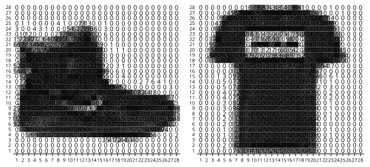

每件时尚商品都是作为矩阵加载的灰度图像（参见图 12.1）。每个单元格标识图像中的一个“像素”。单元格中的数字是灰度谱上的颜色，数字越高越接近黑色。接下来，我们将该矩阵“展开”为一个长字符串，其中每一列现在都是原始矩阵中唯一的行-列组合。我们的基本灰度图像变成了一个特征向量。每张图像都是一个 28×28 矩阵，变成一个包含 784 个数字的向量。如果我们将这些向量堆叠起来，就会得到一个图像-特征矩阵。

因此，考虑文本处理和构建 DTM 的另一种方式是将其视为一种**特征选择**，即从所有可能的属性中隔离出文本的某些属性。³ 这强化了这样一个概念：当我们进行“预处理”时，分析已经开始，并可能直接影响分类器的效果。这种基本的亲和力还使文档和图像分类研究能够相互借鉴。

> ³ 这就是为什么 **quanteda** 使用 **DFM** 而不是 **DTM**。

### 划分语料库

如果我们的模型精确拟合训练数据但对新数据无效，则它是“过拟合”的。我们为什么担心过拟合？我们的训练文档是某种原本“潜在”含义的可能表现形式。⁴ 我们语料库中的文档是这个隐藏范围的一个暴露实例。而且，每个文档从来都*不仅仅*关于单一含义。因此在训练时，我们的模型可能会识别出准确预测标签的模式，但该模式可能不存在于另一文本样本中。

假设我们在 2021 年 7 月收集了使用单词 "wedding" 的推特。我们有兴趣了解哪些推特讨论的是“名人”婚礼。我们雇佣了十几位评级者来手动标记推特是否关于“名人婚礼”。我们将模型拟合到这个语料库，发现其准确率超过 90%。太棒了！几个月后，我们又收集了更多推特，并使用模型来预测“名人婚礼”类别。但是，当我们手动检查这些新结果时，它们似乎无效。我们返回训练数据，注意到我们的大多数“名人婚礼”推特共享一个标签：#thedishulwedding。我们的分类器并不擅长识别“名人婚礼”，而是非常擅长识别讨论 2021 年 7 月 16 日歌手 Rahul Vaidya 和女演员 Disha Parmar 婚礼的推特。

> ⁴ 例如，讨论奢靡的方式有很多，Veblen 的 *Leisure Class* 只是其中之一。这些未见但理论上合理的表现形式可能存在于我们的样本之外，等待被收集，或者仅仅是假设性的可能性。

我们可能存在训练数据问题，但在收集更多数据之前，标准策略是将标记的语料库分为一个训练集和一个或多个“留出”或“不可见”数据集（James et al. 2021:176）。请回顾，我们通常会留出大约 25% 到 30% 的数据。⁵

> ⁵ 具体来说，请重新审视在核心演绎法中使用逻辑回归构建加权情感词典的过程。

在手动标记文档、将它们表示为特征以及将语料库划分为训练集和测试集后，我们进入了机器学习的核心环节：选择如何**加权**特征以预测关联标签。任何训练算法的输出——我们已经遇到过许多算法——是 (1) 与特征关联的权重，然后是 (2) 将新输入表示为这些兼容“特征”的方法。到现在，我们已经是将文本表示为“特征”的专家了——通常是预处理后的术语选择。因此，我们将深入研究将权重与这些特征关联的任务。

### 本节需要：

- tidyverse
- tidyModels
- tidytext
- text2map
- rsample
- text2vec
- quanteda.textmodels
- quanteda
- caret

> ⁶ 请回顾，LDA 和 STM 是生成模型——参见核心归纳法和扩展归纳法。

### 经典有监督训练

训练方法通常分为两大类。逻辑回归被称为判别式分类器家族的一个经典示例。替代方案是被称为生成式分类器的家族，这里的经典示例是朴素贝叶斯。正如名称所暗示的那样，生成式分类器试图建模观测数据是如何生成的。⁶ 然后，此模型用于在我们的数据中找到一个边界。判别式分类器只是试图直接找到这个边界。

正如 Vapnik 所说（Vapnik 1998:12），我们应该“尝试直接解决问题，绝不将解决更一般性问题作为中间步骤”，因此判别式分类器（至少）是一个好的起点。另一方面，生成模型被认为不太容易过拟合。

然而，生成式/判别式的区别并不像表面上看起来那么清晰。存在“混合”生成式-判别式模型，我们可以使用逻辑回归等模型来兼顾两者。一个更紧迫的区别是在将标签离散分配的模型和以程度方式分配标签的模型之间。

在接下来的内容中，我们将介绍基于 (1) 逻辑回归、(2) 朴素贝叶斯，以及最后 (3) 神经网络的流行有监督学习方法。我们将了解每种方法之间的差异，也会了解它们的相似之处。具体来说，每种方法都包含多次迭代，检查其在任务上的准确性，⁷ 并在此过程中更新权重（即优化）。当改进微乎其微（即模型收敛）或达到设定的迭代次数后，模型停止（McLevey 2021:400–4）。

> ⁷ 即模型预测与实际标签之间的“一致性”。

### 逻辑回归

与普通线性回归一样，逻辑回归试图使用其他一些变量来预测结果。在这里，我们将简单化处理，并假设我们的结果是一个具有两个值的变量：是或否？该文档属于某个类别吗？研究人员在例如试图从原本庞大的语料库中筛选子集以进行细读时会遇到此类问题。逻辑回归特别适合这种场景。


我们的结果是文档是“1”还是“0”——是“是”还是“否”——但我们建模的是得到“1”或“0”的*概率*。然后，我们通常使用概率阈值（例如，高于和低于 0.5）来离散地分配标签。

8 参见《数学基础》。

让我们先准备文本。我们将使用 ISOT Fake News 数据集中的 2,000 篇文章，该数据集包含多篇新闻文章，根据其来源标记为真实新闻或假新闻。

```
data("corpus_isot_fake_news2k", package = "text2map.corpora")
df_isot <- corpus_isot_fake_news2k |>
  mutate(text = tolower(text),
         text = gsub("[[:punct:]]+", " ", text),
         text = gsub("[[:digit:]]+", " ", text),
         text = str_squish(text)
  )
```

我们还将语料库分割为训练集和测试集。

```
set.seed(19063)
init <- initial_split(df_isot, prop = 3 / 4, strata = "rating")
df_trn <- training(init)
df_tst <- testing(init)
```

我们 DTM 中的“特征”（即术语）在所有训练集和测试集中必须相同：完全相同的词，顺序完全一致。因此，我们将为训练集创建一个 DTM，并移除罕见词。然后，在构建第二个 DTM 时，我们将使用该 DTM 的词汇表作为 `vocab` 的输入。这样可以确保两个矩阵具有相同的特征。

```
dtm_trn <- df_trn |>
  dtm_builder(text, doc_id = doc_id) |>
  dtm_stopper(stop_docfreq = c(3L, Inf))
dtm_tst <- df_tst |>
  dtm_builder(text, doc_id = doc_id, vocab = colnames(dtm_trn))
```

这里，我们将使用 `quanteda` 的文本回归函数，以便在不同训练方法间保持术语一致。那么，拟合逻辑回归只需使用：

```
lr_fit <- textmodel_lr(
  x = as.dfm(dtm_trn),
  y = as.factor(df_trn$rating)
)
```

9 在《核心演绎》中，我们使用通用函数来拟合逻辑回归，cv.glmnet() 和 glm()。

在这里，x 是我们的特征（或者在本例中，是术语频率），y 是要预测的文档标签（在本例中，新闻文章是“假新闻”还是“真实新闻”）。该函数还通过将每个单元格除以其各自行的总和，将我们的 DTM 从原始计数矩阵转换为相对频率 DTM。

输出或“模型”是特征列表（同样，这里它们是术语）及其关联权重。然后，我们可以通过将留出文档中的特征与权重关联，再利用这些权重来预测标签（这里，type 为“class”意味着我们需要*离散*标记），来使用测试文档。然后，我们将预测标签与实际标签进行比较。

```
lr_pred <- predict(lr_fit, newdata = as.dfm(dtm_tst), type = "class")
```

| 参考 \ 预测 | 假 | 真 |
|---|---|---|
| 假 | 248 | 0 |
| 真 | 2 | 250 |

准确率：0.996

由于我们进行的是二元分类（真实或假），可以通过混淆矩阵（输出在页边栏）来展示我们在测试集上对标签的预测效果。

```
confusionMatrix(lr_pred, as.factor(df_tst$rating))
```

我们在测试语料库中正确预测了几乎*每个标签*：只漏掉了两个。这是一个高性能分类器！的确，它看起来*太*好了。让我们来调查一下。

与其预测类别，不如拆解一下模型。请记住，预训练模型主要是与特征相关联的*权重*。使用 `coef()` 我们可以提取这些权重。让我们创建一个函数，查看哪些词对“真实新闻”评级的权重最高。

```
feat_weights <- function(model, n) {
  return(
    coef(model) |> as.matrix() |>
    as.data.frame() |> rownames_to_column("term") |>
    select(term, value) |>
    slice_max(value, n = n, with_ties = FALSE)
  )
}
```

```
feat_weights(lr_fit, n = 5)
```

| 术语 | 值 |
|---|---|
| reuters | 4.448754 |
| mark | 0.0000000 |
| has | 0.0000000 |
| been | 0.0000000 |
| accused | 0.0000000 |

果不其然，出了问题。我们所有的“真实”新闻文章都来自路透社。因此，几乎所有“真实”新闻文章都包含单词“reuters”。由于这个单个词与我们的标签几乎完美相关，它单独推动了大部分准确率！让我们重新创建 DTM，但这次移除“reuters”。

```
dtm_trn_wo <- df_trn |>
  dtm_builder(text, doc_id = doc_id) |>
  dtm_stopper(stop_list = "reuters", stop_docfreq = c(3L, Inf))
```

```
dtm_tst_wo <- df_tst |>
  dtm_builder(text, doc_id = doc_id, vocab = colnames(dtm_trn_wo))
```

值得注意的是：拟合这个新模型需要花费明显更长的时间。由于任务变得更复杂，它现在需要更多迭代才能收敛（输出在页边栏）。

```r
lr_fit_wo <- .textmodel_lr(
  x = as.dfm(dtm_trn_wo),
  y = as.factor(df_trn$rating)
)
```

```r
lr_pred_wo <- predict(lr_fit_wo,
                      newdata = as.dfm(dtm_tst_wo),
                      type = "class"
)
```

```r
confusionMatrix(lr_pred_wo, as.factor(df_tst$rating))
```

| 参考 \ 预测 | 假 | 真 |
|---|---|---|
| 假 | 232 | 5 |
| 真 | 18 | 245 |

准确率：0.954

仍然准确！当然，我们也可以提取特征权重来查看哪些词对“真实”标签最具预测性，但让我们继续。

与其将我们的分类视为离散（非此即彼）的类别，不如逐步_测量_。也许有些真实的文章读起来像典型的假新闻文章（反之亦然）。与其预测“类别”，我们将预测“概率”。让我们比较有“reuters”和没有“reuters”时的概率分布（参见图 12.2）。

```r
lr_pred <- predict(lr_fit,
                   newdata = as.dfm(dtm_tst),
                   type = "probability") |> 
  as.data.frame()
```

```r
lr_pred_wo <- predict(lr_fit_wo,
                      newdata = as.dfm(dtm_tst_wo),
                      type = "probability") |> 
  as.data.frame() |> 
  rename_all(paste0, " (w/o reuters)")
```

```r
df_plot <- cbind(lr_pred, lr_pred_wo)
df_plot$rating <- df_tst$rating
```

```r
df_plot |>
  select(rating, real, fake,
         `real (w/o reuters)`,
         `fake (w/o reuters)`) |>
  pivot_longer(!rating) |>
  ggplot(aes(value, fill = rating)) +
  geom_density() +
  labs(fill = "Predicted Probability of Label") +
  theme(legend.title = element_text()) +
  facet_wrap(~name)
```

在两种模型中，“真实”新闻和“假”新闻的概率分布重叠程度不高。不过，移除单词“reuters”后，分布中间部分的文章更多了。这表明文档与给定标签之间存在略显更多的分级关系。尽管如此，我们的逻辑回归分类器在预测离散标签方面仍然相当出色。

### 图 12.2：分类器密度图。

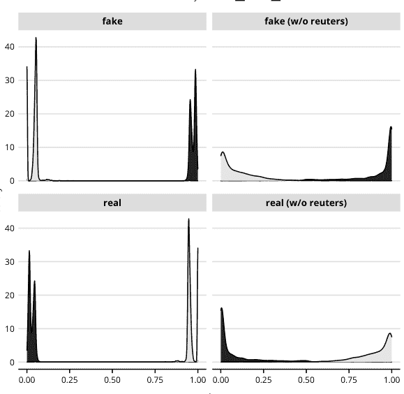

那怎么办？我们希望在新数据上使用这个模型。例如，我们可以通过自动分类用户发布的链接，来衡量在线论坛上假新闻的传播情况。但是，所有“真实”新闻文章都来自路透社。如果我们有指向例如芝加哥论坛报的链接，我们的模型是否会错误地将它们归类为假新闻，因为它们与路透社太不同？我们的模型可能过拟合，并且可能无法推广到其他“真实”新闻来源。下面我们将介绍另一种通常被认为对过拟合更稳健的方法。

## 朴素贝叶斯

我们将继续使用不含“reuters”的 DTM 来展示另一种流行分类器：朴素贝叶斯。该分类器与逻辑回归相关，因为我们在寻找在术语存在条件下标签的概率。这被称为*后验*概率。计算此概率涉及贝叶斯定理：后验等于词出现在分配给该标签的文档中的概率与语料库中该标签的概率之积，除以语料库中该词的概率。

经典贝叶斯定理的一个问题是，我们需要计算术语在标签*和所有其他术语*条件下的概率。由于我们的预测变量是术语频率，而且通常有数万个术语，这在计算上不可行。这就是“朴素”部分的由来。我们假设每个术语是相互独立的，这大大降低了复杂度。因此，在朴素贝叶斯中，我们最终要做的是：对于每个文档，找出给定该文档中的词时标签的概率，这与语料库中该标签的概率乘以每个词在出现在分配给该标签的文档中的条件概率的乘积成正比。让我们拟合一个朴素贝叶斯分类器（输出在页边栏）：

```
nb_fit <- textmodel_nb(
  x = as.dfm(dtm_trn_wo),
  y = as.factor(df_trn$rating)
)
```

```
nb_pred <- predict(nb_fit, newdata = as.dfm(dtm_tst_wo))
confusionMatrix(nb_pred, as.factor(df_tst$rating))
```

迄今讨论的方法可以轻松地从二元标签推广到预测多个标签，也就是多类分类器。

## 使用神经网络进行训练

想象一下，取逻辑回归的输出，然后在该输出上拟合*另一个*逻辑回归。第二个逻辑回归像往常一样预测标签。而第一个逻辑回归则预测属于任意数量类别的成员身份。第一步是在我们的 DTM 上应用“降维”。然后，我们使用这个较低维度的矩阵在下一步中预测标签。

一个**神经网络**<sup>10</sup> 大致等效。但是，我们可以使用任意数量的**激活函数**，而不仅仅是逻辑函数；我们可以添加任意数量的步骤或**层**，而不仅仅是两个。最小的神经网络有三层：输入层、隐藏层和输出层。隐藏层使其区别于已经讨论过的经典方法。

| 参考 \ 预测 | 假 | 真 |
|---|---|---|
| 假 | 5409 | 282 |
| 真 | 298 | 5072 |

准确率：0.9476

### 本节需要：

- tidyverse
- text2map
- rsample
- caret
- keras
- reticulate

<sup>10</sup> 更准确地说，“多层设置将输出（Y）建模为输入（X）的线性组合的简单非线性函数的串联”（Molina 和 Garip 2019:31）。有关概述，参见 McLevey（2021:394–410）；有关理论基础，参见 Roberts 及其同事（Roberts et al. 2022）。


这一点很重要。神经网络并非总是合适的工具。更简单的过程通常能胜过（或与之持平）更先进的技术（Salganik 2020）。研究者有责任证明需要使用更复杂的技术。称其为“最先进技术”可不管用！作为一般原则，从简单的方法开始，并尽量以简单的方法结束。

现在，让我们熟悉一下将神经网络用作文档分类器。我们将使用 Python 包，因此在加载所需包之前，需要先设置 conda 环境。11

```
use_condaenv(condaenv = "myenv")
```

加载来自 Amazon 的新食品评分和评论语料库，例如，“I love this flavor of ramen! Five stars!” 这次我们将使用三个结果标签：评分 4 分或以上为 0，正好 3 分为 1，2 分或以下为 2。

```
data("corpus_finefoods10k", package = "textmap.corpora")
df_food <- corpus_finefoods10k |>
  mutate(text = tolower(text),
         text = gsub("[[:punct:]]+", " ", text),
         text = gsub("[[:digit:]]+", " ", text),
         text = str_squish(text),
         label = case_when(
           score >= 4 ~ 0,
           score == 3 ~ 1,
           score <= 2 ~ 2
         )
)
```

```
set.seed(19063)
init <- initial_split(df_food, prop = 3 / 4, strata = "label")
df_trn <- training(init)
df_tst <- testing(init)
```

神经网络处理的是特定形状的矩阵。我们将使用 keras 中的 `array_reshape()` 和 `to_categorical()` 来处理预测器（这里，术语频率）和结果（食品被评价为好、中立或差）的重塑。

```
ke_dtm_trn <- array_reshape(as.matrix(dtm_trn), dim = dim(dtm_trn))
ke_dtm_tst <- array_reshape(as.matrix(dtm_tst), dim = dim(dtm_tst))
y_trn <- to_categorical(df_trn$label, num_classes = 3)
y_tst <- to_categorical(df_tst$label, num_classes = 3)
```

接下来，我们将决定我们的 **模型架构**，其中包括（1）“层”的数量和类型，我们将（2）如何衡量准确率以及（3）在进行过程中如何更新权重。首先，我们初始化一个“序列”网络。
然后，我们决定使用两层（除了我们的“输入”层之外）。

第一个 `layer_dense()` 是输入和输出步骤之间的“隐藏”层。12 在这里，我们将列数为 15,758 的输入矩阵减少到仅 1,200 列。不过，这是任意的，更改它可能会改善最终结果。非正式规则是在输入大小（这里为 15,758）和输出大小（这里为 3）之间选择一个数字。

我们的唯一隐藏层使用流行的激活函数 RELU，其中负输入返回零，而正输入返回输入值。

最终层只是逻辑回归。“Logistic”是一类相似函数的统称。当只有两个类别时，我们使用“sigmoid”函数；当有两个以上类别时，我们使用“softmax”。该输出层的单元数即为要预测的标签数量。

```
ke_mod <- keras_model_sequential()
ke_mod |>
layer_dense(units = 1200,
activation = "relu",
input_shape = ncol(ke_dtm_trn)) |>
layer_dense(units = 3,
activation = "softmax")
```

回顾一下，我们的神经网络有三层：（1）具有 15,758 个“维度”的输入 DTM，（2）“隐藏”层使用 RELU 激活函数将 15,758 减少到 1,200，（3）输出层使用逻辑回归将 1,200 减少到仅 3。如果没有隐藏层，我们只是在做逻辑回归！

接下来，我们将配置如何衡量性能，并利用这些信息在每次迭代中更新权重。有许多 **损失函数** 用于衡量模型预测标签的好坏。“categorical cross-entropy” 适用于两个以上的标签。13 为进行更新，我们将使用“stochastic gradient descent”（SGD），它将预测值与输入的随机样本进行比较。这降低了每次传递的复杂度，但相比于每次都使用全部输入，需要更多迭代才能收敛。最后，当模型收敛时，我们希望看到最终预测的一些指标。**准确率** 告诉我们被正确标记的文档百分比。
配置我们的损失、优化器和准确率指标：

```
ke_mod |>
compile(loss = "categorical_crossentropy",
 optimizer = "sgd",
 metrics = "accuracy")
```

12 之所以称其为“隐藏”，是因为在本任务之外我们不会检查或使用它。当然，我们会看到输入数据，并且将检查和使用我们的输出（即，特征权重和预测标签）。

13 交叉熵比较预测标签和实际标签的“熵”（概率的负对数）。

我们已经有了模型架构；现在可以对模型进行“拟合”或训练。此外，与其等待模型自行收敛，不如在本示例中直接进行十轮迭代。

```
history <- ke_mod |>
fit(ke_dtm_trn, y_trn, epochs = 10)
```

请记住，损失函数是误差的连续度量，而准确率是离散度量。因此，我们可能会遇到四种情况：（1）大多数预测的准确率低，但误差大；（2）大多数预测的准确率低，但误差小；（3）少数数据的准确率高，但误差大；最后，（4）总体准确率高且误差小。

既然我们已经训练好了模型，来看看它预测测试集标签的效果如何。

```
ke_mod |> evaluate(ke_dtm_tst, y_tst, verbose = 0)
```

| 损失 | 准确率 |
|------|----------|
| 0.480646 | 0.818000 |

我们的模型在预测测试集标签方面表现相当不错。让我们使神经网络更加复杂，看看是否可以改进这一点。让我们添加一个词嵌入层。我们不仅使用 DTM，还将使用文档-序列矩阵。为此，我们首先将词汇表中的每个词与一个唯一的整数关联起来，针对出现频率最高的 v 个词。该矩阵包含前 N 个词。列是单词的位置，而单元格是与该单词关联的整数。让我们将 n_words 设置为每个文档中的前 100 个词。14

14 如果不想截断任何文档，我们将把 n_words 设置为最长文档的长度。

```
n_words <- 100
seq_trn <- df_trn |>
 seq_builder(text, maxlen = n_words)
seq_tst <- df_tst |>
 seq_builder(text, maxlen = n_words)
# add 1 for "zero"
v_vocab <- length(attr(seq_trn, "dic")) + 1
```

15 这使用 SGNS word2vec 算法。参见 Extended Inductive。

下面，我们添加了一个新的第一层：嵌入层。15 这将创建具有 128 个维度的词嵌入，并且仅使用 100 词限制内的共现。创建这些嵌入后，下一隐藏层的输入将不再是正确的“形状”。因此，我们添加了另一层，分别对每个文档中的所有向量求平均。16 然后，将文档的此向量表示传递给与第一个模型相同的层。

```
ke_mod <- keras_model_sequential()

ke_mod <- ke_mod |>
  layer_embedding(input_dim = v_vocab, output_dim = 128,
                  input_length = n_words) |>
  layer_global_average_pooling1d() |>
  layer_dense(units = 1200, activation = "relu") |>
  layer_dense(units = 3, activation = "softmax")
```

16 请回顾，这等同于定义语义中心。

我们的损失、优化器和准确率指标与之前相同。唯一需要注意的是，我们需要使用 *文档-序列矩阵* 来预测结果标签。

```
ke_mod <- ke_mod |>
  compile(loss = "categorical_crossentropy",
          optimizer = "sgd",
          metrics = "accuracy")

history <- ke_mod |>
  fit(seq_trn, y_trn, epochs = 10)

ke_mod |> evaluate(seq_tst, y_tst, verbose = 0)
```

| 损失 | 准确率 |
|------|----------|
| 0.7066723 | 0.7628990 |

有趣的是，我们的损失增加了，准确率降低了。也许使用预训练词嵌入会有所帮助？我们将在下一节中探讨这一点。

## 使用预训练模型的演绎分析

在前一个示例中，我们训练了自己的模型。最终，我们将在未用于训练过程的数据上使用这些模型——不仅仅是“测试”数据，还包括未标记数据。这就是使用 *预训练* 模型的含义。随着开放科学日益普及，预训练模型将大量涌现。我们该如何利用它们来增强演绎方法？

在这里，我们将重点关注预训练的 *词嵌入*。请回顾，预训练模型通常由特征权重组成，有时还包括将输入与所需特征匹配的方法。嵌入通常是矩阵，其中行名为术语，列是嵌入空间的 *d* 个维度。每个唯一单词由长度为 *d* 的向量表示。要使用这些嵌入，我们将把文档中的所有单词与嵌入中的单词进行匹配。17

17 例如，如果嵌入中的术语经过词干提取或大写，那么我们需要对语料库中的术语进行词干提取或大写。


使用预训练嵌入有四个原因。首先，我们节省时间和资源。其次，它提高了跨研究的可重复性。第三，我们的焦点语料库可能太小，不足以用于训练。最后，仅在焦点语料库上训练的嵌入可能会过拟合。

- 本节需要：
  - tidyverse
  - stringi
  - textclean
  - keras
  - reticulate

## 带预训练嵌入的神经网络

我们将使用 Reddit 上一个名为“Am I the Asshole”（AITA，即“我是不是混蛋”）的热门讨论板块（subreddit）中的帖子。指南很简单：“告诉我们你经历过的任何非暴力冲突；讲述故事的双方，找出你是对的，还是你才是那个混蛋。”论坛成员决定哪一方错了：作者、另一方、所有人、没有人——或者在某些情况下，信息不足以判断。使用文本预测“谁是混蛋”是一项复杂的分类任务。

```
data(corpus_reddit_aita10k, package = "text2map.corpora")

df_aita <- corpus_reddit_aita10k |>
mutate(text = stri_trans_general(text,
id = "Any-Latin; Latin-ASCII"),
text = tolower(text),
text = replace_curly_quote(text),
text = replace_contraction(text),
text = gsub("[[:punct:]]+", " ", text),
text = gsub("[[:digit:]]+", " ", text),
text = str_squish(text)
)
```

我们将再次使用 Python 包，因此设置 conda 环境。

```
use_condaenv(condaenv = "myenv")
```

让我们使用之前使用过的嵌入，即在 Common Crawl 上训练的 fastText 嵌入，位于 text2map.pretrained 中。我们假设模型已下载。

```
# load the model each session
data("vecs_fasttext300_commoncrawl", package = "text2map.pretrained")
ft_wv <- vecs_fasttext300_commoncrawl # rename so it's tidier
```

让我们将语料库转换为文档-序列矩阵，仅使用每个帖子的前 2,000 个单词。

```
n_words <- 2000

seq_trn <- df_aita |>
seq_builder(text, maxlen = n_words) |>
as.matrix()
```

我们还需要准备结果变量，它包含五个类别，指示根据多数意见谁错了：Other、Nobody、Author、Everybody 和 Info（需要更多信息）。让我们先将这五个类别转换为 0 到 4 的整数[^20]，然后创建一个 keras 友好的矩阵。

[^20]: Python 从 0 开始计数，而 keras 使用 Python。

```
df_aita <- df_aita |>
mutate(labeln = case_when(
  label == "AUTHOR" ~ 0,
  label == "OTHER" ~ 1,
  label == "NOBODY" ~ 2,
  label == "EVERYBODY" ~ 3,
  label == "INFO" ~ 4,
)
)
y_trn <- to_categorical(df_aita$labeln, num_classes = 5)
```

将我们的“权重”（即预训练嵌入）放入列表中，并将其添加到 layer_embedding() 的 weights 参数中，不允许训练（trainable = FALSE）。

```
ke_mod <- keras_model_sequential()
ke_mod <- ke_mod |>
layer_embedding(
input_dim = nrow(ft_wv),
output_dim = 300L,
input_length = n_words,
weights = list(ft_wv),
trainable = FALSE)
layer_global_average_pooling1d() |>
layer_dense(units = 50, activation = "relu") |>
layer_dense(units = 5, activation = "sigmoid")
```

```
ke_mod <- ke_mod |>
compile(loss = "categorical_crossentropy",
optimizer = "sgd",
metrics = "accuracy"
)
```

```
history <- ke_mod |>
fit(seq_trn, y_trn, epochs = 10)
```

本次我们没有使用测试集。我们将只使用模型为训练数据获取标签。请注意，每个帖子被分类为五个标签之一的概率各不相同。

```
preds <- ke_mod |> predict(seq_trn)
colnames(preds) <- c("AUTHOR", "OTHER", "NOBODY",
"EVERYBODY", "INFO")
df_aita <- cbind(df_aita, preds)
```

让我们看看我们的模型对一篇帖子的社区判断预测效果如何：“AITA for feeding my vegan nephew meat?（给我素食侄子喂肉，我是不是混蛋？）”这篇帖子的大意是，作者带着 7 岁的侄子出去吃饭，而他们的父母去约会了。父母和孩子都是素食者。当作者问孩子想去哪里吃饭时，他说“Five Guys”——一家著名的汉堡餐厅。作者的姐姐表示，他们“未经允许改变他的饮食是越界了。”得分如下：

- 631：姐姐错了。
- 276：作者错了。
- 229：没人错。
- 26：每个人都错了。
- 7：需要更多信息。

因此，大多数人站在作者一边，认为“另一方”错了。让我们看看我们的模型表现如何。

```
df_aita |> filter(title == "AITA for feeding my vegan nephew meat?") |> select(AUTHOR:INFO)
```

| AUTHOR | OTHER | NOBODY | EVERYBODY | INFO |
|---|---|---|---|---|
| 0.7772692 | 0.9145786 | 0.5613233 | 0.3398936 | 0.07852602 |

这与投票结果非常吻合！

假设我们的研究需要将文档分类到多个类别中，而 **核心演绎法** 中讨论的方法未能产生预期结果；那么使用带预训练嵌入的神经网络是一个不错的选择。但是，至少有些文档必须有标签。如果我们没有标记数据怎么办？我们将在下一节讨论一种针对未标记文档的分类策略。

- 本节需要：
  - tidyverse
  - textclean
  - text2map
  - text2map.pretrained
  - stringi
  - gutenbergr

## 带预训练嵌入的概念搬移距离

请记住，监督意味着我们使用标签来训练分类器。它们不是可选的。词典方法的优势在于它们不需要标记。

我们能否用预训练模型来增强词典方法？具体来说，我们能否使用词嵌入来考虑术语之间的语义相似性？好消息，大家！我们可以使用 **概念搬移距离**（CMD）（Stoltz and Taylor 2019a; Taylor and Stoltz 2021）。这种方法扩展了词典方法，因为我们需要一个或多个“锚点”术语。然后我们将使用预训练词嵌入来增强此过程，通过按每个词与这些锚点的余弦相似度对文档中的每个词进行加权。[^21]

[^21]: 为此，CMD 依赖于词搬移距离；参见扩展归纳法。

我们的锚点列表定义了嵌入空间中的一个位置。在最简单的场景中，这是一个单词——比如“死亡”。然后我们将 DTM 中的每个词与嵌入空间中的一个位置关联起来。因此，文档是位置的云。我们想要衡量将文档中所有词移动到这一点的 *最小成本*。成本是距离和权重的函数：对我们来说，分别是余弦和相对频率。

我们将尝试使用我们创建的关于这些剧本的元数据，预测莎士比亚第一对开本中 37 部剧本里的“死亡”。这包括 Project Gutenberg 上托管作品的唯一 ID。然后我们将使用 gutenbergr 下载每部剧本，创建一个每行是剧本中一行的数据框。我们还将把这些行合并，使每部剧本只有一行。

```
data("meta_shakespeare", package = "text2map")
my_mirror <- "mirrors.xmission.com/gutenberg/"
df_text <-
  select(gutenberg_id) |>
  gutenberg_download(mirror = my_mirror) |
  group_by(gutenberg_id) |>
  summarize(text = paste(text, collapse = " ")) |>
  mutate(gutenberg_id = as.character(gutenberg_id))
```

这些是 OCR 文档，所以让我们进行转写，处理这些讨厌的花体引号，展开所有可能的缩写，然后删除标点和数字。然后，构建一个 DTM。

```
df_text <- df_text |>
  mutate(text = replace_non_ascii(text),
         text = tolower(text),
         text = replace_curly_quote(text),
         text = replace_contraction(text),
         text = gsub("[[:punct:]]+", " ", text),
         text = gsub("[[:digit:]]+", " ", text),
         text = str_squish(text)
  )
dtm <- df_text |>
  dtm_builder(text, doc_id = gutenberg_id)
```

加载 fastText 嵌入。

```
data("vecs_fasttext300_commoncrawl", package = "text2map.pretrained")
ft_wv <- vecs_fasttext300_commoncrawl # rename so it’s tidier
```

由于“死亡”与“生命”相似，让我们还计算每部剧本与生命-死亡语义方向的关联，而不仅仅是单词“死亡”。[^22]

```
terms <- cbind(c("death", "demise", "dying"),
                 c("life", "birth", "living"))
dir_death <- get_direction(terms, ft_wv)
```

在 DTM 中，每个文档都表示为词数分布。每个估计对给定的词分布有多“敏感”？我们可以通过从每个文档的词分布中重新采样（有放回）来测试这种敏感性。我们通过设置 sens_interval

为 TRUE。底层，我们使用 `dtm_resampler()` 来估计 100 个新的 DTM，并对每个重新运行 CMD，然后报告给定区间（默认值为 c(0.025, 0.975)）。我们将使用默认设置。结果在图 12.3 中可视化。

```r
cmd_play <- CMDist(
  dtm = dtm,
  cv = dir_death,
  wv = ft_wv,
  sens_interval = TRUE,
  n_iters = 100L
)
```

```r
df_cmd <- meta_shakespeare |>
  mutate(doc_id = as.character(gutenberg_id)) |>
  left_join(cmd_play, by = "doc_id")
```

```r
df_cmd |>
  ggplot(aes(x = body_count, y = death_pole)) +
  geom_errorbar(aes(
    x = body_count, y = death_pole,
    ymin = death_pole_lower,
    ymax = death_pole_upper
  ), alpha = 0.5) +
  geom_point(aes(color = genre), size = 2) +
  labs(x = "Number of Deaths in the Play",
       y = "Closeness to 'Death'")
```

## 图 12.3: 戏剧与“死亡”的关联

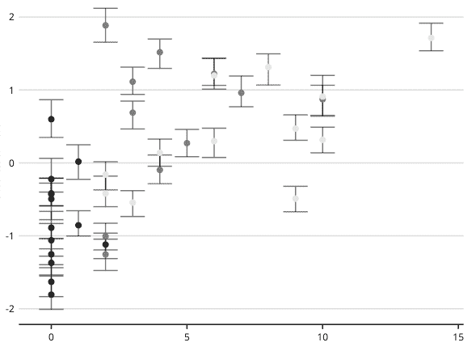

我们可以看到，莎士比亚的喜剧倾向于较少涉及死亡，而历史剧和悲剧则倾向于更多涉及死亡。总的来说，这是一种在不先对文本进行标记的情况下，演绎式地映射文本中特定概念的有用方法。

## 用于演绎分析的预训练嵌入式回装

对前一过程的批评可能是，fastText 嵌入式是基于 2015 年维基百科数据转储训练的，但莎士比亚写作是在 400 多年前。回顾一下，许多嵌入式方法（隐式或显式）为单词分配向量，使其余弦近似于它们在语料库中共现的概率。换句话说，我们可以使用成对余弦来重新创建 TCM。

- 本部分需要：
  - tidyverse
  - stringi
  - gutenbergr
  - text2map
  - text2map.pretrained
  - text2vec
  - rsvd
  - tidytext
  - spacyr
  - semgram

我们也可以采取相反的方法：使用聚焦 TCM 对预训练嵌入式进行“回装”。我们将从第一对开本中的所有剧本开始，但不会合并行。然后，我们将进行与之前相同的预处理并删除任何空行。

```r
data("meta_shakespeare", package = "text2map")
my_mirror <- "mirrors.xmission.com/gutenberg/"
df_shake <- meta_shakespeare |>
  select(gutenberg_id) |>
  gutenberg_download(mirror = my_mirror) |>
  left_join(meta_shakespeare)
```

```r
df_shake <- df_shake |>
  mutate(gutenberg_id = as.character(gutenberg_id)) |>
  rename(line = text) |>
  mutate(text = replace_non_ascii(line),
         text = replace_curly_quote(text),
         text = replace_contraction(text),
         text = gsub("[[:punct:]]+", " ", text),
         text = gsub("[[:digit:]]+", " ", text),
         text = tolower(text),
         text = str_squish(text)) |>
  filter(text != "")
```

让我们使用 text2vec 创建一个上下文窗口为 5 的 TCM。请记住，默认情况下，create_tcm() 按每个词与目标词距离的倒数进行加权。

```r
tkns <- unlist(df_shake$text) |> str_split(" ")
vectorizer <- itoken(tkns) |>
  create_vocabulary() |>
  vocab_vectorizer()
tcm_sh <- itoken(tkns) |>
  create_tcm(vectorizer, skip_grams_window = 5L)
```

加载在 Common Crawl 上训练的 fastText 嵌入式。

```r
# load the model each session
data("vecs_fasttext300_commoncrawl", package = "text2map.pretrained")
ft_vw <- vecs_fasttext300_commoncrawl # rename so it's tidier
```

嵌入式和 TCM 的词汇表必须匹配。为确保这一点，我们将使用两者词汇表的交集对两者进行子集化。

```r
vocab <- intersect(rownames(ft_vw), rownames(tcm_sh))
tcm_sh <- tcm_sh[vocab, vocab]
pre_wv <- ft_vw[vocab, ]
```

接下来，我们将对预训练嵌入式进行“标记”，以更好地适配我们的本地 TCM。这称为“回装”（也称为“微调”和“丰富”），有几种有用的方法可以融入基于本地语料库构建的 TCM 的信息（Dingwall and Potts 2018）、来自 WordNet 等语义数据库的信息（Faruqui et al. 2014），甚至文本作者的人口统计信息（Hovy and Fornaciari 2018）。23 我们可以通过回装来融入这些信息。

23 例如，美国作者撰写的关于乔治·拉明小说的评论比英国作者撰写的评论更可能提及“革命”和“殖民主义”（Griswold 1987）。

我们将使用一个基于前几章构建的“回装器”函数。24 还记得仅使用 TCM 和 SVD 创建词嵌入式吗？让我们遵循类似的步骤，创建适合本地语料库的廉价词向量。然后，我们将 SVD 嵌入式与预训练嵌入式进行“对齐”——就像我们在历时分析中所做的那样。最后，回顾训练 GloVe 嵌入式时，我们将嵌入式相加——此函数也做同样的事。添加 SVD 嵌入式应该会稍微“拉动”预训练嵌入式，从而创建一个更适合我们本地语料库的嵌入空间。25

24 参见扩展归纳。

25 我们也可以使用以下过程来创建词汇表外嵌入式。

```r
retrofitter <- function(x, ref) {
  x <- find_transformation(x, method = "norm")
  ref <- find_transformation(ref, method = "norm")
  ref <- rsvd(ref, k = ncol(x))$v
  ref <- find_transformation(ref, x, method = "align")
  ref <- x + ref
  ref <- find_transformation(ref, method = "norm")
  return(ref)
}
```

让我们使用莎士比亚 TCM 作为参考来获取我们的回装词嵌入式。这减少了我们词嵌入式与本地语料库共现之间最极端的差异。26

26 我们可以创建一个“误差”指标，并对已回装的嵌入式进行迭代回装，以减少该误差。

```r
ret_wv <- retrofitter(pre_wv, tcm_sh)
```

让我们将它们用于单一剧本，Two Gentlemen of Verona——据信是莎士比亚的第一部剧本。我们将使用 sub() 删除一些前言内容（例如，目录）。

```r
df_tgov <- df_shake |>
  filter(short_title == "Two Gentlemen of Verona") |>
  group_by(gutenberg_id) |>
  summarise(text = paste(line, collapse = " ")) |>
  mutate(text = sub("^.*(ACT 1\\.*)", "\\1", text))
```

接下来，我们将按各自的说话人对行进行分组。我们使用一个正则表达式模式，该模式匹配紧跟在任何全大写单词（后面紧跟句点和空格）*之前*的位置：`\\W(?=[A-Z]+\\\\.)`。然后，我们将预处理这些说话人行（提取说话人的姓名）。

```r
df_tgov <- df_tgov |> filter(text != "") |>
  unnest_tokens(line, text,
                token = "regex",
                pattern = "\\W(?=[A-Z]+\\\\.)",
                to_lower = FALSE) |>
  mutate(speaker = sub("^([A-Z]+).", "\\1", line),
         position = row_number(),
         doc_id = paste0("doc_", position))
```

```r
df_tgov <- df_tgov |>
  mutate(text = replace_non_ascii(line),
         text = replace_curly_quote(text),
         text = replace_contraction(text),
         text = gsub("[[:punct:]]+", " ", text),
         text = gsub("[[:digit:]]+", " ", text),
         text = tolower(text),
         text = str_squish(text)
  )
```

我们将使用回装后的嵌入式来估计 *维罗纳的两绅士* 中每行的新参与度得分。这次我们将衡量与爱到恨的语义方向的参与度（我们还将估计生与死，以备后用）。

```r
terms <- cbind(c("love", "affection"), c("hate", "disdain"))
dir_love <- get_direction(terms, ret_wv)
```

```r
dtm_tgov <- df_tgov |> dtm_builder(text, doc_id)
cmd_play <- CMDist(dtm = dtm_tgov, cv = dir_love, wv = ret_wv)
df_cmd <- left_join(df_tgov, cmd_play)
```

让我们看看主要角色如何在叙事中与爱和恨互动。我们将选择台词最多的 6 个角色。

```r
characters <- table(df_tgov$speaker) |>
  sort(.) |>
  tail(.) |>
  names()
```

"西尔维娅" "朗斯" "茱莉亚"
"斯皮德" "普罗泰厄斯" "瓦伦丁"

```r
df_cmd |>
  filter(speaker %in% characters) |>
  mutate(fill = case_when(
    love_pole > 0 ~ "To Love",
    love_pole < 0 ~ "From Love"
  )) |>
  ggplot(aes(position, love_pole)) +
  geom_col(aes(fill = fill), width = 8) +
  geom_smooth(se = FALSE, alpha = 0.5) +
  facet_wrap(~speaker) +
  scale_fill_manual(values = c("black", "darkgrey"))
```

观察图 12.4。主角瓦伦丁爱上了公爵的女儿西尔维娅，他的台词在整个剧中都强烈偏向爱。


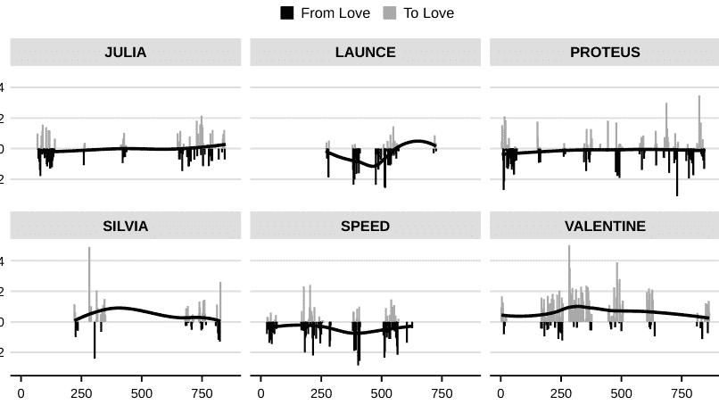

图 12.4：人物对“爱”的参与。

该剧。相比之下，朗斯的部分强烈倾向于蔑视而非情感。让我们选取该角色的第一句话，在页面上查看：

> 我认为我的狗克拉布是世上性情最刻薄的狗：母亲哭泣，父亲恸哭，姐姐哭喊，女仆嚎叫，我们的猫绞着手，整个房子都一片茫然；然而这个无情的恶狗竟一滴眼泪都没流。他是一块石头，一颗纯石头，身上比狗还少一点怜悯之心….

这段文字与我们对“蔑视”的直觉相当吻合。现在，让我们探索剧中角色的关系，看看他们的台词部分如何与对爱与恨的参与相关联。我们将依赖 spaCy 和 en_core_web_sm 语言模型的预训练模型进行依存句法分析。请记住，我们需要指定 Python 环境。

27 见“标注词语”。
28 见“计算基础”。

```
## Download the language model if necessary
## spacy download langmodel("en_core_web_sm", envname = "myenv")
spacy_initialize(model = "en_core_web_sm", condaenv = "myenv")

df_parse <- df_tgov |>
  select(doc_id, line) |>
  rename(text = line) |>
  spacy_parse(entity = FALSE, dependency = TRUE)
```

我们可以用**叙事动机**（Franzosi 2004; Stuhler 2022b）来总结这些依存关系。具体来说，让我们提取当实体为“我”而非“你”的情况。接下来，我们将比较两个 _动机_：（1）实体的 _动作_ 与（2）对实体的 _对待_（Stuhler 2022b:3）。

```
motifs <- extract_motifs(df_parse, entities = c(".*"))
motifs <- motifs[c("actions", "treatments")]
```

```
df_motifs <- bind_rows(motifs) |>
  pivot_longer(action:treatment) |>
  filter(Entity %in% c("I", "you")) |>
  left_join(df_cmd) |>
  na.omit()
```

最后，让我们看看每个实体和动机中爱恋与恨意参与度的相对比例如何变化（图 12.5）。我们可以进一步按发言者细分。例如，瓦伦丁的台词“哦！奉承我吧；因为爱喜爱赞美”具有最高的爱意参与度之一，而瓦伦丁是被动作的对象（“奉承我”）。

```
df_motifs |>
  filter(speaker %in% characters) |>
  mutate(love = love_pole - min(love_pole)) |>
  ggplot(aes(x = love_pole, fill = Entity)) +
  geom_density(position = "fill", alpha = 0.7) +
  facet_grid(name ~ speaker) +
  labs(x = "Toward Love (From Hate)")
```

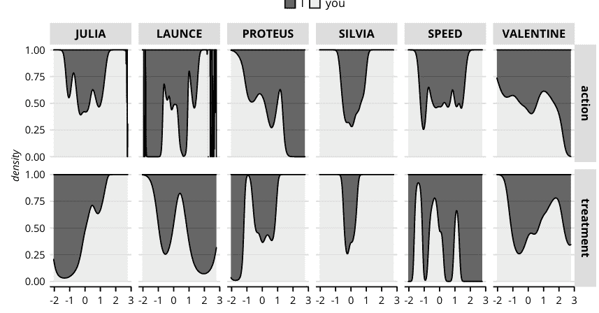

图 12.5：实体、动机与对“爱”的参与。

花点时间探索这个图表——这里面有很多信息。看看朱丽娅——普罗泰乌斯情感的对象。当她谈论爱情时，涉及的实体——无论是行动者（动作）还是被动者（对待）——都是“你”。例如，在发现普罗泰乌斯也爱西尔维亚之后，朱丽娅说：

> 因为我想，她爱你，正如你爱你的女士西尔维亚一样。她在梦见那个已经忘记她爱情的人：

在这里，朱丽娅（乔装打扮）以第二人称讨论普罗泰乌斯，而他正在被“对待”：她爱了你。

在此，我们结合了文本预处理和预训练模型，对单部戏剧进行了粗略的“远距离”阅读。例如，与人工标注和字典方法不同，改变概念（即为语义中心和方向选择不同的锚点）几乎不需要时间。我们可以快速扩展这个基本基础设施，不仅涵盖莎士比亚的《第一对开本》，还包括数百位剧作家、数千部戏剧，或许跨越几个世纪。

获得这些分类不需要标注。然而，为了检验这些方法的有效性，我们可以随机抽取部分文本进行人工标注，并看看我们的分类器与这些标签的一致程度如何（例如，Carbone and Mijs 2022）。

- **本部分需要：**
  - tidyverse
  - text2map
  - ggraph
  - igraph
  - text2vec
  - backbone
  - textclean
  - sna

## 文本网络推断

我们一直关注文档的属性：文档中的词语、作者、撰写时间、涉及的主题等。这回避了关于关系的问题——例如，文档之间的关系或术语之间的关系。这就是文本网络的目的（Bail 2016; Stoltz and Taylor 2019b; Basov et al. 2020; Segev 2020）。文本网络已存在一些时间，其根源至少可以追溯到卡利在语义网络方面的开创性工作（Carley and Kaufer 1993; Carley 1997; Carley and Palmquist 1992）。

与文本分析不同，网络科学在很大程度上对数据持中立态度——如果数据可以被概念化为关系矩阵，那么我们就拥有一个网络。如果一个语料库是文档对文档网络，我们可以探究哪些文档跨越了主题，哪些作者是边缘的，哪些是核心的，或者哪些作者对其他作者施加了最大影响。

有几个优秀的资源可用于学习网络方法——具体来说，是推断性网络分析（Cranmer et al. 2020; Crane 2018; Minhas et al. 2019）。我们将讨论常见的网络中心性指标，然后介绍使用文本网络进行推断的工具：

寻找网络主干，使用 CUG 检验的单变量推断，以及使用 QAP 的双元回归的多变量推断。每种都使用文档级网络（而不是词级网络）。29

29 如果您不熟悉网络分析或需要复习，请参见“数学基础”。

迄今为止，我们大多避免了推断性统计——即经典定量方法的领域，尤其是调查研究。以下内容假设读者对显著性检验有一定了解（我们在“数学基础”中未涉及）。那么，让我们梳理一下基本直觉。想象一个大小和形状各异的网络。我们想了解可能产生此类网络的机制。我们不知道该机制，但可能有理论。然而，该机制可能只是随机性。如果随机性可以合理地解释我们在网络中看到的内容，那么我们的理论可能都站不住脚。因此，在评估统计显著性时，我们是在看能否排除随机性作为一种解释。

## 构建文本网络

让我们回到之前的《年度社会学评论》语料库，使用与之前相同的处理步骤重新构建它，包括删除 Snowball 停用词表中的词语以及仅出现一次的词语（即一次性词语）。

```r
data("corpus_annual_review", package = "text2map.corpora")
df_ars <- corpus_annual_review |>
    select(title, authors, abstract) |>
    group_by(title) |>
    summarize(abstract = first(abstract)) |>
    mutate(abstract = gsub("[[::punct:]]+", " ", abstract),
           abstract = tolower(abstract))
```

```r
dtm_ars <- df_ars |>
    _dtm_builder(abstract, title) |>
    dtm_stopper(stop_hapax = TRUE,
                stop_list = get_stoplist("snowball2014"))
```

让我们将其转换为基础 R 稠密矩阵，并查看前五行和随机抽取的三列。

```r
set.seed(234)
dtm_ars <- as.matrix(dtm_ars)
dtm_ars[1:3, sample(ncol(dtm_ars), 3)]
```

| | 亲和 | 安置 | 转移 |
|---|---|---|---|
| 《以言和数为生》 | | | |
| 《论现代与公共...》 | 1 | 0 | 0 |
| 《关于提问科学的进展...》 | 0 | 0 | 0 |

回顾佛罗伦萨家族数据的网络矩阵。30 我们的 DTM 也是一个网络矩阵，有两个不同之处。首先，单元格现在是加权的。条目告诉我们的不仅仅是连接的存在或不存在。它告诉我们一个术语在文档中出现的次数。其次，行和列的实体不同——我们有文档*和*术语，而不仅仅是行和列中都是家族名称。在网络术语中，行和列实体不同的矩阵称为*双模矩阵*。其图形等价物称为*二分图*。31 如果把这两点结合起来，我们可以将我们的 DTM 称为*加权二分图*。该图在图 12.6 中可视化。

31 一模网络——例如佛罗伦萨家族网络——称为*一分图*。*二分图*也称为附属网络，通常在实体为人和组织时使用。

```r
set.seed(37201)
dtm_ars |>
 ggraph(layout = "fr") +
 geom_edge_link(color = "gray50", alpha = .2) +
 geom_node_point(aes(fill = type), size = 3,
 shape = 21, color = "black") +
 scale_fill_discrete(labels = c("Article Abstract", "Term"))
```

图 12.6：ARS 语料库作为二分图。

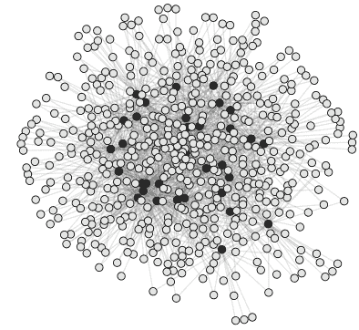

● 文章摘要 ○ 术语

图中的深色节点是文章摘要，浅色节点是术语。该网络具有中心辐射结构。所有术语节点似乎都从文章节点辐射出去。这些术语节点中没有一个连接到——即“相邻于”——其他术语节点。

我们如何在这类二分图中寻找模式？通常，我们有三种方法。首先，我们可以忽略二分图结构，使用标准的一模网络分析。32 其次，我们可以使用专门为处理双模关系数据而设计的较新工具和方法。第三，我们可以将加权的二分图

32 这可能不是一个好主意，原因超出了本文的范围。


将图分解为两个独立的加权一分图——每种模式一个——并在其中进行分析。我们将采用第三种策略。

我们已经知道如何使用 `tcrossprod()` 得到一个加权的文档-文档矩阵，其中单元格条目告诉我们两个文档之间有多少词汇重叠。我们可以使用 `crossprod()` 得到词-词矩阵。

```
doc_proj <- tcrossprod(dtm_ars)
term_proj <- crossprod(dtm_ars)
```

在可视化时，文档图渲染很快，但词图不会。我们在这里甚至不会尝试可视化词图，因为它需要相当大的计算能力，而且生成的图形也没有洞察力。词图将是网络研究人员所说的“毛球”（Dianiati 2016）——中间的连接会形成一个灰色的团块。

来自 DTM 的一模投影通常非常密集。除非我们有简洁的文本，否则两个文档共享没有词汇或两个术语共享没有文档的情况不太可能。其次，即使是很小的词汇表也可能意味着数千个节点。尽管文档级图通常比词级图更密集，但节点会更少。

在我们的情况中，ARS 语料库只有 33 个文档。词图有 510 个节点和 59,616 个连接。这些文档已经很短了（只有文章摘要）。文档图的网络密度为 0.97——也就是说，文档网络中 97% 的可能连接实际上都存在！

在可视化时，将权重较小的连接设为零可能有所帮助，但这可能无法帮助我们解释模式。因此，为了辅助解释，我们可以转向标准网络指标。我们关注最常见的：中心性。

## 中心性

节点中心性是衡量每个节点在图中重要性的方法。33 对“重要性”的定义可能有所不同，但有两个特别值得注意（我们这里专注于文档级分析，不过同样的道理也适用于词网络）：

- 1. 文档与其他文档相似性的强度。
- 2. 文档作为那些彼此没有太多共同点的其他文档之间的中介的程度。

我们将快速介绍两个指标，每个指标对应上述“重要性”定义之一：度中心性和介数中心性。34

### 度中心性

**加权度中心性**是特定节点的连接权重之和。对于我们的文档网络，这意味着，对于每个文档，求和其点积（如果我们忽略矩阵的对角线，则排除与自身的点积）。值越高，该文档与该语料库中其他文档的相似性就越高。

得到这一点的最简单方法是将文档级投影的行相加，并将自身引用（即对角线）置零。35 让我们在下面这样做，然后找出度中心性最高的五个文档（表 12.1）。35

```
doc_proj <- tcrossprod(dtm_ars)
diag(doc_proj) <- 0
data.frame(degree = rowSums(doc_proj)) |> 
  slice_max(degree, n = 4, with_ties = FALSE)
```

表 12.1: 度中心性最高的文档

| | 中心性 |
|---|---|
| 计算社会科学与社会学 | 854 |
| 城市流动与活动空间 | 663 |
| 追踪半个世纪以来的美国社会变迁 | 587 |
| 经济中的关系性工作 | 551 |

“计算社会科学与社会学”是最中心的，表明该摘要与语料库中其他摘要具有最多的词汇重叠。

### 介数中心性

接下来是 *介数中心性*，它衡量一个节点在网络中作为桥梁的程度。值越高，表明该节点相邻的节点彼此原本不相邻。如果我们考虑网络的“流”，其观点是介数高的节点垄断了该流。

如果未加权，介数中心性是包括焦点文档的任何两个文档之间的最短路径（也称为 *测地线*）比例之和，除以这两个文档之间所有最短路径的总数。如果加权，两个文档之间的最短路径是“最小阻力路径”（Opsahl et al. 2010:248; Newman 2001）的倒数。这是两个文档之间权重和最大的加权路径。36

让我们为我们的文档获取一些加权介数分数。我们将使用 igraph，它将网络中的权重视为成本而不是强度。因此，在传递到 betweenness() 之前，我们必须反转权重。

```
get_betweenness <- function(x) {
  gr <- graph.adjacency(x, mode = "undirected",
                        weighted = TRUE, diag = FALSE)
  E(gr)$weight <- 1 / E(gr)$weight
  df <- data.frame(centrality = betweenness(gr))
  return(df)
}
```

```
get_betweenness(doc_proj) |>
slice_max(centrality, n = 4, with_ties = FALSE)
```

36 与度中心性一样，高加权介数中心性可能由两方面引起：(1) 文档位于大量权重较高的较长路径上，或 (2) 文档位于大量最短路径上。有关修正方法，请参见 Opsahl 和同事 (2010)。

我们度中心性最高的文章也是文本网络中最大的中介（见表 12.2）。也许这是因为计算社会科学是一个跨学科领域，连接了其他（有时相互联系不紧密）的专业领域。

表 12.2: 介数中心性最高的文档

| | 中心性 |
|---|---|
| 计算社会科学与社会学 | 235 |
| 城市流动与活动空间 | 59 |
| 经济中的关系性工作 | 32 |
| 组织与城市贫困治理 | 28 |

## 网络主干

文本网络通常是无向的、加权的且非常密集。对于文档网络，如果两个文档没有共享任何单词，则连接不存在。除非进行大规模的词汇修剪和文本较短，否则这种情况不太可能。换句话说，我们的文档网络是完全连接的图，每个可能的连接都存在。

这使得可视化变得复杂——即“毛球”问题——同时也使网络的统计分析变得复杂。我们可以通过两种非互斥的程序来解决这个问题：移除连接和移除权重。我们可以手动完成——例如，如果权重低于第 75 百分位，则将权重重新编码为“0”，否则为“1”。我们也可以采用统计方法，找到 *网络主干*。

主干是由“显著”连接创建的网络子集。对于加权网络，它是一个无权网络，“仅保留那些权重足够大的连接”（Neal 2014:84）。对于由二分图（如 DTM）的一模投影构成的加权网络，寻找主干是棘手的。专门针对“原生”一模加权网络的主干算法在决定保留连接时没有考虑二分图的性质（Neal 2014:84）。尽管针对加权二分图存在主干算法（例如，Neal 2017），但 DTM 倾向于使收敛变得困难（在某些情况下甚至不可能）。因此，我们将使用一个文档相似度矩阵（DSM），它作为 DTM 的文档级投影创建。

我们将使用 *差异过滤器*（Serrano et al. 2009）来实现此目的。这种过滤机制依赖于“统计显著性”检验。因此，我们必须选择显著性水平，或称“alpha”（$\alpha$）。37 对于我们来说，零假设是两个文档之间的任何连接权重都和随机一样好。

37 Alpha 是我们愿意拒绝零假设的概率阈值，即使该零假设实际上是正确的。

设 $i$ 和 $j$ 为语料库中的任意两个文档，$D$ 为 DSM 中的文档。对于每个文档 $i$，我们将其连接权重归一化，使其连接权重之和等于 1。然后我们创建 $D_i$ 的模拟（称其为 $D'_i$），其中 (1) $i$ 的度和邻域（即联结对象集合）与 $D_i$ 中相同，且 (2) 连接权重从均匀分布中抽取并归一化，使得每个连接权重具有相同的概率。$D'_i$ 中这些连接权重的分布反映了这样一个零假设：附加在 $i$ 的任一连接上的任意权重都是随机的。38

38 具体来说，$ij$ 连接的权重概率与附加在 $i$ 的任何其他连接上的权重概率无不同。

然后我们计算，如果零假设为真，获得 *至少与之一样大* 的 $i$ 和 $j$ 之间观察到的连接权重的概率。这被称为右尾 $p$ 值。如果 $p$ 值小于我们的显著性水平，39 那么如果 $ij$ 连接权重与 $i$ 邻域中任何其他连接权重一样可能，我们就不太可能观察到该 $ij$ 连接权重。这也意味着该连接在无权主干网络中得到“1”，否则得到“0”。我们对网络中的每个连接重复此过程。

39 即，“统计显著”。

40 我们将通过转写为基本拉丁文、删除 URL、HTML、标点符号和多余空格，然后替换缩写形式和序数词来预处理文本。

我们将使用 All the News (ATN) 语料库中提及“移民”的新闻文章样本。为加快进度，我们还将自身限制在 400 篇文章。40

```
data("corpus_atn_immigr", package = "textmap.corpora")
set.seed(2063)
df_atn <- corpus_atn_immigr |> sample_n(size = 400)
```


```
df_atn <- df_atn |>
mutate(text = replace_non_ascii(text),
       text = replace_url(text, replacement = ""),
       text = replace_html(text, replacement = ""),
       text = replace_contraction(text),
       text = str_replace_all(text, "[:punct:]", " "),
       text = replace_ordinal(text),
       text = str_replace_all(text, "[\\s]+", " "),
       text = tolower(text)
       )
```

然后我们将使用 tcrossprod() 获取文档级投影。请记住，这衡量的是两份文档之间的词汇重叠。我们将把此传递给 backbone 中的 disparity()。显著性水平设置为 0.01，这意味着如果在虚无假设下 p 值小于 0.01，我们就给任何连结权重赋值为 "1"，如果大于或等于 0.01 则赋值为 "0"。

```
dtm_atn <- df_atn |> dtm_builder(text, doc_id, dense = TRUE)
dsm_atn <- tcrossprod(dtm_atn)
dsm_backbone <- - disparity(dsm_atn, alpha = 0.01)
```

输出是我们（非常密集的）加权网络的一个稀疏、未加权表示。确实，如下所示（页边输出），我们仅保留了总连结的 3%！这个网络在进行统计检验时要容易处理得多。

```
# check sparsity
total <- nrow(dsm_backbone) * ncol(dsm_backbone)
nonzero <- sum(dsm_backbone)
nonzero / total
[1] 0.0318
```

## 单变量网络推断

条件均匀图（CUG）检验是网络层面的单样本 z 检验和 t 检验的类比，用于均值。41 其思想是：我们测量观察到的网络的某个属性，并将其称为 q。42 然后我们随机绘制模拟网络。这些模拟网络与观察网络大小相同，并从均匀概率分布中抽取（即，该大小的每个随机网络被选中的可能性相同）。然后我们为每个模拟网络计算 q。与之前一样，我们还需要一个显著性水平，例如 0.05。有了它，我们可以找到两个比例：

- 1. 模拟 q 大于或等于我们观察到的 q 的比例（经验推导的右尾 p 值）。
- 2. 模拟 q 小于或等于我们观察到的 q 的比例（经验推导的左尾 p 值）。

如果我们的观察 q 大于 95% 的模拟 q，那么随机性不太可能生成至少那么大的观察 q。如果我们的观察 q 小于 95% 的模拟 q，那么随机性不太可能生成至少那么小的观察 q。在任何一种情况下，我们都得出结论：随机机会无法解释我们在网络中看到的内容。

让我们使用用 ATN DTM 创建的 backbone 网络来逐步演示一个示例。我们感兴趣的量 q 是平均度中心性。我们将使用 CUG 检验来查看 q 是反映随机性还是该网络的某些独特品质。

我们首先定义一个函数来计算平均度中心性，我们将把它传递给 cug.test()。我们希望所有模拟网络都与我们的观察网络大小相同，我们使用 cmode 参数指定这一点。我们还将使用 mode 指定一个无向图。

让我们生成 100 个模拟网络（页边输出）。43

```
mean_degree <- function(x) {
  mean(rowSums(x))
}
set.seed(2063)
cug.test(dsm_backbone, FUN = mean_degree, mode = "graph",
         cmode = "size", reps = 100)
```

43 通常，我们会将此设置得高得多。我们还需要设置一个种子，因为算法生成随机网络。

观察值：371.035
Pr(X>=Obs)：1
Pr(X<=Obs)：0

所有模拟 q 都大于或等于观察到的 q：Pr(X>=Obs)：1 或 100%。没有模拟 q 小于或等于观察到的 q：Pr(X<=Obs)：0 或 0%。因此，平均而言，这些新闻文章共享的显著词汇重叠比我们通过随机机会所期望的要少。

## 多变量网络推断

CUG 检验仅限于对单个变量进行假设检验。多变量建模呢？我们可以使用二次分配程序（QAP）（Cranmer et al. 2020）来处理这个问题。QAP 是一种用于在双元回归模型中调整 p 值的方法，在该模型中，观测独立性（常规回归模型的一个假设）是无法证明的。

在双元回归中，分析单位是双元（dyad）——与常规回归模型中的个体不同。对于文档网络，这是文档之间显著词汇重叠的存在（或不存在）——而不是文档本身。一旦系数被估计，44 QAP 然后计算模拟网络中系数的比例，这些系数至少与从观察网络中得到的系数一样极端。

44 我们可以使用各种线性和广义线性估计器进行双元回归。

让我们评估 backbone 网络中的“政治同质性”效应。在网络理论中，同质性是指当两个节点共享一个属性时，它们被连接的概率更高。对我们来说，我们想知道如果新闻文章共享政治倾向，它们是否更有可能具有显著的词汇重叠。45

45 这是一个双变量分析，因此我们可以报告同类聚系数来帮助评估这一点（Newman 2003）。

我们将使用 netlm()。然而，在运行回归之前，我们需要创建我们的同质性网络：一个文档对文档网络，如果发布两篇文章的组织具有相同的政治倾向，则单元格获得 "1"，否则获得 "0"。

```
df_hmph <- model.matrix(~ lean - 1, df_atn)
mat_hmph <- tcrossprod(df_hmph)
```

netlm() 函数将对我们的两个网络进行“向量化”：我们的词汇重叠网络 y 和我们的同质性网络 x 都被“展开”为向量，每个双元对应一个向量。然后我们对 y 关于 x 进行回归。我们将指定我们想要 QAP 调整的 p 值，并且希望这些 p 值基于 120 次重复。

```
set.seed(2063)
netlm(y = dsm_backbone, x = list(mat_hmph),
      nullhyp = "qap", reps = 120, mode = "graph")
```

```
Coefficients:
          Estimate   Pr(<=b)    Pr(>=b)    Pr(>=|b|)
(intercept) 0.02697203 0.97500000 0.0250000000 0.025
x1          0.02105918 0.99166667 0.0083333333 0.075
```

估计值（即系数）来自双元回归模型。虽然单位是双元，但我们解释系数的方式与任何回归模型相同。我们只有一个预测变量：同质性。该变量的系数是 0.02。当两篇文章由共享政治倾向的组织发布时，显著词汇重叠的概率平均增加 2%。右尾 _p_-值在统计上具有显著性，46 这意味着我们可以拒绝虚无假设，即随机性合理地解释了我们的系数，因为来自模拟网络的系数中少于 1% 大于或等于观察到的系数。

46 p 值低于常规的 0.01。

政治倾向附属于发布文章的组织。也许，解释词汇重叠的是来自同一新闻机构，而政治倾向的影响是虚假的。我们可以通过创建另一个同质性矩阵来建模这一点，但这次使用出版物。然后，我们将把两个同质性矩阵都作为预测变量包括在内。

```
df_orgs <- model.matrix(~ publication - 1, df_atn)
mat_orgs <- as.matrix(df_orgs) |> tcrossprod()
```

```
set.seed(2063)
netlm(y = dsm_backbone, x = list(mat_orgs, mat_hmph),
      nullhyp = "qap", reps = 120, mode = "graph")
```

| | 估计值 | Pr(<=b) | Pr(>=b) | Pr(>=|b|) |
|---|---|---|---|---|
| (intercept) | 0.0269720329 | 0.97500000 | 0.025000000 | 0.02500000 |
| x1 | -0.0004690426 | 0.01666667 | 0.983333333 | 0.01666667 |
| x2 | 0.0231017133 | 0.99166667 | 0.008333333 | 0.03333333 |

第一个估计值（x1）是由同一组织发布的影响。右尾 _p_-值在统计上不显著，但左尾和双尾显著。第二个估计值（x2）是由具有相同政治倾向的组织发布的影响。它仍然具有统计显著性。因此，政治意识形态增加了我们语料库中的词汇重叠，这不太可能是由随机机会造成的。

广义上讲，将我们的文本矩阵转换为图，既带来了有用的理论隐喻，也带来了一系列用于绘制文本中元素之间关系的技术。社会科学家使用文本网络来研究，例如，由倡导组织煽动的公共辩论（Bail 2016；另见 Puetz et al. 2021）；气候变化持怀疑态度者对美国新闻媒体和政客的影响（Farrell 2016）；电影剧本的网络大小与电影票房成功之间的关系（Hunter III et al. 2016）；以及绘制我们的文本与作者社会网络之间的联系（例如，Basov et al. 2020）。


# 13 项目工作流与迭代

> “这是我们从你们国度学到的另一件事，”Mein Herr 说，“制图术。但我们把它推得远比你们走得远……我们**实际上按一英里对一英里的比例绘制了一张国家地图！”**
> “你们经常用它吗？”我问道。
> “它还从未铺开过，”Mein Herr 说：“农民反对：他们说它会覆盖整个国家，遮挡阳光！所以现在我们直接用国家本身作为它自己的地图，我向你保证，它几乎同样有效。”
> ——L. Carroll

## 完全地图的悖论

**计算**方法常因其**可扩展性**而受到赞誉。确实，我们甚至讨论语料库可能大到足以使传统的定性内容分析变得不切实际。计算方法介入以增强人类读者，引导我们的注意力，分担工作量，提供洞察，等等。

然而，可扩展性并非无止境的美德。一张冲绳岛一比一的地图，与这个琉球群岛大小完全相同，将成为 1,200 平方公里对冲绳生活的障碍。在映射文本时也是如此，规模可能成为理解的障碍。大型语言模型（LLMs）体现了这一悖论。在某一意义上，它们对于社会科学目的来说是“过拟合”的——计算等效于为细微差别而添加理论细微差别。社会科学家应对规模炒作保持怀疑。这不仅是因为越来越大的模型可能带来的环境和社会成本。而且，当我们（人类）将意义投射到重复概率性散文的语言模型上时，我们的社区能学到什么（Bender et al. 2021）？我们从更好的语料库构建和模型架构文档中能学到的，远比从更大的复杂性中学到的要多。

在映射文本时，我们为特定用途简化其信息。因此，映射是为了辅助解释而进行的简化（Lee and Martin 2014）。例如，我们学习了几种对文档进行排序的方法

1 “它阻碍了理论所依赖的抽象过程，并抑制了使理论化成为有用活动的创造过程”（Healy 2017:119）。

2 训练 GPT-3 产生的碳排放量相当于驾驶汽车行驶 435,000 英里——几乎往返月球（Quach 2020），OpenAI 首席执行官将 ChatGPT 的“计算成本”描述为“惊人的。”

3 这不是一个修辞问题。

归纳为几个类别。我们还学习了如何识别文档集合的作者正在讨论的话题或主题。例如，Flugstein 及其同事（2017）有兴趣了解联邦公开市场委员会会议的参与者在 2008 年金融危机之前如何理解“经济”。使用本书讨论的方法，他们将这种话语空间划分为十五个框架——一个可管理的数量。在所有这些案例中，我们都是在降低复杂性并总结语义模式。

映射文本是一个迭代过程。一个项目在熟悉与陌生、新奇之间摇摆——这是溯因方法的标志。我们在与先前研究、社会科学理论以及——重要的是——实际待分析文本的对话中开始。在对激进组织的研究中，Karell 和 Freedman（2019）使用计算方法来“陌生化”激进主义：“我们使用语料库的计算测量来识别激进表达中令人困惑的方面”（2019:730）。

计算方法特别适合于迭代。我们不仅构建一个组织方案，还构建一个用于重复的架构。至关重要的是，我们需要知道我们做了什么以及为什么要这样做。当我们记录项目中的旅程时，我们应该始终注释代码并撰写分析备忘录，仿佛是给别人看的，因为几个月后，我们就会变成另一个人。4 例如，我们会忘记小步骤或改变对一个概念的理解。当我们可以简单地把它写下来时，就不应该让自己负责记住每一个细节。只有这样，我们才能理解我们的模式，为新奇做好准备，模拟零假设，并与社区分享我们的发现。因此，本着本书、科学、语言和《芬尼根守灵夜》的精神，我们以回归开头来结束。

4 我们从 Alessandra Lembo 那里借用了这段引文。谢谢，Ale！

## 容器化我们的项目

我们希望创建完全自包含的项目。任何项目的主要部分包括：(1) 散文，（2）脚本，（3）数据，（4）输出，（5）行政文档。

编程语言是以纯文本编写的。我们也可以用纯文本编写散文（报告、文章、备忘录等）——不需要笨拙的文字处理器。5 用纯文本写作的好处是，我们可以将代码与散文并置。纯文本也相对面向未来。它与个人计算一样悠久，可以在任何平台上使用——无需专有软件！

5 参见 Healy (2018b)。这并不适用于所有人，但 IDE 包含拼写检查器和其他插件来辅助写作。我们用 RMarkdown 写了整本书！

每个仅包含代码（无散文）的纯文本文件都是一个**脚本**。计算方法涉及模式检测、模式优化和模式确认三个主要步骤（Nelson 2020）。然而，正如我们所主张的，永远不会只有一个等待被挖掘的模式。我们对文本进行的每次修剪、停止、标记和转换都涉及一个分析决策。如果我们能用脚本自动化这些决策的再现，我们就应该这样做。6 最佳实践是将脚本集中在一个或极少数输出上——这有助于识别错误的来源（即调试）。例如，我们可以有一个脚本将原始文本整理成数据框或矩阵，或者一个脚本用于创建词嵌入。目标是从头到尾运行脚本而不出错，复现给定的输出。我们还必须注释代码，以便其他研究人员（和我们的未来的自己！）知道代码在做什么以及为什么需要它。

**输出**包括图形（PNG、PDF 等）、模型或以某种方式处理过的数据集。对于每个输出，我们都应该确切知道如何重新创建它。我们还希望保持**数据**的原始版本——我们最初找到或收集它的样子。不仅能够修复错误，这种做法还迫使我们记录从原始形式到最终形式的过程是如何进行的。最后，我们需要跟踪**行政文档**，例如 IRB 批准表格、同意书、资助文件和标记协议。在页边空白处，参见一个组织良好的项目目录示例文件夹（Navarro 2022）。

每次我们打开 `R` 来处理项目时，顶层文件夹——这里，`new_project`——就是我们的指定工作目录。这也应该是自包含的：我们可以将 `new_project` 移动到，比如说，新硬盘上，代码仍然可以工作。

请注意 **archive** 文件夹。最佳实践是**永不删除**我们写过的任何东西——或者，至少，删除的门槛非常高。相反，我们进行归档。一种有助于此的软件是 _git_。7 这是一个**版本控制系统**，跟踪项目目录中的更改以及任何纯文本文件中的更改。Git 也是 GitLab、Codeberg 和 GitHub 等仓库网站的运作方式。8 尽管 git 的好处多不胜数，但学习曲线很陡。一种低技术替代方案是定期将文件复制到归档文件夹。不过，同样，我们应该避免记住事情的负担：

> “你需要对自己的工作进行定期、冗余、自动、异地备份。因为你懒惰且容易产生神奇的想法，你自己不会负责任地这样做。这就是为什么最有用的备份系统是那些设置所需工作量最少的系统，一旦组织好，就会自动备份_一切_，而你不需要记得做任何事情。”
> 
> (Healy 2018b:11–2)

这样，我们更有可能发现自己的错误，但当其他人试图使用我们的脚本进行复制时，也可能会发现我们的错误。

```
Documents
|-- new_project
    |-- admin
    |   |-- IRB
    |   |-- funding
    |-- data
    |   |-- archive
    |-- figures
    |-- memos
    |-- paper
    |-- scripts
    |-- archive
```

> “未保存的一切都将丢失。” —— 任天堂“退出屏幕”消息

Mercurial 和 Subversion 是常见的替代方案。

我们将 git 和 GitLab 用作本书的版本控制系统。


9 例如 Dropbox 或 Google Drive。

10 完整系统备份的示例包括 SpiderOak、Carbonite、Backblaze 或 Crashplan。

11 特别是，避免使用特殊的正则表达式符号，因为我们经常使用正则表达式匹配文件名以将其读入 R。参见 Wrangling Words。

12 注意文件扩展名。某些操作系统默认隐藏扩展名，但用户可以而且应该更改此设置。

备份系统与“云同步”平台略有不同，因为它们通常备份整个系统且仅单向进行。这样，如果当前系统损坏无法修复，我们就可以恢复系统的旧版本。

文件夹是直观的组织工具。文件名也是。名称应当唯一且信息丰富。它们应避免使用大写和空格，因为不同的操作系统和程序可能会以不一致的方式处理这些内容。我们还应避免“特殊字符”，例如 & 或 ()。下面是一些示例（另请参见 Bryan and Hester 2019）。

```
01_script_load_packages.R
02_script_wrangle_text.R
data_survey_attributes_movies.csv
data_survey_attributes_books.csv
data_demographics_nmsu.txt
2020-05-01_scrape_reddit_maliciouscompliance.rds
```

## 备忘录与数据表

在定性研究中，尤其是民族志，撰写“分析备忘录”是一种常见做法。这与“田野笔记”不同，其重点在于自我反思和自我观察。我们今天做了什么？我们学到了什么？我们的思维今天发生了怎样的变化？明天我们会有所不同地做什么？这也是我们明确将理论与分析结合起来的地方。这是我们编码的叙述对照。当然，研究人员会有不同的策略，但至少，我们应该将编码的一天视为田野中的一天，并留出时间来撰写备忘录，并随着项目的进展定期审查这些备忘录。

尽管有些倾向于使用尽可能大的可用语料库，但我们不能忽略每种文本分析都源自一个子集的事实。我们需要尽可能了解我们正在研究的是哪个子集。如果不考虑这一点，我们可能会将语料库组装中的模式误认为是文本内部的模式。因此，记录我们收集和选择文本所采取的步骤（并以细致入微的细节记录）对于这一过程至关重要。

我们的分析备忘录和脚本可用于日后创建数据表。为了符合开放科学的要求，我们的语料库及/或其衍生物需要与社区共享。如果没有伴随的文档，研究人员可能会使用我们的语料库但误解其发现。因此，遵循 Gebru 及其同事（2021:86）的观点，我们主张“每个数据集都应附带一份记录其动机、组成、收集过程、推荐用途等的数据表。”13 为了了解我们是否拥有文本的公平样本，并将此信息传达给他人，我们必须记录语料库是如何创建的（尽我们所能）。这包括讲述我们获取和选择文档的历程。

13 有关示例数据表，请参见 Gebru et al. (2021); Bandy and Vincent (2021)。

## 重复、复制与模拟虚无

在共享数据表、数据、脚本和方法论附录时，我们的首要目标是 **重复**：我们或其他人是否可以重复所有必要步骤，以精确重新创建发表物中展示的分析？这是开放科学的最低要求。不同的研究人员能否从原始文本开始，遵循我们的说明，最终得出相同的发现？通过共享这些信息，其他研究人员例如可能会发现改变发现的编码错误——从而推进我们的集体知识。14

14 鉴于依赖关系和“浮点误差”，精确的重复并不总是可能的。

数据表和脚本也可以帮助 **复制**：我们能否 _使用不同数据_ 复制发现？鉴于将混乱的文本整理成整齐的数据框涉及许多步骤，我们必须描述做了什么以及为什么这样做，以便其他研究人员可以在新的文本上使用相同的步骤。即使我们的代码“出错”，研究人员也可以在我们的方法论附录中重新实现详细的程序。我们还应该在任何出版物中展示详细的语料库统计数据——就像我们通常在调查研究中为数据集报告汇总统计数据一样。

尽管最近对复制的推动，但计算方法独特地适合 _反复制_。通过此，我们的意思是模拟如果理论的基本原理有效则不应产生发现的情况，从而测试理论的极限。或者，从相反的方向来看，如果我们有一个只有在特定种子的随机初始化下才成立的 1 万分之一的发现呢？简单：我们使用不同的种子循环运行分析 10,000 次。

基于随机化的推断问题在统计学界并非新鲜事（Darlington and Hayes 2016; Edgington and Onghena 2007; Ernst 2004; Taylor 2020）。从这个意义上说，如果计算方法涉及迭代，那么我们许多人一直在使用计算方法，其伪装为蒙特卡罗排列检验等方法。一个相对新的想法是通过重新运行我们的分析但略微改变我们计算基础设施中的步骤来模拟“新世界”。这与 _计算多模型分析_（Young and Holsteen 2017; Muñoz and Young 2018）类似，其目的是通过在许多不同条件下得出的模型创建模型估计的分布，以最小化模型不确定性15。问题是：与模拟和建模世界的其他方式相比，我们“首选”的模型估计是否“脱颖而出”成为独特？如果是，这是好事还是坏事？

15 以及假阳性的报告，即发表偏倚。

## 众智成城

在巴比伦天文学家将金星的习惯刻在阿米萨杜瓦泥板三千年后，Venera 1 掠过金星大气层；在阿那克西曼德将地球画成平面图两千年后，登增·诺尔基和埃德蒙·希拉里使用这一工具登顶地球最高点。地图卸载认知要求高的任务，创建不断变化条件的快照，并允许我们以惊人的浮雕效果可视化隐藏的属性。16

16 “一张地图不仅仅是描绘它，它还赋予意义；它在与那里之间、在我们此前不知道彼此相连的截然不同的想法之间形成桥梁”（Larsen 2009:138）。

制图也寻求以促进持续对话的方式对复杂领域进行表征。

我们希望本书是加入这些对话的邀请。像所有学术研究一样，计算文本分析是一项社区活动。我们的工作站在众多前人之肩，并且我们希望这一点在全书中都已清晰。我们相信，更多的研究人员和更多的合作——而不是更多数据和更大的模型——才是深入了解社会和文化经验的途径。重复我们的分析、记录我们的分析程序、共享我们的数据和代码、参与持续讨论——都是推动人类理解向前所必需的。

## 附录

表 13.1: 使用的所有 R 包

| 包 | 版本 | 引用 | 包 | 版本 | 引用 |
|---|---|---|---|---|---|
| backbone | 2.1.1 | Neal (2022) | reshape2 | 1.4.4 | Wickham (2007) |
| caret | 6.0.93 | Kuhn (2022) | reticulate | 1.27 | Ushey et al. (2023) |
| coreNLPsetup | 0.0.1 | Rinker (2017) | rsample | 1.1.1 | Frick et al. (2022) |
| entity | 0.1.0 | Rinker (2015) | rsvd | 1.0.5 | Erichson et al. (2019) |
| factoextra | 1.0.7 | Kassambara and Mundt (2020) | rtrek | 0.3.3 | Leonawicz (2021) |
| gender | 0.6.0 | Mullen (2021) | semgram | 0.1.0 | Stufler (2022a) |
| genderdata | 0.6.0 | Mullen (2023) | sentimentr | 2.9.0 | Rinker (2021) |
| ggpubr | 0.5.0 | Kassambara (2022) | sna | 2.7 | Butts (2022) |
| ggraph | 2.1.0 | Pedersen (2022a) | spacyr | 1.2.1 | Benoit and Matsuo (2020) |
| ggrepel | 0.9.2 | Slowikowski (2022) | stm | 1.3.6 | Roberts et al. (2019) |
| ggtm | 3.4.1 | Hamilton and Ferry (2018) | stminsights | 0.4.1 | Schwemmer (2021) |
| glmnet | 4.1.6 | Friedman et al. (2010); Simon et al. (2011) | stringi | 1.7.12 | Gagolewski (2022) |
| gmodels | 2.18.1.1 | Warnes (2022) | tagger | 0.0.2 | Rinker (2016) |
| googleLanguageR | 0.3.0 | Edmondson (2020) | termco | 0.5.11 | Rinker (2018b) |
| guardianapi | 0.1.1 | Odell (2019) | texteract | 5.1.0 | Ooms (2022b) |
| gutenbergr | 0.2.3 | Johnson and Robinson (2022) | text2map | 0.1.6 | Stoltz and Taylor (2022a) |
| hunspell | 3.0.2 | Ooms (2022a) | text2map.corpora | 0.1.4 | Stoltz and Taylor (2022b) |
| igraph | 1.3.5 | Csardi and Nepusz (2006) | text2map.pretrained | 0.1.0 | Stoltz and Taylor (2022c) |
| irr | 0.84.1 | Gamer et al. (2019) | text2vec | 0.6.3 | Selivanov et al. (2022) |
| keras | 2.11.0 | Allaire and Chollet (2022) | textclean | 0.9.3 | Rinker (2018c) |
| lexicon | 1.2.1 | Rinker (2018a) | textstem | 0.1.4 | Rinker (2018d) |
| lsa | 0.73.3 | Wild (2022) | tidygraph | 1.2.2 | Pedersen (2022b) |
| marginaleffects | 0.8.1 | Arel-Bundock (2022) | tidymodels | 1.0.0 | Kuhn and Wickham (2020) |
| Matrix | 1.5.3 | Bates et al. (2022) | tidyquant | 1.0.6 | Dancho and Vaughan (2022) |
| network | 1.18.0 | Butts (2015) | tidytext | 0.4.1 | Silge and Robinson (2016) |
| protostr | 0.4.0 | Fay (2019) | tidyverse | 1.3.2 | Wickham (2019) |
| qdapDictionaries | 1.0.7 | Rinker (2013) | tokenizers | 0.3.0 | Mullen et al. (2018) |
| quanteda | 3.2.4 | Benoit et al. (2018) | topcodoc | 0.1.1 | Friedman (2022) |
| quanteda.corpora | 0.9.2 | Benoit (2020) | topicmodels | 0.2.13 | Grün and Hornik (2022) |
| quanteda.textmodels | 0.9.5.1 | Benoit et al. (2022) | udpipe | 0.8.11 | Wijffels (2023) |
| remotes | 2.4.2 | Csardi et al. (2021) | | | |

表 13.2: 按包和章节划分的函数

| 函数 | 包 | 章节 |
|---|---|---|
| activate | tidygraph | 6 |
| aes | ggplot2, ggtm | 3, 4, 5, 6, 8, 9, 10, 11, 12 |
| annotate | ggplot2, ggtm | 4 |
| anti_join | tidygraph, dplyr | 7 |
| arrange | tidygraph, dplyr | 6, 10, 11 |


| 函数 | 包 | 章节 |
|---|---|---|
| array_reshape | reticulate, keras | 12 |
| arrow | ggplot2 | 4, 8 |
| as_basic | tagger | 8 |
| as_factor | forcats | 6 |
| as_tbl_graph | tidygraph | 6 |
| as_tibble | tidygraph, dplyr, tidyr, tibble | 7 |
| as.dfm | quanteda | 12 |
| betweenness | sna, igraph | 12 |
| bind_rows | dplyr | 10, 11, 12 |
| cast_when | dplyr | 10, 11, 12 |
| cast_dfm | tidytext | 6, 7 |
| cast_sparse | tidytext | 6 |
| chunk_text | tokenizers | 6 |
| column_to_rownames | tibble | 8 |
| compile | keras | 12 |
| confusion.glmnet | glmnet | 9 |
| coord_flip | ggplot2 | 6, 8, 10, 11 |
| count | tidyquant, dplyr | 6, 7, 8 |
| count_tags | tagger | 8 |
| create_tcm | text2vec | 11, 12 |
| create_vocabulary | text2vec | 11, 12 |
| cv.glmtest | sna | 12 |
| cv.glmnet | glmnet | 9 |
| datagrid | marginaleffects | 11 |
| dataset_fashion_mnist | keras | 12 |
| date_entity | entity | 8 |
| desc | dplyr | 6, 10, 11 |
| dfm | quanteda | 6, 7, 9 |
| dfm_remove | quanteda | 7 |
| dfm_tfidf | quanteda | 6 |
| dfm_weight | quanteda | 6, 9 |
| disparity | backbone | 12 |
| dist2 | text2vec | 10 |
| download_pretrained | text2map-pretrained | 11 |
| dtm_builder | text2map | 6, 7, 9, 10, 11, 12 |
| dtm_melter | text2map | 9 |
| dtm_stats | text2map | 6 |
| dtm_stopper | text2map | 7, 9, 10, 11, 12 |
| element_blank | ggplot2 | 4, 6, 8, 10 |
| element_line | ggplot2 | 4 |
| element_text | ggplot2 | 12 |
| evaluate | keras, termco | 12 |
| extract_motifs | semgram | 12 |
| facet_grid | ggplot2 | 6, 11, 12 |
| facet_wrap | ggplot2 | 5, 6, 8, 10, 11, 12 |
| fcm | quanteda | 6, 11 |
| fct_reorder | forcats | 6, 11 |
| filter | tidygraph, dplyr | 5, 6, 7, 8, 9, 10, 11, 12 |
| find_transformation | text2map | 11, 12 |
| first | tidyquant, dplyr | 6, 10, 12 |
| fit | text2vec, keras | 12 |
| fit_transform | text2vec | 11 |
| fviz_dend | factoextra | 10 |
| fviz_nbclust | factoextra | 10 |
| gender | gender | 8 |
| geom_abline | ggplot2 | 6 |
| geom_bar | ggplot2 | 5 |
| geom_boxplot | ggplot2 | 3 |
| geom_col | ggplot2 | 6, 8, 9, 10, 11, 12 |
| geom_curve | ggplot2 | 4 |
| geom_density | ggplot2 | 12 |
| geom_edge_arc | ggraph | 6, 8 |
| geom_edge_link | ggraph | 4, 12 |
| geom_errorbar | ggplot2 | 11, 12 |
| geom_hline | ggplot2 | 10 |
| geom_label | ggplot2 | 6 |
| geom_label_repel | ggrepel | 4 |
| geom_line | ggplot2 | 5, 11 |
| geom_node_label | ggraph | 4, 6, 8 |
| geom_node_point | ggraph | 12 |
| geom_node_text | ggraph | 8 |
| geom_path | ggplot2 | 5 |
| geom_point | ggplot2 | 3, 4, 6, 8, 11, 12 |
| geom_ribbon | ggplot2 | 11 |
| geom_segment | ggplot2 | 4, 6, 8 |
| geom_smooth | ggplot2 | 5, 6, 11, 12 |
| geom_text | ggplot2 | 10, 11, 12 |
| geom_text_repel | ggrepel | 11 |
| geom_tile | ggplot2 | 8, 9, 10, 12 |
| geom_vline | ggplot2 | 4, 10 |
| get_centroid | text2map | 11 |
| get_direction | text2map | 11, 12 |
| get_effects | stminsights | 11 |
| get_sentences | sentimentr | 9 |
| get_stoplist | text2map | 7, 10, 11, 12 |
| ggrange | ggsubr | 3, 4, 6, 12 |
| ggplot | ggplot2, ggrepel | 3, 4, 5, 6, 8, 9, 10, 11, 12 |
| ggraph | ggraph | 4, 6, 8, 12 |
| ggtern | ggtern | 11 |
| graph_from_data_frame | igraph | 8 |
| graph.adjacency | igraph | 12 |
| group_by | ggraph, tidygraph, dplyr | 5, 6, 9, 10, 11, 12 |
| gu_content | guardianapi | 5 |
| guide_legend | ggplot2 | 10, 11 |
| guides | ggplot2 | 10, 11 |
| gutenberg_download | gutenbergr | 7, 12 |
| hcut | factoextra | 10 |
| html_elements | rvest | 5 |
| html_text | rvest | 5 |
| hunspell_check | hunspell | 7 |
| hunspell_suggest | hunspell | 7 |
| initial_split | rsample | 9, 12 |
| inner_join | tidygraph, dplyr | 9 |
| install_github | remotes | 3 |
| install_gitlab | remotes | 3 |
| itoken | text2vec | 11, 12 |
| keras_model_sequential | keras | 12 |
| kripp_alpha | irr | 9 |
| label_rect | ggraph | 8 |
| labeller | ggplot2 | 11 |
| labels | ggplot2 | 4, 5, 6, 8, 9, 10, 11, 12 |
| layer_dense | keras | 12 |
| layer_embedding | keras | 12 |
| layer_global_average_pooling_1d | keras | 12 |
| left_join | tidygraph, dplyr | 8, 9, 11, 12 |
| lemmatize_strings | textstem | 7, 11 |
| lemmatize_words | textstem | 7 |
| lims | ggplot2 | 4 |
| load_pretrained | text2map.pretrained | 11, 12 |
| location_entity | entity | 8 |
| lsa | text2vec, lsa | 10 |
| melt | reshape2 | 6 |
| mutate | ggpubr, tidygraph, dplyr | 3, 5, 6, 7, 8, 9, 10, 11, 12 |
| n | tidygraph, network, dplyr | 5, 6, 9 |
| ntlm | sna | 12 |
| normalize | text2vec, igraph, keras | 9 |
| ocr | tesseract | 5 |
| organization_entity | entity | 8 |
| parse_date_time | lubridate | 5 |
| person_entity | entity | 8 |
| pivot_longer | tidyr | 5, 6, 11, 12 |
| pivot_wider | tidyr | 11 |
| predictions | marginaleffects | 11 |
| recode | dplyr | 5 |
| rename | tidygraph, dplyr | 6, 8, 12 |
| rename_all | dplyr | 12 |
| reorder_within | tidytext | 8 |
| replace_contraction | textclean | 7, 11, 12 |
| replace_curly_quote | textclean | 7, 11, 12 |
| replace_date | textclean | 7 |
| replace_html | textclean | 11, 12 |
| replace_kern | textclean | 7 |
| replace_money | textclean | 7 |
| replace_na | tidyr | 8 |
| replace_non_ascii | textclean | 11, 12 |
| replace_number | textclean | 7 |
| replace_ordinal | textclean | 7, 11, 12 |
| replace_time | textclean | 7 |
| replace_url | textclean | 11, 12 |
| replace_word_elongation | textclean, sentimentr | 7 |
| row_number | dplyr | 10, 12 |
| rowid_to_column | tibble | 6, 9 |
| rownames | quanteda | 6, 7, 9, 10, 11, 12 |
| rownames_to_column | tibble | 6, 11, 12 |
| rsvd | rsvd | 12 |
| sample_n | tidygraph, dplyr | 9, 12 |
| scale_colour_discrete | ggplot2 | 10 |
| scale_fill_discrete | ggplot2 | 12 |
| scale_fill_gradient | ggplot2 | 12 |
| scale_linetype_manual | ggplot2 | 11 |
| scale_x_continuous | ggplot2 | 10, 11 |
| scale_x_log10 | ggplot2 | 6 |
| scale_x_reordered | tidytext | 8 |
| scale_y_continuous | ggplot2 | 4, 9 |
| scale_y_log10 | ggplot2 | 6 |
| select | tidygraph, dplyr | 5, 7, 8, 9, 10, 11, 12 |
| select_tags | tagger | 8 |
| sentiment | sentimentr | 9 |
| separate | tidyr | 5 |
| seq_builder | text2map | 12 |
| session | rvest | 5 |
| session_jump_to | rvest | 5 |
| sim2 | text2vec | 6, 10, 11 |
| slice_head | dplyr | 9 |
| slice_max | dplyr | 6, 8, 10, 11, 12 |
| space_tokenizer | text2vec | 11 |
| spacy_initialize | spacyr | 8, 12 |
| spacy_parse | spacyr | 8, 12 |
| st_transcripts | rtek | 11 |
| stat_function | ggplot2 | 4 |
| stem_strings | textstem | 7 |
| str | stringr | 11 |
| str_count | stringr | 5 |
| str_pad | stringr | 11 |
| str_replace | stringr | 9 |
| str_replace_all | stringr | 9, 11, 12 |
| str_split | stringr | 12 |
| str_squish | stringr | 5, 9, 10, 12 |
| str_extract_all_words | stringi | 7 |
| stri_trans_general | stringi | 7, 8, 11, 12 |
| summarise | dplyr | 11, 12 |
| summarize | dplyr | 5, 6, 9, 10, 11, 12 |
| tag_pos | tagger | 8 |
| terms | topicmodels | 10 |
| testing | rsample | 9, 12 |
| textmodel_lr | quanteda.textmodels | 12 |
| textmodel_nb | quanteda.textmodels | 12 |
| textmodel_svm | quanteda.textmodels | 12 |
| theme | ggplot2 | 4, 6, 8, 9, 10, 11, 12 |
| theme_custom | ggtern | 11 |
| theme_minimal | ggplot2, ggtern | 4 |
| theme_void | ggplot2, ggtern | 6 |
| tibble | dplyr, tidyr, tibble | 7 |
| tidy | tidytext, rsample, marginaleffects | 5, 6, 9, 10, 11 |
| tiny_gender_tagger | text2map | 8 |
| to_categorical | keras | 12 |
| tokenize_character_shingles | tokenizers | 6 |
| tokenize_characters | tokenizers | 6 |
| tokenize_ngrams | tokenizers | 6 |
| tokenize_word | quanteda | 7 |
| tokenize_words | tokenizers | 6, 7 |
| tokens | quanteda | 6, 7, 9, 11 |
| tokens_ngrams | quanteda | 9 |
| tokens_remove | quanteda | 9 |
| top_n | tidygraph, dplyr | 6 |
| tq_get | tidyquant | 5 |
| training | rsample | 9, 12 |
| udpipe_annotate | udpipe | 7, 8 |
| udpipe_download_model | udpipe | 7, 8 |
| udpipe_load_model | udpipe | 7, 8 |
| ungroup | tidygraph, dplyr | 10, 11 |
| unit | ggplot2 | 4, 8 |
| unnest | tidyr | 7 |
| unnest_tokens | tidytext | 6, 7, 8, 12 |
| use_condaenv | reticulate, keras | 12 |
| user_agent | httr | 5 |
| vocab_vectorizer | text2vec | 11, 12 |
| xlab | ggplot2 | 4 |
| xlim | ggplot2 | 4 |
| ylab | ggplot2 | 4 |
| ylim | ggplot2 | 4, 10, 11 |


## 结束部分
## 参考文献
- 出版日期：2023 年 12 月
- **主题：** 社会研究与统计学
- **收藏：** 牛津在线学术

Adams, Julia 和 Hannah Brückner. 2015. “维基百科、社会学与大数据的承诺与陷阱.” *大数据与社会* 2:205395171561433.
Google 学术 WorldCat

Afendras, Georgios 和 Marianthi Markatou. 2019. “交叉验证中训练/测试样本量的最优性与重采样效果.” *统计计划与推断杂志* 199:286–301.
Google 学术 WorldCat

Ahmed, Hadeer, Issa Traore, 和 Sherif Saad. 2017. “使用 *N*-gram 分析和机器学习技术检测在线假新闻.” 载于 *分布式和云环境中的智能、安全与可靠系统*, 第 127–38 页. 施普林格国际出版.
Google 学术 Google 预览 WorldCat COPAC

Ahmed, Hadeer, Issa Traore, 和 Sherif Saad. 2018. “使用文本分类检测观点垃圾信息和假新闻.” *安全与隐私* 1:e9.
Google 学术 WorldCat

Allaire, J. J. 和 François Chollet. 2022. *keras*. R 包版本 2.11.0.
Google 学术 Google 预览 WorldCat COPAC

American Sociological Association. 2021. “按性别划分的 ASA 会员.” https://www.asanet.org/research_trend/asa-membership-gender/. 访问日期：2023-3-15.
WorldCat

Apache. 2020. “*Apache OpenNLP 开发者文档.*”
Google 学术 Google 预览 WorldCat COPAC

Arel-Bundock, Vincent. 2022. *marginaleffects*: R 包版本 0.8.1.
Google 学术 Google 预览 WorldCat COPAC

Aristotle. 1907. *亚里士多德诗学*. 麦克米伦.
Google 学术 Google 预览 WorldCat COPAC

Aronoff, Mark. 1992. “语言学中的分段主义.” *识字的语言学* 21:71.
Google 学术 WorldCat

Arora, Sanjeev, Yuanzhi Li, Yingyu Liang, Tengyu Ma, 和 Andrej Risteski. 2016. “基于潜在变量模型的 PMI-based 词嵌入方法.” *计算语言学协会汇刊* 4:385–99.
Google 学术 WorldCat

Arseniev-Koehler, Alina 和 Jacob Foster. 2020. “将机器学习作为文化学习的模型.” *社会学方法与研究* 51:1484–1539.
Google 学术 WorldCat

Aslanidis, Paris. 2018. “使用语义文本分析测量民粹主义话语.” *质量与数量* 52:1241–63.
Google 学术 WorldCat

Atasu, Kubilay 等人. 2017. “带 GPU 加速的线性复杂度放宽词搬移距离.” 载于 *2017 年 IEEE 国际大数据会议（Big Data）*, 第 889–96 页. IEEE.
Google 学术 Google 预览 WorldCat COPAC

Attia, Mohammed. 2007. “阿拉伯语分词系统.” 载于 *2007 年闪米特语言计算方法研讨会论文集*, 第 65–72 页. aclweb.org.
Google 学术 Google 预览 WorldCat COPAC

Back, Mitja D., Albrecht C. P. Küfner, 和 Boris Egloff. 2010. “2001 年 9 月 11 日的情绪时间线.” *心理科学* 21:1417–19.
Google 学术 WorldCat

Back, Mitja D., Albrecht C. P. Küfner, 和 Boris Egloff. 2011. “自动还是人民？” *心理科学* 22:837.
Google 学术 WorldCat

Bail, Christopher. 2012. “边缘效应.” *美国社会学评论* 77: 855–79.
Google 学术 WorldCat

Bail, Christopher. 2016. “结合自然语言处理与网络分析以考察倡导组织如何在社交媒体上刺激对话.” *PNAS* 113:11823–8.
Google 学术 WorldCat

Bail, Christopher, Taylor Brown, 和 Marcus Mann. 2017. “引导人心.” *美国社会学评论* 82:1188–213.
Google 学术 WorldCat

Bail, Christopher, Brian Guay, Emily Maloney, Aidan Combs, D. Sunshine Hillygus, Friedolin Merhout 等人. 2020. “评估俄罗斯互联网研究机构对 2017 年底美国 Twitter 用户政治态度与行为的影响.” *PNAS* 117:243–50.
Google 学术 WorldCat

Ball, C. N. 1994. “自动化文本分析.” *识字与语言计算* 9:295–302.
Google 学术 WorldCat

Bandy, Jack 和 Nicholas Vincent. 2021. “解决机器学习研究中的‘文档债务’.” arXiv 预印本. arXiv:2105.05241.
Google 学术 Google 预览 WorldCat COPAC

Barbaro, Michael 和 Tom Zeller, Jr. 2006. “AOL 搜索者 4417749 的面孔被揭露.” *纽约时报*.
Google 学术 WorldCat

Barthes, Roland 和 Lionel Duisit. 1975. “叙事结构分析导论.” New Literary History 6:237–72.
Google 学术 WorldCat

Basov, Nikita, Ronald Breiger, 和 Lina Hellsten. 2020. “社会语义及其他二元性.” Poetics 78: 101433.
Google 学术 WorldCat

Bates, Douglas, Martin Maechler, 和 Mikael Jagan. 2022. Matrix: 稀疏和密集矩阵类与方法. R 包版本 1.5-3.
Google 学术 Google 预览 WorldCat COPAC

Bauer, Laurie. 1998. 语言迷思. 企鹅英国.
Google 学术 Google 预览 WorldCat COPAC

Bauer, Martin W. 和 George Gaskell. 2000. 使用文本、图像和声音进行定性研究. SAGE.
Google 学术 Google 预览 WorldCat COPAC

Bearman, Jean. 2016. “公民身份作为文化.” Sociology Compass 10:849–57.
Google 学术 WorldCat

Bearman, Peter S. 和 Katherine Stovel. 2000. “成为纳粹分子.” Poetics 27: 69–90.
Google 学术 WorldCat

Becker, Howard. 2017. 证据. 芝加哥大学出版社.
Google 学术 Google 预览 WorldCat COPAC

Bender, Emily, Timnit Gebru, Angelina McMillan-Major, 和 Shmargaret Shmitchell. 2021. “随机鹦鹉的危险.” 载于 2021 年 ACM 公平性、问责制与透明度会议论文集, 第 610–23 页.
Google 学术 Google 预览 WorldCat COPAC

Benoit, Kenneth. 2020. quanteda.corpus. R 包版本 0.9-2.
Google 学术 Google 预览 WorldCat COPAC

Benoit, Kenneth 和 Akitaka Matsuo. 2020. spacyr. R 包版本 1.2.1.
Google 学术 Google 预览 WorldCat COPAC

Benoit, Kenneth, Kohei Watanabe, Haiyan Wang, Paul Nulty, Adam Obeng, Stefan Müller 等人. 2018. “quanteda.” Journal of Open Source Software 3:774.
Google 学术 WorldCat

Benoit, Kenneth, Kohei Watanabe, Haiyan Wang, Patrick O. Perry, Benjamin Lauderdale, Johannes Gruber 等人. 2022. quanteda.textmodels. R 包版本 0.9.5-1.
Google 学术 Google 预览 WorldCat COPAC

Bently, Lionel 和 Tanya Aplin. 2019. “全球、强制性合理使用怎么了？功能失调多元主义的个案研究.” 载于 知识产权多元主义是否功能正常？, 爱德华·埃尔格出版, 第 8–36 页.
Google 学术 Google 预览 WorldCat COPAC

Berlind, David. 2015. “API 究竟是什么？”
Google 学术 Google 预览 WorldCat COPAC

Bernstein, Basil. 2003. 阶级、代码与控制. 心理学出版社.
Google 学术 Google 预览 WorldCat COPAC

Biber, Douglas. 1993. “语料库设计中的代表性.” Literary and Linguistic Computing 8:243–57.
Google 学术 WorldCat

Biernacki, Richard. 2012. *社会研究中证据的重塑*. 施普林格.
Google 学术 Google 预览 WorldCat COPAC

Biernacki, Richard. 2014. “人本主义诠释与编码文本样本.” *定性社会学* 37:173–88.
Google 学术 WorldCat

Biernacki, Richard. 2015. “勘误：如何处理历史文本.” *美国文化社会学杂志* 3:311–52.
Google 学术 WorldCat

Bischof, Jonathan 和 Edoardo M. Airoldi. 2012. “使用词频和排他性汇总主题内容.” 载于 *第 29 届国际机器学习会议论文集*, 第 201–8 页.
Google 学术 Google 预览 WorldCat COPAC

Blei, David. 2012. “概率主题模型.” *ACM 通讯* 55:77–84.
Google 学术 WorldCat

Blei, David 和 John D. Lafferty. 2007. “科学的相关主题模型.” *应用统计学年鉴* 1:17–35.
Google 学术 WorldCat

Blei, David, Andrew Y. Ng, 和 Michael I. Jordan. 2003. “隐性狄利克雷分配.” *机器学习研究杂志* 3:993–1022.
Google 学术 WorldCat

Blevins, Cameron 和 Lincoln Mullen. 2015. “简、约翰……莱斯利？算法性别预测的历史方法.” *数字人文季刊* 9.
Google 学术 WorldCat

Bloomfield, Leonard. 1933. *语言*. 霍尔特.
Google 学术 Google 预览 WorldCat COPAC

Bohr, Jeremiah 和 Riley E. Dunlap. 2018. “1990–2014 年环境社会学的主要主题.” *环境社会学* 4:181–95.
Google 学术 WorldCat

Bollen, Johan, Marijn Ten Thij, Fritz Breithaupt, Alexander T. J. Barron, Lauren A. Rutter, Lorenzo Lorenzo-Luaces 等人. 2021. “历史语言记录揭示近几十年来认知扭曲的激增.” *美国国家科学院院刊* 118.
Google 学术 WorldCat

Bolukbasi, Tolga, Kai-Wei Chang, James Zou, Venkatesh Saligrama, 和 Adam Kalai. 2016a. “量化和减少词嵌入中的刻板印象.” *arXiv 预印本 arXiv:1606.06121*.
Google 学术 Google 预览 WorldCat COPAC

Bolukbasi, Tolga, Kai-Wei Chang, James Y. Zou, Venkatesh Saligrama, 和 Adam T. Kalai. 2016b. “男人是计算机程序员，女人是主妇吗？消除词嵌入偏差.” *神经信息处理系统进展* 29.
Google 学术 WorldCat

Bonikowski, Bart 和 Noam Gidron. 2016. “美国政治中的民粹主义风格.” *社会力量* 94:1593–621.
Google 学术 WorldCat

Bontrager, Terry. 1991. “1944 年 Thorndike-Lorge 列表之前的词频列表的发展.” *阅读心理学* 12:91–116.
Google 学术 WorldCat

Bourdieu, Pierre. 1991. *语言与象征权力*. 哈佛大学出版社.
Google 学术 Google 预览 WorldCat COPAC


Boutyline, Andrei, Alina Arseniev-Koehler, and Devin J. Cornell. 2023. “学校、学习与聪明：1930–2009 年美国印刷媒体中 80 年来的性别刻板印象与教育。” 社会力量 102: 263–286.
谷歌学术 WorldCat

Brandt, Philipp and Stefan Timmermans. 2021. “数字时代定量研究中的溯因探究逻辑。” 社会学科学 8: 191–210.
谷歌学术 WorldCat

Breiger, Ronald L. 1974. “个人与群体的二元性。” 社会力量 53: 181–90.
谷歌学术 WorldCat

Brown, Nicole M., Ruby Mendenhall, Michael L. Black, Mark Van Moer, Assata Zerai, and Karen Flynn. 2016. “从机械化边缘到数字化中心：黑人女权主义在数字人文中对抗抹除的贡献。” 人文与艺术计算国际期刊 10: 110–25.
谷歌学术 WorldCat

Brown, Nicole M., Ruby Mendenhall, Michael Black, Mark Van Moer, Karen Flynn, Malaika McKee, et al. 2019. “寻找佐拉/当元数据不足：通过统计建模拯救黑人女性的经验。” 图书馆元数据期刊 19: 141–62.

Brunilha, Mikael and Jack LaViolette. 2021. “WMDecompose：利用语境中词语搬移距离的可解释特征的社会文化分析框架。” arXiv 预印本 arXiv:2110.07330.
谷歌学术 谷歌预览 WorldCat COPAC

Bryan, Jennifer and Jim Hester. 2019. “他们没有教你的关于 R 的知识。” https://rstats.wtf/.
WorldCat

Brysbaert, Marc and Boris New. 2009. “超越 Kucera 和 Francis。” 行为研究方法 41: 977–90.
谷歌学术 WorldCat

Bush, Vannevar. 1945. “我们可能会怎样思考。” 大西洋月刊.
谷歌学术 WorldCat

Butts, Carter. 2015. network. Statnet 项目 (http://www.statnet.org). R 程序包版本 1.13.0.1.
WorldCat

Butts, Carter T. 2022. sna. R 程序包版本 2.7.
谷歌学术 谷歌预览 WorldCat COPAC

Bybee, Joan, Revere Perkins, and William Pagliuca. 1994. 语法的演变. 芝加哥大学出版社.
谷歌学术 谷歌预览 WorldCat COPAC

Cambridge University Press. 2020. “专有名词：定义。”
谷歌学术 谷歌预览 WorldCat COPAC

Carbone, Luca and Jonathan Mijs. 2022. “听起来像是我耳中的精英统治：探讨流行音乐中的不平等与个人文化之间的联系。” 信息、传播与社会 25: 707–725.
谷歌学术 WorldCat

Carley, Kathleen. 1993. “文本分析的编码选择。” 社会学方法论 23: 75–126.
谷歌学术 WorldCat

Carley, Kathleen. 1994. “通过文本分析提取文化。” 诗学 22: 291–312.
谷歌学术 WorldCat

Carley, Kathleen. 1997. “通过文本分析提取团队心智模型。” 组织行为期刊 18: 533–58.
谷歌学术 WorldCat

Carley, Kathleen and David Kaufer. 1993. “语义连通性。” 传播理论 3: 183–213.
谷歌学术 WorldCat

Carley, Kathleen and Michael Palmquist. 1992. “提取、表征和分析心智模型。” 社会力量 70: 601–36.
谷歌学术 WorldCat

Carpena, P., P. Bernaola-Galván, M. Hackenberg, A. V. Coronado, and J. L. Oliver. 2009. “单词的层次统计。” 物理评论 E 79: 03510.
谷歌学术 WorldCat

Carroll, Lewis. 1925. 镜中奇遇记. John C. Winston.
谷歌学术 谷歌预览 WorldCat COPAC

Chakrabarti, Parijat and Margaret Frye. 2017. “分析文本数据的混合方法框架。” 人口研究 37: 1351–82.
谷歌学术 WorldCat

Charrad, Malika, Nadia Ghazzali, Véronique Boiteau, and Azam Niknafs. 2014. “NbClust.” 统计软件期刊 61: 1–36.
谷歌学术 WorldCat

Childress, Clayton. 2017. 封面之下. 普林斯顿大学出版社.
谷歌学术 谷歌预览 WorldCat COPAC

Clarke, David. 1973. “考古学：失去的天真。” 古物 47: 6–18.
谷歌学术 WorldCat

Clausner, Christian, Apostolos Antonacopoulos, and Stefan Pletschacher. 2020. “高效有效的 OCR 引擎训练。” 文档分析与识别国际期刊 23: 73–88.
谷歌学术 WorldCat

Correll, Shelley J., Katherine R. Weisshaar, Alison T. Wynn, and Joanne Delfino Wehner. 2020. “组织生活黑箱内部。” 美国社会学评论 85: 1022–50.
谷歌学术 WorldCat

Coulmas, Florian. 2003. 文字系统. 剑桥大学出版社.
谷歌学术 谷歌预览 WorldCat COPAC

Crane, Harry. 2018. 统计网络分析的概率基础. Chapman and Hall/CRC.
谷歌学术 谷歌预览 WorldCat COPAC

Cranmer, Skyler J., Bruce A. Desmarais, and Jason W. Morgan. 2020. 推断网络分析. 剑桥大学出版社.
谷歌学术 谷歌预览 WorldCat COPAC

Croft, William and D. Alan Cruse. 2004. 认知语言学. 剑桥大学出版社.
谷歌学术 谷歌预览 WorldCat COPAC

Crystal, David. 2011. 语言学与语音学词典，第 30 卷. John Wiley & Sons.
谷歌学术 谷歌预览 WorldCat COPAC

Csárdi, Gábor, Jim Hester, Hadley Wickham, Winston Chang, Martin Morgan, and Dan Tenenbaum. 2021. remotes. R 程序包版本 2.4.2.
谷歌学术 谷歌预览 WorldCat COPAC

Csardi, Gabor and Tamas Nepusz. 2006. “用于复杂网络研究的 igraph 软件包。” 期刊复杂系统 1695. WorldCat

Dancho, Matt and Davis Vaughan. 2022. tidyquant. R 程序包版本 1.0.6. 谷歌学术 谷歌预览 WorldCat COPAC

Daniels, Peter T. and William Bright. 1996. 世界文字系统. 牛津大学出版社. 谷歌学术 谷歌预览 WorldCat COPAC

Darlington, Richard B. and Andrew F. Hayes. 2016. 回归分析与线性模型. Guilford Press. 谷歌学术 谷歌预览 WorldCat COPAC

Davidson, Donald. 2005. 真理、语言与历史. Clarendon Press. 谷歌学术 谷歌预览 WorldCat COPAC

Davis, A., B. B. Gardner, and M. R. Gardner. 1941. 深南部. 芝加哥大学出版社. 谷歌学术 谷歌预览 WorldCat COPAC

De Groot, Annette M. B. and Rineke Keijzer. 2000. “难学的易忘。” 语言学习 50: 1–56. 谷歌学术 WorldCat

de Mesquita, Ethan Bueno and Anthony Fowler. 2021. 利用数据清晰思考. 普林斯顿大学出版社. 谷歌学术 谷歌预览 WorldCat COPAC

Deerwester, Scott, Susan T. Dumais, George W. Furnas, Thomas K. Landauer, and Richard Harshman. 1990. “基于潜在语义分析的索引。” 美国信息科学学会期刊 41: 391–407. 谷歌学术 WorldCat

Dennett, Daniel C. 2017. 意识已解密. Little, Brown. 谷歌学术 谷歌预览 WorldCat COPAC

Denny, Matthew J. and Arthur Spirling. 2018. “非监督学习的文本预处理。” 政治分析 26: 168–89. 谷歌学术 WorldCat

Deo, Meera, Jenny Lee, Christina Chin, Noriko Milman, and Nancy Wang Yuen. 2008. “失踪者。” 社会正义 35: 145–62. 谷歌学术 WorldCat

Derrida, Jacques and Avital Ronell. 1980. “体裁法则。” 批评探究 7: 55–81. 谷歌学术 WorldCat

DeSoucey, Michaela and Miranda R. Waggoner. 2022. “他人的危险。” 美国社会学评论 87: 50–79. 谷歌学术 WorldCat

Devlin, Jacob, Ming-Wei Chang, Kenton Lee, and Kristina Toutanova. 2018. “BERT：用于语言理解的深度双向 Transformer 预训练。” arXiv 预印本 arXiv:1810.04805. 谷歌学术 谷歌预览 WorldCat COPAC

Di Paolo, Ezequiel A., Elena Clare Cuffari, and Hanne De Jaegher. 2018. 语言身体. MIT 出版社. 谷歌学术 谷歌预览 WorldCat COPAC

Dianati, Navid. 2016. “解开毛球图。” 物理评论 E 93: 012304. 谷歌学术 WorldCat

Diermeier, Daniel, Jean-François Godbout, Bei Yu, and Stefan Kaufmann. 2012. “国会中的语言与意识形态。” 英国政治科学期刊 42: 31–55. 谷歌学术 WorldCat

D'Ignazio, Catherine and Lauren F Klein. 2020. 数据女权主义. MIT 出版社. 谷歌学术 谷歌预览 WorldCat COPAC

Dingwall, Nicholas and Christopher Potts. 2018. “Mittens：用于学习领域专用表示的 GloVe 扩展。” arXiv 预印本 arXiv:1803.09901. 谷歌学术 谷歌预览 WorldCat COPAC

Dixon, R M W. 1997. 语言的兴衰. 剑桥大学出版社. 谷歌学术 谷歌预览 WorldCat COPAC

D'Orazio, Vito, Steven T. Landis, Glenn Palmer, and Philip Schrodt. 2014. “区分麦子与糠秕。” 政治分析 22: 224–42. 谷歌学术 WorldCat

Dorius, Shawn F. and Jeffrey Swindle. 2019. “互联网搜索数据中的发展性理想主义。” 发展社会学 5: 286–313. 谷歌学术 WorldCat

Douglas, Mary. 1966. 洁净与危险. Routledge. 谷歌学术 谷歌预览 WorldCat COPAC

Duncan, Otis Dudley. 1961. “所有职业的社会经济指数。”载于 A. J. Reiss (编), 职业与社会地位, 第 109–61 页. 自由出版社. 谷歌学术 谷歌预览 WorldCat COPAC

Durkheim, Emile. 1895. 社会学方法的规则. 自由出版社. 谷歌学术 谷歌预览 WorldCat COPAC

Dybowski, T. P. and Philipp Adämmer. 2018. “美国总统税收沟通的经济影响。” 欧洲政治经济学期刊 55: 511–25. 谷歌学术 WorldCat

Edgington, Eugene and Patrick Onghena. 2007. 随机检验. Chapman and Hall/CRC. 谷歌学术 谷歌预览 WorldCat COPAC

Edmondson, Mark. 2020. googleLanguageR. R 程序包版本 0.3.0. 谷歌学术 谷歌预览 WorldCat COPAC

Eisenstein, Jacob and Eric Xing. 2010. CMU 2008 政治博客语料库. 卡内基梅隆大学计算机学院. 谷歌学术 谷歌预览 WorldCat COPAC

Emirbayer, Mustafa. 1997. “关系社会学宣言。” 美国社会学杂志 103: 281–317. 谷歌学术 WorldCat

Erichson, N. Benjamin, Sergey Voronin, Steven L. Brunton, and J. Nathan Kutz. 2019. “使用 R 进行随机矩阵分解。” 统计软件期刊 89: 1–48. 谷歌学术 WorldCat

Ernst, Michael. 2004. “置换方法。” 统计科学 19: 676–85. 谷歌学术 WorldCat


Eshima, Shusei, Kosuke Imai, and Tomoya Sasaki. 2020. “关键词辅助主题模型.” arXiv 预印本 arXiv:2004.05964.
Google Scholar Google Preview WorldCat COPAC

Evans, James A. and Pedro Aceves. 2016. “机器翻译.” 社会学年度评论 42:21–50.
Google Scholar WorldCat

Everett, M. G. and S. P. Borgatti. 2013. “双向网络的双投影方法.” 社会网络 35:204–10.
Google Scholar WorldCat

Farghaly, Ali and Khaled Shaalan. 2009. “阿拉伯语自然语言处理.” ACM 亚洲语言信息处理交易 8:1–22.
Google Scholar WorldCat

Farrell, Justin. 2016. “气候变化反运动的网络结构与影响.” 自然气候变化 6:370–4.
Google Scholar WorldCat

Faruqui, Manaal, Jesse Dodge, Sujay K. Jauhar, Chris Dyer, Eduard Hovy, and Noah A. Smith. 2014. “将词向量回溯到语义词典.” arXiv 预印本 arXiv:1411.4166.
Google Scholar Google Preview WorldCat COPAC

Fauconnier, Gilles. 1997. 思想与语言中的映射. 剑桥大学出版社.
Google Scholar Google Preview WorldCat COPAC

Fay, Colin. 2019. proustr. R 包版本 0.4.0.
Google Scholar Google Preview WorldCat COPAC

Fenton, Frances. 1910. “报纸报道对犯罪及其他反社会活动增长的影响.” 美国社会学杂志 16: 342–371.
Google Scholar WorldCat

Fillmore, Charles J. 1979. “天真：语言学的第二种理想化.” 伯克利语言学会年会 5:63–76.
Google Scholar WorldCat

Firth, John R. 1935. “语义学的技术.” 语言学会汇刊. 语言学会 34:36–73.
Google Scholar WorldCat

Firth, John R. 1957. “语言学理论概要，1930–1955.” 收录于《语言学分析研究》, J.R. Firth 编, 第 1–32 页. 英国牛津: Blackwell.
Google Scholar Google Preview WorldCat COPAC

Fishman, Joshua A. 2011. 语言规划的进展. 沃尔特·德·格劳特.
Google Scholar Google Preview WorldCat COPAC

Fligstein, Neil, Jonah Stuart Brundage, and Michael Schultz. 2017. “像美联储一样看待.” 美国社会学评论 82:879–909.
Google Scholar WorldCat

Flood, Barbara J. 1999. “历史笔记：生物学摘要中的停用词表起源.” 信息科学与技术协会期刊 50:1066.
Google Scholar WorldCat

Flores, René D. 2017. “反移民法是否塑造公众情绪？基于 Twitter 数据的亚利桑那州 SB 1070 研究.” 美国社会学杂志 123: 333–84.
Google Scholar WorldCat

Foucault, Michel. 2005. *事物的秩序*. Routledge.
Google Scholar Google Preview WorldCat COPAC

Fowler, Alastair. 1982. *文学的体裁*. 哈佛大学出版社.
Google Scholar Google Preview WorldCat COPAC

Fox, Christopher. 1989. “一般文本的停用词表.” *信息检索论坛* 24:19–21.
Google Scholar WorldCat

Franzosi, Roberto. 2004. *从词语到数字*. 剑桥大学出版社.
Google Scholar Google Preview WorldCat COPAC

Freelon, Deen. 2018. “后 API 时代的计算研究.” *政治传播* 35:665–68.
Google Scholar WorldCat

Frick, Hannah, Fanny Chow, Max Kuhn, Michael Mahoney, Julia Silge, and Hadley Wickham. 2022. *rsample*. R 包版本 1.1.1.
Google Scholar Google Preview WorldCat COPAC

Friedman, Doug. 2022. *topicdoc*. R 包版本 0.1.1.
Google Scholar Google Preview WorldCat COPAC

Friedman, Jerome, Trevor Hastie, and Robert Tibshirani. 2010. “通过坐标下降法求解广义线性模型的正则化路径.” *统计软件期刊* 33:1–22.
Google Scholar WorldCat

Friedman, Sam and Aaron Reeves. 2020. “从贵族到平凡.” *美国社会学评论* 85:323–50.
Google Scholar WorldCat

Fries, Charles C. 1941. *英语单词表：一项关于其教学适应性的研究*. 美国教育委员会.
Google Scholar Google Preview WorldCat COPAC

Fruchterman, Thomas M. J. and Edward M. Reingold. 1991. “基于力导向布局的图绘制.” *软件* 21:1129–64.
Google Scholar WorldCat

Gagolewski, Marek. 2022. “stringi.” *统计软件期刊* 103:1–59.
Google Scholar WorldCat

Gamallo, Pablo and Stefan Bordag. 2011. “奇异值分解对词相似度提取是否有用？” *语言资源与评估* 45:95–119.
Google Scholar WorldCat

Gamer, Matthias, Jim Lemon, and Ian Fellows Puspendra Singh <puspendra.pusp22@gmail.com>. 2019. *irr*. R 包版本 0.84.1.
Google Scholar Google Preview WorldCat COPAC

Gazarov, Petr. 2016. “什么是 API？请用英语说.” *freeCodeCamp.org*.
Google Scholar WorldCat

Gebru, Timnit, Jamie Morgenstern, Briana Vecchione, Jennifer Wortman Vaughan, Hanna Wallach, Hal Daumé III, et al. 2021. “数据表.” *ACM 通讯* 64:86–92.
Google Scholar WorldCat

Geertz, Clifford. 1973. *文化的解释*. 基础图书出版社.
Google Scholar Google Preview WorldCat COPAC

Gellner, Ernest. 1998. *语言与孤独*. 剑桥大学出版社.
Google Scholar Google Preview WorldCat COPAC

Goldberg, Adele E. 1995. *构式*. 芝加哥大学出版社.
Google Scholar Google Preview WorldCat COPAC

Gonçalves, Pollyanna, Matheus Araújo, Fabrício Benevenuto, and Meeyoung Cha. 2013. “情感分析方法的比较与结合.” 收录于《第一届 ACM 在线社交网络会议论文集》, COSN ’13, 第 27–38 页.
Google Scholar Google Preview WorldCat COPAC

González-Bailón, Sandra. 2017. *解码社会世界*. MIT 出版社.
Google Scholar Google Preview WorldCat COPAC

Graesser, Arthur C., Zhiqiang Cai, Max M. Louwerse, and Frances Daniel. 2006. “问题理解辅助 (QUAID) 一个测试问题可理解性的 Web 设施.” *公众舆论季刊* 70:3–22.
Google Scholar WorldCat

Greimas, Algirdas. 1983. *结构语义学*. 内布拉斯加大学出版社.
Google Scholar Google Preview WorldCat COPAC

Grimmer, Justin, Margaret Roberts, and Brandon Stewart. 2022. *文本即数据*. 普林斯顿大学出版社.
Google Scholar Google Preview WorldCat COPAC

Griswold, Wendy. 1987. “意义的构建.” *美国社会学杂志* 92:1077–1117.
Google Scholar WorldCat

Grün, Bettina and Kurt Hornik. 2022. *topicmodels*. R 包版本 0.2-13.
Google Scholar Google Preview WorldCat COPAC

Guillaume, Bruno, Marie-Catherine de Marneffe, and Guy Perrier. 2019. “通用依存句法注解法语库的转换与改进.” *语言自动处理* 60:71–95.
Google Scholar WorldCat

Hallett, Tim, Orla Stapleton, and Michael Sauder. 2019. “公共观念.” *美国社会学评论* 84:545–76.
Google Scholar WorldCat

Hamilton, Nicholas E. and Michael Ferry. 2018. “ggtern.” *统计软件期刊，代码片段* 87:1–17.
Google Scholar WorldCat

Hamilton, William L., Jure Leskovec, and Dan Jurafsky. 2016. “历时词嵌入揭示语义变化的统计规律.” *arXiv 预印本 arXiv:1605.09096*.
Google Scholar Google Preview WorldCat COPAC

Hanna, Alexander. 2013. “数字化支持运动的计算机辅助内容分析.” *动员* 18:367–88.
Google Scholar WorldCat

Haralambous, Yannis and Martin Dürst. 2018. “来自语言学视角的 Unicode.” 《21 世纪字形学论文集，布雷斯特》, 第 167–83 页.
Google Scholar WorldCat

Harris, Zellig S. 1954. “分布结构.” *词与世界* 10:146–62.
Google Scholar WorldCat

Hartigan, John A. 1975. *聚类算法*. 约翰·威利父子公司.
Google Scholar Google Preview WorldCat COPAC

Hartigan, John A. and Manchek A. Wong. 1979. “算法 AS 136: k-means 聚类算法.” *皇家统计学会期刊* 28:100–8.

Healy, Kieran. 2017. “去他妈的微妙.” *社会学理论* 35:118–27.
Google Scholar WorldCat

Healy, Kieran. 2018a. *数据可视化*. 普林斯顿大学出版社.
Google Scholar Google Preview WorldCat COPAC

Healy, Kieran. 2018b. “普通人的纯文本社会科学指南.”
Google Scholar Google Preview WorldCat COPAC

Heise, David R. 1977. “社会行为作为情感控制.” *系统研究* 22:163–77.
Google Scholar WorldCat

Hinton, Leanne, Johanna Nichols, and John J. Ohala. 2006. *声音象征*. 剑桥大学出版社.
Google Scholar Google Preview WorldCat COPAC

Hofmann, Thomas. 2001. “基于概率隐性语义分析的无监督学习.” *机器学习* 42:177–96.
Google Scholar WorldCat

Hopp, Frederic R., Jacob T. Fisher, Devin Cornell, Richard Huskey, and René Weber. 2021. “扩展道德基础词典 (eMFD).” *行为研究方法* 53:232–46.
Google Scholar WorldCat

Hota, Argamon, Koppel, and Zigdon. 2006. “执行性别：莎士比亚角色的自动风格分析.” 收录于《数字人文学科 2006 论文集》, 第 100–104 页.
Google Scholar Google Preview WorldCat COPAC

Hovy and Fornaciari. 2018. “通过用人口统计信息回溯嵌入式来提高类内相似度.” 收录于《2018 年经验性自然语言处理会议论文集》, 第 671–677 页.
Google Scholar Google Preview WorldCat COPAC

Hunter III, Starling David, Susan Smith, and Saba Singh. 2016. “从剧本预测票房.” *剧本写作期刊* 7:135–54.
Google Scholar WorldCat

Ibrahim, Mohammed, Susan Gauch, Tyler Gerth, and Brandon Cox. 2021. “WOVe: 将词序融入 GloVe 词嵌入.” arXiv 预印本 arXiv:2105.08597.
Google Scholar Google Preview WorldCat COPAC

Ignatow, Gabe and Rada Mihalcea. 2016. *文本挖掘*. SAGE.
Google Scholar Google Preview WorldCat COPAC

Ignatow, Gabe and Rada Mihalcea. 2017. *文本挖掘导论*. SAGE.
Google Scholar Google Preview WorldCat COPAC

Jain, Anil K., M. Narasimha Murty, and Patrick J. Flynn. 1999. “数据聚类.” *ACM 计算机调查 (CSUR)* 31:264–323.
Google Scholar WorldCat

James, Gareth, Daniela Witten, Trevor Hastie, and Robert Tibshirani. 2021. *统计学习导论*. Springer.


贾沃斯基，伯纳黛特·娜迪. 2013. “移民、外国人和美国人.” 《美国文化社会学杂志》1:221–53.
Google 学术 WorldCat

杰斐逊，盖尔，等人. 2004. “带引言的转录符号词典.” 《语用与超越：新系列》125:13–34.
Google 学术 WorldCat

郑，莎拉和迈克尔·霍文. 2012. “人民诉哈里斯案.” Jolt 摘要. https://jolt.law.harvard.edu/digest/people-v-harris.
WorldCat

肖，小琪，殷一春，尚力丰，江欣，陈晓，李琳琳，等人. 2019. “TinyBERT：用于自然语言理解的 BERT 蒸馏.” arXiv 预印本 arXiv:1909.10351.
Google 学术 Google 预览 WorldCat COPAC

约翰逊，马克. [1987] 2015. 《心灵中的身体》. 芝加哥大学出版社.
Google 学术 Google 预览 WorldCat COPAC

约翰斯顿，米佛妮和大卫·罗宾逊. 2022. gutenbergr. R 包版本 0.2.3.
Google 学术 Google 预览 WorldCat COPAC

琼斯，卡伦·斯帕克. 1972. “术语特异性的统计解释及其在检索中的应用.” 《文献学期刊》39:88.
Google 学术 WorldCat

琼斯，托马斯·W. 2021. “文档聚类.” https://cran.r-project.org/web/packages/textminer/vignettes/b_document_clustering.html.
WorldCat

约瑟夫，V. 罗珊. 2022. “数据分割的最优比率.” 《统计分析与数据挖掘》15:531–38.
Google 学术 WorldCat

茹拉夫斯基，丹尼尔和詹姆斯·马丁. 2000. 《语音与语言处理》. 皮尔逊.
Google 学术 Google 预览 WorldCat COPAC

卡巴诺夫，鲍里斯，罗伯特·沃尔德西和马库斯·科恩. 1995. “推崇的价值观与组织变革主题.” 《管理学杂志》38: 1075–1104.
Google 学术 WorldCat

康恩，大卫. 1996. 《破译者》. 西蒙和舒斯特.
Google 学术 Google 预览 WorldCat COPAC

卡雷尔，丹尼尔和迈克尔·弗里德曼. 2019. “激进主义的修辞.” 《美国社会学评论》84:726–53.
Google 学术 WorldCat

卡桑巴拉，阿尔布卡德尔. 2022. ggpubr. R 包版本 0.5.0.
Google 学术 Google 预览 WorldCat COPAC

卡桑巴拉，阿尔布卡德尔和法比安·蒙德特. 2020. factoextra. R 包版本 1.0.7.
Google 学术 Google 预览 WorldCat COPAC

考尔，贾桑乔特和P. 考尔·巴特尔. 2018. “停用词移除算法的系统综述.” 《国际未来革命计算机科学与通信工程杂志》4.
Google 学术 WorldCat

凯利，切尔西·雷. 2022. “事情听起来很可疑.” *美国行为科学家*: p. 00027642211066035. Google 学术 WorldCat

肯尼迪，格雷姆. 2014. *语言库语言学导论*. 劳特利奇. Google 学术 Google 预览 WorldCat COPAC

肯尼迪，约翰·F. 1962. “在赖斯大学关于国家空间努力的演讲.” Google 学术 Google 预览 WorldCat COPAC

金，加里，詹妮弗·潘和玛格丽特·罗伯茨. 2013. “中国审查如何允许政府批评但压制集体表达.” *美国政治科学评论* 107:326–43. Google 学术 WorldCat

谢尔，奥斯卡·N·E., 萋托雷·乔尔吉和H. A. 施瓦茨. 2021. “文本：使用自然语言处理和深度学习分析和可视化人类语言的 R 包.” https://www.r-text.org/. WorldCat

克莱巴诺夫，贝娅塔·贝格曼，丹尼尔·迪尔迈尔和埃亚尔·贝格曼. 2008. “政治演讲的词汇衔接分析.” *政治分析* 447–463. Google 学术 WorldCat

科恩，菲利普. 2005. “欧洲议会.” 在《机器翻译峰会 X 论文集》中，第 79–86 页. Google 学术 Google 预览 WorldCat COPAC

科尼采奇，皮奥特. 2009. “互联网上的治理、组织与民主.” *社会学论坛* 24:162–92. Google 学术 WorldCat

科兹洛夫斯基，奥斯汀·C., 马特·塔迪和詹姆斯·A·埃文斯. 2019. “文化的几何.” *美国社会学评论* 84:905–49. Google 学术 WorldCat

克里彭多夫，克劳斯. 2018. *内容分析*. SAGE. Google 学术 Google 预览 WorldCat COPAC

克罗托夫，弗拉德，利·约翰逊和莱瑟·席尔瓦. 2020. “教程：网络爬虫的合法性与伦理.” *信息系统协会通讯* 47:22. Google 学术 WorldCat

库塞拉，亨利和温思罗普·纳尔逊·弗朗西斯. 1967. 《现代美式英语计算分析》. 达特茅斯出版集团. Google 学术 Google 预览 WorldCat COPAC

库恩，马克斯. 2022. *caret*. R 包版本 6.0-93. Google 学术 Google 预览 WorldCat COPAC

库恩，马克斯和哈德利·威克姆. 2020. *Tidymodels*. Google 学术 Google 预览 WorldCat COPAC

库尔茨，阿尔伯特·K. 1948. “罗夏测验的研究测试.” *人格心理学* 1:41–51. Google 学术 WorldCat

克斯纳，马特，孙宇，尼古拉斯·科尔金和基利安·温伯格尔. 2015. “从词嵌入到文档距离.” 在《国际机器学习会议》中，第 957–66 页. PMLR. Google 学术 Google 预览 WorldCat COPAC

拉科夫，乔治. 2008. 《妇女、火与危险事物》. 芝加哥大学出版社.
Google 学术 Google 预览 WorldCat COPAC

拉森，雷夫. 2009. 《TS 斯皮维精选集》. 随机房.
Google 学术 Google 预览 WorldCat COPAC

拉扎斯菲尔德，保罗·F. 1940. 《广播与印刷页：广播及其在思想传播中的作用研究导论》. 迪尔、斯隆与皮尔斯.
Google 学术 Google 预览 WorldCat COPAC

李，丹尼尔和H·塞巴斯蒂安·胜. 1999. “通过非负矩阵分解学习物体的部分.” *自然* 401:788–91.
Google 学术 WorldCat

李，周浩和郑秀安. 1996. “使用 n-gram 进行韩文文本检索.” 在《第 19 届年度国际 ACM SIGIR 会议论文集》，SIGIR ’96，第 216–24 页.
Google 学术 Google 预览 WorldCat COPAC

李，莫妮卡和约翰·利维·马丁. 2014. “编码、计数与文化制图.” 《美国文化社会学杂志》3:1–33.
Google 学术 WorldCat

李，莫妮卡和约翰·利维·马丁. 2015. “回应比尔纳茨基、里德和斯皮尔曼.” 《美国文化社会学杂志》3:380–415.
Google 学术 WorldCat

利奇，杰弗里. 2014. “前言.” 在《计算机上的学习者英语》中，由西尔维安·格兰杰编辑，第 xiv–xx 页. 艾迪生-威斯利-朗曼.
Google 学术 Google 预览 WorldCat COPAC

利奥纳维奇，马修. 2021. 《rtrek》. R 包版本 0.3.3.
Google 学术 Google 预览 WorldCat COPAC

莱维，奥默和约阿夫·戈德伯格. 2014. “神经词嵌入作为隐式矩阵分解.” 在《神经信息处理系统进展 27》中，由 Z·格拉哈马尼、M·韦林、C·柯尔特斯、N·D·劳伦斯和K·Q·温伯格尔编辑，第 2177–85 页. Curran Associates.
Google 学术 Google 预览 WorldCat COPAC

李，卓凡，丹尼尔·多汉和科里·M·亚伯拉姆森. 2021. “计算时代的定性编码.” 《社会连线》7:23780231211062345.
Google 学术 WorldCat

刘，冰，胡敏清和程俊生. 2005. “意见观察者.” 在《第 14 届国际万维网会议论文集》中，第 342–51 页.
Google 学术 Google 预览 WorldCat COPAC

利克斯，卡塔日娜，阿米尔·戈德伯格，萨米尔·B·斯里瓦斯塔瓦和梅丽莎·A·惠特兰. 2022. “协调差异：话语多样性与团队绩效.” 《管理科学》68:8430–8448.
Google 学术 WorldCat

劳代，埃琳娜和今井康之. 2022. 《社会科学数据分析》. 普林斯顿大学出版社.
Google 学术 Google 预览 WorldCat COPAC

洛佩斯，克里斯蒂安. 2017. “无监督机器学习：hclust, pvclust.”
https://quantdev.ssri.psu.edu/sites/qdev/files/Unsupervised_Machine_Learning_The_mclust_Package__and_others.html.
WorldCat

洛文斯，朱莉·贝丝. 1968. “词干提取算法的开发.” 《机械翻译与计算语言学》11:22–31.
Google 学术 WorldCat

卢切西，莉迪亚·R., 佩特拉·M·库恩特，珍妮·L·戴维斯和谢乐星. 2022. “Smallset 时间轴”：数据预处理决策的可视化表达。” 在《2022 年 ACM 公平性、问责制与透明度会议论文集》中，第 1136–1153 页.
Google 学术 Google 预览 WorldCat COPAC

卢恩，H·P. 1958. “文献摘要的自动生成.” 《IBM 研究与开发期刊》2:159–65.
Google 学术 WorldCat

林诺特，德莫特，路易丝·康奈尔，马克·布里斯巴特，詹姆斯·布兰德和詹姆斯·卡尼. 2020. “兰开斯特感觉运动规范.” 《行为研究方法》52:1271–91.
Google 学术 WorldCat

麦克，大卫. 2019. “《星际迷航：皮卡德》预告片展示舰长与七人及 Data 重聚.” *BuzzFeed 新闻*. https://www.buzzfeednews.com/article/davidmack/star-trek-picard-trailer-data-seven-nine-patrick-stewart.
WorldCat

麦肯齐，查尔斯. 1980. 《编码字符集》. 艾迪生-威斯利-朗曼.
Google 学术 Google 预览 WorldCat COPAC

马林诺夫斯基，布罗尼斯瓦夫. 1937. “婴儿言语.” *自然* 140:172–3.
Google 学术 WorldCat

马林诺夫斯基，布罗尼斯瓦夫. [1947] 2015. 《自由与文明》. 劳特利奇.
Google 学术 Google 预览 WorldCat COPAC

曼德尔布罗特，本瓦. 1953. “语言统计结构的信息论.” *通信理论* 84:486–502.
Google 学术 WorldCat

曼宁，克里斯托弗，普拉巴卡·拉加万和希因里希·舒策. 2010. “信息检索导论.” 《自然语言工程》16:100–3.
Google 学术 WorldCat

曼宁，克里斯托弗·D., 米哈伊·瑟尔达努，约翰·鲍尔，珍妮·罗丝·芬克尔，斯蒂文·贝萨德和大卫·麦克林斯基. 2014. “斯坦福 CoreNLP 自然语言处理工具包.” 在《计算语言学协会第 52 届年度会议论文集》中，第 55–60 页.

马丁，卡拉·D.和梅森·A·波特. 2012. “非凡的奇异值分解.” 《美国数学月刊》119:838–51.
Google 学术 WorldCat

马丁，约翰·利维. 2001. “社会学理论的局限.” 《社会科学哲学》31:187–223.
Google 学术 WorldCat

马丁，约翰·利维. 2017. 《透过方法思考》. 芝加哥大学出版社.
Google 学术 Google 预览 WorldCat COPAC

马丁，詹姆斯·R. 1997. “体裁分析.” 在《体裁与机构》中，第 3–39 页. 康蒂纽姆.
Google 学术 Google 预览 WorldCat COPAC

马特洛夫，诺姆. 2020. “TidyverseSkeptic.” https://github.com/matloff/TidyverseSkeptic/.
WorldCat


麦克莱恩、科琳、里吉娜·威德贾亚、冈萨洛·里韦罗和阿伦·史密斯。2021。“比较高活跃度和低活跃度推特用户。”皮尤研究中心。https://www.pewresearch.org/internet/2021/11/15/2-comparing-highly-active-and-less-active-tweeters/。WorldCat

麦克唐纳、瑞安等人。2013。“多语言解析的通用依存句法标注。”载于第51届计算语言学协会年会论文集，第92–7页。aclweb.org。谷歌学术 谷歌预览 WorldCat COPAC

麦克雷思、理查德。2020。统计学重思。CRC出版社。谷歌学术 谷歌预览 WorldCat COPAC

麦克纳里、托尼和安德鲁·哈迪。2011。语料库语言学。剑桥大学出版社。谷歌学术 谷歌预览 WorldCat COPAC

麦基安、埃琳。2002。“L33t-sp34k。”逐字，语言季刊 27:13–4。谷歌学术 WorldCat

麦克莱维、约翰。2021。进行计算社会科学。SAGE。谷歌学术 谷歌预览 WorldCat COPAC

麦克莱维、约翰·V·P、泰勒·克里克、皮尔逊·布朗和达伦·杜兰特。2022。“计算文化地图绘制新方法：从神经词嵌入到变换器和贝叶斯混合模型。”加拿大社会学评论/Revue canadienne de sociologie 59:228–250。谷歌学术 WorldCat

默里亚姆-韦伯斯特。2020。“rūn。”谷歌学术 谷歌预览 WorldCat COPAC

米哈尔恰、拉达和保罗·陶劳。2004。“TextRank。”载于2004年经验性自然语言处理方法会议论文集，第404–11页。aclweb.org。谷歌学术 谷歌预览 WorldCat COPAC

米勒、G·A. 1957。“间歇性沉默的某些影响。”美国心理学杂志 70:311–314。谷歌学术 WorldCat

米勒、M·马克。1997。“争议性问题新闻报道的框架映射与分析。”社会科学计算机评论 15:367–78。谷歌学术 WorldCat

米姆诺、大卫。2013。“mallet。”围绕Java机器学习工具MALLET的封装包。谷歌学术 WorldCat

米姆诺、大卫、汉娜·瓦拉赫、埃德蒙·塔利、米里亚姆·莱恩德斯和安德鲁·麦卡勒姆。2011。“优化主题模型中的语义连贯性。”载于2011年经验性自然语言处理方法会议论文集，第262–72页。谷歌学术 谷歌预览 WorldCat COPAC

明哈斯、沙里亚尔、彼得·D·霍夫和迈克尔·D·沃德。2019。“网络分析的推断方法。”政治分析 27:208–22。谷歌学术 WorldCat

米切尔、J·克莱德。1983。“个案与情境分析。”社会学评论 31:187–211。谷歌学术 WorldCat

莫尔、约翰。1994。“士兵、母亲、流浪汉及其他。”诗学 22:327–57。谷歌学术 WorldCat

莫尔、约翰。1998。“测量意义结构。”社会学年度评论 24:345–70。
谷歌学术 WorldCat

莫尔、约翰、克里斯托弗·贝尔、玛格丽特·弗赖、珍妮弗·莱娜、奥马尔·利萨多、特伦斯·麦克唐纳等人。2020。测量文化。哥伦比亚大学出版社。
谷歌学术 谷歌预览 WorldCat COPAC

莫尔、约翰和佩特科·博格丹诺夫。2013。“引言–主题模型：它们是什么以及为什么重要。”诗学 41:545–569。
谷歌学术 WorldCat

莫尔、约翰、罗宾·瓦格纳-太平洋、罗纳德·布赖格和佩特科·博格丹诺夫。2013。“国家安全战略中的动机语法图谱。”诗学 41:670–700。
谷歌学术 WorldCat

莫利纳、马里奥和菲利兹·加里普。2019。“社会学的机器学习。”社会学年度评论 45: 27–45。
谷歌学术 WorldCat

穆尔、马修。2008。“clbuttic错误。”每日电讯报。
谷歌学术 WorldCat

梅拉、G·克里斯蒂娜和天娜·S·帕舍尔。2020。“反黑人情绪作为反移民怨恨的逻辑。”载于社会学论坛，第35卷，第918–40页。Wiley在线库。
谷歌学术 谷歌预览 WorldCat COPAC

莫泽、查尔斯。1941。“意义的心理测量学研究。”社会心理学杂志 13:123–40。
谷歌学术 WorldCat

莫斯特勒、弗雷德里克和大卫·华莱士。1963。“作者身份问题中的推断。”美国统计协会杂志 58:275–309。
谷歌学术 WorldCat

姆斯利米斯、莱普罗斯。2022。fastText。R语言包版本 1.0.2。
谷歌学术 谷歌预览 WorldCat COPAC

穆、佳琪、苏玛·巴特和普拉莫德·维斯瓦纳特。2017。“除顶部以外：词表征的简单有效后处理。”arXiv预印本 arXiv:1702.01417
谷歌学术 谷歌预览 WorldCat COPAC

姆伦、林肯。2021。gender。R语言包版本 0.6.0。
谷歌学术 谷歌预览 WorldCat COPAC

姆伦、林肯。2023。genderdata。R语言包版本 0.6.0。
谷歌学术 谷歌预览 WorldCat COPAC

姆伦、林肯、肯尼斯·伯努瓦、奥斯·基斯、德米特里·塞利瓦诺夫和杰弗里·阿诺德。2018。“自然语言文本的快速一致分词。”开源软件杂志 3:655。
谷歌学术 WorldCat

莫尼奥斯、约翰和克里斯托瓦尔·杨。2018。“我们运行了90亿次回归。”社会学方法论 48:1–33。
谷歌学术 WorldCat

穆西奥、阿莱桑德罗。2023。“漫威超级英雄漫画中科学与技术的模糊作用。”技术预测与社会变迁 186:122149。
谷歌学术 WorldCat

纳瓦罗、丹妮尔。2022。“项目结构。”https://slides.djnavarro.net/project-structure/#1。访问日期：2022-6-16。
WorldCat

尼尔、扎卡里。2014。“双分投影的骨干。”社会网络 39:84–97。
谷歌学术 WorldCat

尼尔、扎卡里。2017。“与什么相比是连接良好的？”环境与规划 49:2859–77。
谷歌学术 WorldCat

尼尔、扎卡里。2022。“backbone。”PLOS ONE 17:e0269137。
谷歌学术 WorldCat

尼尔森、劳拉。2020。“计算扎根理论：一个方法论框架。”社会学方法与研究 49: 3–42。
谷歌学术 WorldCat

尼尔森、劳拉。2021a。“冲突循环，一个世纪的延续性。”美国社会学杂志 127:1–59。
谷歌学术 WorldCat

尼尔森、劳拉。2021b。“利用机器学习与交叉性之间的契合。”诗学 88:101539。
谷歌学术 WorldCat

尼尔森、劳拉、德里克·伯克、马塞尔·克努森和莱斯利·麦考尔。2021。“编码的未来：手工编码与三种计算机辅助文本分析方法的比较。”社会学方法与研究 50: 202–237。
谷歌学术 WorldCat

纽恩多夫、金伯利。2017。内容分析指南。SAGE。
谷歌学术 谷歌预览 WorldCat COPAC

纽曼、马克。2001。“科学协作网络。”物理评论E 64:016132。
谷歌学术 WorldCat

纽曼、马克·E·J。2003。“网络中的混合模式。”物理评论E 67:026126。
谷歌学术 WorldCat

聂建云和富士仁。1999。“中文信息检索。”信息处理与管理 4:443–62。
谷歌学术 WorldCat

尼森鲍姆、海伦。2009。语境中的隐私。斯坦福法学图书。
谷歌学术 谷歌预览 WorldCat COPAC

努维尔、达米安、莫德·埃尔曼和索菲·罗塞。2016。计算语言学的命名实体。Wiley在线库。
谷歌学术 谷歌预览 WorldCat COPAC

奥德尔、埃文。2019。guardianapi。R语言包版本 0.1.1。
谷歌学术 谷歌预览 WorldCat COPAC

奥克伦、爱丽卡。2021。高度不规则。牛津大学出版社。
谷歌学术 谷歌预览 WorldCat COPAC

奥尔森、大卫·R. 1996。纸上的世界。剑桥大学出版社。
谷歌学术 谷歌预览 WorldCat COPAC

翁、沃尔特。2013。口语性与文字性。劳特利奇出版社。
谷歌学术 谷歌预览 WorldCat COPAC

奥姆斯、耶罗恩。2022a。hunspell。R语言包版本 3.0.2。
谷歌学术 谷歌预览 WorldCat COPAC

奥姆斯、耶罗恩。2022b。tesseraeact。R语言包版本 5.1.0。
谷歌学术 谷歌预览 WorldCat COPAC

奥普萨尔、托雷、菲利普·阿涅森斯和约翰·斯克沃雷茨。2010。“加权网络中的节点中心性。”社会网络 32:245–51。
谷歌学术 WorldCat

奥图尼奥、M、P·卡皮纳、P·贝尔纳奥拉-加尔万、E·穆尼奥斯和A·M·索莫萨。2002。“自然语言和DNA中的关键词检测。”EPL 57:759。
谷歌学术 WorldCat

奥斯古德、C·E. 1952。“意义的性质与测量。”心理学公报 49:197–237。
谷歌学术 WorldCat

帕杰特、约翰·F.和克里斯托弗·K·安塞尔。1993。“鲁棒行动与美第奇家族的崛起，1400–1434。”美国社会学杂志 98:1259–1319。
谷歌学术 WorldCat

佩恩、阿尔伯特。1912。马克·吐温：传记。哈珀兄弟。
谷歌学术 谷歌预览 WorldCat COPAC

帕尔多-格拉、胡安·巴勃罗和普利特维拉杰·帕瓦。2022。“扩展计算案例方法。”社会学方法研究 51:1826–67。
谷歌学术 WorldCat

帕克、马特。2011。“使用GGPLOT2在R中的华夫饼图示例。”GitHub。https://gist.github.com/mmparker/1358652。
WorldCat

佩切尼克、伊坦·亚当、克里斯托弗·M·丹福思和彼得·谢里登·多兹。2015。“谷歌图书语料库的表征。”PLOS ONE 10:e0137041。
谷歌学术 WorldCat

皮德森、托马斯·林。2022a。ggraph。R语言包版本 2.1.0。
谷歌学术 谷歌预览 WorldCat COPAC

皮德森、托马斯·林。2022b。tidygraph。R语言包版本 1.2.2。
谷歌学术 谷歌预览 WorldCat COPAC

佩纳、何塞·M、何塞·安东尼奥·洛萨诺和佩德尔·拉兰加。1999。“k-means算法四种初始化方法的经验比较。”模式识别字母 20:1027–40。
谷歌学术 WorldCat

彭宁顿、杰弗里、理查德·索彻和克里斯托弗·D·曼宁。2014。“GloVe：词表征的全局向量。”载于2014年经验性自然语言处理方法会议论文集(EMNLP)，第1532–43页。
谷歌学术 谷歌预览 WorldCat COPAC

彼得罗夫、斯拉夫、迪潘扬·达斯和瑞安·麦克唐纳。2011。“通用词性标记集。”arXiv预印本 arXiv:1104.2086。
谷歌学术 谷歌预览 WorldCat COPAC

先锋报。2007。“怪艾尔的模仿：另一种奉承形式。”圣保罗先驱报。
谷歌学术 谷歌预览 WorldCat COPAC

波特、马丁。2001。“Snowball。”http://snowball.tartarus.org/texts/introduction.html。


Porter, Martin, Richard Boulton, and Andrew Macfarlane. 2002. “英语（porter2）词干提取算法。” 于 2011 年 18:20 检索。谷歌学术 WorldCat

Porter, Martin, et al. 1980. “后缀剥离算法。” Program 14:130–7。谷歌学术 WorldCat

Prior, Lindsay. 2003. 《社会研究中的文档使用》。SAGE。谷歌学术 Google 预览 WorldCat COPAC

Puetz, Kyle, Andrew Davis, and Alexander Kinney. 2021. “世界政体中的意义结构。” Poetics 88:101598。谷歌学术 WorldCat

Pury, Cynthia L. S. 2011. “自动化可能导致文本分析中的混杂因素。” Psychological Science 22:835–6；作者回复 837–8。谷歌学术 WorldCat

Quach, Katyanne. 2020. “AI 带我去月球……‘训练 GPT-3’的碳足迹相当于驱车前往我们天然卫星并返回。” https://www.theregister.com/2020/11/04/gpt3_carbon_footprint_estimate/。访问日期：2022-6-23。WorldCat

Rakshit, Sandip, Subhadip Basu, and Hisashi Ikeda. 2010. “使用 Tesseract 开源 OCR 引擎识别手写文本注释，用于即时信息（JIT）。” arXiv 预印本 arXiv:1003.5893 谷歌学术 Google 预览 WorldCat COPAC

Rawson, K. 和 T. Muñoz. 2016. “反对清理。” 菜单策展。http://curatingmenus.org/articles/against-cleaning/。WorldCat

Reed, Isaac. 2015. “人文科学中的计数、解释及其潜在相互关系。” 美国文化社会学杂志 3:353–64。谷歌学术 WorldCat

Reed, Isaac 和 Jeffrey Alexander. 2015. 《意义与方法》。Routledge。谷歌学术 Google 预览 WorldCat COPAC

Ribeiro, Filipe N., Matheus Araújo, Pollyanna Gonçalves, Marcos André Gonçalves, and Fabrício Benevenuto. 2016. “SentiBench。” EPJ Data Science 5:23。谷歌学术 WorldCat

Riffe, Daniel, Stephen Lacy, Brendan R. Watson, and Frederick Fico. 2019. 《分析媒体信息》。Routledge。谷歌学术 Google 预览 WorldCat COPAC

Rinker, Tyler. 2013. qdapDictionaries。布法罗大学/SUNY。版本 1.0.7。谷歌学术 Google 预览 WorldCat COPAC

Rinker, Tyler. 2015. entity。布法罗大学/SUNY。版本 0.1.0。谷歌学术 Google 预览 WorldCat COPAC

Rinker, Tyler. 2016. tagger。布法罗大学/SUNY。版本 0.0.2。谷歌学术 Google 预览 WorldCat COPAC

Rinker, Tyler. 2017. coreNLPSetup。布法罗大学/SUNY。版本 0.0.1。谷歌学术 Google 预览 WorldCat COPAC

Rinker, Tyler. 2018a. *lexicon*。纽约州布法罗。版本 1.2.1。http://github.com/trinker/lexicon。
谷歌学术 Google 预览 WorldCat COPAC

Rinker, Tyler. 2018b. *termco*。纽约州布法罗。版本 0.5.6。http://github.com/trinker/termco。
谷歌学术 Google 预览 WorldCat COPAC

Rinker, Tyler. 2018c. *textclean：文本清理工具*。纽约州布法罗。版本 0.9.3。https://github.com/trinker/textclean。
谷歌学术 Google 预览 WorldCat COPAC

Rinker, Tyler. 2018d. *textstem*。纽约州布法罗。版本 0.1.4。http://github.com/trinker/textstem。
谷歌学术 Google 预览 WorldCat COPAC

Rinker, Tyler. 2021. *sentimentr*。纽约州布法罗。版本 2.9.0。https://github.com/trinker/sentimentr。
谷歌学术 Google 预览 WorldCat COPAC

Ripley, B. D. 1996. *模式识别与神经网络*。剑桥大学出版社。
谷歌学术 Google 预览 WorldCat COPAC

Rivera, Lauren A. 2020. “雇主决策制定。”《社会学年度评论》46:215–32。
谷歌学术 WorldCat

Roberts, Carl. 1989. “除计数词之外。”《社会力量》68:147–77。
谷歌学术 WorldCat

Roberts, Daniel A., Sho Yaida, and Boris Hanin. 2022. *深度学习理论原理*。剑桥大学出版社。
谷歌学术 Google 预览 WorldCat COPAC

Roberts, Margaret, Brandon Stewart, and Edoardo M. Airoldi. 2016. “社会科学实验中的文本模型。”《美国统计协会杂志》111:988–1003。
谷歌学术 WorldCat

Roberts, Margaret, Brandon Stewart, and Dustin Tingley. 2019. “stm。”《统计软件杂志》91:1–40。
谷歌学术 WorldCat

Roberts, Margaret, Brandon Stewart, Dustin Tingley, Christopher Lucas, Jetson Leder-Luis, Shana Kushner Gadarian, Bethany Albertson, and David G. Rand. 2014. “开放式调查回复的结构主题模型。”《美国政治学杂志》58:1064–82。
谷歌学术 WorldCat

Robbins, R. H. 1971. “马林诺夫斯克、弗斯与‘情境语境’。”收录于《社会人类学与语言》，E. Ardener 编。伦敦：Routledge。
谷歌学术 Google 预览 WorldCat COPAC

Robinson, David. 2017. “向初学者教授 tidyverse。” http://varianceexplained.org/r/teach-tidyverse/。
WorldCat

Rodriguez, Pedro L. 和 Arthur Spirling. 2022. “词嵌入：在应用研究中什么有效、什么无效以及如何区分。”《政治学杂志》84:101–115。
谷歌学术 WorldCat

Rosa, J. 和 N. Flores. 2017. “使种族和语言不安定。”《语言与社会》46:621–647。
谷歌学术 WorldCat

Rose, Dan. 1980. “马林诺夫斯克对维特根斯坦关于语言使用问题的影响。”行为科学史杂志 16:145–9。

Roux, Maurice. 2018. “分割与聚合层次聚类算法的比较研究。”《分类学杂志》35:345–66。谷歌学术 WorldCat

Salganik, Matthew. 2019. 《一点一滴》。普林斯顿大学出版社。谷歌学术 Google 预览 WorldCat COPAC

Salganik, Matthew, et al. 2020. “利用科学大规模协作测量人生结果的可预测性。”《美国国家科学院院刊》117:8398–403。谷歌学术 WorldCat

Salton, Gerard. 1975. 《索引理论》。SIAM。谷歌学术 Google 预览 WorldCat COPAC

Salton, G. 1981. “用于检索系统评估的 Smart 环境。”收录于《信息检索实验》，Karen Sparck Jones 编，第 316–29 页。Butterworth & Company。谷歌学术 Google 预览 WorldCat COPAC

Salton, G., A. Wong, and C. S. Yang. 1975. “用于自动索引的向量空间模型。”《ACM 通讯》18:613–20。谷歌学术 WorldCat

Sanh, Victor, Lysandre Debut, Julien Chaumond, and Thomas Wolf. 2019. “Distil-BERT，BERT 的精简版本：更小、更快、更便宜、更轻量。” arXiv 预印本 arXiv:1910.01108 谷歌学术 Google 预览 WorldCat COPAC

Saussure, Ferdinand de. 1986. 《普通语言学教程》。Bloomsbury Academic。谷歌学术 Google 预览 WorldCat COPAC

Schmid, Helmut. 1994. “使用决策树进行概率词性标注。”论文载于国际语言处理新方法会议。英国曼彻斯特。URL: chrome-extension://efaidnbmnnnibpcajpcglclefindmkaj/https://citeseerx.ist.psu.edu/document?repid=rep1&type=pdf&doi=b0dbab6fc8d43c0e170ad2f4cb34181b31277d。谷歌学术 Google 预览 WorldCat COPAC

Schmidt, Benjamin, Steven T. Piantadosi, and Kyle Mahowald. 2021. “语料库构成不受控制导致认知扭曲表面激增。”《美国国家科学院院刊》118。谷歌学术 WorldCat

Schofield, Alexandra, Magnus Magnusson, and David Mimno. 2017. “剔除停用词：重新思考主题模型中的停用词移除。”收录于《第十五届欧洲计算语言学协会章节会议论文集》，第 432–6 页。aclweb.org。谷歌学术 Google 预览 WorldCat COPAC

Schönemann, Peter. 1966. “正交 Procrustes 问题的广义解。”心理计量学 31:1–10。谷歌学术 WorldCat

Schwartz, Tim. 2011. “文化体测法。” Science 332:36–7。谷歌学术 WorldCat

Schwemmer, Carsten. 2021. stminsights。R 包版本 0.4.1。谷歌学术 Google 预览 WorldCat COPAC

Schwendinger, Florian 和 Emil Hvitfeldt. 2020. fastTextR。R 包版本 2.0.0。谷歌学术 Google 预览 WorldCat COPAC

Segev, Elad. 2020. “文本网络分析：检测国际新闻和社交媒体中的普遍主题和偏见。”《社会学指南》14。
谷歌学术 WorldCat

Selivanov, Dmitriy, Manuel Bickel, and Qing Wang. 2022. text2vec。R 包版本 0.6.3。
谷歌学术 Google 预览 WorldCat COPAC

Serrano, M. Ángeles, Marián Boguná, and Alessandro Vespignani. 2009. “提取复杂加权网络的多尺度骨干。”《美国国家科学院院刊》106: 6483–8。
谷歌学术 WorldCat

Shelley, Mary. 1818. 《弗兰肯斯坦；或，现代普罗米修斯》。George Routledge and Sons。
谷歌学术 Google 预览 WorldCat COPAC

Shor, Eran, Arnout van de Rijt, Alex Miltsov, Vivek Kulkarni, and Steven Skiena. 2015. “纸天花板：解释女性在印刷新闻中持续代表性不足。”《美国社会学评论》80:960–84。
谷歌学术 WorldCat

Shor, Eran, Arnout van de Rijt, Charles Ward, Saoussan Askar, and Steven Skiena. 2014. “是否存在政治偏见。”《社会科学季刊》95:1213–29。
谷歌学术 WorldCat

Sievert, Carson 和 Kenneth Shirley. 2014. “LDAvis。”收录于《交互式语言学习、可视化与接口研讨会论文集》，巴尔的摩，马里兰州：计算语言学协会，第 63–70 页。
谷歌学术 Google 预览 WorldCat COPAC

Silge, Julia 和 David Robinson. 2016. “tidytext。” JOSS 1。
谷歌学术 WorldCat

Simon, Noah, Jerome Friedman, Trevor Hastie, and Rob Tibshirani. 2011. “通过坐标下降法求解 Cox 比例风险模型的正则化路径。”《统计软件杂志》39:1–13。
谷歌学术 WorldCat

Slowikowski, Kamil. 2022. ggrepel。R 包版本 0.9.2。
谷歌学术 Google 预览 WorldCat COPAC

Smaha, Rebecca 和 Christiane Fellbaum. 2015. “人造语言有多自然？”收录于《语言产生、认知与词汇表》，Núria Gala, Reinhard Rapp, 和 Gemma Bel-Enguix 编，第 299–312 页。Springer。
谷歌学术 Google 预览 WorldCat COPAC

Small, Mario Luis. 2009. “我需要多少个案例？”《民族志》10:5–38。
谷歌学术 WorldCat

Smith-Lovin, Lynn, et al. 2019. “2015 年 Amazon Mechanical Turk 工作者对 968 种身份、853 种行为和 660 种修饰语的平均情感评级。”乔治亚大学：通过 UGA 情感控制理论网站分发。URL: https://act.franklinresearch.uga.edu/。
谷歌学术 Google 预览 WorldCat COPAC

Speed, John Gilmer. 1893. “报纸现在是否提供新闻。”收录于《论坛》，第 15 卷，第 705–11 页。
谷歌学术 WorldCat

Spillman, Lyn. 2014. “混合方法与定性推断的逻辑。”《定性社会学》37:189–205。
谷歌学术 WorldCat


Spillman, Lyn. 2015. “稻草人幽灵.” 美国文化社会学杂志 3:365–79.
Google学术 WorldCat

Stoltz, Dustin and Marshall Taylor. 2017. “以零钱支付.” 诗学 64:26–39.
Google学术 WorldCat

Stoltz, Dustin and Marshall Taylor. 2019a. “概念移动距离.” 计算社会科学杂志 2:293–313.
Google学术 WorldCat

Stoltz, Dustin and Marshall Taylor. 2019b. “文本跨度：在文本网络中寻找话语空洞.” Socius 5:2378023119827674.
Google学术 WorldCat

Stoltz, Dustin and Marshall Taylor. 2021. “基于词嵌入的文化制图.” 诗学 88:101567.
Google学术 WorldCat

Stoltz, Dustin and Marshall Taylor. 2022a. text2map. R 包版本 0.1.6.
Google学术 Google预览 WorldCat COPAC

Stoltz, Dustin and Marshall Taylor. 2022b. text2map.corpora. R 包版本 0.1.4.
Google学术 Google预览 WorldCat COPAC

Stoltz, Dustin and Marshall Taylor. 2022c. text2map.pretrained. R 包版本 0.1.0.
Google学术 Google预览 WorldCat COPAC

Stone, Philip, Dexter Dunphy, and Marshall Smith. 1966. 《通用询问者》第651卷. 麻省理工学院出版社.
Google学术 Google预览 WorldCat COPAC

Strang, Gilbert. 2020. 《线性代数：面向所有人》. 韦尔斯利-剑桥出版社.
Google学术 Google预览 WorldCat COPAC

Stuhler, Oscar. 2022a. semgram. R 包版本 0.1.0.
Google学术 Google预览 WorldCat COPAC

Stuhler, Oscar. 2022b. “谁对谁做了什么？让文本解析器为社会学研究服务.” 社会学方法与研究 51:1580–1633.
Google学术 WorldCat

Sumpter, R. S. 2001. “关于新闻的新闻：John G. Speed 与第一份报纸内容分析.” 历史杂志 27:64–72.
Google学术 WorldCat

Sweetser, Eve E. 1988. “语法化与语义漂白.” 载于伯克利语言学会年会，第14卷，第389–405页. journals.linguisticsociety.org.
Google学术 WorldCat

Sylvester, James Joseph. 1851. 《詹姆斯·约瑟夫·西尔维斯特数学文集：第3卷，1870–1883》. 剑桥大学出版社.
Google学术 Google预览 WorldCat COPAC

Tausczik, Yla and James Pennebaker. 2010. “词语的心理意义.” 语言与社会心理学杂志 29:24–54.
Google学术 WorldCat

Tavares, Hugo. 2018. “语法等价：base R 与 Tidyverse.” https://tavareshugo.github.io/data_carpentry_extras/base-r_tidyverse_equivalents/base-r_tidyverse_equivalents.html. 访问日期：2022-3-12.
WorldCat

Tavory, Iddo and Stefan Timmermans. 2014. *抵归分析*. 芝加哥大学出版社.
Google学术 Google预览 WorldCat COPAC

Taylor, Ann, Mitchell Marcus, and Beatrice Santorini. 2003. “宾夕法尼亚树库.” 载于 *树库*，第5–22页. Springer.
Google学术 Google预览 WorldCat COPAC

Taylor, Marshall. 2020. “带随机推断的回归估计可视化策略.” *Stata杂志* 20:309–35.
Google学术 WorldCat

Taylor, Marshall and Dustin Stoltz. 2021. “整合语义方向与概念移动距离以测量二元概念参与.” *计算社会科学杂志* 4:231–42.
Google学术 WorldCat

Team, RStudio. 2020. *RStudio*. PBC，波士顿.
Google学术 Google预览 WorldCat COPAC

Team, R Core. 2021. *R：统计计算语言与环境*. *统计计算R基金会*.
Google学术 WorldCat

Tenny, A. A. [1912] 2008. “新闻的科学分析.” 载于 *内容分析读本*，由 Klaus Krippendorf 编辑，第16–20页.
Google学术 Google预览 WorldCat COPAC

Thompson, Andrew. 2020. “270万条新闻文章与散文.” *组件*. https://components.one/datasets/all-the-news-2-news-articles-dataset/.
WorldCat

Thorndike, Edward L. 1921. *教师用词手册*. 哥伦比亚大学教师学院.
Google学术 Google预览 WorldCat COPAC

Tierney, Graham, Christopher Bail, and Alexander Volfovsky. 2021. “短文作者聚类与主题估计.” *arXiv预印本 arXiv:2106.09533*.
Google学术 WorldCat

Tomasello, Michael. 2009. *构建语言*. 哈佛大学出版社.
Google学术 Google预览 WorldCat COPAC

Traag, Vincent A., Ridho Reinanda, and Gerry van Klinken. 2015. “媒体中的精英共现.” *亚洲社会科学杂志* 43:588–612.
Google学术 WorldCat

Truong, Brandon, Cornelia Caragea, Anna Squicciarini, and Andrea Tapia. 2014. “自然灾害期间从Twitter中识别有价值信息.” *美国信息科学与技术学会论文集* 51:1–4.
Google学术 WorldCat

Tsvetkov, Yulia, Manaal Faruqui, Wang Ling, Guillaume Lample, and Chris Dyer. 2015. “通过子空间对齐评估词向量表示.” 载于 *2015年经验自然语言处理会议论文集*，第2049–54页. 计算语言学协会.
Google学术 Google预览 WorldCat COPAC

Tufte, Edward R. 1974. *政治与政策数据分析*. Prentice-Hall.
Google学术 Google预览 WorldCat COPAC

Underwood, Ted, Kevin Kiley, Wenyi Shang, and Stephen Vaisey. 2022. “队列替代解释了文学文化中的大部分变迁.” 社会学科学 9: 184–205.
Google学术 WorldCat

Underwood, Ted, Patrick Kimutis, and Jessica Witte. 2020. “英语小说NovelTM数据集，1700-2009.” 文化分析杂志 5:13147.
Google学术 WorldCat

Unicode. 2022. “Unicode®标准版本15.0 -核心规范.” 技术报告.
Google学术 Google预览 WorldCat COPAC

US Copyright Office. 2022a. “版权概述.”
Google学术 Google预览 WorldCat COPAC

US Copyright Office. 2022b. “关于合理使用的更多信息.”
Google学术 Google预览 WorldCat COPAC

Ushey, Kevin, J.J. Allaire, and Yuan Tang. 2023. reticulate. R 包版本 1.27.
Google学术 Google预览 WorldCat COPAC

Uyheng, Joshua and Kathleen Carley. 2020. “COVID-19大流行期间的机器人与在线仇恨.” 计算社会科学杂志 3:445–68.
Google学术 WorldCat

Vaccaro, Kristen, Karrie Karahalios, Christian Sandvig, Kevin Hamilton, and Cedric Langbort. 2015. “同意还是取消？研究与服务条款合规.” 载于 ACM CSCW 伦理研讨会. URL: chrome-extension://efaidnbmnnnibpcajpcglclefindmkaj/https://s3.amazonaws.com/kvaccaro.com/documents/Agree_Or_Cancel.pdf.
Google学术 Google预览 WorldCat COPAC

Van de Rijt, Arnout, Eran Shor, Charles Ward, and Steven Skiena. 2013. “只有15分钟？印刷媒体中名声的社会分层.” 美国社会学评论 78:266–89.
Google学术 WorldCat

van Loon, Austin and Jeremy Freese. 2022. “词嵌入揭示了基本情感如何结构自然语言.” 《美国行为科学家》 p. 00027642211066046.
Google学术 WorldCat

Van Rijsbergen, C. J. 1979. 《信息检索》. 巴特沃思出版社.
Google学术 Google预览 WorldCat COPAC

Vapnik, Vladimir. 1998. 《统计学习理论》. 电子工业出版社.
Google学术 Google预览 WorldCat COPAC

Venables, William, David Smith, and the R Core Team. 2021. “R 语言介绍.”
Google学术 Google预览 WorldCat COPAC

Wagner-Pacifici, Robin, John Mohr, and Ronald Breiger. 2015. “社会与文化科学中的本体论、方法论与大数据的新用途.” 大数据与社会 2:2053951715613810.
Google学术 WorldCat

Warnes, Gregory, 等. 2022. gmodels. R 包版本 2.18.1.1.
Google学术 Google预览 WorldCat COPAC

Warriner, Amy Beth, Victor Kuperman, and Marc Brysbaert. 2013. “13,915个英语词元的效价、唤醒和主导性规范.” 行为研究方法 45:1191–207.
Google学术 WorldCat

Weber, Robert Philip. 1984. “计算机辅助内容分析.” 定性社会学 7:126–47.
Google学术 WorldCat

Weber, Robert Philip. 1990. 《内容分析基础》. SAGE.
Google学术 Google预览 WorldCat COPAC

Wickham, Hadley. 2007. “使用 reshape 包重塑数据.” 统计软件杂志 21:1–20.
Google学术 WorldCat

Wickham, Hadley. 2010. “图形的分层语法.” 计算与图形统计杂志 19:3–28.
Google学术 WorldCat

Wickham, Hadley and Garrett Grolemund. 2016. 《R 语言数据科学》. O’Reilly 媒体公司.
Google学术 Google预览 WorldCat COPAC

Wickham, Hadley, 等. 2019. “欢迎来到 tidyverse.” 开源软件杂志 4:1686.
Google学术 WorldCat

Wijffels, Jan. 2021. word2vec. R 包版本 0.3.4.
Google学术 Google预览 WorldCat COPAC

Wijffels, Jan. 2023. udpipe. R 包版本 0.8.11.
Google学术 Google预览 WorldCat COPAC

Wilf, Fridolin. 2022. lsa：潜在语义分析. R 包版本 0.73.3.
Google学术 Google预览 WorldCat COPAC

Willey, Malcolm M. and William Weinfeld. 1934. “乡村周报与‘单一报社地方’的出现.” 新闻学季刊 11:246–57.
Google学术 WorldCat

Williams, Herve Abdi And. 2010. 《研究设计百科全书》. 载于《矩阵代数》，Neil Salkind 编辑，第1卷. SAGE. https://sk.sagepub.com/reference/researchdesign/nv232.xml.
Google学术 Google预览 WorldCat COPAC

Wilson, Michael. 1988. “MRC 心理语言学数据库.” 行为研究方法 20:6–10.
Google学术 WorldCat

Wimmer, Andreas and Kevin Lewis. 2010. “超越种族同类相吸.” 美国社会学杂志 116:583–642.
Google学术 WorldCat

Wittgenstein, Ludwig. [1953] 2009. 《哲学研究》. 麦克米伦出版社.
Google学术 Google预览 WorldCat COPAC

Yan, Xiaohui, Jianfeng Guo, Yanyan Lan, and Xueqi Cheng. 2013. “面向短文本的双词主题模型.” 载于第22届国际万维网会议论文集，第1445–56页.
Google学术 Google预览 WorldCat COPAC

Yeomans, Michael. 2021. “自然语言中构念建构的具体示例.” 组织行为与人类决策过程 162:81–94.
Google学术 WorldCat


Yin, Robert. 2009. 《个案研究》. SAGE.
Google Scholar Google Preview WorldCat COPAC

Yin, Zi and Yuanyuan Shen. 2018. “词嵌入的维度.” In Advances in Neural Information Processing Systems 31, pp. 887–98. Curran Associates, Inc.
Google Scholar Google Preview WorldCat COPAC

Young, Cristobal and Katherine Holsteen. 2017. “模型不确定性与稳健性.” Sociological Methods & Research 46:3–40.
Google Scholar WorldCat

Young, Michael. 2011. “马林诺夫斯基关于语言人类学方法的最后一句话.” Pragmatics 21:1–22.
Google Scholar WorldCat

Yu, Shuiyuan, Chunshan Xu, and Haitao Liu. 2018. “50种语言中的齐夫定律”: 其结构模式、语言学解释和认知动机.” https://arxiv.org/abs/1807.01855.
WorldCat

Yung, Vincent. 2021. “网络隐喻职业生涯的视角解释方法.” Poetics 88:101566.
Google Scholar WorldCat

Zaeem, Razieh Nokhbeh, Chengjing Li, and K Suzanne Barber. 2020. “关于在线假新闻的情感.” In 2020 IEEE/ACM International Conference on Advances in Social Networks Analysis and Mining, pp. 760–67. ieeexplore.ieee.org.
Google Scholar Google Preview WorldCat COPAC

Zeldes, Amir. 2017. “GUM 语料库.” Language Resources and Evaluation 51:581–612.
Google Scholar WorldCat

Zhu, Kiros, Zemel, Salakhutdinov, et al. 2015. “对齐书籍与电影：通过观看电影和阅读书籍走向故事式视觉解释.” Proceedings of the IEEE International Conference on Computer Vision, pp. 19–27.
Google Scholar WorldCat

Zipf, George. 1949. 《人类行为与最小努力原则》. Addison-Wesley.
Google Scholar Google Preview WorldCat COPAC

Znaniecki, Florian. 1934. 《社会学方法》. Farrar & Rinehart.
Google Scholar Google Preview WorldCat COPAC

## 《文本映射：社会科学的计算文本分析》

Dustin S. Stoltz 和 Marshall A. Taylor  
https://doi.org/10.1093/oso/9780197756874.001.0001  
Published: 2023   Online ISBN: 9780197756911   Print ISBN: 9780197756874  

在此书中搜索  

## 书末部分  

## 索引 🔒  

出版日期：December 2023  

**主题：** 社会研究与统计  
**合集：** Oxford Scholarship Online  

## 索引  

- abjads 6  
- 一致 126  
- 字母表 6  
- 音节字母 6  
- 天使份额，威士忌中的 113  
- 应用程序编程接口 5156–8  
  - 开发者密钥 56  
  - 包装器 56  
- 档案 271  
- arXiv 59–64  
- 受众 13  
- 受众 111314  
- 作者 47111314  
  - 定义 70  
- 自动转录 51  
- Axolotl 26  
- 平衡 1213  
- Beyoncé 92–5  
- 比特腐烂 7  
- 布尔值 见 二进制  
- Borges, Jorge Luis 126  
- 界定，见 界限划定  
- Butler, Octavia 165182  
- 水豚 26  
- Carroll, Lewis 111113269  
- CBOW 219  
- 字符 102  
- 字符  
  - 定义 6  
- 块 74  
- 分块 73  
- 分类器 126  
  - 定义 126  
  - 多项式 243  
  - 朴素贝叶斯 242243  
- Clbuttic 错误 101  
- 清洗 见 数据整理  
- 聚类  
  - 文档 175177179–81  
  - 模糊 181  
  - 层次 174  
  - k-means 174179–81  
  - 轮廓宽度 177  
- 认知扭曲 914  
- 搭配 93  
- 逗号分隔值 52  
- Common Crawl 164227248253  

- 概念移动距离 250–2  
- 惯例 56152122110113  
- 版权 6667  
- 语料库  
  - 定义 9n  
- 语料库构建  
  - 病例选择 18  
  - 抽样 17  
- 语料库语言学 1269708093146  
- 相关性 34363791  
- 协方差 36n  
- 覆盖误差 10n  
- CRAN 2728  
- Crusher, Beverly 212  
- 库比蒂诺效应 111n  
- 数据  
  - 数组 202n  
  - 结构 xii212552707996104113127151202n  
  - 类型 21  
- 删除，切勿 271  
- 树状图 176177  
- 词典  
  - 情感控制理论 159  
  - bigram 153155156  
  - 构建 163  
  - 具体性 164  
  - 定义 101  
  - 频率列表 164  
  - 频率加权 157158  
  - General Inquirer 164  
  - 人工加权 158–61  
  - Jinkers–Rocker 极性 162  
  - l. lemmatizing 118–21203  
  - Linguistic Inquiry and Word Count 164  
  - 道德基础 164  
  - 负面 113  
  - 脏话词典 101  
  - 词性 137  
  - 情感 160161163236  
  - 拼写检查器 111  
  - 词干提取 117  
  - 监督学习 164  
  - 标注 127  
  - 项加权 158–161  
  - Unicode 106  
  - unigram 153154  
  - 价态转移词 162  
  - 价态、主导性和唤醒度 164  
- 维度约减 xii5464n95–7106 见 特征空间113124125182243269  

- 距离 3536  
- 欧几里得 353691170-2174  
- 欧几里得，归一化 173  
- 分布  
  - 概率 39n190201202231n  
  - 术语 82  
- 文档聚类 174  
- 文档频率 86  
- 文档长度 171  
- 点积 34-74.0424.8169217262  
- 编辑距离  
  - 定义 111  
- 特征值 45  
- 特征向量 45  
- 延长 110  
- 嵌入 210-15  
  - BERT 220-2  
  - CBOW 219  
  - 上下文化的 220222  
  - ELMo 220221  
  - fastText 220227248251253  
  - GloVe 215-19227  
  - HistWords 227  
  - PPMI 见 点向互信息  
  - SGNS 220  
  - SVD 见 奇异值分解  
  - 标记 220  
  - 类型 220  
- 伦理 6568  
- 代表性样本 1013273  
- 合理使用 67  
- 特征 70  
  - 选择 237  
  - 空间 109110  
- 《芬尼根守灵夜》 270  
- 消防员  
  - 数学教师等等，此类推 25  
- 函数 21  
- GameStop 5758  
- 性别偏见  
  - 嵌入 214  
- git 271  
  - Bitbucket 27  
  - Codeberg 27271  
  - GitHub 2728271  
  - GitLab 2728271  
- 人工标注 5413013214,6151-3164165237258  
- hapax legomenon 78n  
- 赫尔丹–希珀斯定律 82  

- Hollerith 卡片 8  
- Hughes, Langston 169  
- Humpty Dumpty 5  
- 推断 101617  
  - 逻辑 17n  
  - 过度自信 10  
  - 统计 17n  
- 推断 17  
- 信息检索 xi697083113115183n  
- 基础设施 64258273  
- 机构审查委员会 68  
- 集成开发环境 22270  
- 评分者间信度  
  - Krippendorff's alpha 156  
- 解释 xi443899512512614,6152179183186-9195196210235261267269  
- 访谈 13  
- 逆文档频率 86  
- 迭代 xi1826157186190191218224238245270273  
- Joyce, James 5  
- 字距调整 110  
- 上下文关键词 113  
- 语言  
  - 定义 4  
  - 理论 7  
- 语言模型 5412112314,314414,46221256269  
- 学习 236n  
  - 机器 48236237  
  - 统计 236  
  - 监督 164235238  
  - 非监督 174235  
- 线性代数 48  
- 线性变换 44  
- 位置 14  
- 表意文字 6  
- Lovelace, Ada 21  
- 标记语言 56104  
  - LATEX 104  
  - HTML 56104,109  
  - JSON 56  
  - Markdown 104  
  - SGML 104  
  - WYSIWYM 104  
  - XML 56104  
- 矩阵  
  - 邻接 474896  
  - 二进制 4783  
  - 文档-特征 70  
  - 文档-术语 6770757678-808486  
  - 分解 217  

- 关联 48  
- 乘法 4896  
- 阶 182n  
- 项共现 7096210  
- 项-上下文 7089213  
- 转置 439091183184  
- 两模式 260  
- 意义 4-71214-1670919295117122126149-51158-61186189210213216220-2226-31234235237269274  
- 合并标准 175  
- 拼写错误 102110111124  
  - bandersnatch 111  
  - 惯例 110  
  - cowabungga 110n  
  - jabberwock 111  
  - pi-kapika 110n  
  - snoochie boochies 110n  
  - 所谓 15  
  - 非传统的 110  
- 监测语料库 14n  
- n-gram 70-48393108110155186220  
  - 定义 9n  
- 负采样 220  
- 神经网络 215219  
- 非打印字符 102105  
- 细微差别，去他的 269  
- 数字 6  
- 目标函数 175  
- 光学字符识别 5153102  
- ouroboros 18  
- 词表外问题 162  
- 过拟合 166237242  
- 范式的 909294  
- 并行化 97  
- 模式 4  
- Picard, Jean-Luc 132133137138212213n  
- 纯文本 225256164270271  
- 纯文本编辑器 104  
- 点向互信息 9394211  
- 正点向互信息 211  
- 隐私 68  
  - 去匿名化 68  
- Python 212829143244248249256  
- 范围 12  
- 约减 271  
- 回归 3738181217  
  - 二元的 259265-7  
  - 逻辑回归 38391621651662382392424243245  
- OLS 37199  
- 正则表达式，regex 5272101n107n151272  

- 重复 273  
- 复制 273  
- 代表性 12  
- 嵌入补强 253–5  
- Riker, William 213n  
- 规则 125150  
  - 定义 101  
  - 词干提取 117  
  - 标注 127  
- 抽样框 17  
- 标量 3233196  
- 爬取 5159–64  
- 脚本 271  
- 斯肯索普问题 101  
- 分段 6102  
- 选择 71213  
  - 偏见 11  
- 语义中心 226229230247258  
- 语义差异 160  
- 语义方向 226229230251258  
- SGNS 220  
- Shelley, Mary 5375165  
- shingle 7496  
- 逼空 57  
- 相似性 36  
  - 余弦 3591170–2174212214225228  
  - 文档 168  
  - 欧几里得 36173174  
  - 欧几里得，归一化 173  
  - 术语 198  
- 奇异值分解 4348182183213215224254  
- 奇异值 44182–4  
- 跳字 n-gram 72  
- 社交媒体 51566670112143165  
  - Facebook 66101161  
  - Reddit, xi 5768248  
  - Am I the Asshole 248  
  - Twitter 11n1256n6668109  
- softmax，层次 220  
- 空间  
  - 特征 124  
  - 很大 23  
- 拼写检查器  
  - 拼写错误 111  
- 星际迷航 718912013213337138221214217–19223226  
- Stewart, Patrick 33138  
- 停用词表 113115116  
  - 负面词典 113  
- 调查 8111365  


- 斯威夫特，泰勒 90–92, 5
- 音节文字 6
- 合时的 90–91, 94
- 表格结构 70
- 标注器 见分类器 127
  - 性别 127–9, 131
  - 命名实体识别 131–5
- 术语
  - 计数 75
  - 非传统的 见拼写错误
- 术语频率/逆文档频率 86–88
- 文本数据 13
- 文本元数据 13
- 《卫报》 57–58
- 《撒种的比喻》 13n16, 51–82
- 时间 14
- 标记 71
  - 计数列表 75–113
  - 列表 75–76, 113
  - 词 75
- 分词 70–6, 96–109
- 主题模型
  - 二元项 198
- 主题建模 168–174, 181–182
  - 协变量 198–199
  - 独占性 194
  - Gibbs 采样 191
  - 解释 186
  - 隐含狄利克莱分配 189–94
  - 隐语义分析 182–6, 189
  - 提升度 195
  - 语义连贯性 193–194
  - 奇异值分解 182–6
  - 结构性的 201–202
  - 术语相关性 195
  - 主题内容 204–205
  - 主题流行度 202
  - 变分推断 191
- 训练数据 166
- 类型，词 75
- 类型-标记比 82–83
- 拼写错误
  - 拼写错误 111
- 单位
  - 分析单位 11–12, 105–266
  - 选择单位 11
  - 抽样 11
- 效度 126
  - 表面效度 236
- 变异
  - 来源 13
- 向量空间 213
- 版本控制系统 271
- 窗口，移动 见瓦片
- 词
  - 标记 75
  - 类型 75–95
- 词移动距离 231–3
  - 松弛 231
- 文字处理器, WYSIWYG 104
- 数据整理 101–120
  - 清洗 101
  - 预处理 101
- 雅虎
  - 财经 57
- 扬科维奇，阿尔 56
- 齐夫定律 82
