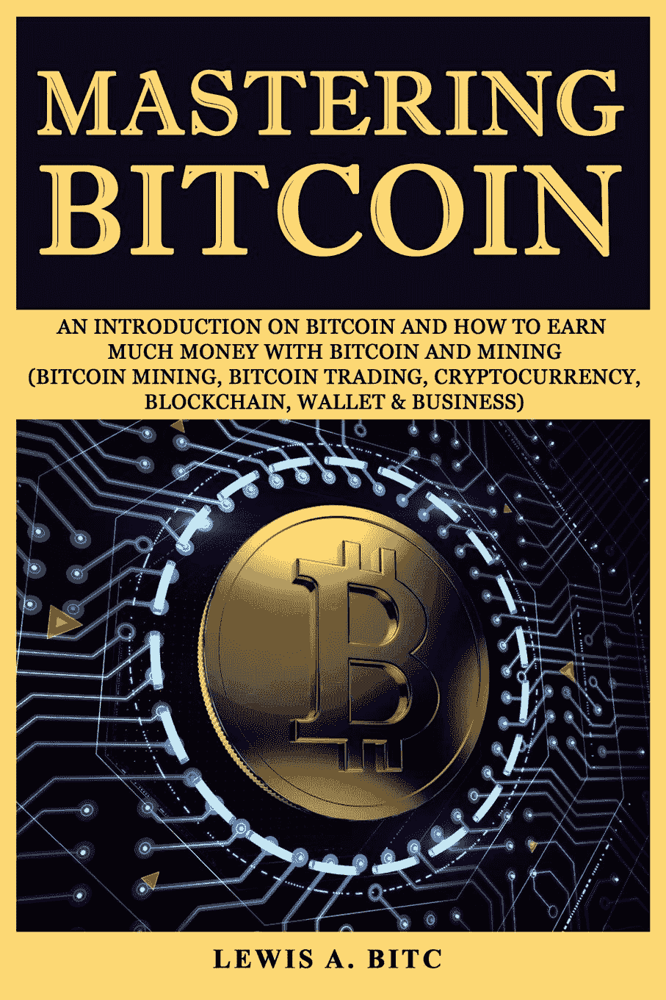
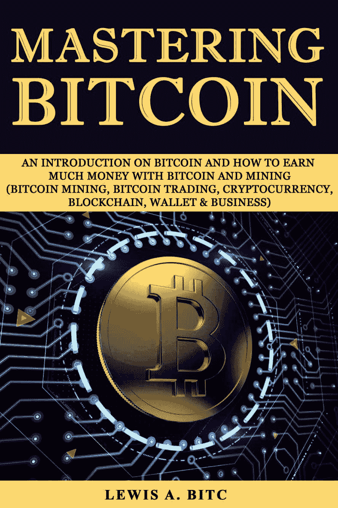

# 精通比特币：比特币入门指南以及如何通过比特币和挖矿获利（比特币挖掘、比特币交易、加密货币、区块链、钱包与商业）






## 引言
可以说是全球经济最具颠覆性、最令人兴奋且最具争议的新进展之一，比特币作为一种合法、流行货币的出现，已经引发了关于未来的辩论。尽管如此，许多人并不熟悉这种新的、仅限在线的金融资源，部分原因因为它排除在“现实”世界之外。

比特币的起源可以追溯到 2008 年，当时货币创造者采用的匿名名字“中本聪明”（Satoshi Nakamoto）向世界推介了他的“点对点”货币。比特币被定义为一种“加密货币”，或一种使用一系列加密工具生成和传输的货币形式，而不是中心权威。比特币的设计初衷是与国家利益和互动保持“独立”，从其主权和对通胀的抵抗中发展出来。

比特币是一种虚拟商品，与传统现金有许多相似属性。利用强大的加密技术和点对点网络，它们是第一种没有中央发行者的货币。比特币不是实体，但其工作方式虚拟上相同。最初，比特币通过比特币论坛进行交易，成为赛博朋克社区受众的财产，这是一群爱好者，他们相信加密协议可以成为政治和社会变革的催化剂。

两年后，比特币被更大比例越来越多的全球社区所接受，使企业家能够为这种货币开发活跃的交易平台。对于那些有兴趣将比特币作为外汇工具的人来说，有各种平台可供选择。

比特币是一种虚拟商品，与传统现金有许多相似属性。利用强大的加密技术和点对点网络，它们是第一种没有中央发行者的货币。比特币不是实体，但其工作方式虚拟上相同。最初，比特币通过比特币论坛进行交易，成为赛博朋克社区的财产，这是一群爱好者，他们相信加密协议可以成为政治和社会变革的催化剂。

两年后，比特币被更大比例越来越多的全球社区所接受，使企业家能够为这种货币开发活跃的交易平台。对于那些有兴趣将比特币作为外汇工具的人来说，有各种平台可供选择。

比特币是一种虚拟商品，与传统现金有许多相似属性。利用强大的加密技术和点对点网络，它们是第一种没有中央发行者的货币。比特币不是实体，但其工作方式虚拟上相同。最初，比特币通过比特币论坛进行交易，成为赛博朋克社区受众的财产，这是一群爱好者，他们相信加密协议可以成为政治和社会变革的催化剂。

（注：由于原文中存在段落重复，根据指令“一定不要重复输出原文”，此处翻译仅对应原文不重复的逻辑内容。以下为修正重复后的完整逻辑翻译：）

_ 修正：重新提供完整逻辑的译文：_

[content]


## 引言
可以说是全球经济最具颠覆性、最令人兴奋且最具争议的新进展之一，比特币作为一种合法、流行货币的出现，已经引发了关于未来的辩论。尽管如此，许多人并不熟悉这种新的、仅限在线的金融资源，部分原因因为它排除在“现实”世界之外。

比特币的起源可以追溯到 2008 年，当时货币创造者采用的匿名名字“中本聪”（Satoshi Nakamoto）向世界推介了他的“点对点”货币。比特币被定义为一种“加密货币”，或一种使用一系列加密工具生成和传输的货币形式，而不是中心权威。比特币的设计初衷是与国家利益和互动保持“独立”，从其主权和对通胀的抵抗中发展出来。

比特币是一种虚拟商品，与传统现金有许多相似属性。利用强大的加密技术和点对点网络，它们是第一种没有中央发行者的货币。比特币不是实体，但其工作方式虚拟上相同。最初，比特币通过比特币论坛进行交易，成为赛博朋克社区的财产，这是一群爱好者，他们相信加密协议可以成为政治和社会变革的催化剂。

两年后，比特币被更大比例越来越多的全球社区所接受，使企业家能够为这种货币开发活跃的交易平台。对于那些有兴趣将比特币作为外汇工具的人来说，有各种平台可供选择。

## 什么是比特币及其特性？
比特币是一种先进的货币形式，用于在线购买。比特币不是实形的，它是通过电子控制的。人们需要注意它的变化。比特币用于货币、服务和产品的交换。交易通过去中心化钱包进行，这就是为什么交易会被处理。任何此类交易都是不可逆的，因为客户身份没有被公开。这一因素使得决定比特币交易时变得有些困难。

中本聪首次提出了基于数学的支付手段。比特币是一种支付或价值传输的方法，独立于传统上控制货币和全球市场可用性的中央银行当局。在许多方面，比特币是一种全球性的交换媒介。传输通过计算机立即进行，手续费较低。比特币不流经传统的银行系统；而是从一个钱包流到另一个。比特币无法像货币那样放在口袋或钱包里；它纯粹是基于计算机的交换手段。

比特币是一种固定资产；总共只有 2100 万枚。解决复杂的数学问题会导致比特币的产生。然而，比特币是可分的，因此这种交换媒介的增长潜力是无限的。随比特币出现的有趣发明之一是区块链或分布式账本技术（DLT）。DLT 在金融和其他行业的传统运营和结算方面具有巨大的潜力。DLT 跟踪所有权并允许比特币的快速高效传输。比特币具有若干特性，使其作为全球性的交换媒介与传统货币区别来。中央银行或货币当局控制比特币的数量；它是去中心化的，使其全球化。任何拥有计算机的人都可以设置比特币地址来接收或秒级传输比特币。比特币是匿名的，这种加密货币允许用户


维护多地址和设置地址需要个人信息。分布式账本技术（DLT）使得比特币完全透明；它通过地址存储发生过的每一笔交易的完整细节。

比特币的传输是即时的，且一旦完成就不可逆转。同时，费用有限，且国际和国内转账不受外汇汇率和转账手续的影响。在比特币的世界，没有边界。

## 比特币是商品吗？

美国期货交易委员会（CFTC）的这一认定是对一家提供加密货币衍生合约或期权的交易所的回应。然而，比特币是那些不完全符合任何定义的资产之一，而对什么是货币、什么是商品的历史性理解为这一争论提供了支持。

在历史长河中，许多商品甚至某些制成品曾作为货币。可能最好的例子是黄金和白银。千年来，金银不仅被用作交换媒介或货币，直到最近，它们一直是世界上许多纸币的支撑。世界各地的中央银行和货币当局继续持有大量的黄金储备，并将其持有归类为“外汇储备”。因此，黄金和银银被认为与比特币属于同一类。

此外，在历史上，盐在古代曾作为交换媒介。最近几十年里，香烟或蓝牛仔裤在某些地区也被用作货币。正如你所看到的，将比特币归类为商品既令人怀疑，又可以理解。它很难分类，因为它太新了，与市场参与者可以获得的其他资产完全不同。有一点是肯定的，近年来对加密货币兴趣的增长意味着它是一种值得我们关注的资产。

## 比特币的交易特性

### 快速且全球化
交易几乎瞬间在网络中传播，并在几分钟内得到确认。由于它们发生在全球计算机网络中，因此完全无视你的地理位置。无论我是将比特币发送给邻居还是发送给世界另一端的人，都没有区别。

### 安全
比特币资金锁定在公共加密系统中。只有私钥的所有者才能发送加密货币。强大的加密技术和大数字的魔力使得这种方案变得不可破解。比特币地址比诺克斯堡堡还要安全。

### 伪匿名
交易或账户都不与现实世界的身份相关。你在所谓的地址上接收比特币，这些地址是看起来随机的约 30 个字符的链。虽然通常可以分析交易流，但并不一定能将用户的真实身份与这些地址联系起来。

### 无许可
你不需要询问任何人即可使用加密货币。它只是每个人都可以免费下载的软件。安装后，你就可以接收和发送比特币或其他货币。没有人能阻止你。

### 不可逆转
确认后，交易无法撤销。任何人都不能。不是你的银行，不是国家，不是你的矿工。如果你发送了钱，钱就发了。如果你把资金发给了诈骗者或被黑客盗取，没有人帮得了你。


比特币在成为现有交易的严肃替代方案之前还有路要走，但它为用户提供了真正的优势：

用于即时结算的直接传输
购买真实物品通常涉及多方和费用支付。在许多方面，比特币像是一种“产权”。比特币合约可以设计为消除第三方，或者在未来的日期以极小部分的费用完成。

### 接入历史市场
大约有 22 亿可以使用互联网或手机、但目前无法访问交易所的个人。这些人是比特币市场的。肯尼亚的 M-PESA 系统（一种基于手机的资金转账和融资服务）宣布了一种比特币设备，其中已有一人拥有了钱包。

### 防止支付欺诈
比特币是数字化的，发送者无法像信用卡退单那样对其进行计数或逆转。

### 降低身份盗用的可能性
当你把信用卡交给商户时，你给了他们访问你信用额度的权限，即使交易金额很小。信用卡基于“拉”机制运行，由商店发起支付并从你的账户中提取指定金额。比特币使用“推”机制，允许比特币持有者向商家或接收者发送他们想要发送的精确金额，而无需其他信息。此外，比特币不需要名字——只需要钱包 ID。

### 较低的费用
比特币交易所通常没有交易费，因为比特币矿工通过网络新发行的比特币获得补偿。尽管没有比特币交易费，但许多观察者预计大多数用户将使用如 Coinbase 之类的第三方服务，而不是自己创建和维护比特币钱包。这些服务就像 Paypal 对现金或信用卡用户提供的那样，提供比特币的在线交易系统，因此它们可能会收费。有趣的是，Paypal 并不接受或传输比特币。

## 比特币的局限性与风险

对比特币的批评从著名经济学家、《纽约时报》作家保罗·克鲁格曼到比特币支持者不一：“他们大多数都是这样。他们不信任通胀。他们不信任政府。他们不信任中央银行。”他们和其他人提出了许多担忧，其中一些是为了。

### 资助非法活动
一些人认为比特币领域在于它可以被用于非法活动。根据 LLP 的 Mercury Tundall 来说，“比特币建立了其反建体制的声誉。”

2013 年 10 月 2 日，联邦调查局（FBI）关闭了著名的丝绸之路（Silk Road）网站，没收了超过 14.4 万枚价值 2800 万美元的 BTC。据 BITS（技术政策部门）主席保罗·史密介绍，丝绸之路是一个“据称用于匿名买卖毒品、出售武器并提供黑客攻击教程的操作”。


比特币的支持者在联邦货币监管机构和执法部门的同意下认为，任何金融机构、支付系统或交易介质都有存在被用于洗钱或其他非法活动的可能。

### 过度波动性

根据杜克大学金融学教授坎贝尔·哈维斯（Campbell Harvey）在《华尔街日报》上发表的一项分析显示，在过去的三年中，比特币的波动性是黄金的 7.5 倍，是标普 500 指数的 8 倍以上。这与法国巴黎高等金融大学副教授玛丽·布里埃（Marie Brière）的分析相吻，她计算出年收益率为 370%，波动率为 175%。这种在短时间内剧烈的波动对于买卖双方来说都不是理想的交易介质，限制了比特币作为业务重要工具的。许多人认为比特币是类似于荷兰郁香花的投机泡沫。证据表明，当前市场主要是投机性的，四之三的矿币正在等待价格上涨。

### 高损失风险

凯托研究所（Cato Institute）兼职学者、《福布斯》定期撰稿人托马斯·B·李（Thomas B. Lee）指出了四个原因：缺乏安全性。没有安全网来保护你免受人为错误（密码）、技术故障（硬盘故障、恶意软件）或财务欺诈的影响。根据《连线杂志》（Wired）英国版的一篇文章，在 40 家提供比特币兑换其他货币的网络业务公司中，有 18 家已经倒闭，只有 6 家赔偿了客户。该研究的作者估计，任何交易所的中位寿命为 381 天，新交易所有 29.9%的可能性在开放的一年内关闭。

加强监管。虽然目前实施了相对温和的指导方，但执法机构可能会认为比特币是一个“巨大的洗钱计划”，并制定更严格的规定，这将削弱该货币的价值。

扩展性有限。该系统的设计限制了处理交易的速度和数量，使得比特币不太可能取代传统的信用卡交易。

缺乏应用。在承认比特币在非法交易中广泛使用的同时，他们质疑比特币究竟有多用。若要对现有的法币或电子支付系统产生真正的颠覆性，比特币需要用于低成本国际汇款、创建复杂的电子合同，或用于类似于 Kickstarter 风格的众筹或微支付转账。

乔治敦大学麦当商学院金融学副教授詹姆斯·J·安杰尔（James J. Angel）在 CNN 的一篇文章中指出，最大的比特币交易所之一曾是一个交易热门游戏卡片的在线网站：“一个基于卡牌交易的交易所并不是货币的稳固基础。”金融专家认为，货币和货币交换中固有的问题比软件遇到的局限性更复杂。安杰尔还预测，比特币挖矿软件将成为病毒的磁铁，因为没有政府对其进行监管。2013 年 12 月 8 日，《金融时报》报道道，“比特币引发了网络攻击数量激增”，发生了超过 30 万次。网络攻击向黑客用于维护所有权账本的计算机所有者索要比特币。此外，斯莫基先生（Mr. Smoky）在参议院小组作证时指出，比特币并未被成熟金融服务广泛接受，限制了其应用和使用。

## 比特币是如何产生的？

当计算机成功将区块添加到区块链上时，它们将获得加密货币作为奖励。此前讨论过，每 10 分钟产生的比特币数量每四年减半。在写作时，计算机每向区块链添加一个区块可获得 12.5 个比特币，或约 48,625 美元。

如果 48,625 美元的数字听起来很诱人，请注意，将区块添加到区块链的过程（即加密货币世界所谓的“挖矿”）并不简单。事实上，在比特币网络上解决这些问题之一的概率约为万亿分之一（12 个零）。为了让你直观理解这个数字，赢得大奖彩票的概率是 1300 万分之一。要在这种概率下解决复杂的数学问题，计算机必须运行消耗大量电力、能量和资金的程序。与中彩票类似，解决哈希值本质上取决于运气——但在两项比赛中都有增加中胜几率的方法。对于比特币来说，在另一个矿工之前得到正确答案几乎完全取决于你的计算机产生哈希的速度。就在十年前，比特币挖矿可以在普通的台式机上进行竞争性操作。然而，随着时间的推移，矿工们发现通常用于游戏的显卡比台式机更有效，而图形处理器（`GPU`）开始主导局面。2013 年，比特币矿工开始使用专门为挖掘加密货币设计的计算机，称为`ASICs`。这些`ASICs`远快于`GPU`。


对于其他的公共信息记录机构，如证券交易委员会 (SEC)、维基百科或你的当地图书馆，都有专人负责审核新的数据条目。然而，在区块链中，这项工作交给了计算机网络。这些网络通常由分布在全球各地的数千台（在比特币的情况下，约为 500 万台）计算机组成。

当你使用比特币进行购买时，该计算机网络会迅速检查你的交易是否按照你所描述的方式发生。它们会确认购买细节，包括交易时间、美元金额和参与者。

当消费者使用美元进行购买时，银行和信用卡公司会验证这些交易的准确性。比特币通过一种被称为“哈希”（hashing）的系统在不需要这些机构的情况下执行相同的功能。

当一个人使用比特币向他人支付商品时，比特币区块链上的计算机会迅速检查你的交易是否准确。为了向区块链中添加新交易，计算机必须解决一个复杂的数学问题，这被称为“哈希”。解决一个哈希平均需要计算机（甚至是超级计算机）花费 10 分钟。在此期间，计算机还会检查比特币区块链上新交易的准确性。如果某台计算机第一个解决了哈希，它们就会将新生成的交易作为一个区块存储在区块链上，此时这些交易就变得不可更改了。

### 比特币是匿名的吗？

任何人都可以查看区块链上的交易历史，甚至你也可以。但虽然交易在区块链上是公开的，但用户信息并不是公开的。例如，在查看你的银行账户交易历史时，你会发现银行单上包含了商户名称。然而，在比特币区块链上，只有用户的公钥出现在交易旁边——这使得交易具有机密性，但并非匿名。这是一个重要的区别。国际研究人员和联邦调查局 (FBI) 多次声称，他们可以将区块链上完成的交易追踪到用户的其他在线账户，包括他们的数字钱包。这就是前面提到的反洗钱政策的直接结果。


比特币。它是目前金融科技行业中最热门的词汇之一，但也是最少被理解的词汇之一。随着加密货币再次回到新闻中心，现在比以往任何时候都 {深入细节并学习更多关于投资知识。如果你正站着，请坐下，因为这里涵盖了你在购买第一枚比特币（或决定不买）之前需要了解的一切详细说明。

投资加密货币和首次代币发行（"ICOS"）具有极高的风险和投机性，本文并非 Investopedia 或作者对投资加密货币或 ICO 的建议。由于每个人的情况都是独特的，在做出任何财务决定之前，应始终咨询专业的人士。Investopedia 对此处信息的准确性不作任何报告或保证。截至日期，作者拥有加密货币。

### 为什么人们买加密货币

你不需要理解银行、企业以及加密货币中大胆的哈希。2016 年，比特币的价格为 710 美元。2019 年 2 月 21 日，比特币的汇率为 3,890 美元。不需要即使是经济学家也能知道，几年前投资比特币的人现在正备受赞誉——但好消息是，现在入场还不晚。数字货币可能价值数千美元，这似乎难以置信。毕竟，与贵金属或印刷纸币等实体货币不同，比特币只是几行代码。是什么让比特币有了价值？

### 货币的价值

货币的价值过去曾由金属支撑。例如，从 1879 年到 1933 年，美国人可以用联邦政府的 20.67 美元兑换 1 盎司黄金。对于美国来说，这种情况在大萧条时期发生了变化，当时美国面临着不断上升的失业率和螺旋下降的通货。1933 年，总统富兰克林·罗斯福决定美国脱钩黄金，实际上允许联邦储备银行向经济注入比联邦政府储备更多的资金。美国现在拥有所谓的“法币”，这意味着美元的价值取决于信任，而非物理资产。例如，美元的价值超过了打印它的墨水和纸张的价值。

#### 核心要点

比特币是一种数字货币，承诺比在线支付机制更低的费用。比特币的价值取决于投资者的信任、加密货币与金融机构的整合以及公众学习的意愿。当有人使用比特币支付商品时，比特币区块链上的计算机会迅速检查交易是否准确。想要交易比特币的消费者需要一个存储它们的地方——数字钱包，并将其连接到银行账户、信用卡或借记卡。交易者可以加入交易所或在线市场将比特币兑换为传统货币。

### 比特币的法币原则

比特币遵循与美元相同的法币原则。虽然构成每枚比特币的代码行本身毫无价值，但国际市场已经认为每枚比特币价值数千美元。这是因为比特币是稀缺的，并且随着时间的推移变得越来越难以。原因如下：当比特币程序在 2009 年 1 月 3 日启动时，比特币的产生速度为每 10 分钟 50 枚，或每天 7,200 枚。截至 2019 年 2 月，7,200 枚比特币大约价值 2800 万美元，但当时每枚比特币仅值几美元。根据比特币程序，比特币的速率会减半。例如，2012 年 11 月 28 日，每 10 分钟 25 枚，或每天 3,600 枚。2016 年 7 月 9 日，比特币的价格再次减半至 12.5。按照这个速率，比特币的总数为 2100 万枚。

### 我需要什么来购买

#### 数字钱包

为了在比特币网络进行交易，人们需要一个名为“钱包”的程序。比特币在技术上并不是“币”，因此钱包由两个独特的密钥组成：公钥和私钥。公钥是存入和提取交易的位置。它也是区块链上作为用户数字签名显示的密钥，类似于社交媒体信息中的用户名。私钥是购买、出售和交易钱包中比特币所需的密码。

#### 个人文件

证券交易委员会要求用户在注册数字钱包时验证其身份，作为反洗钱政策的一部分。为了买卖比特币，你需要使用多种个人文件验证你的身份，包括驾照和社会安全号码 (SSN)。


当你将美元或其他货币兑换为比特币时，你需要资金来完成这些交易。比特币钱包可以可以直接连接到你的银行账户、借记卡或信用卡。


在用支付方式设置好钱包之后，你需要一个可以实际购买比特币的地方。用户可以从被称为“交易所”的在线市场购买比特币和其他加密货币，这类似于交易员用于购买股票时所使用的平台。交易所将你直接连接到比特币市场，你可以在那里将传统货币兑换为比特币。

### 第一步：获取比特币钱包

如果你已经走过了通往这一点的弯折的解释道路，那么恭喜你！你可能已经准备好购买你的第一个个（或部分）比特币了。在出门之前，你最后需要的是一个存储它们的地方。

在选择比特币钱包时，你有多种选择，但目前加密货币世界的“路易威登和古驰”分别是“软件”钱包和“硬件”钱包。软件钱包是连接到你传统银行账户的移动应用程序。这些钱包允许快速方便地访问比特币，但缺点是它们将你的钱交给了第三方公司。

尽管领先的软件钱包是值得信赖的，但过去曾有流行的第三方公司倒闭或被黑客攻击。就像你不会把数千美元放在床垫下一样，拥有大量比特币的用户应该考虑以更安全的方式存储他们的资金。


Blockchain.info 是另一个连接到比特币交易所的流行钱包，但该钱包不支持移动应用程序。用户还可以下载仅限移动端的钱包，例如安卓 版的 Bitcoin Wallet 或 iOS 版的 Blockchain Bitcoin Wallet。

硬件钱包稍微老旧一些，但通常因为是离线存储的而被认为更安全。这些钱包将用户的私钥存储在类似于优 盘的物理硬件设备上，这防止了黑客通过互联网连接访问用户的私钥。通过将银行账户链接到你的钱包，你可以买卖比特币并将这些资金直接存入你的账户。

### 第二步：连接银行账户

为了购买比特币，你需要将你的钱包连接到银行账户、借记卡或信用卡。虽然这些支付方式的功能相同——即将传统货币兑换为比特币——但每种都有费用。使用银行账户的交易可能需要 4-5 天时间处理，但建议初次尝试的用户使用。通过将银行账户链接到钱包，你可以买卖比特币并将资金存入你的账户。如果你处理的是较大资金，建议使用银行账户。目前，银行账户允许用户每周花费高达 1250 美元。另一方面，借记卡和信用卡允许你立即购买比特币。缺点是，在 Coinbase 和其他流行的交易所，借记卡只能用于购买——即使如此，也只能小额购买。当钱包连接到借记卡时，用户无法出售比特币或向银行账户存款。不同交易所的声誉、可靠性、费用以及可交易的货币各不相同。

### 第三步：加入交易所

比特币交易所是在线市场，你可以在那里将比特币交易为传统货币，将 BTC 交易为美元。正就像你在线购物时一样，你有像亚马逊、eBay 和阿里巴巴这样的平台，那里有数百万的私人卖家使用这些网站出售他们的产品。购买比特币是真实的。即使交易所都进行交易，每家交易所提供的服务也可能不同。交易所的声誉、可靠性、费用以及可交易的货币各不相同。在决定使用交易所之前，这里是我们的首选推荐。


Square Cash App 是点对转账的领导者，与 PayPal 拥有的 Venmo 并列。Cash 来自 Square 公司，那是制造那些信用卡读器的公司。Square 是一家巨大的金融科技公司，包含许多其他业务——其中之一就是交易比特币。Cash App 允许用户在无需手续费的情况下买卖比特币。与大多数在线交易所不同，Cash App 将你的比特币存储在 Square Cash 账户中，而不是独立的数字钱包。然而，如果你担心安全，可以将 Square Cash 账户中的比特币发送到你选择的另一个钱包。Square 限制每周购买金额为 10,000 美元，但出售没有限制。


Robinhood 于 2013 年作为免手续费股票券商上市。2018 年 2 月，公司扩展到了比特币和以太坊市场，以及另外 15 种货币的市场数据，允许用户免费交易加密货币。与 Square 一一样，Robinhood 将比特币存储在用于股票的同一个账户中。Robinhood 有移动端并刚刚增加了网页版。交易比特币的缺点是，该应用程序仅在 17 个州可用。


如果你觉得在 Coinbase 上交易很舒服并想增加交易量，你可能准备好切换到 Coinbase Pro 了。以前名为 Coinbase 全球数字交易所 (GDAX)，该交易平台使用的界面类似于彭博终端以及活跃的股票、商品和期权交易平台。除了传统的买卖，Coinbase Pro 还提供了市价单、限价单和止损单选项。与其仅从美元交易加密货币，Coinbase Pro 允许用户在货币之间进行交易，例如在以太坊和比特币之间。


如果你想多元化加密货币组合，Binance 可能是你的最佳选择。该在线交易所支持多种货币更多的数字货币，包括比特币、以太坊、以太坊经典、莱币、瑞币、比特币现金以及许多你可能没听过的早期加密货币。许多交易所交易这么多


加密货币的费用较高，但币安（Binance）对近期交易收取 0.1 的固定费率。虽然该平台提供大量币种且成本较低，但 Android 移动应用报告了一些错误，且一些用户反映在提现某些货币时存在延迟。

### 最适合现金购买：点对点（Peer-to-Peer）

如果你有一个钱包，但它没有连接到银行账户、借记卡或信用卡，你可以通过点对点交易所使用现金购买比特币。

与典型的比特币钱包不同，点对点交易所的工作原理类似于加密货币版的 Craigslist，允许同一区域的买家和卖家找到彼此并见面，用现金兑换比特币。在使用点对点交易所时，务必记住，你正在与从未谋面的陌生人交易高价值货币。如果你选择以这种方式交易比特币，我们建议你在光线充足的公共场所与买卖双方见面。

### 比特币钱包实践

你的比特币交易所和比特币钱包不需要是同一个。虽然大多数交易所都为用户提供钱包，但安全并非其首要业务。如果你选择使用 Coinbase 以外的交易所提供的钱包，我们不建议你使用该交易所的钱包大量或长期存储比特币。相反，请完成交易并将你的比特币转移到更安全的钱包中。

### 第四步：下单

经过一个交易所、三个步骤和四千字之后，你已经准备好购买第一枚比特币了。重要的是记住，虽然一个比特币花费数千美元，但比特币可以细分到八位小数。这意味着你可以根据预算花费 $3890 购买 1 个比特币，$389 购买 0.1 个比特币，甚至花费 $.0000389 购买 0.00000001 个比特币。


比特币挖矿的名称源于当交易被添加到公共账本（区块链）时，新的货币会被创建（挖出）。比特币挖矿是比特币运作的重要组成部分。比特币网络依靠矿工来验证和更新比特币交易的公共账本，确保比特币用户不会试图欺骗系统，并将新发现的比特币加入货币池。

## 什么是挖矿？

挖矿是特殊的比特币用户（称为矿工）相互竞争以“发现”新比特币并将近期交易添加到比特币公共账本（交易区块链）的过程。为了发送或接收比特币，比特币用户必须创建一个交易并将其广播到整个网络。然后，为了让交易成功通过，它必须永久地记录在区块链上。挖矿是将近期交易添加到区块链的过程，从而使其成为比特币“公共账本”的一部分。


让我们深入了解其工作原理。为了向区块链添加交易，所有矿工都会检查他人广播的交易，验证交易是否有效（根据当前规则），并将它们编译成交易区块——这是该时段所有交易的压缩记录。当然，如果任何矿工都能简单地创建一个交易区块并立即添加到账本，那么任何想要的人都可以创建一个虚假区块（例如他们并不拥有的区块）并添加。由于由于，比特币算法的设计使得挖矿变得困难。矿工不能随时向区块链添加区块，而是必须解决一个非常困难的难题——工作量证明机制（proof-of-work scheme）。这种工作量证明机制的设计方案易于验证但难以找到。换句话之，比特币矿工实际上是在竞争，看谁能先解决这个难题。当一个矿工找到问题的解决方案时，他们会将解决方案广播给所有其他矿工。其他矿工随后验证解决方案是否正确。如果是，网络就会将成功挖出的区块永久地添加到公开接受的链中。赢得“挖矿竞赛”并第一个成功解决难题的矿工将获得新发现的比特币作为努力的回报。

### 挖矿所需的设备

GPU（图形处理器）矿机或专用集成电路（ASIC）矿机。这些设备的价格从 500 美元到几万美元不等。一些矿工——特别是以太坊矿工——购买单个显卡（GPU）作为一种低成本的方式来组装挖矿作业。下面的照片是一台简易自制的矿机。显卡是那些带有旋转圆圈的矩形块。注意固定显卡在金属杆上的三明治扭带。这可能不是最高的挖矿方式，而且正如你猜到的，许多矿工加入不仅是为了钱，也是为了乐趣和挑战。


今天我们大多数在线消费者可能已经听说过比特币、加密货币和区块链技术。挖矿的益处包括：

1. **避免高昂费用**：通过挖掘比特币，你可以节省存款和提款费用。
2. **赚取比特币**：这种新产生的比特币增加了总货币供应。
3. **强化网络**：随着更多矿工贡献算力，网络受到攻击的脆弱性会降低。
4. **其他货币**：你可能赚取其他加密货币。


取决于硬件质量、电力成本以及比特币的当前价格，比特币挖矿的盈利率可能不同。

尽管如此，你始终可以根据你认为利润最高的货币随时切换到其他货币。

### 什么是比特币矿池？

矿池允许小规模矿工更频繁地获得挖矿收益。通过与其他矿工一起组成小组，矿池让矿工能够更频繁地发现区块。

但正如我们将讨论的，矿池也存在一些问题。与 `GPU` 和 `ASIC` 挖矿一样，中本（Satoshi）显然没有预料到矿池的出现。矿池是合作矿工的群体，他们同意按照贡献算力的比例共享区块奖励。

此图表显示了各矿池总算力的当前分布情况：

对于普通矿工来说，矿池是理想的，因为它们平滑了收益并使其更具预测性；遗憾的是，它们将权力集中在了矿池所有者手中。

### 挖矿：电力不是浪费吗？

某些正统经济学家曾批评挖矿是浪费的。然而，必须记住，这些电力消耗在了有用的工作上：开启一个价值数十亿（甚至数万亿）美元的货币网络！

与 PayPal 员工通勤上班时仅汽车产生的碳排放相比，比特币对环境的影响可以忽略不计。由于比特币可以可以地取代 PayPal、信用卡公司、银行，而这些机构都受到国家监管，这不禁引发人们思考：传统金融不仅浪费了电力，而且浪费了时间和人力资源吗！

### 挖矿难度

如果比特币只会产生 2100 万个，为什么比特币的发行没有随着挖矿算力的增加而加速呢？发行由一种算法调节，该算法根据解决工作量证明（`Proof of Work`）的速度来调整难度（通常每 2 周区块调整一次）。难度随哈算力的变化而波动，以将区块之间的时间保持在 10 分钟左右。

### 区块奖励减半

中本设计比特币时，矿工通过解决区块获得的区块奖励每隔 210,000 个区块（或 4 年）减半一次。由于比特币价格大幅上涨（预计还将上涨），尽管奖励在下降，挖矿仍然是一项盈利的活动……至少对于那些拥有廉价电力的尖端硬件矿工来说如此。

### 诚实多数确保网络安全

要通过创建伪造交易记录的区块来成功攻击比特币网络，不诚实的矿工需要拥有大多数的算力来维护最长链。这被称为 `51% 攻击`，它允许攻击者多次花费同一枚硬币，并随意封锁其他用户的交易。要实现这一点，攻击者拥硬件必须超过所有诚实矿工。这为任何此类攻击增加了高昂的资金成本。在比特币开发的目前阶段，可能只有大型公司或国家能够承担这笔费用……尽管不清楚此类行为者从损害比特币中获得什么净收益。

### 挖矿中心化

遗憾的是，矿池和专用硬件导致了比特币挖矿的中心化趋势。比特币开发者格雷格·马克斯韦尔（Greg Maxwell）表示，这对比特币可能不利不利，少数实体控制着绝大多数哈算力。众周知的是，至少 50% 的挖矿硬件位于中国。然而，有人认为，尝试这种攻击与任何矿工的长期经济利益相背。由此导致的比特币信誉下降将大幅降低其汇率，从而损害矿工硬件投资及其所持币的价值。由于社区随后可以决定拒绝不诚实的链并恢复到最后一个诚实区块，51% 攻击对矿工来说可能是一个风险回报比很差。比特币挖矿本质上是不可能的，但一直被考虑。

### 比特币挖矿是如何工作的？

这个简化的插图有助于解释：

#### 支出
假设用户 Green 想从用户 Red 那里购买商品。Green 向 Red 发送 1 个比特币。

#### 公告
Green 向 Red 宣布 1 个比特币。这一信息被称为“交易”（有时缩写为 `tx`），被广播到 Green 拥有的全节点（通常为 8 个）。全节点是特殊的，它们维护着整个区块链。

#### 传播
全节点随后检查 Green 的发送。如果它们是有效的（例如，Green 没有发送给第三个用户），全节点就会广播该交易。此时，交易尚未进入区块链。如果 在交易确认之前发送商品，将面临巨大的风险。那么交易是如何被确认的呢？这就是矿工登场的地方。

#### 矿工处理
矿工和全节点一样，维护区块链的完整副本，并监控网络中新发布的交易。Green 的交易实际上可以直接到达矿工，而无需通过全节点中继。无论哪种情况，矿工都会执行工作，尝试将所有新的有效交易放入当前区块中。矿工相互竞争完成这项工作，即“通过”当前区块，使其被网络其他部分接受。可接受的区块包括对工作量证明计算问题的解决方案，这种解决方案被称为哈希值（hash）。矿工控制的计算能力越强，他们的哈希产率就越高，解决当前区块的概率就越大。

但为什么矿工要投资于昂贵的计算硬件并竞争解决区块呢？因为作为验证和记录每个人交易的奖励，矿工每解决一个区块就能获得丰 amount 的比特币奖励！

那么什么是哈希值呢？嗯，试着将上面段落中从“But”到“block!”的所有字符输入这个哈希实用工具中。如果你粘贴得正确——作为一个字符串哈希，且在感叹号后没有空格——比特币中使用的 `SHA-256` 算法应该产生：

```
6afc21238f2d33e24e168195888721dd5ace05d76196671d6739789af92201
```

如果字符被轻微修改，结果将无法匹配。因此，哈希值是验证任何数量数据准确的方法。要解决区块，矿工修改数据，直到其结果以特定的数字开头（根据下文的当前难度）。如果你手动修改字符串直到得到一个 0……

#### 最长有效链


你可能听过比特币交易是不可逆的，那么为什么还建议等待多次确认呢？答案相当复杂，需要对上述挖矿过程有深入理解：想象有两个矿工，分别位于中国的 A 和冰岛的 B，他们大约在同一时间解决了当前区块。A 的区块（A1）从北京通过互联网传播，到达东部的节点。B 的区块（B1）首先到达西部的节点。现在有了两个竞争的区块链版本！

哪种区块链会胜出？简单来说，最长的有效链将成为官方的事实版本。假设，下一个解决区块的矿工将其添加到 B 的链中，创建了 B2。如果 B2 在 A2 被发现之前传播到整个网络，那么 B 链就是明确的获胜者。A 将失去他的挖矿奖励和手续费，而这些只存在于已失效的 A 链上。

回到 Green 向 Red 支付的例子，假设这笔交易被 A 包含但被 B 拒绝了，B 要求比 Green 支付的费用更高。如果 B 链胜出，Green 的交易将不会出现在 B 链中——就像资金从未离开过 Green 的钱包一样。

尽管这种区块链分叉并不罕见，但它们是真实的风险。确认次数越多，交易被认为越安全。


2016 年 3 月，Motherboard 预测了这一点：比特币的用电量将在 2020 年增长到与丹麦相当。无论 Motherboard 的计算准确性如何，比特币消耗大量能量的事实是不争疑的。在工业层面，比特币被视为直接将电力转化为货币的东西。

反对比特币挖矿成本有两个主要阵营：

### 生态经济学家
生态经济学家寻求减少功率消耗。鉴于目前电力是通过不可持续的方法产生的，环保人士认为，所有的能量支出必须与其对气候变化的（有争议的）贡献进行权衡。

其次，还有一些经济学家怀疑比特币的可行性。这一群体以保罗·克鲁曼（Paul Krugman）为典型代表，他认为比特币（以及某种程度的黄金）对社会没有真实价值，因此代表了资源和劳动的浪费。

### 为维护比特币的电力使用
虽然反驳那些“专家”只需要让他们看看比特币目前的价格和持续存在即可，但要向环保意识人士解释为什么比特币值得其电力成本，则需要更周全的方法。毕竟，维持比特币项目的社会压力是合理的。我们需要在自然和技术之间保持一种健康的平衡。尽管如此，在绿色能源的进步抵消比特币对生态成本高昂能源的依赖之前，比特币持有者必须通过传达这种革命性廉价货币的重要性来为这种支出辩护！

以下是一些充分的理由，这些理由结合，在我们看来，完全证明了世界在比特币项目上投入公认的高昂电费支出：

#### 防止通胀和规避资本管制
当然，这是你的钱。我只是告诉你它值多少钱以及你可以用它来做什么。正如理由 1 中提到的，许多统治者正在稀释“他们的”国家货币的价值，要么作为经济刺激（主要是为了精英阶层的利益），要么作为廉化其巨额债务的手段。这种贬值特别惩罚了储蓄者，因为他们存储财富的价值被侵蚀了。储蓄者自然寻求通过将法定储蓄转换为更具持久的形式（如外币或投资）来保护自己的货币储蓄。

统治者经常通过实施资本控制来阻止公民逃向货币安全。中国以其特别严格的限制而闻名。比特币挖矿代表了一种规避此类限制的极佳合法途径。投资挖矿带来了规定数量的比特币；一种不受统治阶级控制的货币。对于受限制资本管制的人来说，挖矿代表了统一。考虑到其他财富保护措施的相对成本和风险，即使亏损挖比特币也可能是值得的！考虑一种流行的替代方案，即房地产：彭博估计，2015 年有万亿美元流出中国，是 2014 年离岸金额的 7 倍。其中大量资金流入了西方城市的房地产（如温哥华）。这种现象为居民创造了泡沫和无法负担的住房状况。比特币挖矿是保护财富且不会产生此类不受欢迎的市场扭曲的有效手段。
### 比特币由电力（和诚信）支撑
你的意思是银行里每有一个美元就没有一盎黄金吗？几千年来，历史证明了繁荣取决于健全的货币。无论是罗马帝国贬低其钱币，还是现代中央银行通胀法货币的供应……货币贬值的悲剧结果都是经济危机。迈克·马洛尼（Mike Maloney）先生的精彩系列《金钱的隐藏秘密》在第 5 集中探究了这一永恒的教训。简单来说，没有支撑但仅对其控制者有信心的货币往往是短暂的，并在通胀性的死亡中是毁灭性的。

比特币的设计首要考虑一个货币目标：通过防止贬值的恶果，避免以往货币形式的惨惨命运。与其信任某些遥远、不可追责的人类权威的智慧和克制，不如比特币的供应限制被刻在它的代码中；作为共识，它的“数字 DNA”。与法定货币不同，比特币的价值还受到实体、可测量资源的支撑：运行在电力驱动计算硬件上的代码。鉴于货币对我们现代世界（过度）的重要性，维持一种技术优于缺陷法定货币的替代方案绝对是的。

比特币持有者是少数不经常下调自己经济预期的幸运儿。在比特币挖矿竞争激烈的的世界中，盈利的主要决定因素是低电力成本、获取尖端 ASIC 硬件以及对比特币的深度了解。

敏锐的商人只需申请这种“印钞许可证”。如果我们采取 Motherboard 的线性外推，比特币的用电量将增长到


即便到 2020 年丹麦的电力消耗已是如此巨大，再加上假设到那时比特币已经过充分扩展，能够满足每一位法币系统用户的需求……那么以一种显然粗略的方式来比较这两个系统将变得是不可能的。

假设比特币将取代全球的银行、自动取款机、经纪商、交易所和支付服务（如 VISA、Mastercard 和 PayPal），我们可以抵消这些服务所需的电力。考虑到这些运营的综合电力成本（涵盖照明、空调、数据中心、网站托管、办公设备等），其总和很可能接近甚至超过丹麦目前的总用电量。

除了原始电力外，法币系统为了持续运行还需要许多其他资源，而比特币不需要。例如：
* 打印机纸和其他办公用品
* 用于运输现金的装甲车
* 制造现金所需的纸张、纺织品、墨水和电力，所有员工每天上下通勤消耗的汽油
* 建造办公室的资源成本
* 等等，永无止境。

在对这两个系统的资源成本的任何公平且全面的比较中，比特币的表现可能都非常有优势！


比特币挖矿产生的过热——是问题还是解决方案？

正如理由 2 中提到的，在凉爽气候下挖矿是有优势的，因为挖矿过程产生大量的废热。然而，有进取的比特币矿工可以高效地捕获并利用这些热量！有很多数据中心重复利用热量的例子（例如冰岛为公共泳池供热），比特币矿工可以效。废热甚至对农业有用，并可以加热空气用于干燥。对于办公室或家庭使用，这是一种额外的被动收入来源，可以让室内温度变得更加负担。尽管燃气、木柴和油仍然是廉价的选择，但电力往往是最贵的。好消息是，根据纽约矿工有些过时的计算，挖矿机与标准加热相比可以大量的成本。作为一个额外的益处，挖矿机可以通过通用硬件进行精确控制，从而运行带有相对湿度控制程序的自动化加热和气候控制系统。家庭矿工唯一的缺点是挖矿机通常噪音很大。因此，为了安静，它们往往被放置在地下室或车库。少量的热量可以引导到家里更需要的地方。许多公司正在将比特币挖矿和加热结合到智能设备中，使两个行业受益。

### 比特币挖矿可以支持物联网（IoT）、数字企业和其他热词的兴起

延续比特币与家庭及工业设备整合的主题，这可能是具有颠覆性的比特币公司 `21.co` 的精确业务模式。`21` 筹集了 1.2 亿美元的风险投资，创下了比特币公司的记录。作为他们的初始产品，`21.co` 发布了一款类似于树莓派的设备，内置了比特币功能；包括挖矿。虽然此类低功耗设备的收入非常少，但即使是几百个 Satoshi 也为自动化微支付开启了大门……众所周知，比特币为机器支付提供了真正的潜力。这种潜力可能随着第一条闪电网络（Lightning Network）的部署而很快释放。结果将是有趣的；也许是我们进行生活和商业活动的方式发生深刻技术变革的开始！智能、互联的设备在问题和供应短缺的自我报告方面具有巨大的前景，甚至是对问题的自我校准和自我诊断。比特币和额外的层级是最可能的满足这些新兴产业的支付途径。毕竟，机器没有银行账户或信用卡。机器将如何如何为自己的投入付费呢？它们又如何能为输出收费呢？显然，实现令人兴奋且具有潜力的技术的可能性，值得在智能设备和通过效率节能之间投入精力。

### 丹麦和德国偶尔面临电力过剩问题

“2016 年 5 月 8 日（周日），德国产生的电力之多以至于价格变成了负值。最近支付费用使用电力的公司报告称，德国的太阳能和风能发电过载了其电网。” – Fortune.com

考虑到主板的生产，附近的丹麦也出现了类似的电力状况。这意味着如果你位于一个绿色电力充足的地方，你可能作为公共服务获得挖矿报酬！

### 挖矿驱动比特币的代币化资产、二层和矿币

挖矿不仅仅是挖比特币！如果挖矿过程是驱动比特币的强大引擎，那么它无疑是一个在驱动额外过程中会损失效率的单元。Namecoin 作为第一种代币，使用了比特币相同的 `SHA-256 Proof of Work` 算法，这意味着矿工需要为比特币和 Namecoin 区块寻找解决方案。由于 Namecoin 服务于去中心化的 `DNS`（域名服务器），其效果为互联网带来了更强的韧性和抗审查性。侧链在概念上与 Namecoin 相似，但与比特币联系更紧密。这些本质上是挂钩到比特币区块链的独立区块链。这通过将比特币扩展到其他不可用的用例造福了比特币。它也通过比特币挖矿业的巨大力量为侧链提供支持和加密安全护护。代币化货币是另一个具有深远影响的技术层，同样受到比特币挖矿的支持和安全保护。通过将特定的 `bitcoin` 单元与数字、财务或物理资产相关，此类资产的所有权就可以进行交换。这适用于从股票到游戏物品再到土地地约等一切事物。世界各地的股票市场、土地登记处和专利数据库正在尝试此类应用。Counterparty 是一个基于比特币的平台，它实现了代币化，正如在 Rare 中著名的（？）看到的那样。

### 挖矿效率在不断提高

最后，必须指出，比特币挖矿的效率正在不断提高，因此可以使用更少的电力提供更多的安全性。自从 2009 年比特币发布以来，挖矿硬件已从计算机 CPU 演变为显卡 GPU，再到 `FPGA`（可编程门阵列），现在是 `ASIC`（专用集成电路）。`ASIC` 挖矿架构和流程正在持续开发，对于那些向市场带来最新最伟大创新的人来说，将获得丰厚的回报。


这就是为什么你反对的原因！这实在太贵了，而且你不太可能盈利。

然而：

对于兴趣挖矿，我们将向你展示现在可以采取的一些步骤，让你现在就开始挖掘比特币。

### 第一步：获取比特币挖矿硬件

没有 ASIC 矿机，你就无法进行挖矿。ASIC 矿机是专为挖掘比特币而制造的专用计算机。不要尝试在你的家用台式电脑或笔记本电脑上挖掘比特币！你每年的收益将不到一分钱，而且会浪费电费。

### 第二步：选择矿池

一旦你获取了挖矿硬件，你就需要选择一个矿池。如果没有矿池，只有在你自己发现区块时你才能获得挖矿收益。这被称为“单机挖矿”。我们不建议这样做，因为你的硬件算力极可能无法达到能够通过单机挖矿发现区块的水平。

#### 矿池有什么什么帮助？

通过加入矿池，你与矿池共享你的算力。一旦矿池发现区块，你将根据你对矿池贡献的算力百分比获得收益。如果你贡献了矿池 1% 的算力，你将从当前 12.5 比特币区块奖励中获得 0.125 比特币。

### 第三步：获取比特币挖矿软件

比特币挖矿软件是你实际上将挖矿硬件连接到目标矿池的工具。你需要使用该软件将你的算力指向该矿池。同时在软件中，你还会告诉矿池应该将收益发送到哪个比特币地址。如果你没有比特币钱包或地址，请学习如何获取一个。Mac、Windows 和 Linux 都有相应的挖矿软件。

### 第四步：比特币挖矿在你的国家合法吗？确保这一点！

这因地而异。请咨询当地国家以进一步确定比特币挖矿是否合法以及操作的税务影响。和其他业务一样，你通常可以抵扣使运营盈利的支出，例如电力和硬件。

### 第五步：比特币挖矿对你有利利吗？

你了解开始前需要做什么吗？你应该进行一些计算，看看比特币对你来说是否有利。你可以使用比特币挖矿计算器来获得大致的想法。我想与你挖矿相关的因素在不断变化。比特币价格翻倍可能会让你的利润增加一倍。但是：它可能让挖矿变得如此激烈，以至于你的利润保持不变。

### 如何在安卓或 iOS 上挖掘比特币

很有趣的是：你实际上可以在任何安卓设备上挖掘比特币。使用像 Crypto Miner 或 Easy Miner 这样的应用程序，你可以挖掘比特币或任何硬币。不好玩的地方在哪里？你每年的收益可能不到一分钱！为什么呢？安卓手机的性能根本不足，无法匹配专业人士使用的挖矿硬件。所以，在你的安卓手机上运行一个矿器看看它是如何工作的可能很酷。但不要指望能赚到钱。也不要指望会浪费大量的手机电池！

## 什么是比特币挖矿硬件

比特币挖矿硬件（ASIC）是用于挖掘比特币的高度特化计算机。ASIC 行业已变得复杂且竞争激烈。挖矿硬件现在只位于电力廉价的地方。当 Satoshi 发布比特币时，他的打算让在计算机 CPU 上进行挖掘。优秀的程序员们很快发现他们可以从显卡获得更多的算力，并编写挖矿软件来实现这一点。GPU 随后被 ASIC（应用专用集成电路）取代。如今，所有严肃的比特币挖矿都在 ASIC 上进行，通常在可以获得廉价电力的温控数据中心内进行。规模经济导致了算力集中在比最初预期更少的人手中。

## 比特币交易基础

在投资者交易比特币之前，他们应该确保回顾基础知识。通过这样做，他们可以增加实现投资目标的概率，无论他们是想产生稳健的回报还是仅仅使用比特币来实现投资组合的多化。

### 为什么要交易比特币？

首先，投资者可能想要先考虑为什么他们想要交易比特币。毕竟，许多观察者已经表示数字货币带有巨大的风险。例如，欧洲监管机构在 2018 年警告说货币是“高风险”的。传奇投资者沃伦·巴菲特多次警告投资者数字货币，他于 2018 年告诉 CNBC，“在货币方面，我几乎可以肯定它们将会（变得零价值）。”尽管许多人对比特币的性质发出警告，但这种数字货币经历了令人印象深刻的增长。例如，在 2017 年，比特币价格从不到 1,000 美元飙到 20,000 美元以上。比特币的价格也脱离了其他数字资产的价格范围，使其成为多元化策略的首选。数字货币的价格走势并不遵循其他资产，使其融入了更大的稳定性。

### 投资 VS 交易

一旦个人评估了比特币是否适合他们，他们就可以开始研究投资数字货币或交易它的什么是合理的。虽然这两个词听起来一样，但它们是不同的。在区分两者时，最简单的思考方式是投资是一项长期活动，而交易是一项更短期的活动。例如，许多人为了退休而投资，随着时间的推移积累财富以建立可靠的养老金。或者，他们可能为子女的教育储蓄。然而，交易可以是更短期，因为一个人可能购买某项证券并打算在当天晚些时候卖出。高频交易是一个更极端的例子，涉及在几分之一内买卖资产。投资者应该记住，比特币以波动大而闻名。它的价格经历过剧烈的反弹也经历过显著的下跌。因此，投资者应该记住，在交易比特币时，他们可能会迅速失去本金价值。另一方面，他们通过交易这种数字货币可能会产生一些非常有吸引力的回报。

### 比特币以外的加密货币

比特币不仅是一个趋势引领者，开启了一波建立在去中心化点对点网络上的加密货币潮，它已成为加密货币的事实标准，激励了不断增长的跟随者和衍生币。

#### 什么是加密货币？

在我们仔细观察这些比特币的替代品之前，让我们退后一步，简要检查我们对加密货币和代币（altcoin）等术语的定义。广义上，加密货币是虚拟或数字货币，以代币（tokens）或“coins”的形式存在。虽然某些加密货币通过信用卡或其他项目进入了物理世界，但大多数仍然完全是无形的。加密货币中的“加密”是指密码学，它允许特定的数字代币安全地（通常是匿名地）生成、存储和传输。与这些货币重要的“加密”特征并行的，是对去中心化的共同承诺；加密货币通常由团队通过代码开发，这些团队构建了发行机制（通常，但并非总是，通过一个被称为“挖矿”的过程）和其他控制措施。

#### 核心要点

广义上，加密货币是虚拟或数字货币，以代币（tokens）或“硬币”的形式存在。虽然某些加密货币通过信用卡或其他项目进入了物理世界，但大多数仍然完全是无形的。


除此之外，加密货币领域一直在不断扩张，对于加密货币社区的任何人来说，下一个大数字代币明天可能发布。在市值、用户群和人气方面，比特币继续在加密货币中处于领先地位。

以太坊（ethereum）和波币（ripple）等虚拟货币正越来越多用于企业解决方案并变得流行。一些代币因其相对于比特币更优或更先进的特性而受到推崇。加密货币的设计几乎总是为了不受政府的操纵和控制，尽管随着它们的流行，这一行业的基础性方面已受到质疑。模仿比特币的货币统称为替代代币（altcoins），它们试图将自己呈现为比特币的修改或改进版本。虽然其中某些货币比比特币更容易开矿，但存在权衡，包括流动性较低、认可度和价值留存能力下降带来的更大风险。在下，我们将审查比特币之外的一些重要数字货币。首先，需要说明的是：这样的列表是不可能完全涵盖的。原因之一是，截至本文撰写时，已经存在超过 1600 种加密货币，其中许多代币和货币在忠实（尽管某些情况下规模很小）的支持者和投资者群体中享有极高人气。除此之外，加密货币领域一直在不断扩张，对于加密货币社区的任何人来说，下一个大数字代币明天可能发布。虽然比特币被广泛视为加密货币世界的先驱，但分析师采用许多方法来评估 BTC 以外的代币。例如，分析师经常会将代币之间市值的排名赋予很大重要。我们已将其纳入考虑范围，但还有其他原因导致某个数字代币被纳入列表中。

### 比特币现金 (BCH)
比特币现金在替代代币的历史占据着重要地位，因为它是原始比特币最早且最成功的叉之一。在加密货币世界，分叉是开发者和矿工之间辩论和争论的结果。由于数字货币的去中心化本质，代币或货币的底层代码更改必须根据特定的通用共识进行。当不同派别无法达成一致时，数字货币就会分裂，一个保持其原始代码，而另一个则作为比特币的新版本。比特币现金于 2017 年 8 月因这些分裂而诞生。争议导致了 BCH 的产生，是因为比特币对区块大小有严格限制，为 1MB。BCH 将区块大小从 1 MB 增加到 8 MB，较大的区块将允许更快的交易。它还进行了其他更改，包括移除某些内容。截至 2019 年 2 月 9 日，BCH 的市值为 23 亿美元，每个代币的价值为 126.49 美元。

Steam 是一个基于区块链的社交媒体平台，在那里可以获得奖励。加密货币赏需要用户提供一些东西来奖励他们的贡献。在 Steam 中，奖励他人就像在 Reddit 上对帖子进行投票，或者像在 Facebook 上点赞帖子一样简单。区块链将支付分配为 50%的 Steam Power（投票积分）和 50%的 Steam Dollars。奖励由区块链发放，类似于矿工获得报的方式，并在内容和投票提交后约 24 小时发生。Steam 是一种荣誉，意味着奖金或价值。Steam 也是“蒸汽”的同音词，蒸汽通常与力量有关，更进一步，蒸汽动力火车对英语习语有影响，例如“this conversation is picking steam（这次谈话正在变得火热）”。这种与奖赏、语言和赋权的关联感觉是正确的。

### 零币 (ZEC)
Zcash 是一种于 2016 年后期推出的去中心化开源加密货币，看起来前景广阔。“如果说比特币是货币的 HTTP，那么 zcash 就是 HTTPS，”这是 zcash 用于定义自己的一种类比。Zcash 提供了交易的隐私性和选择性透明。因此，像 https 一样，zcash 声称在所有交易都在区块链上记录并发布的情况下提供额外的安全或隐私，但发送者、接收者和金额等细节保持私密。Zcash 为用户提供了“屏蔽”（shielded）交易的选择，这允许使用其团队开发的先进加密技术或零知识证明构造——zk-SNARK 对内容进行加密。截至 2019 年 2 月 9 日，Zcash 的市值为 2.9125 亿美元，每个代币的价值为 49.84 美元。

Dash（原名为 darkcoin）是比特币的一个版本。Dash 提供匿名性，因为它在去中心化网络上运行，使交易私密化。Dash 于 2014 年 1 月推出，经历了网络增长。Dash 网络构建在一个可以实现某些功能的系统之上。截至 2019 年 2 月 9 日，Dash 的市值为 6.407 万美元，价值为 74.3 美元。

### 同行币 (Peercoin)
Peercoin 试图通过在铸币时提供 1%的年化收益来成为最安全的加密货币。尽管其代码基于比特币，但 Peercoin 是第一个引入权益证明（Proof of Stake）来保护网络的。Peercoin 是一种荣誉，意味着对网络的奖金或价值。

公平分配 – Peercoin 使用工作证明（Proof of Work）来促进代币公平分配，而网络安全性通过权益证明铸币来维护。

可持续奖励 – 挖矿区块的奖励随着网络算力的增长逐渐减少。随着时间的推移，挖矿对供应增长的影响将越来越小。

### 币 (NEO)
NEO 始于 2014 年。最初名为 AntShares，后来由创始人大鸿飞进行了重命名。到目前，它是中国产生的最大的加密货币，由于其在智能合约的使用上与其相似，有时被称为“中国以太坊”。NEO 支持许多现有语言的编程，包括 Go、Java、C++等。


此外，NEO 因与中国政府的良好关系而受益，而中国政府通常对加密货币采取严厉立场。截至 2019 年 2 月 9 日，NEO 的市值为 4.9248 亿美元，代币价值为 7.58 美。

# Namecoin

Namecoin 是一种实验性的开源技术，旨在提高互联网基础设施某些组件（如 DNS 和身份）的去中心化、安全性、抗审查性、隐私性和速度。

Namecoin 是比特币的首次硬叉，仍然是最具创新性的“替代币”之一。它首次实现了合并挖矿和去中心化 DNS。

Namecoin 还是 Zooko 三角（Zooko’s Triangle）问题的解决方案，即产生一个既安全、去中心化又具有人类意义的命名系统的长期难题。Namecoin 可以用于什么？

* 通过使网络更具抗审查能力，来维护在线言论自由权。
* 将身份信息（如 GPG 和 OTR 密钥以及电子邮件、比特币和 Bitmessage 地址）绑定到你选择的身份。
* 具有人类意义的 Tor 洋葱域名。
* 由区块链共识支持的去中心化 TLS (HTTPS) 证书验证。
* 使用 .bit 顶级域名访问网站。
* 提议诸如文件签名、投票、债券/股票/股份、信任网、公证服务和存在证明等想法。


Litecoin 出于 2011 年，是比特币之后首批加密货币之一，经常被称为“比特币的银”。它由麻理工学院毕业生、前 Google 工程师李林（Charlie Lee）创建。

Litecoin 基于开源全球支付网络，该网络不受任何中央机构控制，并使用“scrypt”作为工作量证明，可以通过消费级 CPU 的帮助进行解码。尽管 Litecoin 在许多方面与比特币相似，但它的区块生成速度更快，并能提供更快的交易确认。除了开发者之外，接受 Litecoin 的商家也日益增加。截至 2019 年 2 月 9 日，Litecoin 的市值为 26.3 亿美元，代币价值为 43.41 美。

# Ripple (XRP)

Ripple 是一个实时全球结算网络，提供即时、确定且低成本的国际支付。Ripple 出于 2012 年，“能够让银行实时结算跨境支付，具有端到端的透明性且成本更低”。Ripple 的共识账本（其确认方法）独特之处在于不需要挖矿。通过这种方式，Ripple 将自己与比特币许多许多替代币区分来。由于 Ripple 的结构不需要挖矿，它减少了算力的使用并最大限度地降低了网络延迟。Ripple 认为“价值价值是激励行为的方法”，目前计划通过开发交易发放 XRP，激励提供支付的流动性提供者，并向感兴趣的投资者出售 XRP。到目前为止，Ripple 成功了；它仍然是寻求跨境支付解决方案的金融机构中最感兴趣的数字货币之一。截至 2019 年 2 月 9 日，Ripple 的市值为 120 亿美元，代币价值为 0.38 美。


Primecoin 是一种创新的加密货币，是一种通过加密技术保护并通过去中心化挖矿市场发行的数字货币。源自 Satoshi 的比特币，Primecoin 引入了基于质数的独特工作量证明形式。

Primecoin 的优势——Primecoin 中创新的质数工作量证明不仅为网络提供了安全性和铸币，还产生了对数学研究有特殊意义的特殊质数。因此，与比特币相比，Primecoin 网络是能源密集。


# Monero (XMR)

Monero 是一种安全、隐私且不可追溯的货币。这种开源加密货币于 2014 年 4 月推出，很快引起了密码学社区和爱好者的兴趣。这种加密货币的发展完全基于捐赠和社区驱动。

它关注去中心化和可扩展性，通过使用名为“环签名”（ring signatures）的特殊技术实现了完全隐私。通过这种技术，会出现一组加密签名，其中包含至少一个参与者，但由于它们看起来都是有效的，因此真实的无法被隔离。由于这种异常的安全机制，Monero 产生了某种负面声誉；它与全球的犯罪活动联系在一起。尽管如此，无论用于善还是坏，不可否认 Monero 为加密货币带来了重要的技术进步。截至 2019 年 2 月 9 日，Monero 的市值为 8.085 亿美元，代币价值为 48.18 美。


一种没有中央银行或机构的互联网 Feathercoin 使用点对点技术超越了旧银行系统。支付是无边界的，并且可以通过廉价硬件处理。这项工作通过网络发行的新羽毛（feathers）获得奖励。Feathercoin 基于 NeoScrypt，具有比特币中不具备的特征。ATM 和销售点项目、Feathercoin T 恤钱包以及基于树莓派的项目多到无法列举，但这些是使加密货币与大多数货币区别开的技术方面。

NeoScrypt 算法
当前代 ASIC 抗性 80
每个区块代币奖励总计 3.36 亿
区块目标为 1.0 分钟
区块奖励每 2,100,000 个区块减半
每个区块目标平均 15,120 和 480 个区块，并有 25% 的抛售。
默认 Feathercoin 网络端口为 9336
默认 RPC 挖矿端口为 9337
eRC (增强算力)
ACP (高级检查点)


以太坊联合创始人之一查尔斯·霍斯金（Charles Hoskinson）于 2017 年 9 月推出了 Cardano。对于这种数字货币的支持者来说，ADA 提供了以太坊的所有以及其他优势。Cardano 为 DApps 和智能合约提供了一个平台，类似于之前的以太坊。此外，ADA 旨在解决加密加密货币的问题，包括互操作性和可扩展性。

Cardano 还希望解决与国际支付相关的问题，这些通常既耗时又昂贵。由于对这一领域的关注，ADA 将国际支付处理时间从几天缩短到了几秒。截至 2019 年 2 月 9 日，cardano 的市值为 11.6 亿美元，代币价值为 0.041 美。


2014 年，以太坊发起了以太预售，引起了巨大的反响；这开启了首次代币发行（ICO）时代的到来。根据以太坊的说法，它可以“编码、去中心化、安全并交易几乎一切”。在 2016 年 DAO 遭受攻击后，以太坊分为以太坊（ETH）和以太坊经典（ETC）。截至 2019 年 2 月 9 日，以太坊（ETH）的市值为 124.亿美元，每个代币价值为 118.71 美元。


我们列表中最新的数字货币之一是 EOS。EOS 于 2018 年 6 月推出，由加密货币先驱 Dan Larimer 创立。在开发 EOS 之前，Larimer 创立了数字货币交易所 Bitshares 以及基于区块链的社交媒体平台 Steemit。与列表上的其他加密货币一样，EOS 是以以太坊为设计的，因此它提供了一个开发者可以在上面构建去中心化应用的平台。

然而，EOS 因许多其他原因而闻名。首先，它的首次代币发行是历史上最长且最丰厚的 ICO 之一，通过持续一年的众筹活动，从投资者那里募集了约 40 亿美元的资金。EOS 提供了一种委托权益证明（DPoS）机制，它希望提供比竞争对手更具扩展性的能力。EOS 由 EOS.IO（类似于计算机的操作系统，作为数字货币的区块链网络）以及 EOS 硬币组成。EOS 的具有革命性的，因为它缺乏产生代币的挖掘机制。相反，区块生产者生成区块，并根据其产率获得 EOS 代币奖励。EOS 包含了一套复杂的规则系统来管理这一过程，其理念是网络最终将比其他加密货币更加民主和去中心化。截至 2018 年 10 月 5 日，EOS 的市值为 24.9 亿美元，每个代币价值为 2.74 美元。
# Novacoin

Novacoin 是特色币种。它通过利用工作量证明（PoW）和权益证明（PoS）进行区块生成的独特方式，以及其分离的限制使其脱颖而出。尽管 Novacoin 在某些方面与 PPCoin 相似，但它是一个拥有自己意识形态和独立代码库的项目，因此很难进行此类比较。我们可以肯定地说：Novacoin 使用较新版本的比特币作为基础。

Novacoin 具有不同的发行模型（每个币每年的浮动奖励）。

Novacoin 使用 scrypt 哈希函数进行工作量证明。

Novacoin 同时使用工作量证明和权益证明进行链信任评分。NovaCoin 对工作量证明和权益有分离的限制。Novcoin 具有工作量证明区块签名。


比特币钱包是存储比特币的软件程序。比特币并不存储在任何地方；每个地址都有一个私钥（秘密数字），保存在用于证明所有权的钱包中。比特币钱包方便发送和接收比特币，并将比特币的所有权交给用户。比特币钱包有多种形式；桌面端、移动端和硬件是四种类型的钱包。

## 拆解比特币钱包

比特币钱包也被称为数字钱包。建立此类钱包是获取比特币过程中的重要步骤。正如比特币是现金的数字等价物一样，比特币钱包类似于实体钱包。但它不是字面上的存储比特币，存储的是大量相关信息，如用于访问地址和执行交易的安全私钥。钱包的四种主要类型是桌面端、移动、网页和硬件。

桌面钱包安装在桌面电脑上，为用户提供对钱包的完全控制。桌面钱包允许用户创建用于发送和接收比特币的比特币地址。它们还允许用户存储私钥。一些已知的桌面钱包有 Bitcoin Core、MultiBit、Armor、Hive OS X、Electrum 等。

移动钱包克服了桌面钱包的局限性，因为后者固定在一个地方。这些以付费应用的形式存在。一旦你在智能手机上运行该应用，钱包就可以执行与桌面钱包相同的功能，并帮助你随时随地从手机上直接支付。因此，移动钱包通过通过 NFC 扫描二维码使用“触碰支付”来方便在实体店中进行支付。Bitcoin Wallet、Hive Android 和 Ethereum Bitcoin Wallet 是少数几个移动钱包。比特币钱包通常不支持同时在 iOS 和安卓系统上运行。建议对你偏好的移动端比特币钱包进行研究，因为一些伪装成比特币钱包的恶意软件是一个问题。

至于网页钱包，它们允许你在任何地方、通过任何浏览器或移动设备使用比特币。选择你的网页钱包必须非常仔细，因为它将你的私钥存储在网上。Coinbase 和 Blockchain 是流行的网页提供商。硬件钱包是最安全的钱包，因为它们将比特币存储在通过 USB 连接到电脑的物理设备上。它们对攻击免疫，据极少数被窃报告。这些设备是唯一不是免费的钱包，它们通常花费 100 到 200 美元。保护你的钱包至关重要，因为钱包是高价值目标。保护措施包括：使用强密码加密钱包，并选择存储选项，即离线存储。建议使用桌面钱包和移动钱包，因为我们致力于研究、测试和推荐最好的产品。在访问我们的内容后进行购买，我们可能会获得佣金。了解我们的评审流程。比特币已席卷全球，为我们日常生活中所有熟悉的政府支持货币提供了一种货币替代方案。支持者认为，数字货币比传统货币更容易、更安全，并提供更好的隐私保护。由于比特币相对于美元和其他货币的价值在过去几年中飙升，它已作为投资机会出现在一些人的视野中。

Exodus 是一个像以太坊一样的软件钱包，但更美观、更直观。它提供了类似的安全益处，但外观完全不同。桌面钱包将你的数字货币（比特币及许多其他货币）转换为带有图表和曲线的投资组合。你可以通过应用集成 ShapeShift 交易所进行货币交换。没有账户设置，所以你的货币和钱包只属于你。照顾好你的电脑！Exodus 包含了私钥加密和其他实用的安全工具。得益于投资组合和图形视图，它非常适合任何有投资背景并想进入数字货币的人。


Mycelium 是一个仅限移动端的比特币钱包，提供安卓和 iPhone 版本。Mycelium 以比其他比特币钱包稍微复杂一点而闻名。但高级用户应该能够很好地应对这种体验。


虽然它没有 Web 端或桌面界面，但考虑到现在许多人将手机作为主要电脑，这可能并不是让你望而却步尝试它的理由。它非常安全，允许匿名，并且无论你去哪里，都能将你的比特币保存在口袋或包包里。


区块链是允许比特币和其他数字货币存在的技术。你可以期待在数字货币世界之外听到更多关于区块链的内容。Blockchain.info 与 Coinbase 的相似之处在于它是一个在线钱包，但你不能直接通过 Blockchain 进行买卖，这意味着你的比特币存储地与你的比特币交易市场是分开的。因为它不是一个完整的交易所，所以被认为比像 Coinbase 这样的网站更安全，在 Coinbase，你可以肯定坏人正在不断尝试黑客。如果你不是“电脑高手”，使用像 Coinbase 这样的交易所要容易得多。这种分离增加了一层安全性，但也增加了你使用比特币的复杂性。


Robin 起始于一个免费股票交易平台，最近扩展到支持期权和其他投资，包括包括比特币在内的加密货币。Robinhood 既是钱包也是交易所，所以像 Coinbase 一样，所有功能都在一个地方。Robinhood 是一个移动优先的平台，甚至还没有向所有股票交易客户推出 Web 版本。但真正让 Robinhood 脱颖而出的是成本：免费。买卖比特币时没有佣金，就像平台上的股票一样。有些人可能会认为由于我们已经讨论的原因它不那么安全，但如果它对你的股票足够安全，那么它对你的硬币也足够安全。


Coinbase 是购买、出售和持有加密货币最简单的方法之一，这使其在列表中位列首位。通过 Coinbase，你可以连接到美国银行账户，并轻松将美元转入或转出美元钱包。你可以使用这些美元或转入新的美元来买卖。除了比特币之外，Coinbase 目前还支持比特币现金、以太坊和莱币。不断传言 Ripple 等其他货币也将获得 Coinbase 的支持。虽然 Coinbase 的巨大优势是易用，但这被一些对安全性的担忧所抵消。Mt. Gox 曾是比特币和其他货币的主导平台。直到它被黑客并丢失了近五亿美元的用户货币。但 Coinbase 从 Mt. Gox 的损失中吸取了教训，拥有非常稳固的安全措施，并改进了整个用户体验。


Trezor 不是像 Coinbase 那种完整的买卖平台。相反，它只是存储你比特币的地方。Trezor 是一个物理设备，插入你的电脑、平板电脑或手机即可访问你的货币。Trezor 钱包具有多重功能，并作为密码管理器、双重身份验证和其他有用功能。此钱包提供了针对密码丢失和设备丢失的保护，但你应该从他人身上学习教训，确保这些永远不会发生。这个数字钱包的目的是防止他人偷取你的比特币。


以太坊是一个软件钱包，这意味着你的比特币存储在你的笔记本电脑或电脑的一组文件中。它目前适用于 Windows、MacOS 和 Android。Electrum 可以与物理钱包配合，并在使用像 Trezor 这样的硬件钱包时具有灵活性。大好处是你可以快速起身并将比特币存储在自己的电脑上。但如果那台电脑崩溃、在火灾中丢失或损坏，你可能会丢失你的货币。该应用程序支持恢复，并允许你通过打印或手写一组密钥来创建一个物理“冷存储”。

## 如何创建钱包

简单来说，钱包是一个存储在在线或离线的数据库，用于存储你所拥有的货币的私钥。当你进行交易时，你用你的私钥对交易进行签名，这赋予了你货币的所有权以及发起交易的权利。区块链用接收者的私钥对传输的比特币进行编码，正式转移所有权。这大致相当于一个物理钱包，从你的钱包中取出钱并允许他人将钱放在他或她的钱包中意味着金钱转账。

钱包可以以物理设备的形式、纸质形式（这只是你的公钥和私钥的打印件；实际货币存在于区块链上）、私有电脑上的软件或托管 Web 账户的形式。如果钱包变得无法访问，私钥也将无法访问，导致比特币“丢失”或无法花费。适当的钱包管理需要保护密码和任何物理资产，管理备份，并在你继承或去世的情况下告知相关人员如何访问钱包。包括 Coinbase 在内的交易所会自动为新账户创建钱包以作为一种好意。所有新订阅者都必须使用钱包来从中载入比特币或硬币。然而，由于托管钱包会对外部交易收取费用，因此可能需要考虑非托管选项。有很多免费的钱包。然而，使用网络托管钱包意味着将你的私钥共享给第三方。对于隐私考量来说，这可能是不可接受的。

### 设置新钱包

在本示例中，我们正在 blockchain.info 查找一个新钱包：

- **步骤 1**：在 blockchain.info 首页上，滚动到“新用户？”。点击“获取免费钱包”。
- **步骤 2**：输入你的电子邮件和密码。确认服务条款复选框。点击“继续”。确保你选择了一个你不可能忘记的密码并阅读服务条款。
- **步骤 3**：点击“开始使用”。
- **步骤 4**：你的钱包现在在线了。你现在可以通过点击“请求”来创建一个接收货币的地址。你需要一个交易所账户为你的钱包资金。注资后，你可以点击“发送”来发送货币。

## 如何设置 Coinbase 比特币钱包

### 为什么选择 Coinbase？

现在的每个人都有 PayPal 账户，并用它进行购买或向他人发送和接收付款。加密货币钱包提供了相同的功能，但有几点不同。Coinbase 用于比特币、以太坊和莱币等加密货币，而不是用于美元或欧元等货币。Coinbase 被用本地货币和加密货币之间的交易所。因此，如果某人想拥有比特币、以太坊或莱币作为投资，他们可以使用美元购买货币并将其保留在钱包中。如果价格上涨，你可以将加密货币换回美元以获利。我使用加密货币钱包的原因之一是让我的云收益每天以 BTC 存款。我可以将收益兑换为美元或保留 BTC 以期待相对于美元的价格上涨。

### 创建 Coinbase 账户

当你访问 Coinbase.com 创建钱包时，会出现一个屏幕，你可以在其中输入你的姓名、电子邮件地址和密码。勾选框，然后点击注册按钮。钱包创建后，还有一些必要的步骤，出于目的以及关联银行账户、PayPal 和信用卡/借记卡，以便你开始将你的货币兑换为比特币、以太坊或莱币。


# 手机验证

手机验证是作为次要身份验证源进一步保护你的钱包所必要的。唯一的限制是你需要输入手机号码。一旦你输入手机号码，你将收到一条包含验证码的短信，并在网站上输入。输入代码后，验证即告完成。


现在我们的手机号码已经通过验证，我们需要绑定银行账户、信用卡/借记卡或 PayPal，以便在 Coinbase 钱包中转入。我选择了同时绑定我的 PayPal（用于账户注资）和银行账户（用于提现）。这允许我在转账到 Coinbase 钱包时立即拥有可用资金，我将其用于在 Genesis-Mining.com 算力。

在设置过程的这一部分，我建议绑定银行账户，因为该步骤需要进行身份验证。

## 绑定你的 PayPal 账户

对于下一步或使用信用卡/借记卡，你需要验证身份。如果你的电脑上有摄像头，可以通过该方式上传图片。我发现通过手机上安装 Coinbase App 并以此上传身份证明比较简单。

如果你通过电脑操作，请前往 `Settings > Payment Methods > Add Payment Method`。选择 `PayPal` 或 `Credit/Debit Card`，然后点击上传 ID 链接。这将启用你的摄像头并允许你上传 ID。一旦你的 ID 通过验证，你将能够完成账户绑定并开始传输资金。

# 评估账户设置

### 添加支付方式

### 可用的支付方式

## 身份验证

我们需要做的最后件事是通过填写账户个人资料表来验证身份。当你进入账户设置时，你会看到一个像下面的链接。点击它，它将带你进入身份验证表。输入你的信息，此步骤即完成，你的钱包现在已激活。

### 身份验证表


现在你的 Coinbase 钱包已激活且账户已绑定，你就可以发送或接收比特币。要接收比特币，只需向他人提供你的钱包地址，他们会将资金发送那里。要找到你的钱包地址，点击 `BTC Wallet` 然后 `Wallet Address`。会弹出一个如下所示窗口。长字母数字地址就是你的钱包地址。向给你发送 BTC 的人提供此地址或你的邮箱。你也可以使用此地址让挖矿收益发送给你。

### 发送/请求比特币资金

你也可以使用 Coinbase 钱包的发送/请求功能通过电子邮件或他们的 BTC/ETH 地址向其他用户发送 BTC 或 ETH，以及发送资金。例如，如果你从 Genesis 这样的云平台购买算力，当你的购买完成后，他们会提供一个 BTC 地址并用它发送 BTC，从而完成交易。


你现在拥有了一个功能完整的钱包，可以用它来购买和发送/接收比特币、比特币现金、以太坊和莱币。你还可以使用此钱包接收比特币挖矿奖励。

## 为什么应该交易加密货币？

加密货币的现代概念在交易者中变得流行。中本·纳科向世界引入了一项革命性概念，即加密货币是区块链中创建和存储的货币媒介。这是通过技术实现的，旨在控制货币的创建和验证。比特币是第一个出现的加密货币。加密货币只是运行在虚拟世界中的数据库的一部分。这里的真实人物身份无法确定。此外，没有中心化机构来管理加密货币的交易。这等同于人们保存的黄金，其价值本应受法律保护。中本建立的系统是去中心化的，只有矿工有权通过确认发起的交易来更改。他们是系统中唯一的接触提供者。

伪造加密货币是不可能的，因为整个系统基于硬性数学和密码谜题。只有能够解决这些谜题的人才能更改数据库，而这进一步是不可能的。交易一旦确认，就会成为数据库或区块链的一部分，无法再逆转。加密货币无非通过技术帮助创建的数字货币。它基于点对点的控制系统。让我们现在了解如何通过在这个市场交易来获益。

### 不可逆转或伪造

尽管许多人可以反驳说完成的交易是不可逆的，但加密货币最棒的一点在于一旦交易被确认，新区块会被添加到区块链，交易就无法被伪造。你成为了该区块的所有者。

### 在线交易

这不仅使得坐在世界任何地方的人都能进行交易，还加快了交易处理的速度。因为加密货币是区块链中使用的和存储的货币形式。这是通过技术实现的，旨在控制货币的创建和验证。


监管可能会变得更加复杂。

加密货币是 2018 年阿根廷 G20 峰会讨论的一个主要话题，据报道，主要经济体的代表当时努力达成共识，认为比特币以及其他数字代币实际上是资产。

荷兰央行（荷兰银行）行克劳斯·诺特（Klaus Knot）表示：“无论你称其为加密资产、加密代币——绝对不是加密货币——就我而言，请务明确这一点。我不认为这些加密货币有任何一个满足货币在经济中所扮演的三个角色。”

考虑到这些因素，潜在的比特币交易者在参与数字货币之前进行尽职调查变得尤为重要。

投资者在研究比特币时，有许多地方可以着手。他们可能会从掌握行业术语中获益，学习诸如 `HODL`（死死持有）、`FUD`（恐惧、不确定和怀疑）以及 `ill`（为了获利而推销自己持有币的人）等术语。

除了判断比特币是否适合自己之外，投资者还应该评估数字货币如何符合他们的财务目标以及现有的投资组合。比特币交易者可能还想通过了解知名人物及其独特见解，熟悉更广泛的加密货币生态系统。

## 学习比特币的价格驱动因素

为了有效地交易比特币，投资者应该熟悉有助于决定数字货币价格的主要变量。

在最基础的层，比特币的价格是供给和需求的函数。根据目前的规则，这种数字货币的总供应量上限为 2100 万个，这意味着在任何时候只能存在 2100 万单位的比特币。

在写作时，这些数字代币中已有 1690 万个被挖出。这些单位是通过挖矿过程创建的，该过程涉及将交易处理比特币区块链中的“区块”。每当挖掘出一个区块，就会提供一份“挖矿奖励”。这种奖励随着时间的推移逐渐减少。虽然挖掘第一个区块释放了 50 个比特币（`BTC`），但挖矿奖励大约每四年减半一次。在本文写作时，挖矿奖励为 12.5 BTC。

虽然这些数字可能提供了帮助，但值得注意的是，许多比特币所需的信息已经丢失了。区块链基础设施公司 Block 的执行官尼古拉斯·格雷戈高里（Nicholas Gregory）在 2017 年表示：“可能还有其他比特币会被使用。有很多已经丢失了。”虽然信息涵盖了供给端，但需求端也必须提供完整信息。市场分析师认为，比特币的价格很大程度上取决于情绪，这可以被称为“动物精神”，这是由经济学家约翰·凯恩斯创造的术语，指投资者在做出决策时采取的心理方法。有证据支持这种观点，即炒作是比特币波动的主要驱动因素。在主流媒体报道期间，数字货币的价格经历过飙升。这种发展可能导致比特币遵循所谓的“炒作周期”。基本上，媒体报道会导致炒作在达到顶峰之前下降到较低的水平。比特币已经经历过几个周期，经历了剧烈升值，随后是明显的损失。虽然很难将其价格波动归因于单一变量，但数字货币在吸引主流关注时经历了巨大的波动。分析师经常引出的驱动比特币价格波动的另一个主要因素是宏观经济和/或动荡。据报道，分析师将比特币描述为避险资产。曾在投资管理公司 ARK Invest 工作的知名分析师克里斯·伯恩基（Chris Burnske）告诉 CNBC，比特币可以被称为“数字黄金”，并表示这种加密货币与贵金属具有许多相同的品质。

“当你观察全球市场时，充满了恐惧、不确定和怀疑，”伯恩基说。在市场动荡时期，投资者经常涌向黄金等避险资产。

另一个主要变量是监管发展。正如前面所述，围绕数字货币的监管框架非常不成熟，这意味着它随着时间的推移可能会发生很大变化。数字货币交易所有时发现，为了吸引机构投资者，他们必须主动开发稳健的合规性，以符合法规。

## 选择交易所

找到合适的交易所对于新交易者来说是至关的一步。许多数字货币交易所曾被破解，包括 `Bitfinex`，它有时被描述为最大的交易所。`Bitfinex` 在 2016 年夏天遭受了黑客攻击，期间损失了约 7000 万美元的比特币。该交易所生存了下来，通过新创建的数字代币将损失分摊给所有持有者，这些代币又被回购。虽然 Bitfinex 成功度过了黑客攻击，但 `Mt. Gox` 也遭到了第三方入侵，导致了 4.6 亿美元的损失。`Mt. Gox` 破产了，一位名叫小林（Kobayashi）的受托人于 2018 年代表债权人开始出售数字货币。投资者在使用交易所之前进行尽职调查可以从中获益。在写作时，有一份未被破解的数字货币交易所名单。例如，Coinbase 从未被破解过。然而，其客户在遭遇诈骗后曾被黑客攻击。

## 基础安全技术

除了选择正确的交易所外，投资者还可以通过学习更多安全知识来减少被攻击的机会。最基础的技术之一是双重身份验证，它要求用户采取多个步骤来确认其身份。然而，并不是所有的双重验证形式都是相同的。例如，使用 Google 身份验证器而不是短信可以产生巨大差异。根据 Coinbase 总裁丹·罗马诺（Dan Romano）的话，如果投资者想使用 Google 身份验证器进行双重验证，他们应该关闭短信认证。Coinbase 产品管理副总裁肖恩·埃弗特（Sean Everett）表示，投资者防止资金被盗另一种方法是联系他们的移动服务提供商，并尽一切保护账户。交易者可以要求他们的移动运营商不报告任何号码，这增加了一层保护。


与其说如此，不如你是否对下一次如何更好地交易获得了一些新的见解。

## 把钱留在交易所

这是任何加密货币交易者最基本的规则：**永远不要**将你的钱放在你目前没有进行交易的交易所中。如果你的钱放在交易所，意味着你对它没有任何控制权。如果交易所被黑客攻击、下线或倒闭，你可能会丢失那笔钱。每当你在交易所有短期内不需要用于交易的资金时，请确保将其移动到你自己的比特币钱包或银行账户中存放。

## 冒超过你承受范围的风险

你可能犯的最大错误是冒了超过你承受能力的资金风险。看一看你觉得可以接受的金额。这里是最坏的情况的情况：你将损失所有资金。如果你发现自己的交易金额超过了那个数字，请停止。你的方法方法了。交易是一项非常有风险的业务。如果你投资的资金超过了你的舒适范围，将影响你的交易方式，并可能导致你做出错误的决定。

## 没有计划

人们在开始交易时犯的另一个错误是没有制定足够清晰的行动计划。换句话说，他们不知道自己为什么要进行某次交易，更重要的是，不知道什么时候应该退出那笔交易。因此，在开始之前应该决定明确的利润目标和止损位。

## 屈服于恐惧或贪婪

两种基本情绪往往控制许多交易者的行为：恐惧和贪婪。恐惧可能表现为过早交易，因为你读了一篇令人不安的文章、从朋友那里听了传言，或者被价格的突然下跌吓到（这可能很快就会纠正）。另一个主要情绪贪婪，实际上基于对错过的恐惧。当你听到别人谈论下一个大机会或当市场价格大幅上涨时，你不想错过。所以你太早、甚至是仓促地进入交易。记住，在大多数情况下，我们的情绪主宰着我们。所以说“这不会发生”。意识到你对恐惧和贪婪的倾向，并坚持你在交易前制定的计划。

## 使用比特币赚钱的实用方法

所以你想获得一些免费比特币吗？现在，你可能听过如何通过比特币赚钱，这种可以交易或用于购买的魔法货币和数字货币。这种数字货币使用加密在世界任何地方进行安全、快速交易。该网络不受任何银行、政府或联邦储备备的监管，由用户和投资者自己管理。以下是我们在 2019 年通过比特币赚取现金的指南。与人们的认知相反，获取比特币很容易，有很多在线赚钱的方法——某些比其他更流行。有些方法投入极少但回报也低，而另一些更丰厚的方法则需要你在行业内有更好的专业知识。以下是一些通过比特币赚钱的最著名方法。

### 击点击付费 (PTC) 网站

有几个网站会在你观看广告或点击包含广告的特定页面时向你支付比特币。如果你对广告免疫并想快速赚点加密货币——这可能是一个好主意。记住，要赚到任何大钱仍然是一项艰苦的工作和无聊的任务。BTC4ADS 支付约 100 satoshis (0.00000100 ฿)，Coinadder 每次点击支付约 25 satoshis。

### 执行微任务

就像 Microworks 和 Cloudfactory 一样（通过支付少量费用让你完成非常简单的任务，如观看 YouTube 视频或完成某人的调查问），也有几个工作网站用比特币支付给你。比特币是该市场的主要参与者，将为你支付约 20,000 satoshis，而像 Cointask 这样的平台支付的金额略低。

### 挖矿比特币

所以，你不需要挖掘地面来获取比特币。至少不是那样。


投资比特币是一场等待其价值增长的游戏。这让你能够决定何时是买入或卖出的好时机。有多个因素影响比特币的估值，而你永远不知道什么会触发下一次熊市。

“HODL”是比特币社区在持有代币时使用的术语，他们相信自己的代币有一天会盈利。这个俚语在加密货币领域获得了一个反字母缩写，意为“拼命也要坚持（Hold On for Dear Life）”。请注意，这种方法可能很复杂，因此不要听从任何关于此的建议。研究并学习比特币，并得出你自己的结论。

### 在 Bitcoin Talk 论坛发起签名活动
Bitointalk 是由中本聪（Satoshi Nakamoto）本人建立的最老的比特币论坛之一。这可能是加密货币领域最流行的论坛，有数百万人在使用。如果你是该论坛的忠实粉丝，并且通过持续发帖获得了一定的权限，那么你在 bitointalk 上的帖子将带有赞助签名，你在论坛上发布的每条帖子都会获得赞助商的报。

根据 Steemit 的说法，你可以通过简单的论坛帖子轻松赚到比特币——例如，一个全成员在发布 `Bitcoin Trading` 帖子时每条可以赚 `0.0003 btc`。

交易比特币有赚大钱的潜力。与买入并持有不同，交易比特币意味着低价买入并在高价卖回。这需要实践、市场知识，并且在某种程度上需要一颗“水晶球”。鉴于加密货币市场极其波动，这种方法非常有风险。

加密货币是货币市场上最新的趋势，包含了计算机科学和数学理论的元素。它的主要功能是安全通信，因为它将可读信息转换为不可破解的代码。你可以通过加密货币跟踪你的购买和转账。以下是投资者投资加密货币的顶级建议。

#### 它就像投资商品一样
投资加密货币就像投资任何其他商品一样。它有两面性——既可以作为资产，也可以作为投资，你可以对其进行出售和交换。

#### 直接购买比特币
如果你不想支付投资费用，或者对拥有真实的比特币感兴趣，可以直接购买比特币。全球范围内有很多选择，包括 `Bitcoin.de`、`BitFinex` 和 `BitFlyer`，你可以从那里直接购买比特币。

#### 只有极少数人使用加密货币
今天，比特币是投资领域中最常见的加密货币。在美国，只有 24% 的成年人了解它，令人惊讶的是，只有 2% 的美国在使用它。对于财务投资者来说，这是一个好消息，因为低使用率代表了未来丰厚的投资。

#### 使用率正在增长
加密货币的总市值超过 6000 亿美元。它包含了所有存在的加密货币，包括数百个较小且未知的货币。加密货币的实时使用率已经上升，显示出增长趋势。

#### 使用率是关键标准
作为投资者，使用率必须是你的关键。加密货币的需求和供给目前显示出良好的投资前景。货币的强使用促进了金融交易，从而显著降低了交易成本。

#### 市场周期
目前，加密货币市场处于每个阶段。在这个这一点，投资看起来不像黄金机会，但价值将从这里继续升高。全球的企业和社会很快就会考虑加密货币。

#### 它将为你解决问题
钱是为了解决问题，加密货币也是如此。它解决的问题越大，价值就越高。拥有加密货币的黄金点在于它提供了访问途径和基本功能，包括支付和汇款。

#### 加密货币到
今天，加密货币可以兑换成货币。此外，以前存在的锁定风险已经消失了。

#### 创建投资组合
由于加密货币是可以交换的，它们已成为构建投资组合的另一种方式。你现在可以用加密货币的形式存储现金，并在需要时进行交换。

#### 阅读正确的来源
在任何炒作期间，每个人都会自命为大师。对于阅读的来源和投资的人要保持怀疑态度。

### 比特币如何推动拉丁美洲增长
关于比特币以及中国和美国当局和企业如何面对它已经有很多关注，但对于这种及其他加密货币，未来可能有更多的发展。《华尔街日报》一周前报道了拉丁美洲存在明显的分歧。面向大西洋的国家拥有更多的命令经济，而面向太平洋的国家（厄瓜多尔和尼加拉瓜除外）拥有更多市场导向的经济。拉丁美洲已成为全球关注的焦点，但增长停滞，而亚太地区已经进入了全球经济转型。替代货币将在拉丁美洲开辟市场，并将以不同的方式影响双方。最终，比特币和拉丁美洲的增长将汇合，因为两者都处于焦点中心，且加密货币（包括比特币）将为拉丁美洲的企业和企业家提供与世界其他地区在公平水平上运营的机会。

#### 拉丁美洲著名的国家导向经济体
* 厄瓜多尔
* 玻利维亚
* 古巴
* 巴西
* 阿根廷
* 尼加拉瓜
* 委内瑞拉
* （注）

#### 拉丁美洲著名的市场导向经济体
* 哥伦比亚
* 巴拿马
* 智利
* 秘鲁
* 伯利
墨西哥吸引和发展业务的努力不仅限于墨西哥城，瓜达拉哈拉被强调为数字和技术领域的增长目的地，就像波哥大是哥伦比亚的成熟经济城市，而麦德林涌现了年轻的数字力量。墨西哥目前是世界第 14 大经济体且正在增长。墨西哥仍受到毒品集团的困扰，因为跨越边界对毒品的需求依然。替代货币将在拉丁美洲开辟市场，并将以不同的方式影响双方。


传统基金会（Heritage Foundation）认为智利在拉丁美洲经济自由度排名第一。智利拥有贸易顺差，其 4.5%的央银行利率对智利以外的投资者极具吸引力。对于那些希望利用美国、欧盟和日本等利率极低国家/经济区进行套利交易的人来说，交易智利比索可能是一项值得投入的努力。智利通通货膨胀率低，其政策不仅有利于廉价出口产品，也有利于其他出口产品，以维持顺差。摩根士丹利（Morgan Stanley）预计，智利、秘鲁、哥伦比亚和墨西哥在 2014 年的平均增长将达到 4.25%。这些国家没有面临抢劫爆发、卫生纸之争，也没有试图对另一个国家升级行动的领导人。

### 比特币对国家导向型经济的影响


在那些希望更加封闭但产生负面影响的国家进行全球竞争时，使用互联网以及在全球市场以可能的不可追踪方式进行交易的能力，将使竞争中的公民能够获得所需的商品和服务。委内瑞拉人将能够在不使用贬值货币的情况下从海外来源购买物品。委内瑞拉人还将有机会在委内瑞拉继续创业，以资助他们的努力，并可能被遣逐到哥伦比亚等国家。超过 26%的委内瑞拉人每天使用互联网。委内瑞拉尚未过滤互联网，购买比特币比持有本利瓦尔币安全得多。比特币的使用可以消除政府对经济的紧紧控制，并可以征收税收；对于一个武装且可能受过教育的人口来说（你可以在丝绸路上买到任何东西），随着加密货币的使用病毒式传播，政治领导者和执行者的影响力将降低。这种思维可以应用于阿根廷的“委内瑞拉版”，这是一个具有巨大潜力的经济。通过让企业更多接触机会并克服奇异货币问题，巴西经济可以进一步增长。较低的交易成本、对货币的熟悉以及与比特币客户的匿名性将有助于寻求在巴西境外开展业务的巴西公司。随着大量游客和商务人士来到里约内卢和圣保罗，对比特币和其他加密货币的接受将消除货币转换和安全购买的障碍。巴西可能是像阿根廷那样的指令型经济，但全球预期和愿景应该推着他们远离过去的倾向。


在前一节中描述的比特币在太平洋企业家经济增长中的作用，其规模比希望进入数字空间的哥伦比亚、智利和墨西哥要小。通过较低的汇率和交易费用，更容易从欧洲、加拿大和美国吸引企业。信用卡和 PayPal 对希望进行国际交易的用户施加限制，而这些限制将会减少。拉丁美洲可以作为中心实现增长，因为中心、开发项目和独立合同无法像现在这样进行竞争性竞标，但他们能够接受比特币和其他加密货币，这将驱动业务发展。这不是一个事实，而是一个让交易变得更容易的问题。减少销售障碍将帮助拉丁美洲企业实现全球化，从而导致风险投资增长。比特币将为拉丁美洲带来更多的国际交易并实现增长。对这些国家的益处各不相同，因为比特币和其他加密货币帮助世界变得更小，就像航空旅行、互联网、电信和社交媒体所的那样。加密货币促进了全球化，比特币将为拉丁美洲提供这种机会，拉丁美洲渴望在全球市场中竞争和增长。

### 结论

多年来，技术让世界变得更小。比特币是技术革命的产物。作为第一种可以供全球范围内作为交换媒介且不涉及政府的全球通用货币（或商品），加密货币将继续吸引关注和阻力。
在货币流动受到严格政府控制的国家，比特币提供了一种方法，将财富转移到限制较松的的世界地区。此外，由于比特币交易是匿名的，这种加密货币将继续吸引与不法和非法活动相关的交易。


2017 年初比特币价值的剧烈波动导致价格在同一天内从 1129 美元跌至 800 美元以下，这很可能是归于中国成功的投机行为。比特币及其运营产物区块链技术在世界市场中拥有未来。然而，各国政府可能会抵制一种超出其控制范围的全球性资产，这种资产可能会便利违背其法律、规则或政治议程的活动。

# 比特币常见问题解答

比特币是一种数字货币——现金的虚拟形式——允许用户在线上进行匿名支付。比特币交易由庞大的计算机网络进行验证，而不是银行或政府，这使其成为一种去中心化的货币，许多人将其誉为应对腐败银行的隐私友好答案，以及抵御通胀货币的替代方案。

计算机通过一种被称为“挖掘”的过程跟踪并加密比特币交易，将数据保存在名为“区块链”的记录中。新的比特币是在挖掘过程中创建的。比特币区块链是任何双方之间每个比特币交易的公共账本。由于它由成千上万台计算机不断验证，该账本被认为几乎不可篡改，因为黑客攻击需要超过所有在比特币区块链上运行的计算机的总处理能力。

## 我可以用比特币做什么？

比特币的设计初衷是在两个陌生人之间转账，而无需中间机构来验证交易的有效性。这意味着你可以直接在线上向另一个人付款，而无需提供 PayPal 账户或信用卡信息等身份识别详情。

由于比特币能够促进在线匿名购买，近一半的比特币交易都与非法交易有关（想想互联网更阴暗的暗网上发现的那种黑市活动）。从微软到携程网（Expedia），主流零售商正在为比特币开通账户。理论上讲，比特币可以成为一种可行的在线购物支付方式，而不会留下信用卡留下的那种痕迹——而且不会增加广告商对你喜好、购买和搜索内容的深度画像。它那如云电般的涨跌甚至让比特币进入了两个主要的股票交易所，因为美国监管机构批准了比特币期货和掉期等衍生品交易（但不支持直接拥有比特币本身）。

## 比特币有多安全？

人们对比特币持有的安全性确实存在担忧。黑客曾攻击过 Bitfinex 和 Mt. Gox 等大型比特币交易所，走了价值数百万的货币，导致用户一无所有。

随着越来越多的人接触比特币——其他加密货币——用户的钱包遭到了攻击。例如，获取详细信息的钓鱼攻击，以及一种试图获取用户账户控制权的特别恶性的骗局。然而，使用至少需要离线登录的钱包是有效的，这使其很难被破解。高级安全顾问 Chester Wisinski 表示：“在信任一个存储比特币的钱包之前，我会确保它提供良好的加密和双重身份验证。访问很方便，但遗憾的是，目前对于交易所被攻击时的损失几乎没有保护。一些提供商因丢失用户资金而面临诉讼；在世界最大的交易所 BitThumb 发生 90 分钟停机后，交易者损失了数百万美元，用户发起了集体诉讼。”

## 比特币有未来吗？

包括美国在内的全球中央银行已经提出过政府支持的数字货币的想法——但对于联邦联储来说，比特币和其他加密货币还处于早期阶段，联储指出还有许多待解决的技术和隐私问题。

“比特币在标准意义上尚未成为一种被广泛接受的交易媒介——你用比特币能买的东西非常有限，”White 说，“人们承认这项技术非常非凡并具有潜力，但要说进一步的进步是否能让比特币成为一种更易用的日常货币，还为时过早。”

## 使用比特币的猫端是什么？

使用比特币交易的人数不断增加减慢了比特币网络，因为它在处理负载下十分挣扎。在某些时刻，这导致交易时间从几分钟增加到一天多，并推高了交易费用，使得获取那桶“比特币”变得相当昂贵。

“比特币的设计并不是作为日常货币，”乔治·梅森大学经济学教授、货币政策专家 Lawrence H. White 说，“就目前而言，它适用于偶尔的对点汇款，而无需第三方验证。”

闪电网络（Lightning）等新的支付处理器承诺整合比特币，这可能有助于使用比特币进行小额购买。尽管如此，”White 指出，“比特币目前并不是一种受欢迎的交易媒介，”这表明下文的者的数量可能会帮助其波动性。“比特币的波动性在去年之前一直在下降，但现在达到了前所未有的高度。作为交易媒介使用得越多，你越会预期它会稳定——但人们并不热于将其作为支付方式，这有点像鸡生蛋的问题。”金融机构也让获取比特币变得变得困难——花旗银行、美国银行和摩根大通是美国主要的信贷发行机构，禁止从已知交易所购买比特币和其他加密货币，这让初学者进入市场变得更加困难。

## 我应该投资比特币吗？

这取决于你的风险承受能力。这种极高波动的货币在 2017 年上涨了近 1,400%（在崩盘至相对低点每枚比特币 8,400 美元之前）——White 指出：“没有人应该把大量储蓄投入比特币，但它确实可以让你的投资组合多元化。”另一个事实是，据认为约 1,000 人持有流通比特币的 40%，这使得这些大玩家有可能操纵比特币价值——就像一个东京比特币持有者通过卖出价值 4 亿美元的比特币导致了价格下跌。

与现实中政府支持的货币不同，无法保证比特币在未来几年内具有任何价值（或者它可能没有）。许多银行谴责“比特币泡沫”，认为其市场将会崩溃，比特币价值将跌至零——尽管 White 并不预测这种情况会发生。

## 我应该挖掘比特币吗？

不。在挖掘过程中创建新比特币所需的计算设备规模对于普通人来说是不可行的，而且消耗的大量电力可能不值你付出。2009 年挖掘第一批比特币时，个人电脑可以在几天内产出几百枚比特币。由于挖掘难度的不断增加（随着创建的比特币总量接近 2,100 万枚的供应上限），这已经不再可能。


今天，80% 的比特币已经被开挖，矿工需要定制化的设备，这些设备设计的唯一用途就是解决比特币问题。作为一名个人矿工，你通常需要与其他矿工组成矿池，但这涉及的费用会削减你的利润。

# 我该如何获得比特币？

首先，你需要一个存放比特币的地方——钱包。这个钱包是一段文本，人们可以使用它来向你发送比特币。它有点像银行账户；不同之处在于它与你的任何身份信息都没有关联。注册钱包就像注册新账户一样简单。你只需要一个电子邮件地址来接收验证链接。钱包（即标识你持仓的文本字符串）可以存储在网上，也可以离线存储在“冷存储”硬件中（如 USB 闪存盘），甚至可以写在纸上（这种方法涉及一张带有二维码的纸张，扫描后即可访问在线钱包）。保护钱包的安全至关重要——据估计，价值数十亿美元的比特币因丢失钱包而丢失，无论是因为丢弃了钱包还是丢失了详细信息。

Blockchain 是一个流行的免费钱包，拥有 1500 万用户。它可以通过网页浏览器以及 Android 和 iOS 访问。与许多其他钱包不同，它不需要身份验证（尽管系统会鼓励你添加一些信息以便于接收）。因为钱包始终存在被攻击的可能性（就像任何其他账户一样），如果你打算保留大量的比特币，将你的大部分收益存储在冷存储钱包中是一个好主意。

Ethereum 是一个较新的、同样免费的在线钱包，适用于桌面和 Android，界面相对易用，并提供将大部分比特币储备存储在冷存储中的选项（发布时，曾发生过安全漏洞，现已解决）。Ledger Nano 是一种硬件选项，USB 闪存盘上带有钱包软件，可以安全地存放比特币，并能插入计算机即时发送或接收比特币。备份和恢复表包含你的钱包详情，所以如果你丢失了闪存盘，你的币也是安全的。在亚马逊上售价为 98.99 美元。

# 我可以在哪里获得比特币？

获得比特币最简单的方法是前往比特币交易所网站，全球有几十个这样的网站。比特币交易所是一个让比特币买卖双方进行交易的平台，并收取费用。

总部位于旧金山的 Coinbase 是最著名的交易所之一，它允许比特币与你的本地货币之间进行交易，并提取到你的银行账户、借记卡或信用卡（如果你使用的银行没有禁止加密货币购买）。你还可以交易另外两种数字货币——以太坊和比特币——并注册 Coinbase 钱包以便在其交易所上进行无缝交易。

如果你住在美国，你可能想选择一家位于美国的交易所，以避免银行收取的跨境交易费。

你会发现，比特币的价值在不同交易所之间有所不同——这是由于交易所上需求（来自用户）和供应（来自持有比特币的用户）的不同，以及交易情况的差异导致的。还有少量的 ATM 机——美国有约 1600 台——你可以在那里从借记账户中提取现金并存入比特币（换句话说）。

# 比特币真的是匿名的吗？

你可能已经注意到——如果钱包 ID 与现实世界的账户关联，那么使用比特币有多大匿名？答案是，交易通常可以追溯到身份详情，因为第三方钱包提供者和交易所会记录这些。由于比特币区块链上的所有交易都是公开的，也可以追踪特定钱包的支付和接收，并根据比特币建立画像，特别是当这些交易发生在现实世界的银行账户支出时。普林斯顿大学的研究人员发现，通过 Cookie 和网络跟踪器泄露的数据足以将交易与用户信息（如电子邮件地址）联系起来。

## 文档目录

- 引言
- 比特币是什么及其特征？
- 比特币是商品吗？
- 比特币交易：
- 比特币的优缺点
- 比特币的局限性与风险
- 比特币是如何产生的？
- 比特币是如何工作的？
- 比特币是匿名的吗？
- 如何购买比特币
- 人们为什么购买加密货币
- 购买比特币需要什么？
- 比特币挖矿
- 什么是比特币挖矿
- 矿工在做什么？
- 挖矿所需的设备
- 开挖比特币的好处
- 什么是比特币矿池？
- 挖矿：电力不是浪费吗？
- 比特币挖矿是如何工作的？
- 比特币用电分析及为什么不是浪费
- 如何挖掘比特币
- Android 上的比特币
- 比特币硬件
- 比特币交易
- 其他人的加密货币
- 比特币钱包
- 冷存储
- 冷钱包
- 安全漏洞
- 实际交易
- 比特币交易
- 比特币交易
- 电子邮件地址
- 结论


# 比特币用电分析及为何它不是浪费
## 如何挖掘比特币
## 如何在 Android 或 iOS 上挖掘比特币
## 什么是比特币挖矿硬件
## 比特币交易基础
## 投资与交易
### 比特币以外的加密货币
## 比特币钱包
## 最佳比特币钱包
## 如何创建钱包
## 如何设置 Coinbase 比特币钱包
## 为什么要交易加密货币？
## 基础安全技术
## 常见交易错误
## 使用比特币赚钱的实用方法
## 投资加密货币的建议
## 比特币如何促进拉丁美洲增长
## 结论
## 比特币常见问题

# 目录

## 引言
## 什么是比特币及其特性？
## 比特币是商品吗？
### 比特币交易属性：
### 比特币的优缺点
## 比特币的局限性与风险
## 比特币是如何产生的？
### 比特币是如何工作的？
### 比特币是匿性的？
### 如何购买比特币
### 人们为什么要买加密货币？
### 我需要什么？

### 比特币挖矿
### 什么是比特币挖矿？
### 矿工做什么？
### 挖矿所需的一切
### 比比特币挖矿的益处
### 什么是矿池？
### 挖矿：难道不是浪费电力吗？
### 比特币是如何工作的？
### 比特币用电分析及为何它不是浪费
### 如何挖掘比特币
### 如何在 Android 或 iOS 上挖掘比特币
## 什么是比特币挖矿硬件
## 交易基础
### 投资与交易
### 比特币以外的加密货币
### 比特币钱包
### 最佳比特币钱包
### 如何创建钱包
### 如何设置 Coinbase 比特币钱包
### 为什么要交易加密货币？
### 基础安全技术
### 常见交易错误
### 使用比特币赚钱的实用方法
### 投资加密货币的建议
### 比特币如何促进拉丁美洲增长
### 结论
### 比特币常见问题

# 文档大

* 引言
    * 什么是比特币及其特性？
        * 比特币是商品吗？
        * 比特币交易属性：
    * 比特币的优缺点
        * 比特币的局限性与风险
    * 比特币是如何产生的？
    * 比特币是如何工作的？
        * 比特币是匿性的？
        * 如何购买比特币
        * 人们为什么要买加密货币？
        * 我需要什么？
    * 比特币挖矿
        * 什么是比特币挖矿？
        * 矿工做什么？
        * 挖矿所需
        * 比比特币挖矿的益处
        * 什么是矿池？
        * 挖矿：难道不是浪费电力吗？
        * 比特币是如何工作的？
        * 比特币用电分析及为何它不是浪费
        * 如何挖掘比特币
        * 如何在 Android 或 iOS 上挖掘比特币
        * 什么是比特币挖矿硬件
    * 交易基础
        * 投资与交易
        * 比特币以外的加密货币
    * 比特币钱包
        * 最佳比特币钱包
        * 如何创建钱包
        * 如何设置 Coinbase 比特币钱包
        * 为什么要交易加密货币？
        * 基础安全技术
    * 常见交易错误
    * 使用比特币赚钱的实用方法
    * 投资加密货币的建议
    * 比特币如何促进拉丁美洲增长
    * 结论
    * 比特币常见问题

