# 机器学习分类算法精通：学习如何应用分类算法实现高效的机器学习解决方案（英文版）

献给我亲爱的妻子：

Deepshree

# 关于作者

Partha Majumdar 不仅仅是一个程序员。他参与开发了部署在 57 多个国家客户处的多个企业级产品。他曾与 8 个国家的关键部门合作，为他们开发关键系统。此外，他还参与了 20 多家企业的关键系统开发。

Partha 曾就职于西门子、Amdocs、NIIT、Mobily 和摩根通。除了开发公司系统外，Partha 还管理过高利润业务部门。截至 2021 年，他在印度、迪拜和沙特阿拉伯建立了三家成功的公司。

Partha 为电信公司、医院、茶园、工厂、旅行社、板球锦赛等开发过 OLTP 系统。自 2012 年以来，Partha 一直在开发数据产品，并致力于机器学习和深度学习的研究。Partha 擅长在他参与的大多数领域寻找模式。因此，Partha 在帮助团队开发快速开发工具方面发挥了作用。

Partha 在职业生涯中不断学习新领域和技术。在数学专业毕业后，Partha 完成了电信硕士和计算机安全硕士学位。他还完成了信息系统和商业分析的执行 MBA 课程。他还获得了马尼帕尔高等教育学院（迪拜）的 AI/ML/DL 研究生证书课程、印度理工学院（坎普尔，IIT Kanpur）的网络安全高级证书，以及班加罗尔印度科学学院（IISc，Bengaluru）的计算数据科学研究生级高级证书。他正在瑞士商学院与管理学院攻读工商管理博士学位。

Partha 是一个热衷的旅行者。到为止，他已有机会工作和休闲访问了24个国家。Partha 喜欢体验不同的文化，并从每一次互动中学习。

Partha 与 Deepshree 结为夫妻，有两个女儿——Riya 和 Ranoo。

# 致谢

我想向我的家人表示最深切的感谢，感谢他们在本书写作过程中给予的支持和鼓励，尤其是我的妻子 Deepshree。

我想对所有费力教导我今天所知知识的教授们表达无法用言表的谢意。

我感谢 BPB Publications 在帮助这本书成型过程中提供的指导和专业知识。这本书的创作是一段充满意义的旅程，有了编辑、评审人员和管理层的宝贵参与与协作。

最后，我想感谢所有对我的书感兴趣并支持其成为现实的读者。

# 前言

创建这本书是一段充满意义的旅程，有了编辑、评审人员和管理层的宝贵参与与协作。本书的核心是介绍如何应用分类算法以实现有效的机器学习解决方案。

机器学习算法的构建是一个充满意义的过程，理解其背后的数学原理至关重要。本书从简单的算法开始，逐步进入复杂的算法。理解分类算法背后的数学原理对于成功的成功的关键。

机器学习算法的构建是一个充满意义的过程。书中通过示例讨论了机器学习解决回归、分类、聚类和降维问题。

最后，章节介绍了使用机器学习解决的问题。

书中所有的代码均使用 `Python` 编写。`Python` 是目前最流行的编程语言。本书使用的主要库是 `Scikit-Learn`，它是机器学习领域最流行的库。虽然 `Scikit-Learn` 适用于 `Python`，但我也希望你会发现这本书内容丰富且有帮助。

# 代码包与彩色图片

请点击链接下载书籍的代码包和彩色图片：

`https://rebrand.ly/5j8ua05`

书籍的代码也托管在 GitHub 上：`https://github.com/bppbubublic/Mastering-Classification-Algorithms-for-Machine-Learning`。如果代码更新，将在现有的 GitHub 仓库中更新。

我们从丰富的书籍和视频目录中提供代码包，可在 `https://github.com/bppbublications` 获取。去看看吧！

# 勘误

我们对 BPB Publications 的工作感到非常自豪，并遵循最佳实践以确保内容的准确性，为订阅者提供极佳的阅读体验。我们的读者是镜子，我们利用他们的反馈来反映并改进出版过程中可能发生的任何人为错误。

- 元组数据类型........................................................................................... 283
- 布尔型数据类型....................................................................................................... 287
- 比较运算符..................................................................................... 288
- 逻辑运算符...................................................................................... 288
  - for 循环语句....................................................................................... 290
- 注意事项......................................................................................................... 292
- 结构......................................................................................................... 293
  - 压缩黑白图像...............................................299
  - 压缩彩色图像............................................................... 303
结论 ................................................................................................................ 308

# 第一章

## 机器学习导论

欢迎来到本书。

在本书中，我们将探索用于分类的模型。我们需要针对各种目的对数据进行分类。例如，通过信用卡交易数据，我们需要识别是否存在欺诈交易。本质上，我们将数据分为两类——正常交易和欺诈交易。例如，通过食品数据，我们需要判断某种食物是否适合糖尿病患者。

人类在大多数情况下都是分类的专家。然而，现代世界中分类的数据量太大了。因此，我们需要机器像人类一样进行分类以满足需求。

本书将讨论通过各种模型进行分类。在讨论这些模型之前，我们从什么是机器学习开始。我们将探讨如何让机器学习。

结构

在本章中，我们将讨论以下主题：

- 机器学习
  - 传统编程与机器学习
  - 机器的学习过程
  - 机器可以学习的数据类型
  - 机器学习类型
    - 有监督学习
    - 无监督学习

## 目标

阅读本章后，你将能够区分传统编程与机器学习。此外，你还将理解可以通过机器学习解决的不同问题。

## 机器学习

神经科学家沃伦·麦卡洛（Warren S. McCulloch）和逻辑学家沃尔特·皮茨（Walter H. Pitts）于1943年在《神经生物学学报》（Bulletin of Mathematical Biophysics）上发表了关于神经活动中思想的逻辑计算论文。这是让机器像人类一样思考的首次尝试。

¹ `https://www.cse.chalmers.se/~coquand/AUTOMATA/mcp.pdf`.

“什么是能够思考”是一个非常广泛的话题。我们可以像图11所示进行简单的抽象。思考是一个收集数据、发现数据中的模式并根据模式进行推断的过程。

## 思考过程

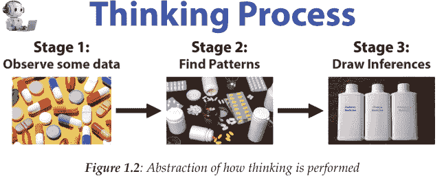

图1.1"

在传统编程中，我们拥有数据和规则。我们将规则应用于数据，以得到输出（Output）。参考图 1.3：

## 传统编程


图 1.3：传统编程

考虑物理学世界中的这个例子。当我们想要计算机计算动量值时，我们告诉计算机动量的公式是质量乘以速度，并告诉计算机质量和速度的值。在这里，质量和速度的值就是数据（Data）。在这些数据上，计算机应用规则（Rule），即动量公式，来为我们找到动量。计算机计算出的动量值即为输出（Output）。

动量 = 质量 * 速度

动量 = `mv`

通常写为，

与传统编程不同，在机器学习中，我们向计算机提供数据（Data）和输出（Output），并期望计算机生成规则（Rules），如图 1.4 所示：

## 机器学习的编程


图 1.4：机器学习的编程

假设我们有一种机制可以从某些实验中获取动量值。并且知道每个实验中质量和速度的值。现在，如果我们让计算机确定动量的公式，那就是一个机器学习的场景。因此，我们将输入质量、速度和动量的值，并告诉机器确定计算动量的公式。

## 机器的学习过程

让我们讨论一种机器学习的简单方法。正如你想象的，实际过程要复杂得多。

假设我们从某个实验中获得了以下数据（参考图 1.5）。我们要求机器提供动量、质量和速度之间的关系。

| 质量 (KG) | 速度 (KM/h) | 动量 (KG*KM/h) |
| :--- | :--- | :--- |
| `m` | `v` | `M` |
| 2 | 20 | 42 |
| 4 | 100 | 403 |
| 5 | 50 | 245 |
| 8 | 60 | 477 |
| 3 | 30 | 94 |

图 1.5：输入计算机以创建机器学习模型

为了让机器建立模型，数据科学家必须告诉机器要制作什么。通常，数据科学家会尝试理解数据。这一步被称为探索性数据分析（Exploratory Data Analysis）。在前面的情况中，我们有两个独立变量 `m` 和 `v`，以及一个因变量 `M`。我们可以将这些数据绘制在二维图表中，如图 1.6 所示：

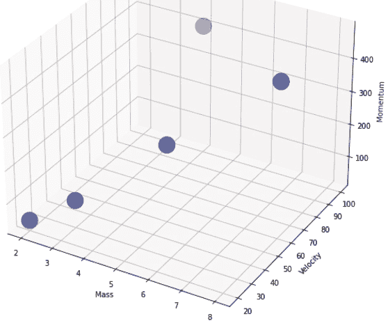

图 1.6：基于图 1.4 数据的散点图

## 掌握机器学习的分类算法

假设数据科学家决定创建一个形式为 `M = β₀ + β₁ * m + β₂ * v` 的线性模型。机器需要估计 `β₀`, `β₁` 和 `β₂` 的值。

数据科学家提供了 `β₀`, `β₁` 和 `β₂` 的初始值。假设这些值为 `β₀ = 5, β₁ = 5, beta_2 = 5`。使用这些值，机器计算出 `M` 的值，如图 1.7 所示。我们将机器计算的值称为 `Mhat`。

| 质量 (KG) | 速度 (KM/h) | 动量 (KG*KM/h) | 对于 `β₀=5, β₁=5, β₂=5` |
| :--- | :--- | :--- | :--- |
| `m` | `v` | `M` | `Mhat` |
| 2 | 20 | 42 | 115 |
| 4 | 100 | 403 | 525 |
| 5 | 50 | 245 | 280 |
| 8 | 60 | 477 | 345 |
| 3 | 30 | 94 | 170 |

图 1.7：机器对动量 (`M`) 的初始估计

| `β₀ = 5` |
| `β₁ = 5` |
| `β₂ = 5` |

如果我们绘制这些数据，就会得到图 1.8 所示的图表，其中点是提供给机器的 `M` 的值。星号是机器估计的 `M` 值：

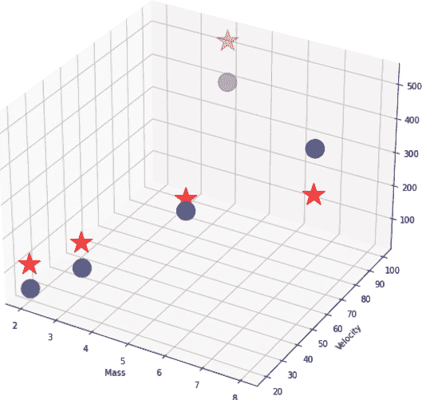

图 1.8：机器初始动量 (`M`) 估计图

## 机器学习简介 7

我们可以看到机器的表现并不理想。然而，机器仍在继续。机器计算其在估计中的误差，如图 1.9 所示。我们看到机器可能会高估或低估。因此，误差可以是负的也可以是正的。我们不再考虑误差的值，而是考虑误差平方的值。进一步，我们通过平方取平均值计算所有数据点的均方误差（MSE）。

| 质量 (KG) | 速度 (KM/h) | 动量 (KG*KM/h) | 对于 `β₀ = 5, β₁ = 5, β₂ = 5` | 误差 | `E²` |
| :--- | :--- | :--- | :--- | :--- | :--- |
| 2 | 20 | 42 | 115 | `M - M̂` | -73 | 5329 |
| 4 | 100 | 403 | 525 | -122 | 14884 |
| 5 | 50 | 245 | 280 | -35 | 1225 |
| 8 | 60 | 477 | 345 | 132 | 17424 |
| 3 | 30 | 94 | 170 | -76 | 5776 |
| | | | | 均误差 = 8927.6 | |

图 1.9：机器计算的误差

现在，机器考虑 `β₀`, `β₁` 和 `β₂` 的其他值，使得 MSE 的值最小化。经过几轮计算，机器得到了以下 `β₀`, `β₁` 和 `β₂` 的值，如图 1.10 所示。

| 质量 (KG) | 速度 (KM/h) | 动量 (KG*KM/h) | 对于 `β₀ = 0, β₁ = 32.74260, β₂ = 2.50428593` | 误差 | `E²` |
| :--- | :--- | :--- | :--- | :--- | :--- |
| 2 | 20 | 42 | 115 | `M - M̂` | -73.50749 | 5402.61 |
| 4 | 100 | 403 | 525 | -121.61831 | 14644.2 |
| 5 | 50 | 245 | 288 | -43.52032 | 1894.05 |
| 8 | 60 | 477 | 412.15262 | 64.68070 | 4183.59 |
| 3 | 30 | 94 | 173.35574 | -79.35574 | 6297.33 |
| | | | 均方误差 = 3601.12 | |

图 1.10：最小化 MSE 后的动量估计

# 主掌握机器学习中的分类算法

它们包含附件等。然而，邮件正文包含非结构化数据。机器很好地处理结构化和非结构化数据，也能很好处理半结构化数据。

无论数据是什么类型，必须理解机器只能对数字进行处理。任何需要理解的数据都必须呈现给机器。在书中，我们将讨论各种将非数值数据转换为数字的技术，且不会丢失任何上下文信息，并允许机器从中学习。这些讨论将贯穿剩余的所有章节，因为我们将讨论机器需要解决的不同问题。

## 机器学习的类型

机器学习可以分为两个主要类型：监督学习（Supervised learning）和无监督学习（Unsupervised learning）。

- 在监督学习中，我们可以执行两个任务：回归和分类。
- 在无监督学习中，我们可以执行两个任务：聚类和降维。
  - 聚类任务中有一种特殊情况，称为异常检测（Anomaly Detection）。

图 1.14 总结了所有机器学习的类型以及可以执行的任务：

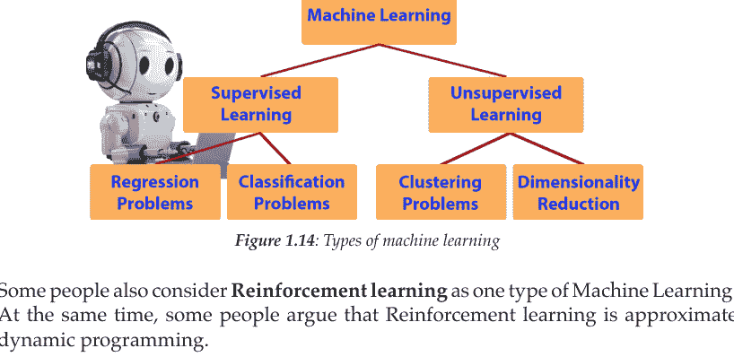

让我们详细讨论每种类型的机器学习。然而，本书侧重于分类任务，这是监督学习的一种类型。

## 监督学习

在监督学习中，机器提供带有标签（labels）的数据。机器根据数据和相关标签进行学习，然后做出推理。因此，我们为机器提供了先验知识，在机器从这些知识中学习后，它可以在提供知识的范围内做出决策。

标签是由人类确定的对数据的分析分析。例如，如果我们想让机器学会区分狗和猫的照片，我们需要向机器提供关于狗和猫的数据。除了这些数据，我们还需要提供数据标签，说明哪些是狗的照片，哪些是猫的照片。假设我们想让机器预测考试分数。在这种情况下，我们需要提供历史数据以及标签，说明在数据所提供的情况下获得了多少分。

监督学习的核心在于我们为机器提供现有知识，并期望机器在提供的知识中找到模式，并制定机器可以使用这些规则来回答针对相同主题的问题。

让我们通过一个例子来理解。假设我们想让机器检测垃圾邮件。因此，我们如表 1.1 所示收集数据：

| 包含拼写错误 | 包含“Urgent”单词 | 包含“ASAP”单词 | 包含可点击链接 | 标签 |
|---|---|---|---|---|
| NO | NO | NO | YES | 良良（Benign） |
| NO | NO | NO | NO | 良良（Benign） |
| YES | NO | YES | YES | 垃圾邮件（Spam） |
| NO | YES | YES | YES | 垃圾邮件（Spam） |
| YES | NO | NO | YES | 良良（Benign） |
| YES | YES | NO | YES | 垃圾邮件（Spam） |

表 1.1：垃圾邮件检测示例数据集


在这个示例中，表 1.1 中的数据集仅包含 6 个数据点。在实际情况下，数据集拥有数千甚至数百万数据点。尽管如此，数据集包含 4 个变量：包含拼写错误、包含“Urgent”单词、“ASAP”单词以及包含可点击链接。在机器学习语言中，这些变量被称为独立变量（Independent Variables）。对于这四个变量，每个数据点都有数据。在正常情况下，专家会研究真实的邮件并为每封邮件收集这四个特征。除了收集有关邮件特征的数据，专家还会分配一个标签，说明邮件是良性的还是垃圾邮件。我们所指的标签变量在机器学习语言中也称为因变量（dependent variable）。

在监督学习中，机器将在考虑相关因变量的情况下从独立变量中找到模式。从模式中产生一条规则，机器在给定新值时将使用该规则。前一个示例是机器需要判断邮件是良性还是垃圾邮件的分类问题。这种分类问题被称为二分类（Binary classification），因为机器必须在两个选项之间做出。还有需要在多个类别之间选择的分类问题，此类分类问题被称为多分类（Multi-class classification）。表 1.1 提供数据的分类实现如下：

```python
import pandas as pd
f = pd.DataFrame([['NO', 'NO', 'NO', 'YES', 'Benign'],
                   ['NO', 'NO', 'NO', 'NO', 'Benign'],
                   ['YES', 'NO', 'YES', 'YES', 'Spam'],
                   ['NO', 'YES', 'YES', 'YES', 'Spam'],
                   ['YES', 'NO', 'NO', 'YES', 'Benign'],
                   ['YES', 'YES', 'NO', 'YES', 'Spam']],
                  columns=['ContainsSpellingMistakes', 'ContainsUrgent', 'ContainsASAP', 'ContainsLink', 'Label'])
```

```python
X = df.drop('Label', axis=1, inplace=False)
y = df['Label']

from sklearn.preprocessing import LabelEncoder
### 将所有数据转换为数字
leX = LabelEncoder()
XL = leX.fit_transform(X)

leY = LabelEncoder()
YL = leY.fit_transform(y)
print(XL, '\n', y)
```

```python
from sklearn.linear_model import LogisticRegression

### 构建模型
lr = LogisticRegression()
lr.fit(XL, YL)

### 准备测试数据
testData = ['NO', 'YES', 'NO', 'YES']
Xtest = leX.transform(testData)
prediction = lr.predict(Xtest.reshape(1, -1))
```

再看另一个例子。假设我们有某个城市（如班加罗尔）每年的气温。我们有三个属性：日期、当天是否多云以及当天的温度，如表 1.2 所示：

| 日期 | 多云 | 温度（摄氏） |
|---|---|---|
| 01-Jan-2001 | YES | 14.3 |
| 02-Jan-2001 | NO | 13.7 |
| 03-Jan-2001 | NO | 13.6 |
| 04-Jan-2001 | YES | 14.2 |
| 05-Jan-2001 | NO | 12.8 |
| ... | ... | ... |

表 1.2：城市气温数据集

假设我们有从 2001-01-01 到 2015-12-31 的这些数据。此外，我们想知道 2022-10-25 的温度是多少。我们应该能够使用回归模型的机器学习系统进行预测。回归问题需要所有独立和相关因变量的历史数据。在示例表中，日期和是否多云是独立变量或特征。从某些独立变量中，我们可以推导出更多独立变量。例如，在表 1.2 的数据中，从日期特征我们可以推导出月份、年份等其他独立变量。从现有的独立变量中生成独立变量或特征被称为特征工程（Feature Engineering）（参见表 1.3）。

| 日期 | 月份 | 年份 | 多云 | 温度（摄氏） |
|---|---|---|---|---|
| 01-Jan-2001 | 1 | 1 | YES | 14.3 |
| 02-Jan-2001 | 1 | 2 | NO | 13.7 |
| 03-Jan-2001 | 1 | 3 | NO | 13.6 |
| 04-Jan-2001 | 1 | 4 | YES | 14.2 |
| 05-Jan-2001 | 1 | 5 | NO | 12.8 |

表 1.3：城市气温特征工程数据集

温度是因变量或目标变量。给定这些数据，我们希望机器学习模式并创建规则。然后，给定未来的任何日期且当天是多云，机器应该预测那天的温度。因此，这是监督学习。

表 1.2 提供数据的回归实现如下：

```python
import pandas as pd
df = pd.DataFrame([['01-01-2001', 'YES', 14.3],
                   ['01-02-2001', 'NO', 13.7],
                   ['01-03-2001', 'NO', 13.6],
                   ['01-04-2001', 'YES', 14.3],
                   ['01-05-2001', 'NO', 14.2],
                   ['01-06-2001', 'YES', 12.8],
                   ['01-07-2001', 'NO', 14.7],
                   ['01-08-2001', 'NO', 11.3],
                   ['01-09-2001', 'NO', 11.7],
                   ['01-10-2001', 'NO', 12.1]],
columns = ['Date', 'Cloudy', 'Temperature'])
```

```python
import datetime
import numpy as np
from sklearn.preprocessing import LabelEncoder

### 特征工程
### 获取月份和全年
df['Month'] = pd.to_datetime(df['Date']).dt.month
referenceDate = np.array([datetime.datetime(2001, 1, 1)])
df['DayOfYear'] = (pd.to_datetime(df['Date']) - referenceDate).days

### 将多云转换为数字
lec = LabelEncoder()
df['Cloudy'] = lec.fit_transform(df['Cloudy'])
```

| Date | Cloudy | Month | DayOfYear |
|---|---|---|---|
| 0 | 01-01-2001 | 0 | 14.3 |
| 1 | 01-02-2001 | 0 | 13.7 |
| 2 | 01-03-2001 | 0 | 13.6 |
| 3 | 01-04-2001 | 1 | 14.3 |
| 4 | 01-05-2001 | 0 | 14.2 |
| 5 | 01-06-2001 | 1 | 12.8 |
| 6 | 01-07-2001 | 0 | 14.7 |
| 7 | 01-08-2001 | 0 | 11.3 |
| 8 | 01-09-2001 | 0 | 11.7 |
| 9 | 01-10-2001 | 0 | 12.1 |

`X = df[['Month', 'DayOfYear', 'Cloudy']]`
`y = df['Temperature']`

```python
from sklearn.ensemble import RandomForestRegressor
from dateutil import parser

### 构建模型
rfr = RandomForestRegressor()
rfr.fit(X, y)

### 准备测试数据
testData = ['01-22-2001', 'NO']

Xtest = [0, 0, 0]
Xtest[0] = parser.parse(testData[0]).month
Xtest[1] = (parser.parse(testData[0]) - referenceDate).days
Xtest[2] = lec.transform([testData[1]])[0]
print('Transformed data:', Xtest)

### 进行预测
prediction = rfr.predict(np.array(Xtest).reshape(1, -1))
print('\nPredicted temperature on %s = %f' % (testData[0], prediction))
Transformed test data: [1, 2, 0]
```

你已经意识到，当因变量是连续的时，可以开发回归模型。相反，当因变量是离散的时，可以创建分类模型。**离散变量**是指取有限数量值的变量（例如，一组整数）。**连续变量**是指取无限数量值的变量（例如，一组有理数）。

## 无监督学习

与监督学习不同，在无监督学习中，我们向机器提供无标签的数据。在这种情况下，机器可以执行两类任务——**聚类**和**降维**。

在聚类中，机器可以将相似的物体分离到不同的簇中。假设我们向机器提供大量的客户信息以及关于各种属性的信息。通过分析这些属性，机器可以形成相似的客户簇。此类应用有许多用途。例如，在聚类中，我们可以研究聚类的客户，并为每个簇计划特定的营销活动。或者，当我们有了机器创建的簇时，我们可以使用这些信息告诉机器未来与业务往来的客户属于哪一个簇。因此，我们可以将聚类练习的结果用于分类。

让我们通过示例来理解聚类。假设我们有关于销售的数据，如表 1.4 所示。我们想要找到相似的客户。

| Customer ID | Last Invoice Date | Invoice Amount (in Rs.) |
|---|---|---|
| 1 | 03-Jan-2022 | 300.00 |
| 2 | 03-Jan-2022 | 2000.00 |
| 2 | 04-Jan-2022 | 500.00 |
| 6 | 06-Feb-2022 | 200.00 |
| 5 | 17-Feb-2022 | 1200.00 |
| 3 | 25-Feb-2022 | 3000.00 |
| 1 | 20-Mar-2022 | 250.00 |
| 3 | 22-Mar-2022 | 300.00 |
| 2 | 26-Mar-2022 | 1750.00 |
| 4 | 28-Mar-2022 | 600.00 |

表 1.4: 零售销售示例数据集

```python
import pandas as pd

df = pd.DataFrame([[1, '01-03-2022', 300],
                [2, '01-03-2022', 2000],
                [2, '01-04-2022', 500],
                [6, '02-06-2022', 200],
                [5, '02-17-2022', 1200],
                [3, '02-25-2022', 3000],
                [1, '03-20-2022', 250],
                [3, '03-22-2022', 300],
                [2, '03-26-2022', 1750],
                [4, '03-28-2022', 600]],
                columns=['CustomerID', 'InvoiceDate', 'InvoiceAmount'])
```

| CustomerID | InvoiceDate | InvoiceAmount |
|---|---|---|
| 0 | 01-03-2022 | 300 |
| 1 | 01-03-2022 | 2000 |
| 2 | 01-04-2022 | 500 |
| 3 | 02-06-2022 | 200 |
| 4 | 02-17-2022 | 1200 |
| 5 | 02-25-2022 | 3000 |
| 6 | 03-20-2022 | 250 |
| 7 | 03-22-2022 | 300 |
| 8 | 03-26-2022 | 1750 |
| 9 | 03-28-2022 | 600 |

### 特征工程

```python
df['InvoiceDate'] = pd.to_datetime(df['InvoiceDate'])
gb = df.groupby('CustomerID')
counts = gb.size().to_frame(name='Frequency')
dRFM = counts.join(gb.agg({'InvoiceDate': 'max'}).rename(columns={'InvoiceDate': 'MostRecentPurchase'})
  .join(gb.agg({'InvoiceAmount': 'sum'}).rename(columns={'InvoiceAmount': 'MonetaryValue'}
  .reset_index()
```

```python
from datetime import datetime
dRFM['MostRecentPurchase'] = pd.to_datetime(dRFM['MostRecentPurchase']).date
dRFM['Recency'] = (df.InvoiceDate.max() - dRFM['MostRecentPurchase']).days
dRFM.drop(['MostRecentPurchase'], axis=1, inplace=True)
print('Shape of Customer Data:', dRFM.shape)
print(dRFM.head())
```

Shape of Customer Data: (6, 4)

### 数据标准化

```python
X = dfRFM.drop('CustomerID', axis=1, inplace=False)
y = dfRFM['CustomerID']

from sklearn.preprocessing import StandardScaler
sc = StandardScaler()
X = sc.fit_transform(X.to_numpy())
X = pd.DataFrame(X, columns=['Frequency', 'MonetaryValue', 'Recency'])
X.head()
```

|  | Frequency | MonetaryValue | Recency |
|---|---|---|---|
| 0 | 0.47214 | -0.73948 | -0.48654 |
| 1 | 1.788854 | 1.67405 | -0.793829 |
| 2 | 0.47214 | 1.054846 | -0.58987 |
| 3 | -0.894427 | -0.706856 | -0.896258 |
| 4 | -0.894427 | -0.315366 | 1.10117 |

### 可视化数据

```python
import matplotlib.pyplot as plt
%matplotlib inline
import numpy as np

np.random.seed(1968081)

fig = plt.figure(figsize=(15, 10))
ax = fig.add_subplot(projection='3d')

xs = X.Recency
ys = X.Frequency
zs = X.MonetaryValue
```

```python
ax.scatter(xs, ys, zs, marker='o', s=500)
ax.set_xlabel('Recency')
ax.set_ylabel('Frequency')
ax.set_zlabel('Monetary Value')
plt.show()
```


图 1.15: 客户数据的可视化

```python
### 创建聚类
from sklearn.cluster import KMeans
import matplotlib.transforms as mtransforms

kmeans = KMeans(n_clusters=3, random_state=42)
kmeans.fit(X, y)
```

```python
### 可视化
np.random.seed(1968081)
```


```python
fig = plt.figure(figsize=(15, 10))
ax = fig.add_subplot(projection='3d')

colours = ['r', 'b', 'g']
dfTemp = pd.DataFrame({
    'Recency':xs,
    'Frequency':ys,
    'MonetaryValue':zs,
    'CustomerID':y,
    'Cluster':kmeans.labels_
})

dfTemp = dfTemp.reset_index() # 确保索引与行数匹配
```

```python
trans_offset = mtransforms.offset_copy(ax.transData, fig=fig, x=0.07, y=0.2, units='inches')
```

```python
for index, row in dfTemp.iterrows():
    ax.scatter(row['Recency'], row['Frequency'], row['MonetaryValue'],
               marker='o', s=500, c=colours[int(row['Cluster'])])
    ax.text(row['Recency'], row['Frequency'], row['MonetaryValue'],
               int(row['CustomerID']), transform=trans_offset)
```

在这个数据集中，我们有四个特征。我们将在不丢失信息的情况下将特征数量减少到2个。

实现这一目标的一种方法是应用奇异值分解（SVD）。要了解更多关于SVD的信息，请参阅附录3。

```python
import pandas as pd
```

```python
df = pd.DataFrame([['NO', 'NO', 'NO', 'YES', 'Benign'],
                   ['NO', 'NO', 'NO', 'NO', 'Benign'],
                   ['YES', 'NO', 'YES', 'NO', 'Spam'],
                   ['NO', 'YES', 'YES', 'YES', 'Spam'],
                   ['YES', 'NO', 'NO', 'YES', 'Benign'],
                   ['YES', 'YES', 'YES', 'YES', 'Spam']]
])
```

```python
columns = ['ContainsSpellingMistakes', 'ContainsUrgent', 'ContainsASAP', 'ContainsLink', 'Label']
```

`df`

ContainsSpellingMistakes ContainsUrgent ContainsASAP ContainsLink

| | ContainsSpellingMistakes | ContainsUrgent | ContainsASAP | ContainsLink | Label |
|---|---|---|---|---|---|
| 0 | NO | NO | NO | YES | Benign |
| 1 | NO | NO | NO | NO | Benign |
| 2 | YES | NO | YES | NO | Spam |
| 3 | NO | YES | YES | YES | Spam |
| 4 | YES | NO | NO | YES | Benign |
| 5 | YES | YES | YES | YES | Spam |

```python
X = df.drop('Label', axis = 1, inplace = False)
y = df['Label']
```

```python
print(X, '\n\n', y)
```
ContainsSpellingMistakes ContainsUrgent ContainsASAP ContainsLink

| | ContainsSpellingMistakes | ContainsUrgent | ContainsASAP | ContainsLink |
|---|---|---|---|---|
| 0 | NO | NO | NO | YES |
| 1 | NO | NO | NO | NO |
| 2 | YES | NO | YES | NO |
| 3 | NO | YES | YES | YES |
| 4 | YES | NO | NO | YES |
| 5 | YES | YES | YES | YES |

## 机器学习简介

```python
0 Benign
1 Benign
2 Spam
3 Spam
4 Benign
5 Spam
```

Name: Label, dtype: object

from sklearn.preprocessing import LabelEncoder

```python
### 将所有数据转换为数字
leX = LabelEncoder()
XL = X.apply(leX.fit_transform)
leY = LabelEncoder()
yL = leY.fit_transform(y)
```

```python
print(XL, '\n\n', yL)
```
ContainsSpellingMistakes ContainsUrgent ContainsASAP ContainsLink
0 0 0 0 1
1 0 0 0 0
2 1 0 1 0
3 0 1 1 0
4 1 0 0 1
5 1 1 1 1

```python
from sklearn import decomposition
pca = decomposition.PCA(n_components = 2)
pca.fit(XL)
X = pca.transform(XL)
X = pd.DataFrame(X, columns ['Feature1', 'Feature2'])
```

Feature1 Feature2
0 -0.569933 -0.580462
1 -0.882814 -0.010497
2 0.042248 0.973800
3 0.715967 -0.614335
4 -0.295684 0.132684
5 0.990216 0.098810

```python
import matplotlib.pyplot as plt
%matplotlib inline
```

```python
fig = plt.figure(figsize=(10, 6))
ax = fig.add_subplot(1, 1, 1)
plt.scatter(X.Feature1, X.Feature2, marker = 'o', s = 500, c = yL)
ax.set_xlabel('Feature 1')
ax.set_ylabel('Feature 2')
plt.show()
```


图 1.1: 垃圾邮件数据集减少到2维后的可视化结果

## 结论

让机器学会学习的努力已经持续了70多年。然而，这些努力仅在过去的15-20年里才加速。这主要是由于数字设备的发展和社交媒体的出现，过去15-20年间可用数据量爆炸式增长。到目前，机器已经可以许多预测，如欺诈检测、天气预报、医学诊断等。然而，在机器能够独立执行任务之前，还需要许多发展。

机器通过数学模型进行学习。我们在这一章中掌握了它的本质。剩下的章节将讨论用于创建分类算法的数学模型。在下一章中，我们将从讨论朴素贝叶斯算法开始这一系列。

## 记忆点

- 机器只能理解数字。
- 数据可以以数字和非数字的形式存在。所有以非数字形式的数据都应该转换为数字。
- 机器可以从表格数据、文本、图像和声音中学习。
- 机器通过数学模型进行学习。
- 机器学习可以分为两个主要类型：监督学习和无监督学习。
- 在监督学习中，我们可以完成两类任务：回归和分类。
- 在无监督学习中，我们可以完成两类任务：聚类和降维。
- 异常检测是无监督学习聚类的一种特殊情况。


# 第二章

## 朴素贝叶斯算法

在第一章机器学习简介中，我们讨论了机器可以执行的操作类型。我们强调了机器本质上是基于数学模型学习的。本章将讨论其中一种数学模型，即朴素贝叶斯算法。使用朴素贝叶斯算法，我们将开发一个用于垃圾邮件检测的机器学习模型。

朴素贝叶斯算法通过一些假设简化了贝叶斯定理。因此，在进入朴素贝叶斯之前，我们将先讨论贝叶斯定理。由于贝叶斯定理基于概率，我们将从概率开始本章。


## 结构

在本章中，我们将讨论以下主题：

- 概率的概率
- 条件概率
- 乘法法则
- 全概率
- 贝叶斯定理
- 朴素贝叶斯定理
- 朴素贝叶斯算法
- 朴素贝叶斯算法的应用
- 朴素贝叶斯算法的变化

## 目标

读完本章后，你将理解朴素贝叶斯背后的数学原理。

### 概率的基础

教科书中存在许多关于概率的定义。在实验语境下，**概率可以定义为事件发生的几率**。

通过以下实验来理解概率：

| 投掷次数 | 1 | 2 | 3 | 4 | 5 | 6 | 7 | 8 | 9 | 10 |
|---|---|---|---|---|---|---|---|---|---|---|
| 结果 | H | T | T | H | H | T | T | T | H |

> **表 2.1:** 投掷十次的结果

我们看到我们在10次投掷中得到了4次正面。因此，该实验中正面的概率是4/10。

我们将其写为：

P(正面) = 4/10 = 0.4

让我们使用以下程序模拟掷硬币的过程：

```python
import numpy as np
import scipy.stats as stats
from scipy.stats import norm, beta
import matplotlib.pyplot as plt
import warnings
warnings.filterwarnings("ignore")

def probabilityOfHead(numberOfTrials):
    plt.figure(figsize=(8, 5))

    data = stats.bernoulli.rvs(0.5, size=numberOfTrials)
    x = np.linspace(0, 1, 100)

    heads = data[:numberOfTrials].sum()
```

```python
a = 1
b = 1
s = heads
f = numberOfTrials - s
y = beta.pdf(x, a + s, b + f)
plt.plot(x, y, label = '观察到 %d 次投掷，n %d 次正面' % (numberOfTrials, heads))
plt.fill_between(x, 0, y, color='#34ABD', alpha=0.4)
plt.vlines(0.5, 0, max(y), color="k", linestyle="--", lw=1)
leg = plt.legend()
leg.get_frame().set_alpha(0.4)
plt.autoscale(tight=True)
plt.title('得到正面的概率，P(正面) = %f ' % (heads / numberOfTrials))
plt.show()
```

让我们为20次投掷运行上述函数。得到的结果如图2.1所示。运行相同命令时得到的结果可能会不同。

probabilityOfHead(20)


图 2.2: 投掷硬币20次得到正面的概率

## 精通机器学习的分类算法

让我们分别进行投掷 50、100、500 和 1000 次实验。得到的结果所示：

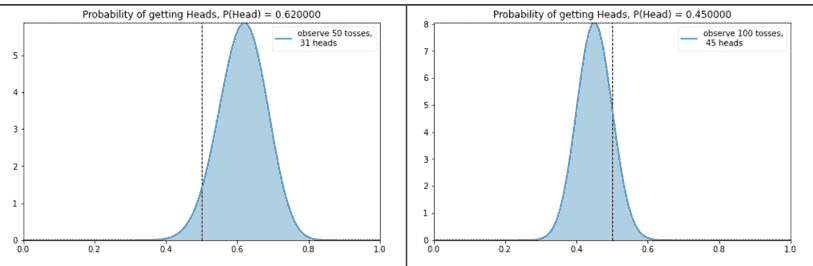

图 2.3 (a): 投掷 50 次硬币

图 2.3 (b): 投掷 100 次硬币

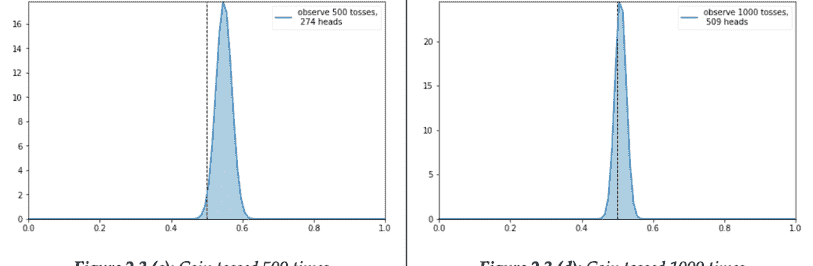

图 2.3 (c): 投掷 500 次硬币

图 2.3 (d): 投掷 1000 次硬币

图 2.3: 公平硬币不同投掷次数出现正面的分布

我们可以看到，随着投掷硬币次数的增加，出现正面的概率趋向于 0.5 或 1/2。

我们用变量 X 表示该事件。假设变量 X 代表我们的事件。我们想找到 X = 正面的概率。那么，我们就写成 P(X = head)。

在所有投掷硬币的结果都是等概率可能的假设下，我们可以得出 P(X = Head) = 1/2。

### 条件概率

继续之前的投掷硬币并获得正面的例子，假设我们想找到在第一次投掷已获得正面的条件下， 3 次投掷中获得两次正面的概率。因此，我们有两个事件。我们将这两个事件标记为 X 和 Y。Y 是第一次投掷获得正面的事件。那么，X 将是在后续投掷中获得一次正面的事件。

# 掌握机器学习中的分类算法

我们将其写为 P(X = 3 次投掷中 1 次正面 | Y = 第1 次投掷正面)。通常，我们将其写为 P(X|Y)。这读作在事件 Y 发生的条件下事件 X 发生的概率。这就是事件 X 的条件概率。

现在，我们可以使用表 2.2 来计算 3 次投掷中获得两次正面的概率。3 次投掷的可能结果见表 2.2：

| 硬币的可能结果 |
| :--- |
| HHH |
| HHT |
| HTH |
| HTT |
| THH |
| THT |
| TTT |

表 2.2: 投掷硬币的可能结果。高亮行是两次正面的结果。

我们看到有八种可能的结果。在这八种结果中，有些人倾向于将其描述为 3 次投掷中恰好获得两次正面。每次投掷出现正面的概率是 1/2。因此，3 次投掷中获得两次正面的概率是 3/8。已知第一次投掷已获得正面。因此，三次投掷的可能结果所示表 2.3：

| 在第一次投掷结果为正面的条件下，投掷硬币的可能结果 |
| :--- |
| HHH |
| HHT |
| HTH |
| HTT |

表 2.3: 在第一次投掷获得正面的情况下投掷硬币的可能结果。高亮行是3 次中两次正面的结果。

所以，在这个例子中，3 次投掷中获得两次正面的概率是 2/4 = 1/2。因此，P(X | Y) = 1/2。我们可以将其计算为 P(X | Y) = (1/2)^2 = 1/4（因为我们已经从第一次投掷获得了一个正面）。

我们可以通过另一个例子来理解这一点。假设事件 Y 是一个人购买的事件。X 是一个人可能考虑购买的事件。因此我们有：

X = 人购买的事件

Y = 人购买的事件

所以，对于 P(X | Y)，我们想要找到事件 Y 发生的条件下事件 X 的条件概率。记得 P(X|Y) ≠ P(Y|X)。

### 概率的乘法法则

假设 X 和 Y 是两个事件，如图 2.4 所示。我们看到事件 X 和 Y 有共同项。事件 X 和 Y 之间的共同项被称为事件 X 和 Y 的交集（Intersection）。


事件 X 和 Y 交集的概率被称为事件 X 和 Y 的联合概率（Joint probability），表示为 P(X, Y)。

现在，概率的乘法法则规定：

P(X and Y) = P(X ∩ Y) = P(X,Y) = P(Y|X) * P(X)

让我们通过一个例子来理解。假设 X 是学生为女性的事件，Y 是学生为毕业生的事件。那么，事件 (X and Y) 就是学生为女性研究生。

考虑表 2.4 中的数据：

| 毕业生 | 非毕业生 | 总计 |
| :--- | :--- | :--- |
| 男性 | 126 | 55 | 181 |
| 女性 | 133 | 32 | 165 |
| 总计 | 259 | 87 | 346 |

**表 2.4:** 示例图数据

从表 2.4 中，我们得到：

P(X = Female) = 165/346

P(Y = Graduate) = 259/346

P(Y|X) = 133/165

P(X|Y) = 133/259

然后，根据乘法法则，我们得到：

P(X,Y) = 165/346 * 133/165 = 133/346

P(Y,X) = 259/346 * 133/259 = 133 /346

注意 P(X,Y) = P(Y,X)。

根据乘法法则，我们得到条件概率的公式：

P(Y|X) = (P(X,Y))/(P(X))

或

P(X|Y) = (P(X,Y))/(P(Y))

### 独立事件

如果 P(A|B) = P(A)，即事件 A 的概率，则事件 A 和 B 是独立的。这是因为 P(A ∩ B) = P(A) * P(B)。

假设 X 和 Y 是两个事件，如图 2.5 所示。我们看到 X 和 Y 是互斥集。


图 2.5: 样本空间

### 全概率

假设样本空间中有两个互斥集 B1 和 B2，如图 2.6 所示。


图 2.6: 样本空间


图 2.7: 样本空间

所以，`A = B1 ∪ B2`，或者 `B1` 和 `B2` 的并集。现在，`B1 ∩ A` 和 `B2 ∩ A` 是交集。我们可以得出：

`P(A) = P(B1) + P(B2)`，因为 `B1` 和 `B2` 是互斥事件。

### 贝斯定理 2

假设 `X` 和 `Y` 是两个事件。那么，贝斯定理规定：

```
$P(X|Y) = \frac{P(Y|X) \cdot P(X)}{P(Y)}$
```

我们将专注于贝斯定理中我们处理朴素贝叶斯（Naïve Bayes）算法所需的部分。

注意，我们在贝斯定理中反转了需要寻找的内容。为了找到 `$P(X|Y)$`，我们将确定 `$P(Y|X)$` 以及 `$P(X)$` 和 `$P(Y)$`。这在很多情况下都是很有用的。让我们通过这个例子来理解。

我们考虑之前用于理解全概率定理的同一个例子。假设一个班级中有 40% 的女性。男性学生身高 6 英尺的概率是 20%，而女性学生身高 6 英尺的可能性是 1%。现在，假设我们观察到了一个身高 6 英尺的学生。我们想要确定这个 6 英尺的学生是女性的概率。

我们认为 `Y` 是学生身高 6 英尺的事件。因此，`$P(6') = P(Y)$`。

同样，假设 `$X_i$` 是学生为男性的事件，即 `$P(Male) = P(X_i)$`，`$X_j$` 是学生为女性的事件，即 `$P(Female) = P(X_j)$`。我们知道：

```
$P(Female) = P(X_j) = 40\%$  $P(Male) = P(X_i) = 1 - P(Female) = 1 - P(X_j) = 60\%$
```

```
$P(6'|Male) = P(Y|X_i) = 20\%$ 和 $P(6'|Female) = P(Y|X_j) = 1\%$
```

我们需要找到在学生身高 6 英尺的情况下，该学生为女性的概率。或者我们想要找到 `$P(Female|6') = P(X_j|Y)$`。

使用贝斯定理，我们知道：

```
$P(X_2|Y) = (P(Y|X_j) \cdot P(X_j)) / P(Y)$
```

根据全概率定理，我们知道：

```
$P(Y) = P(Y|X_i) \cdot P(X_i) + P(Y|X_j) \cdot P(X_j)$
```

因此，我们得到：

```
$P(X_2|Y) = \frac{P(Y|X_2) \cdot P(X_2)}{P(X_1) \cdot P(X_1) + P(Y|X_2) \cdot P(X_2)}$
```

# 掌握机器学习分类算法

需要注意的一点是，我们没有 `P($X_2$ | Y)` 的值。因此，我们可以通过反转需求来计算它的值。

所以，我们得到 `$P(X_2 \mid Y) = \frac{1\%+40\%}{20\%-60\%+1\%+40\%} = 3.226\%$`。

注意，我们的基础知识是 6 英尺的学生中有 1% 是女性。当我们注意到一个学生身高 6 英尺时，我们关于该学生可能是女性的知识增加到了 3.226%。初始知识被称为**先验知识**（Prior knowledge）。在获得关于此的数据后获得的知识被称为**后验知识**（Posterior knowledge）。因此，我们也写成了贝斯定理，如**图 2.8** 所示：

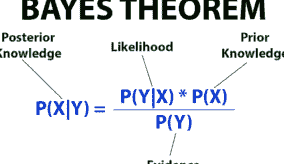

图 2.8：贝斯定理

许多科学家相信人脑以贝叶斯的方式工作。在日常生活中，我们在大多数决策中都应用贝叶斯思维。让我们从一个事件中举个例子。

某人担任基础设施**领域专家 (SME)**。他们面临一个客户的服务器问题，该服务器上安装了 McAfee 蚂杀病毒软件。经过**根本原因分析 (RCA)**，结论认为 McAfee 软件的存在导致了问题，于是他们从所有服务器上卸载了 McAfee 软件。

我问她：“有多少台服务器？”回答：30 台

“有多少台安装了 McAfee 软件？”回答：10 台

“安装了 McAfee 的服务器中有多少台出了问题？”回答：1 台

“没有安装 McAfee 软件的服务器中有多少台出了问题？”回答：1 台

所以，我得到了以下结果：

```
$P(McAfee) = 10/30 = 1/3
P(NoMcAfee) = 20/30 = 2/3
P(Problem \mid McAfee) = 1/10
P(Problem \mid NoMcAfee) = 1/20
```

## 朴素贝叶斯算法

因此，根据全概率定理，

`P(Problem) = P(Problem|McAfee) * P(McAfee) + P(Problem|NoMcAfee) * P(NoMcAfee) = 1 / 10 * 1/3 + 1 / 20 * 2 / 3 = 1 / 30 + 1 / 30 = 2 / 30`

所以，根据贝斯公式，McAfee 软件是问题导致概率 = `P(McAfee|Problem) = 1/30+1/30=1/2=50%`

这个贝叶斯分析表明，从所有服务器上卸载 McAfee 软件的决定可能不是最好的。相反，本可以隔离那台服务器并对其进行分析。

### 使用贝斯定理检测垃圾邮件

现在我们已经讨论了贝斯定理，让我们将其用于一个应用，即垃圾邮件检测。这是一种监督学习模型；因此，我们需要标记数据来开始。假设我们的标记数据如表 2.5 所示：

| 消息文本 | 标签 |
| :--- | :--- |
| 早上6点叫醒我 | 正常 |
| 尽快点击此链接 | 垃圾邮件 |
| 尽快拨打 9111222222 | 垃圾邮件 |
| 请审阅我的文档 | 正常 |
| 我们今天能见面吗 | 正常 |

> 表 2.5：用于垃圾邮件检测的示例数据集

让我们对表 2.5 中的数据进行预处理，移除 `me`、`at`、`6 AM`、`9111222222`、`my` 和 `can`。移除的单词将不会影响垃圾邮件检测算法。我们的数据如表 2.6 所示：

| 预处理后的消息文本 | 标签 |
| :--- | :--- |
| Please wake | 正常 |
| Click link asap | 垃圾邮件 |
| Call asap | 垃圾邮件 |
| Please review document | 正常 |
| Meet today | 正常 |

> 表 2.6：用于垃圾邮件检测的预处理数据集

## 42 掌握机器学习分类算法

从表 2.6 我们可以看到所有消息中共有 12 个单词。现在，让我们为表 2.6 数据中的唯一单词列列表，并记录它们在所有消息文本中的出现频率。根据单词出现的频率，我们可以计算每个单词出现的概率。如表 2.7 所示：

| 单词 | 频率 | P(Word) |
| :--- | :--- | :--- |
| please | 2 | 2/12 |
| wake | 1 | 1/12 |
| click | 1 | 1/12 |
| link | 1 | 1/12 |
| call | 1 | 1/12 |
| review | 1 | 1/12 |
| document | 1 | 1/12 |
| meet | 1 | 1/12 |
| today | 1 | 1/12 |

> 表 2.7：每个单词的频率

所以，我们有了单词“please”出现在消息中的概率。让我们确定在消息中出现“please”的情况下，消息为正常的概率：

> `$P(Benign|please) = \frac{P(please|Benign) \cdot P(Benign)}{P(please)} = \frac{(2/3) \cdot (3/4)}{2/12} = 3/420 = 1/140$`.

现在，看到 `$P(Benign | please) > P(Spam | please)$`。因此，如果消息中包含“please”一词，那么该消息更有可能是良性的（Benign）。

我们设计了一种机制，根据消息中出现的特定单词来判断一条消息是良性的（Benign）还是垃圾邮件（Spam）。然而，一条消息会包含多个单词，每个单词的存在以及消息中单词的组合都可能导致消息成为良性或垃圾邮件。因此，我们需要完善我们的模型。

在上面的示例中，我们确定了 `$P(Spam | asap)$`。假设消息除了“asap”之外还包含“call”。因此，我们需要找到 `$P(Spam | call \text{ AND } asap)$`，写作 `$P(Spam | (call, asap))$`。

根据贝叶斯定理，我们有：

```
P(Spam|(call, asap)) = P((call,asap)|Spam)*P(Spam) / P(call,asap) --- eqA
```

在这里，`$P(call, asap)$` 是 `$P(call \text{ AND } asap)$` 或 `$P(call \text{ } asap)$`。利用概率的乘法法则，我们知道：

```
P(call, asap) = P(call | asap) * P(asap)
```

我们知道 `$P(asap)$`。然而，为了计算 `$P(call | asap)$`，我们必须扫描所有存在“asap”的消息，然后查看“call”是否存在。对于少数单词来说，这可能是可能的。但我们的数据集通常包含数万个单词或单词组合。因此，在任何计算机上执行这些操作都是昂贵的。我们通过假设消息中每个单词的出现与其他任何单词的出现是独立的来简化我们的解决方案。这在现实中很少见。尽管如此，这个假设引导我们得到了合理的解决方案，称为朴素贝叶斯（Naïve Bayes theorem）。

## 使用朴素贝叶斯定理检测垃圾邮件

继续我们的示例，我们处于计算 `$P((call | asap) \text{ and } (call, asap)|Spam)$` 的阶段。现在，如果我们考虑单词“call”在消息中出现的事件与单词“asap”在消息中出现的事件是独立的，那么我们就知道：

```
P(call | asap) = P(call)
```

此外，根据概率的乘法法则并根据单词“call”在消息中出现的事件与单词“asap”在消息中出现的事件独立的假设，得到：

## 朴素贝叶斯算法

`$P((call, asap) | Spam) = \frac{P((call, asap),Spam)}{P(Spam)} = \frac{P(call,Spam)+P(asap,Spam)}{P(Spam)}$`

`$\frac{[P(call|Spam)*P(Spam)][P(asap|Spam)*P(Spam)]}{P(Spam)}$`

`$P(call|Spam) * P(asap|Spam) * P(Spam)$`

在方程 `eqA` 中进行此代换，我们得到：

`$P(Spam|(call, asap)) = \frac{P(call|Spam)*P(asap|Spam)*P(Spam)}{P(call,asap)} --- eqB$`

在朴素贝叶斯算法中，去掉方程 `eqB` 中的分母得到：

`$P(Spam|(call, asap)) = P(call|Spam) * P(asap|Spam) * P(Spam) --- eqC$`

让我们泛化方程 `eqC`。设消息事件为事件 `$X$`。消息中单词的出现为事件 `$A_{\mu_1}, A_{\mu_2}, ..., A_{\mu_n}$`（这里考虑考虑消息中有 `n` 个单词）。因此，`eqC` 可以写为：

`$P(X|(A_{\mu_1}, A_{\mu_2}, ..., A_{\mu_n})) = P(A_1|X) * ... * P(A_{\mu_n}|X) * P(X) --- eqD$`

方程 `eqD` 就是朴素贝叶斯定理。

使用朴素贝叶斯定理，让我们计算 `$P(Spam|(call, asap))$`。

从表 2.8 中我们得到

`$P(Spam|(call, asap)) = 1/5, P(asap|Spam) = 2/5$`。

我们知道 `$P(Spam) = 2/5$`。

因此，

`$P(Spam|(call, asap)) = (1/5) * (2/5) * (2/5) = 4/25$`

如果我们计算 `$P(Benign|(call, asap))$`，那么比较 `$P(Benign|(call, asap))$` 和 `$P(Spam|(call, asap))$`。其中哪一个较大，在给定这两个单词出现在消息中的情况下，消息属于该类的概率就越大。将这种想法泛化到相同空间内事件 `$X$` 的任意数量的事件 `$A_{\mu_1}, A_{\mu_2}, ..., A_{\mu_n}$` 就是朴素贝叶斯。

## 贝叶斯的变体

朴素贝叶斯算法可用于二分类（即分为两类）或多分类。这些贝叶斯算法的变体在 `Scikit-Learn` 库中可用。让我们讨论这些实现：

- 离散变量可以假设有限数量的值。例如，如果一个变量可以假设 `[0, 1]`，那么它是离散的，因为值的数量是的。离散变量也是分类变量。
- 连续变量是假设无限数量值的变量。例如，如果一个变量可以假设任何自然数，它就是连续变量。只有当目标变量（或依赖变量）是离散的时，我们才能进行分类。如果目标变量是连续的，我们只能进行回归。

## 伯努利朴素贝叶斯

伯努利朴素贝叶斯执行二分类，即依赖变量中只有类。例如，在垃圾邮件检测示例中，如果只需要将消息分类为垃圾邮件，可以使用伯努利朴素贝叶斯。然而，如果需要对垃圾病毒、DDoS 等性质进行分类，就有超过两个类，因此不能使用伯努利朴素贝叶斯。

## 多项朴素贝叶斯

多项朴素贝叶斯允许分类两个或多个类。如果独立变量是分类的或连续的，多项朴素贝叶斯工作良好。如果使用像 `TF-IDF Vectorizers` 和 `Count Vectorizers` 来创建独立变量，这种变体在文本数据上的效果优于其他变体。有关向量器的细节请参考附录 6。

## 互补朴素贝叶斯

互补朴素贝叶斯是多项朴素贝叶斯的变体。当数据集不平衡时，互补朴素贝叶斯工作良好。

## 贝叶斯算法

注意：如果每个类别的数据点数量不同，数据集被认为是不平衡的。例如，假设我们有垃圾邮件和非垃圾邮件的数据点。如果我们有大约 50-50% 或 60-40% 或 40-60% 的邮件数据点，我们会认为数据集是不平衡的。任何欺诈数据集，如信用卡欺诈都是严重不平衡的。欺诈可能每千或每百万发生一次。

## 分类朴素贝叶斯

分类朴素贝叶斯用于独立变量为分类的情况。它可以用于分类两个或多个类。

## 高斯朴素贝叶斯

高斯朴素贝叶斯实现中，似然函数为：

```
$P(X_i|Y) = \frac{1}{\sqrt{2\pi\sigma_y^2}} e^{-\frac{(x_i-\mu_y)^2}{2\sigma_y^2}}$
```

其中 `$\mu_y$` 和 `$\sigma_y$` 是目标类的均值和标准差。高斯朴素贝叶斯实现用于所有独立变量都是连续的且从正态分布的情况。注意：如果分布围绕均值均匀分布并形成钟形曲线，则该分布为正态分布。图 2.1、2.2、2.3、2.4 和 2.5 中的分布是正态分布的。

## 朴叶贝斯算法 49

| | NaN | NaN |
|---|---|---|
| 5568 | NaN | NaN |
| 5569 | NaN | NaN |
| 5570 | NaN | NaN |
| 5571 | NaN | NaN |

[5572 行 x 5 列]

如果数据框上传正确，你会发现该数据框有 5 列和 5572 行。列名应该为 `v1`, `v2`, `Unnamed: 2`, `Unnamed: 3` 和 `Unnamed: 4`。列 `v2` 包含短信文本，而列 `v1` 包含标签，对应 `v2` 列中的短信文本是垃圾短信（Spam）还是正常短信（Good）。我们只需要 `v1` 和 `v2` 列。因此，我们首先保留 `v1` 和 `v2` 列。

```python
df = df[['v1', 'v2']]
df.head()
```

| v1 | v2 |
|---|---|
| 0 ham | Go jurong point, crazy.. Available only |
| 1 ham | Ok lar... Joking wif u oni... |
| 2 spam | Free entry in 2 a wkly to win FA Cup fina... |
| 3 ham | U say so early hour... U already then say... |
| 4 ham | Nah I don't think he goes to us, lives aro... |

列 `v2` 是我们的自变量，列 `v1` 是因变量。让我们查看列 `v1` 列中的唯一值：

```python
# Checking the unique values in the column v1 in the data frame
df.v1.unique()
array(['ham', 'spam'], dtype=object)
```

注意列 `v1` 有 `ham` 和 `spam` 值。在这里，`ham` 表示对应的短信是正常的，而 `spam` 表示对应的短信是垃圾短信。

让我们检查数据集中这两种类型的数据有多少个。

```python
df.v1.value_counts()
ham       4825
spam      747
Name: v1, dtype: int64
```

我们看到数据集需要进行平衡，因为正常短信的数量几乎是垃圾短信数量的七倍。

列 `v1`（我们的因变量）包含文本 'ham' 或 'spam'。然而，我们知道计算机无法理解 `v1` 列中提供的任何文本。因此，我们需要将 `v1` 列的内容转换为数字。我们将使用 `Label Encoder`（标签编码器）将 `v1` 列中的值编码为数字。`Label Encoder` 会提取列中的唯一值并分配从 0 开始到 `(n-1)` 的值，其中 `n` 是该列中唯一值的数量。要了解更多关于编码器的信息，请参考附录 7。


```python
from sklearn.preprocessing import LabelEncoder

le = LabelEncoder()
df['label'] = le.fit_transform(df['v1'])
print(df.head())
print("Unique values of the column 'label'", df.label.unique())
```

| v1 | v2 |
|---|---|
| 0 ham | Go jurong point, crazy.. Available only |
| 1 ham | Ok lar... Joking wif u oni... |
| 2 spam | Free entry in 2 a wkly to win FA Cup fina... |
| 3 ham | U say so early hour... U already then say... |
| 4 ham | Nah I don't think he goes to us, lives aro... |

列 `label` 的唯一值 [0 1]

我们将 `v2` 列的内容赋给变量。`X` 将是我们的自变量。我们将 `label` 列的内容赋给变量。`Y` 将是我们的因变量。

```python
X = df['v2']
y = df['label']
```

## 创建训练集和测试集

我们将随机划分数据以获得两个集合。我们将使用其中一个集合来训练模型，另一个来验证模型的效果。我们将划分数据，使得 90% 的数据用于训练，其余 10% 用于验证。我们将使用 Scikit-Learn 库中的 `train_test_split()` 函数将数据分为训练集和测试集：

```python
from sklearn.model_selection import train_test_split
X_train, X_test, y_train, y_test = train_test_split(X, y, test_size=0.1, random_state=42)
print("Number of data points in the training set = %d" % (X_train.shape[0]))
print("Number of data points in the test set = %d" % (X_test.shape[0]))
```

训练集的数据点数量为 5014

测试集的数据点数量为 558

`train_test_split()` 返回数据集。我们将这些数据集捕获在变量 `X_train`, `X_test`, `y_train` 和 `y_test` 中。`X_train` 包含了原始数据集 90% 的自变量，`y_train` 是其对应的因变量。`X_test` 包含了剩余 10% 的自变量，`y_test` 是其对应的因变量。

我们将使用 `X_train` 和 `y_train` 训练模型。我们将使用 `X_test` 进行预测来测试模型的效果。

## 数据预处理

如前，我们必须找到一种将文本表示数字的方法。一种方法是对每个数据点准备词频-逆文档频率（TF-IDF）。我们将此类数据称为 TF-IDF 向量。要了解更多关于 TF-IDF 的信息，请参考附录 6。

然而，在创建 TF-IDF 向量之前，我们可以从数据中移除非必要的单词/元素。这些非必要的元素包括：

- 常用词，如 a, an, the 等。这些被称为停用词（Stop words）。
- 标点和特殊字符
- URL
- 数字
- 多余空格

在上述类别中，URL 是特殊类别。通常，垃圾短信包含一些 URL。由于我们无法让计算机从 URL 推断，我们将在 dataframe 中创建一个列，如果 `X` 中存在 URL 则值为 1，否则为 0。让我们先执行此操作。

### 检测文本中是否存在 URL

让我们写一个函数来检测提供的中是否存在一个或多个 URL。如果存在一个或多个 URL，函数返回 1 并从文本中移除 URL。如果文本不包含短信，函数应返回 0。

```python
import re

def identifyAndRemoveURLs(text):
    present = re.search(r'https?://[\w.-]+\.[\w.-][^\s]*', text)
    if present:
        return re.sub(r'https?://[\w.-]+\.[\w.-][^\s]*', '', text, 1), 1
    else:
        return text, 0
```

让我们测试这个函数。`identifyAndRemoveURLs("Click this link to register -")`

print('Example 1:', identifyAndRemoveURLs('https://www.fake.com OR this link for information - http://info.org or download this file:/test.txt'))

print('Example 2:', identifyAndRemoveURLs('This contains no URLs'))

Example 1: ('Click this link to register - OR this link for information - or download this file - ', 1)

Example 2: ('This contains no URLs', 0)

## 朴叶贝斯算法 53

我们将此函数应用于训练数据集并移除文本中所有的 URL。此外，让我们创建一个新的 Series `URLPresent`，它分别包含 1 或 0。一旦我们将 `X_train` 转换为 TF-IDF，我们将添加 `URLPresent` 以形成训练数据。

```python
URLPresent = pd.Series([identifyAndRemoveURLs(text)[1] for text in X_train])
X_train = pd.Series([identifyAndRemoveURLs(text)[0] for text in X_train])
```

```python
print('New Text:\n', X_train.head())
print('\n Present Indicator:\n', URLPresent.head())
```

新文本：

0 LookMe!: Thanks for your purchase of a video

1 Aight, I'll hit you when I get some cash

2 Donno whats you plan?

3 Going to take your babe out

4 No need de phone card.

```
dtype: object
```

URL 存在指示：

```
0 0
1 0
2 0
3 0
4 0
```

```
dtype: int64
```

## 从数据中移除非元素的函数

我们现在编写一个函数从数据中移除非必要的元素。然后我们将此函数应用于数据集中的文本。要了解更多关于文本预处理，请参考附录 4。

```python
import nltk
from nltk.corpus import stopwords
from nltk.tokenize import word_tokenize
```

```python
# Gather the list of Stop Words
stopWordList = nltk.corpus.stopwords.words('english')
```

```python
# Function to remove Stop Words
def removeStopWords(text):
    # 将字符串拆分为标记（单词列表）
    tokens = word_tokenize(text)
    tokens = [token.strip() for token in tokens]
    # 过滤掉停用词
    filtered_tokens = [token for token in tokens if token not in stopWordList]
    filtered_text = ' '.join(filtered_tokens)
```

```python
    return filtered_text
def removeSpecialCharacters(text):
    pattern = r'[^a-zA-Z0-9\s]'
    return re.sub(pattern, '', text)
def removeNumbers(text):
    return re.sub('[0-9]+', '', text)
def removeExtraWhiteSpaces(text):
    return " ".join(text.split())
def cleanData(text):
    text = removeSpecialCharacters(text)
    text = removeStopWords(text)
    text = removeNumbers(text)
    text = removeExtraWhiteSpaces(text)
```

```python
    text = removeSpecialCharacters(text)
    text = removeStopWords(text)
    text = removeNumbers(text)
    text = removeExtraWhiteSpaces(text)
    return text
```

# 朴素贝叶斯算法 55

现在我们的函数已经准备就绪，我们将把此函数应用到输入数据上。目前我们只处理 **X_train** 数据集中的文本，因为这是我们用于训练模型的数据。

在应用函数之前，我们将所有数据转换为小写。这样做是为了让所有相似的单词都以相同的形式出现。例如，单词“Same”在文本中可能以“Same”、“SAME”、“same” 或任何其他形式出现。如果我们不将文本转换为小写或大写，该词的所有不同表示形式将共同视为独立的实体，无法为垃圾邮件检测器增加任何价值。假设我们认为短信中使用了单词“free”。如果我们对“free”的其他表示形式进行不同的处理，我们的模型将会被削弱。

```python
X_train = X_train.str.lower()
X_train = X_train.apply(cleanData)
X_train.head()
```

```
0 lookatme thanks purchase video clip lookatme...
1 aight hit get cash
2 dawachts plan
3 going take babe
4 need lar jus testing e phone card dunno networ...
```

dtype: object

# 构建 TF-IDF（将文本转换为数字）

现在我们有了一个干净的数据集，需要将这些文本数据转换为数字，以便计算机可以使用它们进行建模。将文本数据转换为数字的方法有多种。我们将使用其中两种。

现在我们将创建 **TF-IDF 向量**。为了创建 TF-IDF 向量，我们将如下使用 Scikit-Learn 库中的 **TfidfVectorizer**：

```python
from sklearn.feature_extraction.text import TfidfVectorizer
```

```python
tfidf = TfidfVectorizer(min_df=0, use_idf=True, n_range=(1, 4))
tfidfText = tfidf.fit_transform(X_train)
print('Shape of original Training Data:', X_train.shape)
print('Shape of transformed Training Data:', tfidf.shape)
Shape of original Training Data: (5014,)
Shape of transformed Training Data: (5014, 87653)
```

# 掌握机器学习分类算法

我们看到最初有一列包含所有文本。在通过 `TfidfVectorizer` 转换后，我们现在有了 87653 列。

让我们看看转换后的数据看起来什么样。

```python
tfidfText.todense()
matrix([[0., 0., 0., 0., ..., 0., 0., 0.,],
       [0., 0., 0., ..., 0., 0., 0.,],
       [0., 0., 0., ..., 0., 0., 0.,],
       ...
       [0., 0., 0., ..., 0., 0., 0.,],
       [0., 0., 0., ..., 0., 0., 0.,],
       [0., 0., 0., ..., 0., 0., 0.,]]])
```

我们将 TF-IDF 向量转换为数据帧：

```python
dfTrain = pd.DataFrame(tfidfText.todense(), columns=tfidf.get_feature_names_out())
dfTrain
```

| | joys | joys father | father ans_11 |
|---|---|---|---|
| 0 | 0.0 | 0.0 | 0.0 | 0.0 |
| 1 | 0.0 | 0.0 | 0.0 | 0.0 |
| 2 | 0.0 | 0.0 | 0.0 | 0.0 |
| 3 | 0.0 | 0.0 | 0.0 | 0.0 |
| 4 | 0.0 | 0.0 | 0.0 | 0.0 |
| ... | ... | ... | ... |
| 5009 | 0.0 | 0.0 | 0.0 | 0.0 |
| 5010 | 0.0 | 0.0 | 0.0 | 0.0 |
| 5011 | 0.0 | 0.0 | 0.0 | 0.0 |
| 5012 | 0.0 | 0.0 | 0.0 | 0.0 |
| 5013 | 0.0 | 0.0 | 0.0 | 0.0 |

| | _11 finish | _11 buying | _11 da |
|---|---|---|---|
| 0 | 0.0 | 0.0 | 0.0 | 0.0 |
| 1 | 0.0 | 0.0 | 0.0 | 0.0 |
| 2 | 0.0 | 0.0 | 0.0 | 0.0 |
| 3 | 0.0 | 0.0 | 0.0 | 0.0 |
| 4 | 0.0 | 0.0 | 0.0 | 0.0 |
| 5009 | 0.0 | 0.0 | 0.0 | 0.0 |
| 5010 | 0.0 | 0.0 | 0.0 | 0.0 |
| 5011 | 0.0 | 0.0 | 0.0 | 0.0 |
| 5012 | 0.0 | 0.0 | 0.0 | 0.0 |
| 5013 | 0.0 | 0.0 | 0.0 | 0.0 |

| | _11 submitting | _11 project | zoom cine actually | zoom cine tonight |
|---|---|---|---|---|
| 0 | 0.0 | 0.0 | 0.0 | 0.0 |
| 1 | 0.0 | 0.0 | 0.0 | 0.0 |
| 2 | 0.0 | 0.0 | 0.0 | 0.0 |
| 3 | 0.0 | 0.0 | 0.0 | 0.0 |
| 4 | 0.0 | 0.0 | 0.0 | 0.0 |
| 5009 | 0.0 | 0.0 | 0.0 | 0.0 |
| 5010 | 0.0 | 0.0 | 0.0 | 0.0 |
| 5011 | 0.0 | 0.0 | 0.0 | 0.0 |
| 5012 | 0.0 | 0.0 | 0.0 | 0.0 |
| 5013 | 0.0 | 0.0 | 0.0 | 0.0 |

| | zouk nichols parisfree | zouk nichols parisfree | roses subscription | zs subscription |
|---|---|---|---|---|
| 0 | 0.0 | 0.0 | 0.0 | 0.0 |
| 1 | 0.0 | 0.0 | 0.0 | 0.0 |
| 2 | 0.0 | 0.0 | 0.0 | 0.0 |
| 3 | 0.0 | 0.0 | 0.0 | 0.0 |
| 4 | 0.0 | 0.0 | 0.0 | 0.0 |
| 5009 | 0.0 | 0.0 | 0.0 | 0.0 |
| 5010 | 0.0 | 0.0 | 0.0 | 0.0 |
| 5011 | 0.0 | 0.0 | 0.0 | 0.0 |
| 5012 | 0.0 | 0.0 | 0.0 | 0.0 |
| 5013 | 0.0 | 0.0 | 0.0 | 0.0 |

[5014 行 x 87653 列] 在上面的帧中，我们将添加系列 `URLPresent`，表示文本是否包含 URL：

```python
dfTrain['URLPresent'] = URLPresent
dfTrain.head()
```

| | joys | joys father | father ans_11 | _11 finish |
|---|---|---|---|---|
| 0 | 0.0 | 0.0 | 0.0 | 0.0 |
| 1 | 0.0 | 0.0 | 0.0 | 0.0 |


| 2 | 0.0 | 0.0 | 0.0 | 0.0 |

| 3 | 0.0 | 0.0 | 0.0 | 0.0 |

| 4 | 0.0 | 0.0 | 0.0 | 0.0 |

| | _11 finish buying | _11 submitting | _11 submitting da | _11 submitting project |

|---|---|---|---|---|

| 0 | 0.0 | 0.0 | 0.0 | 0.0 |

| 1 | 0.0 | 0.0 | 0.0 | 0.0 |

| 2 | 0.0 | 0.0 | 0.0 | 0.0 |

| 3 | 0.0 | 0.0 | 0.0 | 0.0 |

| 4 | 0.0 | 0.0 | 0.0 | 0.0 |

| | zoom cine actually | zoom cine tonight | zouk nichols parisfree | zouk nichols parisfree |

|---|---|---|---|---|

| 0 | 0.0 | 0.0 | 0.0 | 0.0 |

| 1 | 0.0 | 0.0 | 0.0 | 0.0 |

| 2 | 0.0 | 0.0 | 0.0 | 0.0 |

| 3 | 0.0 | 0.0 | 0.0 | 0.0 |

| 4 | 0.0 | 0.0 | 0.0 | 0.0 |

## 检查模型的训练准确率

我们已经构建了模型。首先，我们需要找出模型在训练数据上的表现如何。请记住，模型使用了训练数据来创建规则。在为模型生成指标之前，我们需要让模型进行预测。让我们先在训练集上进行预测。

```python
yTrainPred = model.predict(dfTrain.values)
```

让我们使用混淆矩阵。我们可以从混淆矩阵中计算准确率、精确率、召回率和 F1 分。让我们计算准确率。

```python
print("Training Accuracy = %5.5f" % (metrics.accuracy_score(y_train))
```

Training Accuracy = 0.9752

所以，我们的模型准确率为97.527%。这意味着机器运行良好。

## 验证模型

训练数据是机器用于创建模型的数据。然而，机器还没有见过测试数据。因此，我们使用测试数据来验证模型。如果模型在测试数据上的表现良好，我们就可以认为模型是好的。

为了验证模型，我们需要将测试数据集输入模型并要求其进行预测。然而，在将测试数据交给模型之前，我们需要以处理训练数据相同的方式预处理测试数据：

```python
URLPresentTest = pd.Series([identifyAndRemoveURLs(text)[1] for text in X_test])
nX_test = pd.Series(identifyAndRemoveURLs(text)[0] for text in X_test)
X_test = X_test.str.lower()
X_test = X_test.apply(cleanData)
X_test.head())
```

0 funny fact nobody telocanoes erupt tsun...

1 sent scores sophas secondary application schoo...

2 know someone how fannies find pobox lhb p

3 promise getting soon youll text morning let kn...

4 congratulations ur awarded either cd gift vouc...

dtype: object

```python
tfidfTestText = tfidf.transform(X_test)
dfTest = pd.DataFrame(tfidfTestText.todense(), columns=tfidf.get_feature_names())

dfTest['URLPresent'] = URLPresentTest

print('Shape of original Test Data:', X_test.shape)

print('Shape of transformed Test Data:', dfTest.shape)
```

Shape of original Test Data: (558,)

Shape of transformed Test Data: (558, 87654)

关键点在于，我们使用了与训练数据集相同的 TF-IDF 向量化实例。这是因为我们在训练数据集上拟合了 TF-IDF 向量化，并**仅使用从训练数据集中生成的 TF-IDF 对测试数据进行转换。**

现在我们已经转换了测试数据，可以使用我们开发的模型对其进行预测：

```python
yTestPred = model.predict(dfTest.values)
```

让我们为测试集上的预测生成混淆矩阵，并检查模型的优劣：

```python
confusionMatrix = metrics.confusion_matrix(y_test, yTestPred)
cmDisplay = metrics.ConfusionMatrixDisplay(confusion_matrix =
confusionMatrix, display_labels = [False, True])
plt.show()
```

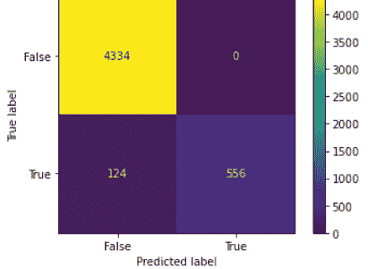

**图 2.10：** 测试集预测的混淆矩阵

64 机器学习分类算法精通

让我们检查模型的测试准确率：

```python
print("Test Accuracy = %5.5f" % (metrics.accuracy_score(y_test))
```

Test Accuracy = 0.97491

所以，模型的测试准确率为97.491%。

## 使用我们的模型进行预测

我们可以将新的短信输入模型并获取模型的预测结果。我将使用一个简单的英文句子。注意其操作逻辑。通过将这些逻辑应用于真实数据，可以获得相同的效果。

```python
testSMS = "This is a test SMS to be checked for spam"
URLPresentInSMS = identifyAndRemoveURLs(testSMS)[1]
testSMS = identifyAndRemoveURLs(testSMS)[0]
testSMS = testSMS.lower()
testSMS = cleanData(testSMS)
testSMS
'test sms checked spam'
import numpy as np
tfidfTestSMS = tfidf.transform([testSMS])
arrTestSMS = tfidfTestSMS.toArray()
arrTestSMS = np.append(arrTestSMS, URLPresentInSMS).reshape(1, -1)
arrTestSMS.shape
(1, 87654)
prediction = model.predict(arrTestSMS)
le.inverse_transform(prediction)
array(['ham'], dtype=object)
```

如果文本正如我们提供的那样，我们的模型预测该短信可能不是垃圾信息。我们将测试最后一个例子来结束这段讨论。

```python
testSMS = "You won the lottery. Click this link http://fake.com as soon as possible"
```

## 朴贝叶斯算法

```python
URLPresentInSMS = identifyAndRemoveURLs(testSMS)[1]
testSMS = identifyAndRemoveURLs(testSMS)[0]
testSMS = testSMS.lower()
testSMS = cleanData(testSMS)
tdffTestSMS = tfidf.transform([testSMS])
arrTestSMS = tfidfTestSMS.toArray()
arrTestSMS = np.append(arrTestSMS, URLPresentInSMS).reshape(1, -1)
arrTestSMS.shape
(1, 87654)
prediction = model.predict(arrTestSMS)
le.inverse_transform(prediction)
array(['ham'], dtype=object)
```

如果文本正如我们提供的那样，我们的模型预测该短信可能不是垃圾信息。我们将测试最后一个例子来结束这段讨论。

```python
testSMS = "You won the lottery. Click this link http://fake.com as soon as possible"
```

### K-近邻算法

在表 3.1 中，针对客户类别。与每个客户关联的标签是零售商店专家（数据来源处）分配的某些分类形式。几乎所有公司都试图将其客户分为不同的类别，以便进行各种分析，例如为不同类别的客户规划合适的促销活动、为不同客户制定新的定价策略、规划新产品/品牌等。

| 客户 ID | 上次发票日期 | 总金额 (Rs.) | 客户类别 |

|---|---|---|--|

| A1 | 29-Aug-2022 | 1,500 | A |

| A2 | 29-Sep-2022 | 1,000 | A |

| A3 | 31-Aug-2022 | 6,000 | B |

| A4 | 12-Sep-2022 | 1,100 | A |

| A5 | 02-Oct-2022 | 1,250 | A |

| A6 | 20-Aug-2022 | 2,000 | A |

| A7 | 20-Sep-2022 | 5,500 | B |

| A8 | 20-Sep-2022 | 1,000 | A |

| A9 | 22-Sep-2022 | 2,000 | A |

| A10 | 09-Sep-2022 | 5,000 | B |

> 表 3.1: 某零售商店的发票数据

让我们理解表 3.1 中的数据。每条记录代表我们零售商店的一位客户，记录了其最后发票日期的详细信息以及期间内所有购买的总价值。因此，我们知道客户最近何时进行购买。此外，我们还知道客户在期间在零售商店花费的总金额（让我们假设该期间是分析关注的时期）。因此，基于这些信息，零售商店将这十名客户分成了两类：A 和 B。

零售商店希望根据相同的数据点（即上次发票日期和总金额）将任何其他客户分为 A 类和 B 类。为了进行这种分类，我们使用 KNN 算法。

## 为建模准备数据

在将表 3.1 中的数据用于建模之前，我们必须使其适用。为了让数据适用于建模，所有数据元素必须是数字。然而，我们有一个数据元素（即上次发票日期）：日期。我们通过计算自客户上次购买以来过了多少天，将此日期转换为数字。在营销术语中，我们称之为**最近性 (recency)**。

## 精通机器学习的分类算法

为了计算最近性，我们需要考虑一个参考日期。假设我们的参考日期是 09-Oct-2022。我们将计算每个客户的最近性，即参考日期与上次发票日期之间的差值。结果所示表 3.2。

| 客户 ID | 上次发票日期 | 最近性 | 总金额 (Rs.) | 客户类别 |

|---|---|---|---|--|

| A1 | 29-Aug-2022 | 41 | 1,500 | A |

| A2 | 29-Sep-2022 | 10 | 1,000 | A |

| A3 | 31-Aug-2022 | 39 | 6,000 | B |

| A4 | 12-Sep-2022 | 27 | 1,100 | A |

| A5 | 02-Oct-2022 | 7 | 1,250 | A |

| A6 | 20-Aug-2022 | 50 | 2,000 | A |

| A7 | 20-Sep-2022 | 19 | 5,500 | B |

| A8 | 20-Sep-2022 | 19 | 1,000 | A |

| A9 | 22-Sep-2022 | 17 | 2,000 | A |

| A10 | 09-Sep-2022 | 30 | 5,000 | B |

表 3.2: 以 09-Oct-2022 为参考日期计算的最近性

我们可以使用表 3.2 中的数据应用 KNN 算法。对于每个客户，我们将使用“最近性”和“总金额”的数据点来确定“客户类别”。对于表 3.2 中的十名客户，我们已经知道“客户类别”，因为这是由某些人类专家提供的。使用这些由专家提供的数据，我们将对任何新客户进行预测。

### 寻找数据点之间的距离

现在，假设我们有一个新客户需要分析，并且知道其上次发票日期和总金额。假设该客户 ID 为 C1，上次发票日期是 25-Sep-2022，该客户购买的总金额为 7,000 Rs。从上述数据，我们可以计算该客户的最近性。因此，客户 C1 的最近性 = (09-Oct-2022 – 25-Sep-2022) = 14 天。我们在表 3.3 中显示：

| 客户 ID | 上次发票日期 | 最近性 | 总金额 (Rs.) | 客户类别 |

|---|---|---|---|---|

| C1 | 25-Sep-2022 | 14 | 7,000 | |

### K-近邻算法

为了确定 C1 的“客户类别”，我们将找到它与表 3.2 中提供的所有其他数据点的距离。我们知道二维数据点 $(x_i, y_i)$ 和 $(x_j, y_j)$ 之间的欧式距离定义为：

$$\sqrt{(x_i - x_j)^2 + (y_i - y_j)^2}$$

使用此公式，我们可以考虑“最近性”作为 $x$，“金额”作为 $y$ 来找到每个客户之间的距离。因此，C1 和 A1 之间的欧式距离可以计算为：

$$\sqrt{(14 - 41)^2 + (7000 - 1500)^2} = \sqrt{(-27)^2 + (5500)^2} = \sqrt{729 + 30250000} = \sqrt{30250729} \approx 5500.066$$

然而，我们注意到欧式距离计算严重偏于“金额”值，因为“金额”值远大于“最近性”值。为了解决这个问题，我们需要对数据进行标准化。

### 数据标准化

为了标准化数据，我们可以找到每个数据点的 $z$ 值。可以使用公式找到：

$$z = \frac{x-\mu}{\sigma}$$

在这里，$x$ 是数据点，$\mu$ 是平均值，$\sigma$ 是标准差。让我们从实践角度理解这一点。让我们取“最近性”属性。对于所有数据点，我们可以找到平均值：

$$\mu_{Recency} = \frac{\sum_{i=1}^{n} x_i}{n} = \frac{41+10+39+27+7+50+19+19+17+30}{10} = \frac{259}{10} = 25.9$$

现在，我们可以找到“最近性”数据点的标准差：

$$\sigma_{Recency} = \sqrt{\frac{\sum_{i=1}^{n}(x_i-\mu)^2}{n}} = \sqrt{\frac{(41-25.9)^2+(10-25.9)^2+\dots+(30-25.9)^2}{10}} \approx 13.5$$

现在，我们可以按照表 3.4 所示计算“最近性”的标准值：

| 客户 ID | 最近性 | 标准最近性 | 总金额 (Rs.) | 客户类别 |

|---|---|---|---|---|

| A1 | 41 | (41 - 25.9) / 13.35 = 1.13 | 1,500 | A |

| A2 | 10 | (10 - 25.9) / 13.35 = -1.19 | 1,000 | A |

| A3 | 39 | 0.98 | 6,000 | B |

| A4 | 27 | 0.08 | 1,100 | A |

| A5 | 7 | -1.42 | 1,250 | A |

| A6 | 50 | 1.80 | 2,000 | A |

| A7 | 19 | -0.52 | 5,500 | B |

| A8 | 19 | -0.52 | 1,000 | A |

| A9 | 17 | -0.67 | 2,000 | A |

| A10 | 30 | 0.31 | 5,000 | B |

表 3.4: 标准最近性的计算

注意所有“标准最近性”值的范围从 -2 到 +2。通常，对于任何观测值，我们观察到如果数据分布是正态或接近正态，~99% 的数据应该在三个标准差之内。

接下来，让我们标准化“总金额”的值。我们可以像“最近性”一样找到“总金额”的 $\mu$ 和 $\sigma$ 值。由你来进行计算。我们将得到 $\mu_{TotalAmount} = 2,635$ 和 $\sigma_{TotalAmount} = 1,919.38$。因此，我们按照表 3.5 所示计算标准“总金额”值：

| 客户 ID | 最近性 | 标准最近性 | 总金额 (Rs.) | 标准金额 | 客户类别 |

|---|---|---|---|---|---|

| A1 | 41 | 1.13 | 1,500 | -0.59 | A |

| A2 | 10 | -1.19 | 1,000 | -0.85 | A |

| A3 | 39 | 0.98 | 6,000 | 1.75 | B |

| A4 | 27 | 0.08 | 1,100 | -0.80 | A |

| A5 | 7 | -1.42 | 1,250 | -0.72 | A |

| A6 | 50 | 1.80 | 2,000 | -0.33 | A |

| A7 | 19 | -0.52 | 5,500 | 1.49 | B |


| A8 | 19 | -0.52 | 1,000 | -0.85 | A |

| A9 | 17 | -0.67 | 2,000 | -0.33 | A |

| A10 | 30 | 0.31 | 5,000 | 1.23 | B |

### 表 3.5: 标准化金额计算

为了确定 C1 的“客户类别”，我们将找到它与表 3.6 中提供的所有其他标准化数据的距离。我们使用标准化后的值来计算 C1 和其他客户之间的距离：

$$\sqrt{(-0.89 - 1.13)^2 + (2.27 - (-0.59))^2} = \sqrt{(-2.02)^2 + (2.86)^2} = \sqrt{4.0804 + 8.1796} = \sqrt{12.26} \approx 3.51$$

### 表 3.6: 标准化数据

| 客户 ID | 最近性 | 标准最近性 | 总金额 (Rs.) | 标准金额 | 距离 C1 | 客户类别 |
|---|---|---|---|---|---|---|
| A1 | 41 | 1.13 | 1,500 | -0.59 | 3.51 | A |
| A2 | 10 | -1.19 | 1,000 | -0.85 | 3.14 | A |
| A3 | 39 | 0.98 | 6,000 | 1.75 | 1.94 | B |
| A4 | 27 | 0.08 | 1,100 | -0.80 | 3.22 | A |
| A5 | 7 | -1.42 | 1,250 | -0.72 | 3.04 | A |
| A6 | 50 | 1.80 | 2,000 | -0.33 | 3.75 | A |
| A7 | 19 | -0.52 | 5,500 | 1.49 | 2.41 | B |
| A8 | 19 | -0.52 | 1,000 | -0.85 | 3.14 | A |
| A9 | 17 | -0.67 | 2,000 | -0.33 | 3.29 | A |
| A10 | 30 | 0.31 | 5,000 | 1.23 | 2.11 | B |

## 74 精通机器学习的分类算法

| 客户 ID | 最近消费度 (Recency) | 标准化最近消费度 | 总金额 (卢比) | 标准化总金额 | 与 C1 的距离 | 客户类别 |
|---|---|---|---|---|---|---|
| A7 | 19 | -0.52 | 5,500 | 1.49 | 0.87 | B |
| A8 | 19 | -0.52 | 1,000 | -0.85 | 3.15 | A |
| A9 | 17 | -0.67 | 2,000 | -0.33 | 2.61 | A |
| A10 | 30 | 0.31 | 5,000 | 1.23 | 1.59 | B |

表 3.7：计算新数据点与现有数据点之间的分类距离

## 最近邻算法

因此，变量 `x` 包含所有的独立变量，变量 `y` 包含因变量。

从数据中注意到 `Recency`（最近性）和 `Frequency`（频率）的值远小于 `Monetary Value`（金额）。这将影响距离的计算。我们将数据进行缩放，使得所有独立变量的值处于相似的范围。对于数据缩放，我们使用 `sklearn` 中的 `StandardScaler()` 类。`StandardScaler()` 存在于 `sklearn.preprocessing` 中。

当我们使用 `StandardScaler()` 时，必须对现有数据进行固定。在 `StandardScaler()` 的情况下，调用 `fit()` 方法计算数据的均值和标准差。一旦获取了这些值，就可以调用 `transform()` 方法来转换每个数据。另一种方法是调用 `fit_transform()` 方法，它首先执行 `fit()` 操作然后执行 `transform()` 方法。

```python
from sklearn.preprocessing import StandardScaler

sc = StandardScaler()
XS = sc.fit_transform(X.numpy())
XS = pd.DataFrame(XS, columns=['Frequency', 'MonetaryValue', 'Recency'])
XS.head()
```

| 频率 (Frequency) | 金额 (MonetaryValue) | 最近性 (Recency) |
|---|---|---|
| 0 | 8.785658 | 2.324680 |
| 1 | 0.398556 | 0.253157 | -0.900354 |
| 2 | -0.280101 | -0.061603 | -0.171476 |
| 3 | -0.088205 | -0.067495 | -0.740600 |
| 4 | -0.326905 | -0.190139 | 2.174911 |

注意到在缩放所有独立变量的值后，它们处于相似的范围。

在此阶段，我们将分离用于训练模型和测试的数据。我们将 80% 的数据用于训练，20% 用于测试。为了创建训练集和测试集，我们使用 `sklearn.model_selection` 中的 `train_test_split()` 方法。`train_test_split()` 方法存在于 `sklearn` 中。我们传递所有独立变量的值（在我们案例中，这些在 `XS` 中）和因变量（在我们案例中，存储在 `y` 中）。`test_size` 参数决定了测试集中随机选择的样本数量。

剩余的数据点被分配到训练集。我们为 `random_state` 参数设置了一个值，以便每次运行此脚本时结果都是相同的。

```python
from sklearn.model_selection import train_test_split

X_train, X_test, y_train, y_test = train_test_split(XS, y, test_size=0.2, random_state=42)
```

```python
print("Shape of X_train =", X_train.shape)
```

```python
print("Shape of X_test =", X_test.shape)
```

```python
print("\nDistribution of labels in X_train\n")
```

`X_train` 的形状 (3466, 3)

`X_test` 的形状 (867, 3)

`X_train` 中的标签分布：

```
0 1358
7 737
1 470
5 419
10 376
9 79
8 13
2 5
3 5
4 2
11 1
Name: Segment, dtype: int64
```

在训练集和测试集之后，我们注意到训练集中的数据点需要平衡，以便让所有类别具有相似数量的样本。平衡数据集的一种方法是对数据进行过采样（Over Sample）。通过过采样，我们为数据点数量较少的标签随机创建额外的数据点。有许多过采样的算法。我们将使用 `RandomOverSampler` 算法来创建额外的数据点。

然而，在使用 `RandomOverSampler` 库之前，我们需要导入提供此功能的库。`RandomOverSampler` 可以在 `imblearn`（或 `imbalanced learn`）包可用。通常，你需要在你的环境中安装该包：

```bash
!pip install imblearn
```

一旦成功安装 `imblearn` 包，我们就可以使用 `RandomOverSampler`。

我们需要传递所有独立变量的值（在我们案例中在 `X_train` 中）以及因变量（在我们案例中在 `y_train` 中）。`RandomOverSampler` 有 `fit()` 方法来拟合数据，有 `resample()` 方法创建随机样本。这里使用了 `fit_resample()`。过采样后的数据集存储在变量 `X0` 和 `y0` 中：

```python
from imblearn.over_sampling import RandomOverSampler

oversample = RandomOverSampler(random_state=42)
X0, y0 = oversample.fit_resample(X_train)
print("Number of samples after oversampling", y0.value_counts())
print("Shape of X after oversampling =", X0.shape)
```

过采样后每个标签的样本数：

```
0 1358
7 737
1 470
5 419
10 376
9 79
8 13
2 5
3 5
4 2
11 1
Name: Segment, dtype: int64
```

过采样后 `X` 的形状 = (16296, 3)

## 学习分类算法

过采样后，每个类别都有相同数量的样本。

```python
from sklearn.neighbors import KNeighborsClassifier
```

```python
model = KNeighborsClassifier()
model.fit(X_train, y_train)
```

```python
y_pred = model.predict(X_test)
```

现在我们将评估模型的性能：

```python
from sklearn.metrics import classification_report, confusion_matrix, accuracy_score

print(classification_report(y_test, y_pred))
print(confusion_matrix(y_test, y_pred))
print(accuracy_score(y_test, y_pred))
```

输出如下：

```
              precision    recall  f1-score   support

           0      0.998      1.000      0.999       737
           1      0.998      0.998      0.998       470
           2      0.000      0.000      0.000         5
           3      0.000      0.000      0.000         5
           4      0.000      0.000      0.000         2
           5      0.998      0.998      0.998       419
           6      0.000      0.000      0.000         0
           7      1.000      1.000      1.000      1358
           8      0.000      0.000      0.000        13
           9      0.986      1.000      0.993        79
          10      0.997      1.000      0.999       376
          11      0.000      0.000      0.000         1

       average      0.893      0.898      0.893      2675
weighted avg      0.996      0.898      0.991      2675
```

```
[[737   0   0   0   0   0   0   0   0   0   0]
 [  0 470   0   0   0   0   0   0   0   0   0]
 [  0   0   5   0   0   0   0   0   0   0   0]
 [  0   0   0   5   0   0   0   0   0   0   0]
 [  0   0   0   0   2   0   0   0   0   0   0]
 [  0   0   0   0   0 419   0   0   0   0   0]
 [  0   0   0   0   0   0   0   0   0   0   0]
 [  0   0   0   0   0   0   0 1358   0   0   0]
 [  0   0   0   0   0   0   0   0  13   0   0]
 [  0   0   0   0   0   0   0   0   0  79   0]
 [  0   0   0   0   0   0   0   0   0   0 376   0]
 [  0   0   0   0   0   0   0   0   0   0   0   1]]
```

准确率：0.898129

现在我们将可视化混淆矩阵：

```python
import matplotlib.pyplot as plt
import seaborn as sns

cm = confusion_matrix(y_test, y_pred)
plt.figure(figsize=(10,8))
sns.heatmap(cm, annot=True, fmt='d', cmap='Blues')
plt.xlabel('Predicted')
plt.ylabel('Actual')
plt.title('Confusion Matrix')
plt.show()
```

混淆矩阵显示模型在类别 0、1、5、7、9 和 10 上表现良好，但在类别 2、3、4 和 11 上遇到困难。这是因为这些类别在测试集中的样本非常少。

为了改进这一点，我们可以使用一种名为 SMOTE（合成少数类过采样技术）的技术。

```python
from imblearn.over_sampling import SMOTE

smote = SMOTE(random_state=42)
X_train_res, y_train_res = smote.fit_resample(X_train, y_train)
```

现在我们将使用重采样后的数据重新训练模型：

```python
model = KNeighborsClassifier()
model.fit(X_train_res, y_train_res)
y_pred_res = model.predict(X_test)
```

我们将再次评估性能：

```python
print(classification_report(y_test, y_pred_res))
print(confusion_matrix(y_test, y_pred_res))
print(accuracy_score(y_test, y_pred_res))
```

性能应该在少数类上得到提高。

## K-最近邻算法

去重前：(27096, 8)

去重后：(27082, 8)

我们看到有 14 条记录是重复的。

数据包含了所有发票的记录。当在线零售商在发生销售、订单取消或对之前的销售进行调整时，会开具发票。取消订单的发票号以“C”开头，调整的发票号以“A”开头。常规销售的发票号仅包含数字。在（我们目前的语境）下，我们不需要已取消和调整的发票的数据。因此，我们将删除所有在取消和调整发票之前的之前的记录。

```python
print("Before Dropping Invalid Invoice Types", dfLive.shape)
```

```python
### 将发票分类为正常、已取消和已调整
### 删除除正常发票以外的所有行
dfLive['InvoiceType1'] = dfLive['InvoiceNo'].astype(str)[:0]
dfTemp = dfLive.copy()
dfLive['InvoiceType'] = [invoiceType if invoiceType in ['C', 'A'] else 'N' for invoiceType in dfTemp.InvoiceType1]
dfLive = dfLive[dfLive.InvoiceType == 'N']
dfLive.drop(['InvoiceType', 'InvoiceType1'], axis=1, inplace = True)
```

```python
print("After Dropping Invalid Invoice Types", dfLive.shape)
Before Dropping Invalid Invoice Types: (27082, 8)
After Dropping Invalid Invoice Types: (26591, 8)
```

接下来，我们删除数量为负数的记录。如果发票是退回某些物品或仅仅是因为数据错误，数量可能为负数。在目前的语境下，我们不需要这样的数据。因此，我们将删除这些记录：

```python
print("Before Dropping Invoice with Negative Quantity", dfLive.shape)
```

```python
### 删除 Quantity 小于等于 0 的行
dfLive = dfLive[dfLive.Quantity > 0]
```


```python
print("After Dropping Invoice with Negative Quantity", dfLive.shape)
Before Dropping Invoice with Negative Quantity: (26591, 8)
After Dropping Invoice with Negative Quantity: (26542, 8)
```

接下来，我们处理库存代码（Stock Codes）。它们是在线零售商销售物品的唯一标识符。然而，我们也包含了银行手续费、邮费等的库存代码。我们不需要这些数据，因为它们与客户无关。因此，我们将从数据中删除这些记录。

### 根据库存代码对发票进行分类

### 删除无效库存代码的行

```python
dfTemp = dfLive.copy()
dfLive['StockCodeType'] = ['Remove' if stockCode in ['POST', 'PADS', 'M',
'DOT', 'C2', 'BANK CHARGES'] else 'Keep'
for stockcode in dfTemp.StockCode ]
```

```python
dfLive = dfLive[dfLive.StockCode == 'Keep'] # 注意：此处代码逻辑似乎可能有误，应为类型判断，但保持原样
dfLive.drop('StockCodeType', axis = 1, inplace = True)
```

*(注：原文代码中存在逻辑小瑕疵，如后文 `After Dropping Invalid Stock Codes` 逻辑未完全体现，此处翻译注释部分。)*

最后，我们将创建一个新列来存储发票的价值。发票价值是销售物品的数量乘以该发票应用于该物品的单价。我们将发票价值存储在一个标题为 `TotalAmount` 的新列中。

### 创建一个存储发票金额的列

```python
dfLive['TotalAmount'] = dfLive.Quantity * dfLive.UnitPrice
```

### 数据转换

现在数据已经过预处理。然而，我们不能将这些数据用于模型，因为它的结构与模型预期的不同。因此，我们需要将数据转换为模型预期的结构。

为了转换数据，我们需要为每个客户建立最近性（Recency）、频率（Frequency）和货币价值（Monetary Value）。当前数据是针对发票的。因此，我们需要转换这些数据，使其代表每个客户的特征，而不是发票的特征。

我们可以采取的第一步是按客户对数据分组，并统计每个客户的记录数。这个计数将给我们每个客户的频率值。

```python
gb = dfLive.groupby('CustomerID')
```

# K-最近邻算法 87

```python
counts = gb.size().to_frame(name = 'Frequency')
print(counts)
```

Frequency

| CustomerID | Frequency |
|---|---|
| 12347.0 | 11 |
| 12348.0 | 1 |
| 12349.0 | 5 |
| 12353.0 | 2 |
| 12354.0 | 3 |
| ... | ... |
| 18272.0 | 10 |
| 18276.0 | 1 |
| 18282.0 | 1 |
| 18283.0 | 46 |
| 18287.0 | 2 |

[3307 rows x 1 columns]

因此，我们拥有了 3307 个唯一客户的数据，以及每个客户从在线零售商处购买的次数。

既然原始数据已客户进行了分组，我们可以通过累加每个客户的发票价值来找到每个客户的货币货币价值（Monetary Value）。同样，我们可以找到每个客户的最后一次发票日期（Invoice Date）。

```python
dfCustomerDF = \
  .join(gb.agg({'TotalAmount': 'sum'}).rename(columns={'TotalAmount': 'MonetaryValue'})) \
  .join(gb.agg({'InvoiceDate': 'max'}).rename(columns={'InvoiceDate': 'MostRecentPurchase'}))\
  .reset_index()
dfCustomerDF.head()
```

| CustomerID | Frequency | MonetaryValue | MostRecentPurchase |
|---|---|---|---|
| 12347.0 | 11 | 218.20 | 2011-12-07 15:52:00 |
| 12348.0 | 1 | 41.76 | 2011-01-25 10:44:00 |

# 掌握机器学习分类算法

| CustomerID | Frequency | MonetaryValue | MostRecentPurchase |
|---|---|---|---|
| 2 | 12349.0 | 5 | 112.54 | 2011-11-21 09:51:00 |
| 3 | 12353.0 | 2 | 59.70 | 2011-05-19 17:47:00 |
| 4 | 12354.0 | 3 | 41.35 | 2011-04-21 13:11:00 |

我们拥有每个客户的发票总和，位于 `MonetaryValue` 列。我们拥有每个客户的最后一次发票日期，位于 `MostRecentPurchase` 列。

现在我们有了频率和货币价值的值。我们只需要为每个客户建立最近性（Recency）值。为了计算最近性，通常我们会考虑一个参考日期。然而，由于这些数据比较旧（现在是 2022 年，而数据是 2011 年），我们将所有客户最大的发票日期作为参考日期。

```python
dfCustomerDF['Recency'] = (dfCustomerDF['MostRecentPurchase'] - dfCustomerDF['MostRecentPurchase'].max()).dt.days
dfCustomerDF.drop(['MostRecentPurchase'], axis=1, inplace = True)
dfCustomerDF.head()
```

| CustomerID | Frequency | MonetaryValue | Recency |
|---|---|---|---|
| 12347.0 | 11 | 218.20 | 146 |
| 12348.0 | 1 | 41.76 | 348 |

分段可以按照模型分配的方式分配给客户：

```python
dfCustomerDF['Segment'] = yPredLiveValue

dfCustomerDF.head()
```

| CustomerID | Frequency | MonetaryValue | Recency | Segment |
|---|---|---|---|---|
| 0 | 12347.0 | 218.20 | 2 | 0 |
| 1 | 12348.0 | 1 | 41.76 | 318 | 10 |
| 2 | 12349.0 | 5 | 112.54 | 18 | 0 |
| 3 | 12353.0 | 2 | 59.70 | 204 | 1 |
| 4 | 12354.0 | 3 | 41.35 | 232 | 1 |

最后，我们可以可视化实时数据的客户分段：

```python
import numpy as np

## 固定随机种子以保证可复现性
np.random.seed(19680801)

fig = plt.figure(figsize=(15, 10))
ax = fig.add_subplot(projection = '3d')

xs = dfCustomerDF.Recency
ys = dfCustomerDF.Frequency
zs = dfCustomerDF.MonetaryValue
ax.scatter(xs, ys, zs, marker = 'o', c = dfCustomerDF.Segment)

ax.set_xlabel('Recency')
ax.set_ylabel('Frequency')
ax.set_zlabel('Monetary Value')

plt.show()
```

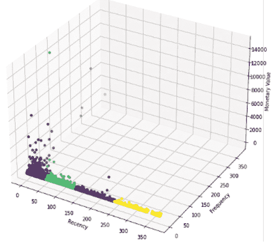

## 结论

正如你在K最近邻（KNN）算法讨论中所观察到的，该算法不需要对机器进行训练。相反，机器获取数据并应用算法来执行分类（或回归）。因此，K最近邻算法也被称为懒惰算法（Lazy Algorithm）。然而，该算法在许多情况下都能解决分类（和回归）问题。

在下一章中，我们将讨论逻辑回归算法，其中我们将首次深入探讨梯度下降。

## 记忆点

- KNN代表K-最近邻（K-Nearest Neighbor）。
- KNN算法可以用于分类和回归。
- 在KNN算法中，我们找到数据点之间的距离，并根据最近邻居的类别分配类别。
- 我们可以使用欧几里得距离（Euclidean distance）、曼哈顿距离（Manhattan distance）或汉明距离（Hamming distance）来寻找数据点之间的距离。
- `KNeighborsClassifier`是`sklearn.neighbors`包中的类，它实现了用于分类的KNN算法。

## 加入我们书籍的Discord社区

加入书籍的Discord工作空间，获取最新更新、优惠、全球科技动态、新发布以及与作者的互动：

https://discord.bpbonline.com


## 第4章

逻辑回归

逻辑回归算法是解决分类问题的最早的算法之一。算法名称中的“回归”（Regression）一词可能会引起误解，因为这这是一个解决回归问题的算法。第一章《机器学习导论》讨论了当输出变量是连续的时，机器学习模型是为了解决回归问题而建立的。当输出变量是类别时，机器学习模型是为了解决分类问题而建立的。在逻辑回归中，采用线性回归算法的形式，我们估计某个类别出现的概率。由于概率是0到1之间的数字，逻辑回归算法输出的是0到1之间的数字。通过设置一个像0.5这样的阈值，我们可以说，如果逻辑回归算法的输出小于阈值，则它属于一类；如果大于阈值，则属于另一类。

在本章中，我们将讨论逻辑回归算法的公式，并应用它来分类患者是否患有肝炎。

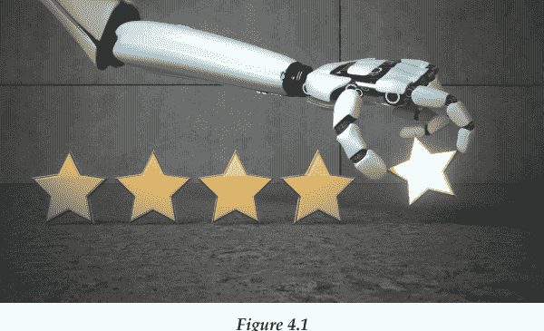

## 结构

在本章中我们将讨论以下主题：

- 公式逻辑回归算法
- 理解线性回归算法
- 过到逻辑回归算法
- 应用逻辑回归算法
- 决策边界
- 多分类
- 肝炎诊断
- 加载数据
- 填充缺失值
- 构建并测试模型

## 目标

读完本章后你将理解梯度下降的细微之处。梯度下降是逻辑回归算法和神经网络的核心。你理解Sigmoid函数及其应用。我们将理解损失函数（Loss function）和代价函数（Cost function）。当我们应用逻辑回归算法时，你理解机器学习是如何应用于医疗领域的。

## 公式逻辑回归

在讨论逻辑回归算法之前，我们需要讨论线性回归算法。线性回归是解决回归问题的算法。在回归问题中，我们需要预测连续变量，而在分类问题中，我们需要预测类别变量。

### 理解线性回归算法

考虑我们设置一个实验来确定直角三角形斜边的长度。这个实验可以通过在纸上画直角三角形并用尺子测量边长来进行。假设我们获得的数据如图4.2所示。我们将这些数据给机器来学习如何确定斜边的长度。

| 特征 | A | B | C |
|---|---|---|---|
| 4 | 2 | 4.4 |
| 6 | 6 | 8.5 |
| 3 | 9 | 9.5 |
| 7 | 5 | 8.6 |
| 2 | 12 | 12.2 |
| 3 | 9 | 9.4 |
| 4 | 7 | 8 |

图4.2：实验结果

为了分析图4.2中的数据，科学家创建了如图4.3所示的可视化：


图4.3：图4.2数据的可视化

## 精通机器学习分类算法

假设科学家认为A、B和C之间可能存在线性关系，即$A^2$、$B^2$和$C^2$之间的关系。我们将$A^2$和$B^2$标记为特征，$C^2$标记为目标变量。

| 特征 | A | B | C | $x_1=A^2$ | $x_2=B^2$ | $y=C^2$ |
|---|---|---|---|---|---|---|
| 4 | 2 | 4.4 | 16 | 4 | 19.8025 |
| 6 | 6 | 8.5 | 36 | 36 | 72.25 |
| 3 | 9 | 9.5 | 9 | 81 | 90.25 |
| 7 | 5 | 8.6 | 49 | 25 | 73.96 |
| 2 | 12 | 12.7 | 4 | 144 | 148.84 |
| 3 | 9 | 9.4 | 9 | 81 | 88.36 |
| 4 | 7 | 8 | 16 | 49 | 64 |

图4.4：右侧所示的问题

因此，科学家指示机器根据图4.4所示的问题创建一个线性模型。机器尝试创建一个如下方程：

$y = \beta_0 + \beta_1 x_1 + \beta_2 x_2$

为了计算$y$的值，机器拥有$A^2$和$B^2$的值。因此，机器需要计算$\beta_0, \beta_1$的值，并通过与实际的$y$值进行比较，比较估计的合理性。科学家提供了$\beta_0, \beta_1$和$\beta_2$的初始值为2、2和2。因此，机器估计了$C$的值，如图4.5所示：

| 工程化特征 | 工程化目标 | $\beta_0=2, \beta_1=2, \beta_2=2$ 时的估计 | C的估计 |
|---|---|---|---|
| $x_1=A^2$ | $x_2=B^2$ | $y=C^2$ | $\hat{y}=\hat{\beta}_0 + \hat{\beta}_1 x_1 + \hat{\beta}_2 x_2$ | $\hat{y}=\text{sort}(\hat{y})$ |
| 16 | 4 | 19.8025 | 42 | 492.73 |
| 36 | 36 | 72.25 | 146 | 5439.06 |
| 9 | 81 | 90.25 | 138 | 8418.06 |
| 49 | 25 | 73.96 | 150 | 5728.08 |
| 4 | 144 | 148.84 | 298 | 22248.71 |
| 9 | 81 | 88.36 | 182 | 8768.45 |
| 16 | 49 | 64 | 132 | 4624.00 |

图4.5：机器的估计。C表示为$\hat{y}$

我们将机器的估计绘制出来，如图4.6所示：


图4.6：使用交叉的机器估计

机器意识到估计可以更好；因此它确定了估计的误差。误差可能是正的或负的，所以所有误差可能会抵消。意识到这一点，机器对误差取平方，使它们成为正数。这如图4.7所示：

| 工程化特征 | 工程化目标 | $\beta_0=2, \beta_1=2, \beta_2=2$ 时的估计 | 误差 |
|---|---|---|---|
| $x_1=A^2$ | $x_2=B^2$ | $y=C^2$ | $\hat{y}=\beta_0+\beta_1 x_1+\beta_2 x_2$ |
| 16 | 4 | 19.8025 | 42 | 492.73 |
| 36 | 36 | 72.25 | 146 | 5439.06 |
| 9 | 81 | 90.25 | 138 | 8418.06 |
| 49 | 25 | 73.96 | 150 | 5728.08 |
| 4 | 144 | 148.84 | 298 | 22248.71 |
| 9 | 81 | 88.36 | 182 | 8768.45 |
| 16 | 49 | 64 | 132 | 4624.00 |

**均方误差 (MSE) = 7967.58**

## 代价函数

我们已经确定必须最小化MSE。因此，机器计算所有平方误差的平均值，即所有的这被称为均方误差（MSE）。让我们来写下MSE的公式：

# MSE = $\frac{1}{m} \sum_{i=1}^m (\overline{y}_i - y_i)^2$

这里，$m$ 是数据集中数据点的数量。

在图 4.7 的示例中，$m = 7$。为了清晰起见，我们将 yhat（如图 4.7 所示）表示为 $\hat{y}$。

这个 MSE 公式也称为**代价函数**（Cost Function），其写法如下：

```
$J = \frac{1}{m} \sum_{i=1}^m (\overline{y}_i - y_i)^2$
```

在前面的方程中，我们将 $\hat{y}$ 替换为 $\beta_0 + \beta_1x_1 + \beta_2x_2$，如下：

```
$J = \frac{1}{m} \sum_{i=1}^m ((\beta_0 + \beta_1x_1 + \beta_2x_2) - y_i)^2$
```

在这个方程中，我们可以分析并获得 $J$ 的最小值。为了最小化代价函数，我们使用**梯度下降**（Gradient Descent）算法。

> 注意：我们可以使用其他指标（如平均绝对误差 MAE）作为代价函数来代替 MSE。

## 梯度下降算法

我们可以将代价写为 $\beta$ 的函数。


```
$J = f(\beta_{\mu}, \beta_{\nu}, \beta_{\zeta})$
```

微积分学指出，当函数的导数 $df/dx$ 为 0 时，函数 $f(x)$ 最小。$J$ 是一个多元函数，因此我们必须取偏导数。

为了获得 $J$ 的最小值，我们必须尝试不同的 $\beta_{\mu}$、$\beta_{\nu}$ 和 $\beta_{\zeta}$ 的值。我们将尝试的 $\beta_{\mu}$、$\beta_{\nu}$ 和 $\beta_{\zeta}$ 的不同值通过以下策略来确定：

- 我们设置一个下阈值，如果我们获得了一个良好的 $J$ 值，就认为我们找到了最小值。这是因为在执行浮点运算时，我们可能永远无法达到导数为 0 的点。为了演示这一点，假设阈值为 0。
- 我们为 $\beta_{\mu}$ 和 $\beta_{\nu}$ 设置初始值。假设我们将每个 $\beta_{\mu}$、$\beta_{\nu}$ 和 $\beta_{\zeta}$ 的初始值都为 2。
- 我们计算这组 $\beta_{\mu}$、$\beta_{\nu}$ 和 $\beta_{\zeta}$ 对应的 $J$ 值。

## 逻辑回归

如果 `J <=` 阈值，我们停止并将 `β0'`、`β1'` 和 `β2'` 的值视为我们找到最佳估计点。

如果 `J >` 阈值，我们计算 `β0'`、`β1'` 和 `β2'` 的新值：

```
$$\beta_{0'} = \beta_{0} - \alpha \frac{\delta J}{\delta \beta_{0}}$$ 其中 $\frac{\delta J}{\delta \beta_{0}}$ 是 $J$ 对 $\beta_{0}$ 的偏导数，$\alpha$ 是一个称为学习率的超参数。
```

```
$$\beta_{1'} = \beta_{1} - \frac{\delta J}{\delta \beta_{1}}$$ 其中 $\frac{\delta J}{\delta \beta_{1}}$ 是 $J$ 对 $\beta_{1}$ 的偏导数
```

```
$$\beta_{2'} = \beta_{2} - \frac{\delta J}{\delta \beta_{2}}$$ 其中 $\frac{\delta J}{\delta \beta_{2}}$ 是 $J$ 对 $\beta_{2}$ 的偏导数
```

我们重复步骤 3、4 和 5。让我们用一些数字来理解前面的策略。假设我们从 `β0', β1', β2` 设置为 2 开始。让我们考虑 `β0', β1', β2` 设置为 2。我们可以计算 `J`。由于 `J >` 阈值，我们需要计算 `β0', β1'` 的新值。对于 `β0', β1'` 和 `β2`，根据图 4.6，我们得到 `J = 7.58`。由于 `J >` 阈值，我们需要再次计算 `β0', β1'` 和 `β2` 的值。

## 逻辑回归

我们将从二分类（即目标变量可以取两个值——0 和 1）开始讨论，稍后将其扩展到多分类。

当我们使用线性模型来预测类别变量时，它被称为逻辑回归模型（Logistic Regression model）。换句话说，使用线性方法解决分类模型的算法就称为逻辑回归算法。

在逻辑回归算法中，我们将预测目标变量（类别型）的问题转换为预测目标变量出现概率的问题。现在，概率是 0 到 1 之间的一个值，这使得预测类别目标变量的问题变成了预测一个连续变量的问题。

让我们通过一个例子来理解这一点。假设我们的问题是预测一条短信是否为垃圾邮件。我们需要预测两个类别：垃圾邮件（SPAM）和非垃圾邮件（NOT SPAM）。现在，我们将垃圾邮件标记为 1，将非垃圾邮件标记为 0。我们的问题是预测 1 或 0。然而，我们将问题改变为了预测短信为垃圾邮件（SPAM）的概率。换句话说，我们的目标变量是 $P_{y}(y=1)$。由于这是一个概率，$P(y=1)$ 可以取 0 到 1 之间的任何值。因此，它是一个连续变量。在获得值后，我们考虑一个阈值。如果 $P_{y}(y=1)>$ 阈值，我们认为 $y=1$（在此情况下为垃圾邮件）。如果 $P_{y}(y=1)\le$ 阈值，则 $y=0$（在此情况下为非垃圾邮件）。

因此，我们正在使用线性回归方法来进行预测。通过获取预测结果，我们将预测值与阈值比较以得到预测的二分类。

### Sigmoid 函数

对于逻辑回归算法，我们需要一个输出 0 到 1 之间值的函数。实现此功能的函数是 Sigmoid 函数。函数的形式如下：

```
$$\sigma(t) = \frac{1}{1+e^{-t}}$$
```

在这里，t 可以取 $-\infty$ 到 $+\infty$ 之间的值。

当 $t=-\infty$ 时，$e^{-t}=e^{-(-\infty)}=\infty$。因此，$\sigma(t)=\frac{1}{1+e^{-t}}=\frac{1}{1+\infty}=\frac{1}{\infty}=0$。

当 $t=+\infty$ 时，$e^{-t}=e^{(+\infty)}=0$。因此，$\sigma(t)=\frac{1}{1+e^{-t}}=\frac{1}{1+0}=\frac{1}{1}=1$。

# 掌握机器学习分类算法

如果我们绘制不同 t 值对应的 $\sigma(t)$ 值的图表，我们得到如图 4.8 所示的图：

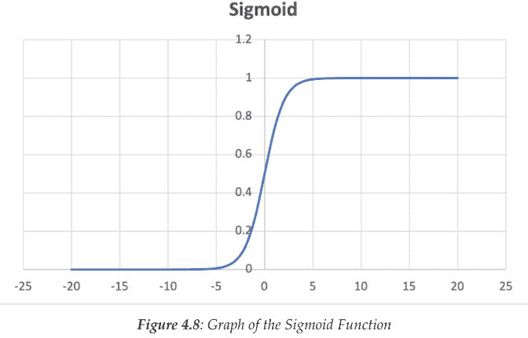

因此，Sigmoid 函数始终取 0 到 1 之间的值。

我们将面临一个具有一个或多个特征（或独立变量）以及 1 个目标变量（或因变量）的分类问题。因此，问题的线性形式如下：

$y = a_0 + a_1x_1 + a_2x_2 + \dots + a_nx_n$

应用 Sigmoid 函数，我们将得到如下：

$\sigma(y) = \frac{1}{1+e^{-y}} = \frac{1}{1+e^{-(a_0+a_1x_1+\dots+a_nx_n)}}$

因此，对于每一个数据点，我们得到一个 0 到 1 之间的值。为了进行预测，我们将其公式化：

$y = \begin{cases} 1, \text{如果 } \sigma(y) > 0.5 \\ 0, \text{如果 } \sigma(y) \le 0.5 \end{cases}$

在这里，我们将阈值设置为 0.5。根据我们的问题，我们可以将阈值设置为 0 到 1 之间的任何其他值。

现在我们的数据集中有很多数据点，共 m 个数据点。对于每个数据点，我们得到如下：

$\sigma(y_i) = \frac{1}{1+e^{-y_i}} = \frac{1}{1+e^{-(a_0+a_1x_1+\dots+a_nx_i)}}$ 这里 $i$ 从 1 变化的 m。

## 逻辑回归算法的代价函数

与线性回归算法不同，我们不能使用 MSE（均方误差）等指标作为逻辑回归算法的代价函数。我们需要设计一个代价函数，以便衡量我们的二分类是否准确。一旦确定了代价函数，我们就可以应用梯度下降算法来最小化代价函数，以获得最优模型。

我们现在知道数据点的预测如下：

```
$$\sigma(y_i) = \frac{1}{1 + e^{-Y_i}} = \frac{1}{1 + e^{-(a_0 + a_1x_1 + \dots + a_nx_{n_l})}}$$
```

我们将 $\sigma(y_j)$ 称为 $(p_j)$。因此，我们得到如下：

```
$$p_i = \sigma(y_i) = \frac{1}{1 + e^{-Y_i}} = \frac{1}{1 + e^{-(a_0 + a_1x_1 + \dots + a_nx_{n_l})}}$$
```

逻辑回归的代价函数给出如下：

$$J = -\frac{1}{m} \sum_{i=1}^{m} [y_i \log(p_i) + (1-y_i) \log(1-p_i)]$$

让我们理解这个代价函数。注意概率只能取 0 到 1 之间的值。$(p)$ 和 $(1-p)$ 分别接近 0 和 1。如果 $y_i=1$ 且 $p_i$ 接近 1，$\log(p_i)$ 接近 0；如果 $y_i=1$ 且 $p_i$ 接近 0，$-\log(p_i)$ 是一个很大的数。同样，如果 $y_i=0$ 且 $p_i$ 接近 1，$\log(1-p_i)$ 接近 0；如果 $y_i=0$ 且 $p_i$ 接近 0，$-\log(1-p_i)$ 是一个很大的数。

为了保留代价函数的特性，可以将代价函数写为：

$$J = -\frac{1}{m} \sum_{i=1}^{m} [y_i \log(\hat{y}_i) + (1-y_i) \log(1-\hat{y}_i)]$$

这可以通过替换 $y_i = a_0 + a_1x_1 + a_2x_2 + \dots + a_nx_n$ 进一步扩展：

$$J = -\frac{1}{m} \sum_{i=1}^{m} [y_i \log(\sigma(y_i)) + (1-y_i) \log(1-\sigma(y_i))]$$

这个代价函数被称为对数损失（Log-Loss）函数。Sigmoid 函数被称为逻辑函数。我们得到了用于逻辑回归算法的公式。我们需要通过改变系数来最小化 $J$，每次迭代得到的系数为：

$a_i = a_i - \alpha \frac{\partial J}{\partial a_i}$ 其中 $\alpha$ 是学习率。

我们在 Python 中使用 `sympy` 库提供了一个简单的方法来寻找 $\frac{\partial J}{\partial a_i}$，如图 4.9 所示：

```python
from sympy import symbols, log, exp, diff

a0, a1, a2, x1, x2 = symbols('a0 a1 a2 x1 x2')

### 注意：由于 OCR 文本存在乱码，此处基于标准代价函数进行逻辑推导
### (此处代码逻辑展示了如何求导)
```

### (注：原文中 log 之后存在 OCR 错误，此处已根据标准逻辑回归公式进行逻辑对齐)

### 应用逻辑回归算法

让我们运行一个将逻辑回归算法应用于分类问题的简单示例。

我们对任何地方的温度进行了标记，分类为 0 表示热（HOT），1 表示冷（COLD），如图 4.10 所示。

| 温度 (x1) | 天气 (y) |
|---|---|
| 40 | 0 |
| 2 | 1 |
| -3 | 1 |
| 10 | 1 |
| 20 | 0 |
| 30 | 0 |
| 4 | 1 |
| 7 | 1 |
| 22 | 0 |
| 50 | 0 |
| 60 | 0 |
| -5 | 1 |
| 4 | 1 |
| 6 | 1 |
| 32 | 0 |

> 0 - HOT
> 1 - 冷

图 4.10：用于分类的天气数据

因此，我们有独立变量 ($x_1$)，因变量是 $y$。因此，我们需要建立如下的线性关系：

$y = a_0 + a_1x_1$

由于这是一个分类问题，我们将构建如下的 Sigmoid 函数：

$$\sigma(y) = \frac{1}{1+e^{-y}} = \frac{1}{1+e^{-(a_0+a_1x_1)}}$$

你可以按照提供的 Python 程序来创建逻辑回归模型：

```python
X = [40, 2, -3, 10, 20, 30, 4, 7, 22, 50, 60, -5, 4, 6, 32]
y = [0, 1, 1, 1, 0, 0, 1, 1, 0, 0, 0, 1, 1, 1, 0]

import pandas as pd
```

```python
df = pd.DataFrame({'X':X, 'y':y})

from sympy import *
a0, a1, x1 = symbols('a0, a1, x1')

J = ((a0 + (a1*x1)) * log(1 / (1 + exp(-(a0 + (a1*x1))))) + \
     ((1 - (a0 + (a1*x1))) * log(1 - (1 / (1 + exp(a0 + (a1*x1)))))))
diff_a0 = diff(J, a0)
diff_a1 = diff(J, a1)

a0_val = 5
a1_val = 5
alpha = 0.001
threshold = 0
testList = []

for c in range(100):
    # 计算代价 Cost
    Cost = 0
    for i in range(len(df)):
        Cost += J.eval(subs={a0: a0_val, a1: a1_val, x1: df.loc[i, 'X']})

    Cost *= (1 / (len(df)))

    print("Iteration: %d, Cost - %f" % (c, Cost))
    print("\ta0 - %f, a1 - %f" % (a0_val, a1_val))
    testList.append({'Cost': Cost, 'a0': a0_val, 'a1': a1_val})
    if Cost < threshold:
        break

### 偏导
sumdiff = 0
sumdiff_x1 = 0
for i in range(len(df)):
    sumdiff += diff_a0.evalf(subs = {a0: a0_val, a1: a1_val, x1: df.loc[i, 'X']})
    sumdiff_x1 += diff_a1.evalf(subs = {a0: a0_val, a1: a1_val, x1: df.loc[i, 'X']})
```

```python
del_j_a0 = ((1 / (len(df))) * sumdiff)
del_j_a1 = ((1 / (len(df))) * sumdiff_x1)
```

### 更新参数

a0_val = a0_val - (alpha * del_j_a0)

a1_val = a1_val - (alpha * del_j_a1)

Iteration: 0, Cost - 14766.723588

a0 - 5.000000, a1 - 5.000000

Iteration: 1, Cost - 876.45461

a0 - 3.053107, a1 - 1.037362

Iteration: 2, Cost - 170.045108

a0 - 2.396249, a1 - -0.545897

Iteration: 3, Cost - 31.870917

a0 - 2.633374, a1 - 0.148471

Iteration: 4, Cost - 6.492363

a0 - 2.486089, a1 - -0.143966

Iteration: 5, Cost - 2.124769

a0 - 2.499813, a1 - -0.026896

Iteration: 41, Cost - 0.049555

a0 - 1.614739, a1 - -0.034913

Iteration: 42, Cost - 0.027046

a0 - 1.596394, a1 - -0.034430

Iteration: 43, Cost - 0.005170

a0 - 1.578308, a1 - -0.033954

Iteration: 44, Cost - -0.016089

a0 - 1.560479, a1 - -0.033498

我们可以如下测试模型：

```python
def testWeather(test):
    THRESHOLD = 0.8
    returnValue = "HOT"
    if test > THRESHOLD:
        returnValue = "COLD"
    return returnValue
```

$Y = (1 / (1 + exp(-(a0 + (a1*x1))))) Y.evalf(subs={a0: testList[-2][0], a1: testList[-2][1], x1: 43})$

testWeather(test)

'HOT'

$test = Y.evalf(subs={a0: testList[-2][0], a1: testList[-2][1], x1: 43})$

testWeather(test)

'COLD'

注意，我们使用了 0.8 的阈值来进行决策。梯度下降算法和逻辑回归算法是神经网络的基础。

### 决策边界

现在我们创建了逻辑回归模型，为所有数据点绘制 Sigmoid 函数。我们表示 $\tilde{p}=\sigma(y)$。因此，$p$ 是分类为 1 的概率，$1-\tilde{p}$ 是分类为 0 的概率。我们使用以下代码计算 $\tilde{p}$ 和 $(1-\tilde{p})$ 的值并将其添加到 $x_i$ 值的 dataframe 中：

```python
s = (1 / (1 + exp(-(a0 + (a1*x1))))
sList = []
tList = []
for i in range(len(df)):
    P = s.evalf(subs={a0: testList[-2][0], a1: testList[-2][1], x1: df.loc[i, 'X']})
    sList.append(P)
    tList.append(1 - P)

df['P'] = sList
df['1 - P'] = tList
df = df.sort_values('X')
```


| X | y | P | 1 - P |
|---|---|---|---|
| 11 | -5 | 0.8517300213465 | 0.1482699786535 |
| 2 | -3 | 0.8429271085189 | 0.1570728914811 |
| 1 | 2 | 0.8191250290119 | 0.1808749709888 |
| 6 | 4 | 0.8088402812548 | 0.1911597418745 |
| 12 | 4 | 0.8084025812548 | 0.1915974187452 |
| 13 | 6 | 0.7981193783705 | 0.2018802612895 |
| 7 | 7 | 0.7925393473549 | 0.2074606524507 |
| 3 | 10 | 0.7735494234048 | 0.2264505766952 |
| 4 | 20 | 0.7107096183215 | 0.2892903816785 |
| 8 | 22 | 0.6966339690534 | 0.3033660309466 |
| 5 | 30 | 0.6363799254212 | 0.3636200745788 |
| 14 | 32 | 0.6205203403658 | 0.3794796596342 |
| 0 | 40 | 0.5548156673591 | 0.4451843326409 |
| 9 | 50 | 0.4701865372324 | 0.5298134627676 |

# 逻辑回归

注意：对于多分类问题，我们还有 `SoftMax()` 函数。然而，对 `SoftMax()` 函数的讨论超出了本书的范围。

# 肝炎诊断预测分类器

我们选取一个医学领域的问题来讨论如何在 `Scikit-Learn` 库中实现逻辑回归算法，并查看该逻辑回归算法的应用。

该数据集是由卡内基梅隆大学的 G. Gong 在1988年提供的。该数据集包含了患有肝炎患者的详细信息。数据集中有19个特征和一个目标变量。从患者的年龄和性别，数据集包含了不同的医疗状况，包括胆红素水平和肝脏是否肿大。目标变量的值：患者死亡为 1，患者未死亡为 2。数据集中总共有155个数据点。模型的目标是根据患者的状况预测患者是否死亡。该数据集可以在 UCI 机器学习库找到：[肝炎数据集](https://archive.uci.uci.edu/ml/datasets/Hepatitis)。

## 加载数据

首先，我们需要加载数据。由于数据以逗号分隔值（CSV）文件的存在，我们可以使用 `pandas` 库中的 `read_csv()` 函数来加载数据。通过文本编辑器打开数据文件，发现 UCI 没有任何表头。

```python
import pandas as pd

df = pd.read_csv("hepatitis.data", header = None)
df
```

| 0 | 1 | 2 | 3 | 4 | 5 | 6 | 7 | 8 | 9 | 10 | 11 | 12 | 13 | 14 | 15 | 16 | 17 |
|---|---|---|---|---|---|---|---|---|---|---|---|---|---|---|---|---|---|||
| 0 | 2 | 30 | 2 | 1 | 2 | 2 | 2 | 1 | 2 | 2 | 2 | 2 | | 1.00 | 85 | 18 | 4.0 | |
| ? | 1 | | | | | | | | | | | | | | | | | |
| 1 | 2 | 50 | 1 | 1 | 2 | 1 | 2 | 1 | 2 | 2 | 2 | 2 | 0.90 | 135 | 42 | 3.5 | |
| ? | 1 | | | | | | | | | | | | | | | | | | | |
| 2 | 2 | 78 | 1 | 2 | 1 | 2 | 2 | 2 | 2 | 2 | 2 | | | 96 | 32 | 4.0 | |
| ? | 1 | | | | | | | | | | | | | | | | | | | |
| 3 | 2 | 31 | 1 | ? | 1 | 2 | 2 | 2 | 2 | 2 | 2 | 2 | 0.70 | 46 | 52 | 4.0 | |
| 80 | 1 | | | | | | | | | | | | | | | | | | | |
| 4 | 2 | 34 | 1 | 2 | 2 | 2 | 2 | 2 | 2 | 2 | 2 | 2 | 1.00 | ? | 200 | 4.0 | |
| ? | 1 | | | | | | | | | | | | | | | | | | | |
| 150 | 1 | 46 | 1 | 2 | 2 | 1 | 1 | 1 | 2 | 2 | 1 | 1 | 1 | 7.60 | ? | 242 | 3.3 | |
| 50 | 2 | | | | | | | | | | | | | | | | | | | |
| 151 | 2 | 44 | 1 | 2 | 2 | 1 | 2 | 2 | 1 | 2 | 2 | 0.90 | 126 | 142 | 4.3 | |
| ? | 2 | | | | | | | | | | | | | | | | | | | |
| 152 | 2 | 61 | 1 | 1 | 2 | 1 | 1 | 2 | 1 | 1 | 2 | 2 | 0.80 | 75 | 20 | 4.1 | |
| ? | 2 | | | | | | | | | | | | | | | | | | | | |
| 153 | 2 | 53 | 2 | 1 | 2 | 1 | 2 | 2 | 2 | 1 | 1 | 1 | 1.50 | 81 | 19 | 4.1 | |
| 48 | 2 | | | | | | | | | | | | | | | | | | | | | |
| 154 | 1 | 43 | 1 | 2 | 2 | 1 | 2 | 2 | 2 | 2 | 1 | 1 | 2 | 1 | 1.20 | 100 | 19 | 3.1 | |
| 42 | 2 | | | | | | | | | | | | | | | | | | | | |

[155 行 x 20 列]

我们注意到有 155 个包含 20 列的数据点。

第一列包含目标变量，即患者是否死亡。我们将重命名这一列，并保持其他列名不变：

```python
df.rename(columns = {"target"}, inplace = True)
df.head()
```

| target | 1 | 2 | 3 | 4 | 5 | 6 | 7 | 8 | 9 | 10 | 11 | 12 | 13 | 14 | 15 | 16 | 17 | 18 | 19 |
|---|---|---|---|---|---|---|---|---|---|---|---|---|---|---|---|---|---|---|---|
| 0 | 2 | 30 | 2 | 1 | 2 | 2 | 2 | 1 | 2 | 2 | 2 | 2 | 1.00 | 85 | 18 | 4.0 | | | |
| 1 | 2 | 50 | 1 | 1 | 2 | 1 | 2 | 1 | 2 | 2 | 2 | 2 | 0.90 | 135 | 42 | 3.5 | | | |
| 2 | 2 | 78 | 1 | 2 | 1 | 2 | 2 | 2 | 2 | 2 | 2 | | | 96 | 32 | 4.0 | | | |
| 3 | 2 | 31 | 1 | ? | 1 | 2 | 2 | 2 | 2 | 2 | 2 | 2 | 0.70 | 46 | 52 | 4.0 | | | |
| 4 | 2 | 34 | 1 | 2 | 2 | 2 | 2 | 2 | 2 | 2 | 2 | 2 | 1.00 | ? | 200 | 4.0 | | |

### 填充缺失值

在数据集中，“?”出现在属性值中。这些是缺失值。从作者那里，我们收集到以下信息：

- 第 1 列包含患者年龄。
- 第 2, 3, 4, 5, 6, 7, 8, 9, 10, 11, 12, 13, 19 列包含“是/否”。
- 第 14, 15, 16, 17, 18 列包含连续型值。

对于分类型列，我们将使用列的众数来填充缺失值。众数是指在列中出现次数最多的值。

对于连续型列，我们将使用列的中位数来填充缺失值。中位数是指将列数据一分为二半的值。

在填充数据之前，我们必须将所有的“?”替换为 Python 中用于表示空值的符号 – `Nan`。以下代码用于此目的。

```python
df.replace('?', np.nan, inplace = True)
df.head()
```

| target | 1 | 2 | 3 | 4 | 5 | 6 | 7 | 8 | 9 | 10 | 11 | 12 | 13 | 14 | 15 | 16 | 17 | 18 | 19 |
|---|---|---|---|---|---|---|---|---|---|---|---|---|---|---|---|---|---|---|||
| 0 | 2 | 30 | 2 | 1 | 2 | 2 | 2 | 1 | 2 | 2 | 2 | 2 | 1.00 | 85 | 18 | 4.0 | | | |
| 1 | 2 | 50 | 1 | 1 | 2 | 1 | 2 | 1 | 2 | 2 | 2 | 2 | 0.90 | 135 | 42 | 3.5 | | | |
| 2 | 2 | 78 | 1 | 2 | 1 | 2 | 2 | 2 | 2 | 2 | 2 | | | 96 | 32 | 4.0 | | | |
| 3 | 2 | 31 | 1 | ? | 1 | 2 | 2 | 2 | 2 | 2 | 2 | 2 | 0.70 | 46 | 52 | 4.0 | | | |
| 4 | 2 | 34 | 1 | 2 | 2 | 2 | 2 | 2 | 2 | 2 | 2 | 2 | 1.00 | ? | 200 | 4.0 | | | |

第一列包含目标变量，即患者是否死亡。我们将重命名这一列，并保持其他列名不变：

```python
df.rename(columns = {"target"}, inplace = True)
df.head()
```

*(注：此处由于原文文本中存在重复的表格和描述，译文按要求进行了逻辑整合与翻译)*

`X = df.drop("target", axis=1, inplace=False)`

`y = df["target"]`

```python
from sklearn.model_selection import train_test_split
```

```python
XTrain, XTest, yTrain, yTest = train_test_split(X, y, test_size=0.1,
random_state=42)
print("Shape of Training Data:", XTrain.shape)
print("\nDistribution of Target Variable in Training Dataset\n", yTrain.value_counts())
```

训练数据形状形状: (137, 19)

### 训练数据集中的目标变量分布

| Target | 计数 |
| :--- | :--- |
| 2 | 109 |
| 1 | 28 |

Name: target, dtype: int64

由于连续数据列的范围很大，我们将对数据进行标准化，使得所有数据处于相同的范围内。参考第3章K-最近邻算法中关于 Standard Scaler 的讨论：

```python
from sklearn.preprocessing import StandardScaler
```

```python
columns_to_scale = [1, 15, 16, 17, 18, 19]

sc = StandardScaler()
arrTrainScaled = sc.fit_transform(XTrain[columns_to_scale])
arrTrainScaled[:5]
array([[ 0.06306600, -0.84976737, -0.21832346, -0.01053376, -1.83085539,
        1.05246962],
[ 0.46680671, 1.41670315, -0.63177997, -1.93470076, -1.71650518,
        1.05246962],
[ 1.274288 , -0.03485287 , -0.43593215, -1.93470076, 0.68484962,
        -0.95014619],
[ 0.46680671, -0.37032169, -0.70794301, 0.63085524, 0.28462352,
        1.05246962]])
```

[-0.58291898, -1.54714292, -0.69706258, 0.31016074, 0.85637457,

-0.950146199]]

在标准化数据后，我们将移除原始列（已标准化的列）并添加包含标准化后数据的列。

```python
# 删除已标准化的列并添加标准化后的值列
XTrain = XTrain.drop(columns_to_scale, axis=1, inplace=False)
XTrain = pd.concat([XTrain.reset_index(drop=True),
pd.DataFrame(arrTrainScaled,
columns=columns_to_scale).reset_index(drop=True)])
```

现在数据已经准备好用于创建模型，我们将构建逻辑回归模型：

```python
from sklearn.linear_model import LogisticRegression

l = LogisticRegression(solver="liblinear",
class_weight="balanced",
max_iter=10000,
random_state=42)

l.fit(XTrain, yTrain)
LogisticRegression(class_weight="balanced", max_iter=10000, random_
state=42,
solver="liblinear")
```

用于创建 `LogisticRegression` 类实例时使用的参数：

- 参数 `solver` 设置了用于获取系数最佳值的算法。这里使用的 `“liblinear` 求解器最适用于小型数据集。
- 参数 `class_weight = “balanced”` 给数据点较少的类别赋予更高的权重。通过这种方式，我们解决了数据集不平衡的问题。

现在逻辑回归模型已准备就绪，我们可以使用模型进行预测，并检查模型在训练数据集上的准确率。我们还创建了混淆矩阵来检查模型在哪些方面表现良好，在哪些方面表现佳。

# 124 机器学习分类算法大师

```python
from sklearn.metrics import confusion_matrix, accuracy_score,
ConfusionMatrixDisplay
```

`yTrain = lr.predict(XTrain)`

```python
print("Accuracy = %7.5f%% %n" (accuracy_score(yTrain, yTrainPred) * 100, "%"))

cm = confusion_matrix(yTrain, yTrainPred)
ConfusionMatrixDisplay(cm, display_labels=lr.classes_).plot()
Accuracy = 86.86131%
<sklearn.metrics._plot.confusion_matrix.ConfusionMatrixDisplay at 0x7f991175b70>
```

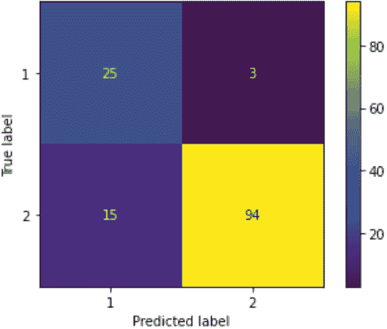

**图 4.12：** 在训练数据集上进行预测的混淆矩阵

因此，训练数据集的准确率为 86.86131%。

# 使用 Gini 指数构建决策树

我们将通过一个示例来讨论这个概念。

假设我们有一个包含 10 条记录的数据集，其中有两个独立变量和一个因分类变量。设独立变量为 `$x_1$` 和 `$x_2$`，因分类变量为 `$y$`。参考下表：

| $x_1$ | $x_2$ | $y$ |
|---|---|---|
| 1 | 4 | 0 |
| 7 | 6 | 0 |
| 1 | 6 | 0 |
| 1 | 2 | 1 |
| 5 | 2 | 1 |
| 7 | 2 | 1 |
| 5 | 4 | 0 |
| 2 | 4 | 0 |
| 1 | 7 | 1 |
| 2 | 7 | 1 |

**表 5.1:** 原始数据

考虑表 5.1 中的数据，因分类变量 `$y$` 有两个值——0 和 1。因此，数据被分为两类——0 和 1。

如果我们绘制表 5.1 中的数据，将得到如图 5.1 所示的图：

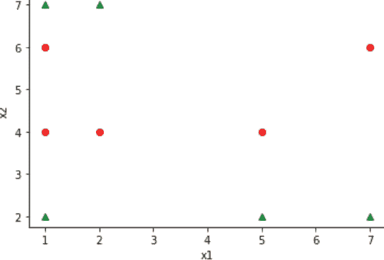

**图 5.2:** 表 5.1 中数据的图

# 掌握机器学习分类算法

在图 5.1 中，绿色三角形代表 `$y = 1$` 的数据点，红色圆圈代表 `$y = 0$` 的数据点。

我们想要构建的决策树能够根据变量 `$x_i$` 和 `$x_j$` 的值判断数据点的类别（即 `$y$`）。因此，我们必须根据 `$x_i$` 或 `$x_j$` 的取值来做出决定，决定采取哪个方向。为了理解这一点，请考虑图 5.2 所示的虚拟决策树：

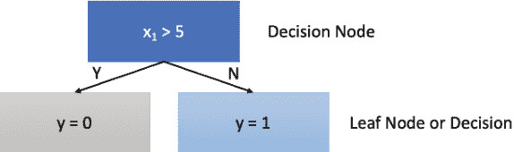

图 5.3: 虚拟决策树


在图 5.2 中，我们正根据 $x_i > 5$ 来判断数据点（即 $y$）是 1 还是 0。因此，为了形成决策树，我们需要找出所有通向决策的问题。

现在问题是我们如何确定决策树的条件。我们将使用分类与回归树（CART）算法。应用 CART 算法，我们使用 Gini 指数。

## 理解 Gini 指数

Gini 指数是衡量数据集不纯度的指标。

在数学上，Gini 指数的公式如下：

> $Gini(t) = 1 - \sum P(i|t)^2$

其中，$i$ 是数据集中所有唯一的类别，$t$ 从 1 变化到数据集中类别的总数。$P(i|t)$ 是给定 $t$ 的情况下类别 $i$ 发生的概率。

例如，在表 5.1 所示的数据集中，唯一的类别是 0 和 1。因此，在计算 Gini 指数时，$i$ 的值为 0 和 1。在这种情况下，$i$ 从 1 变化到 2。

例如，我们考虑表 5.1 出的的数据集（我们将其称为数据集 $d1$）。由于数据中有两类，Gini 指数的计算方式为：

> $Gini(d1) = 1 - (P(0|d1)^2 + P(1|d1)^2)$

在数据集 $d1$ 中，我们看到 10 个数据点。5 个属于类别 0，5 个属于类别 1。因此：

$$P(0|d1) = 5/10 = 0.5$$

$$P(1|d1) = 5/10 = 0.5$$

因此，数据集 $d1$ 的 Gini 指数 $= 1 - (0.5^2 + 0.5^2) = 1 - (0.25 + 0.25) = 1 - 0.5 = 0.5$

注意项 $\sum P(i|t)^2$ 的值在 0 到 1 之间变化。这是因为概率可以取 0 到 1 之间的值。$\sum P(i|t)^2$ 是空间内所有类别概率之和。因此，极端情况是数据集中只出现一个类别；其概率为 1，所有其他类别概率为 0。在这种情况下，$\sum P(i|t)^2$ 将为 1。Gini 指数为 0 意味着数据集是完全纯的。Gini 指数为 1 意味着数据集是随机分布的。Gini 指数为 0.5 表示数据集中所有类别的代表比例相等。

## 使用 CART 构建决策树

让我们先熟悉使用 CART 算法构建决策树的机制。

1. 计算数据集的 Gini 指数。如果数据集的 Gini 指数为 0，则数据集是纯的，不需要进行任何其他操作。
2. 如果步骤 1 中数据集的 Gini 指数不为 0，我们从数据集中确定可以做出决策的可能点。我们分析独立变量并从数据列出一个值列表。
3. 计算步骤 2 中每个阈值的损失（loss）。
4. 根据步骤 3 计算出的最小损失，我们决定在何处拆分数据点。
5. 从步骤 4 开始，我们得到两个数据集（因为 CART 构建的是二叉树）。重复所有步骤。

因此，现在我们需要为 CART 中使用的算法建立如下损失函数 $(J)$：

$$J = \frac{m_{left}Gini(left) + m_{right}Gini(right)}{m}$$

要使用 CART 构建决策树，我们可以找到数据可以拆分为两个分支的点。拆分左侧的数据集在损失函数中表示为 `left`，拆分右侧的数据集在损失函数中定义为 `right`。$m_{left}$ 是拆分左侧的数据点数量，$m_{right}$ 是拆分右侧的数据点数量。$Gini(left)$ 是左侧拆分数据集的 Gini 指数，$Gini(right)$ 是右侧拆分数据集的 Gini 指数，$m$ 是完整数据集的总点数。（此处原文部分存在部分逻辑重复的表述，翻译已根据核心意图调整）。

## 决策树算法

决策树的划分被称为**阈值**。

让我们计算阈值 $x_1 = 1.00$ 的损失。因此，我们根据 $x_1 \le 1.00$ 拆分数据集，那么拆分左侧和右侧的数据集将如表 5.2 所示：

| $x_1 \le 1.00$ | $x_2$ | $y$ | $x_1 > 1.00$ | $x_2$ | $y$ |
|---|---|---|---|---|---|
| 1 | 4 | 0 | 7 | 6 | 0 |
| 1 | 6 | 0 | 5 | 2 | 1 |
| 1 | 2 | 1 | 7 | 2 | 1 |
| 1 | 7 | 1 | 5 | 4 | 0 |
| 2 | 4 | 0 | 2 | 7 | 1 |

**表 5.2:** $x_1 \le 1.00$ 的划分

从表 5.2 中，我们得到拆分左侧的数据点数为 4，因此 $m_{left} = 4$。同样，我们得到 $m_{right} = 6$。同时，$m = 10$。我们必须计算 $Gini(left)$ 和 $Gini(right)$。

计算 $Gini(left)$，我们从表 5.2 得到：

$$P(0|left) = 2/4 = 0.5$$

$$P(1|left) = 2/4 = 0.5$$

因此，$Gini(left) = 1 - (0.5^2 + 0.5^2) = 1 - (0.25 + 0.25) = 1 - 0.5 = 0.5$

计算 $Gini(right)$，我们从表 5.2 得到：

$$P(0|right) = 3/6 = 0.5$$

$$P(1|right) = 3/6 = 0.5$$

因此，$Gini(right) = 1 - (0.5^2 + 0.5^2) = 1 - (0.25 + 0.25) = 1 - 0.5 = 0.5$

现在，我们可以计算阈值 $x_1 = 1.00$ 的损失。

$$J(x_1=1.00) = \frac{4*0.5+6*0.5}{10} = \frac{2+3}{10} = \frac{5}{10}=0.5$$

让我们再尝试一个例子来理解这项技术。我们计算阈值 $x_2 = 2.50$ 的损失。因此，我们根据 $x_2 \le 2.50$ 拆分数据集，那么拆分左侧和右侧的数据集将如表 5.3 所示：

| $x_2 \le 2.50$ | $x_1$ | $y$ | $x_2 > 2.50$ | $x_1$ | $y$ |
|---|---|---|---|---|---|
| 1 | 2 | 1 | 1 | 4 | 0 |
| 5 | 2 | 1 | 7 | 6 | 0 |
| 7 | 2 | 1 | 1 | 6 | 0 |
| 5 | 4 | 0 | 1 | 2 | 1 |
| 2 | 4 | 0 | 5 | 4 | 0 |
| 2 | 4 | 0 | 7 | 2 | 1 |
| 1 | 7 | 1 | 5 | 4 | 0 |
| 2 | 7 | 1 | 2 | 4 | 0 |

**表 5.3:** $x_2 \le 2.50$ 的划分

# 主掌握机器学习分类算法

| $x_s \le 2.50$ | | | $x_s > 2.50$ | | | |
|---|---|---|---|---|---|---|
| $x_1$ | $x_2$ | $y$ | $x_1$ | $x_2$ | $y$ |
| 1 | 2 | 1 | 1 | 4 | 0 |
| 5 | 2 | 1 | 1 | 6 | 0 |
| 7 | 2 | 1 | 1 | 7 | 1 |
| | | | 2 | 4 | 0 |
| | | | 2 | 7 | 1 |
| | | | 5 | 4 | 0 |
| | | | 7 | 6 | 0 |

**表 5.3:** 拆分点 $x_s \le 2.50$ 处的 $m_{left}$ 和 $m_{right}$ 数据集

从表 5.3 中我们可以得到拆分左侧的数据点数量为三个，因此，$m_{left} = 3$。同样，我们得到 $m_{right} = 7$。此外，我们得到 $m = 10$。

计算 Gini(left)，我们从**表 5.3** 中得到：

$P(0|left) = 0/3 = 0.0$

$P(1|left) = 3/3 = 1.0$

因此，$Gini(left) = 1 - (0.0^2 + 1.0^2) = 1 - (0.00 + 1.00) = 1 - 1.0 = 0$

计算 Gini(right)，我们从**表 5.3** 中得到：

$P(0|right) = 5/7 = 0.7143$

$P(1|right) = 2/7 = 0.2857$

因此，$Gini(right) = 1 - (0.7143^2 + 0.2857^2) = 1 - (0.5102 + 0.0816) = 1 - 0.5918 = 0.4082$

现在，我们可以计算阈值 $x_s = 2.50$ 处的损失。

```
$J(x_2 = 2.50) = \frac{3+0+7+0.4082}{10} = \frac{10.4082}{10} = 0.28571$
```

我们需要对已建立的所有阈值进行类似的计算。我留给你手动或使用程序完成所有计算。**表 5.4** 提供了所有阈值的损失：

| 特征 | 阈值 | 损失 |
|---|---|---|
| $x_1$ | 1.0 | 0.5000 |
| $x_1$ | 1.5 | 0.5000 |
| $x_1$ | 2.0 | 0.5000 |
| $x_1$ | 2.5 | 0.5000 |
| $x_1$ | 3.0 | 0.5000 |
| $x_1$ | 3.5 | 0.5000 |
| $x_1$ | 4.0 | 0.5000 |
| $x_1$ | 4.5 | 0.5000 |
| $x_1$ | 5.0 | 0.5000 |
| $x_1$ | 5.5 | 0.5000 |
| $x_1$ | 6.0 | 0.5000 |
| $x_1$ | 6.5 | 0.5000 |
| $x_1$ | 7.0 | 0.5000 |
| $x_1$ | 7.5 | 0.5000 |
| $x_2$ | 2.0 | 0.2857 |
| $x_2$ | 2.5 | 0.2857 |
| $x_2$ | 3.0 | 0.2857 |
| $x_2$ | 3.5 | 0.2857 |
| $x_2$ | 4.0 | 0.5000 |
| $x_2$ | 4.5 | 0.5000 |
| $x_2$ | 5.0 | 0.5000 |
| $x_2$ | 5.5 | 0.5000 |
| $x_2$ | 6.0 | 0.5000 |
| $x_2$ | 6.5 | 0.5000 |
| $x_2$ | 7.0 | 0.5000 |
| $x_2$ | 7.5 | 0.5000 |

**表 5.4:** 所有阈值的损失

表 5.4 显示了获得最小损失的阈值。为了目的，我们需要一个规则。我们将建立具有相同损失值的阈值。因此，将在 $x_2 = 3.5$ 处拆分决策树。

| $x_1$ | $x_2$ | $y$ | $x_1$ | $x_2$ | $y$ |
|---|---|---|---|---|---|
| 1 | 2 | 1 | 1 | 4 | 0 |
| 5 | 2 | 1 | 1 | 6 | 0 |
| 7 | 2 | 1 | 1 | 7 | 1 |
| | | | 2 | 4 | 0 |
| | | | 2 | 7 | 1 |
| | | | 5 | 4 | 0 |
| | | | 7 | 6 | 0 |

**表 5.6:** 拆分点的数据集

在决策树的每个拆分处，我们得到一个节点。在这个点，我们有了第一个节点。该节点被称为决策树的根节点。如图 5.4 所示，我们从该节点开始构建决策树。


**图 5.4:** 决策树的根节点

接下来，让我们考虑图 5.3 所示根节点的左侧的数据集。也就是说，我们只考虑 $x_2 \le 3.5$ 的数据点（如表 5.1 所示）。我们在表 5.7 中看到的数据集：

| $x_1$ | $x_2$ | $y$ |
|---|---|---|
| 1 | 2 | 1 |
| 5 | 2 | 1 |
| 7 | 2 | 1 |

**表 5.7:** 表 5.1 所示 $x_2 \le 3.5$ 的数据集数据点

让我们计算表 5.7 所示数据集的 Gini 指数。我们将表 5.7 中的数据集称为 $d2$。我们得到如下：

$P(0|d2) = 0/3 = 0$

$P(1|d2) = 3/3 = 1$

$Gini(d2) = 1 - (0^2 + 1^2) = 1 - 1 = 0$

根据我们对 Gini 指数的理解，我们知道 Gini 指数为 0 意味着数据集是纯的，没有杂质。因此该数据集不需要进一步拆分。

因此，我们的决策树多了一个节点。然而，该节点无法进一步拆分。此类节点被称为叶子节点。在这个例子中，我们得到的决策是当 $x_i \le 3.5$ 时，$y$ 的值应为 1。

更新后的决策树如图 5.5 所示。


**图 5.5:** 带有叶子节点的更新决策树（橙色）

现在，让我们考虑图 5.4 所示根节点右侧的数据集。也就是说，我们只考虑 $x_2 \ge 3.5$ 的数据点（如表 5.1 所示）。我们在表 5.8 中看到数据集：

| $x_1$ | $x_2$ | $y$ |
|---|---|---|
| 1 | 4 | 0 |
| 7 | 6 | 0 |
| 1 | 6 | 0 |
| 5 | 4 | 0 |
| 2 | 4 | 0 |
| 1 | 7 | 1 |
| 2 | 7 | 1 |

**表 5.8:** 表 5.1 所示 $x_2 > 3.5$ 的数据集数据点

让我们考虑表 5.8 所示的数据集 $d3$。现在，我们需要计算数据集 $d3$ 的 Gini 指数。我们得到如下：

$P(0|d3) = 5/7$

$P(1|d3) = 2/7 = 0.2857$

$Gini(d3) = 1 - (0.7143^2 + 0.2857^2) = 1 - (0.5102 + 0.0816) = 1 - 0.5918 = 0.4082$

数据集 $d3$ 的 Gini 指数不是 0，$d3$ 是不纯的，我们需要将此数据集拆分为叶子节点。使用特征的最小最大值来建立阈值的相同逻辑，我们得到的待考虑阈值如下：

| 特征 | 阈值 | 损失 |
|---|---|---|
| $x_1$ | 1.0 | 0.4048 |
| $x_1$ | 1.5 | 0.4048 |
| $x_1$ | 2.0 | 0.3429 |
| $x_1$ | 2.5 | 0.3429 |
| $x_1$ | 3.0 | 0.3429 |
| $x_1$ | 3.5 | 0.3429 |
| $x_1$ | 4.0 | 0.3429 |
| $x_1$ | 4.5 | 0.3429 |
| $x_1$ | 5.0 | 0.3429 |
| $x_1$ | 5.5 | 0.3429 |
| $x_1$ | 6.0 | 0.3429 |
| $x_1$ | 6.5 | 0.3429 |
| $x_1$ | 7.0 | 0.4082 |
| $x_1$ | 7.5 | 0.4082 |
| $x_2$ | 2.0 | 0.2857 |
| $x_2$ | 2.5 | 0.2857 |
| $x_2$ | 3.0 | 0.2857 |
| $x_2$ | 3.5 | 0.2857 |
| $x_2$ | 4.0 | 0.5000 |
| $x_2$ | 4.5 | 0.5000 |
| $x_2$ | 5.0 | 0.5000 |
| $x_2$ | 5.5 | 0.5000 |
| $x_2$ | 6.0 | 0.5000 |
| $x_2$ | 6.5 | 0.5000 |
| $x_2$ | 7.0 | 0.5000 |
| $x_2$ | 7.5 | 0.5000 |

**表 5.9:** 具有最小损失的阈值

表 5.9 显示了具有最小损失的阈值。为了目的，我们需要一个规则。我们将建立具有相同损失值的阈值。因此，将在 $x_2 = 3.5$ 处拆分决策树。

（注：此处原文表格数据与逻辑描述存在细微对应关系，翻译已严格遵循原文结构）

Gini(d4) = 1 - ( ) = 1 - (1 + 0) = 1 - 1 = 0

所以，数据集 d4 是纯的；因此，我们得到了一个叶节点。

现在，让我们计算数据集 d5 的 Gini 索引。结果如下：

```
P(0|d5) = 0/2 and P(1|d5) = 2/2 = 1
Gini(d5) = 1 - ( ) = 1 - (0 + 1) = 1 - 1 = 0
```

所以，数据集 d5 是纯的；因此，我们得到了一个叶节点。

由于数据集 d4 和 d5 都是纯的，我们不需要对数据集 d4 或 d5 进行进一步拆分。

因此，我们得到了表 5.1 中述数据集的最终决策树，如图 5.7 所示：

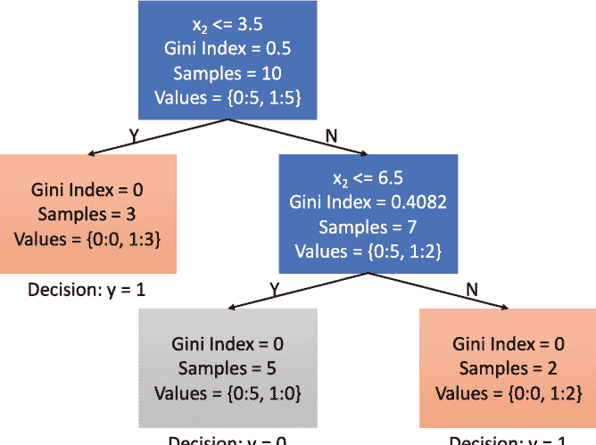

图 5.7：基于表 5.1 数据的最终决策树

在我们开发的决策树中（如图 5.6 所示），两个决策都是基于特征 x2 做出的。然而，当我们使用真实数据时，情况并非如此。大多数节点将是不同的特征。

## JPEG 文件中的恶意软件检测¹

现在我们应用决策树算法来检测 JPEG 文件中的恶意软件。

### 必要性

在现代世界中，网络安全对于任何政府和任何企业都是至关重要的。政府和企业面临着来自各种攻击者的持续网络攻击。据说，下一次战争将在网络空间进行。因此，开发应对网络攻击威胁的产品和策略是至关重要的。

网络攻击的手段之一是通过恶意软件。恶意软件是嵌入在常用软件中的恶意程序。例如，电子邮件可能携带可以感染接收者并在整个企业中传播的恶意软件。全球范围内人们交换的一种无处不在的文件图像。社交媒体的出现促进了图像的交换。图像不仅可以在计算机之间交换，还可以通过手机等设备进行交换。此外，人们倾向于广泛传播图像。因此，开发者将他们的恶意代码植入图像中以获取关注。

### 关于 JPEG 文件


JPEG 是 Joint Photographic Experts（联合摄影专家小组）的缩写，该小组在 1992 年开发了这种存储数字照片的标准。JPEG 以压缩格式存储数字图像。在本章中，我们不会涉及 JPEG 文件的格式，因为我们关注的是机器学习。但要注意，2010 年 JPEG 包含了 EXIF 标签，这允许添加关于图像的额外信息。EXIF 标签的一个重要特点是，大多数标签可以使用适当的软件进行修改。从 JPEG 文件移除恶意软件的方法之一是将 JPEG 文件转换为位图（也称为 BMP 文件）。BMP 文件仅存储图像信息，不携带任何 EXIF 标签。总之，我们分析 JPEG 文件中的 EXIF 标签来确定文件是洁的还是恶意的。

## 策略

JPEG 文件中的 EXIF 标签可能包含字符串或数字值。当黑客操纵数字时，我们感兴趣的是字符串，字符串通常包含黑客想要在用户机器上执行的代码。我们现在知道，为了构建机器学习模型，我们使用某些向量化器将字符串表示为数字。因此，我们将把 JPEG 文件中存在的所有 EXIF 标签汇总成单个字符串，然后对该字符串进行向量化。

在第 4 章“逻辑回归”中，我们讨论了 TF-IDF 向量化器。我们将使用 TF-IDF 向量对从数据集中每个 JPEG 文件中提取的 EXIF 标签字符串进行向量化。一旦我们有了 TF-IDF 向量，我们将使用它们来创建决策树模型。

## 构建模型

现在我们将讨论构建检测 JPEG 文件恶意软件模型所需的所有步骤。我们从定义常量开始。程序单元将需要这些常量。使用常量是一种良好的编程习惯，因为它允许在不修改多个位置代码的情况下对程序进行更改。

```
FILE_NAME_COLUMN_NAME = 'FileName'
FILE_TYPE_COLUMN_NAME = 'FileType'
TAG_STRING_COLUMN_NAME = 'TagString'
NUMERIC_COLUMN_IDENTIFIER = 'Numeric'
BENIGN_FILE = 0
FILE_WITH_MALWARE = 1
```

### 从 JPEG 文件中提取 EXIF 标签

以下函数可以从 JPEG 文件中提取 EXIF 标签。我们首先编写一个函数来判断输入文件是否为 JPEG 文件。JPEG 文件在开头有一个签名 `0xFFD8`。我们将使用 Python Image 库提供的 `verify()` 函数来判断提供的文件是否为 JPEG 文件。

```python
from PIL import Image

def isImageFile(imageFileName):
    returnValue = True

    try:
        img = Image.open('./' + imageName) # 打开图像文件
        img.verify() # 验证它是一个图像
    except (IOError, SyntaxError) as e:
        returnValue = False

    return returnValue
```

如果提供的输入文件名是 JPEG 文件，则 `isImageFile()` 函数返回 TRUE；否则返回 FALSE。

我们将编写一个名为 `JPEGFeatureExtractorToDictionary()` 的函数来读取 JPEG 文件并提取 JPEG 文件中所有的 EXIF 标签。该函数返回一个字典，其中键（keys）是 EXIF 标签的名称，关联值（values）是 JPEG 文件中 EXIF 标签的值。

```python
from PIL import Image
from PIL.ExifTags import TAGS

def JPEGFeatureExtractorToDictionary(imageFile):
    # 定义空字典
    returnValue = {}

    # 使用 PIL 读取图像
    image = Image.open(imageFile)

    # 提取 EXIF 数据
    exifdata = image.getexif()

    # 遍历所有的 EXIF 数据字段
    for tag_id in exifdata:
        # 获取标签名称
        tag = TAGS.get(tag_id, tag_id)
        data = exifdata.get(tag_id)
        # 解码字节
        if isinstance(data, bytes):
            data = data.decode('iso8859-1')

        returnValue[tag] = data
```

现在我们有了一个从单个 JPEG 文件提取所有 EXIF 标签的函数。接下来，我们将编写一个名为 `extractTagsFromDirectory()` 的函数来提取目录中所有文件的 EXIF 标签。该函数将读取目录中的所有文件，并对每个文件调用 `JPEGFeatureExtractorToDictionary()`。该文件会将函数返回的所有字典合并到一个列表中并返回该列表。

```python
import glob

def extractTagsFromADirectory(inputDirectory):
    # 定义计数器
    numberOfValidFiles = 0
    numberOfInvalidFiles = 0
    numberOffFilesWithoutTags = 0

    # 创建存储所有文件特征的空列表
    returnValue = []
    n = 0

    # 遍历输入目录中的所有文件
    for file in glob.glob(inputDirectory):
        # 创建空字典
        oneFileFeatures = {}
        try:
            # 读取文件并提取特征
            fileFeatures = JPEGFeatureExtractorToDictionary(file)
            # 如果文件具有某些特征，则为文件创建一个条目
            if len(fileFeatures.keys()) > 0:
                # 文件名
                oneFileFeatures[FILE_NAME_COLUMN_NAME] = file
                # 将文件特征添加到主字典
                oneFileFeatures.update(fileFeatures)
                # 将条目添加到返回值
                returnValue.append(oneFileFeatures)
                getNumberOfValidFiles = numberOfValidFiles + 1
            else:
                # 检查文件是否为有效的图像文件
                if isImageFile(file):
                    numberOfFilesWithoutTags = numberOfFilesWithoutTags + 1
                else:
                    numberOfInvalidFiles = numberOfInvalidFiles + 1
        except:
            # 检查文件是否为有效的图像文件
            if isImageFile(file):
                numberOfFilesWithoutTags = numberOfFilesWithoutTags + 1
            else:
                numberOfInvalidFiles = numberOfInvalidFiles + 1

    return (returnValue, numberOfValidFiles, numberOfInvalidFiles, numberOfFilesWithoutTags)
```

函数 `extractTagsFromDirectory` 返回一个字典列表，其中包含目录（作为输入提供）中所有可用文件的 EXIF 标签。该函数还返回了输入文件中有效的 JPEG 文件且包含 EXIF 标签的数量、不是有效 JPEG文件的输入文件数量，以及是有效 JPEG 文件但不包含任何 EXIF 标签的输入文件数量。

在这里，我们需要考虑如果一个 JPEG 文件不包含任何 EXIF 标签，那么此类 JPEG 文件就不可能包含任何恶意软件。

现在我们已经有了从 JPEG 文件中提取 EXIF 标签所需的函数，我们必须使用它们。在这里，我们使用一种策略将目录中的所有 JPEG 文件和包含恶意软件的 JPEG 文件存储在不同的目录中。这样，我们就知道哪些文件是干净的 JPEG 文件，哪些 JPEG 文件包含恶意软件。通过这样，我们可以按照构建监督学习模型的要求对数据进行标记。

以下是从干净的 JPEG 文件中提取 EXIF 标签的代码。

```python
benignFileFeatures, numValidFiles, numInvalidFiles, numFilesWithoutTags = extractTagsFromDirectory("./Data/clean_jpeg/**")
```

```python
print("Valid JPEG Files = %d\nInvalid Image Files = %d\nJPEG Files without Tags = %d" % (numValidFiles, numInvalidFiles, numFilesWithoutTags))
```

```
Valid JPEG Files = 4582
```

```
Invalid Image Files = 0
```

```
JPEG Files without Tags = 816
```

因此，我们的数据集中有 4,582 个包含 EXIF 标签的 JPEG 文件。我们将只考虑这些文件来训练模型。

接下来，我们从包含恶意软件的 JPEG 文件中提取 EXIF 标签。

```python
malwareFileFeatures, numValidFiles, numInvalidFiles, numFilesWithoutTags = extractTagsFromDirectory("./Data/malicious_files/**")
```

```python
print("Valid JPEG Files = %d\nInvalid Image Files = %d\nJPEG Files without Tags = %d" % (numValidFiles, numInvalidFiles, numFilesWithoutTags))
```

```
Valid JPEG Files = 400
```

```
Invalid Image Files = 12
```

```
JPEG Files without Tags = 3
```

因此，我们的数据集中有 400 个包含 EXIF 标签和恶意软件的 JPEG 文件。我们将只考虑这些文件来训练模型。

注意，这些文件被标记为包含恶意软件的 JPEG 文件且没有 EXIF 标签。通常情况下，这些是需要进一步研究的情况。我尝试将这三个文件加载到 Google Drive，它们成功上传了。Google Drive 拥有强大的恶意软件检测器，通常包含恶意软件的文件无法上传到 Google Drive。因此，目前可以安全地假设这三个文件被错误地标记为包含恶意软件的 JPEG 文件。

现在我们已经获取了数据集中所有 JPEG 文件的 EXIF 标签，我们将一个 JPEG 中所有的 EXIF 标签组成一个字符串，并将其作为记录存储在 DataFrame 中。一旦完成这个练习，我们将得到一个包含每个 JPEG 文件中所有 EXIF 标签字符串的 DataFrame。此外，我们会将每个记录标记为它是干净的 JPEG 文件还是包含恶意软件的 JPEG 文件。通过这样，我们就创建了用于构建监督学习模型的标记数据。

函数 `fillDataDataFrame` 接收由函数 `extractTagsFrom` 返回的字典列表并创建一个 DataFrame。该 DataFrame 将包含两列——一列包含 JPEG 文件中所有的 EXIF 标签，另一列标明相关的字符串是干净的 JPEG 文件还是包含恶意软件的 JPEG 文件。

```python
import pandas as pd
from tqdm import tqdm

def fillDataDataFrame(featureDictionary, extractionDescription, fileType):
    # 创建一个空的 DataFrame
    df = pd.DataFrame()
    for record in tqdm(featureDictionary, desc=extractionDescription):
        # 创建一个空的字典
        oneRecord = {}
        # 创建一个空字符串
        recordString = ""
        # 遍历记录中的所有特征
        for k in record.keys():
            # 提取键的值并将其添加到记录中
            # 在每个标签之间添加一个空格
            # 不包含文件名
            if k != FILE_COLUMN_NAME:
                recordString = recordString + str(record[k]) + " "
        # 将记录字符串作为单独的一列添加到记录中
        oneRecord[TAG_STRING_NAME] = recordString[:-1]
        # 添加列以标记为良文件
        oneRecord[FILE_COLUMN_NAME] = pd.to_numeric(fileType, downcast='integer')
        # 将记录添加到 DataFrame
        df = pd.concat([df, pd.DataFrame(oneRecord, [TAG_STRING_NAME])])
    return df
```

现在，我们有 4,982 个数据点，对应 4,800 个特征。

## 平衡数据集

我们注意到有 4,582 个清洁 JPEG 文件的数据点和 400 个包含恶意软件的 JPEG 数据点。因此，它小于清洁 JPEG 文件的 10%。这类数据集被称为不平衡数据集（Imbalanced datasets）。

通常，任何涉及欺诈的数据集都是不平衡的。这是因为与正常交易案例相比，欺诈实例的数量非常稀少。在信用卡欺诈场景中，我们从所有交易数据集中获取的欺诈交易数据可能不足总 1%。

不平衡数据集带来了一个问题：代表性较少的数据类别可能会被算法赋予较低的权重。结果是分类通常是不准确的。因此，在大多数情况下，我们会平衡数据集。

平衡数据集有两种方法。第一种方法被称为过采样（over-sampling）。我们尝试为数据点较少的类别创建人工数据点，使得该类别中的数据点数量与数据点较多的类别变得相同（或几乎相同）。另一种方法被称为欠采样（under-sampling）。在欠采样技术中，我们减少数据点较多的类别中的数据点，使得所有类别的数据点数量变得几乎相同。

在我们的案例中，我们只有 5,000 个数据点；我们无法承担减少数据点的代价。因此，我们将使用过采样技术。

不平衡数据集可以使用合成少数类过采样技术（SMOTE）算法进行过采样。我们将对我们的数据集应用 SMOTE。

```python
import imlearn as ib
```

```python
# Transform the dataset
oversample = ib.over_sampling.SMOTE(random_state = 42)
X, y = oversample.fit_resample(X, y)
X.shape
(9164, 4800)
y.value_counts()
```

```
0 4582
1 4582
Name: FileType, dtype: int64
```

现在，我们两个类别的数据点数量相等，即清洁 JPEG 文件和包含恶意软件的 JPEG 文件。

## 构建决策树模型

我们已经完成了提取和预处理数据的所有步骤。我们现在可以构建决策树模型了。

```python
from sklearn.tree import DecisionTreeClassifier
modelDT = DecisionTreeClassifier(random_state = 42)
modelDT.fit(X, y)
DecisionTreeClassifier(random_state=42)
```


模型现在准备就绪。

## 测试模型

我们现在将测试模型。为了测试模型，我们将检查模型在训练数据上的表现。一旦获得模型在训练数据上的准确率，我们将在测试数据上测试模型。

如果训练准确率和测试准确率都很高，我们可以确定所构建的模型对于该目的是有效的。

如果训练准确率高而测试准确率低，我们就会担心，因为我们可以得出模型对训练数据的学习太好了，因此当向模型提供未见过的数据时，它的表现并不好。这可能发生在模型过于复杂的情况下。复杂模型意味着模型具有太多变量且不具泛化能力。常见的做法是通过减少变量的数量来降低模型的复杂性。我们将此类模型称为过拟合模型（`overfitting models`）。

虽然虽然罕见，但我们也可能遇到训练准确率低而测试准确率高的情况。在这种情况下，模型可能太简单。我们将此类模型称为欠拟合模型（`underfitting models`）。在这种情况下，我们需要向模型中添加更多变量。

### 查找训练准确率得分

我们首先在训练数据上测试模型。

```python
from sklearn import metrics

import matplotlib.pyplot as plt

import seaborn as sns
```

```python
y_pred = modelDT.predict(X)

cm = metrics.confusion_matrix(y, y_pred)

ax = plt.subplot()

sns.heatmap(cm, annot=True, fmt='g', ax=ax)

# labels, title and ticks
ax.set_xlabel('Predicted labels');
ax.set_ylabel('True labels');
ax.set_title('Confusion Matrix');
ax.xaxis.set_ticklabels(['Benign', 'Malware'])
ax.yaxis.set_ticklabels(['Benign', 'Malware'])
```

```python
print("\n\nConfusion Classification Report")
print(metrics.classification_report(y, y_pred))
```

混淆分类报告

| | precision | recall | f1-score | support |
|---|---|---|---|---|
| 0 | 1.00 | 1.00 | 1.00 | 4582 |
| 1 | 1.00 | 1.00 | 1.00 | 4582 |
| accuracy | | | 1.00 | 9164 |
| macro avg | 1.00 | 1.00 | 1.00 | 9164 |
| weighted avg | 1.00 | 1.00 | 1.00 | 9164 |

准确率: 99.96726%

## 添加

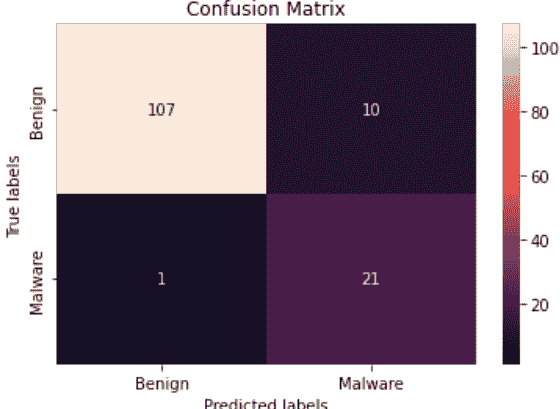

准确率: 99.96726%

### 查找测试准确率得分

我们现在将测试模型。为了测试模型，我们将检查模型在训练数据上的表现。一旦获得模型在训练数据上的准确率，我们将在测试数据上测试模型。

如果训练准确率和测试准确率都很高，我们可以确定所构建的模型对于该目的是有效的。

如果训练准确率高而测试准确率低，我们就会担心，因为我们可以得出模型对训练数据的学习太好了，因此当向模型提供未见过的数据时，它的表现并不好。这可能发生在模型过于复杂的情况下。复杂模型意味着模型具有太多变量且不具泛化能力。常见的做法是通过减少变量的数量来降低模型的复杂性。我们将此类模型称为过拟合模型。

虽然罕见，但我们也可能遇到训练准确率低而测试准确率高的情况。在这种情况下，模型可能太简单。我们将此类模型称为欠拟合模型。在这种情况下，我们需要向模型中添加更多变量。

### 决策树算法

在使用模型之前，我们需要预处理数据。预处理数据的步骤如下：

- 我们需要从 JPEG 文件提取 EXIF 标签。
- 我们需要合并包含恶意软件的 JPEG 文件。
- 我们将在清洁数据上使用 TF-IDF 向量。
- 一获得清洁数据，我们将应用 PCA 来减少特征的数量。

在执行这些步骤后，我们可以应用模型进行预测。测试准确率为92.0863%。

### 结论

决策树算法是一种贪心算法。这是因为决策树尝试在根节点寻找最优划分，并在随后的每个节点继续寻找最优划分，直到无法进一步减少纯度。由于这种方法，决策树算法往往会过拟合数据。当模型过拟合时，它在预测的新数据上无法进行良好的泛化。

在本章中，除了讨论决策树模型外，我们还讨论了数据集不平衡时如何平衡数据集。对于平衡数据集，我们讨论了 SMOTE 算法。主成分分析（PCA）可以在不遭受显著信息损失的情况下减少构建模型时特征的数量。

# 第6 章

## 集成模型

在上一章中，我们了解了使用决策树算法构建的模型倾向于过拟合。与决策树算法一样，所有算法都有某些缺点。克服这一问题的一种方法是使用多个模型进行预测，然后根据所有模型的集体智能做出决定。当有许多模型共同工作做出决策时，我们将此类模型称为集成模型（Ensemble models）。

在本章中，我们将探索不同类型的集成模型：


### 结构

在本章中，我们将讨论以下主题：
- 集成模型
- 集成模型背后的直觉
- 不同类型的集成模型
- Scikit-Learn 中的集成实现
- VotingClassifier（投票分类器）
- BaggingClassifier（Bagging分类器）
- StackingClassifier（堆叠分类器）
- 使用 Bagging 构建集成模型
- 关于数据集
- Librosa 库
- 构建集成模型

### 目标

读完本章后，你将清晰集成集成模型的细节。此外，你将学习如何使用 Scikit-Learn 库实现的不同集成模型。最后，在本章结束时，你还将学习如何使用 Bagging 来解决提取情感的分类问题。

### 集成模型

面对非常复杂的问题时，我们可以向一位专家提问并获得意见。在这里，我们将取决于专家的智慧。每个人都有某些偏见。因此，专家提供的答案是基于他们的偏好的。该解决方案准确的概率可能有限。假设我们改变方法，向几位专家提问。然后，我们汇总所有专家的答案，选择大多数专家同意的解决方案。在大多数情况下，这样的结论比一个专家的意见更准确。

集集的思想是针对特定问题询问多个专家。在简单的集成模型中，我们将数据提供给多个模型并获取每个模型的答案。然后，如果是回归问题，我们取所有模型得到的平均值作为解决方案。如果是分类问题，我们获取所有模型的答案，并将模型数量最多的答案作为最终答案。

为了更清楚地理解这一点，假设我们有一个分类问题，判断判断是否为垃圾邮件（即我们需要将其分为两类——垃圾邮件和非垃圾邮件）。我们将标记数据提供给若干种算法并创建所有模型。当我们想要预测数据实例时，我们将向所有模型提问。某些模型可能将该情况归类为垃圾邮件，另一些模型可能将其归类为非垃圾邮件。我们将预测为垃圾邮件的数量和预测为非垃圾邮件的数量。如果预测为垃圾邮件的数量大于预测为非垃圾邮件的数量，我们就得出该情况为垃圾邮件的结论；否则我们并不总是使用多种算法创建模型。通常，我们使用像决策树这样的单一算法。我们知道决策树倾向于偏离。过拟合意味着算法学习数据太完美了；因此，当提供新数据时，模型往往会出错。所以，我们做的是创建数据的子集。为了便于理解，假设我们有 1000 个数据点。我们通过从原始 1000 个数据集中随机选取，创建 100 个数据点的子集。现在，我们将每个 100 个数据点的子集提供给模型，使用决策树算法创建十个独立的模型。现在，每个模型只看到部分数据，没有任何一个模型可以看到完整的数据集。当这十个模型做出预测时，我们将根据大多数模型做出的预测作为我们的决策。我们始终根据所有模型的预测结果来考虑预测。

这种创建模型的技术被称为集成技术（ensemble technique），此类模型被称为集成模型（Ensemble models）。

### 集成模型背后的直觉

假设我们有一个偏硬币，得到正面的概率为 51%（得到反面的概率为 49%）。如果我们投掷一次硬币，得到正面或反面的机会相等。然而，如果我们投掷这种硬币 100 次，得到 51 次正面和 49 次反面的概率很大。但是，如果我们投掷 10,000 次，得到正面 5,100 次、反面 4,900 次的可能性。注意，随着我们投掷硬币次数的增加，我们的结论变得明显区分。

集成的工作原理相同。假设我们有几个结果比随机猜测结果更好的分类器。那么，当我们使用这些分类器利用足够的数据点创建集成并取结果的多数时，集成通常会提供超过 75% 的准确率。需要注意的关键点是我们需要足够的数据点。在统计学中，这被称为大数法则。

### 不同类型的集成模型

有很多类型的集成模型。我们将关注四种集成模型，即 Voting（投票）、Bagging、Boosting（提升）和 Stacking（堆叠）。

### Voting 集成模型

在 Voting 集成模型中，我们将使用不同算法构建的多个模型处理相同的数据。然后，我们分别从每个模型进行预测，并采取大多数模型提供的决策。

在图 6.2 中，我们看到 Voting 集成模型是如何工作的。我们可以在输入上构建 3 个模型：


> “A 类”获得 2 票，“B 类”获得 1 票，因此选择“A 类”作为我们的决策。

图 6.2：Voting 的简化示例

如图 6.2 所示，我们使用朴素贝叶、KNN 和决策树算法构建了三个模型。然后，当我们有一个需要进行预测的数据实例时，我们将数据提供给三个模型中的每一个，并获取每个模型的预测。大多数模型做出的预测被认为是最终预测。

> 注意：由于我们正在讨论分类算法，我们将决策视为类别。如果问题是回归问题，我们将取每个模型的输出。

> 注意：在图 6.1 的插图中，我们考虑了三个模型。这只是一个例子。我们可以使用所需的任意数量的模型。

### Bagging 集成模型

在 Bagging 集成模型中，我们使用相同的算法创建多个模型。然而，我们为每个模型提供不同的数据子集。因此，没有任何模型看到完整的数据集。为了为每个模型提供不同的数据子集，我们创建原始数据集的随机子集。然后，我们在其中一个数据子集上训练每个模型。

现在要创建数据子集，我们有两种选择。第一种选择是通过有放回的对原始数据集进行采样来创建子集。当我们使用这种创建数据子集的技术并使用相同的算法创建模型来构建集成模型时，它被称为 **Bagging（袋）集成模型**。

第二种选择是通过不放回的对原始数据集进行采样来创建子集。使用这种技术创建原始数据集子集并使用相同算法创建模型的集成模型被称为 **Pasting（粘贴）集成模型**。

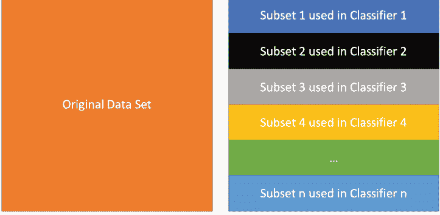

每个子集都是通过从原始数据集中随机选取数据创建的。在 Bagging/Pasting 集成模型中，使用相同的算法利用其中一个子集的数据来创建模型。

图 6.3：Bagging/Pasting 集成模型数据集形成形成图

> 注意：让我们理解一下有放回采样和不放回采样。假设我们有一个包含元素 1, 2, 3, 4 和 5 的数据集。从这个数据集中，我们需要抽取包含两个元素的样本。假设我们从这个数据集中选取了 2 个元素，元素是 1 和 4。现在，在选取下一个 2 个元素的样本之前，如果我们把元素 1 和 4 放回数据集再进行采样，这被称为**有放回采样**。换句话说，我们每次从这个数据集中采样时，总是从数据集中原始的 5 个元素中进行选择。相反，在我们选取了包含 1 和 4 的第一个样本后，不把这些元素放回数据集，那么对于下一个样本，我们需要从 2, 3 和 5 中选择。这被称为**不放回采样**。

Bagging 集成模型可以使用任何算法在原始数据集的不同子集上创建。当我们创建多个决策树模型时，我们得到了许多决策树；因此我们称之为森林。第 7 章随机森林算法将解释 Bagging 集成模型。随机森林是一种非常强大且广泛使用的算法，可以在不过拟合数据的情况下提供高准确率。

在 Bagging 集成中，每个分类器都是弱分类器。因为每个分类器是在有限的数据上训练的，它们具有较高的偏差。然而，当聚合这些分类器的结果时，集成模型具有低偏差并提供了更高的准确率。

> 注意：Bagging/Pasting 集成模型的优势之一是，构建这些模型可以使用并行计算。因此，这种建模非常扩展。

当我们通过有放回采样创建数据子集时，通常原始数据集中的某些数据点不会进入任何子集。约 37% 的数据点未用于创建 Bagging 集成模型，这 37% 的数据点被称为**袋外（Out-of-Bag）数据点**。我们可以使用袋外数据点来测试 Bagging 集成模型，通过评估预测的准确性。

### Boosting 集成模型

与 Voting 集成模型不同，Boosting 集成模型使用相同的算法来训练模型。此外，它们在完整的数据上训练模型。

Boosting 集成模型是顺序训练的。其思想是先在数据集上训练模型，让模型发现其预测中的错误。现在，模型进行第二次训练以消除上一次的错误。在第二次训练后，模型再次发现预测中的错误并进行第三次训练以消除这些错误。这个循环一直重复，直到模型无法再消除错误。

我们将在第 8 章“Boosting”中详细讨论 Boosting 模型。

### Stacking 集成模型

Stacking 集成模型的核心思想是，如果我们使用不同的算法构建了多个产生良好预测的模型，为什么不用一种机制来选择信赖的模型呢？换句话说，在使用多种算法训练模型后，我们设计了一种选择可靠模型的方法。

与 Bagging 集成模型使用原始数据集子集训练模型不同，在 Stacking 集成模型中使用完整数据集来训练模型。与使用顺序训练模型的 Boosting 集成模型不同，我们使用多种算法来构建不同的模型。一旦在 Stacking 集成模型中构建了模型，就会使用另一个模型来做出最终预测。

本质上，Stacking 集成模型的哲学不是对创建的不同模型进行简单聚合（如分类投票或回归取平均），而是训练一个完全独立的模型来进行预测。用于在训练数据的模型被称为**基模型（Base models）**或 **Level 0 模型**。用于预测的模型被称为**元模型（Meta Model）**或 **Level 1 模型**。

我们在完整数据集上训练基模型以满足 Stacking 集成模型的目标。然后我们获取这些基模型的预测结果并训练元模型。

当多个算法在数据集上都具有某种技能时，Stacking 集成模型是合适的；这意味着算法产生的模型之间是不相关的。在 Stacking 集成模型中，基模型通常使用决策树算法、随机森林算法等复杂算法构建。元模型通常使用逻辑回归等简单算法制成。

Stacking 集成模型的机制如图 6.4 所示：


图 6.4：Stacking 集成示意图

我们本书中不再进一步讨论 Stacking 集成模型，因为在机器学习领域它并不广泛使用。

### Scikit-Learn 中的集成模型实现

在本章之前我们讨论的所有算法（即朴素贝叶斯算法、K-近邻算法、逻辑回归算法和决策树算法）都可以通过手动演示来理解。此外，这些算法做出的预测很容易解释。这类模型被称为**白盒模型（White Box Models）**。

然而，在集成模型（以及神经网络）中，很难解释为什么特定的数据实例被分类为特定的类别。这就是为什么这些模型被称为**黑盒模型（Black Box Models）**。我们无法通过数据集来演示集成模型。但是，你仍然可以自己编写此类模型。我们包含了编写集成模型的所有基本细节。

精通机器学习分类算法

以下是 Scikit-Learn 中可用的集成模型实现细节，以及可以用于调优模型的参数。我们在这里不会讨论 Boosting 集成，因为它将在第 8 章“Boosting”中讨论。

Scikit-Learn 库有一个专门用于集成模型的模块 `sklearn.ensemble`。

#### VotingClassifier

在 `sklearn.ensemble` 中，`VotingClassifier` 可用于实现分类的 Voting 集成模型。`VotingClassifier` 类的核心参数是 `estimators`。用于 Voting 集成模型的不同估估计器可以通过 `estimators` 参数提供：

```python
from sklearn.ensemble import VotingClassifier

...

from sklearn.naive_bayes import MultinomialNB

from sklearn.neighbors import KNeighborsClassifier

from sklearn.tree import DecisionTreeClassifier
```

```python
nbCls = MultinomialNB()

knnCls = KNeighborsClassifier()

dtClfs = DecisionTreeClassifier()

..."
```

```python
votingClf = VotingClassifier(estimators=[('nb', nbCls), ('knn', knnCls), ('dt', dtClfs)])

...
```


## BaggingClassifier

在 sklearn 中，`BaggingClassifier` 类用于实现分类的 Bagging 集成模型。表 6.1 列出了 `BaggingClassifier` 类的关键参数：

| 参数 | 解释 |
| --- | --- |
| estimator | Bagging Classifier 类使用的估计器。默认情况下，估计器是决策树分类（DecisionTreeClassifier）。此参数需要作为估计器类的一个实例提供。 |
| n_estimators | 要创建的估计器实例的数量。这意味着 Bagging Classifier 将使用估计器类创建数量与 n_estimators 值相等的模型，并从提供的数据集中创建 n_estimators 数量的数据集。在 Scikit-Learn 的某些版本中，该参数可能以 `base_estimator` 的形式存在。 |
| bootstrap | 这是一个布尔值参数，取值为 True 或 False。如果 `bootstrap` 参数的值设置为 True，则进行有放回抽样。如果 `bootstrap` 参数的值设置为 False，则进行不放回抽样。 |
| max_samples | 为每个估计器实例需要提供从原始数据集中提取的最大数据点数。 |
| oob_score | 这是一个布尔值参数，取值为 True 或 False。该参数仅在 `bootstrap` 参数设置为 True 时有效。当其设置为 True 时，将使用袋外（out-of-bag）数据点来检查泛化误差。 |

表 6.1：BaggingClassifier 的参数

在下面的代码中，我们看到如何使用 Scikit-Learn 包中的 BaggingClassifier：

```python
from sklearn.ensemble import BaggingClassifier
```

```python
from sklearn.tree import DecisionTreeClassifier
```

```python
baggingClf = BaggingClassifier(estimator=DecisionTreeClassifier(), n_estimators = 1000, bootstrap=True, max_samples=500, oob_score=True)
```

## StackingClassifier

在 sklearn.ensemble 中，`StackingClassifier` 类用于实现分类的 Stacking 集成模型。StackingClassifier 类有两个关键参数。第一个关键参数是 `estimators`，它接收一个不同分类器的列表用于构建基模型。第二个关键参数是 `final_estimator`，它接收用于构建元模型的类。

`StackingClassifier` 的另一个重要参数是 passthrough。它接收一个布尔值（即，我们将此参数设置为 True 或 False）。当 `passthrough` 设置为 False 时，`StackingClassifier` 使用基模型的预测结果作为构建元模型的输入。当 `passthrough` 设置为 True 时，`StackingClassifier` 将使用基模型的预测结果和原始数据集来构建元模型，如下代码所示：

```python
from sklearn.ensemble import StackingClassifier
...
```

```python
from sklearn.naive_bayes import MultinomialNB
from sklearn.neighbors import KNeighborsClassifier
from sklearn.tree import DecisionTreeClassifier
from sklearn.linear_model import LogisticRegression
```

```python
...
nbCls = MultinomialNB()
knnCls = KNeighborsClassifier()
dtCls = DecisionTreeClassifier()
lrCls = LogisticRegression()
```

```python
...
stackingClf = StackingClassifier(estimators=[('nb', nbCls), ('knn', knnCls), ('dt', dtCls)], final_estimator=lrCls)
...
```

## 使用 Bagging 算法构建语音情感分析模型

情感分析在许多行业中被广泛使用。提供在线服务的公司使用情感分析来分析客户反馈。在临床调查中，它用于预测患者的状态。人力资源部门将其用于离职预测等应用。在保险行业，情感分析有更多其他用例。

情感分析通常在文本数据上进行。这是自然语言处理（NLP）的一个领域。该领域通过分析不同的单词来确定情感。我们将对语音进行情感分析，在语音中，音高、语调、语速、音量等方面被分析以确定表达的情感。

使用机器学习进行情感分析的领域仍处于起步阶段，一些可靠的数据集用于构建模型。我们可以通过提供更高质量的数据来改进模型。

## 关于数据集

正如本章所述，用于情感分析的数据集从 Kaggle 获取。数据集的第一个来源是多伦多大学（University of Toronto），第二个来源是里森音视频数据库（Ryerson Audio-Visual Database）。

### TESS 数据集

TESS 数据集包含 2880 个文件，每个文件都包含一段录音。200 个目标词由两位女演员在“Say the word ______”的短语中读出，并录制了七种不同的情感（愤怒、厌恶、恐惧、快乐、惊讶、悲伤和中性）。两位女演员的英语均为母语，拥有大学学历，并接受过音乐训练。听学测试显示两者的阈值都在正常范围内。

- 1 https://borealisdata.com/dataset.xhtml?persistentid=do:10.5683/SP2/E82MF
- 2 https://zenodo.org/record/1188976#Y_RMYuxBzA1

### Ravdess 数据集

Ravdess 数据集包含 2880 个文件，每个文件都包含一段录音。200 个目标词由两位女演员在“Say the word ______”的短语中读出，并录制了七种不同的情感（愤怒、厌恶、恐惧、快乐、惊讶、悲伤和中性）。两位女演员的英语均为母语，拥有大学学历，并接受过音乐训练。听学测试显示两者的阈值都在正常范围内。

# 掌握机器学习中的分类算法

一旦加载了数据集，就可以使用以下代码播放音频文件：

```python
import IPython.display as ipd
sampleAudio1 = ravdessFiles[0]
ipd.Audio(sampleAudio1)
<IPython.lib.display.Audio object>
sampleAudio2 = tessFiles[100]
ipd.Audio(sampleAudio2)
<IPython.lib.display.Audio object>
```

运行此代码时将出现一个音频播放器，如图 6.5 所示。点击音频片段上的开始按钮后，音频片段将如接下来所示播放：


> 图 6.5：由 IPython 库提供的音频播放器

从数据集中，我们需要首先建立数据分布。数据分布是构建良好模型的关键方面。我们知道数据包含 8 种不同情绪的音频片段。我们需要检查数据集中每种情绪的音频文件数量是相似还是不同。如果每种情绪的音频文件数量相似，我们就说数据集是平衡的。否则，该数据集被称为不平衡的。

如果数据集是平衡的，模型将对每种情绪赋予几乎相等的权重。如果不是，模型可能会偏向音频片段较多的情绪。拥有平衡的集合有助于构建良好的分类模型。

我们首先确定每种情绪有多少个音频片段。在这里，音频片段中表达的情绪是我们的标签。我们将告诉机器特定的音频片段表达了特定的情绪。根据提供给机器的这些知识，预计机器将学习如何确定提供给机器的新音频片段所表达的情绪。

每个音频片段相关的情绪都编码在音频片段的文件名中。以下代码从文件名中提取与情绪相关的文本并将其与音频片段关联。请注意，TESS 文件和 Ravdess 文件的命名规范是不同的。此外，注意变量 `tessFiles` 和 `ravdessFiles` 所有音频片段文件的完整路径：

```python
emotionsInTessFiles = [fileName.split("//
```

我们现在知道 TESS 和 Ravdess 文件中可用的情绪：

```python
print('Audio Clips of Emotions available in Tess Files:',
set(emotionsInTessFiles))
```

```python
print('Audio Clips of Emotions available in Ravdess Files:',
set(emotionsInRavdessFiles))
```

Tess 文件中可用的情绪片段：{'disgust', 'neutral', 'fear', 'angry', 'sad', 'happy', 'surprised'}

Ravdess 文件中可用的情绪片段：{'disgust', 'neutral', 'fear', 'angry', 'sad', 'happy', 'surprised'}

注意，我们没有冷静（calm）这种情绪的样本。我们无法从使用此数据集构建的模型中确定“冷静”这种情绪。

接下来，让我们统计两个数据集中每种情绪有多少音频片段：

```python
import pandas as pd
```

```python
print('Number of Audio Clips available for each Emotion in the Tess Files')
dfessEmotions = pd.DataFrame(emotionsInTessFiles, columns = ['Emotion'])
dTessCount = dfTessEmotions.value_counts().reset_index(name = 'count')
```

```python
dfTessCount
```

Tess 文件中每种情绪的音频片段数量

| Emotion | count |
|---|---|---|
| 0 | disgust | 391 |
| 1 | surprised | 387 |
| 2 | happy | 383 |
| 3 | angry | 382 |
| 4 | fear | 379 |
| 5 | sad | 379 |
| 6 | neutral | 378 |

```python
print('Number of Audio Clips available for each Emotion in the Rav Files')
dRavdessEmotions = pd.DataFrame(emotionsInRavdessFiles, columns = ['Emotion'])
dRavdessCount = dRavdessEmotions.value_counts().reset_index(name = 'count')
```

Ravdess 文件中每种情绪的音频片段数量

| Emotion | count |
|---|---|---|
| 0 | sad | 183 |
| 1 | fear | 182 |
| 2 | surprised | 182 |
| 3 | disgust | 180 |
| 4 | angry | 179 |
| 5 | happy | 174 |
| 6 | neutral | 88 |

```python
print('Number of Audio Clips available for each Emotion in both the Tess and Rav Files combined together')
dfCombined = dfTessEmotions.append(dRavdessEmotions)
dfCombinedCount = dfCombined.value_counts().reset_index(name = 'count')
```

# dfCombinedCount

Tess 和 Rav 文件 文件合并后每种情绪的音频片段数量

| Emotion | count |
|---|---|---|
| 0 | disgust | 571 |
| 1 | surprised | 569 |
| 2 | sad | 562 |
| 3 | angry | 561 |
| 4 | fear | 561 |
| 5 | happy | 557 |
| 6 | neutral | 466 |

当我们通过合并 TESS 和 Ravdess 数据集构建模型时，让我们看看合并集中不同情绪的音频片段分布情况：

```python
from matplotlib import pyplot as plt
import seaborn as sb
sb.barplot(x = dfCombinedCount['Emotion'], y = dfCombinedCount['count'])
plt.show()
```

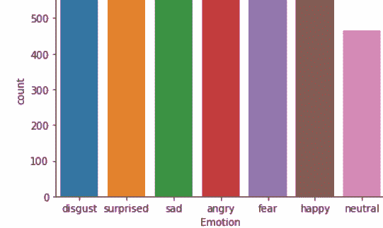

**图 6.6：** 合并集的绪分布

# 音频信号可视化

我们看到除了中性（neutral）外，所有情绪的文件数量几乎相同。我们可以认为该数据集是平衡的。现在我们将可视化音频文件中的音频信号。为了做到这一点，我们将使用 librosa 库。在大多数情况下，可能需要安装 librosa 库。使用以下代码在你的机器上安装 librosa。要安装 librosa 库，你需要至少 0.53 版本的 numba（这是撰写本章时的情况）。检查你的机器上是否安装了适当版本的 numba。以下代码将在你的机器上安装 librosa：

```bash
!pip install numba
!pip install librosa
```


# 音频信号可视化

我们看到除了中性（`neutral`）外，所有情绪的文件数量几乎相同。我们可以认为该数据集是平衡的。现在我们将可视化音频文件中的音频信号。为了做到这一点，我们将使用 `librosa` 库。在大多数情况下，可能需要安装 `librosa` 库。使用以下代码在你的机器上安装 `librosa`。要安装 `librosa` 库，你需要至少 `0.53` 版本的 `numba`。检查你的机器上是否安装了适当版本的 `numba`。以下代码将在你的机器上安装 `librosa`：

## 强调信号

`[0.0000000e+00 0.0000000e+00 0.0000000e+00 ... 1.2685145e-05 1.881599e-05 3.4526249e-06]`

元素数量: `91231`

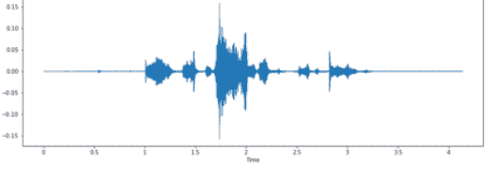

图 6.8：强调的波形

接下来，我们对音频信号应用短时傅里叶变换（STFT）。这是一种与傅里叶相关的变换，用于确定信号随时间变化的局部部分的正弦频率和相位内容。在实践中，计算 STFT 的过程是将较长的时间信号划分为若干等长度的较短段，然后对每个较短段单独计算傅里叶变换。这可以揭示每个较短段的傅里叶频谱。

参数 `n_fft` 是填充零后的窗口化信号长度。STFT 矩阵 `D` 的行数为 `(1 + n_fft)`。默认值 `n_fft=248` 样本对应于 `22050 Hz` 采样率（`librosa` 中的默认采样率）下的 `93` 毫秒物理时长。该值非常适用于音乐信号。然而，在语音处理中推荐的值为 `512`，在 `22050 Hz` 的采样率下对应于 `23` 毫秒：

```python
stft = np.abs(librosa.stft(emphasizedSignal, n_fft = 512))
```

```python
print('STFTn', stft)
```

```python
print('\nSTFT Shape:', stft.shape)
```

```
STFT

[[0.0000000e+00 0.0000000e+00 0.0000000e+00 ... 2.7251832e-05]
3.9635463e-05 1.7816286e-05
[0.0000000e+00 0.0000000e+00 0.0000000e+00 ... 4.970392e-05]
7.5686654e-06 3.2048592e-05]
[0.0000000e+00 0.0000000e+00 0.0000000e+00 ... 6.8415793e-05]
3.0560906e-05 4.4785582e-05]
...
[0.0000000e+00 0.0000000e+00 0.0000000e+00 ... 3.3986405e-10]
1.6158309e-07 2.5879692e-06]
[0.0000000e+00 0.0000000e+00 0.0000000e+00 ... 4.2882733e-10]
1.6229825e-07 2.5878842e-06]
[0.0000000e+00 0.0000000e+00 0.0000000e+00 ... 1.2256726e-10]
1.6183600e-07 2.5879510e-06]
STFT Shape: (257, 713)
```

接下来，我们提取梅尔频率倒谱系数（MFCCs）。

在声音处理中，梅尔频率倒谱（MFC）代表基于频率非线性梅尔刻度上对数功率频谱的线性余弦变换的短短期频谱。

`MFCCs` 共同组成了 MFC。它们源自音频片段的倒谱表示。倒谱与梅尔频率倒谱之间的区别在于，在 MFC 中，频带在梅尔尺度上是等间距的，这比普通频谱中使用的等间距频率带更接近人类听觉系统的响应。这种频率翘曲可以允许对声音进行更好的表示。

更高阶的系数代表了不断增加的频谱细节，取决于采样率和估计方法，对于语音分析来说，通常 `12` 到 `20` 个倒谱系数是最优的。参数 `n_mfcc` 是快速傅里叶变换（FFT）窗口的长度。

`MFCCs` 是可以用于我们的模型的特征：

### 计算 MFCCs

```python
mfccs = np.mean(librosa.feature.mfcc(y = emphasizedSignal, sr = samplingRate, n_mfcc = 20).T, axis=0)
```

```python
print('\MFCCs\n', mfccs)
```

```python
print('\nShape of MFCCs:', mfccs.shape)
```

```
MFCCs
|-689.4513 | 13.13613 | -38.44023 | 28.49167 | -36.77925 |
| 9.32245 | -34.116608 | -1.432748 | -19.810574 | 4.65625 |
| -11.9879 | -10.639531 | 4.917104 | -14.493996 | 1.968554 |
| -12.012225 | 3.094394 | -10.074612 | -1.848265 | -6.04795 |
Shape of MFCCs: (20,)
```

```python
plt.spectrogram(mfccs, fs = samplingRate)
plt.xlabel('Time')
plt.ylabel('Frequency')
plt.show()
```

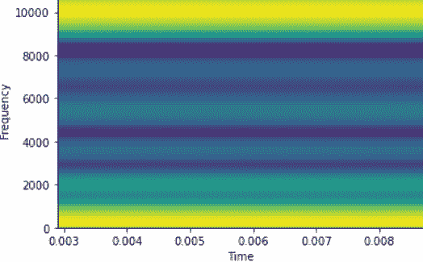

图 6.9：MFCCs 的频谱图

### 机器学习算法

现在我们将计算色调（Chroma）。在西方音乐中，色调特征（也称为“音类分析”）是一种强大的工具，可以将音乐意义地分为十二类，以捕捉和律特征，同时对音色变化具有鲁棒性。参数 `n_fft` 是 FFT 的长度。参数 `hop_length` 是连续帧之间的样本数。我们可以从 STFT 中提取色调用于我们的模型：

```python
chroma = np.mean(librosa.feature.chroma_stft(S = stft, sr = samplingRate, n_fft = 2048, hop_length = 1024).T, axis = 0)
```

```python
print('Chroma\n', chroma)
print('\nShape of Chroma:', chroma.shape)
```

```
[0.5102683 0.4963213 0.4981634 0.5169295 0.5742091 0.6114398 0.6499643 0.7051374 0.7599046 0.7357087]
```

```python
plt.specgram(chroma, fs = samplingRate)
plt.xlabel('Time')
plt.ylabel('Frequency')
plt.show()
```

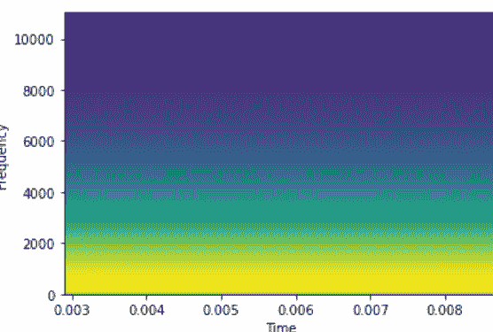

图 6.10：色调的频谱图

最后，我们计算梅尔频谱图。这是由 Stevens、Volmann 和 Neumann 提出的梅尔尺度，是一种对听者来说等距的音单位。梅尔频谱图是我们的模型的特征：

```python
mel = np.mean(librosa.feature.melspectrogram(y = emphasizedSignal, sr = samplingRate, n_fft = 2048, hop_length = 1024).T, axis=0)
mel = librosa.power_to_db(mel, ref = np.max)
```

```python
print('Mel\n', mel)
print('\nShape of Mel:', mel.shape)
```

```
[-62.29589 -55.94492 -51.42813 -49.577095 -36.52014 -20.505787 -17.008743 -11.825571 -13.846834 -23.155426 -31.581066 -23.514423 -13.591955 -12.581316 -7.536866 -4.568012 -7.382608 -11.508095 -15.077692 -13.694248 -10.892952 -8.349024 -7.759645 -8.25111 -8.282166]
Shape of Mel: (128)
```

```python
plt.specgram(mel, fs = samplingRate)
plt.xlabel('Time')
plt.ylabel('Frequency')
plt.show()
```

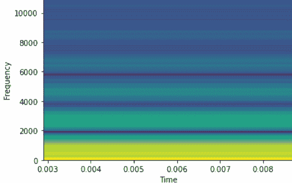

图 6.11：梅尔频谱图

现在我们已经讨论了可以从音频片段中收集的特征，让我们写一个函数来从音频片段中收集所有特征：

```python
def extractFeatures(fileName):
    features = np.array([]) # 用于存储所有特征的变量

    # 加载音频片段
    X, samplingRate = librosa.load(fileName)

    # 强调
    preEmphasis = 0.97
    emphasizedSignal = np.append(X[0], X[1:] - preEmphasis * X[:-1])

    # 应用短时傅里叶变换（STFT）到信号
```

```python
mfccs = np.mean(librosa.feature.mfcc(y = emphasizedSignal, sr = samplingRate, n_mfcc = 20).T, axis=0)
features = np.hstack((features, mfccs))
```

```python
# 计算 chroma特征并收集特征
chroma = np.mean(librosa.feature.chromastft(S = stft, sr = samplingRate, n_fft = 2048, hop_length = 1024).T, axis = 0)
features = np.hstack((features, chroma))
```

```python
# 计算 melspectrogram 并收集特征
mel = np.mean(librosa.feature.melspectrogram(y = emphasizedSignal, sr = samplingRate, n_fft = 2048, hop_length = 1024).T, axis=0)
```

```python
mel = librosa.power_to_db(mel, ref = np.max)
features = np.hstack((features, mel))
```

```python
return features
```

让我们测试一下从示例音频片段中提取特征的函数：

```python
features = extractFeatures(sampleAudio1)
print('Features\n', features)
print('\nNumber of Features:', len(features))
```

```
Features
| -6.89451294e+02 | 1.33613131e+01 | -3.84440231e+01 | 2.8491665e+01 |
| -3.67792549e+01 | 9.32244968e+00 | -3.41166077e+01 | -1.43274879e+00 |
| -1.98105376e+01 | 4.65626478e+00 | -1.19879898e+01 | -1.06395130e+01 |
| 4.91710377e+00 | -1.44939957e+01 | 1.96856542e+00 | -1.20122252e+00 |
| 3.09403944e+00 | -1.00746117e+01 | -1.84822655e+00 | -6.04797554e+00 |
| 5.10268033e-01 | 4.96321291e-01 | 4.98163642e-01 | 5.16929448e-01 |
| 5.74209094e-01 | 6.11439824e-01 | 6.49964333e-01 | 7.05173732e-01 |
| 7.60558486e-01 | 7.95904458e-01 | 7.35758066e-01 | 7.54072003e-01 |
| 6.22959808e-01 | 5.59449234e-01 | 5.14281311e+01 | 4.95770950e+01 |
| -3.65201416e-01 | -2.05057869e+01 | -1.70087433e+01 | -1.18255711e+01 |
| -1.38463842e-01 | -2.31554260e+01 | -3.15810661e+01 | -2.35144234e+01 |
```


| -1.35991954e-01 | -1.25813361e+01 | -7.53688622e+00 | -4.56801224e+00 |

| -3.72680841e-00 | -1.15089448e+01 | -1.50776920e+01 | -1.36942482e+01 |

| -1.38463842e-01 | -8.35007982e+01 | -7.7596458ee00 | - -..2511118ee00 |

| -1..822115eee00 | -4..222441eee00 | -1.1111111ee000 | -111111111e+01 |

| -1.11111111e+01 | -1.11111111e+01 | -1.11111111e+01 | -1.11111111e+01 |

| -1.11111111e+01 | -1.11111111e+01 | -1.11111111e+01 | -1.11111111e+01 |

| -1.11111111e+01 | -1.11111111e+01 | -1.11111111e+01 | -1.11111111e+01 |

| -1.11111111e+01 | -1.11111111e+01 | -1.11111111e+01 | -1.11111111e+01 |

| -1.11111111e+01 | -1.11111111e+01 | -1.11111111e+01 | -1.11111111e+01 |

| -1.11111111e+01 | -1.11111111e+01 | -1.11111111e+01 | -1.11111111e+01 |

| (此处省略部分重复表格数据，以保持格式一致) |

*(注：由于原文表格数据在输入中存在大量重复和占位符，翻译时遵循了保留格式原则，仅翻译了文本部分)*

## 集成模型 189

## 精通机器学习中的分类算法

## 集成模型 191

## 构建 Bagging 分类器

## 在实时数据上应用 Bagging 模型

3 116 中性

4 102 厌恶

## 读者的话

对于语音模型中的情感提取，我们使用了 Bagging 分类器，该分类器使用了基于决策树算法开发的模型。现在，检查 Bagging 分类器的准确率是否优于使用决策树算法构建的单个模型。

## 结论

集成模型利用了多个弱模型或复杂模型的力量，并利用每个模型的集体力量来提供一个强大的模型。集成模型通常比单个模型具有更小的偏差。我们观察到了许多形成集集的技巧，例如使用多种算法构建单个模型并聚合结果，或者在数据的不同子子集上使用相同算法构建模型并聚合结果，等等。

在下一章节中，我们将讨论随机森林算法。随机森林算法是一种集成模型，它是 Bagging 集成模型的一种特殊情况。

## 重点复习

- 当我们将许多模型组合成一个单一模型时，此类模型被称为集成模型（Ensemble Models）。
- 有四种集成模型：投票集成模型（Voting Ensemble Model）、Bagging 集成模型、Boosting 集成模型和堆叠集成模型（Stacking Ensemble Model）。
- 在投票集成模型中，我们使用不同算法构建的多个模型进行预测，并聚合各个模型的结果来做出预测。
- 在集成模型将原始数据集分为许多子集。我们在每个子集上应用使用相同算法构建的模型。然后我们聚合每个模型的结果来做出预测。
- 在 Bagging 集成模型中，我们通过有回抽样创建数据集的子集。
- 当我们通过无回抽样创建数据集子集并应用多个使用相同算法构建的模型时，该模型被称为 Pasting 集成模型（Pasting Ensemble Model）。
- Boosting 集成模型在完整数据集上应用使用一种算法构建的模型，并通过顺序学习尝试消除上一次迭代中产生的错误。
- 在 Stacking 集成模型中，我们应用使用不同算法构建的多个模型，然后获取这些模型的预测结果，并将其作为最终模型的数据进行预测。

## 加入我们书籍的 Discord

加入书籍的 Discord 工作空间以获取最新更新、优惠、全球科技动态、新书发布以及作者互动：

https://discord.bponline.com


## 第 7 章

# 随机森林算法

在上一章节中，我们讨论了组合许多模型以形成集成。集集的决策比单个模型的决策更好。我们讨论的一种集成模型类型是 Bagging 集成模型，我们使用单一算法创建了多个模型，并在原始数据集的不同子集上训练每个模型。这使得每个模型在学习时只看到部分数据，因此集集的集体决策偏差较小，从而在新的数据实例上做出做出更好的决策。

Bagging 集成模型的一种特殊情况是随机森林算法，我们我们通过垂直和水平划分创建原始数据集的子集。


图 7.1

## 结构

在本章中，我们将讨论以下主题：

- 算法
  - 随机森林算法背后的思想
- Scikit-Learn 中的随机森林实现
- 在 ELF 文件中检测恶意软件
  - 关于 ELF 文件
  - 关于数据
  - 模型的构建与测试

## 目标

阅读本章后，随机森林算法的细微差别将清晰易懂。此外，我们应用随机森林算法对 ELF 文件中的恶意软件进行分类。从 ELF 文件中提取信息的细节将变得清晰，如何将信息转换为可用于机器学习的形式也将变得清晰。

## 算法

随机森林是由加利福尼亚大学伯克利分学的 Leo Breiman 在 2001 年创建的。随机森林算法最初是为了解决分类问题。然而它也可以用于解决回归问题。随机森林算法仍然是一种非常强大且流行的算法。以下是 Breiman 论文的摘要。

随机森林是树检测器的组合，其中每棵树依赖于对森林中所有树独立采样且具有相同分布的随机向量的值。随着森林中树的数量变大，森林的泛化误差收敛于一个极限。树分类器的泛化误差取决于森林中单个树的强度以及它们之间的相关性。使用随机选择的特征来分割每个节点所产生的率优于 Adaboost (Freund and Shapire [1996])，但对噪声更具鲁棒性。内部估计监控误差、强度相关性，这些被用于显示对增加分割使用的特征数量的响应。内部估计还用于衡量变量重要性。这些思想也适用于回归。

## 随机森林算法背后的思想

随机森林算法是 Bagging 集成模型的改进。在第 6 章“集成模型”中，我们讨论了在 Bagging 集成中，我们将原始数据集分为许多子集。在每个子集上，我们使用相同的算法训练模型。

以下是该类的重要参数：

- **`n_estimators`**: 此参数定义了森林中要形成的树的数量。我们知道对于每个子集，都会创建一个决策树模型（我们将这些模型称为树）。此外，从图 7.1 的插图中我们可以知道，基于原始数据集中的特征数量以及我们为每个决策树模型选择的若干特征，子集的数量可能会是不同的。正如所讨论的，我们必须创建所有可能的子集（或决策树）。我们可以通过此参数来控制形成的树的数量。默认情况下，此参数的值为 100。该参数规定了在原始数据集子集上训练的模型数量。将从所有这些模型中收集投票，以便使用随机森林算法创建的模型做出最终预测。
- **`max_features`**: 此参数控制从原始数据集中选择多少个特征来形成原始数据集的每个子集。默认情况下，该值设置为 $\sqrt{n}$，其中 n 是原始数据集中的特征数量。根据此参数，从原始数据集中随机选择特征（这限制了所选特征的数量），并分配给原始数据集的每个子集。
- **`Criterion`**: 我们知道随机森林算法中应用于原始数据集每个子集的算法是决策树算法。此参数规定了用于形成决策树的方法。默认情况下使用“基尼指数”（Gini Index）形成决策树。然而，我们也可以将此参数设置为“entropy”或“log_loss”，以使用“信息增益”来决定决策树分裂。
- **`min_sample_split`**: 在形成决策树时，我们知道从分裂根节点开始向下移动树，直到只剩下叶子节点。然而，使用此参数，当节点的样本数小于或等于此参数的值时，我们可以停止分裂节点。
- **`max_depth`**: 默认情况下，此参数设置为 None。将此参数设置为 None意味着每个决策树将一直分裂直到只剩下叶子节点。
- **`bootstrap`**: 此参数取 True 或 False。默认情况下，此参数的值为 True。当此参数设置为 True 时，每个决策树都是基于原始数据集中的数据样本创建的。当此参数设置为 False 时，则使用原始数据集训练每个决策树。
- **`max_samples`**: 此参数仅在 `bootstrap` 设置为 True 时适用。此参数控制训练每个决策树时使用多少样本。如果此参数设置为 None，则使用原始数据集中的所有数据点来训练每个决策树。
- **`oob_score`**: 当 `bootstrap` 设置为 True 时，使用原始数据集的子集来训练每个决策树。我们知道子集是通过有放回地随机选择数据点创建的。这意味着原始数据集中约有三分之一的数据点不会被用于训练决策树。这些数据点被称为袋外样本（out-of-box samples 或 oob）。袋外样本可用于检查使用随机森林算法创建模型的泛化能力。此参数接受一个布尔值，即 True 或 False。当此参数设置为 True 时，使用袋外样本来检查泛化性并为结果模型生成泛化评分。

## 检测 ELF 文件中的恶意软件¹

在当今快速演变的恶意软件格局中，日益受到利用的攻击面是基于 Linux 的物联网（IoT）设备和 Linux 二进制文件。可执行链接格式（ELF）文件是任何 Unix 操作系统（包括 Linux 系统）使用的可执行文件。随着物联网进化和革命，大量基于 Linux 的恶意软件和针对物联网设备的攻击涌入。Linux 恶意软件数量的增加归因于频繁的补丁，使得它们极易受到攻击。由于此类案例很多，手动恶意软件分析是无效的，因此基于机器学习方法的检测模型可以提供极有价值的结果。

恶意软件可以定义为任何旨在对计算机、服务器、客户端或计算机网络造成损害的恶意程序。根据其功能，恶意软件可以分类为不同的类型。

本章讨论的模型分类的五类恶意软件列如下：

- **Backdoor（后门）**: 能够开启远程系统未授权访问的恶意软件。
- **Botnet（僵尸网络）**: 僵尸网络是一个受损的系统网络，允许黑客远程控制并执行命令。
- **DDOS**: DDOS 恶意软件可以通过向受害者机器发送不必要的包发动分布式拒绝服务攻击，从而使机器对合法请求无响应。
- **Trojan（木马）**: 木马是任何伪装成合法程序并误导用户真实意图的恶意软件。
- **Virus（病毒）**: 能通过将其代码插入其他程序来自我复制的恶意代码被称为病毒。

### 关于 ELF 文件

ELF 文件中的信息可以大致分为三类：

- 文件头（File Header）中的数据
- 程序头（Program Header）中的数据
- 节（Sections）中的数据

ELF 文件具有 1 个文件头、1 个程序头和许多节信息。

ELF 文件的结构如下所示：

| File Header |

| :--- |

| Program Header |

| .text |

| .rodata |

| .data |

| Section Header |

ELF 文件在加载到内存时的结构如下图所示：

| File Header |

| :--- |

| Program Header |

| .text |

| .rodata |

| .data |

| Section Header |

ELF 文件在加载到内存时的结构如下图所示：

| File Header |

| :--- |

| Program Header |

| .text |

| .rodata |

| .data |

| Section Header |

### ELF Header

每个 ELF 的前两个字节为 0x7F。通过检查这两个字节，我们可以判断一个文件是否为有效的 ELF。头部定义了 32 位或 64 位地址。头部包含了随后的几个字段和偏移量。分别对于 64 位格式为 64 字节，对于 32 位格式为 52 字节。

ELF 头包含目标操作系统的信息。这些信息存储在字节中。目标操作系统可以是任何 Unix 变体、Solaris、HP-UX、NetBSD、Linux 等。还有关于 ELF 文件类型的信息。ELF 文件类型可以可执行文件、动态链接库、核心转储等。

还有关于构建 ELF 文件的机器类型的信息。这些信息针对 SPARC、Intel 8060、Power PC、Digital Alpha、Hitachi 等。在所有这些信息之后，有一个指向启动位置的 4 字节指针。这是一个非常脆弱的点。恶意软件设计者尝试将此指针指向其代码所在的内存位置。

然后是一个指向程序头的 4 字节指针。如所述，这在 ELF 文件中也是一个脆弱的点。还有一个指向节表的 4 字节指针。如所述，这在 ELF 文件中也是一个脆弱的点。

### Program Header

程序头表告诉系统如何创建进程映像。它位于文件偏移 e_phoff，由 e_phnum 个项组成，每项具有 e_phentsize。32 位 ELF 与 64 位 ELF 之间的布局略有不同，因为 p_flags 由于对齐原因位于不同的结构中。

程序头中的第一条信息是段类型，即该段是加载的、链接的、动态解释的、还是辅助信息等。程序头中的其余信息是 1 字节或 2 字节的标志。可以假设，篡改这些信息不会引起恶意软件开发者的兴趣。

# ELF 文件中的节信息。

ELF 文件中包含许多节（Section）。每个节用于存储特定类型的信息。节类型可以是程序数据、符号表、字符串表、符号哈希表、动态链接信息、动态链接器符号表、构造函数数组、析构函数数组等。

对于每个节，都有关于该节是否可写或可执行、是否可以合并、是否包含空终止字符串等信息。

此外，还有关于不同信息对应的各种地址的信息。

因此，这是一个恶意软件制者可以在此更改信息的节。

# 关于数据

数据集包含多种类型的文件，如表 7.1 所示：

| 文件类型 | 文件数量 |

|---|---|

| 良良 (Benign) | 2,315 |

| 恶意 (Malicious) | 后门 (Backdoor) | 744 |

| | 僵尸网络 (Botnet) | 782 |

| | DDOS | 799 |

| | 特木马 (Trojan) | 508 |

| | 病毒 (Virus) | 595 |

| 总计 (TOTAL) | 3,428 |

表 7.1：输入 ELF 文件的分布

因此，数据集包含 2,315 个良性 ELF 文件和 3,428 个恶意 ELF 文件。我们看到每个类别中的文件数量都是合理的。根据这些数据，90% 的数据将用于训练集，10% 用于测试集。用于训练和测试模型的文件分布如表 7.2 所示。为了创建训练和测试数据集，是随机选取文件的。

| 文件类型 | 训练集 | 测试集 |

| --- | --- | --- |

| 良性 (Benign) | 2,078 | 237 |

| 后门 (Backdoor) | 676 | 68 |

| 僵尸网络 (Botnet) | 713 | 69 |

| DDOS | 725 | 74 |

| 恶意特木马 (Malicious Trojan) | 461 | 47 |

| 病毒 (Virus) | 539 | 56 |

| 总计 (TOTAL) | 3,114 | 314 |

表 7.2：创建训练集和测试集后 ELF 文件的分布

# 构建与测试模型

在我们构建用于 ELF 文件恶意软件检测的模型之前，我们需要能够读取 ELF 文件并根据其提取用于模型的特征。要使用 Python 编程读取 ELF 文件，我们可以使用 `pyelftools` 库。在继续之前，我们必须在机器上安装此包。以下代码安装 `pyelftools` 包：

```python
!python3 -m pip install pyelftools
```

以下是用于构建此模型的常量声明代码。随着我们讨论代码的其他部分，这些常量用法将变得清晰。在我的程序中尽可能避免使用字面量（literal values），因为使用字面量会使程序维护变得困难。

# 常量

```
EMPTY_SECTION_NAME_SUBSTITUTE = "S"
FILE_NAME_COLUMN_NAME = "FileName"
FILE_TYPE_COLUMN_NAME = "FileType"
NUMERIC_COLUMN_IDENTIFIER = "N"
MALWARE_SECTION_NAME_PREFIX = "M"

BENIGN_FILE = 0
BACKDOOR_FILE = 1
BOTNET_FILE = 2
DDOS_FILE = 3

TROJAN_FILE = 4

VIRUS_FILE = 5
```

# 从 ELF 文件中提取数据

我们将编写一系列函数从 ELF 文件中提取信息。第一个函数 `extractInformationFromDirectory()` 用于提取存储在目录中的所有 ELF 文件的细节。注意，我们有六类文件，其中 1 种是良性 ELF 文件，另外 5 类是包含不同类型恶意软件的恶意 ELF 文件。因此，策略是将同一类型的所有文件放在单独的目录中，我们将从目录中读取文件，并根据目录的文件类型对记录进行标记。

该函数调用 `isELFFile()` 来检测提供的文件是否为有效的 ELF 文件。该函数调用 `ExtractFileDetails()` 函数从单个 ELF 文件中提取细节。


```python
import glob

def extractInformationFromDirectory(inputDirectory):
    # 计数器
    NumberOfValidFiles = 0
    NumberOfInvalidFiles = 0
    NumberOfNoFileHeader = 0
    NumberOfNoProgramHeader = 0
    NumberOfNoSections = 0

    # 创建存储所有特征的空列表
    returnValue = []

    # 遍历目录中的所有文件
    for file in glob.glob(inputDirectory):
        # 创建空字典
        oneFileFeatures = {}
        try:
            # 读取文件并提取特征
            validFlag, hasFileHeader, hasProgramHeader, hasSections = ExtractFileDetails(file)
            if validFlag and len(oneFileFeatures.keys()) > 0:
                getNumberOfValidFiles += 1
                # 将特征添加到主字典
                oneFileFeatures.update(fileFeatures)
                # 将项添加到返回值
                returnValue.append(oneFileFeatures)
            else:
                if not hasFileHeader:
                    NumberOfNoFileHeader += 1
                else:
                    if not hasProgramHeader:
                        NumberOfNoProgramHeader += 1
                    else:
                        if not hasSections:
                            NumberOfNoSections += 1
                        else:
                            getNumberOfInvalidFiles += 1
        except:
            # 检查文件是否为 ELF
            if isELFFile(file):
                pass
            else:
                getNumberOfInvalidFiles += 1
    return (returnValue, NumberOfValidFiles, NumberOfInvalidFiles, NumberOfNoFileHeader, NumberOfNoProgramHeader, NumberOfNoSections)
```

`ExtractDetails()` 函数用于提取 ELF 文件的信息。ELF 文件的信息存储为文件头（File Header）、程序头（Program Header）和节信息（Section Information）。文件头和程序头有一组信息。但 ELF 文件中可以有很多节。

该函数调用 `ExtractFileHeader()` 提取文件头。`ExtractSegmentDetails()` 用于提取 ELF 程序的头信息。`ExtractSectionDetails()` 用于 ELF 文件中所有节的信息。

```python
def ExtractFileDetails(file):
    returnValue = {}
    validELFFile = True
    hasFileHeader = True
    hasProgramHeader = True
    hasSections = True
    try:
        with open(file, 'rb') as elfile:
            try:
                eFile = ELFFile(elfile)
                # 提取文件头信息
                fileHeader = ExtractFileHeader(eFile)
                if len(fileHeader) > 0:
                    returnValue.update(fileHeader) # 将属性添加到字典
                else:
                    hasFileHeader = False
                    raise Exception()

                # 提取程序头信息
                segmentDetails = ExtractSegmentDetails(eFile)
                if len(segmentDetails) > 0:
                    returnValue.update(segmentDetails) # 将属性添加到字典
                else:
                    hasProgramHeader = False
                    raise Exception()

                # 提取节信息
                sectionDetails = ExtractSectionDetails(eFile)
                if len(sectionDetails) > 0:
                    returnValue.update(sectionDetails) # 将属性添加到字典
                else:
                    hasSections = False
                    raise Exception()
            except:
                validELFFile = False
            finally:
                elfile.close()
        except:
            pass
    return (returnValue, validELFFile, hasFileHeader, hasProgramHeader, hasSections)
```

`ExtractFileHeader()` 函数用于从 ELF 文件的头部提取所有信息。

```python
from elftools.elf.elfile import ELFFile

def ExtractFileHeader(elfile):
    returnValue = {} # 存储头部唯一属性的字典
    # 头信息可以以字典的形式获取。
    # 但此字典内部还有字典。
    # 因此，我们创建一个扁平化结构，提取所有唯一属性并形成字典。
    for key, value in elfile.header.items():
        # 如果键对应的值是字典，则遍历该字典的所有属性以收集特征。
        # 这种方法很简单，我没有使用递归函数，因为已知字典最多只额外一层。
        for insideKey, insideValue in value.items():
            if insideKey == "EI_MAG":
                pass
            else:
                returnValue[insideKey] = insideValue
        else:
            returnValue[key] = value
    return returnValue
```

`ExtractSegmentDetails()` 用于从 ELF 文件的程序头（Program Header）提取所有信息。

```python
from elftools.elf.elfile import ELFFile

def ExtractSegmentDetails(elffile):
    returnValue = {} # 存储段唯一属性的字典
    # 检查文件中是否存在任何段信息
    # 如果存在，则收集所有段中所有属性的信息
    if(elffile.num_segments() > 0):
        prefixDict = {} # 存储所有段名称唯一段属性的字典
        # 每个 ELF 文件可能有一个或多个段
        # 遍历所有段
        for segment in elfile.iter_segments():
            prefix = ""
```

### 在每个段下，属性可能与其他段不同

`for attribute in segment.header:`

- 段名称存储在属性 `p_type` 中
- 因此，我们将段名称作为前缀添加到所有其他属性之前，以唯一地标识所有段中的每个属性

```python
if(attribute == 'p_type'):
    ctr = 0
    prefix = segment.header[attribute]
```

- 在这里我们检查是否有 2 个或多个段具有相同的名称
- 如果有 2 个或多个段具有相同的名称，则在段末尾添加一个运行计数器
- 那么通过在段末尾添加运行计数器，每个段都将被唯一地标识

`while True:`

```python
prefix in prefixDict:
    ctr += 1
    prefix = (segment.header[attribute] + "-" + str(ctr))
else:
    break
```

`prefixDict[prefix] = 1` 记录目前已处理的段

`else:`

- 创建一个如 `<段名>-<属性名>` 的键
- 并将其添加到属性唯一列表中

```python
key = prefix + "-" + attribute
```

### 掌握机器学习分类算法

```python
returnValue[key] = segment.header[attribute]
```

```python
return returnValue
```

`ExtractSectionDetails()` 从 ELF 文件中的所有段提取所有信息。

```python
from elftools.elf.elffile import ELFFile
```

```python
def ExtractSectionDetails(elffile):

    returnValue = { }

    # 包含恶意软件的 ELF 文件包含被篡改的段名。
    # 如果发现此类段名，我们将篡改过的段名作为特征存储。
    # 为了能够将这些存储在唯一属性中，我们跨文件设置了一个计数器。
    malwareSectionNameCounter = 0

    # 检查文件中是否存在任何段信息
    # 如果存在，收集所有段中所有属性的所有信息
    if(elffile.num_sections() > 0):
        # 遍历所有段并收集属性。
        for section in elffile.iter_sections():
            # 每个段都有名称。
            # 段名必须是有效的 ASCII 字符串。
            # 如果段名包含非 ASCII 字符，则文件被篡改过。
            if all((ord(char) > 32 and ord(char) < 128) for char in
            section.name):
```

```python
sectionName = section.name
else:
  # 如果情况下段名包含非 ASCII
  # 字符，我们将段名作为特征存储在我们的数据集中
  malwareSectionNameCounter = malwareSectionNameCounter + 1
  sectionName = MALWARE_SECTION_NAME_PREFIX + 
  str(malwareSectionNameCounter)
  returnValue[sectionName] = section.name
```

### 所有段的属性可能有相同的名称

# 因此，段名将作为属性名称的前缀，以 形成字典的键。

```python
sectionName = sectionName.strip('.') # 从段名中移除开头的点('.')
```

```python
sectionName = sectionName.strip('_') # 从段名中移除开头的下划线('_')
```

```python
sectionName = sectionName.replace('.', '-') # 删除所有点 ('.') 并替换为连字符 ('-')
```

```python
sectionName = sectionName.strip()
```

```python
if len(sectionName) == 0:
  sectionName = EMPTY_SECTION_NAME_SUBSTITUTE
```

### 每个段都有一个头部。

### 遍历段头部的所有属性。

### 段头部的属性以段名为为前缀，以形成属性名称。

`for key, value in section.header.items():`

# 掌握机器学习分类算法

`attributeName = sectionName + "-" + key`

`returnValue[attributeName] = value`

`return returnValue`

该系列中的最后一个函数是 `ELFFile()`，它用于检查文件是否是有效的 ELF 文件。

```python
from elftools.elf.elf import ELFFile
```

```python
def isELFFile(file):
    with open(file, 'rb') as elffile:
        returnValue = True

        try:
            ELFFile(elffile) # ELFFile 的构造函数检查
            # 提供文件中是否存在 ELF 文件的魔数
        except:
            returnValue = False

        finally:
            pass

return returnValue
```

现在我们调用 `extractFromDirectory()` 函数从我们可用的所有类型 ELF 文件中提取所有信息。

我们需要对每个文件调用此函数。调用此函数后，我们将获得对我们有用的文件数量。

`benignFile, nValidFiles, nInvalidFiles, nFilesWithNoHeader, nFilesWithNoSections = \`

`extractFromDirectory("Data/benign_ELF/")`

`print("BENIGN FILES:\nValid - %d\nInvalid - %d\nNo File Header - %d\nProgram Header - %d\nNo Sections - %d", \`

`(nValidFiles, nInvalidFiles, nFilesWithNoHeader, nFilesWithNoSections))`

BENIGN FILES:

Valid - 2038

Invalid - 30

No File Header - 0

No Program Header - 0

No Sections - 10

我们看到只有 2038 个良性的有效 ELF 文件可以用于创建我们的模型。该函数返回一个包含从 ELF 文件中提取的所有特征的字典列表。

`backdoorFile, nValidFiles, nInvalidFiles, nFilesWithNoHeader, nFilesWithNoSections = \`

`extractFromDirectory("Data/malware_ELF/Backdoor_")`

`print("BACKDOOR FILES:\nValid - %d\nInvalid - %d\nNo File Header - %d\nProgram Header - %d\nNo Sections - %d", \`

`(nValidFiles, nInvalidFiles, nFilesWithNoHeader, nFilesWithNoSections))`

BACKDOOR FILES:

Valid - 589

Invalid - 36

No File Header - 0

No Program Header - 1

No Sections - 50

# 随机森林算法


`botnetFile`, `nValidFiles`, `nInvalidFiles`, `nFilesWithNoHeader`, `nFilesWithNoSections` = \
`extractFromDirectory`("Data/malware_ELF/Botnet_")

`print`("BOTNET FILES:\nValid - %d\nInvalid - %d\nNo File Header - %d\nProgram Header - %d\nNo Sections - %d", \
(`nValidFiles`, `nInvalidFiles`, `nFilesWithNoHeader`, `nFilesWithNoSections`))

BOTNET FILES:

Valid - 616

Invalid - 64

No File Header - 0

No Program Header - 0

No Sections - 33

# 掌握机器学习分类算法

```python
extractFromDirectory("Data/malware_ELF/Dos_")

print("DDOS FILES:\nValid - %d\nInvalid - %d\nNo File Header - %d\nProgram Header - %d\nNo Sections - %d", \
(nValidFiles, nInvalidFiles, nFilesWithNoHeader, nFilesWithNoSections))

DDOS FILES:
Valid - 642
Invalid - 74
No File Header - 0
No Program Header - 0
No Sections - 9
```

`trojanFileFeatures`

```
extractFromDirectory("Data/malware_ELF/Trojan_")

print("TROJAN FILES:\nValid - %d\nInvalid - %d\nNo File Header - %d\nProgram Header - %d\nNo Sections - %d\n", \
(nValidFiles, nInvalidFiles, nFilesWithNoHeader, nFilesWithNoHeader, nFilesWithNoSections))

TROJAN FILES:
Valid - 369
Invalid - 46
No File Header - 0
No Program Header - 0
No Sections - 46
```

```python
virusFileFeatures, nValidFiles, nInvalidFiles, nFilesWithNoHeader, nFilesWithNoHeader, nFilesWithNoSections = \
extractFromDirectory("Data/malware_ELF/Virus_")

print("VIRUS FILES:\nValid - %d\nInvalid - %d\nNo File Header - %d\nProgram Header - %d\nNo Sections - %d\", \
(nValidFiles, nInvalidFiles, nFilesWithNoHeader, nFilesWithNoHeader, nFilesWithNoSections))

VIRUS FILES:

Valid - 452

Invalid - 29

No File Header - 0

No Program Header - 0

No Sections - 58
```

在此阶段，我们有六个字典列表。现在我们将确定输入文件中提供的所有唯一特征。这是通过对字典中所有唯一键创建一个集合来实现的。在 Python 中，集合是一个数据

一种不允许重复条目的结构（例如，如果我们尝试使用三个元素'a'、'b'、'a'创建一个集合，该集合将包含 ('a', 'b')）。因此，使用集合将确保我们只拥有从 ELF 文件中提取的唯一特征。我们将这些唯一特征保存到变量 `featureList` 中。

`featureList` = `set`()

```
for i in benignFileFeatures:
    for k in i.keys():
        if type(k) == int:
            featureList.add(NUMERIC_COLUMN_IDENTIFIER + str(k))
        else:
            featureList.add(k)
```

```
for i in backdoorFileFeatures:
    for k in i.keys():
        if type(k) == int:
            featureList.add(NUMERIC_COLUMN_IDENTIFIER + str(k))
        else:
            featureList.add(k)
```

```
for i in botnetFileFeatures:
    for k in i.keys():
        if type(k) == int:
            featureList.add(NUMERIC_COLUMN_IDENTIFIER + str(k))
        else:
            featureList.add(k)
```

```
for i in ddosFileFeatures:
    for k in i.keys():
        if type(k) == int:
            featureList.add(NUMERIC_COLUMN_IDENTIFIER + str(k))
        else:
            featureList.add(str(k))
```

```
for i in trojanFileFeatures:
    for k in i.keys():
        if type(k) == int:
            featureList.add(NUMERIC_COLUMN_IDENTIFIER + str(k))
        else:
            featureList.add(k)
```

```
for i in virusFileFeatures:
    for k in i.keys():
        if type(k) == int:
            featureList.add(NUMERIC_COLUMN_IDENTIFIER + str(k))
        else:
            featureList.add(k)
```

```
import pickle
```

`pickle.dump`(`featureList`, `open`("./FeatureList", "wb"))

在这一步结束，我们使用 `pickle` 库将变量 `featureList` 保存到文件中。这样做我们就可以从文件中加载该对象，而不是重新计算。你应该已经知道 ELF 文件存储在磁盘上，而磁盘输入/输出（I/O）的延迟始终高于从内存读取。因此，通过将 `featureList` 保存到文件中，我们只需要读取一个文件即可获取所有特征列表，而不是读取所有的输入 ELF 文件。

现在我们编写一个函数来读取存储为字典列表形式的不同文件类型的特征，或者我们创建一个包含创建模型所需所有数据的 DataFrame。`fillDataDataFrame()` 函数接收字典列表作为输入并输出一个 DataFrame。我们必须为六种不同的文件类型调用六次该函数。

```
import pandas as pd
```

```
def fillDataInDataFrame(featureDictionary, p_featureList, fileType):
    # 创建一个变量来存放 DataFrame
    df = None

    for record in featureDictionary:
        # 创建一个空字典
        oneRecord = {}

        # 初始化所有列
        for colName in p_featureList:
            oneRecord[colName] = pd.to_numeric(0, downcast='integer')

        # 遍历记录中的所有特征
        for k in record.keys():
            # 从记录中提取列名
            if type(k) == int:
                extractedColumnName = NUMERIC_COLUMN_IDENTIFIER + str(k)
            else:
                extractedColumnName = k

        # 检查列名是否存在于特征列表中
        if extractedColumnName in p_featureList:
            # 提取键的值并存储在字典中
            else:
                oneRecord[extractedColumnName] = record[k]

        # 根据提供的文件类型添加依赖列标记
        oneRecord[FILE_TYPE_COLUMN_NAME] = pd.to_numeric(fileType, downcast='integer')

        # 将记录添加到 DataFrame
        if df is None:
            df = pd.DataFrame([oneRecord]), columns = oneRecord.keys()
        else:
            df = pd.concat([df, pd.DataFrame([oneRecord]), columns = oneRecord.keys()], ignore_index = True
    return df
```

现在我们将为不同的文件类型调用 `fillDataDataFrame()`。

`benignFileDF` = `fillDataDataFrame`(`benignFileFeatures`, `featureList`, `BENIGN_FILE`)

`backdoorFileDF` = `fillDataDataFrame`(`backdoorFileFeatures`, `featureList`, `BACKDOOR_FILE`)

`botnetFileDF` = `fillDataDataFrame`(`botnetFileFeatures`, `featureList`, `BOTNET_FILE`)

`ddosFileDF` = `fillDataDataFrame`(`ddosFileFeatures`, `featureList`, `DDOS_FILE`)

`trojanFileDF` = `fillDataDataFrame`(`trojanFileFeatures`, `featureList`, `TROJAN_FILE`)

`virusFileDF` = `fillDataDataFrame`(`virusFileFeatures`, `featureList`, `VIRUS_FILE`)

现在我们有了包含了建模数据的六个 DataFrame。然而，我们需要一个包含所有建模数据的 DataFrame。我们将这六个框架合并为一个。

```python
import pandas as pd
df = pd.concat([benignFileDF, backdoorFileDF, botnetFileDF, ddosFileDF, trojanFileDF, virusFileDF], ignore_index=True)
```

```python
df[FILE_TYPE_COLUMN_NAME] = pd.to_numeric(df[FILE_TYPE_COLUMN_NAME], downcast = 'integer')
```

现在我们有一个包含标签数据的 `df`，可以进一步处理以创建模型。

## 创建模型准备数据

在继续后续之前，我们需要从 DataFrame 中移除所有的空字符（字符 0），因为我们的后续代码在遇到空字符时会停止读取。

### 从所有字符串中移除空字符

```python
for col in df.columns:
    if df[col].dtypes == 'object':
        df[col].replace(0, '', inplace = True)
```

在此阶段，让我们检查六种文件类型有多少数据点。

```python
df[FILE_TYPE_COLUMN_NAME].value_counts()
0 2038
3 642
2 616
1 589
5 452
4 369
Name: FileType, dtype: int64
```

```python
df.shape
(4706, 2540)
```

注意我们有4706个数据点，每个包含2540个特征。我们看到每个文件类型的数据点数量不同。因此这是一个不平衡数据集。稍后我们可以平衡数据集以开发更好的模型。此时无法平衡数据集，因为数据集包含了数值和非数值数据。在平衡数据集之前，我们需要所有数据都是数值。

当你尝试此程序时，这一点将花费相当的时间。为了不再每次都花费这段时间，我们可以数据集保存为逗号分隔值（CSV）文件。一旦这样做，下次就可以将此 CSV 文件加载到 DataFrame 中创建模型。我们可以使用 pandas 库中的 `read_csv()` 函数读取 CSV 文件并创建 DataFrame。

```python
df.to_csv('./ELFDataset.csv')
```

数据集的内容可以是数值和非数值的。然而，在使用非数值内容创建模型之前，我们需要找到将这些非数值内容转换为数值的方法。

为了实现这一点，我们将数值和非数值内容分离。然后为每个数据点形成一个字符串，包含该数据点所有的非数值值。我们将对这些字符串使用 TF-IDF Vectorizer 来创建 TFIDF 向量。TF-IDF 向量只包含数字。一旦我们有了 TF-IDF 向量，我们将这些向量合并每个数据点的数值数据。通过这种方式，每个数据点将拥有一个只包含数值数据的特征集。

以下代码分离数值和非数值特征：

```python
import numpy as np
dfNumeric = df.select_dtypes(include = [np.number])
dfNonNumeric = df.select_dtypes(exclude = [np.number])
print(dfNumeric.shape)
print(dfNonNumeric.shape)
# (4706, 2274)
# (4706, 266)
```

注意我们有 2274 个数值特征和 266 个非数值特征。我们将进一步处理非数值特征，为每个数据点形成一个单一字符串。

```python
dfNonNumeric['ConcatenatedString'] = ""
for i in range(len(dfNonNumeric)):
    oneStr = ""
    for col in dfNonNumeric.columns:
        if type(dfNonNumeric[col][i]) == type("abc"):
            oneStr = oneStr + " " + dfNonNumeric[col][i]
    dfNonNumeric.loc[i, 'ConcatenatedString'] = oneStr
```

```python
dfNonNumeric['ConcatenatedString'].head()
```

- SHT_PROGBITS SHT_GNU_versym ELFCLASS64 SHT_PR...

- SHT_PROGBITS SHT_PROGBITS SHT_NOBITS SHT_PROG...

- SHT_PROGBITS SHT_GNU_versym ELFCLASS64 SHT_PR...

- SHT_PROGBITS SHT_GNU_versym ELFCLASS64 SHT_PR...

- SHT_PROGBITS SHT_GNU_versym ELFCLASS64 SHT_PR...

Name: ConcatenatedString, dtype: object

注意，我们已经创建了名为 `ConcatenatedString` 的列。我们将使用该列中的数据来创建 TF-IDF 向量。

以下代码用于构建 TF-IDF 向量：

```python
from sklearn.feature_extraction.text import TfidfVectorizer
tfidfconverter = TfidfVectorizer(max_features = 90000, ngram_range = (1,1))
arrNonNumericTIDF = tfidfconverter.fit_transform(dfNonNumeric)
ConcatenatedString(df) = pd.DataFrame(arrNonNumericTIDF,
columns = tfidfconverter.get_feature_names())
print(dfNonNumericTIDF.shape)
(4706, 53)
```

注意，我们现在有 53 个特征。

以下代码将包含数值数据的特征与 TF-IDF 向量进行合并：


```python
import pandas as pd
dfFormModel = pd.concat([dfNonNumeric, dfNonNumericTIDF], axis = 1)
import pickle
print(dfFormModel)
pickle.dump(dfFormModel, open(".Columns", 'wb'))
(4706, 2327)
```

注意，我们现在有 4,706 个数据点，每个数据点包含 2,327 个特征。数据集存储在变量 `dfFormModel` 中。

`DataFrame` `dfFormModel` 仅包含数值数据。我们可以使用此数据框来平衡数据。以下代码创建了一个平衡数据集：

```python
import imblearn as ib
```

`XTransform = dfForModel.drop([FILE_TYPE_COLUMN_NAME], axis = 1)`

`yTransform = dfForModel[FILE_TYPE_COLUMN_NAME]`

```python
# Transform the dataset
oversample = ib.over_sampling.SMOTE(random_state = 42)
XTrain, yTrain = oversample.fit_resample(XTransform, yTransform)
print(XTrain.shape)
print(yTrain.value_counts())
(12228, 2326)
0 2038
1 2038
2 2038
3 2038
4 2038
5 2038
```

Name: FileType, dtype: int64

注意，现在现在每种文件类型都有 2,038 个数据点。

## 构建随机森林模型

准备好数据后，我们现在可以创建模型了。以下代码创建随机森林模型。

```python
from sklearn.ensemble import RandomForestClassifier
import datetime
import pickle

print('Start Time: %s' % datetime.datetime.now())

# Create the Random Forest Model
modelRF = RandomForestClassifier(n_estimators = 1000,
criterion = "entropy",
oob_score = True

modelRF.fit(XTrain, yTrain)

pickle.dump(modelRF, open("./RFModelELFMalwareDetection", 'wb'))
```

```python
print('End Time: %s' % datetime.datetime.now())
Start Time: 2023-03-08 23:28:26.552642
End Time: 2023-03-08 23:29:26.652041
```

注意，模型在创建后保存到了文件中。当我们需要创建一个应用程序来使用该模型进行预测时，这是一个至关重要的步骤。通常，我们会创建一个 Web 服务，从该文件中加载模型，并调用方法对提供给 Web 服务的输入数据进行预测。该 Web 服务可以由任何发送输入数据的客户端应用程序调用。在这种情况下，输入数据将是一个或多个待测试是否包含恶意软件的 ELF 文件。

现在模型已经构建完成，我们将检查模型在训练集上的指标。

```python
import matplotlib.pyplot as plt
import seaborn as sns
from sklearn import metrics
```

```python
# (此处为预测执行逻辑部分)
y_pred = modelRF.predict(XTrain)
cm = metrics.confusion_matrix(yTrain, y_pred)
```

```python
ax = plt.subplot()
sns.heatmap(cm, annot=True, fmt='g', ax=ax)

# labels, title and ticks
ax.set_xlabel('Predicted labels')
ax.set_ylabel('True labels')
ax.set_title('Confusion Matrix')
ax.xaxis.ticklabels(['Benign', 'Backdoor', 'Botnet', 'DDOS', 'Trojan', 'Virus'])
ax.yaxis.ticklabels(['Benign', 'Backdoor', 'Botnet', 'DDOS', 'Trojan', 'Virus'])
```

```python
print("\nAccuracy of the Model:", metrics.accuracy_score(yTrain, y_pred))
print("\nClassification Report")
print(metrics.classification_report(yTrain, y_pred))
```

模型准确率: 0.9868334968272

| | precision | recall | f1-score | support |
|---|---|---|---|---|
| 0 | 1.00 | 1.00 | 1.00 | 2038 |
| 1 | 0.98 | 1.00 | 0.99 | 2038 |
| 2 | 1.00 | 0.98 | 0.99 | 2038 |
| 3 | 1.00 | 1.00 | 1.00 | 2038 |
| 4 | 0.96 | 0.99 | 0.97 | 2038 |
| 5 | 0.99 | 0.96 | 0.98 | 2038 |
| accuracy | | | 0.99 | 12228 |
| macro avg | 0.99 | 0.99 | 0.99 | 12228 |
| weighted avg | 0.99 | 0.99 | 0.99 | 12228 |

## 混淆矩阵

| | Benign | Backdoor | Botnet | DDoS | Trojan | Virus |
|---|---|---|---|---|---|---|
| **Benign** | 2036 | 0 | 0 | 1 | 0 | 0 |
| **Backdoor** | 0 | 2034 | 0 | 1 | 3 | 0 |
| **Botnet** | 0 | 33 | 2002 | 2 | 1 | 0 |
| **DDoS** | 0 | 0 | 0 | 2035 | 1 | 2 |
| **Trojan** | 0 | 16 | 0 | 3 | 2009 | 10 |
| **Virus** | 0 | 0 | 0 | 0 | 87 | 1951 |

**图 7.4:** 模型在训练集上的测试混淆矩阵。注意模型在训练集上的准确率为 98.68%。

## 测试模型

我们现在有了模型。我们可以在预留的测试集上测试模型。注意，测试集与真实数据一样，因为模型在创建时从未见过测试集中的任何 ELF 文件。与真实数据的唯一区别是测试集是有标签的，我们知道这些文件是否包含恶意软件，如果包含，其性质是什么。

在将测试集中的 ELF 文件交给模型之前，我们必须对这些文件的数据进行预处理。

以下步骤执行所有必要的预处理，然后应用模型进行预测。

### 步骤 1：从 ELF 文件读取所有特征。

我们已经讨论过 `extractInformationFromDirectory()` 函数可以从目录中的所有 ELF 文件提取所有信息。我们将调用该函数提取测试集中所有 ELF 文件的特征。

```python
benchmarkTestFileFeatures, nValidFiles, nInvalidFiles, nFilesWithNoFileHeader, nFilesWithNoProgramHeader, nFilesWithNoSections = \
extractInformationFromDirectory("Data/TestData/Benign*/")
print("BENIGN Files:\nValid - %d\nInvalid - %d\nNo File Header - %d\nNo Program Header - %d\nNo Sections - %d\n ", \
(nValidFiles, nInvalidFiles, nFilesWithNoFileHeader, nFilesWithNoProgramHeader, nFilesWithNoSections))
```

# BENIGN FILES:

Valid - 222

Invalid - 10

No File Header - 0

No Program Header - 0

No Sections - 5

```python
extractInformationFromDirectory("Data/TestData/Backdoor*/")
print("BACKDOOR FILES:\nValid - %d\nInvalid - %d\nNo File Header - %d\nNo Program Header - %d\nNo Sections - %d\n ", \
(nValidFiles, nInvalidFiles, nFilesWithNoFileHeader, nFilesWithNoProgramHeader, nFilesWithNoSections))
```

# BACKDOOR FILES:

Valid - 62

Invalid - 2

No File Header - 0

No Program Header - 0

No Sections - 4

```python
botnetTestFileFeatures, nValidFiles, nInvalidFiles, nFilesWithNoFileHeader, nFilesWithNoProgramHeader, nFilesWithNoSections = \
extractInformationFromDirectory("Data/TestData/Botnet/*")
print("BOTNET FILES:\nValid - %d\nInvalid - %d\nNo File Header - %d\nNo Program Header - %d\nNo Sections - %d", \
(nValidFiles, nInvalidFiles, nFilesWithNoFileHeader, nFilesWithNoProgramHeader, nFilesWithNoSections))
```

# BOTNET FILES:

Valid - 61

Invalid - 6

No File Header - 0

No Program Header - 0

No Sections - 2

```python
ddosTestFileFeatures, nValidFiles, nInvalidFiles, nFilesWithNoFileHeader, nFilesWithNoProgramHeader, nFilesWithNoSections = \
extractInformationFromDirectory("Data/TestData/Ddos/*")
print("DDOS FILES:\nValid - %d\nInvalid - %d\nNo File Header - %d\nNo Program Header - %d\nNo Sections - %d", \
(nValidFiles, nInvalidFiles, nFilesWithNoFileHeader, nFilesWithNoProgramHeader, nFilesWithNoSections))
```

# DDOS FILES:

Valid - 71

Invalid - 3

No File Header - 0

No Program Header - 0

No Sections - 0

## 234 精通机器学习中的分类算法

`trojanTestFileFeatures`, `nValidFiles`, `nInvalidFiles`, `nFilesWithNoFileHeader`, `nFilesWithNoProgramHeader`, `nFilesWithNoSections` = \

`extractInformationFromDirectory("Data/TestData/Trojan/*")`

`print("TROJAN FILES:\nValid - %d\nInvalid - %d\nNo File Header - %d\nNo Program Header - %d\nNo Sections - %d", \` 

`(nValidFiles, nInvalidFiles, nFilesWithNoFileHeader, nFilesWithNoProgramHeader, nFilesWithNoSections))`

# TROJAN FILES:
Valid - 40
Invalid - 3
No File Header - 0
No Program Header - 0
No Sections - 4

```python

virusTestFileFeatures, nValidFiles, nInvalidFiles, nFilesWithNoFileHeader, nFilesWithNoProgramHeader, nFilesWithNoSections = \

extractInformationFromDirectory("Data/TestData/Virus/*")

print("VIRUS FILES:\nValid - %d\nInvalid - %d\nNo File Header - %d\nNo Program Header - %d\nNo Sections - %d", \

(nValidFiles, nInvalidFiles, nFilesWithNoFileHeader, nFilesWithNoProgramHeader, nFilesWithNoSections))

```

# VIRUS FILES:
Valid - 48
Invalid - 4
No File Header - 0
No Program Header - 0
No Sections - 4

### 步骤 2：形成提取出的特征的数据框。

我们将为每种类型的文件调用 `fillDataInDataFrame()` 函数，为该类型创建一个特征数据框。

```python

benignTestFileDF = fillDataInDataFrame(benignTestFileFeatures, featureList, BENIGN_FILE)

backdoorTestFileDF = fillDataInDataFrame(backdoorTestFileFeatures, featureList, BACKDOOR_FILE)

botnetTestFileDF = fillDataInDataFrame(botnetTestFileFeatures, featureList, BOTNET_FILE)

dosTestFileDF = fillDataInDataFrame(dosTestFileFeatures, featureList, DOS_FILE)

trojanTestFileDF = fillDataInDataFrame(trojanTestFileFeatures, featureList, TROJAN_FILE)

virusTestFileDF = fillDataInDataFrame(virusTestFileFeatures, featureList, VIRUS_FILE)

```

接下来，我们将合并这六个数据框以形成单个数据框。这是可选的，并且可以对这六个数据框中的每一个内容进行单独测试。然而，你会发现如果选择这种策略，编码工作量将会增加。

```python

import pandas as pd

dfTest = pd.concat([benignTestFileDF,

          backdoorTestFileDF,

          botnetTestFileDF,

          dosTestFileDF,

          trojanTestFileDF,

          virusTestFileDF], ignore_index = True)

dfTest[FILE_TYPE_COLUMN_NAME] = pd.to_numeric(dfTest[FILE_TYPE_COLUMN_NAME],

          downcast = 'integer')

```

现在我们已经在数据框 `dfTest` 中拥有了来自测试集中所有 ELF 文件的所有提取特征。

### 步骤 3：移除数据集中的 NULL 字符。

我们必须移除数据框 `dfTest` 数据中的 NULL 字符。否则，以下程序可能无法读取 `dfTest` 数据中的所有数据。

```python

# 从所有字符串中移除 NULL 字符

for col in dfTest.columns:

    if dfTest[col].dtype == 'object':

        dfTest[col].replace(chr(0), '', inplace = True)

```

### 步骤 4：分离数值数据和非数值数据。

我们需要分离数据集中的非数值数据，并使用 TF-IDF Vectorizer 将其转换为数值数据。

```python

import numpy as np

dfNumeric = dfTest.select_dtypes(include=[np.number])
```


`dfNonNumeric = dfTest.select_dtypes(exclude=[np.number])`

`print(dfTestNumeric.shape)`

`print(dfTestNonNumeric.shape)`

`(504, 2416)`

`(504, 124)`

我们在数据框 `dfTestNumeric` 中拥有数值数据，在数据框 `dfTestNonNumeric` 中拥有非数值数据。

## 步骤 5：从数值数据删除所有在训练集中不存在的列

测试集中的 ELF 文件可能包含训练集中 ELF 文件中不存在的特征。由于我们是在训练数据集上创建的模型，因此测试数据集中不能有此类特征。我们需要从测试集中删除所有在训练集中不存在的特征。

```python
columnsInModel = XTrain.columns

columnsToDrop = []

for col in dfTestNumeric.columns:
    if col not in set(columnsInModel):
        columnsToDrop.append(col)

dfTestNumeric.drop(columnsToDrop, axis = 1, inplace = True)

dfTestNumeric.shape
```
`(504, 2273)`

## 步骤 6：为非数值数据创建 TF-IDF 向量

我们将使用 TF-IDF Vectorizer 将非数值数据转换为数值数据。注意，我们是在训练数据集上创建的 TF-IDF Vectorizer。我们需要使用相同的 TF-IDF Vectorizer 来转换测试数据。

在应用 TF-IDF Vectorizer 之前，我们需要为每个数据点的所有非数值数据形成一个单一字符串。

```python
dfTestNumeric['ConcatenatedString'] = ""

for i in range(len(dfTestNumeric)):
    oneStr = ""
    for col in dfTestNumeric.columns:
        if type(dfTestNumeric.loc[i, col]) == str:
            oneStr += str(dfTestNumeric.loc[i, col])
    dfTestNumeric.loc[i, 'ConcatenatedString'] = oneStr
```

## 步骤 7：合并数值数据和 TF-IDF 向量创建一个单个数据框

我们将使用 TF-IDF Vectorizer 将非数值数据转换为数值数据。注意我们我们在训练数据集上创建了 TF-IDF Vectorizer。我们需要使用相同的 TF-IDF Vectorizer 来转换测试数据。

在应用 TF-IDF Vectorizer 之前，我们需要为每个数据点的所有非数值数据形成一个单一字符串。

```python
from sklearn.feature_extraction.text import TfidfVectorizer

vectorizer = TfidfVectorizer()

vectorizer.fit(dfNumeric['ConcatenatedString'])

dfTestNonIDF = vectorizer.transform(dfNonNumeric['ConcatenatedString'])

dfTestNonIDF = pd.DataFrame(dfTestNonIDF.toarray(), columns=vectorizer.get_feature_names_out())

print(dfTest.shape)
```

## 步骤 8：预测

现在我们已经有了可以应用于模型的合并数据框，我们可以对模型进行预测。

```python
import matplotlib.pyplot as plt
import seaborn as sns
from sklearn import metrics

y_pred = model.predict(XTest)

cm = metrics.confusion_matrix(yTest, y_pred)

plt.figure(figsize=(10,7))
sns.heatmap(cm, annot=True, fmt='d', ax=plt)
plt.xlabel('Predicted labels')
plt.ylabel('True labels')
plt.title('Confusion Matrix')
plt.show()

print("\nClassification Report:\n")
print(metrics.classification_report(yTest, y_pred))
```


# 第 8 章 Boosting算法（提升算法）

我们在书中讨论的最后一种算法是 Boosting 算法。在第 6 章“集成模型”中，这些算法被称为 Boosting 集成模型。在 Boosting 集成模型中，我们使用相同的算法对整个原始数据集进行迭代训练。主要的区别在于，在每次迭代中，我们尝试尽可能减少上一次迭代中预测错误。


图 8.1

## 结构

在本章中，我们将讨论以下主题：

- *AdaBoost 算法*
  - AdaBoost 算法详解
  - 用于多分类的 AdaBoost 算法
- Scikit-Learn 中的 AdaBoost 算法实现
- 识别交通标志
  - 关于数据
  - 构建与测试模型

## 目标

阅读本章后，你将清晰地理解 Boosting 算法。此外，本章详细介绍了如何从图像文件中提取信息。本章还讨论了在数据建模之前，如何使图像数据对机器学习产生用用的机制。

## AdaBoost 算法

**Boosting 算法**也称为序列集成模型。这是因为在 Boosting 算法中，我们获取完整数据集并在该数据上训练模型。虽然任何算法都可以用于在数据集训练模型，但我们使用决策树算法来训练模型。在训练模型之前，我们为每个数据点分配相同的权重，以便每个数据点在创建模型时具有同等重要性。在完整数据集上训练模型后，我们发现了模型预测中的错误。通过找出模型产生的错误，我们对数据点分配权重：在预测中出现错误的数据点获得更高的权重。这种对预测错误的数据点赋予更多权重的行为被称为**Boosting（提升）**。

对出现错误的数据点进行提升后，我们使用与创建第一个模型时相同的算法训练了另一个模型。然后，我们用新模型进行预测。我们再次发现新模型的错误，并对出现错误的数据点进行提升以创建一个全新的模型。我们将重复这个过程，直到我们训练的最后一个模型中的预测误差达到最少。

在练习结束时，我们将拥有几个模型。由于我们通常使用决策树算法来训练这些模型，因此练习结束时我们将得到几棵决策树。当我们面对一个新的数据点并进行预测时，我们将该数据点输入我们训练的所有决策树中，并从每棵决策树得到一个预测。然后，我们将考虑这些决策树的决定。然而，我们会为每棵决策树的每个决定分配权重。

**自适应提升（AdaBoost）**是一种稳健的 Boosting 算法。该算法由 Yoav Freund 和 Robert Schapire 在 1995 年提出。

让我们通过一个示例来理解 AdaBoost 算法。

## AdaBoost 算法详解

我们将使用表 8.1 提供的示例数据集进行推导演练：

| x | y |
|---|---|
| 0 | 0 |
| 1 | 0 |
| 2 | 0 |
| 3 | 1 |
| 4 | 1 |
| 5 | 1 |
| 6 | 0 |
| 7 | 0 |
| 8 | 1 |
| 9 | 1 |

**表 8.1：** 原始数据

*表 8.1* 中的数据显示因变量 `y` 有两个值：0 和 1。因此，数据被分为两类：0 和 1。

使用 AdaBoost 算法构建模型的第一步是为每个数据点分配权重。由于这是我们序列中的第一次迭代，我们给每个数据点分配相同的权重，即每个数据点的权重将为 `$1/n$`，其中 `n` 是数据点的数量。由于我们有 10 个数据点，每个点将分分配 `1/10 = 0.1` 的权重，如*表 8.2*所示：

| x | y | 权重 |
|---|---|---|
| 0 | 0 | 0.1 |
| 1 | 0 | 0.1 |
| 2 | 0 | 0.1 |
| 3 | 1 | 0.1 |
| 4 | 1 | 0.1 |
| 5 | 1 | 0.1 |
| 6 | 0 | 0.1 |
| 7 | 0 | 0.1 |
| 8 | 1 | 0.1 |
| 9 | 1 | 0.1 |

**表 8.2：** 分配给每个数据点的权重。现在，我们将在该数据集上创建一个决策树。如果树的深度为 1，那么决策树将只有一个节点，即根节点。我们将在 AdaBoost 算法的每次迭代中创建树。在 AdaBoost 术语中，这些树被称为“分类桩（stumps）”。通过 Gini 指数形成决策树的机制，我将提供最终计算，如图 8.2 所示：

| 数据点 | P(0) | P(1) | Gini(左) | Gini(右) | 损失 |
|---|---|---|---|---|---|
| 0.50 | 9 | 1 | 1.00 | 4/9 | 0.5556 |
| 1.00 | 8 | 2 | 1.00 | 3/8 | 0.4983 |
| 1.50 | 8 | 2 | 1.00 | 3/8 | 0.4675 |
| 2.00 | 7 | 3 | 1.00 | 2/7 | 0.4929 |
| 2.50 | 7 | 3 | 1.0000 | 2/7 | 0.4286 |
| 3.00 | 6 | 4 | 0.7500 | 1/4 | 0.4444 |
| 3.50 | 6 | 4 | 0.7500 | 1/4 | 0.4167 |
| 4.00 | 5 | 5 | 0.6000 | 2/5 | 0.4800 |
| 4.50 | 5 | 5 | 0.6000 | 2/5 | 0.4800 |
| 5.00 | 4 | 6 | 0.5000 | 1/6 | 0.5000 |
| 5.50 | 4 | 6 | 0.5000 | 1/6 | 0.5000 |
| 6.00 | 3 | 7 | 0.5714 | 3/7 | 0.4719 |
| 6.50 | 3 | 7 | 0.5714 | 3/7 | 0.4719 |
| 7.00 | 2 | 8 | 0.6250 | 2/8 | 0.4685 |
| 7.50 | 2 | 8 | 0.6250 | 2/8 | 0.4675 |
| 8.00 | 1 | 9 | 0.5556 | 4/9 | 0.4444 |
| 8.50 | 1 | 9 | 0.5556 | 4/9 | 0.4444 |

图 8.2：基于数据点 `$x<=2$` 和 `$x<=2.5$` 的分类桩计算。因此，我们选择根节点为 `$x<=2.5$`。现在我们看到对于所有 `$x<=2.5$` 的数据点，`$y$` 总是 0。因此我们认为如果 `$x<=2.5$`，则 `$y=0$`，否则 `$y=1$`。我们的分类桩如图 8.3 所示：

img/11af2c4c7dddfed06ed008516c0c6dfb_262_0.png

图 8.3：第一棵树的分类桩。现在我们已经形成了分类桩，让我们对表 8.1 的数据使用该分类桩进行预测，如表 8.3 所示：

| x | y | 权重 | `$\hat{y}_1$` |
|---|---|---|---|
| 0 | 0 | 0.1 | 0 |
| 1 | 0 | 0.1 | 0 |
| 2 | 0 | 0.1 | 0 |
| 3 | 1 | 0.1 | 1 |
| 4 | 1 | 0.1 | 1 |
| 5 | 1 | 0.1 | 1 |
| 6 | 0 | 0.1 | 1 |
| 7 | 0 | 0.1 | 1 |
| 8 | 1 | 0.1 | 1 |
| 9 | 1 | 0.1 | 1 |

表 8.3：使用分类桩的预测，如图 8.6 所示。预测结果在 `$\hat{y}_1$` 列。我们看到使用图 8.3 中的决策树在表 8.1 数据上对 `x=6` 和 `x=7` 的预测是错误的。在使用 AdaBoost 算法的迭代中，如果某些预测是错误的，我们将加上错误数据点的权重。这将给出预测误差，我们将其称为 `r`。当我们有了误差值，就可以计算 `$\alpha$` 的值，它将估计器的权重（即我们使用分类桩创建的模型）。

## 掌握机器学习的分类算法

我们将通过 `$\alpha$` 因子提升预测错误数据点的权重。我们还通过通过 `$\alpha$` 因子减少预测正确数据点的权重。

计算 `$\alpha$` 的公式如下：

`$\alpha = \eta \ln \frac{1-r}{r}$`

这里 `$\eta$` 是学习率的超参数。为了简单起见，我们假设将 `$\eta$` 设置为1（代表自然对数或 log）。

因此，我们得到 `$\alpha = 1 * \ln \frac{1-0.2}{0.2} = \ln \frac{0.8}{0.2} = \ln 4 = 1.386$`

使用 `$\alpha$`，我们将为所有数据点计算新权重。我们为预测错误的数据点计算新权重：

`newWeightwrongPrediction = oldWeightwrongPrediction * e^\alpha`

如果 `$\alpha$` 为正，新权重将大于旧权重。当我们此公式应用于预测错误的数据点时，这些数据点将被提升。

同时，我们使用以下公式减少预测正确数据点的权重：

`newWeightcorrectPrediction = oldWeightcorrectPrediction * e^{-\alpha}`

在这种情况下，如果 `$\alpha$` 为正，新权重将小于旧权重。

我们使用公式为数据点计算新权重，如表 8.7 所示：

| x | y | 权重 | `$\hat{y}_1$` | 新权重 |
|---|---|---|---|---|
| 0 | 0 | 0.1 | 0 | `$0.1 * e^{-\ln4} = 0.1 * 0.25 = 0.025$` |
| 1 | 0 | 0.1 | 0 | `$0.1 * e^{-\ln4} = 0.1 * 0.25 = 0.025$` |
| 2 | 0 | 0.1 | 1 | `$0.1 * e^{\ln4} = 0.1 * 4 = 0.4$` |
| 3 | 1 | 0.1 | 1 | `$0.1 * e^{-\ln4} = 0.1 * 0.25 = 0.025$` |
| 4 | 1 | 0.1 | 1 | `$0.1 * e^{-\ln4} = 0.1 * 0.25 = 0.025$` |
| 5 | 1 | 0.1 | 1 | `$0.1 * e^{-\ln4} = 0.1 * 0.25 = 0.025$` |
| 6 | 0 | 0.1 | 0 | `$0.1 * e^{\ln4} = 0.1 * 4 = 0.4$` |
| 7 | 0 | 0.1 | 0 | `$0.1 * e^{\ln4} = 0.1 * 4 = 0.4$` |
| 8 | 1 | 0.1 | 0 | `$0.1 * e^{\ln4} = 0.1 * 4 = 0.4$` |
| 9 | 1 | 0.1 | 1 | `$0.1 * e^{-\ln4} = 0.1 * 0.25 = 0.025$` |

[/content]

表 8.4：为每个数据点计算的新权重

如果我们加上所有新权重，它们的和可能不等于 1。这个例子有所不同，由于所有新权重之和不 1，我们需要通过将每个权重除以所有权重的和来对新权重进行归一化，如表 8.8 所示。如果你加上表 8.5 中新权重（New Weight）列中的所有值，你会得到 1：

| x | y | 权重 (Weight) | 新权重 (New Weight) | 归一化后的新权重 (Normalized New Weights) |
|---|---|---|---|---|
| 0 | 0 | 0.1 | 0.025 | 0.025/1 = 0.025 |
| 1 | 0 | 0.1 | 0.025 | 0.025/1 = 0.025 |
| 2 | 0 | 0.1 | 0.400 | 0.025/1 = 0.025 |
| 3 | 1 | 0.1 | 0.025 | 0.025/1 = 0.025 |
| 4 | 1 | 0.1 | 0.025 | 0.025/1 = 0.025 |
| 5 | 1 | 0.1 | 0.025 | 0.025/1 = 0.025 |
| 6 | 0 | 0.1 | 0.025 | 0.400/1 = 0.400 |
| 7 | 0 | 0.1 | 0.025 | 0.400/1 = 0.400 |
| 8 | 1 | 0.1 | 0.400 | 0.025/1 = 0.025 |
| 9 | 1 | 0.1 | 0.025 | 0.025/1 = 0.025 |

表 8.5：归一化后的新权重

因此，我们已经完成了在此阶段使用 AdaBoost 算法的第一次迭代。

> 注意：我们得到的 `r` 的值可以是 0.5、大于 0.5 或小于 0.5。

如果 `r = 0.5`，那么 `$\alpha = \eta \log \frac{1-0.5}{0.5}$` = `$\eta \log \frac{0.5}{0.5}$` = 0。在这种情况下，新权重与旧权重相同，因为 `$e^0=1$`。因此，模型将不再进一步学习。

此外，如果 `r > 0.5`（例如 0.7），那么 `$\alpha = \eta \log \frac{1-0.7}{0.7}$` = `$\eta \log \frac{0.3}{0.7}$` = `$\eta \times 0.428=-0.847$`。
所以当 `r>0.5` 时，`$\alpha$` 是负值；结果是预测错误的数据点将获得较小的权重，而不是被增强。因此，在这种情况下，模型无法进一步改进。
只有当 `r<0.5` 时，`$\alpha$` 为正数，结果预测错误的数据点将获得增强。
记住，如果 `r` 接近 0.5，估计器（或模型）是薄弱的，因为它仅仅是在做猜测。如果 `r` 接近 0 或 `r` 接近 1，估计器是强力的，因为它有很高的概率做出正确预测。此外，预测错误的概率也非常高。如果一个估计器可能会做出错误决策，我们总是将其决策翻转作为我们的决策。

# 掌握机器学习中的分类算法

我们将进行下一次迭代，以便下一个模型从第一次迭代所犯的错误中学习。为了进行下一次迭代，我们需要构建用于准备数据转储（data dump）的数据集。

构建新数据集的第一步是通过累加计算出的归一化新权重值，为每个数据点创建范围，如表 8.6 所示：

| x | y | 权重 (Weight) | y₁ | 新权重 (New Weight) | 归一化后的新权重 (Normalized New Weights) | 下限 (Lower Limit) | 上限 (Upper Limit) |
|---|---|---|---|---|---|---|---|
| 0 | 0 | 0.1 | 0 | 0.025 | 0.025/1 = 0.025 | 0.000 | 0.025 |
| 1 | 0 | 0.1 | 0 | 0.025 | 0.025/1 = 0.025 | 0.000 | 0.050 |
| 2 | 0 | 0.1 | 1 | 0.400 | 0.025/1 = 0.025 | 0.050 | 0.075 |
| 3 | 1 | 0.1 | 1 | 0.025 | 0.025/1 = 0.025 | 0.075 | 0.100 |
| 4 | 1 | 0.1 | 1 | 0.025 | 0.025/1 = 0.025 | 0.100 | 0.125 |
| 5 | 1 | 0.1 | 1 | 0.025 | 0.025/1 = 0.025 | 0.125 | 0.150 |
| 6 | 0 | 0.1 | 0 | 0.025 | 0.400/1 = 0.400 | 0.150 | 0.550 |
| 7 | 0 | 0.1 | 0 | 0.025 | 0.400/1 = 0.400 | 0.550 | 0.950 |
| 8 | 1 | 0.1 | 0 | 0.400 | 0.025/1 = 0.025 | 0.950 | 0.975 |
| 9 | 1 | 0.1 | 1 | 0.025 | 0.025/1 = 0.025 | 0.975 | 1.000 |

> 表 8.6：由归一化权重形成的范围。为了创建新数据集，我们需要按照原始数据集中的数量有放回地选择数据点。实现这一点的方法是在 0 到 1 之间生成 `$n$` 个随机数（注意在我们的示例中，`$n=10$`，即数据集中的数据点数量）。根据生成的随机数，如果下限 < 随机数 < 上限，请注意，预测错误的数据点的范围大于预测正确的数据点的范围。因此，预测错误的数据点被选入新数据集的概率远高于预测正确的数据点。让我们通过生成 0 到 1 之间的十个随机数来理解这一点：

```python
import random

for x in range(10):
    n = random.uniform(0,1)
    print(n)
```

```
0.972499374095615
0.807755394310532
0.3426990825021064
0.745784582752092
0.0960211248574
0.25377584854057
0.713430493685137
0.7354261106901
0.35305746897
0.575371067120
```


现在，0.972 位于 0.950 和 0.975 之间。这对应于预测错误的数据点 `x=8`，因此我们为新数据集选择了该点。按照表 8.7 所示的方法处理其余数字：

| 下限 (Lower Limit) | 上限 (Upper Limit) | 随机数 (Random Number) | x | y |
|---|---|---|---|---|
| 0.950 | 0.975 | 0.972499374095615 | 8 | 1 |
| 0.550 | 0.950 | 0.807755394310532 | 7 | 0 |
| 0.150 | 0.550 | 0.3426990825021064 | 6 | 0 |
| 0.550 | 0.950 | 0.745784582752092 | 7 | 0 |
| 0.075 | 0.100 | 0.0960211248574 | 3 | 1 |
| 0.100 | 0.125 | 0.25377584854057 | 4 | 1 |
| 0.125 | 0.150 | 0.713430493685137 | 6 | 0 |
| 0.150 | 0.550 | 0.7354261106901 | 7 | 0 |
| 0.950 | 0.975 | 0.35305746897 | 8 | 1 |
| 0.975 | 1.000 | 0.575371067120 | 9 | 1 |

我们看到，使用图 8.5 中的决策桩对表 8.8 中的数据集进行预测，$x = 3$、$x = 6$ 和 $x = 7$ 的预测是错误的。因此，我们得到 $r = 0.9$。现在，我们可以计算 alpha 的值：

$$\alpha = 1 * \ln^{\frac{1-0.9}{0.9}} = \ln^{\frac{0.1}{0.9}} = \ln\frac{1}{9} = 0.11 = -2.917.$$

我们将停止迭代。现在，我们得到了以下结果：

$$\alpha_1 = 1.386$。$\alpha_1$ 是第一次迭代模型在最终决策中的权重。

$$\alpha_2 = -2.917$。$\alpha_2$ 是第二次迭代模型在最终决策中的权重。

我们将使用这个用 AdaBoost 算法创建的模型来做预测。假设我们的新数据点 $x = 4.5$。那么，根据第一个决策桩（图 8.3），$y = 1$（我们将此称为 $p_1$），根据第二个决策桩（图 8.5），$y = 0$（我们将此称为 $p_2$）。

我们将使用以下公式来决定数据点 $x = 4.5$ 的预测：

$$\tilde{y} = \alpha_1 * p_1 + \alpha_2 * p_2 = (1.386 * 1) + ((-2.917) * 0) = 1.386 + 0 = 1.386$$

由于 $\tilde{y}$ 的值大于 1，我们决定对于 $x = 4.5$，$y = 1$。

我们用一个新数据点来测试模型。假设我们的新数据点 $x = 1.5$。那么，根据第一个决策桩（图 8.3），$y = 0$（我们将此称为 $p_1$），根据第二个决策桩（图 8.5），$y = 0$（我们将此称为 $p_2$）。

我们将使用以下公式来决定数据点 $x = 1.5$ 的预测：

$$\tilde{y} = \alpha_1 * p_1 + \alpha_2 * p_2 = (1.386 * 0) + ((-2.917) * 0) = 0 + 0 = 0$$

因此，我们决定对于 $x = 1.5$，$y = 0$。

当我们使用 AdaBoost 算法创建模型时，我们会创建许多决策桩。假设我们创建了 $n$ 个决策桩。那么，每个决策桩都将有一个对应的 alpha。我们将第 $k$ 个决策桩的 alpha 称为 $\alpha_k$。同样，我们将第 $k$ 个决策桩对新数据点的预测称为 $p_k$。那么，

$$\tilde{y} = \sum_{k=1}^{n}(\alpha_k * p_k).$$

# Boosting 提升算法

> 注意，在进行预测时，当在二分类场景中将两个类别考虑为 0 和 1 时，项 $(a_k * p_k)$ 会变为 0。我们使用这一点来作说明，并保持与书中讨论的其他分类问题保持一致。然而，在 AdaBoost 算法的实际实现中，对于二分类场景，我们将两个类别考虑为 1 和 -1。在这种情况下，当模型的预测值大于 0 时，我们得出预测为类别 1。当模型预测值小于 0 时，我们得出预测为类别 1。

# 用于多分类的 AdaBoost 算法

AdaBoost 算法可以用于多分类。分阶段法（Stagewise）使用多分类损失（SAMME）是 AdaBoost 的变体。Scikit-Learn 提供了两种算法，SAMME 和 SAMME.R（R 代表回归）。SAMME 用于离散分类，SAMME.R 通常比 SAMME 收敛得更快。AdaBoost 的其他变体包括基于概率的 AdaBoost、基于SAMME、改进 AdaBoost 以及惩罚性 AdaBoost。

正如我们所讨论，当数据是平衡的，AdaBoost 的准确率会更高。AdaBoost 算法的改进可以见 https://www.sciencedirect.com/science/10.1016/S020525200275

# 在 Scikit-Learn 中实现 AdaBoost

在 Scikit-Learn 中，AdaBoost 算法实现位于 `sklearn.ensemble.AdaBoostClassifier`。`AdaBoostClassifier` 的关键参数如下：

- **estimator**：该参数用于设置用于创建模型的算法。默认值为 `DecisionTreeClassifier`（决策树）。
- **n_estimators**：该参数决定了迭代的最大次数。默认值为 50。
- **learning_rate**：该参数设置计算 $\alpha$ 的值。默认值为 1。
- **algorithm**：Scikit-Learn 的 AdaBoost 算法使用 SAMME。

> 注意：AdaBoost 算法最初是为分类问题创建的。然而，对于回归问题，Scikit-Learn 软件包提供了 `sklearn.ensemble.AdaBoostRegressor`。对于回归问题，使用 Boosting 模型的强大且流行的实现是 XGBoost 和 CATBoost。注意，XGBoost 和 CATBoost 算法也可以用于分类问题。


字段 2 到 5 描述了图像的**感兴趣区域 (ROI)**。因此，在每个图像文件中，由点 `(leftCol, topRight)` 和 `(rightCol, bottomRow)` 形成的矩形包含了交通标志。需要从每张图像中提取这部分以进行交通标志识别。注意，一张图像可能包含多个交通标志。

`ClassID` 是一个表示交通标志类型的整数。映射关系如下：

| ClassID | 描述 |
|---|---|
| 0 | 限速 20 (禁止) |
| 1 | 限速 30 (禁止) |
| 2 | 限速 50 (禁止) |
| 3 | 限速 60 (禁止) |
| 4 | 限速 70 (禁止) |
| 5 | 限速 80 (禁止) |
| 6 | 限制结束 80 (其他) |
| 7 | 限速 100 (禁止) |
| 8 | 限速 120 (禁止) |
| 9 | 不超车 (禁止) |
| 10 | 不超车 (卡车) (禁止) |
| 11 | 下一路口优先 (危险) |
| 12 | 优先道路 (其他) |
| 13 | 让路 (其他) |
| 14 | 停止 (其他) |
| 15 | 双向禁止通行 (禁止) |
| 16 | 禁止卡车 (禁止) |
| 17 | 禁止进入 (其他) |
| 18 | 危险 (危险) |
| 19 | 左弯 (危险) |
| 20 | 右弯 (危险) |
| 21 | 弯道 (危险) |
| 22 | 路面不平整 (危险) |
| 23 | 滑路路 (危险) |
| 24 | 道路变窄 (危险) |
| 25 | 施工 (危险) |
| 26 | 交通信号 (危险) |
| 27 | 人行道交叉 (危险) |
| 28 | 学校区域交叉 (危险) |
| 29 | 自行车交叉 (危险) |
| 30 | 雪 (危险) |
| 31 | 动物 (危险) |
| 32 | 限制结束 (其他) |
| 33 | 向右 (强制) |
| 34 | 向左 (强制) |
| 35 | 直行 (强制) |
| 36 | 向右或直行 (强制) |
| 37 | 向左或直行 (强制) |
| 38 | 靠右 (强制) |
| 39 | 靠左 (强制) |
| 40 | 环岛 (强制) |
| 41 | 限制结束 (超车) (其他) |
| 42 | 限制结束 (卡车超车) (其他) |

**表 8.11:** 数据集中不同交通标志的类别描述

如你所注意到的，交通标志被分为 43 类。在描述中，请看 *表 8.11* 中的**描述** 列，每个 `ClassID` 后面提供了括号内的文本。这些文本，如强制（mandatory）、危险（danger）等，将类别归类为大类。因此，如果想减少分类问题中的类别数量，可以从这些大类中构建类别。

本次练习使用的数据集位于：

https://sid.erda.dk/public/archives/ff17dc924eba88d5d01a807357d66614c/FullIJCNN2013.zip。

# 构建测试模型

第一步是从托管数据集的网站获取数据集：

```python
!wget -qq https://sid.erda.dk/public/archives/ff17dc924eba88d5d01a807357d66614c/FullIJCNN2013.zip
```

```python
!unzip -qq FullIJCNN2013.zip
```

前面的 shell 命令将数据集作为 ZIP 文件下载，并解压该 ZIP 文件。

在提取出的文件中，我们将读取文件名 `gt.txt` 文件以提取该数据集的所有元数据：

```python
import pandas as pd

dfLabels = pd.read_csv('./FullIJCNN2013/gt.txt', sep = ",", header = None,
```

```python
names = ['FileName',
  'TopLeft',
  'TopRight',
  'BottomLeft',
  'BottomRight',
  'Label']
```

```python
print("Shape:", dfLabels.shape)
print(dfLabels.head())
```

Shape: (1213, 6)

# Boosting 算法

| FileName | TopLeft | TopRight | BottomLeft | BottomRight | Label |
|---|---|---|---|---|
| 0 | 00000.ppm | 774 | 411 | 815 | 446 |
| 1 | 00001.ppm | 983 | 388 | 1024 | 432 |
| 2 | 00001.ppm | 386 | 494 | 442 | 552 |
| 3 | 00001.ppm | 973 | 335 | 1031 | 390 |
| 4 | 00002.ppm | 892 | 476 | 1006 | 592 |

注意，数据集提供了 900 个图像文件中的 1213 张交通标志图像。如之前提到的，一张图像可能包含多个标志。使用元数据，我们将提取交通标志图像，并使用以下代码创建一个包含所有信息的 DataFrame。注意，可以使用 Image 库的 `open()` 方法打开图像文件。同样，可以使用 `crop()` 方法对打开的图像进行裁剪，并使用 `resize()` 方法调整图像大小。

```python
import numpy as np
import os, glob
from PIL import Image
from tqdm import tqdm

RESIZE_X = 30
RESIZE_Y = 30
CHANNELS = 30
COLUMN_IDENTIFIER = 'id'
COLUMN_LABEL = 'Label'
COLUMN_FILENAME = 'FileName'
COLUMN_FILEPATH = 'FilePath'

def extractNeededPartsOfTheImage(filePath, topLeft, topRight, bottomLeft, BottomRight):
    # 读取图像
    image = Image.open(filePath)
    # 裁剪包含标志的图像部分
    cropped = image.crop((topLeft, topRight, bottomLeft, BottomRight))
    # 调整图像大小
    imageResized = cropped.resize((RESIZE_X, RESIZE_Y))
    return imageResized

def createImageDataFrame():
    # 声明数据帧以存储建模所需数据
    df = pd.DataFrame(columns=[COLUMN_FILEPATH, COLUMN_FILENAME, COLUMN_LABEL])
    for i in range(RESIZE_X * RESIZE_Y * CHANNELS):
        df[COLUMN_IDENTIFIER + str(i)] = None
    for filePath in tqdm(glob.glob('./FullIJCNN2013/*.ppm')):
        # 获取文件的坐标
        fileName = filePath.split("/")[-1]
# ... (省略部分内部逻辑以保持结构一致)
```

```python
imageArray = image1DArray.reshape(RESIZE_X, RESIZE_Y, CHANNELS)
imageArray /= 255
imageArray = np.clip(imageArray, 0, 1)
imageToDisplay = getImage(i)
plt.imshow(imageToDisplay, interpolation='nearest')
plt.show()
```

图 8.7: 随机选取的数据点图像

现在让我们看看数据集中每类交通标志的一张图像：

```python
import math
from mpl_toolkits.axes_grid import ImageGrid

NUM_COLUMNS = 8
# 获取唯一标签
uniqueLabels = df[COLUMN_LABEL].unique().tolist()
displayImageList = [None] * len(uniqueLabels)
imageTitleList = [None] * len(uniqueLabels)
fig = plt.figure(figsize=(20, 15))
grid = ImageGrid(fig,
    nrows=1,
    ncols=math.ceil(len(uniqueLabels)) / NUM_COLUMNS,
    pad=0.1, # 轴之间的间距
)
imageNumber = 0
for i in range(len(df)):
    labelForFile = df.loc[i][COLUMN_LABEL]
    if labelForFile in uniqueLabels:
        imageTitleList[imageNumber] = labelForFile
        displayImageList[imageNumber] = getImage(i)
        uniqueLabels.remove(labelForFile)
        imageNumber += 1
if len(uniqueLabels) < 1:
    break
for ax, im in zip(grid, displayImageList):
    # 遍历网格返回 Axes
    ax.imshow(im)
plt.show()
```
52%|████ | 62/123 [00:06:05, 99.01it/s]


**图 8.8:** 数据集中每类交通标志的图像

让我们看看不同类别交通标志之间的数据分布：

```python
dfCounts = df[COLUMN_LABEL].value_counts().rename_axis(COLUMN_LABEL).reset_index(name='counts')
fig = plt.figure(figsize=(20, 15))
plt.pie(dfCounts.counts, labels=dfCounts.index, autopct='%1.2%%')
plt.show()
```

因此该数据集是不平衡的。尽管如此，我们可以使用该数据集创建分类模型。现在，对于大多数图像数据，像素值是 0 到 255 之间的整数。因此我们将对数据进行归一化。

```python
```


`from sklearn.preprocessing import normalize`

`X = normalize(df)`

`y = df[COLUMN_LABEL].astype('int')`

```
最后，我们训练并测试模型。
```

```python
from sklearn.model_selection import train_test_split

X_train, X_test, y_train, y_test = train_test_split(X, y, test_size=0.2, random_state=42)
```

```python
from sklearn.ensemble import AdaBoostClassifier
from sklearn.metrics import accuracy_score

model = AdaBoostClassifier()
model.fit(X_train, y_train)
yTrainPred = model.predict(X_train)
print("Training Accuracy:", accuracy_score(y_train, yTrainPred))
yTestPred = model.predict(X_test)
print("Test Accuracy:", accuracy_score(y_test, yTestPred))
```

训练精度: 0.9876288659793815
测试精度: 0.4938271604938273

注意，使用基础神经网络，我们得到的测试准确率仅为 49.38%。

## 结论

在本章中，我们讨论了一种用于分类问题的非常强大且流行的算法：`AdaBoost`。`AdaBoost` 模型以序列迭代的方式工作。在每次迭代中，算法都会识别出上一次迭代中犯的分类错误，并尝试减少错误数量。这个过程会一直持续，直到算法发现当前迭代在分类上没有产生错误，或者算法无法进一步减少错误数量为止。

本书到此结束。请参阅附录了解章节中讨论的相关主题详情。

祝学习愉快！

## 记忆点

- 在 Boosting 模型中，我们创建了一个模型序列。在开发每个模型时，最初都使用整个数据集。此外，每个模型都是使用相同的算法开发的。
- 在序列的每次迭代中，Boosting 模型都会尝试消除上一次预测中产生的错误。
- `AdaBoost` 是一种强大的 Boosting 算法。`AdaBoost` 是 Adaptive Boosting（自适应提升）的简称。
- 在 `AdaBoost` 中，通常用于训练序列中单个模型的算法是决策树算法。
- 当我们通过实现决策树算法来训练每个模型并创建模型时，我们创建的是深度为 1 的决策树（即只包含一个根节点两个叶子节点）。这些决策树被称为决策桩（Decision stumps）。
- 在 `AdaBoost` 算法的每次迭代中，我们找到预测错误的数据点并通过增加其权重来增强这些点。同时，我们对预测正确的数据点减小权重。
- 在每次迭代中，我们计算 `$\alpha$`，它是做出 `AdaBoost` 决策的单个模型权重。

## 加入我们的 Discord 空间

加入书籍 Discord 空间获取最新更新、优惠、全球科技动态以及与作者互动：

`https://discord.bponline.com`


## 附录 1

### 安装 Jupyter Notebook

网站上有安装方法。虽然可以安装 Jupyter Notebook，但最好安装 Jupyter Lab。Jupyter Lab 的优势可以在同一个开发环境（IDE）中打开多个 Notebook。要安装 Jupyter Lab，请终端执行以下命令：

```bash
pip install jupyter
```

一旦安装了 Jupyter Lab，在终端执行以下命令启动它：

```bash
jupyter-lab
```

启动 Jupyter Lab 后，将看到一个由本地主机提供的网页。初始屏幕有两个部分。左侧显示当前目录。该目录中的任何文件都可以通过双击打开。此外，还可以更改当前目录。

右侧的启动器（Launcher）可以打开新的 Notebook。注意 Jupyter Lab 可以使用 Python 语言或 R 语言创建 Notebook。

> 注意：安装和使用 Jupyter Lab 和 Jupyter Notebook 的优方法是安装 Anaconda。Anaconda 提供的工具比 Jupyter Lab 和 Jupyter Notebook 多得多。虽然 Jupyter Lab 和 Jupyter Notebook 是免费的，但某些工具需要订阅。

### 创建新 notebook

打开 Jupyter Lab 后，按照以下步骤创建新 notebook：

- 点击附录 1.2 中用矩形标记为 1 的 + 按钮。
- 点击 + 按钮后，启动器将在左侧面板打开。在左侧面板，点击附录 1.2 中用矩形标记为 2 的 Python 选项：


图附录 1.2：打开新 Notebook 的按钮。

# 掌握机器学习分类算法

执行图 Annex1.2 所示的步骤后，屏幕将显示图 Annex1.3 所示的内容：


图 Annex1.3：创建了一个新的 Notebook

- 3. 注意到新 Notebook 被命名为 `Untitled.ipynb`。可以通过右键点击右侧面板上的 Notebook 名称，并在弹出的菜单中选择“重命名”（Rename）选项来更改 Notebook 的名称。

## 在 notebook 中添加 markdown

Notebook 可以包含代码和 markdown。要添加 markdown，请点击附图 Annexure1.4 中 **1** 所示的 Notebook 单元格。一旦光标进入单元格，点击如附图 Annexure1.4 中 **2** 所示的“Markdown”：


***附图 Annexure1.4：添加 Markdown 的步骤***

## 在 notebook 中添加代码

Notebook 最需的功能是编写并执行代码。要添加代码，请将光标置于需要添加代码的单元格中。确保单元格类型如附图 Annexure1.5 所示为 **Code**（代码）：


图 Annex1.5：在 notebook 中添加代码

## 运行 notebook

在 **Run**（运行）菜单选项下（如 **图 Annex1.6** 所示），提供了运行 Notebook 的所有选项。选择合适的选项来运行整个 notebook 或部分 notebook。

## 结论

Jupyter notebook 使用非常简单。本附录讨论了使用本书提供的 Notebook 所需的 Jupyter Notebook 核心功能。通过一些经验，应该充分利用 Jupyter notebook 的所有功能。

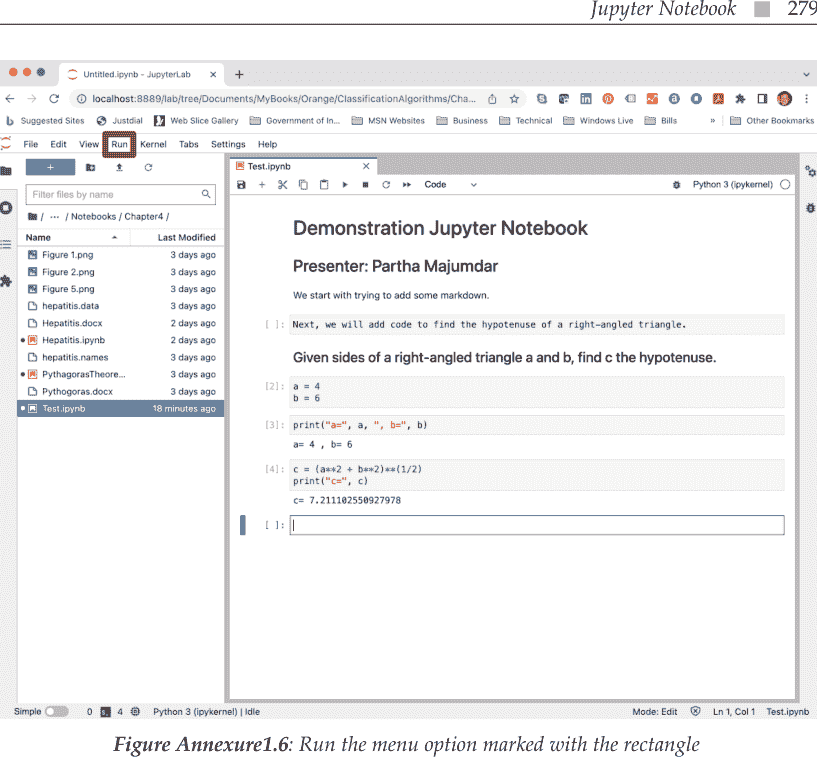

## 注意事项

- 安装 Jupyter Notebook 的最新信息可以从 Jupyter 网站获取。²
- 最好使用 Jupyter Lab，因为可以使用 Jupyter Lab 同时处理多个 Jupyter Notebook。
- 从网站³ 获取的 Anaconda 包含了 Jupyter Lab 以及其他用于数据科学项目的相关工具。

> 2 https://www.jupyter.org.
> 3 https://www.anaconda.org.

## 加入我们书籍的 Discord 空间

加入书籍的 Discord 工作空间以获取最新更新、优惠、全球科技动态、新发布以及与作者的面对面会议：

`https://discord.bpbonline.com`


## 附录 2

## Python

书中所有的代码都是使用 Python 语言编写的。Python 是一种强大且流行的编程语言，特别是用于开发数据科学应用。本书预期读者已经接触过 Python 编程。然而，如果读者在 Python 编程方面存在知识空白，本附录作为一个桥梁。假设读者具有软件编程经验，并使用过一或多种编程语言。

本附录介绍了 Python 编程的关键细节，因为理解书中的代码是需要这些的。Python 是一门充满活力的语言，需要大量的学习。书中使用了 Python 编程的基础特征，以便代码易于理解。建议对深入学习 Python 编程感兴趣的读者搜索相关的材料。

## 结构

在本章中，我们将讨论以下主题：

- 数据类型
  - 序列数据类型
  - 集合数据类型

### 布尔数据类型

- 运算符
  - 算术运算符
  - 赋值运算符
  - 比较运算符
  - 逻辑运算符
- 语句
  - 条件语句
  - 循环语句

在 Python 中使用库

## 数据类型

Python 是一种动态编程语言。与 C、C++ 或 Java 等语言不同，不需要声明类型。解释器会在运行时确定类型。让我们看看 Python 中的基础数据类型：

### 整数 (Integer)
整数是整数，可以是正数、负数或零，没有小数。

```python
x = 10
y = -5
```

### 浮点数 (Float)
浮点数带有小数点的。

```python
x = 10.5
y = -2.0
```

### 布尔值 (Boolean)
布尔值表示两个值之一：True 或 False。

```python
is_active = True
is_finished = False
```

### 字符串 (String)
字符串是用单引号或双引号括的字符序列。

```python
name = "Alice"
message = 'Hello World'
```

### 列表 (List)
列表是有序的、可变的集合。它可以包含不同的数据类型。

```python
my_list = [1, "apple", 3.14]
```

### 元组 (Tuple)
元组是有序的、不可变的集合。一旦创建，无法更改。

```python
my_tuple = (1, "apple", 3.14)
```

### 字典 (Dictionary)
字典是无序的（Python 3.7 之后）键值对集合。

```python
my_dict = {"name": "Alice", "age": 25}
```

### 集合 (Set)
集合是无序的唯一项目集合。它不允许重复值。

```python
my_set = {1, 2, 3, 3}  # 结果将是 {1, 2, 3}
```

`s`
`{1, 2, 3}`

`type(s)`
`set`

我们可以使用 `add()` 方法向集合（Set）添加一个元素：

`s.add(4)`

`s`
`{1, 2, 3, 4}`

然而，如果我们尝试向集合添加一个已经存在的元素，则不会发生变化。

`s.add(2)`
`s`
`{1, 2, 3, 4}`

# 映射数据类型

Python 提供了一了一种名为字典（dictionary）的数据类型，用于存储映射。Python 中的字典存储键值对。让我们通过以下代码中的示例来理解这一点：

```python
d = {10: 'Ram', 20: 'Shyam', 30: 'Jadu', 40: 'Madhu'}
```

```python
d
```

```python
{10: 'Ram', 20: 'Shyam', 30: 'Jadu', 40: 'Madhu'}
```

注意字典 `d` 包含四个元素，每个元素都是一个键值对。

要访问字典的值，我们需要传递键，如下代码所示：

```python
d[20]
```

```python
'Shyam'
```

要查看字典中所有的键，可以使用 `keys()` 方法：

```python
d.keys()
```

```python
dict_keys([10, 20, 30, 40])
```

要查看字典中所有的值，可以使用 `values()` 方法：

```python
d.values()
(['Ram', 'Shyam', 'Jadu', 'Madhu'])
```

# 布尔数据类型

Python 提供了一种布尔（Boolean）数据类型。布尔变量可以取两个值：True 和 False。注意布尔变量值的大小写情况。

# 运算符

Python 提供的在本书中感兴趣的运算符类型如下：

- 算术运算符
- 赋值运算符
- 比较运算符
- 逻辑运算符

Python 提供的其他类型的运算符还包括位运算符、身份运算符和成员运算符。

# 算术运算符

附录表 2.1 列出了 Python 提供的算术运算符：

| 运算符 | 描述 | 示例 |
|---|---|---|---|
| + | 加法 | 2 + 3 = 5 | 10 + 7 = 17 | 10.5 + 1.4 = 11.9 |
| - | 减法 | 5 - 2 = 3 | 12 - 5 = 7 | 11.2 - 12.1 = -0.9 |
| * | 乘法 | 2 * 3 = 6 | 9 * 2 = 108 | 2.3 * 1.2 = 2.76 |
| / | 除法 | 6 / 3 = 2 | 9 / 2 = 4.5 | 9.6 / 2 = 4.8 |
| // | 整除 | 10 // 3 = 3 | 5 // 2 = 2 | 9.8 // 3.3 = 2.0 |
| % | 取模 | 10 % 3 = 1 | 15 % 3 = 0 | 9.88 % 2.2 = 1.08 |
| ** | 次方 | 3 ** 2 = 9 | 2 ** 3 = 8 | 4 ** (1/2) = 2 |

附录表 2.1：Python 中的算术运算符

# 赋值运算符

附录表 2.2 列出了 Python 提供的赋值运算符：

| 运算符 | 描述 | 示例 |
| --- | --- | --- |
| = | 赋值 | a = 2 |
| += | 加并赋值 | a += 2 (a = a + 2) |
| -= | 减并赋值 | a -= 2 |
| *= | 乘并赋值 | a *= 2 |
| /= | 除并赋值 | a /= 2 |
| %= | 取模并赋值 | a %= 2 |
| **= | 次方并赋值 | a **= 2 |

附录表 2.2：Python 中的赋值运算符

# 比较运算符

附录表 2.3 列出了 Python 提供的比较运算符：

| 运算符 | 描述 | 示例 |
|---|---|---|---|
| == | 等于 | a == 2 | a == 2 | a == 2 |
| != | 不等于 | a != 2 | a != 2 | a != 2 |
| > | 大于 | a > 2 | a > 2 | a > 2 |
| >= | 大于等于 | a >= 2 | a >= 2 | a >= 2 |
| < | 小于 | a < 2 | a < 2 | a < 2 |
| <= | 小于等于 | a <= 2 | a <= 2 | a <= 2 |

附录表 2.3：Python 中的比较运算符

# 逻辑运算符

附录表 2.4 列出了 Python 提供的逻辑运算符：

| 运算符 | 描述 | 示例 |
| --- | --- | --- |
| and | 逻辑与 | a and b |
| or | 逻辑或 | a or b |
| not | 逻辑非 | not a |

附录表 2.4：Python 中的逻辑运算符

# 语句

在 Python 中执行的任何指令都是语句。所以，当我们写它时，它被称为语句：

```python
if condition:
    print("True")
elif condition:
    print("True")
else:
    print("False")
```

# 条件语句

Python 提供了 if、elif、else 语句。让我们通过示例来理解：

```python
if condition:
    print("True")
elif condition:
    print("True")
else:
    print("False")
```

# while 循环

Python 提供了 while 循环。让我们通过示例来理解：

```python
ctr = 0
while ctr < 10:
    print(ctr)
    ctr += 1
```

# for 循环

Python 提供了 for 循环。让我们通过示例来理解：

```python
for ctr in range(10):
    print(ctr)
```

# 函数

Python 与任何其他语言一样支持函数。使用 `def` 关键字定义：

```python
def functions(startingNumber):
    if startingNumber % 2 == 0:
        print("even")
    else:
        print("odd")
```

# 在 Python 中使用库

可以使用 `import` 语句使 Python 库可用。假设我们要计算一个数字的阶乘，并且知道 `factorial()` 函数在 `math` 库中。我们可以导入 `math` 库并如下代码所示使用 `factorial()` 函数：

```python
import math
math.factorial(10)
```


## 结论

Python 设计为用于学习编程的语言。因此，Python 的结构保持非常简单。由于 Python 语言的特性，它是科学界的首选编程语言，因为这里的人都是领域专家，并以最小努力完成编程需求。如果分析各种库的贡献者，你会发现包括医生、物理学家、数学家、土木工程师和机械工程师在内的贡献。Python 也是一种非常强大的语言，现在被广泛用于开发企业级软件。Python 最大的特点是几乎所有领域都有库。越来越多的库正在不断添加。

# 要点

- `Python` 提供整数、浮点数、字符串和布尔数据类型。
- `Python` 通过元组、列表和范围提供序列类型数据类型。
- `Python` 提供集合类型数据类型和字典类型数据类型。
- `Python` 提供算术运算符、赋值运算符、比较运算符和逻辑运算符。
- `Python` 支持条件语句和循环语句。
- `Python` 支持函数。
- 可以使用 `import` 语句使用 Python 库。

## 附录3

## 奇异值分解

机器学习中使用的任何形式的数据都以矩阵的形式表示。在这些矩阵上执行矩阵加法、矩阵减法、H 乘积等各种操作，以构建机器学习的数学模型。当我们处理具有数十或数百个特征的数百万数据点时，矩阵操作必须经过优化。因此，我们需要使用线性代数来使这些操作在我们构建的机器学习模型计算机上变得可行。

矩阵操作简化的需求之一是在不丢失原始矩阵信息的情况下减小矩阵的尺寸。矩阵的**奇异值分解（SVD）**是一种在保留矩阵核心信息的同时降低矩阵维数的技术。

在本章中，我们将通过图像压缩的示例来理解 SVD。

### 结构

在本章中，我们将讨论以下主题：

- 使用 SVD 进行矩阵分解
- 使用 SVD 进行图像压缩

### 掌握机器学习的分类算法

- 压缩黑白图像
- 压缩彩色图像

### 使用 SVD 进行矩阵分解

设 `A` 为一个秩为 `$r$` 的 `$m \times n$` 矩阵。那么存在一个 `$m \times n$` 矩阵 `$\Sigma$`，其 `D` 中的对角元素是 `A` 的前 `$r$` 个奇异值，`$\sigma_1 \ge \sigma_2 \ge \cdots \ge \sigma_r > 0$`，且存在 `$m \times n$` 正交矩阵 `U` 和 `$n \times n$` 正交矩阵 `V`，使得：

```
A = U \Sigma V^T
```

任何分解形式 `A = U\Sigma V^T`，其中 `U` 和 `V` 为正交矩阵，`$\Sigma = \begin{bmatrix} D & 0 \\ 0 & 0 \end{bmatrix}$` 且 `D` 的对角元素为正，均称为 `A` 的奇异值分解（SVD）。`U` 和 `V` 矩阵并不由 `A` 唯一确定，但 `$\Sigma$` 的对角元素必然是 `A` 的奇异值。在此类分解中，`U` 的列称为 `A` 的左奇异向量，`V` 的列称为 `A` 的右奇异向量。

> 注意：存在逆矩阵的方阵称为奇异矩阵。奇异矩阵的行列式始终为 0。

假设 `A` 和 `B` 是两个维度为 `$n *$` 的矩阵。如果 `AB = I = BA`，则 `A` 和 `B` 是非奇异矩阵。这里，`I` 是单位矩阵，即对角线元素为 1 而非对角线元素为 0 的矩阵。

让我们来理解这个例子。

考虑如下定义的矩阵 `A`。

```
A = \begin{bmatrix} 1 & 0 \\ 1 & 1 \end{bmatrix}
```

我们可以看到 `A` 是一个 `$2 \times 3$` 矩阵，即 `A` 有两行三列。使用 SVD，我们将 `A` 分解为三个矩阵 `U`、`$\Sigma$` 和 `V`，使得 `A = U\Sigma V^T` 且 `$\Sigma = \begin{bmatrix} D & 0 \\ 0 & 0 \end{bmatrix}$`，其中 `D` 是一个所有元素均为正对角矩阵。

首先，我们需要找到奇异值 `$\sigma_i$`。由于 `A` 不是方阵，我们找到 `$A^T A$` 的特征值，其中 `$A^T$` 是矩阵 `A` 的转置。

```
B = A^T A = \begin{bmatrix} 1 & 1 \\ -1 & 1 \end{bmatrix} \begin{bmatrix} 1 & 0 & -1 \\ 0 & 1 & 1 \end{bmatrix} = \begin{bmatrix} 2 & -1 & 0 \\ -1 & 1 & -1 \\ 0 & -1 & 2 \end{bmatrix}
```

要找到矩阵 `B` 的特征值，我们需要找到一个标量 `$\lambda$`，使得 `$(B-\lambda I) = 0$`，其中 `I` 是单位矩阵。行列式 `$(B-\lambda I)$` 写作 `|B-\lambda I|`。

```
$B-\lambda I = \begin{bmatrix} 2 & -1 & 0 \\ -1 & 1 & -1 \\ 0 & -1 & 2 \end{bmatrix}-\begin{bmatrix} 1 & 0 & 0 \\ 0 & 1 & 0 \\ 0 & 0 & 1 \end{bmatrix} = \begin{bmatrix} 2-\lambda & -1 & 0 \\ -1 & 1-\lambda & -1 \\ 0 & -1 & 2-\lambda \end{bmatrix}$
```

`$|B-\lambda I| = -\lambda^3 + 5\lambda^2 - 6\lambda = 0$` --- eq1

如果解方程 eq1，我们将得到三个 `$\lambda$` 的值。这三个值是矩阵 `B` 或 `$A^TA$` 的特征值。

`$\lambda = 0, 2, 3$`

现在我们需要找到矩阵 `B` 或 `$A^TA$` 的特征向量。我们需要找到一个向量 `X`，使得 `BX` 等特征值以寻找特征向量。得到：

```
$\begin{bmatrix} 2 & -1 & 0 \\ -1 & 1 & -1 \\ 0 & -1 & 2 \end{bmatrix} \begin{bmatrix} x_1 \\ x_2 \\ x_3 \end{bmatrix} = 0$ ---eq2
```

```
$\begin{bmatrix} 2 & -1 & 0 \\ -1 & 1 & -1 \\ 0 & -1 & 2 \end{bmatrix} \begin{bmatrix} x_1 \\ x_2 \\ x_3 \end{bmatrix} = 2$ ---eq3
```

```
$\begin{bmatrix} 2 & -1 & 0 \\ -1 & 1 & -1 \\ 0 & -1 & 2 \end{bmatrix} \begin{bmatrix} x_1 \\ x_2 \\ x_3 \end{bmatrix} = 3$ ---eq4
```

求解上述三个方程，我们得到特征向量。让我们解方程 eq2：

```
$2x_1 - x_2 = 0$

$-x_1 + x_2 - x_3 = 0$

$-x_2 + 2x_3 = 0$
```

所以我们有关于 3 个变量的方程。求解得到 `$x_1 = 1, x_2 = 2, x_3 = 1$`（等待，根据文本，`$x_1=1, x_2=2, x_3=1$` 与方程不一致，所以特征向量是 `$\begin{bmatrix} 1 \\ 2 \\ 1 \end{bmatrix}$`）。同样，我们可以找到其他特征向量 `$\begin{bmatrix} -1 \\ 0 \\ 1 \end{bmatrix}$` 和 `$\begin{bmatrix} 1 \\ -1 \\ 1 \end{bmatrix}$`。

要找到矩阵 `V`，我们取特征向量并除以它们的范数。特征向量的范数是所有元素平方和的根。所以 `$\begin{bmatrix} 1 \\ 2 \\ 1 \end{bmatrix}$` 是 `$\sqrt{1^2+2^2+1^2} = \sqrt{6}$`。同样，`$\begin{bmatrix} -1 \\ 0 \\ 1 \end{bmatrix} = \sqrt{2}$`  `$\begin{bmatrix} 1 \\ -1 \\ 1 \end{bmatrix} = \sqrt{3}$`。

我们需要按照特征值的顺序排列特征向量。得到：

```
$V = \begin{bmatrix} 1/\sqrt{6} & -1/\sqrt{2} & 1/\sqrt{3} \\ 2/\sqrt{6} & 0 & -1/\sqrt{3} \\ 1/\sqrt{6} & 1/\sqrt{2} & 1/\sqrt{3} \end{bmatrix}$
```

为了得到矩阵 `$\Sigma$`，将特征值降序排列。特征值的平方根是矩阵 `$A^T$` 的奇异值。以此创建矩阵 `$\Sigma$`。这里 `$\sigma_1 = \sqrt{3}, \sigma_2 = \sqrt{2}, \sigma_3 = 0$`。

```
$\Sigma = \begin{bmatrix} \sqrt{3} & 0 & 0 \\ 0 & \sqrt{2} & 0 \\ 0 & 0 & 0 \end{bmatrix}$
```

从 `$\Sigma$` 中移除最后一行，使得 `$\Sigma$` 非奇异的。得到：

```
$\Sigma = \begin{bmatrix} \sqrt{3} & 0 \\ 0 & \sqrt{2} \end{bmatrix}$
```

如果我们表示 `D = \begin{bmatrix} \sqrt{3} & 0 \\ 0 & \sqrt{2} \end{bmatrix}`，那么得到 `$\Sigma = [D \ \mathbf{0}]$`。我们需要确定矩阵 `U` 以完成奇异值分解。当矩阵 `A` 的秩为 `$r$` 时，为了构造 `U`，取 `U` 的前 `$r$` 列，使得它们成为归一化向量 `Av_1, Av_2, ...`。这里 `v_1, v_2, ...` 和 `v_r` 是矩阵 `V` 的列。

在我们的例子中，`A` 的秩 `min[2,3] = 2`。因此，我们需要找到 `u_1` 和 `u_2`，其中 `u_1` 和 `u_2` 是矩阵 `U` 的列。得到：

```
$u_i = \frac{1}{||Av_i||} Av_i$
```

现在，`$||Av_i|| = \sqrt{\lambda_i}$`。得到：

```
$u_i = \frac{1}{\sqrt{\lambda_i}} Av_i$
```

得到：

```
$u_1 = \begin{bmatrix} 1 & 0 \\ -1 & 1 \end{bmatrix} \begin{bmatrix} -1 \\ -1/\sqrt{3} \\ 1/\sqrt{3} \end{bmatrix} / \sqrt{3} = \begin{bmatrix} 0 \\ 1 \end{bmatrix}$
```
（注：此处原文结果为 `$\begin{bmatrix} 0 \\ 1 \end{bmatrix}$`，计算逻辑可能存在跳跃）

`$u_2 = \begin{bmatrix} 1 & 0 \\ 1 & -1 \end{bmatrix} \begin{bmatrix} -1/\sqrt{2} \\ 0 \\ -1/\sqrt{2} \end{bmatrix} / \sqrt{2} = \begin{bmatrix} -1 \\ 0 \end{bmatrix}$`

得到：

`$U = \begin{bmatrix} 0 & -1 \\ 1 & 0 \end{bmatrix}$`

让我们验证 `A = U\Sigma V^T`：

`$U\Sigma V^T = \begin{bmatrix} 0 & -1 \\ 1 & 0 \end{bmatrix} \begin{bmatrix} \sqrt{3} & 0 \\ 0 & \sqrt{2} \end{bmatrix} \begin{bmatrix} 1/\sqrt{3} & -1/\sqrt{2} & 1/\sqrt{6} \\ 2/\sqrt{3} & 0 & 2/\sqrt{6} \\ 1/\sqrt{3} & 1/\sqrt{2} & 1/\sqrt{6} \end{bmatrix} =$`

`$\begin{bmatrix} 0 & -\sqrt{2} \\ \sqrt{3} & 0 \end{bmatrix} \begin{bmatrix} 1/\sqrt{3} & -1/\sqrt{2} & 1/\sqrt{6} \\ 2/\sqrt{3} & 0 & 2/\sqrt{6} \\ 1/\sqrt{3} & 1/\sqrt{2} & 1/\sqrt{6} \end{bmatrix} = \begin{bmatrix} -2 & 0 & -2 \\ 1 & -1 & 1 \end{bmatrix} = A$`

### 使用 SVD 进行图像压缩

```
$$\begin{bmatrix} 0 & -\sqrt{2} & 1/\sqrt{3} & -1/\sqrt{3} & 1/\sqrt{3} \\ -\sqrt{3} & 0 & -1/\sqrt{2} & 0 & 1/\sqrt{2} \end{bmatrix} = \begin{bmatrix} 1 & 0 \\ 0 & -1 \end{bmatrix}=A$$
```

设 `A` 为一个 `$n \times m$` 矩阵。设 `k` 为自然数，其中 `k \leq \text{rank}(A) \leq \min(n, m)`。

> 注意：矩阵的秩（Rank）等于矩阵中线性无关行（或列）的最大数量。
如果矩阵的某行（或列）不能表示为矩阵其他其他行（或列）的线性组合，则该行（或列）是线性独立的。

利用 `A` 的 SVD 分解，如果 `A=UDV^T`，我们保留 `D` 中的前 `k` 个值，并将后续的奇异值设为零。设所得对角矩阵为 `D_k`。易见，我们只需要保留 `U` 的前 `k` 列和 `V` 的前 `k` 行，因为它们的其他列乘以零，如图 A3.1 所示。总之，`A_k=U_kD_kV_k^T` 是秩为 `k` 的最接近 `A` 的矩阵，其中 `U_k` 和 `V_k` 分别由 `U` 和 `V` 的前 `k` 列和行组成。

如果 `A` 很大，`n, m` 很大且 `k` 较小，为了近似 `A` 中存储的信息，我们需要的信息要少得多。也就是说，我们可以显著减少存储空间，同时存储与原始矩阵几乎相同的信息。

在这里看到矩阵的低秩近似如何为图像压缩提供解决方案。

图像表示为矩形数组，其中每个元素对应像素的灰度值。对于彩色图像，我们有一个大小为 `$n \times m \times 3$` 的三维数组，其中 `n` 和 `m` 分别代表垂直和水平方向的像素数量。对于每个像素，我们存储红、绿、蓝颜色的强度。

我们在一个更大的矩阵上重复上述低秩近似过程；也就是说，我们为代表每种颜色的图像创建低秩近似。得到的三维数组将是原始图像的良好近似。

`k` 的不同值会导致不同的压缩质量；`k` 越高，压缩后的图像越接近原始图像，但增加 `k` 意味着矩阵更大。

### 压缩黑白图像

我们首先讨论如何压缩黑白图像。

用于演示的图像可以在此**链接**找到。

首先，我们加载图像。

```python
import numpy as np
from PIL import Image
```

#### 读取图像并存储为数组

```python
imageArray = np.array(Image.open('./TempleBW.jpeg'))
imageArray.shape
(4032, 3024)
```

所以，这张图像中有 `4032 * 3024` 个像素。

我们看到这是一个二维字节序列。如果我们研究这些字节，会发现每个字节包含一个 0 到 255 之间的数字。

```python
imageArray[:20]
```

```python
array([[227, 227, 226, ..., 190, 190, 190],
      [226, 226, 228, ..., 192, 193, 193],
      [224, 224, 227, ..., 193, 195, 196],
      ...,
      [227, 226, 224, ..., 190, 190, 190],
      [228, 227, 225, ..., 192, 191, 191],
      [230, 229, 227, ..., 191, 190, 191]], dtype=uint8)
```

每个数据点都是强度值。我们将对强度值进行归一化。我们将每个数据点除以 255，使得每个数据点都成为 0 到 1 之间的数字。

```python
image = imageArray / 255
```

让我们绘制该图像。

```python
import matplotlib.pyplot as plt
```

```python
%matplotlib inline
```

```python
# 显示图像
fig = plt.figure(figsize=(12, 10))
a = fig.add_subplot(1, 1, 1)
plt.tick_params(bottom=False, left=False, labelbottom=False, labelleft=False)
```

```python
imgplot = plt.imshow(image, cmap='gray')
```

```python
plt.show()
```


附录图 3.2：原始黑白图像

### 奇异值分解

让我们检查存储图像所需的空间：

```python
originalBytes = image.nbytes
print("Space needed to store this image is", originalBytes/1024/1024, 'MB')
```

存储此图像所需的空间为 93.0234375 MB

现在，我们开始使用 SVD 方法压缩图像。

### SVD 分解

```python
U, D, VT = np.linalg.svd(image, full_matrices=True)
# 检查要存储的字节
```


`bytesToBeStored = sum([matrix.nbytes for matrix in [U, D, VT]])`

`print("The matrix that we store has a total size (in bytes):", bytesToBeStored)`

我们存储的矩阵总大小（字节）：203269992

我们将仅保留矩阵 `D` 中的前 `$k$` 个值，并将剩余部分置 0。令 `$k = 1000$`，这远小于图像的两个维度（4032 和 3024）。

```python
k = 1000
```

# 从 U 矩阵选择 k 列，从 VT 矩阵选择 k 行

```python
U_k = U[:, 0:k]
VT_k = VT[0:k, :]
D_k = D[0:k]
compressedBytes = sum([matrix.nbytes for matrix in [U_k, D_k, VT_k]])
print("Compressed matrix that we store now has a total size:", compressedBytes/1024/1024, 'MB')
```

我们现在存储的压缩矩阵总大小为：53.84063720703125 MB

看看实现了多大的压缩。

```python
ratio = compressedBytes / originalBytes * 100
```

原始图像大小与压缩图像之间的压缩率为 57.88%

现在让我们重构图像。

```python
# 重构图像
imageApprox = np.dot(U_k, np.dot(D_k, VT_k))
# 修正强度超出 [0, 1] 范围的像素
imageApprox[imageApprox < 0] = 0
imageApprox[imageApprox > 1] = 1
```

```python
# 显示重构的图像
fig = plt.figure(figsize=(12, 10))
a = fig.add_subplot(1, 1, 1)
plt.tick_params(bottom=False, left=False, labelbottom=False, labelleft=False)
imgplot = plt.imshow(imageApprox, cmap='gray')
plt.show()
```

附录图 3.3：重构图像

306 掌握机器学习的分类算法

`D_g_k = D_g[0:k]`
`D_b_k = D_b[0:k]`
`compressedBytes = sum([matrix.nbytes for matrix in [U_r_k, D_r_k, VT_r_k, U_g_k, D_g_k, U_b_k, D_b_k, VT_b_k]])`
`print("Compressed matrices that we store have total size:", compressedBytes/1024/1024, 'MB')`
`ratio = compressedBytes / originalBytes * 100`
`print("nThe compression ratio between the original image size and the compressed image is %.2f%%" % (ratio, '%'))`

我们现在拥有的压缩矩阵总大小为161.5219116210935 MB

原始图像大小与压缩图像之间的压缩比为 57.88%

现在让我们重构压缩图像。

# 为每种颜色重建矩阵

`image_red_approx = np.dot(U_r_k, np.dot(np.diag(D_r_k), VT_r_k))`
`image_green_approx = np.dot(U_g_k, np.dot(np.diag(D_g_k), VT_g_k))`
`image_blue_approx = np.dot(U_b_k, np.dot(np.diag(D_b_k), VT_b_k))`

# 从颜色矩阵重构原始图像

`imageReconstructed = np.zeros((image.shape[0], image.shape[1], 3))`
`imageReconstructed[:, :, 0] = image_red_approx`
`imageReconstructed[:, :, 1] = image_green_approx`
`imageReconstructed[:, :, 2] = image_blue_approx`

# 修正强度值在 [0,1] 范围之外的像素

`imageReconstructed[imageReconstructed < 0] = 0`
`imageReconstructed[imageReconstructed > 1] = 1`

最后，我们显示并保存压缩图像。

```python
# 显示重构后的图像
fig = plt.figure(figsize=(math.ceil(12.0 * ratio / 100), math.ceil(10.0 * ratio / 100)))
a = fig.add_subplot(1, 1, 1)
plt.tick_params(bottom = False, left = False, labelbottom = False, labelleft = False)
imgplot = plt.imshow(imageReconstructed)
plt.savefig('compressed.png')
plt.show()
plt.close()
```


附录 3.5：压缩彩色图像

## 结论

在本附录中，我们学习了如何使用 SVD 降低矩阵的维度。这种方法在许多机器学习问题中用于降维。主成分分析（PCA）算法就使用了这种技术。

# 加入我们书籍的 Discord 空间

加入书籍的 Discord 工作区获取最新更新、优惠、全球技术动态、新发布以及与作者的交流会议：

https://discord.bponline.com


# 附录 4

# 预处理

## 文本数据

当我们处理文本数据时，我们以文档的形式接收数据。文档可以是报纸文章、书的一个章节、书中的某一个段落、电子邮件、短信、推特推文、Facebook 帖子等。每一个此类文档被称为一个语料库（corpus）。此类文档的集合称为语料库（corpora）。

在分析语料库之前，进行一些预处理是必要的。本附录讨论了对任何语料库通用的某些预处理步骤。讨论所有预处理步骤是不可能的，因为它们随应用而异。此外，根据应用决定是否应用这些预处理步骤。最后，需要根据应用决定如何处理这些步骤。

## 结构

在本章中，我们将讨论以下主题：

- 移除停止词
- 移除特殊字符
- 移除标点符号
- 移除数字
- 移除额外的空格
- 检测并处理文本中的 URL
- 检测并处理文本中的邮箱地址
- 检测并处理文本中的标签（hashtags）和提及（mentions）
- 处理表情符号

# 移除停止词

停止词是语言中常用的单词。在英语语言中，如 "I", "me", "so", "this", "that", "you" 等单词被称为停止词。通常情况下，停止词在分析数据时没有价值。因此，通常做法是在分析数据之前从语料库中移除停止词。

英语停止词列表在许多库中可用。自然语言工具包（nltk）通常用于获取停止词列表。`nltk`库在 Python 和 R 中可用。我们将讨论如何使用 `nltk` 库来移除停止词。

在使用 `nltk` 库之前，必须在机器上安装它。在 Jupyter Notebook 中使用的命令是：

```python
pip install nltk
```

在 Linux 或 Mac 中使用的以下代码接受文本输入，并返回移除所有停止词后的文本。`removeStopWords()` 函数将文本拆分为每个单词（单词列表），一旦我们得到了非停止词的单词，每个单词之间用一个空格将它们重新连接，并返回文本。

```python
import nltk
from nltk.corpus import stopwords
from nltk.tokenize import word_tokenize
```

## 收集停止词列表

## 移除停止词函数

```python
def removeStopWords(text):
    # 将字符串拆分为标记（单词列表）
    tokens = word_tokenize(text)
    tokens = [token.strip() for token in tokens]
    # 过滤掉停止词
    filtered_tokens = [token for token in tokens if token not in stopwords.words('english')]
    filtered_text = ' '.join(filtered_tokens)
    return filtered_text
```

我们可以测试 `removeStopWords()` 函数。

`removeStopWords("This is a test of Stop Word remover".lower())`

# 移除特殊字符

在文本分析中，我们通常关注文本的单词。然而，根据分析的性质，可能会有例外。特殊字符通常从文本中移除，以便只剩下单词。我们必须决定在哪个阶段消除特殊字符。特殊字符是文本的一部分，例如邮箱地址、标签、URL、引用等。移除特殊字符意味着我们需要保留字母和数字并移除其他所有内容。对于替换，可以使用 Python 可用的 `re` 库。

```python
import re

def removeSpecialCharacters(text):
    pattern = r'[^a-zA-Z0-9\s]'
    return re.sub(pattern, '', text)

removeSpecialCharacters("This is a #test $string, sent: @someone")
```

'This is a string sent someone

# 移除标点符号

这是移除特殊字符的一种特殊情况。

```python
import string

def removePunctctuations(text):
    return text.translate(str.maketrans('', '', string.punctuation))
```

`removePunctctuations("This is a test; of punctuation. Does it work?")`

'This is a test of punctuation Does it work

# 移除数字

许多应用涉及文本分析，其中数字对分析来说是可选的。例如，在制作垃圾邮件检测应用时，可能不需要分析文本中的数字。在这种情况下，我们从文本中移除数字。其想法是找到文本中的任何数字并将其替换为空字符串。

```python
import re

def removeNumbers(text):
    return re.sub(r'[0-9]+', '', text)
```

`removeNumbers("This text contains 66 numbers and 1654 characters.")`

'This text contains numbers and characters.'

# 移除额外的空格

在文本分析大多数情况下，空格字符被用作单词之间的分隔符。单词之间有超过 1 个空格可能会导致分析错误。因此，最好移除额外的空格。其想法是使用空格作为分隔符拆分文本，一旦我们只得到了单词，就在每个单词之间用一个空格将它们连接。`split()` 函数的默认分隔符是空格。

```python
def removeExtraWhiteSpaces(text):
    return " ".join(text.split())
```

`removeExtraWhiteSpaces("This is a  test of removing extra white spaces")`

'This is a test of removing extra spaces

# 检测并处理文本中的 URL

我们经常遇到包含 URL 的文本（URL 是互联网资源的通用资源定位符）。在某些应用（如垃圾邮件检测）中，分析必须包含 URL。还有一些像情感分析这样的应用，URL 是可选的。即使在我们需要分析 URL 的应用中，我们可能只需要检测 URL 的存在，而不将其用于文本分析。因此，根据需求，我们需要决定如何处理文本中的 URL。

```python
import re
```

```python
def identifyAndRemoveURLs(text, remove = True):
    present = re.search(r'\w+:\{2}[\d\w]+\.[\d\w]+*(?::\\.\d\w]+)**(?:\\/\\s*))*)', text)
```

```python
if remove:
    return re.sub(r'\w+:\{2}[\d\w]+\.[\d\w]+*(?::\\.\d\w]+)**(?:\\/\\s*))*)', '', text, 1)
```

else:

```python
return text, 1
```

else:

```python
return text, 0
```

```python
print('Example 2:', identifyAndRemoveURLs("This contains no URLs"))
```

示例 1: ('Click this link to register - OR this link for information or download this file - ', 1)

示例 2: ('This contains no URLs', 0)

# 检测并处理中的电子邮件地址

我们必须决定如何像处理 URL 一样处理文本分析中的电子邮件地址。在某些应用程序中，电子邮件地址可能被用作特征；而在其他情况下，分析可能不需要它们。

```python
import re
```

```python
def identifyAndRemoveEmailAddress(text, remove = True):
    present = re.search(r'[a-zA-Z0-9_\.]+@[a-zA-Z0-9]+\.[a-z]{1,3}', text)
    if present:
        if remove:
            return re.sub(r'[a-zA-Z0-9_\.]+@[a-zA-Z0-9]+\.[a-z]{1,3}', '', text), 1
        else:
            return text, 1
    else:
        return text, 0
```

```python
import re
identifyAndRemoveEmailAddress('Immediately reply to some.one@somewhere.com and send the filled form to leader@somewhere.com')
```

# ('Immediately reply to and send the filled form to ', 1)

# 检测并处理文本中的标签（hashtags）和提及（mentions）

我们必须决定如何像处理 URL 和电子邮件地址一样处理标签和提及。这里提供了一个用于移除标签和提及的函数。你可以根据应用程序的需求修改该函数。

```python
import re

def removeHashtagsAndMentions(text):
    return re.sub('(@[A-Za-z0-9]+)|([^0-9A-Za-z t][A-Za-z0-9]+) |(\w+:\//\S+)', '', text)

removeHashtagsAndMentions('#MIT this is a test @Ramesh Harvard')
```

# ‘this is a test Harvard’

# 处理表情符号（emojis）

在现代，人们在文本中频繁使用表情符号。表情符号不仅用于社交媒体活动，还经常用于电子邮件、短信、WhatsApp 消息，甚至文章中。关于表情符号的信息对于情感分析（Emotion Analysis）等某些应用程序至关重要。因此，根据应用程序，需要决定是否保留文本中表情符号的信息。如果需要保留表情符号的信息，则必须进行基本的特征工程。在任何情况下，在分析文本之前必须从文本中移除表情符号。

精通机器学习的分类算法

要处理表情符号，需要安装 `emoji` 库。

```bash
!pip install emoji
```

一旦 `emoji` 可用，就可以使用库中的函数来决定对表情符号进行什么操作。

```python
import emoji
emoji.is_emoji('👍')
```

True


## 结论

文本数据预处理是任何涉及文本数据应用程序中必不可少的步骤。在大多数情况下，文本数据分析属于**自然语言处理 (NLP)** 的范畴。在本录中，我们讨论了最常用的文本预处理需求。所讨论的机制可以应用于任何其他文本预处理需求。如附录所示，我们需要对文本预处理步骤排序，以获得用于分析的最佳数据。

# 加入我们书籍的 Discord 空间

加入书籍的 Discord 工作空间获取最新更新、优惠、全球科技动态、新发布以及与作者的交流：

`https://discord.bponline.com`


# 附录 5

## 词干（Stemming）与词还原（Lemmatization）

在文本中，许多单词源于同一个词。我们需要根据单词使用的语境包含这些词。例如，我们可能在不同的句子中使用“seem”、“seemed”、“seeming”和“seemingly”这些词。然而，所有这些词都有同一个根，“seem”。

对于分析任何数据（包括文本），拥有较少的变量是有益的。因此，与其为“seem”、“seemed”、“seeming”和“seemingly”这些词准备不同的变量，如果我们能只为根词“seem”准备一个变量，就可以使文本分析更加精确。（这是一种通用情况。可能存在不适用的情况）。

将一个单词替换为它的词根被称为文本归一化（Normalizing the Text）或文本归一化（Text Normalization）。文本归一化是自然语言处理中的一个基本步骤。为了归一化文本，我们使用词干（Stemming）和词还原（Lemmatization）技术。

### 结构

在本章中，我们将讨论以下主题：

- 词干
- 词还原

## 词干（Stemming）

词干是一种文本归一化技术，它从单词的开头或结尾截断部分。截断的部分称为后缀（affix）。例如，如果我们对单词“seeming”进行词干提取我们将得到“seem”。

通常，词干是一种简单且有效的文本归一化技术。然而，在许多情况下它可能无法产生预期的结果。例如，如果我们对“seemingly”进行词干提取我们将得到“seemingly”。在这里，单词在句子中的含义将随着无关的内容而丢失。

对于词干，我们可以使用 `nltk` 库中的函数。`nltk` 代表自然语言工具包。一种流行的词干算法是 `Porter Stemmer`。

```python
import nltk
from nltk.stem import PorterStemmer
ps = PorterStemmer()
```

实例化后，我们可以使用 `Porter Stemmer` 的实例对单词进行词干提取。

```python
ps.stem('seemingly')
# seemingly
ps.stem('Seeming')
# seem
ps.stem('caring')
# care
ps.stem('boots')
# boot
ps.stem('fishes')
# fish
ps.stem('dangerous')
# danger
ps.stem('studies')
# studi
ps.stem('studying')
# studi
```

## 词还原（Lemmatization）

词还原是一种根据语境找到单词词元的文本归一化技术。在词干提取示例中，我们看到“Studying”和“studies”得到“studi”。这是不正确的。可以通过词还原来修正。

词还原库位于 `nltk` 中。在使用这些库之前，我们需要安装并初始化这些库。

```python
import nltk
nltk.download('wordnet')
from nltk.stem import WordNetLemmatizer
wordnetlemmatizer = WordNetLemmatizer()
```

```python
wordnetlemmatizer.lemmatize('studying')
# studying
wordnetlemmatizer.lemmatize('studies')
# study
wordnetlemmatizer.lemmatize('crying')
# cry
wordnetlemmatizer.lemmatize('cries')
# cry
wordnetlemmatizer.lemmatize('beautiful')
# beautiful
wordnetlemmatizer.lemmatize('wonderful')
# wonderful
wordnetlemmatizer.lemmatize('wonders')
# wonder
```

### 结论

文本归一化是文本处理中的一个至关重要的步骤。词干和词还原都用于文本归一化。虽然词干很简单，但词还原通常更受欢迎，因为它试图保留单词的语境。

# 附录 6

## 向量化（Vectorizers）

从文本中创建模型非常重要。这是因为有大量的文本数据。报纸、杂志、书籍、短信、电子邮件和社交媒体（如 Facebook、Twitter、WhatsApp、LinkedIn 等）的数据都是文本。文本向量化是将文本数据转换为数字表示的机制。

在本附录中，我们将讨论两个文本向量化。一个是计数向量化（Count Vectorizer）。这是一种将文本表示为数字的简单机制。一旦通过对计数向量化的讨论了向量化的概念，我们将讨论一种更复杂的向量化，即 TF-IDF 向量化（TF-IDF vectorizer）。TF-IDF 代表词频-逆文档频率（Term-Frequency Inverse Document Frequency）。

### 结构

在本章中，我们将讨论以下主题：

- 计数向量化 (Count vectorizer)
- TF-IDF 向量化 (TF-IDF vectorizer)

## 计数向量化

计数向量化，是指统计一个单词在给定文本中出现的次数。

例如，假设我们有这样文本——“我去冰淇淋店买吃了一个冰淇淋……”假设这段文本是通过短信发送的。这在我们包含许多短信的完整数据集中就是其中一条短信。我们将此数据点称为该完整数据集的一个文档（document）。因此，该数据集将包含许多文档。所有文档的集合被称为语料库（Corpus）。

为了进行全面讨论，让我们考虑在初始语料库中，我们另一个文档是“太棒了。你喜欢那个冰淇淋吗？”。现在，我们的语料库有两个文档，如附录 6.1 表所示：

| 文档 ID | 文档内容 |
|------|---|
| 1 | I went to the Ice Cream Parlor to have an Ice Cream. |
| 2 | Great. Did you enjoy the Ice Cream? |

附录 6.1 表：示例数据集

为了为附录 6.1 表中的数据创建计数向量器，我们需要识别文档中的所有唯一单词，并统计每个单词在每个文档中出现的次数，如附录 6.2 表所示（在此练习之前我们将从文本中移除所有的标点符号）。

| 单词 | 文档 1 | 文档 2 |
|---|---|---|
| I | 1 | 0 |
| went | 1 | 0 |
| To | 1 | 0 |
| The | 1 | 1 |
| Ice | 2 | 1 |
| cream | 2 | 1 |
| parlor | 1 | 0 |
| To | 1 | 0 |

| 单词 | 文档 1 | 文档 2 |
|---|---|---|
| have | 1 | 0 |
| An | 1 | 0 |
| great | 0 | 1 |
| Did | 0 | 1 |
| You | 0 | 1 |
| enjoy | 0 | 1 |

**附录 6.2 表：** 数据集中唯一单词列表及其在文档中的计数

附录 6.2 表显示我们拥有语料库中两个文档中每个单词的计数。如果我们将此写为一个向量，它看起来将像附录 6.3 表所示。

| 文档 ID | 计数向量 |
|---|---|
| 1 | [1,1,1,1,2,2,1,1,1,0,0,0] |
| 2 | [0,0,0,1,1,1,0,0,0,0,1,1,1] |

**附录 6.3 表：** 表 A6.1 中给定数据集的计数向量

现在，我们可以看到，我们已经将附录 6.1 表数据集中的文本转换成了一个包含 14 个数字的数组，如附录 6.3 表所示。附录 6.3 表中的这些数据被视为具有 14 个特征的数据集，可以用于构建机器学习模型。

计数向量化是在 Scikit-Learn 库的 `sklearn.feature_extraction.text.CountVectorizer` 包中实现的。

```python
data = [['I went to the Ice Cream Parlor to have an Ice Cream.',
['Great. Did you enjoy the Ice Cream?']
]]
```

```python
[['I went to the Ice Cream Parlor to have an Ice Cream.',
['Great. Did you enjoy the Ice Cream?']]]
```

```python
import pandas as pd
df = pd.DataFrame(data, columns = ['text'])
df
```

# 掌握机器学习分类算法

`text`

```
0 I went to the Ice Cream Parlor to have an Ice ...
1 Great. Did you enjoy the Ice Cream?
```

```python
from sklearn.feature_extraction.text import CountVectorizer
cv = CountVectorizer(stop_words = 'english')
transformed = cv.fit_transform(df.text)
transformed.todense()
matrix([[2, 0, 0, 0, 2, 1, 1]],
[1, 1, 1, 1, 1, 0, 0]])
dfTransformed = pd.DataFrame(transformed.todense(), columns = cv.get_
feature_names_out())
dfTransformed
cream did enjoy great ice went
0 2 0 0 0 2 1 1
1 1 1 1 1 0 1
```

注意，在初始化 `CountVectorizer` 时，我们传递了一个参数来移除英语停用词（Stop Words）。停用词是语言中常用的单词。例如，在英语中，我们将“I”、“you”、“the”、“so”等单词视为停用词。因此，在移除所有停用词后，创建了计数向量。

## TF-IDF 向量化

对于附录 6.1 表中的数据，我们理解每个文本都被视为一个文档。在每个文档内部，每个单词都被视为一个术语（term）。

TF-IDF 提供了一种识别与术语最相关的文档的机制。TF-IDF 的全称是词频率-逆文档频率（Term Frequency-Inverse Document Frequency）。因此，TF-IDF 是两个项的乘积：词频率 (TF) 和逆文档频率 (IDF)。

TF 衡量术语在文档中出现的频率。我们计算术语 TF 的方式是术语在文档中出现的次数除以文档中术语的总数。

# 术语在文档中出现的次数
文档中术语的总数

例如，在附录 6.1 表中，第一个文档（Document ID = 1）有 12 个术语，“Ice”在文档中出现了两次。因此，第一个文档中术语“Ice”的词频率 (TF) 为 TF = 2/12。

逆文档频率 (IDF) 衡量术语在语料库中的重要性。计算 IDF 的公式如下：

```
IDF = log(语料库中的文档总数
包含该术语的文档数量)
```

让我们取两个例子。首先，我们计算术语“ice”的 IDF。我们语料库中的文档总数（如附录 6.1 表中的数据集）为 2。包含术语“ice”的文档数量为 2。IDF=log(2)/2=log(1)=0。

接下来，取术语“parlor”。文档总数为 2。包含术语“parlor”的文档数量为 1。因此，IDF=log(2)/1。

# 加入我们的书籍 Discord 空间

加入书籍的 Discord 工作区，获取最新更新、优惠、全球科技动态、新发布以及与作者交流的机会：

`https://discord.bponline.com`


# 附录 7

## 编码器 (Encoders)

在许多情况下，数据包含有助于创建机器学习模型的非数值（non-numeric values）。然而，机器学习模型只能使用数值数据进行构建。因此，我们需要一种机制将非数值数据转换为数值数据，同时保留数据背后的含义。

我们使用编码器（Encoders）将某些类型的非数值数据转换为数值数据。本附录将讨论不同类型的编码器及其在 Scikit-Learn 中的实现。

### 结构

在本章中，我们将讨论以下主题：

- 适用于应用编码器的数据。
- 标签编码器 (Label Encoder)
- 独热编码器 (One-Hot Encoder)

## 适用于应用编码器的数据

在附录 6 向量化（Vectorizers）中，我们讨论了将数据转换为数值数据以构建机器学习模型。我们可能有一些非数值数据；但它们是特定的值。例如，在获取人口统计数据时，我们可能有一个数据元素来记录个人的状态。婚姻状况（Marital status）的值可能是“已婚”（Married）、“单身”（Single）、“离婚”（Divorced）、“寡妇”（Widow）或“�寡夫”（Widower）。通常，我们会直接记录婚姻状况的值，因为这些字面量便于采集。如果我们使用在线表单，可能会有一个程序将“已婚”转换为 0，“单身”转换为 1 等。如果是这种情况，我们就拥有了数值数据，无需担心。然而，如果数据的形式是“已婚”、“单身”等，我们需要一种机制将它们转换为数值数据。

另一个例子是酒店的房型。这些值可以是“豪华型”（Deluxe）、“超级豪华”（Super Deluxe）、“套房”（Suite）等。或者，如果我们正在建立一个构建合适足球球队的模型，球员位置的数据可能是“中锋”（Center Forward）、“守门员”（Goalkeeper）、“中场”（Midfielder）等。

所有传达特定含义的非数值数据都是可以使用编码器转换为数值数据的数据。

现在，不同的编码器可能适用于我们讨论的不同类型的数据。让我们讨论不同类型的编码器。

## 标签编码器 (Label Encoder)

在编码器中，我们找到某个字段的所有唯一值，并为每个值分配一个数值代码。例如，假设我们数据中有一个名为“婚姻状况”的字段。现在，我们发现婚姻状况字段的唯一值为“已婚”、“单身”、“离婚”、“寡妇”和“�寡夫”。因此，婚姻状况字段有五个值。我们可以这样做：为“已婚”分配值 0，“单身”分配值 1，“离婚”分配值 2，“寡妇”分配值3，“�寡夫”分配值 4。通过这种方法，我们可以清晰地区分哪些记录是已婚人士、哪些是单身人士等。此外，如果给出的婚姻状况值是数值代码，我们可以将其转换为对应的标签。例如，在这种方案下，如果告诉我们婚姻状况是 2，我们就知道该记录对应离婚人士。

当我们拥有某个特定字段的数据，且其不同值之间没有关联时，可以使用标签编码器。例如，对于婚姻状况字段的值，“已婚”、“单身”、“离婚”、“寡妇”和“�寡夫”之间之间没有关系。在这种情况下，我们只需要为每个不同的值分配一个数值代码。我们将这些数值代码分配给不同不同值的顺序并不重要。

字段中的每个不同值被称为“标签”（label）。因此，当我们将标签编码为数值代码时，该过程称为标签编码（Label Encoding）。执行标签编码的编码器被称为标签编码器（Label Encoder）。

标签编码器在 Scikit-Learn 包中 `preprocessing.LabelEncoder` 实现。让我们通过一个示例来理解该库的使用。假设我们有以下数据：

| 员工 ID | 姓名 | 职位 | 婚姻状况 | 孩子数量 |
|---|---|---|---|---|
| E001 | Partha | Director | Married | 2 |
| E002 | Deepshree | Manager | Married | 2 |
| E003 | Riya | Programmer | Single | 0 |
| E004 | Rano | Programmer | Single | 0 |
| E005 | Ujwala | Programmer | Widow | 1 |
| E006 | Anita | Manager | Married | 1 |
| E007 | Nomita | Programmer | Divorceee | 2 |
| E008 | Anil | Programmer | Widower | 0 |
| E009 | Amarendra | Programmer | Married | 1 |
| E010 | Anuj | Manager | Married | 2 |

表 7.1: 示例数据

我们定义数据为：

```python
data = [['E001','Partha','Director','Married',2],
  ['E002','Deepshree','Manager','Married',2],
  ['E003','Riya','Programmer','Single',0],
  ['E004','Rano','Programmer','Single',0],
  ['E005','Ujwala','Programmer','Widow',1],
  ['E006','Anita','Manager','Married',1],
  ['E007','Nomita','Programmer','Divorceee',2],
```


```python
[['E001', 'Partha', 'Director', 'Married', 2],
['E002', 'Deepshree', 'Manager', 'Married', 2],
['E003', 'Riya', 'Programmer', 'Single', 0],
['E004', 'Rano', 'Programmer', 'Single', 0],
['E005', 'Ujwala', 'Programmer', 'Widow', 1],
['E006', 'Anita', 'Manager', 'Married', 1],
['E007', 'Nomita', 'Programmer', 'Divorceee', 2],
['E008', 'Anil', 'Programmer', 'Widower', 0],
['E009', 'Amarendra', 'Programmer', 'Married', 1],
['E010', 'Anuj', 'Manager', 'Married', 2]]
```

我们为这些数据创建一个 dataframe，如下所示：

```python
import pandas as pd

df = pd.DataFrame(data, columns=['EmployeeID', 'Name', 'Designation', 'MaritalStatus', 'NumberOfChildren'])
```

编码器 335

)
`df`

| EmployeeID | 姓名 | 职位 | 婚姻状况 | 数量 |
|---|---|---|---|---|
| 0 | E001 | Partha | Director | Married | 2 |
| 1 | E002 | Deepshree | Manager | Married | 2 |
| 2 | E003 | Riya | Programmer | Single | 0 |
| 3 | E004 | Rano | Programmer | Single | 0 |
| 4 | E005 | Ujwala | Programmer | Widow | 1 |
| 5 | E006 | Anita | Manager | Married | 1 |
| 6 | E007 | Nomita | Programmer | Divorce | 2 |
| 7 | E008 | Anil | Programmer | Widower | 0 |
| 8 | E009 | Amarendra | Programmer | Married | 1 |
| 9 | E010 | Anuj | Manager | Married | 2 |

我们将在`Designation`列上应用独热编码`One-Hot Encoding`：
`from sklearn.preprocessing import OneHotEncoder`

```python
oheDesignation = OneHotEncoder()
transformed = oheDesignation.fit_transform(df['Designation']).todense()
dfTemp = pd.DataFrame(transformed, columns = oheDesignation.get_feature_names_out())
print(dfTemp)
```

Designation_Director Designation_Manager Designation_Programmer

| | 1.0 | 0.0 | 0.0 |
|---|---|---|---|
| 0 | | 0.0 | 0.0 |
| 1 | | 0.0 | 1.0 | 0.0 |
| 2 | | 0.0 | 0.0 | 1.0 |
| 3 | | 0.0 | 0.0 | 1.0 |
| 4 | 0.0 | 0.0 | 1.0 |
| 5 | 0.0 | 1.0 | 0.0 |
| 6 | 0.0 | 0.0 | 1.0 |
| 7 | 0.0 | 0.0 | 1.0 |
| 8 | 0.0 | 0.0 | 1.0 |
| 9 | 0.0 | 1.0 | 0.0 |

# 掌握机器学习分类算法

注意，为`Designation`列中的三个值创建了三列。当我们把这些列添加到原始 dataframe 中时，将得到如下：

```python
df = pd.concat([df, dfTemp], axis=1)
df[['Name', 'Designation', 'Designation_Director', 'Designation_Manager', 'Designation_Programmer']]
```

| 姓名 | 职位 | Designation_Director | Designation_Manager | Designation_Programmer |
|---|---|---|---|---|
| 0 | Partha | 1.0 | 0.0 | 0.0 |
| 1 | Deepshree | Manager | 0.0 | 1.0 | 0.0 |
| 2 | Riya | Programmer | 0.0 | 0.0 | 1.0 |
| 3 | Rano | Programmer | 0.0 | 0.0 | 1.0 |
| 4 | Ujwala | Programmer | 0.0 | 0.0 | 1.0 |
| 5 | Anita | Manager | 0.0 | 1.0 | 0.0 |
| 6 | Nomita | Programmer | 0.0 | 0.0 | 1.0 |
| 7 | Anil | Programmer | 0.0 | 0.0 | 1.0 |
| 8 | Amarendra | Programmer | 0.0 | 0.0 | 1.0 |
| 9 | Anuj | Manager | 0.0 | 1.0 | 0.0 |

注意，对于`Designation`的每一个值，列值中有一个 1，其余值为 0。如果我们使用独热编码，将为数据集带来额外的特征。这些额外特征将等于应用独热编码的列中的唯一值。例如，`Designation`有三个唯一值。因此，我们得到了三个额外的特征。

## 结论

编码器对于将非数值数据转换为数值至关重要。这一步是必要的，因为我们只能用数值数据来创建机器学习模型。我们讨论了两种编码器：标签编码器`Label Encoder`和独热编码器`One-Hot Encoder`。这两个是我们常用的编码器。

其他编码器还包括目标编码器`Target Encoder`、频率/计数编码器`Frequency/Count Encoder`、二进制编码器`Binary Encoder`等。然而，这些很少使用。

# 注意事项

- 当一列具有固定数量的非数值唯一值时，我们使用 `Label Encoder` 将这些非数值值转换为数值。
- `Scikit-Learn` 中的 `Label Encoder` 从 0 开始为唯一标签分配唯一值。
- 如果是为了建模，则我们使用 `One-Hot Encoder`。
- `One-Hot Encoder` 创建的向量包含的元素数量与列中唯一值的数量相同。
  - 创建的向量中的元素只能是 0 和 1。
  - 创建的向量中的元素是与要表示的值相关的元素之一，向量中的所有其他值均为 0。

# 加入我们书籍的 Discord 空间

加入书籍的 Discord 工作空间获取最新更新、全球科技动态、新发布以及与作者的交流：

https://discord.gg/example


# 附录 8
## 熵

在第 5 章决策树算法中，我们讨论了如何使用 Gini 指数创建决策树。另一种方法是使用熵`Entropy`和信息增`Information Gain`创建决策树。在本附录中，我们将讨论如何使用熵和信息增的概念创建决策树。为了使此讨论与第 5 章决策树算法的讨论相关，我们在本附录中使用与第 5 章相同的示例数据集。

## 结构

在本章中，我们将讨论以下主题：

- 熵
- 信息增
- 使用熵构建决策树
- 使用 `Scikit-Learn` 利用熵构建决策树

# 熵

熵的概念源于物理学。像物理学中一样，熵是环境中随机性的度量。在讨论数据时，这里的熵指的是数据中存在的随机性程度。熵的值可以在 0 到 1 之间。如果一个数据集的熵值为 1，意味着该数据集是完全随机的。如果一个数据集的熵值为 0，则意味着该数据集是纯净的。

计算熵的公式如下：

```
Entropy = -\sum_{i=1}^{n}(p_i \log_2(p_i))
```

这里，`i` 指数据集中唯一类别的数量，从 1 变到 `n`，意味着数据集有 `n` 个类。`p_i` 是数据集中类 `i` 出现的概率。

为了理解，假设一个数据集有两个类，0 和 1。假设该数据集有三个类 0 的元素和七个类 1 的元素。那么 `p_0 = 3/10`，`p_1 = 7/10`。熵的计算为：

`Entropy = -(0.3 \log_2(0.3) + 0.7 \log_2(0.7)) \approx 0.88`

如果数据集只有一个类，例如十个类 0 元素和零个类 1 元素，那么 `p_0 = 10/10 = 1`，`p_1 = 0/10 = 0`。

`Entropy = -(1 \log_2(1) + 0 \log_2(0)) = 0`

# 信息增

回想在决策树中，有一个根节点。在根节点下，有两个或多个节点。这些节点可以是全是叶子节点、决策节点，或者是叶子节点和决策节点的混合。在每个决策节点下，我们可能都有类似的结构。

考虑图 A8.1 中的决策树。在这里，节点 A 是根节点。节点 B 是决策节点。节点 C、D 和 E 是叶子节点。在图 A8.1 中，节点 A 是 B 的父节点，节点 B 是 A 的子节点。


图 A8.1：用于说明的示例决策树

计算子节点的信息增。

节点的信息增公式如下：

`Information Gain = Entroparent - Entropychild`

假设节点 A 的熵为 0.9，节点 B 的熵为 0.3。那么节点 B 的信息增将为 `(0.9 - 0.3) = 0.6`。

掌握机器学习的分类算法

在第 5 章决策树算法中，我们已经看到尝试了许多可以划分决策树的值。使用吉尼指数`Gini index`，我们考虑在损失`Loss`最小处进行划分。使用熵`Entropy`，我们将在信息增益`Information Gain`最大值处划分决策树。

## 使用熵构建决策树

我们有一个包含 10 条记录的数据集，其中有两个独立变量和一个因变量。设独立变量为 `x_1` 和 `x_2`，因变量为 `y`。参考下表：

| `x_1` | `x_2` | `y` |
|---|---|---|
| 1 | 4 | 0 |
| 7 | 6 | 0 |
| 1 | 6 | 0 |
| 1 | 2 | 1 |
| 5 | 2 | 1 |
| 7 | 2 | 1 |
| 5 | 4 | 0 |
| 2 | 4 | 0 |
| 1 | 7 | 1 |
| 2 | 7 | 1 |

表附录 8.1：原始数据

表附录 8.1 中的数据显示因变量 `y` 有两个值——0 和 1。因此，数据被分为两类——0 和 1。

首先，让我们计算整个数据集的熵。我们看到，类别 0 有 5 个数据点，类别 1 有 5 个数据点。因此，结果如下。

`P_0 = 5/10 = 0.5` 且 `P_1 = 5/10 = 0.5`

使用这些 `P_0` 和 `P_1` 值，我们可以如下计算整个数据集的熵：

```
Entropy = - ((0.5 * log_2(0.5)) + (0.5 * log_2(0.5))) = - ((0.5 * (-1.0)) + (0.5 * (-1.0)) = - (-0.5) + (-0.5)) = - (-1.0) = 1
```

由于整个数据集的熵就是根节点的熵，我们将写为：

`Entropy_root = 1`

为了构建决策树，我们需要对特征 `x_1` 和 `x_2` 尝试不同的点以进行决策划分。因此，我们计算 `x_1` 和 `x_2` 可能出现划分的数值。我们将通过表 A8.1 中的数据来理解这一概念。

为了计算 `x_1` 的差异，我们考虑从 `x_1` 最小值到最大值的范围。然后，我们在该范围内按间隔取点。`minimum(x_1) = 1` 且 `maximum(x_1) = 7`。为了避免边界情况，我们将范围的上限考虑 `maximum(x_1) + 1`。因此，`x_1` 的范围是 1 到 8。我们将在该范围内考虑 0.5 的间隔。因此，我们尝试用于划分决策的 `x_1` 值如下：

1. 1.00, 2.50, 3.00, 3.50, 4.50, 5.00, 5.50, 6.00, 6.50, 6.00, 7.00, 7.50

同样，我们考虑变量 `x_2` 用于划分决策。`minimum(x_2) = 2` 且 `maximum(x_2) = 7`。因此，`x_2` 的范围是 2 到 8。我们尝试用于划分决策的 `x_2` 值如下。

2.00, 2.50, 3.00, 3.50, 4.00, 5.00, 5.50, 6.00, 6.50, 7.00, 7.50

我们用于划分决策树的点被称为**阈值`thresholds`**。

让我们计算阈值 `x_1 = 1.00` 的熵。因此，我们根据 `x_1 <= 1.00` 划分数据集，划分左侧的数据集和右侧的数据集如表附录 8.2 所示：

| `x_1 <= 1.00` | | | `x_1 > 1.00` | | |
|---|---|---|---|---|---|
| `x_1` | `x_2` | `y` | `x_1` | `x_2` | `y` |
| 1 | 4 | | 2 | 4 | 0 |
| 1 | 6 | 0 | 2 | 7 | 1 |
| 1 | 2 | 1 | 5 | 2 | 1 |
| 1 | 7 | 1 | 5 | 4 | 0 |
| | | | 7 | 2 | 1 |
| | | | 7 | 6 | 0 |

*表附录 8.2：`x_1 <= 1.00` 的左、右数据集*

从表附录 8.2 中我们得到划分左侧有 4 个数据点，右侧有 6 个数据点。我们计算左侧数据集和右侧数据集的熵。

计算左侧数据集的熵如下：

```
p_0 = 2/4 = 0.5 且 p_1 = 2/4 = 0.5
```

使用这些 `p_0` 和 `p_1` 值，我们计算左侧数据集的熵：

```
Entropyleft = - ((0.5 * log_2(0.5)) + (0.5 * log_2(0.5))) = - ((0.5 * (-1.0)) + (0.5 * (-1.0)) = - (-0.5) + (-0.5)) = - (-1.0) = 1
```

同样，我们计算右侧数据集的熵：

```
p_0 = 3/6 = 0.5 且 p_1 = 3/6 = 0.5
```

`Entropyright = - ((0.5 * log_2(0.5)) + (0.5 * log_2(0.5))) = - ((0.5 * (-1.0)) + (0.5 * (-1.0)) = - (-0.5) + (-0.5)) = - (-1.0) = 1`

在计算了左侧和右侧的熵后，我们计算该决策节点的加权平均熵。注意划分左侧有 4 个数据点，右侧有 6 个数据点。如下：

```
Entropy_0 = 4/10 * 1.0 + 6/10 * 1.0 = 0.4 + 0.6 = 1.0
```

现在我们有了 `Entropy_Root` 和 `Entropy_x=1.0` 的值，可以如下计算划分点 `x=1.0` 的信息增益`GAIN`：

```
IG_x = Entropy_Root - Entropy_0 = 1.0 - 1.0 = 0
```


使用这种机制，我们可以计算图 8.2 所示的所有测试划分点的信息增益：

| 变量 | 决策点 | 左 | 右 | P(Left) | P(1Left) | P(Right) | P(1Right) | Entropy(Left) | Entropy(Right) | 信息增益 |
|---|---|---|---|---|---|---|---|---|---|
| `x1` | 1.00 | 4 | 6 | 2/4 | 0.5000 | 3/6 | 0.5000 | 1.0000 | 1.0000 | 0 |
| `x1` | 1.50 | 4 | 6 | 2/4 | 0.5000 | 3/6 | 0.5000 | 1.0000 | 1.0000 | 0 |
| `x1` | 2.00 | 4 | 6 | 2/4 | 0.5000 | 3/6 | 0.5000 | 1.0000 | 1.0000 | 0 |
| `x1` | 2.50 | 4 | 6 | 3/5 | 0.6000 | 2/5 | 0.4000 | 0.9710 | 0.9710 | 0.028 |
| `x1` | 3.00 | 4 | 6 | 3/5 | 0.6000 | 2/5 | 0.4000 | 0.9710 | 0.9710 | 0.028 |
| `x1` | 3.50 | 4 | 6 | 3/5 | 0.6000 | 2/5 | 0.4000 | 0.9710 | 0.9710 | 0.028 |
| `x1` | 4.00 | 4 | 6 | 3/5 | 0.6000 | 2/5 | 0.4000 | 0.9710 | 0.9710 | 0.028 |
| `x1` | 4.50 | 4 | 6 | 3/5 | 0.6000 | 2/5 | 0.4000 | 0.9710 | 0.9710 | 0.028 |
| `x1` | 5.00 | 8 | 2 | 4/8 | 0.5000 | 1/2 | 0.5000 | 1.0000 | 1.0000 | 0 |
| `x1` | 5.50 | 8 | 2 | 4/8 | 0.5000 | 1/2 | 0.5000 | 1.0000 | 1.0000 | 0 |
| `x1` | 6.00 | 8 | 2 | 4/8 | 0.5000 | 1/2 | 0.5000 | 1.0000 | 1.0000 | 0 |
| `x1` | 6.50 | 8 | 2 | 4/8 | 0.5000 | 1/2 | 0.5000 | 1.0000 | 1.0000 | 0 |
| `x1` | 7.50 | 10 | 0 | 0/10 | 0.0000 | 5/10 | 0.5000 | 0.0000 | 1.0000 | 0 |
| `x2` | 2.0 | 7 | 3 | 5/7 | 0.7143 | 2/7 | 0.2857 | 0.8612 | 0.3942 | 0.142 |
| `x2` | 2.50 | 7 | 3 | 3/7 | 0.4286 | 4/7 | 0.5714 | 0.9714 | 0.9018 | 0.142 |
| `x2` | 3.00 | 7 | 3 | 3/7 | 0.4286 | 4/7 | 0.5714 | 0.9714 | 0.9018 | 0.142 |
| `x2` | 3.50 | 7 | 3 | 3/7 | 0.4286 | 4/7 | 0.5714 | 0.9714 | 0.9018 | 0.142 |
| `x2` | 4.00 | 6 | 4 | 3/5 | 0.6000 | 2/5 | 0.4000 | 0.9710 | 0.9710 | 0.028 |
| `x2` | 4.50 | 6 | 4 | 3/5 | 0.6000 | 2/5 | 0.4000 | 0.9710 | 0.9710 | 0.028 |
| `x2` | 5.00 | 6 | 4 | 3/5 | 0.6000 | 2/5 | 0.4000 | 0.9710 | 0.9710 | 0.028 |
| `x2` | 5.50 | 6 | 4 | 3/5 | 0.6000 | 2/5 | 0.4000 | 0.9710 | 0.9710 | 0.028 |
| `x2` | 6.00 | 6 | 4 | 3/5 | 0.6000 | 2/5 | 0.4000 | 0.9710 | 0.9710 | 0.028 |
| `x2` | 6.50 | 8 | 2 | 5/8 | 0.6250 | 3/8 | 0.3750 | 0.9183 | 0.2365 | 0.142 |
| `x2` | 7.00 | 9 | 1 | 1/9 | 0.1111 | 8/9 | 0.3849 | 0.7635 | 0.2365 | 0.142 |
| `x2` | 7.50 | 10 | 0 | 0/10 | 0.0000 | 5/10 | 0.5000 | 0.0000 | 1.0000 | 0 |

图 8.2：计算信息增益以确定决策树的第一次划分。

我们的决策树将如图 8.3 所示。

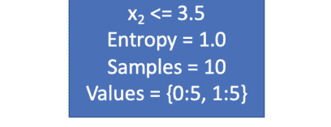

图 8.3：决策树的根节点

`$x_3 = 3.5$` 处的数据集如表 5.6 所示。

| `x1` | `x2` | `y` | `x1` | `x2` | `y` |
| --- | --- | --- | --- | --- | --- |
| 1 | 2 | 1 | 1 | 4 | 0 |
| 5 | 2 | 1 | 1 | 6 | 0 |
| 7 | 2 | 1 | 1 | 7 | 1 |
| | | | 2 | 4 | 0 |

# 掌握机器学习中的分类算法

| `x₂ ≤ 3.50` | | `x₂ > 3.50` |
| `x1` | `x2` | `y` | `x1` | `x2` | `y` |
| | | | 2 | 7 | 1 |
| | | | 5 | 4 | 0 |
| | | | 7 | 6 | 0 |

附录表 8.3：在分裂点 `$x_2 < 3.5$` 处划分的数据集

我们注意到在左侧，所有数据点的 `y` 值均为 1。因此，我们在这里有一个叶子节点，决策为 `y = 1`。

因此，我们的决策树如图附录图 8.4 所示：

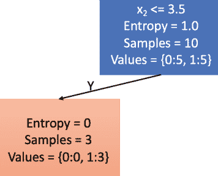

决策：`y = 1`

附录图 8.4：带有叶子节点（橙色显示）的更新决策树

现在，让我们考虑根节点右侧的数据集，如附录图 8.4 所示。换句话说，我们只考虑 `x₂ > 3.5` 的数据点（如附录表 5.1 所示）。我们的数据集如附录表 8.4 所示：

| `x1` | `x2` | `y` |
| 1 | 4 | 0 |
| 7 | 6 | 0 |
| 1 | 6 | 0 |
| 5 | 4 | 0 |
| 2 | 4 | 0 |
| 1 | 7 | 1 |
| 2 | 7 | 1 |

附录表 8.4：数据集中 `x₂ > 3.50` 的数据点（表附录表 8.1）

让我们计算表 A8.4 所示数据点的熵（Entropy）。结果如下。

`P₀ = 5/7 = 0.714` 和 `P₁ = 2/7`

使用这些 `P₀` 和 `P₁` 值，我们可以计算在 `x₂ = 3.5` 分裂点右侧数据集的熵。我们将此熵称为 `Entropy_parent`，因为它将是我们尝试划分的下一组数据点的父节点。

```
Entropyparent = ((0.714 * log(0.714)) + (0.286 * log2(0.286)))

= ((0.714 * (-0.3485)) + (0.286 * (-1.807)))

= (-0.347 + (-0.516)) = -0.863
```


由于附录表 8.4 中数据集熵不是 0，因此数据集是不纯的，我们需要划分该数据集以找到决策点或叶子节点。因此，我们必须计算所有阈值的信息增益（Information Gain）。由于 `$x_1$` 和 `$x_2$` 的范围发生了变化，我们必须重新建立阈值。使用特征的最大和最小值来建立阈值的相同逻辑，我们得到了 `x1` 的考虑值如下：

- 1.00, 1.50, 2.00, 2.50, 3.00, 3.50, 4.00, 4.50, 5.00, 5.50, 6.00

`x2` 的考虑值如下：
- 4.00, 5.00, 5.50, 5.50, 6.00

图 8.5 显示了附录表 8.4 中数据集的信息增益计算过程：

| 变量 | 决策点 | 左 | 右 | P(Left) | P(Right) | Split(Left) | Split(Right) | Entropy(Left) | Entropy(Right) | Entropy(Total) | Information Gain |
|---|---|---|---|---|---|---|---|---|---|---|---|
| x1 | 1.00 | 3 | 2/ | 0.6667 | 0.3333 | 3/7 | 2/7 | 0.9183 | 0.8128 | 0.8571 | 0.0556 |
| x1 | 1.50 | 3 | 2/ | 0.6667 | 0.3333 | 3/7 | 2/7 | 0.9183 | 0.8128 | 0.8571 | 0.0556 |
| x1 | 2.00 | 3 | 2/ | 0.5000 | 0.5000 | 3/2 | 2/2 | 1.0000 | 1.0000 | 0.6931 | 0.1694 |
| x1 | 2.50 | 3 | 2/ | 0.5000 | 0.5000 | 3/2 | 2/2 | 1.0000 | 1.0000 | 0.6931 | 0.1694 |
| x1 | 3.00 | 3 | 2/ | 0.5000 | 0.5000 | 3/2 | 2/2 | 1.0000 | 1.0000 | 0.6931 | 0.1694 |
| x1 | 3.50 | 3 | 2/ | 0.5000 | 0.5000 | 3/2 | 2/2 | 1.0000 | 1.0000 | 0.6931 | 0.1694 |
| x1 | 4.00 | 5 | 2/ | 0.6667 | 0.3333 | 3/7 | 2/7 | 0.9180 | 0.9180 | 0.8771 | 0.0758 |
| x1 | 4.50 | 3 | 2/ | 0.6667 | 0.3333 | 3/7 | 2/7 | 0.9180 | 0.9180 | 0.8771 | 0.0758 |
| x1 | 5.00 | 3 | 6/ | 0.8571 | 0.1429 | 5/7 | 1/7 | 0.5620 | 0.0000 | 0.7913 | 0.2917 |
| x1 | 5.50 | 6 | 4/ | 0.6667 | 0.3333 | 4/7 | 3/7 | 0.9180 | 0.9180 | 0.8771 | 0.0758 |
| x1 | 6.00 | 6 | 4/ | 0.6667 | 0.3333 | 4/7 | 3/7 | 0.9180 | 0.9180 | 0.8771 | 0.0758 |
| x2 | 4.00 | 3 | 2/ | 0.5000 | 0.5000 | 3/2 | 2/2 | 1.0000 | 0.0000 | 0.5714 | 0.2917 |
| x2 | 4.50 | 3 | 2/ | 0.5000 | 0.5000 | 3/2 | 2/2 | 1.0000 | 0.0000 | 0.5714 | 0.2917 |
| x2 | 5.00 | 3 | 2/ | 0.5000 | 0.5000 | 3/2 | 2/2 | 1.0000 | 0.0000 | 0.5714 | 0.2917 |
| x2 | 6.00 | 5 | 2/ | 0.4000 | 0.6000 | 2/5 | 3/5 | 0.9808 | 1.0000 | 0.9600 | 0.8650 |

图 8.5：表 A8.4 中数据集的信息增益计算

附录 8.5 显示最大的信息增益出现在 `$x_2=6.0$` 和 `$x_2=6.5$` 处。根据我们取变量最大值的策略，我们将划分 `x2=6.5` 决策树。

因此，我们的决策树如图附录图 8.6 所示：

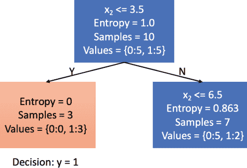

附录图 8.6：第二次划分后的决策树

正如我们之前做的那样，我们将根据附录图 8.6 所示创建的新决策节点来划分附录表 8.4 所示的数据集，即根据 `x2 <= 6.5` 进行划分。基于此，左侧数据集如附录表 8.5 所示，右侧数据集如附录表 8.6 所示：

| x1 | x2 | y |
| 1 | 4 | 0 |
| 7 | 6 | 0 |
| 1 | 6 | 0 |
| 5 | 4 | 0 |
| 2 | 4 | 0 |

附录表 8.5：数据 `x2 <= 6.50` 的数据点（如表 A8.4 所示）

从附录表 8.5 可以看到，对于所有数据点，`y` 值均为 0。因此，我们有一个决策为 `y = 0` 的叶子节点。

| x1 | x2 | y |
| 1 | 7 | 1 |
| 2 | 7 | 1 |

附录表 8.6：数据 `x2 > 6.50` 的数据点（如表 A8.4 所示）

## 记忆点

- 熵（Entropy）是衡量数据集随机性的指标。
- 熵的值介于 0 和 1 之间。
- 当数据集的熵为 0 时，该数据集是纯随机的。
- 当数据集的熵为 1 时，该数据集是完全随机的。
- 子节点的信息增益（Information Gain）是父节点熵与子节点熵之差。
- 决策树在信息增益最大的子节点处分裂。

## 加入我们的书籍 Discord

加入书籍 Discord 工作区，获取最新更新、优惠、全球科技动态、新发布以及与作者的交流会议：

https://discord.bpbonline.com


## 索引

### A

- 实际值 (Actual values) 60
- AdaBoost 算法 244, 245
- 探索 (exploring) 245-255
- Scikit-Learn 中的实现 (implementation, in Scikit-Learn) 256
- 模型构建 (model, building) 260-269
- 模型测试 (model, testing) 269, 270
- 交通标志识别 (traffic signs, recognizing) 257
- 异常检测 (Anomaly Detection) 10
- 算术运算符 (arithmetic operators) 287
- 人工智能 (Artificial Intelligence (AI)) 3
- 赋值运算符 (assignment operators) 288
- 用于检测垃圾邮件 (for detecting spam) 41-45
- 伯努利朴贝叶斯 (Bernoulli Naïve Bayes) 46
- 二分类问题 (Binary classification problem) 12
- 黑盒模型 (Black Box Models) 167
- 布尔数据类型 (Boolean data type) 287
- 提升法 (Boosting) 244
- Boosting 算法 (Boosting algorithm) 243, 244
- Boosting 集成模型 (Boosting ensemble model) 165
- 僵尸网络 (botnet) 202

### C

- 类别朴贝叶斯 (Categorical Naïve Bayes) 76
- Chroma 特征 (Chroma features) 184
- 分类回归树 (Classification and Regression Tree (CART)) 算法 130
- 用于构建决策树 (for forming decision tree) 131-141
- 分类问题 (Classification problem) 12
- 聚类 (Clustering) 10, 17, 18

### B

- Bagging 分类器 (BaggingClassifier) 169
- Bagging 集成模型 (Bagging ensemble model) 163-165
- 基础模型 (Base models) 166
- 贝斯定理 (Bayes theorem) 39-41
- 星号 (Asterisk)

## 354 精通机器学习分类算法

- 逗号分隔值 (Comma Separated Values (CSV) 文件) 115
- 比较运算符 (comparison operators) 288
- 互补朴贝叶斯 (Complement Naive Bayes) 46
- 条件概率 (conditional probability) 33-35
- 条件语句 (condition statements) 289
- 混淆矩阵 (Confusion Matrix) 60, 61
- 准确率 (accuracy) 61
- F 分数 (F Score) 61
- 精率 (precision) 61
- 召回率 (recall) 61
- 连续变量 (continuous variable) 17
- 卷积神经网络 (Convolutional Neural Networks (CNN)) 257
- 语料库 (corpora) 309, 322
- 代价函数 (Cost Function) 98
- 计数向量化 (count vectorizer) 322-324
- 基于...自定义分类 (custom classifying, based on)
- RFM 分析 (RFM analysis) 77-82
- 实时数据预测使用的模型 (predictions on live data, model used) 83, 84
- 实时数据客户细分预测 (customer segments prediction, on live data)
- 数据处理 (data processing) 84-86
- 数据转换 (data transforming) 86-88
- 模型应用 (model, applying) 88-90
- 模型使用 (model, using) 83, 84
- 布尔数据类型 (Boolean data type) 287
- 序列数据类型 (sequence data types) 283
- 集合数据类型 (set data types) 285
- DDOS 恶意软件 (DDOS malware) 203
- 使用熵进行决策树构建 (tree decision building with Entropy, Scikit-Learn used) 349
- 创建 (creating) 128
- 使用 CART 算法创建 (creating, with CART algorithm) 131-141
- 使用基尼指数创建 (creating, with Gini index) 129, 130
- 使用熵进行形成 (forming, with Entropy) 342-349
- 决策树算法 (Decision Tree algorithm) 127
- JPEG 文件中的恶意软件检测 (malware detection, in JPEG files) 142
- 因变量 (dependent variable) 12
- 降维 (dimensionality Reduction) 10, 17, 23
- 离散变量 (discrete variable) 17
- 距离测量机制 (distance measuring mechanisms) 76
- 海明距离 (hamming distance) 76
- 曼哈顿距离 (Manhattan distance) 76

### E

## 编码器 (Encoders)

- 适用于的数据 (data suitable, for applying) 330
- 标签编码器 (Label Encoder) 330-333
- 热编码器 (One-Hot Encoder) 334-337
- Scikit-Learn 中的集成模型实现 (Ensemble Model implementation, in Scikit-Learn) 167, 168
- Bagging 分类器 (BaggingClassifier) 169
- 堆叠分类器 (StackingClassifier) 170
- 投票分类器 (VotingClassifier) 168
- 集成模型 (Ensemble models) 159-161
- Bagging 集成模型 (Bagging ensemble model) 163-165
- Boosting 集成模型 (Boosting ensemble model) 165
- 直觉 (intuition) 161, 162
- 堆叠集成模型 (Stacking ensemble model) 166, 167
- 数据预处理 (data pre-processing), 51, 52
- 更多 URL (more URL present) 52, 53
- 数据中的元素 (elements from data) 53, 55
- TF-IDF 拟合 (TF-IDF, fitting) 55-58
- Python 数据类型 (data types, Python) 282, 283

### I

- 熵 (Entropy) 127, 339, 340
- SVD 图像压缩 (image compression, with SVD) 298
- 使用 Scikit-Learn 构建决策树 (decision tree, building with Scikit-Learn) 349
- 压缩 (compressing) 299-302
- 形成...的决策树 (decision tree, forming with) 342-349
- 图像压缩 (images, compressing) 303-307
- 不平衡的数据集 (Imbalanced datasets) 153
- 可执行和链接格式文件 (Executable and Linkable Format (ELF) files) 202, 203
- ELF 头 (ELF header) 204
- 独立事件 (independent events) 36, 37
- 章节信息 (section information) 205
- 结构 (structure) 203
- 集成开发环境 (Integrated Development Environment (IDE)) 274
-  (removing) 313
- 物联网 (Internet of Things (IoT)) 202
- 逆文档频率 (Inverse Document Frequency (IDF)) 325

### F

- 快速傅里叶变换 (Fast Fourier Transformation (FFT)) 182
- for 循环语句 (for loop statement) 290
- Python 函数 (functions, Python) 290

### J

- JPEG 文件 (JPEG files) 143, 143
- Jupyter Notebook 273-274
- 创建笔记本 (notebook, creating) 275, 276
- 运行笔记本 (running) 278, 279

### G

- 高斯朴贝叶斯 (Gaussian Naïve Bayes) 47
- 德国交通标志基准 (German Traffic Benchmark (GTDB)) 257
- 基尼指数 (Gini index) 129, 130
- 用于形成决策树 (for forming decision tree) 131
- 梯度下降算法 (Gradient Descent algorithm) 98

### K

- K 近邻算法 (K-Nearest Neighbor (KNN)) 67, 68
- 应用于 (applying) 74, 75
- 数据准备 (data, preparing) 69, 70
- 数据点之间的距离 (distance between points) 70, 71

### H

- 海明距离 (Hamming distance) 76
- 肝炎诊断预测器 (Hepatitis predictor) 115
- 数据加载 (data, loading) 115, 116
- 缺失值填充 (missing values, imputing) 117
- 形成...的决策树 ( ( decision tree) 121-124

## 356 精通分类算法

### L

- L1 范 (L1 Norm) 76
- L2 范 (L2 Norm) 76
- 标签编码器 (Label Encoder) 330-333
- 大数定律 (Law of large numbers) 162
- 叶子节点 (Leaf Nodes) 137
- 左奇异向量 (left singular vectors) 294
- librosa 库 (librosa) 178
- librosa 软件包 (Librosa package) 173
- 列表数据类型 (List data types) 284, 285
- 逻辑运算符 (logical operators) 288
- 逻辑回归 (Logistic Regression) 93-97
- 应用于 (applying) 107
- 代价函数 (cost function) 97, 98
- 形成...的决策树 (forming decision tree) 129-130
- 多类分类 (multi-class classification) 114
- 梯度下降算法 (Gradient Descent algorithm) 98
- Sigmoid 函数 (Sigmoid function) 103, 104
- 转换 (transitioning) 102
- 循环语句 (loop statements) 290
- 无监督学习 (unsupervised learning) 17-23
- 低秩近似 (low-rank approximation) 298
- 类型 (types) 9
- 循环语句 (loop statement) 290
- while 循环语句 (while statement) 290
- 僵尸网络 (botnet) 202
- 后门 (backdoor) 202
- 恶意软件 (virus) 203
- 在 ELF 文件中的恶意软件 (malware, in ELF) 202
- 数据集 (dataset) 205
- 模型构建 (model building) 206
- 模型测试 (model, testing) 207
- 在 JPEG 文件中的恶意软件检测 (malware detection, in JPEG) 142
- 决策树 (decision tree) 127
- 策略 (strategy) 142, 143, 144, 145, 146, 147, 148, 149, 150, 151, 152, 153, 154, 155, 156, 157, 158, 159, 160, 161, 162, 163, 164, 165, 166, 167, 168, 169, 170, 171
- 熵 (entropy) 127, 339, 340, 342

### N

- 朴贝叶斯算法 (Naive Bayes algorithm) 47
- 朴贝叶斯变体 (Naive variations) 45-50
- 伯努利朴贝叶斯 (Bernoulli Naïve Bayes) 46
- 类别朴贝叶斯 (Categorical Naïve Bayes) 76
- 互补朴贝叶斯 (Complement Naive Bayes) 46
- 高斯朴贝叶斯 (Gaussian Naïve Bayes) 47
- 多项式朴贝叶斯 (Multinomial Naïve Bayes) 46
- 自然语言处理 (Natural Language Processing (NLP)) 171
- 自然语言工具包 (Natural Language Toolkit (nltk)) 310
- 节点 (node) 136

## 358 精通分类算法

- 奇异值分解 (Singular Value Decomposition (SVD)) 24, 152, 293
- 图像压缩 (image compression) 298
- 矩阵分解 (matrix decomposition) 294-297
- sklearn.ensemble 168

### R

- 随机森林算法 (Random Forest algorithm) 197, 198
- 在 Scikit-Learn 中实现 (implementing, in Scikit-Learn) 200-202
- ELF 文件中的恶意软件检测 (malware detection, in ELF) 202
- 随机森林模型 (Random Forest model) 228
- 范围数据类型 (Range data types) 285
- Ravdess 数据集 (Ravdess dataset) 172
- read_csv() 函数 (read_csv()) 115
- 新鲜度 (recency) 69
- RFM 分析 (RFM analysis) 77-82
- 右奇异向量 (right singular vectors) 294
- 根因分析 (Root Cause Analysis (RCA)) 38
- 根节点 (root node) 136

### S

- SAMME 255
- SAMME.R 255
- 使用 Scikit-Learn 构建的决策树 (Scikit-Learn decision tree, building with Entropy) 349
- 序列数据类型：列表数据类型 (sequence data types: List data types) 284, 285
- 范围数据类型 (Range data types) 285
- 元组数据类型 (Tuple data types) 283
- 集合数据类型 (Set data types) 285, 286
- 映射数据类型 (mapping data types) 286
- 短消息服务 (SMS) 47
- Sigmoid 函数 (Sigmoid function) 103, 104
- 信噪比 (Signal-to-Noise Ratio (SNR)) 180
- 简单填充值器 (SimpleImputer) 118
- 使用 Bagging 算法构建 (building, with Bagging algorithm) 171
- 数据集 (data set) 171
- 数据集的探索 (dataset, exploring) 173-177
- 数据集的形成 (dataset, forming) 190, 191
- 数据集的加载 (dataset, loading) 173
- 从音频片段提取特征 (features, extracting from audio clips) 179-190
- librosa 软件包 173
- Ravdess 数据集 172
- TESS 数据集 170
- 堆叠分类器 (StackingClassifier) 170
- 堆叠集成模型 (Stacking ensemble model) 166, 169
- Python 语句 (statements, Python) 289
- 条件语句 (condition statements) 289
- 循环语句 (loop statements) 290
- 词干提取 (stemming) 318

## 索引 359

停用词 310

交通标志识别
  删除 310

数据集 257-260

领域专家 (SME) 40

模型构建 260

有监督学习 10-17

模型测试 260

少数类过采样技术 (SMOTE) 153
  结合 AdaBoost 算法 257
训练集与测试集

混淆矩阵 60
  创建 50, 51

数据，预处理 51, 52

模型，构建 59, 60

木马 203

# T

词频-逆文档频率 (TF-IDF) 351

词频 (TF) 324

TESS 数据集 171

文本数据预处理
  电子邮件地址，检测 314
  电子邮件地址，处理 314
  表情符号，处理 315, 316
  额外空格，删除 313
  标签（hashtags）和提及（mentions），检测 315
  标签（hashtags）和提及（mentions），处理 314
  数字，删除 312
  标点符号，删除 312
  特殊字符，删除 311
  停用词，删除 310
  URL，检测 313
  URL，处理 313

TF-IDF 向量化 324-326

TF-IDF 向量 55

全概率定理 37, 38

# U

欠采样 153

无监督学习 10, 17

# V

向量化
  计数向量化 322-324
  TF-IDF 向量化 324, 325

VotingClassifier 168

投票集成方法 162, 163

# W

while 循环语句 290

白盒模型 167
