# PyTorch 2.0 计算机视觉精通指南：使用 PyTorch 2.0 和深度学习技术探索、设计并构建尖端高性能计算机视觉解决方案

## 献给

我亲爱的父母：
- 已故的 Mohd Ziauddin Siddiqui
- Shamama Siddiqui
- 我的妻子 Zubia Khan

## 关于作者

**M. 阿沙德·西迪基** 是一位杰出的计算机视觉专家，在开发和部署前沿 AI 解决方案方面拥有丰富经验。他的职业生涯始于 Lensbricks 的计算机视觉工程师，在那里他为新兴技术开发了创新的视觉系统。随后他加入 Big Vision，进一步精进了在计算机视觉和人工智能领域应对大规模挑战的专业知识。

目前，阿沙德担任计算机视觉和 AI 首席工程师，曾与超过 20 家机构合作，从充满活力的初创公司到财富 500 强企业不等，帮助它们设计和实施强大的 AI 解决方案。在职业生涯中，他涉足医疗保健、零售、自主系统和移动技术等多个行业，交付可扩展且可投入生产的解决方案，以解决现实世界中的问题。

阿沙德的技术成就涵盖了 AI 创新的全谱系。他设计并优化了 AI 管道，使其在资源受限环境中高效运行，在不影响性能的前提下降低部署成本，并在 Android 和 iOS 智能手机等边缘设备上部署了先进的计算机视觉解决方案。他的专业知识还包括为大规模 AI 系统创建可扩展架构，并将其无缝集成到生产工作流中。

在医疗保健领域，他开发了基于 AI 的诊断工具来分析医学图像，帮助早期发现并改善治疗效果。在零售领域，他实现了库存管理和客户分析系统。他在自主系统方面的工作包括为自动驾驶汽车和无人机设计视觉算法，专注于实时物体检测和导航。

阿沙德曾与初创公司紧密合作以加速创新，也与财富 500 强企业合作以扩展 AI 系统，他专注于弥合前沿研究与实际部署之间的差距。

在本书中，阿沙德分享了他丰富的专业知识，为读者提供关于 PyTorch 2.0 及其在计算机视觉中的应用的见解，使他们能够为动态的现实世界挑战创建有影响力的 AI 解决方案。

## 关于技术审稿人

**古尔西玛尔·辛格** 是一位专注于计算机视觉的高级 AI 科学家，在研发领域拥有超过六年的经验。他在农业、汽车、房地产摄影、热成像和视频会议等多个行业开发和部署先进的计算机视觉解决方案方面发挥了关键作用。他的创新工作还扩展到肖像动画的生成式 AI 应用。

作为 OpenCV 组织的活跃成员，古尔西玛尔正在参与 OpenCV5 的开发，该版本计划于 2025 年发布。他的专业知识涵盖算法开发、人工智能、计算机视觉、图像处理和生成式 AI。他发表过一篇研究论文，并在计算摄影领域持有一项待批准的美国专利，这凸显了他推动技术前沿的承诺。

古尔西玛尔对教育充满热情，倡导获得优质学习和技能发展的机会。他热衷于传播 AI 和计算机视觉知识，帮助其他人在这些快速发展的领域中获得能力。

**尼哈·班萨尔** 是一位开拓性的思想领袖和数据科学家，对早期创新充满热情。她在银行、金融、电信和保险等多个领域拥有丰富经验，在开发有影响力的预测模型方面技艺娴熟。她在计算机科学本科学习中成绩优异，并获得 BITS Pilani 的数据科学硕士学位，为她的职业生涯奠定了坚实基础。

尼哈的职业生涯由核心价值观所指导：负责任、以人为本，以及理解每个行动背后的“为什么”。她采用敏捷方法，快速行动、从失败中吸取教训、持续迭代并优先保证公平。出于解决用户问题的热情，尼哈结合其在分析、产品战略和领导力方面的专业知识，开发出不断突破边界的创新解决方案。她对持续学习、包容性和协作的坚定奉献，加上她的敬业精神和同理心，使她成为一位鼓舞人心的领导者，在技术和数据科学领域推动积极变革。

## 致谢

编写本书的过程深感充实，我由衷感激那些通过指导、支持和启发使其成为可能的人。

首先，我要向我的妻子和父母表达最诚挚的感谢，感谢他们始终如一的鼓励和对我的信任。他们的支持是我的支柱，没有他们持续的激励，我无法完成这本书。

本书代表了我在计算机视觉和人工智能领域工作中获得的实践经验的集大成者。现实世界行业项目带来的动态挑战和机遇，在很大程度上塑造了我对 PyTorch 及其应用的理解。我特别感谢我的同事和导师，他们营造了学习和探索的氛围，使我能够深入这个迷人的领域。

我要向古尔西玛尔·辛格先生和尼哈·班萨尔女士表示衷心的感谢，感谢他们对本书进行了细致的技术审稿。他们的见解和专业知识对于确保内容的准确性和影响力至关重要。

特别提到我的团队，感谢他们的理解和支持，给了我时间和灵活性来专注于这个项目。将本书分为不同章节的决定源于这样的认识：图像处理是一个广阔且不断发展的领域。

最后，我对更广泛的机器学习和计算机视觉社区深表感谢。共享的

知识、讨论和该领域的进步在这段旅程中一直是灵感的源泉。

这本书既是合作的产物，也是个人努力的结晶，向所有直接或间接为其做出贡献的人，我致以最深切的感谢。

## 前言

PyTorch 的问世彻底改变了深度学习，提供了兼顾灵活性与强大功能的结合，既适合研究人员也适合从业者。随着 PyTorch 2.0 的发布，该框架达到了新的高度，融入了先进的特性和优化。本书旨在作为掌握计算机视觉任务中 PyTorch 的全面指南，结合基础概念与实际应用，帮助读者在这条道路上更进一步。

## 第 1 章 深入探索 PyTorch 2.0：

本章探讨 PyTorch 的历史、演进和特性，包括 2.0 版本的关键进展，同时指导你完成安装与配置。

## 第 2 章 PyTorch 基础：

本章介绍 PyTorch 的基本构建块，如张量、运算和计算图，并辅以实际示例。

## 第 3 章 从 PyTorch 1.x 过渡到 PyTorch 2.0：

本章提供从早期 PyTorch 版本升级的路线图，重点介绍主要差异、兼容性解决方案和迁移示例。

## 第 4 章 进入人工神经网络领域：

本章介绍神经网络的基础知识，并指导你在 PyTorch 中构建和训练图像分类模型。

## 第 5 章 深入探索卷积神经网络（CNN）：

本章讲解 CNN 的架构与实现，教你如何为视觉任务构建、训练和优化 CNN。

## 第 6 章 视觉任务的数据增强与预处理：

本章侧重于通过数据增强和预处理提升模型性能，并在 PyTorch 中进行实际实现。

## 第 7 章 探索 PyTorch 中的迁移学习：

本章介绍迁移学习和预训练模型，演示如何利用它们提升模型性能。

## 第 8 章 进阶图像分类模型：

本章深入探讨 ResNet、VGG 和 Inception 等流行架构，指导读者完成其实现与性能对比。

## 第 9 章 目标检测模型：

本章介绍目标检测技术以及 YOLO、Faster R-CNN 和 SSD 等著名模型，并附带实际实现。

## 第 10 章 提升模型性能的技巧与窍门：

本章讨论超参数调优、Dropout 和集成技术等高级方法，以提升模型效率。

## 第 11 章 使用 PyTorch Lightning 进行高效训练：

本章探讨 PyTorch Lightning，展示其在简化训练工作流程和高级特性方面的实用性。

## 第 12 章 模型部署与生产环境注意事项：

本章最后聚焦于模型部署，涵盖 TorchServe、量化以及生产环境就绪的相关考量。

本书连接了理论与实践之间的鸿沟，为读者提供所需的工具和知识，助力他们在使用 PyTorch 2.0 的深度学习之旅中取得卓越成就。

## 下载代码包和彩色图片

请点击链接或扫描二维码下载本书的 **代码包和图片**：

[https://github.com/ava-orange-education/Mastering-Computer-Vision-with-PyTorch-2.0](https://github.com/ava-orange-education/Mastering-Computer-Vision-with-PyTorch-2.0)


本书的代码包和图片还托管于

[https://rebrand.ly/edf948](https://rebrand.ly/edf948)


如果代码有更新，将在现有 GitHub 仓库中进行更新。

## 勘误

我们对 **Orange Education Pvt Ltd** 的工作深感自豪，并遵循最佳实践确保内容的准确性，为订阅者提供引人入胜的阅读体验。我们的读者是我们的镜子，我们利用读者的反馈来反思和改进在出版过程中可能发生的任何人为错误。为了帮助我们保持质量，并联系到可能因任何不可预见的错误而遇到困难的读者，请写信至：

errata@orangeava.com

非常感谢您的支持、建议和反馈。

## 你知道吗

你知道吗？Orange Education Pvt Ltd 为每一本出版的书提供电子书版本，可下载 PDF 和 ePub 文件。您可以在 www.orangeava.com 升级到电子书版本，作为印刷书客户，您有权享受电子书副本的折扣。如需了解更多详情，请联系我们：info@orangeava.com。

在 www.orangeava.com，您还可以阅读一系列免费技术文章，订阅多种免费通讯，并获取 AVA® 图书和电子书的独家折扣和优惠。

## 反盗版

如果您在互联网上发现我们作品的任何非法复制件，若能提供位置地址或网站名称，我们将不胜感激。请将材料链接发送至 info@orangeava.com 联系我们。

## 有意与我们合作撰写书籍？

如果您在某个领域有专长，并有兴趣撰写或参与编写书籍，请写信至 business@orangeava.com。我们致力于帮助开发者和技术专业人士了解当前全球范围内发生的技术进步与创新，并构建一个相信“知识最好通过分享与他人共同学习来获取”的社区。请与我们联系，了解我们的受众需求以及您如何参与这场教育改革。我们也欢迎技术专家提出想法，并协助他们为其领域构建学习与开发内容。

## 书评

请留下书评。读完并使用本书后，为什么不在您购买的网站上留下一条书评呢？这样，潜在读者就可以看到并使用您客观公正的意见来做出购买决定。我们 Orange Education 非常希望了解您对我们产品的看法，我们的作者也可以从您的反馈中学习。谢谢！

如需了解 Orange Education 的更多信息，请访问 www.orangeava.com。

### Displaying a Sample Image and Its Classes
### 显示示例图像及其类别

### Other Useful Functions of VOCDetection
### VOCDetection 的其他有用函数

### Difference between 2007 and 2012 datasets
### 2007 和 2012 数据集的区别

### Diving Deep into Fast R-CNN
### 深入 Fast R-CNN

### Importing Fast R-CNN in PyTorch 2.0
### 在 PyTorch 2.0 中导入 Fast R-CNN

### Insights and Special Features of Fast R-CNN
### Fast R-CNN 的洞察与特殊功能

### Inference with PyTorch 2.0 and the PASCAL VOC
### 使用 PyTorch 2.0 和 PASCAL VOC 进行推理

### Dataset
### 数据集

### Training Fast R-CNN and Evaluating Metrics
### 训练 Fast R-CNN 并评估指标

### Dataset Preparation
### 数据集准备

### Model Configuration
### 模型配置

### Training Loop
### 训练循环

### Evaluation and Metrics Calculation
### 评估与指标计算

### Diving Deep into SSD: Single Shot MultiBox Detector
### 深入 SSD：单发多框检测器

### Incorporating SSD into PyTorch 2.0
### 将 SSD 集成到 PyTorch 2.0 中

### Key Features of SSD
### SSD 的关键特性

### Object Detection with SSD on the PASCAL VOC Dataset
### 在 PASCAL VOC 数据集上使用 SSD 进行目标检测

### Training SSD on PASCAL VOC
### 在 PASCAL VOC 上训练 SSD

### Evaluation and Metrics Calculation
### 评估与指标计算

### Diving Deep into YOLOv5: The Apex of Speed and Accuracy in Object Detection
### 深入 YOLOv5：目标检测中速度与准确性的巅峰

### Setting Up YOLOv5 with PyTorch
### 使用 PyTorch 设置 YOLOv5

### YOLOv5's Architectural Highlights
### YOLOv5 的架构亮点

### Object Detection with YOLOv5 on Custom Images
### 使用 YOLOv5 对自定义图像进行目标检测

### Training and Evaluation YOLOv5 on the PASCAL VOC Dataset
### 在 PASCAL VOC 数据集上训练和评估 YOLOv5

### Evaluating YOLOv5's Performance
### 评估 YOLOv5 的性能

### Conclusion
### 结论

## 10. Tips and Tricks to Improve Model Performance
## 10. 提高模型性能的技巧和窍门

### Introduction
### 简介

### Structure
### 结构

### Understanding Overfitting and Underfitting
### 理解过拟合和欠拟合

### Overfitting
### 过拟合

### Indicators of Overfitting
### 过拟合的指标

### Underfitting
### 欠拟合

### Indicators of Underfitting
### 欠拟合的指标

### Strategies to Address Overfitting and Underfitting
### 应对过拟合和欠拟合的策略

### Balancing Model Performance
### 平衡模型性能

### Regularization Techniques: Dropout and Batch Normalization
### 正则化技术：Dropout 和 批量归一化

### Dropout: An Effective Regularization Technique
### Dropout：一种有效的正则化技术

### Working of Dropout
### Dropout 的工作原理

### Implementing Dropout in PyTorch
### 在 PyTorch 中实现 Dropout

### Impact of Dropout on Model Performance
### Dropout 对模型性能的影响

### Tuning the Dropout Probability
### 调整 Dropout 概率

### Batch Normalization: Stabilizing the Training Process
### 批量归一化：稳定训练过程

### Working of Batch Normalization
### 批量归一化的工作原理

### Implementing Batch Normalization in PyTorch
### 在 PyTorch 中实现批量归一化

### Impact of Batch Normalization on Model Convergence
### 批量归一化对模型收敛的影响

### Combining Dropout and Batch Normalization
### 结合 Dropout 和 批量归一化

### Hyperparameter Tuning Techniques
### 超参数调优技术

### Learning Rate Schedules
### 学习率调度

### Step Decay Learning Rate Schedule
### 阶梯衰减学习率调度

### Code Example: Implementing Step Decay in PyTorch
### 代码示例：在 PyTorch 中实现阶梯衰减

### Other Learning Rate Schedules
### 其他学习率调度

### Grid Search
### 网格搜索

### Working of Grid Search
### 网格搜索的工作原理

### Code Example: Implementing Grid Search with Scikit-Learn
### 代码示例：使用 Scikit-Learn 实现网格搜索

### Random Search
### 随机搜索

### Working of Random Search
### 随机搜索的工作原理

### Code Example: Implementing Random Search with Scikit-Learn
### 代码示例：使用 Scikit-Learn 实现随机搜索

### Choosing the Right Technique
### 选择合适的技术

### Using Early Stopping for Efficient Training
### 使用早停法进行高效训练

### Working of Early Stopping
### 早停法的工作原理

### Mechanism of Early Stopping
### 早停法的机制

### Benefits of Early Stopping
### 早停法的好处

### Implementing Early Stopping in PyTorch
### 在 PyTorch 中实现早停法

### Code Example: Early Stopping in PyTorch
### 代码示例：PyTorch 中的早停法

### Key Parameters of Early Stopping
### 早停法的关键参数

### Understanding When to Use Early Stopping
### 了解何时使用早停法

### Ensemble Models for Improved Performance
### 用于提高性能的集成模型

### Bagging (Bootstrap Aggregating)
### 袋装法 (Bootstrap Aggregating)

### Boosting
### 提升法

### Stacking
### 堆叠法

### Ensemble Applications in Object Detection
### 目标检测中的集成应用

### Conclusion
### 结论

## 11. Efficient Training with PyTorch Lightning
## 11. 使用 PyTorch Lightning 进行高效训练

### Introduction
### 简介

### Structure
### 结构

- Key Benefits of PyTorch Lightning Cleaner Code
  - Less Boilerplate
  - Streamlining the Training Process

- PyTorch Lightning 的主要优势：更清晰的代码
  - 减少样板代码
  - 简化训练过程

- Converting PyTorch Code to PyTorch Lightning
  - Defining the LightningModule
  - Separating Model Definition from Training Logic
  - Converting a PyTorch CNN Model for MNIST
    - Breaking Down the LightningModule
    - Benefits of Conversion

- 将 PyTorch 代码转换为 PyTorch Lightning
  - 定义 LightningModule
  - 将模型定义与训练逻辑分离
  - 将 PyTorch CNN 模型转换为 MNIST
    - 拆解 LightningModule
    - 转换的好处

- Training Models with PyTorch Lightning
  - Setting Up the Trainer Class for Training, Validation, and Testing
    - Basic Configuration of the Trainer
      - Example: Basic Trainer Setup
  - Handling Multiple GPUs or Distributed Training
    - Training on Multiple GPUs
      - Example: Multi-GPU Training
    - Distributed Training
      - Example: Distributed Training
  - Common Tasks: Checkpointing and Logging
    - Model Checkpointing
      - Example: Using Model Checkpointing
    - Logging with PyTorch Lightning
      - Example: Logging Validation Accuracy
    - Using Early Stopping
      - Example: Early Stopping in PyTorch Lightning

- 使用 PyTorch Lightning 训练模型
  - 为训练、验证和测试设置 Trainer 类
    - Trainer 的基本配置
      - 示例：基本 Trainer 设置
  - 处理多 GPU 或分布式训练
    - 多 GPU 训练
      - 示例：多 GPU 训练
    - 分布式训练
      - 示例：分布式训练
  - 常见任务：检查点和日志
    - 模型检查点
      - 示例：使用模型检查点
    - 使用 PyTorch Lightning 进行日志记录
      - 示例：记录验证准确率
    - 使用早停法
      - 示例：PyTorch Lightning 中的早停法

### Best Practices and Tips for PyTorch Lightning
### PyTorch Lightning 的最佳实践和技巧

- Code Organization: Separating Concerns
- 代码组织：关注点分离

- Best Practice: Using DataModules
- 最佳实践：使用 DataModules

- Example: Structuring Code with LightningModule and DataModule
- 示例：使用 LightningModule 和 DataModule 组织代码

- Leveraging Callbacks for Logging and Checkpointing
- 利用回调进行日志记录和检查点

- Using Model Checkpointing and Logging Callbacks
- 使用模型检查点和日志回调

- Example: Using Callbacks for Checkpointing and Early Stopping
- 示例：使用回调进行检查点和早停法

### Tips for Debugging and Improving Training Performance
### 调试和提高训练性能的技巧

- Debugging Tips
- 调试技巧

- Improving Training Performance
- 提高训练性能

### Conclusion
### 结论

## 12. Model Deployment and Production-Ready Considerations
## 12. 模型部署和生产就绪注意事项

### Introduction
### 简介

### Structure
### 结构

### Streamlining Model Deployment for Production
### 简化生产环境的模型部署

### Exporting and Packaging the Model
### 导出和打包模型

### Setting Up the Serving Environment
### 设置服务环境

### Managing Model Versioning and Updates
### 管理模型版本和更新

### Monitoring and Maintaining Models in Production
### 在生产环境中监控和维护模型

### Ensuring Scalability and Reliability
### 确保可扩展性和可靠性

### Understanding TorchServe
### 理解 TorchServe

### Converting PyTorch Code to PyTorch Lightning
### 将 PyTorch 代码转换为 PyTorch Lightning

### Serving Models as REST APIs
### 作为 REST API 服务模型

### Scaling and Monitoring the Model
### 扩展和监控模型

### Monitoring Model Performance
### 监控模型性能

### Optimizing Models for Production: Techniques for Efficiency
### 优化模型以用于生产：效率技术

### Model Quantization
### 模型量化

### Types of Quantization
### 量化类型

### Model Pruning
### 模型剪枝

### Types of Pruning
### 剪枝类型

### Benefits of Quantization and Pruning
### 量化和剪枝的好处


## 生产环境关键考量：可扩展性、延迟和鲁棒性

### 可扩展性
- 可扩展性实用技巧

### 延迟
- 降低延迟的实用技巧

### 鲁棒性
- 确保鲁棒性的实用技巧

### 总结

## 索引

## 第 1 章 深入PyTorch 2.0

## 简介

欢迎开启令人激动的PyTorch 2.0计算机视觉学习之旅。本书的开篇章节“深入PyTorch 2.0”为后续章节奠定了基础。在本章中，您将全面了解PyTorch，这是一款广受欢迎且功能强大的开源机器学习库。我们将带您了解PyTorch的创建细节、其随时间的发展，以及它在人工智能研究领域提供的主要优势。

本书面向计算机视觉和深度学习的初学者及中级学习者，旨在提供关于PyTorch强大功能的实用且深入的见解。旅程始于对PyTorch过去的全面考察，帮助读者理解PyTorch独特的架构和基础原则如何使其在机器学习框架的格局中脱颖而出。这种历史背景将为理解PyTorch的独特优势奠定坚实基础，使其成为该领域许多研究人员和从业者的首选工具。

## 结构

本章将涵盖以下主题：

- PyTorch简要概述
- PyTorch与计算机视觉
- PyTorch的起源与出现
- PyTorch的哲学与早期发展
- PyTorch的演进与增长
- PyTorch的采用
- 安装PyTorch
- 故障排除技巧
- 在Jupyter Notebook上设置开发环境
- 动态计算图与Define-by-Run范式
- Autograd系统
- GPU加速
- 分布式计算
- TorchScript简介

## PyTorch简要概述

PyTorch的核心是一个免费的机器学习框架。它提供两个高级特性：基于tape-based autograd系统构建的深度神经网络，以及拥有出色GPU加速支持的张量计算。简单来说，PyTorch包含创建和训练深度学习模型所需的所有工具。

然而，PyTorch的“Pythonic”特性使其与其他机器学习框架有所不同。PyTorch不是为了将Python绑定到僵化的C++框架中。它的设计旨在与Python紧密耦合，并利用Python的优势提供流畅且可适应的用户体验。使用PyTorch时所遵循的程序与使用NumPy时几乎相同。而且由于PyTorch张量和NumPy数组非常相似，您可以在两者之间轻松切换。

使PyTorch对计算机视觉特别有吸引力的是其广泛的、专门针对视觉任务的库和工具生态系统。TorchVision是PyTorch中的一个包，拥有图像的数据集、模型（包括预训练模型）和转换函数。这意味着PyTorch为我们提供了现成的工具和功能，可以帮助我们处理各种视觉任务，从而让我们专注于特定问题的独特方面。

但PyTorch不仅仅关乎简单和易于使用。它也关乎力量和控制。PyTorch使用一种称为“define-by-run”的方法来构建计算图，这与许多其他框架使用的“define-and-run”方法形成对比。这意味着计算图（定义数学模型的一系列操作）是在操作发生时即时定义的。这提供了大量的灵活性，并允许我们对模型进行复杂操作。

不仅如此。随着2.0版本的推出，PyTorch在性能和易用性方面都有所提升。PyTorch的历史将在后续页面中更详细地介绍，同时包括安装和设置PyTorch的说明，以及对PyTorch 2.0中主要变更和新增功能的考察。我们即将进入PyTorch 2.0和计算机视觉的领域，所以请系好安全带！

## PyTorch与计算机视觉

PyTorch已将其定位为计算机视觉任务的首选库。它完美融合了灵活性和强大功能。构建、训练和调整深度学习模型的简便性，使PyTorch成为计算机视觉领域研究人员和开发人员的有吸引力的选择。但吸引力不止于灵活性。PyTorch还提供效率和性能，使其能够从原型阶段扩展到大规模部署。

PyTorch在计算机视觉中广泛使用的主要原因之一是其专为视觉任务设计的丰富库和工具生态系统。Torchvision是PyTorch中的一个包，包含一系列预处理数据集和预训练模型，例如ResNet和VGG，这些模型已在各种计算机视觉任务中确立了基准。它还提供用于执行图像操作的转换函数，这是任何计算机视觉流水线中的关键方面。

使用PyTorch的“define-by-run”范式，动态计算图成为计算机视觉任务中通常发现的操作序列的绝佳匹配。这种方法为研究人员和开发人员在设计和实验复杂架构时提供了最大的灵活性，这在快速发展的计算机视觉领域中往往是必要的。

此外，PyTorch 2.0带来的改进进一步巩固了其地位。性能改进、新API以及移动部署等功能，使PyTorch 2.0成为任何计算机视觉任务的有力选择——从图像分类和目标检测到语义分割及更远。

总而言之，PyTorch直观的设计与其强大的性能特征相结合，使其成为计算机视觉社区的最爱。随着本书的深入，您将获得使用PyTorch处理各种激动人心且有影响力的计算机视觉任务和用例的实践经验。

## PyTorch的起源与出现

PyTorch的根源在于Torch库，这是一个基于Lua编程语言的机器学习库，广泛用于学术界。然而，Torch受限于Lua的局限性，缺乏其他编程语言提供的丰富库生态系统。为应对这些挑战，Facebook的一组AI研究人员，由AI研究主任（FAIR）Soumith Chintala领导，开始构建一个全新的深度学习系统。他们希望构建一个工具，其响应性、适应性和用户友好性与Torch相当，同时能与更强大的编程语言紧密集成。

他们于2017年1月推出了PyTorch，这是一个专为Python创建的开源机器学习包。Python是一门在科学计算领域已经领先，并拥有NumPy、SciPy和Matplotlib等强大库生态系统的语言，其创建意图是将Torch库的魔力带到Python中。机器学习社区对PyTorch的发布反应积极，加速了该工具的采用。

## PyTorch的哲学与早期发展

从一开始，PyTorch就遵循Python优先的哲学。它不是绑定到单体C++框架中的工具，而是一个旨在与Python深度集成的工具。它可以利用Python的强大功能提供流畅、灵活且直观的用户体验。这与当时的其他机器学习框架形成鲜明对比，后者往往让人感觉是在与Python的动态特性作斗争，而不是拥抱它。

PyTorch的Python优先设计有着深远的影响。这意味着用户在使用PyTorch时可以充分利用Python的强大功能，并在其模型中使用原生Python控制流语句。这也意味着调试PyTorch模型与调试Python脚本一样简单。这是一个


为习惯其他框架不透明性的开发者带来了一股清新空气。

此外，PyTorch 的设计是命令式的（或称“定义即运行”），这意味着计算图（定义数学模型的一系列操作）是在操作发生时动态定义的。这与许多其他框架中静态的、先定义后运行的计算图不同。PyTorch 的动态特性提供了很大的灵活性，并允许用户使用原生 Python 调试工具。这也是推动 PyTorch 迅速获得流行的又一因素。

尽管进入时该领域已由多个知名框架主导，PyTorch 很快就站稳了脚跟。许多研究者认同其设计理念，而开发者则喜爱它因为它与 Python 配合良好。在第一年结束时，PyTorch 已经确立了自己作为深度学习行业主要力量的地位。然而，PyTorch 团队对此并不满意。他们渴望进一步突破边界，因此 PyTorch 2.0 应运而生。这个新版本的 PyTorch 比之前更强大、更高效、更易于使用。

随着我们深入探讨，我们将深入了解 PyTorch 2.0 带来的特性和增强功能，并探讨它们如何在计算机视觉和人工智能领域的探索之旅中帮助我们。

## PyTorch 的演进与增长

PyTorch 的早期成功仅仅是一个开始。从创立之初，PyTorch 在不断壮大的用户社区反馈和贡献的指导下，持续演进和成熟。

PyTorch 演进中的一项重要进展是 PyTorch 1.0 中发布的 TorchScript。TorchScript 是一种将 PyTorch 模型与 Python 分离的方法，使其可移植且可优化。TorchScript 使用 PyTorch 的 JIT 编译器将 Python 代码编译为中间表示，然后可以在 C++ 等高性能环境中运行。这是一项重大进步，因为它使 PyTorch 模型更具可扩展性，并且可直接用于生产环境。

此外，PyTorch 持续丰富其生态系统。例如，用于自然语言处理任务的 TorchText 和用于计算机视觉任务的 TorchVision 等库，为用户的项目提供了丰富的资源。较新的加入项包括用于模型可解释性的 Captum，以及用于更有序的 PyTorch 代码的轻量级封装 PyTorch Lightning，这些使 PyTorch 更加通用且易于使用。

## PyTorch 的采用

随着 PyTorch 的成熟，它也获得了广泛的采用。清晰的语法、动态计算图以及对 GPU 的强大支持，使其成为研究人员和开发者的共同喜爱。它与 Python 的深度集成以及活跃的开源社区也为其流行做出了贡献。

到 2018 年底，即推出仅一年后，PyTorch 已经成为最受欢迎的深度学习框架之一，在学术界和工业界均被广泛采用。包括 Uber 的 Pyro、HuggingFace 的 Transformers 和 Catalyst 在内的多家知名公司和研究机构开始转向 PyTorch，仅举几例。

然而，真正将 PyTorch 的地位牢固确立在深度学习工具殿堂中的，是主要 AI 研究实验室对其的采用。例如，OpenAI 在 2020 年将 PyTorch 作为其主要研究平台，并将 PyTorch 的易用性和效率作为主要原因。

PyTorch 在软件领域之外也得到了采用。它还进入了几个深度学习开始产生影响的行业，包括银行、医疗保健和自动驾驶汽车。它被用于创建健康诊断、股价预测乃至自动驾驶汽车的算法。

如今，PyTorch 是任何从事机器学习或人工智能工作的人工具箱中的关键组件。它是其设计原则、功能以及围绕其发展起来的蓬勃用户和贡献者社区的纪念碑。

PyTorch 2.0 引入的改进和新功能继续推动可能性的边界。我们将在下一部分设置 PyTorch 2.0 并探索这些引人入胜的更新。

## 虚拟环境的重要性及创建方法

为您的 Python 项目（包括 PyTorch）创建隔离环境是一种良好的实践，因为它可以防止依赖项之间的冲突。它还允许您在不干扰主要 Python 设置的情况下尝试不同版本的库。创建此类隔离环境的一种常见方法是使用 virtualenv 或 Python 内置的 venv 模块。

## Ubuntu

- 1. 如果尚未安装，请使用 pip 安装 virtualenv：
- pip install virtualenv
- 2. 进入要创建虚拟环境的目录，然后运行：
- virtualenv pytorch_env
- 3. 要激活环境，请运行：
- source pytorch_env/bin/activate

环境激活后，环境名称将出现在终端提示符的左侧。这表明环境已准备就绪，可以使用。

## Mac

- 1. 如果尚未安装，请使用 pip 安装 virtualenv：
- pip install virtualenv
- 2. 进入要创建虚拟环境的目录，然后运行：
- virtualenv pytorch_env
- 3. 要激活环境，请运行：
- source pytorch_env/bin/activate

## 安装 PyTorch

设置好虚拟环境后，现在可以安装 PyTorch 了。PyTorch 提供可通过 pip 或 conda 安装的预构建二进制文件。在本书中，我们将使用 pip。
要安装最新版本的 PyTorch，请运行以下命令：

```
pip install torch torchvision torchaudio
```

如果您需要特定版本的 PyTorch，例如版本 2.0，请使用 == 运算符：

```
pip install torch==2.0 torchvision==0.11.1 torchaudio==0.10.1
```

## CPU 与 GPU（CUDA）安装

如果您拥有兼容的 NVIDIA GPU 并希望利用 CUDA 进行更快的计算，可以安装带有 CUDA 支持的 PyTorch。以下是 CPU 专用和 GPU（CUDA）安装的示例：

CPU 专用安装：

```
pip install torch torchvision torchaudio
```

CUDA（GPU）安装（如有必要，请指定 CUDA 版本）：

```
pip install torch torchvision torchaudio --index-url
https://download.pytorch.org/whl/cu118
```

需要注意的是，出于兼容性原因，安装特定版本的 PyTorch 可能是必要的。例如，如果您正在使用某些不支持最新 PyTorch 版本的库或旧版代码。

## 故障排除提示

请确保您的 pip 版本是最新的。您可以使用 pip install --upgrade pip 升级 pip。

- 1. 如果在安装过程中遇到问题，请尝试创建新的虚拟环境并重新安装 PyTorch。
- 2. 如果针对特定版本的 pip install 报错，可以尝试添加强制标志：

```
pip install torch==1.8.0+cu111 -f
```

```
https://download.pytorch.org/whl/torch_stable.html
```

## 在 Jupyter Notebook 上设置开发环境

Jupyter Notebook 提供了一个交互式环境，非常适合实验、文档编写和分享您的工作。以下是设置方法：

- 1. 在虚拟环境激活后，安装 Jupyter Notebook：

```
pip install notebook
```

- 2. 要启动 Jupyter Notebook，请运行：

```
jupyter notebook
```

- 3. 这将启动 Jupyter Notebook 服务器并打开默认的 Web 浏览器。您可以单击 **New** 按钮并选择 **Python 3** 或相应的版本来创建新的 Python 笔记本。
- 4. 您可以通过在新单元格中导入 PyTorch 来确保其已正确安装：

```
import torch
print(torch.__version__)
```

您现在可以开始使用 Jupyter Notebook 开发 PyTorch 了！

以下表格对比了 PyTorch 2.0 与 PyTorch 1.x：

| | PyTorch 1.x | PyTorch 2.0 |
|---|---|---|
| **接口** | 提供清晰且符合 Python 习惯的接口，使构建和调试模型更加容易 | 保留符合 Python 习惯的接口，同时进一步增强易用性和直观性 |
| **动态计算图** | 支持动态计算图，使用户能够即时更改网络行为 | 继续支持动态计算图，并引入改进的工具以实现更好的图表可视化和调试 |
| **部署** | 推出了 TorchScript 用于在非 Python 环境中部署模型。TorchServe 用于模型服务 | 继续支持 TorchScript 和 TorchServe。提供更好的 ONNX 集成和支持，并引入更多部署选项 |
| **与设备无关的代码** | 提供与设备无关的代码。相同的代码可以在 CPU 或 GPU 上运行 | 保留此功能，并进一步优化不同硬件的计算，包括改进对加速器的支持 |
| **分布式训练** | 提供基本的分布式训练功能 | 通过更强大、更可扩展的功能增强分布式训练 |


| | | 解决方案 |
|---|---|---|
| **量化与剪枝** | 支持模型量化和剪枝，这对于将模型部署到边缘设备至关重要 | 提供改进的支持和额外的模型量化、剪枝及优化技术 |
| **生态系统** | 拥有由社区开发的不断壮大的工具和库生态系统（例如 TorchVision、TorchText 和 TorchAudio） | 随着社区贡献的增加以及与其他库和工具的互操作性得到改进，生态系统进一步扩大 |
| **性能** | 在研究和生产环境中均表现良好 | 由于底层优化，提供了性能改进、更快的训练和推理时间 |

## 表 1.1：PyTorch 1.x 与 PyTorch 2.0

## 动态计算图与“定义即运行”范式

在深度学习领域，定义计算图主要有两种范式——静态（定义并运行）和动态（定义即运行）。

在静态图（TensorFlow 2.0 之前使用）中，图在运行会话之前被定义和优化。随后会反复运行同一图，这允许进行某些性能优化，但牺牲了灵活性。修改图需要完全重建，这使得调试和动态修改变得更加困难。

另一方面，PyTorch 使用动态或定义即运行图范式。每次前向传播都会定义一个新的计算图。图中的节点是 Python 对象，边是在它们之间流动的张量。随着操作的执行，图会即时构建。这提供了极高的灵活性，使得 PyTorch 非常适合那些在执行过程中需要动态更改架构的模型，例如循环神经网络（RNNs）以及带有循环或条件语句的模型。

```
# PyTorch dynamic graph example
import torch
x = torch.ones(2, 2, requires_grad=True)
print(x) # tensor([[1., 1.], [1., 1.]], requires_grad=True)
y = x + 2
print(y) # tensor([[3., 3.], [3., 3.]], grad_fn=<AddBackward0>)
```

在前面的代码中，我们首先定义了一个 2x2 张量 x。然后执行操作 y = x + 2，动态构建计算图。

## Autograd 系统

PyTorch 动态计算图系统的一个关键组件是其自动微分引擎 autograd。它负责计算导数，即参与计算的张量的梯度，从而促进反向传播。

当你创建 requires_grad=True 的张量时，PyTorch 开始跟踪其上的所有操作。计算前向传播后，可以调用 .backward() 自动计算所有梯度。这些梯度会累积到张量的 .grad 属性中。

```
# Compute forward pass
z = y * y * 3
out = z.mean()
print(z, out) # tensor([[27., 27.], [27., 27.]], grad_fn=<MulBackward0>) tensor(27., grad_fn=<MeanBackward0>)
# Compute backward pass
out.backward()
print(x.grad) # tensor([[4.5000, 4.5000], [4.5000, 4.5000]])
```

在前面的示例中，我们将 z 和 out 定义为 y 的函数并计算前向传播。然后调用 `out.backward()`，这会触发梯度计算，并打印 `x.grad` 以查看 x 对 out 的梯度。

理解 autograd 和动态计算图系统对于使用 PyTorch 有效实现和调试深度学习模型至关重要。二者的结合使 PyTorch 能够为定义和训练神经网络提供灵活且直观的接口，同时自动处理导数和反向传播的复杂细节。这使得 PyTorch 在需要模型灵活性和可定制性的复杂计算机视觉任务中非常流行。

## GPU 加速

图形处理单元（GPU）在加速深度学习任务中起着至关重要的作用。与 CPU 不同，GPU 专为高吞吐并行计算而设计，因此非常适合涉及大规模矩阵运算的任务，而此类运算在深度学习中无处不在。

PyTorch 提供对 GPU 计算的原生支持，利用 CUDA 平台。张量计算可以无缝移至 GPU，显著加快执行速度。以下是在 GPU 上运行 PyTorch 张量操作的示例：

```
# Specify device to be used
device = torch.device('cuda' if torch.cuda.is_available() else 'cpu')

# Create a tensor and move it to GPU
x = torch.ones([3, 3], device=device)

# Perform operations on the GPU
y = x + 2
```

这里，我们首先创建一个 torch.device，如果 CUDA 可用则设置为 'cuda'，否则设置为 'cpu'。然后在此设备上创建张量 x，任何涉及 x 的操作也将在此设备上执行。

始终记得将模型和数据都移至 GPU。PyTorch 不会自动将数据或模型移至 GPU。忘记移动数据或模型到 GPU 是一个常见错误，如果尝试对位于不同设备上的对象执行操作，PyTorch 会抛出错误。

```
# Moving model to GPU
model = model.to(device)

# Moving data to GPU
data, target = data.to(device), target.to(device)
```

## 分布式计算

随着数据集和模型规模的增长，分布式计算已成为深度学习的必需品。分布式计算允许你在单机多 GPU 或多机（每台配备多个 GPU）之间并行化计算。

PyTorch 提供多个包，例如 torch.nn.DataParallel 和 torch.nn.parallel.DistributedDataParallel，以促进分布式计算。推荐使用 torch.nn.parallel.DistributedDataParallel，因为它提供了更大的灵活性和效率。

以下是使用 DistributedDataParallel 的简短示例：

```
# Import the package
from torch.nn.parallel import DistributedDataParallel

# Assume your model is on the GPU and you are using two GPUs
model = model.to(device)

model = DistributedDataParallel(model, device_ids=[0, 1])
# Now any tensor you pass to model will be split on its first dimension
# and fed to separate GPUs and the outputs are then concatenated
output = model(data)
```

这会将数据按第一个维度（通常是批次大小）拆分，分发到不同的 GPU。每个 GPU 计算其部分，然后收集并拼接输出。请记住，输入数据应与模型位于同一设备上。

除此之外，PyTorch 2.0 对其分布式计算能力引入了许多优化，实现了更高效的资源利用和更好的性能。其中包括对多种后端的更好支持、对网络通信的更好处理，以及用于梯度聚合和模型同步的高级算法。

能够有效使用 GPU 加速和分布式计算，可以显著加快模型训练速度，并让你处理更大规模、更复杂的任务，这在计算机视觉领域尤其关键，因为该领域的数据集和模型可能非常庞大。

请记住，分布式计算不仅有助于将训练过程扩展到多台机器，还允许使用混合精度训练以及进程间优化的通信，从而充分发挥硬件性能。这确保你可以高效处理大规模计算机视觉任务，使 PyTorch 成为此类任务的理想选择。

## TorchScript 简介

TorchScript 是一种序列化 PyTorch 模型的方式，使其能够在非 Python 环境中运行。在将 PyTorch 模型部署到生产环境时，这一点尤为重要，因为在生产环境中，Python 可能不可用，或因其性能特性而不受欢迎。

TorchScript 使用 PyTorch 模型的静态图表示，该表示可针对特定硬件进行优化。这种静态图表示也更适合在低延迟、高吞吐的生产环境中部署，因为它可以直接加载到 PyTorch C++ API 中。

TorchScript 通过称为**追踪**或**脚本化**的过程，提供了从 eager 模式到图模式的无缝过渡。

### 追踪

追踪允许你获取现有模块，并将其在前向传播期间执行的所有张量计算记录到 **torch.jit.ScriptModule** 中。

以下是一个示例：

```
import torch
import torchvision.models as models

# An instance of your model.
model = models.resnet50()

# An example input you would normally provide to your model's forward() method.
example = torch.rand(1, 3, 224, 224)

# Use torch.jit.trace to generate a torch.jit.ScriptModule via tracing.
traced_script_module = torch.jit.trace(model, example)
```

在此示例中，我们首先创建一个 ResNet 模型。然后，生成一个示例输入张量，并将模型和示例输入都传递给 **torch.jit.trace**，它会记录模型在运行时执行的计算。


示例输入并返回一个您可以在 Python 或 C++ 中保存和加载的 ScriptModule。

虽然追踪对于不涉及控制流（如条件语句和循环）的简单模块非常出色，但当模块的执行流程取决于张量中的值时，它可能会遇到困难。这是因为它只捕获追踪所用的单次执行期间执行的操作，而不捕获控制流本身。

## 脚本化

另一方面，脚本化通过直接分析模型的 Python 代码来捕获模型中的控制流。它通过装饰器 `@torch.jit.script` 来实现这一点。

这里有一个如何对模块进行脚本化的示例：

```
import torch

class MyModule(torch.nn.Module):
    def __init__(self, N, M):
        super(MyModule, self).__init__()
        self.weight = torch.nn.Parameter(torch.rand(N, M))

def forward(self, input):
    if input.sum() > 0:
        output = self.weight.mv(input)
    else:
        output = self.weight + input
    return output

my_module = MyModule(10,20)
sm = torch.jit.script(my_module)
```

在此示例中，我们定义了一个在 forward 方法中使用控制流的简单模块。然后我们创建此模块的实例，并将其传递给 torch.jit.script 以生成一个 ScriptModule。该模块的行为将与 eager 模式版本完全一致，但其 Python 代码也会以 TorchScript 格式序列化。

## 结论

总之，TorchScript 赋予您优化模型、利用 PyTorch C++ 运行时环境进行部署，并将模型序列化以便在不同平台上使用（例如，通过 Python 服务器提供服务、在移动设备上部署等）的能力。它是任何希望将 PyTorch 模型从研究环境中带出的从业者的必备工具，尤其是在计算机视觉领域，该领域的模型通常复杂且计算资源稀缺。

在本章中，我们回顾了 PyTorch 诞生与演进的历程。我们看到，由于其开发者友好的方法、灵活性以及对 GPU 加速和分布式计算的强大支持，它迅速获得了流行。我们讨论了其固有的 Python 优先理念，该理念确保该库能顺利融入 Python 生态系统，使其成为研究与开发的绝佳工具。

然后我们探讨了 PyTorch 2.0 带来的关键改进，重点介绍了其在 GPU 加速和分布式计算方面的强大能力。我们看到 PyTorch 如何促进张量计算向 GPU 的无缝迁移，从而大大加快训练过程。此外，我们还了解到 PyTorch 如何支持分布式计算，使我们能够有效处理大规模深度学习任务。

本章还向我们介绍了动态计算图（DCG）的概念，它通过遵循定义即运行范式，为 PyTorch 提供了竞争优势，尤其是在调试和原型设计方面。AutoGrad 系统自动计算导数的简单性和高效性是我们探讨的 PyTorch 的另一大显著优势。

最后，我们深入探讨了 TorchScript，这是一种使 PyTorch 模型能够从研究无缝过渡到生产的工具。我们发现，它允许以可在非 Python 环境中运行和优化的形式序列化模型，展示了其在生产环境中大规模部署模型方面的重要性。

所有这些因素综合起来，使 PyTorch 成为处理计算机视觉中复杂任务的理想选择，推动我们在本书中使用它。

当我们进入下一章“PyTorch 基础”时，我们将开始基于本章奠定的基础进行构建。我们将深入探讨 PyTorch 的基本构建块——张量，并了解它们在各种操作和计算图中的使用方式。这将为我们提供开始在 PyTorch 中创建和操作模型所需的工具，进一步推动我们在掌握使用 PyTorch 2.0 进行计算机视觉的旅程中前进。

## 第 2 章

## PyTorch 基础

### 简介

在机器学习和深度学习领域，PyTorch 脱颖而出，因其灵活性以及构建和训练复杂神经网络架构的能力而备受推崇。无论是初出茅庐的 AI 爱好者还是资深的研究科学家，许多人都听过这个名字，但并非所有人都深入研究到足以理解这个强大框架所依赖的支柱。PyTorch 强大能力的核心在于一个看似简单却又极其强大的概念：张量。

### 结构

在本章中，我们将介绍以下主题：

- 张量简介
- PyTorch 中的张量操作
- 理解 PyTorch 中的计算图
- PyTorch 中的自动微分：Autograd 的强大功能
- 结论

### 理解张量的本质

在最广泛的意义上，张量是标量、向量和矩阵的推广。它是一个多维容器，可以存储维度各异的数据。想象一下标量，一个单纯的数字；它没有维度——一个点。将其延伸为一条线，你就得到了向量——一组一维数字序列。将其推入平面，你就得到了矩阵——一个二维数字网格。现在，想象将这种结构延伸到第三、第四甚至第 n 维；你就在设想张量。

```
# A scalar (0D tensor)
scalar = torch.tensor(5)

# A vector (1D tensor)
vector = torch.tensor([1, 2, 3, 4])

# A matrix (2D tensor)
matrix = torch.tensor([[1, 2], [3, 4], [5, 6]])
```

对于熟悉 Python 的人来说，可以将张量视为某种程度上类似于 NumPy 数组。然而，张量拥有远超 Python 中类数组数据结构的功能。它们与 GPU 加速的无缝适应性便是这样一种超能力，确保了数据密集型操作（尤其在深度学习中很常见）不会受到 CPU 计算限制的瓶颈制约。我们将在接下来的部分详细介绍张量。

### PyTorch 的命令式特性

但为什么 PyTorch 如此强调张量？答案在于 PyTorch 的设计理念本身。该框架以命令式或定义即运行模式运行，这意味着计算会立即执行。没有符号图在一旁等待；图是在定义操作时动态构建的。这种方法与定义并运行范式形成鲜明对比，后者中，首先定义计算图，然后再将数据通过该图运行。

想象你在遵循一道烹饪食谱。你可以采用两种方法：

- 首先阅读整个食谱（从食材到最后一步），准备好一切，摆放好工具和食材，然后开始烹饪。这类似于 **定义并运行** 方法：你先定义好所需的一切，然后再执行。

- 阅读一步，执行一步。阅读下一步，执行下一步，依此类推。你在边做边学并进行调整，甚至可能根据手头现有的食材来修改食谱。这类似于 PyTorch 的 **定义即运行** 方法：一切都是动态的、即时的。

PyTorch 遵循第二种方法。当它处理数据（比如我们的食材）时，不会等待整个计算蓝图（我们的食谱）预先定义好。相反，一旦你定义了一个计算，它就会立即运行。这使得 PyTorch 非常灵活和适应性强，就像一位根据储藏室里的食材进行调整的厨师。

简单来说，使用其他一些框架时，你可能会先对计算机说：首先，我将做 A，然后做 B，再做 C，只有在你规划好整个计划后才开始输入数据。但使用 PyTorch 时，你可以告诉计算机去做 A，它会立即执行 A。然后你让它做 B，它会立即执行 B。这就像一场反应即时的对话。

这种动态特性就像用乐高积木搭建一样。你可以堆叠一块积木，决定是否好看，也许移除它，或者添加另一种类型；所有这些都无需预先规划整个结构。

考虑一个导航系统。定义并运行方法就像在启动汽车之前就决定好整个路线。一旦开始驾驶，你就无法更改路线。另一方面，PyTorch 的方法就像一个 GPS，它会根据实时交通数据在你驾驶时重新计算路线。你可以拐个弯，系统会立即适应。


这种灵活性需要一个强大、灵活且高效的容器来存储和管理数据——张量应运而生。

## 复杂架构的基础

对于刚刚踏上机器学习之旅的学生来说，张量的概念可能略显抽象。当我们周围的世界感觉如此三维时，何必费心去处理多维实体呢？原因在于数据表示。随着我们深入计算机视觉（本书的主要关注点），我们将遇到并不总是方便地为二维或三维的数据。例如，在深度学习模型中，图像通常被视为4D张量——批量大小、通道数、高度和宽度。当深入视频处理时，甚至更高维度也变得相关。

此外，随着专业人士和AI爱好者寻求构建更复杂的模型，对这些张量执行数学运算的能力变得极其宝贵。这些张量的加法、乘法或变换导致神经网络架构的制定、梯度计算，最终是模型训练和预测。

```
# A simple tensor operation: Element-wise addition
tensor_a = torch.tensor([1, 2, 3])
tensor_b = torch.tensor([4, 5, 6])
result = tensor_a + tensor_b
print(result)  # Outputs: tensor([5, 7, 9])
```

## 深入探索的前奏

掌握张量的本质和用途，就如同理解PyTorch的DNA。它们代表了框架处理大量数据的能力，使得能够设计、训练和部署能够理解和生成类人内容、识别复杂模式并做出智能预测的机器学习模型。

在本章中，我们将进一步剖析张量，了解它们的属性、操作以及与计算图的关系——这是理解PyTorch如何自动化梯度计算（训练神经网络的基础）的关键概念。

现在，让我们带着浓厚的好奇心踏上这段旅程，知道每一步理解这些基础概念的行动都将巩固我们向前迈入PyTorch 2.0计算机视觉迷人领域的道路。

## 张量简介

张量对于理解和使用PyTorch至关重要。让我们通过可视化其维度，并与你可能已经熟悉的结构进行类比，一步步拆解它们是什么。

### 零维张量：标量

标量是张量最简单的形式，只保存一个数字。它有零个维度。

```
# PyTorch
import torch
scalar = torch.tensor(7)
print(f"Scalar tensor: {scalar}, Dimension: {scalar.dim()}")
```

将标量视为只能装一件物品的单个盒子。就像你有一个苹果，并用重量给它贴标签一样。那个重量值，仅一个数字，就是标量。

在数学和物理学中，标量表示具有大小但无方向的量。在PyTorch中，它们类似于Python的基本数据类型（如int或float），但被包装在张量结构中。

### 一维张量：向量

向量是一组值，类似于Python中的列表。

```
# PyTorch
vector = torch.tensor([1, 2, 3, 4])
print(f"Vector tensor: {vector}, Dimension: {vector.dim()}")
```

将向量可视化为一排盒子，每个盒子保存一个值。就像一排小鸭子，每只小鸭子都有特定的颜色，它们的序列形成一种模式。

在线性代数中，向量是基本构建块，常用于表示空间中的点或任何有序的数据集合。

### 二维张量：矩阵

矩阵有行和列，是一个每个单元格都可以包含值的网格。

```
# PyTorch
matrix = torch.tensor([[1, 2], [3, 4], [5, 6]])
print(f"Matrix tensor: {matrix}, Dimension: {matrix.dim()}")
```

如果向量是一排盒子，那么矩阵就像将多排这样的盒子叠在一起。想象一个棋盘：它是一个每个方格都可以放置棋子的网格。

矩阵在各种数学计算中起着关键作用。它们可以表示线性变换、方程组等。

### N维张量：高维实体

随着维度不断增加，你会得到高阶张量。

```
# PyTorch
tensor_3d = torch.tensor([[[1, 2], [3, 4]], [[5, 6], [7, 8]]])
print(f"3D tensor: {tensor_3d}, Dimension: {tensor_3d.dim()}")
```

想象你有多个棋盘。将它们堆叠形成一个立方体。现在，立方体中的每个方格都是3D张量中的一个单元格。随着你堆叠更多的棋盘，你正在进入更高维度。

高维张量对深度学习中的各种应用至关重要。例如，图像数据通常表示为3D张量，维度对应于图像的高度、宽度和颜色通道。

### PyTorch张量相对于NumPy数组的超能力

PyTorch张量与NumPy数组共享许多操作和特性。然而，PyTorch张量有一个杀手锏；它们可以卸载到GPU以进行更快的计算，这对于深度学习中典型的大规模计算至关重要。这种无缝的GPU集成正是赋予PyTorch张量超能力的原因。

```
# Moving a tensor to GPU (if available)
if torch.cuda.is_available():
    tensor_on_gpu = tensor_3d.cuda()
    print("Tensor moved to GPU:", tensor_on_gpu.device)
else:
    print("GPU not available.")
```

将GPU视为超级快速的计算器。当你有大量数学运算要做时，比如训练大型神经网络，你可能会想使用这些超级计算器。PyTorch使这变得轻而易举！

将计算卸载到GPU的能力不仅加快了前向和后向传递，还加快了优化步骤，使得训练深度和复杂模型在现实的时间范围内成为可能。

乍一看，张量与NumPy数组非常相似。它们都以矩阵形式处理数值数据，并支持广泛的数学运算。然而，存在一些关键区别：

- **GPU支持**：张量可以轻松移动到GPU（图形处理单元）以进行更快的计算，这对于处理深度学习中的大量计算至关重要。相比之下，NumPy数组局限于CPU。
- **自动微分**：张量与PyTorch的autograd系统结合时，可以自动计算函数的梯度或导数。此功能对于使用基于梯度的优化算法进行神经网络训练至关重要。
- **动态计算图与静态计算图**：如前所述，PyTorch具有动态计算图。这允许在模型构建期间具有更大的灵活性。相比之下，使用NumPy与某些其他框架时，计算图通常是静态的。

```
# Numpy array
import numpy as np
numpy_array = np.array([1, 2, 3])
# PyTorch tensor
import torch
pytorch_tensor = torch.tensor([1, 2, 3])
```

## PyTorch中的张量操作

张量，PyTorch的核心，不仅仅是静态容器。它们充满活力、可塑性强，并提供大量使深度学习世界栩栩如生的操作。通过理解如何操作和计算张量，我们获得了构建复杂神经架构和算法的能力。让我们深入研究最常见的操作及其重要性。

操作摘要以供快速参考：

| 操作 | 功能 | 示例代码 | 输出 |
|---|---|---|---|
| 加法 | 两个张量的逐元素加法 | torch.add(a, b) | tensor([5, 7, 9]) |
| 减法 | 一个张量减去另一个张量的逐元素减法 | torch.sub(a, b) | tensor([-3, -3, -3]) |
| 乘法 | 逐元素乘法（不是矩阵乘法） | torch.mul(a, b) | tensor([4, 10, 18]) |
| 除法 | 逐元素除法 | torch.div(b, a) | tensor([4., 2.5, 2.]) |
| 矩阵乘法 | 矩阵乘法，产生两个矩阵的点积 | torch.matmul(A, B) | tensor([[ 4, 6], [10, 12]]) |
| 转置 | 将矩阵沿对角线翻转 | torch.t(matrix) | tensor([[1, 4], [2, 5], [3, 6]]) |
| 视图 | 在不复制数据的情况下重塑张量（内存高效） | tensor.view(2, 3) | tensor([[1, 2, 3], [4, 5, 6]]) |
| 重塑 | 重塑张量；可能创建一个 | tensor.reshape(2, 3) | tensor([[1, 2, 3], [4, 5, 6]]) |


| | 如有需要，复制 | | |
|---|---|---|---|
| **压缩** | 移除大小为 1 的维度 | tensor.squeeze() | tensor([1, 2, 3]) |
| **扩展维度** | 在指定位置添加大小为 1 的维度 | tensor.unsqueeze(dim=0) | tensor([[[1, 2, 3]]]) |

## PyTorch 中的广播机制

广播机制允许 PyTorch 对形状不同的张量执行操作，使张量操作更加灵活。PyTorch 不再要求维度完全相同，而是使用广播规则将较小的维度“拉伸”以匹配较大的维度，从而可以执行加法、乘法或除法等操作。

### 广播规则：

- **从右对齐维度：** PyTorch 从最右侧开始比较每个张量的维度。
- **匹配或拉伸：** 对于每个维度，当以下条件满足时，两个大小兼容：
  - 它们相等，或
  - 其中一个为 1（较小的张量将被“拉伸”以匹配较大的张量）。

### 示例：

- **兼容形状：**
  ```python
  a = torch.tensor([1, 2, 3])     # Shape: (3,)
  b = torch.tensor([[1], [2], [3]]) # Shape: (3, 1)
  result = a + b                  # Result shape: (3, 3)
  ```
- **不兼容形状：** 如果两个张量形状不同且没有任何大小为 1 的维度可供拉伸，PyTorch 将引发错误。例如，(3, 2) 和 (3, 3) 无法一起广播。

广播机制简化了张量间的算术运算，尤其在深度学习中，跨层对齐输入和输出至关重要。理解这些规则能使张量操作更加顺畅，并帮助避免形状不匹配错误。

## 算术运算

这些是可在张量上逐元素执行的基础数学运算。

### 加法

PyTorch 支持对相同形状的两个张量进行加法。

```python
# PyTorch
a = torch.tensor([1, 2, 3])
b = torch.tensor([4, 5, 6])
result = torch.add(a, b)
print(result) # Outputs: tensor([5, 7, 9])
```

### 减法

与加法类似，减法也是逐元素执行。

```python
# PyTorch
a = torch.tensor([1, 2, 3])
b = torch.tensor([4, 5, 6])
result = torch.sub(a, b)
print(result) # Outputs: tensor([-3, -3, -3])
```

### 乘法

逐元素乘法，而非矩阵乘法。

```python
# PyTorch
a = torch.tensor([1, 2, 3])
b = torch.tensor([4, 5, 6])
result = torch.mul(a, b)
print(result) # Outputs: tensor([ 4, 10, 18])
```

### 除法

同样，这是逐元素除法。

```python
# PyTorch
a = torch.tensor([1, 2, 3])
b = torch.tensor([4, 5, 6])
result = torch.div(b, a)
print(result) # Outputs: tensor([4., 2.5, 2.])
```

可将算术运算视为使用计算器进行的基本计算。每个张量元素都与另一张量中的对应元素配对，并执行所需的操作（加、减等）。

这些操作与广播机制相结合，能够对张量数据进行强大且灵活的变换，这对于特征工程和归一化至关重要。

## 矩阵运算

张量（尤其是 2D 张量，即矩阵）支持高级线性代数运算，这些运算是神经网络的基础。

### 矩阵乘法

给定两个矩阵 A 和 B，此运算得到矩阵 C，其中 C[i][j] 是 A[i] 和 B[:,j] 的点积。

```python
# PyTorch
A = torch.tensor([[1, 2], [3, 4]])
B = torch.tensor([[2, 0], [1, 3]])
result = torch.matmul(A, B)
print(result) # Outputs: tensor([[ 4, 6], [10, 12]])
```

### 转置

沿对角线翻转矩阵。

```python
# PyTorch
matrix = torch.tensor([[1, 2, 3], [4, 5, 6]])
transposed = torch.t(matrix)
print(transposed) # Outputs: tensor([[1, 4], [2, 5], [3, 6]])
```

矩阵运算可视化为对数字网格的转换。例如，转置可想象成沿书本书脊翻转书页。

矩阵运算是神经网络中线性变换的核心。矩阵乘法等操作在神经网络的全连接层或密集层中变得越来越重要。

## 重塑操作

PyTorch 的优势之一在于操作张量形状的灵活性，这对于期望特定维度输入的神经网络层至关重要。

### view 和 reshape

`view` 和 `reshape` 方法都允许你在不更改数据的情况下更改张量的形状。然而，在内存使用方面，两者之间存在细微差别：

**视图**：该方法返回一个与原始张量共享内存的重塑张量，因此更节省内存。它要求张量在内存中是连续的，即元素存储在不间断的序列中。如果张量不是连续的，你可能需要在使用 `view` 之前调用 `.contiguous()`。

**重塑**：该方法可以返回原始张量的 `view` 或副本。如果可能，它将返回 `view` 以提高效率。

然而，如果无法获得连续的 view，reshape 将创建一个副本以实现所需的形状。

```python
import torch
# Original tensor
tensor = torch.tensor([1, 2, 3, 4, 5, 6])
# Using view
reshaped_view = tensor.view(2, 3)
print(reshaped_view) # Outputs: tensor([[1, 2, 3], [4, 5, 6]])
```

```python
# Using reshape
reshaped_reshape = tensor.reshape(2, 3)
print(reshaped_reshape) # Outputs: tensor([[1, 2, 3], [4, 5, 6]])
```

在大多数情况下，两种方法会给出相同的结果，但了解它们的区别可以帮助你在项目中优化内存使用。

### 压缩和扩展维度

压缩（squeeze）会移除大小为 1 的维度，而扩展维度（unsqueeze）会添加一个维度。

```python
# PyTorch
tensor = torch.tensor([[[1, 2, 3]]])
squeezed = tensor.squeeze()
print(squeezed.dim()) # Outputs: 1
```

重塑意味着重新排列块。你有一组固定数量的块，可以将其排列成不同的模式，如单行、正方形，甚至立方体。

在设计神经架构时，张量重塑至关重要，尤其是在不同层类型之间过渡时。view 和 reshape 等操作在全连接层之前的展平操作中或准备卷积层数据时不可或缺。

张量操作是构建、训练和操作 PyTorch 中神经网络的工具箱。扎实掌握这些基础知识，可确保在深入研究更复杂的架构和算法时，不受基础机制的限制。深度学习之旅在许多方面是一场张量的舞蹈，熟记舞步能让你自信地编排舞步。

## 理解 PyTorch 中的计算图

深度学习框架的核心在于计算图的概念，这是一种有向图，其中节点对应运算或变量。计算图能够高效地计算梯度，使其成为训练神经网络不可或缺的工具。在 PyTorch 中，这些图不仅仅是静态结构，而是动态的、不断演变的实体，在运行时动态构建。让我们深入探究，揭开这些图的神秘面纱。

### 计算图

计算图是对按顺序排列的数学运算的可视化表示。图中的每个节点表示一个运算，边表示在它们之间流动的张量。你可以将其视为一份逐步指南，展示数据如何通过你定义的运算进行转换和移动。

现实世界的类比：想象烤蛋糕。你遵循一份食谱，它规定了混合原料的顺序。食谱可以被视为计算图，其中每个步骤（或节点）是一个动作，例如“混合”或“烘烤”，而原料（或边）通过这些步骤流动。

### PyTorch 图的动态特性

PyTorch 因其“定义即运行”（define-by-run）理念而脱颖而出。在传统的“定义后运行”框架中，你首先设置整个计算（定义完整的食谱），然后传递数据（原料）。然而，在 PyTorch 等“定义即运行”框架中，你可以根据输入数据随时更改计算，从而得到动态计算图。

```python
# PyTorch
import torch
a = torch.tensor(2.0, requires_grad=True)
b = torch.tensor(3.0, requires_grad=True)
c = a + b
c.backward() # Gradients are computed here
print(a.grad) # Outputs: 1.0 (because dc/da = 1)
```

在上述代码中，一旦执行加法运算，就会构建一个计算图，将张量 a 和 b 链接到其结果张量 c。

### 计算图中的节点和边

**节点**：通常表示运算。加法或乘法等简单运算，以及卷积或批量归一化等复杂运算，均表示为节点。

**边**：张量通过这些边流动。当对两个张量执行运算时，结果张量会携带其祖先的信息。

```python
# PyTorch
import torch
x = torch.tensor(2.0, requires_grad=True)
y = x ** 2
z = y * 3
```

可视化上述运算：


## PyTorch

```
# PyTorch
x --> [**2] --> y --> [*3] --> z
```

在这个图中，[**2] 和 [*3] 是节点，x、y 和 z 是流经边的值。

## Autograd 和 反向传播

PyTorch 中计算图的真正魔力在于 autograd 系统。Autograd 自动计算每个操作的梯度或导数，从而实现反向传播算法，这对于训练神经网络至关重要。

当你对张量调用 `.backward()` 时，PyTorch 会从该张量一直遍历计算图回到 `requires_grad=True` 的张量，沿途计算梯度。

```
# PyTorch
z.backward()
print(x.grad) # Outputs: 12.0 (because dz/dx = 2*x*3 for x=2)
```

**现实类比**：考虑根据说明书组装玩具的过程。如果某个部件不匹配或你出了差错，你会回溯步骤（反向传播）以了解哪里出了问题并加以纠正。计算图有助于回溯这些步骤。

## 动态图的优势

- **灵活性**：由于图是即时构建的，PyTorch 提供了动态更改模型架构的灵活性。这对于架构可变的模型（如递归神经网络）或取决于数据的条件决策特别有用。

- **调试**：调试变得直观。由于操作会立即执行，架构或操作中的错误可以即时捕获，使 PyTorch 更具 Python 风格且更具交互性。

## 内存影响

虽然动态计算图提供了灵活性，但它们在每次 `.backward()` 调用后都会从头重建。这意味着图的历史记录在使用后会被丢弃，节省内存，但每次前向传递都需要重建图。

## 从图中分离

有时，你可能希望对张量执行操作而不让计算图跟踪它们。`detach()` 方法能提供帮助。它创建一个共享相同数据但不需要梯度计算的张量。

```
# PyTorch
detached_y = y.detach()
w = detached_y * 3 # w won't be part of the computation graph.
```

理解计算图就像掌握深度学习框架的脉搏。在 PyTorch 中，这种理解因这些图的动态特性而进一步提升，促进了直观且灵活的模型构建。随着我们深入神经网络的世界，这种基础知识确保我们能够充分发挥 PyTorch 的全部功能和灵活性。

## PyTorch 中的自动微分：Autograd 的威力

在深度学习领域，理解模型如何自我更新和调整至关重要。其核心在于求导或梯度。PyTorch 的 autograd 系统免去了手动计算梯度的繁琐，实现了学习的魔力。让我们拆解这个系统并认识其重要性。

## Autograd 的本质

Autograd 代表自动微分。从高层来看，它是一个计算张量相对于某些函数的导数的系统。在深度学习领域，这些导数或梯度表示模型参数的变化会如何影响模型输出。因此，通过理解这些梯度，模型可以迭代减少其错误。

**现实类比：** 考虑在丘陵地形驾驶汽车。你需要根据道路的坡度调整速度。想象你的汽车可以自动调整速度，识别更陡峭的区域，就像巡航控制一样。Autograd 为神经网络做了类似的工作，根据梯度的“陡峭程度”调整参数。

## 使用 requires_grad 跟踪操作

当张量的 `.requires_grad` 属性设置为 True 时，PyTorch 将开始跟踪涉及该张量的每个操作。这种跟踪构成了后来梯度计算的基础。

```
# Create a tensor and enable tracking
x = torch.tensor([2.0, 3.0], requires_grad=True)
print(x.requires_grad) # Outputs: True
```

## 计算图和 .backward()

张量上的每个操作都会在计算图中创建一个新节点。当你对张量调用 `.backward()` 方法时，它会计算该张量相对于图中每个 `requires_grad=True` 张量的梯度。

以下是一个简单示例：

```
# Compute Gradient
x = torch.tensor([2.0, 3.0], requires_grad=True)
y = x * 2
z = y.mean()
z.backward() # Compute gradients
print(x.grad) # Outputs: tensor([2., 2.])
```

## 梯度累积

后续的反向传播操作会将梯度累积到 `.grad` 属性中，而不是覆盖它们。这种累积对某些类型的模型和操作至关重要。

```
# Accumulating Gradients
y = x * 2
y.backward(torch.tensor([1.0, 1.0])) # Using a vector for gradient scaling
print(x.grad) # Outputs: tensor([2., 2.])

# Doing another operation
y = x * 3
y.backward(torch.tensor([1.0, 1.0]))
print(x.grad) # Outputs: tensor([5., 5.]) because gradients accumulate
```

## 非标量反向传播操作

`.backward()` 操作期望一个标量，即只有一个值的张量。如果不是标量，你需要指定 `gradient` 参数，它是一个相同形状的张量，通常表示标量函数相对于非标量张量的梯度。

```
# Non-Scalar Backward Operations
y = x * 2
# This would raise an error since y is not a scalar:
# y.backward()
```

```
# Instead, use:
y.backward(torch.tensor([1.0, 1.0]))
```

## 禁用梯度跟踪

有些场景不需要梯度跟踪，例如模型评估期间。你可以使用 `torch.no_grad()` 在本地禁用它：

```
# Disable Gradient Tracking
with torch.no_grad():
    y = x * 2
    print(y.requires_grad)  # Outputs: False
```

## 梯度和内存

梯度会占用内存。一旦被使用（例如在优化步骤中），通常是个好做法将其清零，以防止累积。

```
# Gradient & Memory
optimizer.zero_grad()  # For models, where optimizer is a defined optimizer instance
x.grad.zero_()  # For individual tensors
```

## 分离张量

在希望防止计算某些部分被跟踪的情况下，可以使用 `.detach()` 方法。

```
# Detach
y = x.detach()
print(y.requires_grad)  # Outputs: False
```

Autograd 是 PyTorch 灵活性和易用性的关键。虽然自动微分的概念起初可能令人望而生畏，但 PyTorch 的方法简化了这一过程，使开发者能够专注于模型设计和实现，而不是梯度计算的复杂性。随着你深入神经网络，请始终记住，在每个学习过程背后，都有 autograd 默默而高效的工作，确保你的模型在每次迭代中都能改进。

## 基本 PyTorch 操作示例

深入 PyTorch 就意味着要与张量密切合作。这些多维数组位于框架的核心，掌握它们上的基本操作至关重要。让我们一起了解一些基础张量操作，确保你已准备好工具箱，迎接更复杂的深度学习挑战。

### 创建张量

在 Python 中，有很多方法可以创建张量。

### 从列表：

PyTorch 使从 Python 列表创建张量变得简单。

```python
# Tensor from list
import torch
tensor_from_list = torch.tensor([1, 2, 3, 4])
print(tensor_from_list)
```

### 从 NumPy 数组：

对于熟悉 NumPy 的人来说，转换张量轻而易举。

```python
# Tensor from Numpy array
import numpy as np
import torch
numpy_array = np.array([5, 6, 7, 8])
tensor_from_np = torch.from_numpy(numpy_array)
print(tensor_from_np)
```

### 指定特定数据类型：

有时，指定数据类型是必要的。

```python
# Tensor with specific data types
import torch
tensor_float = torch.tensor([1, 2, 3, 4], dtype=torch.float32)
print(tensor_float)
```

### 零、一和范围

通常，用特定形状和值初始化张量很方便。

```python
# Tensor with specific data types
import torch
tensor_zeros = torch.zeros(3, 3)
tensor_ones = torch.ones(3, 3)
tensor_range = torch.arange(0, 10, 2)
print(tensor_zeros, tensor_ones, tensor_range)
```

### 张量操作

张量为我们提供了广泛的简单和复杂操作，可以在它们上执行。

### 算术运算

基本数学运算直观且简单。

```python
# Arithmetic operations
import torch
x = torch.tensor([1, 2, 3, 4])
y = torch.tensor([5, 6, 7, 8])
sum_tensors = x + y
product_tensors = x * y
```


```
print(sum_tensors, product_tensors)
```

## 矩阵操作

深入线性代数操作。

```
# Matrix operations
import torch
x = torch.tensor([[1, 2], [3, 4]])
y = torch.tensor([[5, 6], [7, 8]])
matmul_result = torch.matmul(x, y)
print(matmul_result)
```

## 重塑张量

张量可以通过多种方式进行操作，以更改/重塑它们。

### 视图和重塑

两种方法都允许你更改张量的形状。

```
# Reshape tensors
import torch
x = torch.arange(10)
reshaped_tensor = x.view(2, 5)
print(reshaped_tensor)
reshaped_tensor_alt = x.reshape(5, 2)
print(reshaped_tensor_alt)
```

## 压缩和扩展

操作张量的维度。

```
# Squeeze & Unsqueeze tensors
import torch
tensor = torch.tensor([[1, 2, 3]])
squeezed_tensor = tensor.squeeze()
print(squeezed_tensor.shape)
unsqueeze_tensor = squeezed_tensor.unsqueeze(dim=0)
print(unsqueeze_tensor.shape)
```

## 使用 CUDA（如果可用）

PyTorch 可与 CUDA 无缝集成，实现 GPU 加速。

```
# Use CUDA
import torch
device = torch.device("cuda" if torch.cuda.is_available() else "cpu")
x = x.to(device)
print(x.device)
```

## 索引、切片和连接

与 Python 列表或 NumPy 数组类似，我们可以对张量进行索引、切片和连接。

### 张量索引

访问张量中的特定元素。

```
# Indexing
import torch
x = torch.tensor([0, 1, 2, 3, 4])
print(x[2])
```

### 切片张量

提取张量的特定部分。

```
# Slicing
import torch
print(x[1:4])
```

### 连接张量

沿给定维度合并张量。

```
# Concatenating
import torch
y = torch.tensor([5, 6, 7, 8, 9])
concatenated = torch.cat((x, y))
print(concatenated)
```

## 克隆张量

确保在要复制张量时原始张量不会被更改。

```
# Cloning
import torch
y = x.clone()
y[0] = 100
print(x, y)
```

虽然 PyTorch 拥有为深度学习量身定制的众多高级功能，但掌握基础知识同样重要。这些基础操作如同垫脚石，将你推向更复杂的神经网络架构和应用。当你深入研究时，你会发现，牢固掌握这些操作是非常宝贵的，它提供了灵活性、便捷性和高效性。

## 结论

在结束本章（关于 PyTorch 基础知识的章节）时，很明显张量及其相关操作构成了这个强大的深度学习框架的基本构建块。从计算图的复杂性到自动微分的神奇之处，我们已经揭示了使 PyTorch 成为研究人员和开发人员都同样适用且直观的工具的核心方面。通过扎实掌握这些基础知识，你将更好地装备自己，以便在更高级的应用和神经网络架构中充分发挥 PyTorch 的全部功能。

PyTorch 经历了多次演进、改进和优化，最新的一次是从 PyTorch 1.x 过渡到 PyTorch 2.x。当我们进入下一章时，我们将深入探讨这一过渡对新老用户意味着什么。无论你是希望更新知识的资深 PyTorch 开发人员，还是渴望入门的新手，下一章都将提供有关平稳过渡的见解、技巧和实用指导。

我们将揭示 PyTorch 2.0 带来的变更、增强和创新，确保你能够充分利用它所提供的一切。

## 第 3 章

## 从 PyTorch 1.x 过渡到 PyTorch 2.0

### 简介

深度学习领域及其支持的库和工具在不断变化。作为深度学习领域的领先库，PyTorch 也不例外。PyTorch 2.0 带来了多项新功能、改进和调整，旨在提升性能、易用性和效率。尽管这些变更有利，但它们仍然需要一个过渡和适应期，尤其是对于习惯于 PyTorch 1.x 的人来说。

在本章中，我们将引导你完成从 PyTorch 1.x 迁移到 PyTorch 2.0 的复杂过程。进行此切换对于充分利用 PyTorch 2.0 提供的最新进展和突破至关重要。为了确保平稳过渡，我们将分析两个版本之间的主要区别，提供完整的升级路径，并探讨兼容性问题及其修复方法。此外，我们将查看实际代码迁移案例，并讨论此升级过程中遇到的典型问题。

本章的目的是为你提供必要的知识和工具，以便无缝从 PyTorch 1.x 迁移到 PyTorch 2.0，同时确保你可以继续在计算机视觉项目及其他领域充分发挥 PyTorch 的全部潜力。那么，废话不多说，让我们开始这次过渡之旅，探索 PyTorch 2.0 带来的新视野。

### 结构

在本章中，将涵盖以下主题：

- PyTorch 2.0 中的性能增强
- 从 PyTorch 1.x 升级到 2.0 指南
- 常见兼容性问题及解决方案
- 代码迁移 - 从 PyTorch 1.x 更新到 2.0 的简单模型
- 代码迁移 - 使用 torch.compile 获得更好性能
- 代码迁移 - 从 PyTorch 1.x 更新到 2.0 的分类模型
- 代码迁移 - 从 PyTorch 1.x 更新到 2.0 的分割模型

## PyTorch 2.0 中的性能增强

在深度学习领域，模型训练和推理的速度至关重要。PyTorch 2.0 相较于其前身 PyTorch 1.x，带来了显著的性能增强，以确保更快的模型训练和推理。本节阐述了关键的性能改进，并说明如何利用它们来加速你的机器学习项目。

### 性能改进简介

PyTorch 2.0 的设计旨在进一步突破性能边界。促成这一性能提升的标志性功能之一是引入了 `torch.compile`。这一新功能支持对模型进行编译，从而显著加快其训练和推理时间。`torch.compile` 功能尤为关键，因为它将 PyTorch 的部分内容从 C++ 移回 Python，标志着 PyTorch 一个重大的新方向。

```
# Example Code for torch.compile
import torch

class SimpleModel(torch.nn.Module):
    def forward(self, x):
        return x + x

model = SimpleModel()
compiled_model = torch.compile(model)
```

### torch.compile 的基础技术

`torch.compile` 的强大之处源于四项开创性技术：TorchDynamo、AOTAutograd、PrimTorch 和 TorchInductor。这些技术分别用于捕获 PyTorch 程序、生成预先时间后向跟踪、规范化 PyTorch 算子，以及为多个加速器和后端生成快速代码。

对于初学者，可以将这些技术想象成一个专家团队，每位专家专注于优化的不同方面，共同合作，确保你的 PyTorch 模型运行得更快、更高效。

```
# This block is a simplified representation;
class TorchDynamo:
    # Captures PyTorch programs using Python Frame Evaluation Hooks.
    pass

class AOTAutograd:
    # Overloads PyTorch's autograd engine for generating ahead-of-time backward traces.
    pass

class PrimTorch:
    # Canonicalizes PyTorch operators to a closed set of primitive operators.
    pass

class TorchInductor:
    # Generates fast code for multiple accelerators and backends.
    pass
```

### 实际性能提升

这些改进的实际意义深远。例如，一项针对不同机器学习领域中 163 个开源模型的多样化基准测试报告表明，torch.compile 有 93% 的时间可用，使模型在 NVIDIA A100 GPU 上的训练速度提高了 43%。在 Float32 精度下，模型平均运行速度提高了 21%；在自动混合精度（AMP）下，平均运行速度提高了 51%。

这些性能提升不仅仅是数字；它们转化为现实世界的效益。例如，从事图像识别的数据科学家可以大幅缩短模型训练时间，从而加快项目交付时间表。

```
# Benchmarking the performance improvements with torch.compile
import time

# Assume model is a pre-defined PyTorch model
start_time = time.time()
compiled_model = torch.compile(model)

# Assume train_loader is a pre-defined data loader
for data, target in train_loader:
    output = compiled_model(data)
    # ... (rest of the training loop)

end_time = time.time()
print(f'Training time with torch.compile: {end_time - start_time}')
```


## Expert Insights

对于该领域的专家，转向 PyTorch 2.0 将为进一步优化模型带来大量机遇。

torch.compile 及其底层技术的引入，允许进行更深入的性能调优和优化，使资深从业者能够进一步突破性能极限。

总之，PyTorch 2.0 的性能增强证明了持续致力于使框架更快、更高效。

无论您是刚开始使用 PyTorch 的初学者，还是希望进一步优化模型的专家，PyTorch 2.0 都提供了工具和功能，助您更快实现目标。

## TorchDynamo

TorchDynamo 是 PyTorch 2.0 引入的一项关键技术，充当 Python 级别的即时编译器（Just-In-Time，JIT），旨在加速未经修改的 PyTorch 程序。

以下是 TorchDynamo 对 PyTorch 2.0 的详细功能拆解：

### Functionality of TorchDynamo

- **图捕获：** TorchDynamo 的核心功能是安全地捕获 PyTorch 程序，为此使用 Python 框架评估钩子（Python Frame Evaluation Hooks）。该功能使 TorchDynamo 能够安全地捕获 PyTorch 程序的计算图，这是五年来在安全图捕获方面进行大量研发后取得的重大创新。

- **字节码修改：** TorchDynamo 挂钩到 CPython（PEP 523）的帧评估 API，在执行前动态修改 Python 字节码。通过此修改，TorchDynamo 将 PyTorch 操作序列提取为 FX Graph（FX 图），即 PyTorch 程序的一种表示。

- **图降级：** TorchDynamo 对 Python 有足够的了解，能够捕获 PyTorch 操作的直线段，并将其降级到编译器后端。如果遇到不理解的代码部分，它会无缝回退到在 CPython 中原生运行那些部分。

### Real-World Example

假设一位数据科学家正在使用复杂的 PyTorch 模型进行图像识别。在 PyTorch 1.x 中，由于缺乏某些优化，训练和推理可能需要相当长的时间。不过，借助 PyTorch 2.0 中的 TorchDynamo，同一模型可以进行 JIT 编译，且操作会被降级到编译器后端，从而显著缩短训练和推理时间。

```python
import torch
import torch.fx as fx

# Assume model is a pre-defined PyTorch model
def my_backend(gm: torch.fx.GraphModule, example_inputs: list):
    # Compiler backend logic here
    pass

# TorchDynamo Backend
torch_dynamo_backend = torch.fx.wrap(my_backend)

# Usage
optimized_model = torch_dynamo_backend(model, example_inputs)
```

### Contrast with PyTorch 1.x

在 PyTorch 1.x 中，模型优化主要依赖手动技术和预编译操作。PyTorch 2.0 中引入的 TorchDynamo 提供了 Python 级别的 JIT 编译器，从根本上改变了这一局面。这不仅使代码运行更快且占用内存更少，而且只需极少代码更改，从而减轻了开发人员和数据科学家的负担。

TorchDynamo 具备将 PyTorch 2.0 代码 JIT 编译为优化内核的能力，这在 PyTorch 中是一项重大进步，使其相比 PyTorch 1.x 更加高效且易于使用。这项技术抽象了早期版本中大量的手动优化工作，使从业者能够将更多精力放在模型开发上，而非性能调优。

## AOTAutograd

AOTAutograd 是 PyTorch 2.0 引入的基础技术之一，旨在通过提前跟踪自动微分（autograd）过程（即 AOT）来显著提升 PyTorch 模型的训练过程。

以下是对 AOTAutograd、其影响以及其与 PyTorch 1.x 对比的详细探讨。

### Functionalities of AOTAutograd

- **提前时反向追踪：** AOTAutograd 重载了 PyTorch 的 autograd 引擎，并作为一种跟踪自动微分（tracing autodiff）运行。这项技术可提前生成反向追踪，这与 PyTorch 1.x 中的即时（JIT）反向追踪有显著不同。这种提前计算有助于实现更高效的图优化，而图优化对加速模型训练至关重要。

- **前向和后向图追踪：** 除了追踪后向图，AOTAutograd 还会追踪前向图，这一功能为重计算或激活检查点等联合图优化打开了大门，进一步提升了训练效率。

### Real-World Example

假设一名机器学习工程师正在为自然语言处理（NLP）任务训练深度学习模型。模型的训练时间至关重要，尤其是在实时应用中。借助 PyTorch 2.0 中的 AOTAutograd，对前向图和后向图进行提前追踪，可以进行优化，从而显著缩短与 PyTorch 1.x 相比的训练时间。

```python
# Example showcasing the use of AOTAutograd (Hypothetical)
import torch
import torch.fx as fx

# Assume model is a pre-defined PyTorch model
def aot_backend(gm: torch.fx.GraphModule, example_inputs: list):
    # Backend logic for AOT Autograd
    pass

# AOT Autograd Backend
aot_autograd_backend = torch.fx.wrap(aot_backend)

# Usage
optimized_model = aot_autograd_backend(model, example_inputs)
```

### Contrast with PyTorch 1.x

在 PyTorch 1.x 中，autograd 引擎是即时运行的，这意味着后向图是在运行时动态生成的。虽然有效，但这种方法会在训练过程中引入延迟。PyTorch 2.0 中的 AOTAutograd 凭借其提前图追踪功能，提供了一种更高效的替代方案，可带来更快的训练时间和更简单的编译器集成。

AOTAutograd 这种向提前追踪的转变，标志着在打造 PyTorch 2.0 中更加性能优化且对开发者友好的环境方面迈出了重要一步。通过让开发人员摆脱 PyTorch 1.x 固有的某些性能调优复杂性，AOTAutograd 使他们能够更多地专注于模型开发和问题解决。

## PrimTorch

PrimTorch 是 PyTorch 2.0 引入的新技术之一，在简化和优化框架编译器操作方面发挥着关键作用。

以下是对 PrimTorch、其功能、实际应用以及其与 PyTorch 1.x 对比的详细阐述。

### The Functionalities of PrimTorch

- **算子规范化：** PrimTorch 通过将算子规范化为一组封闭的原始算子，从而在减少 PyTorch 算子数量方面发挥关键作用（因此得名 PrimTorch）。这种操作简化对提升性能并确保后端/编译器交互的一致性至关重要。

- **后端交互：** 通过 PrimTorch，开发者可以在核心 ATen 和原始操作之间切换，从而与各种中间表示（IR）进行交互，实现更受控且更优化的后端交互。

### Real-World Example

假设一名机器学习从业者正在处理一个需要与不同后端交互的复杂项目。借助 PrimTorch，他们现在可以通过在不同 IR 级别之间切换，对后端交互拥有更多控制权。这种控制有助于优化计算性能并确保不同后端操作之间的一致性。

```python
# Hypothetical example showcasing the use of PrimTorch
# Assume model is a pre-defined PyTorch model
def primtorch_backend(gm: torch.fx.GraphModule,
        example_inputs: list):
    # Backend logic for PrimTorch
    pass

# PrimTorch Backend
primtorch_backend = torch.fx.wrap(primtorch_backend)

# Usage
optimized_model = primtorch_backend(model, example_inputs)
```

### Contrast with PyTorch 1.x

在 PyTorch 1.x 中，算子集更为庞大，且后端交互优化程度较低。PyTorch 2.0 中引入的 PrimTorch 通过规范化算子显著简化了算子集，这不仅提升了性能，还提供了更一致且优化的后端交互。这一功能对致力于最大化 PyTorch 模型性能和效率的开发者和编译器编写者尤其有益。

凭借规范化算子并促进优化后端交互的能力，PrimTorch 在打造 PyTorch 2.0 中更加性能优化且对开发者友好的环境方面迈出了重要一步。通过抽象某些固有的复杂性


后端交互，PrimTorch 使实践者能够更专注于模型开发和问题解决。

## TorchInductor

TorchInductor 是 PyTorch 2.0 中引入的一项突出功能，它是一种深度学习编译器，旨在为多种加速器和后端生成优化代码，显著提升框架性能。以下是关于 TorchInductor 在 PyTorch 1.x 和 2.0 之间的详细功能、应用及对比。

### TorchInductor 的功能

- **深度学习编译器：**TorchInductor 作为一种深度学习编译器运行，可创建与各种加速器和后端兼容的快速代码。值得注意的是，它针对 NVIDIA 和 AMD GPU 利用 OpenAI Triton，为优化代码生成奠定了坚实基础。
- **图编译：**在 PyTorch 2.0 编译栈中，TorchInductor 通过图编译促进显著的性能改进，尤其是针对 FP32 推理优化 CPU 后端。与早期 PyTorch 版本中普遍存在的即刻模式执行相比，该功能可提供大幅度的加速。
- **torch.compile API：**PyTorch 2.0 引入了 `torch.compile` API，这是一个基于 TorchInductor 的 Beta 功能。该 API 对图级优化至关重要，可显著加速执行速度，尤其是通过 OpenAI Triton 深度学习编译器在 AMD Instinct 和 Radeon GPU 上。

### 实际示例

想象一个场景，一位数据科学家正在使用 PyTorch 进行实时目标检测任务。随着 PyTorch 2.0 中 TorchInductor 和 `torch.compile` API 的引入，该科学家现在可以实现模型推理的显著加速，与 PyTorch 1.x 相比，实现更低延迟的实时目标检测。

```
# Hypothetical example showcasing the use of torch.compile
powered by TorchInductor
# Assume model is a pre-defined PyTorch model
compiled_model = torch.compile(model, representative_data)
# Now use compiled_model for inference
```

### 与 PyTorch 1.x 的对比

在 PyTorch 1.x 中，缺乏像 TorchInductor 这样的专用深度学习编译器意味着开发人员必须依赖即刻模式执行，这可能较慢且针对不同硬件后端优化不足。有了 PyTorch 2.0 中的 TorchInductor，该框架不仅加速了模型的编译和执行，还为与各种硬件后端的交互提供了更精简、更优化的方式。

TorchInductor 通过促进更快的代码生成和图级优化，标志着 PyTorch 2.0 的重大进步。该功能特别有助于开发人员和数据科学家，他们在处理复杂的深度学习任务时，希望充分发挥硬件资源的全部潜力。

## 从 PyTorch 1.x 升级到 2.0 指南

从 PyTorch 1.x 过渡到 PyTorch 2.0 是一个令人兴奋的举措，将为您带来众多新功能和性能增强。然而，必须以系统的方法论来处理此升级过程，以确保平稳过渡。

### 升级 PyTorch 版本的步骤

第一步是在您的机器上 **安装 PyTorch 2.0**。您可以为此安装创建一个新的虚拟环境，以防止与现有软件依赖项发生任何潜在冲突：

```bash
# Create a new virtual environment
python -m venv pytorch2_env
# Activate the virtual environment
# On macOS and Linux:
source pytorch2_env/bin/activate
# On Windows:
pytorch2_env\Scripts\activate
# Now install PyTorch 2.0
pip install torch==2.0.0
```

创建虚拟环境是一种良好实践，因为它将新的 PyTorch 安装与全局 Python 环境隔离开来，确保之前版本的任何依赖项都不会干扰新版本。

此外，在进行任何更改之前，备份当前项目是个好主意。升级到库的新版本有时会引入意外行为或与现有代码不兼容的情况。有了备份，您可以在必要时恢复到之前的状态。

```bash
# Backup your current project
cp -r my_project my_project_backup
```

最后，您应该运行现有的单元测试，以确保升级后代码仍能按预期运行：

```bash
# Run your existing unit tests
python -m unittest discover
```

此步骤对于识别升级过程中可能引入的任何潜在问题至关重要。如果任何测试失败，您需要在继续之前解决这些问题。

### 更新代码以利用 torch.compile 获得更好性能

PyTorch 2.0 中 torch.compile 的引入是实现更好模型性能的重要飞跃。这个新 API 允许您编译 PyTorch 模型，这可能会显著缩短训练和推理时间。

以下是您如何更新代码以利用 torch.compile：

```
import torch
# Assuming model is your pre-defined PyTorch model
compiled_model = torch.compile(model)
# Now use compiled_model for training or inference
```

通过利用 torch.compile，您本质上是将模型转换为更优化的版本，该版本可以在目标硬件上更快地执行。该功能既有助于希望以最小努力提升模型性能的初学者，也有助于希望从模型中榨取每一丝性能的专家。

值得注意的是，torch.compile 是一个高级 API，它抽象了编译过程的底层复杂性，使各级开发人员都能使用。这种抽象是一个显著特性，因为它降低了性能优化的入门门槛，而传统上性能优化需要深入了解硬件和软件栈。

此外，torch.compile 提供了一个简单直接的接口，用于利用 PyTorch 2.0 强大的编译功能。该 API 设计直观且易于使用，只需一次函数调用即可编译您的模型。

```
# Example showing the simplicity of torch.compile
import torch

# Define a simple model
class SimpleModel(torch.nn.Module):
    def forward(self, x):
        return x * 2

# Create an instance of the model
model = SimpleModel()

# Compile the model with torch.compile
compiled_model = torch.compile(model)
```

在前面的示例中，我们定义了一个简单模型并使用 `torch.compile` 对其进行了编译。这一编译步骤即足以优化模型以获得更好的性能。

### 在现有项目中利用加速 Transformer

Transformer 已成为现代自然语言处理（NLP）的基石，并广泛用于各种 NLP 任务，例如翻译、摘要和分类。随着 PyTorch 2.0 的到来，利用加速 Transformer 从未像现在这样容易。

以下是您如何将加速 Transformer 集成到现有项目中：

```
import torch
# Load your existing transformer model
# For example, using HuggingFace Transformers
from transformers import AutoModel
model = AutoModel.from_pretrained('bert-base-uncased')
# Utilize the accelerated transformer feature
accelerated_model = torch.accelerate(model)
```

### 现在在 NLP 任务中使用 accelerated_model

前面代码片段中的假设 torch.accelerate 函数说明了如何在 PyTorch 2.0 中利用加速 Transformer。该函数旨在优化您的 Transformer 模型，与标准 Transformer 模型相比，可显著提升性能。

无论您是在从事实时翻译系统、聊天机器人还是任何其他 NLP 应用程序，加速 Transformer 都能提供满足现代 NLP 任务严苛要求所需的性能提升。

## 适配 Mac 上的 MPS 后端以实现 GPU 加速

PyTorch 2.0 的到来带来了多项增强功能，其中之一是在 Mac 平台上引入用于 GPU 加速的 Metal Performance Shaders (MPS) 后端。这个新后端通过利用 GPU 的处理能力，显著提升了 Mac 上 PyTorch 模型的性能。无论您是初涉机器学习领域的新手，还是追求优化性能的专家，适配 MPS 后端都能为您在 Mac 上的 PyTorch 项目提供显著的加速。以下是如何进行转换：

```
# Import the torch module
import torch

# Enable MPS backend for GPU acceleration
torch.backends.mps.set_enabled(True)
```

只需一个简单的函数调用，您就可以激活 MPS 后端，开始在 Mac 上享受 GPU 加速的好处。这种易用性是 PyTorch 2.0 的显著特征，使各级开发人员都能使用高级功能。


从底层来看，MPS 后端利用 Metal Shading Language 将 PyTorch 操作编译为 GPU 内核，在 GPU 上而非 CPU 上执行它们。这种计算转移将大量工作从 CPU 卸载，从而实现更快的模型训练和推理。

对于熟悉 PyTorch 1.x 的人来说，你可能会回忆起 Mac 上缺乏专用 GPU 加速后端。PyTorch 2.0 中引入 MPS 后端填补了这一空白，为在 Mac 平台上利用 GPU 资源提供了一条简化的路径。

```
# A simple example to demonstrate the speed-up
# Assume model is a pre-defined PyTorch model
import time

# Time the training on CPU (default)
start_time = time.time()
model.train()
cpu_time = time.time() - start_time

# Enable MPS backend
torch.backends.mps.set_enabled(True)

# Time the training on GPU
start_time = time.time()
model.train()
gpu_time = time.time() - start_time

# Display the time difference
print(f' Training time on CPU: {cpu_time:.2f} seconds')
print(f' Training time on GPU with MPS backend: {gpu_time:.2f} seconds')
```

在前面的示例中，使用了一个简单的计时器来比较 CPU 和 GPU 上的训练时间。通过启用 MPS 后端，你会注意到训练时间大幅缩短，展示了在 Mac 上利用 GPU 加速所能实现的性能提升。

迁移到 MPS 后端是充分发挥 PyTorch 2.0 在 Mac 平台上全部潜力的一个简单而有影响力的步骤。无论你是希望加速学习项目的初学者，还是追求峰值性能的专家，MPS 后端都是你 PyTorch 工具箱中值得添加的组件。

## 常见兼容性问题与解决方案

从 PyTorch 1.x 过渡到 PyTorch 2.0 带来了众多进步和功能，这些功能有望显著提升你的机器学习项目。然而，这一过渡过程也可能带来一些兼容性问题，可能会阻碍你的项目升级。以下是在迁移到 PyTorch 2.0 时常见的兼容性问题、相应解决方案以及故障排除资源的汇总：

### 库和依赖项冲突

随着 PyTorch 2.0 的发布，某些依赖项的所需版本与 PyTorch 1.x 相比发生了变化。当你尝试运行现有代码时，这种变化可能会触发冲突。

例如，在 Nvidia 平台上使用 PyTorch 2.0 时，你可能会遇到特定版本的 TensorRT、Vulkan 和 OpenCV 的兼容性问题。此类冲突可能会阻碍代码的功能，甚至阻止其运行。确保安装了正确版本的这些依赖项有助于解决此类冲突。

### 代码不兼容

随着 PyTorch 从 1.x 版本演进到 2.0，某些函数或功能可能会被弃用或修改。这种演进可能导致代码不兼容，尤其是当你的项目依赖于已更改或已删除的功能时。

例如，假设你由于过渡到 PyTorch 2.0.0 而遇到库安装问题。在这种情况下，你之前的代码可能无法正常执行，需要更新代码以与 PyTorch 2.0 中的新功能或修改后的功能保持一致。

### 稳定性问题

尽管 PyTorch 2.0 附带了众多高级功能，但可能会对其稳定性产生担忧，尤其是在某些讨论中将其标记为非稳定版本的情况下。此类稳定性问题可能会影响你的项目的可靠性或性能，因此及时跟进最新补丁或稳定版本至关重要。

### torch.compile 错误

`torch.compile` 功能在 PyTorch 2.0 中是一项重要的新增功能，旨在优化模型性能。但是，当你尝试使用 `torch.compile` 时可能会遇到错误，尤其是在某些环境中。

例如，如果你正在使用配备 T4 GPU 的 EC2 实例并尝试使用 `torch.compile`，你可能会遇到阻止模型成功编译的问题。在这种情况下，验证 `torch.compile` 与你环境的兼容性并寻找针对遇到的错误的特定解决方案可以帮助克服这一障碍。

### 解决方案和替代方法

- **依赖项管理：** 在过渡到 PyTorch 2.0 时，确保正确管理所有依赖项至关重要。需要安装 TensorRT、Vulkan 和 OpenCV 等库的正确版本，以防止任何冲突。

**解决方案：** 为你的项目创建虚拟环境，并按照 PyTorch 2.0 文档中指定的要求安装所需版本的依赖项。虚拟环境会将这些依赖项与其他项目中的依赖项隔离，从而防止任何冲突。

- **代码更新：** 随着 PyTorch 2.0 中函数和功能的演进，更新代码是不可避免的。在 PyTorch 1.x 中运行完美的代码，由于已弃用或修改的功能，在 PyTorch 2.0 中可能会抛出错误或出现意外行为。

**解决方案：** 查看 PyTorch 2.0 的发行说明，以识别任何已弃用的函数或更改的功能。相应地更新你的代码，使其与新功能或修改后的功能保持一致。

- **利用升级指南：** 升级指南提供了从 PyTorch 1.x 过渡到 PyTorch 2.0 的分步说明，突出了变化以及如何调整代码以适应这些变化。

**解决方案：** 遵循详细说明过渡过程的升级指南，解释如何修改代码以符合 PyTorch 2.0 中的新功能和特性。

- **错误处理：** 像 `torch.compile` 中遇到的错误一样，需要特定的解决方案。这些错误可能是由环境问题或新功能使用不当引起的。

  解决方案：调查错误消息，查阅 PyTorch 文档，并在社区论坛或 Stack Overflow 等平台上寻找解决方案以解决这些错误。

## 故障排除社区资源

- **PyTorch 论坛：** PyTorch 论坛是信息宝库，开发者在其中分享在过渡到 PyTorch 2.0 时遇到的常见问题的经验、解决方案和替代方法。

  **用法：** 浏览论坛以找到与你面临的问题相关的主题。你也可以创建新主题来寻求帮助。

- **官方文档：** 官方 PyTorch 文档是一份宝贵的资源，提供了有关 PyTorch 2.0 的功能、函数和用法的深入信息。

  **用法：** 查阅文档以了解新功能及其正确使用方法，这有助于解决许多常见问题。

- **GitHub 问题：** PyTorch GitHub 仓库托管了问题部分，开发者在其中报告错误、寻求解决方案并分享替代方法。

  **用法：** 在 GitHub 问题中搜索常见问题的解决方案，或了解 PyTorch 2.0 中错误修复和功能增强的状态。

- **在线社区：** Stack Overflow 等平台拥有大量与 PyTorch 2.0 兼容性问题和解决方案相关的信息、讨论和解决方案。

  **用法：** 在 Stack Overflow 等平台上浏览或发布问题，以寻求更广泛开发者社区的解决方案。

## 代码迁移 - 将简单模型从 PyTorch 1.x 更新到 2.0

将模型从 PyTorch 1.x 迁移到 2.0 初看可能令人望而生畏，但采用系统化的方法后，这将变得简单直接。让我们来看看在 PyTorch 1.x 中定义的一个简单模型，并了解如何将其迁移到 PyTorch 2.0。

### PyTorch 1.x 代码

```
import torch
import torch.nn as nn

class SimpleModel1x(nn.Module):
    def __init__(self):
        super(SimpleModel1x, self).__init__()
        self.fc = nn.Linear(10, 1)  # Defining a simple linear layer

    def forward(self, x):
        return self.fc(x)

# Create an instance of the model and print it
model1x = SimpleModel1x()
print(model1x)
```

在前面的代码片段中，我们使用 PyTorch 1.x 定义了一个包含单个线性层的简单模型。

### PyTorch 2.0 代码

```
import torch
import torch.nn as nn

class SimpleModel20(nn.Module):
    def __init__(self):
```


```
super().__init__() # Simplified super function call
self.fc = nn.Linear(10, 1) # Defining a simple linear layer
def forward(self, x):
    return self.fc(x)
# Utilizing torch.compile for better performance
compiled_model = torch.compile(SimpleModel20())
# Print the compiled model
print(compiled_model)
```

在 PyTorch 2.0 中，我们可以简化 `__init__` 方法中的 `super` 函数调用，这使得代码更加简洁。此外，我们还利用 `torch.compile` 来编译模型以获得更好的性能。

## 解释

- **简化的 Super 函数调用：** 在 PyTorch 2.0 中，你可以将 `super` 函数调用简化为仅 `super().__init__()`，与 PyTorch 1.x 相比，这更易读且更不冗长。
- **模型编译：** `torch.compile` 函数是 PyTorch 2.0 的一项新功能，允许你编译模型以获得更好的性能。这对于希望优化模型性能的专家尤其有益，但也足够简单，初学者也可以使用并受益。

## 提示

- **给初学者的建议：** 通过查阅官方文档和教程，熟悉 PyTorch 2.0 中的新功能和特性。使用 `torch.compile` 是一种简单直接的方法，可在不深入底层复杂性的情况下提升模型性能。
- **给专家的建议：** 探索 PyTorch 2.0 中可用的各种编译和优化选项，以进一步微调模型的性能。此外，考虑深入了解 torch.compile 的高级功能，以更好地控制编译过程。

此示例说明，从 PyTorch 1.x 迁移到 2.0 主要涉及理解新功能和特性，并相应地更新代码。通过结构化的方法，你可以将模型无缝过渡到 PyTorch 2.0，并利用其提供的增强性能和功能。

## 代码迁移：利用 torch.compile 获得更好的性能

在此示例中，我们将采用一个简单的 PyTorch 模型，演示如何使用带有不同标志和参数的 torch.compile 来优化其性能。我们将重点介绍 fullgraph、dynamic、backend、mode 和 options 参数，以展示你可以通过 torch.compile 达到的控制和优化程度。

```
import torch
import torch.nn as nn

# Define a simple model
class SimpleModel(nn.Module):
    def __init__(self):
        super().__init__()
        self.fc = nn.Linear(10, 1) # Defining a simple linear layer

    def forward(self, x):
        return self.fc(x)

# Create an instance of the model
model = SimpleModel()

# Now, let's compile the model using torch.compile
compiled_model = torch.compile(
    model,
    fullgraph=False,
    dynamic=None,
    backend='inductor',
    mode='reduce-overhead',
    options={
        'epilogue_fusion': True,
        'max_autotune': True,
        'fallback_random': False,
        'shape_padding': True,
        'triton.cudagraphs': True,
        'trace.enabled': True,
        'trace.graph_diagram': True
    }
)
# Print the compiled model to verify
print(compiled_model)
```

## 解释

- **fullgraph 标志**：通过将 **fullgraph** 设置为 **False**，我们指示 `torch.compile` 将模型分解为多个子图。这可能会改善编译时间，并允许更精细的优化。
- **dynamic 标志**：默认值为 **None** 时，`torch.compile` 会自动检测动态性，并在需要时重新编译更动态的内核。这在编译时间和运行时性能之间取得了平衡。
- **backend 参数**：我们使用默认的 **inductor** 后端，旨在性能和开销之间取得平衡。
- **mode 参数**：选择了 **reduce-overhead** 模式，以尽量减少编译和执行过程中的开销，从而可能提升模型性能。
- **options 参数**：指定了各种选项以控制后端的行为。例如，epilogue_fusion 和 max_autotune 设置为 True 以启用其他优化功能。

## 提示

- **给初学者的建议：** 从默认设置开始，随着你对 torch.compile 越来越熟悉，逐步探索不同的标志和参数。这样，你可以了解每个参数对模型性能的影响。
- **给专家的建议：** 深入研究 options 参数中可用的各种选项，以微调 torch.compile 和后端的行为。理解并利用这些选项可以带来显著的性能提升。

此示例展示了如何利用 torch.compile 优化你的 PyTorch 模型。通过理解并有效使用各种标志和参数，你可以显著提升模型在 PyTorch 2.0 中的性能。

## 代码迁移：将分类模型从 PyTorch 1.x 更新到 2.0

在此示例中，我们将使用 MobileNetV3 模型，这是一个用于图像分类任务的流行且高效的模型。首先，我们将在 PyTorch 1.x 环境中定义和使用该模型，然后将其过渡到 PyTorch 2.0，展示新版本带来的变化和改进。

### PyTorch 1.x 代码

```
import torch
import torch.nn as nn
import torchvision.models as models

# Load the pre-trained MobileNetV3 model
mobilenet_v3 = models.mobilenet_v3_large(pretrained=True)

# Define the classification task
class ClassificationTask1x(nn.Module):
    def __init__(self, model):
        super(ClassificationTask1x, self).__init__()
        self.model = model

    def forward(self, x):
        return self.model(x)

# Create an instance of the task and print it
task1x = ClassificationTask1x(mobilenet_v3)
print(task1x)
```

在前面的代码片段中，我们加载了一个预训练的 MobileNetV3 模型，并使用 PyTorch 1.x 将其封装在一个自定义模块中用于分类任务。

### PyTorch 2.0 代码

```
import torch
import torch.nn as nn
import torchvision.models as models

# Load the pre-trained MobileNetV3 model
mobilenet_v3 = models.mobilenet_v3_large(pretrained=True)

# Define the classification task
class ClassificationTask20(nn.Module):
    def __init__(self, model):
        super().__init__()
        self.model = model

    def forward(self, x):
        return self.model(x)

# Utilizing torch.compile for better performance
compiled_task = torch.compile(ClassificationTask20(mobilenet_v3))
# Print the compiled task
print(compiled_task)
```

在 PyTorch 2.0 代码片段中，我们简化了 **super** 函数调用，并利用 **torch.compile** 优化了分类任务的性能。

## 解释

- **简化的 Super 函数调用：** 在 PyTorch 2.0 中，`super` 函数调用已简化为 `super().__init__()`，使代码更易读。
- **模型编译：** 我们使用了 `torch.compile` 来编译模型，旨在优化模型性能，使其在训练和推理任务中可能更快。

## 提示

- **给初学者的建议：** 使用 `torch.compile` 是在 PyTorch 2.0 中优化模型性能的一种简单有效的方法。它对现有代码只需极少更改，即可带来明显的性能提升。
- **给专家的建议：** 探索 `torch.compile` 提供的各种标志和选项，以根据特定需求微调编译过程。这有助于实现更好的性能和效率。

此示例说明了将分类模型从 PyTorch 1.x 过渡到 PyTorch 2.0 的简单性和有效性。通过理解新功能并对代码进行少量小修改，你可以利用 PyTorch 2.0 提供的增强性能和功能。

## 代码迁移 - 将分割模型从 PyTorch 1.x 更新到 2.0

在此练习中，我们将使用带有 MobileNetV3-Large 骨干网络的 DeepLabV3 模型。DeepLabV3 是一种用于语义图像分割的最先进模型，其目标是为图像中的每个像素分配类别标签。MobileNetV3-Large 骨干网络可以实现轻量且高效的模型。首先，我们将展示在 PyTorch 1.x 环境中的实现和使用，随后过渡到 PyTorch 2.0 以演示新功能和改进。

### PyTorch 1.x 代码

```
import torch
import torch.nn as nn
import torchvision.models as models
import torchvision.transforms as transforms
from PIL import Image

# Load the pre-trained DeepLabV3 model with a MobileNetV3-Large backbone
deeplabv3_mobilenet = models.deeplabv3_mobilenet_v3_large(pretrained=True)

# Define the segmentation task
class SegmentationTask1x(nn.Module):
    def __init__(self, model):
        super(SegmentationTask1x, self).__init__()
        self.model = model

    def forward(self, x):
```


```
return self.model(x)

# Create an instance of the task and print it
task1x = SegmentationTask1x(deeplabv3_mobilenet)
print(task1x)

# Load and preprocess an image for inference
image = Image.open("example.jpg")
preprocess = transforms.Compose([
    transforms.Resize(256),
    transforms.CenterCrop(224),
    transforms.ToTensor(),
    transforms.Normalize(mean=[0.485, 0.456, 0.406], std=[0.229, 0.224, 0.225]),
])

input_tensor = preprocess(image)
input_batch = input_tensor.unsqueeze(0)

# Perform inference
with torch.no_grad():
    output = task1x(input_batch)
    predicted_segmentation = torch.argmax(output['out'], dim=1)
print(predicted_segmentation)
```

## PyTorch 2.0 代码

```python
import torch
import torch.nn as nn
import torchvision.models as models
import torchvision.transforms as transforms
from PIL import Image

# Load the pre-trained DeepLabV3 model with a MobileNetV3-Large backbone
deeplabv3_mobilenet =
    models.deeplabv3_mobilenet_v3_large(pretrained=True)

# Define the segmentation task
class SegmentationTask20(nn.Module):
    def __init__(self, model):
        super().__init__()
        self.model = model

    def forward(self, x):
        return self.model(x)

# Utilizing torch.compile for better performance
compiled_task =
torch.compile(SegmentationTask20(deeplabv3_mobilenet))

# Print the compiled task
print(compiled_task)

# Load and preprocess an image for inference
image = Image.open("example.jpg")
preprocess = transforms.Compose([
    transforms.Resize(256),
    transforms.CenterCrop(224),
    transforms.ToTensor(),
    transforms.Normalize(mean=[0.485, 0.456, 0.406], std=[0.229, 0.224, 0.225]),
])

input_tensor = preprocess(image)
input_batch = input_tensor.unsqueeze(0)

# Perform inference
with torch.no_grad():
    output = compiled_task(input_batch)
    predicted_segmentation = torch.argmax(output['out'], dim=1)

print(predicted_segmentation)
```

## 解释

- **模型编译：** 在 PyTorch 2.0 中，我们利用 `torch.compile` 优化了分割任务的性能。此功能可以在代码修改极少的情况下实现更快的推理时间。

- 简化的 super 函数调用：与前一个示例类似，PyTorch 2.0 中对 super 函数调用进行了简化，以提高可读性。

## 结论

过渡到 PyTorch 2.0 是利用该版本提供的新功能和优化功能的渐进式步骤。过渡过程中可能会带来一些挑战；然而，通过正确的调试策略和严谨的方法，这些挑战可以得到有效解决。本章已为你提供从 PyTorch 1.x 平滑过渡到 PyTorch 2.0 所需的基本知识和实用见解。通过了解常见问题及其解决方案，并掌握扎实的调试策略，你现在已更好地准备将项目升级到 PyTorch 2.0，并探索其在计算机视觉及其他领域带来的增强功能。在下一章中，我们将学习神经网络并观察它们的实际应用。一旦我们打好基础，就可以在后续章节中深入更高级的主题。

## 迈入人工神经网络

### 简介

人工智能（AI）的领域广阔且充满潜力，而人工神经网络（ANN）位于其核心，是支撑许多现代 AI 系统的基础构建块。这些网络受到人脑启发，彻底改变了 AI 领域，并在包括计算机视觉在内的各个领域打开了无数可能性的大门。

在本章中，我们将深入探索人工神经网络的迷人世界。你将深入了解它们是什么、如何运作，以及它们在当今 AI 驱动世界中的重要性。我们将以计算机视觉为重点，指导你使用 PyTorch（最流行的深度学习框架之一）构建你的第一个图像分类模型。

本章结束时，你将对人工神经网络有扎实的理解，并掌握在计算机视觉项目中应用它们所需的实践技能。那么，让我们一起深入其中，开启这段激动人心的旅程吧！

### 结构

本章将涵盖以下主题：

- 人工神经网络基础
- PyTorch 中的神经网络概述
- 图像数据的处理与理解
- 构建和训练图像分类模型
- 评估模型性能与故障排除

### 人工神经网络基础

现代人工智能的核心在于人工神经网络（ANN）的概念，这是一种受人脑结构和功能启发的迷人技术。这些网络由互连节点的层组成，类似于我们大脑中的神经元，是推动深度学习领域的引擎。ANN 已彻底改变无数行业，并为从医疗保健和金融到自动驾驶汽车以及，当然，计算机视觉等各个领域的进步铺平了道路。

### 人工神经网络的结构

ANN 的基本构建块是神经元，也称为感知机。神经元接受一组输入，对其执行线性变换，然后应用非线性激活函数以产生输出。从数学上描述，此过程如下：

```
output = activation(weight input + bias)
```

其中：

- weight 是用于缩放输入的参数，
- bias 是用于给输入添加偏置的参数，以及
- activation 是引入非线性的非线性函数。

多个神经元组织成层，一层的输出作为下一层的输入。典型的 ANN 中有三种类型的层：

- **输入层：** 网络接收输入的地方。此层中的神经元数量与数据集中的特征数量相对应。

- **隐藏层：** 这些层执行大部分计算，是网络学习数据中潜在模式的地方。隐藏层的数量和每层中的神经元数量是可以根据手头问题的复杂性进行调整的参数。

- **输出层：** 网络产生输出的地方。此层中的神经元数量与分类问题中的类别数量或回归问题中的输出变量数量相对应。

### 神经网络的信息处理

一旦网络结构确定，它就会通过一系列前向传递和反向传播步骤来处理信息。在前向传递中，输入数据传递通过网络并计算输出。在反向传播步骤中，网络调整其权重和偏置，以最大限度地减少其预测与实际目标之间的误差。此过程在多次迭代或时代中重复，直到模型收敛到一组最优参数。

以下示例演示了如何在 PyTorch 中定义一个简单的神经网络：

```python
import torch
import torch.nn as nn
class SimpleNN(nn.Module):
    def __init__(self):
        super(SimpleNN, self).__init__()
        self.layer1 = nn.Linear(3, 5) # Input layer with 3 neurons and hidden layer with 5 neurons
        self.layer2 = nn.Linear(5, 1) # Hidden layer with 5 neurons and output layer with 1 neuron
        self.activation = nn.ReLU() # Activation function

    def forward(self, x):
        x = self.layer1(x)
        x = self.activation(x)
        x = self.layer2(x)
        return x

# Create an instance of the SimpleNN class
model = SimpleNN()

# Generate random input data
input_data = torch.randn(1, 3)

# Forward pass through the network
output = model(input_data)
print(output)
```

### 神经网络在 AI 和计算机视觉中的作用

人工神经网络在人工智能中发挥着至关重要的作用，作为图像和语音识别、自然语言处理等各种应用的基础。在计算机视觉领域，ANN 是图像分类、目标检测和分割任务的基础。它们使机器能够解释和分析视觉数据，从像素中提取有意义的见解以做出智能决策。

例如，计算机视觉中的一个常见应用是图像分类，其中网络被训练将图像分类到预定义的类别中。此技术可以


用于人脸识别、手写识别等。如您将在本章后面的章节中看到，我们将指导您使用 PyTorch 构建图像分类模型的过程。

人工神经网络是当代 AI 的基础，并在各个领域创造了大量机遇。由于其结构和功能使其能够识别数据中的复杂模式，它们是解决各种问题的关键工具。我们将在即将到来的章节中深入探讨神经网络的细微差别，并探讨如何使用 PyTorch 为计算机视觉应用创建和训练模型。

## PyTorch 中的神经网络概览

PyTorch 由 Facebook 的 AI 研究实验室开发，是当今最受欢迎的开源深度学习框架之一。它提供了一个灵活且动态的环境，使其特别适合研究和原型开发。让我们深入了解 PyTorch 如何处理神经网络，特别是在计算机视觉领域。

## 构建神经网络

PyTorch 提供了一个名为 torch.nn 的模块，其中包含构建神经网络所需的所有内容。该模块具有预定义的层，您可以使用这些层来创建网络。例如，您可以使用 nn.Linear 构建全连接层，使用 nn.Conv2d 构建卷积层，使用 nn.MaxPool2d 构建池化层。

以下是 PyTorch 中简单神经网络的示例：

```
import torch
import torch.nn as nn

class SimpleCNN(nn.Module):
    def __init__(self):
        super(SimpleCNN, self).__init__()
        self.conv1 = nn.Conv2d(3, 32, kernel_size=3, stride=1,
                               padding=1)
        self.pool = nn.MaxPool2d(2, 2)
        self.fc1 = nn.Linear(32 * 16 * 16, 10)

    def forward(self, x):
        x = self.pool(F.relu(self.conv1(x)))
        x = x.view(-1, 32 * 16 * 16)
        x = self.fc1(x)
        return x
```

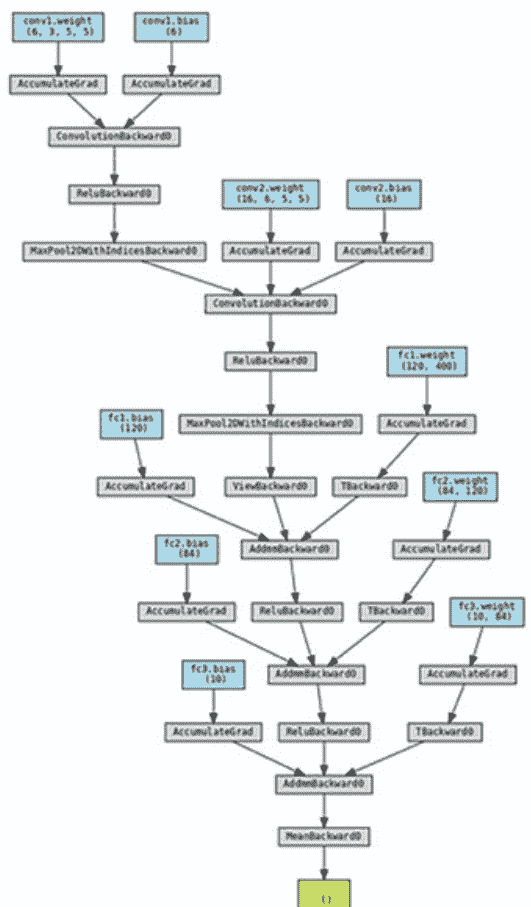

图 4.1: 网络可视化 (PyTorch 1.x)

在此示例中，SimpleCNN 是 nn.Module 的子类。我们定义了一个卷积层 (conv1)、一个池化层 (pool) 和一个全连接层 (fc1)。forward 方法定义了网络的前向传播。数据将流经卷积层，接着是 ReLU 激活函数，然后流经池化层，最后流经全连接层。

## 训练神经网络

构建好网络后，下一步是对其进行训练。在 PyTorch 中训练神经网络涉及定义损失函数和优化器，然后利用它们根据数据更新网络的权重。

以下是 PyTorch 中神经网络的简化训练循环：

```python
# Import statements
import torch.optim as optim

# Create an instance of the network
net = SimpleCNN()

# Define a loss function
criterion = nn.CrossEntropyLoss()

# Define an optimizer
optimizer = optim.SGD(net.parameters(), lr=0.001,
momentum=0.9)

# Dummy dataset
inputs = torch.randn(100, 3, 32, 32)
labels = torch.randint(0, 10, (100,))

# Training loop
for epoch in range(10):
    running_loss = 0.0
    for i in range(100):
        inputs, labels = inputs, labels
        optimizer.zero_grad()
        outputs = net(inputs)
        loss = criterion(outputs, labels)
        loss.backward()
        optimizer.step()
        running_loss += loss.item()
        if i % 10 == 9:
            print(f"[{epoch + 1}, {i + 1}] loss: {running_loss / 10:.3f}")
```

running_loss = 0.0

此示例表示一个简单的训练循环。在每个时代中，训练数据将通过网络 (net(inputs)) 传递，计算损失 (criterion(outputs, labels))，并计算梯度 (loss.backward())。随后，优化器更新网络的权重 (optimizer.step())。

## 评估神经网络

网络训练完成后，下一步是评估其性能。PyTorch 使用 torch.no_grad 上下文使此过程变得简单，它告诉 PyTorch 在评估阶段不需要计算梯度。以下是您在 PyTorch 中评估神经网络的示例：

```
correct = 0
total = 0
with torch.no_grad():
    for data in testloader:
        images, labels = data
        outputs = net(images)
        _, predicted = torch.max(outputs.data, 1)
        total += labels.size(0)
        correct += (predicted == labels).sum().item()

print('Accuracy of the network on the test images: %d %%' %
(100 * correct / total))
```

总体而言，PyTorch 为构建、训练和评估神经网络提供了全面且灵活的环境。PyTorch 的动态特性使其特别适合研究和原型开发，使您能够快速进行实验和迭代。在下一节中，我们将探讨如何处理和理解图像数据，这是构建计算机视觉模型的关键方面。

## 处理和理解图像数据

在计算机视觉中，图像数据是神经网络的主要输入形式。正确地处理和理解此数据对模型的成功至关重要。本节将指导您完成加载、预处理和增强图像数据的过程，以便为神经网络做好准备。

### 加载图像数据

处理图像数据的第一步是将其加载到您的环境中。PyTorch 通过其 **torchvision** 模块提供了一种方便的方式来加载和处理图像数据，该模块包括常用数据集、模型架构和常见图像变换。以下是如何加载计算机视觉中常用的 CIFAR-10 数据集的示例：

```
# Example to load image data
import torch
from torchvision import datasets, transforms
transform = transforms.Compose([
    transforms.ToTensor(),
    transforms.Normalize((0.5, 0.5, 0.5), (0.5, 0.5, 0.5)),
])
trainset = datasets.CIFAR10(root='./data', train=True,
download=True, transform=transform)
trainloader = torch.utils.data.DataLoader(trainset,
batch_size=4, shuffle=True, num_workers=2)
testset = datasets.CIFAR10(root='./data', train=False,
download=True, transform=transform)
testloader = torch.utils.data.DataLoader(testset,
batch_size=4, shuffle=False, num_workers=2)
```

在此示例中，transforms 模块用于定义将应用于图像的一系列变换。ToTensor 变换将图像转换为 PyTorch 张量，而 Normalize 变换则对像素值进行归一化。随后，使用 DataLoader 分批加载数据集，并可选择打乱数据。

### 预处理图像数据

加载数据后，下一步是对其进行预处理。预处理可以包括各种操作，例如调整大小、裁剪、归一化等。预处理的目标是以一种使数据更适合神经网络的方式准备数据。以下是如何使用 transforms 模块预处理图像数据的示例：

```
transform = transforms.Compose([
    transforms.Resize((224, 224)),
    transforms.ToTensor(),
    transforms.Normalize((0.5, 0.5, 0.5), (0.5, 0.5, 0.5)),
])
```

在此示例中，Resize 变换用于将图像调整为固定大小 224x224 像素。这是深度学习模型中图像数据常用的尺寸。

### 数据增强

数据增强是一种通过应用各种变换来增加训练数据多样性的技术。这有助于通过防止过拟合来提高模型的性能。常见的数据增强技术包括旋转、翻转、缩放等。以下是如何使用 transforms 模块执行数据增强的示例：

```
transform = transforms.Compose([
    transforms.RandomResizedCrop(224),
    transforms.RandomHorizontalFlip(),
    transforms.ToTensor(),
    transforms.Normalize((0.5, 0.5, 0.5), (0.5, 0.5, 0.5)),
])
```

在此示例中，RandomResizedCrop 变换将图像随机裁剪为 224x224 像素的大小，而 RandomHorizontalFlip 变换则随机水平翻转图像。这些变换为训练数据增添了多样性，并有助于模型更好地泛化。

我们将在本书后续章节中更详细地了解增强和预处理。

处理和理解图像数据是计算机视觉的关键方面。正确地加载、预处理和增强数据会对模型的性能产生重大影响。通过利用 PyTorch 的 torchvision 模块，您可以简化处理图像数据的过程，并专注于构建和训练神经网络。在下一节中，我们将探讨如何构建和训练图像分类模型，将迄今为止所涵盖的概念付诸实践。

## 构建和训练图像分类模型

既然我们已经介绍了处理图像数据的基本概念和方法，让我们开始构建和训练您的第一个图像分类模型的激动人心的旅程。本分步指南包含代码示例和图表，旨在帮助新手和专家使用 PyTorch 构建、训练和优化图像分类模型。


## 数据集概述

在继续之前，让我们花点时间了解一下我们正在使用的数据集 - CIFAR-10。CIFAR-10 数据集包含 10 个不同类别的 60,000 张 32x32 彩色图像，每个类别有 6,000 张图像。这些类别包括飞机、汽车、鸟、猫、鹿、狗、蛙、马、船和卡车。数据集分为 50,000 张训练图像和 10,000 张测试图像。

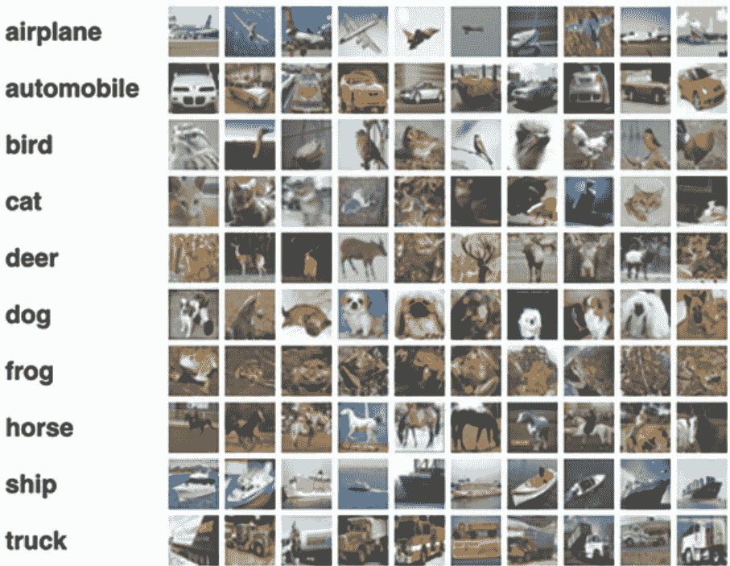

**图 4.2：** CIFAR-10 数据集中的类别和示例图像

我们可以使用以下代码片段可视化图像：

```python
import matplotlib.pyplot as plt
import numpy as np
import torch
import torchvision
from torchvision import datasets, transforms
transform = transforms.Compose([
    transforms.ToTensor(),
    transforms.Normalize((0.5, 0.5, 0.5), (0.5, 0.5, 0.5)),
])
trainset = datasets.CIFAR10(root='./data', train=True,
                           download=True, transform=transform)
trainloader = torch.utils.data.DataLoader(trainset,
                                         batch_size=4, shuffle=True, num_workers=2)
testset = datasets.CIFAR10(root='./data', train=False,
                           download=True, transform=transform)
testloader = torch.utils.data.DataLoader(testset,
                                         batch_size=4, shuffle=False, num_workers=2)
# Define the classes in CIFAR-10 dataset
classes = ('plane', 'car', 'bird', 'cat', 'deer', 'dog',
           'frog', 'horse', 'ship', 'truck')
# Show some example images from the dataset
def imshow(img):
    img = img / 2 + 0.5      # Unnormalize
    npimg = img.numpy()
    plt.imshow(np.transpose(npimg, (1, 2, 0)))
    plt.show()
# Get some random training images
dataiter = iter(trainloader)
images, labels = next(dataiter)  # This line should work without any error
# Show images
imshow(torchvision.utils.make_grid(images))
# Print labels
print(' '.join('%5s' % classes[labels[j]] for j in range(4)))
```

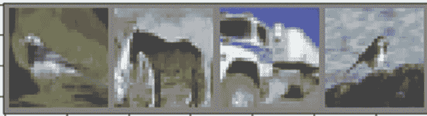

Figure 4.3: 使用前面的代码片段查看图像的输出

## 定义神经网络架构

构建图像分类模型的第一步是定义神经网络的架构。在 PyTorch 中，这是通过创建一个继承自 torch.nn.Module 的类并实现 __init__ 和 `forward` 方法来完成的。以下是图像分类的一个简单神经网络架构示例：

```python
import torch
import torch.nn as nn
import torch.nn.functional as F

class SimpleCNN(nn.Module):
    def __init__(self):
        super(SimpleCNN, self).__init__()
        self.conv1 = nn.Conv2d(3, 6, 5)
        self.pool = nn.MaxPool2d(2, 2)
        self.conv2 = nn.Conv2d(6, 16, 5)
        self.fc1 = nn.Linear(16 * 5 * 5, 120)
        self.fc2 = nn.Linear(120, 84)
        self.fc3 = nn.Linear(84, 10)

    def forward(self, x):
        x = self.pool(F.relu(self.conv1(x)))
        x = self.pool(F.relu(self.conv2(x)))
        x = x.view(-1, 16 * 5 * 5)
        x = F.relu(self.fc1(x))
        x = F.relu(self.fc2(x))
        x = self.fc3(x)
        return x

# Create network with the class above:
net = SimpleCNN()

# Creating compiled_net with PyTorch 2.0
compiled_net = torch.compile(net)

# Only for visualization
import torchviz

x = torch.randn(1, 3, 32, 32) # assuming input size 32x32 RGB
images
y = net(x)
torchviz.make_dot(y.mean(),
params=dict(net.named_parameters())).render("network_pt1x",
format="png")

y = compiled_net(x)
torchviz.make_dot(y.mean(),
params=dict(compiled_net.named_parameters())).render("network_pt2_0", format="png")
```

### 加载和预处理数据

定义好神经网络架构后，下一步是加载和预处理图像数据。这在前一节中已介绍，但这里简要回顾一下：

```python
transform = transforms.Compose([
    transforms.Resize((224, 224)),
    transforms.ToTensor(),
    transforms.Normalize((0.5, 0.5, 0.5), (0.5, 0.5, 0.5)),
])

trainset = datasets.CIFAR10(root='./data', train=True,
download=True, transform=transform)
trainloader = torch.utils.data.DataLoader(trainset,
batch_size=4, shuffle=True, num_workers=2)

testset = datasets.CIFAR10(root='./data', train=False,
download=True, transform=transform)
testloader = torch.utils.data.DataLoader(testset,
batch_size=4, shuffle=False, num_workers=2)
```

### 定义损失函数和优化器

接下来，你需要为神经网络定义损失函数和优化器。损失函数计算预测输出与实际目标之间的差异，而优化器调整网络的权重以最小化损失。以下是一个示例：

```python
criterion = nn.CrossEntropyLoss()
optimizer = torch.optim.SGD(compiled_net.parameters(),
lr=0.001, momentum=0.9)
```

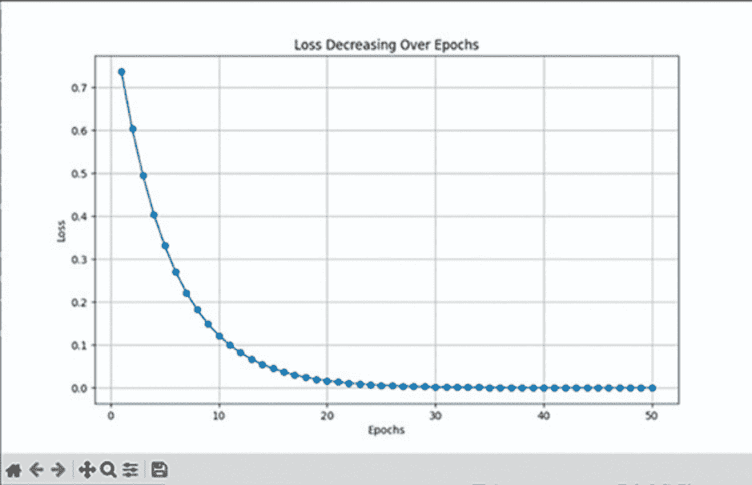

Figure 4.4: 损失收敛可视化

在此示例中，我们选择交叉熵损失作为损失函数，随机梯度下降（SGD）作为优化器。

## 训练神经网络

现在，我们准备好训练神经网络了。这是通过将输入数据传递给网络、计算损失并使用优化器更新权重来完成的。以下是如何训练神经网络一个 epoch 的示例：

```python
for epoch in range(1): # loop over the dataset multiple times

running_loss = 0.0
for i, data in enumerate(trainloader, 0):
    inputs, labels = data
    optimizer.zero_grad()
    outputs = net(inputs)
    loss = criterion(outputs, labels)
    loss.backward()
    optimizer.step()
    running_loss += loss.item()
    if i % 2000 == 1999:    # print every 2000 mini-batches
        print('[%d, %5d] loss: %.3f' %
              (epoch + 1, i + 1, running_loss / 2000))
        running_loss = 0.0

print('Finished Training')
```

### 评估神经网络

训练好神经网络后，下一步是在测试数据上评估其性能。这是通过计算模型的准确率来完成的，即正确分类图像的百分比。以下是一个示例：

```python
correct = 0
total = 0
with torch.no_grad():
    for data in testloader:
        images, labels = data
        outputs = net(images)
        _, predicted = torch.max(outputs.data, 1)
        total += labels.size(0)
        correct += (predicted == labels).sum().item()
print('Accuracy of the network on the 10000 test images: %d %%' % (100 * correct / total))
```

### 微调和优化

最后，你可以通过调整各种超参数（如学习率、批量大小和 epoch 数量）来微调和优化神经网络。你还可以尝试不同的架构、损失函数和优化器，以找到最适合你特定数据集的组合。

### 输出及在图像上进行测试

训练好模型后，输出将是一个形状为 `(batch_size, num_classes)` 的张量，其中 `num_classes` 是数据集中的类别数量。张量的每一行包含每个类别的预测分数。得分最高的类别被视为预测类别。

要在新图像上测试模型，你首先需要加载图像、对其进行预处理，然后将其传递给模型。以下是在单张图像上测试模型的示例：

```python
from PIL import Image
from torchvision.transforms import ToTensor
import torchvision.transforms as transforms

# Load the image
# Change 'path/to/your/image.jpg' with actual path to image on your system
image = Image.open('path/to/your/image.jpg').convert('RGB')

# Preprocess the image
transform = transforms.Compose([
    transforms.Resize((32, 32)),
    transforms.ToTensor(),
])

image = transform(image).unsqueeze(0)

# Pass the image through the model
output = compiled_net(image)

# Get the predicted class
```


_, predicted = torch.max(output.data, 1)
print('Predicted class: %s' % classes[predicted[0]])


图 4.5: 前代码段的推理代码输出

本示例假设图像为具有三个通道（RGB）的彩色图像。如果您的图像是单通道的灰度图像，可能需要相应调整预处理步骤。

## 完整训练代码与推理

```python
import torch
import torchvision
import torchvision.transforms as transforms
# Set up the transform to normalize the data
transform = transforms.Compose([
    transforms.ToTensor(),
    transforms.Normalize((0.5, 0.5, 0.5), (0.5, 0.5, 0.5)),
])
# Load the CIFAR-10 dataset
trainset = torchvision.datasets.CIFAR10(root='./data',
    train=True, download=True, transform=transform)
trainloader = torch.utils.data.DataLoader(trainset,
    batch_size=4, shuffle=True)
testset = torchvision.datasets.CIFAR10(root='./data',
    train=False, download=True, transform=transform)
testloader = torch.utils.data.DataLoader(testset,
    batch_size=4, shuffle=False)
classes = ('plane', 'car', 'bird', 'cat', 'deer', 'dog',
    'frog', 'horse', 'ship', 'truck')
# Define the neural network
import torch.nn as nn
import torch.nn.functional as F

class SimpleCNN(nn.Module):
    def __init__(self):
        super(Net, self).__init__()
        self.conv1 = nn.Conv2d(3, 6, 5)
        self.pool = nn.MaxPool2d(2, 2)
        self.conv2 = nn.Conv2d(6, 16, 5)
        self.fc1 = nn.Linear(16 * 5 * 5, 120)
        self.fc2 = nn.Linear(120, 84)
        self.fc3 = nn.Linear(84, 10)

    def forward(self, x):
        x = self.pool(F.relu(self.conv1(x)))
        x = self.pool(F.relu(self.conv2(x)))
        x = x.view(-1, 16 * 5 * 5)
        x = F.relu(self.fc1(x))
        x = F.relu(self.fc2(x))
        x = self.fc3(x)
        return x

net = SimpleCNN()

# Compile the model with torch.compile for PyTorch 2.0
compiled_net = torch.compile(net)

# Set up the loss function and optimizer
import torch.optim as optim
criterion = nn.CrossEntropyLoss()
optimizer = optim.SGD(compiled_net.parameters(), lr=0.001,
                      momentum=0.9)

# Train the network
for epoch in range(5):  # Loop over the dataset multiple times
    running_loss = 0.0
    for i, data in enumerate(trainloader, 0):
        inputs, labels = data
        optimizer.zero_grad()
        outputs = compiled_net(inputs)
        loss = criterion(outputs, labels)
        loss.backward()
        optimizer.step()
        running_loss += loss.item()
        if i % 2000 == 1999:     # Print every 2000 mini-batches
            print('[%d, %5d] loss: %.3f' %
                (epoch + 1, i + 1, running_loss / 2000))
            running_loss = 0.0
print('Finished Training')
# Test the network on the test data
correct = 0
total = 0
with torch.no_grad():
    for data in testloader:
        images, labels = data
        outputs = compiled_net(images)
        _, predicted = torch.max(outputs.data, 1)
        total += labels.size(0)
        correct += (predicted == labels).sum().item()
print('Accuracy of the network on the 10000 test images: %d %%' % (100 * correct / total))
```

输出

[1, 2000] loss: 2.197
[1, 4000] loss: 1.831
[1, 6000] loss: 1.699
[1, 8000] loss: 1.583
[1, 10000] loss: 1.498
[1, 12000] loss: 1.461
[2, 2000] loss: 1.403
[2, 4000] loss: 1.361
[2, 6000] loss: 1.357
[2, 8000] loss: 1.318
[2, 10000] loss: 1.296
[2, 12000] loss: 1.296
[3, 2000] loss: 1.222
[3, 4000] loss: 1.222
[3, 6000] loss: 1.171
[3, 8000] loss: 1.201
[3, 10000] loss: 1.167
[3, 12000] loss: 1.180
[4, 2000] loss: 1.101
[4, 4000] loss: 1.089
[4, 6000] loss: 1.100
[4, 8000] loss: 1.090
[4, 10000] loss: 1.116
[4, 12000] loss: 1.094
[5, 2000] loss: 1.005
[5, 4000] loss: 1.033
[5, 6000] loss: 1.026
[5, 8000] loss: 1.029
[5, 10000] loss: 1.044
[5, 12000] loss: 1.045
Finished Training
Accuracy of the network on the 10000 test images: 60 %

图 4.6: 五个 epoch 后带有准确率的训练代码输出

您可以修改架构以查看其对准确率的影响；也可以更改其他部分（如批量大小和 epoch 数量），以查看损失和准确率如何收敛。

按照这些步骤，您应当能够使用 PyTorch 构建和训练图像分类模型，打下坚实基础。请记住要进行实验并微调模型，以在特定数据集上获得最佳性能。一如既往，欢迎参考前面章节以获取特定主题的更详细信息。

## 评估模型性能与故障排除

构建并训练好图像分类模型后，下一步至关重要的工作是评估其性能并排查可能出现的任何问题。本节将探讨评估模型有效性的不同方法，以及识别和解决潜在问题的途径。

### 评估模型性能

稳健的评估对于理解模型的准确性和泛化能力至关重要。

### 准确率。

准确率衡量模型做出的正确预测数量除以总预测数量。它是评估的一个良好起点。

```python
correct = 0
total = 0
with torch.no_grad():
    for data in testloader:
        images, labels = data
        outputs = net(images)
        _, predicted = torch.max(outputs.data, 1)
        total += labels.size(0)
        correct += (predicted == labels).sum().item()
print('Accuracy of the network on the 10000 test images: %d %%' % (100 * correct / total))
```

Accuracy of the network on the 10000 test images: 61 %

图 4.7: 准确率计算代码段的输出

### 混淆矩阵

混淆矩阵可以帮助您了解哪些类别经常相互混淆。

```python
from sklearn.metrics import confusion_matrix
import seaborn as sns
import matplotlib.pyplot as plt
y_pred = []
y_true = []
with torch.no_grad():
    for data in testloader:
        images, labels = data
        outputs = net(images)
        _, predicted = torch.max(outputs.data, 1)
        y_pred.extend(predicted.numpy())
        y_true.extend(labels.numpy())
cm = confusion_matrix(y_true, y_pred)
sns.heatmap(cm, annot=True, fmt='d')
plt.ylabel('Actual')
plt.xlabel('Predicted')
plt.show()
```

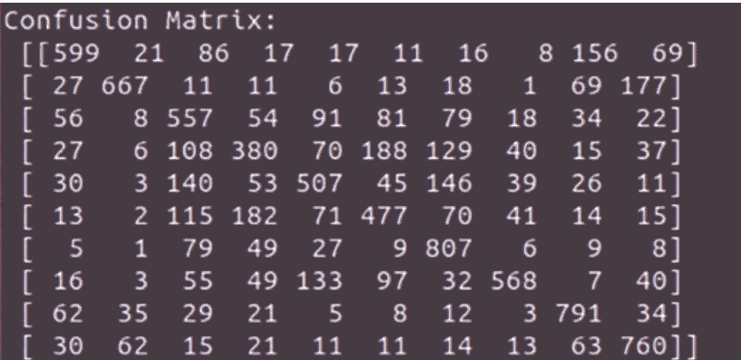

图 4.8: 混淆矩阵的输出

### 精确率、召回率和 F1 分数

这些指标能够对模型提供更全面的评估，特别是在不平衡数据集中。

```python
# Prepare for metric calculation
all_labels = np.array([])
all_preds = np.array([])
all_outputs = np.array([])
# Test the network on the test data
with torch.no_grad():
    for data in testloader:
        images, labels = data
        outputs = compiled_net(images)
        _, predicted = torch.max(outputs.data, 1)
        # Store predictions, labels and output scores for metrics
        all_labels = np.append(all_labels, labels.numpy())
        all_preds = np.append(all_preds, predicted.numpy())
        all_outputs = np.append(all_outputs, outputs.numpy())
# Calculate precision, recall, and F1 score
precision, recall, f1, _ = precision_recall_fscore_support(all_labels, all_preds,
                                                           average='weighted')
print(f'Precision: {precision:.2f}, Recall: {recall:.2f}, F1 Score: {f1:.2f}')
```

Precision: 0.62, Recall: 0.61, F1 Score: 0.61

图 4.9: 计算精确率、召回率和 F1 分数的代码段输出

### ROC-AUC 曲线

ROC-AUC（接收者操作特征曲线下面积）是各种阈值设置下分类问题的性能度量。AUC 越高，模型区分正类和负类的能力越强。

通过仔细评估模型性能并系统地解决出现的任何问题，您将朝着开发高效图像分类模型的方向迈出坚实步伐。请记住，开发机器学习模型是一个迭代过程，持续监控和调整是获得最佳结果所必需的。

```python
# Prepare for metric calculation
all_labels = np.array([])
all_outputs = np.array([])
# Test the network on the test data
with torch.no_grad():
    for data in testloader:
        images, labels = data
        outputs = compiled_net(images)
        _, predicted = torch.max(outputs.data, 1)
        # Store predictions, labels and output scores for metrics
        all_labels = np.append(all_labels, labels.numpy())
        all_outputs = np.append(all_outputs, outputs.numpy())
        # One-hot encode labels for ROC-AUC
        one_hot_labels = np.eye(10)[all_labels.astype(int)]
        roc_auc = roc_auc_score(one_hot_labels,
                                all_outputs.reshape(-1, 10), multi_class='ovr')
        print(f'ROC-AUC: {roc_auc:.2f}')
        # Plot ROC curve for each class
        fpr = dict()
        tpr = dict()
        roc_auc = dict()
        for i in range(10):
            fpr[i], tpr[i], _ = roc_curve(one_hot_labels[:, i],
                                          all_outputs.reshape(-1, 10)[:, i])
            roc_auc[i] = auc(fpr[i], tpr[i])
        plt.figure()
        for i in range(10):
```


```
plt.plot(fpr[i], tpr[i], label=f'ROC curve of class
{classes[i]} (area = {roc_auc[i]:.2f})')
plt.plot([0, 1], [0, 1], 'k--')
plt.xlim([0.0, 1.0])
plt.ylim([0.0, 1.05])
plt.xlabel('False Positive Rate')
plt.ylabel('True Positive Rate')
plt.title('ROC-AUC curve per class')
plt.legend(loc="lower right")
plt.show()
```

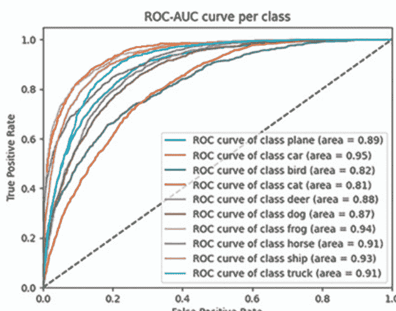

图 4.10：来自训练模型的 ROC-AUC 曲线

# 结论

在本章中，我们探索了人工神经网络迷人的世界及其在 PyTorch 中的实现，为构建、训练和评估基本图像分类模型的原理和实践提供了坚实基础。凭借获得的知识和技能，您已做好准备，可以迎接计算机视觉领域更复杂的挑战。

当我们结束对神经网络基础的探索之旅，是时候深入卷积神经网络（CNNs）的世界了，这是一类已被证明在分析视觉图像方面非常有效的深度神经网络。在即将到来的章节中，第 5 章，深入卷积神经网络（CNNs），我们将深入探讨 CNN 的底层理论、结构和实现，探讨它们为何特别适合处理图像数据。我们还将介绍构建和训练 CNN 的最佳实践，为您提供所需的知识和工具，将计算机视觉模型提升到新的水平。

我们将更仔细地研究 CNN 的架构，并学习如何使用 PyTorch 构建和训练这些强大的模型。到下一章结束时，您将全面了解 CNN，并掌握将其应用于现实世界计算机视觉问题的实用技能。此外，我们将看到如何改进本章中创建的模型，以期获得更高的准确性和更好的性能。那么，让我们准备好深入探索，并在迷人的计算机视觉世界中释放卷积神经网络的全部潜力！

## 第 5 章
## 深入卷积神经网络（CNNs）

## 引言

在前几章中，我们已建立起深入探索卷积神经网络（CNNs）这一引人入胜领域所需的基础。您现在应该已经精通人工神经网络的概念、图像数据的处理，以及 PyTorch 中用于构建神经网络的工具和功能。有了这些基础，我们现在可以探索卷积神经网络（CNNs），这是一类擅长处理视觉图像的深度神经网络。

卷积神经网络（CNNs）是计算机视觉领域的关键组成部分，该领域致力于使计算机能够解释和理解视觉世界。CNNs 的设计旨在自动且自适应地从输入图像中学习空间特征层次结构。这些网络是许多现实世界应用成功的驱动力，例如图像分类、目标检测和图像生成。

## 结构

本章将涵盖以下主题：

- 了解 CNN 的层
- 深入了解滤波器和内核
- 高级 CNN 架构

## 了解 CNN 的层

卷积神经网络（CNNs）是一类专门设计用于处理和解释视觉数据的深度学习模型。CNNs 由多个层组成；每个层在提取特征和进行预测方面都起着至关重要的作用。在本章中，我们将详细探讨这些层，包括它们的功能、它们在 PyTorch 中的实现方式以及实际应用示例。

## 卷积层

卷积层是 CNN 的核心构建块。它对输入图像应用一系列滤波器，以创建突出图像中特定特征（例如边缘或纹理）的特征映射。

### 理论

卷积层使用一个小的正方形滤波器，该滤波器在输入图像上滑动。在每个位置，滤波器与底层图像数据执行点积运算，生成一个代表特定特征存在的单个值。

### PyTorch 实现

```
conv_layer = nn.Conv2d(in_channels=1, out_channels=32,
kernel_size=3, stride=1, padding=1)
```

### 说明

nn.Conv2d 函数创建一个二维卷积层。该层过滤输入图像以创建突出特定特征（如边缘、角和纹理）的特征映射。

- **in_channels**: 输入通道数（或深度）。对于灰度图像，这将是 1；对于彩色图像，这将是 3。
- **out_channels**: 输出通道数。这也代表该层将学习的滤波器数量。
- **kernel_size**: 滤波器的大小。它可以是单个数字或元组（高度，宽度）。
- **stride**: 滤波器在图像上移动时的步长。它可以是单个数字或元组（高度，宽度）。
- **padding**: 添加到输入图像边框的像素数。它有助于滤波器覆盖图像的边缘。

### 示例

在图像分类任务中，卷积层可用于检测图像中的边缘，然后用这些边缘来识别图像中的物体。

## 激活函数

激活函数为模型引入非线性，使网络能够学习复杂模式。

### 理论

激活函数取神经元的输出，并根据特定规则将其转换。常见的激活函数包括 ReLU（整流线性单元）和 Sigmoid。

### PyTorch 实现

```
relu = nn.ReLU()
```

### 说明

nn.ReLU 函数应用整流线性单元激活函数，它将输入中的所有负值替换为零，使网络能够学习复杂模式。

### 示例

在人脸识别任务中，激活函数可用于突出区分一个人脸与另一个人脸的特征。

## 池化层

池化层减少特征映射的空间维度，从而减少网络的计算负载。

### 理论

池化层取特征映射的小区域并执行下采样操作，例如取最大值或平均值。

### PyTorch 实现

```
pool = nn.MaxPool2d(kernel_size=2, stride=2, padding=0)
```

### 说明

nn.MaxPool2d 函数执行最大池化，它通过取特定大小和步长的滤波器中的最大值来对输入进行下采样。

- **kernel_size**: 滤波器的大小。
- **stride**: 滤波器在图像上移动时的步长。
- **padding**: 添加到输入图像边框的像素数。

### 示例

在目标检测任务中，池化层可用于减小特征映射的大小，从而更容易检测图像中不同位置的物体。

## 全连接层

全连接层用于根据卷积层提取的特征进行预测。

### 理论

全连接层取前几层的输出，并将每个神经元连接到下一层的每个神经元。然后使用输出进行预测。

### PyTorch 实现

```
fc = nn.Linear(in_features=32 * 14 * 14, out_features=10)
```

### 说明

nn.Linear 函数创建一个全连接层，将每个神经元连接到下一层的每个神经元。

- **in_features**: 输入特征数。
- **out_features**: 输出特征数。

### 示例

在手写数字识别任务中，全连接层可用于根据卷积层提取的特征对数字进行分类。

## 批量归一化

批量归一化是一种用于改进神经网络训练的技术。

### 理论

批量归一化将每层的输出归一化为均值为 0、标准差为 1，这有助于加快训练速度并减少对初始权重的敏感性。

### PyTorch 实现

```
batch_norm = nn.BatchNorm2d(num_features=32)
```

### 说明

nn.BatchNorm2d 函数将输入归一化为均值为 0、标准差为 1。它有助于加快训练速度并降低对初始权重的敏感性。

- **num_features**: 输入中的特征数。

### 示例

在图像分割任务中，批量归一化可用于归一化每层的输出。

## Dropout

Dropout 是一种用于防止神经网络过拟合的正则化技术。

### 理论

Dropout 在训练期间随机丢弃一部分神经元，这有助于防止模型过度依赖任何单一特征。

### PyTorch 实现


dropout = nn.Dropout(p=0.5)

## 解释

nn.Dropout 函数在训练期间随机丢弃一部分神经元，以防止过拟合。

- p: 丢弃一个神经元的概率。它是 0 到 1 之间的值，其中 0 表示无丢弃，1 表示所有神经元都被丢弃。在前面的示例中，p=0.5 表示 50% 的丢弃概率。

## 示例

在图像分类任务中，dropout 可能会被用来防止对训练数据的过拟合。

总而言之，CNN 的层在提取特征和进行预测方面起着至关重要的作用。每个层都有特定的功能，并在 PyTorch 中使用不同的工具和特性来实现。通过了解每个层背后的理论，并了解它们在 PyTorch 中的实现方式，你可以更深入地了解 CNN 的工作原理以及如何在计算机视觉项目中有效地使用它们。

## 深入探究滤波器和内核

滤波器和内核是卷积神经网络（CNN）运作的关键组成部分。它们是小型的方形矩阵，在输入数据上移动以提取特征，例如边缘、纹理和图案。通过此方式，滤波器帮助网络识别数据中的复杂图案。

## 滤波器与 CNN

滤波器或内核在输入数据上卷积，以生成一个称为特征图的转换版本。此过程有助于突出数据中的特定特征，例如边缘、角点或纹理。卷积过程涉及滤波器与输入数据重叠部分之间的点积。

## PyTorch 实现

```python
import torch
import torch.nn as nn

# Define a convolutional layer with a single filter of size 3x3
conv_layer = nn.Conv2d(in_channels=1, out_channels=1,
                       kernel_size=3, stride=1, padding=1)
```

此处，nn.Conv2d 是 PyTorch 中的二维卷积层。in_channels 和 out_channels 参数分别表示滤波器的深度和滤波器的数量。kernel_size 参数指定滤波器的高度和宽度，而 stride 和 padding 控制步长以及应用于输入数据的零填充量。

## 选择合适的滤波器大小和数量

选择合适的滤波器大小和数量对于从数据中捕获正确特征至关重要。3x3 或 5x5 等小滤波器可以捕获细粒度细节，而 7x7 或 11x11 等较大滤波器则捕获更抽象的特征。滤波器的数量决定了网络可以提取的唯一特征的数量。

## PyTorch 实现

```python
# Define a convolutional layer with multiple filters of size 3x3
conv_layer = nn.Conv2d(in_channels=1, out_channels=32,
                       kernel_size=3, stride=1, padding=1)
```

该层将拥有 32 个滤波器，每个大小为 3x3，这意味着网络可以从输入数据中检测 32 个独特特征。

## PyTorch 中的代码示例

滤波器在 PyTorch 的 nn.Conv2d 函数中定义。让我们通过一些示例来了解滤波器在现实模型中是如何使用的。

### 示例 1：大小为 3x3 的单个滤波器

```python
conv_layer = nn.Conv2d(in_channels=1, out_channels=1,
                       kernel_size=3, stride=1, padding=1)
```

这个单个滤波器将生成一个特征图，突出数据中的特定特征。

### 示例 2：大小为 3x3 的多个滤波器

```python
conv_layer = nn.Conv2d(in_channels=1, out_channels=32,
                       kernel_size=3, stride=1, padding=1)
```

此处，32 个滤波器将生成 32 个特征图，每个突出数据中的不同特征。

### 示例 3：在真实模型中使用滤波器

```python
class MyModel(nn.Module):
    def __init__(self):
        super(MyModel, self).__init__()
        self.conv1 = nn.Conv2d(in_channels=1, out_channels=32,
                               kernel_size=3, stride=1, padding=1)
        self.conv2 = nn.Conv2d(in_channels=32, out_channels=64,
                               kernel_size=3, stride=1, padding=1)
        self.fc = nn.Linear(64*28*28, 10)

    def forward(self, x):
        x = self.conv1(x)
        x = self.conv2(x)
        x = x.view(x.size(0), -1)
        x = self.fc(x)
        return x
```

在此示例中，模型有两个卷积层。第一层有 32 个大小为 3x3 的滤波器，第二层有 64 个大小为 3x3 的滤波器。第二层的输出被展平并通过全连接层传递以生成最终输出。

总而言之，滤波器和内核是 CNN 的基本组成部分，帮助网络识别数据中的模式。滤波器的大小和数量应根据你想要从数据中提取的特定特征进行仔细选择。PyTorch 提供了一种使用 nn.Conv2d 函数定义滤波器的便捷方式，现实模型可以拥有具有不同数量滤波器的多个卷积层，以提取广泛的特征。

## 高级 CNN 架构

在本章中，我们将探讨一些彻底改变计算机视觉领域的流行卷积神经网络（CNN）架构。我们将深入探讨 VGG 和 ResNet 的工作原理，这两个是最具影响力的 CNN 架构。通过了解这些架构，你将能够为你的计算机视觉项目选择网络时做出明智的决策。

## 流行 CNN 架构概述

此处，我们将详细讨论这两种架构并深入了解它们。

## VGG（视觉几何组）网络

VGG 由牛津大学视觉几何组开发，是一种突破性成果，证明了深度是实现 CNN 良好性能的关键组成部分。它由 16 到 19 个权重层组成，以其简单性和同质性而闻名，所有卷积层都使用小型 3x3 滤波器。

## 残差网络（ResNet）

ResNet 由微软研究院提出，通过使用跳跃连接或快捷方式跳过某些层，具有革命性意义。该架构解决了梯度消失问题，并允许训练极深的网络。标准 ResNet 包含 50、101 或 152 层。

## 比较不同架构

比较 CNN 的架构是深入理解深度学习领域演进与创新的关键步骤，同时也有助于为特定任务选择合适的架构。

## VGG（视觉几何组）网络

- VGG 网络以其简单性和深度而闻名。它使用逐层堆叠的 3x3 卷积层，深度不断增加。
- 它不会过早地关注降低图像的空间维度。
- 实现和理解都很容易。

## 残差网络（ResNet）

- ResNet 引入了跳跃连接或快捷连接的概念。
- 这些连接允许一个层的输出作为另一个层的输入，跳过某些中间层。
- 这有助于解决梯度消失问题，并能够训练非常深的网络（甚至深达 1000 层）。
- ResNet 比 VGG 更复杂，但在各种任务上的性能有显著提升。

## 关键差异

- **深度：** 与 ResNet 相比，VGG 网络相对较浅。ResNet 最多可达 152 层，而 VGG 最多只有 19 层。
- **参数：** 由于使用了全连接层，VGG 的参数比 ResNet 多。ResNet 使用全局平均池化，显著减少了参数数量。
- **跳跃连接：** ResNet 使用跳跃连接，有助于训练非常深的网络。VGG 不具备此功能。
- **训练时间：** 训练 VGG 网络通常比训练 ResNet 更快，但 ResNet 带来的性能提升非常显著。
- **性能：** 与 VGG 相比，ResNet 在各种任务和竞赛中的表现更好。

## VGG 还是 ResNet

- VGG 与 ResNet 之间的选择取决于你的具体任务和可用的计算资源。
- 如果你正在处理简单任务并希望有一个直观的模型，那么 VGG 可能是正确的选择。
- 如果你需要高性能模型并拥有训练深度网络的资源，那么 ResNet 是首选。也值得探索其他架构


并结合深度学习领域的最新创新，为您的任务选择最佳模型。

## 在 PyTorch 中实现流行架构

现在，让我们来看看不同的架构。

## PyTorch 中的 VGG

```python
import torch
import torch.nn as nn

class VGG(nn.Module):
    def __init__(self, num_classes=1000):
        super(VGG, self).__init__()
        self.features = nn.Sequential(
            # 1st block
            nn.Conv2d(3, 64, kernel_size=3, padding=1),
            nn.ReLU(inplace=True),
            nn.Conv2d(64, 64, kernel_size=3, padding=1),
            nn.ReLU(inplace=True),
            nn.MaxPool2d(kernel_size=2, stride=2),
            # 2nd block
            nn.Conv2d(64, 128, kernel_size=3, padding=1),
            nn.ReLU(inplace=True),
            nn.Conv2d(128, 128, kernel_size=3, padding=1),
            nn.ReLU(inplace=True),
            nn.MaxPool2d(kernel_size=2, stride=2),
            # 3rd block
            nn.Conv2d(128, 256, kernel_size=3, padding=1),
            nn.ReLU(inplace=True),
            nn.Conv2d(256, 256, kernel_size=3, padding=1),
            nn.ReLU(inplace=True),
            nn.Conv2d(256, 256, kernel_size=3, padding=1),
            nn.ReLU(inplace=True),
            nn.MaxPool2d(kernel_size=2, stride=2),
            # 4th block
            nn.Conv2d(256, 512, kernel_size=3, padding=1),
            nn.ReLU(inplace=True),
            nn.Conv2d(512, 512, kernel_size=3, padding=1),
            nn.ReLU(inplace=True),
            nn.Conv2d(512, 512, kernel_size=3, padding=1),
            nn.ReLU(inplace=True),
            nn.MaxPool2d(kernel_size=2, stride=2),
            # 5th block
            nn.Conv2d(512, 512, kernel_size=3, padding=1),
            nn.ReLU(inplace=True),
            nn.Conv2d(512, 512, kernel_size=3, padding=1),
            nn.ReLU(inplace=True),
            nn.Conv2d(512, 512, kernel_size=3, padding=1),
            nn.ReLU(inplace=True),
            nn.MaxPool2d(kernel_size=2, stride=2),
        )
        self.classifier = nn.Sequential(
            nn.Linear(512 * 7 * 7, 4096),
            nn.ReLU(inplace=True),
            nn.Dropout(),
            nn.Linear(4096, 4096),
            nn.ReLU(inplace=True),
            nn.Dropout(),
            nn.Linear(4096, num_classes),
        )

    def forward(self, x):
        x = self.features(x)
        x = x.view(x.size(0), -1)
        x = self.classifier(x)
        return x
```

## PyTorch 中的 VGG：详细解释

让我们了解一下使用 PyTorch 实现的 VGG 网络的不同构建模块。

### nn.Conv2d

PyTorch 中的 nn.Conv2d 函数用于执行卷积操作，这是卷积层的核心。

- **输入通道数**: 输入图像的通道数。
- **输出通道数**: 过滤器（内核）的数量。
- **内核大小**: 每个过滤器的大小。
- **步长**: 滑动过滤器跨越图像时的步长。
- **填充**: 添加到图像边框的像素数量。

### nn.ReLU

ReLU（整线性单元）是一种激活函数，对正值输出输入值，对负值输出零。

- **原地操作**: 如果设置为 True，它将直接修改输入并节省内存。

### nn.MaxPool2d

最大池化是一种池化操作，从过滤器内的一组值中选择最大值。

- **内核大小**: 池化过滤器的大小。
- **步长**: 滑动过滤器时的步长。

## PyTorch 中的 ResNet

```python
import torch
import torch.nn as nn

class ResidualBlock(nn.Module):
    def __init__(self, in_channels, out_channels, stride=1, downsample=None):
        super(ResidualBlock, self).__init__()
        self.conv1 = nn.Conv2d(in_channels, out_channels, kernel_size=3, stride=stride, padding=1)
        self.bn1 = nn.BatchNorm2d(out_channels)
        self.relu = nn.ReLU(inplace=True)
        self.conv2 = nn.Conv2d(out_channels, out_channels, kernel_size=3, stride=1, padding=1)
        self.bn2 = nn.BatchNorm2d(out_channels)
        self.downsample = downsample

    def forward(self, x):
        residual = x
        if self.downsample is not None:
            residual = self.downsample(x)
        out = self.conv1(x)
        out = self.bn1(out)
        out = self.relu(out)
        out = self.conv2(out)
        out = self.bn2(out)
        out += residual
        out = self.relu(out)
        return out

class ResNet(nn.Module):
    def __init__(self):
        super(ResNet, self).__init__()
        self.in_channels = 64
        self.conv1 = nn.Conv2d(3, 64, kernel_size=7, stride=2, padding=3)
        self.bn1 = nn.BatchNorm2d(64)
        self.relu = nn.ReLU(inplace=True)
        self.maxpool = nn.MaxPool2d(kernel_size=3, stride=2, padding=1)
        self.layer1 = self.make_layer(64, 2)
        self.layer2 = self.make_layer(128, 2, 2)
        self.layer3 = self.make_layer(256, 2, 2)
        self.layer4 = self.make_layer(512, 2, 2)
        self.avgpool = nn.AdaptiveAvgPool2d((1, 1))
        self.fc = nn.Linear(512, 10)

    def make_layer(self, out_channels, blocks, stride=1):
        downsample = None
        if stride != 1 or self.in_channels != out_channels:
            downsample = nn.Sequential(
                nn.Conv2d(self.in_channels, out_channels, kernel_size=1, stride=stride),
                nn.BatchNorm2d(out_channels),
            )
        layers = []
        layers.append(ResidualBlock(self.in_channels, out_channels, stride, downsample))
        self.in_channels = out_channels
        for _ in range(1, blocks):
            layers.append(ResidualBlock(out_channels, out_channels))
        return nn.Sequential(*layers)

    def forward(self, x):
        out = self.conv1(x)
        out = self.bn1(out)
        out = self.relu(out)
        out = self.maxpool(out)
        out = self.layer1(out)
        out = self.layer2(out)
        out = self.layer3(out)
        out = self.layer4(out)
        out = self.avgpool(out)
        out = out.view(out.size(0), -1)
        out = self.fc(out)
        return out
```

## PyTorch 中的 ResNet：详细解释

让我们了解一下使用 PyTorch 实现的 ResNet 网络的不同构建模块。

### 残差块

残差块是 ResNet 网络的构建模块，它包含一个跳跃连接，允许输入跳过某些层并添加到输出中。

- in_channels: 输入图像的通道数。
- out_channels: 卷积层中的过滤器数量。
- Stride: 卷积层的步长。
- Downsample: 用于匹配输入和输出维度的下采样操作。

### nn.AdaptiveAvgPool2d

自适应平均池化是一种池化操作，通过平均池化生成指定大小的输出。

- (1, 1): 目标输出大小。

通过理解这些函数和组件，您可以了解这些流行架构的工作原理，以及如何根据您的特定需求对其进行定制。

## CNN 中的正则化与优化

当模型过于拟合训练数据，既捕获噪声也捕获底层模式，并在新的未见数据上表现不佳时，就会发生过拟合。在 CNN 的语境下，当网络相对于训练数据的数量和复杂度过于复杂时，可能会发生这种情况。为了缓解 CNN 中的过拟合：

### 数据增强

通过对图像应用旋转、翻转、裁剪等变换，增加训练数据集的大小和多样性。我们将详细学习数据增强。

```python
from torchvision.transforms import Compose, RandomHorizontalFlip, RandomRotation
transforms = Compose([
    RandomHorizontalFlip(),
    RandomRotation(10),
])
```

### 正则化

将 L1 或 L2 等正则化项添加到损失函数中，以惩罚大权重。

```python
import torch.nn as nn
model = nn.Sequential(
    nn.Conv2d(in_channels=1, out_channels=32, kernel_size=3),
    nn.ReLU(),
    nn.MaxPool2d(kernel_size=2),
    nn.Flatten(),
    nn.Linear(32 * 14 * 14, 10),
)
criterion = nn.CrossEntropyLoss() + 0.01 * torch.norm(model.parameters(), p=2)
```

### Dropout

在训练期间的每次更新中，随机将一部分输入单元设置为 0，这有助于防止过拟合。

```python
nn.Dropout(p=0.5)
```

### 早停法

一旦验证损失开始增加，即停止训练，以防止过拟合。


## 超参数调优与网格搜索

超参数调优是指搜索能最大化模型性能的最优超参数组合。网格搜索是一种通过穷举尝试所有预定义超参数值组合来执行超参数调优的技术。

```
from sklearn.model_selection import GridSearchCV
from skorch import NeuralNetClassifier

params = {
    'lr': [0.01, 0.001],
    'max_epochs': [10, 20],
}

net = NeuralNetClassifier(model, criterion=criterion,
    optimizer=torch.optim.Adam)
gs = GridSearchCV(net, params, refit=False, cv=3,
    scoring='accuracy')
gs.fit(X_train, y_train)
```

## 迁移学习与微调

迁移学习是一种技术，其中预训练模型（通常在大型通用数据集上）被用作新任务的起点。微调是指根据新任务的数据更新预训练模型的权重。

```
from torchvision import models

# Load pre-trained model
model = models.resnet18(pretrained=True)

# Fine-tune the last layer
for param in model.parameters():
    param.requires_grad = False
model.fc = nn.Linear(model.fc.in_features, num_classes)
```

## 提升模型性能的实用技巧

以下是一些技巧：

- **学习率调度：** 在训练期间调整学习率，通常随着训练的进行逐渐降低。

```
from torch.optim.lr_scheduler import StepLR
scheduler = StepLR(optimizer, step_size=30, gamma=0.1)
```

- **批量归一化：** 使用批量归一化来通过调整和缩放激活值来归一化输入层。

```
nn.BatchNorm2d(num_features)
```

- **权重初始化：** 正确初始化网络的权重以防止梯度消失或梯度爆炸。

```
nn.init.xavier_uniform_(layer.weight)
```

- **交叉验证：** 使用交叉验证来评估模型性能在数据集不同子集上的泛化情况。

```
from sklearn.model_selection import cross_val_score
cross_val_score(net, X_train, y_train, cv=3)
```

## 结论

总之，理解卷积神经网络的各种架构对于任何深度学习从业者都至关重要。从简单而有效的VGG网络到更复杂、更深层的ResNet架构，每种都有其自身的优势和适用场景。通过学习如何在PyTorch中实现这些网络，我们已为自己配备了应对多种计算机视觉任务的知识。

随着我们不断前进，还必须考虑输入模型的数据的质量和性质。第6章“面向视觉任务的数据增强与预处理”将深入探讨通过转换和预处理数据集来提高模型性能的关键技术。在本章中，我们将探讨针对视觉任务的各种数据增强技术，并理解如何使用PyTorch应用这些技术。此外，我们将审视数据增强对模型性能的影响，并强调最佳实践，以确保我们的数据已充分准备好用于训练高性能模型。

因此，从理解神经网络架构的复杂性到掌握数据增强和预处理，这一过程将进一步提升我们在计算机视觉领域的技能和知识。到下一章结束时，我们将能够很好地应对各种数据集带来的众多挑战，并更接近于使用PyTorch开发强大有效的计算机视觉模型。

## 第 6 章

## 面向视觉任务的数据增强与预处理

### 引言

数据增强和预处理是计算机视觉和机器学习领域的基本技术。它们通过为模型提供更好、更多样、更清洁的数据，在提升模型性能方面发挥着关键作用。通过数据增强和预处理，我们可以确保模型在高质量的数据上进行训练，这些数据能准确代表当前问题，从而提高模型的准确性和泛化能力。

**数据增强**是通过对现有数据进行各种转换来创建新数据点，从而人为增加数据集大小的过程。在计算机视觉的语境下，这可以包括翻转、旋转、缩放和颜色调整等转换。通过数据增强，我们可以为模型提供更多样的示例，帮助它学会识别对象或模式，而不受其方向、大小或颜色的影响。这最终会带来一个更强健、更准确的模型。

例如，考虑一个训练用于在图像中识别猫的模型。如果数据集只包含特定方向的猫的图像，模型可能难以识别不同方向的猫。然而，通过增强数据以包含各种方向的猫的图像，我们可以帮助模型学会识别猫，而不受其方向的影响。

另一方面，**数据预处理**涉及将原始数据清洗和转换为机器学习模型可以轻松有效地使用的格式。在计算机视觉中，这可以包括归一化像素值、调整图像大小和处理缺失数据等转换。通过预处理数据，我们可以确保模型接收到格式一致的数据，提高其从数据中学习的能力。

例如，考虑一个包含不同大小图像的数据集。如果图像未被调整为一致的大小，模型可能难以从中学习，因为图像中对象的大小会有所不同。通过将图像调整为一致的大小，我们可以帮助模型学会识别对象，而不受其在图像中大小的影响。

数据增强和预处理在提升模型性能方面的重要性无论如何强调也不为过。通过为模型提供高质量、多样的数据，我们可以帮助它更准确地学习识别模式和对象，从而获得更好的性能。此外，通过确保数据格式一致，我们可以防止因数据不一致而可能出现的问题，进一步提升模型性能。

### 结构

本章将涵盖以下主题：

- 理解数据预处理
- 面向视觉任务的数据增强技术
- 在PyTorch中应用数据预处理和增强
- 数据增强对模型性能的影响
- 数据增强和预处理的最佳实践

## 理解数据预处理

数据预处理是机器学习模型数据准备过程中的一个基本步骤。它涉及将原始数据清洗、转换和组织成结构化且可用的格式。数据预处理的主要目标是提高数据质量，使其更适合输入到机器学习算法中。这有助于提高模型的性能，从而获得更准确的预测和洞察。

### 数据预处理

数据预处理是准备和清洗数据以使其适合机器学习模型的过程。这涉及一系列活动，例如处理缺失值、归一化数据以及将类别数据转换为算法可以理解的格式。数据预处理的主要目标是提高数据的质量和可靠性，从而增强机器学习模型的性能。

### 定义与目的

- **定义：** 数据预处理是清洗和组织原始数据以使其适合机器学习模型的技术。
- **目的：** 数据预处理的主要目的是提高数据质量，从而提升机器学习模型的性能和准确性。

### 数据预处理的类型

数据预处理涵盖多种技术和方法，每种都有特定的目的。以下是一些最常见的数据预处理类型：


- **清理数据:** 清理数据涉及处理数据集中的缺失值、异常值和错误。这确保数据准确可靠。

### PyTorch 示例：

```python
import pandas as pd

# Load dataset
data = pd.read_csv('dataset.csv')

# Handle missing values
data.fillna(0, inplace=True)

# Handle outliers
data = data[(data['value'] > lower_bound) & (data['value'] < upper_bound)]
```

- **归一化和标准化:** 归一化和标准化是用于缩放特征的技术，使其处于相似范围，从而通过防止大值不成比例地影响训练来提高模型性能。虽然这两种技术经常被互换使用，但它们在方法和影响上有所不同。

  - **归一化:** 这种技术将数据缩放到固定范围，通常是 [0, 1] 或 [-1, 1]。当你需要将值限制在特定边界内时，归一化很有用，这在神经网络输入中很常见。

  - **标准化:** 这种技术将数据缩放为均值为 0、标准差为 1，将其转换为标准正态分布。当数据包含异常值或服从高斯分布时，更倾向于使用标准化，因为它将数据居中，可以稳定并加速训练。

### PyTorch 示例：

```python
from sklearn.preprocessing import StandardScaler
# Load dataset
data = pd.read_csv('dataset.csv')
# Standardize features
scaler = StandardScaler()
data_scaled = scaler.fit_transform(data)
```

- **处理缺失数据:** 处理缺失数据至关重要，因为缺失值会影响机器学习模型的性能。常用技术包括插补和删除缺失值。

### PyTorch 示例：

```python
# Handle missing values
data.fillna(method='ffill', inplace=True)
```

- **特征工程:** 特征工程涉及从现有数据中创建新特征以增强模型性能。这可以包括创建多项式特征、交互特征等。

### PyTorch 示例：

```python
# Create polynomial features
from sklearn.preprocessing import PolynomialFeatures
poly = PolynomialFeatures(degree=2)
data_poly = poly.fit_transform(data)
```

## 计算机视觉中的重要性

在计算机视觉中，数据预处理至关重要，因为它有助于提高图像数据的质量。计算机视觉中常见的预处理技术包括图像调整大小、归一化和数据增强。这些技术有助于确保模型获得一致且高质量的数据，从而获得更好的性能。

### PyTorch 示例：

```python
from torchvision import transforms
# Define transformations
transform = transforms.Compose([
    transforms.Resize((256, 256)),
    transforms.ToTensor(),
    transforms.Normalize((0.5, 0.5, 0.5), (0.5, 0.5, 0.5)),
])
# Load dataset and apply transformations
dataset = datasets.ImageFolder(root='data',
                               transform=transform)
```

## 工具和库

Python 中有各种可用于数据预处理的工具和库。其中一些最流行的包括：

- **Pandas**: 一个强大的数据操作库，提供用于清理和组织数据的函数。
- **Scikit-learn**: 一个机器学习库，提供用于归一化、标准化和其他预处理技术的函数。
- **OpenCV**: 一个提供图像处理函数的库，包括调整大小、裁剪等。
- **PyTorch**: 一个深度学习库，包括用于转换图像数据的函数，如归一化和数据增强。

利用这些工具和库，您可以简化数据预处理过程并提高机器学习模型的性能。我们将使用 PyTorch 完成所有预处理任务。

## 视觉任务的数据增强技术

数据增强是一种技术，通过对原始图像应用各种变换（如旋转、翻转和更改亮度）来创建新的训练样本。这通过提供更多样化的训练数据来帮助提高模型的性能和准确性。

- **定义:** 数据增强是通过对图像应用不同类型的变换，从原始数据集创建新训练样本的过程。

- **目的:** 数据增强的主要目的是增加训练数据集的多样性，从而帮助提高模型的性能和准确性。

## PyTorch 中的 Transforms 和 Compose

在 PyTorch 中，可以使用 torchvision 的 transforms 模块来执行数据增强。transforms 模块提供了各种变换函数，可以使用 **transforms.Compose** 将它们链接在一起，以创建应用于图像的变换管道。

```python
from torchvision import transforms

transform_pipeline = transforms.Compose([
    transforms.RandomHorizontalFlip(),
    transforms.ToTensor(),
])
```

在这里，**transforms.Compose** 接受一个变换函数列表并将它们链接在一起。在此示例中，图像首先将以 50% 的概率水平翻转，然后转换为张量。

## PyTorch 中可能的增强列表

PyTorch 中有许多可用于计算机视觉任务的增强方法；让我们逐一介绍其中一些：

### RandomHorizontalFlip

```python
transforms.RandomHorizontalFlip(p=0.5)
```

以给定概率水平翻转图像。

- **p**: 图像被翻转的概率。

### RandomVerticalFlip

```python
transforms.RandomVerticalFlip(p=0.5)
```

以给定概率垂直翻转图像。

- **p**: 图像被翻转的概率。

### ColorJitter

```python
transforms.ColorJitter(brightness=0, contrast=0, saturation=0, hue=0)
```

随机更改图像的亮度、对比度、饱和度和色调，如下所示：

- **brightness**: 亮度抖动的因子。
- **contrast**: 对比度抖动的因子。
- **saturation**: 饱和度抖动的因子。
- **hue**: 色调抖动的因子。

### RandomRotation

```python
transforms.RandomRotation(degrees, resample=False, expand=False, center=None, fill=None)
```

按随机角度旋转图像，如下所示：

- **degrees:** 可选择的角度范围。
- **resample:** 可选的重采样滤波器。
- **expand:** 可选的扩展标志。
- **center:** 可选的旋转中心。
- **fill:** 旋转图像外区域的像素填充值。

### RandomResizedCrop

```python
transforms.RandomResizedCrop(size, scale=(0.08, 1.0), ratio=(3. / 4., 4. / 3.), interpolation=2)
```

将给定图像裁剪为随机大小和宽高比，如下所示：

- **size:** 每条边的预期输出大小。
- **scale:** 裁剪的原始大小范围。
- **ratio:** 裁剪的原始宽高比范围。
- **interpolation:** 所需的插值方法。

### RandomAffine

```python
transforms.RandomAffine(degrees, translate=None, scale=None, shear=None, resample=False, fillcolor=0)
```

对图像应用随机仿射变换，如下所示：

- **degrees:** 旋转可选择的角度范围。
- **translate:** 水平和垂直平移的最大绝对分数元组。
- **scale:** 缩放因子区间。
- **shear:** 剪切可选择的角度范围。
- **resample:** 可选的重采样滤波器。
- **fillcolor:** 变换图像外区域的像素填充值。

### GaussianBlur

```python
transforms.GaussianBlur(kernel_size, sigma=(0.1, 2.0))
```

使用高斯滤波器模糊图像，如下所示：

- **kernel_size:** 高斯内核的大小。
- **sigma:** 高斯内核的标准差。

### RandomCrop

```python
transforms.RandomCrop(size, padding=None, pad_if_needed=False, fill=0, padding_mode='constant')
```

在随机位置裁剪给定图像，方式如下：

- **size:** 裁剪的期望输出大小。
- **padding:** 图像每个边框的可选填充。
- **pad_if_needed:** 如果为 True，则在图像小于期望大小时进行填充。
- **fill:** 常量填充的像素填充值。
- **padding_mode:** 填充类型。应为 'constant'、'edge'、'reflect' 或 'symmetric' 之一。

### RandomErasing

```python
transforms.RandomErasing(p=0.5, scale=(0.02, 0.33), ratio=(0.3, 3.3), value=0, inplace=False)
```

随机擦除图像中的矩形区域，如下所示：

- **p:** 执行随机擦除操作的概率。
- **scale:** 擦除区域相对于输入图像的比例范围。


- ratio: 被擦除区域的宽高比范围。

- value: 擦除值。

- inplace: 如果为 True，则变换将就地进行。

### RandomPerspective

```
transforms.RandomPerspective(distortion_scale=0.5, p=0.5,
interpolation=3)
```

执行图像的随机透视变换，给定概率如下所示：

- distortion_scale: 畸变程度。

- p: 图像被变换的概率。

- interpolation: 所需的插值方式。

### CenterCrop

```
transforms.CenterCrop(size)
```

按如下方式裁剪给定图像的中心区域：

- size: 裁剪的期望输出尺寸。

这些只是 PyTorch 中可用的众多增强方法中的一部分。你可以使用 transforms.Compose 将这些变换组合起来，为你的图像创建变换流水线。

## 在 PyTorch 中应用数据预处理

现在让我们来看看计算机视觉中常用的 PyTorch 数据预处理和增强示例。

## PyTorch 数据处理库概览

PyTorch 提供了一系列工具和库，以便于深度学习模型的数据处理，包括 torchvision、transforms 和 DataLoader。以下是对其中一些工具的说明：

- **torchvision**：PyTorch 库中的一个包，包含用于计算机视觉的数据集、模型架构和常见图像变换。

- **transforms**：torchvision 中的一个模块，提供常见图像变换，如旋转、翻转、归一化等。

- **DataLoader**：PyTorch 中的一个模块，提供高效便捷的方式以批次加载和处理数据，自动处理打乱、分批和多进程。

## 深入探究 PyTorch 的数据处理库

torchvision：PyTorch 的 torchvision 是一个包，提供访问流行数据集、模型架构和用于计算机视觉的常见图像变换。torchvision.datasets 模块包含多个基准数据集的加载器，例如 CIFAR10、CIFAR100 和 MNIST 等。这些数据集在训练和测试计算机视觉模型中起着关键作用。

除了数据集，torchvision 还提供一系列预训练模型，例如 ResNet、VGG 和 GoogLeNet，可用于各种计算机视觉任务，包括图像分类、目标检测等。这些预训练模型可作为构建针对特定任务定制模型的起点。

此外，torchvision 包含一系列常见图像变换，可用于数据增强和预处理。这些变换包括调整大小、裁剪、翻转和旋转图像等操作，以及将图像转换为 PyTorch 张量和归一化像素值。

**transforms**：**torchvision** 中的 transforms 模块是图像预处理和增强的强大工具。它提供一系列可应用于图像的变换，以改善模型训练和性能。这些变换可以使用 **transforms.Compose** 组合在一起，从而以无缝高效的方式预处理数据。

一些常见的变换包括：

- **transforms.Resize:** 将图像调整为给定大小。
- **transforms.CenterCrop:** 裁剪图像中心区域。
- **transforms.RandomHorizontalFlip:** 随机水平翻转图像。
- **transforms.ToTensor:** 将图像转换为 PyTorch 张量。
- **transforms.Normalize:** 归一化图像的像素值。

**DataLoader：**
PyTorch 中的 **DataLoader** 是以批次加载和处理数据的必备工具。它通过自动打乱、分批和多进程，为处理大型数据集提供了高效方式。**DataLoader** 与 PyTorch 数据集配合使用，并提供对数据集的可迭代对象，从而方便地与训练循环集成。

### 在 PyTorch 中实现数据预处理

数据预处理在为神经网络准备数据时至关重要。它有助于提高模型的性能和泛化能力。在 PyTorch 中，可以使用 torchvision 中的 transforms 轻松实现数据预处理。

以下是在 PyTorch 中实现数据预处理的示例：

```
import torchvision.transforms as transforms
from torchvision.datasets import ImageFolder
from torch.utils.data import DataLoader

# Define the data preprocessing transformations
transform = transforms.Compose([
    transforms.Resize((224, 224)),
    transforms.ToTensor(),
    transforms.Normalize(mean=[0.485, 0.456, 0.406], std=[0.229, 0.224, 0.225]),
])

# Load the dataset
dataset = ImageFolder(root='path/to/dataset',
transform=transform)

# Create a DataLoader
dataloader = DataLoader(dataset, batch_size=32, shuffle=True,
num_workers=4)
```

在前面的示例中，**transforms.Compose** 用于组合多个图像变换。图像首先被调整为 224x224 像素，然后转换为 PyTorch 张量，最后使用均值和标准差值进行归一化。**ImageFolder** 类用于加载数据集，**DataLoader** 用于创建对数据集的可迭代对象，批次大小为 32，启用打乱，并使用 4 个工作进程加载数据。

数据预处理是准备神经网络训练数据的关键步骤，PyTorch 提供了一系列工具和库以促进这一过程。通过利用 **torchvision**、transforms 和 **DataLoader**，你可以轻松在 PyTorch 中实现数据预处理和增强，从而最终提升深度学习模型的性能。

## 在 PyTorch 中应用数据增强

数据增强是一种在不实际收集新数据的情况下，增加模型训练可用数据多样性的策略。这种技术有助于防止过拟合，并使模型能够更好地泛化到新数据。PyTorch 的 torchvision 库通过 transforms 模块提供了易于使用的数据增强接口。

为演示 PyTorch 中的数据增强，让我们从对名为 test.png 的示例图像应用变换开始。


**图 6.1：** 用于可视化增强效果的输入图像

### RandomHorizontalFlip

```
# Flips the image horizontally with a given probability (p=1
in this example).
import matplotlib.pyplot as plt
from torchvision import transforms
from PIL import Image
# Load image
image = Image.open('test.png')
# RandomHorizontalFlip
random_horizontal_flip = transforms.RandomHorizontalFlip(p=1)
h_flipped_image = random_horizontal_flip(image)
# Display
plt.imshow(h_flipped_image)
plt.title('RandomHorizontalFlip')
plt.show()
```


图 6.2：水平翻转增强

### RandomVerticalFlip

```
# Flips the image vertically with a given probability (p=1 in this example).
import matplotlib.pyplot as plt
from torchvision import transforms
from PIL import Image
# Load image
image = Image.open('test.png')
# RandomVerticalFlip
random_vertical_flip = transforms.RandomVerticalFlip(p=1)
flipped_image = random_vertical_flip(image)
# Display
plt.imshow(flipped_image)
plt.title('RandomVerticalFlip')
plt.axis('off')
plt.show()
```


**图 6.3：垂直翻转增强**

### ColorJitter

```
# Randomly changes the brightness, contrast, saturation, and hue of an image.
import matplotlib.pyplot as plt
from torchvision import transforms
from PIL import Image
# Load image
image = Image.open('test.png')
# ColorJitter
color_jitter = transforms.ColorJitter(brightness=0.5,
contrast=0.5, hue=0.5)
jittered_image = color_jitter(image)
# Display
plt.imshow(jittered_image)
plt.title('ColorJitter')
plt.show()
```


**图 6.4：** ColorJitter 增强

### RandomRotation

```
# Rotates the image by a random angle.
import matplotlib.pyplot as plt
from torchvision import transforms
from PIL import Image

# Load image
image = Image.open('test.png')
# RandomRotation
random_rotation = transforms.RandomRotation(degrees=(0, 180))
rotated_image = random_rotation(image)

# Display
plt.imshow(rotated_image)
plt.title('RandomRotation')
plt.axis('off')
plt.show()
```


## 随机旋转


图 6.5：随机旋转增强

## 随机调整大小裁剪

```python
# Crops the given image to a random size and aspect ratio.
import matplotlib.pyplot as plt
from torchvision import transforms
from PIL import Image

# Load image
image = Image.open('test.png')

# RandomResizedCrop
random_resized_crop = transforms.RandomResizedCrop(size=(224, 224))
resized_cropped_image = random_resized_crop(image)

# Display
plt.imshow(resized_cropped_image)
plt.title('RandomResizedCrop')
plt.axis('off')
plt.show()
```


**图 6.6：** _随机调整大小裁剪增强_

## 随机仿射变换

```python
# Applies random affine transformations to the image.
import matplotlib.pyplot as plt
from torchvision import transforms
from PIL import Image

# Load image
image = Image.open('test.png')

# RandomAffine
random_affine = transforms.RandomAffine(degrees=(0, 360),
    translate=(0.1, 0.1), scale=(0.7, 1.3), shear=(0, 20))
affine_image = random_affine(image)

# Display
plt.imshow(affine_image)
plt.title('RandomAffine')
plt.axis('off')
plt.show()
```


图 6.7：随机仿射变换增强

## 高斯模糊

```python
# Blurs the image with a Gaussian filter.
import matplotlib.pyplot as plt
from torchvision import transforms
from PIL import Image

# Load image
image = Image.open('test.png')

# GaussianBlur
gaussian_blur = transforms.GaussianBlur(kernel_size=(5, 9),
                                       sigma=(0.1, 5))
blurred_image = gaussian_blur(image)

# Display
plt.imshow(blurred_image)
plt.title('GaussianBlur')
plt.axis('off')
plt.show()
```


图 6.8：高斯模糊增强

## 随机裁剪

```python
# Crops the given image at a random location.
import matplotlib.pyplot as plt
from torchvision import transforms
from PIL import Image

# Load image
image = Image.open('test.png')

# RandomCrop
random_crop = transforms.RandomCrop(size=(100, 100))
cropped_image = random_crop(image)

# Display
plt.imshow(cropped_image)
plt.title('RandomCrop')
plt.axis('off')
plt.show()
```

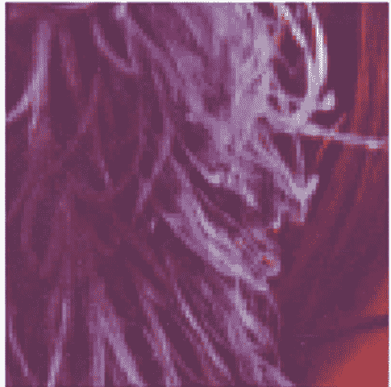

**图 6.9：** 随机裁剪增强

## 随机擦除

```python
# Randomly erases a rectangle region in an image.
import matplotlib.pyplot as plt
from torchvision import transforms
from PIL import Image

# Load image
image = Image.open('test.png')

# Convert to tensor for RandomErasing
to_tensor = transforms.ToTensor()
image_tensor = to_tensor(image)

# RandomErasing
random_erasing = transforms.RandomErasing(p=1, scale=(0.1,
0.33), ratio=(0.3, 3.3), value='random')
erased_image_tensor = random_erasing(image_tensor)

# Convert back to image to display
to_pil = transforms.ToPILImage()
erased_image = to_pil(erased_image_tensor)
plt.imshow(erased_image)
plt.title('RandomErasing')
plt.axis('off')
plt.show()
```


**图 6.10：** 随机擦除增强

## 随机透视变换

```python
# Performs a random perspective transformation of the image
with a given probability.
import matplotlib.pyplot as plt
from torchvision import transforms
from PIL import Image

# Load image
image = Image.open('test.png')

# RandomPerspective
random_perspective =
transforms.RandomPerspective(distortion_scale=0.6, p=1,
interpolation=3)
perspective_image = random_perspective(image)

# Display
plt.imshow(perspective_image)
plt.title('RandomPerspective')
plt.axis('off')
plt.show()
```


**图 6.11：** 随机透视变换增强

## 中心裁剪

```python
# Crops the given image at the center.
import matplotlib.pyplot as plt
from torchvision import transforms
from PIL import Image

# Load image
image = Image.open('test.png')

# CenterCrop
center_crop = transforms.CenterCrop(size=(100, 100))
cropped_image = center_crop(image)

# Display
plt.imshow(cropped_image)
plt.title('CenterCrop')
plt.axis('off')
plt.show()
```


图 6.12：中心裁剪增强

## 完整示例

```python
# Let's now use all the augmentations together to generate
different images from a single input image
import matplotlib.pyplot as plt
from torchvision import transforms
from PIL import Image
# Load image
image = Image.open('test.png')
# Combined Augmentations
all_augmentations = transforms.Compose([
transforms.CenterCrop(size=(100, 100)),
transforms.RandomPerspective(distortion_scale=0.6, p=1,
interpolation=3),
transforms.RandomApply([transforms.GaussianBlur(kernel_size=(5, 9), sigma=(0.1, 5))], p=0.5),
transforms.RandomAffine(degrees=(0, 360), translate=(0.1,
0.1), scale=(0.7, 1.3), shear=(0, 20)),
transforms.RandomResizedCrop(size=(224, 224)),
transforms.RandomRotation(degrees=(0, 180)),
transforms.ColorJitter(brightness=0.5, contrast=0.5,
saturation=0.5, hue=0.5),
transforms.RandomVerticalFlip(p=0.5),
transforms.RandomHorizontalFlip(p=0.5),
transforms.ToTensor(),
transforms.RandomErasing(p=0.5, scale=(0.1, 0.33), ratio=(0.3, 3.3), value='random'),
])
```

```python
# Function to display images
def show_augmented_images(image_path, num_images=5):
    image = Image.open(image_path)
    plt.figure(figsize=(15, 3))

    for i in range(num_images):
        augmented_image = all_augmentations(image)
        ax = plt.subplot(1, num_images, i + 1)
        ax.imshow(transforms.ToPILImage()(augmented_image))
        ax.axis('off')
    plt.show()

show_augmented_images('test.png')
```

增强的类型及其范围和概率可增加的程度取决于我们试图用模型解决的问题。这也取决于数据。

使用正确的增强，我们可以获得远高于未使用任何增强时的准确率。

它还使我们的模型能够推广，即使推理数据与训练数据略有或很大不同，也能预测出正确的输出。

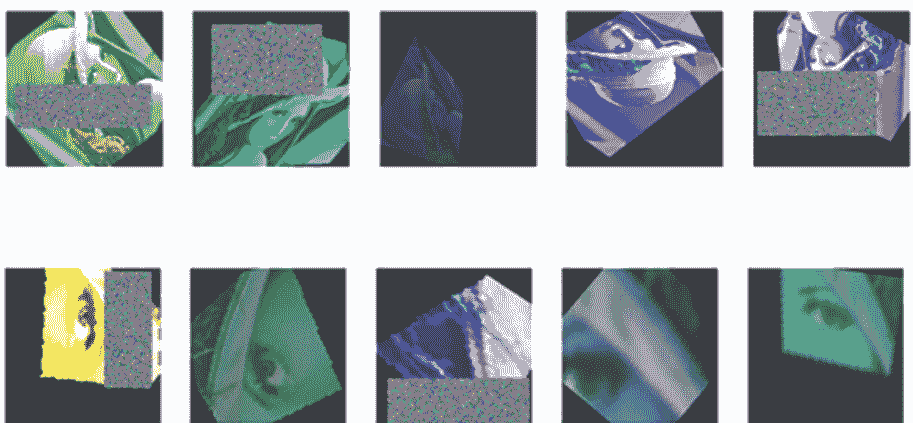

图 6.13：运行包含所有增强的组合代码片段生成的随机图像

## 数据增强对模型性能的影响

数据增强是机器学习从业者武器库中的一种强大技术，尤其是在计算机视觉领域。它涉及通过应用随机抖动和扰动（例如旋转、翻转、缩放或裁剪）从现有样本中创建新的训练样本。其目的是扩展数据集并引入一定程度的变化，帮助模型更好地推广到新的、未见的数据。

## 案例研究：现实世界应用

让我们来看一些现实世界的示例，其中增强可以帮助我们提高性能。

## 各种条件下的人脸识别

计算机视觉的一个常见应用是人脸识别。为这项任务训练的模型必须能够承受多种条件，例如不同的光照、面部表情和方向。没有数据增强，模型在受控环境下可能表现良好，但在自然、多样的环境下表现不佳。一个现实世界的示例是使用人脸识别向员工授予访问权限的安全系统。如果仅在光线充足、正面图像上训练，该系统可能难以在不同光照下或员工未直接面对摄像头时识别他们。通过加入随机旋转、亮度变化和翻转等增强，训练数据更能代表现实世界的变化性。增强后，系统在各种条件下正确识别员工的能力得到提升，展示了增强的性能和实用适用性。

## 土地覆盖分类的卫星图像分析

用于土地覆盖分类（例如区分城市和农村地区、水体、森林等）的卫星图像也受益于增强。一天或一年中的不同时间拍摄的图像在光照和阴影方面存在差异。初始模型可能会将阴影与水体混淆，或将被云遮蔽的城市地区误分类。通过应用模仿这些条件的增强，例如随机亮度和对比度调整或合成遮挡，分类精度会提高。例如，在使用增强数据训练后，模型将提高对水体的分类精度。

## 数据增强对 CIFAR-10 模型训练的影响

我们可以从第 4 章：涉足人工神经的训练示例中看到数据增强的影响。


网络。我们将使用以下增强：

```
# Additional augmentations for CIFAR-10 training data
transform_augmented = transforms.Compose([
transforms.RandomCrop(32, padding=4),
transforms.RandomHorizontalFlip(),
transforms.ColorJitter(brightness=0.1, contrast=0.1,
saturation=0.1, hue=0.1),
transforms.ToTensor(),
transforms.Normalize((0.5, 0.5, 0.5), (0.5, 0.5, 0.5)),
])
```

```
# Use the augmented transform for the training dataset
trainset_augmented =
torchvision.datasets.CIFAR10(root='./data', train=True,
download=True, transform=transform_augmented)
trainloader_augmented =
torch.utils.data.DataLoader(trainset_augmented, batch_size=4,
shuffle=True)
```

# 其余训练设置保持不变...

在此，我们不使用像 RandomErase 这样的增强；
CIFAR-10 数据集中的图像非常小（32x32）。评估哪些增强将提高
性能以及哪些增强会以丢失准确训练所需
有价值信息的方式修改图像至关重要。

## 带增强的更新代码

```
# Updated code with new augmentations on the CIFAR-10 dataset
import torch
import torchvision
import torchvision.transforms as transforms
# Set up the transform to normalize the data
transform = transforms.Compose([
transforms.RandomCrop(32, padding=4),
transforms.RandomHorizontalFlip(),
transforms.ColorJitter(brightness=0.1, contrast=0.1,
saturation=0.1, hue=0.1),
transforms.ToTensor(),
transforms.Normalize((0.5, 0.5, 0.5), (0.5, 0.5, 0.5)),
])

# Load the CIFAR-10 dataset
trainset = torchvision.datasets.CIFAR10(root='./data',
train=True, download=True, transform=transform)
trainloader = torch.utils.data.DataLoader(trainset,
batch_size=4, shuffle=True)

testset = torchvision.datasets.CIFAR10(root='./data',
train=False, download=True, transform=transform)
testloader = torch.utils.data.DataLoader(testset,
batch_size=4, shuffle=False)

classes = ('plane', 'car', 'bird', 'cat', 'deer', 'dog',
'frog', 'horse', 'ship', 'truck')

# Define the neural network
import torch.nn as nn
import torch.nn.functional as F

class SimpleCNN(nn.Module):
def __init__(self):
super(SimpleCNN, self).__init__()
self.conv1 = nn.Conv2d(3, 6, 5)
self.pool = nn.MaxPool2d(2, 2)
self.conv2 = nn.Conv2d(6, 16, 5)
self.fc1 = nn.Linear(16 * 5 * 5, 120)
self.fc2 = nn.Linear(120, 84)
self.fc3 = nn.Linear(84, 10)

def forward(self, x):
x = self.pool(F.relu(self.conv1(x)))
x = self.pool(F.relu(self.conv2(x)))
x = x.view(-1, 16 * 5 * 5)
x = F.relu(self.fc1(x))
x = F.relu(self.fc2(x))
x = self.fc3(x)
return x

net = SimpleCNN()

# Compile the model with torch.compile for PyTorch 2.0
compiled_net = torch.compile(net)

# Set up the loss function and optimizer
import torch.optim as optim

criterion = nn.CrossEntropyLoss()
optimizer = optim.SGD(compiled_net.parameters(), lr=0.001,
momentum=0.9)

# Train the network
for epoch in range(5):  # Loop over the dataset multiple times
    running_loss = 0.0
    for i, data in enumerate(trainloader, 0):
        inputs, labels = data
        optimizer.zero_grad()
        outputs = compiled_net(inputs)
        loss = criterion(outputs, labels)
        loss.backward()
        optimizer.step()
        running_loss += loss.item()
        if i % 2000 == 1999:  # Print every 2000 mini-batches
            print('[%d, %5d] loss: %.3f' %
                (epoch + 1, i + 1, running_loss / 2000))
            running_loss = 0.0

print('Finished Training')

# Test the network on the test data
correct = 0
total = 0
with torch.no_grad():
    for data in testloader:
        images, labels = data
        outputs = compiled_net(images)
        _, predicted = torch.max(outputs.data, 1)
        total += labels.size(0)
        correct += (predicted == labels).sum().item()
print('Accuracy of the network on the 10000 test images: %d %%' % (100 * correct / total))
```


图 6.14: 在带增强的 CIFAR-10 数据集上训练我们的 SimpleCNN 分类器后的准确率

与之前的版本相比，我们获得了 6% 的提升。尽管 CIFAR-10 数据集中的图像较小，对数据增强的影响有限，但在下一章中，我们将看到影响更显著的案例，并探讨一些局限性和风险。

## 数据增强和预处理的最佳实践

数据增强是一种强大的技术，用于提高机器学习模型的鲁棒性和性能，尤其是在计算机视觉领域。它通过在现有样本上应用随机抖动和扰动来生成新的训练样本，帮助模型从有限的训练数据中更好地泛化。然而，了解何时以及如何有效使用增强至关重要。

### 场景和用例

以下是用例和场景列表：

- **数据不足：** 当数据集太小时，增强可以人为扩大训练集的多样性，有助于防止过拟合，并使模型能够学习更通用的特征。

- **类别不平衡：** 在某些类别表示不足的场景中，增强可以通过生成更多少数类的示例来帮助平衡数据集。

- **模型泛化：** 如果模型在训练数据上表现良好，但在验证或测试数据上表现不佳，增强可以引入更多变异性，鼓励模型学习更鲁棒的特征。

- **现实世界变化：** 对于部署环境会在各种条件下呈现数据的任务（例如，自动导航车辆中的不同光照或天气条件），增强可以在训练期间模拟这些条件。

- **特定领域增强：** 某些任务可能受益于特定于领域的自定义增强。例如，医学图像分析可能使用模仿医学扫描中常见伪影的增强。

### 纳入策略

纳入策略如下：

- **渐进式复杂性：** 从简单的增强开始，例如翻转和旋转，并根据模型的性能逐步引入更复杂的增强。

- **管道多样性：** 实施一组多样的增强以涵盖广泛的变化。但是，确保这些增强与当前问题相关。

- **与测试条件保持一致：** 增强应反映测试期间预期的变化类型。不相关的增强可能导致模型学习无用的特征。

- **资源约束：** 考虑计算成本。更复杂的增强需要额外的处理能力和时间，在所有场景中可能都不合理。

### 局限性和风险

虽然数据增强可以显著改善模型训练，但它并非没有局限性和潜在陷阱。以下是与数据增强相关的局限性和风险：

- **误导模型的风险：** 如果增强不能准确反映现实场景，或应用过于激进，它们可能会引入噪声和误导性信息，从而使模型困惑并降低性能。

- **质量下降：** 过度的增强会降低数据质量。例如，过多的缩放、裁剪或变形可能会导致丢失模型进行准确预测所需的关键特征。

- **计算开销：** 增强会增加计算负担。每个新增强都会增加训练所需的时间，这对于大规模或实时系统来说可能很显著。

- **类别畸变：** 某些增强可能会扭曲类别特定的特征。例如，虽然翻转图像对于一般物体识别可能有益，但它可能会损害阅读文本等任务的性能，在该任务中方向很重要。

- **偏见引入：** 增强可能会无意中在数据集中引入或强化偏见。如果不仔细


受到监控，它们可能会扭曲模型对数据的理解，导致有偏预测。

## 避免风险的最佳实践

避免风险的最佳实践如下：

- **验证：** 始终在未经过增强的独立验证集上验证增强的效果。

- **监控：** 跟踪增强参数和性能指标，以了解其影响并避免过度增强。

- **平衡：** 努力在原始数据和增强数据之间取得平衡，确保模型不会偏向增强数据。

- **相关性：** 增强应与任务相关。避免不必要的、对模型泛化能力没有贡献的增强。

- **实验：** 循序渐进地尝试数据增强。监控性能并相应调整策略。

通过遵循这些最佳实践，从业者可以有效地利用数据增强和预处理来提升计算机视觉模型的性能，而不会陷入可能导致次优结果的常见陷阱。

## 结论

在本章中，我们对预处理和数据增强对机器学习模型创建所产生的革命性影响进行了深入调查。我们探索了各种增强方法，确定了适用场景，并制定了最佳实践以保证其成功执行。经验表明，即使这些技术有效，也必须谨慎使用，以在不引入偏见或改变底层事实的前提下提升性能。

当我们从理解数据增强转向使用 PyTorch 探索计算机视觉的下一阶段时，我们正处于一个名为迁移学习的惊人概念的门槛上。与从零开始训练模型相比，这种新方法需要的计算成本和时间要少得多，它有望开启一个时代：在该时代中，预训练模型在大型数据集上获得的海量知识可以被利用并调整，以适应新的特定应用。

在即将到来的章节“使用 PyTorch 探索迁移学习”中，我们将深入探讨迁移学习的原理与哲学。我们将了解这种技术不仅如何加速开发过程，而且如何在数据稀缺的情况下也能打开通往最先进性能的大门。本章将作为 PyTorch 生态系统中迁移学习实际应用的指南，展示采用预训练模型并将其适配到各种微妙任务是多么容易。

数据增强与迁移学习之间的协同效应不可估量。虽然增强使我们能够扩展和多样化数据集，但迁移学习让我们能够站在巨人的肩膀上，利用已有知识并在其基础上构建。当我们步入迁移学习领域时，我们带着从理解数据增强中获得的洞察和智慧，准备见证它对模型性能带来的显著提升。

## 使用 PyTorch 探索迁移学习

### 简介

在本章中，我们将深入探讨迁移学习领域，这是一种已成为深度学习基石的技术。这种方法允许我们取用在一个任务上训练好的模型，并将其重新用于另一个任务，利用先前学习的特征，用更少的数据并在更短的时间内实现卓越性能。我们将专注于在 PyTorch 中发挥迁移学习的威力，PyTorch 是一个提供丰富工具和预训练模型生态系统的框架。

我们将首先揭示迁移学习的要点，从其定义到特征提取和微调等关键概念。理解这些原则至关重要，因为它们构成了迁移学习如何加速训练过程并提升各种应用中模型性能的基础。

随着我们深入，实际示例将指导您将迁移学习应用于视觉任务的过程。我们将演示如何选择合适的预训练模型，将其适配到新数据，并改进学习过程。通过在 PyTorch 中实现这些步骤，您将获得实践经验，从而巩固理论理解。

本章将以对迁移学习影响的批判性评估作为高潮，将使用预训练权重微调的模型与从零开始训练的模型进行比较。这种 A/B 测试不仅将突出迁移学习的量化优势，还将提供其战略优势的洞察。到本章结束时，您将具备在自己的 PyTorch 项目中有效应用迁移学习所需的知识和实践技能。

### 结构

本章将涵盖以下主题：

- 定义与概述
- 迁移学习的优势
- 理解预训练模型
- 在 PyTorch 中使用预训练模型
- 将迁移学习应用于视觉任务
- 迁移学习对模型性能的影响
- 最佳实践与常见陷阱

### 定义与概述

想象一下你是一位钢琴专家，并决定学习小提琴。虽然这些是不同的乐器，但你对音乐理论、节奏和协调性的知识可以迁移过去，并能加快学习过程。这体现了在人工智能（AI）背景下迁移学习的本质：利用一个领域的知识来加速另一个领域的学习。

从技术角度来看，迁移学习重新利用在海量数据上训练的神经网络层（通常是像 ImageNet 这样的大规模任务），以使较小或相关的问题受益。这不仅节省了时间和计算资源，还允许在数据稀缺的领域开发模型。

### 历史背景与发展

迁移学习并非新想法。其根源可以追溯到学习心理学以及自20世纪初以来就被讨论的学习迁移原理。在 AI 中，随着深度学习的兴起以及大型数据集和预训练网络的可用性，迁移学习变得普遍。它成为了一个改变游戏规则的因素，使得在许多领域只需少量数据即可实现最先进的结果。

### 迁移学习中的关键概念

- **特征提取：** 该过程涉及使用预训练网络学习到的表示，从新样本中提取有意义的特征。网络的早期层可能捕捉边缘和纹理等通用特征，这些特征对许多任务都有益。
- **微调：** 这比特征提进了一步。在初始特征提取之后，通过在新数据集上继续训练过程，对网络层进行微调或轻微调整。这使得网络能够将这些特征适配到新任务的具体特性上。

### 迁移学习的重要性

- **加速学习：** 迁移学习显著缩短了开发和训练模型所需的时间。预训练模型带来了从大型数据集中学习到的特征，从零开始训练这些特征可能需要几周时间。从这些已学习的特征开始，可以更快地达到更高的性能水平。
世界，减少了训练一个好模型所需的新数据量。
- 广泛适用性：从医疗诊断到玩电脑游戏，迁移学习已显示出广泛的适用性。它使深度学习的使用民主化，使资源有限的小型组织能够实施尖端技术。

通过挖掘迁移学习的基础原则，我们在过去的知识与未来的创新之间搭建了一座桥梁。这种技术符合现代 AI 发展的理念：更高效、更易用、更通用的模型，能够适应各种数据环境下的大量任务。接下来的章节将深入探讨这种关键方法如何重新定义机器学习和 AI 的范式。

在 AI 领域，迁移学习就像站在巨人的肩膀上。它将以前模型的重大成就（这些模型在广阔且多样的数据集上经过长时间开发和打磨）重新语境化，以适应新的、通常更专业的应用。

### 迁移学习的有效性

迁移学习的有效性在于其灵活性和高效性。一个预训练模型，例如为大规模图像识别任务开发的模型，包含关于视觉模式的丰富信息。当这样的模型应用于新任务时，即使是识别医学图像或分类卫星图像，对视觉特征的基础理解也可以被微调以满足这些专业要求。

### 跨域应用

迁移学习的真正威力体现在其跨域应用上。在通用数据集上训练的模型


已成功应用于完全不同的行业，且几乎无需定制即可实现。例如，一个在日常物品上训练的模型可以协助识别制造过程中的缺陷，或辅助农业监控系统。

## 利用现有模型
开发者和研究人员得益于开源社区及分享其工作成果的机构，可以访问各种预训练模型。这些模型不仅仅是起点；它们封装了强大的特征检测器和模式识别器，可应用于无数任务。这种知识和资源的共享，正是推动人工智能领域进步的协作精神的证明。

## 优化模型性能
通过微调，迁移学习使模型能够达到甚至超越从零开始训练的模型的性能，尤其是在数据不充裕的领域。此过程可能涉及解冻预训练模型的最后几层并在新数据集上进行训练，从而在不丢失最初习得的通用特征检测能力的同时，使模型更具针对性。

## 对行业和研究的影响
迁移学习对行业和研究的影响深远。小型初创公司现在无需大量数据或计算资源即可开发复杂模型。学术界和医学界的研究人员可以利用先进的人工智能，而无需花费大量时间进行模型开发，而是专注于自己的专业领域。

## 创新的催化剂
总而言之，迁移学习不仅仅是一种方法论；它是创新的催化剂。它让人工智能所捕获的知识超越其原有边界，推动各领域的进步并普惠技术访问。它是人工智能演进的基石，确保我们从一项任务中获得的知识能照亮无数其他任务的道路。

当我们过渡到下一章“使用 PyTorch 探索迁移学习”时，我们将深入探讨应用这些原则的实际做法。我们将剖析如何获取、修改和部署预训练模型以服务于新的用途。我们将考察这些技术对各种任务中模型性能的实际影响。读者将获得的不仅是技术知识的工具箱，还有关于在计算机视觉领域实现目标的迁移学习应用的战略洞察。

## 迁移学习的优势
迁移学习已成为机器学习领域的一种变革性力量，特别是在数据属于稀缺资源且计算效率至关重要的领域。本节将深入探讨迁移学习带来的诸多益处，重点阐述其在训练效率、小数据集下的性能提升以及在各个领域的广泛适用性。

### 训练效率
迁移学习最令人信服的优势之一，在于其为训练过程带来的效率。从零开始训练深度学习模型需要大量的计算能力和时间，通常需要在高端 GPU 上花费数周进行微调和优化。迁移学习通过利用已在大型基准数据集（如 ImageNet）上训练好的模型的权重和特征，绕过了这一资源密集型阶段。

在使用迁移学习时，模型的很大一部分（尤其是捕捉边缘和纹理等通用特征的初始层）无需进行大量重新训练。相反，这些层会被'冻结'，仅对最终层进行微调以适应新数据集。这种方法大幅减少了时间和计算成本，使研究人员和从业者无需投入巨额资源即可使用强大的模型。

### 小数据集上的性能提升
另一大显著优势是迁移学习带来的性能提升，尤其是在处理小数据集时。传统上，深度学习模型依赖大量数据——数据越多越好——来调整其参数并避免过拟合。然而，在许多专业领域，此类数据稀缺或获取成本高昂。

迁移学习通过利用预训练模型习得的特征，并将其应用于使用更小数据集的新任务，来应对这一挑战。通过迁移从数据充足的相关任务中获得的‘知识’，模型只需少量示例即可学习，并且在有限数据集上通常能优于从零开始训练的模型。

### 各领域的迁移学习
迁移学习的实用性并不局限于单一领域；其益处波及众多领域。在医疗保健领域，在通用图像上训练的模型可以微调以检测医学影像中的异常。在农业领域，擅长图像分类的模型可以调整为监测作物健康状况。迁移学习的通用性在数据稀缺且领域专业知识至关重要的专业领域尤其有利。

迁移学习的现实应用广泛且不断增长。在自动驾驶领域，在通用驾驶场景上训练的模型可以微调以理解特定天气条件或地理环境。在零售领域，模型可以通过在各种场景中识别产品来改善购物体验。在每种情况下，迁移学习不仅提供了先发优势，还能以惊人的效果将模型塑造为满足小众需求。

本质上，迁移学习类似于通过利用已精通的语言知识来学习一门新语言。正如懂拉丁语能让学习西班牙语更高效一样，拥有在全面数据集上训练好的模型，简化了为相关但不同的任务训练模型的过程。这种学习迁移不仅节省了时间和资源，还为在数据和计算受限的场景下实现高质量性能打开了大门，而传统训练方法在这些场景下可能会举步维艰。

在我们继续探索 PyTorch 及其功能的过程中，后续章节将基于这些优势，通过实际示例和案例研究演示如何实施迁移学习以提升模型性能并加速开发周期。读者将获得的不仅是理论理解，还有可操作的知识，使他们能够在自己的项目中发挥迁移学习的威力。

## 理解预训练模型
预训练模型的可用性显著加速了深度学习时代的发展，这些模型类似于在各种应用间共享智慧。这些模型不仅是数百万个参数值的存储库，更是庞大计算努力和知识的浓缩形式。本节全面探讨了预训练模型的复杂性，阐述了其架构和习得参数的本质，并重点介绍了在计算机视觉及其他领域留下深刻印记的一些最具影响力的模型。

### 预训练模型的结构
在深度学习中，预训练模型本质上是之前在大型数据集上训练过的网络。要理解预训练模型，首先必须剖析其两个基础要素：网络架构和习得的权重与偏置。

### 网络架构
神经网络的架构是指为从数据中捕捉模式而设计的层和神经元的结构化排列。每种架构都像一个独特的脚手架，节点的排列和连接都经过精心设计，以针对特定任务优化性能。例如，卷积神经网络（CNN）专门针对图像数据进行结构设计。

让我们先看一下使用 PyTorch 构建的简单 CNN 架构：

```
import torch
import torch.nn as nn

class SimpleCNN(nn.Module):
    def __init__(self):
        super(SimpleCNN, self).__init__()
        # Convolutional layer block 1


```
self.conv1 = nn.Conv2d(in_channels=3, out_channels=32,
kernel_size=3, padding=1)
self.relu1 = nn.ReLU()
self.pool1 = nn.MaxPool2d(kernel_size=2)

# Convolutional layer block 2
self.conv2 = nn.Conv2d(in_channels=32, out_channels=64,
kernel_size=3, padding=1)
self.relu2 = nn.ReLU()
self.pool2 = nn.MaxPool2d(kernel_size=2)

# Fully connected layers
self.fc1 = nn.Linear(in_features=64 * 16 * 16,
out_features=512)
self.relu3 = nn.ReLU()
self.fc2 = nn.Linear(in_features=512, out_features=10)
```

```
def forward(self, x):
# Block 1
x = self.pool1(self.relu1(self.conv1(x)))
# Block 2
x = self.pool2(self.relu2(self.conv2(x)))
# Flatten and pass through the fully connected layers
x = x.view(x.size(0), -1)
x = self.relu3(self.fc1(x))
x = self.fc2(x)

return x

# Instantiate the model
simple_cnn = SimpleCNN()
```

在这个例子中，**SimpleCNN** 是一个初级模型，适合学习图像数据中的简单模式。然而，像 VGGNet 或 ResNet 这样的预训练模型要复杂得多，并且在 ImageNet 等大型数据集上进行了训练。

但假设我们的 **SimpleCNN** 模型在医学图像训练集上进行了训练，并达到了合适的精度。现在，如果我们想为另一项任务训练 **SimpleCNN**，与其从头开始训练，不如使用之前项目中使用的权重并将其应用于此。如果两项任务相似，我们的模型收敛所需的时间将大大缩短。模型将保留其在第一个项目中学习的所有低级特征。

当我们讨论包含数百万个参数，甚至随着新型大型语言模型而达到数十亿个参数的模型时，这一点变得非常重要。

## 学习到的权重与偏置

权重和偏置是神经网络的可学习参数。在预训练模型中，这些参数是在大型数据集上进行大量训练的结果。它们捕捉了模型学习识别的模式的本质，从简单到复杂。当你加载一个预训练模型时，你就继承了这些学习到的模式，然后可以将其微调或调整到新的但相关的任务上。

```
# Loading a pre-trained ResNet model
resnet = torchvision.models.resnet18(pretrained=True)
```

使用 pretrained=True 标志后，模型 resnet 现在包含在 ImageNet 数据集上优化过的权重，可以直接使用或进一步调整。

我们将能够利用那些针对包含数百万张图像和数千个类别的复杂任务已经收敛的权重的模型的强大功能。

## 计算机视觉中的常用预训练模型

计算机视觉领域因多种预训练模型而格外丰富。每种模型都有其独特的优势，针对不同类型和规模的图像识别任务进行了定制，如下所述：

- VGGNet：以其简洁和深度著称，有多种配置，层数可达 19 层，是理解深度 CNN 的绝佳模型。
- **ResNet：** 采用残差学习，以便训练比以前使用的网络深得多的网络；它使用快捷连接跨越某些层。
- **Inception (GoogleNet)：** 采用网络套网络架构，带有并行卷积，可捕获不同尺度的信息。
- **FCN (全卷积网络)：** 用于语义分割，即对图像中的每个像素进行分类，FCN 至关重要。它们可以接收任意大小的输入，并输出相应大小的分割图。这种架构在需要理解图像中物体空间布局的任务中起到了关键作用，例如自动驾驶和医学图像诊断。
- **Mask R-CNN：** 是 Faster R-CNN 的扩展，Mask R-CNN 增加了一个分支，用于对每个感兴趣区域（RoI）预测分割掩码，从而有效地将目标检测与实例分割相结合。该模型已被广泛应用于需要精确定位和勾勒图像中每个目标实例的任务。
- **YOLO（你只看一次）：** 用于实时目标检测，YOLO 模型以其速度和效率著称。它们将图像划分为网格，每个网格单元预测目标和边界框。在检测速度至关重要的场景中尤其有用，例如监控系统或实时交通分析。
- **U-Net：** 凭借其独特的 U 型架构，U-Net 针对生物医学图像分割进行了定制。该模型设计为在较少训练样本下工作并产生更精确的分割，这在医学成像中至关重要，因为标注图像稀缺且分割精度至关重要。
- RetinaNet：RetinaNet 通过引入一种新的损耗函数（即 Focal Loss，焦点损耗）解决了目标检测中的类别不平衡问题。它特别适用于检测图像中各种尺寸的目标，因此适合在自动驾驶系统中检测行人和车辆。
- DeepLab：DeepLab 架构采用空洞卷积进行细粒度分割任务，利用许多采样率不同的并行滤波器来捕获多尺度上下文。这对于在图像中进行详细场景理解特别有帮助，因为在不同尺度下捕获上下文至关重要。

这些模型已成为该领域的标准，通常作为一系列计算机视觉任务的起点。

## 在 PyTorch 中使用预训练模型

预训练模型是深度学习进步的最重要推动因素之一，尤其是在计算机视觉领域。PyTorch 作为领先的深度学习框架，提供了一个全面的模型动物园，包含大量在各种数据集上预训练的模型。在本节中，我们将探讨如何访问、理解和修改这些模型，以满足特定需求。

### PyTorch 模型动物园：预训练模型目录

通过 torchvision 模块可访问的 PyTorch 模型动物园，堪称机器学习从业者的宝藏。它包含多种模型，例如 AlexNet、VGG、ResNet、Inception 等，这些模型已在 ImageNet 等大型数据集上进行训练。这些模型可用于图像分类、目标检测、分割等任务。

我们在第 5 章：深入卷积神经网络（CNN）中看到了 VGG 和 ResNet 的示例，在该章中，我们可以直接使用 torchvision 加载带有预训练权重的架构。

### 在 PyTorch 中加载预训练模型

在 PyTorch 中使用预训练模型时，需要导入必要的模块并加载模型。PyTorch 使此过程变得简单：

```
# Import torchvision models
import torchvision.models as models
# Load the pre-trained ResNet-18 model
resnet18 = models.resnet18(pretrained=True)
```

**pretrained=True** 标志会自动下载在 ImageNet 上训练过的模型参数。

### 逐步代码示例

让我们通过使用预训练 VGG-16 模型进行图像分类的逐步示例：

### 使用 ResNet-50 进行分类

```
import torch
import torchvision.transforms as transforms
from PIL import Image
import torchvision.models as models
# Load the pre-trained ResNet-50 model
model_classification = models.resnet50(pretrained=True)
model_classification.eval()
# Define the transform
```

```
transform_classification = transforms.Compose([
    transforms.Resize(256),
    transforms.CenterCrop(224),
    transforms.ToTensor(),
    transforms.Normalize(mean=[0.485, 0.456, 0.406], std=[0.229,
    0.224, 0.225]),
])
```

```
# Load and preprocess the image
image = Image.open('test.png').convert('RGB')
input_tensor = transform_classification(image).unsqueeze(0)  # Create a mini-batch as expected by the model
# Inference
with torch.no_grad():
    output_classification = model_classification(input_tensor)
# Get the predicted class
_, predicted_class = torch.max(output_classification, 1)
print(f'Predicted class (Classification): {predicted_class.item()}')
```

在此示例中，我们使用了以深层架构和残差连接而闻名的 ResNet 模型，这些残差连接有助于训练具有大量层的网络。代码片段演示了如何从 PyTorch 的模型动物园中加载预训练 ResNet 模型、预处理输入图像并执行分类。它概括了迁移学习的精髓：利用在庞大数据集（ImageNet）上训练的模型，将其应用于对新图像进行分类，展示了使用预训练模型进行快速部署的效率。

在通过 ResNet 模型处理图像后，输出是一个张量，包含模型训练所用数据集中每个类别的预测分数（例如 ImageNet 的 1,000 个类别）。这些分数代表模型对每个类别的置信度。要解释结果，我们通常应用 softmax 函数将这些分数转换为概率。得分最高的


概率被视为模型的最终预测。检索前五个预测结果以查看模型认为与图像相关的一系列可能标签也是常见的做法。

在以下输出中，您可以看到输入图像和预测输出：

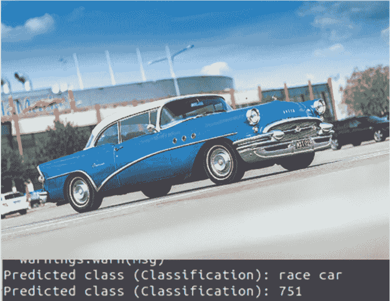

**图 7.1：** 输入图像和预训练 ResNet-50 模型的输出

## 使用 DeepLabV3 进行分割

```python
import torch
import torchvision.transforms as transforms
from PIL import Image
import torchvision.models.segmentation as segmentation_models
# Load the pre-trained DeepLabV3 model
model_segmentation = segmentation_models.deeplabv3_resnet101(pretrained=True)
model_segmentation.eval()
# Define the transform
transform_segmentation = transforms.Compose([
    transforms.Resize(256),
    transforms.ToTensor(),
    transforms.Normalize(mean=[0.485, 0.456, 0.406], std=[0.229, 0.224, 0.225]),
])
# Preprocess the image and add a batch dimension
image = Image.open('test.png').convert('RGB')
input_tensor = transform_segmentation(image).unsqueeze(0)

# Inference
with torch.no_grad():
    output_segmentation = model_segmentation(input_tensor)['out'][0]

segmentation = output_segmentation.argmax(0)

# Convert the segmentation tensor to a PIL image
to_pil = transforms.ToPILImage()
segmentation_pil = to_pil(segmentation.byte())

# Save the segmentation mask
segmentation_pil.save('segmentation_output.png')
print('Segmentation mask saved as segmentation_output.png')
```

DeepLabV3 模型配备了空洞卷积和空间金字塔池化，擅长理解图像中的上下文并勾勒物体边界。提供的代码说明了如何从 PyTorch 加载带有预训练骨干网络的 DeepLabV3，在输入图像上运行它并生成分割输出。这展示了如何利用预训练模型处理语义分割等复杂任务，而语义分割对于自动驾驶和医学图像分析等应用至关重要。

对于语义分割，DeepLabV3 模型生成一种不同类型的输出。输入图像中的每个像素都会被分配一个模型训练用于识别的类别集中的类别。输出是一个与输入图像具有相同宽度和高度的矩阵，其中每个元素对应一个类索引。这些类索引通常以叠加在原始图像上的颜色图可视化，其中每种颜色对应不同的类别，从而让我们确切地看到图像的哪些部分被分类到了哪个类别。在以下输出中，您可以看到输入图像和预测输出。


**图 7.2：** 输入图像、输出分割掩码以及叠加在输入图像上的掩码

## 使用 Faster R-CNN 进行目标检测

```python
import torch
import torchvision.transforms as transforms
from PIL import Image, ImageDraw
import torchvision.models.detection as detection_models
# Load the pre-trained Faster R-CNN model
model_detection = detection_models.fasterrcnn_resnet50_fpn(pretrained=True)
model_detection.eval()
# Load and preprocess the image
image = Image.open('test.png')
transform_detection = transforms.Compose([transforms.ToTensor()])
input_tensor = transform_detection(image).unsqueeze(0)
# Inference
with torch.no_grad():
    predictions = model_detection(input_tensor)
# Draw the bounding boxes and labels on the image
draw = ImageDraw.Draw(image)
for element in range(len(predictions[0]['boxes'])):
    boxes = predictions[0]['boxes'][element].cpu().numpy()
    score = predictions[0]['scores'][element].cpu().numpy()
    label = predictions[0]['labels'][element].cpu().numpy()
# Draw the box with a threshold for scores to filter weak detections
if score > 0.5:
    draw.rectangle([(boxes[0], boxes[1]), (boxes[2], boxes[3])], outline="red", width=3)
    draw.text((boxes[0], boxes[1]), f'Label: {label}', fill="red")
# Save the image with detections
image.save('detection_output.png')
print('Detection output saved as detection_output.png')
```

Faster R-CNN 是一种目标检测模型，它使用区域建议网络来检测物体边界。代码展示了如何加载预训练的 Faster R-CNN 模型，对图像进行目标检测，然后保存带有绘制边界框和标签的结果。这段代码作为将迁移学习应用于目标检测任务的示例，说明了模型识别图像中多个物体及其位置的能力，这对于监控、库存管理等众多应用至关重要。

在使用 Faster R-CNN 进行目标检测时，模型为每个检测到的物体输出多个信息：边界框坐标、类标签和置信分数。边界框指定了物体在图像中的位置，类标签告诉我们物体是什么。置信分数表示模型对物体存在性和分类的确定程度。这些信息使我们不仅知道图像中有哪些物体，还知道它们位于何处以及模型对其预测的置信程度。

在以下输出中，您可以看到输入图像和预测输出：


**图 7.3：** 输入图像和在输入图像上绘制检测到的物体的输出图像

## 使用 Keypoint R-CNN 进行关键点检测

```python
import torch
from PIL import Image, ImageDraw
import torchvision.transforms as transforms
import torchvision.models.detection as detection_models

# Load the pre-trained Keypoint R-CNN model
model_keypoint = detection_models.keypointrcnn_resnet50_fpn(pretrained=True)
model_keypoint.eval()

# Preprocess the image
image = Image.open('test.png')
transform_keypoint = transforms.Compose([transforms.ToTensor()])
input_tensor = transform_keypoint(image).unsqueeze(0)

# Inference
with torch.no_grad():
    prediction_keypoint = model_keypoint(input_tensor)

# Draw keypoints
draw = ImageDraw.Draw(image)
for person in prediction_keypoint[0]['keypoints']:
    keypoints = person.cpu().numpy()
    scores = person[:, 2]
    for kp, s in zip(keypoints, scores):
        if s > 2:  # The model outputs a score of 0, 1, or 2 for visibility
            draw.ellipse([(kp[0] - 3, kp[1] - 3), (kp[0] + 3, kp[1] + 3)], fill="blue")

# Save the image with keypoints
image.save('keypoint_output.png')
print('Keypoint output saved as keypoint_output.png')
```

Keypoint R-CNN 通过向网络添加关键点检测头来扩展 Faster R-CNN。代码描述了加载该模型、在图像上执行它以通过识别关键点来检测人体姿势，然后在图像上保存可视化关键点的过程。这反映了预训练模型对超越简单分类的任务的适应性，强调了它们在人机交互、动画、体育分析以及理解人体姿势至关重要的其他领域中的潜力。

Keypoint R-CNN 产生的复杂输出既包含物体检测（如 Faster R-CNN 中那样），也包含关键点预测。对于图像中检测到的每个人，模型提供一组关键点，这些关键点通常对应人体部位，例如手肘、膝盖、眼睛等等。除了关键点外，模型还输出一个可见度分数，表示关键点正确放置且可见的置信度。这些关键点的坐标使我们能够将人体姿势映射到图像上。此输出对于理解人类手势或动作至关重要，并广泛用于运动分析和增强现实。

在以下输出中，您可以看到输入图像和预测输出：


**图 7.4：** 输入图像和在输入图像上绘制检测到的关键点的输出图像

## 替换顶层

有时，我们需要将这些模型调整为与最初训练用途略有不同的任务。这通常涉及替换顶层并微调模型。


以下是如何替换预训练模型顶层的方法：

```
import torch.nn as nn

# Replace the top layer for fine-tuning
num_features = vgg16.classifier[6].in_features
vgg16.classifier[6] = nn.Linear(num_features, number_of_classes)
# 'number_of_classes' is the number of your new classes
```

在接下来的章节中，我们将探讨如何实现更改类别数量，并利用迁移学习将预训练权重适应不同的任务。

## 将迁移学习应用于视觉任务

开展新的视觉任务时，选择合适的预训练模型至关重要。一个良好的起点是考虑您的任务与模型最初训练所针对的任务之间的相似性。在ImageNet等多样化图像集上训练的模型可以作为很好的通用选择。例如，ResNet-50凭借其深度架构，在复杂性与性能之间取得了平衡，成为许多视觉任务的多功能模型和强大主干网络。

## 迁移学习的数据预处理

在使用预训练模型之前，您的数据必须经过格式化和归一化，以符合模型的输入规范。对于在ImageNet上训练的模型，输入通常被调整为224x224像素，并使用ImageNet数据集的均值和标准差进行归一化。以下是PyTorch中的预处理步骤示例：

```
from torchvision import transforms

# Define the standard ImageNet transformation
preprocess = transforms.Compose([
    transforms.Resize(256),
    transforms.CenterCrop(224),
    transforms.ToTensor(),
    transforms.Normalize(mean=[0.485, 0.456, 0.406], std=[0.229, 0.224, 0.225]),
])
```

应将此变换应用于训练集和验证集，以保持一致性。

## 特征提取：将模型用作固定特征提取器

要将预训练模型用作固定特征提取器，可以冻结除最终分类层之外所有层的权重。为此，除了最后一层的参数外，可将所有参数的**requires_grad**设置为**False**。以下是修改ResNet-50以适应CIFAR-10的方法：

```
from torchvision.models import resnet50
from torch import nn

# Load a pre-trained ResNet-50 model
model = resnet50(pretrained=True)

# Freeze all the layers
for param in model.parameters():
    param.requires_grad = False

# Replace the last layer to match CIFAR-10's classes (10 classes)
num_features = model.fc.in_features
model.fc = nn.Linear(num_features, 10)
```

现在可以使用此模型从CIFAR-10图像中提取特征，并利用这些特征训练一个简单的分类器。

## 微调：使用新数据调整预训练模型

微调不仅涉及替换最终层，还包括使用您的数据集重新训练一些早期层，从而使模型能够适应新特征。当您的数据集足够大且与模型最初训练所用的数据集不同时，这尤其有用。在PyTorch中，微调非常简单：

```
# Assume 'model' is already defined as above
# Unfreeze some of the last layers
for param in list(model.layer4.parameters()) + list(model.fc.parameters()):
    param.requires_grad = True

# Proceed with the training loop
# Define loss function and optimizer
criterion = nn.CrossEntropyLoss()
optimizer = torch.optim.SGD(model.parameters(), lr=0.001, momentum=0.9)

# Define your training loop
for epoch in range(num_epochs):
    # Training and update steps here...
    pass
```

在这段代码中，我们解冻了ResNet的最后一个块（layer4）以及全连接层，以便在训练期间对其进行更新。我们将在后面的章节中详细介绍如何进行端到端微调。

## 有效微调的策略

有效的微调需要仔细考虑多个因素，包括：

- **学习率:** 使用较小学习率，以避免可能破坏预训练特征的大幅更新。
- 层选择: 有选择地解冻层，通常是高级别层，因为它们包含更多任务特定的特征。
- 数据增强: 扩充训练数据，为模型提供更丰富的特征供其学习。
- 正则化: 应用丢弃法（dropout）或权重衰减等正则化技术，以防止在新数据集上过拟合。

## 实践代码示例：在CIFAR-10上微调ResNet-50

以下是一段完整的代码片段，展示了如何使用PyTorch在CIFAR-10上微调ResNet-50。

在此示例中，我们将从PyTorch模型库加载ResNet-50的预训练权重。然后，我们将修改最后一层，使其能够在CIFAR-10数据集上运行。

最后，我们将比较运行10个时代后的准确率，以查看它与我们自定义的SimpleCNN以及与从零开始训练相同数量时代的模型相比如何。

```
import torch
import torchvision
import torchvision.transforms as transforms
from torchvision.models import resnet50
from torch import nn

# Data preparation
transform = transforms.Compose([
    transforms.Resize(224),
    transforms.ToTensor(),
    transforms.Normalize((0.5, 0.5, 0.5), (0.5, 0.5, 0.5))
])

trainset = torchvision.datasets.CIFAR10(root='./data', train=True, download=True, transform=transform)
trainloader = torch.utils.data.DataLoader(trainset, batch_size=32, shuffle=True, num_workers=2)
testset = torchvision.datasets.CIFAR10(root='./data', train=False, download=True, transform=transform)
testloader = torch.utils.data.DataLoader(testset, batch_size=32, shuffle=False, num_workers=2)

# Load the pre-trained model and modify it for CIFAR-10
model = resnet50(weights="IMAGENET1K_V2")
# Freeze all layers first
for param in model.parameters():
    param.requires_grad = False
# Unfreeze some layers
for param in list(model.layer4.parameters()) + list(model.fc.parameters()):
    param.requires_grad = True
# Modify the last layer
model.fc = nn.Linear(model.fc.in_features, 10)
# Move the model to GPU if available
device = torch.device("cuda:0" if torch.cuda.is_available() else "cpu")
model.to(device)
# Define loss function and optimizer
criterion = nn.CrossEntropyLoss()
optimizer = torch.optim.SGD(filter(lambda p: p.requires_grad, model.parameters()), lr=0.001, momentum=0.9)
# Training loop
num_epochs = 10
for epoch in range(num_epochs):
    model.train()
    running_loss = 0.0
    for i, data in enumerate(trainloader, 0):
        inputs, labels = data
        inputs, labels = inputs.to(device), labels.to(device)
        optimizer.zero_grad()
        outputs = model(inputs)
        loss = criterion(outputs, labels)
        loss.backward()
        optimizer.step()
        running_loss += loss.item()
    print(f'Epoch {epoch + 1}, Loss: {running_loss / len(trainloader)}')

# Save the trained model
torch.save(model.state_dict(), 'finetuned_resnet50_cifar10.pth')

# Function to calculate accuracy
def calculate_accuracy(loader, model):
    correct = 0
    total = 0
    model.eval() # Set the model to evaluation mode
    with torch.no_grad(): # No need to track the gradients
        for data in loader:
            images, labels = data
            images, labels = images.to(device), labels.to(device)
            outputs = model(images)
            _, predicted = torch.max(outputs.data, 1)
            total += labels.size(0)
            correct += (predicted == labels).sum().item()
    accuracy = 100 * correct / total
    return accuracy

# Calculate accuracy on the validation set
val_accuracy = calculate_accuracy(testloader, model)
print(f'Accuracy of the network on the test images: {val_accuracy:.2f}%')
```

时代 1, Loss: 0.7701484623745856
时代 2, Loss: 0.40084931716770983
时代 3, Loss: 0.29910416443733271
时代 4, Loss: 0.22613211420155532
时代 5, Loss: 0.1708905622464386
网络在测试图像上的准确率: 89.34%

图 7.5: 训练预训练模型5个时代的损失及前面脚本输出的准确率

## 实践代码示例：在CIFAR-10上从零开始训练ResNet-50

现在，我们将修改前面的示例，在不使用预训练权重的情况下，在CIFAR-10数据集上从零开始训练ResNet-50模型。该脚本包括数据集设置、模型初始化、训练循环以及测试集评估。

```
import torch
import torchvision
import torchvision.transforms as transforms
import torch.nn as nn
import torch.optim as optim
from torchvision import models

# Set up the transforms for the CIFAR-10 dataset
transform = transforms.Compose([
    transforms.Resize((224, 224)), # Resize images to the size that ResNet expects
    transforms.ToTensor(),
    transforms.Normalize((0.5, 0.5, 0.5), (0.5, 0.5, 0.5))
])

# Load the CIFAR-10 training dataset
trainset = torchvision.datasets.CIFAR10(root='./data', train=True, download=True, transform=transform)
trainloader = torch.utils.data.DataLoader(trainset, batch_size=4, shuffle=True, num_workers=2)
```


```python
# Load the CIFAR-10 test dataset
testset = torchvision.datasets.CIFAR10(root='./data',
    train=False, download=True, transform=transform)
testloader = torch.utils.data.DataLoader(testset, batch_size=4,
    shuffle=False, num_workers=2)

# Define the classes
classes = ('plane', 'car', 'bird', 'cat', 'deer', 'dog',
    'frog', 'horse', 'ship', 'truck')

# Initialize the ResNet-50 model
model = models.resnet50(pretrained=False)  # No pretrained weights
num_ftrs = model.fc.in_features
model.fc = nn.Linear(num_ftrs, len(classes))  # Replace the last layer

# Use a GPU if available
device = torch.device("cuda:0" if torch.cuda.is_available() else "cpu")
model.to(device)

# Set up the loss function and optimizer
criterion = nn.CrossEntropyLoss()
optimizer = optim.SGD(model.parameters(), lr=0.001,
    momentum=0.9)

# Training loop
for epoch in range(10):  # Loop over the dataset multiple times
    running_loss = 0.0
    for i, data in enumerate(trainloader, 0):
        # Get the inputs; data is a list of [inputs, labels]
        inputs, labels = data
        inputs, labels = inputs.to(device), labels.to(device)

        # Zero the parameter gradients
        optimizer.zero_grad()

        # Forward pass
        outputs = model(inputs)
        loss = criterion(outputs, labels)

        # Backward pass and optimize
        loss.backward()
        optimizer.step()

        # Print statistics
        running_loss += loss.item()
        if i % 2000 == 1999:  # Print every 2000 mini-batches
            print(f'[{epoch + 1}, {i + 1:5d}] loss: {running_loss / 2000:.3f}')
            running_loss = 0.0

print('Finished Training')

# Save the trained model
PATH = './cifar_resnet50.pth'
torch.save(model.state_dict(), PATH)

# Load the model for evaluation
model = models.resnet50(pretrained=False)
model.fc = nn.Linear(num_ftrs, len(classes))
model.load_state_dict(torch.load(PATH))
model.to(device)

# Function to calculate accuracy
def calculate_accuracy(loader, model):
    correct = 0
    total = 0
    model.eval()  # Set the model to evaluation mode

    with torch.no_grad():  # No need to track the gradients
        for data in loader:
            images, labels = data
            images, labels = images.to(device), labels.to(device)
            outputs = model(images)
            _, predicted = torch.max(outputs.data, 1)
            total += labels.size(0)
            correct += (predicted == labels).sum().item()

    accuracy = 100 * correct / total
    return accuracy

# Calculate accuracy on the test set
test_accuracy = calculate_accuracy(testloader, model)
print(f'Accuracy of the network on the test images: {test_accuracy:.2f}%')
```

时代 1, 损失: 1.9914705469942093
时代 2, 损失: 1.437778747844696
时代 3, 损失: 1.162368810274303
时代 4, 损失: 0.9345788255292177
时代 5, 损失: 0.7733281003485247
训练完成
网络在测试图像上的准确率：69.63%

**图 7.6：** 从零开始训练的模型在 5 个时代上的损失以及前面脚本输出的准确率

## 模型性能指标

我们可以获取模型的指标，例如 ROC 曲线、准确率、精确率、召回率和 F1 分数。这能让我们了解训练好的模型表现如何。我们可以使用与上一章非常相似的脚本来实现这一点。

```python
import torch
import torchvision.transforms as transforms
import torchvision
from sklearn.metrics import precision_score, recall_score, f1_score, roc_curve, auc, confusion_matrix, accuracy_score
import numpy as np
import matplotlib.pyplot as plt
from itertools import product
from torchvision import models
from torch.utils.data import DataLoader
# Device configuration
device = torch.device('cuda' if torch.cuda.is_available() else 'cpu')
# Load the trained ResNet-50 model
model_path = 'resnet50_cifar10.pth'
model = models.resnet50(pretrained=False)
num_ftrs = model.fc.in_features
model.fc = torch.nn.Linear(num_ftrs, 10)  # CIFAR-10 has 10 classes
model = model.to(device)
model.load_state_dict(torch.load(model_path))
model.eval()

# CIFAR-10 validation dataset
transform = transforms.Compose([
    transforms.Resize(256),
    transforms.CenterCrop(224),
    transforms.ToTensor(),
    transforms.Normalize(mean=[0.485, 0.456, 0.406], std=[0.229, 0.224, 0.225]),
])

validation_set = torchvision.datasets.CIFAR10(root='./data',
    train=False, download=True, transform=transform)
validation_loader = DataLoader(validation_set, batch_size=64,
    shuffle=False)

# Function to get predictions and targets
def get_predictions_and_targets(loader, model):
    all_preds = []
    all_targets = []
    with torch.no_grad():
        for images, targets in loader:
            images, targets = images.to(device), targets.to(device)
            outputs = model(images)
            _, preds = torch.max(outputs, 1)
            all_preds.extend(preds.cpu().numpy())
            all_targets.extend(targets.cpu().numpy())
    return all_preds, all_targets

# Get predictions and targets from the model
predictions, targets = get_predictions_and_targets(validation_loader, model)

# Calculate metrics
accuracy = accuracy_score(targets, predictions)
precision = precision_score(targets, predictions, average='macro')
recall = recall_score(targets, predictions, average='macro')
f1 = f1_score(targets, predictions, average='macro')
# Output the metrics
print(f'Accuracy: {accuracy}\nPrecision: {precision}\nRecall: {recall}\nF1 Score: {f1}')
# ROC Curve and AUC
# For ROC and AUC, we need to get the probability scores of classes
probabilities = []
with torch.no_grad():
    for images, _ in validation_loader:
        images = images.to(device)
        outputs = model(images)
        probabilities.extend(torch.softmax(outputs, dim=1).cpu().numpy())
probabilities = np.array(probabilities)
# Calculate ROC curve and ROC area for each class
fpr = dict()
tpr = dict()
roc_auc = dict()
for i in range(10):
    fpr[i], tpr[i], _ = roc_curve(targets, probabilities[:, i], pos_label=i)
    roc_auc[i] = auc(fpr[i], tpr[i])
# Plot all ROC curves
plt.figure()
colors = iter(plt.cm.rainbow(np.linspace(0, 1, 10)))
for i, color in zip(range(10), colors):
    plt.plot(fpr[i], tpr[i], color=color, lw=2, label='ROC curve of class {0} (area = {1:0.2f})'.format(i, roc_auc[i]))
plt.plot([0, 1], [0, 1], 'k--', lw=2)
plt.xlim([0.0, 1.0])
plt.ylim([0.0, 1.05])
plt.xlabel('False Positive Rate')
plt.ylabel('True Positive Rate')
plt.title('Receiver Operating Characteristic for CIFAR-10 classes')
plt.legend(loc="lower right")
plt.show()
# Confusion Matrix
conf_matrix = confusion_matrix(targets, predictions)
# Plot the confusion matrix as an image
fig, ax = plt.subplots(figsize=(10, 10))
cax = ax.matshow(conf_matrix, cmap=plt.cm.Blues)
fig.colorbar(cax)
plt.xlabel('Predicted')
plt.ylabel('True')
plt.title('Confusion Matrix for CIFAR-10 Classification')
# Print the confusion matrix
tick_marks = np.arange(len(validation_set.classes))
plt.xticks(tick_marks, validation_set.classes, rotation=45)
plt.yticks(tick_marks, validation_set.classes)
plt.imshow(conf_matrix, interpolation='nearest', cmap=plt.cm.Blues)
thresh = conf_matrix.max() / 2.
for i, j in product(range(conf_matrix.shape[0]), range(conf_matrix.shape[1])):
    plt.text(j, i, format(conf_matrix[i, j], 'd'), horizontalalignment="center", color="white" if conf_matrix[i, j] > thresh else "black")
plt.tight_layout()
plt.savefig('confusion_matrix.png')  # Save the confusion matrix as a image
plt.show()
```

准确率: 0.6623
精确率: 0.7163997712224904
召回率: 0.6622999999999999
F1 分数: 0.6669511945689012

**图 7.7：** 使用预训练权重训练的模型的准确率、精确率、召回率和 F1 分数

准确率: 0.3382
精确率: 0.4500842943985474
召回率: 0.3382
F1 分数: 0.3277026444789191

**图 7.8：** 从零开始训练的模型的准确率、精确率、召回率和 F1 分数

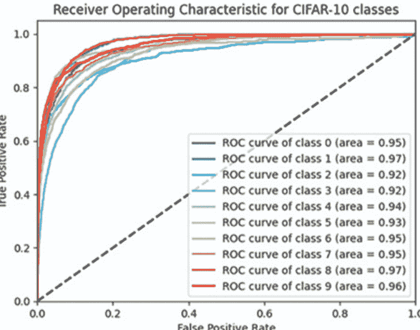

**图 7.9：** 使用预训练权重训练的模型的 ROC 曲线

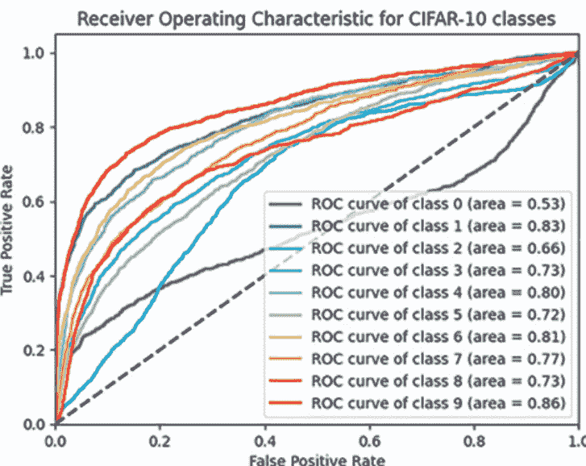

图 7.10：从零开始训练的模型的 ROC 曲线


图 7.11：使用预训练权重训练的模型的混淆矩阵


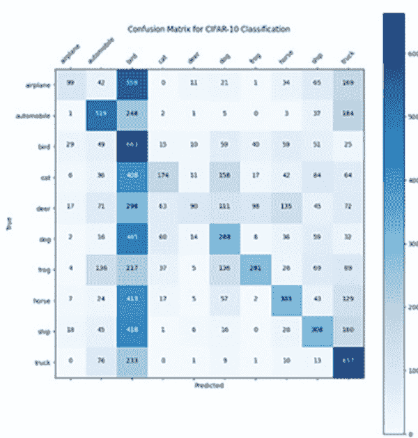

**图 7.12:** 从头训练的模型的混淆矩阵

## 预训练与从头训练的对比

如果我们查看训练输出，可以看到在第一个 epoch 本身，损失的差异就非常大，从预训练权重启动的模型损失为 0.77，而从头训练的模型损失为 1.99。由于预训练模型已经在 ImageNet 数据集上训练过，它已经学习了所有低级特征，不需要为此进行训练。而在从头训练的情况下，权重是随机初始化的，因此所需的训练量要大得多。

另外，当我们查看准确率时，在 5 个 epoch 内，预训练版本能够达到 89% 的准确率，而从头训练的模型只能达到 69.63%。这里还要注意的是，与我们的 SimpleCNN 相比，这些模型表现好得多，因为它们是非常复杂的架构，已被证明在这类图像任务上表现良好。

我们将在关于为选择一个模型而非另一个模型进行 A/B 测试的下一节中，查看其他指标来比较这两个模型。

## 迁移学习对模型性能的影响

迁移学习已经彻底改变了机器学习领域，特别是在计算机视觉领域。通过利用预训练模型，从业者可以启动训练过程，通常会在包括准确率、精确率和召回率在内的各种指标上带来更好的模型性能。

### 定量收益：准确率、精确率和召回率

在讨论迁移学习的定量收益时，我们主要是指模型性能指标的提升。准确率衡量的是被评估案例总数中正确预测的比例。精确率评估模型仅返回相关实例的能力，而召回率衡量模型在数据集中找到所有相关实例的能力。

考虑将在 ImageNet 上预训练的 ResNet 模型用于新任务（例如对 CIFAR-10 数据集中的图像进行分类）的微调示例。从 ImageNet 学习到的丰富特征表示提供了一个起点，通常会导致更高的准确率，因为模型可以从广泛的视觉概念中进行泛化。

下面是一个代码片段，演示使用预训练模型对准确率、精确率和召回率的影响：

```
# Assuming that 'model_ft' is the fine-tuned model and 'model' is trained from scratch
```

```python
from sklearn.metrics import precision_score, recall_score, accuracy_score

# Load the datasets and model
# ... (omitted for brevity)

# Function to get predictions
def get_predictions(loader, model):
    all_predictions = []
    all_targets = []
    model.eval()
    with torch.no_grad():
        for inputs, targets in loader:
            inputs, targets = inputs.to(device), targets.to(device)
            outputs = model(inputs)
            _, predictions = torch.max(outputs, 1)
            all_predictions.extend(predictions.cpu().numpy())
            all_targets.extend(targets.cpu().numpy())
    return all_predictions, all_targets

# Get predictions
predictions_ft, targets_ft = get_predictions(testloader, model_ft)
predictions, targets = get_predictions(testloader, model)

# Calculate metrics
accuracy_ft = accuracy_score(targets_ft, predictions_ft)
precision_ft = precision_score(targets_ft, predictions_ft, average='macro')
recall_ft = recall_score(targets_ft, predictions_ft, average='macro')

accuracy = accuracy_score(targets, predictions)
precision = precision_score(targets, predictions, average='macro')
recall = recall_score(targets, predictions, average='macro')

# Output the metrics
print(f"Fine-tuned Model: Accuracy: {accuracy_ft}, Precision: {precision_ft}, Recall: {recall_ft}")
print(f"From Scratch Model: Accuracy: {accuracy}, Precision: {precision}, Recall: {recall}")
```

我们在训练代码中有类似的片段来获取准确率，但这个片段更进一步，还计算了精确率和召回率。

### 使用迁移学习解决过拟合问题

过拟合是机器学习中的常见问题，模型过度学习了训练数据（包括其噪声和异常值），从而影响了其在未见数据上的性能。迁移学习可以缓解这个问题。预训练模型接触过各种各样的数据，有助于它们更好地泛化。在微调模型时，可能只需要在新数据集上训练最终几层，从而降低了在较小数据集上过拟合的风险。

### A/B 测试 - 微调模型与从头训练模型

为了了解迁移学习的实际影响，我们对两个模型进行了 A/B 测试：一个使用 ImageNet 预训练权重进行微调，另一个从头训练。这种比较分析揭示了迁移学习赋予模型性能的定量优势。

我们首先设置 CIFAR-10 验证数据集并加载两个参赛模型，确保它们在相同条件下进行评估。通过对每个模型调用 get_predictions 函数，我们收集整个验证数据集上的预测结果。

随后，我们为两个模型计算准确率、精确率、召回率和 F1 分数。这些指标作为我们的性能指标，提供了每个模型在分类未见数据时表现如何的洞察。它们不仅提供了模型性能的整体视角，还能指出迁移学习可能带来最大收益的领域。

最后，通过比较这些指标，我们观察到性能差异，这可能表现为微调模型具有更高的准确率和更好的泛化能力。这项 A/B 测试不仅验证了迁移学习的有效性，还为读者自行进行比较研究提供了模板。

通过将这种 A/B 测试方法论纳入您的工作流程，您可以就模型部署做出数据驱动的决策，并更深入地了解迁移学习的实际益处。这种方法充当了理论知识与实际应用之间的桥梁。

```python
import torch
import torchvision
import torchvision.transforms as transforms
from sklearn.metrics import accuracy_score, precision_score, recall_score, f1_score
from torch.utils.data import DataLoader
from torchvision import models

# Assuming 'resnet50_cifar10_finetuned.pth' is the fine-tuned model and 'resnet50_cifar10_scratch.pth' is the from-scratch model
fine_tuned_model_path = 'resnet50_cifar10_finetuned.pth'
scratch_model_path = 'resnet50_cifar10_scratch.pth'

# Device configuration
device = torch.device('cuda' if torch.cuda.is_available() else 'cpu')

# Load models
def load_model(model_path):
    model = models.resnet50(pretrained=False)
    num_ftrs = model.fc.in_features
    model.fc = torch.nn.Linear(num_ftrs, 10) # CIFAR-10 has 10 classes
    model.load_state_dict(torch.load(model_path))
    model = model.to(device)
    model.eval()
    return model

# Load both models
fine_tuned_model = load_model(fine_tuned_model_path)
scratch_model = load_model(scratch_model_path)

# CIFAR-10 validation dataset
transform = transforms.Compose([
    transforms.Resize(256),
    transforms.CenterCrop(224),
    transforms.ToTensor(),
    transforms.Normalize(mean=[0.485, 0.456, 0.406], std=[0.229, 0.224, 0.225]),
])

validation_set = torchvision.datasets.CIFAR10(root='./data', train=False, download=True, transform=transform)
validation_loader = DataLoader(validation_set, batch_size=64, shuffle=False)

# Get predictions
def get_predictions(loader, model):
    all_preds = []
    with torch.no_grad():
        for images, _ in loader:
            images = images.to(device)
            outputs = model(images)
            _, preds = torch.max(outputs, 1)
            all_preds.extend(preds.cpu().numpy())
    return all_preds

# Get predictions for both models
fine_tuned_predictions = get_predictions(validation_loader, fine_tuned_model)
```


```python
scratch_predictions = get_predictions(validation_loader, scratch_model)
# Get actual targets
targets = [target.cpu().numpy() for _, target in validation_set]
# Calculate metrics for both models
def calculate_metrics(targets, predictions):
    accuracy = accuracy_score(targets, predictions)
    precision = precision_score(targets, predictions, average='macro')
    recall = recall_score(targets, predictions, average='macro')
    f1 = f1_score(targets, predictions, average='macro')
    return accuracy, precision, recall, f1

fine_tuned_metrics = calculate_metrics(targets, fine_tuned_predictions)
scratch_metrics = calculate_metrics(targets, scratch_predictions)
# Print A/B Testing Results
print("Fine-Tuned Model Metrics: Accuracy: {:.2f}, Precision: {:.2f}, Recall: {:.2f}, F1 Score: {:.2f}".format(*fine_tuned_metrics))
print("Scratch Model Metrics: Accuracy: {:.2f}, Precision: {:.2f}, Recall: {:.2f}, F1 Score: {:.2f}".format(*scratch_metrics))
# Evaluate the difference
differences = [ft - sc for ft, sc in zip(fine_tuned_metrics, scratch_metrics)]
print("\nDifferences (Fine-Tuned - Scratch): Accuracy: {:.2f}, Precision: {:.2f}, Recall: {:.2f}, F1 Score: {:.2f}".format(*differences))
```

从上一节中，我们可以比较不同的指标，并在对比两个模型时获得定量的度量。从不同的指标来看，很明显，从预训练权重开始的模型远远超过了从零开始训练的模型。

## 迁移学习的影响

迁移学习在源域和目标域在特征空间上存在一定重叠，但标签或任务可能存在显著差异时效果最为显著。对于标记数据有限的任务，迁移学习能带来最实质性的益处，因为预训练模型引入了算法否则需要从零开始学习的知识。

例如，在 ImageNet 等大规模图像数据集上训练的模型已经学会了识别边缘、纹理和模式，这些特征在各种图像识别任务中都具有通用适用性。当此类模型针对特定任务（如医学图像诊断）进行微调时，而此类任务的标注数据可能稀缺，性能提升可能非常显著。

总而言之，迁移学习可以显著提升模型性能，尤其是在手头任务的训练数据有限时。它能增强泛化能力、减少过拟合，并带来更好的准确率、精确率和召回率。迁移学习的实证益处可以通过仔细的实验和比较轻松评估，这在实际应用中以及前文提到的代码示例中都有体现。

## 迁移学习的最佳实践与常见陷阱

本节将总结有效应用迁移学习的积累经验，以及从业者可能遇到的常见陷阱。这些指南旨在作为追求成功机器学习项目的导航辅助工具，反映了我们在本书中探讨的原则和示例。

### 应用迁移学习时的推荐做法

- **从预训练模型开始：** 只要有可能，就用在 ImageNet 等大型综合数据集上预训练过的模型来启动你的项目。这能为你提供一个可靠的起点，正如我们将 ResNet-50 模型应用于 CIFAR-10 所见。

- **谨慎微调：** 监控训练过程，正如我们在 ResNet 模型微调中所演示的，以避免对有用特征产生灾难性遗忘。

- **使用合适的数据增强：** 这可以大大增加训练数据集的多样性，帮助模型更好地泛化到新数据。

- **策略性地进行正则化：** 谨慎应用 dropout 和权重衰减等技术，以防止过拟合，这一原则在前面章节中已强调。

### 应用迁移学习时应避免的做法

- **不要鲁莽地覆盖预训练权重：** 加载预训练模型时，确保不要意外重置权重，这可能会抵消迁移学习的优势。

- **不要忽略数据分布：** 当新任务的数据分布与原始训练数据相似时，迁移学习效果最好。忽略这一点可能导致性能不佳。

- **不要忽视模型复杂度：** 对于你的任务来说，过于复杂的模型可能导致过拟合，而过于简单的模型可能无法学习必要的特征。

### 排查常见问题

- **模型性能不再提升：** 如果性能出现平台期，考虑调整学习率或开始微调网络中各层的时机。

- **过拟合：** 加入更多数据增强，添加 dropout 层，或收集更多样化的训练数据。

- **欠拟合：** 降低正则化强度，或解冻网络中更多层以允许更多特征适应。

### 充分利用迁移学习：从业者检查清单

- **评估任务相似性：** 确定你的目标任务与模型最初训练的任务有多接近。正如我们在 ResNet 模型中所见，转移到 CIFAR-10 是有效的，因为两项任务都具有视觉特性。

- **从特征提取开始：** 在尝试微调整个模型之前，先将预训练网络用作固定特征提取器。

- **逐步增加复杂度：** 首先只训练最后的分类层，然后根据需要逐步解冻更早的层。

- **监控验证集性能：** 定期在验证集上检查性能，以便及早诊断过拟合或欠拟合等问题。

- **保持较低的学习率：** 微调时，使用较低的学习率，以避免对已学习特征造成灾难性改变。

- **利用领域特定的预训练模型：** 如果可用，使用在更接近你领域的数据集上预训练的模型，以捕获更相关的特征。

通过遵循这些最佳实践并保持对潜在陷阱的警惕，从业者可以更有效地利用迁移学习的强大功能。在本书中，我们已看到审慎使用预训练模型所带来的戏剧性影响，从在小数据集上提升性能到加速训练过程。

在应用所提供的原则和示例时，例如涉及 PyTorch Model Zoo 或将 ResNet-50 模型适配到 CIFAR-10 的情况，从业者应始终致力于在利用已学习特征与适应新任务之间取得审慎的平衡。这种平衡至关重要，因为它能够实现迁移学习的高效应用，同时避免过拟合或灾难性遗忘等常见陷阱。

通过仔细的规划、有条不紊的执行和持续的评估，迁移学习可以成为新手和资深机器学习从业者武器库中的一项变革性工具。

## 结论

在结束关于使用 PyTorch 的迁移学习这一章时，我们回顾了预训练模型与微调策略这一强大组合，它能将图像分类任务推向准确性和效率的新高度。我们已探索基础知识，审视了将预训练模型应用于新任务的细微差别，并剖析了微调的复杂性。我们的动手示例不仅展示了这些概念的实际应用，还为理解更复杂的图像分类挑战奠定了坚实基础。

迁移学习充当了深度学习模型初级使用与掌握更高级技术之间的桥梁。我们已看到，像在 ImageNet 上预训练的 ResNet 这样的模型，可以被重新利用并微调，以在像 CIFAR-10 这样多样化的数据集上表现出色。这种适应性正是使迁移学习成为机器学习工具箱中宝贵技能的原因。

当我们过渡到下一章“高级图像分类模型”时，我们将带着那些对我们有益的原则和实践继续前进。即将到来的章节将深入探讨正在重塑计算机视觉格局的架构。我们将剖析定义 ResNet、VGG 和 Inception 等模型的复杂性层次，并探讨它们在该领域的独特贡献。


## 第 8 章

## 高级图像分类模型

### 简介

当我们在机器学习的版图中前行，图像分类作为取得重大进展的关键领域，屹立不倒。图像分类模型的演进讲述了一个不懈追求的故事，从简单的感知机到今天深度而复杂的网络。这一历程体现了机器学习的一个恒定主题：追求不仅在训练数据集上表现良好，而且能有效推广到新数据和未见数据的模型。

早期依赖于手工特征和线性分类器的模型。然而，卷积神经网络（CNNs）的出现标志着范式的转变。LeCun 的 LeNet-5 是最早成功应用于数字识别的卷积神经网络之一，为后来的深度学习播下了种子。然而，真正的势头是随着 AlexNet 架构的出现而获得的，它在 ImageNet 竞赛中获胜，牢固确立了深度学习作为图像分类任务首选方法的地位。

本章在该基础上构建，深入探讨定义现代图像分类模型的复杂架构。在这里，我们将剖析 ResNet、VGG 和 Inception 等知名架构的内部工作原理。这些模型各自为领域做出了独特贡献，解决了特定挑战，并为性能设定了新的基准。在揭示这些模型复杂性的同时，本章将在深度与易懂性之间保持平衡，既面向渴望入门的新手，也面向希望深化专业知识的资深从业者。

在接下来的页面中，我们将提供高级图像分类模型概述，梳理其发展历程及指导其设计的理论基础。详细深入探讨 ResNet、VGG 和 Inception 架构将对这些模型提供微观视角，揭示其跳跃连接和深度可分离卷积等突破性特性。

随后，我们将通过在 PyTorch 2.0 中实现高级模型，转向实践层面。逐步指南将带你从零开始创建这些模型并将其适配到新任务的过程中，重点突出最佳实践，以确保开发和部署顺利进行。

本章将以高级模型的训练与评估收尾，我们将讨论有效训练这些深度网络的策略以及用于评估其性能的指标。最后，将在模型性能比较中对这些模型进行对比，提供关于每种模型在何时何地表现出色的清晰视角。

准备好踏上图像分类先进前沿的富有洞察力的旅程吧。在本章结束时，你不仅能掌握这些模型的理论方面，还能获得在 PyTorch 中实现和利用它们的实践技能，在令人兴奋的计算机视觉领域突破你能实现的界限。

### 结构

本章将涵盖以下主题：

- 深化基础：快速回顾
- 理解高级图像分类模型
- 深入探讨 VGG
- 深入探讨 ResNet
- 深入探讨 Inception
- 比较模型性能

### 深化基础：快速回顾

在深入探讨高级图像分类模型的架构奇迹之前，让我们重新审视为它们的诞生铺平道路的核心概念。这次回顾将帮助我们统一理解，并欣赏这些先进架构所提供的解决方案。

### 卷积神经网络（CNNs）

现代图像分类的核心是卷积神经网络（CNNs），这是一类在视觉理解方面取得巨大成功的深度神经网络。CNNs 专门用于处理具有网格状拓扑的数据（例如图像），通过利用视觉世界的固有特征（如形状和纹理的空间层次结构）来实现。

标准的 CNN 包含多个层：

- **卷积层：** 它们将一组可学习的滤波器应用于输入图像，捕获边缘和纹理等特征。卷积操作通过使用输入数据的小方块学习图像特征，从而保持像素之间的空间关系。

- **激活函数：** 非线性（例如整流线性单元 ReLU）为系统引入非线性属性，使网络能够学习从输入到输出的广泛映射。

- **池化层：** 这些层执行下采样操作以减小表示的空间尺寸，减少网络中的参数和计算量，从而帮助控制过拟合。

- **全连接层：** 在多个卷积层和池化层之后，神经网络中的高级推理是通过全连接层完成的。在全连接层中，每个输入都通过可学习的权重连接到每个输出。

### 反向传播与学习

CNNs 的学习是通过一种称为反向传播的过程实现的。本质上，该算法通过在网络层中反复向后应用微积分的链式法则，计算损失函数相对于网络权重的梯度。然后，这些梯度用于更新网络的权重，通常使用梯度下降优化算法。

### 特征图

当滤波器扫描输入图像时，它会创建一个特征图，向我们提供输入中特定特征存在与否的信息。特征图的深度对应于使用的滤波器数量。这种设计使 CNNs 能够从数据中自动且自适应地学习特征的空间层次结构。

### 挑战与高级解决方案

尽管 CNN 产生了开创性的影响，但随着数据集复杂性和网络深度的增加，出现了新的挑战：

- **梯度消失**：在非常深的网络中，反向传播过程中梯度可能变得极小，导致模型难以训练，因为早期层的权重只得到非常小的更新。这可能导致网络无法有效学习。

- **梯度爆炸**：相反，梯度可以通过层指数级增长，导致非常大的更新，并导致模型在训练期间发散。

- **计算效率**：深度网络需要大量的计算能力和内存。优化这些网络以便在现有硬件上高效训练和运行是一个长期的挑战。

VGG、ResNet 和 Inception 等先进架构以创新的方式解决了这些挑战：

- **VGG** 通过在整个网络中使用非常小（3x3）的卷积滤波器来解决计算挑战，从而允许更深的架构。

- **ResNet** 引入了跳跃连接或残差连接的概念，其中一层的输入被加到输出上，缓解了梯度消失问题，因为它允许梯度流动的直接路径。

- **Inception** 提出了并行执行不同尺寸卷积的想法，以捕获不同尺度的信息，同时通过降维优化计算效率。

### 复杂架构的基础

理解上述概念对于我们探索高级模型至关重要。当你欣赏 VGG、ResNet 和 Inception 带来的解决方案时，你就能理解每个后续架构带来的性能飞跃。这些模型设定了新的基准，并继续激励计算机视觉领域的持续研究和开发。

在本章的过渡中，我们不仅将更深入地探讨这些架构，还将看到它们如何缓解传统 CNN 面临的挑战。这些先进模型中的每一个都传承了前辈的遗产和经验，将它们与创新想法相结合，在图像分类领域不断突破可能性的边界。

这些进步展示了神经网络领域创新之美：社区如何在既有概念基础上构建，以克服障碍并开辟新的前沿。这项知识是你解锁计算机视觉任务全部潜力的钥匙。

带着这次回顾，让我们开始深入探索高级图像分类模型，在其中，鲁棒性与架构智慧相互交织，催生出能够以非凡的精度和速度感知视觉世界的系统。在我们深入研究每个高级模型时，请记住，这些不仅仅是复杂的网络，而是在计算机视觉世界中达到新高度的垫脚石。

既然我们已经重申了高级图像分类模型所建立的基石，舞台已经为我们准备好去拥抱这些模型所呈现的丰富架构图景。通过详细的检查和实践操作-


在编码会话中，你不仅能建立对其结构的工作知识，还能获得将其定制以满足各种视觉任务细微需求的专业知识。让我们带着热切的心态继续前行，因为对这些先驱模型的扎实理解为我们提供了工具，使我们能够乘着创新的浪潮，解锁基于 PyTorch 2.0 的计算机视觉领域中尚未见过的能力。

## 理解高级图像分类模型

当我们超越卷积神经网络（CNN）的基本功能时，会遇到重新定义计算机能从视觉输入中感知和解释内容的高级图像分类模型。尽管神经网络的基本原理仍然适用，但这些高级模型融入了结构创新，以解决特定挑战并最大化性能。在本节中，我们将探讨区分 VGG、ResNet 和 Inception 等模型的关键特性，剖析其成功架构背后的推理，并深入探讨其常见用例。

## 高级模型的关键特性

- **深度和复杂度增加**：高级模型通常具有更深的深度，通过添加更多层来实现从原始输入中提取高级特征。然而，这些模型不仅仅是堆叠更多层，而是优化网络深度以增强学习能力，避免陷入边际收益递减或训练困难。

- **专用层结构**：这些模型摆脱了标准的卷积-池化结构，呈现出创新的层排列和连接方式。例如，Inception 模型使用不同尺寸的并行卷积，而 ResNet 引入了跳跃连接，使层能够同时从其直接前驱和更早的激活中学习。

- **性能优化**：高级模型在设计时追求高性能，无论是在未见数据上的泛化能力，还是训练和推理过程中的计算效率。通常会采用批量归一化和深度可分离卷积等技术来加速学习并减少参数数量。

- **增强的正则化技术**：这些模型融入了先进的正则化技术，以防止在容量很大的情况下出现过拟合。这可能包括丢弃法（dropout）、数据增强和随机深度等方法，旨在确保模型在新数据上具有良好的泛化能力。

- **模块化设计**：一些高级模型采用模块化方法，通过可重复的构建块或模块来构建网络。这不仅在概念上简化了架构，而且在设计不同深度和容量的网络时也提供了更大的灵活性。

## 架构成功背后的推理

### VGG（视觉几何组）

VGG 架构因其简洁性、一致性和深度而受到赞誉。在整个网络中始终如一地使用小（3x3）卷积滤波器是其成功的关键。这种选择使得在参数数量减少的情况下能够捕捉特征的空间层次结构，因为多个堆叠的小滤波器可以模拟较大滤波器的感受野，同时对特征提取具有更精细的控制。VGG 网络易于实现、训练和调整，使其成为许多计算机视觉任务的首选起点。

### ResNet（残差网络）

ResNet 的突破在于解决了梯度消失问题，这是训练深度网络的一大障碍。其残差块（每个都包含将块输入加到输出上的跳跃连接）允许梯度直接通过网络流动，而不会随层数增加而减弱。这一创新使得训练非常深的网络成为可能：在反向传播过程中，如果某些层对特定任务不需要，可以有效地跳过它们，这一概念恰如其分地被称为“恒等快捷方式连接”。ResNet 架构已被证明具有通用性和鲁棒性，在各种计算机视觉基准测试中取得了最先进的结果。

### Inception

Inception 架构以“乘法分治”为关键词，强调宽度优于深度。Inception 模块并行执行多种不同的卷积并连接其输出。通过聚合多样化的特征图，网络可以使用丰富的滤波器分析输入，而不会导致计算成本激增。此外，它利用降维技术来管理通道大小，保持计算效率。Inception 的各个版本不断演进，以优化并平衡网络的宽度和深度，确保高效计算和强大的表征能力。

## 常见用例

- **图像分类**：这是这些模型的典型用例。凭借学习微妙特征和模式的能力，它们在 ImageNet 等流行基准测试的性能排行榜上名列前茅。

- **目标检测和定位**：除了分类，这些网络还可以重新用作目标检测和定位系统中的特征提取器。通过解释它们生成的丰富特征图，Faster R-CNN 和 YOLO 等模型集成了这些架构，不仅能确定图像中存在哪些目标，还能确定它们的位置。

- **基于内容的图像检索**：在需要确定图像相似度的应用中（例如，查找视觉上相似的图像），这些高级模型生成的嵌入式提供了图像内容的强大摘要，可以与已知图像数据库进行比较。

- **风格迁移和图像生成**：高级模型可以解读和操纵图像的风格元素，从而为能够迁移艺术风格或生成符合学习视觉模式的新图像的算法提供信息。

- **医学影像**：由于其细粒度特征检测能力，这些模型越来越多地应用于医学影像任务，例如在 MRI 扫描中识别肿瘤或在 X 光片中检测异常。

VGG、ResNet 和 Inception 等创新架构体现了创意设计如何在计算机视觉算法所能实现的方面带来显著改进。这些模型概括了通过机器学习以可扩展、高效和准确的方式解释复杂视觉数据，从而复制和超越人类视觉能力的持续探索。随着本章的推进，我们将逐一剖析这些架构，揭示驱动其成功的内部机制。通过理解和实现，你不仅会学会使用这些模型，还会学会深思熟虑地将它们适应自己的目的，从而延续推动计算机视觉领域不断前进的创新循环。

## 深入探究 VGG

在讨论深度学习图像分类领域的突破时，由牛津大学视觉几何组开发的名为 VGG 的架构因其概念上的直截了当和显著的深度而脱颖而出。VGG 的设计理念为深度神经网络树立了新标准。它以其卷积层的顺序排列而闻名，这些层以其一致性著称。该模型有多种变体——主要按深度区分——其中 VGG16 和 VGG19 最为知名。

### 模型架构与变体

VGG 架构的核心由一系列具有小 3x3 感受野的连续卷积层组成，后面跟着最大池化操作。卷积架构的这种简单性构成了 VGG 的主要主题，并在深度逐渐增加的过程中重复出现。层被排列成块，每个最大池化步骤基本上压缩特征图的空间维度，同时深度增加。


**VGG16** 包含 16 个层，包括 13 个卷积层和 3 个全连接层。它交错使用步长为 1 且带有填充的卷积层以保持空间分辨率，并使用将特征图尺寸减半的池化层来压缩信息。同样，**VGG19** 包含 19 个层，其中有 16 个卷积层和 3 个全连接层，进一步扩展了深度。

## 简洁与深度

VGG 模型说明了架构设计中简洁与深度相结合的力量。尽管更深层、更具条件性的架构非常复杂，但 VGG 在每个卷积层中统一使用 3x3 卷积核，发挥了强大的特征提取能力。

这种简洁性孕育了一种塑造性的力量，提供了一种同质且重复的结构，能够在不同抽象层级上捕捉越来越复杂的特征。每个连续的池化层都有助于在多个尺度上学习特征，这在视觉识别任务中尤其有效。

## VGG 架构详解

VGG 的架构贡献在于其使用多个堆叠的 3x3 卷积层，这些层以步长 1 和用于保持空间分辨率的填充，有效地提供了类似于更大卷积核的更大感受野，同时通过额外的非线性增强特征学习。这一堆叠由最大池化层分隔，传达了从简单到抽象的学习特征层次结构。

在卷积层之后，三个全连接层就足够了，其中一个作为最终输出层，针对给定任务的类别数量进行调整。VGG 的结构等同于深度，在实践中证明了更深的网络可以带来更好的特征层次结构。

## 在 PyTorch 中实现 VGG

PyTorch 的面向对象特性有助于清晰地定义 VGG 架构。我们现在将逐步介绍 VGG16 的 PyTorch 实现；由于空间和资源限制，我们将专注于 VGG16，但扩展到 VGG19 只需增加卷积层数量即可。

```python
import torch.nn as nn
import torch

class VGG16(nn.Module):
    def __init__(self, num_classes=1000): # VGG16 has 1000 classes by default
        super(VGG16, self).__init__()
        self.features = self._create_features()
        self.classifier = self._create_classifier(num_classes)

    def _create_features(self):
        layers = [
            # Block 1
            nn.Conv2d(3, 64, kernel_size=3, padding=1),
            nn.ReLU(inplace=True),
            nn.Conv2d(64, 64, kernel_size=3, padding=1),
            nn.ReLU(inplace=True),
            nn.MaxPool2d(kernel_size=2, stride=2),
            # Block 2
            nn.Conv2d(64, 128, kernel_size=3, padding=1),
            nn.ReLU(inplace=True),
            nn.Conv2d(128, 128, kernel_size=3, padding=1),
            nn.ReLU(inplace=True),
            nn.MaxPool2d(kernel_size=2, stride=2),
            # Block 3
            nn.Conv2d(128, 256, kernel_size=3, padding=1),
            nn.ReLU(inplace=True),
            nn.Conv2d(256, 256, kernel_size=3, padding=1),
            nn.ReLU(inplace=True),
            nn.Conv2d(256, 256, kernel_size=3, padding=1),
            nn.ReLU(inplace=True),
            nn.MaxPool2d(kernel_size=2, stride=2),
            # Block 4
            nn.Conv2d(256, 512, kernel_size=3, padding=1),
            nn.ReLU(inplace=True),
            nn.Conv2d(512, 512, kernel_size=3, padding=1),
            nn.ReLU(inplace=True),
            nn.Conv2d(512, 512, kernel_size=3, padding=1),
            nn.ReLU(inplace=True),
            nn.MaxPool2d(kernel_size=2, stride=2),
            # Block 5
            nn.Conv2d(512, 512, kernel_size=3, padding=1),
            nn.ReLU(inplace=True),
            nn.Conv2d(512, 512, kernel_size=3, padding=1),
            nn.ReLU(inplace=True),
            nn.Conv2d(512, 512, kernel_size=3, padding=1),
            nn.ReLU(inplace=True),
            nn.MaxPool2d(kernel_size=2, stride=2)
        ]
        return nn.Sequential(*layers)

    def _create_classifier(self, num_classes):
        layers = [
            nn.Linear(512 * 7 * 7, 4096), nn.ReLU(inplace=True),
            nn.Dropout(),
            nn.Linear(4096, 4096), nn.ReLU(inplace=True),
            nn.Dropout(),
            nn.Linear(4096, num_classes)
        ]
        return nn.Sequential(*layers)

    def forward(self, x):
        x = self.features(x)
        x = torch.flatten(x, start_dim=1) # Flatten the tensor for classifier intake
        x = self.classifier(x)
        return x
```

`_create_features()` 内部的层表示卷积层和最大池化层，而 `_create_classifier()` 封装了结束架构的密集层。

## 顺序布局

网络作为卷积层序列实现，每个最大池化层后过滤器数量翻倍，从 64 开始一直到 512。这一特性使得以模块化方式定义模型变得容易。

以下是在 PyTorch 中定义 VGG16 架构的示例：

```python
import torch.nn as nn

# Defining each block of the VGG16 architecture
def make_layers(cfg):
    layers = []
    in_channels = 3
    for v in cfg:
        if v == 'M':
            layers += [nn.MaxPool2d(kernel_size=2, stride=2)]
        else:
            layers += [nn.Conv2d(in_channels, v, kernel_size=3,
                        padding=1), nn.BatchNorm2d(v), nn.ReLU(inplace=True)]
            in_channels = v
    return nn.Sequential(*layers)

# Configuration for VGG16
cfg = [64, 64, 'M', 128, 128, 'M', 256, 256, 256, 'M', 512,
        512, 512, 'M', 512, 512, 512, 'M']

class VGG16(nn.Module):
    def __init__(self, num_classes=1000):
        super(VGG16, self).__init__()
        # Feature extraction part
        self.features = make_layers(cfg)
        # Classifier part
        self.classifier = nn.Sequential(
            nn.Linear(512 * 7 * 7, 4096),
            nn.ReLU(True),
            nn.Dropout(),
            nn.Linear(4096, 4096),
            nn.ReLU(True),
            nn.Dropout(),
            nn.Linear(4096, num_classes),
        )

    # The VGG16 forward pass
    def forward(self, x):
        x = self.features(x)
        x = x.view(x.size(0), -1) # Flatten the tensor for the classifier
        x = self.classifier(x)
        return x
```

PyTorch 中的 VGG16 实现说明了传统而强大的卷积神经网络架构如何应用于现代机器学习问题。其统一架构加上易于修改和扩展的能力，使 VGG16 成为计算机视觉深度学习中的工作马。借助预定义架构和预训练权重，PyTorch 简化了为众多任务创建、调整和部署这些模型的过程。

### 从 PyTorch 模型库导入 VGG

PyTorch 的模型库提供对预训练网络架构的访问，便于在项目中实例化和集成：

```python
from torchvision import models
vgg16_pretrained = models.vgg16(weights=None)
```

### 利用预训练权重

利用 PyTorch 的模型来使用预训练权重非常简单：

```python
import torchvision

vgg16_pretrained = torchvision.models.vgg16(weights=torchvision.models.VGG16_Weights.DEFAULT)
vgg16_pretrained.classifier[6] = nn.Linear(4096, 100) # Change the last layer to fit CIFAR100
```

这一行修改了最终的密集层以适应 100 个类别（CIFAR100 的典型类别数），同时受益于 ImageNet 的预训练权重。

### 在 CIFAR100 上训练和评估 VGG

CIFAR100 数据集是一个包含 100 个类别的多类图像分类问题。每个类别包含 600 张图像，每张图像的尺寸较小（32x32 像素），这使其既易于管理又具有挑战性。

### 数据预处理和增强步骤

为了数据预处理，需要进行归一化，使每个颜色通道的均值为零且方差为一。这通过提供数值稳定的输入来促进模型训练：

```python
from torchvision.transforms import transforms
transform = transforms.Compose([
    transforms.RandomCrop(32, padding=4),
    transforms.RandomHorizontalFlip(),
    transforms.ToTensor(),
    transforms.Normalize((0.5071, 0.4867, 0.4408), (0.2009, 0.1984, 0.2023)),
])
```

数据增强实现随机水平翻转和随机裁剪，模拟模型应该对其不变的变化。

### 训练代码

PyTorch 中的训练循环遍历 CIFAR100 数据加载器，并应用反向传播来更新权重：

```python
# Define device for training
device = torch.device("cuda:0" if torch.cuda.is_available()
                    else "cpu")

# Map to device
vgg16_pretrained = vgg16_pretrained.to(device)
optimizer = torch.optim.SGD(vgg16_pretrained.parameters(),
                            lr=0.01, momentum=0.9)
criterion = nn.CrossEntropyLoss()

# Create data loaders
train_dataset = torchvision.datasets.CIFAR100(root='./data',
                                            train=True, download=True, transform=transform)
test_dataset = torchvision.datasets.CIFAR100(root='./data',
                                           train=False, download=True, transform=transform)
```


```python
train_loader = torch.utils.data.DataLoader(train_dataset,
batch_size=64, shuffle=True)
test_loader = torch.utils.data.DataLoader(test_dataset,
batch_size=64, shuffle=False)
# Set number of epochs to train
number_of_epochs = 5
# Loop for each epoch
for epoch in range(number_of_epochs):
    running_loss = 0.0
    for i, data in enumerate(train_loader, 0):
        inputs, labels = data[0].to(device), data[1].to(device)
        optimizer.zero_grad()
        outputs = vgg16_pretrained(inputs)
        loss = criterion(outputs, labels)
        loss.backward()
        optimizer.step()
        running_loss += loss.item()
    print(f'Epoch {epoch + 1}: Loss: {running_loss /
len(train_loader)}')
# Save the model's state dictionary
torch.save(vgg16_pretrained.state_dict(),
'vgg16_cifar100.pth')
```

Epoch 1: Loss: 1.630416536346421
Epoch 2: Loss: 1.5624679418476037
Epoch 3: Loss: 1.5073729947095027
Epoch 4: Loss: 1.43779634583333174
Epoch 5: Loss: 1.41022737472866833
Epoch 6: Loss: 1.37455911282688815
Epoch 7: Loss: 1.3385358903261706
Epoch 8: Loss: 1.305282829743822
Epoch 9: Loss: 1.2908474900533475
Epoch 10: Loss: 1.2709745466709137

图 8.1: 在 CIFAR100 数据集上训练 VGG-16 模型 100 个时代后的输出

## 评估代码

训练后，在验证集或测试集上评估模型性能以衡量泛化能力至关重要：

```python
correct, total = 0, 0
with torch.no_grad():
    for data in test_loader:
        images, labels = data[0].to(device), data[1].to(device)
        outputs = vgg16_pretrained(images)
        _, predicted = torch.max(outputs.data, 1)
        total += labels.size(0)
        correct += (predicted == labels).sum().item()
print(f'Accuracy on test images: {100 * correct // total}%')
```

Accuracy on test images: 55%

图 8.2: 训练模型 10 个时代后测试集上的准确率

## 优势与局限性

VGG 的优势在于其深度，这带来了丰富的特征表示，以及其统一的架构，简化了学习过程。它是迁移学习和特征提取任务的优秀模型。然而，其局限性包括与 ResNet 或 DenseNet 等利用快捷连接或特征复用以获得更好性能的现代架构相比，计算成本高且效率低。

总而言之，VGG 的引入在 CNN 架构设计中掀起了深度导向的趋势，揭示了深层且丰富的特征层次结构的力量。通过动手实现 PyTorch、通过 TensorBoard 进行观察，以及与训练和评估循环集成，我们发现 VGG 是一种关键架构，推动我们进一步揭示计算机视觉的奥秘。

## 深入探究 ResNet

ResNet（残差网络的缩写）在问世时从根本上改变了深度学习架构的发展方向。由 Kaiming He 及其同事设计，ResNet 解决了退化问题，通过使用快捷连接跳过某些层，使得训练非常深的神经网络成为可能。

### 模型架构与变体

与直接堆叠层的架构不同，ResNet 引入了残差块的概念，其中层参考层输入来学习残差函数。网络变体通常按其深度表示，例如 **ResNet-18**、**ResNet-34**、**ResNet-50**、**ResNet-101** 和 **ResNet-152**。

在 ResNet 中，卷积块后面跟着批归一化和 ReLU 激活函数。然而，关键要素是在激活函数之前添加快捷连接，使网络能够学习恒等函数。这确保了更高层的性能至少不逊于更低层，而不会更差。

### 残差块的优雅之处

残差块通过为反向传播引入直接路径来解决梯度消失问题。这种设计确保梯度可以在网络中流动而不会发生显著退化，从而使得以前无法实现的深层网络成为可能。

### 在 PyTorch 中实现 ResNet

让我们逐步了解 ResNet 的 PyTorch 实现。我们将专注于 ResNet-50，作为深度与计算效率之间的折中方案：

```python
import torch
import torch.nn as nn
from torchvision import models

class BasicBlock(nn.Module):
    expansion = 1
    def __init__(self, in_channels, out_channels, stride=1,
                 downsample=None):
        super(BasicBlock, self).__init__()
        # 1x1 convolutions are used as bottlenecks for reducing and
        # then increasing dimensions,
        # without changing width/height size
        self.conv1 = nn.Conv2d(in_channels, out_channels,
                               kernel_size=1, stride=1, bias=False)
        self.bn1 = nn.BatchNorm2d(out_channels)
        # A 3x3 convolution is used in the middle
        self.conv2 = nn.Conv2d(out_channels, out_channels,
                               kernel_size=3, stride=stride, padding=1, bias=False)
        self.bn2 = nn.BatchNorm2d(out_channels)
        # Another 1x1 convolution with the expansion factor applied
        self.conv3 = nn.Conv2d(out_channels, out_channels *
                               self.expansion, kernel_size=1, stride=1, bias=False)
        self.bn3 = nn.BatchNorm2d(out_channels * self.expansion)
        self.relu = nn.ReLU(inplace=True)
        self.downsample = downsample

    def forward(self, x):
        identity = x if self.downsample is None else self.downsample(x)
        out = self.relu(self.bn1(self.conv1(x)))
        out = self.relu(self.bn2(self.conv2(out)))
        out = self.bn3(self.conv3(out))
        out += identity
        out = self.relu(out)
        return out

class ResNet(nn.Module):
    def __init__(self, block, layers, num_classes=1000):
        super(ResNet, self).__init__()
        self.in_channels = 64
        self.conv1 = nn.Conv2d(3, self.in_channels, kernel_size=7,
                               stride=2, padding=3, bias=False)
        self.bn1 = nn.BatchNorm2d(self.in_channels)
        self.relu = nn.ReLU(inplace=True)
        self.maxpool = nn.MaxPool2d(kernel_size=3, stride=2,
                                    padding=1)

        # Each _make_layer() creates one stage of blocks in ResNet
        self.layer1 = self._make_layer(block, 64, layers[0])
        self.layer2 = self._make_layer(block, 128, layers[1],
                                       stride=2)
        self.layer3 = self._make_layer(block, 256, layers[2],
                                       stride=2)
        self.layer4 = self._make_layer(block, 512, layers[3],
                                       stride=2)

        self.avgpool = nn.AdaptiveAvgPool2d((1, 1))  # Adaptive pooling to fit the final layer
        self.fc = nn.Linear(512 * block.expansion, num_classes)

    def _make_layer(self, block, out_channels, blocks, stride=1):
        downsample = None
        if stride != 1 or self.in_channels != out_channels * block.expansion:
            downsample = nn.Sequential(
                nn.Conv2d(self.in_channels, out_channels *
                          block.expansion, kernel_size=1, stride=stride,
                          bias=False),
                nn.BatchNorm2d(out_channels * block.expansion),
            )

        layers = []
        layers.append(block(self.in_channels, out_channels, stride,
                            downsample))
        self.in_channels = out_channels * block.expansion
        for _ in range(1, blocks):
            layers.append(block(self.in_channels, out_channels))
        return nn.Sequential(*layers)

    def forward(self, x):
        x = self.relu(self.bn1(self.conv1(x)))
        x = self.maxpool(x)
        # ResNet layers
        x = self.layer1(x)
        x = self.layer2(x)
        x = self.layer3(x)
        x = self.layer4(x)

        x = self.avgpool(x)
        x = torch.flatten(x, 1)
        x = self.fc(x)
        return x

def resnet50(num_classes=1000):
    # Constructs a ResNet-50 model
    return ResNet(BasicBlock, [3, 4, 6, 3], num_classes)

# Instantiate a ResNet-50 model
model = resnet50(num_classes=1000)
```

然后可以通过将最后的全连接层更改为输出 100 个类而不是 1000 个，将此模型调整为适用于 CIFAR100 等任务。

## 基础构建模块

ResNet 的架构由多个阶段的残差块组成，这些残差块构成了网络的骨干。每个块包含批归一化、激活层以及赋予该架构名称的标志性跳跃连接。

下面是一个基础残差块 BasicBlock 的简化实现，它是 ResNet-18 和 ResNet-34 等更大 ResNet 配置的一部分：

```python
class BasicBlock(nn.Module):
    expansion = 1
    def __init__(self, in_channels, out_channels, stride=1,
                 downsample=None):
        super(BasicBlock, self).__init__()
        # First convolutional layer
        self.conv1 = nn.Conv2d(in_channels, out_channels,
                               kernel_size=3, stride=stride, padding=1, bias=False)
        self.bn1 = nn.BatchNorm2d(out_channels)
        self.relu = nn.ReLU(inplace=True)
        # Second convolutional layer
        self.conv2 = nn.Conv2d(out_channels, out_channels *
                               BasicBlock.expansion, kernel_size=3, stride=1, padding=1,
                               bias=False)
```


self.bn2 = nn.BatchNorm2d(out_channels * BasicBlock.expansion)

# 可选下采样
self.downsample = downsample
self.stride = stride

def forward(self, x):
    residual = x

    # 将输入通过 conv1->bn1->relu 堆栈传递
    out = self.conv1(x)
    out = self.bn1(out)
    out = self.relu(out)

    # 将输入通过 conv2->bn2 堆栈传递
    out = self.conv2(out)
    out = self.bn2(out)

    # 如有需要应用下采样
    if self.downsample is not None:
        residual = self.downsample(x)

    # 将输入（恒等映射或下采样后的结果）添加到残差块的输出中
    out += residual
    out = self.relu(out)

    return out

## ResNet 模型

我们接着使用这些基础块来构建实际的 ResNet 模型。下面是一个代码片段，展示了如何实例化 ResNet-50，它使用瓶颈块（我们将在后面介绍）以提高效率：

```python
class ResNet(nn.Module):

    def __init__(self, block, layers, num_classes=1000):
        super(ResNet, self).__init__()
        self.in_channels = 64

        # 带最大池化的初始卷积层
        self.conv1 = nn.Conv2d(3, self.in_channels, kernel_size=7,
                               stride=2, padding=3, bias=False)
        self.bn1 = nn.BatchNorm2d(self.in_channels)
        self.relu = nn.ReLU(inplace=True)
        self.maxpool = nn.MaxPool2d(kernel_size=3, stride=2,
                                    padding=1)

        # 残差层
        self.layer1 = self._make_layer(block, 64, layers[0])
        self.layer2 = self._make_layer(block, 128, layers[1],
                                       stride=2)
        self.layer3 = self._make_layer(block, 256, layers[2],
                                       stride=2)
        self.layer4 = self._make_layer(block, 512, layers[3],
                                       stride=2)

        # 自适应平均池化和最终的全连接层
        self.avgpool = nn.AdaptiveAvgPool2d((1, 1))
        self.fc = nn.Linear(512 * block.expansion, num_classes)

        # 权重初始化
        for m in self.modules():
            if isinstance(m, nn.Conv2d):
                nn.init.kaiming_normal_(m.weight, mode='fan_out',
                                        nonlinearity='relu')
            elif isinstance(m, nn.BatchNorm2d):
                nn.init.constant_(m.weight, 1)
                nn.init.constant_(m.bias, 0)

        # 创建每个 ResNet 层的辅助函数
        def _make_layer(self, block, out_channels, blocks, stride=1):
            downsample = None

            if stride != 1 or self.in_channels != out_channels * block.expansion:
                downsample = nn.Sequential(
                    nn.Conv2d(self.in_channels, out_channels * block.expansion,
                              kernel_size=1, stride=stride, bias=False),
                    nn.BatchNorm2d(out_channels * block.expansion),
                )

            # 层中的第一个块
            layers = [block(self.in_channels, out_channels, stride,
                            downsample)]
            self.in_channels = out_channels * block.expansion
            # 层中剩余的块
            for _ in range(1, blocks):
                layers.append(block(self.in_channels, out_channels))

            return nn.Sequential(*layers)

        # 前向传播
        def forward(self, x):
            x = self.conv1(x)
            x = self.bn1(x)
            x = self.relu(x)
            x = self.maxpool(x)

            # 将输入通过各层传递
            x = self.layer1(x)
            x = self.layer2(x)
            x = self.layer3(x)
            x = self.layer4(x)

            # 池化和分类
            x = self.avgpool(x)
            x = torch.flatten(x, 1)
            x = self.fc(x)

            return x
```

在 ResNet-50 中，block 将是后面定义的 Bottleneck 块，其中每个 Bottleneck 块都有一个 conv->bn->relu 模式，卷积分别使用核大小为 1 来降维、3 来执行卷积操作，以及再次使用 1 来恢复维度，从而高效利用参数。

## ResNet-50：瓶颈块

ResNet-50 使用瓶颈块，这些块由三层组成。这些块首先使用 1x1 卷积进行维度缩减，然后是主 3x3 卷积，接着再使用 1x1 卷积恢复维度。下面是一个瓶颈块示例：

```python
class Bottleneck(nn.Module):
    expansion = 4

    def __init__(self, in_channels, out_channels, stride=1,
                 downsample=None):
        super(Bottleneck, self).__init__()

        # 第一个 1x1 卷积
        self.conv1 = nn.Conv2d(in_channels, out_channels,
                               kernel_size=1, bias=False)
        self.bn1 = nn.BatchNorm2d(out_channels)

        # 第二个 3x3 卷积
        self.conv2 = nn.Conv2d(out_channels, out_channels,
                               kernel_size=3, stride=stride, padding=1, bias=False)
        self.bn2 = nn.BatchNorm2d(out_channels)

        # 带扩展的第三个 1x1 卷积
        self.conv3 = nn.Conv2d(out_channels, out_channels * self.expansion,
                               kernel_size=1, bias=False)
        self.bn3 = nn.BatchNorm2d(out_channels * self.expansion)

        self.relu = nn.ReLU(inplace=True)
        self.downsample = downsample
        self.stride = stride

    # 前向函数与 BasicBlock 保持相同

# 实例化 ResNet-50 涉及使用 Bottleneck 块：
resnet50_model = ResNet(Bottleneck, [3, 4, 6, 3], num_classes=1000)
```

## 汇总

使用以下内容实例化 ResNet 模型：

```python
def resnet50(num_classes=1000):
    # 构建 ResNet-50 模型
    return ResNet(Bottleneck, [3, 4, 6, 3], num_classes)

# 初始化 ResNet-50 模型
resnet50_custom = resnet50(num_classes=1000)
```

总之，在 PyTorch 中实现 ResNet 涉及构建定义其架构的顺序块。每个块都添加残差连接，使得即使在网络深度增加时，学习也能够进行。通过实例化这些层并定义前向传播，可以创建、训练 ResNet 模型，并用于解决复杂的图像识别挑战。

## 从 PyTorch 模型动物园导入 ResNet

与 VGG 模型类似，PyTorch 的模型动物园提供预训练的 ResNet 模型：

```python
from torchvision import models
resnet50_pretrained = models.resnet50(weights=None)
```

## 利用预训练权重

使用 PyTorch 的模型来利用预训练权重非常简单：

```python
import torchvision
resnet50_pretrained = torchvision.models.resnet50(weights=torchvision.models.ResNet50_Weights.IMAGENET1K_V1)
resnet50_pretrained.fc = nn.Linear(resnet50_pretrained.fc.in_features, 100)  # 更改最后一层以适配 CIFAR100
```

这一行修改了最终的全连接层以适配 100 个类别（CIFAR100 的典型类别数），同时受益于 ImageNet 的预训练权重。

## 在 CIFAR100 上训练和评估 ResNet

ResNet 的训练和评估过程与其他深度学习模型类似，但需要针对更深层的网络结构进行调整。请注意，残差块可能会显著增加训练时间，但也能显著提升学习效率。

## 数据预处理和增强步骤

在将数据输入像 ResNet 这样的卷积神经网络之前，必须执行预处理和数据增强，以标准化输入并提高泛化能力。

```python
from torchvision.transforms import transforms
transform = transforms.Compose([
    transforms.RandomResizedCrop(224),  # ResNet 通常要求输入图像大小为 224x224
    transforms.RandomHorizontalFlip(),
    transforms.ToTensor(),
    transforms.Normalize(mean=[0.485, 0.456, 0.406], std=[0.229, 0.224, 0.225]),  # ImageNet 的归一化参数
])
```

预处理使用均值和标准差对数据集进行归一化，以匹配 ImageNet 数据集，因为预训练的 ResNet 通常在 ImageNet 上训练。数据增强技术包括随机缩放和裁剪，以及水平翻转，以给模型引入更多变化和鲁棒性。

## 训练代码

训练涉及遍历训练数据集，将输入馈送到 ResNet 模型并执行反向传播以调整权重。以下是 PyTorch 中的训练循环：

```python
import torch
import torch.nn as nn
from torchvision import models

# 将模型发送到 GPU
device = torch.device("cuda:0" if torch.cuda.is_available() else "cpu")
resnet50_pretrained.to(device)

# 假设我们已经定义了名为 'resnet50_pretrained' 的模型和 'train_loader' 数据加载器
optimizer = torch.optim.SGD(resnet50_pretrained.parameters(), lr=0.001, momentum=0.9)
criterion = nn.CrossEntropyLoss()

# 创建数据加载器
train_dataset = torchvision.datasets.CIFAR100(root='./data', train=True, download=True, transform=transform)
test_dataset = torchvision.datasets.CIFAR100(root='./data', train=False, download=True, transform=transform)
```


```python
train_loader = torch.utils.data.DataLoader(train_dataset,
batch_size=64, shuffle=True)
test_loader = torch.utils.data.DataLoader(test_dataset,
batch_size=64, shuffle=False)
# Set number of epochs to train
number_of_epochs = 10
# Loop over the dataset multiple times
for epoch in range(number_of_epochs):
    resnet50_pretrained.train() # Set model to training mode
    running_loss = 0.0
    for i, data in enumerate(train_loader, 0):
        # get the inputs; data is a list of [inputs, labels]
        inputs, labels = data[0].to(device), data[1].to(device)
        # zero the parameter gradients
        optimizer.zero_grad()
        # forward + backward + optimize
        outputs = resnet50_pretrained(inputs)
        loss = criterion(outputs, labels)
        loss.backward()
        optimizer.step()
    running_loss += loss.item()
    print(f'Epoch {epoch + 1}: Loss: {running_loss / len(train_loader)}')
# Save the model's state dictionary
torch.save(resnet50_pretrained.state_dict(),
'resnet50_cifar100.pth')
```

在循环中，优化器的梯度首先使用 `optimizer.zero_grad()` 重置，计算损失后，使用 `loss.backward()` 进行反向传播，而 `optimizer.step()` 更新模型参数。

```
Epoch 1: Loss: 3.119440778137168
Epoch 2: Loss: 1.7574083358430497
Epoch 3: Loss: 1.4686614196471242
Epoch 4: Loss: 1.3218359941106927
Epoch 5: Loss: 1.238509480224546
Epoch 6: Loss: 1.16892776666304119
Epoch 7: Loss: 1.1101623693543017
Epoch 8: Loss: 1.065161960204239
Epoch 9: Loss: 1.0353370446073429
Epoch 10: Loss: 0.9977153868169126
```

**图 8.3：** 在 CIFAR100 数据集上训练 ResNet-50 模型 100 个时代的输出

## 评估代码

训练后，在验证集或测试集上评估模型是评估其泛化能力的关键。

```python
resnet50_pretrained.eval()  # Set model to evaluation mode
correct = 0
total = 0
with torch.no_grad():
    for data in test_loader:
        images, labels = data[0].to(device), data[1].to(device)
        outputs = resnet50_pretrained(images)
        _, predicted = torch.max(outputs.data, 1)
        total += labels.size(0)
        correct += (predicted == labels).sum().item()
accuracy = correct / total
print(f'Accuracy of the network on test images: {100 * accuracy}%')
```

图 8.4：训练模型 10 个时代后在测试集上的准确率

评估期间，不跟踪梯度，`torch.no_grad()` 上下文管理器告诉 PyTorch 忽略梯度以提高效率。然后根据模型在测试数据集上的表现计算其准确率。

## 优势与局限性

ResNet 的主要优势在于其能够训练非常深的神经网络，在其发展之前这是不可行的。它被广泛用作许多变体和任务的起始架构。一个局限性是模型复杂度增加，导致计算成本更高。此外，虽然 ResNet 可能防止梯度消失，但如果不进行适当的正则化，它们仍可能遭受过拟合等其他问题。

正如 VGG 彻底改变了深度和架构简洁性，ResNet 同样在深度卷积网络的理解和优化方面引发了深刻变革。它为自信地构建极深架构敞开了大门，发挥深层特征层次结构的作用。通过实用的 PyTorch 实现，我们可以发现 ResNet 的鲁棒性及其对现代计算机视觉挑战的重大影响。

## 深入探究 Inception 网络

Inception 网络源自 Google Brain 团队，是一系列卷积神经网络，引入了网络中网络架构的新概念。其中，InceptionV3 是一个重要里程碑，在分类和检测任务中实现了最先进的性能。

InceptionV3 在其前身基础上融合了多项优化，例如因子化卷积和扩展的 Inception 模块，不仅提升了性能，也提高了效率。

### 模型架构与变体

由于其 Inception 模块，Inception 模型架构独具特色。这些模块并行执行不同滤波器大小的多个卷积，并串联结果。原始 Inception（GoogLeNet）具有 22 层深度架构，而 InceptionV3 演变为具有更复杂模块的 48 层深度网络。

在 InceptionV3 中，Inception 模块被扩展以包含因子化 7x7 卷积，这些卷积被拆分为 1x7 和 7x1 卷积序列，以减少参数数量。此外，InceptionV3 对其所有卷积操作都采用了批量归一化，以及 RMSProp 优化器和标签平滑，以稳定训练过程。

### Inception 模块的优雅之处

Inception 模块允许网络使用各种尺寸的滤波器从不同视角审视相同数据，然后将多个生成的特征图合并。这种多级特征提取使得 Inception 网络在捕捉图像中的模式方面极其灵活。

### 在 PyTorch 中实现 InceptionV3

InceptionV3 的实际实现涉及堆叠不同种类的 Inception 模块和辅助分类器。以下代码片段是 PyTorch 中 InceptionV3 类的简化版本，捕捉了其架构的精髓。

```python
import torch.nn as nn
import torch.nn.functional as F
# Defining a basic inception module
class BasicInceptionModule(nn.Module):
    # Initialization for the inception module
    def __init__(self):
        super(BasicInceptionModule, self).__init__()
        # Defining branches with different filter types for the same input
        # ...
    # Forward pass that applies the branches and concatenates results
    def forward(self, x):
        # Apply convolutions on the same input and concatenate
        # ...
        return torch.cat([branch1x1, branch3x3, branch5x5,
                        branch_pool], 1)

class InceptionV3(nn.Module):
    def __init__(self, num_classes=1000, aux_logits=True):
        super(InceptionV3, self).__init__()
        # Defining the initial convolution and pooling layers
        self.Conv2d_1a_3x3 = nn.Conv2d(3, 32, kernel_size=3,
        stride=2)
        # ... (Other layers not shown for brevity)

        # Stacking inception modules
        self.Mixed_5b = BasicInceptionModule()  # An example inception module
        # ... (Other inception modules not shown for brevity)

        # Auxiliary classifier used in training
        if aux_logits:
            self.AuxLogits = InceptionAux(768, num_classes)
        # Final classifier replacing the fully connected layer in other architectures
        self.fc = nn.Linear(2048, num_classes)
    def forward(self, x):
        # Forward pass through each layer up to a certain point
        # ...
        # In training mode, InceptionV3 uses an auxiliary output for the middle of the network to combat the vanishing gradient problem
        if self.training and self.AuxLogits is not None:
            aux = self.AuxLogits(x)
        # Final forward pass through later inception modules
        # ...
        # Adaptive average pooling and classifier
        x = F.adaptive_avg_pool2d(x, (1, 1))
        x = F.dropout(x, training=self.training)
        x = x.view(x.size(0), -1)
        x = self.fc(x)
        # If auxiliary classifier is used, return both main and auxiliary outputs
        if self.training and self.AuxLogits is not None:
            return x, aux
        return x
# Helper function similar to ResNet's, for InceptionV3
def inception_v3(pretrained=False, **kwargs):
    if pretrained:
        # Load pretrained model
        # ...
    return InceptionV3(**kwargs)
```

然后可以通过将最后一个全连接层更改为输出 100 个类而不是 1000 个类，将该模型调整为适用于 CIFAR100 等任务。

### 基本构建块

由于其复杂的 Inception 模块，InceptionV3 的网络架构与 VGG 等序列模型乃至模块化序列 ResNet 有显著不同。InceptionV3 中的每个 Inception 块由多个并行路径组成，包含在相同输入级别上运行的卷积、池化和串联操作组合。这种结构增加了网络的宽度，并允许其在不同尺度下捕获信息。

```python
class BasicInceptionModule(nn.Module):
    # Initialization for the inception module
    def __init__(self):
        super(BasicInceptionModule, self).__init__()
        # Defining branches with different filter types for the same input
        # ...
    # Forward pass that applies the branches and concatenates results
    def forward(self, x):
        # Apply convolutions on the same input and concatenate
        # ...
        return torch.cat([branch1x1, branch3x3, branch5x5,
            branch_pool], 1)
```

### 高级架构组件

完整的 InceptionV3 网络包含多个堆叠在一起的 Inception 模块，从较简单的模块开始，逐步过渡到更复杂的排列。

```python
class InceptionV3(nn.Module):
    def __init__(self, num_classes=1000, aux_logits=True):
        # ...
```


## 辅助分类器

辅助分类器被引入网络中间，通过提供额外的梯度信号来对抗梯度消失问题。

```
if aux_logits:
 self.AuxLogits = InceptionAux(768, num_classes)
 # ...
```

来自辅助分类器的梯度信号旨在帮助训练过程中更深层的收敛。

## 前向传播逻辑

前向传播实现了一系列 Inception 模块，并考虑到辅助分类器的存在。

```
def forward(self, x):
 # ...
 # Here, the data flows through the network passing through
 # the convolutional base,
 # the inception modules, and finally reaching the auxiliary
 # classifier if present.
 # ...
```

## 将一切整合在一起

inception_v3 函数是一种工厂方法，用于在需要时创建和加载预训练的 InceptionV3 模型。

```
def inception_v3(pretrained=False, **kwargs):
# ...
# This function takes a pretrained parameter that determines
# whether to load
# pretrained weights, and constructs an InceptionV3 model
# with optional keyword arguments.
```

该模型可以通过调整最终的全连接层来针对不同的数据集进行定制，该层负责生成与类别数量相对应的预测。

总而言之，PyTorch 对 InceptionV3 的实现展示了网络的精巧性和设计理念。本说明涵盖了代码的关键部分，以清晰地了解模型的结构和运行方式，从而在各种计算机视觉任务中成功应用。详细的注释和结构化的代码为教育工作者、从业者和爱好者提供了对 InceptionV3 的叙事性理解，他们希望掌握或利用这一强大架构。

## 从 PyTorch 模型库导入 InceptionV3

InceptionV3 的优势在于它可以作为 PyTorch 模型库中的预训练模型使用。这意味着它已经在大型 ImageNet 数据集上进行了训练，可以针对各种任务进行微调或直接用于推理。

```
import torchvision
inceptionv3_pretrained =
torchvision.models.inception_v3(weights=None)
```

## 利用预训练权重

与其他模型一样，InceptionV3 的预训练权重可以轻松在 PyTorch 中用于新数据集，为进一步训练提供坚实的起点。

```
import torchvision
import torch.nn as nn

inceptionv3_pretrained =
torchvision.models.inception_v3(weights=torchvision.models.Inception_V3_Weights.IMAGENET1K_V1)
inceptionv3_pretrained.fc = nn.Linear(2048, 100) # Change the last layer to fit CIFAR100
```

这种调整允许使用 ImageNet 的预训练权重作为 CIFAR100 数据集的特征提取器。

### 在 CIFAR100 上训练和评估 InceptionV3

InceptionV3 的训练和评估过程与其他讨论过的模型类似，但考虑到其深度和复杂结构带来的更高复杂性和可能更长的训练时间。

### 数据预处理和增强步骤

在训练神经网络时，适当的数据预处理和增强是关键步骤。对于最初在 ImageNet 上训练的 InceptionV3，常见的预处理步骤包括将图像大小调整为 299x299 像素（InceptionV3 的默认输入尺寸）、归一化像素值以及应用各种数据增强技术以提高泛化能力。

```
from torchvision.transforms import transforms
# Data preprocessing and augmentation for InceptionV3
transform = transforms.Compose([
transforms.Resize(299),  # Resize images to 299x299
transforms.RandomHorizontalFlip(),  # Randomly flip images horizontally
transforms.RandomVerticalFlip(),  # Randomly flip images vertically
transforms.ToTensor(),  # Convert images to tensors
transforms.Normalize(mean=[0.485, 0.456, 0.406],  # Normalize
                     std=[0.229, 0.224, 0.225]),  # to match ImageNet's distribution
])
```

这确保了训练和测试阶段输入到模型中的数据会模仿模型最初训练时的数据特征，从而让预训练网络表现更好。

## 训练代码

InceptionV3 的训练设置将与其他模型使用的过程非常相似。但是，必须考虑到 Inception 架构的特殊性，例如训练期间可包含的辅助输出。

```
import torch
import torch.nn as nn
from torchvision import models

# Move the model to GPU if available
device = torch.device("cuda:0" if torch.cuda.is_available()
else "cpu")
inceptionv3_pretrained.to(device)

# Assuming we have a model 'inceptionv3_pretrained' and a
dataloader 'train_loader'
optimizer =
torch.optim.SGD(inceptionv3_pretrained.parameters(), lr=0.001,
momentum=0.9)
criterion = nn.CrossEntropyLoss()

# Create data loaders
train_dataset = torchvision.datasets.CIFAR100(root='./data',
train=True, download=True, transform=transform)
test_dataset = torchvision.datasets.CIFAR100(root='./data',
train=False, download=True, transform=transform)
train_loader = torch.utils.data.DataLoader(train_dataset,
batch_size=32, shuffle=True)
test_loader = torch.utils.data.DataLoader(test_dataset,
batch_size=32, shuffle=False)
# Set number of epochs to train
number_of_epochs = 10
# Train the model
for epoch in range(number_of_epochs):
inceptionv3_pretrained.train() # Set the model to training
mode
running_loss = 0.0
for i, (inputs, labels) in enumerate(train_loader):
inputs, labels = inputs.to(device), labels.to(device)
optimizer.zero_grad() # Zero the parameter gradients
# Forward pass
outputs, aux_outputs = inceptionv3_pretrained(inputs)
loss1 = criterion(outputs, labels)
loss2 = criterion(aux_outputs, labels)
loss = loss1 + 0.4 * loss2 # Combine losses from the main
and auxiliary outputs
loss.backward() # Backpropagate the losses
optimizer.step() # Update weights
running_loss += loss.item()
print(f'Epoch {epoch + 1}: Loss: {running_loss /
len(train_loader)}')
# Save the model's state dictionary
torch.save(inceptionv3_pretrained.state_dict(),
'inceptionv3_cifar100.pth')
```

使用 InceptionV3 架构时，请注意在训练循环中，模型的输出包含最终输出和辅助输出。两种输出都会计算损失，辅助损失通常会被加权以减小其影响。

```
Epoch 1: Loss: 4.352704811888888
Epoch 2: Loss: 1.5783041149301602
Epoch 3: Loss: 1.0175445510450836
Epoch 4: Loss: 0.7405642401379393
Epoch 5: Loss: 0.5667243113793681
Epoch 6: Loss: 0.44321320430778177
Epoch 7: Loss: 0.3450072900489773
Epoch 8: Loss: 0.2725202218174477
Epoch 9: Loss: 0.218437113982561
Epoch 10: Loss: 0.17106323043727661
```

**图 8.5:** 在 CIFAR100 数据集上训练 Inception-v3 模型 10 个时代的输出

## 评估代码

训练模型后，必须在单独的验证集或测试集上评估其性能，以确保其对未见数据具有良好的泛化能力。

```
inceptionv3_pretrained.eval()  # Set the model to evaluation mode
correct = 0
total = 0
with torch.no_grad():
    for images, labels in test_loader:
        images, labels = images.to(device), labels.to(device)
        outputs, _ = inceptionv3_pretrained(images)  # Ignore auxiliary outputs during inference
        _, predicted = torch.max(outputs.data, 1)
        total += labels.size(0)
correct += (predicted == labels).sum().item()
accuracy = correct / total
print(f'Accuracy on the test set: {100 * accuracy}%')
```

测试集上的准确率: 83.92%

*图 8.6: 训练模型 10 个时代后测试集上的准确率*

在评估期间，仅使用主输出来计算准确率，并禁用梯度跟踪以提高效率。

## 优势与局限性

Inception 模型的优势在于其深度以及能够借助 Inception 模块用相对较少的参数捕捉复杂表示。然而，像 Inception 这样的架构在结构上处理了更高的复杂性，使其修改起来更具挑战性，并可能需要更多计算资源。

总而言之，InceptionV3 是一个反映深度学习进步创新精神的模型，它结合了优雅的架构选择和严谨的经验验证。通过 PyTorch 的能力，可以高效地发挥 InceptionV3 的潜力，利用其模块化设计和所采用的先进技术，推动计算机视觉领域的边界。

## 比较模型性能

在使用卷积神经网络（CNN）进行图像分类任务时，VGG16、ResNet 和 InceptionV3 是突出的架构，每种都有其独特的表示学习方法。在 CIFAR100 数据集上评估这些模型，能够深入了解它们在多类分类场景中的性能和行为。


## 性能指标

各模型在 CIFAR-100 数据集上达到的准确率：

- VGG16: 55%
- ResNet-50: 68.2%
- InceptionV3: 83.92%

注意，在所有模型中，训练损失均未收敛，因此我们可以通过更多的 epoch 进行更长时间的训练，以获得更高的准确率。

## 架构优势与贡献

让我们回顾一下各模型的优势与贡献：

### VGG16

该架构以其简洁性和深度为特征，利用重复的卷积层和池化层块。VGG16 的设计为理解神经网络中的深度如何影响学习铺平了道路。然而，其统一性可能导致特征提取不够精细，缺乏处理更复杂数据集所需的表征能力。

### ResNet

随着跳跃连接的引入，ResNet 通过缓解梯度消失问题，使得训练更深的网络成为可能。增强的深度通常会带来数据更好的分层表征，这一点在其超过 VGG16 的准确率跃升中有所体现。深度与可学习性之间的平衡，使 ResNet 成为许多任务中的稳健表现者。

### InceptionV3

InceptionV3 背离了传统的分层架构，专注于层内的并行性和宽度。其 Inception 模块融入了多尺度处理，使模型能够有效地在不同抽象层级提取特征。其设计中采用的改进，很可能是其在我们评估中表现最佳的原因。

### 计算效率

说到计算资源需求：

- VGG16 由于其深层架构和大量参数，计算开销较大。
- ResNet-50 通过高效的残差块管理深度，取得了平衡。
- InceptionV3 尽管复杂，但通过因式分解卷积对计算进行了优化。

### 处理过拟合

这些模型通常使用 dropout、权重衰减和数据增量来对抗过拟合。各架构天然地以不同方式处理过拟合：

- VGG16 结构较为简单，可能需要更积极的正则化或数据增量。
- ResNet 广泛使用批归一化，这具有正则化效果。
- InceptionV3 的结构融合了多种滤波器尺寸，从设计上就提供了对过拟合的鲁棒性。

### 泛化到新任务

在迁移学习能力方面：

- **VGG16** 是一个强大的特征提取器，由于其简洁和高效，经常被用作其他应用的基础。
- **ResNet** 在针对不同任务进行微调时，以其强大的性能而闻名。
- **InceptionV3's** 捕获混合层级特征的能力，使其作为各种视觉应用的预训练模型非常通用。

### 模型性能可视化

各模型准确率的图形化表示展示了随 epoch 变化的性能趋势。在这种可视化中，InceptionV3 将描绘出更平滑、更陡峭的收敛，而 ResNet 将显示对退化问题的抵抗力。VGG16 可能会展现出更长的平台期，这暗示可能需要更多的 epoch 或数据增量来实现更高的准确率。

## 结论

在图像分类方面打下坚实基础后，我们现在翻开计算机视觉中另一个激动人心的领域——目标检测的篇章。与给图像分配单一标签的分类不同，目标检测是关于在图像中识别并定位多个对象。这项任务将分类与使用边界框精确定位每个对象位置的挑战相结合。

在下一章中，我们将深入探讨彻底改变机器感知和解读周围视觉世界方式的目标检测模型。我们将从 Fast R-CNN 开始，这是一种引入突破性方法的模型，通过将区域建议与卷积网络相结合来实现目标检测。Fast R-CNN 为一系列快速且准确运行的模型奠定了基础，这些模型比其前身有了显著改进。

我们还将探索单发多框检测器 (SSD)，以其速度和效率而闻名。SSD 通过消除建议生成步骤，并在网络的单次前向传递中实现各种尺度上的对象检测，扩展了目标检测的前沿。

当我们踏上目标检测领域的旅程时，您将遇到诸如边界框回归、非最大抑制和锚框等概念，这些工具使这些模型能够实现高精度和高召回率。

所以，让我们做好准备，继续探索计算机视觉的激动人心进展，下一次深入目标检测世界，充分利用 PyTorch 2.0 强大的框架，开发出能以惊人的敏锐度看到和理解周围环境的模型。

## 第 9 章

## 目标检测模型

### 简介

目标检测是计算机视觉进步的基石，它不仅有能力识别图像的内容，还能描绘单个对象的精确位置。这种双重能力在各个领域都具有变革性，对日常便利性和行业特定应用都有深远的影响。

在零售领域，目标检测通过自动化产品识别促进库存管理，大大简化了运营并减少了人为错误的可能性。这种技术飞跃在医疗保健行业也有所体现，它增强了诊断过程，支持放射学家定位医学影像中的异常。安全领域是另一个受益者，实时目标检测增强了监控工作，并能快速识别潜在的危险活动。

从图像分类到目标检测的历程，类似于机器感知的成熟过程，它从给整个图像分配标签这一更简单的任务，推进到在单个帧中定位和分类多个实体的细致工作。这种进展在本章中得到体现，我们从第 8 章“高级图像分类模型”的图像分类焦点，过渡到目标检测的复杂任务，强调了时空理解的重要性。

在掌握目标检测模型的复杂性之路上，至关重要的是将我们的知识植根于技术应用的核心概念。边界框是对象定位的主要机制，是图像内的矩形周界，封装了可操作的数据——对象顶点标记存在和位置。这些边界框与标注——手动或自动标签——相耦合，用于划分对象类别，并与坐标交织在一起，为模型训练提供全面的数据集。

目标检测系统的评估取决于这些定位的精度，通过交并比 (IoU) 和平均平均精度 (mAP) 等既定指标来衡量。这些性能指标在优化目标检测模型方面非常宝贵，为迭代改进提供信息，并有助于改进能够识别视觉数据中微妙之处的算法。

像任何快速发展的领域一样，目标检测并非没有挑战。对象尺度的差异、遮挡和类别不平衡只是需要克服的几个障碍。这些复杂性需要巧妙的解决方案，推动技术进步，将目标检测科学从其初始阶段推向我们将在本章中探索的复杂模型——即 YOLO (You Only Look Once)、Faster R-CNN (基于区域的卷积神经网络) 和 SSD (单发多框检测器)。

目标检测模型的演变见证了一种孜孜不倦的追求叙事，可以追溯到 Viola-Jones 和 HOG (定向梯度直方图) 检测器等开创性框架。这些最初的步伐引领了创新之路，最终为重新定义可能性的深度学习革命铺平了道路。向基于神经网络的


## 结构

本章将涵盖以下主题：

- 深化基础
- 理解高级图像分类模型
- 深入探讨 VGG
- 深入探讨 ResNet
- 深入探讨 Inception
- 比较模型性能

## 深化基础

随着我们深入探讨目标检测主题，本节对之前简要介绍的内容进行了扩展。在这里，您将找到对各种子主题的深入分析，这些子主题是理解目标检测复杂格局的基石。本节被细致地划分为子部分，带您了解目标检测与图像分类之间微妙的关系，向您介绍该领域的核心技术术语和度量标准，概述遇到的障碍，并对目标检测模型的历史进步进行按时间顺序的评述。子部分将包括：

- **从分类到检测：** 剖析从图像分类到目标检测多维度发展的演进过程。
- **定义工具：** 深入探讨术语，如边界框、标注以及突出检测度量标准的技术细节。
- **道路上的挑战：** 剖析研究人员和从业者面临的复杂性和固有挑战。

让我们从第一个子部分开始考察，以理解从图像分类世界到更复杂的目标检测领域的关键过渡。

### 从分类到检测

**图像分类回顾：** 前一章详细介绍了图像分类，其中模型确定照片的主要主题并相应地分配类别标签。基础是使用 VGG、ResNet 和 Inception 等广受好评的架构奠定的，强调了它们在高维图像像素空间中导航以检测汇聚成可识别形态的模式方面的熟练程度。

然而，计算机视觉的画布远比这复杂得多，它超越了识别图像中"存在什么"，进而精准定位"在哪里"。随着我们进入目标检测模型，我们在图像分类的核心原理基础上构建，但涉足分析的空间方面，将识别能力转化为定位能力。

### 架起概念鸿沟

**多维转变：** 从图像分类到目标检测的过渡可以被视为一种转变：从将图像视为具有单一焦点主体的画布，转变为将其视为充满众多感兴趣点的三维空间。这种多维转变要求模型发展出对图像的细致理解，学习对特定区域进行分类和隔离——本质上是从全局视角转向一系列局部诠释。

**对机器感知的重要性：** 赋予机器检测对象的能力，镜映了人类视觉感知中固有的认知过程。我们的眼睛和大脑协同工作，以感知周围环境、识别物体并理解其相对位置——不仅仅是识别一棵树，更要理解它与人行道、街道和天际线的关系。在数字世界中，这种能力转化为体现空间感知能力的算法，这对于自动导航、内容审核和交互式机器人等任务至关重要。

目标检测模型面临的挑在于在算法框架的限制内模拟这种复杂的感知和认知机制。随后的子部分将深入探讨实现这一点的技术细节，同时探索需要克服的障碍和尚待征服的前沿领域。

### 定义工具

在目标检测领域中，存在一组不可或缺的概念，构成了该领域的基石。对于任何希望充分发挥目标检测模型潜力的从业者来说，精通这些想法至关重要。本子部分深入探讨了边界框和定位的基础，评估了用于优化和评估检测器性能的常用度量标准，并强调了计算机视觉这一领域中面临的持久挑战。

### 边界框与定位

- **边界框结构：** 边界框是目标检测中最普遍的元素，是模型理解位置的基础。每个边界框由一组坐标和尺寸定义——通常是左上角的 x 和 y 位置，以及宽度和高度。这些参数不仅对于区分不同物体至关重要，也对于衡量图像中物体的大小和空间关系至关重要。这些框计算并绘制在物体周围的精度，凸显了目标检测模型的可靠性。一个视觉示例进一步说明了这一点，突出了边界框如何在真实世界场景的杂乱中封装感兴趣的物体。

- **标注技术：** 任何目标检测系统的可靠性都与其训练数据的质量息息相关，标注在其中起着关键作用。该过程可以手动执行，依靠人类标注员仔细绘制边界框并标记物体。然而，自动化工具和方法的兴起可以加速并扩展这一过程。自动化技术利用机器学习算法提出边界框标注，随后由人类标注员进行验证，在保持效率的同时确保高质量数据。对最广泛使用的标注工具的概述，提供了关于为训练稳健的目标检测系统准备数据集的洞察。

### 常用度量标准与评估准则

- **目标检测中的精确率和召回率：** 精确率和召回率这对孪生度量标准，为辨别目标检测器的有效性提供了双重视角。精确率表明模型做出的正预测的准确性，而召回率衡量模型在数据集中找到所有相关实例的能力。对于目标检测，这些度量标准是相对于检测到的边界框及其与真实标注的重叠来计算的，代表了模型在定位上的精细程度和彻底性。

- **交并比 (IoU)：** 交并比是目标检测中的一项基础度量标准，用于量化预测边界框与真实边界框之间的重叠程度。接近 1 的 IoU 分数表明预测极佳，而接近 0 的分数则表示几乎没有重叠。通过迭代图示，计算 IoU 的复杂性得以揭开面纱，展示了它如何作为目标定位精度的确定性衡量标准。


- **平均精度均值 (mAP)**: mAP 指标提供了跨各类别和检测阈值的综合性能得分，反映了模型的整体效能。在了解其计算过程和细微差别后，不难发现为何 mAP 在目标检测器基准测试中备受青睐，并成为 PASCAL VOC 和 COCO 等国际挑战评测的基石。

## 路上的挑战

- **应对方差**: 目标检测模型经常面临方差带来的挑战。这些方差可能源于尺度因素——物体会根据其距离摄像头的远近而显得更大或更小——非刚性运动导致的形变、物体被部分遮挡时的遮挡问题，或是掩盖物体存在的背景杂乱。深入探讨这些各个方面，可以揭示检测模型在现实世界视觉数据的喧嚣中可靠感知所需的韧性。

- **丰富与匮乏的问题**: 数据是机器学习的命脉，目标检测也不例外。但当某些物体在训练数据中出现过多（丰富问题），而另一些物体几乎不露面（匮乏问题）时，会发生什么呢？这种类别不平衡会扭曲模型的泛化能力，使其预测倾向于更常见的物体。

目标检测模型的发展是一段持续进步的历程，每一次突破都在改进教会机器“看”的过程。这一进程从早期起源到现代成就，塑造了一个精度和快速决策同样至关重要的领域。正如我们在上一章中探讨了图像分类的各个方面，现在我们已将该知识扩展到物体定位与识别的动态中。

当我们从理论转向实践，是时候换挡并开始应用这些概念了。下一节将通过使用 PyTorch 构建目标检测模型来向您介绍实际应用，PyTorch 是本书中我们一直在掌握的同一款强大且多功能的工具。

## 数据集探索：用于目标检测的 PASCAL VOC

在计算机视觉领域，数据集的选择对于训练有效的目标检测模型至关重要。在兼顾复杂性与可管理性的众多数据集中，PASCAL Visual Object Classes (VOC) 数据集脱颖而出。本节将深入探讨 PASCAL VOC 数据集，重点介绍如何通过 PyTorch 中的 VOCDetection 类来使用它。我们将介绍数据集的结构及其包含的各类物体，并提供代码示例来说明如何加载和操作数据。

### 理解 PASCAL VOC

PASCAL VOC 数据集是目标检测领域的基准数据集，提供了涵盖 20 个不同物体类别的多样化标注图像。这些类别从日常物品和动物到车辆，涵盖了目标检测模型面临的广泛挑战，例如不同的尺度、朝向和遮挡情况。

### VOCDetection 的组件

PyTorch torchvision.datasets 模块中的 VOCDetection 类简化了对 PASCAL VOC 数据集的访问。该类的关键组件包括：

- root: 存储 VOC 数据集或将要下载数据集的目录。
- year: 指定数据集年份（例如 "2007" 或 "2012"）。
- image_set: 定义要使用的子集（“train”、“val"或 "trainval"）。
- download: 如果设置为 True，则在本地未提供数据集时会下载它。
- transform: 一个接收图像并返回转换后版本的函数/变换。用于归一化等预处理步骤非常有用。

### PASCAL VOC 中的类别

PASCAL VOC 数据集包含 20 个物体类别，如下所示：

| 类别 | 物体类别 |
|----------|---------|
| 人 | person |
| 动物 | bird, cat, cow, dog, horse, sheep |
| 车辆 | airplane, bike, boat, bus, car, motorbike, train |
| 室内 | bottle, chair, dining table, potted plant, sofa, tv/monitor |

### 使用 PyTorch 加载数据集

以下是使用 PyTorch 中的 VOCDetection 类加载 PASCAL VOC 数据集的方法：

```
from torchvision.datasets import VOCDetection
import torchvision.transforms as transforms

# Define transformations
transform = transforms.Compose([
    transforms.Resize((256, 256)),
    transforms.ToTensor(),
])

# Initialize the dataset
voc_dataset = VOCDetection(root='./voc_data', year='2012', image_set='train', download=True, transform=transform)
print(f"Number of images in the dataset: {len(voc_dataset)}")
```

```
Downloading http://host.robots.ox.ac.uk/pascal/VOC/voc2012/VOCtrainval_11-May-2012.tar to ./voc_data/VOCtrainval_11-May-2012.tar
1999639552it [01:39, 20164585.59it/s]
Extracting ./voc_data/VOCtrainval_11-May-2012.tar to ./voc_data
Number of images in the dataset: 5717
```

### 图 9.1：测试 VOCDetection 类的脚本输出

### 显示示例图像及其类别

要可视化数据集中的图像及其对应的标注，请参考以下代码片段：

```
import matplotlib.pyplot as plt
# Load an image and its annotation
img, annotation = voc_dataset[10] # Adjust index to explore other images
# Display the image
plt.imshow(img.permute(1, 2, 0))
plt.axis('off') # Hide axes
plt.show()
# Display classes of objects in the image
object_classes = [obj['name'] for obj in annotation['annotation']['object']]
print("Classes in the image:", object_classes)
```

```
Classes in the image: ['dog']
```

### 图 9.2：图像中物体的标签


**图 9.3：** VOCDetection 数据集中的示例图像

这段代码检索图像及其标注，显示图像，并打印图像中存在的物体类别。标注包括边界框坐标等详细信息，但为简单起见，这里我们专注于物体类别。

### VOCDetection 的其他有用功能

VOCDetection 类还支持其他功能，例如：

- **target_transform:** 与 transform 类似，但应用于目标/标注。用于转换标注格式。
- **transforms:** 一个接收输入和目标并对其进行转换的函数/变换。适用于对图像及其标注进行同步转换。

### 2007 和 2012 数据集的区别

PASCAL 视觉物体类别 (VOC) 挑战是一项面向目标检测和图像分类任务的年度竞赛，举办时间为 2005 年至 2012 年。这些挑战发布的数据集（尤其是 2007 年和 2012 年的数据集）已在计算机视觉研究中广泛使用。VOC 2007 和 VOC 2012 数据集之间的主要区别在于数据集大小、图像数量以及所包含的标注。以下是主要区别的详细说明：

### 大小和内容：

| 数据集 | 详细信息 |
|---------|---------|
| VOC 2007 | 包含 9,963 张图像，涵盖 20 个物体类别，带有用于目标检测的标注（包括边界框）。数据集分为训练集、验证集和测试集。 |
| VOC 2012 | 提供了包含 22,531 张图像的更大集合。与 2007 版本类似，它在相同的 20 个物体类别中包含目标检测标注。图像和标注数量的增加旨在为训练和评估模型提供更具挑战性和多样性的数据集。 |

通过利用 VOCDetection 类，开发者和研究人员可以轻松访问丰富的数据集来训练和评估目标检测模型。PASCAL VOC 呈现的物体种类和挑战使其成为理解和改进目标检测技术的宝贵资源。

## 深入探讨 Fast R-CNN

Fast R-CNN 由 Ross Girshick 于 2015 年开发，是原始 R-CNN（基于区域的卷积神经网络）模型的演进版本。它旨在解决 R-CNN 和 SPPnet 的低效问题，提供一种更快速、更高效的目标检测方式。Fast R-CNN 通过引入简化的


该训练过程会同时更新分类器和边界框回归器，并通过为图像中所有对象利用共享卷积特征图，显著降低计算时间。

## 在 PyTorch 2.0 中导入 Fast R-CNN

在 PyTorch 2.0 中，可以通过 **torchvision** 包访问 Fast R-CNN，该包包含一组针对图像分类和对象检测任务优化的预训练模型。虽然 Fast R-CNN 本身是后续模型的概念基础，但出于实际目的，我们通常使用 Faster R-CNN，这是一个集成了区域建议网络（RPN）的改进版本，可直接在特征图上运行以提出候选对象区域。

要在 PyTorch 2.0 中导入预训练的 Faster R-CNN 模型，请使用以下代码：

```
import torchvision.models.detection as detection
from torchvision.models.detection import FasterRCNN_ResNet50_FPN_Weights

# Load a pretrained Faster R-CNN model
model = detection.fasterrcnn_resnet50_fpn(weights=FasterRCNN_ResNet50_FPN_Weights.DEFAULT)
model.eval()  # Set the model to inference mode
```

## Fast R-CNN 的洞察与特殊功能

**Fast R-CNN 引入了几项关键创新：**

- **ROI 池化层：** 该层可从任意大小的 RoI（感兴趣区域）中高效提取固定大小的特征向量，从而允许之后使用全连接层。
- 多任务损失：将分类和边界框回归合并为单一目标，简化训练过程。
- 效率：通过在 RoI 之间共享计算，Fast R-CNN 比其前身快得多。

## 使用 PyTorch 2.0 和 PASCAL VOC 数据集进行推理

对 PASCAL VOC 数据集中的图像进行推理，需要加载数据集、预处理图像以匹配模型输入要求，然后运行模型检测对象。

以下是针对单张图像进行推理的示例脚本：

```
import torchvision.models.detection as detection
from torchvision.models.detection import FasterRCNN_ResNet50_FPN_Weights
from torchvision.transforms import functional as F
from PIL import Image
import matplotlib.pyplot as plt
from torchvision.datasets import VOCDetection
import torchvision.transforms as transforms
import torch

# Load a pretrained Faster R-CNN model
model = detection.fasterrcnn_resnet50_fpn(weights=FasterRCNN_ResNet50_FPN_Weights.DEFAULT)
model.eval() # Set the model to inference mode

# Initialize the dataset
voc_dataset = VOCDetection(root='./voc_data', year='2012', image_set='val', download=False)

# Load an image and its annotation
image, annotation = voc_dataset[3]

# Load an image
image = image.convert("RGB")
image_tensor = F.to_tensor(image).unsqueeze(0)  # Transform and add batch dimension
# Perform inference
with torch.no_grad():
    prediction = model(image_tensor)
# Visualizing the results
boxes = prediction[0]['boxes']
labels = prediction[0]['labels']
scores = prediction[0]['scores']
# For simplicity, let's show the first detected object
box = boxes[0].numpy()
label = labels[0].item()
score = scores[0].item()
# Draw the bounding box and label on the image
plt.imshow(image)
plt.gca().add_patch(plt.Rectangle((box[0], box[1]), box[2] - box[0], box[3] - box[1], fill=False, color='red'))
plt.text(box[0], box[1], f'{label} {score:.2f}', color='white', fontsize=12)
plt.axis('off')
plt.show()
```

### 输出：


*图 9.4：在 VOCDetection 数据集的示例图像上对 Fast-RCNN 模型进行推理*

## 训练 Fast R-CNN 并评估指标

在 PASCAL VOC 等数据集上训练 Fast R-CNN（或者更常见的是 Faster R-CNN）需要设置数据集、定义模型，并为分类器和边界框回归器指定损失函数。PyTorch 的 torchvision 库有助于此过程，我们先概述关键组件：

- 数据集准备：使用 torchvision.datasets.VOCDetection 加载 PASCAL VOC 数据集并应用必要的变换。
- 模型配置：使用所需的骨干网络和参数实例化 Faster R-CNN 模型。
- 训练循环：实现训练循环，包括前向和后向传播、损失计算和优化器步骤。

### 数据集准备

首先，需要为训练准备 PASCAL VOC 数据集。这包括下载数据集、应用变换以归一化图像，并将其准备为适合训练 Faster R-CNN 模型的格式。

```
import torchvision.transforms as transforms
from torchvision.datasets import VOCDetection
from torchvision.models.detection.faster_rcnn import FastRCNNPredictor
import torchvision
from torch.utils.data import DataLoader
import torch
def get_transform(train):
    transform_list = []
    # Converts the image, a PIL image, into a PyTorch Tensor
    transform_list.append(transforms.ToTensor())
    if train:
        # During training, randomly flip the training images
        # and ground-truth for data augmentation
        transform_list.append(transforms.RandomHorizontalFlip(0.5))
    return transforms.Compose(transform_list)
# Load the PASCAL VOC dataset
dataset = VOCDetection(root="./voc_data", year="2012", image_set="train", download=False, transform=get_transform(train=True))
# Update class_to_label mapping to include your classes
class_to_label = {
    'aeroplane': 1, 'bicycle': 2, 'bird': 3, 'boat': 4,
    'bottle': 5, 'bus': 6, 'car': 7, 'cat': 8,
    'chair': 9, 'cow': 10, 'diningtable': 11, 'dog': 12,
    'horse': 13, 'motorbike': 14, 'person': 15, 'pottedplant': 16,
    'sheep': 17, 'sofa': 18, 'train': 19, 'tvmonitor': 20
}
```

### 模型配置

接下来，配置 Faster R-CNN 模型。我们将使用预训练模型并替换头部，以适应 PASCAL VOC 数据集中的类别数量（请注意：有 20 个对象类别，加上一个背景类）。

```
from torchvision.models.detection import FasterRCNN_ResNet50_FPN_Weights

def get_model(num_classes):
    # Load a pretrained model for classification and return
    # only the features
    model = torchvision.models.detection.fasterrcnn_resnet50_fpn(weights=FasterRCNN_ResNet50_FPN_Weights.DEFAULT)
    # Get the number of input features for the classifier
    in_features = model.roi_heads.box_predictor.cls_score.in_features
    # Replace the pretrained head with a new one
    model.roi_heads.box_predictor = FastRCNNPredictor(in_features, num_classes)

    return model

# Adjust num_classes to be 20 classes + 1 background = 21
model = get_model(num_classes=21)
```

### 训练循环

对于训练循环，我们将定义优化器，如果可用则将模型移至 GPU，并在给定的 epoch 数量上遍历数据集。由于训练的复杂性和计算成本，我们将概述一个简化版本以供演示。

```
# Parameters
num_epochs = 2
lr = 0.005
momentum = 0.9
weight_decay = 0.0005

# Optimizer
params = [p for p in model.parameters() if p.requires_grad]
```


```python
optimizer = torch.optim.SGD(params, lr=lr, momentum=momentum,
weight_decay=weight_decay)
# Training loop
for epoch in range(num_epochs):
    model.train()
    for images, targets in data_loader:
        loss_dict = model(images, targets)
        losses = sum(loss for loss in loss_dict.values())
        # Backpropagation
        optimizer.zero_grad()
        losses.backward()
        optimizer.step()
    print(f"Epoch {epoch+1}, Loss: {losses.item()}")
```

## 评估与指标计算

对整个数据集计算这些指标需要遍历数据集，存储模型的预测结果，并将这些预测与真实标注进行比较以计算指标。

```python
import torch
import torchvision
from torchvision.datasets import VOCDetection
from torchvision.models.detection import fasterrcnn_resnet50_fpn
from torchvision.transforms import functional as F
from torch.utils.data import DataLoader
from torchvision.models.detection import FasterRCNN_ResNet50_FPN_Weights
# Ensure COCO tools are available for mAP calculation
# Install pycocotools if not already installed: pip install pycocotools
from pycocotools.cocoeval import COCOeval
from pycocotools.coco import COCO
import os
import numpy as np
import json

# Dataset Preparation
def get_transform(train):
    transforms = []
    transforms.append(torchvision.transforms.ToTensor())
    return torchvision.transforms.Compose(transforms)

def collate_fn(batch):
    return tuple(zip(*batch))

def create_dataset_val():
    dataset = VOCDetection(root="./voc_data", year="2012",
    image_set="val", download=False,
    transform=get_transform(train=False))
    return dataset

data_loader_val = DataLoader(create_dataset_val(),
batch_size=1, collate_fn=collate_fn, num_workers=4)

# Model Loading
model = fasterrcnn_resnet50_fpn(weights=FasterRCNN_ResNet50_FPN_Weights.DEFAULT)
model.eval()

# Evaluation Function
def evaluate(model, data_loader):
    model.eval()
    coco = COCO()  # Placeholder for COCO format ground truths, you need to replace this with the actual initialization
    coco_dt = []  # Placeholder for detections in COCO format

    # Manual image_id assignment
    image_id = 0  # Start with 0 or 1 depending on your preference
    for images, targets in data_loader:
        with torch.no_grad():
            outputs = model(images)
            for i, output in enumerate(outputs):
                # Convert predictions to COCO format
                pred_boxes = output['boxes'].cpu().numpy()
                pred_scores = output['scores'].cpu().numpy()
                pred_labels = output['labels'].cpu().numpy()
                for idx in range(len(pred_boxes)):
                    detection = {
                        "image_id": image_id, # Use manual image_id
                        "category_id": pred_labels[idx],
                        "bbox": [float(x) for x in pred_boxes[idx]],
                        "score": float(pred_scores[idx])
                    }
                    coco_dt.append(detection)
                # Increment the image_id for the next image
                image_id += 1
    with open("coco_dt.json", "w") as f:
        json.dump(coco_dt, f)
    cocoDt = coco.loadRes("coco_dt.json")
    cocoEval = COCOeval(coco, cocoDt, "bbox")
    cocoEval.evaluate()
    cocoEval.accumulate()
    cocoEval.summarize()

evaluate(model, data_loader_val)
```

## 深入探讨 SSD：单发多框检测器

单发多框检测器（SSD）由 Wei Liu 等人于 2016 年提出，因其在速度与精度之间取得的出色平衡，在目标检测领域成为一款关键模型。与通常需要两个步骤（候选框生成后跟目标检测）的前辈模型不同，SSD 将其简化为一步，直接一次性预测目标类别和位置。这一创新不仅加快了检测过程，还保持了竞争性的精度，使 SSD 非常适合实时应用。

## 将 SSD 集成到 PyTorch 2.0 中

PyTorch 2.0 的 **torchvision** 软件包方便地包含了一个预训练 SSD 模型，便于将其集成到目标检测任务中。该模型针对效率和性能进行了优化，使其成为开发者和研究人员的首选。

要在 PyTorch 2.0 中使用预训练 SSD 模型，可以使用以下代码片段：

```python
import torchvision.models.detection as detection
import torchvision.models.detection.ssd as ssd
from torchvision.models.detection import SSD300_VGG16_Weights

# Load the pretrained SSD model
model = detection.ssd300_vgg16(weights=SSD300_VGG16_Weights.DEFAULT)
model.eval()  # Switch the model to inference mode
```

## SSD 的主要特点

SSD 引入了几个值得注意的特性，这些特性有助于其有效性：

- **多尺度特征图**：SSD 通过一系列尺寸递减的卷积层处理图像，从而能够在不同尺度上检测目标。
- **默认框和宽高比**：对于每个特征图位置，SSD 生成多个不同宽高比的默认框，从而能够匹配各种目标形状。
- 联合定位与分类：SSD 同时为每个默认框预测边界框偏移量和类别概率，简化了检测过程。

## 在 PASCAL VOC 数据集上使用 SSD 进行目标检测

在 PASCAL VOC 数据集上应用 SSD 检测目标，需要对图像进行预处理以满足模型的输入要求，并运行模型以获得预测结果。

以下是在 PASCAL VOC 数据集上使用 SSD 进行推理的示例：

```python
import torchvision.models.detection as detection
import torchvision.models.detection.ssd as ssd
from torchvision.datasets import VOCDetection
import torchvision.transforms as transforms
from PIL import Image
import matplotlib.pyplot as plt
import torch
from torchvision.models.detection import SSD300_VGG16_Weights

# Load the pretrained SSD model
model = detection.ssd300_vgg16(weights=SSD300_VGG16_Weights.DEFAULT)
model.eval()  # Switch the model to inference mode

# Function to load and transform images
def transform_image(image):
    transform = transforms.Compose([
        transforms.Resize((300, 300)),
        transforms.ToTensor()
    ])
    return transform(image).unsqueeze(0)  # Add batch dimension

# Load an example image from the PASCAL VOC dataset
dataset = VOCDetection(root='./voc_data', year='2012',
image_set='val', download=False)
image, _ = dataset[3] # Sample image
image = transform_image(image)

# Perform inference
with torch.no_grad():
    prediction = model(image)

# Visualization
det_boxes = prediction[0]['boxes']
det_labels = prediction[0]['labels']
det_scores = prediction[0]['scores']

# Display the image and the detected bounding boxes
fig, ax = plt.subplots(1)
ax.imshow(image.squeeze().permute(1, 2, 0))
for box in det_boxes:
    rect = plt.Rectangle((box[0], box[1]), box[2] - box[0], box[3] - box[1], fill=False, color='red')
    ax.add_patch(rect)
    break
plt.show()
```

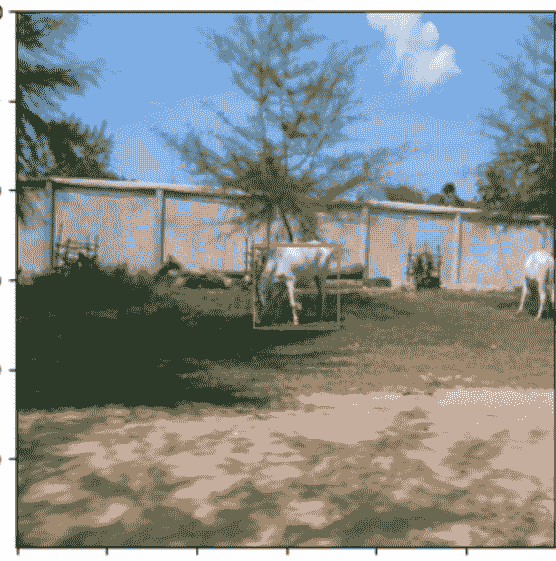

图 9.5：SSD 模型在 PASCAL VOC 2012 示例图像上的输出

## 在 PASCAL VOC 上训练 SSD

训练 SSD 涉及准备数据集、使用适当的目标类别数初始化模型，并执行训练循环。该设置与我们为 Fast-RCNN 创建的设置非常相似。

## 评估与指标计算

在 PASCAL VOC 数据集上评估 SSD 的性能涉及计算精确率、召回率、IoU 和 mAP 等指标。该过程与 Fast R-CNN 部分概述的评估步骤类似，需针对 SSD 的输出格式进行调整。

由于篇幅限制，详细的评估脚本已省略。不过，该过程与 Fast R-CNN 非常相似，需要 COCO 格式的数据集来计算 mAP，并使用 pycocotools 来计算评估指标。

## 深入探讨 YOLOv5：目标检测中速度与精度的巅峰

YOLOv5 是“你只看一次”系列的最新迭代，是一款以卓越速度和精度著称的尖端目标检测模型。由 Ultralytics 开发，YOLOv5 针对性能和效率进行了微调，使其成为实时目标检测任务中最受欢迎的选择之一。其轻量级架构结合最先进的检测能力，使其能够在包括边缘设备在内的各种平台上快速部署。

## 在 PyTorch 中设置 YOLOv5

与前辈模型不同，YOLOv5 是在 PyTorch 中实现的，能够与 PyTorch 工作流无缝集成。要开始使用 YOLOv5，可以克隆 Ultralytics 仓库，并使用其预训练模型或在自定义数据集上训练自己的模型。

首先，确保已克隆 YOLOv5 仓库并安装所有必要的依赖项：

```
git clone https://github.com/ultralytics/yolov5
cd yolov5
pip install -r requirements.txt
```

要加载预训练 YOLOv5 模型：

```python
import torch

# Load the pretrained YOLOv5 model
model = torch.hub.load('ultralytics/yolov5', 'yolov5s', pretrained=True)
```


## YOLOv5 的架构亮点

YOLOv5 在 YOLO 架构的基础上进行了多项改进：

- Automatic Anchor Optimization：YOLOv5 会自动调整其锚框，以更好地适应训练所用的特定数据集，从而提高检测精度。
- Cross-Stage Partial Networks (CSPNet)：该功能在保持检测性能的同时降低计算成本。
- Mosaic Data Augmentation：一种创新的数据增强技术，将四张训练图像组合成一张，增强模型对各种目标比例和方向的鲁棒性。

## 在自定义图像上使用 YOLOv5 进行目标检测

得益于 Ultralytics 框架，使用 YOLOv5 进行目标检测非常简单。以下是在自定义图像上运行推理的方法：

```
import torch
from torchvision.datasets import VOCDetection
# Load the pretrained YOLOv5 model
model = torch.hub.load('ultralytics/yolov5', 'yolov5s', pretrained=True)
# Load an example image from the PASCAL VOC dataset
dataset = VOCDetection(root='./voc_data', year='2012', image_set='val', download=False)
image, _ = dataset[3] # Sample image
# Perform inference
results = model(image)
# Results show
results.show()
```

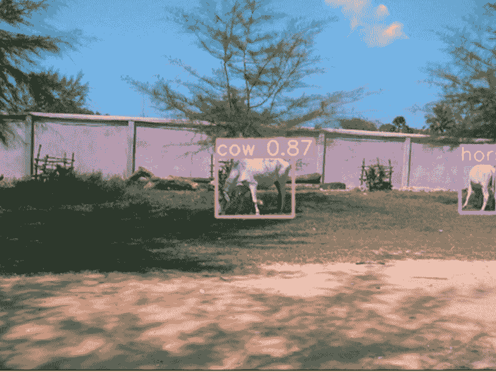

图 9.6：YOLOv5 模型在 PASCAL VOC 2012 示例图像上的输出

results.show() 方法可方便地显示带有边界框、类别标签和置信度得分的图像。

## 在 PASCAL VOC 数据集上训练和评估 YOLOv5

在 PASCAL VOC 等自定义数据集上训练 YOLOv5，需要将数据集准备为适当的格式并配置训练脚本。YOLOv5 要求数据集采用特定的目录结构和标注格式（YOLO 格式）。

**准备您的数据集：** 将 PASCAL VOC 标注转换为 YOLO 格式，并按以下方式组织数据集目录：

```
dataset/
images/
train/
val/
labels/
train/
val/
```

**训练模型：** 使用 YOLOv5 训练脚本。根据您的设置调整批量大小和 epoch 数量。

```
python train.py --img 640 --batch 16 --epochs 50 --data VOC.yaml --weights yolov5s.pt
```

这里，**voc.yaml** 是一个配置文件，用于指定数据集路径、类别名称和类别数量。YOLO v5 仓库提供了此 YAML 文件，包含启动训练所需的所有配置。

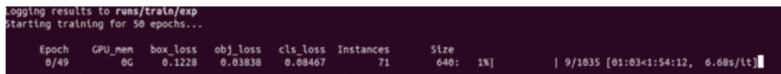

图 9.7：在 VOC.yaml 上运行 YOLOv5 训练的输出

### 评估 YOLOv5 的性能

YOLOv5 的仓库包含用于评估的脚本。要在验证集上评估已训练的模型，可以使用以下命令：

```
python val.py --weights yolov5s.pt --data VOC.yaml --img 640 --iou 0.65 --half
```

该脚本计算精确率、召回率、mAP@.5 和 mAP@.5:.95 等指标，全面概述模型的性能。此操作只能在 VOC.yaml 数据集上微调模型后运行。预训练权重包含 80 个类别。

### 结论

在我们结束目标检测与 YOLOv5 这一动态世界的探索之旅时，显而易见，深度学习模型的演进已显著增强了我们解读和理解周围视觉世界的能力。YOLOv5 以其卓越的速度、精度和效率相结合，成为计算机视觉领域持续创新的有力证明。该模型体现了“你只看一次”的原则，不仅简化了检测过程，还为实时应用开辟了新的前景，使人工智能的未来愿景更接近现实。

YOLOv5 在各种环境中处理复杂目标检测任务的能力，展示了我们取得的显著进步。通过结合自动锚优化、CSPNet 和马赛克数据增强等特性，YOLOv5 能适应并在各种检测场景中表现出色，不断拓展自动化系统所能感知和理解的边界。此外，其易用性和易于集成到 PyTorch 工作流的特点，使尖端技术民主化，让研究人员和从业者均可根据自身需求利用其功能。

该模型的多功能性不仅限于目标检测；它还作为更复杂的分析和应用的基础，从跨视频帧跟踪目标，到辅助自动化监控，甚至通过实时分析提升客户体验。YOLOv5 的适应性和鲁棒性，凸显了深度学习在重塑我们与数字内容和物理世界互动方式方面的变革潜力。

然而，计算机视觉领域不仅限于在画面中识别和分类目标。虽然我们讨论了各种目标检测模型和技术，但深度学习旅程中下一个关键步骤是了解如何有效优化模型性能。当我们过渡到下一章“提高模型性能的技巧和窍门”时，我们将深入探讨可提升模型性能的高级技术。从理解过拟合和欠拟合的挑战，到应用 dropout 和批量归一化等正则化方法，我们将探索确保高效训练的关键策略。本章还将涵盖超参数调优、早停法以及集成模型的强大作用，以提升整体模型精度。到本章结束时，您将掌握所需的工具和方法，来微调和增强已构建的模型，确保它们在计算机视觉的各项任务中都能发挥最佳性能。

## 第 10 章
## 提高模型性能的技巧和窍门

### 简介

模型性能是决定任何机器学习项目成败的关键因素。虽然构建和训练模型是基础，但针对现实应用优化模型需要高级技术。仅在数据集上训练模型通常是不够的，因为过拟合、欠拟合、训练过程低效和超参数调优不当等因素都会对性能产生负面影响。为应对这些挑战，必须对模型进行微调，确保其能较好地泛化到未见数据，同时保持效率。

在本章中，我们将探讨一系列优化模型性能的高级方法。这些方法涵盖 dropout 和批量归一化等正则化技术，以及超参数微调和集成学习策略的应用。目标是为您提供必要的工具，以识别模型中的潜在问题，并实施能提升整体精度和鲁棒性的解决方案。

我们首先回顾两个基本概念——过拟合和欠拟合——它们可能削弱模型的泛化能力。借鉴之前章节的讨论，例如第 5 章《深入卷积神经网络（CNNs）》中关于卷积神经网络（CNN）训练的内容，以及第 9 章《目标检测模型》中关于 Faster R-CNN 等目标检测模型的内容。我们将演示这些现象如何影响计算机视觉任务中的模型。了解如何检测和缓解过拟合和欠拟合是优化性能的第一步。

接着，我们深入探讨正则化技术。Dropout 首先在第 5 章《深入卷积神经网络（CNNs）》中作为提升 CNN 性能的手段提出，此处将进行更深入的探讨。通过在训练期间随机丢弃神经元，dropout 有助于防止模型过度依赖特定特征，从而提高其泛化能力。批量归一化是另一项关键技术，也将详细讨论，重点介绍如何通过标准化每层输入来稳定并加速训练。

本章随后将进入超参数调优，这是模型优化中一个常被忽视但至关重要的方面。无论是调整学习率、调整批量大小，还是确定最佳层数，超参数调优都会对性能产生重大影响。我们将讨论各种调优技术，从手动实验到更系统的方法，如网格搜索和随机搜索。

最后，我们将探讨集成学习方法，如 bagging、boosting 和 stacking，以结合多个模型的优势。这些技术让您能够利用不同模型相互弥补弱点的能力，从而提升整体性能。

在本章结束时，您将拥有一套强大的策略来改进模型，确保它们在从图像分类到目标检测等广泛的计算机视觉任务中都能发挥最佳性能。

### 结构

在本章中，将涵盖以下主题：


- 理解过拟合和欠拟合
- 正则化技术：Dropout 和 Batch Normalization
- 超参数调优技术
- 使用早停进行高效训练
- 集成模型以提升性能

## 理解过拟合和欠拟合

在机器学习中，过拟合和欠拟合是两个关键挑战，会显著影响模型性能。这两个问题都源于模型从训练数据泛化到未见数据的能力，或缺乏此类能力。了解如何检测和解决这些问题对于提高模型准确性和鲁棒性至关重要。

### 过拟合

当模型变得过于复杂，学习了训练数据中的噪声或随机波动，而非底层模式时，就会发生过拟合。因此，模型在训练数据上表现异常出色，但难以将其泛化到新的、未见的数据。过拟合在处理大型模型时尤为常见，例如卷积神经网络（CNNs）或复杂的目标检测架构，如 YOLO 和 Faster R-CNN。

当模型过拟合时，它实际上是在“记忆”训练数据，而非学习数据中的关系。这可以通过训练和验证准确率或损失之间的显著差距来观察：训练准确率很高，而验证准确率却远低于此。

### 过拟合的指标

- **训练损失与验证损失：** 过拟合的明显迹象是训练损失持续下降，而验证损失开始增加。这表明模型在训练数据上表现良好，但未能泛化。

- **高方差：** 过拟合模型通常具有高方差，这意味着训练数据的微小变化可能导致其性能大幅波动。这种方差在实际应用中是个问题，因为模型需要在新数据上保持稳定的表现。

**Faster R-CNN 中的过拟合示例：** 让我们考虑在上一章中讨论过的 Faster R-CNN 目标检测模型。如果在 PASCAL VOC 等数据集上训练时间过长且缺乏适当的正则化，模型可能会开始过拟合。该模型在训练集上会获得高准确率，但在验证集上评估时却会遇到困难。

```
# Example: Training Faster R-CNN with overfitting symptoms
import torchvision.models.detection as detection

# Load pre-trained Faster R-CNN model
model = detection.fasterrcnn_resnet50_fpn(pretrained=True)
model.train()

# Example training loop
for epoch in range(50): # Training for too many epochs
    train_loss = train_one_epoch(model) # Hypothetical function
    val_loss = validate(model) # Hypothetical function

print(f'Epoch {epoch}, Train Loss: {train_loss}, Validation Loss: {val_loss}')

# Check for overfitting
if train_loss < val_loss:
    print("Warning: Model may be overfitting.")
```

在这种情况下，如果你注意到训练损失持续下降但验证损失开始增加，可以怀疑正在发生过拟合。如果没有早停或 Dropout 等干预措施（将在后面章节中介绍），该模型在实际数据上的表现可能不佳。

### 欠拟合

另一方面，当模型过于简单，无法捕捉数据中的底层模式时，就会发生欠拟合。当模型不够复杂，无法学习输入特征与输出标签之间的关系时，就会出现这种情况。因此，它在训练集和验证集上的表现都较差。

欠拟合通常发生在模型架构过于简单、参数不足或训练轮数太少时。在这些情况下，模型无法掌握数据集的基本特征，导致整体表现不佳。与过拟合不同，欠拟合更容易检测，因为模型从一开始表现就平平。

### 欠拟合的指标

- **训练损失高：** 如果训练损失较高且在训练过程中没有显著下降，模型可能存在欠拟合。
- **复杂度低：** 欠拟合通常是由于模型对于任务来说过于简单。例如，为复杂的计算机视觉任务使用小型神经网络可能会导致欠拟合。
- **训练不足：** 如果模型训练的轮数不足或缺乏足够的数据可供学习，可能会出现欠拟合。

**YOLO 中的欠拟合示例：** 让我们考虑 YOLO（You Only Look Once）模型，这是上一章讨论的另一个目标检测模型。YOLO 旨在与大型数据集和复杂的目标检测任务配合使用。然而，如果训练轮数过少或网络非常小，模型可能会欠拟合，导致性能不佳。

```
# Example: Training YOLO with underfitting symptoms
import torch
from torchvision import models

# Load a pre-trained YOLO model with a small architecture
(hypothetical)
model = models.yolo_small(pretrained=True)
model.train()

# Example training loop for few epochs (leading to underfitting)
for epoch in range(3):  # Too few epochs
    train_loss = train_one_epoch(model)  # Hypothetical function
    val_loss = validate(model)  # Hypothetical function

    print(f'Epoch {epoch}, Train Loss: {train_loss}, Validation Loss: {val_loss}')

# Underfitting case
if train_loss > val_loss:
    print("Warning: Model is underfitting.")
```

在这种情况下，如果经过几个轮次后训练损失仍然很高，模型可能存在欠拟合。增加训练轮数、添加更多层或使用更大的架构，可以帮助模型更有效地学习数据中的模式。

### 应对过拟合和欠拟合的策略

### 减少过拟合：

- **正则化技术：** 诸如 Dropout（将在下一节介绍）和 L2 正则化等正则化方法，可以防止模型过度依赖特定的神经元或权重。

- **早停：** 实现早停可以在验证性能开始下降时停止训练过程，从而防止过拟合（本章后面将详细讨论）。

- **交叉验证：** 在训练期间使用交叉验证可以帮助早期检测过拟合，并确保模型在数据的不同子集上都能良好泛化。

### 解决欠拟合：

- **增加模型复杂度：** 解决欠拟合最简单的方法之一是通过添加更多层或神经元来增加模型复杂度。例如，从浅层 CNN 转向 ResNet 等更深层的架构，可以提升复杂任务的性能。

- **训练更多轮次：** 欠拟合通常发生在模型训练时间不足，无法捕捉数据中的模式时。为模型训练更多轮次，可以让它学习更复杂的关系。

- **使用预训练模型：** 像第 7 章《使用 PyTorch 探索迁移学习》中介绍的迁移学习，可以通过利用已从较大数据集中学习到有意义表示的模型，来帮助解决欠拟合问题。

### 平衡模型性能

实现最佳模型性能的关键在于在过拟合和欠拟合之间取得平衡。模型过于复杂会有过拟合的风险，过于简单则会有欠拟合的风险。本章介绍的超参数调优、正则化和早停等技术，是实现这一平衡的重要工具。

## 正则化技术：Dropout 和 Batch Normalization

正则化技术对于提高模型泛化能力和防止过拟合至关重要。在本节中，我们将探讨两种最广泛使用的正则化方法：Dropout 和批量归一化。这两种技术在优化深度学习模型方面发挥了关键作用，尤其是在图像分类和目标检测等复杂任务中，我们在前几章中已经介绍过这些任务。

如前所述，Dropout 和批量归一化在卷积神经网络（CNNs）中尤其有益。这些技术在 ResNet 和 Inception 等 CNNs 中能带来显著改善，这些网络依赖于深层结构和复杂架构。通过引入 Dropout 和批量归一化，我们可以增强模型的鲁棒性，并确保其在未见数据上的表现良好。

### Dropout：一种有效的正则化技术

Dropout 是一种流行的正则化方法，旨在通过在训练过程中随机“丢弃”（即将其设为零）一部分神经元，来防止神经网络过拟合。这迫使网络学习更强健的特征，并防止其过度依赖特定神经元。Dropout 在 CNNs 等大型模型中尤其有效，因为这些网络的深度使其更容易发生过拟合。


本质上，丢弃法通过向网络引入噪声来工作，使模型更难依赖于单个神经元。在训练的每次迭代中，随机选择的神经元子集会被忽略，这意味着它们在该次迭代中的贡献不会被考虑。这迫使模型将学习分布到多个神经元上，提高其对未见数据的泛化能力。

## 丢弃法的工作原理

丢弃法在训练期间通过以概率 p 随机选择要“丢弃”的神经元来运行。例如，如果 p = 0.5，则在每次训练迭代中，大约 50% 的神经元会被丢弃。训练结束后，在推理阶段，所有神经元都会被使用，但它们的输出会按概率 p 进行缩放。这种缩放确保了网络在训练和测试阶段之间表现一致。

在 CNN 的背景下，丢弃法通常应用于全连接层之后，因为这些层由于参数量大，更容易过拟合。然而，丢弃法也可以应用于卷积层之后，尤其是在非常深的网络中，例如我们在第 5 章《深入卷积神经网络（CNN）》中讨论过的 ResNet 和 Inception 等网络，在这些网络中，防止过拟合变得至关重要。

## 在 PyTorch 中实现丢弃法

PyTorch 通过使用 nn.Dropout 层简化了丢弃法的实现。你可以通过在层之间插入它来将丢弃法添加到模型中。以下是如何在 CNN 模型中实现丢弃法的示例：

```python
import torch
import torch.nn as nn
import torch.optim as optim
import torch.nn.functional as F

class CNNWithDropout(nn.Module):
    def __init__(self):
        super(CNNWithDropout, self).__init__()
        # Define a simple CNN architecture
        self.conv1 = nn.Conv2d(3, 32, kernel_size=3)
        self.conv2 = nn.Conv2d(32, 64, kernel_size=3)
        self.dropout = nn.Dropout(0.5)  # Dropout with 50% probability
        self.fc1 = nn.Linear(64 * 6 * 6, 128)
        self.fc2 = nn.Linear(128, 10)

    def forward(self, x):
        x = F.relu(self.conv1(x))
        x = F.max_pool2d(F.relu(self.conv2(x)), 2)
        x = x.view(-1, 64 * 6 * 6)  # Flatten the feature map
        x = self.dropout(F.relu(self.fc1(x)))  # Apply dropout after fully connected layer
        x = self.fc2(x)
        return x
```

```python
# Instantiate the model
model = CNNWithDropout()
# Example optimizer and loss function
optimizer = optim.Adam(model.parameters(), lr=0.0001)
criterion = nn.CrossEntropyLoss()
```

在此示例中，我们在第一个全连接层（fc1）之后应用概率为 0.5 的丢弃法。这确保了在每次训练迭代中，50% 的神经元会被随机忽略，迫使模型学习更鲁棒的特征。

## 丢弃法对模型性能的影响

丢弃法通过减少网络对单个神经元的依赖，显著降低过拟合。在第 5 章《深入卷积神经网络（CNN）》中，我们讨论了像 ResNet 这样具有深层架构的 CNN 如何在 CIFAR-10 或 ImageNet 等大型图像数据集上训练时从丢弃法中受益。如果没有丢弃法，这些模型可能会因其高容量和深层而过拟合。

通过应用丢弃法，你可以在模型复杂度和泛化性之间取得平衡，使模型在未见数据上表现更好。这在图像分类等任务中特别有用，因为图像数据的高维度使得过拟合成为一个常见问题。

## 调整丢弃概率

选择合适的丢弃概率至关重要。值过低（例如 p = 0.1）可能无法有效防止过拟合，而值过高（例如 p = 0.9）可能会阻止模型学习有用特征。在实践中，p = 0.5 的概率常用于全连接层，而较小的概率（例如 p = 0.2）则更常用于卷积层。

## 批量归一化：稳定训练过程

批量归一化是另一种强大的正则化技术，它解决训练深度神经网络的另一个方面。它通过对每个层的输出进行归一化，使下一层的输入分布在整个训练过程中保持一致。这有助于通过减少内部协变量偏移（internal covariate shift，即层输入分布在训练过程中发生变化，导致模型更难收敛的现象）来稳定和加速训练过程。

在讨论 ResNet 和 Inception 等 CNN 时，之前已经介绍过批量归一化。这些由许多层组成的深层架构，如果每个层的输入变化过大，可能会导致训练不稳定。批量归一化通过确保激活值的均值和方差在不同训练批次中保持不变，从而缓解了这一问题。

## 批量归一化的工作原理

批量归一化通过将每个层的输出归一化为均值为 0、方差为 1，然后使用学习到的参数对输出进行缩放来运行。这种归一化在训练期间应用于小批量数据，确保模型不会经历激活值的大幅波动，从而实现更快、更稳定的收敛。

除了正则化之外，批量归一化的另一个好处是允许使用更高的学习率，这可以显著加快训练速度。这是因为归一化后的输入不太可能导致梯度爆炸或梯度消失，这两个问题会减慢甚至完全停止深层网络中的训练过程。

## 在 PyTorch 中实现批量归一化

PyTorch 提供了 nn.BatchNorm2d 层用于 2D 卷积层的批量归一化，以及 nn.BatchNorm1d 用于全连接层。以下是如何在 CNN 模型中实现批量归一化的示例：

```python
import torch
import torch.nn as nn
import torch.optim as optim
import torch.nn.functional as F

class CNNWithBatchNorm(nn.Module):
    def __init__(self):
        super(CNNWithBatchNorm, self).__init__()
        # Define a simple CNN architecture with Batch Normalization
        self.conv1 = nn.Conv2d(3, 32, kernel_size=3)
        self.bn1 = nn.BatchNorm2d(32)  # Batch normalization for first convolutional layer
        self.conv2 = nn.Conv2d(32, 64, kernel_size=3)
        self.bn2 = nn.BatchNorm2d(64)  # Batch normalization for second convolutional layer
        self.fc1 = nn.Linear(64 * 6 * 6, 128)
        self.fc2 = nn.Linear(128, 10)

    def forward(self, x):
        x = F.relu(self.bn1(self.conv1(x)))  # Apply batch normalization after convolution
        x = F.max_pool2d(F.relu(self.bn2(self.conv2(x))), 2)
        x = x.view(-1, 64 * 6 * 6)
        x = F.relu(self.fc1(x))
        x = self.fc2(x)
        return x
```

```python
# Instantiate the model
model = CNNWithBatchNorm()

# Example optimizer and loss function
optimizer = optim.Adam(model.parameters(), lr=0.001)
criterion = nn.CrossEntropyLoss()
```

在此示例中，我们在每个卷积层（conv1 和 conv2）之后应用批量归一化。这确保了传递给后续层的激活值经过归一化，从而实现更稳定、更高效的训练。

## 批量归一化对模型收敛的影响

批量归一化对模型收敛有深远影响，特别是在深层网络中。稳定每个层的输入分布可以使用更高的学习率，从而加速收敛。在 ResNet 等 CNN 中，批量归一化是确保模型能够在大型数据集上高效训练且不受梯度不稳定影响的关键因素。

除了改善收敛之外，批量归一化还作为一种正则化形式，在某些情况下减少了对丢弃法等技术的需求。这是因为归一化步骤本质上降低了过拟合的可能性，防止神经元对训练数据中的特定特征过于敏感。

## 结合丢弃法和批量归一化

虽然丢弃法和批量归一化通常独立使用，但也可以在同一个模型中结合使用，以进一步提升性能。丢弃法侧重于通过随机忽略神经元来减少过拟合，而批量归一化稳定训练过程并加速收敛。通过同时使用这两种技术，你可以在防止过拟合和确保稳定训练之间取得平衡。

在 _第 5 章，深入卷积神经网络（CNNs）_ 中，我们探讨了丢弃法如何应用于 ResNet 和 Inception 等模型。批量归一化也是这些模型的组成部分，确保深层能够高效训练。通过结合这两种技术，你可以增强这些架构的性能，尤其是在处理 ImageNet 或 CIFAR-10 等复杂数据集时。

正则化对于确保模型能够很好地泛化到新数据至关重要，而丢弃法和批量归一化等技术是你可用的最有效的工具之一。丢弃法通过迫使网络依赖多个神经元来防止过拟合，而批量归一化通过归一化激活值来稳定训练并加速收敛。通过在 PyTorch 中实现这些技术，你可以显著提升


你深度学习模型的性能，特别是在图像分类和目标检测等任务中。

在继续优化模型的过程中，请牢记，dropout 和 batch normalization 均可根据架构的具体需求进行调整。无论你是使用 CNNs，还是使用 YOLO 和 Faster R-CNN 等更先进的模型，这些正则化技术都将帮助确保你的模型在各种任务中都能发挥最佳性能。

## 超参数调优技术

超参数调优是优化深度学习模型的重要组成部分。与在训练过程中学习得到的模型参数不同，超参数由用户手动设置，并可能对模型性能产生重大影响。超参数控制训练过程的各个方面，例如学习率、批量大小和模型复杂度。在本节中，我们将探讨不同的超参数调优技术，包括学习率调度、网格搜索和随机搜索。这些方法可帮助你为模型找到最优配置，提升训练效率和最终性能。

### 学习率调度

学习率是深度学习中最关键的超参数之一。它控制优化器在梯度下降过程中迈出的步长。如果学习率过高，模型可能会越过最优解，导致不稳定。相反，如果学习率过低，模型可能会收敛得太慢，或者陷入局部最小值。

学习率调度会随时间调整学习率，从而帮助优化收敛过程。一种常见的做法是从较高的学习率开始，并在训练推进时逐渐降低它。这样可以在模型距离最优解较远时进行较大的更新，并在接近最优解时进行更精细的更新。

### 阶梯衰减学习率调度

一种常见的学习率调度是阶梯衰减，即在特定间隔按一定比例降低学习率。这种方法可以在早期实现快速学习，随后进行更精细的更新。

### 代码示例：在 PyTorch 中实现阶梯衰减

```python
import torch.optim as optim

# Define the optimizer with an initial learning rate
optimizer = optim.SGD(model.parameters(), lr=0.1, momentum=0.9)

# Define a learning rate scheduler that decays the learning rate by a factor of 0.1 every 10 epochs
scheduler = optim.lr_scheduler.StepLR(optimizer, step_size=10, gamma=0.1)

# Training loop
for epoch in range(30):
    train_one_epoch(model, optimizer) # Hypothetical function to train model for one epoch
    scheduler.step() # Update learning rate based on scheduler
    print(f'Epoch {epoch+1}, Learning Rate: {scheduler.get_last_lr()}')
```

在此示例中，学习率每 10 个 epoch 降低为原来的 0.1 倍，确保模型在训练初期进行较大更新，在后期进行较小更新。

### 其他学习率调度

其他类型的学习率调度包括：

- **指数衰减：** 学习率随时间呈指数下降，这对于需要逐步微调的模型很有用。
- **余弦退火：** 学习率在训练过程中在最小值和最大值之间振荡，这有助于跳出局部最小值并改善收敛。

### 网格搜索

网格搜索是超参数调优中最直接的技术之一。它通过穷尽搜索指定的超参数集，对每种组合评估模型性能来工作。虽然网格搜索实现简单，但计算成本可能很高，尤其是在处理大型模型和众多超参数时。不过，它对于可以评估所有可能组合的中小型搜索空间非常有用。

### 网格搜索的工作原理

在网格搜索中，你为每个超参数定义一组可能的值。然后，算法会对这些值的每种可能组合训练模型，并使用交叉验证来评估每种配置的性能。

例如，如果你正在调整学习率和批量大小，你可以指定一组学习率（例如，0.001、0.01、0.1）和批量大小（例如，16、32、64）。网格搜索将使用这些值的每种组合训练模型，并选择在验证集上表现最佳的配置。

### 代码示例：使用 Scikit-Learn 实现网格搜索

```python
from sklearn.model_selection import GridSearchCV
from sklearn.ensemble import RandomForestClassifier

# Define the model and hyperparameter grid
model = RandomForestClassifier()
param_grid = {
    'n_estimators': [50, 100, 200],
    'max_depth': [10, 20, 30]
}

# Perform grid search with cross-validation
grid_search = GridSearchCV(model, param_grid, cv=5)
grid_search.fit(X_train, y_train)  # X_train and y_train are the training data

print(f'Best Hyperparameters: {grid_search.best_params_}')
```

在此示例中，网格搜索用于调整随机森林模型的估计器数量和最大深度。PyTorch 用户也可以使用 Ray Tune 或 Optuna 等库集成网格搜索，这些库简化了超参数调优过程。

### 随机搜索

随机搜索是网格搜索的一种替代方法，它从搜索空间中随机采样超参数组合。与网格搜索评估每种可能组合不同，随机搜索会随机选择组合进行评估。这种方法在计算上比网格搜索更高效，并且通常只需更少的迭代即可获得相似的结果。

### 随机搜索的工作原理

在随机搜索中，你为每个超参数指定值的范围，算法会随机选择组合进行评估。当搜索空间很大，且某些超参数比其他超参数更关键时，随机搜索尤其有效。例如，如果只有少数几个超参数显著影响模型性能，随机搜索可能比网格搜索更快找到良好解决方案。

### 代码示例：使用 Scikit-Learn 实现随机搜索

```python
from sklearn.model_selection import RandomizedSearchCV
from sklearn.ensemble import RandomForestClassifier

# Define the model and hyperparameter distribution
model = RandomForestClassifier()
param_dist = {
    'n_estimators': [50, 100, 200],
    'max_depth': [10, 20, 30]
}

# Perform random search with cross-validation
random_search = RandomizedSearchCV(model, param_dist, n_iter=5, cv=5)
random_search.fit(X_train, y_train)

print(f'Best Hyperparameters: {random_search.best_params_}')
```

在此示例中，随机搜索从指定范围中评估五个随机的超参数组合。这种方法通常比网格搜索更快，并且在不需要测试每种可能组合时效果良好。

### 选择合适的技术

在网格搜索和随机搜索之间进行选择，取决于你的搜索空间大小和可用计算资源。网格搜索适用于希望评估每种组合的小型搜索空间，而随机搜索对于评估每种组合不切实际的大型搜索空间更高效。

对于大规模项目或更复杂的模型，**贝叶斯优化** 或使用 **Ray Tune** 等工具可以进一步提高超参数调优效率。这些方法能智能地搜索超参数空间，聚焦于最有希望的区域。

超参数调优是优化深度学习模型的关键步骤。无论你是使用调度修改学习率、执行网格搜索，还是使用随机搜索，找到合适的超参数都能显著提升模型性能。通过应用这些技术，你可以确保模型不仅准确，而且高效且稳健。

## 使用早停实现高效训练

训练深度学习模型通常需要在数据集上运行多次迭代（epoch），以最小化损失并优化模型性能。然而，如果训练时间过长，模型可能会开始过拟合，即学习训练数据中的噪声，而非泛化到新的、未见过的数据。这就是**早停**发挥作用的地方。早停是一种在训练期间监控模型性能，并在模型在验证集上不再改进时停止训练过程的技术。它对于防止过拟合和优化训练时间特别有益。

在本节中，我们将深入探讨早停的工作原理、其主要优势，以及如何在 PyTorch 中实现它。

### 早停的工作原理

早停背后的想法很简单：不要为固定数量的 epoch 训练模型，而是监控


模型在每个 epoch 结束时在验证集上的表现。当验证性能（通常由验证损失或验证准确率衡量）不再改善时，训练将停止。这可以避免过拟合，并确保模型在达到最佳性能后不会浪费时间继续训练。

## 早停机制

训练期间，早停会在每个 epoch 结束时评估模型在验证集上的表现。它维护一个“耐心”（patience）参数，指定在上次改进后需要等待多少个 epoch 才能停止训练。如果验证损失或其他监控指标在定义的“耐心” epoch 数量后仍未改善，则停止训练过程。

例如，如果耐心设置为 5，且模型在 5 个 epoch 内没有改善，训练将停止。通过提前停止，你可以节省计算资源，避免对训练数据过拟合。

## 早停的好处

早停为深度学习模型提供了多项重要好处：

- **防止过拟合：** 如前所述的过拟合部分所讨论，训练时间过长的模型可能会开始记忆训练数据，从而降低其泛化能力。早停通过在模型在验证集上的性能开始下降时停止训练来防止这种情况。

- **减少训练时间：** 早停有助于缩短总体训练时间。与其运行固定数量的 epoch（其中一些可能不必要），不如在模型达到最佳性能时缩短训练过程，从而节省计算资源。

- **提高模型泛化能力：** 通过在验证损失最小化时停止训练过程，早停确保模型处于最佳状态以泛化到未见数据。这在现实世界任务中表现更好。

## 在 PyTorch 中实现早停

虽然 PyTorch 默认不包含早停，但实现起来很简单。我们可以创建一个早停类来监控验证损失，并在损失在指定数量的 epoch 内没有改善时停止训练。

## 代码示例：PyTorch 中的早停

下面是 PyTorch 中早停的实现示例，使用“耐心”（patience）参数来监控验证损失：

```python
import torch
import torch.nn as nn
import torch.optim as optim

class EarlyStopping:
    """Early stopping class to stop training when validation loss
    does not improve."""
    def __init__(self, patience=5, delta=0):
        self.patience = patience
        self.delta = delta
        self.counter = 0
        self.best_loss = None
        self.early_stop = False

    def __call__(self, val_loss):
        if self.best_loss is None:
            self.best_loss = val_loss
        elif val_loss > self.best_loss - self.delta:
            self.counter += 1
            if self.counter >= self.patience:
                print("Early stopping triggered")
                self.early_stop = True
            else:
                self.best_loss = val_loss
                self.counter = 0
# Example training loop with early stopping
def train_model(model, train_loader, val_loader, criterion,
    optimizer, patience=5):
    early_stopping = EarlyStopping(patience=patience)
    for epoch in range(100):  # Train for up to 100 epochs
    # Training phase
    model.train()
    for inputs, labels in train_loader:
        optimizer.zero_grad()
        outputs = model(inputs)
        loss = criterion(outputs, labels)
        loss.backward()
        optimizer.step()
    # Validation phase
    model.eval()
    val_loss = 0.0
    with torch.no_grad():
        for inputs, labels in val_loader:
            outputs = model(inputs)
            loss = criterion(outputs, labels)
            val_loss += loss.item()
    val_loss /= len(val_loader)
    print(f"Epoch {epoch+1}, Validation Loss: {val_loss:.4f}")
    # Check for early stopping
    early_stopping(val_loss)
    if early_stopping.early_stop:
        print(f"Training stopped at epoch {epoch+1}")
        break
```

```python
# Example usage
model = nn.Linear(10, 1) # Simple model for demonstration
optimizer = optim.Adam(model.parameters(), lr=0.001)
criterion = nn.MSELoss()
train_loader = [...] # Your training data loader
val_loader = [...] # Your validation data loader
# Train the model with early stopping
train_model(model, train_loader, val_loader, criterion,
            optimizer, patience=5)
```

在此示例中，EarlyStopping 类在每个 epoch 结束时监控验证损失。如果验证损失在指定数量的 epoch 内（此处为 5 个）没有改善，则停止训练过程。这样可以防止模型在验证集上达到最佳性能后继续训练。

### 早停的关键参数

- **耐心（Patience）：** 在上次改进后等待停止的 epoch 数量。典型值可能在 5 到 10 之间，具体取决于模型和数据集的复杂性。

- **Delta：** 此参数允许你定义被视为改进的验证损失最小变化量。如果损失变化小于 delta，则不被视为改进。

### 何时使用早停

早停对于训练时间较长的大型模型和数据集尤其有利。例如，在 ImageNet 等复杂数据集上训练的深层 CNN 可以从早停中受益，以避免冗长且不必要的训练运行。在尝试不同架构和超参数时，早停也很有用，可让你提前停止表现不佳的模型，转而尝试更有前景的配置。

早停是高效训练深度学习模型的宝贵工具。通过在验证性能不再改善时停止训练，早停不仅可以防止过拟合，还能减少训练时间。在 PyTorch 中实现早停很简单，能显著提升模型性能，确保模型适合实际应用。

## 用于提升性能的集成模型

集成学习是一种强大的技术，通过结合多个模型的预测来实现比任何单个模型单独所能达到的更好性能。通过汇集多个模型的优势，集成方法有助于减少方差、偏差和过拟合，从而提高泛化能力和鲁棒性。本节将探讨三种流行的集成技术——袋装法（bagging）、提升法（boosting）和堆叠法（stacking）——并讨论如何将它们应用于深度学习模型，尤其是目标检测模型，例如 Faster R-CNN 和 YOLO。

## 袋装法（Bootstrap Aggregating）

袋装法是一种集成技术，涉及在训练数据的不同随机子集上训练同一模型的多个实例，通常使用自助法（有放回采样）。每个模型独立训练，并将它们的预测组合（例如，通过平均或多数投票）以生成最终结果。袋装法有助于降低模型的方差，使其不易过拟合。

一种著名的袋装算法是**随机森林（Random Forest）**，它训练多个决策树并聚合其预测。在深度学习中，可以通过在数据的不同子集或不同初始权重上训练模型的多个版本，将袋装法应用于 CNN 或目标检测模型等模型。

## 示例：PyTorch 中的袋装法

```python
import torch
import torch.nn as nn

# Example of averaging predictions from multiple models
def ensemble_predictions(models, inputs):
    predictions = [model(inputs) for model in models]
    avg_predictions = torch.mean(torch.stack(predictions), dim=0)
    return avg_predictions

# Assume we have three pre-trained models
models = [FasterRCNN(), YOLO(), YOLO()]

# Predict using the ensemble
inputs = [...] # Input data
ensemble_output = ensemble_predictions(models, inputs)
```

在此示例中，我们结合多个目标检测模型（如 Faster R-CNN 和 YOLO）的预测，以生成更准确、更稳健的最终预测。

### 提升法（Boosting）

提升法是一种迭代集成技术，按顺序训练模型，每个新模型都专注于纠正前面模型犯下的错误。与袋装法不同，提升法通过给难以预测的样本赋予更高权重来降低偏差。最流行的提升算法是 AdaBoost，它会赋予更高


将权重分配给被误分类的样本并相应地调整模型。

提升方法可以通过组合弱学习者（例如，浅层神经网络）的预测来应用于深度学习，从而创建更强大的模型。虽然提升方法通常与决策树相关联，但它也可以用于提升 CNNs 和其他深度模型。

**示例：** 使用梯度提升框架的提升方法：提升方法通常使用 **XGBoost** 或 **LightGBM** 等框架实现，这些框架专注于改进决策树。在深度学习中，提升方法可以与 CNNs 结合用于分类任务，尽管在目标检测中较少使用。

## 堆叠

堆叠是一种更复杂的集成技术，涉及训练多个模型，然后使用“元模型”或“元学习者”组合它们的预测。元模型学习如何更好地组合基模型的输出，从而提高性能。与直接组合模型输出的装袋和提升不同，堆叠允许元模型学习基模型预测之间更复杂的关系。

在目标检测中，堆叠可以用于组合 Faster R-CNN 和 YOLO 等模型的预测。例如，您可以分别训练 Faster R-CNN 和 YOLO，然后将它们的输出（例如，边界框坐标和类别预测）馈送到一个结合两者优势的元模型中。

### **示例：目标检测中的堆叠**

```
import torch
# Example of stacking model outputs in object detection
```

```
def meta_model(faster_rcnn_output, yolo_output):
    # Combine outputs (e.g., averaging bounding boxes, class probabilities)
    combined_output = (faster_rcnn_output + yolo_output) / 2
    return combined_output

# Assume outputs from two models
faster_rcnn_output = torch.tensor([...])
yolo_output = torch.tensor([...])

# Meta-model combines the outputs
stacked_output = meta_model(faster_rcnn_output, yolo_output)
```

在此示例中，Faster R-CNN 和 YOLO 的输出使用简单的元模型进行组合。在实际应用中，可以训练更复杂的元模型，根据各自的优势智能地对输出进行加权。

## 目标检测中的集成应用

通过组合 Faster R-CNN 和 YOLO 等目标检测模型，可以充分发挥每个模型的优势，从而显著提升性能。例如，Faster R-CNN 擅长精确定位物体，而 YOLO 速度更快，更适合实时应用。通过结合这些模型，您可以同时获得高精度和高速度，使集成非常适合自动驾驶或监控等任务。

装袋、提升和堆叠等集成技术可以通过减少偏差、方差和过拟合，显著增强深度学习模型的性能。在目标检测中，组合 Faster R-CNN 和 YOLO 等模型可以产生更准确、更稳健的结果，使集成成为跨多种应用提升模型性能的宝贵工具。

## 结论

在本章中，我们探讨了几种提升模型性能的高级技术，每种技术旨在增强深度学习模型的准确性、稳健性和效率。我们首先考察了过拟合和欠拟合的常见陷阱，并讨论了 dropout 和批量归一化等正则化技术如何帮助缓解这些问题。通过应用这些策略，特别是在前几章讨论的 CNNs 和目标检测架构等模型中，您可以在未见数据上实现更好的泛化能力和更可靠的性能。

我们还深入探讨了超参数调优技术，重点介绍了学习率调度、网格搜索和随机搜索。这些方法允许您微调控制模型训练的各种参数，确保您的模型达到最佳性能。优化这些参数的重要性无论如何强调都不为过，因为即使是微小的调整也会显著影响模型的准确性和收敛性。

本章随后介绍了早停，这是一种关键工具，用于防止过拟合并节省计算资源，方法是在模型在验证集上的性能不再提升时停止训练。最后，我们探讨了集成方法，例如装袋、提升和堆叠，它们结合多个模型的优势，产生更准确、更稳健的预测。这些技术在目标检测等任务中尤其强大，组合 Faster R-CNN 和 YOLO 等模型可以同时获得高精度和高速度。

随着我们继续深入 PyTorch 深度学习之旅，下一章将向您介绍一个旨在简化和加速训练过程的强大框架。在即将到来的章节中，您将学习 PyTorch Lightning 如何简化复杂的训练循环、处理分布式计算，并实现更高效的模型优化，让您能够更轻松地专注于模型的扩展和微调。

## 第 11 章

## 使用 PyTorch Lightning 进行高效训练

### 简介

在深度学习中，训练模型的过程通常涉及编写大量样板代码，尤其是在处理优化、检查点保存和设备管理等任务时。这会使训练过程变得繁琐且更难管理，尤其是在模型和数据集不断扩大时。PyTorch Lightning 是一个轻量级框架，基于 PyTorch 构建，旨在简化训练过程的同时保持灵活性。通过抽象模型训练中涉及的许多重复性任务，PyTorch Lightning 使开发人员和研究人员能够专注于模型的核心逻辑。

PyTorch Lightning 的主要目标是使 PyTorch 代码更具模块化、可扩展性和整洁性，确保研究人员可以以最小的努力在多个 GPU 甚至分布式环境中扩展其模型。让我们探讨 PyTorch Lightning 带来的三个主要优势。

### 结构

本章将涵盖以下主题：

- PyTorch Lightning 的主要优势
- 将 PyTorch 代码转换为 PyTorch Lightning
- 使用 PyTorch Lightning 训练模型
- PyTorch Lightning 的最佳实践和技巧

### PyTorch Lightning 的主要优势

### 更整洁的代码

PyTorch Lightning 强制实现模型逻辑与训练过程之间的清晰分离。在标准 PyTorch 中，训练代码通常与模型定义紧密耦合，使其难以阅读、重用和调试。通过引入 LightningModule，PyTorch Lightning 帮助开发人员以结构化的方式组织代码，定义模型架构、前向传递和损失计算，而实际的训练循环由 Lightning 的 Trainer 处理。

例如，典型的 PyTorch 训练循环需要手动编写优化步骤、反向传播和设备管理，导致代码可能冗长且容易出错。PyTorch Lightning 通过在幕后处理这些步骤来简化这一过程，同时在需要时仍允许完全自定义。

### 更少的样板代码

在标准 PyTorch 中，设置优化器、处理多个设备（GPU）和记录指标等任务通常涉及重复性代码。使用 PyTorch Lightning，大部分样板代码被消除了。该框架通过其内置的回调函数和配置选项处理保存检查点、早停和日志记录等任务。这使得代码更加整洁、易读，且易于维护。

通过消除这些样板代码，PyTorch Lightning 降低了出错风险，并确保代码专注于模型逻辑，而不是训练机制。

### 简化训练过程

PyTorch Lightning 的突出特点之一是它可以轻松地将模型扩展到多个设备（如 GPU）甚至分布式训练设置。如果没有 Lightning，将 PyTorch 模型扩展到多 GPU 设置或分布式环境需要进行重大代码更改和处理复杂性。使用 PyTorch Lightning，这一过程被抽象化，开发人员只需几行代码即可扩展模型。

此外，Lightning 还为自动混合精度训练等功能提供了内置支持，这可以进一步优化训练过程，在保持模型性能的同时减少内存使用。

### 示例：PyTorch 与 PyTorch Lightning 训练循环

让我们看一下在 PyTorch 中训练模型的基本示例，并将其与 PyTorch Lightning 如何简化此过程进行比较。

### 标准 PyTorch 训练循环：

```
import torch
import torch.nn as nn
import torch.optim as optim

# Define a simple model
class SimpleModel(nn.Module):
    def __init__(self):
        super(SimpleModel, self).__init__()
        self.fc = nn.Linear(10, 1)

    def forward(self, x):
        return self.fc(x)

# Training loop in PyTorch
model = SimpleModel()
optimizer = optim.Adam(model.parameters(), lr=0.001)
criterion = nn.MSELoss()

for epoch in range(100):
    for inputs, targets in dataloader:
```


optimizer.zero_grad()
outputs = model(inputs)
loss = criterion(outputs, targets)
loss.backward()
optimizer.step()

在这个标准 PyTorch 示例中，训练逻辑（包括前向传播、损失计算、反向传播和优化）在训练循环中被手动编码。这可能导致代码重复和复杂性，尤其是在扩展时。

## PyTorch Lightning 版本：

import pytorch_lightning as pl
import torch.nn as nn
import torch.optim as optim
class SimpleLightningModel(pl.LightningModule):
    def __init__(self):
        super(SimpleLightningModel, self).__init__()
        self.fc = nn.Linear(10, 1)
        self.criterion = nn.MSELoss()

    def forward(self, x):
        return self.fc(x)

    def training_step(self, batch, batch_idx):
        inputs, targets = batch
        outputs = self(inputs)
        loss = self.criterion(outputs, targets)
        return loss

    def configure_optimizers(self):
        return optim.Adam(self.parameters(), lr=0.001)

# Training with PyTorch Lightning
model = SimpleLightningModel()
trainer = pl.Trainer(max_epochs=100)
trainer.fit(model, train_dataloader)

在 PyTorch Lightning 版本中，模型定义和训练逻辑被明确分开。training_step 方法定义了模型如何在一批数据上进行训练，而 configure_optimizers 设置优化器。训练过程由 Trainer 类处理，该类管理整个训练循环，使开发人员可以专注于模型本身，而无需担心训练的底层细节。

使用 PyTorch Lightning，开发人员可以编写更有条理、更高效的代码，在保持训练过程清晰简洁的同时，更容易扩展模型。在接下来的章节中，我们将探讨如何将 PyTorch 代码转换为 PyTorch Lightning，以及如何使用此框架有效地训练模型。

## 将 PyTorch 代码转换为 PyTorch Lightning

PyTorch Lightning 的核心优势之一在于，它通过将模型逻辑与训练过程分开，简化了代码结构。这种清晰的分离不仅使代码更简洁，还使其更易于扩展和维护。在本节中，我们将逐步介绍将现有 PyTorch 模型转换为 PyTorch Lightning 的过程，重点介绍如何定义 LightningModule、管理前向传播以及处理训练和验证逻辑。

## 定义 LightningModule

任何 PyTorch Lightning 模型的核心都是 LightningModule，它组织了模型的关键组件，例如前向传播、优化器配置和训练步骤。这种模块化方法使您能够将模型逻辑与训练循环分开，从而更易于理解和重用。

在标准 PyTorch 中，训练过程通常涉及大量手动编码，例如处理前向传播、损失计算、反向传播和优化。相比之下，PyTorch Lightning 将这些细节抽象到 LightningModule 中，使您能够以更结构化的方式定义模型和训练步骤。

## 将模型定义与训练逻辑分开

在 PyTorch Lightning 中，模型定义与训练循环是分开的。虽然 PyTorch 要求您手动管理优化器、损失函数和数据迭代，但 Lightning 在幕后处理了其中的大部分工作，使您能够专注于模型的架构。

让我们通过一个简单的示例，了解如何将用于 MNIST 分类的 PyTorch CNN 模型转换为 PyTorch Lightning 版本。在标准 PyTorch 中，模型和训练循环通常被合并在一起，训练步骤直接写在循环内部。在 Lightning 中，我们将重构代码，以更高效地组织这些步骤。

## 转换用于 MNIST 的 PyTorch CNN 模型

以下是用于在标准 PyTorch 中对 MNIST 数字进行分类的简单 CNN 模型：

### 标准 PyTorch 模型和训练循环

import torch
import torch.nn as nn
import torch.optim as optim
from torchvision import datasets, transforms

# Define a simple CNN for MNIST
class CNNModel(nn.Module):
    def __init__(self):
        super(CNNModel, self).__init__()
        self.conv1 = nn.Conv2d(1, 32, kernel_size=3)
        self.conv2 = nn.Conv2d(32, 64, kernel_size=3)
        self.fc1 = nn.Linear(9216, 128)
        self.fc2 = nn.Linear(128, 10)

    def forward(self, x):
        x = torch.relu(self.conv1(x))
        x = torch.relu(self.conv2(x))
        x = torch.flatten(x, 1)
        x = torch.relu(self.fc1(x))
        return self.fc2(x)

# Initialize model, optimizer, and loss function
model = CNNModel()
optimizer = optim.Adam(model.parameters(), lr=0.001)
criterion = nn.CrossEntropyLoss()

# Training loop
for epoch in range(5):
    for inputs, targets in train_dataloader:
        optimizer.zero_grad()
        outputs = model(inputs)
        loss = criterion(outputs, targets)
        loss.backward()
        optimizer.step()

在这个示例中，模型逻辑、前向传播和训练循环紧密耦合，需要手动管理每个步骤。现在，让我们将此模型转换为 PyTorch Lightning，以简化和清理代码。

## 转换为 PyTorch Lightning

import pytorch_lightning as pl
import torch
import torch.nn as nn
import torch.optim as optim
from torchvision import datasets, transforms

# Define the CNN model using LightningModule
class LightningCNNModel(pl.LightningModule):
    def __init__(self):
        super(LightningCNNModel, self).__init__()
        self.conv1 = nn.Conv2d(1, 32, kernel_size=3)
        self.conv2 = nn.Conv2d(32, 64, kernel_size=3)
        self.fc1 = nn.Linear(9216, 128)
        self.fc2 = nn.Linear(128, 10)
        self.criterion = nn.CrossEntropyLoss()

    def forward(self, x):
        x = torch.relu(self.conv1(x))
        x = torch.relu(self.conv2(x))
        x = torch.flatten(x, 1)
        x = torch.relu(self.fc1(x))
        return self.fc2(x)

    # Training step defines a single iteration over the batch
    def training_step(self, batch, batch_idx):
        inputs, targets = batch
        outputs = self(inputs)
        loss = self.criterion(outputs, targets)
        return loss

    # Validation step (if needed) for performance evaluation
    def validation_step(self, batch, batch_idx):
        inputs, targets = batch
        outputs = self(inputs)
        loss = self.criterion(outputs, targets)
        return loss

    # Optimizer configuration
    def configure_optimizers(self):
        return optim.Adam(self.parameters(), lr=0.001)

# Initialize the model and Lightning trainer
model = LightningCNNModel()
trainer = pl.Trainer(max_epochs=5)

trainer.fit(model, train_dataloader)

## 拆解 LightningModule

在这个 PyTorch Lightning 版本中，模型逻辑与训练循环是分开的：

- **forward()**：定义前向传播，与标准 PyTorch 中的做法相同。这保持不变。
- **training_step()**：处理单次训练迭代。它获取一批输入和目标，执行前向传播，计算损失并返回结果。这样就无需在每次实验中手动编写训练循环。
- **validation_step()**：可选地处理验证逻辑，保持训练和验证步骤的一致性。
- **configure_optimizers()**：返回优化器，该优化器将由 PyTorch Lightning Trainer 自动使用。

通过使用 Trainer 类，PyTorch Lightning 处理了与训练循环、反向传播和优化相关的所有样板代码。如您所见，Lightning 版本更具模块化且更易于维护。这种方法还允许轻松扩展，因为 Lightning 抽象了处理多个设备（GPU）和分布式训练的细节。

## 转换的优势

- **更清晰的分离**：训练逻辑（例如，优化、损失计算等）现在已与模型架构分开。这使代码更具模块化且更易于理解。
- **可扩展性**：PyTorch Lightning 的 Trainer 使将训练扩展到多个 GPU 变得容易，只需极少的代码更改。


- **内置功能：** 使用 Lightning，诸如日志记录、检查点保存和早停等功能只需几行代码即可添加，无需编写自定义代码。

将现有 PyTorch 代码转换为 PyTorch Lightning 是一个直接的过程，能在代码清晰度、可维护性和可扩展性方面立即带来好处。通过将模型逻辑组织到 LightningModule 中，并通过 Trainer 类处理训练步骤，PyTorch Lightning 简化了训练深度学习模型所关联的许多重复任务，让你能专注于构建和优化模型。

在下一节中，我们将更详细地探讨如何使用 PyTorch Lightning 训练模型，包括如何使用 Trainer 类来简化训练过程，并处理验证和检查点保存等常见任务。

## 使用 PyTorch Lightning 训练模型

训练深度学习模型可能涉及大量重复性任务，例如设置训练循环、管理 GPU 等设备，以及处理验证和检查点保存。PyTorch Lightning 的 Trainer 类通过管理整个训练过程来简化这些任务，让你能专注于模型本身。在本节中，我们将探讨如何为训练、验证和测试设置 Trainer，处理多 GPU 或分布式训练，并使用检查点保存和日志记录等内置功能。

## 为训练、验证和测试设置 Trainer 类

PyTorch Lightning 中的 Trainer 类抽象了训练模型时通常需要手动处理的许多任务。它管理训练循环、反向传播和优化。你可以轻松使用 epoch 数量、验证频率以及是否使用早停等参数设置 **Trainer**。 **Trainer** 还通过调用 **LightningModule** 中的相应方法，无缝处理验证和测试阶段。

### Trainer 的基本配置

要训练模型，你需要实例化 Trainer 并调用其 fit() 方法。这会自动处理训练循环的所有方面。

### 示例：基本 Trainer 设置

```
import pytorch_lightning as pl
# Instantiate the Lightning model
model = LightningCNNModel()
# Set up the Trainer with basic configurations
trainer = pl.Trainer(max_epochs=10) # Set to train for 10 epochs

# Train the model
trainer.fit(model, train_dataloader, val_dataloader)
```

在此示例中，**Trainer** 使用 **max_epochs=10** 进行初始化，表示模型将训练 10 个 epoch。然后 **fit()** 方法将模型以及训练和验证数据加载器作为输入，处理整个训练过程。

### 处理多 GPU 或分布式训练

使用 PyTorch Lightning 的一个关键优势是它能轻松处理多 GPU 和分布式训练。在标准 PyTorch 中，将模型扩展到多个设备可能很复杂，需要额外代码来手动管理 GPU 和分布模型。PyTorch Lightning 抽象了这种复杂性，让你只需进行少量配置更改，即可在多个 GPU 甚至分布式系统上进行训练。

### 在多 GPU 上训练

要在多个 GPU 上训练模型，你只需在 Trainer 配置中指定 GPU 数量即可。Lightning 会自动将模型分布到指定的 GPU 上，处理数据并行，并管理反向传播。

### 示例：多 GPU 训练

```
trainer = pl.Trainer(max_epochs=10, gpus=2) # Use 2 GPUs for training
trainer.fit(model, train_dataloader)
```

在此示例中，指定 gpus=2 使 Trainer 能够自动将模型分布到两个 GPU 上。这消除了对复杂手动 GPU 管理的需求。

### 分布式训练

对于跨多节点的分布式训练（即分布式数据并行），Lightning 进一步简化了设置。通过设置 distributed_backend 选项，你可以轻松配置分布式训练。这对于需要在多台机器上训练的大型模型或数据集尤其有用。

### 示例：分布式训练

```
trainer = pl.Trainer(max_epochs=10, gpus=2, strategy='ddp') # Use DDP for distributed training
trainer.fit(model, train_dataloader)
```

在此示例中，模型使用 **分布式数据并行（DDP）** 策略跨多个 GPU 进行训练。Lightning 处理跨 GPU 分布数据和同步梯度的过程。

### 常见任务：检查点保存和日志记录

训练期间的两个常见任务是保存模型检查点和记录性能指标。这些对于跟踪模型进度以及在训练中断时恢复训练至关重要。PyTorch Lightning 通过内置功能使检查点保存和日志记录变得极其简单。

### 模型检查点保存

使用 PyTorch Lightning，你可以使用名为 ModelCheckpoint 的内置回调以固定间隔保存模型权重。此回调会在每个 epoch 结束后或满足特定条件（例如，最佳验证损失）时自动保存模型。

### 示例：使用模型检查点保存

```
checkpoint_callback = pl.callbacks.ModelCheckpoint(monitor='val_loss', save_top_k=1, mode='min')
trainer = pl.Trainer(max_epochs=10, callbacks=[checkpoint_callback])
trainer.fit(model, train_dataloader, val_dataloader)
```

在此示例中，**ModelCheckpoint** 回调仅在验证损失改善时保存模型，从而在训练期间保留最佳模型。**save_top_k=1** 参数确保仅根据最小验证损失保留最佳模型。

### 使用 PyTorch Lightning 进行日志记录

在 Lightning 中，记录损失、准确率或自定义指标等指标非常简单。你可以在 `LightningModule` 中使用 `self.log()` 方法在训练、验证或测试期间记录任何指标。

### 示例：记录验证准确率

```
class LightningCNNModel(pl.LightningModule):
    # Model definition here...

    def validation_step(self, batch, batch_idx):
        inputs, targets = batch
        outputs = self(inputs)
        loss = self.criterion(outputs, targets)

        # Calculate accuracy
        acc = (outputs.argmax(dim=1) == targets).float().mean()

        # Log accuracy
        self.log('val_accuracy', acc, prog_bar=True)

        return loss
```

在此示例中，验证准确率在 `validation_step()` 方法中计算，并使用 `self.log()` 进行记录。`prog_bar=True` 参数确保该指标在训练期间的进度条中显示。

### 使用早停

早停是一种防止过拟合的关键技术，尤其是在深度学习模型中。PyTorch Lightning 包含一个 `EarlyStopping` 回调，它监控指定的指标（例如验证损失），如果指标不再改善，则停止训练。

### 示例：PyTorch Lightning 中的早停

```
early_stopping_callback = pl.callbacks.EarlyStopping(monitor='val_loss', patience=3, mode='min')
trainer = pl.Trainer(max_epochs=20, callbacks=[early_stopping_callback])
trainer.fit(model, train_dataloader, val_dataloader)
```

在此示例中，如果验证损失在 3 个连续 epoch 内不再改善，训练将停止 **(patience=3)**。这可防止模型对训练数据过拟合，并通过停止不必要的训练来节省时间。

使用 PyTorch Lightning 的 `Trainer` 类训练模型，简化了训练深度学习模型所涉及的许多重复性任务。通过抽象反向传播、优化、多 GPU 管理、检查点保存和日志记录等细节，Lightning 使开发者能够专注于构建更好的模型，而无需担心训练循环的复杂性。用于处理早停和模型检查点保存等常见任务的内置功能，使训练过程更加高效且可扩展。

## PyTorch Lightning 的最佳实践和技巧

使用 PyTorch Lightning 不仅简化了训练过程，还有助于你编写更具结构性、可扩展性和可维护性的代码。通过遵循最佳实践，你可以确保在项目复杂度增长的过程中，代码始终保持整洁且易于管理。本节将提供关于组织代码、有效使用回调，以及在 PyTorch Lightning 项目中调试或提升性能的指导。

### 代码组织：关注点分离


PyTorch Lightning 的一个关键方面在于，它鼓励你将模型、训练和数据处理逻辑中的不同关注点分开。**LightningModule** 是定义模型架构、训练步骤、验证步骤和优化逻辑的地方。不过，Lightning 也支持使用 **DataModules**，它们是专门用于处理数据加载和预处理的类。通过分离这些关注点，你的代码会变得更易读、易维护且易于扩展。

## 最佳实践：使用 DataModules

在 PyTorch Lightning 中，**DataModule** 负责组织数据流水线。它处理数据集的下载、准备和转换，并为训练、验证和测试设置数据加载器。将数据逻辑分离到其自身模块中，可确保 **LightningModule** 专注于模型逻辑本身。

## 示例：使用 LightningModule 和 DataModule 组织代码

```python
import pytorch_lightning as pl
from torch.utils.data import DataLoader
from torchvision import datasets, transforms

# Define DataModule for organizing data
class MNISTDataModule(pl.LightningDataModule):
    def __init__(self, batch_size=32):
        super().__init__()
        self.batch_size = batch_size
        self.transform = transforms.Compose([transforms.ToTensor()])

    def setup(self, stage=None):
        self.train_data = datasets.MNIST(root='data', train=True,
                                         download=True, transform=self.transform)
        self.val_data = datasets.MNIST(root='data', train=False,
                                       download=True, transform=self.transform)

    def train_dataloader(self):
        return DataLoader(self.train_data,
                          batch_size=self.batch_size)

    def val_dataloader(self):
        return DataLoader(self.val_data, batch_size=self.batch_size)


# LightningModule for model and training logic
class LightningCNNModel(pl.LightningModule):
    def __init__(self):
        super().__init__()
        self.conv1 = nn.Conv2d(1, 32, kernel_size=3)
        self.fc = nn.Linear(32 * 26 * 26, 10)
        self.criterion = nn.CrossEntropyLoss()

    def forward(self, x):
        x = torch.relu(self.conv1(x))
        x = torch.flatten(x, 1)
        return self.fc(x)

    def training_step(self, batch, batch_idx):
        inputs, targets = batch
        outputs = self(inputs)
        loss = self.criterion(outputs, targets)
        return loss

    def configure_optimizers(self):
        return torch.optim.Adam(self.parameters(), lr=0.001)


# Train model using both modules
data_module = MNISTDataModule()
model = LightningCNNModel()

trainer = pl.Trainer(max_epochs=10)
trainer.fit(model, data_module)
```

在此示例中，DataModule 处理所有与数据相关的逻辑，例如设置数据加载器和应用转换，而 LightningModule 仅负责模型和训练逻辑。这种分离提高了代码的清晰度和可维护性。

## 使用回调进行日志记录和检查点保存

PyTorch Lightning 提供了内置的回调支持，使你能够轻松添加检查点保存、日志记录和早停等功能，而不会使核心训练代码变得臃肿。回调对于跟踪指标、保存模型检查点，或在模型性能达到平台期时提前停止训练非常有用。

## 使用模型检查点保存和日志回调

诸如 `ModelCheckpoint` 和 `EarlyStopping` 之类的回调是管理训练过程的重要工具。通过使用回调，你可以确保代码保持整洁，同时在训练期间享受自动日志记录和模型保存带来的好处。

## 示例：使用回调进行检查点保存和早停

```python
import torch
import torch.nn as nn
import torch.optim as optim

class EarlyStopping:
    """Early stopping class to stop training when validation loss does not improve."""
    def __init__(self, patience=5, delta=0):
        self.patience = patience
        self.delta = delta
        self.counter = 0
        self.best_loss = None
        self.early_stop = False

    def __call__(self, val_loss):
        if self.best_loss is None:
            self.best_loss = val_loss
        elif val_loss > self.best_loss - self.delta:
            self.counter += 1
            if self.counter >= self.patience:
                print("Early stopping triggered")
                self.early_stop = True
```

```python
checkpoint_callback = pl.callbacks.ModelCheckpoint(monitor='val_loss',
                                                   save_top_k=1, mode='min')
early_stopping_callback = pl.callbacks.EarlyStopping(monitor='val_loss', patience=3)
trainer = pl.Trainer(max_epochs=20, callbacks=[checkpoint_callback, early_stopping_callback])
trainer.fit(model, data_module)
```

在此示例中，**ModelCheckpoint** 回调保存验证损失最佳的模型，**EarlyStopping** 回调会在验证损失连续 3 个 epoch 未改善时停止训练。这能保持训练过程的高效性，同时确保仅保存最佳模型。

## 调试与提升训练性能的技巧

在使用深度学习模型时，高效的调试和性能优化至关重要。PyTorch Lightning 提供了有助于简化调试和提升训练性能的有用功能。

### 调试技巧

- **快速开发周期：** 在调试或测试模型更改时，使用 `Trainer` 中的 `limit_train_batches` 和 `limit_val_batches` 参数快速运行较小批次的数据。这能加快反馈循环，而无需等待完整训练运行。

```python
trainer = pl.Trainer(max_epochs=5, limit_train_batches=0.1,
                     limit_val_batches=0.1)
trainer.fit(model, data_module)
```

- **健全性检查：** PyTorch Lightning 在训练开始前会自动运行验证步骤的健全性检查，以确保模型按预期工作。你可以利用此功能在流程早期发现潜在问题。

### 提升训练性能

- **混合精度训练：** PyTorch Lightning 通过 **precision** 标志支持自动混合精度训练。这能降低内存使用并提升训练速度，同时不会牺牲模型精度。

```python
trainer = pl.Trainer(max_epochs=10, precision=16) # Enable mixed precision training
trainer.fit(model, data_module)
```

- **性能分析：** PyTorch Lightning 内置的性能分析器可帮助你监控并识别训练过程中的瓶颈，从而通过调整批次大小或学习率等参数来优化性能。

遵循 PyTorch Lightning 的最佳实践，可以让你的代码保持整洁、模块化且易于扩展。分别组织数据和模型逻辑可提高可维护性，而使用回调处理日志记录和检查点保存等任务，则能保持训练循环的简洁。此外，使用内置的调试和性能功能，可确保训练过程保持高效且易于管理。这些实践让你能够专注于模型开发本身，而非重复的代码管理。

## 结论

在本章中，我们探讨了 PyTorch Lightning 如何通过简化代码结构、减少样板代码以及提供强大工具（例如用于管理训练、验证和测试的 `Trainer` 类）来简化训练流程。通过将代码组织为 `LightningModule` 和 `DataModule`，我们确保深度学习工作流不仅高效，而且整洁且可扩展。使用内置回调进行日志记录、检查点保存和早停，进一步展示了 PyTorch Lightning 如何让你以最小的努力管理基本的训练任务。

我们还简要介绍了几个关键最佳实践，例如利用回调、为可维护性组织代码，以及利用混合精度训练等性能改进。使用 PyTorch Lightning 时，重点将从管理训练循环的复杂性转移到改进模型本身，从而实现更高效且出错率更低的开发周期。

随着我们进入下一章，我们将探讨如何将训练好的模型部署到生产环境。无论是通过 API 提供模型服务，还是在云平台上部署模型，这一步骤对于将模型应用于现实场景都至关重要。


## CHAPTER 12

## Model Deployment and Production-Ready Considerations

## Introduction

Building and training machine learning models is an exciting and crucial part of any project, but the real value of these models comes when they are deployed and used in real-world applications. Transitioning a model from development to production involves a shift from experimentation and research to ensuring that the model can consistently deliver high performance in dynamic environments. In this chapter, we will explore how to effectively prepare and deploy models trained in PyTorch to production settings, highlighting the key considerations and tools that make this process smoother.

One of the biggest challenges in deploying machine learning models is ensuring that they remain **performant** under different conditions. In research and development, models are often optimized for accuracy or specific tasks, but once deployed, factors such as latency, resource consumption, and real-time performance become critical. A model that performs well in a controlled environment may struggle when deployed to handle live traffic, respond to user queries in real time, or scale to meet fluctuating demand.

Another major consideration is **scalability**. A production-ready model must be capable of scaling to accommodate growing amounts of data or increasing numbers of requests. Whether the model is deployed on a server, a cloud platform, or edge devices, it must be flexible enough to scale both vertically (increasing resources on the same machine) and horizontally (distributing the load across multiple machines). Balancing these requirements without sacrificing performance is often a challenging task, especially for larger models or those deployed in complex environments.

**Maintenance and robustness** are also critical factors. A production environment can introduce various risks, from hardware failures to changing data patterns. The deployed model needs to be easily maintainable, with clear logging, monitoring, and version control systems in place to ensure smooth updates, debugging, and the ability to roll back if necessary. Additionally, robustness is key to ensuring the model can handle unexpected inputs or conditions without crashing or degrading during their performance.

In this chapter, we will guide you through the essential steps for deploying PyTorch models, from using tools such as **TorchServe** to setting up models for real-time use. We’ll also discuss **optimizations** such as quantization and pruning, which are critical for improving the efficiency of models in production environments. Lastly, we’ll explore key **deployment considerations** such as managing latency, ensuring scalability, and building robust systems that can handle real-world demands.

By the end of this chapter, you’ll have a clear understanding of how to take a model from development to production, ensuring it is ready for real-world use while maintaining the performance, scalability, and robustness necessary for long-term success.

## Structure

In this chapter, the following topics will be covered:

- Streamlining Model Deployment for Production
- TorchServe: Simplifying PyTorch Model Deployment
- Optimizing Models for Production: Techniques for Efficiency
- Key Production Considerations: Scalability, Latency, and Robustness

## Streamlining Model Deployment for Production

Deploying machine learning models into production environments involves several key steps, each aimed at ensuring that the model is ready to handle real-world scenarios efficiently and reliably. The transition from development to deployment requires not only packaging the model but also setting up the appropriate infrastructure to serve it effectively. In this section, we will provide an overview of the basic steps in the deployment process, focusing on the broader workflow rather than the low-level technical details.

## Exporting and Packaging the Model

The first step in any deployment process is preparing the model for production. Once a model has been trained and validated, it must be exported in a format that can be easily loaded and served in the production environment. In PyTorch, this often involves exporting the model using `torch.save()` to save the trained model's state, which can then be loaded when the model is deployed. This aspect has been covered in detail in previous chapters, so we’ll focus on how models fit into the bigger picture of deployment.

In a production setting, the model needs to be packaged in a way that allows it to be served reliably. This can include serializing the model into a format such as `TorchScript`, which is optimized for production inference and allows easy integration with deployment platforms. TorchScript models can be run in environments where Python may not be available, making them suitable for mobile or edge devices.

For more complex applications, models can also be containerized using Docker to ensure that the necessary dependencies and environment configurations are bundled together. This ensures that the model behaves consistently regardless of the underlying hardware or operating system.

## Setting Up the Serving Environment

Once the model is exported and packaged, the next step is setting up the serving environment where it will run. The serving environment is responsible for loading the model, handling requests such as inference queries, and returning the results. Depending on the use case, this could involve deploying the model on a cloud service, an on-premise server, or even on edge devices for low-latency applications.

In modern machine learning workflows, models are often deployed as part of a microservice architecture, where the model is served through an API. This allows external applications to send data to the model, receive predictions, and integrate the model's outputs into broader workflows. Tools such as TorchServe (which will be covered in the next section) help simplify this process by providing a scalable, production-ready serving solution specifically for PyTorch models.

For cloud-based environments, services such as AWS SageMaker, Azure ML, or Google AI Platform offer managed platforms that automate much of the deployment process, from setting up scalable infrastructure to handling load balancing and versioning. These platforms allow for seamless scaling as demand for the model increases.

## Managing Model Versioning and Updates

In production, it’s common to iterate on models over time as new data becomes available or as the model is improved through retraining. Therefore, it’s essential to have a strategy in place for model versioning and updates. Maintaining different versions of a model ensures that you can test new versions in a controlled environment (for example, A/B testing or shadow deployment) while continuing to serve the current production model.

When updating a model, it’s important to have mechanisms for rollback in case the new model underperforms or causes unexpected issues. Having a robust versioning system allows you to quickly revert to the previous model without downtime, ensuring continuous service availability.

## Monitoring and Maintaining Models in Production

Once deployed, models must be monitored continuously to ensure they perform as expected in the production environment. Unlike in development, where models are tested on curated datasets, real-world data can vary significantly, and changes in data patterns (known as data drift) can cause model performance to degrade over time.

Monitoring tools can track various performance metrics, such as response times, throughput, and prediction accuracy, allowing you to identify issues before they impact users. Alerts can be set up to notify you if the model’s performance drops below a certain threshold, or if there are spikes in latency or errors. Tools such as Prometheus, Grafana, and cloud-specific monitoring services are commonly used to monitor deployed models.


跟踪模型的资源消耗也很重要，特别是在计算能力有限或对成本效益有要求的环境中。监控 GPU/CPU 利用率、内存使用情况和磁盘 I/O 可以帮助识别瓶颈，并进一步优化模型的性能。

## 确保可扩展性和可靠性

最终，在生产环境中部署模型时，可扩展性和可靠性至关重要。随着模型需求的增长，部署必须能够进行扩展以处理不断增加的流量，同时不牺牲性能。基于云的平台、负载均衡器和自动扩展工具正是为此而存在。

为了确保模型保持可靠，应实施冗余和容错机制。例如，将模型部署到多个服务器或数据中心可以帮助确保，即使其中一台服务器宕机，模型也可以继续从另一个实例提供请求服务。自动扩展可以根据流量动态调整活动实例的数量，确保模型能够高效处理峰值负载。

通过遵循这些基本步骤，导出和打包模型，设置服务环境，管理版本，并监控其性能，您可以确保 PyTorch 模型已充分准备好投入生产。部署过程不仅仅是进行预测；它还涉及确保您的模型可扩展、可靠且易于长期维护。在下一节中，我们将探讨 TorchServe 如何简化此过程，提供一种简化的方式来大规模部署和服务 PyTorch 模型。

## 将 PyTorch 代码转换为 PyTorch Lightning

部署机器学习模型通常是一个复杂且耗时的过程，尤其是在管理可扩展性、版本和性能监控方面。TorchServe 是由 AWS 和 Facebook 开发的开源工具，旨在简化生产环境中 PyTorch 模型的部署。TorchServe 使您能够将模型作为 REST API 提供服务，处理模型版本控制，并以最小的努力扩展部署，使其成为小型和大型应用程序的实用选择。

在本节中，我们将介绍 TorchServe，并探讨如何使用它来简化 PyTorch 模型的部署，从通过 API 提供模型到在生产环境中进行监控和扩展。

### 了解 TorchServe

TorchServe 是专门为 PyTorch 模型设计的模型服务框架。它通过提供即用型功能（例如 API 端点、多模型支持、扩展和性能监控）来抽象部署模型中涉及的大部分复杂性。TorchServe 允许您部署模型而无需编写大量代码来管理基础架构，使其对开发者来说非常易于使用。

TorchServe 的一些主要功能包括：

- 将模型作为 REST API 提供服务：这允许您的模型通过 HTTP 请求接收输入并返回预测，从而更容易集成到 Web 服务或应用程序中。

- 模型版本控制：TorchServe 允许您管理模型的多个版本，以便在需要时可以轻松回滚到之前的版本。

- 可扩展性：TorchServe 可以通过部署模型的多个实例来水平扩展，以处理增加的流量。

- 日志记录和监控：内置的日志记录和监控支持可让您跟踪性能指标，例如推理时间、请求吞吐量和模型准确性。

### 将模型作为 REST API 提供服务

部署模型最常见的用例之一是通过 REST API 使其可用。TorchServe 通过自动创建可用输入数据调用的 API 端点来简化此过程，并以模型预测作为响应。此功能允许您将模型集成到 Web 服务、移动应用程序或其他需要实时预测的系统等应用程序中。

要使用 TorchServe 部署模型，您需要打包训练好的模型，并提供一个模型处理程序，该程序定义如何处理输入数据以及如何返回输出。

### 示例：使用 TorchServe 提供 PyTorch 模型

以下是使用 TorchServe 打包和提供简单图像分类模型的方法：

- 1. 导出模型：使用 torch.save() 保存训练好的模型，并创建 model_store 目录以存储模型工件。

```
torch-model-archiver --model-name mnist --version 1.0 --model-file model.py --serialized-file model.pth --export-path model_store --handler image_classifier
```

- 2. 启动 TorchServe：启动 TorchServe 服务器，该服务器将加载模型并公开用于推理的 API。

```
torchserve --start --ncs --model-store model_store --models mnist=mnist.mar
```

- 3. 发送推理请求：模型提供服务后，您可以向 REST API 发送带有输入数据（例如图像）的 HTTP POST 请求，并接收预测作为响应。

```
curl -X POST http://127.0.0.1:8080/predictions/mnist -T input_image.png
```

在此示例中，TorchServe 处理了将模型作为 API 提供服务的所有繁重工作。这使得将模型集成到任何需要按需预测的生产系统中变得容易，例如 Web 应用程序或后端服务。

### 扩展和监控模型

TorchServe 旨在高效地处理扩展。随着对模型的流量增加，TorchServe 可以通过部署模型的额外实例来水平扩展，以处理负载。这确保了模型可以提供请求服务，而不会出现瓶颈或停机时间，使其适用于小型应用程序和大规模部署。

此外，TorchServe 提供内置的日志记录和监控支持，使跟踪关键指标（例如延迟、吞吐量和资源使用情况）变得更加容易。这些指标对于在生产环境中维护性能至关重要，在该环境中，监控模型在不同条件下处理请求的效果非常重要。

### 示例：扩展 TorchServe 以应对增加的流量

要扩展 TorchServe，您可以配置服务器以部署多个并行处理请求的工作进程。可以在启动 TorchServe 时进行此配置：

```
torchserve --start --ncs --model-store model_store --models mnist=mnist.mar --gpus 2 --workers 4
```

在此示例中，TorchServe 配置为使用 2 个 GPU 和 4 个工作进程，确保模型可以处理更大数量的请求。TorchServe 自动将传入的请求分配给可用的工作进程，提高吞吐量并降低延迟。

### 监控模型性能

TorchServe 包含一个指标 API，可提供有关模型性能的实时统计数据。您可以监控这些指标，以确保模型在可接受范围内响应，并根据需要调整基础架构。

```
curl http://127.0.0.1:8080/metrics
```

此命令返回详细指标，例如请求计数、延迟和错误率，允许您跟踪模型在生产中的行为，并在任何性能问题影响用户体验之前做出响应。

TorchServe 是部署 PyTorch 模型到生产环境的宝贵工具。通过简化将模型作为 REST API 提供服务、管理版本控制、扩展和监控性能的过程，TorchServe 使开发者能够更轻松地将模型从实验阶段推向实际应用。无论您是为小型应用程序还是大规模服务部署模型，TorchServe 都提供了必要的工具来确保您的模型已准备好投入生产。

在下一节中，我们将探讨如何通过应用量化和剪枝等技术来优化生产环境中的模型，这些技术有助于提高模型的性能和效率。

## 优化生产环境中的模型：效率技术。

将机器学习模型部署到生产环境中会带来一系列挑战，尤其是在处理资源限制（例如内存、处理能力或带宽有限）时。针对此类环境优化模型可确保它们在保持准确性和性能的同时高效运行。优化生产环境中模型的两种关键技术是量化和剪枝。这些技术有助于减小模型大小并提高推理速度，因此非常适合在硬件资源有限的设备（例如移动设备或边缘计算平台）上部署模型。

在本节中，我们将讨论如何应用量化和剪枝来优化生产环境中的模型，并提供它们在 PyTorch 中使用的实际示例。

### 模型量化

量化是一种用于降低模型在推理过程中使用的数字（权重和激活值）精度的技术。通常，模型是使用 32 位浮点（FP32）精度进行训练的，但在推理过程中并不总是需要这种高精度。通过降低这些数字的精度（例如将其转换为 8 位整数 INT8），您可以显著减小模型的内存占用并加快计算速度，同时仍能保持相近的准确性水平。

量化特别适用于在资源受限的设备（例如移动电话或 IoT 边缘设备）上部署模型，在这些设备上，内存和计算资源有限。通过对模型进行量化，您可以确保它


高效运行，同时仍能为实时任务提供所需的性能。

## 量化类型

PyTorch 提供多种量化方法，每种方法都可根据部署环境的要求和约束进行应用。

- **训练后量化**：该技术是在模型完全训练完成后进行量化。这是最简单的方法，通常能在性能和精度之间取得良好平衡。

- **量化感知训练（QAT）**：使用 QAT 时，模型在训练时即考虑量化，与训练后量化相比通常能获得更好的精度，但需要更多训练时间。

### 示例：PyTorch 中的训练后量化

在 PyTorch 中，训练后量化非常简单，可以使用 `torch.quantization` 模块对训练好的模型进行量化。以下是如何使用训练后量化对简单图像分类模型进行量化：

```
import torch
import torch.quantization
from torchvision import models

# Load a pre-trained model
model = models.resnet18(pretrained=True)
model.eval()

# Fuse the model layers (required before quantization)
model.fuse_model()

# Apply post-training static quantization
model.qconfig = torch.quantization.get_default_qconfig('fbgemm')
torch.quantization.prepare(model, inplace=True)
torch.quantization.convert(model, inplace=True)
# Now the model is quantized and ready for deployment
```

在此示例中，我们加载预训练的 ResNet-18 模型，通过融合层为其做量化准备（这是合并特定操作以实现高效执行的必要步骤），然后应用静态量化。模型现已采用量化格式，可在计算资源有限的环境中部署。

这种方法的主要优势在于减少了模型的内存占用和推理时间，尤其是在支持 INT8 操作的 CPU 或边缘设备上。

## 模型剪枝

**剪枝（Pruning）** 是另一种通过消除不必要参数来减小模型大小和计算成本的有效技术。许多深度学习模型存在过度参数化问题，即包含多个对模型预测贡献不大的权重。剪枝会移除这些冗余权重，从而在不显著损失精度的前提下，得到更小、更高效的模型。

剪枝在内存是限制因素的环境中部署模型时尤其有用，例如嵌入式系统或边缘设备。通过剪枝模型中不重要的连接，可以降低其复杂度和推理时间。

### 剪枝类型

剪枝模型有多种方法，包括：

- **全局非结构化剪枝**：此方法根据权重重要性移除整个模型中的单个权重，从而得到更稀疏的模型。

- **结构化剪枝**：在结构化剪枝中，会移除整个神经元、通道或层。这种方法更符合硬件友好，因为它会生成结构更精简的模型，可在现代硬件上高效执行。

### 示例：在 PyTorch 中应用非结构化剪枝

```
import torch
import torch.nn.utils.prune as prune
from torchvision import models

# Load a pre-trained model
model = models.resnet18(pretrained=True)

# Apply global unstructured pruning to all Conv2d layers
for module in model.modules():
    if isinstance(module, torch.nn.Conv2d):
        prune.global_unstructured(
            module, name="weight", amount=0.2
        )

# Remove the pruning reparameterization to make the model ready for deployment
for module in model.modules():
    if isinstance(module, torch.nn.Conv2d):
        prune.remove(module, 'weight')

# The pruned model is now ready for deployment
```

在此示例中，我们对 ResNet-18 模型的卷积层应用全局非结构化剪枝，移除了 20% 最不重要的权重。剪枝后，模型大小减小，使其在生产环境中进行推理时更加高效。结构化剪枝也可以根据硬件要求以类似方式应用。

## 量化和剪枝的优势

在生产环境中部署模型时，量化和剪枝都能带来显著优势：

- **减小模型大小**：量化和剪枝可大幅减少模型的内存占用，使其适合部署在存储或内存有限的设备上。

- **加快推理速度**：通过量化降低权重精度，并通过剪枝移除冗余参数，可加快推理时间，这对于视频处理或自主系统等实时应用至关重要。

- **能源效率**：优化后的模型消耗更少的计算能力，这对于电池供电设备或能源消耗是关键因素的云环境尤其重要。

通过应用这些技术，你可以部署不仅体积更小、速度更快，而且更节能的模型，同时不必牺牲过多精度。

优化模型以用于生产环境至关重要，尤其是在部署到计算资源有限或对性能有严格要求的环境时。量化和剪枝等技术允许你在保持高精度和高性能的同时，减小模型的大小和复杂度。无论你是将模型部署到移动设备、边缘计算平台还是云环境，这些优化技术都能确保模型高效运行，并能扩展以满足现实世界应用的需求。

在下一节中，我们将探讨延迟、可扩展性和鲁棒性等关键生产注意事项，确保模型不仅性能良好，还能可靠地处理现实世界的需求。

## 关键生产注意事项：可扩展性、延迟和鲁棒性

将机器学习模型部署到生产环境时，确保其能够应对现实世界的需求至关重要。生产模型不仅要提供准确的预测，还要满足性能要求，例如**可扩展性**、**低延迟**和**鲁棒性**。这些因素对于确保模型能够服务大量用户、快速处理请求，并在面对意外故障或流量激增时不降低性能至关重要。

在本节中，我们将探讨将模型部署到生产环境的关键方面，重点介绍解决可扩展性、最小化延迟和确保鲁棒性的实用技巧。这些概念将帮助你确保模型能够在各种生产环境中可靠运行，而无需复杂的架构设置。

### 可扩展性

可扩展性是指模型高效处理不断增加的工作负载的能力。在生产环境中，对模型的流量可能会随时间增长，或者可能出现需求突然激增的情况。为避免瓶颈，重要的是确保模型能够进行垂直扩展和水平扩展。

- 垂直扩展涉及增加托管模型的机器的计算能力，例如添加更多内存、CPU 或 GPU。

- 水平扩展涉及将工作负载分布到多个机器或实例中，从而允许并行处理。

### 可扩展性的实用技巧

- **使用自动缩放**：大多数云平台，如 AWS、Azure 或 Google Cloud，都提供自动缩放功能，可根据流量增加自动启动模型的额外实例。这有助于确保模型在无需人工干预的情况下处理高峰负载。

- **示例**：如果你使用 AWS SageMaker 或 Kubernetes 等服务部署模型，请配置自动缩放以根据实时流量添加或移除实例。

- **负载均衡**：在进行水平扩展时，必须使用负载均衡器将传入请求均匀分布到多个模型实例中。负载均衡器可确保没有单个实例成为瓶颈，并高效地分发流量。

- **示例**：使用 AWS 上的弹性负载均衡（ELB）或 Google Cloud 负载均衡等服务可以帮助平衡流量，并在某个实例失败时提供容错能力。

- **容器化以实现可移植性**：通过使用 Docker 等工具对模型进行容器化，可以轻松地在多个实例中部署模型，确保始终一致地复制相同的环境。这使水平扩展更加无缝。

- **示例**：将模型封装在 Docker 容器中，并将其部署到 Kubernetes 上，以实现自动缩放和高效的资源管理。

### 延迟

延迟是指模型处理请求并返回预测所需的时间。在许多现实世界应用中，例如实时分析、推荐

systems，或自主系统，低延迟对于确保流畅的用户体验至关重要。当模型部署在边缘环境中且需要实时响应时，降低延迟变得更加重要。

## 降低延迟的实用技巧

- **优化模型大小：** 降低模型的复杂度可以显著减少推理时间。如前一节所述，量化和剪枝等技术可以帮助减小模型大小并提高处理速度，从而降低延迟。
  - 示例：应用训练后量化来减小模型大小并加快推理速度，尤其在需要实时预测的环境中。

- **将模型部署得更靠近用户：** 使用边缘计算将模型部署得更靠近最终用户，缩短数据在用户与服务器之间传输所需的时间。这对于需要实时处理的应用（例如物联网设备或移动应用）尤其有用。
  - 示例：使用 AWS Greengrass 或 Google Cloud IoT 等边缘平台部署模型，以确保低延迟响应。

- **异步处理：** 对于非实时任务，可以考虑使用异步处理来批量处理请求并并行处理。通过随时间分散工作负载，这可以降低感知延迟。
  - 示例：对于不需要立即返回结果的任务（例如，用于分析的批量处理），实现一个异步请求-响应系统，以高效处理多个请求。

- **缓存预测：** 对于会产生重复预测的模型（例如，推荐或静态结果），缓存之前推理的结果可以减少重复计算的需求。可以使用 **Redis** 或 **Memcached** 等工具来缓存常请求的预测并立即提供服务。
  - 示例：使用缓存系统存储常查询输入的预测结果，减少为相同请求重复运行模型的需求。

## 鲁棒性

在生产环境中，模型必须足够健壮，才能处理意外场景，例如硬件故障、网络问题或流量突然激增。确保鲁棒性意味着模型应能在不利条件下继续可靠运行。这包括实施故障转移机制、监控模型的健康状况，以及确保任何问题都能被快速检测和解决。

## 确保鲁棒性的实用技巧

- **健康检查与监控：** 设置健康检查以持续监控模型及其环境的状态。这有助于确保模型平稳运行，并能及早检测任何故障。**Prometheus** 和 **Grafana** 等工具常用于监控生产环境中的机器学习模型。
  - 示例：实施健康检查来跟踪模型的响应时间、错误率和资源消耗。如果检测到问题，可以触发警报以通知相应的团队。

- **优雅故障转移与冗余：** 通过在不同服务器或数据中心部署模型的多个实例来实现冗余。在发生故障时，流量可以重定向到正常运行的实例，从而确保最小停机时间。
  - 示例：使用多区域部署，以确保如果某个区域的基础设施发生故障，请求会自动路由到另一个区域，而不会中断服务。

- **熔断器与重试逻辑：** 在应用程序中引入熔断器，以检测模型或服务是否处于过载状态。如果模型出现高错误率或响应缓慢的情况，熔断器可以停止发送新请求并允许系统恢复。可以实施 **重试逻辑** 来自动重试失败的请求。
  - 示例：使用熔断器模式在高峰期停止向模型发送过多请求，并允许其恢复，同时重试逻辑可以优雅地处理暂时性故障。

- **版本控制与回滚：** 始终制定回滚到之前模型版本的计划，以防最新更新引入 bug 或导致性能下降。在生产环境中保留多个模型版本，以便在需要时快速回滚。
  - 示例：如果新模型版本在生产环境中出现性能问题，请使用模型版本控制系统立即回滚到之前的稳定版本。

将模型部署到生产环境时，**可扩展性**、**延迟**和 **鲁棒性** 是关键考量因素，可确保您的模型能够处理真实世界的流量、快速响应，并保持对故障的弹性。通过使用自动缩放、负载均衡和故障转移机制等技术，您可以确保模型具备可扩展性和鲁棒性。此外，针对低延迟响应优化模型和基础设施，即使在高需求环境下也能确保更流畅的用户体验。实施这些策略将使您的模型做好应对生产环境挑战的准备，确保其能够高效可靠地运行。

## 结论

随着本章及本书的结束，让我们回顾模型开发与部署之旅中的关键要点。本章介绍了将机器学习模型从研究阶段推进到生产就绪环境所需的重要步骤，重点关注了 **可扩展性**、**延迟** 和 **鲁棒性** 等关键方面。所讨论的技术范围广泛，从使用 **TorchServe** 等工具进行部署，到使用 **量化** 和 **剪枝** 优化模型。所有这些技术都旨在确保模型能够在现实环境中高效运行。

部署机器学习模型不仅仅是将代码推送到生产环境。它涉及确保模型在数据条件变化和流量负载波动的情况下，仍能持续有效运行。垂直和水平缩放是满足不断增长需求的关键，而保持低延迟则确保用户获得流畅的实时交互体验。此外，通过监控和故障转移机制确保模型的鲁棒性，有助于降低风险，并在面对不可预测的故障时保持持续服务。

在本书中，我们构建了坚实的基础，涵盖了模型开发的所有方面，从设计和训练模型到优化其性能。我们探索了高级技术，例如超参数调优、正则化和集成方法，以提高模型性能，并在本章中探讨了如何为这些模型在现实应用中的部署做好准备。这些技术共同构成了一套全面的工具箱，支持机器学习生命周期的每个阶段。

现在，您已掌握本书的知识，可以将模型从实验阶段推进到全规模生产环境。无论您是为数百万用户在云平台上部署模型，还是为实时推理在边缘设备上部署模型，您所学习的原则和技术都将指导您应对未来的挑战。请记住，机器学习是一个迭代过程，每次部署都是改进和优化的机会，而每个现实应用都为创新开辟了新的可能性。

## 符号

- .backward() 28
- .requires_grad 28

## A

- ANNs，层
  - 隐藏层 59
  - 输入层 59
  - 输出层 59
- ANN，规则 60
- ANNs，结构 59
- AOTAutograd 39
- AOTAutograd，功能
- 预编译，跟踪 40
- 正向/反向图，跟踪 40
- AOTAutograd，场景 40
- AOTAutograd 与 PyTorch，对比 40
- 人工神经网络 (ANNs) 59
- Autograd 10, 27
- Autograd，方面
  - 梯度跟踪，禁用 29
  - 内存，消耗 29
  - 张量，分离 30
- Autograd，本质 28

## B

- 反向传播 165
- 装袋法 240
- 批量归一化 230
- 批量归一化/丢弃法，结合 232
- 批量归一化，影响 232
- 批量归一化，用途 230
- 使用 PyTorch 实现批量归一化 231
- 提升法 241

## C

- CNNs，架构
  - ResNet 88


- VGG 88
- CNNs, 挑战
- 计算, 效率 166
- 梯度, 爆炸 166
- 梯度, 消失 165
- CNNs, 复杂性
- 数据增强 94
- Dropout 95
- 早停 95
- 超参数调优 95
- 正则化 94
- 迁移学习 95
- CNNs, 要点
- 批量, 归一化 84
- 卷积层 82
- Dropout 85
- 全连接层 84
- CNNs/ResNet, 比较 89
- CNNs/VGG, 比较 89
- 计算图 25
- 计算图, 组件
- Autograd/反向传播 26
- 节点/边 26
- PyTorch, 配置 25
- 计算图, 分离 27
- 计算图内存, 影响 27
- 转换, 优势
- 内置, 功能 250
- 清晰, 分离 250
- 可扩展性 250
- 卷积层, 类型
- 激活函数 83
- 解释 84
- 池化层 83
- 理论 82
- 卷积神经网络 (CNNs) 82

## D
- 数据增强 65, 66, 101
- 数据增强, 架构 101
- 数据增强, 最佳实践
  - 平衡 124
  - 实验 124
  - 监控 124
  - 相关性 124
  - 验证 124
- 数据增强, 案例研究
  - 人脸识别 118
  - 卫星图像, 分析 119
- 数据增强, 影响 119
- 数据增强, 局限性
  - 偏差, 引入 123
  - 类别, 畸变 123
  - 计算, 开销 123
  - 模型, 误导 123
  - 质量, 退化 123
- 数据增强, 目的 101
- 数据增强, 策略
  - 增量, 复杂性 123
  - 管道, 多样性 123
  - 资源, 约束 123
  - 测试条件, 一致性 123
- 数据增强, 用例
  - 特定领域 122
  - 不平衡, 类别 122
  - 数据不足 122
  - 模型, 泛化 122
  - 现实世界, 变异性 122
- 数据增强, 版本
  - CenterCrop 105
  - ColorJitter 102
  - GaussianBlur 104
  - RandomCrop 104
  - RandomErasing 104
  - RandomHorizontalFlip 102
  - RandomPerspective 104
  - RandomResizedCrop 103
  - RandomRotation 103
  - RandomVerticalFlip 102
- DataLoader 106
- 数据预处理 98
- 数据预处理, 架构 98
- 数据预处理, 实现 106, 107
- 数据预处理, 重要性 100
- 数据预处理, 目的 99
- 数据预处理, 工具
  - OpenCV 101
  - Pandas 101
  - PyTorch 101
  - Scikit-Learn 101
- 数据预处理, 类型
  - 清洁数据 99
  - 特征, 工程 100
  - 缺失数据, 处理 100
  - 归一化/标准化 99
- 分布式计算 11, 12
- Dropout 228
- Dropout 性能, 影响 230
- Dropout 概率, 调整 230
- Dropout, 用途 228
- Dropout With PyTorch, 实现 229
- 动态图, 优势
  - 调试 27
  - 灵活性 27

## E
- 早停 236
- 早停, 优势
  - 模型泛化, 改进 237
  - 防止过拟合 237
  - 训练时间, 减少 237
- 早停, 机制 237
- 早停, 参数
  - delta 239
  - patience 239
- 早停, 用途 237, 239
- 早停 With PyTorch, 实现 237
- 集成对象检测 242

## F
- Fast R-CNN 207
- Fast R-CNN, 组件
  - 数据集, 准备 210
  - 循环, 训练 212
  - 模型, 配置 212
- Fast R-CNN, 推理 208
- Fast R-CNN, 创新 208
  - 多任务, 损失 208
  - ROI Pool, 层 208
- Fast R-CNN 指标, 计算 213
- Fast R-CNN 指标, 评估 210
- Fast R-CNN With PyTorch 2.0, 导入 208
- 过滤器/核 86
- 过滤器/核, 过程
  - PyTorch, 实现 86
  - 合适大小/数量, 捕获 86
- 微调, 策略
  - 数据, 增强 144
  - 层, 选择 144
  - 速率, 学习 144
  - 正则化 144

## G
- 图形处理单元 (GPUs) 10, 11

## H
- 超参数调优 233

## I
- 图像分类模型, 概念
  - 数据, 预处理 70
  - 数据集, 防止 66, 67
  - 微调, 配置 72
  - 损失函数, 优化 70, 71
  - 网络, 优化 71
  - 神经网络, 定义 69, 70
  - 性能, 评估 72
  - 预测类别, 测试 72, 73
- 图像分类模型 167
- 图像分类模型, 特征
  - 深度/复杂性, 增加 167
  - 模块化, 设计 168
  - 性能, 优化 167
  - 正则化, 增强 167
  - 专用层 167
- 图像分类模型, 要点
  - Inception 168
  - ResNet 168
  - VGG 168
- 图像分类模型, 用例
  - 基于内容的图像, 检索 169
  - 图像, 分类 168
  - 图像, 生成 169
  - 医学, 成像 169
  - 对象, 检测 169
- 图像数据 64
- 图像数据, 加载 64, 65
- 图像数据, 预处理 65
- Inception 网络 187
- Inception 网络, 架构 188
- Inception 网络, 优雅 188
- Inception 网络, 关键点
  - 增强, 步骤 192
  - 辅助, 分类器 191
  - 块, 构建 190
  - CIFAR100, 评估 192
  - 代码评估 195
  - 代码, 训练 193, 194
  - 前向传播, 逻辑 191
  - InceptionV3, 优化 190
  - 预训练权重, 利用 192
  - PyTorch, 实现 188
- Inception 网络, 局限性 195, 196

## J
- Jupyter Notebook, 设置 7, 8

## L
- 延迟 270
- 延迟, 技巧 270, 271
- 学习率 233
- 学习率, 方面
  - 网格搜索 234
  - 随机搜索 235
  - 阶梯衰减 233
- LightningModule 247
- LightningModule, 架构 247
- LightningModule, 分离 247
- LightningModule With CNN, 转换 248

## M
- 模型部署 260
- 模型部署, 概念
  - 环境, 设置 261
  - 模型, 打包 260, 261
  - 模型, 版本控制 261
  - 生产, 监控 262
  - 可扩展性/可靠性, 确保 262
- 模型部署, 设置
  - 延迟 270
  - 鲁棒性 271
  - 可扩展性 269
- 模型性能, 技巧
  - 批量, 归一化 96
  - 交叉验证 96
  - 速率表, 学习 96
  - 权重, 初始化 96

## N
- 神经网络 61
- 神经网络, 构建 61, 62
- 神经网络, 评估 64
- 神经网络, 处理 59, 60
- 神经网络, 训练 63

## O
- 对象检测 201
- 对象检测, 挑战 203, 204
- 对象检测, 部分
  - 概念差距, 弥合 202
  - 图像分类, 检测 201
- 对象检测, 工具
  - 边界框/定位 202
  - 常用指标/评估标准 203
- 过拟合 197, 225
- 过拟合, 指标
  - 高, 方差 225
  - 训练/验证, 损失 225
- 过拟合, 策略
  - 交叉验证 227
  - 早停 227
  - 正则化, 技术 227

## P
- PASCAL VOC 204
- PASCAL VOC, 架构 204
- PASCAL VOC, 类别 205
- PASCAL VOC, 组件
  - 下载 205
  - image_set 205
  - root 205
  - transform 205
  - year 205
- PASCAL VOC With Image, 显示 206
- PASCAL VOC With PyTorch, 优化 205
- 性能模型, 效率 197
- 性能模型, 指标
  - InceptionV3 197
  - ResNet 196
  - VGG16 196
- 预训练模型 131
- 预训练模型, 结构
  - 偏置/权重 133
  - 网络架构 132, 133
- 预训练模型, 步骤
  - DeepLabV3 138
  - Faster R-CNN 139
  - Keypoint R-CNN 141
  - ResNet-50, 分类 136
- 预训练模型, 类型
  - DeepLab 134
  - FCN 134
  - GoogleNet 133
  - Mask R-CNN 134
  - ResNet 133
  - RetinaNet 134
  - U-Net 134
  - VGGNet 133
  - YOLO 134
- PrimTorch 41
- PrimTorch, 功能
  - 后端, 交互 41
  - 算子规范化 41
- PrimTorch, 场景 41
- PrimTorch With PyTorch, 对比 42
- 剪枝 267
- 剪枝, 方法
  - 全局非结构化 267
  - 结构化 267
- 剪枝/量化, 优势
  - 能源, 效率 268
  - 更快, 推理 268
  - 模型大小, 减小 268
- PyTorch 2
- PyTorch 2.0 36
- PyTorch 2.0 分类模型, 迁移 53, 54
- PyTorch 2.0 代码, 利用 44, 45
- PyTorch 2.0 社区, 资源
  - 文档 49
  - GitHub Issues 49
  - 在线, 社区 49
  - PyTorch Forums 49
- PyTorch 2.0, 问题
  - 代码, 不兼容 48
  - 顾虑, 稳定性 48
  - 库/依赖, 冲突 47
  - torch.compile 48
- PyTorch 2.0 分割模型, 迁移 55, 57
- PyTorch 2.0 简单模型, 迁移 50, 51
- PyTorch 2.0, 解决方案


- 代码，更新 48

- 依赖，管理 48

- 错误，处理 49

- 升级指南，利用 49

- PyTorch 2.0，步骤 43, 44

- PyTorch 2.0 Transformers，利用 45

- PyTorch 2.0 With MPS，适配 46, 47

- PyTorch，采用 5

- PyTorch，架构 3

### PyTorch 算术，操作

- 加法 22

- 除法 23

- 乘法 22

- 减法 22

- PyTorch，广播 21, 22

- PyTorch 数据处理 105

### PyTorch 数据处理，工具

- DataLoader 105

- torchvision 105

- transforms 105

- PyTorch，演进 4, 5

- PyTorch，安装 6, 7

- PyTorch Lightning 244, 245

### PyTorch Lightning，关注点

- Callbacks，利用 256

- DataModule 254

- 性能，调试 257, 258

### PyTorch Lightning，特性

- 少样板代码 245

- 简化，流程 245-247

### PyTorch Lightning，要点

- 分布式，训练 252

- GPU，处理 251

- trainer，配置 251

### PyTorch Lightning，任务

- 早停 253, 254

- 指标，日志记录 253

- 模型，检查点 252

### PyTorch Lightning，版本

- configure_optimizers() 250

- forward() 250

- training_step() 250

- validation_step() 250

### PyTorch 矩阵，操作

- 矩阵，乘法 23

- 转置 23

### PyTorch，模块

- Mac 6

- Ubuntu 6

- PyTorch，本质 16, 17

### PyTorch 网络，操作

- squeeze/unsqueeze 24, 25

- view/reshape 24

- PyTorch Tensor，操作 20

- PyTorch 故障排除，提示 7

### PyTorch，用例

- 库，构建 3

- Python优先理念 4

- PyTorch，版本 107

- PyTorch With CUDA，集成 32

## Q

- 量化 266

### 量化，类型

- 训练后量化 266

- QAT 266

## R

- ResNet，架构 177

### ResNet，关键点

- 增强，步骤 184

- 块，构建 180

- 瓶颈块，配置 183

- CIFAR100，评估 184

- 代码评估 187

- 代码，训练 185, 186

- 模型，优化 181, 182

- 预训练权重，利用 184

- PyTorch，实现 177

- 残差块，优雅 177

- VGG 模型，导入 184

- ResNet，局限性 187

- ResNet With PyTorch，实现 93, 94

### 鲁棒评估，能力

- 准确率 76

- 混淆矩阵 77

- 精确率/召回率 77

- ROC-AUC 曲线 78

- 鲁棒性 271

- 鲁棒性，提示 271, 272

## S

- 可扩展性 269

- 可扩展性，提示 269, 270

- SimpleCNN 133

- 单发多框检测器 (SSD) 215

- SSD 数据集，执行 218

### SSD，特性

- 长宽比 216

- 联合定位 216

- 多尺度，映射 216

- SSD 指标，评估 218

- SSD With PASCAL VOC，优化 216

- SSD With PyTorch 2.0，纳入 215

- 堆叠 241

## T

- 张量 18

- 张量，架构 17

- 张量，本质 15, 16

### 张量，基础

- 维度，实体 19

- 矩阵 18

- 标量 18

- 向量 18

### 张量，操作

- 算术 31

- 矩阵 31

### 张量，要点

- Squeeze/Unsqueeze 32

- View/Reshape 32

### 张量/PyTorch，关键区别

- 自动，微分 20

- 动态/静态，计算 20

- GPU，支持 20

### 张量，技巧

- 克隆 33

- 拼接 33

- 索引 33

- 切片 33

### 张量，方式

- 从列表 30

- 从 NumPy 数组 30

- 带特定数据类型 31

- torch.compile 37

- TorchDynamo 38

### TorchDynamo，功能

- 字节码，修改 38

- 图，捕获 38

- 图，降级 38

- TorchDynamo，场景 39

- TorchDynamo With PyTorch 1.x，对比 39

- TorchInductor 42

### TorchInductor，功能

- 深度学习，编译 42

- 图，编译 42

- torch.compile 42

- TorchInductor，场景 42

- TorchInductor With PyTorch，对比 43

- TorchScript 12

### TorchScript，模式

- 脚本化 13

- 追踪 12

- TorchServe 263

### TorchServe，关键特性

- 日志，监控 263

- 模型，版本控制 263

- REST APIs 263

- 可扩展性 263

- TorchServe 模型，监控 264

- TorchServe 性能，监控 265

- torchvision 105

- 迁移学习 127

### 迁移学习，优势

- 领域，防止 130, 131

- 小数据集，性能 130

- 训练，效率 130

### 迁移学习，概念

- 特征，提取 127

- 微调 127

- 迁移学习，效力 128

### 迁移学习，影响

- A/B 测试 157, 159

- 数据集，识别 159

- 过拟合 157

- 定量，收益 155

### 迁移学习，重要性

- 加速，学习 128

- 广泛，适用性 128

- 数据需求，减少 128

### 迁移学习，问题

- 模型，改进 161

- 过拟合 161

- 欠拟合 161

### 迁移学习，要点

- 催化剂，创新 129

- 模型性能，优化 129

- 预存在模型，利用 129

- 研究/行业，意义 129

### 迁移学习，任务

- CIFAR-10，训练 146

- 特征，提取 142

- 微调 143

- 实操代码 144

- 性能，指标 149

- 预训练，比较 155

## U

- 欠拟合 226

### 欠拟合，指标

- 高训练损失 226

- 训练不足 226

- 低复杂度 226

### 欠拟合，策略

- 训练轮次 227

- 模型复杂度，增加 227

- 预训练模型 227

## V

- VGG，挑战 166

### VGG，关键点

- 架构，包含 170

- CIFAR100，评估 174

- 代码，评估 176

- 代码，训练 175

- 数据，预处理 174

- 深度，简洁 170

- 预训练权重，利用 174

- PyTorch，实现 170-172

- 顺序，布局 172, 173

### VGG/ResNet，关键区别

- 深度 89

- 参数 89

- 性能 89

- 跳跃连接 89

- 时间，训练 89

- VGG，优势 176

- VGG With PyTorch，实现 91

## Y

- YOLOv5 218

### YOLOv5，架构

- 锚点，优化 219

- CSPNet 219

- Mosaic 数据，增强 219

- YOLOv5 数据集，评估 220, 221

- YOLOv5 性能，评估 221

- YOLOv5，设置 218

- YOLOv5 With Object，检测 219, 220

