# 精通数据科学：综合实用指南


## 引言
本书作为数据科学的全面指南，涵盖了必要的编程技能、统计基础、机器学习和实际应用。它分为七个关键部分，每个部分都解决了数据科学之旅的一个关键方面，从基础概念到高级技术和职业准备。
## 第 1 部分：数据科学的 Python 基础
本节介绍了数据科学和 Python 编程的基础知识，涵盖了编写高效代码的工具、库和最佳实践。
第 1 章：数据科学简介 – 定义数据科学，探讨其作用，并介绍基本工作流程、工具以及 Python 在数据科学中的相关性。
第 2 章：开始使用 Python – 涵盖 Python 基础、安装、IDE、语法、数据类型、输入/输出操作以及运行 Python 程序。
第 3 章：数据科学的 Python 基础 – 介绍循环、条件语句、函数、模块以及列表、字典和集合等数据结构。


### 第 4 章：Python 库简介
讨论用于数据分析和可视化的关键库，如 `NumPy`、`pandas`、`Matplotlib` 和 `scikit-learn`。

### 第 5 章：NumPy 在数据科学中的应用
涵盖 `NumPy` 数组、索引、切片、数组运算和线性代数应用。

### 第 6 章：pandas 在数据科学中的应用
探索数据操作、聚合、数据集连接、时间序列数据处理和可视化。

### 第 7 章：Matplotlib 和 Seaborn 在数据科学中的应用
重点介绍数据可视化技术、自定义方法和最佳实践。

## 第 2 部分：数据科学的基础统计与数学
本部分建立数据分析所需的统计基础，强调描述性统计和推断性统计。

### 第 8 章：描述性统计
涵盖均值、中位数、众数、方差、标准差、百分位数、四分位数和数据分布。

### 第 9 章：推断性统计
探索概率、假设检验、p 值、置信区间以及相关性与因果关系。

### 第 10 章：数据科学必备数学
介绍线性代数（向量、矩阵）、微积分和优化技术。

## 第 3 部分：数据准备与探索
本部分涵盖收集、清洗、转换和分析数据的基本技术。

### 第 11 章：数据收集与导入
解释诸如 `APIs`、数据库和网络爬虫等来源，并涵盖导入 `CSV`、`Excel`、`JSON` 和 `SQL` 数据。

### 第 12 章：数据清洗与预处理
讨论缺失值处理、重复值删除、数据转换和编码技术。

### 第 13 章：探索性数据分析 (EDA)
涵盖数据可视化、趋势识别、异常值检测和最佳实践。

## 第 4 部分：核心机器学习概念
本部分介绍机器学习原理、监督学习和无监督学习以及模型评估技术。

### 第 14 章：机器学习简介
提供机器学习的概述、其演变以及在现代计算中的重要性。

### 第 15 章：机器学习基础
涵盖学习算法、假设形成、偏差、训练/测试集和特征缩放。

### 第 16 章：机器学习中的数据预处理
解释诸如处理缺失数据、编码分类变量和特征缩放等步骤。

### 第 17 章：监督学习 – 回归
介绍线性回归和多元回归，以及 `MAE`、`MSE` 和 `R²` 等模型评估指标。

### 第 18 章：监督学习 – 分类
涵盖逻辑回归、决策树以及分类模型评估（准确率、精确率、召回率、F1 分数）。

### 第 19 章：无监督学习
讨论诸如 `K-Means` 和层次聚类等聚类算法，以及使用 `PCA` 进行降维。

### 第 20 章：模型评估与优化
涵盖交叉验证、超参数调优以及优化机器学习模型的技巧。

## 第 5 部分：数据科学高级主题
本部分深入探讨复杂主题，包括大数据、深度学习、NLP 和时间序列分析。

### 第 21 章：大数据处理
探索大数据技术、`PySpark` 以及大型数据集的处理。

### 第 22 章：深度学习基础
介绍神经网络、其架构以及使用 `TensorFlow` 和 `Keras` 的实现。

### 第 23 章：自然语言处理 (NLP)
涵盖文本预处理、分词和情感分析技术。

### 第 24 章：时间序列分析
讨论预测模型、`ARIMA` 和季节性分解。

## 第 6 部分：实际应用与部署
本部分重点关注项目实施、模型部署以及数据科学中的伦理问题。

### 第 25 章：数据科学项目生命周期
涵盖定义问题陈述、设计解决方案和项目结构。

### 第 26 章：端到端项目：案例研究
指导完成从数据收集到模型部署的完整数据科学项目。

### 第 27 章：模型部署
介绍使用 `Flask` 和 `Streamlit` 的部署技术。

### 第 28 章：数据科学中的伦理与最佳实践
讨论数据隐私、AI 偏见、透明度和可重复性。

## 第 7 部分：为数据科学职业做准备
本最终部分通过构建作品集和准备面试，帮助读者转型进入数据科学职业。

### 第 29 章：构建数据科学作品集
指导如何选择项目、展示作品以及维护 `GitHub` 仓库。

### 第 30 章：数据科学岗位面试准备
涵盖常见面试问题、编码挑战和案例研究练习。

### 第 31 章：数据科学的下一步
列出持续学习资源、认证、在线社区以及保持更新的策略。

本书提供了一种结构化的方法来掌握数据科学，从基础概念到实际应用，使其成为初学者和专业人士的宝贵资源。


# 第 1 章. 数据科学简介
数据科学是一个快速发展的领域，它结合编程、统计学和领域专业知识从数据中提取洞察。本章介绍数据科学的基础，探讨其定义、关键组成部分和实际应用。它涵盖数据科学家的角色、数据科学工作流程以及该领域使用的基本工具和技术。此外，它还强调了为什么 `Python` 是数据科学的首选语言，突出其简洁性、多功能性和丰富的库生态系统。本章为理解数据科学的工作原理及其在当今数据驱动世界中的重要性提供了坚实的基础。

## 1.1 什么是数据科学？
数据科学是从结构化和非结构化数据中提取有意义的洞察、模式和知识的领域。它结合编程、数学、统计学和领域专业知识来分析和解释数据，使企业和组织能够做出数据驱动的决策。数据科学涉及广泛的流程，包括数据收集、清洗、探索、建模和部署。

### 数据科学的关键组成部分
数据收集：从数据库、`APIs`、网络爬虫或 `IoT` 设备等各种来源收集数据。
数据清洗：处理缺失值、删除重复项并转换数据以进行分析。
探索性数据分析 (`EDA`)：可视化并理解数据以发现趋势、模式或异常。
模型构建：使用机器学习或统计模型进行预测或数据分类。
模型部署：将模型集成到实际应用中供终端用户使用。
解释：以有意义的方式向利益相关者传达结果和洞察。

### 示例：电子商务推荐系统
让我们以亚马逊这样的电子商务平台为例。该公司使用数据科学通过提供个性化产品推荐来改善客户体验并提高销售额。

逐步流程：
数据收集：平台收集用户数据，例如浏览历史、购买历史和产品评论。
数据清洗：缺失数据（例如用户的年龄或性别）会被填充或插补。用户交互或产品记录中的重复项被删除。
探索性数据分析 (`EDA`)：识别热门产品、客户购买趋势和季节性购买模式。可视化客户细分（例如高消费人群 vs. 注重预算的购物者）。
模型构建：协同过滤模型根据相似用户的购买历史预测用户可能购买的产品。或者，使用价格、品牌或类别等产品特征构建基于内容的推荐模型。
模型部署：推荐系统集成到平台中，在用户浏览时实时推荐产品。


解释与监控：跟踪诸如点击率（`CTR`）和转化率等指标以评估模型性能。使用 A/B 测试比较推荐模型的效能与之前版本。

通过利用数据科学，电子商务平台可以显著提升其运营和成果。它可以通过为个人用户提供量身定制的相关产品建议来增加销售额，确保客户发现他们可能购买的商品。此外，数据科学通过个性化推荐改善用户体验，创造更具吸引力和愉悦的购物旅程。此外，它还有助于降低跳出率，使用户能够快速找到所需内容，使其在平台上停留更长时间并促进客户满意度。

### 1.1.1 数据科学韦恩图
下图展示了数据科学的跨学科特性，它融合了三个重要组成部分：数学、领域知识和计算机科学。这些元素的结合形成了一个强大的框架，可用于从数据中提取洞察并解决复杂问题。

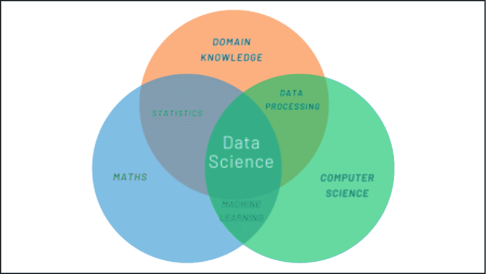

数学与统计学：该领域提供了分析和解释数据的<|message|> 基础工具。统计技术有助于总结数据并从中推断，而线性代数和微积分等数学概念对于开发机器学习算法至关重要。例如，统计学用于假设检验、数据分布和预测建模，而数学对于机器学习和人工智能中的优化问题至关重要。

计算机科学：计算机科学涵盖了高效处理和分析大型数据集所需的技术技能和工具。它包括编程、数据库管理和数据处理。编程允许使用 `Python` 或 `R` 等语言开发算法和机器学习模型。同时，数据处理涉及使用 `Hadoop` 或 `Spark` 等工具来管理大数据。

领域知识：领域知识对于理解数据科学应用的具体背景至关重要。它能够识别相关问题、选择有意义的数据，并以推动价值的方式解释结果。例如，在医疗保健领域，领域专业知识使数据科学家能够应用机器学习模型预测患者结果，而在金融领域，它有助于识别欺诈检测模式。

数学与领域知识（统计学）：这一交叉点涉及在特定领域内应用统计方法，例如分析零售销售数据的趋势。它将统计理论与特定领域的实际应用相结合，以得出可操作且相关的洞察。

数学与计算机科学（机器学习）：机器学习处于数学与计算机科学的交叉点，因为它涉及的算法在很大程度上依赖于数学优化和计算效率。例如，神经网络依赖微积分进行反向传播，并依赖计算机科学实现高效实现。

计算机科学与领域知识（数据处理）：该领域专注于收集、存储和预处理特定领域的数据，例如电子商务中的客户数据。高效管理和处理数据的能力确保特定领域的洞察能够有效提取。

数据科学的核心：在所有三个学科重叠的中心地带，就是数据科学本身。它代表了将数学洞察、计算工具和特定领域的知识相结合，以从数据中提取可操作洞察的能力。例如，电子商务平台使用数据科学分析用户行为、推荐产品并个性化购物体验。

### 1.1.2 数据科学实践示例
场景：预测基于订阅的服务的客户流失。

数据收集：收集客户人口统计信息、使用情况、订阅详情和取消记录的历史数据。

数据预处理：处理缺失值和分类特征的编码，例如将 "`Yes/No`" 字段转换为数值数据。

数据探索：分析该数据中的趋势，包括与流失最相关的因素，例如与使用率的关系。

模型开发：训练机器学习模型-`Logistic Regression` 或 `Decision Tree`-对客户是否会流失进行分类。

可视化与沟通：包含高风险客户和推荐保留活动的仪表板，包括个性化优惠或提醒。通过此方法，公司可以积极地减少流失率，从而增加收入。

换句话说，数据科学将原始数据转化为可操作的洞察，推动医疗保健、金融、营销和技术等行业做出更好的决策和策略。

## 1.2 数据科学家的角色
数据科学家的角色围绕从大型且通常无结构的数据集中提取有意义的洞察和可操作的情报展开。数据科学家充当问题解决者，利用数学、统计、编程和领域知识的结合来应对复杂的业务挑战。

他们首先理解问题陈述并确定分析所需的数据来源。数据科学家对数据进行预处理和清洗，以确保其质量和完整性。他们使用高级统计技术、机器学习模型和数据可视化工具分析数据，以发现可能并不立即可见的模式、趋势和相关性。

数据科学家在构建预测性和规范性模型方面也发挥着关键作用，以预测未来结果或推荐行动。例如，在零售公司中，数据科学家可能会分析客户购买数据以创建推荐系统或预测库存需求。

除了技术技能之外，数据科学家还需要强大的沟通能力来向非技术利益相关者展示其发现。这涉及将复杂的数据分析转化为清晰、可操作的洞察，以推动业务决策。

成为数据科学家所需的技能

技术技能：编程：使用 `Python`、`R` 或 `Java` 进行数据操作和分析。数据查询：精通 `SQL`。机器学习：了解 `TensorFlow` 或 `Scikit-learn` 等算法和框架。

分析思维：对统计方法、概率和假设检验有深入理解。

领域知识：了解特定行业（例如医疗保健、金融或电子商务）以将数据发现置于上下文中。

沟通：能够以简单术语向非技术利益相关者传达复杂思想。

#### 数据科学家贡献示例：
一家零售公司聘请数据科学家分析客户购买数据。他/她执行以下工作：
* 分析历史购买趋势以预测特定产品的需求。
* 开发推荐系统向客户推荐，从而增加销售额。
* 提供客户行为洞察，使公司能够设计有针对性的营销活动。

总之，数据科学家弥合了数据与决策之间的差距，确保组织能够做出明智的数据驱动选择。他们的工作涉及技术专长、商业头脑和创造力的平衡。数据科学家帮助将原始数据转化为有用的洞察，以便组织做出战略决策。从本质上讲，他们是问题解决者，在应对复杂挑战时融合技术专长与商业头脑。

## 1.3 数据科学工作流程概述


# 数据科学工作流程

数据科学工作流程是利用数据解决问题的系统化过程。数据科学工作流程中包含相当多的阶段，指导数据科学家从原始数据到可操作的洞察。主要步骤总结如下：

## 主要步骤

### 问题定义
明确阐述业务或研究问题。确定需要解决的目标和关键问题。与利益相关者协作，确保问题陈述与组织目标保持一致。

### 数据收集
从不同来源收集数据：数据库、API、网络抓取或传感器。确保能够访问结构化数据——如电子表格——和非结构化数据——如图像或文本。

### 数据清洗与预处理
处理缺失或不一致的数据——填补缺失值或删除重复项。标准化数据格式，对分类数据进行编码，并对数值进行归一化。此步骤确保数据可靠且可用于分析。

### 探索性数据分析 (EDA)
汇总统计和可视化——理解数据。识别模式、趋势、异常值和相关性。工具：`Python`、`R` 以及像 `Matplotlib` 和 `Seaborn` 这样的可视化库是典型的。

### 特征工程
选择或创建信息丰富的特征（变量）以优化模型的性能。技术：交互项的创建、特征缩放和分类变量的编码。

### 模型选择与构建
选择适合问题类型的机器学习或统计模型：分类、回归或聚类。在训练数据上训练模型，并在验证数据集上评估其性能。

### 模型评估
使用指标评估模型的性能，例如 `accuracy`、`precision`、`recall`、`F1-score` 或 `RMSE`（均方根误差），具体取决于任务。执行超参数调优以优化模型。

### 部署
将模型部署到生产环境中，使其能够执行任务——实时进行预测或提供洞察。使用 `Flask`、`Docker` 等部署工具和技术，或 `AWS` 或 `GCP` 等云服务进行部署。

### 监控与维护
持续监控模型随时间的性能。根据需要更新模型或在新数据上重新训练以保持准确性——例如，当出现数据漂移时

### 沟通与报告
通过可视化、报告或仪表板向利益相关者传达研究结果和结论 强调可操作的洞察，通过数据支持的证据提出解决方案建议

## 示例工作流程实战

目标：订阅业务的客户流失预测。

定义问题：通过识别有风险的客户来降低流失率。

收集数据：客户人口统计信息、使用日志和订阅历史。

清洗数据：删除重复项、处理缺失值并对分类数据进行编码。

执行 EDA：识别与流失相关的使用模式。

构建特征：创建像 `average session time` 这样的指标。

选择模型：使用 `logistic regression` 预测流失可能性

评估性能：衡量 `precision` 和 `recall` 以准确识别有风险的客户。

部署：将模型与公司的 CRM 系统集成以主动互动。

监控：定期跟踪模型性能。

沟通：与营销和客户成功团队分享洞察。

该工作流程为复杂的数据问题提供了一种有组织且迭代的方法。

## 1.4 数据科学的工具与技术

一般来说，数据科学倾向于部署各种工具和技术，用于收集、处理、分析、可视化或部署模型。这些工具包括编程语言、数据存储系统、分析平台、机器学习框架和部署环境。以下是一个分类概述：

## 编程语言
数据科学家使用编程语言进行数据操作、分析和模型开发：

* Python：由于其丰富的库（如 Pandas、NumPy、Scikit-learn、TensorFlow 和 Matplotlib）而流行。
* R：以统计分析和数据可视化而闻名（例如 ggplot2、dplyr、caret）。
* SQL：查询和管理关系数据库必不可少。
* Julia：因高性能数值计算而日益流行。

## 数据收集工具
用于从各种来源收集数据的工具：

* APIs and Web Scraping：用于抓取网页数据的库，如 Beautiful Soup、Scrapy 或 Selenium。
* ETL Tools：用于提取、转换和加载数据的工具，如 Talend、Apache Nifi 和 Informatica。
* Big Data Platforms：Apache Kafka 或 Flume 用于实时数据摄取。

## 数据存储与管理
用于存储和管理大规模数据的技术：

* Relational Databases：MySQL、PostgreSQL、Microsoft SQL Server。
* NoSQL Databases：MongoDB、Cassandra、HBase 用于非结构化或半结构化数据。
* Cloud Storage：AWS S3、Google Cloud Storage、Azure Blob Storage。
* Big Data Tools：Apache Hadoop、Apache Hive、Apache Spark 用于分布式数据存储和处理。

## 数据清洗与处理
用于数据清洗和准备的库和工具：

* Python Libraries：Pandas、Dask 用于数据操作；NumPy 用于数值运算。
* Data Wrangling Tools：Trifacta、OpenRefine 用于清洗混乱的数据集。
* Apache Spark：高效处理大规模分布式数据处理。

## 数据可视化
用于创建图表、图形和仪表板的工具：

* Python Libraries：Matplotlib、Seaborn、Plotly。
* R Libraries：ggplot2、Shiny。
* Business Intelligence (BI) Tools：Tableau、Power BI、QlikView 用于创建交互式仪表板。
* Web-Based Visualizations：D3.js 用于自定义交互式可视化。

## 机器学习与人工智能框架
用于构建机器学习和深度学习模型的框架和库：

* Scikit-Learn：用于经典机器学习任务。
* TensorFlow and PyTorch：用于深度学习和神经网络。
* XGBoost and LightGBM：用于梯度提升模型。
* H2O.ai：可扩展机器学习的开源平台。

## 大数据与分布式计算
处理大型数据集的工具：

* Apache Spark：实时数据处理和机器学习。
* Hadoop：大规模数据集的分布式存储和计算。
* Databricks：基于 Apache Spark 构建的协作平台。

## 部署与自动化
用于将模型部署到生产环境并自动化工作流程的工具：

* Docker：用于容器化应用程序并确保可移植性。
* Kubernetes：用于大规模编排容器化应用程序。
* Flask and FastAPI：用于将机器学习模型作为 API 部署的轻量级框架。
* MLOps Tools：MLflow、Kubeflow 用于管理机器学习生命周期。

## 云平台
数据科学项目的综合平台：

* Amazon Web Services (AWS)：服务如 SageMaker、Redshift 和 Lambda。
* Google Cloud Platform (GCP)：BigQuery、AI Platform、AutoML。
* Microsoft Azure：Azure Machine Learning、Azure Databricks。

## 协作与版本控制
用于增强协作和管理代码版本的工具：

* Version Control：Git、GitHub、GitLab 用于版本管理和协作。
* Notebooks：Jupyter Notebook、Google Colab 用于共享和记录带交互式输出的代码。
* Workflow Automation：Apache Airflow、Prefect 用于管理数据管道。

## 统计与仿真工具
用于高级统计建模和仿真的工具：

* SPSS：商业数据的统计分析。
* SAS：高级分析和预测建模。
* MATLAB：数值计算和仿真。

## 其他新兴技术

* AutoML Tools：H2O AutoML、Google AutoML 用于自动化模型构建过程。
* Natural Language Processing (NLP)：库如 spaCy、NLTK、Hugging Face Transformers。
* Computer Vision：OpenCV、TensorFlow 和 PyTorch 用于图像处理任务。


## 1.5 为什么选择 Python 进行数据科学？

Python 是数据科学领先的编程语言，因其简洁性、多功能性以及强大的库和框架生态系统而备受青睐。其简洁直观的语法使其对初学者友好，使用者可以专注于问题解决，而非应对复杂的编程规则。Python 的可读性和自解释代码也增强了团队间的协作。

Python 的丰富库可满足各种数据科学任务的需求。`Pandas` 和 `NumPy` 等库可实现高效的数据操作和数值计算。`Matplotlib` 和 `Seaborn` 非常适合创建静态可视化，而 `Plotly` 和 `Bokeh` 则便于实现交互式图表。`Scikit-Learn` 支持机器学习的传统算法，而 `TensorFlow` 和 `PyTorch` 处理深度学习模型。Python 在使用 `PySpark` 和 `Dask` 等库进行大数据处理方面也表现出色。

该语言的多功能性贯穿整个数据科学工作流程，从数据收集和预处理到模型部署。它可与 `C++` 和 `Java` 等其他语言无缝集成，并能轻松连接 `MySQL` 等数据库。`Flask` 和 `Django` 等框架简化了机器学习模型作为 Web 应用的部署。

Python 的可扩展性确保其能够处理各种规模的项目，高效管理大型数据集和并行处理。`Jupyter Notebooks` 和 `Google Colab` 等工具通过将分析与实时文档相结合来简化工作流程。作为开源且跨平台的语言，Python 可在 `Windows`、`macOS` 和 `Linux` 等主要操作系统上稳定运行。

Python 在金融、医疗保健和技术等行业被广泛采用，Google、Netflix 和 Spotify 等公司依赖 Python 进行数据科学和机器学习任务。其强大的社区支持加上频繁的更新，确保 Python 始终是数据科学领域初学者和专业人士的首选。

## 示例用例：预测客户流失

数据分析：使用 `Pandas` 清理和分析客户数据。

特征工程：使用 `NumPy` 对数值特征进行预处理和缩放。

模型开发：使用 `Scikit-Learn` 或 `TensorFlow` 构建流失预测模型。

可视化：使用 `Seaborn` 或 `Matplotlib` 可视化客户行为。

部署：使用 `Flask` 或 `FastAPI` 将模型部署为 API。

总之，Python 的简洁性、丰富的库支持和多功能性使其成为数据科学的首选语言。其能够处理数据科学生命周期的每个阶段，再加上强大的社区支持，确保 Python 仍然是现代数据科学家工具箱中的关键工具。

## 1.6 章节复习问题

Question 1:

数据科学 Venn 图主要说明什么？

A. 不同类型的机器学习算法

B. 构成数据科学的领域的交集

C. 数据分析工具的历史

D. 数据科学工作流程的步骤

Question 2:

以下哪项最能定义数据科学家的角色？

A. 管理大型组织的 IT 基础设施

B. 分析、解释数据并利用数据推动决策

C. 设计计算系统的硬件

D. 仅编写数据库管理的脚本

Question 3:

以下哪项是数据科学应用的例子？

A. 使用历史和实时数据进行天气预报的系统

B. 列出每日销售的静态报告

C. 包含客户电子邮件的电子表格

D. 文件共享平台

Question 4:

在数据科学工作流程中，哪一步涉及清理和准备原始数据以进行分析？

A. 数据收集

B. 数据探索

C. 数据预处理

D. 模型评估

Question 5:

以下哪种工具通常不用于数据科学？

A. `Jupyter Notebook`

B. `Matplotlib`

C. MS Word

D. `TensorFlow`

Question 6:

为什么 Python 被认为是对数据科学理想的语言？

A. 它是专门为数据科学设计的

B. 它拥有丰富的库和庞大的社区支持

C. 它仅在高性能系统上运行

D. 它取代了数据库的需求

Question 7:

以下哪项不是数据科学 Venn 图的一部分？

A. 领域专业知识

B. 机器学习模型

C. 编程技能

D. 统计知识

Question 8:

数据科学工作流程的主要目的是什么？

A. 自动化系统操作

B. 标准化解决数据相关问题的流程

C. 设计数据分析的用户界面

D. 测试软件性能

Question 9:

以下哪个库在 Python 中最常用于数据可视化？

A. `Pandas`

B. `NumPy`

C. `Matplotlib`

D. `Scikit-learn`

Question 10:

使用 Python 进行数据科学的一个关键优势是什么？

A. 它比所有其他编程语言都快

B. 它不需要任何先前的编程知识

C. 它可与各种数据分析工具和库无缝集成

D. 它消除了数据清理和预处理的需要

## 1.7 章节复习问题答案

1. B. 构成数据科学的领域的交集

解释：数据科学 Venn 图说明了编程技能、统计知识和领域专业知识的重叠，三者共同构成了数据科学的基础。

2. B. 分析、解释数据并利用数据推动决策

解释：数据科学家的首要角色是分析和解释数据以生成洞察并做出明智决策，使用统计、机器学习和领域专业知识的工具和技术。

3. A. 使用历史和实时数据进行天气预报的系统

解释：数据科学的应用涉及使用数据创建预测系统，例如天气预报，它依赖历史趋势和实时数据以实现准确预测。

4. C. 数据预处理

解释：数据预处理是工作流程中对原始数据进行清理、整理并将其转换为可用于分析或建模的格式的步骤。

5. C. MS Word

解释：`Jupyter Notebook`、`Matplotlib` 和 `TensorFlow` 等工具专门用于数据科学任务，而 MS Word 在此背景下并不常用。

6. B. 它拥有丰富的库和庞大的社区支持

解释：Python 因其丰富的库生态系统如 `Pandas`、`NumPy` 和 `TensorFlow`，以及强大的社区支持用于故障排除和协作而非常适合数据科学。

7. B. 机器学习模型

解释：数据科学 Venn 图侧重于编程技能、统计知识和领域专业知识。虽然机器学习是数据科学中的关键工具，但它并未明确包含在此图中。

8. B. 标准化解决数据相关问题的流程

解释：数据科学工作流程为解决数据问题提供结构化方法，确保数据收集、分析和建模等流程的一致性和效率。

9. C. `Matplotlib`

解释：`Matplotlib` 是用于在 Python 中创建数据可视化的常用库，使其成为直观表示数据洞察的必备工具。

10. C. 它可与各种数据分析工具和库无缝集成

解释：Python 能够与多样化的库和工具协同工作，再加上其简洁性和多功能性，使其成为数据科学的首选语言。

# 第 2 章 使用 Python 入门


Python 是一种功能强大、多用途的编程语言，广泛应用于数据科学、Web 开发和自动化。本章对 Python 提供了基础介绍，涵盖其编程范式以及在数据科学中的重要性。它指导读者安装 Python 和 Jupyter Notebook，设置 Python 虚拟环境，并探索流行的 Python IDE，如 VS Code、PyCharm 和 IntelliJ IDEA。此外，它还解释了 Python 语法、变量、数据类型、输入/输出操作和文件处理。本章最后总结了编写、运行和调试 Python 程序的最佳实践，确保初学者和有志于成为数据科学家的读者获得流畅的学习体验。

## 2.1 Python 简介

Python 是一种多功能的高级编程语言，以其简洁性、可读性和易用性而闻名。其设计通过显著的缩进优先代码清晰度，而非依赖括号或大括号，使 Python 既适合初学者，又提供处理复杂应用所需的先进能力。

### 与 Java 和 C 的比较

| 特性 || Python || Java || C |

| --- | --- | --- | --- |

| 学习难易度 || 非常容易学习；适合初学者 || 中等；需要理解 OOP 概念 || 具有挑战性；需要了解低级编程知识 |

| 语法 || 简洁清晰；无需大括号或分号 || 冗长；使用大括号和分号 || 抽象程度低；使用大括号和分号 |

| 类型 || 动态类型 || 静态类型 || 静态类型 |

| 执行方式 || 解释执行 || 编译后在 JVM 上运行 || 编译为机器码 |

| 性能 || 由于解释执行，比 Java 和 C 慢 || 比 Python 快，比 C 慢 || 极快，适合系统级编程 |

| 应用领域 || Web 开发、数据科学、AI、自动化 || 企业应用、Android 应用 || 嵌入式系统、操作系统 |

| 内存管理 || 自动垃圾回收 || 自动垃圾回收 || 手动内存管理（指针） |

### Python 的工作原理

Python 是一种解释型语言，这意味着其代码是逐行执行，而不是预编译成机器码。过程始于在 `.py` 文件中编写 Python 代码。执行期间，Python 使用解释器直接运行代码。最初，代码会被编译成字节码，存储为 `.pyc` 文件，这有助于加快后续执行。最后，字节码由 Python 虚拟机（`PVM`）执行，使程序能够高效运行。这种动态方法允许快速原型设计和调试。

### Python 的历史

* 1980 年代：Guido van Rossum 开始着手 Python，将其作为 ABC 编程语言的继任者。
* 1991 年：Python 0.9.0 发布，包含函数、异常处理和模块等特性。
* 2000 年：Python 2.0 发布，引入列表推导式和垃圾回收。
* 2008 年：Python 3.0 发布，进行不向后兼容的更改以改进语言设计。
* 现在：Python 不断发展，专注于简洁性、性能和现代编程需求。

### Python 为何如此流行

易于学习：简单语法使编程初学者能够轻松理解语言并减少应用的开发时间。

多功能：从 Web 开发、数据科学和人工智能到自动化、游戏开发等，Python 被应用于各个领域。

丰富的生态系统：无数库，包括 `Pandas`、`NumPy`、`TensorFlow` 和 `Django`，使 Python 非常适合专门任务。

社区支持：Python 拥有庞大而活跃的社区，支持其发展并提供丰富的学习和问题解决资源。

跨平台兼容性：Python 代码在 Windows、macOS 和 Linux 等不同操作系统上 flawlessly 运行。

集成：Python 可很好地与其他编程语言如 `C`、`C++` 和 `Java` 集成。

行业采用：Google、Netflix 和 Instagram 等大型公司使用 Python 进行各种应用，这证明了其有效性。

总之，Python 因其简洁性、多功能性和丰富的生态系统而成为编程世界的主导力量。无论是构建 Web 应用、分析数据还是开发机器学习模型，Python 都提供必要的工具和社区支持以高效完成任务。其持续演进确保其对初学者和高级程序员在不同领域保持相关性和价值。

## 2.2 Python 中的编程范式

Python 是一种极其多功能的编程语言，支持多种范式，使其适用于各种用例。其灵活性允许开发人员为特定问题采用最合适的方法，无缝融合过程式、面向对象、函数式和其他编程风格。这种适应性巩固了 Python 作为解决各领域多样化挑战的首选语言的地位。

### Python 中的过程式编程

过程式编程是一种以使用过程或例程（即函数）执行操作为中心的范式。Python 完全支持过程式编程，使其非常适合脚本编写和小规模应用。

Python 中过程式编程的特征：代码组织为一系列步骤或过程。函数用于封装可重用的代码块。变量和函数在全局或局部定义。

示例：
```
def greet(name):
return f"Hello, {name}!"

print(greet("Alice"))
```

何时使用过程式编程：对于具有简单操作序列的简单脚本或程序。对于数据分析、自动化或快速原型设计等任务。

### Python 中的面向对象编程（OOP）

Python 是一种面向对象的语言，允许开发人员将现实世界实体建模为对象。OOP 非常适合创建需要模块化、可扩展性和可重用性的复杂应用。

Python 中的关键 OOP 特性
* 类和对象：定义类作为创建对象的蓝图。
* 封装：将数据（属性）和方法（函数）捆绑在对象内。
* 继承：通过创建继承自其他类的类来实现代码重用。
* 多态：允许为不同对象以多种方式定义方法。

示例：
```
class Animal:
def __init__(self, name):
self.name = name
def speak(self):
return "I am an animal"

class Dog(Animal):
def speak(self):
return f"{self.name} says Woof!"

dog = Dog("Buddy")
print(dog.speak())
```

何时在 Python 中使用 OOP：对于模块化和代码重用很重要的<|message|> 大规模应用。对于涉及建模现实世界实体（例如模拟或游戏）的软件设计。

### Python 中的函数式编程

Python 对函数式编程有强力支持，这是一种将计算视为数学函数求值并避免改变状态或可变数据的范式。

Python 中的关键函数式编程特性
* 高阶函数：像 `map()`、`filter()` 和 `reduce()` 这样的函数可操作其他函数或序列。
* 一等函数：函数可以赋值给变量、作为参数传递并作为值返回。
* 不可变性：强调不可变数据结构（例如 `tuples`、`frozensets`）。
* Lambda 函数：用于简短内联计算的匿名函数。

示例：
```
# Functional programming with map and lambda
numbers = [1, 2, 3, 4]
squared = list(map(lambda x: x**2, numbers))
print(squared)
```

何时使用函数式编程：对于涉及数据转换或数学计算的任务。为编写简洁、干净且声明式的代码。

### Python 中的声明式编程


## 声明式编程

声明式编程关注描述“做什么”而非“怎么做”。Python 的声明式能力常体现在 SQL 类似的查询表达式或配置管理等领域。

### Python 中声明式工具的示例

* `SQLAlchemy`：用于数据库 ORM（对象关系映射）。
* 正则表达式：用于模式匹配。
* 框架：像 `Flask` 或 `Django` 这样的库用于声明式地定义应用程序行为。

### 示例

```python
import re

# Declarative style with regex
pattern = r'\d+'
matches = re.findall(pattern, "The year is 2025")
print(matches)
```

### 何时使用声明式编程

在处理配置、查询或以高层次方式表达逻辑时使用。

## Python 中的事件驱动编程

Python 支持事件驱动编程，其中程序的流程由用户操作或传感器输出等事件决定。

### 示例

* GUI 库：`Tkinter`、`PyQt` 和 `Kivy` 允许用户界面进行事件驱动交互。
* 异步编程：`asyncio` 用于异步编程中的事件循环。

### 代码示例

```python
import asyncio

async def say_hello():
    await asyncio.sleep(1)
    print("Hello!")

asyncio.run(say_hello())
```

当在 `Jupyter Notebook` 中运行此代码块时，你可能会遇到错误："`asyncio.run()` cannot be called from a running event loop"。此问题常见于以下情况：

`Jupyter Notebooks` 和 `IPython`：这些环境默认运行事件循环以支持异步操作，导致使用 `asyncio.run()` 时出现冲突。

Web 框架（例如 `Flask`、`Django`）：这些框架通常为异步任务管理自己的事件循环，导致类似冲突。

然而，如果你在其他环境中执行相同的代码，例如 `IntelliJ IDEA`，它很可能会顺利运行并产生预期输出。

### 何时使用事件驱动编程

用于具有用户界面或异步任务的应用程序（例如 Web 服务器、聊天应用程序）。

## Python 中的命令式编程

命令式编程是关于编写指令告诉计算机如何实现结果。Python 自然支持这种范式，因为它涉及显式的逐步代码执行。

### 示例

```python
# Imperative style
total = 0
for i in range(1, 6):
    total += i
print(total)
```

### 何时使用命令式编程

用于直接、逐步的问题解决。

## 多范式灵活性

Python 混合范式的能力是其最大的优势之一。开发人员可以根据需要在一个程序中组合过程式、面向对象和函数式风格。

### 结合范式的示例

```python
class Calculator:
    def __init__(self, numbers):
        self.numbers = numbers

    def process(self, func):
        return list(map(func, self.numbers))

nums = [1, 2, 3, 4]
calc = Calculator(nums)
print(calc.process(lambda x: x**2))  # Functional paradigm inside OOP
```

### Python 多范式特性的重要性

灵活性：开发人员可以选择最适合问题的范式。

易学性：初学者可以从过程式编程开始，逐步采用 OOP 或函数式范式。

广泛应用：支持从数据分析（函数式）到软件开发（OOP）和配置管理（声明式）的用例。

总之，Python 对过程式、面向对象、函数式、声明式、事件驱动和命令式编程范式的支持使其成为最通用和强大的编程语言之一。这种多范式能力使 Python 能够在 Web 开发、数据科学、机器学习和自动化等多个领域脱颖而出。其适应性既满足寻求简洁的初学者，也满足应对复杂挑战的高级程序员，使其成为编程世界中不可或缺的工具。

## 2.3 Python 在数据科学中

## 简单性和可读性

Python 因其简洁性、多功能性以及专为数据分析和机器学习设计的大量库生态系统，成为数据科学中最流行的编程语言。其简洁直观的语法使初学者易于学习，同时让经验丰富的开发人员能够专注于解决复杂的数据问题，而不会被编程细节困扰。此外，Python 的可读性促进了大规模数据项目上的无缝协作，使其成为团队的理想选择。

## 丰富的库生态系统

Python 在数据科学中占据主导地位的关键驱动因素是其庞大的库生态系统。`Pandas` 和 `NumPy` 对于数据操作和数值计算不可或缺，而 `Matplotlib` 和 `Seaborn` 在创建强大的数据可视化方面表现出色。对于机器学习任务，`Scikit-learn`、`TensorFlow` 和 `PyTorch` 能够实现传统算法和高级深度学习模型。此外，Python 可与 `PySpark` 和 `Dask` 等大数据工具无缝集成，使其能够处理分布式计算和海量数据集。

## 数据科学工作流程中的多功能性

Python 因其多功能性而脱颖而出，支持数据科学工作流程的每个步骤。从使用 `requests` 和 `Beautiful Soup` 等库进行数据收集，到使用 `Pandas` 和 `NumPy` 清理和预处理数据，再到使用 `Matplotlib` 和 `Plotly` 等工具进行探索性数据分析——Python 对一切都有解决方案。其灵活性延伸到使用 `Scikit-learn` 构建机器学习模型，使用 `Flask` 或 `FastAPI` 部署它们，并使用 `Hadoop` 或 `Spark` 等大数据平台扩展应用程序。这种适应性使 Python 既适用于小规模分析，也适用于企业级机器学习管道。

## 交互式环境

`Jupyter Notebooks` 和 `Google Colab` 等交互式工具进一步增强了 Python 在数据科学中的吸引力。这些平台允许数据科学家实时执行代码、内联可视化结果，并在实验过程中无缝记录工作流程。Python 与人工智能和深度学习等先进技术的兼容性增加了其价值。`PyTorch`、`TensorFlow` 和 `Hugging Face Transformers` 等框架推动了自然语言处理、计算机视觉和预测分析等领域的尖端研究与开发。

## 活跃的社区和支持

Python 得益于世界上最大、最活跃的开发人员社区之一。数据科学家可以访问大量资源，包括教程、论坛和开源贡献。这个充满活力的生态系统确保 Python 保持更新以满足现代数据科学挑战并提供常见问题的解决方案。此外，其开源特性使 Python 对个人、初创企业和企业都免费且可访问，这促进了其广泛采用。

## 行业采用

Google、Netflix、Facebook 和 Spotify 等领先组织在数据科学和机器学习项目中 heavily 依赖 Python。Python 与 `AWS`、`GCP` 和 `Azure` 等大数据工具和云平台的集成确保了其在企业环境中管理大规模数据的适用性。其跨平台兼容性使其能够在 Windows、macOS 和 Linux 上顺畅运行，使其能够适应各种系统和用例。

总之，Python 的简洁性、广泛的库支持、多功能性和强大的社区使其成为数据科学事实上的语言地位。它为数据预处理、可视化、机器学习以及将模型部署到生产环境等任务提供了全面的解决方案。这种适应性确保 Python 始终处于数据科学和人工智能的前沿，使其成为初学者和资深专业人士的关键工具。

## 2.4 安装 Python 和 Jupyter Notebook


Python 和 Jupyter Notebook 是数据科学必不可少的工具，为编码和数据分析提供交互式环境。以下是 Mac 和 Windows 上安装的分步指南。

## 在 Windows 上安装

### 第 1 步：安装 Python

下载 Python：访问官方 Python 网站 python.org 并下载适用于 Windows 的最新稳定版本。

运行安装程序：打开下载的安装程序文件。

选择选项：
* 勾选“将 Python 添加到 PATH”（对命令行访问很重要）。
* 如需自定义，点击“Customize Installation”，或继续使用默认设置。
* 完成安装：按照提示完成安装过程。

验证安装：打开命令提示符并输入：`python --version`。你应该会看到已安装的 Python 版本。

### 第 2 步：安装 Jupyter Notebook

安装 Pip：Pip（Python 的包管理器）通常随 Python 一起提供。输入以下命令验证：`pip --version`。

安装 Jupyter：运行命令：`pip install notebook`。

启动 Jupyter：打开命令提示符并输入：`jupyter notebook`。

这将在你的默认网页浏览器中打开 Jupyter。

## 在 Mac 上安装

### 第 1 步：安装 Python

下载 Python：前往 python.org 下载适用于 macOS 的最新版本。

运行安装程序：打开 `.pkg` 文件并按照安装步骤操作。

验证安装：打开终端并输入：`python3 --version`。macOS 默认使用 Python 2.x，因此请始终使用 `python3` 指代较新版本。

### 第 2 步：安装 Jupyter Notebook

安装 Pip：Pip 已包含在 Python 3.x 中。输入以下命令验证：`pip3 --version`。

安装 Jupyter：运行命令：`pip3 install notebook`。

启动 Jupyter：打开终端并输入：`jupyter notebook`。

这将在你的网页浏览器中启动 Jupyter。

## 替代方案：使用 Anaconda 安装（适用于 Windows 和 Mac）

### 什么是 Anaconda？

Anaconda 是一个流行的 Python 发行版，广泛用于数据科学和机器学习。它不仅仅是 Python——它捆绑了必要的库、工具以及自己的虚拟环境系统，使其成为一站式安装解决方案。

许多数据科学和机器学习课程或企业培训项目都推荐使用 Anaconda，因此学习 Anaconda 将为你未来的机会做好准备。

### 为什么使用 Anaconda？

* 全面套件：包含 Python、本课程使用的关键库和工具。
* 虚拟环境：提供集成环境管理器以简化依赖关系。
* Jupyter Notebook：捆绑了 Jupyter，这是一个理想的开发环境，可在一个界面中结合代码、笔记和可视化。Jupyter Notebook 广泛用于探索和分析数据。它让你在单个屏幕上查看代码、数据、可视化和笔记，使其成为出色的学习和教学工具。

### 开发环境选择

如果你是有经验的 Python 用户，拥有偏好的设置（如 PyCharm 或 Sublime Text），可以随意使用它。然而，如果你是新手，我强烈建议从 Anaconda 和 Jupyter Notebook 开始。

### 如何下载和安装 Anaconda

Anaconda 是一个流行的发行版，包含 Python、Jupyter 和许多数据科学库，简化了设置过程。

访问网站：前往 www.anaconda.com 或搜索 "Anaconda Python download" 以找到官方页面。

并下载适用于你的操作系统的安装程序。

运行安装程序：按照屏幕上的说明安装 Anaconda。选择正确的安装程序。选择 Python 3（最新版本）。选择适用于你的操作系统的版本：Windows、macOS 或 Linux。对于 macOS，请使用图形安装程序以便更易使用。

### 验证安装

打开 Anaconda Navigator，它提供图形界面来管理工具和环境。

### 打开 Anaconda Navigator

打开 Anaconda Navigator：在你的电脑上搜索“Anaconda Navigator”。打开它以探索包含的工具，如 Jupyter Notebook、JupyterLab、Spyder 等。

### 启动 Jupyter Notebook

从 Anaconda Navigator 中，点击 Jupyter Notebook 下的 Launch。浏览器窗口将自动打开，显示 Jupyter 界面。使用现代浏览器，如 Google Chrome、Mozilla Firefox 或 Microsoft Edge（避免使用 Internet Explorer）。

### 为什么使用 Jupyter Notebook？

Jupyter Notebook 非常适合：
* 编写和运行 Python 代码。
* 实时显示可视化、图像和数据。
* 添加 markdown 笔记用于解释和文档。

它被认为是数据科学家最喜欢的工具。虽然你可以使用其他环境，但 Jupyter Notebook 提供了直观的界面，适合初学者和专业人士。

## 适用于两个平台的提示

* 使用虚拟环境管理不同项目的依赖关系。使用以下命令创建：`python -m venv myenv`。
* 通过运行以下命令安装常用库（例如 Pandas、NumPy、Matplotlib）：`pip install pandas numpy matplotlib`。
* 定期更新 Python 或 Jupyter 以获得最新功能和错误修复。

通过这些步骤，你将在系统上设置好 Python 和 Jupyter Notebook，准备好进行数据科学项目！

## 2.5 如何设置 Python 虚拟环境

按照以下步骤在 Python 中设置和使用虚拟环境：

### 确保已安装 Python

首先，确保已安装 Python 3.3 或更高版本，因为 `venv` 已包含在这些版本中。你可以通过以下方式检查 Python 版本：

```
python --version
```

### 创建虚拟环境

在你的项目目录中运行以下命令：

```
python -m venv venv
```

`venv` 是虚拟环境的目录名。你可以用任何你喜欢的名称替换它。

### 激活虚拟环境

在 Windows 上：

```
venv\Scripts\activate
```

在 macOS/Linux 上：

```
source venv/bin/activate
```

激活后，你会注意到终端提示符发生变化，表示虚拟环境已激活。

### 安装依赖项

在虚拟环境激活后，使用 `pip` 安装项目特定的依赖项。例如：

```
pip install openai
```

### 停用虚拟环境

要停用虚拟环境并返回全局 Python 环境，只需运行：

```
deactivate
```

### 需要时重新激活

每次处理项目时，使用操作系统的激活命令重新激活虚拟环境。

## 2.6 Python IDE 简介（VS Code、PyCharm、IntelliJ）

IDE 是强大的开发环境，可让开发者高效地编写、调试和管理 Python 代码。流行的 IDE 有 Visual Studio Code（VS Code）、PyCharm 和 IntelliJ IDEA，各自满足不同的需求和开发工作流程。以下是这些流行 IDE 的简要概述，包括其主要特性和应用领域。

## Visual Studio Code（VS Code）

### 概述

VS Code 是由 Microsoft 开发的免费开源代码编辑器。轻量且可扩展，它非常多功能，支持多种编程语言，但可通过扩展增强 Python 支持。

### 主要特性

* Python 支持：由 Microsoft 开发的 Python 扩展包括 linting、调试和 IntelliSense 支持。
* 集成终端：可在编辑器内直接运行 Python 脚本。
* 轻量且快速：针对性能优化，非常适合快速脚本编写和小项目。
* 调试工具：内置调试支持，包括断点、变量检查和逐行执行代码。
* 可扩展性：丰富的市场提供用于额外工具和框架的扩展。
* Git 集成：内置版本控制支持，用于管理仓库。

### 最适合

* 多语言项目和快速 Python 脚本编写。
* 寻找轻量、高度可定制编辑器的开发者。

### 入门

* 从 https://code.visualstudio.com/ 下载并安装 VS Code。
* 从扩展市场安装 Python 扩展。
* 配置 Python 解释器并开始编码。

## PyCharm


## PyCharm
### 概述
`PyCharm` 是一个专门用于 `Python` 开发的专业 IDE。它具有用于 `Python` 和 `Django` 应用开发的广泛工具。功能丰富，被专业开发者广泛使用。

### 主要功能
* `Dedicated Python Tools`: 包含智能代码补全、重构工具和测试框架等高级功能。
* `Debugging and Testing`: 提供直观的调试器，并包含用于编写和运行单元测试的工具。
* `Virtual Environment Management`: 简化了 `Python` 虚拟环境的创建和管理。
* `Web Development Support`: 支持 `Django` 和 `Flask` 等其他框架
* `Database Tools`: 内置数据库浏览器，`SQL` 支持仅在 `Professional` 中可用
* `Integrated Jupyter Notebook`: 支持数据科学家在 `Jupyter Notebook` 中编写和执行代码

### 最适合
* 从事 Web 应用或大型项目开发的 `Python` 开发者。
* 需要高级 `Jupyter Notebook` 集成（`Professional Edition`）的数据科学家。

### 入门
* 从 `https://www.jetbrains.com/pycharm/` 下载 `PyCharm`。
* 使用免费的 `Community Edition` 或付费的 `Professional Edition` 以获得高级功能。
* 设置 `Python` 解释器并开始构建你的项目。

## IntelliJ IDEA
### 概述
`IntelliJ IDEA` 由 `JetBrains` 开发，是一款通用 IDE，主要用于 `Java` 开发，但得益于其 `Python` 插件，它具有出色的 `Python` 支持。对于那些已经使用 `IntelliJ` 进行跨语言开发的人来说非常有用。

### 主要功能
* `Python Plugin`: 添加 `Python` 特定工具，包括智能代码补全、语法高亮和调试。
* `Cross-Language Support`: 允许在多语言项目中将 `Python` 与 `Java`、`Kotlin` 或其他语言无缝集成。
* `Robust Debugger`: 包含具有断点、变量检查和逐步执行的先进调试工具。
* `Version Control`: 全面的 `Git`、`SVN` 和 `Mercurial` 集成。
* `Integrated Tools`: 包含数据库管理、构建系统和测试框架的工具。

### 最适合
* 从事多语言项目开发的开发者（例如 `Python` 和 `Java`）。
* 已使用 `IntelliJ IDEA` 进行软件开发活动的团队。

### 入门
* 从 `https://www.jetbrains.com/idea/` 下载 `IntelliJ IDEA`。
* 使用 JetBrains 插件市场安装 `Python` 插件。
* 配置 `Python` 解释器并开始在你的 `Python` 项目上工作。

## VS Code、PyCharm 和 IntelliJ IDEA 的比较
| 功能 || VS Code || PyCharm || IntelliJ IDEA |
| --- | --- | --- | --- |
| 成本 || 免费 || 社区版（免费），专业版（付费） || 社区版（免费），专业版（付费） |
| Python 重点 || 通用型，依赖扩展 || 专用的 Python IDE || 需要 Python 插件 |
| 性能 || 轻量且快速 || 资源占用较高但功能丰富 || 因多语言支持而占用资源较大 |
| 最适合 || 多语言项目、快速脚本编写 || Python 特定、大型项目 || 多语言、企业级项目 |
| Web 开发 || 可通过扩展使用 || 提供 Django/Flask 的高级工具 || 需要插件支持框架 |
| Jupyter 支持 || 可通过扩展使用 || 内置（专业版） || 有限，通过插件实现 |

总之，每种 IDE 都有其独特的优势，选择哪一个取决于用户需求和项目范围。`VS Code` 非常适合轻量级、多语言项目和快速任务。`PyCharm` 更专注于与 `Python` 相关的项目，尤其是与 Web 开发和数据科学相关的项目。带有 `Python` 插件的 `IntelliJ IDEA` 非常适合从事多语言项目开发的开发者，或已经熟悉 `IntelliJ` 生态系统的开发者。合适的 IDE 能带来高效且富有成效的编码体验。

# 2.7 在 IntelliJ IDEA 中设置新的 Python 项目
`IntelliJ IDEA` 是一个多功能的 IDE，通过 `Python Plugin` 支持 `Python` 开发。以下是设置新的 `Python` 项目的分步指南：

### 安装 IntelliJ IDEA
从官方网站下载并安装 `IntelliJ IDEA`。`Community Edition` 免费，并可通过插件支持 `Python` 开发。

### 安装 Python 插件
打开 `IntelliJ IDEA`。转到 `File` > `Settings` > `Plugins`（或 macOS 上 `Preferences` > `Plugins`）。在插件市场中搜索 `Python`。安装 `Python Community Edition` 插件。重新启动 `IntelliJ IDEA` 以激活插件。

### 创建新的 Python 项目
启动 `IntelliJ IDEA`。在欢迎屏幕上单击 `New Project`。在 `New Project` 对话框中：选择 `Python` 作为项目类型。指定要保存项目的[content]
## PyCharm
### 概述
`PyCharm` 是一个专门用于 `Python` 开发的专业 IDE。它具有用于 `Python` 和 `Django` 应用开发的广泛工具。功能丰富，被专业开发者广泛使用。

### 主要功能
* `Dedicated Python Tools`: 包含智能代码补全、重构工具和测试框架等高级功能。
* `Debugging and Testing`: 提供直观的调试器，并包含用于编写和运行单元测试的工具。
* `Virtual Environment Management`: 简化了 `Python` 虚拟环境的创建和管理。
* `Web Development Support`: 支持 `Django` 和 `Flask` 等其他框架
* `Database Tools`: 内置数据库浏览器，`SQL` 支持仅在 `Professional` 中可用
* `Integrated Jupyter Notebook`: 支持数据科学家在 `Jupyter Notebook` 中编写和执行代码

### 最适合
* 从事 Web 应用或大型项目开发的 `Python` 开发者。
* 需要高级 `Jupyter Notebook` 集成（`Professional Edition`）的数据科学家。

### 入门
* 从 `https://www.jetbrains.com/pycharm/` 下载 `PyCharm`。
* 使用免费的 `Community Edition` 或付费的 `Professional Edition` 以获得高级功能。
* 设置 `Python` 解释器并开始构建你的项目。

## IntelliJ IDEA
### 概述
`IntelliJ IDEA` 由 `JetBrains` 开发，是一款通用 IDE，主要用于 `Java` 开发，但得益于其 `Python` 插件，它具有出色的 `Python` 支持。对于那些已经使用 `IntelliJ` 进行跨语言开发的人来说非常有用。

### 主要功能
* `Python Plugin`: 添加 `Python` 特定工具，包括智能代码补全、语法高亮和调试。
* `Cross-Language Support`: 允许在多语言项目中将 `Python` 与 `Java`、`Kotlin` 或其他语言无缝集成。
* `Robust Debugger`: 包含具有断点、变量检查和逐步执行的先进调试工具。
* `Version Control`: 全面的 `Git`、`SVN` 和 `Mercurial` 集成。
* `Integrated Tools`: 包含数据库管理、构建系统和测试框架的工具。

### 最适合
* 从事多语言项目开发的开发者（例如 `Python` 和 `Java`）。
* 已使用 `IntelliJ IDEA` 进行软件开发活动的团队。

### 入门
* 从 `https://www.jetbrains.com/idea/` 下载 `IntelliJ IDEA`。
* 使用 JetBrains 插件市场安装 `Python` 插件。
* 配置 `Python` 解释器并开始在你的 `Python` 项目上工作。

## VS Code、PyCharm 和 IntelliJ IDEA 的比较
| 功能 || VS Code || PyCharm || IntelliJ IDEA |
| --- | --- | --- | --- |
| 成本 || 免费 || 社区版（免费），专业版（付费） || 社区版（免费），专业版（付费） |
| Python 重点 || 通用型，依赖扩展 || 专用的 Python IDE || 需要 Python 插件 |
| 性能 || 轻量且快速 || 资源占用较高但功能丰富 || 因多语言支持而占用资源较大 |
| 最适合 || 多语言项目、快速脚本编写 || Python 特定、大型项目 || 多语言、企业级项目 |
| Web 开发 || 可通过扩展使用 || 提供 Django/Flask 的高级工具 || 需要插件支持框架 |
| Jupyter 支持 || 可通过扩展使用 || 内置（专业版） || 有限，通过插件实现 |

总之，每种 IDE 都有其独特的优势，选择哪一个取决于用户需求和项目范围。`VS Code` 非常适合轻量级、多语言项目和快速任务。`PyCharm` 更专注于与 `Python` 相关的项目，尤其是与 Web 开发和数据科学相关的项目。带有 `Python` 插件的 `IntelliJ IDEA` 非常适合从事多语言项目开发的开发者，或已经熟悉 `IntelliJ` 生态系统的开发者。合适的 IDE 能带来高效且富有成效的编码体验。

# 2.7 在 IntelliJ IDEA 中设置新的 Python 项目
`IntelliJ IDEA` 是一个多功能的 IDE，通过 `Python Plugin` 支持 `Python` 开发。以下是设置新的 `Python` 项目的分步指南：

### 安装 IntelliJ IDEA
从官方网站下载并安装 `IntelliJ IDEA`。`Community Edition` 免费，并可通过插件支持 `Python` 开发。

### 安装 Python 插件
打开 `IntelliJ IDEA`。转到 `File` > `Settings` > `Plugins`（或 macOS 上 `Preferences` > `Plugins`）。在插件市场中搜索 `Python`。安装 `Python Community Edition` 插件。重新启动 `IntelliJ IDEA` 以激活插件。

### 创建新的 Python 项目
启动 `IntelliJ IDEA`。在欢迎屏幕上单击 `New Project`。在 `New Project` 对话框中：选择 `Python` 作为项目类型。指定要保存项目的位置。选择 `Python` 解释器：如果已安装 `Python`，`IntelliJ` 将检测可用的 `Python` 解释器。选择现有解释器或配置新的解释器（下面说明）。

### 配置 Python 解释器
如果未配置解释器：单击 `Project SDK` 下拉菜单中的 `Add Interpreter`。选择以下选项之一：
* `System Interpreter`: 使用系统上已有的 `Python` 安装。
* `Virtual Environment`（推荐）：为项目创建隔离环境。选择基本解释器（例如 `Python 3.x`）。选择虚拟环境的位置。`IntelliJ` 将设置环境并将其链接到你的项目。

### 设置项目结构
创建项目后，你将在左侧看到 `Project Explorer`。`IntelliJ` 会自动为你的文件创建主目录。右键单击项目目录以：
添加新的 `Python` 文件：右键单击 > `New` > `Python File`。
创建组织文件夹：右键单击 > `New` > `Directory`。

### 安装所需的 Python 包
打开 `IntelliJ IDEA` 底部 `Terminal` 选项卡。激活虚拟环境（如果已创建）：
```
source venv/bin/activate  # macOS/Linux
```
```
.\venv\Scripts\activate  # Windows
```
使用 `pip` 安装任何所需的包：
```
pip install package-name
```
示例：
```
pip install numpy
```

### 编写和运行 Python 代码
#### 创建 Python 脚本
右键单击项目文件夹 > `New` > `Python File`。
为文件命名（例如 `main.py`）。
向文件中添加 `Python` 代码。例如：
```
print("Hello, IntelliJ IDEA!")
```

#### 运行脚本
右键单击文件并选择 `Run 'main'`。或者，单击工具栏中的绿色播放按钮。

### 调试你的 Python 代码
添加断点：单击行号左侧的边距（gutter），在该处暂停执行。
以调试模式运行脚本：右键单击文件并选择 `Debug 'main'`。使用 `Debugger` 选项卡检查变量并逐步执行代码。

### 使用 Python 控制台
从底部工具栏或 `Tools` 菜单打开 `Python Console`。在项目的上下文中使用它以交互方式运行 `Python` 命令。

### 版本控制（可选）
如果使用 `Git`：在项目中初始化 `Git` 仓库：`VCS` > `Enable Version Control Integration` > `Git`。使用 `IntelliJ` 内置的 `Git` 工具提交和推送你的更改。

### 安装附加工具（可选）
配置诸如 `Pylint` 或 `Black` 之类的 linting 和代码格式化工具：通过 `pip` 安装工具。在 `File` > `Settings` > `Code Style` > `Python` 中配置它。
使用插件添加额外功能：例如，安装 `Kite` 插件以获得 AI 驱动的自动补全。

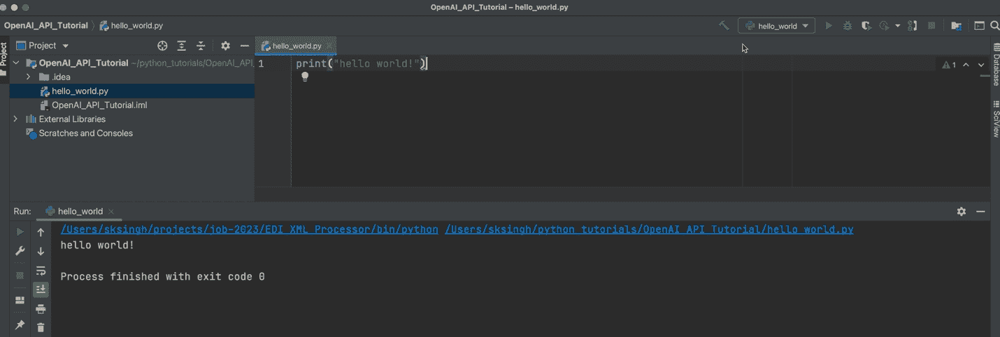
`hello_world.py` 在 `IntelliJ` 上的屏幕截图

按照这些步骤，你将在 `IntelliJ IDEA` 中设置一个完全可用的 `Python` 项目。

你可以使用 `PyCharm` 或任何你喜欢的 IDE。强烈建议在处理任何 `Python` 项目时使用 `Python` 虚拟环境（`venv`），尤其是在使用像 `OpenAI` 这样的库时。虚拟环境为你的项目创建了一个隔离的工作区，确保依赖项特定于项目，并且不会干扰系统范围的 `Python` 包或其他项目。

# 2.8 Python 语法、变量和数据类型


深受程序员喜爱，因其简洁的语法和可读的呈现方式，它提供了学习基础知识的机会，包括理解语法是什么以及变量和类型等基础主题。

## 2.8.1 Python 语法

Python 语法是指定义 Python 代码结构的规则集合。与其他编程语言不同，Python 强调可读性并使用缩进来定义代码块。

### Python 语法的关键特性

大小写敏感：Python 区分大小写，因此 `Variable` 和 `variable` 被视为两个不同的标识符。

缩进：Python 中缩进是强制性的，用于定义代码块。例如：
```
# Indentation
if True:
    print("This is indented")  # Proper indentation
```

注释：单行注释以 `#` 开头，而多行注释用三引号 (`'''` 或 `"""`) 包围。
```
# This is a single-line comment

"""
This is a
multi-line comment
"""
```

无分号：Python 不要求使用分号 (`;`) 来终止语句，使代码更简洁。

## 2.8.2 变量

Python 中的变量是用于存储数据的容器。与某些语言不同，Python 不要求显式声明变量类型；它会根据赋予的值自动确定类型。

### 定义变量

变量使用 `=` 运算符进行赋值。
```
# Defining Variables
x = 10        # Integer
name = "John" # String
price = 10.5  # Float
```

### 变量命名规则

* 必须以字母（a-z、A-Z）或下划线（`_`）开头。
* 不能以数字开头。
* 只能包含字母数字字符和下划线。
* 不能使用保留关键字，如 `if`、`else`、`for` 等。

示例
```
# Rules for Naming Variables
_age = 25
name = "Alice"
is_valid = True
```

## 2.8.3 数据类型

Python 支持各种数据类型，可大致分为基本类型和高级类型。以下是常用的数据类型：

### 数值类型

`int`：用于整数。
```
age = 25
```
`float`：用于小数。
```
price = 19.99
```
`complex`：用于复数。
```
z = 2 + 3j
```

### 文本类型

`str`：表示用引号（单引号或双引号）括起来的字符序列。
```
name = "John"
message = 'Hello, World!'
```

### 布尔类型

`bool`：表示 True 或 False。
```
is_active = True
is_logged_in = False
```

### 序列类型

`list`：一个有序集合，允许重复且可容纳多种数据类型。
```
fruits = ["apple", "banana", "cherry"]
```
`tuple`：与列表类似但不可变（不能更改）。
```
coordinates = (10, 20)
```
`range`：表示数字序列。
```
numbers = range(5)  # 0, 1, 2, 3, 4
```

### 字典类型

`dict`：存储键值对。
```
person = {"name": "Alice", "age": 25}
```

### 集合类型

`set`：一个无序的唯一项集合。
```
unique_numbers = {1, 2, 3, 4}
```
`frozenset`：集合的不可变版本。
```
mylist = ['apple', 'banana','orange']
x = frozenset(mylist)
```

### None 类型

`None`：表示空值或无值。
```
x = None
```

## 2.8.4 类型检查和类型转换

### 类型检查

使用 `type()` 函数检查变量的数据类型。
```
# Type Checking
print(type(10))          # <class 'int'>
print(type("Hello"))     # <class 'str'>
print(type(3.14))        # <class 'float'>
```

### 类型转换

Python 允许使用类型转换函数如 `int()`、`float()` 和 `str()` 将一种数据类型转换为另一种。
```
# Type Conversion
x = "10"
y = int(x)  # Converts string to integer
print(type(y))  # <class 'int'>
```

### 变量赋值
```
# Variable Assignment
a = 5
b = 3.2
c = "Python"
print(a, b, c)
```

### 基本数据类型
```
# Basic Data Types
x = 10          # int
y = 20.5        # float
z = "Hello"     # str
is_valid = True # bool
print(type(x), type(y), type(z), type(is_valid))
```

### 数据结构
```
# List
numbers = [1, 2, 3, 4, 5]
print(numbers[0])  # Accessing first element

# Dictionary
person = {"name": "Alice", "age": 30}
print(person["name"])  # Accessing value by key
```

基本语法、变量和数据类型是 Python 编程的基础。在此基础上，你将能够构建简单的程序，并随着时间的推移，继续学习更复杂的话题，如数据结构、函数和面向对象编程。

# 2.9 基本输入和输出操作

Python 提供了简单直观的方式来处理输入和输出（I/O）操作。这些操作允许用户与程序交互，要么提供输入，要么接收输出。

## 2.9.1 输入操作

Python 使用 `input()` 函数从用户获取输入。该函数从标准输入（键盘）读取一行并将其作为字符串返回。

### 语法
```
variable = input(prompt)
```
`prompt`：显示给用户的可选消息。

### 示例
```
name = input("Enter your name: ")
print("Hello, " + name + "!")
```

### `input()` 的特性

* 总是返回字符串。
* 你可以使用类型转换，例如 `int()` 或 `float()`，将输入转换为其他数据类型。

### 带类型转换的示例
```
age = int(input("Enter your age: "))
print("You are", age, "years old.")
```

## 2.9.2 输出操作

Python 使用 `print()` 函数进行输出。该函数将数据写入标准输出（控制台）。

### 语法
```
print(*objects, sep=' ', end='\n', file=sys.stdout, flush=False)
```

### 参数

* `objects`：要打印的值。多个值可以用逗号分隔。
* `sep`：值之间的分隔符（默认为空格）。
* `end`：输出末尾附加的字符串（默认为换行符）。
* `file`：指定输出文件（默认为标准输出）。
* `flush`：如果为 True，则强制立即写入输出。

### 示例
```
print("Hello, World!")
```

### 带参数的示例
```
print("Python", "is", "fun", sep="-", end="!!!\n")
```

输出
```
Python-is-fun!!!
```

## 2.9.3 格式化输出

Python 提供了多种格式化输出的方式，使其更易读。

### 使用 f-string（Python 3.6 及更高版本）
```
name = "Alice"
age = 25
print(f"My name is {name} and I am {age} years old.")
```

### 使用 `.format()` 方法
```
print("My name is {} and I am {} years old.".format(name, age))
```

### 使用 `%` 运算符
```
print("My name is %s and I am %d years old." % (name, age))
```

## 2.9.4 文件输入和输出

对于更高级的输入和输出，Python 允许从文件读取和向文件写入。

### 写入文件
```
with open("output.txt", "w") as file:
    file.write("Hello, File!")
```

### 从文件读取
```
with open("output.txt", "r") as file:
    content = file.read()
    print(content)
```

## 2.9.5 常见用例

### 获取用户输入
```
num1 = int(input("Enter first number: "))
num2 = int(input("Enter second number: "))
print("Sum:", num1 + num2)
```

### 以自定义格式显示结果
```
result = 3.14159
print(f"The value of pi is approximately {result:.2f}.")
```

### 处理文本文件
```
with open("data.txt", "r") as file:
    lines = file.readlines()
    for line in lines:
        print(line.strip())
```

在运行此程序之前，请确保 `data.txt` 文件存在于当前目录中。以下是示例 `data.txt` 文件内容的示例：
```
This is line 1
This is line 2
```

`strip()` 从字符串中移除前导和尾随字符（默认为空白字符）。

### 关键点

* 使用 `input()` 获取用户输入（总是返回字符串；如有需要请转换）。
* 使用 `print()` 显示输出，并可进行自定义选项（例如 `sep`、`end`）。
* Python 支持多种格式化输出的方式，包括 f-string 和 `.format()`。
* 文件 I/O 将输入/输出操作的范围扩展到控制台之外。

# 2.10 编写和运行 Python 程序

Python 是一种动态且用户友好的编程语言，允许开发者以多种方式编写和执行程序。因此，编写和运行 Python 程序是发挥该语言优势的核心。以下是编写和运行 Python 代码的多种方式概述。

## 2.10.1 编写 Python 程序


Python 程序使用纯文本编写并以 `.py` 扩展名保存。你可以使用各种工具编写 Python 代码，从简单的文本编辑器到高级的集成开发环境（IDEs）。

### 文本编辑器

示例：Notepad (Windows)、TextEdit (macOS)、Vim、Nano。

如何使用：
- 打开文本编辑器并编写 Python 代码。
- 使用 `.py` 扩展名保存文件（例如 `example.py`）。

示例代码：
```
print("Hello, World!")
```

### 集成开发环境（IDEs）

IDEs 提供诸如语法高亮、代码补全、调试和版本控制等功能。

流行的 IDE：PyCharm、VS Code、Jupyter Notebook、Spyder、IDLE。

优点：
- 更易于调试和开发。
- 高效的项目管理和协作。

### Jupyter Notebook

Jupyter Notebook 是交互式环境，允许在一个平台上进行代码执行、可视化和文档编写。

最适合：
- 数据科学、机器学习和教育用途。
- 在单元格中编写代码并独立执行。

## 2.10.2 运行 Python 程序

Python 程序可以根据环境和用途以不同的方式执行。

### 在终端/命令提示符中运行 Python 程序

打开终端或命令提示符。导航到保存 Python 文件的目录。使用 `python`（或 `python3`）命令运行程序：
```
python example.py
```
输出：
Hello, World!

### 使用 Python Shell（交互模式）

Python shell 允许你逐行交互式执行 Python 命令。

如何访问：打开终端或命令提示符。输入 `python` 或 `python3` 并按 Enter。

示例：
```
>>> print("Hello, World!")
```
Hello, World!

### 在 IDE 中运行 Python 程序

在 IDE 中打开 Python 文件。点击“运行”或“执行”按钮，通常由播放图标表示。输出显示在 IDE 的控制台或终端中。

### 在 Jupyter Notebook 中执行 Python

从终端或 Anaconda Navigator 打开 Jupyter Notebook。创建新笔记本或打开现有笔记本。在单元格中编写代码并按 Shift + Enter 执行。

示例：
```
print("Hello, World!")
```

### 在在线环境中运行脚本

像 Google Colab 或 Replit 这样的平台允许你在无需安装的情况下在线编写和执行 Python 代码。

非常适合快速原型设计和协作。

### 运行 Python 程序的关键命令

- `python script_name.py`：执行 Python 脚本。
- `python -i script_name.py`：运行脚本并保持解释器打开以便进一步交互。
- `python -m module_name`：将 Python 模块作为脚本运行。

## 2.10.3 调试 Python 程序

Python 提供了调试程序的工具：

内置调试器（`pdb`）：
在代码中插入以下行：
```
import pdb; pdb.set_trace()
```
允许你逐步执行代码并检查变量。

IDE 中的调试：使用内置调试器设置断点并逐步分析程序执行。

### 运行 Python 程序时的常见错误

语法错误：当代码结构存在错误时发生。

示例：
```
print("Hello, World!"
```
修复：确保所有括号、方括号和缩进正确。

运行时错误：在执行期间发生的错误，例如除零或访问不存在的变量。

`ModuleNotFoundError`：当缺少必需的库时发生。

修复：使用 `pip install library_name` 安装库。

## 2.10.4 编写和运行 Python 程序的最佳实践

使用虚拟环境：使用 `venv` 或 `conda` 为不同项目创建隔离环境。

示例：
```
python -m venv myenv
```
编写模块化代码：将程序分解为更小的函数和模块，以便更好地组织和重用。

测试你的代码：使用 `unittest` 或 `pytest` 等测试框架以确保代码可靠性。

记录你的代码：添加注释和文档字符串以使代码更易于理解和维护。

## 2.10.5 示例工作流程：编写和运行 Python 程序

编写程序：
```
def greet(name):
    return f"Hello, {name}!"
    
print(greet("Alice"))
```
保存文件：将它保存为 `greet.py`。

运行程序：
在终端中：
```
python greet.py
```
输出：
Hello, Alice!

# 2.11 章节复习问题

问题 1：
Python 最以什么而闻名？
A. 速度优于可读性
B. 可读性和简洁性
C. 低级编程的高性能
D. 有限的库支持

问题 2：
以下哪一项不是 Python 支持的编程范式？
A. 面向对象编程
B. 函数式编程
C. 过程式编程
D. 汇编编程

问题 3：
什么使 Python 在数据科学中流行？
A. 面向高级用户的复杂语法
B. 如 Pandas 和 NumPy 等丰富的库生态系统
C. 需要强大的计算能力
D. 专注于高性能游戏

问题 4：
哪种工具最常与 Python 一起用于数据科学工作流程？
A. Microsoft Excel
B. Jupyter Notebook
C. Google Sheets
D. MS Access

问题 5：
Python 虚拟环境的主要目的是什么？
A. 增加代码执行速度
B. 隔离项目依赖
C. 更有效地调试代码
D. 简化语法

问题 6：
哪个 IDE 专为支持 Python 开发而设计？
A. IntelliJ IDEA
B. PyCharm
C. Eclipse
D. Visual Studio

问题 7：
在 IntelliJ IDEA 中设置 Python 时的第一步是什么？
A. 配置 Python SDK
B. 安装 IntelliJ 插件
C. 编写 Python 代码
D. 运行 Python 解释器

问题 8：
在 Python 中，以下哪个是有效的变量名？
A. `1variable`
B. `_variable`
C. `variable-name`
D. `variable@123`

问题 9：
以下 Python 代码的输出是什么？
`type(42.0)`
A. `<class 'float'>`
B. `<class 'int'>`
C. `<class 'string'>`
D. `<class 'number'>`

问题 10：
哪个 Python 函数用于检查变量的类型？
A. `isinstance()`
B. `type()`
C. `checktype()`
D. `typeof()`

问题 11：
Python 中的 `input()` 函数做什么？
A. 向用户显示数据
B. 暂停程序
C. 以字符串形式从用户接受数据
D. 将数据转换为整数

问题 12：
如何在 Python 中打印 "Hello, World!"？
A. `echo "Hello, World!"`
B. `print("Hello, World!")`
C. `console.log("Hello, World!")`
D. `System.out.println("Hello, World!")`

问题 13：
在 Python 中使用哪种方法格式化输出？
A. `printf()`
B. `str.format()`
C. `write()`
D. `console.format()`

问题 14：
在 Python 中打开文件进行读取时应使用什么模式？
A. `"w"`
B. `"r"`
C. `"rw"`
D. `"read"`

问题 15：
以下哪个是有效的 Python 数据类型？
A. 整数
B. 字符串
C. 列表
D. 以上所有

问题 16：
在 Python 中，“类型转换”一词是什么意思？
A. 更改文件类型
B. 将一种数据类型转换为另一种数据类型
C. 重命名变量
D. 将 Python 代码转换为二进制

问题 17：
以下哪种不是运行 Python 程序的有效方法？
A. 从终端/命令行
B. 使用像 PyCharm 这样的 IDE
C. 在网页浏览器中输入代码
D. 在 Jupyter Notebook 中编写代码

问题 18：
在 Python 中调试的目的是什么？
A. 使代码运行更快
B. 纠正错误并确保程序正确执行
C. 从代码中删除注释
D. 创建程序备份

问题 19：
以下哪一项不是编写 Python 程序的最佳实践？
A. 使用有意义的变量名
B. 为清晰起见避免注释
C. 遵循 PEP 8 风格指南
D. 编写模块化代码

问题 20：
`input()` 函数返回的默认数据类型是什么？
A. 整数
B. 浮点数
C. 字符串
D. 布尔值

问题 21：
设置 Python 虚拟环境的推荐方法是什么？
A. 使用 `venv` 模块
B. 编写自定义脚本
C. 使用第三方编译器
D. 配置全局 Python 依赖项


### 问题 22
哪个 Python 数据类型是可变的？
A. `Tuple`
B. `String`
C. `List`
D. `Integer`

### 问题 23
在 Python 中将值赋给变量的正确方法是什么？
A. `variable = 10`
B. `10 = variable`
C. `var <- 10`
D. `variable : 10`

### 问题 24
哪个 Python 库常用于数据分析？
A. NumPy
B. TensorFlow
C. Pandas
D. 以上所有

### 问题 25
Jupyter Notebook 用于 Python 编程的一个关键好处是什么？
A. 它是一个轻量级文本编辑器
B. 它支持交互式编码和可视化输出
C. 它消除了对 Python 安装的需求
D. 它仅用于调试

# 2.12 章节复习题答案
1. B. 可读性和简洁性
解释：Python 以其简单且人类可读的语法而广为人知，使其易于学习和使用。
2. D. 汇编编程
解释：Python 支持面向对象、函数式和过程式编程，但不支持汇编编程，后者是一种低级语言。
3. B. 豐富的库生态系统，如 Pandas 和 NumPy
解释：Python 在数据科学中的流行得益于其丰富的库，如 Pandas 和 NumPy，它们简化了数据操作和分析。
4. B. Jupyter Notebook
解释：Jupyter Notebook 是数据科学工作流程中流行的工具，提供交互式编码和可视化功能。
5. B. 隔离项目依赖
解释：Python 虚拟环境允许项目独立管理自己的依赖，避免包之间的冲突。
6. B. PyCharm
解释：PyCharm 是专门为 Python 开发设计的 IDE，提供代码补全和调试等功能。
7. A. 配置 Python SDK
解释：在 IntelliJ IDEA 中设置 Python 时，配置 Python SDK 是启用 Python 项目开发的第一步。
8. B. `_variable`
解释：Python 中的变量名不能以数字开头，不能包含像 `@` 这样的特殊字符，并且使用下划线而不是连字符。
9. A. `<class 'float'>`
解释：`type()` 函数返回值的类型，而 `42.0` 是一个浮点数。
10. B. `type()`
解释：Python 中的 `type()` 函数用于检查变量或值的类型。
11. C. 以字符串形式接受用户数据
解释：`input()` 函数从用户获取输入并将其作为字符串返回。
12. B. `print("Hello, World!")`
解释：在 Python 中，`print()` 函数用于显示输出，正确的语法包含括号。
13. B. `str.format()`
解释：`str.format()` 方法是 Python 中格式化字符串的一种灵活方式。
14. B. `"r"`
解释：在 Python 中，`"r"` 模式用于以读取方式打开文件。
15. D. 以上所有
解释：Python 支持多种数据类型，包括 `Integer`、`String` 和 `List`。
16. B. 将一种数据类型转换为另一种
解释：Python 中的类型转换是指将值从一种数据类型更改为另一种，例如从字符串到整数。
17. C. 在 Web 浏览器中输入代码
解释：Python 程序可以在终端、IDE 或笔记本中运行，但除非使用特定平台，否则不能直接在 Web 浏览器中运行。
18. B. 纠正错误并确保程序正确执行
解释：调试有助于识别和修复代码中的问题，确保其按预期运行。
19. B. 为清晰起见避免注释
解释：最佳实践鼓励使用注释来阐明代码，使他人和日后自己更容易理解。
20. C. String
解释：`input()` 函数默认总是将用户输入作为字符串返回，即使输入是数字。
21. A. 使用 `venv` 模块
解释：`venv` 模块是创建 Python 虚拟环境的推荐方法。
22. C. List
解释：列表是可变的，这意味着创建后其元素可以被修改，而元组和字符串则不能。
23. A. `variable = 10`
解释：Python 中的变量使用 `=` 运算符赋值。
24. D. 以上所有
解释：NumPy、TensorFlow 和 Pandas 是常用于数据分析和相关任务的 Python 库。
25. B. 它支持交互式编码和可视化输出
解释：Jupyter Notebook 允许交互式编码、实时可视化和内联文档，使其成为 Python 编程的强大工具。

# 第 3 章 数据科学的 Python 基础
Python 是数据科学的基础编程语言，因其简洁性、多功能性和丰富的库而备受青睐。本章涵盖了 Python 的核心概念，首先介绍控制流，包括循环、条件语句和循环控制语句，有助于高效管理程序执行。然后探讨函数和模块，强调它们在构建可重用代码结构中的重要性。本章还深入探讨了 Python 的核心数据结构——列表、元组、字典和集合，并比较其用例以帮助为不同任务选择合适的结构。最后，介绍了文件处理，解释如何读取、写入和管理文件，包括二进制操作、异常处理和最佳实践。掌握这些 Python 基础知识为在实际应用中处理数据提供了坚实的基础。

## 3.1 控制流：循环和条件语句
Python 中的控制流允许您根据条件或重复任务来决定代码的执行顺序。控制流的两个主要组成部分是条件语句和循环。它们有助于决策和高效执行重复任务。

### 3.1.1 Python 中的条件语句
条件语句使程序能够根据条件为 True 还是 False 执行特定的代码块。

#### if、elif 和 else 语句
- `if`：如果指定条件为 True，则执行代码块。
- `elif`：如果之前条件为 False，则指定额外条件。
- `else`：如果所有前置条件均为 False，则执行代码块。

语法：
```
if condition1:
    # Code block 1
elif condition2:
    # Code block 2
else:
    # Code block 3
```
示例：
```
age = 18
if age < 18:
    print("You are a minor.")
elif age == 18:
    print("You just became an adult.")
else:
    print("You are an adult.")
```
输出：
You just became an adult.

#### 嵌套条件语句
条件语句可以相互嵌套以评估更复杂的场景。
```
score = 85
if score >= 50:
    if score >= 90:
        print("Excellent!")
    else:
        print("Good job!")
else:
    print("Better luck next time!")
```

### 3.1.2 Python 中的循环
循环用于重复执行代码块，要么执行指定次数，要么直到满足条件。

#### for 循环
用于遍历序列，例如列表、元组、字典、字符串或 range。

语法：
```
for variable in sequence:
    # Code block
```
示例：
```
fruits = ["apple", "banana", "cherry"]
for fruit in fruits:
    print(fruit)
```
输出：
apple
banana
cherry

#### for 循环中的 range()
`range()` 函数生成数字序列。
```
for i in range(5):  # 0, 1, 2, 3, 4
    print(i)
```
带起始值和步长的示例：
```
for i in range(1, 10, 2):  # Start=1, End=10, Step=2
    print(i)
```
输出：
1
3
5
7
9

#### while 循环
只要条件为 True，就执行代码块。

语法：
```
while condition:
    # Code block
```
示例：
```
count = 0
while count < 5:
    print(count)
    count += 1
```
输出：
0
1
2
3
4

#### 无限循环
请注意永远不会变为 False 的条件，因为它们会导致无限循环：
```
# Warning: This creates an infinite loop!
while True:
    print("This will run forever.")
```

### 3.1.3 循环控制语句
循环控制语句改变循环的流程，允许您跳过迭代或完全终止循环。

#### break 语句
终止循环并移动到循环后的下一条语句。

示例：
```
for num in range(10):
    if num == 5:
        break
    print(num)
```
输出：
0
1
2
3
4


### continue 语句

跳过当前迭代并移动到下一个。

示例：

```python
for num in range(5):
    if num == 2:
        continue
    print(num)
```

输出：

0

1

3

4

### pass 语句

用于在不需要执行任何操作时作为占位符。

示例：

```python
for num in range(3):
    pass  # Placeholder
```

### 带 else 的循环

`for` 和 `while` 循环都可以有一个 `else` 块，该块在循环结束后执行，除非循环被 `break` 终止。

for 的示例：

```python
for num in range(3):
    print(num)
else:
    print("Loop completed!")
```

输出：

0

1

2

Loop completed!

while 的示例：

```python
count = 0
while count < 3:
    print(count)
    count += 1
else:
    print("While loop completed!")
```

### 嵌套循环

你可以在循环内嵌套循环，从而遍历多维结构。

示例：

```python
for i in range(3):
    for j in range(2):
        print(f"i={i}, j={j}")
```

输出：

i=0, j=0

i=0, j=1

i=1, j=0

i=1, j=1

i=2, j=0

i=2, j=1

## 3.1.4 组合循环和条件语句

循环和条件语句可以组合起来创建复杂的逻辑。

示例：

```python
numbers = [1, 2, 3, 4, 5]
for num in numbers:
    if num % 2 == 0:
        print(f"{num} is even")
    else:
        print(f"{num} is odd")
```

输出：

1 is odd

2 is even

3 is odd

4 is even

5 is odd

## 3.1.5 Python 控制流的最佳实践

- 避免无限循环：确保循环条件最终变为 False。
- 谨慎使用 `break` 和 `continue`：避免过度使用这些语句，因为它们会使代码更难阅读。
- 对复杂逻辑进行注释：为嵌套循环或复杂条件语句提供注释以增强可读性。
- 优化嵌套循环：使用高效算法减少深度嵌套循环的复杂性。

总之，循环和条件语句等控制流结构在使用 Python 编程时必不可少。它们使人们能够编写动态程序，可以做出决策并非常有效地执行重复性任务。掌握这一点将使人们能够为给定数量的应用编写干净、逻辑清晰且高效的 Python 程序。

# 3.2 函数和模块

函数和模块是 Python 编程中的基本构建块。它们有助于组织和重用代码，使程序更具模块化和可维护性。

## 3.2.1 Python 中的函数

函数是为执行特定任务而设计的可重用代码块。函数允许你避免重复代码并使程序模块化且易于调试。

### 定义和调用函数

语法：

```python
def function_name(parameters):
    """docstring (optional)"""
    # Code block
    return value
```

示例：

```python
def greet(name):
    return f"Hello, {name}!"

print(greet("Alice"))
```

输出：

Hello, Alice!

### 函数类型

内置函数：Python 提供了多个内置函数，如 `len()`、`print()` 和 `range()`。

示例：

```python
print(len("Hello"))
```

用户定义函数：由用户创建以执行特定任务的函数。

示例：

```python
def square(num):
    return num ** 2

print(square(4))
```

匿名函数（Lambda 函数）：使用 `lambda` 关键字定义的简短单行函数。

示例：

```python
square = lambda x: x ** 2
print(square(5))
```

### 函数参数

位置参数：参数按定义时的相同顺序传递。

示例：

```python
def add(a, b):
    return a + b

print(add(3, 5))
```

关键字参数：参数通过名称传递，允许顺序灵活。

示例：

```python
def greet(name, age):
    return f"{name} is {age} years old."

print(greet(age=25, name="Alice"))
```

默认参数：可以为参数指定默认值。

示例：

```python
def greet(name, age=30):
    return f"{name} is {age} years old."

print(greet("Bob"))
```

可变长度参数：`*args` 用于位置参数，`**kwargs` 用于关键字参数。

示例：

```python
def sum_all(*args):
    return sum(args)

print(sum_all(1, 2, 3, 4))
```

### return 语句

函数可以使用 `return` 语句返回值。

示例：

```python
def multiply(a, b):
    return a * b

result = multiply(4, 5)
print(result)
```

## 3.2.2 Python 中的模块

模块是包含函数、类和变量集合的 Python 文件。模块有助于将代码组织成可管理的块，并允许在多个程序中重用代码。

### 使用模块

导入模块：

示例：

```python
import math
print(math.sqrt(16))
```

导入特定函数：

示例：

```python
from math import sqrt
print(sqrt(25))
```

重命名导入：

示例：

```python
import math as m
print(m.pi)
```

导入所有函数：

示例：

```python
from math import *
print(sin(90))
```

### 创建模块

创建一个包含函数和变量的 `.py` 文件。

示例（`mymodule.py`）：

```python
def greet(name):
    return f"Hello, {name}!"
```

在另一个脚本中导入并使用模块：

示例：

```python
import mymodule
print(mymodule.greet("Alice"))
```

### 内置模块

Python 附带许多内置模块，例如：

- `math`：用于数学运算。
- `random`：用于生成随机数。
- `os`：用于与操作系统交互。
- `datetime`：用于处理日期和时间。

示例：

```python
import random
print(random.randint(1, 10))
```

### 第三方模块

第三方模块可以使用 `pip` 安装，对于特定任务很有用。

示例：安装并使用 `numpy` 库。

```bash
pip install numpy
```

```python
import numpy as np
array = np.array([1, 2, 3])
print(array)
```

## 3.2.3 函数和模块的区别

| 方面 | 函数 | 模块 |
| --- | --- | --- |
| 定义 | 执行任务的可重用代码块。 | 包含可重用函数、类和变量的文件。 |
| 范围 | 仅限于定义它的程序。 | 可以在程序之间导入和重用。 |
| 目的 | 封装特定功能。 | 将相关功能封装到单个文件中。 |

最终分析，函数和模块是编写干净、有组织且可重用的 Python 代码的方式。函数封装特定任务，而模块则在许多程序中实现代码重用。两者结合使用，开发人员可以创建模块化且可维护的应用以加速开发过程。

# 3.3 Python 数据结构：列表、元组、字典、集合

Python 提供了多种内置数据结构，允许你高效地存储、操作和组织数据。最常用的数据结构是列表、元组、字典和集合。每种都有独特的属性和用例。

## 3.3.1 列表

列表是有序、可变的项目集合。它允许重复元素，并且在许多用例中非常通用。

关键特性：

- 有序：元素具有定义的顺序。
- 可变：可以修改（添加、删除或更改元素）。
- 支持异构数据类型。

语法：

```python
my_list = [1, 2, 3, "apple", True]
```

### 常用操作：

访问元素：

```python
my_list = [1, 2, 3, "apple", True]
print(my_list[0])  # Output: 1
```

修改元素：

```python
my_list[1] = 20
print(my_list)  # Output: [1, 20, 3, "apple", True]
```

添加元素：

```python
my_list.append(10)  # Adds at the end
my_list.insert(2, "banana")  # Adds at index 2
```

删除元素：

```python
my_list.remove("apple")  # Removes "apple"
my_list.pop(1)  # Removes element at index 1
```

在 Python 中，`remove()` 和 `pop()` 都是通过删除元素来修改列表的方法，但它们的功能不同。`remove(value)` 方法从列表中删除指定值的第一次出现。如果未找到该值，则会引发 `ValueError`，并且它不返回任何值。另一方面，`pop(index=-1)` 方法删除并返回指定索引处的元素。如果未提供索引，则删除并返回列表的最后一个元素。但是，如果指定的索引超出范围，则会引发 `IndexError`。

切片：

```python
print(my_list[1:3])  # Outputs elements from index 1 to 2
```

迭代：

```python
for item in my_list:
    print(item)
```

## 3.3.2 元组


## 3.3.2 元组

元组是有序的、不可变项的集合。它非常适合存储不应更改的固定数据。

### 主要特性

- 有序：元素具有定义的顺序。
- 不可变：创建后无法修改。
- 支持异构数据类型。

### 语法

`my_tuple = (1, 2, 3, "apple", True)`

### 常用操作

#### 访问元素

```python
my_tuple = (1, 2, 3, "apple", True)
print(my_tuple[0])  # Output: 1
```

#### 切片

```python
print(my_tuple[1:3])  # Outputs (2, 3)
```

#### 迭代

```python
for item in my_tuple:
    print(item)
```

#### 解包

```python
a, b, c, d, e = my_tuple
print(a, b)  # Output: 1 2
```

### 不可变性

创建后无法修改、添加或删除元素。

### 何时使用元组

当数据应保持不变时（例如，坐标、配置设置）。

## 3.3.3 字典

字典是无序的、可变的键值对集合。它非常适合将唯一键与特定值关联。

### 主要特性

- 无序：元素没有定义的顺序（自 Python 3.7 起有序）。
- 可变：可以添加、删除或更新键值对。
- 键必须是唯一的且不可变的（例如，字符串、数字或元组）。

### 语法

`my_dict = {"name": "Alice", "age": 25, "city": "New York"}`

### 常用操作

#### 访问值

```python
print(my_dict["name"])  # Output: Alice
```

#### 添加/更新值

```python
my_dict["job"] = "Engineer"  # Adds a new key-value pair
my_dict["age"] = 26  # Updates the value of "age"
```

#### 删除键值对

```python
del my_dict["city"]  # Removes the "city" key
my_dict.pop("age")  # Removes and returns the value of "age"
```

#### 迭代

```python
for key, value in my_dict.items():
    print(key, value)
```

#### 检查键

```python
print("name" in my_dict)  # Output: True
```

### 何时使用字典

当数据需要通过唯一键访问时（例如，用户配置文件、查找表）。

## 3.3.4 集合

集合是无序的、可变的唯一元素集合。它非常适合存储不重复的项目并执行集合操作。

### 主要特性

- 无序：元素没有定义的顺序。
- 可变：可以添加或删除元素。
- 唯一：不允许重复值。

### 语法

`my_set = {1, 2, 3, 4}`

### 常用操作

#### 添加元素

```python
my_set = {1, 2, 3, 4}
my_set.add(5)  # Adds 5 to the set
```

#### 删除元素

```python
my_set.remove(2)  # Removes 2 (throws an error if not present)
my_set.discard(10)  # Removes 10 (does not throw an error if not present)
```

#### 集合操作

```python
set1 = {1, 2, 3}
set2 = {3, 4, 5}
print(set1.union(set2))  # {1, 2, 3, 4, 5}
print(set1.intersection(set2))  # {3}
print(set1.difference(set2))  # {1, 2}
```

#### 检查成员资格

```python
print(3 in my_set)  # Output: True
```

### 何时使用集合

当不允许重复值时（例如，存储唯一 ID、从列表中删除重复项）。

## 3.3.5 Python 数据结构比较

| 特性 | 列表 | 元组 | 字典 | 集合 |
| --- | --- | --- | --- | --- |
| 有序 | 是 | 是 | 否（自 3.7+ 起有序） | 否 |
| 可变 | 是 | 否 | 是 | 是 |
| 允许重复 | 是 | 是 | 键：否，值：是 | 否 |
| 访问方法 | 索引 | 索引 | 键 | 无序 |
| 最适合 | 顺序数据 | 固定数据 | 键值关联 | 唯一、无序数据 |

## 3.3.6 选择合适的数据结构

使用 `list`：当你需要一个有序、可变的项目集合时。

使用 `tuple`：当你需要一个有序、不可变的项目集合时。

使用 `dict`：当你需要将数据存储为键值对时。

使用 `set`：当你需要一个唯一元素的集合时。

此外，Python 具有非常强大的内置数据结构：`list`、`tuple`、`dict` 和 `set`。根据你的需求选择合适的数据结构将确保高效、干净的代码——无论是关于不可变性、唯一性还是键值映射。掌握这些数据结构是有效 Python 编程的必要条件。

# 3.4 文件处理：读写文件

文件处理是 Python 中非常有用的技能；它基本上允许创建、读取、写入和操作文件。Python 使用内置函数和方法提供了一种非常简单高效的方式来与文件交互。

## 3.4.1 文件处理模式

Python 支持不同的文件处理模式：

| 模式 | 描述 |
| --- | --- |
| 'r' | 读取模式（默认）。打开文件进行读取；如果文件不存在则引发错误。 |
| 'w' | 写入模式。打开文件进行写入；如果文件不存在则创建文件，如果存在则覆盖文件。 |
| 'a' | 追加模式。打开文件进行追加；如果文件不存在则创建文件。 |
| 'r+' | 读写模式。打开文件进行读写。 |
| 'w+' | 写读模式。如果文件不存在则创建文件，如果存在则覆盖。 |
| 'a+' | 追加读模式。打开文件进行追加和读取。 |
| 'b' | 二进制模式。与其他模式一起使用（例如 'rb' 或 'wb'）用于图像或视频等二进制文件。 |

## 3.4.2 读取文件

### 读取整个文件

使用 `read()` 方法读取文件的全部内容。

示例：

```python
with open('example.txt', 'r') as file:
    content = file.read()
    print(content)
```

确保在运行此程序之前 `example.txt` 文件存在于当前目录中。以下是示例 `example.txt` 文件内容的示例：

这是第 1 行
这是第 2 行
这是第 3 行

### 逐行读取

使用 `readline()` 方法一次读取一行。

示例：

```python
with open('example.txt', 'r') as file:
    line = file.readline()
    while line:
        print(line.strip())  # Removes the newline character
        line = file.readline()
```

### 将所有行作为列表读取

使用 `readlines()` 方法将所有行读入列表。

示例：

```python
with open('example.txt', 'r') as file:
    lines = file.readlines()
    print(lines)
```

## 3.4.3 写入文件

### 向文件写入文本

使用 `write()` 方法向文件写入字符串。

示例：

```python
with open('example.txt', 'w') as file:
    file.write("Hello, World!\n")
    file.write("This is a new line.")
```

### 写入多行

使用 `writelines()` 方法将字符串列表写入文件。

示例：

```python
lines = ["First line\n", "Second line\n", "Third line\n"]
with open('example.txt', 'w') as file:
    file.writelines(lines)
```

### 追加到文件

使用 'a' 模式将内容追加到现有文件。

示例：

```python
with open('example.txt', 'a') as file:
    file.write("\nAppended line.")
```

## 3.4.4 处理二进制文件

二进制文件，例如图像或视频，需要 'b' 模式。

### 读取二进制文件

```python
with open('image.jpg', 'rb') as file:
    data = file.read()
    print(data[:10])  # Prints the first 10 bytes
```

确保文件 `image.jpg` 存在于当前目录中以运行此代码块。

### 写入二进制文件

```python
with open('output.jpg', 'wb') as file:
    file.write(data)
```

## 3.4.5 文件指针操作

Python 提供了操作文件指针的方法：

`tell()`：返回文件指针的当前位置。

`seek(offset, whence)`：将文件指针移动到特定位置。

示例：

```python
with open('example.txt', 'r') as file:
    print(file.tell())  # Outputs: 0 (beginning of the file)
    file.read(5)  # Reads the first 5 characters
    print(file.tell())  # Outputs: 5
    file.seek(0)  # Moves the pointer back to the start
```

## 3.4.6 文件操作中的异常处理

使用 try-except 块处理文件操作期间的潜在错误。

示例：

```python
try:
    with open('nonexistent.txt', 'r') as file:
        content = file.read()
except FileNotFoundError:
    print("The file does not exist.")
```

## 3.4.7 使用 with 语句

`with` 语句是处理文件的首选方式，因为它会在块执行后自动关闭文件。它防止资源泄漏并简化代码。

示例：

```python
with open('example.txt', 'r') as file:
```


```
content = file.read()
print(content)
# File is automatically closed after the block
```

## 3.4.8 实用示例

### 统计文件中的单词

```
with open('example.txt', 'r') as file:
    text = file.read()
    words = text.split(' ')
    print(f"Word count: {len(words)}")
```

### 复制文件

```
with open('source.txt', 'r') as source, open('destination.txt', 'w') as dest:
    dest.write(source.read())
```

确保在运行此程序之前，当前目录中存在 `source.txt` 文件。以下是 `source.txt` 文件内容的示例：

```
This is line 1
This is line 2
This is line 3
```

## 3.4.9 文件处理中的常见错误

| 错误 | 原因 | 解决方案 |
|---|---|---|
| `FileNotFoundError` | 文件不存在。 | 确保文件存在或使用 `try-except` 块。 |
| `PermissionError` | 访问文件权限不足。 | 检查文件权限或使用适当的权限运行。 |
| `ValueError: I/O operation` | 文件在操作前已关闭。 | 使用 `with` 语句管理文件访问。 |

## 3.4.10 文件处理的最佳实践

- **使用 `with` 语句**：确保文件自动关闭。
- **处理异常**：预见并处理诸如文件丢失或权限问题之类的错误。
- **避免覆盖文件**：使用 `'a'` 模式或在写入前检查文件是否存在。
- **使用相对路径**：为了可移植性，使用相对路径而不是绝对路径。
- **使用二进制模式**：对于图像或视频等非文本文件，始终使用 `'b'` 模式。

总之，Python 中的文件处理是一项强大的功能，允许无缝地与文件进行交互以读取、写入和操作数据。通过掌握这些技术并遵循最佳实践，您可以在各种应用程序中高效地处理文件，从数据处理到配置管理。

# 3.5 章节复习题

**问题 1：**
以下哪个关键字用于在 Python 中定义条件语句？
A. `for`
B. `while`
C. `if`
D. `switch`

**问题 2：**
以下代码的输出是什么？
```
x = 5
if x > 3:
    print("Greater")
else:
    print("Smaller")
```
A. Greater
B. Smaller
C. Error
D. None

**问题 3：**
以下哪个用于在 Python 中创建循环？
A. `for`
B. `while`
C. Both A and B
D. None of the above

**问题 4：**
在 Python 中哪个语句用于终止循环？
A. `skip`
B. `continue`
C. `break`
D. `exit`

**问题 5：**
在 Python 中如何组合循环和条件语句？
A. By nesting conditionals inside loops
B. By using `break` and `continue`
C. Both A and B
D. None of the above

**问题 6：**
在 Python 中哪个关键字用于定义函数？
A. `func`
B. `define`
C. `def`
D. `lambda`

**问题 7：**
关于模块，以下哪个陈述是正确的？
A. A module is a Python file containing definitions and statements
B. A module cannot contain functions
C. Modules cannot be imported into other Python files
D. Modules are executed line by line every time they are used

**问题 8：**
从模块导入特定函数的正确语法是什么？
A. `import module.function`
B. `from module import function`
C. `import function from module`
D. `import module -> function`

**问题 9：**
以下哪个在 Python 中是可变的？
A. `List`
B. `Tuple`
C. `String`
D. `Set`

**问题 10：**
在 Python 中定义字典的正确方法是什么？
A. `{key1, value1, key2, value2}`
B. `{key1: value1, key2: value2}`
C. `[key1: value1, key2: value2]`
D. `(key1: value1, key2: value2)`

**问题 11：**
如果需要维护唯一元素，应该使用哪种数据结构？
A. `List`
B. `Tuple`
C. `Set`
D. `Dictionary`

**问题 12：**
哪个方法用于向列表添加元素？
A. `append()`
B. `insert()`
C. `add()`
D. Both A and B

**问题 13：**
如何访问字典中的值？
A. Using square brackets with the key
B. Using the `get()` method
C. Using the index position
D. Both A and B

**问题 14：**
以下代码的输出是什么？
```
set1 = {1, 2, 3}
set1.add(4)
print(set1)
```
A. `{1, 2, 3}`
B. `{1, 2, 3, 4}`
C. `{4, 1, 2, 3}`
D. Error

**问题 15：**
哪个文件模式用于向现有文件追加数据？
A. `'w'`
B. `'a'`
C. `'r'`
D. `'x'`

**问题 16：**
使用 `with` 语句处理文件时它做了什么？
A. Automatically closes the file after the block execution
B. Ensures the file is locked for reading only
C. Prevents exceptions from occurring in file operations
D. Allows writing to multiple files simultaneously

**问题 17：**
如果 `example.txt` 包含 "Hello World"，以下代码的输出是什么？
```
with open("example.txt", "r") as file:
    print(file.read())
```
A. Reads the first line of the file
B. Reads the entire content of the file
C. Displays the file's memory address
D. None of the above

**问题 18：**
以下哪个模式用于以二进制格式打开文件进行读取？
A. `'rb'`
B. `'r'`
C. `'wb'`
D. `'w'`

**问题 19：**
如果尝试以 `'r'` 模式打开不存在的文件会发生什么？
A. The file will be created
B. An exception will be raised
C. The operation will silently fail
D. The file pointer will point to None

**问题 20：**
以下哪个不是文件处理的最佳实践？
A. Using the `with` statement
B. Closing files manually without `with`
C. Handling exceptions in file operations
D. Using appropriate file modes

**问题 21：**
哪个循环控制语句跳过当前迭代的剩余部分？
A. `break`
B. `continue`
C. `exit`
D. `pass`

**问题 22：**
创建单元素元组的正确语法是什么？
A. `(1,)`
B. `(1)`
C. `[1,]`
D. `{1}`

**问题 23：**
以下哪个不是函数和模块之间的区别？
A. A function is a block of code, while a module is a file
B. Functions are reusable, while modules are not
C. A module can contain multiple functions
D. Modules are imported, while functions are called

**问题 24：**
以下哪个操作在 Python 中不被集合支持？
A. Adding elements
B. Removing elements
C. Indexing
D. Checking membership

**问题 25：**
以下代码的输出是什么？
```
my_dict = {'a': 1, 'b': 2, 'c': 3}
print(my_dict['d'])
```
A. `0`
B. `None`
C. Error
D. Empty dictionary {}

# 3.6 章节复习题答案

1. C. `if`
Explanation: `if` 关键字用于在 Python 中定义条件语句。

2. A. Greater
Explanation: `if` 条件 `x > 3` 对于 `x = 5` 为真，因此 `if` 下的块被执行。

3. C. Both A and B
Explanation: Python 支持 `for` 和 `while` 循环进行迭代操作。

4. C. `break`
Explanation: `break` 语句用于提前终止循环。

5. C. Both A and B
Explanation: 循环和条件语句可以通过在循环内嵌套条件语句以及使用 `break` 和 `continue` 等控制语句来组合。

6. C. `def`
Explanation: `def` 关键字用于在 Python 中定义函数。

7. A. A module is a Python file containing definitions and statements
Explanation: Python 中的模块是一个文件，包含 Python 代码，包括函数、类和变量。

8. B. `from module import function`
Explanation: 这是从模块导入特定函数的正确语法。

9. A. `List`
Explanation: 列表是可变的，意味着其内容在创建后可以被修改。

10. B. `{key1: value1, key2: value2}`
Explanation: Python 中的字典使用大括号定义，键值对由冒号分隔。

11. C. `Set`
Explanation: 集合确保所有元素都是唯一的。

12. D. Both A and B
Explanation: `append()` 方法将元素添加到列表末尾，而 `insert()` 可以在特定位置添加元素。

13. D. Both A and B
Explanation: 您可以使用方括号和键或 `get()` 方法访问字典值。

14. B. `{1, 2, 3, 4}`
Explanation: `add()` 方法将指定元素添加到集合中。

15. B. `'a'`


Explanation: The `a` mode opens a file for appending data without overwriting its existing content.

16. A. 在块执行后自动关闭文件

Explanation: The `with` statement ensures that the file is closed properly after the block is executed.

17. B. 读取文件的全部内容

Explanation: The `read()` method reads the entire content of a file as a single string.

18. A. `'rb'`

Explanation: The `rb` mode opens a file in binary format for reading.

19. B. 将引发异常

Explanation: If a file does not exist and you try to open it in `r` mode, Python raises a `FileNotFoundError`.

20. B. 不使用 with 手动关闭文件

Explanation: Using the `with` statement is preferred as it automatically handles file closing, unlike manual file handling.

21. B. `continue`

Explanation: The `continue` statement skips the rest of the current iteration and moves to the next iteration.

22. A. `(1,)`

Explanation: A tuple with a single element requires a trailing comma to differentiate it from a regular parenthesis.

23. B. 函数是可重用的，而模块不是

Explanation: This is incorrect because both functions and modules are reusable.

24. C. 索引

Explanation: Sets in Python are unordered collections, so they do not support indexing.

25. C. 错误

Explanation: Attempting to access a non-existent key in a dictionary using square brackets raises a `KeyError`.

# 第 4 章. 数据科学的 Python 库简介

Python 庞大的库生态系统使其成为数据科学的强大工具。本章介绍关键的 Python 库——`NumPy`、`pandas`、`Matplotlib`、`seaborn` 和 `scikit-learn`，重点介绍它们在数据处理、可视化和机器学习中的作用。它提供了这些库的比较以及何时使用每个库的指导。读者还将学习如何安装和导入库、排除常见问题以及管理虚拟环境以实现高效的项目组织。本章以动手练习结束，演示基本的数据处理和可视化，为读者提供在 Python 中处理数据的必备技能。

## 4.1 关键库概述（NumPy、pandas、Matplotlib、seaborn、scikit-learn）

Python 在数据科学中受欢迎的很大一部分原因是拥有庞大的库生态系统，这些库使数据处理、分析、可视化和机器学习变得更加容易。概述涵盖了五大库：`NumPy`、`pandas`、`Matplotlib`、`seaborn` 和 `scikit-learn`。

### 4.1.1 NumPy

`NumPy` (Numerical Python) is a foundational library for numerical computations in Python. It provides powerful tools for working with arrays, matrices, and numerical data.

主要特性：
- 用于处理大型数据集的高效 n 维数组对象（`ndarray`）。
- 用于线性代数、随机数生成和傅里叶变换的数学函数。
- 用于在没有显式循环的情况下进行逐元素操作的广播。

示例：
```
import numpy as np

# Creating a NumPy array
arr = np.array([1, 2, 3, 4, 5])

# Array operations
print(arr + 10)  # Adds 10 to each element
```

用途：
- 科学计算。
- 其他库如 `pandas` 和 `scikit-learn` 的基础。

### 4.1.2 pandas

`pandas` is a high-level library built on `NumPy`, designed for data manipulation and analysis. It introduces data structures like `Series` and `DataFrame` that simplify working with structured data.

主要特性：
- `DataFrame`: 一个二维标记数据结构，类似于电子表格。
- 使用 `.fillna()` 和 `.dropna()` 等方法处理缺失数据。
- 用于数据过滤、分组、合并和重塑的强大工具。

示例：
```
import pandas as pd

# Creating a DataFrame
data = {'Name': ['Alice', 'Bob', 'Charlie'], 'Age': [25, 30, 35]}
df = pd.DataFrame(data)

# DataFrame operations
print(df['Age'].mean())  # Calculates the average age
```

用途：数据清洗和预处理。探索性数据分析（EDA）。

### 4.1.3 Matplotlib

`Matplotlib` is a widely used library for creating static, interactive, and animated visualizations in Python. It provides fine-grained control over plot elements.

主要特性：支持多种绘图类型：线图、散点图、柱状图、直方图等。高度可定制，可精细控制可视化美观。面向对象和基于状态的绘图接口。

示例：
```
import matplotlib.pyplot as plt

# Plotting a line graph
x = [1, 2, 3, 4]
y = [10, 20, 25, 30]
plt.plot(x, y, label='Line Graph')
plt.xlabel('X-axis')
plt.ylabel('Y-axis')
plt.title('Sample Plot')
plt.legend()
plt.show()
```

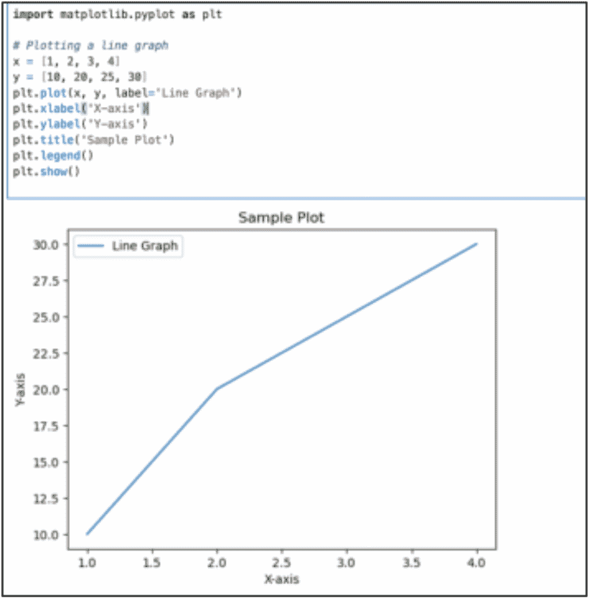

来自 Jupyter Notebook 的屏幕截图

用途：
- 创建出版质量的图表。
- 用于详细分析的自定义可视化。

### 4.1.4 seaborn

Built on `Matplotlib`, `seaborn` simplifies statistical data visualization with a focus on aesthetics and ease of use. It provides high-level abstractions for common plot types.

主要特性：
内置支持可视化变量之间的关系（例如，散点图、线图）。
高级统计图，如小提琴图、箱线图和热力图。
自动处理主题和调色板。

示例：
```
import seaborn as sns
import matplotlib.pyplot as plt

# Creating a scatter plot with regression line
tips = sns.load_dataset('tips')
sns.scatterplot(x='total_bill', y='tip', data=tips)
plt.show()
```

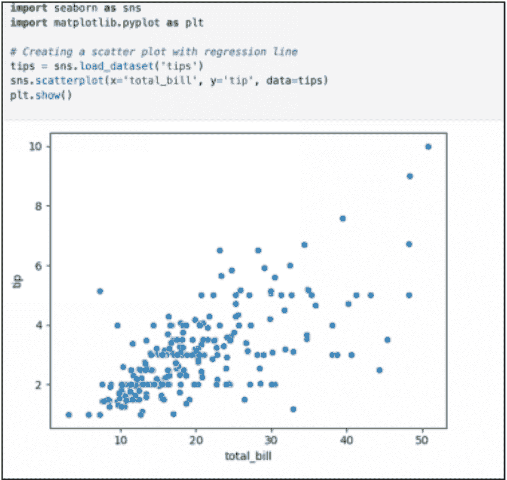

来自 Jupyter Notebook 的屏幕截图

The line `tips = sns.load_dataset('tips')` is a command from the Seaborn library in Python, which is used for data visualization. Here's a step-by-step breakdown of what happens when this line is executed:

`sns.load_dataset()` Function: This function is part of the Seaborn library and is used to load example datasets provided by Seaborn. The argument `'tips'` refers to the name of one of Seaborn's built-in datasets.

Dataset Retrieval: When you pass `'tips'` to the function, Seaborn searches for the corresponding dataset file (a CSV or similar format) in its collection of built-in datasets. The `'tips'` dataset is a small, well-known dataset about restaurant tipping behavior, including details like total bill, tip amount, gender, day of the week, and time of the meal.

Loading the Data: The function reads the data from the built-in source and loads it into a `pandas` `DataFrame` object. A `pandas` `DataFrame` is a tabular data structure (like a table in a database or Excel spreadsheet), which is commonly used for data manipulation and analysis in Python.

Assigning to `tips`: The loaded dataset is then assigned to the variable `tips`. At this point, `tips` is a `pandas` `DataFrame` containing the data from the `'tips'` dataset.

Structure of `tips`: After execution, you can inspect the data by running commands like:
`tips.head()` # Displays the first 5 rows of the dataset
`tips.info()` # Provides details about the dataset's structure

Example Contents of `tips`: The `'tips'` dataset typically looks like this:

| total_bill | tip | sex | smoker | day | time | size |
| --- | --- | --- | --- | --- | --- | --- |
| 16.99 | 1.01 | Female | No | Sun | Dinner | 2 |
| 10.34 | 1.66 | Male | No | Sun | Dinner | 3 |
| 21.01 | 3.50 | Male | No | Sun | Dinner | 3 |

This data can now be used for visualization and analysis using Seaborn or pandas. For instance, you can plot graphs like:
`sns.scatterplot(data=tips, x="total_bill", y="tip")`

用途：统计数据可视化。快速、美观的可视化。

### 4.1.5 scikit-learn

`scikit-learn` is a comprehensive library for machine learning in Python. It provides tools for building, training, and evaluating models.

主要特性：


- 支持监督学习（例如，回归、分类）和无监督学习（例如，聚类）。
- 内置数据预处理、特征选择和模型评估工具。
- 丰富的算法种类，如线性回归、决策树和 k-means 聚类。

**示例：**
```
from sklearn.linear_model import LinearRegression

# Sample data
X = [[1], [2], [3], [4]]
y = [2, 4, 6, 8]

# Creating and training the model
model = LinearRegression()
model.fit(X, y)

# Making predictions
print(model.predict([[5]]))  # Predicts output for input 5
```

**用例：** 预测建模。特征工程和模型评估。

## 4.1.6 库比较

| 库 | 主要用途 | 优势 |
| --- | --- | --- |
| NumPy | 数值计算 | 高效的数组操作，是其他库的基础。 |
| pandas | 数据操作和分析 | 易于处理表格和 CSV 等结构化数据。 |
| Matplotlib | 数据可视化 | 高度可定制的绘图，适合出版质量的视觉效果。 |
| seaborn | 统计数据可视化 | 简化、美观的统计绘图。 |
| scikit-learn | 机器学习 | 用于构建和评估模型的综合工具。 |

## 4.1.7 何时使用哪个库

`NumPy`：在处理数值数据或执行数学计算时使用。

`pandas`：用于处理和操作结构化数据集，如 CSV 或 Excel 文件。

`Matplotlib`：在创建自定义或出版质量的可视化时使用。

`seaborn`：用于快速且视觉上吸引人的统计可视化。

`scikit-learn`：用于构建和评估机器学习模型。

总之，这些库中的每一个在数据科学工作流程中都扮演着非常重要的角色，从预处理和分析数据到可视化结果和构建机器学习模型。将这些工具结合起来，可以让 Python 开发者轻松处理复杂的数据科学问题。

# 4.2 安装和导入库

Python 库对于扩展 Python 的功能至关重要，使开发者能够执行诸如数据分析、可视化或机器学习等特定任务。在使用库之前，必须先安装它（如果未预装），并将其导入到你的 Python 脚本或环境中。

## 4.2.1 安装 Python 库

Python 库通常使用 `pip` 安装，`pip` 是 Python 的包安装程序，或通过其他包管理器如 `conda`（如果使用 Anaconda）安装。

### 使用 pip 安装

`pip` 是 Python 的默认包管理器，可用于从 Python 包索引（PyPI）安装库。

命令：
`pip install library_name`

示例：
```
pip install numpy
```

附加选项：
指定版本：
`pip install library_name==1.21.0`

升级现有库：
`pip install --upgrade library_name`

### 使用 conda 安装

如果你使用的是 Anaconda 发行版，请使用 `conda` 来管理库。

命令：
`conda install library_name`

示例：
```
conda install pandas
```

### 安装多个库

你可以通过创建 `requirements.txt` 文件并使用 `pip` 同时安装多个库。

示例 `requirements.txt`：
```
numpy
pandas
matplotlib
```

命令：
`pip install -r requirements.txt`

### 验证安装

安装库后，通过检查其版本来验证：
`pip show library_name`

或直接在 Python 中检查：
```
import library_name
print(library_name.__version__)
```

## 4.2.2 导入库

安装后，需要使用 import 语句将库导入到你的 Python 脚本中。

### 基本导入

要使用库，只需导入它：
```
import numpy
```

### 使用别名导入

别名使引用库更方便：
```
import numpy as np
print(np.array([1, 2, 3]))
```

### 导入特定函数或类

要仅导入库的特定部分：
```
from math import sqrt, pi
print(sqrt(16))  # Output: 4.0
print(pi)        # Output: 3.141592653589793
```

### 导入所有函数（不推荐）

```
from math import *
print(sin(90))
```

这种方法可能导致命名空间冲突，通常不建议使用。

## 4.2.3 安装和导入期间的常见问题

| 问题 | 原因 | 解决方案 |
| --- | --- | --- |
| ModuleNotFoundError | 库未安装。 | 使用 `pip install` 安装库。 |
| PermissionError | 安装权限不足。 | 使用 `pip install --user` 或以管理员身份运行。 |
| Version Conflict | 多个库存在冲突的依赖项。 | 使用虚拟环境隔离依赖项。 |
| Incompatibility with Python Version | 库与你的 Python 版本不兼容。 | 更新 Python 或检查库的文档 |

# 4.3 虚拟环境

使用虚拟环境可确保不同项目的库之间不会相互冲突。

### 创建虚拟环境
```
python -m venv myenv
```

### 激活虚拟环境

Windows:
```
myenv\Scripts\activate
```

macOS/Linux:
```
source myenv/bin/activate
```

### 在虚拟环境中安装库

激活后，使用 `pip` 安装库：
```
pip install numpy
```

### 停用虚拟环境

要退出虚拟环境：
```
deactivate
```

### 管理已安装的库

列出已安装的库：
`pip list`

检查更新：
`pip list --outdated`

卸载库：
`pip uninstall library_name`

### 最佳实践

使用虚拟环境：始终为项目使用虚拟环境以避免依赖冲突。

保持依赖项更新：定期更新库以受益于新功能和错误修复。

避免全局安装：在虚拟环境中本地安装库，而不是全局安装。

记录依赖项：使用 `requirements.txt` 文件跟踪项目依赖项。

检查兼容性：验证库是否与你的 Python 版本兼容。

总之，在 Python 中安装和导入库是一个简单的过程，但遵循最佳实践（如使用虚拟环境和有效管理依赖项）至关重要。掌握这些概念可确保项目开发顺利进行，并防止因库版本冲突或全局安装引起的问题。

# 4.4 实践：简单的数据操作和可视化

数据操作和可视化是 Python 数据分析的关键组成部分。本实践课程涵盖使用 `pandas` 操作数据以及使用 `Matplotlib` 和 `seaborn` 对其进行可视化的基本操作。这些工具可帮助你探索数据集、识别模式并有效传达洞察。

### 导入库和数据集

在操作或可视化数据之前，我们需要导入必要的库并加载数据集。

示例：
```
import pandas as pd
import matplotlib.pyplot as plt
import seaborn as sns

# Load a sample dataset
data = sns.load_dataset('tips')
print(data.head())  # Displays the first 5 rows
```

### 使用 pandas 进行数据操作

#### 查看和探索数据

显示基本信息：
```
print(data.info())  # Data types and null values
print(data.describe())  # Statistical summary
```

选择特定列：
```
print(data['total_bill'])  # Select one column
print(data[['total_bill', 'tip']])  # Select multiple columns
```

#### 过滤行

基于条件的过滤：
```
high_tips = data[data['tip'] > 5]
print(high_tips)
```

多个条件：
```
dinner_tips = data[(data['time'] == 'Dinner') & (data['tip'] > 5)]
print(dinner_tips)
```

#### 添加和修改列

创建新列：
```
data['tip_percentage'] = (data['tip'] / data['total_bill']) * 100
print(data.head())
```

修改现有列：
```
data['tip_percentage'] = data['tip_percentage'].round(2)
```

#### 聚合和分组

汇总数据：
```
print(data['total_bill'].sum())  # Total of the 'total_bill' column
```

分组数据：


```
avg_tips = data.groupby('day')['tip'].mean()

print(avg_tips)
```

## 处理缺失值

检查缺失值：

```
print(data.isnull().sum())
```

填充缺失值：

```
data.fillna(0, inplace=True)
```

如果出现错误：“TypeError: Cannot setitem on a Categorical with a new category (0), set the categories first,” 请使用以下 `replace()` 来处理缺失值，将其替换为 0。

```
data.replace(np.nan, 0)
```

删除包含缺失值的行：

```
data.dropna(inplace=True)
```

## 使用 Matplotlib 进行数据可视化

### 折线图

可视化连续数据中的趋势。

```
plt.plot(data['total_bill'], data['tip'], 'o')
plt.xlabel('Total Bill')
plt.ylabel('Tip')
plt.title('Total Bill vs. Tip')
plt.show()
```

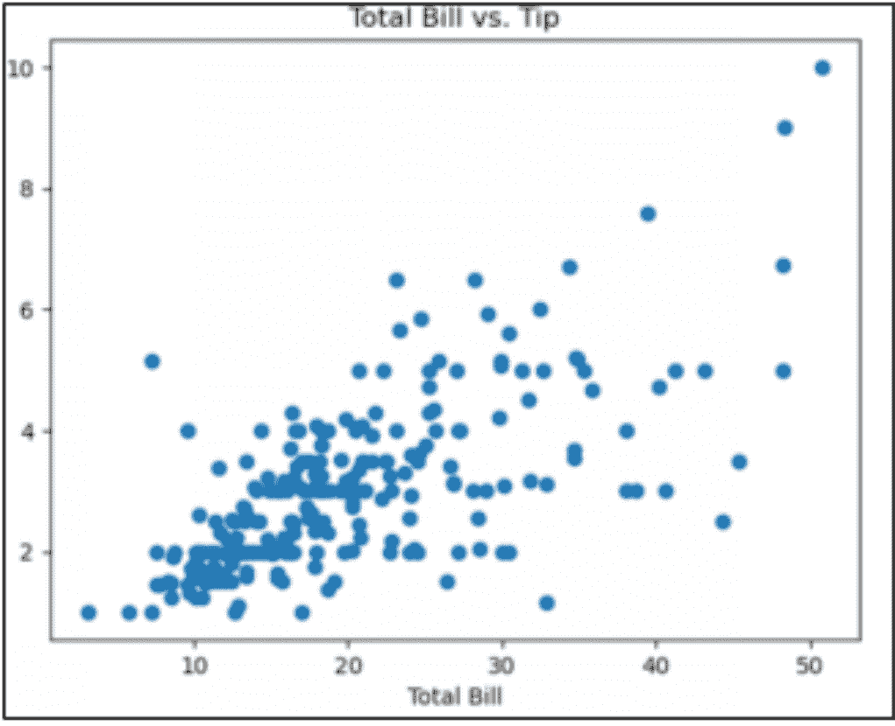

来自 Jupyter Notebook 的截图

### 柱状图

比较分类数据。

```
data.groupby('day')['total_bill'].mean().plot(kind='bar')
plt.ylabel('Average Total Bill')
plt.show()
```

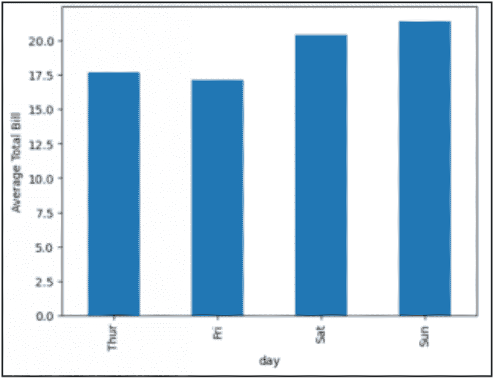

来自 Jupyter Notebook 的截图

### 直方图

显示单个变量的分布。

```
data['total_bill'].plot(kind='hist', bins=10, edgecolor='black')
plt.xlabel('Total Bill')
plt.title('Distribution of Total Bill')
plt.show()
```

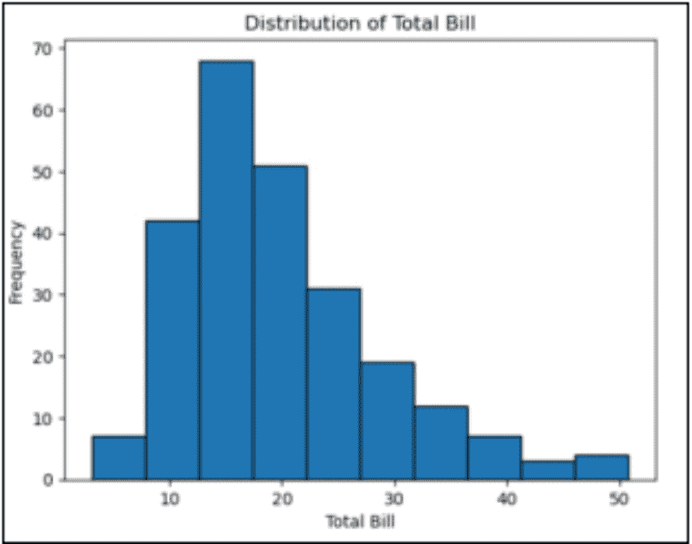

来自 Jupyter Notebook 的截图

## 使用 seaborn 进行数据可视化

### 散点图

可视化两个变量之间的关系。

```
sns.scatterplot(x='total_bill', y='tip', data=data, hue='day', style='time')
plt.title('Total Bill vs. Tip by Day and Time')
plt.show()
```

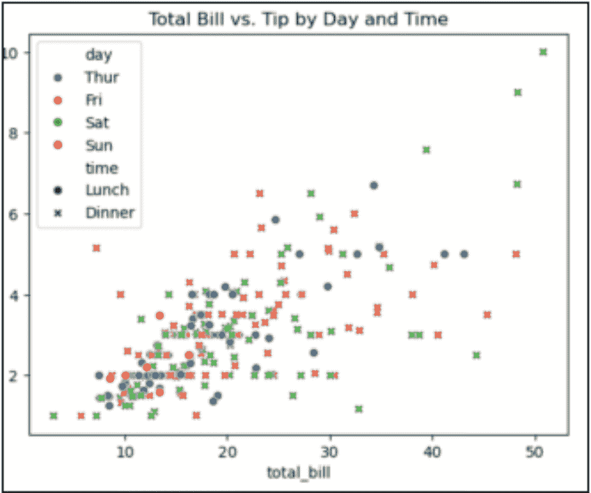

来自 Jupyter Notebook 的截图

### 箱线图

显示数据的分布并识别异常值。

```
sns.boxplot(x='day', y='total_bill', data=data)
plt.title('Total Bill by Day')
plt.show()
```

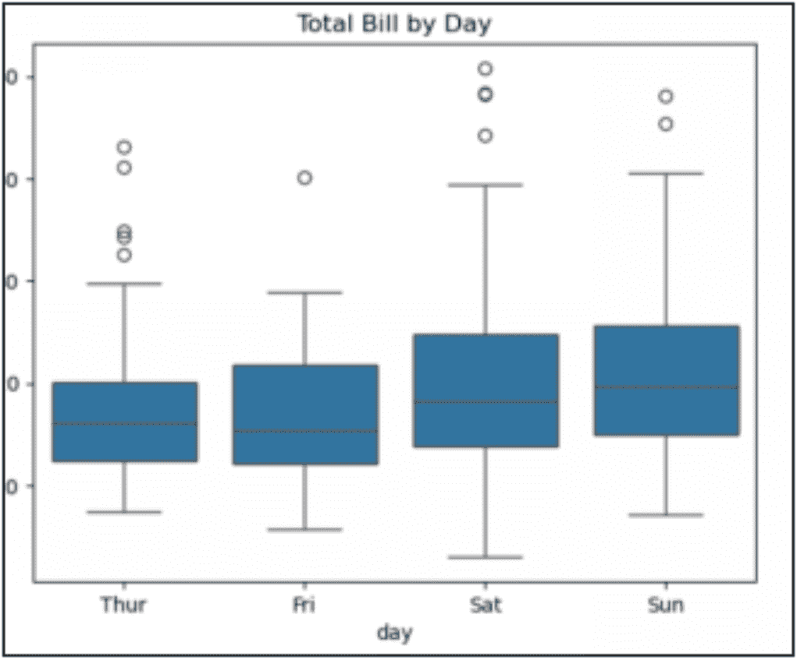

来自 Jupyter Notebook 的截图

### 热力图

可视化变量之间的相关性。

```
data = sns.load_dataset('tips')
data = data.drop(['sex', 'smoker', 'day','time'], axis=1) # drop categorical values first
correlation = data.corr()
sns.heatmap(correlation, annot=True, cmap='coolwarm')
plt.title('Correlation Matrix')
plt.show()
```

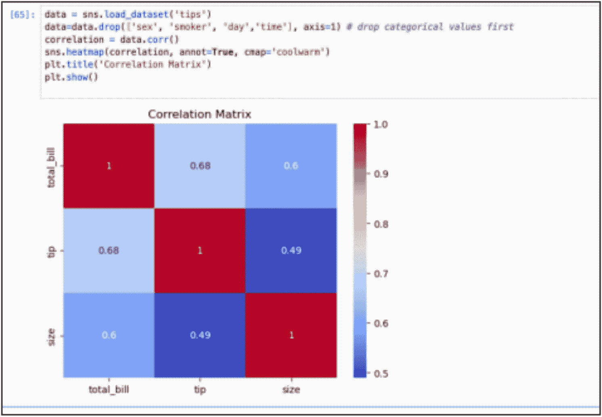

来自 Jupyter Notebook 的截图

## 保存可视化图表

将图表保存为图像用于报告：

```
plt.savefig('plot.png')
```

## 最佳实践

- 首先探索数据：使用 `head()`、`info()` 和 `describe()` 来了解数据集。
- 处理缺失值：根据上下文决定是填充还是删除缺失数据。
- 选择合适的可视化方式：使用散点图表示关系，直方图表示分布，热力图表示相关性。
- 保持视觉简洁：避免用不必要的细节使图表杂乱。

总之，通过结合 pandas 进行数据处理以及 Matplotlib/seaborn 进行可视化，您可以深入洞察数据集。这些工具能够实现顺畅的工作流程，有效地分析和呈现数据。

# 4.5 章节复习题

问题 1：

以下哪个库主要用于 Python 中的数值运算？

A. pandas

B. NumPy

C. seaborn

D. scikit-learn

问题 2：

pandas 库的主要用途是什么？

A. 执行统计分析

B. 处理和操作结构化数据

C. 可视化数据

D. 训练机器学习模型

问题 3：

哪个库通常用于在 Python 中创建静态、交互式和动画可视化？

A. Matplotlib

B. seaborn

C. NumPy

D. scikit-learn

问题 4：

Matplotlib 和 seaborn 之间有哪些关键区别？

A. Matplotlib 用于数据操作，而 seaborn 用于机器学习

B. seaborn 在 Matplotlib 之上提供高级接口，便于创建统计可视化

C. Matplotlib 专门用于机器学习任务

D. seaborn 用于数值运算

问题 5：

哪个库广泛用于在 Python 中构建和训练机器学习模型？

A. NumPy

B. Matplotlib

C. scikit-learn

D. pandas

问题 6：

使用 pip 安装 Python 库的推荐命令是什么？

A. `python install <library_name>`

B. `install <library_name>`

C. `pip install <library_name>`

D. `python setup.py install`

问题 7：

导入 Python 库时常见的以下问题是什么？

A. 库版本过旧

B. 导入语句中库名称错误

C. 缺少库安装

D. 以上全部

问题 8：

Python 中虚拟环境的用途是什么？

A. 使 Python 代码运行更快

B. 隔离项目依赖

C. 将 Python 连接到外部数据库

D. 管理多个 Python 安装

问题 9：

如何激活 Python 中的虚拟环境？

A. `activate env`

B. `python venv`

C. `source <env_name>/bin/activate`

D. `pip install venv`

问题 10：

如果需要高效处理大型数据集并执行数据清洗任务，您会选择哪个库？

A. scikit-learn

B. Matplotlib

C. pandas

D. seaborn

# 4.6 章节复习题答案

1. B. NumPy

解释：NumPy 主要用于 Python 中的数值运算，提供对数组、矩阵和数学函数的支持。

2. B. Handling and manipulating structured data

解释：pandas 专为处理结构化数据而设计，例如表格中的数据（DataFrames），并提供数据操作、清洗和分析的功能。

3. A. Matplotlib

解释：Matplotlib 是用于在 Python 中创建静态、交互式和动画可视化的通用库。

4. B. seaborn provides a high-level interface built on top of Matplotlib for easier statistical visualizations

解释：seaborn 通过在 Matplotlib 之上构建，简化了创建美观且信息丰富的统计可视化的过程。

5. C. scikit-learn

解释：scikit-learn 广泛用于在 Python 中构建和训练机器学习模型，提供分类、回归、聚类等工具。

6. C. `pip install <library_name>`

解释：`pip install <library_name>` 命令是安装 Python 库的标准方式。

7. D. All of the above

解释：导入时的常见问题包括库版本过旧、导入语句错误以及缺少安装。

8. B. To isolate project dependencies

解释：虚拟环境用于隔离项目特定的依赖，防止不同项目中使用的库发生冲突。

9. C. `source <env_name>/bin/activate`

解释：在大多数系统（例如 Linux 或 macOS）中，使用 `source <env_name>/bin/activate` 命令激活虚拟环境。

10. C. pandas

解释：由于其强大的 DataFrame 和 Series 结构，pandas 是处理大型数据集和高效执行数据清洗任务的最佳选择。

# 第 5 章 NumPy 在数据科学中的应用

NumPy 是 Python 中用于数值计算的基础库，在数据科学中被广泛用于高效处理大型数据集。本章探讨 NumPy 是什么、如何安装和导入它，以及它的核心功能，包括 NumPy 数组、其属性以及诸如重塑、索引和切片等操作。它深入介绍高级主题，如数组操作、随机数处理、输入/输出操作和线性代数应用。此外，本章还强调了 NumPy 在数据科学中的作用、优化技术和性能改进，并以实际应用和高效数据处理的最佳实践作结。

## 5.1 什么是 NumPy？


NumPy（Numerical Python）是 Python 中用于数值计算和数据处理的基础库。它提供对多维数组和矩阵的支持，以及广泛的数学函数以高效地对这些数组进行操作。NumPy 专为高性能而设计，是许多其他数据科学库（如 `pandas`、`Matplotlib` 和 `Scikit-learn`）的核心。

## NumPy 在数据科学中的重要性

高效的数据存储：`NumPy` 数组比 Python 列表更节省内存且速度更快，使其非常适合处理大型数据集。

数学运算：它提供用于数学计算的优化函数，例如线性代数、统计运算和傅里叶变换。

数据预处理：`NumPy` 广泛用于归一化、缩放和重塑数据等任务，这些都是数据预处理中的关键步骤。

与其他库的集成：大多数 Python 数据科学库都是基于 `NumPy` 构建或与其兼容，确保工作流程无缝衔接。

多维数据支持：其处理 n 维数组的能力使其在机器学习、图像处理和科学计算中不可或缺。

总之，`NumPy` 是 Python 数据科学的基石，能够高效地处理和计算数值数据。其多功能性和性能使其成为数据专业人士必学的工具。

与 Python 列表的比较（性能和功能）。

## NumPy 的关键特性

`NumPy` 提供了多个关键特性，使其在数据科学和数值计算中不可或缺。它通过利用优化的 C 和 Fortran 库实现快速数值计算，使其在大型操作中比 Python 原生列表快得多。该库支持多维数组，允许高效处理和操作 n 维数据结构，这对于科学和机器学习任务至关重要。此外，`NumPy` 可与 `Pandas` 和 `SciPy` 等其他科学 Python 库无缝集成，增强其在数据分析、建模和其他数据驱动应用中的实用性。

# 5.2 安装 NumPy

要安装 `NumPy`，可根据所选的包管理器使用 `pip` 或 `conda`。方法如下：

### 使用 pip：

`pip` 是 Python 包索引工具，常用于安装 Python 包。

打开终端或命令提示符。输入以下命令：

```
pip install numpy
```

验证安装，打开 Python shell 并运行：

```
import numpy
print(numpy.__version__)
```

### 使用 conda：

`conda` 是 Anaconda 的包管理器，在数据科学和科学计算中广泛使用。

打开 Anaconda 提示符。输入以下命令：

```
conda install numpy
```

提示确认时，输入 `y` 并按 Enter。验证安装，打开 Anaconda 环境中的 Python shell 并运行：

```
import numpy
print(numpy.__version__)
```

这两种方法都能确保 `NumPy` 在你的 Python 环境中可用于数据科学或数值计算任务。

# 5.3 导入 NumPy

要在 Python 代码中使用 `NumPy`，通常会使用简写别名导入库以方便使用。最常用的约定是：

```
import numpy as np
```

### 为什么使用 np？

• 简洁性：输入 `np` 而不是 `numpy` 使代码更简洁、更易读，尤其是在执行大量操作时。

• 标准化：将 `np` 作为别名已成为数据科学和 Python 社区中普遍认可的约定，使得理解他人编写的代码变得更容易。

### 示例用法：

```
import numpy as np
# Creating an array
array = np.array([1, 2, 3])
print(array)
```

这确保你能够高效且以广泛接受的方式访问 `NumPy` 的所有功能。

# 5.4 NumPy 数组

### 了解 NumPy 数组

`NumPy` 数组，或 `ndarray`（N 维数组的缩写），是 `NumPy` 库中的核心数据结构。它们是专为数值计算设计的高效多维数组。与 Python 列表不同，`NumPy` 数组可以在无需显式循环的情况下对整个数组执行操作，使其速度更快、内存效率更高。

### NumPy 数组的关键特性：

`Homogeneity`：`NumPy` 数组中的所有元素必须具有相同的数据类型（例如整数、浮点数等）。

`Fixed Size`：创建后，数组的大小是固定的，这有助于优化内存使用和计算效率。

`N-Dimensional`：`NumPy` 数组可以表示一维（向量）、二维（矩阵）或更高维度（张量）的数据。

### Shape、Dimensions 和 dtype 属性

`NumPy` 数组带有多个属性来描述其结构和属性：

`Shape`：`NumPy` 数组的形状描述了沿每个维度的元素数量。它以元组表示。例如，形状为 `(3, 4)` 表示在二维数组中该数组有 3 行 4 列。数组的形状可通过 `.shape` 属性访问，提供其结构和布局的概览。

示例：

```
import numpy as np
array = np.array([[1, 2, 3], [4, 5, 6]])
print(array.shape)  # Output: (2, 3)
```

`Dimensions`：指数组中的轴或维度数量。可通过 `.ndim` 属性访问。

示例：

```
print(array.ndim)  # Output: 2
```

`Data Type (dtype)`：指定存储在数组中的元素的类型（例如 int32、float64）。`NumPy` 会根据输入自动推断数据类型，但在创建时也允许显式指定。可通过 `.dtype` 属性访问。

示例：

```
print(array.dtype)  # Output: int64 (or int32 depending on your system)
```

`NumPy` 数组是高效处理数值数据的强大工具。其 `shape`、`ndim` 和 `dtype` 等属性使得理解和操作其结构变得容易，从而支持数据科学、机器学习和数值计算等广泛应用。

## 5.4.1 创建数组

`NumPy` 提供了多种创建数组的方式以实现高效的数据存储和操作。概述如下：

### 从 Python 列表

可使用 `np.array()` 函数直接从 Python 列表创建 `NumPy` 数组：

```
import numpy as np
python_list = [1, 2, 3, 4, 5]
numpy_array = np.array(python_list)
print(numpy_array)
```

这是一种将列表转换为 `NumPy` 数组的简单方法，可实现更快的计算和额外功能。

### 使用内置函数

`NumPy` 提供了多个内置函数来创建具有特定属性的数组：

`np.array()`：将列表或嵌套列表转换为 `NumPy` 数组。

```
array = np.array([[1, 2], [3, 4]])
print(array)
```

`np.zeros()`：创建填充零的数组。

```
zeros_array = np.zeros((3, 4))  # 3 rows, 4 columns
print(zeros_array)
```

`np.ones()`：创建填充一的数组。

```
ones_array = np.ones((2, 3))  # 2 rows, 3 columns
print(ones_array)
```

`np.arange()`：生成指定范围内等间距值的数组。

```
range_array = np.arange(0, 10, 2)  # Start at 0, end at 10 (exclusive), step by 2
print(range_array)
```

`np.linspace()`：在起点和终点之间创建指定数量的等间距点的数组。

```
linspace_array = np.linspace(0, 1, 5)  # 5 equally spaced points between 0 and 1
print(linspace_array)
```

### 使用 np.random 模块生成随机数

`np.random` 模块用于创建填充随机数的数组：

随机数：

```
random_array = np.random.rand(3, 4)  # 3x4 array of random numbers between 0 and 1
print(random_array)
```

随机整数：

```
random_integers = np.random.randint(0, 10, (2, 3))  # 2x3 array of random integers between 0 and 10
print(random_integers)
```

随机正态分布：

```
normal_array = np.random.randn(3, 3)  # 3x3 array of normally distributed random numbers
print(normal_array)
```


## 5.4.2 数组属性

NumPy 数组提供了多个有用的属性来理解和交互其特性。以下是关键属性及其含义：

### .shape

描述数组的维度，以元组表示。它指定沿每个维度的元素数量（例如，2D 数组的行数和列数）。

Example:
```
import numpy as np

array = np.array([[1, 2, 3], [4, 5, 6]])

print(array.shape)  # Output: (2, 3) -> 2 rows, 3 columns
```

### .size

返回数组中的元素总数。这是数组中所有维度的乘积。

Example:
```
array = np.array([[1, 2, 3], [4, 5, 6]])

print(array.size)  # Output: 6
```

### .ndim

表示数组的维度（轴）数量。

Example:
```
array_1d = np.array([1, 2, 3])
array_2d = np.array([[1, 2], [3, 4]])

print(array_1d.ndim)  # Output: 1 (1D array)
print(array_2d.ndim)  # Output: 2 (2D array)
```

### .dtype

提供数组中元素的 数据类型（例如 int、float 等）。

Example:
```
array = np.array([1.5, 2.3, 3.7])

print(array.dtype)  # Output: float64
```

## 5.4.3 重塑和展平数组

重塑和展平是 NumPy 中的两种重要技术，可让你操作数组的结构。这些操作在为分析和机器学习模型准备数据时很有用。

### 重塑数组 (`reshape()`)

`reshape()` 方法在不改变数据的情况下更改数组的形状。你可以指定新的形状为元组，确保元素总数保持不变。

Syntax: `array.reshape(new_shape)`

Examples:
```
import numpy as np

# Original array
array = np.array([1, 2, 3, 4, 5, 6])

# Reshape into a 2x3 array
reshaped_array = array.reshape(2, 3)

print(reshaped_array)
# Output:
# [[1 2 3]
#  [4 5 6]]

# Reshape into a 3x2 array
reshaped_array = array.reshape(3, 2)

print(reshaped_array)
# Output:
# [[1 2]
#  [3 4]
#  [5 6]]
```

Key Point:

新形状必须与原始数组具有相同的元素总数。使用 `-1` 让 NumPy 自动推断一个维度：
```
reshaped_array = array.reshape(3, -1)  # NumPy determines the number of columns
print(reshaped_array)
```

### 展平数组 (`ravel()`)

`ravel()` 方法将多维数组展平成一维数组。它返回一个展平的视图，这意味着对结果的更改可能会影响原始数组。

Syntax: `array.ravel()`

Example:
```
# 2D array
array = np.array([[1, 2, 3], [4, 5, 6]])

# Flatten the array
flattened_array = array.ravel()

print(flattened_array)
# Output: [1 2 3 4 5 6]
```

Key Point: `ravel()` is faster than `flatten()` for large arrays as it tries to avoid copying data.

摘要

- `reshape()`: 用于修改数组的形状（例如，将 1D 数组转换为 2D）。
- `ravel()`: 用于将多维数组展平成 1D 数组。

这些操作在数据预处理中至关重要，尤其是在将数据适配为机器学习模型或数值计算所需的输入格式时。

## 5.5 索引和切片

索引和切片是 NumPy 中的基本操作，可实现对数组内数据的有效访问、操作和过滤。

### 访问数组元素

1D 数组索引：使用从 0 开始的位置访问元素。例如，`array[2]` 检索 1D 数组的第三个元素。

2D 数组索引：使用两个索引访问元素，其中第一个索引指定行，第二个索引指定列。例如，`array[1, 2]` 访问第二行第三列的元素。

多维数组索引：通过为每个维度提供索引来扩展概念。例如，`array[0, 1, 2]` 访问 3D 数组中的特定元素。

### 切片数组

使用切片提取子数组：切片使用格式 `start:end:step` 提取元素子集。例如，`array[1:4]` 选择从索引 1 到 3 的元素（结束索引不包含）。

步长切片：指定步长以跳过元素。例如，`array[0:6:2]` 检索索引 0 到 5 之间的每个第二个元素。

反向切片：使用负索引或负步长来反转数组。例如，`array[::-1]` 反转整个数组。

### 布尔索引

创建用于过滤数组的掩码：对数组应用条件以创建布尔掩码。例如，`array > 5` 创建一个掩码，指示哪些元素大于 5。

使用条件选择元素：将掩码应用于数组以检索特定元素。例如，`array[array > 5]` 过滤出所有大于 5 的元素。

### 花式索引

使用整数数组索引：使用整数列表或数组同时访问多个元素。例如，`array[[0, 2, 4]]` 检索索引 0、2 和 4 处的元素。

多维花式索引：组合行索引和列索引数组以选择特定元素。例如，`array[[0, 1], [2, 3]]` 检索位置 (0, 2) 和 (1, 3) 处的元素。

索引和切片技术使 NumPy 数组变得多功能且强大，能够为数据科学中的各种应用实现高效的数据选择和操作。

## 5.6 数组操作

### 算术操作

NumPy 支持逐元素算术操作，使得可以直接对数组执行加法、减法、乘法和除法。例如：
```
import numpy as np

a = np.array([1, 2, 3])
b = np.array([4, 5, 6])

print(a + b)  # [5, 7, 9]
print(a * b)  # [4, 10, 18]
```

广播允许在不同形状的数组之间进行操作，通过自动扩展其维度以匹配。例如，将 1D 数组加到 2D 数组上会根据其对齐方式在行或列上应用操作。

### 聚合函数

NumPy 提供了多种用于汇总数据的函数：

- `np.sum()`: 计算数组元素的总和。
- `np.mean()`: 计算平均值。
- `np.median()`: 找到排序数据中的中间值。
- `np.std()` 和 `np.var()`: 分别计算标准差和方差。
- `np.min()` 和 `np.max()`: 检索数组中的最小值和最大值。

Example:
```
data = np.array([1, 2, 3, 4, 5])

print(np.sum(data))      # 15
print(np.mean(data))     # 3.0
print(np.min(data))      # 1
print(np.max(data))      # 5
```

### 矩阵操作

NumPy 非常适合矩阵计算：

点积：使用 `np.dot()` 或 `@` 运算符计算。
```
A = np.array([[1, 2], [3, 4]])
B = np.array([[5, 6], [7, 8]])

print(np.dot(A, B))  # Dot product
print(A @ B)         # Alternative syntax
```

转置：使用 `.T` 转置矩阵。
```
print(A.T)  # [[1, 3], [2, 4]]
```

行列式和逆：利用 `np.linalg` 模块进行高级操作。
```
print(np.linalg.det(A))  # Determinant of A
print(np.linalg.inv(A))  # Inverse of A
```

### 逐元素比较

NumPy 提供了比较函数来执行逐元素评估，结果为布尔数组：

- `np.equal()`: 检查相等性。
- `np.greater()`: 比较元素是否更大。
- `np.less()`: 检查元素是否更小。

Example:
```
a = np.array([1, 2, 3])
b = np.array([3, 2, 1])

print(np.equal(a, b))   # [False, True, False]
print(np.greater(a, b)) # [False, False, True]
print(np.less(a, b))    # [True, False, False]
```

这些操作是使用 NumPy 操作和分析数据的基石，使其成为数据科学的核心库。

## 5.7 高级数组操作

### 堆叠和拆分数组

水平堆叠 (`np.hstack()`)：并排组合数组。
```
a = np.array([1, 2, 3])
b = np.array([4, 5, 6])

print(np.hstack((a, b)))  # [1, 2, 3, 4, 5, 6]
```


## 垂直堆叠

`np.vstack()` 沿新行合并数组。

```
print(np.vstack((a, b)))
# [[1, 2, 3]
#  [4, 5, 6]]
```

## 数组分割

将数组划分为更小的子数组。

`np.split()` 将数组拆分为相等部分。

```
data = np.array([1, 2, 3, 4, 5, 6])
print(np.split(data, 3))  # [array([1, 2]), array([3, 4]), array([5, 6])]
```

`np.hsplit()` 对二维数组沿水平轴拆分。

`np.vsplit()` 沿垂直轴拆分。

### 广播

广播允许在不同形状的数组之间进行运算，通过扩展较小数组的维度以匹配较大数组。

```
a = np.array([[1, 2, 3], [4, 5, 6]])
b = np.array([1, 2, 3])
print(a + b)
# [[2, 4, 6]
#  [5, 7, 9]]
```

广播简化了计算，无需手动重塑形状。

### 排序与搜索

使用 `np.sort()` 进行排序：按升序对数组进行排序，且不修改原始数组。

```
data = np.array([3, 1, 2])
print(np.sort(data))  # [1, 2, 3]
```

`np.argsort()` 返回排序后元素的索引。

```
print(np.argsort(data))  # [1, 2, 0]
```

搜索：

`np.where()` 查找符合条件的元素的索引。

```
data = np.array([10, 20, 30, 40])
print(np.where(data > 20))  # (array([2, 3]))
```

`np.extract()` 检索符合条件的元素。

```
print(np.extract(data > 20, data))  # [30, 40]
```

这些高级操作使得高效处理和处理复杂数据集成为可能，使 NumPy 成为数据科学工作流程中不可或缺的工具。

# 5.8 使用随机数

NumPy 为处理随机数提供了广泛的支持，这对于模拟、统计实验和机器学习应用至关重要。以下小节涵盖了与随机数生成和分析相关的关键功能。

## 生成随机数据

NumPy 的 `np.random` 模块包含从各种分布生成随机数的函数：

Uniform Distribution: 随机值从 `[0, 1)` 上的均匀分布中采样。这可通过 `np.random.rand()` 实现，它生成具有均匀分布的随机数数组。

Example: `np.random.rand(3, 2)` 创建一个 3x2 的随机数矩阵。

Normal Distribution: 随机值使用 `np.random.randn()` 从标准正态分布（均值 = 0，标准差 = 1）中抽取。

Example: `np.random.randn(4)` 生成一个包含 4 个随机值的 1D 数组。

Random Integers: `np.random.randint()` 在指定范围内生成随机整数。

Example: `np.random.randint(1, 10, size=(3, 3))` 创建一个 3x3 的随机整数数组，范围在 1 到 9 之间。

这些函数可用于创建随机数据集、测试算法或为实验生成合成数据。

## 设置随机种子

随机种子设置确保随机数生成的可重复性，这对于调试和一致的实验结果至关重要。

使用 `np.random.seed()` 固定随机数序列。

Example:

```
np.random.seed(42)
print(np.random.rand(2))
```

这样每次运行代码时都会始终产生相同的随机值。

## 随机数据的统计分析

一旦生成随机数据，NumPy 提供了执行统计分析的工具：

Mean: 使用 `np.mean()` 计算随机数据的平均值。

Example: `np.mean(np.random.rand(10))` 计算 10 个随机值的均值。

Standard Deviation: 使用 `np.std()` 衡量随机数据的离散程度。

Example: `np.std(np.random.randn(100))` 计算 100 个值的标准差。

Variance: 使用 `np.var()` 评估数据变异性。

Example: `np.var(np.random.rand(20))` 计算 20 个随机值的方差。

这些功能不仅允许你生成随机数，还可以通过统计属性得出有意义的见解，使 NumPy 的随机模块在数据科学工作流程中不可或缺。

# 5.9 使用 NumPy 进行输入/输出

高效的数据输入和输出操作在数据科学和机器学习工作流程中至关重要。NumPy 提供了多种方法以不同格式保存和加载数组，实现无缝的数据存储和检索。

## 保存和加载数组

Binary Files: NumPy 允许你使用 `np.save()` 以二进制格式保存数组，并使用 `np.load()` 检索它们。此方法确保快速高效的存储，尤其适用于大型数据集。

Example:

```
import numpy as np
data = np.array([1, 2, 3, 4, 5])
np.save('data.npy', data)  # Save array to a binary file
loaded_data = np.load('data.npy')  # Load array from the binary file
print(loaded_data)
```

Text Files: 要将数组保存为文本文件，请使用 `np.savetxt()`。同样，你可以使用 `np.loadtxt()` 加载文本文件。

Example:

```
np.savetxt('data.txt', data, delimiter=',')  # Save as a text file
loaded_text_data = np.loadtxt('data.txt', delimiter=',')  # Load from text file
print(loaded_text_data)
```

## 处理 CSV 文件

Reading CSV Files: NumPy 的 `np.genfromtxt()` 函数常用于读取 CSV 文件，提供处理缺失值和指定分隔符的选项。

Example:

```
data = np.genfromtxt('data.txt', delimiter=',', skip_header=1)  # Read CSV, skip header
print(data)
```

Writing CSV Files: 使用 `np.savetxt()` 将数组保存到 CSV 文件中。指定分隔符以确保与 CSV 格式兼容。

Example:

```
np.savetxt('output.csv', data, delimiter=',', fmt='%0.2f')  # Save as CSV
```

这些函数使 NumPy 数组与外部数据集的集成变得简单，促进了工作流程之间的互操作性，并实现了从数据存储到分析的顺畅过渡。

# 5.10 NumPy 用于线性代数

NumPy 通过 `np.linalg` 模块提供了一套强大的线性代数函数。这些工具能够高效、准确地进行数学计算，使 NumPy 成为涉及矩阵和向量的应用中必不可少的工具。

## NumPy 线性代数模块概述

`np.linalg` 模块提供了各种线性代数函数，用于矩阵乘法、行列式、逆计算等操作。这些操作在数据科学、工程和物理等许多领域都是基础性的。

## 求解线性方程

为了解线性方程组，NumPy 提供了 `np.linalg.solve()` 函数。它接受系数矩阵和常数作为输入，并返回解向量。

Example:

```
import numpy as np
A = np.array([[3, 1], [1, 2]])
b = np.array([9, 8])
x = np.linalg.solve(A, b)  # Solve Ax = b
print("Solution:", x)
```

## 特征值和特征向量

特征值和特征向量使用 `np.linalg.eig()` 计算。它们在数据科学任务中至关重要，例如降维（如主成分分析 - PCA）。

Example:

```
matrix = np.array([[4, -2], [1, 1]])
eigenvalues, eigenvectors = np.linalg.eig(matrix)
print("Eigenvalues:", eigenvalues)
print("Eigenvectors:", eigenvectors)
```

## 奇异值分解（SVD）

SVD 用于矩阵分解，常应用于降维、图像压缩和推荐系统。`np.linalg.svd()` 函数将矩阵分解为三个分量：U、Σ 和 V^T。

Example:

```
matrix = np.array([[3, 1, 1], [-1, 3, 1]])
U, S, Vt = np.linalg.svd(matrix)
print("U:", U)
print("Singular Values:", S)
print("V^T:", Vt)
```

这些工具结合 NumPy 的效率，使其成为数据科学及更广泛领域线性代数计算中不可或缺的库。

# 5.11 NumPy 与数据科学

NumPy 通过提供高效的数据操作、预处理和与其他库集成的工具，在数据科学中发挥着关键作用。以下是它如何支持关键数据科学工作流程：

## 数据预处理

Handling Missing Values: NumPy 使用 `np.nan` 表示缺失值来帮助处理缺失数据。像 `np.nanmean()` 或 `np.nanstd()` 这样的函数允许计算忽略这些缺失值。

Example:


```python
import numpy as np

data = np.array([1, 2, np.nan, 4])

mean_without_nan = np.nanmean(data)  # Computes mean ignoring NaN

print("Mean (ignoring NaN):", mean_without_nan)
```

### 特征缩放

归一化数组：特征缩放是机器学习中的关键预处理步骤。`NumPy` 允许通过其数学函数进行最小-最大缩放或标准化。

示例：

```python
data = np.array([10, 20, 30, 40, 50])

normalized_data = (data - np.min(data)) / (np.max(data) - np.min(data))

print("Normalized Data:", normalized_data)
```

### 数据转换

重塑和过滤：`NumPy` 的 `reshape()` 函数使你能够更改数组的维度，而布尔索引则允许基于条件过滤数据集。

示例（过滤）：

```python
data = np.array([5, 10, 15, 20])

filtered_data = data[data > 10]

print("Filtered Data:", filtered_data)
```

聚合数据集：像 `np.sum()`、`np.mean()` 和 `np.std()` 这样的函数允许对数据进行高效聚合以进行统计分析。

### 与其他库的集成

无缝集成：`NumPy` 数组可以直接与 `Pandas`、`Matplotlib` 和 `SciPy` 等库一起使用，以进行高级分析和可视化。

- 使用 `Pandas`：`NumPy` 为 `Pandas` 的 `DataFrames` 和 `Series` 提供底层数据结构。
- 使用 `Matplotlib`：数组可以作为输入传递用于绘图。

```python
import matplotlib.pyplot as plt

x = np.array([1, 2, 3, 4])

y = np.array([10, 20, 30, 40])

plt.plot(x, y)

plt.show()
```

通过促进预处理、缩放、转换和集成，`NumPy` 成为数据科学工作流程的基础，增强了效率和可扩展性。

# 5.12 优化与性能

`NumPy` 以其优化和性能而闻名，能够实现快速高效的数据操作。这是通过诸如向量化、内存效率和并行性等几个核心特性实现的。

### 向量化

比 Python 循环更快：`NumPy` 的操作是用 C 实现并针对性能优化的，使其在数值计算中比标准 Python 循环快得多。此过程称为向量化，其中操作应用于整个数组，而不是逐个迭代元素。

示例：

```python
import numpy as np

# Using Python loops
data = [1, 2, 3, 4]
squared = [x**2 for x in data]

# Using NumPy vectorization
array = np.array([1, 2, 3, 4])
squared_np = array**2  # Vectorized operation

print("NumPy Vectorized Result:", squared_np)
```

效率：向量化避免了 Python 循环的开销，并允许在 C 等低级语言中直接执行操作。

### 内存效率

与 Python 列表的比较：由于其固定数据类型和连续内存分配，`NumPy` 数组使用的内存比 Python 列表少。

示例：

```python
import numpy as np
import sys

list_data = [1, 2, 3, 4, 5]
array_data = np.array(list_data)

print("Memory used by list:", sys.getsizeof(list_data))
print("Memory used by NumPy array:", array_data.nbytes)
```

`NumPy` 数组更紧凑，因为它们将相同类型的元素连续存储在内存中，而 Python 列表则存储对象引用。

### 并行性

利用并行计算：`NumPy` 使用底层库如 `BLAS`（基础线性代数子程序）和 `LAPACK`（线性代数包），它们利用并行性进行矩阵运算和线性代数等计算。

示例：诸如用于矩阵乘法的 `np.dot()` 和用于奇异值分解的 `np.linalg.svd()` 等操作在内部利用了并行化算法。

自动优化：许多 `NumPy` 函数经过优化，可在多核 CPU 上高效运行，确保大规模计算的执行速度更快。

通过利用向量化、内存高效的数据结构和并行性，`NumPy` 确保了高性能计算，使其成为数据科学和数值分析不可或缺的工具。

# 5.13 实际应用

### 数值模拟

`NumPy` 广泛用于数值模拟，例如蒙特卡洛模拟，其涉及重复随机采样以估计数学或物理属性。例如，蒙特卡洛模拟可通过在正方形中生成随机点并观察落入圆内的比例来近似 π 的值。`NumPy` 的 `np.random` 模块促进了高效的随机数生成，使其成为在科学和工程任务中实现这些模拟的理想工具。

### 图像处理

在图像处理中，图像表示为多维 `NumPy` 数组，其中每个像素对应一个数值。对于灰度图像，这可能是单个强度值，而对于彩色图像，则可能是 RGB 值数组。`NumPy` 允许进行一系列操作，例如调整图像大小、过滤和执行变换。例如，反转图像可以通过从最大强度中减去像素值来实现，而过滤操作可能涉及用自定义核对数组进行卷积。

### 金融建模

在金融领域，`NumPy` 是投资组合优化和风险分析的强大工具。数组可以表示投资组合，其中每个元素对应于金融资产的价值或回报。`NumPy` 函数如 `np.cov()` 和 `np.corrcoef()` 可以计算协方差和相关矩阵，而矩阵乘法 (`np.dot()`) 可以评估投资组合回报或风险。此外，`NumPy` 的聚合函数，如 `np.mean()` 和 `np.std()`，用于股票表现的统计分析，使投资策略的决策更加明智。

`NumPy` 的功能使其成为跨领域多样化现实世界应用中不可或缺的库，为高效计算和分析提供了基础。

# 5.14 技巧、窍门和最佳实践

### NumPy 中的调试和错误处理

在使用 `NumPy` 时，诸如维度不匹配、无效索引或不支持的操作等错误很常见。例如，尝试添加形状不兼容的数组会引发 `ValueError`。一种有用的调试方法是使用 `.shape` 检查数组的形状并确保它们遵循广播规则。另一个常见问题是使用未初始化的值或无效索引，这可以通过利用 `np.isnan()` 或 `np.isfinite()` 等函数来检查缺失或无效数据来避免。`NumPy` 提供的清晰错误消息通常能有效指导你解决这些问题。

### 使用 NumPy 的高效编码

`NumPy` 中的效率围绕利用其优化的向量化操作而不是 Python 循环展开。例如，用 `array1 + array2` 替换基于循环的逐元素加法可显著提高性能。广播可以在无需手动复制数据的情况下简化复杂操作。在处理大型数据集时，使用 `np.einsum()` 等函数进行多维操作或通过适当指定 `dtype`（例如使用 `float32` 而不是 `float64`）来最小化内存使用，可以进一步提高效率。预分配数组而不是在循环中追加也可以防止不必要的内存开销并加快执行速度。

### 文档和社区支持


`NumPy` 的详尽文档是理解其功能和解决查询的关键资源。官方文档为每个函数和功能提供了详细的解释、示例和用例。类似 Stack Overflow、GitHub 讨论以及 `NumPy` 的邮件列表等社区平台提供了丰富的共享知识和实用见解。此外，`NumPy` 的 GitHub 仓库允许用户跟踪更新、报告问题，甚至为库的开发做出贡献。与社区互动不仅有助于解决问题，还有助于学习最佳实践和高级技巧。

# 5.15 结论

## 关键概念回顾

在本次对 `NumPy` 的探索中，我们涵盖了其基础方面和实际应用。从介绍其在数据科学中的重要性开始，我们深入研究了创建 `arrays`、理解 `array` 属性以及执行索引和切片。`NumPy` 的强大的 `array` 操作，如算术计算、聚合和线性代数功能，被强调为数值和科学计算的关键。我们还探索了随机数生成、广播、输入/输出操作等高级概念，以及在图像处理、模拟和金融建模等领域的实际应用。此外，还讨论了调试、高效编码以及利用社区资源的小贴士，以确保工作流程顺畅。

## 为什么 NumPy 是数据科学的基础

`NumPy` 是数据科学和科学计算的基石，原因在于其效率、可扩展性以及与其他 Python 库的集成。其强大的多维 `arrays` 和优化的操作能够实现快速计算，即使在大型数据集上也如此，使其优于原生 Python 列表。`pandas`、`Matplotlib` 和 `SciPy` 等库 heavily 依赖 `NumPy` 作为其后端，体现了其在 Python 生态系统中的基础作用。其对高级数值技术的支持，从线性代数到随机数生成，确保数据科学家能够有效地执行端到端的数据操作和分析。

# 5.16 章节复习题

问题 1：

以下哪项陈述最能描述 `NumPy`？

A. 用于创建数据可视化的库

B. 用于数值计算和数组操作的 Python 库

C. 用于处理表格等结构化数据的库

D. 一个机器学习框架

问题 2：

安装 `NumPy` 的正确 `pip` 命令是什么？

A. `python install numpy`

B. `install numpy`

C. `pip install numpy`

D. `python numpy setup.py install`

问题 3：

如何在 Python 中使用其常用别名导入 `NumPy`？

A. `import numpy`

B. `import numpy as np`

C. `from numpy import array`

D. `import numpy as nmp`

问题 4：

如何从 Python 列表正确创建 `NumPy` 数组？

A. `array = np.make([1, 2, 3])`

B. `array = np.array([1, 2, 3])`

C. `array = np.create([1, 2, 3])`

D. `array = np.ndarray([1, 2, 3])`

问题 5：

用于确定其形状的 `NumPy` 数组属性是什么？

A. `array.shape`

B. `array.size`

C. `array.ndim`

D. `array.type`

问题 6：

以下代码的输出是什么？

```
import numpy as np
arr = np.array([[1, 2, 3], [4, 5, 6]])
print(arr[0, 1])
```

A. 1

B. 2

C. 4

D. 5

问题 7：

在 `NumPy` 中用于生成随机数数组的函数是什么？

A. `np.random_array()`

B. `np.array_random()`

C. `np.random.rand()`

D. `np.random()`

问题 8：

`np.reshape()` 函数做什么？

A. 将多维数组展平为一维

B. 在不改变其数据的情况下更改数组的形状

C. 将 `NumPy` 数组转换为 Python 列表

D. 为数组生成随机数

问题 9：

以下哪些操作由 `NumPy` 支持用于线性代数计算？

A. 矩阵乘法

B. 求特征值和特征向量

C. 求解线性方程

D. 以上全部

问题 10：

为什么 `NumPy` 在数据科学中被认为性能优化？

A. 它使用 Python 的内置列表操作

B. 它在底层依赖于优化的 C 和 Fortran 代码

C. 它仅适用于小型数据集

D. 它不依赖其他库

# 5.17 章节复习题答案

1. B. 用于数值计算和数组操作的 Python 库

解释：`NumPy` 主要用于数值运算和高效的数组操作，使其成为数据科学的基础库。

2. C. `pip install numpy`

解释：使用 `pip install numpy` 命令是使用 Python 包管理器安装 `NumPy` 的正确方法。

3. B. `import numpy as np`

解释：`NumPy` 通常使用别名 `np` 导入，以简化代码并遵循标准约定。

4. B. `array = np.array([1, 2, 3])`

解释：`np.array()` 函数用于从 Python 列表创建 `NumPy` 数组。

5. A. `array.shape`

解释：`shape` 属性以元组（行、列）的形式提供 `NumPy` 数组的维度。

6. B. 2

解释：代码访问第一行（`arr[0]`）和第二列（`arr[0, 1]`）中的元素，其值为 2。

7. C. `np.random.rand()`

解释：`np.random.rand()` 函数生成范围在 [0, 1) 内的随机数数组。

8. B. 在不改变其数据的情况下更改数组的形状

解释：`np.reshape()` 函数修改数组的形状，同时保留其原始数据。

9. D. 以上全部

解释：`NumPy` 对线性代数运算提供广泛支持，包括矩阵乘法、特征值/特征向量以及求解线性方程。

10. B. 它在底层依赖于优化的 C 和 Fortran 代码

解释：`NumPy` 通过利用 C 和 Fortran 中高度优化的低级实现来实现高性能。

# 第 6 章 Pandas 用于数据科学

`Pandas` 是一个强大的 Python 库，用于数据操作和分析，使其成为数据科学的重要工具。本章介绍 `Pandas` 及其核心数据结构，包括 `Series` 和 `DataFrames`，它们能够高效处理结构化数据。它探讨了导入和导出数据、处理大型数据集以及执行数据操作、清洗和预处理。高级技术如数据聚合、分组、合并和连接，以及数据可视化和时间序列数据处理，都涵盖在内。本章还深入探讨最佳实践、实际应用和动手案例研究，为在数据科学工作流程中利用 `Pandas` 提供了全面的指南。

## 6.1 Pandas 简介

`Pandas` 是一个功能强大的 Python 库，专为数据操作、分析和预处理而设计。它提供了 `Series` 和 `DataFrames` 等数据结构，这些结构针对处理和分析结构化数据进行了优化。`Pandas` 在数据科学中特别有价值，因为它能够管理缺失数据、清洗数据集、执行聚合并进行探索性数据分析（EDA）。其直观的语法以及与 `NumPy` 和 `Matplotlib` 等库的集成，使其成为数据专业人员的必备工具。

### 什么是 Pandas？

`Pandas` 是一个开源库，简化了对结构化和表格数据的操作，例如 CSV 文件、Excel 电子表格或 SQL 表。它提供两种主要数据结构：

`Series`：一维标签数组。

`DataFrame`：二维标签数据结构，类似于数据库或 Excel 中的表格。

`Pandas` 能够执行过滤、分组、合并和重塑数据等操作，使其成为数据整理和准备的一站式解决方案。

### 数据科学中的关键用例

数据整理：通过处理缺失值、重复项和错误数据类型，将原始数据清理和转换为可用格式。

数据分析：进行描述性和推断性分析以发现模式和洞察。


# 预处理

为机器学习准备数据，通过标准化、编码分类变量和特征工程。

## 安装 Pandas

安装 `Pandas`，您可以根据环境使用以下命令之一：

使用 `pip`：

```bash
pip install pandas
```

使用 `conda`（Anaconda 环境）：

```bash
conda install pandas
```

## 验证安装

要验证 `Pandas` 是否正确安装，请打开 Python 环境并运行以下命令：

```python
import pandas as pd
print(pd.__version__)
```

如果安装了 `Pandas`，版本号将被显示，确认安装成功。

`Pandas` 是现代数据科学工作流程的基石，能够以最小的努力高效处理和分析大型数据集。掌握 `Pandas` 可显著提高生产力并增强从数据中获得的洞察质量。

# 6.2 Pandas 中的核心数据结构

## 6.2.1 Series

`Pandas` `Series` 是一个一维、带标签的数组，能够容纳任何数据类型（整数、字符串、浮点数等）。它类似于电子表格中的一列或 `NumPy` 中的单个数组，每个元素都有一个关联的索引。

### 创建 Series

您可以从列表、`NumPy` 数组或字典创建 `Pandas` `Series`。

```python
import pandas as pd
# From a list
s1 = pd.Series([1, 2, 3, 4])
# From a NumPy array
import numpy as np
s2 = pd.Series(np.array([5, 6, 7]))
# From a dictionary
s3 = pd.Series({"a": 10, "b": 20, "c": 30})
```

### 访问元素

使用基于位置或基于标签的索引访问元素。

```python
print(s1[1])  # Accessing by position
print(s3['a'])  # Accessing by label
```

### Series 上的操作

`Series` 支持按元素操作，使得直接应用数学运算变得容易。

```python
print(s1 + 2)  # Adding a scalar to all elements
print(s1 * s2)  # Element-wise multiplication
```

## 6.2.2 DataFrame

`Pandas` `DataFrame` 是一个二维、表格型数据结构，具有带标签的轴（行和列）。它是 `Pandas` 中用于数据分析最常用的结构。

### 创建 DataFrames

`DataFrames` 可以从各种数据源创建，包括字典、列表、`NumPy` 数组以及 CSV/Excel 文件。

```python
# From a dictionary
data = {"Name": ["Alice", "Bob", "Charlie"], "Age": [25, 30, 35]}
df1 = pd.DataFrame(data)
# From a list of lists
df2 = pd.DataFrame([[1, 2], [3, 4]], columns=["A", "B"])
# From a NumPy array
import numpy as np
df3 = pd.DataFrame(np.random.rand(4, 3), columns=["X", "Y", "Z"])
# From a CSV file
df4 = pd.read_csv("example.csv")
```

`example.csv` 示例数据：

```
Name,Age,Salary
Alice,25,50000
Bob,30,60000
Charlie,35,70000
David,40,80000
Eve,45,90000
```

### 行和列概述

`DataFrames` 提供了检查和操作行和列的简便方法。

```python
print(df1.columns)  # List of column names
print(df1.index)  # Row index
```

### 索引和切片

使用 `loc`（基于标签）或 `iloc`（基于位置）索引访问行和列。

```python
# Accessing a column
print(df1["Name"])
# Accessing rows by label
print(df1.loc[0])
# Accessing rows by position
print(df1.iloc[0:2])  # First two rows
```

`Series` 和 `DataFrame` 的结合使 `Pandas` 在数据操作方面具有多功能性，能够高效处理和分析简单和复杂的数据集。这些结构构成了大多数数据科学工作流程的基础。

# 6.3 导入和导出数据

## 6.3.1 将数据读入 Pandas

`Pandas` 提供了强大的方法，可将数据从各种文件格式和数据源读取到 `DataFrames` 中，以便于分析和操作。进行以下实践时，请确保提及的文件存在，例如 `data.csv` 存在。

### CSV 文件

`pd.read_csv()` 函数通常用于读取 CSV 文件。

```python
import pandas as pd
df = pd.read_csv("data.csv")
```

`data.csv` 示例数据：

```
Name,Age,Salary
Alice,25,50000
Bob,30,60000
Charlie,35,70000
David,40,80000
Eve,45,90000
```

### Excel 文件

使用 `pd.read_excel()` 导入 Excel 电子表格。

```python
df = pd.read_excel("data.xlsx", sheet_name="Sheet1")
```

### JSON 文件

可以使用 `pd.read_json()` 加载 JSON 数据。

```python
df = pd.read_json("data.json")
```

### SQL 数据库

在 `pandas.read_sql()` 的帮助下，数据可以直接从 SQL 数据库加载。

```python
import sqlite3
conn = sqlite3.connect("database.db")
df = pd.read_sql("SELECT * FROM table_name", conn)
```

### API 和网络数据

对于来自 API 的数据，使用 `requests` 等库获取数据，然后将其转换为 `DataFrame`。

```python
import requests
response = requests.get("https://api.example.com/data") # an example URL
df = pd.DataFrame(response.json())
```

### 处理分隔符和标题

`Pandas` 在读取数据时允许自定义分隔符、标题和其他选项。

指定分隔符：对于非标准分隔符，使用 `delimiter` 或 `sep` 参数。

```python
df = pd.read_csv("data.txt", delimiter="\t")  # Tab-separated values
```

处理标题：使用 `header` 参数指定包含列名的行或手动设置标题。

```python
df = pd.read_csv("data.csv", header=0)  # Header starts from the first row
```

## 6.3.2 导出数据

`DataFrames` 可以导出为各种格式以便共享和进一步使用。

### 写入 CSV

使用 `to_csv()` 将 `DataFrame` 保存为 CSV 文件。设置 `index=False` 可防止 `DataFrame` 的行索引包含在输出文件中。

```python
df.to_csv("output.csv", index=False)
```

### 导出到 Excel

使用 `to_excel()` 将数据导出到 Excel 电子表格。

```python
df.to_excel("output.xlsx", sheet_name="Sheet1", index=False)
```

### 保存为 JSON

使用 `to_json()` 以 JSON 格式导出数据。当设置 `orient='records'` 时，它将 `DataFrame` 转换为字典列表，其中每个字典代表 `DataFrame` 的一行。字典的键是列名，值是该行中的对应值。

```python
df.to_json("output.json", orient="records")
```

输出：

```json
[{"Name":"Alice","Age":25,"Salary":50000},{"Name":"Bob","Age":30,"Salary":60000},{"Name":"Charlie","Age":35,"Salary":70000},{"Name":"David","Age":40,"Salary":80000},{"Name":"Eve","Age":45,"Salary":90000}]
```

## 6.3.3 处理大型数据集

处理大型数据集时，`Pandas` 提供了高效处理数据的技术：

### 分块技术

使用 `chunksize` 参数以较小的块读取和处理大型文件。

```python
for chunk in pd.read_csv("large_data.csv", chunksize=1000):
    print(chunk.head())
```

### 内存优化

使用特定数据类型减少内存使用（例如，在读取数据时指定 `dtype`）。

```python
df = pd.read_csv("data.csv", dtype={"column_name": "category"})
```

### 选择性加载

使用 `usecols` 参数仅加载所需的列。

```python
df = pd.read_csv("data.csv", usecols=["Column1", "Column2"])
```

通过利用这些方法，`Pandas` 允许与多样化的数据源无缝集成，并确保有效处理小型和大型数据集的可扩展性。

# 6.4 数据操作

## 查看和检查数据

`Pandas` 提供了直观的方法来快速探索和理解您的数据集。

`head()` 和 `tail()`：快速查看 `DataFrame` 的前几行或后几行。

```python
df.head(5)  # Displays the first 5 rows
df.tail(5)  # Displays the last 5 rows
```

`info()`：显示 `DataFrame` 的摘要，包括列名、数据类型和非空计数。

```python
df.info()
```

`describe()`：为数值列提供描述性统计信息，如均值、中位数、标准差和百分位数。

```python
df.describe()
```

## 检查数据类型和内存使用

高效的数据操作始于理解数据类型和内存使用。

检查数据类型：使用 `dtypes` 属性检查所有列的数据类型。

```python
df.dtypes
```

内存使用：使用 `memory_usage()` 方法确定 `DataFrame` 消耗多少内存。

```python
df.memory_usage()
```


## 过滤与选择

条件过滤：应用条件根据列值过滤行。

```
filtered_df = df[df["Column"] > 10]
```

选择行和列：使用 `loc` 和 `iloc` 选择特定的行和列。

```
df.loc[0:5, ["Column1", "Column2"]]  # Label-based selection
```

```
df.iloc[0:5, 0:2]  # Index-based selection
```

## 数据排序

按列排序：按升序或降序对 DataFrame 按列排序。

```
df.sort_values(by="Column", ascending=True)
```

按索引排序：使用 `sort_index()` 根据索引重新排列行或列。

```
df.sort_index(axis=0, ascending=True)
```

## 重命名列和索引

重命名列或索引以提高可读性或一致性。

```
df.rename(columns={"OldName": "NewName"}, inplace=True)
```

```
df.rename(index={0: "FirstRow"}, inplace=True)
```

## 删除行和列

从 DataFrame 中删除不必要的行或列。

删除行：使用 `drop()` 并指定行索引。

```
df.drop(index=[0, 1], inplace=True)
```

代码片段 `df.drop(index=[0, 1], inplace=True)` 用于从 DataFrame `df` 中删除第 0 行和第 1 行。`drop()` 方法是一种灵活的方式，可从 DataFrame 的行或列中删除指定的标签。在此情况下，`index=[0, 1]` 参数指定应删除的行索引。参数 `inplace=True` 确保更改直接应用于 DataFrame，而无需创建新对象。这使得操作高效，并避免了将结果重新赋回原始 DataFrame 的需要。

删除列：指定列名并设置 `axis=1`。

```
df.drop(columns=["Column1", "Column2"], inplace=True)
```

这些工具和技术构成了 Pandas 中高效数据整理和预处理的基石，确保数据干净、结构化且可用于分析。

# 6.5 数据清洗与预处理

## 处理缺失数据

处理缺失数据是数据预处理中的关键步骤，因为它确保数据集完整且可靠以供分析。

识别缺失数据：使用 `.isnull()` 或 `.notnull()` 等方法检测缺失值，结合 `.sum()` 等聚合函数统计每个列中的缺失值数量。

填充或删除缺失值：Pandas 提供了 `.fillna()` 等方法，可用常数、均值、中位数或前向/后向填充替换缺失值。或者，根据上下文，也可以使用 `.dropna()` 删除包含缺失值的行或列。

## 处理重复数据

重复记录会扭曲分析结果，必须识别并解决。

检测和删除重复行：使用 `.duplicated()` 标记重复行，并使用 `.drop_duplicates()` 删除它们。此步骤确保数据集唯一且一致。

## 转换

转换数据有助于根据特定分析需求进行清理或调整。

使用 `apply()` 和 `map()` 应用函数：使用 `.apply()` 进行按列转换，使用 `.map()` 对 Series 进行逐元素转换。这些函数允许灵活地应用自定义或内置函数来修改数据。例如，使用 `.apply()` 将摄氏温度列转换为华氏温度。

## 数据类型转换

确保数据以正确的类型存储对于高效处理和准确性至关重要。

在数据类型之间转换：`.astype()` 方法允许在类型之间转换，例如从 float 到 int 或字符串到 datetime。此步骤对于分析期间的一致格式和兼容性至关重要。

通过处理缺失数据、处理重复数据和应用转换，此过程确保数据集干净、结构化且可用于高级分析或建模。

# 6.6 数据聚合与分组

## GroupBy 操作

分组数据是分割数据集以进行聚合和分析的有力方法。Pandas 中的 `groupby()` 函数用于根据一个或多个键（列）对数据进行分组。这会创建一个分组对象，允许在每个组内应用聚合或转换等操作。

示例：按地区对销售数据进行分组，以计算每个地区的总销售额或平均销售额。

## 聚合数据（sum、mean、count 等）

聚合函数通过对每个组执行计算来汇总数据。常见的聚合方法包括 `.sum()`、`.mean()`、`.count()`、`.max()` 和 `.min()`。

示例：使用 `groupby()` 与 `.sum()` 结合计算每个产品类别的总销售额。

## 应用自定义聚合

可以使用 `.agg()` 方法对分组数据应用自定义聚合函数。这允许对分组数据的不同列应用多个聚合函数（内置和自定义）。

示例：应用 `.agg({'sales': 'sum', 'profit': 'mean'})` 计算每个组的总销售额和平均利润。

## 透视表

透视表提供了一种灵活的方式以表格形式重新组织和汇总数据。Pandas 中的 `pivot_table()` 方法允许进行多维数据汇总，其中行和列代表指定键的唯一值，值使用选定的函数（例如 sum、mean）进行聚合。

示例：创建透视表以显示按地区和产品类别划分的总销售额。

## 交叉表

交叉表提供了一种显示分类变量组合的频数或汇总统计的方法。Pandas 中的 `crosstab()` 函数常用于此目的，创建显示两个或多个分类变量之间关系的表格。

示例：使用 `crosstab()` 分析按性别和订阅类型划分的客户数量。

通过结合 GroupBy 操作、透视表和交叉表，Pandas 中的数据聚合与分组能够实现强大的汇总和分析，使从复杂数据集中得出有意义的见解变得更容易。

# 6.7 合并与连接数据

## 拼接

拼接涉及将多个 DataFrame 或 Series 在垂直方向（堆叠行）或水平方向（添加列）进行组合。

垂直拼接：使用 `axis=0` 参数的 `pd.concat()` 将 DataFrame 按行堆叠。当数据集共享相同的列时很有用。示例：将季度销售数据合并为年度数据集。

水平拼接：使用 `axis=1` 参数的 `pd.concat()` 将 DataFrame 按列追加。当数据集共享相同的索引时经常使用。示例：将客户人口统计数据添加到交易数据中。

## 合并

合并用于基于一个或多个公共键（列）组合两个 DataFrame。Pandas 的 `merge()` 函数支持各种类型的连接：

内连接：仅返回两个 DataFrame 中具有匹配值的行。示例：将销售数据与产品详情合并，其中结果中仅出现已售产品。

外连接：返回两个 DataFrame 的所有行，对未匹配条目用 NaN 填充缺失值。示例：在保留所有记录的同时合并两个部门的客户列表。

左连接：包含左 DataFrame 的所有行以及右 DataFrame 中匹配的行。示例：将产品描述添加到销售数据中，其中某些产品可能没有描述。

右连接：包含右 DataFrame 的所有行以及左 DataFrame 中匹配的行。示例：在保留所有产品详情的同时添加可用的销售数据。

## 连接

`join()` 方法基于索引组合两个 DataFrame，为基于索引的合并提供更简单的语法。这在处理分层或多级索引时特别有用。示例：将按产品 ID 索引的销售总额与类似索引的库存数量连接。

连接还可以指定类型（`how="inner"`、`how="outer"` 等），使其在功能上与 `merge()` 相似，但专为基于索引的操作而设计。


通过利用连接、合并和连接，`Pandas` 提供了灵活的工具来高效地组合数据集，使处理和分析复杂、真实世界的数据变得更容易。

# 6.8 使用 Pandas 进行数据可视化

`Pandas` 提供内置的数据可视化功能，可直接从 `DataFrames` 或 `Series` 生成基本图表。此功能基于 `Matplotlib` 构建，允许与 `Seaborn` 等更高级的可视化库无缝集成。

## 生成简单图表

### 折线图
折线图是 `Pandas` 中的默认图表，常用于可视化时间序列数据中的趋势。

示例：随时间绘制股票价格。

`df['price'].plot(kind='line', title='Stock Prices Over Time')`

### 柱状图
柱状图用于比较分类数据。

垂直柱状图：

`df['category'].value_counts().plot(kind='bar', title='Category Distribution')`

水平柱状图：

使用 `kind='barh'` 创建水平条。示例：比较不同地区的销售额。

### 直方图
直方图通过将数值分组到区间中来显示数值数据的分布。

示例：在数据集中分析年龄分布。

`df['age'].plot(kind='hist', bins=10, title='Age Distribution')`

### 箱线图
箱线图有助于可视化数据的分布并识别异常值。

示例：比较不同商店的销售业绩。

`df.boxplot(column='sales', by='store', grid=False)`

## 与 Matplotlib 和 Seaborn 集成

虽然 `Pandas` 图表快速方便，但与 `Matplotlib` 和 `Seaborn` 集成可解锁更大的灵活性和定制性。

### 使用 Matplotlib 自定义 Pandas 图表

您可以通过链接 `Matplotlib` 方法进一步自定义 `Pandas` 生成的图表。

示例：为 `Pandas` 折线图添加标签和样式。

```
ax = df['sales'].plot(kind='line', title='Sales Over Time')
ax.set_xlabel('Time')
ax.set_ylabel('Sales')
```

### 使用 Seaborn 进行高级可视化

`Seaborn` 专注于创建美观且信息丰富的图表。您可以直接使用 `Pandas` `DataFrames` 与 `Seaborn`。

示例：使用散点图可视化两个变量之间的关系。

```
import seaborn as sns
sns.scatterplot(data=df, x='age', y='income')
```

热力图：使用 `Seaborn` 进行相关矩阵和热力图。

`sns.heatmap(df.corr(), annot=True, cmap='coolwarm')`

总之，`Pandas` 的内置可视化工具允许在最少设置的情况下快速探索数据，使其非常适合基础分析。当需要更复杂或更精美的图表时，与 `Matplotlib` 和 `Seaborn` 的集成提供了进行高级数据可视化所需的灵活性和强大功能。

# 6.9 处理时间序列数据

时间序列数据由按时间戳索引的观测值组成，是数据科学的关键方面，尤其是在金融、天气分析和监控系统等领域。`Pandas` 通过其内置功能为处理时间序列数据提供了广泛支持。

## 日期和时间处理

### 转换为 DateTime 对象

`Pandas` 通过使用 `pd.to_datetime()` 将其转换为 `datetime64` 对象，使处理日期时间值变得容易。

示例：

`df['date'] = pd.to_datetime(df['date'])`

这确保了日期的正确处理，使排序、过滤和分析等操作成为可能。

### 提取组件

一旦列转换为日期时间格式，就可提取各种组件进行分析。

示例：

```
df['year'] = df['date'].dt.year
df['month'] = df['date'].dt.month
df['day'] = df['date'].dt.day
df['weekday'] = df['date'].dt.weekday  # Returns 0 for Monday, 6 for Sunday
```

## 时间序列操作

### 重采样
重采样用于更改时间序列数据的频率（例如，将每日数据转换为每周或每月）。

示例：

`df.set_index('date').resample('ME').mean()  # Monthly average`

常见的频率代码包括：

- `'D'`: Daily
- `'W'`: Weekly
- `'M'`: Monthly
- `'A'`: Annually

### 移动
移动将数据在时间上向后或向前移动，有助于与前期值进行比较。

示例：

`df['shifted'] = df['value'].shift(1)  # Shift data one step forward`

### 滚动统计
滚动操作在移动窗口上计算均值、总和或标准差等指标。

示例：

`df['rolling_mean'] = df['value'].rolling(window=7).mean()  # 7-day rolling mean`

## 处理时间序列中的缺失数据

缺失数据在时间序列分析中很常见，必须谨慎处理以保持结果的完整性。

### 识别缺失数据
使用 `isna()` 或 `isnull()` 检测缺失值。

示例：

`missing = df['value'].isna().sum()`

### 填充缺失值
缺失值是时间序列数据集中常见的问题，会影响分析或建模的准确性。`Pandas` 提供了处理缺失值的稳健方法，包括前向填充、后向填充和插值。这些方法确保数据中的间隙以保持数据完整性和连续性的方式被填补。

#### 前向填充
前向填充将最后一个有效值向前传播以填补间隙。当您希望假设最后一个已知值在下一次观测之前保持不变时很有用。

示例：

`df['value'] = df['value'].ffill()`

用例：非常适合传感器数据或财务记录等场景，其中缺失值可假定与最近观测值相同。

#### 后向填充
后向填充将下一个有效值向后传播以填补间隙。当您假设未来观测值可以填补之前的缺失值时很有用。

示例：

`df['value'] = df['value'].bfill()`

用例：适用于数据应具有前瞻性的情况，例如未来定价模型或库存水平。

#### 线性插值
插值通过基于其他数据点估计来填充缺失值。线性插值假设数据点之间为直线并据此填充值。

示例：

`df['value'] = df['value'].interpolate(method='linear')`

用例：适用于值之间趋势可预测的连续数据集，例如温度读数或人口增长。

### 示例数据集

```
import pandas as pd
# Example data with missing values
data = {'date': ['2023-01-01', '2023-01-02', '2023-01-03', '2023-01-04'],
'value': [10, None, 30, None]}
df = pd.DataFrame(data)
df['date'] = pd.to_datetime(df['date'])
```

### 填充缺失值

前向填充：

`df['value_ffill'] = df['value'].ffill()`

后向填充：

`df['value_bfill'] = df['value'].bfill()`

线性插值：

`df['value_interpolate'] = df['value'].interpolate(method='linear')`

输出比较

| 日期 | 值 | 前向填充值 | 后向填充值 | 插值值 |
| --- | --- | --- | --- | --- |
| 2023-01-01 | 10 | 10 | 10 | 10 |
| 2023-01-02 | NaN | 10 | 30 | 20 |
| 2023-01-03 | 30 | 30 | 30 | 30 |
| 2023-01-04 | NaN | 30 | NaN | 30 |

选择合适的方法

- 前向填充：当数据依赖最近的观测值来预测间隙时使用。
- 后向填充：当未来数据可以合乎逻辑地填补之前的间隙时使用。
- 插值：当值之间预期存在平滑趋势时使用。

这些方法有助于在有效处理缺失值的同时保持数据集的连续性和可用性。

### 删除缺失值
如果间隙稀疏且填充不可行，删除行可能是个选项。

示例：

`df.dropna(inplace=True)  # drop missing values`

# 6.10 高级 Pandas

`Pandas` 提供了超越基本数据操作和分析的高级功能，使用户能够处理复杂数据集、执行高效计算并优化性能。本节深入探讨高级功能，包括多重索引、窗口函数和性能优化技术。


## 多索引
### 创建和使用多索引
`MultiIndexing` 启用分层索引，允许用户处理具有多个索引级别的数据集。这对于分组、透视和汇总复杂数据集特别有用。

示例:
```
arrays = [
    ['A', 'A', 'B', 'B'],
    [1, 2, 1, 2]
]
index = pd.MultiIndex.from_arrays(arrays, names=('Group', 'Subgroup'))
df = pd.DataFrame({'Value': [10, 20, 30, 40]}, index=index)
print(df)
```
输出:
```
Value
Group Subgroup
A 1 10
2 20
B 1 30
2 40
```

### 处理分层数据
在 `MultiIndex` 中访问数据使用 `.loc[]` 很简单。聚合和分组在分层结构中更容易。

示例:
```
df.loc['A']  # Access all subgroups under Group 'A'
df.groupby('Group').sum()  # Summarize by Group level
```

## 窗口函数
### 滚动操作
对滑动窗口中的数据执行计算，例如移动平均或滚动求和。

示例:
```
df['rolling_mean'] = df['Value'].rolling(window=2).mean()
```

### 扩展操作
扩展计算每个观测值之前所有数据点的指标。

示例:
```
df['expanding_sum'] = df['Value'].expanding().sum()
```

### EWM（指数加权均值）
`EWM` 给近期观测值赋予更大权重，有助于平滑时间序列数据。

示例:
```
df['ewm_mean'] = df['Value'].ewm(span=2).mean()
```

## 性能优化
### 使用向量化操作
Pandas 针对向量化操作进行了优化，其速度明显快于循环。向量化操作是指在一个操作中对整个数组或数据集执行计算，而不是遍历单个元素。

示例数据 `performance-optimization-data.csv`:
```
Value,category_col
10,A
20,B
30,A
40,C
50,B
60,A
70,C
80,B
90,A
100,C
```

示例:
```
import pandas as pd
# Load the data
df = pd.read_csv('performance-optimization-data.csv')
# Vectorized operation: square the 'Value' column
df['squared'] = df['Value'] ** 2
print(df)
```

### 使用 Pandas 避免循环
循环会减慢大型数据集的计算速度。相反，使用内置函数或 `apply()`。

```
df['new_col'] = df['Value'].apply(lambda x: x * 2)
print(df)
```

### 使用数据类型减少内存占用
将列转换为适当的数据类型以节省内存。

示例:
```
df['Value'] = df['Value'].astype('float32')
df['category_col'] = df['category_col'].astype('category')
print(df.info())
```

关键要点:
- 避免循环：使用类似 `df['column'] ** 2` 的向量化操作以加快计算速度。
- `apply()` 用法：使用 `apply()` 在不使用显式循环的情况下进行行/元素级转换。
- 内存优化：将数值列转换为较小的数据类型，例如 `float32` 或 `int8`，并将分类列转换为 `category` 类型以节省内存。

总之，像 `MultiIndexing` 和窗口函数这样的高级功能扩展了 Pandas 处理分层数据以及执行滚动或扩展操作的能力。

# 6.11 Pandas 用于数据科学工作流
Pandas 是许多数据科学工作流的核心，提供大量工具来简化 ETL 操作、探索性数据分析和数据转换流程。

## ETL（提取、转换、加载）操作
### 读取数据
Pandas 支持从各种文件格式读取数据，例如 CSV、Excel、JSON、SQL 数据库和 API。

示例数据 `ETL-Operations-Data.csv`:
```
Product,Price,Quantity
Laptop,1000,5
Phone,500,10
Tablet,300,7
Monitor,150,12
Headphones,50,20
Keyboard,25,15
Mouse,20,
```

示例:
```
import pandas as pd
df = pd.read_csv("ETL-Operations-Data.csv")
print(df)
```

### 转换数据
转换涉及清理、过滤、聚合和重构数据。

示例:
```
df['Revenue'] = df['Price'] * df['Quantity']
df = df.dropna()
print(df)
```

### 写回数据
处理后，Pandas 可以将数据导出到各种格式。

示例:
```
df.to_csv("processed_data.csv", index=False)  # Save to a CSV file
```
`df.to_csv()` 方法中的参数 `index=False` 用于排除 DataFrame 的索引不写入 CSV 文件。

流程摘要:
- 提取：数据从 `data.csv` 加载。
- 转换：通过将 `Price` 和 `Quantity` 相乘添加新的列 `Revenue`。删除 `Quantity` 列中存在缺失值的行。
- 加载：清理和转换后的数据保存到 `processed_data.csv`。

## 使用 Pandas 进行探索性数据分析（EDA）
EDA 是数据科学过程中的关键阶段，Pandas 在此阶段大放异彩，使用户能够汇总和可视化数据集。

### 生成描述性统计
`describe()` 等函数提供数据集的快速统计摘要。

示例数据 `EDA-sales-data.csv`:
```
Date,Month,Product,Revenue
2023-01-05,January,Laptop,5000
2023-01-12,January,Phone,3000
2023-01-18,January,Tablet,2000
2023-02-03,February,Laptop,4500
2023-02-14,February,Phone,3200
2023-02-28,February,Tablet,2500
2023-03-10,March,Laptop,6000
2023-03-15,March,Phone,4000
2023-03-20,March,Tablet,3000
```

示例:
```
import pandas as pd
df = pd.read_csv("EDA-sales-data.csv")
print(df.describe())
```


75% 4500.0

max 6000.0

## 识别趋势和模式

`Pandas` 允许对数据进行分组和聚合，以揭示数据集中的隐藏趋势和模式。

**示例：**

```python
# Group by Month and calculate total Revenue
sales_by_month = df.groupby('Month')['Revenue'].sum()
print(sales_by_month)
```

**输出：**

Month
February 10200
January 10000
March 13000
Name: Revenue, dtype: int64

## 数据可视化集成

使用 `Pandas` 内置的绘图功能（由 `Matplotlib` 提供支持），用户可以直接从 `DataFrames` 可视化数据趋势。

**示例：**

```python
import matplotlib.pyplot as plt

# Plot revenue trends
sales_by_month.plot(kind='line', title='Monthly Revenue Trends', xlabel='Month', ylabel='Revenue', marker='o')
plt.show()
```

**关键要点：**

使用 `df.describe()` 快速了解数据集的分布并识别异常值。使用 `groupby()` 和聚合来探索趋势，例如随时间推移的收入变化。将 `Matplotlib` 与 `Pandas` 集成，可直接从 `DataFrames` 可视化数据趋势和模式。

总之，`Pandas` 通过提供强大的 ETL、数据转换和 EDA 工具，可无缝集成到数据科学工作流程中。其处理大型数据集、应用转换和可视化趋势的能力使其成为高效提取可操作见解不可或缺的库。通过 ETL 和 EDA，`Pandas` 充当为高级分析和机器学习管道准备数据的基石。

# 6.12 Pandas 最佳实践

`Pandas` 是一个多功能且强大的数据操作和分析库。然而，要充分利用其功能并避免常见挑战，遵循最佳实践至关重要。以下是编写干净、高效且无错误的 `Pandas` 代码的关键指南。

## 编写干净高效的代码

干净高效的 `Pandas` 代码可确保更好的可读性、可维护性和性能。

### 使用链式操作

链式操作涉及使用 `Pandas` 的方法在单个简化的表达式中执行多个转换。这减少了中间变量并增强了可读性。

**示例：**

```python
df_filtered = (df[df['Age'] > 18]
.groupby('Gender')
.agg({'Salary': 'mean'})
.reset_index())
```

### 利用向量化

避免对 `DataFrames` 的操作使用 Python 循环。相反，使用向量化操作以获得更好的性能。

**示例：**

```python
df['Total'] = df['Quantity'] * df['Price']  # Vectorized multiplication
```

### 避免常见陷阱

理解并避免常见错误可确保流程顺畅无误。

**SettingWithCopyWarning：** 当尝试修改 `DataFrame` 的子集时会出现此警告。为避免它，请显式使用 `.loc[]` 或确保您正在处理数据的副本。

**不正确：**

```python
df_subset['Column'] = 0  # May trigger SettingWithCopyWarning
```

**正确：**

```python
df.loc[df['Condition'] == True, 'Column'] = 0
```

**注意意外的数据类型更改：** 转换或修改列可能会无意中更改数据类型。始终使用 `.dtypes` 或 `info()` 验证类型。

### 调试 Pandas 代码

有效的调试技术可以帮助识别和解决 `Pandas` 代码中的问题。

**检查数据：** 使用 `head()`、`tail()`、`info()` 和 `describe()` 等函数来了解 `DataFrame` 的结构和内容。

**示例：**

```python
print(df.info())  # Check column data types and missing values
```

**隔离错误：** 将复杂操作分解为更小的步骤以确定错误的来源。单独调试每个步骤。

**使用 Pandas 内置警告和错误：** 注意 `SettingWithCopyWarning` 等警告或关于索引对齐和缺失数据的错误。这些通常会提供有关出了什么问题的线索。

### 常见错误及解决方法

理解常见错误可以节省时间并提高调试效率。

**KeyError：** 在尝试访问不存在的列或键时发生。确保列或索引存在。

**解决方法：**

```python
if 'ColumnName' in df.columns:
    print(df['ColumnName'])
```

**广播中的 ValueError：** 当操作涉及形状不兼容的数组时发生。在操作前使用 `.shape` 检查维度。

**NaN 处理错误：** 对 `NaN` 值进行操作可能导致意外结果。始终使用 `.fillna()` 或 `.dropna()` 等方法显式处理缺失数据。

总之，通过遵循这些最佳实践，您可以编写更干净、更快、更可靠的 `Pandas` 代码。采用链式操作、避免常见陷阱并有效调试，将使您的数据操作任务更高效、更无错误，确保数据科学项目中的工作流程顺畅。

# 6.13 案例研究和动手项目

## 案例研究 1：分析数据集（例如 COVID-19 趋势）

本案例研究涉及探索现实世界数据集，例如 COVID-19 统计数据，以揭示趋势和模式。使用 `Pandas`，您可以：

**读取和预处理数据：** 加载包含 COVID-19 数据的 CSV 或 JSON 文件，清理缺失值，并确保正确的数据格式。

**示例：**

示例数据集：`covid19_data.csv`

```
Date,Country,Region,Confirmed,Deaths,Recovered,Vaccinated
2023-01-01,USA,North America,50000,1200,48000,20000
2023-01-02,USA,North America,55000,1500,52000,25000
2023-01-01,India,Asia,60000,1000,58000,10000
2023-01-02,India,Asia,65000,1200,62000,15000
2023-01-01,Brazil,South America,40000,800,39000,5000
2023-01-02,Brazil,South America,45000,1000,43000,8000
2023-01-01,Germany,Europe,30000,500,29000,10000
2023-01-02,Germany,Europe,32000,600,31000,15000
```

```python
import pandas as pd

# Load the data
df = pd.read_csv("covid19_data.csv")

# Convert 'Date' column to datetime format
df['Date'] = pd.to_datetime(df['Date'])

# Check for missing values and handle them (if any)
df.fillna(0, inplace=True)

print(df.head())
```

**聚合和分组数据：** 使用 `groupby()` 按国家、地区或日期汇总病例或死亡人数。

**可视化趋势：** 生成时间序列图以分析趋势，例如每日病例、康复人数或疫苗接种率。将 `Pandas` 与 `Matplotlib` 或 `Seaborn` 结合使用以获得更丰富的可视化效果。

```python
# Group by country and sum up the confirmed cases, deaths, and vaccinations
country_summary = df.groupby('Country')[['Confirmed', 'Deaths', 'Vaccinated']].sum()
print(country_summary)

# Group by date and calculate total cases and deaths worldwide
date_summary = df.groupby('Date')[['Confirmed', 'Deaths']].sum()
print(date_summary)
```

**可视化趋势：** 使用 `Matplotlib` 绘制时间序列数据以分析趋势。

```python
import matplotlib.pyplot as plt

# Plot daily confirmed cases worldwide
date_summary['Confirmed'].plot(kind='line', title='Worldwide Daily Confirmed Cases', xlabel='Date', ylabel='Confirmed Cases')
plt.show()

# Compare vaccination trends by country
df.groupby('Country')['Vaccinated'].sum().plot(kind='bar', title='Total Vaccinations by Country', xlabel='Country', ylabel='Vaccinated')
plt.show()
```

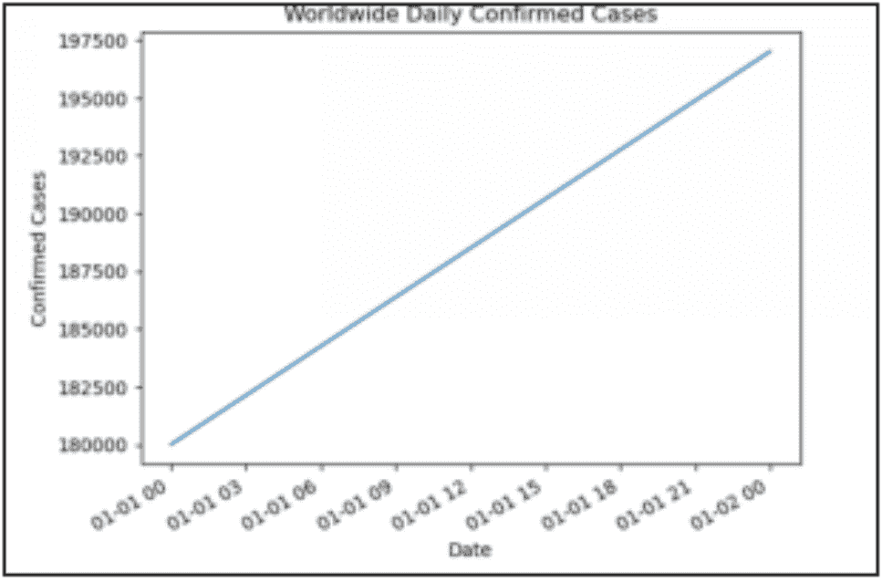
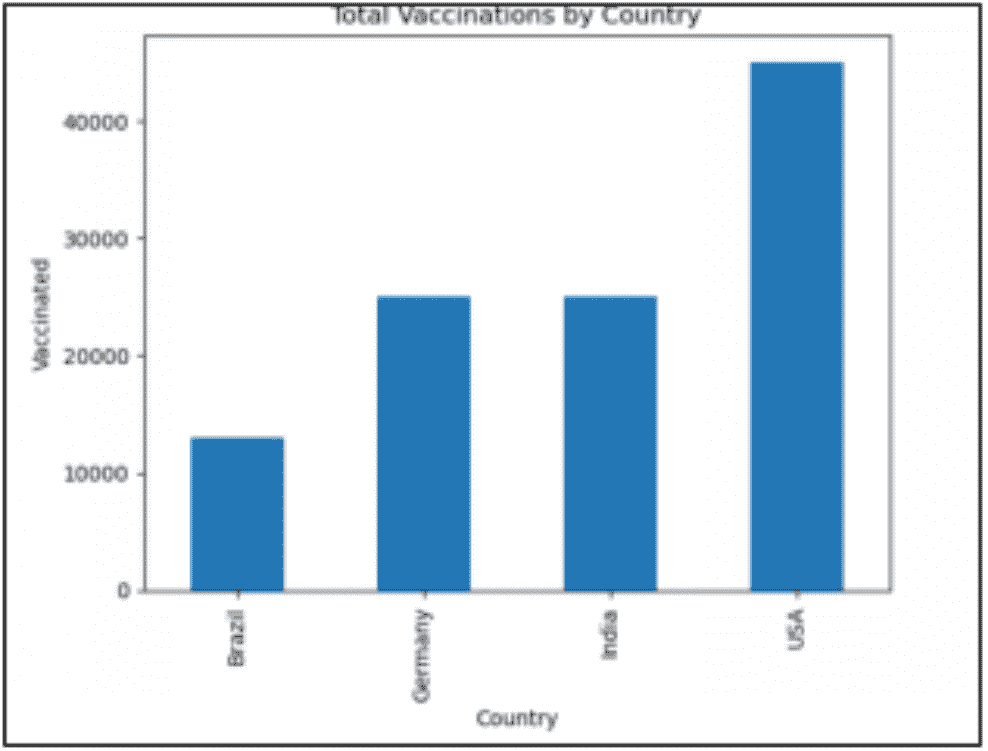

**得出见解：** 使用滚动平均值或累积和为大流行进展提供有意义的见解，并在随时间推移识别关键趋势。

```python
# Calculate 7-day rolling average for confirmed cases worldwide
date_summary['Rolling_Avg_Confirmed'] = date_summary['Confirmed'].rolling(window=7).mean()

# Plot the rolling average
date_summary['Rolling_Avg_Confirmed'].plot(kind='line', title='7-Day Rolling Average of Confirmed Cases', xlabel='Date', ylabel='Confirmed Cases (7-Day Avg)')
plt.show()

# Calculate cumulative sum of deaths worldwide
date_summary['Cumulative_Deaths'] = date_summary['Deaths'].cumsum()

# Plot cumulative deaths
date_summary['Cumulative_Deaths'].plot(kind='line', title='Cumulative Deaths Worldwide', xlabel='Date', ylabel='Cumulative Deaths')
plt.show()
```


## 数据集的关键洞察

### 日趋势
随时间推移的确诊病例和死亡人数可视化有助于识别疫情中的高峰和低谷。

### 累计指标
累计求和更清晰地展示了疫情随时间推移的总影响。

## 案例研究 2：使用 Pandas 构建销售仪表板

本项目演示了 `Pandas` 如何简化构建销售分析仪表板的过程。

### 示例数据

#### 销售数据 (`sales_data.csv`)
```
OrderID,Date,Region,ProductID,Quantity,Price
1001,2023-01-01,North,101,5,20
1002,2023-01-02,South,102,10,15
1003,2023-01-03,North,103,8,25
1004,2023-01-04,West,101,7,20
1005,2023-01-05,East,104,15,30
1006,2023-01-06,South,102,20,15
1007,2023-01-07,West,103,5,25
1008,2023-01-08,North,101,10,20
```

#### 产品数据 (`product_data.csv`)
```
ProductID,ProductName,Category
101,Widget A,Gadgets
102,Widget B,Gadgets
103,Widget C,Tools
104,Widget D,Accessories
```

### 关键步骤

#### 数据导入和合并
从多个来源（CSV、Excel）导入销售和产品数据，并使用 `merge()` 或 `join()` 合并数据集。

```
import pandas as pd

# Load sales and product data
sales_df = pd.read_csv("sales_data.csv")
product_df = pd.read_csv("product_data.csv")

# Merge the datasets on ProductID
merged_df = pd.merge(sales_df, product_df, on="ProductID")

print(merged_df.head())
```

结果 DataFrame (`merged_df`)：

| 订单 ID || 日期 || 区域 || 产品 ID || 数量 || 价格 || 产品名称 || 类别 |
| --- | --- | --- | --- | --- | --- | --- | --- |
| 1001 || 2023-01-01 || 北部 || 101 || 5 || 20 || Widget A || Gadgets |
| 1002 || 2023-01-02 || 南部 || 102 || 10 || 15 || Widget B || Gadgets |

#### 计算 KPI
使用 Pandas 聚合函数如 `sum()` 和 `mean()` 计算关键绩效指标（KPI），例如总收入、畅销产品或区域表现。

**计算总收入：**
```
# Add a Revenue column
merged_df['Revenue'] = merged_df['Quantity'] * merged_df['Price']

# Total Revenue
total_revenue = merged_df['Revenue'].sum()
print(f"Total Revenue: ${total_revenue}")
```

**畅销产品：**
```
# Group by ProductName and sum Quantity
top_products = merged_df.groupby('ProductName')['Quantity'].sum().sort_values(ascending=False)
print(top_products)
```

**区域表现：**
```
# Group by Region and sum Revenue
regional_performance = merged_df.groupby('Region')['Revenue'].sum()
print(regional_performance)
```

#### 可视化表现
为仪表板创建条形图、折线图或饼图，以展示月度收入趋势、按区域划分的销售额或产品类别表现等指标。

**条形图：区域收入：**
```
import matplotlib.pyplot as plt

regional_performance.plot(kind='bar', title='Regional Revenue', xlabel='Region', ylabel='Revenue', color='skyblue')
plt.show()
```

**饼图：产品类别表现：**
```
category_performance = merged_df.groupby('Category')['Revenue'].sum()
category_performance.plot(kind='pie', autopct='%1.1f%%', title='Revenue by Product Category')
plt.ylabel('')  # Hide y-label
plt.show()
```

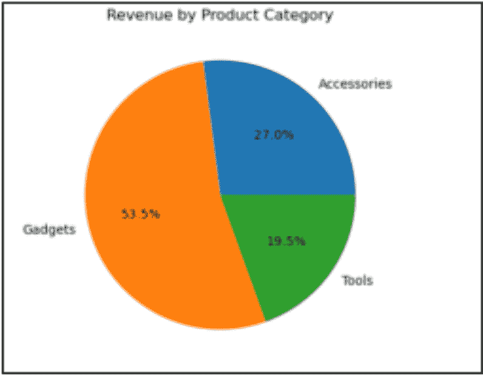

**折线图：日收入趋势：**
```
# Group by Date and calculate daily revenue
daily_revenue = merged_df.groupby('Date')['Revenue'].sum()
daily_revenue.plot(kind='line', title='Daily Revenue Trends', xlabel='Date', ylabel='Revenue', marker='o')
plt.show()
```

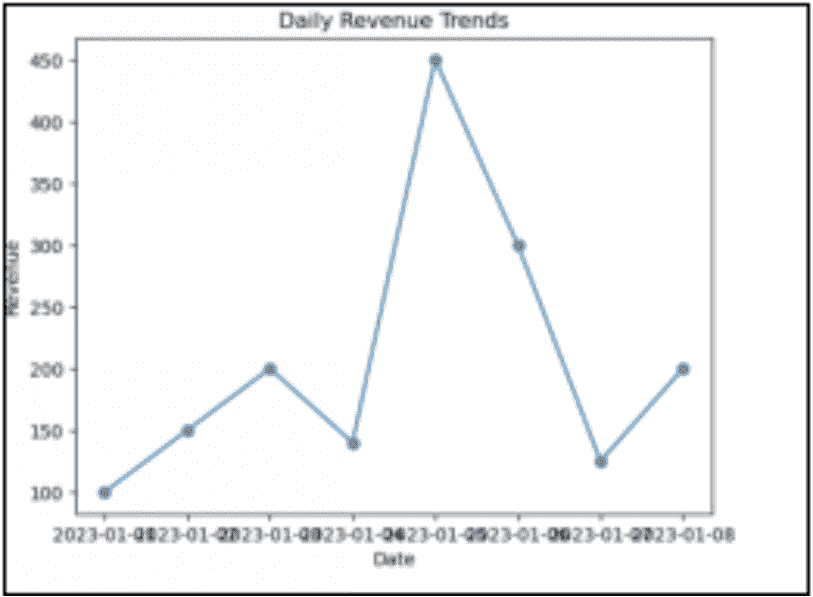

#### 导出结果
将处理后的数据或仪表板摘要保存为 Excel 文件供利益相关者使用。

```
# Save the merged dataset to an Excel file
merged_df.to_excel("sales_dashboard_data.xlsx", index=False)

# Save the regional performance summary to an Excel file
regional_performance.to_excel("regional_performance.xlsx")
```

### 主要收获

**数据导入和合并：** 使用 `pd.read_csv()` 加载数据并使用 `pd.merge()` 合并数据集。

**计算 KPI：** 使用 Pandas 聚合（`sum()`、`groupby()`）计算收入、销售额和绩效指标。

**可视化表现：** 将 Pandas 与 Matplotlib 结合，创建条形图、折线图和饼图等可视化洞察。

**导出结果：** 使用 `to_excel()` 保存最终处理后的数据和摘要供利益相关者使用。

## 案例研究 3：为机器学习清理和准备数据集

本实践练习专注于为机器学习模型准备原始数据。

### 示例数据 (`machine_learning_data.csv`)
```
CustomerID,Age,Gender,Income,SpendingScore,Membership
1,25,Male,50000,80,Premium
2,30,Female,60000,60,Basic
3,35,Male,55000,75,Premium
4,40,Female,NaN,50,Basic
5,45,Male,45000,40,Premium
6,50,Female,50000,20,Basic
7,55,Male,40000,30,NaN
8,60,Female,65000,90,Premium
9,65,Male,70000,100,Premium
10,70,Female,75000,NaN,Basic
```

### 步骤

#### 数据清洗
使用 `fillna()` 或 `dropna()` 通过填充或删除值来处理缺失数据。使用 `drop_duplicates()` 删除重复行。

```
import pandas as pd

# Load the data
df = pd.read_csv("machine_learning_data.csv")

# Handle missing values
df['Income'].fillna(df['Income'].mean(), inplace=True)  # Fill missing 'Income' with mean
df['SpendingScore'].fillna(df['SpendingScore'].median(), inplace=True)  # Fill missing 'SpendingScore' with median
df['Membership'].fillna('Basic', inplace=True)  # Fill missing 'Membership' with mode

# Remove duplicate rows
df = df.drop_duplicates()

print("Cleaned Data:")
print(df)
```

#### 特征工程
创建新特征，对分类变量进行编码，并对数值特征进行缩放以供模型输入。

```
from sklearn.preprocessing import StandardScaler, LabelEncoder

# Create a new feature: Income-to-Spending ratio
df['IncomeToSpending'] = df['Income'] / df['SpendingScore']

# Encode categorical variables
label_encoder = LabelEncoder()
df['Gender'] = label_encoder.fit_transform(df['Gender'])  # Male=1, Female=0
df['Membership'] = label_encoder.fit_transform(df['Membership'])  # Premium=1, Basic=0

# Scale numeric features
scaler = StandardScaler()
df[['Age', 'Income', 'SpendingScore', 'IncomeToSpending']] = scaler.fit_transform(
    df[['Age', 'Income', 'SpendingScore', 'IncomeToSpending']]
)

print("Feature-Engineered Data:")
print(df)
```

#### 数据分割
使用 Pandas 切片将数据集拆分为训练集和测试集，或集成 Scikit-learn 的 `train_test_split`。

```
from sklearn.model_selection import train_test_split

# Define features and target variable
X = df[['Age', 'Gender', 'Income', 'SpendingScore', 'IncomeToSpending', 'Membership']]
y = df['SpendingScore']  # Target variable for demonstration

# Split data into training and testing sets
X_train, X_test, y_train, y_test = train_test_split(X, y, test_size=0.2, random_state=42)

print("Training Data Shape:", X_train.shape)
print("Testing Data Shape:", X_test.shape)
```

#### 计算 KPI
计算可作为额外特征或洞察使用的基本 KPI，如平均值或比率。

```
# Calculate average income by gender
avg_income_by_gender = df.groupby('Gender')['Income'].mean()
print("Average Income by Gender:")
print(avg_income_by_gender)

# Calculate average spending score by membership
avg_spending_by_membership = df.groupby('Membership')['SpendingScore'].mean()
print("Average Spending Score by Membership:")
print(avg_spending_by_membership)
```

#### 导出可直接使用的数据
将处理后且已进行特征工程的数据保存为 CSV 文件，以便机器学习算法使用。

```
# Export processed data to a CSV file
df.to_csv("processed_machine_learning_data.csv", index=False)

print("Data exported to 'processed_machine_learning_data.csv'")
```

### 步骤回顾


-   数据清洗：填充缺失值（`Income`、`SpendingScore` 和 `Membership`）。删除重复行。
-   特征工程：创建新特征如 `IncomeToSpending`。对分类变量（`Gender`、`Membership`）进行编码。对数值特征进行缩放以提升模型性能。
-   数据划分：将数据集拆分为训练集和测试集用于机器学习。
-   计算 KPI：推导出诸如按性别的平均收入和按会员等级的消费评分等洞察。
-   导出：将处理后的数据保存为 CSV 文件用于机器学习。

这些项目凸显了 Pandas 在应对各种数据分析和预处理挑战方面的多功能性，使其成为现实世界数据科学工作流程中的必备工具。

# 6.14 现实世界中的 Pandas

## 将 Pandas 与其他库集成

Pandas 可无缝集成到各种 Python 库中，使其成为数据科学生态系统的基石：
NumPy: Pandas 建立在 NumPy 之上并使用其数据结构进行高效的数值计算。你可以在 Pandas 操作中使用 NumPy 函数对 `DataFrame` 和 `Series` 执行逐元素计算。
Matplotlib and Seaborn: Pandas 与可视化库集成良好。你可以使用 `DataFrame.plot()` 创建基本可视化，或将 Pandas DataFrame 直接传入 Matplotlib 和 Seaborn 函数以创建更高级的可视化，如热力图、配对图和自定义图表。
Scikit-learn: Pandas 常用于在将数据集输入机器学习模型之前进行预处理。特征可以使用 Scikit-learn 管道进行缩放、编码或转换，同时保持与 Pandas `DataFrame` 的兼容性以便于解释。
例如，你可以将 Pandas 与 Seaborn 结合以创建用于探索性数据分析（EDA）的富有洞察力的可视化。并将 Pandas 与 Scikit-learn 结合使用以执行特征选择、归一化以及准备训练和测试数据集。

## Pandas 在大数据环境中

虽然 Pandas 对于中小型数据集非常高效，但在处理超出内存限制的大型数据集时，其性能可能会受限。为解决此问题，大数据环境通常会使用 Dask 等工具扩展或替换 Pandas，该工具可将 Pandas 操作扩展以处理大于内存的数据：
Dask for Scaling Pandas Operations: Dask 扩展了 Pandas API 以处理分布式数据集。它将大型数据集划分为可管理的块以并行处理。例如，使用 Dask 的 `read_csv()` 或 `read_parquet()` 加载和处理大型 CSV 或 Parquet 文件。在无需整个数据集都装入内存的情况下，对分布式分区执行 `groupby()` 或聚合等操作。
Hadoop and Spark: 在更高级的大数据环境中，Pandas 可以与 PySpark 或 Hadoop 生态系统集成以进行分布式数据处理，尽管这些框架比单独的 Pandas 更复杂。
对于现实世界的工作流程：
使用 Pandas 进行本地数据整理和分析，当处理可装入内存的数据集时。在将操作扩展到处理 TB 或 PB 级数据时，转向 Dask 或 Spark。
通过与库集成并适应更大的数据环境，Pandas 确保了其在多样化数据科学应用中的相关性，从小规模 EDA 到大规模大数据处理。这种灵活性使其成为现实世界数据工作流程中不可或缺的工具。

# 6.15 结论

Pandas 已证明自己是数据科学的基石库，为高效的数据操作和分析提供了一个强大的框架。在本章中，我们探索了 Pandas 的一系列综合功能，使数据专业人员能够处理多样化的数据挑战：
核心数据结构：
`Series`: 一种能够容纳任何数据类型的一维标签数组。
`DataFrame`: 一种类二维表格数据结构，简化了表格数据的处理。
数据导入和导出：Pandas 使从 CSV、Excel、JSON 和 SQL 等各种格式读取数据变得容易，同时也能够将处理后的数据导出到这些格式。
数据清洗和预处理：用于处理缺失值、检测和删除重复项以及应用转换的工具可确保分析所需干净、高质量的数据。对数据类型转换和自定义函数的支持增加了预处理工作流程的灵活性。
探索性数据分析（EDA）：`describe()`、分组和透视表等方法有助于揭示数据中的趋势和模式。
高级操作：MultiIndexing 能够处理分层数据，而窗口函数则便于滚动和扩展计算。包括向量化和内存高效数据类型在内的性能优化技术使 Pandas 能够扩展到更大的工作流程。
可视化：内置绘图功能提供了一种快速可视化数据的方式，并与 Matplotlib 和 Seaborn 无缝集成以进行高级可视化。
现实世界集成：Pandas 与 NumPy、Matplotlib、Seaborn 和 Scikit-learn 协同工作以实现端到端的数据工作流程。对于大数据环境，像 Dask 这样的工具扩展了 Pandas 的功能以处理更大的数据集。
Pandas 对于数据科学不可或缺，是数据操作、清洗和探索的基础。其直观的语法和多功能特性使其成为各行业专业人士的首选工具。通过掌握 Pandas，你可以获得从数据中提取有价值见解所需的技能，无论是小规模分析还是复杂的大规模项目。

# 6.16 章节复习题

问题 1:
以下哪一项是 Pandas 中的核心数据结构？
A. 数组
B. `DataFrame`
C. 字典
D. 矩阵

问题 2:
Pandas Series 是什么？
A. 一维标签数组
B. 二维标签数据结构
C. 数组集合
D. 矩阵序列

问题 3:
哪个函数用于将 CSV 文件读入 Pandas DataFrame？
A. `pd.read_table()`
B. `pd.read_csv()`
C. `pd.read_file()`
D. `pd.read_dataframe()`

问题 4:
如何将 Pandas DataFrame 导出到 CSV 文件？
A. `df.export_csv()`
B. `df.write_csv()`
C. `df.to_csv()`
D. `df.save_csv()`

问题 5:
哪个方法用于在 Pandas DataFrame 中删除缺失值？
A. `drop_missing()`
B. `fillna()`
C. `dropna()`
D. `clean_data()`

问题 6:
Pandas 中 `groupby()` 函数的目的是什么？
A. 按列对 DataFrame 进行排序
B. 对数据进行分组以进行聚合和分析
C. 根据条件过滤行
D. 合并多个 DataFrame

问题 7:
以下哪种方法用于在 Pandas 中合并两个 DataFrame？
A. `df.combine()`
B. `pd.concat()`
C. `pd.join()`
D. `pd.merge()`

问题 8:
以下关于 Pandas DataFrame 的说法哪一项是正确的？
A. DataFrame 是不可变的
B. `DataFrame` 具有标签行和列
C. DataFrame 不能处理缺失数据
D. DataFrame 比 NumPy 数组更快

问题 9:
Pandas 中通常用于可视化数据的函数是？
A. `df.plot()`
B. `df.visualize()`
C. `df.draw()`
D. `df.graph()`

问题 10:
在 Pandas 中处理时间序列数据的最佳方式是什么？
A. 使用普通 DataFrame
B. 使用带有 datetime 索引的 `Series`
C. 使用 NumPy 数组
D. 使用带有时间键的字典

# 6.17 章节复习题答案

1. B. `DataFrame`
解释：`DataFrame` 是 Pandas 中的核心数据结构。它是一个二维、带标签的数据结构，其列可以容纳不同的数据类型。
2. A. 一维标签数组
解释：Pandas `Series` 是一个具有标签（索引）的一维数组，允许类似列表的数据操作，但具有额外的功能。
3. B. `pd.read_csv()`


说明：`pd.read_csv()` 函数用于将 CSV 文件读取到 Pandas `DataFrame` 中以进行进一步的数据处理和分析。

4\. C. `df.to_csv()`

说明：`to_csv()` 方法用于将 Pandas `DataFrame` 导出到 CSV 文件。

5\. C. `dropna()`

说明：`dropna()` 方法从 Pandas `DataFrame` 中删除包含缺失值的行或列。

6\. B. 用于聚合和分析分组数据

说明：`groupby()` 函数用于基于一个或多个键对数据进行分组并执行聚合或转换等操作。

7\. D. `pd.merge()`

说明：`pd.merge()` 函数用于基于指定的列或索引合并两个 `DataFrames`。

8\. B. `DataFrames` 有标记的行和列

说明：Pandas `DataFrames` 具有标记的行（`index`）和列，便于轻松访问和操作数据。

9\. A. `df.plot()`

说明：Pandas 中的 `plot()` 函数用于从 `DataFrame` 或 `Series` 数据创建可视化，如线图、条形图等。

10\. B. 使用带有日期时间索引的 `Series`

说明：Pandas 中的时间序列数据最好使用带有日期时间索引的 `Series` 或 `DataFrame` 处理，以便轻松操作和分析基于时间的数据。

# 第 7 章. 用于数据科学的 Matplotlib 和 Seaborn

有效的数据可视化是数据科学的关键组成部分，能够提供更清晰的洞察并更好地传达复杂信息。本章探讨 Matplotlib 和 Seaborn，这两个用于创建有影响力可视化的必备 Python 库。它首先介绍数据可视化并涵盖 Matplotlib 的基础知识，逐步深入到更高级的定制技术。随后本章介绍 Seaborn，演示如何轻松创建和完善图表。此外，还探讨如何结合 Matplotlib 和 Seaborn 以增强可视化能力。最后，读者将学习最佳实践、实际应用和专家技巧，以创建清晰、信息丰富且视觉上吸引人的数据可视化。

## 7.1 数据可视化简介

### 什么是数据可视化？

数据可视化是对数据和信息的图形表示。它涉及使用图表、图形和地图等视觉元素，使复杂数据更易于访问、理解和操作。通过将原始数据转换为视觉格式，更容易识别在原始数字中隐藏的模式、趋势和洞察。

### 数据科学中可视化的重要性

可视化是数据科学工作流程的关键组成部分，原因如下：

理解数据：它帮助数据科学家和分析师探索数据集、识别异常并理解分布和关系。

沟通：可视化以直观的方式向非技术利益相关者传达发现和洞察。

决策：通过可视化呈现数据，组织可以更有信心地做出数据驱动的决策。

探索性数据分析（EDA）：在数据分析的初始阶段，可视化有助于揭示隐藏的关系并检验假设。

例如：折线图可以揭示随时间的变化趋势。散点图可以显示变量之间的相关性。热力图可以突出数据中的聚类或异常。

### Python 可视化库概述

Python 提供了丰富的用于创建可视化的库生态系统：

Matplotlib：一个多功能且基础的库，用于创建静态、交互式和动画可视化。它提供对绘图定制的完全控制，但高级使用学习曲线较陡。

Seaborn：构建于 Matplotlib 之上，Seaborn 简化了美观统计图形的创建。它提供高级函数，可在更少的工作下绘制常见的图表，如条形图、箱线图和散点图。

Plotly：一个用于交互式可视化的库，允许用户创建仪表板和可共享的图表。

Bokeh：与 Plotly 类似，它专门用于创建基于网络的交互式可视化。

ggplot：受 R 的 ggplot2 启发，用于在 Python 中创建基于语法的图表。

Pandas：虽然主要是一个数据操作库，但 Pandas 提供了基本绘图功能，可与其实 `DataFrame` 结构无缝集成。

### Matplotlib 和 Seaborn 简介

这两个库是 Python 中最广泛使用的可视化工具之一：

何时使用 Matplotlib：

• 当你需要对图表的外观和布局进行完全控制时，使用 Matplotlib。

• 它非常适合创建自定义、复杂或高度定制的可视化，需要精细调整（例如，科学出版物）。

• 适用于需要高级微调的低级绘图任务。

示例：创建多轴图或自定义图表元素，如刻度、图例和网格线。

```
import matplotlib.pyplot as plt

plt.plot([1, 2, 3], [4, 5, 6])

plt.title("Simple Line Plot")

plt.show()
```

何时使用 Seaborn：

• 使用 Seaborn 进行快速且高质量的统计可视化。

• 它简化了创建复杂图表（例如，小提琴图、配对图）的过程，代码量最少。

• 特别适用于探索性数据分析，在此过程中需要识别模式和相关性。

示例：绘制带回归线的散点图。

```
import seaborn as sns
import matplotlib.pyplot as plt

sns.scatterplot(x=[1, 2, 3], y=[4, 5, 6])

plt.show()
```

通过了解可视化的重要性以及每个库的优势，数据科学家可以选择合适的工具来有效分析和传达其数据洞察。

## 7.2 开始使用 Matplotlib

### 安装和导入 Matplotlib

要开始使用 Matplotlib，首先需要安装该库。使用以下任一命令：

• `pip install matplotlib`

• `conda install matplotlib`

安装后，你可以将其导入到 Python 脚本中：

```
import matplotlib.pyplot as plt
```

`pyplot` 是 Matplotlib 中用于创建可视化最常用的模块。

### Matplotlib 图的基本组件

理解 Matplotlib 图的核心元素至关重要：

Figure：整个图形或画布，容纳所有视觉元素。

Axes：图形内的绘图区域，在此可视化数据。单个图形可以有多个 Axes。

Subplots：使用 `plt.subplots()` 函数在单个图形中排列的多个图。

例如：

```
fig, ax = plt.subplots(2, 2)  # Creates a 2x2 grid of subplots
```

### 创建基本图表

Matplotlib 提供了多种图表类型来可视化不同类型的数据：

Line Plots：非常适合显示随时间或连续数据的趋势。

```
x = [1, 2, 3, 4]
y = [10, 20, 25, 30]

plt.plot(x, y)
plt.show()
```

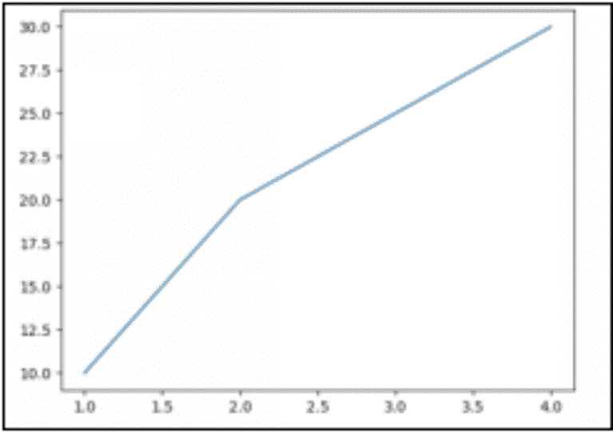

Scatter Plots：可视化两个变量之间的关系。

```
plt.scatter(x, y)
plt.show()
```

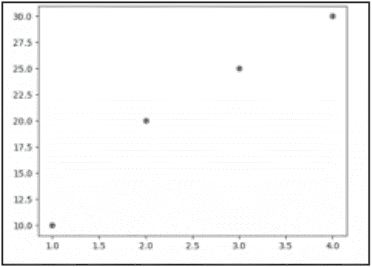

Bar Charts：适用于分类数据。

```
categories = ['A', 'B', 'C']
values = [5, 7, 3]

plt.bar(categories, values)
plt.show()
```

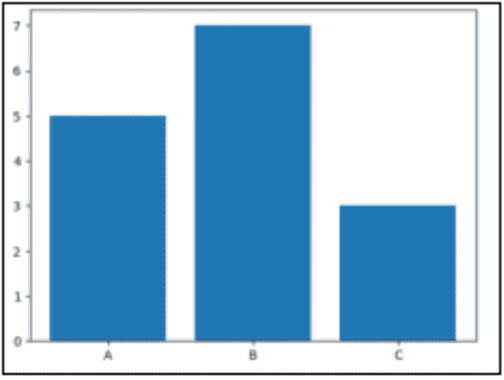

Histograms：显示数据的分布。

```
data = [1, 2, 2, 3, 3, 3, 4, 4, 4, 4]
plt.hist(data, bins=4)
plt.show()
```

### 自定义 Matplotlib 图表

自定义可以使图表更具信息性和视觉吸引力。

添加标题、标签和图例：

```
plt.plot(x, y, label='Sample Line')
plt.title("Line Plot Example")
plt.xlabel("X-Axis")
plt.ylabel("Y-Axis")
plt.legend()
plt.show()
```

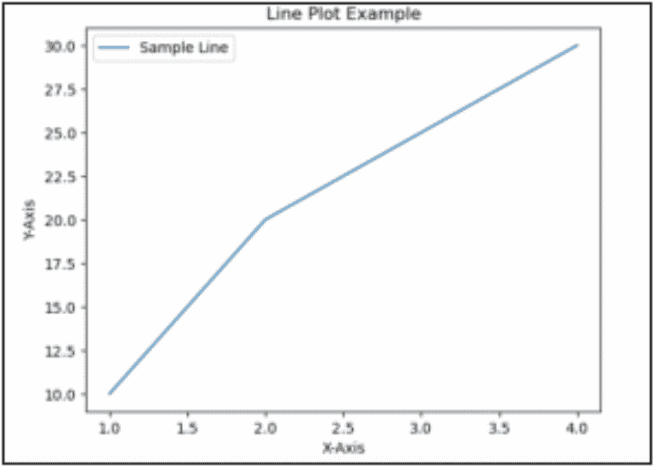


# 调整线条样式、颜色和标记

你可以修改样式、颜色和标记以增强清晰度。

```python
plt.plot(x, y, linestyle='--', color='red', marker='o')
plt.show()
```

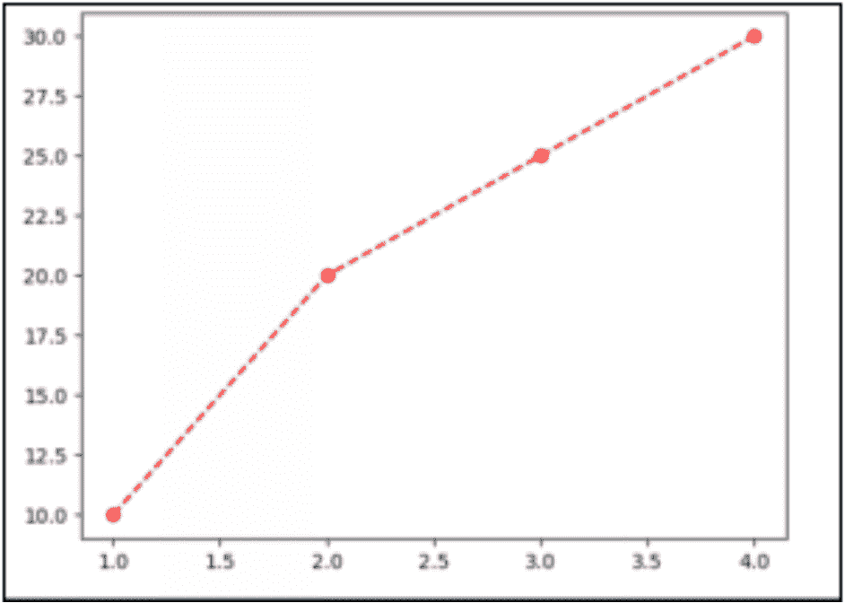

## 保存和导出图表

使用 `plt.savefig()` 保存可视化结果用于报告或演示：

```python
plt.plot(x, y)
plt.title("Saved Plot Example")
plt.savefig("line_plot.png", dpi=300, format='png')
plt.show()
```

你可以以多种格式保存图表，例如 PNG、PDF 或 SVG。

## 高级 Matplotlib 技术

### 使用子图

子图对于创建多面板可视化至关重要，允许在同一图形中显示多个图表。

使用 `plt.subplots()`：此函数简化了子图的创建。它返回一个图形和一个坐标轴数组，使结构化和可定制的布局成为可能。例如：

```python
fig, axes = plt.subplots(2, 2, figsize=(10, 8))
axes[0, 0].plot(x, y1)
axes[0, 1].scatter(x, y2)
```

网格布局：子图可以使用 `gridspec` 模块排列成灵活的网格布局，允许单个面板具有不均匀或自定义大小。

### 向图表添加注释

注释有助于突出图表中的特定点或区域，使可视化更具信息性。使用 `plt.annotate()` 添加注释，可自定义文本、箭头样式和定位。例如：

```python
import matplotlib.pyplot as plt
import numpy as np

# Example data
x = np.arange(10)
y = x**2

# Find maximum value and its index
max_index = np.argmax(y)
x_max = x[max_index]
y_max = y[max_index]

# Plot the data
plt.plot(x, y)

# Annotate the maximum point
plt.annotate('Max Value', xy=(x_max, y_max), xytext=(x_max + 1, y_max + 10),
arrowprops=dict(facecolor='black', arrowstyle='->'))

# Show the plot
plt.show()
```

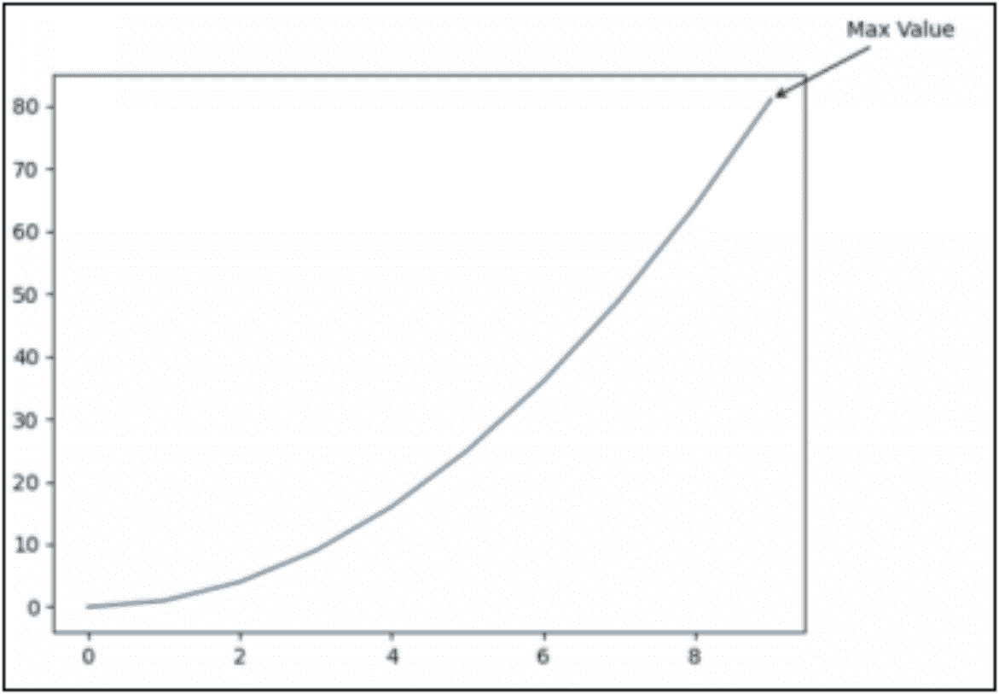

### 使用多个坐标轴和双坐标轴

有时，有必要在同一图形上以单独的比例绘制不同的数据集：

多个坐标轴：使用 `plt.subplots()` 并配合多个坐标轴来管理同一图形中的不同图表。

双坐标轴：使用 `ax.twinx()` 创建次要 y 轴。这在比较具有不同单位的数据集时特别有用：

```python
import matplotlib.pyplot as plt
import numpy as np

# Define data
x = np.linspace(0, 10, 100)  # 100 points between 0 and 10
y1 = np.sin(x)  # Data for the first axis
y2 = np.cos(x)  # Data for the second axis

# Create the plot
fig, ax1 = plt.subplots()

# Create a second y-axis
ax2 = ax1.twinx()

# Plot on the first axis
ax1.plot(x, y1, 'g-', label='sin(x)')
ax1.set_xlabel('X-axis')
ax1.set_ylabel('sin(x)', color='g')

# Plot on the second axis
ax2.plot(x, y2, 'b-', label='cos(x)')
ax2.set_ylabel('cos(x)', color='b')

plt.show()
```

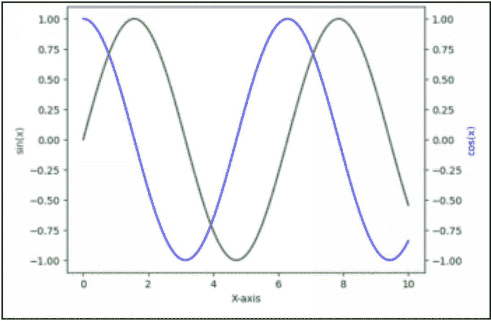

### 使用样式和主题

Matplotlib 提供了预定义的样式和主题以改善图表的美观性：

应用样式：使用 `plt.style.use()` 应用内置样式，如 `'ggplot'`、`'seaborn'` 或 `'dark_background'`。使用 `plt.style.available` 查找可用样式。

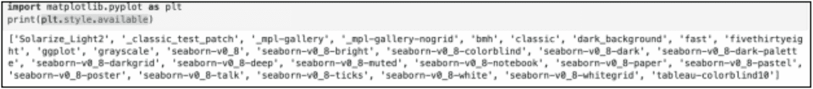

示例：

```python
plt.style.use('seaborn-v0_8-darkgrid')
plt.plot(100, 10)
```

通过直接修改 `rcParams` 自定义颜色、字体和布局。

### 使用 Matplotlib 进行交互式可视化

交互式图表增强了用户体验，尤其是在数据探索任务中。

使用小部件：Matplotlib 通过 `matplotlib.widgets` 模块提供交互式小部件，如滑块、按钮和下拉菜单。示例：

```python
import matplotlib.pyplot as plt
from matplotlib.widgets import Slider

# Create a figure with multiple subplots
fig, axes = plt.subplots(2, 1)  # Two rows of subplots
plt.subplots_adjust(bottom=0.3)  # Adjust space for the slider

# Use one axis for the slider
ax_slider = plt.axes([0.2, 0.1, 0.65, 0.03])  # [left, bottom, width, height]

# Create the slider
slider = Slider(ax_slider, 'Param', valmin=0, valmax=100, valinit=50)

plt.show()
```

与 Jupyter Notebook 集成：使用 `%matplotlib notebook` 或 `%matplotlib widget` 在 Jupyter 中直接启用交互式图表。这允许缩放、平移和图表的实时更新。

这些高级技术使 Matplotlib 成为创建自定义、专业级可视化的强大工具。无论是构建多面板图表、添加注释还是增强交互性，这些功能都能确保你的可视化有效传达复杂的数据洞察。

# 7.3 Seaborn 简介

## 安装和导入 Seaborn

Seaborn 是一个功能强大的 Python 库，构建于 Matplotlib 之上，专门用于创建信息丰富且美观的可视化。要安装 Seaborn，请使用以下命令：

使用 pip：

```bash
pip install seaborn
```

使用 conda：

```bash
conda install seaborn
```

将 Seaborn 导入到你的 Python 脚本中：

```python
import seaborn as sns
import matplotlib.pyplot as plt
```

Seaborn 通常与 Matplotlib 一起使用，使图表自定义控制更加容易。

## Seaborn 相对于 Matplotlib 的优势

虽然 Matplotlib 功能多样，但 Seaborn 简化了复杂可视化的创建并增强了整体美观性。主要优势包括：

高层接口：Seaborn 提供了简单的函数来创建复杂图表，如配对图和小提琴图，而无需大量自定义。

基于数据集的 API：Seaborn 设计为可直接与 Pandas DataFrame 配合使用，允许用户按名称定义变量（列），而不是手动提取数据。

内置统计功能：Seaborn 包含回归图、箱线图和分布图等统计图，并提供置信区间和核密度估计选项。

精美的默认设置：Seaborn 的默认样式和配色方案可生成专业外观的图表，无需额外自定义。

与 Pandas 集成：Seaborn 与 Pandas 无缝集成，使处理结构化数据变得容易。

## Seaborn 图表的结构

Seaborn 图表遵循基于数据集的 API，使映射数据集中变量到不同图表元素变得容易。以下是关键组件概述：

基于数据集的 API：Seaborn 允许你直接将 Pandas DataFrame 传递给绘图函数，而不是手动绘制数据数组。这使得数据可视化更直观：

```python
sns.scatterplot(data=df, x='feature1', y='feature2')
plt.show()
```

Seaborn 中的内置数据集：Seaborn 附带多个内置数据集，可用于练习和原型设计。你可以使用 `sns.load_dataset()` 函数加载这些数据集：

```python
tips = sns.load_dataset('tips')  # Load the 'tips' dataset
print(tips.head())
```

内置数据集示例包括：

- tips: 关于餐厅账单和小费的数据。
- iris: 鸢尾花分类的经典数据集。
- penguins: 关于企鹅物种及其测量的数据。

Seaborn 图表通常结合多层，数据集提供基础，视觉元素（如点、条、线）层叠在其之上。这种方法确保在创建针对数据集定制的可视化时的一致性和灵活性。

Seaborn 直观的界面和内置数据集使其成为数据科学家的必备工具，简化复杂可视化并增强探索性数据分析工作流程。

# 7.4 使用 Seaborn 创建图表

Seaborn 是一个用于创建统计可视化的强大 Python 库。它通过与 Pandas DataFrame 无缝集成并为 Matplotlib 添加功能，简化了创建复杂图表的过程。以下是使用 Seaborn 可以创建的不同类型图表的详细讨论：

## 分类图


## 分类图
分类图用于可视化分类数据与数值数据之间的关系。

条形图 (`sns.barplot`)：用于显示不同类别下数值变量的均值。示例：按产品类别显示平均销售额。

计数图 (`sns.countplot`)：可视化每个类别的出现次数。示例：统计数据集中产品类型的频率。

箱线图 (`sns.boxplot`)：通过四分位数展示数值变量的分布，并突出显示异常值。示例：可视化不同职业部门间的收入分布。

小提琴图 (`sns.violinplot`)：结合箱线图和 KDE 图显示数据的分布和概率密度。示例：比较不同学校学生的考试成绩。

散点图和蜂群图 (`sns.stripplot`, `sns.swarmplot`)：散点图沿分类轴显示单个数据点，而蜂群图防止重叠以提高清晰度。示例：可视化不同行业中的个人薪资。

### 分布图
分布图用于可视化数值变量的分布。

直方图 (`sns.histplot`)：显示数据点在各区间内的频率。示例：分析人口中的年龄分布。

KDE 图 (`sns.kdeplot`)：核密度估计图平滑数据以显示其潜在概率密度。示例：可视化数据集中房价的密度。

Rug 图 (`sns.rugplot`)：沿轴显示单个数据点，常与直方图或 KDE 图一起使用。示例：在直方图上添加 rug 图以更清晰地查看数据点。

### 关系图
关系图用于显示两个数值变量之间的关系。

散点图 (`sns.scatterplot`)：用于可视化两个数值变量之间的关系。示例：绘制销售额与广告支出以识别趋势。

折线图 (`sns.lineplot`)：显示数值变量随时间或连续输入的变化趋势。示例：随时间绘制股票价格。

### 矩阵图
矩阵图有助于可视化表格数据中的关系。

热力图 (`sns.heatmap`)：以矩阵格式显示数据，颜色代表值的大小。示例：可视化数据集中不同特征之间的相关性。

聚类图 (`sns.clustermap`)：与热力图类似，但包含层次聚类以对相似数据点进行分组。示例：根据购买行为对客户进行聚类。

Seaborn 提供了一个直观且多功能的框架，用于创建高质量、可出版的视觉化图表。通过组合这些图表类型，你可以发现数据中有意义的模式、关系和洞察。

# 7.5 自定义 Seaborn 可视化
## 调整图表美观性
Seaborn 使调整可视化的美观性以匹配不同的上下文和风格变得容易，从而提高清晰度和吸引力：
设置上下文：`sns.set_context()` 函数可为各种上下文自定义图表的比例和样式：
• paper：用于研究论文或文档中的小型图表。
• notebook：在 Jupyter notebook 中工作的默认设置。
• talk：用于演示放大的图表。
• poster：用于海报或幻灯片的更大图表。
示例：
```
sns.set_context("talk")
sns.scatterplot(x="sepal_length", y="sepal_width", data=df)
```
颜色调色板和主题：Seaborn 提供内置颜色调色板（例如，deep、pastel、dark）和主题（darkgrid、whitegrid、ticks）：
• 使用 `sns.set_palette()` 为图表定义配色方案。
• 应用 `sns.set_theme()` 调整整体图表样式。
示例：
```
sns.set_theme(style="whitegrid", palette="pastel")
sns.barplot(x="day", y="total_bill", data=tips)
```
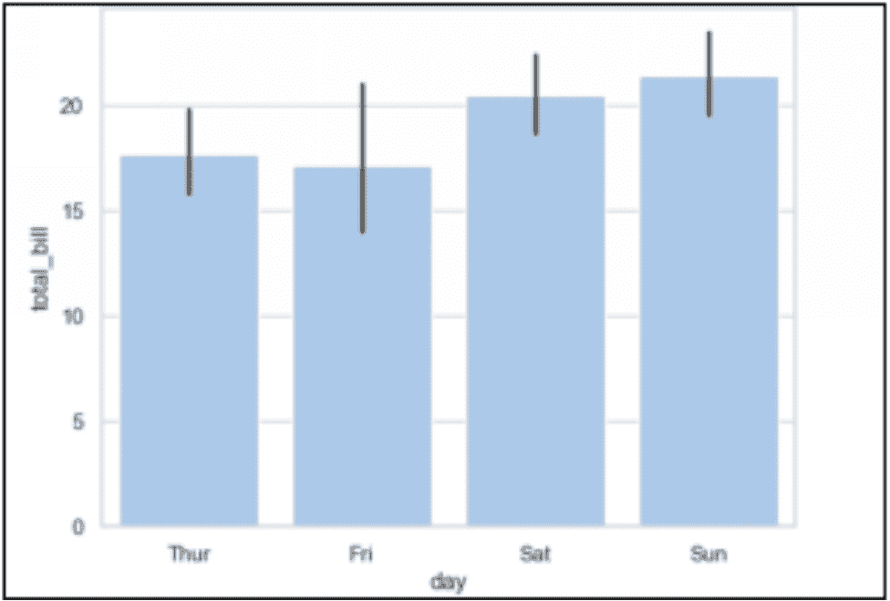
## 添加注释
注释通过突出显示关键数据点或统计信息提供额外上下文：使用 `plt.text()` 在图表上的特定点添加文本标签。直接在可视化上标注汇总统计信息或最大值。
示例：
```
import pandas as pd
import seaborn as sns
import matplotlib.pyplot as plt
# Define raw data
raw_data = {'year': [2018, 2019, 2020, 2021, 2022],
'value': [50, 80, 100, 90, 60]}
# Convert to a pandas DataFrame
data = pd.DataFrame(raw_data)
# Plot using seaborn
sns.lineplot(x="year", y="value", data=data)
# Annotate the peak value
plt.text(2020, 100, "Peak Value", fontsize=12, color="red")
plt.show()
```
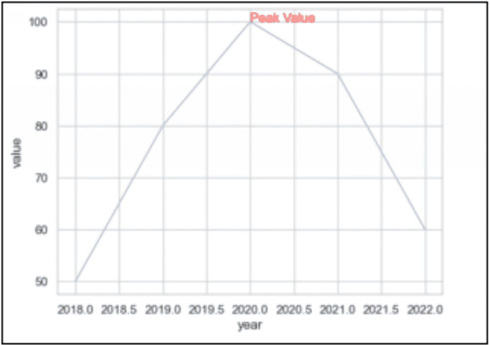
## 使用 FacetGrid 和 PairGrid 工作于多图表
Seaborn 支持涉及网格布局中多个图表的高级可视化：
`FacetGrid`：用于在多个分面中可视化数据的子集。示例：
```
g = sns.FacetGrid(tips, col="time", row="sex")
g.map(sns.scatterplot, "total_bill", "tip")
```
`PairGrid`：用于数据集中变量之间的成对关系。示例：
```
import seaborn as sns
import matplotlib.pyplot as plt
# Load the Iris dataset
iris = sns.load_dataset("iris")
# Create a PairGrid
g = sns.PairGrid(iris)
g.map_diag(sns.histplot)
g.map_offdiag(sns.scatterplot)
plt.show()
```
## 自定义坐标轴和图例
Seaborn 提供灵活的工具来自定义坐标轴和图例：
坐标轴：使用 `set_xlabel()` 和 `set_ylabel()` 为坐标轴添加标签。使用 `set_xlim()` 和 `set_ylim()` 调整坐标轴限制。使用 Matplotlib 的 `plt.xticks()` 或 `plt.yticks()` 旋转刻度标签。
图例：使用 Seaborn 的 `legend()` 参数自定义图例。使用 `remove_legend()` 在不必要时排除图例。
示例：
```
sns.scatterplot(x="total_bill", y="tip", hue="sex", data=tips)
plt.legend(title="Gender", loc="upper left")
```
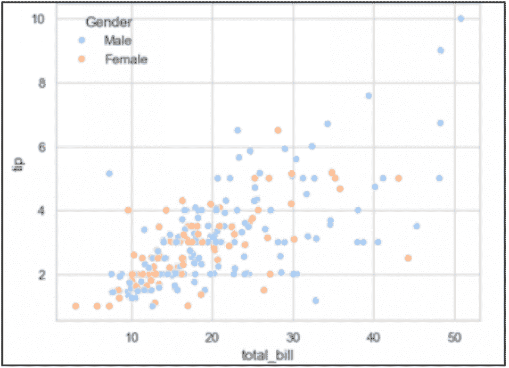
自定义 Seaborn 可视化有助于将图表定制给特定受众，确保它们在视觉上具有吸引力并有效传达预期洞察。这些功能使 Seaborn 成为数据可视化的极其多功能工具。

# 7.6 结合 Matplotlib 和 Seaborn
## 何时结合 Matplotlib 和 Seaborn
Matplotlib 和 Seaborn 是互补的库，可以结合起来创建自定义、高质量的可视化。Seaborn 提供易于使用的接口，用最少的代码创建美观的图表，而 Matplotlib 提供对图表自定义的精细控制。结合两者在以下情况很有用：
你想要 Seaborn 的高级美观性和统计功能，但需要 Seaborn 单独无法提供的精细定制。
你需要通过注释、多个子图或高级图例等附加元素增强 Seaborn 图表。
## 使用 Matplotlib 自定义 Seaborn 图表
虽然 Seaborn 会自动配置图表，但你可以使用 Matplotlib 函数来调整 Seaborn 生成的图表：
调整标题、坐标轴和图例：使用 Matplotlib 的 `plt.title()`、`plt.xlabel()` 和 `plt.legend()` 函数修改 Seaborn 图表。
```
import seaborn as sns
import matplotlib.pyplot as plt
tips = sns.load_dataset("tips")
sns.boxplot(x="day", y="total_bill", data=tips)
plt.title("Box Plot of Total Bill by Day")
plt.xlabel("Day of the Week")
plt.ylabel("Total Bill (USD)")
plt.show()
```
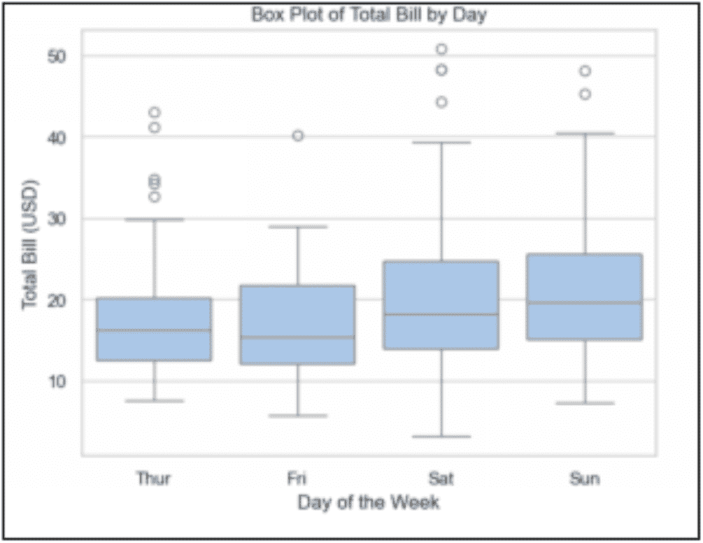
更改图形大小和布局：在使用 Seaborn 绘图之前，使用 Matplotlib 的 `plt.figure()` 或 `plt.subplots()` 配置图形大小和子图布局。
```
plt.figure(figsize=(10, 6))
sns.histplot(tips['total_bill'], kde=True)
plt.title("Distribution of Total Bill")
plt.show()
```
## 使用 Matplotlib 添加高级功能
Seaborn 图表可以通过 Matplotlib 的高级功能增强，例如：


## 复杂注释
添加文本或形状（如箭头）以突出特定的数据点或趋势。

```
sns.scatterplot(x="total_bill", y="tip", data=tips)
plt.annotate("High Tip", xy=(50, 10), xytext=(30, 12),
arrowprops=dict(facecolor='black', shrink=0.05))
plt.show()
```

## 添加多个图形
通过组合 Matplotlib 和 Seaborn 元素创建复合图或叠加图。

```
plt.figure(figsize=(10, 6))
sns.lineplot(x="size", y="tip", data=tips, label="Line Plot")
plt.bar(tips['size'], tips['tip'], alpha=0.5, label="Bar Plot")
plt.legend()
plt.title("Tip Amount by Size of Party")
plt.show()
```

通过利用 `Matplotlib` 的可定制性和 `Seaborn` 的简洁性，你可以创建详细且视觉上吸引人的绘图，[content]
## 复杂注释
添加文本或形状（如箭头）以突出特定的数据点或趋势。

```
sns.scatterplot(x="total_bill", y="tip", data=tips)
plt.annotate("High Tip", xy=(50, 10), xytext=(30, 12),
arrowprops=dict(facecolor='black', shrink=0.05))
plt.show()
```

## 添加多个图形
通过组合 Matplotlib 和 Seaborn 元素创建复合图或叠加图。

```
plt.figure(figsize=(10, 6))
sns.lineplot(x="size", y="tip", data=tips, label="Line Plot")
plt.bar(tips['size'], tips['tip'], alpha=0.5, label="Bar Plot")
plt.legend()
plt.title("Tip Amount by Size of Party")
plt.show()
```

通过利用 `Matplotlib` 的可定制性和 `Seaborn` 的简洁性，你可以创建详细且视觉上吸引人的绘图，量身定制以满足你的特定需求。这种组合对于创建需要统计准确性和美观度的专业质量可视化尤其有价值。

# 7.7 有效数据可视化的最佳实践
有效的数据可视化对于清晰、准确且引人入胜地传达洞察至关重要。以下最佳实践可以帮助确保你的可视化实现其预期目的：

## 选择合适的图表类型
选择合适的图表类型对于准确表示数据和传达洞察至关重要：
折线图：最适合显示随时间变化的趋势，例如股价或温度变化。
柱状图：理想用于比较类别，例如按地区或产品的销售额。
饼图：可用于显示比例，但在需要精确比较时应避免使用。
散点图：非常适合可视化两个变量之间的关系或相关性。
直方图：非常适合说明数据集的分布。
使用错误的图表类型可能会误导观众或掩盖数据的关键信息。

## 处理可视化中的大型数据集
大型数据集可能会使可视化不堪重负，导致杂乱且难以解释。要有效处理：
抽样：使用数据子集代表更大的数据集，同时保持关键模式或趋势。
聚合：将数据汇总为更广泛的类别（例如，按月平均销售额而非日销售额）。
交互式可视化：像 `Plotly` 或 `Tableau` 这样的工具允许用户放大、筛选或交互式地探索数据子集。
数据降维：像降维（例如 `PCA`）这样的技术可以在保留其核心特征的同时简化数据。

## 使可视化清晰且易于访问
可视化应以清晰度和可访问性为设计目标，以确保所有受众都能有效解读。
添加描述性标题和标签：提供清晰简洁的标题，解释可视化的主要信息。使用轴标签指定数据的含义，包括单位（例如，“Sales (in USD)”）。
使用合适的配色方案：选择增强可读性且对色盲友好的颜色（例如 `ColorBrewer` 调色板）。避免使用过多颜色，因为这会造成视觉噪音；将调色板限制在必要的区分上。在相似图表中使用一致的颜色以避免混淆。清晰的注释、一致的图例和深思熟虑的布局也有助于使可视化更易理解且更具影响力。
通过遵循这些最佳实践——选择合适的图表类型、有效管理大型数据集以及设计清晰易访问的可视化——你可以创建不仅看起来专业而且能向受众传达预期洞察的可视化。

# 7.8 实际应用与案例研究

## 可视化时间序列数据中的趋势
时间序列可视化对于识别随时间收集的数据中的模式、趋势和季节性至关重要。像 `Matplotlib` 和 `Seaborn` 这样的工具允许创建清晰描绘这些变化的折线图。
示例：使用 Seaborn `lineplot()` 或 `Pandas` `plot()` 可视化每日股价、全年温度变化或网站流量趋势。

## 创建统计可视化
统计图有助于总结和理解数据关系。两种常见类型包括：
相关矩阵：变量之间相关系数的热图可视化。使用 Seaborn 的 `heatmap()` 来识别强正相关或负相关。示例：分析数据集中特征之间的相关性以选择机器学习模型的相关变量。
回归图：用于描绘两个变量之间的线性关系。Seaborn 的 `regplot()` 或 `lmplot()` 可以直观显示趋势和置信区间。示例：可视化广告支出与销售额之间的关系。

## 可视化数据分布
数据分布可视化有助于比较多个组或检测异常值。
• 示例：使用 Seaborn 的 `violinplot()`、`boxplot()` 或 `histplot()` 比较不同人口群体的收入分布。
• 重点：组合可视化以获得更深入的洞察，例如将箱线图叠加在点图上以显示详细的组内分布。

## 案例研究：端到端可视化工作流程
端到端可视化项目涉及多个步骤，确保数据干净、图表设计良好且洞察可操作：
清理和准备数据：使用 `Pandas` 处理缺失值、标准化数据或分组数据。示例：在可视化之前预处理销售数据以计算月度总额。
创建和自定义图表：使用 `Matplotlib` 或 `Seaborn` 创建图表，调整标签、添加图例并使用合适的配色方案以增强可解释性。示例：一个自定义柱状图显示不同地区的销售额，并对销售高峰月份进行注释。
解释结果：分析可视化以识别模式或异常。示例：从回归图中识别营销活动如何与收入激增相关。
这些实际应用和案例研究强调了可视化作为数据科学中讲故事和决策工具的重要性。它们还展示了像 `Matplotlib` 和 `Seaborn` 这样的工具如何应用于多样化的用例以有效从原始数据中提取洞察。

# 7.9 技巧与窍门

## 调试 Matplotlib 和 Seaborn 中的常见错误
在使用 Matplotlib 和 Seaborn 时，由于配置、数据结构不匹配或库特定怪癖，遇到错误是很常见的。以下是一些常见问题及解决方案：
ValueError（数据长度不匹配）：当 x 轴和 y 轴数据的长度不匹配时会出现此错误。确保你的输入数据数组或 Series 具有相同的长度。
解决方案：使用 `len()` 在绘图前验证长度。
AttributeError（不支持的对象类型）：当在期望数值数据的地方传递非数值数据时经常出现。
解决方案：使用 `type()` 或 `Pandas` 的 `dtypes` 检查数据类型。
Seaborn 中的 KeyError：当 DataFrame 中的列名拼写错误或不存在时会发生这种情况。
解决方案：使用 `df.columns` 验证列名。
图形重叠：标题或轴标签等重叠元素可能使图表难以阅读。
解决方案：使用 `plt.tight_layout()` 调整间距或手动设置图形尺寸，使用 `plt.figure(figsize=(width, height))`。

## 优化大型数据集的性能
可视化大型数据集可能会占用资源并降低性能。以下是一些优化技巧：
降采样数据：使用 `Pandas` 的 `sample()` 或 Seaborn 的 `sns.histplot()` 分箱选项获取代表性样本来减小数据集大小。
聚合数据：在绘图前执行聚合以汇总数据（例如，按时间间隔分组时间序列数据）。


Use Efficient Plot Types: For dense scatterplots, use `sns.kdeplot()` or a hexbin plot (`plt.hexbin()`) to visualize data density instead of individual points.

Avoid Overplotting: Introduce transparency using the `alpha` parameter to reduce clutter in dense plots.

Use Backend Options: Leverage faster plotting backends, such as `agg`, or use libraries like Datashader or HoloViews for efficient rendering of large-scale data visualizations.

### Useful Resources and Libraries for Extending Functionality

Plotly for Interactive Visualizations: Plotly is a powerful library for creating interactive and web-ready visualizations, such as dynamic scatter plots, line charts, and dashboards. Its seamless integration with Pandas makes it a great choice for data exploration.

Example: Use `plotly.express` for concise syntax or `plotly.graph_objects` for more customization.

Interactive Example:

```python
import plotly.express as px

fig = px.scatter(df, x='column_x', y='column_y', color='category_column')

fig.show()
```

Pandas Visualization API:

Pandas includes a built-in visualization API (`DataFrame.plot()`) that leverages Matplotlib for basic plots like line, bar, scatter, and histograms. It's ideal for quick exploratory visualizations when working with Pandas DataFrames.

Example:

```python
df['column_name'].plot(kind='line', figsize=(10, 5))

plt.show()
```

### Additional Resources:

- Official documentation for Matplotlib and Seaborn.
- Plotly documentation for interactive plotting: https://plotly.com/python/.
- Community forums like Stack Overflow and Data Science communities for troubleshooting and best practices.

By understanding these tips and leveraging the appropriate tools and resources, you can enhance your visualization workflows and tackle challenges effectively in Matplotlib, Seaborn, and beyond.

# 7.10 Summary

This chapter covered the fundamentals of creating visualizations using Matplotlib and Seaborn, two of the most widely used Python libraries for data visualization. Key takeaways include:

- `Matplotlib` provides low-level control for creating highly customizable plots like line charts, bar plots, scatter plots, and histograms.
- `Seaborn` builds on Matplotlib, offering a high-level interface with built-in themes and advanced statistical visualizations like heatmaps, pair plots, and box plots.
- Both libraries can work seamlessly with Pandas DataFrames, making it easy to visualize data directly from the data structures.

### Choosing Between Matplotlib and Seaborn for Different Scenarios

Each library excels in specific use cases, and understanding when to use one over the other is essential:

`Matplotlib`:

- Best for creating highly customized and intricate plots where you need fine-grained control.
- Suitable for embedding visualizations into applications or generating static images for reports.
- Use when you need flexibility to tweak every aspect of a plot, such as annotations, axes labels, or layouts.

`Seaborn`:

- Ideal for quick and aesthetically pleasing visualizations, especially for exploratory data analysis (EDA).
- Recommended for statistical plots like correlation heatmaps, box plots, violin plots, and pair plots.
- Use when working with datasets that require visualizing relationships, trends, or distributions with minimal code.

Example:

Use `Matplotlib` to create a custom subplot layout with annotations for a publication.

Use `Seaborn` to quickly analyze and visualize trends in a dataset with a few lines of code.

# 7.11 Chapter Review Questions

Question 1:

Which of the following is a core data structure in Pandas?

A. Array

B. DataFrame

C. Dictionary

D. Matrix

Question 2:

What is a Pandas Series?

A. A one-dimensional labeled array

B. A two-dimensional labeled data structure

C. A collection of arrays

D. A sequence of matrices

Question 3:

Which function is used to read a CSV file into a Pandas DataFrame?

A. `pd.read_table()`

B. `pd.read_csv()`

C. `pd.read_file()`

D. `pd.read_dataframe()`

Question 4:

How can you export a Pandas DataFrame to a CSV file?

A. `df.export_csv()`

B. `df.write_csv()`

C. `df.to_csv()`

D. `df.save_csv()`

Question 5:

Which method is used to remove missing values in a Pandas DataFrame?

A. `drop_missing()`

B. `fillna()`

C. `dropna()`

D. `clean_data()`

Question 6:

What is the purpose of the `groupby()` function in Pandas?

A. To sort a DataFrame by its columns

B. To group data for aggregation and analysis

C. To filter rows based on a condition

D. To merge multiple DataFrames

Question 7:

Which of the following methods is used to merge two DataFrames in Pandas?

A. `df.combine()`

B. `pd.concat()`

C. `pd.join()`

D. `pd.merge()`

Question 8:

Which of the following is true about Pandas DataFrames?

A. DataFrames are immutable

B. DataFrames have labeled rows and columns

C. DataFrames cannot handle missing data

D. DataFrames are faster than NumPy arrays

Question 9:

Which function in Pandas is commonly used to visualize data?

A. `df.plot()`

B. `df.visualize()`

C. `df.draw()`

D. `df.graph()`

Question 10:

What is the best way to handle time series data in Pandas?

A. Using a plain DataFrame

B. Using a Series with datetime indexes

C. Using NumPy arrays

D. Using a dictionary with time keys

# 7.12 Answers to Chapter Review Questions

1. B. `DataFrame`

Explanation: A `DataFrame` is a core data structure in Pandas. It is a two-dimensional, labeled data structure with columns that can hold different data types.

2. A. A one-dimensional labeled array

Explanation: A Pandas `Series` is a one-dimensional array with labels (index) that allows data manipulation similar to a list but with additional functionalities.

3. B. `pd.read_csv()`

Explanation: The `pd.read_csv()` function is used to read CSV files into a Pandas `DataFrame` for further data manipulation and analysis.

4. C. `df.to_csv()`

Explanation: The `to_csv()` method is used to export a Pandas `DataFrame` to a CSV file.

5. C. `dropna()`

Explanation: The `dropna()` method removes rows or columns with missing values from a Pandas `DataFrame`.

6. B. To group data for aggregation and analysis

Explanation: The `groupby()` function is used to group data based on one or more keys and perform operations like aggregation or transformation.

7. D. `pd.merge()`

Explanation: The `pd.merge()` function is used to merge two `DataFrames` on specified columns or indexes.

8. B. DataFrames have labeled rows and columns

Explanation: Pandas `DataFrames` have labeled rows (index) and columns, allowing easy access and manipulation of data.

9. A. `df.plot()`

Explanation: The `plot()` function in Pandas is used to create visualizations like line plots, bar charts, and more from `DataFrame` or `Series` data.

10. B. Using a Series with datetime indexes

Explanation: Time series data in Pandas is best handled using a `Series` or `DataFrame` with a datetime index for easy manipulation and analysis of time-based data.

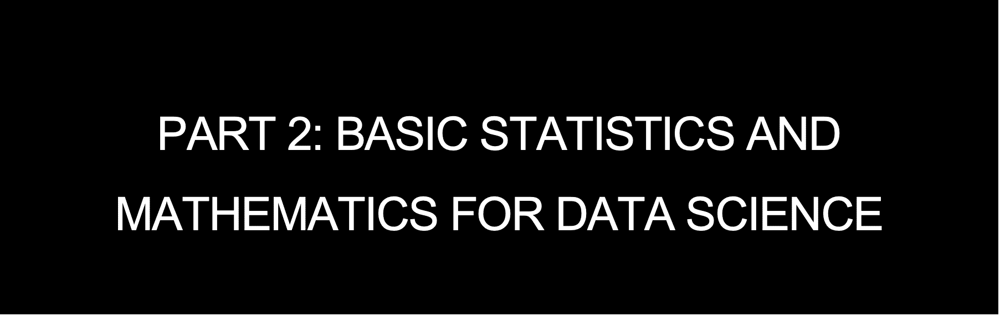

# Chapter 8. Descriptive Statistics

Descriptive statistics is essential for summarizing and understanding data, providing foundational insights before deeper analysis. This chapter begins with an introduction to statistics, distinguishing between descriptive and inferential statistics and their applications. Key measures of central tendency—mean, median, and mode—are explored, along with measures of dispersion such as variance, standard deviation, and range. The chapter also covers percentiles and quartiles, helping to interpret data distribution. Additionally, it examines normal and skewed distributions, explaining when each applies. Finally, a hands-on section demonstrates how to perform descriptive statistics using Python libraries like pandas and NumPy, equipping readers with practical skills for real-world data analysis.

## 8.1 Introduction to Statistics


统计学是数学的一个分支，处理数据的收集、组织、分析、解释和呈现。它提供工具和方法来理解数据、识别模式并得出有意义的结论。本质上，统计学是从数据中学习并在不确定性下做出决策的科学。

## 统计类型
统计学大致分为描述性统计和推断性统计。两者在数据分析中各有不同的用途。

### 8.1.1 描述性统计
描述性统计以描述其主要特征的方式对数据进行汇总和组织。这些技术对数据提供了广泛的概述，有助于更好地理解其特征。

描述性统计中的关键概念：
描述性统计中包含的关键概念是集中趋势度量、离散趋势度量和可视化工具，因为描述性统计通常用于汇总和组织数据以突出其主要特征。

集中趋势度量描述数据集的中心。均值只是平均值：它是所有数据点的总和除以点的数量。例如，对于数据集 \[2, 4, 6\]，均值为 (2+4+6)/3 = 4。中位数表示数据排序后的中间值。例如，\[1, 3, 5\] 的中位数是 3。众数是最常见的值，例如 \[1, 2, 2, 3\] 中的 2。

离散趋势度量提供关于数据分布或变异性的信息。范围是指最大值和最小值之间的差值。例如，在列表 \[3, 7, 10\] 中，范围是 10 - 3 = 7。方差是衡量数据点与均值偏离程度的指标；另一方面，标准差只是方差的平方根，表示数据点与均值平均相距多远。

最后，直方图、条形图和散点图等可视化工具是描述性统计的典型特征——使感知模式和分布变得容易得多。它们对数据中的主要特征提供了简洁的概述。

描述性统计示例：
如果一个班级学生在测试中的成绩为 \[70, 85, 90, 75, 80\]：
均值：(70 + 85 + 90 + 75 + 80)/5 = 80
中位数：80（排序后的中间值）
范围：90 - 70 = 20

### 8.1.2 推断性统计
推断性统计涉及基于样本数据对总体做出预测、决策或推断。它使用概率论来概括研究结果并评估某些结果的可能性。

推断性统计中的关键概念：
推断性统计中的关键概念包括总体与样本、假设检验、置信区间、p 值和回归分析。总体是指正在研究的整个群体，例如城市的所有居民。相比之下，样本是用于分析的总体子集。例如，对整个城市人口中的 500 名居民进行调查就提供了样本。

假设检验确定是否有足够的证据接受或拒绝一个假设。例如，研究人员可能会测试新药是否比现有药物更有效。置信区间提供了一系列值来估计真实的总体参数。例如，“学生的平均身高在 5.5 到 6.0 英尺之间，置信度为 95%。”

p 值衡量在零假设为真的前提下，观察到像当前数据一样极端结果的概率。回归分析研究变量之间的关系，可用于预测，例如根据面积和位置等因素估计房价。这些概念构成了推断性统计的基础，使研究人员能够从数据中得出有意义的结论。

推断性统计示例：
一家公司对 10,000 人的人口中的 1,000 名客户进行调查以确定客户满意度。基于样本，他们推断 80% 的客户感到满意。

### 8.1.3 描述性统计与推断性统计的比较

| 方面 || 描述性统计 || 推断性统计 |
| --- | --- | --- |
| 目的 || 汇总数据。 || 基于样本对总体得出结论。 |
| 关注点 || 整个数据集（例如，均值、中位数）。 || 预测和假设。 |
| 方法 || 均值、中位数、众数、范围、标准差。 || 置信区间、p 值、回归分析。 |
| 示例 || 班级学生的平均身高。 || 预测学校所有学生的平均身高。 |

### 为什么学习统计学？
统计学在各个领域至关重要，包括：
• 商业：分析销售数据以改进策略。
• 医学：测试新治疗方法的效果。
• 社会科学：进行调查和民意测验。
• 体育：评估球员表现和团队策略。

总之，统计学弥合了数据与决策之间的差距。虽然描述性统计汇总并帮助理解数据，但推断性统计允许对总体做出预测和推断。掌握这两种统计类型是高效分析和解释数据的基石。

# 8.2 均值、中位数、众数
均值、中位数和众数是代表数据集集中趋势或“平均值”的统计度量。它们通过识别数据分布周围的中心点来汇总数据集。

## 8.2.1 均值
均值通常被称为平均值，是通过将数据集中所有值的总和除以值的总数来计算的。

公式：均值 = 所有值的总和 / 值的总数

示例：考虑数据集：\[2,4,6,8,10\]
• 值之和：2+4+6+8+10=30
• 值的数量：5
• 均值：30 / 5 =6

何时使用：当数据均匀分布且没有极端异常值时，均值很有用，因为它对异常值敏感。

异常值示例：数据集：\[2,4,6,8,100\]
均值：(2+4+6+8+100) / 5 = 24 这里，异常值（100）显著扭曲了均值，使其对集中趋势的代表性降低。

## 8.2.2 中位数
中位数是排序后数据集中的中间值。如果数据集的值数为奇数，则中位数是确切的中间值。如果数据集的值数为偶数，则中位数是两个中间值的平均值。

计算步骤：
• 按升序对数据集进行排序。
• 确定中间值。

示例：
数据集（奇数个值）：\[1,3,5,7,9\]
• 排序后：\[1,3,5,7,9\]
• 中位数：5（中间值）

数据集（偶数个值）：\[1,3,5,7\]
• 排序后：\[1,3,5,7\]
• 中位数：(3 + 5)/2 = 4

何时使用：当数据集包含异常值时，优先使用中位数，因为它受极端值的影响较小。

异常值示例：数据集：\[2,4,6,8,100\]
中位数：6（即使存在异常值也保持代表性）。

## 8.2.3 众数
众数是数据集中出现频率最高的值。数据集可以有：
• 一个众数（单峰）。
• 两个众数（双峰）。
• 多于两个众数（多峰）。
• 如果所有值出现的频率相等，则无众数。

示例：
数据集：\[2,3,4,4,5,6\]
众数：4（出现两次）。

数据集（双峰）：\[1,2,2,3,3,4\]
众数：2 和 3（都出现两次）。

数据集（无众数）：\[1,2,3,4\]
没有值重复，因此没有众数。

何时使用：众数对于分类数据很有用，在这些数据中你想要识别最常见的类别。

分类示例：
数据集：\["Red","Blue","Red","Green"\]
众数："Red"（出现频率最高）。

## 8.2.4 均值、中位数和众数的比较

| 指标 || 定义 || 对异常值的敏感性 || 最佳使用场景 |
| --- | --- | --- | --- |
| 均值 || 所有值的平均值 || 高度敏感 || 当数据均匀分布时 |


# 8.2 均值、中位数和众数

| 中位数 || 排序后数据集中的中间值 || 不敏感 || 当数据包含异常值时 |
| 众数 || 出现频率最高的值 || 不敏感 || 用于分类数据或查找常见值 |

## 比较三者的示例

数据集：\[1, 2, 3, 4, 5\]

• 均值：`(1 + 2 + 3 + 4 + 5) / 5 = 3`
• 中位数：3（中间值）
• 众数：无众数（所有值都只出现一次）

存在异常值的数据集：\[1, 2, 3, 4, 100\]

• 均值：`1 + 2 + 3 + 4 + 100) / 5 = 22`
• 中位数：3（中间值）
• 众数：无众数

总之，均值、中位数和众数是概括数据的[content]
# 8.2 均值、中位数和众数

| 中位数 || 排序后数据集中的中间值 || 不敏感 || 当数据包含异常值时 |
| 众数 || 出现频率最高的值 || 不敏感 || 用于分类数据或查找常见值 |

## 比较三者的示例

数据集：\[1, 2, 3, 4, 5\]

• 均值：`(1 + 2 + 3 + 4 + 5) / 5 = 3`
• 中位数：3（中间值）
• 众数：无众数（所有值都只出现一次）

存在异常值的数据集：\[1, 2, 3, 4, 100\]

• 均值：`1 + 2 + 3 + 4 + 100) / 5 = 22`
• 中位数：3（中间值）
• 众数：无众数

总之，均值、中位数和众数是概括数据的基本工具。均值给出总体平均值，而中位数在存在异常值时更稳健；另一方面，众数识别最频繁的值。适当度量的选择取决于数据集的性质和具体的分析要求。

# 8.3 方差、标准差、极差

方差、标准差和极差是用于描述数据离散程度或变异性的统计度量。它们有助于理解数据点与中心值（均值）的偏离程度。

## 8.3.1 方差

方差衡量数据点与均值的距离。它计算每个数据点与均值的平均平方偏差。

公式：方差（ 2）= ∑ (`xi` \- `µ`)2 / `N`

其中：
`xi` = 个别数据点
`µ` = 数据的均值
`N` = 数据点的数量

示例：数据集：\[2, 4, 6, 8, 10\]

• 均值：`µ=(2 + 4 + 6 + 8 + 10) / 5 = 6`
• 偏差：`((2 - 6) 2, (4 - 6) 2, (6 – 6) 2, (8 – 6) 2, (10 – 6) 2 = 16, 4, 0, 4, 16`
• 方差：`(16 + 4 + 0 + 4 + 16) / 5 = 8`

使用时：
• 用于量化数据集的离散程度。
• 方差很有用但不易直接解释，因为它处于平方单位。

## 8.3.2 标准差

标准差是方差的平方根。它表示每个数据点与均值的平均距离，并以与数据相同的单位表示。

公式：标准差（`σ`）= 

示例：使用相同的数据集 \[2, 4, 6, 8, 10\]：

• 方差：8
• 标准差：=2.83

解释：
• 较低的标准差表示数据点更接近均值（变异性较小）。
• 较高的标准差表示数据点更分散。

使用时：标准差因使用与数据相同的单位而更易解释，因此优于方差。

## 8.3.3 极差

极差是最简单的离散度量，表示数据集中最大值与最小值之间的差异。

公式：极差=最大值−最小值

示例：数据集：\[2, 4 ,6, 8, 10\]

• 最大值：10
• 最小值：2
• 极差：`10−2=8`

使用时：极差有助于理解变异性的范围，但不提供数据在极值之间分布的信息。

## 8.3.4 方差、标准差和极差的比较

| 度量 || 定义 || 单位 || 最佳使用场景 |
| --- | --- | --- | --- |
| 方差 || 与均值的平方偏差的平均值 || 数据的平方单位 || 理解数据集的总体变异性 |
| 标准差 || 方差的平方根 || 与数据单位相同 || 数据集变异性的可解释度量 |
| 极差 || 最大值与最小值之间的差异 || 与数据单位相同 || 快速评估离散程度 |

### 比较三者的示例

数据集：\[1,2,3,4,5\]

均值：3

方差：
• 偏差：`(1−3)2 ,(2−3)2 ,(3−3)2 ,(4−3)2 ,(5−3)2 = 4, 1, 0, 1, 4`
• 方差：`(4 + 1 + 0 + 1 + 4) / 5=2`

标准差：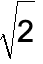= 1.41

极差：`5 – 1 = 4`

存在异常值的数据集：\[1, 2 , 3, 4, 50\]

均值：12

方差：
• 偏差：`(1−12)2, (2−12)2, (3−12)2 ,(4−12)2, (50−12)2 =121, 100, 81, 64, 1444`
• 方差：`(121 + 100 + 81 + 64 + 1444) / 5 = 362`

标准差：=19.03

极差：`50 – 1 = 49`

### 关键见解

• 方差和标准差提供了变异性的详细视图，但由于其平方单位，方差更难解释。
• 极差是一个快速简单的度量，但不考虑分布或异常值。
• 标准差因其可解释性和稳健性而最常用。

通过理解这些度量，您可以更有效地评估数据的离散程度和变异性，有助于更好的数据分析和决策。

# 8.4 百分位数和四分位数

百分位数和四分位数是描述数据点在数据集内相对位置的统计度量。它们通过将数据划分为部分或识别特定阈值来帮助理解数据分布。

## 8.4.1 百分位数

百分位数是一个度量，表示数据集中有给定百分比的观测值落在该值以下。例如，第 75 百分位数表示 75%的数据点低于此值。

公式：百分位秩计算为：`Pk` = (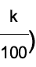 x (`n` + 1)

其中：
• `k`：期望的百分位数（例如，25、50、75）。
• `n`：数据点的总数。

示例：

数据集：\[1,3,5,7,9,11\]

求第 50 百分位数（中位数）：
• 排序数据：\[1,3,5,7,9,11\]
• 位置 = `(50/100)×(6+1)=3.5`
• 第 50 百分位数位于第 3 和第 4 值之间：`P50 = (5 + 7) / 2 = 6`

用例：百分位数常用于标准化测试，例如 SAT，其中第 90 百分位的成绩意味着考生成绩高于 90%的其他人。

## 8.4.2 四分位数

四分位数将数据集分为四个相等部分，每个部分代表数据的 25%。它们是特定百分位数：
• Q1（第一四分位数）：第 25 百分位数。
• Q2（第二四分位数/中位数）：第 50 百分位数。
• Q3（第三四分位数）：第 75 百分位数。

计算四分位数的步骤：
• 排序数据。
• 识别 Q1、Q2（中位数）和 Q3。

示例：

数据集：\[4,7,10,15,18,20,22,25\]

• 排序数据（已排序）。
• Q2（中位数）：`Q2 = (15+18) / 2 =16.5`
• Q1（第 25 百分位数）：数据的前半部分：\[4,7,10,15\] 中位数：`(7+10)/2=8.5`
• Q3（第 75 百分位数）：数据的后半部分：\[18,20,22,25\] 中位数：`(20+22)/2=21`

结果：
• Q1:8.5
• Q2:16.5
• Q3:21

### 四分位距（IQR）

四分位距（IQR）衡量中间 50%数据的离散程度。计算方法为：`IQR=Q3−Q1`

示例：

来自前一个数据集：
• Q3 = 21, Q1 = 8.5
• IQR = `21 − 8.5 = 12.5`

用途：IQR 有助于识别异常值。位于 `Q1−1.5 × IQR` 或 `Q3 + 1.5 × IQR` 之外的点被视为异常值。

## 8.4.3 百分位数和四分位数的比较

| 度量 || 定义 || 示例 |
| --- | --- | --- |
| 百分位数 || 数据中低于该百分比的值 || 第 90 百分位数：数据的前 10% |
| 四分位数 || 将数据分为四个相等部分（Q1、Q2、Q3、Q4） || Q2（中位数）：数据集的中间值 |

## 8.4.4 应用

百分位数：
• 标准化测试（例如，GRE、SAT）。
• 健康指标（例如，按年龄划分的 BMI 百分位数）。

四分位数：
• 分析收入分布（例如，Q1 = 低收入群体，Q3 = 高收入群体）。
• 在箱线图中概括数据变异性。

总之，百分位数和四分位数为数据分布提供了有价值的见解，使分析人员能够识别阈值和模式。它们是理解相对位置、变异性和数据在教育、医疗保健和商业分析等各个领域中的离散程度的重要工具。


# 8.5 数据分布（正态，偏态）

数据分布是指数据集中的数据值是如何分布或排列的。理解分布类型对于统计分析至关重要，有助于确定适当的统计检验和模型。

## 8.5.1 正态分布

正态分布，也称为高斯分布，是统计学中最常用的数据分布。它是对称的并遵循钟形曲线。

### 关键特征

• 对称性：分布围绕均值完全对称。
• `Mean = Median = Mode`：三个集中趋势度量相等且位于分布中心。
• 形状：钟形曲线，尾部向两个方向无限延伸。
• 经验法则（68-95-99.7 法则）：
  * 68% 的数据落在均值的 1 个标准差范围内。
  * 95% 的数据落在 2 个标准差范围内。
  * 99.7% 的数据落在 3 个标准差范围内。

### 示例

• 人口中成人的身高。
• 标准化考试的考试成绩（例如，SAT、智商测试）。

### 可视化表示
对称曲线，其中最高点对应均值，随着远离均值概率递减。

## 8.5.2 偏态分布

偏态分布是不对称的，数据值更集中在均值的一侧。偏度表示不对称的方向和程度。

### 偏态分布的类型

#### 正偏态（右偏态）

• 右侧尾部：右侧尾部（较大值）比左侧尾部更长。
• `Mean > Median > Mode`：均值被拉向较大值。
• 示例：收入分布（大多数人收入低于均值，少数人收入高得多）。
• 可视化表示：左侧峰值，右侧延伸出长尾的曲线。

#### 负偏态（左偏态）

• 左侧尾部：左侧尾部（较小值）比右侧尾部更长。
• `Mean < Median < Mode`：均值被拉向较小值。
• 示例：退休年龄（大多数人退休年龄较大，少数人提前退休）。
• 可视化表示：右侧峰值，左侧延伸出长尾的曲线。

## 8.5.3 正态分布与偏态分布的比较

| 方面 || 正态分布 || 偏态分布 |
| --- | --- | --- |
| 对称性 || 完全对称 || 非对称 |
| 均值、中位数、众数 || 全部相等 || 均值、中位数和众数不同 |
| 尾部 || 两侧相等 || 一侧尾部更长 |
| 示例 || 身高、考试成绩 || 收入（正偏）、退休年龄（负偏） |

## 8.5.4 何时使用正态或偏态分布

**正态分布：**
• 适用于许多自然现象（例如，身高、体重）。
• 常用于假设检验、置信区间和回归分析。

**偏态分布：**
• 表示存在异常值或数据分布不均匀。
• 需要转换（例如，对数）以用于假设正态性的统计检验。

总之，了解数据集是否遵循正态或偏态分布对于选择适当的统计方法至关重要。正态分布由于其成熟的特性简化了许多分析，而偏态分布则提供了有关数据不对称性和潜在异常值的有价值见解，有助于更深入地理解数据集。

# 8.6 实战：使用 Python（pandas、NumPy）进行描述性统计

描述性统计总结并描述数据集的主要特征。它们包括均值、中位数、标准差等度量，以及直方图和箱线图等可视化工具。Python 库如 `pandas` 和 `NumPy` 对于执行描述性统计分析至关重要。以下是实战细节。

## 导入所需库

首先导入数据操作和计算所需的库。

```python
import pandas as pd
import numpy as np
```

## 创建和加载数据

示例数据集：您可以为练习创建小型数据集或从文件加载数据。

```python
data = {
    'Name': ['Alice', 'Bob', 'Charlie', 'David', 'Eve'],
    'Age': [25, 30, 35, 40, 28],
    'Salary': [50000, 60000, 75000, 80000, 58000],
    'Department': ['HR', 'IT', 'Finance', 'IT', 'HR']
}
df = pd.DataFrame(data)
print(df)
```

输出：
Name  Age  Salary Department
0    Alice   25   50000        HR
1      Bob   30   60000        IT
2  Charlie   35   75000    Finance
3    David   40   80000        IT
4      Eve   28   58000        HR

## 基本描述性统计

### 使用 pandas

汇总统计：

```python
print(df.describe())
```

输出：
Age        Salary
count   5.000000     5.000000
mean   31.600000  64600.000000
std     6.579049  11662.277660
min    25.000000  50000.000000
25%    28.000000  58000.000000
50%    30.000000  60000.000000
75%    35.000000  75000.000000
max    40.000000  80000.000000

具体度量：
均值：
```python
print(df['Salary'].mean())  # Output: 64600.0
```
中位数：
```python
print(df['Salary'].median())  # Output: 60000.0
```
标准差：
```python
print(df['Salary'].std())  # Output: 11662.27766016838
```
众数：
```python
print(df['Department'].mode())  # Output: IT
```

### 使用 NumPy

对于数值计算，`NumPy` 提供高效的方法：

```python
salaries = df['Salary'].values
# Mean
print(np.mean(salaries))  # Output: 64600.0
# Median
print(np.median(salaries))  # Output: 60000.0
# Standard Deviation
print(np.std(salaries))  # Output: 11016.68311293057
```

## 百分位数和四分位数

百分位数和四分位数将数据集划分为若干部分以更好地理解数据分布。

使用 `NumPy`：

```python
# 25th and 75th Percentiles
print(np.percentile(salaries, 25))  # Output: 58000.0
print(np.percentile(salaries, 75))  # Output: 75000.0
# Interquartile Range (IQR)
iqr = np.percentile(salaries, 75) - np.percentile(salaries, 25)
print(iqr)  # Output: 17000.0
```

## 分组描述性统计

使用 pandas `GroupBy`：

```python
grouped = df.groupby('Department')['Salary'].mean()
print(grouped)
```

输出：
Department
Finance    75000.0
HR         54000.0
IT         70000.0
Name: Salary, dtype: float64

多个聚合：

```python
agg_stats = df.groupby('Department').agg({
    'Salary': ['mean', 'median', 'std']
})
print(agg_stats)
```

输出：
Salary
mean   median           std
Department
Finance  75000.0  75000.0           NaN
HR       54000.0  54000.0   5656.854249
IT       70000.0  70000.0  14142.135624

## 可视化描述性统计

### 直方图

```python
import matplotlib.pyplot as plt
df['Salary'].plot(kind='hist', bins=5, title='Salary Distribution')
plt.xlabel('Salary')
plt.show()
```

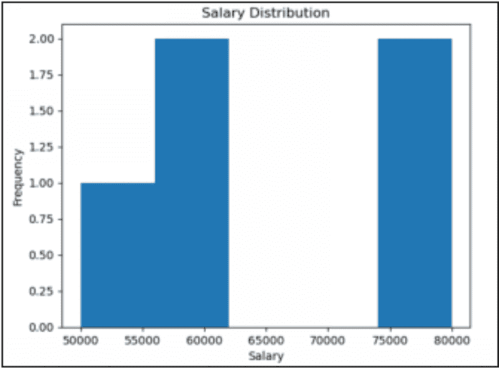

### 箱线图

```python
df.boxplot(column='Salary', by='Department')
plt.title('Salary by Department')
plt.suptitle('')  # Removes default title
plt.xlabel('Department')
plt.ylabel('Salary')
plt.show()
```

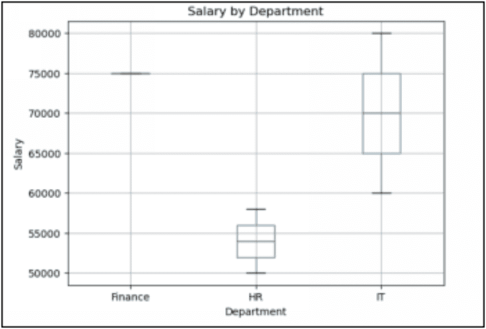

## 处理缺失值

真实数据集通常包含缺失值。您可以使用 `pandas` 管理它们。

### 示例数据（`data.csv`）

```
Name,Age,Department,Salary
Alice,25,IT,50000
Bob,30,HR,45000
Charlie,,Finance,60000
David,35,IT,
Eve,40,Finance,70000
Frank,,HR,55000
Grace,28,IT,48000
```

### 加载数据

```python
import pandas as pd
# Load the sample data
df = pd.read_csv('data.csv')
print("Original Data:")
print(df)
```

输出：
Name Age Department Salary
Alice 25.0 IT 50000.0
Bob 30.0 HR 45000.0
Charlie NaN Finance 60000.0
David 35.0 IT NaN
Eve 40.0 Finance 70000.0
Frank NaN HR 55000.0
Grace 28.0 IT 48000.0

### 检查缺失值

```python
# Check for missing values
print("\nMissing Values Count:")
print(df.isnull().sum())
```

输出：


## 缺失值计数

姓名 0
年龄 2
部门 0
薪资 1
dtype: int64

## 填充缺失值

• 用平均薪资填充缺失的 `Salary` 值。
• 用中位年龄填充缺失的 `Age` 值。

```
# Fill missing 'Salary' with mean
df['Salary'].fillna(df['Salary'].mean())

# Fill missing 'Age' with median
df['Age'] = df['Age'].fillna(df['Age'].median())

print("\nData After Filling Missing Values:")
print(df)
```

输出：

填充缺失值后数据：

姓名 年龄 部门 薪资
0 Alice 25.0 IT 50000.000000
1 Bob 30.0 HR 45000.000000
2 Charlie 30.0 Finance 60000.000000
3 David 35.0 IT 54666.666667
4 Eve 40.0 Finance 70000.000000
5 Frank 30.0 HR 55000.000000
6 Grace 28.0 IT 48000.000000Grace​28.0​IT​48000.0

## 删除缺失值的行

如果你更喜欢删除缺失值的行而不是填充它们：

```
# Drop rows with missing values
df_dropped = df.dropna()

print("\nData After Dropping Rows with Missing Values:")
print(df_dropped)
```

输出：

姓名​年龄​部门​薪资
Alice​25.0​IT​50000.0
Bob​30.0​HR​45000.0
Eve​40.0​Finance​70000.0
Grace​28.0​IT​48000.0

### 描述性统计的最佳实践

探索数据集：使用 `df.head()`、`df.info()` 和 `df.describe()` 来了解数据集的结构和关键统计信息。

处理异常值：使用箱线图或 IQR 来识别和处理异常值。

可视化数据：用可视化工具补充数值分析，以识别模式和趋势。

使用分组聚合：利用 `groupby()` 和 `agg()` 为数据的子集计算统计信息。

总结来说，使用 `pandas` 和 `NumPy`，Python 中的描述性统计提供了一种直观高效的方式来汇总和分析大型数据集。这些工具有助于揭示趋势、模式和异常值，这对于更深入的统计分析和明智的决策至关重要。加入可视化进一步增强了这些见解的清晰度和传达效果。

## 8.7 章节复习问题

Question 1:

下列哪一项是描述性统计的重点？

A. 基于数据进行预测
B. 汇总和描述数据
C. 基于样本数据得出结论
D. 检验假设

Question 2:

哪种类型的统计涉及基于样本数据对总体得出结论？

A. 描述性统计
B. 推断性统计
C. 应用统计
D. 探索性统计

Question 3:

下列哪一项度量用于表示数据的集中趋势？

A. 方差
B. 均值
C. 极差
D. 标准差

Question 4:

数据集 {4, 8, 6, 10} 的均值是多少？

A. 6
B. 7
C. 8
D. 9

Question 5:

数据集 {3, 9, 7, 5, 11} 的中位数是多少？

A. 5
B. 7
C. 9
D. 11

Question 6:

如果一个数据集有两个值出现频率最高，它被称为什么？

A. 单峰
B. 双峰
C. 多峰
D. 无峰

Question 7:

哪项度量描述数据围绕均值的离散程度？

A. 均值
B. 中位数
C. 方差
D. 众数

Question 8:

数据集 {5, 10, 15, 20} 的极差是多少？

A. 5
B. 10
C. 15
D. 20

Question 9:

下列关于标准差的说法哪个是正确的？

A. 它衡量数据集的中心值
B. 它是方差的平方根
C. 它总是大于方差
D. 它不受异常值影响

Question 10:

下列哪项陈述最能定义百分位数？

A. 将数据集分为 100 个相等部分的值
B. 将数据集分为 4 个相等部分的值
C. 数据集的平均值
D. 数据集中出现频率最高的值

Question 11:

数据集的第 50 百分位数相当于什么？

A. 均值
B. 中位数
C. 众数
D. 极差

Question 12:

下列哪一项代表第一四分位数（Q1）？

A. 数据集的最小值
B. 数据集的第 25 百分位数
C. 数据集的中位数
D. 数据集的第 75 百分位数

Question 13:

正态分布曲线的形状是什么？

A. 对称且呈钟形
B. 左偏
C. 右偏
D. U 形

Question 14:

数据分布中的正偏态表示什么？

A. 分布的尾部在右侧更长
B. 分布的尾部在左侧更长
C. 数据是对称的
D. 均值等于中位数

Question 15:

下列哪项度量最受数据集中异常值的影响？

A. 均值
B. 中位数
C. 众数
D. 极差

Question 16:

如果数据集遵循正态分布，以下哪项是正确的？

A. 均值 = 中位数 = 众数
B. 均值 > 中位数 > 众数
C. 均值 < 中位数 < 众数
D. 均值和众数相等，但中位数不相等

Question 17:

下列哪一项最能描述方差？

A. 最大值和最小值之间的差
B. 与均值偏差平方的平均值
C. 标准差的平方根
D. 出现频率最高的值

Question 18:

四分位数在数据集中的目的是什么？

A. 将数据分为两等份
B. 将数据分为四等份
C. 衡量集中趋势
D. 确定最频繁的值

Question 19:

当数据围绕均值均匀分布时使用哪种分布？

A. 偏态分布
B. 正态分布
C. 均匀分布
D. 二项分布

Question 20:

在什么情况下应使用偏态分布而不是正态分布？

A. 当数据是对称的
B. 当数据有显著异常值时
C. 当均值等于中位数时
D. 当标准差为零时

## 8.8 章节复习问题答案

1. B. 汇总和描述数据
Explanation: 描述性统计专注于汇总和描述数据集的主要特征，而不进行预测或推断。

2. B. 推断性统计
Explanation: 推断性统计涉及通过估计和假设检验基于样本数据对总体得出结论。

3. B. 均值
Explanation: 均值，也称为平均值，是一种集中趋势度量，用于用单一代表值汇总数据集。

4. B. 7
Explanation: 均值计算为所有值的总和除以值的数量：
`(4+8+6+10)/4=28/4=7`

5. B. 7
Explanation: 中位数是排序后数据集的中间值。对于 {3, 5, 7, 9, 11}，中位数是 7。

6. B. 双峰
Explanation: 当数据集有两个不同的值具有最高频率时，它是双峰的。

7. C. 方差
Explanation: 方差衡量数据点与均值的离散程度，是数据变异性的关键指标。

8. C. 15
Explanation: 极差是最大值和最小值之间的差：
`(20−5)=15`

9. B. 它是方差的平方根
Explanation: 标准差是方差的平方根，并提供数据围绕均值离散程度的度量。

10. A. 将数据集分为 100 个相等部分的值
Explanation: 百分位数将数据集分为 100 个相等部分，每个百分位数代表数据的 1%。

11. B. 中位数
Explanation: 第 50 百分位数代表中位数，它将数据集分为两等份。

12. B. 数据集的第 25 百分位数
Explanation: 第一四分位数（Q1）是第 25 百分位数，表示 25% 的数据位于该值以下。

13. A. 对称且呈钟形
Explanation: 正态分布是对称的，具有特征性的钟形曲线。

14. A. 分布的尾部在右侧更长
Explanation: 正偏态表示分布的尾部向右延伸比向左更长。

15. A. 均值
Explanation: 均值受异常值影响最大，因为它考虑数据集中每个值，包括极端值。

16. A. 均值 = 中位数 = 众数


解释：在完全正态分布中，`mean`、`median` 和 `mode` 相等。

17. B. 来自 `mean` 的平方偏差的平均值

解释：方差是通过对每个数据点与 `mean` 之间的平方差取平均值来计算的。

18. B. 将数据分成四等份

解释：四分位数将数据集分成四等份以了解数据的分布。

19. B. 正态分布

解释：在正态分布中，数据围绕 `mean` 均匀分布，形成对称的钟形曲线。

20. B. 当数据存在显著异常值时

解释：当数据不对称且包含异常值时，使用偏态分布，这使得正态分布不合适。

# 第 9 章 推断统计

推断统计是数据分析的一个基本方面，使我们能够基于样本数据对总体得出结论。本章探讨推断统计的关键概念、其在数据科学中的作用以及实际应用。它介绍了概率论，涵盖其类型、规则以及在数据驱动决策中的意义。本章还解释了假设检验和 `p-values`，对于验证统计声明至关重要，以及不同类型的假设检验。置信区间用于衡量估计的可靠性，并讨论了相关性与因果关系之间的关键区别。最后，本章包括一个使用 Python 的 `SciPy` 进行统计检验的实践部分，提供将这些概念应用于现实世界数据的实践经验。

## 9.1 什么是推断统计

推断统计是统计学的一个分支，使我们能够基于样本数据对整个总体做出预测、决策或推断。它利用概率论来得出结论并评估特定结果的可能性。在数据科学中，推断统计通过促进假设检验、估计总体参数并指导数据驱动的决策发挥着关键作用。

### 9.1.1 推断统计中的关键概念

总体与样本：总体是指正在研究的整个群体，例如一家公司的所有客户，而样本是用于分析的总体子集，例如调查 1,000 名客户。

假设检验：假设检验是对关于总体的假设是否得到样本数据支持进行评估的结构化过程，例如，检验新的营销策略是否与当前策略相比增加了销售额。

置信区间：置信区间提供一个数值范围，用以在指定的置信水平下估计总体参数；例如，说明客户的平均月支出估计在 $200 到 $300 之间，置信度为 95%。

P 值：`p-value` 衡量在原假设下观察到的结果偶然发生的概率；例如，`p-value` 为 0.03 表示结果随机发生的概率为 3%。

回归分析：回归分析检查变量之间的关系，以便基于另一个变量预测一个变量，例如使用大小、位置和卧室数量等特征预测房价。

### 9.1.2 数据科学中推断统计的示例

场景：一家公司想要确定提供折扣是否会增加客户购买量。

该过程首先定义假设。原假设 (`H₀`) 指出折扣不影响购买，而备择假设 (`H₁`) 表明折扣会增加购买。

接下来，通过调查 500 名客户收集样本——250 名收到折扣和 250 名未收到折扣。通过计算每个组的平均购买金额并使用统计检验，例如 `t-test`，来比较均值，对数据进行分析。

然后对结果进行解释。如果检验得到的 `p-value` 小于 0.05，则拒绝原假设，得出折扣显著增加购买的结论。

最后，将研究结果应用于优化公司未来活动的折扣策略，确保以数据驱动的方式提高客户参与度和销售额。

### 9.1.3 推断统计在数据科学中的重要性

决策通过使用数据得到显著增强，使决策基于证据而非假设。概括性进一步使从样本得出的见解能够应用于整个总体，使研究结果更具普遍适用性。推断统计在建模中也发挥着至关重要的作用，因为它们支持构建预测模型以理解关系并预测结果。此外，通过置信区间和 `p-values` 等工具提供了不确定性量化，有助于评估结果的可靠性和显著性，确保结论稳健可信。

总之，推断统计确实是数据科学中的一种强大工具，有助于从样本数据中得出有用的结论并预测总体的特征。无论是通过假设检验、置信区间还是回归分析，它都是数据驱动决策的支柱，使组织能够获得可操作的见解并有效优化策略。

## 9.2 概率介绍

概率是数据科学中的一个基本概念，用于量化事件发生的可能性。它是进行预测、识别模式和从数据中得出结论的基础。在数据科学中，概率广泛应用于机器学习、统计建模和推断统计。

### 9.2.1 什么是概率？

概率衡量事件发生的机会或可能性，并表示为 0 到 1 之间的值：

• 0：事件不可能发生。
• 1：事件必然发生。

公式：`P(E)=` 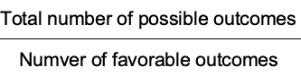

示例：如果抛一枚公平硬币，正面朝上的概率：`P(Heads) = 1/2 = 0.5`

#### 概率中的关键术语

实验：具有不确定结果的过程或动作。示例：掷骰子。

结果：实验的单一结果。示例：在骰子上掷出 4。

事件：一个或多个结果的集合。示例：在骰子上掷出偶数（2,4,6）。

样本空间：所有可能结果的集合。示例：对于掷骰子，样本空间为 {1,2,3,4,5,6}。

### 9.2.2 概率的类型

古典概率：基于等可能的结果。示例：掷骰子掷出 6 的概率为 `P(6) = 1/6`

经验概率：基于观察数据或实验。示例：如果掷骰子 100 次，其中 18 次掷出 6，则 `P(6) = 18 / 100 = 0.18`

主观概率：基于个人判断或经验。示例：股票分析师估计价格上涨的概率。

### 9.2.3 概率规则

加法规则：

• 对于互斥事件（A 和 B）：`P(A∪B) = P(A) + P(B)`
• 示例：在骰子上掷出 2 或 4：`P(2 or 4) = P(2) + P(4) = 1/6 + 1/6 = 2/6`

乘法规则：

• 对于独立事件（A 和 B）：`P(A∩B) = P(A) × P(B)`
• 示例：抛两枚硬币两枚都正面朝上：`P(Heads and Heads) = P(Heads) × P(Heads) = 0.5 × 0.5 = 0.25`

补集规则：

• 事件不发生的概率：`P(A′) = 1 − P(A)`
• 示例：骰子上不掷出 6 的概率：`P(Not 6) = 1 − P(6) = 1 − (1/6) = 5/6`

### 9.2.4 数据科学中的概率


在数据科学中，概率在分析不确定性、做出预测和支持决策方面发挥着至关重要的作用。一个关键应用是预测建模，其中概率被用来构建模型以预测特定结果的可能性，例如估计客户流失的概率。贝叶斯推断是另一个重要应用，利用贝叶斯定理根据新证据更新假设的概率，例如根据用户的过去购买记录向用户推荐产品。

概率还支撑着许多机器学习算法，包括朴素贝叶斯和逻辑回归，使诸如垃圾邮件过滤器等应用能够计算电子邮件为垃圾邮件的概率。此外，假设检验利用概率来评估检验结果的显著性，例如确定新产品是否导致销售额增加。这些应用展示了概率如何作为数据科学中的基础工具来推动洞察和决策。

## 9.2.5 示例：现实世界场景中的概率

场景：某公司希望分析客户行为并计算客户在访问其网站后进行购买的概率。

过程始于通过跟踪网站访客数量以及其中进行购买的人的比例来收集数据。例如，如果有 1,000 人访问网站，其中 200 人进行购买，则购买的概率计算为 `P(Purchase)=200/1000=0.2P(Purchase) = 200 / 1000 = 0.2P(Purchase)=200/1000=0.2`。此概率随后可用于决策，以评估营销策略的有效性或改进网站设计，旨在提高转化率。

换句话说，概率构成了数据科学的基础，并提供了一种理解和量化不确定性的手段。它使数据科学家能够分析数据并做出明智的预测，范围从预测建模和机器学习到假设检验和决策。毫无疑问，正是对概率概念的掌握才能使人充分发挥数据驱动洞察的全部潜力。

# 9.3 假设检验与 p 值

假设检验是一种统计技术，用于确定数据集中是否存在足够的证据来支持或拒绝关于总体参数的特定主张或假设。它在数据驱动的决策中发挥着至关重要的作用，并广泛应用于数据科学、机器学习和商业分析中，以验证假设并根据数据洞察指导行动。

## 9.3.1 什么是假设检验？

假设检验是一种系统方法，用于根据样本数据评估关于总体的两个竞争性主张。这些主张定义如下：

原假设 (`𝐻₀`)：原假设代表默认假设或现状。它通常表明没有效应或没有差异。例如，“一种新药对血压没有影响。”

备择假设 (`𝐻₁`)：备择假设代表我们旨在检验或支持的主张。它通常表明存在效应或差异。例如，“一种新药降低血压。”

假设检验的主要目标是评估样本数据是否提供了足够的证据来拒绝原假设 (`𝐻₀`) 而支持备择假设 (`𝐻₁`)。这一过程有助于对所研究的总体做出明智的结论。

### 假设检验的步骤

定义假设：
• 原假设 (`𝐻0`)：默认假设。
• 备择假设 (`𝐻1`)：你想要检验的主张。

选择显著性水平 (`𝛼`)：拒绝 `𝐻0` 的阈值概率，通常为 0.05（5%）。

收集数据：收集与假设相关的样本数据。

选择检验统计量：根据数据和假设，选择统计检验（例如，t 检验、z 检验、卡方检验）。

计算 p 值：如果 `𝐻0` 为真，计算观察到样本数据的概率。

做出决策：将 p 值与 `𝛼` 进行比较：
• 如果 `𝑝 ≤ 𝛼`，拒绝 `𝐻0`（对 `𝐻1` 有足够证据）
• 如果 `𝑝 > 𝛼`，不拒绝 `𝐻0`（对 `𝐻1` 证据不足）

## 9.3.2 什么是 p 值？

p 值是一个统计度量，用于量化反对原假设 (`𝐻0`) 的证据强度。它表示在假设 (`𝐻0`) 为真的情况下，观察到样本数据或更极端结果的概率。

### p 值的解释：

低 p 值（≤α）：
• 低 p 值提供了反对 H0 的强有力证据，导致其被拒绝。
• 示例：如果 `p = 0.02`（小于显著性水平 `α=0.05`），它表明如果 `H0` 为真，样本数据不太可能出现。

高 p 值（>α）：
• 高 p 值表明没有足够证据拒绝 H0
• 示例：如果 `p = 0.08`，它表明数据与 H0 一致，没有令人信服的理由拒绝它。

## 9.3.3 假设检验示例

场景：某公司声称其新网站设计相比旧设计降低了跳出率。旧设计的平均跳出率为 50%。

步骤：
定义假设：
`H0`：新设计的跳出率为 50%（`μ=0.50`）。
`H1`：新设计的跳出率小于 50%（`μ<0.50`）。

收集数据：样本量：100 名网站访客。观察到的跳出率：45%。

选择检验：使用单样本 t 检验比较样本均值与总体均值。

计算检验统计量和 p 值：使用统计软件或 Python 计算 t 统计量和相应的 p 值。

决策：如果 `p≤0.05`，拒绝 `H0`。新设计显著降低了跳出率。

## 9.3.4 常见的假设检验类型

`t-Test`：比较两组均值（例如，对照组与处理组）。示例：检验培训计划是否提高员工绩效。

`z-Test`：用于大样本量比较均值或比例。示例：比较支持两位候选人的选民比例。

`Chi-Square Test`：检验分类变量的独立性。示例：检查性别与产品偏好是否相关。

`ANOVA`（方差分析）：比较三个或以上组的均值。示例：检验不同营销策略的有效性。

## 9.3.5 假设检验在数据科学中的重要性

假设检验是利用数据驱动明智商业决策的关键组成部分。它使公司和研究人员能够做出基于数据的选择，而不是依赖假设，为决策过程提供更坚实的基础。此外，假设检验在模型验证中不可或缺，因为它通过评估其假设的有效性来确保机器学习模型的可靠性。

假设检验的另一个关键好处是其揭示变量之间关系的能力。例如，企业可以使用假设检验来调查销售额与广告支出之间的联系，使其能够识别对结果产生显著影响的因素。此外，假设检验通过量化结果的置信水平来降低不确定性，这对于战略规划和最大限度降低决策风险至关重要。

总之，假设检验和 p 值是评估主张和做出数据驱动决策的重要工具。通过系统地将样本数据与总体假设进行比较，假设检验有助于确定观察到的模式是否具有统计学意义。掌握这些概念对于在数据科学中有效利用统计学并确保分析结果的有效性至关重要。

# 9.4 置信区间


# 9.4 置信区间

置信区间 (`CI`) 是一种统计范围，用于以指定的置信水平估计总体参数，例如均值或比例。它提供了一个取值范围，基于从样本得出的信息，真总体参数很可能落在此范围内。置信区间是推断统计中的基础，提供了量化样本数据分析中固有不确定性的方法。它们在各领域被广泛应用，以便在承认估计可能存在变异性的同时做出明智决策。

## 9.4.1 置信区间的关键组成部分

点估计：从样本数据得出的单个值，作为总体参数的最佳估计。示例：样本均值或比例。

误差范围 (`MoE`)：点估计与真实总体参数之间最大预期差异。使用标准误差和来自概率分布的临界值（例如 z 分布或 t 分布）计算。

置信水平：表示置信区间包含真实总体参数的概率。常见水平为 90%、95% 和 99%。示例：95% 的置信水平意味着如果对同一总体进行 100 次抽样，大约有 95 个由此产生的置信区间会包含真实参数。

## 9.4.2 置信区间的公式

总体均值的情形：`CI =` 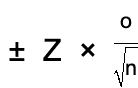

= 样本均值

`Z`：对应于期望置信水平的 Z 分数

`σ`：总体标准差（如果未知则使用样本标准差）

`n`：样本量

## 9.4.3 置信区间的示例

情景：某公司想要估计其客户的平均月支出。对 50 名客户的随机样本进行调查，平均支出为 $200，标准差为 $30。公司希望得到 95% 的置信区间。

步骤：
1. 点估计：样本均值 (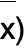= $200。
2. 查找 Z 分数：对于 95% 的置信水平，`Z`=1.96。
3. 计算误差范围：`MoE` = `Z` × 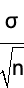= 1.96 × 30 50 = 1.96 × 4.24 = 8.31
4. 置信区间：`CI` = 200 ± 8.31 = (191.69,208.31)

解释：公司有 95% 的把握认为所有客户的真实平均月支出在 $191.69 和 $208.31 之间。

## 9.4.4 比例的置信区间

估计总体比例的情形：`CI =`  ± `Z` × 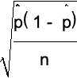

其中： = 样本比例，`n`：样本量

示例：在对 500 人进行的调查中，60% 的人表示他们更喜欢网上购物。求总体比例的 95% 置信区间。
1. 点估计：样本比例() = 0.6。
2. 查找 Z 分数：对于 95% 的置信水平，`Z`=1.96。
3. 计算误差范围：
`MoE` = 1.96 × 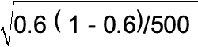= 1.96 × 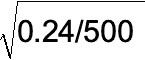 = 1.96 × 0.0219
4. 置信区间：`CI` = 0.6 ± 0.043 = (0.557, 0.643)

解释：调查有 95% 的把握认为喜欢网上购物的真实人口比例在 55.7% 和 64.3% 之间。

## 9.4.5 影响置信区间的因素

样本量：样本量越大，置信区间越窄，因为标准误差减小。

置信水平：置信水平越高（例如 99%），区间越宽，因为需要更大的误差范围。

数据变异性：数据变异性越高（标准差越大），区间越宽。

## 9.4.6 置信区间在数据科学中的应用

A/B 测试：评估新功能或营销策略的有效性。示例：确定新的网站设计是否能提高用户参与度。

预测建模：评估机器学习模型预测的准确性和不确定性。

调查分析：估计人口参数，如平均收入或投票偏好。

商业决策制定：提供具有量化不确定性的可操作见解。

总之，置信区间是推断统计中的基本工具，使数据科学家能够量化不确定性并做出明智的数据驱动决策。通过为总体参数提供一系列可能值，置信区间增强了结果的解释并为稳健决策提供了坚实基础。

# 9.5 相关性与因果性

在数据分析中，相关性和因果性是两个不同的概念，经常被误解或混淆。虽然两者都涉及变量之间的关系，但它们代表了根本不同的思想，不应互换使用。

## 9.5.1 什么是相关性？

相关性衡量两个变量一起变化的程度。它是一种统计关系，可以是正的、负的或中性的。

### 关键特征

正相关：两个变量一起增加。示例：随着温度升高，冰淇淋销量增加。

负相关：一个变量增加而另一个变量减少。示例：随着速度增加，旅行时间减少。

无相关：变量之间没有关系。示例：发色和智力。

### 相关性如何衡量？

相关系数 (`r`) 范围从 -1 到 +1：
- `r` = +1：完全正相关。
- `r` = −1：完全负相关。
- `r` = 0：无相关。

示例
分析学习小时数与考试成绩之间的关系可能会产生正相关（`r` = 0.8）。

## 9.5.2 什么是因果性？

因果性表示一个变量直接影响另一个变量。它意味着因果关系。

### 关键特征

一个变量的变化导致另一个变量的变化。示例：增加广告预算导致销售额提高。

### 如何建立因果性？

实验研究：随机对照试验是证明因果性的黄金标准。

时间关系：原因必须先于结果。

消除混杂变量：确保没有第三个变量同时影响原因和结果。

### 示例

如果实验控制了所有其他因素，给予新药并观察血压下降就显示出因果性。

## 9.5.3 相关性与因果性的差异

| 方面 | 相关性 | 因果性 |
| --- | --- | --- |
| 定义 | 两个变量之间的统计关系。 | 一个变量直接影响另一个变量。 |
| 影响方向 | 对称（无因果方向）。 | 非对称（原因先于结果）。 |
| 证明 | 不意味着因果性。 | 意味着直接的因果关系。 |
| 示例 | 冰淇淋销量和鲨鱼袭击（相关）。 | 吸烟和肺癌（因果）。 |

## 9.5.4 常见误区：相关性不意味着因果性

仅仅因为两个变量相关并不意味着一个导致另一个。这通常是由于：

混杂变量：第三个变量同时影响两者。例如，冰淇淋销量和鲨鱼袭击相关，但混杂变量是温度（炎热天气同时增加两者）。

反向因果：结果可能驱动原因。例如，更高的销售额可能导致更高的广告预算，而不是相反。

巧合：相关性可能是纯粹的巧合。例如，人均奶酪消费量和因被床单缠住而死亡的人数（一个幽默但真实的虚假相关示例）。

### 示例

#### 无因果的相关性：

情景：教堂数量较多的城市犯罪率更高。

解释：大城市教堂更多，犯罪率也更高，但教堂不会导致犯罪。人口规模是混杂变量。

#### 因果性：

情景：吸烟导致肺癌。


## 解释
数十年的研究、受控研究和生物学机制支持这种因果关系。

### 在数据科学中为什么重要？

**避免错误假设：** 误将相关性解释为因果关系可能导致错误的结论和糟糕的决策。例如，认为员工流失率升高是由薪资降低造成的，而没有考虑工作满意度或管理问题。

**推动可操作的洞察：** 识别因果关系有助于实施有效的策略。例如，如果网站流量的增加导致销售额上升，企业可以专注于提升流量。

**构建预测模型：** 虽然相关性足以进行预测，但理解因果关系可以提高模型的解释性和可靠性。

总之，因果关系和相关性都是数据科学中的重要概念：前者有助于识别模式和关系，后者能更深入地揭示这些关系背后的机制。两者之间的差异对于准确解释、避免偏差以及数据分析的业务驱动结果非常重要。

# 9.6 实践：使用 Python (SciPy) 进行统计检验

统计检验是数据分析的一个基本方面，使我们能够利用样本数据对总体做出推断。Python 的 `SciPy` 库提供了一套全面的工具，用于执行各种统计检验，例如 t 检验、卡方检验等。

## 导入所需库

在执行任何统计检验之前，您需要导入必要的库：

```
import numpy as np
from scipy import stats
```

## SciPy 中的常见统计检验

### 单样本 t 检验
用于确定单个样本的均值是否与已知的总体均值存在显著差异。

示例：某公司声称平均日销售额为 $500。记录了 10 天的销售额样本为 [480, 520, 495, 505, 500, 490, 530, 510, 485, 515]。检验该说法。

```
# Sample data
sales = [480, 520, 495, 505, 500, 490, 530, 510, 485, 515]

# Perform one-sample t-test
t_stat, p_value = stats.ttest_1samp(sales, 500)

print(f"T-statistic: {t_stat}")
print(f"P-value: {p_value}")
```

解释：如果 `p` ≤0.05，拒绝均值为 500 的原假设。

### 双样本 t 检验
用于比较两个独立组的均值。

示例：检验两个班级考试成绩是否存在显著差异：
班级 A：[85, 90, 78, 92, 88]
班级 B：[80, 85, 84, 86, 83]。

```
# Sample data
class_a = [85, 90, 78, 92, 88]
class_b = [80, 85, 84, 86, 83]

# Perform two-sample t-test
t_stat, p_value = stats.ttest_ind(class_a, class_b)

print(f"T-statistic: {t_stat}")
print(f"P-value: {p_value}")
```

解释：如果 `p` ≤0.05，拒绝均值相等的原假设。

### 配对 t 检验
用于比较同一组在两个不同时间点的均值。

示例：检验培训项目是否提高了成绩：
培训前：[70, 75, 80, 85, 90]
培训后：[75, 80, 85, 90, 95]。

```
# Sample data
before = [70, 75, 80, 85, 90]
after = [75, 80, 85, 90, 95]

# Perform paired t-test
t_stat, p_value = stats.ttest_rel(before, after)

print(f"T-statistic: {t_stat}")
print(f"P-value: {p_value}")
```

解释：如果 `p` ≤0.05，认为培训项目显著提高了成绩。

### 卡方检验
用于确定分类变量之间是否存在显著关联。

示例：检验性别与两种产品偏好之间是否存在关联。

```
# Contingency table
data = [[50, 30], [20, 40]]  # [Males, Females] for Product A and B

# Perform chi-square test
chi2, p, dof, expected = stats.chi2_contingency(data)

print(f"Chi-square Statistic: {chi2}")
print(f"P-value: {p}")
print(f"Expected Frequencies: \n{expected}")
```

解释：如果 `p` ≤0.05，认为性别与产品偏好相关。

### ANOVA（方差分析）
用于比较三个或更多组的均值。

示例：检验三个部门的绩效是否存在差异：
部门 A：[85, 88, 90]
部门 B：[78, 80, 83]
部门 C：[92, 95, 97]。

```
# Sample data
dept_a = [85, 88, 90]
dept_b = [78, 80, 83]
dept_c = [92, 95, 97]

# Perform one-way ANOVA
f_stat, p_value = stats.f_oneway(dept_a, dept_b, dept_c)

print(f"F-statistic: {f_stat}")
print(f"P-value: {p_value}")
```

解释：如果 `p` ≤0.05，认为至少有一个部门的绩效存在显著差异。

## 可视化结果

使用 `Matplotlib` 和 `seaborn` 等可视化工具来补充统计检验。

示例：直方图：

```
import matplotlib.pyplot as plt

# Visualize sales data
plt.hist(sales, bins=5, color='skyblue', edgecolor='black')
plt.title('Sales Distribution')
plt.xlabel('Sales')
plt.ylabel('Frequency')
plt.show()
```

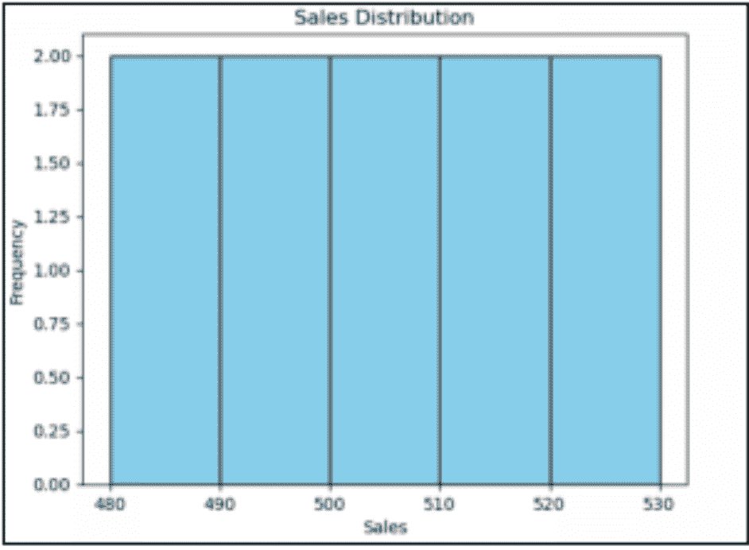

## 最佳实践

为了确保有效的统计检验，遵循最佳实践至关重要。首先，了解数据至关重要，因为数据必须满足检验的假设，例如正态性和独立性。其次，选择合适的检验很重要，例如对单个组比较使用单样本 t 检验，或对独立组使用双样本 t 检验。第三，正确解释 `p` 值至关重要；较小的 `p` 值（≤0.05）为反对原假设提供了有力证据。最后，除了 `p` 值之外，考虑效应量也有益，因为它有助于理解差异的大小，从而对结果提供更深入的见解。

总之，`SciPy` 提供了一套全面的统计检验工具，简化了数据分析和得出有意义推断的过程。无论是比较组均值还是评估变量之间的关联，这些检验都能使数据科学家做出明智的决策。将统计检验与可视化相结合可以增强结果的清晰度，并确保有效传达洞察。

# 9.7 章节复习问题

### 问题 1
推断统计的主要关注点是什么？
A. 描述数据特征
B. 基于样本数据对总体做出结论
C. 可视化数据趋势
D. 清洗和预处理数据

### 问题 2
以下哪一项是推断统计的关键概念？
A. 置信区间
B. 描述性分析
C. 数据缩放
D. 降维

### 问题 3
推断统计在数据科学中为什么重要？
A. 它有助于创建数据可视化
B. 它允许对总体进行预测和概括
C. 它专注于汇总数据集
D. 它将原始数据组织成结构化格式

### 问题 4
概率的定义是什么？
A. 数据集中变异性的度量
B. 事件发生的可能性
C. 数据点围绕均值的分布范围
D. 数据集的平均值

### 问题 5
以下哪一项是条件概率的示例？
A. 抛硬币
B. 掷骰子
C. 在天气多云的情况下下雨的概率
D. 抽取一个随机数

### 问题 6
概率的乘法规则说明什么？
A. 两个独立事件同时发生的概率是它们的乘积
B. 事件的概率始终在 0 和 1 之间
C. 事件发生的概率是所有结果的总和
D. 单个事件的概率必须从 1 中减去

### 问题 7
以下哪一项最能定义 p 值？
A. 中心趋势的度量
B. 在原假设成立下，获得与观察结果一样极端的结果的概率
C. 样本的标准差
D. 置信区间内的数据点百分比

### 问题 8
假设检验的主要目的是什么？
A. 可视化数据
B. 比较两个数据集


C. 判断是否有足够的证据拒绝原假设

D. 计算均值和中位数

### 问题 9
以下哪一项是常见的假设检验类型？
A. 回归检验
B. `T-test`
C. 数据缩放检验
D. 抽样检验

### 问题 10
置信区间代表什么？
A. 包含所有数据点的取值范围
B. 总体参数可能所在的范围
C. 数据集的离散程度
D. 样本的均值

### 问题 11
哪个因素会增加置信区间的宽度？
A. 更大的样本量
B. 数据中更高的变异性
C. 置信水平的降低
D. 更小的总体规模

### 问题 12
科学研究中通常使用什么置信水平？
A. 50%
B. 75%
C. 95%
D. 100%

### 问题 13
置信区间的公式包括什么？
A. 均值、中位数和标准差
B. 样本均值、误差范围和临界值
C. 方差和概率
D. `p-value` 和假设检验

### 问题 14
相关与因果之间的区别是什么？
A. 相关意味着一个事件导致另一个事件
B. 因果意味着两个变量之间相互关系
C. 相关衡量关联，而因果表示因果效应
D. 它们是相同的

### 问题 15
以下哪个陈述是正确的？
A. 相关意味着因果
B. 相关总是正的
C. 没有相关就不存在因果
D. 相关不意味着因果

### 问题 16
用什么指标来量化相关的强度？
A. 均值
B. `p-value`
C. 相关系数
D. 标准差

### 问题 17
相关系数的取值范围是多少？
A. 0 到 1
B. -1 到 1
C. -∞ 到 ∞
D. 0 到 ∞

### 问题 18
以下哪一项是因果的例子？
A. 冰淇淋销量和夏季鲨鱼袭击事件增加
B. 增加锻炼导致体重减轻
C. 咖啡消费和生产力水平
D. 降雨和雨伞销量

### 问题 19
假设检验中 `p-value` 为 0.03 表示什么？
A. 应接受原假设
B. 在原假设成立下，观察到该结果的概率为 3%
C. 检验无效
D. 原假设总是为真

### 问题 20
以下哪个应用在数据科学中使用置信区间？
A. 数据可视化
B. 估计模型准确性
C. 数据清洗和预处理
D. 优化算法

# 9.8 章节复习题答案
1\. B. 基于样本数据对总体做出结论
Explanation: 推断统计用于利用样本数据对总体做出预测或概括。

2\. A. 置信区间
Explanation: 置信区间是推断统计中的一个关键概念，因为它们估计总体参数所在的范围。

3\. B. 它允许对总体进行预测和概括
Explanation: 推断统计在数据科学中至关重要，因为它有助于基于样本数据对总体做出推断和预测。

4\. B. 事件发生的可能性
Explanation: 概率是对特定事件发生的可能性的度量。

5\. C. 在多云天气下降雨的概率
Explanation: 条件概率是在另一个事件已经发生的情况下某事件发生的概率。

6\. A. 两个独立事件发生的概率是它们的乘积
Explanation: 乘法规则指出，对于独立事件，它们的联合概率是各自概率的乘积。

7\. B. 在原假设下获得与观察结果一样极端的结果的概率
Explanation: `p-value` 有助于在假设检验中确定反对原假设的证据强度。

8\. C. 判断是否有足够的证据拒绝原假设
Explanation: 假设检验用于评估关于总体参数的假设或声明。

9\. B. `T-test`
Explanation: `T-test` 是一种常用的假设检验，用于比较两组的均值。

10\. B. 总体参数可能所在的范围
Explanation: 置信区间提供一个估计范围，很可能包含总体参数的真实值。

11\. B. 数据中更高的变异性
Explanation: 更高的变异性增加了不确定性，导致置信区间更宽。

12\. C. 95%
Explanation: 95% 置信水平在科学研究中最常用，表示对估计有很高的信心。

13\. B. 样本均值、误差范围和临界值
Explanation: 置信区间的公式结合了样本均值、误差范围和来自统计分布的临界值。

14\. C. 相关衡量关联，而因果表示因果效应
Explanation: 相关量化变量之间关联的强度，而因果意味着一个变量导致另一个变量。

15\. D. 相关不意味着因果
Explanation: 仅仅因为两个变量相关并不意味着一个导致另一个；相关可能是偶然的或受第三变量影响。

16\. C. 相关系数
Explanation: 相关系数量化两个变量之间线性关系的强度和方向。

17\. B. -1 到 1
Explanation: 相关系数范围从 -1（完全负相关）到 1（完全正相关），0 表示无相关。

18\. B. 增加锻炼导致体重减轻
Explanation: 这是一个因果的例子，其中增加锻炼导致体重减轻。

19\. B. 在原假设成立下，观察到该结果的概率为 3%
Explanation: `p-value` 为 0.03 表示如果原假设为真，观察到的结果会出现 3% 的时间，提示在 5% 显著性水平下有证据拒绝原假设。

20\. B. 估计模型准确性
Explanation: 置信区间常用于数据科学中估计预测模型和统计参数的准确性。

# 第 10 章. 数据科学必备数学
数学构成了数据科学的骨干，使精确的数据分析、模型优化和问题解决成为可能。本章介绍了数据科学必备的基础数学概念，首先从线性代数开始，涵盖向量、矩阵和方程组，这对于处理多维数据至关重要。然后探讨用于优化的微积分，重点关注关键概念、优化技术以及在机器学习中的应用，以及优化中面临的挑战。为了将理论与实践结合，本章最后以使用 `NumPy` 对数学概念进行动手应用结束，为在现实世界数据科学任务中实施这些技术提供实践见解。

## 10.1 线性代数基础：向量和矩阵
线性代数是数据科学的基石，支撑着机器学习、计算机视觉和优化等关键领域。其核心是向量和矩阵，它们是表示和高效处理数据的不可或缺的工具。

### 10.1.1 向量
向量是一个数学构造，具有大小和方向两个特征。它可以直观地表示为空间中的箭头，或数值上表示为排列成单行或单列的一组分量。

#### 向量类型
列向量：`v` = （一个有多行单列的向量。）
行向量：`v=[2,3,5]`（一个有多列单行的向量。）

#### 向量运算
加法：`v + w` = \+ \= 


# 10.1 向量和矩阵

## 10.1.1 向量

### 标量乘法
`c • v = 2 •`  `=` 

### 点积
两个向量的点积产生一个标量：

`v • w =`  `•`  `= (2 × 1) + (3 × 4) + (5 × 2) = 23`

### 大小
向量的大小（或长度）为：`v` `=` 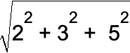 `=` 

### 向量的应用
- 在数据集中表示数据点（例如，特征向量）。
- 多维空间中的方向（例如，优化中的梯度）。

## 10.1.2 矩阵
矩阵是按行和列排列的二维数字数组。它是线性代数中存储和转换数据的基础工具。

### 矩阵表示
矩阵表示为： `=` 

这里：行：3，列：3

### 矩阵运算
加法：相同维度的矩阵可以按元素相加：

 `+`  `=` 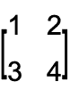 `+`  `=` 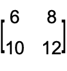

标量乘法：矩阵的每个元素都乘以标量：

`c •`  `= 2 •`  `=` 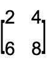

矩阵乘法：第一个矩阵的行与第二个矩阵的列的点积：

 `•`  `=`  `•`  `=` 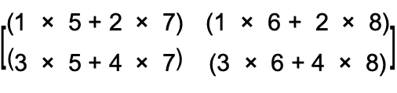

转置：将矩阵沿其对角线翻转：

`A^T =`  `T =` 

### 矩阵的应用
- 存储数据（例如，将图像作为像素强度矩阵）。
- 表示线性变换。
- 求解线性方程组。

## 10.1.3 组合使用：方程组
线性代数经常使用矩阵和向量来表示和求解线性方程组。

示例：
求解方程组：
`2x + y = 5`
`x - y = 1`

表示为矩阵方程：
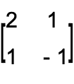 `•`  `=` 

使用矩阵运算或计算工具求解。

### 数据科学中的应用
特征表示：矩阵的行表示数据点，列表示特征。

变换：使用矩阵应用变换（例如，旋转、缩放）。

机器学习：线性回归等算法 heavily 依赖矩阵运算。深度学习涉及张量（向量和矩阵的推广）的运算。

降维：主成分分析（PCA）等技术使用矩阵来降低数据维度。

总之，向量和矩阵是线性代数中的基本构建块，使多维数据的表示和操作成为可能。这些运算是数据科学中许多算法和变换不可或缺的一部分，使其对于从基础统计分析到复杂机器学习模型等任务至关重要。对这些概念的扎实理解对于有效的数据分析和问题解决至关重要。

# 10.2 优化的微积分基础
微积分是优化的基础，优化是机器学习和数据科学的关键方面。它能够确定函数的最大值和最小值，这对于诸如减少机器学习模型误差或优化商业场景中的利润等任务至关重要。

## 10.2.1 优化微积分中的关键概念

### 函数及其行为
一个函数将输入值映射到输出值。例如：`f(x) = x² + 3x + 2`。

### 导数
函数的导数衡量函数输出相对于输入的变化率。

数学定义：
`f'(x) =` 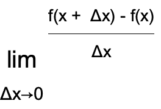

解释：
- `f'(x) > 0`：函数递增。
- `f'(x) < 0`：函数递减。
- `f'(x) = 0`：临界点（可能是最大值、最小值或鞍点）。

### 二阶导数
二阶导数表示函数的凹凸性：
- `f''(x) > 0`：函数向上凹（最小点）。
- `f''(x) < 0`：函数向下凹（最大点）。

### 梯度
梯度将导数推广到多变量函数。

对于 `f(x, y)`：
`∇f(x, y) =` 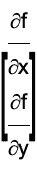

梯度指向最陡上升的方向。

## 10.2.2 微积分中的优化
优化涉及找到使函数最大化或最小化的输入值。

### 优化步骤
求导：对函数 `f(x)` 求导。
确定临界点：求解 `f'(x) = 0` 以找到临界点。
确定临界点的性质：使用二阶导数检验：
- `f''(x) > 0`：最小值。
- `f''(x) < 0`：最大值。
评估端点（如适用）：检查函数在定义域边界处的值。

### 单变量优化示例
示例：
求 `f(x) = x² - 4x + 3` 的最小值

导数：`f'(x) = 2x - 4`
临界点：`2x - 4 = 0 => x = 2`
二阶导数：`f''(x) = 2 > 0`

由于 `f''(x) > 0`，`x = 2` 是最小值。
评估函数：`f(2) = 2² - 4(2) + 3 = -1`
结论：最小值是 `-1`，在 `x = 2` 处取得。

### 基于梯度的优化
对于多变量函数，优化使用梯度。

#### 梯度下降算法
梯度下降是一种迭代方法，用于寻找函数的最小值。

更新规则：`θ = θ - α ∇f(θ)`

其中：
- `θ`：正在优化的参数。
- `α`：学习率（步长）。
- `∇f(θ)`：函数的梯度。

停止条件：当 `||∇f(θ)||` 接近零时停止（或在固定迭代次数后停止）。

## 10.2.3 在机器学习中的应用
损失函数最小化：通过最小化损失函数（例如，均方误差）来优化模型参数（例如，线性回归中的权重）。

正则化：通过最小化 `f(w) + λ ||w||²` 之类的函数来添加约束以防止过拟合。

优化算法：使用随机梯度下降（`SGD`）或 `Adam` 等高级算法以实现更快收敛。

## 10.2.4 优化中的挑战
局部与全局最优：函数可能有多个局部最小值和一个全局最小值。基于梯度的方法可能陷入局部最小值。

学习率：选择合适的学习率对收敛至关重要：
- 太大：越过。
- 太小：收敛缓慢。

非凸函数：形状复杂的函数使优化更困难。

总之，微积分构成了优化的数学基础，优化是数据科学和机器学习的关键方面。理解导数、梯度和优化技术对于解决从最小化预测模型误差到最大化资源分配效率等广泛问题至关重要。熟练掌握这些概念对于进行高级数据分析和构建稳健模型不可或缺。

# 10.3 实战：使用 NumPy 应用数学
NumPy 是一个专为数值计算设计的 Python 核心库。它提供高效的数组、矩阵操作工具以及全面的数学函数套件。广泛用于数据科学和科学计算，NumPy 对于执行高性能数学运算和有效处理大型数据集至关重要。

### 导入 NumPy
开始使用 NumPy，将其导入到 Python 脚本中：
```
import numpy as np
```

### 创建数组
NumPy 数组是执行数学运算的基础。它们可以是一维的（向量）或二维的（矩阵）。

示例：
1D 数组：
```
arr = np.array([1, 2, 3, 4, 5])
print(arr)
# Output: [1 2 3 4 5]
```

2D 数组：
```
matrix = np.array([[1, 2], [3, 4]])
print(matrix)
# Output:
# [[1 2]
#  [3 4]]
```

零和一：
```
zeros = np.zeros((3, 3))
ones = np.ones((2, 2))
print(zeros)
print(ones)
```


# 随机数组

```
random_array = np.random.random((2, 3))
print(random_array)
```

## 基本数学运算

### 加法和减法

```
a = np.array([1, 2, 3])
b = np.array([4, 5, 6])
print(a + b)  # Output: [5 7 9]
print(a - b)  # Output: [-3 -3 -3]
```

### 乘法和除法

```
print(a * b)  # Output: [4 10 18]
print(a / b)  # Output: [0.25 0.4  0.5]
```

### 矩阵乘法

对于矩阵运算，使用 `np.dot()` 或 `@` 运算符：

```
A = np.array([[1, 2], [3, 4]])
B = np.array([[5, 6], [7, 8]])
result = np.dot(A, B)
print(result)
# Output:
# [[19 22]
#  [43 50]]
```

### 指数运算

```
print(np.exp(a))  # Output: [  2.71828183   7.3890561   20.08553692]
```

## 线性代数

### 点积

```
v1 = np.array([1, 2, 3])
v2 = np.array([4, 5, 6])
dot_product = np.dot(v1, v2)
print(dot_product)  # Output: 32
```

### 矩阵转置

```
matrix = np.array([[1, 2], [3, 4]])
transpose = np.transpose(matrix)
print(transpose)
# Output:
# [[1 3]
#  [2 4]]
```

### 矩阵的逆

```
matrix = np.array([[1, 2], [3, 4]])
inverse = np.linalg.inv(matrix)
print(inverse)
# Output:
# [[-2.   1. ]
#  [ 1.5 -0.5]]
```

### 特征值和特征向量

```
values, vectors = np.linalg.eig(matrix)
print(values)
print(vectors)
```

## 统计运算

NumPy 提供了用于描述性统计的内置函数：

### 均值

```
data = np.array([1, 2, 3, 4, 5])
print(np.mean(data))  # Output: 3.0
```

### 中位数

```
print(np.median(data))  # Output: 3.0
```

### 标准差

```
print(np.std(data))  # Output: 1.4142135623730951
```

### 相关系数

```
x = np.array([1, 2, 3])
y = np.array([4, 5, 6])
print(np.corrcoef(x, y))
```

## 处理大型数据集

NumPy 数组经过优化，可高效处理大型数据集。

### 示例：大型数组上的逐元素运算

```
large_array = np.random.random(1000000)
result = large_array * 2
```

## 数据科学中的用例

数据预处理：使用 NumPy 函数归一化或缩放数据。

```
data = np.array([10, 20, 30])
normalized = (data - np.mean(data)) / np.std(data)
print(normalized)
```

特征工程：计算多项式特征或交互项。

模拟：为蒙特卡洛模拟生成随机样本。

```
simulations = np.random.normal(0, 1, 1000)
```

优化：使用线性代数运算进行梯度下降或求解方程组。

## 可视化结果

虽然 NumPy 没有可视化功能，但它可与 Matplotlib 等库无缝协作。

### 示例：绘制数据

```
import matplotlib.pyplot as plt
x = np.linspace(0, 10, 100)
y = np.sin(x)
plt.plot(x, y)
plt.title('Sine Wave')
plt.xlabel('x')
plt.ylabel('sin(x)')
plt.show()
```

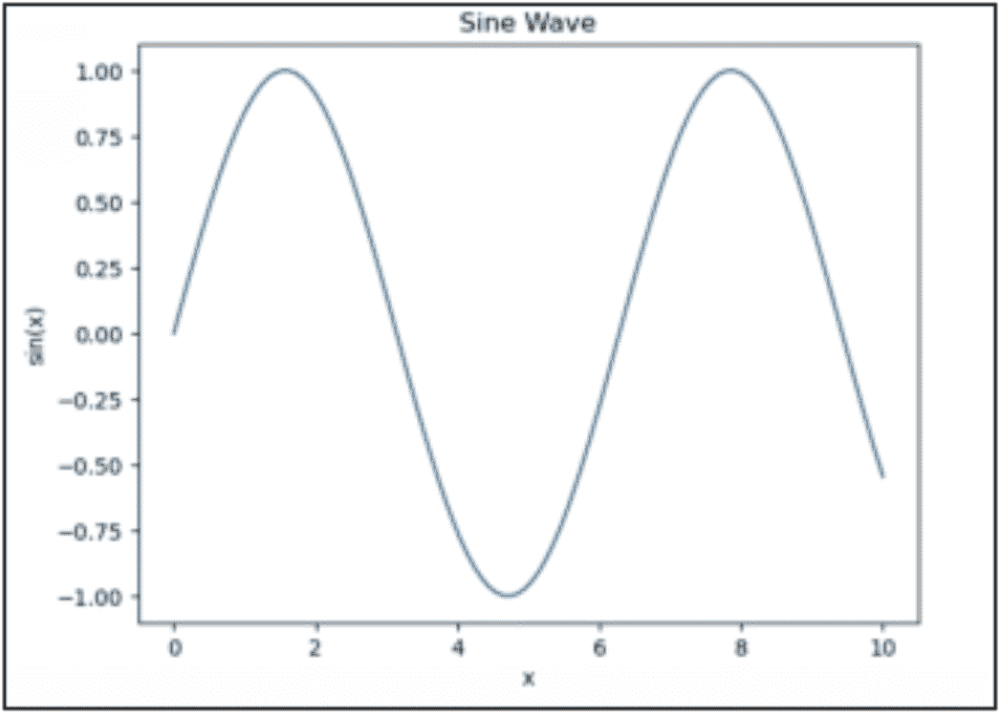

总之，NumPy 是数据科学、机器学习和科学计算中的必备工具，在处理大型数据集方面提供无与伦比的效率。其丰富的函数范围和执行复杂数学运算的能力使其成为 Python 基于分析工作流程的基石。

# 10.4 章节复习问题

问题 1：

线性代数中以下哪项最能定义向量？

A. 一个单一数值

B. 按行或列排列的一组值

C. 一个二维数字数组

D. 一个函数的图形表示

问题 2：

线性代数中矩阵是什么？

A. 用于优化的单一值

B. 一个二维数字数组

C. 概率中使用的函数

D. 一维数据的表示

问题 3：

使用矩阵求解方程组的目的是什么？

A. 找到统计均值和方差

B. 计算相关系数

C. 确定多个线性方程的解

D. 优化神经网络

问题 4：

以下哪项表示两个向量的点积？

A. 两个向量的逐元素乘法

B. 两个向量对应元素的乘积之和

C. 两个向量的叉积

D. 一个向量除以另一个向量

问题 5：

机器学习优化中最常用的微积分概念是什么？

A. 极限

B. 导数

C. 积分

D. 级数和数列

问题 6：

在优化中，函数的梯度代表什么？

A. 函数的最小值

B. 最陡上升或下降的方向

C. 函数的最大值

D. 函数的平均变化率

问题 7：

以下哪项是机器学习中优化问题的例子？

A. 在图中寻找最短路径

B. 最小化模型的损失函数

C. 计算数据集的均值

D. 可视化数据集

问题 8：

偏导数在优化中的作用是什么？

A. 它们计算函数中的总变化

B. 它们衡量函数相对于一个变量的变化，同时保持其他变量不变

C. 它们用于积分函数

D. 它们在优化中没有作用

问题 9：

机器学习优化问题中的常见挑战是什么？

A. 模型过拟合

B. 收敛到局部最小值而不是全局最小值

C. 计算统计均值

D. 解释可视化结果

问题 10：

以下哪项是机器学习中优化的应用？

A. 超参数调优

B. 数据可视化

C. 数据清洗

D. 计算汇总统计

# 10.5 章节复习问题答案

1. B. 按行或列排列的一组值

解释：线性代数中的向量是一个一维数组，可以表示行或列值，通常用于定义方向和大小。

2. B. 一个二维数字数组

解释：矩阵是一个按行和列排列的二维数字数组，常用于求解方程组和执行变换。

3. C. 确定多个线性方程的解

解释：矩阵用于使用矩阵求逆或行简化等方法高效地表示和求解线性方程组。

4. B. 两个向量对应元素的乘积之和

解释：两个向量的点积计算为其对应元素乘积之和，结果为标量值。

5. B. 导数

解释：导数是微积分中的关键概念，用于找到变化率，这对于机器学习中最小化或最大化函数等优化问题至关重要。

6. B. 最陡上升或下降的方向

解释：函数的梯度指向最陡上升的方向（或取负值时为下降方向），这使其对梯度下降等优化算法至关重要。

7. B. 最小化模型的损失函数

解释：机器学习中的优化问题通常涉及最小化损失函数以提高模型准确性和性能。

8. B. 它们衡量函数相对于一个变量的变化，同时保持其他变量不变

解释：偏导数用于计算函数相对于一个变量的变化率，这在多变量优化中至关重要。

9. B. 收敛到局部最小值而不是全局最小值

解释：优化中的常见挑战是陷入局部最小值，尤其是在非凸函数中，这会影响模型性能。

10. A. 超参数调优

解释：优化应用于超参数调优，以找到使损失函数最小化或提高模型性能的最佳参数。


# 第 11 章 数据收集和导入


高效的数据收集和导入是任何数据驱动项目的基石。本章探讨了各种数据源，包括 API、数据库和网络抓取，讨论了它们的优势、局限性和适用场景。它还涵盖了将数据导入 Python 的技术，重点关注 CSV、Excel、JSON 和 SQL 等常见格式，并对这些方法进行了比较。文中强调了处理和管理的最佳实践，以确保导入数据的准确性和效率。到本章结束时，读者将清楚地了解如何有效地收集、导入和管理数据以进行分析和建模。

# 11.1 数据来源：API、数据库和网络抓取

在数据科学中，从多样化来源收集数据是至关重要的一步。三种广泛使用的数据获取方法包括 API、数据库和网络抓取。每种方法都有其自身的优势，并针对特定的数据收集需求。

## 11.1.1 API（应用程序编程接口）

一个 `API`（应用程序编程接口）是一套规则和协议，使不同软件应用程序之间能够无缝通信。API 通常以 `JSON` 或 `XML` 等格式提供结构化数据，使其成为从在线服务检索数据的首选方法。

API 工作原理：API 接受请求（例如通过 `HTTP`）并返回包含数据的响应。它们通常需要身份验证（例如 `API keys` 或 `OAuth`）。

API 的常见用例包括获取社交媒体数据、获取天气更新和检索财务信息。例如，像 `Twitter API` 这样的 API 允许开发人员收集推文进行分析，而 `OpenWeatherMap API` 则提供实时天气数据。同样，金融 API 如 `Alpha Vantage` 使股票价格和市场趋势的收集成为可能，使 API 成为跨领域访问结构化信息的通用工具。

使用 Python 的示例：
```python
import requests

url = "https://api.openweathermap.org/data/2.5/weather"
params = {"q": "London", "appid": "your_api_key"}
response = requests.get(url, params=params)
if response.status_code == 200:
    data = response.json()
    print(data)
else:
    print("Error:", response.status_code)
```

优点：提供最新和实时数据。结构化且标准化的格式（例如 `JSON`、`XML`）。可扩展以处理大型数据集。

挑战：可能需要身份验证或有速率限制。仅限于 API 提供商提供的可用数据。

## 11.1.2 数据库

数据库是电子存储的有组织的数据集合。它们非常适合管理大型数据集，并提供使用 `SQL` 或 `NoSQL` 进行高效查询的能力。

数据库类型：
关系型数据库（`SQL`）：使用结构化表和关系。示例：`MySQL`、`PostgreSQL`、`SQLite`。
NoSQL 数据库：专为非结构化或半结构化数据设计。示例：`MongoDB`、`Cassandra`。

数据库工作原理：数据存储在表或集合中。查询用于检索、插入或操作数据。

使用 Python 的示例：
使用 `SQLite`：`SQLite3` 是一种轻量级、自包含、无服务器和基于文件的关系数据库管理系统（RDBMS）。它广泛用于需要简单性、速度和最小设置的应用。与传统的 `MySQL` 或 `PostgreSQL` 数据库不同，`SQLite` 不需要单独的服务器进程或系统即可运行。
```python
import sqlite3

# Connect to database
conn = sqlite3.connect("example.db")
cursor = conn.cursor()
# Create a table
cursor.execute("CREATE TABLE IF NOT EXISTS users (id INTEGER, name TEXT)")
conn.commit()
# Insert data
cursor.execute("INSERT INTO users (id, name) VALUES (1, 'Alice')")
conn.commit()
# Query data
cursor.execute("SELECT * FROM users")
rows = cursor.fetchall()
print(rows)
conn.close()
```

数据库具有多个优点，包括适用于结构化数据、高效的查询和索引能力，以及安全可靠的特性。然而，它们也存在挑战，例如需要设置和持续维护。此外，复杂的查询通常需要专业技能，使得数据库管理成为需要技术专长和持续关注的任务。

## 11.1.3 网络抓取

网络抓取是通过解析 HTML 内容从网站提取数据的过程。当数据无法通过 API 或数据库访问时，它特别有用。该过程首先使用 `requests` 等工具向网页发送请求。一旦获取网页的 HTML 内容，就使用 `BeautifulSoup` 等库解析内容。最后，所需数据被提取并处理以供进一步分析和存储。

使用 Python 的示例：
```python
import requests
from bs4 import BeautifulSoup

url = "https://example.com"
response = requests.get(url)
if response.status_code == 200:
    soup = BeautifulSoup(response.content, "html.parser")
    titles = soup.find_all("h1")
    for title in titles:
        print(title.text)
else:
    print("Error:", response.status_code)
```

网络抓取具有多个优点。它允许访问无法通过 API 获得的数据，并且足够灵活以提取非结构化数据。此外，它可以从多个页面或来源抓取数据，提供广泛的信息。然而，网络抓取也存在挑战。可能出现伦理和法律问题，例如违反网站的使用条款。网站还可能实施阻止抓取者的措施，例如 CAPTCHA 或 IP 限制。此外，网站 HTML 结构的变化可能会破坏抓取器的功能，需要频繁的更新和维护。

## 11.1.4 数据来源比较

| Aspect || APIs || Databases || Web Scraping |
| --- | --- | --- | --- |
| Structure || Well-structured (JSON, XML) || Highly structured (tables) || Unstructured (HTML) |
| Ease of Use || Easy with proper documentation || Requires SQL/NoSQL knowledge || Requires HTML parsing skills |
| Real-Time Updates || Yes || Depends on the database || No |
| Legal Considerations || Generally safe (terms apply) || Safe || Risk of legal/ethical issues |

## 11.1.5 何时使用每种方法

API：当数据提供商提供 API 时（例如社交媒体、天气、金融数据）。用于实时数据检索。
数据库：处理大型结构化数据集时。用于安全可靠的数据存储和检索。
网络抓取：当数据公开可用但未通过 API 提供时。用于从非结构化网页内容中提取数据。

总之，API、数据库和网络抓取是数据科学中访问多样化数据类型的必备技术。每种方法都有其自身的优缺点，选择合适的方法取决于数据的性质、其可访问性和项目的目标。对这些技术的熟练掌握能够实现稳健高效的数据收集，为高级数据分析和机器学习任务奠定坚实基础。

# 11.2 将 CSV、Excel、JSON 和 SQL 数据导入 Python

数据科学家和分析师经常处理 CSV、Excel、JSON 和 SQL 等各种数据格式。Python 提供了多功能的库，可轻松从这些格式导入和操作数据。

## 11.2.1 导入 CSV 数据

CSV（逗号分隔值）是最常见的表格数据格式之一。

使用 pandas：
`pandas` 库简化了 CSV 文件的导入。

示例：
示例 `data.csv`
```
Name,Age,Salary
Alice,25,50000
Bob,30,60000
Charlie,35,70000
David,40,80000
Eve,45,90000
```
```python
import pandas as pd

# Load CSV file
csv_data = pd.read_csv("data.csv")
print(csv_data.head())
```

关键参数：
• `sep`：指定分隔符（例如 `,`、`;`、`\t`）。
• `header`：定义用作列名的行。
• `index_col`：设置用作索引的列。

参数示例：


```
csv_data = pd.read_csv("data.csv", sep=",", header=0, index_col=0)
```
优点：与 `pandas` 配合使用非常容易。能高效处理大型数据集。

## 11.2.2 导入 Excel 数据

Excel 文件（.xls 或 .xlsx）广泛用于数据存储和共享。

使用 pandas：

`pandas` 提供了 `read_excel` 函数用于读取 Excel 文件。

示例：
```
# Load Excel file
excel_data = pd.read_excel("data.xlsx", sheet_name="Sheet1")
print(excel_data.head())
```
关键参数：

`sheet_name`：指定要加载的工作表。

`usecols`：加载特定列。

`nrows`：读取特定数量的行。

带参数的示例：
```
excel_data = pd.read_excel("data.xlsx", sheet_name=0, usecols="A:C", nrows=10)
```
优点：可以处理多张工作表。支持读取特定行或列。

附加库：为了更快的操作，您可以使用 `openpyxl` 或 `xlrd` 进行 Excel 文件操作。

## 11.2.3 导入 JSON 数据

JSON（JavaScript 对象表示法）常用于 API 和 Web 应用程序。

使用 pandas：

`pandas` 提供了 `read_json` 函数用于读取 JSON 文件。

示例：
```
# Load JSON file
json_data = pd.read_json("data.json")
print(json_data.head())
```
使用 Python 的 json 模块：

对于嵌套的 JSON 数据，使用内置的 `json` 模块。
```
import json

# Load JSON file
with open("data.json") as file:
    data = json.load(file)
print(data)
```
关键参数：

`orient`：指定 JSON 的方向（例如 records、columns、index）。

带参数的示例：
```
json_data = pd.read_json("data.json", orient="records")
```
优点：非常适合结构化和分层数据。与 API 无缝协作。

## 11.2.4 导入 SQL 数据

SQL 数据库是结构化数据的主要来源。

使用 pandas：`pandas` 提供了 `read_sql` 函数用于查询和导入 SQL 数据。

示例：
```
import pandas as pd
import sqlite3

# Connect to SQLite database
conn = sqlite3.connect("database.db")

# Query the database
sql_data = pd.read_sql("SELECT * FROM users", conn)
print(sql_data.head())

# Close the connection
conn.close()
```
关键参数：

- `sql`：要执行的 SQL 查询。
- `con`：数据库连接。

使用 SQLAlchemy：

`SQLAlchemy` 提供了 ORM（对象关系映射器）用于操作数据库。

示例：
```
from sqlalchemy import create_engine

# Connect to the database
engine = create_engine("sqlite:///database.db")

# Query the database
sql_data = pd.read_sql("SELECT * FROM users", engine)
print(sql_data.head())
```
优点：对大型数据集高效。允许直接在 Python 中执行复杂查询。

## 11.2.5 方法比较

| 格式 | 库/函数 | 优点 | 用途 |
| --- | --- | --- | --- |
| CSV | `pd.read_csv` | 简单且高效，适用于表格数据。 | 文件中的表格数据集。 |
| Excel | `pd.read_excel` | 处理多张工作表和自定义范围。 | 商业或电子表格数据。 |
| JSON | `pd.read_json`, `json` | 非常适合层次结构和 API 数据。 | API 响应、配置文件。 |
| SQL | `pd.read_sql`, `SQLAlchemy` | 强大的大型数据库查询能力。 | 结构化数据库存储。 |

## 11.2.6 最佳实践

检查数据：使用 `head()`、`info()` 和 `describe()` 来了解数据的结构和质量。

处理缺失值：使用 `fillna()` 或 `dropna()` 来管理缺失数据。

优化性能：对于大型文件，使用分块（`chunksize` 参数）增量加载数据。

安全连接：对于数据库，安全地存储凭据并限制权限以避免未授权访问。

### 数据收集和加载中的挑战

数据收集和加载中的挑战涵盖了几个关键方面。数据质量问题，例如处理缺失、重复或不一致的数据，会显著影响后续分析的准确性。数据安全是另一个关注点，需要采取谨慎措施防止 API 密钥或凭据等敏感信息泄露。处理大型数据集时，可扩展性成为挑战，需要使用批处理或流式技术来高效管理数据。此外，还必须通过确保遵守数据使用政策和隐私法律来解决法律和伦理问题，以避免潜在违规。

### 最佳实践

为了确保数据收集和加载工作流程高效且可维护，采用最佳实践至关重要。应优先考虑模块化代码设计，以分离数据收集和加载逻辑，促进跨项目重用。实施健壮的错误处理机制对于管理 API、数据库连接和文件操作中的潜在问题至关重要。此外，加载后应进行数据验证，以确保数据的准确性和完整性。对 API 端点、查询结构和文件格式进行全面文档记录对于促进未来参考和协作同样重要。

# 11.3 章节复习问题

问题 1：

以下哪一项是用于以编程方式收集结构化数据的常见数据源？

A. API

B. HTML 文件

C. 音频文件

D. 图像

问题 2：

API（应用程序编程接口）主要提供什么？

A. 一种可视化表示数据的方式

B. 连接和检索来自外部系统或服务的数据的方法

C. 大型数据集的存储解决方案

D. 数据压缩的格式

问题 3：

以下哪一项是用于从关系数据库检索数据的常见查询语言？

A. Python

B. Java

C. SQL

D. JSON

问题 4：

哪个 Python 库常用于网页抓取？

A. pandas

B. Beautiful Soup

C. NumPy

D. Matplotlib

问题 5：

在什么情况下网页抓取被认为是数据收集的合适方法？

A. 当 API 不可用或有限制时

B. 当数据已在 CSV 文件中可用时

C. 当需要数据可视化时

D. 当需要统计分析时

问题 6：

以下哪种格式常用于存储分层数据？

A. CSV

B. JSON

C. Excel

D. SQL

问题 7：

哪个 Python 库常用于导入 CSV 数据？

A. json

B. requests

C. pandas

D. sqlite3

问题 8：

pandas 中哪个函数用于将 Excel 文件导入 DataFrame？

A. `pd.read_csv()`

B. `pd.read_excel()`

C. `pd.read_json()`

D. `pd.read_sql()`

问题 9：

sqlite3 库在 Python 中的主要用途是什么？

A. 创建可视化

B. 与 SQL 数据库交互

C. 从网站抓取数据

D. 操作 JSON 文件

问题 10：

导入数据到 Python 时，以下哪一项是最佳实践？

A. 在不检查数据质量的情况下始终使用最快的方法

B. 导入 Python 后验证并清理数据

C. 避免使用库导入数据

D. 在没有任何检查的情况下直接将导入的数据存储到本地数据库

# 11.4 章节复习问题的答案

1. A. API

解释：API（应用程序编程接口）常用于以编程方式从外部系统或服务收集结构化数据。

2. B. 连接和检索来自外部系统或服务的数据的方法

解释：API 提供了与外部系统或服务交互的标准方式，使数据检索或交互能够以编程方式进行。

3. C. SQL

解释：SQL（结构化查询语言）是用于检索和管理关系数据库中数据最常见的查询语言。

4. B. Beautiful Soup

解释：Beautiful Soup 是一个流行的 Python 库，用于网页抓取以解析 HTML 和 XML 文档。

5. A. 当 API 不可用或有限制时

解释：网页抓取通常在 API 不可用或未提供所需数据时使用。

6. B. JSON

解释：JSON（JavaScript 对象表示法）是用于存储分层或嵌套数据广泛使用的格式。

7. C. pandas


说明：`pandas` 库通常用于在 Python 中导入、处理和分析 CSV 数据。

8. B. `pd.read_excel()`

说明：`pd.read_excel()` 函数用于将 Excel 文件导入 Pandas `DataFrame` 以进行分析。

9. B. 与 SQL 数据库交互

说明：Python 中的 `sqlite3` 库用于与 SQL 数据库交互，允许用户执行查询和管理数据。

10. B. 在导入 Python 后验证和清理数据

说明：导入数据的最佳实践包括在分析之前验证和清理数据以确保质量。

# 第 12 章 数据清洗与预处理

数据清洗和预处理是在为分析和机器学习准备数据时至关重要的步骤。本章涵盖了处理缺失值的核心技术，包括其原因、检测以及插补或删除的策略。它还探讨了检测和删除重复项、管理近重复项以及确保数据完整性的方法。此外，本章深入研究了标准化、归一化、对数变换和分箱等数据转换技术，这些技术有助于提高模型性能。还讨论了各种数据编码方法，包括独热编码、标签编码、频率编码和序数编码，以及处理分类数据的最佳实践。本章以数据转换和编码的实际应用作为结尾，提供使用 `pandas` 预处理数据的实践经验，以确保数据集干净、结构化且可用于分析。

## 12.1 处理缺失值

缺失值是数据分析中常见的挑战，通常源于数据收集不完整或处理错误。有效处理缺失值对于保持数据驱动洞察的准确性和可靠性至关重要，确保分析稳健且有意义。

### 12.1.1 缺失值的原因

数据中的缺失值可能由多种原因引起。人工错误是常见原因，在数据录入过程中出现错误或遗漏。系统限制，例如传感器故障或系统未能记录数据，也可能导致缺失值。另一个常见原因是无响应，即调查参与者未回答某些问题。此外，数据集成问题，例如合并记录不匹配的数据集，可能导致数据不完整或缺失。了解这些原因对于有效的数据预处理和分析至关重要。

### 12.1.2 识别缺失值

Python 的 `pandas` 库使检测缺失值变得容易。

示例：
```python
import pandas as pd

# Sample data
data = {'Name': ['Alice', 'Bob', 'Charlie'],
'Age': [25, None, 30],
'City': ['New York', 'Los Angeles', None]}

df = pd.DataFrame(data)

# Check for missing values
print(df.isnull())  # Boolean mask
print(df.isnull().sum())  # Count of missing values per column
```

输出：
Name    Age   City
0  False  False  False
1  False   True  False
2  False  False   True

Name    0
Age     1
City    1
dtype: int64

### 12.1.3 处理缺失值的策略

#### 删除缺失值
删除行：删除包含缺失值的行。
```python
df_cleaned = df.dropna()
print(df_cleaned)
```

删除列：删除缺失值比例较高的列。
```python
df_cleaned = df.dropna(axis=1)
print(df_cleaned)
```

何时使用：如果数据集较大且缺失值最少或不关键。

#### 插补缺失值
用默认值填充：用常量（例如 0 或 "Unknown"）替换缺失值。
```python
df['Age'].fillna(0, inplace=True)
df['City'].fillna('Unknown', inplace=True)
print(df)
```

用均值、中位数或众数填充：对数值列使用统计度量。
```python
df['Age'].fillna(df['Age'].mean(), inplace=True)
print(df)
```

前向/后向填充：将非缺失值向前或向后传播。
```python
df['Age'].fillna(method='ffill', inplace=True)  # Forward fill
df['Age'].fillna(method='bfill', inplace=True)  # Backward fill
```

何时使用：当缺失值是随机的且不表示特定模式时。

#### 预测缺失值
使用机器学习：训练回归或分类模型基于其他特征预测缺失值。

示例：
```python
from sklearn.impute import SimpleImputer

# Impute missing values with mean
imputer = SimpleImputer(strategy='mean')
df['Age'] = imputer.fit_transform(df[['Age']])
print(df)
```

K 近邻 (KNN)：基于相似数据点估计缺失值。

何时使用：当有足够数据构建可靠模型时。

#### 保留缺失值不变
使用指示变量：用二进制指示符标记缺失值。
```python
df['Age_missing'] = df['Age'].isnull()
```

忽略缺失值：某些机器学习算法（例如决策树）可原生处理缺失值。

何时使用：当缺失值传达有意义的信息时。

### 12.1.4 评估缺失值的影响

可视化缺失数据：使用 `seaborn` 或 `missingno` 等库来识别模式。
```python
import seaborn as sns
sns.heatmap(df.isnull(), cbar=False)
```

评估插补影响：在处理缺失值之前和之后比较模型性能。

### 12.1.5 最佳实践

处理缺失值时，首先通过分析缺失数据的原因来了解上下文以选择适当的策略非常重要。避免过度插补，因为引入偏差或扭曲数据集的插补值可能导致不可靠的洞察。始终记录更改，通过记录处理缺失值的方法来确保可重复性和透明度。此外，建议测试多种方法以确定最适合数据集特定特征的策略。此过程可确保数据在分析时保持尽可能准确和无偏。

总之，解决缺失值是数据预处理中的关键步骤，以确保分析和模型的<|message|> 质量和可靠性。通过了解缺失数据的性质并应用适当的处理方法，可以最大限度地减少错误，从而获得更稳健、更准确的结果。妥善管理可增强整体分析并提高所获见解的可信度。

## 12.2 检测和删除重复项

数据集中的重复记录可能导致分析不准确、模型偏差和更高的计算成本。识别和删除重复项是数据预处理中维护数据质量并确保可靠结果的关键步骤。

### 12.2.1 什么是重复记录？

重复记录是数据集中完全相同或几乎相同的行。这些可能因多种原因而发生，包括数据收集或录入错误、合并具有重叠条目的数据集，或日志或调查中的重复条目。正确识别和处理重复记录对于确保数据分析的准确性和可靠性至关重要。

### 12.2.2 在 Python 中检测重复项

Python 的 `pandas` 库提供了轻松识别重复项的工具。

识别重复项
使用 `duplicated()`：返回布尔掩码，其中 True 表示重复行。
```python
import pandas as pd

# Sample data
data = {'ID': [1, 2, 3, 4, 2],
'Name': ['Alice', 'Bob', 'Charlie', 'David', 'Bob'],
'Age': [25, 30, 35, 40, 30]}

df = pd.DataFrame(data)

# Detect duplicates
duplicates = df.duplicated()
print(duplicates)
```

输出：
0    False
1    False
2    False
3    False
4     True
dtype: bool

统计重复项：
```python
print(df.duplicated().sum())  # Output: 1
```

### 12.2.3 删除重复项

一旦检测到重复项，就可根据特定标准将其删除。

删除所有重复行
使用 `drop_duplicates()`：
```python
# Remove duplicate rows
df_cleaned = df.drop_duplicates()
print(df_cleaned)
```


输出：
ID Name Age
0 1 Alice 25
1 2 Bob 30
2 3 Charlie 35
3 4 David 40

## 保留首次或最后出现

### 保留首次出现

`df_cleaned = df.drop_duplicates(keep='first')`

输出：
ID Name Age
0 1 Alice 25
1 2 Bob 30
2 3 Charlie 35
3 4 David 40

### 保留最后出现

`df_cleaned = df.drop_duplicates(keep='last')`

输出：
ID Name Age
0 1 Alice 25
2 3 Charlie 35
3 4 David 40
4 2 Bob 30

## 基于特定列删除重复项

指定列：

```python
# Remove duplicates based on the 'Name' column
df_cleaned = df.drop_duplicates(subset=['Name'])
print(df_cleaned)
```

输出：
ID Name Age
0 1 Alice 25
1 2 Bob 30
2 3 Charlie 35
3 4 David 40

## 12.2.4 可视化重复项

可视化工具（如热力图）可以帮助识别重复模式。

使用 Seaborn 的示例：

```python
import seaborn as sns
import matplotlib.pyplot as plt

# Visualize duplicates
sns.heatmap(df.duplicated().to_frame(), cbar=False, cmap="Blues")
plt.show()
```

## 12.2.5 处理近似重复项

有时，重复项并非完全匹配，而是包含细微差异。

模糊匹配：使用 `fuzzywuzzy` 或 `difflib` 等库，根据字符串相似度识别近似重复项。

使用 FuzzyWuzzy 的示例：

```python
from fuzzywuzzy import fuzz

# Compare two strings
similarity = fuzz.ratio("Alice", "Alicia")
print(similarity) # Output: 73
```

自定义匹配规则：定义自定义规则来比较行，例如容忍轻微的数值差异。

## 12.2.6 管理重复项的最佳实践

为了有效管理重复记录，遵循最佳实践很重要。首先，了解重复项的上下文，以确定它们是有效条目还是错误。接下来，定义检测重复项的标准，例如指定要比较的列。一旦识别出，就决定保留一条记录的方法——是首次、最后还是自定义选择。记录对数据集所做的所有更改，以确保可追溯性。最后，在删除重复项后验证数据集，以确认没有重要数据被意外删除，并且数据集已准备好进行进一步分析。

总之，检测和删除重复项对于保持数据完整性至关重要。通过利用 Python 的强大工具并明确定义标准，您可以有效地消除重复记录并提高数据集的整体质量。妥善管理重复项不仅可以提高洞察的准确性，还可以确保工作流程的效率更高，从而实现更可靠、更有影响力的数据分析。

# 12.3 数据转换

数据转换和编码是准备数据进行分析或机器学习的重要步骤。这些过程标准化、归一化并重新格式化数据，以确保与分析工具和模型兼容。在数据科学中，数据转换涉及将原始数据转换为清理和结构化的形式，从而提高质量和可用性。这种准备对于实现可靠的洞察至关重要，因为它确保数据适合多样化的应用，从而实现准确且有意义的分析。

简而言之，数据转换涉及修改或转换数据以使其适合分析的格式。

数据转换为什么重要？

数据转换至关重要，原因有以下几点。首先，它通过提高数据一致性和质量来确保准确的分析，从而使分析模型产生可靠且有意义的输出。其次，转换良好的数据支持更好的决策，使企业能够基于精确分析做出明智选择。最后，标准化数据格式可实现高效的数据处理，在分析过程中节省时间和精力。

## 12.3.1 标准化

数据转换中的标准化是指通过应用预定义规则将来自各种来源的数据转换为统一、一致的格式的过程。这确保了数据集和变量之间的统一，使其可比较且结构化以供分析。此外，标准化通常涉及将数据转换使其均值为 0，标准差为 1。该方法也称为 z-score 缩放，通过减去数据集的均值并除以标准差来调整每个数据点，从而为分析和比较创建标准化尺度。

简而言之，“标准化”将数据转换为均值为 0、标准差为 1。

公式：

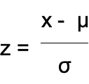

其中：
- `x`：原始值
- `μ`：数据集的均值
- `σ`：标准差

Python 中的示例：

```python
from sklearn.preprocessing import StandardScaler
import pandas as pd

# Sample data
data = {'Feature1': [10, 20, 30], 'Feature2': [5, 15, 25]}
df = pd.DataFrame(data)

# Standardize
scaler = StandardScaler()
standardized_data = scaler.fit_transform(df)
print(standardized_data)
```

输出：
[[-1.22474487 -1.22474487]
 [ 0. 0.]
 [ 1.22474487 1.22474487]]

## 12.3.2 归一化

数据归一化涉及将值缩放到常用范围，通常在 0 到 1 或 -1 到 1 之间。此过程确保所有特征对模型具有同等的重要性和影响力。常见的归一化技术包括 Min-Max 缩放，按比例调整值在指定范围内；基于均值和标准差标准化数据的 Z-score 归一化；以及对数变换，有助于处理偏斜分布并降低极值的影响。

简而言之，数据归一化将数据缩放到范围，通常为 `[0, 1]`。

公式：

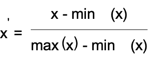

Python 中的示例：

```python
from sklearn.preprocessing import MinMaxScaler

# Normalize
scaler = MinMaxScaler()
normalized_data = scaler.fit_transform(df)
print(normalized_data)
```

输出：
[[0. 0.]
 [0.5 0.5]
 [1. 1.]]

## 12.3.3 对数变换

“对数变换”用每个数据点的对数（通常为以 10 为底或自然对数）替换，以压缩数据的尺度。该技术通常用于减少分布的偏斜，使其更适合统计分析。对于遵循对数正态分布的数据尤其有效。通过将乘法关系转换为加法关系，对数变换促进了线性模型中更好的解释和可用性。

简而言之，对数变换通过应用对数函数来减少数据的偏斜。

公式：
`x' = log(x+1)`

Python 中的示例：

```python
import numpy as np

# Apply log transformation
df['Log_Feature1'] = np.log1p(df['Feature1'])
print(df)
```

输出：
Feature1 Feature2 Log_Feature1
0 10 5 2.397895
1 20 15 3.044522
2 30 25 3.433987

## 12.3.4 分箱

分箱，也称为分桶，是一种特征工程技术，用于将数值分组到预定义的子范围或箱中。此过程通常将数值数据转换为分类数据，使其更易于分析和解释。本质上，分箱将连续数据转换为离散类别或箱。

示例：将年龄分为“年轻”、“中年”和“老年”等组。

Python 中的示例：

```python
# Binning ages
bins = [0, 18, 35, 60, 100]
labels = ['Child', 'Youth', 'Adult', 'Senior']
df['Age_Group'] = pd.cut([15, 25, 40], bins=bins, labels=labels)
print(df)
```

输出：
Feature1 Feature2 Log_Feature1 Age_Group
0 10 5 2.397895 Child
1 20 15 3.044522 Youth
2 30 25 3.433987 Adult

# 12.4 数据编码


# 数据转换与编码

数据转换和编码是在为分析或机器学习准备数据时必不可少的步骤。这些过程对数据进行标准化、规范化或重新格式化，使其适用于分析工具和模型。在数据科学的背景下，“data encoding”是指将分类数据——例如文本或非数值值——转换为机器学习算法可以处理的数值格式。这种转换是必要的，因为算法只能在数值数据中识别模式和关系，这使得编码成为数据在用于机器学习模型之前的数据预处理管道中的关键步骤。

简而言之，数据编码将分类变量转换为机器学习算法可以处理的数值格式。

目的是使主要处理数值的机器学习算法能够通过将每个类别映射为数值来处理分类数据 such as "gender" (male/female) 或 "color" (red/blue/green)。

## 常见编码技术

- One-hot encoding: 为每个类别创建新的二进制列，其中仅相关类别设为 1，其他为 0。
- Label encoding: 每个唯一类别获得一个唯一的数值，但这仅在类别之间存在固有顺序时才进行（ordinal data）。
- Mean encoding: 用该类别目标变量的平均值替换每个类别。

这是数据准备中的关键步骤之一，以确保机器学习模型正确学习分类数据中的特征。

## 12.4 编码技术

### 12.4.1 One-Hot Encoding

在数据科学中，“one hot encoding”是一种将分类数据——例如颜色（red, green, blue）——转换为机器学习算法可以解释的数值格式的技术。本质上，它将类别转换为二进制列。

该过程为每个唯一类别创建新的二进制列，其中每个数据点只有一个列被标记为“hot”（值为 1），表示该类别的存在。所有其他列保持为 0，表示其缺失。这样，one hot encoding 将分类变量转换为每个类别作为单独二进制特征表示的格式。此方法使机器学习模型能够通过将其编码为数值来处理分类数据。

例如，如果你有一个“color”特征，其类别为“red”、“green”和“blue”，one hot encoding 将创建三个新列：`is_red`、`is_green`和`is_blue`。

示例：

Input: `["Red", "Green", "Blue"]`

Output:
Red  Green  Blue
1    0      0
0    1      0
0    0      1

Example in Python:
```python
from sklearn.preprocessing import OneHotEncoder

# One-hot encode
encoder = OneHotEncoder(sparse=False)
encoded_data = encoder.fit_transform(df[['Feature1']])
print(encoded_data)
```

### 12.4.2 Label Encoding

在数据科学中，Label Encoding 是一种通过为每个不同类别分配唯一整数将分类数据，例如文本标签，转换为数值表示的技术。此方法使机器学习算法能够有效地处理分类特征。Label encoding 提供了一种简单的方法来将分类数据转换为可由仅接受数值输入的模型使用的格式。本质上，它为每个类别分配唯一整数，促进了分类数据在机器学习模型中的使用。

与 Label Encoding 相关的要点：
- 用唯一整数替换分类变量中的每个唯一类别。
- 最适用于类别之间没有固有顺序或等级的标称分类数据。
- Label encoding 应该仅用于具有自然顺序（ordinal data）的分类数据，因为将其应用于无序类别可能会创建误导性的层级，从而混淆模型。对于标称分类数据，one-hot encoding 通常是更好的选择。

示例：

如果有一个特征名为“color”，其类别为“red”、“green”和“blue”，则 Label Encoding 可能分别将其编码为 0、1 和 2。

重要注意事项：Label Encoding 可以应用于序数和标称数据，但必须注意该技术假设类别之间没有内在顺序。当处理具有有意义顺序的序数数据，例如“small”、“medium”和“large”时，这一假设可能存在问题。此外，Label Encoding 在与基于距离的算法一起使用时可能会引起问题，例如 K-Nearest Neighbors (KNN)。Label Encoding 分配的任意数值可能导致算法计算中出现误导性模式，影响结果质量。

示例：

Input: `["Red", "Green", "Blue"]`

Output: `[0, 1, 2]`

Example in Python:
```python
from sklearn.preprocessing import LabelEncoder

# Label encode
encoder = LabelEncoder()
df['Encoded_Color'] = encoder.fit_transform(['Red', 'Green', 'Blue'])
print(df)
```

### 12.4.3 Frequency Encoding

在数据科学中，称为“frequency encoding”的技术涉及用该类别在数据集中的出现频率替换分类变量中的每个类别。本质上，此方法根据类别出现的频率为每个类别分配数值。换句话说，类别被其出现的频率所替代。

也称为“count encoding”，此方法在处理机器学习模型的分类特征时特别有用，其中更频繁的类别往往具有更大的影响。该过程通过计算数据集中每个类别的频率，然后用相应的频率值替换类别来工作。

Frequency encoding 易于实现，并且在类别频率为目标变量提供有用见解时尤其有益。它有助于降低维度，特别是对于基数高的特征。然而，当类别频率对目标变量没有信息价值时，此方法可能无效，并且可能对不平衡的类别分布敏感。

示例：

考虑一个数据集，其中包含一个“city”特征，其类别例如“New York”、“Los Angeles”、“Chicago”和“Miami”。使用 frequency encoding，类别“New York”在数据中出现 20%，将被分配 0.2 的值。同样，“Miami”出现 5% 的时间，将被分配 0.05 的值。此方法根据每个类别出现的频率将分类数据转换为数值。

Example in Python:
```python
# Frequency encoding
df['Category_Frequency'] = df['Feature1'].map(df['Feature1'].value_counts())
print(df)
```

### 12.4.4 Ordinal Encoding

在数据科学中，ordinal encoding 是一种通过为每个类别分配唯一整数同时保留类别之间固有顺序或等级关系，将分类数据转换为数值值的技术。本质上，这意味着为存在明确层级的分类数据分配数值，例如“small”、“medium”和“large”，其中“small”将被分配比“large”更低的值。简而言之，它根据类别的顺序或等级进行编码。

与其它编码技术不同，ordinal encoding 保持了类别之间的自然顺序，当类别的顺序对分析很重要时，这一点至关重要。此编码方法对于具有自然层级或顺序的分类变量特别有用，例如衬衫尺码（small, medium, large）、教育水平（high school, bachelor's, master's）或信用等级（poor, fair, good）。


然而，序数编码不适用于类别之间不存在自然顺序的分类变量。例如，对于红色、蓝色和绿色等颜色差异，使用序数编码可能导致误表示。如果类别之间的关系不是线性的，应用序数编码可能会导致机器学习模型做出错误的推断。

### 示例
如果您有一个分类变量 `quality`，其类别为 "low"、"medium" 和 "high"，序数编码可能会分别分配值 1、2 和 3，表示 "high" 被认为比 "medium" 质量更高。

### 示例
输入: `["Low", "Medium", "High"]`
输出: `[0, 1, 2]`

### Python 中的示例
```
from sklearn.preprocessing import OrdinalEncoder

# Ordinal encoding
ordinal_data = ['Low', 'Medium', 'High']
encoder = OrdinalEncoder(categories=[['Low', 'Medium', 'High']])
encoded_data = encoder.fit_transform([[cat] for cat in ordinal_data])
print(encoded_data)
```

## 12.4.5 各类编码技术的比较
| 编码技术 | 描述 | 优点 | 缺点 | 用例 |
| --- | --- | --- | --- | --- |
| One-Hot Encoding | 将每个类别转换为二进制列（0 或 1）。 | - 无序数假设。 - 在处理许多特征的机器学习算法中效果良好。 | - 对于高基数特征会显著增加维度。 | 无序数关系的分类变量。 |
| Label Encoding | 为每个类别分配唯一的整数。 | - 简单易实现。 - 保持数据紧凑。 | - 暗示序数关系，可能误导某些模型。 | 如随机森林之类的树基算法。 |
| Frequency Encoding | 用数据集中出现的频率替换类别。 | - 保持数据紧凑。 - 反映类别分布。 | - 可能失去可解释性。 - 如果频率与目标不相关则用处不大。 | 大型分类数据集。 |
| Ordinal Encoding | 根据类别的自然顺序分配整数。 | - 保留序数关系。 - 简单易实现。 | - 需要正确排序类别。 - 如果顺序无意义可能误导模型。 | 具有有意义顺序的分类变量。 |
| Target Encoding | 用每个类别的目标变量均值替换类别。 | - 编码了与目标的关系信息。 - 降低维度。 | - 若处理不当易导致数据泄漏。 - 在小数据集中可能过拟合。 | 预测建模任务。 |
| Binary Encoding | 使用比独热编码更少的列将类别转换为二进制格式。 | - 相比独热编码降低维度。 - 处理高基数更好。 | - 编码列的解释可能具有挑战性。 | 高基数分类数据。 |
| Hashing Encoding | 使用哈希函数将类别映射为整数，通常具有固定数量的输出列。 | - 无论基数如何输出大小固定。 - 对大型数据集高效。 | - 可能发生哈希冲突。 - 失去可解释性。 | 大规模数据预处理管道。 |

**要点：**
- `One-Hot Encoding` 是名义数据的首选方法，但在高基数变量上应避免使用，因为会导致维度爆炸。
- `Label Encoding` 对树基模型效果良好，但不适合对序数关系敏感的模型，如线性回归。
- `Target Encoding` 对预测任务非常有效，但必须谨慎处理以避免数据泄漏。
- `Frequency Encoding` 和 `Binary Encoding` 适用于需要最小化维度的高基数数据集。
- `Hashing Encoding` 对流数据或非常大的数据集有用，但牺牲了可解释性。

根据数据的性质、机器学习算法和具体问题要求选择编码技术。

## 12.4.6 处理缺失或复杂类别
为了有效处理缺失的分类数据，一种方法是使用占位符（如 "Unknown"）或该类别中最频繁的值来替换缺失值。这种方法确保数据集保持完整，可用于分析或建模，而不会引入显著的偏差或错误。

另一种有用的技术是目标编码，它涉及用每个类别对应的目标变量均值替换类别。目标编码在预测建模中特别有益，因为它保留了分类变量与目标变量之间的关系，使模型能够有效利用此信息。

### 示例
```
# Target encoding
target_mean = df.groupby('Feature1')['Target'].mean()
df['Target_Encoded'] = df['Feature1'].map(target_mean)
```

# 12.5 数据转换和编码的应用
标准化通常用于支持向量机（`SVM`）和逻辑回归等算法中，有助于将所有特征带到共同的尺度。另一方面，`One-Hot Encoding` 对于决策树和线性回归等算法理想，这些算法需要以数值格式表示分类特征而不引入任何序数关系。对数变换对于减少数据集中的偏斜很有用，尤其是在财务数据或计数中，使分布更适合分析和建模。

### 最佳实践
为了确保有效的数据预处理，重要的是通过分析特征的分布和性质来理解数据。使用 `Scikit-learn` 管道可以通过将转换和编码步骤组合成单个管道来简化流程，使工作流程更高效且可重复。避免数据泄漏也很重要，这意味着在模型训练期间转换应仅使用训练数据执行。最后，测试多种方法是一种良好的实践，以尝试不同的转换和编码来确定最适合您模型的方案。

总之，数据转换和编码是准备原始数据以进行分析和建模的基本预处理步骤。通过选择适当的转换和编码方法，数据可以正确格式化、无偏见并针对机器学习算法进行定制。这最终增强了模型的性能，并确保数据被有效使用以得出有意义的见解。

# 12.6 实战：使用 pandas 预处理数据
数据预处理几乎是每个数据分析或机器学习工作流程中的重要步骤。`Pandas` 是一个强大的 Python 库，可促进高效的数据处理和准备。本教程涵盖了常见的预处理任务，例如管理缺失值、转换数据和编码分类特征，所有这些使用 `pandas` 都变得更简单高效。

### 加载数据
`Pandas` 使从 CSV、Excel 和数据库等各种来源加载数据变得容易。

#### 示例
```
import pandas as pd

# Load CSV data
df = pd.read_csv("data.csv")
print(df.head())
```

### 处理缺失值
#### 识别缺失数据
使用 `isnull()` 方法检测缺失值。
```
print(df.isnull())  # Boolean mask
print(df.isnull().sum())  # Count of missing values per column
```

#### 删除缺失值
使用 `dropna()` 删除包含缺失数据的行或列。
```
df_cleaned = df.dropna()  # Drop rows with missing values
df_cleaned = df.dropna(axis=1)  # Drop columns with missing values
```

#### 插补缺失值
使用 `fillna()` 用默认值或计算值替换缺失值。
```
df['Column1'].fillna(df['Column1'].mean(), inplace=True)  # Fill with mean
df['Column2'].fillna("Unknown", inplace=True)  # Fill with a placeholder
```

### 数据转换
缩放数据


使用 pandas 或外部库对数据进行归一化或标准化。

## 最小-最大缩放
```
df['Normalized_Column'] = (df['Column1'] - df['Column1'].min()) / (df['Column1'].max() - df['Column1'].min())
```

## Z-分数标准化
```
df['Standardized_Column'] = (df['Column1'] - df['Column1'].mean()) / df['Column1'].std()
```

## 对数变换
减少数据中的偏斜。
```
df['Log_Column'] = df['Column1'].apply(lambda x: np.log(x + 1))
```

## 分箱
将连续数据分组到离散区间中。
```
bins = [0, 18, 35, 60, 100]
labels = ['Child', 'Youth', 'Adult', 'Senior']
df['Age_Group'] = pd.cut(df['Age'], bins=bins, labels=labels)
```

## 编码分类数据
### 独热编码
将分类变量转换为哑变量。
```
df_encoded = pd.get_dummies(df, columns=['Category'], drop_first=True)
```
### 标签编码
将类别映射为整数。
```
df['Category_Encoded'] = df['Category'].astype('category').cat.codes
```

## 处理重复项
### 识别重复项
```
duplicates = df.duplicated()
print(duplicates.sum())  # Count duplicates
```
### 删除重复项
```
df_cleaned = df.drop_duplicates()
```

## 特征工程
### 创建新列
从现有特征派生新特征。
```
df['Total_Sales'] = df['Price'] * df['Quantity']
```
### 转换文本数据
从文本列中提取有用信息。
```
df['Word_Count'] = df['Review'].apply(lambda x: len(x.split()))
```

## 划分数据
将数据集拆分为训练集和测试集用于机器学习。
```
from sklearn.model_selection import train_test_split
X = df.drop('Target', axis=1)
y = df['Target']
X_train, X_test, y_train, y_test = train_test_split(X, y, test_size=0.2, random_state=42)
```

## 保存处理后的数据
保存清理和处理后的数据以供将来使用。
```
df.to_csv("processed_data.csv", index=False)
```

## 预处理的最佳实践
数据预处理的最佳实践包括使用 `head()`、`info()` 和 `describe()` 等函数检查数据以了解其结构。仔细处理缺失值也很重要，根据数据的上下文选择合适的插补策略。记录所有转换对于可重复性至关重要，确保过程可以准确复制。最后，验证预处理步骤能够提高数据质量而不引入错误，对于确保结果的可靠性至关重要。

总之，`pandas` 提供了强大的工具集，使数据预处理高效且简单。无论是处理缺失值、编码分类变量还是转换特征，`pandas` 都简化了为分析和建模准备数据的过程。掌握这些技术对于优化数据科学工作流程并确保准确、可操作的洞察至关重要。

# 12.7 章节复习问题

### 问题 1:
以下哪一项是数据集中缺失值的常见原因？
A. 错误的数据编码
B. 数据录入错误
C. 模型过拟合
D. 异常值检测

### 问题 2:
哪个 Pandas 函数用于识别 DataFrame 中的缺失值？
A. `df.describe()`
B. `df.info()`
C. `df.isnull()`
D. `df.head()`

### 问题 3:
处理数据集中缺失值的常见策略是什么？
A. 删除数据集中所有行
B. 用均值或中位数填充缺失值
C. 忽略缺失值
D. 应用独热编码

### 问题 4:
如何评估数据集中缺失值的影响？
A. 可视化数据分布
B. 分析缺失数据如何影响结果或特征
C. 归一化数据
D. 删除重复项

### 问题 5:
数据集中重复记录是什么？
A. 具有缺失值的记录
B. 所有列中完全相同的记录
C. 数据相似但不完全相同的记录
D. 异常值记录

### 问题 6:
哪个 Pandas 函数用于检测 DataFrame 中的重复行？
A. `df.isnull()`
B. `df.duplicated()`
C. `df.dropna()`
D. `df.drop_duplicates()`

### 问题 7:
哪种转换技术将数据重新缩放为均值为 0 且标准差为 1？
A. 标准化
B. 归一化
C. 对数变换
D. 分箱

### 问题 8:
哪种编码技术最适合具有许多唯一值的分类变量？
A. 独热编码
B. 标签编码
C. 频率编码
D. 序数编码

### 问题 9:
数据预处理中对数变换的目的是什么？
A. 减少数据分布的偏斜
B. 将数据缩放到特定范围
C. 从现有数据创建额外特征
D. 处理缺失值

### 问题 10:
以下哪一项是序数编码的示例？
A. 以无特定顺序为唯一类别分配数字
B. 根据数据集中出现的频率对类别进行编码
C. 根据层级为类别分配有序数值
D. 将每个类别表示为二进制变量

# 12.8 章节复习问题的答案

1. B. 数据录入错误
解释：缺失值通常由于数据录入错误而产生，例如信息不完整或数据收集过程不正确。

2. C. `df.isnull()`
解释：Pandas 中的 `df.isnull()` 函数用于识别 DataFrame 中的缺失值，返回一个布尔 DataFrame，其中 True 表示缺失值。

3. B. 用均值或中位数填充缺失值
解释：处理缺失值的常见策略是用列的均值或中位数填充它们，以保留数据集的结构。

4. B. 分析缺失数据如何影响结果或特征
解释：评估缺失值的影响涉及了解它们如何影响分析或结果，例如引入偏差或降低模型准确性。

5. B. 所有列中完全相同的记录
解释：重复记录是数据集中所有列的值完全相同的行，导致数据冗余。

6. B. `df.duplicated()`
解释：Pandas 中的 `df.duplicated()` 函数用于检测 DataFrame 中的重复行，返回一个布尔 Series，其中 True 表示重复项。

7. A. 标准化
解释：标准化将数据重新缩放为均值为 0 且标准差为 1，确保特征在分析和建模时处于同一尺度。

8. C. 频率编码
解释：频率编码适用于具有许多唯一值的分类变量，因为它用数据集中每个类别的频率替换该类别。

9. A. 减少数据分布的偏斜
解释：对数变换通过压缩较大值并增强较小值来减少数据的偏斜，使分布更对称。

10. C. 根据层级为类别分配有序数值
解释：序数编码为具有自然层级关系的类别分配有序数值，例如教育水平（例如，高中 = 1，学士 = 2）。

# 第 13 章 探索性数据分析 (EDA)
探索性数据分析 (EDA) 是数据科学中的关键步骤，有助于揭示数据集中的模式、趋势和异常。本章探讨用于可视化数据分布的技术，突出关键见解、工具和有效表示的最佳实践。它还涵盖使用统计方法和机器学习技术识别趋势和模式。此外，本章讨论异常值检测和处理，概述识别和处理数据中异常的方法。最后，一个动手实践部分提供了使用 Matplotlib 和 Seaborn 执行 EDA 的实用指导，为读者提供数据探索所需的视觉技能。

## 13.1 可视化数据分布


# 13.1 数据分布可视化

数据分布可视化在理解数据集中数据的分布、集中趋势和变异性方面发挥着关键作用。它有助于识别模式、检测异常值并为预处理步骤的决策提供信息。Python 提供了多个强大的库，例如 `Matplotlib`、`Seaborn` 和 `Plotly`，用于创建各种分布图，从而实现有效的分析和洞察提取。

## 13.1.1 可视化数据分布的常用技术

### 直方图

直方图显示指定区间（箱）内数据点的频率。

使用 `Matplotlib` 的示例：

```
import matplotlib.pyplot as plt

# Sample data
data = [10, 20, 20, 30, 30, 30, 40, 50]

# Plot histogram
plt.hist(data, bins=5, edgecolor="black")
plt.title("Histogram")
plt.xlabel("Value")
plt.ylabel("Frequency")
plt.show()
```

### 箱线图

箱线图可视化数据的分布情况，包括中位数、四分位数和潜在异常值。

使用 `Seaborn` 的示例：

```
import seaborn as sns

# Sample data
sns.boxplot(data=data)
plt.title("Box Plot")
plt.show()
```

### KDE 绘图

核密度估计（KDE）绘图表示数据的概率密度函数。

使用 `Seaborn` 的示例：

```
sns.kdeplot(data, shade=True)
plt.title("KDE Plot")
plt.show()
```

### 小提琴图

小提琴图结合了箱线图和 KDE，显示分布的密度。

使用 `Seaborn` 的示例：

```
sns.violinplot(data=data)
plt.title("Violin Plot")
plt.show()
```

### 散点图

散点图有助于可视化两个连续变量之间的关系。

使用 `Matplotlib` 的示例：

```
x = [1, 2, 3, 4, 5]
y = [10, 20, 25, 30, 50]
plt.scatter(x, y)
plt.title("Scatter Plot")
plt.xlabel("X")
plt.ylabel("Y")
plt.show()
```

### 配对图

配对图可视化数据集中成对的关系和分布。

使用 `Seaborn` 的示例：

```
import pandas as pd

# Sample data
df = pd.DataFrame({'A': [1, 2, 3], 'B': [10, 15, 20], 'C': [5, 10, 15]})
sns.pairplot(df)
plt.show()
```

## 13.1.2 可视化中的关键洞察

正态分布：钟形曲线，大多数值集中在均值周围。可使用直方图、KDE 绘图或 Q-Q 绘图检测。

偏度：偏度是指数据分布的不对称性。当尾部更向右延伸时，分布被认为具有正偏，表明大多数数据点集中在左侧，而少数较大值拉动尾部。

另一方面，当尾部向左延伸时，会出现负偏，表明大多数数据点集中在右侧，而少数较小值形成左尾。偏度可通过直方图或核密度估计（KDE）绘图等可视化技术有效观察，这些技术有助于识别数据中偏度的程度和方向。

异常值：远离大多数数据点的极值。可使用箱线图或散点图识别。

多峰分布：数据中存在多个峰。可在直方图或 KDE 绘图中看到。

## 13.1.3 可视化分布的工具

| 库 | 图表类型 | 最佳使用场景 |
|---|---|---|
| `Matplotlib` | 直方图, 散点图 | 简单图表用于快速可视化。 |
| `Seaborn` | KDE, 箱线图, 配对图 | 高级且美观的可视化。 |
| `Plotly` | 交互式直方图 | 交互式和动态可视化。 |
| `Pandas` | 直方图, 折线图 | 使用内置图表进行快速探索性分析。 |

### 组合多个图表

叠加不同图表以比较分布。

示例：带 KDE 的直方图：

```
sns.histplot(data, kde=True)
plt.title("Histogram with KDE")
plt.show()
```

## 13.1.4 分布可视化的最佳实践

分布可视化的最佳实践包括多个重要步骤。首先，为数据选择合适的图表：直方图非常适合频率分析，而 KDE（核密度估计）绘图更适合平滑的密度曲线。小提琴图和箱线图可用于比较不同类别间的分布。其次，为直方图使用合适的箱大小，以确保其准确表示数据。第三，通过使用箱线图或散点图突出异常值，使极值易于识别。此外，始终清晰地标记轴和标题，以确保图表可理解且可解释。最后，通过使用颜色和网格线来自定义图表以提高可读性，这增强了可视化的清晰度。

总之，数据可视化在数据分析中发挥着至关重要的作用。它使用直方图、箱线图和 KDE 绘图等工具提供有关模式、偏度和异常值的宝贵见解。借助 `Matplotlib`、`Seaborn` 和 `Plotly` 等 Python 库，您可以有效地分析和呈现数据分布，为更高级的分析和建模奠定坚实的基础。

# 13.2 识别趋势和模式

识别数据中的趋势和模式是数据分析过程中的关键步骤。这种做法能够提取有价值的信息，以了解潜在的行为、关系和异常，进而为决策提供信息并为预测建模生成洞察。此任务使用的工具通常涉及统计方法、可视化技术和机器学习算法的结合。

## 13.2.1 趋势和模式的类型

趋势和模式是数据分析中的基本概念，因为它们有助于揭示数据集中潜在的行为和关系。趋势是指数据点随时间移动的总体方向。例如，上升趋势表示增长或增加，而下降趋势表示下降或收缩。季节性趋势突出了在特定间隔出现的重复模式，例如假日季节期间月度销售额激增。

另一方面，模式侧重于数据内部的重复行为或关系。循环模式表示围绕趋势的长期波动，例如经济周期。季节性描述短期、规律性的变化，如特定时间网站流量的日峰值。然而，异常值是与数据集其余部分显著不同的数据点，通常表示错误、罕见事件或特殊情况。理解这些趋势和模式对于数据驱动的决策和预测至关重要。

## 13.2.2 识别趋势和模式的工具和技术

### 折线图

折线图是通过用线连接数据点来可视化随时间变化的趋势的宝贵工具。它有效地突出时间序列数据中的变化、模式和比较，例如股价或月度销售额。折线图易于创建，并得到 `Matplotlib` 等可视化工具的广泛支持，使其成为数据科学中趋势分析的重要工具。

示例：

```
import matplotlib.pyplot as plt

# Sample data
time = [1, 2, 3, 4, 5]
values = [100, 200, 150, 300, 250]
plt.plot(time, values)
plt.title("Line Chart: Trend Over Time")
plt.xlabel("Time")
plt.ylabel("Values")
plt.show()
```

### 移动平均

移动平均通过计算滑动窗口内数据点的平均值来平滑时间序列数据。此过程减少噪声并更清晰地突出趋势。在数据科学中，移动平均对于识别长期模式同时过滤短期波动至关重要，使其成为趋势分析的理想选择。像 Python 的 `pandas` 库这样的工具提供了内置函数，可高效计算移动平均。

示例：

```
import pandas as pd

# Sample data
data = {'values': [100, 200, 150, 300, 250]}
df = pd.DataFrame(data)

# Compute moving average
df['Moving_Avg'] = df['values'].rolling(window=2).mean()
print(df)
```


### 散点图
散点图是数据科学中可视化两个连续变量之间关系的重要工具。通过在二维图表上绘制数据点，散点图可以帮助识别相关性、聚类和异常值，从而促进趋势和模式的检测。借助 `Matplotlib` 和 `Seaborn` 等库提供的可定制功能，在 Python 中创建散点图非常简单，使其成为数据分析的多功能工具。

**示例：**
```
import matplotlib.pyplot as plt

x = [1, 2, 3, 4, 5]

y = [10, 20, 25, 30, 50]

plt.scatter(x, y)

plt.title("Scatter Plot")

plt.xlabel("X")

plt.ylabel("Y")

plt.show()
```

### 热力图
热力图是数据科学中的一种强大工具，通过使用强调关系、趋势和模式的颜色渐变来可视化数据矩阵。它们在识别变量之间的相关性以及在大型数据集中发现聚类或异常方面特别有效。`Seaborn` 和 `Matplotlib` 等库使创建热力图变得容易，从而促进高效的数据探索和分析。

**示例：**
```
import seaborn as sns

# Sample data
data = [[1, 2, 3], [4, 5, 6], [7, 8, 9]]

sns.heatmap(data, annot=True)

plt.title("Heatmap")

plt.show()
```

### 时间序列分解
时间序列分解是数据科学中用于将时间序列数据分解为其基本组成部分（趋势、季节性和残差）的方法。这种技术对于识别长期趋势、识别重复的季节性模式以及检测数据中的异常或噪声特别有用。像 `statsmodels` 这样的 Python 库提供了执行加法和乘法分解的强大工具，使这一过程更易于进行有效的时间序列分析。

**示例：**
```
from statsmodels.tsa.seasonal import seasonal_decompose

# Sample data
data = pd.Series([100, 150, 200, 250, 300, 350, 400], index=pd.date_range("2023-01-01", periods=7))

result = seasonal_decompose(data, model='additive')

result.plot()

plt.show()
```

## 13.2.3 用于模式检测的统计方法

### 相关性分析
相关性分析是一种用于量化两个变量之间关系强度和方向的统计技术。它有助于确定一个变量的变化是否对应于另一个变量的变化，其取值范围从 -1（表示完全负相关）到 +1（表示完全正相关）。在数据科学中，了解相关性对于识别变量之间的依赖关系至关重要，这反过来又为预测分析中的特征选择和模型开发提供信息。

**示例：**
```
import numpy as np

# Sample data
x = np.array([1, 2, 3, 4, 5])
y = np.array([10, 20, 25, 30, 50])

correlation = np.corrcoef(x, y)

print("Correlation Coefficient:", correlation[0, 1])
```

### 回归分析
回归分析是一种用于建模和量化因变量与自变量之间关系的统计技术。该方法通过检查一个或多个自变量的变化如何影响因变量来识别模式。线性回归等常见技术经常用于趋势检测、预测和对未来结果进行预测，使其成为数据科学中理解关系和指导决策的重要工具。

**示例：**
```
from sklearn.linear_model import LinearRegression
import numpy as np

# Sample data
X = np.array([1, 2, 3, 4, 5]).reshape(-1, 1)
y = np.array([10, 20, 25, 30, 50])

model = LinearRegression()
model.fit(X, y)

print("Slope:", model.coef_)
print("Intercept:", model.intercept_)
```

## 13.2.4 用于趋势和模式识别的机器学习
机器学习在识别数据集中的趋势和模式方面非常有效。聚类是一种关键技术，其中相似的数据点被分组在一起，揭示隐藏的模式，例如客户细分或产品分组。`K-Means` 和 `Hierarchical Clustering` 等算法可以根据购买行为对客户进行聚类。异常检测是另一个重要应用，使用 `Isolation Forest` 或 `DBSCAN` 等算法来识别数据中的异常值或不寻常模式，这可能预示着欺诈、错误或罕见事件。

此外，`ARIMA` 和 `Prophet` 等预测模型通过分析历史数据来预测未来趋势至关重要。这些模型在时间序列数据方面表现出色，帮助组织根据未来变化的预测做出数据驱动的决策。

#### 最佳实践
通过处理缺失值和异常值来预处理数据，以确保结果准确。选择合适的可视化至关重要；使用折线图表示趋势，使用散点图表示关系，使用热力图表示相关性。结合技术也很重要，例如将统计方法和机器学习方法结合使用以获得更深入的见解。最后，始终验证结果，以确保趋势和模式不是由噪声或预处理错误引起的。

总之，识别趋势和模式对于理解数据和提取可操作的见解至关重要。通过利用可视化、统计分析和机器学习等方法，数据科学家可以揭示隐藏的关系并高效地做出明智的数据驱动决策。

# 13.3 异常值检测与处理
异常值是与数据集其余部分显著偏离的数据点。它们可能源于测量错误、数据录入错误或自然变异。正确检测和处理异常值至关重要，因为它们会影响统计分析的准确性、扭曲模型并降低预测的可靠性。

#### 为什么异常值重要
由于异常值可能对结果产生影响，它们在数据分析和建模中发挥着重要作用。它们可以通过提高或降低其值来扭曲统计度量，例如均值和标准差，这可能导致误导性解释。在机器学习模型中，特别是基于回归的模型中，异常值可以通过将模型拉向极值来使预测产生偏差，最终降低其整体准确性。

然而，并非所有异常值都应被负面对待。它们可以提供有关罕见事件或异常的有价值见解，例如检测欺诈活动或识别需要特别关注的不寻常案例。妥善管理异常值对于确保数据驱动决策的完整性和可信度至关重要。

## 13.3.1 异常值检测方法

### 可视化技术

#### 箱线图
箱线图是一种可视化技术，显示数据的分布情况，突出显示中位数、四分位数以及作为须线外点的潜在异常值。它是检测和可视化数据集中异常值的快速有效方法。

**示例：**
```
import seaborn as sns

sns.boxplot(data=[10, 20, 30, 100])
```

#### 散点图
散点图是通过绘制两个连续变量之间的关系来识别异常值的有效可视化技术。异常值通常表现为与数据点主集群显著距离的点，使其在视觉上易于发现。

**示例：**
```
import matplotlib.pyplot as plt

x = [1, 2, 3, 4, 5]
y = [10, 20, 15, 30, 500]  # Outlier
plt.scatter(x, y)

plt.show()
```

### 统计方法

#### Z-Score
`Z-Score` 是一种用于异常值检测的统计方法，用于衡量数据点与均值的偏差程度，以标准差为单位。Z-Score 超过某一阈值（例如 ±3）的点被视为异常值，表明它们与数据其余部分显著不同。

公式：Z= 

**示例：**
```
from scipy.stats import zscore
import pandas as pd

data = pd.Series([10, 20, 30, 100])  # Outlier
z_scores = zscore(data)

print(z_scores)
```


## 13.3.1 异常值检测方法

### IQR（四分位距）
`IQR`（四分位距）是一种统计方法，用于通过测量中间 50% 数据的离散程度来检测异常值，计算公式为 `IQR = Q3 - Q1`。低于 `Q1 - 1.5 * IQR` 或高于 `Q3 + 1.5 * IQR` 的数据点将被标记为潜在异常值。简而言之，它将超出 1.5 倍 `IQR` 的数据点标记为异常值。

公式：`IQR = Q3 - Q1`

```
Q1 = data.quantile(0.25)
Q3 = data.quantile(0.75)
IQR = Q3 - Q1
lower_bound = Q1 - 1.5 * IQR
upper_bound = Q3 + 1.5 * IQR
print(data[(data < lower_bound) | (data > upper_bound)])
```

### 机器学习方法

#### 隔离森林
`IsolationForest` 是一种机器学习算法，旨在通过数据点被分离的难易程度来隔离数据中的异常值。它通过随机划分数据并识别需要更少分割的点作为异常值，从而高效地处理高维数据集。

简而言之，它通过在特征空间中隔离异常值来识别异常。

示例：
```
from sklearn.ensemble import IsolationForest
clf = IsolationForest(contamination=0.1)
predictions = clf.fit_predict([[10], [20], [30], [100]])  # Outlier
print(predictions)
```

#### DBSCAN（基于密度的具有噪声的空间应用聚类）
`DBSCAN` 通过基于密度对数据点进行聚类来识别异常值，将低密度区域的点标记为噪声。它对于具有不同聚类形状和大小的数据集特别有效。

简而言之，它对数据进行聚类并将异常值识别为噪声点。

## 13.3.2 异常值处理方法

### 删除异常值
如果异常值源于错误或无关事件，则将其删除。

```
cleaned_data = data[(data >= lower_bound) & (data <= upper_bound)]
```

### 插补异常值
用均值/中位数替换异常值：插补异常值涉及用数据集的均值或中位数替换极值，确保它们不再扭曲整体分析。当数据呈正态分布或保持数据集大小至关重要时，此方法特别有效。

```
data[data > upper_bound] = data.median()
```

最近邻：使用最近邻插补异常值涉及根据数据集中相似的数据点估计其值。此方法利用 K-最近邻（`KNN`）等算法用更符合上下文的值替换异常值，保持整体数据结构。简而言之，使用 `KNN` 来估计异常值。

### 转换数据
转换是减少异常值影响的有效技术，而无需完全将其从数据集中移除。两种常见的转换方法是对数转换和裁剪，它们可以帮助规范化数据分布并最小化极值的影响。

对数转换：对数转换通过应用对数函数来压缩数据的范围，尤其适用于正偏态数据集。此方法在保留相对顺序的同时减少大值的幅度，使数据对异常值不那么敏感。

```
data = np.log(data + 1)
```

裁剪：裁剪通过设置预定义的下限和上限来限制数据集中值的范围。低于下限的值被设为下限，高于上限的值被设为上限。此方法有助于控制极值，同时保持其余数据完整。简而言之，限制极值。

```
data = data.clip(lower_bound, upper_bound)
```

## 13.3.3 最佳实践
为了有效管理异常值，至关重要的是了解其发生的上下文，确定它们是数据录入错误还是有意义的异常。根据数据类型和上下文选择适当的异常值检测和处理方法。在修改数据集时，验证更改以确保删除或处理异常值不会扭曲整体数据分布。此外，如果异常值代表欺诈等有意义的事件，请单独处理以进行异常分析，而不是删除它们，因为它们可能提供有价值的见解。

总之，识别和管理异常值对于确保数据分析的质量和可靠性至关重要。异常值可以通过多种技术有效检测，包括可视化、统计方法和机器学习算法。对这些异常的适当处理——无论是通过删除、插补还是转换——都能确保它们不会扭曲统计评估或机器学习模型的结果，最终带来更准确、更稳健的发现。

# 13.4 实战：使用 Matplotlib 和 seaborn 进行 EDA
探索性数据分析（`EDA`）涉及可视化和汇总数据以揭示模式、关系和异常。`Matplotlib` 和 `Seaborn` 等 Python 库是在 `EDA` 期间创建有效可视化的必备工具。

## 设置
首先导入必要的库并加载数据集。

```
import pandas as pd
import matplotlib.pyplot as plt
import seaborn as sns
# Load a sample dataset
df = sns.load_dataset("tips")
print(df.head())
```

## 单变量分析
直方图（`Matplotlib`）：可视化单个变量的分布。

```
plt.hist(df['total_bill'], bins=10, edgecolor='black')
plt.title('Histogram of Total Bill')
plt.xlabel('Total Bill')
plt.ylabel('Frequency')
plt.show()
```

KDE Plot（`Seaborn`）：显示变量的概率密度。

```
sns.kdeplot(df['total_bill'], shade=True)
plt.title('KDE Plot of Total Bill')
plt.show()
```

箱线图（`Seaborn`）：突出显示离散程度、四分位数和异常值。

```
sns.boxplot(x=df['total_bill'])
plt.title('Box Plot of Total Bill')
plt.show()
```

## 双变量分析
散点图（`Matplotlib`）：显示两个连续变量之间的关系。

```
plt.scatter(df['total_bill'], df['tip'])
plt.title('Scatter Plot of Total Bill vs Tip')
plt.xlabel('Total Bill')
plt.ylabel('Tip')
plt.show()
```

成对图（`Seaborn`）：显示数值变量所有成对组合的散点图。

```
sns.pairplot(df)
plt.show()
```

相关性热力图（`Seaborn`）：可视化数值变量之间的相关性。

```
correlation_matrix = df.corr()
sns.heatmap(correlation_matrix, annot=True, cmap='coolwarm')
plt.title('Correlation Heatmap')
plt.show()
```

## 分类分析
条形图（`Seaborn`）：比较类别的计数。

```
sns.countplot(x='day', data=df)
plt.title('Count Plot of Days')
plt.show()
```

小提琴图（`Seaborn`）：结合箱线图和 KDE 显示类别的分布。

```
sns.violinplot(x='day', y='total_bill', data=df)
plt.title('Violin Plot of Total Bill by Day')
plt.show()
```

带类别的箱线图（`Seaborn`）：分析不同类别下数值变量的分布。

```
sns.boxplot(x='day', y='total_bill', hue='sex', data=df)
plt.title('Box Plot of Total Bill by Day and Gender')
plt.show()
```

## 多变量分析
FacetGrid（`Seaborn`）
有助于在多个类别间可视化复杂关系。

```
g = sns.FacetGrid(df, col="time", row="sex")
g.map(sns.scatterplot, "total_bill", "tip")
plt.show()
```

Pair Plot with Hue（`Seaborn`）
为散点图添加分类变量。

```
sns.pairplot(df, hue='sex')
plt.show()
```

## 自定义可视化
添加标题和标签

```
plt.scatter(df['total_bill'], df['tip'])
plt.title('Custom Scatter Plot')
plt.xlabel('Total Bill ($)')
plt.ylabel('Tip ($)')
plt.grid(True)
plt.show()
```

调整颜色和样式

```
sns.set_style('whitegrid')
sns.histplot(df['total_bill'], kde=True, color='purple')
plt.title('Styled Histogram of Total Bill')
plt.show()
```

## 组合多个图表
使用多个图表创建仪表板以进行全面的 `EDA`。

```
fig, axes = plt.subplots(2, 2, figsize=(12, 8))
sns.histplot(df['total_bill'], kde=True, ax=axes[0, 0])
```


```python
sns.boxplot(x='day', y='total_bill', data=df, ax=axes[0, 1])
sns.scatterplot(x='total_bill', y='tip', data=df, ax=axes[1, 0])
sns.violinplot(x='time', y='total_bill', data=df, ax=axes[1, 1])
plt.tight_layout()
plt.show()
```

### 最佳实践

数据可视化的最佳实践涉及多个关键步骤，以确保清晰度和有效性。首先，通过使用 `df.info()` 和 `df.describe()` 来了解您的数据，在绘图前对数据集进行概览。然后，为分析选择合适的图表——使用直方图可视化分布，使用散点图检查关系，使用箱线图评估变异性。为避免过度绘制，请使用透明度 (`alpha`) 或对大型数据集进行采样。最后，始终通过添加标题、轴标签和图例为可视化添加上下文，以提高其可解释性。

总之，使用 `Matplotlib` 和 `Seaborn` 进行 EDA 有助于揭示数据中的模式、关系和异常。通过结合可视化和统计摘要，这些库能够实现有效探索，为进一步的数据分析或建模提供坚实基础。

## 13.5 章节复习问题

问题 1：

以下哪一项是可视化数据分布的常见技术？

A. 折线图

B. 直方图

C. 甘特图

D. 散点图

问题 2：

从可视化数据分布中可以获得什么见解？

A. 时间序列数据的趋势

B. 数据的变异性和离散程度

C. 两个变量之间的关系

D. 预测准确性

问题 3：

在 Python 中，哪个工具常用于可视化数据分布？

A. `TensorFlow`

B. `seaborn`

C. `SQLite`

D. `Scikit-learn`

问题 4：

可视化数据分布的最佳实践是什么？

A. 始终使用最鲜艳的图表

B. 根据数据类型和受众选择可视化方式

C. 在一个图表中包含所有可能的变量

D. 避免标注轴以保持图表简洁

问题 5：

以下哪一项是数据中趋势的例子？

A. 数据集中的异常值

B. 几个月内销售额持续增长

C. 数据集中的缺失值

D. 分布中的多峰

问题 6：

哪种统计方法用于识别数据中的模式？

A. 线性回归

B. 随机抽样

C. 数据缩放

D. 标签编码

问题 7：

检测异常值的常见方法是什么？

A. 分箱

B. Z 分数分析

C. 归一化

D. 独热编码

问题 8：

在异常值检测中，四分位距 (IQR) 用作什么？

A. 查找数据集的均值

B. 识别落在特定范围之外的数据点

C. 计算标准差

D. 填充缺失值

问题 9：

处理数据集中异常值的一种方法是什么？

A. 删除所有包含异常值的行

B. 用均值或中位数替换异常值

C. 完全忽略它们

D. 对整个数据集进行归一化

问题 10：

哪种机器学习技术可用于数据趋势检测？

A. 决策树

B. 聚类

C. 支持向量机 (SVMs)

D. 以上全部

## 13.6 章节复习问题答案

1. B. 直方图

解释：直方图是通过显示指定范围（箱）内数据点的频率来可视化数据分布的常见技术。

2. B. 数据的变异性和离散程度

解释：可视化数据分布有助于理解数据集的变异性、离散程度和形状，例如是否偏斜或对称。

3. B. `seaborn`

解释：Python 中的 `seaborn` 库广泛用于创建高级可视化，包括直方图、箱线图和 KDE 图，以可视化数据分布。

4. B. 根据数据类型和受众选择可视化方式

解释：可视化最佳实践包括为数据选择合适的图表类型，并确保其能有效向目标受众传达见解。

5. B. 几个月内销售额持续增长

解释：趋势是指数据随时间推移的一致模式或方向，例如变量的稳定增长或下降。

6. A. 线性回归

解释：线性回归是一种统计方法，通过对因变量和自变量之间的关系建模来识别数据中的模式。

7. B. Z 分数分析

解释：Z 分数分析是通过计算数据点与均值的标准差距离来检测异常值的常见方法。

8. B. 识别落在特定范围之外的数据点

解释：四分位距 (`IQR`) 用于通过识别低于 `Q1` - 1.5`IQR` 或高于 `Q3` + 1.5`IQR` 的数据点来检测异常值。

9. B. 用均值或中位数替换异常值

解释：处理异常值的常见方法是用均值或中位数等集中趋势度量值替换它们，以减少其影响。

10. D. 以上全部

解释：机器学习技术如决策树、聚类和 SVM 可用于检测数据中的趋势和模式，具体取决于问题类型和数据集。


# 第 14 章. 机器学习简介

机器学习 (ML) 是一种变革性技术，使计算机能够从数据中学习并在无需显式编程的情况下进行预测。本章介绍 ML 的基础知识，涵盖其定义和核心原则。它还追溯了 ML 的历史和演变，突出了从早期统计方法到现代深度学习进步的关键里程碑。此外，本章探讨了机器学习在计算机科学中的重要性——尽管简洁，本章为理解 ML 及其对技术和社会日益增长的影响提供了坚实的基础。

## 14.1 什么是机器学习

机器学习 (ML) 是一个变革性领域，是人工智能 (AI) 的核心，使机器能够在无需显式编程的情况下从数据中学习和改进。虽然 AI 涵盖了从决策到自然语言处理的广泛能力，但机器学习专注于使系统能够识别模式、做出预测并随时间适应的算法和模型。在 ML 中，三种主要学习方法——监督学习、无监督学习和强化学习——为其多样化应用提供了基础。

监督学习利用标记数据训练模型，而无监督学习则在未标记的数据集中发现隐藏模式。另一方面，强化学习使用奖励和惩罚系统来引导机器实现最佳决策，类似于人类从经验中学习的方式。

机器学习的核心是数据，它充当驱动这些算法的燃料。收集、清理和准备数据的过程与为给定问题选择合适的模型一样关键。数据预处理确保输入可靠、一致且有意义，从而能够创建准确且稳健的模型。模型选择同样至关重要，因为选择合适的算法会影响从预测准确性到计算效率的一切。

然而，机器学习尽管强大，但也伴随着伦理考量。数据或算法中的偏差可能导致不公平的结果，使得伦理意识成为负责任的 ML 开发的基石。


展望未来，机器学习的未来既令人兴奋又具有变革性。从革新医疗保健和金融等行业到推进自主系统，ML 有望重塑我们的生活和工作方式。然而，在保持公平、透明和问责的同时扩展这些技术的挑战将决定其前进的道路。无论你是好奇的新手还是有抱负的从业者，探索机器学习的原理和潜力都是一种邀请，让你参与到重新定义创新边界的领域中。

## 14.2 机器学习的历史与演进

机器学习（ML）有着引人入胜的历史，可追溯至 1950 年代，当时“教会机器‘学习’”的想法首次被提出。1959 年，计算机科学先驱 Arthur Samuel 将机器学习定义为计算机无需显式编程即可从数据中学习的能力。Samuel 创建了一个程序，使计算机能够下跳棋并通过学习自己玩过的游戏而随时间推移不断改进——这是自我改进机器的最早例子之一。几乎在同一时期，20 世纪 60 年代，Frank Rosenblatt 开发了感知器，这是一种模仿人类大脑神经元处理信息方式的简单模型。Rosenblatt 的工作引入了在决策中使用权重和阈值的思想，为现代神经网络奠定了基础。

然而，在 20 世纪 70 年代和 80 年代，由于重大挑战，进展放缓。有限的计算能力和缺乏足够的数据使得机器学习模型难以处理复杂任务。在此期间出现了“AI 寒冬”，因为人们对人工智能和机器学习能够实现什么的期望超过了现实可能。资金和对该领域的兴趣减少，研究人员面临着艰难的斗争。

事情在 20 世纪 90 年代随着统计学习理论的突破而开始改变。Vladimir Vapnik 及其同事提出了支持向量机（SVM）的概念，它成为现代 ML 的基石。SVM 通过找到类别之间的最优边界，为数据分类提供了一种稳健的方法。这是向前迈出的重大一步，因为它使研究人员能够构建更可靠的模型，从而更好地推广到新数据。此期间还见证了概率模型的重要性日益增长，例如隐马尔可夫模型（HMMs），它们被广泛用于语音识别和其他领域。

到 2000 年代，计算能力的进步、庞大数据集的可用性（得益于互联网）以及图形处理单元（GPU）的兴起彻底革新了机器学习。深度学习，一种基于多层神经网络的先进 ML 形式，开始受到关注。诸如卷积神经网络（CNNs）和循环神经网络（RNNs）等算法解锁了图像识别、自然语言处理等领域的能力。如今，ML 无处不在，驱动着推荐系统、自动驾驶汽车、语音助手和医疗诊断等技术。

对于今天涉足计算机科学的学生而言，机器学习是一个关键的研究领域。它处于数学、编程和现实世界问题解决的交叉点。随着其应用遍及几乎每个行业，理解机器学习不仅打开了令人兴奋的职业机会之门，也使学生处于创新的前沿。ML 的历程——从早期的感知器到今天先进的深度学习模型——凸显了坚持、好奇心以及克服挑战的驱动力的重要性。随着计算能力的增长和数据获取的不断扩大，机器学习塑造未来的潜力是无限的。有抱负的计算机科学家有机会为这一不断发展的领域做出贡献，并在塑造明天的世界中发挥重要作用。

## 14.3 机器学习在计算机科学中的重要性

机器学习（ML）是现代计算机科学的基石，革新了机器与数据交互和解决复杂问题的方式。其核心在于，ML 使计算机能够从数据中学习模式并做出预测，而无需显式编程。这种能力具有深远的影响，因为它使计算机能够处理以前不可能或手动实现过于资源密集的任务。

ML 在模式识别和数据分析方面发挥着最关键的作用之一。通过识别海量数据集中的模式，机器学习模型可以发现人类难以察觉的洞察和趋势。例如，在医疗保健领域，ML 用于检测医学图像中的异常，例如在 X 射线或 MRI 扫描中识别肿瘤。在金融领域，它通过发现异常支出行为来帮助检测欺诈交易。这种分析数据和识别模式的能力是人工智能进步的基础。

ML 在开发前沿应用方面也发挥着关键作用，例如自动驾驶汽车。自动驾驶汽车依赖 ML 算法处理来自摄像头、传感器和 GPS 系统的输入，以了解周围环境、识别障碍物并做出实时驾驶决策。同样，像 Siri、Alexa 和 Google Assistant 这样的虚拟助手利用 ML 来理解自然语言、识别语音命令并提供个性化响应，使人机交互更直观。

另一个有影响力的应用是推荐系统，它驱动着 Netflix、Amazon 和 Spotify 等平台。ML 算法分析用户偏好、行为和模式以提供量身定制的建议，增强用户体验并推动参与度。无论是推荐新电影、产品还是播放列表，ML 都确保在正确的时间向正确的用户呈现正确的选项。

除了特定应用之外，ML 通过自动化改变了重复性任务的处理方式。AI 驱动的系统现在自动化单调和重复的过程，例如分类电子邮件、使用聊天机器人管理客户服务咨询以及进行数据录入。这不仅节省时间，还减少了人为错误并释放资源用于更具战略性和创造性的任务。

总之，机器学习对计算机科学至关重要，因为它使系统能够随着时间的推移学习、适应和改进。它识别模式、分析数据和自动化流程的能力已经改变了行业并改善了日常生活。随着 ML 的不断发展，其在解决复杂问题、推动创新和塑造技术未来方面的角色只会不断增长。对于计算机科学家而言，掌握 ML 不仅是一个机会，更是保持在这一变革性领域前沿的必要条件。

## 14.4 章节复习问题

问题 1：

机器学习的主要目标是什么？

A. 手动编程计算机执行特定任务

B. 使计算机能够从数据中学习并做出预测或决策

C. 完全取代统计分析

D. 为所有可能的情况创建预定义规则

问题 2：

以下哪项最能描述机器学习的演进？

A. 它作为机器人技术的一部分出现并完全取代了神经网络

B. 它从统计建模和模式识别技术演进而来

C. 自 20 世纪 60 年代诞生以来它一直未发生变化

D. 它仅专注于计算机硬件的进步

问题 3：

为什么机器学习在计算机科学中被认为很重要？

A. 它仅提供一种分析小数据集的方法

B. 它完全消除了编程的需求

C. 它允许系统通过经验在没有显式编程的情况下改进和适应

D. 它仅用于自动化重复性任务

问题 4：

以下哪项是机器学习的现实世界应用？

A. 识别垃圾邮件


B. 创建 3D 动画

C. 设计电路板

D. 运行操作系统

问题 5：

机器学习历史上最早的里程碑之一是什么？

A. `Python` 编程语言的开发

B. 20 世纪 50 年代神经网络的引入

C. 基于云的机器学习工具的创建

D. 用于深度学习的 GPU 的开发

# 14.5 章节复习题答案

1. B. 使计算机能够从数据中学习并做出预测或决策
解释：机器学习的主要目标是让计算机分析数据、学习模式，并在没有为特定任务显式编程的情况下做出预测或决策。

2. B. 它源于统计建模和模式识别技术
解释：机器学习源于统计方法和模式识别技术，为其在预测建模和决策中的应用奠定了基础。

3. C. 它允许系统通过经验在没有显式编程的情况下改进和适应
解释：机器学习很重要，因为它使系统能够从数据中学习并随着时间的推移提高性能，而无需手动基于规则的编程。

4. A. 识别垃圾邮件
解释：机器学习的一个常见现实世界应用是垃圾邮件检测，其中算法根据数据中的模式将电子邮件分类为垃圾邮件或非垃圾邮件。

5. B. 20 世纪 50 年代神经网络的引入
解释：机器学习历史上的最早里程碑之一是 20 世纪 50 年代神经网络的引入，这为现代深度学习技术奠定了基础。

# 15 机器学习基础

机器学习是人工智能的核心方面，使系统能够从数据中学习模式并做出预测。本章探讨学习问题、构建与训练模型的区分以及学习系统中假设的作用。它介绍了关键学习算法，如 `Find-S`、`List-Then-Eliminate` 和 `Candidate Elimination`，以及归纳偏置和机器学习过程等概念。涵盖了特征、标签、数据编码和特征缩放等基本主题，以及监督学习与无监督学习的比较。本章还解释了过拟合和欠拟合等挑战，并介绍了 `scikit-learn`，这是一个广泛使用的 `Python` 库。到最后，读者将获得机器学习基础的坚实基础，并使用 `scikit-learn` 构建他们的第一个模型。

## 15.1 学习问题

在机器学习中，学习问题是指我们希望机器（计算机）学习如何基于数据进行预测、对事物进行分类或发现模式的情况。这些问题本质上是机器使用示例（数据）来弄清如何在未来解决类似任务，而无需显式编程的任务。

学习问题的类型

监督学习：机器从有标签数据（答案已提供）中学习。例如，基于 `size` 和 `location` 预测房价，其中过去的数据包括特征（`size`、`location`）和房价（标签）。

无监督学习：机器从无标签数据（未提供答案）中学习。例如，根据购物行为对客户进行分组，而不知道“正确”的分组是什么。

强化学习：机器通过试错学习，根据其行动获得奖励或惩罚，就像教机器人走路一样。

### 良好定义的学习问题

良好定义的学习问题是指以下三个要素明确指定的问题：

任务：我们希望机器做什么。例如，“预测明天的温度”或“将电子邮件分类为 `spam` 或不是 `spam`。”

性能度量：我们如何衡量成功。例如，预测的准确性或电子邮件被正确分类的频率。

经验：机器从中学习的数据或过程。例如，历史天气数据或标记为 `spam` 或不是 `spam` 的电子邮件数据集。

如果这三个组成部分明确定义，学习问题就变得良态，并允许我们评估机器学习和表现的好坏。

#### 良好定义的学习问题的示例

任务：预测房价。

性能度量：`Mean Squared Error`（预测与实际价格的偏差程度）。

经验：房屋特征（`size`、`number of rooms`、`location`）及其实际售价的数据集。

为什么重要？拥有良好定义的学习问题可确保：
• 机器知道要学习什么。
• 我们可以衡量它是否正确学习。
• 它避免了解决问题中的混淆或歧义。

简而言之，就像给机器提供清晰的指令和工具，以便成功完成手头的任务！

## 15.2 机器学习模型 -- 构建 vs. 训练

想象你正在教一个机器人识别动物。首先，你向机器人展示大量猫和狗的图片，并告诉它，“这是一只猫”或“这是一只狗”。在看到足够多的图片后，机器人学会了自行猜测新图片中显示的是猫还是狗。这就是我们所说的机器学习模型——一个从示例中学习的智能机器人。

现在，当我们说构建模型时，就像选择我们想要的机器人类型一样。例如：
• 它应该超快学习但可能犯一些错误吗？（像一个有趣的猜谜游戏）
• 还是应该花很长时间学习但非常谨慎？（像一个完美主义者）

在 `Python` 中，当我们使用像 `scikit-learn` 这样的库时，机器人（或“模型”）已经为我们做好了——就像得到一个机器人套件。我们只需选择我们想要的机器人类型（比如猫狗猜测机器人或数字猜测机器人），然后通过展示示例来训练它。因此，我们并不是真正构建机器人；我们只是教它（训练它）以更好地完成工作。

简而言之：
• 构建模型 = 决定我们需要什么样的机器人。
• 训练模型 = 通过展示示例来教那个机器人。

在 `scikit-learn` 中，大多数“构建”工作已经为我们完成，我们直接进入训练。酷吧？

## 15.3 什么是假设

在机器学习中，假设就像计算机对事物如何运作做出的猜测。想象你正在试图弄清楚你的朋友会带多少糖果上学。你可能会猜测，“他们拥有的钱越多，他们带来的糖果就越多。”这个猜测就是你的假设。

对于计算机来说，假设是它试图学习规则。例如，它可能会猜测，“如果温度升高，更多的人会买冰淇淋。”然后，它使用数据测试该猜测，看看它是否正确或错误。如果错误，计算机就会调整猜测并继续尝试，直到找到最好的规则来做出良好的预测。因此，假设只是计算机用来解决问题的起点。

简单来说，假设就像“有根据的猜测”或基于你所知道或观察到的“合理假设”。它不仅仅是随机猜测——它是有推理依据的猜测。在机器学习中，它是计算机开始使用规则或公式来解释输入（如温度或金钱）如何与输出（如冰淇淋销售或糖果）相连的方式。

你可以把假设看作“有推理的猜测”。计算机做出这个初始猜测，然后使用数据来检查和改进它，直到猜测效果良好！

### 零假设

零假设就像说，“我认为没有什么特别的事情发生。”它是一个起始猜测，认为没有效果、没有变化或两件事之间没有差异。


例如，想象你在测试一种新口味的糖果。零假设将会是：“人们喜欢新糖果和旧糖果一样。”这就像说，“两者之间没有区别。”

现在，你把糖果给朋友们品尝，如果大多数人都更喜欢新糖果，你可能会决定零假设是错误的。但在有证据之前，你首先假设零假设为真。这就像从一个公平而简单的猜测开始！

# 15.4 设计学习系统

设计机器学习系统涉及定义系统学习、改进并提供有意义结果的过程。以下是设计的结构化方法：

理解问题：首先，理解问题至关重要。明确定义任务、性能指标和经验，以确保问题定义明确。指定目标：是预测、分类、聚类还是强化？这种基础性的理解确保学习问题具有针对性和可操作性。

收集数据：接下来，重点放在收集数据上。收集相关且高质量的数据用于训练系统。数据应代表你试图解决的问题，以避免偏差或误导。良好的数据是任何成功机器学习模型的骨干。

选择模型：在数据收集后，选择模型。选择最适合该问题的算法或模型类型，例如线性回归、决策树或神经网络。此选择取决于任务属于监督学习、无监督学习还是强化学习。

训练模型：一旦模型选定，下一步就是训练模型。使用训练数据教会模型数据内部的关系或模式。在训练期间，优化模型参数以最小化误差，通常使用梯度下降等技术。

评估模型：训练后，评估模型至关重要。使用适当的性能指标，如准确率、精确率、召回率、F1 分数或均方误差，来评估模型在未见过的验证数据上的质量。这确保模型在训练数据之外也能表现良好。

改进模型：如果模型性能不令人满意，则改进模型。这可能涉及调整超参数、添加更多数据或切换到不同的算法。也很重要处理诸如过拟合（当模型学习到噪声时）或欠拟合（当模型未能捕捉模式时）等问题。

部署和监控：最后，在真实系统环境中部署并监控模型。部署涉及将模型集成到生产环境中，使其能够实时进行预测或分类。部署后，持续监控模型并用新数据更新它，以保持其准确性和相关性。

按照这些步骤，可以设计出稳健有效的学习系统，高效解决现实世界问题。

### 机器学习中的问题

在设计和部署机器学习系统时，会出现多个需要仔细关注的挑战和问题。

数据相关问题：数据相关问题是最具挑战性的问题之一。数据不足可能导致模型性能不佳，因为小规模或不完整的数据集可能无法充分代表问题。数据质量是另一个关键因素；嘈杂、不一致或有偏的数据可能导致不准确或不公平的预测。此外，选择合适的特征至关重要——选择不相关特征或未能正确预处理数据会负面影响模型的性能。

过拟合和欠拟合：过拟合和欠拟合是常见的建模挑战。过拟合发生在模型过度学习训练数据（包括噪声）时，导致在新数据上表现不佳。相反，欠拟合发生在模型未能捕捉训练数据中潜在模式时，导致在训练集和测试数据集上均表现不佳。

模型复杂度：模型复杂度是另一个关键考虑因素。平衡简单性和复杂性对于有效学习至关重要。过于简单的模型可能欠拟合数据，而过于复杂的模型可能过拟合，捕捉噪声而非有意义的模式。

计算问题：计算问题也带来重大挑战。可扩展性可能成为问题，因为在大型数据集上训练模型可能计算成本高且耗时。硬件限制，如内存或处理能力不足，会进一步阻碍大规模机器学习实现。

伦理问题：伦理问题在机器学习中日益重要。偏见和公平性至关重要，因为在有偏数据上训练的模型可能产生不公平或歧视性结果。隐私是另一个主要问题；使用敏感数据需要谨慎处理，以确保符合 GDPR 等法规并维护用户信任。

可解释性：可解释性是一个挑战，尤其对于深度学习等复杂模型。这些模型通常被视为黑箱，很难解释模型为何做出特定决策。这种缺乏透明度在需要理解决策的敏感应用中可能成为障碍。

现实世界泛化：现实世界泛化是另一个问题。在历史数据上训练的模型在现实世界条件变化时可能失效，例如数据分布偏移。确保模型能够适应新场景对于长期有效性至关重要。

反馈循环：反馈循环也可能造成挑战。影响未来数据的预测，例如在推荐系统中，可能产生强化偏见或错误的反馈循环，导致随时间推移出现非预期后果。

通过系统性地解决这些问题，机器学习系统可以变得更稳健、更公平，并在解决现实世界问题方面更有效。

总之，设计学习系统涉及定义清晰的问题、收集高质量数据、选择合适的模型并迭代以改进性能。数据质量、过拟合、偏见和可解释性等问题经常出现，需要谨慎处理以确保可靠且公平的机器学习系统。通过系统性地解决这些挑战，我们可以创建稳健的学习系统，有效解决现实世界问题。

# 15.5 学习任务的概念

机器学习中的概念学习就像教计算机根据示例理解和识别类别或一组事物。想象你在教计算机关于“水果”。你向它展示苹果、香蕉和橙子的图片并说，“这些是水果！”然后你向它展示一辆车的图片并说，“这不是水果。”计算机试图弄清楚是什么使某物成为水果（如圆润、色彩鲜艳或可食用）以及什么不是。

概念学习的目的是让计算机在其“思维”中创建规则或想法，以便在看到新事物时正确地说，“是的，这是水果”或“不，这不是水果”。它通过查看示例并弄清楚其背后的概念来学习！

机器学习中的学习任务涉及定义模型应从数据中学到什么、如何泛化以及哪些假设被视为有效解。它需要指定假设空间（系统可以学习的所有可能模型或规则的集合）和寻找最佳假设的学习策略。学习任务的核心是数据、假设空间和归纳偏置（归纳偏置是指学习算法为超越所见数据进行泛化而做出的假设。）之间的关系，该关系指导学习。

## 15.5.1 假设的一般到具体顺序


# 假设的一般到具体顺序

假设的一般到具体顺序是一种组织假设空间的方式，其中更一般的假设（覆盖更广泛的数据）排在更具体的假设之前。例如：
- 一个一般假设可能对广泛的输入范围做出预测，包括许多无关的情况。
- 一个具体假设仅关注更小、更具体的输入子集。

这种排序很有用，因为它允许算法系统地搜索假设空间，并在遇到不一致的数据点时将一般假设细化为更具体的假设。

## 假设一般到具体顺序的示例

想象我们正在教计算机识别动物，并希望它学习什么是“鸟”。假设的一般到具体顺序帮助计算机系统地测试和完善其猜测。

最一般假设：计算机从一个非常一般的猜测开始：“一切都是鸟。”这意味着它认为猫、狗、鱼和飞机也是鸟，因为它还没有学习任何具体规则。

完善假设：计算机看到一只狗并意识到，“狗不是鸟。”因此，它调整猜测：“任何有羽毛的东西都是鸟。”现在，它知道鸟有羽毛，所以排除了狗和猫。

变得更具体：计算机随后看到一只蝙蝠并了解到，“等等，蝙蝠有翅膀但不是鸟。”它进一步细化：“鸟有羽毛并且产卵。”该规则排除了蝙蝠，因为它们不产卵。

最终具体假设：在看到更多示例后，计算机学习到最具体的规则：“鸟是一种有羽毛、产卵并且会飞的动物。”现在，它可以准确识别鸟类，同时排除鱼、狗或蝙蝠等其他动物。

这个过程展示了计算机如何从一个一般猜测开始，通过排除不合适的事物不断缩小范围，最终得出识别鸟类的最具体和最准确的假设。

## 15.5.2 Find-S 算法

Find-S 算法是一种用于概念学习的简单机器学习算法。它在假设空间中找到与所有正训练示例一致的最具体假设。

在机器学习中，Find-S 算法就像通过从非常小的东西开始并不断扩大直到它起作用来找出完美规则。想象你正在教计算机什么是“完美的晴天”。你有一些示例，每个示例都说明它是否是“完美的晴天”或不是。
- 计算机从没有任何具体内容开始，比如说，“我不知道是什么造就了晴天。”
- 当它看到一个晴天的示例时，它说，“好吧，晴天一定是温暖的。”现在，它知道了一些。
- 然后它看到另一个晴天并想，“哦，晴天一定是温暖的而且不刮风。”
- 它不断这样做——查看晴天的示例并添加更多关于什么是“完美晴天”的细节。

最后，计算机拥有仅适用于它所见过的所有晴天的最具体规则。问题是什么？它根本不从阴天中学习！它只看晴天。所以，Find-S 很简单，但在示例不完美时效果不佳。

这是它的工作原理：
- 使用最具体的值（例如，“null”或空集）初始化假设。
- 对于每个正例：
  * 将当前假设与示例进行比较。
  * 最小化地泛化假设，使其覆盖新的示例。
- 在处理完所有示例后输出最终假设。

虽然易于实现，但 Find-S 有局限性：
- 它忽略负例。
- 它无法处理噪声或不完整的数据。
- 它假设目标概念存在于假设空间中。

## 15.5.3 List-Then-Eliminate 算法

List-Then-Eliminate 算法是一种暴力方法，其工作原理如下：
- 列举假设空间中的所有假设。
- 消除与训练数据（正例和负例）不一致的任何假设。
- 返回仍然一致的假设集合。

让我们通过一个示例来理解。List-Then-Eliminate 算法就像从所有可能猜测的大列表开始，然后划掉错误的内容，直到只剩下正确的。

想象你正在玩一个猜你朋友最喜欢的水果的游戏。你从所有水果的大列表开始，比如苹果、香蕉、橙子和葡萄。每当你的朋友给你一个线索，比如“它不是黄色的”，你就划掉香蕉。然后他们说，“它是圆的”，所以你划掉葡萄，因为它们不是圆的。你不断划掉，直到只剩下一个水果——也许是苹果！

在机器学习中，计算机做同样的事情。它从解决问题的所有可能规则开始，并查看示例以消除不合适的规则。最后，它保留与所有示例完全匹配的规则。问题是如果列表非常大，这可能需要很长时间，但它有效！

该算法保证找到所有一致的假设，但对于大型假设空间来说计算成本很高。它还强调了高效的假设空间表示和搜索策略的重要性。

## 15.5.4 Candidate Elimination 算法

Candidate Elimination 算法通过维护两个假设边界集合来改进 List-Then-Eliminate 方法：
- `G`（一般假设）：与数据一致的所有最大一般假设的集合。
- `S`（具体假设）：与数据一致的所有最大具体假设的集合。

该算法根据训练示例迭代更新这些集合：
- 对于正例，不覆盖它的 `G` 中的假设将被移除，并且 `S` 被泛化以包含它。
- 对于负例，覆盖它的 `S` 中的假设将被移除，并且 `G` 被特化以排除它。

最后，`G` 和 `S` 收敛到最适合训练数据的假设。该算法比 List-Then-Eliminate 更高效，并提供了一种系统地探索假设空间的方法。

让我们通过一个示例来理解。Candidate Elimination 算法就像玩一个猜谜游戏，你保留两个列表：一个用于最一般的猜测，一个用于最具体的猜测。你使用这两个列表逐步找出答案。

想象你正在猜你朋友想的是什么动物。你从以下开始：
- 一个一般猜测：“它可能是任何动物。”
- 一个具体猜测：“它必须正好是一只狗。”

现在，你的朋友给你线索：

线索 1：“这只动物有四条腿。”
- 你从一般列表中移除没有四条腿的动物（如鱼或鸟）。
- 你更新具体猜测为，“它必须有四条腿。”

线索 2：“这只动物有毛。”
- 你从一般列表中移除没有毛的动物（如蛇）。
- 你更新具体猜测为，“它有四条腿并且有毛。”

你继续进行，直到你的一般和具体猜测缩小到同一件事，比如“它是一只猫！”

在机器学习中，计算机做同样的事情。它从所有可能的规则（一般）开始，并使用示例对其进行细化，同时测试具体规则以确保它们有效。最后，它找到了适合所有示例的确切规则！这样，它比盲目猜测更聪明、更快。

## 15.5.5 归纳偏置


Inductive bias 指的是学习算法为了泛化到所见数据之外而做出的假设。由于任何有限的数据集都可以用无限多个假设来解释，因此 `Inductive bias` 对于学习理解未见数据至关重要。它有助于约束假设空间，使算法能够专注于合理的解决方案。

For example:
- A `linear regression` model assumes that the relationship between inputs and outputs is linear.
- A `decision tree` assumes the target function can be represented as a series of hierarchical decisions.

`Inductive bias` can influence:
- `Accuracy`: A strong bias might lead to poor performance if it does not align with the true nature of the problem.
- `Generalization`: A well-suited bias helps the model generalize effectively to new, unseen examples.

`Inductive Bias` 就像计算机的一套规则或想法，帮助它在没有全部信息时猜测答案。它就像对事物如何运作的初始信念。

Here’s an example: Imagine you’re guessing what your friend’s favorite fruit is. You’ve never asked them before, but you know they love sweet things. So, you guess, “Maybe it’s an apple or a mango,” because those fruits are sweet. That’s your inductive bias—your belief that their favorite fruit must be sweet.

In machine learning, the computer also has an inductive bias to help it guess the best answer. For example:
- If the computer is learning a straight line to predict something (like temperature and ice cream sales), its bias is: "The relationship is probably linear."
- If it’s using a `decision tree`, its bias is: "The answer can be split into simple yes/no questions."

Without inductive bias, the computer would have no idea where to start or how to make good predictions! It’s what guides the computer to learn patterns and make smart guesses.

In summary, the concept of a learning task is foundational in machine learning, focusing on defining hypotheses, data, and algorithms. Techniques like the `general-to-specific order of hypotheses`, `Find-S` algorithm, `List-Then-Eliminate` algorithm, and `Candidate Elimination` algorithm offer systematic ways to search and refine the hypothesis space. However, these methods are guided by the `inductive bias`, which determines how well the system can generalize to unseen data. Understanding and balancing these concepts is crucial for effective machine learning.

# 15.6 哪种学习算法最常用

Among the methods listed—`General-to-Specific Ordering of Hypotheses`, `Find-S`, `List-Then-Eliminate Algorithm`, `Candidate Elimination Algorithm`, and `Inductive Bias`—the most commonly used concept in modern machine learning is `Inductive Bias`. Here's why:

## 为什么 Inductive Bias 最常用

Central to Generalization: `Inductive bias` is inherent in all machine learning algorithms. It determines how a model generalizes from the training data to unseen data. Every learning algorithm has some form of bias, whether it assumes that patterns in the data are linear (e.g., `linear regression`), hierarchical (e.g., `decision trees`), or complex (e.g., `neural networks`).

Flexibility Across Algorithms: Unlike specific algorithms like `Find-S` or `Candidate Elimination`, which are tied to concept learning, `inductive bias` is a broader principle. It applies to all machine learning paradigms, including `supervised`, `unsupervised`, and `reinforcement learning`.

Scalability to Real-World Problems: `Inductive bias` allows algorithms to handle large datasets efficiently. While methods like `Find-S` or `Candidate Elimination` are theoretically interesting, they are computationally infeasible for large datasets due to the exponential size of hypothesis spaces.

Adaptability in Complex Models: Modern machine learning models, like `neural networks`, rely heavily on `inductive bias` to make sense of data. For instance, `convolutional neural networks (CNNs)` assume spatial relationships in images, which is their `inductive bias`. This makes them highly effective for image recognition tasks.

Weakness of Older Algorithms: Algorithms like `Find-S` and `List-Then-Eliminate` are limited in practical use because:
- `Find-S` only considers positive examples, making it unreliable in noisy datasets.
- `List-Then-Eliminate` is computationally expensive, as it requires iterating over all possible hypotheses.
- `Candidate Elimination Algorithm` requires a perfect and noise-free dataset, which is rarely available in real-world scenarios.

Connection to Modern Approaches: Techniques like `gradient descent`, `regularization`, and `model selection` are direct applications of managing `inductive bias`. These methods balance bias and variance to achieve optimal model performance.

## 与其他方法的比较

`General-to-Specific Ordering of Hypotheses`: This is useful for structuring hypothesis spaces but is rarely used explicitly. It provides a framework for systematic exploration, like in `Candidate Elimination`.

`Find-S`: Simple and intuitive but not robust enough for complex, noisy, or real-world datasets. It cannot handle negative examples or missing data.

`List-Then-Eliminate`: Guarantees finding all consistent hypotheses but is impractical for large datasets due to its computational expense.

`Candidate Elimination Algorithm`: A more refined approach than `Find-S`, but it assumes a noise-free environment and is limited to small datasets.

## 为什么 Inductive Bias 在现代机器学习中至关重要

`Inductive bias` strikes the right balance between generalization and specificity. It ensures that models make reasonable assumptions about unseen data while being flexible enough to adapt to various tasks. This adaptability is crucial for solving real-world problems like image recognition, natural language processing, and predictive modeling, making `inductive bias` the cornerstone of modern machine learning practices.

# 15.7 机器学习流程


The machine learning process follows a well-defined series of steps that guide the creation of effective models. These steps can be divided into three primary stages:

## 数据预处理

The journey begins with data preprocessing, where we prepare the data for modeling. This involves:
- Importing the data: Bringing in raw datasets for analysis.
- Cleaning the data: Addressing issues like missing values, duplicates, or irrelevant features to improve data quality. (We’ll use pre-cleaned data to focus on other aspects of machine learning. However, in real-world applications, cleaning is a vital and often time-consuming process.)
- Splitting the data: Dividing the dataset into training and testing subsets to later evaluate the model’s performance.

## 建模

Next, we move on to modeling, which is the core of machine learning. In this stage, we:
- Construct the model: Select and design an algorithm suitable for the task.
- Train the model: Use the training data to help the model identify patterns and relationships.
- Test the model: Apply the trained model to unseen or test data to make predictions.

This phase is often the most exciting, as it allows for experimentation with different models and techniques.

## 评估

The final step is evaluation, where we determine how well the model performs. This involves:
- Assessing performance: Using metrics like `accuracy`, `precision`, `recall`, or `error rates` to measure success.
- Drawing conclusions: Deciding if the model is suitable for the problem and meets the intended goals.

Evaluation is crucial to ensure the model is both reliable and fit for its purpose, providing confidence in its practical application.

# 15.8 算法


算法是机器学习的支柱，提供使机器能够从数据中学习并做出预测或决策的逐步说明。本质上，机器学习算法定义了数据的处理方式、模式的识别方式以及模型的构建方式。根据学习方式，主要有三种算法类型。监督学习算法，例如 `Linear Regression` 和 `Decision Trees`，从标记数据中学习以预测结果，例如识别垃圾邮件或预测销售。无监督学习算法，例如 `K-Means Clustering` 和 `Principal Component Analysis` (`PCA`)，在未标记数据中识别隐藏模式或分组，例如客户细分或异常检测。最后，强化学习算法通过试错学习最优行为，由奖励引导，常用于机器人和游戏 AI。

算法选择取决于问题、可用数据和期望结果。通过将原始数据转化为可操作的洞察，算法构成了机器学习的基础，使其成为该领域的关键概念。

# 15.9 Scikit-learn 简介

## Scikit-learn 是什么？

`Scikit-learn` 是 Python 中最流行和广泛使用的机器学习库之一。它为数据挖掘、数据分析和机器学习任务提供了简单高效的工具。设计为用户友好且模块化，`Scikit-learn` 建立在 `NumPy`、`SciPy` 和 `Matplotlib` 等基础库之上，为机器学习工作流程提供了一个全面的生态系统。

## 特性和优势

算法范围广：`Scikit-learn` 支持广泛的监督和无监督学习算法，包括 `linear regression`、`decision trees`、`support vector machines`、聚类和降维。

用户友好 API：它提供一致且直观的 API 来实现机器学习模型，使其对初学者友好，同时对高级用例也足够强大。

预处理工具：该库包含用于缩放、编码、特征选择和缺失数据处理的强大预处理实用程序。

模型评估：`Scikit-learn` 提供了用于评估模型性能的指标，包括准确率、精确率、召回率等。

管道支持：`Scikit-learn` 通过允许您无缝构建和管理机器学习管道来简化复杂工作流程。

与 Pandas 和 NumPy 集成：它能高效地与 `Pandas` DataFrames 和 `NumPy` 数组协同工作，实现顺畅的数据操作和集成。

 extensive 文档和社区：该库拥有全面的文档、教程和活跃的社区，使学习和故障排除变得更容易。

`Scikit-learn` 非常适合分类、回归、聚类和特征工程等任务，使其成为数据科学家和机器学习从业者的首选库。

## 安装和设置

设置 `Scikit-learn` 很简单，需要的努力最少。它可以使用 `pip` 或 `conda` 等流行的包管理器进行安装。

安装 `Scikit-learn` 的步骤：

使用 `pip`：
```
pip install scikit-learn
```

使用 `conda`：如果您使用 Anaconda，可以使用以下方式安装：
```
conda install scikit-learn
```

所需依赖：
• `NumPy`：用于高效的数值运算和数组操作。
• `pandas`：用于数据处理和预处理，尤其是在表格数据方面。
• `Matplotlib`：用于结果可视化、学习曲线和数据分布。

在与 `Scikit-learn` 协作之前，请确保在环境中安装这些库。

设置环境：要设置使用 `Scikit-learn` 的环境：

创建新的虚拟环境以管理依赖项：
```
python -m venv sklearn_env
source sklearn_env/bin/activate  # For Linux/macOS
sklearn_env\Scripts\activate     # For Windows
```

安装 `Scikit-learn` 及其依赖项：
```
pip install scikit-learn numpy pandas matplotlib
```

验证安装：
```
import sklearn
print(sklearn.__version__)
```

安装完 `Scikit-learn` 并准备好环境后，您就可以开始探索其功能并轻松构建机器学习模型。

# 15.10 Scikit-learn 基础

## 2.1 Scikit-learn 中的核心概念

`Scikit-learn` 是 Python 中功能强大且多用途的机器学习库，提供监督学习和无监督学习、数据预处理和评估的工具。以下是关键概念：

数据集：`sklearn.datasets` 模块

`Scikit-learn` 提供了一个模块来访问各种内置数据集，以便练习和测试机器学习算法：
• 示例数据集：预加载的数据集如 `iris`、`boston` 和 `digits` 体积小且干净，非常适合实验。
• 合成数据集：像 `make_classification` 和 `make_regression` 这样的模块允许您为特定任务创建人工数据集。

模型：估计器、转换器和管道
• 估计器：这些是实现 `fit()` 和 `predict()` 方法的对象，用于构建预测模型。示例包括 `LinearRegression` 和 `RandomForestClassifier`。
• 转换器：实现 `fit()` 和 `transform()` 方法以预处理数据的对象。示例包括用于归一化的 `StandardScaler` 和用于降维的 `PCA`。
• 管道：将转换器和估计器串联成单个工作流的一种方式，简化预处理和建模步骤。

API 一致性

`Scikit-learn` 为所有模型和转换器提供统一的接口：
• `fit()`：在数据上训练模型或转换器。
• `predict()`：使用训练好的模型生成预测。
• `transform()`：使用训练好的转换器转换数据（例如缩放、降维）。

## 数据集类的概述

内置数据集

`Scikit-learn` 附带了多个预加载的数据集，可通过 `sklearn.datasets` 模块轻松访问：
• Iris 数据集：分类数据集，具有不同花卉物种的花瓣和萼片尺寸等特征。
• Boston 住房数据集：包含房屋价格信息的回归数据集（已弃用；已由 `fetch_california_housing` 等替代方案取代）。
• Digits 数据集：包含以像素值表示的手写数字图像的分类数据集。
• Wine 数据集：基于化学性质预测葡萄酒质量的分类数据集。

示例：
```
from sklearn.datasets import load_iris
iris = load_iris()
print(iris.data[:5])  # First 5 rows of data
print(iris.target[:5])  # First 5 target values
```

加载外部数据集

`Scikit-learn` 允许您以各种格式加载外部数据集，包括 CSV、JSON 等。这些数据集可以加载到 `Pandas` DataFrames 中进行预处理和探索。

示例：
```
import pandas as pd
data = pd.read_csv('dataset.csv')
```

使用 `train_test_split` 分割数据

将数据分割为训练集和测试集对于评估模型性能至关重要。`sklearn.model_selection` 中的 `train_test_split` 函数广泛用于此目的：
```
from sklearn.model_selection import train_test_split
X_train, X_test, y_train, y_test = train_test_split(X, y, test_size=0.2, random_state=42)
```
• `test_size=0.2` 表示将 20% 的数据保留用于测试。
• `random_state=42` 确保分割的可重复性。

通过理解这些基础知识，`Scikit-learn` 成为构建和评估机器学习模型的直观高效工具。其一致性和内置功能使其成为数据科学家和机器学习从业者的首选库。

# 15.11 特征、标签和模型


在机器学习（ML）和人工智能（AI）的上下文中，特征是指作为模型输入使用的数据的单个可测量属性、特性或属性。

特征是用于预测机器学习模型输出的输入变量或属性。它们是与分析和预测相关的数据的特征或属性。例如，在房屋价格预测的数据集中，特征可能包括房屋的平方英尺面积、其位置和卧室数量。以同样的方式，电子邮件垃圾邮件检测系统将具有诸如某些单词的频率、消息的总长度或超链接的存在等特征。这些特征构成了模型学习和进行预测的基本基础。

# 特征

## 用于房屋价格预测的特征

```
features = {
'size_sqft': [1200, 1500, 2000],
'location': ['urban', 'suburban', 'rural'],
'bedrooms': [3, 4, 5]
}
```

### 关于特征的关键点

**输入数据的构建块**：特征是代表数据以数值形式的元素，以便模型可以处理和学习。例如，在关于房屋的数据集中，特征可能包括卧室数量、平方英尺面积和位置。在图像识别问题中，特征可以是像素值或提取的模式，如边缘或纹理。

**特征类型**：
- 数值型：连续值（例如，`age`、`price`、`temperature`）。
- 分类型：离散类别或标签（例如，颜色、城市、产品类型）。
- 二元型：是/否或真/假属性（例如，`is_smoker`、`owns_car`）。
- 文本型/派生型：从文本或复杂数据中提取的属性（例如，评论的情感、关键词计数）。

**特征选择与工程**：特征选择是识别最相关的特征以提高模型性能并降低计算成本的过程。无关或冗余的特征将被移除。

特征工程是关于创建新特征或转换现有特征以更好地表示潜在问题。例如，将 `height` 和 `weight` 结合起来推导出 `BMI` 特征。

**特征表示**：特征需要以模型可以解释的方式表示，通常需要归一化、对分类数据进行编码或对数值进行缩放等预处理步骤。

**特征的重要性**：特征的质量和相关性直接影响模型做出准确预测的能力。精心选择的特征集可以简化学习过程并带来更好的结果。

**示例**：

考虑一个用于预测一个人是否会买车的数据集：

特征：
- `Age` （数值型）
- `Annual income` （数值型）
- `Has a driver’s license` （二元型）
- `Preferred car type` （分类型）

这些特征中的每一个都为模型提供了信息，使其能够理解输入（特征）与目标结果（买车）之间的关系。

总之，特征是使 ML 模型能够学习数据中模式和关系的基础材料。它们适当的选定、转换和表示对于 AI 系统的成功至关重要。

## 15.11.1 标签

标签是机器学习模型试图预测的目标变量或输出。它们通常作为数据集中依赖变量，即训练中使用的实际结果。例如，在房屋价格预测数据集中，标签将是房屋的价格。在电子邮件垃圾邮件检测系统的上下文中，这是指电子邮件是否为“垃圾邮件”或“非垃圾邮件”。可以说，这些是模型使用输入特征进行预测的基础事实。

### 用于房屋价格预测的标签

```
labels = [300000, 400000, 500000]  # Prices in dollars
```

## 15.11.2 模型

机器学习中的模型是特征与标签之间关系的数学表示。它从训练数据中学习这种关系，然后对新的、未见过的数据进行预测。例如，`LinearRegression` 模型可以找出诸如面积、位置和卧室数量等特征之间的关系以预测房屋价格。类似地，人们可能会使用 `LogisticRegression` 模型对电子邮件进行分类以预先确定电子邮件是否为垃圾邮件。模型构成了机器学习系统的主要构建块，使这些系统能够基于数据进行预测或决策。

```
from sklearn.linear_model import LinearRegression

# Train a model
model = LinearRegression()
model.fit(features, labels)

# Predict house price for new data
new_house = [[1600, 'suburban', 3]]  # Example new house features
predicted_price = model.predict(new_house)
print(predicted_price)
```

## 15.11.3 它们如何协同工作

特征用作机器学习模型的输入。标签在训练过程中充当基础事实或目标。模型学习特征与标签之间的关系，并利用它对新数据进行预测。

例如：
- 特征：`size_sqft`、`bedrooms`、`location`。
- 标签：`price`。
- 模型：根据其特征预测房屋价格的回归算法。

通过理解这些术语，您可以有效地为各种任务设计、训练和评估机器学习模型。

# 15.12 因变量（目标）和自变量

在机器学习（ML）和人工智能（AI）的上下文中，因变量和自变量这两个术语用于描述数据集中输入和输出之间的关系。

## 因变量

因变量是机器学习模型试图预测或理解的目标或结果。它取决于数据集中其他变量的值，这些变量称为自变量。

简单来说，它是模型的“效应”或输出。在机器学习中也称为响应变量、目标变量或标签。例如，在房屋价格预测模型中，房屋价格是因变量，因为目标是基于其他因素预测它。

## 自变量

自变量是模型用于预测因变量的输入或特征。假设这些变量提供了解释或影响因变量所需的必要信息。

简单来说，它们代表模型的“原因”或输入。在机器学习中也称为预测因子、特征或解释变量。例如，对于相同的房屋价格预测模型，自变量可能包括：
- 房屋面积（平方英尺）。
- 卧室数量。
- 物业位置。
- 房屋年龄。

## 机器学习中的关键关系

机器学习模型旨在揭示自变量与因变量之间的模式或关系。此过程可概括为：

Dependent Variable = 𝑓(Independent Variables) + 𝜖

其中：
- 𝑓 表示用于预测因变量的模型或函数。
- 𝜖 是误差或噪声，考虑任何随机性或无法解释的变异。

## 实际案例：预测贷款审批

因变量：贷款审批（是/否）。

自变量：
- 申请人收入。
- 信用评分。
- 就业状态。
- 债务收入比。

在这里，模型使用自变量（特征）来预测贷款是否会被批准（因变量）。通过理解这些术语，您可以更好地构建问题并选择合适的算法来解决它。

# 15.13 名义 vs 顺序数据


在机器学习中，了解不同类型的数据及其测量水平对于选择合适的算法、预处理步骤和特征工程技术至关重要。两种常见的分类数据类型是名义数据和序数数据，它们在特征以及在机器学习任务中的处理方式上有所不同。

### 名义数据
名义数据表示没有固有顺序或排名的类别。这些纯粹是定性标签，用于识别不同的组或类别。

示例：
性别：男性、女性、其他
颜色：红色、绿色、蓝色
汽车品牌：丰田、福特、本田

关键特征：
• 无顺序：类别之间没有逻辑顺序或排名。
• 编码：对于机器学习模型，名义数据通常需要使用诸如一热编码或标签编码等技术编码为数值。
• 一热编码为每个类别创建二进制变量，使其适用于名义数据，因为它避免了暗示任何顺序。
• 标签编码为每个类别分配整数值，但可能引入意外的序数关系，因此需谨慎使用。

在机器学习中的使用：名义数据通常用于分类任务。例如，在预测汽车类型的模型中，汽车品牌可能被视为名义数据。

### 序数数据
序数数据表示类别具有有意义的顺序或排名，但类别之间的间隔不一定相等或有意义。

示例：
教育水平：高中、学士、硕士、博士
客户满意度：差、一般、好、优秀
服装尺码：小号、中号、大号、加大号

关键特征：
有序类别：类别之间有明确的顺序。
编码：序数数据可以以保留顺序的方式进行编码，例如分配整数 例如，差 = 1，一般 = 2，好 = 3。然而，在使用对数值大小敏感的算法时必须谨慎，因为它们可能会错误地将值解释为代表相等间隔。
距离未定义：虽然顺序有意义，但类别之间的“距离” 例如，差到一般 与 一般到好 不一定相等或可解释。

在机器学习中的使用：序数数据通常用于回归或分类任务。例如，预测客户满意度可能涉及将满意度水平视为序数数据，并使用旨在尊重顺序的模型。

### 测量水平
名义数据和序数数据是测量水平框架的一部分，该框架将数据分为四种类型：
名义：无顺序 例如，颜色、品牌。
顺序：有序类别但间隔不相等 例如，教育水平。
间隔：有序数据，具有有意义且相等的间隔但没有真实零点 例如 摄氏温度。
比率：像间隔数据但具有真实零点，允许有意义的比率 例如 体重、身高、收入。

对于机器学习，数据类型及其测量水平会影响：
特征工程：数据是否需要编码或转换。
算法选择：某些算法 例如 决策树 可以直接处理分类数据，而其他算法 例如 线性回归 需要数值输入。
预处理：在一热编码、标签编码或序数编码之间的选择取决于数据的性质和所使用的模型。

#### 机器学习中的实践示例
场景：预测房价
名义数据：社区 例如 Uptown、Midtown、Downtown 可以使用一热编码进行编码。
序数数据：房屋状况 例如 Poor、Average、Good、Excellent 可以用 1、2、3、4 等值进行序数编码以反映排名。

预处理确保名义变量不会引入虚假的顺序，而序数变量的固有顺序得以保留，使模型能够有意义地使用数据。

通过理解名义数据和序数数据之间的区别，机器学习从业者可以做出更好的预处理和建模决策，最终获得更准确且可解释的结果。

# 15.14 数据编码
数据转换和编码是准备数据用于分析或机器学习的重要步骤。这些过程对数据进行标准化、归一化或重新格式化，使其适合与分析工具和模型一起使用。在数据科学的背景下，“data encoding”指的是将分类数据——例如文本或非数值值——转换为机器学习算法可以处理的数值格式。这种转换是必要的，因为算法只能在数值数据中识别模式和关系，这使得编码成为数据在用于机器学习模型之前的数据预处理管道中的关键步骤。

简而言之，数据编码将分类变量转换为机器学习算法可以处理的数值格式。

其目的是使主要处理数值的机器学习算法能够通过将每个类别映射为数值来处理分类数据，例如 "gender" 男性/女性 或 "color" 红色/蓝色/绿色。

常见编码技术：
• 一热编码：为每个类别创建一个新的二进制列，其中只有相关类别设为 1，其他为 0。
• 标签编码：每个唯一类别获得一个唯一数值，但这仅在类别之间存在固有顺序时才进行 序数数据。
• 均值编码：用该类别目标变量的平均值替换每个类别。

这是数据准备中的关键步骤之一，以确保机器学习模型正确学习分类数据中的特征。

## 15.14.1 一热编码
在数据科学中，“one hot encoding”是一种技术，用于将分类数据——例如颜色 红色、绿色、蓝色——转换为机器学习算法可以解释的数值格式。本质上，它将类别转换为二进制列。

该过程为每个唯一类别创建新的二进制列，其中每个数据点只有一个列被标记为 “hot” 且值为 1，表示该类别的存在。所有其他列保持为 0，表示其不存在。这样，一热编码将分类变量转换为每个类别作为单独二进制特征表示的格式。这种方法使机器学习模型能够通过将其编码为数值来处理分类数据。

例如，如果你有一个 "color" 特征，其类别为 "red"、"green" 和 "blue"，一热编码将创建三个新列：`is_red`、`is_green` 和 `is_blue`。

示例：
输入：["红色", "绿色", "蓝色"]
输出：
红色  绿色  蓝色
1    0      0
0    1      0
0    0      1

示例 in Python:
```
from sklearn.preprocessing import OneHotEncoder

# One-hot encode
encoder = OneHotEncoder(sparse=False)
encoded_data = encoder.fit_transform(df[['Feature1']])
print(encoded_data)
```

## 15.14.2 标签编码
在数据科学中，Label Encoding 是一种技术，通过为每个不同类别分配唯一整数，将分类数据，例如文本标签，转换为数值表示。该方法使机器学习算法能够有效处理分类特征。标签编码提供了一种简单的方法，将分类数据转换为可由仅接受数值输入的模型使用的格式。本质上，它为每个类别分配唯一整数，促进分类数据在机器学习模型中的使用。

与标签编码相关的要点：
• 用唯一整数替换分类变量中的每个唯一类别。
• 最适合用于类别之间没有固有顺序或排名的名义分类数据。


### 标签编码

标签编码对于特征变量通常不推荐使用，除非分类数据具有明确的固有顺序（序数数据），因为它可能会在现实世界中不存在的类别之间引入虚假的顺序，从而可能误导你的模型；对于大多数情况，独热编码是名义分类数据的首选。

#### 示例
如果有一个名为 "color" 的特征，其类别为 "red"、"green" 和 "blue"，那么标签编码可能会分别将它们编码为 0、1 和 2。

#### 重要注意事项
标签编码可以应用于序数和名义数据，但必须注意，这种技术假设类别之间没有内在顺序。这种假设在处理序数数据时可能存在问题，例如 "small"、"medium" 和 "large"，这些类别确实具有有意义的顺序。此外，使用标签编码时可能会在使用距离基算法时出现问题，例如 K-Nearest Neighbors (`KNN`)。标签编码分配的任意数值可能会导致算法计算中出现误导性模式，影响结果的质量。

#### 示例
Input: `["Red", "Green", "Blue"]`
Output: `[0, 1, 2]`

#### Python 中的示例
```python
from sklearn.preprocessing import LabelEncoder

# Label encode
encoder = LabelEncoder()
df['Encoded_Color'] = encoder.fit_transform(['Red', 'Green', 'Blue'])
print(df)
```

### 频率编码

在数据科学中，被称为“频率编码”的技术涉及用分类变量中在数据集中出现的频率替换每个类别。基本上，这种方法根据每个类别出现的频率为其分配数值。换句话说，类别被其出现的频率所替代。

也称为“计数编码”，这种方法在处理机器学习模型的分类特征时特别有用，其中出现频率更高的类别往往具有更大的影响。该过程通过计算数据集中每个类别的频率，然后用其对应的频率值替换类别来实现。

频率编码易于实现，并且在类别频率为目标变量提供有用见解时尤其有益。它有助于降低维度，特别是对于具有高基数的特征。然而，当类别频率对目标变量没有信息时，这种方法可能无效，并且可能对不平衡的类别分布敏感。

#### 示例
考虑一个包含 “city” 特征的数据集，其类别例如 “New York”、“Los Angeles”、“Chicago” 和 “Miami”。使用频率编码，类别 “New York”，其在 20% 的数据中出现，将被分配 0.2 的值。同样，“Miami”，其出现频率为 5%，将被分配 0.05 的值。这种方法根据每个类别出现的频率将分类数据转换为数值。

#### Python 中的示例
```python
# Frequency encoding
df['Category_Frequency'] = df['Feature1'].map(df['Feature1'].value_counts())
print(df)
```

### 序数编码

在数据科学中，序数编码是一种通过为每个类别分配唯一整数同时保留这些类别之间固有顺序或排名的技术来将分类数据转换为数值的方法。基本上，这意味着为具有明确层级关系的分类数据分配数值，例如 “small”、“medium” 和 “large”，其中 “small” 将被分配比 “large” 更低的值。简而言之，它根据类别的顺序或排名进行编码。

与其他编码技术不同，序数编码保持了类别之间的自然顺序，这在类别顺序对分析很重要时至关重要。这种编码方法对于具有自然层级或顺序的分类变量特别有用，例如衬衫尺码（小、中、大）、教育水平（高中、学士、硕士）或信用等级（差、一般、好）。

然而，序数编码不适用于类别之间没有自然顺序的分类变量。例如，对于颜色差异如红、蓝和绿，使用序数编码可能导致误导。如果类别之间的关系不是线性的，应用序数编码可能会导致机器学习模型做出错误的推断。

#### 示例
如果你有一个分类变量 “quality”，其类别为 “low”、“medium” 和 “high”，序数编码可能会分别分配值 1、2 和 3，表示 “high” 被认为比 “medium” 质量更高。

#### 示例
Input: `["Low", "Medium", "High"]`
Output: `[0, 1, 2]`

#### Python 中的示例
```python
from sklearn.preprocessing import OrdinalEncoder

# Ordinal encoding
ordinal_data = ['Low', 'Medium', 'High']
encoder = OrdinalEncoder(categories=[['Low', 'Medium', 'High']])
encoded_data = encoder.fit_transform([[cat] for cat in ordinal_data])
print(encoded_data)
```

### 各类编码技术的比较

| 编码技术 | 描述 | 优点 | 缺点 | 用例 |
|---|---|---|---|---|
| 独热编码 | 将每个类别转换为二进制列（0 或 1）。 | - 无序数假设。 - 与处理大量特征的机器学习算法配合良好。 | - 对于高基数特征会显著增加维度。 | 无序关系的分类变量。 |
| 标签编码 | 为每个类别分配唯一的整数。 | - 简单易实现。 - 保持数据紧凑。 | - 暗示序数关系，可能误导某些模型。 | 如随机森林等树基算法。 |
| 频率编码 | 用数据集中出现的频率替换类别。 | - 保持数据紧凑。 - 反映类别分布。 | - 可能失去可解释性。 - 如果频率与目标不相关则用途有限。 | 大型分类数据集。 |
| 序数编码 | 根据类别的自然顺序分配整数。 | - 保留序数关系。 - 简单易实现。 | - 需要类别的正确排序。 - 如果顺序无意义可能误导模型。 | 具有有意义顺序的分类变量。 |
| 目标编码 | 用每个类别的目标变量均值替换类别。 | - 编码了与目标的关系信息。 - 降低维度。 | - 若处理不当易发生数据泄漏。 - 在小数据集中可能过拟合。 | 预测建模任务。 |
| 二进制编码 | 使用比独热编码更少的列将类别转换为二进制格式。 | - 相比独热编码降低维度。 - 对高基数处理更好。 | - 编码列的解释可能具有挑战性。 | 高基数分类数据。 |
| 哈希编码 | 使用哈希函数将类别映射为整数，通常具有固定的输出列数。 | - 无论基数如何输出大小固定。 - 对大型数据集高效。 | - 可能发生哈希冲突。 - 失去可解释性。 | 大规模数据预处理管道。 |

#### 关键点
- 独热编码是名义数据的首选方法，但由于维度爆炸，应避免在高基数变量上使用。
- 标签编码适用于树基模型，但不适合对序数关系敏感的模型，如线性回归。
- 目标编码对预测任务强大，但必须谨慎处理以避免数据泄漏。
- 频率编码和二进制编码适用于需要最小化维度的高基数数据集。
- 哈希编码适用于流数据或非常大的数据集，但牺牲了可解释性。


根据数据的性质、机器学习算法以及具体问题的要求选择编码技术。

# 15.15 机器学习中的矩阵和向量

在机器学习中，矩阵和向量是用于表示和操作数据的基石数学概念。它们的作用至关重要，因为大多数机器学习模型都依赖于涉及这些结构的线性代数运算。让我们探讨矩阵和向量之间的差异、它们为何被使用以及在机器学习中应用在哪里。

## 矩阵与向量之间的差异

向量：向量是一维数字数组，可以是行向量（1 × n）或列向量（n × 1）。它在机器学习中表示单个数据点、特征或参数。示例：向量 \[3, 5, 7\] 可以表示具有三个特征的单个数据点。

矩阵：矩阵是二维数字数组，通常表示为行和列。它用于存储多个向量或一组数据点。示例：尺寸为 5 × 3 的矩阵可以表示五个数据点，每个数据点具有三个特征：

\[\[1, 2, 3\],

\[4, 5, 6\],

\[7, 8, 9\],

\[10, 11, 12\],

\[13, 14, 15\]

简而言之，向量是矩阵的特例，具有一行或一列，而矩阵是更通用的表示形式，可以容纳多行多列的数据。

## 为什么机器学习中使用矩阵和向量

紧凑表示：矩阵和向量提供了一种紧凑的方式来表示大型数据集和数学模型。例如，与其处理单个数据点，不如将整个数据集表示为矩阵。

效率：矩阵和向量上的运算，如乘法、加法和转置，在计算上是高效的，并且可以并行化，使其成为现代机器学习工作流程的理想选择。

线性代数运算：许多机器学习算法，如线性回归、神经网络和支持向量机，都依赖于涉及矩阵和向量的线性代数运算。

可扩展性：矩阵和向量使模型能够处理包含数百万个数据点或特征的数据集，而无需重新定义底层数学原理。

## 矩阵和向量在机器学习中的使用位置

数据表示：矩阵用于存储数据集，其中每一行表示一个数据点，每一列表示一个特征。例如，在房价数据集中，行可能表示单个房屋，列可能表示诸如面积、卧室数量和位置等特征。向量可以表示机器学习模型中的单个数据点、特征向量或参数向量。

模型参数：在线性回归等算法中，模型参数（权重）通常存储在向量中。例如，线性模型中的权重向量决定了每个特征对输出的贡献。

特征转换：矩阵用于特征转换，如缩放、旋转或将数据投影到较低维度（例如 PCA）。这些转换表示为对原始数据集的矩阵运算。

线性模型：逻辑回归或线性回归等线性模型涉及对向量和矩阵的运算。例如，线性回归中的预测计算为 `𝑦 = 𝑋𝑤`，其中 `𝑋` 是特征矩阵，`𝑤` 是权重向量，`𝑦` 是输出向量。

神经网络：在深度学习中，输入、权重和输出表示为向量和矩阵。神经网络的每一层都应用矩阵乘法，然后是非线性激活函数。

梯度下降：梯度下降等优化算法使用向量和矩阵计算模型参数的更新。例如，损失函数的梯度是一个向量，指导权重更新。

距离和相似度度量：在聚类和分类中，向量用于计算数据点之间的距离（例如欧几里得距离）或相似度（例如余弦相似度）。

## 示例

假设你有一个包含 3 个数据点和 2 个特征的数据集：

特征矩阵 `X`：

\[\[1, 2\],

\[3, 4\],

\[5, 6\]

这里，`𝑋` 是 3×2 矩阵，其中每一行是表示数据点的向量，每一列表示一个特征。如果要应用线性回归模型，你可能有一个参数向量 `𝑤=\[0.5,0.3\]`。数据集的预测 `𝑦` 将计算为：

`y \= Xw`

这是矩阵-向量乘法，得到一个包含所有数据点预测的向量 `𝑦`。

总之，矩阵和向量是机器学习工作流程的核心，因为它们允许高效地表示和操作数据和模型。向量表示单个数据点、特征或参数，而矩阵处理数据集合或执行转换。它们在算法、优化和数据表示中的使用使它们成为机器学习中不可或缺的工具。

# 15.16 训练集与测试集

## 为什么要划分数据集？

在构建机器学习模型时，将数据集拆分为两部分——训练集和测试集至关重要。这确保模型能够有效训练，并在未见过的数据上公平评估。

## 举例说明：预测汽车售价

假设你的任务是预测汽车的售价（因变量），基于两个特征：
• 汽车的里程。
• 汽车的年龄（自变量）。

假设你获得了一个包含 25 辆汽车信息的数据集。虽然这是一个小型数据集，但足以作为我们的示例。


## 什么是划分？

划分数据集涉及将其分为两个子集：
• 训练集（通常占数据的 80%）：这部分用于训练机器学习模型。
• 测试集（通常占数据的 20%）：这部分被保留下来用于评估模型的性能。

对于我们的示例：
• 训练集：20 辆汽车（25 的 80%）。
• 测试集：5 辆汽车（25 的 20%）。

在任何建模开始之前，你会将测试集预留出来，以确保其完全独立于训练过程。在训练期间，模型不会看到或从这些数据中学习。

## 流程如何运作

训练模型：使用训练集，你创建模型。例如，在这种情况下，你可能会构建一个线性回归模型，根据里程和年龄预测汽车价格。

测试模型：一旦模型训练完成，你将其应用于测试集。测试集数据已被保留，意味着模型对这些特定汽车没有任何先验知识。

评估模型：模型预测测试集汽车的售价。由于测试集是原始数据的一部分，你已经知道这些汽车的实际售价。这允许你将预测价格与实际价格进行比较。这种比较有助于确定模型的性能：模型是否准确预测汽车价格？预测值是否接近实际值？

迭代：根据评估结果，你可以决定模型表现良好还是需要改进（例如调整特征、使用不同的算法或改进预处理步骤）。

## 为什么这很重要？

划分的主要目标是确保模型能够很好地泛化到未见过的数据。如果没有测试集，你会面临过拟合的风险——模型在训练数据上表现良好，但在新的未见数据上表现不佳。

## 现实世界类比


将训练集想象成你为准备考试而解决的练习题。测试集代表考试本身——一组你之前未见过但必须利用练习中获得的知识来回答的问题。通过及早分离测试集，你可以确保模型得到公平评估，模拟模型在现实世界中遇到新数据的场景。

# 15.17 特征缩放
特征缩放是机器学习中一个关键的预处理步骤，可确保数据集中所有特征处于可比较的尺度上。没有特征缩放，特征的尺度或幅度的差异可能导致有偏的结果，其中数值范围较大的特征会主导数值范围较小的特征。

## 特征缩放的关键原则
特征缩放应用于列（特征）：
• 数据集中的每个列都独立进行缩放。
• 缩放永远不会跨行应用，因为目标是规范化或标准化特征值，而不是单个记录。

## 特征缩放的类型
特征缩放最常见的两种方法是归一化和标准化：


### 归一化
归一化将列中的值重新缩放到 0 到 1 之间。
公式：`X′ = (X – X min) / (Xmax – Xmin)`
• 效果：所有值按比例调整以适应 `[0, 1]` 范围内。
• 用例：非常适合依赖距离计算的算法，如 `k-means` 聚类或 `k-NN`。

### 标准化
标准化将数据转换使其均值为 0，标准差为 1。
公式：`X′ = (X − μ) / σ`
其中 `μ` 是均值，`σ` 是标准差。
效果：大多数值落在 -3 到 3 的范围内，但异常值可能超出此范围。
用例：常用于支持向量机或主成分分析（`PCA`）等算法。

## 为什么特征缩放很重要？
特征缩放确保对具有不同尺度或单位的特征进行公平比较。没有它，计算距离的算法（例如聚类、`k-NN`）或涉及优化的算法（例如梯度下降）可能会产生有偏或不准确的结果。

## 说明性示例
想象一个包含两列的数据集：


• 年收入（美元）：$75,000, $65,000, $57,000.
• 年龄（岁）：45, 44, 40.
任务：根据这两个特征，识别出与红色人物最相似的人。
没有缩放时，收入（千位）和年龄（个位数）之间的幅度差异会扭曲结果。例如：
• 薪资差异主导了比较，因为 $10,000 远大于 1 年的年龄差异。
• 这导致错误的结论，即相似性几乎完全取决于薪资。

### 缩放以解决问题
归一化每列后：
• 薪资值和年龄值被缩放到可比较的范围（例如，`[0, 1]`）。

• 现在，相似性由两个特征公平决定，确保更好的结果。
结果：
使用缩放后的特征，紫色人物在薪资上与蓝色和红色个体等距，但在年龄上更接近蓝色个体。这种平衡的比较突出了特征缩放至关重要的原因。
特征缩放在使用对特征大小或单位敏感的算法时至关重要。选择归一化还是标准化取决于算法和具体问题。有效地理解和应用这一技术可以显著提高机器学习模型的性能和公平性。

# 15.18 有监督学习与无监督学习
机器学习技术可以根据标记数据的可用性和任务的性质 broadly 分为有监督学习和无监督学习。

## 15.18.1 有监督学习
有监督学习是一种机器学习技术，其中模型在标记数据集上训练，每个输入（特征）都与相应的输出（标签）配对。主要目标是学习一个映射函数，使模型能够预测新、未见数据的输出。
这种方法依赖于标记数据，使其适用于预测任务。在分类中，目标是将数据分类到预定义的标签中，而回归用于预测连续值。这些特性使有监督学习成为需要准确可靠预测的任务中的重要工具。

### 示例
在有监督学习的背景下，分类和回归是两个主要任务。对于分类，一个常见示例是预测电子邮件是否为垃圾邮件。模型的输入是电子邮件内容（文本），输出是标签，例如 "Spam" 或 "Not Spam"。像 `Logistic Regression`、`Random Forest` 和 `Support Vector Machine` 这样的算法通常用于此任务。
另一方面，回归处理预测连续值。例如，根据大小、位置和卧室数量等特征预测房价。在这种情况下，输入是房屋特征，输出是预测价格。回归任务的常见算法包括 `Linear Regression`、`Gradient Boosting` 和 `Neural Networks`。这两个示例都突出了有监督学习如何解决各种预测问题。

### Python 示例
```python
from sklearn.linear_model import LinearRegression
import numpy as np

# Data
X = np.array([[1], [2], [3], [4], [5]])  # Features
y = np.array([2, 4, 6, 8, 10])  # Labels

# Train a model
model = LinearRegression()
model.fit(X, y)

# Predict
predictions = model.predict([[6]])
print(predictions)  # Output: 12 (approx.)
```

## 15.18.2 无监督学习
无监督学习专注于未标记的数据，其中模型的任务是在没有关于输出应为何的具体指导的情况下识别数据中的模式、聚类或结构。
无监督学习的标志是其能够处理缺乏预定义标签的数据。模型揭示数据中的隐藏结构，使其对聚类（将相似数据点分组）和降维（通过保留最重要的特征来简化数据集）等任务非常有价值。这些特性使无监督学习成为探索和发现原始数据中潜在模式的有力工具。

### 示例
无监督学习的两个基本任务是聚类和降维。聚类的一个常见示例是根据客户的购买习惯对客户进行分类，以便制定有针对性的营销。模型的输入将是客户特征，如年龄和消费习惯；模型的输出将是聚类，例如大额消费者的细分或低额消费者的细分。常用的算法有 `K-Means`、`DBSCAN` 和 `Hierarchical Clustering`。
另一方面，降维在保留最重要的信息的同时减少数据集中的特征数量。例如，对于图像等高维数据集，原始输入是高维数据，而由此获得的输出是低维的，但代表了潜在的重要特征。降维常用的算法是 `Principal Component Analysis`—`PCA`—和 `t-SNE`。两者在分析和解释复杂数据集时同等重要。

```python
from sklearn.cluster import KMeans
import numpy as np

# Data
X = np.array([[1, 2], [2, 3], [3, 4], [10, 11], [11, 12]])

# Train a clustering model
kmeans = KMeans(n_clusters=2)
kmeans.fit(X)
```


## 预测聚类

```
clusters = kmeans.predict(X)

print(clusters)  # Output: Cluster labels (e.g., [0, 0, 0, 1, 1])
```

### 15.18.3 关键差异

| 方面 | 有监督学习 | 无监督学习 |
| --- | --- | --- |
| 数据 | 有标签（输入和输出配对） | 无标签（仅输入数据） |
| 目标 | 预测新数据的结果 | 在数据中发现模式或结构 |
| 示例 | 分类、回归 | 聚类、降维 |
| 算法 | 线性回归、随机森林、神经网络 | K-Means、DBSCAN、PCA |
| 用例 | 预测建模（例如，垃圾邮件检测） | 探索性分析（例如，客户分组） |

***

总之，有监督学习在有标记数据集可用且任务是进行预测时尤其有益。无监督学习适用于探索未标记数据中的隐藏结构。两者都是数据科学实践中的基本方法，取决于问题的性质以及是否有标记数据可用。

# 15.19 理解过拟合和欠拟合

过拟合和欠拟合是机器学习中常见的挑战，会影响模型对新、未见数据的泛化能力。在这两个问题之间取得平衡对于构建有效且准确的模型至关重要。

## 15.19.1 过拟合

过拟合发生在模型过度学习训练数据的噪声和无关细节时，导致在新、未见数据上泛化能力差，尽管在训练集上表现优异。本质上，过拟合的特点是在训练数据上准确率高，但在验证或测试数据上表现不佳。

该问题通常是由于模型过于复杂，特征或参数过多所致。当训练数据相对于模型复杂度不足时，或在没有使用正则化技术防止过拟合的情况下使用过于复杂的算法时，过拟合尤其可能发生。

过拟合的例子可见于分裂过多的决策树模型。虽然 such a model 可能完美地对训练数据集进行分类，但它在新数据上难以做出准确预测，因为它对训练集中的微小变化过于敏感。

为了防止过拟合，可以采用各种策略。L1（Lasso）和 L2（Ridge）等正则化技术会惩罚过于复杂的模型，有助于改善泛化能力。剪枝，或减少决策树的深度，简化了模型，进一步增强其泛化能力。增加训练数据集的大小使模型能够捕捉更广泛的代表性数据模式，而交叉验证有助于确保模型在不同数据子集上表现良好。

## 15.19.2 欠拟合

欠拟合发生在模型缺乏足够的复杂度来捕捉数据中潜在模式时。因此，模型无法从训练数据中有效学习，导致在训练集和验证集上表现均不佳。这表现为两个集合的准确率都很低且偏差高，表明模型难以捕捉复杂关系。

欠拟合的常见原因包括对复杂问题使用过于简化的模型，例如将线性回归应用于非线性数据集。它也可能源于训练时间或 epoch 不足、缺乏相关特征或数据预处理不当。这些问题需要得到解决，以改善模型的性能和泛化能力。

例如，将线性回归应用于非线性数据集可能会导致模型无法捕捉数据中的潜在曲线，从而导致欠拟合和预测性能差。

为了解决欠拟合，可以采用更复杂的模型或算法，例如多项式回归或决策树，更适合捕捉数据的结构。此外，改进特征选择、增强数据预处理以及增加训练时长或数据集大小可以帮助模型更有效地学习并减少欠拟合。

## 15.19.3 平衡过拟合和欠拟合

为了在过拟合和欠拟合之间取得良好平衡，构建能够很好泛化的模型至关重要。这涉及找到最佳的模型复杂度，并确保其从数据中学习到足够的信息，而不过于具体或过于简单。

### 平衡技术

正则化：使用 L1 或 L2 正则化等技术惩罚过于复杂的模型。

交叉验证：使用 k 折交叉验证以确保模型在不同数据子集上表现一致。

提前停止：一旦验证误差开始增加就停止训练以防止过拟合。

模型选择：为问题选择复杂度合适的模型（例如，决策树 vs. 随机森林）。

数据增强：通过生成新样本或转换现有样本来增加训练数据的大小。

特征工程：选择相关特征并移除噪声或冗余特征。

## 15.19.4 可视化过拟合和欠拟合

学习曲线是诊断模型是否欠拟合或过拟合的有用工具。这些曲线绘制训练误差和验证误差随示例数量或 epoch 的变化情况，有助于可视化模型的学习进展。当欠拟合发生时，训练误差和验证误差都保持较高，表明模型过于简单，无法捕捉数据中的潜在模式。

另一方面，过拟合的特点是训练误差低而验证误差高。这表明模型过度学习了训练数据，包括其噪声和无关细节，这阻碍了其对新数据的泛化能力。观察学习曲线中的这些模式有助于指导对模型的调整以改善其泛化性能。

使用 Python 的示例：

```
from sklearn.model_selection import learning_curve
import matplotlib.pyplot as plt

# Function to plot learning curve
def plot_learning_curve(estimator, X, y):
    train_sizes, train_scores, test_scores = learning_curve(estimator, X, y, cv=5)
    train_mean = train_scores.mean(axis=1)
    test_mean = test_scores.mean(axis=1)
    plt.plot(train_sizes, train_mean, label="Training Error")
    plt.plot(train_sizes, test_mean, label="Validation Error")
    plt.xlabel("Training Set Size")
    plt.ylabel("Score")
    plt.title("Learning Curve")
    plt.legend()
    plt.show()

# Example: Use this function with any estimator (e.g., LinearRegression())
```

### 总结

| 方面 | 过拟合 | 欠拟合 |
| --- | --- | --- |
| 定义 | 模型过度拟合训练数据。 | 模型未能从训练数据中学习。 |
| 原因 | 模型过于复杂或特征过多。 | 模型过于简单或训练不足。 |
| 性能 | 训练准确率高，测试准确率低。 | 训练和测试数据准确率均低。 |
| 解决方案 | 正则化、剪枝、交叉验证。 | 使用复杂模型、添加特征、延长训练。 |

这是任何稳健机器学习模型的基础：在过拟合和欠拟合之间取得平衡。你可以通过仔细调整模型复杂度，使用正则化、交叉验证和特征工程等技术，确保模型能够很好地泛化到新数据。

# 15.20 实践：使用 scikit-learn 构建你的第一个机器学习模型

使用强大的 Python 库 scikit-learn 构建你的第一个机器学习模型涉及几个关键步骤。让我们通过一个简单的有监督学习示例来逐步了解该过程，该示例基于面积和卧室数量等特征预测房价。

## 1. 导入必要的库

首先导入必要的库：

```
import numpy as np
```


## 1. 导入和设置

```python
import pandas as pd

from sklearn.model_selection import train_test_split

from sklearn.linear_model import LinearRegression

from sklearn.metrics import mean_squared_error, r2_score
```

## 2. 准备数据集

创建或加载数据集。以下是小型合成数据集的示例：

```python
# Create a synthetic dataset
data = {
    'area': [1000, 1500, 2000, 2500, 3000],
    'bedrooms': [2, 3, 4, 4, 5],
    'price': [300000, 400000, 500000, 600000, 700000]
}
df = pd.DataFrame(data)

# Separate features (X) and labels (y)
X = df[['area', 'bedrooms']]
y = df['price']
```

## 3. 划分数据

将数据集划分为训练集和测试集：

```python
# Split data into training (80%) and testing (20%) sets
X_train, X_test, y_train, y_test = train_test_split(X, y, test_size=0.2, random_state=42)
```

## 4. 选择和训练模型

选择模型并将其拟合到训练数据上：

```python
# Initialize the model
model = LinearRegression()

# Train the model
model.fit(X_train, y_train)
```

## 5. 进行预测

使用训练好的 `model` 对测试集进行预测：

```python
# Make predictions
y_pred = model.predict(X_test)
```

## 6. 评估模型

使用均方误差（MSE）和 R² 分数等指标评估模型的性能：

```python
# Calculate evaluation metrics
mse = mean_squared_error(y_test, y_pred)
r2 = r2_score(y_test, y_pred)

print(f"Mean Squared Error: {mse}")
print(f"R² Score: {r2}")
```

## 7. 解释结果

解释模型的预测和性能：均方误差（MSE）衡量实际值与预测值之间平均平方差。值越低表示准确性越好。R² 分数表示模型解释数据中方差的好坏。R² 值越接近 1 表示性能越好。

## 8. 进行新的预测

使用训练好的 `model` 预测新数据的价格：

```python
# Predict the price of a new house
new_data = pd.DataFrame({'area': [1800], 'bedrooms': [3]})
predicted_price = model.predict(new_data)

print(f"Predicted Price: {predicted_price[0]}")
```

总之，这个实践示例展示了使用 `scikit-learn` 构建简单机器学习模型的完整过程。按照这些步骤，你可以轻松地将工作流程适配到其他回归或分类任务。尝试不同的模型、数据集和超参数将加深你对机器学习的理解，并帮助你完善模型开发技能。

# 15.21 章节复习问题

问题 1：

机器学习中什么是定义良好的学习问题？

A. 目标模糊的
B. 指定输入、输出和性能度量的
C. 缺乏可衡量性能指标的
D. 没有标记数据的

问题 2：

哪个阶段涉及使用标记数据来调整机器学习模型的参数？

A. 测试
B. 构建
C. 训练
D. 评估

问题 3：

在机器学习中，假设是什么？

A. 统计分布
B. 解释数据的可能模型或函数
C. 预定义标签的集合
D. 矩阵变换

问题 4：

零假设说明什么？

A. 变量之间没有关系
B. 模型过度拟合数据
C. 目标变量是独立的
D. 数据服从正态分布

问题 5：

设计学习系统时一个关键问题是什么？

A. 选择最佳可视化技术
B. 选择合适的学习算法
C. 确保在训练数据上实现完美预测
D. 避免使用测试数据

问题 6：

Find-S 算法做什么？

A. 找到与数据一致的最具体假设
B. 消除所有假设
C. 创建所有可能结果的列表
D. 标准化数据集

问题 7：

哪种算法通过迭代消除不一致的假设来工作？

A. 候选消除算法
B. Find-S 算法
C. K-means 聚类
D. 线性回归

问题 8：

机器学习中的归纳偏置是什么？

A. 模型为了从数据中泛化而做出的假设集合
B. 过度拟合模型的过程
C. 训练数据不足造成的误差
D. 正则化的影响

问题 9：

在 Python 中，哪个库常用于实现机器学习算法？

A. TensorFlow
B. PyTorch
C. Scikit-learn
D. NumPy

问题 10：

在机器学习中，标签是什么？

A. 数据集中的特征
B. 模型的输入数据
C. 用于预测的目标输出
D. 模型中的系数

问题 11：

机器学习中特征缩放的目的是什么？

A. 向数据添加噪声
B. 确保所有特征在同一尺度上以获得更好的模型性能
C. 减小数据集的大小
D. 识别异常值

问题 12：

监督学习和无监督学习的主要区别是什么？

A. 监督学习需要标记数据，而无监督学习不需要
B. 无监督学习使用决策树，而监督学习不使用
C. 监督学习用于聚类，而无监督学习用于分类
D. 没有区别

问题 13：

机器学习中的过拟合是什么？

A. 模型在未见数据上表现良好但在训练数据上表现不佳时
B. 模型捕获训练数据中的噪声而不是实际模式时
C. 模型特征太少时
D. 训练数据集太小时

问题 14：

哪种编码技术将分类变量转换为二进制变量？

A. 标签编码
B. 独热编码
C. 频率编码
D. 序数编码

问题 15：

机器学习中训练集和测试集的作用是什么？

A. 训练集用于模型评估，测试集用于训练
B. 训练集用于训练模型，测试集评估模型在未见数据上的性能
C. 两个集合都用于参数调优
D. 测试集确保模型在嘈杂数据上表现良好

问题 16：

Python 中 scikit-learn 库的目的是什么？

A. 可视化大型数据集
B. 预处理音频和视频文件
C. 提供分类、回归和聚类等机器学习工具
D. 执行数据可视化

问题 17：

哪种类型的变量被认为是因变量？

A. 在模型中用作特征的变量
B. 模型预测的目标变量
C. 为获得更好性能而进行缩放的变量
D. 训练期间排除的变量

问题 18：

监督学习的主要目标是什么？

A. 将数据分组到簇中
B. 基于标记的输入数据预测输出
C. 识别未标记数据中的关系
D. 提高硬件性能

问题 19：

防止过拟合的常见方法是什么？

A. 使用更小的数据集
B. 减少特征数量
C. 向模型添加更多层
D. 使用正则化技术

问题 20：

以下哪一项是名义数据和序数数据之间的关键区别？

A. 序数数据没有固有顺序，而名义数据有
B. 名义数据没有固有顺序，而序数数据有
C. 两者都是数值类型的数据
D. 两者都是连续变量

问题 21：

机器学习模型做什么？

A. 从数据库中提取原始数据
B. 学习数据中的模式以进行预测或决策
C. 可视化数据中的趋势
D. 将数据编码为二进制格式

问题 22：

在没有预定义标签的情况下查找数据中的组，哪种算法最合适？

A. 逻辑回归
B. 线性回归
C. K-means 聚类
D. 决策树

问题 23：

机器学习中的欠拟合是什么？

A. 模型在训练数据上表现良好但在未见数据上表现不佳时
B. 模型过于简单而无法捕捉底层数据模式时


C. 当模型方差很高时

D. 当数据集存在缺失值时

## Question 24
机器学习中测试集的目的是什么？
A. 微调模型参数
B. 评估模型的泛化能力
C. 添加更多训练示例
D. 增加模型的偏差

## Question 25
独热编码的输出是什么？
A. 一个数值列
B. 表示分类变量的多个二进制列
C. 每个类别的频率计数列表
D. 分配给每个类别的单个数值

# 15.22 章节复习题答案
1\. B. 指定输入、输出和性能度量的内容
解释：一个定义良好的学习问题包括对 `inputs`、`outputs` 和可测量的 `performance metric` 的明确规范，以评估模型。
2\. C. 训练
解释：训练涉及使用标记数据来调整机器学习模型的参数。
3\. B. 一个可以解释数据的可能模型或函数
解释：在机器学习中，假设代表一个模型或函数，试图解释数据中的模式。
4\. A. 变量之间没有关系
解释：`null hypothesis` 假设所研究变量之间不存在关系或影响。
5\. B. 选择合适的学习算法
解释：设计学习系统的一个关键问题是选择适合问题和数据集的算法。
6\. A. 找到与数据一致的最具体假设
解释：`Find-S` 算法找到与训练示例匹配的最具体假设。
7\. A. 候选消除算法
解释：`Candidate Elimination Algorithm` 迭代消除不一致的假设，缩小假设空间。
8\. A. 模型从数据中泛化所做的假设集合
解释：`Inductive bias` 指模型用于从训练数据泛化到未见数据的假设。
9\. C. Scikit-learn
解释：`Scikit-learn` 是 Python 中广泛使用的库，提供分类、回归、聚类和预处理的工具。
10\. C. 用于预测的目标输出
解释：在机器学习中，`labels` 代表模型训练用于预测的目标变量。
11\. B. 确保所有特征都在同一尺度上以获得更好的模型性能
解释：`Feature scaling` 确保特征具有可比较的范围，提高了对尺度敏感的算法（如 `gradient descent`）的性能。
12\. A. 有监督学习需要标记数据，而无监督学习不需要
解释：`Supervised learning` 和 `Unsupervised learning` 之间的主要区别在于使用标记数据。
13\. B. 当模型捕捉训练数据中的噪声而不是实际模式时
解释：当模型学习训练数据的噪声和细节时，就会发生 `Overfitting`，从而降低其对新数据的泛化能力。
14\. B. One-Hot Encoding
解释：`One-Hot Encoding` 将分类变量转换为二进制变量，为每个类别创建单独的二进制列。
15\. B. 训练集用于训练模型，测试集评估模型在未见数据上的性能
解释：`training set` 用于学习，而 `test set` 评估模型对新未见数据的泛化程度。
16\. C. 提供诸如分类、回归和聚类等机器学习工具
解释：`Scikit-learn` 提供了一系列用于实现和评估机器学习算法的工具。
17\. B. 模型预测的目标变量
解释：因变量（目标）是机器学习模型训练用于预测的变量。
18\. B. 基于标记的输入数据预测输出
解释：`Supervised learning` 旨在学习从输入特征到标记输出的映射，以用于预测任务。
19\. D. 使用正则化技术
解释：`regularization` 通过对模型复杂性添加惩罚来帮助防止 `Overfitting`，从而鼓励更简单的模型。
20\. B. 标称数据没有固有顺序，而序数数据有
解释：`Ordinal data` 具有有意义的顺序（例如排名），而 `Nominal data` 没有固有顺序（例如颜色）。
21\. B. 学习数据中的模式以做出预测或决策
解释：机器学习模型从数据中学习以识别模式并做出预测或决策。
22\. C. K-means Clustering
解释：`K-means Clustering` 是一种 `Unsupervised learning` 算法，它将数据点分组到聚类中，而无需预定义标签。
23\. B. 当模型过于简单而无法捕捉底层数据模式时
解释：当模型过于简单而无法学习数据的结构时，就会发生 `Underfitting`，导致训练集和测试集上的性能都很差。
24\. B. 评估模型的泛化能力
解释：`test set` 用于评估模型对新未见数据的泛化程度。
25\. B. 表示分类变量的多个二进制列
解释：`One-Hot Encoding` 为分类变量中的每个类别创建多个二进制列，表示其存在或不存在。

# 第 16 章 机器学习中的数据预处理
数据预处理是机器学习中的关键步骤，确保数据集干净、有结构且准备好用于模型训练。本章涵盖了数据预处理的重要性，概述了关键步骤，例如处理缺失数据、编码分类变量和缩放特征。一个实用的逐步示例演示了如何导入库、加载数据集、在 `sklearn` 中应用 `fit` 和 `transform` 方法、将数据拆分为训练集和测试集、创建虚拟变量以及执行特征缩放。到本章结束时，读者将了解如何有效地准备数据，从而提高机器学习模型的准确性和效率。

## 16.1 数据预处理
数据预处理是机器学习管道中的关键步骤。它涉及将原始数据转换为干净且可用的格式，从而增强机器学习模型输入数据的质量。有效的预处理确保模型能够学习有意义的模式并避免偏差或错误。让我们深入了解关键步骤和技术：

### 了解数据集
了解数据集的过程始于问题分析，在此过程中，必须掌握问题的性质以及您正在处理的数据类型，无论是结构化、非结构化还是半结构化。这种基础性的理解有助于塑造数据处理和建模的方法。接下来，探索性数据分析（`EDA`）涉及使用描述性统计和可视化工具来发现模式、检测异常值并识别数据集中的异常。此步骤提供了关键见解，指导后续的预处理和模型构建决策。

### 数据清洗
数据清洗是预处理中的关键步骤，解决数据集中的不一致或错误以确保其质量。此过程涉及通过诸如插补等技术处理缺失值，其中缺失数据被统计度量（如 `mean`、`median` 或 `mode`）替换，或通过删除缺失条目过多的行或列来处理。管理异常值也很重要，这可以使用诸如 `z-scores` 或四分位距（`IQR`）等统计方法来限制或删除这些极值。删除重复项是另一项重要任务，因为冗余数据可能会给模型带来偏差。此外，诸如拼写错误、不一致的格式或错误条目等错误需要纠正，以确保数据准确可靠，可用于分析和建模。

### 数据转换


# 数据预处理概述

数据转换是将原始数据转换为适合分析和建模的格式的过程。一个关键方面是特征缩放，其中包括归一化以将数据重新缩放到特定范围（例如 \[0,1\]）以及标准化以调整数据使其均值为 0 且标准差为 1。另一个重要技术是编码分类变量，可以使用诸如独热编码、标签编码或二进制编码等方法将分类数据转换为机器学习算法可用的数值格式。

对数变换通常应用于稳定方差并使数据分布更接近正态分布，这可以提高模型性能。此外，分箱用于将连续变量转换为分类桶，例如将年龄分组为年龄类别，这可以简化数据解释并增强建模过程。

## Feature Engineering

特征工程是创建新特征或修改现有特征以增强模型性能的过程。这首先是特征提取，其中从原始数据派生新特征，例如从时间戳中提取日期组件，如日、月或年。特征选择是另一个关键方面，涉及删除不相关或冗余特征以简化模型并提高准确性。这可以通过诸如相关性分析、互信息或评估特征重要性分数等技术来实现。此外，可以引入多项式特征以通过添加高阶项来捕捉非线性关系，使模型更有效地理解数据中的复杂模式。

## Handling Imbalanced Data

处理不平衡数据对于避免机器学习模型中的偏差至关重要，尤其是在分类问题中。当数据集中类别不平衡时，可以采用多种技术来解决该问题。重采样是一种常见方法，涉及对少数类进行过采样，例如使用合成少数类过采样技术 (`SMOTE`)，或对多数类进行欠采样以平衡数据集。另一种方法是类别权重，在训练期间为少数类分配更高的重要性，确保模型对代表不足的类别给予足够的关注。这些技术有助于提高模型性能并确保预测中所有类别的公平代表。

## Dimensionality Reduction

降维是在处理高维数据时一个关键过程，高维数据可能导致过拟合和计算挑战。它涉及在保留最重要的信息的同时减少特征数量。诸如主成分分析 (`PCA`) 等技术通常用于将数据集转换为一组较小的无相关成分。对于可视化目的，`t-SNE` 和 `UMAP` 等方法在将高维数据表示为二维或三维方面非常有效。此外，基于重要性指标的特征修剪有助于删除较不相关的特征，简化数据集并提高模型效率和性能。

## Splitting the Dataset

数据应拆分为训练集、验证集和测试集，以确保对模型性能进行稳健评估。训练集用于训练模型，使其能够学习数据中的模式和关系。验证集对于调整超参数和进行调整以提高模型性能而不发生过拟合至关重要。最后，测试集用于在未见数据上评估模型的性能，提供对其准确性和泛化能力的无偏评估。这种结构化方法有助于确保机器学习模型的可靠性和有效性。

## Data Augmentation (For Specific Applications)

数据增强（特定应用）

数据增强广泛用于计算机视觉和自然语言处理 (`NLP`) 等特定应用中，以增强训练数据的多样性。在计算机视觉中，技术包括翻转、旋转和裁剪图像以模拟各种视角和条件。在 NLP 中，文本数据可以通过诸如改写等方法进行增强，该方法在保留原始含义的同时重新表述句子。这些技术通过使模型接触数据中更广泛的变化来提高模型泛化和性能。

## Automated Data Preprocessing

自动化数据预处理可以显著简化并加快为机器学习准备数据的过程。各种库，例如 `pandas`、`scikit-learn`、`numpy` 和 `TensorFlow Data Validation`，提供强大的功能来高效地清理、转换和分析数据。此外，`AutoML` 平台通常将预处理步骤作为其自动化工作流程的一部分，减少了手动干预的需求，同时确保数据为建模做好适当准备。这些工具和框架增强了生产力，使从业者能够更多地专注于模型构建和分析。

## Importance of Preprocessing

预处理的重要性

数据预处理在机器学习模型的成功中发挥着关键作用。它通过确保干净且良好缩放的数据使模型更有效地学习，从而提高模型准确性。此外，预处理通过消除噪声和不相关特征来帮助减少过拟合，否则这些特征可能导致误导性模式。它还通过优化数据集来提高效率，从而减少训练时间和计算资源需求。这些好处共同有助于构建更稳健和高效的机器学习解决方案。

通过关注数据预处理，您为机器学习模型实现最佳性能奠定了坚实的基础。

# 16.2 Steps In Data Pre-Processing

# 16.2 数据预处理的步骤

机器学习中的数据预处理涉及多个步骤，以将原始数据转换为适合建模的格式。使用提供的数据集和列出的预处理步骤，该过程可以解释如下：

### Importing the Libraries

### 导入库

首先导入必要的 Python 库，例如 `pandas` 用于处理数据集，`numpy` 用于数值运算，以及 `skarn` 用于机器学习工具。例如，
```
import pandas as pd
import numpy as np
from sklearn.model_selection import train_test_split
```

### Importing the Dataset

### 导入数据集

使用 `pandas` 将数据集加载到 `DataFrame` 中。例如，使用 `df = pd.read_csv('dataset.csv')` 加载数据并使用 `df.head()` 或 `df.info()` 检查它，以了解其结构并识别缺失值。

### Taking Care of Missing Data

### 处理缺失数据

处理缺失值以确保数据集完整且可用。缺失的数值可以使用均值或中位数等统计量填充，使用 `df['Salary'].fillna(df['Salary'].mean(), emplace=True)`。对于分类数据，可以使用众数或占位符值。

### Encoding Categorical Data

### 编码分类数据

将分类变量转换为数值格式。对于因变量 `Purchased`，使用标签编码，使用 `from sklearn.preprocessing import LabelEncoder` 然后应用 `labelencoder = LabelEncoder()` 后跟 `df['Purchased'] = labelencoder.fit_transform(df['Purchased'])`。对于自变量 `Country`，使用 `pd.get_dummies()` 或来自 `sklearn` 的 `OneHotEncoder` 进行独热编码。

### Encoding the Independent Variable

### 编码自变量

要编码 `Country` 列，应用独热编码。这可以使用 `pd.get_dummies(df['Country'], drop_first=True)` 来完成，以为每个国家创建二进制列。

### Splitting the Dataset into Training Set and Test Set

### 将数据集拆分为训练集和测试集

将数据集拆分为训练集和测试集，以确保模型在不同的数据子集上进行训练和评估。使用 `sklearn` 中的 `train_test_split` 如下：
```
X_train, X_test, y_train, y_test = train_test_split(X, y, test_size=0.2, random_state=0)
```


### 特征缩放

标准化和归一化数据集以确保所有特征具有相同的尺度，从而提高模型性能和收敛性。使用 `sklearn.preprocessing` 中的 `StandardScaler`：

```
from sklearn.preprocessing import StandardScaler

sc = StandardScaler()

X_train = sc.fit_transform(X_train)

X_test = sc.transform(X_test)
```

# 16.3 使用示例数据集的预处理步骤

按照这些步骤，您将有效地预处理数据集，确保其准备好用于训练机器学习模型。每个步骤都会增强数据质量和模型兼容性，从而获得更好的性能和可靠的结果。

为了有效地预处理提供的示例数据集，让我们一边将其应用于数据集，一边逐步了解数据预处理过程的每个步骤：

示例数据集：

Country,Age,Salary,Purchased

Italy,32.0,69000.0,Yes

Portugal,29.0,47000.0,No

Netherlands,35.0,55000.0,Yes

Portugal,40.0,60000.0,No

Netherlands,45.0,,Yes

Italy,31.0,59000.0,No

Portugal,,51000.0,No

Italy,49.0,80000.0,Yes

Netherlands,52.0,84000.0,Yes

Italy,38.0,68000.0,No

## 16.3.1 导入库

在任何数据预处理工作流程中，第一步都是导入必要的库，因为它们提供了处理和有效操作数据所需的工具和功能。让我们分解这个过程，解释为什么使用这些库，并演示如何正确导入它们，确保在开始构建机器学习模型时它们始终准备就绪。

首先，我们将导入的关键库是 `NumPy`、`Matplotlib` 和 `Pandas`。每个库在数据预处理管道中都有特定的用途。`NumPy` 对于处理数组至关重要，而数组是大多数机器学习模型期望的主要数据结构。数组允许高效计算和操作数值数据，使 `NumPy` 在机器学习工作流程中不可或缺。接下来是 `Matplotlib`，特别是其 `Pyplot` 模块，用于创建图表和图形等可视化。数据和结果的可视化是机器学习的关键部分，有助于理解模式和趋势。最后是 `Pandas`，一个用于数据操作和分析的强大库。它允许我们导入数据集、清理数据，并将其组织成特征矩阵和因变量向量，这是机器学习模型的基础。

现在，让我们看看如何将这些库导入到您的 Python 环境中。过程很简单。您从 import 命令开始，后跟库名称。为了方便和高效，通常使用快捷方式（别名）来简化代码中的库调用。例如，导入 `NumPy` 时，我们使用别名 `np` 来缩短后续引用。同样，对于 `Pyplot`，我们使用 `plt`，对于 `Pandas`，我们使用 `pd`。以下是操作方法：

```
import numpy as np  # Importing NumPy with alias 'np'
import matplotlib.pyplot as plt  # Importing the Pyplot module from Matplotlib with alias 'plt'
import pandas as pd  # Importing Pandas with alias 'pd'
```

每次需要使用这些库中的函数时，您都将使用其别名调用它。例如，使用 `NumPy` 创建数组时使用 `np.array()`，使用 `Matplotlib` 绘制图形时使用 `plt.plot()`，或使用 `Pandas` 导入数据集时使用 `pd.read_csv()`。这些别名节省时间，使代码更简洁。

在 Python 中，库本质上是包含帮助执行特定任务的函数和类的模块集合。例如，`scikit-learn` 是机器学习中最受欢迎的库之一，其中包含大量预建模型，可以通过从其类创建对象轻松实现。虽然我们稍后会更深入地探讨 `scikit-learn` 及其模型，但重要的是要理解导入库是基础步骤，它为我们提供了高效构建机器学习模型所需的工具。

通过在项目开始时导入这些库，您为无缝处理、可视化和预处理数据奠定了基础。此步骤不仅简化了编码过程，还确保了整个工作流程的一致性和效率。

## 16.3.2 加载数据集

让我们深入了解如何在数据预处理的初始步骤中加载数据集。为了说明，我们将使用数据集 `sample_dataset.csv`，其中包含来自零售公司的客户信息。该数据集包括客户的国家、年龄、薪水以及是否购买产品的列。这些数据将构成我们机器学习模型的基础。

要加载数据集，请创建一个变量来存储数据。使用简单且描述性的变量名是良好的实践。对于此数据集，我们将使用变量名 `dataset`。我们将使用 `Pandas` 中的 `read_csv` 函数来加载文件：

```
dataset = pd.read_csv('sample_dataset.csv')
```

这里，`read_csv` 函数读取数据集并将其存储为 `DataFrame` 格式。此结构保留原始文件的行和列，并在 Python 中允许轻松操作。

### 探索数据集

一旦数据集加载完成，探索它以了解其结构至关重要。您可以使用以下命令：

`dataset.head()` 用于显示前几行。

`dataset.info()` 用于获取列、数据类型和缺失值的概览。

`dataset.describe()` 用于生成数值列的统计摘要。

### 分离特征和因变量

在机器学习中，数据集分为两部分：

特征（自变量）：这些是用于预测结果的列。在此数据集中，`Country`、`Age` 和 `Salary` 是特征。

因变量：这是我们旨在预测的结果。这里，`Purchased` 列用作因变量。

要分离这些组件：

```
X = dataset.iloc[:, :-1].values  # All rows, all columns except the last
y = dataset.iloc[:, -1].values   # All rows, only the last column
```

变量 `X` 现在将存储特征矩阵（`Country`、`Age` 和 `Salary`），而 `y` 将存储因变量向量（`Purchased`）。

### 了解特征和因变量

特征代表用于预测结果的输入数据，而因变量是模型试图预测的内容。这种分离是机器学习的基本原则。您遇到的大多数数据集都将遵循此格式：特征在前几列，因变量在最后一列。

通过遵循这些步骤，您已成功导入数据集并为进一步预处理做好准备。您已学习如何使用 `Pandas` 创建 `DataFrame`、探索数据集并分离特征和因变量。此过程是数据预处理的基础，对于构建机器学习模型至关重要。

## 16.3.3 处理缺失数据

处理缺失数据是数据预处理中的关键步骤，因为缺失值在训练机器学习模型时可能导致错误。忽略这些差距可能导致有偏的结果或不完整的学习，因此解决它们至关重要。让我们探讨处理缺失数据的方法以及如何在实际场景中实现它们。

### 为什么要处理缺失数据？

缺失数据可以以多种形式出现，例如数据集中缺少薪水或年龄。例如，在我们的示例数据集中，来自 Netherlands 的 45 岁客户缺少薪水。如果我们不解决此缺失数据，它可能在拟合模型时导致问题或扭曲结果，因此有效地处理这些差距至关重要。

### 处理缺失数据的方法

有几种策略可以管理缺失数据，具体取决于数据集的大小和缺失值的比例：


## 删除缺失观测值

如果数据集很大且只有很小比例（例如 1%）的数据点缺失，可以删除包含缺失值的行或列，而不会显著影响模型的质量。此方法简单，但在数据集较小或缺失数据较多时并不适用。

## 插补

而不是丢弃数据，可以用计算出的统计量替换缺失值，例如：

- 平均值：将缺失值替换为该列的平均值。这是数值数据常用的方法。
- 中位数：使用中位数来处理偏态数据分布。
- 最频繁值：对于分类数据，将缺失值替换为最频繁的类别。

### 使用 Scikit-learn 的实际实现

我们将使用 Scikit-learn 中的 `SimpleImputer` 类来用均值替换缺失数据。这种方法可确保数据集保持完整，同时适当填补空白。

#### 导入所需工具

首先导入必要的库：

```
import numpy as np
import pandas as pd
from sklearn.impute import SimpleImputer
```

#### 创建和检查数据集

加载数据集并识别缺失值：

```
data = {
"Country": ["Germany", "France", "Spain"],
"Age": [40, 35, np.nan],
"Salary": [72000, 58000, np.nan],
"Purchased": ["Yes", "No", "Yes"]
}
df = pd.DataFrame(data)
print(df)
```

#### 设置插补器

创建 `SimpleImputer` 类的实例。配置它以用各自列的均值替换缺失值（`np.nan`）：

```
imputer = SimpleImputer(missing_values=np.nan, strategy="mean")
```

#### 拟合和转换数据

将插补器应用于存在缺失值的列：

```
df[["Age", "Salary"]] = imputer.fit_transform(df[["Age", "Salary"]])
```

#### 结果数据集

缺失值现已替换为各自列的均值。你可以验证更新后的数据集：

```
print(df)
```

### 关于插补的关键点

`SimpleImputer` 中的 `strategy` 参数定义了如何处理缺失值：

- `"mean"`：替换为平均值。
- `"median"`：替换为中间值。
- `"most_frequent"`：替换为众数。

此方法在缺失值分散且不过多时理想，可保留数据集的结构和关系。通过使用 Scikit-learn 等工具，处理缺失数据变得高效、可扩展且可定制，从而实现顺畅的下游处理和建模。

## 16.3.4 sklearn 中的 fit 和 transform 方法

想象你有一个装满彩色 LEGO 积木的盒子，你正试图按颜色和大小对它们进行分类，以便建造出很棒的东西。`sklearn` 中的 `fit` 和 `transform` 方法就像帮助你整理 LEGO 积木的工具。

**拟合**：这就像你仔细查看所有 LEGO 积木以弄清你有哪些颜色和尺寸。你正在了解你的 LEGO 收藏，以便正确地组织它。在 `sklearn` 中，`fit` 查看你的数据并“学习”关于它的重要信息，例如平均值或最大和最小数字（用于缩放）或模式（用于聚类或转换）。

**转换**：一旦你了解了 LEGO 积木，现在就开始真正地整理它们。你拿起每块积木，决定它放在哪里，并按颜色或大小将其分类到整齐的堆中。在 `sklearn` 中，`transform` 根据 `fit` 步骤学到的内容来更改数据。例如，它可能会将所有数字缩放到 0 到 1 之间，或将类别更改为数字。

**拟合和转换一起**：有时，你在学习和整理时同时进行，就像你在查看 LEGO 积木的同时一次性对它们进行分类。这就是 `fit_transform` 方法的作用——它将两个步骤合并为一个！

因此，当你使用 `sklearn` 时，`fit` 用于学习数据，`transform` 用于根据所学内容更改数据，而 `fit_transform` 则同时完成这两项。它就像整理你的 LEGO 积木，以便建造出令人惊叹的东西！

## 16.3.5 编码分类数据

让我们先了解为什么编码分类数据至关重要。在我们的数据集中，我们有包含分类值的列，如 `Country`（例如 Italy、Portugal、Netherlands）和 `Purchased`（例如 Yes、No）。机器学习模型使用数值数据，并且难以直接从字符串值计算相关性或得出有意义的见解。因此，我们需要将这些分类值转换为数值表示。然而，转换方法会显著影响模型的性能，选择正确的编码技术至关重要。

### 编码自变量（特征）

处理像 `Country` 这样的分类特征时，人们可能会想为其分配数值，例如 Italy 为 0，Portugal 为 1，Netherlands 为 2。虽然很直接，但这种方法会引入一个问题。模型可能会将这些值解释为具有固有顺序或层级，而在这种情况下并不存在。例如，分配这些数字可能会导致模型认为“Italy”（0） somehow 更接近“Portugal”（1）而不是“Netherlands”（2），这是不正确的。为了避免此类误导性解释，我们使用 One-Hot 编码。

One-Hot 编码将分类列转换为多个二进制列，每个类别一个。每行在其对应类别的列中包含 1，其他位置为 0。例如：

- Italy → `[1, 0, 0]`
- Portugal → `[0, 1, 0]`
- Netherlands → `[0, 0, 1]`

这种方法确保类别之间没有隐含的数值顺序，模型可以独立处理它们。

要使用 scikit-learn 以编程方式应用独热编码，我们使用 `ColumnTransformer` 和 `OneHotEncoder` 类。方法如下：

```
from sklearn.compose import ColumnTransformer
from sklearn.preprocessing import OneHotEncoder
# Apply One-Hot Encoding to the 'Country' column
ct = ColumnTransformer(
transformers=[('encoder', OneHotEncoder(), [0])],  # Index 0 corresponds to 'Country'
remainder='passthrough'  # Keep other columns as-is
)
X = ct.fit_transform(X)  # Transform the matrix of features X into the encoded format
X = np.array(X)  # Ensure X is a NumPy array for compatibility with ML models
```

这会将 `Country` 列替换为三个新列，每个国家一个，只包含 0 和 1。由于 `remainder='passthrough'` 设置，其他列如 `Age` 和 `Salary` 保持不变。

### 编码因变量（目标）

因变量 `Purchased` 包含两个类别：Yes 和 No。与自变量不同，该列只有两个可能值，使其成为二分类问题。在这种情况下，简单的标签编码就足够了，其中 Yes 编码为 1，No 编码为 0。由于目标变量的二元性质不暗示顺序，此方法既高效又准确。

以下是为因变量执行标签编码的方法：

```
from sklearn.preprocessing import LabelEncoder
# Encode the dependent variable
labelencoder = LabelEncoder()
y = labelencoder.fit_transform(y)  # Convert 'Yes' to 1 and 'No' to 0
```

### 为什么这些技术很重要

独热编码防止模型假设类别之间的关系或顺序，减少引入虚假相关性的风险。对 `Purchased` 等二元目标进行标签编码可在不引入歧义的情况下简化数据，确保模型能够高效处理目标变量。大多数 Python 中的机器学习模型（例如 scikit-learn 中的模型）需要数值输入。编码分类数据可确保数据集与这些模型兼容。


总结来说，编码分类特征和因变量是预处理中的一个基本步骤。One-hot 编码是处理具有多个类别的特征的最佳选择，因为它消除了数值可能导致的误解。标签编码对于二元目标变量有效，使其适合机器学习算法。 together，这些技术有助于确保数据干净、可解释且已准备好用于建模。

## 16.3.6 数据集拆分

为了准备机器学习模型的数据，我们将数据集拆分为两个部分：用于模型学习的训练集和用于评估其性能的测试集。这确保模型在一个数据集上训练，并在未见过的数据上进行评估，以检查其泛化能力。

### 如何拆分数据

我们使用 Scikit-learn 中 `model_selection` 模块的 `train_test_split` 函数，Scikit-learn 是一个广泛使用的数据科学库。该函数将数据拆分为四个集合：

• `X_train`：训练集的特征。
• `X_test`：测试集的特征。
• `y_train`：训练集的目标（因变量）。
• `y_test`：测试集的目标（因变量）。

### 为什么要拆分为四个集合？

这四个集合是必需的，因为机器学习模型：

• 在训练阶段（通过 `fit` 方法）使用 `X_train` 和 `y_train` 来学习数据中的关系。
• 在推理期间使用 `X_test` 进行预测，然后将预测结果与 `y_test` 进行比较以评估准确率或其他指标。

### 指定拆分参数

`train_test_split` 函数接受多个参数：

`X` 和 `y`：特征矩阵和目标向量。

`test_size`：确定分配给测试集的数据比例。例如，`test_size=0.2` 将 20% 的数据分配给测试集，这是一种常见做法。

`random_state`：用于可重复性的种子，确保拆分在每次运行中保持一致。

### 示例

以下是该函数在实践中的用法：

```python
from sklearn.model_selection import train_test_split

# Example data
X = dataset.iloc[:, :-1].values  # Feature matrix  [age, salary, country]
y = dataset.iloc[:, -1].values #  Dependent variable [purchase_decision]

# Split data
X_train, X_test, y_train, y_test = train_test_split(X, y, test_size=0.2, random_state=42)
```

• 80% 的数据用于训练集（例如，如果数据集有 10 行，则为 8 个观测值）。
• 20% 的数据用于测试集（例如，10 个中的 2 个观测值）。

拆分是随机的以避免引入偏差，但使用 `random_state` 可确保可重复性。

`random_state` 只是为随机生成器设置种子，因此你的训练-测试拆分始终是确定性的。如果不设置种子，则每次都不同。

### 为什么使用 80/20 拆分？

使用较大比例的数据进行训练有助于模型学习更稳健的关系，而较小的测试集可确保无偏评估。确切的比例可以根据数据集大小和任务而变化，但对于平衡数据集，80/20 是一个标准建议。

### 关键要点

• 始终拆分数据以防止模型过拟合训练集。
• 使用 Scikit-learn 的 `train_test_split` 进行高效可靠的拆分。
• 根据数据集和可重复性需求调整 `test_size` 和 `random_state` 等参数。

这种方法可确保你的机器学习模型得到有效训练和评估，为稳健预测奠定基础。

## 16.3.7 哑变量

哑变量是对分类数据的一种数值表示，使机器学习算法能够理解。它用于将类别（名义数据）编码为每个类别的二进制（0 或 1）格式，从而使模型能够有效地处理非数值数据。

机器学习算法，尤其是像回归或基于距离的模型（例如 K-Nearest Neighbors），通常需要数值输入。哑变量允许将分类特征纳入这些模型，而不会引入虚假的顺序关系。

### 为什么使用哑变量？

分类数据，例如 "Color"（红色、绿色、蓝色）或 "City"（纽约、伦敦、东京），大多数机器学习算法无法直接处理。分配数值（例如 红色 = 1，绿色 = 2，蓝色 = 3）可能会引入虚假的顺序关系，导致模型错误地假设存在排名。

哑变量通过为每个类别创建二进制列来解决这个问题，确保没有隐含的顺序。

### 如何创建哑变量

生成哑变量最常见的方法是 one-hot 编码。以下是其工作原理：

示例：

原始数据：

| 颜色 |
| --- |
| 红色 |
| 绿色 |
| 蓝色 |
|  |

哑变量表示：

| 颜色 _ 红色 | 颜色 _ 绿色 | 颜色 _ 蓝色 |
| --- | --- | --- |
| 1 | 0 | 0 |
| 0 | 1 | 0 |
| 0 | 0 | 1 |

每个类别都被转换为一个单独的二进制列，其中 1 表示该类别的存在，0 表示其不存在。

### 哑变量陷阱

哑变量陷阱发生在所有哑变量都被包含时，导致多重共线性（特征之间高度相关）。例如，在上述表示中，“颜色 _ 红色”列可以从“颜色 _ 绿色”和“颜色 _ 蓝色”推导出来（如果两者都为 0，则“颜色 _ 红色”必须为 1）。

为避免这种情况，通常会丢弃一个类别作为参考类别。例如：

| 颜色 _ 绿色 | 颜色 _ 蓝色 |
| --- | --- |
| 0 | 0 |
| 1 | 0 |
| 0 | 1 |

这种简化表示消除了冗余，而不会丢失信息。

### Python 中的实现

使用 pandas 等库，创建哑变量非常简单：

```python
import pandas as pd

# Sample data
data = {'Color': ['Red', 'Green', 'Blue']}
df = pd.DataFrame(data)

# One-hot encoding
dummy_df = pd.get_dummies(df, columns=['Color'], drop_first=True)

print(dummy_df)
```

输出：

Color_Green Color_Blue
0 0
1 0
0 1

这里，`drop_first=True` 通过丢弃第一个类别来防止哑变量陷阱。

### 在机器学习中的用例

线性回归：哑变量对于将分类预测因子纳入回归模型至关重要，使模型能够将类别解释为不同的组。

基于树的模型：决策树、随机森林和梯度提升算法可以直接处理分类变量，但在某些实现中仍受益于 one-hot 编码。

聚类和基于距离的模型：K-Means 或 KNN 等算法需要哑变量来表示分类特征，因为它们以数值方式计算距离。

### 优点

• 使机器学习模型能够有效处理分类数据。
• 确保名义类别之间没有隐含的顺序或层级。
• 灵活且广泛受 pandas 和 Scikit-learn 等库支持。

### 局限性

• 维度爆炸：对于具有许多类别的特征，one-hot 编码会显著增加特征数量，可能导致模型训练变慢和过拟合。
• 可解释性降低：具有许多哑变量的模型可能更难解释，尤其是在回归中。

“在编码分类变量时是否会自动创建哑变量？” 部分正确，但这取决于所使用的编码类型。让我解释一下：

### 哑变量自动创建的情况

如果使用 one-hot 编码，哑变量本质上会自动创建。One-hot 编码将分类变量中的每个类别转换为每个类别的二进制（0/1）列，这本质上是哑变量。

### 哑变量不会自动创建的情况


## 分类编码与哑变量
标签编码：如果你使用标签编码（例如来自 Scikit-learn 的 `LabelEncoder`），类别会被分配数值如 0、1、2 等，而不是创建单独的二进制列。这种方法不会创建哑变量，并且可能导致引入非预期序关系等问题。
序数编码：与标签编码类似，序数编码分配整数值但明确保持顺序。这种情况下不会创建哑变量。
使用独热编码时会自动创建哑变量。然而，其他编码方法如标签编码或序数编码不会创建哑变量，而是分配数值标签。是否创建哑变量取决于处理分类变量时选择的编码方法。因此，该陈述只有在使用独热编码或将类别转换为二进制列的类似方法时才是正确的。
总之，哑变量是处理机器学习中分类数据的重要工具。虽然它们能确保非数值数据的正确表示，但重要的是通过诸如丢弃一个类别或使用高级编码方法（如目标编码或嵌入层（用于高基数数据））等技术来管理哑变量陷阱和维度问题。

## 16.3.8 特征缩放

特征缩放是机器学习中的预处理步骤，确保所有特征变量处于同一尺度。这很重要，因为许多机器学习模型对特征值的大小敏感。如果不进行特征缩放，范围较大的特征可能会主导范围较小的特征，从而可能扭曲模型的性能。

### 为什么需要特征缩放？
避免特征主导：在诸如支持向量机（`SVM`）或 k 近邻（`KNN`）等模型中，数值范围较大的特征可能会主导距离或其他指标的计算，使较小值的特征被边缘化。
提高训练稳定性：逻辑回归或神经网络等算法中使用的基于梯度的优化方法受益于缩放后的特征，因为它能确保更快、更稳定的收敛。
并非总是必要：某些模型，如决策树、随机森林或梯度提升，对特征的尺度不敏感。因此，这类模型不需要特征缩放。

### 特征缩放的类型
有两种主要的特征缩放技术：
标准化：公式：`𝑧 = (𝑥 – mean(x)) / std(x)`
该方法将数据以 0 为中心，标准差为 1。缩放后的值通常在 -3 到 +3 之间。当特征具有不同的分布时效果良好，包括非正态分布的情况。
归一化：公式：`𝑥′ = (𝑥 – min(x)) / (max(x) – min(x))`
该方法将值缩放到 0 到 1 之间。确保所有特征的范围一致为 0 到 1。当特征遵循正态（高斯）分布时推荐使用。

### 如何选择？
对于大多数场景，使用标准化，因为它稳健且通用适用。当数据具有高斯分布或特定算法要求值在 0 到 1 之间时，选择归一化。

### 何时以及如何应用特征缩放
何时应用：在将数据集拆分为训练集和测试集后应用特征缩放。在拆分前对整个数据集进行缩放可能导致数据泄漏，从而损害模型的评估。对哑变量（例如独热编码特征）进行缩放，因为它们的取值（0 或 1）已经具有一致的范围，并且缩放它们会导致可解释性丧失。
实现步骤：使用 scikit-learn 等库进行特征缩放。标准化使用 `StandardScaler`。归一化使用 `MinMaxScaler`。在训练数据（`X_train`）上 `fit()` 缩放器，然后使用相同的缩放器对训练数据和测试数据进行 `transform()`。这确保测试数据与训练数据一致地进行缩放。

### 常见陷阱
缩放哑变量：避免缩放哑变量，因为它们的二进制特性（0 或 1）已经标准化。
缩放哑变量可能导致可解释性丧失，而没有显著的性能提升。
在拆分前进行缩放：在整个数据集上拟合缩放器会引入数据泄漏。始终在训练集上 `fit()` 缩放器，并用它对测试集进行 `transform()`。
选择合适的技术：对于大多数机器学习任务，使用标准化。仅当算法或问题明确需要时才优先选择归一化（例如图像像素值或神经网络）。
特征缩放是准备机器学习数据的关键步骤，但并非普遍必需。了解模型和数据的具体需求至关重要。通过使用适当的缩放技术并在预处理的正确阶段应用它，可以确保模型性能最优，同时不会引入不必要的复杂性。

### 特征缩放应该在拆分数据集之前还是之后进行？
这个问题在数据科学社区中常常引发争论，但通过正确的解释，正确的做法变得清晰：特征缩放必须始终在将数据集拆分为训练集和测试集之后应用。原因如下。
特征缩放确保所有特征被带到相似的尺度，防止范围较大的特征主导范围较小的特征。这一步对于许多机器学习算法至关重要，例如基于梯度下降或距离度量的算法，它们对特征大小敏感。
将数据集拆分为训练集和测试集会创建两个不同的集合：
训练集：用于在已知观测上训练模型。
测试集：被视为未见的、类似未来的数据，用于评估模型在新观测上的性能。
在训练过程中，测试集必须保持隔离且不被触碰，以准确模拟现实世界的预测。
为什么要在拆分后进行特征缩放？
核心原因是防止信息泄漏。工作原理如下：
特征缩放计算诸如均值和标准差等统计量，用于归一化或标准化。如果在拆分前应用缩放，统计量将使用整个数据集（包括测试集）计算。这允许测试集将信息“泄漏”到训练集中，违反了将测试集保持为未见数据的原则。这种泄漏会使模型获得测试数据的非预期知识，导致过于乐观的性能估计，并在真正的新数据上泛化能力差。
通过在拆分后进行特征缩放，你可以确保测试集在评估之前保持未见，从而保持模型评估的完整性。
总之，始终先将数据集拆分为训练集和测试集。然后，仅在训练集上进行特征缩放，应用从训练集导出的缩放参数（均值、标准差等）。这确保测试集保持为未见数据的现实代理，不受信息泄漏影响。

# 16.4 章节复习问题
问题 1:
机器学习中数据预处理的首要目标是什么？
A. 可视化数据趋势
B. 为分析和建模准备原始数据
C. 向数据集添加噪声
D. 减小数据集的大小

问题 2:
以下哪一项是数据预处理的常见步骤？
A. 模型评估
B. 处理缺失数据
C. 超参数调优
D. 创建混淆矩阵

问题 3:
sklearn 中 `fit()` 方法的目的是什么？
A. 对数据集应用转换
B. 计算并存储转换所需的参数
C. 将数据集拆分为训练集和测试集


## D. 编码分类变量

### 问题 4
以下哪一项用于将分类数据编码为数值？
A. 归一化
B. 标签编码
C. 特征缩放
D. Z 分数转换

### 问题 5
在数据预处理中拆分数据集的目的是什么？
A. 减小数据集的大小
B. 为了评估而将训练数据和测试数据分开
C. 识别缺失值
D. 创建虚拟变量

### 问题 6
在 Python 中，哪个库常用于特征缩放？
A. `pandas`
B. `matplotlib`
C. `sklearn`
D. `numpy`

### 问题 7
在数据预处理中，虚拟变量用于什么？
A. 表示缺失数据
B. 将分类数据编码为二进制变量
C. 降低维度
D. 归一化特征

### 问题 8
用于处理数据集中缺失值的方法是什么？
A. Z 分数缩放
B. 用均值或中位数填充缺失值
C. 删除重复项
D. 归一化

### 问题 9
在机器学习中，特征缩放用于什么？
A. 编码分类数据
B. 确保所有特征具有相似的尺度以获得更好的模型性能
C. 识别数据集中的异常值
D. 将数据拆分为训练集和测试集

### 问题 10
`transform` 方法在 `sklearn` 中做什么？
A. 将数据集拆分为较小的子集
B. 对数据应用学习到的转换
C. 创建虚拟变量
D. 编码分类数据

# 16.5 章节复习题答案

### 1
`B`. 为分析和建模准备原始数据
说明：数据预处理的首要目标是清理、转换和准备原始数据以进行分析和建模，以确保机器学习算法能够有效学习模式。

### 2
`B`. 处理缺失数据
说明：处理缺失数据是数据预处理中的关键步骤，因为缺失值会不利地影响模型的性能。

### 3
`B`. 计算并存储转换所需的参数
说明：`sklearn` 中的 `fit` 方法计算并存储参数，例如均值和标准差，这些参数是转换数据集所必需的。

### 4
`B`. 标签编码
说明：标签编码通过为每个类别分配唯一的整数，将分类变量转换为数值。

### 5
`B`. 为了评估而将训练数据和测试数据分开
说明：拆分数据集允许模型在一个部分上训练，在另一部分上测试，以评估其泛化能力。

### 6
`C`. `sklearn`
说明：`sklearn` 库提供了如 `StandardScaler` 和 `MinMaxScaler` 之类的工具，用于 Python 中的特征缩放。

### 7
`B`. 将分类数据编码为二进制变量
说明：虚拟变量用于将分类数据表示为二进制变量，使其适合机器学习算法。

### 8
`B`. 用均值或中位数填充缺失值
说明：处理缺失值的常见方法包括用均值、中位数或固定值替换它们。

### 9
`B`. 确保所有特征具有相似的尺度以获得更好的模型性能
说明：特征缩放确保特征处于相似的尺度，这对于梯度下降或基于距离的模型等算法很重要。

### 10
`B`. 对数据应用学习到的转换
说明：`sklearn` 中的 `transform` 方法应用在 `fit` 期间计算的参数，例如缩放因子，以转换数据集。

# 第 17 章. 监督学习：回归

回归是监督学习中的基本概念，用于基于输入变量预测连续值。本章探讨线性回归，从简单线性回归和最小二乘法 `OLS` 方法开始，该方法最小化预测值与实际值之间的误差。然后扩展到多元线性回归，它结合多个预测变量进行更复杂的建模。为了评估模型性能，介绍了关键评估指标，如平均绝对误差 `MAE`、均方误差 `MSE` 和 `R²` 分数。最后，一个实践部分指导读者构建和评估回归模型，提供有效应用回归技术的实用见解。

## 17.1 线性回归

线性回归是最简单且最广泛使用的机器学习算法之一。它是一种监督学习技术，应用于回归任务，其目标是模拟因变量目标与一个或多个自变量特征之间的关系。模型通过拟合数据的线性方程来实现这一点，使其能够有效基于输入特征预测连续结果。

### 关键概念

线性回归假设输入特征 `X` 与输出变量 `y` 之间存在线性关系。具有一个特征的简单线性回归的数学方程为：`y = β0 + β1 X + ϵ`

其中：
- `y`: 目标变量因变量。
- `X`: 特征自变量。
- `β0`: Intercept value of `y` when `X = 0`
- `β1`: Coefficient slope of the line, indicating how much
- `ϵ`: Error term accounts for variations not explained by the model.

对于多个特征，方程推广为：`y = β0 + β1 X1 + β2 X2 + … + βn Xn + ϵ`

### 线性回归的类型

简单线性回归：涉及一个特征 `X` 和一个目标变量 `y`。
多元线性回归：涉及多个特征 `X1`、`X2`、… `Xn` 和一个目标变量 `y`。

### 假设

线性回归做出以下假设：
- Linearity: The relationship between features and the target variable is linear.
- Independence: Observations are independent of each other.
- Homoscedasticity: The variance of residuals is constant across all levels of `X`.
- Normality of Residuals: Residuals are normally distributed.
- No Multicollinearity: Features are not highly correlated with each other.

### 应用

- Predictive Modeling: Predicting housing prices, sales forecasts, etc.
- Trend Analysis: Modeling the relationship between variables over time.
- Risk Assessment: Evaluating risk factors in finance and healthcare.

### 示例

问题：根据面积和卧室数量预测房价。

```
import numpy as np
import pandas as pd
from sklearn.linear_model import LinearRegression
from sklearn.model_selection import train_test_split
from sklearn.metrics import mean_squared_error, r2_score

# Sample dataset
data = {
'size': [1000, 1500, 2000, 2500, 3000],
'bedrooms': [2, 3, 4, 4, 5],
'price': [300000, 400000, 500000, 600000, 700000]
}
df = pd.DataFrame(data)

# Features and target
X = df[['size', 'bedrooms']]
y = df['price']

# Train-test split
X_train, X_test, y_train, y_test = train_test_split(X, y, test_size=0.2, random_state=42)

# Train a linear regression model
model = LinearRegression()
model.fit(X_train, y_train)

# Make predictions
y_pred = model.predict(X_test)

# Evaluate the model
mse = mean_squared_error(y_test, y_pred)
r2 = r2_score(y_test, y_pred)

print(f"Mean Squared Error: {mse}")
print(f"R² Score: {r2}")
```

### 优点

简单易于理解和解释。对于小数据集计算效率高。对于线性可分数据效果良好。

### 局限性

线性回归假设变量之间存在线性关系，这可能并不总是成立。它对异常值敏感，这可能会显著扭曲模型的准确性。此外，当特征高度相关或数据点之间存在复杂的非线性关系时，其性能往往较差。


总之，线性回归是数据科学和机器学习中的基础算法。虽然它简单且可解释，但其假设和局限性使其适用于特定问题。对于更复杂的数据集，替代的回归技术或算法可能更适合捕捉潜在模式。

# 17.2 简单线性回归

简单线性回归是一种统计技术，用于模拟两个变量之间的关系：因变量（待预测的目标）和自变量（预测因子）。该关系由一条直线表示，直线由方程 `𝑦=𝑏0 + 𝑏1𝑥` 描述，其中 `𝑏0` 是 y 截距（`x = 0` 时 `𝑦` 的值），而 `b1` 是斜率（`𝑥` 增加一个单位时 `𝑦` 的变化）。它通常用于基于单一预测因子分析和预测结果，最佳拟合线最小化观测值与预测值之间的误差。

## 理解简单线性回归

让我们逐步分解简单线性回归的概念。

### 方程

简单线性回归的方程如下：

`𝑦 = 𝑏0 + 𝑏1𝑥`

在方程的左侧，`𝑦` 表示因变量——这是我们旨在预测的值。在右侧，`𝑥` 是自变量，也称为预测因子或输入特征。

### 方程的组成部分

`𝑏0`：这是 y 截距，也称为常数。它表示 `𝑥 = 0` 时 `𝑦` 的值

`𝑏1`：这是斜率系数，表示 `𝑥` 增加一个单位时 `𝑦` 的变化。

### 示例：预测玉米产量

为了使这一概念更具体，让我们用一个实际例子：基于使用的氮肥量预测农场的玉米产量。


该场景的方程变为：

`Corn Yield (tons) = 𝑏0 + 𝑏1 × Fertilizer Used (kg)`

假设我们在数据上运行简单线性回归算法，它产生以下系数：`𝑏0=5 tons`, `𝑏1=2.5 tons per kilogram`。

## 通过可视化进行直观理解

为了更好地理解这些值的含义，让我们在图表上可视化它们：

• x 轴表示使用的氮肥量（以千克为单位），即我们的自变量。
• y 轴表示玉米产量（以吨为单位），即我们的因变量。


在此图表上，我们将绘制数据点的散点图。每个点对应一次单独的收获，农民记录了使用的肥料量和由此产生的玉米产量。

### 解释该直线

方程 `𝑦=𝑏0+𝑏1𝑥` 由一条斜线表示，该斜线最适合数据点：

y 截距（`𝑏0 = 5`）：这表明如果不使用肥料（`𝑥=0`），预期的玉米产量为 5 吨。

斜率系数（`𝑏1 = 2.5`）：这意味着每额外使用一公斤氮肥，玉米产量预计将增加 2.5 吨。

### 综合起来

因此，从实际角度来看：如果农民使用 4 公斤肥料，则预测的玉米产量为：

`Y = 5 + 2.5 × 4=15 tons.`

### 关键说明

• 散点图上的数据点源自多次收获的实际观测。
• 最佳拟合线（回归线）最小化预测值与实际值之间的误差。
• 本示例中的数字 `𝑏0` 和 `𝑏1` 仅用于说明，并不代表实际的农业数据。

这就是简单线性回归的工作方式：它在预测因子（`𝑥`）和目标变量（`𝑦`）之间提供数学关系，并允许我们基于该关系进行预测。

## 17.2.1 理解普通最小二乘法（OLS）

让我们重新审视玉米和肥料的例子，以了解普通最小二乘法（OLS）如何帮助我们确定简单线性回归中的“最佳”直线。

假设我们收集了玉米产量（以吨为单位）和使用的肥料量（以千克为单位）的数据。问题是：我们如何找到最佳直线来模拟施用肥料与玉米产量之间的关系？

例如：

• 是这条线吗？
• 还是这条？
• 或许是另一条？

如你所见，有几条可能的直线可以拟合我们的数据点。但“最佳”是什么意思？我们如何确定哪条线在肥料和产量之间提供最准确的关系？

这就是普通最小二乘法发挥作用的地方。它为找到数据的“最佳”直线提供了一种系统的方法。

### OLS 的工作原理


#### 可视化拟合

为了评估一条直线，我们将数据中的实际玉米产量（`𝑦i`）与该直线预测的产量（``）进行比较。这两个值之间的差异称为残差。

• `𝑦i`：特定肥料量的实际玉米产量。
• ``：基于我们考虑的直线，对同一肥料量的预测玉米产量。

#### 示例

假设：

• 施用了 15 公斤肥料，实际产量为 3 吨玉米（`𝑦I =3`）。
• 我们评估的直线预测产量为 2.8 吨（`i=2.8`）。

这里的残差是差值：`𝑦i - i = 3 − 2.8 = 0.2`

残差衡量预测值与实际值相差多远。

#### 最小化残差

OLS 的目标是找到使残差平方和最小化的直线。

为什么要对残差进行平方？平方确保所有差异（无论正负）都被同等对待，并更强调较大的偏差。残差平方和的公式为：

`Sum of Squared Residuals= `

这里：

• `𝑦i`：实际产量值
• ``：回归线预测的产量值
• `𝑛`：数据点数量（例如不同的肥料量）

#### 直线的参数

直线本身由其方程定义：`=𝑏0+𝑏1𝑥𝑖`

其中：

• `𝑏0`：截距（未施用肥料时预测的玉米产量）
• `𝑏1`：斜率（每公斤肥料玉米产量增加的速率）
• `𝑥𝑖`：肥料量（以千克为单位）

OLS 方法通过找到使残差平方和最小化的 `𝑏0`（截距）和 `𝑏1`（斜率）值来工作。

#### 为什么它是“最佳”直线？

“最佳”直线最小化所有肥料水平下预测玉米产量（`i`）与实际产量（`𝑦i`）之间的差异。

通过最小化残差平方和：

• 直线紧密拟合数据点。
• 它在肥料使用和玉米产量之间提供最准确的线性关系。

例如：如果一条直线的总平方误差为 4.5，另一条为 3.8，则第二条直线是“更好”的拟合，因为总体误差更小。

#### 过程演示

• 取每个数据点（肥料量和玉米产量）。
• 计算给定直线的残差（`𝑦i - i`）。
• 对每个残差进行平方以消除负值并强调较大差异。
• 对所有数据点的这些平方残差求和。
• 对各种直线重复此过程，并选择总平方残差最小的直线。

该方法确保所选直线代表肥料使用与玉米产量之间最佳可能的线性关系。

#### 总结

• OLS 找到使残差平方和（``）最小化的直线。


在我们的玉米和肥料示例中，这意味着找到一条最能预测不同肥料水平下玉米产量的线。

这条“最佳拟合”线是理解关系和进行预测最可靠的。

通过应用 `OLS`，我们确保模型在数学上是合理的，并且在分析数据中的关系时具有实际实用性。此解释保留了肥料和玉米产量的背景，确保概念易于理解并以现实世界的示例为基础。

# 17.3 多元线性回归

多元线性回归是一种统计技术，用于模拟一个因变量与两个或多个自变量之间的关系。它通过纳入多个预测变量扩展了简单线性回归，从而更深入地了解各种因素如何影响结果。目标是确定最适合数据的线性方程，表示为  = `b0 + b1X1 + b2X2 + … + bnXn`

其中  是因变量，`b0` 是 y 截距，`b1`、`b2`、…、`bn` 分别是自变量 `X1`、`X2`、...、`Xn` 的系数。多元线性回归广泛应用于经济学、生物学、市场营销和工程等领域，用于预测结果和分析各种因素的影响。

多元线性回归的方程： = `b0 + b1X1 + b2X2 + … + bnXn`

如你所见，它与简单线性回归的方程非常相似。在这种情况下，我们仍然具有因变量（我们想要预测的结果）、y 截距（或常数）以及与自变量配对的斜率系数。不同之处在于，多元线性回归中我们可以包含多个自变量，每个自变量都有自己的斜率系数。


本质上，斜率系数的数量对应于我们包含在模型中的自变量的数量。


现在，让我们用玉米收获来举例。假设你想根据使用的氮肥量（以千克计）、生长季节的平均温度（以摄氏度计）和总降雨量（以毫米计）来预测可以收获多少玉米（以吨计）。在这种情况下，因变量是玉米产量（以吨计），自变量是肥料使用量、平均温度和降雨量。

该场景的一个可能方程可能如下所示：

`Corn Yield (tons) = 5 + 4.5 × Fertilizer (kg) − 0.3 × Temperature (°C) + 0.06 × Rainfall (mm)`

以下是各术语的含义：

`5` (y-intercept): 即使不使用肥料，由于自然土壤肥力和生长条件，基准产量也可能为 5 吨。

`4.5` (coefficient for fertilizer): 每使用一公斤氮肥，玉米产量就会增加 4.5 吨。这反映了肥料对产量有显著影响。

`-0.3` (coefficient for temperature): 随着平均温度每升高一摄氏度，产量就会减少 0.3 吨。这表明较高的温度会略微阻碍玉米生长。

`0.06` (coefficient for rainfall): 每毫米降雨量，产量就会增加 0.06 吨，表明降雨对作物产量有积极贡献。

（注：这只是为了理解多元线性回归而举的例子——不是真实的例子。）

# 17.4 评估回归模型（MAE, MSE, R²）

评估回归模型的性能对于了解模型拟合数据和预测结果的有效性至关重要。用于回归评估的三种广泛使用的指标是 `MAE`、`MSE` 和 `R² Score`。这些指标各自提供了对模型准确性和其对未见数据的泛化能力的独特见解。

### 平均绝对误差（MAE）

`MAE` 衡量一组预测中误差的平均幅度，不考虑其方向。它表示预测值 (`y_pred`) 与实际值 (`y_true`) 之间的平均绝对差异。

公式：


特点：易于解释，因为它以与目标变量相同的单位衡量误差。对所有误差一视同仁，不论其大小。

示例：

如果房屋价格预测模型的 `MAE` = 10,000，则意味着平均而言，模型的预测偏差为 $10,000。

### 均方误差（MSE）

`MSE` 衡量预测值与实际值之间平均平方差。通过平方误差，它对较大误差施加更重的惩罚，使其对异常值敏感。

公式：


特点：
- 由于平方效应，与 `MAE` 相比对异常值更敏感。
- 以目标变量的平方单位提供整体误差度量。

示例：

如果 `MSE` = 1,000,000，则模型的预测与实际值平均偏差约为 1,000,000 的平方根，即 $1,000。

### R² Score（决定系数）

`R²` 衡量因变量 (`y`) 方差中可由自变量 (`X`) 预测的比例。它量化了回归模型解释数据变化的好坏程度。


特点：
- `R²` 范围从 0 到 1：
  - `R² = 1`：完美拟合。
  - `R² = 0`：模型未解释任何方差。
  - 负值表示模型表现比水平线（`y` 的均值）更差。

示例：

`R²` 值为 0.85 意味着目标变量的 85% 方差由模型解释，而 15% 仍未被解释。

### 指标比较

| 指标 | 对异常值的敏感度 | 单位 | 可解释性 |
| --- | --- | --- | --- |
| `MAE` | 低 | 与目标变量相同 | 易于理解和解释 |
| `MSE` | 高 | 目标变量的平方单位 | 突出大误差 |
| `R² Score` | 不适用 | 无量纲（0 到 1 刻度） | 衡量解释方差 |
|  |  |  |  |

### Python 示例

这是如何使用 `scikit-learn` 计算这些指标的：

```python
from sklearn.metrics import mean_absolute_error, mean_squared_error, r2_score

# True and predicted values
y_true = [300000, 400000, 500000, 600000]
y_pred = [310000, 390000, 490000, 610000]

# Calculate metrics
mae = mean_absolute_error(y_true, y_pred)
mse = mean_squared_error(y_true, y_pred)
r2 = r2_score(y_true, y_pred)

print(f"Mean Absolute Error (MAE): {mae}")
print(f"Mean Squared Error (MSE): {mse}")
print(f"R² Score: {r2}")
```

输出：

平均绝对误差 (MAE): 10000.0

均方误差 (MSE): 100000000.0

R² Score: 0.99

### 结论

- `MAE` 对于以实际世界的术语理解平均误差很有用。
- `MSE` 强调较大误差，使其非常适合避免显著偏差很重要的模型。
- `R² Score` 提供了模型拟合数据的整体情况。

选择合适的指标取决于具体问题以及处理数据中异常值的重要性。

# 17.5 实践：构建和评估回归模型

在本实践教程中，我们将逐步介绍使用 Python 构建和评估回归模型的过程。示例将重点关注基于面积和卧室数量等特征预测房屋价格。我们将使用 `scikit-learn` 库构建模型，并使用 `MAE`、`MSE` 和 `R² Score` 等指标进行评估。

### 导入必要的库

首先，导入所需的 Python 库：

```python
import numpy as np
import pandas as pd
```


```python
from sklearn.model_selection import train_test_split
from sklearn.linear_model import LinearRegression
from sklearn.metrics import mean_absolute_error, mean_squared_error, r2_score
```

## 准备数据集

这里，我们为房屋价格预测创建一个合成数据集：

```python
# Create a sample dataset
data = {
'area': [1000, 1500, 2000, 2500, 3000, 4000, 5000, 6000],
'bedrooms': [2, 3, 4, 4, 5,6,6,7],
'price': [300000, 400000, 500000, 600000, 700000, 800000,90000, 1000000]
}
df = pd.DataFrame(data)

# Define features (X) and target variable (y)
X = df[['area', 'bedrooms']]
y = df['price']
```

## 数据分割

将数据集分为训练集和测试子集，以评估模型在未见数据上的性能：

```python
# Split the data into training (80%) and testing (20%) sets
X_train, X_test, y_train, y_test = train_test_split(X, y, test_size=0.2, random_state=42)
```

## 构建回归模型

训练一个 `LinearRegression` 模型：

```python
# Initialize and train the model
model = LinearRegression()
model.fit(X_train, y_train)
```

## 进行预测

使用训练好的 `model` 为测试集预测房屋价格：

```python
# Make predictions on the test data
y_pred = model.predict(X_test)
```

## 评估模型

使用回归指标评估模型的性能：

```python
# Calculate evaluation metrics
mae = mean_absolute_error(y_test, y_pred)
mse = mean_squared_error(y_test, y_pred)
r2 = r2_score(y_test, y_pred)

# Print results
print(f"Mean Absolute Error (MAE): {mae}")
print(f"Mean Squared Error (MSE): {mse}")
print(f"R² Score: {r2}")
```

### 输出

平均绝对误差 (MAE): 28110.599078340747
均方误差 (MSE): 1181042281.6368983
R² 分数: 0.9704739429590775

## 解释结果

例如，如果输出为：

平均绝对误差 (MAE): 10000.0
均方误差 (MSE): 100000000.0
R² 分数: 0.98

- `MAE` 表示模型的预测平均偏差为 $10,000。
- `MSE` 突出显示平方误差，惩罚更大的偏差。
- `R² Score` 显示模型解释了房屋价格 98% 的方差，表明拟合良好。

## 进行新的预测

训练好的 `model` 现在可用于对新的、未见过的数据进行预测：

```python
# Predict the price of a new house
new_data = pd.DataFrame({'area': [1800], 'bedrooms': [3]})
predicted_price = model.predict(new_data)
print(f"Predicted Price: ${predicted_price[0]:,.2f}")
```

输出：

预测价格: $460,000.00

总之，这个实践示例演示了如何使用 `scikit-learn` 构建和评估回归模型。通过遵循此工作流程，您可以将类似的步骤应用于不同的数据集和回归问题。尝试其他回归算法和参数调优以提高性能。

## 17.6 章节复习问题

问题 1：

线性回归的主要目标是什么？

A. 将数据点分类到类别中
B. 根据一个或多个特征预测连续结果
C. 将相似的数据点聚类到一起
D. 识别数据集中的异常值

问题 2：

以下哪个指标衡量回归模型中预测值与实际值之间的平均绝对差异？

A. 均方误差 (MSE)
B. 平均绝对误差 (MAE)
C. R² 分数
D. 均方根误差 (RMSE)

问题 3：

回归模型中较高的 R² 值表示什么？

A. 模型完美预测结果
B. 模型解释了目标变量中很大比例的方差
C. 模型具有低偏差和高方差
D. 预测无偏

问题 4：

哪个指标在回归模型中更重地惩罚较大的误差？

A. 平均绝对误差 (MAE)
B. 均方误差 (MSE)
C. R² 分数
D. 中位数绝对误差

问题 5：

简单线性回归模型的方程是什么？

A. `y=m⋅x+b`
B. `y=m⋅x 2+b`
C. `y=m⋅x+c⋅x 2`
D. `y=m⋅x⋅b`

## 17.7 章节复习问题的答案

1. B. 根据一个或多个特征预测连续结果

解释：线性回归的主要目标是模拟一个或多个自变量（特征）与连续因变量（结果）之间的关系。

2. B. 平均绝对误差 (MAE)

解释：`MAE` 衡量预测值与实际值之间的平均绝对差异，为回归模型准确性提供易于解释的指标。

3. B. 模型解释了目标变量中很大比例的方差

解释：较高的 R² 值表示回归模型解释了目标变量中的大量方差，尽管它并不保证完美的预测。

4. B. 均方误差 (MSE)

解释：`MSE` 更重地惩罚较大的误差，因为误差被平方，使其对数据中的异常值敏感。

5. A. `y=m⋅x+b`

解释：简单线性回归模型的方程表示自变量 𝑥 与因变量 y 之间的关系，其中 m 是斜率，b 是截距。

# 第 18 章. 监督学习：分类

分类是监督学习中的关键技术，其中模型被训练以将数据分类到预定义的类别中。本章介绍基本的分类算法，从逻辑回归开始，逻辑回归是用于二元分类的统计方法，然后是决策树，决策树为决策提供直观的、基于规则的方法。评估分类模型对于评估其性能至关重要，本章涵盖了准确率、精确率、召回率和 F1 分数等关键指标，并解释了它们在不同上下文中的意义。最后，一个实践部分指导读者构建和评估分类模型，提供将这些概念应用于现实世界数据集的实践经验。

## 18.1 逻辑回归

逻辑回归是用于二元分类问题的统计方法。尽管其名称如此，它并不是回归算法，而是一种分类算法。它预测给定输入属于特定类别的概率。

### 关键概念

逻辑回归使用逻辑函数（sigmoid 函数）对自变量（特征）与二元因变量（标签）之间的关系进行建模。Sigmoid 函数确保输出值在 0 到 1 之间，使其非常适合概率预测。

Sigmoid 函数：

其中：

- `z = β0 + β1 X1 + β2 X2 + … + βn Xn`
- `β0`: 截距。
- `β1`, `β2`, …, `βn`: 特征的系数。

然后使用预测概率对输入进行分类：如果 `P(y=1) ≥ 0.5`，则分类为类别 1，否则分类为类别 0。


逻辑回归函数图。蓝色曲线代表逻辑（sigmoid）函数，将输入值映射到 0 到 1 之间的概率。0.5 处的红色虚线表示决策边界，其上方的值被分类为一个类别，下方的值被分类为另一个类别。（由 DALL-E 在 Canva 中编辑生成。）

### 应用

逻辑回归是一种广泛用于二元分类任务的算法，应用于多个行业。其最受欢迎的应用之一是垃圾邮件检测，其中它将电子邮件分类为垃圾邮件或非垃圾邮件类别。通过分析诸如词频、发件人域名和主题行内容等特征，逻辑回归模型可以学习区分垃圾邮件和合法电子邮件。这种方法有助于减少不需要的电子邮件并保护用户免受潜在威胁。


在医疗保健领域，逻辑回归在医学诊断中发挥着至关重要的作用。它可以根据年龄、血压和病史等临床数据，预测患者是否可能患有某种特定疾病，例如糖尿病或心脏病。通过在过去的患者数据上训练逻辑回归模型，医疗服务提供者可以识别高风险个体并采取预防措施，从而改善患者预后并优化医疗资源。

金融行业也受益于逻辑回归，尤其是在评估信用风险方面。通过分析收入、信用历史、就业状况和贷款金额等属性，逻辑回归可以帮助判断贷款申请人是否可能违约。这使银行和放贷机构能够做出明智的决策并降低财务风险。同样，逻辑回归在欺诈检测中也被广泛使用，其中它会识别可疑模式和交易，这些可能表明存在欺诈活动。

总之，逻辑回归是解决二元分类问题的多功能工具。它能够处理从垃圾邮件检测和医学诊断到信用风险评估和欺诈检测等广泛的应用，使其成为各行业中强大且可靠的方法。

## 逻辑回归的类型
逻辑回归是一种广泛用于分类任务的统计方法，并有多种形式来解决不同类型的问题。二元逻辑回归是最简单的形式，用于只有两种可能结果的情况，例如预测一封电子邮件是否为垃圾邮件，或客户是否会购买产品（是/否）。它使用逻辑函数估计其中一个结果发生的概率。

多项逻辑回归是二元逻辑回归的扩展，当目标变量具有两个以上类别时使用。该方法适用于结果不仅仅是二元的情况，例如根据各种特征预测一个人偏好的车辆类型（汽车、卡车、摩托车等）。多项逻辑回归提供了一种建模多类的方法，而不假设它们之间存在任何顺序或排名。

序数逻辑回归专门用于目标变量具有两个以上类别且具有自然顺序的情况。例如，在预测客户满意度从“低”、“中”到“高”的量表时，类别具有明确的顺序。序数逻辑回归考虑了类别之间的关系不仅仅是名义上的，而是有序的。这种回归类型有助于对结果遵循特定序列的预测进行排序。

这些逻辑回归类型各自服务于不同的用例，二元逻辑回归用于简单的是否分类，多项用于多类分类，序数用于排序或评级任务，这使得逻辑回归成为数据科学和机器学习应用中高度多功能工具。

## 逻辑回归中的假设
线性关系：逻辑回归假设自变量（特征）与因变量（目标）的 `log-odds`（几率的对数）之间存在线性关系。这并不意味着特征需要与目标变量本身线性相关，而是它们的加权组合可以有效地解释 `log-odds`。例如，在基于 `study hours` 预测学生是否通过时，通过的 `log-odds` 预计与 `study hours` 具有线性关系。

独立观测：逻辑回归假设数据集中所有观测值彼此独立。在实际场景中，这意味着不应存在重复测量或未考虑分组的分组观测。例如，在分析患者恢复的医学研究中，如果同一患者提供多个观测值，则违反了该假设，除非数据被建模以考虑此类依赖关系。

低多重共线性：特征之间不应高度相关。高多重共线性会使模型难以确定每个特征对目标变量的单独影响。例如，如果包含两个特征——`monthly income` 和 `yearly income`，它们高度相关，导致多重共线性。这可能导致系数估计不稳定，并使模型解释变得困难。像方差膨胀因子（`VIF`）这样的技术可用于检测和解决多重共线性。

适当样本量：逻辑回归需要每个结果类别有足够数量的观测值。对于二元分类，理想情况下每个预测变量每个结果类别至少有 10 个观测值。这可确保系数估计稳定可靠。

无异常值：自变量中的异常值会不成比例地影响逻辑回归模型。重要的是通过稳健缩放或转换等技术检测和处理异常值，以提高模型稳定性。

二元或分类因变量：逻辑回归设计用于因变量为二元或分类的情况。例如，预测“是”或“否”结果时逻辑回归效果良好。如果因变量是连续的，则应使用线性回归或其他适当方法。

通过确保这些假设得到满足或得到充分处理，逻辑回归可以产生准确、可解释且可靠的结果。

## 示例
问题：基于 `study hours` 和 `attendance` 预测学生是否会通过考试。

```
import numpy as np

import pandas as pd

from sklearn.model_selection import train_test_split

from sklearn.linear_model import LogisticRegression

from sklearn.metrics import accuracy_score, confusion_matrix, classification_report

# Sample dataset
data = {
'study_hours': [5, 10, 15, 20, 25],
'attendance': [50, 60, 70, 80, 90],
'pass_exam': [0, 0, 1, 1, 1]
}

df = pd.DataFrame(data)

# Define features (X) and target (y)
X = df[['study_hours', 'attendance']]
y = df['pass_exam']

# Split the data
X_train, X_test, y_train, y_test = train_test_split(X, y, test_size=0.2, random_state=42)

# Train logistic regression model
model = LogisticRegression()
model.fit(X_train, y_train)

# Make predictions
y_pred = model.predict(X_test)

# Evaluate the model
accuracy = accuracy_score(y_test, y_pred)
conf_matrix = confusion_matrix(y_test, y_pred)
class_report = classification_report(y_test, y_pred)

print(f"Accuracy: {accuracy}")
print("Confusion Matrix:")
print(conf_matrix)
print("Classification Report:")
print(class_report)
```

## 优点
逻辑回归有几个优点使其成为分类问题的热门选择。它易于实现和解释，因为它为二元分类提供了清晰的数学模型。逻辑回归还输出概率而非硬分类标签，允许更细致的预测，这在医学诊断或风险评估等决策场景中尤其有用。此外，它计算效率高，使其成为二元分类问题的良好起点，尤其是在较小或结构良好的数据集上。

## 局限性


然而，逻辑回归存在其局限性。它假设自变量特征与因变量的对数几率之间存在线性关系，而这种关系在现实场景中并不总是成立。例如，具有复杂或非线性模式的数据集可能需要特征转换或诸如多项式特征之类的额外技术才能获得更好的性能。逻辑回归对异常值也很敏感，异常值可能会不成比例地影响模型的系数。这一问题可以通过使用稳健缩放技术或异常值检测方法来缓解。最后，逻辑回归在处理高维数据或具有高度多重共线性的特征时存在困难，需要谨慎的特征选择或正则化技术来提高模型性能。

总之，逻辑回归是机器学习中的基础算法，尤其适用于分类任务。它易于实现、解释，并且对于特征与目标之间关系为线性的问题有效。对于更复杂的问题，可能需要像 `Random Forest` 或 `Gradient Boosting` 这样的高级分类算法。

## 18.2 Decision Trees

决策树是一种流行的机器学习算法，广泛用于分类和回归任务。它以树状结构表示决策及其可能的结果，其中包括决策、资源成本和效用。决策树直观、易于解释，并且能够处理数值和分类数据，使其成为各种应用的多功能工具。

决策树分类图。它从天气条件决策开始，导致两个分支：“是否在下雨？” 和 “是否晴天？” 每个条件进一步导致适当的行动，例如携带雨伞，

### Key Components

根节点：这是树的起点，表示整个数据集。它根据提供最高信息增益或杂质减少的特征拆分为子集。

决策节点：这些中间节点根据特定条件或特征进一步拆分数据，使树能够生长并细化预测。

叶节点：这些终端节点表示应用所有拆分后的最终预测或结果。

### How It Works

决策树算法通过递归地根据特征值将数据集拆分为子集来工作。目标是最大化所得子集的同质性。以下技术通常用于确定拆分：

基尼不纯度：衡量随机选取元素被错误分类的可能性。基尼不纯度越低，表示拆分越同质。

熵和信息增益：熵衡量数据中的随机性程度，而信息增益量化拆分后熵的减少量。信息增益越高，表示拆分越好。

均方误差 (MSE)：用于回归任务，以最小化拆分内的方差并确保准确预测。

### Explanation of the Decision Tree


此决策树分类模型根据天气条件预测结果，采用分层结构逐步拆分数据。根节点，“Outlook”，决定第一个决策，分支出三种可能性：“Sunny”、“Overcast”和“Rainy”。如果展望为“Sunny”，模型将进一步评估“Humidity”——高湿度导致“No”结果，低湿度导致“Yes”。如果展望为“Overcast”，模型直接将结果分类为“Yes”，表明对此决策有信心。如果展望为“Rainy”，模型随后考虑“Wind”——强风导致“No”，弱风导致“Yes”。树根据条件系统地拆分数据，导致每个叶节点处的分类结果。决策树广泛应用于天气预报、营销分析和医疗诊断等应用中，因为它们提供了一种结构化、基于规则的方法来进行分类决策。

### Advantages

简洁性：决策树易于理解和解释，即使对于非技术利益相关者也是如此。

多功能性：能够以同等效果处理分类和回归问题。

非参数：与许多其他算法不同，决策树不假设数据的特定分布，使其适用于各种数据集。

特征选择：它们在拆分过程中固有地优先考虑最重要的特征，减少了手动选择的需求。

### Limitations

过拟合：具有许多拆分的复杂树可能会过拟合训练数据，导致在新数据上泛化能力差。修剪技术和设置最大深度可以缓解此问题。

不稳定性：决策树对数据变化敏感。数据集的微小变化可能导致显著不同的树。

偏差：具有更多层级或值的特征（例如，具有宽范围的数值变量）可能会主导拆分标准，从而引入偏差。

### Applications

分类：决策树经常用于客户细分、欺诈检测和医疗诊断等任务。例如，它们可以将客户分类为风险类别，或根据患者症状识别疾病的可能性。

回归：在回归任务中，决策树可以预测连续值，例如房价、股票表现或销售额。

特征重要性：决策树有助于识别数据集中最具影响力的特征，使其成为特征工程和探索性数据分析的宝贵工具。

### Example

假设您正在构建一个决策树来预测客户是否会购买产品。根节点可能会评估客户的收入，根据预定义阈值（例如，低、中、高收入）拆分为子集。后续决策节点可以评估其他特征，例如年龄、浏览历史或在网站上花费的时间。最后，叶节点将输出预测：“Yes”（可能购买）或“No”（不太可能购买）。

通过利用决策树，数据科学家可以发现模式、做出准确预测并以用户友好的方式解释结果。尽管存在局限性，但其可解释性和适应性使其成为机器学习的基石。

### Example Problem: Classify whether a customer will purchase a product based on age and income.

### 示例问题：根据年龄和收入对客户是否会购买产品进行分类。

```python
import pandas as pd

from sklearn.tree import DecisionTreeClassifier, export_text
from sklearn.model_selection import train_test_split
from sklearn.metrics import accuracy_score

# Sample dataset
data = {
'age': [25, 30, 35, 40, 45],
'income': [40000, 50000, 60000, 70000, 80000],
'purchase': [0, 0, 1, 1, 1]
}

df = pd.DataFrame(data)

# Define features and target
X = df[['age', 'income']]
y = df['purchase']

# Split the data
X_train, X_test, y_train, y_test = train_test_split(X, y, test_size=0.2, random_state=42)

# Train a Decision Tree
model = DecisionTreeClassifier(max_depth=3)
model.fit(X_train, y_train)

# Make predictions
y_pred = model.predict(X_test)

# Evaluate the model
accuracy = accuracy_score(y_test, y_pred)
print(f"Accuracy: {accuracy}")

# Visualize the tree structure
tree_rules = export_text(model, feature_names=list(X.columns))
print(tree_rules)
```

### Avoiding Overfitting:

### 避免过拟合：

过拟合发生在模型变得过于复杂并捕捉训练数据中的噪声或无关模式时，导致在未见数据上泛化能力差。为了防止决策树过拟合，可以应用多种技术：


### 限制树深度
限制树的最大深度可以防止其变得过于复杂并记忆训练数据。这鼓励模型专注于捕捉一般模式而不是过拟合到特定细节。

### 修剪树
后剪枝涉及移除预测能力提升不大的分支。通过评估分支对验证数据的影响，无帮助或冗余的分支会被剪掉以提高模型在新数据上的性能。

### 最小样本数
设置节点分裂所需的最少样本数可确保分裂是有意义的，而不是基于小且可能有噪声的数据子集。这降低了过拟合的可能性。

### 高级变体
决策树模型已发展为强大的集成技术，可解决其局限性，包括过拟合：

#### 随机森林
该集成方法构建多个决策树并聚合其预测结果（分类时采用多数投票，回归时采用平均）。通过在随机数据子集和特征上训练每棵树，`RandomForest` 降低了过拟合并提高了模型的准确性和鲁棒性。例如，由于其能够有效处理大型数据集和高维空间，它被广泛应用于欺诈检测和客户细分等应用。

#### 梯度提升
该方法依次构建树来纠正前一棵树所犯的错误，从而创建强大的预测模型。像 `XGBoost`、`LightGBM` 和 `CatBoost` 这样的模型基于梯度提升，并流行于结构化数据问题。例如，在 Kaggle 等预测建模竞赛中，由于其卓越的性能和灵活性，梯度提升方法通常更受青睐。

通过理解和应用这些方法，决策树模型可以有效地针对准确性和泛化能力进行优化，避免过拟合的陷阱，同时利用高级变体增强预测能力。

总之，决策树是机器学习任务中强大且灵活的工具。它们的可解释性和多功能性使其在各行业中得到广泛使用。然而，仔细的调优和验证对于避免过拟合并确保稳健性能至关重要。

# 18.3 评估分类模型（准确率、精确率、召回率、F1 分数）
评估分类模型的性能对于理解其有效性至关重要。常用的指标包括准确率、精确率、召回率和 F1 分数。这些指标各提供不同的见解，使你能够根据问题选择最相关的指标。

## 18.3.1 准确率
准确率是正确预测的实例数与总实例数的比率。

公式：

Accuracy = 

其中：
• `TP`：真正例
• `TN`：真负例
• `FP`：假正例
• `FN`：假负例

特征：简单直观。当数据集平衡（各类别比例相等）时有效。

局限性：准确率对于不平衡数据集可能具有误导性。例如，如果 95% 的数据属于一个类别，始终预测该类别的模型将具有 95% 的准确率，但无法捕捉少数类别。

## 18.3.2 精确率
精确率衡量正确预测为正类的观测值占所有预测为正类的比例。

公式：

Precision = 

特征：
• 专注于最小化假正例。
• 当假正例的成本很高时很有用（例如，在不存在疾病时诊断疾病）。

示例：
在垃圾邮件检测中，精确率表示被标记为垃圾邮件的邮件中实际为垃圾邮件的比例。

## 18.3.3 召回率（灵敏度或真正例率）
召回率衡量正确预测为正类的观测值占所有实际正类的比例。

公式：

Recall = 

特征：
• 专注于最小化假负例。
• 当漏掉正类代价很高时很有用（例如，未检测到欺诈）。

示例：
在欺诈检测中，召回率表示成功识别的欺诈交易数量。

## 18.3.4 F1 分数
F1 分数是精确率和召回率的调和平均数，在两者之间提供平衡。

公式：

F1 Score = 2 × 

特征：
• 用于评估精确率和召回率之间平衡的单一指标。
• 适用于不平衡数据集。

示例：
F1 分数为 0.8 表示模型在精确率和召回率之间取得了良好的平衡。

### 对比表
| 指标 || 聚焦 || 最佳使用场景 |
| --- | --- | --- |
| 准确率 || 总体正确性 || 平衡数据集 |
| 精确率 || 避免假正例 || 假正例成本高（例如，垃圾邮件过滤器） |
| 召回率 || 避免假负例 || 假负例成本高（例如，医学测试） |
| F1 分数 || 精确率/召回率平衡 || 不平衡数据集 |

### 使用 Python 的示例
下面是一个使用 scikit-learn 计算这些指标的示例：

```python
from sklearn.metrics import accuracy_score, precision_score, recall_score, f1_score

# True and predicted labels
y_true = [1, 0, 1, 1, 0, 1, 0, 0, 1, 0]
y_pred = [1, 0, 1, 0, 0, 1, 1, 0, 1, 0]

# Calculate metrics
accuracy = accuracy_score(y_true, y_pred)
precision = precision_score(y_true, y_pred)
recall = recall_score(y_true, y_pred)
f1 = f1_score(y_true, y_pred)

print(f"Accuracy: {accuracy}")
print(f"Precision: {precision}")
print(f"Recall: {recall}")
print(f"F1 Score: {f1}")
```

输出：
准确率：0.8
精确率：0.8333
召回率：0.7143
F1 分数：0.7692

总之，每一个评估指标都强调模型有效性的不同方面。

选择指标时，请考虑问题的需求。例如，在垃圾邮件检测中，精确率非常重要以最小化假正例，而召回率在医学诊断中至关重要以尽可能捕获所有阳性病例。F1 分数平衡了精确率和召回率，适用于不平衡数据集。综合查看这些指标可以更好地了解模型的优势和劣势。

# 18.4 实战：构建和评估分类模型
创建和评估分类模型是任何机器学习项目的一部分。本实战指南将演示使用 scikit-learn 创建分类模型并使用准确率、精确率、召回率和 F1 分数等指标评估其性能的过程。

### 导入必要的库
首先导入所需的 Python 库：

```python
import pandas as pd
from sklearn.model_selection import train_test_split
from sklearn.ensemble import RandomForestClassifier
from sklearn.metrics import accuracy_score, precision_score, recall_score, f1_score, confusion_matrix, classification_report
```

### 准备数据集
使用示例数据集或加载真实世界数据集。对于本示例，我们将为二元分类创建合成数据集：

```python
# Sample dataset
data = {
    'age': [25, 30, 35, 40, 45],
    'income': [40000, 50000, 60000, 70000, 80000],
    'purchase': [0, 0, 1, 1, 1]  # Target variable
}
df = pd.DataFrame(data)

# Define features (X) and target (y)
X = df[['age', 'income']]
y = df['purchase']
```

### 分割数据
将数据集分为训练集和测试集，以在未见数据上评估模型的性能：

```python
# Split the data into training (80%) and testing (20%) sets
X_train, X_test, y_train, y_test = train_test_split(X, y, test_size=0.2, random_state=42)
```

### 构建分类模型
在训练数据上训练 `RandomForestClassifier`：

```python
# Initialize and train the model
model = RandomForestClassifier(random_state=42)
model.fit(X_train, y_train)
```

### 进行预测


使用训练好的模型在测试集上预测目标变量：

## 在测试数据上进行预测

```
y_pred = model.predict(X_test)
```

## 评估模型

评估模型的性能，使用多种指标：

### 计算评估指标

```
accuracy = accuracy_score(y_test, y_pred)
precision = precision_score(y_test, y_pred)
recall = recall_score(y_test, y_pred)
f1 = f1_score(y_test, y_pred)
```

### 混淆矩阵

```
conf_matrix = confusion_matrix(y_test, y_pred)
```

### 分类报告

```
class_report = classification_report(y_test, y_pred)
```

### 打印结果

```
print(f"Accuracy: {accuracy}")
print(f"Precision: {precision}")
print(f"Recall: {recall}")
print(f"F1 Score: {f1}")
print("Confusion Matrix:")
print(conf_matrix)
print("Classification Report:")
print(class_report)
```

### 示例输出

准确率: 1.0
精确率: 1.0
召回率: 1.0
F1 分数: 1.0
混淆矩阵:
[[1 0]
[0 1]]
分类报告:
精确率    召回率    f1-score   支持度
0       1.00      1.00      1.00         1
1       1.00      1.00      1.00         1
准确率                       1.00         2
宏平均       1.00      1.00      1.00         2
加权平均       1.00      1.00      1.00         2

## 在新数据上进行预测

预测新数据点的结果：

### 为新数据预测

```
new_data = pd.DataFrame({'age': [28, 50], 'income': [45000, 90000]})
predictions = model.predict(new_data)
print(predictions)
```

## 结果解读

准确率：正确预测的比例。
精确率：侧重于最小化假阳性。
召回率：确保大多数阳性案例被识别。
F1 分数：在精确率和召回率之间取得平衡，特别适用于不平衡数据集。

总之，这个实践示例展示了使用 scikit-learn 构建和评估分类模型的整个过程。通过尝试不同的算法、特征工程和参数调优，你可以提升模型在特定数据集上的性能。

# 18.5 章节复习问题

问题 1:
在分类任务中，逻辑回归的主要目的是什么？
A. 预测连续的目标变量
B. 预测目标变量属于特定类别的概率
C. 减少数据集的维度
D. 将数据分组到簇中

问题 2:
以下哪项最能描述机器学习中的决策树？
A. 一种聚类算法
B. 一个线性回归模型
C. 用于决策和分类的树状结构
D. 用于特征缩放的工具

问题 3:
在分类模型中，准确率衡量什么？
A. 真阳性与真阴性的比例
B. 所有实例中被正确分类的实例的百分比
C. 精确率和召回率之间的平衡
D. 被正确识别的阳性实例的比例

问题 4:
哪个指标评估模型识别所有相关实例（真阳性）的能力？
A. 准确率
B. 精确率
C. 召回率
D. F1 分数

问题 5:
在分类模型评估中，F1 分数用于什么？
A. 评估模型平衡假阳性和假阴性的能力
B. 衡量模型预测的整体正确性
C. 识别数据中的异常值
D. 优化超参数

# 18.6 章节复习问题的答案

1. B. 预测目标变量属于特定类别的概率
解释：逻辑回归主要用于分类任务，以预测给定实例属于特定类别的概率，通常输出在 0 到 1 之间。

2. C. 用于决策和分类的树状结构
解释：决策树是一种类似流程图的结构，其中每个内部节点代表一个决策或测试，每个叶节点代表一个分类结果。

3. B. 所有实例中被正确分类的实例的百分比
解释：准确率是一个指标，衡量正确分类的实例（包括真阳性和真阴性）在实例总数中所占的比例。

4. C. 召回率
解释：召回率，也称为灵敏度或真阳性率，衡量模型正确识别数据集中所有相关阳性实例的能力。

5. A. 评估模型平衡假阳性和假阴性的能力
解释：F1 分数是精确率和召回率的调和平均数，提供了一个单一指标来评估假阳性和假阴性之间的平衡，特别是在不平衡数据集中。

# 第 19 章 无监督学习

无监督学习是机器学习的一个基本方面，专注于在没有标记输出的情况下发现数据中的模式和结构。本章探讨了聚类算法，包括 `K-Means` 和 `Hierarchical Clustering`，它们用于根据固有特征将相似的数据点分组。它还涵盖了降维技术，如主成分分析（`PCA`），有助于在保留关键信息的同时简化复杂数据集。最后，一个实践部分提供了聚类和 PCA 的实际应用，使读者能够将这些概念应用于真实世界的数据集，并更深入地理解无监督学习技术。

## 19.1 聚类算法（K-Means、层次聚类）

聚类是一种无监督学习技术，用于根据特征将相似的数据点分组到簇中。它广泛应用于探索性数据分析、客户细分和异常检测。两种流行的聚类算法是 `K-Means` 和 `Hierarchical Clustering`。

### 19.1.1 K-Means 聚类

`K-Means` 是一种基于质心的聚类技术，通过最小化数据点与其分配的簇质心之间的总平方距离，将数据集划分为 `k` 个簇。它之所以如此知名，是因为它简单且在大规模数据集上效率高。

#### 工作原理

该算法的工作方式如下：首先，通过随机选择 `k` 个点作为初始簇质心来创建质心。然后，对于每个数据点，它根据距离度量（可能是欧几里得距离）被分配到最近的质心。一旦所有点都被分配，质心就会通过取每个簇中所有点的平均值来更新。然后它迭代分配点到簇和更新质心的步骤，直到质心收敛或达到最大迭代次数，确保簇分组的稳定性。

#### 优点

简单性：该算法易于实现和理解。
效率：由于其迭代和基于质心的特性，`K-Means` 在计算上是高效的，尤其适用于大型数据集。
可扩展性：它能很好地随数据点数量扩展，使其适用于大数据应用。

#### 局限性

预定义 `k`：簇的数量（`k`）必须提前指定，如果没有数据集的先验知识，这可能具有挑战性。
对初始化敏感：质心的初始位置会影响最终的簇，可能导致次优结果。像 `k-means++` 这样的技术可以帮助改善质心初始化。
对异常值脆弱：异常值会扭曲质心，影响簇的质量。
假设球形簇：`K-Means` 在簇大致呈球形且大小相等时效果最佳。

#### 应用

`K-Means` 是一种多用途工具，在各个领域都有应用：
营销：客户细分：`K-Means` 帮助企业根据购买行为、人口统计或偏好对客户进行分组。例如，电子商务公司可以识别高价值客户以进行有针对性的营销活动。


## 19.1.1 K-均值

图像处理：图像压缩：`K-Means` 通过对像素值进行聚类来减少图像中的颜色数量，在保留视觉质量的同时简化图像表示。

图像分割：它可以分离图像中的特定感兴趣区域，例如在医学成像或自动驾驶应用中识别物体或背景。

异常检测：在网络流量分析中，`K-Means` 用于检测异常模式或离群点，这些可能表明潜在的安全威胁、欺诈或不规则的系统行为。例如，它可以对正常网络流量进行聚类并将偏差标记为异常。

文档聚类：`K-Means` 用于组织和分类大型文本数据集，例如根据内容对相似的新闻文章或研究论文进行分组。

零售和供应链：通过对相似产品或销售模式进行聚类，帮助进行产品分类、库存优化和销售预测。

通过利用其效率和适应性，`K-Means` 仍然是聚类中的基础算法之一，帮助各行各业从数据中提取可操作的洞察。

## 19.1.2 层次聚类

层次聚类是一种构建聚类层次结构的聚类技术，可以使用自底向上的 `agglomerative` 方法或自顶向下的 `divisive` 方法形成。

在 `agglomerative` 方法中，每个数据点最初作为一个单独的聚类。然后聚类根据相似性度量（如欧几里得距离或 `linkage` 方法，例如 `single`、`complete` 或 `average linkage`）迭代合并，直到所有数据点被分组到一个聚类中。相反，`divisive` 方法从所有数据点作为一个聚类开始，并递归地将聚类拆分为更小的聚类，直到每个数据点形成自己的聚类。

层次聚类的一个定义特征是 `dendrogram`，一种树状可视化，表示聚类之间的层次关系。这允许聚类分析具有灵活性，因为聚类数量不需要预先定义。相反，`dendrogram` 可以在不同层级处“剪切”以提取所需数量的聚类。这在探索数据中关系的层次结构时特别有用，例如组之间的相似性或差异性。

### 优点

聚类选择灵活性：允许用户根据 `dendrogram` 在分析后决定聚类数量。

可解释性：有助于理解聚类之间的层次关系，从而可以更深入地了解数据结构。

无需预定义 k：与 `k-means` 不同，无需预先定义聚类数量，使其具有探索性。

### 局限性

可扩展性问题：由于重复的合并或拆分过程，对大型数据集计算成本高。

对噪声和异常值的敏感性：噪声或异常值会扭曲 `dendrogram`，影响所得聚类的质量。

### 应用

层次聚类因其揭示数据中复杂关系和分组的能力而在各种领域找到应用：

生物学：在遗传学中，层次聚类用于分析基因表达数据，将具有相似表达谱的基因分组。例如，它有助于识别参与相关生物过程或疾病机制的基因，有助于药物发现和研究。

文本分析：文档聚类将大型文本数据集组织成有意义的类别。例如，它可以根据主题对新闻文章进行聚类，或根据情感对客户评论进行聚类，从而改善信息检索并促进主题建模等任务。

社交网络分析：层次聚类通过将具有相似互动或连接的个人分组来识别社交网络中的社区结构。例如，它可以揭示在社交媒体上具有相似兴趣或隶属关系的人群聚类。

市场细分：企业使用层次聚类根据购买行为、偏好或人口统计学对客户进行细分，从而实现个性化营销策略。

医疗保健：患者数据可以根据症状、病史或治疗反应进行分组，帮助医生识别模式以实现更好的诊断和个性化护理。

通过提供数据层次关系的洞察，层次聚类使用户能够在不同领域发现有意义的分组和模式。其多功能性和视觉可解释性使其成为探索性数据分析中的强大工具。

### K-均值与层次聚类的比较

| 方面 | K-均值 | 层次聚类 |
|---|---|---|
| 方法 | 基于质心 | 层次型（凝聚或分裂） |
| 可扩展性 | 适用于大型数据集 | 最适合中小型数据集 |
| 输出 | 平面聚类 | 显示层次结构的树状图 |
| 聚类数量 | 必须提前指定 | 通过剪切树状图确定 |
| 对异常值的敏感性 | 高 | 中等 |
| 计算复杂度 | 较低 | 较高 |

### Python 实现

#### K-均值示例：

```
from sklearn.cluster import KMeans
import numpy as np

# Sample data
data = np.array([[1, 2], [1, 4], [1, 0], [10, 2], [10, 4], [10, 0]])

# K-Means clustering
kmeans = KMeans(n_clusters=2, random_state=42)
kmeans.fit(data)

# Output
print("Cluster Centers:", kmeans.cluster_centers_)
print("Labels:", kmeans.labels_)
```

#### 层次聚类示例：

```
from scipy.cluster.hierarchy import dendrogram, linkage
import matplotlib.pyplot as plt

# Sample data
data = np.array([[1, 2], [1, 4], [1, 0], [10, 2], [10, 4], [10, 0]])

# Hierarchical clustering
linked = linkage(data, method='ward')
dendrogram(linked)

# Plot dendrogram
plt.title('Hierarchical Clustering Dendrogram')
plt.xlabel('Samples')
plt.ylabel('Distance')
plt.show()
```

### 如何在 K-均值和层次聚类之间选择

在 `K-Means` 和层次聚类之间进行选择时，选择取决于数据集的大小、复杂性和特征，以及分析目标。`K-Means` 由于其计算效率，特别适合大型数据集。当聚类数量预先定义时效果最佳，因为它要求用户事先指定 `k` 的值。例如，在市场细分中，客户群体是预先确定的，`K-Means` 可以有效地根据客户的购买行为快速对客户进行聚类。

另一方面，层次聚类更适合较小的数据集或需要探索聚类之间关系的情况。与 `K-Means` 不同，它不需要预先定义聚类数量。相反，它在称为 `dendrogram` 的树状结构中构建聚类的层次结构，使分析人员可以通过目视检查 `dendrogram` 来决定最佳聚类数量。例如，在生物分类学中，层次聚类可以揭示物种之间的进化关系。

虽然 `K-Means` 在可扩展性和速度方面表现出色，但在处理非球形聚类或数据密度不同的情况时存在困难。相反，层次聚类提供更强的可解释性和灵活性，但计算密集且在大规模数据集上可扩展性较差。最终，这些算法之间的选择应与数据集的大小、形状以及聚类分析的目标保持一致。

通过了解这些算法的优势和局限性，您可以选择最适合您的数据和项目需求的算法。

# 19.2 降维 (PCA)


降维是数据科学和机器学习中的关键技术，用于通过减少输入变量或特征的数量来简化数据集，同时尽可能保留相关信息。该技术对于提高计算效率和缓解机器学习模型中的过拟合尤其有益。用于降维的最广泛采用的方法之一是主成分分析（`PCA`）。

## 什么是 PCA？

主成分分析（`PCA`）是一种基于线性代数的技术，可将数据集转换到新的坐标系中。此转换创建了新的轴，称为主成分，它们彼此正交，并按所捕获的方差量排序。第一个主成分解释了数据集中最大的方差，第二个解释了次高的方差，以此类推。目标是仅保留最具信息量的成分，从而在保留其结构的同时降低数据集的维度。

## PCA 的工作原理

### 数据标准化
在应用 `PCA` 之前，对数据集进行标准化至关重要，以使所有特征具有相同的尺度。这通常使用诸如 `z-score normalization` 之类的技术完成，确保具有较大尺度的特征不会主导主成分。

### 构造协方差矩阵
计算 `covariance matrix` 以了解变量之间的关系。该矩阵捕获两个变量共同变化的程度，有助于识别相关性模式。

### 计算特征值和特征向量
`Eigenvalues` 和 `eigenvectors` 从 `covariance matrix` 派生。`eigenvectors` 确定新轴（主成分）的方向，而 `eigenvalues` 量化每个主成分所解释的方差量。

### 选择主成分
主成分按其 `eigenvalues` 的大小排序。解释数据中大部分方差的前 `k` 个成分被选中用于降维。累积解释方差有助于决定保留多少个成分。

### 转换数据
原始数据集被投影到选定的主成分上，从而得到低维表示。此降维数据集保留了最显著的模式，同时丢弃了冗余信息。

## PCA 的优势

**减少过拟合：** 通过消除不相关或不重要的特征，`PCA` 简化模型并降低过拟合风险，尤其是在高维数据集中。

**提高计算效率：** 减少特征数量可加快机器学习算法，使其更高效。

**实现可视化：** `PCA` 通过将高维数据集投影到 2D 或 3D 空间中来促进可视化，有助于探索性数据分析和识别聚类或模式。

## PCA 的局限性

**线性假设：** `PCA` 假设变量之间存在线性关系，可能对非线性数据集表现不佳。对于非线性数据，可能需要 `kernel PCA` 等替代方法。

**可解释性丧失：** 转换后的主成分是原始特征的线性组合，使其比原始变量更难解释。

**潜在的信息损失：** 降维过程中不可避免地会丢失部分方差，这可能导致数据集中重要细节的丢失。

## PCA 的应用

**图像压缩：** `PCA` 在保留整体结构的同时降低图像数据（像素强度）的维度，实现高效存储和检索。

**噪声过滤：** 通过丢弃方差较低的成分，`PCA` 去除噪声，仅保留数据中最具信息量的方面。

**数据可视化：** `PCA` 将高维数据集投影到 2D 或 3D 空间中，简化可视化并帮助识别聚类、趋势或异常值。

**机器学习预处理：** `PCA` 通常用作预处理步骤，以降低维度并提高机器学习算法的性能，尤其是在处理高维数据时。

## PCA 的示例用例

考虑一个具有数百个特征的数据集，例如基因组数据或物联网设备的传感器读数。应用 `PCA` 可将特征数量减少到可管理的大小，同时保留数据集 95% 的方差。此减少加快了机器学习模型训练，简化了分析，并可能揭示驱动数据的最具影响力的模式。

通过使用 `PCA`，从业者可以在简洁性和信息保留之间取得平衡，使其成为数据科学家工具箱中不可或缺的工具。

## Python 中的示例实现

```python
from sklearn.decomposition import PCA
from sklearn.preprocessing import StandardScaler
import numpy as np

# Sample dataset
data = np.array([[2.5, 2.4], [0.5, 0.7], [2.2, 2.9], [1.9, 2.2], [3.1, 3.0], [2.3, 2.7]])

# Standardize the data
scaler = StandardScaler()
data_standardized = scaler.fit_transform(data)

# Apply PCA
pca = PCA(n_components=1)  # Reduce to 1 principal component
data_reduced = pca.fit_transform(data_standardized)

print("Explained Variance Ratio:", pca.explained_variance_ratio_)
print("Reduced Data:\n", data_reduced)
```

关键要点是 `PCA` 是一种强大的降维技术，在简化与保留数据变异性之间取得平衡。它在高维数据集的预处理和探索性分析中尤其有用。

# 19.3 动手实践：应用聚类和 PCA

结合聚类和主成分分析（`PCA`）是数据科学中分析可视化高维数据的强大方法。`PCA` 降低数据的维度，保留其关键模式，而聚类则在降维后的数据集中识别固有的组或模式。下面是应用这些技术的逐步指南：

## 数据集准备

首先加载数据集。用于聚类和 `PCA` 的常见数据集包括客户细分或图像数据。

```python
import pandas as pd
from sklearn.datasets import load_iris

# Load example dataset
data = load_iris()
df = pd.DataFrame(data.data, columns=data.feature_names)
```

## 数据标准化

对数据进行标准化以确保特征具有相同的尺度，这对 `PCA` 和聚类算法都至关重要。

```python
from sklearn.preprocessing import StandardScaler

scaler = StandardScaler()
scaled_data = scaler.fit_transform(df)
```

## 应用 PCA 进行降维

使用 `PCA` 将数据集降至 2 或 3 维，以便可视化和更快聚类。

```python
from sklearn.decomposition import PCA

# Apply PCA
pca = PCA(n_components=2)  # Reduce to 2 dimensions
pca_data = pca.fit_transform(scaled_data)

print("Explained Variance Ratios:", pca.explained_variance_ratio_)
```

## 在 PCA 降维数据上进行聚类

在 `PCA` 降维数据上执行聚类（例如 `KMeans`）。

```python
from sklearn.cluster import KMeans

# Apply K-Means Clustering
kmeans = KMeans(n_clusters=3, random_state=42)
clusters = kmeans.fit_predict(pca_data)

# Add cluster labels to the dataset
df['Cluster'] = clusters
```

## 可视化结果

在 `PCA` 降维空间中可视化聚类。

```python
import matplotlib.pyplot as plt

# Plot the clusters
plt.scatter(pca_data[:, 0], pca_data[:, 1], c=clusters, cmap='viridis', s=50)
plt.scatter(kmeans.cluster_centers_[:, 0], kmeans.cluster_centers_[:, 1],
c='red', marker='X', s=200, label='Centroids')
plt.xlabel('Principal Component 1')
plt.ylabel('Principal Component 2')
plt.title('K-Means Clustering with PCA')
plt.legend()
plt.show()
```

## 评估

使用 `silhouette_score` 或惯性等指标评估聚类性能。

```python
from sklearn.metrics import silhouette_score
```


```
score = silhouette_score(pca_data, clusters)

print("Silhouette Score:", score)
```

### 结合 `PCA` 和聚类的优势

可视化：`PCA` 将高维数据降至 2D 或 3D，以便对聚类进行视觉检查。

性能：降低维度简化了聚类，尤其是在像 `K-Means` 这样的算法中。

降噪：`PCA` 去除了冗余特征，提高了聚类准确性。

# 19.4 章节复习问题

问题 1：

无监督学习中聚类的首要目的是什么？

A. 预测目标变量

B. 根据共享特征将相似数据点分组到聚类中

C. 减少数据集中的特征数量

D. 提高监督学习模型的准确性

问题 2：

以下哪一项描述了 `K-Means` 聚类？

A. 对标记数据进行分类的方法

B. 一种将数据点分配给最近聚类中心的聚类算法

C. 一种将数据点分组到嵌套聚类中的分层方法

D. 减少数据集中维度的方法

问题 3：

主成分分析 (`PCA`) 的主要目的是什么？

A. 增加数据集中的特征数量

B. 在保留方差的同时减少数据集的维度

C. 为未标记数据点分配标签

D. 将数据点分组到分层聚类中

问题 4：

以下哪一项是层次聚类的特征？

A. 它要求事先指定聚类数量

B. 它根据嵌套层次结构将数据点分组到聚类中

C. 它使用基于质心的优化进行聚类

D. 它无法处理大型数据集

问题 5：

在无监督学习中使用 `PCA` 的关键优势是什么？

A. 它通过聚类数据点提高模型准确性

B. 它有助于将高维数据可视化为 2D 或 3D

C. 它增加数据集中的特征数量

D. 它为数据点分配标签

# 19.5 章节复习问题的答案

1. B. 根据共享特征将相似数据点分组到聚类中

解释：无监督学习中聚类的首要目标是根据相似性或共享特征将数据点分组到聚类中，而无需标记数据。

2. B. 一种将数据点分配给最近聚类中心的聚类算法

解释：`K-Means` 聚类通过将每个数据点分配给中心（质心）最近的聚类来工作，并迭代优化聚类分配。

3. B. 在保留方差的同时减少数据集的维度

解释：主成分分析 (`PCA`) 在尽可能保留方差（信息）的同时减少数据集中的特征数量，使数据更易于分析和可视化。

4. B. 它根据嵌套层次结构将数据点分组到聚类中

解释：层次聚类构建树状结构（树状图）来表示嵌套聚类，使用户能够根据树结构选择聚类数量。

5. B. 它有助于将高维数据可视化为 2D 或 3D

解释：`PCA` 通常用于将高维数据投影到较低维度（例如 2D 或 3D），使数据模式更易于可视化和解释。

# 第 20 章 模型评估与优化

有效的模型评估和优化对于提高机器学习模型的性能和可靠性至关重要。本章探讨了交叉验证，这是一种用于评估模型在未见数据上性能的技术，涵盖其重要性、关键方法和最佳实践。它还深入探讨了超参数调优，该技术通过优化模型参数来提高准确性和泛化能力。读者将了解不同的调优技术、实际用例以及微调模型的逐步方法。本章以一个动手实践部分结束，重点介绍如何应用这些优化策略以实现更好的模型性能。

## 20.1 交叉验证

交叉验证是一种用于评估和提高机器学习模型性能的稳健统计方法。通过在多个数据子集上评估模型，交叉验证确保模型能够有效泛化到未见数据。它在解决过度拟合和欠拟合等挑战方面特别有用，这些挑战可能会损害模型性能。不是依赖单一的训练-测试划分，这种方法涉及将数据划分为多个片段，提供更可靠的评估框架。

### 20.1.1 为什么使用交叉验证？

缓解过拟合：交叉验证确保模型不仅仅记住训练数据中的模式，而是学习可泛化的趋势。这降低了过拟合的风险，即模型在训练数据上表现良好，但在未见数据上表现不佳。

可靠的性能估计：通过在各种数据子集上测试模型，交叉验证提供了更准确、更稳健的预测性能度量。这优于单一的训练-测试划分，后者可能无法考虑数据变异性。

高效利用数据：在数据有限的情况下，交叉验证最大化了数据集的效用。通过反复将数据划分为训练集和验证集，它确保每个数据点都用于训练和验证，从而实现更全面的评估。

超参数调优：交叉验证在超参数调优期间被广泛用于识别模型参数的最佳配置。这种迭代过程有助于选择在复杂性和准确性之间取得平衡的模型。

模型比较：它通过在相同的数据划分上一致地评估不同模型或算法，从而实现公平比较。

例如，在 `k` 折交叉验证中，数据被划分为 `k` 个大小相等的折。模型在 `k-1` 个折上训练，并在剩余折上进行验证。此过程重复 `k` 次，结果取平均以提供整体性能指标。像分层 `k` 折交叉验证这样的变体可确保折保持与原始数据集相同的类别分布，这对于不平衡数据集特别有用。

其他流行方法包括留一交叉验证 (`LOOCV`)，其中每个数据点恰好用作一次验证集，以及时间序列交叉验证，它通过在创建训练集和验证集时保持数据顺序来考虑时间依赖性。

通过采用交叉验证技术，数据科学家可以构建不仅准确而且可靠且能够在不同数据集上泛化的模型。

### 20.1.2 交叉验证中的关键技术

`K-Fold` 交叉验证：`K-Fold` 交叉验证是一种将数据集划分为 `K` 个等大小折的技术。模型在 `K-1` 个折上训练，并在剩余折上进行验证。此过程重复 `K` 次，每个折恰好作为一次验证集。所有 `K` 次迭代的平均性能随后用作评估模型的最终指标。例如，当 `K=5` 时，数据集被划分为五部分。模型在四个折上训练，并在剩余折上测试，轮换所有折以确保全面评估。

使用 `K-Fold` 交叉验证的优点包括其能够减少依赖单一训练-测试划分而产生的偏差。该方法还提供了更稳健的评估，尤其是在处理小数据集时，因为它通过在多个子集上测试模型来最大化可用数据的使用。


# 20.1 交叉验证

分层 K 折交叉验证：分层 K 折交叉验证与 K 折交叉验证类似，但确保每个折保持相似的目标标签分布，使其对于不平衡数据集特别有用，例如某一类样本显著多于另一类的情况。

留一法交叉验证 (LOOCV)：另一种变体是留一法交叉验证 (LOOCV)，它是 K 折交叉验证的特例，其中 `K=N`，意味着折数等于数据点的数量。在此方法中，每个数据点恰好一次作为验证集，而其余点构成训练集。尽管计算成本高昂，LOOCV 提供了最彻底的评估。

时间序列交叉验证：时间序列交叉验证用于数据点顺序很重要时，例如时间序列数据。此方法确保未来数据永远不会用于预测过去数据，保持数据集的时间结构。数据会随着时间推移逐步划分为训练集和验证集，通常使用扩展窗口或滑动窗口等方法。

留出验证（简化形式）：另一方面，留出验证是一种更简单的方法，涉及将数据集划分为训练集、验证集和测试集。虽然简单直接，但此方法会因划分方式而引入变异性，使其对某些数据集不够稳健。

## 20.1.3 K 折交叉验证的步骤

**拆分数据集：** 将数据划分为 `K` 个折。

**训练和验证：** 对于每个折：
- 在 `K-1` 个折上训练模型。
- 在保留的折上测试模型。

**汇总结果：** 计算每个折的性能指标（例如，`accuracy`、`precision`、`recall`），并对其取平均值作为最终分数。

## 20.1.4 交叉验证中常用的指标

交叉验证采用各种指标来评估模型在多个折上的性能，确保结果可靠且具有代表性。

### 分类指标

**准确率：** 衡量正确分类的实例占总实例的比例。虽然有用，但对于不平衡数据集可能具有误导性。

**精确率：** 关注所有正向预测中真正例预测的比例，使其非常适合假阳性代价高昂的场景（例如，垃圾邮件检测）。

**召回率（灵敏度）：** 评估模型正确识别的实际正例的比例，对于假阴性很重要的应用至关重要（例如，疾病检测）。

**F1 分数：** 提供一种平衡的度量，使用调和平均数结合精确率和召回率。这对于不平衡数据集特别有用。

**AUC-ROC（受试者工作特征曲线下面积）：** 衡量模型在不同阈值下区分类别的能力。AUC 越高表示分类性能越好。

### 回归指标

**均方误差 (`MSE`)：** 对较大误差施加更重的惩罚，使其对异常值敏感。非常适合需要最小化较大偏差的任务。

**平均绝对误差 (`MAE`)：** 评估误差的平均幅度而不考虑其方向，与 `MSE` 相比对异常值更稳健。

**R²（决定系数）：** 表示模型解释目标变量方差的程度。值越接近 1 表示模型性能越好。

## 20.1.5 挑战与最佳实践

交叉验证对于稳健的模型评估至关重要，但也伴随着自身的挑战。通过最佳实践解决这些问题可确保更可靠和高效的实现：

**计算成本：** 交叉验证在计算上可能很昂贵，因为它需要多次训练模型（每个折一次）。对于大型数据集或复杂模型（如深度神经网络）而言，这尤其具有挑战性。
- 解决方案：使用较小的 `K` 值（例如 3 或 5）以加快评估，或利用分层抽样以确保类别分布平衡而无需额外成本。
- 考虑并行化计算或使用可扩展框架如 `PySpark` 进行分布式处理。

**偏差与方差权衡：** `K` 的选择会影响偏差-方差权衡。
- 较大的 `K`（例如 10）由于训练集更大而导致偏差更低，但由于模型在更小的测试集上进行验证而增加方差。
- 较小的 `K`（例如 3）计算速度更快，但由于训练集更小可能引入更高的偏差。
- 建议：根据数据集大小和计算资源平衡 `K`。

**数据预处理的一致性：** 确保预处理步骤（例如缩放、编码）在每个折内应用以防止数据泄漏。例如，缩放应在每个折的训练集上拟合，然后应用于相应的验证集。

**平衡数据分布：** 对于不平衡的分类问题，使用分层交叉验证以在各折中保持相同的类别分布。这可防止因验证折中类别表示不均而导致的偏差性能评估。

## 20.1.6 实际用例

交叉验证是一种多用途技术，在许多机器学习工作流程中都有应用：

**超参数调优：** 在网格搜索和随机搜索期间广泛使用，以评估超参数组合。这确保所选超参数在未见数据上具有良好的泛化能力。

**模型选择：** 促进多个算法的比较（例如，逻辑回归 vs. 随机森林），以确定特定任务的最佳性能模型。

**小数据集：** 在数据有限的情况下，交叉验证通过在训练集和验证集之间轮换来最大化整个数据集的使用，确保在不保留大量数据的情况下进行稳健评估。

总之，交叉验证是模型评估的基石，提供了一种系统的方法来评估模型对未见数据的泛化能力。通过将数据拆分为多个折并在每个折上评估性能，它提供了对模型优缺点更全面的理解。这有助于指导模型选择、超参数调优和验证等领域决策。注重最佳实践实施交叉验证可确保可靠、可信的结果，使其成为构建稳健机器学习管道的基本步骤。

# 20.2 超参数调优

超参数调优是为机器学习模型找到最优超参数集以最大化其性能的过程。与在训练期间学习到的模型参数（如神经网络中的权重）不同，超参数在训练开始前预先定义。这些超参数显著影响模型在训练期间的学习方式和性能。

## 20.2.1 超参数调优的关键概念

下几个概念统称为超参数调优。超参数是模型外部的参数；即学习率、神经网络中的层数或神经元数、正则化参数——`L1` 和 `L2`——树深度，以及集成中使用的估计器数量。

超参数调优的目标是找到使损失函数值最低或在验证数据上使给定性能指标（如 `accuracy`、`precision` 或 `recall`）值最高的超参数集。挑战在于超参数调优在计算和时间上可能非常昂贵，特别是对于具有大量超参数或大型数据集的模型。

## 20.2.2 超参数调优技术


# 超参数调优

超参数调优中有不同的技术，每种技术都有其自身的优势和劣势。`Grid Search`是对手动选择的超参数子集进行的最详尽搜索——例如，在`neural network`中测试`learning rates`和`number of hidden layers`的每一种组合。虽然这保证了在指定网格内找到最佳结果，但它可能计算成本很高；因此，随着超参数数量的增加，扩展性较差，过程变得非常缓慢。
另一方面，`Random Search`采样超参数的随机组合，而不是测试所有可能的组合。它往往比`grid search`高效得多，因为它考虑了更广的值范围，但由于其随机性，可能完全忽略最佳组合。
`Bayesian optimization`使用概率模型将超参数值映射到性能指标，并迭代地优化搜索以获得最佳参数。然而，如果评估成本高且超参数是连续的，它工作效率非常高，尽管它需要在代码结构中具备高级知识和实现。
`Gradient-Based Optimization`：它使用梯度来调优超参数，如神经网络优化器`Adam`中所使用。它对于连续超参数的优化是高效的，但仅限于可以计算梯度的模型。
自动化机器学习（`AutoML`）框架，如`Google AutoML`或`Auto-sklearn`，使用高级搜索算法优化超参数，减少了人工工作量和专业知识需求。然而，它们可能透明度较低，并且可能需要大量的计算资源。
最后，手动调优依赖专家根据直觉和先验经验迭代调整超参数。如果专家知识丰富，这可能会带来快速改进；然而，它既不可扩展也不系统化。

## 20.2.3 超参数调优步骤
定义超参数：决定要调优哪些超参数以及要测试的值范围。
划分数据：使用`cross-validation`或单独的验证集来评估每个超参数配置。
选择调优方法：根据模型的复杂性和可用的计算资源选择技术（例如，`grid search`、`random search`）。
评估性能：为每个配置训练和验证模型，记录性能指标。
选择最佳配置：选择在验证数据上使期望指标最大化的超参数值。
在保留数据上测试：通过在单独的保留数据集上测试它，确保所选配置能够很好地泛化。

## 20.2.4 超参数调优的常见用例
深度学习：在`neural networks`中优化`learning rate`、`batch size`和`number of layers`。
基于树的模型：在`Random Forests`或`Gradient Boosting Machines`等模型中调优`max depth`、`number of estimators`或`learning rate`。
正则化：调整惩罚项（例如，`L1`、`L2`）以防止过拟合。
集成方法：在集成中平衡各个模型权重。

### 最佳实践
• 先进行粗调以缩小超参数范围，然后用更精细的调整进行优化。
• 使用`Optuna`或`Hyperopt`等工具进行高效、可扩展的优化。
• 通过在未见数据上验证性能来监控过拟合。
• 利用分布式或并行处理提高计算效率。
超参数调优对于最大化模型性能至关重要。虽然像`grid search`这样简单的方法易于实现，但更高级的技术如`Bayesian optimization`或自动化工具可以在复杂场景中节省时间和改善结果。

# 20.3 实践：优化模型以获得更好的性能
优化模型以获得更好的性能涉及多种技术组合，旨在提高其准确性、效率和泛化能力。此实践过程通常结合适当的数据准备、模型选择、超参数调优和迭代实验，以实现期望的性能指标。

### 模型优化的关键步骤
数据预处理：数据预处理是为机器学习模型准备数据的关键步骤。它包括几个关键技术。特征工程涉及从原始数据中识别和构建相关特征，以提高模型输入的质量。数据缩放或归一化确保特征处于同一尺度，这有助于像`gradient descent`这样的算法更快收敛。
处理缺失数据是另一个重要步骤，其中缺失值要么被插补要么被删除以保持数据集的一致性。此外，在图像分类等任务中，可以应用数据增强，通过旋转和翻转等变换来增加数据集的多样性，这有助于防止过拟合并提高模型泛化能力。
模型选择：尝试多种算法（例如，`linear regression`、`decision trees`、`neural networks`），以找到最适合问题的算法。先评估简单模型，然后再转向更复杂的模型。
超参数调优：使用`Grid Search`、`Random Search`或`Bayesian Optimization`等技术来识别最佳超参数。利用`cross-validation`稳健地评估超参数组合的性能。
正则化：应用`L1`或`L2`正则化以降低模型复杂性并防止过拟合。在`neural networks`中使用`dropout`层实现类似目的。
特征选择：识别并删除无关或冗余特征以简化模型并减少过拟合。像`recursive feature elimination (RFE)`或来自基于树方法的`feature importance`等技术可以帮助。
算法特定优化：算法特定优化涉及微调模型参数以增强性能。对于`Gradient Boosting Models`，这包括调整`learning rate`、`number of estimators`和树的`maximum depth`，以有效平衡偏差和方差。在`Neural Networks`中，优化侧重于选择适当的`number of layers`、`activation functions`和`learning rates`，以确保模型高效学习而不过拟合。对于`Support Vector Machines`，它涉及调优`kernel types`、正则化参数`C`和`gamma`值以实现最佳决策边界。这些定制调整对于最大化每种算法的潜力至关重要。
监控和提前停止：在训练期间使用验证指标监控过拟合。实施提前停止，当验证数据上的性能不再改善时停止训练。
自动化工具：利用`Optuna`、`Hyperopt`或`AutoML`工具等框架进行自动超参数调优和模型优化。

### 实践最佳实践
从简单开始：从更简单的模型开始，如果必要，逐步增加复杂度。
迭代方法：进行增量更改（例如，一次修改一个超参数）并评估其对模型性能的影响。
重新审视数据：经常审查数据质量和预处理步骤，因为它们严重影响模型性能。
使用指标评估：使用适合任务的指标（例如，分类的`accuracy`、回归的`RMSE`、不平衡数据集的`AUC-ROC`）。
可重复性：记录每次实验，包括参数设置和结果，以确保可重复性。

### 实际案例


模型优化的现实世界示例可以在为图像分类优化神经网络中看到。其步骤可能包括通过旋转或缩放等变换增强训练数据以增加数据多样性。像素值可以归一化到 0 到 1 之间以增强训练稳定性。尝试不同的架构，例如 `ResNet` 或 `VGG`，可以帮助确定该任务最有效的模型。

超参数调优，使用诸如 `grid search` 之类的技术，可以应用于优化 `learning rate`、`batch size` 和 `dropout rates`。可以根据验证损失趋势实现早停以防止过拟合。最后，可以通过在保留集上测试模型来验证其性能，以确认其泛化能力。

通过系统地遵循这些步骤，你可以迭代地改进模型以实现最佳性能，确保它们适合手头的任务，同时避免过拟合或效率低下等陷阱。

## 20.4 章节复习题

问题 1：

交叉验证在机器学习中的主要目的是什么？

A. 提高模型的训练速度

B. 评估模型在未见数据上的性能

C. 增加模型的复杂度

D. 减少数据集大小

问题 2：

以下哪项最能描述 `K-Fold Cross-Validation`？

A. 将数据分成两等份用于训练和测试

B. 将数据集分成 K 个子集并将每个子集作为测试集使用一次

C. 使用整个数据集进行训练和测试

D. 根据特定标签拆分数据

问题 3：

为什么交叉验证优于单一的训练-测试拆分？

A. 它消除了对测试集的需求

B. 它通过提供更稳健的模型性能评估来降低过拟合风险

C. 它加快了模型训练过程

D. 它确保测试集上 100% 的准确率

问题 4：

超参数调优的主要目标是什么？

A. 更快地训练模型

B. 通过找到超参数的最佳组合来优化机器学习模型的性能

C. 减少数据集大小

D. 消除对交叉验证的需求

问题 5：

以下哪一项是超参数调优的常见技术？

A. 交叉验证

B. `Grid Search`

C. `Dimensionality Reduction`

D. `Principal Component Analysis (PCA)`

问题 6：

使用 `K-Fold Cross-Validation` 的关键挑战是什么？

A. 它需要标记数据

B. 对于大型数据集来说计算成本很高

C. 它不提供训练集

D. 它仅适用于小型数据集

问题 7：

以下哪种指标常用于交叉验证？

A. `Mean Squared Error (MSE)`

B. `Accuracy`

C. `F1 Score`

D. 以上所有

问题 8：

在超参数调优中，随机搜索做什么？

A. 测试超参数的每一种可能组合

B. 选择随机的超参数组合进行评估

C. 根据用户定义规则选择超参数

D. 在训练期间动态调整超参数

问题 9：

超参数调优的一个最佳实践是什么？

A. 使用所有可能的超参数组合

B. 使用验证集在调优期间评估性能

C. 避免使用交叉验证

D. 仅专注于优化一个超参数

问题 10：

超参数调优的实际用例是什么？

A. 提高分类模型的准确率

B. 可视化数据分布

C. 减少数据集大小

D. 消除缺失数据

## 20.5 章节复习题答案

1\. B. 评估模型在未见数据上的性能

解释：交叉验证通过将数据集分成多个折并将每个折作为测试集使用一次，确保模型的性能在未见数据上得到评估。

2\. B. 将数据集分成 K 个子集并将每个子集作为测试集使用一次

解释：`K-Fold Cross-Validation` 将数据集分成 K 个折，在 K-1 个折上训练模型，并在剩余折上测试，重复此过程 K 次。

3\. B. 它通过提供更稳健的模型性能评估来降低过拟合风险

解释：与单一的训练-测试拆分相比，交叉验证提供了更准确、更稳健的模型性能估计，因为它在数据的多个子集上评估模型。

4\. B. 通过找到超参数的最佳组合来优化机器学习模型的性能

解释：超参数调优旨在找到能最大化模型性能的最有效超参数组合。

5\. B. `Grid Search`

解释：`Grid Search` 是超参数调优的系统方法，其中测试指定超参数的所有可能组合。

6\. B. 对于大型数据集来说计算成本很高

解释：`K-Fold Cross-Validation` 的关键挑战是其计算成本，因为模型必须多次训练和验证。

7\. D. 以上所有

解释：像 `Mean Squared Error (MSE)`、`Accuracy` 和 `F1 Score` 这样的常见指标用于交叉验证，以评估回归和分类模型的性能。

8\. B. 选择随机的超参数组合进行评估

解释：`Random Search` 评估随机选择的超参数组合，这比测试所有组合更高效。

9\. B. 使用验证集在调优期间评估性能

解释：在超参数调优期间使用验证集可确保模型得到公平评估并避免对训练数据过拟合。

10\. A. 提高分类模型的准确率

解释：超参数调优通常用于通过优化诸如 `learning rate`、正则化或树深度等参数来增强分类模型的性能。


# 第 21 章. 使用大数据

大数据在现代数据驱动行业中发挥着至关重要的作用，使组织能够高效地处理和分析海量信息。本章介绍大数据概念，突出其关键特征（5V）、技术、工具、应用和挑战。它探讨了使用 `Dask` 进行轻量级并行计算和 `PySpark` 进行分布式处理来处理大型数据集的实用方法。本章还涵盖了 PySpark 的关键特性、优势以及处理海量数据集的最佳实践。最后，一个动手部分提供了分析大型数据集的实用见解，为读者提供有效使用大数据的必要基础技能。

## 21.1 大数据概念简介

大数据是指传统数据处理系统无法高效处理的极大且复杂的数据集。该术语不仅涵盖数据的量，还涵盖多样性、速度等特征，这些特征需要先进的工具和技术来提取有意义的见解。

### 21.1.1 大数据的关键特征（5V）

大数据通常用 5 个 V 来描述，这些 V 代表了定义处理大型复杂数据集的挑战和机遇的关键特征。这些特征是：


大数据的 5V – `Volume`、`Velocity`、`Variety`、`Veracity`、`Value`

`Volume`：这指的是生成和存储的数据的庞大数量。例如，像 Facebook 和 Twitter 这样的社交媒体平台每天产生 PB 级数据，包括用户互动、图像和视频。管理如此大量的数据需要可扩展的存储和处理解决方案，例如云计算或分布式数据库。


## 21.1.1 大数据的 5V

### 速度
速度描述了数据生成和处理的速度。例如，股票市场数据实时生成，高频交易系统每秒处理数百万笔交易。这种数据快速流动要求实时分析和低延迟处理以获得及时洞察。

### 多样性
多样性强调了生成数据的不同类型。数据可以是结构化的（如关系数据库）、半结构化的（如 `JSON` 文件）或非结构化的（如社交媒体帖子或视频）。例如，在医疗保健中，患者记录可以包括测试结果等结构化数据和医疗笔记等非结构化数据。数据科学家需要有效地整合和分析这些多样的类型。

### 可信度
可信度指的是数据的不确定性或质量。随着数据集的增长，数据的准确性和可靠性成为重要关注点。例如，来自 `IoT` 设备的传感器数据可能包含错误或不一致。确保数据可信度需要数据清洗和验证技术，以在分析前提高数据质量。

### 价值
大数据的价值在于提取能够驱动决策的有意义洞察。并非所有收集的数据都能提供价值，但在正确分析时，它可以产生关键的业务洞察。例如，零售商使用客户交易数据（可能庞大、快速且多样）来了解消费者行为并定制营销策略，最终推动收入。

综合来看，5V——`Volume`、`Velocity`、`Variety`、`Veracity` 和 `Value`——构成了理解处理大数据复杂性和机遇的基础。

## 21.1.2 大数据技术与工具

大数据技术和工具对于高效管理、处理大型复杂数据集并从中获取洞察至关重要。以下是大数据生态系统中使用的一些关键技术和工具：

### 存储
分布式文件系统旨在跨多个服务器存储海量数据。Hadoop 分布式文件系统（`HDFS`）是一种广泛使用的存储系统，它将大型数据集拆分为较小的块并存储在多台机器上，提供高可用性和容错能力。这使其非常适合管理传统存储解决方案不足的大数据。例如，`HDFS` 用于 `Apache Hadoop` 等系统中，在这些系统中数据分布在通用硬件集群中存储。

### 处理
分布式数据处理工具通过将任务分发到集群中的多个节点来高效处理海量数据集。`Apache Spark` 是一种快速的内存处理引擎，由于其能够将中间数据存储在内存中而不是写入磁盘，因此可以比 `Hadoop MapReduce` 更快地处理大规模数据处理任务。`Hadoop MapReduce` 另一方面是跨 `Hadoop` 集群并行处理大型数据集的传统编程模型，尽管由于基于磁盘的存储而速度较慢。`Spark` 和 `MapReduce` 都是处理大数据的必备工具，使大规模分析和机器学习成为可能。

### 数据库
大数据通常涉及传统关系数据库无法高效处理的半结构化或非结构化数据。NoSQL 数据库如 `MongoDB`、`Cassandra` 和 `HBase` 专门设计用于大规模存储和管理此类数据。`MongoDB` 以 `JSON` 类格式存储数据，使其非常适合社交媒体互动等层次化和灵活的数据。`Cassandra` 提供高可扩展性并针对快速写入进行了优化，使其非常适合需要高可用性和容错性的应用，例如在线零售或银行系统。`HBase` 受 `Google Bigtable` 启发，通常用于大规模数据集的实时访问。

### 流处理
实时数据处理对于需要即时分析的许多应用变得越来越重要，例如社交媒体监控或传感器数据分析。`Apache Kafka` 和 `Apache Flink` 等工具通过以容错、分布式的方式处理大量数据流来实现实时数据处理。`Apache Kafka` 广泛用于构建实时流数据管道，使企业能够实时摄取、存储和处理数据。`Apache Flink` 在实时流处理方面表现出色，允许用户在事件发生时处理事件并即时应用复杂分析。

### 可视化
可视化大型数据集对于将原始数据转化为可操作的洞察至关重要。`Tableau`、`Power BI` 和 `D3.js` 等工具允许企业创建交互式仪表板、图表和图形，帮助决策者理解数据中的模式和趋势。`Tableau` 和 `Power BI` 广泛用于商业智能，并为非技术用户提供易于使用的界面来可视化数据。`D3.js` 是一个 `JavaScript` 库，用于在网络上创建自定义交互式数据可视化，非常适合复杂、实时的数据场景。

这些技术和工具使企业能够有效地处理、处理大数据并从中获得洞察，驱动欺诈检测、推荐引擎、预测性维护等领域的应用。

## 21.1.3 大数据的应用

大数据彻底改变了众多行业，提供有价值的洞察并推动以前难以想象的进步。

### 医疗保健
在医疗保健领域，大数据被用于分析海量患者数据，提高诊断准确性、治疗方案和患者结果。通过整合医疗记录、诊断测试、遗传信息和实时监测的数据，医疗专业人员可以做出更明智的决策、个性化治疗并预测健康趋势。机器学习算法的使用还能够实现疾病的早期检测，实现主动护理并降低医疗成本。

### 金融行业
在金融行业，大数据在欺诈检测、风险管理和客户服务中发挥着关键作用。银行和金融机构处理实时交易数据，通过识别支出行为中的异常模式来检测欺诈活动，从而防止潜在损失。此外，大数据帮助金融机构评估信用状况、制定更好的投资策略并优化投资组合。预测分析还有助于通过预测市场波动并实现更具战略性的决策来管理风险。

### 零售
在零售业，大数据通过个性化推荐和优化供应链提升客户体验。通过分析购买行为、在线浏览模式和社交媒体互动，零售商可以提供量身定制的促销、改善库存管理并提升产品陈列。此外，大数据分析帮助企业预测需求、减少浪费并确保及时补货，从而节省成本并提高运营效率。

### 交通运输
在交通运输领域，大数据正在改变交通管理和路线优化的方式。通过分析来自 `GPS` 设备、交通传感器和社交媒体 feed 的数据，城市可以预测交通拥堵、优化交通信号灯时序并设计更好的基础设施。对于物流公司而言，大数据可实现货物实时跟踪、交付路线优化和燃油成本降低。


世界各地的政府利用大数据改善公共服务并应对社会挑战。通过数据驱动的洞察，公共卫生机构能够追踪疾病爆发、优化应急响应策略并更有效地分配资源。此外，大数据还用于城市规划、环境监测，以及通过分析学校表现和资源配置趋势来改善教育系统。在灾害管理中，预测分析有助于灾害响应规划，通过实现及时疏散和资源分配来减轻自然灾害的影响。

此外，大数据还被应用于能源领域，以优化消费模式并减少浪费。通过分析智能电表的数据，公用事业公司可以提供动态定价、鼓励节能并改善太阳能和风能等可再生能源的管理。同样，电信公司使用大数据来管理网络流量、改善客户支持，并在问题影响服务之前识别问题。

在这些多样化的领域中，大数据的应用推动了效率、增强了决策能力，并创造了创新和改进的新机遇。通过从大型数据集中提取有价值的洞察，组织可以更好地满足客户需求、优化运营流程并更有效地应对社会挑战。

## 21.1.4 大数据中的挑战
与大数据相关的挑战十分广泛，需要创新解决方案以确保成功实施和使用。一个主要挑战是可扩展性，因为系统需要有效管理不断增长的数据量。随着数据呈指数级增长，设计能够在不牺牲性能的情况下处理大规模存储和处理的架构至关重要。这包括使用像 `Hadoop` 这样的分布式系统和基于云的解决方案来保持效率。

数据隐私和安全构成了另一个重大障碍。随着更多敏感的个人和商业数据被收集，确保该信息免受泄露的保护至关重要。组织必须实施强大的安全措施，包括加密和访问控制，以保护数据免受网络攻击。此外，遵守欧洲的法规如通用数据保护条例 (GDPR) 对于避免法律问题并保持用户信任至关重要。

数据集成仍然是一项复杂任务。大数据通常来自各种来源且格式各异，这使得将其合并为统一结构具有挑战性。必须应用有效的集成工具和策略，将来自不同系统（例如数据库、传感器和社交媒体）的数据合并为易于分析的连贯形式。如果没有适当的集成，从大数据中提取可操作的洞察可能会变得低效甚至不可能。

最后，技能差距继续影响大数据分析的增长。对数据科学家、数据工程师和机器学习专家等专业人才的需求远超现有人才储备。组织必须投资于培训和发展，或利用第三方服务来弥合这一差距并充分发挥大数据的力量。这些挑战凸显了大数据管理的复杂性，以及在技术和劳动力发展方面持续创新的需求。

总之，大数据改变了组织运营和决策的方式。通过利用先进的工具和技术，企业可以发挥大数据的力量获得竞争优势。然而，解决可扩展性、隐私和集成等挑战对于释放其全部潜力至关重要。

# 21.2 使用 Dask 和 PySpark 处理大型数据集
高效处理大型数据集是数据处理和分析中的常见挑战。`Dask` 和 `PySpark` 等工具旨在通过启用分布式计算来管理超出单台机器内存限制的数据集。这两个框架都允许并行处理，并为大数据任务提供可扩展的解决方案。

## 21.2.1 Dask：轻量级且 Python 风格的并行计算
`Dask` 是一个 Python 库，它扩展了 `Pandas`、`NumPy` 和 `Scikit-learn` 等工具的功能，通过将其拆分为可管理的块来处理大于内存的数据集。它旨在无缝地将工作流从单台机器扩展到分布式集群。

### Dask 的关键特性
灵活集成：可与 `Pandas` 和 `Scikit-learn` 等 Python 原生库配合使用，便于使用。

延迟求值：`Dask` 会延迟计算直到明确请求结果，从而优化资源使用。

数据结构：
`Dask Arrays`：处理大型 `NumPy` 类似数据。
`Dask DataFrames`：扩展 `Pandas` 功能以进行大规模操作。

并行和分布式执行：可在本地机器或跨集群实现并行计算。

示例工作流：
```
import dask.dataframe as dd

# Load a large dataset
df = dd.read_csv('large_dataset.csv')

# Perform operations
result = df.groupby('category').sum().compute()

print(result)
```

## 21.2.2 PySpark：大数据分布式计算
`PySpark` 是 `Apache Spark` 的 Python API，这是一个强大的分布式计算框架，旨在高效处理大规模数据集。它使用户能够执行分布式数据处理、机器学习和实时数据分析。`PySpark` 处理大型数据集在内存中的能力，加上其可扩展性，使其成为大数据应用的首选。

## 21.2.3 PySpark 的关键特性
`PySpark` 提供了多种功能，使其成为处理大规模数据集的强大工具。其关键能力之一是分布式数据处理，它将大型数据集划分为较小的分区并分布在集群节点上，从而实现并行处理。例如，如果你有一个包含数百万条记录的数据集，`PySpark` 将把该数据拆分到多个节点上，通过并行处理这些分区实现更快的计算。

另一个关键特性是在内存中计算，其中操作是在内存中而不是在磁盘上执行。这显著加快了数据处理任务，尤其是在处理机器学习或图处理等迭代算法时。例如，当你实时分析传感器流数据时，在内存计算允许近乎即时的更新和处理。

弹性分布式数据集 (`RDDs`) 是 `PySpark` 架构的核心。这些容错的、不可变的分布式对象集合允许在集群中进行高效计算。`RDDs` 能够执行 `map`、`filter` 和 `reduce` 等操作，同时确保如果任何节点失败，数据仍可恢复，这对于分布式计算环境至关重要。

`PySpark` 中的 `DataFrames` 为 `RDDs` 提供了更高级别的抽象。这些针对大数据处理进行了优化，并允许用户处理结构化数据。`DataFrames` 提供了类似于 Python `Pandas DataFrames` 的接口，支持类 SQL 操作。例如，你可以从 CSV 文件加载大型数据集，应用转换，并在数据上运行 SQL 查询，而无需担心低级实现细节。

流处理是 `PySpark` 的另一个突出特性，得益于 `Spark Streaming`。该功能支持实时数据处理，非常适合金融市场数据分析或网站实时用户活动监控等场景。`PySpark` 可以高效处理连续数据流，使其适用于需要持续更新的应用。


最后，`PySpark`’s 机器学习库 `MLlib` 提供了分布式机器学习算法。`MLlib` 允许您在大型数据集上执行可扩展的机器学习任务，例如分类、回归和聚类。例如，您可以在分布在多个节点上的数百万条记录的数据集上训练决策树模型，从而加快模型训练过程。

这些功能共同使 `PySpark` 成为处理大数据处理、实时流处理和机器学习任务的高效工具，能够在大型分布式系统上高效运行。

## 21.2.4 PySpark 处理大型数据集的优势
`PySpark` 在处理大型数据集时具有多项优势，使其成为大数据环境中的热门选择。可扩展性是其最显著的优势之一；`PySpark` 可以从单台机器扩展到集群中的数千个节点，使其能够有效处理海量数据集。这种可扩展性确保了随着数据的增长，`PySpark` 能够处理不断增加的数据量，而不会影响性能。

`PySpark` 的另一个关键特性是其容错性。该系统设计为可自动恢复丢失的数据分区，确保即使在节点故障的情况下处理仍能继续。这种健壮性在分布式计算中至关重要，因为硬件故障可能发生，但数据完整性和处理连续性得以保持。

与大数据生态系统的兼容性是 `PySpark` 的另一个优势。它可与 `Hadoop`、`HDFS` 等流行的大数据工具以及其他分布式存储系统无缝集成。这使得 `PySpark` 成为已经使用 `Hadoop` 生态系统进行数据存储和处理需求的组织的绝佳选择。

多功能性是 `PySpark` 在处理大型数据集时备受青睐的另一个原因。它支持各种类型的计算，包括批处理、实时数据分析和迭代计算。这种灵活性使 `PySpark` 可用于从批处理数据到实时流分析的各种大数据应用。

最后，与 `MapReduce` 等传统工具相比，`PySpark` 提供了卓越的性能。通过利用内存计算，`PySpark` 处理数据的速度快得多，尤其是在机器学习等迭代任务中。与 `MapReduce` 等基于磁盘的方法相比，内存计算减少了延迟并显著加快了数据处理速度。

这些优势使 `PySpark` 成为在各种用例中高效处理和分析大型数据集的强大工具。

## 21.2.5 PySpark 的用例
`PySpark` 是一种多功能工具，被广泛应用于各个行业，用于处理大规模数据处理任务。一个突出的用例是在 ETL（提取、转换、加载）操作中。`PySpark` 通常用于通过对海量数据集执行数据清洗、聚合和集成等任务，将原始数据转换为有意义的洞察。这在金融和电子商务等行业尤其有用，因为这些行业需要高效处理大量数据。

`PySpark` 的另一个用例是日志分析。例如，它用于分析大规模服务器日志，识别模式、错误和性能问题。这对于需要监控基础设施健康状况并实时检测任何异常或问题的系统管理员和 DevOps 团队至关重要。

实时分析是另一个重要应用。`PySpark` 使用 `Spark Streaming` 允许处理实时数据，例如网站上的用户活动或物联网传感器的数据。这种能力在在线零售等领域至关重要，公司需要在用户行为上快速响应，或在工业领域实时监控设备性能。

在机器学习领域，`PySpark` 提供了像 `MLlib` 这样的工具，使用分布式算法在海量数据集上训练机器学习模型。这使数据科学家能够扩展其机器学习工作流程，并在不受数据集大小限制的情况下构建更准确的模型。

最后，`PySpark` 也用于数据管道开发。它有助于构建端到端的数据管道，从摄取到处理和分析。这对于需要自动化从原始收集到可操作洞察的数据流的组织至关重要。

这些用例展示了 `PySpark` 高效处理各种大数据应用的能力，使其成为处理大规模数据的行业中的强大工具。

## 21.2.6 PySpark 中的基本工作流程
初始化 Spark：使用 `SparkSession` 启动 Spark 会话。

示例：
```
from pyspark.sql import SparkSession

spark = SparkSession.builder.appName("LargeDatasetProcessing").getOrCreate()
```

加载数据：从 `HDFS`、`S3` 或本地存储加载数据到 `DataFrame` 中。
```
df = spark.read.csv("large_dataset.csv", header=True, inferSchema=True)
```

转换数据：执行过滤、分组和连接等操作。
```
result = df.filter(df["value"] > 100).groupBy("category").sum("value")
```

运行分析：使用 Spark SQL 或 `MLlib` 进行高级分析。
```
df.createOrReplaceTempView("data_table")

spark.sql("SELECT category, AVG(value) FROM data_table GROUP BY category").show()
```

保存结果：将处理后的数据写入分布式文件系统或数据库。
```
result.write.csv("output.csv")
```

## 21.2.7 使用 PySpark 处理大型数据集的最佳实践
为了高效地使用 `PySpark` 处理大型数据集，遵循最佳实践以优化性能至关重要。首先，通过调整分区数来优化数据分区，以平衡各节点间的计算负载。这确保数据均匀分布，防止处理过程中出现瓶颈。持久化并缓存在多次计算中重复使用的中间结果。这最大限度地减少了重新计算结果的需求，并加快了重复查询的速度。

此外，将数据存储在 `Parquet` 或 `ORC` 等列式格式中是有益的，因为这些格式允许更快处理和高效数据存储。在处理需要在所有节点间共享的小型数据集时，建议广播变量，这可确保高效的数据传输而无冗余。最后，为了保持最佳性能，使用 `PySpark` 的内置工具（如 `Spark UI`）进行监控和调试。这些工具有助于识别性能问题并优化资源分配，确保处理大型数据集时操作更顺畅。

总之，`PySpark` 是以分布式和高效的方式处理大型数据集的重要工具。其可扩展性、内存处理数据以及支持多样化工作负载的能力使其成为大数据挑战的稳健解决方案。通过遵循最佳实践并利用其丰富的特性集，用户可以构建可扩展且高效的数据管道，以满足复杂的处理需求。

# 21.3 实践：分析大型数据集
分析大型数据集需要专门的工具和技术来高效地管理、处理和提取洞察。此实践过程侧重于理解数据集、利用分布式计算框架以及应用统计或机器学习模型以生成可操作的结果。以下是有效分析大型数据集的方法：

### 了解数据集
在深入分析之前，了解数据的性质和结构至关重要：

数据探索：使用 Python 的 `Pandas` 或 `PySpark` `DataFrames` 等工具加载和探索数据。

检查数据集大小、列类型和缺失值。

数据特征：识别结构化（表格）、半结构化（JSON/XML）或非结构化（图像、文本）数据。

数据源：确定数据是否驻留在本地文件、分布式系统（`HDFS`、`S3`）或数据库中。

示例：
```
# Load the dataset using Pandas

import pandas as pd

df = pd.read_csv('large_dataset.csv')

print(df.info())
```


## 数据预处理

大型数据集通常需要广泛的预处理以确保数据质量和与分析模型的兼容性：

处理缺失数据：对缺失值使用插补技术或删除不完整的行/列。

缩放和归一化：归一化数据以确保一致的范围，尤其对于数值列。

数据分区：将大型数据集拆分为可管理的块以进行并行处理。

特征工程：创建新特征或转换现有特征以改善模型输入。

示例：

```python
# Handle missing values in PySpark
from pyspark.sql import SparkSession

spark = SparkSession.builder.appName("DataPreprocessing").getOrCreate()

data = spark.read.csv("large_dataset.csv", header=True, inferSchema=True)

data = data.fillna({'column_name': 0})
```

## 分布式数据处理

对于无法放入内存的数据集，可以使用 `PySpark` 或 `Dask` 等分布式框架来高效处理数据：

`PySpark`：对分布式数据执行类似 SQL 的转换和聚合操作。

`Dask`：使用 Python 工作流进行超出内存的计算和惰性求值。

示例（`PySpark`）：

```python
# Perform a group-by operation
result = data.groupBy("category").sum("value")
result.show()
```

示例（`Dask`）：

```python
import dask.dataframe as dd

df = dd.read_csv('large_dataset.csv')
result = df.groupby('category').sum().compute()
```

## 数据分析和可视化

一旦数据预处理完成，就可以使用统计方法、机器学习或可视化进行分析：

统计分析：使用工具如 `scipy` 或 `statsmodels` 计算相关性、分布和趋势。

机器学习：使用库如 `Scikit-learn`、`TensorFlow` 或 `PySpark MLlib` 训练预测模型。

可视化：使用工具如 `Matplotlib`、`Seaborn` 或 `Plotly` 生成图表以获取洞察。

示例：

```python
# Plotting with Matplotlib
import matplotlib.pyplot as plt

plt.hist(df['value'], bins=50)
plt.show()
```

## 利用云资源

对于极大的数据集，云平台如 `AWS`、`GCP` 或 `Azure` 可以提供可扩展的存储和计算能力：使用 `Amazon EMR` 进行 Hadoop/Spark 处理。使用 `Google BigQuery` 对海量数据集进行基于 SQL 的分析。将数据存储在可扩展存储解决方案如 `AWS S3` 或 `Google Cloud Storage` 中。

## 最佳实践

优化资源使用：在 `PySpark` 中调整数据分区和缓存策略。使用工具如 `Spark UI` 或 `Dask Dashboard` 监控和调试计算。

迭代处理：在扩展到完整数据集之前，先在较小的数据样本上测试工作流。

数据安全：在处理敏感数据时确保加密和访问控制。

版本控制：使用版本控制系统对数据集和处理脚本进行版本控制以跟踪更改。

## 实践示例工作流

假设我们想要分析客户购买数据：

- 使用 `PySpark` 从 `S3` 存储桶加载数据。
- 通过填充缺失值和删除重复项来预处理数据。
- 按客户类别汇总购买数据。
- 训练机器学习模型以预测客户支出模式。
- 使用 Python 可视化库可视化结果。

代码示例（`PySpark`）：

```python
# Load data
data = spark.read.csv("s3://bucket-name/customer_data.csv", header=True, inferSchema=True)

# Preprocess
data = data.dropDuplicates().fillna({'spend': 0})

# Aggregate
result = data.groupBy("customer_category").sum("spend")

# Train a model
from pyspark.ml.regression import LinearRegression
from pyspark.ml.feature import VectorAssembler

assembler = VectorAssembler(inputCols=["spend"], outputCol="features")
train_data = assembler.transform(data)
lr = LinearRegression(featuresCol='features', labelCol='spend')
model = lr.fit(train_data)

# Visualize (Save to local for plotting)
result.write.csv("output.csv")
```

总之，分析大型数据集需要强大的工具和技术以实现高效的处理和处理。通过利用 `PySpark` 和 `Dask` 等分布式框架，以及仔细的预处理和分析步骤，您可以从即使是最复杂的数据集中发现有价值的见解。实践真实的工作流可确保更好地理解和优化大数据分析。

# 第 22 章 深度学习基础

深度学习是机器学习的一个强大子集，使计算机能够通过神经网络从大量数据中学习。本章介绍神经网络，解释其关键组件、其功能以及在各种应用中使用的不同类型。它探讨了神经网络在医疗保健、金融和自动化等行业中的实际应用，同时也讨论了其相对于传统模型的优势。最后，本章提供了使用 `TensorFlow` 和 `Keras` 构建简单模型的实践介绍，为实施深度学习技术提供了实践基础。

## 22.1 神经网络简介

神经网络是模仿人类大脑结构和功能的机器学习算法的子集。它们旨在通过模仿生物神经元的通信和信息处理方式来识别模式、处理数据并解决复杂问题。

### 22.1.1 神经网络的关键组件

神经网络由神经元（也称为节点）组成，它们是基本处理单元。每个神经元接收输入，对其进行处理并产生输出。网络由多个层组成，执行不同的功能：输入层，接收原始数据特征作为输入；隐藏层，执行计算并提取特征，使网络能够学习复杂模式；输出层，根据处理后的数据产生最终的预测或输出。


参考：https://www.researchgate.net/figure/A-general-model-of-a-deep-neural-network-It-consists-of-an-input-layer-some-here-two_fig1_308414212

给定的图表说明了神经网络的基本结构，它由三个主要组件组成：输入层、隐藏层和输出层。输入层（红色高亮）接收原始数据特征，每个特征由一个节点（圆圈）表示。这些输入通过多个隐藏层（蓝色），其中神经元（节点）应用数学计算、权重、偏置和激活函数来学习数据中的复杂模式和关系。神经元之间的连接代表权重，在训练期间进行调整以优化性能。最后，处理后的数据发送到输出层（绿色），生成最终的预测或分类结果。这种分层结构使神经网络能够提取有意义的特征、识别模式并基于给定的输入做出智能预测。

除了神经元和层之外，还有权重和偏置。权重表示神经元之间连接的强度，并在训练期间进行调整以最小化误差。偏置被添加到输入的加权和中以移动激活函数，增强模型的灵活性。

最后，激活函数为模型引入非线性，使其能够学习和表示复杂模式。常见的激活函数包括 `Sigmoid`，将值映射到 0 到 1 之间；`ReLU`（修正线性单元），对负输入输出零，对正输入输出输入值；以及 `Tanh`，将值映射到 -1 到 1 之间。这些组件协同工作，使神经网络能够准确预测并高效地从数据中学习。

### 22.1.2 神经网络的工作原理


# 神经网络

神经网络通过一系列相互连接的层来工作，这些层将输入数据转换为预测。以下是该过程的详细说明：

## 前向传播
在前向传播中，输入数据逐层通过神经网络传递。给定层中的每个神经元接收其输入，计算加权和（输入与其对应 `weights` 的乘积之和），加上一个 `bias`，然后对该和应用激活函数。该输出随后传递到网络中的下一层。前向传播的目的是基于网络学习到的 `weights` 和 `biases` 进行预测。例如，在图像识别任务中，网络可能会将像素值作为输入并预测类别标签（例如，“cat”或“dog”）。

## 损失函数
输出产生后，损失函数用于计算预测输出与实际（真实）值之间的偏差。损失函数量化了模型的误差，这对学习至关重要。常见的损失函数包括用于回归任务的 `Mean Squared Error` (`MSE`)，其中模型预测连续值，以及用于分类任务的 `Cross-Entropy Loss`，用于预测离散类别时。损失函数帮助网络了解其误差的幅度，这对于提高性能至关重要。

## 反向传播
反向传播是使神经网络能够学习的关键方法。它涉及调整网络中的 `weights` 和 `biases` 以最小化损失函数计算的误差。这是通过计算损失函数相对于每个权重和偏置的 `gradient` 来实现的。利用微积分中的链式法则，这些梯度从输出层一直向后传播到输入层。此过程告诉网络如何调整每个权重以减少下一次迭代的误差。

## 优化
为了有效地最小化损失函数，使用优化算法。最常见的优化算法是 `Gradient Descent`，其中 `weights` 和 `biases` 在 `gradient` 的相反方向上更新（即减少误差的方向）。`Stochastic Gradient Descent` (`SGD`) 是一种变体，其中模型参数在每个数据小批量后更新，从而实现更快的收敛。更复杂的算法如 `Adam` 结合了梯度下降和基于动量方法的优点，在训练期间调整 `learning rate` 并提高优化过程的效率。这些优化器致力于最小化损失函数，并帮助模型找到能带来最准确预测的最佳参数。

总之，神经网络通过前向传播、误差计算、反向传播和优化的循环进行学习。此迭代过程会持续进行，直到网络性能提高，从而得到一个能够对新数据进行准确预测的模型。

## 22.1.3 神经网络的类型
神经网络已成为解决各领域复杂问题的基石。每种类型的神经网络都旨在高效处理特定任务，利用不同的架构和能力。

### 前馈神经网络 (`FNN`)
`Feedforward Neural Networks` 是最简单的神经网络类型，其中数据仅从输入层单向流动，经过隐藏层，最终到达输出层。网络内部没有循环或环路，模型通过在训练期间调整 `weights` 来学习。`FNN`s 广泛用于分类（例如对图像进行分类）和回归（例如基于特征预测房价）等任务。虽然简单，但它们能有效处理各种基本任务，尽管在涉及顺序依赖或空间关系的问题上不太适用。

### 卷积神经网络 (`CNN`)
`Convolutional Neural Networks` 专用于处理网格状数据，如图像和视频。`CNN`s 的关键创新是使用卷积层，该层对输入数据应用滤波器以检测局部模式，如图像中的边缘或纹理。通过堆叠这些层，`CNN`s 可以检测更复杂的空间层次结构，从而能够识别物体、人脸，甚至图像中的更抽象概念，如情感。这使得 `CNN`s 非常适合图像分类、目标检测和视频分析等任务。例如，`CNN`s 广泛用于人脸识别和自动驾驶汽车视觉系统。

### 循环神经网络 (`RNN`)
`Recurrent Neural Networks` 设计用于处理时序、语音或文本等顺序数据。与 `FNN`s 不同，`RNN`s 具有回环连接，使其能够保留先前输入的信息。这种类似记忆的能力对于输入顺序至关重要的任务至关重要，例如预测句子中的下一个词或分析股市趋势。尽管功能强大，传统的 `RNN`s 存在诸如梯度消失等问题，使得在长序列上训练困难，但 `Long Short-Term Memory` (`LSTM`) 网络和 `Gated Recurrent Units` (`GRUs`) 等变体通过在更长时间段内保持记忆来解决这些挑战。

### 生成对抗网络 (`GANs`)
`Generative Adversarial Networks` 由两个神经网络组成——生成器和判别器——它们在竞争环境中协同工作。生成器创建合成数据，如图像，并试图将其伪装成真实数据，而判别器则评估数据的真实性。生成器通过判别器的反馈进行改进，判别器通过学习区分假数据和真实数据而改进。这种对抗过程导致生成高质量的合成数据，其几乎与真实数据无法区分。`GANs` 已用于生成逼真的图像、音乐和视频，以及创建深度伪造内容和艺术作品。

### 自编码器
`Autoencoders` 是用于学习高效数据编码的无监督神经网络。这些网络由编码器组成，该编码器将输入数据压缩为更小的表示，以及解码器，该解码器从编码版本重建输入数据。目标是最小化原始输入与其重建版本之间的差异，同时学习压缩表示。`Autoencoders` 广泛用于降维、异常检测和特征学习。例如，它们可以通过学习金融数据的正常模式并检测偏离来识别欺诈交易。

这些各种类型的神经网络是现代人工智能和机器学习应用的核心，每种类型都适用于特定的挑战和用例。无论您处理的是图像、时序数据还是生成新内容，这些模型都为解决广泛的问题提供了强大的工具。

## 22.1.4 神经网络的应用
神经网络因其能够对数据中的复杂非线性关系进行建模而在许多行业中得到广泛应用。它们的应用远超传统数据分析，在各个领域推动了突破性创新。

### 图像识别
神经网络，尤其是 `Convolutional Neural Networks` (`CNN`s)，彻底改变了计算机视觉。它们用于人脸识别等任务，帮助从图像中识别个人，以及目标检测，使系统能够在图像或视频流中识别和定位物体。在医疗领域，神经网络用于医学图像诊断，有助于从 X 射线、MRI 和 CT 扫描中检测癌症等疾病。


## 神经网络的应用

### 自然语言处理 (NLP)
`Neural networks` 是许多现代 `NLP` 应用的支柱。`Recurrent Neural Networks` (`RNNs`) 和 `Transformers` 被用于聊天机器人以理解和响应客户查询。它们也用于语言翻译（如 Google Translate），通过学习大量多语言语料库来实现。情感分析，它衡量文本数据背后的情感，也受益于神经网络，使企业能够分析客户反馈、社交媒体帖子和评论。

### 时间序列预测
`Recurrent Neural Networks` (`RNNs`) 对于时间序列预测尤其有效，其中它们被用于预测股票价格、预测天气状况甚至交通管理等任务。这些模型捕捉时间依赖性，通过学习随时间变化的模式来进行准确预测。

### 推荐系统
Netflix、Amazon 和 YouTube 等公司利用神经网络来个性化用户体验。通过分析用户的过去行为、偏好和交互，这些网络预测用户可能喜欢的产品、电影或视频，从而提高用户参与度和满意度。

### 医疗保健
在医疗保健领域，神经网络被用于分析患者数据、预测疾病的发生并协助发现新药。神经网络可以处理大量的医疗数据，识别传统分析方法可能遗漏的隐藏模式。例如，深度学习模型可以根据患者健康记录预测糖尿病或心血管疾病等疾病的可能性，从而实现早期干预。

### 游戏和机器人
神经网络对 AI 驱动的游戏和机器人技术做出了重大贡献。在游戏领域，神经网络用于创建更具响应性和适应性的非玩家角色 (`NPCs`)，从而实现更逼真和更具挑战性的游戏体验。在机器人领域，神经网络帮助机器人理解和响应其环境，改善路径规划、决策和物体操作等任务。这推动了自动驾驶等领域的发展，其中神经网络用于处理感官输入（例如，摄像头、LiDAR）并做出实时决策。

神经网络应用的广泛范围展示了它们在解决复杂问题方面的多功能性，为从娱乐到医疗保健等各行各业提供强大的解决方案。

## 22.1.5 神经网络的优势

神经网络具有多个优势，尤其是在适应复杂数据集方面。它们可以从大量数据中学习复杂模式，使其成为图像识别、自然语言处理和预测分析等任务的强大工具。神经网络的一个关键优势是其能够建模输入和输出之间的非线性关系。这在数据关系无法用简单线性方程表示的场景中特别有用，例如股票市场预测或医疗诊断等复杂系统。此外，神经网络可以自动从原始数据中提取相关特征，减少了手动特征工程的需求，从而提高了数据处理的效率。

尽管具有这些优势，神经网络也存在一些挑战。训练深度神经网络的计算成本可能相当高，因为它需要包括 `GPUs` 或 `TPUs` 在内的大量资源来高效处理海量数据和计算。另一个挑战是过拟合，即网络学习记忆训练数据而不是泛化到新的未见数据。这可能导致模型应用于现实场景时性能不佳。此外，由于架构复杂，神经网络通常被视为“黑盒”，这使得难以解释决策是如何做出的。这种缺乏可解释性在医疗保健或金融等领域是一个重大障碍，在这些领域理解模型决策至关重要。最后，神经网络高度依赖大量标记数据进行训练，如果数据不足，模型的准确性和性能可能会受到影响

总之，神经网络通过使机器能够执行传统上需要人类智能的任务，彻底改变了计算机视觉、自然语言处理和机器人等领域。通过理解其结构和功能，人们可以利用其强大的能力有效地解决复杂的现实世界问题。

# 22.2 使用 TensorFlow 和 Keras 构建简单模型

`TensorFlow` 和 `Keras` 是创建和训练机器学习模型的强大库。`TensorFlow` 提供了用于数值计算和机器学习的强大框架，而 `Keras` 作为集成到 `TensorFlow` 中的高级 API，简化了构建和部署神经网络的过程。下面是使用这些工具构建简单模型的逐步指南。

## 设置环境

在构建模型之前，请确保 `TensorFlow` 已安装在您的 Python 环境中。您可以使用以下命令安装：

```
pip install tensorflow
```

## 导入必要的库

首先导入构建模型所需的核心库：

```
import tensorflow as tf
from tensorflow import keras
from tensorflow.keras import layers
```

## 定义模型架构

模型架构指定了神经网络的结构，包括层数和类型。

使用 `Sequential` API：`Sequential` API 允许您以线性顺序堆叠层。

```
# Create a simple feedforward neural network
model = keras.Sequential([
    layers.Dense(64, activation='relu', input_shape=(10,)),  # Input layer
    layers.Dense(32, activation='relu'),                     # Hidden layer
    layers.Dense(1, activation='sigmoid')                    # Output layer
])
```

使用 `Functional` API：对于更复杂的架构，`Functional` API 更灵活。

```
# Create a model using Functional API
inputs = keras.Input(shape=(10,))
x = layers.Dense(64, activation='relu')(inputs)
x = layers.Dense(32, activation='relu')(x)
outputs = layers.Dense(1, activation='sigmoid')(x)
model = keras.Model(inputs=inputs, outputs=outputs)
```

## 编译模型

在定义模型后，通过指定以下内容来编译它：
- 损失函数：确定模型拟合数据的程度（例如，二元分类的 `binary_crossentropy`）。
- 优化器：更新权重（例如，`adam`、`sgd`）。
- 指标：评估模型性能（例如，`accuracy`）。

```
model.compile(
    optimizer='adam',
    loss='binary_crossentropy',
    metrics=['accuracy']
)
```

## 准备数据

`TensorFlow` 使用的数据集可以是以下两种：

Numpy 数组：
示例：

```
import numpy as np
X_train = np.random.random((100, 10))  # 100 samples, 10 features
y_train = np.random.randint(2, size=(100, 1))  # Binary labels
```

`TensorFlow` 数据集：使用 `TensorFlow` 的 `tf.data` API 创建数据管道。

```
dataset = tf.data.Dataset.from_tensor_slices((X_train, y_train))
dataset = dataset.batch(32).shuffle(100)
```

## 训练模型

使用 `fit` 方法训练模型，指定：
训练数据：特征 (`X_train`) 和标签 (`y_train`)。
轮数：模型处理整个数据集的次数。
批量大小：在更新权重之前处理的样本数。

```
model.fit(X_train, y_train, epochs=10, batch_size=32)
```

## 评估模型

使用 `evaluate` 方法在测试数据上评估模型的性能。

```
X_test = np.random.random((20, 10))  # Test features
y_test = np.random.randint(2, size=(20, 1))  # Test labels
loss, accuracy = model.evaluate(X_test, y_test)
print(f"Test Loss: {loss}, Test Accuracy: {accuracy}")
```

## 进行预测

使用训练好的模型对新数据进行预测。

```
predictions = model.predict(X_test)
print(predictions)
```


### 保存和加载模型

保存模型以备将来使用：

```
model.save('simple_model.h5')
```

加载已保存的模型：

```
loaded_model = keras.models.load_model('simple_model.h5')
```

#### 示例：端到端二元分类

```
import numpy as np
import tensorflow as tf
from tensorflow.keras import layers

# Generate synthetic data
X_train = np.random.random((100, 10))  # 100 samples, 10 features
y_train = np.random.randint(2, size=(100, 1))  # Binary labels

# Define the model
model = tf.keras.Sequential([
    layers.Dense(64, activation='relu', input_shape=(10,)),
    layers.Dense(32, activation='relu'),
    layers.Dense(1, activation='sigmoid')
])

# Compile the model
model.compile(optimizer='adam', loss='binary_crossentropy', metrics=['accuracy'])

# Train the model
model.fit(X_train, y_train, epochs=10, batch_size=32)

# Evaluate the model
X_test = np.random.random((20, 10))
y_test = np.random.randint(2, size=(20, 1))
loss, accuracy = model.evaluate(X_test, y_test)
print(f"Test Loss: {loss}, Test Accuracy: {accuracy}")
```

总之，`TensorFlow` 和 `Keras` 简化了构建和训练神经网络的过程。凭借诸如用于简单架构的 `Sequential` API 和用于更复杂设计的 `Functional` API 等功能，这些库具有多功能且用户友好。通过遵循本分步指南，您可以快速为各种机器学习任务构建、训练和部署模型。

# 22.3 动手实践：你的第一个神经网络

构建你的第一个神经网络是进入深度学习世界令人兴奋的一步。神经网络可以解决分类、回归等各种问题。在本动手指南中，我们将逐步介绍使用 Python 和 TensorFlow/Keras 创建一个简单的前馈神经网络的过程。

### 设置环境

要构建神经网络，你需要安装 Python 和 TensorFlow。通过 pip 安装 TensorFlow：

```
pip install tensorflow
```

### 导入所需库

导入必要的模块：

```
import tensorflow as tf
from tensorflow.keras import layers, models
import numpy as np
```

### 定义问题

对于此示例，我们将构建一个神经网络，根据小型合成数据集将点分类为两个类别。这是一个二元分类问题。

### 生成数据集

使用 TensorFlow 或 NumPy 创建合成数据集：

```
from sklearn.datasets import make_moons

# Generate synthetic dataset
X, y = make_moons(n_samples=1000, noise=0.1)

# Split into training and testing sets
from sklearn.model_selection import train_test_split
X_train, X_test, y_train, y_test = train_test_split(X, y, test_size=0.2)
```

### 构建神经网络

使用 Keras Sequential API 定义一个简单的前馈神经网络：

```
# Create the model
model = models.Sequential([
    layers.Dense(16, activation='relu', input_shape=(2,)),  # Input layer
    layers.Dense(8, activation='relu'),                     # Hidden layer
    layers.Dense(1, activation='sigmoid')                   # Output layer
])
```

### 编译模型

编译步骤通过指定以下内容来配置模型以进行训练：
- 损失函数：对于二元分类，使用 `binary_crossentropy`。
- 优化器：使用 `adam` 进行高效的梯度下降。
- 指标：在训练期间跟踪 `accuracy`。

```
model.compile(
    optimizer='adam',
    loss='binary_crossentropy',
    metrics=['accuracy']
)
```

### 训练模型

使用 `fit` 方法训练模型，指定：
- 训练数据（`X_train`, `y_train`）
- 训练轮数（例如 20）
- 批大小（例如 32）

```
history = model.fit(X_train, y_train, epochs=20, batch_size=32, validation_split=0.2)
```

### 评估模型

训练后，在测试数据集上评估模型：

```
loss, accuracy = model.evaluate(X_test, y_test)
print(f"Test Loss: {loss}, Test Accuracy: {accuracy}")
```

### 进行预测

预测新数据的类别概率：

```
predictions = model.predict(X_test)
# Convert probabilities to binary outputs
predicted_classes = (predictions > 0.5).astype(int)
```

### 可视化结果

使用 Matplotlib 可视化训练后模型的决策边界：

```
import matplotlib.pyplot as plt

# Plot decision boundary
def plot_decision_boundary(model, X, y):
    x_min, x_max = X[:, 0].min() - 1, X[:, 0].max() + 1
    y_min, y_max = X[:, 1].min() - 1, X[:, 1].max() + 1
    xx, yy = np.meshgrid(np.arange(x_min, x_max, 0.01),
                         np.arange(y_min, y_max, 0.01))
    Z = model.predict(np.c_[xx.ravel(), yy.ravel()])
    Z = Z.reshape(xx.shape)
    plt.contourf(xx, yy, Z, alpha=0.8)
    plt.scatter(X[:, 0], X[:, 1], c=y, edgecolor='k')
    plt.show()

plot_decision_boundary(model, X_test, y_test)
```

#### 完整代码示例

这是你的第一个神经网络的完整代码：

```
import numpy as np
import tensorflow as tf
from tensorflow.keras import layers, models
from sklearn.datasets import make_moons
from sklearn.model_selection import train_test_split
import matplotlib.pyplot as plt

# Generate dataset
X, y = make_moons(n_samples=1000, noise=0.1)
X_train, X_test, y_train, y_test = train_test_split(X, y, test_size=0.2)

# Build the model
model = models.Sequential([
    layers.Dense(16, activation='relu', input_shape=(2,)),
    layers.Dense(8, activation='relu'),
    layers.Dense(1, activation='sigmoid')
])

# Compile the model
model.compile(optimizer='adam', loss='binary_crossentropy', metrics=['accuracy'])

# Train the model
model.fit(X_train, y_train, epochs=20, batch_size=32, validation_split=0.2)

# Evaluate the model
loss, accuracy = model.evaluate(X_test, y_test)
print(f"Test Loss: {loss}, Test Accuracy: {accuracy}")

# Visualize decision boundary
def plot_decision_boundary(model, X, y):
    x_min, x_max = X[:, 0].min() - 1, X[:, 0].max() + 1
    y_min, y_max = X[:, 1].min() - 1, X[:, 1].max() + 1
    xx, yy = np.meshgrid(np.arange(x_min, x_max, 0.01),
                         np.arange(y_min, y_max, 0.01))
    Z = model.predict(np.c_[xx.ravel(), yy.ravel()])
    Z = Z.reshape(xx.shape)
    plt.contourf(xx, yy, Z, alpha=0.8)
    plt.scatter(X[:, 0], X[:, 1], c=y, edgecolor='k')
    plt.show()

plot_decision_boundary(model, X_test, y_test)
```

总之，构建你的第一个神经网络涉及理解层、激活函数和优化器等关键组件。通过遵循本指南，你已创建、训练并评估了一个用于二元分类的简单神经网络。这种基础知识将帮助你为多样化的机器学习问题构建更复杂的模型。

# 第 23 章 自然语言处理（NLP）

自然语言处理（NLP）是人工智能的关键领域，使计算机能够理解、解释和生成人类语言。本章从文本预处理和分词开始，涵盖为准备文本数据进行分析而必不可少的核心和高级技术。它探讨了分词为何至关重要以及高效处理语言时所面临的挑战。本章随后深入介绍使用 Python 进行情感分析，概述关键步骤、流行库和实用示例，包括使用预训练模型的使用。最后，一个动手部分提供了 NLP 技术的实际应用，使读者具备在现实场景中实施文本分析的技能。

## 23.1 文本预处理和分词

文本预处理和分词是自然语言处理（NLP）中的重要步骤。这些过程将原始文本转换为适合机器学习模型的结构化格式，使其能够有效地理解和分析语言数据。

### 23.1.1 文本预处理


# 文本预处理和分词

文本预处理是在准备原始文本数据进行分析时必不可少的一步，它确保一致性，同时消除可能阻碍模型性能的噪声或无关信息。该过程涉及将文本转换为更统一和结构化的格式，使其更易于分析、处理或用于机器学习模型。

## 文本预处理的关键步骤

小写转换：将所有字符转换为小写，以避免将“Hello”和“hello”等词视为不同实体，从而消除大小写敏感性。示例："Hello World" → "hello world"

去除标点符号：从文本中消除标点符号（如逗号、句号或感叹号），因为它们通常不为词的含义做出贡献。示例："Hello, world!" → "Hello world"

去除停用词：停用词如“the”、“a”和“in”出现频率很高，但在文本分析的上下文中通常语义意义最小。去除它们有助于关注更有意义的词。示例："This is a great day" → "great day"

词干提取和词形还原：这两种技术都用于将词还原为其词根形式，但方法不同：
• 词干提取：通过剥离后缀来缩减词， often  resulting in a root form that may not always be a real word. 示例："running," "runner" → "run"
• 词形还原：使用语法和词汇规则将词还原为其基本或词典形式，确保结果始终是一个有效词。示例："running" → "run," "better" → "good"

分词：分词将文本拆分为较小的单元，如词、句子甚至字符。这对进一步处理和分析至关重要。示例："Hello World" → `["Hello", "World"]`

去除数字：除非数字对分析至关重要（如处理财务数据时），通常会被去除。示例："I have 2 apples" → "I have apples"

处理特殊字符：特殊字符，包括 @、# 或 URL，通常根据分析目的进行去除或处理。示例："@hello" → "hello" 或 "http://example.com" → "example"

文本规范化：这涉及通过将非正式语言、缩写或俚语转换为更正式、一致的表达来标准化文本。示例："lol" → "laugh out loud" 或 "u" → "you"

这些预处理步骤有助于将原始文本转换为可用于文本挖掘、情感分析或其他类型的自然语言处理（NLP）任务的形式。

## 23.1.2 分词

分词是自然语言处理（NLP）中的关键步骤，其中文本被拆分为称为 token 的较小单元，这些单元更易于模型处理。这些 token 可以根据任务的不同而范围从词、子词、句子甚至单个字符。通过将文本分解为这些较小单元，分词允许进行更细粒度的分析，使模型更容易理解文本的结构和含义。

### 分词类型

词分词：这是最常见的分词形式，其中文本被拆分为单个词。例如，句子 "Natural Language Processing" 被拆分为 token `["Natural", "Language", "Processing"]`。该方法简单明了，在文本直接时效果良好，但在包含标点或复合词的词上可能会遇到挑战。

句子分词：在句子分词中，文本被分解为句子。这对于需要理解较长文本结构等任务非常有帮助，例如文档摘要或句子级情感分析。例如，文本 "Hello world. How are you?" 将被分词为 `["Hello world.", "How are you?"]`。

子词分词：该技术将词分解为较小的有意义部分（子词），特别适用于处理罕见词或不在词汇表中的词。子词分词在像 BERT 和 GPT 这样的基于 Transformer 的模型中广泛使用，其中词 "processing" 可能会被分词为较小的部分如 `["proc", "ess", "ing"]`。这种方法通过在子词级别识别模式，帮助模型更好地泛化到未见词。

字符分词：这里，文本被划分为单个字符而不是词或子词。该方法对于字符级语言建模等任务很有用，在这些任务中理解单个字母的模式很重要。例如，"NLP" 将被分词为 `["N", "L", "P"]`。

这些分词方法可以根据 NLP 任务的复杂性和要求组合使用。分词策略的选择对模型性能有重大影响，因为它决定了文本被分析的粒度以及模型处理语言变化的能力。

### 分词工具

NLTK（自然语言工具包）：一个流行的用于文本预处理的 Python 库。

示例：
```python
from nltk.tokenize import word_tokenize

text = "Hello, world! This is NLP."

tokens = word_tokenize(text)

print(tokens)  # Output: ['Hello', ',', 'world', '!', 'This', 'is', 'NLP', '.']
```

SpaCy：一个具有先进分词能力的快速 NLP 库。

示例：
```python
import spacy

nlp = spacy.load("en_core_web_sm")

text = "Hello, world! This is NLP."

doc = nlp(text)

tokens = [token.text for token in doc]

print(tokens)  # Output: ['Hello', ',', 'world', '!', 'This', 'is', 'NLP', '.']
```

Hugging Face Tokenizers：提供针对 Transformer 模型优化的子词分词。

示例：
```python
from transformers import AutoTokenizer

tokenizer = AutoTokenizer.from_pretrained("bert-base-uncased")

tokens = tokenizer.tokenize("Hello, world! This is NLP.")

print(tokens)  # Output: ['hello', ',', 'world', '!', 'this', 'is', 'nlp', '.']
```

Gensim：常用于词嵌入和主题建模。

示例：
```python
from gensim.utils import simple_preprocess

tokens = simple_preprocess("Hello, world! This is NLP.")

print(tokens)  # Output: ['hello', 'world', 'this', 'is', 'nlp']
```

## 23.1.3 高级分词技术

字节对编码（BPE）：字节对编码（BPE）是一种子词分词方法，它将罕见词拆分为更频繁的子词单元，同时保留常见词。它首先将字符编码为 token 并迭代合并最频繁的字符或子词单元对。该技术在减少词汇表大小和有效处理未知或罕见词方面特别有用。BPE 已在 GPT 和 BERT 等模型中广泛使用，其中它允许模型在保持训练和推理效率的同时处理大量文本。例如，词 "unhappiness" 可能会被拆分为 "un"、"happiness" 或进一步拆分为 "un"、"h"、"appiness" 等子词，具体取决于 token 对的频率。

WordPiece 分词：WordPiece 分词由 Google 引入，是另一种将词分解为子词单元的技术。它通过将词表示为子词单元序列来确保更有效地使用词汇表，这在处理未知词和减少整体词汇表大小方面是有益的。例如，词 "unbelievable" 可能会被拆分为 token `["un", "##believable"]`，其中 "##" 表示部分 "believable" 是根 "un" 的延续。这种方法确保即使模型在训练期间未遇到 "unbelievable"，它仍可以根据其子词处理该词，从而促进更好的泛化。


# 23.1

`SentencePiece`：`SentencePiece` 是一种数据驱动、无监督的文本分词器和去分词器，无需预先分词的输入。Unlike `BPE` 或 `WordPiece` 不同，`SentencePiece` 将文本视为字符序列，并直接从原始数据中学习子词单元。这种方法对于具有复杂词结构或没有明确词边界的语言尤其有效。例如，句子 "Hello, world!" 可以被分词为 `["▁Hello", ",", "▁world", "!"]`，其中 "▁" 表示单词之间的空格。这种方法在处理日语或中文等词分割可能存在歧义的语言时尤其有用。`SentencePiece` 用于 `T5` 和 `ALBERT` 等模型中，可实现高效、语言无关的分词。

这些分词技术有助于提升现代语言模型的性能和效率，在词汇量处理、计算复杂度和泛化能力之间取得平衡。通过将单词分解为更小、可管理的片段，这些方法促进了对自然语言的更好理解和处理。

## 23.1.4 为什么分词至关重要
分词是自然语言处理（NLP）中的关键步骤，因为它将原始文本转换为机器学习模型能够有效理解和处理的格式。该过程将文本划分为较小的单元——词元——如单词、子词或字符，然后可以以结构化的方式进行分析。例如，对于句子 "The cat sat on the mat"，分词会将其拆分为单个单词：`["The", "cat", "sat", "on", "the", "mat"]`。

分词的一个关键优势是输入表示。它能够将自由形式的文本转换为计算模型更容易处理的离散单元。通过将文本分解为可管理的片段，分词使机器学习算法能够从文本数据中学习，例如单词之间的关系及其上下文含义。

模型效率是分词至关重要的另一个原因。原始文本，尤其是大量文本，对算法来说可能过于复杂而无法直接处理。分词简化了文本，降低了其维度，使其对模型更易消化。这有助于降低计算负载，同时仍保留文本中的基本结构和含义。

最后，上下文保留在分词中至关重要。尽管分词将文本分解，但需要确保句子或短语的含义不会丢失。这对于处理使用复合词或短语的语言尤其重要，例如德语或中文，其中含义会因词元划分方式而显著变化。像子词分词（例如 `Byte Pair Encoding`）这样的高级分词技术有助于确保模型能够理解上下文并在处理过程中保留原始输入的完整性。

总之，分词通过将文本转换为机器学习算法可管理的形式，成为 NLP 中的基础要素，增强模型效率并保留上下文，以确保对文本的准确解释。

## 23.1.5 分词中的挑战
分词是将文本分解为称为词元的较小单元的过程，这些单元通常是单词、短语或子词。虽然分词是自然语言处理（NLP）中的基本步骤，但它伴随着若干挑战，可能影响模型的质量和准确性。

分词中的一个主要挑战是歧义。像 "bank" 这样的词可以根据上下文具有不同的含义。例如，"bank" 可以指金融机构、河岸，甚至是存放东西的地方。分词必须考虑这些细微差别，以确保模型理解预期的含义。歧义消解通常需要更高级的技术，如词义消歧。

另一个挑战来自复合词，尤其是在德语等语言中，单词经常组合成长复合词。例如，单词 "Kraftfahrzeughaftpflichtversicherung" 指机动车责任保险。在这种情况下，正确的分词需要识别这些复合词并将其拆分或保持完整以进行准确处理。

非正式文本中的缩写和俚语进一步使分词复杂化。社交媒体、在线论坛或消息应用中的文本通常包含 "u" 代表 "you" 或 "brb" 代表 "be right back" 等简写形式。俚语术语也可能迅速演变，使得分词器难以跟上新术语。在这种情况下，通常需要拼写校正或俚语词典等预处理步骤。

最后，语言特定的规则会带来复杂性，尤其是在不使用空格的语言中。例如，中文很大程度上依赖基于字符的分词，需要分词工具来确定词边界。同样，日语或泰语等语言由于其文字结构和书写惯例，在识别词边界方面也存在独特挑战。

解决这些挑战对于成功分词至关重要，因为任何失误都可能导致语言模型不准确，并影响情感分析、翻译和文本生成等 NLP 任务。

总之，文本预处理和分词是 NLP 工作流程中的基础步骤。它们将非结构化文本转换为可由机器学习模型分析和处理的<|message|> 结构化词元。通过利用 `NLTK`、`SpaCy` 和 `Hugging Face` 等工具，您可以为情感分析、文本分类和机器翻译等任务实现高效的文本预处理管道。

# 23.2 使用 Python 进行情感分析
情感分析是一种自然语言处理（NLP）技术，用于确定文本背后的情感基调。它广泛应用于社交媒体监控、客户反馈分析和产品评论等应用中。在 Python 中，各种库和框架使执行情感分析变得容易。

## 23.2.1 情感分析的步骤
数据收集：情感分析的第一步是收集来自各种来源的相关文本数据。常见来源包括社交媒体平台（如 Twitter）、在线评论、客户反馈和论坛。例如，可以使用 `Tweepy` 等库抓取推文，而产品或服务评论可以从网站如 Amazon 或 Yelp 收集。收集的数据应与所分析的情感在上下文中相关。

文本预处理：预处理确保文本数据干净且格式适合分析。该过程涉及几个关键任务：
• 删除标点符号和特殊字符：不必要的符号如标点符号和特殊字符会被删除，因为它们不有助于情感分析。
• 删除停用词：常见的词如 “is”、“the” 或 “and” 通常会被删除，因为它们不传达情感。
• 分词：将文本拆分为单词或短语等单个单元（词元），使其更易于分析。
• 词干提取或词形还原：这些技术将词还原为其基本或词根形式（例如，"running" 变为 "run"），使模型更容易对相似词进行泛化。

特征提取：在此步骤中，文本数据被转换为数值格式，以便机器学习算法能够解释它。常用的技术有几种：
• `Bag of Words` (`BoW`)：将文本表示为词频集合，不考虑语法或词序。
• `TF-IDF`（词频-逆文档频率）：`BoW` 的改进，考虑了词在文档中的重要性，相对于其在整个数据集中的频率。


## 概述

### 词嵌入
更先进的技术，例如 `Word2Vec`、`GloVe` 或 `BERT`，将词表示为稠密向量，捕捉词之间的语义关系。例如，`Word2Vec` 可以理解 “king” 和 “queen” 在语义上相似，这对情感分析很有帮助。

### 建模
数据预处理并转换后，机器学习或深度学习模型会被训练以将文本分类为情感类别（积极、消极、中性）。模型范围从传统的机器学习算法，如 `Logistic Regression` 或 `Support Vector Machines`，到深度学习模型，如 `Recurrent Neural Networks`（`RNNs`）或基于 Transformer 的模型，如 `BERT`。

### 评估
最后，使用多个关键指标评估情感分析模型的性能：

- `Accuracy`：通过将正确预测的数量与总预测数量进行比较，衡量模型的整体正确性。
- `Precision`：衡量积极预测的准确性（预测为积极的标签中有多少实际上是积极的）。
- `Recall`：衡量模型识别所有实际积极实例的能力。
- `F1-Score`：精确率和召回率的调和平均值，提供平衡的衡量标准，尤其是在类别不平衡时。

每个步骤确保情感分析管道在从文本数据中识别情感方面有效，使其适用于客户反馈分析、品牌监控和社交媒体分析等各种现实场景。

## 23.2.2 用于情感分析的库

`TextBlob`：一个用于情感分析和文本处理的简单库。

Example:
```python
from textblob import TextBlob

text = "I love this product! It's amazing."

blob = TextBlob(text)

sentiment = blob.sentiment

print(sentiment)  # Output: Sentiment(polarity=0.75, subjectivity=0.6)
```

`VADER`（Valence Aware Dictionary and sEntiment Reasoner）：一种针对社交媒体文本优化的基于规则的情感分析工具。

Example:
```python
from vaderSentiment.vaderSentiment import SentimentIntensityAnalyzer

analyzer = SentimentIntensityAnalyzer()

text = "The movie was awesome, but the ending was disappointing."

sentiment = analyzer.polarity_scores(text)

print(sentiment)  # Output: {'neg': 0.15, 'neu': 0.55, 'pos': 0.3, 'compound': 0.25}
```

`NLTK`（Natural Language Toolkit）：提供用于情感分析的朴素贝叶斯分类器。

Example:
```python
from nltk.sentiment import SentimentIntensityAnalyzer

sia = SentimentIntensityAnalyzer()

sentiment = sia.polarity_scores("This book is terrible!")

print(sentiment)  # Output: {'neg': 0.741, 'neu': 0.259, 'pos': 0.0, 'compound': -0.6548}
```

`SpaCy`：结合预训练模型如 `textcat` 用于情感分析。

Example:
```python
import spacy

nlp = spacy.load("en_core_web_sm")

doc = nlp("This restaurant has great food and excellent service!")

print(doc.sentiment)
```

`Hugging Face Transformers`：使用基于 Transformer 的模型如 `BERT`、`RoBERTa` 或 `DistilBERT` 进行高级情感分析。

Example:
```python
from transformers import pipeline

classifier = pipeline("sentiment-analysis")

result = classifier("I love using this product. It makes my life easier!")

print(result)  # Output: [{'label': 'POSITIVE', 'score': 0.9998}]
```

## 23.2.3 示例工作流程

### 第 1 步：导入库
```python
from sklearn.model_selection import train_test_split
from sklearn.feature_extraction.text import CountVectorizer
from sklearn.naive_bayes import MultinomialNB
from sklearn.metrics import accuracy_score
```

### 第 2 步：加载和预处理数据
```python
# Sample data
texts = ["I love this product", "This is the worst experience", "Not bad, could be better"]
labels = [1, 0, 0]  # 1 = Positive, 0 = Negative

# Split into train and test sets
X_train, X_test, y_train, y_test = train_test_split(texts, labels, test_size=0.2, random_state=42)
```

### 第 3 步：将文本转换为特征
```python
# Convert text to numerical features using CountVectorizer
vectorizer = CountVectorizer()
X_train_vec = vectorizer.fit_transform(X_train)
X_test_vec = vectorizer.transform(X_test)
```

### 第 4 步：训练模型
```python
# Train a Naive Bayes model
model = MultinomialNB()
model.fit(X_train_vec, y_train)
```

### 第 5 步：评估模型
```python
# Predict and calculate accuracy
y_pred = model.predict(X_test_vec)
accuracy = accuracy_score(y_test, y_pred)

print(f"Accuracy: {accuracy}")
```

## 23.2.4 使用预训练模型进行情感分析

为获得更快的结果，使用来自 Hugging Face 的预训练模型：
```python
from transformers import pipeline

# Load sentiment analysis pipeline
sentiment_pipeline = pipeline("sentiment-analysis")

# Analyze sentiment
texts = ["I absolutely love this!", "This is terrible..."]

results = sentiment_pipeline(texts)

print(results)
# Output: [{'label': 'POSITIVE', 'score': 0.9998}, {'label': 'NEGATIVE', 'score': 0.9989}]
```

## 23.2.5 情感分析的应用

情感分析在许多行业和领域中广泛使用，为公众舆论和行为提供有价值的见解。情感分析最常见的应用之一是在社交媒体监控中，它帮助品牌和企业跟踪公众对产品、服务或事件的情感。通过分析社交媒体对话，公司可以获得实时反馈并了解消费者情绪，这可以指导营销策略、品牌定位和客户参与。

在客户反馈中，情感分析用于评估客户评论、调查和反馈表。这使企业能够提取对其服务或产品的可操作见解，找出需要改进的领域并提升客户体验。面对大量客户反馈，情感分析可自动提取有意义的模式和情感，使其成为持续改进的强大工具。

此外，情感分析在竞争分析中发挥着至关重要的作用。通过分析消费者对竞争对手或不同行业的情感，公司可以在市场研究和战略决策中获得优势。这使企业能够识别优势、劣势、机会和威胁，从而为产品开发、营销和销售策略提供信息。

在政治领域，情感分析用于在选举、政策讨论或社会问题期间衡量公众舆论。政党、政府和组织利用这些数据来衡量选民情感、了解公众关切并相应地调整竞选活动或政策。情感分析的这种应用有助于决策，并帮助政治实体更有效地与选民互动，确保他们的观点得到倾听和解决。

## 23.2.6 情感分析中的挑战

情感分析尽管在从文本中提取观点和情感方面很有用，但仍面临若干可能影响其准确性和有效性的挑战。其中最困难的挑战之一是检测讽刺，因为它严重依赖上下文和语气，而这些在书面形式中可能存在歧义。例如，句子 “Oh great, another rainy day!” 可能使用单词 “great”，它通常传达积极性，但由于下雨的上下文，该陈述背后的情感明显是负面的。讽刺检测仍然是情感分析模型的细微问题，通常需要深入的上下文理解。


另一个重大挑战是语言本身的歧义性。许多词语和短语根据上下文具有多种含义。例如，句子“The plot was sick!”可以有不同的解读：“sick”可能表示剧情令人印象深刻且激动人心（积极情感），也可能暗示出了问题（消极情感）。这种歧义使得模型在没有对周围上下文的充分理解的情况下，很难正确判断情感。

领域特定语言为情感分析增加了另一层复杂性。技术术语或行业特定术语可能无法被通用情感模型很好地理解，导致解释不正确或模糊。例如，在医学领域，像“patient recovery was sluggish”这样的短语在一般上下文中可能有完全不同的含义，但由于缺乏领域专业知识，情感模型可能会对其产生误解。这可能导致在专业行业中出现偏差或错误的情感检测。

此外，单句中混合情感也带来了另一个困难。当句子同时包含积极和消极情感时，例如“The movie was great, but the ending was disappointing”，准确分类整体情感变得具有挑战性。模型必须能够处理并区分同一文本中表达的不同情感。准确识别这些混合情感通常需要能够进行上下文细微差别和句子结构分析的复杂模型。

克服这些挑战需要改进自然语言处理技术，例如使用深度学习模型、领域特定训练以及上下文感知算法，以更好地捕捉讽刺、歧义和混合情感。

总之，情感分析是一种强大的工具，有助于理解文本数据中的观点和情绪。Python 拥有丰富的库生态系统，从非常简单的工具如 `TextBlob` 和 `VADER` 到像 `BERT` 这样基于 Transformer 的高级模型。无论是分析推文、评论，甚至是调查问卷的回复，掌握情感分析都可能为客户行为和公众舆论提供无可估量的洞察。

# 23.3 实战：应用 NLP 技术

自然语言处理（NLP）技术使机器能够理解、分析和生成人类语言。在本实战指南中，我们将探讨关键的 NLP 技术以及如何使用 Python 实现它们。

## 文本预处理

文本预处理是 NLP 的基础，在此过程中原始文本会被清洗和标准化。

文本预处理步骤：

**小写转换**：将文本转换为小写以确保统一性。

示例：
```python
text = "Hello World!"
text = text.lower() # Output: "hello world!"
```

**分词**：将文本拆分为单词或句子。

示例：
```python
from nltk.tokenize import word_tokenize

tokens = word_tokenize("Hello, world!")
print(tokens) # Output: ['Hello', ',', 'world', '!']
```

**移除停用词**：移除常见的词如 "is," "the," 和 "and"。

示例：
```python
from nltk.corpus import stopwords

stop_words = set(stopwords.words("english"))
filtered_tokens = [word for word in tokens if word not in stop_words]

print(filtered_tokens) # Output: ['Hello', ',', 'world', '!']
```

**词干提取和词形还原**：词干提取将词还原为词根形式（例如，“running” → “run”）。词形还原将词映射到其基本形式（例如，“better” → “good”）。

示例：
```python
from nltk.stem import PorterStemmer

stemmer = PorterStemmer()
print(stemmer.stem("running")) # Output: "run"
```

## 文本向量化

将文本转换为机器学习模型可用的数值格式。

**词袋模型 (BoW)**：将文本表示为词频矩阵。

示例：
```python
from sklearn.feature_extraction.text import CountVectorizer

corpus = ["This is NLP", "NLP is fun"]
vectorizer = CountVectorizer()
X = vectorizer.fit_transform(corpus)

print(X.toarray()) # Output: [[1, 1, 1], [0, 1, 1]]
```

**TF-IDF（词频-逆文档频率）**：根据词在文档中的频率调整词的重要性。

示例：
```python
from sklearn.feature_extraction.text import TfidfVectorizer

tfidf = TfidfVectorizer()
X = tfidf.fit_transform(corpus)

print(X.toarray())
```

**词嵌入**：将词映射为捕捉语义含义的稠密向量。

使用 `Gensim` 的示例：
```python
from gensim.models import Word2Vec

sentences = [["this", "is", "nlp"], ["nlp", "is", "fun"]]
model = Word2Vec(sentences, vector_size=10, window=2, min_count=1)

print(model.wv["nlp"]) # Output: Word embedding for "nlp"
```

## 命名实体识别 (NER)

NER 在文本中识别诸如姓名、日期和地点等实体。

使用 `SpaCy`：
```python
import spacy

nlp = spacy.load("en_core_web_sm")
doc = nlp("Barack Obama was born in Hawaii in 1961.")

for ent in doc.ents:
    print(ent.text, ent.label_) # Output: "Barack Obama PERSON", "Hawaii GPE", "1961 DATE"
```

## 情感分析

确定文本的情感为积极、消极或中性。

使用 `TextBlob`：
```python
from textblob import TextBlob

text = "I love NLP, it's amazing!"
blob = TextBlob(text)

print(blob.sentiment) # Output: Sentiment(polarity=0.75, subjectivity=0.6)
```

使用 Hugging Face `Transformers`：
```python
from transformers import pipeline

sentiment_pipeline = pipeline("sentiment-analysis")
result = sentiment_pipeline("I love NLP!")

print(result) # Output: [{'label': 'POSITIVE', 'score': 0.9998}]
```

## 主题建模

使用无监督学习发现文本中的隐藏主题。

使用 `Gensim`：
```python
from gensim import corpora, models

texts = [["machine", "learning", "nlp"], ["nlp", "is", "fun"]]
dictionary = corpora.Dictionary(texts)
corpus = [dictionary.doc2bow(text) for text in texts]

lda = models.LdaModel(corpus, num_topics=2, id2word=dictionary)
topics = lda.print_topics()

print(topics)
```

## 文本分类

训练模型将文本分类到预定义类别中。

使用 `Scikit-Learn`：
```python
from sklearn.feature_extraction.text import CountVectorizer
from sklearn.naive_bayes import MultinomialNB
from sklearn.model_selection import train_test_split

# Example data
texts = ["I love NLP", "NLP is great", "I dislike this"]
labels = [1, 1, 0] # 1 = Positive, 0 = Negative

# Convert text to features
vectorizer = CountVectorizer()
X = vectorizer.fit_transform(texts)

# Split data
X_train, X_test, y_train, y_test = train_test_split(X, labels, test_size=0.2)

# Train model
model = MultinomialNB()
model.fit(X_train, y_train)

# Predict
predictions = model.predict(X_test)

print(predictions)
```

## 机器翻译

自动在不同语言之间翻译文本。

使用 Hugging Face：
```python
from transformers import pipeline

translator = pipeline("translation_en_to_fr")
result = translator("I love NLP.")

print(result) # Output: [{'translation_text': 'J’aime le NLP.'}]
```

总之，本实战指南涵盖了文本预处理、向量化、情感分析等关键 NLP 技术。使用像 `NLTK`、`SpaCy`、`Scikit-Learn` 和 Hugging Face 这样的 Python 库，你可以实现这些技术来处理和分析文本，用于情感分析、主题建模和机器翻译等各种应用。这些技能是构建 NLP 驱动解决方案的基础。

# 第 24 章 时间序列分析


时间序列分析是分析随时间演变的数据的关键技术，能够实现模式检测和预测。本章首先介绍对时间序列数据的理解，探讨其关键特征、组成部分以及在金融、医疗保健和天气预报等领域的实际应用。随后介绍各种时间序列分析技术，包括预测模型以及分析时间数据相关的挑战。还提供了实用的实现示例以说明实际应用。此外，本章深入探讨了 ARIMA（自回归积分滑动平均）和季节性分解，解释了这些模型各自的工作原理以及如何组合以提高预测效果。最后，介绍了动手进行的 Python 实现，并随后讨论了预测在商业和决策中的应用。

# 24.1 了解时间序列数据

时间序列数据由按时间顺序依次收集的观测值或测量值组成。与其他类型数据不同，时间序列数据捕捉随时间变化的趋势、季节性和模式，使其对于预测、异常检测和理解动态系统至关重要。

## 24.1.1 时间序列数据的特征

时间顺序：时间序列数据最显著的方面之一是时间顺序，这意味着数据点的序列至关重要。数据集中每个观测值都依赖于前面的值，这会对预测产生深远影响。例如，股价高度依赖时间，某一时刻的价格不仅反映当前市场状况，还反映了之前的趋势。任何分析和预测都需要考虑观测值的序列。

趋势：趋势是指时间序列数据中的长期变动或方向。它显示数据总体上是随时间增加、减少还是稳定。例如，在过去几十年中，全球气温呈现稳步上升，代表了长期上升趋势。识别趋势对于理解数据的潜在方向至关重要，因为它有助于区分短期波动和长期变动。

季节性：季节性是指数据中以规律间隔或周期出现的模式，例如年度、月度或周度趋势。这些周期通常受天气、假期或经济状况等外部因素影响。例如，零售销售每年在假日季节往往会激增，或由于空调需求，电力消耗在夏季月份达到峰值。理解季节性对于时间序列预测模型捕捉周期性波动很重要。

平稳性：平稳时间序列在时间上具有恒定的统计特性，如均值、方差和协方差。平稳性是许多时间序列预测模型（如 ARIMA）的关键假设。如果时间序列不平稳，可能需要差分或对数变换等转换来使其平稳。例如，如果某个地区的平均气温多年稳步上升，就会引入趋势，若无某种调整，时间序列将不平稳。

噪声：噪声是指数据中无法用趋势、季节性或其他可观察模式解释的随机波动或不规则性。它代表了可能掩盖实际信号的时间序列中的“背景干扰”。识别并考虑数据中的噪声可以帮助提高预测的准确性，因为某些噪声可能是随机的，而其他成分可能反映了潜在但未被观察到的现象。

自相关：自相关衡量时间序列与其过去值之间的关系。这一概念指的是序列中过去数据点如何影响当前观测值。例如，如果今天的气温与昨天的气温高度相关，则表明自相关性很高。自相关是时间序列分析中的一个重要概念，因为它可以指导模型构建的决策，例如在进行预测时确定要包含的滞后（时间差）。

总之，时间序列数据具有独特的特征，理解它们对于创建准确的预测模型至关重要。分析趋势、季节性和平稳性有助于更好地进行预测，而处理噪声和自相关则可确保模型不会过度拟合无关模式。正确捕捉这些因素使时间序列分析成为预测各种现实世界现象的强大工具。

## 24.1.2 时间序列数据的应用

时间序列数据在各个行业中具有广泛的应用，每个行业都利用它来发现趋势、做出预测和优化运营。在金融领域，时间序列数据对于预测股价、评估市场波动性、管理风险和优化投资组合至关重要。通过分析历史价格走势和经济指标，分析师可以制定策略以最大化回报或减轻潜在损失。

在经济学中，时间序列数据对于研究国内生产总值增长、通货膨胀和失业率等宏观经济指标至关重要。政策制定者和经济学家利用这些见解制定稳定或促进经济增长的政策。例如，时间序列分析可以帮助根据历史数据预测未来通胀趋势，从而影响货币政策相关的决策。

天气预报是时间序列数据发挥重要作用的另一个领域。通过检查历史天气模式，气象学家可以预测未来状况，如温度、降水和极端天气事件。这些预测对于灾害准备、农业和城市规划至关重要。

在医疗保健领域，时间序列数据有助于随时间监测患者的生命体征，如心率、血压或氧气水平。这种连续的数据流可以发出患者状况突然变化的信号，从而实现及时的医疗干预。此外，时间序列数据可以追踪疾病进展，使医疗服务提供者更好地理解和管理慢性病。

能源行业也严重依赖时间序列数据进行需求预测。通过分析电力、石油或天然气消费的历史数据，能源公司可以预测未来的需求模式。这有助于优化资源配置、规划基础设施改进并减少浪费，最终实现更高效的能源管理。

总体而言，时间序列数据跟踪随时间变化并识别趋势的能力使其在许多领域中对决策具有不可估量的价值，从预测经济变化到优化企业和行业的运营。

## 24.1.3 时间序列组成部分

时间序列分析用于检查按时间顺序索引的数据点，重点是将数据分解为有意义的组成部分。这些组成部分有助于理解数据中的潜在模式和趋势，并协助更好地进行预测和决策。时间序列的关键组成部分如下：

趋势：数据中的长期变动。它反映了数据在较长时期内整体移动的方向，例如销售额、人口或温度的上升或下降趋势。例如，显示某产品在数年内销售额持续增长的时间序列代表了上升趋势，反映了需求的增长。


季节性：指在一年、一日或一周内以规律间隔发生的短期、重复性波动。这些波动是可预测的，通常与季节性因素相关，例如假日、天气变化或年度活动。例如，零售 `sales` 的时间序列可能在 12 月由于假日购物季而显示出更高的 `sales`，在一年中的特定月份会出现规律性的峰值和低谷。

循环模式：这些是非固定的、长期波动，以不规律的间隔发生，通常与经济周期、商业周期或其他宏观经济因素相关。与季节性不同，循环模式不会以固定间隔发生。例如，一家公司的 `sales` 可能会由于经济变化（如衰退或繁荣）而经历周期性波动，这些变化会影响消费者支出。

残差（噪声）：无法用趋势、季节性或循环成分解释的随机或不规则波动。这些通常是由于不可预测的事件造成的，例如突发市场中断、缺货或自然灾害。例如，如果 `sales` 的时间序列由于意外的商店关闭而出现急剧下降，这种随机波动代表残差噪声。

示例：考虑一个显示产品 `sales` 的时间序列。在数年中，可能存在一个趋势，显示 `sales` 随着产品受欢迎程度的提高而向上移动。在此之上，可能存在季节性，例如在假日季节消费者需求增加时 `sales` 出现明显的峰值。然而，时间序列也可能显示残差，其中供应链问题或缺货等随机事件导致 `sales` 出现意外的下降，破坏了正常模式。

通过将时间序列分解为这些成分，我们可以更好地理解数据的结构，并对未来趋势做出更明智的预测，同时考虑可预测和不可预测的因素。

# 24.2 时间序列分析技术

探索性数据分析 (`EDA`)：使用折线图、直方图和自相关图等图表来理解模式。

示例：

```python
import matplotlib.pyplot as plt

data['sales'].plot()
plt.show()
```

分解：将序列分解为趋势、季节性和残差。

使用 `statsmodels` 的示例：

```python
from statsmodels.tsa.seasonal import seasonal_decompose

result = seasonal_decompose(data['sales'], model='additive', period=12)
result.plot()
plt.show()
```

平稳性检验：使用诸如增广 Dickey-Fuller (`ADF`) 检验等检验来检查平稳性。

示例：

```python
from statsmodels.tsa.stattools import adfuller

result = adfuller(data['sales'])
print("ADF Statistic:", result[0])
print("p-value:", result[1])
```

转换：应用差分或对数等转换使数据平稳。

## 24.2.1 时间序列预测模型

自回归积分滑动平均 (`ARIMA`)：结合自回归 (`AR`)、移动平均 (`MA`) 和差分来建模非平稳数据。

示例：

```python
from statsmodels.tsa.arima.model import ARIMA

model = ARIMA(data['sales'], order=(1, 1, 1))
results = model.fit()
print(results.summary())
```

指数平滑：使用加权平均值对趋势和季节性进行建模。

示例：

```python
from statsmodels.tsa.holtwinters import ExponentialSmoothing

model = ExponentialSmoothing(data['sales'], trend='add', seasonal='add', seasonal_periods=12)
fit = model.fit()
```

季节性 ARIMA (`SARIMA`)：扩展 `ARIMA` 以处理季节性。

`Prophet`：Facebook 提供的一个用户友好的预测工具，用于处理缺失数据、季节性和假日。

示例：

```python
from prophet import Prophet

model = Prophet()
model.fit(data)
```

循环神经网络 (`RNNs`)：像 `LSTMs` 和 `GRUs` 这样的深度学习模型用于复杂模式。

## 24.2.2 时间序列分析中的挑战

时间序列分析涉及研究按时间顺序收集或索引的数据点，虽然它提供了有价值的见解，但也伴随着若干可能影响分析准确性和可靠性的挑战。

时间序列分析中的一个主要问题是非平稳性，指时间序列的统计特性（如 `mean` 和 `variance`）随时间变化的情况。许多时间序列模型，如 `ARIMA`，假设平稳性，因此，非平稳数据通常必须通过差分等方式进行转换，使其在应用建模技术之前变得平稳。

另一个挑战是季节性，指由于假日、天气或财政周期等外部因素而以规律间隔重复出现的模式。季节性会给模型带来复杂性，因为它需要仔细识别和处理这些周期性波动，以确保模型准确捕捉潜在趋势和变化。未能考虑季节性可能导致有偏的预测。

缺失数据是时间序列分析中的另一个关键障碍。时间序列数据可能由于传感器故障、数据传输问题或不规则观测等各种原因而出现缺口。如果未妥善处理，缺失数据可能导致结果偏差。解决缺失数据的常见方法包括根据数据的性质和缺失信息的数量采用前向填充、后向填充或插值等插补方法。

多元时间序列分析——同时考虑多个时间相关变量——增加了另一层复杂性。对这些变量之间相互作用的建模需要诸如向量自回归 (`VAR`) 或像 `ARIMA` 这样的模型的 multivariate 扩展等额外技术。这些方法有助于捕捉多个时间序列之间的关系和依赖性，但它们计算密集，需要更复杂的理解和处理跨变量依赖性。

最后，过拟合是时间序列建模中的常见问题，尤其是在更复杂的模型中。当模型过于灵活时，它可能不仅拟合真实的潜在模式，还会拟合数据中存在的噪声或随机波动。这可能导致模型应用于新的、未见过的数据时泛化能力差。正则化技术，例如惩罚大系数或使用更简单的模型，可以帮助减轻过拟合，并确保模型捕捉到真正的模式而非虚假关系。

这些挑战需要仔细考虑和复杂的方法，以确保时间序列模型提供可靠的预测和见解。通过适当的预处理、模型选择和验证技术解决这些问题对于有效的时间序列分析至关重要。

# 24.3 实际实现示例

### 加载数据并绘图

```python
import pandas as pd
import matplotlib.pyplot as plt

# Load dataset
data = pd.read_csv('time_series_data.csv', parse_dates=['date'], index_col='date')
data['sales'].plot(title='Sales Over Time')
plt.show()
```

### 分解时间序列

```python
from statsmodels.tsa.seasonal import seasonal_decompose

result = seasonal_decompose(data['sales'], model='additive', period=12)
result.plot()
plt.show()
```

### 使用 ARIMA 进行预测

```python
from statsmodels.tsa.arima.model import ARIMA

model = ARIMA(data['sales'], order=(2, 1, 2))
results = model.fit()
data['forecast'] = results.predict(start=len(data), end=len(data) + 12, typ='levels')
data[['sales', 'forecast']].plot()
plt.show()
```

总之，了解时间序列数据涉及识别其成分、分析模式并应用适当的预测技术。通过利用 Python 的 `statsmodels`、`Prophet` 或深度学习框架等工具，您可以有效应对复杂的时间序列挑战，并为实际应用做出准确预测。

# 24.4 ARIMA 与季节性分解


ARIMA（自回归积分滑动平均）和季节性分解是时间序列分析中的两种基本技术。它们服务于不同的目的：`ARIMA` 主要是一种预测模型，而季节性分解有助于揭示数据中的潜在模式。

## 24.4.1 ARIMA：自回归积分滑动平均

`ARIMA`（自回归积分滑动平均）是一种广泛使用的统计模型，用于基于历史数据预测时间序列的未来值。它结合了三个主要组成部分：自回归（`AR`）、积分（`I`）和移动平均（`MA`）。

### 自回归（AR）

自回归模型描述了时间序列当前值与其过去值或滞后观测值之间的关系。该组件假设序列的过去值可以为预测未来值提供有用的信息。例如，使用模型的 `AR` 组件可以根据过去几天的气温预测今天的气温。

### 积分（I）

`ARIMA` 的积分组件通过消除趋势或季节性来使时间序列平稳。平稳性意味着序列的统计特性，例如均值和方差，不会随时间变化。为了实现平稳性，序列通过用当前观测值减去前一个观测值来进行差分。例如，如果序列显示出季节性或趋势性模式，积分将涉及计算连续数据点之间的差异，这有助于消除趋势或季节性。

### 移动平均（MA）

移动平均组件对观测值与应用于滞后观测值的移动平均模型中的残差误差（预测误差）之间的关系进行建模。这有助于根据之前的预测误差调整预测。例如，在时间序列预测中，如果模型过去一直高估或低估数据，则 `MA` 组件有助于根据之前的预测不准确性纠正此误差。

### ARIMA 模型阶数（p, d, q）

`ARIMA` 由三个参数指定：

- `p`（自回归成分）：模型中使用的滞后项（之前的时间步长）数量。`p` 值越高，表示使用更多的过去数据点来预测当前观测值。
- `d`（差分）：使时间序列平稳所需的差分步数。如果序列已经平稳，则 `d` 通常设置为 `0`。
- `q`（移动平均成分）：模型中包含的滞后预测误差数量。`q` 越高，表示过去的预测误差对当前预测的影响越大。

### ARIMA 工作流程

1. 检查平稳性：在拟合模型之前，必须检查时间序列是否平稳。这可以通过图表直观进行，也可以使用统计检验，例如增广 Dickey-Fuller（`ADF`）检验。如果序列不平稳，则应用差分使其平稳。
2. 确定 p、d、q 值：一旦序列平稳，下一步就是确定 `p`、`d` 和 `q` 的最佳值。这可以通过检查自相关函数（`ACF`）和偏自相关函数（`PACF`）图等技术来实现。`ACF` 有助于识别移动平均阶数（`q`），而 `PACF` 有助于确定自回归阶数（`p`）。
3. 拟合模型：使用确定的 `p`、`d` 和 `q` 值，将 `ARIMA` 模型拟合到时间序列数据。这涉及估计使预测误差最小化的模型参数。
4. 预测：一旦 `ARIMA` 模型拟合完成，就可以用它进行预测。模型为未来数据点提供预测，可用于决策、规划和分析。

`ARIMA` 对于具有线性趋势和季节性模式的平稳时间序列的预测特别有效。然而，需要注意的是，`ARIMA` 对于表现出非线性趋势或复杂季节性的时间序列可能表现不佳，在这种情况下，其他模型如 `SARIMA` 或机器学习技术可能更合适。

Example with Python:

```python
from statsmodels.tsa.arima.model import ARIMA

# Fit ARIMA model
model = ARIMA(data['sales'], order=(1, 1, 1))  # p=1, d=1, q=1
results = model.fit()

# Summary of the model
print(results.summary())

# Forecasting
forecast = results.forecast(steps=12)  # Forecast next 12 periods
print(forecast)
```

`ARIMA` 的优点：有效进行短期预测。捕捉时间序列数据中的趋势和噪声。

`ARIMA` 的局限性：假设平稳性。在没有扩展的情况下难以处理高度季节性数据（例如用于季节性数据的 `SARIMA`）。

## 24.4.2 季节性分解

季节性分解是时间序列分析中的一项基本技术，用于将时间序列分解为其底层组件。它有助于识别数据中趋势、季节性模式和残差（噪声）的单独影响，从而更易于分析和预测。

趋势是指时间序列数据中的长期运动或方向，例如随时间推移的整体增加或减少。例如，公司的收入可能会显示出上升趋势，反映出数年来的增长。

季节性表示在固定间隔内发生的重复模式或周期，例如假日季节期间销售额的激增或冬季月份能源需求的年度波动。这些模式在一致的时间段内重复，例如每天、每月或每年。

残差（噪声）是时间序列中无法用趋势或季节性解释的随机变化或不规则波动。这些是数据中发生的随机因素或异常，但不遵循任何可预测的模式。

### 分解类型：

主要有两种分解类型：

Additive Decomposition：该模型假设时间序列是其各组成部分的总和：

`y(t)=Trend + Seasonality + Residual`

加法分解最适用于时间序列数据，其中波动的幅度随时间保持相对恒定。例如，销售额可能会随着一些季节性影响而持续波动，但波动不会随着时间的推移而增长或缩小。

Multiplicative Decomposition：在此模型中，各组成部分相乘：`y(t)=Trend × Seasonality × Residual`

当季节性波动随时间增加或减少时使用这种方法，例如在快速增长期间，季节性影响的幅度变得更加明显。一个典型的例子可能是企业指数增长，其中季节性峰值在多年中变得更大。

通过了解时间序列数据的分解，分析师可以更好地理解底层模式并更准确地预测未来值。

Example with Python:

```python
from statsmodels.tsa.seasonal import seasonal_decompose

# Decompose the time series
result = seasonal_decompose(data['sales'], model='additive', period=12)

# Plot the components
result.plot()
plt.show()
```

### 解释季节性分解

解释季节性分解涉及理解数据如何被拆分为不同的组件：趋势、季节性和残差。这些组件中的每一个都提供了独特的见解，有助于理解数据集的底层行为。

Trend：趋势组件揭示了数据的长期方向或增长模式，表明值是否总体上随时间增加或减少。这可能代表一系列因素，例如经济的上升趋势或季节性需求增加。例如，如果数据集显示月度销售额，趋势组件将有助于确定销售额在一年中是增长还是缩小。


### 季节性
季节性代表数据集中在固定间隔内发生的规律、可预测的波动。这可能是按月、按周、按日，甚至基于特定事件如假日。通过分离季节性，分析师可以理解重复模式，例如假日期间销售额增加或周末网站流量高峰期。该组成部分在零售等行业至关重要，因为季节性效应显著影响消费者行为。

### 残差
残差成分捕获趋势和季节性无法解释的所有内容。它由数据中的噪声或异常组成，可能指示不规则事件或离群值。例如，在通常缓慢的时期出现的意外销售激增可被识别为残差，进一步分析可以揭示其是否由于特别促销、市场转变甚至异常所致。理解残差对于诊断问题、提高预测准确性以及识别干预机会很重要。

通过将时间序列分解为这些组成部分，您可以更好地理解和预测数据集的行为，这对于业务运营中的决策、资源分配和趋势分析至关重要。

### 应用
季节性分解在时间序列分析中发挥着关键作用，通过将复杂数据分解为其各个组成部分：趋势、季节性和噪声。该过程有助于识别重复模式，这对于理解和预测数据集中的周期性行为至关重要。季节性分解最常见的应用之一是在业务预测中，特别是销售、需求或库存管理。通过识别季节性模式，企业可以预测与一年中的特定时间相关的需求波动，例如假日、天气或事件，并据此优化其资源或营销策略。

此外，除了业务应用外，季节性分解对于时间序列模型的数据预处理至关重要。通过将季节性和趋势成分与噪声分离，数据科学家可以专注于有助于提高预测模型准确性的底层模式。例如，公司可能会使用此方法从销售数据中去除噪声，从而更容易基于实际需求周期预测未来趋势。季节性分解在环境研究、经济学和能源消耗分析中也至关重要，其中重复模式用于识别长期趋势和异常。

此外，季节性分解通常与 `ARIMA` 等高级技术或指数平滑方法结合使用，通过在将时间序列数据输入机器学习或统计模型之前对其进行细化来提高预测准确性。通过分离季节性和趋势的影响，模型可以专注于基于纯信号的预测，从而产生更可靠的预测。

## 24.4.3 结合 ARIMA 和季节性分解
预处理与分解：使用季节性分解去除季节性并专注于趋势和残差。将 `ARIMA` 拟合到去趋势的 `data`。

季节数据的 SARIMA：对于季节性时间序列，使用季节性 `ARIMA` `SARIMA`，它在 `ARIMA` 上扩展了季节性成分。

SARIMA 示例：
```python
from statsmodels.tsa.statespace.sarimax import SARIMAX

# Fit SARIMA model
model = SARIMAX(data['sales'], order=(1, 1, 1), seasonal_order=(1, 1, 1, 12))
results = model.fit()

# Forecasting
forecast = results.forecast(steps=12)
print(forecast)
```

## 24.4.4 关键差异
| 特性 | ARIMA | 季节性分解 |
| --- | --- | --- |
| 目的 | 预测未来值。 | 理解数据中的模式。 |
| 处理季节性 | 有限（需要 SARIMA）。 | 非常适合识别季节性模式。 |
| 输出 | 预测值。 | 趋势、季节性和残差。 |
| 复杂度 | 需要参数调优。 | 简单直观。 |

总之，`ARIMA` 是预测时间序列数据的稳健模型，尤其在趋势和噪声占主导时。季节性分解另一方面提供了对底层模式的清晰理解，使其成为更复杂模型的宝贵预处理工具。对于季节性数据，结合这两种技术或使用 `SARIMA` 可确保准确的分析和预测。

# 24.5 动手实践：使用 Python 进行预测
预测涉及基于历史数据预测未来值，并广泛应用于销售预测、股票市场分析和天气预测等领域。下面是使用 Python 进行预测的分步指南：

### 加载并检查数据
从时间序列数据集开始。例如，包含月度销售数据的数据集。
```python
import pandas as pd

# Load dataset
data = pd.read_csv('sales_data.csv', parse_dates=['Date'], index_col='Date')
print(data.head())

# Plot the time-series data
data.plot(figsize=(10, 6), title="Sales Over Time")
```

### 预处理数据
确保数据平稳，即均值和方差恒定，这是许多预测模型所必需的。
```python
# Check for stationarity using the Augmented Dickey-Fuller test
from statsmodels.tsa.stattools import adfuller

result = adfuller(data['Sales'])
print("ADF Statistic:", result[0])
print("p-value:", result[1])

# If not stationary, apply transformations like differencing
data['Sales_diff'] = data['Sales'].diff().dropna()
```

### 选择预测模型
流行模型包括 `ARIMA` 自回归积分滑动平均 和 `Prophet`。

使用 `ARIMA`
```python
from statsmodels.tsa.arima.model import ARIMA

# Fit ARIMA model
model = ARIMA(data['Sales'], order=(1, 1, 1))  # Adjust (p, d, q) parameters
fitted_model = model.fit()
print(fitted_model.summary())

# Make forecasts
forecast = fitted_model.forecast(steps=12)  # Forecast for the next 12 periods
print("Forecasted Values:", forecast)

# Plot forecast
data['Sales'].plot(label='Actual', figsize=(10, 6))
forecast.plot(label='Forecast', style='r--')
plt.legend()
plt.show()
```

使用 `Prophet`
```python
from prophet import Prophet

# Prepare data for Prophet
df = data.reset_index().rename(columns={'Date': 'ds', 'Sales': 'y'})

# Fit the model
model = Prophet()
model.fit(df)

# Make future predictions
future = model.make_future_dataframe(periods=12, freq='M')  # 12 months forecast
forecast = model.predict(future)

# Plot forecast
model.plot(forecast)
plt.show()
```

### 评估模型
使用诸如平均绝对误差 `MAE` 或均方根误差 `RMSE` 等指标评估预测的准确性。
```python
from sklearn.metrics import mean_absolute_error, mean_squared_error
import numpy as np

# Calculate metrics
mae = mean_absolute_error(data['Sales'][-12:], forecast[:12])  # Adjust indices
rmse = np.sqrt(mean_squared_error(data['Sales'][-12:], forecast[:12]))
print("MAE:", mae)
print("RMSE:", rmse)
```

### 自动化预测
您可以自动化定期预测并将其与仪表板或应用程序集成以进行实时分析。

# 24.6 预测的应用
预测在各个领域广泛用于预测未来趋势并辅助决策。在销售预测中，企业依赖预测来预测月度或年度销售数据。这使他们能够设定切合实际的目标、有效分配资源并规划未来。通过准确预测销售，组织可以避免过度或不足库存，确保满足客户需求而不将过多的资本占用在库存中。


在需求预测中，组织预测产品的未来需求，这有助于企业优化其生产流程和库存管理。这对于需求具有季节性或波动性的企业尤其重要，因为它可以最大限度地减少库存短缺或过剩，降低浪费，并确保及时交付。例如，零售商通常使用需求预测来管理在高峰购物季节（如假期或特别促销活动期间）的库存水平。

在金融领域，预测对于预测股票价格、汇率和市场趋势至关重要。通过分析历史数据并识别模式，金融分析师可以做出明智的预测来指导投资策略。预测股票价格走势和市场趋势有助于投资者管理风险、识别盈利机会并优化投资组合。诸如时间序列分析和机器学习之类的预测模型通常被用于分析大量金融数据并提取有意义的见解。

预测在天气预测、能源消耗和供应链管理等领域也发挥着关键作用。在这些领域中，准确的预测可以提高效率、降低风险并推动更明智、数据驱动的决策。总的来说，预测是商业和金融中必不可少的工具，使组织能够规划未来、优化运营并适应不断变化的条件。

通过使用 `statsmodels` 和 `Prophet` 等 Python 库，预测变得高效且易于访问，使数据科学家能够从时间序列数据中提取可操作的见解。


# 第 25 章 数据科学项目生命周期

数据科学项目生命周期是一种使用数据驱动技术解决现实世界问题的结构化方法。本章首先从定义问题陈述这一关键步骤开始，确保在继续推进之前保持清晰和专注。然后探讨解决方案设计，强调其在构建有效数据驱动策略中的重要性和关键要素。为了将理论与实践相结合，本章包含一个结构化数据科学项目的实践指南，详细说明了基本组成部分和最佳实践。此外，它还提供了一个目录结构示例，以帮助高效组织项目。到本章结束时，读者将清楚地了解如何有效地[content]
在需求预测中，组织预测产品的未来需求，这有助于企业优化其生产流程和库存管理。这对于需求具有季节性或波动性的企业尤其重要，因为它可以最大限度地减少库存短缺或过剩，降低浪费，并确保及时交付。例如，零售商通常使用需求预测来管理在高峰购物季节（如假期或特别促销活动期间）的库存水平。

在金融领域，预测对于预测股票价格、汇率和市场趋势至关重要。通过分析历史数据并识别模式，金融分析师可以做出明智的预测来指导投资策略。预测股票价格走势和市场趋势有助于投资者管理风险、识别盈利机会并优化投资组合。诸如时间序列分析和机器学习之类的预测模型通常被用于分析大量金融数据并提取有意义的见解。

预测在天气预测、能源消耗和供应链管理等领域也发挥着关键作用。在这些领域中，准确的预测可以提高效率、降低风险并推动更明智、数据驱动的决策。总的来说，预测是商业和金融中必不可少的工具，使组织能够规划未来、优化运营并适应不断变化的条件。

通过使用 `statsmodels` 和 `Prophet` 等 Python 库，预测变得高效且易于访问，使数据科学家能够从时间序列数据中提取可操作的见解。


# 第 25 章 数据科学项目生命周期

数据科学项目生命周期是一种使用数据驱动技术解决现实世界问题的结构化方法。本章首先从定义问题陈述这一关键步骤开始，确保在继续推进之前保持清晰和专注。然后探讨解决方案设计，强调其在构建有效数据驱动策略中的重要性和关键要素。为了将理论与实践相结合，本章包含一个结构化数据科学项目的实践指南，详细说明了基本组成部分和最佳实践。此外，它还提供了一个目录结构示例，以帮助高效组织项目。到本章结束时，读者将清楚地了解如何有效地[content]
在需求预测中，组织预测产品的未来需求，这有助于企业优化其生产流程和库存管理。这对于需求具有季节性或波动性的企业尤其重要，因为它可以最大限度地减少库存短缺或过剩，降低浪费，并确保及时交付。例如，零售商通常使用需求预测来管理在高峰购物季节（如假期或特别促销活动期间）的库存水平。

在金融领域，预测对于预测股票价格、汇率和市场趋势至关重要。通过分析历史数据并识别模式，金融分析师可以做出明智的预测来指导投资策略。预测股票价格走势和市场趋势有助于投资者管理风险、识别盈利机会并优化投资组合。诸如时间序列分析和机器学习之类的预测模型通常被用于分析大量金融数据并提取有意义的见解。

预测在天气预测、能源消耗和供应链管理等领域也发挥着关键作用。在这些领域中，准确的预测可以提高效率、降低风险并推动更明智、数据驱动的决策。总的来说，预测是商业和金融中必不可少的工具，使组织能够规划未来、优化运营并适应不断变化的条件。

通过使用 `statsmodels` 和 `Prophet` 等 Python 库，预测变得高效且易于访问，使数据科学家能够从时间序列数据中提取可操作的见解。


# 第 25 章 数据科学项目生命周期

数据科学项目生命周期是一种使用数据驱动技术解决现实世界问题的结构化方法。本章首先从定义问题陈述这一关键步骤开始，确保在继续推进之前保持清晰和专注。然后探讨解决方案设计，强调其在构建有效数据驱动策略中的重要性和关键要素。为了将理论与实践相结合，本章包含一个结构化数据科学项目的实践指南，详细说明了基本组成部分和最佳实践。此外，它还提供了一个目录结构示例，以帮助高效组织项目。到本章结束时，读者将清楚地了解如何有效地[content]
在需求预测中，组织预测产品的未来需求，这有助于企业优化其生产流程和库存管理。这对于需求具有季节性或波动性的企业尤其重要，因为它可以最大限度地减少库存短缺或过剩，降低浪费，并确保及时交付。例如，零售商通常使用需求预测来管理在高峰购物季节（如假期或特别促销活动期间）的库存水平。

在金融领域，预测对于预测股票价格、汇率和市场趋势至关重要。通过分析历史数据并识别模式，金融分析师可以做出明智的预测来指导投资策略。预测股票价格走势和市场趋势有助于投资者管理风险、识别盈利机会并优化投资组合。诸如时间序列分析和机器学习之类的预测模型通常被用于分析大量金融数据并提取有意义的见解。

预测在天气预测、能源消耗和供应链管理等领域也发挥着关键作用。在这些领域中，准确的预测可以提高效率、降低风险并推动更明智、数据驱动的决策。总的来说，预测是商业和金融中必不可少的工具，使组织能够规划未来、优化运营并适应不断变化的条件。

通过使用 `statsmodels` 和 `Prophet` 等 Python 库，预测变得高效且易于访问，使数据科学家能够从时间序列数据中提取可操作的见解。


# 第 25 章 数据科学项目生命周期

数据科学项目生命周期是一种使用数据驱动技术解决现实世界问题的结构化方法。本章首先从定义问题陈述这一关键步骤开始，确保在继续推进之前保持清晰和专注。然后探讨解决方案设计，强调其在构建有效数据驱动策略中的重要性和关键要素。为了将理论与实践相结合，本章包含一个结构化数据科学项目的实践指南，详细说明了基本组成部分和最佳实践。此外，它还提供了一个目录结构示例，以帮助高效组织项目。到本章结束时，读者将清楚地了解如何有效地[content]
在需求预测中，组织预测产品的未来需求，这有助于企业优化其生产流程和库存管理。这对于需求具有季节性或波动性的企业尤其重要，因为它可以最大限度地减少库存短缺或过剩，降低浪费，并确保及时交付。例如，零售商通常使用需求预测来管理在高峰购物季节（如假期或特别促销活动期间）的库存水平。

在金融领域，预测对于预测股票价格、汇率和市场趋势至关重要。通过分析历史数据并识别模式，金融分析师可以做出明智的预测来指导投资策略。预测股票价格走势和市场趋势有助于投资者管理风险、识别盈利机会并优化投资组合。诸如时间序列分析和机器学习之类的预测模型通常被用于分析大量金融数据并提取有意义的见解。

预测在天气预测、能源消耗和供应链管理等领域也发挥着关键作用。在这些领域中，准确的预测可以提高效率、降低风险并推动更明智、数据驱动的决策。总的来说，预测是商业和金融中必不可少的工具，使组织能够规划未来、优化运营并适应不断变化的条件。

通过使用 `statsmodels` 和 `Prophet` 等 Python 库，预测变得高效且易于访问，使数据科学家能够从时间序列数据中提取可操作的见解。


# 第 25 章 数据科学项目生命周期

数据科学项目生命周期是一种使用数据驱动技术解决现实世界问题的结构化方法。本章首先从定义问题陈述这一关键步骤开始，确保在继续推进之前保持清晰和专注。然后探讨解决方案设计，强调其在构建有效数据驱动策略中的重要性和关键要素。为了将理论与实践相结合，本章包含一个结构化数据科学项目的实践指南，详细说明了基本组成部分和最佳实践。此外，它还提供了一个目录结构示例，以帮助高效组织项目。到本章结束时，读者将清楚地了解如何有效地[content]
在需求预测中，组织预测产品的未来需求，这有助于企业优化其生产流程和库存管理。这对于需求具有季节性或波动性的企业尤其重要，因为它可以最大限度地减少库存短缺或过剩，降低浪费，并确保及时交付。例如，零售商通常使用需求预测来管理在高峰购物季节（如假期或特别促销活动期间）的库存水平。

在金融领域，预测对于预测股票价格、汇率和市场趋势至关重要。通过分析历史数据并识别模式，金融分析师可以做出明智的预测来指导投资策略。预测股票价格走势和市场趋势有助于投资者管理风险、识别盈利机会并优化投资组合。诸如时间序列分析和机器学习之类的预测模型通常被用于分析大量金融数据并提取有意义的见解。

预测在天气预测、能源消耗和供应链管理等领域也发挥着关键作用。在这些领域中，准确的预测可以提高效率、降低风险并推动更明智、数据驱动的决策。总的来说，预测是商业和金融中必不可少的工具，使组织能够规划未来、优化运营并适应不断变化的条件。

通过使用 `statsmodels` 和 `Prophet` 等 Python 库，预测变得高效且易于访问，使数据科学家能够从时间序列数据中提取可操作的见解。


# 第 25 章 数据科学项目生命周期

数据科学项目生命周期是一种使用数据驱动技术解决现实世界问题的结构化方法。本章首先从定义问题陈述这一关键步骤开始，确保在继续推进之前保持清晰和专注。然后探讨解决方案设计，强调其在构建有效数据驱动策略中的重要性和关键要素。为了将理论与实践相结合，本章包含一个结构化数据科学项目的实践指南，详细说明了基本组成部分和最佳实践。此外，它还提供了一个目录结构示例，以帮助高效组织项目。到本章结束时，读者将清楚地了解如何有效地[content]
在需求预测中，组织预测产品的未来需求，这有助于企业优化其生产流程和库存管理。这对于需求具有季节性或波动性的企业尤其重要，因为它可以最大限度地减少库存短缺或过剩，降低浪费，并确保及时交付。例如，零售商通常使用需求预测来管理在高峰购物季节（如假期或特别促销活动期间）的库存水平。

在金融领域，预测对于预测股票价格、汇率和市场趋势至关重要。通过分析历史数据并识别模式，金融分析师可以做出明智的预测来指导投资策略。预测股票价格走势和市场趋势有助于投资者管理风险、识别盈利机会并优化投资组合。诸如时间序列分析和机器学习之类的预测模型通常被用于分析大量金融数据并提取有意义的见解。

预测在天气预测、能源消耗和供应链管理等领域也发挥着关键作用。在这些领域中，准确的预测可以提高效率、降低风险并推动更明智、数据驱动的决策。总的来说，预测是商业和金融中必不可少的工具，使组织能够规划未来、优化运营并适应不断变化的条件。

通过使用 `statsmodels` 和 `Prophet` 等 Python 库，预测变得高效且易于访问，使数据科学家能够从时间序列数据中提取可操作的见解。


# 第 25 章 数据科学项目生命周期

数据科学项目生命周期是一种使用数据驱动技术解决现实世界问题的结构化方法。本章首先从定义问题陈述这一关键步骤开始，确保在继续推进之前保持清晰和专注。然后探讨解决方案设计，强调其在构建有效数据驱动策略中的重要性和关键要素。为了将理论与实践相结合，本章包含一个结构化数据科学项目的实践指南，详细说明了基本组成部分和最佳实践。此外，它还提供了一个目录结构示例，以帮助高效组织项目。到本章结束时，读者将清楚地了解如何有效地[content]
在需求预测中，组织预测产品的未来需求，这有助于企业优化其生产流程和库存管理。这对于需求具有季节性或波动性的企业尤其重要，因为它可以最大限度地减少库存短缺或过剩，降低浪费，并确保及时交付。例如，零售商通常使用需求预测来管理在高峰购物季节（如假期或特别促销活动期间）的库存水平。

在金融领域，预测对于预测股票价格、汇率和市场趋势至关重要。通过分析历史数据并识别模式，金融分析师可以做出明智的预测来指导投资策略。预测股票价格走势和市场趋势有助于投资者管理风险、识别盈利机会并优化投资组合。诸如时间序列分析和机器学习之类的预测模型通常被用于分析大量金融数据并提取有意义的见解。

预测在天气预测、能源消耗和供应链管理等领域也发挥着关键作用。在这些领域中，准确的预测可以提高效率、降低风险并推动更明智、数据驱动的决策。总的来说，预测是商业和金融中必不可少的工具，使组织能够规划未来、优化运营并适应不断变化的条件。

通过使用 `statsmodels` 和 `Prophet` 等 Python 库，预测变得高效且易于访问，使数据科学家能够从时间序列数据中提取可操作的见解。


# 第 25 章 数据科学项目生命周期

数据科学项目生命周期是一种使用数据驱动技术解决现实世界问题的结构化方法。本章首先从定义问题陈述这一关键步骤开始，确保在继续推进之前保持清晰和专注。然后探讨解决方案设计，强调其在构建有效数据驱动策略中的重要性和关键要素。为了将理论与实践相结合，本章包含一个结构化数据科学项目的实践指南，详细说明了基本组成部分和最佳实践。此外，它还提供了一个目录结构示例，以帮助高效组织项目。到本章结束时，读者将清楚地了解如何有效地[content]
在需求预测中，组织预测产品的未来需求，这有助于企业优化生产流程和库存管理。这对需求具有季节性或波动性的企业尤为重要，可最大限度减少库存短缺或过剩，降低浪费，并确保及时交付。例如，零售商常利用需求预测在高峰购物季，如假期或特别促销活动期间管理库存水平。

在金融领域，预测对预测股票价格、汇率和市场趋势至关重要。通过分析历史数据并识别模式，金融分析师可做出明智预测以指导投资策略。预测股价走势和市场趋势有助于投资者管理风险、识别盈利机会并优化投资组合。时间序列分析和机器学习等预测模型常被用于分析大量金融数据并提取有意义的见解。

预测在天气预测、能源消耗和供应链管理等领域也发挥关键作用。在这些领域，准确预测可提高效率、降低风险并推动更明智的数据驱动决策。总的来说，预测是商业和金融中的重要工具，使组织能够规划未来、优化运营并适应变化条件。

使用 `statsmodels` 和 `Prophet` 等 Python 库，预测变得高效且易于访问，使数据科学家能从时间序列数据中提取可操作见解。


# 第 25 章 数据科学项目生命周期

数据科学项目生命周期是利用数据驱动技术解决现实世界问题的结构化方法。本章首先从定义问题陈述这一关键步骤开始，确保在继续前保持清晰和专注。然后探讨解决方案设计，强调其在构建有效数据驱动策略中的重要性和关键要素。为将理论与实践结合，本章包含结构化数据科学项目的实践指南，详细说明基本组成部分和最佳实践。此外，还提供目录结构示例以帮助高效组织项目。到本章结束时，读者将清楚了解如何有效[content]
在需求预测中，组织预测产品的未来需求，这有助于企业优化其生产流程和库存管理。这对于需求具有季节性或波动性的企业尤其重要，因为它可以最大限度地减少库存短缺或过剩，降低浪费，并确保及时交付。例如，零售商通常使用需求预测来管理在高峰购物季节（如假期或特别促销活动期间）的库存水平。

在金融领域，预测对于预测股票价格、汇率和市场趋势至关重要。通过分析历史数据并识别模式，金融分析师可以做出明智的预测来指导投资策略。预测股票价格走势和市场趋势有助于投资者管理风险、识别盈利机会并优化投资组合。诸如时间序列分析和机器学习之类的预测模型通常被用于分析大量金融数据并提取有意义的见解。

预测在天气预测、能源消耗和供应链管理等领域也发挥着关键作用。在这些领域中，准确的预测可以提高效率、降低风险并推动更明智、数据驱动的决策。总的来说，预测是商业和金融中必不可少的工具，使组织能够规划未来、优化运营并适应不断变化的条件。

通过使用 `statsmodels` 和 `Prophet` 等 Python 库，预测变得高效且易于访问，使数据科学家能够从时间序列数据中提取可操作的见解。


# 第 25 章 数据科学项目生命周期

数据科学项目生命周期是一种使用数据驱动技术解决现实世界问题的结构化方法。本章首先从定义问题陈述这一关键步骤开始，确保在继续推进之前保持清晰和专注。然后探讨解决方案设计，强调其在构建有效数据驱动策略中的重要性和关键要素。为了将理论与实践相结合，本章包含一个结构化数据科学项目的实践指南，详细说明了基本组成部分和最佳实践。此外，它还提供了一个目录结构示例，以帮助高效组织项目。到本章结束时，读者将清楚地了解如何有效地[content]
在需求预测中，组织预测产品的未来需求，这有助于企业优化其生产流程和库存管理。这对于需求具有季节性或波动性的企业尤其重要，因为它可以最大限度地减少库存短缺或过剩，降低浪费，并确保及时交付。例如，零售商通常使用需求预测来管理在高峰购物季节（如假期或特别促销活动期间）的库存水平。

在金融领域，预测对于预测股票价格、汇率和市场趋势至关重要。通过分析历史数据并识别模式，金融分析师可以做出明智的预测来指导投资策略。预测股票价格走势和市场趋势有助于投资者管理风险、识别盈利机会并优化投资组合。诸如时间序列分析和机器学习之类的预测模型通常被用于分析大量金融数据并提取有意义的见解。

预测在天气预测、能源消耗和供应链管理等领域也发挥着关键作用。在这些领域中，准确的预测可以提高效率、降低风险并推动更明智、数据驱动的决策。总的来说，预测是商业和金融中必不可少的工具，使组织能够规划未来、优化运营并适应不断变化的条件。

通过使用 `statsmodels` 和 `Prophet` 等 Python 库，预测变得高效且易于访问，使数据科学家能够从时间序列数据中提取可操作的见解。


# 第 25 章 数据科学项目生命周期

数据科学项目生命周期是一种使用数据驱动技术解决现实世界问题的结构化方法。本章首先从定义问题陈述这一关键步骤开始，确保在继续推进之前保持清晰和专注。然后探讨解决方案设计，强调其在构建有效数据驱动策略中的重要性和关键要素。为了将理论与实践相结合，本章包含一个结构化数据科学项目的实践指南，详细说明了基本组成部分和最佳实践。此外，它还提供了一个目录结构示例，以帮助高效组织项目。到本章结束时，读者将清楚地了解如何有效地[content]
在需求预测中，组织预测产品的未来需求，有助于企业优化生产流程和库存管理。这对需求季节性或波动性强的企业尤为重要，可减少库存短缺或过剩，降低浪费，确保及时交付。例如，零售商常利用需求预测在假期或促销等高峰购物季管理库存。

在金融领域，预测对股票价格、汇率和市场趋势的预测至关重要。通过分析历史数据并识别模式，金融分析师可做出指导投资策略的明智预测。预测股价走势和市场趋势有助于投资者管理风险、发现盈利机会并优化投资组合。时间序列分析和机器学习等预测模型常用于分析大量金融数据并提取有意义的见解。

预测在天气预测、能源消耗和供应链管理等领域也发挥关键作用。在这些领域，准确预测可提高效率、降低风险并推动更明智的数据驱动决策。总之，预测是商业和金融中的重要工具，使组织能规划未来、优化运营并适应变化。

使用 `statsmodels` 和 `Prophet` 等 Python 库，预测变得高效且易用，使数据科学家能从时间序列数据中提取可操作见解。


# 第 25 章 数据科学项目生命周期

数据科学项目生命周期是利用数据驱动技术解决现实问题的结构化方法。本章首先从定义问题陈述这一关键步骤开始，确保在推进前保持清晰和专注。然后探讨解决方案设计，强调其在构建有效数据驱动策略中的重要性和关键要素。为衔接理论与实践，本章提供结构化数据科学项目的实践指南，详述核心组成和最佳实践，并给出目录结构示例以便高效组织项目。到本章结束，读者将清楚了解如何有效[content]
在需求预测中，组织预测产品的未来需求，有助于企业优化生产流程和库存管理。这对需求季节性或波动性强的企业尤为重要，可减少库存短缺或过剩，降低浪费，确保及时交付。例如，零售商常利用需求预测在假期或促销等高峰购物季管理库存。

在金融领域，预测对股票价格、汇率和市场趋势的预测至关重要。通过分析历史数据并识别模式，金融分析师可做出指导投资策略的明智预测。预测股价走势和市场趋势有助于投资者管理风险、发现盈利机会并优化投资组合。时间序列分析和机器学习等预测模型常用于分析大量金融数据并提取有意义的见解。

预测在天气预测、能源消耗和供应链管理等领域也发挥关键作用。在这些领域，准确预测可提高效率、降低风险并推动更明智的数据驱动决策。总之，预测是商业和金融中的重要工具，使组织能规划未来、优化运营并适应变化。

使用 `statsmodels` 和 `Prophet` 等 Python 库，预测变得高效且易用，使数据科学家能从时间序列数据中提取可操作见解。


# 第 25 章 数据科学项目生命周期

数据科学项目生命周期是利用数据驱动技术解决现实问题的结构化方法。本章首先从定义问题陈述这一关键步骤开始，确保在推进前保持清晰和专注。然后探讨解决方案设计，强调其在构建有效数据驱动策略中的重要性和关键要素。为衔接理论与实践，本章提供结构化数据科学项目的实践指南，详述核心组成和最佳实践，并给出目录结构示例以便高效组织项目。到本章结束，读者将能够清晰掌握如何[content]
在需求预测中，组织预测产品的未来需求，有助于企业优化生产流程和库存管理。这对需求季节性或波动性强的企业尤为重要，可减少库存短缺或过剩，降低浪费，确保及时交付。例如，零售商常利用需求预测在假期或促销等高峰购物季管理库存。

在金融领域，预测对股票价格、汇率和市场趋势的预测至关重要。通过分析历史数据并识别模式，金融分析师可做出指导投资策略的明智预测。预测股价走势和市场趋势有助于投资者管理风险、发现盈利机会并优化投资组合。时间序列分析和机器学习等预测模型常用于分析大量金融数据并提取有意义的见解。

预测在天气预测、能源消耗和供应链管理等领域也发挥关键作用。在这些领域，准确预测可提高效率、降低风险并推动更明智的数据驱动决策。总之，预测是商业和金融中的重要工具，使组织能规划未来、优化运营并适应变化。

使用 `statsmodels` 和 `Prophet` 等 Python 库，预测变得高效且易用，使数据科学家能从时间序列数据中提取可操作见解。


# 第 25 章 数据科学项目生命周期

数据科学项目生命周期是利用数据驱动技术解决现实问题的结构化方法。本章首先从定义问题陈述这一关键步骤开始，确保在推进前保持清晰和专注。然后探讨解决方案设计，强调其在构建有效数据驱动策略中的重要性和关键要素。为衔接理论与实践，本章提供结构化数据科学项目的实践指南，详述核心组成和最佳实践，并给出目录结构示例以便高效组织项目。到本章结束时，读者将获得清晰理解，掌握如何[content]
在需求预测中，组织预测产品的未来需求，有助于企业优化生产流程和库存管理。这对需求季节性或波动性强的企业尤为重要，可减少库存短缺或过剩，降低浪费，确保及时交付。例如，零售商常利用需求预测在假期或促销等高峰购物季管理库存。

在金融领域，预测对股票价格、汇率和市场趋势的预测至关重要。通过分析历史数据并识别模式，金融分析师可做出指导投资策略的明智预测。预测股价走势和市场趋势有助于投资者管理风险、发现盈利机会并优化投资组合。时间序列分析和机器学习等预测模型常用于分析大量金融数据并提取有意义的见解。

预测在天气预测、能源消耗和供应链管理等领域也发挥关键作用。在这些领域，准确预测可提高效率、降低风险并推动更明智的数据驱动决策。总之，预测是商业和金融中的重要工具，使组织能规划未来、优化运营并适应变化。

使用 `statsmodels` 和 `Prophet` 等 Python 库，预测变得高效且易用，使数据科学家能从时间序列数据中提取可操作见解。


# 第 25 章 数据科学项目生命周期

数据科学项目生命周期是利用数据驱动技术解决现实问题的结构化方法。本章首先从定义问题陈述这一关键步骤开始，确保在推进前保持清晰和专注。然后探讨解决方案设计，强调其在构建有效数据驱动策略中的重要性和关键要素。为衔接理论与实践，本章提供结构化数据科学项目的实践指南，详述核心组成和最佳实践，并给出目录结构示例以便高效组织项目。本章结尾时，读者将对如何[content]
在需求预测中，组织预测产品的未来需求，有助于企业优化生产流程和库存管理。这对需求季节性或波动性强的企业尤为重要，可减少库存短缺或过剩，降低浪费，确保及时交付。例如，零售商常利用需求预测在假期或促销等高峰购物季管理库存。

在金融领域，预测对股票价格、汇率和市场趋势的预测至关重要。通过分析历史数据并识别模式，金融分析师可做出指导投资策略的明智预测。预测股价走势和市场趋势有助于投资者管理风险、发现盈利机会并优化投资组合。时间序列分析和机器学习等预测模型常用于分析大量金融数据并提取有意义的见解。

预测在天气预测、能源消耗和供应链管理等领域也发挥关键作用。在这些领域，准确预测可提高效率、降低风险并推动更明智的数据驱动决策。总之，预测是商业和金融中的重要工具，使组织能规划未来、优化运营并适应变化。

使用 `statsmodels` 和 `Prophet` 等 Python 库，预测变得高效且易用，使数据科学家能从时间序列数据中提取可操作见解。


综上所述，设计阶段不仅仅是决定使用什么工具——它是对项目的各个方面进行战略性规划，以确保所有步骤都与最终目标保持一致，资源得到高效利用，并且潜在挑战能够得到预见。通过投入时间和精力进行深思熟虑的规划，你为成功的实施奠定了基础，使其交付的结果达到或超过项目的目标。

### 25.2.2 Key Elements of Designing Solutions

Methodology Selection: 方法选择的正确与否对任何项目的成功起着至关重要的作用。对于分类任务，诸如逻辑回归或决策树之类的算法可能是理想选择，具体取决于任务是否需要线性或更灵活的决策边界。对于无监督学习，可以选择 K-Means 聚类或层次聚类等方法来发现隐藏模式并对相似数据点进行分组。方法应与数据类型和项目的预期结果保持一致。

Data Requirements and Strategy: 数据是机器学习项目的基石。必须明确定义数据源，例如 `APIs`、数据库或用户提供的数据。必须考虑数据将如何被收集、清洗和预处理。数据预处理涉及处理缺失值、处理噪声数据以及特征工程等任务——将原始数据转化为适合模型训练的形式。例如，在预测客户流失的项目中，此步骤可能涉及归一化数值、编码分类变量或删除无关特征。

Evaluation Metrics: 评估指标指导模型的性能评估。必须确定与项目目标一致的指标。常见指标包括准确率、召回率、精确率和均方误差 (`MSE`)。例如，在分类项目中，可能优先考虑召回率以降低假阴性风险，例如在流失预测模型中遗漏有流失风险的客户。这些指标有助于为模型成功提供明确的基准，并允许在模型之间进行比较。

Model Prototyping: 在项目的早期阶段，构建基准模型以建立后续更复杂迭代的参考点是有帮助的。像 `Python` 库（例如 `scikit-learn`、`TensorFlow`、`Keras`）这样的工具可用于实现初始模型。这些原型可能无法取得完美结果，但为理解数据和改进模型提供了宝贵的起点。它们还有助于识别数据处理或建模策略中的任何即时不足。

Visualization and Communication: 有效传达数据洞察至关重要。可视化框架有助于将复杂数据转化为易于消化的洞察。诸如 `Matplotlib`、`Tableau` 或 `Power BI` 之类的工具允许利益相关者以易于理解的格式查看模式和结果。除了可视化结果外，还应让利益相关者了解整个过程中的进展，包括建模或预处理期间所做的任何调整。

Example: For a project aimed at predicting customer churn:
Data: Customer demographics and usage patterns serve as input features.
Algorithm: Logistic regression is selected for classification.
Evaluation Metric: Recall is prioritized to ensure that at-risk customers are identified accurately.
Preprocessing: Missing data is handled by imputing averages or medians to maintain data consistency.
Visualization: Dashboards and charts are planned for stakeholders to understand model predictions.

示例：对于旨在预测客户流失的项目：
数据：客户人口统计和使用模式作为输入特征。
算法：选择逻辑回归进行分类。
评估指标：优先考虑召回率以确保准确识别有风险的客户。
预处理：通过插补平均值或中位数来处理缺失数据，以保持数据一致性。
可视化：为利益相关者理解模型预测而规划仪表板和图表。

Outcome: The output of this design phase should be a comprehensive project plan that lays out a clear course of action. It will specify what data is required, how the models will be developed, and the criteria that define success. This detailed roadmap ensures that the subsequent phases, such as data gathering and model implementation, proceed smoothly while maintaining alignment with project goals and expectations.

成果：设计阶段的输出应是一份全面的项目计划，明确行动路线。它将说明所需的数据、模型的开发方式以及定义成功的标准。这一详细的路线图确保后续阶段，例如数据收集和模型实施，能够顺利进行，同时保持与项目目标和期望的一致性。

## 25.3 Hands-On: Structuring a Data Science Project

Structuring a data science project is important to ensure clarity, reproducibility, and efficiency. Structuring allows teams to collaborate effectively, iterate quickly, and remain focused on solving the problem at hand. Here is how one might structure a data science project:.

构建数据科学项目很重要，以确保清晰性、可重复性和效率。结构化使团队能够有效协作、快速迭代并保持专注于解决手头问题。以下是构建数据科学项目的方式：。

### 25.3.1 Key Components of a Data Science Project Structure

Problem Definition: Clearly document the problem statement, objectives, and success metrics. This includes defining the key questions you want to answer and the potential impact of the project. Additionally, specify any hypotheses and assumptions that will guide the analysis and help define the scope of the work. For example, if you are working on a customer churn prediction model, your objective could be to predict the likelihood of a customer leaving a service, and your success metric might be the model's accuracy or `AUC` score.

问题定义：清晰记录问题陈述、目标和成功指标。这包括定义你希望回答的关键问题以及项目的潜在影响。此外，指定任何将指导分析和帮助定义工作范围的假设和假设。例如，如果你正在开发客户流失预测模型，你的目标可能是预测客户离开服务的可能性，而你的成功指标可能是模型的准确率或 `AUC` 分数。

Data Collection: Identify and document the data sources, which could include `APIs`, databases, web scraping, or raw files like `CSV`s or `JSON`s. It's essential to create and maintain scripts that automate data extraction and storage, ensuring that the data is accessible and reproducible. This can include using tools like `Python`'s `requests` library for API calls or `SQL` queries for data from databases.

数据收集：识别并记录数据源，可能包括 `APIs`、数据库、网络抓取或原始文件如 `CSV`s 或 `JSON`s。创建和维护自动化数据提取和存储的脚本至关重要，以确保数据可访问且可重复。这可以包括使用诸如 `Python` 的 `requests` 库进行 API 调用或对数据库数据的 `SQL` 查询等工具。

Data Exploration and Cleaning: Use notebooks or scripts to conduct Exploratory Data Analysis (`EDA`). This involves understanding the distribution of data, detecting patterns, and identifying potential issues such as missing values, outliers, or duplicates. You should also include functions to handle these issues, such as imputation techniques for missing values or methods for outlier detection (e.g., `Z-score` or `IQR`). The goal of this step is to clean and preprocess the data so that it is suitable for analysis and model training.

数据探索与清洗：使用笔记本或脚本进行探索性数据分析 (`EDA`)。这涉及理解数据分布、检测模式以及识别潜在问题，例如缺失值、异常值或重复项。你还应包含处理这些问题的函数，例如用于缺失值的插补技术或异常值检测方法（例如 `Z-score` 或 `IQR`）。此步骤的目标是清洗和预处理数据，使其适合分析和模型训练。

Feature Engineering: Organize scripts that create, transform, and select features relevant to the model. This can include encoding categorical variables (e.g., one-hot encoding or label encoding), scaling numerical features (e.g., using `StandardScaler` or `MinMaxScaler`), and performing dimensionality reduction techniques (e.g., `PCA`). Make sure to document why each feature was created or selected, and the assumptions or domain knowledge behind these decisions. Feature engineering is crucial because the right features can significantly improve model performance.

特征工程：组织创建、转换和选择与模型相关的特征的脚本。这可以包括编码分类变量（例如独热编码或标签编码）、缩放数值特征（例如使用 `StandardScaler` 或 `MinMaxScaler`）以及执行降维技术（例如 `PCA`）。确保记录每个特征创建或选择的原因，以及这些决策背后的假设或领域知识。特征工程至关重要，因为合适的特征可以显著提高模型性能。

Model Development: Create separate directories or notebooks for each model you develop (e.g., linear regression, decision trees, random forests). This structure helps in organizing code that defines, trains, and evaluates each model. Scripts should include functions for training the model, tuning hyperparameters using grid search or random search, and evaluating performance on training and validation sets. You can also document the different algorithms and why you chose a particular model over others based on the data and problem at hand.

模型开发：为每个开发的模型（例如线性回归、决策树、随机森林）创建单独的目录或笔记本。这种结构有助于组织定义、训练和评估每个模型的代码。脚本应包含用于训练模型、使用网格搜索或随机搜索调优超参数以及在训练集和验证集上评估性能的函数。你还可以记录不同的算法以及基于数据和手头问题为何选择特定模型而非其他模型。

Evaluation and Validation: Maintain scripts for evaluating the model’s performance using metrics such as accuracy, precision, recall, `F1 score`, and `AUC-ROC`, depending on the problem type (e.g., classification vs regression). Include cross-validation results to assess the robustness of your model across different data splits and report performance on the test dataset. It is also important to document the trade-offs between various evaluation metrics and model performance, ensuring transparency in how the model’s effectiveness is assessed.

评估与验证：维护用于评估模型性能的脚本，使用诸如准确率、精确率、召回率、`F1 score` 和 `AUC-ROC` 等指标，具体取决于问题类型（例如分类与回归）。包含交叉验证结果以评估模型在不同数据划分中的稳健性，并在测试数据集上报告性能。记录各种评估指标与模型性能之间的权衡也很重要，以确保对模型有效性评估方式的透明度。


### 部署
一旦模型训练并验证完成，你需要包含导出模型的代码，例如使用 Python 的 `pickle` 或 `joblib` 库将训练好的模型保存为 pickle 文件。此外，使用 `Flask` 或 `FastAPI` 等框架记录 API 创建脚本，以实现模型与外部系统的集成。此阶段通过将模型作为服务公开，使其能够接收输入并返回预测结果，从而为模型在现实世界中的使用做好准备。

### 监控与维护
随着数据的演变，监控模型随时间的性能至关重要，以确保其持续提供准确的预测。维护记录关键性能指标（例如，模型准确率、响应时间）的日志。包含在新数据可用时或由于输入数据分布变化导致模型性能下降时重新训练模型的脚本。此步骤有助于确保模型在随时间推移保持相关性和有效性。

## 25.3.2 目录结构示例
典型的项目结构可能如下所示：
```
project_name/
│
├── data/
│   ├── raw/  # Raw datasets
│   ├── processed/  # Cleaned datasets
│
├── notebooks/
│   ├── eda.ipynb  # Exploratory Data Analysis
│   ├── feature_engineering.ipynb  # Feature creation and selection
│
├── src/
│   ├── data_preprocessing.py  # Cleaning and transforming data
│   ├── feature_engineering.py
│   ├── model_training.py
│   ├── model_evaluation.py
│
├── models/
│   ├── model.pkl  # Trained model files
│
├── reports/
│   ├── figures/  # Visualizations
│   ├── summary.md  # Project summary report
│
├── requirements.txt  # Dependencies
├── README.md  # Project overview and instructions
```

### 示例用例：客户流失预测
在客户流失预测项目中，目标是预测客户离开或停止使用服务的可能性，使企业能够采取主动的留存措施。

#### 问题定义
目标是预测客户的流失概率以指导留存工作。这有助于识别流失风险高的客户，以便企业能够通过个性化优惠或策略进行干预以留住他们。

#### 数据收集
第一步是从多个来源收集相关数据。这通常包括客户人口统计数据（例如，年龄、位置和账户详情）、使用日志（例如使用频率和时长）以及客户反馈（包括调查回复或支持工单）。这些数据对于构建反映客户行为的模型至关重要。

#### 数据清洗
通过处理客户人口统计数据集中缺失值来清洗和预处理数据。缺失数据可使用统计插补进行填充，或删除缺失值过多的行。还应解决数据不一致问题（例如，错误的数据格式或异常值），以提高模型准确性。

#### 特征工程
特征工程涉及创建能够提高模型性能的有意义变量。在此案例中，可以推导出新特征，例如每周平均使用时间、服务使用频率或过去的流失行为。这些特征有助于更好地理解客户参与度，而这对于预测流失至关重要。

#### 模型开发
一旦数据准备就绪，可以训练各种机器学习算法。对于客户流失预测，逻辑回归和随机森林模型是流行的选择。逻辑回归提供可解释的输出并给出流失概率，而随机森林可以捕捉数据中复杂的关系和交互作用，这些关系和交互作用可能并不明显。

#### 评估
使用适当的指标评估模型的性能。由于预测流失通常涉及类别不平衡（即流失的客户少于留存的客户），召回率是关键的衡量指标。高召回率可确保很大比例的流失风险客户被正确识别。

#### 部署
在模型训练并评估后，可以将其部署用于实时预测。例如，模型可以集成到客户关系管理（CRM）系统中或作为 Web API 公开，使企业能够持续对客户进行评分。这使得能够采取主动策略，例如针对高风险客户的个性化留存优惠或营销活动。

总之，通过这种结构化的方法，企业可以高效地预测客户流失并应用数据驱动的客户留存策略，从而获得更好的业务成果。

结构化的项目意味着团队中的任何人都可以轻松找到所需内容并了解如何开展工作；它保证了工作具有可重复性，从而使迭代和扩展变得更加容易。

# 第 26 章 端到端项目：案例研究
本章通过引导读者完成端到端项目，从零开始解决现实世界问题，提供应用数据科学的实践方法。它涵盖了从数据收集到模型部署的完整流程，展示了每个阶段如何为构建功能性解决方案做出贡献。为了说明这些概念，本章介绍了电子商务推荐系统的现实案例研究，展示了数据驱动的洞察如何增强客户体验和业务决策。到最后，读者将全面了解如何执行完整的数据科学项目，弥合理论与现实应用之间的差距。

## 26.1 从零开始解决现实世界问题
在数据科学项目中从零开始解决现实世界问题需要全面且结构化的方法。以下是根据端到端案例研究将其分解为步骤的方法：

### 定义问题
明确陈述业务问题并确定想要回答的问题。例如，如果问题是客户流失，目标可能是识别可能离开的客户及其原因。

### 收集并理解数据
收集相关数据源，例如客户人口统计、交易历史或产品使用日志。分析这些数据集以了解变量及其对目标问题的潜在影响。

### 数据清洗与预处理
删除或处理缺失值，检测并消除重复项，并对分类变量进行编码。将数据转换为可用于分析和建模的格式。

### 探索性数据分析（EDA）
使用可视化、汇总统计和特征相关性等技术来识别趋势、异常值和关系。例如，你可能会发现高参与度与较低的流失率相关。

### 特征工程
从原始数据中提取有意义的特征，例如客户终身价值、购买频率或在平台上花费的时间。这些特征提高了模型的预测能力。

### 模型选择与训练
根据问题类型（例如，流失预测的分类）选择合适的机器学习算法。将数据集拆分为训练集和测试集，然后在训练数据上训练模型。

### 评估
使用准确率、精确率、召回率和 F1 分数等指标评估分类任务的模型性能。例如，确保模型能够正确识别大多数高风险客户而不会产生太多误报至关重要。

### 部署
将训练好的模型集成到业务工作流程中，例如将其嵌入 CRM 系统以触发主动客户留存行动。

### 监控与维护
定期监控模型的性能，以确保其在数据和业务环境变化时仍然有效。必要时重新训练模型以适应新趋势。

### 沟通洞察
向利益相关者展示研究结果和可操作的洞察。使用仪表板、报告或交互式可视化使结果易于获取和操作。


这一系统化流程使数据科学家能够有条不紊地解决复杂问题，同时确保解决方案对现实世界应用具有相关性和影响力。

# 26.2 从数据收集到部署
从数据收集到部署涵盖了数据科学项目的整个生命周期，包含从获取数据到在现实世界应用中使其可操作的各个阶段。以下是结合示例的详细讨论：

### 1. 数据收集
从各种来源收集相关数据，例如数据库、`APIs`、网络爬虫或传感器。数据可以是结构化（表格）或非结构化（文本、图像）。例如，对于推荐系统，收集客户购买历史、产品详情以及用户在网站上的行为数据。

### 2. 数据清洗与预处理
通过处理缺失值、删除重复项、标准化格式以及编码分类变量来准备数据用于分析。例如，用中位年龄替换客户数据集中缺失的年龄值，删除重复交易，并将产品类别数值化编码。

### 3. 探索性数据分析 (EDA)
探索数据以了解其模式、分布和关系。使用 `Matplotlib` 或 `seaborn` 等可视化工具来识别趋势和异常值。例如，分析不同年龄组中最受欢迎的产品类别，并识别任何季节性购买模式。

### 4. 特征工程
提取有意义的特征以提高模型的预测能力。组合、转换或创建与问题相关的新变量。例如，创建诸如 `average spending per transaction` 或 `days since last purchase` 之类的特征以捕捉客户参与度。

### 5. 模型选择与训练
选择合适的机器学习算法，将数据划分为训练集和测试集，并训练模型。尝试不同的算法和超参数。例如，训练一个 `collaborative filtering` 算法，根据用户相似性或过往购买记录推荐产品。

### 6. 评估
使用诸如 `accuracy`、`precision`、`recall` 或 `RMSE` 等指标评估模型性能，具体取决于问题类型。使用 `cross-validation` 以获得稳健的结果。例如，通过计算客户购买的推荐产品百分比来衡量推荐系统的性能。

### 7. 部署
将模型集成到生产环境中。通过 `APIs` 部署，将其嵌入应用程序，或为用户创建仪表板。例如，将推荐引擎部署在电子商务平台上，以便个性化产品建议出现在用户仪表板上。

### 8. 监控与维护
持续监控模型在生产环境中的性能。处理数据漂移，定期重新训练模型，并确保可扩展性。例如，跟踪诸如推荐点击率 (`CTR`) 等指标，并在用户偏好随时间变化时调整模型。

# 26.3 真实案例：电子商务推荐系统
电子商务推荐系统的真实案例经历了多个步骤以实现其目标：通过相关产品推荐增加销售额。这一切始于数据收集：关于用户交互、购买历史以及产品信息的日志被收集起来以创建大型数据集。接下来是数据清洗，其中会删除不相关或不完整的交易，并对产品的属性进行标准化以确保数据质量。

在探索性数据分析期间，会发现诸如热门产品识别和客户群聚类等洞察，使数据集更易于理解。在特征工程中，创建了 `time spent on product pages` 和 `frequency of purchases` 等新属性以增强模型的预测能力。模型训练步骤使用 `matrix factorization` 模型进行 `collaborative filtering`，以根据用户偏好推荐产品。

在评估期间，采用诸如 `precision@k` 等指标来检查推荐的准确性和相关性。此外，如果性能足够令人满意，则在部署步骤中将模型与网站集成是下一步，为网站用户提供实时产品建议。最后，通过持续监控来确保系统的有效性，通过跟踪推荐性能等指标并每季度更新模型以跟上用户行为的变化。这种结构化方法将原始数据转化为可操作的洞察，以推动业务增长并提升用户体验。

这种端到端管道确保原始数据转化为可直接影响业务决策或用户体验的可操作洞察。

# 27 模型部署
部署机器学习模型是将模型应用于现实世界的关键步骤。本章介绍模型部署，解释其在模型从开发过渡到生产中的重要性。它涵盖了使用 `Flask` 和 `Streamlit` 的部署技术，这两者是构建和提供机器学习应用的流行框架。读者将学习如何使用 `Flask`（一个轻量级 Web 框架）和 `Streamlit`（一个用于创建交互式应用的友好工具）部署模型。最后，一个动手项目指导用户构建和部署 Web 应用，提供将机器学习模型提供给终端用户的实践经验。

## 27.1 模型部署简介
模型部署是指将训练好的机器学习模型集成到生产环境中的过程，在该环境中模型可以作为自动化工作流程的一部分进行实时预测或推理。这一关键阶段标志着模型从原型或实验性概念转变为能够提供切实业务价值的完全运行工具。

有效的部署涉及多个组件：首先，选择合适的环境，具体取决于用例，可能范围从基于云的基础设施、本地服务器到边缘设备。此外，确保模型与运营系统之间的兼容性，以及保持可扩展性以处理不同的工作负载，都是至关重要的考虑因素。部署阶段的其他挑战包括随时间监控模型的性能以确保其保持准确性，确保其能够适应不断变化的数据分布，并确保系统符合安全协议和数据隐私法规，例如 `GDPR`。

在机器学习结果可直接操作现实世界应用中，模型部署的重要性进一步提升。例如，在推荐系统（如 Netflix 推荐电影）、欺诈检测（如实时信用卡欺诈预防）、预测性维护（如识别何时需要维修机器）以及个性化营销（如针对消费者投放个性化广告）中，模型的有效性可以对业务成果和用户体验产生即时、可衡量的影响。因此，部署阶段必须确保模型不仅性能良好，而且在其整个运营生命周期中保持稳健、安全和可扩展。

## 27.2 使用 Flask 和 Streamlit 部署模型
使用 `Flask` 和 `Streamlit` 部署机器学习模型是两种流行的方法，每种方法在不同的部署场景中都提供独特的优势。

### 27.2.1 使用 Flask 部署
`Flask` 是一个轻量级的 Python Web 框架，为开发者在部署机器学习模型时提供灵活性和控制力。它适用于构建 `REST APIs` 以将模型预测暴露给其他应用程序。

Key Steps:
Model Preparation: Save the trained model using libraries like `joblib` or `pickle`.


## 设置 Flask
创建一个 `Flask` 应用程序来处理 HTTP 请求。

**端点：**
- 定义端点（例如 `/predict`）以接收输入数据。
- 使用 `POST` 等方法以 JSON 格式接收数据并返回预测结果。

**模型推理：**
加载模型并根据传入请求执行预测。

**部署：**
使用 `Gunicorn` 和 `Docker` 等工具部署 `Flask` 应用程序，或将其托管在 `AWS`、`Google Cloud` 或 `Heroku` 等云平台上。

**示例用例：**
一个欺诈检测系统，其中 `Flask` 应用接收交易数据并预测其是否欺诈。

## 27.2.2 使用 Streamlit 部署
`Streamlit` 是一个专门为创建数据科学和机器学习仪表板而设计的框架。它通过实现交互式且视觉上吸引人的 Web 应用程序而简化部署流程，而无需进行广泛的前端开发。

**关键步骤：**
**安装 Streamlit：** 使用 `pip install streamlit` 安装该框架。
**模型集成：** 将训练好的模型加载到 `Streamlit` 脚本中。
**UI 开发：**
- 使用 `Streamlit` 小部件（如滑块、文本输入和按钮）创建界面。
- 实时显示预测结果或可视化。
**运行应用程序：** 使用 `streamlit run` 命令启动 `Streamlit` 应用。
**部署：** 使用 Streamlit Community Cloud 等服务或 `Docker` 等容器化平台托管 `Streamlit` 应用。
**示例用例：** 一个交互式客户细分工具，用户可上传数据并实时查看聚类分配或可视化。

### 比较
`Flask` 由于其灵活性和可扩展性，非常适合集成到更大的系统和后端 API 中。然而，它需要其他框架或工具来创建用户界面。`Streamlit` 在快速构建外观精美、用户友好的仪表板和原型方面做得非常出色；它允许以直观的方式与机器学习模型交互。其局限性在于处理复杂的后端逻辑。两种框架都为机器学习模型的部署提供了强大的解决方案，但针对不同的受众和项目需求进行了定制，考虑到部署的复杂性和目标。

# 27.3 实践：构建和部署 Web 应用
构建和部署 Web 应用程序是展示机器学习模型或任何数据科学项目的实用且引人入胜的方式。以下是使用 `Flask` 或 `Streamlit` 等框架创建和部署简单 Web 应用程序的分步指南。

## 设置环境
开始之前，请确保已安装必要的工具：
**Python：** 安装 Python（最好是 3.8 或更高版本）。
**框架：** 安装 `Flask`（`pip install flask`）或 `Streamlit`（`pip install streamlit`）。
**模型依赖：** 包含 `pandas`、`numpy` 和 `scikit-learn` 等必需库，用于预处理和模型操作。

## 后端开发
后端负责处理用户输入、处理数据并返回预测结果。

**Flask 示例：**
- 创建 `app.py` 文件以定义路由。
- 使用 `POST` 或 `GET` 请求接收用户输入。
- 使用 `joblib` 或 `pickle` 等库加载机器学习模型。
- 以 JSON 形式返回预测结果或将其渲染到模板上。

```
from flask import Flask, request, jsonify

import joblib

app = Flask(__name__)

# Load your ML model
model = joblib.load('model.pkl')

@app.route('/predict', methods=['POST'])
def predict():
    data = request.json
    prediction = model.predict([data['features']])
    return jsonify({'prediction': prediction.tolist()})

if __name__ == '__main__':
    app.run(debug=True)
```

**Streamlit 示例：**
- 创建 `app.py` 文件以定义简单且交互式的 UI。
- 使用 `Streamlit` 小部件（例如滑块、文本输入）进行用户交互。
- 直接在仪表板上显示结果。

```
import streamlit as st

import joblib

# Load your ML model
model = joblib.load('model.pkl')

st.title('Prediction App')
features = st.text_input('Enter features (comma-separated)')
if st.button('Predict'):
    features = [float(i) for i in features.split(',')]
    prediction = model.predict([features])
    st.write(f'Prediction: {prediction[0]}')
```

## 前端设计（Flask 可选）
如果您使用 `Flask` 并需要用户界面：
- 在 `templates` 文件夹中创建 HTML 模板。
- 使用 CSS 进行样式设计，使用 JavaScript 进行动态交互。
- `Flask` 的 `render_template` 函数将后端和前端集成在一起。

## 测试应用程序
通过运行 `python app.py`（`Flask`）或 `streamlit run app.py`（`Streamlit`）在本地进行测试。
通过 `http://127.0.0.1:5000`（`Flask`）或 `Streamlit` 仪表板访问应用程序。

## 部署
**云平台：** 使用 `AWS`、`Google Cloud` 或 `Azure` 等云平台部署应用。
**Heroku：** 如需免费且简单的部署，请使用 Heroku。
- 为 `Flask` 创建 `Procfile`（例如 `web: gunicorn app:app`）。
- 包含列出所有依赖项的 `requirements.txt` 文件（`pip freeze > requirements.txt`）。
- 将代码推送到 Heroku 并在线访问已部署的应用。
**Docker：** 使用 `Docker` 对应用程序进行容器化，以实现跨环境的一致性。

## 示例用例
例如，考虑部署一个情感分析应用程序，该应用程序将预测给定的评论是否可能偏向积极或消极情感。应用程序的输入将是用户提供的文本评论，而输出将只是诸如“积极”或“消极”之类的情感分类。这一简单而有影响力的应用程序有助于企业有效分析客户反馈。

**步骤：**
- 使用 NLP 技术预处理输入。
- 使用预训练模型（例如 `Logistic Regression`）。
- 部署应用以接收用户评论并返回预测结果。

## 监控和维护
监控和维护是管理已部署 Web 应用程序的关键方面。它涉及根据使用指标监控应用程序的性能，并确保延迟保持较低以获得良好的用户体验。定期使用新数据更新模型对于保持其准确性和相关性至关重要。此外，修复与用户报告问题相关的错误可确保可靠性并提高用户满意度。这些步骤共同有助于在一段时间内维持应用程序的功能和有效性。

构建和部署 Web 应用弥合了技术工作与现实世界影响之间的差距，提供了一种交互式的方式来展示您的机器学习解决方案。

# 第 28 章 数据科学中的伦理和最佳实践
伦理和最佳实践在负责任的数据科学中发挥着至关重要的作用，确保 AI 驱动决策的公平性、透明度和问责制。本章探讨了 AI 中的数据隐私，强调了保护用户信息和遵守法规的重要性。它还审视了 AI 中的偏见，讨论了偏差数据集和算法如何导致不公平的结果。对利益相关者有效解释模型结果对于清晰的沟通和信任至关重要。此外，本章强调了数据科学中可重复性和透明度的重要性，确保模型和研究结果能够可靠地复制。欺诈检测案例研究进一步说明了这些原则的实际应用，强化了数据科学实践中伦理和透明的必要性。

## 28.1 AI 中的数据隐私


# AI 中的数据隐私
AI 中的数据隐私是指在其整个生命周期中保护个人敏感信息，从收集和存储到处理和删除。随着 AI 应用越来越多地依赖于大量个人数据，确保这些信息的保密性、完整性和可用性至关重要。在 AI 的背景下，保持数据隐私需要遵守法律规章，例如欧洲的 GDPR（通用数据保护条例）和美国的 HIPAA（健康保险流通与责任法案），这些框架对个人数据应如何处理以避免滥用施加了严格的指导方针。

### 最佳实践：
Anonymization: 保护数据隐私的关键技术之一是对个人数据进行匿名化。这涉及在数据集中删除或转换个人身份信息（PII），使其无法将数据链接回个人。例如，在医疗保健中，患者姓名和识别号码会被匿名化，同时保留年龄、性别和诊断等数据用于分析。这使得可以在不损害个人隐私的情况下收集有意义的见解。
Data Encryption: 数据加密对于在存储和传输期间保护敏感信息至关重要。这确保即使发生未经授权的访问，数据仍然无法读取。例如，当银行应用程序传输用户交易详情时，数据会被加密以防止被网络犯罪分子拦截，确保用户的财务信息保持安全。
Consent Management: 在收集或使用数据之前获得个人的明确同意是维护隐私的基本部分。例如，当调查平台使用用户回复来训练机器学习模型时，它确保用户充分知情并同意其数据被使用。这尊重用户自主权并遵守数据保护法律，确保透明度和信任。
Access Control: 限制对敏感数据集的访问是保护数据隐私的另一项重要措施。只有授权人员应有权访问敏感数据，并且此访问应严格控制和监控。例如，只有具有适当许可的数据科学家才应被允许访问包含患者病史的数据库。这最大限度地降低了数据泄露的风险，并确保敏感信息仅由有权使用的人员使用。
除这些实践外，组织应持续审查和改进其数据隐私策略，以应对新的挑战和不断变化的监管要求，促进 AI 驱动应用中的信任和合规。

# 28.2 AI 中的偏见
AI 中的偏见出现在机器学习模型因训练数据中存在的失衡或刻板印象而产生偏斜、不公平或歧视性结果时。这些偏见可能有害，导致伦理、法律和声誉风险，尤其是在招聘、医疗保健和刑事司法等敏感应用中。

### 偏见来源
Historical Bias: 这种类型的偏见发生在数据反映现有社会不平等时。例如，如果招聘算法基于历史数据训练，它可能会偏爱男性候选人担任高级职位，因为过去的数据可能显示这些职位中男性更多。这延续了性别不平等，加剧了劳动力市场中现有的偏见。
Selection Bias: 选择偏差发生在用于训练的数据不能代表整个人口时。例如，主要使用年轻、健康用户数据的健康应用程序可能对老年人，尤其是患有慢性病的人表现不佳。这导致在不同人口群体中缺乏泛化，导致预测不准确和应用无效。
Labeling Bias: 人类在标记数据时的偏见可能导致结果偏斜。例如，如果工人的图像被标记为刻板印象的职业（例如，男性为工程师，女性为护士），模型可能会学习这些有偏见的关联。这种有偏见的标记强化了有害的刻板印象，并影响模型做出公平预测的能力。

### 缓解偏见的最佳实践
Diverse Data Collection: 多样化数据收集是减少偏见最有效的方法之一，确保数据集代表所有相关的人口统计和场景。例如，人脸识别模型应包含不同年龄、种族和性别个体的图像，以避免基于有限样本的有偏预测。
Bias Testing: 偏见测试是定期评估模型偏见的重要手段。这可以通过应用公平性指标如人口统计均等或平等机会来完成。例如，信用评分模型应经过测试，以确保它不会不成比例地批准或拒绝某些人口群体（如少数群体）个人的贷款。
Explainability: 实施可解释模型可以帮助理解预测是如何做出的，从而揭示模型是否做出有偏见的决策。例如，决策树或使用 SHAP（Shapley Additive Explanations，夏普利加性解释）值可以帮助解释为什么特定贷款申请被拒绝，提供模型如何得出决策的透明度。
Human Oversight: 在高风险场景中纳入人类判断可以防止或纠正偏见。例如，在医疗保健中，标记严重医疗状况的 AI 系统的建议可能会由医生审查，以确保决策过程合理，并解决 AI 中潜在的偏见。
Iterative Feedback: 偏见缓解不是一次性任务，而是一个持续的过程。基于性能评估和公平性评估持续改进模型是关键。例如，如果用户反馈表明聊天机器人给出有偏见的回复，则应重新训练模型以随着时间的推移提高其性能和公平性。
通过解决 AI 中的数据隐私和偏见问题，数据科学家可以帮助创建更合乎道德、透明和公平的系统。在 AI 中促进公平不仅培养了用户和利益相关者之间的信任，还确保技术可以用于造福整个社会。

# 28.3 为利益相关者解读模型结果
为利益相关者解读模型结果是确保数据驱动的见解被理解、信任并可操作的必要步骤。由于大多数利益相关者来自非技术背景，结果必须非常清晰、简洁且有意义地传达。

### 了解你的受众
不同的利益相关者需要不同程度的细节。技术利益相关者当然对指标、方法和模型性能的详细见解感兴趣。例如，数据科学家或技术经理的技术受众可能会对模型的精确率、召回率和 F1 分数感到满意。高层次的要点、可视化和模型的现实世界影响对非技术利益相关者如企业高管来说会更有趣。因此，不要提供原始性能指标，而要解释模型如何推动销售或降低运营成本。

### 可视化
可视化对于使复杂数据和模型结果易于理解非常有帮助。混淆矩阵擅长显示真正例、假正例和其他分类结果。ROC 曲线有助于在整个阈值范围内显示性能。商业利益相关者会发现条形图和饼图更有用，因为它们显示类别之间的比较或比例。例如，你会使用条形图来显示各地区下一季度的销售预测。

### 专注于关键指标


专注于与利益相关者目标保持一致的指标。准确率和错误率能大致反映模型的性能，而 ROI 指标则展示了财务收益。可解释性也很重要——使用 SHAP 值或特征重要性图表等工具展示哪些特征驱动了预测，有助于建立信任。例如，你可能会说，预测贷款审批的最重要因素是客户年龄和收入。

### 解释模型局限性
诚实说明模型能做什么和不能做什么。坦诚数据偏差、模型可能表现不佳的情况以及需要改进的领域。例如，需求预测模型可能无法捕捉突发市场扰动，例如全球大流行，这可能会影响其准确性。

### 提供可操作的洞察
将模型结果与可以付诸行动的业务决策联系起来。例如，如果流失预测模型识别出有风险的客户，则建议开展有针对性的留存活动以减少损失。这将使利益相关者清楚地了解模型对他们及其目标的直接价值。

### 简化技术术语
与非技术利益相关者沟通时，避免使用过于专业的语言。将术语翻译成通俗语言；例如，不要说“模型的精确率为 85%”，而应说“100 个预测为正例中有 85 个是正确的”。这确保了所有利益相关者的清晰度和可访问性。

### 使用真实案例
将模型结果与熟悉的情境联系起来，以便利益相关者更好地理解洞察。例如，演示推荐系统如何根据客户的过往购买记录向其推荐产品；这将展示模型的实际应用。

### 鼓励互动讨论
在演示过程中鼓励利益相关者提问并澄清疑虑。交互式仪表板等工具允许实时探索模型结果，从而促进更好的参与和理解。

### 案例研究示例
考虑一个客户流失预测模型。你可能会通过陈述来呈现结果：“模型预测，对于超过三个月未与支持部门互动的客户，其流失可能性为 70%。” 为了使洞察可操作，你可以建议：“我们建议针对该群体启动后续活动，提供个性化优惠。”

通过根据利益相关者的需求定制解释、关注实际成果并保持透明，模型结果可以被利用来推动更明智的决策并建立对数据科学工作的信任。

# 28.4 确保可重复性和透明度
可重复性和透明度是两个相互关联的方面，它们建立信任、促进协作并确保数据科学的合乎道德。这些原则允许分析和模型得到独立验证，否则将无法获得一致且可靠的结果。下面是对两者及其最佳实践的解释。

## 28.4.1 数据科学中的可重复性
可重复性意味着在相同的数据、代码和方法下获得相同的结果。它确保了实验的一致性并有助于建立对结果的信任。

如何使之可重复：

Version Control: Tools like `Git` are very important in tracking changes in code and supporting collaboration. For instance, maintaining a version history of preprocessing and model training scripts allows revisiting past iterations.
版本控制：像 `Git` 这样的工具在跟踪代码更改和支持协作方面非常重要。例如，维护预处理和模型训练脚本的版本历史记录可以重新审视过去的迭代。

Data Management: Store raw and processed datasets separately for clarity and to avoid accidental alterations to raw data. For example, saving customer feedback as raw text and sentiment scores in a processed file keeps transformations transparent.
数据管理：为清晰起见并避免对原始数据进行意外更改，将原始数据集和处理后的数据集分开存储。例如，将客户反馈以原始文本形式保存，并将情感分数保存在处理后的文件中，可保持转换过程透明。

Code Documentation: Clear and well-commented code helps explain each step of the analysis. Documenting reasons for feature selection or model choice enhances understanding.
代码文档：清晰且注释良好的代码有助于解释分析的每一步。记录特征选择或模型选择的理由可增强理解。

Environment Tracking: Use tools like `Docker` or `conda` to maintain consistent software environments across systems. For example, a `requirements.txt` file ensures all dependencies are tracked.
环境跟踪：使用像 `Docker` 或 `conda` 这样的工具在各系统间保持一致的软件环境。例如，`requirements.txt` 文件可确保所有依赖项都被跟踪。

Random Seed Initialization: Setting random seeds for procedures like model initialization or train-test splits assures reproducibility. For instance, using `np.random.seed(42)` standardizes the generation of random numbers.
随机种子初始化：为模型初始化或训练-测试分割等过程设置随机种子可确保可重复性。例如，使用 `np.random.seed(42)` 可标准化随机数的生成。

## 28.4.2 数据科学中的透明度
透明度是指向所有利益相关者公开沟通项目的 方法、假设和局限性。它促进合乎道德的做法和问责，同时确保利益相关者的信任。

Some important practices to achieve transparency in this regard include:
实现透明度方面的重要实践包括：

Feature Selection Documentation: It should be clearly documented which features were used in the model and why. For instance, describe why demographic data was used in a credit risk model.
特征选择文档：应明确记录模型中使用了哪些特征以及原因。例如，描述为何在信用风险模型中使用人口统计数据。

Model Explainability: Tools like `SHAP` or `LIME` provide insight into model decisions by showing how features influence predictions. For example, in a loan application model, explain why some applications were flagged as high-risk.
模型可解释性：像 `SHAP` 或 `LIME` 这样的工具通过展示特征如何影响预测来提供对模型决策的洞察。例如，在贷款申请模型中，解释为何某些申请被标记为高风险。

Performance Metrics Disclosure: Share performance metrics such as accuracy, precision, and recall, highlighting strengths and limitations. For example, explain that while accuracy is high, the minority class predictions need improvement.
性能指标披露：分享准确率、精确率和召回率等性能指标，突出优势和局限性。例如，解释虽然准确率很高，但少数类预测需要改进。

Ethical Considerations: Describe biases in the data or predictions, and document strategies for mitigation. For instance, if a hiring model exhibits gender bias, thoroughly describe the issue and its resolution.
道德考量：描述数据或预测中的偏差，并记录缓解策略。例如，如果招聘模型表现出性别偏差，则应彻底描述该问题及其解决办法。

Stakeholder Communication: Communicate results using visualizations and descriptions accessible to both technical and non-technical audiences. For example, visually represent how predictions vary across different groups of customers.
利益相关者沟通：使用技术和非技术受众都能理解的可视化和描述来传达结果。例如，直观展示预测结果如何在不同客户群体间变化。

## 28.4.3 欺诈检测案例研究
For a fraud detection project, reproducibility and transparency best practices involve:
对于欺诈检测项目，可重复性和透明度的最佳实践包括：

• Storing raw transaction logs separately from processed features to keep the data clean.
• 将原始交易日志与处理后的特征分开存储，以保持数据干净。
• Using `Git` for tracking scripts on feature engineering and model training.
• 使用 `Git` 跟踪特征工程和模型训练的脚本。
• Documenting reasons for including specific transaction features (e.g., amount, time) in analysis.
• 记录在分析中包含特定交易特征（例如，金额、时间）的理由。
• Using `SHAP` values for explanation, e.g., to provide insight into unusual transaction patterns that flagged fraudulent cases.
• 使用 `SHAP` 值进行解释，例如，提供对标记为欺诈案例的异常交易模式的洞察。
• Outlining limitations, such as false positives due to similarities in legitimate transactions, and communicating these to stakeholders.
• 概述局限性，例如由于合法交易相似而导致的假阳性，并将这些信息传达给利益相关者。

Through these practices, data science teams are able to come up with reliable and trustworthy results, communicate them, and make sure that they adhere to ethical standards. It would only strengthen stakeholder relations and give the project success and credibility in the long term.
通过这些实践，数据科学团队能够得出可靠且值得信赖的结果，传达这些结果，并确保其符合道德标准。这只会加强与利益相关者的关系，并在长期内为项目带来成功和信誉。


# 第 29 章 建立数据科学作品集
Building a strong Data Science portfolio is essential for showcasing your skills and expertise to potential employers or collaborators. This chapter explores how to choose impactful projects that highlight your problem-solving abilities and technical proficiency. It also covers best practices for showcasing results and visualizations, ensuring that your work is presented clearly and effectively. Additionally, a hands-on guide to creating a `GitHub` repository is included to help you share your projects, track progress, and build an online presence in the Data Science community.
建立强大的数据科学作品集对于向潜在雇主或合作者展示你的技能和专业知识至关重要。本章探讨如何选择有影响力的项目，以突出你的问题解决能力和技术熟练度。它还涵盖了展示结果和可视化的最佳实践，确保你的工作清晰有效地呈现。此外，还包括创建 `GitHub` 仓库的实用指南，帮助你分享项目、跟踪进度并在数据科学社区建立在线形象。

## 29.1 为作品集选择项目
A strong portfolio in data science is very instrumental in showing your skills and expertise. The selection of projects is, therefore, a strategic one and should align with your career goals, demonstrate your technical abilities, and highlight your problem-solving mindset.
数据科学中的强大作品集在展示你的技能和专业知识方面非常关键。因此，项目的选择是战略性的，应与你的职业目标保持一致，展示你的技术能力，并突出你的问题解决思维。


# 29. 项目作品集最佳实践

## 具有影响力的项目选择
专注于解决现实世界问题或模仿行业场景的项目。也就是说，如果目标是电商岗位，请确保至少包含一个涉及客户细分或推荐系统的项目。这类项目证明了你能够将数据科学技术应用于解决相关挑战。

## 技术多样性
确保你的作品集在技能上覆盖面广，包括数据预处理、探索性数据分析、机器学习和可视化。项目可以涉及使用 NLP 的情感分析、时间序列预测，或使用分类模型进行欺诈检测，以此展示多才多艺。

## 展示数据科学生命周期
选择代表完整数据科学工作流程的项目，从问题定义和数据收集到模型部署。这证明了你能够从头到尾处理一个项目，而不仅仅是做孤立的任务。

## 突出协作与创新
包含与其他人协作或作为团队一部分完成的项目。可以是 Kaggle 竞赛或小组毕业设计项目。提及创新方法或独特的解决方案，使你的工作脱颖而出。

## 包含相关领域
包含那些你具有特定领域专业知识或兴趣的项目，如医疗保健、金融或社交媒体分析。领域相关的项目意味着你了解将数据科学应用于这些领域所涉及的背景和细微差别。

在作品集精心策划后，你可以有效地展示你对数据科学工作的准备情况，以及你的技能组合与行业需求保持一致。

# 29.2 展示结果和可视化

有效传达研究发现和可视化的艺术是数据科学中非常重要的一项技能。这确保你的洞见对包括技术同行和非技术利益相关者在内的广大受众来说既易于理解又有影响力。以下是你可以展示结果的方法：

### 使用清晰简洁的可视化
可视化应简单但信息丰富，展示数据的关键模式或趋势。使用条形图、线图、散点图或热力图以适合受众专业水平的方式呈现结果。不要使用杂乱或过于复杂的视觉效果。例如，在销售分析项目中，季节性趋势可以用时间序列线图适当可视化，而畅销产品则用条形图。

### 根据受众定制洞见
项目中有不同的利益相关者。业务领导者只想要高层次的趋势和可操作的洞见；另一方面，技术团队想要更详细的模型性能指标。例如，在展示分类模型时，业务利益相关者可能想知道模型如何改善决策；数据科学家可能更欣赏混淆矩阵或 ROC 曲线。

### 使其具有交互性
考虑使用 Tableau、Power BI 或 Streamlit 等工具构建在线作品集或仪表板的交互式可视化。它将允许用户与你的结果互动，使工作更易于使用且更具吸引力。例如，交互式客户细分仪表板允许查看者按人口统计、地区或消费模式进行筛选。

### 强调影响和结论
始终将你的可视化与可操作的洞见或有影响的结果联系起来。解释数据显示了什么，为什么重要，以及它如何影响决策或策略。例如，查看客户流失数据并展示有流失风险的客户的可视化，同时提出可采取的具体措施以降低客户流失率。

### 使用带注释的可视化
注释有助于指出特定的数据点或趋势，这可以使你的观众更容易跟随你的叙述。使用标签、标注或颜色编码来指出关键元素。

对结果和可视化的良好展示意味着你的数据科学项目不仅体现技术卓越，还能传达洞见以推动理解和决策。

# 29.3 实战：为你的项目创建 GitHub 仓库

创建 GitHub 仓库是构建你的数据科学作品集并与社区分享项目的重要步骤。以下是入门的分步指南：

### 第 1 步：创建 GitHub 账户
如果还没有，请在 `github.com` 注册一个 GitHub 账户。确保你的用户名体现专业性，因为它会显示在你的作品集链接中。

### 第 2 步：初始化新仓库
登录你的 GitHub 账户。点击右上角的“+”图标并选择“New repository”。为你的仓库提供一个名称（例如 `DataSciencePortfolio`）。添加简短描述以解释仓库的目的（例如，“此仓库包含展示我在数据分析与机器学习方面技能的项目”）。

选择仓库的可见性：
- Public：对所有人开放（适合作品集）。
- Private：访问受限（可选择性共享）。

### 第 3 步：设置仓库
勾选 "Initialize this repository with a README" 选项以添加描述文件。可选地，添加 `.gitignore` 文件（对于数据科学项目选择 "Python"）以排除不必要的文件。你还可以选择许可证，例如 `MIT`，以实现开放协作。

### 第 4 步：本地克隆仓库
在你的电脑上克隆仓库以管理文件：
从 GitHub 复制仓库 URL。在你的终端或命令提示符中运行以下命令：
```bash
git clone <repository-URL>
```
将 `<repository-URL>` 替换为你复制的链接。

### 第 5 步：添加项目文件
将你的项目文件（例如 Jupyter notebooks、数据集、Python 脚本）放在克隆的仓库文件夹中。

包含必要的文档：
- `README.md`：提供项目的概述、目的以及复现说明。
- `requirements.txt`：列出项目所需的依赖项。
- 添加视觉示例（例如仪表板或图表的截图）以使仓库更具吸引力。

### 第 6 步：提交并推送更改
在终端中导航到仓库文件夹。

暂存更改：
```bash
git add .
```
提交更改：
```bash
git commit -m "Initial commit for <Project Name>"
```
推送更改到 GitHub：
```bash
git push origin main
```

### 第 7 步：更新和维护仓库
定期用新项目或现有项目的改进更新你的仓库。使用分支来管理更新，而不会破坏主代码库。

### 第 8 步：分享你的仓库
在你的简历、LinkedIn 个人资料中分享仓库链接，或在求职面试期间展示你的技能。

按照这些步骤，你可以创建一个精致且专业的 GitHub 仓库，有效地向潜在雇主和合作者展示你的能力。

# 第 30 章 数据科学岗位面试准备

本章通过涵盖常见面试问题、Python 编程挑战和案例研究练习，为候选人准备数据科学面试。它专注于机器学习、统计学和问题解决等关键主题，帮助候选人建立技术和分析技能，以自信地应对现实世界的面试场景。

## 30.1 常见数据科学面试问题

### 一般问题
什么是数据科学？解释数据科学领域、其重要性，以及它与统计学和机器学习等相关领域的区别。

描述你的数据科学项目经验。分享具体的项目、你的角色、使用的工具以及成果。

你精通哪些工具和技术？提及 Python、R、SQL、Hadoop、Tableau 等工具，以及 pandas、NumPy 和 scikit-learn 等库。

### 统计学和概率


# 数据科学面试问题

## 统计学与假设检验

描述统计与推断统计有什么区别？解释描述统计如何总结数据，而推断统计如何进行预测或推广。

解释 p 值及其意义。讨论假设检验中的 p 值以及它们如何表明统计显著性。

如何处理缺失数据？分享诸如 `imputation`、删除行或使用能够处理缺失值的算法等技术。

## 机器学习

什么是过拟合，以及如何防止它？定义过拟合以及诸如 `cross-validation`、`regularization` 和 `pruning` 等解决方案。

解释监督学习与无监督学习的区别。比较诸如 `classification` 和 `clustering` 等任务并举例说明。

描述构建机器学习模型的步骤。包括数据收集、预处理、特征工程、训练、评估和部署等步骤。

## 编程与算法

用 `Python` 编写代码反转字符串。用基本任务展示编码熟练度。

如何优化大型数据集的 `SQL` 查询？提及诸如索引、避免 `SELECT *` 以及使用适当的连接等技术。

常见算法的时间复杂度是什么？为排序算法、搜索和递归解决方案提供示例。

## 案例研究与问题解决

你会如何设计推荐系统？讨论协同过滤、基于内容的过滤和混合方法。

如果给你一个包含数百万行的数据集，你会如何处理？谈谈诸如抽样、分布式计算或使用基于云的工具等技术。

如何评估不平衡数据上的分类模型？讨论诸如 `precision`、`recall`、`F1-score` 等指标以及诸如 `SMOTE` 等方法。

## 行为问题

描述一次你解决具有挑战性问题的经历。使用 `STAR`（`Situation`、`Task`、`Action`、`Result`）格式。

如何在数据科学项目中优先安排任务？提及与利益相关者合作、定义目标以及有效管理时间。

你如何跟上数据科学的最新进展？提及在线课程、博客、研究论文和会议等资源。

带着过往经验的例子准备这些问题，将有助于你在数据科学面试中脱颖而出。

# 30.2 Python 编程挑战

Python 编程挑战对于更好地学习编程以及为技术面试做准备非常有帮助。这些挑战可以从基础、中级到高级不等，适用于不同的技能水平。

初级挑战：反转字符串、检查回文、查找列表中的最大元素——包括此类任务。例如，反转字符串 "hello" 的结果为 "olleh"，检查单词 "madam" 是否为回文会返回 `True`。其他初级任务包括统计字符串中的元音（例如，“hello world” 有三个元音）和使用递归计算数字的阶乘（例如，5 的阶乘是 120）。

中级挑战。这些是稍微更高级的算法挑战：例如生成 `Fibonacci` 序列——前六个数为 [0, 1, 1, 2, 3, 5]——或判断两个字符串是否为字母异位词，例如，“listen” 和 “silent” 是字母异位词。另一个非常流行的是 `Two-Sum` 问题：在列表中找到两个数字使其和为目标值。例如，给定列表 [2, 7, 11, 15] 和目标值 9，答案将是索引 [0, 1]。同样，将嵌套列表展平为单个列表以及按值对字典进行排序也是常见任务。

高级挑战——侧重于更复杂的算法和数据结构。包括：寻找不含重复字符的最长子串——例如，“abcabcbb” 中最长子串的长度为 3——以及实现具有 `O(1)` 操作的最近最少使用（`LRU`）缓存。其他练习包括在数组中找到第 k 大的元素——例如，[3, 2, 1, 5, 6, 4] 中第二大的是 5——在排序列表上实现二分查找——在 [1, 2, 3, 4, 5] 中查找目标 3 得到索引 2——以及解决 9x9 数独谜题。

现在，为了有效地处理此类挑战，这里有一些最佳实践：首先，非常仔细地阅读问题陈述以了解输入/输出格式和约束。编写用于验证解决方案的边缘场景测试用例非常重要。此外，关注更大数据集的时间复杂度优化，并在代码中添加注释以解释不明显的逻辑。

这些挑战有以下用途：磨练解决问题的能力，建立对 `Python` 编程的信心，并为软件开发和数据科学的技术面试做准备。

# 30.3 案例研究实践

案例研究实践使用真实场景来培养解决问题的能力、分析思维和数据科学的技术专长。这构成了数据科学岗位所需准备的一部分，因为雇主习惯根据候选人解决现实问题、解读数据并制定可执行见解的能力来评估候选人。案例研究提供了将理论付诸实践并将知识应用于模拟现实挑战的机会。它们允许候选人全程参与数据科学项目，从数据收集和清洗到分析、建模和部署阶段。练习案例研究有助于在面试中展示技术技能、批判性思维和领域专业知识的能力，同时也磨练了向技术和非技术利益相关者有效展示研究成果的沟通技巧。

### 案例研究实践的关键步骤

有一种结构化的方法来练习案例研究。首先，确保案例研究的问题陈述和目标定义明确，例如预测客户流失、分析销售趋势或构建推荐系统。然后，收集所有相关数据集或模拟数据，同时通过清洗、处理缺失值和处理异常值来确保数据质量。应进行 `EDA` 以可视化数据的分布并识别任何趋势、异常或模式。特征选择或相关特征的构建将随之进行。必要时应使用诸如 `PCA` 等技术应用降维。

模型选择和训练：根据问题选择合适的机器学习算法——`classification`、`regression` 或 `clustering`。模型经过训练和验证以实现最大性能。结果使用适当的指标进行评估，例如准确率、`precision`、`recall` 或平均绝对误差（`MAE`），以确保结果与业务目标一致。将研究结果和见解总结成简洁的报告或演示文稿，包括可视化、主要收获和可操作的建议。

例如，在客户细分中，可以使用诸如 `K-Means` 等聚类算法根据购买行为对客户进行分组，有助于有针对性的营销活动。在销售预测中，诸如 `ARIMA` 等时间序列模型可以预测月度销售以优化库存并减少缺货或积压。对于情感分析，自然语言处理技术结合逻辑回归可以从在线评论中确定客户情绪，提供可操作的见解以提高满意度。

### 实践资源


可以通過 Kaggle 等平台練習案例研究，這些平台舉辦目標明確的競賽，或通過 GitHub 查看開源項目以獲取靈感。它還可以通過與同伴或導師進行模擬案例研究來提升技能。總之，案例研究實踐彌合了理論知識與實踐應用之間的差距，從而提升技術技能、問題解決能力和講故事能力——所有這些都是成功數據科學職業的至關重要組成部分。

# 第 31 章. 数据科学的下一步

保持数据科学领域的最新动态对于成长和成功至关重要。本章涵盖持续学习资源、认证和在线社区，以及跟上行业趋势的策略。通过利用这些工具，数据专业人员可以提升技能、拓展人脉，并在不断发展的领域保持竞争力。

## 31.1 持续学习资源

及时了解数据科学领域的最新发展非常重要。这可以通过在线平台、书籍、网络研讨会和动手项目来实现，这些都有助于建立和提升你的技能。

### 在线平台

同样，Coursera、edX 和 Udemy 平台上的课程都是为数据科学家量身定制的，特别关注机器学习、深度学习和人工智能。大多数课程都面向初学者和专家设计。这些网站还举办与现实世界问题并行的竞赛，因此是获得急需实践动手经验的绝佳资源。

### 书籍和出版物

像 François Chollet 所著的《Python 深度学习》或 Wes McKinney 所著的《Python for Data Analysis》这样的书籍提供了良好的理论和实践基础。通过订阅期刊或博客（如 Towards Data Science 或 KDnuggets）关注新出版物，以了解该领域的最新动态。

### 社区参与

加入 Reddit（如 r/datascience）、LinkedIn 上的社区或参加聚会，有助于建立人脉和知识共享。这些论坛经常讨论数据科学中的当前挑战、工具和技术。

### 高级主题和专业化

掌握基础知识后，可以考虑探索以下高级主题：

• 深度学习（TensorFlow、PyTorch）
• 自然语言处理（使用 Hugging Face 的 NLP）
• 大数据分析（Spark、Hadoop）
• 云集成（AWS、GCP）

### 认证

AWS Certified Machine Learning、Microsoft Certified: Azure Data Scientist 或 Google Professional Data Engineer 等认证有助于证明你的专业知识并提高就业能力。

### 动手项目

可能最好的学习方式是通过项目实践。因此围绕你感兴趣的主题创建一个项目：这可以是金融领域的预测分析、评论的情感分析、图像分类等。然后在 GitHub 上分享它们或在 Medium 上撰写相关文章，以向雇主展示你的技能。

结合这些资源和方法，将使你在数据科学之旅中保持持续成长，并在快速发展的领域始终保持相关性。

## 31.2 认证和在线社区

认证对于验证数据科学专业知识和提高就业能力非常有帮助。行业认可的认证为你的简历增添可信度，表明某人在特定工具、平台或方法上精通且熟练。

### 最受欢迎的认证

• AWS Certified Machine Learning – Specialty：涉及在 AWS 上实施和部署机器学习。
• Google Professional Data Engineer：突出设计和管理可扩展数据处理系统的专业知识。
• Microsoft Certified: Azure Data Scientist Associate：涵盖 Azure 机器学习、模型训练以及如何将其投入运营。
• IBM Data Science Professional Certificate：涵盖数据科学、Python、SQL 以及机器学习基础的广泛视角。
• Certified Analytics Professional (CAP)：专注于分析问题框架、数据管理和模型构建。
• SAS Certified Data Scientist：展示在数据操作、机器学习和大数据应用方面的精通。

### 优势

认证帮助专业人士在竞争激烈的就业市场中脱颖而出。它们还提供结构化的学习路径，确保候选人以系统的方式涵盖关键技能和概念。此外，许多认证还包括社区支持和资源，如模拟考试、讨论论坛等。

### 数据科学在线社区

加入在线社区可以帮助你更快学习、建立人脉并了解最新趋势。

#### 一些知名社区

• Kaggle：一个用于数据科学竞赛的平台，提供数据集、内核（代码笔记本）和讨论。
• Reddit（r/datascience）：分享资源、讨论问题并了解行业新闻。
• LinkedIn 群组：有像 "Data Science Central" 或 "Big Data & Analytics Professionals" 这样的群组，人们可以在其中建立专业联系并讨论主题。
• GitHub：除了分享项目外，还允许在开源工具和框架上进行协作。
• Stack Overflow：处理编码相关问题的首选平台，尤其在排查数据科学项目问题时非常有用。

### 优势

在线社区允许个人协作学习、分享见解并探索多样化的观点。它们还经常提供对测试工具、框架或职业机会的早期访问。

参与认证并积极参与在线社区可能是互补的，形成一种全面的方法来提升数据科学能力。

## 31.3 跟上行业趋势

数据科学领域发展迅速，不断出现新技术、框架和方法。专业人士需要跟上这些变化，以保持竞争力和以正确的方式创新。

### 订阅新闻通讯和博客

定期订阅行业领先的新闻通讯和博客，以获取精选的更新。例如：

KDnuggets：提供机器学习、人工智能和数据科学趋势的见解。

Towards Data Science on Medium：涵盖该领域新发展的实用教程和讨论。

Data Science Central：为行业新闻、研究文章和技术讨论提供平台。

### 参加网络研讨会和会议

网络研讨会和会议是跟上该领域最新研究和实践的绝佳方式：

Webinars：Coursera 和 YouTube 等平台通常会举办专家关于新工具和趋势的现场会议。

Conferences：Strata Data Conference、PyData Global 等活动展示了最先进的项目和案例研究。

### 关注思想领袖

关注数据科学领域的关键人物对于获得多样化的观点和信息非常有帮助：

Social Media：使用 Twitter 或 LinkedIn 关注数据科学领域的领先组织/人物。

Books and Podcasts：阅读他们的书籍或收听他们的播客有助于深入理解并从中获得灵感。

### 参与研究和开源

参与学术研究或开源项目，以亲身实践新想法。GitHub 和 ArXiv 提供技术资源和协作机会。

### 使用聚合器获取更新


像 Feedly 或 Flipboard 这样的服务会聚合预定义主题上的文章和更新。可以定制信息流以聚焦特定领域，包括 AI 伦理、大数据和模型部署。这不仅能提升技术技能，还有助于发现新兴机会并在长期内预测行业变化。这将确保在数据科学这一快速变化的生态系统中实现长期的职业成长和专业相关性。

结合这些实践将使数据科学专业人士始终保持在领域的领先地位，能够轻松适应并推动有影响力的成果。

# 附录：数据科学的 Jupyter Notebook

## Jupyter Notebook 是什么？

Jupyter Notebook 是一个开源的基于 Web 的应用程序，允许用户创建和共享包含实时代码、方程、可视化和叙述性文本的文档。它因其交互性和对多种编程语言（通过内核）的支持而被广泛用于数据科学、机器学习和科学研究中，包括 Python、R 和 Julia。Jupyter 是 Julia、Python 和 R 的缩写。

### 为什么使用 Jupyter Notebook？

- 它为编写和执行代码提供了交互式环境。
- 它非常适合探索性数据分析、数据可视化和原型设计。
- 它将代码、文档和输出集成在单个笔记本中，便于共享和重现结果。

### Jupyter Notebook 的主要功能

交互式编码：实时编写和执行代码，并获得即时反馈。

多语言支持：Jupyter 通过内核支持多种编程语言，其中 Python 最受欢迎。

富文本支持：使用 Markdown 单元格包含文本、图像、链接和 LaTeX 方程。

可视化集成：使用库如 `Matplotlib`、`Seaborn` 和 `Plotly` 内联显示数据可视化。

导出选项：将笔记本保存为多种格式，包括 HTML、PDF 和 LaTeX。

扩展：通过代码格式化、目录等扩展增强功能。

交互式小部件：创建用户界面，可直接在笔记本中与数据交互。

### 安装 Jupyter Notebook（通过 Anaconda 或 pip）

#### 选项 1：使用 Anaconda

下载并安装 Anaconda 发行版，其中包含 Jupyter Notebook、Python 和常用的库。安装完成后，打开 Anaconda Navigator 并从中启动 Jupyter Notebook。

#### 选项 2：使用 pip

确保系统上已安装 Python 和 `pip`。

运行以下命令：
```
pip install notebook
```

安装后，通过运行以下命令进行验证：
```
jupyter notebook --version
```

提示：对于初学者，推荐使用 Anaconda，因为它简化了 Jupyter Notebook 及其依赖项的安装。

### 启动 Jupyter Notebook

安装后，通过在终端或命令提示符中运行以下命令启动 Jupyter Notebook：
```
jupyter notebook
```

这将在默认 Web 浏览器中打开 Jupyter Notebook 仪表板。

仪表板用作主屏幕，您可以在其中创建、打开和管理笔记本和其他文件。

### 导航界面（仪表板、单元格、工具栏）

#### 仪表板


Jupyter 仪表板显示文件系统，允许您导航目录并打开或创建笔记本。它提供管理正在运行的笔记本和终端的选项。

#### 单元格

笔记本由单元格组成，它们是界面的构建块：

代码单元格：用于编写和执行代码。

Markdown 单元格：用于添加格式化的文本、标题和解释。

原始单元格：用于包含不被渲染的原始文本。

#### 工具栏

工具栏提供快速访问操作，例如保存笔记本、添加或删除单元格以及更改单元格类型。它还包括运行单元格、停止内核或重新启动内核的选项。

### 笔记本功能

内核：执行代码单元格中编写的代码并管理变量和库。

菜单栏：提供其他操作，例如导出笔记本、清除输出或访问扩展。

## 开始使用 Jupyter Notebook

### 创建和重命名笔记本

创建笔记本：启动 Jupyter Notebook 后，仪表板会显示您的文件系统。要创建新笔记本，请点击右上角的 `New` 按钮并选择一个内核（例如 `Python 3`）。空白笔记本将在新标签页中打开，准备使用。

重命名笔记本：默认情况下，新笔记本命名为 `Untitled`。要重命名它：点击页面顶部的笔记本标题。输入新名称并按 Enter。或者，您也可以通过 Jupyter 仪表板重命名，选择笔记本，点击 `Rename` 选项并输入新名称。

### 单元格类型：代码、Markdown 和原始

代码单元格：默认单元格类型，用于编写和执行代码。执行时，输出（例如结果或可视化）会直接显示在单元格下方。

Markdown 单元格：用于添加描述性文本、解释或标题。Markdown 支持文本格式、列表、链接、图像以及用于方程的 LaTeX。要将单元格切换为 Markdown，请选择它并在命令模式下按 `M`。

原始单元格：包含不被渲染的未格式化的文本。常用于在导出笔记本时包含纯文本或特殊说明。

### 运行和管理单元格

运行单元格：要运行单元格，请按 `Shift + Enter`。代码执行后，光标移动到下一个单元格。要在不移动到下一个单元格的情况下执行，请按 `Ctrl + Enter`。

添加/删除单元格：通过点击工具栏中的 `+` 按钮或在命令模式下按 `A`（上方）或 `B`（下方）添加新单元格。通过在命令模式下选择单元格并按两次 `D` 删除单元格。

中断或重启内核：使用 `Kernel` 菜单或工具栏中断正在运行的单元格（对无限循环很有用）或重启内核（清除变量并重新开始）。

### 提高效率的键盘快捷键

Jupyter Notebook 提供了许多快捷键来简化工作流程。以下是一些常用的快捷键：

命令模式（蓝色边框）：

`Enter`：切换到编辑模式（绿色边框）。

`A`：在上方插入单元格。

`B`：在下方插入单元格。

`D`：删除选中的单元格。

`M`：将单元格类型更改为 Markdown。

`Y`：将单元格类型更改为代码。

`Z`：撤销单元格删除。

编辑模式（绿色边框）：

`Shift + Enter`：运行当前单元格。

`Ctrl + /`：注释或取消注释一行代码。

`Esc`：退出编辑模式并返回命令模式。

要查看快捷键的完整列表，请在命令模式下按 `H`。

### 保存和导出笔记本（到 HTML、PDF 等）

保存笔记本：笔记本会定期自动保存，但您也可以通过点击工具栏中的磁盘图标或按 `Ctrl + S` 手动保存。

导出笔记本：Jupyter 支持使用 `File > Download As` 将笔记本导出为各种格式。

常见导出格式：

HTML：用于在 Web 浏览器中共享笔记本的静态视图。

PDF：用于创建专业报告。

Markdown：用于集成到文档工作流程中。

Python (.py)：将笔记本的代码保存为独立的 Python 脚本。

使用 nbconvert：也可以通过命令行使用 `jupyter nbconvert` 导出：
```
jupyter nbconvert --to html my_notebook.ipynb
```

## Jupyter Notebook 中的 Python 基础

### 编写和执行 Python 代码

Jupyter Notebook 是交互式编写和运行 Python 代码的绝佳环境。代码可以写在代码单元格中，执行后输出会直接显示在单元格下方。

要执行代码，请点击单元格内部并按 `Shift + Enter` 或点击工具栏中的 `Run` 按钮。文本、数字、图表或错误消息等输出会内联显示。

示例：
```
# Simple Python code in a Jupyter Notebook

print("Hello, Jupyter!")
```

执行后将显示：

Hello, Jupyter!

### 处理错误和调试


# Jupyter Notebook 基础

## 错误处理

当在 Jupyter 中运行 Python 代码时，错误会显示在单元格的输出区域。这有助于你快速识别问题。

错误处理示例：

```
x = 10 / 0  # This will raise a ZeroDivisionError
```

错误输出：

```
ZeroDivisionError: division by zero
```

调试技巧：使用 `print()` 语句检查变量。利用 `%debug` 魔法命令在发生错误时进入交互式调试会话。它允许你在程序失败的点检查程序状态。

`%debug` 示例：运行导致错误的代码。在新单元格中执行 `%debug` 以访问调试器界面。

## 使用魔法命令

Jupyter Notebook 包含魔法命令，它们提供超出标准 Python 的特殊功能。

常用魔法命令：

`%timeit`：测量 Python 代码的执行时间。

```
%timeit sum(range(1000))
```

`%matplotlib inline`：确保 Matplotlib 的绘图在笔记本中内联显示。

```
%matplotlib inline
import matplotlib.pyplot as plt
plt.plot([1, 2, 3], [4, 5, 6])
```

其他有用的魔法命令：

`%run`：执行 Python 脚本。
`%lsmagic`：列出所有可用的魔法命令。
`%store`：存储变量以便在笔记本之间使用。

## 导入库和模块

在 Jupyter Notebook 中，你可以在单元格或笔记本开头轻松导入 Python 库或模块。这对于数据科学任务尤其有帮助，因为像 NumPy、Pandas 和 Matplotlib 这样的库经常被使用。

示例：

```
import numpy as np
import pandas as pd
import matplotlib.pyplot as plt
```

安装缺失的库：如果需要安装库，可以直接在笔记本单元格中使用 `!` 运算符运行 shell 命令进行安装：

```
!pip install seaborn
```

## Jupyter 中的实用工作流程

- 在单独的单元格中编写小块代码，以便更好地组织和调试。
- 使用 Markdown 单元格记录你的代码和发现。
- 利用魔法命令简化计时和可视化等任务。

# 用于文档的 Markdown

Markdown 是一种轻量级标记语言，用于以结构化的方式格式化文本。在 Jupyter Notebook 中，Markdown 单元格允许你在代码旁边添加文档、注释和解释性文本。这使你的笔记本更易读、更专业且可共享。

## 在 Markdown 单元格中编写文本

Markdown 单元格用于编写纯文本，可以使用简单语法进行格式化。要创建 Markdown 单元格：

- 从工具栏将单元格类型更改为“Markdown”或使用键盘快捷键 `Esc + M`。
- 使用 Markdown 语法编写文本。
- 运行单元格（`Shift + Enter`）以渲染格式化的文本。

## 格式化文本（标题、列表、强调）

标题：标题是通过在文本前添加井号（`#`）创建的。井号的数量对应标题级别：

使用 markdown 单元格。

```
# Heading 1
## Heading 2
### Heading 3
```

列表

- 无序列表：使用 `-` 或 `*` 表示项目符号。
- 有序列表：使用数字后跟句点。

使用 markdown 单元格。

```
- Item 1
- Item 2
1. First item
2. Second item
```

强调

- 斜体：用单星号（`*text*`）或下划线（`_text_`）包裹文本。
- 粗体：用双星号（`**text**`）或双下划线（`__text__`）包裹文本。
- 粗体和斜体：组合两种样式（`***text***`）。


## 添加链接、图片和表格

链接：使用以下语法创建可点击的超链接：

`Link Text`

示例：

使用 markdown 单元格。

```
[Visit Jupyter](https://jupyter.org)
```

图片：使用类似的语法嵌入图片，但以感叹号开头：

``

示例：

使用 markdown 单元格。

```

```

表格：使用竖线（`|`）和连字符（`-`）创建表格：

使用 markdown 单元格。

```
| Column 1 | Column 2 | Column 3 |
|----------|----------|----------|
| Data 1   | Data 2   | Data 3   |
| Data 4   | Data 5   | Data 6   |
```

## 使用 LaTeX 插入方程

Jupyter Notebook 支持使用 LaTeX 编写数学方程。使用美元符号（`$`）插入行内方程，双美元符号（`$$`）用于块方程。

行内示例：

使用 markdown 单元格。

```
The formula for a circle's area is $A = \pi r²$.
```

渲染为：圆面积公式为 A=πr 2

块示例：

使用 markdown 单元格。

```
$$E = mc²$$
```

渲染为：E=mc2

# 数据探索与可视化

Jupyter Notebook 是执行数据探索和可视化任务的强大工具，为分析数据、生成洞察和创建可视化表示提供了无缝环境。以下是提到的关键主题的讨论：

## 使用 Pandas 加载数据集

Pandas 是一个用于数据操作和分析的多功能 Python 库。你可以从各种格式加载数据集，例如 CSV、Excel、JSON、SQL，甚至直接从 Web API 加载。

示例：加载 CSV 文件

```
import pandas as pd
# Load dataset
data = pd.read_csv("dataset.csv")
# Display the first few rows
print(data.head())
```


示例：`dataset.csv`

```
Name,Age,Salary,Department
Alice,25.0,50000,HR
Bob,30.0,60000,Finance
Charlie,35.0,70000,IT
David,40.0,80000,Marketing
Eve,,90000,Finance
```

（如果您正在动手跟随，请将其保存为 `dataset.csv` 在您的 jupyter notebook 位置的目录中）

Pandas 为其他格式提供了类似 `pd.read_excel()`、`pd.read_json()` 和 `pd.read_sql()` 的函数。加载后，数据集表示为 `DataFrame`，易于操作。

## 基础数据分析

Jupyter Notebook 允许使用 Pandas 方法快速探索数据集。一些常用函数包括：

`head()`：显示数据集的前几行。
`info()`：提供数据集的概览，包括数据类型和非空计数。
`describe()`：使用均值、中位数、标准差等统计数据汇总数值列。

示例：基础分析

```
# View first 5 rows
print(data.head())
# Summary of the dataset
print(data.info())
# Statistics for numerical columns
print(data.describe())
```


这些方法有助于识别模式、异常值和数据类型，这对进一步分析至关重要。

## 在 Jupyter Notebook 中清理数据

数据清理涉及处理缺失值、删除重复项以及纠正数据集中的错误。

常见数据清理步骤：

处理缺失值：

```
# Fill missing values with a default value
data.fillna(0, inplace=True)
# Drop rows with missing values
data.dropna(inplace=True)
```

删除重复项：

```
data = data.drop_duplicates()
```

更改数据类型：

```
data['column_name'] = data['column_name'].astype('int')
```

Jupyter Notebook 允许迭代清理和测试，使其成为此任务的首选。

## 使用 Matplotlib 和 Seaborn 可视化数据

可视化对于理解数据和识别趋势或模式至关重要。

Matplotlib：一个用于创建静态、动画和交互式可视化的多功能库。
Seaborn：基于 Matplotlib 构建，简化了有吸引力的统计图表的创建。

示例：使用 Matplotlib 进行基础绘图

```
import matplotlib.pyplot as plt
# Create a line plot
plt.plot(data['column_name'])
plt.title("Line Plot")
plt.show()
```


示例：使用 Seaborn 进行统计绘图

```
import seaborn as sns
import matplotlib.pyplot as plt
# Create a scatter plot
sns.scatterplot(x='column1', y='column2', data=data)
plt.show()
```


常见的图表类型包括直方图、条形图、散点图和热力图。

# 使用 Plotly 进行交互式可视化

Plotly 是一个用于创建交互式和动态可视化的库，其高度可定制且可共享。

Plotly 的功能：
- 缩放和平移
- 用于详细信息的工具提示
- 能够将图表嵌入笔记本

示例：创建交互式图表

```
import plotly.express as px

# Create an interactive scatter plot

fig = px.scatter(data, x='column1', y='column2', title="Interactive Scatter Plot")

fig.show()
```

交互式可视化对于演示和仪表板特别有用，使用户能够直观地探索数据。

# 高级功能

## 将 Jupyter Notebook 与 Git 集成

将 Jupyter Notebook 与 Git 集成可实现数据科学项目的版本控制和协作开发。虽然 Jupyter 笔记本不是纯文本文件（它们基于 JSON），但像 `nbdime` 和 `Git` 这样的工具使管理更改变得更容易。

Git 中的版本控制：
- 笔记本可以像其他任何文件一样添加到 Git 仓库中。
- 定期提交更改以维护修改历史。
- 使用 `.gitignore` 避免提交不需要的文件（例如，检查点文件）。

Git 集成的提示：

安装 `nbdime` 以获得专为 Jupyter 笔记本设计的更好的差异和合并功能：

```
pip install nbdime
nbdime config-git --enable
```

使用像 `jupyter nbconvert` 这样的工具将笔记本转换为 `.py` 脚本以实现更清晰的版本控制：

```
jupyter nbconvert --to script notebook.ipynb
```

## 使用小部件进行交互式数据分析

Jupyter Widgets 由 `ipywidgets` 库提供，可在笔记本中直接创建滑块、下拉菜单和按钮等交互元素。这些小部件对于交互式数据分析和可视化特别有用。

安装 `ipywidgets`：

```
pip install ipywidgets
jupyter nbextension enable --py widgetsnbextension
```

常见小部件：

Slider：动态调整数值。

```
import ipywidgets as widgets

widgets.IntSlider(min=0, max=100, step=1, value=50)
```

Dropdown：从列表中选择选项。

```
widgets.Dropdown(options=['Option 1', 'Option 2', 'Option 3'], value='Option 1')
```

交互式可视化：将小部件与 Matplotlib 或 Plotly 等可视化库结合使用以创建仪表板。

```
from ipywidgets import interact

def plot_function(x):
    return x**2

interact(plot_function, x=(0, 10))
```

## 运行外部脚本或 Shell 命令

Jupyter Notebook 支持直接从代码单元运行外部脚本或 Shell 命令，使其在需要外部依赖的任务中具有高度的灵活性。

运行 Shell 命令：使用 `!` 前缀直接从笔记本执行 Shell 命令。

```
!ls
!pip install pandas
```

运行外部 Python 脚本：您可以使用 `%run` 魔术命令运行外部 Python 脚本。

```
%run script_name.py
```

与其他语言的集成：通过安装额外的内核（例如，R、Julia），您可以在 Jupyter Notebook 中运行非 Python 脚本。

## 连接数据库和 API

Jupyter Notebook 可以连接数据库和 API 以无缝提取和分析数据。此功能对于 ETL（提取、转换、加载）流程和 API 数据分析等任务至关重要。

连接数据库：使用像 `SQLAlchemy` 或 `pymysql` 这样的库连接到 MySQL、PostgreSQL 或 SQLite 等数据库。

```
import sqlite3

conn = sqlite3.connect('database.db')
query = "SELECT * FROM table_name"
df = pd.read_sql_query(query, conn)
```

对于交互式 SQL 查询，使用 `ipython-sql` 魔术扩展：

```
pip install ipython-sql
```

使用以下方式激活：

```
%load_ext sql
%sql sqlite:///database.db
```

访问 API：使用 `requests` 库从 API 获取数据。

```
import requests

response = requests.get('https://api.example.com/data')
data = response.json()
print(data)
```

将 API 响应与 Pandas 等库结合使用以进行进一步分析。

通过利用这些高级功能，Jupyter Notebook 成为专业数据分析、可视化和工作流自动化的强大工具。这些功能使用户能够与各种技术集成，使该工具对于数据科学和开发任务变得不可或缺。

# 性能优化

Jupyter Notebook 中的性能优化对于处理大型数据集或计算密集型代码的数据科学家和开发人员至关重要。Jupyter Notebook 提供了多种用于分析、优化和并行化代码执行的工具和技术。

## 在 Jupyter Notebook 中分析代码

分析是测量代码执行时间以识别性能瓶颈的过程。Jupyter 提供了内置工具以轻松分析代码：

用于分析的魔术命令：
- `%time`：测量单个语句的执行时间。
- `%timeit`：多次运行语句并提供平均执行时间。

示例：

```
%time my_function()
%timeit my_function()
```

行级分析：

来自 `line_profiler` 包的 `%lprun` 魔术命令可分析代码的每一行。

示例：

```
%load_ext line_profiler
%lprun -f my_function my_function(args)
```

分析有助于精确定位代码中的缓慢部分，以便您可以专注于优化这些部分。

## 使用魔术命令进行并行处理

对于计算密集型任务，并行处理可以通过利用多个 CPU 核心显著减少运行时间。Jupyter 提供了像 `IPython.parallel` 这样的工具和用于并行处理的魔术命令。

使用 `%%time` 单元魔术命令：测量整个代码单元的运行时间。

示例：

```
%%time
results = [some_function(x) for x in range(1000)]
```

使用 `%%px` 并行执行：使用 IPython Parallel 在可用的计算引擎上并行运行代码。

示例：

```
%%px
import numpy as np

result = np.random.random((1000, 1000)).sum()
```

并行处理对于大型矩阵运算、模拟或机器学习模型训练等任务特别有用。

## 使用 %prun、%lprun 和 %memit 进行优化

`%prun`：一个魔术命令，用于分析整个脚本或函数并查看每次函数调用的执行时间摘要。

示例：

```
%prun my_function()
```

`%lprun`：提供详细的逐行执行时间分解，有助于识别计算成本高的特定行。需要 `line_profiler` 包。

示例：

```
%load_ext line_profiler
%lprun -f my_function my_function(args)
```

`%memit`：来自 `memory_profiler` 包的内存分析器魔术命令，用于测量单个语句或函数的峰值内存使用情况。

示例：

```
%load_ext memory_profiler
%memit my_function()
```

这些工具允许您在代码中平衡时间和内存优化。

## 性能优化的实用技巧

- 向量化操作：使用像 `NumPy` 和 `Pandas` 这样的库执行向量化操作，而不是 Python 循环，因为它们速度快得多。
- 避免冗余计算：缓存昂贵计算的结果以避免重新计算。
- 使用高效库：利用像 `TensorFlow`、`PyTorch` 和 `Scikit-learn` 这样的优化库来执行机器学习和数值计算等任务。
- 并行化工作负载：在可能的情况下将任务分成更小的块并并发运行。
- 监控资源使用情况：使用 `%memit` 和 `%timeit` 确保优化不会导致过度的内存使用或更长的运行时间。

通过采用这些分析和优化技术，您可以确保代码高效运行，并针对更大的数据集或更复杂的任务有效扩展。

# 协作与共享

协作和共享是使用 Jupyter Notebook 的重要方面，尤其是在数据科学和团队项目中。下面是对共享和协作 Jupyter Notebook 的关键方法和工具的详细讨论。


# 协作与共享

## 使用 nbviewer 分享笔记本
### 什么是 nbviewer?
`nbviewer` 是 Jupyter 社区提供的免费服务，允许你分享 Jupyter Notebook 的静态版本。它以网页可读的格式渲染笔记本，使得分享变得容易，无需接收方安装 Jupyter。

### 如何使用 nbviewer
将你的笔记本（`.ipynb` 文件）上传到 GitHub、Google Drive 或任何公开可访问的 URL 平台。复制笔记本的 URL 并粘贴到 `nbviewer` 网站（`https://nbviewer.jupyter.org/`）。与他人分享生成的 `nbviewer` 链接。

### 优势
它保留了笔记本的格式、代码和输出。接收方无需安装 Jupyter Notebook。

### 局限性
它提供静态视图，因此交互性（例如小部件）不受支持。

## Jupyter Notebook 的版本控制
### 版本控制的挑战
Jupyter Notebook 以 `JSON` 格式保存，使用传统的版本控制工具如 `Git` 进行跟踪可能很困难。输出单元格的大量或频繁更改会产生嘈杂的差异。

### 最佳实践
使用像 `nbdime` 这样的工具使笔记本的差异和合并更易读。`nbdime` 提供了专门为 Jupyter Notebook 设计的工具，使比较版本之间的更改变得更容易。

提交更改到 `Git` 之前清除输出单元格，使用：
```
jupyter nbconvert --clear-output --inplace my_notebook.ipynb
```

考虑使用 `.gitignore` 排除不必要的文件，如检查点。

### 协作工作流程
为不同的功能或实验使用分支。定期执行合并以集成更改。鼓励团队成员在 Markdown 单元格中记录更改以提高可追溯性。

## 将笔记本转换为演示文稿（nbconvert）
### 什么是 nbconvert?
`nbconvert` 工具允许你将 Jupyter Notebook 转换为其他格式，如 `HTML`、`PDF`、`LaTeX`，甚至是演示文稿用的幻灯片。

### 将笔记本转换为演示文稿的步骤
安装 `nbconvert`（它通常默认随 Jupyter Notebook 一起包含）。

使用以下命令将笔记本转换为所需格式：
```
jupyter nbconvert --to slides my_notebook.ipynb
```

对于交互式幻灯片，使用 `--post serve` 选项：
```
jupyter nbconvert --to slides my_notebook.ipynb --post serve
```

使用 `Reveal.js` 配置自定义演示文稿。

### 用例
在会议中展示数据分析结果。
与更广泛的受众分享研究成果。

## 使用 JupyterHub 进行团队协作
### 什么是 JupyterHub?
`JupyterHub` 是 Jupyter Notebook 的多用户版本，通过为每个用户提供单独的笔记本服务器使团队能够协作。它非常适合学术机构、公司和研究团体。

### 主要功能
管理员可以管理用户、资源和环境。团队成员可以在受控环境中处理相同的数据集和代码库。每个用户都有自己的服务器，可以安装自定义包或扩展。

### 设置 JupyterHub 的步骤
安装 `JupyterHub`：
```
pip install jupyterhub
```

配置身份验证和用户管理。部署在本地服务器或基于云的平台上（例如 `AWS`、`Google Cloud`、`Kubernetes`）。

### 优势
促进协作的数据科学项目。
允许团队标准化环境并简化工作流程。
减少对个人设置的依赖。

总之，有效的协作和共享对于在使用 Jupyter Notebook 时最大化生产力至关重要。像 `nbviewer`、`Git` 用于版本控制、`nbconvert` 用于演示文稿，以及 `JupyterHub` 用于多用户协作这样的工具为团队和个人提供了强大的解决方案。通过利用这些工具，你可以确保无缝协作、可重复性和对工作的有影响力的分享。

# 扩展与自定义
## 安装和使用 Jupyter Notebook 扩展
Jupyter Notebook 扩展通过添加新功能、提高可用性和提供额外工具来增强笔记本的功能。这些扩展可以帮助简化数据分析、可视化等工作流程。

### 如何安装 Jupyter Notebook 扩展
安装 `jupyter_contrib_nbextensions` 包：
```
pip install jupyter_contrib_nbextensions
```

安装后，通过运行以下命令安装并启用扩展：
```
jupyter contrib nbextension install --user
```

启动 Jupyter Notebook 并在仪表板中导航到“Nbextensions”选项卡以启用和配置可用扩展。

## 热门扩展
`Table of Contents`：自动为你的笔记本生成可导航的目录。

`Variable Inspector`：显示当前笔记本会话中的所有变量及其值。

`Code Folding`：允许你折叠和展开代码单元以便更好地组织。

`Spell Checker`：突出显示 Markdown 单元格中的拼写错误。

`Execute Time`：显示代码单元的执行时间。

## 自定义主题和布局
Jupyter Notebook 允许用户自定义其外观以满足其偏好或组织品牌。

### 更改主题
安装 `jupyterthemes` 包：
```
pip install jupyterthemes
```

列出可用主题：
```
jt -l
```

应用主题：
```
jt -t <theme_name>
```

用列表中的主题替换 `<theme_name>`（例如 `monokai`、`solarizedl`）。

### 自定义布局
字体和代码高亮：使用 `jupyterthemes` 调整字体样式、大小和语法高亮：
```
jt -t <theme_name> -fs 12 -nfs 11 -tfs 14
```

自定义 CSS：将自定义 CSS 文件放在 Jupyter 配置目录中以进一步修改界面。

恢复默认主题
要恢复到默认主题：
```
jt -r
```

## 将 Jupyter 与其他 IDE 集成（例如 VS Code）
Jupyter 可以与 Visual Studio Code（`VS Code`）等 IDE 无缝集成，使用户在处理 Jupyter 笔记本时能够利用强大的 IDE 功能。

### 将 Jupyter 与 VS Code 集成的步骤
- 从官方网站安装 `VS Code`。
- 打开 `VS Code` 并从扩展市场安装 Python 扩展。
- 在 `VS Code` 中安装 Jupyter 扩展。
- 在 `VS Code` 中打开 Jupyter Notebook 文件（`.ipynb`）。IDE 将自动检测笔记本格式并提供类似于 Jupyter Notebook 环境的交互式界面。

### 在 VS Code 中使用 Jupyter 的优势
- 增强调试：在运行代码单元时使用 `VS Code` 的调试工具。
- 代码自动补全：利用 `IntelliSense` 功能实现更智能、更快速的编码。
- 集成终端：在不离开 IDE 的情况下运行额外命令。
- Git 集成：在处理笔记本时直接在 `VS Code` 中管理版本控制。
- 扩展：使用其他 `VS Code` 扩展，如 linters 或格式化程序，以增强你的工作流程。

通过利用扩展、主题和 IDE 集成，你可以大大提高生产力并根据需要自定义 Jupyter Notebook 体验。

# 故障排除和最佳实践
## Jupyter Notebook 中的常见问题和解决方案
Jupyter Notebook 是一个强大的工具，但用户可能会遇到常见挑战。以下是一些常见问题及其解决方案：

**笔记本启动失败**：通过在终端中运行 `jupyter notebook` 确保 Jupyter 已正确安装。检查浏览器是否设置为自动打开，或手动导航到提供的 URL。

**内核死亡或启动失败**：使用笔记本工具栏重新启动内核或清除输出。检查依赖项的兼容性（例如导致冲突的库版本）。

**代码执行挂起**：查找导致延迟的无限循环或繁重操作。中断内核并逐步调试代码。

**Markdown 单元格未渲染**：确保单元格类型设置为“Markdown”。使用正确的 Markdown 语法。

**导出错误**：确保已安装 `nbconvert` 以将笔记本导出到其他格式。验证 `PDF` 导出（例如 `LaTeX`）的依赖项。


# 编写整洁且可复现的笔记本
整洁且可复现的笔记本对于协作和分享结果至关重要。请遵循以下指南：
清晰的代码结构：在函数中编写模块化、可复用的代码。避免硬编码文件路径或数据源。
包含解释性注释：在 `Markdown` 单元格中记录假设、方法论和关键步骤。使用标题和子标题以便更好地组织。
重置并运行所有单元格：通过重新启动内核并按顺序执行所有单元格，确保笔记本从头到尾无错误运行。
数据依赖：包含用于下载或生成数据集以实现可复现性的说明或脚本。

## 组织笔记本的最佳实践
结构良好的笔记本更易于阅读和理解：
笔记本结构：以标题和对笔记本目的的简要描述开始。使用诸如 Introduction、Methodology、Results 和 Conclusion 等部分。
使用描述性名称：有意义地命名笔记本（例如，`data_cleaning.ipynb`、`visualizations.ipynb`）。
模块化笔记本：将大型项目分解为更小、任务特定的笔记本。
版本控制：保存检查点或使用 `Git` 等工具对笔记本进行版本控制。

## Jupyter Notebook 高效使用的技巧
键盘快捷键：使用诸如 `Shift + Enter`（运行单元格）、`A`（在上方插入单元格）、`B`（在下方插入单元格）和 `M`（转换为 `Markdown`）等快捷键以提高工作流程效率。
使用魔术命令：利用 `%timeit` 进行性能分析，或使用 `%matplotlib inline` 在笔记本中直接绘图。
与外部工具集成：与 `Git` 等版本控制系统结合使用。使用小部件实现交互性，或使用 API 进行外部数据集成。
定期保存工作：经常保存工作以避免丢失。考虑自动保存或导出重要版本。
清理输出：在共享笔记本之前清除输出以减小文件大小并提高可读性。
通过遵循这些最佳实践并有效进行故障排除，`Jupyter Notebook` 可以成为数据科学和其他编码工作流程中功能强大、可靠且高效的工具。


## 参考文献
### 通用数据科学和机器学习参考资料
1. Bishop, C. M. (2006). Pattern Recognition and Machine Learning. Springer.
2. Goodfellow, I., Bengio, Y., & Courville, A. (2016). Deep Learning. MIT Press.
3. Hastie, T., Tibshirani, R., & Friedman, J. (2009). The Elements of Statistical Learning: Data Mining, Inference, and Prediction. Springer.
4. Murphy, K. P. (2012). Machine Learning: A Probabilistic Perspective. MIT Press.
5. Russell, S., & Norvig, P. (2020). Artificial Intelligence: A Modern Approach. Pearson.
6. Géron, A. (2019). Hands-On Machine Learning with Scikit-Learn, Keras, and TensorFlow. O'Reilly Media.
7. Marsland, S. (2015). Machine Learning: An Algorithmic Perspective. CRC Press.
8. Sutton, R. S., & Barto, A. G. (2018). Reinforcement Learning: An Introduction. MIT Press.
9. Domingos, P. (2015). The Master Algorithm: How the Quest for the Ultimate Learning Machine Will Remake Our World. Basic Books.
10. Mitchell, T. (1997). Machine Learning. McGraw-Hill.

### Python for Data Science
11. McKinney, W. (2017). Python for Data Analysis: Data Wrangling with Pandas, NumPy, and Jupyter. O'Reilly Media.
12. VanderPlas, J. (2016). Python Data Science Handbook: Essential Tools for Working with Data. O'Reilly Media.
13. Lutz, M. (2013). Learning Python. O'Reilly Media.
14. Beazley, D. (2009). Python Essential Reference. Addison-Wesley.
15. Shaw, Z. A. (2017). Learn Python the Hard Way. Addison-Wesley.
16. Albon, C. (2018). Machine Learning with Python Cookbook. O'Reilly Media.
17. Grus, J. (2019). Data Science from Scratch: First Principles with Python. O'Reilly Media.
18. Raschka, S., & Mirjalili, V. (2019). Python Machine Learning. Packt Publishing.
19. Kluyver, T., et al. (2016). Jupyter Notebooks – a publishing format for reproducible computational workflows. IOS Press.
20. Oliphant, T. E. (2006). A Guide to NumPy. Trelgol Publishing.

### Statistics and Mathematics for Data Science
21. Wasserman, L. (2004). All of Statistics: A Concise Course in Statistical Inference. Springer.
22. DeGroot, M. H., & Schervish, M. J. (2011). Probability and Statistics. Pearson.
23. Rice, J. A. (2007). Mathematical Statistics and Data Analysis. Cengage Learning.
24. Casella, G., & Berger, R. L. (2002). Statistical Inference. Duxbury Press.
25. Press, W. H., et al. (2007). Numerical Recipes: The Art of Scientific Computing. Cambridge University Press.
26. Strang, G. (2016). Introduction to Linear Algebra. Wellesley-Cambridge Press.
27. Lay, D. C. (2016). Linear Algebra and Its Applications. Pearson.
28. Kreyszig, E. (2011). Advanced Engineering Mathematics. Wiley.
29. Rudin, W. (1976). Principles of Mathematical Analysis. McGraw-Hill.
30. Cover, T. M., & Thomas, J. A. (2006). Elements of Information Theory. Wiley.

### Data Wrangling and Processing
31. Wickham, H. (2014). Tidy Data. Journal of Statistical Software.
32. Wickham, H., & Grolemund, G. (2016). R for Data Science. O'Reilly Media.
33. Dasu, T., & Johnson, T. (2003). Exploratory Data Mining and Data Cleaning. Wiley.
34. Han, J., Kamber, M., & Pei, J. (2011). Data Mining: Concepts and Techniques. Elsevier.
35. Baumer, B., Kaplan, D., & Horton, N. (2017). Modern Data Science with R. Chapman & Hall.
36. Witten, I. H., Frank, E., Hall, M. A., & Pal, C. J. (2016). Data Mining: Practical Machine Learning Tools and Techniques. Morgan Kaufmann.
37. Kuhn, M., & Johnson, K. (2013). Applied Predictive Modeling. Springer.
38. Zou, H., & Hastie, T. (2005). Regularization and Variable Selection via the Elastic Net. Journal of the Royal Statistical Society.
39. Bühlmann, P., & van de Geer, S. (2011). Statistics for High-Dimensional Data. Springer.
40. Friedman, J., Hastie, T., & Tibshirani, R. (2010). Regularization Paths for Generalized Linear Models via Coordinate Descent. Journal of Statistical Software.

### Machine Learning and Deep Learning
41. Chollet, F. (2018). Deep Learning with Python. Manning Publications.
42. LeCun, Y., Bengio, Y., & Hinton, G. (2015). Deep Learning. Nature.
43. Schmidhuber, J. (2015). Deep Learning in Neural Networks: An Overview. Neural Networks.
44. Silver, D., et al. (2016). Mastering the Game of Go with Deep Neural Networks and Tree Search. Nature.
45. Kingma, D. P., & Ba, J. (2015). Adam: A Method for Stochastic Optimization. ICLR.
46. Ioffe, S., & Szegedy, C. (2015). Batch Normalization: Accelerating Deep Network Training by Reducing Internal Covariate Shift. ICML.
47. Vaswani, A., et al. (2017). Attention Is All You Need. NeurIPS.
48. Hochreiter, S., & Schmidhuber, J. (1997). Long Short-Term Memory. Neural Computation.
49. Bengio, Y., Simard, P., & Frasconi, P. (1994). Learning Long-Term Dependencies with Gradient Descent is Difficult. IEEE Transactions on Neural Networks.
50. Hinton, G. E., Osindero, S., & Teh, Y. (2006). A Fast Learning Algorithm for Deep Belief Nets. Neural Computation.

### Big Data and Cloud Computing
51. Marz, N., & Warren, J. (2015). Big Data: Principles and Best Practices of Scalable Realtime Data Systems. Manning.
52. White, T. (2015). Hadoop: The Definitive Guide. O'Reilly Media.
53. Zaharia, M., et al. (2016). Apache Spark: The Next Generation of Big Data Processing. Communications of the ACM.
54. Dean, J., & Ghemawat, S. (2008). MapReduce: Simplified Data Processing on Large Clusters. Communications of the ACM.
55. Armbrust, M., et al. (2015). Spark SQL: Relational Data Processing in Spark. SIGMOD.
56. Malik, P. (2013). Big Data: Concepts, Applications, and Research Directions. Future Generation Computer Systems.
57. Chang, F., et al. (2008). Bigtable: A Distributed Storage System for Structured Data. ACM Transactions on Computer Systems.


58. Chen, L., & Zhang, H. (2014). 云中的数据密集型应用. ACM Computing Surveys.
59. Madsen, C. (2015). AWS 机器学习. Packt Publishing.
60. Lakshmanan, V. (2019). Google Cloud AI 服务快速入门指南. Packt.


感谢您抽出时间阅读《Mastering Data Science: A Comprehensive Hands-On Guide》。我希望本书能为您提供宝贵的见解和实践知识，帮助您提升数据科学方面的专业技能，涵盖从基础概念到高级技术的方方面面。

您的反馈至关重要。如果您觉得本书有帮助，我将非常感激您能留下评论或通过发送邮件至 support@knodacx.com 分享您的想法。您的建议不仅有助于改进未来版本，也能为其他读者在数据科学之旅中提供指引。

再次感谢您的支持。祝您在数据科学及相关领域的所有努力中取得巨大成功！

