# 精通 Databricks Lakehouse 平台：在单一平台上实现数据仓库、数据工程、机器学习、DevOps 和 BI（英文版）


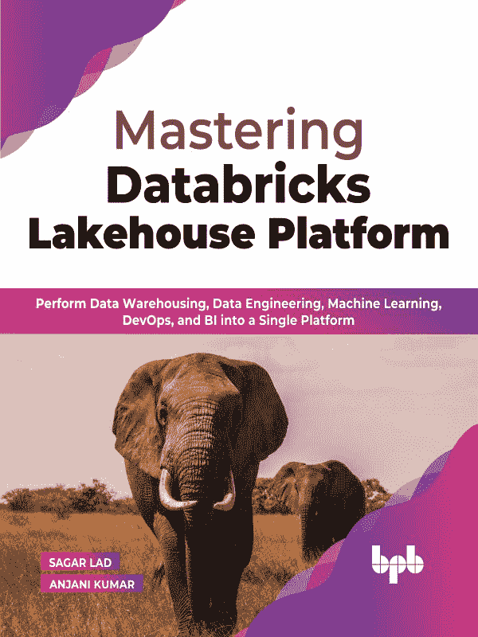


# 献给

给我的姐妹 `Mohini Lad` 和 `Jigna Mistry`，她们持续的温暖和陪伴即使我用一辈子的狗零食也无法报答

# 关于作者

**Sagar Lad** 是某领先跨国软件公司的技术解决方案架构师，在利用云和人工智能为大型企业实施数据与分析解决方案方面具有深厚的专业知识。他是一位丰富的 Azure 平台倡导者，专注于使用 Microsoft 云解决方案和产品推动企业组织采用云技术，拥有 8 年以上的 IT 经验。他热爱写博客，是 medium、linkedin 和 C# Corner 开发者社区的活跃博主。由于对开发者社区的贡献，他于 2021 年 9 月荣获 C# Corner MVP 荣誉。

他的个人荣誉证书 – [`www.credly.com/users/sagar-lad`](https://www.credly.com/users/sagar-lad)

Twitter: @AzureSagar ([`twitter.com/AzureSagar`](https://twitter.com/AzureSagar))

Medium: [`medium.com/@sagu94271`](https://medium.com/@sagu94271)

# 关于评审员

**Anjani Kumar** 是 `5thir` 的经理兼创始人。他在利用云和人工智能为大型企业实施数据与分析解决方案方面具有深厚的专业知识。他是一位丰富的 Azure 平台倡导者，专注于使用 Microsoft 云解决方案和产品推动企业组织采用云技术，拥有 8 年以上的 IT 经验。他热爱写博客，是 medium、linkedin 和 C# Corner 开发者社区的活跃博主。由于对开发者社区的贡献，他于 2021 年 9 月荣获 C# Corner MVP 荣誉。

他的个人荣誉证书 – [`www.credly.com/users/sagar-lad`](https://www.credly.com/users/sagar-lad)

Twitter: @AzureSagar ([`twitter.com/AzureSagar`](https://twitter.com/AzureSagar))

Medium: [`medium.com/@sagu94271`](https://medium.com/@sagu94271)

# 关于编辑

**Ilsekamp** 是一位拥有 7 年以上经验的 IT 工程师。她是住在荷兰阿尔梅尔两个女孩的母亲。

LinkedIn: [`www.linkedin.com/in/ilse-epkamp`](https://www.linkedin.com/in/ilse-epkamp)

# 致谢

感谢整个团队给予我们编写这本书的机会。感谢编辑团队让手稿变得整洁有序。

# 前言

当我们使用 `Databricks Lakehouse` 时，底层平台负责管理配置和管理。您可以专注于通过 `databricks lakehouse` 结合 `Azure Data Factory`、`Power BI`、`Tableau` 等构建数据和 AI 解决方案。它内置了高可用性、可靠性、容错性、扩展性等许多功能。

本书从 lakehouse 的基本概念开始。我们将了解使用 `Delta Lake` 解决现实问题的方法。然后我们将探索更改数据流（Change Data Feed）功能，并查看所有存储数据的必要存储服务。我们将了解 `Azure Data Factory`、`Databricks` 及其优势。随后我们将深入探讨数据平台的详细架构和 CI/CD 实现。

DevOps 是任何应用程序开发过程中至关重要的方面。下一章节将涉及如何使用 `Azure DevOps` 创建持续集成和持续交付流水线。在这里我们将学习如何创建通用的一键流水线将数据解决方案部署到多个环境中。

# 彩色图片

请点击链接下载书籍的*彩色图片*：

# [`rebrand.ly/n69e01o`](https://rebrand.ly/n69e01o)

我们在 **[`github.com/bpbpublications`](https://github.com/bpbpublications)** 提供了丰富的书籍和视频代码包。快去看看吧！


在 [www.bpbonline.com](http://www.bpbonline.com)，您还可以阅读免费技术文章集，订阅一系列免费的新事通讯，并接收 BPB 书籍和电子书的专属折扣和优惠。


# 如果您有成为作者的兴趣

如果您有自己擅长的领域，并且对编写或为书籍贡献感兴趣，请访问 [www.bpbonline.com.](http://www.bpbonline.com/)。我们已经与成千上万的开发者和技术专业人士合作，帮助他们将自己的见解分享给全球技术社区。您可以进行通用申请、申请我们正在招募作者的特定热门话题，或提交自己的想法。

# 评论

请留下评价。在您阅读并使用此书后，为什么不在您购买的网站上留评价呢？潜在读者就可以看到并利用您的公正意见来做出购买决策。我们 BPB 可以了解您对我们产品的看法，我们的作者也可以看到您对书籍的反馈。感谢！

有关 BPB 的更多信息，请访问 [www.bpbonline.com.](http://www.bpbonline.com/)

# 第 1 章 (#toc.xhtml#c01)

# 入手 Databricks 平台 (#toc.xhtml#c01)

由于数据孤岛，如今的数据驱动型组织在构建和维护其数据解决方案方面面临困难，这导致了维护单一事实来源时出现重大问题。`Databricks Lakehouse` 平台简化了架构，允许数据科学、数据工程和数据分析师等不同团队协作构建数据解决方案，而创建任何孤岛。

在本章中，我们将开始探索 Databricks 架构的基础，以及如何使用 Databricks Lakehouse 平台进行数据科学、工程以及 Databricks SQL。

# 结构 (#toc.xhtml#s1a)

在本章中，我们将涵盖 Databricks 平台的以下方面：

*   Databricks 简介
*   Databricks 平台架构
*   用于数据工程和数据科学的 Databricks
*   Databricks SQL
*   Databricks 组件：`workspace`、`interface`、`data management`、`computation`、`model management`、`access management`、`notebook`

# 目标 (#toc.xhtml#s2a)

学习本章后，您将理解为什么需要 Databricks、谁可以使用它，以及它如何帮助数据团队解释大数据。

# Databricks 简介 (#toc.xhtml#s3a)

**数据是 21 世纪的新石油。**

– James Bellini 博士*

如今，大多数组织正在采用`数据驱动决策`（`DDDM`）方法进行决策。他们花费数百万美元来解读组织领域内无处不在的数据。

从语义上说，DDDM 是基于实际数据做出决策的过程。

组织定期在多个应用程序的多个平台中产生大量数据，并以`结构化`、`半结构化`和`非结构化`格式提供给决策者，这也被称为一个大数据`。早些，理解这些数据是枯燥且耗时的，而且与现在相比效率低下，因为它们无法在实时提供方便的帮助。然而，技术的最新进展使我们能够通过使用大数据处理工具的集群计算，更快地获得有效结果。

大数据处理有许多可用解决方案；在所有这些解决方案中，`Apache Spark`（*2014 年 5 月发布*）在极短时间内变得非常流行。它非常快速、灵活且对开发者友好，这些都是它受欢迎的原因。

组织开始配置自己的本地专用集群，使用 `Apache Spark` 来处理其大数据工作负载。但这种设置的主要困难在于基础架构的可扩展性、维护和安全性。

正如我们所知，管理组织数据并非易事，因为数据增长迅速且频繁扩展。数据中心在维护、安全以及可扩展性方面面临挑战。

近年来，随着云技术变得流行且更加可靠，组织开始向云端迁移。云技术催生了许多大数据相关的 SaaS 产品。在所有这些产品中，Databricks 是领先的大数据处理和机器学习行业云数据平台。

Databricks 是一个基于 `Apache Spark` 的云端`统一分析平台`，可以轻松地执行大规模数据处理和机器学习工作负载。Databricks 由 Apache Spark 的原始创建者于 *2013* 年创立。

Databricks 提供了一个易于使用的可编程和交互式笔记本环境，其中`数据工程师`/`分析师`、`机器学习工程师`和`数据科学家`可以协作工作，因为平台支持 `R`、`Python`、`SQL` 和 `Scala` 语言。Databricks 笔记本非常灵活，可以在一个地方拥有代码、文本、实时可视化等。代码将在 databricks 集群上执行。

Databricks 平台自带所有功能，如集群管理、自动扩展、平台管理。

# Databricks 能做什么 (#toc.xhtml#s4a)

现在，让我们探索不同的角色如何使用 Databricks 平台处理数据：

*   **作为数据工程师**：我们可以构建数据湖/数据仓库并进行大规模数据处理。例如，数据工程师从 databricks 中的 `adls` 读取数据，在笔记本中应用转换逻辑，并将新文件输出到 `adls`。
*   **作为数据分析师**：我们可以对业务决策进行分析和可视化。例如，数据分析师可以在数据工程师准备的数据湖之上创建可视化报告。
*   **作为数据科学家/机器学习工程师**：我们可以构建机器学习/深度学习流水线，并处理数字节级数据进行预测分析。例如，数据科学家可以构建机器学习模型来预测业务洞察等。

Databricks 与 `AWS`、`Azure` 和 `GCP` 云供应商集成，因此可以在这些云提供内部作为服务使用，或者也可以作为独立的云解决方案。

# Databricks 架构 (#toc.xhtml#s5a)

Databricks 的设计非常灵活；它与多个云供应商（如 `AWS`、`Azure` 和 `GCP`）兼容。

底层操作高度抽象化；客户可以专注于他们数据工程和数据科学相关的任务。

Databricks 通过两个主要组件运行：

*   控制平面 (Control plane)
*   数据平面 (Data plane)

在下一节中，我们将详细讨论控制平面和数据平面。

# 控制平面 (#toc.xhtml#s6a)

它有一个 Web 应用程序作为创建和管理交互式笔记本、集群管理、作业以及 Databricks SQL 查询的界面。


控制面所有子组件的详细说明如下：

*   **Notebook (Notebooks)**：这些是基于 Web 的界面，包含可执行的代码、强大的可视化功能和叙述性文本。它们理想地用于 ETL、机器学习等场景。
*   **集群管理 (Cluster management)**：大多数与集群配置和维护相关的任务都由 Databricks 集群管理器独立，根据用户对某些参数的输入（例如工作节点数量、内存规格、Spark 运行时版本以及自动扩展）自动完成。
*   **作业 (Jobs)**：这些是计划或即时执行的可执行任务，用于在 Databricks 集群上运行 Notebook。这是一种运行包含可执行代码或可视化内容的 Notebook 的非交互方式。
*   **查询 (Queries)**：Databricks SQL 是一个基于 Web 的查询编辑器，可执行 SQL 查询并帮助实现数据可视化。

#### 数据面 (Data plane)

它位于客户的云端（理想情况下，它兼容 AWS、Azure 和 GCP）。数据面是连接控制面与客户数据的唯一途径。数据面包含集群，是处理数据的地方。通过 Databricks 连接器，我们还可以连接到多个外部源并从流式数据源摄取数据。

现在，让我们详细了解 Databricks Lakehouse 架构及其组件：

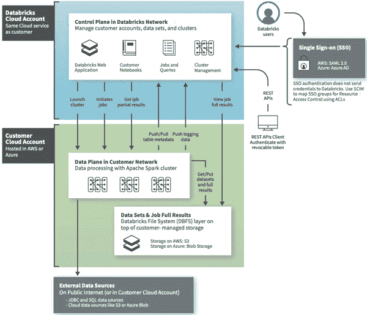

**图 1.1：** Databricks Lakehouse 架构

[图片来源]:**[`docs.databricks.com/getting-started/overview.html`](https://docs.databricks.com/getting-started/overview.html)**

#### 它是如何工作的？

为了更好地理解 Databricks，我们考虑这样一个场景：数据工程师想要对存储在 AWS S3 上的数据执行 ETL 操作，并将结果写回 AWS S3。

### 前提条件

由于 S3 和 Databricks 都已存在于客户的 AWS 账户中：

*   登录位于控制面内的 Databricks Web 应用程序后，我们将进入集群管理器并创建一个具有最小配置的简单集群。控制面使用 AWS API 来创建 Databricks 集群，该集群由位于数据面的新 AWS EC2 实例组成。
*   一旦集群部署完成，数据工程师将在 Notebook 中编写并运行 ETL 代码。
*   执行时，集群管理器将代码发送到集群进行执行，该代码反过来从 AWS S3 提取数据、对其转换，并将结果写回 AWS S3。
*   随后，集群会将状态和任何输出反馈给集群管理器。

如果你观察了上述流程，数据工程师只需要管理他们的代码以获得所需的结果。所有关于基础设施、网络、扩展以及所有底层过程的问题都得到了妥善处理。

#### 针对数据工程师和数据科学家的 Databricks

我们许多人的整个职业生涯都在从事数据工程。在过去的几年里，`data engineering` 一词已成为从多个源以各种格式移动和转换海量数据的流行术语。

*   **数据工程 (Data Engineering)**：指工程师对海量数据执行的任务（ETL 或 ELT 任务）。
*   **数据科学 (Data Science)**：从数据中提取洞察的过程。

Databricks Lakehouse 为所有工作负载提供了一个统一平台。它结合了数据湖的灵活性与数据仓库的性能和结构。

*   **数据工程**：关注 ETL/ELT 任务。
*   **数据科学**：关注模型构建和分析洞察。
*   **SQL Analytics**：关注数据的查询和仪表盘制作。


**查询：** 此组件作为 Databricks SQL 接口的一部分可用。将其想象为创建一个笔记本。当你点击笔记本时，它会提示你通过将其附加到集群来创建一个新笔记本。同样，当你选择查询时，它将打开一个 SQL 编辑器，并提示选择一个 SQL 端点（一个无服务器计算），该端点需要附加到 SQL 编辑器并可以运行 `ad hoc queries`（临时查询）。

#### Databricks SQL 的功能

以下是相关功能：

* 使用户能够使用多云湖仓（lake house）架构，与传统的数据仓库和/或数据湖架构相比，该架构更廉价且更快。
* 在具有数据仓库能力和性能的湖仓数据湖上使用 SQL 查询：
  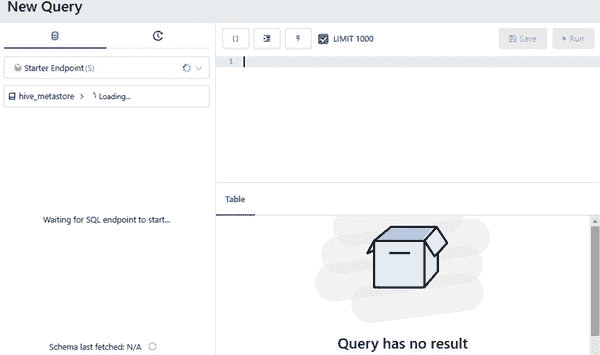
  **图 1.5**：Databricks SQL 查询执行
* 为 Databricks 平台设置 SQL 分析所需的管理和配置更加简单。
  Databricks 平台本身决定实例类型和配置，以降低成本并提高 SQL 查询的性能。
  Databricks SQL 内置功能，可以轻松地管理用户访问、数据和资源，包括监控、查询历史和细粒度访问管理：
  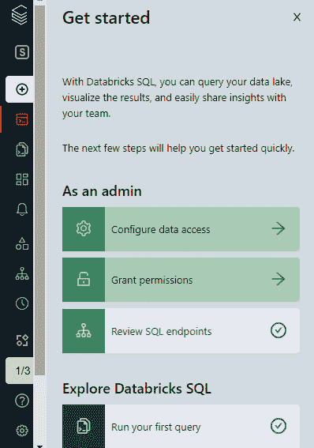
  **图 1.6**：Databricks SQL - 主页
* 使用首的 BI 工具对 Databricks Lakehouse 平台上的可用数据进行分析：
  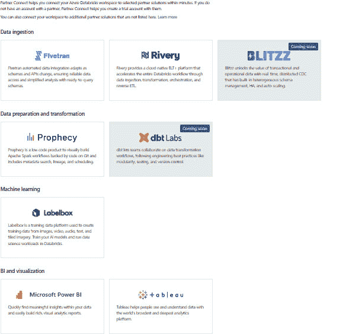
  **图 1.7**：Databricks SQL - 连接器
* 使用 SQL 查询进行高效的数据发现和访问，并利用可视化能力快速分享新见解：
  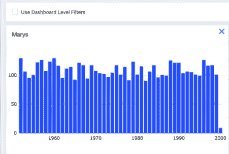
  **图 1.8**：Databricks SQL - 仪表板

#### 用于 Databricks SQL 的 SQL 端点

SQL 端点（SQL endpoint）是一种允许终端用户执行 SQL 命令的计算资源。

打开 Databricks SQL 并从左侧高亮的窗格中选择 `SQL Endpoints`，如下：
  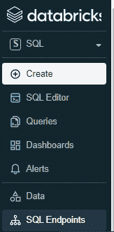
  **图 1.9**：Databricks SQL - SQL 端点

默认情况下，Databricks SQL 有一个名为 `Starter Endpoint` 的内置端点，用于在 Databricks 平台上运行 SQL 查询：
  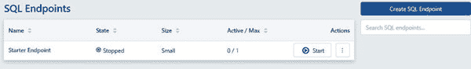
  **图 1.10**：Databricks SQL - SQL 端点列表

如果你点击 SQL 端点，我们可以看到更多关于该端点的配置信息。

* **概述 (Overview)**
  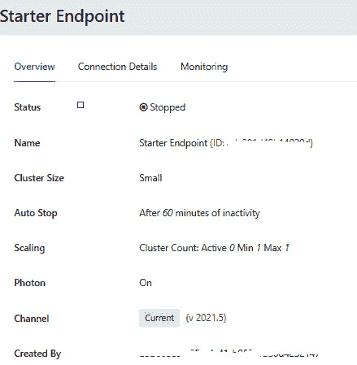
  **图 1.11**：Databricks SQL 端点概览页
* **连接详情 (Connection details)**
  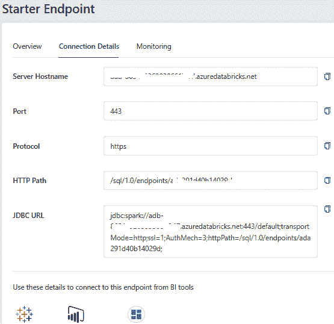
  **图 1.12**：Databricks SQL 端点连接详情
* **监控 (Monitoring)**
  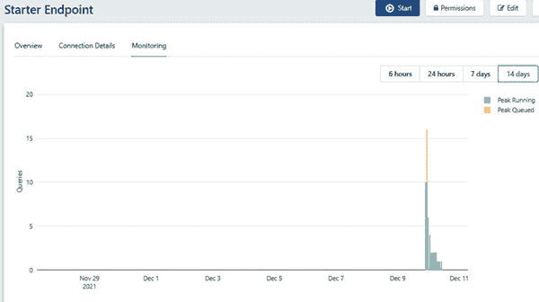
  **图 1.13**：Databricks SQL 端点监控

1. 如果你想创建一个新的 SQL 端点，点击 `Create SQL Endpoint` 按钮：
  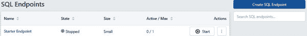
  **图 1.14**：Databricks SQL 端点
  在这里，我们需要提供以下信息来创建 SQL 端点：
  * `Name`：提供 SQL 端点名称。
  * `Cluster Size`：提供集群大小。
  * `Auto Stop`：提供自动停止时间。
  * `Scaling`：提供自动伸缩的最小和最大集群：
    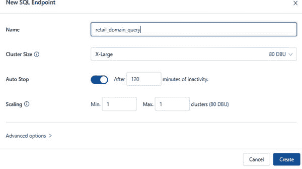
    **图 1.15**：创建 Databricks SQL 端点
2. 现在，点击 `Advanced options` 以配置额外信息：
  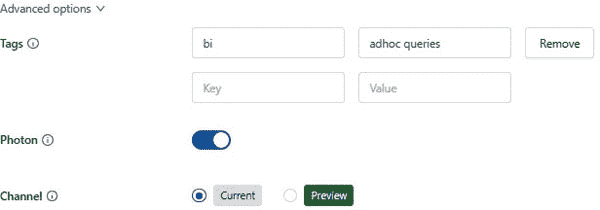
  **图 1.16**：创建 Databricks SQL 端点 - 高级选项
3. 现在，只要你点击 `Create` 按钮，就会弹出一个对话框，让你获取创建端点的权限：
  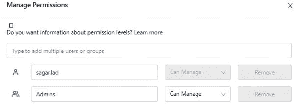
  **图 1.17**：Databricks SQL 端点 - 创建
4. 现在，新的 SQL 端点已成功创建：
  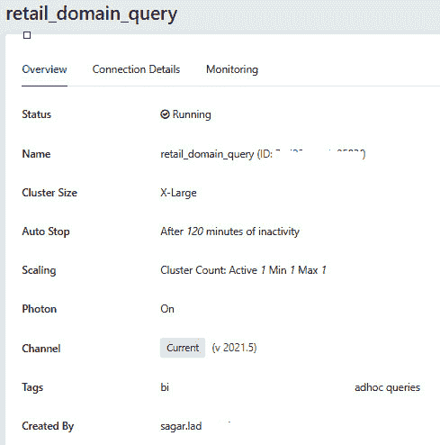
  **图 1.18**：Databricks SQL 端点已创建
5. 从 SQL 端点列表中，我们可以根据需要启动和停止 SQL 端点：
  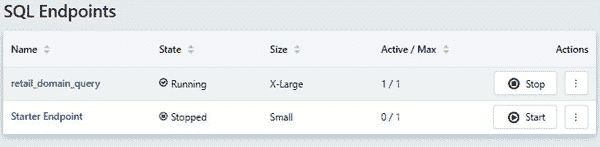
  **图 1.19**：Databricks SQL 端点 - 启动/停止
6. 一旦创建了 SQL 端点，就可以点击其进行编辑：
  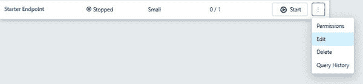
  **图 1.20**：Databricks SQL 端点 - 编辑
7. 如果你想配置并管理 SQL 端点，请从主页点击 `Settings`，如下所示：
  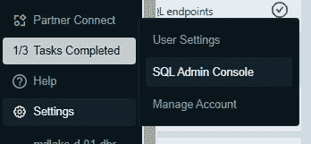
  **图 1.21**：Databricks SQL 端点 - 设置
  在这里，我们可以配置 `General` 属性：
  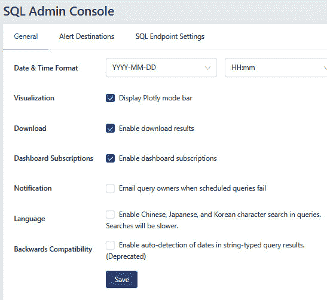
  **图 1.22**：Databricks SQL 端点 - 通用
8. 我们可以针对故障配置告警，以便快速响应：
  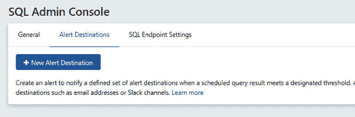
  **图 1.23**：Databricks SQL 端点 - 告警
9. 我们可以根据存储属性配置 SQL 端点的访问：
  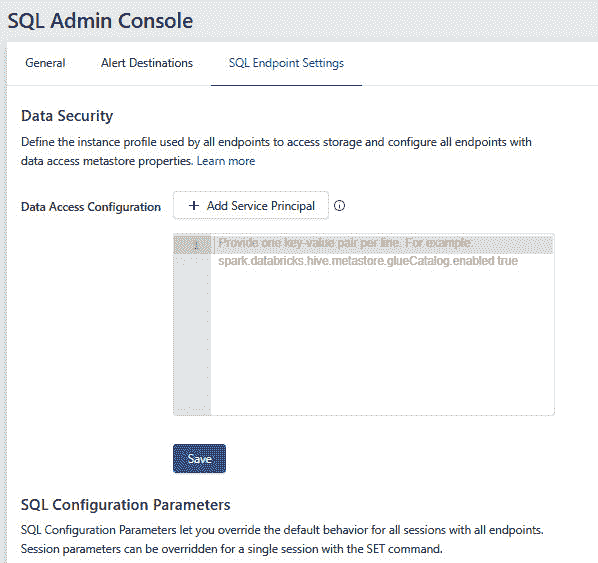
  **图 1.24**：Databricks SQL 端点 - 存储

#### Databricks 组件

到目前为止，我们讨论了 Databricks 及其架构。接下来，我们将深入探讨 Databricks 的核心组件，这些组件提供了 Databricks 的全方位视图。

#### 工作空间 (Workspace)

**工作空间**是一个包含笔记本、库和机器学习实验的环境。单个用户可以访问 `dev`、`staging` 和 `prod` 等多个 Databricks 工作空间。这些工作空间可以通过 Databricks UI、API 和 Databricks CLI 访问。

Databricks 资产/对象可以与所有用户或特定用户共享。如果这些对象针对特定用户，则需要创建在 `Users` 文件夹中。如果这些对象需要与工作空间内的多个用户共享，则这些对象必须放置在 `Shared` 文件夹下：
  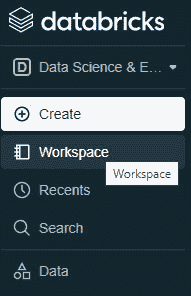
  **图 1.25**：Databricks 工作空间

Databricks 资产/对象如下：
* 笔记本
* 库
* 文件夹
* 机器学习实验
  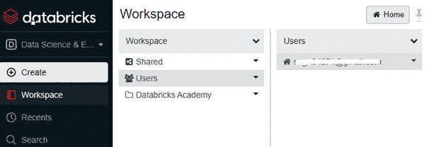
  **图 1.26**：Databricks 工作空间概览

#### 笔记本 (Notebooks)

**笔记本**是一个基于 Web 的编程文档或界面。这些文档包含可以操作文件、表格、可视化和叙述文本的可单元单元。这些单元按顺序执行，要在当前单元格中引用上一个单元格的输出，需要先执行上一个单元格：
  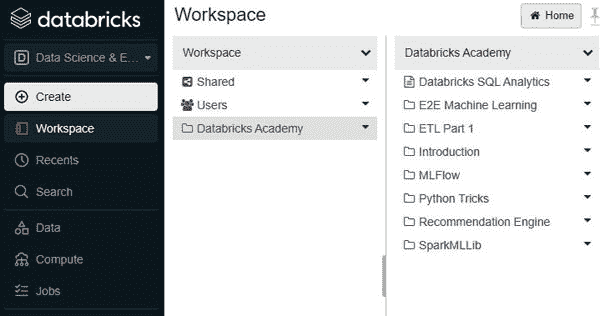
  **图 1.27**：Databricks 工作空间文件夹

下图表示了三个不同的笔记本单元格，包含了可视化、叙述文本和代码（从上到下）：
  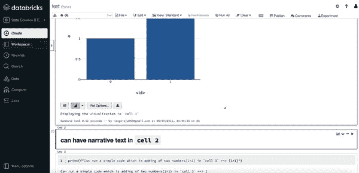
  **图 1.28**：Databricks 工作空间笔记本

#### 库 (Libraries)

**库**是包含本地构建代码的 Databricks 笔记本或文件。这些库可以被导入，也可以在其他笔记本（交互式）或作业（非交互式）中使用。这些库也可以直接上传到集群；通过这种方式，这些库对于使用该集群的笔记本都是可用的：
  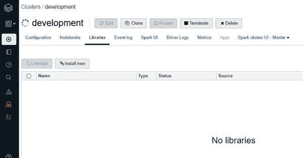
  **图 1.29**：Databricks 集群库

#### 文件夹 (Folder)

它是用于存储文件或文档的虚拟位置：
  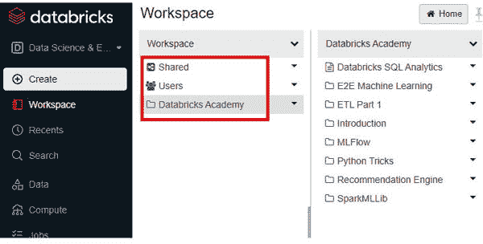
  **图 1.30**：Databricks 工作空间文件夹结构

#### MLflow 实验 (ML experiment)


将 MLflow `Experiment` 想象为一个包含多个作为状态文件的模型训练运行的文件夹。每个 MLflow 模型训练运行都包含 ML 代码的执行状态及其元数据、产物（artifacts）信息等：

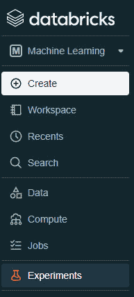

**图 1.31:** 机器学习实验

从 MLflow `Experiment` 的角度来看，我们可以可视化并搜索所有的运行，并将它们与其他实验运行进行比较。我们还可以从实验中下载每个模型训练运行的产物和元数据。总来说，MLflow `Experiment` 允许你组织所有的 MLflow 模型训练运行：

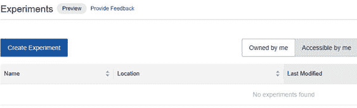

**图 1.32:** 机器学习实验概述

#### 接口

这是与 Databricks 服务交互的一种。Databricks 支持三种接口。

#### Databricks UI

这是一个简单的基于 Web 的图形化用户界面。在这里，我们将与所有的 Databricks 计算资源和工作区进行交互。在进行交互式数据处理或机器学习时，通常推荐这种方式。以下是 Databricks 的 Web 端 GUI；在不同的 Databricks 选项之间导航非常简单：

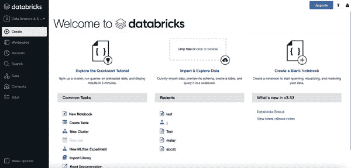

**图 1.33:** Databricks 概述

#### Databricks API

可以使用 Databricks 支持的 REST API 触发 Databricks 服务。它有两个版本：`REST API 1.2` 和 `REST API 2.0`。在这些版本中，`REST API 2.0` 是最新版本并支持最新的功能：

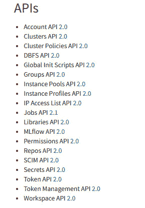

**图 1.34**

参考以下链接以深入了解 API：

[`docs.databricks.com/dev-tools/api/latest/index.html`](https://docs.databricks.com/dev-tools/api/latest/index.html)

#### Databricks CLI

它是基于 Databricks API 构建的开源命令行界面工具（CLI）。该工具完全使用 Python 构建。

#### 数据管理

在这一节中，我们将讨论持有不同类型数据的组件，这些组件在执行数据工程和机器学习过程中会被用到。

#### DBFS

**Databricks 文件系统** (`DBFS`) 是一个分布式文件系统，同于 **Hadoop 分布式文件系统** (`HDFS`)。DBFS 构建在云服务提供者的对象存储之上。例如，如果从 AWS 访问 Databricks，DBFS 将默认使用 `S3` 作为其对象存储。Azure 中的 `Azure Blob` 和 GCP 中的 `GCS` 也是如此。DBFS 可以包含图像、数据文件和库等。DBFS 还允许将不同的存储挂载为 DBFS 文件夹。DBFS 中的数据可以被集群访问；这些数据在集群终止后仍然是持久化的：

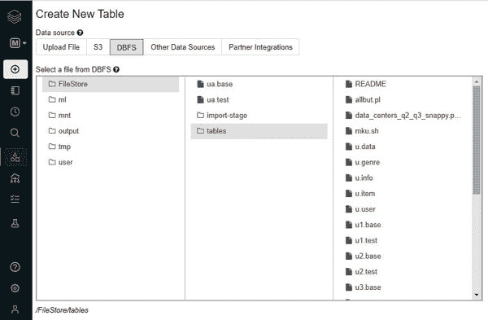

**图 1.35:** 创建新表

#### 表

**表**是以行和列的结构化格式的数据。可以使用 Spark SQL 和 Spark API 进行查询：

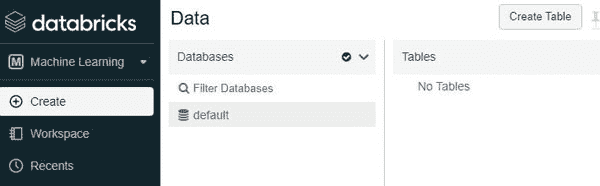

**图 1.36:** 创建表

#### 数据库

所有的逻辑分组

#### 元数据存储 (Metastore)

Metastore 保存与 Databricks 中所有相关的元数据，例如表。它有两个主要功能：**数据抽象**和**数据发现**。没有元数据存储，集群无法访问数据。有了元数据存储，用户就可以探索数据。Databricks 不断更新元数据存储，从而提高了大数据处理环境的可用性、性能和安全性。

#### 计算管理

在这一节中，我们将讨论不同的概念。

#### 集群 (Cluster)

它是执行 notebooks 或作业的资源：

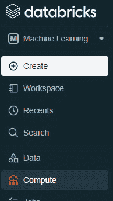

**图 1.37:** 计算

#### 通用集群 (All-purpose cluster)

用于交互式处理。这种类型的集群可以手动重启或终止：

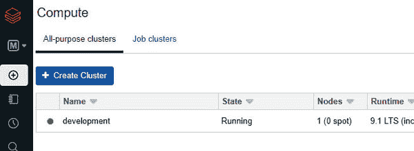

**图 1.38:** 计算集群

#### 作业集群 (Job cluster)

每当触发任何作业时，就会创建此类集群。这些集群在作业完成后就会终止：

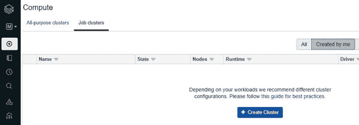

**图 1.39:** 作业集群

#### 池 (Pools)

**池**本质上是一组集群可以从中提取的热备实例。要利用该池，需要挂载集群。如果集群有任何额外需求，池将通过分配新实例来扩展。一旦集群终止，所有使用的实例都将返回池中。**Databricks 不对空闲实例收费。**

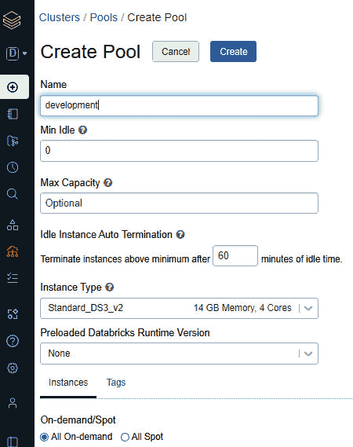

**图 1.40:** 池

#### Databricks runtime

它是一个环境，其中一组软件组件（包括 Apache Spark）在集群上可用并运行。Databricks 运行时由 Databricks 全面管理。Databricks 不断更新运行时，从而提高了大数据处理环境的可用性、性能和安全性。Databricks 提供多种类型的运行时：

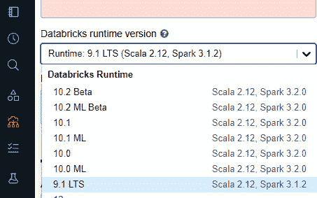

**图 1.41:** 运行时

#### Databricks runtime

此运行时由 Apache Spark 和其他组件组成：

*   Delta Lake：一种基于 Apache Spark 构建的下一代存储层，提供 ACID 事务
*   已安装的 Python、Scala、Java 和 R 库
*   用于启用 GPU 的集群的 GPU 库：

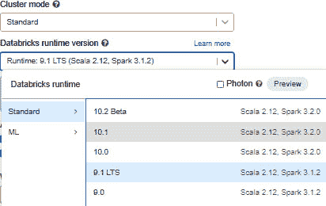

**图 1.42:** 运行时 - 标准

#### 用于机器学习的 Databricks runtime

此运行时包含 Databricks runtime 的所有组件以及所有流行的机器学习库，如 `pytorch`、`tensorflow`、`keras` 和 `XGBoost`。该运行时还确保了正确的库兼容性。使用此运行时可以加快集群创建过程：

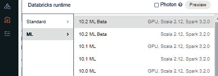

**图 1.43:** 运行时 - ML

#### Photon

**Photon** 是一个原生向量化查询引擎。它使用 C++ 编写。Photon 引擎兼容所有的 Apache Spark API 和 Spark SQL。向量化的数据处理方式有助于有效利用底层硬件的 CPU，因为该运行时是高性能运行时的一部分。

此运行时有一些局限性：

*   不支持 Spark 结构化流（structured streaming）。
*   不支持 Spark UDF（用户自定义函数）。
*   在查询少量数据时不建议使用此运行时。
*   Photon 高性能运行时不支持窗口函数和排序函数。

[/


从成本优化的角度来看，此运行时大幅缩短了任何重负载任务的持续时间。

### Databricks light

此运行时仅在具有自动化工作负载时支持并用于作业集群（job cluster）中使用，而不适用于交互式工作负载。如果我们的数据处理需要极低的计算需求和成本效益，则推荐使用此运行时。鉴于 `Databricks light` 的名称，该运行时是轻量级的；它不支持某些 Databricks 的主要功能，如 Delta Lakes、自动扩展、各种数据源连接器和 BI 工具。

### 用于基因学的 Databricks Runtime（已弃用）

主要建议在处理基因组和生物医学数据时使用。但遗憾的是，该运行时已弃用，Databricks 不再发布该运行时的更新版本。

## 访问管理

以下是我们在 Databricks 访问管理方面需要理解的概念：

### 用户

Databricks 用户是一个唯一的个人（或）非个人账户，其可以访问 Databricks 服务。所有 Databricks 用户都由 `Databricks Admin` 管理，其属于 `Databricks Admin` 组：

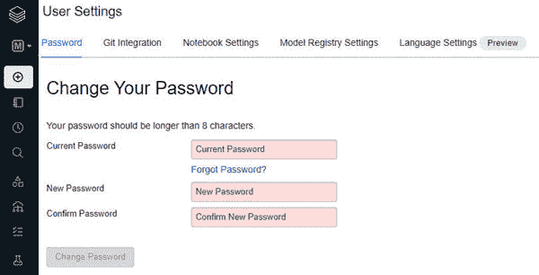

**图 1.44:** Databricks 用户设置

### 组

`group` 用于为多个用户分配相同的权限。用户被赋予成员身份以成为该组的一部分，该组具有管理员决定的某些权限（访问数据对象和 Databricks 组件）。

### 访问控制列表 (ACLs)

`Access Control Lists` 通常简称为 `ACLs`。此 ACL 用于为访问 Databricks 组件及其实体（`clusters`、`notebooks`、`folders`、`data tables` 以及 `jobs` 等）提供权限。

通常，所有管理员都可以管理这些 ACLs，尽管管理员也可以升级某些用户的权限以使其管理 ACLs。

## 结论

`Azure Data Lake Storage Gen2` 设计为大数据和分析应用创建企业级的数据湖解决方案。数据湖存储库可以高效地管理大量数据。Data Lake Storage 是一种高效益的解决方案，因为它构建在低成本的块存储（blob storage）之上。Data Lake Storage 使用 ABFS 驱动，允许类似于 Hadoop 的数据访问和管理，并针对大数据分析进行了优化。它使用 `dfs.core.windows.net` 端点。在 ACL 和 POSIX 权限的支持下，Data Lake Gen2 更安全。

## 多选择题

1. 目前哪些云平台支持 Databricks？
    1. AWS, GCP, Microsoft Azure
    2. AWS, IBM Cloud, Alibaba Cloud
    3. GCP, IBM Cloud, Microsoft Azure
    4. AWS, Alibaba Cloud, Microsoft Azure

2. 创建 Databricks 集群的不同方法有哪些？
    1. Databricks UI
    2. Databricks CLI
    3. Databricks API
    4. 以上所有

3. 关于 Databricks 平台，以下哪个陈述无效？
    1. Databricks 平台仅支持 Python 语言。
    2. Databricks 平台用于对数据执行 ETL。
    3. Apache Spark 的原始创建者构建了 Databricks 平台。
    4. Databricks 平台支持数据可视化。

4. 目前 Databricks 平台上有多少个运行时？
    1. 2
    2. 3
    3. 4
    4. 5

5. Databricks 平台支持哪些类型的集群？
    1. 通用集群 (All-purpose cluster)
    2. 作业集群 (Job cluster)
    3. 以上所有
    4. 以上都不是

## 答案

1. **a**
2. **d**
3. **a**
4. **d**
5. **c**

# 第 2 章

## Databricks 平台管理

Databricks Lakehouse 平台是一个单一且全位的平台，用于创建你的数据分析和 AI 解决方案。全位的集成 Databricks Lakehouse 平台简化了流程。Databricks Lakehouse 平台通过消除数据孤岛简化了数据工程团队、数据科学团队和分析团队，使用顶级开源技术构建。

在之前的章节中，我们探索了 Databricks 的基础。在本章中我们将了解 Databricks Lakehouse 架构以及 Databricks SQL。

### 结构

在本章中，我们将学习 Databricks Lakehouse 的以下方面：
* 集群基础知识
* 架构、安全性
* 访问管理
* 集群使用
* Databricks SQL

### 目标

学习本章后，你应该能够配置、创建和部署 Databricks。我们还将探索数据访问管理和安全性。

### Databricks 集群基础知识

Databricks 集群是运行命令的虚拟机集合。

执行任何解决方案有两种方式：
* **Databricks notebook**: 我们可以在其中创建并组合 notebook。
* **Databricks jobs**: 我们可以对它们进行调度。

数据湖平台包含两种类型的集群：
* **通用集群 (All-purpose cluster)**：当我们需要交互式 notebook 时使用通用集群。通用集群可以使用 CLI、UI 或 REST API 创建。通用集群可以供多个用户共享。
* **作业集群 (Job cluster)**：使用作业集群运行调度和完全自动化的作业。作业集群会在启动时创建，完成后终止。

#### 集群资源

探索 Lakehouse 平台的集群资源：

### 集群

现在让我们如何在 Databricks 中创建集群：

1. 使用 UI 创建 Databricks 集群。进入 Databricks 首页并选择 `Compute`，如下所示：
   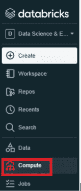
   **图 2.1:** Databricks 首页

2. 现在，点击 `Create Cluster` 按钮创建一个新集群：
   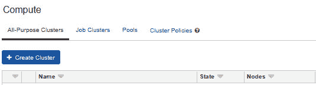
   **图 2.2:** Databricks - 创建集群

3. 点击 `Create Cluster` 按钮后，将出现一个界面，你需要提供集群配置详情：
   * `Cluster Name`: 提供集群名称。
   * `Cluster Mode`: `Standard`、`Single Node` 或 `High Concurrency Cluster`。
   * `Databricks Runtime Version`: 从标准/ML Databricks 运行时选择所需版本。
   * `Enable autoscaling`: 在最小和最大节点之间自动扩展。
   * `Terminate after inactivity`: 空闲后终止集群的时间（分钟）。
   * `Worker Type`: 根据工作负载选择节点类型。

Databricks 运行时是运行在集群上一组组件。Databricks 运行时包含 Apache Spark，并增加了提高可用性、性能和安全性组件。

   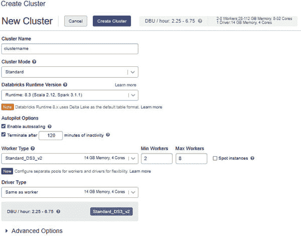
   **图 2.3:** Databricks - 集群配置

4. 输入集群配置详情后，点击 `Create Cluster` 按钮在 Databricks 中创建集群。


- **显示集群**：如下方所示，在 Databricks 主页上选择 `Compute`，这将显示 Databricks 中所有现有集群，并包含集群名称、状态、节点、运行时、驱动程序和集群所有者等详情：

  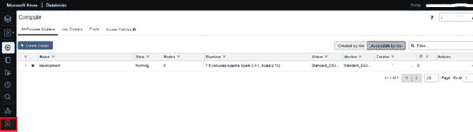

  **图 2.4：** Databricks - 显示集群

- **集群活动**：我们可以从 Databricks 集群显示页的 `Actions` 面板对 Databricks 集群进行终止、重启、克隆和编辑集群策略：

  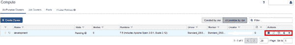

  **图 2.5：** Databricks - 集群活动

  集群创建后，集群定义以 `JSON` 格式存储。此外，我们还可以使用 `JSON` 格式定义通过 API 自动在 Databricks 中创建集群。我们可以通过点击集群名称打开集群。然后将打开集群配置页面。您可以点击 `JSON` 按钮以 `JSON` 格式查看集群定义。

**在编辑集群后，Notebook 和作业将始终保持与集群的关联。即使集群处于运行状态，我们也可以编辑集群配置。**

  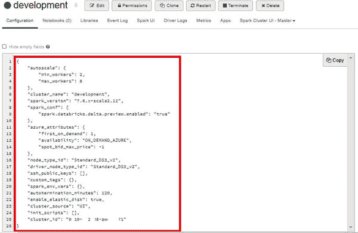

  **图 2.6：** Databricks - 集群配置

### 集群治理

通过仅向某些用户提供 `Can Restart`（可以重启）或 `Can Attach To`（可以附加）权限，而不是创建和管理权限，我们可以禁用集群配置。集群策略可用于管理细粒度的集群权限。集群管理员可以配置集群策略以限制用户管理集群的访问。

在 Databricks 中启用集群策略后，我们可以管理以下内容：

* 通过仅允许的配置设置限制用户创建集群的权限
* 仅允许特定用户在 Databricks 中创建集群
* 设置集群成本阈值以降低集群成本

从 Databricks 的 `Display Cluster` 页面，使用 `Cluster Policies` 标签页，我们可以创建一个集群策略：

  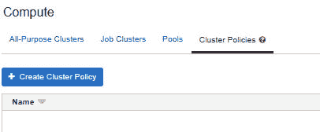

  **图 2.7：** Databricks - 集群策略创建

您可以使用 `JSON` 格式定义集群策略。例如，如下图高亮所示，我们创建了一个集群策略，它仅允许用户创建具有 Databricks 运行时环境 `7.3.x-scala2.12` 的集群，并且由于隐藏标志被设置为 `true`，该属性将从 Databricks UI 中隐藏。

在 Databricks 中使用集群策略具有以下优势：

* 强制执行治理和标准的集群配置。
* 避免资源的过度使用。
* 使用标签节省成本并确保准确的费用分摊。
* 通过为用户提供特定类型工作负载的预配置集群，加速数据处理：

  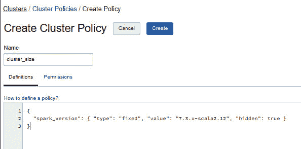

  **图 2.8：** 已创建的 Databricks 集群策略 - 固定集群大小

实施集群策略将完全改变用户使用 Databricks 的体验。实施集群策略的高级步骤如下：

* 通知所有用户集群策略的更改，并他们他们针对工作负载测试集群配置。
* 实施分阶段发布。
* 以 `Agile` 方式在组织范围内逐步引入更多策略。
* 在整个组织范围内完成实施。

## 平台架构、安全与数据保护

通过仅向某些用户提供 `Can Restart` 或 `Can Attach To` 权限，而不是创建和管理权限，我们可以禁用集群配置。集群策略可用于管理细粒度的集群权限。集群管理员可以配置集群策略以限制用户管理集群的访问。

## 平台架构与数据保护

Databricks 是一个统一的分析平台，连接了数据科学和数据工程团队：

  

**图 2.9：** Databricks 架构

在我们探索 Databricks 的功能及其安全性之前，让我们先探索 Databricks 的高层架构：

Databricks 有两个主要组件：

- `Control pane`（控制面）：`Control pane` 作为 Notebook 和 SQL 端点的后端。
- `Data plane`（数据平面）：`Data plane` 由在 AWS 账户中管理的计算资源组成。数据平面有两种类型：
  - `Classic data plane`（经典数据平面）：Databricks 使用经典数据平面用于 Notebook、作业和 SQL 端点。
  - `Serverless data plane`（无服务器数据平面）：启用 Databricks SQL 时使用。

我们可以使用连接器从外部源摄取批或流式数据。当我们交互式执行 Notebook 时，笔记本结果将存储在控制面以及存储账户中。但出于安全考虑，如有需要，也可以将交互式笔记本结果仅存储在客户工作空间中。

### 平台安全

Databricks 平台提供端到端安全，保护数据，包括为数据工程师、数据科学家和数据分析师提供的隔离 Databricks 工作空间。

Databricks 平台使用云原生身份提供者的内置身份管理来提高平台安全性。

Databricks 平台具有内置的安全加速器，以提高数据安全、工作空间安全、身份管理和合规性。

- **数据安全**：通过使用自定义 VNET 部署，Databricks 控制面板将在客户云账户的隔离 VNET 中管理集群。可以使用现有的身份提供程序来明数据湖中的访问策略。Databricks 集群始终以加密格式存储数据。Databricks 还具有 AWS S3 和 Azure Data Lake 的无缝集成和安全数据访问。
- **Databricks 工作空间**：我们可以创建自定义 VNET 并在其中部署 Databricks 工作空间，以限制 VNET 内的数据访问和处理，从而符合数据治理策略并遵守监管规定。使用带有 IP 白名单的自定义 VNET 也可以限制进出 Databricks 工作空间的流量。
- **身份管理**：Databricks 使用云原生身份提供者具有内置身份管理，支持用于身份验证和授权的 SAML 协议，以及**跨域身份管理系统** (**SCIM**)。


- **合规性**：Databricks 平台内置了控制功能，以满足行业标准的合规要求。

### 数据保护

Databricks 平台包含以下数据安全的保护功能：

- **使用用户和系统管理密钥进行静态数据加密**：Databricks 平台具有隔离的计算和存储资源。Databricks 集群在本质上是临性的计算资源，它们会在数据处理开始时启动，并在数据处理完成后终止。Databricks 存储服务支持数据加密、由密钥库支持集成的客户托管密钥，以及文件/文件夹级的细粒度访问控制。

- **传输中数据加密**：当我们在 Databricks 中执行笔记本或作业时，来自集群的所有流量都将从控制面板重定向到客户订阅，且这些流量始终经过 TLS 加密。当集群访问数据时，使用 TLS 协议进行通信，以确保传输过程中的数据加密。

- **文件和文件夹级访问控制机制**：在使用 Databricks 平台工作时，我们还可以启用文件和文件夹级的细粒度访问管理。例如，在使用 Azure Databricks 时，我们可以启用 `ADLS passthrough` 选项。启用此选项后，系统将使用 `Azure Active Directory Identity` 在 `Azure Data Lake Storage` 中自动进行身份验证，通过它登录 Azure Databricks 工作区。无需配置服务主体的凭据或任何其他额外配置即可对 ADLS 进行读写操作。用户访问管理将根据应用于文件或文件夹级别的 ACL 进行管理：

    

    **图 2.10：** Databricks 集群 - 凭据传递 (credential passthrough)

    如之前的截图所示，我们可以在创建集群时配置凭据传递的 Databricks 集群。

- **访问控制表**：当在 Databricks 工作区中启用表访问控制时，我们可以在 `SQL`、`Python` 和 `pyspark` 的 Databricks 笔记本中通过编程方式授予和撤销数据的访问权限。默认情况下，Databricks 工作区中的所有用户都可以访问存储在集群托管表中的数据。一旦启用表访问控制，用户即可根据分配的权限访问受限的数据对象。

    我们可以使用以下权限创建基于视图的访问控制模型：

    - `SELECT`：对对象的读取权限。
    - `CREATE`：创建对象。
    - `MODIFY`：向对象或从对象添加/删除/修改数据。
    - `READ_METADATA`：查看对象及其元数据。
    - `CREATE_NAMED_FUNCTION`：在现有目录或数据库中创建自定义函数 (UDF)。
    - `ALL PRIVILEGES`：赋予所有权限。

    我们可以将这些权限应用于以下类对象：

    - `CATALOG`：数据目录的权限控制。
    - `DATABASE`：控制对数据库的访问。
    - `TABLE`：控制对托管/外部表的访问。
    - `VIEW`：控制对 SQL 视图的访问。
    - `FUNCTION`：控制对函数的访问。
    - `ANONYMOUS FUNCTION`：控制对匿名函数的访问。
    - `ANY FILE`：控制对底层文件系统的访问。

- **Databricks 机密管理**：在使用 Databricks 平台工作时，我们必须。Databricks 提供了一种安全的方式来存储敏感信息，如 API 密钥、密码和证书。我们可以在集群、文件夹或笔记本级别管理机密。Databricks 还与外部机密管理器集成，如 Azure Key Vault、AWS Secrets Manager 和 Google Cloud Secret Manager。

    

    **图 2.10：** Databricks 集群 - 凭据传递 (credential passthrough)


- **凭据透传**：Databricks 具有 `credential passthrough` 功能，允许用户使用其登录 Databricks 工作空间时的相同身份，自动验证到 AWS S3 或 Azure Data Lake Storage Gen2 等外部存储服务。这不是一个 `compulsory` 选项，但如果你想启用它，可以在 Databricks 中创建集群时进行设置。

### 高并发集群的凭据透传


**图 2.17:** Databricks 集群 - 凭据透传高并发集群

### 标准集群的凭据透传


**图 2.18:** Databricks 集群 - 凭据透传标准集群

考虑数据工程团队需要向 Data Lake Storage Gen2 读写数据的情景。第一步是在 Databricks 中创建一个高并发集群，并关联一个具有 Data Lake Storage Gen2 所需权限的实例配置文件（instance profile），为数据工程团队提供集群权限。现在，假设我们希望 `adls gen2` 容器仅允许数据工程团队的某些成员访问以向容器写入数据，并让其他用户仅具有读取权限。传统上，我们可以创建多个集群并根据需求添加相应的用户来限制访问。然而，这并不是一种具有成本效益且可持续的解决方案，因为我们无法为企业组织中的不同需求创建并管理多个集群。我们可以使用 Databricks 的凭据透传功能来满足此类需求。

- **访问审计**：审计和管理数据访问是使用 Databricks 平台创建数据治理解决方案的强制性步骤。Databricks 拥有一套内置审计事件集，用于记录用户在 Databricks 中的活动，并对 Databricks 平台上的所有活动进行主动监控。Databricks 提供了两种类型的审计日志：

    - 工作区级审计日志
    - 账户级审计日志

根据云提供商（AWS/Azure/GCP），我们可以为 Databricks 工作区配置并启用审计日志。配置完成后，审计日志将在 `72 小时` 内将审计日志递送至 `s3 bucket/adls gen2`。（注：原文为 72 hours）

我们还可以扩展审计日志以监控存储，从而获取更细粒度的访问细节。这将使我们能够回答监管机构要求的几个问题：

    - 访问了哪些数据？是谁访问的？
    - 未授权的读/写/删除数据尝试
    - 从 Databricks 平台中聚合或淘汰数据源

`Databricks` 和 `Immuta` 还有协作解决方案，用于创建具有数据安全的端到端数据治理解决方案。该解决方案的主要关注领域细粒度安全以及安全共享数据的易用性。以下是 Databricks 和 Immuta 构建的端到端数据治理解决方案的一些特定功能：

    - **细粒度访问控制**：解决方案具有强大的数据掩码和匿名化技术，可以动态生成掩码数据。此功能将允许更多用户访问数据，从而带来业务洞察并满足合规性。
    - **自助服务数据目录**：通过自助服务数据目录，所有 Databricks 数据的发现变得更加容易：

        

        **图 2.19:** 自助服务数据目录

    - **针对各项法规的无代码策略**：策略的创建和编写不会强制任何开发者编写代码。可以通过编写句子来创建策略。一旦创建策略，它们将由 Databricks 平台原生执行：

        

        **图 2.20:** 无代码策略

    - **基于属性的访问控制**：可以使用用户属性创建并管理对数据对象的细粒度访问。

### Databricks 集群管理

正如我们在本开头讨论的 Databricks 集群，Databricks 集群是一组用于在 Databricks 平台上运行数据解决方案的计算资源和配置。

Databricks 具有多种选项可以以最佳性能和低成本创建并配置集群。让我们探索集群考虑因素，以便高效管理 Databricks 集群：

- **通用集群和作业集群**：通用集群可以在数据探索和开发阶段由多个用户共享。开发完成后，建议切换到作业集群（job cluster），因为作业集群会在作业结束时终止，从而降低成本。
- **集群模式**：Databricks 具有标准、高并发和单节点集群模式。标准集群是使用 `spark` 处理大数据的理想选择。对于非分布式工作负载，建议使用单节点集群。当用户想要共享资源或运行即时作业（ad-hoc jobs）时，高并发集群是理想选择。
- **按需和竞价实例**：根据用例，我们可以尽可能选择竞价实例（spot instances）而不是按需实例，从而显著降低成本：

        

        **图 2.21:** Databricks 集群竞价实例
- **自动伸缩**：Databricks 集群的自动伸缩功能根据工作负载自动调整集群配置。与固定大小的集群相比，它可以根据工作负载降低成本并提高性能：

        

        **图 2.22:** Databricks 集群自动伸缩
- **集群策略**：Databricks 集群策略简化了 Databricks 管理员在 Databricks 工作区中管理集群配置和创建的工作。集群策略强制标准集群配置，并通过防止过度使用资源以及为特定工作负载预配置的集群配置来降低成本：

        

        **图 2.23:** Databricks 集群策略
- **标签强制**：创建集群策略以强制执行标签，确保在创建集群时使用 `custom_tags.<tag-name>` 属性创建标签：

        

        **图 2.24:** Databricks 创建集群策略

一旦创建了标签定义，我们可以为用户、组或服务主体分配权限：

        

        **图 2.25:** Databricks 集群策略分配

        同样，我们可以根据 Databricks 内部用例创建多个集群策略，以保持 Databricks 工作区内集群配置的一致性：

        - 定义尺码（T-Shirt sized）集群配置的集群策略。
        - 基于工作负载类型的集群策略。
        - 通过`自动伸缩`、`自动终止`、`昂贵实例类型`和`工作节点数量`降低成本的集群策略。
        - 使用实例类型。

在创建 Databricks 集群时，您还可以配置是否使用竞价实例来降低成本。如果竞价实例因不可用而被驱逐，将部署按需实例来替换这些实例：

        

        **图 2.26:** Databricks 集群 - 竞价实例
- **集群标签**：为 Databricks 工作区强制集群标签有助于企业组织监控云资源的成本。在创建集群期间可以以`键值对`的形式指定集群标签。

默认情况下，Databricks 为每个集群应用以下标签：

        - `Vendor`（供应商）
        - `Creator`（创建者）
        - `ClusterName`（集群名称）
        - `ClusterId`（集群 ID）


* `RunName`（仅适用于作业集群 job cluster）
* `JobId`（仅适用于作业集群 job cluster）
* `SqlEndpointId`（仅适用于 Databricks SQL 资源）

我们可以参考*cluster configuration*集群配置页面，为 Databricks 集群添加自定义标签。在集群配置页面点击`Advanced settings`高级设置，并选择`Tags`选项卡。现在，我们可以添加键值对来为 Databricks 集群添加标签，如下所示。

在创建每个集群时，强制一些强制性标签也是一种推荐的做法，以便主动主动监控 Databricks 集群的成本：


**图 2.27:** Databricks 集群 - 标签

#### 集群节点初始化脚本
我们还可以创建一个 shell 脚本，它将在 spark driver 启动之前在集群初始化期间自动启动。

我们可以使用这些 `init scripts` 来自动化集群重启过程中的各种任务：

* 自动为 Databricks 集群安装 `python` 包。
* 更改 JVM 系统 `classpath.`。
* 为 Databricks 集群设置环境变量和系统属性。
* 更改 spark 配置。

Databricks 支持两种类型的 `init` 脚本：

#### 集群作用范围初始化脚本 (Cluster-scoped init scripts)
`cluster-scoped init scripts` 的范围仅限于特定的特定的 Databricks 集群。使用 `cluster-scoped init scripts` 更好。

集群作用范围初始化脚本可以为交互式集群和作业集群创建。可以使用 Databricks UI、Databricks CLI 以及集群 API 配置集群作用范围的初始化脚本。如果配置的 `init` 脚本在集群重启过程中失败，集群启动也将失败。如下幅截图所示，您可以进入编辑集群，并在`Advanced Options`高级选项下，我们可以配置集群 `config init` 脚本：


**图 2.28:** Databricks 集群配置 init 脚本

#### 全局初始化脚本 (Global init scripts)
全局初始化脚本一旦配置，将适用于所有的 Databricks 集群。它在所有 Databricks 集群上强制执行一致的集群配置。全局初始化脚本只能由 Databricks 工作区管理员创建和配置。

可以从 Databricks UI 的 `Settings`设置 -> `Admin Console`管理控制选项卡中的`Global init scripts`全局初始化脚本创建并配置，如下所示：


**图 2.29:** Databricks 集群配置 init 脚本

初始化脚本的执行顺序如下：

* 全局 (Global)
* 集群命名 (Cluster-named)

初始化脚本可以在脚本中使用以下 Databricks 环境变量：

* `DB_CLUSTER_ID`: 运行脚本的集群 ID
* `DB_CONTAINER_IP`: Spark 容器私有 IP 地址
* `DB_CLUSTER_NAME`: 运行脚本的集群名称
* `DB_PYTHON_VERSION`: 集群 Python 版本
* `DB_IS_JOB_CLUSTER`: 检查是否为作业集群

例如，如果您只想在特定的 Databricks 实例类型上运行 `init` 脚本，可以使用以下脚本：

```bash
echo DB_INSTANCE_TYPE
if [[ $DB_INSTANCE = “TRUE”]]; then
<run this part only on driver>
else
<run this part only on driver>
fi
```

当我们创建初始化脚本时，脚本详情记录在集群日志中，脚本的启动/停止事件也会记录在集群事件日志中：

* **垃圾回收 (Garbage collection)**：使用大内存有助于我们提高集群性能，但会导致垃圾回收过程中的延迟。可以通过避免部署具有大量内存的集群来尽量这种延迟。如果计算需要更多内存，建议部署更多较小内存的集群实例。
* **集群访问控制 (Cluster access control)**：当创建 Databricks 工作区时，所有用户都可以创建和编辑集群。Databricks 工作区管理员可以配置集群访问控制，以在用户级别限制集群权限：


**图 2.30:** Databricks 集群、池、作业访问控制

首先，Databricks 管理员必须启用集群、池和作业访问控制，以配置集群访问控制。我们可以配置两种类型的集群权限：

* 集群创建权限
* 用户挂载、重启、调整大小和管理集群的集群级权限

要配置集群访问控制，从 Databricks 工作区 UI 进入计算，点击`Edit cluster`编辑集群，并进入`Advanced options`高级选项：


**图 2.31:** Databricks 集群访问控制

我们可以为用户分配以下权限以管理细粒度的集群权限：

* `No Permissions`（无权限）
* `Can Attach To`（可以挂载）
* `Can Restart`（可以重启）
* `Can Manage`（可以管理）

## Databricks SQL 管理

Databricks SQL 允许用户在数据湖上运行*即席 SQL 查询*，并创建多种可视化类型以从不同的维度查询结果。如果满足以下要求，用户可以在 Databricks 工作区中使用 Databricks SQL 分析：

* Premium Databricks 工作区
* E2 版本的 Databricks 平台
* Databricks SQL 访问权限

从 Databricks 工作区 UI 选择角色：SQL，如下所示：


**图 2.32:** Databricks SQL

当我们登录时，Databricks SQL 页面所示。管理员和 Databricks SQL 都有多个可用选项来运行 SQL 查询、导出可用数据以及导入仪表板。我们还可以使用 SQL 查询编辑器编写 SQL 查询，并连接到 Tableau、Power BI 等 BI 工具。Databricks SQL 还有各种示例数据和内置仪表板，我们可以通过它们来开始使用 Databricks SQL。

如果您想使用 Databricks SQL 访问云存储数据，我们需要创建一个实例配置文件 (instance profile)。如果要使用 Databricks 管理的表，则不需要额外的配置文件和配置：


**图 2.33:** Databricks SQL - 主页

使用访问控制列表，我们可以配置访问 Databricks SQL 告、仪表板、数据、查询和 SQL 端点的权限。Databricks 工作区管理员可以为用户管理以下细粒度的权限：

* 告访问控制
* 仪表板访问控制
* 数据访问控制
* 查询访问控制
* SQL 端点访问控制

Databricks SQL 具有加密查询以及查询结果内置功能：

* **使用自定义密钥加密查询和查询历史**：我们可以使用自己的自定义密钥加密 Databricks SQL 查询和查询历史。如果已经配置了用于托管服务的加密自定义密钥，则不需要额外配置。自定义密钥仅加密静态数据；不加密传输中的数据。
* **使用自定义密钥加密查询结果**：也可以对查询结果进行加密，以避免在 Databricks SQL 执行查询期间暴露敏感数据。现在，让我们看看如何使用 Databricks 数据集创建表并允许用户访问该表。可以通过管理控制台并在`Users`选项卡中点击`Add User`按钮来添加用户，如下所示：


**图 2.34:** Databricks 管理控制台 - 添加用户


下一步是使用 Databricks 数据集创建一个表。在 Databricks SQL 主页上，点击 `Create` 按钮并选择 query：


**图 2.35:** Databricks SQL - 创建表

将以下查询置于查询编辑器中并执行：

```sql
CREATE TABLE default.people10m OPTIONS (PATH ‘dbfs:/databricks-datasets/learning-spark-v2/people/people-10m.delta’)
```


**图 2.36:** Databricks SQL - 执行查询

查询执行完成后，可以使用数据资源管理器（data explorer）或查询编辑器配置表的访问权限。当你点击  按钮时，你将能够在侧边栏中看到查询历史记录。一旦表创建完成，我们就可以运行 SQL 查询并创建可视化视图。

回到 Databricks SQL 主页并执行查询从表中检索数据。当查询结果显示在屏幕上时，点击 `Add Visualization` 按钮在查询输出上创建可视化图形：


**图 2.37:** Databricks SQL - 创建可视化图形

还可以保存此可视化图形并在此基础上创建仪表板，然后将其与其他用户共享。

Databricks SQL 包含以下组件：

* **Interface (接口)**
    * **UI**: 用于创建仪表板、查询、SQL 端点、查询历史记录和告警的图形界面。
    * **REST API**: 该接口允许你自动化处理 Databricks SQL 对象上的任务。
* **Data management (数据管理)**
    * **Visualization (可视化)**: 查询执行后结果的图形化表示。
    * **Dashboard (仪表板)**: 带有描述的查询可视化。
    * **Alert (告警)**: 查询达到阈值时的查询通知。
* **Computation management (计算管理)**
    * **Query (查询)**: 用于执行的有效 SQL 语句。
    * **SQL endpoint (SQL 端点)**: 执行 SQL 查询的计算资源。
    * **Query history (查询历史记录)**: 已执行 SQL 查询的历史记录。
* **Authentication and authorization (身份验证与授权)**
    * **Users and groups (用户和组)**: 拥有系统访问权限的个人用户的用户组。
    * **Personal access token (个人访问令牌)**: 用于验证 REST API 并通过 SQL 端点连接到 BI 工具的机密字符串。
    * **Access control list (访问控制列表)**:附加到需要访问对象的主体上的权限集。

**SQL endpoint** 是在 Databricks 环境中运行 SQL 命令的计算资源。Databricks 中有两种类型的 SQL 端点：

* **Classic SQL endpoint (经典 SQL 端点)**: 经典 SQL 端点使用 AWS 账户中的计算资源。
* **Serverless SQL endpoint (无服务器 SQL 端点)**: 由 Databricks 管理的 SQL 端点被称为无服务器 SQL 端点，它们使用来自 Databricks 云端账户的计算资源。使用无服务器 SQL 端点管理端点简单得多，并且可以避免启动时间的延迟。

在 Databricks 工作区中创建 SQL 端点需要以下权限：

* Databricks Data Science and Engineering 中的集群创建权限（Cluster creation permission）。
* Databricks SQL 中的管理权限（Can manage permission）。

可以使用  SQL 端点图标查看 SQL 端点，如下：


**图 2.38:** Databricks SQL 端点

我们还可以创建和管理告警目的地以进行主动监控。当配置的告警被触发时，它会将相关数据块发送到已配置的告警目的地。只有 Databricks 管理员可以配置和管理告警。

默认情况下，告警通知将发送到电子邮件。通过电子邮件接收告警通知不需要额外配置。要配置告警目的地，我们可以进入 `Settings` 页面并选择 `User Settings`：


**图 2.39:** Databricks SQL 设置

然后，选择告警目的地：


**图 2.40:** Databricks SQL 告警目的地

使用 Databricks SQL 端点，我们可以连接到商业智能工具，使用以下工具创建交互式可视化和仪表板：

* Power BI
* Tableau
* Looker
* Qlik
* TIBCO
* MicroStrategy
* ThoughtSpot
* Mode
* SQL Workbench

Databricks SQL 还支持通过 REST API 管理查询和 SQL 端点。每个工作区最多可以创建 `30 REST API` 请求。如果我们的请求超过 `30 requests`，则将收到 `429 error code`。

Databricks SQL 拥有一丰富的 SQL 命令集，可执行 SQL 查询。让我们查看几个 SQL 命令作为参考。

* **DDL statements (DDL 语句)**: 以下是数据定义语言命令：
    * `ALTER DATABASE`
    * `ALTER TABLE`
    * `ALTER VIEW`
    * `CREATE DATABASE`
    * `CREATE FUNCTION`
    * `CREATE TABLE`
    * `CREATE VIEW`
    * `DELETE DATABASE`
    * `DROP DATABASE`
    * `DROP TABLE`
    * `DROP FUNCTION`
    * `DROP VIEW`
* **DML statements (DML 语句)**: 以下是数据操作语言命令：
    * `DELETE FROM`
    * `INSERT INTO`
    * `INSERT OVERWRITE`
    * `MERGE INTO`
* **Data retrieval statements (数据检索语句)**: 以下是数据检索命令：
    * `Query`
    * `Select`
    * `Values`
* **Delta lake statements (Delta lake 语句)**: 以下是 delta lake 命令：
    * `CACHE SELECT`
    * `CONVERT TO DELTA`
    * `DESCRIBE HISTORY`
    * `GENERATE`
    * `OPTIMIZE`
    * `RESTORE`
    * `VACUUM`
* **Auxiliary statements (辅助语句)**: 以下是辅助命令列表：
    * `Analyze TABLE`
    * `DESCRIBE FUNCTION`
    * `DESCRIBE TABLE`
    * `DESCRIBE DATABASE`
    * `DESCRIBE QUERY`
    * `SHOW DATABASES`
    * `SHOW FUNCTIONS`
    * `SHOW GROUPS`
    * `SHOW PARTITIONS`
    * `SHOW TABLE`
    * `SHOW TABLES`
    * `SHOW USERS`
    * `SHOW VIEWS`


Databricks 的核心在于处理各种类型的数据，无论是实时数据还是批数据。数据处理一直是一项挑战，通常分为多个步骤完成，例如：识别源和数据本身、连接源、对数据进行验证和识别问题、清洗和重构，最后使其能够被流分析引擎、流式解决方案、数据库、存储或诸如 `Power BI` 或 `QlikView` 等报告工具等消费。

在之前的两个章节中，我们探索了 Databricks 的基础和基本知识，包括 Databricks 架构、使用 Databricks Lakehouse 平台进行数据科学与工程，以及 Databricks SQL。在本章中，你将学习 Spark 到 Databricks 的演进，并学习如何使用笔记本（notebook）在 Databricks 中构建 ETL 流水线来安全地处理经过验证的数据。

### 结构

在本章中，我们将涵盖 Databricks Lakehouse 平台的以下方面：

*   Apache Spark 简介
*   使用 Databricks 为流式和批处理数据构建 ETL 流水线
*   实施策略和实践以安全管理数据
*   使用 Databricks 构建数据质量审计框架

### 目标

学习完本章后，你应该能够理解 Apache Spark 及其向 Databricks 的演进，使用 Databricks 中的笔记本构建你的 ETL 流水线，实施数据安全策略，并通过各种方法和示例练习在 Databricks 中构建一个应对数据质量审计框架的数据处理框架。

### Apache Spark 简介

Apache Spark 已经演变为一个用于大规模数据处理的开源统一分析引擎。`Spark` 并不是存储解决方案，而是一个多语言引擎，作为数据处理解决方案，用于在单节点机器或机器组（通常称为 `clusters` 集）上执行数据工程、数据科学和机器学习。它提供了一个分布式编程接口，可以动态地扩展到多台计算机，以实现具有高容错性的隐式数据并行。

#### 历史

早在 `2009` 年，`Hadoop 1.0` 已经发布，但它缺乏一个良好的集群管理器。

`伯克利大学` `AMPLab` 的研究团队正努力通过一个更好的集群管理器来缓解这个问题，这导致了 `Mesos` 作为新型集群管理器的诞生。

Mesos 已经演变为一个分布式系统内核，其构建原理与 Linux 内核类似，但抽象层级不同。Mesos 内核运行在每台机器上，并为 `Hadoop`、`Spark`、`Kafka` 等分布式应用程序提供 API，用于跨本地或云端整个数据中心的资源管理和调度。

**来源**：Apache `[`mesos.apache.org/`](https://mesos.apache.org/)`。

该团队通过引入一个构建在 `Scala` 之上的`新引擎` 继续测试 Mesos 的威力，该引擎的性能优于 Map Reduce，这促成了 `Matei Zaharia` 在 `加利福尼亚大学伯克利分校`的 `AMPLab ([[`en.wikipedia.org/wiki/AMPLab`](https://en.wikipedia.org/wiki/AMPLab)))`  开发出 Spark。

`2013` 年，该项目被捐赠给了 `Apache 软件基金会`，成为一个顶级 Apache 项目。在本书编写时，Spark 的当前版本是 `3.2`。

#### 向 Databricks 的演进

Databricks 起源于 `加利福尼亚大学伯克利分校` 的 `AMPLab` 项目，其团队几乎与参与开发 Apache Spark 的成员相同（Spark 是一个基于 `Scala` 构建的开源分布式计算框架）。该公司由以下人员创立：`Ali Ghodsi ([`en.wikipedia.org/wiki/Ali_Ghodsi`](https://en.wikipedia.org/wiki/Ali_Ghodsi))`、`Andy Konwinski`、`Arsalan Tavakoli-Shiraji`、`Ion Stoica ([`en.wikipedia.org/wiki/Ion_Stoica`](https://en.wikipedia.org/wiki/Ion_Stoica))`、`Patrick Wendell`、`Reynold Xin ([`en.wikipedia.org/wiki/Reynold_Xin`](https://en.wikipedia.org/wiki/Reynold_Xin))` 以及 `Matei Zaharia`。

`Matei Zaharia` 现在是 Databricks 的首席技术官，他在`加利福尼亚大学伯克利分校`攻读博士期间创建了 Apache Spark，随后成为`斯坦福大学 ([`en.wikipedia.org/wiki/Stanford_University`](https://en.wikipedia.org/wiki/Stanford_University)))` 的教授。Databricks 团队采用并优化了 Spark，使其能够作为一个 `SaaS` 平台运行。

年来，Databricks 一直致力于扩展开源项目并简化大数据和机器学习。Databricks 提供了一个云优化的平台，可以在 Amazon Web Services 和 Azure 上运行 Spark 和 ML 应用。

`2017 年 11 月`，该公司通过集成 Azure Databricks，被宣布为 Microsoft Azure 的一项原生服务。该公司开发了 `Delta Lake`，这是一个开源项目，旨在为机器学习和其他数据科学用例中的数据湖带来可靠性。

#### Apache Spark 发生了什么？

Spark 继续发光发热，目前已由 `1751` 名贡献者提交了超过 `13830` 次提交，成为 `Apache 软件基金会`中最活跃的项目之一。

来源：GitHub `[`github.com/apache/Spark`](https://github.com/apache/Spark)`。Spark 受全球主要供应商和公司的支持，包括 `Yahoo`、`Conviva`、`Amazon`、`阿里巴巴`、`NTT Data`、`EBay`、`百度` 和 `Databricks`。

从 Databricks 开始，一个主要的云平台通过以下（以下方案）推出了 Apache Spark 的无服务器版本：

*   Data Mechanics
*   Oracle Data Flow
*   阿里云弹性 MapReduce (EMR)

#### Apache Spark 的特性

*   在处理大规模数据时，Spark 比 `Hadoop MapReduce` 快 `100` 倍。它通过受控分区来实现这种速度，因此在速度上具有优势。
*   简单的编程层提供了强大的缓存和磁盘持久化功能。
*   可以通过多种方案进行分布式部署和执行，如 `Mesos`、通过 `YARN` 的 `Hadoop` 或 Spark 自身的集群管理器。
*   由于其内存计算能力，Spark 提供了实时计算和低延迟。
*   Spark 代码可以通过其高级 API 或 Scala 和 Python 脚本使用多种语言（`Java`、`Scala`、`Python` 和 `R`）编写。由于支持多种语言，它经常与“多语言”一词联系在一起。

#### 书籍改写与翻译比喻


**图 3.1：Databricks 审计：并行处理的书籍改写比喻**

假设 `Merry` 是一个故事迷，是一个狂热的书虫。`Merry` 最近遇到了一份用不同语言编写的古老菜单，她现在想将其改写成正常的英语。

她想请几个朋友帮助改写和翻译。我们将此称为**改写与翻译项目**。

`Merry` 非常敏捷，为了给朋友们节省时间，她通过将手稿分成多个部分来实现最大并行化，以便每个人都能以速度、可追溯性、独立性和恢复性并行完成改写和翻译任务。

`Merry` 是一个优秀的规划者和领导。为了确保执行完美无缺，她以领导节点的身份负责，创建了一个分阶段或循环的最佳执行计划。我们更倾向于将其称为**分配阶段**。


她的目标是为每个人分配一组互不依赖的职责，以便每个人都能尽可能快地完成他们被分配的改写和重译任务。

她为每个人分配了一台独立的电脑，负责小说的不同章节进行改写。她创建了一个分为多个阶段的改写和重译计划，以便一个阶段的改写输出可以以自顶向下的方式被另一个阶段利用，且两个阶段之间不会像`有向无环图`那样相互连接。

在领导者的最后一个阶段，她只需要收集所有的最终改写结果并将其汇总以得出最终输出。

请参考下图中描述。

注意术语 `有向无环图 (DAG)`。

你会发现执行流是单向的，并且它总是产生一个精化的输出，该输出进一步链接到执行的下一层/阶段：


**图 3.2:** Databricks 审计：DAG

#### 如果 Merry 需要构建一个软件来处理并行工作怎么办？

为了实现相同的输出，她需要六台或可能更少具有独立计算容器的电脑。她可以使用第一台机器作为`master node`（主节点），其余的作为`workers`（工作节点）。

主节点可以将完整稿件读入主数据集，创建执行计划，并为每台工作机器分配部分稿件以在特定的执行路径进行处理。该路径可以包含改写、翻译等操作，以及拼写检查和转换（如 `split`、`filter` 和 `merge`），并从中生成一个包含中间改写和翻译输出的`只读数据集`，通常被称为 `Datasets` 或 `DataFrames`。

`Datasets` 和 `DataFrames` 可以被视为改写和翻译内容的模式表示，可以方便地被用于进一步处理。

通过确保在每次转换后都创建部分改写和精化工作的只读数据集，并且任何更新或精化都会导致下一层生成新的数据集，她可以实现严格的可追溯性和审计能力以及即时回滚。

一旦处理完成，第 `6` 台机器可以将所有输出合并到一个全新的数据集中以创建最终结果。

在更复杂的场景下，她可以引入第 `7` 台机器，运行一个运行主程序来获取稿件进行改写、构建执行计划并分配资源生成输出。

如果其中一台工作机器失败了，或者有成千上万个其他进程要处理怎么办？

`Merry 的`程序需要更精确地管理每台机器上的资源使用以处理负载，并处理调度以管理对不同小说的处理。也许她需要编写一个更好的程序，使其可以在一台机器的不同核心上运行，并管理资源以及处理工作节点组之间的故障，这被精确地称为 `clusters of nodes`（节点集群）或 `cluster manager`（集群管理器）或 `yarn`。

你会惊讶地发现，大多数现代分布式系统都遵循类似的模式来处理并行化和容错，Spark 并不特殊，但它针对处理大量数据进行了高度优化。

#### Spark 及其演进

Spark 随着时间的不断演进，为了简化和优化处理，添加了多个组件，使得程序员无需编写低级代码来管理原始 `RDD` 级别的编程，而 `RDD` 是 Spark 程序的核心。

开发者有多种选择，而不是依赖于编写低级程序，就像已建立的 RDBMS，可以使用简单的 SQL 编写查询。

RDBMS 系统必须经过查询计划代价值分析，选择一个高效且成本较低的计划进行执行。

由于 Spark 比传统的 OLTP 系统更现代，它可以理解多种现代语言，并可以编译为解释型并组装成低级语言。

在处理数据时，Spark 拥有它自己的代价值优化算法，可以构建高度优化的执行计划，并根据代价值分析选择最佳方案，通过生成作为 `RDD` 层的、极其高效的中间输出来处理数据。

#### Apache Spark 的组件

### 弹性分布式数据集 (RDD)

`RDD` 自 Spark 诞生起就可用，它通常被认为是 Apache Spark 的基础数据结构。

`RDD` 是`immutable`（不可变的，只读），这意味着新的转换会进一步创建一个新的精化层 `RDD` s。

这可以在许多设备上同时操作，从而实现大规模的并行处理。

为了更好地理解它，`RDD` 可以被视为放置在不同执行单元（节点）内存中的分区唯一记录集。

这些节点分布在设置了运行 Spark 程序的不同机器（集群）上。

Spark 程序可以在编译期间轻松地创建一个`有向无环图 (Directed Acyclic Graph)`，以定义每个操作后需要多少层 `RDD` 来计算结果；对某一层 `RDD` 的操作会生成一个新的较低层的 `RDD`。

这就是为什么 Spark 被认为是`容错的 (fault-tolerant)`且`弹性的 (resilient)`，数据中的每个操作都会创建一个新的 `RDD` 层，直到输出最终结果，确保存在可用的变更层级链路，故障可以从特定层轻松地回滚并重新执行。

`RDD` 允许程序员在 Spark 中进行最低级别的编程，允许开发者控制执行流并在最低级别编写代码。

**缺点**：如果开发者没有足够的经验，他们可能会写出未优化的代码，这会导致数据处理在大规模下变慢，特别是当文件大小过大时。

例如，开发者可能在无意中在过滤操作之前对整个数据集选择排序操作；考虑*如果文件非常大并分布在多个节点上的多个分区中，会发生什么？* 首先，在排序过程后会创建一个具有相同数据的新 `RDD`，然后才会发生过滤操作：


**图 3.3:** Databricks 审计：RDD 数据流

#### Datasets 和 DataFrames

为了让开发者和分析师的工作更简单，在 `RDD` 层之上引入了 OLTP 风格的查询计划和选择机制，在 Spark 2.0 中被称为 `DataFrame` 和 `Datasets`。它有能力在运行之前通过代价值分析生成不同类型的高度优化的代码，这与数据库引擎为选择正确的低成本查询计划来执行 SQL 的非常相似。

`Datasets` 和 `DataFrames` 构建在 `RDD` 之上。在 Spark 中，你所做的一切都会绕过 `RDD`。Spark `RDD` 中的数据集被划分为逻辑分区。如果数据在 `RDD` 内部进行了逻辑分区，则可以将不同的数据片段发送到集群的不同节点上进行分布式计算。

**DataFrame** 是一个具有模式并按行组织的分布式数据集合，其中每行由一组列组成，每列都有一个名称和关联类型。这类似于关系型数据库中的表，但在底层，它具有更丰富的优化，并旨在高度优化的内存并行处理。

与 RDD 一样，DataFrame 提供了两种操作：**转换 (transformations)** 和**动作 (actions)**。转换是`惰性执行的 (lazily evaluated)`，而动作是`即时执行的 (eagerly evaluated)`。


Dataset 是一个强类型、不可变的数据集合。与 `DataFrame` 类似，`Dataset` 中的数据被映射到定义的架构（schema）上。它更侧于`类型安全`并且是`面向对象`的。

`Dataset` 拥有辅助方法，通常被称为 `encoders`（编码器）。这些是编码工具，用于将每个对象内部的数据转换为压缩的二进制格式，从而减少内存占用，并减少网络传输过程中的字节数。

如前所述，`Datasets` 和 `DataFrame` 都能以高度优化的方式编译生成 `RDD`。

#### 有向无环图 (DAG)

`DAG` 是一个没有有向环的有限有向图。它包含有限的顶点和边，每条边都从一个顶点指向另一个顶点。

`DAG` 按顺序包含一组有限的顶点和边。`DAG` 中的每条边都按照顺序从上到下定向。

这就是为什么它非常适合生成实现基于阶段调度的多阶段调度层。由于层数和深度可以超过两层但是`有限的`，因此它比旧的仅运行两个阶段（`Map` 和 `Reduce`）的 `Map and Reduce` 程序更好且经过优化。

#### DAG 在 Spark 中如何工作？

`interpreter`（解释器）是第一层，使用 `Scala interpreter`，Spark 对代码进行一些修改后进行解释。当你在 Spark 控制台中输入代码时，Spark 会创建一个算子图。当我们高层地对 Spark `RDD` 调用 `Action` 时，Spark 会将算子图提交给 `DAG scheduler`（DAG 调度器）。

在 `DAG scheduler` 中将算子划分为任务阶段。一个阶段包含基于输入数据分区的任务。`DAG scheduler` 将算子流水线化。例如，`map` 算子在单个阶段中调度。阶段传递给 `task scheduler`（任务调度器）。它通过集群管理器启动任务。`task scheduler` 并不知道阶段之间的依赖关系。

`workers`（工作节点）在从机上执行任务。下面的图简要描述了 DAG 在 Spark 作业执行中的工作步骤：


**图 3.4**: Databricks 审计：RDD 过滤

*   **Driver 程序**：Apache Spark 引擎调用应用程序的主程序并创建 `Spark Context`。`Spark Context` 包含所有基本功能。`RDD` 在 `Spark Context` 中创建。

*   **Spark Driver**：它包含各种其他组件，如 `DAG scheduler`、`task scheduler`、`backend scheduler` 和 `block manager`，它们负责将用户编写的代码翻译成在集群上实际执行的任务。

*   **Cluster manager（集群管理器）**：`Cluster manager` 执行资源分配工作。

#### 执行机制

Spark `Driver` 和 `Spark Context` 共同监控集群内的作业执行。Spark driver 与 `cluster manager` 协作管理其他各种作业。`cluster manager` 执行资源分配工作，然后作业被分成多个较小的任务，进一步分发到工作节点。每当在 `Spark Context` 中创建 `RDD` 时，它都可以分布到许多工作节点上，也可以缓存在那里。工作节点执行由 `cluster manager` 分配的任务并返回给 `Spark Context`。

`executor`（执行器）负责这些任务的执行。执行器的生命周期与 Spark 应用程序相同。如果我们想提高系统性能，可以增加工作节点的数量，以便作业可以被分成更多的逻辑部分。

#### Spark 执行流


**图 3.5**: Databricks 审计：Spark 执行流

Databricks 是充分利用 Spark 潜力的无缝方式。由于它是基于 Spark 构建的，它支持 Spark 支持的所有语言，即 `Python`、`R`、`Scala`、`Java` 和 `SQL`。

### 使用 Databricks Pipeline 处理数据

## 使用 Azure Databricks 、转换和加载数据

首先，我们将使用一个简单的用例：从 SQL Server 加载半结构化的考试数据到 `Azure Data Lake Gen2`，作为结构化输出以便以各种格式轻松地消费和查询，这让你对如何使用多种方法在 Databricks 中处理数据有多样化的理解。

我们将使用一个独立的 SQL Server 表实例，其中持有 JSON 格式的数据。我们将从获取半结构化的 JSON 数据开始，进行过滤和转换，最后生成一个结构化的 delta 表，以查询并进一步处理数据。

为了实现这一点，我们将使用 notebooks（笔记本），这是与基于 Spark 的系统和 Databricks 进行编程最常用且最简单的方法。

在编程语言方面，我们主要使用了 `Scala`，考虑到网上有很多示例，只需 Google 搜索即可找到。然而，我们尝试在 `Scala`、`SQL` 和 `Python` 之间取得可行的平衡，以确保你理解超越语言边界的示例，并能够根据可用示例或组织限制地使用其中任何一种语言编写代码。

## 在 Databricks 中创建 notebook

在 Databricks 中创建 notebook，可以参考以下截图并导航到 `Data Science & Engineering` 选项来使用 notebook 功能。这应该也会出现在常见任务部分，如下所示所示。

即使对于硬核程序员来说，notebook 也是最简单、最流行的编程方式。它提供了一个包含名为 `cells`（单元格）块的单页。单元格执行的结果和对象位于顶部，供方的单元格使用。

在 Databricks 中，有很多语言可以操作。你可以使用 `%{language Name}` 让编译器知道笔记本单元格（块）使用的是哪种语言，该语言跨单元格的所有变量都将可用。

如果你想更改语言并使用它，最好的方法是在持久化数据之后，以便用你选择的语言轻松访问。

一旦创建了 notebook，使用中间的 `+` 图标创建一个新单元格，并根据你喜好的程序开始编写代码：


**图 3.6**: Databricks 审计：Databricks 首页

在接下来的部分中，我们将尝试从 Databricks 简单笔记本脚本的角度理解数据流水线开发，这些脚本可以使用多种语言编写，即 `Scala`、`Python`、`SQL` 和 `Java`。

## 连接 SQL Server 数据源

**连接不同的 OLTP 数据源时也可以执行类似的操作。**

为了获取考试数据，我们需要做的第一件事是连接到存储考试数据的 SQL Server 数据库：

*   搜索数据源可用的连接器。

*   查找实例是否存在连接器的类。


## 构建参数

- 开始构建参数以便最终通过可用方法进行连接。

要搜索连接器的可用性，可以使用 Databricks 文档，如下：

`https://docs.microsoft.com/en-us/azure/databricks/data/data-sources/`

检查 `JDBC` SQL Server 驱动类是否已导入。


**代码 3.1**: Databricks 审计：驱动代码示例

成功执行此命令后，它将给你如下所示的结果：

`“res0: Class[_] = class com.microsoft.sqlserver.jdbc.SQLServerDriver`

`Command took 6.59 seconds -- by the {user} at 1/9/2022, 9:47:40 PM on dbdemo”`

**一旦你验证该类可用，可以注释掉或删除该单元格，并继续后续步骤设置连接参数。**

```scala
//Setup database connection string
val Hostname = “Database Server IP Or Name”
val Port = 1433
val Database = “DataBase Name”
// Create the JDBC URL without passing in the user and password parameters.
val ConnectionUrl = s”jdbc:sqlserver://${jdbcHostname}:${jdbcPort};database=${jdbcDatabase}”
// Now Create a Properties() object to hold the parameters.
import java.util.Properties
val Properties = new Properties()
connectionProperties.put(“user”, s”userID”)
connectionProperties.put(“password”, s”password”)
```

**代码 3.2:** Databricks 审计：代码示例，设置数据库连接

**出于安全考虑，建议使用 Azure/AWS Key Vault 工具，而不是直接传递参数。或者，你可以使用 Databricks 管理的密钥库和工具。**

请参考此链接：

`docs.databricks.com/dev-tools/api/latest/secrets.html`

例如，通过 Key Vault 访问密钥如下：

`password = dbutils.secrets.get(scope=”scope”,key=”sqlpwd”)`

在设置连接属性时，可以使用此密钥进一步传递而非密码：

`connectionProperties.put(“password”, password)`

下一步是将 `connectionProperties` 分配给 JDBC 提供程序对象以实现 SQL Server 性：

```scala
//Set the connection properties
val sqlprovider = “com.microsoft.sqlserver.jdbc.SQLServerDriver”
connectionProperties.setProperty(“Driver”, sqlprovider)
```

**代码 3.3:** Databricks 审计：代码示例，设置 SQL 提供程序

一旦你准备好 SQL 连接，就可以开始查询特定数据库；在这种情况下，它是来自自托管 SQL Server 实例的表 `[oltpstore]`，该实例根据键值对以结构化格式存储半结构化数据。

你会很高兴发现，以下 Scala 脚本（以及 Python 中的类似脚本）仅仅是在运行 `select * from oltpstore`。该 SQL Server 数据库中的表并将输出存储在变量 `ExamdataFromSQLDB` 中：

```scala
//Load the exam_data in the Exam_Data_From_SQLServer_DB variable
val ExamdataFromSQLDB = Spark.read.jdbc(jdbcUrl, “oltpstore”, connectionProperties)
```

**代码 3.4**: Databricks 审计：加载 exam_data

下一步是 `toDF()`：

```scala
ExamdataFromSQLDB
```

**代码 3.5**: Databricks 审计：加载数据

一旦你准备好 SQL 连接，就可以开始查询特定数据库；在这种情况下，它是来自自托管 SQL Server 实例的表 `[oltpstore]`，该实例根据键值对以结构化格式存储半结构化数据。

你会很高兴发现，以下 Scala 脚本（以及 Python 中的类似脚本）仅仅是在运行 `select * from oltpstore`。该 SQL Server 数据库中的表并将输出存储在变量 `ExamdataFromSQLDB` 中：

一旦数据经过重新格式化，结果将显示如下：

```scala
from_json(jsondata):struct
EventID:string
OrganizationGuid:string
TeamID:string
UserId:string
emailId:string
Marks:integer
TotalMarks:integer
completiondate:date
passstate:string
```

**代码 3.6**: Databricks 审计：创建视图

** -..

**图 3.7**: Databricks 审计：输出

**代码 3.8**: Databricks 审计：重构

**代码 3.9**: Databricks 审计：重新格式化

**图 3.8**: Databricks 审计：结果


```python
adlsAccountName = “dbstoragegen2mc4u”
adlsContainerName = “dbdemo”
adlsFolderName = “RAW”
mountPoint = “/mnt/raw”
```

### 应用（客户端）ID
`applicationId = dbutils.secrets.get(scope=”akv-0011”,key=”ClientId”)`
`applicationId = “0b57c728-198d-4427-a4e5-f5743a607d10”;`

### 应用（客户端）密钥 Key
`authenticationKey = dbutils.secrets.get(scope=”akv-0011”,key=”ClientSecret”)`
`authenticationKey =””`

### 目录（租户）ID
`tenandId = dbutils.secrets.get(scope=”akv-0011”,key=”TenantId”)`
`endpoint = “https://login.microsoftonline.com/” + tenandId + “/oauth2/token”`
`source = “abfss://” + adlsContainerName + “@” + adlsAccountName + “.dfs.core.windows.net/” + adlsFolderName`

### 使用服务主体密钥和 OAuth 连接
```python
configs = {
  “fs.azure.account.auth.type”: “OAuth”,
  “fs.azure.account.oauth.provider.type”: “org.apache.hadoop.fs.azurebfs.oauth2.ClientCredsTokenProvider”,
  “fs.azure.account.oauth2.client.id”: applicationId,
  “fs.azure.account.oauth2.client.secret”: authenticationKey,
  “fs.azure.account.oauth2.client.endpoint”: endpoint
}
```

### 仅当目录未挂载时，将 ADLS 存储挂载到 DBFS
```python
if not any(mount.mountPoint == mountPoint for mount in dbutils.fs.mounts()):
    dbutils.fs.mount(
        source = source,
        mount_point = mountPoint,
        extra_configs = configs
    )
```

## 代码 3.10: Databricks 审核：挂载

另一种，你可以使用直接连接来帮助理解。对于直接连接，你仍然需要创建一个存储账户和存储以实现相同的效果。

更具结构化的方法之一是通过使用挂载点，另一种方法虽然简单一点，但如果你不使用密钥库或类似的密钥管理 API 来连接 blob，则存在安全缺陷，可以使用：

`fs.azure.account.key.<storage-account-name>.blob.core.windows.net <storage-account-access-key>`

连接到数据湖时，请使用：

`fs.azure.account.key.{storagename}.dfs.core.windows.net`

`<storage-account-access-key>`

同样，对于存储也有或或类似的选项，例如 S3 和其他：

```scala
Spark.conf.set“fs.azure.account.key.{storagename}.dfs.core.windows.net”, “DIt5jItKHDkiaDerOP+XP4GdSbmnQkULKGJG5455sjxFG+Km2H6NrUcF5/L==”}
```

## 代码 3.11: Databricks 审核：挂载 2

你会注意到第一部分是`存储账户详情`，第二部分是`访问密钥`。连接方法根据存储类型及其提供程序而变化，但在方法上它们大体相同。

此外，请确保你已授予了正确的访问请求，否则你可能会遇到如下错误消息：


## 代码 3.12: Databricks 审核：读取配置设置

要读取目录，你也可以使用以下命令：

```scala
dbutils.fs.ls“abfss://dbdemo@{storagename}.dfs.core.windows.net/```

## 代码 3.13: Databricks 审核：直接读取

无论使用 Python 还是 Scala，语法和方法基本相同。不同的是连接不同存储的方式以及模式。因此，在 Databricks 或其云合作伙伴文档中查找连接示例是非常重要的。

在以下示例中，我们尝试通过 DataFrame 中的不同格式写入 **CSV**、**JSON** 和 **Parquet**：

```scala
// —Json
resultstore.write.json(“abfss://dbdemo@{storagename}.dfs.core.windows.net/RAW/resultstore.json”)
// —Csv
resultstore.write.mode(SaveMode.Overwrite).option(“header”,”true”).csv(“abfss://dbdemo@{storagename}.dfs.core.windows.net/RAW/resultstore.csv”)
// —parquet
resultstore.write.mode(SaveMode.Overwrite).option(“header”,”true”).parquet(“abfss://dbdemo@{storagename}.dfs.core.windows.net/RAW/resultstore.parquet”)
```

## 代码 3.14: Databricks 审核：CSV 和 Parquet

下一步是将 parquet 转换为表：

```sql
CREATE TABLE parquetresultstore
USING parquet
OPTIONS (path “abfss://dbdemo@dbstoragegen2mc4u.dfs.core.windows.net/RAW/resultstore.parquet”)
```

## 代码 3.15: Databricks 审核：Parquet

在下一步中，我们将 parquet 转换为表：

```python
df = spark.read.parquet("abfss://dbdemo@dbstoragegen2mc4u.dfs.core.windows.net/RAW/resultstore.parquet")
df.write.format("delta").saveAsTable("parquetresultstore")
```

## 代码 3.16: Databricks 审核：写入

```python
df = spark.read.parquet("abfss://dbdemo@dbstoragegen2mc4u.dfs.core.windows.net/RAW/resultstore.parquet")
df.write.format("delta").saveAsTable("parquetresultstore")
```


这更多是通过扫描存储结果的相应增量表（delta table）来收集记录，该增量表本身具有 `ACID` 能力。因此，作业需要扫描底层的 `Parquet` 格式数据，并与事务日志进行映射，以返回特定状态下的结果。

`visualizer`（可视化器）还提供了选项，显示有关已执行作业的额外指标，以便你进一步优化步骤以及计算、内存和存储需求。点击其中一个区块后，你可以进入一个报告，该报告允许你根据 `scheduler delay`（调度延迟）、`result time`（结果时间）、`JVM heap`、`峰值存储内存`、池内存`、聚合记录大小`等分析执行指标：


**图 3.16:** Databricks 审计：DAG 示例

现在，你可以做的下件事是再次点击 `Job`；正如书开头建议的那样，你那里可以发现将任务分解为更层级的阶段和作业（如有无环图）。一个作业可以在多个阶段中完成，取决于操作的复杂程度及其处理方式。在本例所示的 `Spark 2.0` 及更高版本中，这些作业以及底层处理大部分是自动的。然而，分析这些步骤中的每一个都能让你有机会进一步了解它们并进一步优化你的操作。虽然这里的示例已经通过 Databricks 底层的 `Spark` 引擎进行了优化（因为我们只是在查询 delta lake），但当你深入到 notebook 中的阶段和单元格，那里发生了来自不同源的数据收集和过滤时，你将开始高效节地优化你的数据流。`visualizer` 非常易于理解，你只需要在阶段和作业之间切换几次，然后查看执行统计数据，例如`完成作业数`、`描述`、`过滤`：


**图 3.17:** Databricks 审计：列表

最重要的作业是 `job`，它将来自不同阶段的结果收集在一起，并最终为你提供结果。在 `job` 中，所有的操作都是收集和合并（union）以产生结果。在这里的结束阶段（end stage），我们看到它正在执行 `projection`（投影）、`shuffling`（洗牌）、`merging`（合并）和 `union`并）来完成任务。注意这里的 `union` 术语，并尝试在同一章节之前的图表中找到它；你能够联系人类如何思考并将任务分配给分布式操作，以及如何合并输出结果以产生最终结果。正如你在接下来的图中所所示，少数阶段被跳过了，这就是 `Spark` 通过不重复操作实现的自动优化水平：


**图 3.18:** Databricks 审计：带有隔离、收集和合并的 Dag

一旦你实现了可视化，使用 Databricks 构建 ETL 流水线来就变得简单了。由于 Databricks 允许你的 notebook 进行调度，你可以在将数据加载到目的地之前，创建多个 notebook 来描述不同的阶段。这被称为 `orchestration`（编排），下一章将对此详细介绍。

## 使用 Databricks 构建审计框架

提到数据质量时，预期值与实际提供之间总是存在冲突。如果你正在构建数据仓库，你的系统需要确保以下点：

*   `Validity`（有效性）
*   `Velocity`（速度性）
*   `Versioning`（版本性）
*   `Veracity`（真实性）

注意不要与大数据的 `4Vs` 混淆：

*   `Validity`：你是否能够在数据问题到达并污染你的数据仓库之前，有效地对数据质量进行验证和报告？
*   `Versioning`：你多快可以适应模式和数据变化？能否对更改进行时间回溯（time travel）？你是否符合监管要求，使你的系统在谁在何时做了什么以及何时报告方面具有可审计性？是否具有可以回滚的质量？
*   `Velocity`：你多快可以适应模式和数据变化？或者当加载失败或审查停止时，系统多快开始向仓库填充数据？
*   `Veracity`：涉及数据的一致性、准确性、质量和可靠性，可以通过处理数据流中的偏差、噪声和异常来实现。

### 它有什么帮助？

构建数据质量以及通用审计框架有助于保护你的数据湖/数据仓库免受人为、系统、监管和治理冲突的影响，并确保你的数据仓库/数据湖在 `4V` 上稳固。审计框架可以用多种语言构建，并且有不同的方法来构建和实现它们。

在本节中，我们将关注 `Databricks` 和 `Azure Data Factory`，利用 `Databricks` 和 `Spark` 为 Delta Lake 提供的功能来构建审计框架。让我们来看一个典型的从 `flat-file source` 加载数据的场景，数据从广泛使用的文件格式（如 `CSV` 或 `JSON`）加载。

有了 delta 表和 `Databricks` 等技术的出现，不再需要将其直接移动到数据库或编写自定义代码来验证和加载数据。现在数据可以通过 `Databricks` 在落地区（landing zones）编写的脚本进行加载，并转换为 `Parquet` 或 `Delta` 格式，以便于操作和高级的时间驱动变更跟踪（无论是模式变化还是数据变化）。一旦数据进入 Delta Lake，像 `validate`（验证）、`clean`（清洗）和 `transform`（转换）等操作可以通过一致的数据操作轻松处理，这些操作支持`原子性、一致性、隔离性和持久性`（`ACID`）以及并行执行。由于 `SQL` 查询可以轻松地应用于 delta 表，验证规则可以以数据工程师和分析师理解的语言轻松编写：`SQL`。


`Data Quality Audit Framework` 不仅对于合规性和监管要求所需，还为了确保你的系统具有容错能力，并且能够在不影响速度的情况下，对特定点进行验证、审计和追溯。

虽然通过构建和扩展你的系统来处理 schema 更改（并对 `DDL` 和 `DML` 进行审计）可以在一定程度上实现这一点，但你仍然需要确保自己能够“时间旅行”到某个点，以检查之前存在的内容现在是否存在。

如果不构建一个基于事务日志的系统，这并不总是可能的，无论是基于`Data Definition”（数据定义）还是`Data Manipulation”（数据操作）的更改。幸运的是，Delta Lake 无缝且自然地通过事务日志提供了维护更改历史的功能。

Delta 事务日志作为单一事实来源，能够跟踪用户对表进行的所有更改。你可以将 Delta Lake 的这一事务日志功能比作类似于源码仓库，它以增量的形式维护所有更改。

### Delta Lake 如何维护事务日志？

存储 delta 格式数据的一种通用方式是使用 `Parquet` 文件；可以将其考虑在一个文件夹内维护的具有特定模式的数据集，每个文件夹都包含 Parquet 格式的增量分区记录项，以及一个维护更改日志（无论是 `Data Definition` 还是 `Data manipulation`）的文件夹。

每个增量更改都通过唯一的文件编号和分区在关联于特定数据集的 `delta log` 文件夹中进行化，以便始终易于进行并发和一致性写入。

为了简化这一点，你可以将这些数据集组关联为数据库中的表，以便执行一组唯一操作，例如：

*   **添加文件 (Adding file)**：当添加数据文件（例如 `Parquet` 文件）时使用并提到。
*   **删除文件 (Removing file)**：每当发生删除时，类似于删除或截断。
*   **更新元数据 (Updating metadata)**：当有人更新表的元数据时（例如更改表名、架构或分区）。
*   **设置事务 (Setting transaction)**：记录提交情况。
*   **提交信息 (Commit information)**：包含有关提交周围的信息。

Delta Lake 中的事务日志保证了`atomicity`（原子性——如果事务日志中没有记录，意味着该事务从未执行过。

通过仅记录完全执行且完整的事务，Delta Lake 事务日志允许用户对数据的最终状态具有基本的信任感，并且由于其并行的特性，它可以保证在 PB 级下的原子性。

每当执行类似于数据库中常见的 `INSERT`、`DELETE`、`UPDATE` 或 `MERGE` 操作时，Delta Lake 会将该操作分解为多个动作。

当更改在表中发生时，这些更改将作为有序的原子提交记录在事务日志中。

每次提交都写为一个 `JSON` 文件，从 `000000…..00.json` 开始。对表的后续更改会按升顺序生成后续 JSON 文件，因此下一次提交被写入为 `000001.json`，后续为 `00000….2.json`，依此类推。每个增量写入的数字 JSON 文件都代表表的新版本。

在我们之前执行的操作的真实示例中，你可以注意到 `CRC` 和 `JSON` 文件是顺序创建的：


**图 3.21：** Parquet 文件

#### 审查事务日志结构

事务包含许多以字符串或列形式存储在事务日志中的信息。

通常，这些可以分为操作部分（*添加了什么*、*删除了什么*以及针对该特定原子事务的*提交信息*）。

如果你查看日志中的一个简单的 `add` 操作，你可以清楚地看到创建的 `parquet` 文件、生成该日志的文件、大小、时间、更改类型、统计信息等：


**图 3.26：** add 操作

以及文件中的最小值和最大值：


**图 3.27：** 最大值

元数据包含许多有趣的信息，例如：

*   前一图中正在发生的操作类型是 `add`。
*   添加了多少文件 (`numAddedFiles`)、删除了多少文件 (`numRemovedFiles`)、输出了多少行 (`numOutputRows`) 以及输出了多少字节 (`numOutputBytes`)。


*   `operation` 参数，例如此操作是追加还是覆盖表中的数据。
*   表格版本与此事务提交关联。
*   `ClusterID` 笔记本标识是哪个 Databricks 集群和笔记本执行了此提交，以及执行操作的用户 `userID`、`userName`、`ID` 和 `name`。添加相关信息。

#### 通过代码读取事务日志

*   读取特定版本的事务日志：

    ```python
    %>%python
    log = Spark.read.json("//.../00000…2.json")
    ```

*   可以使用以下代码片段读取 Delta 事务日志提交的元数据：

    ```python
    %python # Commit Information
    display(log.select("commitInfo").where("commitInfo is not null"))
    ```

*   可以使用以下代码片段读取 Delta 事务日志添加的元数据：

    ```python
    %python # Commit Information
    display(log.select("add").where("add is not null"))
    ```

Delta Lake 可以优化其查询，这影响了重要文件的数量，特别是在动态分区裁剪等情况下，你可以从之前的入门指南中读到。

由于 Delta Lake 事务日志跟踪文件和其他元数据以确保原子事务和数据可靠性，即使表的底层数据文件被删除，它也不会从磁盘上立即删除这些文件。可以使用 `VACUUM` 操作来删除不再需要的文件。

对于构建在批或流处理的大型系统，Spark 可能会创建许多小文件以维护原子性；这通常会导致小文件问题，使得查询事务日志文件夹（即 delta log 子目录）变得越来越低效。为了处理这个问题，Delta Lake 在创建第 `10^(th)` 次提交或事务后，会创建一个 Parquet 格式的检查文件。

每隔 `10^(th)` 次提交创建一个事务日志，有助于以原生 Parquet 格式保存某一时刻表的完整状态。这使得 Spark 能够快速读取并处理小文件问题。

#### 时间旅行

当你向 Delta 表或目录写入数据时，每个操作都会自动进行版本控制。你可以通过两种方式访问数据的不同版本：

*   Delta Lake 时间旅行允许你安全地从 Delta Lake 中删除数据，在发生错误时撤销，并通过 Delta Lake 事务日志跟踪进度。
*   这不仅有助于处理审计问题，在需要从所有地方删除特定用户数据，且有时需要回到表的某个过去状态以验证之前的内容的情况下，还有助于主要的治理和合规性跟踪。

考虑 GDPR，*你将如何避免淹没在数据请求用例中？*

#### 回滚与时间旅行

通过时间旅行进行回滚也可以轻松使用时间戳或版本号将你的数据重置为之前的快照。

Delta Lake 中的每个表都是 Delta Lake 事务日志中记录的所有提交的总和。事务日志可以被视为一份分步指南，详细说明了如何从表的特定状态转换到所需状态。

这有助于通过从原始表开始并向后或向前处理，来重建表在任何时间点的状态。

#### 处理上游更改

很多时候，我们需要查看表在特定时刻的状态。我们可以使用 `DESCRIBE` 命令查看历史：

```sql
DESCRIBE HISTORY table
```

如果切换想查询特定版本的数据，可以使用 `VERSION AS` 或 `TIMESTAMP AS` 子句：

通过版本号查询：
```sql
SELECT * FROM table VERSION AS 5
```

通过时间戳查询：
```sql
SELECT * FROM table TIMESTAMP AS '2023-01-01 00:00:00'
```


数据处理一直是一项挑战，分为多个步骤进行，例如识别数据源和数据本身、连接源、验证并识别数据问题、清洗和重构，最后使其能够被消费者使用，例如流式分析引擎、流式解决方案、数据库、存储或如 Power BI 或 Qlik view 等报告工具。

在过去的三个章节中，我们探索了 Databricks 的基础和基本知识、Databricks 架构、使用 Databricks Lakehouse 平台进行数据科学和工程，以及 Databricks SQL。我们还查看了 Spark 到 Databricks 的演进，以及如何使用笔记本在 Databricks 中构建 ETL 流来安全地处理经过验证的数据。

在本章中，你将理解编写在多个笔记本中的工作流编排，这些工作流可以通过定义的步骤以并行或顺序的方式进行自动化。

`Automation`（自动化）和 `orchestration`（编排）是互为补充的。`Automation`是指机器能够在没有人工干预的情况下完成工作流中嵌入的一个任务或一组任务。`orchestration`是对多个任务进行配置，将这些任务执行为一组端到端的流程。目前有多种工具可以帮助数据团队通过一个可以实现工作负载自动化的框架，充分释放编排的优势。

### 在 Databricks 中编排数据和机器学习流水线

Databricks 可以轻松编排多个任务，以便轻松构建数据和机器学习工作流。数据团队可以轻松地创建和管理用于转换和精炼数据的多步流水线，或者他们可以使用由笔记本、Python 脚本和其他支持语言组成的相互依赖且模块化的任务来训练机器学习算法，从而节省大量的时间、精力和上下文切换成本：


**图 4.1:** Databricks 编排：典型的编排工作流

在上一个示例中，你可以看到为典型电子商务网站生成个性化报价的多个任务被编排并组合成一个工作流链。

要编排 Databricks 工作流和流水线，你可以使用多种云端工具，例如：

*   AWS 上的 `Airflow` (`Amazon managed apache airflow`)
*   Azure 上的 `Data factory`
*   `Delta Live tables`
*   Databricks 提供的任务管理接口和 API

在本章中，我们将涵盖编排的所有四个主要方案，从 Amazon Managed Workflow 开始，然后转向 Azure 上的 Data factory、Databricks 任务接口以及 Delta Live tables。

### 使用 Amazon Managed Airflow 运行 Databricks 任务

Amazon 中的 `Apache Airflow` 可以通过 Amazon `Managed Workflows for Apache Airflow` (`MWAA`) 使用。

这是一个 Apache Airflow 的托管编排服务。它利用 AWS 的安全性、可用性和扩展性来管理开源的 Apache Airflow 平台。`MWAA` 为用户提供了额外好处，即通过预现有插件轻松与 AWS 服务以及各种第三方服务集成，允许客户创建复杂的数据处理流水线。Databricks 笔记本脚本可以通过 `airflow` 轻松配置和编排以实现编排：


**图 4.2:** Databricks 编排：使用 Airflow 和 Databricks API

在之前的图中，你会注意到 API 的可用性允许 Amazon Managed Apache Airflow 能够轻松地在 Databricks 集群上执行不同的任务并获取监控数据。

步骤如下：

1.  在 Airflow 内部创建令牌：
    
    **图 4.3:** Databricks 编排：设置
2.  将 DAG 链接到 Databricks：
    
    **图 4.4:** Databricks 编排：设置
3.  在 MWAA 中触发 DAG。
4.  一旦触发，你的任务应该出现在 Databricks 中：
    
    **图 4.6:** Databricks 编排：Databricks 任务日志

Databricks 任务是独立的，并且是 Databricks 不或缺的一部分。编排工具（如 Airflow 和 Data Factory）在上方创建了一个层级，为你提供了编排通过不同工具创建的多个任务的机会。


图 4.10：Databricks 编排：复制路径

**如果你是从示例源导入 notebook，你可能需要确保导入的 notebook 已经根据你的环境设置了所有数据湖 存储和数据库连接。**

### 创建 Azure Databricks 链接服务

链接服务包含 Databricks 的连接信息，使 Azure Data Factory 与 Azure Databricks 通信：


图 4.11：Databricks 编排：Data Factory 主页

导航到 `linked service` 部分并选择 `Azure Databricks`：


图 4.12：Databricks 编排：Azure Databricks


图 4.13：Databricks 编排：设置链接服务

请注意，访问令牌（access token）将是你在 Databricks 中生成的令牌。

根据你所需的执行速度、预算以及需要在后台运行的负载类型，工作节点（Workers）可以超过两个。

一旦创建了链接服务，就可以流水线中调用 notebook 来执行 Databricks 任务以及其他数据工厂任务。

任务的数量和不同的链接服务取决于你如何访问源，以及你针对这些使用了什么类型的服务。例如，使用 blob 存储、`synapse` 或 `s3 bucket` 需要单独的链接服务来连接源或汇。

#### 创建你的 ADF 流水线

1. 你可以从验证设置开始：

    

    图 4.14：Databricks 编排：ADF 流水线设置可用性标记

在流程开始设置可用性标记（availability flag）将确保所有输入数据集都已就绪。

为了获得更好的预验证工作流，在 Data Factory 流水线的开头设置验证任务是非常关重要的。这将确保在数据 Factory 流水线中的下一个任务启动之前，所有的连接和资源均可用。

2. 要找到模板，请从 Data Factory 主页上的 `template` 部分选择一个与 Databricks 相关的模板：

    

    图 4.15：Databricks 编排：设置链接服务

3. 现在，选择任何一个 Databricks 模板；例如，这里我们选择了高亮显示的那个：

    

    图 4.16：Databricks 编排：模板库

4. 一旦设置好模板，你将获得如下 `Linked service` 选项：

    

    图 4.17：Databricks 编排：链接服务

5. 一旦按照之前的说明设置了链接服务，你就可以进入验证步骤来检查源数据集的可用性：

    

    图 4.18：Databricks 编排：流水线

6. 可用性检查完成后，你可以移动到移动文件到 blob 的下一步：

    

    图 4.19：Databricks 编排：流水线源活动

7. 进一步，提供汇设置（例如 `Sink dataset`）作为目标，并结合 `Copy behavior`、`Max concurrent connections`、`Block size (MB)` 等，以便输出输出准备好在后续步骤的数据库转换任务中处理：

    

    图 4.20：Databricks 编排：流水线汇活动

8. 一旦你的源文件准备好被 Databricks 使用，下一步是调用 Databricks notebook 操作来处理文件进行转换。为了确保它完美运行，第一步是连接到 Databricks 链接服务：

    

    图 4.21：Databricks 编排：Databricks 任务

9. 下一步是设置最初复制的 notebook 路径：

    

    图 4.22：Databricks 编排：设置路径

    

    图 4.23：Databricks 编排：基础参数

确保你正确设置了输入路径 `@pipeline().parameters.inputpath`、输出路径、文件名和 `runid`：

    * Notebook 路径是你从 [图 4.9] 步骤中复制的路径。
    * 输入值应为 `@pipeline().parameters.inputpath`。
    * 输出值应为 `@pipeline().parameters.outputpath`。
    * 文件名值应为 `@pipeline().parameters.fileName`。
    * `PipelineRunId` 值应为 `@pipeline().Runid`。

#### 通过 notebook 或 Python 活动运行

你也可以通过稍不同的路由运行 Data Factory 活动，即通过 notebook 或 Python 活动运行。这与之前的转换任务几乎相同，但提供了一种简单且特定的方式，来执行编写在 notebook、低级 JAR 或 Python 文件中的不同类型的 Databricks 代码。

要做到这一点，你可以遵循以下步骤操作：

1. 创建一个 Data Factory。
2. 创建 Data factory 链接服务，如本章较早选项所述。
3. 创建一个使用 Databricks notebook 活动的流水线：

    

    图 4.24：Databricks 编排：独立 Databricks 活动执行

4. 一旦你选择选择 Databricks notebook 活动，你需要使用正确的链接服务以及从 [图 4.9] 复制的 Databricks 代码或 notebook 路径进行配置。
5. 一旦设置就绪，你需要验证并发布 ADF 活动以便进一步执行或调试它：

    

    图 4.25：Databricks 编排：详情任务

6. 下一步是通过以下步骤触发流水线运行：

    

    图 4.26：Databricks 编排：设置路径

7. 一旦流水线被触发，下一步是监控流水线运行：

    

    图 4.27：Databricks 编排：流水线运行

8. 所有的运行都可以在 Databricks 的作业和集群部分进行详细监控：

    

    图 4.28：Databricks 编排：集群运行状态

    

    图 4.29：Databricks 编排：Databricks 作业

### Databricks 中的作业

由于作业编排完全集成在 Databricks 中，它不需要任何其他云端工具（如 Data Factory 或逻辑应用）来排序和编排多个任务。

人们甚至可以使用 `jobs API` 或 `UI` 来创建和管理作业以及功能，例如设置在 Databricks 内部或外部编写的多个任务，并发送邮件警报进行监控。凭借其强大的 API 方法，Databricks 作业可以编排任何具有 API 的内容（例如，从 Google Analytics 或第三方应用程序提取数据，甚至是 Delta Live Tables）。

如果你是初学者，并且没有特定的限制要在 Databricks 界面之外编排流水线，你可以轻松地使用 Databricks 内部的作业界面满足所有的编排需求。

Databricks 中的作业在 Databricks 集群内部执行，该集群本身具有弹性和扩展性，并完全运行在你的虚拟网络安全范围内。作业可以由单个任务组成，也可以是具有复杂依赖的多任务应用程序。一旦你的作业配置恰当，Databricks 可以管理所有作业的任务编排、集群管理、监控和错误报告。这些作业可以立即运行、定期运行或按计划运行。


作业任务支持使用 notebook、Delta Live Tables 流水线或 Python、Java 和 Scala 进行实现。作业可以运行基于 notebook 的隔离脚本，并包含各种任务，如 *第 3 章，Spark、Databricks 和构建数据质量框架* 所示。这可以是任何形式，例如运行从云存储摄取数据的 Python 脚本、使用 Delta Live Tables 流水线准备数据、使用 notebook 创建仪表板，或处理基于数据科学和机器学习的用例。

可以通过作业 UI、作业 API 或 Databricks CLI 创建作业。作业 UI 集成了详细的监控工具，允许你监控、测试和排除运行中及已完成作业的故障。

#### 创建作业
要创建作业，你需要点击侧边栏中的 `Jobs`。

请参考下图中的 `红色图标`。要创建你的作业，你需要创建任务并将其与你在 notebook 中编写的脚本关联。

如果你有参数，将根据需要进行配置，并进一步选择执行这些作业的活动集群：

1. 为你的作业输入一个作业名称。
2. 在 `Task name` 字段中输入任务名称；例如 `get data from sql`。
3. 在 `Type` 下拉菜单中选择 `Notebook`。
4. 使用文件浏览器找到你创建的第一个 notebook，点击 notebook 名称并点击 `Confirm`；这里是 `DBDemo`，是我们在 *第 3 章，Spark、Databricks 和构建数据质量框架* 中用过的。
5. 点击 `Create task`。
6. 点击  后的你刚刚创建的任务以添加另一个任务。
7. 在 `Task name` 字段中输入任务名称；例如 `filter-baby-names`。
8. 在 `Type` 下拉菜单中选择 `Notebook`。
9. 使用文件浏览器找到你创建的第二个 notebook，点击 notebook 名称并点击 `Confirm`。
10. 点击 `Parameters` 下方的 `Add`。在 `Key` 字段中以键值对格式输入参数。
11. 点击 `Create task`：


**图 4.30：** Databricks 工作排：作业


**图 4.31** Databricks 工作排：作业

## 运行作业
要立即运行作业，点击右上角的 。你也可以通过点击 `Runs` 标签并点击 `Active Runs` 表中的 `Run Now` 来运行作业。

## 查看运行详情

**图 4.32：** Databricks 工作排：作业运行

Databricks 保留你的作业运行历史长达 *60 天*。如果你需要保留作业运行，Databricks 建议你在结果过期前将其导出：

1. 点击 `Runs` 标签，点击 `Active Runs` 表或 `Completed Runs (past 60 days)` 表中的运行链接。
2. 点击任意任务以查看输出和详情。例如，点击 `filter-baby-names` 任务以查看过滤任务的状态和输出。

对于编排多个任务的作业，点击任务可以查看任务运行详情，包括运行任务的集群、该任务的作业 UI、任务日志以及任务指标。

完成后，你可以点击作业 ID 值返回该作业的 `Runs` 标签。点击作业运行 ID 值返回作业运行详情。

## 任务依赖
当启用多个任务的编排时，你可以使用下拉菜单中的 `Depends` 定义作业中任务的执行顺序。你可以将此字段设置为作业中的*一个*或*多个*任务。

## Delta Live tables
要调度 Delta Live table 作业，请导航到 *Delta Live* 部分。在这里，你可以根据 JSON 配置和你想顺序或并行运行的 notebook 建立工作流：


**图 4.33：** Databricks 工作排：Delta Live tables

根据 Databricks 官方文档：

*Delta Live Tables (DLT) 是第一个使用简单声明式方法构建可靠数据流水线并自动规模化基础设施的 ETL 框架，使数据分析师和工程师能够减少在工具上的花费，并专注于从数据中获取价值。通过 DLT，工程师能够将数据视为代码，并应用现代软件工程最佳实践（如测试、错误处理、监控和文档）来部署可靠的流水线。*

Delta Live table 通过让你能够开发与生产环境隔离的环境、在部署前轻松进行测试以及使用参数化部署和管理环境的能力，加速了 ETL 开发。人们可以轻松进行单元测试，简化 ETL 流水线的开发、测试、部署、运维和监控。

通过交付带有内置质量控制、测试、监控和强制执行的可靠数据，确保准确且实用的 BI、数据科学和机器学习，带来了对数据的信心。这有助于防止坏数据流入表，随时间跟踪数据质量，并提供粒度流水线可观测性工具来排除坏数据的故障。这为你提供了流水线的高保真血缘图，让你能够跟踪依赖关系并聚合所有数据的质量指标。你可以轻松地使用 `Job` 部分进行配置。


**图 4.34：** Databricks 工作排：作业设置


要更新多任务格式作业的设置，你必须使用唯一的 `Task key` 字段来识别新任务设置。请参考[创建 ([`docs.databricks.com/data-engineering/jobs/jobs-api-updates.html#create-job)`](https://docs.databricks.com/data-engineering/jobs/jobs-api-updates.html#create-job)，查看一个指定多个任务的作业设置示例。

- **重置 (Reset)**：要使用 jobs API 中的 `覆盖作业的所有设置操作 (POST /jobs/reset)` 来重写单任务格式作业的设置，无需更改现有的客户端。
- **列出 (List)**：使用 jobs API 中的 `获取作业列表 (GET /jobs/list)` 来获取作业列表。对于多任务格式作业，大多数设置定义在任务级别而非作业级别。集群配置可以设置在任务级别或作业级别，以便修改客户端以访问作业作业结构中返回的多任务格式作业的集群或任务设置：
    - 解析多任务格式作业的 `job_id` 字段。
    - 将 `job_id` 传递给 jobs API 中的作业操作 (`GET /jobs/get`) 以检索作业详情。
- **获取 (Get)**：使用 jobs API 中的 `获取作业操作 (GET /jobs/get)`。多任务格式作业返回一个包含任务设置的任务数据结构数组。如果你需要访问任务级别的详细信息，需要修改客户端以遍历任务数组并提取所需的字段。

这些只是帮助你开始使用作业 API 的几个示例。如需了解更详细的知识，你可以参考 Databricks 文档。

**https://docs.databricks.com/dev-tools/api/**

## 结论问题

1. 下列哪种云工具集可以用于编排 Databricks 工作流？
    1. AWS 上的 Airflow（Amazon 管理 apache airflow）
    2. Azure 上的 Data Factory
    3. Delta Live tables
    4. 以上所有
2. 使用 Data Factory 进行编排的不同方法有哪些？
    1. 导入 Databricks notebook 并在 Azure data factory 流水线中执行
    2. 使用 `Notebook` 或 `Python` 活动
    3. 使用 Azure functions 导入流水线文件
3. 如何在 Databricks 中创建作业？
    1. 通过 jobs UI
    2. 通过 jobs API
    3. 通过 Azure CLI
    4. 通过 Databricks CLI
4. Databricks 维护的作业运行历史长达 \_\_\_\_\_\_\_\_\_\_ 天？
    1. 30 天
    2. 50 天
    3. 60 天
    4. 100 天

## 答案

1. **d**
2. **a, b**
3. **a, b, d**
4. **c**

# 第 5 章：使用 Delta Live Tables 简化 ETL

**Live Tables** 是一个帮助数据工程团队构建可靠数据流水线的框架，以便在 delta lake 上提供高质量数据。Delta live tables 通过自动测试和端到端流水线监控的可见性，简化了 ETL 流水线的开发。

在上一章中，我们探索了如何从 Databricks Lakehouse 平台进行数据共享。你还详细学习了如何使用 Databricks UI 以及 API 调度和管理作业。

### 结构

本章涉及 Delta Live Tables 组件以及如何使用它们来实现和运行 Delta Live Tables 流水线。本章涵盖的主题有：
- Delta Live Tables 概念
- 使用 Delta Live Tables 开发工作流
- Delta Live Table 配置

### 目标

学习本章后，你应该能够详细理解 Delta Live Tables 的基础知识。我们还将查看创建一个开发工作流，使用 Delta Live Tables 构建 ETL 流水线，以简化开发、测试和监控。此外，我们将探索如何配置 Delta Live Tables。

### Delta Live Table 概念

**Delta Live Table** 是在 Lakehouse 平台上创建可靠、可维护且稳定的数据处理流水线的基础。它使得设计数据质量变得更容易。

Delta Live Table 可用于创建简化的 ETL 流水线：
- 编排
- 集群管理
- 监控
- 数据质量
- 高效错误处理

Delta Live Table 的功能如下：
- **创建流水线的便利性**：通过 Live Table，我们可以轻松创建端到端流水线（参见..），从数据源获取数据到转换逻辑再到输出到目的地，无需手动集成这些阶段：
```
图 5.1
```
图 5.1：Live Table 流水线

- **自动测试**：使用 Live Table 可以实现 BI、数据科学和机器学习用例。我们还可以随着时间增强并监控数据质量趋势，以了解数据如何演变。
- **恢复与详细监控**：通过启用自动错误处理，我们可以减少停机时间并实现一键快速部署：
```
图 5.2
```
图 5.2：恢复与端到端监控

图片来源：https://databricks.com/product/delta-live-tables

### Delta Live Table 组件

让我们了解 Delta Live Table 的组件以及如何组合它们创建一个 Delta Live Table 流水线：
- **流水线 (Pipeline)**：流水线是 Delta Live Table 执行的基本单元。流水线可以被视为有向无环图 (DAG)，连接源数据集到目标数据集的数据。
可以使用 SQL 查询或 Python 创建 delta live tables。我们还需要配置作业设置来运行作业，包括数据集的数据质量约束。

流水线的子组件定义如下：
- **查询 (Queries)**：流水线查询包含使用 Python 或 SQL 从源数据集到目标数据集的数据转换实现逻辑。
- **期望 (Expectations)**：我们可以指定数据质量期望来控制数据集的数据质量。期望提供了灵活性，即使记录不符合标准也可以处理这些记录。我们可以定义期望在记录失败时保留/删除记录或挂起流水线。
- **作业设置 (Pipeline settings)**：我们可以以 JSON 格式定义作业设置，包含运行作业所需的参数：
    - 库
    - 云存储位置
    - 其他依赖 Python 包
- **流水线更新 (Pipeline update)**：一旦创建了流水线，就可以启动更新来运行流水线。更新将执行以下活动：
    - 启动 Databricks 集群
    - 发现所有表和视图


- 使用最新数据创建/更新所有表和视图

- **数据集 (Datasets)**：Delta Live Table 流水线有两种数据集：

    - **视图 (Views)**：Delta Live Table 中的视图与 SQL 中的临时视图相同。视图通过将复杂查询分解为更简单、更小的查询来简化查询。视图仅在流水线运行期间存在，无法进行交互式查询。

    - **表 (Tables)**：Delta Live Table 以 delta 格式创建表，并确保它们根据查询生成的结果进行更新。如果表是增量表，则数据将持续摄入表中。

      我们还可以像如下所示创建临时表，以防止发布不应供外部访问的表：

      

      **图 5.3**：临时表

- **连续和触发式流水线 (Continuous and triggered pipelines)**：我们可以使用连续型和触发式流水线创建 Delta Live Tables。

    - **触发式流水线 (Triggered pipelines)**：当 Delta Live Table 有可用数据时，它将更新表。在数据更新完成后，它还会停止集群。Delta Live Table 会分析表之间的依赖关系。当依赖表被更新时，流水线将更新这些表。

    - **连续流水线 (Continuous pipeline)**：每当输入数据发生变化时，连续流水线都会持续更新表。连续流水线的优势是数据始终可用且可访问，但它需要集群始终运行。

      我们可以使用流水线设置中的 `continuous` 标记来配置执行模式标记。默认情况下，执行模式为 `triggered only`（仅触发），如所示：

      

      **图 5.4**：Delta Live Table 执行模式

      执行模式与所计算的表类型无关。我们还可以配置表的更新频率，以便在数据摄入表时设置延迟：

      

      **图 5.5**：Delta Live Table 触发间隔

      为了在创建流水线时优化负载，我们可以在 `Development`（开发）模式和 `Production`（生产）模式之间切换执行模式。

      如下截图所示，我们可以从流水线 UI 界面在 `Development` 和 `Production` 模式之间切换：

      

      **图 5.6**：Delta Live Table 执行模式

    - **开发模式 (Development mode)**：在此模式下，Delta Live Table 系统会重启集群以避免重启开销。

      它还会禁用的检测和修复错误的重试间隔。

    - **生产模式 (Production mode)**：它仅针对特定错误重启集群。

- **发布表 (Publish tables)**：我们还可以发布 Delta Live Table 的输出以便供查询。我们可以在 Delta Live Table 设置中指定目标设置：

      

      **图 5.7**：Delta Live Table 发布表

      当我们指定 `target` 属性时，它将仅发布表及其关联元数据。视图不会被发布。

- **流水线实现 (Pipeline implementation)**：现在我们将详细探索 Delta Live Table 流水线的实现。

- **笔记本 (Notebooks)**：我们可以使用 Databricks 笔记本在流水线中实现 Delta Live Table。我们可以使用 Python 或 SQL 使用单个笔记本或多个笔记本。

- **查询 (Queries)**：我们可以使用 Databricks 笔记本在流水线中实现 Delta Live Table。我们可以使用 Python 或 SQL 使用单个笔记本或多个笔记本。

      在以下示例中，我们使用 `dlt.table` 来定义一个表：

      ```python
      import dlt
      @dlt.table
      def my_table():
          return dlt.read_stream("source_table")
      ```

      或者，使用 SQL：

      ```sql
      CREATE OR REPLACE LIVE TABLE my_table AS
      SELECT * FROM STREAM(source_table)
      ```


* `expect_all`: 当需要将不符合预期标准的记录包含在 `target` 数据集中时，我们可以使用 `expect_all` 来指定各种数据质量约束：
```python
@dlt.expect_all({“valid_count”: “count > 0”, “valid_account_no”: “current_account_no IS NOT NULL AND current_account_name IS NOT NULL”})
```

* `expect_all_or_drop`: 当未通过验证的记录应该从 `target` 数据集中被丢弃时，我们可以使用 `expect_all_or_drop` 来指定多个数据质量约束：
```pythonpython
@dlt.expect_all_or_drop({“valid_count”: “count > 0”, “valid_account_no”: “current_account_no IS NOT NULL AND current_account_name IS NOT NULL”})
```

* `expect_all_or_fail`: 当记录验证失败并停止流水线时，我们可以使用 `expect_all_or_fail` 来指定约束：

```python
@dlt.expect_all_or_fail({“valid_count”: “count > 0”, “valid_account_number”: “current_account_number IS NOT NULL AND current_account_name IS NOT NULL”})
```

在理解了 Delta Live Table 的基础概念后，让我们了解 Delta Live Table 流水线的流程，以便在 `development`、`test`、`acceptance` 和 `production` 环境中测试和调试转换逻辑。

我们可以创建一个通用流水线，将 Delta Live Table 的功能与 Databricks `Repos` 结合：

```json
{
  “name”: “Data Ingest to Development”,
  “target”: “customers_dev”,
  “libraries”: [“/Repos/user@databricks.com/ingestion/etl.py”],
}
{
  “name”: “Data Ingest to Production”,
  “target”: “customers_production”,
  “libraries”: [“/Repos/production/ingestion/etl.py”],
}
```

我们还可以使用流水线设置在流水线创建参数。参数化实现了以下用例：

* 更快的测试
* 减少数据处理量
* 重用转换逻辑

例如，我们可以创建并使用流水线变量 `country` 来动态获取国家的值：

**SQL**
```sql
CREATE LIVE TABLE countries
AS SELECT * FROM all_countries WHERE country = ${mypipeline.country};
```

**Python**
```python
@dlt.table
def countries():
  start_date = spark.conf.get“mypipeline.country”)
  return read(“sourceTable”).where(col(“date”) > start_date)
```

许多应用还希望近实时增量摄入数据。我们可以使用 Delta Live Table 增量加载数据，这将降低数据摄入的成本，并确保数据可以无延迟访问。

**Python**
```python
@dlt.table
def streaming_ingest_table:
  return dlt.read_stream“streaming_ingestion_table”).where(...)
```

**SQL**
```sql
CREATE INCREMENTAL LIVE TABLE streaming_ingestion_table
AS SELECT * FROM STREAM(LIVE.streaming_bronze_table)
WHERE ...
```

如果您想刷新数据，请转到 *Pipeline Details*（流水线详情）页面并点击 *Refresh*（刷新）按钮以选择 `Full Refresh`（全刷新）选项。

### 使用 Python 和 SQL 创建 Delta Live Tables

现在，让我们也详细探索如何使用 Python 和 SQL 创建 Delta Live Tables：

#### Python

1. 使用 Python 创建表。我们必须使用 `@table` 装饰器来创建表：

**图 5.13:** Delta Live Table - 使用 Python 创建表

2. **创建视图：** 使用 `@view` 创建视图：

**图 5.14:** Delta Live Table - 使用 Python 创建视图

如果我们想在创建 Delta Live Table 时安装包，可以使用 `%pip install`。一旦安装了 Python 包，流水线就可以访问：

**图 5.15:** Delta Live Table - 安装 Python

#### SQL

1. 创建表：

**图 5.16:** Delta Live Table - 使用 SQL 创建表

2. 创建视图：

**图 5.17:** Delta Live Table - 使用 SQL 创建视图

Delta Live Table 还支持 API API `create`、`delete`、`start` 和 `view` 操作：

3. 使用 API 创建流水线：
**端点** `2.0/pipelines`
**方法** `POST`
当我们执行流水线时，将创建一个新的：
```json
{
  “name”: “Data pipeline (SQL)”,
  “storage”: “/Users/data”,
```

4. 编辑流水线：
**端点** `2.0/pipelines`
**方法** `PUT`
此端点允许我们更新现有的流水线：
```json
{
  “name”: “Data pipeline (SQL)”,
  “storage”: “/Users/data”,
  “clusters”: [
    {
      “label”: “default”,
      “autoscale”: {
        “min_workers”: 1,
        “max_workers”: 5
      }
    }
  ],
  “libraries”: [
    {
      “notebook”: {
        “path”: “/Users/username/DLT Notebooks”
      }
    }
  ],
  “target”: “ingestion”,
  “continuous”: false
}
```

5. 删除流水线：
**端点** `2.0/pipelines`
**方法** `DELETE`
我们可以使用此端点删除流水线：
```bash
curl --request DELETE://<databricks-instance>/api/2.0/pipelines/{pipeline}
```
在这里，我们需要将 `<databricks-instance>` 替换为实际的 Databricks 工作空间名称。

6. 获取流水线详情：
**端点** `2.0/pipelines`
**方法** `GET`
我们可以通过这些端点获取流水线详情。
端点的示例响应如下：
```json
{
  “pipeline_id”: “{pipelineid}”,
  “spec”: {
    “id”: “{id}”,
    “name”: “Data pipeline (SQL)”,
    “storage”: “/Users/data”,
    “clusters”: [
      {
        “label”: “default”,
        “autoscale”: {
          “min_workers”: 1,
          “max_workers”: 5
        }
    }
    ],
    “libraries”: [
      {
        “notebook”: {
          “path”: “/Users/username/DLT Notebooks”
        }
      }
    ],
    “target”: “data_ingestion”,
    “continuous”: false
  },
  “state”: “IDLE”,
  “cluster_id”: “{clusterid}”,
  “name”: “Data Ingestion pipeline”,
  “creator_user_name”: “username”,
  “latest_updates”: [
    {
      “update_id”: “{update_id}”,
      “state”: “COMPLETED”,
      “creation_time”: “2021-11-06T00:37:30.279Z”
    },
    {
      “update_id”: “{update_id}”,
      “state”: “CANCELED”,
      “creation_time”: “2021-11-06T00:35:51.902Z”
    },
    {
      “update_id”: “{update_id}”,
      “state”: “FAILED”,
      “creation_time”: “2021-11-06T00:33:38.565Z”
    }
  ]
}
```


## 7. 获取更新详情

**端点名称**: `2.0/pipelines/{pipeline_id}/updates/{update_id}`

**HTTP 方法**: `GET`

我们可以使用此端点获取流水线更新的所有详情。

**示例：**

该端点的示例响应如下：

```json
{
  "update": {
    "pipeline_id": "{pipelineid}",
    "update_id": "{updateid}",
    "config": {
      "id": "{id}",
      "name": "Streaming Data pipeline",
      "storage": "/Users/username/data/streaming",
      "configuration": {
        "pipelines.numStreamRetryAttempts": "5"
      },
      "clusters": [
        {
          "label": "default",
          "autoscale": {
          "min_workers": 1,
          "max_workers": 5
        }
      }
    ],
      "libraries": [
      {
        "notebook": {
          "path": "/Users/username/DLT Notebooks/Delta Live Tables Streaming Data"
        }
      }
    ],
    "target": "streaming_data",
    "filters": {},
    "email_notifications": {},
    "continuous": false,
    "development": false
  },
  "cause": "API_CALL",
  "state": "COMPLETED",
  "creation_time": 16433815050279,
  "full_refresh": true
}
```

### Delta Live Table 组件

让我们也了解 Delta Live Table 组件的数据结构：

* **Notebook 库**：

| 字段名 | 类型 | 描述 |
| --- | --- | --- |
| Path | STRING | Notebook 的绝对路径 |

* **流水线库**：

| 字段名 | 类型 | 描述 |
| --- | --- | --- |
| `notebook` | Notebook library | 创建 Delta Live Table 定义的 Notebook 路径 |

* **流水线设置**：

| 字段名 | 类型 | 描述 |
| --- | --- | --- |
| `id` | STRING | 唯一的流水线标识符 |
| `name` | STRING | 流水线名称 |
| `storage` | STRING | DBFS 目录 |
| `configuration` | Map of `STRING:STRING` | 运行流水线时的 Spark 配置键值对 |
| `clusters` | Array of pipeline clusters | 运行流水线的集群 |
| `libraries` | Array of pipeline library | 包含依赖 Python 包的流水线 Notebook |
| `target` | STRING | 存储流水线输出的数据库名称 |
| `development` | Boolean | 用于检查检查是否需要在开发模式下运行流水线的标记 |
| `continuous` | Boolean | 是否为连续性流水线的标记 |

* **流水线状态信息**：

| 字段名 | 类型 | 描述 |
| --- | --- | --- |
| `state` | STRING | 流水线状态 |
| `pipeline_id` | STRING | 流水线标识符 |
| `cluster_id` | STRING | 唯一的集群标识符 |
| `name` | STRING | 流水线名称 |
| `latest_updates` | Array of `UpdateStateInfo` | 流水线最新的更新状态 |
| `creator_user_name` | STRING | 流水线创建者名称 |

* **更新状态信息**：

| 字段名 | 类型 | 描述 |
| --- | --- | --- |
| `state` | STRING | 流水线状态 |
| `update_id` | STRING | 唯一的更新标识符 |
| `creation_time` | STRING | 创建创建的时间戳 |

### 使用 Delta Live Table 开发工作流

在传统的 ETL 流水线开发中，我们定义了一系列 Apache Spark 任务。然而，Delta Live Table 根据每个处理步骤的目标架构管理数据转换的方式。

我们可以使用 Databricks notebook 创建 Delta Live Table 流水线。让我们通过示例，按照以下步骤在数据集上创建 Delta Live Table 流水线：

* 使用 Databricks notebook 创建 Delta Live Table 流水线
* 读取 JSON 文件到表
* 使用 Delta Live Table 期望（expectations）读取记录
* 创建包含清洗数据的表

使用 Databricks notebook 创建 Delta Live Table 的前提是具有启动集群的权限。如果权限不足，启动流水线会报错。

### 使用 Databricks notebook 创建 Delta Live Table

1. 首先，导入创建 Delta Live Table 所需的 Python 包：

```python
import dlt
from pyspark.sql.functions import *
from pyspark.sql.types import *
```

2. 下一步是使用 delta 表摄取原始数据：

```python
json_path = "/datasets/click"
```

3. 一旦 delta 表创建完成，处理数据：

```python
@dlt.table(comment="The raw data")
def clickstream():
    return dlt.read.json("/datasets/click")

@dlt.table(comment="Wikipedia expectations")
def prepared():
    return dlt.table("clickstream").expect("valid_count", "click_count > 0")
```

### 创建流水线

1. 进入 Databricks UI 的 `Jobs` 标签，点击 `Pipelines` 标签：

2. 现在，选择要在流水线使用的 notebook：

3. 我们需要配置存储位置、流水线模式（触发式或连续）以及集群的最小和最大工作节点：

4. 完成所有配置后，点击 `Create` 按钮创建流水线。流水线创建后，系统将显示流水线详情页：

5. 点击 `Start` 按钮启动流水线。一旦点击 `Start` 按钮，Databricks 将启动流水线：

一旦流水线启动，它将执行以下步骤：

* 使用 Delta Live Table 创建的配置启动集群
* 创建表并确保架构正确
* 使用最新数据更新表
* 关闭集群

一旦流水线执行完成，我们可以通过图表、架构以及处理/失败的记录数直可视化地查看 Delta Live Table 的处理结果。


**图 5.27:** Delta Live Table - 可查询

7. 一完成配置后，启动流水线；这将数据输出到表中，如下所示：


**图 5.28:** Delta Live Table 输出表

在了解 Delta Live Table 的开发流程后，让我们来看看 Delta Live Table 实现的用例：

*   **实现合规性要求**：我们可以为了分析和审计目的捕捉有关表的所有信息。我们还可以了解数据如何流动以满足合规性要求。
*   **简化数据流水线的开发、部署和测试**：我们可以捕获并维护数据血缘信息，以保持各处的数据都是最新的。我们可以在所有环境中查询相同的数据。
*   **支持批处理和流式数据降低操作复杂性**：我们可以构建并创建批处理和流式流水线来捕获并自动刷新数据，这将节省大量时间并降低复杂性。
*   内置数据质量、日志和实时数据更新的高效监控。

### Delta Live Table 配置

Delta Live Table 配置设置包含了一列表 Databricks 笔记本，这些笔记本实现了流水线和参数，这些参数指定了如何在开发、测试、验收和生产等环境中执行流水线。

我们可以以 JSON 的形式指定 Delta Live Table，也可以从 Delta Live Table UI 中修改设置。

现在，让我们详细探索不同的 Delta Live Table 设置：

| 字段名称 | 类型 | 说明 |
| --- | --- | --- |
| `id` | string | 流水线唯一标识符 |
| `name` | string | 流水线名称 |
| `storage` | string | 流水线执行输出的 DBFS 位置或云存储 |
| `configuration` | object | Spark 集群配置 |
| `Libraries` | object array | Databricks 笔记本数组 |
| `clusters` | object array | 运行流水线的集群 |
| `continuous` | string | 检查流水线运行是否持续持续的标志 |
| `target` | string | 持久化流水线输出的数据库名称 |

**表 5.1:** Delta Live Table 设置

我们还可以用 JSON 格式配置流水线使用的集群。我们可以为 `default cluster`（默认集群）和 `maintenance cluster`（维护集群）指定配置：

**示例：**

```
{
“clusters”: [
{
“label”: “default”,
“node_type_id”: “c5.4xlarge”,
“driver_node_type_id”: “c5.4xlarge”,
“num_workers”: 20,
“spark_conf”: {
“spark.databricks.io.parquet.nativeReader.enabled”: “false”
},
“aws_attributes”: {
“instance_profile_arn”: “arn:aws:...”
}
},
{
“label”: “maintenance”,
“aws_attributes”: {
“instance_profile_arn”: “arn:aws:...”
}
}
]
}
```

我们还可以在流水线中配置多个笔记本。我们必须使用 `libraries` 字段来配置包含多个笔记本的流水线。按顺序添加笔记本是灵活的，因为 Delta Live Table 会分析数据集之间的依赖关系，以构建流水线的处理图。

例如，以下配置将创建一个流水线，该流水线包含 `notebook_1` 和 `notebook_2` 中定义的数据集：

```json
{
“name”: “pipeline”,
“storage”: “dbfs:/pipeline-examples/storage-location/example”,
“libraries”: [
{ “notebook”: { “path”: “/notebook_1” } },
{ “notebook”: { “path”: “/notebook_2” } }
]
}
```

以下示例将创建配置，使用 DBFS 进行存储并在单节点集群上运行在 `notebook_1` 中实现的流水线：

```json
{
“name”: “pipeline”,
“storage”: “dbfs:/pipeline-examples/storage-location/example1”,
“clusters”: [
{
“num_workers”: 1,
“spark_conf”: {}
}
],
“libraries”: [
{
“notebook”: { “path”: “/Users/user@databricks.com/notebook_1” }
}
],
“continuous”: false
}
```

**我们无法为集群配置指定 spark 版本。Delta Live Table 集群在自定义版本的 Databricks 运行时上运行，该运行时会随之更新以获取最新的补丁。**

## 结论

在本章中，我们详细探讨了 delta live table 的概念及其功能和组件。你还详细了解了如何使用 Python、SQL 和 REST API 创建 Delta Live Table 流水线。此外，你还概述了创建 Delta Live Table 流水线时如何配置不同的组件。

## 单选题

1. 下列中哪一项可以使用 Delta Live Table 实现？
    1. 编排
    2. 集群管理
    3. 监控
    4. 以上所有
2. 我们可以使用 Delta Live Table 实现自动化测试吗？
    1. 是
    2. 否
3. 什么类型的数据集可以用于 Delta Table？
    1. 表
    2. 视图
    3. 两者都有
4. 是否可以使用 REST API 创建 Delta Table 流线？
    1. 是
    2. 否
5. 在创建 Delta Table 流水线时可以配置存储？
    1. 是
    2. 否

## 答案

1. **d**
2. **a**
3. **c**
4. **a**
5. **a**

# 第 6 章

## 使用 Delta Lake 实现 SCD 类型 2

Databricks Lakehouse 平台具有启用实时数据的能力。在上一章中，我们探索了如何使用 Delta Live Tables 简化数据工程。在本章中，你将学习使用 *structured streaming* 进行数据的实时流处理。

### 结构

在本章中，你将学习 Databricks Lakehouse 的以下方面：

*   使用结构化流处理数据
*   变更数据馈

### 目标

学习本章后，我们将能够使用 Databricks 实现 **SCD 类型 2** 数据的历史化。

### 使用结构化流处理数据

处理流式数据与处理批数据不同。Apache Spark 结构化流构建在 **Spark API** 之上以利用其优化。通过流式处理，我们可以从源近实时处理数据并输出到外部系统：


**图 6.1:** 流式处理：输入、流式引擎、输出

流式处理有三个主要组件：


**图 6.2:** 流式处理组件

*   **源输入**：输入源可以是流式 **Kafka**、**Flume**、**HDFS** 等。
*   **流式引擎**：流式引擎处理来自各种输入源的入数据。
*   **输出**：输出负责存储来自流式引擎的处理数据，如 HDFS、关系型数据库或 NoSQL 数据库。

让我们将流式处理理解为无边界表，新数据将在未来到达时追加：


**图 6.3:** 作为无边界表的流式数据

Spark 以*微批*的形式处理数据，这些微批由处理数据的触发器定义。考虑一个例子：当我们定义触发器为 *1 分钟*时，spark 每分钟创建一个微批并进行相应处理。在根据触发器摄数据时，我们可以以多种模式输出数据：

*   **追加模式 (Append mode)**：在追加模式下，Spark 只输出上一次触发器处理的新记录。
*   **更新模式 (Update mode)**：在此模式下，Spark 将输出上一次触发器更新的行。如果没有启用对流式数据的聚合，则其行为与追加模式相似。


**完整模式（Complete mode）**：在此模式下，`Spark` 将输出目前为止处理的所有行：


**图 6.4：** 流式输出模式

让我们以使用 **Spark streaming** 构建流式应用为例：

1. 首先，列出样本数据集路径下的所有文件：`/databricks-datasets/structured-streaming/events/`。

   样本集中大约有 **50** 个 JSON 文件。每个 JSON 文件包含键值对形式的记录。

   **示例如下：**

   `{"time”:1469501107,”action”:”Open”}`
   `{"time”:1469501147,”action”:”Open”}`
   `{"time”:1469501202,”action”:”Open”}`
   `{"time”:1469501219,”action”:”Open”}`

   

   **图 6.5：** 样本数据集流式数据

2. 尝试数据的下一步是交互式查询输入数据。为了做到这一点，我们首先需要对文件创建 `DataFrame` 并为其指定一个表名。

   参考代码如下：

   ```python
   from pyspark.sql.types import *
   inputPath = "/databricks-datasets/structured-streaming/events/"
   # 创建 schema
   jsonSchema = StructType([StructField("time", TimestampType(), True), StructField("action", StringType(), True)])
   # 创建 data frame
   InputDF = (spark.read.schema(jsonSchema).json(inputPath))
   display(InputDF)
   ```

   

   **图 6.6：** DataFrame 输出

3. 现在，我们可以计算 `1 hour` 窗口内 `open` 和 `close` 动作的数量：

   ```python
   from pyspark.sql.functions import *
   # 创建 DataFrame 并缓存
   CountsDF=(InputDF.groupBy(InputDF.action,window(InputDF.time,”1 hour”)).count())
   CountsDF.cache()
   # 注册 DataFrame
   CountsDF.createOrReplaceTempView("Counts")
   ```

4. 我们现在可以使用 SQL 查询该表：

   

   **图 6.7：** 所有小时的总计数

5. 在交互式地理解数据后，让我们将其转换为流式查询，它将在数据到达时持续更新数据。我们需要通过一次读取一个文件来模拟数据流，创建流式示例：

   ```python
   from pyspark.sql.functions import *
   streamingInputDF=(spark.readStream.schema(jsonSchema).option“maxFilesPerTrigger”, 1).json(inputPath))
   streamingCountsDF=(streamingInputDF.groupBy(streamingInputDF.action, window(streamingInputDF.time, “1 hour”)).count())
   streamingCountsDF.isStreaming
   Out[3]: True
   ```

   从前面的代码中，我们可以看到 `DataFrame` `streamingCountsDF` 是一个流 `DataFrame`。我们现在可以通过定义输出（sink）来开始流式计算：

   

   **图 6.8：** 流式 DataFrame

6. 在这里，**查询**会持续拾取文件并更新 `window` 计数：

   

   **图 6.9：** 流式 DataFrame 可视化面板

**事件时间（Event time）**是嵌入在数据本身的时间。许多应用程序希望以近*实时*运行。例如，如果我们想获取 IOT 设备每分钟生成的事件数量，我们希望使用数据生成的时间，而不是 `Spark` 接收数据的时间。提供端到端精确一次语义（end to end exactly one semantics）是结构化流处理的主要目标之一：

   

   **图 6.10：** 窗口分组聚合

使用滑动事件窗口进行**聚合（Aggregation）**在结构化流处理中是非常简单的，它与分组聚合非常相似。**分组聚合（Grouped aggregations）**聚合为每个唯一值维护的值。在**基于窗口的聚合（window-based aggregations）**中，为每个窗口维护聚合值。

Databricks 中的结构化流处理对许多流式数据源和输出具有内置支持。让我们以结合 Amazon Kinesis 的 Delta Lake 结构化流为例。在这里，我们将使用 `kinesis` 作为流式源，结合 `Delta Lake` 和 `apache structured streaming`。

**Amazon Kinesis** 能够轻松地收集、处理和分析实时流式数据，使我们获得及时的洞察并对新信息做出快速反应。Amazon Kinesis 提供了关键能力，可以以成本效益的方式处理任何规模的流式数据，并灵活选择最适合您应用程序云的工具：

   

   **图 6.11：** Amazon Kinesis

**Amazon Kinesis** 也称为 **KDS**。它是 AWS 上流数据服务的流行选择，因为它提供了易用性和无服务器化设置。它具有名为**分片（shards）**的独立吞吐量单元。

一旦我们在 `KDS` 中收集了数据，就可以将结构化流用于**分析（Analytics）**、**点击流（Clickstream）**和**实时洞察（Real Time Insights）**等应用。在深入之前，让我们来看参考架构。为了理解该用例，我们首先了解 `kinesis` 作为流式源。关键考虑因素和最佳实践如下：

   

   **图 6.12：** Kinesis fetcher

*   **Databricks runtime**：Databricks 建议使用 **Databricks runtime 6.5** 或更高版本。
*   **优化预取**：kinesis 源在后台线程中执行 Spark 作业以预取数据并将其缓存在 Spark 执行器的内存中。`shardsPerTask` 配置参数的默认设置为 `5`。这可能是一个很好的起点。
*   **减少速率限制错误**：每当从 `kinesis` 遇到速率限制错误时，读取的数据量可以减少*一半*，并在日志中记录事件。在 **Databricks Runtime 6.4** 及以下版本中，持续的 kinesis 速率限制可能导致流以 *1 kb/sec* 的速度消耗。
*   **启用 S3 VPC 端点**：`Databricks` 的建议是启用 S3 VPC 端点，以确保所有 S3 流量都在 AWS 网络上路由：

    

    **图 6.14：** 参考架构：使用 KDS 的结构化流

*   **监控流式应用**：Databricks 建议使用 Spark 的 **Streaming Query Listener** 实现来监控流式应用。可观测指标是**任意聚合函数**，这些函数可以定义在 `DataFrame` 上。

监听器取决于执行模式：

*   **批处理模式（Batch mode）**：`QueryExecutionListener` 在查询完成时调用。使用 `QueryExecution.observedMetrics map` 访问指标：
*   **流式处理（Streaming）**：`StreamingQueryListener` 在流式查询完成一个*代（epoch）*时调用。Databricks 不支持持续执行流式处理。


**图 6.16:** Spark 流处理用例

**示例如下**：

```scala
val obs_ds = ds.observe(“my_event”, count(lit(1)).as(“rc”), count($”error”).as(“erc”))
obs_ds.writeStream.format(“...”).start()
// 使用监听器监控指标
spark.streams.addListener(new StreamingQueryListener() {
  override def onQueryProgress(event: QueryProgressEvent): Unit = {
    event.progress.observedMetrics.get(“my_event”).foreach { row =>
      // 如果错误数量超过 5% 则触发
      val num_rows = row.getAsLong
      val num_error_rows = row.getAsLong
      val ratio = num_error_rows.toDouble / num_rows
      if (ratio > 0.05) {
        // 触发告报
      }
    }
  }
})
```

我们也可以通过 UI 监控指标。如果你正在使用 `Databricks Runtime 7.0` 或更高版本，请使用 Spark UI 中的 `Streaming` 标签页。如果你使用的是 `Databricks Runtime 6.x`，可以使用 Spark 的可观测 API。

*   **重分区（Resharding）**：结构化流也支持重分区。在使用结构化流时，需要增加分片数量。我们不需要切换流或创建临时流来平衡流量。

### 数据更改馈 (Change Data Feed)

关系型数据库中捕获的业务事务对于理解业务运营至关重要。组织需要一种在数据生成时对其分析的方法：


**图 6.17:** 数据更改馈

**时间敏感数据**是云迁移期间的重点，因为数据在不断变化且会导致应用程序关闭。在正常情况下，IT 组织使用批处理模式每天移动一次或多次数据。`batch pattern`（批处理模式）的缺点是它会引入延迟，并降低组织通过数据可用性可以带来的运营价值。

**数据更改捕获**（`CDC`）被认为是从 `Oracle`、`Azure SQL DB` 和 `SQL Server` 等关系型数据库到传统数据仓库、数据湖（Data Lakes）或其他数据库构建近实时数据移动方案的理想解决方案。**数据更改捕获**是一种可以轻松识别和跟踪数据库中数据变化的软件过程。它通过在事件发生时持续移动和处理数据，提供数据的`近乎实时移动`：


**图 6.18:** 带有示例的数据更改捕获

通常，我们在数据摄取到分析架构的过程中看到数据捕捉的变化，这也被称为 `medallion architecture`（奖章架构）。该架构从源系统获取原始数据，并通过铜（bronze）、银（silver）和金（gold）表对其进行精炼。CDC 和奖章架构为终端用户提供了多处好处，因为只需要处理更改或添加/删除的数据。此外，Databricks 在 Delta Lake 中还有一项令人兴奋的新功能——**数据更改馈**（`CDF`），它使得这种架构的实现更加简单，并使 Delta Lake 的 `MERGE` 操作和日志版本控制成为可能：


**图 6.19:** Databricks 数据更改馈功能

参考如下：

**[`databricks.com/blog/2021/06/09/how-to-simplify-cdc-with-delta-lakes-change-data-feed.html`](https://databricks.com/blog/2021/06/09/how-to-simplify-cdc-with-delta-lakes-change-data-feed.html)**

许多企业组织使用 Databricks 实现端到端的数据更改捕获，因为与其它实现和技术相比，使用 Delta Lake 实现起来非常简单。有时，使用正确的工具实现 CDC 也是困难的。但通过 Databricks CDF 功能，实现可以变得更简单，并能轻松解决与 CDC 相关的几个挑战：

*   **数据质量问题**：在不同版本之间处理行级变化非常困难：

    

    **图 6.20:** 常见的数据质量问题

*   **效率低下**：处理未变化的行是无效的，因为当前版本是在文件级别发生变化的，而不是在行级别发生变化。

上述挑战将通过 Databricks 的数据更改馈功能来解决：

*   **简单性**：它提供了一种易于使用的模式来识别更改，使得代码简单且易用。

*   **高效性**：它使得下游对 merge、delete 和 update 操作的处理变得高效。

数据更改馈在启用后，仅从 Delta 表（Delta Table）捕获更改，且仅向前瞻性。

通过数据更改馈功能，数据被摄取到 `bronze` 表，随后在 `silver` 表中进行预处理，最后根据 `silver` 表中更改的数据在 `gold` 表中生成聚合值。

现在，让我们了解如何在 Databricks 中启用 CDF 功能：

1.  `要启用 CDF 功能，我们必须先在` `指定的表上启用该功能。以下是创建创建表时为 bronze 表启用 CDF 的示例`：

    ```sql
    Create Table bronze (...) USING DELTA TBLPROPERTIES (delta.enableDataFeed=true)
    ```

2.  一旦启用了数据更改馈功能，为了查询数据，我们可以使用 `table_changes`：

    

    **图 21:** 数据更改馈：已合并数据

先前的示例包含了插入的行，以及分别代表更新行的两个版本图像，以便我们在需要时评估差异。

让我们理解数据更改馈的用例：

*   **银表和金表**：通过仅处理 `MERGE`、`UPDATE` 或 `DELETE` 操作后的行级更改来提高性能，用于创建 ETL 流水线：

    

    **图 22:** 铜、银和金表

*   **物化视图**：我们可以创建聚合视图以用于商业智能和高级分析，而无需重新处理底层表：

    

    **图 23:** 物化视图

*   **为下游应用提供数据**：另一个用例是将更改馈发送到 `Kafka` 或 `RDBMS` 等下游应用，我们可以在管道的后期进行增量处理：

    

    **图 24:** 用于下游应用的 CDF

*   **审计追踪**：我们可以捕获数据更改以查看随时间的变化，包括何时发生删除、进行了哪些更新以及添加了哪些记录。

为了启用更改馈，我们需要对现有表和新表进行以下配置：

*   **现有表**：首先，我们需要使用 `ALTER TABLE` 命令设置表属性 `delta.enableDataFeed = true`：

    ```sql
    ALTER TABLE myTable SET TBLPROPERTIES (delta.enableDataFeed=true)
    ```

*   **新表**：我们需要在 `CREATE TABLE` 命令中使用 `delta.enableDataFeed = true` 启用表属性。

    **示例**：

    ```sql
    CREATE TABLE std (year INT, name STRING, age INT) TBLPROPERTIES (delta.enableDataFeed=true)
    ```

*   **所有新表**：如果我们想为所有表设置更改馈，我们需要配置以下属性：

    ```sql
    set spark.databricks.delta.properties.defaults.enableDataFeed = true;
    ```

在我们启用数据更改馈之前需要考虑以下几点：

*   一旦表的**数据更改馈**选项被*启用*，我们就可以读取该表；我们无法使用 **Databricks Runtime 8.1** 或更低版本写入该表。

*   CDF 功能无法捕获表的过去的更改。只有在我们启用数据更改馈后，才会捕获数据更改。


更改数据馈（Change Data Feed）的另一个用途是在 `MERGE` 语句中。聚合 `MERGE` 语句本身非常复杂，但更改数据馈功能使得编码变得更加简单高效：


**图 6.25:** CDF MERGE 语句

**引用**:

**[`databricks.com/blog/2021/06/09/how-to-simplify-cdc-with-delta-lakes-change-data-feed.html`](https://databricks.com/blog/2021/06/09/how-to-simplify-cdc-with-delta-lakes-change-data-feed.html)**

正如我们在前面的图中所示，CDF 让我们更容易更容易理解哪些行发生了变化，因为它只对已更改的数据或使用 `table_change` 操作的数据进行聚合。

通过以下查询，我们可以了解如何使用更改的数据来确定已更改的日期和股票代码。

**示例**:

```
Select DISTINCT date,stock_symbol from tables_changes (‘silver’,2)
```

## 结论

在本章中，我们详细探讨了 Databricks Lakehouse 平台的 Spark 流处理功能。我们还详细学习了实现端到端 Spark 流处理用例。此外，我们详细了解了更改数据捕获（Change Data Capture）功能以及如何使用更改馈功能轻松地实现它。因此，我们可以使用 Databricks Lakehouse 平台上的 Spark 流来实现近实时解决方案。

## 多选题

1. 结构化流处理（structured streaming）的三个主要组件是什么？
    1. 输入源
    2. 流引擎
    3. 终端（Sink）
    4. 以上所有

2. 更改数据捕获维护数据历史吗？
    1. 是
    2. 否

3. 流式数据的输出模式有哪些？
    1. `Append`
    2. `Update`
    3. `Complete`
    4. 以上所有

4. `Databricks 运行时支持 Amazon Kinesis 作为源吗？`
    1. `是`
    2. `否`

5. `Databricks 是否具有箱箱功能来捕获数据历史？`
    1. `是`
    2. `否`

## 答案

1. d
2. a
3. d
4. a
5. b

## 第 7 章：使用 Databricks 进行机器学习模型管理

如今，企业组织使用 `CI/CD 流水线`，通过最佳实践和各种 DevOps 工具将工作负载部署到所有环境中。`MLOps` 是一个利用最佳实践和技术的过程，提供可扩展的、集中且受治理的解决方案，以便在不同的环境中部署机器学习应用程序。MLOps 是一个用于管理端到端机器学习生命周期的开源平台。

在上一章中，我们探索了使用 Databricks Delta Lake 实现 `SCD Type 2`。我们还详细学习了如何使用结构化流处理处理流数据。在本章中，我们将结合 Databricks Lakehouse 平台探索 MLOps 和 `MLflow`，并详细学习使用 `MLflow` 进行模型生命周期管理。

### 结构

在本章中，我们将学习使用 Databricks Lakehouse 平台实现机器学习解决方案的端到端实现。我们将涵盖的主题有：

* MLOps 和 `MLflow` 简介
* 使用 `MLflow` 进行模型生命周期管理
    * 从 `MLflow` 环境开始
    * 使用 Databricks 进行特征工程
    * 带有模型库的 `MLflow` 项目设置
    * 训练并部署模型
    * 记录模型指标

### 目标

学习本章后，你应该能够理解 Databricks Lakehouse 平台上的 MLOps 基础和 `MLflow` 功能。我们还将详细探索使用 `MLflow` 进行模型生命周期管理。

### MLOps 和 MLflow 简介

现在的组织使用该流程将代码从开发环境自动部署到更高环境：**测试**、**验收**和**生产**环境。组织拥有 DevOps 团队，使用 `Azure DevOps/Jenkins` 等工具开发持续集成和持续交付流水线。Databricks Lakehouse 平台内置了与 `Azure DevOps` 或 `Jenkins` 等 DevOps 工具的集成，这使得整体集成和部署变得更加简单和快速。

对于机器学习项目，大多数企业组织尚未建立此类流程以实现更快的应用程序部署。流程效率下的可能原因如下：

* 数据科学团队没有遵循机器学习开发生命周期（类似于开发者遵循的软件开发生命周期）。
* 由于机器学习开发和相关倡议对组织来说是新的，围绕机器学习的流程尚未完全整合。
* 数据科学团队没有将产物（artifacts）作为独立实体进行高效管理。
* 数据科学家使用的许多工具可能符合组织的标准。

为了高效管理数据科学工作负载并解决上述数据科学工作负载的问题，我们可以使用 `MLflow`，这是一个用于管理机器学习的开源平台。在处理机器学习和数据科学项目以解决复杂的现实项目并从数据中获取业务洞察时，数据科学家和数据工程师必须应对以下挑战：

* 处理海量数据
* 计算资源的管理
* 加速机器学习的加速器
* 机器学习领域的快速发展

MLOps 是一项用于创建可持续且统一的机器学习开发和运行的工程过程。

下图显示了机器学习过程中涉及的步骤：


**图 7.1:** 机器学习的要素

为了缩短机器学习工作负载的上市时间，建议启用源代码控制、单元测试、集成测试以及包的持续交付，但它们之间存在显著差异如下：

* CI 流水线侧重于测试和验证数据、数据方案以及机器学习模型。
* 机器学习工作负载的持续部署流水线应自动将产物部署到其他服务。
* 持续测试关注机器学习模型的自动重新训练和提供。

典型的数据科学机器学习项目由以下步骤组成：

* **数据提取**：从不同的数据源提取相关数据并将其整合，以创建可用于机器学习项目的数据。
* **数据分析**：对存储的数据进行数据分析，以便在机器学习模型中使用：
    * 理解数据。
    * 确定数据模型的数据准备和特征工程。
    * **数据准备**：数据准备步骤涉及数据清洗、划分训练和验证数据以及应用数据转换。
    * **模型训练**：数据科学家创建机器学习算法来处理准备好的数据。该阶段的输出是训练好的机器学习模型。
    * **模型评估**：根据数据集对机器学习模型进行评估，以评估数据的质量。
    * **模型验证**：模型验证步骤用于验证机器学习模型。
    * **模型服务**：一旦机器学习模型有效并准备好服务，应将验证的模型部署到目标环境中提供预测。有多种提供机器学习模型的方法。

        ▪ 使用 REST API 实现微服务
        ▪ 嵌入移动设备模型
        ▪ 批处理系统


### **模型监控**：应该监控模型的预测性能，以检查模型性能并采取主动措施：


**图 7.2：** ML Ops 生命周期

正如我们在 ML Ops 生命周期的图化表示中所所示，它涉及多个步骤：

这些步骤涉及的自动化程度决定了机器学习过程的成熟度。这种自动化程度可以决定在数据上训练新模型的速度。

让我们来看端到端机器学习流水线实现中涉及的步骤。

在较高层次上，机器学习过程涉及以下步骤：

* 源码控制
* 测试并构建 ML 服务
* ML 模型部署
* 模型注册表
* 特征库
* 元数据存储库
* ML 流水线执行


**图 7.3：** 机器学习过程的自动化 CI/CD 流水线

上一个图显示了自动化 CI/CD 流水线的阶段：

* **开发**：数据科学家和机器学习工程师尝试开发机器学习模型，并在其中对实验步骤进行编排。该步骤的输出将推送到仓库的源码。
* **持续集成流水线**：一旦源码准备就绪，将在创建包并测试后将其提交到仓库。该阶段的输出是部署到后续阶段的包。
* **持续交付流水线**：一旦 CI 流水线准备就绪，CD 流水线会将 CI 阶段产生的产物部署到目标环境。
* **自动化生产部署**：CI/CD 流水线将根据计划或触发在生产环境中自动执行。
* **持续交付**：一旦训练好的模型准备就绪，它将部署到预测服务中以提供预测功能。
* **监控**：通过监控，我们可以根据实时数据监控模型性能。该阶段的输出是根据模型性能阈值执行流水线。

数据分析仍然是一个手动步骤，由数据工程师/数据分析师在源码中流水线执行之前完成。

### 机器学习项目的持续集成设置

在机器学习项目的持续集成流水线设置中，组件被构建、测试并并到到源码仓库中。CI 流水线还包含以下步骤：

* 针对特征工程实现的源码进行单元测试。
* 针对机器学习模型实现的函数进行单元测试。
* 模型训练覆盖率测试。
* 流水线组件的集成测试。

### 机器学习项目的持续交付设置

持续交付流水线实现了快速且可靠的流水线和模型：

* 验证模型与目标基础设施的兼容性。
* 使用 API 测试机器学习模型端点。
* 将模型自动部署到更高环境：**测试**、**验收**和**生产**环境。

为了实现高效的模型管理，Databricks 使用了 `MLflow`，这是一个用于机器学习生命周期的开源平台。

MLflow 模型注册表是一个中心化的模型存储库，用于管理机器学习模型的完整周期。MLflow 还提供了模型血缘、模型版本控制和阶段转换：


**图 7.4：** MLflow

MLflow 是一个开源机器学习平台，具有以下两个基本特性：

* **开源**：供开发者和终端用户使用的开源项目。MLflow 的开放格式使其更容易在组织之间共享模型。
* **开放的用户界面**：MLflow 可以与任何 ML 库、算法、部署工具或语言配合。MLflow 基于 REST API，能够与各种工具轻松集成。我们还可以将现有的 ML 代码添加到 MLflow 中，通过使用 ML 库共享代码并在组织内共享。
* MLflow 具有以下主要组件：
    * `Tracking`
    * `Projects`
    * `Models`
    * `Repositories`

MLflow 主要设计用于与任何类型的机器学习库协同工作，检查需要遵循的代码规范，并检查与现有源码集成所需的更改。MLflow 还使代码能够被不同的数据科学家复现和重用。

MLflow 的一些用例包括：数据科学家可以使用 MLflow 跟踪在本地机器上跟踪实验，大型组织可以使用 MLflow 共享项目、模型和结果。

MLflow 支持与各种工具集成：


**图 7.5：** MLflow

如果你想安装 MLflow，可以使用以下命令：

```
pip install mlflow
```

以下组织正在使用 MLflow：


**图 7.6：** 使用 MLflow 的公司

Databricks Lakehouse 平台使用 Databricks 运行时。如果你使用 databricks runtime ML，MLflow 将被预安装。

如果你未使用 Databricks 运行时，我们也可以从 `pypi` 仓库安装 MLflow 包。

### 使用 MLflow 管理模型生命周期

Databricks Lakehouse 平台拥有完全托管和托管的 MLflow 版本，具有高安全性、可用性以及与 Databricks 特性的兼容性。我们可以使用 MLflow 管理端到端的机器学习生命周期：

* **跟踪 (Tracking)**：我们可以随时间跟踪机器学习实验并比较结果。
* **模型 (Models)**：终端用户可以管理多个平台上来自各种 ML 库的机器学习模型。
* **项目 (Projects)**：我们可以使用 MLflow 项目封装机器学习项目，以便多个数据科学家共享和使用。
* **MLflow 模型注册表**：我们可以创建一个中心化的模型存储库，管理从开发到生产、版本控制等模型周期。
* **模型服务 (Model serving)**：允许终端用户使用 REST 端点托管 MLflow 模型。

当我们进入 Databricks 主页界面时，可以选择 `Machine Learning` 选项，如下所示：


**图 7.7：** Databricks 机器学习工作区

Databricks 机器学习主页具有选择笔记本、AutoML 等选项：


**图 7.8：** Databricks 机器学习主页


### 图 7.9: 安装 MLflow

Databricks 机器学习运行时是一个为数据科学和机器学习相关负载提供的即用环境。各种机器学习库，如 `Tensorflow`、`PyTorch`、`scikit-learn` 和 `XGBoost` 已安装在 Databricks runtime ML 中：


### 图 7.10: Databricks ML - 运行时

一旦你打开 Databricks 的 `compute` 选项（如前面的截图所示），我们就可以从 Databricks runtime ML 列表中选择用于处理的运行时。也可以通过添加额外的库为 Databricks 集群创建自定义环境。

`mlflow ui` 命令允许终端用户启动 Web UI，如接下来的截图所示。在 Web UI 中，我们可以查看实验、比较不同超参数的结果指标等等：


## 图 7.11: Databricks MLflow UI

### 使用 Databricks 进行特征工程

机器学习算法使用输入数据运行机器学习模型以生成输出。输入数据主要以带有列的结构化数据形式存在。机器学习算法需要特定格式的列，以便机器学习模型能够预测结果并提供业务洞察。这种将列转换为特定格式供机器学习模型使用的过程被称为 `feature engineering`（特征工程）。

通过特征工程活动，我们可以实现以下目标：

* 准备并转换输入数据，使其与机器学习模型兼容
* 优化并提高机器学习模型的性能

根据 `Forbes`（福布）的调查，数据科学家花费了超过 `80% 的时间` 在数据准备上，这是一个非常大量的时间。这一事实证明了特征工程在整个机器学习生命周期中的重要性：


### 图 7.12: 数据准备

[`www.forbes.com/sites/gilpress/2016/03/23/data-preparation-most-time-consuming-least-enjoyable-data-science-task-survey-says/?sh=539744866f63`](https://www.forbes.com/sites/gilpress/2016/03/23/data-preparation-most-time-consuming-least-enjoyable-data-science-task-survey-says/?sh=539744866f63)

特征工程是机器学习过程中最重要且耗时的步骤之一。数据科学家和数据分析师花费大量时间寻找特征的不同组合，以提高机器学习模型的整体性能并生成业务洞察报告。数据集越大，数据科学家和数据分析师花费在特征工程上的时间就越多。

数据科学家面临的特征工程主要挑战如下：

* 以一致的方式定义特征
* 复用现有特征
* 维护和跟踪特征以及机器学习模型
* 管理特征的生命周期

下图显示了整个机器学习过程中特征工程的整体工作流。涉及的主要步骤如下：

* 从原始数据中提取特征
* 存储特征


## 图 7.13: 特征工程工作流

考虑到特征工程的重要性，让我们了解以下技术：

`pandas` 和 `numpy`

处理离群值有多种方法：


## 图 7.14: 数据插值

如果我们想转换数据，可以使用以下命令：

```
data = data.fillna(0)
```

* **处理离群值**：包含离群值的记录将被删除。
* **替换值**：我们也可以使用这种方法。
* **边界限制 (Capping)**：我们可以使用最大最小值。
* **离散化**：离散化是将连续变量转换为离散变量的过程。

为机器学习模型准备最佳输入，我们需要对特征进行缩放。常用的缩放方法有两种：

* **归一化 (Normalization)**：通过归一化技术，所有记录值将使用 `min-max` 方法放到 `0` 和 `1` 之间。它对特征分布没有影响，但由于标准差较小，会影响离群值。
* **标准化 (Standardization)**：这是一个考虑标准差的缩放过程。如果标准差特征不同，这些特征的范围也会不同。

为了将偏态分布转换为正态分布，我们使用 `log transform`（对数变换）方法：


## 图 7.15: 对数变换

对数变换主要用于数据变得近似的情况。

* **独热编码 (One-hot encoding)**：独热编码是一种编码类型，当特定集合中的元素由集合中的索引表示时，其中一个元素的索引设置为 `1`，而其他元素分配 `0` 到 `n-1` 范围内的索引。相反，在二进制编码中，我们只分配两个值：`0` 和 `1`。


### 图 7.16: 独热编码


`Feature definitions` 被应用于原始数据以生成数据帧形式的机器学习特征，并使用特征存储 API 将数据帧保存到特征注册表中。存储在特征存储中的特征定义具有版本控制，使能够根据需要提供追溯性、重现性和审计：

```
def compute_features(data):
features = ShopSales()
fv_mnths = features.total_sales.multiply(“i_category”, [“Dance”, “Rent”, “Clothes”]).multiply(“month_id”, [202012, 202011, 202010])
df = append_features(src_df, [features.collector], fv_mnths)
return df

features_df = compute_features(src_df)
```

前面的示例代码展示了如何创建特征定义并将这些特征注册到特征存储中。

### 基础特征定义

Spark API 提供了强大的数据工程函数，可以通过封装器进行特征工程，以降低复杂性并提高重用性。Feature 类提供了一个包含以下组件的特征定义接口：

* `_base_col`: 作为列表达式的列或其他特征。
* `list of conditions`: 如果表达式为 `True`，则 `_base_col` 中定义的逻辑被视为特征。否则，特征将使用 `_negative_value` 计算。
* `_negative_value`: 当 `_filter` 返回 `False` 时进行评估。
* `_agg_func`: 将定义用于聚合基础列的 Spark SQL 函数。

### 特征模块化

数据科学家在执行特征工程时面临的最常见挑战是：数据科学团队正在定义自己的特征，但这些特征定义没有良好的文档记录，其他数据科学团队难以发现和访问，以进行重用。

由于特征共享缺乏可见性，导致了重复工作，以及具有相同用途但逻辑和结果不同的代码和特征。特征模块化可以帮助数据科学家克服上述挑战。

模块以 `feature family`（特征族）的形式实现，我们可以认为特征的集合。每个特征都定义了 `read-only` 属性以便于访问。特征族扩展了 `ImmutableDictBase` 类，该类是通用的，可以作为特征、过滤器和其他对象的基类。

### 特征操作

特征可以扩展为包含高阶函数，从而减少冗余、实现重用并改进特征定义。

### 特征向量

通过将具有相同操作的特征存储在向量中可以进一步简化特征操作。可以通过列出特征名称从特征字典创建特征向量。

例如所示：

```
features = Features()
fvctr = FeatureVector.create_by_names(features, [`“total_cost”`, `“total_transactions”`])

# 特征定义治理

Databricks notebook 管理并跟踪特征定义的版本，这些版本可以与 GitHub 仓库集成。自动化作业将对新创建的特征运行功能和集成测试。我们还可以进行额外的压力测试以确定其对性能的影响。一旦完成所有类型的测试并通过代码，特征定义将部署到生产环境。

`MLflow 跟踪并记录` ([`www.mlflow.org/docs/latest/tracking.html`](https://www.mlflow.org/docs/latest/tracking.html)) 从特征构建模型时的代码版本和源数据。`mlflow.spark.autolog()` 启用并配置 Spark `data source path`, version`,`and format.` 的记录。

### 特征探索

随着特征数量的增加，浏览和查找特定的特征定义变得困难。一个 `abstracted feature` 类将帮助我们为每个特征添加描述属性。

下面的图片显示了使用之前提到的过程从原始数据创建机器学习特征的整体映射：


**图 7.18:** 带有 ML 特征的原始数据特征工程映射

# 使用模型库设置 MLflow 项目

MLflow 模型注册表提供了用户界面和 API，用于集中管理机器学习模型及其生命周期。

模型注册表有几个概念来描述 MLflow 模型的完整生命周期：

* **模型（Model）**: MLflow 模型是通过使用机器学习模型 flavor 的 `mlflow.<model_flavor>.log_model()` 方法从记录的实验创建的。一旦被记录，模型将注册到模型注册表中。
* **注册模型（Registered model）**: 我们可以将 MLflow 模型注册到模型注册表中。注册模型具有唯一的名称，由唯一名称、版本、模型血缘和元数据组成。
* **模型版本（Model version）**: 每个注册的机器学习模型都有一个或多个版本。当我们向模型注册表添加新模型时，它将作为 `version 1` 添加。每当为同一个模型注册新模型时，相同的模型名称就会增加版本号。
* **模型阶段（Model stage）**: 我们可以随时为不同的模型版本分配一个阶段。MLflow 有多种预定义的阶段，如 `staging`（暂存）、`production`（生产）和 `archived`（存档）。我们可以轻松地从一个阶段移动到另一个。
* **注释和描述（Annotations and descriptions）**: 我们可以使用 markdown 对顶层模型和版本进行注释，包括描述和其他相关信息：


**图 7.19:** 使用 Databricks 服务 MLflow 模型

现在，让我们详细探索模型注册表工作流是如何工作的。

我们必须使用数据库支持的存储通过 API 或用户界面访问模型注册表。

# UI 工作流

* **将模型注册到 MLflow**

  为了注册模型，请从 `Run` 详情页的 `Artifacts` 部分选择已记录的模型：

  

  **图 7.20:** 注册 MLflow 模型

  然后，点击 `Register Model` 按钮将模型注册到模型注册表中。点击按钮后，会弹出一个对话框。在 `Model Name` 字段中，提供标识模型的唯一名称。如果想选择现有模型，请从下拉菜单中进行选择：

  

  **图 7.21:** 注册 MLflow 模型

* **使用模型注册表**

  为了查看模型属性，导航到 `Registered Models` 页面：

  

  **图 7.22:** 注册的 MLflow 模型

  为了了解更多模型信息，进入运行详情页的 `Artifacts` 部分并点击右上角的模型版本以查看创建的版本：

  

  **图 7.23:** Artifacts

  每个模型都有一个 *overview*（概述）页面，显示活动版本：

  

  **图 7.24:** MLflow 模型概述

  现在，点击 `Version 1` 了解更多关于版本的信息：

  

  **图 7.25:** MLflow 模型版本详情

  从 *Version details* 页面，我们可以查看模型版本详情和模型的当前阶段。在左上角，有一个下拉菜单显示模型如何从一个阶段转换到另一个有效阶段：

  

  **图 7.26:** MLflow 模型阶段

#### API 工作流

与模型注册表交互的另一种方式是使用 MLflow 模型 flavor 或 MLflow 客户端跟踪 API 接口进行 API 工作流。

有多种方法可以将模型添加到注册表：


### 1. 使用 `mlflow.<model_flavor>.log_model()` 方法：

```python
import mlflow
import mlflow.sklearn
with mlflow.start_run(run_name=”RUN_NAME”) as run:
    params = {"n_estimators”: 10, “random_state”: 30}
    # 使用 MLflow API 记录参数和指标
    mlflow.log_params(params)
    mlflow.log_param(“param_1”, randint(0, 50))
    mlflow.log_metrics({"metric_1”: random(), “metric_2”: random() + 1})
```

#### 2. 使用 `mlflow.register_model()`：
通过代码块，我们可以将模型注册到 MLflow 模型注册中心：

```python
result = mlflow.register_model(
    “runs:/xxxxxxxxxxxx/sklearn-model”,
    “sk-learn-reg”
)
```

如果不存在给定名称的注册模型，前一种方法将注册新模型并创建 `version 1`。如果模型已存在，该方法将创建一个新的模型版本并返回版本对象。

### 3. 使用 `create_registered_model`：
当我们使用此方法时，如果模型名称存在，该方法将抛出 MLflow `exception`，因为此方法需要唯一的名称：

```python
from mlflow.tracking import MlflowClient
client = MlflowClient()
client.create_registered_model(“regression-reg-model”)
```

一旦 MLflow 模型被注册，我们可以使用 `mlflow.<model_flavor>.load_model()` 或 `load_model()` 获取模型。

让我们看看从 MLflow 模型注册中心获取模型的各种方式：

#### 3.1 获取特定的模型版本
将版本号作为模型 URI 的一部分，从 MLflow 模型注册中心获取特定模型：

```python
import mlflow.pyfunc
model_name = “regression-reg-model”
model_version = 1
model = mlflow.pyfunc.load_model(
    model_uri=f”models:/{model_name}/{model_version}” )
model.predict(data)
```

#### 3.2 获取特定阶段的最新模型版本
为了从特定阶段获取最新的模型版本，我们必须提供能够获取模型最新版本的模型 URI：

```python
import mlflow.pyfunc
model_name = “regression-reg-model”
stage = ‘Staging’
model = mlflow.pyfunc.load_model(
    model_uri=f”models:/{model_name}/{stage}”
)
model.predict(data)
```

一旦模型在 MLflow 模型注册中心注册，我们就可以从 `model` 注册中心提供 MLflow 模型、添加或更新 MLflow 模型描述、重命名 MLflow 模型或转换 MLflow 模型的阶段。

#### 3.3 从模型注册中心提供 MLflow 模型
一旦 MLflow 模型在注册中心注册，我们可以在主机上作为服务提供模型：

```sh
#!/usr/bin/env sh
# 设置模型注册 URL 的环境变量
export MLFLOW_TRACKING_URI>=http://localhost:5000
# 从模型注册中心提供生产模型
mlflow models serve -m “models:/linear-reg-model/Production”
```

#### 3.4 添加/更新 MLflow 模型描述
我们可以使用 `update_model_version()` 更新模型版本的描述：

```python
client = MlflowClient()
client.update_model_version(
    name=”sk-learn-random-forest-reg-model”,
    version=1,
    description=”This model version is a linear regression machine learning model”
)
```

#### 3.5 从模型注册中心重命名 MLflow 模型
可以使用 `rename_registered_model()` 方法重命名存储在 MLflow 模型注册中心的现有 MLflow 模型：

```python
client = MlflowClient()
client.rename_registered_model(
    name=”linear-reg-model”,
    new_name=”linear-reg-model-100”
)
```

#### 3.6 MLflow 模型阶段转换
随着时间的推移，随着模型的演进，模型的生命周期也会发生变化。我们可以将注册的模型转换到以下阶段之一：`Staging`（暂存）、`Production`（生产）或 `Archived`（归档）：


**图 7.27:** MLflow 模型阶段生命周期

#### 3.7 搜索 MLflow 模型
我们可以使用以下方法搜索并获取注册中心中所有注册模型的列表：

```python
from pprint import pprint
client = MlflowClient()
for rm in client.registered_models():
    pprint(dict(rm), indent=5)
```

#### 3.8 归档 MLflow 模型
如果需要，我们还可以将模型版本从生产阶段移动到归档阶段：

```python
# 将版本 3 模型从 Production 归档到 Archived
client = MlflowClient()
client.transition_model_version_stage(
    name=”regression-model”,
    version=3,
    stage=”Archived”
)
```

#### 3.9 删除 MLflow 模型
也可以删除模型：

```python
# 删除注册的模型
client.delete_registered_model(name="model-name")
```

### 4. 部署策略

一旦 MLflow 模型注册，我们可以使用 `mlflow.<model_flavor>.load_model()` 或 `load_model()` 获取模型。

一旦模型在 MLflow 模型注册中心注册，我们可以从 `model` 注册中心提供 MLflow 模型、添加或更新 MLflow 模型描述、重命名 MLflow 模型或转换 MLflow 模型的阶段。

**模型部署**可以被视为在环境中提供训练好的机器学习模型的过程。有多种方法可以将机器学习模型部署到环境中：

1. **离线预测**：离线预测通常发生在本地机器，直接通过 Python 代码生成预测。离线预测的一个示例是在黑客期间对测试集进行预测。

2. **批量预测**：在批量预测中，我们通过定期定期以文件作为输入来执行一组预测：

   

   **图 7.30:** 机器学习部署类型

3. **实时预测**：也可以通过对云端提供的模型进行 HTTP 调用来实现按需预测。例如，有一个检测对象的网站。我们必须将图片作为输入上传到网站并检测对象作为输出：

   

   **图 7.31:** 实时数据处理

4. **流式预测**：流式处理与批量和实时处理相似，但它有一个额外的队列来处理数据量，并能够无论到达速率如何都提供处理速率。

我们还可以使用第三方工具如 `mlflow.<deploy-type>.deploy()` 来部署模型。


```python
authentication = { ‘bucket’ : ‘mlops2345’ }
```

`)`

```python
predictions = predict_model(loaded_model, data=data_unseen)
# View predictions
predictions.head()
```

```

现在，使用前面的代码段，我们的模型已经部署，它将使用该模型进行批量预测。

除了使用 AWS Cloud 部署和服务模型外，我们还可以使用 `Fast API` 或 `REST API` 进行实时服务。一旦模型部署在本地或云端，我们就可以它进行离线或在线批量预测：


**图 7.32:** REST API 工作原理

# 记录模型指标

MLflow tracking 是一个 API 和 UI，用于在运行机器学习代码和相关可视化时，记录参数、代码版本、指标和输出文件。通过 MLflow tracking，我们可以使用 Python、REST API、R 和 Java 来记录和查询实验：


**图 7.33:** MLflow tracking

**来源**: **[`mlflow.org/`](https://mlflow.org/)**

MLflow tracking 围绕“运行”（runs）的概念组织，运行是指机器学习/数据科学代码的执行。每段代码都会记录一条信息：

* **代码版本**：如果是来自 MLflow 项目的运行，则使用 Git 提交哈希值。
* **开始和结束时间**：显示 MLFlow 实验运行的开始和结束时间。
* **来源 (Source)**：它是启动 MLflow 项目所需的文件名称。基本上，它是运行 MLflow 项目的触发点。
* **参数 (Parameters)**：参数通常以键值对的形式存在。键和值都采用字符串形式。
* **指标 (Metrics)**：MLflow 实验中定义的每个指标都可以在 MLflow 运行期间更新，MLflow 会记录并可视化完整的指标历史。
* **产物 (Artifacts)**：来自 MLflow 运行的产物可以是任何格式。

## 结论

在本章中，我们详细探讨了如何使用 Databricks 进行机器学习模型管理。我们快速浏览了如何使用 Databricks 和 MLflow 实现端到端的机器学习解决方案。除了端到端的实现，我们还涵盖了 MLOps 和 MLflow 的基础知识。我们还学习了入门 MLflow 环境、在 Databricks 中进行特征工程、使用模型库设置 MLflow 项目，以及训练和部署机器学习模型的概念。

## 单选题

1. MLflow 的主要组件有哪些？
    1. Tracking（跟踪）
    2. Projects（项目）
    3. Models（模型）
    4. Model Repository（模型仓库）
    5. 以上所有
2. 如何在 Databricks 中安装 MLflow 包？
    1. `pip install mlflow`
    2. `pip install mflw`
3. 我们能使用 MLflow 记录产物（artifacts）吗？
    1. 能
    2. 否
4. 我们使用哪个 MLflow 组件来记录结果和模型参数？
    1. Tracking
    2. Projects
5. 我们使用哪个 MLflow 组件来打包机器学习模型？
    1. Tracking
    2. Models
    3. Projects
    4. 以上所有

## 答案

1. **e**
2. **a**
3. **b**
4. **a**
5. **c**

# 第 8 章

# 使用 Databricks 进行持续集成与交付

持续集成和交付（CI/CD）允许企业组织在软件更改上进行快速迭代，同时保持平台的整体性能和稳定性。采用 CI/CD 的组织能够提高生产力、代码质量和软件交付能力。

在上一章中，我们详细探讨了如何使用 Databricks 进行机器学习模型管理。我们学习了 MLOps 和 MLflow，并理解了使用 MLflow 进行模型生命周期管理。在本章中，我们将探索如何使用 Databricks 启用持续集成和交付。

### 结构

本章涉及：
* Repos（代码库）
* 针对所有环境的自动化 CI/CD

### 目标

学习本章后，你应该能够理解 Databricks 与 Git 等工具的集成。

# 用于 Git 集成的 Repos

在进行数据科学和数据工程工作时，最佳实践是使用 `Databricks repos` 来维护版本。

通过 `Databricks repos`，我们可以使用所有功能：
* 克隆远程仓库（Clone remote）
* 管理分支（Manage branches）
* 创建推送/拉取请求（Create push/pull request）
* 可视化比较更改
* 检查更改历史

`Databricks repos` 还有内置的安全功能，可以改进：
* 控制对白名单资源的访问
* 自动检测明文格式的敏感信息

`Databricks repos` 还会在我们创建、删除或更新时记录所有事件。

`Databricks repos` 支持以下 Git 供应商：
* GitHub
* Bitbucket
* GitLab
* Azure DevOps

为了使用 `Databricks repos` 将版本控制与 Databricks 集，Git 服务器必须能够从 Databricks 访问。我们无法从 Databricks 连接到私有的 Git 服务器。

现在，让我们了解如何配置 Databricks 的 Git ：

1. 首先，进入 Databricks 首页的 `Settings` 标签并点击 `User settings`：
   
   **图 8.1:** Databricks 用户设置
2. 现在，点击 `User Settings` 选项并选择 `Git Integration` 标签页：
   
   **图 8.2:** Databricks repos - Git 集成
3. 根据需要选择 Git 供应商：**Azure DevOps**、**GitHub**、**GitLab** 或 **Bitbucket**。
4. `如果 GitHub 启用了 SAML SSO，我们应该使用授权的个人令牌（token）。`

此外，我们还可以启用在 Databricks repos 中配置任意文件的支持，包括将 Databricks notebook 与远程 Git 仓库同步。

为了在 Databricks repos 中配置非笔记本 文件，Databricks 运行时应为 *8.4 或更高版本*。

在 Databricks repo 中启用非笔记本文件的步骤如下：

1. 进入管理控制台并点击 `Workspace settings`。
2. 在 `Advanced` 部分，点击 `Files in Repos: Disabled` 选项：
   
   **图 8.3:** Databricks repos - 启用仓库中的文件
3. 克隆远程 Git 仓库：
    1. 从菜单点击 `Repos` 标签页，提供远程 Git 仓库 URL，并点击 `Create` 按钮保存配置。
    2. 一旦克隆了远程 Git 仓库，我们就可以与远程 Git 仓库同步创建或处理笔记本。


3. 我们还可以为开发工作创建不同的分支，创建拉请求（pull requests），并在与远程仓库集成后解决冲突：


**图 8.4:** Databricks 仓库 - 克隆远程仓库

4. 如果你想在工作区中移动 notebook 或文件夹，请导航到该 notebook 或文件夹，并在下拉菜单中选择 `Move`，如下所示：


**图 8.5:** Databricks 仓库 - 移动文件夹/notebook

5. 一旦创建了分支，就可以点击 `Repos` 按钮并点击想要创建 notebook 或文件夹的分支来创建一个新的 notebook 或文件夹：


**图 8.6:** Databricks 仓库 - 克隆远程仓库

我们还可以在 Databricks notebook 的单个单元格中导入 SQL 或 Python 文件：

*   在 SQL 文件的顶部使用注释行 `- - Databricks notebook source`
*   在 Python 文件的顶部使用注释行 `# Databricks notebook source`

正如章节开头讨论的，通过在 Databricks Lakehouse 平台集成 Databricks 仓库，我们还可以处理非 notebook 文件。右键点击分支并点击 `File` 选项来创建一个新文件：


**图 8.7:** Databricks 仓库 - 创建新的非 Databricks 文件

为了上传现有文件，请选择分支并点击 `Upload File(s)`：


**图 8.8:** Databricks 仓库 - 上传新的非 Databricks 文件

我们还可以通过程序方式引用仓库中的文件，例如来自 notebook 的 `.csv` 或 `.json` 文件。我们只能读取非 Databricks 文件，但不能在 notebook 中创建或编辑文件：

```python
import pandas as pd
df = pd.read_csv("./sampledata.csv")
```

我们还可以使用 Spark 访问仓库中的文件。仓库中任何文件的绝对文件路径为：`/Workspace/Repos/<user_folder>/<repo_name>/file`。

```python
import os
spark.read.format("csv").load(f"file:/Workspace/Repos/<user_folder>/<repo_name>/my_data.csv")
```

为了与远程 Git 仓库同步，我们可以使用 git 对话框，它允许你从远程 Git 仓库拉取更改并将更改提交到远程仓库。我们可以从 Databricks notebook 访问 Git 对话框，如下：


**图 8.9:** Databricks 仓库 - Git 对话框

一旦你点击分支，就会出现 Git 对话框，如下：


**图 8.10:** Databricks 仓库 - Git 对话框提交和推送请求

完成代码更改后，你可以打开 Git 对话框并将更改提交并推送到仓库：


**图 8.11:** Databricks 仓库 - 提交并推送更改

如果你想从远程仓库拉取源代码内容，请点击 `Pull` 按钮从远程仓库拉取更改：


**图 8.12:** Databricks 仓库 - 拉取更改

点击 `Confirm` 提交拉取请求：


**图 8.13:** Databricks 仓库 - 确认拉取更改

使用非 Databricks notebook 文件及其与 Databricks 仓库集成具有多种优势。

### Git 集成非 Databricks notebook 文件的优势如下。

以下图片显示了 Databricks 仓库的非 Databricks 文件：


**图 8.14:** Databricks 仓库 - 非 Databricks 文件

*   **代码可重用性**：可以在仓库以及 Databricks notebooks 中通过 `import` 函数引用现有的 Python 和 R 模块。
*   **随代码一起存储环境特定信息**：
    *   为了在处理 Databricks notebook 时创建通用代码库，我们通常创建配置文件来存储环境特定值，以及用于安装依赖库的 `requirement.txt` 文件。
    *   随着非 Databricks notebook 文件的引入，我们可以减少手动管理环境的负担并消除人为错误。
*   **多环境的自动化部署**：我们可以在配置文件中存储环境特定信息（例如作业和集群），并可以使用配置文件实现跨多个环境的自动化部署。

我们还可以配置和管理 Databricks 仓库的权限。管理员可以管理允许列表，以限制哪些远程用户可以在分支中提交和推送更改。

进入 `Settings`，选择管理员 `console`，选择 `Workspace settings` 选项卡，并选择 `Enable repos Git URL Allow List` 选项。

拥有权限的用户可以向 Git 仓库提交并推送更改。默认设置为空，由管理员配置的用户可以向仓库提交更改：


**图 8.15:** Databricks 工作区设置 - 启用仓库 URL 列表

在了解不同的功能和配置方法后，让我们探索使用 Databricks 仓库的最佳实践。我们将尝试理解在 Databricks Lakehouse 平台上工作的最佳实践：

*   Databricks 工作区管理员
*   数据科学与工程团队
*   Git 集成

为了实施最佳实践，我们需要在 Databricks 平台中配置一些设置，并在 Git 工具中进行一些配置：


**图 8.16:** Git 集成的 Databricks 最佳实践

#### Databricks 工作区管理员
当我们使用 Databricks 时，平台上有两种类型的文件夹：

*   **用户级文件夹**：为所有首次登录平台的用户自动创建用户级文件夹。
*   **根目录（非用户级）**：
    *   非用户级文件夹只能由管理员创建，并由拥有权限的用户管理。
    *   顶层目录的最常见用例是创建 `dev`、`staging` 和 `production` 文件夹，分别包含开发、测试和生产环境的版本控制/分支仓库：

        

        **图 8.17:** Databricks 工作区

#### 数据科学与工程团队
数据工程师或数据科学家可以从克隆仓库或使用 Databricks 仓库创建一个新仓库开始。下一步是创建一个相应的功能分支或使用现有分支。选择分支后，数据工程师或数据科学家可以进行所需的更改并提交到分支。一旦代码就绪，他们可以创建拉请求来审核并合并更改到 Git。

#### Git 集成
在使用 Databricks 进行开发活动时，推荐的实践是使用 Databricks 仓库启用 Git 集成。为每个新功能开始创建功能分支并与远程仓库同步。代码更改完成后，向主分支创建合并/拉取请求：

将 Databricks 仓库与 Git 工具集成的有多种方法：

1. **使用 Databricks 仓库 Git 集成功能**
   我们可以从 Git 版本控制工具本身配置 Databricks 仓库。让我们以从 Azure DevOps 工具配置 Databricks 仓库为例。

   进入您的 Azure DevOps 组织，选择要配置的仓库，并复制克隆仓库的链接。


现在，从 Databricks UI 进入 `user settings`（用户设置）并选择 `Git Integration`（Git 集成）标签页，如下：


**图 8.19:** Databricks 用户设置 - Git 集成

现在，选择笔记本，点击 `Revision history`（修订历史），输入 Git 仓库链接，包括分支和输入路径。

#### 2. 使用 Databricks CLI

手动将单个笔记本推送到远程仓库是一项繁琐的任务。我们还可以使用 `Databricks CLI` 将代码下载到本地机器，并使用 `Git` 命令行将其上传到仓库。

一旦代码导出到本地机器，请使用 `git` 命令将代码提交到远程 Azure DevOps 仓库：

```bash
git init
git add *
git commit -m “commit code”
git remote add origin https://<xxxx/yyyy>//_git/SyncDatabricks
git push -u origin master
```

在了解了使用 Databricks 仓库的功能和最佳实践后，让我们也探索一下该功能的局限性：

* **缺少 Git 对话框的合并功能**：当开发分支落后于远程仓库的主分支时，无法从 Databricks 更新分支，以避免在拉请求（pull request）期间发生合并冲突。
* **远程仓库删除分支的同步**：在仓库与 Databricks 平台集成后，即使分支从远程仓库中删除，也不会从 Databricks 仓库的分支列表中删除。

# 使用 DevOps 实现多环境 CI/CD 部署

CI/CD 工作流是一种现代软件开发实践，侧重于通过`自动化测试`、`包筛选`、`静态代码分析`等频繁的增量代码更改来提高交付物的质量。

持续集成流水线自动化构建和测试步骤，以确保请求的代码更改在合并到主分支之前符合标准且可靠的。

一旦持续集成流水线执行成功，它将触发发布流水线，将代码/合并后的更改从主分支部署到更高环境：


**图 8.20:** 持续集成与部署

让我们首先了解在操作 Databricks 平台时实现持续集成和部署涉及的高级步骤：

* **持续集成**
    1. **Databricks 笔记本与源代码的交互**：
        1. 使用 Databricks 平台或 IDE 开发源码并进行测试
        2. 执行单元测试、集成测试和回归测试
        3. 将源代码和更改提交到 `Git` 分支
    2. **持续集成构建流水线**：
        1. 临时拉取新的代码更改
        2. 运行自动化测试
        3. 将请求的更改合并到主分支
        4. 从源码构建包/库
    3. **创建产物以触发发布过程**：
        创建产物并触发部署的发布流水线
* **持续部署**
    1. **用于持续部署的 Databricks 笔记本**：
        1. 将 Databricks 笔记本部署到相应的环境，以及配置文件和相关的包依赖项
        2. 部署库以实现代码复用
    2. **自动化测试**
        在相应环境中运行自动化测试并重新发布测试结果
    3. **Databricks 笔记本运行化**：
        一旦笔记本部署完成，根据需求为你的数据和 AI 工作负载调度笔记本执行

在了解了使用 Databricks 实现 CI/CD 流水线的高级步骤后，让我们来了解如何创建、构建和发布流水线：

## 1. 与 Git 工具集成

第一步是使用 `Databricks repos` 功能将你的 Databricks 笔记本与 `Git` 工具集成。我们可以将 Databricks 中完成的工作与各种 `Git` 提供者的远程仓库同步，以利用版本控制、分支策略等各种功能。

请参考 *Repos for Git Integration* 章节，以了解如何配置 Databricks 仓库以及实现 `Git` 集成的最佳实践。

一旦 `Git` 集成成功，下一步是创建构建流水线：


**图 8.21:** 结合 Git 的 CI/CD

#### 2. 构建流水线

我们需要为要部署的产物配置构建流水线。我们可以使用 `Azure DevOps`、`Jenkins` 和其他工具：

### Azure DevOps 中的构建流水线

Azure DevOps 是一个用于 CI/CD 的云端界面。首先，进入 `Azure DevOps`，选择 `Pipelines` 并点击 `New Pipeline`（新建流水线）：


**图 8.22:** Databricks - Azure DevOps 构建流水线

点击 `New Pipeline` 按钮打开流水线编辑器并构建 `azure-pipelines.yml` 文件。然后配置构建代理并设置流水线，包括下载产物、执行自动化测试以及创建一个用于部署的包。

* **配置构建代理**
```yaml
trigger:
- release
pool:
  name: Hosted Ubuntu 1604
```

* **设置流水线安装 Python 和相关包**：
```yaml
#### 使用 Python
- task: UsePythonVersion@0
  displayName: 'Use Python 3.7'
  inputs:
    versionSpec: '3.7'

# 安装依赖
- script: |
    pip install pytest requests setuptools wheel
    pip install -U databricks-connect==6..*
  displayName: 'Install Python Dependencies'

# 使用环境变量配置 Databricks Connect
- script: |
    echo “y
    $(WORKSPACE-REGION-URL)
    $(CSE-DEVELOP-PAT)
    $(EXISTING-CLUSTER-ID)
    $(WORKSPACE-ORG-ID)
    15001” | databricks-connect configure
  displayName: 'Configure Databricks Connect'
```

* **生成并存储部署产物**：
```yaml
- task: ArchiveFiles@2
  inputs:
    rootFolderOrFile: '$(Build.BinariesDirectory)'
    includeRootFolder: false
    archiveType: 'zip'
    archiveFile: '$(Build.ArtifactStagingDirectory)/$(Build.BuildId).zip'
    replaceExistingArchive: true

- task: PublishBuildArtifacts@1
  inputs:
    ArtifactName: 'PublishArtifacts'
```

### 使用 Jenkins 构建流水线

Jenkins 有不同类型的项目来创建 CI/CD 流水线。首先，进入 Jenkins UI 为流水线定义多个阶段：


**图 8.23:** Databricks - Jenkins 中的构建流水线

下一步是在项目源码仓库的文本文件中编写流水线定义。在设置阶段，使用连接信息配置 `Databricks CLI` 连接。最后，创建一个阶段来生成并存储部署产物，以触发发布流水线。


一旦构建流水线完成且产物准备就绪，发布流水线将触发，并将 Databricks 产物部署到所有环境，其之间包含自动化测试阶段：


**图 8.24:** Jenkins 中的 Databricks - 构建流水线

根据部署工具的选择，我们可以在 Azure DevOps 或 Jenkins 中创建发布流水线。我们将以 Azure DevOps 工具为例创建一个发布流水线，并理解如何使用它将产物部署到所有环境。

*   在 Azure DevOps 中创建一个发布流水线，为每个环境设置一个阶段，包括测试阶段：

    

    **图 8.25:** Azure DevOps - 创建发布流水线

### 为流水线阶段添加部署任务

一旦创建了发布流水线，我们就必须向流水线添加任务，以执行 Databricks 产物向相应环境的实际部署。

1.  添加 `Use Python Version` 任务，以确保我们在流水线代理程序上安装的 Python 版本与 Databricks 笔记本的 Python 版本一致：

    

    **图 8.26:** Azure DevOps - 安装 Python 版本

2.  添加 `Extract files` 任务，从 ZIP 产物文件中提取 Databricks 笔记本及相关文件。我们必须为 `*zip` 提供 `archive file pattern` 和目标文件夹名称：

    

    **图 8.27:** Azure DevOps 提取任务

3.  添加 `Azure PowerShell` 任务以从密钥库（key vault）获取访问器令牌（bearer token）：

    

    **图 8.28:** Azure DevOps 提取任务

    PowerShell 脚本：

    ```
    $BearerToken= (Get-AzKeyVaultSecret -VaultName “$(KeyVaultName)” -Name “$(adb_token_secret_name)”).SecretValueText
    write-host “##vso[task.setvariable variable=BearerToken]$BearerToken”
    ```

    在这里，我们必须使用流水线变量提供以下细节或在运行时初始化这些变量：

    `KeyVaultName` = Azure Key Vault 的名称

    `adb_token_secret_name` = Databricks 令牌的密钥库密钥名称

4.  添加 `Databricks Deploy Notebooks` 任务来部署 Databricks 笔记本。我们必须提供 `Azure region name` 和 `Databricks` 访问器令牌。此外，我们必须提供 `source file path`（产物中 Databricks 笔记本所在的路径）和 `target file path`（即 Azure Databricks 工作区目录结构中的目标路径）：

    

    **图 8.29:** Azure Databricks: 部署 Databricks 笔记本

### 将配置文件和库部署到 Databricks DBFS

添加任务 `Databricks files to DBFS` 以将库（libraries）和配置文件部署到 Databricks DBFS。除了 `Azure region and Databricks token` 之外，我们还必须提供包含 Python 库的路径 `local root folder` 以及 `target folder`（即我们希望在 DBFS 中存放库和配置文件的路径）：

    

    **图 8.30:** Azure Databricks: 部署库/配置文件

*   最后，添加 `Python script` 任务（这是一段自定义 Python 代码），将 Python `wheel/egg` 文件安装到 Databricks 集群中：

    

    **图 8.31:** Azure Databricks: 部署库/配置文件

因此，我们创建了一个 Azure DevOps 发布流水线，只需点击按钮即可将所有 Databricks 产物部署到所有环境。每个环境阶段的整个 Azure DevOps CD 流水线任务所示：

    

    **图 8.32:** Azure Databricks 部署

一旦 Databricks 产物部署到开发环境，将触发带有 `integration tests`（集成测试）的阶段。使用 Azure Databricks 笔记本的集成步骤可以通过以下方式实现：

1.  **配置测试环境**

    创建一个命令行任务，为笔记本执行日志创建目录。

2.  **运行 Databricks 笔记本**

    添加 `Python script` 任务，该任务将运行用于集成测试的测试用例。我们必须为 Databricks 笔记本提供路径和相关参数。

3.  **生成测试结果**

    我们再次在发布流水线中添加 Python `script` 任务，生成相关的测试结果。

如果测试结果执行成功，发布流水线将继续部署，并使用我们之前为开发环境创建的任务组继续部署到更高级的环境。

总的来说，Azure DevOps CD 流水线（包括所有阶段和集成测试）可视化如下：

    

    **图 8.33:** Azure Databricks 部署流水线

建议在与 Azure Databricks 工作时使用密钥范围（secret scope）来存储和管理密钥。我们可以在 Azure Databricks 创建两种类型的密钥范围：

1.  **Azure Key Vault 支持的密钥范围**

    我们可以使用 Azure Key Vault 支持的密钥范围，通过密钥库名称引用存储在密钥库中的密钥。我们可以使用此 URL 创建 Azure Key Vault 支持的密钥范围：`https://<databricks-instance>#secrets/createScope`:

    

    **图 8.34:** Azure Databricks 部署

    在这里，我们必须填写密钥库的 DNS 名称和资源 ID。你可以通过从门户中选择 Key Vault 资源来找到它：

    

    **图 8.35:** Azure Databricks 部署

    Azure Key Vault 支持的密钥范围也可以使用 Databricks CLI 创建。你可以使用此 Databricks 命令：

    ```
    databricks secrets create-scope --scope <scope-name> --backend-type AZURE_KEYVAULT --resource-id <azure-keyvault-resource-id> --dns-name <azure-keyvault-dns-name>
    ```

2.  **Databricks 支持的密钥范围**

    Databricks 支持的密钥范围以加密格式存储在 Azure Databricks 后端的数据库中。Databricks 密钥范围名称在 Databricks 工作区名称内应是唯一的。

    可以使用以下 Databricks 命令使用 Databricks 支持的密钥范围：

    ```
    databricks secrets create-scope --scope <scope-name>
    ```

因此，无论使用何种工具，团队在使用 Databricks Lakehouse 平台开发期间，都可以遵循经典的 Git 工作流或 GitHub 工作流：

*   开发者可以使用功能分支（feature branch）开发独立功能。
*   一旦本地开发完成，我们将更改提交到主分支（master branch），这将触发 CI/CD 流水线。
*   CI/CD 流水线将触发 Databricks repos API 将项目更新到最新版本。
*   CI 流水线下载产物并执行集成测试。
*   一旦测试成功，发布流水线会将笔记本和产物部署到更高级的环境。


1. 安装 `cookiecutter`：

```bash
pip install cookiecutter
cookiecutter https://github.com/databrickslabs/cicd-templates.git
```

2. 将 Databricks token 和工作空间 URL 提供 GitHub secrets，并将流水线提交到 GitHub 仓库。

一旦配置了上述步骤，每当我们把代码提交到仓库时，Databricks labs CI/CD 流水线会自动为所有的 Databricks notebooks 运行测试。代码开发和测试完成后，我们可以创建一个 GitHub release，它将使用模板自动打包并将流水线部署为 Databricks 任务（job）。

如下图所示，数据科学家和数据工程师可以使用 Databricks labs CI/CD 模板对 notebooks 进行测试和部署。它为终端用户提供了可重用且通用的数据项目模板，以开始新用例的开发。

在开发生命周期结束时，可以通过在 GitHub 中创建 release 将整个 Databricks 项目部署到生产环境：


**图 8.36:** Databricks 部署生命周期

## 结论

在本章中，我们探索了如何使用 Databricks repos 功能来集成 CI/CD 流水线。这将确保我们始终使用最新版本的 Databricks 代码，以避免任何差异。

在探索了用于 Git 集成的 Databricks repos 后，我们还学习了如何创建 CI/CD 流水线，以自动化测试并将代码部署到开发、测试、验收和生产环境。

最后，我们探索了将 Databricks 与 Azure DevOps、GitLab、Bitbucket 和 GitHub 等各种版本控制工具进行集成。

在下一章中，我们将查看 Databricks 平台的可视化，以及各种第三方 BI 工具如何轻松集成到 Databricks Lakehouse 平台。

## 单选题

1. 我们可以将 Azure Databricks 与 Azure DevOps 集成吗？
   1. 是
   2. 否

2. 我们可以使用 Azure DevOps CI/CD 自动化 Databricks notebook 的部署吗？
   1. 是
   2. 否

3. 如何在 Databricks 中创建密钥范围（secret scope）？
   1. Key vault 备份的密钥范围
   2. Databricks 备份的密钥范围
   3. 两者都是

4. 我们可以使用 Git 集成创建非 Databricks 的文件吗？
   1. 是
   2. 否

5. 我们可以使用 Databricks CLI 创建 Azure Key Vault 备份的密钥范围吗？
   1. 是
   2. 否

## 答案

1. a
2. a
3. c
4. a
5. a

# 第 9 章

## 使用 Databricks 进行可视化

Databricks 平台原生支持多种 BI 工具，如 `Power BI`、`Tableau`、`Looker`、`Qlik`、`TIBCO`、`Microstrategy`、`ThoughtSpot`、`Mode` 和 `SQL` 工作台。我们可以利用 Databricks 平台中的数据工具创建交互式可视化。

在上一章中，我们探索了在 Databricks 平台上启用持续集成和交付。在本章中，你将学习如何使用 Power BI 和 Tableau 等各种可视化工具在 Databricks Lakehouse 平台上进行可视化。

# 

在本章中，你将学习 Databricks Lakehouse 平台可视化的以下方面：

* Databricks SQL Analytics
* 将 Databricks 作为 Tableau 的数据源
* Power BI 的 Databricks 直接查询
* Qlik 的 Databricks 交互式分析

### 目标

学习本章后，你应该能够理解 Databricks SQL Analytics 的基础。你还将学习如何使用 BI 工具结合 Databricks 创建可视化。

# Databricks SQL Analytics

Databricks 同样原生支持 SQL 语言，这允许开发者使用 Databricks SQL UI 和 BI 工具开发 SQL 应用程序。

让我们来看看 Databricks SQL UI 和 BI 工具之间的区别：

| Databricks SQL UI | BI 工具 |
| --- | --- |
| 使用 SQL 命令对数据湖进行即时分析 | 用于数据分析的无代码界面 |
| 创建仪表板以证实业务需求 | 创建企业级报告和仪表板 |
| 告警监控仪表板 | 创建带有过滤和高级自定义的关联仪表板 |

**表 9.1:** Databricks SQL 与 BI 工具的对比

我们可以使用 Data Explorer 访问 Databricks 中的数据库和表。通过 Data Explorer，我们可以查看架构详细信息并查看示例数据和表详情。管理员还可以更改对象级权限以管理 Databricks 中的数据访问。

我们可以通过以下步骤从 Data Explorer 访问数据库：

. 点击 Databricks UI 上的  图标，这将显示数据库列表：

   

   **图 9.1:** Databricks 首页

2. 我们还可以使用 Data Explorer 查看带有示例数据的表架构。如上一个截图所示，进入高亮的 `display Databases` 页面，并选择表，这将显示表的架构、其属性以及示例数据的预览：

   

   **图 9.2:** Databricks - 访问数据库和表

3. 为了在 Databricks 工作时创建可视化，我们首先通过以下 SQL 打开 SQL 查询器：

   

   **图 9.3:** Databricks - SQL 查询器

4. 现在，打开 SQL 查询器并执行 SQL 查询；它将以表格格式显示结果：

   

   **图 9.4:** Databricks - 执行 SQL 查询

5. 现在，点击 `Add Visualization` 按钮创建可视化。这将打开可视化编辑器页面，根据我们的需求进行配置：

   

   **图 9.5:** Databricks SQL - 可视化

   可以在可视化编辑器中配置以下属性：

   * `Visualization Type`：`Chart`、`Cohort`、`Counter`、`Details View`、`Funnel`、`Map`
   * `Visualization Name`：可视化名称
   * `General`：图表类型、X/Y 列、分组（Group By）、错误列
   * `X-Axis`：设置比例
   * `Y-Axis`：设置左/右 Y 轴
   * `Series`：显示数据
   * `Color`：颜色
   * `Data Labels`：显示不同格式的数据标签

6. 一旦点击 `Save` 按钮，可视化将以可视化名称保存。

7. 我们还可以将可视化添加到仪表板。点击如下截图所示的高亮的三个点，选择 `Add to Dashboard`：

   

   **图 9.6:** 将 Databricks SQL 可视化添加到仪表板

8. 编写仪表板名称并点击 `OK`；它会将可视化添加到特定的仪表板：

   

   **图 9.7:** Databricks SQL 仪表板

   你还可以将图表可视化下载为图像文件。

   Databricks SQL 中有多种可视化类型：

   * 箱线图（Boxplot）
   * 图表：柱状图、面积图、饼图
   * 留存（Cohort）
   * 计数（Counter）
   * 漏斗图（Funnel）
   * 地图（Map）
   * 透视表（Pivot table）
   * 桑基图（Sankey）
   * 旭日图（Sunburst）
   * 字云（Word cloud）

使用 X 和 Y 轴的 Databricks SQL 可视化被称为图表。我们可以在 Databricks SQL 中创建各种图表。

我们可以将 Databricks 可视化与文本框结合，以提供数据说明。要查看可用仪表板列表，请点击侧边栏中的 dashboards，如下截图所示：

   

   **图 9.8:** Databricks 仪表板 - 显示仪表板列表

9. 点击 `Create Dashboard` 按钮创建一个仪表板：


**图 9.9:** Databricks 仪表板 - 创建仪表板

10. 一旦点击`Create Dashboard`按钮，输入`dashboard name`；它将打开仪表板，所示：


**图 9.10:** Databricks 仪表板 - 添加可视化视图和文本框

11. 仪表板打开后，你可以根据需求添加可视化内容和文本。在示例仪表板中添加文本框和可视化内容后，Databricks 仪表板所示：


**图 9.11:** Databricks 示例仪表板

12. 编辑完成后，点击如下截图所示的`三个垂直点`图标，可以进行编辑、克隆、将仪表板下载为`PDF`或删除仪表板：


**图 9.12:** Databricks 示例仪表板

13. 如果你想手动刷新仪表板数据，请点击`Refresh`按钮，数据将被刷新。

我们还可以使用`Schedule`选项自动执行数据刷新。一旦点击`Schedule`按钮，你就有选项配置`refresh schedule time`、`SQL endpoint,`以及通过电子邮件接收报告的`subscribers`（订阅者）。点击`Save`按钮保存这些配置以自动化数据刷新计划：


**图 9.13:** Databricks 数据刷新计划

如果你想临时暂停数据刷新计划，可以禁用`Enabled`按钮。

作为管理员，你还可以根据需要永久删除仪表板或转移仪表板的所有权。

Databricks 的可视化视图和仪表板还提供了配置告警的选项，以便通过不同的通信模式主动监控仪表板的阈值并发送通知。

为了创建告警，我们必须创建一个调度查询。当调度查询达到阈值时，将根据通知配置创建告警：


**图 9.14:** 查看告警

14. 要显示现有告警列表，请从侧边栏选择`Alerts`：


**图 9.15:** 显示告警

15. 现在，点击`Create Alert`按钮，使用在满足指定条件时执行的查询来创建告警：


**图 9.16:** 创建告警

有多种方法获取告警通知。为了配置通知，我们必须首先创建一个告警目的地。一旦选择了`alert type`，我们需要配置相关详细信息以获取电子邮件通知。一旦创建了`alert destinations`（告警目的地），我们就可以使用它在达到阈值时获取通知。

我们还可以使用 SQL 查询中的`case..when`语句，根据查询的多个列来设置告警。当 Databricks SQL 将通知发送到选定的目的地时，它会将告警状态从`OK`变为`TRIGGERED`。根据告警的频率，告警将设置在特定一天：


**图 9.17:** 创建告警目的地

在这里，我们必须配置告警目的地设置以接收电子邮件通知：


**图 9.18:** 配置告警目的地

我们还可以创建收藏和标签，以高效过滤和搜索 Databricks SQL 中可用的查询和仪表板。

为了创建收藏查询或仪表板，点击查询和仪表板标题左侧的`Star`按钮。一旦点击`Favorite`按钮，它将变为`黄色`：


**图 9.19:** Databricks SQL - 收藏仪表板

16. 我们可以为项目的查询和仪表板创建有意义的标签。悬停在 Databricks SQL 中的仪表板上（如下截图所示），并点击`+Add tag`按钮：


**图 9.20:** Databricks SQL - 仪表板

这将打开所示的弹出窗口，在其中添加新标签。完成后，点击`Save`：


**图 9.21:** Databricks - 标签

此外，Databricks 中的`Schedule`允许我们管理现有的标签。


**图 9.22:** Databricks - 标签

在`Data Explorer`中，我们可以查看以下内容的架构：


**图 9.23:** Databricks - Data Explorer

17. 一旦选择`table`，它将显示其架构：


**图 9.24:** Databricks - 表

18. 如果你想预览数据，点击`sample data`：


**图 9.25:** Databricks - 示例数据

19. 点击`Details`标签页查看以下位置：


**图 9.26:** Databricks - 详情

20. 点击左侧面板格中的`Queries`按钮查看以下列表：


**图 9.27:** Databricks - 查询

如下截图所示，你可以使用不同的视图过滤查询列表，例如`All Queries`（所有查询）、`My Queries`（我的查询）、`Favorites`（收藏）和`Admin`（管理员）：


**图 9.28:** Databricks - 查询

在 Databricks SQL 中编写查询时，我们还可以创建查询参数，其值可以随时替换到查询中。双大括号`{{ }}`之间的任何字符串都会被视为查询参数。

在编写 Databricks SQL 时，我们可以创建以下类型的查询参数：

*   `Text`
*   `Number`
*   `Date`、`Date and Time`、`Date and Time (with seconds)`
*   `DateRange`、`Date and Time Range`、`Date and Time Range (with seconds)`
*   `Dropdown List`
*   `Query Based Dropdown List`

例如，要创建一个文本参数，我们可以像如下创建一个查询：

```sql
SELECT * FROM users WHERE name={{ text_param }}
```


我们还可以创建查询片段（query snippets）来创建查询分段，以便共享并使用自动补全进行触发：


**图 9.29:** Databricks SQL - 查询片段

所有的查询历史都可以从 Databricks SQL 窗的 `Query History`（查询历史）部分进行可视化：


**图 9.30:** Databricks SQL - 查询片段

Databricks SQL 安全模型基于 SQL 数据库的安全模型，可以使用标准 SQL 语句 `GRANT` 和 `REVOKE` 配置来创建细粒度权限。

Databricks 表访问控制允许终端用户保护 Databricks SQL 中的各种对象：

* `CATALOG`：对数据目录进行细粒度访问控制
* `DATABASE`：对数据库进行细粒度访问控制
* `TABLE`：对托管/外部表进行细粒度访问控制
* `VIEW`：对 SQL 视图访问控制
* `ANY FILE`：对底层文件系统访问控制

只有 Databricks 管理员和对象所有者可以为可安全对象提供访问权限：

* Databricks 管理员可以为目录中的所有对象和文件系统提供访问。
* 目录所有者只能为目录中的所有对象提供访问。
* 数据库所有者可以为数据库中的所有对象提供访问。
* 表所有者只能为 Databricks SQL 中的表提供访问。

# 将 Databricks 作为数据源配合 Tableau

我们还可以使用 Tableau 作为 Databricks 的数据源，创建有说力的交互式分析，将数据工程和数据科学家的工作带给业务分析师。

Tableau 有四个工具：

* Tableau Desktop
* Tableau Server
* Tableau Online
* Tableau Prep

我们可以从 Tableau Desktop 和服务器连接到 Databricks。我们可以使用个人访问令牌（personal access token）在 Tableau 中验证 Databricks 的身份。我们也可以使用 `username` 和 `password` 进行身份验证。建议使用个人访问令牌进行身份验证。

现在，让我们从 Tableau 连接到 Databricks 的每一个步骤：

1. 获取 Databricks 连接详细信息：
    * Databricks 服务器名称
    * HTTP 路径
2. 在 Tableau 中配置 Databricks 连接。

打开 `Tableau` 应用程序，转到 `Connect` -> `To a Server` 并选择 `Databricks` 连接器：


**图 9.31:** 从 Tableau 连接 Databricks

3. 现在，在 Databricks 对话框中，输入服务器主机名和 HTTP 路径。在身份验证中，选择正确的验证方法：`OAuth / Azure AD`, `Personal Access Token` 和 `Username / Password`：


**图 9.32:** Tableau Databricks 配置对话框

**Azure Databricks 不支持 OAuth/Azure 认证。**

根据所选的身份验证类型配置相应的参数：

* Personal Access Token：在密码字段中输入 `Databricks` 令牌并按 `sign in`。
* Username/Password：输入用户名和密码并点击 `sign in` 按钮。

一旦创建了报告，我们就可以发布到 Tableau online。让我们快速浏览一下如何发布报告到 Tableau online。

### 前提条件

* Tableau Desktop 工作簿
* Tableau online 账号

### 发布到 Tableau 的步骤

1. 点击 `Data` -> `{datasourcename}` -> `Extract Data` 从 Tableau Desktop 提取工作簿数据。
2. 现在，从本地机器浏览位置以存储提取的数据。
3. 要将工作簿数据发布到 Tableau online，点击 `Server` -> `Publish Data Source` -> `{datasourcename}`。
4. 如果未登录，请登录在线 Tableau 服务器。
5. 现在，转到 `Publish Data Source to Tableau Online` 选项并点击 `edit` 链接选项。
6. 将弹出一个框；更改 `Refresh` 启用状态。
7. 选择 `Update` 以使用数据源。
8. 点击 `Publish` 按钮发布工作簿。

Tableau online 会根据配置监控数据源。

### Power BI 配合 Databricks DirectQuery

Microsoft Power BI 是一项可视化服务，利用 Databricks 可扩展平台带来更深层次的洞察。

Databricks DirectQuery 是为了更好的可视化效果，我们可以通过 Power BI 访问 Databricks 工作空间。

现在，让我们快速查看如何从 Power BI 连接到 Databricks：

* 获取 Databricks 连接信息
    获取 Databricks 服务器名称、HTTP 路径和个人访问令牌（PAT）
* 在 Power BI 中配置 Databricks 连接
    打开 Power BI Desktop，点击 `File` 菜单并选择 `Get data`：


**图 9.33:** Power BI 获取数据

点击 `Get data` 选项后将打开一个对话框。在左侧选择 `Azure`，选择 `Databricks` 并点击 `Connect` 按钮。

**之前的截图提到了 Azure Databricks，我们也可以通过 Power BI 连接它。**


**图 9.34:** Power BI 获取数据

现在，如所示输入 Databricks 服务器主机名和 HTTP 路径。选择配置相关的数据连接模式。

## 数据连接模式

* **Import**：选定的表和列将导入到 Power BI Desktop。
* **DirectQuery**：数据不会导入 Power BI Desktop。它将被实时查询：


**图 9.35:** Power BI Azure 配置

一旦点击 `OK`，将出现身份验证提示。输入 Databricks 用户名和密码，并输入 Databricks 令牌：


**图 9.36:** Power BI Azure 表

在 Power BI 中使用 DirectQuery 有许多益处：

* DirectQuery 允许即使在使用大型数据集的情况下构建可视化，而无需先导入数据。
* 在 Power BI 中使用的数据需要刷新以反映更改。DirectQuery 始终使用当前数据并避免不必要的数据传输。
* 1 GB 数据限制不适用于 DirectQuery。

### Qlik 配合 Databricks DirectQuery

**Qlik** 是一种数据分析和集成解决方案工具，可以将原始数据转换为明智决策。Qlik 可以从 `Oracle`、`Microsoft SQL Server`、`SAP`、`mainframe` 等源提取数据到 Databricks 湖。

现在，让我们检查如何从 Qlik 工具连接到 Databricks：

* 生成 Databricks 令牌，因为我们需要该令牌来验证身份并连接到 Qlik。
* 启动用于集成的集群。

当我们使用 Qlik 进行数据分析时，它会将数据写入 `S3 bucket`。Databricks 集群随后将从 S3 桶读取数据。

为了访问 AWS 资源，我们必须使用带有实例文件的 Databricks 集成集群。`instance profile` 将具有访问 AWS S3 桶的权限，我们可以在其中写入 Delta 表。


`spark.databricks.delta.optimizeWrite.enabled true`

`spark.databricks.delta.autoCompact.enabled true`

*   **使用 JDBC/ODBC 连接到集群**：我们可以使用 JDBC URL 和 HTTP 路径通过 JDBC/ODBC 属性将 Databricks 集群连接到 Qlik。
*   **配置 Databricks Qlik**：配置 Qlik 的 Databricks 以连接到 Databricks 工作空间。

除了上述提到的工具外，Databricks 与以下合作伙伴工具具有集成兼容性：

| 合作伙伴 |
| --- |
| Fivetran |
| Rivery |
| Prophecy |
| Alteryx |
| dbt labs |
| Infoworks |
| Looker |
| MicroStrategy |
| Mode |
| Power BI |
| Qlik |
| SQLQ |
| Stitch |
| Tableau |
| StreamSets |
| Syncsorts |
| TIBCO |
| ThoughtSpot |

# 使用 TIBCO Spotfire Analyst 的 Databricks DirectQuery

`TIBCO Spotfire Analyst` 是一种分析解决方案，允许用户通过仪表板和高级分析探索并可视化数据中的新发现。

它可以提供大规模扩展的能力，包括预测分析、地理位置分析和流式分析。

现在，让我们探索使用 TIBCO Spotfire 连接 Databricks 的逐步过程。你可以使用 `Databricks Cluster` 或 `Databricks SQL endpoint` 将 TIBCO Spotfire 连接到 Databricks：

1.  首先，获取 Databricks 连接信息。收集 Databricks 个人访问令牌（token）、服务器主机名、端口和 HTTP 路径。
2.  第二是将 Databricks 集群信息配置到 TIBCO Spotfire 工具中。
    1.  在 TIBCO Spotfire Analyst 中，进入导航栏并点击 `Connect to.` 使用 `plus` 按钮。
    2.  选择 `Databricks` 并点击 `New connection`。
    3.  在 `Apache Spark SQL` 对话框中，输入服务器、主机和端口号。
    4.  选择用户名和密码进行身份验证。
    5.  在 `Advanced` 标签页中选择 HTTP 并输入 HTTP 路径。
    一旦输入了所有配置详情，点击 `Connect` 按钮建立连接。
3.  下一步是选择 Databricks 数据开始分析：
    
    **图 9.37:** TIBCO Spotfire - Databricks
    浏览 Databricks 中可用的所有数据，并选择你想要用于分析的相关表和列。
4.  一旦确定了相关的表数据和列，下一步是从 Databricks 提取这些数据：
    
    **图 9.38:** TIBCO Spotfire - 从 Databricks 获取数据

使用 TIBCO Spotfire 从 Databricks 获取数据的默认选项是 `External`（外部）。当我们从 Databricks 创建外部表时，数据将保留在 Databricks 中，但 TIBCO Spotfire 工具将向数据集推送不同的查询，以获取分析的相关数据。

使用 `import`（导入）也是一种选项，TIBCO Spotfire 将从 Databricks 提取所有数据并加载到内存中进行分析。

另一个选项是使用 `On-demand`（按需）选项，在这种情况下，仅从 Databricks 获取分析所需的相关数据。

## 结论

在本章中，我们详细探讨了 Databricks SQL 分析功能，用于运行即时 SQL 查询并创建交互式可视化和仪表板。我们还探索了如何使用 Databricks SQL 编写查询并使用内置可视化创建仪表板。

在探索了 Databricks 的端到端查询和可视化后，我们探索了如何从 Power BI、Qlik 和 Tableau 等 可 可化工具连接到 Databricks。

最后，我们还探索了 Databricks 其他用于可视化合作伙伴集成。

在下一章中，你将学习更多关于使用 Databricks Lakehouse 平台创建安全受治理的解决方案。

## 多选题

1.  我们可以在 Databricks 中编写 SQL 查询进行交互式分析吗？
    1. 是
    2. 否
2.  我们可以将 Databricks SQL 创建的仪表板下载为 CSV 文件吗？
    1. 是
    2. 否
3.  Databricks SQL 中提供哪些可视化类型？
    1. 箱图 (Box plot)
    2. 图表 (Charts)
    3. 地图 (Map)
    4. 以上所有
4.  可以在 Databricks SQL 中创建监控告警吗？
    1. 是
    2. 否
5.  我们可以使用 oAuth 授权从 Tableau 连接到 Databricks 吗？
    1. 是
    2. 否

## 答案

1.  `a`
2.  `a`
3.  `d`
4.  `a`
5.  `b`

# 第 10 章

## Databricks 安全与合规实践

不仅是入侵者，甚至公司内部员工也可能攻击。

在上一章中，我们探索了 Databricks 的基础。在本章中，我们将详细了解 Databricks Lakehouse、访问控制、密钥管理等。

### 结构

在本章中我们将学习 Databricks Lakehouse 的以下方面：
*   `Delta Lake`: 使用 Hyperopt 进行超参数调优
*   访问控制和密钥管理
*   集群配置
*   数据治理
*   GDPR 和 CCPA 合规性

### 目标

本章是使用 Databricks 工作时的最佳安全和性能实践的总结。

# Delta Lake：使用 Hyperopt 进行超参数调优

与网格搜索和随机搜索相比，*贝叶斯方法*更高效。因此，我们可以使用 Hyperopt 的*帕森估计器 (Parzen estimators)* 树探索更大范围的超参数：


**图 10.1:** 网格、随机和贝叶斯搜索

当我们使用 `hp.choice()` 时，Hyperopt 返回选择列表的索引。因此，记录在 MLflow 中的参数也是该索引。我们应该使用 `hyperopt.space_eval()` 来检索参数值：


**图 10.2:** 使用 Hyperopt 进行自动超参数优化

建议从少量数据集和许多超参数开始对机器学习模型进行实验，这种模型需要较长的训练时间。一旦完成，我们可以缩小参数空间，以确定哪些超参数是可以固定的：


**图 10.3:** 训练集、验证和测试数据集

Databricks 中的 CPU 和 GPU 集群为每个工作节点使用不同的执行线程数。通常，CPU 集群在每个节点使用多个执行线程，而 GPU 集群在每个节点使用一个执行线程，以避免多个 Spark 任务之间的冲突。因此，在选择 GPU 实例类型时，应考虑每个试验可以使用多少 GPU：


**图 10.4:** Databricks GPU 集群

### 访问控制和密钥管理

在使用 Databricks Lakehouse 平台时，我们需要管理存储的数据以及对象。

*   **使用 delta sharing 共享数据**

    Delta sharing 是由 Databricks 开发的开源协议，用于在组织内安全交换数据。对于 Databricks Lakehouse 平台，我们可以使用 unity catalog 共享数据：

    
    **图 10.5:** Databricks delta sharing 协议


## 参考: [`databricks.com/blog/2021/05/26/introducing-delta-sharing-an-open-protocol-for-secure-data-sharing.html`](https://databricks.com/blog/2021/05/26/introducing-delta-sharing-an-open-protocol-for-secure-data-sharing.html)

#### 实例配置文件 (Instance profile)

也可以使用实例配置文件来保护存储在 Databricks 中的数据。但使用实例配置文件的一个前提条件是 `IAM role` 必须具有访问 `S3` 存储桶的强制性权限。此外，我们必须将实例配置文件添加到 Databricks 工作区中：


**图 10.6:** Databricks 实例配置文件

集群创建后，我们需要确保只有授权的用户可以访问该笔记本（notebook），并拒绝未授权用户的访问：


**图 10.7:** Databricks 集群权限设置

#### 凭证透传 (Credential passthrough)

使用 Databricks 的 `IAM credential passthrough`，我们可以使用登录 Databricks 的身份自动验证从 Databricks 集群访问 `S3` 存储桶。当我们创建一个新的 Databricks 集群时，可以启用凭证透传：


**图 10.8:** Databricks 凭证透传 - 高并发集群

为了为标准集群启用凭证透传，请使用以下选项：


**图 10.9:** Databricks 凭证透传 - 标准集群

#### 表格访问控制 (Table access control)

我们可以在工作区中启用表访问控制，以便通过 `Spark SQL API` 程序化地对数据访问进行授予、拒绝和撤销。例如，考虑一个存储财务数据的企业组织。公司希望分析师使用这些数据创建财务报告。然而，数据可能包含机密信息，分析师不应访问这些信息。我们可以为用户或组提供读取某个表的权限，但拒绝访问第二个表的所有权限。

在接下来的插图中，管理员为分析师 `user A` 提供了读取 `shared_table` 的权限，但拒绝了访问 `other data` 的所有权限。

```
%sql
GRANT Select on Table BFS.shared_table To userA@comp.com
```

为了拒绝访问其他数据，我们可以拒绝相关权限：

```sql
%sql
DENY ALL Privileges on table BFS.private TO userA@comp.com
```


**图 10.10:** Databricks - 表访问控制

### 集群配置与策略 (Cluster configuration and policies)

为了正确管理数据库，我们可以使用 Databricks 集群策略来配置和管理具有权限的集群并控制成本。集群策略允许 Databricks 管理员创建集群属性，如实例类型、节点和标签。Databricks 集群管理员可以创建策略并分配给用户或组。因此，管理员可以决定谁应该拥有集群访问权限以及应该存在什么类型的集群配置。

我们可以使用 `JSON` 文件定义集群策略。一旦创建了 `JSON` 文件，可以使用集群策略 UI 或集群策略 API 创建集群策略：


**图 10.11:** 集群策略 UI

我们可以使用以下端点 API 定义创建集群策略：


**图 10.12:** 集群策略 API

`Databricks 工作区用户只有在拥有` `required permission: create_cluster` 权限或某个集群策略时才能创建集群。工作区管理员可以创建所需的策略并将其分配给用户，以便他们能够创建集群。

在接下来的截图中，我们正在创建一个名为 `Project Team,` 的集群策略，并根据策略定义创建集群：


**图 10.13:** 集群创建期间的 Databricks 集群策略

也可以自动配置集群并授予集群权限。通过用于集群和权限端点的 `REST API`，可以轻松地为用户和组配置集群资源并授予权限。此外，我们还可以为集群使用实例配置文件直接访问任何相应的存储。

以下是一个可能适用于新分析项目团队的配置示例。

需求如下：

*   支持能够同时处理 SQL 和 Python 的团队交互式工作负载。
*   每个用户将获得集群资源的等额份额。
*   配置内存优化的实例类型。
*   授予集群权限，使得只有有限的用户可以访问它。

我们可以使用集群和权限 API 中的端点部署这些配置。使用以下端点，我们可以创建一个集群。

**端点 (Endpoint)**: `https://<databricks-instance>/api/2.0/clusters/create`

这是一个示例：

```json
{
  "autoscale": {
    "min_workers": 5,
    "max_workers": 30
  },
  "cluster_name": "project team",
  "spark_version": "latest-stable-scala2.11",
  "spark_conf": {
    "databricks.profile": "serverless",
    "databricks.allowedLanguages": "sql,python"
  },
  "aws_attributes": {
    "first_demand": 1,
    "availability": "SPOT_WITH_FALLBACK",
    "zone_id": "us-east-1a",
    "instance_profile": "arn:aws:iam::826xxx66:instance-profile/test-iam-role",
    "spot_bid_percent": 100,
    "ebs_volume_type": "GENERAL_PURPOSE_SSD",
    "ebs_volume_count": 1,
    "ebs_volume_size": 100
  },
  "node_type": "r4.2xl",
  "ssh_public_keys": [],
  "custom_tags": {
    "ResourceClass": "Serverless",
    "team": "new-project-team"
  },
  "spark_env_vars": {
    "PYSPARK_PYTHON": "/databricks/python3/python3"
  },
  "autotermination_minutes": 60,
  "enable_elastic_disk": "true",
  "init_scripts": []
}
```

在 Databricks 中配置访问控制和数据访问管理是创建数据治理解决方案的关键。但端到端的解决方案需要对数据的审计访问并创建监控能力。Databricks Lakehouse 平台拥有丰富的审计事件，用于记录 Databricks 用户的操作：


**图 10.14:** Databricks 审计日志

**参考: [`databricks.com/blog/2020/03/25/trust-but-verify-with-databricks.html`](https://databricks.com/blog/2020/03/25/trust-but-verify-with-databricks.html)**

### 审计日志（续）

为了配置审计日志，我们必须配置正确的访问策略，以便 Databricks 将审计日志投送到 S3 存储桶。审计日志定期投递到 S3 存储桶，并在当日结束后 72 小时内交付。

我们可以根据需求配置多种类型的审计事件，以跟踪审计事件、参数和日志方案的状态。

### 数据治理 (Data governance)

Databricks 安全与信任中心提供了有关如何在 Databricks Lakehouse 平台的每一层设置安全的信息。它使企业组织能够满足监管要求。这些信息包含以下内容：

*   平台安全和治理功能列表
*   平台针对每个云提供商所需的合规标准
*   帮助评估 Databricks 平台与合规要求兼容性的工具包
*   Databricks 隐私指南


**图 10.15:** 数据治理框架


数据治理成功的关键标准之一是确保企业组织内部的数据安全。数据团队应该能够看到数据是如何被企业组织访问的。建立数据治理解决方案有助于保护数据免受未经授权的访问，并帮助满足合规性要求。企业组织面临的主要挑战之一是确保数据安全，并确保其按照组织内部定义的安全控制进行管理。全球各监管机构正在改变我们获取和存储数据的方式。企业组织面临的典型挑战如下：

* 当前工具是否支持对云端数据进行访问控制？它们是否支持对数据上发生的活动进行内置日志记录？
* 安全和监控解决方案现在能够随着数据湖（Data Lake）中数据需求的增长而扩展吗？为少数用户配置和监控数据访问应该是容易的。但当我们把数据湖开放给大量用户时，会发生什么？
* 如何主动监控数据访问策略？
* 如何识别现有数据安全解决方案中的差距？

Databricks 通过多种方式解决了上述挑战：

### 管理对数据和对象的访问

**Unity Catalog** 集中存储数据、元数据和组织数据。无论企业组织使用多少个工作空间或商业智能工具，数据治理规则都可以扩展。它允许工作空间访问每个元数据存储，并在一处管理数据的访问：


**图 10.16：** 数据治理框架

**参考：[`databricks.com/blog/2021/05/26/introducing-databricks-unity-catalog-fine-grained-governance-for-data-and-ai-on-the-lakehouse.html`](https://databricks.com/blog/2021/05/26/introducing-databricks-unity-catalog-fine-grained-governance-for-data-and-ai-on-the-lakehouse.html)**

Delta sharing (`[`docs.databricks.com/data-sharing/delta-sharing/index.html`](https://docs.databricks.com/data-sharing/delta-sharing/index.html)`) 是 Databricks 开发的一种开放协议，用于与其他组织安全地交换数据，无论计算平台如何：


**图 10.17：** Delta sharing

表访问控制允许终端用户应用数据治理来控制数据。Databricks 工作空间管理员只能通过 `Admin Console` (`[`docs.databricks.com/security/access-control/index.html`](https://docs.databricks.com/security/access-control/index.html)`) 或 `Permissions API` (`[`docs.databricks.com/dev-tools/api/latest/permissions.html`](https://docs.databricks.com/dev-tools/api/latest/permissions.html)`) 来启用 ACL（访问控制列表）。

凭证透传（Credential passthrough）功能允许用户使用登录 Databricks 的身份，从 Databricks 工作空间集群验证 `S3 buckets` 或 `Azure Data Lake Storage Gen2`：


**图 10.18：** Databricks 凭证透传

#### 使用 Delta Lake 实现 GDPR 和 CCPA 合规

通过 Databricks Delta Lake，企业组织可以处理数据的 `通用数据保护`（`GDPR`）和 `CCPA` 合规性。Delta Lake 简化了定位个人数据的能力，因为 Delta Lake 具有一个事务层，在数据之上提供了结构化数据：


**图 10.19：** GDPR 合规

企业组织面临的一个主要挑战是管理包含个人信息的大数据。对这些大数据实现 GDPR 和 CCPA 合规是一项艰巨的任务。其主要原因如下：

* 我们可以以分布式方式在多个数据集上存储个人信息。查找数据的即席查询是昂贵的，因为它们需要全扫描。
* 数据湖无法执行行级 `delete` 或 `update` 操作，因此我们必须重写数据分区。它不提供 `ACID` 能力。
* 数据湖中的数据卫生具有挑战性，因为数据湖在设计上支持可用性和分区容错：


**图 10.20：** CCPA 合规

Databricks Delta Lake 以如下方式解决上述挑战：

* 数据匿名化，使得个人信息无法从存储在数据湖中的数据中追溯。
* 通过流水线和存储桶策略移除原始数据，有助于符合规则要求。
* 定位并移除标识符以破坏关联的机制。
* `ACID` 事务能力，防止终端用户在记录被更新或删除时出现问题。

让我们考虑一个使用 Databricks Delta Lake 删除个人数据的用例。考虑一个名为 `customers` 的表，其架构如下：

```
-- c_customer_id: string (nullable = true)
-- c_addr_sk: integer (nullable = true)
-- c_shipto_date_sk: integer (nullable = true)
-- c_sales_date_sk: integer (nullable = true)
-- c_first_name: string (nullable = true)
-- c_last_name: string (nullable = true)
-- c_birth_day: integer (nullable = true)
-- c_birth_month: integer (nullable = true)
-- c_birth_year: integer (nullable = true)
-- c_birth_country: string (nullable = true)
-- c_email: string (nullable = true)
```

1. 第一步是使用以下命令将表转换为 `delta` 格式：

```
CONVERT TO delta
```
2. 第二步是删除那些请求删除 PII 信息的用户：

```
DELETE FROM customers AS t1 WHERE EXISTS (SELECT c_customer_id FROM cust_dlt_keys WHERE t1.c_customer_id = c_customer_id)
```
3. 最后一步是清理过期数据。根据从数据湖删除数据的时间，我们需要删除表历史和底层数据。默认情况下，使用以下命令可以删除 7 天的数据：

```
VACUUM customers
```
4. 如果我们想移除 7 小时之前的存档，使用以下命令：

此外，还建议设置保留策略以避免存储任何非必要的个人数据。

### 总结

在本章中，你学习了如何使用 `Hyperopt` 对 Delta Lake 进行超参数调优。我们详细了解了如何进行访问控制和密钥管理。然后，我们对集群配置及其策略进行了快速介绍。随后，我们详细了解了数据治理的重要性以及 Databricks 如何帮助我们创建良好的数据解决方案。最后，我们还探索了 Databricks Delta Lake 解决方案如何帮助企业组织实现 GDPR 和 CCPA 合规。

## 单选题

1. 是否可以使用凭证透传直接验证 ADLS Gen2？
   1. 是
   2. 否
2. 哪种格式用于存储策略？
   1. JSON
   2. CSV
   3. ORC
   4. 以上所有
3. 是否可以在 Databricks 平台中启用访问控制列表进行细粒度访问管理？
   1. 是
   2. 否
4. Delta Lake 是否支持 `ACID` 事务？
   1. 是
   2. 否
5. 是否可以使用 API 创建 Databricks 工作空间集群？
   1. 是
   2. 否

## 答案

1. a
2. a
3. b
4. b
5. b


# 访问管理 32

# 访问控制列表 (ACLs) 33
### 组 32

# 密钥管理 294
### 用户 32

# ACID 99
# 操作 82

### ADF 流水
- 创建 129-134](#c04.xhtml#page134)
- adls gen2 容器 52

# 管理控制台 303

# 聚合 186
- 告警目的地 271
- 告警类型 271

# Amazon Kinesis 186
# Amazon 托管 Apache Airflow 工作流 (MWAA) 119
# Apache Airflow 119
### Apache Spark 2, 74
- 组件 80
- DataFrame 和数据集 81, 82
- 数据处理，使用 Databricks 流水线 84, 85
- 有向无环图 (DAG) 82
- 演进 79
- 执行机制 83
- 特性 76
- 历史 74, 75
# 弹性性分布式数据集 (RDD) 80

### API 工作流，使用 MLflow 模型 221, 222
- 最新模型版本，获取 223
- 模型，从模型注册表提供 223
- 模型描述，添加/更新 223
- 模型，从模型注册表重命名 224
- 模型，归档 225
- 模型，删除 225
- 模型，搜索 224
- 模型阶段转换 224
- 特定模型版本，获取 222

### 任意聚合函数 188
- 分配阶段 77
### 原子性、一致性、隔离性和持久性 (ACID) 103

### 审计框架
- 构建，使用 Databricks 102-105](#c03.xhtml#page105)
- Delta Lake 事务日志，维护 106-110](#c03.xhtml#page110)
- 事务日志，通过代码读取 111, 112
- 事务日志结构，审查 110, 111

### 自动化 CI/CD 流水线
- 阶段 203, 204
### 自动化多环境 CI/CD 部署
- 使用 DevOps 244-246](#c08.xhtml#page246)
- 自动化测试 244
### 自动化 117
# AWS CloudTrail 49
# AWS Glue 27
# Azure Active Directory 身份 45
# Azure Blob 26

### Azure Databricks 链接服务
- ADF 流水线，创建 129
- 创建 126-129](#c04.xhtml#page129)
- 创建，通过 notebook 或 Python 活动 134-137](#c04.xhtml#page137)
### Azure Data Factory 103, 104, 124
- 验证流 105
### Azure Data Lake Gen2 84
### Azure Data Lake Storage 45
### Azure DevOps 200
### Azure Key Vault 托管密钥范围
- 使用 255

# B
### 大数据 2
- 书籍类比 76, 77
- 分支策略 246
- 构建代理程序配置 247
- 构建流水线，使用 Jenkins 249
- 构建流水线配置 247 在 Azure DevOps 中 247

# C
### 数据捕获 (CDC) 功能 191
- 挑战 192, 193
- 启用 193
- 用例 194
### 数据馈送 190, 191
### 检查类型 103
### CI/CD 流水线 199
- 实现 246-258](#c08.xhtml#page258)
- 集成，使用 Git 工具 246
### Clickstream Analytics 186
### CloudWatch 49
### 集群
- 活动 39
- 创建 36
- 显示 39
- 策略 40, 42
- 用例 42
- 访问控制 61
- 计算资源 36
- 集群配置脚本 60
### 集群管理
- 全能集群 55
- 自动伸缩 56
- 访问控制，配置 62, 63
- 集群模式 55
- 节点初始化脚本 59
- 集群策略 56
- 集群策略配置 299-301](#c10.xhtml#page301)
- 集群策略，创建 298
- 集群策略，定义 297
- 集群范围初始化脚本 59, 60
- 集群标签 58
- 全局初始化脚本 60, 61
- 按需实例和抢占式实例 55
- 标签强制执行 57, 58
- 集群管理器 79, 83
- 节点集群 79
- 计算管理 27
- 全能集群 28
- 集群 27, 28
- 业作业集群 28
- 池 29
### 持续交付流水线设置
- 机器学习项目 204
- 持续部署 245
- 持续集成 245
### 持续集成流水线设置
- 机器学习项目 204
- 控制面 43
- 集群管理 4
- 业作业 4
- 笔记本 4
- 查询 4
- 凭证透传 51
- 高并发集群 51, 52
### CSV 103

# D
### 数据访问管理 48
- 挑战 49
### Databricks 托管数据治理解决方案 49
### 数据治理，必要性 48
### Databricks 2, 3
- 集群管理 55
- 组件 20
- 演进 75
- 数据分析师 3
- 数据工程师 3, 6-8](#c01.xhtml#page8)
- 数据科学家/机器学习工程师 3, 6-8](#c01.xhtml#page8)
- 接口 24
- 安全 44
- 数据解决方案执行方式 36
### Databricks 管理 32
### Databricks API 25
### Databricks 架构 3, 4
- 控制面 4, 43
- 数据面 4
- 探索 42, 43
- 前提 5, 6
- 工作 5
### Databricks 托管 47
### databricks 托管密钥范围 257
### Databricks CLI 25
- 使用 244


### Databricks 集群

## 基础 36

### Databricks DirectQuery
数据连接模式 283
结合 Power BI 281\-284
结合 Qlik 285, 286
结合 TIBCO Spotfire Analyst 286\-288

### Databricks 文件系统 (DBFS) 25, 26

### Databricks Lakehouse 平台
管理 35

### Databricks 流水线
数据处理 84, 85

### Databricks repos
Git 集成 232\-239, 243
集成方式，使用 Git 工具 243

### Databricks 运行时 29, 30
Databricks 轻量版 31, 32
适用于基因组学 32
适用于机器学习 31

### Photon 31
### Databricks 运行时 6.5 187

### Databricks SQL 9
功能 9\-12
查询 9
SQL 端点 9, 12, 13

### Databricks SQL 分析 262\-279
### Databricks SQL 分析管理 63\-65
身份与授权 68
计算管理 67
数据管理 67
界面 67
查询加密 65, 66
要求 63, 64
SQL 端点 68

### Databricks UI 24
### Databricks 工作空间 8, 20
文件夹 23
库 22
MLflow 实验 23, 24
notebooks 21, 22

### 数据定义 105

## 数据驱动决策 (DDDM) 2
数据工程 6
数据馈，更改 190\-197
### DataFrame 82
DataFrame 和 Datasets 78, 81
数据治理 301, 302
挑战 302, 303

### 数据治理解决方案
访问控制设置 49, 50
基于属性的访问控制 54
审计访问 53
凭证传递 51
细粒度访问控制 53
无代码监管 54
自服务数据目录 54
表格访问控制 50, 51
数据管理 25
数据库 27
Databricks 文件系统 (DBFS) 25, 26
元存储 27
表格 26

### 数据操作 105
数据编排
Databricks 任务，使用 Amazon Airflow 运行 119\-124
Databricks 任务，使用 Azure Data Factory 运行 124\-126
执行 118, 119
面板 4, 43
传统数据面板 43
无服务器数据面板 43
数据处理，使用 Databricks 流水线 84, 85
notebook，创建 85, 86
操作，与基础操作连接 95\-102
SQL 数据库，连接 87\-95
数据保护
功能 45, 46
秘密管理，使用 Databricks 47
表格访问控制 46, 47

## 数据质量审计框架 105

### 数据科学 6
数据科学机器学习项目 202
数据集 82

### 数据流
使用结构化流 180, 181
数据版本控制 113

### Delta Lake
超参数，使用 Hyperopt 调优 292\-294
Delta Lake 时间旅行 112
审计与合规，使用 Delta Lake 事务日志 114
数据治理，以及 114
回滚，通过 113 执行
上游更改，处理 113
Delta 日志 105 维持 106

## Delta Live Table
持续流水线 151, 152
数据质量，流水线 150
数据集 150
数据结构 154, 156
notebooks 152
流水线 152
查询 150
设置 150
更新 150
发布表格 152, 153
查询 152

### Delta Live Tables
概念 147
创建，Databricks notebook 167
开发模式 152
开发工作流 167
期望 154\-157
外部数据源 154
功能 148, 149
生产模式 152
有向无环图 (DAG) 77, 80, 82, 149
在 Spark 中工作 82, 83
离散化 213
编码器 82
端到端机器学习流水线 203
事件时间 185
执行器 83
提取、加载和转换 (ELT) 6
提取转换和加载 (ETL) 6

## E
Fast API 228
特征定义 215
特征工程 210, 211
挑战 211
技术 212
工作流 211
平文件源 103

## G
垃圾回收 61
GCS 26
GDPR 和 CCPA 合规，使用 Delta Lake 304\-306
挑战 305
Git 集成，针对非 Databricks notebook 文件
优势 239\-241
Git 集成，使用 Databricks repos
最佳实践 241
配置 233\-239
设置 242


### 全局初始化脚本 60

## group 32

### 分组聚合 186

### H
### Hadoop 分布式文件系统 (HDFS) 25
### Hadoop MapReduce 76
### 通过 YARN 的 Hadoop 76
### Hyperopt
#### 用于超参数调优 292-294](#c10.xhtml#page294)

## I
### Immuta 53
### 集成测试 254

## J
### Jenkins 200
### 任务编排 138, 139
### Delta Live 表任务，调度 142
### 任务，运行 141
### 通过 Databricks Job API 运行任务 143-145](#c04.xhtml#page145)
### 任务依赖 141
### 任务 API 138
### JSON 103

## K
### KDS 186
### key vault 备份 47

## L
### 库 22
### 日志分析 (Log Analytics) 186
### 日志模型指标 228, 229

## M
### 机器学习流水线
### 编排 118
### 主节点 78
### 奖牌架构 (medallion architecture) 191
### MERGE 操作 192
### 合并 101
### Mesos 76
### 元数据存储 (metastore) 27
#### 数据抽象 27
### 数据发现 27
### MLflow 200, 204
### 公司 207
#### 特征 205
### 集成 206
### MLflow 环境 209
#### 基础特征定义 215
### 特征模块化 216
### 特征操作 216
#### 特征定义治理 216, 217
### 特征探索 217
### 特征向量 216
### MLflow 安装 209, 210
#### 跟踪和日志 217
### MLflow 实验 23, 24
### MLflow 模型部署 226
### 批预测 226
#### 示例 227, 228
#### 离线预测 226
### 实时预测 227
#### 流式预测 227
### MLflow 模型 UI 工作流
#### 模型，注册 219
#### 模型注册表，使用 220, 221
### MLflow 项目，使用代码库设置 217
#### 注释 218
### API 工作流 221
#### 模型 218
### 模型部署 226
### 模型阶段 218
### 模型训练 225
### 模型版本 218
#### 注册模型 218
### UI 工作流 219
### MLflow 跟踪 229
### 产物 229
### 代码版本 229
### 指标 229
### 参数 229
### 源 229
### 开始和结束 229
### MLOps 200, 201
### 生命周期 202
### 生命周期管理，MLflow 207, 208
### 模型注册工作流 218

## N
### 规范化技术 214
### 笔记本 21, 22
### 在 Databricks 中创建 85, 86

## O
### 预取 188
### 编排 117
### 离群值
### 处理 212
### 移除 212
### 值替换 213

## P
### 包筛选 244
### Parquet 86, 99
### 权限 API 303
### Photon 31
### 多语言的 76
### 池池 29
### Power BI 73, 281
#### 使用 Databricks 作为数据源 281-285](#c09.xhtml#page285)
### 投影 101
### Python 6
### PyTorch 209

## Q
### Qlik 285
### 使用 Databricks 作为数据源 285, 286
### QlikView 73
### 查询，Databricks SQL 9

## R
### 速率限制错误
### 减少 188
### 只读数据集 78
### 实时洞察 186
### 重写与翻译项目 77-79](#c03.xhtml#page79)
### 重新排序 190
### 容性分布式数据集 (RDD) 80
### 缺点 80
### REST API 228
### R 语言 6

## S
### s3 桶 129
### S3 VPC 终端节点
### 启用 188
### Scala 6, 85
### SCD 2 类型 179
### 流式数据 180, 181
### scikit-learn 209
### 密钥管理 296
### 数据共享 294
### 实例管理 295
### 表访问 296
### 合规性 45
### 安全性 45
### Serverless SQL 9
### 分片 186
### 洗牌 101
### 简单通知 120
### Spark
### 组件 85, 86
### 驱动 83
### 执行 83
### 流式 180, 182
### SQL 6
### 辅助命令 71
### 数据检索 70
### DDL 语句 70
### delta 湖 71
### DML 语句 70
### Databricks 端点 9
### Spark
### 配置 18, 19
### 详情 14
### 监控 14
### 概述 13
### 使用 69, 70
### 查看 68, 70
### SQL Server 191
### 标准化 214
### 静态代码分析 244
### 流式应用
#### 构建 182-190](#c06.xhtml#page190)
### 流式查询监听器 188, 189
### synapse 129
### 跨域身份管理系统 (SCIM) 45

## T
### Tableau
#### 使用 Databricks 作为数据源 279-281](#c09.xhtml#page281)
### 技术，特征工程
### 填充 212
### 对数变换 213
### 独热编码 213, 214
### 缩放 214, 215
### Tensorflow 209
### TIBCO Spotfire Analyst 286


## 使用 Databricks 287, 288

### 时间敏感型数据 191

### 时间旅行。查看 Delta Lake 时间旅行

### 转换 82

## U
### 并集 101

### Unity Catalog 302

### 用户 32

## V
### 验证列名 103

### 验证数据长度（边界值分析） 103

### 验证引用完整性 103

### 版本控制 246

### 可视化器 99, 100

## W
### 基于窗口的聚合 186

### 工作节点 78

## X
### XGBoost 209

## Y
### yarn 79

