# Python 深度学习基础精通：从初学者到专家的绝对终极指南与逐步理解 Python 编程概念指南

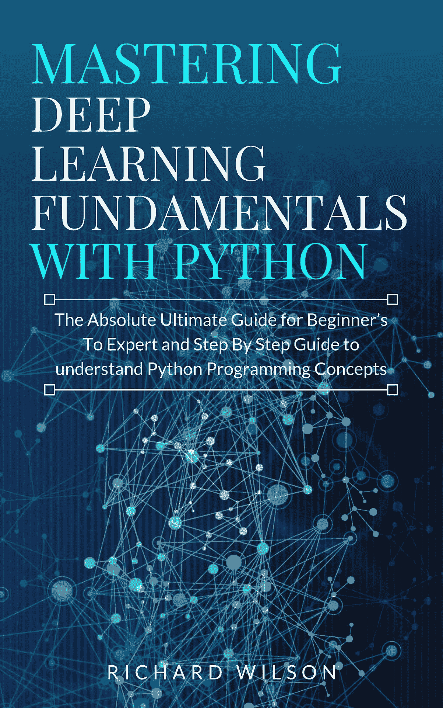

## PART I: FUNDAMENTALS OF DEEP LEARNING

近年来，以人工智能、机器学习和深度学习这三个专业主题为基础塑造的软件技术数量不断增加，这导致了人们对这三个主题的兴趣日益增长。尽管在这些领域工作的专家尚未就这些词语达成共识，但关于这三个有时相互关联、有时含义不同的问题，每天都会出现新的概念。随着技术的进步，人工智能直接进入我们的生活中心，调节计算机决策机制的机器学习，以及研究所有这些之下的数据分析和算法的深度学习，正在朝着成为众多学科共同的未来研究领域发展。作为一个更古老的术语，通常所指的人工智能研究，直接影响着技术的发展方向。我们现在能够使用超过 100 种编程语言为最高可达一定水平的处理器编程。这些设备在接收到我们指令的同时，通过其系统在同一时期执行我们发出的命令。技术进步中最大的份额被称为可编程特性，它具有无懈可击的操作。然而，无论这种才能如何发展，无论人工智能如何进入我们的生活，它每次都败给了人类大脑。例如，它可以轻松理解和解决由重复、控制组或数学运算构成的结构；当前技术在需要逻辑的不确定表达上仍然不足。在这种情况下，深度学习应运而生，它对于教导该系统学习方法至关重要。从人工智能学习开始，首先从数据处理到算法和数据集的机器学习，到被称为人工智能最高点的图像处理和分析，以及包含所有这些的深度学习，正是由于所有这些原因和需求。在现代，它已成为一个热门话题。

## 概率基础

从概率论开始的、利用科学进行决策过程的历程，继续发展为从数据中提取某些参数以进行概括。利用来自概率论的概率分布函数，对可用数据的抽样特征（如均值和方差）进行假设检验。如今，已涌现出许多仍在决策过程中使用的技术，其中一些我们所知的就是 `A/B testing`。

### 预测

决策的基础是预测。通过从输入和输入生成数学模型作为输入 (`s/s`)，然后将该模型用于决策，可以进行估计。最早的模型很简单，自然是线性的，因为它们解决了当时的问题。这意味着输入是通过彼此相加和/或相减来产生输出的。因此，回归方法可以被视为从数据点中穿过一条直线方程的问题。当然，该方法是非线性的，已知非线性乘法和除法运算也被用来将过渡带入函数。这样，我们就有机会从手头的点中穿过一条曲线，并据此使我们的估计更准确。在此过程中使用概率分布函数对于对问题中的偶然因素进行建模是必要的。

### 人工智能

在 1950 年代，学术界从事人工智能的人在处理计算机的学习和问题解决算法时，正在思考如何在不知道手头数据的分布函数的情况下找到解决方案。生物体可以在不知道统计数据的情况下做出决策。在这些时期，出现了两种基本方法：人工神经网络和决策树。这两种方法都不是基于统计的。在人工神经网络中，模拟了神经细胞的结构，并形成了一个分层网络。在该结构中，输入层被称为输入层，输出层被称为输出层。这两者之间的隐藏层是隐藏层。从 1980 年代末到 2000 年初的时期被人们铭记为黄金时代。在此期间结束时，系统的复杂性增加，如果隐藏层超过四到五层，结果就无法改善。从某种意义上说，即使没有停止，经济地生产的过程也放慢了。虽然决策树在某些问题的应用中能给出良好的结果，但由于数据规模增大带来的问题，以及在算法解决方案方面并不十分成功，它们的应用仅限于有限的问题。虽然在统计学领域已经产生了某些先进的非线性方法，但尚未取得可以应用于手头问题的普遍进展。对于高级方法，可以研究与时间序列相关的非线性方法。再次，以不同的方式重新使用多维空间。

在人工神经网络 (`ANNs`) 在 1990 年代末停滞不前的这一点上，一种所谓的支持向量机成为了一种有前途的方法，用来处理 `ANN` 无法应对的复杂性。在该方法中，使用了数学中的复杂问题、空间结构以及允许在这些空间之间转换的函数来摆脱复杂性。当然，人工神经网络也需要在多维空间中进行处理，但空间之间没有转换。根据这些非常复杂的数学方法，如电影中在空间大小中使用的门，核函数 (`kernel functions`) 已被引入并用于解决许多问题。其主要原因是在空间 `A` 中需要非线性解决方案的复杂问题，可以使用核函数通过到空间 `B` 而作为线性问题来处理。这样，就有可能在该空间中使用线性方法。这在商业生活中的反映是，使用 `SVM` 开发的一些产品允许用户使用 `SVM` 解决复杂的分类问题。与人工神经网络一样，该方法无法让用户详细阐述决策，这对其推广构成了严重障碍。这是在 2000 年代中期的大致情况，但尤其是随着大数据浪潮的传播，这些方法远不能满足需求。

### 随机矩阵理论

就在这一刻，一种与发现人工神经网络一样古老的数学求解方法被广大受众重新记起。它是如此为人所知，以至于被用于从固体物理到化学的许多领域。这种被称为随机矩阵理论的方法被科学家用来对科学家在复杂系统建模中发现的复杂系统的普适性进行建模。诺贝尔奖获得者尤金·维格纳据说曾说过：“所有复杂的相关系统都表现出普适性，从晶体格到互联网。”

### 深度学习

如此之多，以至于它开始被应用于从原子能级建模到化学物质光谱分析，再到互联网上集群建模的广泛领域。在这些应用期间，人工神经网络无法应对超过五层隐藏层的事实也被人们记起。最终，这是一个复杂的问题，并且是基于矩阵的。这样，就出现了语音识别、自然语言处理和图像识别等连续解决方案。它被称为深度学习。可以说，这个名字指的是移除了增加人工神经网络中隐藏层数量的障碍。当然，就像 1990 年代人工神经网络时期一样，有可能产生巨大的期望并提出小的解决方案，但迄今为止所做的工作非常有前景。

### 中心极限定理

正如 20 世纪初的中心极限定理使正态分布成为科学界建模的基本工具之一，基于随机矩阵定理的特征值的圆形分布似乎具有同样的效果。

### Julia

软件世界正在做什么来使用这些需要对非常大的矩阵进行运算的方法？这些模型由现有的大数据技术提供支持。然而，已经开发并使用了新的软件库来处理巨大的矩阵。甚至正在开发特定于站点的软件语言。其中之一是 `Julia`。有望成为越来越受欢迎的语言之一的候选者。

### 科学家时代

已经说过，数据科学家将成为时代的主角，科学将变得更加突出。目前，该领域的最佳科学家正被谷歌、微软和 IBM 等公司招揽，而这些科学家生产的数学模型最近已用于具有语音和图像处理功能的产品中。为了在这样的世界中竞争，我们正处于一个世纪的开端，在这个世纪里，应用数学领域的科学家将与企业公司更紧密地合作。

## 统计学基础

统计学习理论是统计学和泛函分析领域中的机器学习体系。统计学习理论处理基于数据寻找预测函数的问题。统计学习理论已在计算机视觉、语音识别、生物信息学和棒球等领域得到应用。学习的目的是预测和理解。学习涉及多个类别，包括监督学习、无监督学习、学习和强化学习。从统计学习理论来看，监督学习是最合适的。

监督学习涉及从一组训练数据中学习。形成的每个点都是输入-输出对，其中输入对应于输出。学习问题是推断输入和输出之间的映射函数，以便学习到的函数可用于预测未来输入的输出。

根据输出类型，监督学习问题要么是回归问题，要么是分类问题。如果输出取连续范围的值，则为回归问题。以欧姆定律为例，可以以电压作为输入、电流作为输出进行回归。回归将找到电压和电流之间的函数关系。

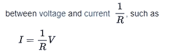
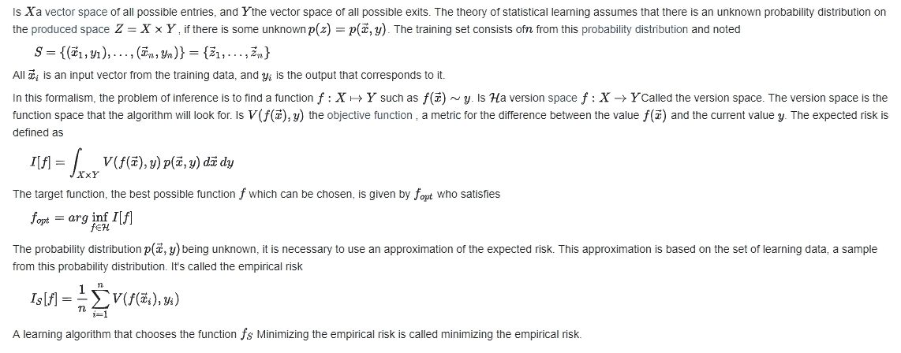

## 线性代数基础

函数 `f`，或我们之前称之为模型，是将输入数据 `x` 转换为结果 `y` 的机制。函数由以下类型的方程表征：

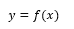

如果数据 `x` 由一个分量或维度组成，我们称之为标量；如果它由以下几个分量组成：

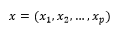

则称为向量。所有可以构造的向量 `x` 的集合称为空间。在空间中，至少存在一个向量子集，可以通过加法或乘法组合来获得整个空间；该向量子集称为基。

矩阵是向量概念的推广：它是向量向量或二维数组。可以将矩阵彼此相加和相乘，矩阵与向量之间，以及矩阵与向量相乘。矩阵在记法上非常有用，因为它们能够以密集的方式书写函数的方程！

我们可以将向量 `x` 的范数定义为该向量到原点的距离。后者记为如下：

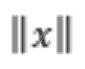

特别地，我们区分：

- 标准 2 或欧几里得距离：
  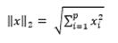
- 标准 1 或绝对值：
  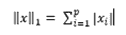

范数的概念也可以推广到矩阵，这里不详细说明。

### 插值

给定一组点的历史，插值意味着确定穿过所有这些点的函数。通常，我们使用多项式插值。这可能是一种回归方法。然而，这种方法通常被避免，因为它经常导致过学习。

### 方程的监督学习

为了评估分类器 `f` 的性能，我们首先定义一个代价函数 `L`，它将给出预测 `f(x)` 与真实值 `y` 之间误差的度量。通常，代价函数被选为与要预测的结果之差的平方；这是最小二乘近似：

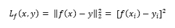

然后，我们定义一个误差函数 `R`，它衡量真实值 `y` 与预测 `f(x)` 之间的差异之和。

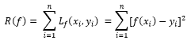

其中 `n` 是历史中元素的数量。

因此，进行回归就是找到使误差最小化的函数 `f`：

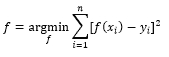

如何获得函数的最小值？重要的是要指出 `f` 是一个形式已知的函数（例如，线性函数 `y = a * x + b`）。要确定 `f`，只需确定其参数即可。（在线性函数的情况下，参数是 `a` 和 `b`）。这些参数通过最小化误差函数 `R` 得到。

在大多数情况下，有精确的方法来最小化 `R`，但对机器来说计算操作非常昂贵。通常，更快的方法是通过对参数值进行多次测试来估计参数值。由于参数取的值是无限的，因此有必要巧妙地进行这些测试。为此，我们使用优化方法，最为人所知的是梯度法。

## 线性回归

### 简单回归 - x 是标量

线性回归是一种监督学习方法，用于在假设 `f` 具有线性形式的情况下估计 `f`：

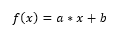

确定 `f` 然后就在于在最小化函数 `R` 的同时找到 `a` 和 `b`：

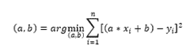

如前所述，可以使用梯度法求解该方程。

### 多元回归 - x 是向量

在这种情况下，

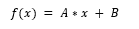

其中 `A` 是一个向量，`B` 是一个标量。优化公式变为：

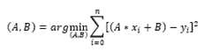

因此，使用向量记法，可以看出将标量方法推广到大多数方法很容易。然而，计算时间更重要，因为有更多系数需要评估（`p + 1` 个系数而不是 2 个）。

### 多元回归，矩阵记法

在文献中，人们经常发现这些方程以矩阵形式表示以获得简洁的写法。设 `X` 为 `n` 个向量 `x` 的矩阵，`Y` 为 `n` 个向量 `y` 的矩阵。那么 `A` 变为矩阵，我们可以写成：

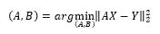

### 非线性回归

有许多比线性回归更复杂的回归模型；我们必须为正确的问题选择正确的回归类型：多项式回归、分段多项式、时间序列、逻辑回归、核回归。

### 降维

与无监督学习中的 CPA 一样，可以使用回归方法进行降维。当特征数量很大时，有趣的是确定哪些特征影响结果。为此，我们使用正则化方法。正则化的原理是通过一个取决于参数的值为 1 或 0 的项来修正误差 `R`。正则化方法之一称为 Lasso 回归：

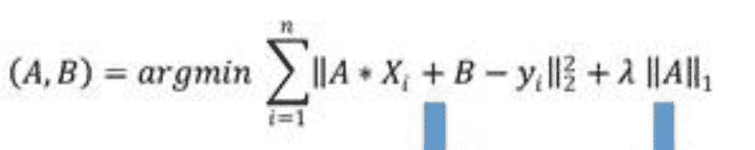

该方法通过使系数 `A` 的大部分为零来减少维度。应注意，参数图片需要通过经验确定。我们已经完成了对回归的解释，这与监督学习有关。

## 机器学习与深度学习简介

`deep learning` 是 `machine learning` 的一个子单元。`Machine learning` 是 `artificial intelligence` 的一个子单元。换句话说，所有 `deep learning` 算法都是 `machine learning` 算法，但许多 `machine learning` 算法并不使用 `deep learning`。`Deep learning` 特指一种名为 `neural network` 的算法类，技术上仅指“deep neural networks”。第一个 `neural network` 于 1949 年开发，但当时用处不大。它将持续优于从 1970 年代的 `neural network` 基于模型到 2010 年的传统 AI 形式。

这些非学习型 AI 类型包括基于规则的算法（考虑一个极其复杂的 `if / else` 块数组）；基于直觉的 AI 如 `A * search`；约束饱和算法如 `Arc Consistency`；树搜索算法如 `minimax`（由著名的 `Deep Blue` 国际象棋 AI 使用）；等等。

阻止 `machine learning` 尤其是 `deep learning` 成功发展的两件事是——大型数据集的可用性和计算能力不足。在 2018 年，数据过剩，任何拥有 `AWS` 账户和信用卡的人都可以访问分布式超级计算机。由于数据和计算能力的全新可用性，`Machine learning` 尤其是 `deep learning` 席卷了 AI 世界。

你应该知道 `machine learning` 还有其他类别，例如无监督学习和强化学习，你将学习 `machine learning` 的一个子集，称为监督学习。`Supervised learning` 算法通过反复强迫机器猜测来工作。具体来说，我们（人类）希望他对我们已知正确答案的数据做出预测。这被称为 much tagged data etiket - 标签是我们希望机器预测的一切。

这里有一个例子：假设我们想设置一个算法来预测某人是否可以延长他们的抵押贷款。我们需要一组不违约抵押贷款的人。我们将收到这些人的数据；将它们输入 `machine learning` 算法；让他猜测每个人，一旦预测，我们就告诉机器实际答案是什么。真或假，`machine learning` 算法已经改变了它如何改变预测。我们重复这个过程很多次，通过数学的奇迹，我们机器的预测变得更好。虽然估计相对缓慢，但我们需要大量数据来训练这些算法。

诸如 `linear regression`、`support vector machines` 和 `decision trees` 之类的 `Machine learning` 算法以不同的方式“学习”，但都应用相同的过程：做出预测，得到纠正，并调整基于预测的预测机制。在更高层面上，这就像一个人学习的方式。

回想一下，`deep learning` 是 `machine learning` 的一个子单元，专注于一种特定类别的 `machine learning` 算法，称为 `neural networks`。`Neural networks` 主要受人类大脑工作原理的启发——单个“神经元”从其他神经元接收“信号”，进而向其他“神经元”发送“信号”。每个神经元以某种方式转换传入的“信号”，最终产生输出信号。如果一切顺利，这个信号代表准确的预测！

这是一个有用的心理模型，但计算机不是生物大脑。神经元缺乏突触或其他处理大脑的生物机制。随着生物模型的破坏，研究人员和科学家使用图论来模拟人工 `neural networks`，而不是将 `neural networks` 识别为“人工大脑”，而是将其识别为具有强大功能的复杂图。

从图论的角度来看，`neural network` 是一系列连接节点的层；每个节点代表一个“神经元”，每个连接代表一个“突触”。不同类型的网络具有不同的连接。

`deep learning` 的最简单方法是深度 `neural network`。深度 `neural network` 是一个图，包括一系列全连接层。给定层上的每个节点都与下一层上的每个节点都有边；这些边中的每一条都被分配了不同的权重。整个层序列是“大脑”。如果所有这些边上的权重设置正确，`Deep Learning` 研究将是关于如何创建这些图的各种版本；调整链接权重直到系统运行，并确保我们的机器认为我们做到了。

使 `Deep Learning` 成为可能的机制如 `gradient descent` 和 `backpropagation` 结合了来自不同数学学科的许多思想。要理解 `neural networks` 需要一些数学背景。

### 背景信息 - 一点点什么

当你想到使用 `PyTorch` 和 `TensorFlow` 等库有多容易时，你不需要很多数学。但在完成两门课程所需的阅读后，我只是很高兴我有我的数学经验。`linear algebra`、数学、概率、统计和图论主题的子集已经出现。在大学获得这些信息大约需要五门课程：数学 1、2 和 3；线性代数；和计算机科学 101。

幸运的是，你不需要所有这些领域。根据我迄今为止所见，如果你想自己进入 `neural networks`，我建议：从 `linear algebra` 开始，你需要知道并通过点积，`matrix product`（特别是乘以不同维度的矩阵的规则）。你不必快速手工完成这些事情，但你应该足够舒适，可以在白板或纸上做小样本。你也应该感到满意地处理“多维字段”——`deep learning` 使用许多维度的向量。

## 机器学习基础


# 计算机科学在近年发生了很大变化

现在人工智能的概念被频繁使用。人工智能是让机器从环境、错误和人身上学习的一种努力。虽然该领域有很多不同的分支（模式识别、人工神经网络、强化学习、统计推断、概率机器学习、监督-无监督学习），但我们仍然不知道正确的方法。哪种技术会引领我们走向更美好的世界？可能没有单一的技术能解决所有问题。利用不同技术和组合来生产智能系统的方式也取决于通用技术的发展。没几年前的电脑速度并不快。也许未来我们也可以这样说。将特定问题分散到大量机器上（区块链）是一个非常重要的方法。这样研究就加速了。20-30 年前被认为梦想的事情，如今已是生活的常态。例子：`ABS`（防抱死制动）、飞机的自动驾驶、Google 搜索建议、地图、电子邮件垃圾邮件检测。预测长期未来是非常具有挑战性的。没有人能做到。

## 故障排除

机器学习和研究是精神上的发现。过去 5 年与过去 10-20 年相比，我们见证了巨大的加速。机器学习以样本为食。与其编写 50 万行代码，不如让它通过观察世界来学习。Google 在图像检测上取得了成功。他能找到图片的特征。当他看到蛋糕和男孩时，他就知道是生日。今天我们可以与 Google 聊天。示例：当我们问“伊斯坦布尔有墨西哥餐厅吗？”，我们可以看到前 10 名墨西哥餐厅。

## 商业世界

自动化机器学习使其变得更加高效。受益于人工智能恩惠的公司是知识型公司。机器可以在欺诈活动、数据采样、数据挖掘、就业安全、翻译等领域解决几乎每个行业的需求。假设你有一个重复做过数百次的任务，并且有记录显示如何完成。你可以利用机器来完成这项工作。机器学习非常适合自动化现有流程或使其更高效。

# 神经网络与深度学习基础

神经网络是当谈到繁重计算和智能算法时出现的下一个大事物。这就是它们的工作原理以及为什么它们如此惊人。如果你持续关注技术新闻，你可能已经遇到过神经网络的概念（也称为神经网络）。2016 年，谷歌的 AlphaGo 神经网络在 4-1 的系列赛中击败了世界上最好的职业围棋选手之一。YouTube 还宣布他们将使用神经网络更好地理解他们的视频剪辑。YouTube 将使用神经网络真正理解视频剪辑。YouTube 将使用神经网络真正理解视频。YouTube 上的搜索可能令人沮丧，因为 YouTube 看待视频的方式与人不同。最近，谷歌增加了一项可以改变这一点的专利。还有数十个其他故事可以被记住。但具体来说，神经网络是什么？它从何处工作？为什么它在机器学习中如此常见？

## 像大脑一样的计算机

现代神经科学家经常将大脑讨论为一种计算机类型。神经网络则试图做相反的事情：构建一个像大脑一样运行的计算机。当然，我们对大脑极其复杂的功能只有初步的理解，但通过创建大脑处理数据方式的简化模拟，我们可以构建一种与普通计算机工作方式非常不同的计算机。计算机处理器串行构造数据（“按顺序”）。它们对一组数据执行许多程序，一次一个。并行处理（“同时多流处理”）通过串联使用多个处理器显著减少了计算机。人工神经网络（因此称为与大脑中的实际神经网络区分开来）具有根本不同的结构。它是高度互联的。这使得它能够非常快速地处理数据，从数据中学习并更新其内部结构以提高性能。然而，高互联水平会产生一些惊人的效果。例如，神经网络非常擅长识别数据中的模糊模式。

### 学习能力

神经网络的学习能力是其最大的优势。对于标准数据库架构，程序员必须开发一个算法，告诉计算机如何处理传入数据，以确保计算机输出正确答案。输入-输出响应可能像“当按下 A 键时”一样简单，屏幕上出现“A”或像复杂的统计一样复杂。另一方面，神经网络不需要同类型的算法。通过学习机制，它们本质上可以设计自己的算法。需要注意的是，由于神经网络是编写在机器上的程序，而这些机器使用标准串行处理硬件，因此当前技术仍然设置了限制。构建神经网络的硬件变体是另一个完全不同的问题。

## 从神经元到节点

现在我们已经为神经网络的工作原理奠定了基础，我们可以开始查看一些细节。人工神经网络的基本构造如下所示：

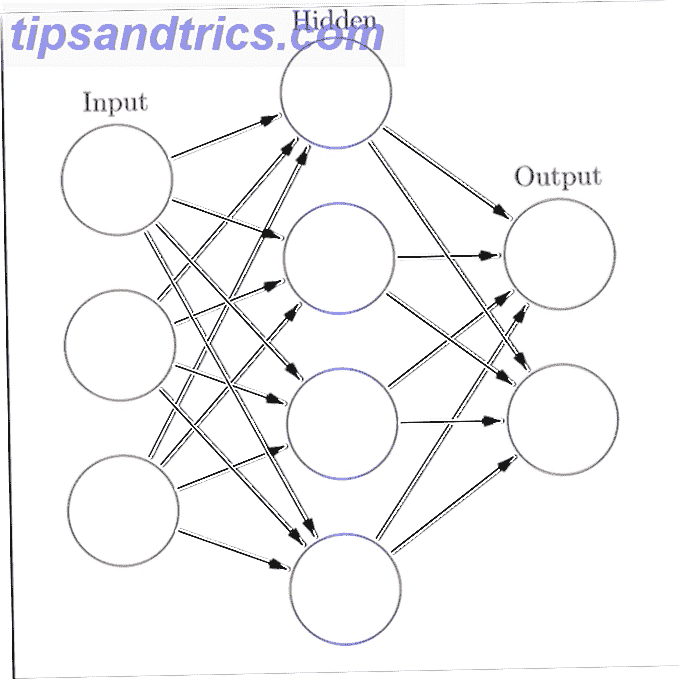

每个圆圈被称为“节点”，它模拟单个神经元。左侧是输入节点，中间是隐藏节点，右侧是输出节点。非常基本地说，输入连接接受输入值，这可能是一个二进制 1 或 0、RGB 颜色值的一部分、国际象棋棋子的状态或其他东西。这些节点服务于流入网络的信息。每个输入按钮都链接到多个隐藏节点（有时链接到每个隐藏节点，有时链接到一个子集）。输入节点接收它们被给予的信息并将其传递给隐藏层。例如，如果输入按钮接收到 1，则会发送信号（神经学中的“放电”），如果接收到零则保持休眠。每个隐藏节点都有一个阈值：如果其所有累加输入达到某个值，它就会燃烧。

### 从突触到连接

每个对应于解剖学突触的连接也赋予特定的权重，这使得网络能够更强调特定节点的动作。这里有一个例子：

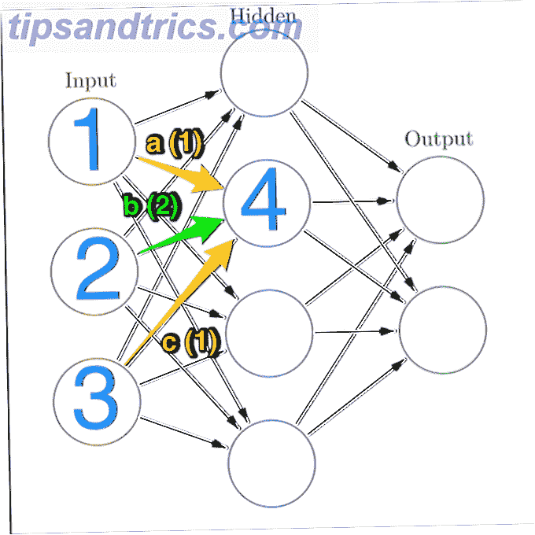

正如你所看到的，连接 B 的权重高于终端 A 和 C。让我们说隐藏节点 4 只有在总输入为 2 或更高时才会放电。这意味着如果 1 或 3 单独放电，4 将不会被触发，但 1 和 3 一起就会触发该节点。节点 2 也可以通过连接 B 自身触发该节点。让我们以天气为例作为实际例子。假设你设计一个简单的神经网络来确定是否应该发布冬季风暴警告。使用上述连接和权重，节点 4 只有在温度低于 0 华氏度且风速超过 30 英里/小时时才会射击，或者如果降雪概率超过 70%。温度将输入到节点 1，风输入到节点 3，降雪概率输入到节点 2。现在节点 4 可以在确定向输出层发送哪个信号时考虑所有这些因素。

### 比简单逻辑更好

当然，这个功能可以用简单的逻辑门轻松发出。但更复杂的神经网络，如下图所示，可以执行更复杂的运算。

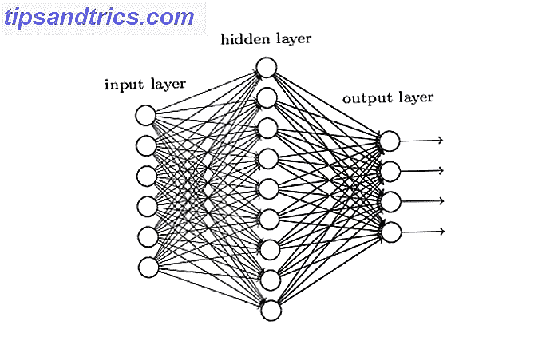

输出节点的工作方式与隐藏层相同：输出节点对来自隐藏层的输入求和，如果达到某个值，则输出输出节点并发送特定信号。在过程结束时，输出层发送一组信号，表示输入的结果。虽然上面显示的网络很简单，但深度神经网络可以有许多隐藏层和数百个节点。

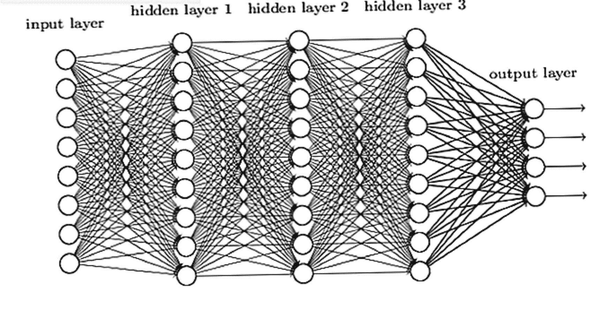

图片来源：Michael A. Nielsen 的《神经网络与深度学习》

## 错误校正

到目前为止的过程相对简单。但神经网络在学习方面表现出色。大多数神经网络使用一种称为反向传播的过程，该过程将信号传回网络。在程序员分发神经网络之前，他们会让它经历一个训练阶段，在此期间它会接收一组已知结果的输入。例如，程序员可以教神经网络识别图像。输入可以是一辆汽车的图片，正确的效果将是“汽车”一词。程序员将图像作为输入提供并查看输出节点出来的内容。如果网络回应“飞机”，程序员会告诉你它是错误的。然后网络对其连接进行调整，这会改变节点之间不同链接的权重。此操作由添加到网络中的特定学习算法控制。网络会扩展以调整连接权重，直到提供正确的输出。这是一个简化，但神经网络可以使用类似的原理学习非常复杂的运算。

### 持续改进

即使在训练之后，反向传播仍会继续，这就是神经网络变得很酷的地方。它们在被使用时继续学习，整合新信息并对不同连接的重要性进行调整，在它们被设计用于的任务中变得越来越高效和有效。这可能像图像识别一样简单，也像下围棋一样复杂。以这种方式，神经网络总是变化和改进。这可能会产生惊人的效果，导致网络优先考虑程序员不会优先考虑的事情。除了上面描述的过程之外，该过程称为监督学习，还有另一种方法：无监督学习。在这种情况下，神经网络接收输入并尝试在其输出中精确地重现它，使用反向传播来更新其连接。它听起来可能像是一项无用的练习，但以这种方式，网络学会提取有用的特征并将这些特征推广以改进其模型。

## 深度困境

反向传播是一种非常有效教授神经网络的方式……当它们只有几层深时。随着隐藏层数量的增加，反向传播的效率会下降。这对深度网络来说是个问题。有了反向传播，它们通常与简单网络一样有效。研究人员已经演化出几种解决这个问题的方案，其具体细节相当复杂，超出了本入门部分的范围。许多这些解决方案试图做的事情很容易通过训练网络“压缩”数据来减少网络的复杂性。

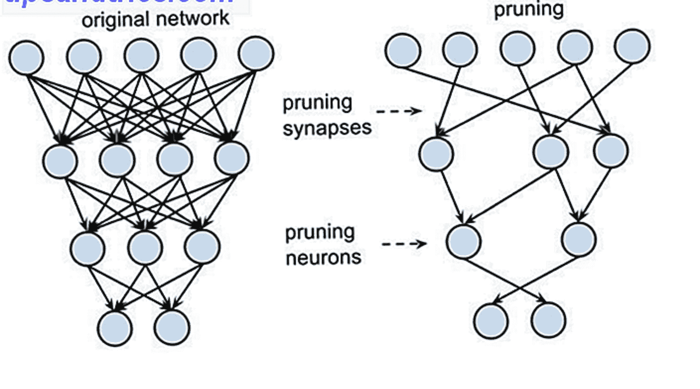

为此，网络学习提取输入中较少数量的识别功能，最终在计算中变得更有效。网络进行概括和抽象，就像人们学习一样。在这种学习之后，网络可以剪掉它认为不太关键的节点和连接。这使得网络更加有效，学习变得更容易。

## 神经网络应用

因此，神经网络通过使用多层节点——输入、隐藏和输出来模拟大脑如何学习，它们可以在监督和无回答的情况下学习。复杂的网络可以进行抽象和概括，使它们更具生产力并更善于学习。我们可以用这些系统做什么？从理论上讲，我们可以为几乎任何事情练习神经网络。而且你肯定在不理解的情况下使用过它们。它们在语音和视觉识别中非常常见，例如，因为它们可以学习选择声音或图像共有的特定特征。所以当你问 Siri“最近的加油站在哪里”，你的 iPhone 会将你的语音通过神经网络以找出你正在说什么。可能有不同的神经网络学习预测你可能请求的不同事情。


自动驾驶汽车可以使用神经网络处理视觉数据，从而遵守道路规则并避免碰撞。各种各样的机器人都可以从帮助它们有效地完成任务的神经网络中受益。计算机可以学习玩象棋、围棋和雅达利经典游戏。如果你曾经与聊天机器人交谈过，有可能是神经网络提供适当的答案。互联网搜索可以从神经网络中受益，因为高效的并行处理模型可以快速处理大量数据。神经网络还可以教你你的习惯来自定义你的搜索结果或预测你接下来要寻找的内容。这种预测模型对营销人员（以及任何需要预测复杂人类行为的人）来说非常有价值。图像识别、光学字符识别、股票市场预测、路线搜索、大数据处理、医疗成本分析、销售预测、电子游戏 AI……可能性几乎无穷无尽。神经网络学习模式、概括和成功预测行为的能力使其在无数情况下具有价值。

## 神经网络的未来

神经网络已从简单的模型发展到非常复杂的学习模拟。它们在我们的手机、平板电脑中运行，并运行我们使用的许多网络服务。还有许多其他机器学习系统。但由于神经网络与人类大脑的相似性（以极度简化的方式），它们是最迷人的。随着我们继续开发和完善模型，没有人说它们能做什么。

# 深度学习参数与超参数

## 什么是超参数？

超参数是用于训练模型并控制训练过程本身的可调参数。例如，要训练一个深度神经网络，你必须在训练模型之前决定网络中隐藏层的数量以及每一层的节点数。这些值在训练过程中通常保持不变。

在深度学习或机器学习场景中，模型的性能在很大程度上取决于所选超参数值。超参数探索的目标是在不同的超参数配置之间进行搜索，直到找到导致最佳性能的配置。

通常，探索超参数的过程是一项非常繁琐的手工工作，因为搜索空间非常庞大，并且评估每个配置可能成本很高。

Azure Machine Learning 允许你高效地自动化超参数扫描，为你节省大量时间和资源。指定超参数值的范围和最大训练系列数。系统随后会自动启动多个同时进行的系列，使用不同的参数设置，并寻找导致最佳性能的配置，该性能由你选择的指标衡量。

低性能训练系列会自动提前终止，从而减少了流程资源的浪费。相反，这些资源被用于探索其他超参数配置。

## 搜索空间的定义

通过扫描为每个超参数定义的值范围来自动调整超参数。

## 超参数的类型

每个超参数可以是离散的或连续的。

### 离散超参数

离散超参数使用在离散值之间的对象 `choice` 指定。可以是：

* 用逗号分隔的一个或多个值；
* 一个对象范围；
* 任意列表对象。

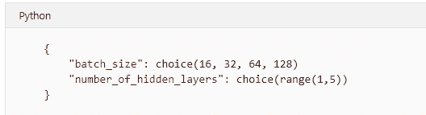

在此情况下，`batch_size` 取 `[16, 32, 64, 128]` 中的一个值，而 `number_of_hidden_layers` 取 `[1, 2, 3, 4]` 中的一个值。

高级离散超参数也可以通过分布来指定。支持以下分布：

* `quniform(low, high, q)`：返回一个值 `round(uniform(low, high) / q) * q`
* `qloguniform(low, high, q)`：返回一个值 `round(exp(uniform(low, high)) / q) * q`
* `qnormal(mu, sigma, q)`：返回一个值 `round(normal(mu, sigma) / q) * q`
* `qlognormal(mu, sigma, q)`：返回一个值 `round(exp(normal(mu, sigma)) / q) * q`

### 连续超参数

连续超参数通过连续值范围的分布来指定。支持的分布有：

* `Uniform(low, high)`：返回一个在 `low` 和 `high` 之间均匀分布的值。
* `log-uniform(low, high)`：返回一个根据 `exp(uniform(low, high))` 提取的值，使得返回值的对数均匀分布。
* `Normal(mu, sigma)`：返回一个半为 `mu`、标准差为 `sigma` 的正态分布的实值。
* `Lognormal(mu, sigma)`：返回一个根据 `exp(normal(mu, sigma))` 提取的值，使得返回值的对数呈正态分布。

以下是参数空间定义的示例：

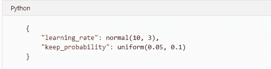

此代码描述了一个包含两个参数的搜索空间：`learning_rate` 和 `keep_probability`。它具有均值为 10、标准差为 3 的正态分布。它具有最小值为 0.05、最大值为 0.1 的均匀分布。

* `learning_rate`
* `keep_probability`

## 采样超参数空间

你可以在超参数空间定义期间进一步指定将使用的参数采样方法。Azure Machine Learning 服务支持随机采样、网格采样和贝叶斯采样。

### 随机采样

在随机采样中，超参数等级从指定的搜索空间中随机选择。随机采样提供的搜索空间可包含离散和连续超参数。

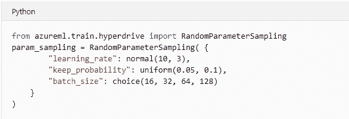

### 网格采样

网格采样对定义搜索空间的所有可能值执行简单的网格搜索。它只能与使用指定的超参数一起使用。例如，以下空间总共有六个样本：`choice`

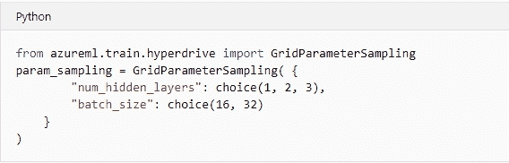

### 贝叶斯采样

贝叶斯采样以贝叶斯优化算法为中心，并对下一次采样的超参数值做出智能决策。采样是基于之前样本的执行情况进行的，以使新样本改善已通知的主要指标。

使用贝叶斯采样时，同时运行的数量会影响调整过程的有效性。通常，较少的并发执行可能导致采样的更好收敛，因为较低的并行度增加了受益于先前已完成执行的执行次数。

贝叶斯采样仅在搜索空间中支持 `choice` 和 `uniform` 分布。

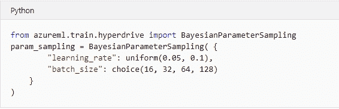

> **注意** 贝叶斯采样不遵循任何提前终止策略（参见提前终止指令的规范）。使用贝叶斯参数采样时，将值设置为 `early_termination_policy = None` 或不添加参数 `early_termination_policy`。

## 主要指标的指定

指定你希望通过超参数调整实验进行优化的主要指标。在每个训练系列中，主要指标都会被评估。性能不佳的执行（主要指标未达到提前终止指令设定的标准）将被终止。

除了主要指标的名称外，还将指定优化目标：是最大化还是最小化主要指标。

* `primary_metric_name`：要优化的主要指标的名称。主要指标的名称必须与训练脚本记录的指标名称完全匹配。参见为超参数调整注册指标。
* `primary_metric_goal`：它可以是 `PrimaryMetricGoal.MAXIMIZE` 或 `PrimaryMetricGoal.MINIMIZE`，并决定在评估执行时主要指标将被最大化还是最小化。

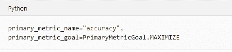

优化执行以最大化“precision”。确保在训练脚本中记录此值。

## 为超参数调整注册指标

模型的训练脚本必须在模型训练期间记录相关指标。在配置超参数设置时，你必须指定将用于评估执行性能的主要指标。（参见主要指标优化的规范）。

在训练脚本中，你必须记录此指标，以便超参数调整过程可以使用它。

使用以下示例代码片段记录训练脚本的指标：

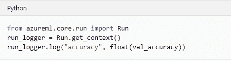

训练脚本计算 `val_accuracy` 的值并将其注册为“precision”，用作主要指标。每次记录指标时，超参数调整服务都会接收到它。是模型开发者必须确定此指标报告的频率。

## 提前终止指令的指定

借助提前终止策略自动结束性能低下的执行。完成可减少资源的浪费，这些资源可用于探索其他参数设置。

使用提前终止策略时，可以配置以下控制策略应用时机的参数：

# 提前终止指令

## 常见参数

* `evaluation_interval`：策略应用的频率。每次训练脚本记录主要指标时，即视为一个间隔。因此，参数为 `1` 时，指令会在训练脚本每次报告主要指标时应用。参数为 `2` 时，指令会在训练脚本通知主要指标的另一次应用。未指定时，默认为 `1`。


* `delay_evaluation`：将指令的首次评估延迟指定的间隔数。它是一个可选参数，允许所有配置在初始最小间隔数内执行，从而防止训练序列过早终止。如果指定，策略会在大于或等于 `delay_evaluation` 的 `evaluation_interval` 的每个倍数上应用。

Azure Machine Learning 服务支持以下提前终止指令。

## Bandit 指令

Bandit 是一种基于延迟因子或延迟量以及评估间隔的终止指令。该指令会提前终止那些主要指标未在延迟因子或指定延迟量范围内，相对于表现最佳的训练系列的执行。此指令采用以下配置参数：

* `slack_factor` 或 `slack_amount`：相对于表现最佳的训练系列允许的延迟。指定允许的延迟作为关系。指定允许的延迟作为绝对数量，而非关系。

例如，假设在间隔 `10` 应用 bandit 策略。假设在间隔 `10` 表现最佳的执行报告的主要指标为 `0.8` 以最大化它。如果指令指定 `slack_factor` 参数为 `0.2`，则那些在间隔 `10` 中最佳指标小于 `0.66`（`0.8 / (1 + slack_factor)`）的训练系列将结束。如果另一方面，指令指定 `slack_amount` 参数为 `0.2`，则那些在间隔 `10` 中最佳指标小于 `0.6`（`0.8 - slack_amount`）的训练系列将结束。

* `evaluation_interval`：指令应用的频率（可选参数）。
* `delay_evaluation`：将指令的首次评估延迟指定的间隔数（可选参数）。

```python
from azureml.train.hyperdrive import BanditPolicy
early_termination_policy = BanditPolicy(slack_factor = 0.1, evaluation_interval=1, delay_evaluation=5)
```

在此实例中，提前终止策略在指标被通知的每个间隔应用，从评估间隔 `5` 开始。任何最佳指标小于 `(1 / (1 + 0.1)`，或为表现最佳执行 `91 %` 的执行将被完成。

## 中位数停止指令

中位数停止是一种基于执行报告的主要指标平均值的执行的提前终止指令。此指令计算所有训练系列中执行的平均值，并完成那些性能差于执行平均值中位数的执行。此指令采用以下配置参数：

* `evaluation_interval`：指令应用的频率（可选参数）。
* `delay_evaluation`：将指令的首次评估延迟指定的间隔数（可选参数）。

```python
from azureml.train.hyperdrive import MedianStoppingPolicy
early_termination_policy = MedianStoppingPolicy(evaluation_interval=1, delay_evaluation=5)
```

在此实例中，提前终止策略在每个间隔应用，从评估间隔 `5` 开始。如果其最佳主要指标在 `1` 到 `5` 的间隔比率中差于所有训练系列中执行平均值的中位数，则在间隔 `5` 终止执行。

## 截断选择指令

截断选择在每次评估间隔取消给定百分比的性能最低的执行。执行基于其在主要指标上的性能进行比较，并终止性能最低的 `X%`。此指令采用以下配置参数：

* `truncation_percentage`：在每次评估间隔中将被完成的性能最低的执行的百分比。指定 `1` 到 `99` 之间的整数值。
* `evaluation_interval`：指令应用的频率（可选参数）。
* `delay_evaluation`：将指令的首次评估延迟指定的间隔数（可选参数）。

### TruncationSelectionPolicy 示例

```python
from azureml.train.hyperdrive import TruncationSelectionPolicy
early_termination_policy = TruncationSelectionPolicy(evaluation_interval=1, truncation_percentage=20, delay_evaluation=5)
```

在此实例中，提前终止策略在每个间隔应用，从评估间隔 5 开始。如果其在该间隔内的性能为间隔 5 中所有执行最低性能的 20%，则将在间隔 5 终止执行。

### 无终止指令

如果希望所有训练系列都运行到完成，请将指令设置为 `None`。其效果是不应用任何提前终止指令。

`Policy=None`

### 默认指令

如果未指定指令，超参数调整服务将允许所有训练系列运行直至完成。

### 注意

如果您正在寻找一种保守的策略，在不完成有前景的作业的情况下提供节省，您可以使用 `evaluation_interval=1` 和 `delay_evaluation=5` 的中位数停止指令。这是一种保守的配置，可在不损失主要指标的情况下提供 25% 至 35% 的节省（根据我们的评估数据）。

## 资源分配

通过指定最大总训练运行次数来控制超参数调整实验的资源预算。可选地，指定超参数调整实验的最大持续时间。

* `max_total_runs`: 将创建的最大总训练执行次数。上限：例如，如果超参数空间有限且样本更少，则可能有更少的执行次数。它必须是一个介于 1 和 1000 之间的数字。
* `max_duration_minutes`: 超参数调整实验的最大持续时间（以分钟为单位）。该参数是可选的，如果存在，则在此持续时间后可能仍在运行的所有系列将自动取消。

**注意** 如果指定了 `max_total_runs` 和 `max_duration_minutes`，则超参数调整实验将在这两个阈值中的第一个达到时结束。

此外，指定在超参数调整搜索期间将同时执行的训练系列的最大数量。

* `max_concurrent_runs`: 在给定时间将同时执行的系列的最大数量。如果未指定任何内容，则执行数量将并行启动。如果指定，则该值必须是一个介于 1 和 100 之间的数字。

**注意** 同时执行的数量由指定进程目标中可用的资源决定。因此，您必须确保进程目标具有所需并发所需的可用资源。

为超参数调整分配资源：

`max_total_runs=20`, `max_concurrent_runs=4`

在此代码中，超参数调整实验被配置为使用最多 20 次总执行，以这样的方式同时执行 4 个配置。

## 实验配置

使用先前各节中已看到的定义的超参数搜索空间、提前终止指令、主要指标和资源分配来配置超参数调整实验。此外，提供一个将使用采样的超参数调用的参数。该参数描述要执行的训练脚本、每个作业的资源（一块或多块 GPU）以及要使用的进程目标。

由于可用资源决定了超参数调整实验中的并发性，请确保指定的进程目标具有足够的资源来满足所需的并发性。

`estimator`

`estimator`（有关估计器的更多信息，请参阅如何训练模型）。

配置超参数调整实验：

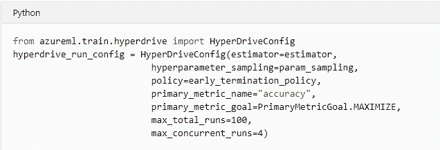

### 发送实验

在定义超参数调整设置后，发送一个实验：

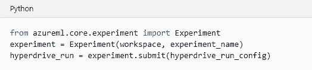

`experiment_name` 是您希望分配给超参数调整实验的名称，而 `workspace` 是您希望创建实验的工作区（有关实验的更多信息，请参阅 Azure Machine Learning 服务的工作原理？）。

### 实验显示

Azure Machine Learning SDK 提供了一个 Notebook 小部件，用于显示训练系列的进度。以下代码片段在一个 Jupyter Notebook 中显示所有超参数调整运行：

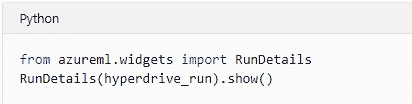

在此代码中，显示了一个包含每个超参数配置的训练系列详细信息的表格。

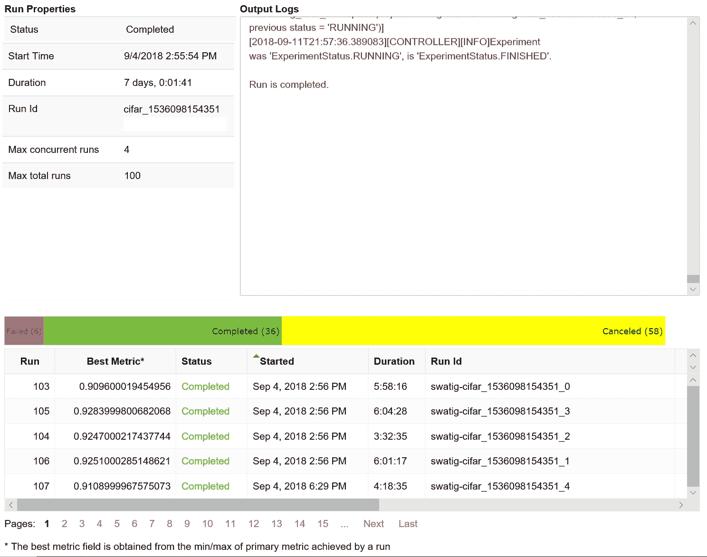

您还可以随着训练的进行观察每个执行的性能。

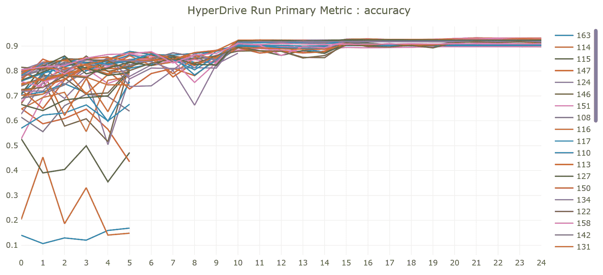

此外，您可以通过平行坐标图直观地识别性能与单个超参数值之间的相关性。

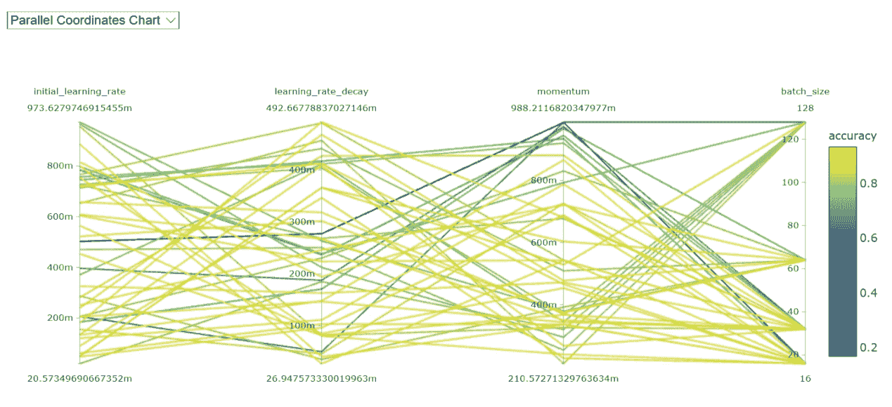

### 识别最佳模型

一旦所有超参数调整系列都已完成，请识别性能最佳的配置及其对应的超参数值：

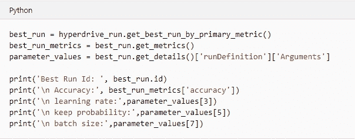

## 深度神经网络层

深度神经网络（`DNN`）被称为介于输入层和输出层之间有若干隐藏层的[人工神经网络](https://wiki.example.org/feynmans_learning_method)（`ANN`）。与轻量级 `ANNs` 一样，`DNNs` 可以建模复杂的非线性关系。神经网络的首要目标是接收一组输入，对其进行逐步复杂的计算并输出，以解决诸如分类等现实世界问题。我们只需为神经网络提供输入。在深度网络中，我们有顺序的数据输入、输出和流动。


神经网络通常用于监督学习和强化学习问题。这些网络围绕一组相互连接的层展开。在深度学习中，隐藏层的实际数量通常是非线性的，可以很大；比如说大约 1000 层。我们主要使用梯度下降法来优化网络并最小化损失函数。我们可以使用 `Imagenet`，一个包含数百万张数字图像的存储库，来对猫和狗等数据进行分类。`DL` 网络除了静态图像外，还越来越多地用于动态图像，以及时间序列和文本分析。训练数据集是深度学习模型的重要组成部分。此外，反向传播是训练 `DL` 模型的算法。`DL` 处理具有复杂输入和输出转换的大型神经网络的训练。`DL` 的一个例子是将照片分配给照片中人物姓名，如社交网络中所做的那样，用短语描述图像是另一个最近的 `DL` 应用。

### DL 映射

神经网络是具有 `x1`、`x2`、`x3` ... 等输入的目的，这些输入在两个（浅层网络）或几个中间操作（也称为层，深度网络）中被转换为 `z1`、`z2`、`z3` 等输出。权重和偏差从一层到另一层发生变化。"`W`" 和 "`v`" 是神经网络各层的权重或突触。使用深度学习的最佳情况是监督学习问题。在这里，我们有一组大型的数据输入和期望的一组输出。

### 反向传播算法

在这里，我们应用反向传播算法来获得正确的输出预测。最基本的深度学习数据集是 `MNIST`，一组手写数字数据。我们可以用 `Keras` 深度训练一个卷积神经网络，以对该数据集中的手写数字图像进行分类。神经网络分类器的触发或激活提供了一个分数。例如，要将患者分类为生病和健康，我们考虑身高、体重和体温、血压等参数。高分意味着患者生病，低分意味着他们健康。输出层和隐藏层中的每个节点都有其分类器。输入层接收输入并将其分数传递给下一个隐藏层进行额外激活，这一过程一直持续到达到输出为止。这种从左到右的输入到输出的进展称为前向传播。

神经网络中的信用分配路径（`CAP`）是从入口到出口的变换序列。`CAPs` 在入口和出口之间建立可能的原因联系。对于给定的前馈神经网络，`CAP` 的深度或 `CAP` 的深度是隐藏层的数量加一，因为输出层包含在内。对于信号可以通过一层多次传播的循环神经网络，`CAP` 的深度可能无限。

### 深度网络和浅层网络

没有精确的深度阈值可以将浅层学习与深度学习区分开来；但通常认为，对于具有多个非线性层的深度学习，`CAP` 必须大于二。神经网络中的基本节点是感知器，它模仿生物神经网络中的神经元。然后我们有多层感知器或 `MLP`。一组权重和偏差修改每组输入。每个边都有不同的权重，每个节点都有唯一的偏差。神经网络预测的准确性取决于其权重和偏差。提高神经网络准确性的过程称为训练。前向传播网络的输出与已知准确的值进行比较。电荷函数或损失函数是生成输出与实际输出之间的区别。训练的目标是通过数百万个训练示例使训练成本尽可能小。为此，网络调整权重和偏差，直到预测与正确结果匹配。一旦训练良好，神经网络就有潜力随时做出准确的预测。

当模式变得复杂，你希望计算机识别它们时，你必须选择神经网络。在这种复杂模式的情况下，神经网络优于所有其他竞争算法。计算机擅长执行重复计算和遵循详细说明，但它们在识别复杂模式方面并不擅长。如果存在简单模式识别问题，支持向量机（`SVM`）或逻辑回归分类器可以很好地完成工作，但随着模式复杂性的增加，别无选择，只能搜索深度神经网络。因此，对于复杂模式，如人脸，浅层神经网络会失败，别无选择，只能使用具有更多层的深度神经网络。

深度网络可以通过将复杂模式分解为更简单的模式来完成其工作。例如，在人脸中，边缘可用于检测嘴唇、鼻子、眼睛、耳朵等部位，然后再重新组合形成人脸。正确预测的准确性变得如此精确，以至于最近在谷歌模式识别挑战中，深度网络超过了人类。

这种分层感知器网络的思想已经存在一段时间了。在这个领域，深度网络模仿人类大脑。但这一个缺点是它们需要很长时间来训练。然而，最近的高性能 GPU 已能在不到一周的时间内训练此类深度网络；而快速 CPU 可能需要数周甚至数月才能完成同样的任务。

### 选择深度网络

如何选择深度网络？我们必须确定我们是在构建分类器还是试图在数据中寻找模式，以及我们是否要使用无监督学习。为了从未标记的数据集中获得模式，我们使用受限玻尔兹曼机或自动编码器。

选择深度网络时请考虑以下几点：

* 对于文本处理、情感分析、命名实体分析和识别，我们使用循环网络或递归神经张量网络或 `RNTN`；
* 对于在字符级别工作的任何语言模型，我们使用循环网络。
* 对于图像识别，我们使用深度信念网络 `DBN` 或卷积网络。
* 对于对象识别，我们使用 `RNTN` 或卷积网络。
* 对于语音识别，我们使用循环网络。
* 通常，深度理解网络和具有整流线性单元或 `RELUs` 的多层感知器是分类的良好选择。
* 对于时间序列分析，始终建议使用循环网络。

神经网络已经存在超过 50 年；但现在才被赋予更多重要性。原因是当我们尝试用一种称为传播的方法训练它们时，我们发现了一个称为泄漏或爆炸梯度的问题。当这种情况发生时，训练需要更长时间，精度就会退居其次。当我们训练一个数据集时，我们不断计算成本函数，即一组标记训练数据的预测输出与实际输出之间的差异。通过调整权重和偏差的值来降低成本函数，直到获得最低值。训练方法使用梯度，即成本相对于权重或偏差值变化的变化率。

### 受限玻尔兹曼网络或自动编码器 - RBN

2006 年，通过解决梯度泄漏问题取得了突破。Geoff Hinton 提出了一种新颖的策略，推动了受限玻尔兹曼机 `RBM` 的发展，这是一种浅层的两层网络。第一层是可见层。此外，第二层是隐藏层。可见层中的每个节点都连接到隐藏层中的每个节点。该网络被称为受限，因为同一层内的两个层不允许接收连接。

自动编码器是编码数据为向量的网络。创建原始数据的隐藏或压缩图像。向量在降维中很有用。向量将原始数据压缩为更少的基本维度。自动编码器与解码器结合使用，这使得可以根据其隐藏表示重建输入数据。`RBM` 是双向翻译器的数学等价物。前向传递接收条目并将它们翻译成编码条目的数字集。同时，反向传递接收这组数字并将其翻译回重建的条目。训练良好的网络以高精度再次执行。

### 深度信念网络 - DBNs

深度信念网络（`DBNs`）是通过组合 `RBM` 并引入智能训练方法而制成的。我们有一个新的设计，最终解决了梯度消失问题。Geoff Hinton 创建了 `RBMs`，也创建了深度信念网络作为反向传播的替代方案。`DBN` 在结构上类似于 `MLP`（多层感知器），但在训练方面却大不相同。正是训练使 `DBNs` 能够超越其浅层对应物。

`DBN` 可以被视为一个 `RBM` 堆栈，其中一个 `RBM` 的隐藏层是上方 `RBM` 的可见层。第一个 `RBM` 可以尽可能精确地重建其输入。领先 `RBM` 的隐藏层被视为第二个 `RBM` 的可见层，并且使用第一个 `RBM` 的输出对第二个 `RBM` 进行训练。此过程一直迭代，直到网络中的每一层都配备完毕。在 `DBN` 中，所有 `RBM` 都学习整个条目。`DBN` 通过按顺序调整整个输入全局工作，随着模型慢慢改进，就像相机镜头对焦在图像上一样。

`RBM` 堆栈超过单个 `RBM`，就像多层感知器 `MLP` 超过单个感知器一样。在此阶段，`RBMs` 已检测到数据中固有的模式，但没有名称或标签。为了完成 `DBN` 的训练，我们必须向模式引入标签并使用监督学习微调网络。我们需要非常小的标记样本集，以便将特征和模式与名称相关联。这小批标记数据用于训练。与原始数据集相比，这组标记数据可以非常小。权重和偏差略有修改，导致网络对模式的感知略有变化，通常整体准确性略有提高。训练也可以使用 GPU 在合理的时间内完成，与浅层网络相比提供非常准确的结果，我们也看到了消除梯度问题的解决方案。

### 对抗生成网络 - GANs

对抗生成网络是深度神经网络，由两个相互对抗的网络组成，因此得名“对抗”。`GANs` 在 2014 年由蒙特利尔大学的研究人员发表的一篇文章中介绍。Facebook 人工智能专家 Yann LeCun 提到 `GANs` 时称对抗训练是“过去 10 年 ML 中最有趣的想法”。`GANs` 的潜力是巨大的，因为网络扫描学会了模仿任何数据分布。`GANs` 可以被训练来构建与我们 strikingly 相似的平行世界，适用于任何领域：图像、音乐、语音、散文。在某种程度上，它们是机器人艺术家，其作品相当令人印象深刻。


# 生成对抗网络（GAN）

在 `GAN` 中，一个神经网络（称为生成器）生成新的数据实例，而另一个网络（判别器）评估它们以确定其真实性。假设我们试图生成像 `MNIST` 数据集中那样从现实世界中获取的手写数字。当向判别器展示真实 `MNIST` 数据集的实例时，其工作是将其识别为真实。

现在研究 `GAN` 的以下步骤：

生成器网络接收随机数形式的输入并返回图像。此生成的图像连同从实际数据集中获取的图像流一起作为判别器网络的输入提供。判别器接收真实和虚假图像并返回概率，一个介于 0 和 1 之间的数字，其中 1 表示真实性预测，0 表示虚假。

# 循环神经网络 - RNNs

`RNNs` 是数据可以在任何地方流动的神经网络。这些网络用于语言建模或自然语言处理（`NLP`）等应用。`RNN` 背后的基本概念是使用顺序信息。在典型的神经网络中，预计所有输入和输出都是相互独立的。如果我们想预测句子中的下一个词，我们必须知道它之前出现的词。`RNNs` 被称为循环，因为它们对序列的每个元素重复相同的任务，并且输出基于之前的计算。因此，可以说 `RNN` 具有“记忆”，它携带有关先前估计的信息。理论上，`RNNs` 可以利用非常长序列中的信息，但在现实中，它们只能回溯几个步骤。

## 长短期记忆网络（LSTMs）

长短期记忆网络（`LSTMs`）是最常用的 `RNNs`。与卷积神经网络一起，`RNNs` 已被用作生成未标记图像描述的模型的一部分。令人惊讶的是，这似乎效果很好。

# 深度卷积神经网络 - CNN

如果我们增加神经网络中的层数使其更深，它会提高网络的复杂性，使我们能够建模更困难的函数。然而，权重和偏差的数量会呈指数增长。学习如此困难的问题可能对普通神经网络来说是不可能的。这导致了一个解决方案，即卷积神经网络。

`CNN` 广泛用于计算机视觉；它们也已应用于自动语音识别的声学建模。卷积神经网络背后的想法是“移动滤波器”的想法，它通过图像传递。这个移动的滤波器，或卷积，应用于例如像素的节点邻域，其中应用的滤波器是节点值 0.5 的倍数。杰出的研究员 Yann LeCun 是卷积神经网络的先驱。Facebook 就像人脸识别软件一样使用这些网络。`CNN` 已成为人工视觉项目的解决方案。卷积网络中有很多层。在 `ImageNet` 挑战中，一台机器在 2015 年能够在对象识别上击败人类。

简而言之，卷积神经网络（`CNN`）是多层神经网络。层有时多达 17 层或更多，并假设输入数据是图像。

## CNN 的优势

`CNN` 极大地减少了必须调整的参数数量。因此，`CNN` 高效地处理原始图像的高维性。

# 深度学习激活函数

深度学习并解释了激活函数的意义。此外，它还展示了选择用于驱动神经网络的激活函数的重要性。

首先，在精确定义激活函数是什么之前，让我们先谈谈它的起源，以便更好地理解其作用。“动作电位启发了激活函数”，这是一种发生在两个生物神经元之间的电现象。

让我们先回顾一下关于生物神经元组成的 SVT 课程要点：一个神经元具有细胞体，轴突使其能够向其他神经元发送信息，并且具有树突使其能够从其他神经元接收信号。

现在你已经了解了最新情况，让我们解释一下动作电位是什么：在下面的图像中，橙色矩形表示两个神经元通信的区域。神经元通过树突接收来自其他神经元的信号。与树突相关联的权重，称为突触权重，会乘以传入的信号。树突信号在细胞体中累积，如果由此产生的信号强度超过某个阈值，神经元就会将信息传递给轴突。否则，信号会被神经元杀死并且不会进一步传播。因此，动作电位就是表示是否应进行通信的信号强度的变化。

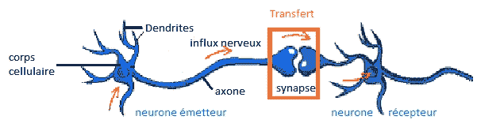

激活函数决定是否传输信号。在这种情况下，它是一个只有一个参数的简单函数：阈值。现在，当我们学习新事物时，一些神经元的阈值和连接概率（称为突触权重）会发生变化。这会在神经元之间创建新的连接，使大脑能够学习新事物。

## 人工神经元

现在让我们讨论一下人工神经元网络的工作原理：神经元中的输入值（`x1`、`x2`、`x3`、...、`xn`）与其关联的权重（突触权重参考）（`w1`、`w2`、`w3`、...、`wn`）相乘。然后我们对这些乘积求和，最后加上偏置（阈值的参考）。下图显示了计算公式。

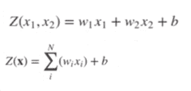

函数 `Z(x)` 对应于预激活，也就是激活之前的一步。然后，激活函数介入。预激活函数 `Z(x)` 的结果 `z` 被激活函数 `A(z)` 解释，产生结果 `y`。

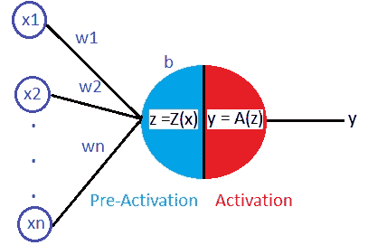

激活的目的在于转换信号，以从输入之间的复杂转换中获得输出值。为此，激活函数必须是非线性的。正是非线性使得创造此类变化成为可能。我们将看到原因。

## 非线性

让我们先简要看看线性激活函数和非线性激活函数的区别：

### 线性激活函数

它是一种形式简单的函数：`f(x) = ax` 或 `f(x) = x`。输入几乎不经修改或不经任何修改就传到输出。这里我们仍处于比例关系的情况。

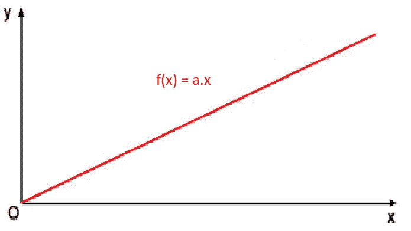

### 非线性激活函数

比例关系通常是特例。非线性函数使得分离非线性可分的数据成为可能。它们是最常用的激活函数。输入与输出之间的对应关系由非线性方程控制。

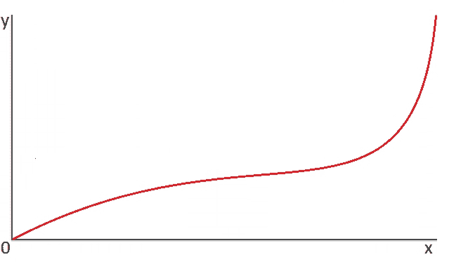

使用非线性激活函数是必不可少的，原因很简单：线性函数仅适用于神经元的单层。因为在神经元层之外，反复应用相同的线性激活函数将不再对结果产生任何影响。换句话说，要解决复杂问题，使用非线性函数是强制性的。让我们通过示例来看：

看下面的图片；我们有两种用蓝色和橙色表示的数据。目标是分离它们；使用线性激活函数就足够了。红线代表激活函数产生的决策边界。决策边界源于函数执行的逻辑回归，即数据的分类。在这种情况下，数据被很好地分离，因此我们仅通过简单的线性函数就能达到 100% 的成功率。

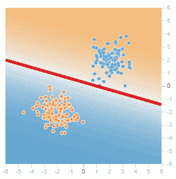

让我们继续另一个情况，我们仍然有两种类型的数据，但这次分类方式不同。由于逻辑回归是线性的，因此不可能放置决策边界以完美地分离蓝色表示的数据和橙色表示的数据。分类数据的成功率只有约 50%（下图）。我们在这里的情况还很简单，两种类型的数据很容易区分，但线性激活函数不足以胜任。

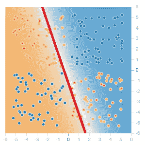

因此，为了正确分离这些数据，需要一个执行进一步逻辑回归的非线性激活函数。下图表示与前一个相同的情况，但这次我们使用了非线性激活函数。我们的两种类型数据现在被完美地分离了（下图）。

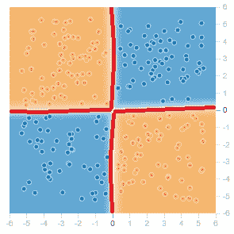

另一个关键点是，神经元处理的数据可能达到惊人的大值。线性函数不会修改输出，从神经元到神经元传输的数据值可能会变得更大且计算更复杂。为了解决这个问题，非线性激活函数通常以简单概率的形式降低神经元的输出值。

## 非线性激活函数的类型

### Sigmoid

该函数的主要目的是将输入值降低到 0 到 1 之间。除了将值表示为概率外，如果输入值是非常大的正数，该函数会将该值转换为概率 1 的值。相反，如果输入值是非常大的负数，该函数会将该值转换为概率 0。另一方面，曲线的方程是这样的，只有较小的数值会影响输出值的变化。下图表示 sigmoid 函数：

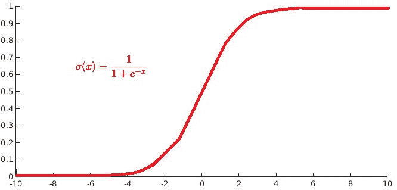

Sigmoid 函数有几个缺点：

- 它不是以零为中心，也就是说，负输入可能产生正输出。
- 它比较平坦，对神经元的影响相对较弱，与其他激活函数相比。
- 结果往往非常接近 0 或 1，导致某些神经元饱和。
- 它在计算上昂贵，因为它包含指数函数。

### tanh

Tanh 函数也称为“双曲正切”。

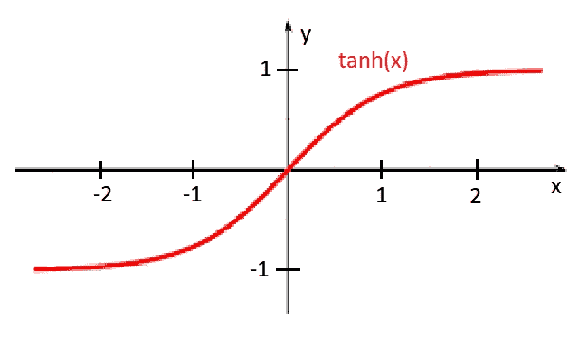

该函数与 Sigmoid 函数相当。与 Sigmoid 函数的区别在于，Tanh 函数产生的结果在 -1 和 1 之间。Tanh 函数通常优于 Sigmoid 函数，因为它以零为中心。较大的负输入趋向于 -1，较大的正输入趋向于 1。除了这个优点之外，Tanh 函数具有与 Sigmoid 函数相同的其他缺点。

### ReLU

为了解决前面两个函数（Sigmoid 和 Tanh）的饱和困难，存在 ReLU 函数（线性校正单元）。该函数是最常用的。

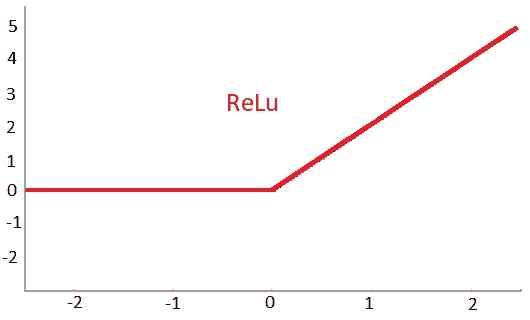

ReLU 函数由公式解释：`f(x) = max(0, x)`。如果输入无效，输出为 0，如果为负，则输出为 x。该激活函数大大提高了网络收敛速度且不会饱和。但 ReLU 函数并不完美。如果输入值为负，神经元保持不活跃，因此权重不会更新，网络无法学习。

### Leaky ReLU

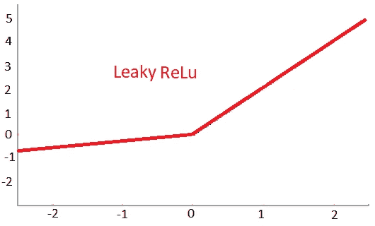

Leaky ReLU 函数由公式解释：`f(x) = max(0.1x, x)`。Leaky ReLU 函数试图在输入为负时修正 ReLU 函数。Leaky ReLU 的概念是当输入为负时，它将具有 0.1 的小正斜率。该函数在一定程度上消除了 ReLU 函数在负值下不活跃的问题，但使用它获得的结果并不一致。它仍然保留了 ReLU 激活函数的特性，即计算高效，在正区域收敛得更快且不饱和。

### Parametric ReLU

Leaky ReLU 函数的思想可以进一步扩展。不是将 x 乘以一个常数项，我们可以将其乘以一个超参数，该超参数似乎比 Leaky ReLU 函数效果更好。对 Leaky ReLU 函数的这种扩展被称为参数化 ReLU。参数化 ReLU 函数由公式解释：`f(x) = max(ax, x)` 其中 `a` 是一个超参数。这使神经元能够选择负区域的最佳斜率。凭借这种能力，参数化 ReLU 函数可以成为经典的 ReLU 函数或 Leaky ReLU 函数。最常见的是更倾向于使用 ReLU 函数，其另外两个版本（Leaky ReLU 和参数化 ReLU）是实验性的，没有真正的附加价值。

多年来，使用了各种函数。在本节中，只提到了主要函数。目前，仍有很多研究需要做，以找到合适的激活函数，使神经网络能够更高效、更快速地学习。

# 卷积神经网络详解

脊椎动物的视觉皮层直接启发了卷积神经网络。卷积神经元的网络也称为 convent（“卷积网络”），或 `CNN`（“卷积神经网络”）。我们区分两个部分，第一部分称为模型的卷积部分，第二部分，我们称之为模型的分类部分，对应于模型 `MLP`（多层感知器）。

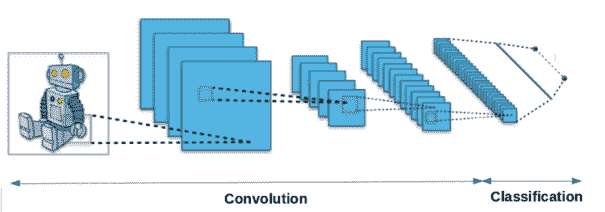

它是一个多层神经元网络，更准确地说它是一个深度网络，由多个层组成，通常按块组织（`CONV` → `RELU` → `POOL`）。卷积神经网络有四种类型的层：卷积层、池化层、ReLU 修正层和全连接层。

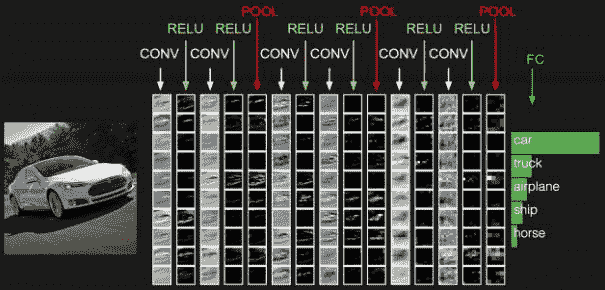

## 卷积层

卷积层是卷积神经网络的关键组件，至少也是其第一层。其目的是定位输入图像中一组特征的存在。为此，我们执行卷积滤波：原理是“拖动”代表特征的窗口在图像上，并计算特征与扫描图像的每个部分之间的卷积积。一个特征然后被视为一个滤波器：在这种情况下，这两个术语是等价的。

三个超参数可以确定卷积层的体积大小：

- **层深度**：卷积核的数量（或与同一接收场相关联的神经元数量）。
- **步长**：控制接收场的重叠。步长越小，接收场重叠越多，输出体积越大。
- **边缘处的边距（为 0）或零填充**：有时，在输入体积的边界处放置零是方便的。这个零填充的大小是第三个超参数。这个边距可以控制输出体积的空间维度。特别是，有时希望保持与输入体积相同的面积。

## 池化层：池化

这种类型的层通常放置在两个卷积层之间：它接收多个特征图作为输入，并对每个特征图应用池化操作。池化（或子采样）操作在于在保留其重要特征的同时减小图像的大小。为此，图像被切分为规则的单元；然后在每个单元内保留最大值。实际上，通常使用小的正方形单元以避免丢失太多信息。最常见的选择是不重叠的 2 × 2 像素的相邻单元，或间隔 2 像素的 3 × 3 像素单元（因此会重叠）。

输出的特征图数量与输入相同，但要小得多。池化层减少了网络中的参数数量和计算量。这提高了网络的效率并避免了过拟合。

在 ConvNet 架构中，通常在连续的 Conv 层之间定期插入一个 Pooling 层。其功能是逐渐减小表示的空间大小以减少网络中的参数数量和计算量，从而也控制过拟合。

池化层独立地对输入的每个深度槽操作并在空间上调整其大小，使用 MAX 操作。因此，池化层使网络对特征的位置不那么敏感：特征稍微高一点或低一点，甚至方向略有不同，都不应导致图像分类的根本性变化。

## ReLU 层

为了通过在处理层之间交错来提高处理的效率，一个层将对输出信号执行数学函数（激活函数）。在这种情况下我们找到 ReLU（Rectified Linear Units）指的是实际的非线性函数。定义为 `ReLU(x) = max(0, x)`。

ReLU 修正层因此用零替换所有作为输入接收的负值。它起着激活函数的作用。

通常，ReLU 修正是可取的，但还有另一种形式：

- 双曲正切修正 `f(x) = tanh(x)`
- 饱和双曲正切修正：`f(x) = |tanh(x)|`
- sigmoid 函数修正 `f(x) = (1 + e^{-x})^{-1}`

## 全连接层

全连接层始终是神经网络的最后一层，无论是卷积还是非卷积——因此它不是 CNN 的特征。这种类型的层接收输入向量并产生新的输出向量。为此，它对接收到的输入值应用线性组合并可选地应用激活函数。

全连接层对网络的输入图像进行分类：它返回一个大小为 N 的向量，其中 N 是我们图像分类问题中的类别数。向量的每个元素表示输入图像属于某个类别的概率。

例如，如果问题在于区分猫和狗，最终向量将为大小 2：第一个元素（分别第二个）给出属于“猫”类别（分别“狗”）的概率。因此，向量 `[0.9, 0.1]` 意味着图像有 90% 的机会代表一只猫。

输入数组的每个值都“投票”支持某个类别。投票并不都具有同等重要性：该层为它们赋予权重，这些权重取决于表中的元素和类别。为了计算概率，全连接层因此将每个输入元素乘以权重，相加，然后应用激活函数（如果 N = 2 则为 logistic，如果 N > 2 则为 softmax）。

可以用卷积层替换全连接 CNN 层，这使其完全卷积。全卷积网络是一个好主意。我邀请你去发现它。

# 卷积神经网络工作原理示例

为了帮助我们理解卷积神经网络的工作原理，我们将借助一个简化示例并尝试确定图像是否代表 X 或 O。我们的 CNN 只有一个任务要执行：每次我们展示一张照片时，它必须决定这张照片是否代表 X 或 O。他认为在每种情况下，只能有“要么”。


对于计算机来说，图像不就是一个二维像素的数组（一种巨大的棋盘）吗，每个方格包含一个特定的数字：

在我们的例子中，值为 1 的像素是白色像素，-1 是黑色。


## 特征

CNN 按片段比较图像。它寻找的片段称为特征。特征对应于图像的片段。


通过找到在 2 个不同图像中大致相似的近似特征，CNN 比通过完整的图像到图像比较更能检测相似性。


每个特征就像一个迷你图像，即一个二维值的数组。特征汇集了图像中最常见的方面。在显示 X 的图像的情况下，定义两个对角线及其相交的特征代表 X 的最常见特征。这些特征可能对应于任何 X 图像的手臂和中心。


## 卷积

当呈现包括新图像时，CNN 不完全知道特征是否会出现在图像中或它们可能位于何处，因此它试图在整个图像和任何位置中找到它们。


通过在整个图像中计算特征是否存在，我们进行滤波。我们用来执行此操作的数学称为卷积，这也是卷积神经网络得名的原因。

要计算特征与图像子部分之间的对应关系，只需将特征的每个像素乘以图像中该相同像素包含的值。然后，将响应相加并将结果除以特征中的像素总数。

- 如果 2 个像素都是白色（值 1）则 1 * 1 = 1。
- 如果两者都是黑色，则 (-1) * (-1) = 1。
- 在所有情况下，每个匹配的像素都会产生 1。
- 同样，每个偏移都会产生 -1。
- 如果特征中的所有像素都匹配，则它们的相加然后除以像素总数会得到 1。
- 同样，如果特征的任何像素都不对应于图像的子部分，则答案为 -1。


要完成卷积，可以重复此过程，将特征与图像的每个子部分对齐。然后我们取每个卷积的结果并创建一个新的二维表。这个匹配图也是原始图像的滤波版本。它是一张地图，显示特征在图像中被找到的位置。


接近 1 的值显示强匹配；接近 -1 的值显示对功能摄影负片的强匹配，而接近 0 的值与任何类型都不对应。


一张图像变成一堆滤波图像。


下一步是对每个其他现有特征重复完整的卷积过程。结果是一组滤波图像，每张图像对应一个特定的滤波器。建议将这组卷积操作视为一个单一的处理步骤：在卷积神经网络中，这称为卷积层，这表明最终会添加其他层。

虽然原理相对简单，我们可以在毛巾背面轻松解释我们的 CNN，但加法、乘法和除法的数量会迅速累积。从数学上讲，它们随着图像中像素的数量、每个特征的像素数量线性增加。如此众多的因素，很容易使这个问题变得无限复杂。因此，微处理器制造商现在制造专门用于 CNN 所需操作的专用芯片也就不足为奇了。

## 池化层

池化是一种方法，可以取一个大图像并在保留其包含的最重要信息的同时减小其大小。池化概念背后的数学再次并不复杂。确实，只需逐步将一个小窗口拖动到图像的所有部分，并在每次步骤中取该窗口的最大值。实际上，通常使用 2 或 3 个像素的窗口和 2 像素的值作为步长值。

**池化：减少图像堆栈**

1. 选择窗口大小（通常为 2 或 3）。
2. 选择步长（通常为 2）。
3. 浏览你的滤波图像的窗口。
4. 从每个窗口中取最大值。


池化后，图像仅剩下其起始像素的四分之一。


因为它在每个步骤中保留窗口中包含的最大值，所以它保留了该窗口的最佳特征。这意味着它不在乎特征是从窗口的哪个位置提取的。结果是 CNN 可以找到图像中是否存在特征，而不管它在何处。这有助于特别解决与计算机超文学相关的问题。


最终，池化层只是在图像或图像集合上进行池化过程。输出将具有相同数量的图像，但每个图像将具有更少的像素。这将减少计算负担。例如，它将 800 万像素的图像转换为 200 万像素的图像，这将使稍后要执行的其余操作变得容易得多。

### 整流线性单元（ReLU）归一化

将所有负数改为零。


整个过程中的一个重要元素是整流线性单元或 `ReLU`。这一概念背后的数学再次相当简单：每当像素中存在负值时，它就会被 0 替换。因此，`CNN` 被允许保持健康（在数学意义上）通过防止学习的值停留在 0 附近或爆炸到无穷大。


它是一个不性感但基本工具，因为没有它，`CNN` 就不会产生我们所知道的结果。`ReLU` 层的输出与输入的大小相同，只是所有负值都被删除。一个的输出成为下一个的输入。


### 深度学习


你可能已经注意到，你给每个层输入的内容（即二维数组）与你在输出处得到的内容（其他二维数组）非常相似。因此，我们可以像乐高积木一样一个接一个地添加它们。原始图像被滤波、校正和池化，以创建在每个图像中可见的缩小且特征滤波的图像集。这些可以再次被滤波和缩小。每次，特征变得更大更复杂，图像变得更紧凑。这允许较低的层表示图像的简单方面，例如光边和点。较高的层表示图像的更复杂方面，例如形状和模式。这些往往很容易识别。例如，在训练用于识别人脸的 `CNN` 中，较高的层表示人脸的一部分的模式和模式（1）。

### 全连接层


`CNNs` 在它们的工具箱中还有另一支箭。事实上，全连接层取高层滤波图像并将它们翻译成投票。在我们的例子中，我们只需要决定 `X` 和 `O` 两个类别之间。全连接层是传统神经网络的主要构建块。它们不是将输入视为二维数组，而是将它们视为单个列表并同等对待。每个值都投票决定图像是 `X` 还是 `O`。然而，过程并不完全民主。一些值比其他值更能检测图像是 `X`，而另一些值更能检测 `O`。因此，它们比其他值具有更大的投票权。这种投票称为权重，或连接相应值和每个类别之间的强度。

当向 `CNN` 显示新图像时，它会通过较低的层传播，直到到达最终的全连接层。然后进行选举。票数最多的解决方案获胜并被宣布为图像的类别。


全连接层与其他层一样可以一个接一个地添加，因为它们的输出值（投票列表）与它们的输入值（值列表）非常相似。实际上，通常会一个接一个地添加多个全连接层，每个中间层为“隐藏”的幽灵类别投票。事实上，每个额外的层让网络学习有助于改进决策的特征的更复杂组合。

### 反向传播


即使我们的 `CNN` 分析进展顺利，仍然缺少一些东西：特征来自哪里？我们如何定义全连接层的权重？如果你必须手动选择所有内容，`CNNs` 会比它们现在更受欢迎。幸运的是，有一个非常重要的概念为我们做了这项工作：反向传播。

为了能够使用反向传播，我们必须有一组我们已经知道要选择的类别的图像。这意味着一些有爱心（和耐心）的灵魂已经提前分析了成千上万的图像，并将每个图像与其各自的类别相关联，`X` 或 `O`。这些图像因此被用于尚未驱动的 `CNN`，这意味着每个特征的每个像素和每个全连接层的每个权重都配置为随机值。

之后，我们开始一次又一次地向 `CNN` 拍摄图像。对于 `CNN` 分析的每张图像，都会得到一个投票。我们在分类中犯的错误数量然后告诉我们我们的特征和权重的质量。然后可以调整特征和权重以减少错误。每个值都会增加或减少，并且每次都会重新计算网络的新误差值。无论做出什么调整，如果误差减小，则该拟合将被保留。

在对每个特征的每个像素、每个卷积层和每个全连接层的每个权重执行此操作之后，新的权重为该图像提供了一个工作略好的响应。然后用具有标签的其他每个图像重复此过程。仅出现在罕见图像中的元素很快就会被遗忘，但在大数量图像中定期发现的模式会被特征和连接权重保留。

如果有足够的标记图像，这些值会在一组对各种情况都相当有效的数值上稳定下来。显而易见，反向传播是另一个昂贵的计算步骤，也是专用计算机硬件的另一个动机。

### 超参数

不幸的是，`CNN` 的所有方面都不是像我们到目前为止所看到的那样直观易学。因此，始终有一长串必须手动设置的参数才能使 `CNN` 取得更好的结果。

对于每个卷积层，应该选择多少个特征？每个特征中应考虑多少个像素？

对于每个池化层，应该选择哪个窗口大小？什么不？

对于每个额外的全连接层，应该定义多少个隐藏神经元？

此外，除了这些参数之外，还有其他更高层次的架构元素需要考虑：应该包含多少个每种类型的层？按什么顺序？一些深度学习模型可以有超过一百层，这使得可能性的数量极其重要。

由于存在如此多的可能组合和排列，到目前为止只测试了可能配置的一小部分。`CNNs` 的不同设计通常由科学界积累的知识所激励，偶尔会出现一些差距，从而在性能上带来惊人的改进。尽管我们以相对简单和直观的方式介绍了构建 `CNNs` 的主要构建块，但已经测试了大量变体和设置，并取得了非常好的结果，例如新型层和更复杂的层间连接方式。

### 超越图像


尽管我们用 `X` 和 `O` 的例子涉及图像的使用，但 `CNNs` 也可以用于对其他类型的数据进行分类。诀窍是：无论你处理什么类型的数据，都将该数据转换为使其看起来像图像。

例如，音频信号可以分解为较短持续时间的较小的片段，并将每个片段分解为低、中、高甚至更细的频率带。这可以用二维数组表示，其中每一列是一个时间块，每一行是一个频率带。彼此靠近的“像素”的假图像密切相关。在这些情况下 `CNNs` 工作得很好。

科学家们特别有创意。在类似的方法中，他们已将文本数据改编用于自然语言处理，甚至将化学数据改编用于药物发现。


一种不适合这种格式的特定数据类型是所有“客户数据”，其中表的每一行代表一个客户，每一列代表有关该人的信息，例如其姓名、地址、电子邮件地址、购买和浏览历史。在这种情况下，行和列的位置并不重要。行可以重新排列，列可以重新排序而不会丢失数据的重要性。另一方面，重新排列图像的行和列会使其完全无法处理。

一条通用规则：如果你的数据在交换它们之间的某些列后仍然可以利用，你可能无法使用卷积神经网络。然而，如果你能使你的问题看起来像是在图像中寻找模式，`CNNs` 可能正是你所需要的。

## 特性和优势

卷积网络的一个主要优势是使用与进入同一卷积核的所有神经元的信号相关联的唯一权重。这种方法减少了内存占用，提高了性能并允许平移处理不变性。这是卷积神经网络相对于多层感知器的主要优势，多层感知器将每个神经元视为独立，因此为每个输入信号分配不同的权重。

当输入体随时间变化 `video` 或 `sound` 时，在神经元设置中沿时间尺度添加一个参数变得很有趣。在这种情况下，我们将称之为具有时延的神经网络 `TDNN`。

与其它图像分类算法相比，卷积神经网络使用相对较少的预处理。这意味着网络负责自行改变其滤波器 `learning without supervision`，而这对于其它更传统的算法来说并非如此。缺乏初始参数化和人工干预是 `CNN` 的一大优势。

### 卷积神经网络与多层感知器的区别

尽管对图像处理有效，多层感知器 `MLPs` 在处理大图像时存在困难，因为随着图像尺寸的增大，连接数量呈指数增长，因为每个神经元都“完全连接”到前一层和下一层的每个神经元。

卷积神经网络，其原理受脊椎动物视觉皮层的启发，相反限制了神经元与其相邻层神经元之间的连接数量，这大大减少了需要学习的参数数量。对于像 `AlexNet` 这样深的网络，例如，需要学习的参数中超过 90% 来自最深的 3 层 `Fully connected`，其余部分与 `5` 个卷积层有关。

`CNN` 在 3 维中的一层 `green = volume of entry, the blue = volume of the receiving field, grey = layer of CNN, circles = independent artificial neurons`

例如，如果我们取一个图像尺寸 `32 × 32 × 3` `32 wide, 32 high, 3 colour channels`，`MLP` 第一隐藏层中的单个全连接神经元将有 `3,072` 个输入 `32 * 32 * 3`。一个 `200 × 200` 的图像因此会导致每个神经元处理 `120,000` 个输入，这乘以神经元数量后变得巨大。

卷积神经网络旨在在保持自然图像强“空间局部”相关性的同时限制输入数量。

与 `MLP` 相比，`CNN` 具有以下区别特征：

**局部连接**：得益于接收场限制了神经元输入的数量，同时保持 `MLP` 架构，卷积神经网络因此确保“滤波器”对空间局部输入模式产生最强响应，这导致了入口的简约表示。这种表示在内存中占用的空间更少。此外，由于需要估计的参数数量减少了，因此对于固定的数据量，其 `statistical` 估计更稳健 `compared to an MLP`。

**共享权重**：在卷积神经网络中，一个神经元的滤波参数 `对于给定的接收场` 对于同一核的所有其它神经元 `处理图像的其它所有感受野` 都是相同的。这种设置 `weight vector and bias` 在“函数卡”中定义。

**平移不变性**：由于同一核 `filter` 的所有神经元都是相同的，因此该核检测到的模式与图像中的空间位置无关

这些特性共同使卷积神经网络能够在估计参数 `28` 时获得更大的稳健性 `on learning problems` 因为，对于一个固定大小的学习语料库，每个参数的数据量更高。很好。权重共享也大大减少了需要学习自由参数的数量，从而减少了网络运行的内存需求。内存占用的减少使得可以学习更大、通常更强大的网络。

#### 在自然语言自动处理中的应用 `NLP`

代替图像像素，大多数 `NLP` 函数的输入是句子或文档。将 `CNN` 应用于此 `see any RN` 的想法是将单词和文档转换为矩阵形式。矩阵的每一行对应一个 token，通常是一个词，但也可以是一个字符。也就是说，每一行都是一个表示词的向量。通常，这些向量是词嵌入 `small representations`，例如 `word2vec` 或 `GloVe`。

例如，对于一个 20 个词的短语，使用 100 维嵌入，我们将有一个 `20 × 100` 矩阵作为输入。这就是我们 `CNN` 的“图像”。

图像处理中的卷积滤波包括拖动一个代表特征的窗口在图像上，并计算特征与扫描图像的每个部分之间的卷积积。然而，在 `NLP` 中，我们通常使用在矩阵的完整行上滑动的滤波器 `the words`。因此，滤波器的“宽度”通常与输入矩阵的宽度相同。高度或区域大小可能变化，但一次滑动窗口超过 2 到 5 个词是典型的。

## 第二部分：深度学习实践 `IN JUPYTER NOTEBOOKS`

`Python` 是一种功能强大的计算机语言，对于互联网开发和基于网络的应用程序极其有效。为什么在已经有一长串非常好且功能完善的老式计算机语言可用的情况下，你还要涉足 `Python` 呢？例如，让我们提及：

* `Python` 可用于所有知名操作系统，包括 `Linux`、`Mac` 和 `Windows`。
* `Python` 很容易从一个操作系统迁移到另一个操作系统，例如。从 `Linux` 到 `Windows` 反之亦然。
* 非常容易学习——对于计算机语言的初学者来说也是如此。
* `Python` 结合了卓越的强大功能和非常清晰的语法 `read: a way of doing things`。

在 Python 中，你可以在事先不理解许多复杂细节的情况下学习面向对象编程（编程以及使用窗口、按钮等）。之后，如果需要，你可以熟悉其背后的构造技术。Python 是一种对初学者友好的计算机语言，它自动控制幕后的许多复杂细节。它允许你在项目中使用整体事物的强大功能，而无需为每一步都深入挖掘。

这里，我们也提前预告一下事件，并看看下面的示例，这可能也会引起有经验的 Java、C++ 或 Delphi 程序员的兴趣。

```
>>> from Tkinter import Label
>>> widget = Label()
```

在所示示例中，可能还应该多有 1 行程序。在这种情况下，它应该被称为 widget。`pack()` `pack()` 函数将对象的组件设置在打印单元（屏幕）上的位置。但在这种情况下，没有任何东西需要放置，所以这两行程序就足够了。

你可以用：使用 `Entry` 创建相同的窗口：

```
>>> from Tkinter import Entry
>>> child = Entry()
>>> child.pack()
```

或使用 `Text`（以及多种其他对象）：

```
>>> from Tkinter import Text
>>> child = Text()
>>> child.pack()
```

```
>>> from Tkinter import *
>>> child = Frame().pack(expand = YES, fill = BOTH)
```

已经注意到 2 件事之间的区别。1：你可能期望从 `Tkinter import Frame` 得到的结果变成了 `from Tkinter import *`（在这里恰好可以利用 pack 中的参数值）以及 2：`child.pack()` 函数 () 已被移至 `Frame()` 并获得了 2 个参数（参数）。它恰好给 `Frame` 子 `child` 提供了扩展的机会（在 expanding = `YES` 时发生）并且在水平和垂直方向上或换句话说能够填满整个屏幕。

`frame` 对象是一个容器，可以在其中插入所有其他图形对象，例如文本框、按钮、标签等。在此示例中没有它们，所以 `Frame().pack(expand = YES, fill = BOTH)` 的工作方式与你点击窗口右上角最左侧按钮时相同。它使窗口收缩到其最小可能尺寸。`Expand = YES` 允许框架（容器）根据需要扩展，但在这里没有必要（无需将其他组件插入容器）。如果以后将一个或多个所述和相应的对象插入框架（`Frame`），它将根据需要扩展，只要在给定屏幕区域内有空间容纳这些对象。如果没有，对象将根本不显示。


图 1-2. 窗口示例

当然，这两个窗口具有与你从例如 Windows 中的 Internet 浏览器所知道的相同的打开/关闭选项等。然后可以称之为面向对象编程，因此它暗示。所有窗口、按钮和其他普通对象都是预编程的，因此你可以直接使用它们，当然也可以根据当前需要对其进行自定义。在 C++ 中，你需要编写大量程序行才能实现同样的效果。将 Python 和 C++ 相互集成也非常容易。

OOP（面向对象编程）最突出的特点之一是重用。通过所示的三个示例，你已经看到 Python 在这方面也有出色的特性，因为当然，一个完整窗口的代码不可能在每个示例包含的 2-3 行程序中组装并执行。代码需要多次使用。如果 Python 不具备回收能力，那么每次要使用窗口时，都需要开发创建完整窗口所需的大型程序——仅对所示示例而言就是 3 次。这将是庞大的程序，由于规模巨大而几乎无法应用。

所示示例的代码以及其他几个示例的代码包含在 `Widget` 类中。`Label`、`Entry`、`Text` 和 `Frame` 都是 `Widget` 中的子类。

Python 是 Jython 的骨干。这意味着 Jython 程序的大部分或小部分是并且将继续是 Python。在 Jython 中，开发 Java 小程序往往比在 Java 本身中更容易。小程序可以用作 HTML、XHTML、XML 语言网站的集成部分。

在 Linux 中，你经常谈论整个软件包，其中包括上面提到的软件包，如 Linux。这是不对的。Linux 是核心（中央单元/控制程序）。在 Python 中也有一个核心。它很小，这也是应该的。对于这个控制单元，有一个非常大的库（library）。这意味着很多东西，你需要已经为你开发和测试过。你的任务将是编写将库组件组合在一起的代码，并在需要时开发新属性，但你也可以极大地扩展 Python 自己 的功能（方法）、类、模块等。

### Python 花费多少以及我在哪里可以获得它？

Python 是免费的，并且适用于绝大多数操作系统。如果你没有最新版本，你始终可以从 `http://www.python.org` 下载。安装 Python 非常容易，如果你的计算机上尚未安装该语言的话。然而，如果你使用 SuSE、RedHat 或 Mandrake，这通常就是这种情况。


# Python 的开发非常活跃

仅在大约 3 个月的时间里，我写这本书的时间里，就有 2 次语言的完整更新（发布的版本是 2.2 和 2.3）。但不仅仅如此，还有对后者的更新而不改变版本号。现在，2003 年 10 月 16 日，版本 2.3.2 是当前的。在版本 2.4 中，应该会有相当多的变化，因此 Python 可以做更多的事情（例如处理 64 位字符代码）。

## Python 文档指南

如果你完全是编程新手，理解编程语言文档是如何混乱的可能会很困难。但一旦你能弄明白，通常和经常从语言文档中获得帮助要比在邮件列表上为特定函数请求帮助容易得多。

Python 的文档可以在网上找到，网址为 `http://www.python.org/doc/`。在这里你也可以找到各种主题的指南和 HowTo。文档分为 7 个类别：模块概览、教程、库参考、Macintosh 参考、语言参考、语言扩展和 Python / C API。

### 类别说明

#### Python 文档概览

##### Module overview

以下是 Python 发行版中包含的所有模块的概览。每个模块也有相应的文档。

##### Tutorial

这里提供了关于 Python 最基本使用的全面教程。如果你已经会编程，只是还不了解 Python，这是一个很好的起点。

##### Library reference

对 Python 中最常用的库进行回顾，并提供比模块概览中更详尽的使用示例。

##### Macintosh reference

回顾特定于 Macintosh 的库。

##### Language reference

语言使用和结构回顾（语法、函数、类等）

##### Extensions and embedding

关于如何使用 C / C++ 扩展 Python、在其他应用程序中嵌入 Python 等的指南。

##### Python / C API

对 Python 的 C API 的回顾，该 API 使 C 程序员能够在其应用程序中使用 Python。

## Language Reference GUI and IDLE - 它是什么？

GUI 是 Graphic User Interface 的缩写，是部分创建虚拟窗口、按钮、菜单等的程序。这允许用户通过点击等来调用与所述元素关联的函数，其目的可以是向文本框发送文本、检索文件或将其发送到外部存储设备（如硬盘）、绘制图形等等。GUI 组件的代码可在 Python 的 `Tk` 库中见到。来自 `Tk` 库的窗口的代码可以通过基本窗口顶部的单词 `Tk` 来识别。

```python
>>> from Tkinter import Label
>>> childAfLabel = Label()
```

由于如前所述，`Tk` 中存在 GUI 组件的基本模型，工匠 `Tkinter` 可以发出 `Tk`，声明必须提供基本窗口构造的代码以构建 `Label()` 的副本，在本例中我选择将其命名为 `childrenAfLabel`，因为与其他孩子一样，它有其起源，从中它在母亲中继承，该术语也用于其他丹麦计算机语言书籍中。在英语中，母亲被称为父类 parent。在 Python 中，也使用术语主类或基本类。

### Immediate mode

从旧的 DOS 中，你可能知道提示符 `dose c:`。在 Python 中，`>>>` 用作相应的清晰消息。Python 处于 Immediate 或也称为交互模式的消息。从这里开始你的 Python 编程，但当然，成熟的 Python 程序员也会返回并使用，例如。当测试新的程序片段时。

### Comments

当你编程时，不时需要插入注释 - 程序的一部分，你和其他人可以阅读，但计算机语言会跳过。在 Python 中，`#`（井号 - 在丹麦语中称为花园门或牛排符号）标记。注释从花园门开始并延续程序行。

**Ex. 1:**

```python
>>> # Python runs over comments
>>> print "Comments are for you and not for the computer."
```

Comments are for you and not for the computer.

也可以打印井号，如果它是文本字符串的一部分。

**Ex. 2:**

```python
>>> print "Here we print a hash sign #"
```

Here we print a hash sign #

在此示例中，没有注释。牛排符号在这里是文本字符串的一部分。Python 应该喜欢响应它而不是绕过它。请注意，井号在这里被打印出来，而在它发挥其正确作用的示例中则没有。

注释在引号中 par 字符串也可以用 3 个引号（单引号或双引号）括起来。

**Ex. 1:**

```python
>>> print """
Name: The cliff island Bornholm
Population: 44.500
"""
```

Name: The cliff island Bornholm

Population: 44,500

### Arithmetic operators

加法 `+` ex: `3 + 4 = 12`

减法 `-` ex: `3 - 4 = -1`

乘法 `*` ex: `3 * 4 = 12`

指数表示 `**` ex: `3 ** 4 = 81`

除法 `/` ex: `3/4 = 0`（向下舍入到最接近的整数）

除法 `//` ex: `3 // 4 = 0`（向下舍入到最接近的整数）

取模 `%` ex: `3.0 % 4.0 = 0.75`

**危险：注意整数除法**

```python
>>> 25/24
1
```

25 除以 24 应该得到 1.0416666666666667，但 Python 自动向下下降到最接近的整数，在本例中为 1。

```python
>>> 25 / 24.0
1.0416666666666667
```

### Variables

变量是指向计算机内存（RAM）中多个地址的指针，其中数据，可能有多种东西，例如。数字和文本字符串被放置。

#### 变量声明

```python
>>> x = y = z = 0
>>> x
0
>>> y
0
>>> z
0
```

注意：在 Python 中，使用 `==` 表示等于，使用 `=` 表示赋值。

#### 变量可以被覆盖

```python
>>> e = 1000 # global variable variable
>>> def nix():
...     global e
...     e = 25
...
>>> e
1000
>>> nix()
>>> e
25
```

#### 变量地址

```python
>>> a = 25
>>> type(a)
<type 'int'>
>>> a = 12.4
>>> type(a)
<type 'float'>
```

变量在 RAM 中的地址可以用 `id` 找到

```python
>>> a = 12.4
>>> id(a)
136095956
```

### Boolean expressions / variables

布尔表达式/变量可以取/赋 2 个值且仅 2 个。这 2 个值是 true（真）和 false（假）。

**Ex. 1:**

```python
>>> 2 == 3
0
>>> 2 == 2
1
```

### Write interactively

在交互模式下，数字可以用 2 个不同的函数输入：`raw_input`，其中数字作为文本接收，以及 `input` 将数字作为数字接收。

### Scripts

如果以及当你需要在 Python 中开发更大的项目时，你需要将你的 Python 代码保存为可以反复使用的单独文件。

在 Linux 中，Python 脚本可以通过在程序的第一行插入 `#!/usr/bin/env python` 使其直接可执行。

脚本可以通过以下命令分配可执行模式或权限：

```bash
$ chmod +x myscript.py
```

### If, elif and else

```python
>>> def findMax(a, b, c):
...     max = a
...     if b > a:
...         max = b
...     if c > b:
...         max = c
...     return max
...
>>> findMax(37, 2 * 19, 43)
43
```

### Function definition and call

```python
>>> def function():
...     a = 4 * 5
...     return a
...
>>> function()
20
```

带参数的函数：

```python
>>> def f(a):
...     return a * 1.25
...
>>> f(75)
93.75
```

### Lists

列表是零到多个相关空间的变量。其方括号知道列表。

```python
>>> list = []
>>> list.append("Ypnasted")
```

切片：

```python
>>> l = [1,2,3,3,4,5,6,7,8,9]
>>> print l[0]
1
>>> print l[0:4]
[1, 2, 3, 3]
```

### Tuples

元组由逗号分隔的 anal 值组成。

```python
>>> t = 1,2,3,4,5
>>> t
(1, 2, 3, 4, 5)
```

### Dictionary

```python
>>> dictionary = {}
>>> postal_codes = {"Rønne": 3700, "Allinge": 3770}
```

### Escape sequences

- 换行
- 水平制表符
- 回车

### Number system

#### 十六进制和八进制数

在 Python 中，十六进制数以前导零后跟 `x` 指定，并以十六进制数字结尾，例如。`0x49` 对应于 `9 + 4 * 16 = 73` 在我们正常的 10 进制系统中。

```python
>>> for i in range(0,9):
...     print "10 i", i, ". is:", 10 ** i
...
```

打印十六进制数：

```python
>>> for i in range(0,17):
...     print hex(i)
...
```

```python
>>> a = 0x49
>>> a
73
```

```python
>>> "x41", chr(65)
('A', 'A')
```

## PYTHON 数据结构

在编程中，'数据结构'是一种组织数据的结构。数据结构的选择很重要，因为它们对性能有不同的意义，并且根据计划使用的算法而表现不同。数据结构是一种抽象描述，与“数据类型”不同。数据类型可能是例如 `Integer`、`String` 或 `boolean`。它具有明确的意义，而数据结构描述的是未定义的东西，例如列表或数组。

在不同的类别中有许多不同的数据结构。我们有“线性数据结构” (`List`, `Stack`, `Queue`, 等)。另一个在编程中占有重要地位的结构类别是 "`Tree`" 。它们比例如 `Stack` 稍微复杂一些。许多数据结构已经内置于编程语言中（例如 `Python` 中的 `list`），并且一些现成的模块和库已实现并准备好该结构。尽管如此，了解它们“内部”是如何工作的仍然很重要。有三种不同的数据结构。

- `Stack` (Linear Data Structure)
- `Queue` (Linear Data Structure)
- `Linked List` (Linear Data Structure)

## 先决条件

你可以在 Python 和面向对象方面学习基础知识。你已经完成了异常练习。

### 栈

栈是一种长数据结构，就像它听起来一样，像一个栈或堆栈。想象一个盘子堆，其中一个盘子代表一个对象、变量或你存储的任何东西。为了处理“存取”操作，你从顶部开始工作。该方法称为“LIFO”（后进先出）。栈包含相同的数据类型。

通常使用一组特定的方法：

1. `.push()`（添加）
2. `.pop()`（删除）
3. `.peek()`（显示顶部内容而不改变栈）
4. `.is_empty()`（根据栈是否为空返回 True / False）
5. `.size()`（返回栈中元素的数量）

一个具有指定座位数目的栈。栈的实现可以如下所示：

```python
class Stack:
    def __init__(self):
        self.items = []
    def is_empty(self):
        return self.items == []
    def push(self, item):
        self.items.append(item)
    def pop(self):
        try:
            return self.items.pop()
        except IndexError:
            return "Empty list."
    def peek(self):
        return self.items[len(self.items) - 1]
    def size(self):
        return len(self.items)
```

使用栈可以如下进行：

```python
>>> myList.pop()
'Empty list.'
>>> myList.size()
0
```

VisuAlgo Stack Queue

### 队列

队列是一种线性数据结构，让人联想到栈。不同之处在于队列两端都是开放的。一端用于添加元素，另一端用于移除元素。该方法称为“先进先出”。

通常使用的方法有：

1. `.enqueue()`（添加）
2. `.dequeue()`（删除）
3. `.peek()`（显示顶部内容而不改变队列）
4. `.is_empty()`（根据队列是否为空返回 True / False）
5. `.size()`（返回队列中元素的数量）

一个没有指定位置数量的队列。队列的实现可能如下所示：

```python
class Queue:
    def __init__(self):
        self.items = []
    def is_empty(self):
        return self.items == []
    def enqueue(self, item):
        self.items.insert(0, item)
    def dequeue(self):
        try:
            return self.items.pop()
        except IndexError:
            return "Empty list."
    def peek(self):
        return self.items[len(self.items) - 1]
    def size(self):
        return len(self.items)
```

使用队列：

```python
>>> from queue import Queue
>>> myList = Queue()
>>> myList.is_empty()
True
>>> myList.enqueue("Tiger")
>>> myList.enqueue("Lion")
>>> myList.enqueue("Moose")
>>> myList.is_empty()
False
>>> myList.dequeue()
'Tiger'
>>> myList.peek()
'Lion'
>>> myList.enqueue("Godzilla")
>>> myList.dequeue()
'Lion'
```

VisuAlgo Stack Linked list

对于队列和栈，我们都使用了 Python 内置的列表：用于存储值，因此到目前为止我们只制作了 Python 列表的特殊版本。想法是我们不应该在不自己构建整个数据结构的情况下使用列表。为了成功，我们将使用节点并构建自己的链表。队列和栈也只是链表的特殊版本。

我们可以把一个常规的列表 / 数组想象成下面的图片。数组在内存中以位的形式存储，在该位中，值一个接一个地排列。然后我们不需要知道每个值的位置，只需要知道数组即可。


Array in memory

对于节点链表，我们不能假设值彼此相邻，而是分配到内存中的不同位置。因此，链表中的每个值都必须链接到下一个值。我们为此使用 `Node` 类。


A linked list of nodes

最简单的 `Node` 类版本只包含两个属性，一个用于保存数据，一个用于跟踪下一个节点。我们将非空列表中的第一个节点称为头，列表的头部。要访问链表中的节点，必须有一个对头的引用。从头开始，我们可以通过跟随节点中的指针来访问剩余的节点。下一个节点的 `next` 属性包含 `None` 以表明它是最后一个节点。

图片中的列表称为单向链表。还有双向链表；然后每个节点都链接到前一个节点和后一个节点。另一种常见类型是循环链表。在循环链表中，最后一个节点链接到第一个。


Circular Single Link List

然后当然还有循环双向链表，它们可以是有序的或无序的。有序列表会自动对列表进行排序。向列表添加新数据时，会搜索整个列表以找到正确的顺序位置。无序列表只添加到值，通常是列表的最后一个。

VisuAlgo Stack Nod class

然后我们应该看看节点类的代码可能是什么样子。需要的代码很少，因为我们只需要一个用于数据，一个用于下一个节点的属性。


```python
class Node:
    """ Node class """
    def __init__(self, data, next = None):
        """ Initialize object with the data and set next to None. next will be assigned later when new data needs to be added. """
        self.data = data
        self.next = next
```

我们在 `python3` 解释器中使用它进行测试。

```python
>>> head = node(1)
>>> head
<__main__.Node object at 0x743545132>
>>> head.data
1
```

我们创建了一个 `Node` 对象并对其及其数据进行了测试。现在我们将再创建一个对象并将我们的 `head` 与新对象连接起来。

```python
>>> n2 = node(32)
>>> n2.data
32
>>> head.next
>>> head.next = n2
>>> head.next
<__main__.Node object at 0x7453468745>
### Value of the first node
>>> head.data
1
### Second value of the node
>>> head.next.data
32
```

当我们第一次打印 `head.next` 时，我们没有输出，因为值是 `None`。在我们分配 `head.next` 之后，`head.next` 包含我们的 `n2` 对象。然后我们可以写 `head.next.data` 来访问数据，`n2` 对象中的 `32`。

自己测试创建到节点的 `n3` 并分配给 `n2.next`。通过 `head.next.next.data` 和 `n2.next.data` 打印 `n3` 的值。

以这种方式，我们可以构建一个链表。

### 遍历节点

从列表的头开始遍历所有节点并对其执行某些操作称为遍历列表。例如，如果我们想打印出所有节点的值，我们就需要遍历列表。我们最容易通过创建一个新变量来做到这一点，该变量用于指向列表的头并用它来遍历列表。

```python
number_list = Node(3) # Create first node, head
temp = Node(2) # Create node and assign to temp variable
temp.next = Node(4) # Create node and assign to temp.next
number_list.next = temp # Assign temp to number_list.next
```

上面，我们创建了一个简单的列表 `number_list`，它包含 `[3, 2, 4]`。要打印所有值，我们使用 `while` 循环。

```python
current_node = number_list
while current_node != None:
    print(current_node.data) # Print nodes value
    current_node = current_node.next # Move to next node
```

在循环中，我们用下一个节点替换指针 `current_node`，以这种方式遍历列表而不改变它。`number_list` 仍然包含相同的结构。

### 使用索引获取值

现在我们将使用索引获取一个值。

```python
def get(index, head):
    # Get value by index
    if head is None:
        current_node = head
        counter = 0
        pass
    else:
        pass
    # Raise exception of index out of binding
```

我们首先检查第一个节点是否为 `None`，即列表为空。然后我们创建变量 `current_node`，我们在遍历时将使用它来保持我们所在的节点。`counter` 用于计数我们所在的索引。如果列表为空，`head == None`，则知道无论索引是什么，它都会越界并会引发异常。

现在我们添加遍历列表的循环。

```python
def get(index, head):
    # Get value by index
    if head is not None:
        current_node = head
        counter = 0
        while current_node.next is not None and counter < index:
            current_node = current_node.next
            counter += 1
    else:
        pass
    # raise exception for index out of bound
```

我们有一个 `while` 循环，只要有下一个节点，即 `head.next` 不为 `None`，并且我们的计数器小于索引，就会运行。`index` 应该包含我们想要获取值的索引。如果 `next` 不为 `None`，我们将 `current_node` 更改为下一个节点并将计数器增加一。换句话说，循环继续进行，直到列表结束或 `counter == index`。

```python
def get(index, head):
    # Get value by index
    if head is not None:
        current_node = head
        counter = 0
        while current_node.next is not None and counter < index:
            current_node = current_node.next
            counter += 1
        if counter == index:
            return current_node.data
        else:
            # Raise exception for index out of bound
            raise IndexError()
    else:
        # Raise exception for index out of bound
        raise IndexError()
```

在我们的 `while` 循环之后，我们需要检查它是因索引过高而退出还是找到了索引。如果我们在索引上，我们打印值，否则我们将引发索引超出范围错误。这是一种编写代码以查找列表中索引的方法；至少有 20 种其他方法可以编写它。尝试找到其他方法来编写它。

我们也测试该函数。

```python
number_list = Node(1)
number_list.next = Node(2, Node(3, Node(4)))
print(get(0, number_list)) # 1
print(get(3, number_list)) # 4
print(get(5, number_list)) # IndexError
```

现在我们有了从链表下载的代码，并且也看到了如何连接多个节点。我们如何从列表中删除一个节点？

### 删除节点

要删除一个节点，我们需要在遍历列表时使用两个变量。我们需要 `current_node` 和 `previous`，`current_node` 用于遍历要删除的节点。`previous` 应该始终指向前一个节点，即 `current_node` 之前的节点。当我们找到正确的节点时，我们切换 `previous` 中的节点，使其指向 `current_node` 之后的节点。最后，我们删除要移除的节点 `del temp`。


Find the right nodes

步骤 1，遍历节点使 `current_node` 指向要删除的节点，而 `previous` 指向前一个节点。


Linking previous.next to current_node.next

步骤 2，将 `current_node.next` 分配给 `previous.next`。


Delete current_node

步骤 3，删除 `current_node`。

### 添加节点

当我们加入一个节点时，操作顺序至关重要；否则，我们可能会丢失所有应该在我们添加的新节点之后出现的节点。在下面的图片中，我们从列表 `[1, 2, 4]` 开始，我们想在 2 和 4 之间插入一个新节点，值为 5。列表应该看起来像 `[1, 2, 5, 4]`，它已准备就绪。


Find the right node and create new

步骤 1，遍历节点使 `current_node` 指向应该在新节点之前的那一个。将 `new_node.next` 插入到 `current_node.next`。

步骤 2，将 `current_node.next` 分配给 `new_node.next`。这样两者都指向同一个节点。


Insert current_node.next to new_node.

将 `new_node` 分配给 `current_node`。接下来我们又有了一个完整的列表。如果按此顺序执行，我们无需担心丢失任何节点。想想如果我们跳过步骤 2 而直接将新节点分配给 `current_node.next` 会发生什么。

如前所述，有许多类型的数据结构。对于列表，你可以查看数据结构列表。在这里，我们提出了三种最常见的。希望你对它们的工作原理有所了解。

## Python 最佳实践与 Python 之禅

### Python 之禅

Python 之禅是一组 19 条原则，影响了 Python 编程语言的设计，对于理解和使用该语言非常有用。

Python 之禅由 Tim Peters 于 1999 年 6 月在 Python 邮件列表上撰写并发布，后来作为 Python 增强提案 `PEP` 编号 20 发布，并在 Python 官方网站上以英文形式提供。它也被包含在 Python 解释器发行版的“彩蛋”中，当你输入命令 `import this` 时会出现。

邮件列表上的初始信息以及后续的出版物中提到的是 20 条原则，而不是 19 条，“包括一条 (...) 由 Guido 添加”，但这条第二十条原则从未发布过，可能也不存在。

文本中还隐含地提到了 Guido Van Rossum (... “除非你是荷兰人”)。

英文文本已置于公有领域。

#### 文本

一份法语翻译已在 Python 编程课程中以知识共享署名-非商业性使用-相同方式共享许可发布。

偏好：美胜于丑，显式胜于隐式，简单胜于复杂，复杂胜于繁琐，展开胜于嵌套，通透胜于紧凑。

考虑可读性。

特殊情况永远不足以违反规则。

但是，为了纯粹性，优先考虑实用性。

不要默默传递错误，... 或明确地将其噤声。

面对模糊性，猜测并不能让你解脱。

要知道应该有且仅有一种进行的方式，即使乍一看并不明显，除非你是荷兰人。

现在比以往更好。

然而，它通常比立即更好。

如果实现难以解释，那就是一个坏主意。

如果实现很容易解释，那可能是一个好主意。

命名空间！好主意！让我们多做些类似的事情。

## 安装 Python

Python 在 80 年代末诞生，其主要目标是让人类（而不仅仅是机器！）能够读懂。因为这个原因，它看起来很简单，但不用担心——Python 除此之外也是一个非常强大的语言！Django 就是用 Python 编写的。我们需要 Python 来在 Django 中做事。让我们开始安装它吧！我们希望你安装 Python 3 的最新版本，所以如果你已经有更早的版本，你需要更新它。如果你已经安装了 3.4 或更高版本，应该就够用了。

### 安装 Python：Windows

首先，检查你的电脑上安装的是 32 位还是 64 位 Windows。这将在系统信息页面的“系统类型”行中显示。要进入该页面，可以尝试以下方法之一：

- 同时按下 Windows 键和 Pause / Break 键
- 从 Windows 菜单打开控制面板，从那里进入“系统和安全”，然后进入“系统”。
- 按下 Windows 键，然后进入 设置 > 系统 > 关于系统

你可以在官方网站下载适用于 Windows 的 Python：`https://www.python.org/downloads/windows/`。按照“Latest Python 3 Release - Python xxx”链接。

如果你安装的是 64 位版本的 Windows，请下载 Windows x86-64 可执行安装程序。如果不是，请下载 Windows x86 可执行安装程序。

下载发行版后，你应该启动它（双击）并按照说明操作。注意名为“Setup”（`Setup`）的安装向导屏幕：你需要向下滚动并选择“Add Python 3.6 to the PATH”选项，如图所示（它可能看起来有所不同——取决于你安装的版本）：


安装完成后，你可能会看到建议了解更多关于 Python 或你安装的版本的信息。关闭此窗口——你将在本指南中学到更多！

**注意：** 如果你使用的是较旧版本的 Windows（7、Vista 或更早版本），并且安装 Python 3.6.x 以错误消息结束，你可以尝试：要么安装所有可用的 Windows 更新并再次尝试安装 Python 3.6；要么安装较早版本的 Python，例如 3.4.6。

如果你必须安装早期版本的 Python，安装屏幕可能看起来与上面显示的略有不同。不要忘记将窗口滚动到“Add python.exe to Path”这一行，然后单击其左侧的按钮并选择“Will be installed on the local hard drive”项目：


### 安装 Python：OS X

**注意：** 在 OS X 上安装 Python 之前，你需要检查你的 Mac 设置是否允许你安装未从 App Store 下载的软件包。进入系统设置（在“程序”文件夹中），点击“安全和隐私”并选择“常规”选项卡。如果在“允许下载自：”部分中选择了“仅 Mac App Store”，请将其更改为“Mac App Store 和已安装的开发者”。

你需要访问链接 `https://www.python.org/downloads/release/python-361/` 并下载 Python 发行版：

- 下载 Mac OS X 64 位 / 32 位安装程序文件
- 双击 `python-3.6.1-macosx10.6.pkg` 以启动安装程序。

### 安装 Python：Linux

你可能现在已经安装了 Python。要检查这一点（以及语言版本），打开控制台并输入以下命令：

```
$ python3 --version
Python 3.6.1
```

如果你安装了另一个不低于 3.4.0 的 Python 版本（例如 3.6.0），则无需更新。如果未安装 Python，或你想使用另一种语言版本，则可以按如下方式安装：

#### 安装 Python：Debian 或 Ubuntu

在控制台中输入此命令：

```
$ sudo apt install python3
```

#### 安装 Python：Fedora

在控制台中使用以下命令：

```
$ sudo dnf install python3
```

如果你使用的是旧版本的 Fedora，则可能会收到“command dfnis not found”错误。在这种情况下，使用 `yum`。

#### 安装 Python：openSUSE

使用控制台中的以下命令：

```
$ sudo zypper install python3
```

通过打开终端应用程序并运行命令 `python3` 来确保安装成功：

```
$ python3 --version
Python 3.6. 1
```

你看到的版本可能不是 3.6.1——将是你安装的版本。

**注意：** 如果你使用的是 Windows 并收到错误消息说找不到 `python3`，请尝试输入 `python`（不带 3）并检查是否为 Python 3.4.0 或更高版本。如果你有任何疑问，或出了问题，不知道下一步该做什么，请向你的教练求助！有时事情并不完全顺利，因此最好请更有经验的人帮忙。

### 文本编辑器

有许多不同的编辑器，这取决于个人喜好。大多数 Python 程序员使用复杂但功能极其强大的 IDE（集成开发环境），例如 PyCharm。然而，它们可能不太适合初学者；我们提供同样强大但简单得多的选项。下面是我们偏好的列表，但你也可以向你的教练寻求建议——这样更容易获得帮助。

#### Gedit

`Gedit` 是一个开放、免费的编辑器，可用于所有操作系统。在这里下载它。

#### Sublime Text 3


# 文本编辑器推荐

## Sublime Text

`Sublime Text` 是一个非常常见的文本编辑器，有免费试用。它易于安装，易于使用，也适用于所有操作系统。[在这里下载它](https://www.sublimetext.com/)。

## Atom

`Atom` 是最新的 GitHub 文本编辑器。它是免费的、开放的、易于安装且易于使用。可用于 Windows、OSX 和 Linux。

## 为什么我们需要代码编辑器？

你可能会问——如果可以使用 Word 或 Notepad，为什么还要安装单独的代码编辑程序呢？

首先，代码应以纯文本形式存储，而 Word 或 TextEdit 等程序的问题在于它们不会以这种形式保存文件，而是使用富文本（带格式和字体），例如 `RTF`（富文本格式）。

第二个原因是专用编辑器为编程提供了许多有用的功能，例如根据其含义对代码进行颜色高亮显示和自动关闭引号。稍后我们将看到所有这些功能的实际效果。很快你就会把你的代码编辑器视为一个经过验证的最爱工具 :)

# 结论

许多深度学习系统早在 1980 年代就已被识别出来（甚至更早，但结果并不令人印象深刻）。而人工神经网络理论的进步（使用一种特殊的全向图形模型的神经网络预训练，即所谓的 `Boltzmann limited machine`）以及 2000 年代中期的计算能力（首先是 `Nvidia graphic processors`，现在是 `Google tensor processors`）使得能够创建具有足够性能的神经网络复杂技术架构，并能够解决以前无法有效解决的广泛任务，例如在 `computer vision`、`machine translation`、`speech recognition` 中，并且在许多情况下解决方案的质量现在已可与“蛋白质”专家的效率相媲美，在某些情况下甚至超过了“蛋白质”专家的效率。

深度学习算法与浅层学习算法的区别在于信号从输入层传播到输出层时遇到的参数化变换的数量，其中具有可学习参数的数据处理单元，例如权重或阈值，被视为参数化变换。从输入到输出的变化链被称为 `CAP` - 责任转移（eng. Credit assignment path, `CAP`）。

`CAP`s 描述了网络从入口到出口沿线的潜在因果关系，不同分支中的路径可能具有不同的长度。对于前向形成的神经网络，`CAP` 深度与网络深度没有区别，等于隐藏层数加一（输出层也是参数化的）。对于信号可以通过反馈绕过中间层跳跃的循环神经网络，`CAP` 由于反馈而在长度上可能无限。

尚无 universally agreed threshold 来划分浅层学习与深度学习的深度阈值，但通常认为深度学习的特点是具有多个非线性层（`CAP > 2`）。`Jörgen Schmidhuber` 还强调了“非常深的深度学习”，当 `CAP > 10` 时。
