# 精通生成式 AI：机器学习与深度学习实用指南

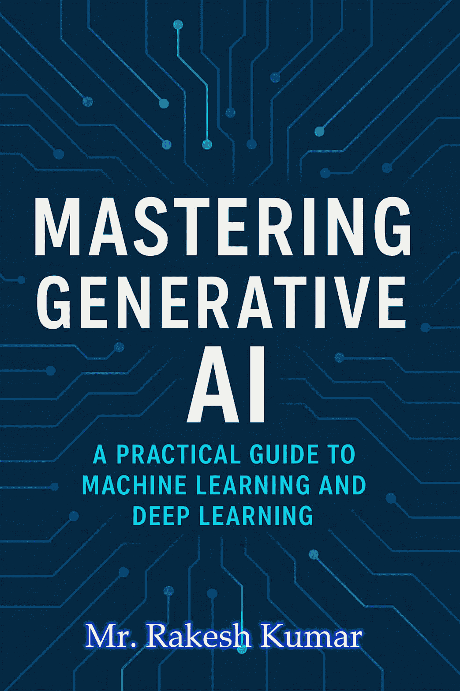


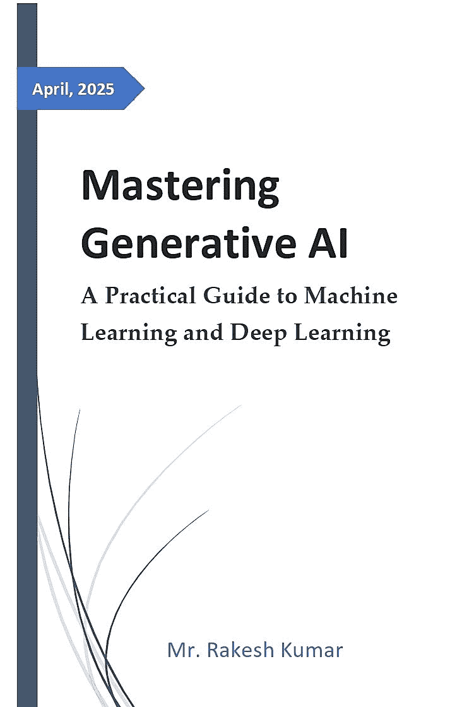

# 献辞


献给我最亲爱的父母 Kartik Ram 父亲和 Punni Devi 母亲，他们的力量和坚毅教会了我韧性的真谛。

献给我亲爱的妻子 Shakuntala，她不移的支持持续指引着我的道路。

献给我的朋友们，你们在最关键的时刻相信我。

这本书既属于我，也同样属于你们。

# 前言


《生成式人工智能：机器学习与深度学习的实用指南》是一部全面且权威的指南，深入探讨了生成式人工智能的基础原理、方法论和现实世界的应用——这是一个快速发展的领域，正在改变数字时代的各行业。

本书从生成式人工智能概述开始，追溯了它的演变，并探索了它的应用、挑战和伦理影响。通过引入核心机器学习概念，本书奠定了坚实的基础使读者能够理解 AI 模型的基础及其学习机制。随后讨论转向深度学习，强调了其在推动生成式人工智能方面的关键作用。书中深入涵盖了神经网络架构、优化技术和训练方法等主题。

书的核心关注点是先进的生成式人工智能技术，包括变分自编码器（`VAEs`）、生成对抗网络（`GANs`）、`Transformers` 和扩散模型。每种技术都得到了详尽解释，并强调了它们在当代 AI 研究中的作用及其实际应用。

书中还探索了机器学习与生成模型之间的交叉领域，讨论了混合系统和合成数据生成的尖端方法。书中详细审查了伦理和安全考量，应对了算法偏见、虚假信息、知识产权以及对监管框架的需求等关键问题。

书最后以前瞻性的见解结束，思考了生成式人工智能的新兴趋势和未来轨迹，包括迈向通用人工智能（`AGI`）和自主 AI 智能体的发展。

本书为研究人员、专业人士和学生编写，对于任何寻求深度结构理解生成式人工智能及其在不同领域转型潜力的人来说，都是不可或缺的资源。


## 3.5 深度学习中的挑战

# 致谢


我想向在本书创作期间一直支持我的每一个人表示诚心的感谢。

感谢我的妻子，感谢你在我写作的每一个深夜和清晨给予给予不移的支持、耐心和鼓励。

感谢我的朋友们，你们持续的激励和对我能力的信任，使得在道路并不艰难时我坚持了下去。

特别感谢我的父母，他们的力量和决心带给我的启发远超言语所。

我也感谢让我的研究和写作更加顺畅的技术社区和工具，并感谢无数继续塑造 AI 和机器学习世界的开发者、作家和创新者。

最后，感谢你，读者选择了这本书。希望它能激励你在生成式人工智能、机器学习和深度学习的迷人世界中探索、学习和成长。

# 第一章：生成式人工智能简介

## 学习目标

本章介绍了生成式 AI，追溯了它的演变过程并将其与判别式 AI（`Discriminative AI`）区分开来。它探索了各种应用、伦理考虑，并提供了 AI 基础的简要概述。读者将对生成式 AI 在现代技术中的意义和作用建立基础理解。

## 1.1 什么是生成式 AI？

生成式人工智能，或 `GenAI`，是一种允许用户通过响应一系列信号来创建新内容的技术——文本、照片、视频、声音、代码、3D 设计等。它通过现有的在线材料和人工制品进行教学和“学习”。

随着生成式 AI 继续从额外数据中学习，它会不断发展。大型无标记数据集被用于训练 AI 模型和算法，这些模型是使用复杂的数学和大量的计算能力创建的。这些数据集教会 AI 如何预测结果，其方式类似于人类自己的执行或产出。

生成式 AI 的普及在很大程度上归功于个人现在可以使用自然语言向 AI 提示，从而扩展了它的应用范围。AI 生成器现在被用作多个领域的写作、研究、编码、设计和其他伴侣工具。

### 1. 生成式 AI 的类型

有许多不同类型的生成式 AI，每种都有特殊的特征和用途。这些模型所属的三大类如下：

**a) 基于 Transformer 的模型**：像 `GPT-3` 和 `GPT-4` 这样基于 Transformer 的模型已被证明对文本生成至关重要。由于其设计考虑了输入文本的整个上下文，它们能够创建非常连贯且与上下文相关的语言。

**b) 生成式对抗网络 (`GANs`)**：判别器和生成器构成了 `GAN` 的两个部分。生成器产生新的数据实例，而其真实性由判别器进行评估。本质上，这两个组件在玩一个游戏，判别器试图提高识别伪造数据的能力，而生成器则试图产生判别器无法与真实数据区分开的数据。随着时间的推移，生成器获得了产生非常真实数据实例的技能。

**c) 变分自动编码器 (`VAEs`)**：`VAE` 是另一种利用统计推理概念的生成式模型。为了创建新数据，它们首先将输入数据编码到潜在空间（这是数据的压缩表示），然后解码这个潜在表示。在编码过程中引入随机元素使得 `VAEs` 能够产生既多样又可比较的数据实例。

还有其他模型，但基于 Transformer 的模型、`VAEs` 和 `GANs` 是目前最广泛使用的生成式 AI 模型。使用一系列变换来解释复杂数据分布的归一化流模型，以及根据过去数据预测未来数据点的自回归模型，是两个值得关注的模型。

## 2. 驱动生成式 AI 技术和概念

生成式 AI 工具的运行由许多基本概念和技术实现：

### a) 神经网络与深度学习

这些是生成式人工智能的基础组件。神经网络模拟人类大脑处理信息的方式，机器借此识别数据中的模式和相关性。

深度学习使用了具有许多层并能够学习分层表示的神经网络。这使得利用各种数据格式（包括文本、图像和声音）创建复杂微妙的信息成为可能。

### b) Transformers

`Transformers` 是有助于理解人类语言上下文的复杂模型。这被称为自然语言处理。

`Transformers` 的进展允许这些 AI 工具针对人类的提问快速生成逻辑且符合上下文的文本答案，这让许多 `ChatGPT` 等程序的新用户感到兴奋。

### c) 变分自动编码器 (`VAEs`)

`VAEs` 类似于画家，它们在创作相同风格的新作品之前会研究许多画作。在学习了数据的本质（例如区分梵高与另一位画家的特征）之后，它们可以创建看起来像原作的新物体。重要的是，结果将与原始数据集不同，但保持可比性。

### d) 生成式对抗网络 (`GANs`)

想象一个游戏中的两个玩家：一个生成器和一个判别器。

1. **生成器**：将判别器和生成器视为游戏中的两个参与者。

2. **判别器**：生成器根据数据集创建新的数据点和虚假图像。

为了“欺骗”检测器，设计者在制作视觉效果方面变得更加熟练。`GANs` 通过这种对抗训练过程生成高质量图像和视频：AI 产生的看似真实的素材。

### e) 扩散模型

就像一块粘土被逐渐塑造成雕塑，这些模型从随机噪声开始并将其转换为有用数据。它们逐渐改进数据，直到产生一个可以理解且凝聚的结果。`Diffusion models` 因其在生成高分辨率图像方面的卓越能力，正成为 `GANs` 的竞争性替代方案。

### f) 强化学习

考虑通过零食奖励优秀行为来训练狗。类似地，AI 模型通过奖励或惩罚学习最佳行动方案，从而随着时间的推移做出更好的判断。通过这种方式，AI 专家和工程师可以塑造 AI 模型的预期功能，优化它们以完成更精确的目标。例如，在训练模型时，AI 工程师可能会利用强化学习奖励遵循伦理标准的模型。

### g) 量子计算

量子计算机是非常强大的设备，可以以超过传统计算机的速度执行复杂的计算。

量子计算仍处于婴儿阶段，但潜力通过有效地管理更大数据集和更复杂的模型来显著扩展生成式 AI 的能力。这可能导致处理能力的巨大提升，在突破生成式 AI 能力边界的同时，减少环境成本。

## 1.2 AI 技术的演变

人工智能随着时间的推移经历了巨大的发展，经历了改变我们接触和使用技术的不同方法。

### 1. 传统搜索

传统搜索方法是信息检索的基石。使用这些方法，用户将查询语句输入搜索引擎，搜索引擎会扫描并提供相关结果。这种方法对于快速获取大量信息非常有效，因为它主要使用索引和检索算法。

**a) 意义**：传统搜索快速访问大量数据的能力使其至关重要。由于其易用性和低交互需求，它被广泛用户所使用。

**b) 使用场景**：对于典型的信息检索任务（目标是从海量数据集中快速定位相关材料），传统搜索是完美的。它对于数据库查询、在线搜索以及消费者对特定查询需要快速响应的情况特别有用。

### 2. 提示工程

AI 交互的一项重大进展是提示工程，用户通过创建自定义提示来从 AI 模型获取他们想要的答案。这种方法使用大语言模型（`LLM`），如 `GPT`，根据输入提示生成类似于人类的文本。

#### 提示工程 (Prompt Engineering)

**a) 意义**：提示工程使得快速原型设计和适应成为可能。通过不断改进提示词，用户可以自定义回复，使其在生成个性化信息方面非常灵活且高效。

**b) 使用场景**：提示工程非常适用于创意项目、内容创作以及需要精确、细致答案的场景。此外，它对于个性化通信、营销内容制作和客户协助等应用非常有帮助。

### 3. 检索增强生成 (`RAG`)

`RAG` 结合了生成式模型和传统搜索的优势。为了提供精确且符合上下文的答案，它从语料库中提取相关数据。

**a) 意义**：通过使用外部或实时数据，`RAG` 提高了生成内容的相关性和准确性。这对于需要准确事实和最新信息的应用非常有用。

**b) 使用场景**：`RAG` 适用于需要整合真实数据并具备生成能力的项目。示例包括聊天机器人、问答系统以及任何对上下文准确性至关重要的应用。

### 4. 微调 (`Fine-tuning`)

为了让 AI 模型针对特定任务定制回答，微调涉及在特定数据集上对模型进行训练。这种方法提高了模型提供精确和专业化输出的能力。

**a) 意义**：由于微调提供了高度的专业化和定制化响应，它对于需要准确性和领域特定知识的活动至关重要。

**b) 使用场景**：需要修改预训练模型的通用技能以适应特定任务的应用是微调的理想候选对象。这涵盖了法律文档分析、医学诊断以及任何特定的工业应用领域。

### 5. 代理 AI (`Agentic AI`)

代理 AI 代表了 AI 演化的巅峰，它使模型能够自动执行任务并做出决策。这些 AI 机器人使用大型数据集和复杂算法独立运行。

**a) 意义**：代理 AI 将 AI 从任务协助工具转变为能够在无需人工协助的情况下执行复杂任务的独立代理。这对可扩展性、效率和自动化具有重大影响。

**b) 使用场景**：当在复杂动态的环境中需要自主决策时，代理 AI 是完美的选择。这涵盖了金融交易、机器人、自动驾驶汽车和智能家居自动化等领域。

## 1.3 生成式模型的应用

生成式模型利用统计和概率技术结合人工智能（AI），生成可观测事件或目标变量的抽象或表示。因此，通过这些表示可以创建出与观测数据相似的新数据。

在无监督机器学习（`ML`）中，生成建模用于表示数据中的事件并帮助计算机理解真实世界。通过这种 AI 知识，可以使用模型数据来预测关于主题的广泛概率。生成模型是统计模型的一个子类，用于创建新的数据实例。

生成式模型的应用广泛，跨越多个领域。以下是一些重要领域的总结：

1. **图像生成**：

生成对抗网络（`GANs`）通常用于生成写实感的图片，这些图片可用于视频游戏开发、室内设计和时尚等多个领域。例如，它们可以创建栩栩如生的脸或其他商业组件。

2. **艺术创作**：

音乐家和艺术家越来越多地使用生成式模型来创作新鲜前卫的艺术作品。艺术行业经历了变革，因为像 `Midjourney` 这样的工具允许艺术家根据文本提示或特定的艺术风格创建精美的图像。

3. **药物发现**：

生成式 AI 模型正在加速药物开发，它们可以创建新的化学结构，预测其特征，并针对安全有效性等质量进行优化。这种方法通过协助人员探索更大的化学空间，在节省时间和资金的同时，提高了发现可行候选药物的准确性。

4. **内容创作**：

网站主越来越多地使用 `Copy.ai` 和 `HubSpot AI Content Writer` 等工具来加速其内容生产流程。例如，这些人工智能（AI）技术可以根据给定的提示或主题生成博客文章、社交媒体内容、电子邮件营销内容和落地页文本。生成式模型在保持一致性和质量的同时，促进了内容的快速生产。为了确保准确性、相关性和独特的品牌声线，在制作内容时始终需要人工监控。

5. **视频游戏**：

生成式模型通过自动化各种活动（包括创建真实的纹理、三维模型和动画）加速了视频游戏的制作。这些模型为不同的游戏设置和关卡提供了动态、智能的非玩家角色（`NPCs`）。生成式模型通过自动化任务并生成富有想象力的素材，让开发者专注于核心玩法，从而带来更具创意和沉浸感的游戏体验。

6. **图像到翻译**：

使用深度学习方法，生成式模型学习将多种图像表示映射在一起，实现图像到图像的翻译。例如，`GANs` 等模型可以将草图转换为真实的图片，或将灰度图像转换为彩色图像。

7. **文本到图像翻译**：

使用生成式模型可以将文本描述转换为相关的视觉效果，这在内容制作和广告中很有用。文字表述的概念通过文本到图像技术实现视觉化。

8. **视频生成**：

像 `GANs` 等生成式模型使用现有的视频数据来识别模式并生成合成视频内容。它们通过分析帧连接、运动和视觉组件，创建模仿原始风格的新序列。这支持了虚拟现实、娱乐和广告等对动态、迷人素材至关重要的应用。

9. **音频生成**：

生成式模型在音乐创作和语音合成方面取得了巨大进展。例如，`WaveNet` 和 `Tacotron` 等模型使用深度学习方法产生极具表现力且听自然的合成语音，用于旁白、有声书和虚拟助手。在音乐行业，`Jukedeck` 和 `Musenet` 等模型利用机器学习算法通过分析已录歌曲的数据集来创建独特的音乐。这种技术为各种多媒体项目提供了背景音乐，同时也帮助了艺术家。

## 1.4 生成式 AI 的伦理问题

生成式 AI 工具在日常生活、工作场所或学习期间可以提供帮助。与任何工具一样，其使用必须是适当、经过评估且符合伦理的。以下是生成式 AI 相关的伦理考量。

1. **环境影响**：

构建、训练和使用生成式 AI 模型消耗大量的能量并产生碳排放。还需要大量的水。研究人员和公司正在研究提高生成式 AI 可持续性的方法。然而，评估其应用是否符合其环境代价，并尽可能高效地使用生成式 AI 工具至关重要。

2. **可访问性**

虽然有许多生成式 AI 工具可以免费使用，但越来越多的工具开始对访问权限或高级功能收取费用。这为那些无法负担访问费的个人制造了障碍。尽管如此，生成式 AI 工具也可以作为无障碍辅助工具。例如，Maggie Melo 讨论了 `ChatGPT` 是辅助注意力缺陷多动障碍（`ADHD`）教师和学生的有用工具。

3. **创作性与学术诚信**

大学经历能够增强知识和技能，确保个人在获得学位后，为就业或深造做好充分准备。使用生成式 AI 生成内容而不对其进行进一步的阐述、修改或深度互动，将导致提交的作品不属于个人本人，并表明了个人知识和技能发展的缺失。

利用生成式 AI 工具生成或修改作业，并随后将其作品作为原创作品提交，被认为是不诚实行为。这类似于要求他人代为自己完成任务。在使用生成式 AI 时，必须说明所使用的特定工具及其使用方式。此外，如果意图发布包含 AI 生成内容的作品，建议审阅出版商关于许可范围的指南。

4. **版权**

生成式 AI 工具的创建和应用涉及许多版权问题。为 AI 工具收集训练数据、包含版权保护材料，以及从权利者处获得许可或授权的必要性，都是需要考虑的重要因素。将受版权保护的作品的大部分作为输入，或作为 AI 工具输出的特定形式，可能会带来版权后果。

尽管目前各国似乎尚未为 AI 生成输出的版权保护提供法律基础，但这些输出可能会违反其他版权，生成式 AI 工具的开发者和用户都可能对此类侵权行为承担责任。

5. **权利管理**

生成式 AI 的出现为权利管理带来了复杂的困难。技术的飞速发展使得监管活动需要时间来适应并反映这些进展。该问题的一个例子涉及艺术家和作家，他们的内容被用于训练生成式 AI。

内容贡献的影响代表了权利管理的一个关键方面，个人在使用生成式 AI 工具之前应该理解这一点。通过提示词（`prompts`）或上传向 AI 平台提交内容可能会赋予 AI 工具重复和分发该内容的权利，从而可能导致版权或隐私侵犯。向 AI 平台提交内容时应谨慎，特别是那些并非由个人原创的信息或数据。

6. **隐私与数据安全**

利用个人数据的生成模型存在隐私忧虑，因为它们有潜力创建与真实个人高度相似的合成画像。这可能导致对用户隐私的侵害和法律后果，包括违反《通用数据保护条例》（`GDPR`）等数据保护法。

训练期间的数据匿名化以及实施强的数据安全措施（包括加密）对于保护用户数据至关重要。通过遵循 `GDPR` 的数据最小化要求等指南，也可以减少隐私泄露的风险。

7. **偏见与歧视**

生成模型可能会延续训练数据集中存在的偏见，从而导致不公正的歧视。带有偏见的人脸识别软件可能会误识别个人，导致法律纠纷和声誉损害。

最近的一个案例涉及 Google 的 `Gemini`，它在用户发现其生成的图像在历史上是不准确的后遭到了反弹。这些图像包括女性教皇、黑人维京人，以及一位穿着二战德国士兵装备的亚洲女性。

为了解决这个问题，优先考虑训练数据集的多样性至关重要。此外，定期进行审计以检测并纠正任何无意的偏见也是重要的。与专注于偏见评估和审计的组织合作可以增强生成式 AI 系统的公平性。

8. **准确性**

公司保留有关用于训练生成式 AI 模型的数据信息是常见现象。生成式 AI 无法告知用户创建特定内容所使用的数据，也无法提供准确的引用或生成可靠的参考文献。因此，生成式 AI 生成的材料作为信息来源缺乏公信力和可靠性。

AI 模型偶尔会产生不准确、偏见或过时的信息。在某些情况下，生成式 AI 可能会产生错误的答案，这种现象被称为“幻觉”。例如，`ChatGPT` 有时会虚构引用。为了防止虚假信息的使用，在将其纳入任何工作之前，必须确认内容的正确性。

## 1.5 什么是判别式 AI？

判别式 AI 的目标是从训练数据中学习，并区分不同的类别，以便选择最佳选项或类别。由于判别式 AI 模型被训练来区分不同类型的数据，它们在这一方面优于生成式 AI 模型。


这些模型旨在发现标签或类别变量与其输入之间的联系。使用逻辑回归（`logistic regression`）和支持向量机（`SVM`）等方法的各种平台和应用是 AI 模型常见的用例。

## 1. 判别式 AI 的特征

以下是判别式 AI 的主要特征：

1. **分类准确性**：在对数据进行预定义分类时，在准确性和效率方面优于其他模型。
2. **模式识别**：对输入数据的结构和特征进行描述和区分。
3. **预测能力**：预测能力可以使用训练中学到的模型来预测未来未知数据集的特征。
4. **效率**：训练模型有时比生成式模型效率更高。
5. **应用多样性**：在情感分析、欺诈检测、诊断和垃圾邮件过滤等尖端领域非常流行。

在图像和语音识别等应用中，正确分类每个数据点是至关重要的，因为单个分类错误就可能导致模型预测结果出现巨大偏差。

## 2. 判别式 AI 的工作

判别式 AI 模型通过监督学习在标注数据集上进行训练，这使其能够识别输入数据中的独特模式和决策边界。该过程包括：

1. **标注数据上训练**：将带有“猫”或“狗”等标签的标注数据输入模型中。
2. **特征提取**：提取区分不同类别的关键特征，包括纹理或形状。
3. **决策边界形成**：模型根据学习到的特征划分不同的类别。
4. **新数据分类**：当面对未知数据时，模型利用其学习到的模式来准确识别输入。

以下是判别式 AI 常用的机器学习技术：

- `Logistic regression`（逻辑回归）用于分类。
- `SVMs`（支持向量机）用于决策。
- `Neural networks`（神经网络），如 `CNNs` 和 `RNNs` 用于识别。

## 3. 判别式 AI 的未来

随着 AI 技术的发展，判别式模型变得更加准确和有效，结合深度学习实现了更高的精度。它们越来越多地应用于对精确分类至关重要的领域，例如网络安全、无人驾驶和医疗诊断。

得益于 AI 伦理和偏差消除的持续进步，未来的判别式模型将更加开放、公平且可解释。随着机器学习算法理解力和效率的进一步提高，这些模型将在数据应用中至关重要。

# 1. AI 概述

人工智能（AI）这一计算机科学领域的目标是制造计算机、控制机器人以及像人类一样智能行为的软件。为了开发智能软件和系统，人工智能的基本思想是研究人类认知的模式和机制。AI 详细研究人类如何感知、学习和决策。AI 的最终目的是创建能够推理、基于经验学习、环境适应以及需要人类智力的机器。

## 1.1 人工智能简史

人工智能（AI）的历史跨越数十年。以下是该领域的重大节点和进展概述：

- **1950 年代**：1950 年标志着 AI 革命的开始，研究人员开始探索机器展示智能行为的潜力。`Alan Turing` 等人物引入了机器智能的概念，并创建了著名的 `Turing Test` 来评估计算机类人智能的能力。
- **1956 年**：`John McCarthy` 被认为创造了“人工智能”这一术语并组织了达特茅会议，这被认为是 AI 作为一个研究学科的正式开始。著名科学家聚集在一起讨论人工智能的潜力和前景。
- **1960 年-1970 年**：专家系统（旨在复制特定领域人类专家决策能力的计算机程序）是当时 AI 研究的重点。然而，现实问题的复杂性和技术限制限制了早期 AI 系统的发展。
- **1980 年-1990 年**：AI 经历了“AI 寒冬”，资金和公众关注下降。AI 研究进展缓慢，未能达到预期。尽管如此，自然语言处理、知识表示和机器学习等领域的研究持续，为进一步的发展奠定了基础。
- **20 世纪 90 年代末-21 初**：随着计算能力的提高以及数据驱动方法和神经网络等新方法的流行，AI 迎来了复兴。数据挖掘、计算机视觉和语音识别等应用开始产生令人鼓舞的结果。
- **2010 年代**：由于大数据和深度学习的发展，人工智能取得了重大进展。由多层神经网络驱动的深度学习模型在自然语言处理、图像识别和游戏等各种任务中显示出惊人的成果。
- **如今**：如今人工智能（AI）渗透到生活的方方面，从推荐引擎、虚拟助手到自动驾驶汽车和医疗诊断。随着深度学习、强化学习和机器学习方法的进步，它们正在推向人工智能的极限。

## 1.2 弱 AI vs. 强 AI

弱 AI 和强 AI 在能力和类人智能程度上存在区别：

- **弱 AI**：弱 AI 系统是指设计在限制区域内执行某些活动或功能的系统。它们有时被称为狭义 AI 或应用 AI。弱 AI 缺乏通用智能，只关注解决特定问题。这些系统经过训练或设计，非常擅长某些任务，包括国际象棋、图像分类或语音识别。它们无法在指定区域之外扩展知识或能力，并在良好定义的参数内工作。
- **强 AI**：强 AI，通常被称为人类级 AI 或通用人工智能（`AGI`），试图在各种活动和领域模拟人类水平的智力。强大的工智能系统能够以模拟人类认知能力的方式理解、学习和使用信息。与人类类似，它们具备意识、自我意识和推理能力。强 AI 旨在复制人类大脑的复杂性和灵活性，允许机器人展示广泛的认知能力并在各个领域执行活动。

## 1.3 人工智能的应用

人工智能（AI）在各个行业和企业中有多种用途。以下是 AI 的一些值得关注的应用：

- **医疗保健**：AI 正在改变医疗保健，帮助药物开发、疾病检测和个性化治疗方案。它使得对医学图像进行精确诊断成为可能，包括 MRI 和 X 光。AI 驱动的解决方案还可以帮助检测潜在的健康危害、预测疾病趋势并实时监测患者数据。
- **金融与银行**：在金融行业，AI 用于算法交易、风险评估、欺诈检测和客户支持。AI 驱动的聊天机器人和虚拟助手改进了客户互动，而机器学习算法检查金融数据以识别趋势并阻止欺诈。
- **交通**：自动驾驶、更好的交通控制系统和路线优化都是 AI 的应用。AI 算法被自动驾驶车辆用于导航和决策，提高了效率和安全性。AI 还用于供应链管理和物流，以简化流程并节省成本。
- **电子商务与零售**：需求预测、消费者行为研究以及定制化产品建议都利用了 AI。具备 AI 能力的聊天机器人可以帮助消费者寻找物品并提供协助。计算机视觉技术实现了视觉搜索和物品识别，提升了在线购物的体验。
- **制造业与机器人**：由 AI 驱动的自动化和机器人通过提高生产力、准确性和效率来改进工业流程。由人工智能支持的机器人能够处理质量控制、执行艰巨任务并在危险环境中工作。
- **智能家居与物联网 (IoT)**：自动照明、安全系统、智能恒温器和语音控制助手均通过 AI 实现，这提升了智能家居设备的功能。AI 算法分析 IoT 数据以增强家居自动化并优化能源利用。
- **客户服务**：在客户服务领域，AI 驱动的聊天机器人和虚拟助手正越来越多地回答问题、提供实时帮助和管理重复性任务。自然语言理解、交互学习和个性化支持都是这些 AI 系统的能力。

这些只是使用 AI 的众多行业中的几个，还包括网络安全、教育、农业和娱乐。AI 的适应性使其能够变革一系列领域，优化工作流，并为挑战性问题提供创造性的解决方案。

## 1.4 人工智能示例

人工智能 (AI) 影响了我们生活的许多方面，它正在改变行业并提升用户体验。以下显著实例突显了 AI 应用的多样性：

- **ChatGPT**：ChatGPT 是 OpenAI 开发的一种先进语言模型，由于它可以进行自然语言对话，因此适用于聊天机器人、虚拟助手和客户服务。它使用深度学习方法生成类似于人类的答案。
- **Google 地图**：Google Maps 通过 AI 算法提供交通更新、实时导航和定制化建议。为了推荐最佳路线和预测拥堵，它会分析大量数据，包括过去的交通趋势和用户输入。
- **智能助手**：Google Assistant、Apple 的 Siri 和亚马逊的 Alexa 是 AI 驱动的智能助手，可以理解语音请求、传递信息并执行任务。得益于机器学习和自然语言处理，这些助手可以理解人类意图并提供相关的回复。
- **特斯拉辅助 (Autopilot)**：特斯拉汽车通过 Autopilot 系统利用 AI 和复杂的传感器实现了半自动驾驶。它可以辅助自适应巡航控制、换道和转向。
- **谷歌翻译和 DeepL**：这些产品利用机器学习和神经网络等人工智能技术，提供实时多语言翻译服务。
- **Netflix 推荐系统**：Netflix 使用 AI 算法分析客户偏好和观看模式，以提供定制的电影和电视节目建议。
- **IBM Watson 肿瘤医学**：医疗专业人员使用 IBM Watson 的 AI 能力帮助肿瘤科医生做出癌症治疗决策。它通过分析医学文献和患者数据提供个性化的治疗建议。
- **DeepMind 的 AlphaGo**：由 Google 公司 DeepMind 创建的名为 AlphaGo 的人工智能软件，在围棋游戏中展现了令人惊叹的性能。它通过击败世界围棋冠军李世石，证明了 AI 在挑战性策略性游戏中的潜力。
- **机器人 Sophia**：Sophia 是由 Hanson Robotics 创建的具有 AI 技能和类人类外观的人形机器人。它通过展示情感、识别脸部对话推动了社交机器人的发展。

# 第 2 章：机器学习基础

## 学习目标

本章涵盖了机器学习的基础、不同类型、算法和数据预处理技术。它还讨论了模型评估策略，为理解机器学习如何驱动生成式 AI 奠定了坚实的基础。

## 2.1 什么是机器学习？

机器学习是人工智能的一个分支领域，允许算法识别数据集中的隐藏模式。它们能够在不需要显式任务编程的情况下预测新的、相似的数据。机器学习的应用存在于许多不同领域，包括欺诈检测、投资组合优化、推荐系统、自然语言处理、图像和音频识别以及任务自动化。

机器学习的影响延伸到机器人、无人机和自动驾驶汽车，提高了它们适应变化环境的能力。这种方法与数据挖掘和数据科学密切相关，是一种从数据中学习的突破。

### 2.1.1 机器学习的需求

机器学习的意义在于它能够在不需要显式编程的情况下，通过从数据中来提高性能。对于涉及大量数据、复杂决策和动态环境的任务，机器学习特别有用。

以下是机器学习应用的一些特定领域：

- **预测建模**：企业通过机器学习创建预测模型来改进决策。例如，机器学习可以预测哪些消费者最可能购买特定产品，或哪些患者容易患特定疾病。
- **自然语言处理**：使用机器学习创建可以理解和解释人类语言的系统。这对聊天机器人、语音识别和语言翻译等应用至关重要。
- **计算机视觉**：使用机器学习创建识别和理解照片及视频的系统。对于医学成像、监控系统和自动驾驶汽车等应用这至关重要。
- **欺诈检测**：利用机器学习检测网络广告、金融交易和其他领域中的欺诈活动。
- **推荐系统**：利用机器学习开发根据用户先行为和偏好提供建议的推荐系统。

总体而言，机器学习已成为许多公司和行业的关键工具，使其能够更有效地利用数据、增强决策流程并提供更个性化的消费者体验。

### 2.1.2 机器学习算法的工作原理

机器学习算法并非为每个任务显式编码，而是从数据中学习模式和关联以产生预测或决策。以下是常见机器学习算法工作原理的简述：

- **数据收集**：首先收集或筛选相关信息。这些信息可能包括文本、照片、数值数据或其他与工作相关的特征、属性或示例。
- **数据预处理**：在进入算法之前，通常需要对数据进行预处理。此阶段可能包括将数据分为训练集和测试集、清洗数据（处理缺失值、离群值）以及转换数据（归一化、缩放）。
- **选择模型**：根据分类、回归和聚类任务选择适用于任务的机器学习模型。示例包括决策树、神经网络、支持向量机以及深度学习框架等更复杂的模型。
- **训练模型**：使用训练数据来训练所选模型。程序在训练过程中发现数据中的关联和模式。这涉及到反复修改模型的参数，以减少训练数据的实际输出（`labels` 或 `targets`）与预测输出之间的差异。
- **评估模型**：训练完成后，使用测试数据对模型性能进行评估。使用均方误差、召回率、准确率和精确率等指标来评估模型对新的、未测试数据的泛化有效性。
- **模型微调**：为了增强性能，可以通过修改超参数来调整模型，超参数是在训练过程中不直接学习的因素，例如学习率或神经网络中隐藏层的数量。
- **预测或推理**：最后，根据训练好的模型对新数据进行预测或判断。在此过程中，将学到的模式应用于新输入以产生输出结果，例如回归任务的数值结果或分类任务的类别标签。

## 2.2 机器学习生命周期

```

```

图 2.1：机器学习生命周期。

机器学习生命周期涉及的主要步骤概述如下：

- **数据获取**：数据是机器学习生命周期中的关键元素，但必须获取合适的数据来解决特定问题。收集数据并不需要数据科学家来完成。一个对各种免费可用数据集之间的实际差异有先验知识，并能够对组织的投资策略做出影响性决策的人，将最胜任数据科学家这一角色。
- **数据准备**：这项任务可以被认为是该循环中最耗力且最耗时的任务，因为需要识别许多数据质量问题。通常，在获取数据后，由于存在错误条目、不一致性和语义错误，无法对其进行分析。为了利用这类数据，数据科学家会通过在电子表格中编辑或编写脚本手动对数据进行重新格式化和清洗。数据整理（Data wrangling）阶段或数据清洗（Data cleansing）步骤是数据准备过程的额外名称。
- **假设与建模**：这是任何数据科学项目的基础阶段，涉及创建、执行和改进程序以分析数据并提取有价值的业务见解。可以使用 `Python`、`R`、`MATLAB` 或 `Perl` 等语言开发程序。在此阶段，数据被用于训练不同的机器学习算法，并选择产生性能最佳的算法。
- **评估与解释**：在数据上完成模型训练后，会对最终结果进行评估，以确定其在实际场景中的性能和可靠性。每个性能指标都拥有一套独特的评估标准。例如，当目标是让机器学习模型预测每日股票时，强烈建议在评估时考虑 `RMSE`（均方根误差）。或者，在对垃圾邮件分类时，会考虑平均准确率、`AUC` 和 `log loss` 等性能指标。
- **部署**：部署指的是应用模型并利用新数据生成预测结果。创建模型通常不是项目的终点。虽然模型旨在增强对数据的理解，但获得的见解必须以结构化的方式展示出来，以便客户易于使用。部署阶段的范围可以从简单的生成报告到复杂的根据特定需求实现可复制的数据科学流程不等。
- **运维**：创建一个计划，用于在长期监督和维护数据科学项目。在此阶段，将监控模型性能的升级和下降情况。数据科学家利用特定的数据科学项目来促进共享学习，并增强未来类似数据科学项目的执行。
- **优化**：每个数据科学尝试的最后阶段是优化。当添加新的数据源或采取必要的措施以改进机器学习模型的性能时，会在环境中重新训练模型。

## 2.3 机器学习的类型

存在许多类型的机器学习技术，每种都有独特的特性和应用。日常生活中常用的几种机器学习算法类型包括：

```

```

图 2.2：机器学习的类型。

### 2.3.1 监督学习

机器学习算法最重要的类别之一是监督学习，算法在标记数据上进行训练。这意味着提供给算法的数据中包含了已知有效输出的输入-输出对。算法通过识别输入与输出之间的相关性和模式从这些数据中获取知识。模型一旦完成训练，可以使用其所学到的知识对新的、未知的数据预测结果。

#### 监督学习示例

出现一种情况：需要开发一个对各种水果进行分类的模型。过程始于为算法提供一组描绘各种水果的图像，每张图像都标记了标签以指示其展示的特定水果类型，包括苹果、香蕉和橘子。算法获得了识别区分水果特征的能力，例如形状、颜色和大小。当以后输入一个算法以前从未遇到的新水果图像时，它将利用学到的模式判断该水果是苹果、香蕉还是橘子。这个过程解释了监督学习的工作原理。

```
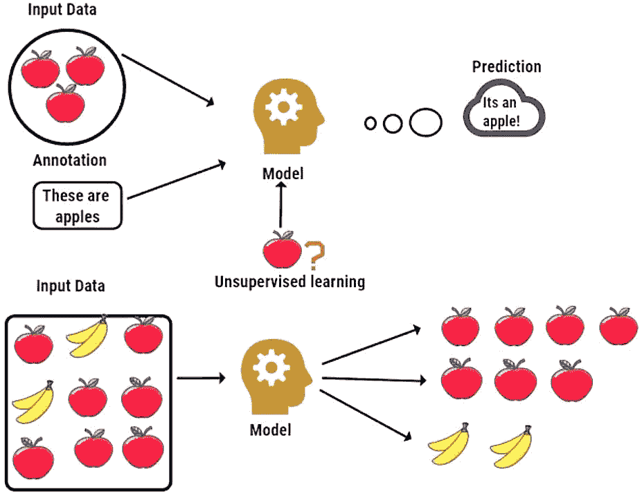
```

图 2.3：监督学习。

#### 监督学习的类型

监督学习算法可分为两大类：分类学习和回归学习。

##### 分类学习

分类学习的目标是将数据划分到不同的类别或组，它是监督学习的一种。使用标记数据集来训练算法，该数据集中的每个数据点都与一个预定义的类别相关联。例如，在垃圾邮件过滤器中，算法根据主题行、发送者和内容等属性擅长将电子邮件分类为“垃圾邮件”或“非垃圾邮件”。

以下是一些典型的分类学习算法：

- `逻辑回归`
- `支持向量机`
- `随机森林`
- `决策树`
- `K 近邻算法 (KNN)`
- `朴素贝叶斯`

##### 回归学习

回归学习是另一种类型的监督学习，其目标是预测连续值而非类别。它使用包含输入-输出对的标记数据集（其中输出为数值）来训练算法。例如，系统通过位置、卧室数量和平方英尺等特征进行学习，以预测房屋价值。利用这些数据，算法可以根据房屋的属性预测新房的价格。寻找股票价格预测、预测经济模式等许多情况，只是回归学习的众多应用场景之一。

回归学习方法中常用的算法包括：

- 线性回归
- 多项式回归
- 岭回归（Ridge Regression）
- Lasso 回归（Lasso Regression）
- 决策树
- 随机森林

### 2.3.2 无监督学习

在无监督学习中，算法获得的是没有标签或预设类别的数据，这使其成为机器学习技术中最流行的形式之一。该程序的首要目标是在数据中发现模式或相关性。算法不需要被指示要搜索什么，而是自动发现共同特征并聚类相关数据点。这有助于识别隐藏模式、将相关事物归为一类，或减少进一步分析的数据量。

#### 无监督学习的示例

想象一个包含不同书籍及其特征（如体裁、作者、页数和出版年份）的数据集。无监督学习系统可以使用聚类根据这些特征将相关书籍组合在一起。这将揭示一组由同一作者编写或属于特定类别的小说。书店能够利用这些信息进行更好的库存管理，或向客户推荐相似的书籍。


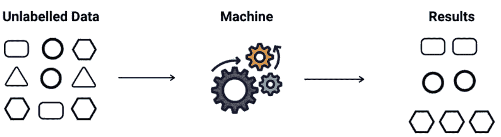

图 2.4: 无监督机器学习。[[4]](#text00015.html#_ftn4)

### b) 无监督学习的类型

无监督学习主要分为两类：关联和聚类。

#### 1. 无监督学习中的聚类

在无监督学习中，聚类是算法根据相似性对数据点分类的过程。每个簇（或组）中的数据点彼此之间与其他簇中的单个数据点更具可比性。聚类是用于许多不同领域的领域，例如客户细分，它允许公司将具有相似购买行为的客户分组，并为每位客户定制独特的营销活动。

以下是一些流行的聚类算法：

*   `K-Means 聚类算法`
*   `均值漂（Mean-shift）算法`
*   `DBSCAN 算法`
*   `主成分分析（PCA）`
*   `独立成分分析（ICA）`

#### 2. 无监督学习中的关联

在无监督学习中，关联是一种用于发现大型数据集中变量之间有趣相关性或趋势的技术。通过这种方法识别出强调一个项目发生与另一个项目发生之间关系的规则。例如，在购物篮分析中，关联算法可能会显示，购买面包的消费者也可能购买黄油。企业使用这些关联规则来增强库存控制和产品定位。

以下是一些流行的关联规则学习算法：

*   `Apriori 算法`
*   `Eclat 算法`
*   `FP-growth 算法`

### 3. 半监督学习

半监督学习是另一种流行的机器学习方法，它使用了大量的未标记数据和少量标记数据。

### a) 半监督学习的示例

考虑一个图像数据集，其中只有少数带有标记。半监督系统使用标记图像来学习基本特征，然后使用未标记图像来完善其理解。这在标记数据成本昂贵或耗时时特别有用。

### b) 半监督学习的类型

存在许多半监督模型，每个模型都有不同的特征并用于不同的目标。

1.  **基于图的半监督学习**：数据点之间的连接用图表示。通过这些链接，标签从标记处传播到未标记处。
2.  **标签传播（Label Propagation）**：假设相似的数据点彼此靠近。
3.  **协同训练（Co-training）**：使用两个两个不同的模型，利用每个模型的预测来增强其他模型。
4.  **自训练（Self-training）**：在训练标记数据后，模型对未标记数据进行预测。

### 4. 强化学习

强化学习是一个框架，代理体通过在环境中执行动作来获得可能的奖励。代理体通过试错来学习，开始对最优动作没有先验知识。每个动作都有一个结果，结果可能是奖励也可能是惩罚。

### a) 强化学习的示例

考虑教狗接球的过程。场景是院子，参与者是狗，活动涉及捡球。当狗捡回球时，给予零食作为奖励。如果狗没有捡回球或从事其他活动，则得不到零食，这作为负奖励。

刚开始，狗可能无法理解这项任务，但随着时间的推移，它意识到捡球会带来奖励。随着反复的接触和激励，狗的捡球习惯会增加。

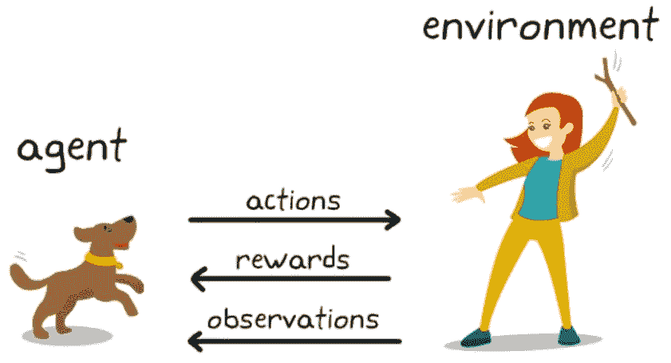

图 2.6: 强化学习。[[6]](#text00015.html#_ftn6)

与 `Q-learning` 类似，`SARSA` 是另一种强化学习方法；然而，它不是根据最优策略来更新 `Q` 值，而是基于代理实际执行的动作进行更新。这保证了代理是根据现有策略进行学习，使得 `SARSA` 更加保守。

## 2.3 机器学习算法

AI 系统的运行模式通常涉及从输入数据预测输出值，这被称为机器学习算法。回归和分类是机器学习（ML）算法中的两个主要步骤。

从本质上说，机器学习算法是指令集，它们在不需要显式编程的情况下，使计算机能够从数据中学习、生成预测并逐步提高性能。机器学习算法可以分为三大大类：

1.  **监督学习**：算法从带标签的数据中学习，在这些数据中输入与结果之间的关系是已知的。
2.  **无监督学习**：算法在未标记数据中寻找模式或分组。
3.  **强化学习**：算法通过与环境交互以及奖励或惩罚形式的反馈来获取知识。

## 1. 监督学习算法

监督学习算法在数据集上进行训练，这些数据集中的每个示例都与一个目标或响应变量（称为标签）相关。为了使模型能够对未知数据提供精确预测，其目标是开发一个从输入数据到相关输出标签的映射函数。

监督学习算法的两大类是分类和回归。

1.  **分类**：分类使用算法将测试结果正确地分配到不同的组中。系统识别数据集中的某些实体，并努力确定需要如何描述或标记这些事物。`随机森林`、`K 近邻算法`、`决策树`、`支持向量机 (SVM)` 和 `线性分类器` 都是常见分类算法的示例。
2.  **回归**：回归用于理解自变量和因变量之间的相关性。它通常用于预测诸如公司的销售收入等。流行的回归方法包括 `多项回归`、`逻辑回归` 和 `线性回归`。

监督机器学习过程使用多种计算方法和算法，这些方法通常使用 `Python` 和其他类似的程序计算。监督学习算法包括：

1.  **`AdaBoost 或梯度提升`**：自适应提升是这种策略的另一个名称，它将性能较弱的回归算法与其他较弱的算法结合，使其变得强大并产生更少的错误。提升技术将许多基估计器的预测能力结合在一起。
2.  **`人工神经网络`**：也称为 `ANNs`、神经网络或模拟神经网络 (`SNNs`)，它们是机器学习技术的子集，也是深度学习算法的基础。学习算法使用称为 `neurones` 的构建块，这些构建块模仿人类大脑中经过训练和调整的神经元，以识别输入数据中的模式。
3.  **`决策树算法`**：决策树可以用树形图表示，使用一系列分支的连接选择来将数据分类到类别中并预测数值值（回归问题）。与神经网络的黑箱相比，决策树具有易于验证和审计的优点。
4.  **`降维`**：如果选定的数据集合包含大量特征，则认为其具有高维。在降维减少特征数量后，会留下最重要的思想或信息。`主成分分析` 就是一个示例。
5.  **`K 近邻`**：这种非参数技术有时被称为 `KNN`，根据数据点与其他可用数据的关联性和接近程度对数据点进行分组。它假设相似的数据点可能彼此靠近。因此，它的目标是确定数据点之间的距离（通常使用欧距离），然后根据平均或最常见的类别对数据进行分类。
6.  **`线性回归`**：线性回归用于建立因变量与一个或多个自变量之间的相关性，通常是为了对未来结果做出预测。简单线性回归是仅用一个自变量和一个因变量对数据分析的过程。
7.  **`逻辑回归`**：当因变量是分类的（即存在二值输出，如“真”和“假”或“是”和“否”）时使用逻辑回归；当因变量是连续的时使用线性回归。尽管两种回归模型都旨在理解数据输入之间的连接，但逻辑回归主要用于解决二分类问题，包括垃圾邮件检测。
8.  **`神经网络`**：神经网络主要用于深度学习算法，利用节点层分析输入的训练数据，模拟人类大脑的互连性。每个节点由输入、权重、偏置（阈值）和输出组成。当输出值超过指定的阈值时，数据会被传输到网络的下一层，导致节点“点火”或激活。神经网络使用梯度下降根据损失函数进行修改以学习。当代价函数处于零或接近零时，模型的准确性是可以信赖的。
9.  **`朴素贝叶`**：这种方法使用了贝叶斯定理的类条件独立性原理。这表明每个预测因子对特定结果的影响相同，且在该事件发生的概率中，一个特征的存在不会影响另一个特征的存在。`多项朴素贝叶`、`伯努利朴素贝叶` 和 `高斯朴素贝叶` 是朴素贝叶分类器的三种类型。该技术主要用于文本分类、垃圾邮件检测和推荐系统。
10. **`随机森林`**：随机森林是一种机器学习方法，结合了许多决策树的输出来预测值或类别。不相关的决策树被称为“森林”，因为它们被组合在一起以降低方差并提供更准确的预测。
11. **`支持向量机 (SVM)`**：通常，这种方法在两类数据点之间的距离最大时创建一个超平面。它可以用于回归和数据分类问题。超平面两侧的数据点分类（橙子与苹果）由决策边界分开。

## 2. 无监督学习算法

无监督学习算法使用未标记的数据寻找潜在的结构或模式，而不产生预设的结果。根据其用途，它们再次被分为三大类：降维、关联规则挖掘和聚类。

### a) 聚类

聚类算法根据相似性或差异将数据点组织成聚类。其目标是发现数据中的有机分组。不同的聚类算法可以根据其分组的方式进行区分。这些类别包括基于密度的方法、基于连接的方法、基于分布的方法和基于质心的方法。

#### 1. 基于质心的方法：利用中心元素（如质心或中点）来表示浓度。

*   `K-Means 聚类`：假设簇是球形的，迭代地将点分配给最近的中心，以将数据分成 k 个类。
*   `K-Means++ 聚类`
*   `K-Mode 聚类`
*   `模糊 C 均值 (FCM) 聚类`

#### 2. 基于分布的方法

主要的基于分布的技术如下：

*   `Gaussian Mixture Models (GMMs)`：该模型通过将聚类建模为重叠的高斯分布，为数据点的聚类成员身份分配概率。
*   `Expectation-Maximisation Algorithms（期望极大算法）`
*   `Dirichlet process mixture models (DPMMs)`

#### 3. 基于连接性的方法

基于连接性的方法包括：

*   `Hierarchical clustering（层次聚类）`：通过合并或划分聚类来构建层次树（一种树状结构），且不需要预设聚类数量。
*   `Agglomerative Clustering（凝聚聚类）`
*   `Divisive clustering（分裂聚类）`
*   `Affinity propagation（亲和传播）`

#### 4. 基于密度的方法

基于密度的方法包括：

*   `DBSCAN (基于噪声的应用密度空间聚类)`：使用距离和点参数创建基于密度的聚类，允许自定义形状并进行离群点检测。
*   `OPTICS (用于识别聚类结构的点排序)`：`OPTICS` 是一种识别数据中基于密度聚类的算法，通过对点排序以揭示聚类结构来处理不同的密度，而不是显式地产生像 `DBSCAN` 那样的划分。

### b) 降维

可以通过使用降维来简化数据集，这在保留最关键信息的同时减少特征的数量。

1.  `Principal Component Analysis (PCA)(主成分分析）`：将信息转换为一组新的主成分（或正交特征），这些特征能有效地表示方差。
2.  `t-distributed Stochastic Neighbour Embedding (t-SNE)(t-分布随机邻域嵌入）`：在保持局部连接的同时降低维度，以便可视化高维数据。
3.  `Non-negative Matrix Factorisation (NMF)(非负矩阵分解）`：有助于稀疏数据（如文本或图像）将数据分解为非负分量。
4.  `Isomap`：为了捕捉数据中的非线性结构，保留了测地线距离。
5.  `Locally Linear Embedding (LLE)(局部线性嵌入）`：通过从邻居节点重构数据点来保留局部关系。
6.  `Latent Semantic Analysis (LSA)(隐含语义分析）`：通过降低文本数据的维度来揭示隐藏模式。
7.  `Autoencoders（自动编码器）`：神经网络对于异常检测和特征学习很有帮助，因为它可以压缩并重建数据。

### c) 关联规则

分析海量数据商品之间的模式（也称为关联规则），通常用于市场篮研究（例如，发现购买面包的人也会买黄油）。它仅通过观察项目在数据集中的频率以及共出现的情况来寻找模式。

1.  `Apriori algorithm（Apriori 算法）`：通过迭代遍历数据并消除不频繁的物品组合来寻找频繁项集。
2.  `FP-Growth（频繁模式增长算法）`：通过使用压缩的 `FP-tree` 结构高效地挖掘频繁项集，而无需生成候选。
3.  `ECLAT（等价类聚类和自下上格遍历）`：通过使用垂直数据结构有效地交集项集，实现更快速频繁的模式发现。

## 3. 强化学习算法

在强化学习中，智能体通过奖励良好行为和惩罚糟糕行为来训练其做出一系列选择。这些技术可以大致分为两类：基于模型的方法和无模型的方法。它们在与环境交互方面有所不同。

### a) 基于模型的方法

这些技术利用环境模型来预测结果，并协助智能体规划动作。

*   `Markov decision processes (MDPs)(马尔可夫决策过程）`
*   `Bellman equation（贝尔曼方程）`
*   `Value iteration algorithm（值迭代算法）`
*   `Monte Carlo Tree Search（蒙特卡洛树搜索）`

### b) 无模型的方法

这些方法既不创建也不依赖于显式的环境模型。智能体通过与环境交互并根据输入修改其活动来获得第一手经验。基于价值和基于策略的方法是无模型方法的两个子类：

1.  **`Value-Based Methods（基于价值的方法）`**：专注于学习若干状态或动作的价值，智能体在估计每个动作的预期回报后，选择价值最大的动作。
    *   `Q-Learning`
    *   `SARSA`
    *   `Monte Carlo Methods（蒙特卡洛方法）`
2.  **`Policy-based Methods（基于策略的方法）`**：智能体通过直接学习策略（一种从状态到动作的映射）而不是猜测价值，不断修改其策略以优化奖励。
    *   `REINFORCE Algorithm`
    *   `Actor-Critic Algorithm（执行者-评论家算法）`
    *   `Asynchronous Advantage Actor-Critic (A3C)`

## 2.4 数据预处理

数据预处理是数据准备的一个组成部分，是指在未处理的数据上进行任何形式的处理，以便为后续的数据处理程序做准备。长期以来，它是数据挖掘过程中至关重要的第一阶段。数据准备方法最近被修改，用于训练人工智能和机器学习模型，以及对它们进行推理。

为了使数据挖掘、机器学习和其他数据科学操作更简单更高效，数据预处理将数据转换为某种格式。为了确保结果正确，这些方法通常用于机器学习和人工智能开发的最早期。

可以使用多种工具和技术进行数据预处理，例如：

1.  `Sampling（采样）`：从大总体中选择具有代表性的数据集的过程。
2.  `Transformation（转换）`：通过修改原始数据创建一个单一输入。
3.  使用 `denoising（去噪）` 消除数据噪声。
4.  `Imputation（插补）`：用统计显著的数据填充缺失值。
5.  `Normalisation（归一化）`：为了便于访问而安排数据的过程。
6.  `Feature extraction（特征提取）`：识别在特定情况下相关且重要的特征子集。

这些工具和技术可以用于多种数据源，例如流数据和保存在文件或数据库中的数据。

### 1 数据预处理步骤


图 2.7：数据预处理步骤。

以下是数据预处理涉及的一些步骤：

a) **`Data Profiling（数据概览）`**：查看、评估和评价数据以获取其质量统计的方法称为数据概览。研究当前数据及其特征是第一步。为了对建议的分析或机器学习活动可能有特征建立假设，数据科学家首先发现与当前问题相关的数据集，然后对其重要属性进行分类。他们还会考虑可以使用哪些预处理库，并将数据源与相关的业务想法连接起来。

b) **`Data Cleansing（数据清洗）`**：为了确保原始数据适用于特征工程，目标是识别修复质量问题的简单方法，例如删除不准确的数据或添加缺失的数据。

c) **`Data Reduction（数据压缩）`**：原始数据集通常包含由于多种方式描述事件而产生的重复信息，或者包含与特定的机器学习、人工智能或分析应用无关的信息。数据压缩使用 `主成分分析` 等方法将原始数据转换为适用于特定用例的易管理格式。

d) **`Data Transformation（数据转换）`**：在这里，数据科学家考虑如何安排各种数据元素以最好服务目标。这可能包括以下内容：组织非结构化数据、在适当的情况下整合关键变量或识别要关注的关键范围。

### e) 数据增强

在此阶段，数据科学家通过在数据上利用各种特征工程库来实现预期的转换。最终的结果应该是一个结构化的数据集合，该集合能够在必要的计算量与训练新模型所需的时间之间达到最佳平衡。

### f) 数据验证

数据现在被分为两组。第一组用于训练深度学习或机器学习模型。第二组数据是评估数据，用于评判最终模型的稳健性和准确性。第二个阶段有助于识别应用于数据特征工程和清洗时所采用的假设可能存在的任何问题。如果数据科学家对结果感到满意，可以将预处理任务分配给数据工程师，由其决定如何进行适用于生产环境的缩放（scale）。如果不满意，数据科学家可以选择撤销其对特征工程和数据清洗阶段的实现构型。

## 2. 数据预处理技术

数据清洗和特征工程是预处理的两种主要类型。每种类型都有系列方法，下文将进行介绍：

#### a) 数据清洗

以下是一些清理杂乱数据方法：

1.  **识别并分类缺失数据**：由于多种原因，数据集合中可能会缺失某些个人数据字段。数据科学家必须决定是忽略、拒绝具有缺失字段的数据，还是用可能的值对其进行填充。例如，在跟踪温度的物联网应用中，添加前一条数据和后一条数据之间缺失的平均温度可能是允许的。
2.  **减少噪声数据**：分析模型或 AI 模型可能会受到真实数据中存在噪声的扭曲。例如，一个通常记录温度为 75 华氏度的传感器可能会显示温度为 250 华氏度。可以使用多种统计技术（包括聚类、回归和分箱（`binning`））来减少噪声。
3.  **识别并删除重复项**：算法必须决定两个看似相同的记录确实是两个独立的事件，还是对同一个测量值进行了两次测量。有时，由于字段报告不准确，记录可能会存在细微差异。在其他情况下，看起来是重复的文档实际上可能是不同的，例如当父子同名并住在同一个家里，但需要被列为不同的人时。这些问题可以通过重复检测、删除或合并技术进行自动解决。

#### b) 特征工程

特征工程是指数据科学家用于排列数据的方法，以便于训练数据模型并从中得出结论。这些方法包括以下内容：

1.  **特征缩放或归一化**：不同变量变化的尺度通常不同，或者一个变量可能线性增长，而另一个变量可能呈指数级变化。例如，年龄以双数字表示，但工资可能以千元美元为单位表示。缩放有助于转换数据，以便计算机更容易识别变量之间的显著相关性。


## 2. 数据压缩

为了开发新的 AI 或分析模型，数据科学家通常需要整合来自多个源的数据。如果某些变量与特定结果没有相关，那么排除某些变量可能是安全的。在预测贷款还款概率的模型中，其他变量可能有意义，但仅体现在它们之间的联系上。例如，债贷比可以合并为一个单一变量。为了减少训练数据集的维度并创建更有效的表示，如主成分分析（PCA）等方法是至关重要的。

## 3. 离散化

原始数字通常被很有帮助地分组到不同的区间。例如，可以识别出五种收入水平，每种水平都会反映某种类型贷款的常见申请人。通过这样做，可以减少对模型进行推理或训练时的额外开销。

## 4. 特征编码

从非结构化数据构建结构化格式是特征工程的另一个方面。非结构化数据的格式可能包括音频、视频和文本。例如，使用 `Word2vec` 等数据转换方法将单词转换为数值向量，通常是开发自然语言处理系统的第一步。这使得系统识别面部特征变得简单。

模型评估有助于识别并解决过拟合和欠拟合等问题。过拟合是指模型在训练数据上表现优异，但难以将这些知识应用到新数据上。`underfitting`（欠拟合）则发生于模型过于简单，未能充分捕捉数据中存在的底层模式。通过对模型进行评估，可以识别并解决这些问题，从而确保模型在未遇到过的数据上表现良好。

最终而言，模型评估是机器学习工作流中一个至关重要的阶段。这使得能够对模型的性能和质量进行评估，理解其优缺点，并就部署和优化做出明智决策。通过追求预测准确性并解决过拟合和欠拟合等挑战，可以开发出可靠有效的机器学习模型，为真实世界的数据提供准确的预测。

# 3. 模型评估中的概念

在明确了模型评估重要性之后，现在是时候探索一些将增强对评估过程理解的关键概念了。

### a) 过拟合与欠拟合

模型评估中的一个基本概念涉及过拟合与欠拟合之间的权衡。过拟合发生在模型对训练数据过于熟悉，导致复杂度过高且无法泛化到新实例时。相反，欠拟合发生在模型过于简单，未能充分代表数据中存在的基本模式。在这两个极端之间找到平衡，对于创建在未遇到过的数据上表现强大预测性能的模型至关重要。

### b) 偏差-方差权衡

偏差-方差权衡是模型评估中的一个重要因素。模型对输入特征与目标变量之间关系的简化假设被称为偏差。相反，方差描述了模型对数据训练集变化的敏感程度。实现优的模型性能，需要在方差和偏差之间取得正确的平衡。

### c) 泛化与验证

模型在未遇到过的数据上表现优异的能力被称为泛化。模型评估的这一方面至关重要，因为它决定了模型在现实场景中的性能。验证意味着使用独立的验证数据集来评估模型的性能，该数据集包含未在训练过程中使用的实例。这能够估计模型泛化到新的、未见的示例的能力。

# 4. 不同类型的模型评估技术

在掌握了基本概念后，下一步是检查用于评估机器学习模型的各种方法。

### a) 留出法 (Holdout Method)

留出法被称为训练-测试划分，是最简单的技术之一。数据被分为几个部分：训练集和测试集。模型在第一部分上进行训练，随后在第二部分上进行评估。这能够估计模型在未遇到过的数据上的性能。

### b) 交叉验证 (Cross-Validation)

交叉验证是将数据分成若干折（folds）的技术。模型在某些折上进行训练并在其余折上进行测试，从而对模型的性能进行更稳健的评估。

### c) Bootstrap (自助法)

Bootstrap 是一种重采样技术，用于从数据集中生成多个样本。该方法用于评估模型性能的稳定性和可靠性。

# 第 3 章：深度学习导论

## 学习目标

本章探索了神经网络、各种架构以及挑战。通过追求预测准确性并解决过拟合和欠拟合等挑战。

## 3.1 什么是深度学习

人工神经网络是机器学习的一个子集，灵感源于人类大脑的数据提取知识。

### 1. 深度学习算法

大型标记数据集通常用于训练深度学习系统。例如，它们可以学习狗的图像。深度学习系统一旦完成学习，就能对新数据做出预测。

### 2. 深度学习的工作原理

神经网络通过连接的节点（或神经元）层处理输入数据。数据通过输入层进入深度网络，然后通过隐藏层，隐藏层使用非线性函数改变数据。模型的预测由最后一层产生。


图 3.1：全连接深度网络

### 3. 深度学习的类型

深度学习模型有多种形式。以下是最常见的类型之一：

#### a) 卷积神经网络 (CNNs)

CNN 用于分析和识别图像。它们非常擅长识别图片中的物体，即使这些物体变形或被部分遮挡。

#### b) 深度强化学习

深度强化学习用于游戏和机器人领域。这种机器学习允许智能体与环境交互，并通过获得奖励或惩罚来学习如何行为。

#### c) 循环神经网络 (RNNs)

语音识别和自然语言处理是 RNN 的两个应用。除了能够创建文本和翻译语言外，它们还擅长理解句子或短语的上下文。

## 4. 使用深度学习模型的优势

以下是采用深度学习模型的的一些优点：

1. **学习数据中特征之间的复杂关系**：因此，它们比传统的机器学习技术更强大。

2. **大规模数据集训练**：结果是它们可以从更多样化的事件中学习并更具扩展性，从而产生更精确的预测。

3. **数据驱动学习**：DL 模型更高效且易于扩展，因为它们可以从数据中学习，在训练期间需要的人工交互较少。

## 5. 深度学习应用

深度学习的应用领域非常广泛，包括：

1. 图像识别：识别图片中的特征和物体，包括人物、动物、位置等。

2. 自然语言处理：辅助文本理解，例如垃圾邮件过滤器和客户支持聊天机器人。

3. 金融：辅助金融数据分析和市场变化预测。

4. 文本生成图像：使用类似 `Google Translate` 的工具将文本转换为图片。

## 3.2 神经网络

神经网络是机器学习的一种模型，模拟了人类大脑复杂的处理过程。这些模型由相互连接的神经元或节点组成，它们能够处理信息、识别模式，并使模式识别和决策等任务成为可能。

神经网络不需要预设的规则来学习和识别数据中的模式。这些网络使用以下几个核心组件构建：

1. `Neurons`：每个神经元是接受输入的节点单元，由`激活函数`和阈值控制。

2. `Connections`：神经元之间承载信息的连接，由`权重`和`偏置`控制。

3. `Weights` and `Biases`：连接的强度和影响由这些因素决定。

4. `Propagation Functions`：促进神经元层级之间数据处理和传输的机制。

5. `Learning Rule`：通过逐渐修改偏置和权重来提高准确性的技术。

神经网络使用一种组织的三个步骤学习过程：

1. `Input Computation`：向网络输入数据。

2. `Output Generation`：网络根据现有的参数产生输出。

3. `Iterative Refinement`：网络通过修改权重和偏置来微调输出，不断提高其在各种任务中的性能。

在自适应学习环境中，神经网络会接收到一个模拟场景或数据集。针对新信息或新情况，`weights`和`biases`等参数会被修改。网络的反应随着每次修改而改变，使其能够成功地应对各种任务或情况。

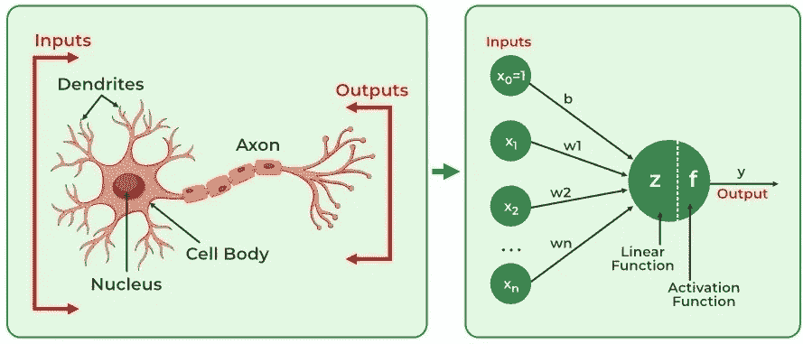

图 3.2：生物神经元与人工神经元之间的类比。9

### 1. 神经网络的重要性

神经网络对于识别细微模式、解决困难问题以及适应不断变化条件至关重要。它们从海量数据中学习的能力是革命性的，影响了自动化决策、自动驾驶汽车和自然语言处理等技术。

神经网络在各个领域提高了生产力、促进了决策并简化了流程。作为人工智能的基础，它们继续推动创新并影响技术的发展方向。

### 2. 神经网络架构中的层

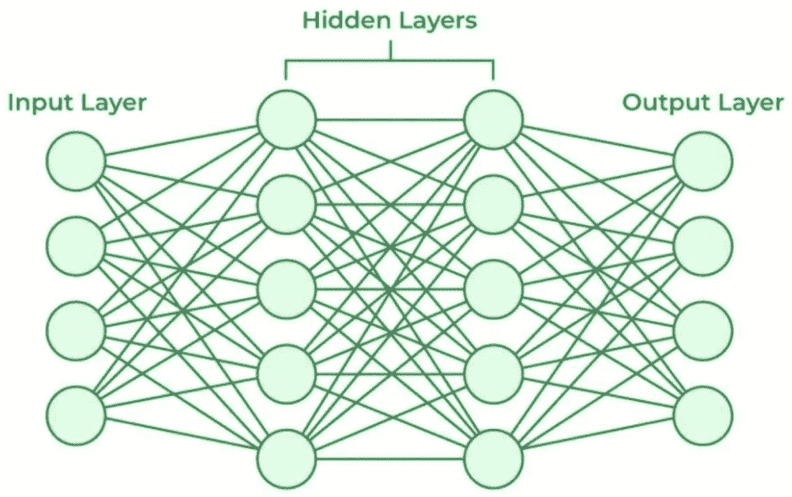

图 3.3：神经网络架构中的层。10

神经网络架构的层级如下：

1. `Input Layer`：网络从此源获取输入数据。该层中的每个输入神经元代表输入数据中的一个特征。

2. `Hidden Layers`：大部分的计算骨干工作是由这些层完成的。神经网络中可能存在一个或多个隐藏层。构成每层的单元（神经元）将输入转换为输出层可以利用的格式。

3. `Output Layer`：模型的输出由最后一层生成。根据特定目标（例如分类、回归），这些输出具有不同的格式。

### 3. 神经网络的类型

有不同类型的神经网络可以实现。

1. `Feedforward Networks`：前馈神经网络是一种基础的人工神经网络设计，信息从输入到输出沿单路径流动。

2. `Multilayer Perceptron (MLP)`：MLP 由一个或多个隐藏层、一个输入层和一个输出层组成，是一种前馈神经网络。它使用了非线性激活函数。

3. `Convolutional Neural Network (CNN)`：卷积神经网络是专为图像处理开发的人工神经网络。卷积层用于从输入照片中自动提取层级特征，允许高效的图像分类和识别。

4. `Recurrent Neural Network (RNN)`：循环神经网络（RNN）是一种为序列数据处理设计的人工神经网络。由于它使用了反馈循环（允许信息在网络内部持续），因此适用于时间序列预测和自然语言处理等上下文依赖至关重要的应用。

5. `Long Short-Term Memory (LSTM)`：LSTM 是一种 RNN 类型，用于解决 RNN 训练中的梯度消失问题。通过记忆单元和门可以选择性地读取、写入和删除信息。

## 3.3 深度学习架构

随着计算能力、数据可用性和研究的提高，深度学习架构发生了巨大的变化。它们是人工智能（AI）的一项重大突破，灵感源于人类大脑中的神经网络，为机器人提供了改变生活的力量。尽管这些复杂，理解深度学习架构的关键组件可能会使过程变得更容易：

a) `Neurons`：神经元是神经网络的基础构建模块，以类似于大脑神经元的方式处理输入、分配权重并生成输出。

b) `Activation Functions`：这些因素决定了神经元是否激活。例如，`ReLU (Rectified Linear Unit)` 函数通过通过正输入值并对负输入输出零来激活神经元，从而影响神经元的响应。

c) `Weights` and `Biases`：用于设置激活阈值并影响输入特征重要性的适应参数。偏置为激活提供了最小条件，而权重显示了特征重要性。这些设置在训练过程中不断更改，以提高准确性。

d) `Loss Functions`：它们通过量化预期结果与实际结果之间的差异来指导训练过程。目标是减少这种差异，典型的损失函数包括`Cross-Entropy Loss` 和均方误差 `(MSE)`。

e) `Optimizers`：优化器对于微调模型参数至关重要，它们通过根据损失修改权重和偏置来减少损失并提高性能。流行的方法包括 `RMSprop`、`Adam` 和随机梯度下降 `(SGD)`。这些基本概念使得能够探索日益复杂的深度学习架构，在这些架构中，许多层的神经元协作解决挑战性问题。

让我们查看深度学习领域中一些流行且最重要的模型，每个模型都有特殊的优势和用途。

### 1. 循环神经网络 (RNNs)

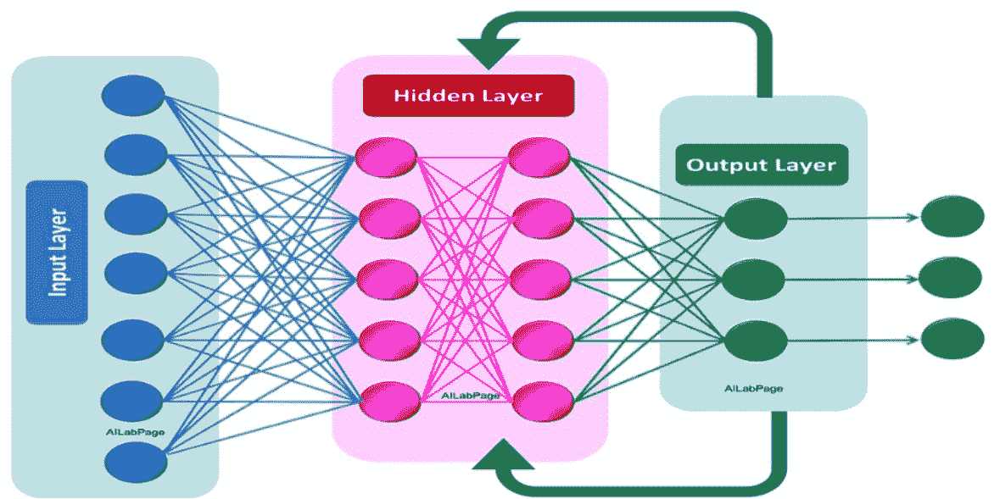

图 3.4：循环神经网络 (RNNs)。11

被称为 RNN 的基础深度学习架构设计用于处理序列输入。由于它们使用内部状态或内存来分析变长度的输入序列，因此它们非常适合语音识别等任务。RNN 在机器翻译、语音合成和自然语言处理（NLP）等信息顺序至关重要的领域特别有帮助。有两种流行的 RNN 类型：

#### 1. 双向 RNN

输出层通过正向和反向处理数据，同时接收来自过去和未来状态的信息。

#### 2. 深度 RNN

由于存在多个层，它们能够从数据中提取额外的层次信息。

### 3. 卷积神经网络 (CNNs)

Yann LeCun 从动物视觉大脑中获得灵感，首次开发了这种多层神经网络。架构最初用于邮政编码解释和手写字符识别等应用。卷积神经网络，或 `CNNs`，现在对于分类和图像处理至关重要。重要层包括：

1.  **卷积层**：使用卷积核提取特征，并添加 `ReLU` 激活函数以引入非线性。

2.  **池化层**：通过最大池化或平均池化在保持重要信息的同时降低维度。

3.  **全连接层**：将每个输入连接到每个神经元以完成分类。

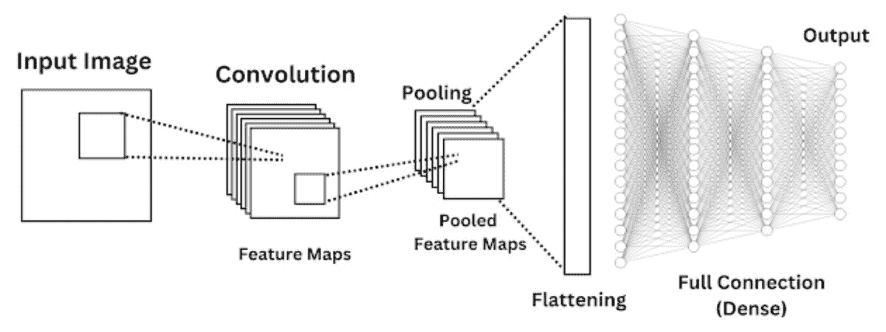

图 3.5：CNN 架构。

`CNN` 的功能通过额外的组件得到改进，例如用于避免过拟合的 `dropout` 层和用于输出归一化的 `softmax` 激活。由于在目标识别、人脸识别、医学成像、自然语言处理等应用中卓越性能，`CNNs` 在许多不同领域至关重要。

### 4. 长短期记忆 (LSTM)

Hochreiter 和 Schimdhuber 在 1997 年开发了 `LSTM`，作为一种 `RNN` 架构在各种应用中越来越受欢迎。`LSTMs` 是复杂的 `RNNs`，通过捕捉序列数据中的长期关系克服了传统 `RNNs` 的缺点。重要特征包括：

1.  **记忆单元**：长期信息保留，用于捕捉序列数据中的依赖关系和上下文。

2.  **门**：为了确保信息的有效保留和丢弃，通过三个门——输入门、遗忘门和输出门——控制数据进入和离开记忆单元。

3.  **梯度消失问题**：`LSTMs` 通过随时间保持稳定的误差流，有效地学习长期依赖关系。

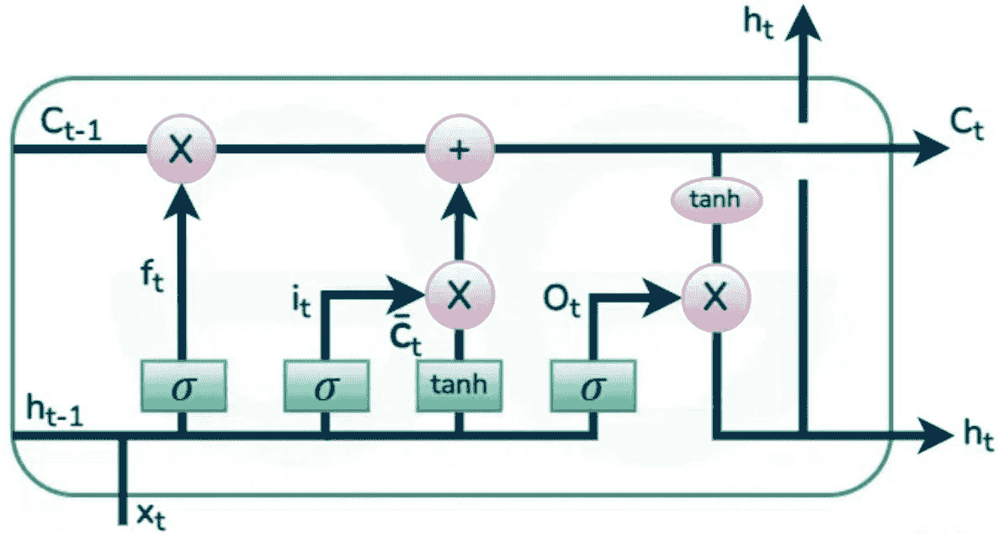

图 3.6：LSTM 工作原理。 [12

### 5. 门控循环单元 (GRU)

`GRUs` 是 `LSTMs` 的一种计算更高效且简单的形式，改进了长期依赖建模。重要特征包括：

1.  **门控机制**：网络中的信息流由两个门管理：更新门和重置门。更新门控制应保留或丢弃的数据百分比，而重置门控制何时重置内部状态。

2.  **简单性**：`GRUs` 适用于时间序列预测、语音识别和自然语言处理 (`NLP`) 等应用，因为它们参数更少且训练更快。

### 6. ResNet (残差网络)

`ResNet` 是一种著名的深度学习架构，使用残差模块创建非常深的网络。主要进展包括：

1.  **残差模块**：为了缓解梯度消失问题，要么对输入执行一系列函数，要么完全跳过该步骤。

2.  **SGD**：使用可接受的初始化函数和普通随机梯度下降。

3.  **预处理**：在输入网络之前，将输入分成不同的块（patches）。

### 7. 生成对抗网络 (GANs)

`GANs` 学习并生成与原始数据集相似的新数据，使其成为生成性任务的有效模型。基本组件包括：

1.  **生成器**：旨在通过从随机输入生成新的数据实例来真实的结果。

2.  **判别器**：作为分类器，区分生成数据和实际数据。

3.  **对抗训练**：`discriminator` 和 `generator` 同时进行并行和竞争性训练。应用包括基于文本的图像创建、虚拟现实和图像生成。条件 `GANs` (`cGANs`) 通过根据辅助信息生成数据来提高特定性。

### 8. Transformer 架构

`transformers` 是 Vaswani 等人于 2017 年提出的革命性编码器-解码器架构。与传统的 `RNNs` 不同，`Transformers` 使用自注意力机制评估序列不同部分的相对相关性，实现了更快的训练和并行处理。应用包括：

1.  **NLP 任务**：情感分析、文本摘要和机器学习。

### 9. 深度信念网络 (DBN)

`DBNs` 是由多层受限玻尔兹机 (`RBMs`) 组成的深度信念网络。它们可用于生成建模和无监督学习。

### 10. 深度卷积网络 (DCN)

`DCNs` 是一种人工神经网络类型，使用多个卷积层从数据中学习层次特征。

小批量梯度下降（Mini-batch gradient descent）类似于`stochastic gradient descent`；然而，它利用一组固定大小的样本来计算梯度，而不是依赖单个样本。其更新规则与`SGD` 一致，不同之处在于梯度在批量中进行了平均。这具有减少更新中噪声并增强收敛的潜力。

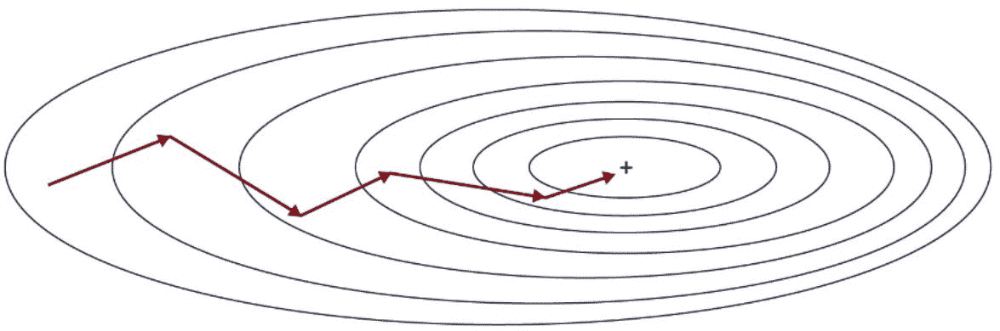

图 3.11：小批量梯度下降。

### 5. Adagrad

一种名为`Adagrad`的优化算法为每个参数采用了自适应学习率。学习率根据历史梯度信息进行调整，使得频繁更新的参数其学习率减小，而更新频率较少的参数学习率则增加。更新规则可以表示如下：

```
g=∇ θ L ( θ ; i ) ; y ( i ) )
G= G + g ⊙ g
θ= θ − α/G + ϵ ⊙ g
```

其中

* `G` 是累积梯度平方的矩阵，

* `ϵ` 是为了避免除以零而添加的小常数。

### 6. RMSProp

`RMSProp` 类似于`Adagrad`的优化算法；但它采用梯度的指数衰减平均而不是求和。这有助于减少学习率的持续下降。更新规则可以表示如下：

```
g=∇ θ L ( θ ; i ) ; y ( i ) )
G= β ⋅ G +(1− β )⋅ g
θ= θ − α/G + ϵ ⊙ g
```

其中

* `G` 是累积梯度平方的矩阵，

* `ϵ` 是为了避免除以零而添加的小常数，

* `β` 是衰减率超参数。

### 7. AdaDelta

`AdaDelta`是一种类似于`RMSProp`的优化算法，但不需要学习率超参数。相反，它利用梯度及其平方的指数衰减平均来建立更新尺度。更新规则可以表示如下：

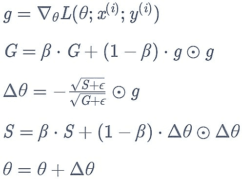

其中

* `G` 和 `S` 分别是累积梯度及其平方的矩阵，

* `ϵ` 是为了避免除的小常数。

### 8. Adam

`Adam`（自适应动量估计）这种优化方法将`SGD`的动量概念与`RMSProp`相结合。类似于`RMSProp`，它通过对梯度及其平方进行指数平均来确定更新尺度。此外，使用了动量项来帮助优化器更有效地导航损失函数。


其中

* `m` 和 `v` 分别是动量和速度向量，

* `β1` 和 `β2` 是动量和速度的衰减率。


## 3.5 深度学习中的挑战

深度学习具有巨大的前景，但存在一些障碍阻碍其有效使用。开发可靠有效的模型需要解决这些问题。以下是深度学习中的主要挑战：

### 1. 过拟合与欠拟合

平衡模型复杂度使其在应用于新数据时表现良好可能是困难的。当模型过于复杂并包含了训练数据中的噪声时，就会出现过拟合现象。过于简单且错过了底层模式的模型被称为欠拟合。

### 2. 数据质量与数量

深度学习模型的训练需要大型、高质量的数据集。不足或劣质的数据可能导致预测不准确和模型失败。大型数据集的获取和标注可能是昂贵且耗时的。

### 3. 计算资源

深度学习模型的训练需要大量的计算力和资源。对于许多组织来说，这可能是昂贵且无法实现的。为了处理这些计算，通常需要高性能硬件如 `GPUs` 和 `TPUs`。

### 4. 可解释性

深度学习模型通常是“黑箱”，意味着很难理解它们是如何得出结论的。这种透明度的缺失可能是问题的，特别是在关键应用中。为了实现问责和信任，理解决策过程至关重要。

### 5. 超参数调优

确定模型的最佳超参数值需要技巧。这个过程可能需要大量的计算和时间。模型的性能受超参数的影响，需要仔细调整。

### 6. 可扩展性

一个重大障碍是将深度学习模型扩展到能够有效管理大数据和挑战性任务。为了确保模型在实际情况下正常运行，通常需要大量的修改。为了处理负载，需要优化基础设施和算法。

### 7. 伦理与偏差问题

深度学习算法可能会无意中捕捉并强化训练数据中的偏差。这可能导致伦理问题和不公正的结果。为了让模型被接受并视为可靠，必须解决偏差并确保公平。

### 8. 硬件限制

深度学习模型训练需要大量的计算资源，如高性能 `GPUs` 或 `TPUs`。对于研究人员和从业者来说，获得此类设备可能是一个障碍。

### 9. 对抗攻击

深度学习算法容易受到对抗攻击，即输入数据的微小变化就会导致分类错误。对此类攻击的鲁棒性在关键应用中仍然是一个主要问题。

# 第 4 章：生成模型

## 学习目标

本章探讨了生成模型，将其与判别模型区分，并引入了隐变量、贝叶斯方法。它深入探讨了生成式 AI 的数学基础。

## 4.1 为什么使用生成模型？

生成模型使用统计和概率技术结合人工智能（`AI`），生成观测事件或目标变量的表示或抽象。然后可以使用这些表示产生与观测数据相似的新数据。

计算机通过在无监督机器学习（`ML`）中使用生成建模来表征数据中的事件，从而理解真实世界。从模型数据中，这种 AI 理解可以用来推断关于主题的广泛概率。

### 1. 生成模型的工作原理

神经网络通常用于运行生成模型。通常，需要一个数据集来构建生成模型。在训练期间，从数据集中提取若干实例输入模型，并更改其参数以更好地拟合数据分布。

一旦模型训练完成，就可以对其学习分布进行采样。生成的数据可能与原始数据集相似，但可能包含一些噪声或变化。

### 2. 生成模型的类型

常见的生成模型类型如下：

#### a) `Generative Adversarial Network (GAN)`

# 引言

深度神经网络和机器学习是这一概念的基础。它涉及到两个不稳定神经网络——`discriminator`（判别器）和 `generator`（生成器）之间的竞争，以提供更逼真的数据和预测。

一种名为 `GAN` 的无监督学习方法能够自动发现并学习输入数据中的各种模式。图像到图像的转换（将白天照片转换为夜间照片）是其主要应用之一。此外，`GANs` 还被用于生成各种物品、人物场景的极其真实的表示，这些内容甚至连人脑都难以分辨它们是伪造的。

#### 变分自编码器 (VAEs)

`VAEs` 是基于神经网络自编码器的生成模型，自编码器由 `encoders`（编码器）和 `decoders`（解码器）两个不同的神经网络组成，这类似于 `GANs`。它们是创建生成模型最有效且实用的方法。

`VAE` 是一种基于贝叶斯推断的概率图模型，旨在理解训练数据的底层概率分布，以便从该分布中快速采样出新数据。`VAEs` 中的 `encoders` 寻求更好地表示数据，而 `decoders` 则更有效地重建原始数据集。`VAEs` 经常用于信号处理、安全分析和用于预测维护的异常检测。

#### 自回归模型

自回归模型可以轻松地适应一系列时间序列模式，并根据之前的值预测未来值。这些模型使用序列历史值的线性组合来预测其未来值。

预测和时间序列研究（包括股价和指数值）经常使用自回归模型。其他用例还包括天气趋势的建模和预测、根据历史销售数据预测产品需求，以及研究犯罪和健康的影响。

#### 贝叶斯网络

`Bayesian networks` 是变量之间概率交互的图化表示。在因果关系知识至关情况下，它们表现非常好。例如，在医学诊断中，根据观察到的症状，`Bayesian network` 可以有效地确定疾病的概率。

#### 扩散模型

`diffusion models` 逐渐引入噪声，随后学习反转这一过程，从而生成数据。

它们对于理解现象的演变至关重要，并且对于检查传染病在人群中的传播或谣言在社交网络中的传播等场景非常有帮助。

#### 受限玻尔兹曼机

`RBMs` 是具有两层的神经网络，可以学习输入数据的概率分布。它们被用于推荐系统，利用用户偏好在流媒体平台上提供电影。

#### 像素递归神经网络

`PixelRNNs` 是旨在用于图像生成应用的一种生成模型。它们经过专门训练，通过逐像素对图像进行建模，以生成与训练数据中匹配的新图像。它们基于递归神经网络的思想。

#### 马尔可夫链

被称为 `Markov chains` 的生成模型忽略之前的状态，仅根据当前状态预测未来状态。在文本生成中，它们经常被用于根据正在使用的单词预测短语中的下一个单词。

#### 归一化流

这些生成模型通过将基础的、易于采样的概率分布（如 `Gaussian distribution`）转换为更复杂的分布来描述现实世界的数据。

`normalising flows` 的主要目标是对基础分布应用一系列可逆变换，以产生一种接近目标数据分布的分布。

## 4.2 生成式模型与判别式模型

在机器学习中，了解生成模型和判别模型之间的区别至关重要。生成模型（如 `Generative Adversarial Networks (GANs)`）专注于创建新数据。而判别模型（如 `Support Vector Machines (SVMs)` 和 `Logistic Regression`）则学习区分类别。

### 生成模型

被称为“生成式 AI”的人工智能（AI）子领域致力于制作原创内容，如散文、音乐和图形。生成模型是一种寻求理解底层分布和模式的机器学习模型。在从数据中学习后，它可以产生与原始数据相似的新实例。这被称为 AI 训练。

### 判别模型

条件模型（也称为判别模型）是另一种具有多种应用的机器学习模型。分类问题是判别式 AI 的典型说明。一个常见的例子可能是垃圾邮件过滤器。邮件被分类为垃圾邮件与否取决于邮件结构、发送者信息和所使用的关键词等因素。判别式 AI 通过独特的机制运行，主要涉及所使用的算法和训练过程。首先，使用标记数据来训练这些模型。分配给每个数据点的特定类别标识指示了它们各自的类别。

### 3. 比较总结

下表简要总结了生成模型和判别模型之间的主要区别和相似之处。它概述了它们的每个方面：

| 方面 | 生成模型 | 判别式模型 |
| :--- | :--- | :--- |
| **目标** | 学习数据的联合概率分布 | 学习给定数据的目标的条件概率 |
| **重点** | 生成新的数据样本 | 基于数据进行预测/分类 |
| **训练方法** | 通常是无监督学习 | 通常是监督学习 |
| **应用用例** | 图像生成、文本生成、数据增强 | 分类、回归、序列标注 |
| **关键算法** | `VAEs`, `GANs` | `CNNs`, `RNNs`, `SVMs` |
| **优点** | 能够创建新数据，捕捉数据分布 | 精确的预测，高效的训练 |
| **缺点** | 需要大量数据集，模式崩溃（在 GAN 中） | 对数据分布的理解有限，可能会过拟合 |
| **在深度学习中的应用** | 数据生成、异常检测 | 分类、回归 |

## 4.3 隐变量

简单来说，隐变量是影响观测数据的不可观测或隐藏的变量。这些变量是通过数学模型推断出来的，这些模型将它们与可观测数据连接起来，而不是通过显式量化来实现。例如，考虑“智能”这一概念。考试分数、解决问题的能力和决策技能等可衡量指标可以用于推断智能，即使这些特征无法被直接观察或评估。在这种情况下，智能就是一种隐变量。

### 1. 隐变量的类型

通常情况下，隐变量分为两类：

#### 1. 连续隐变量

这些是不可观测但具有连续值的变量。几个例子包括健康、智力或社会经济地位。在 `因子分析` 和 `高斯混合模型 (GMM)` 等概率模型中，连续隐变量经常被用于机器学习。

#### 2. 分类隐变量

这些不可观测变量表示离散的类别或分组。例如，一个人的性格类型（外向、内向）或情绪（快乐、悲伤和中立）可能被视为分类隐变量。如 `隐马尔可夫模型 (HMM)` 和 `潜在类分析 (LCA)` 等模型经常采用这类变量。

### 2. 隐变量在建模中的重要性

在许多领域，隐变量是关键的，因为它们让复杂的模型更容易理解，并揭示了观测数据背后的模式。隐变量在许多关键领域具有重要性，包括：

#### 1. 心理测量学

隐变量用于教育和心理测试，以确定性格特征、动机、焦虑和智能水平。例如，`IQ` 测试中的隐变量表示从不同任务的表现中推断出的智能程度。

#### 2. 社会科学

研究人员使用隐变量检查社会地位、态度和信念等复杂概念。在社会科学中，结构方程建模（`SEM`）是一种广泛使用的技术，用于利用隐变量检查可观测因素与不可观测因素之间的联系。

#### 3. 机器学习

隐变量用于无监督学习模型，如 `主成分分析 (PCA)`，以捕捉高维数据（如文本或图像分析）中的底层特征或维度。隐变量对于深度学习至关重要，因为它们有助于在 `自动编码器` 和 `变分自动编码器 (VAEs)` 中表示输入数据的压缩表示。

#### 4. 经济学

在经济建模中，隐变量描述了那些无法立即量化但影响可观测经济行为的概念，例如消费者偏好或市场情绪。

### 3. 使用隐变量的好处

采用隐变量的主要优势如下：

#### 1. 简化复杂模型

研究人员和数据科学家可以通过隐变量识别数据中复杂相互作用的底层模式。这降低了数据的复杂性，并产生了更容易理解的模型。

#### 2. 提高模型准确性

包含隐变量的模型通过考虑隐藏因素，通常能提供更准确的估计或预测。

#### 3. 理论洞察

隐变量对无法测量的抽象概念提供了更好的理解。

## 4.4 贝叶斯方法

一组被称为贝叶斯机器学习（`BML`）的方法和算法使用贝叶斯原理来描述数据的不确定性。这些技术是有用的工具，改变了机器人从数据中学习的方式；它们不仅仅是理论概念。为了计算条件概率——在给定另一个事件发生的情况下某个事件发生的概率——`BML` 从根本上使用了 `贝叶斯定理`。这一统计基础允许 `BML` 提供基于概率支持的断言，而不仅仅是有经验的猜测。

### 1. 概率编程

在 `BML` 中，概率编程是至关重要的，因为它是统计理论与计算机应用之间的桥梁。它使数据科学家能够通过带有丰富概率语义的模型简化复杂的贝叶斯推断过程。贝叶斯推断介绍了这类能够优雅且快速处理 `BML` 复杂性的工具的重要性。

### 2. 概率图模型

`BML` 在概率图模型领域表现出色，该模型允许数据中的依赖关系以可视化且易理解的方式表示。这些模型是强大的，因为它们在捕捉数据结构核心的基础上，还能实现基于预测和结论。

### 3. 贝叶斯程序学习 (BPL)

贝叶斯程序学习通过允许计算机在提供的数据之外进行推断，推进了 `BML`。想象新的可能性以帮助学习过程，类似于为系统提供基于统计似然性的想象。以下三个组件对贝叶斯分析至关重要：

#### 1. 先验 (Prior)

在考虑新信息之前的原始观点。

#### 2. 似然 (Likelihood)

在不同理论下看到新证据的概率。

#### 3. 后验 (Posterior)

根据新信息修正后的信念。


### 5. 常见贝叶斯模型

`BML` 的支柱是贝叶斯网络、高斯过程和狄利克雷过程。数据科学家使用这些各具独特能力的模型作为构建模块，创建能够解决各种问题的复杂学习系统。

### 6. 马尔可夫链蒙特卡洛 (MCMC) 方法

`BML` 依赖马尔可夫链蒙特卡洛技术来克服推理中的计算困难。`MCMC` 技术允许通过从复杂分布中采样，对直接计算不切实际的后验分布进行近似，特别是在数据维度增加的情况下。

### 7. 贝叶斯超参数优化

在机器学习中，超参数优化是一个至关重要的阶段，而贝叶斯方法增加了传统技术无法比拟的复杂度。通过将超参数调优视为贝叶斯推理问题，它为效率和性能提升提供了新的机会。

## 4.5 数据模拟

数据模拟是创建与真实数据特征和属性相似的人工数据的过程。得益于模拟数据，数据科学家、工程师和商业企业可以以极低的成本获取训练数据，这些数据是使用数学或计算模型产生的，而不是通过问卷、监控软件或网页爬取。

### 1. 数据模拟特征

复杂系统在应用到真实数据之前，可以使用模拟数据进行测试和验证。在理想情况下，模拟数据可用于验证分析系统的准确性和质量，因为它是全面的，且很少包含错误或缺失。虽然这一切可以通过真实数据完成，但数据模拟的成本要低得多，并且不涉及管理和保留用户数据时带来的伦理和监管问题。

除了成本之外，数据模拟由于多种原因吸引了处理数据的人员、团体和企业。可以使用三个主要类别来评估其特征：可重复性、可扩展性和灵活性。

#### 1. 灵活性

由于数据是人工的，它可以被修改以复制各种情况和环境，而不受道德限制，从而对系统进行更详细的检查。这对于评估预测和大规模模拟模型非常有帮助。它也有助于复杂的数据可视化，能够在极端的情况下进行准确性测试。

#### 2. 可扩展性

在训练 AI 和机器学习模型时，数据量与数据质量同样重要。由于模拟数据是虚假的，它可以进行扩展以模拟真实系统的复杂性和不可预测性，增加了其在此类用例中的实用性。

#### 3. 可重复性

为了保证测试的一致性，可以在备用模拟数据集中复制相似的情况和设置。可以频繁对模型和假设进行测试并根据发现进行改进，这使得一致性对于验证至关重要。

### 2. 数据模拟的优势

数据模拟只是公司管理数据更广泛工具箱中的一种工具。根据用例的不同，以下是用其替代真实数据的一些最流行的优势：

#### a) 增强决策

数据模拟可以辅助决策，它模拟不同的情景或事件，并根据行动预测结果。这为推测性情况提供了明示，能够为每种情况开发适当的程序。

#### b) 成本效益

使用数据模拟比收集数据更经济，因为它消除了对主动收集数据和物理测试的需求。通过模拟各种情况并跟踪其结果，可以获得重要的见解，而无需昂贵且耗时的数据收集程序。

#### c) 提高模型有效性

数据模拟可以促进模型的测试和改进。构建真实系统的虚拟模型允许对许多模型进行测试，并根据结果进行后续改进，从而产生更精确、更擅长对未来做出详细预测的模型。

#### d) 降低风险

通过数据模拟可以获取有关危机和可能问题的数据，使组织能够在问题在现实世界出现之前看到问题或障碍。这种洞察可以降低风险并帮助你避免昂贵的错误。

### 3. 数据模拟模型的类型

数据模拟模型多种形式，每种都有特殊的属性和功能。以下列出常见的：

#### a) 蒙特卡洛模拟

这种模拟通常用于工程、科学和金融，建模复杂系统并预测行为。它利用随机采样为不确定的情况提供结果。

#### b) 基于代理的建模

它对分析复杂系统特别有用，因为单个组件的行为会影响系统的整体行为。这种模拟关注数据系统内部单个自主代理的动作和交互。

#### c) 系统动力学

系统动力学通常用于公共政策、环境科学和经济学，建模并预测复杂系统的行为，有助于理解日益复杂的系统中的非线性反馈循环。

#### d) 离散事件模拟

为了模拟过程和系统，这些模型专注于特定的系统事件及其对最终结果的影响，用于计算机科学、运筹学和物流。

# 第 5 章：生成式 AI 技术

## 学习目标

本章讨论了变分自编码器、GAN、Transformer 和扩散模型等先进技术，展示它们对现代 AI 应用的影响。

## 5.1 变分自编码器

变分自编码器（VAEs）是利用深度学习消除噪声、识别异常和创建新材料的生成模型。

VAE 与扩散模型和生成对抗网络（GANs）等其他生成式 AI 算法几乎同时出现在 2013 年。然而，它们早于基于路径语言模型、生成式预训练 Transformer（GPT）家族以及来自 Transformer 的双向编码表示（BERT）的大语言模型。

VAE 是信号分析的绝佳选择，用于分析 IoT 数据流、EEG 等生物信号或金融数据馈，因为它们非常适合创建训练其他 AI 算法的合成时间序列数据。

VAE 也适用于开发视频、图像和文本。然而，在创建各种类型的内容时，它们可能与 Transformer 模型、稳定扩散（扩散模型的改进）以及 GAN 等模型协同工作。

与 GAN 类似，VAE 也整合了两个类神经网络。但 VAE 和 GAN 的运行方式不同。在 VAE 语境中，一个网络确定了更有效的方法将未处理的输入编码到潜空间，而第二个网络（称为解码器）确定了从这些表示中开发新内容的更有效方法。GAN 使用两个神经网络：一个用于改进虚假内容生成，另一个用于更好的虚假内容检测。

### 1. VAE 的工作原理

通常，所有的自编码器都是能够学习数据的神经网络。自编码器由一个用于从压缩片段中重建原始数据的 `decoder`（解码器）和一个用于将输入数据分解为较小组件的 `encoder`（编码器）组成。构建得当的自编码器将提供高度准确的解码器输出并重构数据。因此，信息是以非常精炼的方式获取的。

通过在编码过程中引入概率特征，`VAE` 扩展了自编码器的基础。引入“变分”（variational）一词到自编码器的词汇表中，是为了反映这些概率能力。本质上，`VAE` 可能会在编码过程中创建一个更广泛的数据分布，然后在解码时从该更广泛的数据中进行抽样。


得益于这些额外的能力，`VAEs` 能够模拟生成过程。此外，它允许 `VAEs` 在保持训练数据集代表性的同时，生成以前无法获得的数据。下面列出的四种基本行为有助于理解 `VAEs`：

1. 训练数据教会 `VAE` 识别关键组件。这是编码的行为。
2. 使用训练数据的关键组件，`VAE` 重建原始数据。这是解码的行为。
3. 通过在编码端包含概率特征（如 `inference` 推理），`VAE` 可以从编码样本中生成各种数据输出。这种机制是生成性的。
4. `VAE` 通过将这些复杂的生成输出重新编码回学习和编码数据的潜在空间，高效地使 `VAEs` 能够执行如无监督学习等任务。

## 2. 变分自编码器的架构

变分自编码器 (`VAEs`) 与传统自编码器的不同之处在于它们基于编码器-解码器设计。编码器网络将未处理的输入数据转换为潜在空间的概率分布。

由于编码器产生的是概率潜码，`VAE` 可以描述一系列可能的表示，而不仅仅是潜在空间中的某一点。

从潜在分布中抽样的点随后由 `decoder` 网络重构回数据空间。为了减少重构损失（即输入数据与解码输出之间的差异），模型在训练期间会优化 `encoder` 和 `decoder` 参数。除了实现准确重构外，目标是对潜在空间进行正则化，使其遵循预定的分布。

重构损失和正规化项（通常用 Kullback-Leibler 散度表示）是整个过程中必须仔细平衡的两个关键元素。重构损失强制模型正确重建输入，而正规化项通过鼓励潜在空间遵循所选分布来防止过拟合并促进泛化。

`VAE` 通过在训练期间反复修改这些参数，学习将迁入数据转换为有意义的潜在空间表示。这种优化的潜码使得准确重构成为可能，它捕捉了数据的根本特征和结构。得益于潜在空间的概率特性，还可以从学习得的分布中选择随机点来生成新样本。

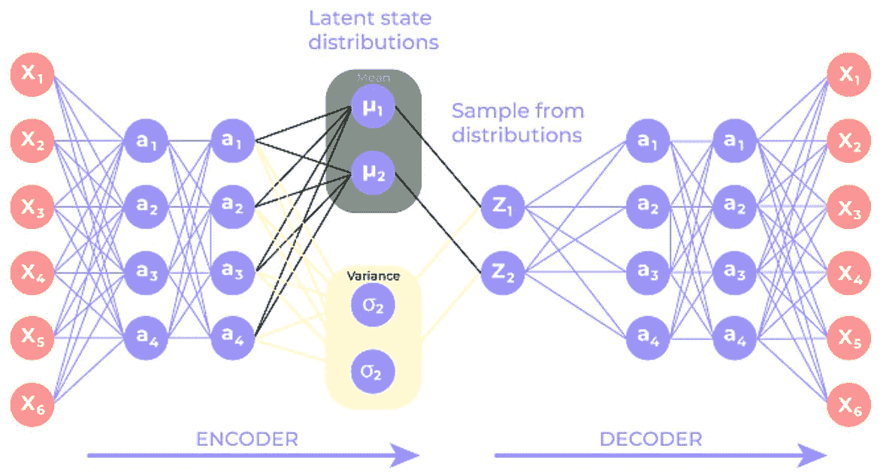

图 5.1: `VAE` 架构。[ [19]](#text00015.html#_ftn19)

## 3. 变分自编码器的用途

`VAEs` 的三个主要目标是生成新数据、发现现有数据中的异常以及消除不理想或噪声数据。尽管这三个特征看起来并不显著，但它们使得 `VAEs` 能够许多强大的应用，包括：

a) 文本创建：`VAEs` 能够在保持训练数据集代表性的同时生成新数据。在数据稀缺的情况下，这简化了开发过程。

b) 图像创建：`VAEs` 能够在保持训练数据集代表性的同时生成以前无法获得的数据。在数据稀缺的情况下，这简化了开发过程。

c) 视频创建：由于这些额外的能力，`VAEs` 能够模拟生成。此外，它允许 `VAEs` 在保持训练数据集代表性的同时生成以前无法获得的数据。

d) 语言处理：`VAE` 通过将这些复杂的生成输出重新编码回学习和编码数据的潜在空间，高效地使 `VAEs` 能够执行如无监督学习等任务。

e) 异常检测：`VAE` 通过在训练期间反复修改这些参数，学习将迁入数据转换为有意义的潜在空间表示。准确重构通过此……

f) 合成数据创建：软件工程师使用 `VAEs` 来创建人工数据。在数据稀缺的情况下，这简化了开发过程。

## 5.2 生成对抗网络 (GANs)

变分自编码器 (`VAEs`) 与传统自编码器的不同之处在于它们基于编码器-解码器设计。编码器网络将未处理的输入数据转换为潜在空间的概率分布。

由于编码器产生的是概率潜码，`VAE` 可以描述一系列可能的表示，而不仅仅是潜在空间中的某一点。

从潜在分布中抽样的点随后由 `decoder` 网络重构回数据空间。为了减少重构损失（即输入数据与解码输出之间的差异），模型在训练期间会优化 `encoder` 和 `decoder` 参数。除了实现准确重构外，目标是对潜在空间进行正则化，使其遵循预定的分布。

![Image00026.jpg)

图 5.2: `VAE` 架构。[ [20]](#text00015.html#_ftn20)

这两个网络玩着永不停歇的猫鼠游戏，生成器变得越来越擅生成数据，而判别器变得越来越擅长伪造。这种对抗方法随着时间的推移产生高质量的数据。

### 1. GAN 的架构


图 5.3: GAN 的架构。[ [21]](#text00015.html#_ftn21)

生成器和判别器神经网络通过对抗训练同时训练，形成生成对抗网络。

1. 生成器：该网络从随机噪声生成数据（如图片）。其目标是产生与真实数据相似的数据。
2. 判别器：该网络努力区分真实数据和生成器产生的数据。它输出提供数据准确的概率。

### a) 基础 GAN：这是所有 GAN 中最基础的一种。它使用 `stochastic gradient descent`（一种通过逐个遍历每个样本来学习整个数据集的技术），其算法尝试优化数学方程。它由一个判别器和一个生成器组成。判别器和生成器是简单的多层感知器，用于创建和分类生成的图像。生成器负责收集数据分布，而判别器旨在确定输入属于某一类别的概率。

### b) 条件 GAN：这种 GAN 通过添加类别标签，使得可以使用新颖且有针对性的信息对网络进行约束。为了帮助网络学习区分它们，在 GAN 训练期间，会将照片连其真实名称（如“玫瑰”、“向日葵”或“郁金香”）一起给予网络。

### c) 深度卷积 GAN：深度卷积神经网络生成可以区分的高分辨率图像。`Convolutions` 是一种从产生的数据中提取重要信息的方法。它们在处理图像时特别有效，能够让网络快速吸收重要信息。

### d) 自注意力 GAN：这种 GAN 结合了残差连接的自注意力模块，使其成为深度卷积 GAN 的变体。这种注意力驱动的架构不受限于空间局部区域；它可以利用来自所有特征位置的信号构建细节。其判别器还可以维持图像中距离较远的特征之间的一性。

### e) CycleGAN：最流行的 GAN 架构，通常用于学习如何在不同形式的图像之间转换。例如，可以训练一个网络将图片从马变为斑马，或从冬季变为夏季。`FaceApp` 是 `CycleGAN` 最著名的用途之一，它可以将人脸转换为不同的年龄层。

### f) StyleGAN：2018 年 12 月，Nvidia 研究人员发布了 `StyleGAN`，它对初始生成器架构模型提出了重大改进。用户能够修改模型来更改 `StyleGAN` 生成图像的特征，该模型能够生成写实且高质量的人脸照片。

### g) 超分辨率 GAN：使用这种 GAN 可以低分辨率图像转换为更详细的图像。超分辨率 GAN 通过填充模糊区域来提高图像分辨率。

### h) 拉普拉斯金字塔 GAN：这种 GAN 通过结合多个生成器和判别器网络，利用拉普拉斯金字塔的不同层创建一个间隔为一个八度的带通图像的线性图像，从而实现高图像质量。

## 5.3 Transformers

一种名为 `Transformer` 的神经网络架构被用于执行机器学习任务。2017 年，Vaswani 及其同事发表了一名为《Attention is all you need》的论文，引入了 `transformers` 架构。文章探讨了 `transformers` 的设计、功能和用途。

`Transformer` 是一个采用 `self-attention` 来转换整个句子的模型。

### 1 Transformers 的用例

大型 transformers 可以在包括人类语言在内的各种类型上进行训练。以下是几个说明用例：

#### a) 自然语言处理

得益于 `transformers`，机器现在能够理解、解释和生成文本。这种架构也用于 `Alexa` 等虚拟助手。

#### b) 机器翻译

翻译应用利用 `transformers` 提供实时翻译。与早期的技术相比，翻译的流畅性和准确性显著提高。

#### c) DNA 序列分析

通过将 DNA 视为序列，`transformers` 能够预测突变的影响。这种能力对于医疗健康至关重要。

#### d) 蛋白质结构 `Transformer` 模型具有处理序列数据的能力，对于蛋白质结构和药物发现特别有效。

### 2. Transformer 架构的组件

Transformer 神经网络架构由产生最终输出的多个层组成。插图展示了组件：


组件包括：

#### a) 输入嵌入 (Input Embedding)

此阶段将输入序列转换为软件算法可以理解的数学格式。第一步是将输入序列划分为标记（tokens）集合或序列的独立组成部分。例如，当输入是一个句子时，标记代表单词。嵌入过程随后将标记序列转换为数学向量序列。这些向量包含了语义信息也包含了句法信息，并以数字形式表示，其特征在整个训练过程中获得。

#### b) 位置编码 (Positional Encoding)

位置编码（Positional encoding）是 Transformer 架构中的关键元素，因为模型无法自然地处理特定顺序的序列数据。Transformer 需要一种方法来考虑输入中标记的顺序。位置编码为每个标记的嵌入提供额外信息，指示其在序列中的位置。这通常通过使用一组函数向每个标记的嵌入添加独特的位置信号来实现。通过位置编码，模型可以理解序列上下文并保持标记的顺序。

#### c) Transformer 块

标准的 Transformer 模型由多个呈堆叠排列的 Transformer 块组成。每个 Transformer 块由两个主要元素组成：“多头自注意力机制和逐逐位置的前馈神经网络”。自注意力机制允许模型评估序列中各种标记的重要性。在预测过程中，重点会放在输入的相关部分上。

例如，考虑短语“Do not tell lies”（不要撒谎）和“He lies”（他躺着/谎）。如果不考虑周围的词，就无法理解句子中 `lies` 词的含义。`speak` 和 `down` 等词对于理解准确含义至关重要。自注意力机制允许组织相关的标记以建立上下文。

前馈层包含额外的组件，这些组件增强了 Transformer 模型的训练和运行效率。每个 Transformer 块由以下组件组成：

1. 包围两个主要组件的连接起着捷径的作用。信息流从网络的一部分引导到另一部分，跳过了中间的某些操作。
2. 层归一化（Layer normalisation）将值（特别是网络内部各层的输出）保持在特定范围内，以确保模型的平滑训练。
3. 线性变换用于调整模型中的值，增强其在特定训练任务上的性能，例如用于文档摘要而非翻译。

#### d) 线性与 Softmax 块

模型最终需要做出特定的预测，例如选择序列中的下一个词。此时引入了线性块（linear block）。在最终阶段之前是一个全连接层，通常称为稠密层（dense layer）。通过一个学习到的线性映射将向量空间映射到原始输入域。这个关键层是模型决策组件将复杂的内部表示转换为特定的、可解释且可用的预测的地方。该层产生一组分数，通常称为 `logits`，对应于每个潜在的标记。

`softmax` 函数作为最后一步，将 logit 分数转换为归一化的概率分布。`softmax` 输出的每个组件都表示模型对特定类别或标记的置信水平。

## 5.4 扩散模型

颗粒从高浓度区域向低浓度区域扩散直到均匀分布的自然过程，是扩散模型的灵感来源。

扩散模型从数据开始并逐渐向其中引入噪声，在机器学习领域使用了类似的概念。为了成功消除噪声并重建数据或生成全新的、真实的副本，它们随后学习了反转这一过程。这种缓慢的转换产生了精细、详细且高质量的输出，有助于自动驾驶、医学图像以及生成真实的文本或图形等应用。

扩散模型的独特特征是其系统化的精炼过程，使其能够复制扩散的自然过程，并提供非常精确且微妙的结果。

### 1. 扩散模型的工作原理

训练一个神经网络向数据中引入噪声（正向扩散阶段），然后学习系统地反转这一过程，以检索原始数据或生成新样本。这就是扩散模型的工作原理。以下是构成扩散模型运行阶段的描述性总结。

#### a) 数据准备

在扩散过程开始之前，必须对训练数据进行适当准备。清理数据以消除异常、归一化特征以保持一致性、以及补充数据集以提供多样性（特别是对于图像数据）都是此类准备工作涉及的一些任务。标准化确保了正态分布，有助于高效管理噪声数据。对于不同类型的数据（如文本或图像），可能需要某些更改，包括修正数据类别的不平衡。为了让模型在使用时接收高质量输入、学习重要模式并提供真实的输出，必须对数据进行充分准备。

#### b) 正向扩散过程

基础分布（通常是 `Gaussian` 高斯分布）作为正向扩散过程的起点。然后，使用马尔可夫链（Markov chain）通过一系列可逆阶段逐步改变初始样本，每个阶段都会增加一些复杂性。为了让模型学习并复制目标数据中的复杂模式，这些修改逐渐加入了结构化噪声。这种方法展示了从基础输入开始如何产生丰富丰富的输出。

```
Image0029.jpg
```

数学公式：

令 `x0` 表示初始数据（例如图像）。正向过程通过以下方程生成该数据的一系列噪声版本 `x1`, `x2`……`xT`：

```
Diffusion Models: A Comprehensive High-Level Understanding
```

在这里，`q` 是正向过程，`xt` 是第 `t` 步正向传播的输出。`N` 是正态分布，`txt-1` 是均值，`t` 定义方差。

#### c) 反向扩散过程

反向扩散技术逐步消除噪声，试图将纯噪声转换为清晰的图像。为了让扩散模型能够从纯噪声重建图像，它必须经过训练以理解反向扩散过程。如果你熟悉 GAN，我们正在尝试训练生成器网络。主要区别是，扩散网络执行的任务更容易，因为它不需要一次性完成所有工作。该研究的作者确定，使用多个过程同时消除噪声时，训练更有效且更容易。

反向扩散的数学基础：

1. 马尔可夫链：使用扩散过程的马尔可夫链模型，每一步仅依赖于先前的状态。
2. 高斯噪声：消除（和引入）的噪声的均值和方差通常是高斯分布。

反向扩散过程旨在从最后一步的噪声数据 `xT` 中重建 `x0`。该过程通过条件分布建模：

```
Image0031.jpg
```

```
Image0032.jpg
```

其中：

* `μθ(xt,t)` 是模型预测的均值，
* `σθ2(t)` 是方差，它通常是 `t` 的函数，可以是学习到的或预定义的。

```
Image0033.jpg
```

在生成模型中，经常利用反向扩散过程，如图所示。该过程从噪声 `xT` 开始，通过时间步 `T` 到 `0` 迭代对图像进行去噪。在每一步 `t`，使用通过学习的模型 `p θ ( xt−1 ∣ xt )` 从带噪的输入 `xt` 预测出一个噪声稍低的版本 `xt−1`。

标记为 `q( xt ∣ xt−1 )` 的虚线表示正向扩散过程，而实线箭头 `p θ ( xt−1 ∣ xt )` 则代表被建模和学习的反向过程。

## 5.5 GANs：现代生成式 AI 时代的开启

生成对抗网络的核心由两个神经网络——生成器和判别器组成，它们在连续的反馈循环中运行。生成器的作用是创建与真实示例相似的新数据实例，而判别器则评估这些实例的真实性。这两个网络参与到动态竞争中，生成器试图产生日益可信的输出，而判别器不断完善其区分真实数据与生成数据的能力。随着时间的推移，这种对抗过程导致了高度真实内容的产生。

### 1. GANs 的演变与影响

自从诞生以来，GANs 经历了巨大的演变。最初，它们主要用于生成合成图像，但研究人员很快发现了它们在多个领域的巨大潜力。一些最著名的应用包括：

#### a) 图像与视频合成

GANs 使创建照片级的图像成为可能，某些与真实照片无异。DeepFake 技术等工具利用 GANs 操纵视频，创建无缝且高度可信的更改。在娱乐和媒体领域，GANs 在特效、数字角色创建甚至修复旧或受损的片段方面发挥了关键作用。

#### b) 艺术与创意

AI 生成艺术已成为一个迷人的领域，GANs 生成了挑战传统创意观念的卓越作品。2018 年，一件由 GAN 创建、名为《埃德蒙·德·贝拉肖》的作品以 432,500 美元的价格拍卖，展示了 AI 与美术艺术之间日益增长的交叉。GANs 也用于音乐作曲，帮助艺术家探索新的创作可能性。

#### c) 医疗与医学

医疗行业已发现 GANs 的广阔应用，特别是在医学影像和药物发现方面。GANs 可以生成高分辨率医学影像以辅助诊断，提高放射科的效率和准确性。此外，它们被用于模拟分子结构以进行药物研究，加速新药的开发。

#### d) 游戏与虚拟现实 (VR)

GANs 正通过增强游戏环境和角色动画的真实性来彻底改变游戏行业。它们还被用于程序化内容生成，即 AI 根据玩家交互动态创建游戏元素。这种应用延伸到了虚拟现实，GANs 为更具沉浸感和栩生的体验做出了贡献。

#### e) 金融与安全

在金融领域，GANs 用于欺诈检测和风险评估。通过生成合成金融数据，可以更有效地训练 AI 模型，以识别异常情况并防止欺诈交易。此外，它们被用于……

### 2. 挑战与伦理关注

尽管 GANs 展现了巨大的潜力，但它们并非没有挑战。一些关键挑战包括：

#### a) 伦理影响

GANs 生成深度伪造（deepfakes）的能力引发了关于隐私的争议。AI 生成内容的泛滥带来了……

#### b) 偏差与公平性

与其他模型一样，GANs 会继承训练数据中存在的偏差。确保 AI 生成内容的公平性需要……

#### c) 计算成本

训练高质量的 GANs 需要大量的能量，这使得它们……

#### d) 法律与版权问题

AI 生成内容的兴起引发了关于知识产权的问题。谁拥有 GAN 创建的作品品？

### 3. GANs 的未来

尽管存在这些挑战，GANs 的未来看起来是光明的。正在的研究旨在提高效率、减少偏差并开发……随着 GANs 的不断演变，它们可能会更无缝地集成到应用程序中……现代生成式 AI 的时代刚刚开始。

# 第 6 章：生成式 AI 中的机器学习

## 学习目标

本章探讨了机器学习如何通过提高模型性能、整合混合方法以及扩展现实世界应用来增强生成式 AI。本章还解释了……以应对各种挑战。

## 6.1 增强生成模型


# 生成模型增强与深度学习在生成式 AI 中的应用

## 1. 架构改进

改进生成模型始于完善其架构框架。一些进展包括：

### a) 引入注意力机制

注意力机制显著提升了生成模型的性能，特别是在文本和图像生成方面。通过允许模型关注输入数据的特定部分，它们改进了生成输出的连贯性和细节。`Transformers` 利用`自注意力机制`来捕捉长距离依赖，使得它们在语言生成方面非常有效。

### b) 混合模型架构

结合不同类型的生成模型可以产生更优的结果。例如，整合了 `GANs` 和 `VAEs` 的混合模型利用了 `VAEs` 的结构化潜在空间和 `GANs` 的对抗精炼，带来了更真实、更多样化的输出。同样，扩散模型通过引入基于 `Transformer` 的架构得到了增强，以实现更好的图像生成。

### c) 渐进式与分层生成

对生成过程进行分层允许模型逐步细化细节。在图像生成中，如 `StyleGAN` 等技术利用分层方法来控制图像的各个方面，从整体结构到细微细节。`GAN` 的渐进式增长（`ProGANs`）还增强了训练稳定性并提高了图像质量。

## 2. 训练优化

优化训练过程对于增强生成模型的性能至关重要。目前已经开发出多种方法来提高收敛性、稳定性和效率。

### a) 更好的损失函数

损失函数的选择显著影响生成模型的性能。虽然传统的 `GAN` 使用二分类交叉熵损失，但如 `Wasserstein loss` 等替代方案通过解决模式崩塌问题来提高训练稳定性。`VAE` 则受益于 `Kullback-Leibler divergence`，该散度确保了结构化的潜在表示。

### b) 数据增强与正则化

通过数据增强技术增强训练数据有助于模型具有更好的泛化能力。诸如`对抗训练`、`mixup` 和`对比学习`等数据增强策略可以精炼生成输出。包括`谱归一化`和`dropout`在内的正则方法可以缓解过拟合并稳定训练。

### c) 高效训练策略

诸如`课程学习`等技术（即模型从简单的任务开始，并逐渐过渡到更复杂的任务）可以提高性能。`迁移学习`（在特定数据集上对预训练模型进行微调）在保持高质量结果的同时也加速了训练。此外，`强化学习`已应用于生成模型，以动态优化输出质量。

## 3. 评估与微调

评估生成内容的质量对于改进生成模型至关重要。传统的评估指标如`均方误差`（`MSE`）往往无法捕捉输出的感知质量。目前出现了更先进的评估技术，包括：

### a) 感知指标

如`Fréchet Inception Distance`（`FID`）和`Inception Score`（`IS`）等指标通过衡量生成数据与真实数据分布之间的相似性，为生成模型提供更好的评估。`结构相似性指数`（`SSIM`）被广泛用于评估图像质量。

### b) 人评估

尽管自动化指标有用，但人类判断仍然是评估生成内容的金标准。众包评估和专家评估为真实性、连贯性和创意等方面提供了价值。

### c) 迭代微调

通过在特定数据集上进行微调来持续改进生成模型可以增强其适应性。诸如`基于人类反馈的强化学习`（`RLHF`）等技术使模型能够更好地符合人类偏好，提高在不同应用中的实用性。

## 6.2 混合方法

机器学习中的混合方法指的是整合多种技术以优化性能。在生成式 AI 的背景下，这些方法通常将深度学习与传统的机器学习模型或多种深度学习架构相结合。其目标是克服单一技术的局限性，创建更健壮、自适应且泛化性 AI 模型。

混合方法可以分为几类：

1. `集成学习`：结合多个模型以提高准确性。
2. `神经符号 AI`：将深度学习与符号推理相结合。
3. `神经进化方法`：使用进化算法优化神经网络。
4. `多智能体系统`：部署多个相互交互和协作的 AI 代理。
5. `迁移学习与少样本学习`：利用预训练模型增强生成式 AI。

每种技术都为生成式 AI 提供了独特的贡献，使其能够以更高的效率精度处理复杂问题。

### 1. 生成式 AI 中的集成学习

集成学习是一种广泛使用的混合方法，它通过结合多个模型的预测来增强整体准确性和鲁棒性。诸如`bagging`、`boosting` 和 `stacking` 等技术允许生成式 AI 系统从不同角度学习，减少偏差和错误。

例如，在文本生成中，将`基于 transformer 的模型`与`循环神经网络`（`RNNs`）结合可以产生更连贯且感知语境的输出。在图像生成中，`卷积神经网络`（`CNNs`）与`生成对抗网络`（`GANs`）的混合可以提高图像的清晰度和真实性。通过整合多种学习模型，集成学习增强了生成式 AI 的创造潜力，同时减少了单模型方法固有的缺陷。

### 2. 神经符号 AI

神经符号 AI 是另一种混合方法，它将深度学习与符号推理融合以提高解释性和逻辑一致性。深度学习在模式识别和数据驱动的预测方面出色，而符号 AI 则提供了结构化推理和解释性。

这种方法在法律和医疗文本的内容生成等领域特别有益，在这些领域，逻辑一致性和事实准确性至关重要。通过将`符号逻辑`引入神经网络中，AI 系统可以更好地理解概念之间的关系，并生成更可靠的输出。

### 3. 神经进化方法

神经进化方法应用进化算法来优化神经网络，导致更高效的学习和泛化。这些技术在生成式 AI 应用中非常有用，当最优模型结构未知或模型需要适应新数据时尤为如此。

例如，进化策略可以微调`GANs`的架构，提高它们生成高保真图像的能力。这种方法也实现了驱动的音乐和艺术生成的自适应学习，在其中随时间演化的创意风格至关重要。

### 4. 生成式 AI 中的多智能体系统

多智能体系统涉及多个交互和协作的 AI 实体以完成复杂的生成任务。在生成式 AI 的背景下，这种方法可用于创建更有动态且响应更快的 AI 模型。

例如，在游戏开发中，AI 代理可以通过适应用户的选择来生成交互式剧情。同样，在对话 AI 中，多个聊天机器人模型可以合作创建更具吸引力且有意义的对话。多智能系统的协作性质使得生成式 AI 能够更有效地处理各种场景。

### 5. 迁移学习与少样本学习

迁移学习和少样本学习是利用预训练模型在有限数据上生成高质量输出的混合策略。与其从头训练生成模型，AI 系统可以在现有知识的基础上进行构建，减少计算需求并提高效率。

这种方法在标注数据稀缺的领域特别有价值，例如医学图像合成和个性化内容生成。通过在领域特定数据上微调预训练模型，生成式 AI 即使在训练示例很少的情况下也能实现高准确性。

## 6.3 应用

生成式 AI 指能够创建新数据的系统，形式可以是文本、图像、音频甚至代码，且通常具有惊人的准确性和连贯性。机器学习在实现这些能力方面起着至关重要的作用，为生成模型提供了基础。

### 1. 自然语言处理 (NLP) 与文本生成

由机器学习驱动的生成式 AI 最著名的应用之一是自然语言处理 (NLP)。`OpenAI 的 GPT 系列`和`Google 的 BERT`等模型通过生成连贯且与上下文相关的文本，改变了基于文本的交互。这些进步导致了许多应用，包括：

1. `聊天机器人与虚拟助手`：AI 驱动的聊天机器人和虚拟助手利用机器学习来理解并生成类人的响应，增强了客户服务和用户参与度。
2. `内容创作`：机器学习模型可以生成文章、报告甚至诗歌，通过根据给定的提示词提供建议或创建草稿来为作者提供帮助。
3. `语言翻译`：神经机器翻译 (`NMT`) 模型改进了传统的基于规则的翻译方法，能够在不同语言之间产生更自然、更准确的翻译。
4. `摘要生成与改写`：AI 驱动的摘要工具帮助将大量文本浓缩为简洁的摘要，使信息更易于用户理解。

### 2. 图像生成与增强

生成式 AI 在图像合成和增强方面取得了显著进展，主要通过深度学习技术，如生成对抗网络 (`GANs`) 和变分自编码器 (`VAEs`) 实现。这些进展已导致了多个领域的实际应用：

1. `艺术与设计`：如 `DeepArt` 和 `DALL·E` 等 AI 驱动的工具允许艺术家和设计师根据文本提示词或风格输入生成独特的数字艺术品。
2. `摄影与图像编辑`：机器学习模型可以提高图像质量、去除噪声、提升分辨率，甚至为黑白照片上色。
3. `合成媒体`：AI 生成的面部和景观在营销、游戏和电影制作中都有应用，减少了对传统实拍的需求。
4. `医学影像`：机器学习算法通过生成更清晰的医学扫描来提高诊断准确性，协助医疗专业人员检测异常情况。

### 3. 音频与音乐生成

机器学习也改变了音频内容的创建和处理。生成式 AI 可以合成类人语音、创作原创音乐并增强音频质量。主要应用包括：

1. `语音合成与声音克隆`：AI 驱动的文本转语音 (`TTS`) 模型生成自然的人声，提高了视障人士的无障碍访问性，并实现了真实的配音。
2. `音乐作曲`：如 `OpenAI` 的 `MuseNet` 和 `Google` 的 `Magenta` 等 AI 模型可以根据预定义的风格和用户输入生成旋律、和声和完整的作品。
3. `音频修复`：机器学习算法通过去除噪声、增强清晰度和填充缺失部分，帮助修复老旧或受损的录音。
4. `播客与有声书旁白`：生成式 AI 可以创建真实的语音叙述，在保持高质量故事讲述的同时，减少对人类配音演员的依赖。

### 4. 视频创作与深度伪造技术

生成式 AI 显著影响了视频制作，能够创建真实的视频和动画。虽然深度伪造（Deepfake）技术引发了伦理关注，但它也提供了价值的应用：

1. `电影与媒体行业`：AI 生成的角色和场景降低了制作成本，并增强了电影和游戏中的视觉效果。
2. `虚拟网红`：品牌使用 AI 生成的人格与观众互动，在保持参与度的同时减少了对人类影响者的依赖。
3. `合成训练数据`：AI 生成的视频通过模拟现实场景，帮助训练自动驾驶系统（如自动驾驶汽车）。
4. `取证与安全应用`：机器学习可以检测深度伪造内容，有助于防止虚假信息和身份欺诈。

### 5. 代码生成与软件开发

由机器学习驱动的生成式 AI 通过自动化代码生成和优化彻底改变了软件开发。开发者可以利用 AI 工具提高生产力并减少人工工作。各种应用包括：

1. `自动代码补全`：如 `GitHub Copilot` 和 `OpenAI Codex` 等 AI 模型通过建议代码片段和补全函数来协助开发者。
2. `漏洞检测与修复`：机器学习算法识别代码中的潜在漏洞和风险，提高软件的可靠性。
3. `低代码/无代码开发`：AI 驱动的平台允许非程序员使用简单的拖放式界面来创建软件应用程序。
4. `算法优化`：AI 通过优化代码结构和提高执行效率来增强软件性能。

### 6. 药物发现与科学研究

在医疗保健和科学研究领域，生成式 AI 中的机器学习正在加速发现与创新。AI 驱动的模型正在协助研究人员生成新假设、模拟实验并发现新颖解决方案。应用包括：

1. `药物发现`：AI 生成的分子结构帮助制药公司更高效识别候选药物。
2. `遗传学研究`：机器学习算法分析 DNA 序列，辅助疾病预测。
3. `材料科学`：AI 模型生成具有良好属性的新材料，应用于建筑、电子和医学。
4. `气候建模`：AI 驱动的模拟帮助科学家预测气候变化并制定可持续发展策略。

### 7. 游戏开发与虚拟世界

生成式 AI 通过自动化创建环境、角色和叙事正在改变游戏行业。机器学习实现了动态内容生成，增强了玩家体验。应用包括：

1. `程序化内容生成`：AI 创建多样化的景观、关卡任务，缩短了开发时间并增加了重玩性。
2. `NPC 行为建模`：机器学习增强了非玩家角色 (`NPC`)，使其更加智能和响应迅速。
3. `自适应叙事`：AI 驱动的叙事根据玩家的选择进行调整，创造沉浸式的个性化游戏体验。
4. `虚拟现实 (VR) 与增强现实 (AR)`：AI 生成的内容增强了交互性和沉浸式虚拟体验。

## 6.4 高质量数据生成的创新方法

在当今数字时代，高质量数据的重要性不言而喻。准确可靠的数据是从医疗保健、金融到营销和人工智能等行业做出明智决策的基石。然而，生成高质量数据面临许多挑战，包括偏差、不一致和不完整等问题。

### 1. 利用人工智能与机器学习

人工智能 (`AI`) 和机器学习 (`ML`) 通过实现自动化的智能数据收集和验证过程，彻底改变了数据生成。AI 驱动的算法可以分析大量数据，识别模式并消除不一致性，确保高数据质量。机器学习模型还可以生成合成数据——模仿真实数据集的人工创建数据——为真实数据稀缺或敏感的行业提供了可行的解决方案。

一个著名的例子是使用生成对抗网络 (`GANs`)，它们为医疗、金融和自动驾驶领域的 AI 模型创建合成数据集。通过模拟现实条件，`GANs` 确保模型在多样化、高质量的数据上进行训练，减少偏差并提高准确性。

### 2. 数据完整性的区块链技术

区块链技术为数据生成和存储提供去中心化且防篡的方法。通过加密安全和分布式账本系统，区块链确保了数据的完整性、透明度和可信度。这种技术在供应链管理、医疗保健和金融等对数据安全至关重要的行业具有特别价值。

例如，区块链被用于验证金融机构的交易，以防止欺诈并确保符合监管标准。在医疗保健领域，由于存储在区块链网络上的患者记录在保持准确性的同时，允许授权用户进行安全访问。

### 3. 众包与人回路系统

众包已成为生成高质量数据的一种强大方法。通过利用不同贡献者的集体智慧，组织可以获得大量数据，并提高其准确性和可靠性。诸如 `Amazon Mechanical Turk` 这样的平台允许企业通过人类参与来收集和验证数据。

人机回路（`HITL`）系统将人类智能与自动化流程相结合，以进一步完善数据质量。在这些系统中，人类专家监督数据标注、验证和质量控制，确保 AI 生成的数据保持准确且无偏见。

### 4. 物联网与基于传感器的数据采集

物联网（`IoT`）通过基于传感器的实时数据采集改变了数据生成的方式。`IoT` 设备（包括智能仪表表、可穿戴设备和工业传感器）持续捕获并传输数据，为各个领域提供实时洞察。

例如，在农业领域，支持 `IoT` 的传感器可以监测土壤水分水平、天气状况和作物健康状况，允许农民做出数据驱动的决策以提高生产力。同样，在智能城市中，`IoT` 传感器收集交通和环境数据以优化城市规划和基础设施建设。

### 5. 数据增强与预处理技术

数据增强通过生成额外的变体来增强现有数据集的质量，减少偏差并提高模型的泛化能力。这种技术被广泛应用于机器学习，特别是在图像和语音识别。

此外，数据归一化、去重和异常检测等预处理技术在提高数据质量方面起着至关重要的作用。归一化确保数据格式的一致性，而去重消除了冗余信息。异常检测识别并处理异常，防止错误信息干扰分析。

### 6. 隐私保护数据生成

随着对数据隐私关注持续，创新的隐私保护技术受到了关注。差分隐私和联邦学习是两种显著的方法，能够在不损害个人隐私的情况下实现数据共享。

差分隐私向数据集中添加受控噪声，允许组织在不暴露敏感信息的情况下分析趋势。另一方面，联邦学习允许在多个设备上训练 AI 模型而无需传输原始数据，在保护用户隐私的同时提高数据准确性。

### 7. 用于训练 AI 模型的合成数据

合成数据已成为 AI 模型训练的宝贵资源，特别是在现实数据有限、昂贵或敏感的场景下。通过生成与真实数据高度相似的人工数据集，企业可以有效地训练机器学习模型，而无需承担与数据隐私和偏差相关的风险。

例如，在医疗保健领域，合成患者数据用于开发预测模型，而不会违反患者机密性。在金融领域，合成交易数据有助于欺诈检测模型的训练，同时确保符合合规性。

### 8. 用于实时数据处理的边缘计算

边缘计算通过在数据源进行实时处理，已成为高质量数据生成领域的规则改变者。与传统的数据发送到中心化服务器的云计算不同，边缘计算在更接近源的地方处理数据，降低了延迟并提高了准确性。

这种方法在自动驾驶汽车等应用中特别有利，因为实时决策在其中至关重要。通过在边缘设备上本地处理数据，自动驾驶汽车可以对环境变化做出更快反应，增强安全性。

### 9. 用于数据优化的强化学习

强化学习（`RL`）越来越多地用于优化数据生成过程。`RL` 算法从与环境的交互中学习，不断完善其数据采集策略，以最大化准确性和效率。

一个显著的应用是客户服务聊天机器人，其中 `RL` 模型从用户交互中学习，随着时间的推移生成更具相关性和语境感知能力的响应。同样，在金融风险评估中，`RL` 技术通过迭代改进数据选择和分析来完善预测模型。

### 10. 自动化数据流水线与云解决方案

自动化数据流水线和云解决方案的应用简化了企业生成高质量数据的流程。自动化流水线促进了无缝的数据接入、转换和验证，减少了人为错误并确保了一致性。

云平台（如 `Google Cloud`、`AWS` 和 `Microsoft Azure`）提供了扩展且安全的数据存储和处理解决方案。这些平台集成了 AI 的工具，用于数据清洗、增强和分析，使组织能够高效维护数据集。

# 第 7 章：生成式 AI 中的深度学习

## 学习目标

本章探讨了深度学习架构在生成式 AI 中的作用，重点关注卷积和递归、深度生成模型以及训练挑战。进一步探讨了 AI 在生成真实图像和文本方面的突破。

## 7.1 卷积神经网络

卷积神经网络（`CNN`）代表人工神经网络（`ANN`）的一种高级形式，主要用于从网格状数据集中提取特征。例如，视觉数据集如图像或视频，其中数据模式具有显著影响。

### 7.1.1 CNN 架构

卷积神经网络由若干层组成，包括`输入层`、`卷积层`、`池化层`和`全连接层`。


图 7.1：简单的 CNN 架构。25

卷积层利用滤波器对输入图像提取特征，池化层缩小图像尺寸减少计算，全连接层产生最终预测。网络通过反向传播和梯度下降技术获取最优滤波器。

### 7.1.2 卷积层的工作

卷积神经网络（称为 `covnets`）是一种使用共享参数的神经网络。考虑一张图片，一个立方体可以表示它，其特征是长度、宽度（图像维度）和高度（指的是通道，因为图像通常由红、绿、蓝通道组成）。


图 7.2：具有长度、宽度和高度的立方体。26

现在，想象提取此图像的一小部分，并对其应用一个称为过滤器（`filter`）或内核（`kernel`）的小型神经网络，产生垂直排列的 `K` 个输出。然后，该神经网络在整个图像上滑动，生成一张具有不同宽度、高度和深度的新图像。现在，有了额外的通道可用，尽管与只有 `R`、`G` 和 `B` 通道相比，宽度和高度已经减少。这种操作被称为 `Convolution`（卷积）。如果补块的大小与图像尺寸匹配，它将作为一个传统的神经网络运行。这种小补块的存在减少了权重。

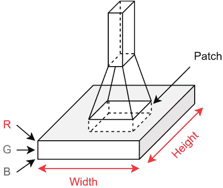

图 7.3: Deep Learning Udacity。 [[27]](#text00015.html#_ftn27)

### 3. 卷积的数学概述

卷积过程中的某些数学概念：

1. 卷积层由一组可学习过滤器组成，也称为内核，这些内核具有较小的宽度和高度，同时保持与输入卷数据相同的深度，如果输入层是图像，深度通常为三。

2. 例如，对尺寸为 `34x34x3` 的图像进行卷积时。过滤器的潜在维度可以表示为 `axax3`，其中 `a` 是任何值（如 `3`、`5` 或 `7`），只要它小于图像尺寸即可。

3. 在前向传播中，每个过滤器逐渐滑动整个输入卷数据，每次增量被称为 `stride`（步长），对于高维图像，步长值可能取 `2`、`3` 甚至 `4`。然后在内核权重与输入卷数据中的相应补块之间计算点积。

4. 通过滑动过滤器，每个过滤器都会生成一个二维输出，当这些输出堆叠在一起时，生成的输出卷的深度将与使用的过滤器数量相对应。网络被设置为学习所有的过滤器。

### 7.2 循环神经网络

循环神经网络是一种既强大又鲁棒的神经网络类型。它们是目前使用的最有前景的算法之一，因为它们是唯一具有内部内存的神经网络。

RNN 在预测未来事件方面非常准确，因为它们能够保留有关接收到的输入的重要细节。对于序列数据，如时间序列、语音、文本、金融数据、音频、视频、天气等，这就是它们成为首选算法的原因。与其他算法相比，循环神经网络能够对序列及其上下文建立更深层的理解。

#### 1. 循环神经网络的工作


图 7.4: RNN 图。 [[28]](#text00015.html#_ftn28)

RNN 由神经元组成，神经元是协作执行复杂任务的数据处理节点。输入层、输出层和隐藏层构成了神经元的布局。输入层在获取数据后交付结果。隐藏层是进行数据处理、分析和预测的地方。

a) 隐藏层

RNN 逐个接收序列数据并将其传输到隐藏层。但它们也有一个循环或自循环的工作流：短期记忆组件允许隐藏层记住并使用之前的输入来预测未来情况。为了预测后续序列，它会同时使用存储的内存和当前输入。

例如，考虑以下序列：Apple is red（苹果是红色的）。当 RNN 接收到输入序列 Apple is 时，red 是它想要预测的颜色。一旦单词 Apple is 经过处理，Apple is 的副本就会存储在隐藏层的内存中。然后当它遇到单词 is 时，它会从内存中识别出 Apple 并理解整个序列：Apple is 构成了上下文。然后，为了提高准确性，它可以预测 red。正因如此，RNN 对于机器翻译和语音识别等语言建模应用非常有帮助。

b) 训练

为了训练深度神经网络（如 RNN），机器学习 (ML) 工程师向模型提供训练数据并提高其性能。在机器学习中，神经元的权重充当信号，指示训练期间获得的信息对输出预测有多大影响。RNN 的所有层具有相同的权重。

为了提高预测的准确性，机器学习工程师会修改权重。他们计算模型误差并根据误差使用通过时间反向传播（BPTT）的方法来修改权重。BPTT 重新计算错误率并将输出回溯到上一个时间步。然后它可以更改权重以降低误差范围，并确定序列中的哪个隐藏状态产生了严重的不准确性。

#### 2. 循环神经网络的类型

RNN 可以根据网络的输入和输出数量分为四类：

a) 一对一 RNN

这种神经网络设计中只有一个输入和一个输出，是最基础的。它被用于不需要序列数据的简单分类任务，例如二分类。

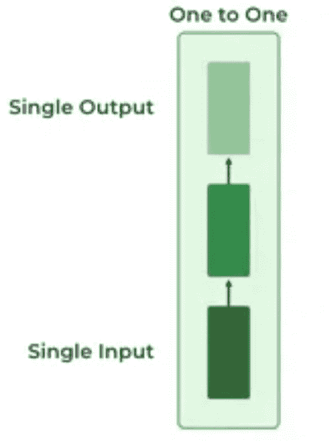

图 7.5: 一对一 RNN。 [[29]](#text00015.html#_ftn29)

b) 一对多 RNN

随着时间的推移，一对多 RNN 通过处理单个输入生成多个输出。当一个输入触发一系列输出时，这是非常有用的。例如在图像描述中，单个图像可以作为输入产生单词字符串。

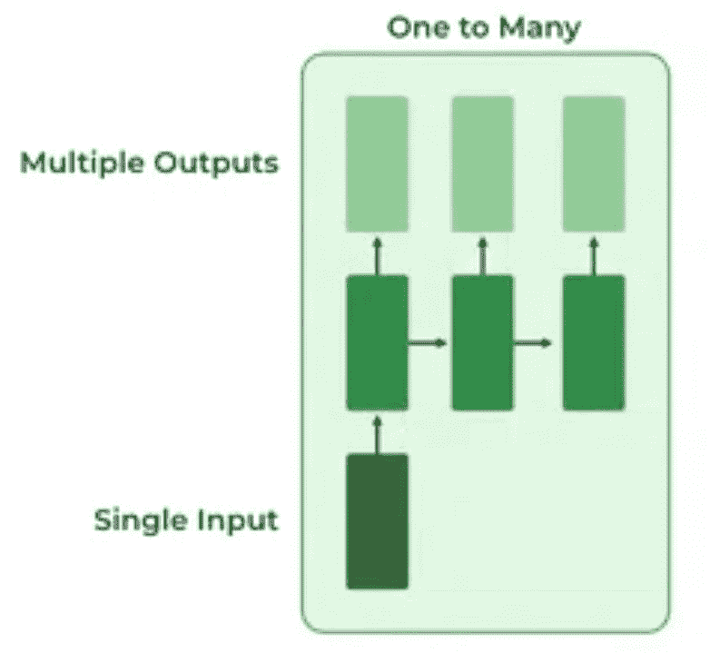

图 7.6: 一对多 RNN。 [[30]](#text00015.html#_ftn30)

c) 多对一 RNN

多对一 RNN 在接收一系列输入后产生单个输出。当单个预测需要输入序列的通用上下文时，这是非常有用的。当短语或其他字符串被到情感分析模型时，它会生成一个积极、消极或中性的单个输出。

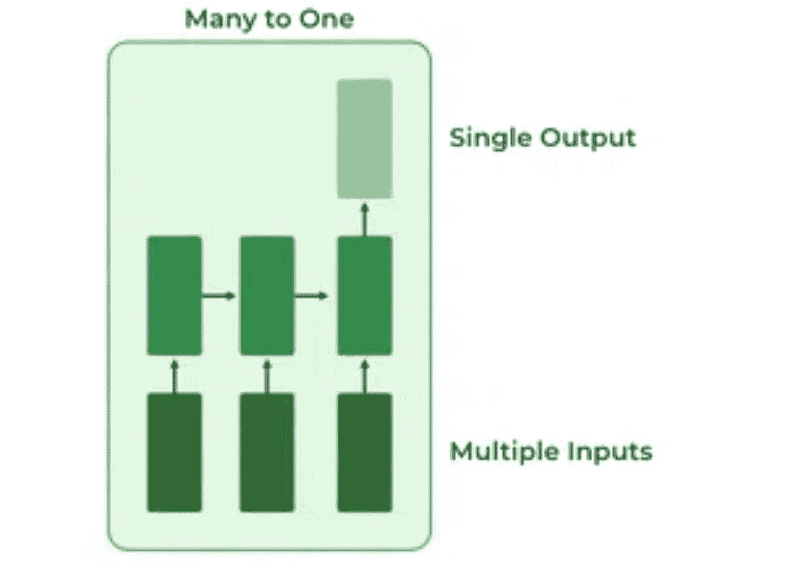

图 7.7: 多对一 RNN。 [[31]](#text00015.html#_ftn31)

d) 多对多 RNN

多对多 RNN 处理一系列输入，然后产生输出序列。在语言翻译过程中，一种语言的单词集作为输入，输出是另一种语言的匹配单词集。

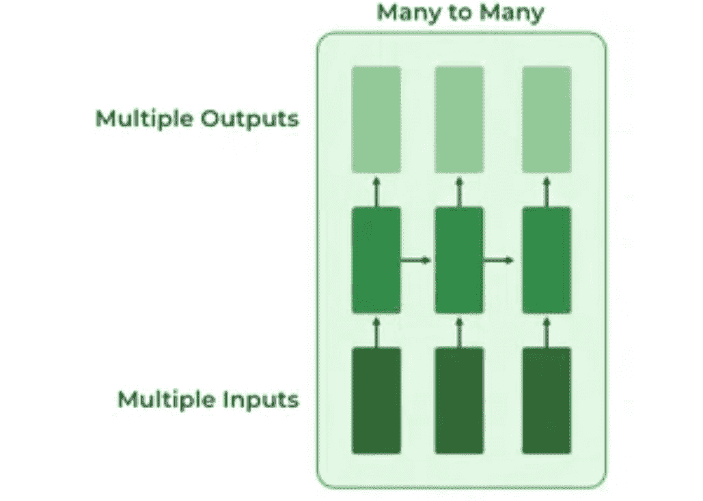

图 7.8: 多对多 RNN。 [[32]](#text00015.html#_ftn32)

# 生成式模型概述

`VAEs` 是使用编码器-解码器架构来生成新数据的概率模型。编码器将输入数据压缩到低维潜空间，而解码器将其重构回原始形式。通过引入概率层，`VAEs` 确保了采样的平滑性，能够生成多样化的输出。这些模型广泛应用于图像合成和数据增强。

## 生成对抗网络 (GANs)

`GANs` 由两个神经网络组成：`generator` 和 `discriminator`，它们正处于一个竞争过程中。`generator` 创建合成数据，而 `discriminator` 评估其真实性。通过对抗训练，`GANs` 改进了生成真实图像、深度伪造视频甚至真实语音的能力。

## 归一化流

Normalising Flows

Normalising flow 使用可逆变换将简单的概率分布（如高斯分布）映射到更复杂的分布。这些模型在密度估计方面非常有效，在采样效率上具有优势。

## 自回归模型

自回归模型按顺序生成数据，根据之前生成的值预测下一个值。常见的例子包括 `PixelCNN` 和 `WaveNet`，它们分别用于图像和音频生成。这些模型提供了高质量的输出，但由于其顺序特性，通常计算开销很大。

## 2. 生成式模型的应用

生成式模型创建真实且多样化数据的能力使其在多个领域得到采用。一些最具影响力的应用包括：

### 图像生成与增强

生成式模型广泛应用于计算机视觉，用于图像合成、超分辨率和风格迁移。特别是 `GANs`，能够创建模仿人类创造力的写实图像和艺术品。

### 文本生成与语言建模

自然语言处理 (`NLP`) 从生成式模型中受益，特别是自动化内容创建、聊天机器人和机器翻译等应用。像 `GPT` (`Generative Pre-trained Transformer`) 等模型利用自回归方法生成相关的文本。

### 药物发现与医学研究

在医疗领域，生成式模型通过模拟分子结构并预测其属性来帮助药物发现。

### 音乐与音频合成

随着生成式模型的发展，AI 生成音乐已成为现实 `WaveNet` 和类似的架构产生高度真实的语音和音乐，使虚拟助手和音乐创作成为可能。

### 视频游戏开发与虚拟世界

生成式模型通过创建真实的纹理、景观和角色动画为视频游戏设计做出贡献。这在保持高质量视觉元素的同时，显著减少了人类设计师的工作量。

## 3. 深度生成模型的优势

深度生成式模型提供了许多优势，使其在现代 AI 应用中不可或缺：

1. **数据增强**：它们生成合成数据以改进机器学习模型，特别是在标注数据稀缺的情况下。

2. **高质量输出**：先进的生成式模型产生高度真实的图像、文本和音频，通常超过人类创作的内容。

3. **无监督学习**：与传统的监督学习模型不同，生成模型可以从未标注数据中学习，在标注成本高昂或不可实际的情况下非常有用。

4. **创造力与创新**：它们使 AI 系统能够生成新颖独特的内容，促进艺术、音乐和设计等创意行业的创新。

## 7. 训练挑战

`GPT-4`、`DALL-E` 和 `Stable Diffusion` 等模型展示了 AI 在生成文本、图像、音乐甚至代码方面的卓越潜力。然而，训练这些生成式 AI 模型面临着研究人员和开发者必须应对的重大挑战。理解这些挑战对于在推进 AI 能力的同时，确保伦理、可扩展且高效的发展至关重要。

### 1. 数据质量与可用性

训练生成式 AI 的基本挑战之一是获取高质量且多样化的数据集。AI 模型需要大量数据来学习模式并生成连贯的输出。然而，寻找具有代表性、无偏差且符合伦理的数据是一个主要障碍。

* **数据中的偏差**：许多数据集包含固有偏差，导致 AI 输出偏斜，可能会强化刻板印象或虚假信息。

* **版权问题**：使用受版权保护的材料进行训练引发法律和伦理问题，促使研究人员寻求开源或专用数据集。

* **数据稀缺**：对于小众领域（如医疗或法律 AI），高质量数据通常有限且昂贵。

解决这些问题需要开发合成数据集、改进数据策展过程并实施严格的数据治理政策。

### 2. 计算成本与基础设施

训练生成式 AI 模型需要大量的计算资源，这使其既昂贵又耗能。

* **高硬件要求**：训练最先进的模型需要强大的 `GPUs` 或 `TPUs`，这些设备价格昂贵且可用性有限。

* **能耗**：AI 训练消耗大量的电力，引发了对环境可持续性的担忧。

* **云端 vs 本地训练**：组织必须决定是在内部训练模型还是使用云解决方案，以平衡成本和控制权。

优化 AI 训练的努力（例如高效的模型架构和节能硬件）对于缓解这些挑战至关重要。

### 3. 模型复杂性与训练稳定性

生成式 AI 模型（特别是像 `transformers` 这样的深度学习架构）非常复杂，使其训练和微调具有挑战性。

* **梯度消失与爆炸**：训练深度神经网络可能会遇到不稳定的梯度更新，导致收敛问题。

* **超参数调优**：选择合适的学习率、批量大小和其他超参数需要大量的实验。

* **模式崩溃**：在生成对抗网络 (`GANs`) 中，当生成器产生的变化有限时，就会发生模式崩溃，降低创造力。

研究人员采用自适应学习率、梯度裁剪和高级正则化等技术来解决这些问题。

### 4. 伦理与偏差担忧

生成式 AI 中的伦理考量至关重要，因为偏差或不当的输出可能会产生远的影响。

* **虚假信息与深度伪造**：生成式 AI 可能会被滥用来创建深度伪造视频或生成误导性信息。

* **偏差与公平性**：在有偏差的数据上训练的 AI 模型可能会延续歧视，使公平性和包容性成为关键关注。

* **透明度与问责**：AI 生成的内容通常缺乏解释性，引发了对决策过程中问责的问题。

### 5. 训练数据安全与隐私

使用大规模数据集（尤其是包含个人信息的数据库）引发了严重的安全和隐私担忧。

## AI 训练中的数据安全

1. **数据匿名化**：确保从训练数据中移除个人身份信息 (PII)。

2. **安全模型训练**：保护 AI 模型免受操纵训练数据的对抗性攻击。

3. **合规性**：遵守全球数据保护法，例如 `GDPR` 和印度的《数据保护法案》。

目前，正在探索安全联邦学习和差分隐私技术，以增强 AI 训练中的数据安全。

## 泛化性与鲁棒性

生成式 AI 模型必须很好地泛化到各种场景，而不对训练数据过拟。

1. **过拟合与欠拟合**：在模型复杂性和泛化能力之间取得平衡是一项持续挑战。

2. **处理噪声数据**：现实世界数据集通常包含错误，需要稳健的数据清洗方法。

3. **迁移学习的局限性**：虽然迁移学习可以提高模型效率，但它并不总能在跨领域时实现有效的泛化。

针对改进损失函数、数据增强和对抗训练的研究旨在增强模型的鲁棒性。

## 人机交互与易用性

为了让生成式 AI 被广泛采用，模型必须对用户友好并适应人类需求。

1. **可解释性**：理解 AI 模型如何生成特定输出仍然是一项挑战。

2. **针对特定用例的微调**：为特定行业定制生成式模型需要大量的微调。

3. **人机回方法**：在 AI 生成的内容中引入人类监督，可确保更高的质量和伦理一致性。

开发直观的 AI 界面和交互式训练方法将增强生成式 AI 模型的易用性。

## 7.5 从像素到完美：AI 图像生成的演变

最引注目的进展之一是 AI 驱动的图像生成，这一领域在过去的几十年中取得了巨大的进步。曾经看起来像科幻小说——计算机生成真实的、高质量图像——现在已成为现实。这种从原始的像素输出到近乎完美、超写实图像的演变，凸显了 AI 在重塑视觉创意方面的力量。

### 1. 早期阶段 - 图形的基础

在 AI 参与图像创作之前，计算机图形由算法和基于规则的方法主导。在 20 世纪 60 年代和 70 年代，计算机图形领域的先驱开发了基本的图像渲染技术，依赖数学公式和结构化数据来生成视觉效果。栅化图形的引入允许计算机以像素集合的形式处理图像，为数字艺术奠定了基础。

20 世纪 80 年代和 90 年代看到了电影和游戏中计算机生成图像 (CGI) 的兴起。然而，这些图像需要大量的人工输入和计算量，限制了它们的可用性和灵活性。虽然 CGI 可以产生惊人的视觉效果，但其过程极其缓慢，且缺乏 AI 后来引入的动态适应性。

### 2. AI 在图像处理中的出现

AI 集成到图像生成始于神经网络和深度学习。到 21 世纪初，机器学习算法使计算机能够识别图像中的模式，增强了图像分类和基础增强。卷积神经网络 (`CNNs`) 成为深度学习的一项重大突破，使得更复杂的图像处理成为可能，为 AI 驱动的创意铺平了道路。

2014 年，Ian Goodfellow 及其团队引入了生成对抗网络 (`GANs`)，标志着一个重大的里程碑。`GANs` 通过使用两个神经网络——生成器和判别器——相互竞争以产生日益逼真的图像，彻底改变了 AI 生成图像领域。这种对抗训练过程允许 AI 生成面部、景观，甚至是与人类艺术家创作的作品无假拟比的面部和艺术品。

### 3. 深度学习与神经网络的兴起

在 `GANs` 之后，变分自动编码器 (`VAEs`) 和 `Transformers` 等深度学习技术进一步增强了 AI 图像生成。`VAEs` 通过精炼像素的概率分布改进了生成图像的质量，产生了更平滑、更详细的输出。同时，扩散模型作为一种先进的 AI 技术，最近因其通过基于噪声的输入逐渐优化为连贯的视觉效果来生成惊人的真实图像的能力而受到关注。

随着 `DALL-E`、`Midjourney` 和 `Stable Diffusion` 等 AI 的出现，图像生成达到了新的高度。这些系统能够根据文本提示生成复杂且详细的图像，使数字艺术被更广泛的观众触及。

### 4. 艺术与媒体中的 AI 图像生成

AI 生成图像的影响不仅限于新奇感；它正在重塑创意产业。广告商和营销人员利用 AI 生成的视觉效果创建定制化活动，而电影制作人则探索 AI 生成的背景和特效以简化制作流程。

在媒体和娱乐领域，AI 生成的图像正在改变内容创作。从生成虚拟角色到制作合成素材图像，AI 正在降低成本并提高效率。

### 5. 伦理与法律考虑

尽管具有优势，AI 图像生成也引发了伦理和法律关注。一个主要问题是用于传播误信息的深度伪造 (deepfakes)——即极其真实的 AI 生成图像和视频。AI 生成虚假视觉效果的这种容易引发了对数字伦理和媒体信度的讨论。

此外，知识产权问题尚未解决。当 AI 根据数百万现有的艺术品生成图像时，权利归谁所有？许多艺术家对未经许可使用其作品训练 AI 模型表示担忧，这导致了对版权法和公平使用政策的讨论。

### 6. AI 图像生成的未来

随着 AI 的不断演进，图像生成的未来有望更大的进步。实时 AI 图像合成可能会改变游戏，允许动态交互的视觉叙事。此外，AI 驱动的工具可能会变得更加精细，协助从时尚、建筑到医疗和法医学等各个行业的专业人士。

一个潜在的发展是 AI 图像生成与增强现实 (`AR`) 和虚拟现实 (`VR`) 的结合，创造出模糊虚拟边界沉浸式数字体验。此外，AI 伦理和监管的改进对于确保该技术的负责任使用至关重要，平衡了创新与问责。

## 7.6 文本生成的技术胜利

AI 生成类人文本的能力改变了新闻、营销、客户服务甚至创意写作等领域。这些技术胜利不仅关乎自动化，还关乎对语言、上下文和创造力的细致理解。

### 1. 文本生成技术的演变

文本生成在过去的几十年里经历了巨大的转型。从只能生成结构化、重复文本的简单规则系统，到能够产生连贯且感知上下文内容的复杂神经网络，这种进步是非非凡的。

早期文本生成的形式之一依赖于预定义的模板和基于规则的算法。这些系统非常僵化，缺乏适应不同上下文的能力。随着机器学习（特别是自然语言处理 `NLP`）的出现，文本生成发生了巨大变化。OpenAI 的 `GPT` 系列和 Google 的 `BERT` 等模型引入了深度学习架构，能够在高级层面上理解上下文、句法和语义。

`transformers`（一种神经网络架构）的引入是 AI 驱动的文本生成的转折点。与之前的模型不同，`transformers` 使用自注意力机制来权衡句子中不同单词的重要性，使其能够生成更连贯、更符合上下文的文本。这使得 AI 生成的内容与人类编写的文本变得越来越难以区分。


## 2. 文本生成的突破

若干项创新促成了 AI 驱动的文本生成的成功：

### a) 大规模预训练模型

如 `Gpt-4` 和 `LLaMA-2` 等大语言模型在生成类人文本方面表现出卓越的熟练度。这些模型在海量数据集上进行训练，使其能够理解广泛的主题和写作风格。它们生成符合上下文且语法准确的文本的能力，重新定义了企业处理内容创作的方式。

### b) 少样本和零样本学习

传统上，AI 模型需要大量的标注数据来有效执行任务。然而，现代文本生成模型展现了少样本和零样本学习能力，这意味着它们可以在极少甚至没有先验示例的情况下生成文本。这允许企业和个人在没有大量训练数据集的情况下，将 AI 应用于各种写作任务。

### c) 改进的上下文保留

早期的 AI 模型在维持长文本上下文方面面临困难。然而，近期内存和注意力机制的进展显著改进了上下文保留，允许 AI 生成保持连贯且逻辑结构良好的长内容。

### d) 风格适应性

现代文本生成系统可以适应不同的写作风格、语调和格式。无论是生成正式的业务报告、创意短故事，还是对话式的客户服务，AI 都能定制文本以满足特定需求。

## 3. AI 生成文本的行业应用

AI 驱动的文本生成的影响跨越多个行业，提升了效率、创造力和参与度。

### a) 新闻与内容创作

媒体机构和内容创作者利用 AI 生成新闻文章、博客文章和报告。自动化新闻允许新闻机构快速针对金融市场和体育赛事等主题制作基于事实的报告。AI 生成的内容还帮助博主和营销人员高效地扩展其内容策略。

### b) 营销与广告

品牌使用 AI 撰写吸引人心的营销文案、社交媒体帖子和电子邮件活动。AI 驱动的文案工具使企业能够生成针对不同目标受众的个性化、高转化内容。

### c) 客户支持与聊天机器人

对话式 AI 通过提供即时、准确且类人的回答彻底改变了客户服务。AI 聊天机器人通过处理常规查询、排除故障甚至提供个性化建议来增强用户体验。

### d) 教育与在线学习

AI 生成文本有助于创建教学材料、总结复杂概念并提供个性化辅导。

### e) 法律与技术

AI 越来越多地用于起草合同、政策和技术手册。

# 第 8 章：伦理、法律与安全关注

## 目标

本章讨论涉及 AI 的法律和安全问题。

## 8.1 AI 生成数据中的偏差与公平性

随着 AI 系统日益融入生活，关于偏差和公平性的担忧也凸显出来。

### 1. 理解偏差

AI 中的偏差是指导致不公平结果的系统性错误。这些错误可能来自多个来源：

1. `数据偏差`：AI 系统从历史数据中学习，这些数据可能反映了现有偏见。
2. `算法偏差`：某些 AI 模型优先考虑某些类型的数据而非其他数据，导致偏斜的预测。
3. `人类偏差`：由于 AI 模型是由人类创建和训练的，无意识的偏差可能会影响数据选择和算法结构的构建。
4. `选择偏差`：当用于训练的数据不能代表整个群体时，AI 模型可能会对代表不足的群体做出不准确或不公平的预测。
5. `自动化偏差`：当人们对 AI 生成的决策过度信任，认为它们天生如此时，就会发生这种情况。

### 2. AI 中的公平性

确保 AI 的公平性需要采取积极措施来减轻偏差并创造更公平的结果。公平性可以分为不同的维度：

1. `人口统计公平`：确保 AI 系统不会不成比例地损害特定群体。
2. `程序公平`：AI 决策过程的透明度，确保可问责制和可解释性。
3. `结果公平`：确保 AI 生成的结果在不同群体之间是公平的，并且不会加剧现有的不平等。
4. `上下文公平`：考虑 AI 应用的具体用例，以确定特定场景下公平的含义。

### 3. 减轻 AI 偏差的策略

为了创建公平的 AI 系统，开发者、研究人员和组织必须采取多层面解决偏差的策略：

- **多样化且具代表性的数据**：使用反映不同人口群体的多样数据集有助于减少数据偏差。对数据集进行定期审计和更新可以防止过时或偏斜的信息影响 AI 模型。
- **偏差检测与评估**：公平性指标、对抗测试和反事实分析等技术有助于识别和衡量 AI 模型中的偏差。这些工具允许开发者评估算法是否系统性地偏袒或损害任何群体。
- **算法透明度与可解释性**：确保 AI 决策过程是可解释的，允许利益相关者理解决策是如何做出的。可解释 AI (`XAI`) 等技术有助于提高 AI 系统的透明度和问责性。
- **模型开发中的公平性约束**：AI 模型的设计可以包含公平性约束，以确保在不同群体之间实现公平对待。例如，公平性感知机器学习技术可以通过调整模型输出来防止差异化影响。
- **监管合规与伦理合规**：政府和组织应当实施政策和伦理指南来监管 AI 开发。诸如欧盟《人工智能法案》以及来自 IEEE 等组织的伦理 AI 原则等框架，为负责任的 AI 使用提供了指导。
- **人类监督与持续监控**：AI 不应孤立运行；人工监督对于检测和纠正偏差至关重要。对现实应用中的 AI 系统进行持续监控，有助于识别意外后果并进行必要的调整。

## 8.2 负责任的 AI

AI 治理的一个新兴领域是负责任的 AI。“负责任”一词既指伦理也指 AI 的民主化。

偏见通常是由用于训练人工智能机器学习（ML）模型的数据集引入的。偏见引入这些模型的主要方法有两种：数据不完整或有缺陷，或者训练 ML 模型的人员存在偏见。带有偏见的 AI 程序具有伤害或对人类产生不利影响的可能。例如，它可能会不公正地拒绝贷款申请，或者在医学领域误诊患者。

### 1. 负责任的 AI 原则

AI 和机器学习模型应当遵循一套可能因公司而异的指南。

例如，谷歌和微软都遵循其自身的一套价值体系。此外，美国国家标准与技术研究院（NIST）发布的《人工智能风险管理框架》1.0 版本也遵循了与谷歌和微软列出的许多相同准则。在 NIST 的七项指导原则中，包括以下内容：

1. **有效且可靠**：在各种和不可预见的情况下，负责任的 AI 系统需要能够继续运行而不出现任何问题。
2. **安全**：负责任的 AI 必须保护环境、财产和人类生命。
3. **安全且具有韧性**：适当的 AI 系统需要针对可能的危险（如敌意攻击）保持安全和强大。负责任的 AI 系统必须设计为能够防御并响应攻击，同时具备从攻击中恢复的能力。
4. **问责与透明**：提高透明度的目标是增加对 AI 系统的信任，同时也为了更容易处理与 AI 模型输出相关的问题。在该概念下，要求开发者对其 AI 系统承担责任。
5. **可解释与可理解**：可解释性和可理解性旨在提供有关 AI 系统工作良好程度及其可靠性的详细信息。例如，可解释 AI 向人们解释系统是如何以及为何产生其结果的。
6. **隐私增强**：在隐私原则下，强制执行保护终端用户自主权、身份和尊严的实践。控制、匿名和秘密性等价值观必须指导负责任 AI 系统的开发和实施。
7. **公平并管理有害偏见**：消除 AI 偏见和歧视是公平性的主要目标。它致力于保证公正和公平，这是一项挑战性的任务，因为这些理想在不同的组织及其文化中各异。

### 2. 设计负责任的 AI

开发 AI 模型必须围绕特定目标，即以安全、可靠且道德的方式开发模型。为了确保公司致力于提供客观、可靠的 AI 技术，持续检查至关重要。为了实现这一点，组织在开发和部署 AI 系统时必须遵循成熟度模型。

从根本上说，强调负责任设计原则的标准是负责任 AI 的基础。以下要求必须包含在这些公司级的 AI 开发指南中：

1. 共享代码库。
2. 经批准的模型架构。
3. 经许可的变量。
4. 建立偏见测试方法，以帮助确定 AI 系统测试的有效性。
5. 活跃机器学习模型的稳定性标准，以确保 AI 编程按预期工作。

### 3. 实施负责任 AI 的挑战

实施负责任 AI 规则和框架的过程往往会被重要问题和担忧所放慢。这些挑战包括：

1. **安全与隐私**：为 AI 模型训练收集信息的公司可能需要个人的隐私信息。虽然区分隐私信息和公共信息可能具有挑战，但负责任的 AI 原则旨在解决数据隐私、安全和保护问题。
2. **数据偏见**：为了防止偏见，应当仔细获取和检查训练数据，尽管偏见有时难以识别。没有一种通用的方法；从输入数据集中移除偏见需要时间和精力。
3. **合规性**：企业必须关注新的限制，并确保随着地方、州、联邦和国际层面法律法规不断变化，其 AI 策略易于更新。
4. **培训**：企业主需要意识到谁负责管理 AI 系统，并确保他们接受了适当教育。除了技术团队外，法律、市场、人力资源等部门和其他利益相关者可能也需要培训。

## 8.3 知识产权与生成式 AI 平台

简单来说，知识产权（IP）涵盖人类的无形创作物，包括“思想、发明、创意作品、标志、品牌名称等”。知识产权权（IPR）旨在保护创作者并防止对其作品进行未经授权的使用，这是一个类似的概念。

目前已有针对提供 AI 图像生成、AI 文本生成和 AI 代码生成工具公司的诉讼，随着生成式 AI 的快速出现及其相关的复杂知识产权问题，无疑会有更多诉讼。

尽管这仅仅是开始，但在模型训练中使用受知识产权保护的信息是目前这些诉讼的主要关注点。生成式 AI 还关联着许多知识产权风险：

### 1. 训练数据风险

使用受知识产权保护的数据训练 AI 模型是最常受关注的问题之一。虽然这种担忧并非生成式 AI 所独有，但随着艺术家看到自己的创作在生成式 AI 输出中被复制并感到就业岌岌可危，这种担忧日益增加。

创建生成式 AI 的公司因在未经所有者同意的情况下使用版权内容进行训练而受到指责，目前尚不清楚“合理使用”等豁免条款在这些情况下是否适用。现在有多种方法，从严格限制和完全透明披露训练材料到不受限制地使用版权作品，多个国家和国际组织正在积极制定相关的建议和法规。

### 2. 模型输出风险

除了与训练数据相关的风险外，生成式 AI 模型可能会生成输出，这些输出通常在不提醒模型用户的情况下整合或以其他形式区别受保护的作品。那么，如果这些输出被用于商业活动，这些用户（可能是从自由职业者到公司员工的任何人）将面临可能的后果。模型输出要对用户构成危险，所需的精确“衍生性”程度尚不为人知，可能只有通过法律诉讼或立法才能明确。鉴于生成式 AI 的输出并非完全由人类创作，适用于生成式 AI 输出的知识产权（`IPRs`）也仍不明确。

### 3. 软件许可风险

软件许可风险与开发者利用 AI 产生可用代码时发生的模型输出危害相似。如果一个在带有许可协议的代码上训练的生成式 AI 模型随后被用于创建集成到新软件中的相似代码，那么新软件可能需要适当代表与训练数据中代码相关的许可或多个许可。例如，在严重情况下，拷贝权许可证（copyleft licenses）可能会强制商业软件也声明为开源。

### 4. 数据泄露和商业秘密风险

根据产品和模型的不同，生成式 AI 模型可能会使用输入数据进行持续训练；然而，一旦被学习，数据就有被复制给其他用户的可能。这使得在使用生成式 AI 模型和产品时，保护敏感和隐私信息变得困难。事实上，已经有公司在员工在生成式 AI 提示词中使用公司私有信息后禁用了 `ChatGPT`，随后发现这些信息已泄露到公司之外。

### 5. 发明人风险

AI 已被用于协助多个领域的新创新的开发，例如药物设计。目前尚不确定 AI 如何——甚至是否可能被描述为对某项声明的想法做出了贡献，因为大多数知识产权局需要在专利中注明人类发明者。这听起来可能无害，但如果法院审查专利并确定其并非列出发明者的主要发明，则该专利可能被宣布无效。

## 8.4 生成式 AI 的虚假信息和滥用

在带来生成式 AI 益处的同时，生成式 AI 也带来了巨大的风险，特别是在虚假信息的传播和潜在的滥用方面。随着 AI 生成的内容与人类创作的材料变得难以区分，对伦理影响、安全威胁和社会影响的担忧变得日益紧迫。

### 1. 生成式 AI 导致的虚假信息兴起

关于生成式 AI 的主要关注之一是其在虚假信息传播中的作用。AI 模型可以生成极具说服力的假新闻文章、受操纵的媒体和误导性叙述，这些很容易欺骗公众。随着信息在社交媒体平台上快速传播，此类内容可以迅速流行，影响公众观点并塑造现实事件。

#### a) 假新闻和虚假信息

AI 生成的内容可用于创建看似可信的假叙述。恶意行为者利用这些功能传播宣传、影响选举或操纵股市。与传统的虚假信息不同，AI 驱动的虚假信息可以以极小的努力大量生产，成为具有欺骗意图的人的强大工具。

#### b) 深度伪造技术（Deepfake）

生成超真实合成媒体的深度伪造 AI 已成为主要关注问题。由 AI 操纵的视频和图像可以制造事件、创建虚假证据或冒充公众人物。这项技术在政治、网络安全甚至个人隐私方面构成了严重威胁，因为深度伪造视频可用于勒索个人或损害声誉。

#### c) 社交媒体操纵

社交媒体对 AI 生成的虚假信息特别敏感。机器人和 AI 驱动的账户可以用误导性内容充斥平台，放大分裂问题并助长政治和社会动荡。生成式 AI 模仿写作风格和人类交互的能力，使得区分真实用户和自动化账户变得非常困难。

### 2. AI 滥用的伦理和法律挑战

由于生成式 AI 有滥用的可能，伦理和法律框架难以跟上步伐。围绕责任归属、知识产权和隐私的问题是监管机构和科技公司面临的关键挑战。

#### a) 责任归属与 AI 生成的内容

AI 伦理中的一个关键问题是确定 AI 生成的虚假信息的责任。责任应该归于开发者、用户还是托管内容的平台？缺乏明确的规定使得让恶意行为者对其行为负责的努力变得复杂化。

#### b) 版权和知识产权

AI 生成的内容引发了复杂的知识产权问题。当 AI 创建与人类创作作品高度相似的作品时，艺术家、作家和音乐家面临着挑战。所有权问题——AI 生成的作品是否可以受版权保护以及谁拥有权利——在许多司法管辖区仍未解决。

#### c) 隐私和安全风险

生成式 AI 可用于创建极具说服力的钓鱼邮件、用于诈骗的语音合成和身份欺骗诈骗。此类活动威胁网络安全和个人隐私，因为 AI 生成的内容可能会欺骗个人共享敏感信息或参与欺诈交易。

## 8.5 隐私、安全与安保

生成式人工智能的快速发展引发了对隐私、安全和安保的严重关注。解决这些挑战对于确保负责任地部署 AI 的同时保护个人、组织和社会至关重要。

### 1. 生成式 AI 中的隐私关注问题

隐私是 AI 时代的基本问题。生成式模型通常依赖于庞大的数据集，其中包含公开的、专有的有时是敏感的信息。这些数据集可能无意中包含个人数据，引发了对信息如何收集、处理和利用的担忧。

主要的隐私风险之一涉及数据泄露。AI 模型，特别是大语言模型（`LLMs`），已被证明会记忆并复制训练数据，有时会暴露敏感的个人细节。如果模型根据机密医疗记录、财务信息或私人对话进行训练，当以特定方式进行查询时，它可能会生成此类数据的输出。

此外，用户与 AI 系统的交互本身也可能是隐私风险的来源。聊天机器人和其他生成式 AI 应用通常收集输入数据以提高性能。然而，如果没有稳健的数据保护措施，这些信息可能会被用于监控、定向广告甚至恶意活动。用户并不总是知道存储了哪些数据、这些数据如何被使用，或者他们是否对删除这些数据拥有控制权。

解决这些问题需要严格的数据保护政策、明确的用户同意机制，并遵守如《通用数据保护条例》（`GDPR`）和印度《数字个人数据保护法》（`DPDPA`）等法规。组织必须采用隐私保护技术，包括差分隐私、数据匿名化和联邦学习，在保持 AI 能力的同时降低风险。

### 2. 生成式 AI 的安全问题

确保生成式 AI 的安全至关重要，因为这些模型可能被各种滥用，导致伦理、社会和经济损害。一个紧迫的问题是生成误导性或有害的内容。例如，AI 深度伪造（deepfakes）可用于操纵舆论、传播虚假信息或诽谤个人。恶意行为者利用 AI 创建了具信力的虚假新闻、冒充真人，甚至实现了网络诈骗自动化。

偏见和歧视也是主要的安全担忧。AI 模型从历史数据中学习，这些数据可能反映了社会偏见。如果不加仔细管理，这些偏见可能会出现在 AI 生成的内容中，强化招聘、贷款和法律执法等领域的刻板印象和不公平待遇。

AI 安全的另一个关键方面涉及幻觉（hallucinations）——生成式 AI 产生错误或无意义信息的情况。与传统软件不同，AI 模型并不“知道”事实，而是根据训练数据中的模式生成概率性输出。这可能导致 AI 自信满满地呈现虚假信息，给医疗、法律和科学研究等领域带来风险。

为了降低这些风险，AI 开发者必须实施严格的测试、伦理 AI 原则以及模型开发中的透明度。负责任的 AI 框架应包含内容审核、实时监控和用户反馈机制，以防止有害或误导性内容的传播。

### 3. 生成式 AI 中的安全风险

生成式 AI 中的安全威胁已超出了数据隐私和安全，涵盖了可被网络犯罪分子和对手利用的漏洞。主要担忧之一是对抗攻击（adversarial attacks），攻击者通过操纵输入数据来欺骗 AI 模型生成非预期或有害的输出。这些攻击可用于绕过内容过滤器、更改 AI 生成的推荐，或利用自动化决策系统中的安全漏洞。

钓鱼攻击和自动化诈骗也受益于 AI 生成的内容。网络犯罪分子可以使用 AI 创建极具说服力的电子邮件、语音录制和短信，使钓鱼诈骗更难检测。随着 AI 生成冒充的兴起，企业和个人面临着更大的欺诈、身份盗窃和金融犯罪风险。

此外，生成式 AI 在银行、医疗和网络安全等关键基础设施中的整合，引发了对其抗攻击尝试稳健性的担忧。如果恶意行为者获取了 AI 驱动系统的访问权限，他们可能会操纵金融交易、篡改医疗诊断或中断基本服务。

为了增强 AI 安全，组织必须优先考虑稳健的网络安全措施，包括加密数据存储、安全的 API 访问和定期的安全审计。AI 开发者还应该实施对抗训练——在开发期间让 AI 模型接触潜在攻击的技术，以提高其对现实威胁的韧性。

## 8.6 生成式 AI 对工作和行业的影响

AI 为企业和专业人士提供了许多机会；但也引发了对工作流失和技能需求演变的担忧。理解生成式 AI 对工作和行业的影响，对于努力适应这一技术革命的个人和组织至关重要。

### 1. 生成式 AI 正在改变行业

生成式 AI 已经深入到各个行业，提高了效率、降低了成本并实现了创新。受影响最大的一些部门包括：

### a) 媒体和内容创作

AI 驱动工具（如 `ChatGPT`、`DALL-E` 和 `Midjourney`）的兴起彻底改变了内容生成的方式。作家、平面设计师和视频剪辑师现在有了 AI 驱动的助手，帮助简化他们的创作流程。自动化内容创建允许企业快速扩大营销规模，在极短时间内制作博客、广告和社交媒体帖子。


然而，这种进步也对传统的创意角色带来了挑战。虽然 AI 可以以惊人的速度生成文本、图像和视频，但人类的监督对于确保原创性、质量和伦理考虑仍然至关重要。AI 并不是取代创意专业人士，而是将其角色转向更具战略性和编辑的功能。

### 软件开发与 IT

生成式 AI 正在彻底改变 IT 领域，特别是编码和软件开发。AI 驱动的工具可以生成代码、调试软件并协助项目管理，显著缩短了开发时间。`GitHub Copilot` 和 `OpenAI Codex` 等平台让程序员能够自动化重复的编码任务，专注于复杂的问题的解决。

尽管有了这些进步，AI 不可能完全取代软件工程师。相反，它正在成为一种增强生产力的必备助手。拥抱 AI 工具的开发者将具有竞争优势，因为他们可以将常规编码委托给 AI，同时专注于创新和系统架构。

### 客服与聊天机器人

随着 AI 驱动的聊天机器人和虚拟助手的采用，客服发生了巨大变化。这些工具对客户查询提供即响应，缩短了等待时间并提升了用户体验。公司利用 AI 处理常规查询，释放人工代理来处理复杂或敏感的问题。

虽然 AI 驱动的自动化减少了对基层客服岗位的需求，但它也为 AI 训练、机器人管理客户体验设计创造了新机会。该领域的专业人士将需要获得 AI 整合和人机协作的技能。

### 医疗与制药

医疗行业受益于生成式 AI 在诊断、药物发现和患者护理方面的应用。AI 模型可以分析医学图像、预测疾病，甚至辅助开发新药。药公司利用 AI 加快新疗法上市的时间。

尽管有这些创新，人类的专业知识仍然不可缺。医生、研究人员和医疗专业人士与 AI 工作，利用其见解，同时根据 AI 缺乏的伦理、情感和背景因素做出决策。

### 制造业与自动化

制造业一直处于自动化的沿，生成式 AI 进一步优化了生产线、供应链管理和质量控制。AI 驱动的机器人正在处理复杂的组装任务，预测性维护正在减少停机时间，而 AI 生成的设计提高了产品效率。

虽然一些体力工作可能会减少，但 AI 也为工程师、机器人专家和 AI 系统集成器创造了需求。精通 AI 驱动技术的工人将在维护和编程自动化系统方面发现新机会。

## 对工作的影响

生成式 AI 整合行业不可避免地以积极和挑战性的方式影响劳动力市场。各种影响包括：

### 工作流失 vs. 机会创造

AI 应用最受争议的方面之一是替代人类工作的潜力。虽然一些常规和重复性任务正在被自动化，但 AI 也在创造需要人类干预的新角色。随着企业寻求负责任地优化 AI 使用，AI 伦理、提示词工程、AI 模型训练和系统监控等职位正在出现。

### 技能需求的转变

对 AI 的日益依赖使得技能组的必须发生转变。传统的职业角色正在演变，要求专业人员掌握新的能力。批判性思维、解决问题能力、AI 素养和数据分析正成为现代劳动力中不可或缺的技能。那些提升技能并适应这些变化的员工将在各自领域继续保持价值。

### 混合角色的兴起

AI 并非完全取代人类工人，而是在培养专业人士与 AI 工具协作的混合型角色。例如，记者使用 AI 生成的草稿来增强写作，金融分析师使用 AI 检测趋势，教育工作者使用 AI 提供个性化的学习体验。这些混合型角色要求个人理解 AI 的能力和局限性，同时运用人类的专业知识来增强成果。

### 创业机会

生成式 AI 正在降低创业的门槛。小型企业和独立专业人士可以利用 AI 进行营销、内容创作、客户支持和自动化，使他们能够与大型企业竞争。AI 驱动行业中的许多初创公司，为各个领域提供创新解决方案。

## 8.7 对 AI 的依赖

对 AI 的日益依赖在医疗保健、金融、教育和娱乐等领域显而易见。虽然 AI 提供了许多益处，但对其过度依赖既带来了机遇也带来了风险。

### 1. 依赖 AI 的益处

AI 的优势是不可否认的，它提升了各个领域的效率、准确性和可访问性。企业和个人都依赖 AI 驱动的技术来简化任务、分析海量数据并做出明智决策。以下是一些关键益处：

#### a) 提高效率和生产力

AI 驱动的自动化通过惊人的速度和准确性处理重复性和耗时的任务，彻底改变了行业。在制造业中，AI 驱动的机器人高效地组装产品，降低了生产成本和人为错误。同样，AI 算法简化了业务运营，优化了供应链、客户服务和物流。

#### b) 改进决策

AI 处理和分析大型数据集的能力使组织能够精确做出数据驱动的决策。在金融市场中，AI 驱动交易算法在毫秒内评估风险并执行交易，导致更科学的投资策略。在医疗保健领域，AI 协助诊断疾病、预测患者结果并推荐个性化的治疗方案。

#### c) 增强个性化

AI 通过在电子商务、娱乐和社交媒体中提供个性化推荐，显著改善了用户体验。流平台使用 AI 根据观看历史建议内容，而在线零售商则根据个人偏好推荐产品。这种程度的定制增强了客户的满意度和参与度。

#### d) 更好的可访问性与包容性

AI 驱动的技术改善了残障人士的可访问性。语音识别软件、语音转文本应用程序和 AI 驱动的助手为视觉或运动障碍的人士提供了更大的独立性。AI 还促进了语言翻译，弥合了不同语言背景的人们之间的交流鸿沟。

### 2. 依赖 AI 的风险

虽然 AI 提供了许多益处，但过度依赖可能会带来重大风险。在缺乏充分人工监督的情况下依赖 AI 可能导致伦理困境、职位流失、安全担忧以及人类认知能力的下降。

#### a) 职位流失和经济影响

AI 驱动的自动化导致了各行业的职位流失，特别是制造业、客户服务和运输业。随着机器在重复性和常规任务中取代人类工人，对失业和经济不平等的担忧日益增加。虽然 AI 在技术驱动的领域创造了新的就业机会，但对劳动力进行再培训和适应不断变化的职业角色的需求正在增长。

#### b) 伦理和偏见担忧

AI 算法基于历史数据进行训练，而这些数据可能包含固有的偏见。如果不仔细监控，AI 系统可能会在招聘实践、执法和金融服务中强化并延续歧视。算法偏见已成为日益关注的问题，因为它可能导致基于种族、性别或社会经济地位对某些群体产生不公正对待。

#### c) 人类技能和批判性思维的丧失

过度依赖 AI 进行决策可能导致人类认知能力的下降。当个人依赖 AI 解决问题和检索信息时，他们的批判性思维和分析推理能力可能会降低。这种趋势在教育领域尤为令人担忧，学生依赖 AI 驱动的工具而不是培养独立的解决问题能力。

#### d) 安全和隐私风险

AI 驱动的技术容易受到网络威胁和数据泄露的影响。黑客可以利用 AI 系统操纵信息、传播虚假信息或获取敏感数据的未经访问。AI 在监控中日益增加引发了对隐私的担忧，因为政府和公司收集了大量的个人数据，可能导致滥用或不合伦的监控行为。

## 8.8 环境关注

生成式 AI 的能力也引发了显著的环境关注。随着对 AI 模型依赖的增加（特别是大规模使用），伴随着巨大的能量消耗、碳排放和电子垃圾。这些环境问题需要引起关注，以确保技术进步不会以生态可持续性为代价。

### 1. 能量消耗和碳足迹

与生成式 AI 相关的最紧迫的环境关注之一是其高能耗。训练和运行大型 AI 模型（例如 OpenAI 的 `GPT` 系列或 Google 的 `DeepMind` 项目）需要巨大的计算能力。这些模型使用高性能数据中心进行训练，这些中心消耗大量的电力，通常依赖于化石燃料的能源。

一个复杂的 AI 模型单次训练运行使用的能量可能相当于数百家庭一年的消耗。研究估计，训练一个大型神经网络产生的碳排放相当于多次长途飞行。随着 AI 采用的增长，其对环境的影响随之增加，加剧了全球气候挑战。

### 2. 数据中心和用水量

AI 驱动的数据中心需要广泛的冷却机制来维持最佳性能。这一冷却过程涉及大量的用水，增加了另一层环境担忧。许多 AI 数据中心位于已面临水资源短缺的地区，加剧了现有的资源挑战。随着对 AI 服务的需求增加，水供应面临压力也增大，引发了关于技术进步与自然资源保护之间权衡的伦理问题。

### 3. 电子垃圾和硬件需求

AI 处理的硬件需求是另一个环境挑战。用于 AI 训练的高性能 `GPUs`（图形处理器）和 `TPUs`（张量处理器）的生产涉及稀有金属的开采和加工。这一过程对环境也有有代价，包括栖息地破坏、土壤和水污染，以及采矿作业产生的碳排放。

此外，AI 技术的快速发展导致硬件更新频繁，从而加剧了电子垃圾的产生。过时或低效率计算设备的处置进一步加了废物管理系统的压力，因为许多电子组件含有有害材料，如果不进行妥善回收，可能会污染生态系统。

### 4. 可持续性措施与潜在解决方案

为了减轻生成式 AI 对环境的影响，公司和研究人员必须探索可持续的解决方案。可以采取多种措施来减少 AI 的碳足迹并促进负责任的发展。

1. **高能 AI 模型** – 研究人员正在开发在不损害性能的情况下计算量更少的 AI 模型。模型剪枝、知识蒸馏和优化算法等技术有助于在保持效率的同时降低能。

2. **采用可再生能源** – 将 AI 数据中心转向可再生能源（如太阳能和风能）可以显著减少碳排放。`Google` 和 `Microsoft` 等公司已承诺使用清洁能源为其 AI 运营。

3. **改进冷却系统** – 冷却技术的创新（如液冷和先进空气循环系统）可以减少数据中心对水和能源的需求。

4. **可持续硬件实践** – 开发寿命更长、效率更高的 AI 处理器可以帮助最大限度地减少电子垃圾。此外，推广负责任的回收实践并对 AI 硬件采用循环经济模式，可以缓解环境担忧。

5. **监管与行业合作** – 政府和行业领导者必须共同努力，建立 AI 开发的环保法规。促进可持续性、碳中和和伦理 AI 使用的政策可以确保技术进步与生态责任之间取得平衡。

## 8.9 AI 监管与自律

人工智能（AI）已成为一种跨行业的变革性力量，彻底改变了从医疗、金融到营销和治理的各个领域。然而，随着 AI 系统变得日益强大并深度融入日常生活，人们对其伦理影响、潜在偏差和无意后果的担忧也日益增加。

### 1. AI 监管的必要性

AI 监管是指为了监控和引导 AI 开发和使用的的框架、政策和机制。鉴于 AI 具有产生积极和有害结果的潜力，监管确保了 AI 系统保持公平、负责任和透明。几个因素促成了对强有力的监管的需求：

1. **伦理考量** – AI 驱动的决策可能产生深远的伦理影响，特别是在医疗、招聘和执法等敏感领域。如果没有适当的监管，AI 模型中的偏差可能会使歧视持续化并强化系统性的不平等。

2. **安全与隐私风险** – AI 系统处理大量数据，通常包括个人和敏感信息。确保 AI 遵守严格的数据保护法规对于防止泄露和滥用至关重要。

3. **问责与透明度** – 许多 AI 系统作为“黑箱”运行，使得难以理解它们是如何得出结论的。AI 决策的透明度对于确保问责和公众信任至关重要。

4. **缓解虚假信息** – AI 驱动的内容生成和推荐算法影响着舆论和信息传播。如果没有监管，存在以前所未有的规模传播虚假信息和宣传的风险。

### 2. AI 监管的方法

AI 监管通过监管框架、行业最佳实践和伦理指南相结合来实现。不同国家和组织采取不同的 AI 治理方法，一些优先考虑严格的监管控制，另一些则提倡自律。

#### a) 政府监管

全球政府正在制定法律和政策来治理 AI。例如，欧盟的 `AI Act` 根据风险对 AI 应用进行分类。

#### b) 行业标准与指南

科技公司和行业机构通过设定公平性、问责和偏差消除的标准，在 AI 监管中起着至关重要的作用。电气与电子工程师学会 (`IEEE`) 和 `Partnership on AI` 等组织促进了负责任的 AI 开发。

#### c) 独立 AI 审计

第三方审计评估 AI 系统的透明度和安全风险。

#### d) 公众与利益相关者参与

参与 AI 治理确保了 AI 技术符合社会价值观，而不仅仅是为了服务公司利益。

### 3. 自律在 AI 治理中的作用

自律涉及 AI 开发人员和组织自愿采纳伦理指南、最佳实践和问责措施，无需政府直接干预。虽然自律不能完全取代正式监管，但它是负责任 AI 开发的一种积极方法。

1. **伦理 AI 框架** – 公司日益将伦理 AI 原则整合到工作流中。`Google` 的 `AI Principles`、`Microsoft` 的 `Responsible AI framework` 以及 `OpenAI` 关于 AI 的政策体现了自律努力。

2. **偏差与公平性评估** – AI 开发人员进行公平性评估，以识别并减轻机器学习模型中的偏差，确保跨不同人群的公平对待。

3. **透明度倡议** – 开源 AI 研究、模型文档和可解释 AI 技术提高了透明度并增强了对 AI 系统的信任。

4. **协作与知识共享** – 行业伙伴合作共享最佳实践和发现，促进负责任 AI 的文化。

## 8.10 监管挑战

生成式 AI 的快速采用在全球范围内引发了巨大的监管担忧，印度也不例外。尽管印度政府承认 AI 的潜力，但监管格局尚不明，面临诸多挑战。

1. **缺乏全面的法律框架**

在印度监管生成式 AI 的主要挑战之一是缺乏的法律框架。与推出了 `AI Act` 的欧盟不同，印度尚未制定结构化的 AI 治理方法。目前的监管环境由现有法律拼凑而成，例如《2000 年信息技术法》和即将推出的《数字印度法案》，这些法律并未专门针对生成式 AI 的独特挑战。这种指南的缺失为企业、开发者和用户带来了不确定性。

2. **数据隐私与安全担忧**

生成式 AI 模型需要海量数据进行训练，这引发了对数据隐私和安全的担忧。`2023 年数字个人数据保护法案`为数据治理提供了法律框架，但其对 AI 生成内容的适用性尚仍不明确。目前产生的问题包括：AI 公司应如何处理用户生成的数据、AI 生成的内容是否应被视为个人数据，以及如何在保持创新的同时确保数据保护。此外，AI 模型存在无意中记忆敏感信息的风险，可能导致潜在的数据泄露。

### 3. 虚假信息与深度伪造监管

生成式 AI 使得高度逼真的深度伪造（deepfakes）和合成媒体成为可能，带来了误信息、欺诈和名誉损害的风险。AI 生成的假新闻传播可能会影响选举、操纵舆论并造成社会危害。尽管《2021 年信息技术（中间者指南和数字媒体伦理规范）规则》在一定程度上解决了虚假信息问题，但缺乏处理 AI 生成深度伪造的具体机制。在不侵犯言论自由的情况下监管此类内容是印度立法者必须解决的复杂挑战。

### 4. 知识产权与版权问题

生成式 AI 引发了对知识产权（IP）的严重关注。AI 生成的内容往往与现有的版权作品相似，导致潜在的版权侵权。《1957 年印度版权法》目前尚未涵盖 AI 生成的作品，这在所有权和责任归属方面存在法律模糊性。AI 生成的作品是否应被视为原创创作？如果是，所有权归谁所有——开发者、用户还是 AI 自身？这些未解决的问题使得企业难以在不产生法律风险的情况下将 AI 生成的内容商业化。

### 5. 伦理与偏见担忧

AI 模型（包括生成式 AI）可能会延续训练数据中存在的偏见。这具有伦理方面的影响，特别是在印度这样一个多元化的国家，必须考虑社会经济、语言和文化因素。如果 AI 生成的内容强化了刻板印象或歧视某些群体，可能会导致名誉损害和法律挑战。需要监管审查，以确保 AI 系统在决策过程中公平、无偏见且透明。

### 6. 企业和初创企业的合规负担

印度拥有日益发展的 AI 初创生态系统，但监管的不确定性带来了沉重的合规负担。中小企业（`SMEs`）可能难以应对不断变化的法律要求，特别是在在没有明确指南的情况下实施了严格的 AI 监管时。过度监管可能会扼杀创新，而监管不足可能导致法律风险和不伦理的 AI 部署。在确保负责任使用 AI 的同时，平衡两者对于促进 AI 创业至关重要。

### 7. 问责与责任问题

在生成式 AI 造成损害的情况下，确定责任是另一项重大挑战。如果 AI 模型生成了诽谤或有害内容，由谁承担责任——开发者、托管 AI 的平台还是终端用户？缺乏明确的责任条款，可能会引发法律纠纷，给企业和消费者带来不确定性。建立一个界定 AI 相关纠纷责任的监管框架，对于法律清晰化至关重要。

# 第 9 章：生成式 AI 的未来

## 学习目标

本章探讨了生成式 AI 的未来轨迹，包括通通用人工智能（`AGI`）、自主 AI 智能体、人形机器人以及更广泛的 AI 集成。它研究了 AI 进步的无限潜力、人类乐观主义的作用，以及 AI 对行业的转型性影响。

## 9.1 通往通用人工智能的路径

现有的 AI 技术在定义的范围范围内运行。例如，经过训练的模型无法创建网页。对 `AGI` 的追求是理论性的，旨在创建具有自主控制能力、并能够在未包含在内的新环境中获取新技能的 AI 系统。

### 通用人工智能（AGI）的研究类型

计算机科学和人工智能领域的研究人员一直在解决 `AGI` 这一悬而未决的挑战。几种高级方法出现并分类如下：

- **符号主义（Symbolic）**：`AGI` 的符号方法认为符号思维是人类智能的基础，也是使其具备最广泛泛化能力的关键。

- **涌现论（Emergentist）**：对 `AGI` 的涌现论观点强调人类大脑由基本组件组成，这些组件会对身体经验进行复杂的自我组织。可以推断，类似的智能形式可能从重构中产生。

- **混合（Hybrid）**：`AGI` 的混合方法意味着大脑作为一个混合系统，各种组件和原理协同工作，产生超越单一元素简单相加的结果。混合 AGI 研究的涵盖范围广泛。

- **通用主义（Universalist）**：`AGI` 的通用主义方法关注通用智能的数学核心，认为一旦在理论上解决了 `AGI`，推导出的原理就可以应用于实际开发。

### 通用人工智能的挑战

计算机科学家在开发 `AGI` 时面临各种挑战：

#### 建立联系

目前的 AI 模型局限于特定领域，无法跨领域建立联系。然而，人类可以将知识和经验从一个领域转移另一个领域。例如，游戏设计师利用教育理念创建学习环境。可以将从理论教育中学到的知识应用于生活实践。然而，深度学习模型需要使用特定数据集进行大量训练才能在未知数据上可靠运行。

#### 情感智能

深度学习模型展示了 `AGI` 的潜力，但尚未表现出人类固有的创造力。情感思维对于创造力至关重要，目前的神经网络架构尚未复制这种品质。人类的对话受情感感知的影响，而 NLP 模型产生的文本输出取决于其训练的语言数据集和模式。

#### 感官感知


`AGI` 要求 AI 系统与外部环境进行物理交互。除了机器人功能外，系统还需要以人类的方式理解世界。目前的计算机技术需要进一步开发，以便以人类的方式准确区分形状、颜色、味道、气味和声音。

## 9.2 生成式 AI 的未来何在？

随着人工智能的不断进步，生成式 AI 的未来正准备重新定义个人和企业与技术交互的方式。下一阶段的发展将侧重于提高效率、创造力和伦理考量。以下是未来几年内可以期待的内容。

### 1. 更复杂且具备感知能力的模型

目前的生成式 AI 模型（如 `GPT-4` 和 `DALL·E`）已经展示了令人深刻的能力，但它们在上下文保留和细微推理方面仍然面临挑战。未来的 AI 模型可能会设计为具有更好的理解能力、逻辑一致性并减少幻觉。研究人员正在研究诸如 `retrieval-augmented generation`（`RAG`）和 `fine-tuned contextual embeddings` 等技术，使 AI 的响应更准确、更感知上下文。这些增强将使 AI 能够进行更有意义、更像人类的交互。

### 2. 多模态 AI 系统

生成式 AI 的未来在于多种数据模态的无缝整合。下一代 AI 将不再单独处理文本、图像、音频和视频，而是同时处理并生成各种格式的内容。`OpenAI` 和 `Google DeepMind` 等公司已经在探索可以将文本与视觉元素结合的模型，创造出更丰富、交互性的数字体验。这种演变将使高级视频编辑、真实的虚拟助手和增强的现实体验等应用成为可能。

### 3. 真实性更高的 AI 生成内容

虽然生成式 AI 在内容创作方面发挥了重要作用，但它引发了关于虚假信息和深度伪造的担忧。为了解决这个问题，未来的发展将侧重于改进水印技术、真实性验证和伦理 AI 实践。研究人员正在开发能够检测合成内容并对 AI 生成材料提供透明度的 AI 模型。这些进步对于维护对 AI 生成内容的信任至关重要。

### 4. 可定制和个性化的 AI 助手

AI 模型正在超越通用应用程序，向更具个性化和特定领域的解决方案发展。未来的 AI 将允许用户根据其偏好、行业需求或特定用例来微调模型。企业将受益于理解其独特需求的 AI 工具，无论是在医疗、金融还是娱乐领域。可定制性将增强用户体验，并创造出更直观、实用的 AI 驱动解决方案。

### 5. 软件开发与自动化中的 AI

生成式 AI 已经在协助编写和调试代码，但未来的迭代将自动化推向新水平。AI 驱动的编程助手不仅能生成功能性代码，还能理解软件架构并优化性能。这将简化软件开发，减少人为错误，并实现应用程序的快速部署。此外，AI 将在自动化重复性任务方面发挥重要作用，让专业人员能够专注于工作中更具战略性的方面。

### 6. 伦理 AI 与监管发展

随着 AI 变得越来越强大，围绕偏见、隐私和责任的伦理问题将成为焦点。政府和组织将实施更严格的法规以确保负责任的 AI 使用。未来的 AI 模型设计时将具有增强的公平性、可解释性和合规机制。AI 开发者需要优先考虑透明化伦理因素，以确保 AI 在造福社会的同时不会造成意外的伤害。

### 7. AI 在科学发现和研究中的作用

除了创意应用外，生成式 AI 将彻底改变科学研究。AI 驱动的模型将通过生成假设、分析海量数据集和提出创新解决方案，协助药物发现、气候建模和材料科学。模拟复杂场景的能力将加速医学、工程和环境可持续性的突破。

### 8. 与元宇宙和虚拟世界的整合

随着元宇宙概念的演变，生成式 AI 将在塑造虚拟环境方面发挥关键作用。AI 将生成真实的虚拟形象、沉浸式景观和交互式叙事，使数字空间更具吸引力和动态性。企业和内容创作者将利用 AI 以最小的努力构建庞大的、用户生成的虚拟世界。

## 9.3 AI 的规模化利用：自主 AI 代理

在生成式 AI 领域，自主代理是指利用大语言模型（`LLMs`）的能力连接各种思想，以实现特定输出或目标的系统。

自主 AI 代理与生成式 AI 的区别在于，它们能够顺序执行多个任务，利用记忆和工具，且不需要人类的直接干预。

通用人工智能（`AGI`）的概念长期以来一直是一个备受入迷的话题，在科幻小说中经常被描绘成具有类人认知能力的机器。虽然 `AGI` 仍然是一个理论追求，但人工智能和机器人技术的重大进展使我们更接近其潜力的实现。`AGI` 最具前景的体现之一是人形机器人——这些机器被设计以类似于人类的方式进行思考、学习和交互。

## 9.4 人形机器人中的 AGI

### 1. 人形机器人中 AGI 的本质

`AGI` 指的是能够执行人类能够胜任的任何智力任务的人工智能系统，而不是局限于狭义人工智能等特定领域。与擅长图像识别或语言处理等单一任务的传统 AI 模型不同，`AGI` 的目标是复制人类水平的推理、适应和解决问题的能力。

`AGI` 在人形机器人中的体现具有多重用途。首先，人形结构允许其无缝集成到人类环境中，而无需对基础设施进行重大更改。其次，它促进了自然的人机交互，增强了沟通和社会接受度。最后，通过模拟人类的认知和运动系统，研究人员可以通过现实世界的互动来完善 `AGI` 模型，而不是仅仅依赖虚拟仿真。

### 2. 技术基础

具有 `AGI` 能力的人形机器人的开发需要多种尖端技术的整合：

1. **机器学习与深度学习** – 先进的神经网络使机器人能够处理海量数据，从经验中学习并实时做出决策。
2. **自然语言处理 (NLP)** – 让机器人能够自然地理解并响应人类语言对于有效通信至关重要。
3. **计算机视觉** – 这允许机器人感知和解释周围环境，实现物体识别、人脸识别和空间导航等任务。
4. **机器人工程** – 材料、执行器和传感器机制的创新使人形机器人能够模仿人类的动作和手势。
5. **类脑计算** – 受大脑启发，类脑芯片旨在更高效地处理信息，使机器人更接近类人认知。

### 3. 应用与影响

将 `AGI` 集成到人形机器人可能会变革众多行业：

1. **医疗保健** – `AGI` 驱动的人形机器人可以担任护理员，协助老人或残障人士处理日常事务并提供陪伴。
2. **客户服务** – 零售、酒店和公共服务可以从人形机器人提供的个性化帮助和信息中获益。
3. **制造业与物流** – 具有 `AGI` 能力的机器人可以适应动态工作环境，优化生产线和仓库管理。
4. **教育** – 作为导师或助教，人形机器人可以提供互动性和自适应的学习体验。
5. **太空探索** – 自主人形机器人可以部署用于地外任务，减少人类航天员的风险。

## 9.5 人类的潜力是无限；乐观主义有所帮助

### 1. 人类潜力的扩张性

人类潜力的无限性长期以来一直是一个备受入迷的话题。在整个历史上，个人和人类都展示了创新、创造力和韧性方面的非凡能力。随着技术的快速进步，特别是 `Generative AI` 的发展，这种潜力得到了进一步扩展，以以前无法想象的方式开启了新的可能性。然而，除了技能和智能之外，还有另一个推动人类成就的关键因素——乐观主义。这种可能性和进步的心态是突破的催化剂，允许个人突破边界并重新定义可能。

### 2. 乐观主义在解锁潜力中的作用

乐观主义不仅仅是一种积极的态度；它是一种认知框架，影响着个人如何感知挑战和机遇。研究表明，乐观的人更有可能坚持完成困难的任务，从挫折中恢复，并实现长期目标。这种心理韧性在不确定性和快速变化的时代至关重要。

### 3. 生成式 AI 作为人类潜力的反映

生成式 AI 在许多方面都是人类潜力本身的反映。它建立在人类智能之上，在海量数据集上进行训练，并设计用于模拟创造力。这项技术证明了人类智慧如何被编码到算法中，表明即使是机器也可以学会生成新颖且有价值的内容。

生成式 AI 最具前景的方面之一是协作潜力。它并不是人类努力的替代品，而是作为一个共同创造者，与个人合作以提高生产力和创造力。然而，生成式 AI 的有效性取决于处理方法。

### 4. 以乐观的心态迎接未来

随着技术的不断演进，人类潜力的范围也在不断扩大。`Generative AI` 的发展强调了乐观主义在推动进步方面的力量。那些带着无限可能信念面对未来的人是塑造未来的人。悲观的心态可能导致停滞和对改变的抵制，而乐观主义则燃料了探索新前沿的勇气。

要真正释放人类潜力，社会必须培养一种将挑战视为机遇、并将技术视为赋能工具的心态。正如过去的人们利用科学和工程领域的突破来改善生活一样，今天人工智能的进步为我们重新定义未来提供了机会。以乐观为驱动力，人类可以继续扩展自己的能力，证明唯一的真实限制是思想所设定的边界。

## 关于作者

Rakesh Kumar 先生拥有博加尔 RGPV 大学的计算机科学工程学士学位，拥有三个以上的技术写作经验。他曾参与过超过 10 本专关于 `Generative AI`（生成式 AI）、`Machine Learning`（机器学习）和 `Deep Learning`（深度学习）等前沿主题的书籍。他的写作风格擅长将复杂的概念拆解为各种水平读者都能理解的清晰、易懂的语言。

在对技术和创新的强烈热情下，Rakesh 创作了《精通生成式 AI：机器学习与深度学习的实用指南》，旨在帮助读者探索这些变革性技术如何重塑行业并影响日常生活。他的目标是桥接理论与现实应用之间的鸿沟，让先进的人工智能概念变得实用且具有意义。

***

除了写作，Rakesh 还是一个热衷的象棋爱好者以及残障意识的坚定倡导者。由于双腿身体残疾，他坚信毅力、知识和包容性的力量。这本书反映了他的使命：让 `Generative AI`、`Machine Learning` 和 `Deep Learning` 的教育对所有人赋能并触手可及。

[\[1\]](#text00007.html#_ftnref1) https://miro.medium.com/v2/resize:fit:640/format:webp/0\*riH9z2sLjb4eAQcf.png

[\[2\]](#text00007.html#_ftnref2) https://zd-brightspot.s3.us-east-1.amazonaws.com/wp-content/uploads/2022/04/04094802/4-12-1-e1715637495321.png

[\[3\]](#text00007.html#_ftnref3) https://images.prismic.io/encord/f1fa13a6-88a3-4c20-b620-46489fe00f45\_What+is+Supervised+Learning+%7C+Encord.png?auto=compress,format

[\[4\]](#text00007.html#_ftnref4) https://media.licdn.com/dms/image/v2/D5612AQEPphQDz-Lv5A/article-cover\_image-shrink\_720\_1280/article-cover\_image-shrink\_720\_1280/0/1712325585473?e=2147483647&v=beta&t=nSDXRawEFm4fWbKBD59-3IsDNwUCP0csrTi2w6sVxYA

[\[5\]](#text00007.html#_ftnref5) https://www.researchgate.net/publication/357876249/figure3/AS:111322534375425/164200501759/Working-model-of-supervised-learning-10.png

[\[6\]](#text00007.html#_ftnref6) https://www.mathworks.com/discovery/reinforcement-learning/\_jcr\_content/mainParsys3/discoverysubsection\_603098216/mainParsys3/image.full.medium.png

[\[7\]](#text00007.html#_ftnref7) https://www.techtarget.com/rms/onlineimages/steps\_preprocessing

[\[8\]](#text00007.html#_ftnref8) https://miro.medium.com/v2/resize:fit:828/format:webp/1\*cOcV7J0b-dMASty6gg.png

[\[9\]](#text00008.html#_ftnref9) https://media.geeksforgeeks.org/wp-content/uploads/20241106172431802/Artificial-Neural-Networks

[\[10\]](#text00008.html#_ftnref10) https://ayarlabs.com/wp-content/uploads/202301/Neural-Architecture

[\[11\]](#text00008.html#_ftnref11) https://miro.medium.com/v2/resize:fit:2000/0\*Pd26Ut3ux7A.png

[\[12\]](#text00008.html#_ftnref12) https://media.geeksforgeeks.org/wp-content/uploads/20240208053129/lstm.webp

[\[13\]](#text00008.html#_ftnref13) https://www.researchgate.net/publication/33397754/figure2/AS:77365644367761@1561465478170/DSN-DeepStackingNetwork

[\[14\]](#text00008.html#_ftnref14) https://www.scaler.com/topics/gradient-descents

[\[15\]](#text00008.html#_ftnref15) https://www.scaler.com/topics/stochastic-gradient-descent

[\[16\]](#text00008.html#_ftnref16) https://www.scaler.com/topics/sgd-with-momentum

[\[17\]](#text00008.html#_ftnref17) https://www.scaler.com/topics/mini-batch-gradient-descent

[\[18\]](#text00009.html#_ftnref18) https://deepgram.com/\_next/image?url=https%3A%2F%2F.datocms-assets.com%2F96965%2F1707230263-ai-apps-bayesianml-image-1.png&w=1080&q=75

[\[19\]](#text00010.html#_ftnref19) https://media.geeksforgeeks.org/wp-content/uploads/20231201153426/Variational-AutoEncoder.png

[\[20\]](#text00010.html#_ftnref20) https://media.geeksforgeeks.org/wp-content/uploads/20250130181755083356/Generative-Adverarial-network-Gans.webp

[\[21\]](#text00010.html#_ftnref21) https://miro.medium.com/v2/resize:fit:1100/format:webp/1\*20eOTTCwC-jGXpbAoc9Vg.png

[\[22\]](#text00010.html#_ftnref22) https://www.techtarget.com/searchenterpriseai/definition/generative-adversarial-network-GAN#:~:text=Researchers%20from%20Nvidia%20released%20StyleGAN,the%20images%20that%20are%20produced.

[\[23\]](#text00010.html#_ftnref23) https://www.geeksforgeeks.org/getting-started-with-transformers

[\[24\]](#text00010.html#_ftnref24) https://d1.awsstatic.com/GENAI-1.151ded5440b4c997bac0642ec669a00ff2cca1.png

[\[25\]](#text00012.html#_ftnref25) https://ars.els-cdn.com/content/image/1-s2.0-S0306261924005130-gr4_.jpg


## 参考文献

[^26]: https://encrypted-tbn3.gstatic.com/images?q=tbn:ANd9GcQkh9AjLLhxGkH3_YInv_9bXgxnf4Tr8bn23-n20

[^27]: https://ars.els-cdn.com/content/image/1-s2.0-S1526149224005X-CMES_50760-fig-3.gif

[^28]: https://d2908q01vomqb2.cloudfront.net/f1f836cb4ea6ef2a0b1b9f41ad8b103eff4b59/2017/10/06/intro-gluon-1.gif

[^29]: https://media.geeksforgeeks.org/wp-content/uploads/20231204131135/One-to-One-300.webp

[^30]: https://media.geeksforgeeks.org/wp-content/uploads/20231204131304/One-to-Many-300.webp

[^31]: https://media.geeksforgeeks.org/wp-content/uploads/20231204131355/Many-to-One-300.webp

[^32]: https://media.geeksforgeeks.org/wp-content/uploads/20231204131436/Many-to-Many-300.webp
