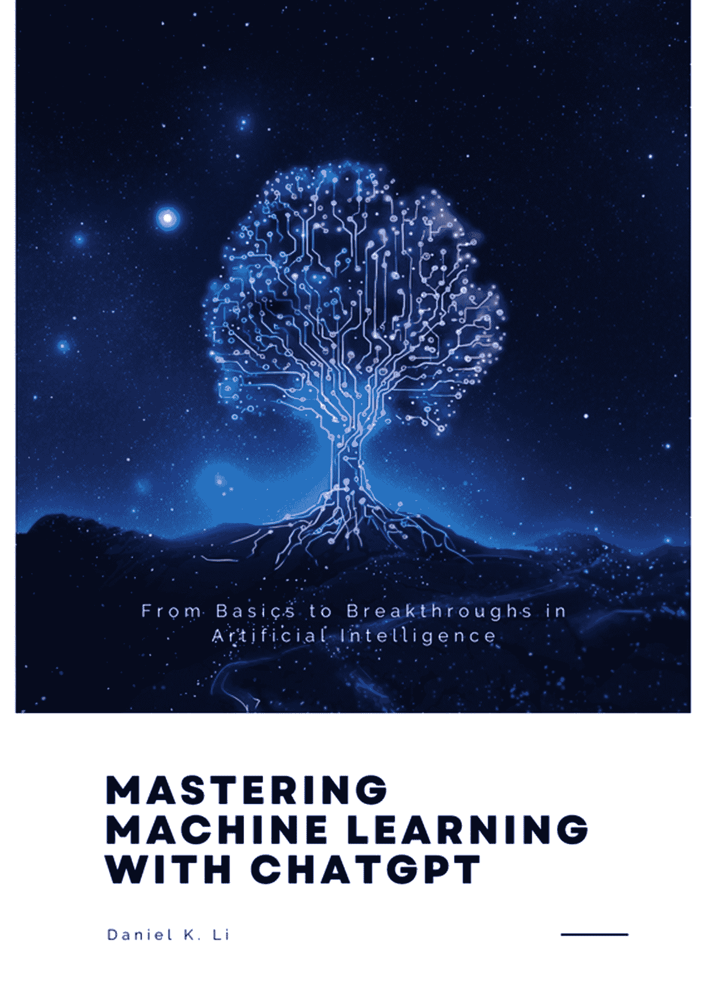
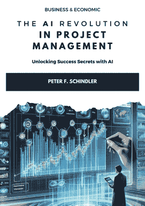

# ChatGPT 机器学习精通指南：从基础到人工智能突破

## 第一部分 决策心理学

### 大脑如何做决策

探索情绪、认知偏差与神经通路在决策制定中的复杂相互作用

#### 决策制定的潜在神经过程

神经决策制定是一个迷人的研究领域，它揭示了大脑如何处理信息并最终选择行动方案。大脑的决策区域包含一个网络区域，其中`prefrontal cortex`（前额叶皮层）发挥着核心作用。`prefrontal cortex`位于大脑前部，对规划、判断和决策制定等高级认知功能至关重要。

在决策制定过程中，各个大脑区域相互沟通以评估选项、权衡后果并最终确定选择。`prefrontal cortex`与皮层下结构（如`amygdala`（杏仁核，处理情绪）和`striatum`（纹状体，涉及奖励处理和习惯形成））相互作用。大脑区域之间这种错综复杂的相互作用，使得对影响决策的不同因素能进行细致入微的评估。

神经元，特别是多巴胺分泌细胞，在基于奖励的决策中发挥关键作用，当出现有利结果时，它们会发出愉悦或强化的信号。这种强化机制加强了与成功选择相关的连接，塑造了未来的决策倾向。

此外，神经可塑性——大脑重组并形成新连接的能力——对于适应性决策至关重要。通过从过往经验中学习并根据反馈调整行为，个体能够随着时间的推移做出更明智的决策。这种神经适应的动态过程使决策策略具备了灵活性和可修正性，增强了整体认知效率，以及在应对生活选择时的适应能力。

### 情绪对决策的影响

情绪在决策过程中扮演着多面手的角色，与理性思维交织在一起，构建出一个复杂的选择图景。情绪与逻辑推理之间的互动能显著影响决策结果。积极情绪（如喜悦和兴奋）可能促使个体承担更多风险，并拥抱那些预示着更高回报的机会。反之，消极情绪（如恐惧和愤怒）往往迫使个体倾向于更稳妥的选择，以规避潜在的伤害或损失。

情商——即识别、理解和管理自己情绪的能力——在决策中起着关键作用。情商较高的人往往能做出更深思熟虑、更平衡的决策，他们同时借助情绪线索和逻辑推理，做出符合其长远目标和价值观的选择。

为了有效管理情绪对决策的影响，个体可以采用多种策略。这些策略可能包括：练习正念以保持当下觉察和自我觉知；运用认知重构技术来转变对挑战性情境的视角；以及寻求他人反馈，以便在情绪激动的决策上获得更客观的观点。

从情绪化决策中学习，涉及反思那些由强烈情绪驱动的过往选择。通过分析这些决策的结果，个体能获得宝贵洞见，了解其情绪如何影响了判断，并利用这些知识在未来做出更明智的决策。通过这一内省与学习的过程，个体可以驾驭情绪的力量，做出更符合其总体目标和价值观的优质选择。

### 认知偏差对决策结果的影响

认知偏差深植于人类心理学之中，对决策过程拥有巨大的支配力，将个体引向错误的判断。在这些偏差中，*确认偏差* 诱使个体寻找符合先入为主观念的信息，这种磁性般的吸引力会使他们对矛盾证据视而不见。*事后诸葛亮偏差* 是一种回顾性扭曲，它用欺骗性的可预测性面纱遮蔽了过去的事件，可能导致在当前决策过程中产生错误的确定性。

*可得性启发式* 让决策者陷入错觉，赋予记忆中易于获取的信息以过度影响力，这种幻觉可能延续误导性的选择。*锚定偏差* 是另一股强大的力量，它将个体拴系在遇到的初始数据点上，使后续判断不成比例地向锚点倾斜，导致结果扭曲。

*过度自信偏差* 是一个强劲的对手，它延续了一种坚定不移的自我确信的幻觉，往往在决策中播下鲁莽的种子。理解这些偏差的蔓延，承认其无处不在的存在，并主动抵消其影响，对于促进更明智、更理性、更稳健的决策至关重要。揭示这些认知错综复杂性，对于在选择的复杂性中获得清醒认识至关重要，它赋予个体打破偏见判断枷锁、以敏锐的洞察力和敏锐度驾驭决策动荡大海的能力。

### 常见认知偏差

欢迎来到认知偏差的迷人世界。在本节中，我们将探索我们的大脑将我们引入歧途的各种方式，而我们往往甚至未曾察觉。透过*确认偏差*、*可得性偏差*、*框架偏差*、*锚定偏差*等的视角，我们将揭示这些偏差如何影响我们的决策过程，并最终影响我们对周围世界的感知。让我们共同踏上这段旅程，通过真实案例和实用策略，更好地理解并对抗这些根深蒂固的思维模式。让我们开始探索认知偏差及其如何塑造我们的日常生活。

#### 影响选择的普遍偏差概述

认知偏差是人类认知中固有的倾向，会系统性地将我们从逻辑推理和客观决策中拉偏。这些偏差塑造了我们的感知、判断和选择，往往让我们浑然不觉。在众多认知偏差中，*确认偏差* 作为一种常见现象脱颖而出，即个体寻找、解读和记忆符合其现有信念或假设的信息，强化先入为主的观念而非挑战它们。

*可得性偏差* 是另一种普遍的认知偏差，它建立在我们倾向于在做决策时依赖易于回忆或触手可及的信息这一倾向之上。这种偏差会扭曲我们的感知，导致我们基于生动或易获取的例子高估事件发生的可能性，而非考虑更全面的信息范围。

*框架偏差* 在决策中扮演重要角色，展示了信息的呈现方式或语境如何能深刻影响我们的选择。问题的提法或信息的呈现方式能左右我们的决策过程，有时仅因信息框架不同，就导致我们做出不同选择。

*锚定偏差* 显示了我们在做决策时过度依赖遇到的第一条信息（“锚”）的倾向。这种偏差会导致我们坚持初始起点或参考点，即使它无关紧要或不准确，最终影响决策结果。

这些认知偏差共同凸显了我们的大脑处理信息和做决策的错综复杂方式，强调了识别和减轻这些偏差的重要性，以便在生活各个方面争取更客观、更有效的决策。通过理解和应对这些偏差，个体能以更强的觉察力驾驭决策的复杂性，并有可能做出更明智、更理性的选择。

#### 现实决策情境中的偏差案例

*确认偏差* 会影响人际关系，当个体选择性地解读信息以确认既有信念时，会忽视可能挑战其观点的矛盾证据。例如，在恋爱关系中，一方可能只关注那些印证其“另一方不可靠”信念的事例，而摒弃那些证明其值得信任的例子。

*锚定偏差* 会影响商务谈判，导致个体固着于初始信息（如开价），随后围绕这一参考点调整立场。对初始锚点的固着可能导致谈判者做出对对方不成比例地有利的让步。

*可得性偏差* 会扭曲风险评估，当个体严重依赖易获取的信息（如近期事件或生动案例）时，而非考虑全范围的相关数据。例如，企业领导者可能高估罕见但高度曝光风险的发生概率，从而导致次优决策。

从众效应能够驱动社交媒体趋势，即如果个人认为某种信仰或行为被他人广泛接受，他们就更有可能采纳，而不管其优点或基本原理如何。这可能导致病毒式内容或想法基于其感知到的流行度而迅速传播。

事后诸葛亮偏见会扭曲人们对体育比赛结果的认知，导致个人在事件发生后认为该事件本很容易预测。这可能导致过度自信，认为自己能根据过去的事件预见未来的结果。

#### 减轻偏见影响的策略

了解个人偏见对于做出明智决策至关重要。偏见往往是无意识的，会影响判断并导致次优选择。为抵消这一点，个人必须运用理性分析，客观审视情况，不带先入为主的观念。寻求替代视角能拓宽考量范围，从而更全面地理解当前问题。暂停反思能带来片刻的清醒，防止由情绪反应驱动的草率决定。

实施“魔鬼代言人”方法，即挑战自身的假设和信念，能促进对选项进行更批判性的评估。持续学习通过扩展知识和磨练分析技能来进一步增强决策能力，从而减少偏见的影响。

承认偏见的影响是减轻其效应的第一步。决策前系统地权衡证据有助于做出知情选择。让他人参与能提供多元视角，抵消个人偏见，促进更平衡的决策。挑战假设能验证选择，确保它们建立在坚实基础之上。

花时间客观考量选择意味着在没有情绪偏见的情况下审慎思考，促进理性决策。根据新信息调整信念体现了灵活性，并承诺基于最新、最相关的数据做决策。总的来说，这些策略赋予个人以清晰和自信的心态，驾驭复杂的决策环境。

## II. 了解你的决策风格

#### 识别个人决策模式

在日常生活中，我们不断面临大量的决策。这些决策范围广泛，从琐碎小事到重大抉择，以独特的方式塑造着我们的人生轨迹。在本节中，我们将深入探讨自我评估技术，探究它们在决策过程中扮演的关键角色。我们将揭示模式识别的力量，以及认知偏见对我们选择的影响。此外，我们将审视选择心理学的复杂运作，以及了解过去的决策如何为当前的策略提供参考。让我们一起揭开决策的复杂性，发掘做出知情且客观选择的策略。

##### 用于识别模式的自我评估技术

自我评估技术是决策领域不可或缺的工具，提供了一面反思的镜子，让个人能更深入地了解自己的认知过程和行为。面对选择时，穿越层层复杂性和个人偏见颇具挑战。然而，自我评估提供了一种结构化的方法来理清个人的决策模式和偏好。

模式识别是自我评估的一个基本层面，它允许个人识别其决策中随时间推移反复出现的主题。通过审视过去的选择和结果，个人可以辨别出塑造其对各种情境反应的共同线索。这种模式识别为洞察力和自我意识奠定了基础，揭示了潜在的动机和思维过程。

为了在未来的决策中有效利用模式识别，个人可以采取诸如记录决策日志、定期进行反思练习、向可信赖的来源寻求反馈等策略。这些实践有助于构建个人决策倾向的连贯叙事，使个人能够预判潜在陷阱、发挥优势，并在未来做出更明智的选择。最终，自我评估技术的应用赋予个人面对优柔寡断、增强认知清晰度的能力，并以更强的自我意识和目标感来应对决策。

##### 探究决策倾向的起源

认知偏见是人类决策过程的固有属性，会微妙地影响个人评估信息和做选择的方式。这些偏见可能源于过去的经历，即个人借鉴以往情境来为当前决策提供参考。文化和社会规范的影响进一步塑造了决策，因为这些规范提供了一个框架，个人在其中评估各种选项的可接受性和可取性。

人格特质是决策中的另一个重要因素。例如，风险厌恶型个人处理选择的方式可能与风险容忍型个人不同。情绪是决策不可或缺的一部分，往往根据个人当前的感受或情绪引导其走向特定结果。这种情绪影响有时会导致冲动决策或判断模糊。

此外，认知过载会压垮决策过程，阻碍有效评估信息和做出清晰选择的能力。面对过多信息或相互冲突的选项时，个人可能难以做出符合其目标和价值观的决定。了解这些对决策的各种影响，对于寻求有效驾驭复杂选择并做出带来积极结果决策的个人至关重要。

##### 过往选择对当前决策策略的影响

选择心理学是一个迷人的领域，探讨我们的过往决策如何影响当下的决策策略。我们的经历、成长背景和文化背景都在塑造我们今天应对选择的方式中发挥作用。这些影响既可以是有意识的，也可以是潜意识的，往往导致影响我们决策过程的固有偏见。这些偏见可能表现为认知捷径、情绪反应或社会压力，所有这些都会模糊我们的判断，并可能导致次优决策。

为抵消这些偏见，开发促进更客观决策过程的技术至关重要。正念练习、认知重构和寻求多元视角只是几种能帮助个人以更清晰和理性的方式应对决策的策略。

从过往决策结果中学习是选择心理学的另一个基本层面。通过反思先前选择的后果，个人可以获得宝贵的见解，了解什么行之有效、什么不奏效。这一内省过程允许对决策策略进行调整和改进，最终在未来带来更好的结果。拥抱选择心理学的原则，赋予个人以自信和清晰的心态驾驭人生十字路口的能力，做出符合其价值观和目标的决策。

#### 平衡直觉与理性分析

深入决策的纵深

### 驾驭决策的复杂性

当我们驾驭决策的复杂性时，常会发现自己身处十字路口，直觉、理性分析与整体视角在此交汇。在本节中，我们将探究每种方法的错综复杂之处，以及它们如何在塑造我们的选择中发挥关键作用。从理解直觉的定义，到探索理性分析的技巧，再到将两者融入整体决策，我们将揭示影响我们决策方式的各个侧面。让我们共同踏上旅程，揭开决策的动态机制，发现那些能助我们以清晰目标穿越选择迷宫的策略。

#### 审视直觉在决策中的作用

直觉，常被称为“第六感”，是一种潜意识过程，它让个体能够调用内在知识，在无需显性推理的情况下做出决策。它涉及过往经验、情绪和细微线索的快速整合，这些在意识层面可能并不明显。在决策中，直觉能提供快速洞察并指引选择，发挥着至关重要的作用，尤其是在时间有限或信息不全的情况下。

区分直觉与冲动很重要。直觉涉及更深思熟虑和反思的过程，而冲动决策通常迅速、情绪化，且由即时欲望驱动。直觉倾向于成为一种更细致的决策形式，建立在对当下情境更深层的理解之上。

直觉与认知过程之间的相互作用错综复杂。直觉常与逻辑推理协同运作，将直觉感受与分析思维相结合。情商能引导决策者走向符合其情感健康和内在动机的选项。

风险管理构成整体决策不可或缺的组成部分，确保潜在的不确定性得到确认并得到有效管控。通过在评估风险的同时权衡机遇，个体能做出更平衡、更明智的选择，兼顾潜在收益与弊端。

拥抱整体决策方法，有助于对当下的选择形成更细致、更全面的理解。它鼓励个体综合直觉与分析、拓宽视野、使决策与个人价值观对齐、融入情感因素，并有效管控风险，从而在生活的各个层面做出更具韧性、更扎实的决策。

# III. 阐明你的价值观与目标

#### 确定核心价值观

##### 踏上自我发现之旅

- 深入挖掘你的信念、动机与渴望
- 梳理塑造你身份的错综复杂的价值观网络
- 借助反思的力量照亮你的真实原则
- 发掘驱动你思想与行动的指引力量
- 准备好踏上一场关于自我觉察与成长的变革性探索

##### 发掘个人价值观的反思练习

**引入反思练习：**

理解识别价值观的重要性，是做出符合真实自我、通往充实结果的决策的基础。为开启这段自我发现之旅，关键在于参与能揭示驱动我们选择的核心原则的反思练习。

首先，通过内省与沉思列出潜在的个人价值观。思考哪些美德、信念与理想在你的生活中举足轻重。这些可能涵盖正直、同情、创造力、独立等。将这些价值观记录下来，以在脑海中将其固化。

接着，运用自我反思深入挖掘这些价值观背后的起源与含义。回顾塑造你信念与优先级的关键时刻与经历。通过将价值观与具体经历关联，你能获得更丰富的理解，明白为何它们对你至关重要。

分析个人经历能为你的价值观提供深刻洞见。花时间剖析特定事件或互动是如何强化或挑战你的原则的。这一过程能阐明真正与你产生共鸣的价值观，帮助你将社会期望与真实渴望区分开来。

#### 让价值观与决策结果保持一致

基于价值观的决策是我们道德和伦理指南针的核心，引导我们做出与内心最深层信念共鸣的选择。当决策植根于我们的核心价值观时，它们便承载着超越单纯逻辑分析的真实感与使命感。这种方法的关键方面之一，是有意识地让我们的价值观与决策结果保持一致。通过使用决策矩阵或价值层级等工具，个人可以清晰地驾驭复杂选择，确保其行动反映出他们珍视的原则。

反思决策结果如何映射我们的价值观，能让我们深刻洞察我们的选择是否与个人信条一致。这种内省不仅增强了自我意识，还赋予我们做出符合正直品格之决策的力量。此外，理解价值观与决策结果的交汇点，还能凸显我们在决策过程中需要成长或重新校准的领域。

为了强化基于价值观的决策，开展实践练习必不可少。诸如将决策如何与价值观对齐可视化，或记录影响特定选择的价值观等日记活动，能加深我们对真正重要之事的理解。将这些练习融入决策常规中，我们便能培养出更敏锐的自我意识和清晰度，为更有目的、更充实的人生选择铺平道路。

##### 解决价值观冲突的策略

拥抱换位思考是驾驭价值观冲突的基础。当个体遭遇不同的价值观时，理解多元视角变得至关重要。通过设身处地为他人着想，我们才能体会到他们价值观的深度与意义。这一练习往往能凸显导致这些冲突的细微差别与复杂性。

价值观冲突往往源于文化、社会和个人影响等多元因素。为了有效化解这些冲突，绘制价值观版图必不可少。这一过程包括识别发挥作用的核心价值观、探究其起源，并理解其背后的动机。通过绘制这幅版图，个体能明确冲突的根本原因，为有效的解决策略铺平道路。

沟通是解决价值观冲突的有力工具。清晰且富有同理心的沟通，让个体能够阐述自己的价值观、表达自己的观点，并进行建设性对话。通过开放诚实的沟通，冲突解决变成了一个协作过程，促进了理解与相互尊重。

在价值观中培养灵活性与适应性，个体便能形成一种拥抱变化与妥协的心态。灵活性使个体能够考虑替代视角、探索创造性解决方案，并调整价值观以适应不断变化的环境。这种适应性方法赋予个体以韧性和开放度去驾驭冲突。

解决价值观冲突的策略涵盖一系列技巧，包括妥协与优先级排序。妥协涉及寻找中间立场，寻求尊重所有相关方价值观的解决方案。通过对价值观进行优先级排序，个体能识别核心信念，并在面对冲突时做出明智决定，坚守哪些价值观。

拥抱换位思考、绘制价值观版图、善用沟通、培养灵活性、实施妥协策略，这些都是有效驾驭价值观冲突的关键要素。践行这些策略，个体便能超越差异、增进理解，并建立在相互尊重与同理心基础上的和谐关系。

#### 设定清晰目标

踏上通往成功的旅程，需要设定清晰且具战略性的目标。在本节中，我们将深入探讨 SMART 目标的概念，拆解其各个组成部分，以理解它们在实现预期结果中所扮演的关键角色。从具体性的重要性到目标的时限性，我们将探讨设定 SMART 目标如何带来更大的成功与成就感。此外，我们还将揭示抱负作为目标设定指引力量的重要性，辨析其如何驱动进步与动力。读完本节，你将更深刻地理解，明确的目标与抱负如何为个人和职业事业的成长与成功铺平道路。

##### 为有效决策定义 SMART 目标

SMART 目标是一个旨在强化目标设定与决策过程的有力框架。SMART 这个首字母缩写代表：具体、可衡量、可达成、相关性、有时限。具体的目标清晰且定义明确，为行动提供路线图。它们帮助个体聚焦于需完成之事，减少模糊性，增强动力。

可衡量的目标对于追踪进度和评估成效至关重要。通过建立具体的指标或里程碑，个体能评估自己的进展，并基于实际数据做出明智决策。这种衡量机制带来了问责制，确保进度透明且可量化。

可达成的目标是考虑到个人资源、能力和约束后设定的现实且可实现的靶标。设定触手可及的目标，能鼓励个体在决策过程中保持动力与投入。它还能防止个体设定不切实际的期望，从而导致挫败感或职业倦怠。

相关的目标与个人的价值观、优先事项和长期目标保持一致。通过确保目标有意义且有助于更宏大的抱负，个体能保持专注，朝着真正对自己重要的结果前行。

有时限的目标设有内置的截止日期或时间表，营造紧迫感，帮助个体确定行动优先级。通过为实现目标设定具体时间框架，个体能防止拖延，保持朝着预期结果稳步前进的节奏。

在决策领域，SMART 目标在提供设定目标的结构化方法方面发挥着关键作用。将这些要素融入目标设定过程，个体便能做出更明智的决策，坚守目标轨道，最终取得更大的成功。

##### 将目标与长远抱负相连接

###### 识别并明确你的抱负

####### 理解抱负的重要性

作为人类，我们受与生俱来的成长、成就和寻找生命意义的渴望驱动。这一追求的核心是我们的抱负——那些塑造我们行动、指引我们前行道路的梦想、志向与目标。抱负在决策时有时浑浊的水域中充当灯塔，在生活的复杂性中提供清晰度与目的感。

# 理解志向的重要性

花时间识别和阐明我们的志向，让我们踏上自我发现和内省的旅程。这一过程涉及反思什么对我们真正重要、什么让我们兴奋，以及我们对未来的自己有何憧憬。志向不仅仅是稍纵即逝的欲望，而是深植于内心的渴望，它们激发我们的动力，驱使我们走向成长和自我实现。

此外，志向在目标设定中发挥着关键作用，充当指引我们前行的北极星。当我们将短期目标与这些总体志向联系起来时，我们就在日常行动与长远愿景之间创造了一种和谐的协同效应。这种相互关联提供了连续性和进步感，确保我们迈出的每一步都让我们更接近最终目标。

再者，志向有能力在充满挑战的时刻激励和振奋我们。当我们面临障碍或挫折时，志向会提醒我们关注大局，重燃我们的决心和毅力。它们赋予我们的事业以目的和激情，将平凡的任务转化为通往志向的有意义的贡献。

定期反思和回顾我们的志向与目标，是我们通往自我实现旅程中的必要实践。这一内省过程让我们能够将行动与志向重新对齐、评估进展，并做出必要的调整以保持正确方向。它还使我们能够庆祝成就、从失败中学习，并根据不断变化的环境重新校准目标。

总而言之，理解志向的重要性在于认识到它们对我们生活产生的深远影响。它们不仅仅是抽象的梦想，而是塑造我们选择、推动我们进步、丰富我们体验的强大动力。通过培养和尊重我们的志向，我们为更有目的、更充实、更真实的生活铺平了道路。

# 制定实现目标的可执行步骤

理解明确的目标对于驾驭通往清晰选择的道路至关重要。在设定目标时，拥有清晰的愿景、明确想要实现的结果是关键。制定可行的时间表能增加紧迫感，并有助于任务优先级排序。将目标转化为可衡量的任务，能确保进度有形可感，并使你能够追踪进展。通过将较大的目标分解为更小、可执行的步骤，你能让整个过程更易于管理和衡量。

建立进度指标可提供检查点，以衡量你已走多远以及可能需要哪些调整。抓住沿途成长和学习的机会，可实现持续改进，并适应新的见解或环境。这种对成长的开放态度培养了动态的决策方法。

监控和调整计划是保持与目标一致的重要实践。定期回顾进展、重新评估策略、适应不断变化的条件，是保持正轨的关键要素。这一迭代过程不仅能让你保持专注，还能增强你在需要时调整方向的能力，确保你的决策始终与你不断演变的志向和环境保持一致。

# IV. 信息收集的艺术

#### 高效的信息收集

在当今海量的信息中航行可能会让人不知所措。为了理解这丰富的数据，至关重要的是要清楚需要什么信息，以及如何有效地组织它。本节将探讨数据组织涉及的关键步骤，从建立清晰的研究目标到利用现代组织工具。通过学习如何评估来源可信度、整合数据并有效综合信息，你将更有能力做出明智的决策，并有效管理触手可及的海量信息。

##### 获取相关信息的策略

理解所需信息是决策过程中的关键一步。要踏上这段旅程，必须建立清晰的研究目标，明确目标并界定探究范围。这些目标如同指路明灯，引导信息收集工作朝向相关且有意义的数据点。

识别可靠来源对于确保所收集信息的质量和准确性至关重要。通过辨别与研究目标一致的可靠来源，可以利用值得信赖的见解来辅助决策。

评估来源可信度是一项关键技能，能防范错误信息和偏见。审查来源的专业知识、声誉和客观性，使个人能够区分事实与虚构，营造知情决策的环境。

系统性地记录收集到的数据对于保持来源和发现的有组织记录至关重要。这一过程不仅增强了研究的透明度，还促进了决策过程中的可追溯性和问责制。

整合和解读收集到的信息是拼图碎片开始形成连贯图景的地方。通过综合数据点、识别模式和分析关键洞见，个人可以提取可执行的知识，从而基于证据和分析做出清晰、明智的决策。

##### 组织和综合数据的工具

数据组织是管理淹没我们数字世界的海量信息的核心。它是高效决策的支柱，揭示对企业和个人至关重要的模式和洞见。数据综合——将多样化数据点协调成连贯集合的艺术——支撑着这一组织过程。通过汇聚分散的信息片段，数据综合揭示隐藏的联系和趋势，支持明智的选择。

得益于技术，数据处理经历了一场革命。数据仓库、云存储和人工智能算法等先进工具简化了数据处理，放大了分析能力。这种技术实力为更快、更准确的数据驱动决策铺平了道路。

对于现代组织而言，采用高效的数据组织策略至关重要。集中数据、建立清晰的分类系统、实施自动化数据清洗流程是关键步骤。通过这样做，组织可以提升数据质量、完整性和可访问性。

在数据丰富的环境中，有效数据综合的益处是多方面的。它不仅简化运营、提高生产力，还推动创新和战略规划。要在数据组织方面出类拔萃，从业者应优先考虑标准化命名规范、定期数据审计和无缝检索机制。

最终，拥抱稳健的数据组织实践不仅是一种选择——它是信息时代生存发展的必要条件。

##### 评估来源的可信度

在浏览我们可获取的海量信息时，必须对所依赖来源的可信度培养批判性眼光。这一过程的一个基本方面是作者的资质和专业知识。评估作者资质涉及深入了解其背景、专业领域的专业知识，以及任何证明其可信度的相关证书。作者的知识、经验和从属关系会显著影响其所提供信息的可靠性。

# 评估信息来源的可信度

此外，信息来源的时效性在决策中具有相当大的权重。考虑到许多领域变化的快速步伐，信息可能迅速过时。因此，确保我们使用的信息的时效性对于做出明智的决策至关重要。当我们从各种来源收集信息时，验证它们之间的一致性至关重要。差异可能预示着不准确、偏见或错误信息，这凸显了通过多个可靠来源佐证细节的重要性。

客观性是在评估来源时需要考虑的另一个关键因素。客观性意味着信息的呈现不带偏见或不当影响，使读者能够基于事实而非扭曲的观点形成自己的意见。评估来源的客观性涉及审查任何潜在的利益冲突或隐藏议程，这些都可能损害信息的公正性。

识别可信来源不仅限于作者身份，还涵盖来源本身的声誉和可信度。可信来源通常拥有可靠、准确和合乎道德报道的记录。识别信誉良好的机构、知名出版商和知名专家可以引导我们找到更可靠的信息来源。评估来源的声誉和可信度涉及尽职调查，通过寻找评论、背书，并评估来源的历史准确性和可信度。

在一个充满不同声音和观点的世界中，磨练我们辨别可信来源的能力至关重要。通过审查作者资格、考虑来源时效性、验证信息一致性、评估客观性、识别可信来源以及评估声誉，我们为自己配备了必要的工具，以清晰和自信地应对决策的复杂性。

#### 知道何时推进

在信息的海洋中航行有时会让人不知所措。在接下来的章节中，我们将深入探讨信息过载的概念、其症状、后果以及有效的管理策略。随着我们进一步探索，我们将探讨决策阈值的重要性以及它们在风险评估中发挥的关键作用。理解决策中的不确定性本质、将其作为过程的一部分加以接纳，以及强化直觉判断，将是本节的重点。让我们一起揭开管理信息、设定决策阈值以及在决策过程中接纳不确定性的复杂性。

##### 识别信息过载

信息过载是一种现代现象，其特征是海量数据每天轰炸个人。在一个信息触手可及的世界里，理解被过量数据淹没的影响至关重要。过载症状以多种方式表现出来，例如生产力下降、难以集中注意力，以及压力和焦虑感。被洪水般的信息吞噬的后果可能包括决策瘫痪、完成任务的效率降低以及工作质量下降。

为了有效管理信息过载，个人可以采取一系列策略。这些可能包括设定信息消费的界限、根据重要性确定任务优先级、将数据组织成可管理的块，以及培养批判性思维技能以过滤掉无关或低价值的信息。通过实施这些策略，个人可以重新掌控其认知负荷，并减少过量数据消费的负面影响。

掌握有效信息管理策略的好处是多方面的。个人可以体验到决策清晰度的提高、整体幸福感的改善、生产力的增强以及对有意义任务的专注度提高。通过磨练从噪音中辨别有价值信息的技能，个人可以自信且高效地驾驭数字时代。

##### 采取行动的决策阈值

决策阈值是划定可接受选择与风险选择之间界限的关键标记，在决策过程中发挥着关键作用。理解风险评估的重要性是基础，因为它使个人能够权衡潜在结果并做出明智的决策。特定情境的阈值至关重要，因为不同情况根据手头的环境需要不同程度的风险承受能力。

建立决策阈值涉及多方面的方法，包括从过往经验中汲取见解、寻求专家建议，以及进行彻底研究以衡量每个决策的潜在风险和收益。将决策阈值与个人价值观交叉参照至关重要，以确保选择与一个人的核心信念、愿望和长期目标保持一致。

决策阈值作为指导原则，帮助个人以清晰和自信的方式应对复杂性和不确定性。通过有效应用决策阈值，个人可以在生活的各个方面做出更周全的决策，范围从个人事务到职业追求。将决策阈值作为决策工具包的一部分加以接纳，使个人能够做出不仅明智而且与其总体价值观和目标一致的选择，从而产生更有目的性和回报性的结果。

##### 在不确定情境中信任你的判断

决策中的不确定性是人类认知和日常生活的一个基本方面。它源于未来结果固有的不可预测性，以及我们知识的局限性和周围世界的复杂性。理解不确定性涉及认识到没有任何决策可以在绝对确定性下做出，风险和未知变量始终存在。

接纳不确定性对于在信息不完整的情况下取得进展和采取行动至关重要。它涉及培养一种心态，承认不确定性是决策过程的自然组成部分，而不是需要恐惧或回避的东西。通过接受和接纳不确定性，个人可以在面对未知结果时培养适应性和韧性。

培养风险意识对于有效决策至关重要。它意味着识别和评估不同选择相关的潜在风险和收益，以及实施管理和缓解风险的策略。通过准确评估风险并主动规划潜在挑战，个人可以做出更明智和更具战略性的决策。

强化直觉是决策的另一个宝贵方面，特别是在传统分析可能失效的不确定和复杂情境中。直觉通常被描述为“直觉”或本能，依赖于对信息和过往经验的潜意识处理。通过练习和自我意识来磨练和完善直觉判断，个人可以将这一宝贵资源纳入其决策工具包。

评估过往决策是从不确定性中学习的关键步骤。通过反思之前的选择及其结果，个人可以识别模式、认识错误，并获得可指导未来决策的宝贵见解。这一反思过程允许持续成长和改进，将过去的不确定性转化为未来的宝贵经验。

### 案例研究分析

案例研究分析提供了在不确定场景中进行决策的真实案例，为个人如何应对复杂性、模糊性和风险提供了实用的洞见。通过研究这些案例，读者可以观察决策者在充满挑战的情境中的思维过程、策略和结果，为自己的决策之旅获取灵感和理解。

# V. 克服优柔寡断的策略

#### 优柔寡断的根本原因

在面临决策时，应对恐惧和不确定性往往令人望而生畏。本节深入探讨了恐惧作为决策障碍的复杂性，以及不确定性对决策过程的影响。通过将恐惧和不确定性视为决策中不可或缺的组成部分，我们可以探索缓解恐惧的技巧和有效处理不确定性的方法。让我们深入剖析恐惧和不确定性的错综复杂性，以更好地装备自己，做出明智的决策。

##### 识别决策中的心理障碍

认知偏差是固有的思维捷径，会显著影响我们的决策过程。这些偏差源于大脑为高效处理信息而做出的尝试，往往导致判断和决策失误。情绪对决策有深远影响，因为它们会根据我们当下的感受左右我们的选择，有时甚至会凌驾于理性之上。此外，将恐惧重构为成长和机遇的信号，可以将其从障碍转化为行动的激励因素。对于不确定性，决策树、情景分析和寻求多元视角等工具，能帮助我们在模糊中获得清晰度。

通过拥抱恐惧和不确定性带来的不适，个人可以在决策中培养韧性和适应力。将这些情绪视为必要反思和探索的信号，而非障碍，能带来更深思熟虑和更有洞察力的选择。最终，通过熟练地面对和管理恐惧与不确定性，个人为赋能决策和个人成长铺平了道路。

##### 打破优柔寡断的循环

认知偏差包含一系列会扭曲决策过程的思维捷径，往往导致优柔寡断。例如，确认偏误会驱使个体寻找符合既有信念的信息，从而可能阻碍对备选方案的全面评估。损失厌恶是另一种普遍的偏差，它放大了对损失的恐惧，使其超过获利的前景，成为果断行动的障碍。同样，现状偏差强调对维持现状的偏好，滋生了对本可推动解决的变革的抵触。

识别个人行为中的优柔寡断模式，涉及辨别反复出现的主题，如过度深思熟虑、规避风险，或在承诺前倾向于寻求外部认可。通过运用客观性评估选项，个人可以致力于更理性、更平衡的决策过程。这意味着抽离情绪影响，客观评估事实，并考虑长远后果，以得出合理的结论。

此外，深入研究各种决策模型，能提供结构化的方法论来应对优柔寡断。理性决策模型主张采用系统化方法，包括识别问题、生成备选方案，并从中选择最优方案。有限理性承认信息处理的局限性，主张“满意”而非“最优”选择。另一方面，直觉决策强调直觉感受和本能反应，在需要快速反应或处理复杂、模糊数据的情境中尤为有益。

实施这些模型以克服优柔寡断，涉及将选择分解为可管理的组成部分、分析权衡，并使决策与个人价值观和目标保持一致。通过利用这些框架，个人可以驾驭认知偏差、促进清晰度，并最终达成更果断的结果。此外，反思过去的决策和经验是成长和学习的关键途径。通过评估结果、识别反复出现的模式并汲取教训，个人可以提升决策敏锐度，从而在未来做出更审慎、更明智的选择。

#### 决策的实用工具

踏上自我提升之旅，往往涉及面对我们的拖延倾向、磨练目标可视化能力，以及掌握清晰、有目的地做决策的艺术。在本节中，我们将深入探讨理解拖延的复杂性、利用可视化技巧的力量，以及驾驭决策框架以确保我们在事业上取得成功。那么，让我们深入探索，发掘前方蕴含的变革可能性。

##### 对抗拖延的时间管理技巧

###### 识别拖延的成因

拖延是一种常见行为，可能源于各种潜在因素。害怕失败是普遍原因，因为个人可能通过拖延来避免潜在的负面结果或批评。完美主义也会导致拖延，因为对完美结果的渴望会造成开始或完成任务的障碍。此外，对特定任务缺乏动力或兴趣也会导致拖延，因为个人可能难以找到开始或坚持下去的驱动力。因任务的复杂性或范围而感到不堪重负，是拖延的另一个常见原因，因为它会导致瘫痪或优柔寡断的感觉。

###### 从拖延模式中学习

理解并反思过去的拖延实例，可以为个人的行为和决策过程提供宝贵的洞见。通过识别常见诱因，例如特定类型的任务、截止日期或环境，个人能更好地理解自己为何拖延。审视拖延模式还有助于个人识别可能阻碍生产力的反复出现的障碍或挑战。

###### 实施优先级设定

有效的优先级设定是对抗拖延、提升生产力的关键工具。通过根据任务的重要性和紧迫性对其进行分类，个人可以制定清晰的路线图来处理职责。设定优先级使个人能将时间和精力集中在与其目标和价值观一致的任务上，帮助他们做出明智的决策，明确努力的方向。

###### 应用时间分块法

时间分块是一种时间管理技术，涉及为不同任务或活动分配特定的时间段。通过创建一个结构化的时间表，明确每项任务的处理时间，个人可以为一天建立清晰的框架，从而提高生产力。时间分块帮助个人为重要任务分配充足时间，减少干扰，并保持对特定活动的专注，最大限度地降低拖延的可能性。

###### 鼓励持续采取行动

持续采取行动是克服拖延、实现长期目标的关键。通过培养定期推进和保持前进动力的习惯，个人可以建立自信、韧性和成就感。设定切合实际且可达成的目标，将任务分解为更小的步骤，并在过程中庆祝进步，有助于个人保持动力并维持势头。此外，问责机制——如设定截止日期或与他人分享进度——能提供外部支持和鼓励，帮助个人坚持目标。通过培养持续行动的文化，个人可以磨练自律、毅力，并形成管理任务和职责的主动方法。

##### 可视化练习：提升清晰度与专注力

可视化是一种利用心理意象的认知技术，在通过培养清晰度和专注力来增强决策方面发挥着关键作用。通过可视化，个人刺激大脑模拟场景、设想结果并巩固目标。通过沉浸于细节丰富的心理图像中，人们可以为成功做好心理准备，增强自信，并缓解与决策过程相关的焦虑。

###### 引导式可视化练习

- 找一个安静的环境，让自己放松下来。
- 首先在脑海中清晰地描绘出某个特定的决定或目标。
- 调动所有感官，构建生动的心理表征。
- 体验与实现这一结果相关的情绪和感受。

###### 将可视化应用于现实场景

- 持续地为重要决策可视化各种潜在结果。
- 在关键会议或重大事件前运用可视化练习，以增强准备度。
- 利用可视化技术有效地设定、追求并达成个人和职业目标。

###### 可视化后的反思与分析

- 反思在可视化练习中体验到的情绪、洞见和感受。
- 分析从可视化过程中获得的启示和视角。
- 根据可视化后的反思和分析，调整并优化你的决策策略。

###### 保持规律的可视化练习

- 在日常生活中预留专门时间进行可视化练习。
- 将可视化练习融入决策的各个领域。
- 随时间推移监测和评估可视化技术对你决策过程的影响，确保清晰度和有效性的持续性与成长。

##### 实施决策框架以提供指导

决策框架是提供系统性方法的重要工具，帮助人们在面对多种选择时做出深思熟虑的抉择。了解不同类型的框架对于根据特定需求和情境定制决策过程至关重要。常用的框架包括：强调逻辑分析和对备选方案进行客观评估的理性决策模型；以及依赖本能和直觉的直觉决策法。

通过使用决策框架，个人可以受益于一种结构化的思维方式，这有助于减少偏见、增加一致性，并提高决策的整体质量。这些框架还通过将过程分解为可管理的步骤来简化决策流程。它们为收集相关信息、评估风险和评估潜在结果提供了清晰的路径。

应用决策框架通常包括：确定待做决策、收集相关数据、根据预设标准权衡选项、做出最终选择。这一分步流程确保在清楚了解相关因素的基础上做出决策。

个性化决策框架涉及将其调整以适应个人偏好、价值观和目标。通过定制框架以满足特定需求，个人可以提升决策技能，增加成功结果的可能性。

面对决策场景时，应用这些框架能提供清晰度和结构。例如，使用 SWOT 分析有助于评估职业机会，而成本效益分析有助于做出战略业务决策。这些例子展示了决策框架如何在现实情境中得到有效应用，以实现预期结果。

## VI. 风险评估与管理

#### 评估风险与收益

踏上明智决策之旅，需要全面理解风险评估。当我们深入探讨风险承受力的概念时，首先掌握在决策场景中评估风险与收益的基本原则至关重要。通过量化风险并识别潜在的积极结果，我们可以有效地权衡利弊，确定自己的舒适区。让我们一起探索基于对风险与收益进行彻底评估而做出明智决策的复杂过程。

##### 评估潜在风险的方法

在决策领域，理解风险评估是一个关键方面，能显著影响选择的结果。首先，该过程通常始于识别特定决策场景中固有的潜在风险。这可以通过多种方式实现，如头脑风暴会议、历史数据分析和寻求主题专家的见解。

一旦确定了这些风险，下一步便是深入分析风险严重程度。这一步至关重要，因为它使决策者能够评估每个已识别风险的影响和可能性。风险矩阵和概率模型等技术在此阶段极具价值，有助于全面评估风险因素。

在评估风险严重程度之后，决策者面临将风险与收益进行比较的复杂过程。这包括为每个风险和收益分配价值、权衡其各自的重要性，并最终基于对潜在收益与潜在弊端的彻底考量，确定最佳行动方案。

##### 风险评估中的缓解策略

缓解策略在风险评估过程中发挥着至关重要的作用，为最小化和管理潜在风险提供了途径。诸如规避风险、通过主动措施降低风险、通过合作伙伴关系或保险分担风险，以及将某些风险作为经过计算的决策予以接受等方法，构成了有效应对和驾驭风险的总体战略的一部分。

反思过去的风险及以往决策经验的结果，对磨练个人的风险评估技能具有重大意义。通过审视过去的成功与失败，个人可以汲取宝贵的见解，识别模式，并将吸取的教训融入未来的决策实践中，从而培养出一种更明智、更成熟的风险评估与缓解方法。

#### 计算风险承受水平

风险承受度是个人特征、经历和态度之间复杂的相互作用，它影响着个体在生活各个方面如何感知和应对不确定性。识别个人风险因素涉及内省和反思，回顾过往的决策、经历以及对模糊性的舒适度。年龄、财务稳定性、目标和心理倾向等因素，都在决定个人风险承受度方面发挥着作用。

了解财务风险承受能力对于做出有关投资、储蓄和财务规划的明智决策至关重要。这涉及评估个人的财务状况，包括收入、支出、资产和负债，以确定在不危及财务安全的前提下，能够舒适承担的风险程度。

从心理学角度切入风险，深入探讨影响个体如何评估和应对风险的情绪、认知偏差和决策过程。损失厌恶、过度自信和框架效应等因素，可能会扭曲风险感知，导致次优决策。

量化风险承受水平通常涉及使用风险承受度问卷、自我评估，或与财务专业人士合作，以衡量个人承担风险的意愿和能力。通过了解自身的风险承受度，个人可以做出更符合其财务目标和情感舒适区的明智决策。

调整风险承受度的策略涵盖多种方法，从分散投资组合到修订财务目标以及寻求专业建议。通过根据不断变化的环境和目标逐步调整风险敞口，个人可以使其风险承受度与整体财务规划和人生目标保持一致。

#### 权衡收益与风险

##### 理解风险与收益的概念

在决策领域，理解风险与收益之间微妙的相互作用至关重要。收益代表决策可能产生的积极结果，提供潜在的利得、优势或期望的结果。这些收益往往成为我们选择背后的驱动力，鼓励我们追求特定的路径或选项。

另一方面，风险则体现了与决策相关的潜在负面影响或后果。这些风险可能表现为障碍、损失或不想要的结果，源于推进特定选择。必须细致地量化和评估这些风险，考虑其发生的可能性和影响的程度。

有效地平衡风险与收益，需要进行比较分析，将潜在回报与潜在陷阱权衡。这一过程涉及深思熟虑地考虑每个备选方案的短期和长期后果。通过仔细评估和比较这些因素，个人可以做出更明智、更细致的决策。

驾驭风险收益局面的一个关键方面，是确定个人的风险承受度和舒适区。风险承受度是指个人为追求特定收益，愿意接受和忍受各种程度风险的意愿。了解自己的风险承受度，有助于理清决策过程，并使选择与个人界限和偏好保持一致。

做出明智决策的本质，在于对每个选项相关的风险和收益进行全面评估。通过彻底的分析、认识自身的风险承受度并考虑潜在结果，你可以做出符合目标和价值观的明智决策。在风险与收益之间实现平衡，使个人能够以清晰和自信的态度应对不确定性，从而达成既充实又符合其愿望的结果。

#### 管理恐惧与不确定性

在决策的动荡水域中航行，往往会带来不确定和焦虑的感觉。在本节中，我们将深入探讨决策诱发焦虑的复杂性，并探索管理和克服它的技巧。从识别决策焦虑的症状，到实施放松练习和积极自我暗示，我们将为你提供所需的工具，让你充满信心和清晰地驾驭决策过程。此外，我们还将探讨韧性在风险管理和决策中的重要性，提供发展和磨练这一关键技能的见解和策略。让我们共同踏上掌握决策艺术、在不确定性面前建立韧性的旅程。

##### 应对决策诱发焦虑的策略

###### 识别决策焦虑的症状

识别决策诱发焦虑的症状至关重要，因为症状在不同个体间差异很大。常见迹象包括压力水平升高、过度自我怀疑、出现身体不适（如紧张性头痛或胃部问题），以及感到精神不堪重负或因决策过程而陷入瘫痪。

###### 理解决策诱发焦虑

理解决策诱发焦虑的根本原因，是有效管理它的关键。这种焦虑往往源于对做错选择的恐惧、对自己决策能力缺乏信心，或对潜在后果的厌恶。通过承认并理解这些潜在因素，个人可以开始主动应对它们。

###### 实施放松技巧

为对抗决策诱发焦虑，实施放松技巧大有裨益。正念冥想、深呼吸练习、渐进性肌肉放松，甚至从事瑜伽或散步等体育活动，都有助于平静身心、降低压力水平，并在决策过程中促进思维清晰。

###### 运用积极自我暗示

积极自我暗示是重塑消极思维模式、培养乐观心态的有力工具。通过练习积极的自我对话和自我暗示，个人可以增强自信、培养掌控感，并抵消围绕决策的自我怀疑或焦虑。

###### 优先排序与小决策练习

将令人望而生畏的决策分解为更小、可管理的任务，是缓解决策诱发焦虑的实用方法。通过对任务进行优先排序并一次专注于一个方面，个人可以减轻与重大决策相关的心理负担。参与小规模决策练习，也有助于建立信心和韧性，以应对更重大的选择。

###### 从过往决策结果中学习

# 回顾过去的决策结果

回顾过去的决策结果是一个宝贵的学习机会。通过分析过去的选择，个人可以深入了解什么行之有效、什么不奏效，识别影响其决策的模式或偏见，并将这些经验教训应用到未来的决策过程中。了解过去决策的后果可以帮助个人在未来做出更明智、更自信的选择，并减轻决策带来的焦虑。

##### 降低不确定性的工具

不确定性是决策制定的一个基本方面，既令人生畏又难以驾驭。它通常源于信息不全，或隐性偏见的存在模糊了我们的判断。揭示这些偏见对于做出更客观的决策至关重要。

认知偏见（如确认偏误或锚定效应）会显著影响我们对不确定性的感知。通过理解这些偏见并积极努力对抗它们，我们可以以更清晰、更客观的态度来进行决策。

情绪在我们如何感知和处理不确定性方面也起着重要作用。有效管理情绪对于将不确定性对决策过程的影响降至最低至关重要。情绪调节技巧（如正念或认知重评）有助于在面对不确定性时保持平衡的心态。

概率论，使个人能够以坚定的决心克服障碍并追求机会。

培养抗风险韧性涉及磨练适应性思维、情绪调节和高压下解决问题等技能。建立韧性的策略包括培养支持网络、练习正念和自我关怀、设定切合实际的目标，以及在面对挑战时保持乐观态度。

个人反思是评估个人当前韧性水平、认识优势并确定成长领域的宝贵工具。通过在决策过程中应用韧性，个人可以以谨慎与勇气相结合的方式做出选择，在承认风险的同时抓住增长和创新的机会。韧性的现实应用体现在那些展现出运营敏捷性、战略远见和主动风险管理方法的组织中。

反思韧性在风险管理中的作用，凸显了其在促进适应能力、战略规划和组织可持续性方面的重要性。在决策中建立并利用韧性，不仅能促进个人成长和赋能，还能增强个人在不确定性和变化面前茁壮成长的能力。

# VII. 改进群体决策

#### 群体动力学与决策制定

驾驭团队决策动力学可能是一个复杂而错综复杂的过程。在本节中，我们将探讨多样性在决策中的重要性，群体思维和角色对选择的影响，以及沟通风格对决策的影响。我们还将深入研究在团队环境中处理冲突的策略，重点关注理解不同的沟通风格、培养同理心和积极倾听、促进开放对话以及建设性地解决冲突。通过强调多样性的价值、保持建设性的态度并实施有效的沟通技巧，我们可以成功且凝聚力地驾驭团队决策动力学。

##### 理解团队决策动力学

团队决策动力学是协作工作环境的一个基本方面，不同观点、角色、沟通风格和冲突的相互作用塑造了团队最终做出的选择。决策团队的多样性（涵盖各种背景、专业知识和观点）对于促进创新、确保决策全面且均衡至关重要。这种多样性有助于降低群体思维带来的风险——这是一种群体成员将和谐与一致置于对备选方案的批判性评估之上的现象，可能导致决策失误。

团队内部的角色和层级会影响决策过程，因为权力动态和个人职责会影响想法的提出、考量和实施方式。理解并驾驭这些动力学有助于确保决策的公平性和有效性。团队中存在的沟通风格在塑造决策方面也起着重要作用，因为传达信息、交换观点和解决冲突的不同方法既能推动也能阻碍决策过程。

当团队决策出现冲突时，建设性地处理和解决冲突对于保持团队的凝聚力和生产力至关重要。通过营造一个公开讨论和管理分歧的环境，团队可以驾驭冲突，做出整合多元观点并解决深层问题的决策。成功驾驭这些团队决策动力学需要觉察力、沟通技巧、冲突解决策略，以及致力于利用团队的集体智慧和专业知识以追求最佳结果的承诺。

##### 促进协作与沟通的策略

##### 理解团队沟通与决策制定

理解不同的沟通风格对于有效的团队沟通至关重要，因为它使个人能够根据团队成员的偏好和行为调整自己的方法。通过识别和欣赏多样化的沟通风格，团队可以提高整体效率和生产力。

同理心在团队沟通中发挥着关键作用，它能在团队成员之间建立连接、信任和融洽关系。当团队成员努力理解彼此的观点和情绪时，就会创造一个更具支持性和积极性的工作环境。

推广积极倾听技巧对于团队内部成功的沟通至关重要。积极倾听包括全神贯注地听取所说的内容、理解信息并深思熟虑地回应。这种做法不仅能提高理解力，还能表现出对发言者思想和感受的尊重与认可。

鼓励开放诚实的对话对于在团队内建立透明度和信任至关重要。当团队成员感到可以舒适地公开表达他们的意见、想法和顾虑时，就会形成一种协作和相互尊重的文化。诚实的对话培养了归属感和心理安全感，从而提高了参与度和生产力。

建设性地解决冲突是有效团队沟通的另一个关键方面。冲突解决涉及公开处理问题、积极倾听所有观点，并共同努力寻找双方都满意的解决方案。通过以同理心和理解所有观点的意愿来处理冲突，团队可以建设性地化解分歧并加强彼此的关系。

校准沟通以促进协作涉及根据团队成员的偏好和需求定制信息和方法。通过调整沟通风格以适应不同的个性、沟通方式和工作风格，团队可以培养一个更和谐、更有凝聚力的工作环境。这种沟通的灵活性促进了协作，鼓励了多元化的观点，并推动了团队动态中的创新。

#### 在群体决策过程中解决冲突

##### 强调多样性的价值

认识到不同的观点和经验可以带来更丰富的讨论和更具创新性的解决方案。多样性有助于挑战假设并拓宽我们对复杂问题的理解。

##### 理解冲突的本质

冲突是决策制定中自然的一部分，源于不同的观点和优先事项。通过尽早承认并处理冲突，团队可以更有效地应对挑战。

##### 促进开放和尊重的沟通

为开放对话创造一个安全空间可以建立信任，并鼓励团队成员在不必担心被评判的情况下表达意见。尊重的沟通对于建立协作环境至关重要。

##### 实施有效的倾听技巧

积极倾听包括全神贯注地倾听他人，在回应前寻求理解他们的观点。这项技能能增强理解力，并表现出对不同观点的尊重。

##### 决策制定中的冲突解决策略

采用调解、谈判和妥协等策略有助于建设性地解决冲突。通过关注共同目标和寻找共同点，团队可以达成双方都受益的结果。

##### 在整个过程中保持建设性的态度

以积极和以解决方案为导向的心态处理冲突，可以带来更富有成效的讨论和更好的决策结果。专注于最终目标并保持对不同观点的开放态度，是保持建设性态度的关键。

#### 促进有效的团队决策

欢迎来到决策制定中“共识构建”部分！在本书的这一部分，我们将探讨理解群体动力学和创造一个促进开放对话的环境的重要性。通过推广有效沟通技巧和处理不同观点的策略，我们可以培育一个重视多元意见并做出包容性决策的空间。让我们一起深入了解不同观点的价值、鼓励多元化输入的技巧，以及管理可能因多样性而产生的偏见和潜在冲突的方法。让我们踏上理解并掌握共识构建艺术的旅程。

##### 达成共识的技巧

共识构建是一个微妙的过程，在群体内的有效决策制定中发挥着至关重要的作用。它涉及驾驭复杂的群体动力学，营造有利于开放对话的氛围，并实施促进卓越沟通的技巧。

要营造一个让每个声音都被听到的环境，了解群体内各种个性和观点至关重要。认识并欣赏这些差异可以带来更具包容性的决策过程。通过鼓励积极参与和重视不同观点，共识构建促进了协作和创造力。

有效沟通是共识构建的核心。积极倾听、清晰阐述想法和尊重对话等技巧可以帮助弥合潜在的沟通鸿沟，并确保所有成员都感到他们的意见受到重视。

处理群体决策中固有的不同观点需要耐心、同理心和寻找共同点的意愿。接纳这些不同的视角可以带来更稳健的解决方案，这些方案考虑了广泛的因素和见解。

决策达成后，群体必须进行彻底的审查和反思过程。这一关键步骤涉及结合初始目标审视决策结果，识别经验教训，并考虑未来决策如何从中受益。通过反思过去的决策，群体可以完善其决策策略，朝着未来更成功的结果努力。

##### 利用多元视角实现更好的结果

思想多样性是有效决策制定的基石，它是创新、创造力和深入分析的催化剂。不同观点的价值在于挑战假设、发现盲点，并促进对复杂问题更全面的理解。接纳不同意见不仅能带来更具包容性的决策，还能提升所做选择的整体质量和深度。

为了在决策过程中鼓励多元化输入，组织和个人可以采取多种策略。积极征求具有不同背景、经验和专长的个人的意见，有助于拓宽所考虑的观点范围。创建一种重视和尊重不同观点的文化，能营造一个让个人感到舒适、无需担心被评判或报复就能分享意见的环境。构建决策流程以在关键阶段纳入多元视角，可确保各种声音被听到并纳入考量。

在整合不同意见时，管理决策中的偏见至关重要。识别和减轻认知偏见、无意识偏见和先入为主观念的影响，有助于确保决策基于合理的推理和公平的评估。正念、自我反思、寻求他人反馈以及积极考虑替代观点等技巧，有助于抵消偏见并促进更客观的决策制定。

当因思想多元而产生冲突时，以建设性的方式加以处理是达成富有成效的解决方案的关键。开放的对话、积极的倾听以及探索不同观点的意愿，能够促进理解，并为寻找共同点铺平道路。通过聚焦共同目标和相互尊重，源于不同意见的冲突能够得到有效化解，从而做出融合各方最佳想法和见解的决策。

#### 建立高效群体决策框架

了解群体动力学对于协作环境中的有效决策至关重要。在团队中工作时，设计一个清晰的流程必不可少，该流程需明确待采取的步骤、各成员将履行的角色以及将承担的职责。这些方面的清晰度有助于避免混淆、减少误解，并确保决策过程顺利推进。

明确团队内部的角色和责任至关重要，因为它设定了预期、建立了问责机制，并确保每位成员都为共同目标做出有意义的贡献。通过将具体任务和专业领域分配给个人，团队能够高效利用成员的多元技能和知识。

鼓励成员间的开放沟通是成功决策的基础要素。它允许思想交流、多元观点的表达以及冲突的建设性解决。开放沟通促进信任与合作，营造一种让每个人都感到受重视和被倾听的环境。

团队决策时，集体评估和管理风险至关重要。通过共同评估潜在收益与弊端，团队能够做出兼顾多方视角和潜在结果的明智选择。风险评估与管理使团队能主动应对挑战，规避潜在陷阱。

从每个决策中学习是一项有价值的实践，有助于团队持续改进。反思过往选择、分析其影响并找出成长空间，有助于团队不断优化决策流程。通过拥抱学习与改进的文化，团队能适应新挑战、优化策略，并共同取得更好的成果。

## 第八部分 从你的决策中学习

#### 用于分析的反思实践

##### 探索反思与反馈的力量

反思与反馈是决策过程的关键组成部分。通过花时间反思过往决策并吸纳来自各方的反馈，个人和组织能够从经验中学习，并在未来做出更明智的选择。本节将深入探讨反思的重要性、结果分析技巧，以及将反馈融入决策过程的策略。通过理解反思与反馈的作用，读者可以增强从过往决策中学习的能力，并持续提升决策技巧。

##### 评估决策结果的方法

结果评估在评价方案、项目或干预措施的有效性和影响力方面发挥着关键作用。通过审视结果，组织能获得关于其举措成效与功效的宝贵洞见。可采用多种技术进行结果评估，包括问卷调查、访谈、定量数据分析和定性案例研究。这些方法能够全面理解所取得的成果，并有助于识别可能需要改进或优化的领域。

结果评估的核心在于从评估过程中汲取宝贵经验。这些洞见为明智决策奠定了基础，帮助组织调整策略、重新分配资源、优化方法，以最大化影响力和有效性。

解读结果评估的结果是该过程中的关键步骤。它涉及对收集数据的细致分析、得出有据可依的结论，并将这些发现转化为给利益相关者的可执行建议。通过有效解读和沟通评估结果，组织能增强问责制、透明度，并提升服务和项目的整体质量。拥抱结果评估意味着对持续改进和循证决策的承诺，最终在长远来看带来更稳健、更具影响力的成果。

##### 从成功与失败中汲取经验教训

反思通过在我们做出的选择及其产生的结果之间建立直接联系，成为通往更好决策之旅中的关键工具。通过反思，我们能洞察连接决策与后果的复杂因果网络。这一内省过程让我们深入探究过往选择的细微之处，辨别促成成功结果的模式，并识别导致决策失败的信号。

通过开展反思实践，我们能从经验中提炼关键教训，汲取可指导未来决策场景的宝贵智慧。这种综合洞见的行为不仅增强认知能力，还赋予我们以全新的清晰度和洞察力面对未来选择的力量。

此外，建立系统化的方法来记录反思，可作为个人成长与蜕变的知识库。通过勤奋记录所学，我们创建了一个知识储备，在面临类似困境时可随时调用，使我们能借助过往经验这一智慧源泉，来启迪和塑造未来决策。归根结底，反思的艺术不仅照亮了通往更清晰选择的道路，还培养了一种在决策领域持续学习和改进的心态。

##### 将反馈融入未来决策流程

反馈是有效决策的基石，它提供宝贵的外部视角，丰富我们的理解并优化我们的选择。拥抱反馈，个人便将多元洞见引入决策过程，照亮盲区并开拓新可能。客观解读反馈要求培养一种重视建设性批评和替代观点的心态，超越个人偏见以获取可执行的洞见。

反馈不仅限于纠正错误，还允许个人从成功做法中汲取经验和最佳实践，促进一种超越补救、走向成长的学习文化。通过内化这些经验，个人可调整决策框架，从而做出更明智、更聪明的选择。建立反馈闭环对于培育持续改进至关重要，它创造了一种持续反思、调整和优化的机制，从而随时间推移提升决策效力。

此外，反馈作为一种主动工具，能减少过往错误的重演，提供预警信号并引导决策者避开先前失败的路径。通过将反馈无缝融入决策过程，个人培养了韧性、敏捷性和对卓越的承诺，推动自己走向持续的成功。

#### 拥抱错误与失败

##### 探索韧性与适应力的力量

##### 将挑战视为成长的机遇

##### 理解灵活思维的重要性

##### 克服障碍与挫折的策略

##### 建立坚实韧性基础的益处

##### 培养适应性决策技能的指导

##### 韧性实践的真实案例

##### 持续成长与改进的关键原则

#### 在日常选择中释放韧性与适应力的潜能

##### 培养面向错误的成长型思维

成长型思维是一个强有力的概念，它塑造了个体感知和应对错误的方式。这种心态的核心在于：错误并非永久的失败，而是宝贵的学习机会，能够推动个人发展。通过拥抱成长型思维，个体能够建立起与失败更健康的关系，将其视为通往成功道路上必经的垫脚石。

成长型思维的一个关键方面，是在面对错误时认识到自我关怀的重要性。成长型思维者不会对自己过度苛责，而是对自己的不足表现出理解与善意。这种自我关怀不仅促进情绪健康，还为拥抱挑战和承担风险创造了支持性的环境。

积极重构错误的工具包括：将关注点从结果转移到过程，识别每个错误带来的具体教训，以及肯定在困难面前所付出的努力。通过这种方式重构错误，个体甚至能从最具挑战性的挫折中汲取宝贵的见解和成长机会。

从错误中持续学习的策略涉及主动反思、寻求他人反馈，以及识别自身错误中的模式与趋势。通过将错误视为宝贵信息的来源，个体能够随时间迭代改进其技能和决策过程。

采用面向错误的成长型思维能带来无数益处。它培养韧性，增强尝试新方法的意愿，提升解决问题的能力，并滋养个体对自己成长与发展的掌控感与主导感。在一个充满不确定性与挫折的世界里，面向错误的成长型思维可以成为个人与职业成功的变革性工具。

##### 将失败转化为改进的机会

在决策与个人发展领域，最具变革性的视角转变之一，在于我们如何看待失败。与其将失败视为不可逾越的障碍或羞耻的来源，不如将其拥抱为无价的学习机会，这能产生深远的心理影响。这种转变使个体能够超越对犯错的恐惧，转而以好奇心和韧性面对挫折。

通过系统性地分析失败，个体能够揭示失误的根本原因，识别决策过程中的模式，并提取原本可能被掩盖的关键洞见。这种内省实践不仅促进对自我的深层理解，还培养出一种为成长与改进做好准备的心态。

这种转变的益处远不止技能的打磨；它促成深刻的个人成长，赋予个体应对未来挑战所需的工具，让他们以新获得的智慧与自信从容应对。从失败中汲取教训并将其应用于未来决策场景的能力，赋能个体做出更明智的选择，迅速适应变化的环境，并培养主导感与自我掌控力。

为了利用失败诱发的个人成长这一变革力量，个体可采用多种策略。这些策略可能包括：预留时间进行反思性练习（如写日记或引导式自我评估），以从过往失败中提取有意义的洞见。此外，基于这些洞见制定具体的行动计划，能帮助个体以切实的方式应用新知识，促进持续改进与发展。

归根结底，从将失败视为绊脚石转变为拥抱其作为垫脚石，需要从根本上重新校准一个人的心态。这要求个体愿意直面脆弱性，拥抱不确定性，并对生活挑战采取成长导向的展望。通过实现这一视角转变，个体能够解锁大量个人与职业机遇，为增强决策力、韧性以及生活各领域的成就感铺平道路。

##### 决策中的韧性与适应力策略

韧性是决策中的一项基本特质，它使个体能有效应对挑战、挫折与不确定性。这一特质通过适应性策略得以体现，需要灵活性、解决问题的技能与情商的融合。决策中的适应性思维者并非僵化不变，而是对新信息持开放态度，并能根据不断演变的环境迅速调整计划。韧性的常见障碍包括对失败的恐惧、固定型思维或规避风险。克服这些障碍要求培养成长型思维，将挫折视为学习机会，并将不适感视为成长的催化剂。

识别韧性障碍涉及内省，以识别阻碍清晰决策的个人触发点或偏见。将韧性原则融入日常选择的实用步骤包括：设定切合实际的目标、培养支持性网络、练习自我关怀。将韧性与适应力融入日常决策，要求在直觉与分析之间取得平衡，确保决策与核心价值观及长期目标保持一致。向富有韧性的决策者学习，能为审慎冒险、战略性解决问题及有效适应提供宝贵见解。通过反思性实践、寻求多元视角、从成功与失败中学习，持续开发并强化这些核心技能，个体能随时间培育韧性与适应力，促成更敏捷、自信的决策过程。

### 项目管理中的 AI 革命

Schindler, Peter F.

9783384149008

152 页

[立即购买并阅读（广告）](http://www.mynextread.de/redirect/Kobo/2012001/9783384163844/9783384149008/e44cee3ab759c770cedb37fd6d2c46c9?dipaMethod=GENRE&ibpPosition=END&orderId=0)

#### 项目管理中的 AI 革命：利用 AI 解锁成功秘诀

《项目管理中的 AI 革命：利用 AI 解锁成功秘诀》探讨了人工智能在彻底变革项目管理方面的变革力量。Peter F. Schindler 引导读者了解 AI 与项目管理的融合，展示了其提升效率、优化经典与敏捷项目以及克服传统挑战的潜力。对于旨在利用 AI 实现项目盈利性进步的决策者而言，本书至关重要，它提供了来自各行各业的实用见解、策略和案例研究。它是一本驾驭 AI 集成复杂性的综合手册，在技术进步重新定义管理与执行标准的时代，确保项目成功。对于寻求在快速演变的商业格局中保持领先的专业人士来说，本书提供了利用 AI 能力的工具，将挑战转化为前所未有的项目成功机遇。

[立即购买阅读（广告）](http://www.mynextread.de/redirect/Kobo/2012001/9783384163844/9783384149008/e44cee3ab759c770cedb37fd6d2c46c9?dipaMethod=GENRE&ibpPosition=END&orderId=0)

#### 实战《权力的 48 条法则》

**作者：** Waterlow, Jon  
**ISBN：** 9783732387144  
**页数：** 84

[立即购买阅读（广告）](http://www.mynextread.de/redirect/Kobo/2012001/9783384163844/9783732387144/ad239fadd41acf643a7847bd265ad72e?dipaMethod=TOPSELLER&ibpPosition=END&orderId=1)

Robert Greene 的 *《权力的 48 条法则》* 震撼了数百万人的生活。成功的企业高管、顶尖演员和音乐家，甚至犯罪集团首领都在运用它。但你如何将其教诲应用到自己的生活中？也许你想成为现代马基雅维利。也许你想摆脱日常琐事，实现真正的潜能与梦想。又或者你只是厌倦了总沦为他人博弈的受害者。但面对 48 条法则的选择，且极有可能其中任何一条都似乎需要彻底改变你的习惯和思维过程，这让付诸实践显得令人望而却步，甚至不可能。帮助来了。基于我们的大型播客系列 *《探索权力的 48 条法则》*，本书提供了将法则付诸实践并改变生活所需的一切。我们揭示了 **3 条最强大的法则**（你应从这几条入手，其他法则均建立在此基础之上）和 **4 条不可或缺的权力原则**（解释法则在当今世界如何真正运作的具体经验法则和社交“窍门”）。掌握这些知识后，《权力的 48 条法则》将不再是一本你浏览后就搁置在一边的酷书。它将改变你的生活。

[立即购买阅读（广告）](http://www.mynextread.de/redirect/Kobo/2012001/9783384163844/9783732387144/ad239fadd41acf643a7847bd265ad72e?dipaMethod=TOPSELLER&ibpPosition=END&orderId=1)

#### 色情短篇小说：与坏男孩的性事

**作者：** Satta, Laura  
**ISBN：** 9783347685185  
**页数：** 25

[立即购买阅读（广告）](http://www.mynextread.de/redirect/Kobo/2012001/9783384163844/9783347685185/06e5bea67f321567e5343a9df5377c56?dipaMethod=TOPSELLER&ibpPosition=END&orderId=2)

一天夜里，Emma 在街头遭两名陌生男子袭击。一位身材高大、英俊的武术家路过并帮 Emma 脱离了险境。但这位陌生的性感男子究竟是谁？Emma 还没反应过来，已身陷其中，难以自拔。这位陌生男子掌握的她的把柄比她愿承认的要多。这部色情短篇小说充满悬疑、浪漫与性爱。潜入 Emma 的世界，享受每一刻。

[立即购买阅读（广告）](http://www.mynextread.de/redirect/Kobo/2012001/9783384163844/9783347685185/06e5bea67f321567e5343a9df5377c56?dipaMethod=TOPSELLER&ibpPosition=END&orderId=2)

#### 我的朋友 Freddie - 英文版

**作者：** Dolezal, Rudi  
**ISBN：** 9783347717480  
**页数：** 280

[立即购买阅读（广告）](http://www.mynextread.de/redirect/Kobo/2012001/9783384163844/9783347717480/dd1b48fcfa1411a5791dd7488653b062?dipaMethod=TOPSELLER&ibpPosition=END&orderId=3)

邪典导演 Rudi Dolezal 因电影《Freddie Mercury - The Untold Story》获格莱美奖，曾斩获众多国际电影、音乐和电视大奖，拍摄过来自世界各地的巨星：滚石乐队、Whitney Houston、Lionel Richie、Bruce Springsteen、Michael Jackson、Falco 等。从一开始，Dolezal 就与 Freddie Mercury 和皇后乐队有着非常特殊的关系，为他们执导了总计 32 支音乐视频。在《我的朋友 Freddie》一书中，Rudi Dolezal 讲述了从未公开过的故事。他带领读者从头至尾，从一段注定毕生相伴的友谊的非同寻常的开端讲起。他谈论了许多私人时刻，包括 Freddie 最后一次站在镜头前的情景。就在他镜头前。

[立即购买阅读（广告）](http://www.mynextread.de/redirect/Kobo/2012001/9783384163844/9783347717480/dd1b48fcfa1411a5791dd7488653b062?dipaMethod=TOPSELLER&ibpPosition=END&orderId=3)

#### 我的丈夫、保姆和我

**作者：** White, Emily  
**ISBN：** 9783384113863  
**页数：** 80

[立即购买阅读（广告）](http://www.mynextread.de/redirect/Kobo/2012001/9783384163844/9783384113863/1d6c5cf631cfe3d37185e5bc989f04da?dipaMethod=TOPSELLER&ibpPosition=END&orderId=4)

沉浸在 Emily White 的色情杰作中，开启一段激情与诱惑交织的难忘旅程！步入一个诱惑无边的迷人世界，Emily White 最新的色情故事集配以迷人的 Hentai（变体/成人动漫）插画，令人神往。沉浸在一个每个字都是呢喃承诺、每一笔触都是视觉魔力、以纯正 Hentai 风格将幻想变为现实的宇宙中。这部作品集是一份大胆的邀请，引领你探索欲望未知的深处，在那里愉悦以大胆的笔触和细节展开，令你心跳加速。精心制作的 Hentai 插画作为感官传送门，将你带入每一个隐秘幻想毫无遮拦地得到宣泄的维度。

**内容看点：**
- 文学造诣与感官艺术的融合
- 露骨诱人的 Hentai 插画
- 探索情欲与幻想边界的故事
- 诱惑与诱惑的旋风

这不仅仅是一个合集；它是你通往 Hentai 爱欲维度的专属入场券，由 Emily White 精心叙述、深情绘制。揭开封面，准备迎接由激情之火燃就的强烈体验。警示：本合集不适合胆小者。你准备好跨越门槛了吗？

[立即购买阅读（广告）](http://www.mynextread.de/redirect/Kobo/2012001/9783384163844/9783384113863/1d6c5cf631cfe3d37185e5bc989f04da?dipaMethod=TOPSELLER&ibpPosition=END&orderId=4)

