# Core ML 和 Python 机器学习精通指南


## 2. 前言
### 2.1 谁应该读这本书
### 2.2 如何使用本书
### 2.3 约定与结构安排
### 2.4 在哪里下载项目
# 3. 第 1 章 - 机器学习概览
### 3.1 什么是机器学习
#### 3.1.1 机器学习的角色
#### 3.1.2 机器学习的方法
### 3.2 算法类型
#### 3.2.1 线性回归
#### 3.2.2 决策树
#### 3.2.3 支持向量机
#### 3.2.4 K-近邻算法
### 3.3 机器学习 API
#### 3.3.1 实现工具
#### 3.3.2 训练工具
# 4. 第 2 章 - 构建图像分类应用
### 4.1 准备你的项目
#### 4.1.1 设置 Xcode
#### 4.1.2 创建新项目
#### 4.1.3 保存你的项目
#### 4.1.4 准备调试
#### 4.1.5 用户界面设计
#### 4.1.6 自动布局
### 4.2 视频流预处理
#### 4.2.1 连接到代码
#### 4.2.2 Interface Builder 属性 (Outlets)
#### 4.2.3 使用辅助编辑器
#### 4.2.4 使用描述
#### 4.2.5 取会话 (Capture Session)
#### 4.2.6 会话 I/O
#### 4.2.7 准备处理
### 4.3 图像分类与标记
#### 4.3.1 图像分类
#### 4.3.2 显示结果
# 5. 第 3 章 - Python 和 Jupyter Notebook 入门
### 5.1 Jupyter Notebook 和 Anaconda
#### 5.1.1 什么是 Jupyter Notebook？
#### 5.1.2 安装 Anaconda
#### 5.1.3 创建 Jupyter Notebook
### 5.2 基础 Python
#### 5.2.1 变量、循环与控制流
#### 5.2.2 数据结构与函数
#### 5.2.3 类、方法与对象
### 5.3 Jupyter Notebook 的用途
#### 5.3.1 代码与文本
#### 5.3.2 数据可视化
#### 5.3.3 Markdown 和 LaTeX
# 6. 第 4 章 - 训练你自己的图像分类器
### 6.1 准备训练数据
#### 6.1.1 寻找图像
#### 6.1.2 图像准备
#### 6.1.3 获取训练数据
### 6.2 使用 Turi Create 进行训练
#### 6.2.1 使用 Turi Create
#### 6.2.2 使用 Turi Create 进行训练
### 6.3 深入研究 Create ML
#### 6.3.1 介绍 Create ML
#### 6.3.2 你可以构建哪些模型？
#### 6.3.3 使用 Create ML 进行训练
# 7. 第 5 章 - 自然语言处理
### 7.1 什么是自然语言处理？
#### 7.1.1 自然语言概览
#### 7.1.2 NLP 的挑战
#### 7.1.3 NLP 的类型
### 7.2 分词、词干提取与词形还原
#### 7.2.1 理解与响应
#### 7.2.2 内部步骤与技术
### 7.3 训练文本分类器
#### 7.3.1 寻找与获取数据
#### 7.3.2 文本分类算法
#### 7.3.3 创建你的分类器
# 8. 第 6 章 - 声音分类模型
### 8.1 概览与收集声音
#### 8.1.1 关于声音分类
#### 8.1.2 亲自录制声音
#### 8.1.3 从数据集中获取声音
### 8.2 训练声音分类器
#### 8.2.1 使用 Create ML 进行训练
#### 8.2.2 测试你的模型
### 8.3 实现模型
#### 8.3.1 构建声音应用
#### 8.3.2 捕获与处理音频
# 9. 第 7 章 - 基于 Firebase 的云机器学习
### 9.1 Firebase 概览
#### 9.1.1 Firebase 的基本用途
#### 9.1.2 账户创建与设置
#### 9.1.3 CocoaPods 依赖管理器
### 9.2 二维码扫描与图像标记
#### 9.2.1 实时流
#### 9.2.2 二维码扫描
#### 9.2.3 图像标记
### 9.3 语言间的翻译
#### 9.3.1 创建文本体验
#### 9.3.2 连接接口到代码
#### 9.3.3 语言翻译
## 10. 第 8 章 - 用于设备训练的可更新 ML 模型
### 10.1 可更新 ML 模型的工作原理
#### 10.1.1 用户体验
#### 10.1.2 迁移学习
#### 10.1.3 可更新模型概览
### 10.2 开源训练代码
#### 10.2.1 获取代码
#### 10.2.2 训练准备


### 3. 8-3 训练模型
#### 10.3.1 代码详解

## 第 9 章 - 动作分类与风格迁移
#### 9-1 动作分类
#### 11.1.1 获取视频
##### 11.1.2 训练模型
#### 9-2 图像视频风格迁移
##### 11.2.1 关于风格迁移
##### 11.2.2 风格迁移的
#### 9-3 训练你的模型
##### 11.3.1 训练、调整与测试

## 第 10 章 - 利用这些技巧与策略增强机器学习工作流
#### 10-1 机器学习设计
##### 12.1.1 审慎选择数据集
##### 12.1.2 使用数据增强
##### 12.1.3 接受局限性
#### 10-2 模型转换与使用
##### 12.2.1 使用模型转换
##### 12.2.2 在不使用 Core ML 的情况下使用模型

# 前言


# 关于作者

Vardhan Agrawal 是一位自学开发者，主要从事 `Swift` 和 `iOS` 开发。Vardhan 精通的其他语言还包括 `Java`、`Javascript`、`Objective-C`、`HTML` 和 `CSS`。他不仅钻研新项目和想法，还通过教别人编程让别人也能做到同样的事情。Vardhan 是 raywenderlich.com、Envato Tuts、Heartbeat by Fritz 以及 freeCodeCamp 教程团队的一员。他还因对公益的贡献而获得认可，通过 TheOpenCode Foundation 帮助弱势学生学习编程。

他还活跃于开源社区，并因其贡献得到了 `GitHub` 的个人认可。Vardhan 还开发了多项精巧的产品来改善世界各地人们的生活。无论是通过无人机帮助当地城市解决长期的路灯问题，开发一种新型血压监测设备，还是在太空医学领域取得突破，Vardhan 都擅长将他天远的想法变为科学现实。当他不编写代码时，你可以发现他在制作和编辑视频、努力获得私人飞行执照或演奏小提琴。

你可以通过 LinkedIn (`https://www.linkedin.com/in/vardhanagrawal`) 或 Twitter (`https://twitter.com/vhanagwal`) 与他联系。也可以在他的网站 `www.vardhanagrawal.com` 上找到他。


# 前言

机器学习比以往任何时候都对我们数字生活中几乎所有事情都起着关键作用。无论是与 `Siri` 这样的虚拟助手交互，还是给朋友发信息，机器学习都是实现这些操作的技术。显而易见，机器学习将长期存在，因此在未来的几十年里，它是一项至关重要的技能。由于会有更多用户依赖此类技术，深入研究并磨练你的机器学习技能以让你的应用对用户来说更有吸引力、更有趣且更有用！

`Core ML` 是 Apple 的端到端平台，允许在你的 `iOS` 应用中进行快速、强大且设备的机器学习。`Core ML` 是一个基于 `Swift` 的框架，允许开发者部署轻量级模型并随应用一起发布。随着 `Core ML` 的不断完善，越来越多的开发者将开始使用它，因为它与 Apple 硬件具有良好的兼容性。

在书中，我不仅会深入介绍 `Core ML`，还会教你 `Turi Create`、`Create ML`、`Keras`、`Firebase` 和 `Jupyter Notebooks` 等。这些是许多机器学习专家常用的专业工具的示例。在全书中，你还将精通 `Python`，这是机器学习中最频繁使用的语言。到本书结束时，你将创建出许多现即用的应用，如条形扫描器、图像分类器和语言翻译器。而且，你将掌握 `Core ML` 的精髓！

从 2014 年 `Swift` 发布那天起就开始编写它了。从那时起，它一直是我喜欢的编程语言之一。过去几年里，我一直在久名的网站 Envato Tuts、Heartbeat、freeCodeCamp 和 raywenderlich.com 上编写高质量的教程。从机器学习到增强现实，我的教程教授读者高级计算机科学技能，且不需要也不假设他们有任何先验经验。

我认为，不应该要求读者在不理解每一行代码的情况下粘贴代码。我的独特方法让读者理解他们输入的每个字符的用途，这种方法也被用在书中。作为一名软件开发者，我的责任不仅是编写惊人的东西；那还不到画面的的一半。我负责欢迎新者进入软件开发的世界，并在每一步中引导他们。

精通机器学习带给我很多机会，并让我了用代码解决社区问题的能力，如果不是这样，我可能做不到。我写这本书的目标是接触世界各地的人，给他们同样的以积极方式使用计算机科学的机会。无论你有一个应用想法，还是只是想尝试构建一个机器学习应用，这本书将带你从现状变为构建机器学习应用的专家。


在经历了近两年的躲避聚会、远离电影院并待在室内之后，我完成了这本书的写作，希望你们会喜欢。同时，感谢你购买这本书！如果你现在正在阅读这本书，那么你的出现让我为这本书付出的所有时间和精力的都变得值了。最后，如果你有任何问题，或者只是想分享你制作的酷炫作品，我很乐意听到你的反馈！只需在 Twitter 上推特我 `@vhanagwal`，或者向 `vardhanagrawal22@gmail.com` 发送邮件即可。祝你在机器学习之旅中玩得愉快，编码快乐！

诚挚地，

Vardhan K. Agrawal

## 谁应该读这本书

虽然这本书*确实*对初学者友好，但如果对 `Swift` 有一些实际的理解将会很有帮助。由于这是一本关于机器学习的书，你不需要具备任何机器学习方面的经验；然而，如果你以前没有在 `Swift` 中写过代码，我强烈建议在阅读本书之前先掌握这些技能。

如果你不认识 `Swift` 但熟悉其他编程语言，你仍然可以跟进；不过，许多 `Swift` 特有的细节可能对你来说并不容易理解。如果是这种情况，阅读`第 2 章`是必不可少的，因为它涵盖了比其他章节更基础的 iOS 开发的话题。

由于本书基于 `Swift` 和 Apple 的产品线，大多数章节要求你运行的是 `macOS Catalina (10.15)` 或更高版本。此外，图像处理章节要求你使用物理设备来测试你的 App。如果你无法使用此类 iOS 设备，不要担心。你仍然可以创建你的 App；但你将无法对其进行测试。

## 如何使用这本书

书中的章节长度大致相同，阅读这本书的最佳方式是从头到尾阅读。与市上的许多其他技术书籍不同，我将使用更口语化的语气——以帮助你保持投入并跟上节奏。

当然，某些章节是独立的；但其中许多章节是环环相扣。如果你觉得无法读完所有章节，或者你已经熟悉了某个概念，请尽管跳过它。如果你遇到瓶颈，可以随时回顾你错过的章节。以下是你将学习内容的简要大纲：

*   `第 1 章` 教你如何从全局视角了解机器学习。你将探索它的应用、不同的模型类型以及机器学习 API。
*   `第 2 章`通过带你构建你自己的图像分类 App，引入了本书的核心——实战方法。
*   `第 3 章` 直接深入探讨 `Python` 并向你介绍 `Jupyter Notebooks`，为接下来的 `Turi Create` 章节做准备。
*   `第 4 章` 教你通过两种方式构建图像分类器：通过 `Turi Create` 和 `Create ML`。
*   `第 5 章` 切换方向，从理论上教导你自然语言处理，然后教你如何构建文本分类模型。
*   `第 6 章` 将介绍机器学习的另一个应用：声音分类。你将首先学习它，然后构建你自己的声音分类器。
*   `第 7 章`通过引导你使用一个名为 `Firebase` 的云端 API 构建几个 App，为移动机器学习带来了全新的视角。
*   `第 8 章` 引入了一个更进阶的话题：可更新模型。本章随后将通过一个开源 `Jupyter Notebook` 对你进行逐行指导。
*   `第 9 章` 引入了动作分类和风格迁移，这是两种新兴技术，有望彻底改变机器学习在从游戏到艺术各个领域的角色。
*   `第 10 章` 回顾并反思你在整本书中学到的知识，并提供了增强你机器学习工作流的技巧和妙招。

如果你*只想*学习某个特定技能，请先检查该技能的要求。例如，如果你想学习某项需要理解 `Python` 的技能，那么先阅读`第 3 章`将会有帮助。同样，如果该章节带你构建了一个 App，那么在阅读该章节之前先读`第 2 章`是最好的。

如果你只想学习基础知识，那么读到`第 6 章`就可以停了，但如果你想精进更高级的技能，那么最好坚持读到最后。再次，推荐的方法是从头到尾读完整本书，然后回到你需要回顾的章节。

## 约定与结构

在编写本书时，我使用了以下约定，使章节读起来既生动又易于扫读：

**粗体文本**用于：
*   重要关键词
*   新术语
*   文件名和扩展名

`内联代码`用于：
*   单行代码
*   方法和函数名
*   类和结构体
*   偶尔用于文件名

*斜体*用于：
*   提供强调
*   避免陷阱
*   其他非技术用途

**四级标题** 标题用于：
*   提供关于特定主题的详细细节
*   概述实战课程中的步骤

所以，如果你在回看某个章节时，请留心这些不同类型的样式化文本。它们将帮助你更快地找到所需的信息。

## 在哪里下载项目

本书带有许多实战项目，帮助你理解机器学习以及与 App 的集成。所有章节的启动项目均可下载。你可以点击下面的链接下载：

`https://link.coda.com/mastering-ml-projects`

我鼓励你先下载项目，这样更容易跟随后续内容。

# 第 1 章 - 机器学习概述

## 第 1 章

### 机器学习概述

ch1-png

欢迎来到本书的第一章！我坚信你从书中中学到很多，到最后你将能够创建自己的计算机视觉模型、自然语言模型和声音处理模型，为不断扩大的机器学习社区做出贡献。我很激动与你分享最先进的机器学习技术，希望你会喜欢！

### 在第一章中，你将学习机器学习如何影响你的日常生活和业务，以及你在生活中如何与它交互。你还将学习该技术的尖端应用。接下来，你将学习各种类型的算法，包括`线性回归`模型、`K 近邻`模型和`决策树`。

### 1-1 什么是机器学习？

在我们深入学习不同的机器学习算法和细小的实现细节之前，让我们先学习机器学习到底是什么，并更好地理解它在社会中的功能。从最简单的来说，机器学习是利用统计分析来帮助计算机根据数据中发现的可重复特征做出决策。

计算机识别这些模式以形成对它们的抽象理解（称为`模型`），并对新数据进行相同的模式进行分析。换句话说，当计算机在没有被明确指示的情况下执行行动时——它被赋予一组数据和一个预期结果，让它*推断*出通往目标的路径。


机器学习现在比以往任何时候都更强大，并且正在不断进化。我们日常生活中使用的许多东西都依赖于机器学习，而我们甚至并无感知！

无论是手机预测你下一个要输入的内容、唤醒 `Siri`，还是在你的 `Facebook` 馈中看到相关的广告，机器学习无处不在。现在是学习如何使用它来增强你现有的应用程序或创建健壮的新应用的绝佳时机。

### 医学

在医学领域，机器学习被用于建议生活方式的改变、分析读数，甚至以很高的准确率诊断疾病。利用机器学习的力量，已经可以实现许多不起的事情，例如：

* 在日常佩戴 `Apple Watch` 时，可以识别出`心律不齐`。当你的智能手表根据模型认为你的心脏功能运行异常时，它会向你发出警告。
* 利用先前的患者数据（如年龄、性别、体重等特征），可以进行`疾病风险因素`预测。

### 金融

金融领域完全是关于数字和分析的不是吗？机器学习在改进该领域的运作方式方面可以发挥巨大的作用。通过 `RNNs`（我们将在书的后部分学习的一种模型），分析师可以做出许多有意义的预测！

* 使用经过多年过去市场数据训练的模型可以预测`股票模式`。尽管听起来可能有些不可思，但使用正确的机器学习技术可以非常准确地实现这一点。
* 金融机构可以根据客户特征计算出的风险来发放`贷款`。这可以使贷款机构的风险最小化并将利润最大化。

### 广告

如今，广告是一个盈利的领域。这在部分是因为机器学习可以将提供产品和服务的供方与需要它们的人匹配起来。

* `社交媒体广告`利用用户关于他们关注的页面和点赞帖子的数据来创建一个机器学习模型，以预测他们最感兴趣的产品和服务类型。
* `Pixels`（像素）是公司安装在其网页上的代码片段，用于跟踪客户数据以便以后对他们进行重定向，并在最小化成本的同时增加他们购买的概率。

显然，机器学习在我们的日常生活中应用广泛，而且在不同领域都有许多创新机会。机器学习和人工智能在短期内不会消失，所以让我们继续学习机器学习的旅程吧。读完，你将成为一名专家！

## 机器学习方法

就像机器学习有很多应用一样，训练模型的方法也有很多。几十种方法可以表示它们，我们将在书的后部分学习特定的不同机器学习算法。它们可以分为三种主要方法：`监督学习`、`无监督学习`和`强化学习`。

### 监督学习

顾名思，监督学习意味着模型在训练期间受到监控以确保准确性。当你在教室里学习东西时，你受到老师的监督，以确保你所学的内容是正确的，并纠正你可能犯的任何错误。

同样，在监督学习期间，给模型的所有数据都由人工手动预标记了标签，以“给予”模型正确答案。例如，如果你想建立识别各种犬类品种的模型，你将给模型提供一组已经标记好标签的图像。

### 无监督学习

无监督学习是监督学习的相反。在这种情况下，模型获得的是没有任何标签的数据，它必须在数据中找到自己的模式和结构。这可以用于如聚类（即模型将相似的数据点分组在一起）或关联（即模型发现变量之间的关系）。

无监督学习有很多类型，但最常见的两种包括：

1. 使用意料之外的模式消除数据。
2. 使用特征对数据进行分组。

当然，还有其他几种方法，但这些是最常用的。

### 强化学习

你可以把强化学习模型想象成一个孩子；它根据奖励或激励系统行动，使其在受到惩罚时不断修正错误，并在奖励时学习良好的行为。与监督学习和无监督学习模型不同，强化学习模型接受一个目标并利用激励找到往目标的最佳路径。

有趣的是，这种模型能够将当前行动与结果联系起来，类似于人类的思考。通过使用这种激励系统，强化模型每次都能提高其性能。

运行次数越多，模型就越准确；越接近目标的最佳路径。这被用于自动驾驶汽车导航等多个领域，以及与其他顶级玩家竞技的游戏。

## 算法类型

在上一节中，你学习了机器学习在社会中的作用，以及三种机器学习方法：监督学习、无监督学习和强化学习。

由于机器学习有许多不同的用例，因此有许多不同的算法适用于这些用例。在本节中，我们将介绍一些最常见的机器学习算法类型，并查看它们可能使用的示例。

### 线性回归

线性回归模型是最广为人知且最常用的机器学习模型类型。你可能在高中或大学的统计课上听过这个名字。这很合理，毕竟机器学习本质上都是关于统计的，不是吗？想一个线性方程：

```
y=mx+b
```


你发现每一个`x`值都恰好对应一个`y`值。这些变量通常被称为`因变量`和`解释变量`。线性回归旨在通过`最佳拟合线`将这两个变量联系起来，从而赋予数据以意义。

## 回归方程

虽然也可以使用`斜截式`对直线进行建模，但该领域也经常使用以下方程，它通常被称为`回归方程`：

`y = β[0] + β[1]x`
`y=β0+β1x`

它们之间没有太大区别——本质上意思是一样的，只是符号风格略有不同。在本书中，我们不会探索线性回归模型的超平面表示，但这种形式的方程可以修改为接受多个输入——也就是说——即多个`x-value`。

`ε` 是`epsilon`值或`残差`值，代表数据中的误差范围。这个值越小，数据点越接近`最佳拟合线`。

如果你想在方程中考虑这个值，可以简单地将其添加到方程末尾，如下所示：

`y = β[0] + β[1]x + ε`
`y=β0+β1x+ε`

这实际上是上述方程的更完整版本。以下是这些术语每个含义的简要总结：

*   `β[0]` 是数据集的`y 截距`。
*   `β[1]` 是最佳拟合线的`斜率`。
*   `x` 是`解释变量`（自）。
*   `ε` 是`误差`值。

## 手动计算系数

如果我们回到较简单的方程`斜截式`，我们可以学习如何手动计算方程中的每个系数来创建我们自己的方程。如果你能手动完成，你就知道可以编写程序让计算机来完成了！提醒一下，方程是：

`y = mx + b`
`y=mx+b`

为了找到方程，你需要数据集。下表包含了一个小型且易于操作的数据集供你参考。当然，你也可以使用自己的数据集，原理是一样的。

| 主题 | 年龄 (`x`) | 血糖 | `xy` | `x²` | `y²` |
| :--- | ------ | | | --- | | --- | | --- |
| 1 | 43 | 99 | 4257 | 1849 | 9801 |
| 2 | 21 | 65 | 1365 | 441 | 4225 |
| 3 | 25 | 79 | 1975 | 625 | 6241 |

**图 1-1：**线性回归数据表

你会发现`age`是`解释变量`，而`glucose`是`因变量`。在右侧，你会注意到对 `xy`、`x²` 和 `y²` 给出了一些预计算值。在你自己的数据中，你可能需要自己计算这些值，但在这里提供它们是为了省去你的计算。

下面的方程代表`斜率值`和`y 截距`，对某些人来说，它们看起来可能令人生畏。

```
m = \frac{n\left( \sum{xy} \right) - \left( \sum x \right)\left( \sum y \right)}{n\left( \sum x^{2} \right) - \left( \sum x \right)^{2}}

b = \frac{\left( \sum y \right)\left( \sum y^{2} \right) - \left( \sum x \right)\left( \sum{xy} \right)}{n\left( \sum x^{2} \right) - \left( \sum x \right)^{2}}
```

不过不用担心，无论你的数学背景如何，我们都会解析这些方程，使其易于理解。符号`∑`或“sigma”通常表示某些项的总和。在这种情况下，你会看到`∑`出现在上面表格中各项项之前。这意味着你需要将给定列中的所有值相加，并将这些值代入方程。

简而言之，如果你看到`∑xy`，你需要将 4257 + 1365 + 1975 相加，并将结果放入方程。同样，如果你看到 `∑x²`，你需要将 1849 + 441 + 625 相加。


不常见的问题是`underfitting`（欠拟合）。如果一个模型欠拟合，它就太泛化了，可能不够具体以确保完全准确。它可能会将两个不同的情况归入同一个分支，从而导致完全扭曲的结果。

回到水果图片的例子中，如果你有一个`underfitted model`（欠拟合模型），模型可能会注意到苹果既是圆的又是红的，对于未来的图像，它可能会假设任何圆且红的水果都是苹果，而正如你所知，这并不是事实。如果你之后给它看一个樱桃，它可能会将其误分类为苹果，导致模型毫无用处。

## 支持向量机

支持向量机，通常称为 `SVMs`，也常用于线性回归模型和决策树之外或替代它们。从基础上说，支持向量机是一种机器学习模型，它根据其确定的函数将值划分到相应的标签中。

### 树木与灌木的区别

例如，让我们以分类某物体是树还是灌木的问题为例。在大多数情况下，你都能独立地发现它们之间的差异。但想象一下，有一天你正走在徒步道上，看到一棵形状像灌木的树；是什么告诉你这是一棵树而不是灌木呢？这就是支持向量机的异彩之处：它们从每个“类别”中提取看起来最相似的数据点，然后在它们之间画出一道“边界墙”。未来的任何图像将根据它们落在“墙”的哪侧进行分类。

### 支持向量

那么，什么是支持向量？尽管这个名字听起来很复杂，但 `support vector`（支持向量）简单来说就是一个或多个距离其他类别最近的数据点。换说，这些是看起来像灌木的树，或者看起来像橘子的苹果。支持向量机利用这些支持向量在模型被要求区分的数据类型之间画出准确的直线、平面或球体。

### 1D、2D 或 3D

正如你可能猜到的那样，“边界墙”可以在任意维度上绘制；它可以是一个球体、抛物线、曲线，或仅仅是一条直线。此外，`hyperplane`（“边界墙”的术语，超平面）可以制成任何形状。例如，线性 SVM 会使用直线，而多项式 SVM 可能使用抛物线曲线来区分数据组。

## K 近邻算法

除了这种模型被列在最后之外，K 近邻机器学习模型是最基础的。事实上，它是如此简单，以至于许多数据科学家甚至不将其视为一种机器学习算法。

### 延迟学习

K 近邻算法，简称 `KNN`，并不在你提供的用于训练的数据上进行学习。相反，它们直接将输入数据（可能来自用户）与“训练”数据进行比较。与示例图像最接近的任何示例将被选为类别或分类标签。这种“等待”到分类阶段才实际实际学习任何内容的方法被称为延迟学习（delayed learning）。

### 选择邻居

现在，你可能会好奇 `KNN` 模型究竟是如何选择它的邻居的。常数 `k` 代表 K 近邻算法与目标数据比较的邻居数量。例如，如果一个 `KNN` 模型实例中的 `k=3`，苹果的图像可能会被误分类为橘子。

## 1D、2D 或 3D 机器学习（续）

（注：提供的文本似乎有重复或碎片化的部分。我根据提供的结构对剩余的连贯逻辑进行了格式处理。）


IBM 的 Watson 绝对领先于许多其他可用工具。该公司投入了大量资金用于 Watson 的研发。它还包含了定制全功能聊天机器人的能力，可用于患者管理和客户服务等任务。

## 局限性

Watson 的设置和安装更加繁琐，如果你打算长远来看使用它，它的成本可能会更高。由于它主要面向业务，使用和/或安装 Watson 服务通常要求在机器学习方面具有更丰富的专业知识；然而，这并非不可能。它只是需要更多的时间、投入和耐心。

## 训练工具

到目前，你可能不知道如何训练模型；这正是你拥有这本书的原因！接下来的章节介绍了几个用于训练模型的最流行的工具，我建议你在读完关于如何训练自己的模型的章节后回到这一节。稍后这对你来说会更有意义。

### TensorFlow

类似于 `Firebase`，`TensorFlow` 由 Google 拥有并运营。它是一个广泛使用的开源平台，适用于数据科学和机器学习应用，包括特定的数学运算和模型训练。虽然它之前主要被用作训练工具，但在过去的几年里，它已经扩展到可以提供其他服务。

### 编译时间

`TensorFlow` 以其极佳的编译时间和较小的文件大小而闻名。事实上，它甚至可以在 `Raspberry Pi`、`Arduino` 开发板等低性能设备以及云端流畅运行。如果你电脑的计算能力有限，或者如果你需要开发节能设备，`TensorFlow` 是一个很好的选择。

### 可视化

`TensorFlow` 的主要功能之一是其先进的可视化工具。它以生成美观且信息丰富的图形、图表和图而闻名。事实上，它有自己的在线`神经网络游乐场` (`https://playground.tensorflow.org`)，你可以在那里尝试不同的“数据”和“层”的值，观察你的模仿模型将如何反应。因此，如果你需要向雇主、客户或同事展示你的工作，`TensorFlow` 是完成这项任务的工具。

### 稳定性和扩展性

由于它由 Google 运营，`TensorFlow` 以可靠著称。它使用了最先进的技术并不断更新。`TensorFlow` 的其他优势之一是它允许你在需要时扩展模型。例如，如果你正在销售一种日益受欢迎的软件，你可以使用现有的 `TensorFlow` 模型和工作流。

### Caffe

`Caffe` 与 `TensorFlow` 类似，是一个机器学习框架，是在加州大学伯克利分校开发的。如果你没有太多机器学习的经验，`Caffe` 不是入门的最佳选择。然而，对于专攻机器学习的专业人士或学者来说，它是一个极好的工具。

### 模块化代码

与列出的其他框架一样，`Caffe` 是开源的，它的代码在可变性和易定制性方面被认为是最好的。由于 `Caffe` 面向专业人士，它允许进行深层次的源码级配置，这在其他平台上可能并不方便。此外，`Caffe` 与 `Core ML` 整合得很好，并且有现成的工具可以轻松将你的 `Caffe` 模型导出为 `Core ML` 模型。

### 图像处理

除了作为一个专业工具，`Caffe` 还专注于机器学习的一个方面：使用卷积神经网络进行图像处理。事实上，它在自然语言处理和其他类型的机器学习应用方面并不特别出色。所以，如果你选择使用它，请专门用于 `CNNs`。伯克利的人工智能实验室在该领域做了大量工作，他们的专业知识反映在他们在 `Caffe` 上所做的工作中。

### 社区

`Caffe` 无疑是数据科学家中非常受欢迎的工具。除了它提供的功能和性能外，`Caffe` 还有一个庞大的社区，人们分享了他们的开源 `Caffe` 项目。这对于初学者特别有帮助，因为它帮助他们了解从哪里开始。当你开始使用这个工具时，考虑利用市上公开获取的项目。

### Turi Create

`Turi` 最近还是一家早期的人工智能初创公司，后被 `Apple` 收购。从那时起，`Apple` 已大量开发为一种易用的、基于 Python 的机器学习工具。此外，它对 `Core ML` 有极佳的支持，包括直接将模型导出为 `Core ML` 模型的能力。`Turi Create` 对于初学者和高级数据科学家来说都是极好的，因为它既易学又强大。你将在随后的章节中学习如何使用它。

### 实验

因为其简单基于任务的语法，`Turi Create` 允许你快速尝试各种机器学习模型。只需几行 `Python` 代码，你就可以运行一个全功能的机器学习模型，在埋头投入你不知道是否有效的东西之前，看看哪种算法、架构和方法最适合你的项目。

### 优化

由于归 `Apple` 所有，`Turi Create` 共享了一些技术，这些技术允许 `Create ML` 在你的电脑上快速训练相对较大的数据集。借此，你可以从一个小型的实验数据集开始，快速移动到更大的模型，而无需更改底层代码。此外，由于 `macOS` 对 `eGPU` 的支持，你你可以轻松扩展当前笔记本电脑的训练能力以更快地训练。

### 多样化模型

与 `Caffe` 不同，`Turi Create` 提供了更广泛的数据类型，如图像、声音、数字和视频，并在这些方面表现良好。它也没有“专精”于某一领域，因此你可以快速切换不同领域并更换项目，而无需切换不同的训练平台。这就是为什么本书花时间介绍 `Turi Create` 的原因之一。

## 总结

在本章中，你了解了机器学习如何影响你的日常业务以及你在日常生活中如何与其交互。你还学习了它的前沿应用。在章节的后部分，你学习了各种算法，包括线性回归模型、K 最近邻模型和决策树。

最后，我们探索了可以增强你的机器学习工作流并允许你为项目训练稳健模型的各种工具和技术。其中有些对初学者友好，而有些更高级。无论如何，这一章都充满了实用信息。我建议在读完其他章节后回到这一章，重新吸收那些在开始时可能无法理解的内容。


在本章中，我们将使用你在上一章中学习过的 `Core ML`。Google 和其他几家公司已经为我们提供了一些可以使用的模型，它们的准确性比我们能够制作的任何模型都要高。这些模型经过了数十万、甚至数百万张图像的训练！正如你在第 1 章中所学习的，`Core ML` 模型是与 iOS 应用程序协同工作的机器学习模型，而 `Xcode` 会自动将此类模型编译成 Swift 代码。你将学习如何创建自己的 iOS 应用程序，使用 `Core ML` 和预训练模型对 iPhone 摄像头检测到的任何物体进行分类。

## 2-1 准备你的项目

假设你已经使用 `Xcode` 进行 `Swift` 编程的经验，但如果你对这个开发环境完全陌生，你首先需要下载并安装 `Xcode 12`。在本节中，你将学习如何下载和安装 `Xcode`，以及准备跟随本章节所需的工具。接下来，你将配置无线调试，使用你的物理设备在真实环境中测试、调试和运行你的应用程序，而不是受到 `Xcode 模拟器` 的限制。

然而，本节仅针对初学者，所以如果你已经知道如何创建 `Xcode` 项目和基础用户界面，请跳到 `2-2 预处理视频流` 中的 `Capture Session` 部分，并使用启动项目（位于项目资源中的 `Chapter 2/Starter Project` 下）。请参考序部分的下载链接。

在最后，你将深入了解 iOS 开发者通过 `Xcode` 强大的 `Interface Builder` 设计沉浸式用户界面的各种方法。然后，你将使用高级工具通过 `Auto-Layout`（自动布局）、`Stack Views`（栈视图）和 `Constraints`（约束）将应用程序扩展到各种设备和屏幕尺寸。

### 设置 Xcode

正如你所猜的，你需要 `Xcode` 来制作你的应用程序。如果你不熟悉 `Xcode`，它是一个集成开发环境，允许你为 Apple 平台创建应用程序，包括 `iOS`、`macOS`、`watchOS` 和 `tvOS`。为了跟随书中与 `Xcode` 的章节，你需要 `Xcode 12` 或更高版本。

如果你使用的 `Xcode` 版本低于 `Xcode 12`，则需要访问 Mac App Store 进行更新。或者，如果你目前还没有安装，可以在 Mac App Store 上[免费下载](https://itunes.apple.com/us/app/xcode/id497799835?mt=12)。

### 创建新项目

一旦你有了最新版本的 `Xcode`，就需要创建一个新项目来存放你的图像分类应用。打开 `Xcode`，点击 `Create a new Xcode project`。

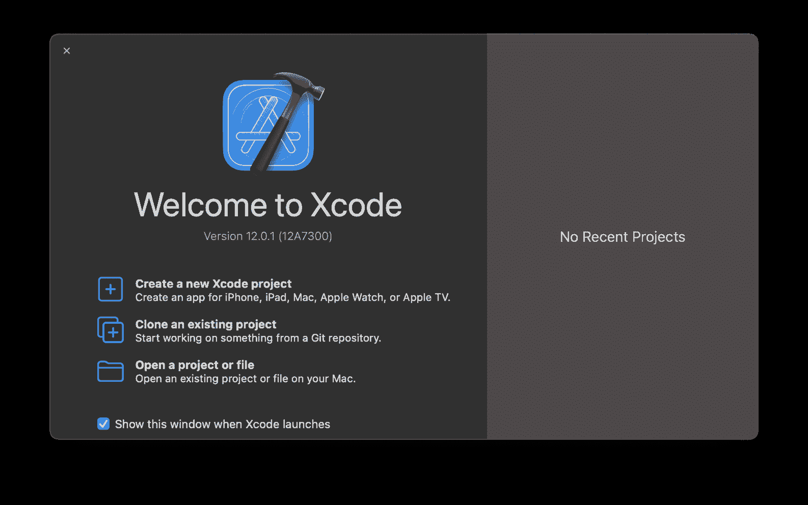

图 2-1: 启动 Xcode

然后，系统会提示你为应用选择模板。我们将从零开始，所以你可以选择 `iOS` 标签下的 `App`，这会告诉 `Xcode` 不要为你创建任何内容，包括游戏图形、增强现实模板或任何示例代码。

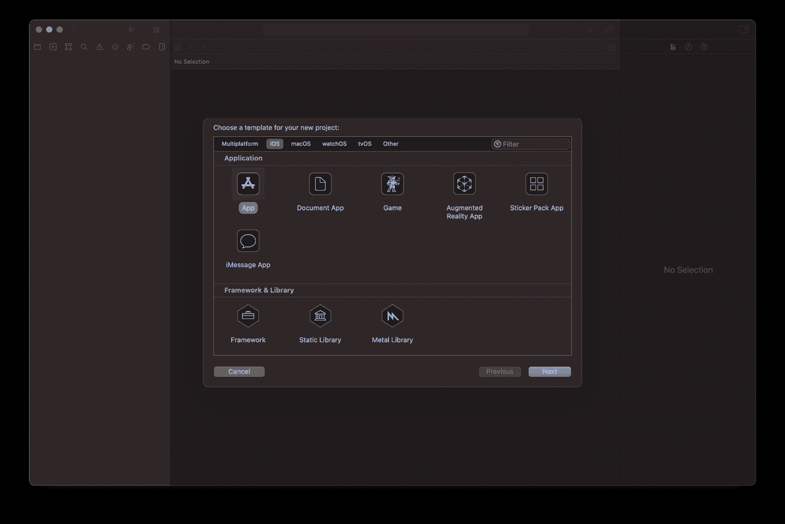

图 2-2: 选择模板

### 保存你的项目

接下来，给你的项目起一个有用的名字。我将我的项目命名为 `Chapter 2`，因为书中的每个后续章节都会有新项目。确保在 `Language` 下的下拉菜单中选择了 `Swift`，因为我们将使用它来制作图像分类应用。对于 `Interface` 选项，请选择 `Storyboard`。

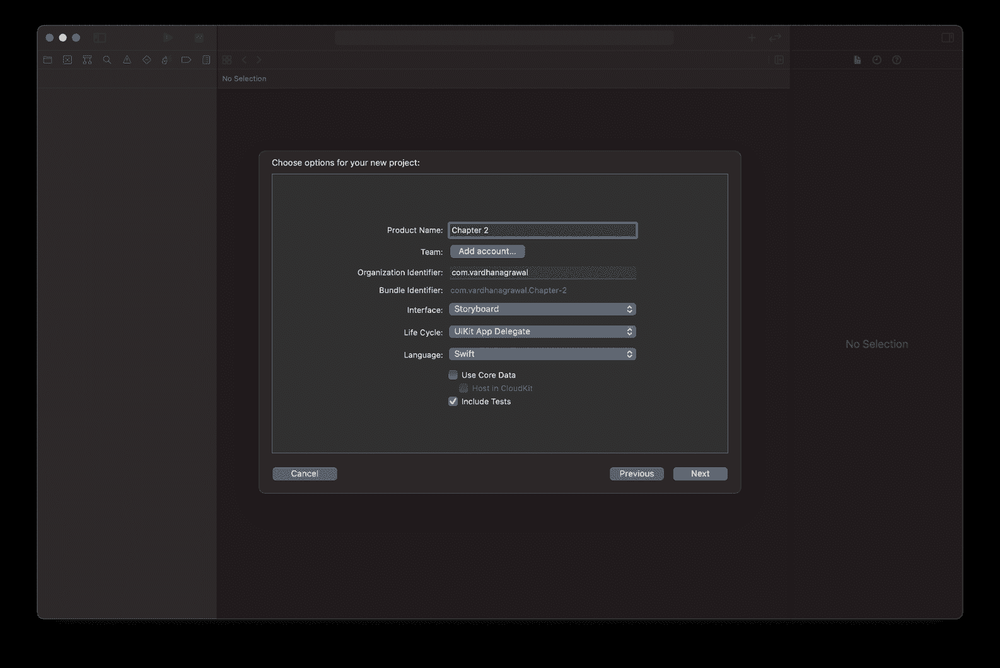

图 2-3: 为项目命名

最后，选择你想要保存项目的地方。选择一个你最不可能移动它的安全位置。在某些情况下，移动你的 `Xcode` 项目可能会导致问题。

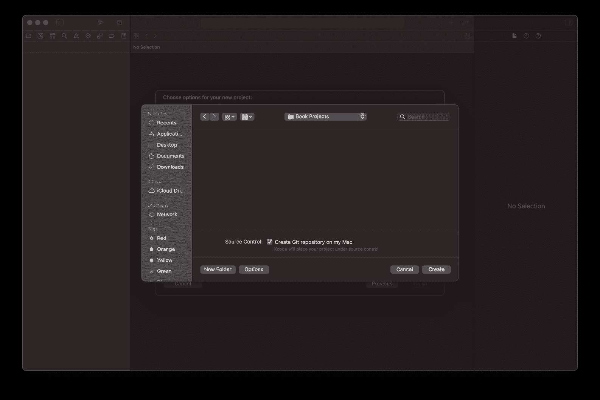

图 2-4: 保存你的项目

### 准备调试

图像处理需要使用手机的摄像头（理所当然的，*图像*分类）。由于 `Xcode 模拟器` 没有自己的摄像头，你将无法使用它。因此，你需要一台 iPhone 来跟随学习。如果你自己没有，最好在本章中借一个，因为如果你无法运行和测试应用程序，就无法捕捉到那些讨厌的 bug。

假设你已经有一台 iPhone，或者已经获得了一台来跟随本章节，让我们用 `Xcode` 对其进行设置。以前，你需要使用电缆将目标设备连接到计算机进行测试。但现在你可以无线地测试应用程序了，即通过 `Wi-Fi` 或 `蓝牙`，而不是物理电缆。这让你作为开发者的工作流变得简单得多，但需要一些设置。

如果你已经配置了 `Xcode` 进行无线调试，可以跳过，但如果没有，我们将逐步进行。

#### 无线调试

要设置 `Xcode` 的这一巧妙功能，首先如果 `Xcode` 还没有打开，请打开它。然后，转到 Mac 的菜单栏并选择 `Window > Devices and Simulators`。此时将打开 `Devices and Simulator` 窗口。

使用 lightning 线将你的 iPhone 连接到 Mac，你应该会在窗口的左侧窗格中看到你的设备弹出。在右侧，它将显示有关手机的详细信息，例如型号、存储容量和序列号。下方，你可以看到已安装的任何应用以及配对的 Apple Watch（如果有的话）。

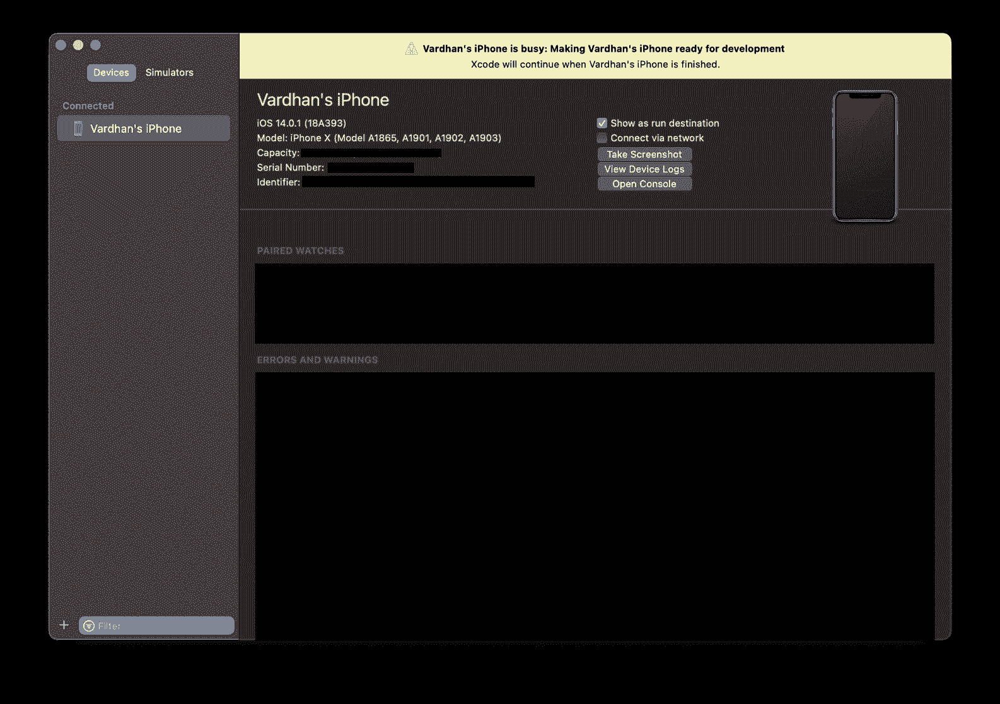

图 2-5: 设备和模拟器

要完成无线调试，勾选 `Connect via Network` 复选框。在手机进行设置时，你会看到一个对话框显示手机已设置好，完成后，你就可以断开设备连接，它应该可以在不需要线的情况下配合 Xcode 工作！

#### 选择模拟器

现在，打开你创建的项目（如果它还没有打开的话）。

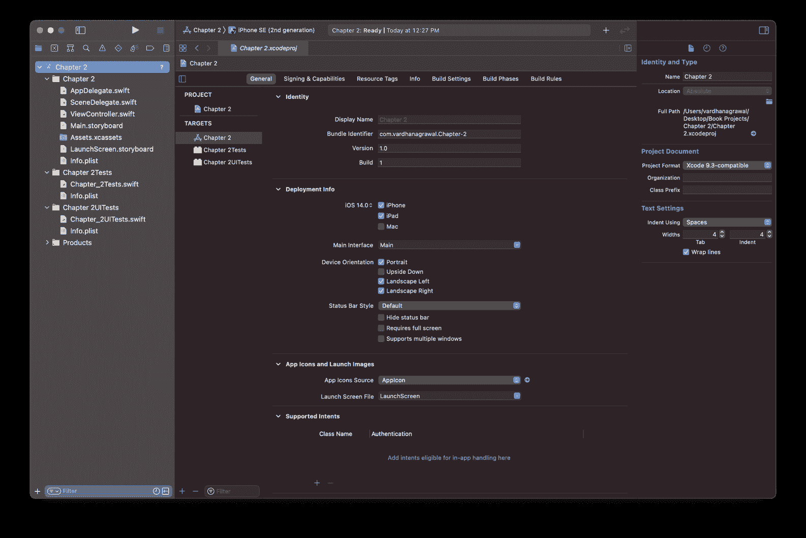

图 2-7: 你的项目

在窗口左上角，你会看到一个名为 `Run` 的三角形按钮。在它旁边，你会看到设备名称，例如 `iPhone 11`、`iPhone 8 Plus` 或更具体的，如 `Vardhan’s iPhone`。为了使用你自己的 iPhone 进行调试，你需要从下拉菜单中选择它。

设备旁边会出现一个网络图标，表示无线调试已启用且 `Xcode` 已连接到你的设备。如果你没有看到，可能需要重启 `Xcode`，或者删除设备并重新添加。

### 用户界面设计

最后，我们准备好开始制作我们的图像分类应用了！如果你从未使用 `Xcode` 的 storyboard 构建过用户界面，你将在这里获得对它的实践性理解。

对于那些想要跳过的人，在本节结束时，我们将有一个带有两个标签的图像视图以及一个将它们结合的视图。

要开始，请打开 `Project Navigator`（项目导航器）中的 `Main.storyboard` 文件，它位于 `Xcode` 窗口的左侧窗格。

#### 图像视图

我们设计的内核是一个 `UIImageView`，用于向用户实时显示他们指向的内容。设备将获取来自摄像头的视频流并通过此视图显示给用户。

##### 对象库

前往 `Object Library` 搜索图像视图。你可以通过点击 `Xcode` 最顶部工具栏从右数第七个图标来访问它。该图标显示为圆圈内的方框。

现在，搜索图像视图，你应该看到类似的内容：

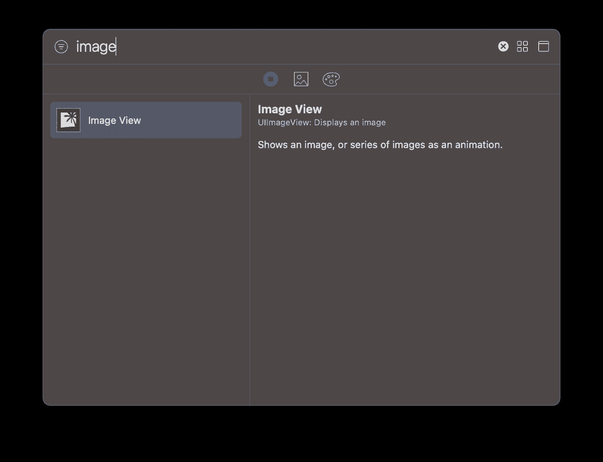

图 2-8: 对象库

你可以直接将图像视图拖入你的 storyboard，它应该填充整个屏幕。如果没有，请使用图像视图沿的白色方块调整其大小，使其与你的 `View Controller` 大小匹配。


可选，你可以添加一个占位图像来直观感受设计在最终 App 中的外观。我从网上找了一张香蕉的图片，并用它来填充我的图像视图。要添加占位符，只需将图像拖到左侧的项目导航器中即可。

然后，在 Storyboard 中选中图像视图后，从右侧窗格（属性检查器）的下拉菜单中选择图像。最后，将 `Content Mode` 设置为 `Aspect Fill` 以让你的图片恰当显示。

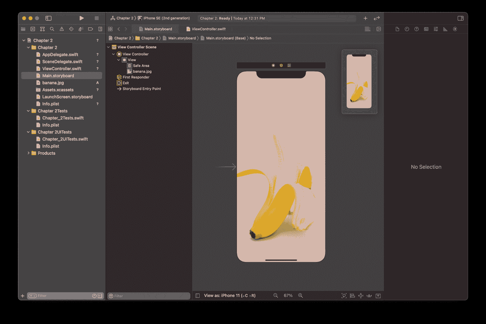

图 2-9: 添加占位符

## 视图与标签

由于这是一个图像分类应用，我们需要一种方法来告诉用户 App 认为他们的物体是什么。为了实现这一点，我们将在顶部放置一个纯白色视图，其中包含两个标签：一个用于显示预测，另一个用于显示置信度。我们可以使用 Xcode 项目中的 Storyboard 来构建基础的用户界面。

### 添加视图

就像你之前做过的那样，前往对象库（Object Library）并找到一个视图（它只是一个“view”，而不是“image view”或任何其他视图）。搜索“view”，它应该是列表中的倒数第二个对象。将其拖入你的视图控制器（View Controller）并根据你的需要进行定位。

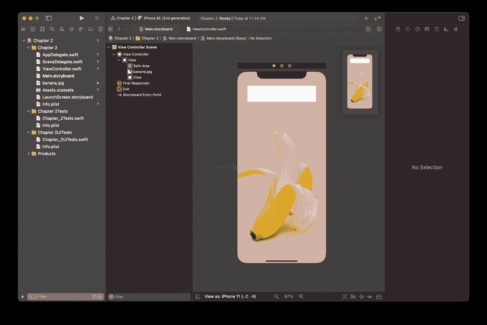

图 2-10: 添加标签

我将它放在了视图的顶部，但当然，你也可以把它放在任何喜欢的地方。为了美观，你甚至可以将其变为半透明，或者使用模糊视图（blur view）来添加酷炫的透明效果——发挥你的创意吧！

### 添加标签

现在，到了最重要的部分：标签。我们将用一个标签显示预测，另一个标签显示置信度。与之前的两个步骤类似，拖入两个标签。你可以在对象库中搜索“label”来找到它们。

确保你将它们*拖入视图内部*，而不是*叠在视图上方*。当我们稍后介绍自动布局（auto layout）时，你就会为什么这很重要。

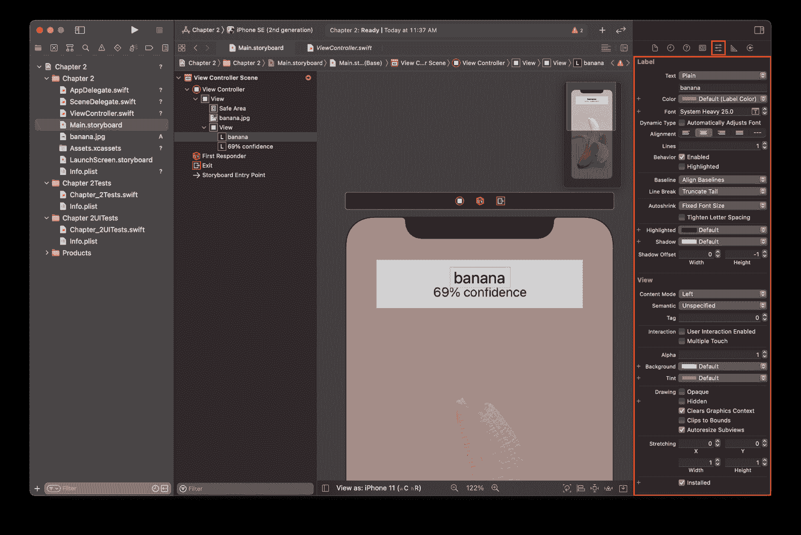

图 2-11: 属性检查器

如果你仔细观察，可能会发现我对标签进行了样式处理。如果你也想这样做，请确保 Xcode 的右侧窗格可见，然后使用属性检查器标签页更改标签的尺寸、样式和字体。

## 自动布局

苹果制作了许多设备，为了支持所有设备，Xcode 内置了一个名为“自动布局”（Auto Layout）的实用工具。虽然这个名称可能让你认为它会“自动”为你设置约束并在多个设备上调整大小，但你需要告诉 Xcode 在视图的什么位置放置对象。

当你通过 Storyboard 粗略放置好用户界面元素后，就可以设置约束并锚定你的元素了。

在 Storyboard 的底部，你会注意到一个菜单栏，中心显示当前的缩放倍数，右侧有一些图标。这些图标将帮助你为 App 设置自动布局约束。

### 约束图像视图

首先，让我们将图像视图约束为视图的大小。这样一来，我们就可以确保无论物理屏幕有多大，图像视图都会缩放以填充整个屏幕，而不是在实际图像与屏幕之间留下不需要的间隙或边框。

要开始添加约束，点击右侧第二个图标，它看起来像一个周围被线条包围的正方形。会弹出一个窗口，你会看到类似这样的内容：

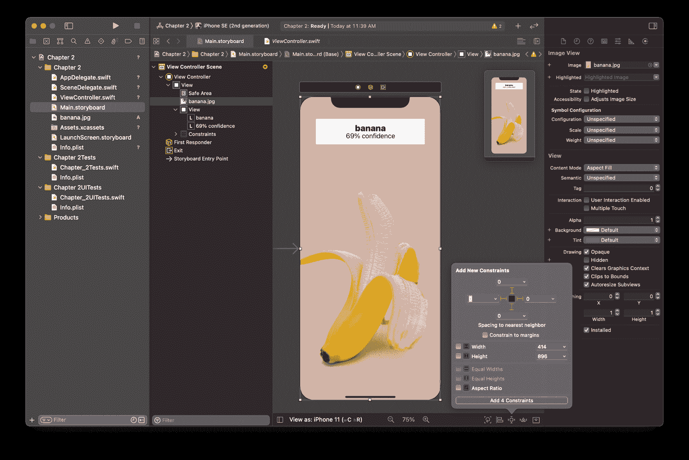

图 2-12: 设置约束

方框周围的四个数字告诉 Xcode 相对于周围对象放置对象的位置。由于图像视图除了屏幕边缘外没有其他周围对象，这些数字代表了图像视图边缘到屏幕边缘的距离。如果我们让图像视图填充屏幕，所有这些数字都必须为零。

按四次 `return` 键以添加所有约束，然后点击对话框底部的“Add Constraints”（添加约束）按钮。如果你现在在不同的模拟器上运行 App，你会发现其他元素（如视图和标签）会位置错位，但图像视图将始终填充屏幕。这是因为 Xcode 现在根据你的布局约束确切知道应该在何处放置你的 `UIImageView`。

### 约束标签容器

记得我们之前创建的那个白色视图吗？下一步是将其约束到屏幕上。与约束图像视图的方法类似，打开 `Add Constraints` 菜单——它是右侧第二个图标。

但这一次，我们不需要将约束设为零，而是需要指定视图距离屏幕边缘的距离。在我的示例中，我希望它距离顶部为 *20 像素*，距离两侧的距离为 *40 像素*。由于我们没有指定底部约束，我们需要将高度固定为 *50 像素*。

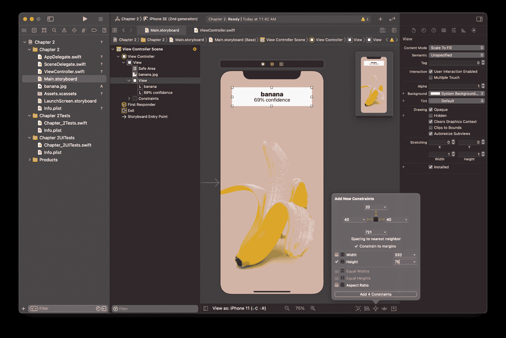

图 2-13: 选择约束

将对话框中的数字更改为：顶部 *20*，左侧 *40*，右侧 *40*。虚线应该变成红色，表示将设置约束。此外，勾选 `height` 旁边的框框并将值设置为 *75*，表示该视图应始终保持 *75 像素* 高。

### 标签与堆栈视图 (Stack Views)

按住 `Shift` 键并选择两个标签，我们将创建一个所谓的*堆栈视图*（stack view）。堆栈视图是自动布局奇迹之一。事实上，它是我快速用户界面布局的首选工具之一。

它们允许你创建一组可以组合的对象，并自动处理堆栈内部的间距、宽度和高度——这就是“自动”发生的地方……

一旦你选择了两个标签，前往 `Editor > Embed In > Stack View`（嵌入 堆栈视图），这会让你的两个标签看起来被组合在了一起。这个“组”现在可以作为一个单独单元来同时为两个标签设置约束。

### 约束堆栈视图

确保自动布局设置正确的最后一步，是将我们刚刚创建的堆栈视图约束到视图内部。如果你还记得，我们确保了标签是在视图内部而不是*叠在上方*。这允许我们针对视图而不是屏幕设置约束，因为视图已经约束到了屏幕。点击其中一个标签来选中堆栈视图，然后点击高亮区域的边缘。

确保你选中的是堆栈视图，而不是其中一个标签。

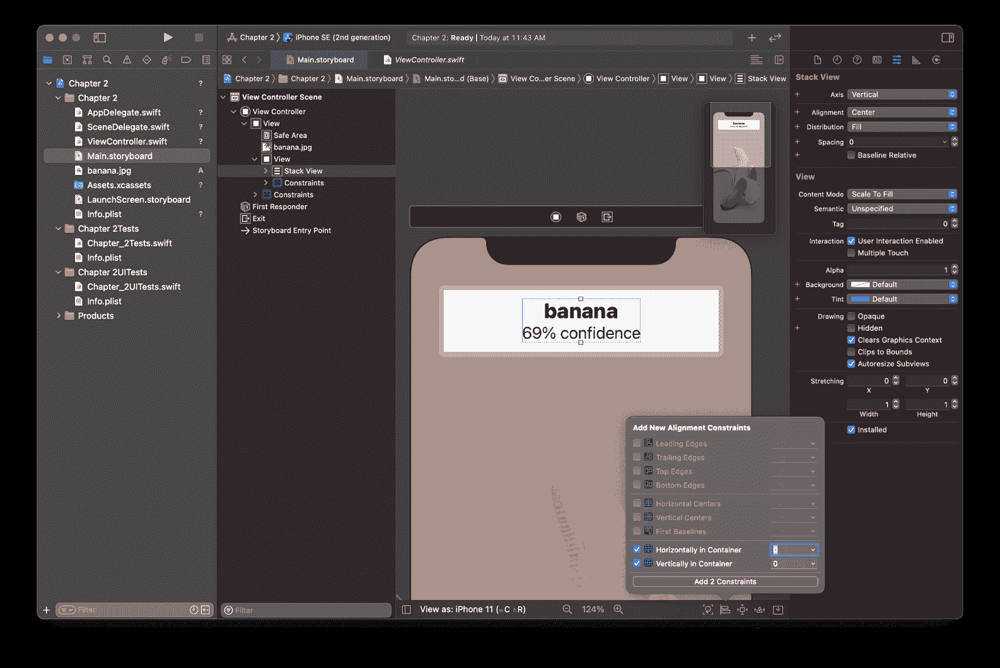

图 2-14: 居中堆栈视图

我们将利用此机会学习自动布局中的另一个工具——**对齐**（Align）工具。它允许你在容器内从垂直和水平方向上居中视图，或对齐你的视图。选中堆栈视图，点击右侧第三个图标，它看起来像一个侧向的条形图。然后，勾选 `Horizontally in Container`（在容器内水平居中）和 `Vertically in Container`（在容器内垂直居中）。这些框告诉 Xcode 在我们之前创建的白色容器视图内居中你的堆栈视图。


# 连接到代码

现在你已经为我们的图像识别应用创建了用户界面。在正式编写应用代码之前，最后要做的工作是将 Interface Builder 中的用户界面元素连接到相应的 Swift 文件 `ViewController.swift`。

## Interface Builder 输出（Outlets）

通过 Xcode 窗口的左侧窗格打开 `ViewController.swift`。在 `ViewController` 类内部，在 `viewDidLoad()` 方法上方添加以下三行代码：

```
@IBOutlet weak var predictionLabel: UILabel!
@IBOutlet weak var confidenceLabel: UILabel!
@IBOutlet weak var imageView: UIImageView!
```

`@IBOutlet` 标签告诉 Xcode 你正在声明一个从代码到 Interface Builder 的连接。如果你不使用该标签，Xcode 会认为你纯粹是通过代码来构建界面。

`weak` 词表示在此情况下，Interface Builder 对标签或图像视图有一个弱引用（weak reference）。这告诉 Xcode 你希望 iOS 自动分配和释放该元素所需要的内存，而不是将其一直保留在内存中。虽然你大多数时候不会使用 `weak`，但你可能坚持使用它会更好。即使你不完全理解这个概念也没关系——这是一个高级的计算机科学概念，Swift 会自动为你处理！

最后，我们正在声明一个普通的 Swift 变量，并赋予它我们尝试连接的元素的类型。结尾的感叹号将类型声明为“隐式解包可选”（Implicitly Unwrapped Optional），这告诉 Swift 你 100% 确定该对象永远不会为 `nil`。

## 使用辅助编辑器（Assistant Editor）

代码部分设置完成后，我们将使用辅助编辑器来帮助将每个 `@IBOutlet` 连接到 storyboard 中对应的元素。

通过 Xcode 窗口的左侧窗格打开你的 `ViewController.swift` 文件。

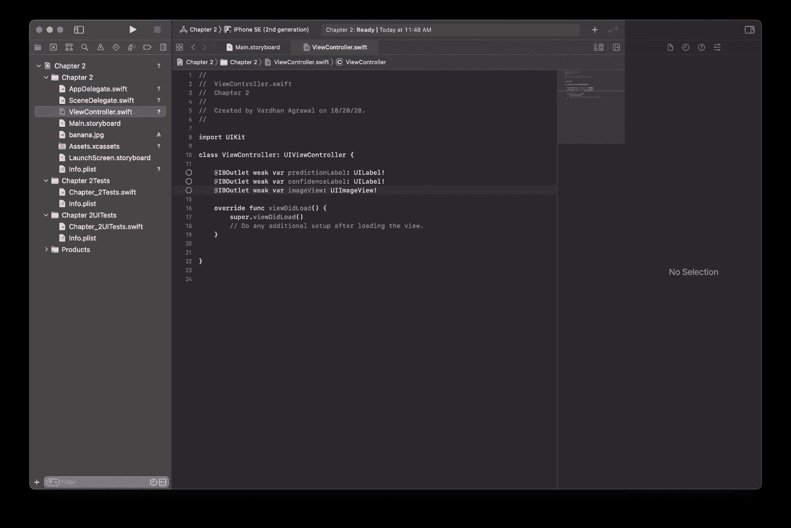

图 2-15：Xcode 编辑器

然后在在文件预览的右上角，选择像窗口旁边加号的图标。这将打开辅助编辑器，它会自动在 storyboard 右侧打开你的 `ViewController.swift` 文件。如果它没有打开 storyboard，只需使用新窗格顶部的文件层次结构选择它即可。

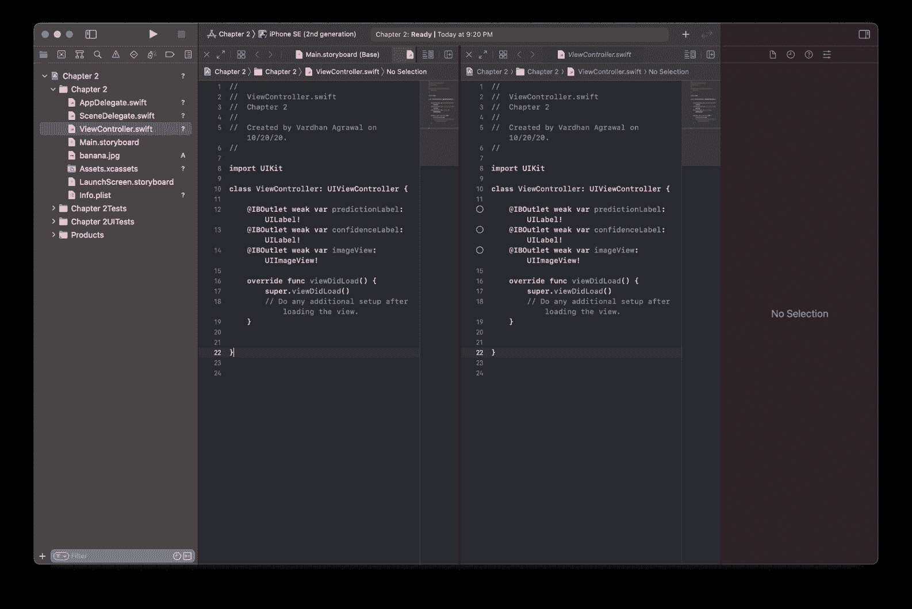

图 2-16：辅助编辑器

与其行号，你应该在每个 `@IBOutlet` 左侧看到未填充的白色圆圈，这意味着它们还没有连接到 storyboard。将光标从这些圆圈内部拖动到 storyboard 中对应的元素。当连接成功时，圆圈将变为填充。

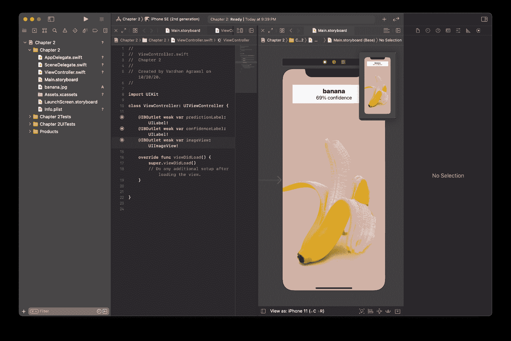

图 2-17：带有 storyboard 的辅助编辑器

再次点击辅助编辑器按钮返回原始视图。你不再需要让 storyboard 与你的 Swift 文件一起打开。到此时，你的 `ViewController.swift` 文件中应该有三个变量。我给它们命名如下：

* `predictionLabel` 用于上方的标签。
* `confidenceLabel` 用于下方的标签。
* `imageView` 用于图像视图。


在我们设置好设备及其捕获会话后，就可以准备创建一个预览层了，这允许用户看到他们的摄像头正指向哪里——毕竟，你想看到你正尝试分类的物体！稍后，我们将使用 `AVCaptureVideoDataOutput` 来帮助我们捕获视频流中的逐帧画面，以便通过我们的机器学习模型进行处理。

在你的 `setupSession()` 方法中，添加以下内容：

```
let previewLayer = AVCaptureVideoPreviewLayer(session: session)
previewLayer.frame = view.frame
previewLayer.videoGravity = .resizeAspectFill
imageView.layer.addSublayer(previewLayer)
```

在第一行代码中，我们创建了一个 `AVCaptureVideoPreviewLayer` 实例，它将我们的 `AVCaptureSession` 作为参数传入。然后，为了显示视频流，我们将预览层的大小设置为 整个屏幕的大小（如 `view.frame` 所示）。我们还需要设置 `videoGravity` 以使其填充屏幕，同时保持视频流的纵横比例。最后，我们使用图像视图的 `layer` 属性在你在第 2-1 节中创建的图像视图内部显示视频流。

### 准备处理

现在我们已经处理好了视频流，可以准备将其逐帧导出，以便稍后与机器学习模型配合。我们可以使用 `AVKit` 框架的某些功能来帮助实现最终目标。

#### 会话输出

为了输出视频流的帧，我们需要创建一个 `AVCaptureVideoDataOutput`。你可以通过将以下两行代码粘贴到同一个 `setupSession()` 方法中来实现。

```
let output = AVCaptureVideoDataOutput()
output.setSampleBufferDelegate(self, queue: DispatchQueue(label: "videoQueue"))
```

与你之前的操作类似，我们刚刚创建了一个 `AVCaptureVideoDataOutput()`。如你所记得，我们的 `ViewController` 遵循 `AVCaptureVideoDataOutputSampleBufferDelegate` 协议，这样我们就可以接收实时视频流的每一帧并对其进行单独处理。上述代码段的第二行将 `ViewController` 设置为输出流的代理。`DispatchQueue` 的作用是确保每一帧都按照正确的顺序发送给代理。

#### 启动会话

现在，我们在应用程序的 I/O 方面已经几乎完成，但我们还需要做最后一件事——添加输入和输出，然后启动 `AVCaptureSession`。

在 `setupSession()` 方法末尾添加以下内容：

```
session.addOutput(output)
session.addInput(input)
session.startRunning()
```

我们使用了早早创建的 `AVCaptureSession` 的 `addOutput()` 和 `addInput()` 方法来访问设备的摄像头，将实时流显示到我们的图像视图中，并提取视频中的单帧用于机器学习处理。

现在，我们最终需要在从 `UIViewController` 类重写的 `viewDidLoad()` 方法中调用 `setupSession()` 方法。这样做之后，你的 `viewDidLoad()` 方法应该看起来所示：

```
override func viewDidLoad() {
    super.viewDidLoad()
    setupSession()
}
```

## 2-3 图像分类与标记

在上一节中，你学习了如何将界面生成器中的用户界面连接到实际的 Swift 代码。你还学习了如何从设备的摄像头捕获实时视频流，然后提取单帧进行处理。到目前为止，你应该已经拥有了一个具有实时视频流的应用程序。

在本节中，我们将找到一个用于在应用程序中使用的图像分类模型。接下来，你将学习如何使用基础图像处理技术来对上一节中实时视频流的帧进行分类。到本章结束时，你将拥有一个功能完整的图像分类应用，它可以实时处理并识别物体。

### 图像分类

在我们开始处理和分类图像之前，让我们先找到一个要使用的机器学习模型。在本章中，我们不会使用自定义模型，但在后面的章节中，你将学习如何使用强大且先进的工具和技术构建自己的模型。

#### 寻找模型

由于此应用程序使用了 Core ML，Apple 官网是寻找机器学习模型的好地方。我们将在该网站找到一个合适的模型，让我们的图像分类应用按预期工作。

##### 浏览与下载

在[Working with Core ML Models](https://developer.apple.com/machine-learning/build-run-models/)页面上，你可以在底部找到多种可选模型。

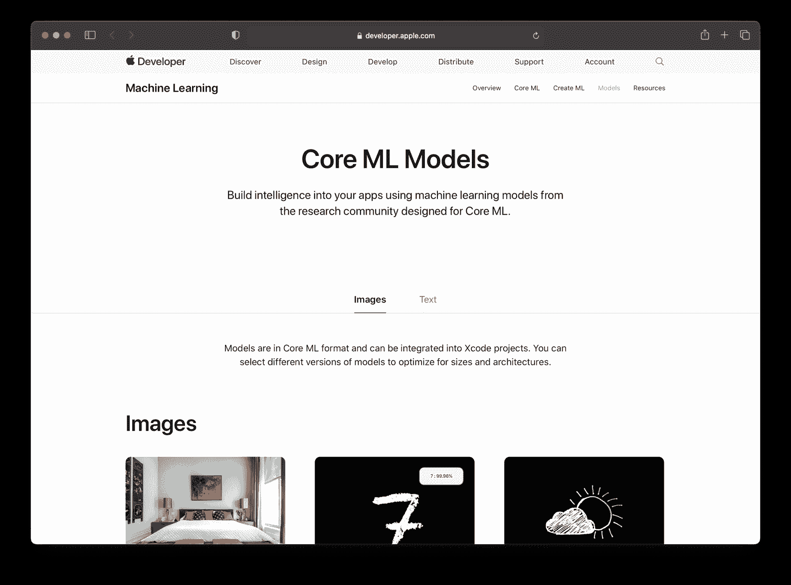

图 2-18：浏览 Core ML 模型

为了方便起见，我选择了列出的第一个模型，它最初由 Andrew Howard 开发为 Caffe 模型，后来转换为 Core ML —— 我们将在书的后面部分这样做。

你可以通过点击你想要模型下方的 `Download Core ML Model` 按钮来下载此模型，或者[直接下载。](https://docs-assets.developer.apple.com/coreml/models/MobileNet.mlmodel)

##### 导入

导入你创建的模型很容易。你只需要将刚刚下载的 `.mlmodel` 文件拖入你的 Xcode 项目中。确保你在与你的项目同名的文件夹中进行此操作。这是你所有其他重要项目的所在地，例如 `ViewController.swift` 和 `Main.storyboard`。

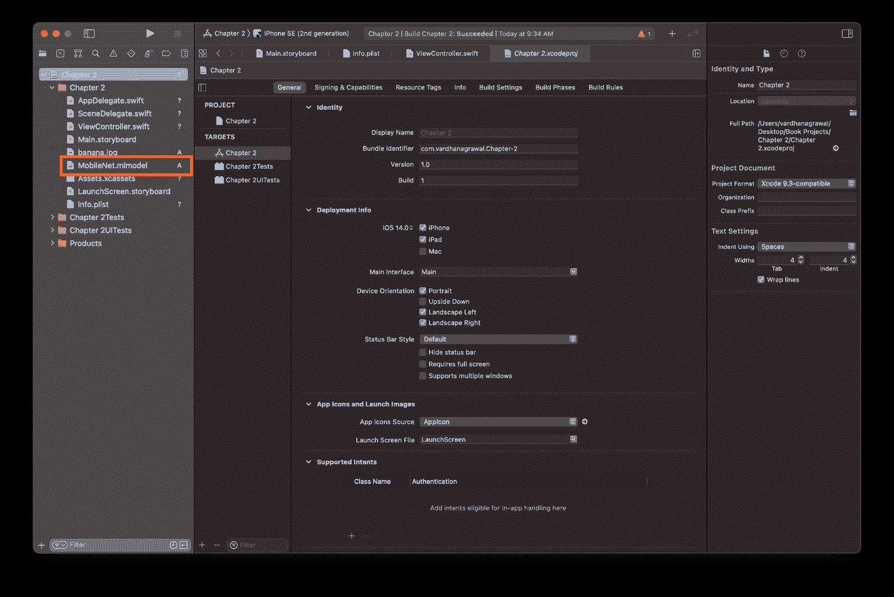

图 2-19：导入的模型

#### 像素缓冲区

像素缓冲区（Pixel Buffer）是在使用之前存储少量图像数据的方式。在当前应用程序中，我们将使用像素缓冲区存储视频流的单帧，以便稍后输入图像分类模型。

##### 捕获输出

在上一节中，你为 `ViewController` 类创建了一个扩展，它遵循 `AVCaptureVideoDataOutputSampleBufferDelegate`。如你记得，我们这样做是为了构建实时视频流并提取单帧。为了访问这些帧，请在你的 `ViewController` 扩展中添加以下代理方法：

```
func captureOutput(_ output: AVCaptureOutput, didOutput sampleBuffer: CMSampleBuffer, from connection: AVCaptureConnection) {
    // 你的代码
}
```

该方法的 `sampleBuffer` 参数是代理传入缓冲区的地方。我们的任务是将该参数转换为与 Core ML 模型兼容的像素缓冲区。

##### 像素缓冲区转换

现在，我们需要将方法调用的 `CMSampleBuffer` 转换为 `CVPixelBuffer`。为了这一点，在你之前创建的代理方法中添加以下内容：

```
guard let pixelBuffer: CVPixelBuffer = CMSampleBufferGetImageBuffer(sampleBuffer) else { return }
```

如果你做过 Swift 开发，`guard-let` 语句看起来很熟悉，但它实际上检查是否可以使用传入的参数创建像素缓冲区。如果不能，程序将安全返回，而不是尝试解包 `nil` 可选值。

#### 使用模型 实例化

现在，是时候为早之前导入的文件创建一个 `VNCoreMLModel` 版本了。使用类似于像素缓冲区的概念，输入以下内容来创建一个存储模型的常量：

```
guard let model = try? VNCoreMLModel(for: MobileNet(configuration: MLModelConfiguration()).model) else { return }
```


我们将使用导入的模型及其 Swift 包装类来创建一个 `VNCoreMLModel`。我们将使用 `VNCoreMLModel` 进行视觉和图像分析，因为该包装类本身没有为我们提供任何有用的信息。

要实例化 `VNCoreMLModel`，我们通过传递一个空配置（如果你想调整模型，可以使用它）来创建模型包装类的实例，然后访问它的 `model` 属性。

## Core ML 请求

为了最终使用此模型，我们需要创建一个 `VNCoreMLModelRequest`，它允许我们把模型作为参数传入，并在完成处理程序（completion handler）中接收结果以及任何错误。在 `guard-let` 语句下输入以下内容：

```
let request = VNCoreMLRequest(model: model) { (data, error) in
    // your code here
}
```

`data` 和 `error` 引用可以在 `request` 的声明内部使用，用于访问模型请求的结果。请记住，我们还没有发送此请求；我们只是在声明当最终发送此请求时要做什么。

## 显示结果

到目前为止做得非常好！我们的图像分类应用几乎就完成了。现在我们唯一需要做的就是将结果显示在章节开头创建的用户界面上。

### 解包可选值（Unwrapping Optionals）

一如既往，有一个问题：我们需要首先解包结果，以防止程序在出现空值（nil）时崩溃。让我们像之前一样使用 `guard-let` 语句，确保安全将这些结果赋值给相应的常量。

### 获取结果

当我们从模型接收结果时，它实际上并不是单一结果——而是一个带有结果列表的数组。由于机器学习模型只是一个计算机，它可能不确定实际物体是什么。例如，它可能认为你的电视是一个电脑显示器，但同时也认为它是一个电视、矩形或画框。虽然模型最确定它是一个“电脑显示器”，但它也列出了其他猜测，以防我们需要对它们进行其他操作。

要从参数中提取此列表，请在 `request` 闭内部输入以下内容：

```
guard let results = data.results as? [VNClassificationObservation] else { return }
```

这会将列表作为 `VNClassificationObservation` 数组赋值给一个名为 `results` 的常量。如果无法实现，函数将安全返回。

### 第一个结果

你已经了解到结果是模型对可能猜测的列表，所以你现在知道只需要结果中的一个；但问题是从包含多个结果的数组中选择哪一个。我们刚刚创建的结果数组按置信度从高到低进行排序。要访问我们想要的，可以使用 `results.first`。

在你的闭包中添加以下 `guard-let`：

```
guard let firstObject = results.first else { return }
```

这个 `firstObject` 常量稍后可以使用，假设由于我们的安全可选值解包，我们不会得到 `nil` 值。

### 更新用户界面

最后，我们需要更新章节开头创建的用户界面。然而，我们需要不同的处理方式，因为我们是在异步类型（闭包）内部进行操作的。

#### 检查置信度

我们不希望标签在模型在一定程度上确定它看到的物体之前不断变化。我们可以通过简单的 `if-statement` 检查置信度并等待其显示结果：

```
if firstObject.confidence * 100 >= 20 {
    // 显示观察结果和置信度
} else {
    // 显示占位符
}
```

`VNClassificationObservation` 的 `confidence` 属性是一个浮点小数值，因此我们需要通过乘以 100 将其转换为百分比。然后，在将观察结果显示给用户之前，我们可以检查置信度是否达到 20%或更高。

#### 主线程

iOS 要求你在主线程上更新用户界面，因为图形渲染是同步进行的。在完成处理程序中（我们目前所在的地方），系统会将进程发送到后台线程。后台线程等待模型完成图像处理并给我们结果。虽然这一切都在几分之一内完成，但此时其他代码已经执行完毕。

要退出异步程序并更新 UI，请在 `if-else block` 的每个条件中添加以下内容：

```
DispatchQueue.main.async {
    // 在此处更新 UI
}
```

现在，你可以在从模型接收观察结果后可靠地更新用户界面。

#### 更新标签

最后，让我们用我们需要的信息更新标签。在 `if-statement` 的第一个条件中，添加以下代码行：

```
self.predictionLabel.text = firstObject.identifier.capitalized
self.confidenceLabel.text = String(firstObject.confidence * 100) + "%"
```

在这里，我们将第一个观察结果的 `identifier` 字符串大写化，以便在显示时更好看。然后，我们将置信度转换为百分比，以一种更符合用户习惯的方式可视化置信度。现在，我们还需要处理分类器不确定物体是什么的情况，看起来将所示：

```
self.predictionLabel.text = "--"
self.confidenceLabel.text = "--"
```

在这种情况下，我们只需显示两个折字符，告诉用户分类器无法识别手机指向的物体。


在上一章中，你构建了属于自己的图像分类应用，并学习了如何使用 `AVCaptureSession` 以及其他 `AVKit` 将视频流分割成帧进行处理。你还初步领略了构建直观用户界面的方法。然而，你使用的是一个预构建模型来对场景中的物体进行分类。

在本章中，你将学习 `Python`，这是一种通用语言，它在某些方面可以认为与 `Swift` 相似。如果你从未用过 `Python`，甚至没听说过它，那么你幸运了；无论你的技能水平如何，我都会循序渐进地解释 `Python` 的语法。如果你是 Python 专家，可以跳过（不推荐）第一部分，直接阅读本章的剩余部分。

在章节的后部分，你将学习 `Jupyter Notebook`，这是每个数据科学领域工作者的的福音。你将学习它们是什么、如何使用它们，以及它们如何融入你在机器学习世界的日常工作流中。

## 3-1 Jupyter Notebook 和 Anaconda

在这一节中，你将学习 `Jupyter Notebook` 它的用途，以及你如何在机器学习工作流中使用它。你还将学习安装用于使用 `Jupyter Notebook` 的适当工具，并在本节结束时创建一个 `Jupyter Notebook`。你现在不需要了解任何 `Python` 的知识；因为我将在下一节介绍。

在本节的最后，你将学习虚拟环境，这样你就不需要直接在 Mac 上运行 `Jupyter Notebook` 和 `Python` 脚本。相反，你将使用一个名为 `Anaconda` 的虚拟环境来隔离你的脚本，但不必担心——我会一步步涵盖一切，因此不需要先前的经验！

### 什么是 Jupyter Notebook？

如果你没有进入过数据科学或机器学习行业，你可能从未听说过 `Jupyter Notebook` —— 或可能认为它是来自 `Jupyter` 的某种老式写作风格笔记本。相反，如果你对机器学习做过任何事情，你很可能听过 `Jupyter Notebook`。但是，它们到底是什么，又有什么特别之处呢？

本质上，`Jupyter Notebooks` 是你可以汇集代码、数据、图表和文本的地方，供自己存储、与同事分享，甚至发布给数据科学社区。从形式上说，它们是 Web 应用程序，通常运行在你的本地机器上，并随着你笔记本的变化而实时更新。顺便提一下，在本章中将交替使用机器学习和数据科学这两个词 —— 因为它们非常密切。虽然它们不是同一个领域，但这种区别对你现在来说并不重要。

在我们开始安装和设置它之前，让我们先看看你可以用 `Jupyter Notebook` 做什么 —— 因为到目前它对你来说似乎并不有趣。

#### 终端命令

作为开发者，我们都知道多次输入一系列 shell 命令是多么恼恼 —— 特是在当我们执行相同的日常任务时，比如遍历文件系统或在我们的应用中安装 `Cocoapods`。

这是 `Jupyter Notebook` 可以被轻松使用的地方之一。你只需要写下你的命令（你稍后将学习如何这样做），并在前面加一个感叹号，告诉系统你在这里正在处理 shell 命令。

#### 演示幻灯片集

现在，我们的舒适区显然是在电脑后面。然而，重要的是意识到，我们一些优秀的工作发生是在与周围的人进行交流时发生的，包括工作、学校或与开源社区合作的项目。但有时，当代码作为纯文本投影在演示文稿上时，读起来可能会很笨拙。

`Jupyter Notebook` 有一个功能，可以从笔记本中的代码块中生成幻灯片，它会为你处理好语法高亮和样式。这允许你在演示信息时保持观众的参与度，而无需花时间去创建一个幻灯片集。

#### 可视化和表格

有时，仅仅看到数据集是不够的，将其绘制成图形或以组织良好的格式（如表格）查看会更简单。但当你对数据绘制图表时，当你向数据集中添加更多点，或者更改了整个数据集时，更新图表将花费太长时间。

你猜对了：`Jupyter Notebook` 允许你创建自定义的图表、图形和表格，这些内容会在你每次运行代码时更新。这使得你能够以视觉方式与数据进行几乎无缝的交互，同时能够随时更改。

现在，你实际上可以使用 `Jupyter Notebooks` 做更多事情，其中许多你将在本章课程中学到。但希望你现在对 `Jupyter Notebook` 是什么以及它为什么在机器学习行业如此常用用有了更好的了解。顺便提一下，你可能会看到它们被称为 `IPython Notebooks`，因为 `Jupyter Notebook` 是从它们演变来的。如果你正在查看互联网上旧的教程或资源，这可能会有所帮助。

### 安装 Anaconda

现在，我确定你迫不及待想要深入并开始使用你自己的 `Jupyter Notebook` 了。让我们先确保一切就绪。虽然你可以直接在系统上运行这些，但大多数专业人士倾向于使用虚拟环境，这允许你隔离你的项目，并为每个项目拥有独特的模块 —— 或依赖项。

如果你不知道并直接创建项目，`Python` 会到相同的地方，可能会产生问题。所以，为了让你变得专业，让我们使用虚拟环境！

正如我们之前提到的，你可以直接使用 `pip` 安装 `Jupyter Notebook`。然而，使用预包模块如 `Anaconda` 是初学者的最佳方式。此外，你将拥有未来项目所需的工具。让我们开始安装它。

首先，在 [Anaconda 页面](https://www.anaconda.com/distribution/) 下载 `64-Bit Line Installer`。你需要选择你的操作系统并点击下载按钮。我们将使用 `Python 3.8` 版本，因为这是目前 Anaconda 支持的版本。

```
Figure 3-1: 安装 Python 3.8
[Image placeholder: anaconda-installer.png]
```如果你对命令行安装器不熟悉，可以使用替代的 `64-Bit Graphical Installer`，它非常易用。然而，我强烈建议使用命令行安装器，因为它让你适应命令行并且可靠得多（特别是当电脑上有冲突的安装时）。

#### 打开终端

一旦下载了文件，打开**终端**。你可以在**应用程序**文件夹中的**其他**文件夹中找到它。或者，你可以按下 **Command + Space** 显示聚焦搜索，在其中搜索终端。

找到它后，你会看到一个黑色背景的窗口，看起来如下：

```
Figure 3-2: 终端窗口
[Image placeholder: mlbook132105.png]
```

#### 运行安装程序

现在，你只需要运行安装程序。注意的是命令前的 `%` 或 `$` 是提示符，不需要输入它们。

要运行安装程序，输入 `bash` 然后将下载的文件拖入你的终端窗口。路径会自动填充并看起来像这样：

```
% bash ~/Downloads/Anaconda2-2019.03-MacOSX-x86_64.sh
```


上述命令告诉你的终端运行你之前下载的 bash shell 脚本。该文件包含一系列命令（或步骤），可以让你轻松安装 Anaconda。当你输入此命令后，你将看到一个如下所示界面：

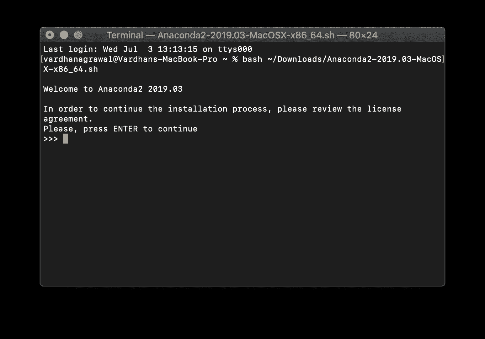

图 3-3: 启动 Anaconda 安装程序

如果你安装了正确的 Anaconda 版本，此屏幕应显示“Welcome to Anaconda2 20XX.XX”。接下来，按 `Enter`/`Space` 继续进入许可协议。

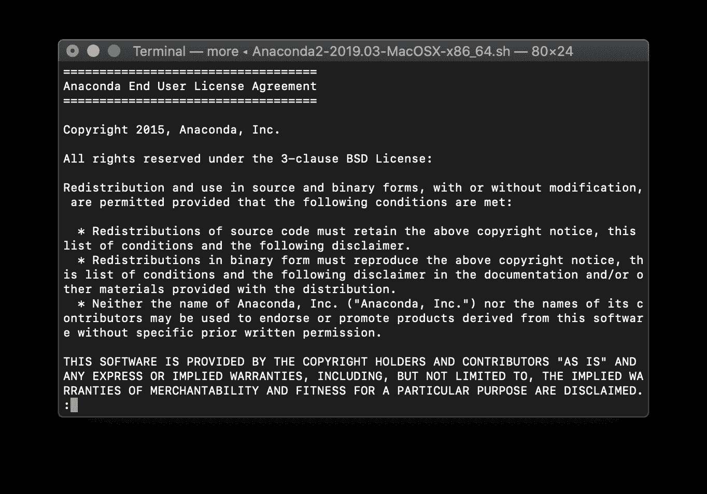

图 3-4: Anaconda 用户许可协议

当你看到许可协议时，继续多次按 `Enter` 以阅读完毕。当你到达末尾时，你会看到显示“Do you accept the license terms?（你是否接受许可条款？）”的文本。

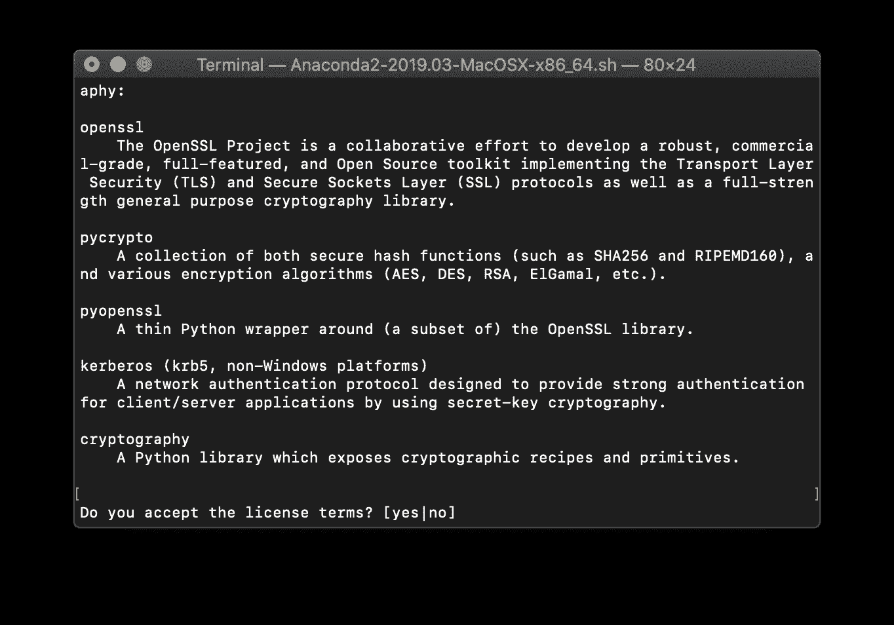

图 3-5: 接受 EULA

在你的终端窗口中输入“yes”以接受许可条款。

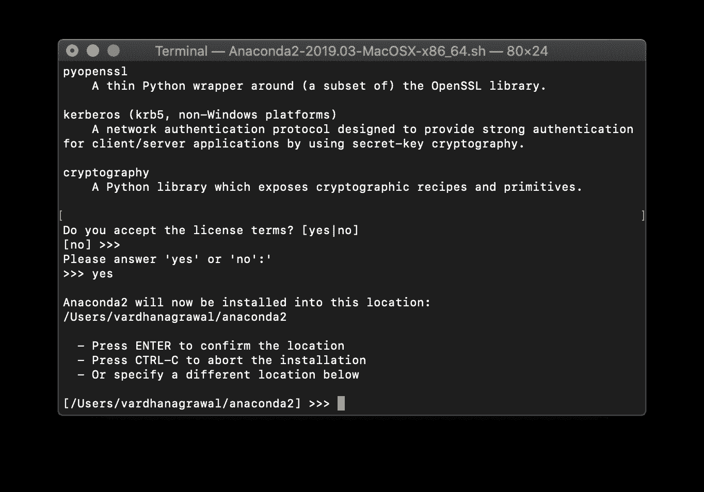

图 3-6: 确认安装位置

然后，你会看到一条消息，要求你确认安装位置。我建议你按 `Enter` 并确认安装，但如果你愿意，也可以更改你想要安装的位置。

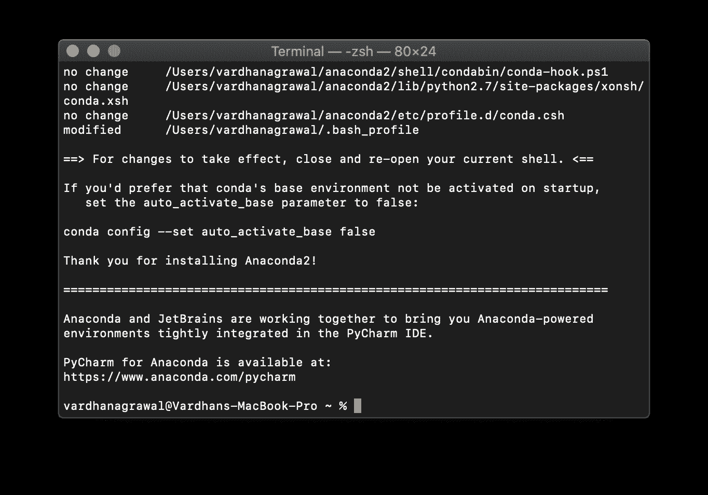

图 3-7: 安装确认

最后，在等待几分钟后，你会看到一个确认屏幕，要求你关闭 Terminal 窗口并重新打开以使安装生效。

大功告成了！你应该为自己能够在命令行中完全安装 Anaconda 而感到自豪；如果这是你第一次使用终端，那是一项巨大的成就。恭喜你！

## 创建 Jupyter Notebook

期待的时刻终于到了——是时候创建你自己的 Jupyter Notebook 了。在接下来的章节中，你将学习 Python。但在那之前，你需要创建并导航 Jupyter Notebook。

### 启动 Anaconda

此时，你应该已经安装了 Anaconda，它带了 Jupyter Notebook。首先启动 `Anaconda Navigator`，你可以通过 Mac 上的 Spotlight Search（聚焦光搜索）找到它。该图标是一个左侧带有几何图案的绿圈。当你启动它后，你会看到如下所示的屏幕：

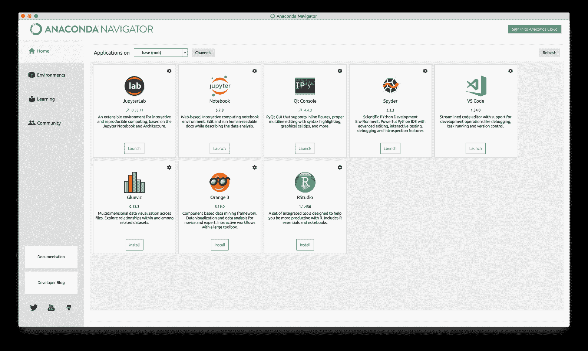

图 3-8: Anaconda Navigator

### 启动 Jupyter Notebook

现在，点击 `Jupyter Notebook` 框下方被矩形包含的 `Launch` 按钮。你会弹出一个 Terminal 窗口，看起来如下：

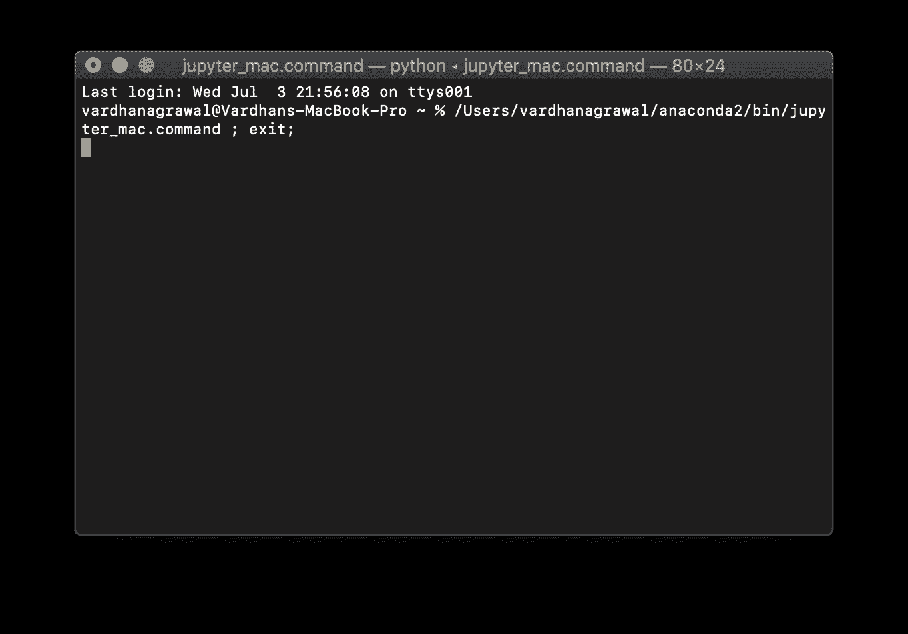

图 3-9: 启动 Jupyter Notebook 的命令

几秒钟，终端中的命令将执行，你会看到另一个如下所示的终端窗口：

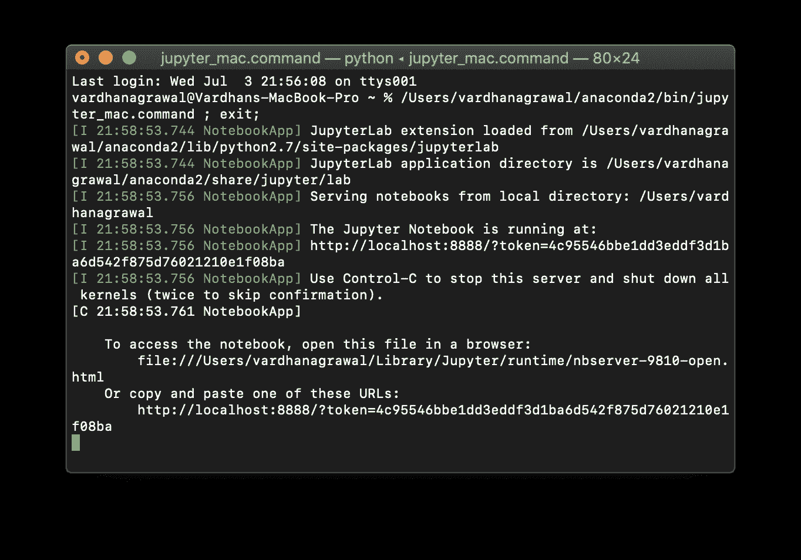

图 3-10: 执行启动命令

你不需要担心它显示了什么，但这些文字将帮助你理解如何使用 Jupyter Notebook。不过，如果你不想读它，也不用担心。你的浏览器（在我的情况下是 Safari）很快就会打开一个窗口，展示 Jupyter Notebook 界面。你会看到文件系统内容，可以像使用 Finder 一样进行导航。

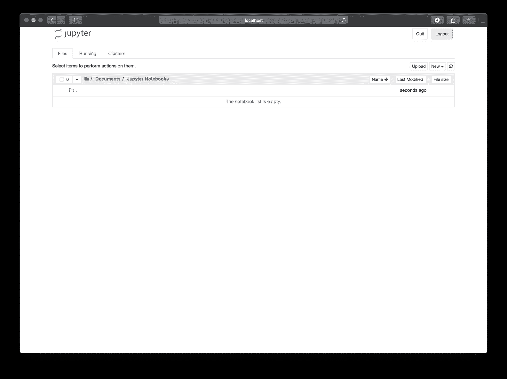

图 3-11: Jupyter Notebook 文件目录

### 创建新 Notebook

通过右上角列出的 `New` 按钮，你可以创建新的文本文件、文件夹和终端（Terminal）。如果你愿意，可以创建一个文件夹来组织你的 Jupyter notebooks；但如果不想，直接点击 `Python 2` 在当前目录下创建一个新的 Jupyter Notebook。

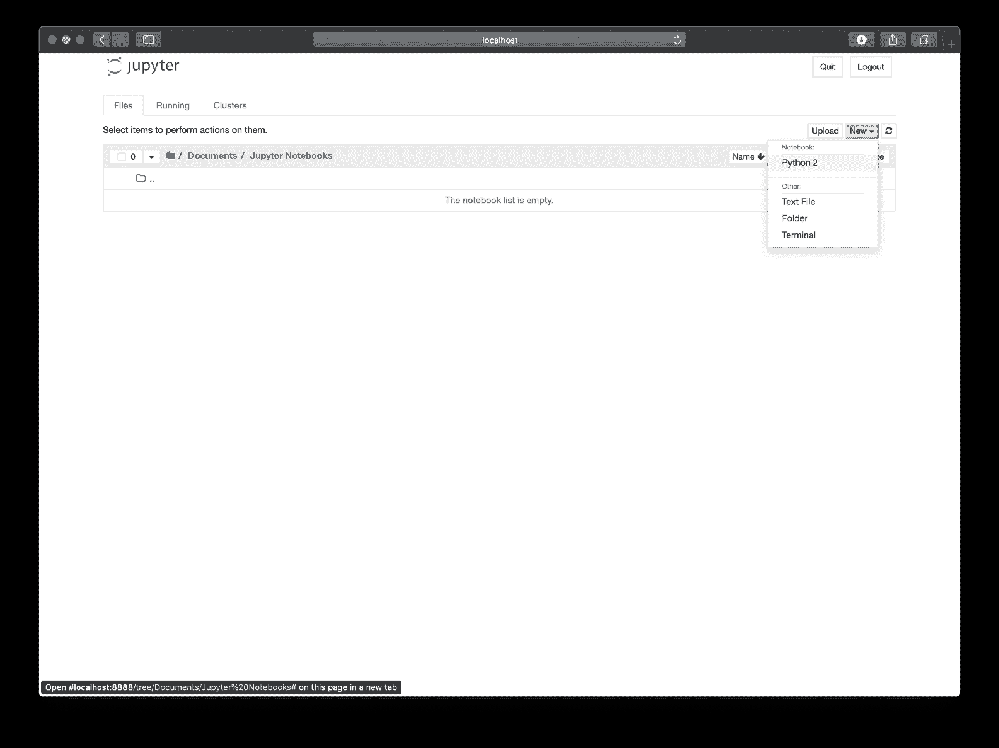

图 3-12: 创建 Jupyter Notebook

太棒了！一个带有你的 Jupyter notebook 的新窗口将会打开。你会看到一个空框，你可以在其中开始输入代码，网页页面顶部有一个类似文字处理器的菜单。

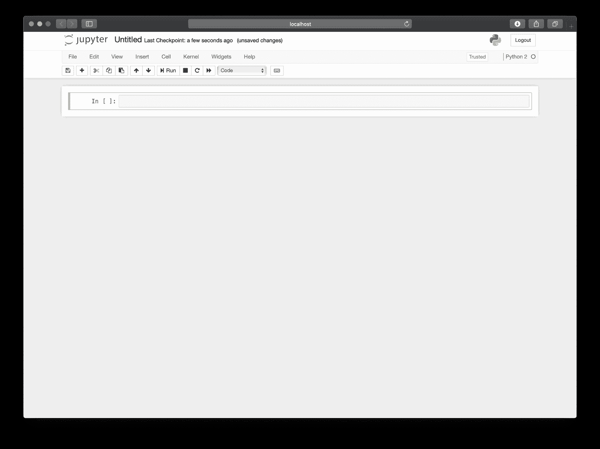

图 3-13: 新 Jupyter Notebook

当你对 notebook 进行更改时（例如创建新 notebook、删除 notebook 或修改内容），你会看到 Terminal 窗口随之更新。创建 notebook 后，你的 Terminal 看起来如下：

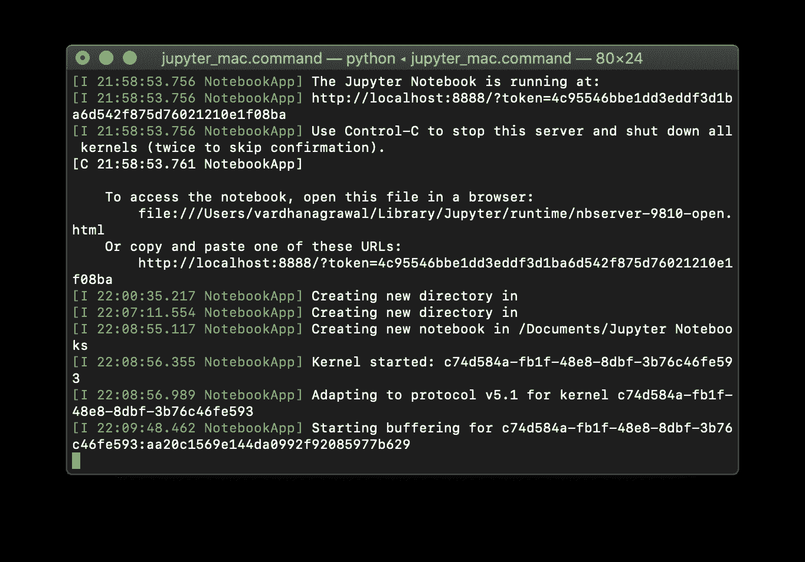

图 3-14: Terminal 中的 Notebook 更新

当你关闭 notebook（`File > Close and Halt`）时，它会在 Finder 和 Jupyter Notebook 内部的文件导航器中以 `.ipynb` 文件的形式出现。它可能如下：

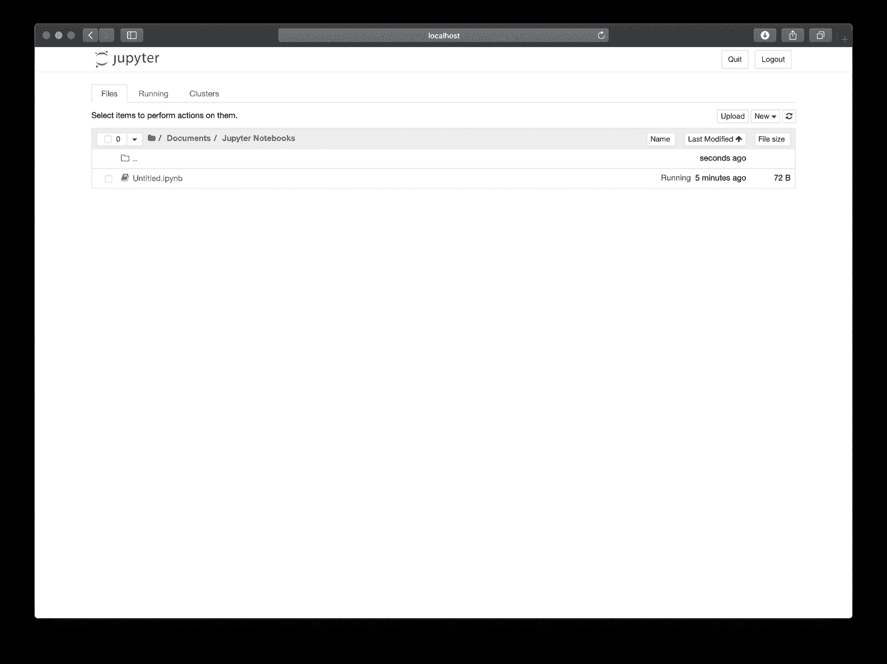

图 3-15: 运行 Jupyter Notebook

### 退出 Jupyter Notebook

目前我们结束。现在，你需要关闭 Jupyter Notebook，以免它在你的电脑上持续运行。要这样做，回到你的 Terminal 窗口并点击 `Control + C` 退出 Jupyter Notebook。你会看到一条确认消息，询问你是否想要退出 notebook：

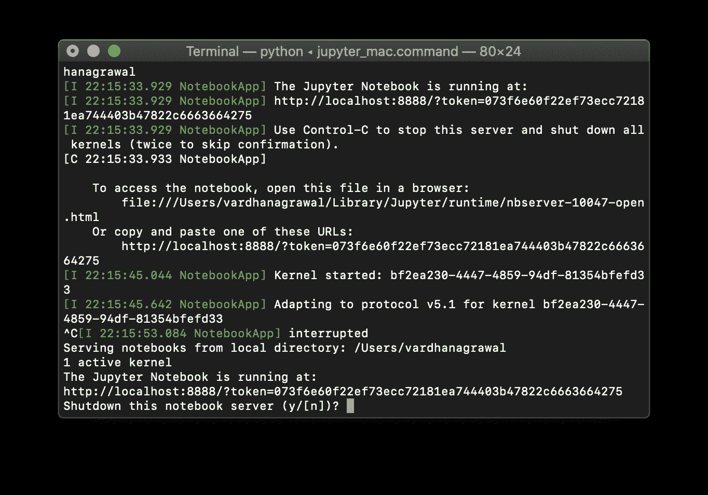

图 3-16: 关闭 Jupyter Notebook

当你看到这条消息时，你有 5 秒钟时间输入 `y` 或 `Y` 来确认关闭 notebook，否则你的 notebook 将继续运行。最后，当你能够确认要关闭 notebook 服务器时，你会收到一条显示 `[Process completed]` 的消息作为确认。

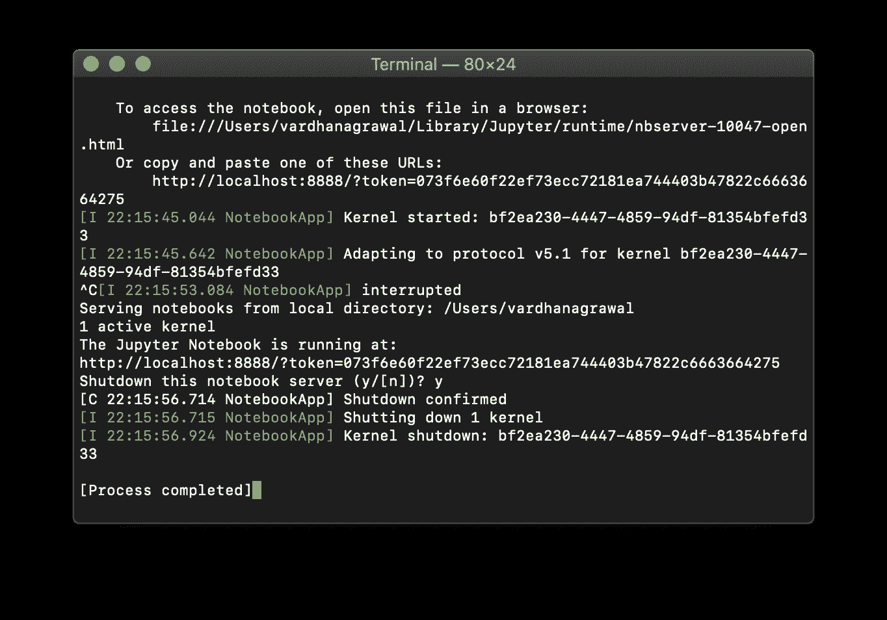

图 3-17: 确认消息

## 3-2 基础 Python

在上一节中，你了解了 Jupyter Notebook 是什么，以及如何安装和设置它们。你还创建了第一个 notebook 并了解了 Anaconda 如何帮助你满足各种数据科学需求。你现在对如何在机器学习工作流中使用这些工具有了更好的了解。

在本节中，你将学习 Python，这是机器学习领域所使用的语言。基本上，在章节结束时，你将掌握一种全新的编程语言。如果你已经有一定的 Python 经验，可以跳过本节；但如果你坚持下来，将回顾基础知识并可能会学到关于 Jupyter Notebook 的新知识。


```
num = 0
while (num < 10):
    print("hello")
    num = num + 1
```

正如你在示例中所看到的，变量 `num` 被设置为默认值 `0`。在执行 `while` 循环内部的代码之前，Python 会检查 `num` 是否小于 `10`。如果测试通过，将执行循环体，导致打印 "hello" 并让 `num` 加 1。

## For 循环

`For` 循环帮助你对循环进行更细致的控制。如果你需要打印从 1 到 10 的数字列表，你可以用 `for` 循环轻松实现，而如果使用 `while` 循环，这项可能需要花费更多精力。要遍历一组数字，你可以执行以下操作：

```
for num in range(1, 10):
    print(num)
```

默认情况下，变量 `num` 会加 `1`，但你可以通过向 `range` 添加第三个参数来增加另一个数字。例如，你可以将其增加 `3`，如下所示：

```
for num in range(1, 10, 3):
    print(num)
```

你还可以遍历其他类型，如字符串、数组和元组。要遍历 `apple` 单词的字符，你可以这样做：

```
word = "apple"
for char in word:
    print(char)
```

在这个示例中，变量 `word` 被定义为字符串 `"apple"`，我们通过定义一个现有的变量参数定义循环来遍历字符串中的每个字符，而不是使用 `range` 函数。

## 控制流

现在，你可能只想在特定条件下运行某些代码，你可以通过 `if` 和 `if-else` 语句控制代码的流。当然，你可能在 Swift 中已经熟悉这一点，而且这个概念在 Python 中几乎相同。检查这几行代码：

```
num = 1
if num < 0:
    print("false")
```

很直观，对吧？如果变量 `num` 小于 `0`，程序将打印 "false"，否则什么都不打印。但是，如果你想在那种否则的情况下打印某些内容，可以使用如下所示的 `else` 语句：

```
num = 1
if num < 0:
    print("false")
else:
    print("true")
```

最后，如果你想给 `else` 参数指定一个特定条件，可以执行以下操作来进一步缩小范围：

```
num = 1
if num < 0:
    print("false")
elif num == 1:
    print("right on")
else:
    print("true")
```

`elif` 语句规定，如果变量 `num` 不小于于 `0`，则编译器应该检查 `num` 是否等于 `1`。如果 `num` 不等于 `1`，它将默认打印 "true"。

## 数据结构与函数

正如你可能猜到的那样，Python 拥有许多与 Swift、Java 以及其他面向对象的编程语言相同的数据结构。同样，Python 也有原生数据结构和非原生数据结构，这两者你可能都很熟悉。

### 原生数据结构

原生数据结构是 Python 中最基础——或纯粹的类型。它们本质上是语言的构建块，在日常编程中被频繁。

### 整数和浮点数

整数和浮点数都是表示数字的方式。在 Swift 中，这两种类型的工作方式相同。整数可以表示整数，例如 `1`、`5` 和 `9`；而浮点数可以表示带浮点的数字，例如 `1.1`、`5.89` 和 `3.14`。正如你想象的，这些可以用于各种用途，你可能已经在不经意的情况下使用了它们。

你可以这样声明一个整数：

```
num = 1
x = 3
integer = 9
```

或者，你可以这样声明一个浮点数：

```
num = 1.1
y = 5.89
float = 3.14
```

### 布尔值

如果你只需要表示一个真或假的值，可以使用布尔值，这同样是与 Swift 相同的内容。你可以如下所示声明一个布尔值：

```
ketchup = false
mustard = true
```

足够简单，对吧？布尔值非常适合配合控制流，因为你可以以一种易于阅读的方式逻辑化地执行代码。

### 字符串

编织是表达创造力的极佳方式——不是那种字符串！字符串是一系列字符，可以拼出单词、句子，甚至什么都没有。

在包括 Python 在内的几乎所有语言中，你可以使用单引号或双引号来定义字符串。你可以这样定义字符串：

```
name = 'Vardhan'
```

或者，使用双引号，你可以这样做：

```
name = "Vardhan"
```

并且，你可以使用 `+` 运算符来拼接或相加两个字符串并形成一个更大的字符串，如下：

```
first = "Swift "
second = "Rules!"

print(first + second)
```

程序在合并两个字符串 `first` 和 `second` 之后将打印字符串 "Swift Rules!"。

### 非原生数据类型

有很多非原生数据类型，与原生类型不同。

#### 原生数据结构

原生数据结构是 Python 中最基础——或纯粹的类型。它们本质上是语言的构建块，在日常编程中被频繁使用。

#### 整数和浮点数

整数和浮点数都是表示数字的方式。在 Swift 中，这两种类型的工作方式相同。整数可以表示整数，例如 `1`、`5` 和 `9`；而浮点数可以表示带浮点的数字，例如 `1.1`、`5.89` 和 `3.14`。正如你想象的，这些可以用于各种用途，你可能已经在不经意的情况下使用了它们。

你可以这样声明一个整数：

```
num = 1
x = 3
integer = 9
```

或者，你可以这样声明一个浮点数：

```
num = 1.1
y = 5.89
float = 3.14
```

### 布尔值

如果你只需要表示一个真或假的值，可以使用布尔值，这同样是与 Swift 相同的内容。你可以如下所示声明一个布尔值：

```
ketchup = false
mustard = true
```

足够简单，对吧？布尔值非常适合配合控制流，因为你可以以一种易于阅读的方式逻辑化地执行代码。

### 字符串

编织是表达创造力的极佳方式——不是那种字符串！字符串是一系列字符，可以拼出单词、句子，甚至什么都没有。

在包括 Python 在内的几乎所有语言中，你可以使用单引号或双引号来定义字符串。你可以这样定义：

```
name = 'Vardhan'
```

或者，使用双引号，你可以这样做：

```
name = "Vardhan"
```

并且，你可以使用 `+` 运算符来拼接或相加两个字符串并形成一个更大的字符串，如下：

```
first = "Swift "
second = "Rules!"

print(first + second)
```

程序在合并两个字符串 `first` 和 `second` 之后将打印字符串 "Swift Rules!"。


```python
phone_num = contacts["Vardhan"]
```

现在，我们像之前处理数组和元组一样，使用下标符号将 `phone_num` 变量设置为 "555-555-5555"。

## Functions

我们不再重复使用代码，而是使用函数。在 Swift 中，你随随处都会使用函数：你不仅编写函数，还会利用内置的函数。通过使用 `def` 关键字（类似于 Swift 中的 `func`），你可以这样定义函数：

```python
def the_best_function():
    print("I'm actually useless.")
```

在函数被调用之前，它不会实际执行任何操作，因此，要调用它，你只需要输入函数的名称，这再次与 Swift 相似：

```python
the_best_function()
```

要向函数传递参数，只需在括号内声明一个变量名，告诉 Python 在调用函数时它应该接收一个传入的值。要做到此点，请执行以下操作：

```python
def my_email(email):
    print("My email is: " + email)
```

当你调用 `my_email()` 函数时，你需要传递一个 email 参数，在这种情况下，它将打印在程序的输出中。

## Classes, Methods, and Objects

为了结束本节，让我们简要查看类和对象，看看你如何为了 Python 的目的实现“面向对象”中的“对象”。

### Classes

类与 Swift 一样，类似于一个模板。它概述了如何创建一个对象，但它本身并不是一个对象。要创建一个类，你必须像下面所示使用 `class` 关键字：

```python
class Person:
    name = "Tim"
```

在这个示例中，类 `Person` 有一个属性：`name` 变量。在创建该类的实例（称为对象）时，你可以访问此字段并根据你的意图更改它。

### Methods

你还可以创建方法来执行各种任务。当函数属于一个类时，它们被称为方法。为了更改 `name` 的值，你可以写一个名为 `rename` 的函数，如下：

```python
class Person:
    name = "Tim"
    def rename(self, updated_name):
        self.name = updated_name
```

你会注意到 `rename(:)` 接收的第一个参数是 `self`。这是 Python 中方法所要求的。第二个参数是新名称。在方法体内部，你将 `self.name` 设置为 `updated_name`。

你可能会好奇 `init` 方法。你也可以这样添加一个 `init` 方法，这允许你避免硬编码你的属性：

```python
def __init__(self, name):
    self.name = name
```

### Objects

当你实例化一个类时，它被称为对象。正如之前提到的，类是一个蓝图，而对象是它的具体表示。把它想象成房屋平面和房屋本身。要创建一个对象，请执行以下操作：

```python
man = Person()
```

现在，`man` 包含 `Person` 类的实例，你可以使用点符号法访问 `name` 属性。例如，你可以如下（在类外部）设置一个 name 变量：

```python
name = man.name
```

要更改名称，我们可以使用之前创建的方法。再次，使用点符号法，你可以在 `man` 上调用该方法：

```python
man.rename("Timothy")
```

现在，如果你尝试访问 `man.name`，你会发现它已经从 "Tim" 更改为了 "Timothy"。然而，此更改仅对 `man` 对象有效，而对 `Person`类的其他实例无效。

## 3-3 Uses of Jupyter Notebook

在上一节中，你学习了 Python。如果你之前没有任何 Python 经验，现在你应该已经达到了可以在 Python 中进行基本操作的水平。在书的后面，你将通过在这种新的语言构建真实的模型和程序来进一步完善你的技能。你现在可以将你的 Python 技能与 Swift 联系起来，看看这两种语言有多相似。

早些时候介绍了如何安装 Jupyter Notebook，现在让我们学习如何使用 Jupyter Notebook，包括为文本设置样式、编写清晰的描述以及插入你新学到的 Python 代码。你还将学习如何使用 LaTeX 表示数学表达式并创建各种标题样式。

### Code and Prose

正如我们在章节开头之前讨论的那样，使用 Jupyter Notebook 的主要优势之一是可以穿插代码和散文——即描述——让你的代码更像一篇文章或一本书，而不是一个普通的 Python 文件。你还可以使用代码的输出，并让你的 Jupyter Notebook 中的文本元素动态更新。

从创建一个新的 Jupyter notebook 开始，就像你在本章之前做的那样。如果你不记得了也没关系，尽管查阅章节开头的页面以加强你的技能。一旦准备就绪，创建一个 Jupyter Notebook：

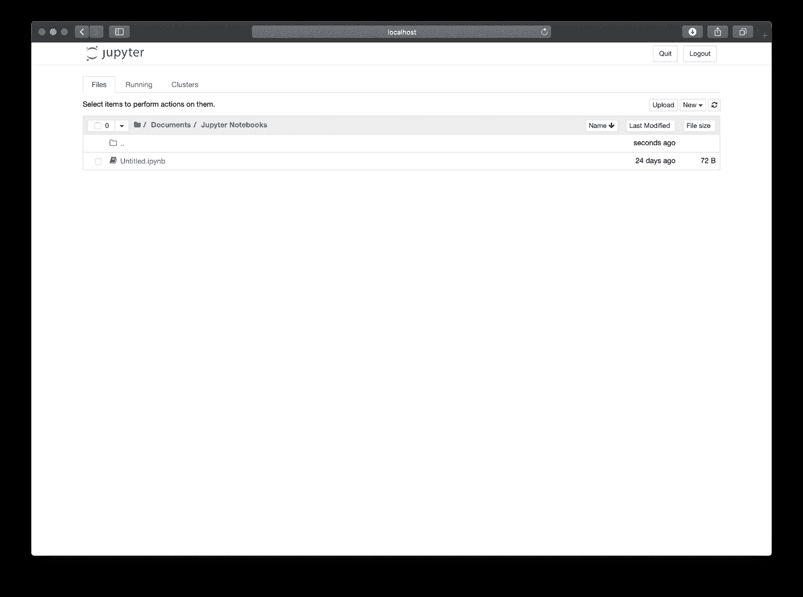

图 3-18: Jupyter Notebook 文件目录

如你所见，我的被称为 `Untitled.ipynb`。点击它后，它会打开并看起来像这样：

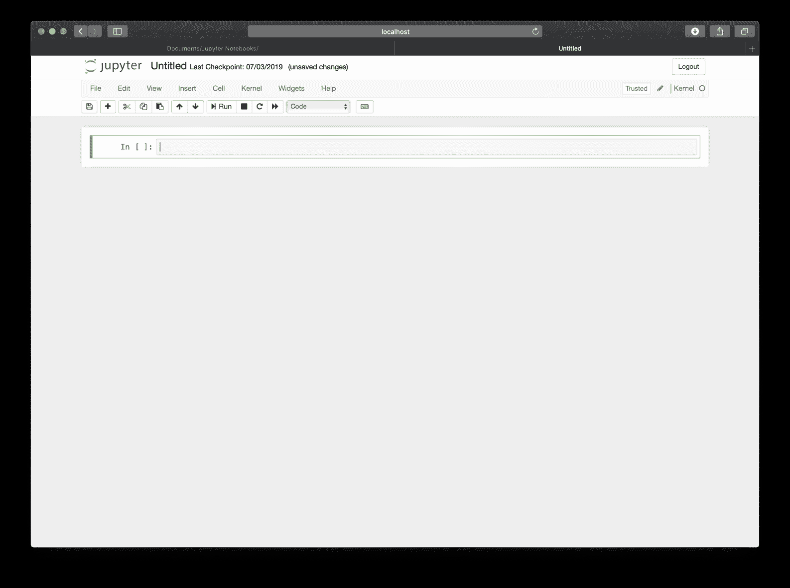

图 3-19: 新 Jupyter Notebook

太好了！你现在有一个新的 Jupyter Notebook。你也可以使用之前创建的旧的继续。

### Python Output

Jupyter Notebook 的伟大之处之一是可以从单个单元格获取输出，而不需要为了最终的单一输出文件而运行整个 notebook。

#### Printing a Message

当你第一次打开笔记本时，光标将位于第一个单元格上。在这里，你可以输入 Python 代码。对于我们的第一个示例，打印以下内容：

```python
print("hello")
```

很自而易懂，对吧？你一定在想为什么我们没有输入 "Hello World" —— 这很简单。它被过度使用了，但这并无关紧要。当你点击工具栏上的 **Run** 按钮时，你将看到这样的输出：

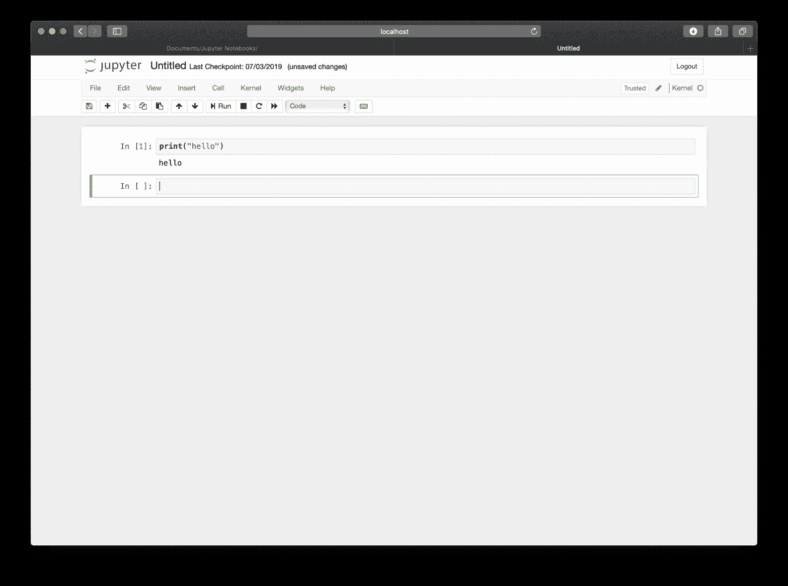

图 3-20: 打印消息

#### Printing a List of Numbers

现在，由于你还没有练习你新开发的 Python 技能，让我们用 `for` 循环和 `print` 语句打印以下内容。

```python
for num in range(1, 5):
    print(num)
```

现在，由于你还没有练习你新开发的 Python 技能，让我们用 `for` 循环和 `print` 语句打印以下内容：

```python
for num in range(1, 5):
    print(num)
```

现在，由于你还没有练习你新开发的 Python 技能：

```python
for num in range(1, 5):
    print(num)
```

注意范围到了 `5`，尽管我们只需要 `4`。这是因为正如你可能猜的那样，Python 中的 `range(:)` 函数是排他的，所以通过输入 `range(1, 5)`，你是在告诉 `for` 循环在 1 ≤ `num` < 5 的区间内运行，最终让我们得到了结果：

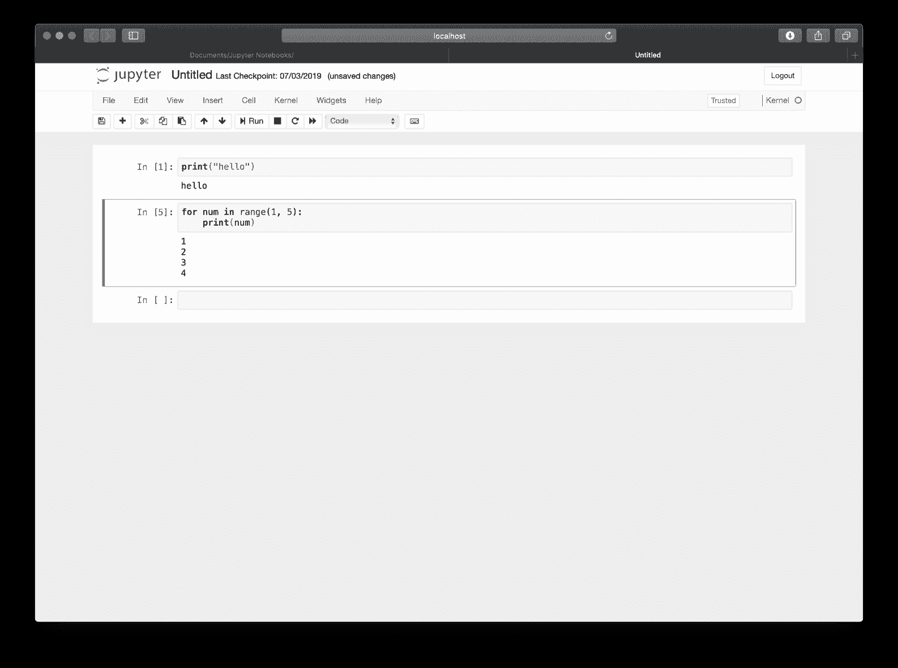

图 3-21: 打印数字列表

现在，运行你的代码，你会发现你实现了结果。你的 Jupyter Notebook 现在打印了 `1` 到 `4`，每个占一行。

#### Writing Descriptive Text

现在，我们的小代码项目很有趣，但当有人阅读代码时，可能不理解为什么会有代码，特别是如果他们对 Python 非常陌生。或者，你可能对代码进行了一些更改，并将你的 Jupyter Notebook 发给朋友。对于这些场景，在代码段中使用文本是有用的。

当选择一个新单元格时，更改**单元格类型**，可以通过默认读取 **Code** 的未标记下拉菜单来实现。你需要将其改为 **Markdown**。你会看到单元格左侧的 `In` 提示消失，现在你可以输入一条消息。

当你这样做时，你的屏幕看起来像这样：

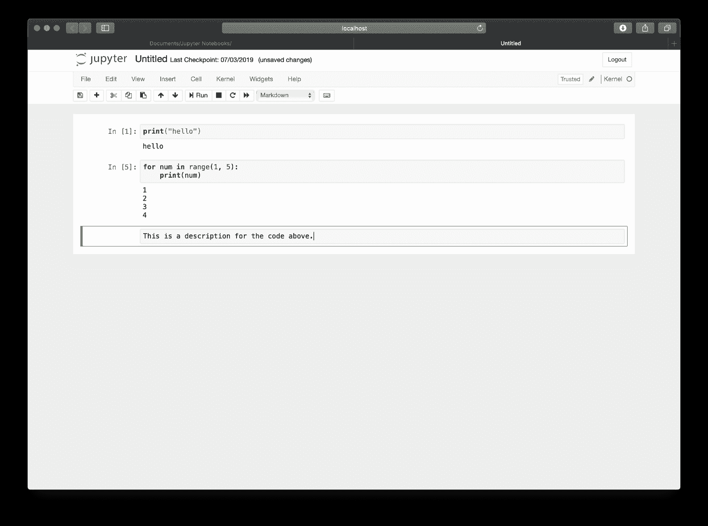

图 3-22: 添加描述单元格

最后，使用 **Run** 按钮运行你的代码，你的文本将渲染成 markdown。如果你现在不知道那是什么，不要担心。我们本章节的最后介绍它。

### Data Visualization


正如你所学到的，使用 Jupyter Notebook 的另一个原因是它可以可视化你的代码输出，并与你的数据进行交互（从数据科学的角度来说）。还有一些第三方库可以帮助你生成表格、图表和模型，以便从不同的维度查看数据，更重要的是，它们可以帮助他人理解你正在尝试做什么。

## 创建图表

Python 中数据可视化最常用的工具是 `matplotlib`。它是一个开源工具，可以用于之前详细介绍的目的。在开始之前，确保你的光标在一个新的单元格上，通常它极可能已经在那里了。

### 配置内联图表

默认情况下，Jupyter Notebook 会向你显示图表的文本表示形式，因此你需要显式地告诉它显示你的图——额——你的图表。这样做非常简单；你只需要在新的单元格中输入以下代码即可：

```
%matplotlib inline
```

太棒了！你再也不会遇到图表不可的问题了。如果你好奇，可以了解可以在 Jupyter Notebook 中使用的其他 `%` 运算符，用于显示其他各种内容。

### 导入框架

首先，你需要导入 `matplotlib` 框架，这将允许你在程序中使用绘图框架。你还需要导入 `numpy`，它处理 Python 中的基本数学函数。要做到这一点，继续添加以下代码行：

```
import numpy 
import matplotlib.pyplot as plot
```

第一个 `numpy` 没有 `as` 饰符，这意味着在整个程序中它都将被称为 `numpy`。然而，`matplotlib` 那一行有，因为我们不希望在每次使用它时都输入 `matplotlib.pyplot`。相反，通过指定 `as plot`，我们是在告诉 Python 将其简称为 `plot`。

### 创建余弦函数

在我们的示例中，让我们创建一个余弦函数。我们将分别定义 `x` 和 `y` 变量，然后在下一步中绘制它们。这就是要求我们导入 `numpy` 框架的步骤。输入以下内容：

```
x = numpy.arange(0, 5 * numpy.pi, 0.001) 
y = numpy.cos(x)
```

对于 `x` 变量，我们使用 `arange(:)` 方法为我们的 x 坐标均匀分布从 0 到 $5\pi$ 的值。此外，该方法接受第三个参数，用于定义分布值的分辨率——或频率。

对于 `y` 变量，我们只需将 `x` 值传入余弦函数，这是由 `numpy` 框架方便地提供我们的。这为之前生成的每个 `x` 值生成了 `y` 值。

### 显示图表

最后，你准备好显示你的图表了。对于这一步，我们再次使用 `matplotlib` 框架，传入我们在上一步生成的 `x` 和 `y` 值。输入以下代码来获取图表：

```
plot.plot(x, y)
plot.show()
```

`plot(:)` 函数自言易懂，它接收两个参数：`x` 和 `y` 坐标。然后它如名称所示绘制了它们。`show()` 方法不接受参数，并在你的单元格下方显示图表。

现在，当你运行代码时，你应该看到类似这样的：

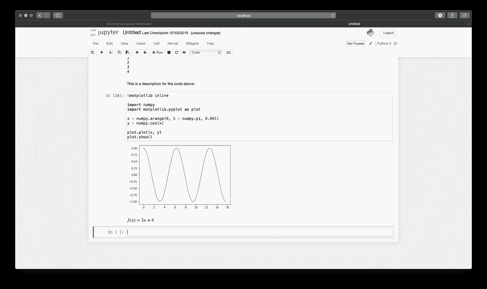

图 3-23: 显示余弦图

以后，你还可以添加图表标签、轴标签、图例，甚至使用不同类型的图表，例如直方图、饼图等。然而，对于几乎所有图表，基本概念都是相同的。

## Markdown 和 LaTeX

我们将通过学习 Markdown 和 LaTeX 来结束本章。可能，如果你做过任何类型的在线文档，特别是 GitHub 上的 `README` 文件，你可能很熟悉 Markdown。如果不熟悉，也没关系，反正我们在这里回顾它。如果你不熟悉 LaTeX，它用于表示数学表达式。一个趣事是：整本书都是用 100% 的 markdown 和 LaTeX（用于数学/数值部分）编写的。虽然这听起来很疯狂，但它展示了这些工具的真正力量。

### Markdown

间接地地，你已经使用过 Jupyter Notebook 的 Markdown 功能。如果你还记得，在输入注释时，被要求将单元格切换到 `Markdown`。相同的注释及其周围的文本可以使用 Markdown 进行样式化。

Markdown 允许你使用一系列简写符号来快速传达斜体、粗体、标题和其他样式化内容，而无需在 WYSIWYG（所见即所得）编辑器中点击按钮。

开始之前，将你的新单元格类型更改 `Markdown`。它是顶部菜单中的一个下拉列表，默认显示为 `Code`。你会看到单元格左侧的 `In` 提示像以前一样消失了。

#### 标题

标题是 markdown 最常用的功能之一，因为它们帮助你为看似长篇文章带来一些结构。它们也是最简单使用的，因为它们只是行中的一个或多个井号。

在你的新单元格中输入以下内容：

```
# I am a title
```


图 3-24: 使用 LaTeX 渲染简单方程

### 复杂的表达式

让我们尝试 $f(\theta) = 3\pi\theta² + \frac{2}{3}$。更复杂了对吧？想象一下手动输入这些内容。这将花费长时间，而且看起来非常难看。幸运的是，你可以在 LaTeX 中轻松地完成，如下：

```latex
$f(\theta) = 3\pi\theta² + \frac{2}{3}$
```

通过反斜杠，你可以输入各种命令，其中许多是特殊字符和数学符号。我们这里的变量是 theta ($\theta$)，`\theta` 就能得到这个符号。我们的系数是三 pi ($3\pi$)，与 theta 类似，pi 可以输入为 `\pi`。要获得指数，我们只需要使用脱字符符号 `^` 然后输入指数即可。最后，`\frac{numerator}{denominator}` 函数为我们提供一个漂亮的分式，如 $\frac{2}{3}$，而不是像 2/3 那样难看。当你运行它时，它看起来像这样：

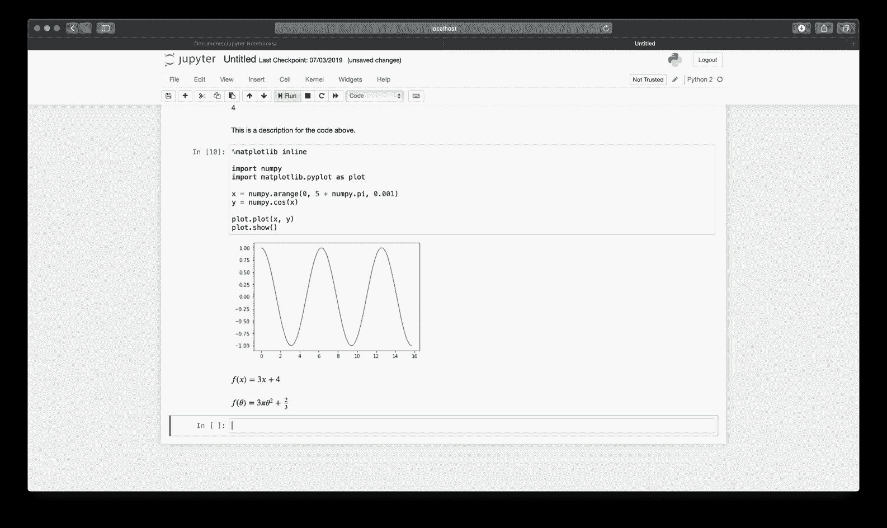

图 3-25: 使用 LaTeX 渲染复杂方程

如你所示，它与其他文本一起渲染得很好，就像它是句子的一部分一样——这就是为什么它被称为“内联（inline）”。当然，你也可以用 LaTeX 做其他事情，但你可能还没有构建过于复杂的数学项目。不过，如果你对学习更多 LaTeX 感兴趣，这个资源](http://tug.ctan.org/info/undergradmath/undergradmath.pdf) 对你来说是一个非常棒的备查表。

## 总结

在本章中，你学习了 Python，这是一种通用语言，它在某些方面可以认为与 Swift 相似。我循序渐进地解释了 Python 的语法。如果你选择继续追求机器学习或数据科学，随着职业生涯的发展，Python 将证明是你工具箱中一项无价的技能。

你还学习了 Jupyter Notebook，这是每个在数据科学领域工作的人的福音。在开始时，你学习了它们是什么、如何使用它们，以及它们在机器学习世界的日常工作流中处于什么位置。然后，你创建了一个并看到它在机器学习任务中有多么方便。

# 第 4 章 - 训练你自己的图像分类器

训练你自己的图像分类器


在上一章中，你学习了 Jupyter Notebook、Python 以及如何在现实世界中使用这些工具。你还学习了 Python 的基础知识，重点关注你如何将其与已经知道的 Swift 建立起来。你还学习了如何使用 Anaconda 安装 Jupyter Notebook，并结合 markdown 和 LaTeX 使用它们。现在是时候测试你的技能并开始训练模型了！

在本章中，你将学习图像分类模型、它们的用途，以及你如何为你的应用程序训练自己的图像分类模型。通过 Apple 的工具 `Create ML`，我们可以训练这些模型并更改某些参数以提高准确性，并研究什么是最有效的方法。

到结束时，你将拥有一个可以运行的图像分类模型，你可以将其拖入第 2 章中的图像分类应用中直接使用。你也将学习到如何优化你的模型，并确保在将它们发布到应用程序之前是完全准确的。

## 4-1 准备训练数据

与任何监督学习模型一样，你需要指定输入的“真实值”来训练机器学习模型。图像分类模型也不例外，本节将侧重于寻找、组织和标记这些图像，以便在训练机器学习模型时可以使用它们。

在本节结束时，你将拥有一个包含一组标记图像的文件夹，这些图像将在接后的章节中作为训练数据使用。虽然我们将使用这些图像来训练 `Core ML` 模型，但未来你也可以调整它们以与其它类型的模型配合。

### 寻找图像

要创建你自己的图像分类器，第一步是准备你自己的图像。对于大多数商业应用程序，你会捕获并标记自己的图像以确保最佳性能。但这需要大量的时间。


对于专业拍摄的图像数据集，你无需担心。但如果你使用的是自己的数据，则需要确保你的图像是高质量的，并且它们能够帮助模型而不是让模型变得更加困惑。

### 模拟场景

当你拍摄照片时，请确保场景与你的用户拍摄照片时的场景相同。你需要确保你的模型已经使用特定类型的图像（你的用户将提供的图像类型）经过了充分训练，因为这对你模型的准确性至关重要。然而，这在概念上可能很难理解，所以让我们来看一个例子。

假设你正在为大外自然环境中的热狗（例如野餐时）的）构建一个热狗分类器。避免使用室内拍摄的热狗照片，多使用一些在户外拍摄的照片。这将帮助你的分类器专注于一个特定的细分领域，而不是试图在所有方面都面面俱精。

### 跳过困惑的图像

虽然在图像训练数据集中包含“边缘案例”似乎是一个好主意，但它可能会降低你模型的准确性，因为这类图像会将其他类别的特征引入到无关类的权重中。我们的核心原则是：如果一张图像让你感到困惑，就不要在训练中使用它。相反地，你应该使用这张图像来测试你的模型，以确保它运行在最佳状态（但不要对这类图像的结果太当真）。

### 平衡类别

在训练这些模型时，需要记住的非常重要的一点是，确保训练期间每个标签的图像数量相同。虽然这看起来可能重要，但它可能会导致你的模型偏向模型中“权重较大”的部分。换句话说，如果你有 2500 张麦克风的图像，那么就使用 2500 张耳机的图像。这样，你就不会让你的模型在某些类型的图像上变得更准确，从而平衡了权重。

### 准备训练数据

在花费足够的时间寻找（或者如果你有勇气自己拍摄图像）寻找你的数据集之后，是时候为训练准备好这些图像了。在将这些图像直接接入 `Create ML` 之前，你需要记住以下事项。

#### 80-20 原则

在机器学习中，我们有一个（有时未说明的）规则，我喜欢称之为“80-20 原则”。从名称中你可以推断出它的定义。这意味着 80% 的数据应该用于训练实际模型，而 20% 应该留作测试。

这里的关键词是“应该”，因为这不是一条硬性规定。相反，它更像是一个帮助你保持在正轨上的指南。如果你不保存 20% 的数据用于训练，也不会发生坏事。但是，如果你这样做，它将帮助你更好地感知模型的运行情况。你可能会发现保存少于 20% 用于测试效果更好的例子是，当你的数据集非常小的时候。在这种情况下，你的训练数据集可能会占用过多的价值数据，而这些数据本可以用于训练。因此，收集更多数据总是比收集较少要好。

当你这样做时，想要记住的一点是，确保没有任何测试数据图像也出现在训练数据中，因为这会导致你在回过头测试 `Core ML` 模型时得到不准确的结果。

#### 文件夹名称即为标签

现在你已经有了图像，正确组织文件至关重要，这样 `Create ML`、`Turi Create` 和其他工具才能识别你的图像及其标签。为图像标记是非常的，因为你只需要将图像移动到具有相应名称的文件夹中。例如，如果你有 700 张苹果的照片，你就把它们放在一个名为“apple”或类似名称的文件夹中。

我提供的模型，即斯坦福狗数据集的子集，已经是推荐的结构了，以便于你使用。你只需要从 [`github.com/vhanagwal/dog-breed-dataset`](https://github.com/vhanagwal/dog-breed-dataset) 下载它即可。

## 4-2 使用 Turi Create 进行训练

在上一节中，你学习了如何寻找图像（或拍摄自己的图像）并为训练你的图像分类模型做好准备。你还学习了什么是好的图像以及哪些是应该避免的，以及一些供你未来应用程序使用的极佳资源。最后，我为你提供了一部分数据供你利用，而无必在下载、设置和提取链接数据集中的图像上费周。

稍后，你将使用这些图像——无论是拍摄的还是下载的——来训练你自己的图像分类模型，该模型可以导出并以 `Core ML` 格式使用。该模型随后可以可以直接拖入你的应用程序中，类似于我们在第 2 章中构建的图像分类应用程序。

我们将探索两种训练自己的图像分类器的方法：

1. 使用 `Turi Create`
2. 使用 `Create ML`

### 使用 Turi Create

第一种方法是使用 `Turi Create`，这是一个由 Apple 拥有并管理的基于 Python 的库。默认情况下，你的 Mac 不会预装 `Turi Create`，所以你需要在使用它训练图像分类模型之前进行安装。不过不用担心，因为安装过程非常简单，特别是如果你过去用过命令行的话。

#### 系统要求

`Turi Create` 有一些系统要求，这些对于你安装的几乎任何软件来说都是标准的——如果你准备好了，这里是这些要求：

`Turi Create` 支持：
*   macOS 10.12+
*   Linux (带有 glibc 2.12+)
*   Windows 10 (通过 WSL)

`Turi Create` 需要：
*   Python 2.7, 3.5, 3.6
*   x86_64 架构
*   至少 4 GB RAM

这意味着如果你的 Mac 是新的，可以使用 `Turi Create`。如果万一你的电脑不支持 `Turi Create`，你仍然可以跟随书中的其他章节。

#### 命令行安装

在解决系统要求后，你需要确保 Python 安装正确，以便跟进本节的命令。

##### 打开 Terminal

打开 **Terminal**，你可以通过 Launchpad 或 Spotlight 搜索找到它。你也可以在文件系统的 `/Applications/Utilities` 找到它。

#####检查 Python 版本

对于本节以及本书，我们将使用 Python 3.8，因为它是编写时最稳定的版本。你的电脑应该已经安装了 Python，让我们检查一下你的版本。在终端中输入：

```
python --version
```

如果输出显示为 Python 3.x，你就没问题了！如果不是，你需要从[他们的网站](https://www.python.org/ftp/python/3.9.0/python-3.9.0-macosx10.9.pkg) 安装 Python 3。这是一个非常直接的 GUI 安装，所以我们在这里不介绍。

##### 安装 pip

为了安装 `Turi Create`我们将使用 `pip` ([`pypi.org/project/pip/`](https://pypi.org/project/pip/))。如果你不熟悉，“pip` 是 Python 的包管理器，它可以帮助开发者轻松安装和管理基于 Python 项目的库。它非常有用，一旦你安装了它，你的开发者生活将变得简单得多。幸运的是，`pip` 本身非常容易安装。假设你已经安装了 Python，在终端中输入以下命令开始 `pip` 安装：

```bash
sudo easy_install pip
```


现在，输入你的管理员密码（即你登录电脑时使用的密码）。完成后，按下 `Return` 键开始安装。几分钟后，你将再次看到提示符，然后就大完成了。

## 安装 Turi Create

安装好 `pip` 后，安装 Turi Create 和其他库将变得非常简单。它们每个只需要一行命令。要安装 Turi Create，请在终端中输入以下内容：

```
pip install turicreate
```

你的安装应该会开始，你将看到控制台打印出安装步骤。几分钟后，你将再次看到提示符，你就知道 Turi Create 已成功安装。

## 使用 Turi Create 进行训练

通常情况下，训练图像分类模型不需要编写任何代码即可完成。但这本书的目的是挑战你——所以，我们将从更“复杂”的方法开始来训练图像分类器。这种方法涉及使用一个名为 Turi Create 的 Python 库（已由苹果收购）。即使你没有相关经验，也不要担心，我会将逐步引导你完成整个过程。

### 设置 Python 文件

现在你已经安装了 Turi Create，可以用它来训练你的图像分类模型了。查看你之前下载的图片。其文件结构如下：

* `image-classification`
    * `training`
        * `cocker-spaniel`
            * `IMG1XX.png`
            * `IMG9XX.png`
        * `golden-retriever`
            * `IMG1XX.png`
            * `IMG9XX.png`

首先，输入 `cd` 并将你的 `image-classification` 文件夹拖入终端窗口。你将得到类似这样的路径和命令：

```
cd /Users/vardhanagrawal/Desktop/image-classification
```

当你按下 `Return` 键时，你就已经通过终端进入了 `image-classification` 文件夹。你现在可以通过命令行在这里创建一个文件。要执行此操作，请输入以下命令：

```
touch classifier.py
```

现在当你从 Finder 导航到 `image-classification` 文件夹时，你会发现了一个名为 `classifier.py` 的新文件。用 Xcode 或你最喜欢的编辑器打开它。

### 编写 Python 脚本

现在我们将编写这个 Python 脚本来加载训练数据并创建模型。在脚本的最开头，你需要导入必要的框架来训练你的图像分类模型。由于你已经已经在系统上安装了 Turi Create，你现在可以在任何项目中使用它。你只需要在 Python 文件中按如下方式导入它：

```
import turicreate as turi
```

你可以省略 `as turi` 标识符。但是，如果你这样做了，每当你需要引用它时，都必须每次输入完整的 `turicreate` 单词。有了这个标识符，Python 就知道当你在程序中写下 `turi` 时，你指的是 `turicreate` 包。

为了访问你的文件系统，你需要导入 `os` 框架，它代表“operating system”（操作系统）。你可以使用类似的方法来导入它：

```python
import os
```

由于这次的名字相当短，你不需要对其进行重命名；输入 `os` 只有两个字母，并不费力。但如果你觉得特别懒，甚至可以将其重命名为单个字符。

### 加载图像

现在你的文件已经准备就绪，你需要将图像加载到 Python 可以读取、理解和处理的格式中。我们花费这么多时间是为了确保数据已为模型准备就。要加载图像，请使用以下代码：

```python
data = turicreate.image_loaders.load_images('image-classification/training')
```


`evaluate(:)` 方法接收 `testing` 数据并将每张图像重新输入到你在上一行代码中创建的模型中。这会自动检查模型是否产生了预期的结果以及产生的频率。然后，输入以下内容：

```
print(result['accuracy'])
```

在将结果存储在 `result` 变量之后，我们打印与 `accuracy` 键关联的值。你将看到你的模型表现如何。

## 保存和导出模型

当你对模型的性能满意后，就可以保存它并将其导出为 Core ML 模型，该模型可以直接插入到你在第 2 章创建的 iOS 应用中。你可以这样保存模型：

```
classifier.save('image-classifier.model')
```

最后，你可以通过输入以下内容来导出模型：

```
classifier.export_coreml('image-classifier.mlmodel')
```

这将允许你的模型以适当的格式出现在你的主 `image-classification` 文件夹中——即与你的 `classifier.py` 文件相同的文件夹——命名为 `image-classifier.mlmodel` 或你选择的任何名称。到此为止，你的整个文件看起来应该是这样的：

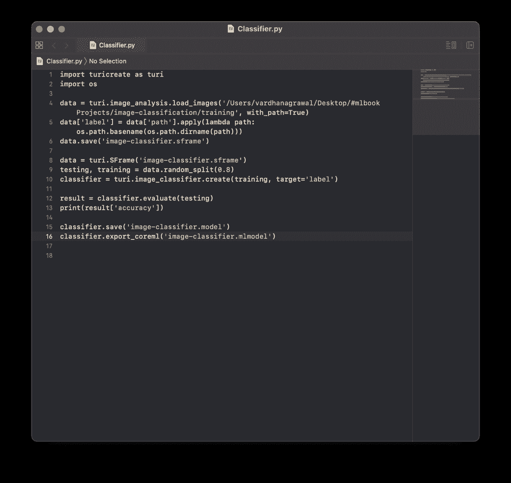

图 4-1: Python 文件

## 运行代码

与你熟悉的 Swift 版本的 Xcode 不同，Python 文件不会在后台自动编译。因此，如果你犯了任何错误，它们不会被编译器捕获，而是在运行代码时被发现。

回到命令行。输入 `cd` 并将你的 `image-classification` 文件夹拖入终端窗口。你将得到一个如下所示的路径和命令

```
cd /Users/vardhanagrawal/Desktop/image-classification
```

当你按下 `Return` 键时，你就已经通过终端进入了 `image-classification` 文件夹。这与之前的步骤相同，将让你访问你的 `classifier.py` 文件。在这里，输入：

```
python classifier.py
```

这将运行你的代码并一次性执行所有预期的任务。你的终端窗口将如下所示：

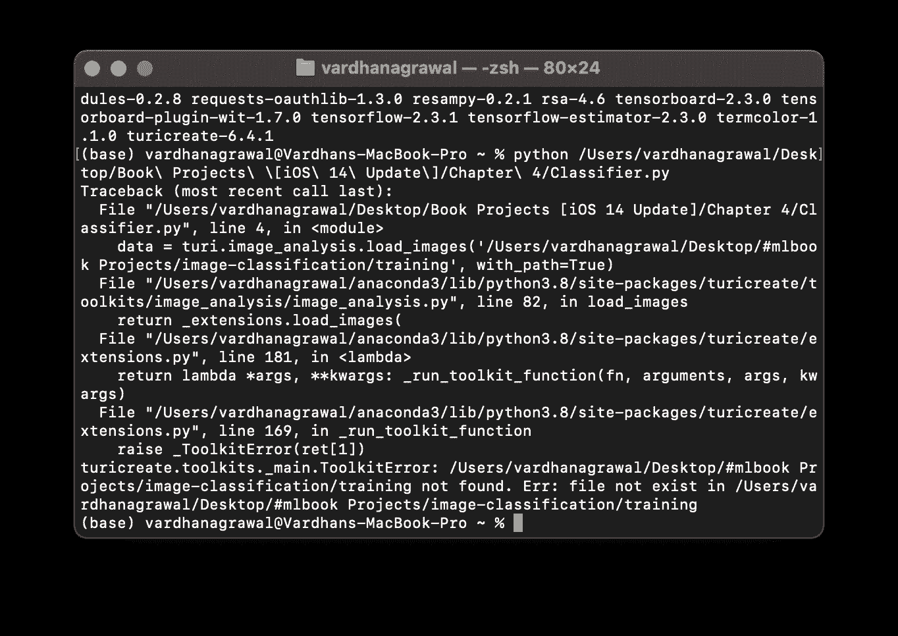

图 4-2: 运行 Python 脚本

终端中的输出有几个用途。首先，它会告诉你代码是否有任何错误并按行号引用它们。其次，它会显示分类器的进度。最后，它会显示使用你最后 20% 数据进行测试的结果，这些数据是你专门为测试保留的。

## 文件和文件夹

训练几分钟后（取决于你的机器，旧机器可能需要超过 10 分钟），你将看到 `image-classification` 文件夹中多个文件，包括：

* `image-classifier.sframe`
* `image-classifier.model`
* `image-classifier.mlmodel`

我们关注的是 `.mlmodel` 文件，因为那是 iOS 应用的 Core ML 模型文件。现在没有什么要做的了！你的 Core ML 模型已准备好在应用中使用；你可以将其拖入替换任何其他 Core ML 模型，并将对它的任何代码引用替换为 `image-classifier`。

## 4-3 深入 Create ML

在上一节中，你使用一个名为 Turi Create 的基于 Python 的工具创建了自己的图像分类器。你经历了安装 `pip` 并使用它最终通过命令行安装 Turi Create 的过程。你还学习了一些基本的 Terminal 命令，用于在你的 Mac 上遍历文件系统。最后，你得到了一个可以在现有应用中使用的 Core ML 模型。

在本节中，你将学习如何创建相同的图像分类模型——但这次的工作量要少得多。你之所以先做更复杂的版本是为了挑战自我，并在你职业生涯中开发更高级的机器学习需求时学习更高级的工具。然而，如果你正在进行一些快速研究，Create ML 是你的选择！

## 介绍 Create ML

你刚刚使用 Turi Create 创建了一个 Core ML 模型，它允许你创建各种健壮的机器学习模型。但诚实地说，我们刚刚创建的模型并不复杂，而且有一种更简单的方法来创建它——无需编写一行代码。

### 你可以构建哪些模型？

正如你所学的，Create ML 是一个极佳的工具，它允许你仅使用图形界面创建中等复杂的机器学习模型，而不是我们在上半部分中编写的代码。让我们花时间查看 Create ML 并了解更多关于它的信息。

#### 模型类别

在 Create ML 的左面板中，你将看到许多模型，它们按类别分组。在写作时，这些模型包括：

* 图像 (Image)
* 声音 (Sound)
* 动作 (Motion)
* 文本 (Text)
* 表格 (Table)

具体来说，这些模型类型内部包含模型模板，允许你执行细分任务，并缩小到你希望模型执行的特定类型的功能。

#### 具体模型

在本书中，我们将详细探索 `Image`、`Sound` 和 `Text` 机器学习模型，因为这些是主流的，并且对于自称为机器学习专业人士的来说是必要的

`图像模型`有两种基本类型：图像分类和图像分割。两者非常相似，但在一个主要方面不同。图像分类模型尝试对整个图像作为一个整体进行泛化，而图像分割模型——如名所示——将图像分割成部分并识别整体的特定部分。

`声音模型`非常新。它们在最近才发布，Core ML 3 是第一个在 Apple 平台上支持声音分类的框架版本。这为开发者开启了全新的视角，因为它允许人们创建过去无法实现的应用程序。

`文本模型` 已经存在很长时间了。事实上，它们是 Google 在最初开发搜索平台时核心的最古老的模型类型之一。在 Create ML 中，你可以制作文本分类器或单词标记器。这些模型类似于图像模型，因为文本分类器处理文本块，而单词标记器处理特定的单词。


你为 Create 构建的数据结构应该与 Turi Create 相似。然而，你既不需要顶层文件夹，也不需要一个 Python 文件来存放代码。从技术上来说，你只需要以下文件夹：

* `cocker_spaniel`
* `german_shepherd`
* `golden_retriever`
* `laborador_retriever`
* `standard_poodle`

如你所知，这些文件夹包含了你的图像及其名称，这些名称代表了机器学习模型中的标签。与 Turi Create 类似，Create ML 会检查这些标签，并在以后使用你的模型时，利用它们来自动生成文本标签。

# 启动项目

你首先需要在 Create ML 中启动项目。你需要选择一个类型、为项目命名并为它选择一个位置。然后，你就可以将训练数据作为输入，让 Create ML 大显魔法。

## 选择模型类型

列出的第一个模型是 `Image Classification`（图像分类）模型，打开 Create ML 应用时默认应该选择它。如果不是的话，请在左侧窗格中选择 `Image`，右侧窗格中选择 `Image Classification`。你的窗口应该像这样：

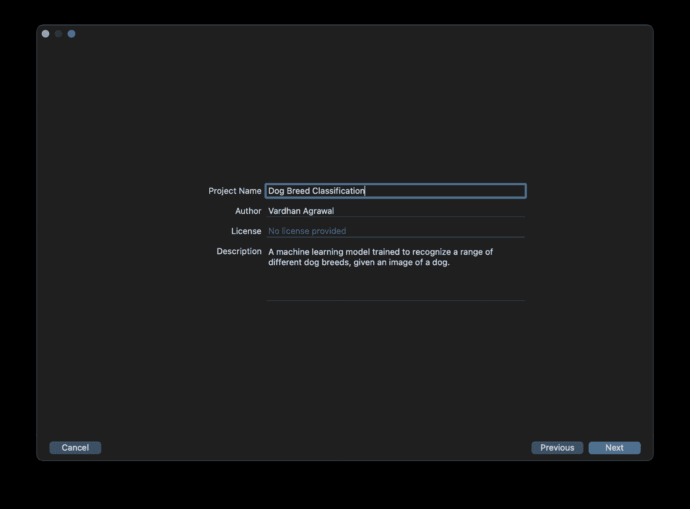

图 4-4：为你的 Create ML 项目命名

## 命名并保存项目

现在会提示你为项目命名。你可以随心所欲地让这个名字变得有趣或无。我把我的命名为简单的“image-classifier”。它还给了你编辑元数据的机会：作者和描述。这些字段会在你最终导出并使用 Core ML 模型时出现。

## 输入数据

将数据输入 Create ML 是轻而一举。只需点击 `Select Files…` 下拉菜单，然后选择包含已标记图像的 `training` 文件夹。Create ML 会根据图像的文件夹名称自动推断标签。此文件夹可以从 [`github.com/vhanagwal/dog-breed-dataset`](https://github.com/vhanagwal/dog-breed-dataset) 下载。稍后你将对 `testing` 文件夹进行类似的操作。

* `dog-breed-dataset-master`
    * `testing`
        * `standard_poodle`
        * `labrador_retriever`
        * `golden_retriever`
        * `german_shepherd`
        * `cocker_spaniel`
    * `training`
        * `standard_poodle`
        * `labrador_retriever`
        * `golden_retriever`
        * `german_shepherd`
        * `cocker_spaniel`

正如 **4-1 查找和准备数据** 中讨论的，我将完整数据集进行了分离，大部分图像用于训练，保留一小部分用于测试。根据你的数据集，你可以自由调整分配给每个数量；然而，通常原则是测试占约 20%，训练占 80%。

你需要选择 `training` 文件夹，它包含了你所有的文件夹及其内部的图像。Create ML 可以识别 `training` 文件夹和 `testing` 文件夹。

# 训练详情

你的窗口应该像这样：


图 4-4：为你的 Create ML 项目命名

正如 **4-1 查找和准备数据** 中讨论的，我将完整数据集进行了分离，大部分图像用于训练，保留一小部分用于测试。根据你的数据集，你可以自由调整分配给每个数量；然而，通常原则是测试占约 20%，训练占 80%。

你需要选择 `training` 文件夹，它包含了你所有的文件夹及其内部的图像。Create ML 可以识别 `training` 文件夹和 `testing` 文件夹。


# 图 4-10：查看精确率和召回率

底部的表格显示了每个类别训练的准确性，以及每个类别中图像的数量。

## 使用训练好的模型

你的努力终于没有白费了！如果你还记得上一个章节，你最后得到了一个 `Core ML` 格式的机器学习模型，你可以直接下载并将其用于你的 App 中。现在，你通过 `Create ML` 训练获得了一个类似的模型。

### 导出你的模型

顶行最右侧标记为 `Output` 的单元格包含 `Core ML` 标志。这代表了你训练好的模型，你可以将其拖到桌面或直接拖入 `Xcode` 项目中。

### 测试不同的模型

如果你想创建许多不同的模型进行相互比较，可以点击 `Create ML` 窗口左上角的 `Add` 按钮。这将允许你更改数据集、参数或增强方案，以查看在每种情况下什么效果最好。

## 评估模型性能

当你训练模型时，`Core ML` 会自动从训练数据中创建一个 `validation set`（验证集），而你为它提供了一个 `testing set`（测试集），以便模型训练完成后使用。这对于初学者来说可能会令人困惑，让我们来看看其中的细微差别。

### 验证集

`validation set` 不要与 `testing set` 混淆，它在训练*期间*评估模型，导致 `Create ML` 据此调整模型权重。该集合使用你提供的训练数据创建，这些数据占你总数据集的 80%（在 `4-1 查找和准备数据` 中讨论过）。验证集的另一个微妙之处在于，它并不直接用于训练数据；它用于在训练过程中的每次迭代（或步骤）之后评估模型。

### 测试集

数据集的另外 20%，即 `testing set`，从未被模型“看到”过。你可以使用 `testing set` 来确定最终模型的性能。模型的性能不会根据测试集的结果而提高或降低。提供 `testing set` 仅为你提供关于模型表现如何的信息，以确定你是否需要继续对其进行改进，或者它是否已经准备好可以使用。

### 测试的重要性

测试你的模型非常重要，因为它可以帮助你在用户看到模型之前获得对其在真实世界中性能的洞察。取决于你创建的模型类型，你对模型性能可能有更严格或更宽松的要求，而使用测试数据集则为你提供了判断模型是否达到水平或是否需要改进所需的信息。

在查看模型结果时，寻找你的模型通常出错的地方。如果它对数据过拟合，请尝试创建一个更多样化的数据集。如果欠拟合，请尝试增加迭代次数。要了解更多关于机器学习的原理知识，请访问 `第 1 章`。

# 结论

在本章中，你学习了图像分类模型、它们的用途，以及如何训练自己的图像分类模型以用于你的 App。通过 `Create ML`，你训练了这些模型并更改了某些参数以提高它们的准确性。

到最后，你创建了一个可以运行的图像分类模型，你可以将其拖入任何 iOS App 并使用 `Core ML` 进行部署。最后，你学习了如何优化你的模型，并确保它们在开始随 App 发行之前性能符合你的标准。

# 第 5 章 - 自然语言处理

在本章中，你学习了图像分类模型、它们的用途，以及如何训练自己的图像分类模型以用于你的 App。通过 `Create ML`，你训练了这些模型并更改了某些参数以提高它们的准确性。

到最后，你创建了一个可以运行的图像分类模型，你可以将其拖入任何 iOS App 并使用 `Core ML` 进行部署。最后，你学习了如何优化你的模型，并确保它们在开始随 App 发行之前性能符合你的标准。

# 第 5 章 - 自然语言处理

在本章中，你学习了图像分类模型、它们的用途，以及如何训练自己的图像分类模型以用于你的 App。通过 `Create ML`，你训练了这些模型并更改了某些参数以提高它们的准确性。

到最后，你创建了一个可以运行的图像分类模型，你可以将其拖入任何 iOS App 并使用 `Core ML` 进行部署。最后，你学习了如何优化你的模型，并确保它们在开始随 App 发行之前性能符合你的标准。

# 第 5 章 - 自然语言处理

在本章中，你学习了图像分类模型、它们的用途，以及如何训练自己的图像分类模型以用于你的 App。通过 `Create ML`，你训练了这些模型并更改了某些参数以提高它们的准确性。

到最后，你创建了一个可以运行的图像分类模型，你可以将其拖入任何 iOS App 并使用 `Core ML` 进行部署。最后，你学习了如何优化你的模型，并确保它们在开始随 App 发行之前性能符合你的标准。

# 第 5 章 - 自然语言处理

在本章中，你学习了图像分类模型、它们的用途，以及如何训练自己的图像分类模型以用于你的 App。通过 `Create ML`，你训练了这些模型并更改了某些参数以提高它们的准确性。

到最后，你创建了一个可以运行的图像分类模型，你可以将其拖入任何 iOS App 并使用 `Core ML` 进行部署。最后，你学习了如何优化你的模型，并确保它们在开始随 App 发行之前性能符合你的标准。

# 第 5 章 - 自然语言处理

在本章中，你学习了图像分类模型、它们的用途，以及如何训练自己的图像分类模型以用于你的 App。通过 `Create ML`，你训练了这些模型并更改了某些参数以提高它们的准确性。

到最后，你创建了一个可以运行的图像分类模型，你可以将其拖入任何 iOS App 并使用 `Core ML` 进行部署。最后，你学习了如何优化你的模型，并确保它们在开始随 App 发行之前性能符合你的标准。

# 第 5 章 - 自然语言处理

在本章中，你学习了图像分类模型、它们的用途，以及如何训练自己的图像分类模型以用于你的 App。通过 `Create ML`，你训练了这些模型并更改了某些参数以提高它们的准确性。

到最后，你创建了一个可以运行的图像分类模型，你可以将其拖入任何 iOS App 并使用 `Core ML` 进行部署。最后，你学习了如何优化你的模型，并确保它们在开始随 App 发行之前性能符合你的标准。

# 第 5 章 - 自然语言处理

在本章中，你学习了图像分类模型、它们的用途，以及如何训练自己的图像分类模型以用于你的 App。通过 `Create ML`，你训练了这些模型并更改了某些参数以提高它们的准确性。

到最后，你创建了一个可以运行的图像分类模型，你可以将其拖入任何 iOS App 并使用 `Core ML` 进行部署。最后，你学习了如何优化你的模型，并确保它们在开始随 App 发行之前性能符合你的标准。

# 第 5 章 - 自然语言处理

在本章中，你学习了图像分类模型、它们的用途，以及如何训练自己的图像分类模型以用于你的 App。通过 `Create ML`，你训练了这些模型并更改了某些参数以提高它们的准确性。

到最后，你创建了一个可以运行的图像分类模型，你可以将其拖入任何 iOS App 并使用 `Core ML` 进行部署。最后，你学习了如何优化你的模型，并确保它们在开始随 App 发行之前性能符合你的标准。

# 第 5 章 - 自然语言处理

在本章中，你学习了图像分类模型、它们的用途，以及如何训练自己的图像分类模型以用于你的 App。通过 `Create ML`，你训练了这些模型并更改了某些参数以提高它们的准确性。

到最后，你创建了一个可以运行的图像分类模型，你可以将其拖入任何 iOS App 并使用 `Core ML` 进行部署。最后，你学习了如何优化你的模型，并确保它们在开始随 App 发行之前性能符合你的标准。

# 第 5 章 - 自然语言处理

在本章中，你学习了图像分类模型、它们的用途，以及如何训练自己的图像分类模型以用于你的 App。通过 `Create ML`，你训练了这些模型并更改了某些参数以提高它们的准确性。

到最后，你创建了一个可以运行的图像分类模型，你可以将其拖入任何 iOS App 并使用 `Core ML` 进行部署。最后，你学习了如何优化你的模型，并确保它们在开始随 App 发行之前性能符合你的标准。

# 第 5 章 - 自然语言处理

在本章中，你学习了图像分类模型、它们的用途，以及如何训练自己的图像分类模型以用于你的 App。通过 `Create ML`，你训练了这些模型并更改了某些参数以提高它们的准确性。

到最后，你创建了一个可以运行的图像分类模型，你可以将其拖入任何 iOS App 并使用 `Core ML` 进行部署。最后，你学习了如何优化你的模型，并确保它们在开始随 App 发行之前性能符合你的标准。

# 第 5 章 - 自然语言处理

在本章中，你学习了图像分类模型、它们的用途，以及如何训练自己的图像分类模型以用于你的 App。通过 `Create ML`，你训练了这些模型并更改了某些参数以提高它们的准确性。

到最后，你创建了一个可以运行的图像分类模型，你可以将其拖入任何 iOS App 并使用 `Core ML` 进行部署。最后，你学习了如何优化你的模型，并确保它们在开始随 App 发行之前性能符合你的标准。

# 第 5 章 - 自然语言处理

在本章中，你学习了图像分类模型、它们的用途，以及如何训练自己的图像分类模型以用于你的 App。通过 `Create ML`，你训练了这些模型并更改了某些参数以提高它们的准确性。

到最后，你创建了一个可以运行的图像分类模型，你可以将其拖入任何 iOS App 并使用 `Core ML` 进行部署。最后，你学习了如何优化你的模型，并确保它们在开始随 App 发行之前性能符合你的标准。

# 第 5 章 - 自然语言处理

在本章中，你学习了图像分类模型、它们的用途，以及如何训练自己的图像分类模型以用于你的 App。通过 `Create ML`，你训练了这些模型并更改了某些参数以提高它们的准确性。

到最后，你创建了一个可以运行的图像分类模型，你可以将其拖入任何 iOS App 并使用 `Core ML` 进行部署。最后，你学习了如何优化你的模型，并确保它们在开始随 App 发行之前性能符合你的标准。

# 第 5 章 - 自然语言处理

在本章中，你学习了图像分类模型、它们的用途，以及如何训练自己的图像分类模型以用于你的 App。通过 `Create ML`，你训练了这些模型并更改了某些参数以提高它们的准确性。

到最后，你创建了一个可以运行的图像分类模型，你可以将其拖入任何 iOS App 并使用 `Core ML` 进行部署。最后，你学习了如何优化你的模型，并确保它们在开始随 App 发行之前性能符合你的标准。

## 5-1 什么是自然语言处理？

自然语言处理（简称 NLP）无处不在。你可能在不知情的情况下见过它。

在本章中，通过 `Create ML`，你训练了这些模型并更改了某些参数以提高它们的准确性。到最后，你创建了一个可以运行的图像分类模型，你可以将其拖入任何 iOS App 并使用 `Core ML` 进行部署。最后，你学习了如何优化你的模型，并确保它们在开始随 App 发行之前性能符合你的标准。

### 自然语言概览

从全局视角来看，NLP 实现了许多人机交互。

#### 日常对话

然而，为了理解自然语言处理，你首先需要理解计算机代码。计算机代码（如 `Swift` 和 `Python`）有必须遵循的定义规则集。例如，如果你在 `Swift` 中漏掉大括号，编译器将不允许你运行。

然而，在日常对话中——比如和你的朋友聊天——你不需要担心语法。你的朋友会理解你在说什么。

#### 书面文本

自然语言也以书面文本的形式存在。给同事发短信还是记笔记，你写下的都是自然语言，它并不一定遵循计算机代码那样的结构。例如，如果你列了一份待事项列表，有无限种表达方式但在编译语言中，表达想法的方式更少且更有结构化。

#### 语义搜索

当你询问数字助手（如 `Siri`）“找到昨晚与 `Tim` 分享的文件”时，你正在使用语义搜索。以你不熟悉这个概念，算法更关注上下文而不是文本内容。因此，当它在你的电脑上查找文件时，它会检查是否是“昨晚”的，并且是“与 `Tim` 分享”。然而，它不会寻找包含单词“Tim”的文件。

### NLP 的挑战

现在你已经看到了自然语言的例子，你可能对为什么自然语言处理如此困难有了一个基本的认识。毕竟，计算机并不擅长“思考”自己正在做什么，但非常擅长重复任务。自然语言处理的问题可以分解为将非结构化文本转换为结构化的、可解析的信息。

#### 词汇与上下文

虽然你可能认为经常使用的单词很普通，但从计算机的角度来看恰恰相反。例如，你可能会在“我看到了树上的叶子（leaves）”中使用“leaves”这个词，也可能在完全不同的语境下使用它，“他今天离开（leaves）我会这样做”。你可能瞬间理解这些差异，但对于算法来说，理解上下文可能非常困难。


# 词性
正如你可能在英语课上记得的那样，单词可以分为称为 `parts of speech`（词性）的组，其中包括形容词、名词、介词等。计算机理解语言的方式与我们不同，因此它需要将句子拆解为更具量化的指标，例如词性。

# 短语
在识别词性之后，算法必须识别短语。同样，由于算法不理解语境，它需要一种定性衡量来对分类后的单词进行进一步分组。这有助于它识别句子的主要主语和谓语，从而更好地理解用户在说什么。此时，计算机通常拥有一个句子，该句子被拆解为短语，短语又被拆分为单个单词，形成一种树形结构。

显然，自然语言处理是一项挑战。通过机器学习，这个过程变得稍微更像人类。然而，计算机仍然不会像人类那样处理自然语言。

## NLP 类型
现在，你应该更好地理解为什么自然语言处理如此困难了；Google、Apple 和 Amazon 这样的大型公司已经投入了数十亿美元来开发自己版本的这项。由于计算机无法像人类一样处理自然语言，因此有几种方法可以帮助。请记住，NLP 技术有成千上万种用途，下面讨论的方法是针对那些特定用例定制的。

### 文本摘要
通常，自然语言处理需要大量的专业知识才能良好执行——这不无理由。正如此，机器学习开发者使用一种更基础的方法，这种方法对大多数目的都有效——文本摘要（Text Summarization）。在基础层面上，这种方法提取所有单词并统计出现频率最高的单词。虽然比许多其他 NLP 方法更容易，但这种方法必须确保形成的句子是有意义的。如果你还无法理解它，不要担心。我们将在下一节中详细地讨论这种技术。

### 翻译
如果你用过像 Google Translate 这样的翻译服务，你亲身体会过在让计算机算法承担翻译任务时，会丢失多少含义——这为 NLP 增加了新的难度。计算机不仅需要理解源语言，还需要在目标语言中生成逻辑文本。在 Google Translate 的案例中，他们使用了自己计算机识别的语言。

例如，如果你正在从英语翻译成中文，算法将获取英文字符串并将其翻译成只有 Google 算法才能理解的语言（即对我们人类来说是术语）。如果它对任何文本有怀疑，它将通过之前使用过的不理解的短语并以此方式进行翻译。最后，它将使用机器学习生成中文文本，并通过另一个算法运行以确保其通顺。

### 情感分析
正如所示，情感分析（Sentiment Analysis）是使用自然语言处理算法分析文本背后的情感。这通常涉及提取形容词和定性词汇，以检查特定文本是偏向正面还是负面。广告商使用这种方法来分析社交媒体上对他们的产品是否有正面评价，或者他们的消费者是否不喜欢他们发布的内容。此外，这有助于社交媒体平台过滤年轻用户的不当内容或仇恨言论。

## 5-2 分词、词干提取和词形还原
在上一节中，你从宏观角度学习了自然语言处理以及开发这项技术所面临的一些挑战。你还学习了你在日常生活中使用 NLP 的各种方式。现在你已经熟悉了文本摘要、语言间翻译和情感分析是如何工作的。

在本节中，你将学习更多关于分词（tokenization）、词干提取（stemming）、词形还原（lemmatization）以及 NLP 算法为了获得所需结果需要采取的许多其他步骤。从本质上说，你将深入了解让你的日常 NLP 交互运作的原理，考虑到这项技术应用上的巨大差异，这尤为重要。

## 理解与响应
正如你在上一节中学到的，NLP 在你的日常生活中有无数使用方式。无论是与 Siri 对话还是让总结新闻文章，某些形式的 NLP 都深度参与了其中。鉴于这些算法经常取代人类（例如在聊天机器人中），大部分工作被分为理解语言和以易于理解的方式对其进行响应。

### 从文本中提取含义
正如上一节中简要讨论的，NLP 算法有各种技术来理解语言。与人类不同，这些算法将自然语言转换为用于定量分析的块。然而，无论使用何种方法，理解所说或所写的大意对于 NLP 算法的成功至关重要。

### 生成可理解的结果
在某些情况下，NLP 算法还必须能够创建有意义的输出。例如，当你公司网站上的聊天机器人发消息时，软件需要理解你在说什么，给你一个对你有意义的回复，并准确简洁地传达机器人想要传达的内容。这可以显著提升用户体验，并有一天可能允许自然语言处理算法[通过图灵测试。](https://en.wikipedia.org/wiki/Turing_test)

## 内部步骤与技术
正如上一节中深入探讨的，NLP 算法的任务并非易事。事实上，理解和响应人类产生的语言都有其独特的挑战。对于典型的 NLP 算法达到目标所采取的特定步骤。显然，某些算法可能使用不同的方法或完全跳过步骤——这只是这些算法工作的一种通用概念。

### 分词 (Tokenization)
机器学习模型或 NLP 算法必须首先分解作为输入的许多单词。这通常涉及简单的单词分离，并在大多数情况下移除标点。分词通常用于自然语言处理的“理解”端，因为它涉及到分解现有句子。与你将学到的其他技术相比，分词是最广泛使用的，范围从文本摘要到语言翻译。

例如，考虑以下短语：

```
The quick brown fox jumped over the lazy dog.
```

分词结果如下：

```
0: "the"
1: "quick"
***
7: "lazy"
8: "dog"
```

虽然看起来基础，但这项任务对于算法的成功至关重要。将问题分解为许多更小的子任务，允许程序对输入文本进行“首次尝试”。分词是自然语言处理中最简单的部分之一，只需要基本的字符串处理。

### 词干提取 (Stemming)
正如你可能从名称中猜的那样，词干提取是从分词单词中提取根词（stem）。这通常涉及移除前缀（如 pre-, de-, anti-）和后缀（如 -ing, -illy, -ed）。这极大地简化了句子并使其更容易解释含义。

这是一个例子：

```
"jumped"     ->  "jump"
"running"    ->  "run"
"different"  ->  "differ"
```


正如你所看到的，词干（stemming）只是简单地移除它认为没有必要的前缀和后缀，以留下词根。然而，值得注意的是，词干并不考虑其所修改单词的词典定义。因此，当算法处于词干阶段时，取决于其复杂度，可能会丢失某些含义。当一个单词丢失含义时，通常是`欠提取或过度提取（understemming or overstemming）`的结果，即保留了太多的单词部分或切掉了过多的。

考虑词根在你日常语言中的作用：你必须取一个词根并添加前缀或后缀来表达你想说的内容。这被称为`屈折语言（inflected language）`，允许你构建语法正确的句子。

## 词形还原 (Lemmatization)

词干和词形还原非常相似：它们都是用于`文本归一化（text normalization）`的技术。文本归一化是移除单词中不定义其含义部分的思想。词形还原是一个单词在被“还原”的同时保持其词典定义的过程。与词干不同，词形还原的输出是一个真实的单词。

以下是一个示例：

```
"run", "ran", "running" -> "run"
"hopped", "hopping", "hop" -> "hop"
"eaten", "eating", "eat" -> "eat"
```

在这个示例中，`run`、`hop` 和 `eat` 都是真实的单词，但它们在所有类型的句子中可能并不符合语法。词形还原依赖于单词的`lemma`，它被定义为单词的词典定义。因此，使用词形还原的自然语言处理算法需要字典才能运行。

可以理解，词形还原比词干复杂，因为它要求对目标语言有深入的。与词干不同，词形还原不依赖单词的结构，而是关注定义。在进行任何更改之前，它会检查单词的词性、上下文以及在句子中的位置，以确保更改不会影响目标单词的含义。

## 分块 (Chunking)

正如你之前学到的，分词（tokenization）是将句子或短语分割单词或“标记”。分块（chunking）是一种将独立的单词组合成短语以形成有意义的内容的技术。在某种程度上，分块是分词的反面，主要用于自然语言处理的“响应”端。

分块的一个主要部分称为`词性标记（part-of-speech tagging）`。顾如名，它根据单词是名词、动词、介词还是形容词对其进行分类。这允许算法创建一个结构上合理且对用户来说合理的句子。

分块的另一个大部分是`命名实体识别（named entity recognition）`。命名实体识别是识别专有名词的过程。例如，如果`Donald`、`President` 和 `Trump` 单词单独出现，命名实体识别将帮助分块算法将它们合并为一个短语：`President Donald Trump`。

## 5-3 训练文本分类器

在之前的章节中，你学习了自然语言处理的基础知识，范围从该技术的各种用例到 NLP 算法在内部执行的步骤。你还看到了一些步骤（包括分词、词干、词形还原和分块）如何相互作用的示例。

### 寻找和获取数据

在之前的章节中，你学习了自然语言处理的基础知识，涵盖从该技术的各种用例到 NLP 算法在内部执行的步骤。你还看到了一些步骤（包括分词、词干、词形还原和分块）如何相互作用的示例。

### 寻找模型

在之前的章节中，你学习了自然语言处理的基础知识，涵盖从该技术的各种用例到 NLP 算法在内部执行的步骤。你还看到了一些步骤（包括分词、词干、词形还原和分块）如何相互作用的示例。

### 创建数据集

在之前的章节中，你学习了自然语言处理的基础知识，涵盖从该技术的各种用例到 NLP 算法在内部执行的步骤。你还看到了一些步骤（包括分词、词干、词形还原和分块）如何相互作用的示例。

### 文本分类算法

现在你已经找到了一个数据集，要么创建了自己的，要么使用了我们在书中使用的那个。你已经准备好学习更多关于 Create ML 中可以选择的不同算法了。别担心，这部分没有之前的章节长，我强烈建议你仔细阅读。


最大熵算法（Maximum Entropy algorithm），简称 `MaxEnt`，是训练中最快的选项。由于该算法对目标数据不做假设，因此当你对所使用的数据一无所知时，使用它是最好的。此外，数据科学家经常使用它进行测试，因为它比 Create ML 提供的其他选项要快得多。

## 条件随机场

条件随机场（Conditional Random Field）是一种更具量化的自然语言处理方法。它依赖于词汇的数量而不是句子的结构。当训练数据中的短语不复杂，且没有通过双重否定或改变词义的前缀（如 `anti-`、`de-` 或 `un-`）模糊含义时，这种方法通常效果最好。

## 创建你的分类器

到为止做得很好！你现在准备好创建自己的文本分类器了。在这个分类器中，你将使用[康奈尔电影数据集](http://www.cs.cornell.edu/people/pabo/movie-review-data/review_polarity.tar.gz)，我为了本书的目的对其进行了编辑，并将其放在仓库中供你下载：[`github.com/vhanagwal/sentiment-analysis`](https://github.com/vhanagwal/sentiment-analysis)。你可以点击下载按钮下载数据集，其中包含 1000 条正面评论和 1000 条负面评论。我已经处理并划分了 20%的数据用于测试（在 `testing` 文件夹中），80%用于训练（在 `training` 文件夹中）。最后，你的模型将能够区分正面评论和负面评论。如前提到的，这是一个很好的入门数据集，因为它使用了真实的非正式的口语风格。

首先，你需要创建一个 Swift Playground。如果你以前没有用过它们，Swift Playground 是一个让你能够快速测试 Swift 代码而无需创建完整 Xcode 项目的地方。它也非常适合诸如使用 Create ML 创建机器学习模型等任务。

Swift Playground 是 Xcode 的一部分，所以请打开一个新的 Xcode 窗口。然后，点击第一个选项 `get started with a playground`。


图 5-1: 打开 Xcode

由于你不需要在 Swift Playgrounds 中创建游戏或演示，因此你不需要使用模板。默认应选择 `Blank`，因此点击 `Next`。请务必在顶部选择 `macOS` 而不是 iOS。否则，其余的操作都将无法运行。

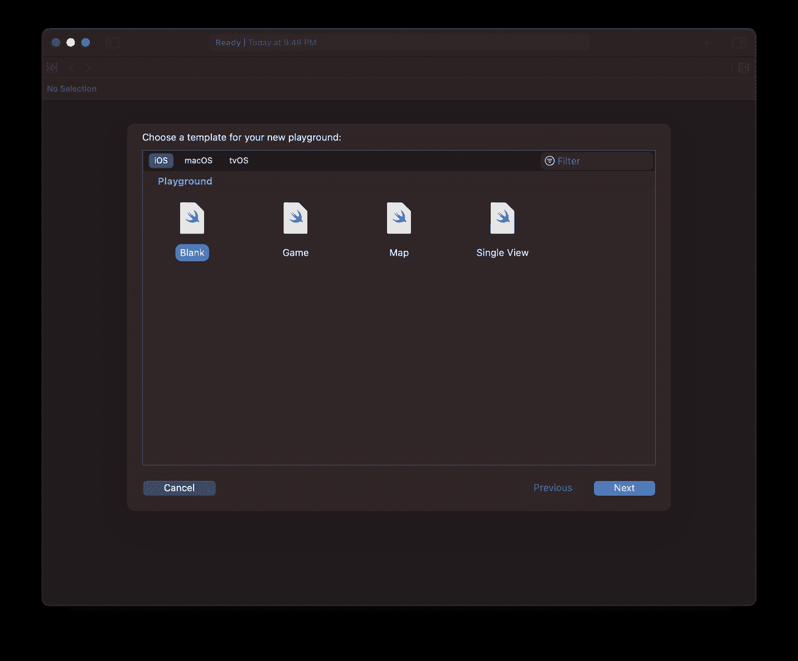

图 5-2: 选择模板

接下来，给你的项目起一个有趣的名字；一个让你记住的名字。我给我的起了一个很无聊的名字：“Text Classifier”（文本分类器）。然后，选择你想保存项目的位置并点击 `Create`。

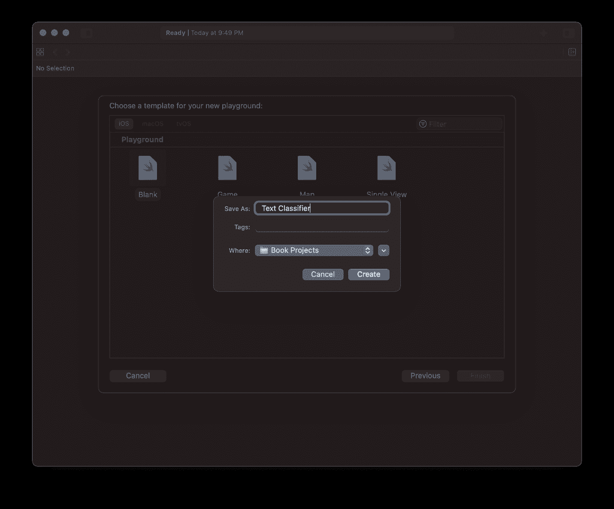

图 5-3: 命名并保存你的 Playground

### Swift Playground 的结构

你的项目准备就绪了，看起来应该如下。左侧蓝色的“播放”按钮允许你部分执行代码，屏幕左下角的“播放”按钮运行所有的代码。在中间，你可以输入代码。这就是你入门需要知道的所有信息！

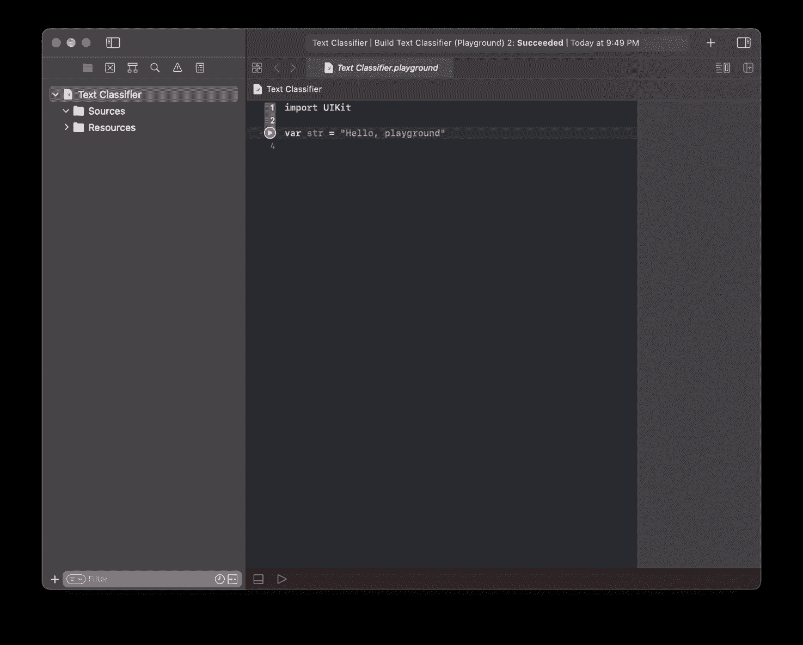

图 5-4: Playground 编辑器

### 编写代码

现在是开始编写代码了。Create ML 允许你用极少数行代码创建一个轻量级的文本分类器。如果某些内容看起来不理解，不要担心；我会解释每一行代码以确保逻辑清晰。

#### 清晰的模板代码

由于我们将从零开始，请删除编辑器窗口中当前的所有内容。之后，你应该能看到一个空白画布并准备好开始训练你的文本分类器了。

#### 导入框架

在本书的这部分，你将使用 `CreateML` 框架、`CoreML` 框架以及基础的 `Foundation` 框架。结合这三个框架，你将能够访问构建文本分类器所需的所有方法。如下所示导入所有框架：

```
import CreateML
import CoreML
import Foundation
```

#### 加载你的数据集

首先，你需要加载数据集。（注：原文提供了“Loading your Dataset”，但逻辑上意味着初始化数据）。

首先，你需要定义 URL。为了做到这一点，请输入：

```
let trainingURL = URL(fileURLWithPath: "path/to/dataset")
```
（注：提供的源文本在此节中有重复/冲突的指令；我已根据提供的上下文清理了逻辑，以遵循标准的机器学习工作流）。


```
let destinationURL = URL(fileURLWithPath: 
    "/Users/vardhanagrawal/Downloads")
```

我决定将模型放在我的下载（Downloads）文件夹中，但你也可以选择将其放在任何你想放。再次强调，请确保你已将路径更改为你电脑上实际存在的名称；不要使用我的名字！最后，按照以下方式导出你的模型：

```
try classifier.write(to: destinationURL, 
    metadata: metadata)
```

同样，由于涉及一个 `URL`，且 `write(:)` 方法是否成功存在一定的不确定性，你需要使用 `try` 关键字来捕获任何错误。在参数中，你同时传递了目标 URL 和你之前创建的 `metadata` 常量。

### 评估模型性能

如你现在所知的，使用数据集的 20% 来测试你的模型性能是非常重要的。如果你还没有读过第 4 章，我建议访问 `4-3 Delving into Create ML` 并阅读标记为 `Evaluating Model Performance`（评估模型性能）的部分。在这里，你将了解到验证集之间的差异与相似之处，以及测试模型的重要性。

### 上传测试数据

为了测试你的模型，你可以上传我在提供的仓库中预留的 20% 数据集（[`github.com/vhanagwal/sentiment-analysis`](https://github.com/vhanagwal/sentiment-analysis)）。这些数据已经过预标记，以便 Create ML 自动确定模型的准确率。

在你的 Swift Playground 末尾输入以下内容：

```
let testingURL = 
    URL(fileURLWithPath: "/Users/vardhanagrawal/Downloads/sentiment-analysis-master/testing")
```

与之前一样，确保你输入的是保存数据集的路径，因为上面的只是一个示例。在这一行中，你正在存储指向数据集 `testing` 文件夹的 URL。

### 测试你的模型

最后，要使用测试集评估你的模型性能，输入以下内容：

```
print(classifier.evaluation(on: .labeledDirectories(at: testingURL)))
```

这将把测试集通过训练后的模型运行结果打印到你的控制台中，运行后看起来可能像这样：

```
Number of examples: 402
Number of classes: 2
Accuracy: 88.06%

******CONFUSION MATRIX******
----------------------------------
True\Pred negative  positive  
negative  178       23        
positive  25        176       

******PRECISION RECALL******
----------------------------------
Class    Precision(%)   Recall(%)      
negative 87.68          88.56          
positive 88.44          87.56
```

`accuracy` 值（第三行）告诉你有多少百分比的测试集被模型预测。88% 是一个非常棒的准确率；然而，并没有一个绝对值可以判断你的模型的优坏。取决于类别的数量和数据集的大小，你将得到不同的准确率。例如，如果你有一个拥有数百个不同类别的模型，60% 可能是一个可以接受的准确率。但如果你只有两个类别。


在本章中，你将详细学习声音分类。随着 Apple 的最新更新，Xcode 现在随带了 `Create ML` 以及一系列全新的音频处理框架。在章节的开始，你将学习如何查找、录制和获取用于声音分类的音频片段，随后，你将学习如何正确地组织它们。

在章节的后半部分，你将使用 `Create ML` 利用 `IRMAS` 音频数据集训练你自己的声音分类器，并学习如何在 iOS 应用程序中使用使用它。在整个过程中，你将学习如何使用 `SoundAnalysis` 框架和 `AVAudioEngine` 来利用内置硬件麦克风，并让音频片段通过你训练的机器学习模型进行运行。

# 6-1 概述与收集声音

在之前的章节中，你已经学习了应用机器学习技术的多种方法：包括图像分类和情感分类。在上一节章节中，你学习了自然语言处理算法以及每个步骤在底层是如何运作的。在最后，你使用 `Swift Playgrounds` 和 `Create ML` 创建了属于你自己的情感分类模型。

声音分类是机器学习技术的另一项优秀应用，它让模型能够“听”见周围的世界。在本节中，你将学习声音分类以及如何录制自己的声音以供声音分类器使用。你还将学习寻找预录声音的有效方法，以防你不想使用自己的声音进行模型训练。

## 关于声音分类

想一想你每天听到的声音。无论是狗的叫声还是汽车驶过，声音都是难以量化的。换句话说，声音很难被描述，而且它们的结构似乎比自然语言更不规则。考虑到这一点，声音分类是机器学习中一项令人印象深刻的成就，因为它需要计算机去理解看似随机的音频输入。

### 分类方法

有多种分类声音的方法，包括识别声音的来源、类型或特征。由于声音非常难以定义——与图像、单词或数字不同——最好的声音分类器会使用最通用的方法，而不是局限于声波的具体细节。

#### 来源分类

思考声音分类的一种方式是来源分类。这简单地识别是哪种类型的人、动物或乐器发出的声音。例如，如果你区分鸟的鸣叫和狗的吠声，可以使用来源分类。这既可以用于嘈杂的环境（即模型从其他杂声中挑选出特定声音），也可以用于只能听到一种声音的环境。

#### 类型分类

另一种，如果你没有特定的目标声音，你可以识别你（或麦克风）所在的位置。例如，你在地铁站听到的声音与你在高速公路上听到的声音会有不同。在这两种情况下，模型都没有识别某种特定的噪音，而是根据所有汇聚在一起的声音进行泛化处理。

#### 问题与技术

到这里，你可能在想，如果声音看起来如此随机，基于声音的机器学习模型是如何运作的。它们的诀窍在于专注于声音的特定特征，然后在所有输入数据中寻找这些特征。换句话说，它们寻找的是那些对于某些片段来说是独有的、且不会出现在其他片段中的声音。

##### 嘈杂的片段

当我们谈论声音分类意义上的“噪声”时，指的是对识别音频片段无关的声音。例如，如果你正尝试识别野外狼的嚎叫声，叶子的沙沙声和雨滴声就会被视为噪声，因为它们对于判断是否存在狼无关。音频片段特别容易受到噪声的影响，因为智能手机的麦克风并不擅长避开背景音。

##### 过滤与归一化

针对不需要的噪声，人们可以选择对音频片段进行过滤或归一化。这可能包括移除白噪声、静电或其他可能干扰机器学习模型分类声音能力的干扰。然而，在进行此操作时必须小心。由于真实世界的录音是没有经过过滤的，如果你的模型仅在过滤后的数据上进行训练，那么在用未过滤的数据进行测试时可能表现良好。

##### 支持向量机

正如你在第 1 章中学到的那样，支持向量机或 `SVMs` 使用训练数据来绘制“边界”，以分离或区分不同的类别。声音分类模型的工作原理相似。在从波形中收集适当特征后，它对其进行排序，以找到可以用于区分声音的相似和差异。

## 自己录制声音

获取声音分类模型音频片段的一种极佳方法是自己录制。但请记住，你收集的数据从字面上定义了你机器学习模型的质量。这里是一些录制高质量音频片段的提示，你可以用它们来训练声音分类器。

### 1. 不要过度过滤

许多初学者会犯的错误是试图避开背景噪音，或者更糟糕，试图模拟真实环境而不是录制实际声音。这样做的问题在于，你的模型在用真实数据进行测试时，更有可能表现不佳。避免这个错误可以大大提高模型的准确性。

### 2. 使用系统麦克风

你移动设备上的麦克风可能质量最好，但它是用户录制音频的唯一途径。那么，如果你正在开发移动应用，最好的办法是使用来自内置智能手机麦克风的数据来训练你的分类器，而不是使用专业设备或其他麦克风。

### 3. 录制边界情况

若你不熟悉的话，“边界情况”指的是接近边界并可能“欺骗”算法的数据点。在声音分类世界中，一个边界情况可能是一个听起来像猫的狗的呜咽。在你录制时，尽力寻找这类令人困惑的声音，以提高你的模型在处理这些情况时的性能。

## 从数据集中获取声音

显然，如果你正在寻找的声音数据在网上可用，那么不录制自己的可能会更简单。事实上，除非你处理的是非常小众的主题（例如特定的发动机噪音或灭绝物种），否则你可能不需要自己录制声音。

### 数据集

由于用户生成的视频充斥着互联网，可选的声音并不缺少。人们已经对这些视频进行了处理，并创建了供你使用的数据集。以下是一些帮助你获取用于声音分类机器学习模型的音频文件的资源。

##### AudioSet

YouTube 有数百万由用户发布的视频，Google 已经对这些视频中的 10 秒音频片段进行了标注，创建了一个包含 200 万个音频文件的庞大数据集。你可以将其用于几乎任何领域，因为标注数据范围广泛且量大。

##### UrbanSound8K

正如其名，`UrbanSound8K` 数据集包含约 8000 个属于 10 种声音类型的不同音频片段。它们包含了常见的城市噪音，如警报声、街头音乐和狗叫。由于这些文件代表了普通人在日常生活中听到的声音，使用 `UrbanSound8K` 训练的模型在类似情况下可能会表现良好。


# MIVIA ([`mivia.unisa.it/datasets/audio-analysis/mivia-audio-events/`](https://mivia.unisa.it/datasets/audio-analysis/mivia-audio-events/))

MIVIA 数据集激发了机器学习开发者体内的“阴暗面”，包含了约 6,000 条人们尖叫、枪击声和玻璃破碎声的片段。它对于构建安全应用程序或其他需要检测犯罪活动的软件非常有用。

## 数据组织

最后，让我们回顾一下如何存储和组织你的训练数据，并预览如何处理测试数据（这是本章涵盖的新内容）。根据你获取数据来源，它可能已经是所需的格式，或者你可能需要对其进行调整。

### 训练

与你过的图像和文本分类器类似，你需要创建文件夹来组织数据。和之前一样，你应该创建与标签数量相同的文件夹，并将所有相关的音频存储在相应的文件夹中。这样，你就可以将它们全部拖入 Create ML 应用，它将识别此结构并将标签与训练数据对应起来。

### 测试

在本章中，我们将比以前更关注测试，因此请确保你已经提取了一些测试数据。许多数据集会有一个随机的测试文件夹，但如果没有，你需要从训练数据中提取一些并将其放入一个未标记的“测试”文件夹中。Create ML 将会对所有这些数据通过你训练好的模型进行运行。

## 6-2 训练声音分类器

在上一节中，你学习了声音分类以及它的工作原理。你还获得了一些关于如何以分类为导向思维有效录制自己声音的提示。此外，你还学习了可以在哪里获取数百万个预标记文件的数据集。最后，你学习了如何在 Create ML 中组织数据以便于训练。

在本节中，你将训练你的声音分类器。开始，你将创建一个 Create ML 项目来尝试不同的声音。然后，你将熟悉你的数据。在训练模型后，我们将通过多种方式测试 Create ML 中强大的功能。

### 使用 Create ML 进行训练

在之前的章节中，你曾使用 Create ML 进行图像处理和文本分类。创建声音分类模型的过程在许多方面是相似的，但其应用完全不同。让我们使用 Create ML 应用训练声音分类模型。

#### 创建项目

训练 Create ML 模型的第一步是创建一个新项目。值得注意的是，项目内部可以包含多个模型，这非常适合测试不同的数据集、规格和训练集。

##### 打开 Create ML

首先，打开你的 Create ML 应用。如果你没有跟随之前的章节，它是与 Xcode 捆的，可以在应用程序文件夹或通过 `Command + Space` 快捷键找到它。

#### 选择模型

在 Create ML 中，选择 `File` -> `New Project`。对于选择的模型类型，你有许多选项，包括图像分类器、标记器和基于表的模型。对于声音，此时只有 `Sound Classification`。点击 `Next`。


图 6-1：选择 Create ML 模板

##### 命名并保存项目

Create ML 将提示你命名项目并在文件系统中选择保存位置。显然，你可以随心命名，但请记住，如果你选择共享或发布模型，描述和作者将出现在 Xcode 中。

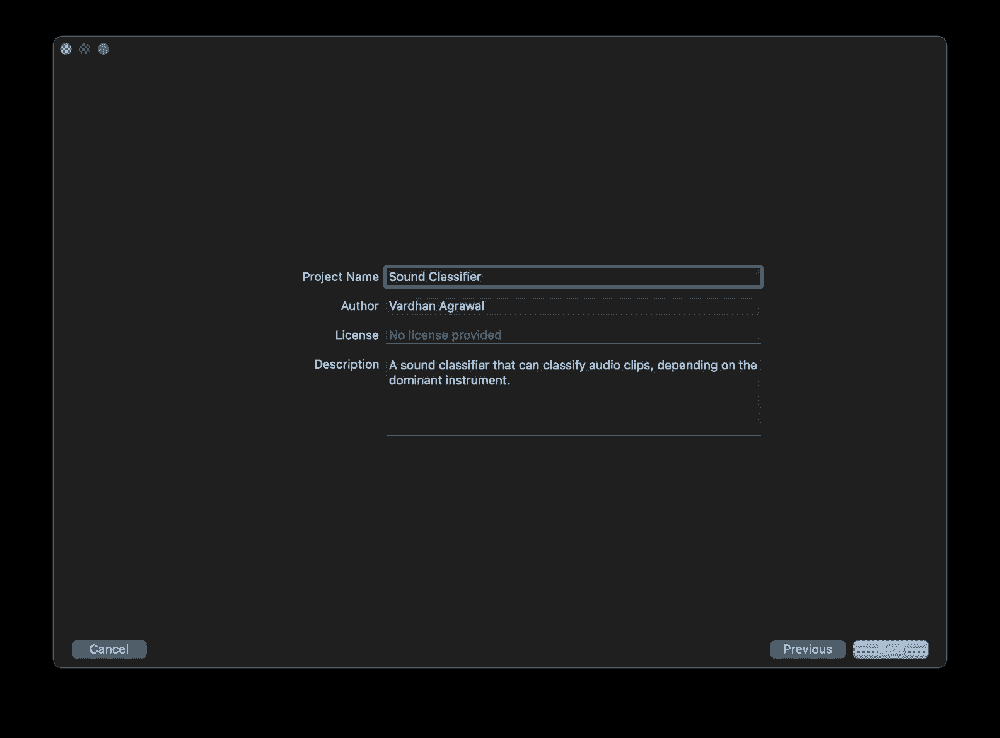

图 6-2：命名你的项目

#### 收集并准备数据

在训练声音分类模型之前，你需要收集数据。为了本书的内容，我将使用 IRMAS 数据集 ([`www.upf.edu/web/mtg/irmas`](https://www.upf.edu/web/mtg/irmas))。该数据集标记了每个音频片段中的主乐器。

##### 下载训练数据

IRMAS 提供了许多文件下载，总计 11 GB。幸运的是，你不需要全部下载。首先，你需要下载 IRMAS 网站下载选项卡下名为 `IRMAS-TrainingData.zip` 的训练数据。或者可以使用这个直接链接 ([`zenodo.org/record/1290750/`](https://zenodo.org/record/1290750/))（注：此处已完整）。

##### 标记训练数据

当你打开解压后的文件时，你会发现 11 个文件夹，每个文件夹都包含相应的音频片段。它的结构应该是这样的：

* `IRMAS-TrainingData`
    * `README.txt`
    * `cel`
        * `[xxx][xxx].wav`
        * `[xxx][xxx].wav`
    * `cla`
        * `[xxx][xxx].wav`
        * `[xxx][xxx].wav`
        * `[xxx][xxx].wav`
    * `flu`
        * `[xxx][xxx].wav`
        * `[xxx][xxx].wav`

然而，当你训练模型时，你不希望输出像 "cel" 和 "cla" 这样的内容，而是更有描述性的内容，例如“cello”（大提琴）和“clarinet”（单簧号）。

| 原始 | 新标签 |
| :--- | :--- |
| cel | cello |
| cla | clarinet |
| flu | flute |
| gac | acoustic guitar |
| gel | electric guitar |
| org | organ |
| pia | piano |
| sax | saxophone |
| tru | trumpet |
| vio | violin |
| voi | vocalist |

##### 删除文件

最后，删除下载文件夹中的 `README.txt` 文件。如果不这样做，Create ML 会认为它是训练数据的一部分，并因为文件类型不同无法继续。

##### 下载测试数据

然后，你需要下载测试数据。由于我们现在不是构建专业级模型，你可以下载第一部分，名为 `IRMAS-TestingData-Part1.zip`。同样，你可以在这个直接链接中找到测试数据 ([`zenodo.org/record/1290750/`](https://zenodo.org/record/1290750/))。由于测试数据没有为我们预排序，我们不会在自动测试部分使用它；但稍后我们将将其用于手动测试。

#### 训练你的模型

现在，在离开 Create ML 小绕路之后，是时候回到正轨训练你的声音分类器了。打开你之前创建的 Create ML 项目。我建议现在是插上电源，因为训练可能需要一段时间并消耗大量电池。

##### 拖入训练数据

与图像处理模型一样，你可以将训练数据（即 `IRMAS-TrainingData` 文件夹）直接拖入 Create ML 中的 `Training Data` 框中。工具随后会自动加载训练数据，你应该看到一个类似于图 6-4 的屏幕。如果你使用的是旧机器，或者你不愿意等那么久，我建议删除训练数据中的某些文件夹，或者减少每个文件夹中的文件数量，以加快模型训练。

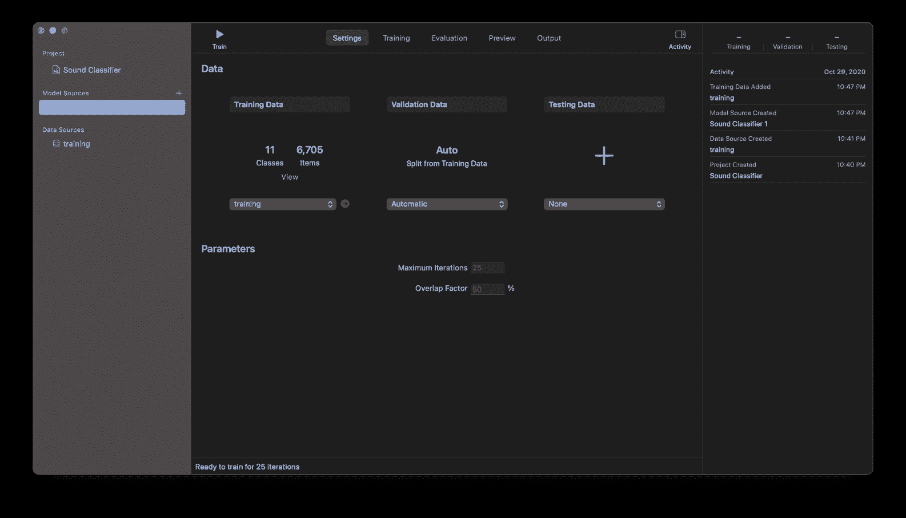

图 6-4：导入音频文件进行训练

接下来，点击顶部工具栏左侧的 *Play* 按钮开始训练。去给自己做个爆米花吧。训练你的声音分类器可能需要一段时间。


模型首先提取特征，正如你之前学到的那样：

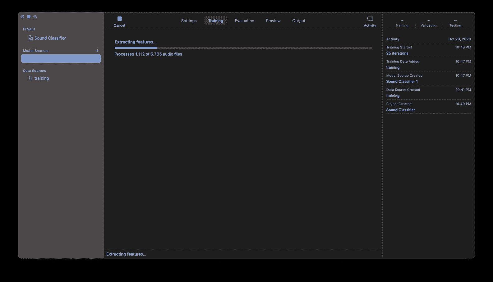

图 6-5: 处理音频文件

然后，它将使用 SVM 架构训练模型。

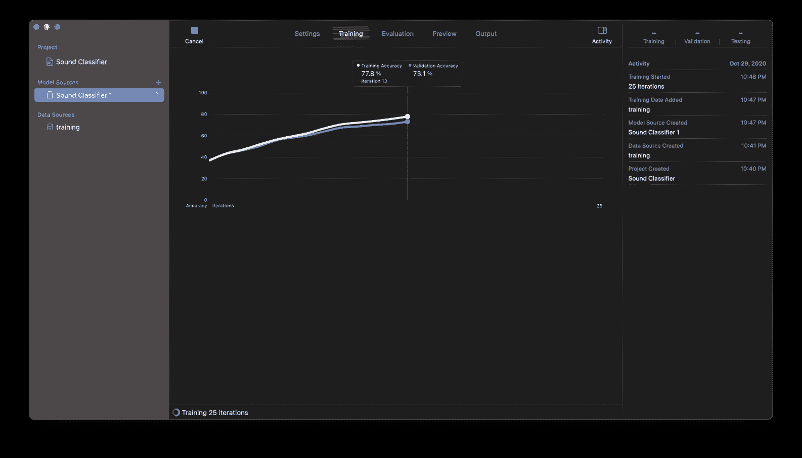

图 6-6: 训练模型

### 测试你的模型

在训练后测试模型与训练模型一样重要。毕竟，如果你的模型无法正确分类声音，那么它就失去了存在的意义。幸运的是，我们在本章使用的数据集为我们提供了大量的测试数据供我们使用。

#### 测试数据

和训练数据一样，测试数据在下载时并不符合 `Create ML` 的正确格式。因此，在开始之前，你将对文件层级进行调整。当你第一次下载测试数据时，它的结构如下所示：

*   `IRMAS-TestingData-Part1`
    *   `README.txt`
    *   `Part 1`
        *   `(xxx)-xxx.wav`
        *   `(xxx)-xxx.txt`

注意，我们有一个 README 文件和一个文件夹。在文件夹中，既有 `WAV` 文件也有 `TXT` 文件。显然，`Create ML` 不需要这些文本文件，因此我们需要通过以下两种方式之一处理数据：

##### 1. 自动化测试

通过自动化测试，`Create ML` 将自动将你的数据通过训练过的模型，并量化地跟踪准确率。为了利用这一功能，你需要按照训练数据相同的方式将测试数据整理成文件夹。如果你选择此路径，请按如下方式安排你之前下载的测试数据：

*   `IRMAS-TestingData-Part1`
    *   `cello`
        *   `[xxx][xxx].wav`
        *   `[xxx][xxx].wav`
    *   `clarinet`
        *   `[xxx][xxx].wav`
        *   `[xxx][xxx].wav`
        *   `[xxx][xxx].wav`
    *   `flute`
        *   `[xxx][xxx].wav`
        *   `[xxx][xxx].wav`

你会发现文件已经移出 `Part 1` 文件夹，并且 `README.txt` 文件已被删删除。你需要使用每个音频文件对应的文本文件中的内容将剪辑分类到相应的文件夹中，这可能花费大量时间；但是否值得取决于你。然后，进入菜单栏中的 `Testing` 标签页，将你排序好的音频文件文件夹拖入以获取结果。

##### 2. 手动抽检

“简单”的方法是删除所有文本文件（包括 `README.txt` 文件），并使用 `Output` 标签页将文件拖入。这样，你可以播放剪辑，查看模型对音带中每几秒内容的预测。虽然这种方法不会给你提供数值数据，但它将帮助你大致了解模型的性能。


图 6-7: 测试特定的音频文件

#### 录制与导出

现在，你已经有一个完全训练好的模型，准备好在声音分类应用中使用它了。然而，在此之前，让我们来看最后一种测试数据的方法：使用你自己的声音。

##### 实时录制

`Create ML` 我最喜欢的功能之一就是实时查看模型性能，而无需创建 Xcode 项目进行测试。要使用这一优秀功能，请点击 `Output` 标签页底部的 `+` 按钮。然后，点击 `Record Microphone`。这样，你就可以说话、唱歌或演奏乐器，并看着你的努力获得回报！


图 6-8: 测试实时录制

#### 导出你的模型

一如既往，从 `Create ML` 获取完成的模型是无缝的。你只需要将 `Output` 标签页下的 `Core ML` 文件图标拖到你的桌面或 Xcode 中即可。大功告成！你现在拥有了完整的 `Core ML` 模型，并准备好在本章的最后部分中使用。

#### 重命名你的模型

默认情况下，`Create ML` 将你的模型命名为 `SoundClassifier1.mlmodel`。为了使其更简单易读，让我们将文件重命名为 `SoundClassifier.mlmodel`。你可以通过按住 `Control` 并点击文件；然后选择重命名并输入新名称。这是一个细微的区别，但更简单的名称会让它在应用中使用变得容易得多。

## 6-3 实现模型

在本章开头，你学习了声音分类以及如何为模型训练获取合适的声音。你还学习了一些优秀的资源，可以帮助你为模型获取高质量的音频片段。随后，你使用 IRMAS 数据库训练了一个声音分类模型，该模型可以检测歌曲中的主要乐器。最后，你使用测试数据对模型进行了测试以衡量其性能。

到目前为止，你学习了声音分类以及如何为模型训练获取合适的声音。你还学习了一些优秀的资源，可以帮助你为模型获取高质量的音频片段。随后，你使用 IRMAS 数据库训练了一个声音分类模型，该模型可以检测歌曲中的主要乐器。最后，你使用测试数据对模型进行了测试以衡量其性能。在本节中，你将学习如何创建一个 iOS 应用，请求麦克风权限、使用 `SoundAnalysis` 框架并显示结果。

### 构建声音分类应用

与任何应用程序一样，第一步是创建一个 Xcode 项目。如果你记得第 2 章，你会记得我们创建一个预构建模型的图像分类应用。在本节中，我们将做类似的事情，但使用的是你在上一节构建的音频分类器。你首先需要命名应用程序，选择语言并设置束标识符。你可能已经熟悉了这个过程，所以可以跳过一些步骤。开始之前，打开 Xcode。

一如既往，我们将使用 `Single View Application` 作为模板，这允许我们从零开始编写代码。如果你喜欢不同的模板，尽管尽管使用；但某些步骤可能会有所不同。


要设计用户界面，你需要打开 `Main.storyboard` 文件。此外，如果你还没有读过它，第 2 章对用户界面的描述将比本章更详细。无论你做什么，只需确保你有两个东西：一个预测标签（prediction label）和一个置信度标签（confidence label）。作为参考，我的用户界面如下：


图 6-13：构建界面

一旦有了用户界面，你就将其连接到代码。要完成这一点，从项目导航器中打开 `ViewController.swift` 文件，并在 `ViewController` 类声明下方输入以下内容：

```
@IBOutlet weak var resultLabel: UILabel!
@IBOutlet weak var confidenceLabel: UILabel!
```

然后，使用 `Add Editor` 按钮（当前编辑器的右上角）打开 `Main.storyboard` 文件，你可以在那里链接每个 `@IBOutlet`。


图 6-14：添加辅助编辑器

在标签的左侧（通常是行号所在的地方你会发现一个未填充的圆圈）。你可以将其拖到右侧用户界面上对应的标签上。完成此操作后，它看起来像这样：`resultLabel` 变量连接到 *Guitar*，而 `confidenceLabel` 变量连接到百分比标签。


图 6-15：将 Interface Builder 连接到代码

### 设置麦克风权限并导入 ML 模型

Apple 对于允许使用麦克风、摄像头和定位服务等传感器非常严格。因此，作为应用开发者，我们需要解释为什么需要使用内置麦克风，并请求用户许可。

`Info.plist` 文件（或信息属性列表）包含了关于你创建的应用的重要元数据。这就是你放置麦克风使用描述的地方。你可以在项目导航器中找到此文件，它位于 Xcode 窗口的左窗格。

在表格中第一个单元格（显示为 `Information Property List`）旁边点击 `+` 按钮。这将允许你在表中创建一个新的使用描述条目。当弹出空白字段时，在 *key*（键）处输入 `NSMicrophoneUsageDescription`，并在 *value*（值）处解释你为什么需要麦克风。完成后，它看起来像这样：


图 6-16：编辑 Info.plist 并请求麦克风权限

无论你是否使用了上一节中的 IRMAS 数据集，你的电脑上某个地方应该有一个训练好的模型。如果你没有从 Create ML 导出模型，或者忘记了保存在哪里，可以直接将模型从 Create ML 拖入你的 Xcode 项目，或从文件系统拖入 Xcode。然后，Xcode 将识别它并显示你指定的元数据：


图 6-17：导入声音分类器

### 捕捉并处理实时音频

太棒了！你现在准备好了 Xcode 项目，完成了用户界面，并将训练好的模型导入到了项目中。下一步是让实时音频流进入你的应用进行处理。要做到这一点，你将使用一个名为 `AVAudioEngine` 的内置 API，它允许应用与 Apple 设备的内置麦克风和扬声器进行交互。

#### 捕捉音频

在我们处理音频之前，我们必须使用手机的麦克风捕捉用户环境中的声音。我们还需要将这些数据切分成微小的片段，指定其质量，并为 Core ML 模型对其进行正确的格式化。

对于我们需要完成的任务，只需要一个框架：`SoundAnalysis`。要导入它，在 `ViewController.swift` 文件的 `import UIKit` 下方输入以下内容：

```
import SoundAnalysis
```

该框架专门为声音分类设计，并包含了我们稍后会使用的其他工具。现在，你可以在 `ViewController.swift` 文件中使用它。

要开始捕捉声音，你需要使用刚刚导入的框架。在 `confidenceLabel` 变量下方声明以下变量，它拥有 `AVAudioEngine` 类的实例：

```
let engine = AVAudioEngine()
```

与现实生活中所有的“引擎”类似，我们需要启动 `AVAudioEngine` 它才能工作。然而，由于引擎的 `start()` 方法可能会抛出错误，你需要确保它不会失败。在 `viewDidLoad()` 方法内部，输入以下内容：

```
(try? engine.start()) ?? print("An error occurred.")
```

如果你对 Swift 不那么熟悉，这种语法看起来可能很陌生；但一旦你解析了它，就很简单。`engine.start()` 是我们启动上一步中创建的“引擎”的方式。

`??` 运算符在 Swift 中被称为“空值合并运算符”。它允许在原始返回 `nil` 时指定一个备用值或操作。由于 `start()` 会抛出错误，我们可以使用此运算符捕获它们。或者，你可以使用标准的 `try-catch` 块，这在其他面向对象的编程语言中更为常见。

#### 处理请求

当你配合 `SoundAnalysis` 框架使用声音分类模型时，系统会调用名为 `request` 的方法，你可以在该方法指定如何处理结果。

为了访问 `request` 模型，你的 `ViewController` 类需要遵循 `ResultsObserving` 协议。为此，我们将创建一个扩展。在文件底部插入以下代码：

```
extension ViewController: ResultsObserving {
    // 你的代码
}
```

虽然你可以直接在 `ViewController` 类中这样做，但我们使用扩展来更好地组织代码。此时，Xcode 会给你出一个错误，我们将在下一步解决它。

你可能看到的错误是 Xcode 告诉你 `ViewController` 类没有遵循该协议。要解决这个问题，只需在扩展内部添加 `request` 方法：

```swift
func request(_ request: SNRequest, didProduce result: SNResult) {
    // 你的代码
}
```

该方法的 `request` 参数是内部的，我们不需要处理它。然而，我们需要处理 `result` 参数。正如名称所示，`result` 参数是模型产生的分类标签，并在该方法被系统调用时传入。

与 Swift 中所有的机器学习任务一样，这里涉及到可选类型。为了访问存储在 `result` 参数中的数据，你需要将其转换为 `SNClassificationResult`（目前是 `SNResult` 协议，而不是具体类型）。为此，在 `request` 方法中输入：

```swift
guard let result = result as? SNClassificationResult
    else { return }
```

`guard-let` 语句确保 `result` 参数确实可以转换为 `SNClassificationResult` 类型，如果转换失败，它将直接返回。接下来，你需要从此对象获取实际的分类文本。要做到这一点，在前行下方输入以下内容：

```swift
guard let label = result.classifications.first
    else { return }
```

这将从 `result` 参数中收集置信度最高的 `SNClassification` 对象。具体来说，它将获取 `classifications` 数组中的第一项。

在我们获得易于访问的格式结果后，我们需要将其显示给用户。`label` 参数当前包含一个 `SNClassification` 对象，该对象内部包含一个标签和一个置信度值。置信度值是一个长小数，显示时看起来像这样：


```
92.36666666666666666666666666666666666666666667…%
```

然而，我们更希望得到像 `92.4%` 这样的值，以保持界面整洁、简单且优雅。幸运的是，Swift 针对此类小数有一个快速的 `round()` 方法，你可以这样访问并舍入置信度：

```swift
let confidence = round(label.confidence * 1000) / 10
```

太棒了！你现在将舍入后的值存储在 `confidence` 变量中了。要显示文本，请执行操作：

```swift
DispatchQueue.main.async {
    self.resultLabel.text = "\(label.identifier)"
    self.confidenceLabel.text = "\(confidence)%"
}
```

如你所知，必须在主线程上更新用户界面以保持性能，因此我们应该将其封装在一个块中。

最后，你想要确保应用更改标签的速度不会快到让用户无法阅读。为此，你可以在更新用户界面之前检查置信度是否高于 65%（或其他百分比）。将你的用户界面代码封装在 `if` 语句中，如下所示：

```swift
if confidence > 65 {
    DispatchQueue.main.async {
        self.resultLabel.text = "\(label.identifier)"
        self.confidenceLabel.text = "\(confidence)%"
    }
}
```

我们还希望在置信度低于阈值时显示声音未被识别。为此，添加以下 `else` 块：

```swift
else {
    DispatchQueue.main.async {
    self.resultLabel.text = "not recognized"
    self.confidenceLabel.text = "--%"
    }
}
```

在这里，我们正在检查置信度是否大于 65%，然后在结果标签中显示“not recognized”。我们还在置信度标签中显示破折号，以明确我们没有结果。

## 请求分析

你已经设置好了在我们请求模型处理音频后需要发生的事情。但现在，我们需要实际发出请求，以便我们的 `request` 方法被调用。

## 实例化模型

当你将模型导入 Xcode 时，它会自动为该模型创建一个 Swift 包装类。由于我的模型名为 `SoundClassifier.mlmodel`，我预期会创建一个名为 `SoundClassifier()` 的 Swift 类供我使用。同样，你将有一个以你选择的名字创建的模型包装类。要实例化此模型，请在你之前的 `engine` 声明下方插入以下代码：

```swift
let classifier = try! SoundClassifier(configuration: MLModelConfiguration())
```

现在，你可以在 `ViewController.swift` 文件中访问模型的单例实例，而不是为同一个类创建多个冗余的实例。

需要注意的一点是我使用了 `try!` 关键字（注意感叹号）。这意味着如果在初始化 `SoundClassifier` 或 `MLModelConfiguration` 期间抛出错误，程序将会崩溃。

在 Swift 中你应该极少使用感叹号，但在这种情况下，我们不在意应用崩溃，因为如果在初始化 `SoundClassifier` 或 `MLModelConfiguration` 期间抛出错误，程序将会崩溃。


# 第 7 章：基于 Firebase 的云机器学习


在上一章中，你学习了关于声音分类的所有知识。你首先学习了如何收集和获取声音以训练机器学习模型。然后，你使用 `Create ML` 实际训练了了自己的声音分类模型。最后，你构建了一个功能完整的应用程序，它可以从你设备的麦克风捕获音频并使用你自定义的模型对其进行处理。在上一章中，你学习了许多关于机器学习的独特注意事项。

在本章中，你将通过另一个我们尚未探索过的方面学习更多关于机器学习的知识：`云端机器学习`。首先，你将学习如何通过一个名为 `CocoaPods` 的依赖管理器来设置 Firebase。接下来，你会将你的 `Xcode` 项目连接到 Firebase。然后，你将学习不同的图像处理技术，例如条形码扫描和图像分类。

在章节的后部分，我们将转向基于文本的机器学习，并创建一个语言翻译工具作为本章的结束。结束时，你将很好地掌握使用 `Firebase` 的机器学习工具，并构建了三个功能完整的应用程序！

## 7-1 Firebase 概览

在本章中，你将学习 Firebase 以及如何在你的计算机上安装它。你还将创建一个账户并学习一个名为 `CocoaPods` 的依赖管理器，它允许你下载许多不同的依赖项——几乎所有的依赖项都支持 `CocoaPods`。这样，除了机器学习方面外，你还将极大地增加应用程序开发的灵活性。

对于那些过去没有使用过 Firebase 的人，你还将直观地了解该 API 可以做什么。在本节结束时，你将能够创建自己的应用程序，在命令行中使用 `CocoaPods` 对其进行配置，然后将其连接到你在书中本节部分创建的 Firebase 账户。


图 7-1：使用 Firebase

### Firebase 的基本用途

万一你不熟悉它，Firebase 最初是作为一个后端服务启动的，承诺提供实时数据，这与当时的任何事物都不同。Firebase 并不是使用来自数据库的典型 HTML `POST` 和 `GET` 请求，而是允许用户通过 `WebSockets` 获取实时数据。后来，Firebase 被 Google 收购，并集成到了他们的云服务部门。

现在，由于有了新的集成，该平台提供了多项新功能，包括机器学习应用、存储，甚至一些用户界面选项。如今，你每天使用的许多应用程序都是由 Firebase 驱动的，因为其领先的安全性和极具竞争力的低价格。

#### 引导与客户留存

当用户首次打开你的应用程序时，你可以使用 Firebase 告诉他们如何使用、如何设置账户以及如何与你的内容交互。Firebase 让这一切变得简单。它还允许你跟踪用户在应用程序中的导航情况，以便你能够发现哪些功能对你的用户最有用。

#### 错误测试与功能发布

如果你不确定某个功能是否会被用户欢迎，可以先对一小部分用户进行测试。结合 Firebase 的分析工具，这允许你对功能进行 `A/B test`，并只发布最相关的内容。你还可以获得有关应用程序性能的洞察，因为你可以跟踪崩溃和其他和其他错误。

#### 登录、存储与聊天

Firebase 最流行的功能是能够创建快速登录页面、存储图像和其他媒体文件，以及在你的应用程序中实现聊天室。Firebase 让你只需几行代码就能轻松将这些原本复杂的特性实现到你的应用程序中。

#### 数据库与机器学习

如前所述，Firebase 起始于——嗯——一个数据库，因此得名。他们的数据库是可用的最强之一，允许你的应用程序获取实时更新，而无需“刷新”或“更新”应用程序。此外，Firebase 的机器学习部门允许你在云端执行我们在书中探索过的某些任务，因此你就可以实时改进你的模型。这是我们在本章中将最关注并深入探索的特性。

### 账户创建与设置

在开始使用 Firebase 之前，你需要一个账户。由于 Firebase 被 Google 收购，一个 Google 账户就足够了。你可能已经有一个 Google 账户，所以可以直接登录；但如果你没有，现在是创建一个它的好时机。

#### 创建项目

首先，你需要创建你的第一个 Firebase 项目。一旦你准备好了 Google 账户，你需要访问 [`firebase.google.com`](https://firebase.google.com)。然后，使用你的 Google 账户登录并选择“Go to console”进入 Firebase 控制台。


图 7-2：Firebase 欢迎界面

在控制台中，点击屏幕中间白色的 `Create a Project`（或 `Add project`）按钮。或者，你也可以从演示项目开始，但在本书中，我们将从零开始。


图 7-3：命名你的项目

我给我的项目命名为 `CloudML`，但按照习惯，你可以随心命名你的项目。接下来，点击下方的蓝色 `Continue` 按钮。

现在，它会询问你是否想要启用分析。拨一下开关，因为本章只关注机器学习，而不是分析。如果你启用了该选项，你需要配置分析。


如果你以前从未用过 `CocoaPods`，你需要在命令行中安装它。为了这次安装，你不需要熟悉命令行，因为它比我们在书中之前完成的安装要简单得多。如果你以前用过它，可以跳过安装步骤，因为它们对你来说是多余的。

首先，打开 `Terminal`（终端）应用程序，它可以让你访问计算机的命令行。你可以通过点击 `Command + Space` 并输入“Terminal”，或者在文件目录的 `Applications > Terminal` 中找到它。当你打开它时，你会看到一个像下面所示的窗口：


图 7-7：新终端窗口

之后，如果你还没有安装 CocoaPods，就可以安装它。如果你不确定，也可以运行该命令，因为它不会对你的系统造成任何伤害。由于 CocoaPods 是一个基于 Ruby 的依赖管理器，你可以使用 `gem` 命令轻松地安装它。在命令行中输入以下内容（不包括 `%` 提示符）：

```
% sudo gem install cocoapods
```

按下 `Enter` 键后，系统会提示你输入计算机密码，以赋予 `gem` 安装 CocoaPods 所需的权限。几分钟后，安装应该就会完成，当你看到 `%` 提示符时，就可以继续下一步了。

### 配置

要使用 `CocoaPods`，你需要为每个想要使用它的项目进行配置。如果你已经安装了 CocoaPods，可以从这里开始继续后续操作。

#### 进入项目目录

我们将首先通过命令行进入项目目录。要做到这一点，你可以输入 `cd` 然后将项目所在的文件夹拖入，以自动填充路径。或者，你也可以手动这种形式输入目录名称：

```
% cd /<your directory>
```

假设，如果你的项目保存在 `Desktop`（桌面）文件夹下，你可以这样输入命令：

```
% cd /Desktop/CloudML/
```

#### 初始化 CocoaPods

对于每个想要使用 CocoaPods 的项目，你都必须单独对其初始化。虽然你只需要执行一次上一步，但每次想在项目中使用 CocoaPods 时，都必须执行以下步骤。进入项目目录后，输入以下内容：

```
% pod init
```

按下 `Enter` 键，几秒钟后，你会发现多了一个 `Podfile` 文件。在这里，你可以指定想要作为项目一部分包含哪些库或依赖。

#### 添加 Firebase

最后，剩下的工作就是安装相关的 Firebase 库。现在，我们将安装基础库，但在本章稍后的部分，你将安装为云端机器学习任务所需的特定库！

##### 编辑 Podfile

首先，用文本编辑器（例如 [Atom](https://atom.io/）打开打开 `Podfile`。如果你不想安装第三方文本编辑器，只需双击 `Podfile` 并用 TextEdit（文本编辑）打开即可。

```
## Pods for CloudML
```

此注释指示了你需要放置 Firebase 安装行的位置。要添加 Firebase pod，在注释下方输入以下内容：

```
pod 'Firebase'
```

##### 安装 Pods

现在你已经指定了想要使用的 Pods，保存 `Podfile` 并在终端中输入以下内容：

```
% pod install
```

这应该安装 Firebase 所需的所有依赖项——至少到目前为止。完成后，你就成功地使用 CocoaPods 将 Firebase 安装到了你的 Xcode 项目中。

正如你可能注意到的，在运行 `pod install` 命令后，你的项目中出现了一个扩展名为 `.xcworkspace` 的额外文件。从本质上说，这是一个包含你的实际项目和 pods 的包装器。从现在起，你需要打开这个文件而不是你的 `.xcodeproj` 文件。

#### 连接项目到 Firebase

在你创建了 Xcode 项目并使用 CocoaPods 安装了 Firebase 之后，就可以准备好最后一步，将其连接到 Firebase。这将允许 Firebase 通过一系列身份验证方法知道你的应用 确实是你的应用。别担心，这是有趣的部分！

##### 添加应用

在 Firebase 的项目仪表板上，你应该能看到“添加应用以开始”的选项。在文字上方，有 iOS、Android 和 Web 的图标。显然，我们将添加一个 iOS 应用，所以点击圆形的 `iOS` 按钮。


图 7-8：Firebase 项目控制台

##### 注册 Bundle ID

Firebase 将在引导设置过程中向你索要项目的 Bundle ID。要找到你的 Bundle ID，请打开 `.xcworkspace` 版本的项目，然后在屏幕左侧的项目导航器中点击它的名称（左侧带有蓝色图标）。

然后，在 `TARGETS`（目标）下，选择你的项目名称并在屏幕中央找到 `Bundle Identifier`。你的应该看起来和我的相似：

```
com.vardhanagrawal.Chapter-8
```

一旦找到此标识符，将其输入到 Firebase 控制台的 `iOS Bundle ID` 处。然后，忽略另外两个字段并点击 `Next`（下一步）。


图 7-9：添加名称和 iOS Bundle ID

##### 下载配置文件

接下来，Firebase 需要一种方式告诉你的应用关于项目的信息。它使用 `.plist` 属性列表文件。Firebase 会提示你下载此文件，这只需要几秒钟就能完成。

下载完成后，你的文件将是 `GoogleService-Info.plist`。将此文件从下载文件夹拖入你的 Xcode 项目，与其他文件放在一起。

##### 配置 Firebase

最后，你需要告诉你的应用在启动时立即配置 Firebase。你可以在 `AppDelegate.swift` 文件中执行此操作。`AppDelegate` 类中看到的第一个方法应该如下：

```
func application(_ application: UIApplication,
    didFinishLaunchingWithOptions launchOptions:
        [UIApplication.LaunchOptionsKey: Any]?) -> Bool {
            FirebaseApp.configure()
            return true
}
```

注意，我们只添加了一行代码：

```
FirebaseApp.configure()
```

在 Xcode 开始显示警告之前，让我们在 `import UIKit` 下方添加一条导入语句来引入 Firebase：

```
import Firebase
```

干得好！你刚刚完成了工作区的设置、Xcode 项目的创建以及使用 CocoaPods 进行连接。你变得专业了！在接下来的几个章节中，你将学习使用三种方法使用 Firebase 工具。

## 7-2 二维码扫描和图像标记

在上一节中，你学习了如何使用 CocoaPods 依赖管理器创建一个连接到 Firebase 的应用程序。在本节中，你将学习两种在应用程序中使用 Firebase ML Kit 的方法。首先是条码扫描，其次是图像标记。结束时，你将拥有一个可以扫描条码并标记图像中特定对象的应用，且不需要本地模型。

### 启动实时流

对于条码扫描和图像标记，我们需要一个实时视频流。因此，我们将首先创建一个。然后，你可以选择制作一个条码扫描器或图像标记应用。

#### 创建用户界面


第一步是创建你的用户界面。由于该应用仅扫描条形码，它只需要一个用于预览条形码的图像视图和一个显示条形码内容的标签。

### 打开界面构建器 (Interface Builder)

首先从左侧的文件检查器中打开 `Main.storyboard` 文件。顺便提一下，确保你打开的是 `.xcworkspace` 文件而**不是** `.xcodeproj` 文件，因为你在这个项目中使用了 CocoaPods。一旦界面构建器打开，你就可以构建界面了。

### 添加一个 ImageView

接下来，你需要为用户提供一个预览条形码的地方。我们可以使用 `UIImageView` 来实现这一点，这类似于第 2 章中的实时预览。如果你不记得如何操作，可以参考该章节以获取更详细的说明。


图 7-11: 添加 ImageView

#### 添加一个 Label

最后，你需要一个标签来显示条形码的值。将它添加到 storyboard 中，并将其放在你喜欢的任何地方。只需确保它在应用运行时是可见的即可。你可能还会选择添加背景颜色，以与图像视图形成对比。


图 7-12: 添加用于结果的标签

#### 添加约束 (Constraints)

由于我们之前已经介绍过约束的概念，我将在本章中不再详细介绍它们。对于你的应用，你需要对图像视图和标签进行约束，以便它们在多个设备和方向上正常工作。


图 7-13: 添加 Auto-Layout 约束

#### 连接 IBOutlets

最后一步是将你的界面元素声明为 `@IBOutlet` 变量。打开你的 `ViewController.swift` 文件，并在 `ViewController` 类声明内部输入以下内容：

```
@IBOutlet weak var imageView: UIImageView!
@IBOutlet weak var label: UILabel!
```

接下来，在你的 `Main.storyboard` 文件中，通过双指点击（右键点击）`ViewController` 连接这些 outlet，然后将界面元素连接到它们对应的变量。当你返回 `ViewController.swift` 文件时，`IBOutlets` 左侧的圆圈将被填充，这确认你已成功连接了 outlet。

### 创建实时流 (Live Feed)

在创建好用户界面后，我们需要向其填充实时视频流。这对于计算机视觉应用来说是一项非常有用的技能，因为实时流极大地提升了用户体验。

#### 导入框架

首先，导入 `AVKit` 框架，这将允许你为应用创建实时视频流。只需在 `ViewController.swift` 文件的 `import UIKit` 行下方添加以下内容即可：

```
import AVKit
```

#### 创建扩展 (Extension)

为了保持代码整洁，从最后一个右大括号开始扩展 `ViewController`。该扩展还应该遵循 `AVCaptureVideoDataOutputSampleBufferDelegate` 以处理我们的视频相关任务，看起来如下：

```
 extension ViewController:
    AVCaptureVideoDataOutputSampleBufferDelegate {
        // 在此处编写你的代码。
}
```

#### 创建方法

为了包含所有的代码，我们将创建一个名为 `setupSession()` 的方法。它不接受参数，且执行的操作与其名称一致：创建并设置 `AVCaptureSession`。在在上一步创建的扩展内部执行此操作：

```
func setupSession() {
    // 在此处编写你的代码。
}
```

然后，在 `ViewController` 类主体的 `viewDidLoad()` 方法中调用该方法。这将确保在视图加载后完成所有设置。添加该内容后，你的 `viewDidLoad()` 方法看起来如下：

```
override func viewDidLoad() {
    super.viewDidLoad()
    setupSession()
}
```

现在，进入下一步！

#### 声明输入

在你的扩展内部，输入以下代码行，以确保你的设备确实有摄像头并且可以可以使用。如果这些代码执行失败，函数将直接返回而不会导致程序崩溃，如 `guard let` 语句所示：

```
guard let device = AVCaptureDevice.default
     (for: .video) else { return }
guard let input = try? AVCaptureDeviceInput
    (device: device) else { return }
```

#### 创建会话 (Session)

现在，你可以声明捕获会话并指定采集视频的质量。在这里使用最高质量，但如果你正在开发一个面向数百万用户的应用，你就需要考虑电池寿命时间、效率、质量以及这些因素如何影响应用的可用性。在之前的代码之前输入以下内容：

```
let session = AVCaptureSession()
session.sessionPreset = .hd4K3840x2160
```

会话是 `AVCaptureSession` 的实例存储在 `session` 变量中。在下一行中，通过框架内的 `enum` 将其属性 `sessionPreset` 设置为最高分辨率。

#### 视频预览

显然，我们希望用户能够看到摄像头捕捉到的视频，以便他们对准正确的目标。因此，我们需要一个预览层在我们之前添加的图像视图内显示视频流。要实现这一点，在 `setupSession()` 方法中添加以下内容：

```
let previewLayer = AVCaptureVideoPreviewLayer
    (session: session)
previewLayer.frame = view.frame
previewLayer.videoGravity = .resizeFill
imageView.layer.addSublayer(previewLayer)
```

#### 输出数据

在显示数据之后，我们需要输出以便后续使用。最终我们将从此视频流中提取帧。在之前的代码之后添加以下内容：

```
let output = AVCaptureVideoDataOutput()
output.setBufferDelegate(self,
    queue: DispatchQueue(label: "videoQueue"))
```

#### 运行会话

`setupSession()` 方法的最后一项工作是将 `input` 和 `output` 添加到捕获会话，然后启动它：

```
session.addOutput(output)
session.addInput(input)
session.startRunning()
```

一切就绪！如果你现在运行应用，应该可以看到实时视频流了。由于这是一个基于摄像头的应用程序，你需要使用物理设备进行测试——遗憾的是 Xcode 模拟器不支持摄像头。

### 条形码扫描

如今，条形码无处不在。你可以在洗衣液瓶、薯片包甚至这本书的背面（如果你读的是纸质版）找到它。通常，条形码是通过激光条形码扫描扫描的，但你也可以使用手机摄像头和机器学习来扫描。

#### 完成清理

在实际扫描条形码之前，你需要导入相应的框架并从实时视频流中获取图像。让我们完成清理工作。

##### 添加 Pods

在上一节中，你配置了 Firebase。但现在，你需要安装用于视觉和条形码扫描的库。作为参考，这些库以前是 Firebase SDK 的一部分，但后来已移动到 Google 的 ML Kit。因此，我们在这里使用该版本。

第一步是在你的 Podfile 中添加几个 pod。在左侧的项目导航器中，你可以在 Pods 目标（带有蓝色图标）下找到 Podfile。

打开 Podfile，在你稍早添加的 `pod 'Firebase'` 之后添加以下代码行：

```
pod 'GoogleMLKit/BarcodeScanning'
```


保存文件后，返回终端（Terminal）并进入项目目录。进入项目文件夹后，输入 `pod install` 来安装这两个新的 pod。

### 导入 Firebase

完成后，回到 `ViewController.swift` 文件，在 `import UIKit` 之后添加以下导入语句：

```
import MLKit
```

这告诉 Xcode 你想使用上一步中通过 Cocoapods 导入的 `MLKit` 库。

### 捕捉像素缓冲区（Pixel Buffer）

在此之前，你创建了一个实时视频流，现在我们准备好使用该视频流了。然而，你不能直接给 Firebase 提供视频流并期望获得结果；你首先需要提取单帧。要实现这一点，请在 `ViewController` 扩展中 `setupSession()` 下方添加以下方法：

```
func captureOutput(_ output: AVCaptureOutput,
    didOutput sampleBuffer: CMSampleBuffer,
        from connection: AVCaptureConnection) {
    // 在此处编写你的代码。
}
```

该代理方法会在视频输出的每一帧时被调用，并以 `CMSampleBuffer` 的形式为你提供帧，你可以将其转换为图像以供 Firebase 使用。

### 扫描条码

现在，你终于准备好扫描条码了！使用 Firebase 扫描条码是在本地完成的，这意味着不需要连接网络即可工作。对于此应用而言，我们只需获取条码中存储的值并显示给用户。现在，让我们开始吧。

### 指定格式

首先，让我们指定你想要检测的条码格式。你可以在 `captureOutput()` 方法中输入以下内容来实现：

```
let format = BarcodeFormat.all
```

这会创建一个常量并将所有的条码格式存储在其中。或者，你也可以为扫描器选择特定的格式，使其仅检测那些格式。然后，创建另一个常量来存储你的条码选项：

```
let options = BarcodeScannerOptions(formats: format)
```

### 创建条码检测器

接下来，你需要使用之前创建的选项来创建实际条码检测器。你可以像这样使用 `Vision` API 来完成：

```
let barcodeDetector = BarcodeScanner.barcodeScanner(options: options)
```

这创建了一个 `barcodeScanner` 实例，并使用上一步中的 `options` 作为初始参数。这指定了它能够识别的条码类型。

### 提取图像

如前所述，你可以将像素缓冲区转换为图像以供 Firebase API 使用。幸运的是，Firebase 的 `VisionImage()` 类接受 `CMPixelBuffer` 作为初始参数，因此你可以像这样创建一个 `VisionImage` 实例：

```
let image = VisionImage(buffer: sampleBuffer)
```

`image` 常量现在存储了一个图像，供你使用之前创建的 `barcodeDetector` 进行处理。

### 检测条码

在完成所有这些配置后，你就可以准备使用 `barcodeDetector` 扫描条码了。你可以使用 `process(:)` 方法并将 `image` 作为参数来操作：

```
barcodeDetector.process(image) { (barcodes, error) in
    // 在此处编写你的代码。
}
```

这将检测条码，但你还需要使用我们之前创建的标签将结果显示给用户。


在这里，我们正在声明一个空的 `ImageLabelerOptions()` 实例，因为我们现在不需要设置任何自定义参数——为了满足要求即可。接着，我们将创建一个图像标签器。

顺带提一下：如果你想让模型运行在云端，那么你将需要使用 `Firebase` 的 API。在过去，可以在同一个 API 中实现这一点；但 Google 似乎只选择将它们的设备端图像标记迁移到 `Google ML Kit`，而将云端的图像标记器留给了 `Firebase`。

### 处理图像

使用你刚刚创建的 `labeler`，你可以处理视频帧。与条形码扫描应用类似，`process()` 方法有一个闭包，在其中传递结果和错误（如果适用）。要调用此方法，请输入以下内容：

```
labeler.process(image) { labels, error in
 // your code goes here.
}
```

这将在之前步骤中的 `image` 运行在云端或你的手机上的机器学习模型中，取决于你之前指定的 `labeler`。

### 显示结果

最后，你准备好显示上一步中 `process()` 方法获得的结果了。在方法的闭包内部，输入以下内容来更新你的标签：

```
if let labels = labels {
    var text = ""
    for label in labels {
        text += "\(label.text)\n"
    }
    self.label.text = text
}
```

首先，使用 `if-let` 语句检查可选的 `labels` 数组是否存在（或是否为 `nil`）。如果它存在，你将创建一个变量字符串并使用 `for-loop` 将每个标签添加到其中。在字符串末尾，你会注意到 `\n`，这是一个换行符。这意味着每个检测到的项目将在你的标签中换行显示。

### 允许多行标签

由于默认情况下每个 `UILabel` 只有一行，虽然我们正在使用多行来显示标签，但我们需要允许标签拥有多行。要这样做，请前往 `ViewController` 类中的 `viewDidLoad()` 方法并添加以下内容：

```
label.numberOfLines = 0
```

通过将行数设置为 `0`，我们告诉 Xcode 允许所需的行数来显示整个文本。这允许标签动态更改大小，而不是具有固定的单行高度。

现在，当你运行应用时，你应该能看到你的图像（在这种情况下是视频）被分类并显示在标签上。你成功地使用 `Firebase` 构建了一个图像标记应用，恭喜！

## 7-3 语言之间的翻译

在上一节中，你学习了如何创建一个条形码扫描器和一个图像标记应用。你创建了其中一个（或两个）应用，并使用了实时视频流来提供高质量的用户体验。你学习了如何使用设备的摄像头，然后提取像素缓冲区来逐帧处理。到最后，你拥有了两个使用 `Firebase` 进行机器学习目的的完全功能应用。

在本节中，你将学习如何在不同语言之间翻译文本。

### 创建文本

在上一节中，你学习了如何创建一个条形码扫描器和一个图像标记应用。你创建了其中一个（或两个）应用，并使用了实时视频流来提供高质量的用户体验。你学习了如何使用设备的摄像头，然后提取像素缓冲区来逐帧处理。到最后，你拥有了两个使用 `Firebase` 进行机器学习目的的完全功能应用。

在本节中，你将学习如何在不同语言之间翻译文本。

### 从从界面到代码

在上一节中，你学习了如何创建一个条形码扫描器和一个图像标记应用。你创建了其中一个（或两个）应用，并使用了实时视频流来提供高质量的用户体验。你学习了如何使用设备的摄像头，然后提取像素缓冲区来逐帧处理。到最后，你拥有了两个使用 `Firebase` 进行机器学习目的的完全功能应用。

在本节中，你将学习如何在不同语言之间翻译文本。

#### 设计布局

在上一节中，你学习了如何创建一个条形码扫描器和一个图像标记应用。你创建了其中一个（或两个）应用，并使用了实时视频流来提供高质量的用户体验。你学习了如何使用设备的摄像头，然后提取像素缓冲区来逐帧处理。到最后，你拥有了两个使用 `Firebase` 进行机器学习目的的完全功能应用。

在本节中，你将学习如何在不同语言之间翻译文本。

#### 语言翻译

#### 添加文本字段

在上一节中，你学习了如何创建一个条形码扫描器和一个图像标记应用。你创建了其中一个（或两个）应用，并使用了实时视频流来提供高质量的用户体验。你学习了如何使用设备的摄像头，然后提取像素缓冲区来逐帧处理。到最后，你拥有了两个使用 `Firebase` 进行机器学习目的的完全功能应用。

在本节中，你将学习如何在不同语言之间翻译文本。

#### 添加按钮

在上一节中，你学习了如何创建一个条形码扫描器和一个图像标记应用。你创建了其中一个（或两个）应用，并使用了实时视频流来提供高质量的用户体验。你学习了如何使用设备的摄像头，然后提取像素缓冲区来逐帧处理。到最后，你拥有了两个使用 `Firebase` 进行机器学习目的的完全功能应用。

在本节中，你将学习如何在不同语言之间翻译文本。

#### 添加标签

在上一节中，你学习了如何创建一个条形码扫描器和一个图像标记应用。你创建了其中一个（或两个）应用，并使用了实时视频流来提供高质量的用户体验。你学习了如何使用设备的摄像头，然后提取像素缓冲区来逐帧处理。到最后，你拥有了两个使用 `Firebase` 进行机器学习目的的完全功能应用。

在本节中，你将学习如何在不同语言之间翻译文本。

#### 完成收尾工作

正如你可能猜到的那样，在构建我们的语言翻译器之前，我们需要做一些工作。幸运的是，由于没有实时视频流，你只需要在开始之前安装一个额外的 pod 即可。


打开你工作区下 `Pods` 目标的 `Podfile`。你也可以直接在 Finder 中打开它，或者通过 Terminal 打开。然后在 `pod 'Firebase'` 行下方添加一个额外的 pod，如下所示：

```
pod 'Firebase/MLNLTranslate'
```

这将添加通过 Firebase 进行翻译所需的适当框架。

## 安装 Pod

然后保存你的 `Podfile` 并安装 pod。这与你一直以来的操作流程相同，但正如你所知，熟能生巧！通过 Terminal 到你的项目目录，输入以下命令进行安装：

```
pod install
```

## 导入 Firebase

完成后，回到 `ViewController.swift` 文件，在 `import UIKit` 之后添加以下导入语句。这就是你为该项目做的所有准备工作了！

```
import MLKit
```

## 翻译字符串

现在，你已经准备好开始将字符串从一种语言翻译成另一种语言了。本质上，你需要下载翻译模型，等待它们通过多线程完成安装，然后创建翻译请求并显示给终端用户。

### 语言选项

创建翻译工具的第一步逻辑步骤是指定要在之间翻译的语言。由于我精通西班牙语和英语，我将分别使用它们作为目标语言和源语言。在之前的 `submitButtonTapped()` 中这样定义你的语言：

```
let options = TranslatorOptions
    (sourceLanguage: .english, targetLanguage: .spanish)
```

这行代码创建了一个 `TranslatorOptions` 实例，并指定了目标语言和源语言。两个参数的类型都是 `TranslateLanguage`。过去，语言枚举比较晦涩，但幸运的是它们现在变得更直观了。对于“英语”，你只需说 `.english`！

### 创建翻译器

接下来，你可以使用语言选项创建一个翻译器。我建议为它命名，以便你轻松理解它使用的语言。将来，你可能会选择扩展应用以支持多种语言，为此，命名尤为重要。在同一个 `submitButtonTapped()` 方法中如下定义你的翻译器：

```
let spanishTranslator = Translator.translator(options: options)
```

在这里，常量 `spanishTranslator` 包含一个 `translator` 实例，通过参数 `options` 将英语翻译成西班牙语。如果你想使用多种语言，可以以类似的方式创建这些翻译器的数组——只需确保相应地更改源语言和目标语言即可！

### 下载翻译模型

要继续使用你创建的翻译器，首先需要从 Firebase 下载适当的翻译模型。你还可以指定下载模型的条件，包括允许使用蜂窝数据。在这里，我们不指定任何内容：

```
spanishTranslator.downloadModelIfNeeded() { error in
    // 在此处编写你的代码
}
```

当模型成功下载或返回错误时，闭包内部的代码将执行；这非常适合执行我们的实际任务。

### 翻译你的字符串

最后，你准备好将用户的字符串翻译成目标语言。在 `downloadModelIfNeeded()` 闭包内部，输入以下代码来发出翻译请求：

```
spanishTranslator.translate(self.textField.text ?? "")
    { translatedText, error in
        // 在此处编写你的代码
}
```

`translate()` 方法接收目标字符串作为参数，我们传入了文本框中输入的文本。如果没有文本（即 `self.textField.text` 为 `nil`），它将使用空值合并运算符 (`??`) 传入一个空字符串。生成的字符串（可用）将通过 `translatedText` 变量传递。

### 显示结果

现在翻译器已经给了你结果，你可以使用创建的 label 向用户显示它。为此，首先检查是否存在结果，如果有，则将其显示给用户。在 `translate()` 函数的闭包中执行此操作。

```
if let translatedText = translatedText {
    self.label.text = translatedText
}
```

可能闭包太多了难以跟上，所以这是你的 `submitButtonTapped()` 方法结束时对应的样子：

```
@IBAction func submitButtonTapped() {
    let options = TranslatorOptions(sourceLanguage: .en, targetLanguage: .es)
    let spanishTranslator = NaturalLanguage.naturalLanguage().translator(options: options)

    spanishTranslator.downloadModelIfNeeded() { error in
        spanishTranslator.translate(self.textField.text ?? "") { translatedText, error in
            if let translatedText = translatedText {
                self.label.text = translatedText
            }
        }
    }
}
```

现在，当你运行应用时，输入一些文本并点击“submit”。第一次这样做可能需要一分钟时间，因为它正在从 Google ML Kit 下载模型。然而，在第一次之后，你将获得近乎瞬时的翻译。

## 

在这一章中，你通过一种稍微不同的方法学习了更多关于机器学习的知识：云机器学习。首先，你学习了如何通过一个名为 CocoaPods 的依赖管理器设置 Firebase。接下来，你将 Xcode 项目连接到 Firebase。在章节的某部分，你学习了不同的图像处理技术，例如条形码扫描和图像分类。

在章节的后期，你学习了如何创建一个基于文本的机器学习和语言翻译工具。到目前，你应该已经很好地掌握了使用 Firebase 的机器学习工具，并拥有三个功能完全的应用。


从用户的角度来看，可更新模型（updatable models）可以显著提升用户体验。可更新模型不仅允许自定义，还能让用户觉得对应用拥有控制权，而不是限于预设。此外，它允许应用体验随着时间的推移而改进，即使你从未对应用推送过更新。让我们来看看这在应用中是如何运作的一些示例。

#### 手写符号

正如在 WWDC 上演示的那样，应用可更新模型的一个绝佳示例是手写符号识别器。可更新模型不需要用户学习绘制特定 Emoji 的特定方法，而是允许用户训练应用。通过在你的应用中附带一个基础（但可更新的）模型，你允许用户决定你的应用应该如何运行，这在某些用例中是无价的。

#### 自定义图像分类器

可更新模型的另一个绝佳用途是分类——特别是对于非标准的物体。例如，如果用户想在图像中检测他们的车钥匙，那么要训练一个适用于所有人车钥匙的模型几乎是不可能的。考虑到有大量的汽车品牌和型号，创建一个通用模型将极大地限制你的应用所能触达的用户数量。通过可更新模型，用户可以训练应用来识别自己的钥匙，初始只需要一个基础模型。

#### 语音识别

大多数现代语音助手（如 Alexa 和 Google Assistant）都配备了语音识别功能，这允许它们与每个用户进行个性化的交互。在底层，可更新模型被用于对单个用户的声音进行训练。因此，当它在设置过程中你说“天气怎么样？”或“显示我的联系人？”时，你实际上正在训练一个机器学习模型来识别你的声音。

### 迁移学习（Transfer Learning）

深入探讨，可更新模型是迁移学习技术的轻量级版本。换句话说，当用户向你的应用输入数据时，更新模型的算法与使用迁移学习训练模型时使用的算法非常相似，这也是 `ML` 以及其他拖放式模型训练模型使用的底层技术。让我们学习一下迁移学习，以便更好地理解可更新模型。

#### 什么是迁移学习？

作为一种日益流行的机器学习模型训练方法，迁移学习使用一个现有的模型（该模型通常使用大型数据集训练过），并将其重新定位用于更特定的目的。例如，如果你想创建一个智能手机分类器，可以使用标准的物体识别模型，并在较小的智能手机数据集上进行训练。这将产生能够检测智能手机的最终产品。

#### 迁移学习的优势

虽然起初看起来并不明显，但迁移学习是一种极佳的模型训练技术，并可能为你节省大量的时间和资金。无论是允许你使用更小的数据集进行训练，还是需要更短的训练时间，迁移学习都是非常实用的技术。让我们来看看迁移学习的一些优势：

##### 更小的数据集

使用迁移学习训练模型的最显著的优势之一是能够使用较小的数据集获得与使用大型数据集相同的结果。因此，你不需要使用百万张图像来获得准确的结果，而是可以使用一个带有百万张图像的预训练模型，然后只提供几百张自己的。通过这种方式。

##### 更短的训练时间

因为你是从预训练模型开始的，训练模型所需的时间显著减少。这允许开发者更快地迭代，并更快地将模型交付用户。

##### 更高的准确率

通过利用在大规模模型中捕捉的知识，迁移学习即使在本地数据有限的情况下通常也能获得更高的准确率。这在处理小众类别或物体时特别有用。

### 可更新模型一览

最后，在实现它们之前，让我们看看它们在底层是如何工作的。正如你之前学到的，可更新模型的运行方式与迁移学习相似；但它们并不是同一种东西。

#### 获取代码

与本书中的许多其他章节不同，你将使用开源软件而不是从头编写代码。你将体验到软件开发世界的氛围，即开发者发布开源库供他人在此构建。

当你的模型部署后，你可以提示用户提供数据以更新模型。在从用户那里接收数据后，你可以让模型在后台线程上更新，而用户可以继续使用设备。

## 开源训练代码

在上一节中，你快速了解了可更新模型。首先，你从用户界面的角度学习了可更新模型是如何运作的。然后，你通过学习迁移学习，研究了可更新模型与现有机器学习技术之间的相似之处。最后，你探索了 Core ML 可更新模型的一些细节，为实现它们做准备。

在本节中，你将通过 Apple 提供的开源软件训练一个可更新的最近邻分类器。然后，你会将此模型转换为可更新模型，以便与 `Core ML` 使用。


在编写本文时，针对 Core ML 模型的开源软件并没有多少端到端的选择方案。这可能是因为该技术尚未被充分利用。尽管如此，Apple 提供了几个 Jupyter Notebook，可以使用它们来创建和导出可更新的 Core ML 模型。要查看 Apple 提供的选项，请访问[他们的 GitHub 仓库](https://github.com/apple/coremltools/tree/examples/updatable_models)。让我们来看看这些内容：

### MNIST 数据集

正如之前探索过的，MNIST 数据集设计用于训练分类器。虽然该数据集是为数字设计的，但通过对其修改可以用于其他字符。如果你有此意图，可以使用这个 Jupyter Notebook，它在 `MNIST` 上训练 `Keras`。我们稍后会详细探讨这一点。

### 微型绘图（链接）管道模型

此 Jupyter Notebook 包含在用户提供的绘图和简单草图上训练的模型。该模型之后将导出为可更新的模型，供 Core ML 使用。这与 MNIST 笔记本的用途类似，但它更侧向于小型草图和绘画，而不是符号。

### 最近邻分类器

作为列表中最基础的示例，最近邻分类器 Jupyter Notebook 为你提供了一个近乎空白的画布。在本章中，这是我们将探索另一个示例。默认情况下，此分类器只输出。

#### 使用第三方工具

由于 Apple 自己的工具尚未允许你直接训练可更新的模型（目前如此！），你需要使用第三方工具来训练这些模型。在上面的示例中，模型是手动训练的。然而，如果你有其他格式训练的模型，可以使用 `coremltools` 框架将它们转换为可更新的模型。流行的工具包括 `Keras` 和 `Caffe`，它们允许你创建比使用 Core ML 更精细的模型。通过 `coremltools`，你可以轻松地将它们作为原生模型使用，这对于可更新模型来说特别方便。还有许多这些格式的开源训练模型。通过 Apple 的文档，你可以将它们转换为 Core ML 格式。

### 训练准备

在深入代码并学习如何构建可更新模型之前，值得复习一下你的 Python 技能。在第 3 章中，你学习了 `Python` 和 `Jupyter Notebooks`。是时候测试你的技能了！由于在本章中不会涵盖可更新模型的实现，以下步骤是可选的，但强烈建议你遵循。如果你不想跟随进行安装，可以从 GitHub 预览中查看 `.ipynb` 文件的 Python 代码。

#### 安装代码

作为 Python 脚本的行业标准，在你继续机器学习之旅的过程中，你将频繁使用 Jupyter Notebooks。如果你还没有读过这一章，我建议你在尝试安装这里的 Jupyter Notebooks 之前先阅读它。如果你不想在本章中训练模型，你仍然跟随操作，因为这更像是一个“理论”章节，而不是实操章节。

如果你没有 GitHub 账户，你需要创建一个以便安装该 GitHub 仓库。如果你已经有了，请直接登录。你将获得创建新账户或通过 Google 等其他进行身份验证的选项。

然后，你需要安装[Core ML Tools 仓库](https://github.com/apple/coremltools)。你可以通过点击绿色的 `Clone or Download` 按钮然后选择 `Download ZIP` 来实现。这将整个 `coremltools` 仓库下载到你的 `Downloads` 文件夹。


图 8-1：Core ML Tools GitHub 仓库

下一步是使用 `Anaconda Navigator` 并启动 Jupyter Notebooks 程序。这将允许你查看并编辑刚从 GitHub 仓库下载的 Python 代码。


图 8-2：Anaconda Navigator

#### 启动 Jupyter Notebooks

你可以使用第 3 章中的技能来打开 Jupyter Notebooks。如果忘记了，你需要首先启动 `Anaconda Navigator`，然后点击 Jupyter Notebook 任务下的 `Launch`。如果你的电脑上没有安装 `Anaconda`，你需要通过 GitHub 预览来学习本章。


图 8-3：Jupyter Notebooks 文件导航器

##### 打开 MNIST 笔记本

使用文件管理器，导航到 `coremltools-master` / `examples` / `updatable_models`，然后打开 `mnist.ipynb`。接下来，你应该能看到 Python 代码出现。


图 8-4：MNIST 笔记本


```
import keras
from keras.models import Sequential
from keras.layers import Dense, Dropout, 
    Flatten, Conv2D, MaxPooling2D
```

具体来说，我们需要导入主 `keras` 框架，然后导入必要的工具来从零开始构建卷积神经网络。

### 构建基础 CNN

下一步是从零开始构建一个卷积神经网络，或 `CNN`。为了做到这一点，我们需要清除 Keras 图形。为了确保最高效率，这将确保我们从一张空白画布开始工作：

```
keras.backend.clear_session()
```

然后，我们创建了一个顺序模型（sequential model），并在稍后的代码中使用 `model` 来引用它。在 Keras 中，`Sequential` 类型模型是层的一种线性堆叠（这是图像分类模型中最常见的类型）。

```
model = Sequential()
```

`CNN` 机器学习架构由多个层组成。每层都执行特定的特定任务来分析输入图像，在接下来的代码中，我们正在从零开始定义这些层。然而，当你使用 Turi Create 和 Create ML 构建 `CNN` 时，这一步是使用预定义的模型架构完成的。

```
model.add(Conv2D(32, kernel_size=(3, 3),
                     activation='relu',
                     input_shape=(28, 28, 1)))
model.add(Conv2D(64, (3, 3), activation='relu'))
model.add(MaxPooling2D(pool_size=(2, 2)))
model.add(Dropout(0.25))
model.add(Flatten())
model.add(Dense(128, activation='relu'))
model.add(Dropout(0.5))
model.add(Dense(10, activation='softmax'))
```

### 编译并保存模型

`create_keras_base_model()` 方法的逻辑最后一步是编译新构建的模型并将其保存。编译模型需要你指定损失函数，它会告诉你模型的性能有多坏。在这种情况下，Apple 使用了名为 `Cross Entropy`（交叉熵）的标准损失函数。虽然没有必要理解细节，但如果你感兴趣，可以[学习更多关于损失函数](https://machinelearningmastery.com/loss-and-loss-functions-for-training-deep-learning-neural-networks/)的信息。

```
model.compile(loss=keras.losses.categorical_crossentropy,
                  optimizer=keras.optimizers.SGD(lr=0.01),
                  metrics=['accuracy'])
model.save(url)
```

这里还有一个指定的优化器，称为 `Stochastic Gradient Descent`（随机梯度下降），通常被认为是最准确的。它告诉 Keras 在编译模型时使用哪个算法。调用 `compile()` 方法时指定的另一个参数是 `metrics` 参数。它告诉 Keras 为了准确率来优化模型。最后，我们将模型保存到传入的路径 URL。

### 调用方法

在创建了一个为 MNIST 分类器创建基础模型的长且复杂的方法后，我们必须调用该方法。首先，存储 `./KerasMnist.h5` 的 URL，然后将其传递给模型。

```
keras_model_path = './KerasMnist.h5'
create_keras_base_model(keras_model_path)
```

注意，这是在模型声明之外完成的，因此它不再有缩进。如果你不知道，Python 使用缩进来标记代码块，而不是像 Swift 那样使用大括号。

### 将 Keras 转换为 Core ML

现在我们（或 Apple）已经保存了一个 Keras 模型，我们需要将其转换为 Core ML 格式以继续我们的任务。幸运的是，使用 `coremltools` 完成这非常简单。

#### 创建方法

为了组织代码，Apple 将此任务分为了另一个方法。这次，该方法接收两个 URL：一个是 Keras 模型所在的位置，另一个是 Core ML 模型应该存放的位置。

```python
def convert_keras_to_mlmodel(keras_url, mlmodel_url):
```

#### 加载 Keras 模型

在新创建的方法内部，你获取传入 `convert_keras_to_mlmodel()` 方法的 Keras 模型 URL，并将其加载到 `keras_model` 中。要做到，你需要从 Keras 导入 `load_model` 工具。

```python
from keras.models import load_model
keras_model = load_model(keras_url)
```

#### 构建 Core ML 模型

一旦 Keras 模型成功加载到变量中，就必须设置 Core ML 模型。首先，从 `coremltools` 导入 Keras 转换器。

```python
from coremltools.converters import keras as keras_converter
```

然后，Core ML 需要知道模型可以输出哪些标签。由于我们正在使用 MNIST（手写数字数据集），我们只需列出从零到九的数字并将其存储在 `class_labels` 中。

```python
class_labels = ['0', '1', '2', '3', '4', '5', '6', '7', '8', '9']
```

我们然后调用之前导入的转换器的 `convert()` 方法。它要求我们为输入和输出命名并传入类标签。

```python
mlmodel = keras_converter.convert(keras_model,
    input_names=['image'],
    output_names=['digitProbabilities'],
    class_labels=class_labels,
    predicted_feature_name='digit')
```

完成后，我们将 `mlmodel` 保存到传入的路径 URL。

```
keras.backend.clear_session()
```

[/content]

### 调用方法

在创建了一个为 MNIST 分类器创建基础模型的长且复杂的方法后，我们必须调用该方法。首先，存储 `./KerasMnist.h5` 的 URL，然后将其传递给模型。

```
keras_model_path = './KerasMnist.h5'
create_keras_base_model(keras_model_path)
```

注意，这是在模型声明之外完成的，因此它不再有缩进。如果你不知道，Python 使用缩进来标记代码块，而不是像 Swift 那样使用大括号。

### 将 Keras 转换为 Core ML

现在我们（或 Apple）已经保存了一个 Keras 模型，我们需要将其转换为 Core ML 格式以继续我们的任务。幸运的是，使用 `coremltools` 完成这非常简单。

#### 创建方法

为了组织代码，Apple 将此任务分为了另一个方法。这次，该方法接收两个 URL：一个是 Keras 模型所在的位置，另一个是 Core ML 模型应该存放的位置。

```python
def convert_keras_to_mlmodel(keras_url, mlmodel_url):
```

#### 加载 Keras 模型

在新新创建的方法内部，你获取传入 `convert_keras_to_mlmodel()` 方法的 Keras 模型 URL，并将其加载到 `keras_model` 中。要做到，你需要从 Keras 导入 `load_model` 工具。

```python
from keras.models import load_model
keras_model = load_model(keras_url)
```

#### 构建 Core ML 模型

一旦 Keras 模型成功加载到变量中，就必须设置 Core ML 模型。首先，从 `coremltools` 导入 Keras 转换器。

```python
from coremltools.converters import keras as keras_converter
```

然后，Core ML 需要知道模型可以输出哪些标签。由于我们正在使用 MNIST（手写数字数据集），我们只需列出从零到九的数字并将其存储在 `class_labels` 中。

```python
class_labels = ['0', '1', '2', '3', '4', '5', '6', '7', '8', '9']
```

我们然后调用之前导入的转换器的 `convert()` 方法。它要求我们为输入和输出命名并传入类标签。

```python
mlmodel = keras_converter.convert(keras_model,
    input_names=['image'],
    output_names=['digitProbabilities'],
    class_labels=class_labels,
    predicted_feature_name='digit')
```

完成后，我们将 `mlmodel` 保存到传入的路径 URL。

```
keras.backend.clear_session()
```


```
neuralnetwork_spec = builder.spec
```

然后，使用该规范，将图像的宽度和高度设置为 28x28 像素的正方形。

```
neuralnetwork_spec.description.input[0].type.imageType.width = 28
neuralnetwork_spec.description.input[0].type.imageType.height = 28
```

由于我们正在进行手写数字识别，我们只需要较小的正方形图像。这就是 `MNIST` 数据集中数据的特征。正如你在书的前面部分所学到的，将输入数据结构化为与训练数据一致的形式是非常关重要的。

### 使用灰度版本

在手写数字中，颜色信息并不多。因如此，我们只取图像的灰度版本。要做到这一点，我们首先从 `coremltools` 导入 `FeatureTypes_pb2` ，然后使用 `GRAYSCALE` 颜色空间。接着，我们将输入图像的颜色空间设置为我们刚刚定义的 `grayscale` 颜色空间。

```
from coremltools.proto import FeatureTypes_pb2 as _FeatureTypes_pb2
grayscale = _FeatureTypes_pb2.ImageFeatureType.ColorSpace.
    Value('GRAYSCALE')
neuralnetwork_spec.description.input[0].type.imageType.
    colorSpace = grayscale
```

如果你不熟悉颜色空间，它们定义了图像中存储存储结构。例如，在灰度图像中，不需要存储图像的红、绿、蓝分量，因此它们被完全移除。

### 验证输入更改

在单元格的顶部，Apple 检查了输入特征。现在，我们应该再次检查它们，以确保所做的更改已反映。我们使用与单元格中第一行相同的代码来实现。

```
builder.inspect_input_features()
```

### 设置元数据

为了方便使用此模型的人，让我们更新元数据。首先，为模型产生的输入和输出创建描述。

```
neuralnetwork_spec.description.input[0].shortDescription = 'Input image of the handwriten digit to classify'
neuralnetwork_spec.description.output[0].shortDescription = 'Probabilities / score for each possible digit'
neuralnetwork_spec.description.output[1].shortDescription = 'Predicted digit'
```

然后，你可以注明模型作者，并指定软件或模型所属的许可证类型。你还应该描述模型及其设计用途。

```
neuralnetwork_spec.description.metadata.author = 'Core ML Tools'
neuralnetwork_spec.description.metadata.license = 'MIT'
neuralnetwork_spec.description.metadata.shortDescription = 
    ('An updatable hand-written digit classifier setup 
    to train or be fine-tuned on MNIST like data.')
```

### 使模型可更新

最后，最关键的部分！在准备好其他所有工作后，终于可以我们将普通的卷积神经网络转换为可更新的模型了。如果你没有机器学习模型架构的先验，这部分的某些过程可能会令人困惑。但如果你紧跟操作，一切都应该是合理的。

### 声明方法

在准备好其他所有工作后，终于可以我们将我们普通的卷积神经网络转换为可更新的模型了。如果你没有机器学习模型架构的先验，这部分的某些过程可能会令人困惑。但如果你紧跟操作，一切都应该是合理的。

### 导入并创建

在准备好其他所有工作后，终于可以我们将我们普通的卷积神经网络转换为可更新的模型了。如果你没有机器学习模型架构的先验，这部分的某些过程可能会令人困惑。但如果你紧跟操作，一切都应该是合理的。

### 设置可更新性

在准备好其他所有工作后，终于可以我们将我们普通的卷积神经网络转换为可更新的模型了。如果你没有机器学习模型架构的先验，这部分的某些过程可能会令人困惑。但如果你紧跟操作，一切都应该是合理的。

### 设置输入更改

在创建模型时，我们必须再次检查输入特征。

#### 最后检查

最后，模型已经创建、转换并导出为 `.mlmodel` 文件到你的文件系统了。现在，让我们再次利用 Jupyter Notebook 的功能，确保我们所有的工作都已准备就绪！

#### 检查损失层

首先，我们将检查损失层（即定义模型优化目标的层）是否正确地针对我们的 `digitProbabilities` 目标进行优化。我们可以通过类似于检查模型最后三层的方法来实现这一点。

#### 检查优化器

在 `make_updatable()` 方法中，指定了某些参数，例如学习率和批量大小。让我们确保这些设置是正确的。

#### 调用方法

在创建方法后，我们必须使用新模型的路径路径调用该方法。

#### 保存模型

现在重头工作已经完成，我们只需要保存模型。首先，使用规范创建一个 `MLModel` 实例。


随后，你学习了互联网上各种工具，它们可以帮助你训练、溯以及与可更新模型进行交互。你从 Apple 获取了开源软件，并刷新了你的 Jupyter Notebook 和 Python 技能。最后，你逐行分析了那些较为复杂的代码，学习了创建可更新模型的最佳实践。

# 第 9 章 - 动作分类与风格迁移

# 第 9 章

动作分类与风格迁移


在上一章中，你学习了可更新模型（updatable models），这是 Core ML 中一个更高级的话题。你首先从用户和开发者的视角宏观观察了可更新模型的工作原理。然后，你学习了训练此类模型的资源，并获取了一个开源 Jupyter Notebook，用于训练一个用于手写符号分类的类 MNIST 更新模型。最后，你学习了该笔记本中每行代码的作用，并对训练可更新模型有了深入的理解。

在本章中，你将学习动作分类和风格迁移，这是两种新兴技术，具有彻底改变机器学习在游戏到艺术等各个领域的潜力。动作分类（Action Classification）是利用机器学习观察人体运动并理解其含义。在本章开头，你将在学习如何寻找、记录和溯源动作分类视频后，使用动作分类来创建一个健身分类器。

在本章后半部分，我们将深入研究风格迁移。风格迁移是利用机器学习将特定图像的风格复制到另一张不相关的图像上。我们将首先学习风格迁移项目的结构——它们与我们过去看到的任何东西都不同。接下来，你将学习风格迁移模型的不同用例。最后，你将创建自己的风格迁移模型来复制文森·梵高《星夜》的风格。在此过程中，你还将学习如何在 Create ML 中精细调整模型控制，包括暂停、添加迭代和模型快照。

## 9-1 动作分类

在本节中，你将学习动作分类，这是 Create ML 的一项功能，允许你通过视频分析人体的运动。在之前的章节中，我们一直使用图像分类器按顺序分析实时视频流的每一帧以分类物体；但在本章中，我们将使用 Create ML 的内置工具来分析整个视频。可以把它比作我们在乐器分类模型中分析音频片段。

通过 Create ML，我们将训练一个模型，识别人们行走、挥手和爬楼梯等日常动作的视频片段。首先，你将获取视频数据集，在 Create ML 中对该数据集进行训练，然后使用示例视频测试你的模型。你能够快速看到模型的性能。在此过程中，你将学习如何调整模型参数以改进结果。

### 获取视频

如你所知，第一步是获取用于训练模型的数据。尽管如此与其他章节不同，你会发现寻找动作分类的预制数据集要困难得多，我们将讨论为模型获取数据的方法。

#### 提供的数据集

由于在视频上训练机器学习模型比在静态图像上要常见得多，你会发现寻找动作分类的完整数据集要困难得多，我们将讨论为模型获取数据的方法。


如果你已经使用了我提供的数据集，可以随时跳过这一步。不过，我建议你阅读一遍，以便在你最终使用自己的自己的数据时知道该如何操作。与我们处理过的其他模型一样，你需要准备好训练、验证和测试文件夹。

每个文件夹都应该有一个名称，例如“validation”（验证），并且包含其中每个类别的名称。确保这些名称是匹配的，即不要在了一个文件夹中称其为“pushup”（俯卧撑），而在另一个文件夹中称之为“pushups”。这些文件夹名称是 `Create ML` 用于识别你的视频的。

### 训练
训练数据应该占据你视频的大部分。在我的情况下，我为你提供了 HMDB 数据库的一个相当小的子集，因此在每个测试文件夹中我只有大约 8 个视频片段。

### 验证
根据你之前学到的知识，你应该至少留出 20% 的数据用于验证——这是 `Create ML` 用于衡量你的模型并在训练过程中对其性能进行调整。在我的情况下，我每个类别使用了 3 张图像进行验证。

### 测试
测试数据集是 `Create ML` 在模型训练完成*后*用于测试模型并给你结果的数据。你可以选择跳过此步并在稍后手动测试你的模型；然而，我包含了额外的 3 个视频用于测试。

### 输入数据
一旦你的数据准备就绪，可以在 `Create ML` 中创建一个项目并将所有内容放入其中。这是较容易的步骤之一，你以前已经做过几次——所以，让我们开始吧！

### 选择模型类型
当你打开 `Create ML` 时，你会看到一个要求你选择项目类型的屏幕。你需要选择的是 `Action Classification`（动作分类）项目——不要与活动分类（activity classification）类型混淆。


图 9-1: 选择 Create ML 模板

### 保存模型
你会被要求给它一个有用的名称和描述——当你在使用应用程序中使用模型或与他人分享时，此名称将出现在模型上。然后点击`Next`下一步）。


图 9-2: 为你的 Create ML 项目命名

完成项目命名后，系统会询问你想要将其存储在哪里。为你的项目选择一个方便的位置，然后继续。这并不是存储模型的地方，而是存储你的 `Create ML` 项目——这是一个细微的差别。


图 9-3: 保存你的项目

### 添加训练数据
当项目创建后，你将得到一个类似这样的仪表板：


图 9-4: Create ML 仪表板

在这里，你将分别看到训练、验证和测试数据的框。将你命名为“training”（训练）的文件夹拖入 `Training Data`框中。


图 9-5: 添加训练数据

你将看到类别数量，在我的情况下是 4 个——以及训练集中视频的总数。

### 添加验证和测试数据
在我的情况下，我的验证和测试数据大小相同。值得注意的是，如果你不包含验证数据，`Create ML` 将自动使用你的部分测试数据作为验证数据。

将你的“validation”文件夹拖到 `Validation Data`框，然后将你的“testing”文件夹拖到 `Testing Data`框。


图 9-6: 添加验证和测试数据

### 探索参数
在你完成命名后，`Create ML` 会向你展示一些选项。在训练模型之前，你可以查看这些选项。

#### 迭代
到为止，你可能已经熟悉迭代（iterations）的概念。迭代次数告诉 `Create ML` 在训练时重复多少次。我们的目标是让模型达到稳定，这意味着增加迭代对模型不会产生显著效果。

#### 帧率
帧率决定了视频每秒的帧数。我们通常在 30 到 60 帧之间选择。如果你想要更好的结果，可以调整帧率。

#### 动作时长
在训练模型之前，`Create ML` 要求我们指定动作时长。例如，如果你在识别挥杆动作持续多久。

#### 数据增强
对于视频模型，`Create ML` 可用的增强方法只有水平翻转（horizontal flip）。

### 模型训练与调整
现在，处理好这一切后，你就准备好进入激动的部分——模型训练！与我们过去创建的模型一样，模型训练是非常直观的。

#### 开始训练
要开始训练，点击窗口左上角的`Train`按钮。


图 9-7: 开始训练

很快，模型训练将开始，`Create ML` 将从你的视频中提取特征。

当 `Create ML` 完成此步骤后，你将看到训练和验证的准确率。目标是让这些线条尽可能平，正如我在这里达到的效果：


图 9-9: 模型准确率图

#### 暂停与快照
如果你觉得已经达到了可靠的迭代次数，可以提前停止训练；如果你想捕捉某个迭代，可以拍摄模型快照（snapshot），你可以对它进行处理。如果你现在还不完全理解这些，不要担心，我们稍后会在章节中详细介绍。


图 9-11: 动作分类模型预览

### 导出你的模型

一旦你觉得一切正常，就可以进入**输出**（Output）选项卡并导出你的模型。


图 9-12: 导出你的动作分类器

## 9-2 图像和视频风格迁移

在上一节中，你学习了机器学习的一个有趣用途——动作分类。首先，你学习了如何获取训练此类模型所需的视频数据集，然后，你训练并测试了自己的动作分类模型，该模型可以准确地分析体态并生成分类结果。在这一节中，我准备了同样精彩的内容！

在这里，你将学习风格迁移——不仅针对图像，还针对视频。所以，如果你喜欢某位特定的艺术家但请不起他为你画画，你只需要训练一个模型来按照他们的风格画一幅即可！首先，你将学习什么是风格迁移以及它的工作原理。接下来，你将选择源图像和测试图像，然后训练你的模型。让我们直接开始吧！

### 关于风格迁移

虽然许多人通过社交媒体应用和 AI 驱动滤镜熟悉风格迁移，但很少有人从软件开发的角度了解风格迁移。因此，在我们创建自己的风格迁移模型之前，让我们学习什么是风格迁移以及它在底层是如何工作的。

#### 媒体类型

顾如其名，风格迁移是从风格媒体到内容媒体的风格、颜色和纹的迁移。这意味着目标媒体将被修改以匹配内容图像的风格。让我们进一步剖析一下，确保你已经掌握了它。

#### 风格媒体

`style media`（风格媒体）通常以图像形式存在，它决定了你希望内容媒体看起来的样子。通过调整某些参数——你将在下一节中学习到——你将能够控制你的模型与风格媒体外观的匹配程度。

你可以通过一个现实世界中的类比来更好地理解这一点。把你自己想象成一名艺术家，试图匹配另一位艺术家的风格。如果你是一个机器学习模型，你的参考媒体就是你试图复制的艺术品。

#### 内容媒体

`content media`（内容媒体）可以是静态图像或视频——取决于你的模型和训练工具的复杂性——是你旨在使其适应风格媒体外观的图像。在上面的艺术示例中，内容媒体将是你坐下创作的画作，风格是另一位艺术家的风格。

#### 值得关注的艺术

信可否，使用机器学习创作的画作在艺术界被认为是真正的艺术品——而且这理有温度。如果你见过使用人工智能创作的艺术品，你可能无法将人工智能生成的作品与真实艺术家创作的作品区分开来。

最近，[一件 AI 生成的作品](https://www.christies.com/features/A-collaboration-between-two-artists-one-human-one-a-machine-9332-1.aspx) 以近五十万美元的价格售出。这很，风格迁移是一项很有前景的技术，它处于计算机科学与艺术意想不到的交汇点。看着这样的例子，我们看到了机器学习如何量化并具象化一种看似定性的表现形式——艺术。

### 风格迁移的用途

显然，风格迁移在未来几年内不会消失，但它的实际用途是什么？在我们创建自己的风格迁移模型之前，让我们花时间更详细地了解它。

#### 照片应用

无论是独立开发者还是 Instagram 和 Snapchat 等大型平台，都不缺可以让你改变脸容的应用——或者允许你以他人风格创作艺术的应用。从核心上说，风格迁移让这一切成为可能。

#### 专业艺术

正如前面提到的，风格迁移算法生成的艺术现在被艺术界视为一种真正的艺术形式——毕竟，它们看起来就像真正的艺术品，而且制作它们需要技巧。你将在本章中学习这种技巧！除了拍卖和博物馆，我们可能会看到更多主修计算机科学的艺术家，弥合人文科学与 STEM 之间的差距。

#### 游戏和增强现实

现在，甚至游戏开发者也在探索使用风格迁移让他们的游戏脱颖出的可能性。随着对游戏体验的日益重视，游戏开发者正在尝试新事物让他们的游戏在保持吸引力的同时颖而出。AR 开发者也在尝试使用风格迁移应用来更好地融合现实物体和虚拟物体。

### 准备数据

在某些方面，为风格迁移准备数据集比我们过去创建的数据集更容易。你只需要三样东西：一张风格图像、一张验证图像和一组可选的内容图像。如果你想跳过这一步，可以可以使用我已经创建的数据集。一如既往，你可以在这本书的下载中找到它。

#### 选择内容图像

虽然这是一个可选步骤，但我强烈建议选择内容图像。这些图像应该代表你的模型的用户想要风格化的内容。例如，如果你正在为一个自拍应用制作模型，你希望你的内容图像是人的脸。我将把梵高的风格应用到风景图像上，所以我的内容图像是山和水体的图像。

#### 选择风格图像

这是创建风格迁移模型中最简单——也是最有趣的部分。在这里，只需选择你喜欢的图像或艺术家并挑选一张图像。你将训练模型来复制这种风格，所以选一张好的！我非常喜欢梵高《星空》的风格，这就是我要使用的风格图像。


图 9-13: 风格图像，梵高的星空

#### 选择验证图像

在这一节之后，我们将学习微调风格迁移过程，因此验证图像是你用来判断模型是否符合预期的视觉工具。你的验证图像应该很好地代表你的内容数据集，所以要智选择！


图 9-14: 验证图像

## 9-3 训练你的模型

在上一节中，你学习了一些关于什么是风格迁移，以及它如何变革艺术领域的一些示例。你还查看了风格迁移模型的可能用途，并为自己的风格迁移模型准备了数据。

在本书的这一节中，我们将卷起袖子进入精艺术的世界。不需要任何艺术天赋，我们将把一张普通的照片变成文森·梵高《星空》风格的画作。如果你对艺术稍有了解，你就会熟悉这个作品。如果你有别的想法，可以随意使用自己的数据进行操作。

#### 输入数据

一旦你的数据准备就绪，就几乎可以开始训练了。让我们先将数据输入 `Create ML App`，这样在你准备好训练时一切都就绪了。如果你使用自己的数据，请注意我把它们放在哪里。例如，你不想混淆风格图像和验证图像。

##### 选择模型类型


首先，打开 `Create ML` 应用。你将看到一个屏幕，询问你想要创建什么类型的模型。


图 9-15：选择 Create ML 模板

## 保存项目

在这里，你需要选择带有 `Style Transfer`（风格迁移）的选项并点击 `Next`（下一步）。然后，为你的项目命名并提供详细的描述：


图 9-16：命名你的 Create ML 项目

接下来，系统会要求你选择存储项目的位置。


图 9-17：保存你的 Create ML 项目

在这里，只需在你的文件系统中选择一个方便的位置，以便在需要时能够快速方便地访问项目。

## 添加风格和验证图像

接下来，你需要将准备好的数据输入到 `Create ML` 中。创建项目后，你将看到此仪表板：


图 9-18：Create ML 仪表板

你会看到三个主框，可以在其中拖入对应的数据。首先，将你的 `style image`（风格图像）拖入带有 `Training Style Image` 的框中。


图 9-19：添加风格图像

然后，将你的 `validation image`（验证图像）拖入 `Validation Image` 框中。


图 9-20：添加验证图像

## 添加内容图像

一旦这两个者都拖入，你将看到它们在各自对应的框中出现预览。最后，将你的 `content images`（内容图像）文件夹拖入带有 `Content Images` 的框中。


图 9-21：添加内容图像

这一次，你将看到文件夹中的图像数量——而不是特定图像的预览。一旦一切看起来都正常，你就已经准备就绪！

## 模型参数

在开始训练之前，让我们定义一下在训练模型前呈现的一些选项。你可以同时通过风格强度（style strength）和风格密度（style density）参数来配置模型如何匹配风格图像。

### 用例

`use case`（用例）参数允许你针对视频风格迁移进行优化——它每秒支持高达 120 帧率！或者，你可以针对图像风格迁移进行优化。在本章中，我们将使用图像；但是，如果你有想要尝试的视频，请尽管选择视频选项！

### 迭代

稍后，我们将探索如何使用迭代（iterations）来提高模型的性能，但目前你可以保持默认值不变。如果你有一台较旧的 Mac，你认为训练可能耗时过长，你可以减少迭代次数。

### 风格强度

如名所示，`style strength`（风格强度）定义了内容图像中有多少比例被风格化。如果你只想让风格进行轻微迁移，你应该选择较低的风格强度。相反，如果你想让内容图像被完全重新设计，你应该选择较高的风格强度。

### 风格密度

此参数 `style density`（风格密度）对你的结果提供更细细的控制。通过此参数，你可以调整想要粗略的还是精细的风格化结果。

取决于你对此参数的选择，`Create ML` 将把你的图像划分为网格。然后它会将网格中的每个正方形视为风格的参考。如果你选择精细风格化，你的模型将迁移如笔触和颜色等细节。如果你选择粗略风格化，你的模型将进行更整体的处理。

## 训练、调整和测试

一旦一切看起来都正常，你就已经准备就绪！在开始训练之前，让我们定义训练模型前呈现的一些选项。

### 训练模型

当你准备好一切后，点击 `Train` 按钮开始训练。在训练过程中，你会看到损失曲线（loss）开始下降。

### 导出模型

当你完成了训练，你可以导出你的模型。`Get` 按钮将下载你的模型，`Xcode` 按钮将在其中打开它。

### 创建快照

当你完成视频风格迁移后，你可以看到快照。如果你喜欢某个结果，可以通过分享功能发送它。

### 增加迭代次数

如果你使用了 500 次迭代但发现风格损失尚未收敛，你可以增加迭代次数，而无需重新训练。

### 测试模型

在我提供的数据集中，我有四张图像作为测试图像。由于风格迁移是一个非常主观的过程，结果取决于你的喜好。


在本章中，你学习了动作分类和风格迁移模型，这些都是处于机器学习的最前沿。我首先向你展示了如何为动作分类器寻找并获取视频，然后，你训练了属于自己的健身分类器。在章节的后半部分，你还学习了风格迁移。

风格迁移是本章的重要内容，它是机器学习的一个新兴领域，很可能在许多目前计算机科学尚未触及的领域中发挥重要作用。你首先学习了风格迁移的应用场景，然后学习了它的未来优势。最后，我们通过创建一个模仿《星空》风格的风格迁移应用结束了本章的学习。

# 第 10 章 - 利用这些技巧和窍门加速 ML 工作流

利用这些技巧和窍门加速 ML 工作流


在本章中，我将通过提供关于如何推进你的机器学习之旅的建议来为本书收尾。希望这本书激发了你对机器学习的兴趣，并且你会继续学习这个主题。我讨论一些技巧和窍门，帮助你加速自己的机器学习工作流。

最后，我将为你留下一些发人深思的内容以及一些利用机器学习技术彻底变革其行业的尖端应用。在本章结束时，你将对如何继续你的机器学习事业有一个清晰的认识。

## 10-1 机器学习设计

在本节中，你将学习通过专业技巧和窍门来提高技能并加速你的开发工作流。

通常，当你考虑到机器学习时，它似乎是某种在后台发生的事情，与用户没有直接关系。然而，你的机器学习模型的设计对用户将拥有的体验至关重要。在创建机器学习体验时考虑到用户，将帮助让用户的体验变得更有意义。

### 审慎选择数据集

你的机器学习模型的定义特征之一是用于驱动它的数据。因此，选择与用户的预期输入相匹配的数据集非常重要。

想象你正在训练一个图像分类器来检测图像中是否有狗，并且你预期用户会输入不同品种狗的图像。例如，如果你只用金毛寻回犬训练了模型，那么该模型可能无法很好地识别你邻居的可卡柯梗犬。因此，在选择训练集和验证集时，考虑你的用户是非常关重要的。

### 使用数据增强

通常，如果你在创建自己的数据集，它们的规模可能不足以训练出一个健壮的模型。然而，正如我们在整书中讨论过的，数据增强是增加数据集的极佳技术。通过增强，你可以通过裁剪、翻转或缩放图像来显著增加你拥有的数据量。

当你首次进入数据集时，Create ML 会为你提供此选项。通过勾选框，你可以选择想要使用的数据增强类型。如果你决定这样做，请确保测试模型在开启和关闭增强时的性能，因为在某些用例下，增强可能会导致性能下降。

### 拥抱局限性

即使你审慎地选择了数据集并使用增强来扩大其规模，仍有一些情况是无法覆盖的：这在人类领域是不可能的。与其试图向用户掩盖这些局限性，你应该在应用中明确指出它们。你的用户会为此感谢你，并更加信任你的应用。

假设你创建了一个水果检测应用。你使用了多样化的数据集，因此它可以找到从苹果到香蕉的各种水果。然而，你的应用无法在户外轻松找到水果。如果你不与用户沟通这一局限性，当他们尝试在这些情况下使用你的应用时，你的应用可能会显得挑剔或不准确。

## 10-2 模型转换与使用

在书中，你首先学习了以 Core ML 模型形式提供结果的 API，但在最后，你学会了使用 Firebase，它完全没有使用 Core ML。同样，还有其他平台可以对模型训练的某些方面进行更精细的控制。

### 使用模型转换

刚开始机器学习的人的一个常见“恐惧”是转换模型格式。虽然初看起来看起来令人生畏，但某些框架如 Caffe 和 Keras 提供了比 Turi Create 和 Create ML 更先进的工具。如果你需要这些工具，有方法将模型转换为 Core ML 格式，即使你无法直接导出它们。而且，由于你现在已经学会了编写 Python 代码，学习此类工具将容易得多。

要将你的模型从[支持的模型](https://developer.apple.com/documentation/coreml/converting_trained_models_to_core_ml) 转换为 Core ML 格式，你可以使用内置的 `coremltools`。只需在你用于训练模型的 Python 文件中添加以下内容即可。让我们来看一个现实生活中你是如何操作的示例。

#### 导入框架

首先，你需要导入 `coremltools` 框架，它是随 Xcode 一起安装的。要在你的 Python 中中导入它，请插入以下导入语句：

```python
import coremltools
```

#### 转换模型

现在，你实际上需要将模型从源格式转换为 Core ML 格式。请确保在创建模型之后添加此行，因为这行代码引用了已创建的模型。这是一个通用版本，其中 `<model_format>` 是[支持的模型](https://developer.apple.com/documentation/coreml/converting_trained_models_to_core_ml) 之一，而 `<model_name>` 是你引用模型的方式。

```python
coreml_model = coremltools.converters.<model_format>.convert(
    ('<model_name>')
```

假设你的模型命名为 `my_caffe_model.caffemodel`，且你正在使用 Caffe 模型，那么相同的代码所示：

```python
coreml_model = coremltools.converters.caffe.convert
    ('my_caffe_model.caffemodel')
```

#### 导出模型

最后，你只需要导出你的模型。你可以为模型命名任何名称，并保持 `coreml_model` 参数不变以转换为 Core ML 模型。操作方法如下：

```python
coremltools.utils.save_spec(
    coreml_model, 'my_model.mlmodel')
```

### 不使用 Core ML 使用模型

你刚刚学习的所有内容都是基于你想使用 Core ML 的假设。然而，正如你在云机器学习中所看到的，Core ML 有有其局限性，特别是缺乏云计算能力。因此，如果你在寻找此类功能，探索其他选项可能更有意义。是一些值得考虑的选择：

#### [TensorFlow](https://www.tensorflow.org)

通过 TensorFlow Lite，你可以轻松将你的 iOS 应用连接到使用 TensorFlow 训练的强大健壮的机器学习模型。该平台非常适合训练具有精细控制和卓越数据可视化工具的模型。它还有许多入门项目帮助你上手。

#### [IBM Watson](https://developer.apple.com/ibm/)

IBM 在其尖端机器学习研究方面一直占据头条新闻，最近 Apple 也宣布在 iOS 应用中支持 IBM Watson 工具。这意味着你的应用现在可以利用 IBM 提供的强大功能，同时享受苹果硬件软件集成的优势。

#### [Microsoft Azure](https://azure.microsoft.com/en-us/services/app-service/mobile/azure-for-ios/)


Microsoft Azure 套件也能与 Swift 应用程序良好集成。与 Firebase 提供的功能类似，Azure 允许开发者利用预训练模型并使用云计算服务。你还可以使用他们名为 `Microsoft Custom Vision` 的易用机器学习模型训练工具，它允许你通过拖拽式界面创建模型。

## 结论

在本章中，你学习了一些快速技巧和方法，这些应该能帮助你极大提升机器学习工作流。现在，你对如何继续你的机器学习之旅应该有一个更清晰的认识了。希望这本书激发了你对机器学习的兴趣，并且你会在自己的时间内继续学习这个主题。

