# MLOps 架构精阶：从代码到部署：使用 MLOps 管理持续学习机器学习模型的生产周期

**献给**

我的家人，他们赋予了我梦想的礼物。

朋友们，他们已成为家人。

# 关于作者

Raman Jhajj 是数据和软件工程领域充满激情的领导，具有构建高效团队和领导组织实现数据驱动的经验。他在领导 SaaS 应用、现代数据平台和 MLOps 基础设施开发方面拥有经验。他在数据栈方面拥有技术专长，包括 `AWS`、`Python`、`Django`、`Java`、`PostgreSQL`、`Hadoop`、`Spark`、`Kafka`、`Docker`、`CI/CD`、`SQL`、`NoSQL` 等。

Raman 拥有德国德国大学应用计算机科学硕士学位以及印度 ICFAI 大学的计算机科学学士学位。在印度、德国、奥地利和马耳他生活后，他现在定居加拿大。

在职业生涯中，Raman 推动了围绕数据基础设施现代化、建立数据工程能力以及构建 MLOps 平台的关键倡议。

Raman 擅长将跨职能团队汇聚，以确保技术与业务目标的一致。他在指导工程师和培养其潜力方面拥有卓越的记录。

在不工作时，你经常发现他正在阅读、写作或探索新的地方和文化。他热衷于利用技术回馈社会，并致力于利用数据工程和 AI 实现积极变革的使命。

# 关于审稿人

Ashish Patel 是一位卓越的作者、数据科学家和研究人员，拥有超过 11 年的经验。他是预测建模、数据预处理、特征工程、机器学习和深度学习领域的领军人物。值得注意的是，Ashish 曾作为 `AWS Community Day`、`AWS AI ML Days`、教职发展计划 (`FDPs`) 和 `IIT Techfest` 等盛大活动的主旨演讲者，以其深刻见解吸引观众。他目前在 `IBM` India Pvt Ltd 担任 `高级 AWS AI ML 解决方案架构师`，他通过与 `IBM` 和 `AWS` 专家合作，在 `Red Hat OpenShift`、`AWS Infrastructure` 和 `IBM Software` 技术上构建企业级解决方案，并与 `AWS Well-Architected Framework` 无缝衔接。Ashish 是五届 `LinkedIn Top Voice`（LinkedIn 顶尖领袖）和 AI 研究科学家，专业知识涵盖 `MLOps` 以及多种 `LLMs` 和 `FM Models`。他在`统计学`、`数据科学`、`数据分析`、`AI` 和机器学习领域的贡献被 `LinkedIn` 认可，Ashish 还是 `GitHub` 大红人，拥有超过 5k 粉丝，标志着他在开源社区的深远影响。在数据主宰一切的领域，Ashish Patel 正在创造、演讲并影响未来。他是一位量子机器学习从业者和研究人员，与国际研究社区共同工作。

# 致谢

写这本书比我想象的要困难，但也更有成就感。如果没有我的家人和朋友的支持，这一切是不可能的。我想首先感谢我亲爱的妻子 `Simran`，她在那些深夜写作和充满挫折的日子里一直支持我。

我想感谢我的父母——`Dad` 和 `Mom`，他们一直对我坚定不移，让我相信写书是可以实现的目标。

感谢在旅程中一直支持我的朋友 `Kanwar`、`Kuljeet`、`Garima`、`Harman`、`Jagvir` 和 `Sukhpreet`。感谢 `Baani` 和 `Ravtaj`。

感谢在此过程中一直指导我的导师：`Malaika`、`Dean Chen`、`Michiah` 和 `Tovah`。

感谢 `BPB Publications` 所有帮助我完成这本书的人。感谢你们在本书成书过程中提供的指导和专业知识。

我还想感谢同事和伙伴的宝贵贡献，他们教会了我很多，并提供了宝贵的反馈、评审、技术专家和编辑。最后，感谢亲爱的读者对本书的关注。

# 前言

`MLOps` 是 DevOps、数据工程和机器学习的交叉领域。机器学习领域的工作高度依赖于不断的数据，而需要 `MLOps` 来交付卓越的 `ML` 和 `AI` 结果。本书为数据科学家、数据工程师以及参与构建和部署机器学习系统的专业人士提供了实用的 `MLOps` 指南。它介绍了 `MLOps`，解释了机器学习持续集成和持续交付等核心概念。它概述了 `MLOps` 的组件和架构，提供了理解 `MLOps` 如何支持稳健的机器学习系统。

通过涵盖从数据到部署的端到端机器学习流水线，帮助读者实现 `MLOps` 工作流。它讨论了特征工程、模型开发、`A/B 测试` 和金丝雀发布等技术。

本书让读者掌握 `MLOps` 工具和基础设施的知识，用于模型跟踪、模型治理、元数据管理和流水线编排。深入探讨了用于检测模型退化的监控和维护过程。凭借全面的覆盖和对实践的关注，本书使数据科学家、数据工程师、DevOps 工程师和技术领导能够有效利用 `MLOps`。

总而言，本书是 `MLOps` 及其通过持续机器学习和 `AI` 交付业务价值的应用不可或缺的指南。

本章介绍了 MLOps，解释了它如何将机器学习、DevOps 和数据工程相结合，以实现机器学习模型的持续交付。内容涵盖了 MLOps 的重要性、其可复现性和可审计性等原则、最佳实践以及实施策略。还讨论了 MLOps 与传统软件工程之间的区别，以及机器学习生产化所面临的独特挑战。本章为理解 MLOps 方法论奠定了基础。

本章涵盖了 MLOps 系统的架构和组件。讨论了数据流水线、模型训练、部署、监控和编排等构建块。章节概述了从基础级到企业级不同成熟度的参考架构。解释了环境语义和模型部署模式。最后，详细介绍了一个跨越开发、分阶段和生产环境中所有组件的端到端工作流。目标是为设计和实现适用于各种用例的 MLOps 解决方案提供基础。

本章探索了 MLOps 所需的基础设施和工具。涵盖了关键组件，如存储、计算、容器、编排平台以及用于部署、模型注册和特征存储的 ML 平台。章节讨论了公有云与本地化的选择、标准化开发环境以及“自建还是购买”的决策。其目标是根据特定用例和资源构建稳健、可扩展的基础设施提供指导。

本章解释了什么是机器学习系统，以及它们与机器学习研究的区别。它涵盖了实施路线图，分为初始开发、过渡运营和持续运行三个阶段。章节讨论了使用 `cookiecutter data science` 等标准化项目结构，以促进最终的生产化。其目标是为采用全系统方法来开发真实世界的 ML 应用奠定基础，而不仅仅是算法。目标是让读者理解构建成功的 ML 系统所需的所有组件。

本章涵盖了 MLOps 生命周期中的数据准备和模型开发。讨论了版本控制、数据准备、执行探索性分析（EDA）、特征工程、模型训练以及使用 `MLflow` 跟踪实验的最佳实践。章节展示了这些步骤如何融入标准化项目结构中，以实现协作和可复现性。其目标是指导如何实施机器学习生命周期的关键阶段，以便于最终的运营化和自动化。

本章涵盖了 MLOps 生命周期中的模型部署和服务。它探索了静态、动态和流式部署等策略，比较了使用 `VMs`、容器或无服务器技术在设备与服务器上的部署。章节讨论了批处理与实时 API 等推理选项。它还查看了金丝雀发布（canary releases）和多臂老虎机（multi-armed bandits）等用于控制模型滚动的部署模式。

本章探索了在机器学习系统中实现持续集成、持续训练和持续交付的方法。审视了 ML/AI 流水线和架构成熟度。关键主题包括 `GitHub Actions` 等持续集成工具、决定何时以及如何重新训练模型的策略，以及通过持续交付将更新的模型快速部署到生产环境的考量。

本章探索了机器学习系统中的持续学习，这涉及永久性地学习和适应新数据而不遗忘旧知识。

本章涵盖了监控的重要性、将其集成到 MLOps 中、元数据和性能日志记录、使用 `Evidently` 和 `Alibi Detect` 等框架。

## 代码包与彩色图片

请点击链接下载书籍的 `Code Bundle`（代码包）和彩色图片：`rebrand.ly/mn9abp`

书籍的代码也托管在 GitHub 上：`github.com/bpbpublications/Mastering-MLOps-Architecture-From-to-Deployment`。我们在丰富的目录中还有其他代码包，位于 `github.com/bpbpublications`。快去看看吧！

我们对 BPB Publications 的工作非常自豪，并遵循最佳实践以确保内容的准确性，为订阅者提供极致的阅读体验。读者是我们的镜子，我们利用他们的反馈来反映并改进出版过程中可能出现的人为错误。为了让我们维持质量并帮助任何因不可预见错误而遇到困难的读者，请通过以下邮箱与我们联系：`errata@bpbonline.com`

# 第 1 章 MLOps 入门

## 引言

作为一个新兴领域，机器学习运营（MLOps）在数据科学家、机器学习（ML）工程师和人工智能（AI）爱好者的推动下正迅速发展起来。在本章中，我们将回顾 MLOps 生态系统的前提和背景。我们将尝试理解它是什么、为什么有用，以及关于 MLOps 的原则和最佳实践。我们还将回顾成功 MLOps 策略的支柱，以及 MLOps 如何符合业务的投资回报率（ROI）要求。

在观察 MLOps 时，我们可以很容易与 DevOps 联系起来。DevOps 对软件工程所做的，正是 MLOps 想要对机器学习工程做的。DevOps 是一种文化、哲学和实践集合，旨在打破开发团队与运营团队之间的障碍，改进协作并持续可靠地交付软件。它涉及使用各种工具和技术对软件工程系统进行开发、测试、部署、监控和运行。DevOps 为软件工程实现了以下目标：

*   缩短开发周期
*   提高部署速度
*   在每次部署前进行自动测试
*   可审计的系统发布
*   对系统稳定性和扩展性的持续监控

这引出了我们对 MLOps。它类似于 DevOps，但侧重于机器学习的独特需求和特定于数据的工作流。它涉及了用于开发、测试、部署、监控和运行机器学习系统的实践与工具，同时融合了 DevOps 的许多相同原则和实践。没有任何单一的解决方案能够决定一个计划的成败。相反，理解哪些框架可能适合你的工作流的独特需求，并拥有一套实施该方案的全面策略是至关重要的。在本章和整本书中，我们将学习如何实现这一点。接下来，我们将讨论 MLOps 的原则和基础，以及如何有效使用它们将模型成功投入生产环境。

## 结构

在本章中，我们将讨论以下主题：

*   什么是 MLOps
*   MLOps 的重要性
*   MLOps 的演进
*   软件工程项目与机器学习项目
*   DevOps 对比 MLOps
*   MLOps 原则
*   MLOps 最佳实践
*   组织中的 MLOps
*   MLOps 策略
*   实施 MLOps
*   克服 MLOps 的挑战

## 目标

在本章结束时，你将对 MLOps 及其背后的热情产生深入理解。我们还将学习 MLOps 的基本原则和最佳实践，包括可重复性、透明性、可审计性和扩展性。

你将理解软件工程项目与机器学习项目之间的区别，以及这种区别如何影响对 MLOps 与传统 DevOps 的需求。我们还将涵盖 MLOps 随时间演进的过程。

我们将讨论 MLOps 在组织中的作用，以及为什么良好的 MLOps 策略对于成功实施至关重要，以及组织如何在克服机器学习系统实施过程中固有挑战的同时，从 MLOps 中释放业务价值。

本章还将提供在不同环境中实施 MLOps 的概述，以及供应商和开源解决方案如何加速这一过程。

## 理解 MLOps

MLOps 是一套实践，旨在促进数据科学家、机器学习工程师、数据工程师和运维人员之间的协作。MLOps 是以下问题的答案：

*   为什么机器学习的部署速度不那么快？
*   我们如何才能快速地将我们的机器学习模型生产化？
*   为什么机器学习模型的部署可以快十倍？

MLOps 是机器学习（ML）与运维（Ops）的结合。它指的是用于设计、构建、启用和支持 ML 模型在生产环境中高效部署，并持续迭代和改进这些模型的流程和实践。

与 DevOps 类似，MLOps 高度依赖自动化和集成。MLOps 旨在标准化 ML 模型的部署和管理以及 ML 流水线的运行化。它支持 ML 产品的发布、激活、监控、性能跟踪、管理、复用、维护和治理。

遵循并应用这套实践可以简化模型和产物的管理，自动化机器学习模型的部署，允许我们维护数据和产物的血缘关系，并提高部署的质量和速度。这些实践的实施使得快速迭代模型开发变得更容易，并使模型更符合业务需求/要求。

如 [图 1.1] 所示，MLOps 是机器学习、DevOps 和数据工程的交汇，其目标是在生产环境中可靠且高效地构建、部署和维护 ML 系统。它处于 DevOps、数据工程和机器学习的交叉点。机器学习项目和整个系统本质上是实验性的。它包含了一些在构建和运行上比 DevOps 组件更为复杂的组件。除了构建和部署，MLOps 还需要考虑新组件，例如数据漂移（上次模型训练与当前模型训练之间数据变化的差异）等。请参考 [图 1.1]：

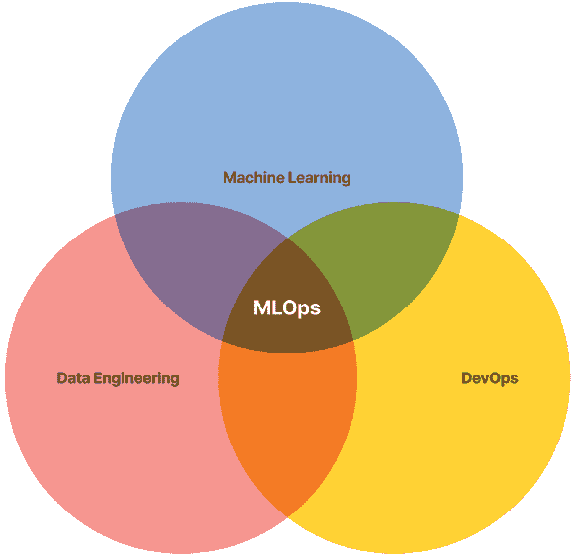

图 1.1：作为三个领域交叉点的 MLOps

以 DevOps 为基础，MLOps 现在正缓慢演变为一种独立的机器学习生命周期管理方法。它适用于整个生命周期，其关键阶段包括：

*   数据采集、收集和处理原始数据
*   数据分析
*   数据准备
*   模型训练与开发
*   模型评估与验证
*   模型服务
*   模型健康监控
*   模型重训练与迭代
*   编排
*   治理

这些关键阶段表明了整个过程会有多么大量的工作，特别是因为很可能需要重复多次。虽然第二次可能会容易一些，因为我们只需要根据新的数据模式和趋势更新模型，但这仍然是一个可能耗费数小时人工劳动的问题。毕竟，在软件开发过程中，应用程序的维护通常是消耗大部分资金和资源的地方，而不是应用程序的初始开发和发布。同样也适用于机器学习模型和过程，加剧了整体维护成本。

[图 1.2] 显示了机器学习流水线所有关键阶段之间的关系，以及这些阶段如何结合以允许我们构建一个完整的流水线。请参考下图：

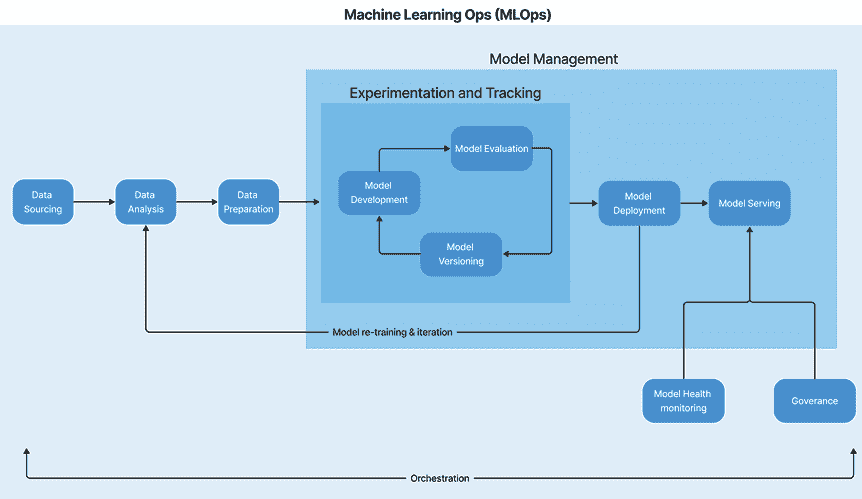

图 1.2：机器学习项目生命周期

想象一下，如果我们能够简单地自动化整个过程，让我们能够充分利用高性能机器学习模型而无须承担烦恼。这就是 MLOps 的用武之地。

在 [图 1.2] 中，你会注意到 MLOps 还有两个部分：实验与跟踪以及模型管理。它们是什么，我们如何定义它们？

### 实验与跟踪

实验与跟踪是 MLOps 的组成部分，专注于跨多次运行收集、组织和跟踪模型训练信息及产物，并使用多种配置。由于机器学习具有实验性，使用实验跟踪工具跟踪不同的模型和配置变得很重要。

### 模型管理

为了确保我们在迭代模型部署和维护血缘时保持一致性（特别是在空间上），需要一个易于遵循的模式。这就是模型管理进入 MLOps 的部分。MLOps 包含了简化和优化模型开发、训练、打包、验证、部署和监控的流程。

对于机器学习模型而言，数据是开发和部署过程中基础的一等公民。代码使我们能够处理和评估数据，从而得出洞察和业务价值。如图 1.3 所示，当我们将数据与相关代码整合时，就能获得良好且可行的机器学习模型。请参考下图：


图 1.3：机器学习的组件

现在，当我们理解了创建机器学习应用时代码与数据之间的关系后，必须确保协同结合和使用两者，使其以一种受控的方式朝着健壮且可扩展的机器学习系统目标进化。用于训练、测试和推理的数据会随时间从不同来源发生变化，并需要不断变化的代码来匹配。如果没有系统的 MLOps 方法，代码和数据的演进可能会出现偏差，导致生产环境出现问题、阻碍顺利部署，并导致结果难以追踪或复制。

MLOps 简化了机器学习应用的开发、部署和监控流水线，统一了参与不同团队的贡献，并确保过程的每个步骤都是可重复和可实现的。

MLOps 是机器学习和数据科学应用开发与部署的基础。机器学习有助于部署解决方案，通过创建更高效的工作流、利用数据分析进行决策以及改进客户体验，从而释放此前未开发的收入来源、节省时间并降低成本。在缺乏坚实框架来实现这种价值创造的情况下，这些目标是很难实现的。通过 MLOps 自动化模型训练、开发、部署和监控意味着更快的迭代和更低的运营成本。它帮助机器学习和数据科学团队在决策上更具敏捷性和战略性，就像软件工程团队一样。

MLOps 至关重要，因为它作为一个框架，引导团队通过机器学习开发和部署的理想方法来实现其目标。MLOps 也是一个高度灵活的框架，从这个意义上说，我们可以决定一组流程有多大、复杂或简单。你可以决定全投入并自动化 MLOps 的每一个步骤及其实践，也可以决定保留部分手动操作而自动化其他部分。

## MLOps 的演进

MLOps 术语起源于 21 世纪 10 年代早期，当时公司开始意识到机器学习的潜力并将其应用于不同的用例。然而，随着企业日益依赖机器学习来驱动其运营，MLOps 的采用在近年来加速了。2019 年，Forrester 预测 MLOps 将在两年内成为主流做法。事实上，MLOps 在各个领域的组织中都很流行。金融服务公司使用 MLOps 自动部署欺诈检测和预防模型。零售商使用 MLOps 个性化客户体验并改进产品推荐。医疗机构使用 MLOps 开发从疾病诊断到患者护理的各种活动的预测模型。随着机器学习变得越来越普遍，MLOps 可能会继续演进，其受欢迎和需求不断增长。但让我们回过看看 MLOps 是如何以及从哪里演进的。

21 世纪 00 年代早期是机构开始将机器学习引入其技术栈并开始将其用于不同用例的时期。在那里我们看到了早期机器学习解决方案的实现。当时唯一可用的解决方案是使用商业现货（COTS）解决方案以及 `SAS`、`IBM SPSS` 和 `FICO` 等供应商。此外，随着开源技术的兴起、公共领域大型数据集的可用性以及编程语言的进步（以适应机器学习特定的库，如 `Python`（包含 `SciPy` 栈、`scikit-learn`、`TensorFlow` 等）或 `R`（包含 `dplyr`、`ggplot2` 等））ML 模型的开发变得更容易。然而，正如我们在上一节看到的，由于涉及的所有流程和步骤，模型在生产环境中使用仍然是一个问题。


# MLOps 概述与最佳实践

## MLOps 的演进

随着 `Docker` 容器和 `Kubernetes` 等容器化技术的出现，以扩展方式部署模型的问题得到了解决。在问题解决的下一次迭代中，我们看到了涵盖机器学习部署整个迭代的 ML 部署和管理平台，包括实验、训练、部署和监控。这些平台有助于在本地或云端部署模型，使其更易于管理。图 1.4 展示了 MLOps 从 21 世纪 00 年初的专用接口到现在的专用 MLOps 平台的演进时间线。请参考下图：

**图 1.4：MLOps 的演进时间线**

## 软件工程项目对比机器学习项目

为了更好地理解这些进展的规模和重要性，了解软件工程与机器学习项目之间的区别是重要的。这些知识将帮助我们理解普通 DevOps 工具在机器学习项目中的局限性，以及 MLOps 出现的原因。

毫无疑问，软件工程中的许多工具对机器学习项目可能有用。实际代码和配置可以像在 `Git` 这样的源码管理系统中进行管理，所有相关概念（如 `branches` 分支和 `pull requests` 拉取请求）都可以用于更好地管理课程源代码，随后是 `CI/CD` 系统/平台，它们可用于自动化实际项目的运行。

但正如我们在之前的几节中学到的，ML 项目存在差异，使得普通的软件开发工具无法满足所有需求。一些区别和要求如下：

*   **对大型数据集和已训练模型的依赖**：机器学习开发高度依赖于大量数据和训练模型的数据集，且生成的训练模型可能是巨大的。`Git` 等普通的源代码管理工具本身无法很好地处理大文件。它需要像 `Git Large File Storage (Git LFS)` 这样的扩展才能更高效地处理大文件。

*   **训练 ML 模型需要巨大的资源**：普通的软件项目组织文件并将其编译成软件产品；而机器学习项目则是训练一个描述 AI 算法的模型。在大多数情况下，部署软件产品发布更快、更直接。因此，许多组织遵循持续集成策略。训练 ML 模型需要时间和专用资源，并需要不同的持续集成策略。

*   **指标驱动开发对比功能驱动开发**：在软件工程中，发布和开发决策基于团队是否达到了功能开发目标。相比之下，ML 开发是一种指标开发，例如查看机器学习模型的预测价值。ML 工程师会迭代生成具有不同参数和配置的多个模型，然后测量每个模型的准确性。由于机器学习项目的目标是找到最准确的模型，因此项目通常由实验中实现的指标进行指导。

*   **流水线**：流水线作为 CI/CD 流水线的一部分存在软件项目中。然而，机器学习（ML）项目有一套独立的流水线，由一系列步骤组成，如下载数据、准备数据、将数据划分为训练/验证集、训练模型以及验证模型。

*   **专用硬件**：软件项目可以托管在各种软件基础设施和服务器组上，范围从云基础设施到本地部署不等。而机器学习项目具有巨大的计算需求，需要特定的高计算服务器。在大多数情况下，这些高功率服务器是 GPU 密集型的，这加快了机器学习算法的计算速度，并显著缩短了训练机器学习模型所需的时间。

理解软件工程项目与机器学习项目之间的这些相似之处和差异，有助于我们理解 DevOps 方法与 MLOps 方法在处理各自各自项目结构时的异同。我们将在下一节中详细探讨这种差异。

## DevOps 对比 MLOps

让我们先回顾一下 DevOps 和 MLOps。

DevOps 是一套实践，它将软件开发人员的流程与基础设施团队的流程相结合，创建一套能够实现软件项目持续交付和部署的实践。结果是软件的开发周期被加快，并确保了软件产品的持续交付。

同样，MLOps 纳了 DevOps 原则并将其应用于机器学习模型而非软件，从而统一了开发周期。这使得数据科学家、机器学习工程师、数据工程师和基础设施团队能够共同工作、交付并将机器学习模型部署到生产环境中。DevOps 是执行 MLOps 的基础构建模块。没有 DevOps，我们就无法进行 MLOps。

DevOps 和 MLOps 在目标上根本是非常相似的，因为 MLOps 原则源自 DevOps 原则。在源代码控制的持续集成、单元测试、集成测试以及新软件版本的持续交付等功能方面，这两个过程是相似的。但在实现上它们非常不同，因为 MLOps 涵盖了机器学习的两个部分：代码和数据：

*   **机器学习本质上是实验性的**：由于机器学习项目的实验性质，MLOps 不同于 DevOps，它需要处理这些实验部分。机器学习工程师和数据科学家必须调整超参数、参数和模型等各种特征，同时跟踪并管理所有这些训练背后的数据和代码，并确保所有结果都是可复现的。

*   **测试**：机器学习系统的测试除了单元测试和集成测试等传统代码测试外，还涉及模型验证、模型训练等。

*   **自动化部署**：我们不能仅仅将离线训练的机器学习模型作为预测服务部署。它需要流水线来自动重新训练和部署模型。这条流水线增加了复杂性，因为我们需要自动化数据科学家在部署前手动执行的步骤，以训练和验证新模型。

*   **考虑模型性能退化**：我们不能仅仅部署一个离线训练的机器学习模型作为预测服务。它需要一个流水线来自动重新训练和部署模型。这条流水线增加了复杂性，因为我们需要自动化数据科学家在部署前手动执行的步骤，以训练和验证新模型。

*   **监控**：机器学习模型需要持续监控，以确保其结果是可追溯的。在 MLOps 中，这涉及到对模型进行持续的性能监控，以确保所有结果都是可复现的。此外，在 MLOps 中，这不仅仅是关于代码，还涉及到：

*   **持续集成**：持续集成在 DevOps 和 MLOps 中都存在。在 MLOps 中，它不仅是关于代码，还涉及到数据的版本控制。

*   **持续部署**：持续部署在 DevOps 和 MLOps 中都存在。在 MLOps 中，它不仅是关于代码，还涉及到模型的更新和部署。

*   **持续测试**：持续测试在 DevOps 和 MLOps 中都存在。在 MLOps 中，它不仅是关于代码，还涉及到对模型进行持续的性能评估。

## MLOps 的原则

在本节中，我们将介绍 MLOps 的某些原则，这些原则可能非常有用，可以改进项目状态。

机器学习工程师或数据科学家运行许多实验来开发最佳模型。这些实验包含：

*   **代码**：用于实验的实际代码。
*   **配置**：定义实验中所有参数和变量的配置。
*   **数据集**：用于训练和验证模型的数据。这些数据集很容易达到几个 GB 甚至几百 GB。
*   **产物**：训练好的模型以及实验的任何其他输出。

机器学习项目是一个运行中的软件。但在与同事共享文件或复现结果方面存在困难。要获得可以与同事共享的可重复结果，并能够追溯到项目的早期阶段，需要更全面的管理工具，因此 MLOps 解决方案需要涵盖以下理念和原则：

*   **可复现性**：指的是在开发的任何阶段精确执行项目的能力。实现良好可复现性的某些要求包括：
    *   记录预处理步骤，以便任何人都能自动运行，并记录项目进展的状态。状态指的是任何类型的项目产物，包括代码、配置、数据集、图表、测试结果等。
    *   在项目历史的任何时间重建确切数据集的能力，对于使项目不仅可复现而且可以随时审计至关重要。

*   **透明性**：透明包括但不限于检查项目的各个方面，例如：
    *   使用了哪些代码、配置和数据文件。
    *   使用了哪些处理步骤以及步骤的顺序。

*   **审计性**：指的是检查流水线的中间结果。审计不仅包括结果，还包括任何中间结果。它与可复现性密切相关，因为有了复现结果的能力，我们才能对它们进行审计。

*   **可扩展性**：支持多个同事处理一个项目的能力，以及同时处理多个项目的能力。

拥有这些原则可以让我们回答诸如“三个月前使用特定数据集生成的中间结果是什么？从那时数据发生了哪些变化？数据集是否被覆盖或更改了？”等问题。支持机器学习项目透明性、审计性和可复现性的系统考虑了所有这些因素。

既然我们已经有了一份原则，让我们来看看在进行机器学习项目和 MLOps 实施时我们应该尝试维护的一些最佳实践。

## MLOps 最佳实践

MLOps 不仅仅是一个单一的简单框架。它由不同的组件组成。在本节中，我们将涵盖机器学习流水线中不同组件的最佳实践。这些主要组件包括：

*   代码
*   数据
*   模型
*   指标和 KPI
*   部署
*   团队

让我们深入研究这些组件，并回顾每个组件的最佳实践。

### 代码

机器学习工程需要以软件工程及其最佳实践为基础，特别是在处理代码时。软件工程中的一些最佳实践通常在机器学习工程流水线和代码中缺失，但应该被采纳以改进整体流程：

*   运行自动化回归测试：在做出更改时，很容易在现有代码中引入新缺陷。一组可以在每次提交（`commit`）时自动运行的回归测试有助于尽早发现此类缺陷。
*   使用静态分析检查代码质量：高质量的代码更容易理解、测试、维护、重用和扩展。一种公认并实施的确保高代码质量的方法是使用静态分析工具，并将其提交到代码仓库中。
*   使用持续集成：代码的更改和添加可能会在软件系统中引入问题。可以通过在每次代码提交到版本控制仓库时运行自动化构建脚本来避免这种情况，以确保它通过所有测试和功能标准。

### 数据

机器学习模型的好坏取决于训练它的数据，因此在构建机器学习系统时，遵循某些最佳实践至关重要，以确保数据流水线可用且可扩展。其中一些最重要的最佳实践是：

*   对所有外部数据源进行合理性检查：数据是每个机器学习模型的核心。因此，避免数据错误并确保数据质量对于模型质量至关重要。无论在何时使用外部不可靠的数据源，如果提供的数据不完整或格式不正确，在将其用于流水线之前验证数据质量是非常重要的。无效或不完整的数据可能会导致生产环境故障或导致模型不准确。
*   为数据清洗和合并编写可重用的脚本：数据清洗和合并是探索性过程，往往缺乏结构。很多时候，这些过程涉及手动步骤或后期无法重用的结构化不良的代码。不用说，此类代码无法集成到处理流水线。对于任何不使用原始或标准数据集的机器学习应用，都应该编写可重用的数据清洗脚本。
*   确保数据标注在严格控制的范围内进行：控制数据标注过程可以确保标签质量——这是监督学习算法的重要质量驱动因素。数据标签控制应应用于任何使用标签的机器学习应用，无论是监督学习还是其变体（如半监督学习）。
*   使数据集在共享基础设施上可用：机器学习模型处理的数据量比通常软件系统高得多，这引起了关于重复、传输、存储和可追溯性的担忧。在共享基础设施上提供数据集有助于缓解这些问题。良好的数据管理和存储非常重要，确保实现这一点的方法之一是具备以下功能：适当的访问控制（带有适当的授权和身份验证）、虚拟化、版本控制、可维护性和新鲜度。它们有助于避免重复和不必要的传输并节省时间。此外，它有助于实施访问控制策略，并通过保留数据访问日志提供可追溯性。对数据集采用标准命名规范以反映版本也被认为是一种最佳实践。

### 模型

模型管理是 MLOps 的核心，这使得我们在模型开发和维护方面保持一致性并遵循标准最佳实践非常重要。模型开发和管理的最佳实践是：

*   保持第一个模型简单并准备好基础设施：这允许我们具备适当的处理步骤和基础设施，当模型随着时间的推移变得复杂时，这将大有益。
*   积极移除或存档未使用的特征：这有助于避免技术债，并使代码保持新鲜，特别是当它用于多个实验设置时。
*   同行评审训练脚本：我们有时在编写代码时会犯人为错误，这就是为什么软件工程在将代码合并到主库之前使用评审过程。同样，为项目编写的训练脚本也应该经过同行评审。
*   启用并行训练实验：众所周知，训练模型是一个耗时的过程。特别是在实验期间，我们可能需要运行带有不同参数的代码，并行训练和运行这些实验将非常有帮助。
*   持续测量模型质量和性能：在模型部署到生产环境后进行监控和测量其质量，对于确保我们可以跟踪模型的退化并持续改进质量很重要。

### 指标和 KPI

在任何实验或基于研究的系统中，在启动项目之前设置适当指标和 KPI 是至关重要的。拥有适当指标和 KPI 有助于跟踪进展和改进，并引导我们保持在正确的道路上。关于可用指标和 KPI，以下是一些最佳实践：

*   为你的第一个目标选择简单、可观察且可归因的指标：ML 目标应该是易于衡量且与业务目标对齐的，但它可能并不是对业务目标的直接衡量。事实上，通常没有针对简单的 ML 目标训练的真实目标。考虑在顶部添加一个逻辑层，允许我们添加额外的逻辑来进行最终排名。
*   设置治理目标：机器学习应用可能会严重影响人类生活。即使没有恶意意图，避免 ML 模型产生负面影响或偏见也需要所有利益相关者按照相同的伦理价值观运行。让所有利益相关者在机器学习应用的伦理价值观和约束上达成共识是非常重要的。
*   强制公平和隐私：在处理个人信息或开发可能对个人或群体产生负影响的决策系统时，强制执行隐私和隐私很重要。

### 部署

关于机器学习的一个常用统计是，90% 的模型从未进入生产环境。原因之一是模型部署是最关键且复杂的部分。这是 MLOps 试图解决的一个主要问题。遵循给定的最佳实践可以使部署过程具有扩展性和管理性：

*   计划发布和迭代：不要期望你正在开发的模型将是你发布的最后一个模型，甚至认为你永远不会停止发布模型。考虑这次发布增加的复杂性是否会减慢未来的发布。
*   **自动化模型部署**：部署和编排应用程序的不同组件可能是一项繁琐的任务。为了避免手动打包和交付模型，并防止人工干预或错误，可以自动化部署和监控任务。增加按需部署模型的能力，可以提高可用性和可扩展性。
*   **持续监控部署模型的行为**：一旦模型被投入生产环境，团队就必须了解其表现。监控还可以避免生产环境中模型出现非预期之外的行为。这应该在任何生产级机器学习应用中实现。
*   **为生产模型启用自动回滚功能**：与部署类似，回滚模型可能是一个繁琐的过程。与其手动执行此任务，不如为其定义一个自动流程。避免在生产环境中出现次优模型。
*   **启用影子部署**：在将模型推向生产环境之前，在生产数据上对其质量和性能测试是明智的。为了便于这项工作，可以部署多个模型进行相互影子部署。这允许我们在不对提供的服务产生任何影响的情况下，在生产数据上测试模型的行为。
*   **结合模型版本、代码版本和输入数据记录生产预测结果**：将决策追溯到输入数据和模型版本可能是困难的。因此，建议将生产预测与模型版本及输入数据一起记录。增强调试能力，并实现可追溯性、可复现性、合性和事件管理。

### 团队

机器学习和数据科学是任何组织中的协作工作，需要包括数据工程、数据科学、运维和/或软件工程在内的多个团队协作。遵循上述最佳实践可以使待办事项（`backlog`）和工作负载变得容易：

*   **使用协作开发平台**：协作开发平台提供了对数据、代码、信息和工具的便捷访问。它们还可以帮助团队保持信息互通、做出并记录决策，以及进行异步或远程协作。广泛使用的协作开发环境包括 `Github`、`GitLab`、`Bitbucket` 等。
*   **基于共享待办事项工作**：一个积极维护的已约定工作项列表（待办事项）有助于团队内部以及外部利益相关者之间的任务协调。它也有助于提前规划和进行回顾评估。它避免了对任务内容、优先级和状态的误解。
*   **与他人沟通、对齐和协作**：确保与其他团队、管理层和外部利益相关者保持一致极其重要。团队开发的系统旨在与更广泛组织范围内的其他系统集成。这需要与团队之外的人进行沟通、对齐和协作。

## 组织中的 MLOps

MLOps 正成为那些使用或依赖机器学习或数据科学作为其核心业务，或依赖这些领域来加速现有产品价值的组织的一项有用工具。使用机器学习的原因不是为了让组织转型为与专门研究的公司竞争的机器学习研究人员；而是通过技术来加速组织的战略优势。

如果将机器学习领域作为业务加速器的集成和执行方式允许组织度地减少技术变更管理的负面影响，那么这种计算风险是可以接受的，MLLOps 可以解决这一疑虑。即使组织不想完全建立并投入资金建立研究团队，也有许多选项可以加速组织的技术进步。其中一些选项包括如 `Hugging Face` 或 `TensorFlow Hub` 等预训练模型，如 `AWS Rekognition` 等计算机视觉 API，如 `Ludwig` 等开源 AutoML 解决方案，或如 `MLRun` 或 `MLFlow` 等 MLOps 编排框架。采用合理抽象层次方法实施 MLOps 的组织，相比于那些雇佣 15 名只关注机器学习系统研究部分而忽略整体设计的数据科学家的组织，将更具优势。在后者的例子中，对于标准的机器学习系统，通常的情况是多年专注于研究而忽略了端到端的解决方案。在最好的情况下，什么都没做；但在最坏的情况下，一个糟糕的解决方案产生比什么都不做更糟糕的结果。

对于那些利用技术和机器学习支持增长的组织，需要通过制定适当的策略并快速适应技术来实现。因此，拥有适当的策略以在正确的时间集成正确层次的 MLOps 至关重要。让我们进一步详细了解 MLOps 策略如何帮助组织，以及组织的 MLOps 策略应该包含哪些构建模块。

## MLOps 策略

在考虑了目前为止对 MLOps 的所有因素后，是时候策略并看看我们如何建立适当 MLOps 策略的构建模块了。在实施 MLOps 策略时，有四个关键类别需要考虑：

*   云
*   培训与人才
*   供应商
*   执行层对投资回报率（ROI）的关注

让我们讨论一下这四个类别。

### 云

正如我们所知，有多个通用云提供商和专门的机器学习云服务提供商。然而，对于使用哪种云平台，并没有唯一或完美的选择。这完全取决于组织的需求以及组织已经在使用的何种平台。任何中心平台都会提供规模经济的优势，因此这不是主要的驱动因素。在 MLOps 策略中，意识到云平台如何符合每个特定组件的独特至关重要，例如平台部署、与组织已使用的其他平台和供应商的集成、雇佣与这些平台工作的人才，以及长期可行性。

### 培训与人才


组织通常关注新技术的力量以及他们如何利用它。然而，他们有时也未能考虑使用特定技术时的培训和人才因素。在几乎所有情况下，如果招聘和培训相关人员变得更好且更容易，组织就应该使用性能较弱的技术或通用的技术平台。这一事实意味着，在实施新技术时，该技术的广泛使用至关重要。这就是为什么检查供应商对任何专有技术提供的支持机制，以及对任何开源技术的可用社区和支持是关键的原因。最终，如果你无法招聘或培训你的员工，最新的技术在交付之刻就已失败了。这就是为什么培训和人才不仅是 MLOps 策略，也是任何技术策略的关键部分。

## 供应商

使用云计算的一个经常被忽视的问题是，它通常需要专业化供应商的增强，以帮助组织实现其技术目标。通用云平台有时由于过于通用，而无法提供特定的解决方案，因为它们需要满足极其广泛的需求。这正是专业化供应商在填补特定技术需求空白方面发挥至关重要作用的地方，如果组织不愿或没有资源使用通用云平台构建解决方案，就可以使用这些供应商。因此，清晰地定义组织对机器学习的需求，并将其作为整体 MLOps 策略的一部分是非常关键的。这些战略性选择可以为云策略和业务策略带来更好的投资回报率（ROI）。例如，使用专门用于 `Hadoop`、`Kubernetes` 的供应商技术，在预训练模型上以加速价值实现的速度。供应商将根据组织的需求、抽象化程度、组织中可用于这些供应商平台的人才以及其业务目标，对每个组织都是独有的。

## 管理层对投资回报率的关注

投资回报率是任何 MLOps 策略中最关键的部分。最终，如果管理层的关注重点不是 ROI，那么上述三个类别将没有任何意义。如果我们把其他三个类别归为策略中的技术关注部分，那么 ROI 绝对应该是管理层关注的重点。任何技术的目的最终都是驱动长期业务价值，加速价值实现的时间。这为任何技术的投资提供了合理性。

## 实施 MLOps

到此为止，MLOps 似乎将帮助我们快速部署机器学习模型，并在部署后对其进行维护。现在，最大的障碍似乎是如何到达那里以及从哪里开始的问题。本章目前为止描述和讨论的自动化水平需要机器学习、数据工程以及基础设施/运营团队投入大量工作才能实现。在短期内，手动构建和部署模型似乎比投入资源建立整个基础设施要好，但从中长期来看，这是不可持续的。

处理这种问题的方法是从小处着手，以抽象的方式一次自动化一个步骤，直到实现完全自动化。我们在这样做时唯一需要记住在心底的是，任何正在开发的自动化都是可扩展的，并且将符合 MLOps 的整体架构。例如，数据科学家和机器学习工程师通常使用像 `Jupyter` 这样的笔记本开始任何项目实验，笔记本非常适合进行实验，因此让我们开始思考是否有方法可以跟踪它们？这种功能将极其有用，特别是当团队从零实现先进的机器学习架构时，因为它允许他们在所有相关指标上，将新模型与当前架构上的部署模型进行共享和比较。

这里的教训是，考虑到这种抽象，首先从小部分开始，并使用它们作为构建模块来实现自动化的、近时的 MLOps 平台的最终目标，这使其变得可管理且可实现。毫无疑问，这些因素和分步实施需要大量的资源来进行计划、开发和测试，同时保持最终的愿景。这种思维方式也将帮助我们在查看所有可用的优秀工具和平台时提供支持，这些平台本质上为我们实现了部分或全部的自动化。此类工具和平台有很多示例，如 `MLFlow`、`Databricks`、`Kubeflow`、`AWS SageMaker`、`Microsoft Azure`、`Google Cloud` 和 `DataRobots`。通过这些工具，将 MLOps 原则实施我们的工作流将变得容易。我们将在后面的章节中查看整体架构以及如何做出这些决策。现在，让我们在下一节中检查不同的环境如何帮助我们克服 MLOps 的这些挑战。

## 克服 MLOps 的挑战

到目前，我们知道，大多数机器学习模型进入生产环境面临着巨大的挑战。这些挑战和障碍根据组织在抽象化和实现方面的计划而显著不同，但有很多选项可以加速这种实施时间并缩短 MLOps 的价值实现时间。让我们看看克服这些挑战的一些方法；MLOps 通常在云端、本地或混合环境中实施。这些每个环境都提供了处理挑战的方法。

## 云端 MLOps

云计算有几项 MLOps 方法论所利用的关键关键优势：

*   云是弹性资源，能够实现计算和存储的高效利用，并能够根据需求进行扩展以满足几乎任何要求。这种能力意味着云计算可以按需访问本质无限的资源。
*   其次，云具有网络效应，因为云技术从集成其他云技术中受益。一个很好的例子是无服务器技术 `AWS Lambda`。由于与其它 AWS 服务（如 `AWS Step Functions`、`AWS Sagemaker` 或 `AWS S3`）的深度集成，`AWS Lambda` 是构建应用程序的一项非常有价值的服务。对于任何活跃的云平台，你可以假设集成的服务网络会随着平台开发更多功能而进一步增强其能力。
*   第三，在当今，几乎所有的云供应商都有 MLOps 平台。`AWS` 有 `Sagemaker`，`Azure` 有 `Azure Machine Learning`，`Google` 有 `Vertex AI`。即使是更小的小众供应商也有满足机器学习和 MLOps 需要的产品和平台。通过使用云平台，组织可能会使用原生 ML 平台的一些功能，并可能用自定义解决方案和第三方解决方案对其进行增强，从而进一步加速实施 MLOps 的价值实现时间。
*   第四，所有云供应商都有云开发环境。一个重要趋势是使用轻量级云 Shell 环境（如 `AWS CloudShell`）、较重的全 IDE 环境选项（如 `AWS Cloud9`）以及笔记本环境，包括免费的 `Sagemaker Studio Lab` 或 `Google Colab`，以及具有丰富 IDE 集成的 `Sagemaker Studio`。
*   最后，取决于公司在做什么，他们可能别无选择使用云计算。某些云计算组件对于构建深度学习解决方案的组织来说是强制性的，因为深度学习需要大量的存储和计算能力。

除了公共云供应商之外，其他玩家也在云端提供 MLOps 解决方案。这些供应商可以在公共云上运行，也可以在私有云上运行。使用较小供应商的优势在于其为客户提供的定制化水平。此外，MLOps 供应商在 MLOps 方面有更深入的知识，因为那是它的唯一关注点。这通常确保了更多相关功能和更多集成。最后，通过选择不绑定到特定云提供者的供应商，客户也不会被绑定到它。相反，客户可以在多个云或额外的基础设施上使用该供应商。

在某些用例下，组织无法使用公共云。业务限制（如需要保护敏感数据或必须遵守严格的法规，例如数据本地化隐私法规）要求一种可以在本地部署运行的 MLOps 解决方案。许多 MLOps 解决方案都提供了在云端或本地进行部署的部署。这种方法的唯一缺点是，本地化解决方案需要组织采购服务器和设备，以支持在大规模运行机器学习算法所需的巨大算力。此外，根据需求扩展或收缩能力也并非易事。组织还需要大量的基础设施/运维团队来更新和维护这些基础设施。

另一方面，本地化部署几乎肯定需要某种程度的定制。这让组织对产品有更多的控制权，并且可以提出特定请求以根据其需求进行定制。具体来说，如果部署的解决方案是初创公司的产品，他们将非常关注并努力确保客户满意度和采用率。如果是开源产品，组织不仅可以利用社区的开发力量，还可以让自己的开发者深入内部调整产品，以确保其符合自己的需求和要求。

## 混合环境中的 MLOps

与本地化部署类似，某些组织可能更倾向于混合云部署方法。这涉及到在公共云、本地，甚至在私有云或边缘设备上进行部署。自然，这增加了流程的复杂度，因为 MLOps 解决方案应该根据项目的特定需求，确保数据路径和控制路径得到适当分离。此外，它们必须由一个高可用、可扩展的实体交付，该实体负责跨基础设施部署类型编排、跟踪和管理机器学习流水线。这一切必须在高速、高可用的情况下进行，并具有最佳性能。最后，该解决方案理想情况下应为所有基础设施类型的工程师提供一个统一的开发和部署栈。

在这些场景和定制化需求下，找到一个能够满足所有要求的供应商或开源解决方案可能并不简单。最好的选择可能是寻找特定的供应商，特别是那些乐于听取并根据需求调整其产品的初创公司，或者是可以根据特定需求和要求进行定制的成熟开源解决方案。

## 结论

本章为理解企业在生产环境中引入机器学习和人工智能时面临的危机奠定了基础。MLOps 旨在引入一种基于 DevOps 成功经验的方法论，同时处理机器学习的独特特性。

正如我们在章中所涵盖的，MLOps 是从 DevOps 中采纳并应用于机器学习的一系列原则和实践。我们研究了为什么 MLOps 非常重要，并涵盖了 MLOps 的基本原则和最佳实践。我们还涵盖了 MLOps 在组织中的作用，以及为什么良好的 MLOps 策略对于成功实施流程关键，以及组织 MLOps 策略的构建模块。本章概述了实施 MLOps 所面临的挑战。最终，这取决于数据科学的投资回报率（ROI），因为对于大多数组织来说，技术是价值的加速器，而不是价值本身。

在下一章中，我们将研究涉及 MLOps 的整体架构以及该架构的不同组件。这将为我们实现在不同环境中轻松部署机器学习模型的目标奠定基础。我们还将研究流水线如何成为 MLOps 架构的核心组件，以及在设计过程中哪些不同的部署策略可以派上用场。

## 要点

*   MLOps 结合了机器学习、DevOps 和数据工程，实现机器学习模型的持续交付和部署。
*   MLOps 旨在标准化和简化机器学习生命周期，包括数据处理、模型训练、部署、监控和治理。
*   机器学习项目与传统软件项目不同，它们侧重于指标引导的实验迭代，而非功能。
*   MLOps 的核心原则包括可复现性、透明性、可审计性和可扩展性。
*   MLOps 策略应考虑不同的平台、供应商、针对这些平台的团队培训，以及高层对 ROI 的关注。
*   MLOps 可以在云端、本地或混合模式下实施，每种模式都有权衡。供应商和开源解决方案可以加速实施。
*   最终目标是持续交付机器学习模型，在克服内在挑战的同时释放业务价值。

## 关键术语

*   `MLOps`: 机器学习运维（MLOps）是一系列旨在数据科学家、机器学习工程师和运维人员之间协作的实践。它是机器学习（ML）与运维（Ops）的结合，为设计、构建、支持机器学习模型的高效部署以及持续改进这些模型提供了流程。
*   `COTS`: 现成商业软件（COTS）软件和服务通常由第三方供应商构建并交付。组织可以购买、租赁或许可 `COTS`。
*   `Docker`: `Docker` 是一套平台即服务产品，使用操作系统级虚拟化将软件交付在容器中。
*   `Kubernetes`: `Kubernetes`（简称 `K8s`）是一个开源容器编排系统，用于自动化容器化应用的部署、缩放和管理。
*   `CI/CD/CT`: 指持续集成、持续部署、持续测试。
*   `Metric-driven development`: 指标驱动开发是一种强调使用数据和指标来驱动产品决策的方法论。由于机器学习项目的目标是找到最准确的模型，因此这些项目通常由实验中获得的指标引导，因此是指标驱动的。
*   `Feature-driven development`: 软件工程的发布和开发决策取决于团队是否完成了某项功能。功能驱动开发围绕实现功能的进展来组织软件开发。

在上一章中，我们了解了 MLOps 的介绍、其基本原理和用途。我们还查看了 MLOps 在任何机器学习系统或应用程序中如何发挥重要作用。在本章中，我们将学习 MLOps 框架的架构和基础设施。我们将介绍开发、测试环境和生产环境的开发与部署策略，以及机器学习模型从开发阶段一直到生产系统的流程。

一个良好的 MLOps 架构对于管理机器学习工作流以及在生产环境中实现模型运行化至关重要。我们将深入探讨 MLOps 系统的组件和架构。从不同的成熟度角度（从基础的概念验证到复杂的企业级系统）来看 MLOps 架构是非常重要的。理解这些架构演进水平可以为根据组织需求和基础设施就绪情况定制 MLOps 实现提供指导。这一基础将使我们能够设计并实现适用于不同场景的 MLOps 解决方案。

## 结构

在本章中，我们将讨论以下主题：

*   MLOps 组件
    *   数据源与版本控制
    *   数据分析与实验管理
    *   代码仓库
    *   流水线编排
    *   模型训练与存储
    *   模型部署与服务
    *   模型、数据及应用监控
    *   特征处理与特征库
*   MLOps 架构
    *   架构 1 级：最小可行架构
    *   架构 2 级：生产级 MLOps
    *   架构 3 级：企业级 MLOps
*   开发、测试和生产的语义
    *   执行环境
    *   代码
    *   模型
    *   数据
*   机器学习部署模式
    *   部署模型
    *   部署代码
*   整合架构组件
    *   开发环境
    *   测试环境
    *   生产环境

## 目标

在本章结束时，你将牢固理解构建成功的 MLOps 基础设施所需的不同组件，并掌握一个可以解决大多数 MLOps 用场景的参考 MLOps 架构，以及它如何与不同的开发环境相结合。

我们还将涵盖建立可扩展且可行的 MLOps 平台所需的三个主要垂直领域：

*   数据准备领域
*   模型实验与训练领域
*   模型运行领域

我们将理解为什么前两个领域比模型运行领域更成熟。正如过去十年一样，重点和大部分投资都处于数据准备、工程、训练、探索和模型实验工具上。第三个领域也是任何机器学习系统不可或缺的一部分，它侧重于将数据准备、实验和模型开发的结果生产化，为组织提供可行的平台，以加速机器学习的采纳和规模价值创造。本章将详细介绍构建成熟 MLOps 架构所需的所有组件，以及良好的架构如何确保机器学习流水线是面向大规模生产构建的。

在本章之后，我们将牢掌握 MLOps 架构的构建模块、成熟度水平、环境语义、部署模式和端到端工作流。

## MLOps 组件

基于我们在第一章《入门 MLOps》中查看的原理，我们将查看可用于解决这些原理并指导我们在 MLOps 架构中如何实现这些内容的相关组件。构建成功且可扩展的 MLOps 架构的主要组件包括：

*   数据源与数据版本控制
*   数据分析与实验管理
*   代码仓库
*   流水线编排
    *   工作流编排
    *   CI/CD 自动化
*   模型训练与存储
    *   模型训练
    *   模型注册表
*   模型部署与服务
*   模型、数据及应用监控
    *   训练性能跟踪
    *   元数据存储器
*   特征处理与存储

下一节将描述上述组件，并提供这些每个组件通用功能的概述。

### 数据源与数据版本控制

数据对于任何机器学习模型都非常重要。人们通常认为，机器学习模型的好坏取决于训练它的数据；如果训练数据质量不佳，模型输出就永远不会好。我们必须对数据源保持谨慎且有目的性，并为训练、验证和评估建立版本控制。

数据准备是最耗时、时间最长的任务之一。在将其用于训练和实验之前，我们需要平衡且干净的数据。在考虑架构的这一组件时，请思考我们如何使用标记工具和流程来提高可靠性、可扩展性和可审计性。

涉及数据源时，可用选项包括：

*   数据库（包括 SQL 和 NoSQL）
*   数据仓库
*   数据湖
*   公共数据集或私有数据集

对于数据版本控制，许多现成的 MLOps 平台以及开源工具都提供此功能，其中一些选项如下：

*   `DVC`
*   `Pachyderm`
*   `lakeFS`
*   `dolt`
*   `Neptune`
*   `Delta Lake`

### 数据分析与实验管理

数据分析和实验管理基础设施为初始数据探索和分析提供了基础底层计算资源，如 `CPUs`、`RAM` 和 `GPUs`。它们还促进了模型训练、验证和评估实验的运行。提供的基础设施可以是分布式的（如云环境），也可以是非分布式的（如本地机器或服务器）。

一旦我们获得了高质量、已标记的训练数据，就可以进入下一个阶段：数据分析和实验。正如所知，机器学习模型是其训练数据的反映。良好的数据分析和实验基础设施对于赋予数据科学家能力以及项目的成功很重要。

在考虑解决方案时，请记住机器学习工程师和数据科学家应该能够使用训练和实验变得简单且重复的平台或工具。这些工具应该是灵活的，并且与其他平台、工具或库轻松集成。

帮助执行这些任务的技术组件包括：

*   探索性数据分析
    *   `Jupyter notebooks`
    *   `Google Colab notebooks`
*   语言和库：
    *   `Python` (`Scikit Learn`, `PyTorch`, `Tensorflow`, `Keras`)
*   框架：
    *   `Apache Spark`
    *   `Apache Mahout`
*   实验跟踪：
    *   `MLFlow`
    *   `Kubeflow`
    *   `Neptune`
    *   `Comet`
    *   `AWS Sagemaker`
*   可视化：
    *   `Seaborn`
    *   `Matplotlib`
    *   `Plotly`

## 代码仓库

源代码仓库是任何工程师最熟悉的组件。它确保了代码的存储、版本控制和代码血缘，并允许整个团队并行工作、提交和合并代码，而无需担心覆盖他人的工作或丢失任何工作。

一些通用的源代码仓库包括：

*   GitHub
*   Bitbucket
*   GitLab

## 流水线编排

流水线编排是一个汇总概念，处理整个过程的编排和自动化。它负责确保工作流的所有步骤运行正常。流水线编排的两个主要组件是工作流编排和 CI/CD 自动化。

### 工作流编排

工作流编排组件通过有向无环图 (`DAGs`) 机器学习工作流中每一个任务的编排。

`DAGs` 是没有任何循环的有向图。它们代表了工作流单个步骤的执行顺序和产物使用。在有向无环图中，无法从图的某一点开始并遍历整个图。每条边都从早的边指向较晚的边。

一些机器学习的行业标准编排平台包括：

*   Apache Airflow


# MLOps 架构组件与成熟度模型

## 编排与流水线工具

*   Kubeflow Pipelines
*   Luigi
*   AWS Sagemaker Pipelines
*   Azure Pipelines

## CI/CD 自动化

持续集成/持续交付（`CI/CD`）组件正如其名，确保根据自动化流水线的配置，将最新代码持续集成、交付和部署到不同的环境中。`CI/CD` 还处理运行自动化测试。在 MLOps 场景下，它负责将模型自动构建、测试、交付并部署到目标环境中。它还向团队提供有关过程成功或失败的快速反馈，详细说明哪个组件、哪些步骤失败以及原因，从而允许团队快速做出响应。这不仅自动化了整个流水线的重复性步骤，还增加了团队对新代码可行性的整体可见性。

建议用于 CI/CD 自动化的技术组件有：

*   GitHub Actions
*   CircleCI
*   Travis CI
*   Jenkins
*   Cloudbees Platform

# 模型训练与存储

模型训练和存储是多个子组件的结合，用于训练模型、评估并对模型进行版本控制，然后将其存储在模型注册表中供部署流水线使用。

## 模型训练

模型训练组件使我们能够高效运行强大的算法来训练机器学习模型，这些模型既具有可扩展性又具有成本效益。模型训练是 MLOps 架构的核心组件之一。它应该足够的弹性和灵活性，以便根据我们正在训练的模型和正在使用的数据集扩展或缩小。架构应该能够使用多个 CPU/GPU 和多个工作节点执行分布式训练。

一些可以考虑用于模型训练的常用平台包括：

*   AWS Sagemaker
*   Databricks 统一数据分析平台
*   Microsoft Azure machine learning studio
*   DataRobot

选择合适的模型训练存储平台取决于多种因素，包括特定的用例（即使用数据集的大小和复杂性）、正在训练的机器学习模型类型、平台成本、技术要求以及基于现有基础设施的偏好。有助于做出决策的考虑因素包括：

*   考虑模型的复杂性和训练需求。更复杂的模型需要更多的计算资源。
*   评估数据集的大小。较大的数据集可能需要存储和处理能力。
*   决定使用的机器学习框架（例如 `TensorFlow`、`PyTorch`）以及为此使用的工具。
*   确定我们可以在基础设施上花费多少费用，因为某些训练平台可能很高。
*   我们需要确保平台能够扩展并处理随时间增长的任何不断的需求。
*   如果模型需要 `GPUs/TPUs`，在决定平台时也应考虑进去。
*   团队的专业知识和经验在选择平台时也起着重要作用。
*   考虑平台是否与其他现有工具和工作流良好集成。

## 模型注册表

模型注册表集中存储已训练的 ML 模型及其元数据。它有两个主要功能：存储 ML 产物和存储 ML 元数据。这两个功能对于运行在不同环境中并存储在注册中的机器学习模型的治理、可解释性、版本跟踪和血缘维护都极其重要。

高级平台模型注册表包括：

*   MLFlow
*   AWS Sagemaker model registry
*   Microsoft Azure ML model registry
*   Neptune.ai

可用于模型注册表的简单存储示例：

*   AWS S3
*   Microsoft Azure storage
*   Google Cloud storage

# 模型部署与服务

一旦我们完成了实验、注册表中的产物存储并完成了正确的版本标记，模型现在需要准备部署。容器化是最常用的方法，因为它提供了在许多不同基础设施上部署的灵活性，并提供了最大的活性。在创建容器时我们可以决定使用自己的规范，或者在组织有任何标准规范时使用它们。如果我们想查看某些机器学习的标准容器规范，我们有一些选项，例如 Open Network Exchange（`ONNX`）、`TensorFlow saved model`、`chasis.ml` 等。这些可以帮助以通用规范封装模型，并将模型暴露为 API 端点。使用这些封装模型是可选的，如果我们想在项目规范中创建自己的标准，可以完全忽略它们。然而，建议使用既有标准和最佳实践，因为它可以提供互操作性、可移植性和可复现性等优势。当我们模型容器化后，它可以部署到不同的环境中。这种方法允许我们分批处理数据，或者，如果我们愿意，使用实时方式处理数据……

模型部署之后是模型服务和推理。现在，有三种主要的模型服务方法。第一种是用于实时预测的在线推理，即小块数据实时进入，并在返回响应之前对其生成预测。第二种是批量推理，如果我们想使用大量输入数据生成预测，并将预测结果存储在某处并在那里使用，则这是首选方法。最后是混合推理，结合在线推理和批量推理来平衡实时响应和计算效率之间的权衡。混合推理对于需要实时和批量处理的应用，或对于可以拆分为独立服务的较小组件的模型特别有用。

用于实现此组件的一些技术包括：

*   容器化
    *   Docker
    *   Kubernetes
*   Web 框架（用于其他 API）：
    *   Flask
    *   Django
    *   Fast API
*   服务框架：
    *   AWS Sagemaker Endpoints
    *   Microsoft Azure ML
    *   Google Vertex AI
    *   Kubeflow 的 KServing
    *   IBM Watson Studio
    *   TensorFlow Serving

## 模型、数据和应用的监控

顾名思义，监控组件负责监控模型训练和推理的性能。除了性能监控外，我们还需要监控输入数据以检测数据漂移（data drift），监控部署应用程序的基础设施，并审查流水线编排监控，以确保所有运行组件都运行正常。

正如我们所知，模型改进是一个持续的过程。为了改进生产环境中的模型版本，我们需要让团队和其他利益相关者能够监控并观察性能是否下降以及数据是否偏离了原始状态。此外，我们必须将监控能力开放给基础设施团队，以便他们监控运行机器学习应用程序的基础设施。

除了性能监控外，我们还需要指标来跟踪机器学习系统的使用和维护情况，以管理成本。

在模型特定监控之外，还应该建立流程和控制措施，以管理生产环境中机器学习系统的使用和维护。这不仅有助于保持基础设施的更新，还有助于成本管理。

可以用于机器学习项目的监控工具示例包括：

*   Kubeflow 内置监控
*   MLflow 内置监控
*   AWS Sagemaker 模型监控（内置）
*   Prometheus 和 Grafana
*   Elasticsearch, Logstash 和 Kibana 栈（ELK 堆栈）
*   AWS Cloudwatch

## 训练性能跟踪

对输入数据和模型预测进行监控，涵盖统计属性（如数据漂移、模型性能等），也涵盖计算性能（如训练期间的错误、吞吐量等）。

## 元数据存储

机器学习元数据存储允许我们跟踪和存储各种元数据。需要一个元数据存储来跟踪生产环境中所有的监控和训练元数据。根据项目和基础设施的需求，可以在模型注册数据库中配置某些元数据存储。它还可以用于记录每个作业的元数据，例如结果、数据、时间、持续时间以及模型训练元数据（如该特定运行使用的参数、生成的性能指标）和数据处理元数据（包括使用的数据和代码的元数据）。

## 特征处理与存储

特征处理组件及相应的流水线从不同的数据表和特征表中读取数据，将其写入特征存储（feature stores）中的表。该组件通常由两个步骤组成：特征处理流水线和存储结果并供模型训练调用的特征存储。

### 特征处理

特征处理包括数据准备步骤，用于检查并纠正任何数据质量问题。随后是特征化步骤，该步骤包含生成用于模型训练和开发的特征的逻辑。

在某些组织中，特征处理流水线是与机器学习项目分开管理的。在这种情况下，此组件可以从此参考架构中省略。

## 特征存储

特征存储是一个数据库，能够对所有常用的参数或特征进行集中存储。特征存储有两种类型：

*   用作离线特征存储的数据库，以正常的数据库延迟为实验提供特征。
*   用作在线特征存储的数据库，为生产环境中的在线预测提供极低延迟的特征。

离线和在线特征存储在管理和提供特征数据方面各有不同的用途。离线特征存储主要侧重于机器学习模型的批处理和数据准备。它被设计用于存储、管理和提供随时间收集和处理的历史数据。另一方面，在线特征存储侧重于生产环境中的实时或近实应用用例。它在推理或预测期间为机器学习模型提供特征数据。

离线特征存储针对批处理方式处理海量数据进行了优化。它们被用于将原始数据预处理并转换为可用于模型训练的特征。在线特征存储则针对特征数据的低延迟检索进行了优化。它们为模型做出预测所需的特征提供了快速访问。

在扩展性方面，离线特征存储通常设计为水平扩展，以高效地容纳大型数据集和处理负载。在线特征存储需要具有高度的可扩展性，以处理来自多个模型或应用程序的并发请求而不会引起延迟。

总结，离线和在线特征存储的主要区别在于它们的用例以及它们处理的数据性质。离线特征存储用于数据准备和历史分析，而在线特征存储对于在推理或预测期间为模型提供实时特征至关重要。在许多情况下，组织结合使用这两种特征存储来涵盖从数据预处理到生产部署的整个机器学习周期。

一些常用的特征存储有：

*   Feast
*   AWS Sagemaker Feature Store
*   Databricks Feature Store

# MLOps 架构

基于原则和组件，我们可以创建一个本质上具有通用性和适应性的 MLOps 架构，以适应大多数机器学习用例。此外，它还可以指导机器学习工程师和数据科学家如何构建 MLOps 系统，并根据特定的组织需求定制架构。建立通用架构以提供指导的一个目标是设计一个与技术无关的产物。这将帮助机器学习团队根据其独特需求选择工具和技术，并与组织的政策和结构保持一致。

在团队中构建 MLOps 实践的首要目标是确保团队成员能够高效工作。我们不希望构建一个会增加团队负担且不利于任何新框架采用的新框架。

为了让团队采用适当的组件和基础设施以获得更好的实验和适当的工具，我们需要一步步来。我们必须根据团队的成熟度和组织的要求，谨慎考虑向流程中引入哪些流程和工具。在具备正确的基础设施后，我们将看到更多、更快的模型迭代，从而保持模型的新鲜，以产生更好的结果。

在本节中，我们将根据团队和组织适应这些架构框架的成熟度，将生产机器学习周期划分为三个可能的架构计划。每个计划都对应机器学习生命周期的阶段，以及团队采用这些流程的成熟度。

> **注意**：MLOps 是一个为了生产力和可扩展性的持续改进和优化之旅。

以下是组织中不同机器学习成熟度的架构模式：

### 级别 1：最小可行架构

这种架构模式支持组织部署的少数较小模型作为起点。它由几个手动步骤和流程组成。如果模型数量增加或复杂性上升，这种带有手动步骤的架构级别会带来巨大的开销。这可以被视为概念验证（POC）架构，团队可以开始适应这种处理模型的新工作方式。

### 级别 2：生产级 MLOps

这一级别的架构模式适用于已准备好进入自动化下一阶段的组织。它适合在生产环境中管理多个模型，并支持组织产品或服务提供的组织。因此，需要一套生产级的 MLOps 架构来支持生产环境的工作负载。

### 级别 3：企业级 MLOps

这一级别适用于在多个场景下参与机器学习应用使用和开发的团队，且机器学习赋予了组织内多个产品。在这种情况下，组织需要一种一致的方法来管理所有的流水线（pipelines）、产物（artifacts）和模型生命周期。

在每个级别表现优异并最终进步的能力取决于组织基础设施的就绪程度。随着组织基础设施和需求的成熟，生产环境中管理的模型数量也会随之增加。因此，他们希望从一个架构级别演进到下一个级别。

有了这些理解，我们准备好详细研究架构模式。我们将看到帮助组织解决三个成熟度级别中每个阶段需求的常见解决方案。

## 架构级别 1：最小可行架构

第 1 级架构适用于开始运行首个模型或在生产环境中有 1-2 个模型的组织。从技术角度来看，在这个级别，工程师通过笔记本（使用 `Jupyter` 或其他）在个人本地机器或基础云资源上手动训练模型，并手动存储。然后将它们交给工程团队，以集成到应用程序中并将模型移动到生产环境。这种架构最适合刚起步的组织或单产品、单模型的组织，这些组织的模型变化不频繁，且工作流简单到足以进行手动处理。该架构级别的流程大部分是由手动数据科学或机器学习工程师驱动的流程。在模型不是频繁更改或训练的场景下，这可能足够了。

这种架构级别如图 2.1 所示，解决了机器学习团队面临的基本挑战，以确保他们能够高效工作。该架构中的大多数组件都是通过脚本或纯代码手动管理的，任何组件中都没有自动化。

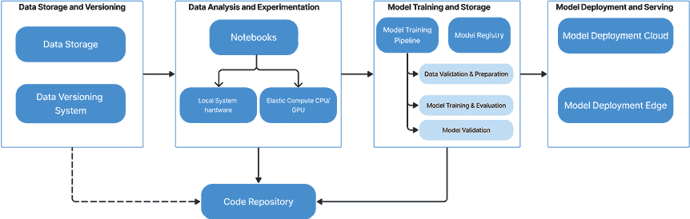

图 2.1：架构级别 1：最小可行架构

**第 1 级架构的特征列如下：**

*   手动或脚本驱动的流程：大多数步骤都是手动的，包括初始数据探索和分析、数据准备、实验、模型训练、评估和验证。
*   机器学习与运维团队之间的脱节：第 1 级架构将创建模型的机器学习团队与部署模型、集成模型的软件工程团队隔离开来。
*   不频繁的重训练和新版本发布：这是第 1 级架构的主要特征之一。正如我们所知，这些模型的变化并不频繁。模型按每月或每季的周期进行部署。
*   没有持续集成：代码测试是笔记本或脚本执行的一部分。我们可以打包模型并交给工程团队。
*   没有持续部署：出于相同的原因，投入精力建立持续部署是没有意义的。
*   缺乏持续性能监控：该架构级别不跟踪预测或任何操作。

## 架构级别 2：生产级 MLOps

下一个级别适用于在生产环境中管理多个模型的组织。它帮助经常将模型部署到生产环境但监控模型性能并利用其进行改进的团队。它侧重于添加监控和自动化以重新触发训练流水线。

这一级别的架构如图 2.2 所示，非常适合在生产环境中具有复杂模型并对其持续工作的组织。这会导致模型的频繁更新和部署。该架构成熟级别解决的某些挑战包括：

*   它是第 1 级的后续迭代，因此它解决了第 1 级解决的所有挑战。
*   模型性能跟踪和整体基础设施监控。
*   训练流水线，可以根据新数据的可用性和定期时间周期进行自动化和触发。


图 2.2：架构级别 2：生产级 MLOps

**第 2 级架构的特征列如下：**

*   更快的实验：机器学习实验步骤是可重复的，因此可以编排并自动完成。
*   模型的持续训练：模型在生产环境中自动训练，要么按固定的时间周期，要么基于当有新数据可用用于训练时的事件触发。
*   模块化的代码组件：为了构建和管理机器学习流水线，流水线的所有不同组件都需要以一种使其可重用、可扩展且等幂的方式进行构建。如果组件代码对于某个特定级别是通用的，它可以转换为实用程序函数，该函数并可能在多个机器学习流水线之间共享。
*   模型的持续部署：将经过训练、评估和验证的模型作为预测服务的部署步骤是完全自动化的，并配备了恰当的监控能力。
*   流水线部署：这是第 1 级和第 2 级架构之间的主要区别。在第 1 级中，训练好的模型被部署到生产环境。在第 2 级架构中，部署的是整个训练流水线，然后它会自动、循环地运行并生成模型。

# MLOps 架构：开发、测试与生产环境

MLOps 架构旨在让组织能够高效地实现机器学习工作流。其目标是提供一个能够支持不同团队和平台的机器学习框架。它不仅涉及模型，还涉及数据和代码。

简而言之，MLOps 架构是为了解决……那个……,,,这些，这一阶段的目标是处理模型。

## 开发 (dev)、测试 (staging) 和生产 (production) 的语义

从质量保证和访问控制的角度来看，理解开发、测试和生产环境的划分是最为准确的。生产环境中的资产和服务始终被视为业务关键，这意味着它们需要最高水平的质量保证，并对谁可以修改它们进行严格控制。同样，测试环境中的资产和服务也需要相应地模拟生产环境。相反，开发环境的资产对人员更广泛开放，但不提供质量保证。

例如，许多数据科学家将在开发环境中共同工作，自由地生成模型原型。这些模型中的任何缺陷对业务而言风险都较低，因为它们与上线产品是的。相比之下，测试环境复制了生产环境的执行环境。测试环境作为代码进入生产环境的网关，因此，获得测试环境访问权限的人较少。在生产环境中，人为错误可能对业务连续性造成最大的风险，因此只有极少数的人权限修改生产环境。

## 架构的关键要素

正如我们所知，机器学习工作流包含以下关键资产：

- `Code`
- `Model`
- `Data`

这些资产需要开发（开发环境）、测试（测试环境）和部署（生产环境）。对于每个阶段，我们还需要在执行环境中运行。因此，执行环境如下。

## 执行环境

执行环境是代码创建或消费模型和数据的地方。每个执行环境都由计算实例、其运行时和库以及自动化任务组成。组织可以在跨多个云账户、同一云账户下的多个工作区创建不同的环境，也可以采用混合设置（如开发环境在内部硬件，测试和生产环境在云端等）。

机器学习项目代码通常存储在版本控制仓库中，大多数组织使用对应开发、测试（staging）或生产（production）生命周期阶段的分支。有几种常见的模式：有些仅使用开发分支（`dev`）和一个主分支（`staging/production`）。另一些使用主分支和开发分支（`dev`）、用于测试潜在发布的分支（`staging`）以及用于最终发布的分支（`production`）。无论使用哪种约定，通过 `Git` 仓库分支强制执行隔离。

## 模型

虽然模型通常根据其生命周期阶段被标记为 dev、staging 或 production，但重要的是，模型和代码的生命周期阶段往往是异步运行的。也就是说，我们可能想在推送代码更改之前推送新模型版本，反之亦然。考虑以下场景：

*   团队开发了一个机器学习流水线来检测欺诈交易，每周或每两周重新训练一次模型。部署代码可能是一个相对不频繁的过程，但每周都会有一个新模型经历其生成、测试并标记为生产环境的生命周期，以预测最近的交易。在这种情况下，代码的生命周期慢于模型的生命周期。


* 为了使用大型深度神经网络对文档进行分类，由于成本考虑，训练和部署模型通常是一个一次性过程。项目中用于服务和监控代码的更新频率可能比新版本的模型更频繁。在这种情况下，模型的生命周期慢于代码。

由于模型的生命周期与代码的生命周期并不一一对应，因此模型管理拥有自己的模型注册库（`model registry`）来直接管理模型产物是有意义的。模型产物与代码之间的松耦合为在不更改代码的情况下更新生产模型提供了灵活性，在许多情况下简化了部署流程。

## 数据

某些组织根据数据源自的环境将数据标记为 `dev`、`staging` 或 `production`。例如，所有生产数据都在生产环境中生成，但 `dev` 和 `staging` 环境可能对其具有只读访问权限。这种方式处理数据也意味着对数据质量的保证——`dev` 数据可能是暂时的或不打算供广泛使用，而生产环境的数据可能提供更强的可靠性和新鲜性保证。每个环境的数据访问可以通过表访问控制或 `Cloud` 存储权限进行控制。

表 2.1 总结了语义（Semantics），这表明涉及 `MLOps` 时，我们在 `dev`、`staging` 和 `production` 之间始终存在操作隔离。`dev` 环境中的资产将具有最少限制的访问控制和质量保证，而生产环境中的资产将具有最高质量且受到严格。

| 资产 | 语义 | 隔离方式 |
| --- | --- | --- |
| 执行环境 | 根据开发、测试以及与生产系统连接的地方进行标记 | `Cloud` 供应商或工作空间访问控制 |
| 模型 | 根据模型的生命周期阶段标记 | `Cloud` 存储权限或模型注册库权限 |
| 数据 | 根据其在 `dev`、`staging` 或 `production` 执行环境中的来源进行标记 | 表访问控制或云存储权限 |
| 代码 | 根据软件开发生命周期阶段标记 | `Git` 仓库分支 |

表 2.1：`MLOps` 中不同语义和资产的总结

## 机器学习部署模式

正如我们在上一节中看到的，模型和代码可以根据其所属的环境进行单独管理和标记。这导致了将机器学习模型从测试环境最终转到生产环境的多种可能模式。有两种用于管理模型部署的两种模式。我们将在下文中介绍这些模式。

这两种模式的区别在于：是将打包好的模型通过不同环境进行晋升并最终到达生产环境，还是将生成模型的训练代码向生产环境晋升。

### 部署模型

在这种部署模式中，打包的模型产物仅通过开发环境中的训练代码创建。然后它被用于所有其他环境。该模型产物在开发环境中生成后，会在测试环境中使用代表性数据进行合规性和性能测试，然后部署到生产环境。这是数据科学家最易于使用的模式。在模型训练成本高昂到无法接受的情况下，这种模式也非常有用；训练一次模型并管理该产物可能更好。`Level 1` 架构可以使用这种部署模型模式。然而，这种较简单的架构也存在局限性。为了在开发环境中正确地训练数据，我们需要访问 `dev` 环境中的数据，而这些数据应该是我们在生产环境中接收到的数据的合理表示。如果由于安全原因或其他合规性原因无法在开发环境中提供这些代表性数据，则这种架构可能是不可行的。这种架构自然不支持自动化模型重训练。虽然我们可以考虑一种在开发环境中自动重新训练模型的方法，但我们会将 `dev` 训练代码视为生产就绪，这可能不是一个好主意。这种方案忽略了特征化、推理和监控代码也需要部署到生产环境的事实，这需要单独的代码部署路径。

### 部署代码

在这种部署模式中，代码在不同环境之间共享。用于训练模型的代码在开发环境中开发并最终确定，然后这些代码被移动到 `staging`，最后到达生产环境。模型将在每个环境中部署之前仅使用该特定环境的数据进行训练。如果组织限制了数据团队从 `dev` 或 `staging` 环境访问生产数据的权限，那么部署代码允许在尊重访问控制的同时在生产数据上进行训练。由于训练代码会经过代码审查和测试，因此设置自动化重训练更安全。特征化、推理和监控代码遵循与模型训练代码相同的部署路径，这意味着所有代码都在 `staging` 中共同通过集成测试。然而，这种模式在处理代码和在不同环境之间共享代码方面存在某种学习曲线。因此，使用有规范的项目模板和严格的工作流是一个好主意。

通常情况下，部署模型（`deploy model`）方法适用于 1 级架构。然而，当转向 2 级或 3 级架构时，组织应该考虑切换到部署代码（`deploy code`）方法，因为这样更符合组织的安全和合规性要求。这种方法还提供了团队之间的职责分工，从而实现了访问的分离。例如，机器学习团队可能无法访问生产数据因此无法对该数据进行训练；但在代码部署方法中，训练是在部署代码所在的环境中完成的，因此模型将在生产数据上进行训练。在部署模型方法中，我们需要根据在生产环境中收到的数据，在开发环境中创建完全相同的代表性数据，以确保最终模型在生产环境中运行良好。而部署代码方法允许更大的灵活性，因为模型将根据特定环境中的可用数据进行重新训练。因此，我们不需要担心开发环境中的数据是否是生产数据的准确表示以及它是否经过了适当的分段。

尽管如此，并没有一个涵盖所有场景的完美流程。上述的选项并不是互斥的。在同一个组织内，我们可能会发现某些部署训练代码以及某些部署模型产物的用例。流程的选择也将取决于业务用例、机器学习基础设施的成熟度、合规和安全指南、可用资源以及对于特定用例最可能成功的方案。

## 整合架构组件

到目前，我们已经查看了机器学习架构的所有组件、架构成熟度的不同级别、执行环境和产物的不同方面，以及部署方法。我们现在准备好查看如何将这一切整合在一起，并查看实现 `MLOps` 的通用参考架构。

> **注意**：这旨在涵盖大多数用例和机器学习技术，但并非详尽。

我们从系统的端到端概述开始，然后对开发、测试（`staging`）和生产环境中的流程进行更详细的查看。图中展示了系统在稳定状态下的运行情况，具体的细节在随后的图中。

该结构总结如下：

如图 2.4(a)所示，代码一旦准备就并部署到开发环境中，就会移动到测试环境，在其中进行部署、测试并获得生产部署的批准。然后，代码最终合并到生产环境中，部署到实时生产系统中。

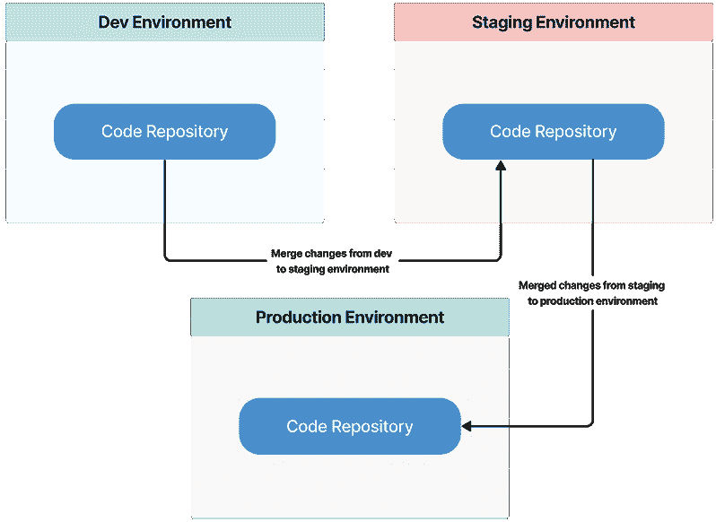

图 2.4(a)：`MLOps` 参考架构：代码在不同环境语义中的移动

现在，让我们将不同环境下的 `MLOps` 架构与部署代码方法相结合，看看我们如何让一切协同工作。图 2.4(b)、图 2.4(c)和图 2.4(d)展示了当架构在不同环境中整合并运行时的样貌。

在架构中，我们展示了一个端到端的流程，从开发数据源和初始数据分析，一直到生产环境中的模型部署和服务提供。以下是引导我们完成这段旅程的不同步骤：

### 开发环境

以下是我们在处理项目初始阶段通常在开发环境中执行的步骤：

1. 一旦规划了机器学习项目并定义了问题陈述和目标，就可以启动项目。
2. 使用开发数据源，这些数据经过清洗、版本化和处理，用于初始数据探查和分析。
3. 在开发环境中进行特征处理和实验，随后进行模型训练和存储。
4. 此模型部署在开发环境中，并经过模型测试和评估。
5. 所有这些代码进入开发分支的代码仓库。然后，该分支被合并到测试分支。

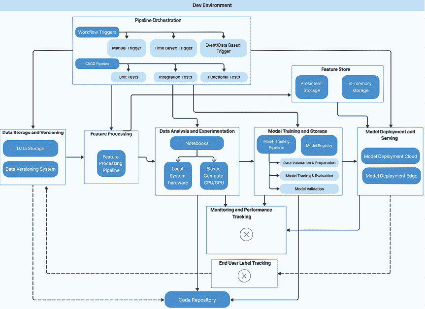

图 2.4(b)：开发环境的 `MLOps` 参考架构

### 测试环境

一旦代码合并到测试分支，将在测试环境中执行以下步骤：

1. 从开发分支合并到测试分支后，会触发 `CI/CD` 流水线，该流程从测试环境存储中获取数据，并处理数据、特征以及基于这些数据训练并存储的模型。该模型随后部署在测试环境中。
2. 理想情况下，测试环境是生产环境的副本，因此它是测试和 `QA` 质量保证模型的好地方。
3. 一旦我们满意并准备好将模型部署到生产环境，代码将从测试分支合并到主/生产分支。根据组织生产代码合并的策略，某些合并可能需要额外的批准。

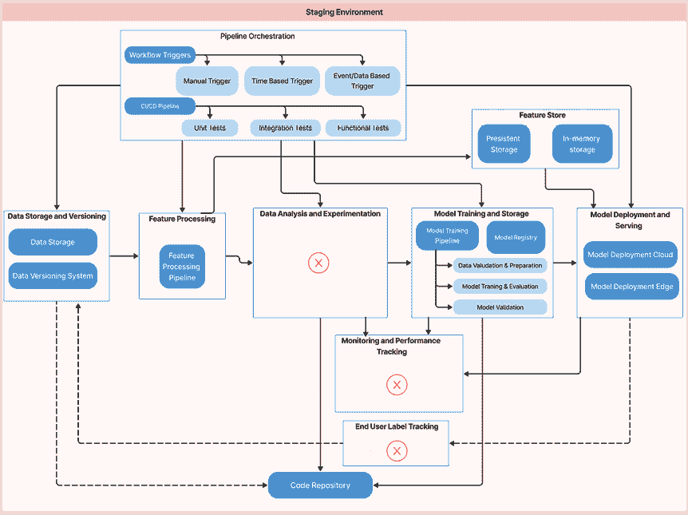

图 2.4(c)：测试环境的 `MLOps` 参考架构

### 生产环境

最后，当代码模型从测试分支移动到生产分支后，将在生产环境中执行以下步骤：

1. 从测试分支合并到主/生产分支会触发生产环境中的 `CI/CD` 工作流。
2. 基于生产环境的数据进行数据准备、特征化、模型训练、评估和验证后，模型部署到生产环境中为终端用户提供服务。
3. 此模型的重新训练根据用例使用编排工作流完成。它可以手动触发、根据定期时间周期触发，或基于事件的触发（根据新数据的到达重新训练模型）。
4. 监控也是生产环境中的重要组件。我们需要在生产环境中建立适当的监控和观察设置，以便随时了解实时生产环境中系统的性能。

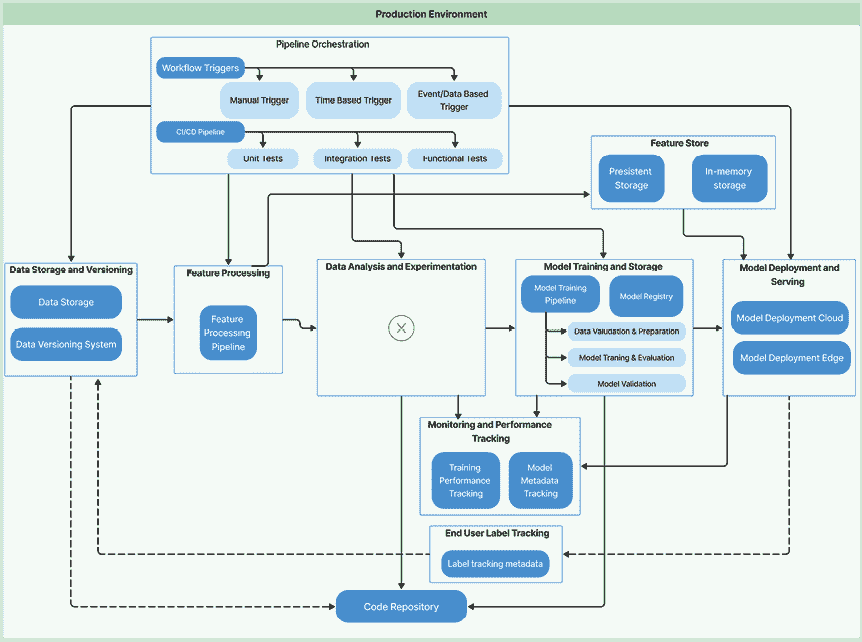

图 2.4(d)：生产环境的 `MLOps` 参考架构

在图 2.4(b)、图 2.4(c)和图 2.4(d)中，你会注意到某些组件在某些特定环境中被划去。这些是我们在那些特定环境中不需要或可选的组件：

* 在开发环境中，监控和性能跟踪以及终端用户标签跟踪是可选组件。我们可以在开发环境基础设施中跳过它们。
* 同样，在测试环境中，我们也可以跳过监控和标签跟踪组件。测试环境中需要的另一个组件是数据分析和实验，因为我们在开发环境中完成了所有的初始数据分析和实验。结果是我们得出了训练和部署模型的脚本。我们不需要在测试环境中进行相同的实验。
* 在生产环境中同样，我们不需要数据分析和实验的基础组件，因为我们永远不会在生产环境中进行直接的手动分析和实验。

## 结论

本章涵盖了 `MLOps` 架构的许多组成部分。我们逐一查看了架构的所有组件。我们了解到，根据项目需求和组织的基础设施成熟度，存在不同层次的架构。我们还讨论了不同环境（`dev`、`staging` 和 `production`）的语义以及部署模式。最终，我们从全局视角查看了一旦将所有组件整合在一起，`MLOps` 架构的样貌，以及该架构如何与部署代码模式结合 `dev`、`staging` 和 `production` 环境协同工作。

### 记忆要点

* `MLOps` 的目标是实现机器学习工作流的协作、自动化、可扩展性和可复现性。它有助于在生产环境中管理和运营 `ML` 模型。
* `MLOps` 架构的主要组件包括：数据溯源/版本控制、数据分析、代码库、流水线编排、模型训练/存储、部署、监控和特征处理。
* `MLOps` 架构成熟度分为三个级别：第 1 级是具有手动流程的概念验证；第 2 级是具有自动化流水线的生产级；第 3 级是具有共享基础设施的企业级。
* 执行环境、代码、模型和数据在 `dev`、`staging` 和 `production` 环境具有不同的语义。它们通过对团队不同层级的访问控制进行隔离。
* 两种主要的模型部署模式是部署封装好的模型与通过环境部署训练代码。部署代码对于自动化、安全和合规性更好。
* 端到端架构整合了跨 `dev`、`staging` 和 `production` 环境的所有组件。`CI/CD` 流水线在分支合并时自动执行部署。
* 重新训练流水线可以手动触发、按计划或由新数据到达等事件触发。监控有助于跟踪模型和数据偏移。

### 核心术语

* **`MLOps` 架构**：`MLOps` 架构旨在实现机器学习工作流的无缝协作、自动化、可扩展性和可复现性，确保 `ML` 模型在生产环境中得到高效管理和运营。
* **数据仓库**：数据仓库是一个信息中心库，可以通过对其进行分析以做出更明智的决策。数据从事务系统、关系型数据库和其他源流入数据仓库，通常按定期周期进行。这些数据随后作为下游系统（如 `ML` 或 `BI` 系统）的中心库。
* **数据湖**：数据湖是非结构化或未处理数据的中心库，允许我们以任何规模存储各种结构化和非结构化数据。可以直接存储数据，无需先对其进行结构化。
* **工作流编排**：工作流编排是自动执行工作流步骤的过程，并遵循编排规则和业务逻辑。
* **有向无环图 (`DAG`)**：它们是没有无向循环的图。这些图表示了单个工作流步骤的执行顺序和制品使用。在有向无环图中，无法从图中某一点开始并遍历整个图。每条边都从早期的边指向后期的边。

加入我们的书籍 Discord 空间

加入书籍 Discord 工作空间以获取最新更新、优惠、全球技术动态、新发布以及与作者的互动：

[`discord.bpbonline.com`](https://discord.bpbonline.com)


# 第 3 章 `MLOps` 基础设施与工具

## 引言

机器学习（`ML`）系统是复杂的，具有许多互连的组件，因此它们可以从良好的基础设施中获益。如果设计得当，这种基础设施可以简化流程，减少对专业知识的依赖，并节省大量的工程时间。因此，`ML` 应用可以更快速地开发和部署，减少 `bug` 的概率，并实现新的用例。相反，设计不良的基础设施在修改或替换时可能面临挑战且成本高昂。

在本章中，我们将深入如何为 `ML` 系统搭建良好的基础设施。在开始之前，至关重要的是承认每个组织的基础需求根据其用例、现有的 `IT` 基础设施和应用程序依赖而异。正如我们在上一章中讨论的，组织的成熟度和其他需求也会影响其基础设施需求。

## 结构

在本章中，我们将讨论以下主题：

* 基础设施入门
* 存储
    * 提取、转换、加载 (`ETL`) / 提取、加载、转换 (`ELT`)
    * 批处理与流式处理
* 计算
    * 公有云厂商与私有数据中心
    * 开发环境
* 容器
* 编排/工作流管理
    * `Airflow`
* 机器学习平台
    * 模型部署
    * 模型注册表
    * 特征商店
    * `MLflow`
* 自建与自购

## 目标

在本章结束时，我们将理解高效运行 `MLOps` 需要哪些工具和基础设施设置，以及如何设置不同的环境以使模型在从开发到生产的项目过程中更高效地移动。我们还将学习设置一个编排平台来控制所有流水线和转换。最后，了解何时购买基础设施比自建更明智。

### 基础设施入门

为了为我们的用例搭建正确的基础，理解基础设施的含义及其组成部分很重要。

在机器学习中，基础设施是支持 `ML` 系统开发和维护的基础设施集合。重要的是，基础设施在不同公司之间差异很大，正如本章之前讨论。在本节中，我们将检查基础设施的以下层：

* 存储
* 计算
* 容器
* 开发环境
* 编排/工作流管理
* `ML` 平台
* 模型部署
* 模型注册表
* 特征商店

从机器学习工程师或数据科学家的角度来看，这些不同的基础设施层从不抽象到最抽象不等。正如图 3.1 所示，这些层位于抽象性与重要性频谱的不同点。例如，存储和计算对工程师来说是最抽象的，因为一旦运行，他们就不需要直接与这些层交互。相反，开发环境对工程师来说最不抽象且最关键，因为他们每天都在使用。参考以下图：

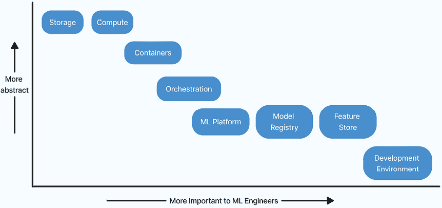

图 3.1：抽象规模和重要性维度下的基础设施层

基础设施在不同组织和用例之间存在显著差异，这取决于实施过程中所做的选择，以及为每个类别选择的技术栈。它还取决于我们决定为这些组件中的每一个选择购买还是内部构建。

机器学习基础设施是 `ML` 系统开发和维护的关键组件，具有用于不同用途的不同层次。理解这些层次的复杂性以及它们如何相互作用，对于机器学习工程师、数据科学家以及组织确保 `ML` 系统的有效运行和管理至关重要。

## 存储

正如我们所知的，机器学习系统通常处理来自各种来源的许多数据集。这些数据集可能很大，需要妥善存储以确保易访问、有效管理和共享。`ML` 基础设施的存储层在解决这些需求方面起着关键作用。存储层可以通过多种方式实现，包括：

* 单个系统中的本地硬盘：必须注意的是，这的可扩展性有限。
* 集中化的云对象存储服务，如 `AWS S3`、`Google Storage`、`Azure Blob Storage`：这些服务提供了几乎无限的可扩展性，通常用于备份、归档和中间存储。对象存储是存储作为对象或文件的大型数据的理想选择。
* 本地服务器或私有数据中心：这提供了更多的控制，但需要基础设施管理。
* 云数据仓库，如 `Snowflake`、`Databricks`、`BigQuery`、`Redshift` 等：这些针对分析负载进行了优化，并对结构化/半结构化数据提供 `SQL` 查询。
* 云数据湖解决方案，如 `AWS Lake Formation` 和 `Azure Data Lake Storage`：这些可以以原生格式处理结构化、半结构化和非结构化数据。

除了选择合适的存储引擎外，我们需要数据版本控制和血缘追踪机制。这允许我们维护数据质量并追踪数据集从源到目的地的演变。流行的版本控制方法包括为每个数据集分配唯一 `ID` 并维护数据集更改日志。

机器学习中使用的数据集可能具有不同的特征，用于不同的用途，并可能需要不同的处理方法。例如，来自传感器的序列数据、图像数据、自然语言文本、基因序列等。它们通常以不同的格式出现，这使得存储变得具有挑战性。事实上，它们将处于不同的格式；因此，存储这些数据并不总是易举的。

同样重要的是考虑数据未来如何被使用并做出合理的假设，以确保所选的存储格式和模式是适当。在许多情况下，数据必须从这些各种源传输到集中存储中，例如对象存储、数据仓库、`Relational Database Management Systems (RDBMS)` 或能够处理结构化、半结构化或非结构化数据的数据湖。

数据存储涉及数据对象文件的序列化和反序列化，并将其存储在 `AWS S3`、`Google Storage` 和 `Azure Blob storage` 等对象存储引擎中。这种存储通常在模型训练或系统之间传输数据时用归档、备份或中间存储。另一种常见的存储是将数据存储在数据库等存储引擎中。通常，数据库针对两类工作负载进行了优化：事务处理和分析处理，两者之间存在显著差异。

### 在线式事务处理 (`OLTP`)


# OLTP 与 OLAP 数据库

`OLTP` 数据库处理由社交媒体上发布帖子、在线订餐或发送电子邮件等操作产生的事务。这些事务在发生时插入数据库，并根据需要随时更新。`OLTP` 数据库通常是行存储的，这意味着每个事务都作为一个独立的单元进行处理。`OLTP` 系统针对单个记录的快速查询进行了优化。

## 在线式分析处理 (OLAP)

相反，`OLAP` 数据库旨在聚合和分组数据以得出结论或执行分析。这些数据库允许用户从多个角度查询数据，并针对跨多行的列处理大量数据进行了优化。

总体而言，MLOps 栈的存储部分在维护数据完整性和安全性的同时，必须提供可扩展、高效且方便的访问。这对于机器学习应用程序的操作化至关重要。

# 提取、转换、加载 / 提取、加载、转换

提取、转换、加载 (`ETL`) 和提取、加载、转换 (`ELT`) 是准备机器学习模型部署数据的关键过程。它们在 MLOps 工作流中扮演着整合的角色。在数据用于训练机器学习模型之前，通常必须从源中提取；大多数情况下，然后需要将其转换并加载到目标存储中。此过程根据转换和加载组件的计划顺序被称为 `ETL` 或 `ELT`。

在 `ETL` 方法中，数据首先从各种源提取。然后，在数据加载到目标数据库之前进行数据转换和清洗。而 `ELT` 的顺序是反的。数据从源中提取，并在进行转换之前立即加载到目标系统。

无论使用 `ETL` 还是 `ELT`，目标都是相同的：准备高质量、一致的数据，以馈于机器学习模型的构建和训练过程。这些过程并不是机器学习所专属，通常由数据工程团队处理，但它们对于任何 ML 项目的成功仍然至关重要。然而，它是 MLOps 的关键依赖。没有经过适当策划和准备的数据，机器学习模型将遭受“垃圾进，垃圾出”的后果，并无法提供稳健、准确的预测。损坏的 `ETL/ELT` 管道将阻塞新模型的迭代，因为无法获得新数据。

通过精心设计 `ETL/ELT` 架构以符合 ML 团队的规范，数据工程师为成功的 MLOps 模型开发、部署、监控和更新提供了关键的数据基础设施。因此，`ETL/ELT` 是端到端 MLOps 工作流中不可或缺的一部分。

# 批处理和流式处理

批处理和流式处理是大数据管道中的基础概念，对 MLOps 有重大影响。选择批或流式数据摄取和处理会影响整个机器学习架构的设计以及 MLOps 栈中所使用的工具。

## 批处理与流处理

顾名思义，批处理和流处理代表了输入数据的处理方式。批处理涉及按照固定的时间间隔分批处理数据（例如，每小时、每天、每周、每月等）。它非常适用于不需要实时响应的负载，例如在新的数据上对 `ML` 模型进行定期重新训练。批处理允许使用如 `Apache Airflow` 等工作流调度器来实现稳健的数据流水线和编排，并通过作业并行化实现高效的资源利用。对于模型训练而言，批处理是首选，因为它允许对大型数据集进行完整遍历。

相比之下，流处理涉及在数据可用时，实时或近实时地从源端传输到目标端。对于机器学习中那些快速变化且需要低延迟预测或决策的特征计算，流处理至关重要。例如，游戏玩家人数、正在运行的锦标赛数量（需要玩家加入）、欺诈检测、IoT 数据分析等。对于大多数现代机器学习系统，我们不仅需要批处理特征，还需要流式特征，以便及时做出最优决策。

批处理与流处理的设计选择对 MLOps 栈产生级联影响。批处理负载适用于处理离散作业的容器化微服务。流处理需要快速、有状态且灵活的数据处理，这可以通过如 `Knative` 等无服务器框架来实现。数据存储架构也存在差异，批处理倾向于数据仓库，而流处理则需要消息总线和发布订阅系统。监控、测试和 CI/CD 过程也考虑到这些架构差异。

对于利用流式特征的 ML 系统，流式计算很少简单。这些机器学习应用（如欺诈检测、语言模型等）的特征不仅数量数百，可能有数千甚至更多。从数据流中提取复杂的特征通常需要实现高性能流处理引擎。`Apache Flink`、`KSQL` 和 `Spark Streaming` 等工具常用于此，其中 `Apache Flink` 和 `KSQL` 更广受认可，并为数据科学家提供了友好的 SQL 抽象。

总结而言，批处理和流处理支撑了许多重要的机器学习用例。通过尽早考虑它们的影响，可以定制 MLOps 架构，以优化支持特定 ML 应用所需的数据处理模式。批处理与流处理的设计选择影响着 MLOps 栈几乎所有方面。

# 计算层

计算层是执行机器学习项目所需所有任务的引擎。它涵盖了组织可以访问的所有计算资源，以及利用这些资源来执行项目的方法。计算资源的可用性严重影响着机器学习项目中的关键决策，例如使用的模型选择、处理范围、所需的并行化程度、解决方案的可扩展性等。

例如，可用计算资源的数量可以决定实际可以训练和部署的模型规模和复杂性。如果无法访问分布式 GPU 集群或云端计算，像大型 Transformer 网络这样资源密集型模型可能是不可行的。数据处理和特征工程的可能规模也与计算资源的可用性挂钩。资源越丰富，在预处理流水线中就可以并行处理更多的数据。

此外，计算资源上下伸缩的容易程度会影响整个 MLOps 生命周期的效率。如果训练计算可以根据负载动态配置和拆除，就能避免分配的大量资源闲置的情况。同样，对部署计算资源进行高效的自动伸缩以匹配实时推理需求，可以提高成本效益。拥有灵活的计算基础设施是最大化利用率的关键。

在最简单的形式下，计算层可能由单一系统或服务器、单个 CPU 或 GPU 组成。相反，它可能涉及云计算资源集群，例如由云提供商管理的 `AWS ECS`，或者根据需求运行大量 CPU 和 GPU 核心的 `Kubernetes` (`K8s`) 集群基础设施。虽然核心、内存和存储是计算资源的基本单位，但更成熟的架构通常采用额外的抽象。例如，`Apache Spark`、`Ray` 等计算引擎使用 `job` 作为单位，而 `Kubernetes` 使用 `pod` 作为单位。要执行任何 `job`，必须将必要的数据从存储层加载到计算单元的内存中，然后对数据执行所需的操作。

## 公有云厂商与私有数据中心

与数据存储层一样，计算层在很大程度上已变得商品化。组织不再为存储和计算建立自己的数据中心，而是向 `AWS`、`Azure`、`GCP` 或其他专业云服务提供商支付所需的精确计算能力费用。这种方法的优势在于可以在构建项目时无需担心计算层。对于负载随项目而波动的组织来说，这特别有益。

例如，如果一个组织通常需要 50 个 CPU 核心，但某个特定项目在一周内额外需要 200 个 CPU 单元，云提供商可以轻松设置资源并在项目完成后停止使用。我们只为使用的资源和使用时长付费。相比之下，私有数据中心将是一项更昂贵的工程，因为我们需要预付 200 个 CPU 核心的费用，并为项目进行设置。这种灵活性对机器学习非常有帮助，因为这些负载的资源需求往往是动态的，在进行大量实验的开发阶段，资源消耗远高于负载更稳定的生产阶段。

然而，公有云和私有数据中心之间的选择并非总是非黑即白的。许多组织采用混合云方法，在维护本地基础设施的同时利用公有云资源。这使得可以将敏感数据和核心服务留在本地，同时利用公有云的灵活性和扩展性来满足临时资源需求。管理混合 MLOps 基础设施为跨环境协调以及数据和模型的移动增加了额外的复杂性。在设计混合云架构时，必须权衡数据引力、延迟、安全合规性要求等因素。通过仔细规划，混合方法可以使组织针对成本效益和业务需求实现优化。

## 开发环境

开发（Dev）环境，正如我们所知的，是我们编写代码、进行实验并与生产环境交互（生产环境用于部署冠军模型和评估挑战模型）的环境。开发环境通常包括集成开发环境 (`IDE`)、版本控制系统 (`Github` 等）以及 CI/CD 流水线。

### 开发环境搭建

开发环境应该配置好所有必要的工具，以便工程师更容易地工作。此外，它还应该包含用于代码和数据版本的工具。

在第 4 章“什么是机器学习系统？”中，我们将审查数据科学项目的标准化饼干式项目结构，这种结构为我们提供了指导轨道，告诉我们如何在开发环境中构建项目，以便其能够与代码版本控制系统良好工作。

在第 5 章“数据准备与模型开发”中，我们将讨论开发环境的其他本质方面。我们将深入探讨代码仓库的最佳实践，特别是在机器学习和 MLOps 项目背景下。此外，我们将更详细地探索 `pre-commit` 钩子和数据版本控制的使用。

一个配置良好的开发环境还应该包含 `CI/CD` 和测试套件，以便在代码推送到仓库或其他更高环境（如阶段和生产环境）之前对其进行评估。

### 集成开发环境

正如我们所知，IDE（集成开发环境）是我们编写代码的编辑器。许多机器学习从业者不仅使用 `VS Code` 和 `PyCharm` 等 IDE，还倾向于使用 `Jupyter Notebooks` 或 `Google Colab` 等笔记本，特别是用于探索性数据分析。

笔记本具有其他原生 IDE（如 `VS Code`）所缺失的良好属性：状态化。这意味着笔记本可以在多次运行之间保留状态。如果脚本在执行过程中途失败，我们可以从失败的步骤开始继续恢复并重新运行，而不是从头开始。这一特性在处理可能需要很长时间加载的大型数据集时特别有用。笔记本还通过允许按任何顺序执行代码来促进迭代开发。

然而，至关重要的是记住，状态化是一把双刃剑，因为它允许以任何顺序执行单元格中的代码。因此，如果笔记本没有通过良好的结构来运行代码，或者单元格的执行顺序没有良好的记录，它们可能会变得混乱且难以管理。

为了避免这些陷阱，在使用笔记本时采用以下良好实践至关重要：

*   详尽记录每个单元格的用途和依赖关系。
*   按逻辑顺序排列单元格以反映工作流步骤。
*   在提交更改之前，重启内核并顺序运行所有单元格。
*   将可重用逻辑模块化为函数/类。
*   使用版本控制和定期代码审查。

遵循这些原则使得笔记本更加健壮且更符合生产标准。可以在不牺牲代码质量或可维护性的情况下，利用快速迭代的优势。通过适当结构和文档，笔记本可以成为可扩展 MLOps 基础设施不可或缺的一部分。IDE 对于生产模型和流水线代码仍然是必不可少的。有效使用这两种工具是进行高效机器学习开发的关键。

### 容器

当任何机器学习项目处于开发阶段时，我们通常在一个单一系统或几个独立系统上工作。我们根据需求配置这些系统，包括必要的依赖项、包和库。当项目准备好部署并进入阶段或生产环境时，我们最初可能会根据所有这些依赖设置一次服务器，它就会一直运行。然而，这种方法在处理必须根据需求进行扩展的工作负载时就显得捉襟见肘了。这意味着如果我们有几个服务器实例正在运行、处理数据并提供模型服务，突然在某些事件期间，应用程序的负载增加了十倍，我们需要扩展服务器实例以处理处理需求。所有现代基础设施系统都能根据需求管理实例的水平扩展和水平收缩。然而，为了实现这一点，我们需要一种方法在这些按需容器中重新创建相同的项目设置，就像我们在初始服务器实例中可能做的那样。

这就是容器技术（如 `Docker`）变得无价的地方。有多种容器技术可用，但 `Docker` 是最流行的。`Docker` 中的两个核心概念是 `image`（镜像）和 `container`（容器）。类似于我们拥有 `Git`，容器仓库的作用相似，我们可以在其中共享镜像。仓库可以是公共的或私有的。`Docker Hub` 是仓库的一个示例；可以在 `AWS ECR`（弹性容器仓库）中设置私有仓库供组织使用。

`Dockerfile` 是定义如何使用容器的代码文件。以下是一个简单的 `Dockerfile` 示例：

```dockerfile
FROM pytorch/pytorch:latest
RUN git clone http://github.com/dummy-organization/new-ml-project.git
WORKDIR /new-ml-project
RUN git clone https://github.com/huggingface/transformers.git && \
cd transformers && \
python3 -m pip install --no-cache-dir
```

之前的代码是一个运行以下指令的 `Dockerfile` 示例：

1.  从公共仓库下载最新的 `pytorch` 基础镜像。
2.  从 `dummy-organization` 的 git 账户克隆 `new-ml-project`（这些是虚拟名称，该仓库实际上不存在）。
3.  将 `new-ml-project` 设置为工作目录。
4.  从 Hugging Face 的 GitHub 仓库克隆 `transformers` 到工作目录，进入 transformers 文件夹并安装 transformers。

这对于设置一种类型的容器效果非常好，但在现实生活中，大多数真实项目可能会有多个容器。也许流水线的每一步都运行在自己的容器中，模型运行在单独的容器中提供服务，依此类推。现在假设我们有许多微服务在运行，为这些每个容器管理 `Dockerfile` 将非常困难。这时容器编排就派上用场。`Docker Compose` 是一个轻量级的编排工具，可以轻松地管理多个容器。`Docker Compose` 在单个主机上运行良好。然而，如果我们需要在多个不同的主机上运行这些容器，`Docker Compose` 是无法实现的。这就是导致大多数组织使用 `Kubernetes` 的需求。它是一个允许我们在多个不同的主机上作为集群运行容器的工具；它为容器创建一个网络，以便它们在集群中通信并共享资源。

编排是任何现代数据平台整体资源管理中至关重要的一层。正如之前所述，存储和计算资源对于每个现代数据平台都是弹性的，这意味着它们可以根据项目的需求或负载进行动态调整。为了有效管理这些资源，我们需要调度器或编排平台。

在我们的数据世界中，`orchestrate`（编排器）和 `schedulers`（调度器）这两个术语经常互用，因为我们通常运行编排平台来管理工作流的资源和计划。然而，这两个概念之间存在显著的区别。具体来说，编排关注的是资源管理，以及如何从何处获取这些资源及其基础设施。`Kubernetes` 是一个广泛使用的基础设施编排器的典型示例。另一方面，`schedulers` 重点在于确定何时执行作业以及完成作业所需的资源。

在机器学习的背景下，我们通常不直接关注基础设施编排器，当我们说 `orchestrators` 时，指的是特定数据的编排器，如 `Apache Airflow`、`Argo`、`Prefect` 和 `Dagster`、`Kubeflow`、`Metaflow` 等。这些平台能够为作业编排资源，并拥有自己的用于管理这些作业的 `schedulers`。它们处理机器学习工作流的调度和协调，同时依赖基础设施编排器提供底层计算资源。在某些文献和组织团队中，这些工具和平台也被称为工作流管理工具。

影响机器学习工作流管理的两个主要属性是：

*   迭代性质
*   依赖性

正如我们所建立的，构建机器学习系统是一个迭代且重复的过程。例如，使用不同的超参数训练和评估多个模型涉及迭代实验。虽然开发过程可能涉及多次迭代，但训练和重新训练必须定期进行，例如每周或每月，或者在模型性能下降和观察到模型漂移时动态进行。像 `Airflow` 这样的工作流管理工具允许以可靠且可重复的方式配置管道执行迭代工作流和定期重新训练。

此外，完整的机器学习流水线通常有许多依赖关系。工作流中的某些作业可能只有在前一个作业成功后才执行，从而产生依赖关系。例如，初始步骤可能涉及从数据仓库获取数据，然后进行特征提取。只有当第一个作业成功完成且数据可用时，执行第二个作业才有意义。通常，会训练新模型，将其与现有的生产模型进行比较，仅当新模型的性能超过旧模型时才进行更新。这种依赖被称为条件依赖，它不仅取决于上一步的成功，还取决于执行结果。同样，像 `Airflow` 这样的工作流管理工具允许编码这些依赖关系，以编排管道步骤的条件执行。

如图 3.2 所示，机器学习工程师创建一个由任务定义组成的 `Workflow`。这些定义启动单个任务，并由 `Scheduler` 管理它们的调度，然后向 `Orchestrator` 请求所需的资源。随后，该编排器将从集群实例池中分配资源来执行每个任务。请参考以下图像：

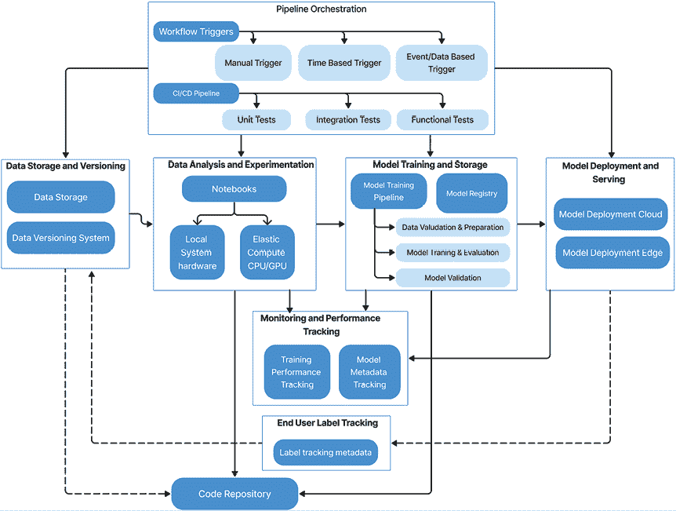

图 3.2：数据科学工作流步骤

最常用的工作流管理和编排工具之一是 `Apache Airflow`。它最初创建于 Airbnb 并于 2014 年发布，`Airflow` 是一个卓越的任务调度器，配备了全面的 `operators` 库。这一功能简化了集成。

## Airflow 安装

假设我们已经安装了 Python 和 `pip`，安装 `Airflow` 将变得更加简单。以下是我们根据所需的环境安装 `Airflow` 的方法。在本地系统中，使用针对所有依赖的约束文件（constraints file）是可以的。如果需要，我们可以随时使用我们修改过的依赖文件。这就是为什么，如果你查看安装命令，我们为该版本定义了约束文件。

### 使用 PyPi 安装

Airflow 既是一个 Python 库也是一个应用程序，因此有时管理依赖会变得棘手。库通常保持依赖开放，而应用程序通常会锁定它们。Airflow 社区决定尽可能保持依赖开放，以便我们可以安装不同版本的依赖。以下是执行操作的命令：

```bash
pip install "apache-airflow[celery]==2.5.3" --constraint "https://raw.githubusercontent.com/apache/airflow/constraints-2.5.3/constraints.txt"
```

成功安装 `Airflow` 后，我们可以执行以下命令：

```bash
# 独立命令将初始化数据库、创建一个用户并为我们启动所有组件
airflow standalone
```

一旦运行起来，终端将显示我们用于登录 UI 的用户名和密码。在浏览器中访问 `localhost:8000`。

### 在 Docker 中安装

此设置假设我们熟悉 `Docker` 及其功能。此外，我们必须在系统中安装了 `Docker` 和 `docker-compose`。


首先，我们需要获取 `docker-compose` 文件。我们可以使用 `curl` 下载文件，也可以通过访问 Airflow 文档手动下载。下载该文件的命令是：

```bash
curl -Lf0 'https://airflow.apache.org/docs/apache-airflow/2.5.3/docker-compose.yaml'
```

查看此 `docker-compose` 文件，我们会注意到 Airflow 需要运行的多个容器如下所示：

*   **Airflow scheduler**：它监控所有任务和 DAG，此外还管理任务实例何时以及如何触发。
*   **Airflow webserver**：Web 服务器供我们与 Airflow 实例进行交互。
*   `Airflow worker`：负责执行由 Airflow 调度器调度的任务组件。
*   `Airflow trigger`：一种专门为可以延迟的任务设计的启动事件循环的机制。
*   `Airflow init`：这是初始化 Airflow 服务的命令。
*   `Postgres`：Postgres 是 Airflow 使用的标准数据库，存储其所有的元数据以及运行 Airflow 的数据库。
*   `Redis`：它是管理调度器（scheduler）和工作器（worker）之间通信的代理（broker）。

此 Docker 安装还将从我们本地系统将某些目录挂载到 Docker 容器中：

*   `./dags`：我们需要存储所有 dags 文件的目录。
*   `./logs`：来自执行器和调度器的输出日志存储在此处。
*   `./plugins`：如果我们安装了任何插件，则存储所有插件的目录。

挂载这些目录允许我们能够在本地系统和 Docker 容器之间共享 DAGs、存储日志并管理插件，增强了 Airflow 使用的灵活性便利性。

一旦我们准备好初始化 airflow，我们需要遵循以下命令：

### 此命令首先启动 airflow-init docker 容器，该容器为 airflow 设置了前提条件。

```bash
docker compose up airflow-init
```

### 初始化完成后，我们将看到类似这样的消息

```
airflow-init_1 | Upgrades done
airflow-init_1 | Admin user airflow created
airflow-init_1 | 2.5.3
start_airflow-init_1 exited with code 0
```

这表示管理员账户已就绪，我们可以使用凭据 `airflow:airflow` 登录 Web 服务器。现在是启动所有其他容器了。

```bash
docker compose up
```

一旦容器准备就绪，我们就可以登录界面并开始尝试 DAGs。Web 服务器将在开发机器的 `http://localhost:8000` 可用。默认账户的登录名为 `airflow`，密码为 `airflow`。

## 生产环境中的 Airflow

要在生产环境中部署我们的 DAG，确保 Apache Airflow 准备就绪至关重要。这涉及到以下描述的几个关键方面：

*   **数据库后端配置**：默认情况下，Airflow 配有 `SQLite` 后端，使用户可以在没有外部数据库的情况下运行它。然而，这种设置主要设计用于测试，由于存在数据丢失的风险，不适用于生产环境。配置后端使用 `Postgres` 或 `MySQL` 等外部数据库以建立稳健的生产环境。
*   **多节点集群设置**：Airflow 默认的 `SequentialExecutor` 限制为一次执行一个任务并在任务执行期间暂停调度器。这对于生产环境不是理想的。相反，我们需要为单机设置使用 `LocalExecutor`，并为多节点配置使用 `Kubernetes Executor` 或 `Celery Executor`。
*   **日志配置**：对于具有可丢弃节点的集群，我们需要使用分布式文件系统（DFS）如 `S3` 或 `GCS` 来设置日志存储，或者利用外部服务如 `Stackdriver Logging`、`Elasticsearch`。

- `Kubeflow`：Kubeflow 的主要目标是通过消除基础设施样板代码的需求（通常运行 `Airflow` 或 `Argo` 等平台时需要），以便在开发和生产环境中实现工作流的无缝执行。然而，Kubeflow 往往依赖于外部调度器来有效管理执行调度。由于 Kubeflow 流线是基于 `Argo` 构建的，因此它共享了只能在 Kubernetes 集群上运行的局限性。

- `Metaflow`：Metaflow 与 Kubeflow 类似，它抽象了开发和生产的样板代码，并且通常也需要外部调度器。然而，不同之处在于，Metaflow 可以与 `AWS Batch` 以及 Kubernetes 集群一起使用。

## 机器学习平台

随着组织经历 ML 基础设施和架构的成熟，他们发现在各种应用中存在越来越多的 ML 用例。这些用例的增长导致了某些可以被多个项目利用和重复使用的平台及应用程序。组织可以通过为每个应用利用通用工具集，最大限度地发挥其 ML 部署的效益。这种用于 ML 部署的共享工具集构成了机器学习平台的基础。

随着机器学习工具和平台在炒作和增长曲线中演进和进步，我们看到 ML 平台组成部分以及哪些组件属于平台的定义在不断变化。新工具不断被引入到平台中，为整个 MLOps 基础设施增加价值。我们将研究一些在 ML 平台中几乎总是需要的常用组件。这些是：

- 模型部署
- 模型注册表
- 特征存储

### 模型部署

模型部署是任何机器学习项目中最终且至关重要的结束步骤。在未来的章节中，我们将深入探讨部署和模型服务的复杂性。部署模型最简单的方法是将模型及其依赖项推送到生产环境（或开发和测试环境）中可访问的位置，并将模型暴露为供用户的端点（endpoint）。对于在线预测，该端点必须触发模型生成预测并返回数据；对于批量预测，端点则检索预计算的预测结果并返回数据。

部署服务或组件可以通过将模型和依赖项无缝推送到可访问的位置，并通过端点提供模型服务来促进这一过程。为此目的有许多工具可供，包括由主要云提供商提供的工具，如 `AWS Sagemaker`、`GCP Vertex AI`、`Azure ML`、`阿里巴巴 ML Studio`。此外，还有一些利基公司提供用于模型部署管理的专有和开源工具，如 `MLflow models`、`Seldon`、`Cortex`、`Ray Serve` 等。

在评估和选择集成到 ML 平台的部署工具时，考虑它们与团队及组织整体基础设施的集成程度以及它们在多大程度上简化了部署过程非常重要。许多组织依赖不同的工具来处理批量预测和在线预测。例如，组织可能选择使用 `Seldon` 服务在线预测，同时使用 `Databricks` 进行批量预测。

## 模型注册表

模型注册表或模型库已成为任何机器学习平台不可或缺的组件，特别是当团队或组织管理多个模型时。管理大量模型、跟踪不同版本、存储所有相关制品以及维护各种模型及其版本的元数据可能具有挑战性。对于单个或少数模型，它们可以直接存储在 `AWS S3` 等对象存储中。然而，随着生产环境中用例和模型数量的增加，扩展和管理变得越来越困难。

特别是为了帮助对模型进行故障排除、调试或审计，尽可能跟踪与模型相关的信息至关重要。需要跟踪的某些制品和元数据包括：

- `Model code`：这由在需要时生成模型所使用的代码组成，涵盖了所用框架的细节、训练和测试过程、超参数等。它还包括创建特征和从输入数据生成预测的代码和函数。这些函数通常封装在端点中并暴露给最终用户。
- `Experiment artifacts`：在模型开发期间，会进行各种实验以识别最佳模型。存储和管理这些实验制品是一种良好的实践，因为它允许重新查看数据和模型以支持决策并用于审计之目的。
- `Dependencies`：对于所有依赖项，我们可能要求在任何环境中运行模型。
- `Data`：指的是用于训练模型及其各种版本的数据。它可以是数据集的副本，也可以是存储在数据仓库或数据库中的数据位置的指针。它可以是获取训练模型所需数据的查询等。如果我们使用如 `DVC` 等工具对模型开发期间使用的数据进行版本控制，则可以使用 `git commit` 来捕获我们正在处理的数据和模型版本。
- `Model definition and parameters`：这是创建模型所需的元数据和信息，以及用于生成特定模型版本的参数及其值。例如，使用什么种损失函数、使用多少维的向量等。
- `Tags`：标签可以是任何一组元数据值，帮助我们发现模型、跟踪和过滤。这些标签可以是任何类型的元数据值，并且对于不同的组织和团队可能不同。某些标签可以是模型的所有者、负责该模型的团队、环境标签、版本标签等。

`MLflow` 是一个流行的开源平台，提供此类功能，允许用户存储制品、模型和元数据，跟踪实验并建立正确的模型血缘。其他提供类似能力的工具包括 `Neptune.ai`、`Comet`、`Guild.ai` 和 `Sacred`。

## 特征存储

正如其名，特征存储是管理各种机器学习项目所用特征的中心化存储。特征存储有三个主要组件：

- `Feature management`：组织通常同时运行多个 ML 项目，每个项目为其相应的模型生成一组特征。通常，一个模型使用的特征对另一个模型可能有用，因此将它们的管理集中化并允许团队间共享是合理的。特征存储可以帮助团队共享和发现特征，并管理每个特征的角色和共享设置。提供此类目录的特征存储示例包括 `Lyft` 开发的 `Amundsen` 和 `LinkedIn` 开发的 `DataHub`。
- `Feature versioning and lineage tracking`：特征版本控制确保模型在训练和推理期间使用相同的特征集。血缘跟踪有助于追溯特征的来源和转换历史，便于审计和调试。
- **特征计算 (Feature computation)**：在定义后，特征提取逻辑需要进行计算。例如，某个特征提取逻辑可以使用玩家过去一周在游戏上的平均花费时间。计算涉及查看数据并计算出此平均值供模型使用，其计算时机取决于该特征是否为计算密集型。如果该特征的计算非常简单且轻量级，那么每个使用该特征的模型都可以在运行时进行计算；但如果它需要大量的计算量或计算耗时较长，那么将其计算并存储起来供所有模型使用可能更为合理。


- **特征一致性**：如前所述，模型可能为批处理和流式在线数据拥有不同的流水线。批处理流水线和流式在线流水线取决于用例以及训练部分如何获取历史数据。如果一个特征在两个不同的地方被定义和执行，那么始终存在数据不一致的可能性，如果其中一个流水线做了更改而另一个没有，这也会导致不一致。特征存储平台通过提供一个统一的场所来存储特征的逻辑和值解决了这个问题，这些值可以在不同的流水线之间共享。

目前最流行的开源特征存储平台是 `Feast`。它需要由我们在本地或云服务器上进行部署和管理。`Tecton` 是另一个特征存储平台，它是商业性的，全托管特征存储平台，我们不需要自己担心基础设施的搭建和部署。如果你想查看 `Feast` 和 `Tecton` 的深度对比，并查看哪一个最适合你的用例和基础设施，可以参考此资源 `https://resources.tecton.ai/choosing-the-right-feature-store-feast-or-tecton`。像 `SageMaker` 和 `Databricks` 这种提供全面 ML 平台的平台也对特征存储有自己的解释。

### 安装 MLflow

我们可以通过运行以下命令来安装 `MLflow`：

```bash
pip install mlflow
```

### 安装带有额外 ML 库和第三方工具的 MLflow

```bash
pip install mlflow[extras]
```

一旦安装了 `MLflow`，开始使用它的第一件事是将跟踪 API 集成到我们的模型开发代码中。`MLflow` Tracking API 允许我们从机器学习项目中记录指标和构文件，并查看运行历史。以下代码演示了跟踪 API 的用法：

```python
import os
from random import random, randint
from mlflow import log_metric, log_param, log_artifacts

if __name__ == "__main__":
    # 记录一个参数（键值对）
    log_param("param1", randint(0,100))
    # 记录指标；指标可以在整个运行过程中更新
    log_metric("foo", random())
    log_metric("foo", random() + 1)
    log_metric("foo", random() + 2)
    # 记录一个构文件（输出文件）
    if not os.path.exists("outputs"):
        os.makedirs("output")
    with open("outputs/test.txt", "w") as f:
        f.write("hello world!")
    log_artifacts("outputs")
```

一旦记录了参数和指标，我们就可以查看这次运行并在 `MLflow` UI 中查看所有记录的参数。要运行 UI，请使用以下命令：

### 运行 MLflow UI

```bash
mlflow ui
```

对这些组件和层级的理解，为我们深入研究 MLOps 主题做了准备，我们将在接下来的章节中详细探讨。

## 自建还是购买

归根结底，这取决于组织正在运行和感兴趣的用例以及机器学习项目的类型。基础设施的成熟度也是这一决策的驱动因素。

对 MLOps 的投资也取决于我们想在哪里投入。是想更多地投入团队成员还是基础设施本身？例如，如果我们想使用全托管的 `Databricks` 集群，可能只需要一名工程师来管理。但如果我们想自建 `Kubernetes` 或 `Spark` 集群来运行所有项目，我们可能需要更多的人来维护。对于数据传输平台也是如此，我们可以自建并管理如 `Apache Airflow` 等平台，也可以购买如 `Fivetran` 的平台，后者部署成本极小，我们不需要完整的团队来管理。大多数公司处于自建与购买之间的平衡；我们可能会拥有自建的基础设施并使用 `Snowflake` 作为数据仓库。

除了团队和财务投入外，其他决定因素包括：

- **公司的成熟度**：我们可能希望利用供应商解决方案以尽快启动，以便将有限的资源集中在产品的核心业务上。然而，随着我们用例的增长，供应商成本可能会变得昂贵，投资内部解决方案可能更划算。

- **公司的重点**：如果这是我们希望擅长并作为竞争优势重点，那么自建比购买更有意义。如果它只是一个支持系统而不是公司的竞争力，那么倾向于购买更好。

- **可用工具的成熟度**：这通常发生在某个领域尚未成熟或没有足够的商品化产品时。在机器学习开发的早期，这种情况是非常普遍的。例如，如果我们想为项目和平台设置特征存储并希望购买，但如果市场上没有能满足我们需求或用例的产品，那么在某些开源系统之上或从零开始自建可能更为合理。

自建还是购买的决策是复杂的，高度取决于上下文，并且可能是基础设施部门花费大量时间权衡的原因。在这里做出正确的决策非常重要，因为一旦建立了平台和基础设施，就很难更改，我们在未来几年中都需要使用并依赖这些设施。

## 总结

本章开始讨论对于组织来说什么样的基础设施和工具是合适的，以及我们可以如何进行。将机器学习模型投入生产并供用户使用不仅是一个数据科学或机器学习问题，同样也是一个基础设施问题。拥有合适的工具和基础设施对于成功的机器学习项目至关重要。

在本章中，我们探索了机器学习系统所需的各种基础设施层，从存储和计算层开始。该层为任何需要大量数据和计算能力的机器学习工程提供了核心资源。存储和计算层已变得高度商品化，导致许多组织选择为云服务商支付存储和计算资源的费用，而不是建立自己的数据中心。

接下来，我们讨论了开发环境，数据科学家在其中编写代码并与生产环境交互。开发环境至关重要，因为工程师的大部分时间都花在这里。该领域的改进直接影响生产力。团队改进开发环境方面可以采取的初始步骤之一是为数据科学家和机器学习工程师实现标准化。在本章中，我们查看了推荐标准化开发环境的原因以及实现这种标准化的方法。

此外，我们深入探讨了一个与基础设施相关的、近期引发了广泛讨论的议题：资源管理。资源管理是数据科学工作流中的关键环节，但关于数据科学家是否应该负责管理它的问题悬而未决。在下一章中，我们将研究数据准备和模型开发的流程，这是任何机器学习系统和工作流的基础。

## 核心要点回顾

*   机器学习基础设施由多个层组成，如存储、计算、容器、编排/工作流管理以及 ML 平台。每一层在开发和维护机器学习系统方面起着不同的作用。

*   对于存储，常见的选项包括本地硬盘、云存储服务和本地服务器/数据中心。关键考虑因素包括 `ETL`/`ELT`、批处理与流式处理、`OLTP` 与 `OLAP` 数据库。

*   对于计算，组织可以使用公共云供应商或私有数据中心。开发环境至关重要且应当标准化。像 `Docker` 这样的容器有助于高效地重建环境。

*   `Apache Airflow` 等编排平台负责调度工作流并管理资源。关键因素是机器学习的迭代性质和任务依赖关系。

*   ML 平台提供模型部署、模型注册和特征存储等功能。随着用例的增加，这些功能能够实现可重用性并简化管理。

*   关于“自建还是购买”的决策，需要考虑的因素包括成熟度、公司重点、工具成熟度、成本和团队技能。在投资许可费用与工程投入之间存在权衡。

*   总的来说，拥有合适的基础来高效地开发、部署和管理机器学习系统至关重要，尽管最佳配置取决于组织的特定需求和背景。

## 关键术语

*   **提取、转换、加载 (ETL)**：在计算中，提取、转换、加载是一个三阶段的过程，数据从源头提取，经过转换并加载到目标系统（可以是数据仓库或数据湖等）。

*   **提取、加载、转换 (ELT)**：`ELT` 与 `ETL` 类似，也有三个步骤，但顺序不同。在 `ELT` 中，数据从源头提取，以原始格式加载到目标系统，然后在目标系统中将原始数据转换为下游系统所需的格式。

*   **批处理**：批处理是用于定期计算高量、重复性数据任务的方法。

*   **流式处理**：流式处理是在数据进入流时实时或近实时对其进行处理、分析和采集的方法。

*   **在线事务处理 (OLTP)**：在线事务处理是一种用于事务导型应用程序的数据库系统，应用程序需要在短时间内向用户返回结果。示例包括在线银行、购物、发送短信等。

*   **在线分析处理 (OLAP)**：在线分析处理是一种用于从不同角度分析业务数据的数据库系统。它组织了大型业务数据库并支持复杂的分析，这种分析可能需要一些处理时间且不是即时的。

*   **有向无环图 (DAG)**：`DAG` 是不包含任何有向环的图。这些图代表了工作流单步的执行顺序和制品使用。在有向无环图中，无法从图中某一点开始并遍历整个图。每条边都从较早的边指向较后的边。

加入我们书籍的 Discord 空间

加入书籍 Discord 工作空间以获取最新更新、优惠、全球科技动态、新发布以及与作者的交流会议：

`https://discord.bpbonline.com`


# 第 4 章 什么是机器学习系统？

## 引言

机器学习正成为行业常态。越来越多的组织通过将机器学习集成到其产品中，或创建全新的基于机器学习的产品来解决其系统需求。这种对机器学习能力的使用以及随之产生的依赖日益增加。在过去的十年里，机器学习几乎进入了我们生活的方方面面，从我们消费信息、交流、在互联网上获取帮助的方式，到我们的生活和工作。

尽管有了这些进展，我们大多数人仍然认为机器学习和数据科学仅仅是算法。虽然算法是生产级机器学习项目的重要部分，但它不仅仅是一个算法。事实上，算法仅是其中一小部分。在本章中，我们将重新回顾什么是机器学习系统以及它们的一些用例。最重要的是，我们将学习应该如何设计机器学习系统，使其能够良好地适配 MLOps 框架。

我们在书的第一部分涵盖了对 MLOps 的介绍和对其架构的理解；在第二部分中，我们将介绍机器学习系统以及如何整合 MLOps。在下一部分，我们将把所有内容整合在一起，查看基础设施如何与设计良好的机器学习系统协同工作，为我们提供完整的端到端 MLOps 工作流。如果你一直在生产环境中开发机器学习系统/应用程序，你可能对本章的讨论非常熟悉。如果你只有学术环境下的机器学习经验，本章将为理解研究级机器学习系统与生产级机器学习系统之间的区别提供一个良好的起点。

### 章节结构

在本章中，我们将讨论以下主题：

*   什么是机器学习系统
*   理解机器学习系统
*   基于 MLOps 的机器学习系统的实施路线图
*   机器学习开发：Cookiecutter 数据科学项目结构

## 目标

在本章结束时，你将理解机器学习系统是什么，以及它们与机器学习研究的区别。读者将探索将机器学习系统部署到生产环境所需的条件以及可以遵循的路线图。

### 什么是机器学习系统

机器学习在现实世界应用中重要性的不断增加，使人们注意到一个专注于生产环境中机器学习的新领域，即机器学习系统（泛指时也也称为 MLOps）。机器学习系统是机器学习与软件工程以及 DevOps 实践的交叉点。机器学习系统的主要部分包括算法、数据、开发和运行系统的基础设施，以及计算所需的硬件。它还涉及关注系统的可靠性、可维护性和可扩展性。

机器学习系统包含了许多不同的垂直领域和层次，包括理解业务需求、初始实验及相应的基础设施、用于交付和更新模型的生产基础设施、用户与系统交互的接口、数据存储、包括前端和后端的应用程序代码、监控和跟踪能力等。

图 4.1 展示了构建完整机器学习系统的技术层。对于该系统之外的应用，接口是访问该系统信息的方式。数据和机器学习算法在整个系统中起着重要作用，它们很大程度上取决于运行该系统的 `Infrastructure`（基础设施）和 `Hardware`（硬件）。请参考下图：

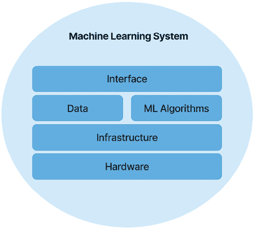

图 4.1：机器学习系统

构建机器学习系统的另一个主要部分是使所有这些垂直领域同步工作的能力。我们需要对 `MLOps` 采取全面的系统方法，确保所有垂直领域、组件和利益相关者能够共同工作，实现系统和项目的目标。例如，`Infrastructure` 团队在硬件和基础设施组件上协作，这些组件可以是本地的也可以基于云的。`Data science` 和 `machine learning engineering` 团队与 `software engineering` 以及 `DevOps` 协作，构建面向用户的组件，设置用于部署的 `CI/CD` 并确保系统按预期运行，并提供对用户有用的接口。`Software engineering`、`ML` 和 `DevOps` 还需要对整个系统的监控和可观测性进行协作。

## 机器学习系统用例

随着数据、信息和服务的可用性爆炸，我们在 B2B 和 B2C 领域都看到了机器学习应用的广泛使用和采用。无论是我们每天使用的搜索引擎，还是集成到电子商务网站和流媒体平台中的推荐系统，如果没有机器学习，要找到我们想要的内容将极具挑战性。例如，当我们使用 `Netflix` 或 `YouTube` 等流媒体平台时，我们开始看到基于观看历史的推荐，如果我们想调整这些推荐，我们可以做的是搜索特定项目并观看。随着时间的推移，这些新项目也会为我们收到的推荐提供动力。

智能消费设备是另一个持续受到机器学习辅助的领域。如 `Apple Home`、`Alexa` 或 `Google Home` 等智能个人助手使用机器学习来处理用户交互并做出响应。像在手机上打字这样微小的操作，通过预测输入也变得更加容易，预测输入是一种建议你接下来可能想说的机器学习系统。

尽管针对消费级应用的机器学习应用需求和用例正在增加，但很大一部分机器学习用例仍然处于企业世界。企业机器学习系统与我们在消费应用中看到的完全不同，它们往往有不同的需求。

谈到企业应用，在金融机构中，机器学习系统的主要用例之一是欺诈检测。历史欺诈交易数据中的异常可以用于训练以构建机器学习系统，用于预测任何实时交易是否为欺诈。

价格优化是另一种在企业中广泛使用的基于机器学习的系统，特别是在电子商务组织。它是估计最佳价格的过程，广泛应用于企业，特别是在电子商务组织。

## 理解机器学习系统

企业机器学习系统与我们在消费应用中看到的完全不同，它们往往有不同的需求。

谈到企业应用，在金融机构中，机器学习系统的主要用例之一是欺诈检测。历史欺诈交易数据中的异常可以用于训练以构建机器学习系统，用于预测任何实时交易是否为欺诈。

价格优化是另一种在企业中广泛使用的基于机器学习的系统，特别是在电子商务组织。它是估计最佳价格的过程，广泛应用于企业，特别是在电子商务组织。

## 研究与生产中的机器学习

价格优化是另一种在企业中广泛使用的基于机器学习的系统，特别是在电子商务组织。它是估计最佳价格的过程，广泛应用于企业，特别是在电子商务组织。

生产环境中的机器学习与研究不同。表 4.1 显示了五个主要差异：

| 特性 | 研究 | 工业 |
| --- | --- | --- |
| 目标和需求 | 使用基准数据集产生顶尖性能 | 目标和需求根据利益相关者而异 |
| 计算优先级 | 快速训练、高吞吐量 | 快速推理、低延迟 |
| 数据 | 通常是静态的 | 变化 |
| 公平性 | 通常不关注 | 必须考虑 |
| 可解释性 | 通常不关注 | 必须考虑 |

表 4.1：研究与生产机器学习方法差异概述

## 目标和需求

通常情况下，大多数研究项目只有一个利益相关者和一个目标，即模型性能。最终目标是开发一种模型以在现有基准数据集上获得最先进的结果。实现这些性能和结果是研究项目的唯一目标，无论系统的可扩展性或生产就绪如何。相反，在工业界，系统通常有多个利益相关者。每个人都有自己的需求和目标，这有时使得设计和开发满足所有需求的系统变得困难。

我们都听过一种常见的说法：大多数机器学习项目从未进入过生产环境。对于那些采用研究方法、主要关注点在于算法但忽略或漏掉系统生产化其他要求的项目来说，这一点尤为真实。例如，集成模型这种机器学习技术在研究项目中被广泛用于以生成尽可能优的结果，但由于其给系统增加了复杂性且提供的投资回报率（ROI）有限，在大多数项目中，它并不是生产环境中的首选方法。

## 计算优先级

项目的计算优先级在研究和工业界之间存在很大差异。在研究中，计算优先级和大部分精力都集中在模型开发和训练部分。在训练期间，我们可能会运行多个模型、进行超参数调优和迭代，以出一个性能良好的模型。此时，重点是模型开发部分，所有的努力和计算能力都应该投入到这里。而在生产环境中，一旦模型开发完成并开始服务，计算的优先级就是推理以及以可扩展的方式提供预测的能力。

## 数据

在研究和实验阶段，数据集通常是整洁且格式良好的。即使在现实世界中并非如此，我们也会经过数据清洗这一步骤。在研究中，常用的数据集在本质上是静态且一致的，这样它们就可以用于新架构、新模型和系统的基准测试。

在工业界，即使预先可用数据，它们也要混乱得多且不断变化。项目和业务需求的频繁变化可能需要定期更新数据。此外，实时工业数据还伴随着其他需求，如隐私和监管问题。

在研究中，大部分工作是使用历史数据完成的。在工业界，我们通常处理由用户、系统或第三方数据实时生成的数据。

## 公平性

在研究阶段，模型的公平性大多数情况下是事后考虑的，而不是主要目标，除非研究专门针对公平性研究。随着人们对机器学习及其应用场景意识的提高，公平性被认为是工业界任何机器学习系统的重要目标。如果系统对用户行为有任何直接影响（例如用于抵押贷款审批的机器学习系统或招聘聘用系统），这一点变得尤为重要。

当借助机器学习做出的决策可能影响某人的生活时，这一点尤为真实。例如，人的贷款申请因为算法根据其出生日期、种族或地址做出决定而遭到拒绝。如果使用的机器学习系统存在偏见，或者能够对简历中的任何微小细节产生负相关性，求职者的简历可能会被拒绝或排名靠后。


我们必须始终记住，机器学习系统并不是预测未来，而是从过去的数据中学习，并将这种学习与它们处理的新事物相关起来。现在，这带来了一个内在风险：如果数据包含偏见，生成的系统也可能学习这种偏见并将其整合到决策和预测中。

随着人们对机器学习系统中偏见意识的提高，许多机构正在关注这一点，并开展相关研究。然而，对于缓解对公平和公正性的风险（如算法偏见和歧视），还有很长的路要走。尽管如此，这种情况正在发生快速变化。

## 可解释性

机器学习的进步并不总是受到庆祝，机器学习和人工智能领域也有负面含义。人们倾向于认为人工智能会以某种方式统治世界，就像电影里那样。这使得人们对机器学习的能力敏感，因此在信任它之前想要正确理解系统的运行机制。

由于大多数机器学习研究没有考虑到这一点，研究人员没有动力研究模型的可解释性。相反，他们专注于特定研究项目的主要目标，除非该项目的主要目标本身就是模型的可解释性。然而，可解释性是工业界任何机器学习用例和实现的核心目标，使我们在未来的开发中能够灵活使用现有知识和系统。

现在，为什么理解机器学习系统是什么，以及学术界和工业界在机器学习方面的差异很重要呢？有很多公司和机构在学术之外进行机器学习的纯研究，但数量很少，因为大多数公司负担不起将其有限的资源投入到研究驱动的目标中。对于他们来说，所有的机器学习工作都需要产生短期的业务。

## 基于 MLOps 的机器学习系统实施路线图

通过经过良好思考和经过实践检验的框架启动机器学习项目，可以确保我们为项目的成功奠定基础。在本节中，我们将概述 `图 4.2` 中总结的实施路线图；它可以简化任何机器学习项目的开发，并促进系统的 ml 生产化。该路线图不是一种严格的方法，但它的目标是为系统的所有运行部分提供通用方向和指导，这些部分需要同步工作才能使机器学习系统成功。请参考下图：

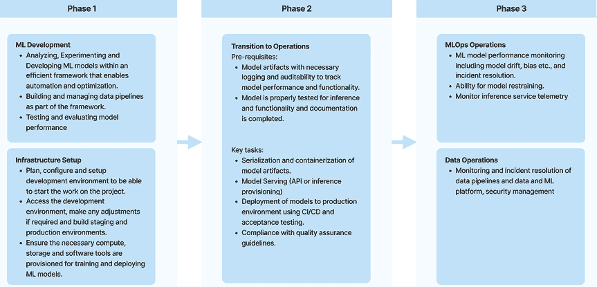

图 4.2：基于 mlps 的机器学习系统实施路线图

使用上述路线图，我们可以轻松地将任何项目从机器学习开发阶段过渡到 mlops 运营阶段。让我们详细了解所有三个阶段。

### 第一阶段：初始开发

第一阶段由两个部分组成：ML 开发和基础设施搭建。这是实现 mlops 框架的基石。在开始实现要求的分析和实验阶段之前，必须清晰生动地明确问题和解决方案。在这一阶段的第一部分，我们希望用一个高效的框架建立项目结构，该框架为我们标准化了可用性、自动化和优化。建立组件驱动的代码和仓库结构有助于我们快速方便地构建和管理数据流水线。不仅如此，该框架还允许我们从一开始考虑测试和评估模型。

在第二部分，我们考虑系统需求，以设计并实现一个健壮且可扩展的 mlops 框架。我们从选择实现 mlops 所需的存储、计算、推理和监控工具及基础设施开始。

当基础设施搭建完成后，我们应该配备必要的开发、测试和生产环境，以执行训练和测试任务。管理不同环境的最佳方法是在开发环境中训练模型，在暂存环境（`staging`）中测试模型，最后在生产环境中部署模型。当基础设施搭建完成且第一个机器学习模型完成训练、测试、序列化和打包后，mlops 框架的第一阶段就建立起来并验证了其健壮性。接下来，我们进入第二阶段的实施。

### 第 2 阶段：过渡运营

第 2 阶段涉及过渡运营。它包括对训练好的模型进行序列化和容器化，并为部署到不同环境做好准备。模型可以通过多种不同的形式提供；例如 `API`、数据或事件触发的接口，或者可以用于批量推理的独立构件。此外，有效的监控基础设施对于持续监控输入数据以及模型性能也同样重要。

此阶段也有一些前提条件。在第 1 阶段开发的模型在代码中应具备所有必要的日志、监控和审计能力。到第 2 阶段结束时，你将拥有在生产环境中部署并进行实时推理的打包模型。

### 第 3 阶段：运营

第 3 阶段是已部署模型的核心部分。在此阶段，我们根据模型漂移、偏差或其他指标监控模型的部署性能。根据模型性能，我们可以通过定期重新训练模型来启用持续学习，并启用告警和操作。随着该阶段的成功实施，我们能够以稳健、可扩展且安全的方式监控已部署的模型并对其重训练。

对于任何成功的机器学习项目，建议实施并管理这三个阶段。尽管，在某些情况下，第 1 和第 2 阶段就足够了，例如，当机器学习模型设计用于进行批量推理时，它可能只需要第 1 和第 2 阶段。通过实现这些里程碑并实施所有三个阶段，我们系统且可持续地为应用程序建立了一个稳健且可扩展的机器学习生命周期。

在下一节中，我们将讨论第 1 阶段的机器学习开发部分，并在后续章节中将介绍其他部分和阶段。

## 机器学习开发：Cookiecutter 数据科学项目结构

在机器学习和数据科学中采用敏捷实践复杂且具有挑战性，但从长期来看是有益的。当我们处理任何本质上具有探索性的机器学习项目时，使用 `Jupyter notebooks` 等工具在项目的探索阶段非常有帮助，但它们往往是混乱且无序的。这是一个问题，因为很难将代码转换为可重复的脚本并妥善地部署项目。`Cookiecutter data science` 提供了一个标准但可扩展的仓库结构，用于面向生产环境部署的数据科学和机器学习项目。它为项目仓库提供了结构，但仍然足够灵活，可以适应不同的用例。项目模板可以在 cookiecutter 的 GitHub 仓库中访问（`https://github.com/drivendata/cookiecutter-data-science`）。

### 什么是 cookiecutter

如果你还不知道，`cookiecutter` 是一个 Python 软件包，可以通过 `pip` 或其他包管理器安装，它允许我们创建和使用用于各种类型软件项目的模板。它是一个用于设置项目结构的命令行工具（`https://cookiecutter.readthedocs.io/en/1.7.2/README.html`）。

### 为什么使用 cookiecutter

并不是秘密，良好的实验分析不是一个线性过程，良好的分析是散乱探索、偶然性发现以及多次不同实验的结果，这些实验可能成功也可能失败，从而给出良好的结果。但在这些初始数据探索和实验之后，就是我们要开发和部署这个项目的阶段，在那个点，结构变得非常重要。

如果为项目采用如 `cookiecutter` 这样定义良好的标准项目结构，将易于理解项目。例如，和你一起启动项目的其他团队成员或以后加入项目的同事，可以轻松接入并理解项目结构，以及知道在项目的哪里找到特定内容，而无需查阅大量的文档。

> **备注**：需要注意的是，`cookiecutter` 项目/仓库结构并不是强制性的。如果团队或组织处理项目的方式略有不同，如果处理命名约定方面有不同的标准，或者项目有点非标准且不符合当前的结构，而 `cookiecutter` 旨在为项目提供一个标准化的起点，请随时根据你的特定需求对其进行调整。如果你不想使用 `cookiecutter` 库但喜欢项目模板的结构；并不是强制使用 `cookiecutter`；我们也可以手动创建并遵循相同的代码仓库结构。`cookiecutter` 提供的是易于访问模板，并使得多个数据科学和机器学习项目易于重复。

### 开始使用 cookiecutter data science

如果我们使用 `cookiecutter` Python 软件包，开始使用数据科学项目模板非常简单。在开始新项目之前，我们必须确保安装了所有前提条件，这些如下：

*   Python 2.7 或 3.5
*   `Cookiecutter` Python 软件包 >= 1.4.0：可以使用标准的 `pip` 包管理器安装。我们需要使用的安装 `cookiecutter` 包的命令是：

```bash
pip install cookiecutter
```

有关 `cookiecutter` 软件包的更多详情以及备选安装方法，请参考文档 `https://cookiecutter.readthedocs.io/en/latest/installation.html`。

一旦我们安装并准备好了前提条件，就可以开始开展新项目了，只需运行以下命令即可。它将带有所有所需的文件和文件夹设置完整的项目结构：

```bash
cookiecutter https://github.com/drivendata/cookiecutter-data-science
```

### 仓库结构

以下是来自 `cookiecutter` 的仓库结构。它将我们需要部署和扩展项目的组件划分为独立的段。该结构易于遵循和理解，我们将查看并讨论以下几个重要点：

*   `Makefile`：`Makefile` 用于处理数据、训练模型、评估等命令。根据你想要使用什么作为流水线的编排工具，我们可以坚持 `Makefile`，也可以用另一个配置文件来替换它，例如，如果我们使用 `Airflow` 进行编排，我们可以在这里定义 airflow DAG，而不是使用 `Makefile`。
*   `Data`：数据目录通常分为多个子目录，用于存储外部数据、原始数据、中间数据和处理后的数据。如果原始数据或外部数据不需要存储在目录中（例如直接从数据库或数据仓库获取），我们可以跳过这些子目录，只存储中间数据或处理后的数据。
*   `Model`：它是用于存储训练好的和序列化的模型或元数据的目录。
*   `Notebooks`：这是存储所有探索性和实验性笔记本的地方。
*   `References`：顾名思义，项目的任何参考材料或科学论文都可以存储在这里。
*   `Reports`：任何用于项目进行报告的报告、图表和图形。

### 项目结构

* `src`：整个仓库中最重要的目录是 `src`。它包含了项目的实际源代码。这里存储了供编排平台用于流水线、数据预处理、特征化、模型训练、评估等的脚本。子目录的优选结构如下：

    * `Data`：用于存储所有从原始格式处理到项目所需的最终格式的脚本。
    * `Features`：用于特征化以及将数据转换为所需特征的脚本。
    * `Models`：用于训练模型、生成预测和进行评估的脚本。
    * `Visualization`：可用于生成报告可视化图表的脚本。

```text
├── LICENSE
├── Makefile <- 包含 `make data` 或 `make train` 等命令的 `Makefile`
├── README.md <- 供该项目开发者的顶层 README。
├── data
│   ├── external <- 来自第三方源的数据。
│   ├── interim <- 经过转换的中间数据。
│   ├── processed <- 用于建模的最终、规范数据集。
│   └── raw <- 原始的、不可变的数据转储。
├── docs <- 默认的 Sphinx 项目；详情请见 sphinx-doc.org
├── models <- 已训练并序列化的模型、模型预测或模型摘要
├── notebooks <- Jupyter notebooks。命名规范为数字（用于排序）、作者姓名缩写以及用 `-` 分隔的短描述，例如 `1.0-jqp-initial-data-exploration`。
├── references <- 数据字典、手册以及所有其他说明材料。
├── reports <- 生成的 HTML、PDF、LaTeX 等格式分析结果。
│   └── figures <- 用于报告的生成的图形和图表
├── requirements.txt <- 用于复现分析环境的需求文件，例如使用 `pip freeze > requirements.txt`
├── setup.py <- 通过 `pip install -e` 使此项目支持 pip 安装
├── src <- 本项目中使用的源代码。
│   ├── __init__.py <- 使 src 成为一个 Python 模块
│   ├── data <- 下载或生成数据的脚本
│   │   └── make_dataset.py
│   ├── features <- 将原始数据转换为建模特征的脚本
│   │   └── build_features.py
│   ├── models <- 训练模型并使用已训练模型进行预测的脚本
│   │   ├── predict_model.py
│   │   └── train_model.py
│   └── visualization <- 创建探索性和结果导向性可视化的脚本
│       └── visualize.py
└── tox.ini <- 运行 tox 设置的 tox 文件；见 tox.readthedocs.io
```

来源：[`drivendata.github.io/cookiecutter-data-science/`](https://drivendata.github.io/cookiecutter-data-science/)

从上面的仓库结构可以发现，这是一个带有主观色彩的结构，即该结构基于通过经验得出的某些观点。它有助于维护项目的可靠性并改进协作。其中一些观点包括：

*   数据是不可变的：不要手动编辑原始数据。这确保了我们始终能够从源头重新创建数据。
*   万物皆有版本控制：所有代码、数据和模型应尽可能进行版本控制，以确保可复现性。
*   Notebooks 仅用于探索：使用 notebooks 进行探索性数据分析和报告，但生产级代码应移动到脚本。
*   模块化设计：将项目拆分为模块（数据、特征、模型、可视化），以提高可维护性和可测试性。

- 研究环境与生产环境中的机器学习具有不同的目标、优先级和约束。研究环境侧重于最先进的性能，而生产环境侧重于可扩展性、可靠性和业务影响。
- ML 系统的实施路线图包含三个阶段：初始开发、过渡到运维以及运行。这允许实现从实验到生产部署的迭代过程。
- 使用诸如 `cookiecutter data science` 模板之类的标准化项目结构有助于协作、可复现性以及最终的生产化转化。
- 将数据视为不可变数据、将 notebook 转换为脚本、将分析视为 `DAGs`，并避免在版本控制中放置密钥，是构建可靠且可维护的 ML 系统的最佳实践。
- 理解 ML 研究与生产系统之间的区别，并采用全系统方法，是开发成功的真实世界 ML 应用的关键。

## 关键术语

- **机器学习系统 (Machine learning systems)**：机器学习系统包含许多不同的垂直领域和层次，包括理解业务需求、初始实验及相应的基础设施、用于交付和更新模型的生产基础设施、用户与系统交互的接口、数据存储、包括前端和后端的应用程序代码、监控和跟踪能力等。
- **Cookiecutter**：一种命令行工具，用于从 `cookiecutters`（项目模板）创建项目，例如，从 Python 包项目模板创建 Python 包项目，或从数据科学 cookiecutter 模板创建数据科学项目。
- **数据仓库 (Data warehouse)**：数据仓库是一个信息中央仓库，可以对其进行分析以做出更明智的决策。数据从事务系统、关系型数据库和其他源流入数据仓库，通常具有定期性。这些数据随后作为下游系统（如 ML 或 BI 系统）的中央仓库。

# 第 5 章 数据准备与模型开发

## 引言

在本章中，我们将继续探索上一章讨论过的 `cookiecutter data science` 模板，最重要的是，我们将研究机器学习系统的不同组件是如何融入该模板的。我们还将研究此模板如何作为 `MLOps` 平台的构建模块，这将帮助我们自动化在机器学习项目生产化过程中需要执行的大部分手动工作。我们将从每个机器学习项目都应该添加的一些先决条件开始，这将帮助我们合理组织项目并提高代码质量。

本节的重点将是讨论有助于提升项目结构的实用技巧和原则，以及如何在项目仓库中实现这些原则，以改进整体 `MLOps` 结构，并防止机器学习项目仓库中的代码出现无结构且难以理解的情况。

作为一名丰富的机器学习工程师或数据科学家，如果你已经熟悉数据分析、实验以及构建机器学习模型，本章对你仍然很有用，因为我们将利用 `cookiecutter` 模板来设计工作并开发模型。

## 结构

在本章中，我们将讨论以下主题：

- `MLOps` 代码仓库最佳实践
- 数据溯源
- 探索性数据分析
- 数据准备
- 模型开发
- 模型评估
- 模型版本控制

## 目标

在本章结束时，你将理解如何使用 `cookiecutter` 模板在数据准备和模型开发阶段合理组织项目并提高代码质量。

### MLOps 代码仓库最佳实践

在 `MLOps` 代码仓库工作（从构思到部署和监控）是耗时且复杂的。随着项目规模的扩大，其复杂性也随之增加。一些 `MLOps` 最佳实践有助于标准化代码并确保整个过程的可复现性。

- **使用预提交钩子 (Use pre-commit hooks)**：当我们编写代码时，随着时间的推移，我们倾向于提交次优的代码或出现问题。有很多易用的库可以帮助尽早发现问题。这一最佳实践符合 `MLOps` 的更广泛目标。我们将查看 `pre-commit` 钩子的一些示例。
- **为每个训练模型附上 Git 哈希值 (Attach a Git hash to each trained model)**：为了更好地跟踪、监控和调试，请确保为每个训练过的模型附上 Git 哈希值。这确保了模型是使用特定的代码训练的。不仅如此，这种最佳实践还有助于在代码和模型版本之间建立清晰的谱系，这对透明度和问责制至关重要。正如我们在后续章节中看到的，一旦使用 `Github Actions`、`Airflow` 或任何其他 CI/CD 平台合并新代码并训练模型，将 Git 哈希值作为元数据添加并为代码标记版本始终是一个好做法。
- **使用单体仓库 (Use a monorepo)**：对于单个机器学习项目使用单体仓库意味着拥有一个包含端到端流水线的单一项目仓库，包括数据准备、数据处理、训练、评估和部署的代码。这通过将所有内容放在同一个地方，极大地降低了项目组件之间的复杂性。它也让代码共享变得更容易，并简化了依赖管理。


- **数据版本控制**：如我们所知，数据是任何机器学习源代码的主要部分，应被视为如此。重现模型是至关重要的，用于该特定运行的数据状态非常重要。我们可以使用 `Data Version Control (DVC)` 等工具来实现这一点并对用于训练的数据进行版本控制。关于 `DVC` 的细节可以在网站 [`dvc.org`](https://dvc.org) 上找到。`DVC` 与 `Git` 无缝集成，使其成为机器学习项目中数据管理的实用选择。

- **数据质量**：这可能是最不直观的一点。如果我们使用 `DVC` 且数据现在是仓库代码的一部分，那么在数据生成或存储方面也可能存在错误。我们可以尽可能地自动化，但它们并不是万无一失的。在循环中引入人类对数据进行合理检查，或者在准备之后、模型训练之前检查数据质量的代码，可以避免以后过程中很多麻烦。然而，投入一小部分的时间来手动检查数据或编写执行此类检查的代码，将在未来带来巨大的回报。

- **监控模型**：许多时候，考虑监控的团队会分为两类：要么团队由于复杂性或带宽限制决定不投入任何时间让其运行；要么决定全投入并寻找一个端到端的平台。根据项目和团队的成熟度，始终可以采取一种折中方案。即使在监控之旅程的开始，我们只是手动标记几个预测结果并更新一个用于跟踪的指标，它也可以为获得合理规模的监控提供一种极佳的方法。

- **按定期周期重训练模型**：如我们所知，定期的重训练有助于模型适应变化的数据分布并随着时间的推移保持性能，这对于确保机器学习应用的可靠性至关重要。一种常见的初始方法是开发一个指标阈值来触发重训练，但这可能非常复杂，并且可能需要构建自定义系统来识别指标变化。另一种简单且有效的替代方案是设置一个定期的时间间隔（例如每月一次）进行重训练。这样更容易设置和维护。确切的周期取决于模型的类型和新鲜度要求，这些要求会随模型而异。还有其他指标可以帮助确定合适的重训练频率，例如数据漂移、概念漂移或问题领域的变化。我们将在书后的章节中深入探讨这一主题。

- **机器学习项目的持续集成 (CI)**：有时，对于机器学习等实验性领域的项目，当我们从初始探索转向生产就绪的代码时，我们可能会忘记或跳过为项目编写任何测试用例的覆盖率代码。这可能会导致我们在后期花费大量的时间和精力来修复错误。我们至少应该从为代码编写单元测试开始。这种测试应该在每次提交（`commit`）和构建时运行，类似于软件工程中使用 CI 工具的方式。一个很好的开始方法是进行端到端测试，然后是能够善覆盖项目代码实现的更具体的测试。持续测试和集成有助于在开发早期发现问题，促进团队成员之间的协作，并确保新的代码更改不对模型性能产生负面影响。

这些最佳实践将帮助我们按照需求编写和结构化机器学习项目，使其可扩展、可复现、可部署、可重训练且可扩展。

在下一节中，我们首先查看如何向现有的代码模板中添加 `pre-commit hooks`，并利用它们不仅在项目启动时，而且在项目的整个代码生命周期内强制执行这些最佳实践。

## pre-commit hooks

`pre-commit hooks` 是一组脚本，它们在每次 `Git` 提交之前执行，并对提交的代码强制执行某些行为或标准。这帮助我们即使随着时间的推移忘记了遵循标准，也能实施或遵循这些标准和规则。我们会得到提醒和提示来修复它。这有助于维护代码的一致性、提高代码质量并防止常见的编码错误，为项目的整体成功做出贡献。

为了实现 `pre-commit hooks`，我们可以选择 `pre-commit` 框架，这是一个开源框架。它为许多编程语言提供了 `pre-commit` 钩配方。更多细节以及实现 `pre-commit hooks` 的指令可以在网站 [`pre-commit.com`](https://pre-commit.com) 上找到。

以下是建议添加到每个机器学习项目中的一些最常用的推荐 `pre-commit hooks`，以确保所有内容都以标准方式格式化：

- `check-yaml`：它验证所有 `YAML` 文件的语法。如果你在项目中使用 `YAML`，请确保向项目添加此钩，以确保错误的 `YAML` 语法不会被提交到仓库。

- `end-of-file-fixed`：它确保文件仅以换行符结束。这是那些看似微小但始终是良好的最佳实践之一。

- `check-ast`：它在文件提交到仓库之前确定其是否可以解析为正确的 `Python` 代码。

- `Trailing-whitespace`：它默认修剪末尾空格，但它足够灵活，如果我们需要，可以自定义以修剪任何特定字符。

- `black`：它是最好且行业标准的 `Python` 代码格式化工具之一，应该存在于每个 `Python` 项目中。

- `mypy`：它是一个 `pre-commit` 钩，用于强制 `Python` 的静态类型检查。

- `isort`：它提供了一个实用工具，在每个 `Python` 文件提交到仓库之前对 `Python` 导入进行排序。

实现和使用这些 `pre-commit` 钩库非常简单。它需要安装 `pre-commit` 库，然后在仓库中创建一个名为 `.pre-commit-config.yaml` 的文件，该文件详细说明了需要从哪个仓库下载钩子、使用的钩子修订/版本以及关于钩子的详细信息。以下是在项目中设置 `pre-commit hooks` 的步骤：

从安装 `pre-commit` 库开始：

```bash
pip install pre-commit
```

一旦安装完成，我们创建一个名为 `.pre-commit-config.yaml` 的文件并在文件中添加以下内容：

```yaml
repos:
 - repo: https://github.com/nbQA-dev/nbQA
  rev: 1.5.3
  hooks:
    - id: nbqa-black
    - id: nbqa-pyupgrade
    - id: nbqa-isort
- repo: https://github.com/timothycrosley/isort
  rev: 5.10.1
  hooks:
    - id: isort
      args: [ --profile, black ]
- repo: https://github.com/psf/black
  rev: 22.10.0
  hooks:
    - id: black
- repo: https://github.com/pre-commit/mirrors-mypy
  rev: v0.991
  hooks:
    - id: mypy
      args: [ --ignore-missing-imports, --pretty, --show-error-codes ]
- repo: https://github.com/asottile/pyupgrade
  rev: v3.3.0
  hooks:
    - id: pyupgrade
- repo: https://github.com/pre-commit/pre-commit-hooks
  rev: v4.3.0
  hooks:
    - id: check-ast
    - id: check-case-conflict
    - id: check-docstring-first
    - id: check-json
    - id: check-merge-conflict
    - id: debug-statements
    - id: check-symlinks
    - id: check-yaml
      args: [ --unsafe, --allow-multiple-documents ]
    - id: detect-private-key
    - id: end-of-file-fixer
    - id: requirements-txt-fixer
    - id: trailing-whitespace
      args: [ --markdown-linebreak-ext=md ]
```

一旦准备好文件，为了确保钩子已安装，运行：

```bash
pre-commit install
```

一旦完成后，从那时起提交的所有内容，这些钩子辅助库，将确保我们不会遗漏任何重要内容。

现在我们已经有了良好的代码结构并部署了 `pre-commit hooks`，我们将确保在编写和提交结构化代码时遵循最佳实践。我们可以开始查看项目的后续阶段，即数据处理、分析和模型准备实验。

## 数据源

在本节及后续章节中，我们将从 `MLOps` 的角度查看机器学习系统的每个组件，并观察我们如何设计每个组件以便它们良好结合，形成端到端的系统。

图 5.1 代表了第一章：入门 `MLOps` 中的组件流，此工作流的第一个组件是数据源，我们将从这里开始。请参考下图：

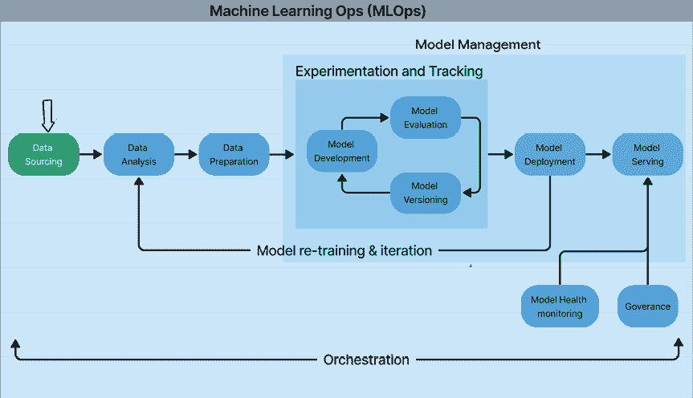

图 5.1：基于 MLOps 的机器学习项目生命周期中的数据源阶段

定义良好的数据集极其重要。为了在深入分析之前确保拥有这些数据，我们需要确保数据源定义良好、我们可以访问所需数据并理解数据格式。

如果这些是第三方数据，或者这些数据以某种方式受到版权或其他法律标准（如个人身份信息 `PII` 或通用数据保护条例 `GDPR`）的保护，我们可能还需要考虑这些数据是如何收集和使用的。我们是否拥有使用这些数据的适当许可，或者我们是否需要与数据收集者或提供者协商新的许可协议以合法地使用这些数据？

一旦回答了所有的业务和法律问题，在启动项目之前，我们应该回答的另一个后续技术问题是：是否有足够的数据用于模型的训练、测试和评估。

数据质量是影响模型性能的另一个主要因素。我们计划用于实验的数据集在数据质量方面可能无法达到标准。如果我们盲目地信任数据集，可能会发现，无论我们如何努力提高模型质量，它在新数据上的表现都很低。

在我们从数据源为模型实验准备数据之前，有五个方面需要考虑：数据的可访问性、规模、可用性、可理解性和可靠性。

一个良好的实验数据集应该是包含可用于建模的高质量信息，对我们想要实现的目标具有良好的覆盖和代表性，并且反映了模型投入生产后我们可能接收到的真实数据。数据集的其他重要特征是：它们应该是无偏的数据，具有一致的标签，并且足够大以允许泛化。

在第一个组件“数据溯源”中，我们将研究两个子组件：

* 数据源
* 数据版本控制

## 数据源

数据可以存储在不同的数据格式中，并在多个数据存储层次和平台上。

数据科学团队获取数据的常用方式是存储在关系型数据库管理系统（`RDBMS`）、数据仓库、数据湖等数据存储中，其中来自组织内部或第三方的来源的数据被汇总在一起，使用提取、转换、加载（`ETL`）或提取、加载、转换（`ELT`）进行预处理，并存储用于数据分析、数据实验、报告等。

> **注意**：`ETL` 或 `ELT` 是数据工程过程，允许我们从内部或外部资源提取数据、转换/处理数据、将其加载到数据存储中并供不同的团队和利益相关者使用。

数据的另一个来源是非关系型数据，可以是简单的电子表格数据集或文档存储数据库；数据湖也可以存储非关系型数据。

一旦准备好项目的数据溯源组件，机器学习系统的下一个关键要素是数据版本控制，特别是数据从数据源获取并作为 `MLOps` 项目数据流水线的一部分进行处理之后。我们将在下一节中研究数据版本。

## 数据版本控制

处理数据版本的最简单方法是将数据也视为源代码的一部分，并像控制源代码一样对数据进行版本控制，即使用 `Git`。现在我们知道 `Git` 在存储我们可能拥有的数据量方面的局限性。这就是数据版本控制（`DVC`）的用场；它是一个精确完成此任务的开源工具。

`DVC` 提供箱箱用的数据版本控制。我们可以构建 `DVC` 流水线来处理和版本化数据。这种特定版本的数据可以用于训练并与训练后的模型版本关联。例如，假设我们构建了一个 `DVC` 流水线来处理数据，处理后的数据被标记为 `v1`。我们可以使用这个版本的数据来训练模型并将其标记为 `m1`。现在，我们可以将 `v1` 版本的数据关联到 `m1` 模型。这将易于跟踪使用哪个版本的数据训练了哪个版本的模型。这样，我们就能维护所用数据和正在训练模型的一致性和血缘。它还为我们提供了任何时候审核模型和相应数据的方法。

假设系统中已安装了 `DVC`，可以在 cookiecutter Git 项目内部运行以下命令将其添加到 cookie cutter 项目模板中：

```bash
dvc init
```

这将创建以下内部文件，这些文件应该提交到 `Git` 仓库：

* `.dev/.gitignore`
* `.dev/config`

一旦我们将文件提交到 `Git` 仓库，下一步是能够准备数据以用 `DVC` 进行跟踪。从原始数据到中间阶段再到最终阶段处理代码需要放在 `src/data/make_dataset.py` 文件夹下。实际数据需要被版本化并存储在 `data` 文件夹下。脚本应该能够从源（无论是原始数据还是数据存储）获取数据，对其进行处理，并创建模型代码可用的数据集。

一旦数据存储在 `data` 文件夹下，我们就可以使用 `dvc add` 命令开始跟踪文件。假设文件名为 `data.xml`，可以使用以下命令：

```bash
dvc add data/data.xml
```

这将指示 `DVC` 在 `data` 文件夹下创建一个名为 `data.xml.dvc` 的新文件；该文件并不存储实际数据，而是存储数据的元数据。它可以轻松地在 `Git` 中进行版本控制。当我们运行 `dvc add` 命令时，后台发生的情况是将实际数据移动到项目的缓存 `.dev/cache`，并通过哈希值将其链接回工作区。这个哈希值存储在 `data.xml.dvc` 文件中。

实际数据也可以并且推送到远程后端。`DVC` 支持许多远程存储类型，其中 `AWS S3`、`Azure Blob Storage` 和 `Google Cloud Storage (GCP)` 是最常用的。可以添加远程存储并使用以下命令从远程存储推送和拉取数据：

```bash
dvc remote add -d storage s3://mybucket/dvcstore
dvc push
dvc pull
```

在这种结构中，我们假设数据集以文件形式存储在文件夹中，但并非总是如此。通常，初始数据甚至最终格式的数据存储在数据库、数据仓库或数据网格中。在这些情况下，建议从数据库查询数据，如果需要则进行处理，并将最终处理后的数据存储在 `data` 文件夹中。另一方面，也可以从数据库读取数据，将其存储在 `data/raw` 文件夹中，然后进行处理将其引入 `data/processed` 格式。有多种方法到达那里。结果是，处理数据的最终版本被提交到 `DVC` 和 `Git` 中，用于模型训练，以实现模型和数据一一对应。

## 探索性数据分析

一旦数据源理顺，根据 `MLOps` 工作流，下一步是数据分析。数据分析从探索数据开始以理解其含义。在机器学习的这个组件中，数据科学家和机器学习工程师分析可用数据的统计属性。目标是确定数据能否解决业务问题。这里我们必须与业务利益相关者保持密切联系和迭代。

在 `MLOps` 的背景下，它是为机器学习生命周期探索、共享和准备数据的迭代过程。它需要创建可重复、可编辑和共享的数据集、表格和可视化结果。这些探索通常从笔记本开始，无论是本地的 `Jupyter notebook` 还是云端的 `Google collab` 等。在 cookiecutter 项目模板中，我们有一个用于存储和管理这些笔记本的 `/notebooks/` 文件夹。

这些笔记本（`notebooks`）应严格用于数据分析，而不应作为自动化机器学习流水线的一部分。一旦我们从初始分析中获得了大部分可以用于流水线的优质代码，建议将这些代码从笔记本移动到符合预期文件夹结构的正正式脚本中，这样我们可以保持一致性，并且这些脚本可以在流水线中使用。请参考下图：

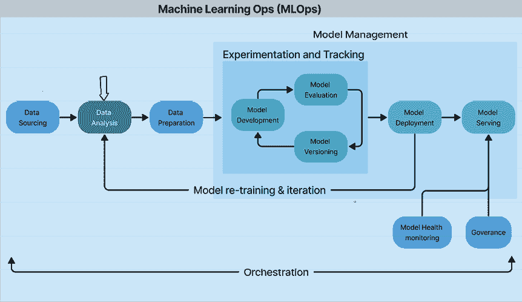

图 5.2：基于 MLOps 的机器学习项目生命周期中的探索性数据分析阶段

这种探索性数据分析的一个常见结果是得出一些共同的前提条件，这些条件告诉我们数据是否足够新或足以用于模型的训练和重新训练。此外，这些分析可以在连续自动训练运行期间用于流水线，以确保分析显示数据可用且适用于下一轮训练时，我们正在运行训练流水线。

### 数据准备

数据准备正如其名称所示（见图 5.3），是第三部分，我们为实验或模型开发运行准备派生数据。数据准备可能包含两个子组件：

* **派生数据准备**：这些代码段或脚本将把我们的数据从数据集中的初始格式转换为模型开发或特征工程所需的向量或嵌入（`embeddings`）。
* **特征工程**：特征工程是将原始数据点转换为特征向量的过程。它包括对特征进行概念化和决策（可能在探索性数据分析期间），然后创建代码脚本将整个数据集转换为一组用于模型开发的特征。特征工程是一个创造性过程，数据科学家或机器学习工程师在此应用他们的想象力、直觉和领域知识来创建一组用于模型训练的特征。

特征工程是一个宏大的的话题，超出了本章和本书的范围。在 `MLOps` 的背景下，特征工程是另一个步骤，包含需要执行的脚本以将原始数据转换为模型开发的数据。请参考下图：

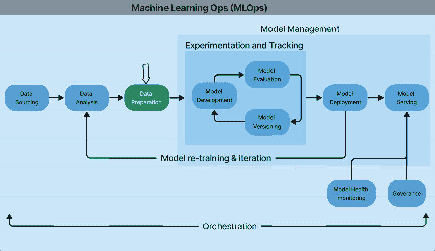

图 5.3：基于 MLOps 的机器学习项目生命周期中的数据准备阶段

处理数据并为模型开发创建特征集的代码需要在 `src/features/build_features.py` 文件夹下。实际特征数据可以使用 `DVC` 进行存储和版本控制（步骤与我们在数据版本控制部分相同），或者将这些特征存储在特征存储（`feature store`）中。

> **注意**：是否使用特征存储的决策在不同项目和团队之间存在显著。它还取决于基础设施的成熟程度，因为特征存储的使用和维护会引入显著的设施复杂性。

数据准备的一些最佳实践如下：

* **保持代码、模型和数据同步**：特征提取代码的版本必须与模型版本以及构建模型的数据保持同步。这三者必须同时部署或回滚。每当在生产环境中加载模型时，检查这三个元素是否同步（它们的版本相同）是有用的。


* 隔离特征提取代码：特征提取代码必须独立于支持模型的其余代码。应该能够在不影响其他特征、数据处理流水线或模型创建方式的情况下，更新负责每个特征的代码。唯一的例外是大量批量生成许多特征时，例如在单次编码（`one-shot encoding`）和词袋模型（`bag-of-words`）。
* 记录特征值：运行实验时记录提取的特征值。可以使用 `MLflow` 来此，并记录每个实验运行的值。我们将在下一节中通过代码查看如何使用 `MLflow`。

### 模型开发

如图 5.4 所示，模型开发是开发任何机器学习系统的下一步。它属于 MLOps 生命周期中的实验和跟踪组件，可以由多轮开发、评估和版本控制组成。

在涉及模型训练时，数据科学家使用准备好的数据探索多种算法和超参数配置。目标是确定并产生符合所需标准且性能优于设定的阈值指标的最佳模型。

在 MLOps 中，该组件利用流行的开源库来训练训练和提高模型性能。当我们开始模型开发部分时，我们假设开发策略、目标预期性能水平、要跟踪的性能指标以及其他 ML 决策已经做出。我们纯粹是开始构建用于模型开发/训练的脚本，并在 `MLflow` 或类似的实验平台中跟踪这些指标。请参考下图：

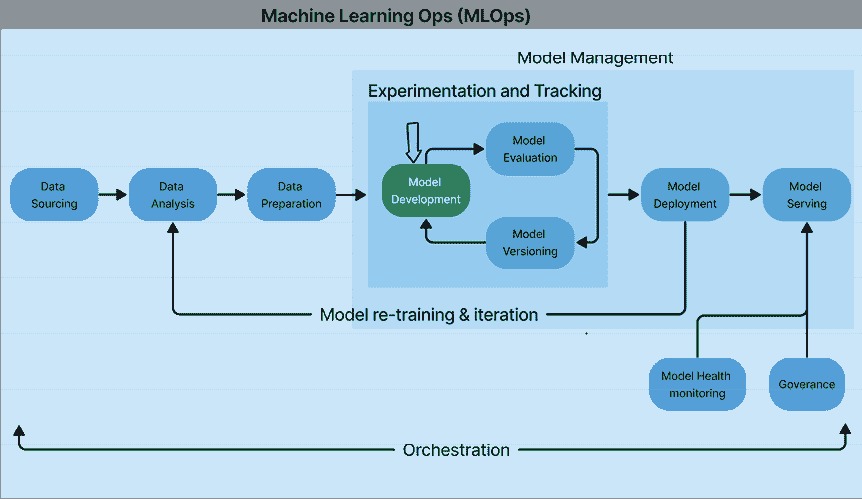

图 5.4：基于 MLOps 的机器学习项目生命周期中的模型开发阶段

训练模型的代码需要在 `src/model/train_model.py` 文件夹下。我们不会涵盖训练模型的代码，假设这些代码已经由数据科学家或机器学习工程师已知并完成。我们将涵盖如何向训练代码中添加 `MLflow` 客户端，以开始跟踪更改。让我们假设我们为模型使用 `LightGBM` 算法：

```python
# 脚本的其他导入
import mlflow
import mlflow.lightgbm

## 启用自动日志
mlflow.set_tracking_uri('http://yourdomain.com/mlflow')
mlflow.lightgbm.autolog()

# 加载训练数据
mlflow.set_experiment('LightGBMClassifier')

def main():
    with mlflow.start_run() as run:
        # 训练模型
        # 在运行中记录一些自定义参数
        mlflow.log_params({
            "model_name": "LGBMClassifier",
            "max_depth": 5
        })
        # 记录一些自定义指标
        mlflow.log_metrics({
            "key1": value1,
            "key2": value2
        })
        print("Run ID:", run.info.run_id)

if __name__ == "__main__":
    main()
```

一旦手动执行此代码或作为重新训练的一部分，它会将运行记录到 `MLflow` 服务器。我们可以访问服务器查看实验并下载模型文件。上述代码自言自懂，但重要的部分是：

* 第 2-3 行：代码开始导入 `mlflow` 和 `lightgbm`。
* 第 5 行：这是我们设置 `MLflow` 服务器跟踪 URI 的地方，服务器在此运行并用于跟踪和记录。
* 第 6 行：这是我们启动自动日志的地方。自动日志默认也会记录模型，因此我们不需要专门将模型记录到 `MLflow`。
* 第 8 行：设置需要跟踪的所有内容的 `MLflow` 实验。
* 第 10 行：这是每个被 `MLflow` 跟踪的实验的第一行。这是我们指示开始 `MLflow` 运行的方式。
* 第 13 行：展示如何向 `MLflow` 记录参数。
* 第 18 行：展示如何记录自定义指标。这在我们进行日志记录和持续监控时非常有用。可以使用指标记录来记录想要跟踪的随机指标。

### 深入研究 MLflow 工作流

正如上面的示例所示，`MLflow` 为运行提供了手动记录参数或指标的选项，但如果我们需要手动跟踪所有内容，提取所有参数和指标很快就会变得繁琐。这就是为什么 `MLflow` 也为许多流行的机器学习框架暴露了自动日志，包括：

* `sklearn.autolog()`
* `tensorflow.autolog()`
* `keras.autolog()`
* `xgboost.autolog`
* `lightgbm.autolog`
* `pytorch.autolog`

`autologging` 类会自动记录模型的参数、其训练指标，以及在可用情况下的如早停（`early stopping`）、轮数（`epochs`）等拟合参数。对于 `sklearn`，`autolog` 类还会记录使用网格搜索的超参数调优试验结果或流水线对象（`pipeline objects`）的结果。自动日志类默认还会记录模型，这允许我们跳过使用 `log_model()` 手动记录模型的步骤。

在该组件结束时，我们应该已经完成了模型训练，并准备好部署服务，但在那之前，我们还需要处理其他几个组件。下一个是模型评估，用于评估结果生成的模型性能是否高于阈值指标，并是否可以用于生产环境。这就是我们接下来要关注的内容。

## 模型评估

在模型进行版本化和部署之前，如下图 5.5 所示，它会经过评估和验证步骤，以确保其性能高于估计的基准水平。任何在生产环境中运行的模型都必须经过仔细且持续的评估。请参考以下图：

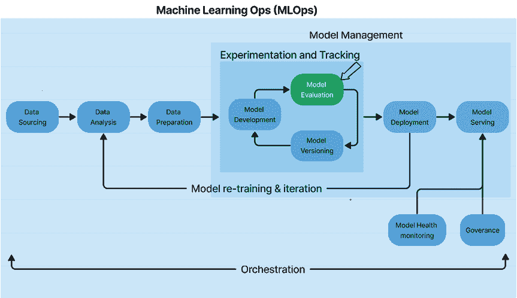

图 5.5：基于 MLOps 的机器学习项目生命周期中的模型评估阶段

根据模型的应用领域以及组织的业务目标和限制，模型评估可能包括以下任务：

* 记录并比较训练数据与生产数据分布的主要属性。通过比较训练数据和生产数据中样本、特征和标签的统计分布，可以检测出分布偏移（`distribution shift`）。两者之间存在显著差异表明需要更新训练数据并重新训练模型。
* 评估模型性能。在模型部署到生产环境之前，必须在外部数据（即未用于训练的数据）上评估其预测性能。外部数据必须包含来自生产环境的历史示例和在线示例。在实时在线数据上评估的上下文应紧密类似于生产环境。

评估模型的代码可以包含在训练脚本本身，也可以作为一个完全独立的脚本。如果是训练脚本的一部分，则可以添加到 `src/model/train_model.py` 中；否则，如果评估脚本是分开的，可以在 `src/model/evaluate_model.py` 文件夹下创建包含评估代码的文件。输出或其他任何其他指标都可以使用我们在上一节中讨论的自定义指标日志记录到 MLflow 中，这些指标可以在不同版本的模型之间进行比较，以便跟踪随时间变化的性能。

## 模型版本化

模型版本化是下一个重要组件，有助于我们维护在不同环境中运行的当前模型的可追溯性和血缘，特别是当我们自动重新训练模型时。它是 MLOps 工作流中实验与跟踪子系统的一部分，如图 5.6 所示：

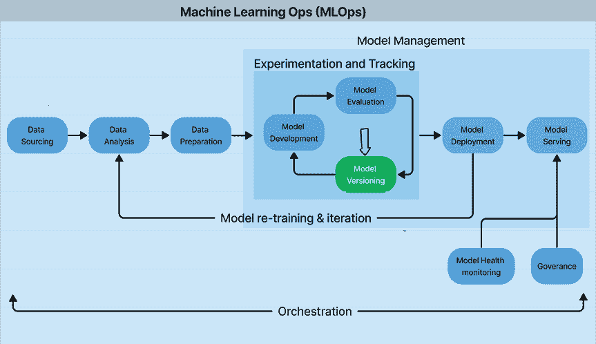

图 5.6：基于 MLOps 的机器学习项目生命周期中的模型版本化阶段

MLflow 的模型注册组件使我们能够管理模型版本。使用模型注册有三种方法：

* 使用 UI，我们可以手动注册模型。
* 使用 API，我们可以通过编程方式注册模型。
* 使用 SDK，我们可以在训练代码中注册模型。

MLflow 的模型注册组件使我们能够管理模型版本。使用模型注册有三种方法：

* 使用 UI，我们可以手动注册模型。
* 使用 API，我们可以通过编程方式注册模型。
* 使用 SDK，我们可以在训练代码中注册模型。

* 使用 `MLflow` 分阶段进行模型版本控制允许从开发到生产环境跟踪模型。
* 遵循 `CI/CD` 和基础设施即代码（`infrastructure-as-code`）等 MLOps 原则来实现机器学习生命周期自动化。

## 术语

* 提交前钩子 (`pre-commit hooks`)：`pre-commit hooks` 是库或脚本，用于在代码提交到代码仓库之前自动检查和清理代码。它们在向 `Git` 提交更改时执行。
* 数据版本控制 (`DVC`)：`DVC` 是一个用于数据、机器学习模型和实验的免费开源、跨平台版本系统。它旨在使机器学习模型易于共享、实验具有可复现性，并跟踪数据和流水线的版本。`DVC` 运行在 `Git` 仓库和云存储之上上。
* 个人身份信息 (`PII`)：`PII` 是在单独使用或与其他相关数据结合使用时可以识别个体的信息或数据，例如姓名、社会保障号码、出生日期等。
* 通用数据保护条例 (`GDPR`)：`GDPR` 是欧盟（EU）和欧洲经济区（EEA）关于信息隐私的法规。它还监管个人数据向欧盟和 EEA 之外的传输。
* 关系型数据库管理系统 (`RDBMS`)：关系型数据库管理系统 (`RDBMS`) 是基于数据关系模型的数据库系统。
* 特征工程 (`Feature engineering`)：特征工程是从原始数据中提取特征的过程。
* MLflow：`MLflow` 用于管理从初始模型开发到部署以及后续直到退出的整个机器学习生命周期。

加入我们书籍的 Discord 空间

加入书籍的 Discord 工作区以获取最新更新、优惠、全球科技动态、新发布以及与作者的面对面会议：

[`discord.bpbonline.com`](https://discord.bpbonline.com)


# 第 6 章 模型部署与服务

## 引言

在本章中，我们将探讨机器学习项目生命周期的下一步：我们准备的模型进行部署，以及如何提供服务供 API 调用。重点将是这些部署和服务服务的组件如何与 MLOps 相衔接。

在探索改进机器学习和 MLOps 实践的项目原则和结构方面，我们已经迈出了一步。我们将研究机器学习项目如何部署、针对不同的部署和服务原则我们拥有哪些选择，以及部署模式。

## 结构

在本章中，我们将讨论以下主题：

* 模型部署
    * 静态部署
    * 边缘设备上的动态部署
    * 服务器上的动态部署
* 部署策略
    * 单次部署
    * 静默部署
    * 金丝雀发布 (`Canary deployment`)
    * 多臂老虎算法
* 模型推理与服务
    * 模型服务的模式
    * 现实中的模型服务

## 目标

在本章结束时，你将理解可以采用哪些部署策略，以及如何提供模型供终端用户、应用程序或机器消费。

## 模型部署

在 第 5 章：数据准备与模型开发中准备好、评估并版本化的模型现在已准备好进行部署。模型部署是使模型供终端用户或下游系统使用的过程。模型可以通过批、流式或在线服务进行部署。我们从这三中选择的方法取决于特定的用例及其需求。一旦模型完成部署，就会对这些模型进行服务。在模型服务/推理中，系统接受来自终端用户的查询，并将其转换为特征向量。模型服务系统接受来自终端用户的查询，将其转换为特征向量。系统随后使用这些向量进行预测和评分。模型部署，如下文所示 图 6.1 所示：


图 6.1：基于 MLOps 的机器学习项目生命周期

机器学习模型可以利用各种方式部署供消费：

* 集成在安装软件包中的静态部署
* 用户设备上的动态部署
* 远程服务器上的动态部署
* 通过流技术

## 静态部署

静态部署机器学习模型类似于传统的软件部署。在这种情况下，准备了整个软件的可安装二进制文件，模型作为运行时可访问的资源。静态部署有许多优势，包括：

* 软件直接访问模型，从而获得更快的执行速度。
* 系统无需将数据上传到运行预测的外部系统或服务器。
* 不依赖于外部系统，这意味着终端用户或系统不需要在线处理任何数据。
* 软件供应商可能不需要担心维护模型，因为这一责任由用户承担。供应商确实需要提供模型的更新和支持，但更新的最终责任在用户手中。

然而，静态部署也有某些缺点。一个主要的担忧是机器学习代码与应用程序代码之间缺乏清晰的分，因为大多数系统与应用程序代码密切耦合。这使得静态部署变得复杂且具有挑战性，因为如果我们想升级或更改模型，通常意味着我们需要升级运行在用户设备上的整个应用程序。此外，如果模型对预测有特定的计算需求（例如 GPU 或专用基础设施），该过程将变得更加复杂，因为我们需要确保用户设备满足这些需求。这反会导致潜在的局限性和复杂性。

## 边缘设备上的动态部署

边缘设备上的动态部署与静态部署过程有重叠。这些设备是由用户控制的边缘设备。我们对这些设备的控制有限，且模型运行在这些边缘设备上。然而，关键区别在于，在动态部署中，模型并没有包含在应用程序的二进制代码中。这实现了更好的关注点分离，因为可以推送模型更新而无需更新运行在用户设备上的整个应用程序。它还允许我们在应用程序中包含选择逻辑，并根据用户边缘设备上可用的基础设施和计算资源下载相应的模型。

以下是将动态部署作为应用程序的一部分进行规划的某些技术方案：

* **模型参数部署**：在这种技术中，模型文件中仅包含最终确定的参数，而在用户设备上则安装运行模型的环境。诸如 `TensorFlow` 等轻量级机器学习包运行在用户设备上，并使得这种方法成为可能。
* **序列化对象部署**：在这种技术中，训练好的机器学习模型被封装成序列化格式的文件，该文件包含一个运行时应用程序可以反序列化的序列化对象。这种技术消除了在用户设备上进行推理时运行时环境的需求，因为所有依赖项都随着模型对象一起被反序列化，并且运行模型的应用程序可以反序列化并使用该模型。然而，这种方法会导致每次我们发布更新时都会产生重大的更新，这在同时处理大量用户时可能会出现问题。文件大小方面还有另一个局限性；序列化文件可能会变得很大，这对于存储容量有限的设备来说是一个问题。一些常见的序列化格式有 `Pickle` 或 `Open Neural Network Exchange` (`ONNX`)。
* **基于浏览器的部署**：今天，我们拥有的几乎每个设备（无论是桌面电脑、手机，甚至是大多数集成边缘设备）都可以访问浏览器。`TensorFlow.js` 等框架允许我们运行兼容 `JavaScript` 版本的流水线，可以使用 `JavaScript` 环境环境在浏览器内训练和执行模型。它还可以检测并利用设备上的可用资源。如果桌面电脑配备了 `GPU`，`TensorFlow.js` 还可以利用它加速处理。

在用户设备上进行动态部署的主要优势是用户调用模型的速度快。这也消除了运行和维护服务器或集群基础设施的需求。

动态部署也有一些缺点，特别是在模型更新期间。序列化对象可能很大，且用户在更新期间可能离线或可能禁用未来的更新。这可能导致用户使用不同的模型版本，使服务器端应用程序的升级和维护复杂化。此外，将模型部署在用户设备上会使其暴露于第三方分析和逆向工程模型的尝试。另一个缺点与静态部署相似，即由于边缘设备连接性可能有限，无法发送监控和可观测指标，这使得监控模型性能变得具有挑战性。监控还需要一些资源，这对于存储和处理能力有限的边缘设备来说是挑战性的。有方法可以克服其中一些挑战，这需要一种深思熟虑的方法，平衡实时洞察的需求与资源及连接限制的约束。如果我们想在边缘设备上采用动态部署，一些可能的解决方案可以是本地日志和监控以及定期报告，这样我们就不将所有内容发送到服务器，而只发送高敏感指标和警报。我们将在下一节中探讨。

### 服务器上的动态部署

由于上述的复杂性和性能方面的挑战，最常见的部署方法是将模型部署在服务器上，我们将在本节中进行探讨。提供输出有多种方式：表述状态转换接口 (`REST API`) 或 Google 的远程过程调用 (`gRPC`)。这可以通过在云环境中部署模型来实现。一旦部署，它将接受来自终端用户的请求。Web 服务随后验证请求，然后将其传递给机器学习系统进行处理。处理完成后，Web 服务器获取机器学习系统的输出，将其转换为预期输出并返回给终端用户。

### 虚拟机部署

正如我们上面提到的，提供输出有两种选择：`REST API` 和 `gRPC`。这种设置与任何典型的 Web 服务器类似。

假设我们计划使用多个虚拟机。在这种情况下，负载均衡器是必不可少的，因为它负责接收传入的请求并根据其可用性和负载将这些请求分到特定的虚拟机。根据需求和负载，我们可以手动或通过定义并使用自动伸缩组（`Auto Scaling Group`）来添加或删除虚拟机，该组根据请求负载启动和终止虚拟机。图 6.2 展示了这种部署模式，多个虚拟机由 `Auto Scaling Group` 控制，来自用户的请求由负载均衡器处理。

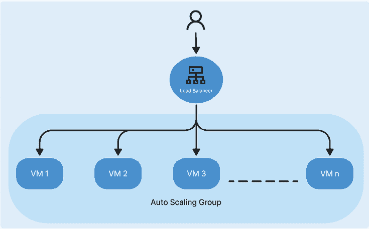

图 6.2：带有负载均衡器和自动伸缩组的虚拟机部署设置

在这种方法中，每个虚拟机实例都需要：

* 拥有完整的代码，不仅有模型执行代码，还需 Web 服务器的代码，
* 执行任何所需的转换，
* 通过模型运行输入，
* 准备输出并以可接受的格式格式化输出。

在虚拟机上部署具有若干优势，例如架构简单，对复杂基础设施的需求最小。然而，这种部署方法也有一些缺点，例如维护服务器（无论是物理的还是虚拟的）。网络延迟也可能是一个问题，取决于我们需要处理评分结果的速度。与基于容器或无服务器的解决方案相比，虚拟机灵活性较低且扩展速度较慢。与基于容器或无服务器的部署相比，在虚拟机环境中部署应用程序和模型的成本通常更高。在接下来的节中，让我们也看看这两种方法，看看它们相似和不同之处。


众所周知，近年来，基于容器的部署已成为一种比基于虚拟机的部署更高效、更灵活的替代方案。它与基于虚拟机的环境相似之处在于，它隔离了代码运行所需的资源和环境。基于容器部署的一个主要改进是容器运行在同一台物理机器上，并共享操作系统内核和库，同时拥有独立的用户空间。这与虚拟机部署形成对比，在虚拟机中是完全隔离的，并运行自己的操作系统实例。这种差异使得基于容器的部署优于虚拟机部署。

基于容器系统的部署过程涉及在容器（通常是 `Docker` 容器）安装机器学习系统和 Web 服务。然而，也存在其他方案，随后使用编排系统在集群中运行和维护这些容器。`Kubernetes` 是容器编排系统广泛使用的选择，无论运行在本地还是云平台上。所有主要的云平台都支持 `Kubernetes` 编排系统，并提供专有的编排系统，如 `AWS Fargate`、`Google Kubernetes Engine`、`Azure containers` 等。

如图 6.3 所示，集群是在交付给容器编排系统的环境中构建的。该编排系统随后管理系统所有的资源和自动伸缩需求。在云环境中部署项目时，集群自动伸缩器可以根据集群的需求和使用情况启动或终止容器，根据需要有效地从集群中添加或删除它们。

与其他任何部署方法一样，与使用虚拟机相比，在容器中部署也有许多优点。容器更加高效，并且可以通过编排系统（例如：`Kubernetes`、`AWS ECS` 等）根据定义的规则和触发器，根据用户的预测请求进行自动扩展。这种扩展能力延伸到了“缩减至零”（scale-to-zero）的概念，它允许容器在空闲时减少到零个副本，并在需要处理请求时恢复。因此，其资源消耗低于始终运行的服务，从而降低了能耗并削减了云资源的成本。然而，容器化部署也有一个明显的缺点：它通常被认为更复杂，并且需要专业的知识。尽管存在这一挑战，基于容器的部署由于其资源效率和满足不同需求的伸缩灵活性，仍然是一个极具吸引力的选择。请参考下图：

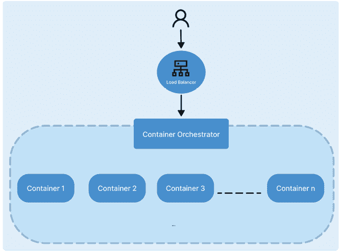

图 6.3：带有负载均衡器和容器编排器的基于容器的部署集群设置

## 无服务器部署

所有主要的云基础设施提供商 `AWS`、`Google` 和 `Microsoft` 都提供了无服务器计算服务。这些服务分别是 `Amazon Web Services` 上的 `Lambda-functions`、`Microsoft Azure` 上的函数以及 Google Cloud Platform 上的函数。

无服务器部署涉及准备包含运行机器学习系统所需的所有代码的 zip 包，包括模型、特征提取器和预测代码。除了核心代码外，zip 包还根据云提供商的要求包含一个特定的文件或函数定义，作为运行代码实例的入口点。最后，这些代码被压缩成单个组件并上传部署。

云提供商通常会提供一个 `API` 来提交输入，这些输入会被重定向到 zip 包中的无服务器函数。该 `API` 指定函数的名称，提供负载，并返回输出。一旦我们定义了部署配置、触发器并指定了资源分配，云提供商的服务就会在后台处理一切，包括 zip 包中代码的部署，使其能够访问并处理请求，并将输出返回给用户。我们不需要关心服务器或其他任何资源，这就是无服务器部署。请记住，尽管无服务器部署是一种“甩手掌柜”的方法，但我们可能仍需要进行优化和任务处理以达到生产就绪，例如优化资源分配、存储等，以确保一切运行顺畅。

尽管如此，由于这种易用性也带来了一系列局限性，这些局限性在各种现实场景中可能变得至关重要，例如函数执行的时间、zip 包的大小以及运行时可用 `RAM` 和其他资源的数量。在这些问题中，zip 文件的大小是无服务器部署面临的最大挑战。典型的机器学习模型需要多个重量级依赖项，例如 Python 的库如 `Numpy`、`SciPy` 和 `scikit-learn` 才能正确执行，这有时很难将它们置于无服务器环境的 zip 文件大小限制内。这种限制对于实时图像识别或自然语言处理等用例是至关重要的，因为这些场景对模型文件和 `GPU` 可用性关键。

尽管有这些限制，无服务器部署也有许多优点。最显著的是，无需配置服务器或虚拟机等资源（这些由服务提供商抽象并处理），无需安装依赖项或维护系统，这可以为组织节省大量的时间和资源。因此，在负载波动剧烈的场景中，无服务器系统因其伸缩潜力而脱颖而出。它们提供高伸缩性，能够轻松支持每秒数千次请求。此外，无服务器函数可以在同步和异步模式下运行。同步模式下，函数响应特定事件或请求立即执行，调用者等待响应。这对于需要实时或立即响应的场景非常有用。而在异步模式下，无服务器函数响应事件或请求触发，但调用者并不一定等待函数执行完成；它继续操作，无服务器函数独立运行。

无服务器部署的使用有助于方便执行金丝雀部署。金丝雀是一种软件工程策略，将更新的代码推给一小组终端用户（他们通常不知道）。如果新代码包含漏洞，这种方法允许快速回滚。在生产环境中设置多个版本的无服务器函数并将低流量发送到其中一个版本进行测试，而不会影响许多用户。我们将在下一个部署策略部分详细查看金丝雀部署。

无服务器部署也有缺点，例如 zip 包的大小限制以及运行时可用的 `RAM` 和其他资源。无服务器部署的一个主要缺点是无法访问 `GPU`，这使得某些依赖 `GPU` 处理数据的模型和应用程序无法部署。

## 流式模型部署

流式模型部署消除了为模型提供 `REST API` 接口的需求。在流式模型中，请求被发送到输入队列，等待系统获取进行处理。一旦输出准备就绪，这些输出将被放入输出队列，终端用户可以订阅该队列以接收更新。

流式系统的优势在多个模型共同运行的复杂系统中尤为明显。考虑一个由社交媒体信息流组成的输入。一个模型可以预测流中每条帖子的情感，另一个模型可以提取命名实体，第三个模型可能会生成帖子的热度评分，以及其他任务。如果使用 `REST API` 部署模式，我们需要为每个模型准备一个 `REST API`，并且需要顺序调用这些 `REST APIs` 才能使其工作。

流式处理的工作方式则不同。在这个示例系统中，并不是拥有多个 `REST APIs`，而是根据运行需求和输入输出依赖关系将所有模型排列成拓扑结构。这里的拓扑指的是流式处理应用的高层结构或配置。这些拓扑通常运行在流式处理引擎（SPE）上，如 `Apache Spark`、`Flink` 或 `Apache Storm` 等。输入输出队列通常由流式队列框架处理，如 `Apache Kafka`、`Akka Streams`、`AWS SQS` 等。虽然对这些 `SPEs` 和 `SPLs` 的详细讨论超出了本书的范围，但它们都有一个共同属性，将它们区别于基于 `REST API` 的应用程序。在这种流式部署中，数据可以持续发送到队列中，并由系统在到达时进行处理。

# 部署策略

有多种部署策略可以实现上一节中讨论的模型部署类型：

*   单一部署（Single deployment）
*   静默部署（Silent deployment）
*   金丝雀部署（Canary deployment）
*   多臂老虎机（Multi-armed bandit）

### 单一部署

单一部署是更新机器学习模型最直接的方法。它涉及用新模型替换旧模型，并在必要时更新特征提取器。这种方法适用于各种环境，如云端服务器、物理服务器或用户设备。尽管单一部署非常简单，但它带有风险，因为新模型或特征提取器中的 bug 可能会影响所有用户。

在云环境中，我们首先准备一个运行更新版本 `model` 的新虚拟机或容器。一旦准备就绪，将替换虚拟机镜像或容器镜像。然后逐渐关闭旧机器或容器，允许 `autoscaler` 将其替换为新的机器。这一过程确保了平滑过渡到更新的模型，而不会给用户带来停机。

对于在物理服务器上的部署，我们需要将新模型文件和更新后的特征提取对象上传到服务器。一旦这些文件上传完成并且代码更新为使用新版本，就需要重启 Web 服务器开始使用新模型。这种方法允许在不需要额外硬件或软件更改的情况下，在服务器上实现更新的模型。

要在用户设备上进行部署，我们将新模型文件和任何所需的特征提取对象更新推送到设备。一旦更新到位，必须重启软件以包含这些更改。这种方法确保每个用户在他们的设备上都运行最新的模型。

单一部署既有优势也有风险。单一部署的主要优势是其简单性，使其成为更新机器学习模型的易选。然而，这种简单性伴随着风险。如果新模型或特征提取器包含 bug，它可能会影响所有用户，可能导致广泛的问题。因此，在使用这种方法进行部署之前，彻底测试并验证新模型及特征提取器至关重要。

### 静默部署

单一部署的一种变体被称为静默部署。在静默部署中，`model` 和特征提取器的新版本与现有部署并行部署。它们并发运行，但在进行最终切换之前，用户不会与新版本交互。新版本生成的预测结果会被记录，但不会显示给用户。然后对这些预测结果进行审计和分析，以确保新版本没有问题或 bug。一旦验证通过，将发布新版本并弃用旧版本。

静默部署的优势在于提供了充足的时间来确认新模型按预期运行，而不会对用户体验产生负面影响。然而，这种方法确实存在缺点。它需要运行双倍数量的模型，增加了资源消耗和相关成本。

通过这种方法，开发者可以确保模型版本之间的平滑过渡，同时最大限度地减少意外问题影响用户的风险。然而，在决定实施静默部署时，考虑资源影响以及在不接触用户的情况下评估新模型的可行性至关重要。

### 金丝雀部署

金丝雀部署，也涉及将机器学习模型的新版本及其代码部署给小部分用户的策略。相比之下，大多数用户继续与之前的版本交互。这种方法允许数据科学家和工程师在完全部署到所有用户之前，测试并验证新模型的性能，并评估其预测的影响。

金丝雀部署的主要优势是最大限度地减少 bug 和问题对用户的潜在负面影响。它有助于在部署过程早期检测常见或关键问题。如果新模型有任何问题，只有一小部分用户会受到影响，使得在模型推向整个用户群之前更容易解决和修复问题。

然而，实施金丝雀部署也面临挑战。这些障碍之一是同时管理多个模型版本的复杂性增加。这需要开发团队投入额外的资源和精力，确保每个版本都得到维护、更新和监控。

金丝雀部署的一个显著局限性是无法有效检测稀有错误。例如，如果新模型版本部署给 5% 的用户，而特定 bug 影响了这些用户中的 2%，那么开发团队发现该问题的概率只有 0.1%。这是因为暴露于新版本的用户比例很小，稀释了 bug 的影响。

总结来说，金丝雀部署是在受控环境中测试和验证机器学习模型新版本的有效技术，可以最大限度地减少对用户的潜在负面影响。虽然它确实增加了复杂性，并可能无法有效检测稀有错误，但早期检测和缓解问题的收益通常大于这些缺点。通过仔细监控新版本对选定用户组的影响，工程师和数据科学家可以对何时完全部署更新的模型做出明智决策。

### 多臂老虎机

我们引入了多臂老虎机（Multi-armed bandits, MABs）的概念，作为生产环境中比较和选择最佳性能模型的方法。MAB 的命名源于单臂老虎机（赌场中老虎机的昵称），但在这种情况下，我们处理的是多个“臂”，它们代表了多个版本的模型。

多臂老虎机方法的一个优势是，当系统成熟且算法拥有足够的性能数据来做出明智决策时，它会收敛到大多数情况下选择最佳模型（臂）。这意味着在 MAB 算法收敛后，大多数将被引导至运行最有效模型的软件版本。

多臂老虎机（multi-armed bandit）方法的主要缺点是，使其运行需要大量的工作和基础设施支持。实现 `MAB` 算法涉及的潜在复杂性和挑战要求项目具备成熟的流程和基础设施。`MABs` 需要细致的配置、监控和调优，其有效性取决于我们使用的奖励指标选择以及更新频率等因素。

多臂老虎机策略解决了部署中的两个主要问题：

*   在线模型评估
*   模型部署

#### 在线模型评估

`MAB` 算法不断更新其对每个模型性能的理解，使其能够实时对哪个模型最有效做出明智决策。这在环境动态变化且模型性能可能随时间而改变的情况下尤为有用。

#### 模型部署

`MAB` 算法不仅评估不同模型的性能，还会对在生产环境中部署哪种模型做出决策，确保用户始终与最有效的模型进行交互。这种动态模型部署过程可以提高系统的整体性能。

### 模型推理与服务

模型推理与服务是 `MLOps` 的组成部分，其核心是为终端用户和应用程序提供预测。推理和服务系统可以通过发布的预测表、预测流或 `REST APIs` 向下游系统提供预测。某些应用程序将受益于批处理或流式推理，这些具有高吞吐量和低成本。其他应用程序则需要低延迟预测，可以通过在线服务提供。

在本节中，我们将深入探讨生产环境中模型推理与服务的最佳实践。正如 `Figure 6.4` 所示，这一核心组件包含了 `MLOps` 机器学习生命周期中的第八阶段。该阶段为终端用户提供了交互界面。请参考下图：

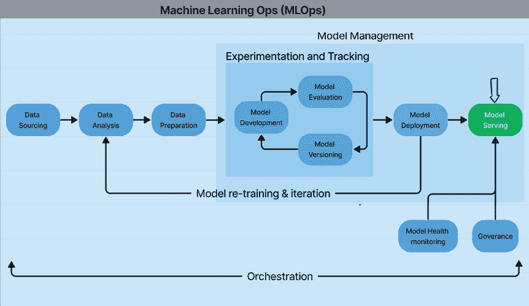

图 6.4：基于 `MLOps` 的机器学习项目生命周期模型服务阶段

在下一节中，我们将探索模型服务的各种模式，例如批处理和按需处理，随后介绍每个机器学习系统在现实世界运行时面临的一些挑战。

### 模型服务的模式

模型服务主要有两种模式：

*   批处理
*   按需处理

每种模式都有其自身的优势和用例，使其适用于不同类型的应用程序和场景。

### 批处理

基于批处理的模型服务最适用于我们需要一次性通过系统处理海量输入数据的场景。这种方法被广泛用于处理大规模数据集，例如来自产品或服务所有用户的信息，或系统地分析输入的事件（如推文或在线出版物的评论）。批处理的优势是它通常比按需处理更节省资源。与按需处理相比，资源仅在需要时启动，而后者由于我们不知道何时会收到请求，资源需要一直保持运行。但批处理仅在可以忍受一定延迟的情况下适用。如果低延迟至关重要，且项目需要资源随时可用，那么批处理可能不是合适的方法。在这种情况下，我们应该考虑按需处理。

为了确定速度的最佳批大小，实验不同的大小是关键的。批处理生成的输出通常保存到数据库中，而不是直接发送给特定的消费者。批模式可用于多种目的，例如：

*   根据用户最近在网站上的活动生成每日应发送折扣券的用户列表。
*   将在线新闻文章和博客帖子输入的评论流分类为垃圾邮件或非垃圾邮件。
*   从搜索引擎索引的文档中提取命名实体等。

总之，以批模式提供服务是处理大规模数据处理任务的强大方法。它允许资源的高效利用，并在处理海量数据集时允许一定程度延迟。通过实验不同的批大小，可以获得最佳性能，从而带来更好的结果和更精确的洞察。

### 按需处理

向用户提供机器学习模型服务的过程涉及六个关键步骤：

1.  验证请求。
2.  收集上下文。
3.  将上下文转换为模型输入。
4.  将模型应用于输入。
5.  确保输出有意义。
6.  将输出呈现给用户。

在生产环境中运行模型之前，可能需要验证用户具有适当权限。上下文是用户发送的元数据，它告诉系统当前所处的状态。这些信息被特征提取器用于生成作为模型输入的特征。一旦模型生成了结果，这些结果可能不是用户可以理解的格式。它们可能需要进行转换。准备输出的另一个常见步骤是同时测量预测置信度评分，以确保结果的相关性。这让用户了解如何解释结果，以及对该特定实例的模型结果投入多少信任。

如果我们需要调试或审计系统，记录模型的每项操作也可能很有用。我们应该记录收到的请求、提供的上下文、最终转换的上下文、系统输出、置信度评分等，以及时间戳等所有元数据。

在许多情况下，构建 `REST API` 适用于提供机器学习模型服务。但也存在流式传输对整个系统更合适的用例。其中一种情况是模型为下游机器提供某些信息和预测，拓扑结构中的下一个系统/机器需要据此采取行动。机器通常对输入和输出有标准且预定的数据需求，这使得在这些用例中使用流式传输变得简单。

按需模型服务面临的挑战之一是需求波动，例如，需求在白天较高，晚上较低。为了解决这个问题，一个直接的解决方案是部署自动扩缩，根据需求启动新实例或移除实例。它很好地达到了目的，但在某些情况下，自动扩缩可能不够敏捷，例如处理需求的意外激增。为了解决此类情况，按需架构引入了消息代理，如 `RabbitMQ` 或 `Apache Kafka`。

总而言之，向机器提供机器学习模型服务可以通过多种方法，包括 `REST API`、流式应用程序和消息中间件。通过为特定场景选择合适的方法，机器学习从业者可以确保资源的高效利用并具备处理波动需求的能力。

## 现实生活中的模型服务

在真实世界的场景中，当个人与软件系统交互时，部署机器学习模型可能会变得复杂。预测每个用户的操作和反应通常是不可行的。因此，设计良好的软件系统架构必须准备好应对三个现象：

*   错误
*   变化
*   人性

### 错误

错误是任何软件系统中不可避免的组成部分。它们源于各种来源，例如错误的数据输入、代码中的 bug 或意外的用户行为。为了构建一个健壮的机器学习模型，考虑这些错误并建立高效处理这些错误的机制至关重要。这可能涉及实施错误检测和纠正技术、监控系统性能，并在模型无法提供准确预测时提供回退方案。

### 变化

世界在不断变化，软件系统必须对不断变化的情况具有适应性。这包括用户行为的变化、底层数据的更新或技术的进步。如果一个机器学习项目设计得当，它应该能够处理这些变化。这可能涉及使用新数据持续更新模型、使用迁移学习适应新任务，或者引入易于更新或替换的模块化组件。

### 人性

人类行为是复杂且往往不可预测的，这使得创建一个能够有效满足所有用户需求的软件系统具有挑战性。为了解决这个问题，机器学习模型的设计必须考虑人为因素。这可能包括理解用户偏好、引入反馈循环进行持续改进，并确保系统用户友好且易于访问。

总之，在为真实世界的应用设计机器学习模型时，考虑错误、变化和人性至关重要。通过考虑这三个现象，开发者可以构建更健壮、更有适应性的软件系统，从而更好地为用户服务并经住时间的考验。

## 结论

我们在章节开始时继续讨论了如何部署模型。本章概述了 MLOps 生命周期中模型部署和服务的多个各个方面。我们探索了各种部署策略，例如静态、动态和流式部署，每种策略根据延迟、合规性、基础设施和成本等因素都有其自身的优缺点……我们比较了如何在终端用户设备上或使用虚拟机、容器、无服务器技术在服务器上部署模型，并强调了它们在灵活性、资源效率和管理便利性方面的独特优势。


我们还探索了向端用户（无论是人类或其他机器/应用程序）提供模型服务。我们研究了模型如何以批模式或按需（包括 API 或流式）提供预测。以及如何使用单节点、静默、金丝雀部署和多臂老虎机部署来实现这些部署和推理。这些部署允许在监控模型性能的同时受控地发布新模型。

在下一章节中，我们继续对 MLOps 项目生命周期组件的探索。我们将看到模型的健康监控和治理是 MLOps 的重要部分。

## 重点回顾

* 模型部署是使训练好的机器学习模型可用的过程。主要的部署选项有静态部署、动态部署和流式部署。
* 静态部署涉及将模型封装在应用程序的可安装二进制文件中。动态部署允许模型独立于应用程序代码进行更新。
* 对于服务器部署，虚拟机提供了隔离但可能消耗大量资源。容器实现了高效的扩展和资源共享。无服务器（Serverless）简化了部署，但有文件大小等限制。
* 部署策略包括单节点部署、静默部署、金丝雀部署和多臂老虎机部署。它们在简单性、资源需求和检测能力方面各有优劣。
* 模型服务指的是通过批处理、API 或流提供预测。批处理对于大数据量是有效的但存在延迟。API 实现了实时低延迟预测。
* 在服务模型时，处理错误、适应变化并考虑人性的不可预测性非常重要。持续监控和更新有助于维护性能。

## 关键术语

* **静态部署**：将机器学习模型静态部署为应用程序的可安装二进制文件的过程，模型作为运行时可以访问的资源封装。
* **动态部署**：在动态部署中，模型在线或离线训练。数据持续进入系统并通过持续更新整合到模型中。在这种部署中，按服务器提供预测。模型使用 `FastAPI` 或 `Flask` 等 Web 框架部署，并作为 API 端点提供，响应随时发生的用户请求。
* **批处理**：模型服务的批处理是指将一大块数据一次性批处理，并将预测存储在数据存储中。然后在需要时提供这些预测。与按需处理相比，批处理更节省资源。
* **按需处理**：按需处理是指模型根据需求实时提供服务。模型部署在带有 API 端点的服务器上，该端点可以接收处理请求、验证请求、处理、生成预测并用预测响应用户请求。它比批处理消耗资源得多，因为它需要始终保持服务器运行以响应用户请求。

# 第 7 章 机器学习模型的持续交付

## 引言

在本章中，我们将探索在机器学习系统中有效实施和自动化持续集成（`CI`）、持续训练（`CT`）和持续交付（`CD`）的方法。这些实践和组件对于将机器学习模型持续交付到生产环境至关重要。

众所周知，实用的 MLOps 意味着在机器学习流水线的所有阶段都实现自动化和监控，包括构建、集成、测试、部署、服务和基础设施管理阶段。训练和准备机器学习模型的过程是整个机器学习系统中的核心但相对较小的一部分，特别是当我们已经选择并简化了算法和训练过程后。在这方面，现有的工具和流程已经达到了很高水平的成熟度。然而，真正的挑战不仅在于创建机器学习模型。首要考虑的问题是构建一个完全集成的机器学习系统，该系统能够在生产环境中持续运行和更新。这一方面与 DevOps 原则密切相关，并需要恰当地理解这些原则如何有效地与机器学习系统交织在一起。

通过深入研究在机器学习背景下实现 `CI`、`CT` 和 `CD` 的技术，我们将为高效的机器学习流水线奠定基础。这将使 ML 工程师和数据科学家能够轻松地管理 ML 基础设施并部署模型，从而提高系统性能并实现及时更新。

## 结构

在本章中，我们将讨论以下主题：

* 传统的持续集成/持续部署流水线
* 机器学习/人工智能流水线
    * 架构级别 1
    * 架构级别 2
    * 架构级别 3
* 持续集成
    * GitHub Actions
* 持续训练
    * 持续训练策略框架
    * 何时进行重新训练
    * 应该使用什么数据
    * 我们应该重新训练什么
* 持续交付

## 目标

在本章结束时，我们将理解将机器学习模型持续交付到生产环境需要什么。我们将理解 ML/AI 流水线以及流水线不同的成熟度和架构级别，以及持续集成、训练以及生产环境持续交付的先决条件。

## 传统的持续集成/持续部署流水线

`CI/CD` 是应用开发流水线中实施的一系列最佳实践。DevOps 团队主要采用这些实践是为了帮助软件开发人员快速可靠地向生产应用程序引入更新。

> **注意**：在 `CI/CD` 流水线中，持续部署和持续交付经常互用，但它们之间存在差异。持续交付是指代码更改准备好发布时的一种软件实践。持续部署旨在只要代码更改通过所有检查，就持续自动地将代码更改发布到生产环境中。

高效的 `CI/CD` 流水线的基本优势包括：

* 可靠性
* 可重复性
* 敏捷性
* 安全部署
* 版本控制

如图 7.1 所示，这些工具的核心是尝试将一个著名的工作流形式化：构建 | 测试 | 部署：


图 7.1：传统应用程序中的 `CI/CD`

尽管 `CI/CD` 经常被提及并使用，但它们代表了两个不同的（尽管相互关联）概念。`CI` 主要侧重于代码推送到代码仓库时进行测试，确保使用单元测试对新的应用程序功能进行自动测试。另一方面，`CD` 涉及这些测试过的代码的实际交付或发布。例如，`CD` 系统可能会概述各种功能或发布分支如何部署，甚至如何将新功能选择性地推向新用户（例如，通过向 20% 的客户群测试功能 A，以确保在发布给所有客户群之前它运行良好且在采用方面没有问题）。

这些关键概念最近才在 MLOps 和现代机器学习流水线中获得显著关注。许多组织正在采用 `CI/CD` 原则进行 ML 模型部署，以提高可重复性、可靠性和敏捷性。

## 机器学习/人工智能流水线

与传统流水线相比，机器学习的最佳系统存在几个关键区别。如图 7.2 所示，机器学习与传统软件系统之间存在惊人的相似之处。这些相似之处包括代码的持续集成、测试（包括单元测试、集成测试或组件测试）以及持续交付：

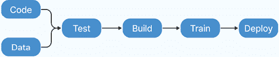

图 7.2：用于机器学习和 AI 应用的 `CI/CT/CD`

然而，在机器学习也有一些值得注意的区别：

* `CI` 不仅仅是对代码和组件进行测试和验证，还扩展到了数据和模式的验证。
* `CD` 已演进超出单一包或服务的范围；现在它涵盖了负责自动部署的整个系统。
* `CT` 是 `CI/CD` 的一个新组件，是数据科学和机器学习系统特有的，专注于自动重新训练模型。

部署的持续交付和自动化程度还取决于架构级别和基础设施的成熟度。为了更好地理解这种关系，让我们重新回顾架构级别并检查 `CI/CD` 如何与基础设施对齐。

### 架构级别 1

在这一初步成熟阶段，团队专注于构建最先进的模型。然而，开发和部署 ML 模型仍然是手动操作或依赖脚本的。这意味着每一个步骤（如数据分析、数据准备、模型训练和验证）都需要人工干预执行。

在这一级别，由于基础设施不足，组织在实施 `CI`、`CD` 和 `CT` 方面面临困难。在此阶段，假设实现变更较少；因此，不需要设置 `CI` 基础设施。同样，不频繁的模型部署和缺乏持续训练导致投入资源进行 `CT` 和 `CD` 的投资回报率（ROI）不足。

采用用于 `CI/CD` 和 `CT` 的 MLOps 实践有助于解决与此手动过程相关的挑战。通过在 `Apache Airflow` 等编排系统中部署 ML 训练流水线，我们可以促进 `CT`。此外，对于需要快速测试、构建和部署新实现的 `CI/CD` 系统，组织可以选择 `Airflow` 或其他适用于其 `CI/CD` 平台。

通过在初始阶段完善和优化架构，组织可以为向更高级成熟阶段发展时成功集成和管理 ML 模型奠定坚实基础。

### 架构级别 2

在成熟度级别 2，主要目标是通过自动化 ML 流水线来实现模型的持续训练。这一级别通过使用新数据实施自动化训练过程，促进了模型预测服务的持续交付。

为了实现这一点，除了流水线触发器和元数据管理外，还需要在流水线加入自动验证模型和数据的步骤。ML 实验步骤的编排在这一层进行，允许在进程切换时实现无缝过渡和自动化。这种实验的快速迭代有助于为将整个流水线迁移到生产环境做好充分准备。

这一层通过允许实时流水线触发模型自动训练，确保在生产环境中训练模型时使用最新数据。然而，为了构建机器学习流水线，组件必须是可重用的。虽然探索性数据分析（EDA）代码仍然留在笔记本中，但组件的源码需要模块化，并且最好是容器化的。这使得更高效、有效的生产级 ML 流水线能够使用新训练的模型提供持续预测服务。

与层 1（将训练好的模型作为预测服务部署在生产环境中）相比，层 2 通过部署整个训练流水线推进了这种方法。这使得训练过程能够自动化和循环执行，为预测服务持续提供更新且经过验证的模型。

### 架构级别 3

在涉及机器学习模型的持续交付时，为了确保生产流水线的快速和可靠更新，一个稳健的自动化 `CI/CT/CD` 系统至关重要。这种级别的自动化允许对机器学习系统改进的各种可能性进行快速实验。如果这些实验的结果是有用的，就可以自动创建实现、测试并将其部署到不同的环境中。

流水线由以下组件组成：

* **流水线持续集成**：这涉及构建源码和运行各种测试。持续集成阶段的结果不仅是运行代码测试，还包括用于后续阶段训练和部署的产物。
* **流水线持续训练**：在此阶段，对数据进行验证，训练模型、评估模型，并将模型产物存储在不同的环境中。此阶段的结果是交付流水线用于部署到环境的产物。
* **自动化触发**：虽然不是一个独立组件，但自动化触发是所有这些自动化过程的关键部分。我们需要一个组件，能够根据特定计划或某些事件自动触发流水线的执行。
* **模型持续交付**：在此阶段，机器学习项目使用最新模型进行更新，并准备进行推理。此阶段的结果是带有最新版本模型的推理和预测流水线。

如图 7.3 所示，通过实施这种稳健的自动化 `CI/CT/CD` 系统，团队可以高效地应用新想法并适应变化，同时确保他们的流水线保持准确和更新。请参考以下图像：

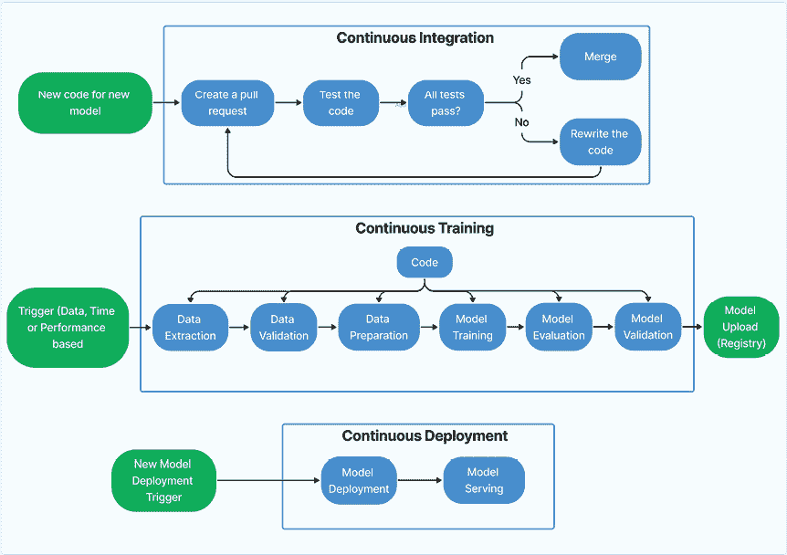

图 7.3：自动化持续集成、持续训练和持续交付系统

这种方法为机器学习模型的测试和部署提供了一个灵活且适应的环境，加速了整个开发过程。

## 持续集成

持续集成（`CI`）是指每当有新代码提交并推送到仓库时，流水线（包括系统的所有组件）都会测试、根据需要进行构建并打包供后期阶段使用。除了构建包、容器镜像和可执行文件外，`CI` 过程还可以根据项目的用例和需求涵盖以下测试：

* 对特征工程所用的逻辑进行单元测试。
* 对模型中实现的各种方法进行单元测试。例如，模型可能包含一个接收分类数据列并将其编码为独热特征的函数。
* 测试模型训练覆盖率，确保损失随着迭代的增加而减小，并且模型仅过拟合少数样本记录。它还确保我们已经测试了适当的数据覆盖和特征覆盖率。
* 测试流水线中的每个代码单元是否按预期工作并创建正确的产物。
* 测试流水线组件之间的集成。

通过增强 `CI` 过程，开发周期可以保持高效，有助于更快地识别和解决问题。因此，这允许创建持续改进且可靠的机器学习模型。

有很多平台和工具可以用于处理类似于传统软件 `CI/CD` 的 `CI` 组件，其中包含一些工具：

* CircleCI
* Travis CI
* GitHub Actions
* Jenkins 等

让我们以 `GitHub Actions` 为例，看看如何为每个新代码提交的单元测试、集成测试和功能测试设置持续集成组件。工作流流水线将包含之前图 7.3 中持续集成工作流组件所示的步骤。

## GitHub Actions

`GitHub Actions` 允许我们自动化代码推送到 GitHub 仓库时的工作流，使构建、测试和部署代码更快。

大多数 `GitHub Actions` 工作流流水线如下：

```yaml
name: Pipeline Name

on: push # 流水线的触发器，即即 push 或 pull 等

jobs:
  job_1: # 任务的 ID
    name: Job no. 1
    runs-on: ubuntu-latest
    steps:
      . . . . .
  job_2:
    name: Job no. 2
    runs-on: ubuntu-latest
    steps:
      . . . . .
```

该工作流流水线有一些重要组件，讨论如下：

* 当 GitHub 代码仓库发生 push 或 pull request 等事件时，可以触发工作流流水线。
* 流水线中的任务在执行环境上互不依赖。它们在独立的容器中运行。
* 这些任务由在独立容器内按顺序执行的步骤组成。尽管这些步骤的执行相互依赖，一个步骤依赖于上一个步骤的成功或失败。
* 与任务不同，步骤依赖于执行，由于它们是顺序的，一个步骤依赖于上一个步骤的成功或失败。

为了确保写入并推送到仓库的新代码不会在 ML 系统中引起任何问题，我们通常使用作为持续集成流水线的一部分运行所有相关测试。只有当代码通过所有测试后，才允许合并到环境分支（master、staging 或 development 分支）。

工作流需要位于 `.github/workflow/test_code.yaml` 下的 YAML 文件中。

测试代码的完整 `CI` 代码如下：

```yaml
name: Testing CI pipeline

on:
  pull_request:
    paths:
      - config/**
      - training/**
      - application/**
      - .github/workflows/test_code.yaml

jobs:
  test_model:
    name: Test new model
    runs-on: ubuntu-latest
    steps:
      - name: Checkout
        id: checkout
        uses: actions/checkout@v2
      - name: Environment setup
        uses: actions/setup-python@v2
        with:
          python-version: 3.8
          cache: pip
      - name: Cache
        uses: actions/cache@v2
        with:
          path: ~/.cache/pip
          key: ${{ runner.os }}-pip-${{ hashFiles('**/dev-requirements.txt')}}
        restore-keys: ${{ runner.os }}-pip-
      - name: Install packages
        run: pip install -r dev-requirements.txt
      - name: Pull data
        run: . . . . # 获取所需数据的代码
      - name: Run training tests
        run: pytest training/tests
      - name: Save model
        run: python application/src/save_model.py
      - name: Start app locally and run app tests
        run: |
          bentoml serve ./application/src/create_service.py:service & sleep 10
          pytest application/tests
          kill -9 `lsof -i:3000 -t`
```

## 持续训练

如我们所知，机器学习模型往往随着时间的推移而过时，导致性能下降。这是由于趋势的演变或用户行为的变化等，导致数据发生了实时变化，这种现象被称为数据漂移（data drift）。此外，在充足的时间内，输入和输出之间的关系也可能发生变化，即概念漂移（concept drift）。为了确保机器学习模型的相关性，使用数据保持其更新至关重要，而这通过持续训练来实现。我们可以通过多种方式持续训练模型：

* **增量训练**：这种方法涉及在数据可用时立即使用这些数据（在现有模型的基础上）对模型进行训练。
* **批量训练**：在这种方法中，一旦积累了大量的用于训练数据，就会触发模型训练流水线，在现有模型的基础上进行训练。
* **重训练**：这种方法通过结合收集的旧和新数据来重新训练整个新模型。

这些方法各有优劣，适用于不同的场景。尽管如此，所有这些方法都需要一个自动化的工作负载管理过程，因为手动执行可能耗费人力且效率低下。通过采用此类方法论，机器学习模型可以在不断变化的数据格局中持续更新并优化，以获得更好的性能。

持续训练过程包含六个不同的阶段：

* 数据提取
* 数据验证
* 数据准备
* 模型训练
* 模型评估
* 模型验证

这些阶段使得持续训练的工作流流水线如图 7.3 中的“持续训练工作流”所示。

以下是使用 `Apache Airflow` 的训练流水线示例代码结构，它被设置为每天触发一次并训练模型：


```python
from datetime import datetime
from airflow.decorators import dag, task
from airflow.models import Variable

@dag(
    dag_id="training_pipeline",
    schedule="@daily",
    start_date=datetime(2023, 6, 15),
    catchup=False,
    tags=["model-training", "model-verification"],
    max_active_runs=1,
)
def training_pipeline():
    @task.virtualenv(
        task_id="data_extraction",
        python_version="3.9",
        multiple_outputs=True,
        system_site_packages=True,
    )
    def data_extraction():
        """
        运行数据提取任务。
        """
        # 从源系统提取数据的代码

    @task.virtualenv(
        task_id="data_validation",
        python_version="3.9",
        multiple_outputs=True,
        system_site_packages=False,
    )
    def data_validation():
        """
        此函数验证上一个任务中获取的数据。
        """
        # 数据验证代码

    @task.virtualenv(
        task_id="data_preparation",
        python_version="3.9",
        multiple_outputs=True,
        system_site_packages=False,
    )
    def data_preparation():
        """
        此函数在数据可用于训练之前运行数据准备步骤。
        """
        # 数据准备代码

    @task.virtualenv(
        task_id="model_training",
        python_version="3.9",
        multiple_outputs=False,
        system_site_packages=False,
    )
    def model_training():
        """
        模型训练任务。这是获取数据并训练模型的主函数。
        """
        # 模型训练代码

    @task.virtualenv(
        task_id="model_evaluation",
        python_version="3.9",
        multiple_outputs=True,
        system_site_packages=False,
    )
    def model_evaluation():
        """
        评估上一步中训练好的模型。
        """
        # 模型评估代码

    @task.virtualenv(
        task_id="model_validation",
        python_version="3.9",
        system_site_packages=False,
    )
    def model_validation():
        """
        在模型上传和注册之前的模型验证任务。
        """
        # 模型验证代码在此处。

    @task.virtualenv(
        task_id="model_upload",
        python_version="3.9",
        system_site_packages=False,
    )
    def model_upload():
        """
        此函数负责上传并注册准备好投入部署的模型。
        """
        # 模型上传代码在此处。

    # 定义 Airflow 变量。
    days_delay = int(Variable.get("training_pipeline_days_delay", default_var=15))
    days_export = int(Variable.get("training_pipeline_days_export", default_var=30))

    # 训练流水线
    data_extraction = data_extraction()
    data_validation = data_validation()
    data_preparation = data_preparation()
    model_training = model_training()
    model_evaluation = model_evaluation()
    model_validation = model_validation()
    model_upload = model_upload()

    # 定义 DAG 结构。
    (
        data_extraction
        >> data_validation
        >> data_preparation
        >> model_training
        >> model_evaluation
        >> model_validation
        >> model_upload
    )

training_pipeline()
```

# 持续训练策略框架

每个机器学习用例都呈现出独特的数据环境，这可能导致概念和漂移。但无论如何，要开发出有效的持续训练策略，解决三个主要问题至关重要：

- **何时应该重训练模型？** 目标目标是在任何时候都保持一个高度相关且性能最佳的模型。因此，确定理想的重训练频率至关重要。

- **应该使用什么数据？** 通常，团队假设最近的数据是最相关的并可以用于训练。但事实真的如此吗，还是说这取决于具体情况呢？这引发了几个问题：

    - 新数据是否应该替换旧数据，还是应该将它们结合？

    - 如果应该结合数据，那么训练数据集中新旧数据的情况应该是怎样的？

    - 数据需要多新才能被视为“新”数据？它什么时候从“新”转变为“旧”？

- **我们应该重训练什么？** 仅创建一个新的训练数据集并重训练现有模型是否就足够了，而保持其他部分不变？或者我们应该采用迁移学习或微调等中间方法？或者，采取更全面的方法，从根据新数据重新分析流程、更新整个流水线并从头开始构建模型是否更有意义？

这些主要问题应首先得到回答，以决定每个用例的最优重训练方法。通过评估这些考虑因素并选择解决这些问题的方法，可以开发出成功的持续训练策略，确保机器学习模型的持续相关性和高性能。

## 实施周期性重训练计划

实施周期性重训练计划是更新机器学习模型最简单、直接的方法。通常，这种计划是基于时间的，例如每周、每月或每季度重训练一次。

定期重训练循环的优势同样显而易见。这种方法易于管理、高度直观且易于实现，因为它可以很容易确定下一次重训练迭代的时机。

然而，这种方法在某些场景下往往被证明不适用或效率低下。主要的挑战在于确定理想的重训练频率。我们可以决定每天、每周、每月或每年重训练一次模型。虽然尽可能频繁地更新模型以保持其有效性是理想的，但在没有合理理由（如不存在概念漂移/`concept drift`）的情况下，频繁重训练可能既昂贵又没必要。重训练需要大量的资源，包括计算能力和数据科学团队的投入。相反，间隔过长的时间进行重训练可能会削弱模型持续适应的目的，并无法应对数据波动，更不用说在噪声数据上进行重训练的风险了。

最终，如果所选频率与领域的动态变化相匹配，周期性重训练计划就是有效的。未能做到这一点可能会使模型面临潜在风险，并导致更新后的版本比前一个更不可用。

## 基于数据驱动的周期性重训练

与基于时间的周期性重训练类似，周期性数据驱动的重训练是更新机器学习模型的一种简单方法。这种方法通常基于数据量，例如，每增加 10 万个新数据点重训练一次，以此此类推。

这种方法既易管理也于实现，尽管在确定触发模型重训练的最佳新数据量方面，它面临着类似的挑战。重训练可能会根据数据摄入量或数据峰值不规则地发生。

与基于时间的重训练一样，训练需要大量的资源，因此在适当的新数据量之间找到平衡至关重要。过早重训练会导致资源浪费，因为使用少量新数据进行重训练可能带来的益处微乎其微，甚至可能对模型性能产生负面影响。另一方面，在重训练之前等待大量数据可能会破坏整个过程，因为关键的数据波动可能无法被考虑。

为了使数据驱动重训练收益最大化，有必要仔细考虑值得更新模型的新数据量。通过平衡资源消耗和模型性能，数据驱动的重训练可以帮助开发越来越有效且适应性强的机器学习模型。

## 性能驱动的重训练

在确定何时重训练机器学习模型的各种方法中，基于性能的重训练触发器经常用于在检测到现有模型性能出现可观察的下降时刷新模型。

这种方法与其对应方法更具经验性，它假设可以对生产环境中的模型性能进行持续评估。完全依赖性能的一个主要挑战是获取真值（`ground truth`）所需的时间，假设真值是可以获取的。在用户转化预测等情况下，接收真值可能需要 30 到 60 天，而在涉及交易欺诈检测或生命周期价值（`LTV`）的情况下，等待时间可能会延长到六个月或更久。获取全面反馈的这种延迟可能导致在业务产生后果后才过晚重训练模型。在这种情况下，我们要么使用其他重训练选项，要么采取一些可以减轻这些风险的方法，例如使用代理指标（`proxy metrics`）或替代测量（`surrogate measures`），它们可以提供更快的反馈，并作为真值的代理来加速训练决策。

另一个需要考虑的关键问题是——我们如何定义性能下降？在这种情况下，我们可能依赖于预设阈值的灵敏度和校准的精度，这可能导致模型重训练过频繁或不足。

总之，在具有快速反馈和海量数据的用例中（如实时竞价），采用性能驱动的重训练触发器是最有效的。这允许在近实时尽可能地衡量性能，并确保了由海量数据支持的高置信度。

## 基于数据变化的重训练

这种方法是最动态的，由于领域不断变化的特质，它本质上会触发重训练。通过监控输入数据的变化，特别是模型所使用的特征分布的改变，我们可以识别数据漂移（`data drifts`），这种漂移信号表明模型可能过时，需要新数据进行重训练。

在缺乏快速反馈或无法在生产环境中实时评估模型性能的情况下，这种方法是性能方法的替代方案。此外，即使在可以快速反馈的情况下，结合并使用这种方法也是有益的，因为它可能在没有明显下降的情况下意味着性能并非最优。通过识别数据偏移以启动重训练过程具有极高的价值，特别是在动态设置环境中。

那么，何时重训练才合适？这一决策取决于基本因素，如反馈的可用性、数据量和模型性能的可视性。通常情况下，确定重训练模型的最佳时间没有通用解决方案。相反，根据可用资源，目标应该是尽可能地与生产驱动的目标保持一致。

# 应该使用什么数据

正如我们所学的，定时在 MLOps 中起着至关重要的作用（例如决定何时重训练模型）。现在，让我们深入 MLOps 流水线的核心：数据选择。在重训练模型时，我们如何选择最合适的数据纳入其中？在重训练过程中使用正确的数据可以确保模型交付可靠的结果。以下考虑可能有助于确定应该使用哪些数据进行重训练：

*   **与问题的相关性**：确保所选数据与您的模型旨在解决的问题直接相关。数据应该对真实世界的场景具有代表性，使模型能够在实际应用中有效工作。

*   **数据质量**：数据的时性、来源和可靠性是最重要的因素。使用过时或低质量的数据可能会阻碍模型的学习过程，可能导致性能不佳。高质量、最近的数据可能产生更好的结果。

*   **数据的多样性**：包含多样化的数据可以提高模型的泛化能力，使其在各种任务中表现良好。从不同来源、时期和人口统计中收集数据可以减少模型中的潜在偏差。

*   **数据预处理**：在使用数据重训练模型之前，应对对其进行清洗、预处理并转换为模型可以处理的格式。这一过程确保了模型在重训练期间能够从输入数据模式中有效学习。

*   **数据平衡**：确保用于重训练的数据保持平衡有助于防止过拟合或欠拟合，并支持更有效的学习过程。保持适当的数据类别平衡可以使模型在不同任务中均表现出良好的均衡性。

*   **引入反馈**：利用模型之前部署的反馈来识别任何问题或改进领域。这些信息可以指导数据选择过程，帮助解决模型性能中的特定局限性或缺陷。

*   **数据伦理与隐私**：确保所选的重训练数据符合该领域所有的隐私法规和伦理准则。例如，如果我们正在处理任何医疗数据，我们需要遵循《健康保险流动性与责任法》（HIPAA）的合规性，并避免使用任何个人身份信息（`PII`）。

在仔细考虑上述因素后，我们有多种可以用于重训练的数据选择方法，具体讨论如下。

### 固定窗口大小

最基础的方法之一是使用固定窗口大小作为训练集。例如，包含过去 `X` 个月的数据。这种方法的主要优点在于其简单且易于实现。

然而，这种方法由于确定理想窗口大小具有挑战性，而存在若干缺点。如果窗口过大，可能会忽略新兴的趋势；而窗口过小则会导致过拟合和噪声增加。窗口大小的选择还应考虑重训练的频率：如果训练集中仅利用过去一个月的数据，那么每三个月重训练一次模型是低效的。此外，数据与生产环境中的实际数据可能有显著差异。这种差异可能发生在变化点之后（发生快速或剧烈波动时）、不规则事件期间（例如假日或选举等特殊日子），以及数据问题和其他异常。

总之，固定窗口大小方法与其他静态方法一样，提供了一种直接的启发式方法，在某些场景下可以提供满意的结果。但它可能无法充分捕捉变化率多样且不规则事件（如假日或技术故障）频繁的环境中的高度动态性。

### 动态窗口大小

动态窗口大小方法旨在解决固定窗口大小的一些缺点。这是通过更具数据驱动的方式确定要包含的历史数据范围，并将窗口大小视为一个可以在重训练过程中优化的额外超参数来实现。

这种方法特别适用于需要快速反馈的情况（例如实时竞价或外卖）。测试集可以利用最相关的数据，允许像优化其他模型超参数一样对窗口大小进行优化。

动态窗口大小方法的主要优势是其数据驱动的本质，它依赖于模型性能，使其在高度时间敏感的环境中更具韧性。然而，这种技术需要更复杂的训练流水线来评估各种窗口大小并选择最佳的一个，导致计算强度的增加。此外，与固定窗口方法类似，它假设最新数据是最重要的，而这并不总是成立的。

### 动态数据选择

第三种选择模型训练数据的方法旨在实现任何重训练策略的首要目标，即所有机器学习模型的基础假设：利用与生产数据紧密的训练数据。这种方法虽然复杂，但对生产数据的可见性要求极高。

为了实现这一点，有必要对生产数据的演变进行全面分析，以理解它随时间如何以及如何变化。实现这一目标的方法之一是计算日期对之间的输入数据漂移，即访问一天与另一天之间数据差异的程度。随后，可以生成热图，揭示数据模式随时间变化的波动。

简而言，为重训练模型选择合适的数据需要对生产数据行为有深入理解。尽管使用固定或动态窗口大小可能有助于解决问题，但它通常仍然是一种粗略的估计，可能导致成本比效率更昂贵。动态数据选择方法关注数据的相似性和相关性，事实证明这对于不断变化的环境维持最佳模型性能至关重要。由于这些数据选择策略在单独使用时各有优劣，在某些情况下，机器学习从业者也可能使用结合固定和动态方法的混合方法，例如，我们可能使用固定窗口方法为了稳定性，使用动态窗口来捕捉近期变化。所有这些策略和方法都足够灵活，以适应我们独特的用例。

### 我们应该重训练什么

在处理了重训练的时间选择和数据选择之后，让我们现在探讨下一个问题：模型的哪些组件应该进行重训练？选项包括仅使用新数据重训练模型实例、重训练部分或全部数据准备步骤，或者通过运行整个流水线来模拟研究过程，从而采用更全面的方法。

重训练的底层原理是基于一种认知：最初在研究阶段训练的模型会随着概念漂移（`concept drift`）或数据漂移（`data drift`）而过时，因此有重训练的需求。然而，在大多数情况下，模型实例代表了研究阶段构建的庞大流水线的最终阶段，包括数据准备步骤。关键问题是：漂移的幅度及其后果是什么？或者，与重训练而言，模型流水线中的哪些元素应该被检查并考虑重训练？

在研究阶段，会对模型流水线中的各种元素进行检查和评估以优化模型。泛而言，这些元素可以分为两个主要部分：数据准备和模型训练。数据准备涵盖了为模型消耗准备信息的过程，并涵盖了特征工程、缩放、插补、降维等方法。相比之下，模型训练涉及选择最合适的模型及其相应的超参数。结果是一个由顺序步骤组成的流水线，这些步骤处理数据、为模型准备数据，并使用所述模型对目标结果生成预测。

仅使用新相关数据重训练模型（构成了流水线的最后一步）是最直接的方法。这种方法可能足以防止性能衰化。然而，在某些情况下，这种以模型为中心的方法证明是不够的，需要更广泛的重训练策略。扩展重训练的范围可以从两个维度执行：

- **重训练什么？** 流水线中的哪些元素应该使用新数据进行重训练？

- **重训练范围**：我们是否在使用新数据重新拟合模型或其他任何步骤？我们是否正在优化超参数？或者我们是否正在审查模型选择本身，测试模型类型？

另一种来看这一问题的方法是，重训练本质上旨在实现自动化，并消除在在没有自动重训练流程的情况下——通常由数据科学家或机器学习工程师执行的人力密集型模型优化研究。因此，应该确定所需的自动化程度，以有效模拟手动研究过程。

在重训练的初始阶段采用自动化更为复杂。随着时间的推移和进展，随着我们在流水线构建更多的自动化，过程将变得更具韧性和适应性。然而，这也增加了额外的复杂性，因为必须考虑到更多的边缘情况和因素。

# 持续交付


在此阶段，系统持续向目标环境部署更新后的流水线实现，利用最新训练的模型提供预测服务。为了确保流水线和模型的快速可靠持续交付，我们应该考虑以下方面：

*   在部署之前确认模型与目标基础设施的兼容性。这涉及确保所有所需的包均可用，以及环境配置和资源符合模型需求等方面。
*   通过使用预定义的输入调用服务 `API` 进行测试，并验证响应与预期响应一致。此类测试通常可以捕获更新模型版本时可能出现的问题，例如期望不同的输入参数。
*   评估预测服务的性能需要进行负载测试，以衡量每秒查询数（`QPS`）和模型延迟等指标。
*   验证用于重训练或批量预测的数据。
*   确保模型在部署之前符合指定的预测性能目标。
*   自动部署到测试环境，例如通过将代码推送到开发分支来触发部署过程。
*   半自动部署到暂发布环境，例如在评审人员批准更改后，通过将代码合并到暂发布（或主）分支来启动部署。
*   在所有新更改在暂发布或预生产环境中成功执行后，手动部署到生产环境。
*   如果在暂发布或预生产环境中识别出代码存在问题或 `Bug`，将导致这些部署失败并标记为未成功，从而停止生产部署。此时需要对这些问题进行处理，整个过程需要再次迭代，以确保在执行生产部署之前一切顺利。

通过解决这些考虑，我们可以建立一个高效的系统来持续交付和更新流水线及模型，从而提供准确可靠的预测服务。

## 结论

我们在章节开始继续了对任何机器学习系统自动化的三个核心组件的讨论：`CI`、`CD` 和 `CT`。这三个组件对于任何机器学习流水线都是至关重要的。

持续集成是负责确保代码和更改准备好与系统集成的阶段。它执行所有必要的测试并存储测试运行的结果，以确保我们只集成通过所有测试和检查的代码。

持续训练是专门针对机器学习项目的组件，因为它处理数据准备、训练新版本的模型，以及在模型产物交付到流水线的下一阶段进行部署之前，对模型进行评估和验证工作。作为持续训练组件的一部分，我们还讨论了持续训练策略框架，在其中我们处理了三个主要问题：何时重训练、重训练时使用什么数据以及重训练什么。我们讨论了在做这些决策时会很有帮助的策略。

持续交付是负责将最新模型交付到目标环境，并确保使用最新的批准模型进行推理和提供预测的组件。它还为支持模型运行所需的辅助库或资源准备/升级环境。

## 重点复回顾

*   持续集成 (`CI`)、持续训练 (`CT`) 和持续交付 (`CD`) 对于机器学习流水线的自动化至关重要。
*   `CI` 在集成前测试并验证代码更改。`CT` 处理更新模型的数据准备、模型训练、评估和验证。`CD` 将最新的验证过的模型部署到生产环境。
*   `ML` 流水线架构有 3 个成熟级别：手动流程（级别 1）、自动训练（级别 2）、全 `CI`/`CT`/`CD` 自动化（级别 3）。
*   何时重训练的考虑因素包括：性能下降、数据漂移、定期时间或数据量触发。
*   数据选择考虑因素包括：相关性、质量、多样性、预处理、平衡和结合反馈。
*   持续交付涉及在部署前测试兼容性、性能以及验证数据/模型。
*   有效的 `CI`/`CT`/`CD` 可以实现机器学习系统的快速迭代和适应，同时确保模型保持准确和更新。

## 关键术语

*   **探索性数据分析 (`EDA`)**：`EDA` 是对数据进行初步调查的关键过程，旨在通过汇总统计和图表表示发现模式、发现异常、测试假设并检查假设。
*   **`GitHub Actions`**：`GitHub Actions` 是一个持续集成和持续交付 (`CI/CD`) 平台，允许我们自动化构建、测试和部署流水线。
*   **数据漂移 (`Data drift`)**：数据漂移是指数据结构、语义或基础设施发生了意外且未记录的变化，导致机器学习模型的输入数据分布发生变化，从而随着时间的推移对模型的预测产生负面影响。
*   **概念漂移 (`Concept drift`)**：当模型设计用于执行的任务随时间变化时，发生概念漂移。它可以被理解为输入与目标输出之间关系的改变。
*   **增量训练 (`Incremental training`)**：这种方法涉及在新数据可用时立即使用（在现有模型之上）训练模型。
*   **批量训练 (`Batch training`)**：在这种方法中，一旦积累了大量可训练的数据，就会触发模型训练流水线在现有模型之上进行训练。
*   **重训练 (`Retraining`)**：这种方法涉及通过结合收集的新旧数据来重新训练整个新模型。

我们将探索持续学习（`continual learning`）在机器学习解决方案和系统中的意义。反思机器学习中需要持续学习的根本原因。我们将研究系统适应环境变化和新数据的能力对于长期成功至关重要。通过强调持续学习的优势，我们将深入探讨它如何彻底改变机器学习系统的能力。

我们还将探索模型重训以及持续集成与持续部署（`CI/CD`）流水线维护等关键方面。在启程这一旅程中，我们将研究持续学习的复杂细节及其在 `MLOps` 中的应用。通过对这些主题的全面探索，旨在为读者提供必要的知识和工具，以利用持续学习的力量并驱动机器学习的创新。

## 结构

在本章中，我们将讨论以下主题：

*   理解持续学习的必要性
    *   持续学习
    *   持续学习的必要性
*   持续学习的原则：无状态重训与有状态训练
*   持续学习面临的挑战
    *   获取新鲜数据
    *   数据质量与预处理
    *   评估模型性能
    *   优化算法
*   `MLOps` 中的持续学习
    *   触发持续学习的模型重训

## 目标

在本章结束时，我们将理解持续学习的概念，以及为什么机器学习系统随时间的不断适应和改进是至关重要的。我们将涵盖无状态重训与有状态训练的原则。

你还将学习实施持续学习时面临的主要挑战。我们将讨论如何在 `MLOps` 范围内启用持续学习，包括通过跟踪模型和数据血缘、建立重训触发器、验证重训决策以及对自动化重训过程进行控制。

你将理解稳健的监控和观测性基础设施对于支持持续学习触发以及在部署前评估模型更新的重要性。总的来说，在本章结束时，你将获得使增量重训和模型更新尽可能简单自动化，同时保持自动化持续学习系统的透明性、安全人工监督。

### 理解持续学习的必要性

我们都知道组织在采用 `AI` 技术时面临的挑战。一个重大障碍是机器学习系统中缺乏持续学习。在本节中，我们将应对这一挑战，并探索如何利用持续学习能力来克服这些局限性。

### 持续学习

持续学习的基础是源自各种来源（包括数据流、人类专家和外部上下文）的终身学习原则。本质上，持续学习允许机器学习系统不断学习，在组织内部培养一种适应和改进的文化。通过促进持续学习和评估，持续学习建立了一种规范，使实验、增长和对变化的开放成为组织文化不可或缺的一部分。这种文化赋能团队不断完善工作流、策略和目标，以符合新兴的需求和机会。

此外，持续学习允许系统增量地积累智能，从而完善其对可用任务的响应能力。例如，制造工厂中基于持续学习的视觉检测系统可以通过吸收来自生产线质量专家的实时反馈，逐步增强其缺陷检测能力。同样，驱动聊天机器的持续学习算法可以根据与人类用户的交互提高其对话能力。通过吸收来自负责系统及其环境的人类专家的见解，系统对分配任务的有效性和响应速度将不断提高。

将持续学习集成到任何机器学习系统中都可以显著增强其有效性，使用户能够逐渐充分利用 `AI` 系统的最大能力。因此，强烈建议实施持续学习。

许多人将“持续学习”一词与在线训练范式联系起来，在这种范式中，模型随每个进入的样本和数据点更新自身。然而，情况并非总是如此。这种方法仅适用于新数据到达快速的特定用例，例如天气监测或用户活动跟踪。在每个新数据点上训练不仅可能变得昂贵，而且产生的问题比解决的更多。例如，在神经网络的情况下，在每个新数据点上学习会导致模型容易受到**灾难性遗忘**（`catastrophic forgetting`），即神经网络在学习新信息时完全且突然地忘记之前学习过的信息。

我们使用持续学习的大多数情况将从使用新数据的微批（`micro-batches`）进行定期模型更新。增量学习等策略每隔几小时或几天使用批新数据更新模型以防止灾难性遗忘。其他技术如重放学习（`replay learning`）将新数据与之前见过的数据混合以巩固知识。选择正确的持续学习方法取决于用例、数据速度和模型限制。

与严重依赖人工流程的传统模型相比，结合持续学习的机器学习模型具有许多优势。例如，让我们考虑调查问的定性编码过程，我们需要发现调查问中提到的主题。随后在提交结果之前对这些主题进行组织并对数据进行处理，`图 8.1` 所示了两个独立的过程。第一个过程概述了完全由人类专家管理的流程，类似于分析师执行的典型传统定性编码过程。同时，第二幅图定义了一个使用机器学习系统增强或自动化的流程，执行主题发现和将这些主题分类小组的任务，然后由人类专家进行审查，以接受、拒绝或修改结果以纠正它们。随后是持续学习循环，机器学习模型从人类专家的决策中学习。传统过程需要几周才能完成，而机器学习系统与人类专家协同工作，可以在几小时内完成相同的任务。请参考以下图：

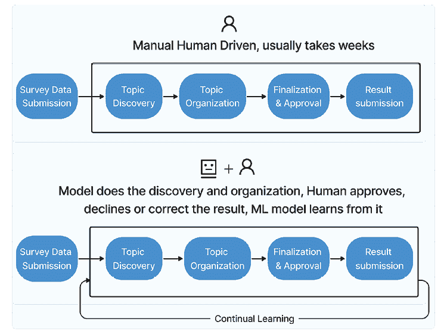

图 8.1：全人工流程与带有持续学习的机器学习增强流程的对比

毫无疑问，`ML` 系统通过学习不断改进其知识，为组织提供了一种更快速、更稳健的机制。与完全依赖人工系统相比，它具有巨大的优势。这种优势的一个重要方面是 `ML` 系统的期限是无限的。对于人类员工来说，他们的任期和相关的专业知识往往随着他们离开组织而结束。这种离开会留下知识缺层，在培训或入职新员工时，这种代价通常是高昂的。另一方面，在人类专家帮助下不断学习和改进的 `ML` 模型随着时间的推移保留知识。这种知识留存提供了独特的优势，使得机构知识可以无限期保留，而传统方法中的人类员工及其专业知识会随着时间不断变化。从本质上说，持续学习可以释放任何 `ML` 系统的无限可能，并长远来看成为企业的一项极价值投资。

然而，有效实施持续学习面临着一些显著挑战。首先，`ML` 模型必须获得高质量、具有代表性的数据以支持持续学习。如果数据存在偏差或未能捕捉程序空间中的关键变化，模型的学习和适应将是有缺陷的。此外，持续学习系统需要细致的监控和治理，以确保模型不会随着时间的推移而产生有害的偏差。持续的人工监督至关重要，但这是耗费力的。此外，虽然模型的知识持续存在，但整合并执行这些学习仍然取决于相关的人类开发者和领域专家的能力。

因此，虽然持续学习对 `ML` 系统和企业都具有重大的长期价值，但实现其全部潜力需要缓解围绕数据、监控和集成的关键挑战。通过细致的实施，持续学习不仅让组织能够优化流程并实现更快的决策，还能通过降低与员工流失相关的风险来确保可持续性。然而，必须解决这些局限性，以便在最小化风险的同时随时间推移获得全部收益。通过这种方式，对持续学习的优势和挑战的平衡理解将使组织能够制定有效的策略，并在不断变化的技术格局中适应并生存。

## 持续学习的必要性

为了理解持续学习的必要性，让我们回顾持续学习的一些优势及其对机器学习的影响：

### 适应性

在许多初级机器学习应用中，随着更多数据不断流入系统，底层数据分布可能随时间推移保持相对稳定。然而，在许多现实应用中，存在数据漂移或概念漂移的情况，输入数据经历了动态转换，数据的统计特性或变量之间的关系随时间发生了变化。这包括但不限于推荐引擎和异常检测系统，它们持续摄入新的数据序列，这些数据的分布也可能发生偏移。此外，这些系统的周围环境和运行条件通常会动态演变。这些具有数据漂移和概念漂移的动态场景强调了持续学习的重要性，以确保模型能够适应并确保准确的预测。

### 可扩展性

我们人类产生数据的规模如果继续相同的数据生产轨迹，可能会面临数据生产不足的情况。在这种场景下，我们必须在持续学习上投入。`ML` 系统以保持预测的相关性，这需要投入持续学习。在这种场景下，关键是实时处理所有进入的数据，并只存储需要的信息。

### 相关性

`ML` 系统预测的相关性不言而喻。它们需要通过持续学习来适应不断变化的环境。

### 性能

投入持续学习可以使 `ML` 系统性能得到提升，以适应变化的数据。换句话说，保持相关性可以提高 `ML` 系统的性能。这将转化为更有意义和有价值的输出。

考虑到这些原因，显然运行动态环境的项目可以从持续学习中获益。此外，在 `ML` 系统设置中缺乏持续学习可能会引入重大风险，极大地限制 `ML` 投资的价值实现。形成鲜明对比的是，仔细设置和持续学习过程可能是成功的关键。

## 持续学习的原则：无状态重训和有状态训练

持续学习一词有时会让人们认为是在几分钟或几小时内频繁更新模型。这个话题带有一种负面含义，因为大多数专家认为大多数组织不需要频繁更新模型，因为它们在那个范围内收集不到足够的新数据。

持续学习不仅关于重训频率；这种学习过程是增量且自适应的，使模型能够更新知识而不丢失之前的学习信息。这可以通过无状态重训和有状态训练来解释。在`无状态重训`中，模型每次都从头开始训练，如果我们在最近一个月的数据上重训模型，并决定每 15 天训练一次，那么使用的数据将是最近一个月数据的滑动窗口。而在`有状态训练`中，模型以增量方式继续在新的数据上进行训练。

在 `MLOps` 的情况下，做出这一决定至关重要，因为它影响了训练资源的需求。每次从头开始的`无状态重训`模型比`有状态训练`需要多得多的数据存储和处理，而有状态训练允许我们使用更少的数据来更新模型。

> **注意**：有状态训练并不意味着任何从头开始的训练。理想的策略是将从头重训和有状态训练以增量格式相结合。成功的有状态训练还需要偶尔在大量数据上从头重训模型以校准。

一旦我们建立起支持无状态重训和有状态训练的基础设施，训练频率就变成了一个可以随时调节的旋钮。我们可以每小时、每天更新一次模型，或者在检测到分布偏移时随时更新。持续学习的核心在于建立一套基础设施，让数据科学家或机器学习工程师能够在任何需要的时候更新模型（无论是从零开始还是微调），并快速部署这些更新。

与任何其他概念一样，持续学习在实现最终目标方面也面临着挑战。用于持续学习的 `MLOps` 工具正在不断成熟，这将使这些克服，并让适应持续学习变得像批学习一样简单。在下一节中，我们将学习其中的一些挑战。

## 持续学习面临的挑战

持续学习在许多用例中具有前景，许多公司已经实施并取得了良好效果。然而，仍然存在几个关键挑战。本节将探索三个持续阻碍持续学习更广泛采用的三大障碍：

*   获取新数据
*   评估模型性能
*   优化的算法

尽管已经取得了巨大进展，但克服这些障碍对于未来充分释放持续学习的潜力至关重要。

### 获取新数据

持续学习的首要挑战是持续地获取新数据。为了每小时更新一次模型，我们需要每小时都有新数据。许多公司目前从数据仓库提取新的训练数据。但存在一个依赖关系：从数据仓库获取新数据取决于数据摄入仓库的速度，如果数据来自多个源，这个速度可能会很慢。解决此问题的方案是直接从 `Kafka` 或 `Kinesis` 等实时流中提取数据，这些工具通常在数据到达仓库之前就将其从源传输到仓库。

通常，仅仅获取新数据是不够的。如果模型需要标注数据进行训练，那么这些数据也必须经过标注。由于大多数标注工作是手动完成的以确保顶级质量，这有时会成为问题。标注速度限制了训练数据的可用速度以及模型训练的速度。解决此问题的方案是对具有自然标签的用例（如库存预测、广告点击预测、预计到达时间（`ETA`）预测等）使用持续学习框架。

为新数据和快速标注构建高效的流式基础设施需要大量的工程投入。实现持续学习的工程工作超出了 `MLOps` 的范畴，需要一套流式优先的基础设施和架构，以访问新数据并从实时传输中提取快速标签，这是极其复杂且往往成本高昂的。

### 数据质量与预处理

如上文所述，持续学习的主要挑战之一是获取新数据，然而仅仅获取更多数据对于有效的持续学习是不够的。数据的质量和预处理也是关键因素。

输入数据可能包含噪声、缺失值、离群值以及必须处理的不一致性。低质量数据会导致模型更新偏移。在训练之前，可能需要对流式数据进行清洗、归一化、特征工程和数据增强等预处理步骤。基础设施必须支持大规模的近实时数据质量检查和预处理。数据质量和监控应该成为持续学习流水线的组成部分。

从采集到模型更新整个数据管道应该精心设计，以支持来自动态数据流增量学习。在生产环境中实现稳健可靠的持续学习，需要一种涵盖数据和模型管理的整体方法。

持续学习最大的挑战不是编写更新模型的代码。代码很容易。真正的挑战是在部署之前确保每次更新都是良好且安全的。正如我们长期以来看到的，错误的机器学习可能导致巨大的危害，从不公平的贷款拒绝到致命崩溃。风险随着持续学习而增加。更频繁的更新意味着更多的失败机会。

此外，在线学习使模型容易受到操纵和攻击。真实世界的数据为用户诱骗模型学习错误的内容打开了大门。2016 年，微软的机器人 `Tay` 在受到恶意攻击者的轰炸后开始发表种族歧视和攻击性的推文。微软在短短 16 小时后就关闭了 `Tay`。

每次更新在上线之前必须经过彻底测试，以防止类似的失败。评估需要时间，这会减慢更新速度。持续学习要求在测试和评估上严谨，确保每次更新可靠。速度很重要，但安全第一。在不损害稳健性的情况下快速评估的工具和技术仍然活跃的研究领域。

### 优化的算法

与获取数据和评估模型相比，算法挑战仅影响某些频繁更新的模型（例如每小时）。为了理解原因，对比神经网络和基于矩阵的模型（如协同过滤）。由于其固有的灵活性适应性，神经网络可以使用任何大小的数据批次或样本进行更新。神经网络是通用函数近似器，可以不断修改其权重和偏置以适应新数据。多层感知器和卷积神经网络等架构特别适用于增量和持续学习场景。

相比之下，协同过滤等矩阵模型必须在降维之前构建完整的用户-物品矩阵。频繁执行整个过程太慢且计算昂贵。像 `Singular Value Decomposition` (`SVD`) 这样的矩阵分解技术需要完整数据集来进行分解。这使得频繁的增量更新变得不可接受。

神经网络由于能够增量修改权重和偏置，可以轻松适应持续学习。然而，矩阵和树模型没有具有同样的灵活性。某些算法有所帮助，例如增量构建决策树的 `Hoeffding Tree` 算法。然而，它们的使用限于某些模型类型。不仅是核心算法，特征工程也必须与部分数据配合。

特征通常使用 `min`、`max` 和 `variance` 等统计量进行缩放。这些统计需要对数据集进行完整扫描。对于小子集，统计量在批次之间波动巨大。因此，模型可能无法跨批次泛化。为了保持统计数据的稳定，可以在数据流运行时增量地计算它们。移动平均可以近似最终统计结果。


# 第 8 章 持续学习与 MLOps

像 `sklearn` 这样的框架提供了 `partial_fit` 来计算运行统计。但内置选项有限。替代库如 `Spark Streaming`、`Kafka Streams` 和 `Samza` 提供了更全面的流处理和增量处理。这些工具包含了管理数据流、计算增量统计和模型更新的功能。

总之，某些算法对持续学习的适应性高于其他算法。由于其增量学习能力，神经网络最具活性。矩阵和树模型需要特殊的处理或替代的在线学习算法。特征工程也需要重新思考以适应部分数据。框架提供了帮助，但与流式库相比仍有不足。算法和工具将随着时间的推移而改进，以更好地支持持续学习。

到目前，我们已经讨论了持续学习及其重要性以及面临的挑战。接下来，我们将讨论在为模型开发实现 MLOps 架构和基础设施时，如何克服这些挑战。

对于大多数组织而言，从持续学习开始实施 MLOps 可能并不是最佳的初始策略。对于此类用例，最好将训练和部署过程视为一个线性过程开始。然而，某些特定的用例和行业（例如实时推荐引擎或异常检测系统）由于其特定的应用场景，可能从一开始就需要持续学习能力。是从一开始就采用持续学习，还是从线性过程开始再转向持续学习，应该取决于具体的用例和业务需求。

在开始阶段，大多数机器学习团队的重点不是持续学习，而是开发能够解决当时特定业务问题的模型。在这一阶段，准备定期更新的模型并不是首要任务。大多数时候，模型是在可用数据集上进行训练、测试并部署。虽然这种训练和部署的线性过程最初对某些组织是可行的，但随着需求的不断，它会随着时间的推移演变为更复杂的持续学习方法。

对于大多数组织，一旦我们解决了试图通过该模型解决的特定问题，持续学习的想法就会变得重要。现在是时候对无状态重训（`stateless retraining`）或有状态训练（`stateful training`）做出决策了。

## 无状态重训 vs. 有状态训练

在无状态重训的情况下，MLOps 流水线与任何训练流水线一样简单：获取过去 X 时间段的数据，进行清洗、准备、特征提取、训练并验证模型。就绪后，增加版本，如果模型通过了部署的测试和验证，则将其部署到推理环境中。

如果我们选择继续进行有状态训练，流水线的步骤需要有所不同，特别是初始数据准备步骤，并且流水线需要重新配置。我们最需要的是思维的转变。目前，从头开始无状态重训已成为一种常态，组织习惯了机器学习团队在模型准备好后将新模型版本交给工程团队进行部署。在这种情况下，基础设施完全没有设置为启用有状态训练，在实施有状态训练之前需要首先解决这个问题。

为了启用有状态训练，我们首先需要一种追踪数据和模型血缘（`lineage`）的方法。我们需要对数据设置检查点（`checkpoints`），以标记哪个模型版本正在哪些数据上训练、训练到什么程度，以及使用了哪个基础模型版本来训练新版本。`MLflow` 是存储这些关于模型版本的检查点的好地方，同时可以存储指定基础模型版本、用于训练模型的数据时间点等元数据。一旦我们决定训练新的模型版本，我们就需要获取这些元数据，并确保能够定位这些之前的检查点，并在从检查点开始使用数据继续训练之前，将模型加载到内存中。

现在，我们需要建立触发模型更新的机制。正如上一章所述，触发器可以是基于时间的、基于性能的或基于漂移（`drift`）的。如果我们使用基于性能或漂移的触发器，我们需要一个健壮的监控解决方案来持续收集数据、检测信号并相应触发重训流水线。我们将在下一章介绍监控和可观测性。

从定期从头重训模型转变为持续更新模型，可能涉及重大的技术和流程复杂性。预先投入资源构建组织对齐和应对这种转变的能力是非常关键的。

最后，使用 `Git` 或 `DVC` 等工具进行版本控制对于 MLOps 中的实验追踪、可复现性和模型血缘至关重要。这对于有状态训练尤为关键，因为新模型版本是在旧版本的基础上增量构建的。通过尽早引入机器学习产物的版本控制，组织可以为更受控的持续学习能力扩展奠定基础。

## 触发持续学习的模型重训

持续学习流水线倒数第二最重要的步骤之一是触发模型的重训。ML 流水线已为持续学习做好了准备，正在处理以下任务：

* 我们拥有数据。
* 实验正在运行训练。
* 预测正在被收集和监控。
* 新数据正在被清洗。

接下来，我们必须决定触发模型重训的条件。有多种有效方法可以实现这一点。一种常见的方法是定期重训，即在定期间隔更新模型。例如，开发推荐系统或广告的团队通常选择每 30 分钟或一小时重训一次，以保持模型与最新趋势同步。

或者，我们可以考虑一种更具针对性的方法，仅对新进入的数据进行模型重训。这种方法让我们专注于最相关和最新的信息，从而节省计算资源和时间。

此外，关注模型衰减、模型偏差、低置信度预测或生产环境中的任何其他警报也可以作为重训的触发器。通过积极持续地监控这些指标，我们可以确保模型保持最佳性能并保持无偏。

无论我们使用何种重训方法，自动化机器学习流水线在持续学习中都是一个强大的优势。它允许模型在数据可用时无缝地重训和更新。然而，与任何自动化系统一样，存在需要人工监督的风险和挑战。一个关键风险是失去对何时以及为何触发重训的可见性，如果没有对重训决策和模型版本进行适当跟踪，很容易导致生产环境中出现预测不准或性能下降。

为了减轻这些风险，追踪触发器并对其进行验证至关重要。忽略模型上次重训的时间可能会导致严重问题，并导致预测错误或性能下降。

即使在自动化场景下，保持对重训过程的控制也是不可或缺的。对重训触发器、模型评估指标和部署记录进行健壮的追踪至关重要。这种级别的监督允许我们有效地在生产环境中理解并调试模型。通过理解重训决策，我们可以做出明智的调整和改进，确保模型在现实应用中的可靠性和成功。

总的来说，自动化持续学习的优势是显而易见的，加速实验和减轻维护负担是其中主要的。然而，人工监督仍然不可或缺，以确保模型的透明度、评估重训决策并防止不受控的反馈循环或概念漂移。平衡的方法承认自动化的力量，同时保留了人在回路中的验证。通过周全的流程控制和监控，我们可以利用自动化持续学习随时间提高模型准确性，同时维护生产环境的可靠性。

## 结论

我们在章节开始讨论了持续学习的核心概念，强调了将模型开发范式转向基于持续学习的范式的必要性。

我们探讨了在机器学习流水线和 MLOps 基础设施中成功启用基于持续学习的方法时可能面临的挑战，以及我们如何克服这些挑战以从这一过程中获益。

我们学习了为了建立实现持续学习目标所需的设施和流程，我们可能在模型管理和训练实践的方法上需要做出哪些调整。

我们结束了关于讨论：在考虑适应持续学习和新模型版本的持续交付之前，建立稳健的监控和可观测性基础设施是重要的。在下一章中，我们将介绍监控和可观测性的要求、如何设置这些要求，并使用这些指标来对何时以及如何训练新模型版本并触发训练流水线做出决策。

## 记忆点

- 持续学习使机器学习系统能够不断地学习，并适应变化的数据和环境。这有助于提高性能并随着时间的推移保持相关性。

- 持续学习的关键原理是无状态重训（在数据滑动窗口上从头开始训练）和有状态训练（在新数据上进行增量训练，且不遗忘过去学到的知识）。

- 持续学习的主要挑战包括持续获取新鲜数据、在部署前彻底评估每个模型更新，以及使用针对增量学习优化的算法。

- 为了在 MLOps 中实现持续学习，需要跟踪模型和数据血缘/检查点、建立如时间或性能漂移之类的重训触发器、验证并理解每个重训决策，并对自动化重训过程保持控制。

- 在采用持续学习之前，稳健的监控和可观测性基础设施至关重要，以便理解何时触发重训以及评估模型更新。

- 最终目标是使重训和部署更新模型尽可能简单自动化，同时维护安全性、透明性和控制。

## 关键术语

- **持续学习 (Continual learning)**：持续学习（也称为增量学习、终身学习）是一种按顺序学习大量任务模型的概念，而不忘记从先前任务中获得的知识，且在训练新任务时，旧任务的数据不再可用。

- **灾难性遗忘 (Catastrophic forgetting)**：灾难性遗忘是指神经网络在学习新信息时，会完全且突然地忘记之前学习信息的问题。

- **无状态重训 (Stateless retraining)**：在无状态重训中，模型每次都从头开始训练，如果我们在最后 1 个月的数据上重训模型并决定每 15 天训练一次模型，那么所使用的数据将是最近一个月的数据作为滑动窗口。

- **有状态训练 (Stateful training)**：在有状态训练中，模型仅以增量方式在新数据上继续训练，而不会忘记在之前的迭代中学到的内容。

加入我们书籍的 Discord 空间

加入书籍 Discord 工作空间获取最新更新、优惠、全球科技动态、新发布以及与作者的交流会议：

`https://discord.bpbonline.com`


# 第 9 章 持续监控、日志与维护

## 引言

在本章中，我们将深入探讨跨所有环境监控机器学习模型的基本原理。监控机器学习系统的核心目标是培养机器学习（ML）模型的信任感、透明度、清晰度和可解释性，这些对于增强机器学习的业务影响都是至关重要的。

一旦机器学习模型部署到生产环境中，质量的潜在下降可能会发生且毫无预警。有时等到检测到时已经太晚了。这就是为什么我们需要记录模型所做的一切操作，并持续监控系统。此外，这也是模型监控成为机器学习模型生命周期中重要的一程，也是 MLOps 不可缺的一部分的原因。如果没有广泛的监控系统，模型或 ML 系统的部署将缺乏信任和价值。性能监控是 ML 系统最关键的部分之一。它使我们能够以定性和定量的方式细致分析并绘制 ML 系统为利益相关者提供的业务影响映射。

实现最大的业务影响取决于以最方便的方式为 ML 系统用户提供服务，让他们能够按照预期方式使用机器学习系统并产生实际价值。

## 结构

在本章中，我们将讨论以下主题：

- 机器学习中监控的关键原理
- 为什么模型监控非常重要
- MLOps 工作流中的监控
- 模型监控框架

## 目标

本章的目标是理解监控和日志记录的原理。持续监控机器学习系统的重要性、其影响以及它是如何融入 MLOps 工作流的。

## 机器学习中监控的关键原理

随着对数据驱动且适应不断变化的环境和监管框架的产品需求日益增长，在人工智能（AI）和 ML 系统中建立信任是非常重要的。许多机器学习项目未能为业务创造价值的失败原因之一，是其决策过程缺乏信任和透明度，以及模型性能随时间推移缺乏一致性。为了建立这种信任并提供透明度，我们需要跟踪模型的每一个动作及其操作。为此，我们需要建立稳健的监控基础设施。

在接下来的章节中，我们将介绍在监控机器学习模型时应该遵循并跟踪的一些关键原理。

### 模型漂移 (Model drift)

我们生活在一个动态变化的世界中。由于此，部署机器学习模型进行预测的环境和数据正在不断演变。跟踪这些变化以及它们如何影响我们的模型至关重要。漂移与环境变化有关，指的是预测 ML 模型性能的下降以及变量之间关系的劣化。

以下是关于模型和数据的四类模型变化：

#### 数据漂移 (Data drift)

这发生在我们研究的因素特征发生变化时。例如，数据可能会因为用户的新行为或为了满足消费者需求引入新产品而改变。为了检测数据漂移，可以使用 `Kolmogorov-Smirnov` 等统计检验来比较新数据与训练数据的分布。`Evidently` 等数据监控工具也可以自动监控数据漂移。缓解数据漂移的策略包括在新数据上重训模型或使用持续重训等技术。

#### 特征漂移 (Feature drift)

这发生在特征属性随时间发生变化时。例如，温度随季节变化。与夏天或秋季相比，冬天更冷。所以，如果有一个预测能源消耗的模型，温度的波动和变化可能会改变正在使用的特征。通过监控随时间变化的特征分布可以检测特征漂移。添加自动化测试来验证特征值也有帮助。为了缓解这一问题，在输入模型之前可能需要对特征进行转换或归一化。

#### 模型漂移

模型漂移是指依赖变量的属性发生了变化。例如，在欺诈检测机器学习系统中，这意味着欺诈检测的分类发生了变化。模型漂移通常通过模型性能指标的下降来衡量，如准确率、精确率或 `AUC`。可以使用新的验证数据集来测试模型漂移。在新数据上进行重新训练是解决模型漂移的主要方法。

#### 上游数据变化

这是指数据流水线发生数据变化的情况，例如某个特征不再被采集，导致信息缺失，从而影响模型的行为和最终输出。监控数据流水线的架构（`schema`）变化可以检测上游漂移。为必要特征添加验证也有帮助。缓解措施包括更新数据流水线、填充缺失值或重新训练模型。

### 模型透明度

人工智能本质上是非确定性的。特别是机器学习，在其生命周期内不断进化、更新和重新训练。机器学习和人工智能正在影响几乎所有的行业和领域。随着机器学习在日常流程中的采用日益增加，以及重要决策使用机器学习系统做出，建立与我们对确定性系统相同水平的信任至关重要。

模型透明度旨在致力于构建对机器学习系统的信任。其目的是确保公平性，尽可能消除偏见，并通过审计系统做出决策的端到端过程以及解释模型做出某些预测和系统决策的原因，保持系统的属性。

有几种具体的策略和技术可以增加机器学习模型的透明度：

*   可解释人工智能 (XAI)：像 `LIME` 和 `SHAP` 等 XAI 技术可以帮助解释深度神经网络等黑盒模型做出的单个预测。它们可以识别导致特定预测的关键输入特征。
*   可解释模型：使用具有固有解释性的模型（如 `linear regression`、`decision trees` 或基于规则的系统）来代替黑盒模型。它们的工作原理可以用人类理解的方式进行解释。
*   模型内省：通过边缘案例测试、`saliency maps` 和对抗性示例等技术分析模型本身以识别缺陷。
*   量化不确定性：在预测中添加置信区间和不确定性估计，以便知道模型何时不确定。
*   数据来源：对数据采集和预处理步骤进行详细记录和文档，使数据的起源和准备过程透明。
*   可审计性：包括允许对整个机器学习流水线进行独立审计，涵盖数据、模型训练代码、模型优化步骤和最终模型评估。
*   解释性基础设施：使用如 `MLflow` 等开源库捕获模型解释性数据，以便进行一致的模型监控和审计。

随着机器学习变得越来越普及，采用这些可解释和透明的人工智能最佳实践将至关重要。它们有助于建立用户信任、减少偏见，并在发现可疑模型行为时提供救济措施。

### 模型偏差

模型偏差是由于数据集（用于模型训练）中某些特征的代表性或/或权重高于其他特征而导致的一种错误。不准确、不平衡或偏差的数据集可能导致模型生成的预测偏移，且准确率可能较低。换句话说，这是由于机器学习模型做出的错误假设导致的错误。高偏差会导致预测不准确。

### 模型合规性

随着政府对 AI/ML 系统实施监管，确保模型合规在过去几年中变得越来越重要。如果模型不合规，可能会导致罚款和对社会的损害。机器学习系统可能需要遵守的一些关键法规包括：

*   通用数据保护条例 (`GDPR`)：它规定了个人数据的使用，并为欧盟公民提供权利。MLOps 可以通过妥善管理数据来确保符合 GDPR。
*   健康保险可携带性与责任法案 (`HIPAA`)：它监管受保护的健康信息。MLOps 可以通过对患者数据进行适当的去标识和匿名化协助符合 HIPAA。
*   萨班斯-奥克斯法案 (`SOX`)：它规定了上市公司的财务报告。MLOps 可以实现 SOX，展示模型是如何开发、测试和验证的。

将监管合规性运营化正变得越来越重要。对机器学习系统进行端到端审计对于监控至关重要。MLOps 通过跟踪所有模型的清单、配置、输入和性能指标，可以在促进审计方面发挥至关重要的作用。通过适当的 MLOps 实现，组织可以通过设置检查、监控模型漂移和生成详细报告来实现合规性的运营化。总体而言，MLOps 是扩展合规 ML 部署并避免陷阱的关键。

## 为什么模型监控很重要

在 MLOps 世界，跟踪模型迭代并持续监控模型性能以及整个机器学习系统至关重要。然而，同样重要的是要意识到不同组织利益相关者的监控需求是不同的。

让我们来看看不同利益相关者的一些优先事项。

### 针对 DevOps 或基础设施团队

对于 DevOps 或基础设施团队，主要的关注点是基础设施需求和系统性能，包括以下问题：

*   模型是否在硬件上运行正常且完成任务的速度足够快？
*   系统使用的内存和计算能力是否低于阈值？

这些监控指标是任何系统性能监控的标准，如果 DevOps/基础设施团队尚未这样做，他们可以很好地监控这些。机器学习系统使用的基础设施资源（存储和计算）与任何其他技术系统没有显著区别。因此，监控这些资源的指标实现已经过充分研究并趋于成熟。但并不是全部；机器学习系统可能由于许多其他原因或依赖关系虽然满足这些要求但仍然无效。

### 针对数据科学或机器学习团队

对于机器学习工程师和数据科学家，监控的兴趣在于检测和跟踪模型漂移和退化，并监控模型性能以确定它们是否正在退化。这种情况下最常用有两种方法：基于真值的过程或基于输入漂移的检测。从高层次理解每个概念对于促进对话和根据监控指标检测问题至关重要。

#### 真值

我们知道模型做出的预测，但除此之外，如果我们能知道所有这些预测的真实值（`ground truth`），将有助于我们比较并计算模型的性能表现。有时，我们可以在预测后很快发现真实值。例如，在推荐系统中，如果网页上向用户展示了某个推荐，用户点击了该推荐并最终购买，那么我们将立即得知最终结果和真实值。

但在许多情况下，获取真实值需要更多的时间，这使得很难及时、持续地监控系统的性能。等到我们获得可用于比较的真实值时，可能在发现模型性能下降并发出警报时已经太晚了。

如果我们需要快速反馈，将“输入漂移”（`input drift`）作为监控模型性能漂移的方法可能会更好。

#### 输入漂移

输入漂移监控和性能计算基于这样一个观点：只有当训练数据准确反映了我们在生产环境中将看到的数据类型时，模型才能提供良好的预测。因此，如果我们将模型最近的一些请求或输入与其训练时的数据进行比较，如果它们之间差异很大，那么模型性能很可能不佳，模型可能会退化。

这就是我们检查输入漂移的原因。进行此类计算所需的所有数据在接受的时间范围内已经可用。我们可以持续地监控系统，而无需等待可能被延迟的真实值数据。

### 对于业务利益相关者

业务利益相关者并不关心模型在使用什么种资源，或者正在接收什么种输入数据。在监控方面，他们的方法更具整体性，他们可能会提出以下问题：

*   模型是否为组织交付了承诺的价值？
*   投资回报率（ROI）是多少？使用该模型及其提供的优势是否大于开发和运行该模型的成本？


通常，业务利益相关者会准备一组 KPI 来量化任何项目的成功。这些 KPI 也是此类监控和报告的一部分。如果这些数字能够被自动跟踪和监控是最好的，但这并不总是容易实现的。关键考虑因素是，在某个时刻，正在使用的机器学习项目将不再正常工作，模型重新训练将变得不可避免。现在当这种情况发生时，大多数情况下，它是模型和系统本身无法控制的。此外，它取决于输入数据和整体环境的变化速度。另一个考虑因素是重新训练模型所需的精力以及该改进的 ROI。如果安排训练数据、在该数据上进行重新训练、评估并部署模型很容易，那么我们可以比需要投入更多精力时更频繁地重新训练。

## 对于法律和合规团队

法律和合规团队对监控模型性能有浓兴趣，以确保模型符合围绕公平性、可解释性和数据隐私的监管要求。这些团队的关键监控需求包括：

* 监控模型输出，寻找是否存在针对保护群体的不公平偏见或歧视的迹象。
* 通过监控人类对模型输出和决策的理解程度，评估模型的可解释性。
* 追踪哪些数据被用于合规。

## MLOps 中的监控

如前所述，监控对于 MLOps 至关重要，可以确保系统按预期运行。需要跟踪的一些关键指标包括：

### 指标类型

机器学习系统中存在某些特定的指标类型。这些是：

* **计数（Counter）**：该指标在计算任何类型的项目时非常有用。它可以帮助遍历项目。例如，这对于计算每列的空值可能很有用。
* **计时器（Timer）**：计时器在确定处理持续时间非常优秀。这对于性能监控至关重要，因为它的核心职责是衡量操作期间花费的时间。计时器使用的一个示例是，如果我们有一个托管模型，计时器可以帮助捕获模型生成预测花费多长时间。
* **数值（Value）**：当计数器和计时器不适用于捕获的指标时，数值大有用武之地。例如，数据库的大小或存储在 `S3` 中的文件大小，这些是产生并被用于训练模型的。

通常，机器学习模型需要在两个层面进行监控：

### 基础设施资源级

这包括确保模型在主生产环境中正常运行。关键问题包括：

* 系统存活吗？这可以通过心跳指标进行监控，我们按一定间隔发送 API 调用，查看是否仍获得正确的 `HTTP 200` 响应。
* 其他基础设施指标如 `CPU`、`RAM`、网络使用情况和磁盘空间都在阈值以内，且符合预期。
* 请求是否以预期的速率处理，响应延迟是否在阈值以内？

### 模型性能级

这是在一段时间内监控系统的性能，以确保一切符合预期。一些重要问题包括：

* 模型是否仍在接收用于决策的输入数据，这些数据与用于训练的数据类型一致，且尚未出现模型漂移？

```
图 9.1: 监控与治理
```

* 模型性能是否仍然高于模型开发期间使用的阈值和基准，或者其性能是否发生了负面变化？

正如我们所知，第一层是基础设施或 DevOps 团队的领域。他们可以引导这些指标和检查的实施。我们不会深入这些主题的细节。第二层对于数据科学家和机器学习工程师非常重要。对这些指标进行持续的模型性能监控有助于跟踪模型下降；如果性能低于可接受的阈值，系统还将触发带有最新的训练数据对模型进行重训练的流水线。

# Logging

监控任何系统（而不只是机器学习系统）意味着尽可能多地收集、聚合和可视化其状态数据。随着日益复杂的机器学习系统被用于生产环境进行决策，这些系统的基础设施需求也变得复杂。因此，一个健壮且详细的日志系统至关重要。为了有效分析和监控日志数据，必须将来自运行模型的所有环境的数据进行集中化。理想情况下，这应该是自动发生的，但如果没有，至少在需要时手动进行。这是实现机器学习系统持续改进的关键组成部分。

日志是包含某些系统状态相关信息的记录，并带有一个时间戳将其与特定时间段联系起来。这对于任何信息系统都是如此，而不仅仅是特定的机器学习系统。为了让我们理解系统，此日志事件需要的信息可能包含以下元素：

* **模型元数据 (Model metadata)**：包括模型标识、部署的环境以及当前实现的版本。
* **模型输入 (Model inputs)**：该特定事件中模型的输入值。这允许我们判断值是否符合模型预期和训练的类型，或者数据值是否发生了变化。这有助于理解模型性能如何与输入数据相关，并允许我们检测数据漂移。
* **模型输出 (Model outputs)**：顾名思义，输出值是模型做出的预测。将这些值与真实值（ground truth）比较时，我们可以对模型在该环境中的性能得出结论，这也是决定我们是否应该选择重训练模型还是等待的重要数据点。
* **系统操作 (System action)**：系统操作是告诉我们对模型提供的预测采取了什么操作，或者预测如何影响系统状态的数据点。例如，在垃圾邮件检测系统中，如果模型认为某封邮件是垃圾邮件的概率很高，系统就会采取行动将邮件标记为垃圾邮件并移动到垃圾邮件箱，而不是收件箱（除非用户专门检查垃圾箱，否则无法直接看到它）。
* **模型解释 (Model explanation)**：在当今环境中，由于许多重要且高风险的决策由机器学习模型做出或影响，模型解释性变得非常重要，特别是在医疗保健或金融等领域。能够弄清并审计系统是如何做出特定决策的以及哪些特征对预测影响最大变得至关重要。

除了上述信息外，记录足够的信息以便我们找出哪里出了问题也很重要。如果模型用在一个直接与用户交互或影响用户行为的平台中，在记录其他日志事件的同时，记录用户的上下文也是好主意，即用户正在执行哪些操作以及他们如何与模型交互。这里的上下文指的是如应用程序状态、用户在模型预测呈现给用户后立即做了什么以及用户的 Web 会话详情等细节。

设置有效日志系统的一些最佳实践包括：

* 使用结构化日志格式（如 `JSON`），与非结构化文本日志相比，这种格式更易搜索、过滤和分析。`JSON` 日志可以以一致的机器可读格式捕获元数据、时间戳、严重级别和其他字段。
* 根据记录器名称、应用程序名称、环境等因素将日志组织成层次结构。这为定位问题提供了所需的上下文。
* 将来自所有环境和应用程序的日志集中到日志聚合工具（如 `ElasticSearch`、`Splunk`、`Datadog` 等）中，以便访问和分析。这些工具允许搜索、可视化、告警等功能。
* 实现日志轮转和保留策略以避免填充存储空间。旧日志可以存档或聚合。
* 在存储和分析之前，对日志中的任何个人身份数据进行匿名化处理，以保护用户隐私。可以使用哈希、截断、随机化和聚合等技术。向用户明确通知记录了哪些数据以及如何使用。如果可能，为他们提供退出（opt-out）。
* 在实施数据保留政策时咨询当地法规（如 `GDPR`）。仅在必要时保留数据。
* 在收集数据时使用数据掩码技术以遵守隐私法规。这包括对个人数据字段的部分掩码和伪匿名化。

现在从理论上，我们应该记录并跟踪所有这些事件及相关数据点似乎是合理的。但在拥有数百万用户的大型复杂系统中，模型频繁地为所有用户提供服务，记录每个事件和每个细节几乎是不可能的。在这种情况下，遵循分层采样来收集具有代表性的数据点，并且能够理解系统状态会更有意义。我们首先需要决定想要记录哪组事件，然后只记录每组中特定百分比的事件。在这里，组可以表示为用户的子集或会话子集等。

收集所有这些用户活动数据与模型交互数据的另一个重要方面是这些数据的治理。应该让用户意识到记录了什么类型的数据、数据如何被使用以及存储多久，以及如果他们愿意，他们退出此类数据收集的可能性。某些治理政策还要求我们匿名化或聚合用户数据点，因此无法定位特定用户。治理控制还要求我们管理谁以及如何访问这些数据，以及谁在什么期间有权访问数据。不同地区也有不同的数据保留政策，例如欧洲的 `GDPR`、美国的 `CCPA` 等。

# Model evaluation

一旦日志基础设施和健壮的日志系统准备就绪，我们将定期从生产环境获取数据，跟踪其性能情况，并配备告警和可视化以帮助监控。一切一切已经运行良好了一段时间，然后触发了某一天的数据或模型漂移告警。例如，我们可能会收到输入数据分布偏离训练数据分布，或模型预测性能低于可接受阈值的告警。我们知道模型性能正在下降，需要我们的关注。

模型进入审核阶段；我们审查可用的监控数据，并决定模型需要重新训练。随后，数据收集、准备和重新训练流水线被触发，从而准备出一个新版本的模型，该模型在测试数据集的评估中也表现良好。现在，根据整体机器学习基础设施的成熟程度，我们有两个可用选项：

* 我们可以在生产环境中更新模型，并持续监控其性能表现。
* 我们使用以下流程之一转到在线评估设置：
    * 冠军/挑战者测试法（Champion/challenger testing method）
    * A/B 测试设置

无论我们是决定在部署前进行离线评估，还是使用上述流程之一进行在线评估，评估模型对于维持性能至关重要。模型评估提供了一个结构，允许我们在整个模型比较生命周期中集中管理使用的数据，从而能够比较不同的模型或模型版本。

## 监控工作流的步骤与决策

在 MLOps 工作流中，我们需要对模型的评估、测试和监控做出某些决策，以便正确使用这些组件，对模型性能以及部署到生产环境做出良好的决策。

### 在模型评估、测试和监控之前

我们应该有一个清晰的 KPI 或指标，用于衡量并想要优化的模型性能。该指标需要是量化的，例如推荐接受率或点击率。

接下来，我们需要确定一个用于量化这一性能指标的样本群体（cohort）。我们可以从总用户群中选择一个用户细分，并确保该细分是平衡且具有代表性的。这可能只是随机拆分，也可以应用更复杂的细分方法，以确保所选子集没有偏差。

现在，由于我们已经有了想要使用的性能指标和想要用于此类计算的用户群体，我们需要一个统计协议来比较得出的指标，并根据此拒绝原假设，或者认为模型需要重新训练。

为了得出稳健的结论，我们需要提前定义样本量和群体，我们还需要固定测试持续时间，以便根据这些观察结果做出明智的决策。

### 在评估和测试期间

在评估过程中，我们需要确保测试在所选测试时段内全程运行。这是确保我们拥有可以可靠使用的、符合统计标准的测试的唯一方法。有时，统计测试开始显示显著的指标差异，我们可能会在中途停止测试。这种做法可能会产生不可靠且可能带有偏差的结果，因为我们正在“挑选樱桃”（cherry-picking）想要的结果。

### 在评估和测试之后

只有在测试时长结束后，我们才进入评估的最终阶段；现在我们可以检查结果数据，并确保其质量足以做出明智的决策。完成后，我们可以运行预决定的统计测试。如果指标差异在统计学上显著优于新模型（候选模型），我们将继续用新版本替换当前版本的模型。如果差异显著优于旧版本，则候选模型挑战失败，不应部署到生产环境，而应被丢弃。这使我们回到了需要重新评估的阶段，看看我们希望如何改进之前的模型，并周而复始。

## 模型监控框架

市场上有很多许多库和框架（包括开源和专有的），均可用于模型性能监控。我们将在本节中概述一些开源库和框架，并介绍这些框架如何集成到用于训练、测试和部署的 MLOps 工具中。

### 框架

广义上，框架是指概念、实践或工具的集合，为在任何特定领域设计、构建和解决特定问题提供基础。在模型监控领域，有各种框架和库可以帮助数据科学家和机器学习人员跟踪机器学习模型的性能、可靠性和行为。`Whylogs`、`Evidently` 和 `Alibi Detect` 是我们将在后续章节中介绍的一些流行框架。

### Whylogs

`Whylogs` 是一个用于机器学习模型和数据流水线日志记录的开源库。它提供了数据质量和随时间性能的可视化。`Whylogs` 生成数据集摘要，称为 `whylogs profiles`，为我们提供数据视图。其部分功能如下：

* 开源的高性能统计日志库
* 支持 Python 以及 `Apache Spark` 环境
* 能够捕捉指标并监控数据质量
* 适用于结构化或非结构化数据
* 该库与平台无关，因此极易与任何平台集成
* 库本身没有直接提供告警机制

### Evidently

`Evidently` 是一个帮助数据科学家和机器学习工程师从验证到生产评估、测试和监控数据及模型的开源 Python 库。`Evidently` 可以很好地处理表格数据以及嵌入。此外，Evidently AI 是该框架和开源库背后的公司，他们提供了一种云服务来简化流程，但如果我们不想或没有监控基础设施，该服务是可选的。`Evidently` 的关键功能包括：

* `evidently` 框架的核心是开源的
* 它可以帮助我们生成关于模型和数据性能的交互式报告
* 它可以捕捉数据漂移（data drift）、目标漂移（target drift）
* 由于与平台无关，易于与任何平台集成
* 它可以直接记录 `MLflow` 指标，从而简化数据的平台
* 一个缺点是它没有提供任何告警机制，因此我们需要建立自己的告警系统。

### Alibi Detect

`Alibi Detect` 是另一个专注于异常、对抗攻击和漂移检测的开源 Python 库。它为表格数据、文本、图像和时间序列提供了在线和离线检测器。该库的一些关键点如下：

* 专注于异常和漂移检测的开源 Python 库
* 能够捕捉表格数据、文本、图像和时间序列数据的漂移
* 漂移检测支持 `Tensorflow` 和 `Pytorch` 后端
* 可以与 `MLflow` 集成并在平台记录指标，便于我们在同一平台聚合所有元数据
* 与所有其他库和框架一样，它没有集成的告警机制。

### 与工具集成

将 `Whylogs`、`Evidently` 和 `Alibi Detect` 等监控框架与 `Apache Airflow` 等 MLOps 流水线工具集成，使我们能够自动化监控，并跟踪所有模型版本以供比较。这种集成能力不仅简化了机器学习模型的部署和监控，还让数据科学家、机器学习工程师和运营团队能够协作，共同确保模型和流水线的健壮性和透明度。这些集成在训练/测试阶段与生产阶段的工作方式可能略有不同。在下一节中，我们将看到针对测试/训练流水线和生产系统可以采取哪些方法。

## 在训练和测试流水线中

对于测试和训练流水线，我们目前讨论中使用的示例工具是 `Apache Airflow`。Airflow 流水线是一个有向无环图 (`DAG`)。这意味着每次执行都会从一个特定的任务开始，并且它始终按正向执行任务，而没有循环。在机器学习流水线中，流水线的成功运行是不够的；成功的流水线可能代表了错误的结果。例如，一个成功完成的 ML 任务可能导致数据漂移或模型性能低于阈值。

处理这种问题的一种方法是将上述任何框架集成到 DAG 中，并监控我们需要的任何指标。这些指标也可以记录到我们的 `MLflow` 运行中，这样做出决策所需的所有数据都已在与特定运行关联的 `MLflow` dashboard 中可用。

## 在生产系统中

一旦模型部署到生产系统中，`MLflow` 可能不是跟踪每次交互指标的好地方。这就是生产级监控和观测性平台大显身手的地方。一个行业标准平台是 `New Relic`。

New Relic 还提供了针对机器学习模型的监控，这使得机器学习工程师和数据科学家能够轻松将模型元数据、指标和输出记录到该平台（该平台可能组织的其他软件团队在使用）。New Relic 支持对数据、告警和相关系统事件创建自动和自定义仪表板。

New Relic 构建并开源了自己的 Python 库 (`https://github.com/newrelic-experimental/ml-performance-monitoring`)。这套工具将允许我们直接从代码监控各种 ML 输出。

可以使用以下命令安装该库：

```
pip install git+https://github.com/newrelic-experimental/ml-performance-monitoring.git
```

一旦正确安装，为了在代码中使用它，我们需要从 New Relic dashboard 获取一个许可密钥，并将其设置为环境变量 `NEW_RELIC_LICENSE_KEY`。假设我们有一个 New Relic 账户，如果没有，我们需要先设置并购买 New Relic 账户。

我们可以通过创建一个包含一组元数据键值对字典来发送某些模型数据，并准备我们需要发送的数据。我们可以使用 `wrap_model()` 函数来封装模型或流水线。此封装器将自动向 New Relic 发送推理数据指标。如果我们想手动控制并发送推理和指标数据，则可以使用 `MLPerformanceMonitoring`。

```python
from ml_performance_monitoring.monitor import wrap_model

metadata = {"environment": "aws", "dataset": "Example Dataset", "version": "1.0"}

features_columns, labels_columns = (LIST_OF_FEATURES_COLUMNS, LABELS_COLUMN)

# 这返回 MLPerformanceMonitoring 的实例

ml_performance_monitor_model = wrap_model(
    insert_key=NEW_RELIC_KEY,
    model=MODEL_BEING_USED,
    model_name=NAME_OF_THE_MODEL,
    metadata=metadata,
    send_data_metrics=True,
    features_columns=features_columns,
    labels_columns="categorical"
)

# 在封装函数上调用 predict 将运行 predict 函数，随后将自动记录推理数据

Y_pred = ml_performance_monitor_model.predict(X=X_test)

rmse = round(np.sqrt(mean_squared_error(y_test, y_pred)), 3)
metrics = {"RMSE": rmse}

# 将模型指标以字典的形式发送到 NewRelic
ml_performance_monitor_model.record_metrics(metrics=metrics)
```

所有这些数据一旦记录，将在 New Relic dashboard 的 ML Model 监控视图下可用。


这是如何使用现有的生产级平台对生产环境中的机器学习系统进行持续监控并报告的一个示例。根据组织中已可用和使用的基础设施，还有其他可以替代 `New Relic` 的类似工具。`New Relic` 的其他替代方案包括：

* `Elasticsearch, Logstash, Kibana (ELK)` 栈：开源日志记录和可视化栈，可以处理海量的 ML 监控数据。
* `Prometheus` 和 `Grafana`：提供了另一种经常用于记录和报告指标的组合。
* `Datadog`：专为云应用和容器设计的监控和分析平台，也可用于 MLOps 和模型推理跟踪。
* `Amazon CloudWatch`：全托管监控服务，与其它 AWS 服务集成得非常好。

在开发和评估期间使用何种监控解决方案以及在生产环境中使用什么，取决于现有工具、数据量、基础设施、可视化需求以及与 ML 部署环境接口的便利性等因素。对 ML 系统所需的指标、日志和可见性有明确的要求有助于引导选择正确的监控和观测性平台。

## 结论

我们在章节开头继续讨论模型监控和日志的核心原则。软件系统与 ML 系统之间的基本区别在于，软件是为了满足规范而构建的，其满足能力不会随时间改变；而 ML 模型是为了满足某些统计目标而构建的，因此性能可能会随时间下降，特别是当输入数据的统计属性发生变化时。

这导致需要持续监控模型的性能漂移，以便及时采取行动改进性能。在可能的漂移缓解措施中，核心手段是使用新数据进行重新训练，而模型修改仍然是一个选项。一旦新模型准备好部署，就可以使用 A/B 测试验证其改进的性能。

我们还查看了一些用于促进模型监控的框架和库。建议尝试这些框架，并选择最符合整体用例和基础设施的一个。除了这些框架和库之外，用于观测的特定平台还取决于组织的整体基础设施成熟度。如果已经存在可用于其他系统日志记录和观测的基础设施设置，那么使用相同的系统进行机器学习观测也是一种良好的做法。这些平台中，频繁使用的包括 `New Relic`、`ElasticSearch` 和 `Prometheus-Grafana`。

无论使用哪种框架或平台，我们在本章讨论的所有原则和指标都具有高度重要性且不依赖于平台。可以使用任何观测性平台进行持续跟踪和监控。

* 模型漂移（Model drift）是指由于数据或环境的变化，模型预测性能随时间退化的现象。监控不同类型的漂移（数据漂移、特征漂移和模型漂移）。
* 模型透明度和可解释性对于建立信任和确保公平至关重要。监控有助于跟踪模型偏差和合规问题。
* 不同的利益相关者（如数据科学家、DevOps 工程师和业务领导）关注不同的性能指标。监控与每个小组相关的指标很重要。
* 记录模型元数据、输入、输出、系统操作和解释对于监控模型性能至关重要。分层采样有助于管理日志量。
* `whylogs`、`Evidently` 和 `Alibi Detect` 等框架可以辅助模型监控。`New Relic` 等工具也具有 ML 监控功能。
* 冠军/挑战者（champion/challenger）和 A/B 测试等模型评估方法允许在部署前通过控制实验验证新模型。
* 监控应该在整个 ML 生命周期中持续进行——包括训练、测试和生产阶段。这允许及早发现漂移和性能问题。
* 在记录和监控模型性能数据时，必须考虑数据隐私和保留策略等治理控制。

## 关键术语

* **Model drift (模型漂移)**：模型漂移是指现实环境变化导致模型预测能力下降。它由多种原因引起，包括数字环境的变化以及随之而来的变量关系变化。
* **Ground truth (真值)**：真值是已知真实或准确的信息，通过直接观察和测量（即经验证据）提供，而不是通过推断提供。
* **Return On Investment (ROI)**：它是净收入与投资之间的比率。高 ROI 意味着投资收益与其成本相比有利。作为一种性能衡量标准，ROI 用于评估投资的效率或比较几项不同投资的效率。
* **Key Performance Indicator (KPI)**：它是一种性能衡量类型。KPI 评估组织或其参与的特定活动（如项目、计划、产品和其他倡议）的成功与。
* **Explainable AI (XAI)**：指 AI 系统为其决策提供可理解的解释的能力。其目标是使复杂的 AI 模型变得透明且可解释，通过特征重要性、基于规则的解释、可视化、自然语言等特征提供对其推理过程的洞察。XAI 对于确保在关键决策场景下 AI 的信任、问责和伦理使用至关重要。
* **General Data Protection Regulation (GDPR)**：它是欧盟（EU）和欧洲经济区（EEA）关于信息隐私的法规。它还监管个人数据向欧盟和 EEA 之外传输。
* **California Consumer Privacy Act (CCPA)**：该法是一项州法律，旨在增强美国加利福尼亚州居民的隐私权利和消费者保护。
* **Sarbanes-Oxley Act (SOX)**：该法旨在增加上市公司的透明度和问责。它对财务报告实施了严格规定，强制要求独立董事和审计委员会，确保审计师的独立性，要求建立强大的内部控制，保护举报人，并对违规行为进行严厉惩罚。

## 加入我们的书籍 Discord 空间

加入书籍 Discord 工作空间获取最新更新、优惠、全球科技动态、新发布以及与作者的交流：

[`discord.bpbonline.com`](https://discord.bpbonline.com)


# 索引

### A

* Airbnb 67
* Airflow 101
* Airflow 有向无环图示例 71-73
* Airflow 初始化 69
* 环境中的 Airflow 70
* Airflow 安装 67, 68
* 在 Docker 中运行 68-70
* 使用 PyPi 执行 68
* Airflow 调度器 69
* Airflow 触发 69
* Airflow Web 服务器 69
* Airflow 工作节点 69
* Alibaba ML Studio 74
* Alibi Detect 193
* Amazon CloudWatch 70, 195
* Apache Airflow 60
* Apache Flink 61
* Apache Kafka 137
* Apache Spark 61
* 架构组件 47, 48
* 开发环境 49
* 生产环境 51, 52
* 暂阶段环境 50
* Argo 73
* 人工智能 (AI) 1
* 资产 45
* 异步模式 130
* AWS Cloud 20
* AWS ECR 64
* AWS ECS 61
* AWS Fargate 128
* AWS Lambda 20
* AWS Rekognition 16
* AWS S3 20
* AWS Sagemaker 19, 20, 74
* AWS Step Functions 20
* Azure 128
* Azure ML 74

### B

* 批量推理 33
* 构建还是购买 78, 79

### C

* 加利福尼亚消费者隐私法 (CCPA) 190
* 金丝雀部署 133
* 金丝雀发布 130, 133
* 灾难性遗忘 167
* Celery 执行器 70
* 聊天机器人 Tay 173
* CI/CD 流水线 62, 142, 143
* 用于 ML/AI 的 CI/CD 流水线 143, 144
* 架构级别 1 144
* 架构级别 2 145
* 架构级别 3 145, 146
* CI/CD 平台 101
* 集群实例池 66
* Comet 76
* 现成软件 (COTS) 解决方案 7
* 计算层 61
* 开发 (Dev) 环境 62, 63
* 集成开发环境 63, 64
* 公有云厂商对比私有数据中心 62
* 概念漂移 150
* 基于容器的部署 128
* 容器镜像 132
* 容器编排 65
* 容器 64, 65
* 持续学习 165-169
* 适应性 169, 170
* MLOps 中的优势 174, 175
* 需要 167
* 性能 170
* 原则 171
* 相关性 170
* 模型重训练，触发 176
* 可扩展性 170
* 有状态训练 171
* 无状态重训练 171
* 持续学习，挑战 172
* 数据质量与预处理 172, 173

### 核心概念与数据

* 新鲜数据，获取 172
* 模型性能评估 173
* 优化算法 173, 174
* 持续交付 (CD) 141, 162, 163
* 持续部署 11
* 持续集成 (CI) 10, 141, 147
* 持续测试 11
* 持续训练 (CT) 141, 150
* 批量训练 150
* 持续训练策略框架 155, 156
* 数据选择考量 159
* 增量训练 150
* 过程 151
* 重训练 150
* 重训练策略 156

### 项目结构与工具

* Cookiecutter data science 92
* Cookiecutter data science 项目结构 91, 92
* cookiecutter 92
* cookiecutter data science 93
* cookiecutter 的必要性 92
* 仓库结构 93-97
* Cortex 75

### 基础设施与平台

* Databricks 19
* 数据目录 93
* Datadog 195
* 数据漂移 150

### 数据工程

* 数据工程 3
* 数据准备 109
* 最佳实践 111
* 派生数据准备 110
* DataRobots 19
* CT 中的数据选择考量
* 用于重训练的数据选择 161, 162
* 动态数据选择 160, 161
* 动态窗口大小 160
* 固定窗口大小 160
* 数据源 105, 106
* 数据源 106, 107
* 数据版本控制 107, 108
* 数据版本控制 (DVC) 101, 107
* 数据仓库 59

### 部署策略

* 部署策略 131
* 金丝发布部署 133
* 多臂老虎机 (MABs) 133, 134
* 静默部署 132
* 单次部署 131, 132

### DevOps 与 MLOps

* DevOps 3, 9, 10
* DevOps 相比 MLOps 9, 10
* 有向无环图 (DAG) 30, 193
* 分布式文件系统 (DFS) 70
* Docker 64
* 容器 64
* 镜像 64
* Docker Compose 65
* Docker 文件 64
* 边缘动态部署 124, 125
* 服务器端动态部署 126
* 容器部署 128
* 无服务器部署 129, 130
* 流式模型部署 131
* 虚拟机部署 126, 127

### 监控与评估

* Elasticsearch 70
* Elasticsearch, Kibana (ELK) 栈 195
* Evidently 192
* 特征 192, 193
* 探索性数据分析 108, 109
* Feast 77
* 特征计算 76
* 特征一致性 76
* 特征工程 110
* 特征处理管道 35
* 特征存储 35
* 离线特征存储 35
* 在线特征存储 35
* 特征版本控制 76
* Fivetran 78
* 模型监控框架 192
* Alibi Detect 193
* Evidently 192
* Whylogs 192
* 欺诈检测 86

### 治理与云

* GCP Vertex AI 74
* 通用数据条例 (GDPR) 106, 183
* Git 8
* Git commit hash 101
* GitHub Actions 101, 147, 148
* Git 大文件存储 (Git LFS) 9
* Google Cloud 19
* Google Colab 20, 63
* Google Kubernetes Engine 128
* Google 远程过程调用 (gRPC) 126
* 治理 186
* Grafana 195
* Guild.ai 76

### 算法与开发

* 健康保险流动性与责任法 (HIPAA) 183
* Hoeffding Tree 算法 174
* 混合推理 33
* 集成开发环境 (IDE) 62
* Jupyter Notebooks 63, 91, 108
* Kafka 172
* ML 监控的关键原理 180
* 模型漂移 180
* 模型透明度 181
* Kinesis 172
* Knative 60
* Kolmogorov-Smirnov 181
* QSQL 61
* Kubeflow 19, 73
* Kubernetes (K8s) 70
* 级级架构 37
* 挑战 38
* 级级架构 39
* 特性 38, 39
* 级级架构 41
* 特性 40

### 机器学习项目生命周期 5

### 机器学习系统 84-86

#### 用例 85, 86

### 机器学习工作流 43, 44

* 代码 44
* 数据 45
* 执行环境 44
* 模型 45

### Makefile 93

### 元数据存储 34

### Metaflow 74

### 微软 Azure 19

### 机器学习算法 84

### MLflow 17-19

### 安装 77, 78

### 模型 117

### 工作流 114

### MLOps 架构 36

#### 企业级 MLOps 37, 41

#### 最小可行架构 37-39

#### 生产级 MLOps 37, 39

### 基于 MLOps 的机器学习系统

#### 实施路线图 89, 90

* 初始开发 90
* 运维 91
* 向运维过渡 91

### MLOps 最佳实践 12

* 代码 12, 13
* 数据 13
* 部署 15
* 指标和 KPI 14, 15
* 模型 14
* 团队 16

### MLOps 代码仓库最佳实践 100

#### 机器学习项目的持续集成 (CI) 102

* 数据质量 101
* 数据版本控制 101
* `Git` 哈希值，并关联到训练模型 100, 101
* 模型重训练 101
* 模型，监控 101
* 单仓库 (monorepo)，使用 101
* 提交前钩子 (pre-commit hooks)，使用 100

### MLOps 组件 27

* CI/CD 自动化 30, 31
* 代码仓库 30
* 数据分析与实验管理 29
* 数据源 28
* 数据版本控制 28
* 特征处理 35
* 特征存储 (feature store) 35
* 元数据存储 34
* 模型部署与服务 32, 33
* 模型注册表 32
* 模型训练 31, 32
* 模型训练与存储 31
* 监控组件 34
* 性能跟踪 34
* 流水线编排 30
* 工作流编排 30

### 云端 MLOps 20

### MLOps 基础设施 56, 57

### 存储 58

### 本地 MLOps 21

### MLOps 原则 11

* 可审计性 12
* 可复现性 11
* 可扩展性 12
* 透明度 12

### MLOps 策略 17

* 云 17
* 管理层关注投资回报率 (ROI) 18
* 培训与人才 18
* 供应商 18

### MLRun 17

### ML 工作流 66, 67

### 模型部署 122, 123

* 边缘设备动态部署 124-126
* 服务器端动态部署 126
* 静态部署 123, 124

### 模型开发 111-114

### 模型漂移 180, 181

* 数据漂移 181
* 特征漂移 181
* 上游数据变更 181

### 模型评估 114, 115

### 模型健康监控 186

### 模型推理与服务 134, 135

### 模型服务模式 135

### 模型监控

* 数据科学或机器学习团队 184
* 业务利益相关者 185
* DevOps 或基础设施团队 183, 184
* 法律与合规团队 185
* 框架使用 191
* 真值 (ground truth) 184
* 重要性 183
* 输入漂移 184, 185
* 现实中的模型服务 137
* 变更 138
* 错误 138
* 人性 138
* 模型服务模式 135, 136
* 需求处理，人类作为终端用户 136, 137
* 需求处理，机器作为终端用户 137
* 模型透明度 181, 182
* 模型偏差 182
* 模型合规 183
* 模型版本控制 116, 117
* 监控框架，MLOps 191, 195
* 训练流水线 193
* 在 MLOps 中的监控 186, 187
* 在评估前进行监控 191
* 在评估后进行监控 183
* 决策 190
* 日志记录 188
* 在训练期间进行监控 191
* 运行在 MLOps 期间进行监控 190

### 多臂老虎机 (MABs) 133, 134

### 模型部署 134

### 在线评估 134

### N

* 自然语言处理 130
* Neptune.ai 76
* New Relic 194

### O

* 联机处理 (OLAP) 数据库 59
* 在线推理 33
* 联机事务处理 (OLTP) 数据库 59


# 索引

## O

### 开放神经网络交换 (ONNX)
33

### 运维 (Ops)
3

### 编排
65

### 编排器
66

## P

### 性能下降
158

### 个人身份信息 (PII)
106

### Postgres
69

### 提交前钩子
102-105

### 预测性输入
86

### Prefect
73

### 价格优化
86

### 生产
63

### Prometheus
195

### 概念验证 (POC) 架构
37

### PyCharm
63

## R

### RabbitMQ
137

### Ray Serve
75

### 实时图像识别
130

### Redis
69

### 关系型数据库管理系统 (RDBMS)
58, 106

## 重训练策略

### 临时性/手动重训练
156

### 基于数据变化的重训练
158

### 性能驱动的重训练
158

### 定期的数据量驱动重训练
157

### 定期的基于时间的重训练
156, 157

### 投资回报率 (ROI)
18

## S

### 神圣的
76

### Sagemaker Studio Lab
20

### 萨班斯-奥克斯利法 (SOX)
183

### 调度器
66

### Seldon
75

### 语义
45

### 无服务器部署
129

### 静默部署
132

### 奇异值分解 (SVD)
173

### Snowflake
78

## 软件工程项目

### 相比机器学习项目
8, 9

### Spark Streaming
61

### Stackdriver Logging
70

### 上阶段环境
63

### 有状态训练
171

### 无状态重训练
171

## 静态部署

### 优势
123, 124

### 缺点
124

### 场景
124

## 存储层
58, 59

### 批处理
60

### 提取、加载、转换 (ELT)
59, 60

### 提取、转换、加载 (ETL)
59, 60

### 流式处理
60

### 流式模型部署
131

### 同步模式
130

## T

### 数据库
59

### Tecton
77

### TensorFlow Hub
16

## V

### 虚拟机镜像
132

### VS Code
63

## W

### 等待响应
130

### Whylogs
192

### 工作流
66

### 工作流管理
66
