# 新时代计算机视觉精通：目标检测、分割与深度学习高级技术

献给

我亲爱的父母：

R. Zohmingthanga

Sangthangseii

# 关于作者

Zonunfeli，被称为`Feli`，是一位卓越的 AI 领导者，其职业生涯横跨数据科学、人工智能和生成式 AI。她拥有工商管理硕士和经济学硕士学位，在数据科学、分析、金融和 AI 领域拥有 16 年的专业经验，并已成为该领域的先驱。目前，`Feli` 担任`RastrAI`的首席执行官兼创始人，同时担任首席 AI 顾问，为各行业打造顶尖的 GenAI 应用。

`Feli`的辉煌历程以重大成就为标志，其中包括创立了印度东北第一家专注于 AI 的公司——该企业获得了`MasterCard AI Garage`的认可。她的创业精神和技术实力不断推动着新兴市场的变革性创新。她对推进 AI 发展的奉献体现在她 9 篇优秀的研究论文中，这些论文发表在`IEEE`和`Springer`等顶级期刊上，其中四篇荣获了著名的最佳论文奖，包括被`IIT Hyderabad`和`NIT Mizoram`接收。她还拥有一项负责任 AI（Responsible AI）专利，并与`BPB publications`编写了备受推誉的书《Learn Python Generative AI: Journey from Autoencoders to Transformers to Large Language Models》。

通过开创性的研究、影响力的出版、突破性的行业经验以及对卓越的持续追求，Zonunfeli 显著推进了 AI 领域的发展，并激励了全球专业人士。她将技术深度与实践创新相结合的能力，使其成为塑造人工智能未来的远见领导者。

# 致谢

感谢我的家人——我的父母、姐妹和堂表兄弟姐妹——你们对我能力的坚定支持和信任构成了这整个旅程的基础。你们对我的信任一直是指引我前进的光芒，让我努力并取得了这项成就。

我也想向米 oram 邦的人表示诚挚的感谢，特别是`Aizawl`市和`Ramthar Veng`社区。我们丰富的文化遗产和活力的精神一直是我灵感的源泉，塑造了我的观点和写作。

特别感谢`BPB Publications`对我愿景的耐心和信任。你们愿意分部分出版这部作品是至关重要的，确保了对 AI 这一广阔且不断演变的领域的全面覆盖。

最后，我深感谢我合作过的公司，它们提供了一个促进成长和探索的环境。你们赋予我开发和完善 GenAI 应用的机会，这对于这些书中分享的知识至关重要。

感谢每一位做出贡献的人——无论是在公开场合还是幕后——你们的支持以无数方式影响了这段旅程。对此，我永无不尽。

# 前言

计算机视觉领域不断演进，已取得显著进展，从基础概念转变为驱动当今智能系统的尖端应用。本书深入探讨了这些进展，为读者提供了对经典和前沿方法的全面理解。

从零样本（zero shot）和少样本学习（few shot learning）的演变开始，本书介绍了`DETR`、`DINO`和`CLIP`等革命性模型，这些模型重新定义了目标检测和视觉语言任务。它强调了`Segment Anything Model`和全景分割（panoptic segmentation）技术等工具的转型影响，突了它们在跨领域的可扩展性和多功能性。

旅程在坚实的`PyTorch`继续，引导读者掌握核心概念、张量操作和高效的图像处理流水线。从这里开始，深入研究了先进的目标检测框架，包括`CenterNet`、`FCOS`和特征金字塔网络（Feature Pyramid Networks）。书中解决了基于锚（anchor-based）检测、高分辨率处理以及向无锚（anchor-free）方法过渡等现实挑战，为现代检测技术提供了实用的见解。

本书的独特之处在于其关注多实例学习（multi-instance）和多任务学习（multi-task learning）。通过深入研究`MIL`应用、挑战和实际实现，结合先进的`MTL`技术和`Mask R-CNN`，本书使读者能够设计通用且优化的学习模型。此外，它还探索了线性池化（bilinear pooling）及其在细粒度分类中的应用。

深度度量学习（Deep Metric Learning）是本书的另一个基石，讨论了基础度量、损失函数以及使用`PyTorch`的实际实现。它向读者介绍了度量学习与大模型（LLMs）相结合的潜力，同时解决了常见挑战。

本书以对自监督学习和当代深度学习架构的探索作为结束。从孪生网络（Siamese networks）到`SimCLR`、`BYOL`和`SwAV`，读者将引导了解特征表示和对比学习的最新进展。最后，它赞扬了`Vision Transformers`、`YOLO`和`CLIP`等现代创新，展示了它们在重塑计算机视觉格局中的作用。

本书旨在为寻求深度实践理解计算机视觉的学生、研究人员和专业人士设计。它弥合了理论与应用之间的差距，使读者能够以自信和专业知识应对计算机视觉的复杂性。

我希望这本书激励你去探索、创新并为迷人的计算机视觉领域做出贡献。

本文提供了 PyTorch 的基础介绍，从`tensors`（张量）、`scalers`（标量）、`vectors`（向量）、`matrices`（矩阵）和多维张量等核心概念。探索了如何在`CPU`和`GPU`上操作张量，解决了实施过程中常见的挑战。指南过渡到使用 PyTorch 进行图像处理，涵盖了核心构建模块、数据加载器和数据集，强调了潜在问题以及`transforms`的使用。最后，演示了如何使用 PyTorch 处理`MNIST`数据集，重点关注用于优化的梯度计算、计算图构建以及利用自动微分引擎进行高效模型训练。

本章侧重于使用原生 PyTorch 构建卷积神经网络（`CNNs`），重点介绍目标检测技术。比较了单阶段和双阶段网络，探索了感兴趣区域（`ROI`）处理，如`ROI Align`、`ROI pooling`和`ROI wrapping`。讨论了双阶段网络固有的缓慢问题，辩论了`anchor boxes`（锚框）的使用，并区分了基于锚框的（`anchor-based`）和无锚框的（`anchor-free`）方法。阐了这些方法之间的数学差异，并提供了何时避免使用锚框的指南。本章最后解决了目标检测任务中处理高分辨率图像（`1024x1024`）的挑战。

本章探索了基于锚框领域的进展，包括最先进的技术和真值（ground truth）编码。深入介绍了流行的目标检测框架`CenterNet`的核心组件，然后转向详细检查`FCOS`。分析了`CenterNet`和`FCOS`之间的区别，强调了关键点热图、`centerness`（中心度）以及底层数学原理。提供了`FCOS`的伪代码，并对其损失函数进行了全面解释，强调了其在目标检测中的效率和`anchor-free`方法。本章为现代、有效的检测技术提供了见解，这些技术可以优化性能并简化实现。

本章侧重于特征金字塔网络（`FPNs`），解释它们在增强多尺度目标检测中的作用。解码了`FPNs`背后的数学原理，演示了它们在`CIFAR-100`上的实现以及使用`PyTorch`模块进行重构。讨论了`FPN`的局限性，并探索了超越 FPN 的进展，包括`DetectoRS`。过渡到旋转区域建议网络（`RRPNs`）和改进的 RetinaNet，它们将`anchor-free`检测方法与传统方法相结合。最后，本章介绍了`DetectoRS`和`Detectron`，强调了它们在推进检测框架方面的贡献，并解决了现代目标检测系统的挑战。

本章介绍了多实例学习（`MIL`）及其应用，探索了两个关键假设：标准假设（单个实例决定结果）和集体假设（多个实例共同贡献）。讨论了将`MIL`应用于机器学习分类任务，关注实例级分类。对比了传统学习与`MIL`，定义了多实例度量学习模型并解释了包（bag）的形成过程，即对一组实例进行集体分析。总体而言，它强调了`MIL`在处理复杂任务中的多功能性，以及在特定场景下优于传统方法的潜力。

本章接上一章，进一步深入探讨多实例学习（`MIL`）的常见挑战，包括实例级和包层面的预测困难。讨论了包组成因素，如`witness rate`（见证率）、`intra-bag similarities`（包内相似性）、`instance co-occurrence`（实例共现）和包结构。强调了数据分布问题（如多态正样本和非代表性负样本），以及由标签噪声和不同标签空间引起的标签模糊。本章还涵盖了`MIL`的实际应用，详细说明了数据集准备（例如将`ISUP`转换为二分类标签）以及使用`PyTorch`实现`MIL`。提供了克服这些挑战的方法，以增强`MIL`模型在现实场景中的性能。

本章提供了分割技术的全面指南，从经典的、基于`CNN`的和基于`Transformer`的方法开始。探索了语义分割及其应用，随后是实例分割（包括使用`PyTorch`的实现）。涵盖了分割损失函数中的核心概念，强调了不同类别及其对模型性能的影响。本章深入了全景分割，详细介绍了使用`Detection 2`、`DETR`和`Segment Anything Model`的实现。最后，解决了分割模型开发中的常见挑战，提供了提高不同场景下性能和可扩展性的见解。

本章探索了度量学习，从经典方法和距离函数的作用（包括其数学基础）。考察了相关性和相似性量，如`Sørensen–Dice`、`Spearman’s rank`和 Pearson 相关系数，并提供了应用见解。本章过渡到深度度量学习，强调了增强特征表示的高级技术。详细讨论了度量学习中的损失函数，涵盖了热门选项及其在`PyTorch`中的实现。本全面指南连接了理论概念与实际应用，使读者能够为各种机器学习任务设计有效的度量学习模型。

本章接上一章，进一步深入探索深度度量学习（`DML`），从实现其实必需的库和工具开始。包括一个玩具实现，涵盖了数据准备、模型定义、损失函数设计和通过推理流水进行评估等代码步骤。了了`PyTorch`中的实际实现，并提供了数据集见解、代码示例和结果分析。本章为用于`DML`的深度神经网络训练提供了最佳实践、部署技巧以及展示真实应用的案例研究。最后介绍了结合大语言模型（LLMs）的深度度量学习，并分析了`DML`开发中的常见挑战。

本章探索了图像回归，以`MNIST`为案例研究，比较了边界框回归和通用图像回归方法。深入了计算机视觉中的多任务学习（`MTL`），演示了使用独立和组合损失函数的实现。高级`MTL`题包括参数共享、任务关系学习以及用于复杂场景的架构。重点介绍了`Mask R-CNN`的多任务处理能力，详细说明了其数据集、架构、核心组件（例如`ROI align`、`mask head`）以及近期的改进。解决了`MTL`中的挑战，以及优化策略。本章最后强调了优化`MTL`的益处，展示了其提高效率和性能的潜力。

本章探索了双线性池化，从其形式、池化机制到架构集成（包括空间变换器）。书中讨论了数据集以及双线性池化在细粒度多类分类中的应用，并应对了相关挑战。重点介绍了一些其他应用，比较了`MNIST`和`EMN`数据集，并在`EMN`上实现了双线性池化。识别了双线性池化中的主要挑战，例如计算复杂性和训练困难。文中提供了使用`PyTorch Lightning`进行加速的技术以及通过超参数调优进行优化的方法。章节最后讨论了训练双线性池化的挑战，以及其在增强不同领域分类任务方面的潜力。

本章深入探讨了高级机器学习技术，从孪生网络开始，介绍了其实现以及三元组损失（triplet loss）与`triplet margin loss`的对比。引入了自监督学习，探索了预训练任务和学习类型，随后是对比学习及其变体。解释了`SimCLR`架构，并提供了针对`STL10`的数据理解和实现。本章还涵盖了“自举潜变量”（`BYOL`）架构、其目标和代码。详细介绍了“视图间的分配交换”（`SwAV`），包括其架构以及与`BYOL`和`SimCLR`的对比。书中讨论了自监督学习的挑战、超参数分析和局限性，提供了实用的见解。

最后一章探索了现代深度学习架构，从`Attention is All You Need`开始，解释了`transformers`和注意力机制，如自注意力（self-attention）、交叉注意力（cross-attention）和多头注意力。比较了`transformers`和`CNNs`，并突出了它们各自的优势。讨论了视觉变换器（`ViT`），重点关注了分块技术、位置编码（在`MNIST`上可视化）以及架构实现，包括`Swin Transformers`。本章还涵盖了“你所看一次”（`YOLO`）框架，并提供了目标检测的代码示例。最后，引入了对比语言图像预训练（`CLIP`），详细介绍了其主要组件，并展示了其在视觉-语言任务中的有效性。

请点击链接下载书籍的代码包（Code Bundle）和彩色图像（Coloured Images）：

[`rebrand.ly/782ae0`](https://rebrand.ly/782ae0)

该书籍的代码包也托管在 GitHub 上：[`github.com/bpbpublications/Mastering-New-Age-Computer-Vision`](https://github.com/bpbpublications/Mastering-New-Age-Computer-Vision)。如果代码有更新，将在现有的 GitHub 仓库中进行更新。

我们在丰富的书籍和视频目录中提供了代码包，可以在 [`github.com/bpbpublications`](https://github.com/bpbpublications) 查看。

加入书籍的 Discord 工作区，获取最新更新、优惠、全球技术动态、新书发布以及与作者交流的机会：

[`discord.bpbonline.com`](https://discord.bpbonline.com)


# 第 1 章 新时代计算机视觉模型的演进

## 引言

计算机视觉演变的历程是一部关于突破性创新的叙事。从依赖专家设计的手工特征早期模型开始，这些尝试旨在解释视觉模式，但往往缺乏灵活性鲁健性。随着卷积神经网络（`CNNs`）的引入，该领域经历了转型，标志着从手动特征工程向机器驱动特征学习的转变。`CNNs`展示了卓越的鲁健性和适应性，显著提升了我们分析视觉数据的能力。

演进并未止于`CNNs`；`transformers`的引入了一种处理序列和建模长距离依赖的新颖方法，在某些方面超越了`CNNs`。与擅长识别局部模式的`CNNs`不同，`transformers`采用自注意力（self-attention）机制来考虑输入所有部分的信息，增强了它们在复杂序列任务和全局上下文理解方面的能力。

对计算机视觉历史和现代架构的探索，揭示了向更复杂的、AI 驱动的系统的不断推动。这些进展正在重新定义机器感知和理解视觉数据的方式，并为未来的创新奠定了基础，有望进一步缩小人类与机器视觉之间的差距。

## 结构

在本章中，我们将涵盖以下主题：

* 零样本学习（Zero-shot learning）

* 少样本学习（Few-shot learning）

* 检测变换器（DEtection Transformer）

* `DINO`

* 对比语言图像预训练

* 自举语言图像预训练

* 计算机视觉中的落地（Grounding）

* 落地语言图像预训练

* 万物分割模型（Segment Anything Model）

* 全处分割一切

## 目标

本章旨在让读者全面理解人工智能和计算机视觉的一些最新进展，重点关注这些技术如何更有效且少依赖数据集来处理和理解视觉数据

## 零样本学习

在计算机视觉中，零样本学习（`ZSL`）代表了向更灵活、更智能的人工智能系统迈出的重要一步。传统的机器学习（`ML`）模型为其学习识别或分类的每个类别需要大量的标注数据。相比之下，`ZSL`旨在识别模型在训练期间从未过的物体或类别。当获取所有可能类别的标注数据变得不现实时，这种方法至关重要。

## 理解零样本学习

零样本学习（`ZSL`）基于这样一个观点：模型可以学习到足够丰富的表示，以便对未见类别进行推理。它利用了模型训练过的类别与未见类别之间的关系和相似性。例如，如果一个模型训练过各种动物但没有见过斑马，它可以通过学习动物的通用概念并使用与未见类别相关的描述或属性来识别斑马。

在检测、识别、分类和分割方面的应用如下：

* 检测：在零样本目标检测中，模型识别并定位不在其训练数据集中的对象。这是通过理解对象的通用属性并应用这些知识来检测新对象实现的。例如，训练过几种车辆类型的模型可以通过理解车辆的更广泛概念来检测图像中的新型车辆类型。

## 零样本学习 (Zero-Shot Learning)

- **识别**：零样本识别涉及识别图像中模型未经过显式训练即可识别的特定物体或实体。这通常通过语义属性分类器或连接已知类别和未知类别的嵌入空间来实现。例如，模型可以通过将特定犬种与狗的已知属性联系起来，识别出它从未见过的特定犬种。

- **分类**：零样本分类扩展了 AI 将图像分类为训练数据中未出现的类别的能力。这对于在快速演变的领域（新类别频繁出现）进行图像分类尤为有用。模型使用其学习到的表示，并将其与未见类别的语义信息或描述符相关。

- **分割**：在零样本分割中，模型对图像中对应其未训练类别的部分进行分割。这不仅涉及识别这些类别，还需要理解它们在图像中的空间边界。例如，模型可以通过理解通用的形状和纹理属性，来分割场景中的新颖物体。

## ZSL 中的挑战与技术

尽管具有潜力，计算机视觉中的零样本学习（ZSL）仍面临着若干挑战。主要挑战之一是表示图像的特征空间与编码类别描述或属性的语义空间之间的语义鸿沟。弥合这一差距对于将知识从已知类别迁移到未知类别至关重要。

已经开发了多种技术来应对这些挑战，包括：

- **语义属性学习**：这涉及学习一组可以描述已知和未见类别的属性。模型学习将这些属性与物体的视觉特征相关。

- **嵌入学习**：训练模型将视觉特征和类别描述投影到公共嵌入空间，在该空间中可以进行直接比较。这种方法通常结合图像数据或标签或标签。


# 零样本学习（Zero-Shot Learning, ZSL）

## 混合模型

某些方法将对已知类别的监督学习与无监督或半监督学习相结合，以泛化到未知类别。这些混合模型可以利用额外的未标记数据来提高对未见类别的理解。

## 未来展望

计算机视觉中 ZSL 的进展将改变 AI 系统与视觉世界交互的方式。它为 AI 在动态环境中运行提供了可能，在这些环境中它可以遇到新物体并仍然能够高效运行。这对于自动驾驶、机器人和内容审核等领域具有巨大影响，在这些领域中遇到未见物体是常有的。

此外，ZSL 与创建能够像人类学习一样学习和适应的 AI 系统目标一致，在人类学习中，不需要体验每个物体或场景即可理解。随着该领域研究的不断演进，我们可以预计 AI 模型将变得越来越擅长在训练过程中对人工干预最少的情况下，处理庞大且多样的视觉世界。

# 少样本学习（Few-Shot Learning）

计算机视觉中的少样本学习旨在解决传统 ML 模型的局限性，这些模型通常需要大量的标注数据才能获得高准确率。相比之下，少样本学习旨在使模型能够以极量的训练数据理解并执行任务。这种方法在数据稀缺、收集成本高昂或标记耗时时具有极高的价值。

## 区分少样本学习与零样本学习

在深入少样本学习的细节之前，将其与 ZSL 区分开来非常重要。ZSL 涉及训练模型仅使用物体的描述或属性来识别或分类其在训练期间从未见过的物体。相比之下，少样本学习依赖于每个类别极少量的数据。本质上，虽然 ZSL 在没有某些类别示例的情况下运行，但少样本学习是基于有限数量的示例。

## 在检测、识别、分类和分割中的应用

- **检测**：少样本目标检测涉及训练模型，仅使用每个物体类别的少量示例来识别和定位图像中的物体。这是具有挑战性的，因为模型必须从非常有限的数据中学习泛化。元学习（`meta-learning`）等技术（模型学习如何从小数据中学习）经常被用于增强少样本检测的性能。

- **识别**：在少样本学习中，识别意味着从极少数示例中识别特定的物体或实体。尽管接触有限，模型必须在不同的条件和语境下识别物体。迁移学习（即在大规模数据集上训练的模型，并在新类别的小型数据集上进行微调）是少样本识别中的常用方法。

- **分类**：少样本分类旨在通过极少数训练示例将图像分类为特定类别。这对于新类别频繁出现且无法收集大量数据的领域尤为有用。情景训练（`episodic training`）等技术（在训练数据的随机采样小样本上进行训练）通常用于模拟少样本场景。

- **分割**：少样本分割面临着使用极少标记示例将图像分割为部分或类别的挑战。这不仅涉及识别类别，还需要准确划分它们在图像中的边界。少样本分割的一种方法是使用特征复用，即从具有丰富数据的相关任务中学习的特征用于少样本任务。

## 少样本学习的技术与挑战

计算机视觉中的少样本学习涵盖了多种技术，每种技术都应对从有限数据中学习的挑战。少样本学习的技术如下：

- **元学习（Meta-learning）**：也称为学习学习，元学习在多种学习任务上训练模型，使其能够以最少的数据快速适应新任务。这种方法是许多少样本模型的核心。

- **迁移学习（Transfer learning）**：在迁移学习中，在大规模数据集上预训练的模型在新类别的小型数据集上进行微调。预训练模型充当特征提取器，仅在新的小型数据集上训练最终层。

- **数据增强（Data augmentation）**：为了克服数据有限的挑战，少样本学习经常采用数据增强技术来人为扩大训练数据集。这包括旋转、缩放、裁剪或颜色调整等变换。

- **幻觉技术（Hallucination techniques）**：这些技术通过修改现有示例生成新的训练示例。例如，模型可能会学习生成与训练图像相似但不完全相同的新图像，从而扩大训练数据集的有效大小。

## 未来展望与影响

少样本学习将对数据有限或获取成本昂贵的领域产生重大影响，例如医学成像、野生动物监测和稀有事件检测。通过减少对大型数据集的依赖，少样本学习不仅让 AI 更易于获取，而且更加灵活，能够适应各种场景。

随着少样本学习不断演进，它有望弥合 AI 与现实应用之间的差距，而数据稀缺是现实应用中的常见挑战。这与创建更高效、更有效的 AI 系统的更广泛目标一致，反映了人类的学习能力——即通过极少数示例就能理解新概念。因此，少样本学习的进展是计算机视觉领域迈向更智能、自适应且易于获取的 AI 系统的关键一步。

# DEtection Transformer（DETR）

`DEtection Transformer`（`DETR`）代表了计算机视觉目标检测领域的范式转变。传统上，目标检测被视为一个生成和精炼边界框（bounding boxes）及其内部类别标签的问题。然而，`DETR` 从根本上将目标检测视为一个直接的集合预测问题，从而简化并优化了这一过程。这种创新方法对处理目标检测任务的方式具有重大影响，提供了一种更高效且可能更准确的方法论。

## 理解 DETR

`DETR` 的核心是将最初为自然语言处理任务开发的 Transformer 模型应用于计算机视觉领域。Transformer 架构擅长处理数据序列并对这些序列内部的关系建模。在 `DETR` 中，这种能力被用来在一个统一的框架内，直接从图像中预测一组对象及其对应的边界框。

`DETR` 的关键特征如下：

- 端到端目标检测：`DETR` 通过将目标检测视为端到端过程，简化了检测流程。这种方法与传统目标检测方法形成鲜明对比，后者通常涉及多个阶段，包括建议生成、非极大抑制（`non-maximum suppression`）和锚框（`anchor`）生成。

- 消除人工设计组件：`DETR` 的重大贡献之一是从目标检测流程中移除许多人工设计的组件。通过取消锚框生成和非极大抑制等元素，`DETR` 降低了复杂性以及对任务先验知识的依赖。

- 集合预测框架：`DETR` 将目标检测建模为一个直接的集合预测问题。这意味着 `DETR` 不再是对预定义的潜在边界框集（锚框）进行评分优化，而是直接预测最终的边界框及其相关的类别标签。

- Transformer 架构：`DETR` 中的 Transformer 架构允许有效地建模图像不同部分之间的关系。这对于理解复杂场景以及准确识别和分类其中的物体至关重要。

鉴于其创新方法，`DETR` 具有广泛的潜在应用，包括：

- 自动监控：在监控系统中，`DETR` 可以增强对物体或个体的检测与跟踪，提供更准确的监控。

- 自动驾驶：`DETR` 高效且准确检测物体的能力使其非常适用于自动驾驶系统，实时目标检测在这些系统中是至关重要的。

- 零售与库存管理：`DETR` 可用于零售环境中的产品检测和目录编制，辅助库存管理。

- 医学影像：在医学影像领域，`DETR` 可以协助检测扫描中的异常或特定特征，为诊断和治疗计划做出贡献。

`DETR` 的发展是目标检测领域的一个里程碑，为更高效且可能更准确的目标检测方法铺平了道路。未来的研究可能关注提高 `DETR` 的效率，特别是在资源受限的环境中。它利用 Transformer 模型直接预测集合了一种全新的视角，提供了一个消许多人工设计组件的端到端框架，从而实现更准确的预测。

# 改进噪声锚框的 DETR（DINO）

改进噪声锚框的 `DETR`（`DINO`）是计算机视觉领域的前沿模型，它建立在 `DETR` 的基础之上。`DINO` 提供了一个端到端框架来简化检测过程，利用 Transformer 架构来提高目标检测的准确性和效率。

为了理解 `DINO` 的进步，理解其前身 `DETR` 是至关重要的。`DETR` 通过将传统用于自然语言处理的 Transformer 架构应用于图像物体检测，彻底改变了目标检测。`DETR` 通过消除许多人工设计的组件（如非极大抑制和锚框生成，这些是 `RCNN` 等其他检测器的标准）简化了目标检测流程。

`DINO` 通过引入改进的噪声锚框更进一步。这些锚框作为图像中的参考点或先验，模型在其周围预测物体的存在。与使用预定义锚框的传统目标检测模型不同，`DINO` 动态生成这些锚框，从而具有更高的活性和准确性。

- 端到端目标检测：`DINO` 为目标检测提供了端到端框架，意味着它处理输入图像并直接输出每个对象的边界框和类别标签，无需额外的后处理步骤。

- 改进的去噪技术：`DINO` 采用去噪策略来精炼锚框，减少预测中的噪声并提高检测物体的整体精度。

- 动态锚框生成：`DINO` 不再依赖一组固定的预定义锚框，而是根据输入图像动态生成锚框，使其对各种尺寸和形状更有适应性。

- 自蒸馏：这是一种训练模型以模仿自身输出的技术，且这种方式在迭代中不断改进。在传统的蒸馏中，通常涉及两个模型：一个更大更复杂的教师模型和一个较小更高效的学生模型。学生模型学习复制教师模型的输出。然而，在自蒸馏中，同一个模型同时充当教师和学生，从自身的预测中学习。在 `DINO` 的情况下，自蒸馏用于随着时间推炼模型的预测。随着 `DINO` 处理图像并生成关于物体位置和分类的预测，它同时从这些预测中学习，以提高未来的准确性。

- **提高准确性**：通过自蒸馏，`DINO` 不断完善其目标检测能力，随着时间的推移，获得了更高的准确性和更少的误报。

- **效率**：自蒸馏可以带来更高效的模型。随着 `DINO` 从其输出中学习，它能够以更少的计算开销更好地识别物体。

- **鲁棒性**：这种技术增强了 `DINO` 的鲁棒性，使其能够处理多样化且具有挑战性的视觉场景。

将自蒸馏集成到 `DINO` 中涉及几个考虑因素，包括：

- **反馈循环**：反馈机制对于自蒸馏至关重要，模型的预测结果作为学习信号反馈给模型本身。

- **损失函数设计**：`DINO` 中的损失函数设计必须有利于自蒸馏，确保模型在迭代过程中通过改进预测结果来获得奖励。

- **平衡效率与性能**：虽然自蒸馏提高了准确性，但在这与模型的计算效率之间取得平衡至关重要，特别是对于实时应用而言。

- **提高准确性**：通过自蒸馏，`DINO` 不断完善其目标检测能力，随着时间的推移，获得了更高的准确性和更少的误报。

- **效率**：自蒸馏可以带来更高效的模型。随着 `DINO` 从其输出中学习，它能够以更少的计算开销更好地识别物体。

- **鲁棒性**：这种技术增强了 `DINO` 的鲁棒性，使其能够处理多样化且具有挑战性的视觉场景。

像 `DINO` 这样的模型的发展计算机视觉领域不断创新的证明。随着研究的持续，我们可以期待目标检测模型的效率和准确性将进一步提高。

> 注意：`DINOv2` 可以在无监督的情况下学习鲁棒的视觉特征，并且比 `DINO` 有巨大的改进。

# 对比语言图像预训练（CLIP）

对比语言图像预训练（`CLIP`）代表了计算机视觉和自然语言处理领域的重大进展。`CLIP` 由 OpenAI 开发，是一种从自然语言监督中学习视觉概念的模型。它桥接了图像理解与语言处理之间的差距，使模型能够在没有特定任务训练数据的情况下执行各种任务。这种多功能性使得 `CLIP` 成为计算机视觉领域的强大工具，适用于检测、识别、分类和分割等任务。

`CLIP` 的工作原理是在图像与文本描述配对的数据集上进行训练。模型学习如何理解并将图像内容与相关文本关联起来。这种学习是通过对比损失函数促进的，该函数鼓励模型在共享嵌入空间中紧密对齐图像和文本表示。因此，`CLIP` 可以从其学习到的关联泛化到新的图像和文本，即使是它从未见过的内容。

在检测、识别、分类和分割中的应用如下：

- **检测**：`CLIP` 可以被用于目标检测任务，其目标是定位和识别图像中的物体。通过利用其语言-图像理解能力，`CLIP` 可用于检测其训练说明中描述的各种物体。例如，当提供一张图像和一组可能的物体描述时，`CLIP` 可以有效地准确定这些物体在图像中的位置。

- **识别**：识别涉及识别图像中的特定实体或物体，`CLIP` 通过其语言理解能力在此方面表现。例如，`CLIP` 可以通过理解关于每个品种的描述性文本来识别不同种狗。这种能力超越了简单的分类，扩展到对相似类别之间细微差异的理解。

- **分类**：`CLIP` 将图像与文本描述关联的能力使其能够将图像分类到各种类别中。与需要在固定类别上进行训练的传统模型不同，`CLIP` 可以根据其训练过的文本将图像分类到广泛的类别中。这使其在不需要额外训练的情况下高度适应新类别。

- **分割**：虽然 `CLIP` 并非专门为分割设计，但它可以与分割模型结合以提高其性能。例如，`CLIP` 对场景和物体的理解可以指导分割模型，帮助其更准确地划分边界。

将 `CLIP` 集成到传统的视觉任务中面临某些挑战。模型的训练需要大量的图像-文本对来建立对世界的全面理解。此外，在共享嵌入空间中对齐图像和文本表示是一项复杂的任务，需要对模型进行精细调整。

将 `CLIP` 集成到各种任务的技术包括：

- **微调**：对于特定任务，可以使用少量特定任务数据对 `CLIP` 进行微调，以提高其在相应任务上的性能，同时保持对图像和文本的通用理解。

- **数据增强**：通过额外的或修改的示例增强图像-文本对可以帮助 `CLIP` 学习更鲁棒的表示。

- **与特定任务模型结合**：`CLIP` 可以与其他专门用于分割或目标检测任务的模型相结合。在这种设置中，`CLIP` 提供了语言理解部分，增强了系统的性能。

`CLIP` 代表了 AI 系统理解和解释视觉数据的范式转变。它从自然语言描述中学习的能力使其极具通用，适用于各种任务和领域。这种能力在标记数据稀缺或任务需要理解复杂的现实场景和物体的情况下特别有价值。

随着对 `CLIP` 等模型的研究和开发继续，我们可以预计语言和图像理解将在 AI 系统中进一步整合。这不仅将提高传统计算机视觉任务的模型性能，还将为需要深度理解视觉和文本信息的 AI 应用开启新的可能性。这项技术的影响是深远的，可能应用于自动驾驶、内容审核、辅助技术等领域。

# 引导语言图像预训练（BLIP）

引导语言图像预训练（`BLIP`）是 AI 领域的一种尖端模型，标志着视觉与语言理解进入了新纪元。`BLIP` 的开发旨在为视觉语言理解和生成创建一种统一的方法，它是计算机视觉和自然语言处理的一项关键创新。它利用了这两个领域的优势来执行广泛的任务，包括图像字幕、视觉问答等。

- **图像描述**：`BLIP` 擅长为图像生成描述性且与上下文相关的标题。通过理解图像的内容和语境，它可以产生准确且详细的描述，增强视觉内容对更广泛受众（包括视障用户）的可读性/访问性。

- **视觉问答**：这涉及回答有关图像的问题。`BLIP` 可以分析图像，理解问题的语境并提供准确的答案，展示了其将视觉理解与语言处理相结合的能力。

- **图文匹配**：`BLIP` 可以有效地将图像与相应的文本描述进行匹配，反之亦然。这种能力对于基于文本查询的图像检索或为给定图像集生成描述等任务至关重要。

- **视觉推理**：该模型可以执行复杂的推理任务，这些任务需要理解图像内不同元素之间的关系，以及将这些元素与相关语言概念联系起来的能力。

- **大规模数据集**：`BLIP` 在广泛的数据集上训练，这些数据集包含了各种图像及其相应的文本描述。这种多样性对于模型建立各种视觉和文本语境的广泛理解至关重要。

- **引导技术（Bootstrapping）**：`BLIP` 中的引导过程涉及迭代完善模型对语言-图像关系的理解。这种技术有助于提高模型解释和生成的准确性和相关性。

- **Transformer 架构**：与许多先进 AI 模型一样，`BLIP` 利用了 Transformer 架构，该架构在处理语言等序列化数据方面非常有效，并能够适应处理视觉信息。

- **数据的多样性与质量**：确保训练数据的多样性和质量对于模型建立对各种背景和场景的全面理解至关重要。

- **计算资源**：考虑到其任务的复杂性和训练数据集的大小，`BLIP` 的训练和运行需要大量的计算资源。

- **偏差与伦理考量**：与任何 AI 模型一样，`BLIP` 的输出存在偏差的风险，这源于其训练数据中存在的偏差。解决这些偏差对于确保该技术的伦理和公平使用至关重要。

`BLIP` 将对多个领域产生深远影响，包括辅助技术、内容审核和信息检索。它根据视觉输入理解并生成与上下文相关的语言的能力，为人机交互开启了新的可能性。

在未来，像 `BLIP` 这样的模型可能会增强视觉内容的可访问性，为教育和研究目的提供高级支持，并为开发更直观、更具交互性的 AI 系统做出贡献。此类模型的持续开发和完善将继续突破视觉与语言融合领域的可能边界，为更复杂、更通用的 AI 应用铺平道路。

> 注意：`BLIP-2` 是一种通用且高效的预训练策略，它从现成的冻结预训练图像编码器和冻结的大语言模型引导视觉-语言预训练。`BLIP-2` 通过轻量级的查询 Transformer（`Querying Transformer`）跨越模态差异，该 Transformer 分两个阶段进行预训练。

# 计算机视觉中的落地（Grounding）

计算机视觉中的落地（`Grounding`）是指将抽象概念（通常是语言或认知性质）与视觉数据中的具体元素联系起来的过程。这是创建能够以人类方式理解并与视觉世界交互的 AI 系统的关键方面。落地使这些系统不仅感知视觉元素，还能理解它们在更广泛意义上的语境、意义和相关性。

在 AI 和机器学习的背景下，落地涉及词汇、短语或概念与图像或视频特定部分的关联。例如，在街道场景的图像中，落地允许 AI 不仅识别并标记汽车、人和交通信号灯，还能理解它们的关系。

落地在计算机视觉中的应用如下：

- **图像和视频描述**：落地对于为图像和视频生成准确且与上下文相关的描述至关重要。通过理解视觉元素与语言概念之间的关系，AI 系统可以生成反映内容的标题。

- **视觉问答（VQA）**：在 VQA 中，落地允许 AI 模型定位与问题相关的图像区域并提供准确答案。例如，当问及“图像中的汽车是什么颜色？”时，具备落地能力的 AI 系统将关注该汽车并正确识别其颜色。

- **人机交互**：落地促进了人类与 AI 系统之间更直观的交互。在虚拟助手等应用中，落地使这些系统能够以人类的方式解释视觉信号。

- **机器人**：在机器人领域，落地对于需要与物理世界交互的任务至关重要。机器人利用落地理解环境并有效操作物体。

- **语言学习与翻译**：落地通过为词汇或短语提供视觉上下文，辅助语言学习和翻译任务，增强理解和记忆。

尽管潜力巨大，计算机视觉中的落地仍面临若干挑战，包括：

- **自然语言的复杂性**：自然语言具有内在的模糊性和上下文依赖性。准确落地语言概念需要理解这些细微差别，这对于 AI 系统来说是一项复杂的任务。

- **视觉数据的多样性**：视觉数据的巨大多样性（包括光照、视角和遮挡的变化）使得落地成为一项具有挑战性的任务。AI 系统必须足够稳健以处理这些变化。


### 可扩展性

有效训练用于落地的 AI 模型需要具有广泛视觉和语言标注的大型数据集。收集和标注此类数据集既耗时又耗资源。

### 多模态学习

整合多种模态（如视觉、文本，有时还有听觉数据），可以增强模型理解和解释复杂场景的能力。

### 迁移学习和少样本学习

这些技术分别使模型能够将从一个任务中学到的知识应用到另一个任务，或者从有限的数据中学习，从而使其在落地（grounding）任务中更具适应性和高效性。

### 强化学习

这种方法可以在交互式落地任务中训练模型，系统从动态环境中的反馈中学习。

计算机视觉中的落地（Grounding）是一个充满创新和增长潜力的领域。随着 AI 模型对视觉和语言数据的理解变得日益复杂，落地的应用场景也在不断扩大。我们可以期待该领域的进展将带来更强大、更智能的 AI 系统，它们能够以更自然、更直观的方式与世界及人类交互。

落地的未来在于创建能够将视觉感知与认知理解无缝整合的 AI 系统，弥合人类机器智能之间的差距。这不仅增强 AI 在各种应用中的能力，还将为人类与技术之间更深层次、更有意义的互动铺平道路。

落地语言-图像预训练（`GLIP`）代表了 AI 领域的重大进展，特别是在语言与视觉理解的结合方面。在 `CLIP` 等模型的基础上，`GLIP` 更进了一步，它不仅关注图像级表示，还关注更细粒度的、物体级的细节。这种方法允许对图像内文本与视觉元素之间的关系有更深入、更细致的理解。

`GLIP` 是一种多模态语言-图像模型，使用对比预训练来学习语义丰富的表示。虽然 `CLIP` 将整个图像与句子或短语对齐，而 `GLIP` 将这种对齐扩展到图像中的单个物体或区域。例如，在公园场景的图像中，`GLIP` 不仅会将图像与如 `A sunny day in the park` 的描述性句子关联，还会将特定的单词或短语链接到图像中的特定物体，例如将 `sunny` 指向明亮的阳光，将 `park` 指向树木和草地。

短语落地的概念是 `GLIP` 的核心。它涉及识别文本提示中单个标记（token）或短语与图像中特定物体或区域之间的对应关系。这种细粒度的落地方法使模型对视觉和文本信息都有更详细的理解，从而产生更准确且符合上下文的解释和响应。

`GLIP` 的应用如下：

- **增强的图像描述与说明**：`GLIP` 可以为图像生成详细且细致的描述，因为它理解图像内部特定组件及其与文本的关系。
- **改进的视觉问答**：`GLIP` 将图像特定部分与文本信息链接的能力，使其在视觉问答任务中非常有效，在这些任务中，精确性和上下文是至关重要的。
- **物体检测与分割**：通过理解物体层面文本与图像之间的关系，`GLIP` 可应用于物体检测和分割任务，更准确地识别和勾勒物体。
- **交互应用**：在虚拟助手或教育工具等应用中，`GLIP` 对文本-图像关系的细致理解可以为用户的查询提供更具交互性且信息更丰富的回答。

实现 `GLIP` 面临着若干挑战，主要与详细视觉数据与文本对齐的复杂性有关。该模型需要在带有详细文本和视觉标注的大型数据集上进行大量训练。此外，模型必须处理自然语言和视觉数据中固有的歧义性和变异性。

- **先进神经网络架构**：`GLIP` 利用了复杂的神经网络架构（如 `transformers`），能够处理复杂的多模态数据。
- **大规模数据集**：训练 `GLIP` 需要的数据不仅包含图像和文本，还包含将特定文本元素与图像对应部分链接的详细标注。
- **精炼的对比学习技术**：`GLIP` 采用先进的对比学习方法来有效对齐文本和视觉表示，确保模型学习到准确且有意义的关联。

`GLIP` 的发展标志着创建能够更像人类的方式理解并与世界交互的 AI 模型迈出了重要一步。通过关注文本与图像之间的详细关系，`GLIP` 为各个领域开启了新的可能性。

> **注意**：`GLIPv2` 是一种落地视觉理解模型，同时用于定位任务（如物体检测、实例分割）和视觉语言（VL）理解任务（如 VQA、图像描述）。

`Grounding DINO` 代表了物体检测领域的重大进展，特别是在开放集领域，该领域的挑战是检测训练数据集中未预定义的物体。这种创新型模型将基于 transformer 的检测器 `DINO` 的优势与落地预训练相结合，创建了一个可以根据类别名称或指代表达式等人类输入来检测任意物体的系统。`Grounding DINO` 通过将语言与闭集检测器整合来实现开放集物体检测的方法，标志着物体检测概念泛化的新前沿。

`Grounding DINO` 旨在解决受限于预定义类别的传统闭集物体检测器的局限性。通过引入语言处理能力，`Grounding DINO` 将其范围扩展到开放集场景，检测用自然语言描述但可能不在其初始训练集中的物体。

- **开放集检测的语言整合**：`Grounding DINO` 将语言引入物体检测的关键组件，使其能够理解并响应人类输入。这一特征显著扩大了物体检测的范围，从已知类别的闭集扩展到可能是任何可描述物体的开放集。
- **闭集检测器转换**：该模型在概念上将闭集检测器分为三个阶段——特征增强器、语言引导查询选择和跨模态解码器。这种划分对于有效融合语言和视觉模态具有策略意义。
- **特征增强器**：`Grounding DINO` 的这一组件增强了检测器提取的视觉特征，使其更有利于与语言数据整合。
- **语言引导查询选择**：这一阶段涉及根据语言输入选择相关的查询，确保检测过程关注与语言描述相符的物体。
- **跨模态解码器**：该解码器对于视觉和语言信息的融合至关重要，使模型能够根据组合语言-图像数据进行连贯且准确的检测。

在性能方面，`Grounding DINO` 展现了卓越的结果。在 COCO（常见场景中的常见物体）检测零样本迁移基准中，它在没有任何来自 COCO 训练数据的情况下实现了 52.5 AP。在用 COCO 数据进行微调后，其性能提升到 63.0 AP。此外，它在 ODinW 零样本基准上创了新纪录，平均 AP 达到 26.1。

尽管 `Grounding DINO` 提供了一种创新的方法，但它也面临着挑战，包括：

- **语言与视觉整合**：实现语言与视觉模态之间的有效融合仍然是一项复杂的任务，需要对模型进行仔细的平衡和调优。
- **计算资源**：处理语言和视觉数据的复杂性对计算资源有很高要求，需要为了高效的实时应用进行优化。

像 `Grounding DINO` 等模型的未来发展可能会侧重于增强语言与视觉的集成、提高效率并扩大检测对象和描述的范围。研究还可能深入更复杂的语言处理能力，以处理更复杂、细微的描述。

`Grounding DINO` 是开放集目标检测领域的一个开创性模型，推动了计算机视觉可行性的边界。它根据语言描述检测对象的能力代表了向更智能、更灵活和交互的 AI 系统迈出的重要一步。随着领域的不断演进，`Grounding DINO` 和类似模型可能会在塑造目标检测和 AI 交互的未来方面发挥关键作用。

## 分割一切模型

计算机视觉中的分割长期以来是一项挑战性任务，其目标是理解并勾勒图像的不同部分。传统上，这一过程需要大量人工标注以及针对不同类型图像的专用模型。然而，Segment Anything Model（`SAM`）的引入彻底改变了这一领域，带来了更高水平的通用性和效率。

`SAM` 代表了图像分割领域的巨大飞跃。`SAM` 作为涉及新任务、模型和数据集的综合研究的一部分开发的，被设计为可提示（promptable）且自适应的。这意味着它可以应用于各种图像分布和任务，而无需重新训练。该模型的零样本能力特别值得关注。与需要在特定数据集上进行大量训练才能准确运行的传统模型不同，`SAM` 可以立即适应新任务和图像类型，展现出惊人的性能，这种性能通常可以竞争甚至超过全监督模型的结果。

`SAM` 的强大在于其底层数据集 `SA-1B`，这是迄今为止最大的分割数据集。该数据集包含跨越 1100 万张授权且尊重隐私的图像的十亿多个掩码（masks）。`SA-1B` 的广度和多样性使得 `SAM` 能够理解并分割各种图像，从常见的日常场景到更复杂、不常见的视觉。

`SAM` 的设计背离了传统的分割模型，后者通常关注较窄的范围。通过可提示性，`SAM` 可以被指示执行特定的分割任务，使其成为各种应用程序中极其通用的工具。这种能力对于需要在新颖或异常语境下理解并分割图像的任务特别有益。

`SAM` 的零样本性能尤为惊人。在传统机器学习中，`ZSL` 指模型处理其未显式训练过的任务的能力。`SAM` 在这一领域表现出色，提供的分割结果通常能够媲美甚至优于针对特定任务进行显式训练的模型。

`SAM` 和 `SA-1B` 数据集在 `https://segment-anything.com` 的发布是对计算机视觉领域的重大贡献。它为研究人员和从业者提供了一个强大的工具，用于探索和开发用于各种视觉应用的基础模型。这一发布预计将激发进一步的研究开发，催生更先进、更强大的分割模型。

总之，`SAM` 是图像分割领域的一项开创性发展。它零样本适应各种任务和图像类型的能力，辅之以最大的分割数据集，使其成为计算机视觉领域的游戏规则改变者。`SAM` 的发布将催化该领域新一轮的创新和探索，推向图像理解和分割可能性的边界。

> **注意**：`SAM` 和 `Grounding SAM` 仍在开发中，但它们具有成为各种任务强大工具的潜力。

## Segment Everything Everywhere All at Once（`SEEM`）模型

Segment Everything Everywhere All at Once（`SEEM`）模型代表了图像分割领域的一个突破性进展，改变了我们解析和理解图像中多样化视觉元素的方法。正如摘要所示，`SEEM` 以其可提示和交互的能力脱颖而出，这使其能够对图像进行"无处不在、无所不包"的分割。

`SEEM` 创新的核心在于其新的解码机制，该机制支持各种分割任务的广泛提示方法。这种机制将 `SEEM` 定位为通用的分割接口，在通用性和功能上可以与大语言模型（`LLMs`）相媲美。`SEEM` 的设计基于四个关键诉求：

- **通用性**：`SEEM` 引入了一个独特的视觉提示系统，可以容纳不同的空间查询，包括点、框、涂鸦和掩码。该系统还可以适应参考图像，增强了它在不同分割场景中的通用性。
- **组合性**：该模型培养了一个联合的视觉-语义空间，桥接了文本与视觉提示之间的差距。这种整合允许提示类型的动态组合，对于高效处理各种分割任务至关重要。
- **交互性**：`SEEM` 在其解码器中加入了可学习的内存提示。此使得模型能够保留分割历史，利用`掩码引导的交叉注意力`（mask-guided cross-attention）将解码器与图像特征连接起来。这种交互性增强了模型随时间处理复杂分割任务的能力。
- **语义感知**：模型采用文本编码器处理文本查询和掩码标签到统一的语义空间。这种方法促进了开放词汇分割，允许模型根据广泛的文本输入理解并分割图像。

`SEEM` 的有效性已通过涵盖各种分割任务的全面实证研究得到了验证。该模型在多个挑战性领域展现了竞争性的性能，包括交互式分割、通用分割、引用分割和视频对象分割。这种性能在九个不同的数据集上保持一致，其显著的效率体现在所需的监督极少（仅为通常需要的 `1/100th`）。

`SEEM` 最显著的方面之一是其泛化到新提示或其组合的能力。这种灵活性使得 `SEEM` 成为图像分割任务的高度自适应且通用的接口。它可以轻松处理图像分割中新的和未见的挑战，轻松适应不同的需求和语境。

`SEEM` 代表了图像分割技术的一次重大飞跃。其通用性、组合性、交互性和语义感知的设计原则使其成为该领域的一项强大工具。该模型能够以极少的监督信息处理广泛的分割任务，并适应新的提示（prompts），使其成为计算机视觉领域中一个具有变革性的工具，为在多样且复杂的场景下理解和分割图像提供了一种通用且动态的方法。

本章阐述了计算机视觉卓越的演变过程，从 `CNNs` 的基础应用到 `transformer` 模型的变革性采用，再到整合视觉和语言数据的多模态系统的出现。最初，`CNNs` 占据主导地位，通过学习复杂的特征层级精通了图像分类和目标检测。`transformer models`（如 `DETR` 和 `DINO`）的引入将重点转向了利用全局上下文和对象之间的关系，显著增强了目标检测能力。叙述进展到多模态学习，诸如 `CLIP` 和 `BLIP` 等模型在理解和生成融合视觉与文本元素的内容方面表现出色。此外，本文还探讨了零样本学习和少样本学习等高级概念，以及改进文本图像对齐和交互的技术（如 `grounding` 和 `GLIP`），将计算机视觉的能力推向了更细腻、更通用的边界。

在下一章中，我们将涵盖 `PyTorch` 这一令人兴奋的领域，这是一个基于 `Torch` 框架开发的卓越开源机器学习库。本节将介绍 `PyTorch` 的核心概念，从 `tensors` 开始，它是设计用于管理多维数组的基础数据结构。学习如何使用 `.cuda()` 和 `.cpu()` 方法在 CPU 和 GPU 之间轻松地转换 `tensors`，从而利用大规模数据集进行加速计算和高效训练。

- **从 `CNNs` 到 `transformers` 的演进**：计算机视觉的旅程始于 `CNNs`，它自动化了特征学习过程，告别了手工设计的特征。随着 `transformers` 的引入，该领域经历了变革性的转变，与擅长识别局部模式的 `CNNs` 不同，`transformers` 使用自注意力机制处理全局上下文。
- **视觉与语言的整合**：`CLIP` 和 `BLIP` 等模型擅长理解和生成融合视觉与文本元素的内容。
- **高级概念**：本章探讨了零样本学习和少样本学习，以及改进文本图像对齐和交互的技术，如 `grounding` 和 `GLIP`。
- **PyTorch 基础**：下一章将涵盖 `PyTorch`、其基础数据结构 `tensors`，以及如何使用 `.cuda()` 和 `.cpu()` 在 CPU 和 GPU 之间移动它们。

## 单选题

1. `CNNs` 为计算机视觉引入了什么创新？

   a. 特征工程

   b. 机器学习

   c. 使用 transformers

   d. 分割模型

2. 下面哪项最能描述 `DETR`？

   a. 端到端检测

   b. 手工设计的组件

   c. 简化的预测

3. `ZSL` 的主要目标是什么？

   a. 识别对象

   b. 图像分类

   c. 识别训练期间未见的对象

   d. 准备

4. 下面哪项最能描述 `CLIP`？

   a. 目标检测

   b. 理解自然语言

   c. 分割模型

   d. 少样本学习

5. 下面哪项最能描述 `grounding`？

   a. 使用 transformers

   b. 将抽象概念与视觉数据链接

   c. 对象分割

   d. 翻译

| 题目 | 答案 |
| --- | --- |
| 1. | b |
| 2. | a |
| 3. | c |
| 4. | b |
| 5. | b |

## 引言

在本章中，我们将深入探索 `PyTorch`，这是一个基于 `Torch` 框架开发的知名开源机器学习库。在本节中，我们将介绍 `PyTorch` 的基础，从 `tensors` 开始，它是处理多维数组的核心数据结构。我们将学习如何使用 `.cuda()` 和 `.cpu()` 方法在 CPU 和 GPU 之间无缝传输 `tensors`，释放出海量数据集上进行高速计算和高效训练的潜力。

在本章中，我们将涵盖以下主题：

- `PyTorch` 图像处理的基础
- `PyTorch` 在现代 AI 景观中的潜力
- `PyTorch` CUDA 概述
- `PyTorch` 入门
- 在 GPU 和 CPU 上操作张量
- 开始 `PyTorch` 图像处理
- 使用 `PyTorch` 处理 MNIST 数据集

本章将为读者提供 `PyTorch` 的概述，介绍其基本概念、能力、核心原理、功能、构建和训练神经网络的实际用法，以及在深度学习领域的应用。

`PyTorch` 是一个流行的开源机器学习库，广泛应用于包括计算机视觉在内的多个领域。`PyTorch` 提供了一系列丰富的工具和功能，使开发人员能够构建图像和视频处理任务构建最先进的计算机视觉模型。

`PyTorch` 用于图像处理的一个关键特性是其处理大规模数据集的能力。`PyTorch` 提供了许多用于加载和处理图像数据集的内置功能，包括图像增强和变换技术。这些技术用于提高模型的泛化能力并防止过拟合。`PyTorch` 还支持并行处理和分布式训练，这使得在大规模数据集上训练大型模型变得更加容易。

它还提供了大量用于图像分类、目标检测、分割和其他任务的预训练模型。这些预训练模型在大规模数据集上进行了训练，并可以使用少量的训练数据针对特定任务进行微调。这些预训练模型可以在 `PyTorch` 的模型库（model zoo）中找到，并轻松下载后在你的项目中使用。

`PyTorch` 对广泛应用于图像处理任务的卷积神经网络（`CNNs`）提供了内置支持。`CNN` 的设计目的是通过在输入图像上卷积滤波器来识别图像数据中的模式，从而在不同的抽象层级提取特征。`PyTorch` 通过提供用于构建和训练 `CNN` 的高级接口，使得定义和训练 `CNN` 变得简单。

除了图像处理外，`PyTorch` 还提供了用于视频处理的工具和功能。视频处理涉及时间数据处理，并需要专门的技术，如时间卷积网络（`TCNs`）和循环神经网络（`RNNs`）。`PyTorch` 对 `TCNs` 和 `RNNs` 均提供了内置支持，这使得构建和训练视频处理模型变得更容易。

不仅是 `CNN`，`PyTorch` 还对流行的视频数据集提供了内置支持，例如 `Kinetics`（包含大量人类动作视频）和 `ActivityNet`（包含多样化的人类活动）。这些数据集可用于训练和评估视频处理模型。

`PyTorch` 用于视频处理的另一个关键特性是其处理多路数据流的能力。视频处理通常涉及多个数据流，如 `RGB`、`optical flow`（光流）和音频（audio）。`PyTorch` 通过提供用于定义和处理多流数据的高级接口，使得处理多路数据流变得简单。

`PyTorch` 为图像和视频处理任务提供了丰富的工具和功能。它能够处理大规模数据集，提供预训练模型的内置支持，以及用于构建和训练模型的高级接口，使其成为计算机视觉研究和应用的热门选择。它对 `TCNs` 和 `RNNs` 等专门技术的支持也使其成为视频处理任务的强有力竞争者。

## PyTorch 在现代 AI 领域中的潜力

随着研究的不断进行和取得新进展，让我们了解一些使用 `PyTorch` 探索的尖端研究课题。


# PyTorch 的尖端研究领域

* **Transformers**：PyTorch 是开发 Transformers 的主要框架，这种神经网络架构彻底改变了自然语言处理（NLP）。Transformers 用于尖尖的 NLP 应用，如 Google 的 `BERT`、OpenAI 的 `GPT-3` 以及 Facebook 的 `RoBERTa`。
* **AutoML**：PyTorch 用于自动机器学习（AutoML）的研究，用以构建能够学习构建其他模型的模型。AutoML 的目标是让机器学习对更广泛的受众更易用，并加速 AI 系统的开发。
* **联邦学习（Federated learning）**：PyTorch 也被用于联邦学习的研究，这种机器学习技术允许在不共享数据本身的情况下在分布式数据源上训练模型。这种方法在数据隐私受关注的领域（如医疗保健和金融）有许多应用。
* **强化学习（Reinforcement learning）**：PyTorch 用于强化学习的研究，这是机器学习的一个子领域，侧重于训练智能体（agents）根据环境的反馈做出决策。强化学习在机器人、游戏和其他领域有许多应用。
* **生成对抗网络（GANs）**：PyTorch 正被用于 `GANs` 的开发，GANs 是一种类型可以生成与训练数据集相似的新数据样本的神经网络架构。GANs 在艺术、音乐和其他创意领域有许多应用。
* **可解释 AI（Explainable AI）**：PyTorch 用于可解释 AI 的研究，其重点是开发能够向人类解释其推理过程的 AI 系统。该领域的研究在医疗保健和金融等领域有许多应用，在这些领域，理解 AI 系统是如何得出决策的至关重要。

PyTorch 用于广泛的尖端研究领域，特别关注自然 NLP、AutoML、自动机器学习、联邦学习、强化学习、生成模型和可解释 AI。随着 PyTorch 的不断演进，在未来几年里，我们可能会看到更多来自该框架的更令人兴奋的研究。

# PyTorch CUDA 概述

PyTorch 是一个可以在不同硬件平台（包括 CPU 和 GPU）上运行的开源机器学习框架。PyTorch 提供了统一设备架构（CUDA）支持，使框架可以使用 GPU 加速深度学习计算。

`CUDA` 是由 NVIDIA 为其 GPU 设备开发的并行计算平台和编程模型。支持 CUDA 的 PyTorch 也被称为 `PyTorch CUDA` 或 `PyTorch GPU 版本`。

* **GPU 加速**：两者最显著的区别是 PyTorch 的 `CUDA` 版本可以利用 NVIDIA GPU 的并行计算能力。这对于涉及大型数据集和复杂模型的深度学习计算可以产生显著加速。
* **依赖项**：支持 CUDA 的 PyTorch 具有额外的依赖项，包括 `NVIDIA CUDA Toolkit` 和 `CUDA Deep Network library (cuDNN)`，这些用于利用 GPU 加速。
* **内存管理**：在 `CUDA` 版本的 PyTorch 中，内存管理比基础版本更复杂，因为它涉及管理 CPU 和 GPU 内存。这可能会导致内存溢出错误等问题，并需要对代码中的内存使用进行仔细管理。
* **调试**：使用 GPU 调试 PyTorch 代码比在 CPU 上运行代码更具挑战性，因为由于计算的并行性和性质。`CUDA` 版本的 PyTorch 还提供了额外的调试工具，如 `NVIDIA Nsight`，以帮助调试加速加速的代码。
* **兼容性**：`CUDA` 版本的 PyTorch 不兼容所有的硬件配置。它需要具有 CUDA 能力的 NVIDIA GPU 以及兼容的驱动程序，并且可能不在所有操作系统上运行。

启用 CUDA 支持为需要处理大量数据集和复杂模型的深度学习任务提供了巨大的性能提升。然而，它还需要额外的依赖项、更复杂的内存管理，并且调试可能更加困难。最终，选择 PyTorch 的 CUDA 版本还是基础版本将取决于深度学习应用的具体需求和可用硬件配置。

# 使用 PyTorch 进行图像分类

在本节中，我们将探索如何使用 PyTorch 进行图像分类。图像分类是计算机视觉中的一项任务，在医疗保健、制造业和自动驾驶汽车等行业具有广泛的应用。在继续之前，让我们先了解向量、矩阵、张量，并安装 PyTorch。

PyTorch 通过使用 `CUDA` 支持 GPU 加速，`CUDA` 是由 NVIDIA 开发的一种并行计算平台和编程模型模型。`CUDA` 允许 PyTorch 在 NVIDIA GPU 上运行计算，而 GPU 被广泛应用于深度学习。然而，除非你运行的工作负载包含仅针对 CUDA 设备实现的操作，否则你不需要 NVIDIA GPU 即可使用 PyTorch。

在 Python 环境中使用 `pip` 安装 PyTorch：

```bash
## 安装仅 CPU 版本的 PyTorch
!pip install torch  

## 安装 GPU 版本的 PyTorch
!pip install torch torchvision torchaudio -f https://download.PyTorch.org/whl/cu111/torch_stable.html
```

可以使用 `cu1.11` 或任何与环境兼容的版本。

你也可以使用 `conda`（一种流行的 Python 包管理器）来安装 PyTorch：

```bash
# 创建一个新的 conda 环境并安装支持 CPU 的 PyTorch 
conda create --name myenv 
conda activate myenv 
conda install torch torchvision torchaudio cpuonly -c PyTorch 

## 安装支持 GPU 的 PyTorch
conda create --name myenv 
conda activate myenv 
```

# 张量

在 PyTorch 中，张量是所有深度学习计算的基础数据结构。张量是标量、向量和矩阵向 n 维空间的推广。张量的维度通常称为其秩（rank）或阶（order）。

以下是根据秩对张量类型的简单概述：

* **标量 (Scalar)**：标量是一个单一数值，例如数字或布尔值。在 PyTorch 中，标量由 0 维张量表示。
* **向量 (Vector)**：向量是由 1 维张量表示的有序数组。张量的每个元素代表一个数值，例如图像中的像素值。
* **矩阵 (Matrix)**：矩阵是由 2 维张量表示的二维数字数组。矩阵常用于线性代数和深度学习，用于矩阵乘法和卷积等操作。
* **多维张量 (Dimensional tensor)**：具有三个或更多维度的张称为 n 维张量。在深度学习中，这些通常用于表示图像等数据，其中每个像素表示为颜色值的多维数组（例如 RGB 或灰度模式）。

在 PyTorch 中，可以使用逐元素加法、乘法和点积等操作轻松地处理张量。深度学习模型通常通过组合多个张量层并应用激活函数来生成预测或做出决策。通过将数据表示为张量，PyTorch 提供了一个强大且灵活的框架，来实现各种深度学习模型。

## 标量 (Scalar)

标量是一个用于描述单一数值的数学术语，例如数字或布尔值（True/False）。在 PyTorch 的语文中，标量由一个 0 维张量表示，它本质上是一个没有维度的单一元素。

以下是标量简单的几个原因：

* **维度性 (Dimensionality)**：标量具有零维度，这意味着它们没有任何轴或维度。因此，涉及标量的操作是直观的，不需要复杂的维度相关计算。
* **单一值 (Single value)**：标量只保存一个值，便于处理和理解。它可以表示基本数量，如单个数值或二进制（True/False）条件。
* **数学简单性 (Mathematical simplicity)**：标量是更复杂数学对象的构建块。例如，向量和矩阵是由标量构建的。理解标量对于理解这些高维数据结构至关重要。
* **抽象 (Abstraction)**：在许多数学和编程语文中，标量作为没有空间或方向属性的量的抽象。它们代表没有任何方向的纯量级。

在例示例中，变量 `scalar_value` 包含标量值（在此情况下为 42）。然后我们使用 `torch.tensor()` 函数创建一个 0 维张量 `scalar_tensor`，并将 `scalar_value` 作为输入。最后，我们打印 `scalar_tensor`，它将显示该值并指示它是表示标量的 0 维张量。

```python
import torch 

# 生成一个带有值的标量（例如 42） 
scalar_value = 42 

# 创建一个表示标量的 0 维张量 
scalar_tensor = torch.tensor(scalar_value) 

# 打印标量张量 
print(scalar_tensor) 
```

## 向量 (Vector)

在 PyTorch 中，向量是一维张量，可以表示数字列表或序列。PyTorch 提供了许多处理向量的操作和函数，包括逐元素操作、聚合操作、索引和切片。让我们看看如何利用这些操作：

* 要在 PyTorch 中创建向量，可以使用 `torch.tensor()` 函数并将数字列表作为输入。

```python
import torch

## 创建一个长度为 3 的向量
v = torch.tensor([1, 2, 3])
print(v)
## 输出: tensor([1, 2, 3])
```

* 我们也可以使用 `zeros()` 和 `ones()` 函数分别创建零向量或全 1 向量：

```python
import torch

## 创建一个长度为 5 的零向量
v = torch.zeros(5)
print(v)

## 创建一个长度为 5 的全 1 向量
v = torch.ones(5)
print(v)
```

* 我们可以使用算术运算符 `+`、`-`、`*` 和 `/` 对向量执行逐元素操作。例如，我们可以相加两个长度相同的向量：

```python
import torch

import torch
v1 = torch.tensor([1, 2, 3])
v2 = torch.tensor([4, 5, 6])

## 相加向量
v3 = v1 + v2
print(v3)
## 输出: tensor([5, 7, 9])
```

* 我们还可以使用聚合操作来计算向量的统计摘要，例如和、平均值和标准差。要计算向量的和，可以使用 `torch.sum()` 函数：

```python
import torch

## 创建一个长度为 3 的向量
v = torch.tensor([1, 2, 3])

## 计算向量的和
s = torch.sum(v)
print(s)
## 输出: tensor(6)
```

* 我们可以使用与 Python 列表相同的语法对向量进行索引和切片。要访问向量的单个元素，可以使用括号并提供索引：

```python
import torch

## 创建一个长度为 3 的向量
v = torch.tensor([1, 2, 3])

## 访问向量的第一个元素
print(v[0])
## 输出: tensor(1)
```

我们还可以切片向量以提取子集：

```python
import torch

## 创建一个长度为 5 的向量
v = torch.tensor([1, 2, 3, 4, 5])

## 切片向量提取前三个元素
s = v[:3]
print(s)
## 输出: tensor([1, 2, 3])
```

PyTorch 提供了一套强大的工具来处理向量，包括逐元素操作、归约操作，以及索引和切片。向量可以用于表示机器学习中的各种数据结构，包括特征向量、标签和预测。

## 矩阵 (Matrix)

在 PyTorch 中，矩阵是一个二维张量，可以用于表示数字表格或网格。PyTorch 提供了许多用于处理矩阵的操作和函数，包括逐元素操作、矩阵乘法和矩阵分解。

让我们来看看如何利用这些操作：

* 要要在 PyTorch 中创建一个矩阵，我们可以使用 `torch.tensor()` 函数并传入列表列表作为输入：

```python
import torch

## 创建一个 2x3 矩阵
M = torch.tensor([[1, 2, 3], [4, 5, 6]])

print(M)
```

这将输出：

```
tensor([[1, 2, 3],
        [4, 5, 6]])
```

* 我们还可以分别使用 `torch.zeros()` 和 `torch.ones()` 函数创建全零矩阵或全 1 矩阵：

```python
import torch

## 创建一个全零的 3x3 矩阵
M = torch.zeros(3, 3)
print(M)

## 创建一个全一的 2x4 矩阵
M = torch.ones(2, 4)
print(M)
```

这将输出：

```
tensor([[0., 0., 0.],
        [0., 0., 0.],
        [0., 0., 0.]])

tensor([[1., 1., 1., 1.],
        [1., 1., 1., 1.]])
```

* 我们可以使用 `+`、`-`、`*` 和 `/` 等算术运算符对矩阵进行逐元素操作。例如，我们可以两个两个相同的矩阵：

```python
import torch

## 创建两个 2x3 矩阵
M1 = torch.tensor([[1, 2, 3], [4, 5, 6]])
M2 = torch.tensor([[7, 8, 9], [10, 11, 12]])

## 相加两个矩阵
M3 = M1 + M2
print(M3)
```

这将输出：

```
tensor([[ 8, 10, 12],
        [14, 16, 18]])
```

* 我们还可以使用 `torch.mm()` 函数执行矩阵乘法。矩阵乘法是一种二元操作，接受两个矩阵作为输入并产生新矩阵。要执行矩阵乘法，第一个矩阵的列数必须等于第二个矩阵的行数：

```python
import torch

## 创建一个 2x3 矩阵
M1 = torch.tensor([[1, 2, 3], [4, 5, 6]])

## 创建一个 3x2 矩阵
M2 = torch.tensor([[7, 8], [9, 10], [11, 12]])

## 乘法矩阵
M3 = torch.mm(M1, M2)
print(M3)
```

这将输出：

```
tensor([[58, 64],
        [73, 84]])
```

## n 维张量

n 维张量（通常称为 n 维数组）是一种广泛用于数学、物理和计算机科学等多个领域的通用且基础的数据结构。在 PyTorch 的语境下，n 维张量是一个可以包含任何类型数据的多维数组。n-维中的 `n` 代表张量拥有的维度或轴的数量，使其能够在多个维度中存储数据。

例如，一个一维张量（`n=1`）等同于向量，二维张量（`n=2`）表示矩阵，三维张量（`n=3`）可以被可视化为立方体或体积。在三维之外，张量变得更难以可视化，但它们对于处理科学应用中的复杂数据，其用性仍然至关重要。

通过利用 n 维张量，PyTorch 可以高效地管理并在大型数据集上进行计算，促进深度学习模型的训练，并轻松地操作多维数据。n 维张量的灵活性允许其与 GPU 无缝集成以实现高性能计算，使其成为 AI 研究人员、开发者和从业人员的必备工具。

要在 PyTorch 中生成 n 维张量，你可以使用 `torch.tensor()` 函数并提供数据以及所需的形状。以下是创建一个 n 维张量的示例：

```python
import torch

## 示例数据（替换为你自己的数据）
data = [1, 2, 3, 4, 5, 6, 7, 8]

## 张所需的形状
shape = (2, 2, 2) # 这创建了一个形状为 (2, 2, 2) 的三维张量

## 创建 n 维张量
n_dimensional_tensor = torch.tensor(data).reshape(shape)

## 打印张量
print(n_dimensional_tensor)
```

在这个示例中，我们首先将数据定义为包含 8 个元素的列表（`data`）。然后我们将张量的所需形状指定为具有三个元素的元组（`shape`），从而创建一个三维张量。`torch.tensor()` 函数将数据转换为 PyTorch 张量，并使用 `reshape()` 方法将张量转换为所需的形状。你可以调整 `data` 和 `shape` 变量来生成不同大小和维度的张量。

除了这些基础操作外，PyTorch 还提供了各种矩阵分解函数，例如奇异值分解 (SVD) 和特征值分解。这些函数可以从矩阵中提取有用信息，如主成分或特征值。

# 在 CPU 和 GPU 之间移动张量

在 CPU 和 GPU 之间移动张量是利用深度学习应用中 GPU 计算能力的重要工具。PyTorch 提供了简单灵活的 API 在 CPU 和 GPU 之间移动张量，并确保在正确的设备上执行操作。

让我们进一步学习张量。

将张量从 CPU 移动到 GPU 是深度学习中的一项关键技术，能够高效地处理大量数据。通过利用 GPU 的并行处理能力，可以更高效地训练和部署深度学习模型。在 CPU 和 GPU 之间移动张量是深度学习中的常见操作，特别是处理大型数据集或复杂模型时。

移动张量到 GPU 有用的实用场景包括：

* **训练深度神经网络**：训练深度神经网络涉及大量的密集矩阵运算。将张量移动到 GPU 可以显著加速这些计算并缩短训练模型的时间。
* **处理大型数据集**：在处理大型数据集时，可能无法一次将所有数据放入 GPU 内存。在这种情况下，将数据子移动到 GPU 进行处理，然后将结果传回 CPU 是很有用的。
* **实时图像和视频处理**：目标检测和视频处理等应用需要实时快速地处理大量数据。将张量移动到 GPU 可以实现更快的处理和更高效的计算资源利用。
* **强化学习**：在强化学习中，代理通过与环境交互学习学习行为。这涉及到试错，计算开销很大。将张量移动到 GPU 有助于加速学习过程，并使代理更高效地学习。


张量可以在 CPU 和 GPU 之间移动，以利用 GPU 更快的处理能力。这对于在大型数据集上训练深度神经网络时尤为有用，因为可以显著加快训练过程。

要将张量从 CPU 移动到 GPU，我们可以使用`to()`方法并指定想要将张量移动到的设备。例如，要将张量`x`移动到 GPU，可以使用以下代码：

```python
import torch 

# 在 CPU 上创建一个张量 
x = torch.tensor([1, 2, 3]) 

# 将张量移动到 GPU 
x_gpu = x.to('cuda')
```

注意，在前面的代码中，我们指定的设备为`cuda`，这假设存在一个可用的 NVIDIA GPU。如果想将张量移动到不同的设备，可以指定相应的设备名称。

要将张量从 GPU 移动回 CPU，我们可以使用相同的`to()`方法并将设备指定为 CPU。例如：

```python
import torch 

# 在 GPU 上创建一个张量 
x_gpu = torch.tensor([1, 2, 3], device='cuda') 

# 将张量移动到 CPU 
x_cpu = x_gpu.to('cpu') 
```

需要注意的是，并不是所有的 PyTorch 操作都可以在 GPU 上执行。通常情况下，针对 GPU 优化的 PyTorch 操作与对应的 CPU 操作使用相同的 API，因此将张量移动到 GPU 不会影响张量在代码中的使用方式。然而，如果某个操作在 GPU 上不支持，PyTorch 将自动将张量移回 CPU 以执行该操作，然后将结果移回 GPU。

从 CPU 计算到 GPU 计算的过渡并非没有挑战，因此意识到过程中可能出现的潜在问题至关重要。在 PyTorch 中于 CPU 和 GPU 之间移动张量时，可能会出现一些潜在问题。常见问题包括：

- **硬件不兼容**：`to()`方法指定的 GPU 设备可能与系统硬件不兼容，导致张量无法移动到该设备。

- **GPU 内存不足**：移动到 GPU 的张量可能太大，无法放入 GPU 内存中，导致内存溢出错误。在这种情况下，减小批大小（batch size）或神经网络的层数有助于释放内存。

- **数据类型不兼容**：张量的数据类型可能与 GPU 设备不兼容。例如，将 64 位精度的张量移动到仅支持 32 位精度的 GPU 会导致错误。在这种情况下，可以使用`type()`方法更改张量的数据类型。

- **无效设备**：将张量移动到无效设备会导致错误。例如，如果指定的设备不可用，张量可能无法移动到该设备。

- **同步问题**：在 CPU 和 GPU 之间来回移动数据时，可能会出现同步问题，导致性能下降。确保数据传输操作与计算操作同步以避免此类问题非常重要。

- **多设备**：在某些情况下，可能必要在多个 GPU 之间甚至在 CPU 和多个 GPU 之间移动张量。在这种情况下，必须小心处理以确保张量被正确分割并分布到各个设备上。

总的来说，虽然在 CPU 和 GPU 之间移动张量是提高深度学习模型性能的强大工具，但意识到潜在问题并采取适当措施进行缓解至关重要。通过仔细管理数据传输过程并确保张量与目标设备兼容，可以避免 PyTorch 中张量移动过程中出现的大多数问题。

## 从 PyTorch 图像处理开始

在进入深度学习之前，让我们深入研究 PyTorch 如何处理一组包含 10 张图像，每张图像的尺寸为 1024x1024。

PyTorch 的设计用于高效处理大量数据，包括你描述的高分辨率图像。在处理一组 10 张尺寸为 1024x1024 的图像时，PyTorch 通常会遵循以下步骤：

1. 将图像加载到内存中并转换为 PyTorch 张量。这可以使用 PyTorch 内置的数据加载工具或自定义代码来完成。

2. 对张量进行预处理，包括归一化、数据增强和调整大小等任务。这通常是为了为深度神经网络使用数据做准备。

3. 将张量传递通过神经网络模型。模型由一系列层组成，这些层对输入数据进行计算以产生输出。

4. 将输出与预期结果（真实值）进行比较以计算损失（loss）。

5. 优化器根据计算出的损失更新模型参数。这会随着时间的推移提高模型的性能。

6. 重复该过程多个轮次（epochs），直到模型收敛到满意的精度水平。

PyTorch 比其他深度学习框架更快，是因为它是使用`C++`和`CUDA`构建的，这允许它利用 GPU 提供的硬件加速。GPU 针对并行处理进行了优化，使其非常适合深度学习中使用的矩阵运算。PyTorch 还提供了许多优化功能，例如动态计算图和自动微分，这些有助于减少训练所需的时间并提高模型的准确性。此外，PyTorch 拥有庞大且活跃的社区，这意味着有很多资源和库可以帮助开发者优化模型性能。

在此段代码中，我们首先使用 PyTorch 的`ImageFolder`数据集将图像加载到内存中，这是加载和预处理图像的一种方便方法。然后我们使用`DataLoader`对数据进行批处理并洗乱：

在 PyTorch 中，在加载期间通过`DataLoader`对数据进行洗乱对于防止模型学习数据集顺序至关重要。如果不洗乱，连续批可能会包含非随机的数据，导致偏差学习和对新数据的泛化能力差。通过洗乱，每个训练周期都会收到不同的组合，增加了模型关注实际特征而不是顺序的概率。这种随机性有助于有效的训练，特别是在随机梯度过程中：

```python
import torch 

import torchvision 

from torch.utils.data import DataLoader 
from torchvision.transforms import transforms 

# 步骤 1: 将图像加载到内存并转换为张量 
transform = transforms.Compose([ 
    transforms.Resize((1024, 1024)), 
    transforms.ToTensor(), 
    transforms.Normalize((0.5,), (0.5,)) 
]) 

dataset = torchvision.datasets.ImageFolder(root='/path/to/images', transform=transform) 
dataloader = DataLoader(dataset, batch_size=10, shuffle=True) 

# 步骤 2: 预处理张量 
# 这一步骤取决于模型的特定需求 

# 步骤 3: 将张量传递通过模型 
model = MyModel() 
device = torch.device('cuda' if torch.cuda.is_available() else 'cpu') 
model.to(device) 
criterion = torch.nn.CrossEntropyLoss() 
optimizer = torch.optim.Adam(model.parameters(), lr=0.001) 

for epoch in range(10): 
    for i, (inputs, labels) in enumerate(dataloader): 
        inputs, labels = inputs.to(device), labels.to(device) 
        outputs = model(inputs) 
        # 步骤 4: 将输出与真实值进行比较并计算损失 
        loss = criterion(outputs, labels) 
        optimizer.zero_grad() 
        loss.backward() 
        optimizer.step()
```

接下来，我们创建一个模型并将其移动到 GPU（如果可用）。然后我们定义损失函数和优化器，并对固定轮次循环处理数据。在每次迭代中，我们将输入通过模型以获得输出，并根据输出和真实标签计算损失。

接下来的部分至关重要，因为它概述了 PyTorch 深度学习代码的核心构建块。数据加载、模型定义、损失函数、优化、训练循环、评估和推理，对于模型的成功训练和部署至关重要。PyTorch 的自动微分引擎`Autograd`简化了反向传播过程中的梯度计算，让开发者能够专注于定义模型的前向传播。掌握这些概念可以确保深度学习的高效实现，并使开发者能够为现实世界的应用创建稳健的 AI 模型。

反向传播是人工神经网络中的一种方法，它通过根据上一个轮次（epoch）获得的错误率迭代地调整权重来改进模型。

## 构建块

让我们来了解 PyTorch 深度学习代码中一些重要的构建块：

*   数据加载：构建深度学习模型的第一步是加载数据。PyTorch 提供了使用`DataLoader`、`dataset`和`Transforms`等工具来加载和预处理数据的多种方法。

*   数据并不总是以机器学习算法训练所需的最终处理形式出现。我们使用`transforms`对数据进行一些处理，使其适用于训练。

*   模型定义：加载数据后，你需要定义神经网络的架构。PyTorch 提供了多种预定义的层和构建块，可用于定义模型。

*   损失函数：损失函数用于评估模型的性能如何。PyTorch 提供了许多预定义的损失函数，例如`CrossEntropyLoss`、`MSELoss`等。或者，你也可以自定义自己的损失函数。

*   优化：为了优化模型参数，你需要定义一个优化器，例如`Adam`、`SGD`等。

*   训练循环：训练循环是深度学习过程的核心。它涉及遍历数据、将其传递给模型、计算损失并使用反向传播更新模型参数。

*   评估：模型训练完成后，在验证集上评估其性能至关重要。这可以通过将验证数据传递给模型并计算准确率或其他评估指标来实现。

*   推理：在模型完成训练和评估后，可以使用它来预测新数据。这个过程被称为推理。

*   这些是 PyTorch 深度学习代码的关键构建块。这些步骤的正确实现可以实现深度学习模型的成功训练和部署。

PyTorch 的自动微分引擎被称为`Autograd`，允许开发者轻松地计算张量相对于损失函数的梯度。`Autograd`的工作原理是构建一个在前向传播期间在张量上执行的操作的计算图，然后在反向传播期间自动计算这些操作的梯度。这意味着开发者可以专注于定义神经网络的前向传播，而`Autograd`则负责计算优化所需的梯度。

## 数据加载器和数据集

数据加载器和数据集在机器学习（ML）和深度学习工作流中起着至关重要的作用。理解它们的重要性对于开发稳健的 AI 模型至关重要。数据加载器负责在训练和评估过程中高效地加载和分批处理数据。它们提供了一种无缝的方法遍历大型数据集，将它们划分为较小的、易管理的批次，这对于高效的模型训练至关重要。

数据集是监督学习的基础，作为输入样本及其对应目标标签的集合。它们充当了原始数据与学习之间的桥梁。数据加载器负责在训练和评估过程中高效地加载和分批处理数据。它们提供了一种无缝的方法遍历大型数据集，将它们划分为较小的、易管理的批次，这对于高效的模型训练至关重要。

数据加载器和数据集在机器学习（ML）和深度学习工作流中起着至关重要的作用。理解它们的重要性对于开发稳健的 AI 模型至关重要。数据加载器负责在训练和评估过程中高效地加载和分批处理数据。它们提供了一种无缝的方法遍历大型数据集，将它们划分为较小的、易管理的批次，这对于高效的模型训练至关重要。

数据集是监督学习的基础，作为输入样本及其对应目标标签的集合。它们充当了原始数据与学习之间的桥梁。数据加载器负责在训练和评估过程中高效地加载和分批处理数据。它们提供了一种无缝的方法遍历大型数据集，将它们划分为较小的、易管理的批次，这对于高效的模型训练至关重要。

数据加载器和数据集在机器学习（ML）和深度学习工作流中起着至关重要的作用。理解它们的重要性对于开发稳健的 AI 模型至关重要。数据加载器负责在训练和评估过程中高效地加载和分批处理数据。它们提供了一种无缝的方法遍历大型数据集，将它们划分为较小的、易管理的批次，这对于高效的模型训练至关重要。

数据集是监督学习的基础，作为输入样本及其对应目标标签的集合。它们充当了原始数据与学习之间的桥梁。数据加载器负责在训练和评估过程中高效地加载和分批处理数据。它们提供了一种无缝的方法遍历大型数据集，将它们划分为较小的、易管理的批次，这对于高效的模型训练至关重要。

数据加载器和数据集在机器学习（ML）和深度学习工作流中起着至关重要的作用。理解它们的重要性对于开发稳健的 AI 模型至关重要。数据加载器负责在训练和评估过程中高效地加载和分批处理数据。它们提供了一种无缝的方法遍历大型数据集，将它们划分为较小的、易管理的批次，这对于高效的模型训练至关重要。

数据集是监督学习的基础，作为输入样本及其对应目标标签的集合。它们充当了原始数据与学习之间的桥梁。数据加载器负责在训练和评估过程中高效地加载和分批处理数据。它们提供了一种无缝的方法遍历大型数据集，将它们划分为较小的、易管理的批次，这对于高效的模型训练至关重要。

数据加载器和数据集在机器学习（ML）和深度学习工作流中起着至关重要的作用。理解它们的重要性对于开发稳健的 AI 模型至关重要。数据加载器负责在训练和评估过程中高效地加载和分批处理数据。它们提供了一种无缝的方法遍历大型数据集，将它们划分为较小的、易管理的批次，这对于高效的模型训练至关重要。

数据集是监督学习的基础，作为输入样本及其对应目标标签的集合。它们充当了原始数据与学习之间的桥梁。数据加载器负责在训练和评估过程中高效地加载和分批处理数据。它们提供了一种无缝的方法遍历大型数据集，将它们划分为较小的、易管理的批次，这对于高效的模型训练至关重要。

数据加载器和数据集在机器学习（ML）和深度学习工作流中起着至关重要的作用。理解它们的重要性对于开发稳健的 AI 模型至关重要。数据加载器负责在训练和评估过程中高效地加载和分批处理数据。它们提供了一种无缝的方法遍历大型数据集，将它们划分为较小的、易管理的批次，这对于高效的模型训练至关重要。

数据集是监督学习的基础，作为输入样本及其对应目标标签的集合。它们充当了原始数据与学习之间的桥梁。数据加载器负责在训练和评估过程中高效地加载和分批处理数据。它们提供了一种无缝的方法遍历大型数据集，将它们划分为较小的、易管理的批次，这对于高效的模型训练至关重要。

数据加载器和数据集在机器学习（ML）和深度学习工作流中起着至关重要的作用。理解它们的重要性对于开发稳健的 AI 模型至关重要。数据加载器负责在训练和评估过程中高效地加载和分批处理数据。它们提供了一种无缝的方法遍历大型数据集，将它们划分为较小的、易管理的批次，这对于高效的模型训练至关重要。

数据集是监督学习的基础，作为输入样本及其对应目标标签的集合。它们充当了原始数据与学习之间的桥梁。数据加载器负责在训练和评估过程中高效地加载和分批处理数据。它们提供了一种无缝的方法遍历大型数据集，将它们划分为较小的、易管理的批次，这对于高效的模型训练至关重要。

在 PyTorch 中，`DataLoader`是一个内置类，提供了一种高效加载和迭代数据的方法。它可以用于各种源，包括 NumPy 数组、PyTorch 张量以及数据集。

以下是你需要遵循的步骤：

1. 首先，创建一个封装数据的数据集。可以是针对 PyTorch 张量的`TensorDataset`、针对 NumPy 数组的`NumpyDataset`，或者是自定义数据集。

2. 接下来，创建一个`DataLoader`对象，并将数据集传入。你可以为`DataLoader`指定各种参数，例如批大小、是否洗牌以及是否使用多线程并行加载数据。

3. 当你遍历`DataLoader`时，它会返回用于训练或推理的数据批。每个批次都是输入和标签的组（如果适用），输入为形状为`(batch_size, input_size)`的张量，标签为形状为`(batch_size, output_size)`的张量。

4. 如果你正在训练模型可以将每批输入和标签传递给模型，计算损失并使用优化器更新模型参数。如果你正在进行推理，只需将输入传递给模型并使用输出完成所需的任务。

`DataLoader`类设计用于使用多线程并行高效加载和预处理数据。这可以大大加快训练过程，特别是在处理大型数据集时。它还允许你轻松控制批大小和数据加载过程的其他参数。

在下面的示例中，我们首先定义了一个名为`MyDataset`的自定义数据集来封装我们的数据。我们定义了`__len__`和`__getitem__`方法，`DataLoader`使用这些方法来确定数据集的长度并检索单个样本。

然后，我们创建一个数据集的实例并将其传递给`DataLoader`对象，指定批大小（batch size）为 7。当我们循环遍历`DataLoader`时，它会返回 7 张大小为 1024x1024 的图像批。

在循环中，我们打印每个批的形状（shape），以验证其维度是否符合预期。请注意，批的第一个维度是 7，这对应于我们指定的批大小：

### 定义一个封装你数据的自定义数据集

```python
class MyDataset(Dataset):
    def __init__(self):
        # 在此处加载你的数据
        self.data = torch.randn(10, 1024, 1024)

    def __len__(self):
        return len(self.data)

    def __getitem__(self, idx):
        return self.data[idx]
```

### 创建你自定义数据集的实例

```python
dataset = MyDataset()
```

### 创建一个批大小为 7 的 DataLoader

```python
dataloader = DataLoader(dataset, batch_size=7)
```

### 遍历 DataLoader 以迭代批次


```python
for batch in dataloader:
    print(batch.shape)
```

图中显示了三个步骤：

1. 定义一个自定义的 `Dataset` 类。该类定义了如何加载数据。它必须有一个 `__getitem__()` 方法，用于返回给定索引的数据样本。
2. 为每个数据集（训练集、验证集和测试集）实例化 `Dataset` 类。
3. 为每个数据集创建一个 `DataLoader` 对象。`DataLoader` 对象将分批加载数据，并在需要时打乱数据。

图 2.1：在 PyTorch 中加载数据

## DataLoader 的问题

让我们了解一下在创建 `DataLoader` 时可能出现的问题：

- **数据形状不一致**：如果你的数据形状或大小不一致，在创建数据加载器时可能会出现问题。确保所有数据在形状和大小上保持一致，或者实现适当的机制来管理差异。
- **内存错误**：根据数据的大小，将其加载到内存时可能会遇到内存错误。你可能需要使用内存映射（memory mapping）或流式传输（streaming）等技术来高效地加载数据。内存映射和流式传输是通过最小化内存占用来帮助管理大型数据集的技术。内存映射允许程序像访问内存一样访问磁盘上的文件，而无需实际加载整个文件，从而减少内存使用并提高访问速度。流式传输则涉及在加载时分块处理数据，这意味着任何时候只需要一小部分数据在内存中。这两种技术通过以更容易管理的增量部分处理数据，防止系统内存过载。
- **数据归一化**：如果你的数据需要进行某种归一化或预处理，你需要确保在数据加载器中正确处理。这包括标准化、扩展或数据增强。
- **数据打乱**：如果你的数据集没有充分打乱，可能会在训练过程中引入偏差，导致模型预测不可靠且不准确。为了降低这种风险，必须确保在数据输入机器学习模型之前已经过彻底且随机的打乱。为了方便这一过程，你可以使用 PyTorch 中 `torch.utils.data` 模块提供的 `DataLoader` 和 `Dataset` 类。这些工具旨在帮助你有效地管理和操作数据，确保数据处于适用于模型训练的正确格式和状态。
- **数据加载速度**：根据数据的大小和模型的复杂性，数据加载速度可能会成为训练流水线中的瓶颈。你可能需要使用数据预取（data prefetching）或多线程等技术来加速数据加载过程。

数据预取是计算中的一种技术，通过在实际需要之前异步将数据加载到缓冲区中来提高数据访问的效率。这种方法通过重叠计算阶段和数据加载阶段来减少延迟并增加吞吐量，确保处理单元能够持续访问数据而无需等待。

随后将为每个数据集创建 `DataLoader` 实例，并指定批大小（batch size）以及是否要打乱数据。这些 `DataLoaders` 可用于模型训练和评估期间遍历数据。

以下代码演示了如何使用 `PyTorch` 为加载 `MNIST` 数据集创建 `DataLoader` 实例。`MNIST` 是一个流行的手写数字数据集，常用于训练和测试机器学习模型。以下是具体步骤：

1. 定义数据转换：
   - 利用 `transforms.Compose` 类建立数据转换。
   - 在将输入数据引入模型之前，对其应用这些转换。
   - 实现 `ToTensor` 转换，将输入图像转换为 `PyTorch` 张量。
   - 使用 `Normalize` 转换对像素值进行标准化，将均值设为 `0.1307`，标准差设置为 `0.3081`，这有助于在训练期间增强模型性能。
2. 加载 `MNIST` 数据集：
   - 使用 `torchvision` 包中的 `datasets.MNIST` 类来下载并加载 `MNIST` 数据集。
   - 使用 `transform` 参数应用之前定义的数据转换。
3. 创建 `DataLoader` 实例：
   - 为训练、验证和测试数据集实例化三个 `DataLoader` 对象。
   - `DataLoader` 类提供了一个迭代器来遍历数据集，根据定义的 `batch_size` 交付数据 `batches`。
   - 确保将训练数据集的 `shuffle` 参数设置为 `True`，以便在每个 epoch 中打乱数据，防止对数据的顺序产生潜在的过拟合。

总体而言，这段代码为 `MNIST` 数据集建立了数据加载流水线，这是使用 `PyTorch` 训练和评估深度学习模型的关键步骤：

```python
import torch 
import torchvision.datasets as datasets 
import torchvision.transforms as transforms 

# Define the data transforms 
data_transforms = { 
    "train": transforms.Compose([ 
        transforms.ToTensor(), 
        transforms.Normalize((0.1307,), (0.3081,)) 
    ]), 
    "test": transforms.Compose([ 
        transforms.ToTensor(), 
        transforms.Normalize((0.1307,), (0.3081,)) 
    ]) 
} 

# Define the datasets 
train_dataset = datasets.MNIST(root="data", train=True, download=True, transform=data_transforms["train"]) 
val_dataset = datasets.MNIST(root="data", train=False, download=True, transform=data_transforms["test"]) 
test_dataset = datasets.MNIST(root="data", train=False, download=True, transform=data_transforms["test"]) 

# Define the dataloaders 
batch_size = 32 
train_loader = torch.utils.data.DataLoader(train_dataset, batch_size=batch_size, shuffle=True) 
val_loader = torch.utils.data.DataLoader(val_dataset, batch_size=batch_size, shuffle=False) 
test_loader = torch.utils.data.DataLoader(test_dataset, batch_size=batch_size, shuffle=False) 
```

下图与神经网络相似，但它更通用。它可以代表任何可以用一组参数建模的系统。

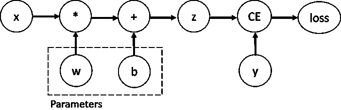

图 2.2：计算图

## 自动微分引擎

自动微分是 PyTorch 的一个核心特性，允许在反向传播期间高效计算梯度。`autograd` 引擎会自动跟踪在张量（tensor）上执行的操作，并根据给损失函数计算梯度。以下是在 PyTorch 中使用自动微分的简单示例：

```python
import torch  

## 定义一个 requires_grad=True 的张量以跟踪梯度计算的操作
x = torch.tensor(3.0, requires_grad=True)  

## 定义一个简单的函数
def f(x):
    return x ** 2  

## 在张量上执行一些操作
y = f(x)  

## 使用自动微分计算梯度
y.backward()  

## 获取 x 的梯度
gradient = x.grad  

## 打印梯度
print("Gradient of x:", gradient)
```

在这段代码中，我们创建了一个 `requires_grad=True` 的张量 `x`，表示我们想要跟踪梯度计算的操作。我们定义了一个简单的函数 `f(x)`，它对输入 `x` 进行平方。在执行操作 `y = f(x)` 后，我们调用 `y.backward()` 计算相对于 `x` 的梯度。然后通过 `x.grad` 获取 `x` 的梯度。

输出将是：

```
Gradient of x: 6.0
```

PyTorch 中的自动微分引擎（`autograd`）高效地计算 `x` 相对于损失（在此情况下为 `y`）的梯度，无需手动计算梯度，使其成为训练复杂神经网络的强大工具。

## 结论

总之，PyTorch 是强大且灵活的深度学习框架，允许高效处理张量，并可以在 CPU 和 GPU 上运行。它丰富的库集合（如 `torchvision` 和 `torch.utils.data`）使得处理图像和视频数据变得简单。它对多 GPU 分布式训练的支持允许深度学习模型高效扩展。

虽然在 CPU 和 GPU 之间移动张量时存在一些潜在问题，但 PyTorch 提供了简单的解决方案，如 `to()` 方法和 `DataLoader` 类。随着 PyTorch 的不断进化以及如 `TorchData` 等新库的引入，它对于深度学习从业者来说变得更加易用且多功能。总体而言，PyTorch 是前沿深度学习研究及其应用的必备工具。

在接下来的章节中，我们将探索高级计算机视觉架构考虑迷世界。深入研究驱动计算机视觉最新进展的前沿技术和方法。

## 记忆点

- PyTorch 图像处理基础：
  - PyTorch 是一个强大的图像处理框架，提供了处理和操纵图像数据的工具和函数。
  - `torchvision` 模块是 PyTorch 中图像相关任务的关键组件。
  - 理解图像处理的基础知识（如加载、预处理和转换图像）至关重要。
- PyTorch 在现代 AI 领域中的潜力：
  - PyTorch 在现代 AI 领域中起着重要作用，被广泛应用于研究和生产。

## 多选题

1. 在 AI 领域下，PyTorch 主要用于什么？
   a. 自然语言处理
   b. 图像处理
   c. a 和 b 都是对的
   d. 以上都不是

2. PyTorch 中哪个模块用于处理多维数组？
   a. `torch.nn`
   b. `torch.optim`
   c. `torch.tensor`
   d. `torch.cuda`

3. PyTorch 中的 CUDA 与什么有关？
   a. 图像处理
   b. 并行计算
   c. 文本处理
   d. 数据可视化

4. PyTorch 中 `Tensor` 类的目的是什么？
   a. 处理图像
   b. 存储和操作数据
   c. 定义神经网络
   d. 优化

5. 使用哪个函数将 PyTorch 张量移动到 GPU？
   a. `tensor.gpu()`
   b. `tensor.cuda()`
   c. `tensor.to()`
   d. `tensor.move()`

6. PyTorch 中的“Getting Started”术语指的是什么？
   a. 安装 PyTorch
   b. 编写复杂的神经网络
   c. 探索高级功能
   d. 基础设置和初始步骤

7. 在 PyTorch 中，`torch.nn` 模块提供什么？
   a. 优化函数
   b. 神经网络层和操作
   c. 图像处理工具
   d. 数据可视化工具

8. 以下哪项是使用 PyTorch 进行图像处理的一个主要优势？
   a. 社区支持有限
   b. 易调试和动态计算图
   c. 严格的静态图定义
   d. 仅支持 CPU 处理

9. 在 PyTorch 中开始图像处理的关键步骤是什么？
   a. 定义神经网络
   b. 导入 tensorflow 库
   c. 加载和预处理图像
   d. 运行复杂算法

10. 在 PyTorch 中利用 GPU 进行张量操作的主要优势是什么？
    a. 计算较慢
    b. 内存占用较低
    c. 更高的并行性和更快的计算
    d. 数据存储有限

11. 使用哪个命令安装 PyTorch？
    a. `pip install tensorflow`
    b. `pip install pytorch`
    c. `pip install torch`
    d. `install pytorch`

12. `torch.optim` 模块在 PyTorch 中起什么作用？
    a. 加载和预处理图像
    b. 定义神经网络架构
    c. 实现训练的优化算法
    d. 处理 CUDA 操作

13. 在 PyTorch 语下，“Playing with Tensor”意味着什么？
    a. 运行复杂算法
    b. 尝试不同的张量操作
    c. 定义神经网络架构
    d. 调试代码

14. 哪个 PyTorch 模块专门为图像处理任务设计？
    a. `torch.nn`
    b. `torch.image`
    c. `torchvision`
    d. `torch.processing`

15. PyTorch 在现代 AI 领域中的重要性是什么？
    a. 适用性有限
    b. 已弃用的框架
    c. 广泛用于研究和生产
    d. 仅适用于小型项目

## 答案页

| 1. | c. |
| --- | --- |
| 2. | c. |
| 3. | b. |
| 4. | b. |
| 5. | b. |
| 6. | d. |
| 7. | b. |
| 8. | b. |
| 9. | c. |
| 10. | c. |
| 11. | c. |
| 12. | c. |
| 13. | b. |
| 14. | c. |
| 15. | c. |

# 第三章：高级计算机视觉技术设计

## 引言

在计算机视觉领域，解释和理解世界视觉信息的能力已至关重要。本章将讨论支撑高级计算机视觉的复杂方法论和实践，对其核心组件和应用进行全面探索。我们将从深入分析高级计算机视觉系统的设计原则开始，阐明有助于其有效性和鲁健性的复杂细节。随后，我们将涵盖目标检测，揭示使计算机能够以极高精度识别和定位图像及视频中物体的算法和技术。接着，讨论将转向感兴趣区域（ROI），在其中我们将剖析各种变体和方法，突出它们在提高计算机视觉应用准确性和效率方面的重要性。本章将进一步探索两阶段检测过程，阐明其独特属性以及在实现高性能目标检测中起着的关键作用。最后，我们将深入探讨锚点框（anchor box）考虑的复杂性，为这些关键元素如何贡献于检测模型的准确性和可靠性提供见解。通过这一全面的探索，读者将对计算机视觉中的高级方法论产生深刻的理解，使他们具备在这一动态领域游刃并脱颖出的知识。

## 结构

在本章中，我们将涵盖以下主题：

- 使用原生 PyTorch 构建 CNN
- 单阶段与双阶段网络
- 双阶段检测的缓慢性
- 锚点框考量

## 目标

本章的主要目标是让读者透彻理解高级计算机视觉技术，确保对其设计、方法论和应用有全面的掌握。我们意在剖析目标检测的复杂性，阐明实现精确识别和定位物体的算法和策略。将特别关注与 ROI 相关的变体和方法，并深入研究两阶段检测过程的细微差别及其独特属性。此外，我们旨在对锚点框考量提供富有见地的讨论，突出它们在增强检测模型性能方面的关键作用。通过本章，读者将获得应对高级计算机视觉复杂格局所需的必要知识和技能，最终使他们能够在现实应用中实现并优化这些技术。

## 计算机视觉任务

下图提供了不同计算机视觉任务的清晰对比，范围从基础分类到复杂的实例分割：

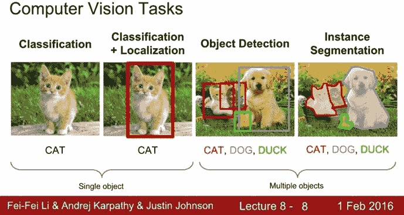

图 3.1：主要的计算机视觉

在掌握了计算机视觉的基础目标后，深入研究构成该技术骨的特定任务变得至关重要。这些任务包括图像内各种物体的识别和分类、确定它们的位置，以及区分多个物体实例。通过完成这些任务，计算机视觉系统可以以类似于人类的方式解释视觉数据，但具有可扩展和永不知疲倦的额外优势。

接下来，让我们探索计算机视觉系统不仅识别物体，还能理解它们所处的上下文：

- 目标检测与识别：计算机在图像或视频中识别并定位物体并为其赋予相应类别标签的能力。
- 图像分类：根据图像的内容或其包含的物体为图像分配标签的过程。
- 语义分割：将图像划分为不同的区域。
- 全景分割：将图像划分为多个区域，产生详细的语义输出。
- 光字符识别 (OCR)：在图像或视频中识别文本的能力。
- 姿态估计：估计图像中的物体姿态。
- 跟踪：在序列中跟踪物体的运动。
- 图像生成：生成新的图像的能力。
- 图像增强：提高图像或视频的质量。

## 使用原生 PyTorch 构建 CNN

该模型定义了一个简单的卷积神经网络（CNN），包含两个卷积层，每层后面跟着一个修正线性单元（ReLU）激活函数和一个池化操作。以下是其详细说明：

- `nn.Conv2d(3, 16, kernel_size=3, padding=1)`：定义了具有 3 个输入通道、16 个输出通道的卷积层，卷积核大小为 3，填充为 1，以保持空间尺寸。
- `self.ReLU()`：定义了 ReLU 激活函数，应用于层的输出。
- `nn.MaxPool2d(kernel_size=2)`：定义了最大池化操作，将输入的空间维度缩小 2 倍。
- `nn.Linear(8 * 8 * 32, 128)`：定义了一个全连接（线性）层，输入特征为 8x8x32，输出为 128 个特征。
- `x.view(-1, 8 * 8 * 32)`：将上一层的输出展平为 1D 张量，第一个维度是根据输入张量的大小推断出的。
- `nn.Linear(128, 10)`：最后的线性层产生一个 10 维向量，代表 10 个类别的得分。

以下模型可用于具有 10 个类的图像数据集的分类任务，例如 CIFAR10。


我们提供的简单 CNN 架构可以通过将输出类别数从 `10` 改为 `100` 来轻松适配 `CIFAR-100` 数据集。然而，由于 `CIFAR-100` 的图像比 `CIFAR-10` 更小且复杂，你可能需要修改架构以提高其在该数据集上的性能。以下是一个更新后的模型版本，你可以作为一个起点：

```python
import torch.nn as nn  

class CIFAR100CNN(nn.Module):
    def __init__(self):
        super(CIFAR100CNN, self).__init__()
        self.conv1 = nn.Conv2d(3, 32, kernel_size=3, padding=1)
        self.bn1 = nn.BatchNorm2d(32)
        self.relu1 = nn.ReLU()
        self.conv2 = nn.Conv2d(32, 64, kernel_size=3, padding=1)
        self.bn2 = nn.BatchNorm2d(64)
        self.relu2 = nn.ReLU()
        self.pool1 = nn.MaxPool2d(kernel_size=2)
        self.conv3 = nn.Conv2d(64, 128, kernel_size=3, padding=1)
        self.bn3 = nn.BatchNorm2d(128)
        self.relu3 = nn.ReLU()
        self.conv4 = nn.Conv2d(128, 256, kernel_size=3, padding=1)
        self.bn4 = nn.BatchNorm2d(256)
        self.relu4 = nn.ReLU()
        self.pool2 = nn.MaxPool2d(kernel_size=2)
        self.fc1 = nn.Linear(8 * 8 * 256, 512)
        self.bn5 = nn.BatchNorm1d(512)
        self.relu5 = nn.ReLU()
        self.dropout1 = nn.Dropout(p=0.5)
        self.fc2 = nn.Linear(512, 100)

    def forward(self, x):
        x = self.conv1(x)
        x = self.bn1(x)
        x = self.relu1(x)
        x = self.conv2(x)
        x = self.bn2(x)
        x = self.relu2(x)
        x = self.pool1(x)
        x = self.conv3(x)
        x = self.bn3(x)
        x = self.relu3(x)
        x = self.conv4(x)
        x = self.bn4(x)
        x = self.relu4(x)
        x = self.pool2(x)
        x = x.view(-1, 8 * 8 * 256)
        x = self.fc1(x)
        x = self.bn5(x)
        x = self.relu5(x)
        x = self.dropout1(x)
        x = self.fc2(x)
        return x
```

该模型包含了额外的卷积层、批归一化层和 dropout 层，以提高其在 `CIFAR-100` 上的性能。该模型比之前的更深、更宽，有更多的参数需要学习。

## 目标检测

提供的 CNN 架构是为图像分类设计的，而不是目标检测。对于目标检测，你需要使用不同类型的架构，例如基于区域的卷积网络 (`R-CNN`) 或单阶段检测器，如 You Look Once (`YOLO`) 或单次击检测器 (`SSD`)。

这些架构比简单的 CNN 复杂得多，涉及多个组件，例如用于特征提取的主干网络（backbone）、用于生成物体位置的区域建议网络（region proposal network）以及预测每个物体类别和位置的检测头。在 `PyTorch` 中实现这些架构是一项复杂的任务，需要对深度学习概念和计算机视觉技术有良好的理解。让我们从已经在大型数据集上训练过的预训练模型开始，例如上下文中的常见物体 (`COCO`) 或 Pascal 目标类别 (`VOC`)，并针对你的特定任务对其进行微调。你可以在 `torchvision` 库中找到 PyTorch 的预训练模型，其中包含了许多诸如 `Faster R-CNN` 等流行的目标检测模型。

以下是使用来自 `torchvision` 库的预训练 `Faster R-CNN` 模型进行目标检测的方法：

```python
import torchvision
import torchvision.transforms as transforms

## 从 torchvision 库加载预训练的 Faster R-CNN 模型
model = torchvision.models.detection.fasterrcnn_resnet50(pretrained=True)

## 将模型设为评估模式
model.eval()

## 定义应用到输入的图像变换
transform = transforms.Compose([
    transforms.ToTensor(),
    transforms.Normalize((0.485, 0.456, 0.406), (0.229, 0.224, 0.225))
])

## 加载示例图像并应用变换
image = Image.open('example.jpg')
image_tensor = transform(image)

## 将图像通过模型并获取预测
predictions = model(image_tensor)

## 在图像上显示预测的框和标签
draw = ImageDraw.Draw(image)
for box, label, score in zip(predictions['boxes'], predictions['labels'], predictions['scores']):
    if score > 0.5:
        draw.rectangle([(box[0], box[1]), (box[2], box[3]]), outline='red', width=2)
        draw.text((box[0], box[1]), f'{label}: {score:.2f}', fill='red')
image.show()
```

这段代码从 `torchvision` 库加载了预训练的 `Faster R-CNN` 模型，将其应用于示例图像，并显示预测的框和标签。请注意，这只是一个演示如何使用的简单示例。根据你的特定任务，你可能需要修改代码并微调模型以获得最佳结果。

### Faster R-CNN 架构

Faster R-CNN 是一种用于目标检测流行的 CNN 架构。Faster R-CNN 的构建模块包括：

- **主干网络 (Backbone network)**：这是一个深度卷积神经网络，用于处理输入图像并提取用于区域建议和目标检测的高级特征图。Faster R-CNN 中最常用的主干网络是 `ResNet` 和 `VGG`。

- **区域建议网络 (Region Proposal Network, RPN)**：RPN 通过在主干网络输出的特征图上滑动窗口（称为 `anchor`）来生成物体建议。对于每个 anchor，RPN 预测其包含物体的概率以及 anchor 与物体真实位置之间的偏移。

- **RoI Pooling**：在 RPN 生成物体建议后，`RoI Pooling` 用于从主干网络输出的特征图中提取固定大小的特征图。这允许目标检测器处理不同尺寸和宽高比的建议。

- **检测头 (Object detection head)**：这是一个小型全连接神经网络，接收每个建议的特征图并预测类别和边界框坐标。检测头通常实现为两个独立的子网络，一个用于分类，一个用于边界框回归。

Faster R-CNN 架构通过多任务损失函数进行端到端训练，该函数结合了区域建议和检测的损失。在训练过程中，RPN 和检测头协同优化，以生成高质量的物体建议并准确地分类和定位物体。

### 单阶段双阶段网络

目标检测是计算机视觉中的核心任务，旨在识别并定位图像中的物体。主要有两种目标检测网络：单阶段网络和双阶段网络。以下是两者的简要介绍：

- **单阶段检测网络**：

    - **示例**：`YOLO`、`SSD` 和 `RetinaNet`。

    - **工作原理**：在单阶段检测器中，分类和边界框回归一步完成。网络直接预测整个图像上固定尺寸 anchor 框的类别概率和边界框坐标。

    - **优点**：速度快且结构简单，适用于实时应用。

    - **缺点**：在历史上，它们的准确性低于双阶段检测器，特别是对于小物体。然而，诸如 `RetinaNet` 中引入焦点 loss 等进展已经在某种程度上缩小了这一差距。

- **双阶段检测网络**：

    - **示例**：`R-CNN`、`Fast R-CNN`、`Faster R-CNN` 和 `Mask R-CNN`。

    - **工作原理**：

        1. 第一阶段：使用如 `Faster R-CNN` 中的 `RPN` 等方法提取候选物体区域。

        2. 第二阶段：将每个建议的区域分类为不同的物体类别并精炼其边界框。

    - **优点**：通常比单阶段检测器具有更高的准确性。在存在各种尺寸物体场景下特别精确。

    - **缺点**：由于是两步过程，速度往往较慢。

单阶段检测器和双阶段检测器之间的选择很大程度上取决于特定应用的需求。如果速度至关重要，单阶段检测器可能更加合适。然而，如果最高精度是首要目标，双阶段检测器通常是更好的选择。

下图展示了用于目标检测和图像分类的复杂神经网络架构：

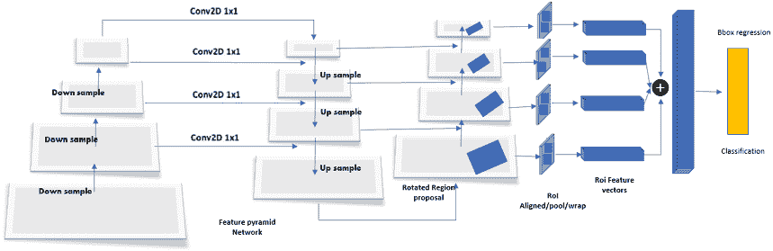

图 3.2：双阶段深度学习网络

在这里，我们看到了`Feature Pyramid Network`（特征金字塔网络）的工作流程，现代目标检测系统的关键组件，用于增强特征提取：

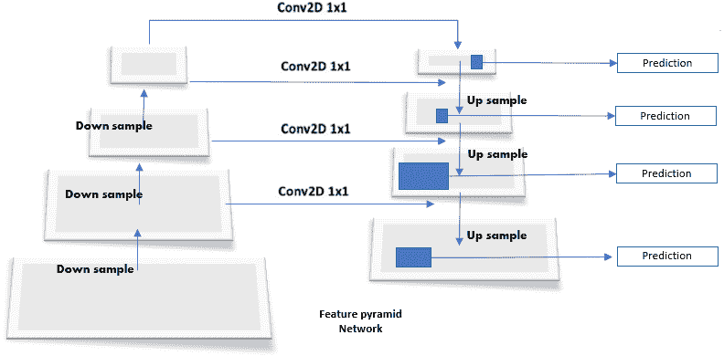

图 3.3：单阶段深度学习网络

## 感兴趣区域](#contents.xhtml#sc4_73a)

在`Faster R-CNN`中，`RoI Pooling`层是一个关键组件，允许模型对不同尺寸和宽高的物体建议进行操作。`RoI Pooling`层提取特征图中的一组矩形感兴趣区域，并为每个区域提取固定大小的特征图。然后，这些特征图被传递到目标检测头进行分类和回归。

然而，在`RoI Pooling`的原始实现中，感兴趣区域与特征图网格不对齐，这可能导致对齐偏差和空间信息的丢失。`Faster R-CNN`引入了一种改进的`RoI Pooling`层`RoI Align`来解决这个问题。

## RoI Align](#contents.xhtml#sc4_74a)

`RoI Align`的工作是将`RoI`坐标量化到最近的离散特征图网格单元，然后使用双线性插值在每个单元格内的四个规则位置对特征图进行采样。采样值然后使用最大池化或平均池化进行聚合，为每个`RoI`生成固定大小的特征图。参考下图：

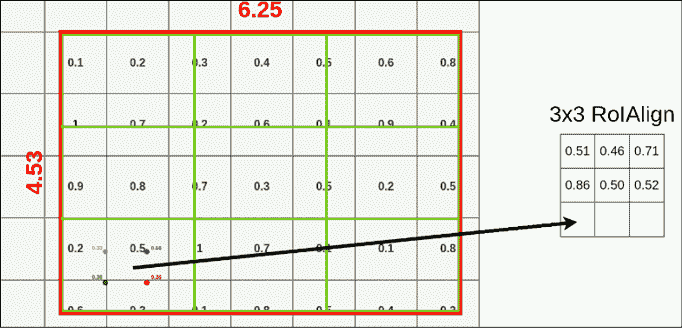

图 3.4：从正方形网格圆中突出 RoI Align

已证明它可以显著提高目标检测模型的准确性，特别是对于小物体和非刚性形状物体。通过将`RoIs`与特征图网格对齐，`RoI Align`保留了更多的空间信息并减少了对齐误差，从而实现了更准确的目标定位和分类。

Python 代码使用 PyTorch 定义了一个`RoIAlign`类，对输入特征和感兴趣区域执行`RoI Align`操作。参考以下代码：

```python
import torch
import torch.nn.functional as F  

class RoIAlign(torch.nn.Module):
    def __init__(self, output_size):
        super(RoIAlign, self).__init__()
        self.output_size = output_size  

    def forward(self, features, rois):
        # rois: [batch_size, num_rois, 4]
        num_rois = rois.size(1)
        output = torch.zeros(num_rois, features.size(1), self.output_size, self.output_size)
        for i in range(num_rois):
            roi = rois[:, i, :]
            x1, y1, x2, y2 = roi
            w, h = x2 - x1, y2 - y1
            stride_w, stride_h = w / self.output_size, h / self.output_size
            grid = F.affine_grid(torch.tensor([[[stride_w, stride_h]]]), [num_rois, self.output_size, self.output_size, 4]), False)
            output[i] = F.grid_sample(features, grid) # Simplified logic for example context
        return output
```

## RoI Pooled](#contents.xhtml#sc4_75a)

在目标检测任务中，图像通常被分为网格，但物体的尺寸和形状可能会很大变化。为了解决这个问题，`RoI Pooling`提取特征图中的一组矩形感兴趣区域，并为每个区域提取固定大小的特征图。这些特征图随后被传递到目标检测头中。

然而，在`RoI Pooling`的原始实现中，感兴趣区域与特征图网格不对齐，这可能导致对齐偏差和空间信息的丢失。`Faster R-CNN`引入了一种改进的`RoI Pooling`层`RoI Align`来解决这个问题。

`RoI Align`的工作是将`RoI`坐标量化到最近的离散特征图网格单元，然后使用双线性插值在每个单元格内的四个规则位置对特征图进行采样。采样值然后使用最大池化或平均池化进行聚合，为每个`RoI`生成固定大小的特征图。

Python 代码使用 PyTorch 定义了一个`RoIAlign`类，对输入特征和感兴趣区域执行`RoI Align`操作。参考以下代码：


```python
import torch
import torch.nn.functional as F  

class RoIAlign(torch.nn.Module):
    def __init__(self, output_size):
        super(RoIAlign, self).__init__()
        self.output_size = output_size  

    def forward(self, features, rois):
        # rois: [batch_size, num_rois, 4]
        num_rois = rois.size(1)
        output = torch.zeros(num_rois, features.size(1), self.output_size, self.output_size)
        for i in range(num_rois):
            roi = rois[:, i, :]
            x1, y1, x2, y2 = roi
            w, h = x2 - x1, y2 - y1
            stride_w, stride_h = w / self.output_size, h / self.output_size
            grid = F.affine_grid(torch.tensor([[[stride_w, stride_h]]]), [num_rois, self.output_size, self.output_size, 4]), False)
            output[i] = F.grid_sample(features, grid)
        return output
```

## RoI Wrap

`RoI wrap`操作（也称为 RoI warping）是`RoI Pooling`和`RoI Align`的扩展，这些是在 Mask R-CNN 论文中提出的。与`RoI Pooling`和`RoI Align`一样，`RoI wrap`用于为目标检测模型中的每个感兴趣区域提取固定大小的特征图。

`RoI wrap`通过将特征图的矩形区域变形以适应固定大小的单元格网格来工作。与`RoI Pooling`和`RoI Align`不同，`RoI wrap`使用双线性插值计算网格中每个单元格的特征图值。这使得`RoI wrap`在处理大型`RoIs`或旋转/扭曲严重的`RoIs`时比`RoI Pooling`和`RoI Align`更准确。

`RoI wrap`通常用于像`Mask R-CNN`等两阶段目标检测模型，其中它用于为掩码分割任务提取特征。在这些模型中，`RoI wrap`在`RoI Pooling`或`RoI Align`操作之后，生成的特征图用于为每个`RoI`生成二值掩码（binary mask）。

`RoI wrap`是`RoI Pooling`和`RoI Align`的一种有用扩展，它允许目标检测模型以更高的精确度处理更大、更复杂的感兴趣区域。

`RoI Warping`操作通常在像`PyTorch`等深度学习框架中实现为可导微的模块，使其能够与目标检测模型的其余部分一起进行端到端训练。参考以下代码：

```python
import torch
import torch.nn.functional as F  

class RoIWrap(torch.nn.Module):
    def __init__(self, output_size, spatial_scale):
        super(RoIWrap, self).__init__()
        self.output_size = output_size
        self.spatial_scale = spatial_scale  

    def forward(self, feature_map, rois):
        # Extract the RoI coordinates
        rois = rois * self.spatial_scale
        rois = rois.int()
        batch_indices = rois[:, 0]
        y1, x1, y2, x2 = rois[:, 1], rois[:, 2], rois[:, 3], rois[:, 4]  

        # Compute the RoI Pool output size
        channel, height, width = feature_map.size()[1:]
        pooled_height, pooled_width = self.output_size
        height_scale = float(height) / pooled_height
        width_scale = float(width) / pooled_width  
        # Compute the sampling points for each RoI bin
        y = torch.linspace(0, height-1, height).to(rois.device)
        x = torch.linspace(0, width-1, width).to(rois.device)
        y, x = torch.meshgrid(y, x)
        y = (y + 0.5) * height_scale - 0.5
        x = (x + 0.5) * width_scale - 0.5  
        # Sample the feature map for each RoI bin
        batch_indices = batch_indices.view(-1, 1, 1).to(rois.device)
        y1 = y1.view(-1, 1, 1).to(rois.device)
        x1 = x1.view(-1, 1, 1).to(rois.device)
        y2 = y2.view(-1, 1, 1).to(rois.device)
        x2 = x2.view(-1, 1, 1).to(rois.device)
        y = y.view(1, 1, -1).to(rois.device)
        x = x.view(1, 1, -1).to(rois.device)  
        # Normalize the RoI coordinates to the feature map size
        y1 = y1.float() / height_scale
        x1 = x1.float() / width_scale
        y2 = y2.float() / height_scale
        x2 = x2.float() / width_scale
        # Clip the RoI coordinates to the feature map size
        y1 = torch.clamp(y1, 0, height-1)
        x1 = torch.clamp(x1, 0, width-1)
        y2 = torch.clamp(y2, 0, height-1)
        x2 = torch.clamp(x2, 0, width-1)
        # Sample the feature map using bilinear interpolation
        indices = torch.cat([batch_indices, batch_indices, batch_indices, batch_indices], dim=1)
        xs = torch.cat([x1, x2, x1, x2], dim=1)
        ys = torch.cat([y1, y1, y2, y2], dim=1)
        samples = F.grid_sample(feature_map, torch.stack([xs, ys], dim=-1), mode='bilinear', padding_mode='zeros')
        # Reshape the RoI Pool output to the desired size
        samples = samples.view(-1, channel, pooled_height, pooled_width)
        return samples
```

`RoI warping`是目标检测中一种强大的工具，能够对不同大小和形状的对象进行精确的定位和分类。它是许多最先进目标检测模型的关键组件，包括`Faster R-CNN`、`Mask RCNN`和`Cascade RNN`。`RoIWrap`模块接收形状为`(N, C, H, W)`的特征图和形状为`(R, 5)`的`RoIs`作为输入。

通过使用锚框（anchor boxes），目标检测模型可以预测多个尺度和宽高比例的物体边界框，这可以提高模型的准确性，特别是对于小物体或非标准宽高比例的物体。锚框还能帮助模型更好地处理多个物体重叠或相互靠近的情况。

除了`Faster R-CNN`外，锚框也被用于其他目标检测模型，如`RetinaNet`、`SSD`和`YOLO`。

下图展示了目标检测中锚框的概念，强调了它们如何与真实值（ground truth）相关，以及在尺寸和宽高比例上的变化：

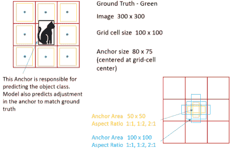

图 3.6: 锚框的工作原理

虽然锚框是目标检测模型中常用的技术，但也有一些模型并不使用它们。以下是一些示例：

- `CenterNet`：`CenterNet`是一种单阶段目标检测模型，它直接预测图像中每个对象的中心点和大小，而不使用锚框。`CenterNet`在多个目标检测基准测试上实现了先进的性能，同时比许多基于锚框的模型更高效。

- `全卷积单阶段检测 (FCOS)`：`FCOS`是另一种不使用锚框的单阶段目标检测模型。相反，`FCOS`通过根据特征图中每个像素到物体中心的距离将每个像素分配给特定的物体，来预测物体边界。

- `YOLOv4`：`YOLO`的最新版本`YOLOv4`使用了结合锚框与动态锚框分配方法的混合方法。该方法根据数据集中物体尺寸的分布动态调整锚框，而不需要预定义一组锚框。

虽然锚框对于目标检测并非总是必要的，但它们是一种常用技术，在许多情况下被证明是有效的，并被用于许多流行的目标检测框架，包括`Detectron2`。然而，使用锚框的决定应该基于数据集的特定特性以及对速度和准确性之间所需的权衡，并应通过经验性评估。

`Detectron2`是一个用于构建计算机视觉模型（包括目标检测模型）的流行开源框架。`Detectron2`将锚框作为其目标检测模型的核心组件，允许模型预测多个尺度和宽高比例的物体边界框。


`Detectron2` 为流行的目标检测数据集（如 `COCO` 和 `Pascal VOC`）提供了多种预构建的锚框配置，并允许用户根据数据集的特定特性自定义锚框。除了锚框外，`Detectron2` 还包含了许多其他高级特性，如特征金字塔网络（`FPN`）和 `Mask R-CNN`，这些特性有助于提高模型的准确性。

## 何时不使用锚框

虽然锚框是目标检测模型中常用的技术，但在某些情况下，它们可能是不必要的，甚至对模型性能产生不利影响。以下是你可能选择不使用锚框的情况：

- 如果数据集中的物体尺寸和宽高比例相对一致，或者场景相对简单且变化较小，那么可能在不使用锚框的情况下获得良好的性能。
- 如果重点是实现高速度和低计算复杂度，则锚框可能不是必须的，因为它们会增加模型的计算开销。
- 如果数据集较小或物体类别高度不平衡，可能很难选择合适的锚框。
- 如果场景中的物体形状不规则或密密堆挤，锚框可能不再有效。
- 总的来说，使用锚框的决定应该基于数据集的特定特性以及对速度和准确性之间所需的权衡，并应通过经验性评估。

## 理解无锚框和基于锚框

基于锚框的模型通常比无锚框模型成本更高。在基于锚框的检测中，网络为每个位置预测一组锚框，然后用于分类和回归物体。相反，无锚框模型不依赖于预定义的锚，而是直接预测位置。然而，无锚框模型并不总是更快。下图详细阐述了锚框相对于真实值的过程：

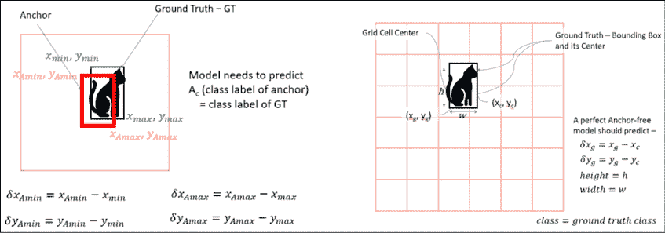

图 3.7: 真实值与锚框

## 数学表达

在目标检测中，基于锚框的模型通常为特征图上的每个位置预测一组锚框，然后用它们分类和回归物体。基于锚框的模型输出是一组预测的类别分数和锚框的边界框偏移。从数学角度上，基于锚框的模型输出可以表示为：

```
S = {S_i, i=1,...,N}
B = {B_i, i=1,...,N}
C = {C_i, i=1,...,N}
```

其中：

- `S_i` 是锚框 `i` 的预测类别分数
- `B_i` 是锚框 `i` 的预测边界框偏移
- `C_i` 是锚框 `i` 的预定义类别
- `N` 是锚框的总数

基于锚框的损失函数通常涉及所有锚框的分类损失（例如交叉熵）和回归损失（例如平滑 `L1` 损失）。损失函数可以表示为：

```
L(S, B, C, S*, B*, C*) = αL_cls(S, S*) + βL_reg(B, B*, C*)
```

其中：

- `S*` 是每个锚框的真实类别标签
- `B*` 是每个锚框的真实边界框偏移
- `C*` 是每个锚框的真实类别
- `α` 和 `β` 分别是分类损失和回归损失的权重系数
- `L_cls` 是分类损失
- `L_reg` 是回归损失

另一方面，无锚框模型不需要预定义的锚框，直接预测物体的位置。无锚框模型的输出可以表示为：

```
S = {S_i, i=1,...,M}
B = {B_i, i=1,...,M}
```

其中：

- `S_i` 是第 `i` 个物体的预测类别分数
- `B_i` 是第 `i` 个物体的预测边界框偏移
- `M` 是图像中预测的物体总数

无锚点（`anchor-free`）模型的损失函数通常涉及所有预测对象的分类损失和回归损失的组合。损失函数可以表示为：

```
L(S, B, S*, B*) = αL_cls(S, S*) + βL_reg(B, B*, S*)
```

其中：

- `S*` 是每个对象的真值（`ground-truth`）类别标签
- `B*` 是每个对象的真值边界框偏移（`ground-truth bounding box offset`）
- `α` 和 `β` 分别是分类和回归损失的权重系数
- `L_cls` 是分类损失
- `L_reg` 是回归损失

如你上方所示，基于锚点（`anchor-based`）的模型需要预测大量的锚框（`anchor boxes`），在训练过程中计算开销可能很大；而无锚点模型直接预测对象，不需要锚点，计算成本可能较低。然而，如前所述，实际计算成本取决于多个因素。

## 处理 1024X1024 图像

基于锚点和无锚点的模型处理图像的方式不同，具体细节取决于模型的实现。然而，通常情况下，这两类模型都会通过将图像划分为较小的区域或区块（`patches`），称为锚点（`anchors`）或瓦片（`tiles`），并对每个区域进行预测。

在基于锚点的模型中，图像首先被划分为一组预定义的锚框，这些锚框基于一组固定的比例和长宽比定义。锚框被放置在图像的不同位置，通常具有固定的步长（`stride`）。然后模型对每个锚框进行预测，通常是预测每个类别标签的概率以及框相对于锚点的偏移。最终的预测对象集通过对预测结果进行后处理，并选择概率高且与真值对象重叠良好的框来获得。

相比之下，无锚点模型不使用预定义的锚框，而是直接预测对象的位置。图像通常被划分为一组不重叠的瓦片或区域，模型对每个区域进行预测。模型通常预测区域内每个对象的类别标签概率和边界框偏移，然后结合所有区域的预测结果，以获得最终的预测对象集。

对于大小为 `1024 x 1024` 的图像，模型使用的锚点或瓦片的精确数量和大小取决于多种因素，例如模型架构、当前任务以及可用的硬件资源。通常，模型使用的锚点或瓦片数量随着图像尺寸的增大而增加，这会导致训练和推理期间计算成本增加。然而，锚点或瓦片数量与模型性能之间的准确权衡可能会根据具体任务和数据集而异。

代码定义了两个用于目标检测卷积卷积类：一个是基于锚点的，预测边界框坐标；另一个是无锚点的，可能会预测额外的对象属性：

```python
import torch
import torch.nn as nn
import torch.nn.functional as F

# 定义基于锚点的模型
class AnchorBasedModel(nn.Module):
    def __init__(self):
        super(AnchorBasedModel, self).__init__()
        self.conv1 = nn.Conv2d(3, 64, kernel_size=3, stride=1, padding=1)
        self.conv2 = nn.Conv2d(64, 128, kernel_size=3, stride=1, padding=1)
        self.conv3 = nn.Conv2d(128, 256, kernel_size=3, stride=1, padding=1)
        self.conv4 = nn.Conv2d(256, 512, kernel_size=3, stride=1, padding=1)
        self.conv5 = nn.Conv2d(512, 1024, kernel_size=3, stride=1, padding=1)
        self.pool = nn.AdaptiveMaxPool2d((1, 1))
        self.fc1 = nn.Linear(1024, 256)
        self.fc2 = nn.Linear(256, 4)

    def forward(self, x):
        x = F.relu(self.conv1(x))
        x = F.relu(self.conv2(x))
        x = F.relu(self.conv3(x))
        x = F.relu(self.conv4(x))
        x = F.relu(self.conv5(x))
        x = self.pool(x)
        x = x.view(x.size(0), -1)
        x = F.relu(self.fc1(x))
        x = self.fc2(x)
        return x

# 定义无锚点的模型
class AnchorFreeModel(nn.Module):
    def __init__(self):
        super(AnchorFreeModel, self).__init__()
        self.conv1 = nn.Conv2d(3, 64, kernel_size=3, stride=1, padding=1)
        self.conv2 = nn.Conv2d(64, 128, kernel_size=3, stride=1, padding=1)
        self.conv3 = nn.Conv2d(128, 256, kernel_size=3, stride=1, padding=1)
        self.conv4 = nn.Conv2d(256, 512, kernel_size=3, stride=1, padding=1)
        self.conv5 = nn.Conv2d(512, 1024, kernel_size=3, stride=1, padding=1)
        self.pool = nn.AdaptiveMaxPool2d((1, 1))
        self.fc1 = nn.Linear(1024, 256)
        self.fc2 = nn.Linear(256, 4)

    def forward(self, x):
        x = F.relu(self.conv1(x))
        x = F.relu(self.conv2(x))
        x = F.relu(self.conv3(x))
        x = F.relu(self.conv4(x))
        x = F.relu(self.conv5(x))
        x = self.pool(x)
        x = x.view(x.size(0), -1)
        x = F.relu(self.fc1(x))
        x = self.fc2(x)
        return x
```

```python
import torch

def generate_anchors(base_size, ratios, scales):
    """
    为给定的尺寸生成锚框。
    参数:
    base_size (int): 图像的基础尺寸
    ratios (list of float): 使用的比例列表
    scales (list of float): 使用的缩放列表
    返回:
    anchors (Tensor): 形状为 (len(ratios) * len(scales), 4) 的张量，每行
    代表一个锚框 (center_x, center_y, width, height)。
    """
    num_anchors = len(ratios) * len(scales)
    anchors = torch.zeros(num_anchors, 4)

    # 计算每个锚框的中心坐标
    center_x = torch.arange(0, base_size) + 0.5
    center_y = torch.arange(0, base_size) + 0.5
    center_x, center_y = torch.meshgrid(center_x, center_y, indexing='ij')
    center_x = center_x.reshape(-1)
    center_y = center_y.reshape(-1)

    # 根据比例和缩放计算锚框的宽高
    width = base_size * torch.sqrt(torch.tensor(ratios))
    height = base_size / torch.sqrt(torch.tensor(ratios))

    for i, w in enumerate(width):
        h = height[i]
        for j, s in enumerate(scales):
            index = i * len(scales) + j
            anchors[index, 0] = center_x[i]
            anchors[index, 1] = center_y[i]
            anchors[index, 2] = w * s
            anchors[index, 3] = h * s
    return anchors

# 使用该函数
base_size = 16
ratios = [0.5, 1, 2]
scales = [1, 2, 4]
anchors = generate_anchors(base_size, ratios, scales)
# 将生成一个形状为 (9, 4) 的张量，每行代表一个 (center_x, center_y, width, height) 格式的锚框。你可以将这些锚框用于你的目标检测模型中。
```

在下一章中，我们将涵盖基于锚点（`anchor-based`）的计算机视觉最新进展，讨论 `FPNs` 和 `RPNs` 的作用与演变，并探索该领域的创新方法。旨在为计算机视觉的基础技术和前沿应用提供全面的概述。

## 记忆点

- 本章对高级计算机视觉进行了详尽分析，阐明了高精度目标检测的设计与方法论，以及 `ROI` 变体的重要性。
- 我们探索了两阶段检测过程和锚框（`anchor box`）的考虑，这对于检测模型的准确性至关重要。
- 对基于锚点（`anchor-based`）和无锚点（`anchor-free`）的模型进行了比较，并对它们的计算影响和实际应用进行了见解。
- 本章包含了使用 `PyTorch` 的实际示例，提供了理解和实现这些概念的实践方法。
- 本内容让读者能够有效地应用先进的计算机视觉技术，并通过创新为该领域的演进做出贡献。

## 单选题

1. `RPNs` 在目标检测中的主要功能是什么？

   a. 分类图像
   b. 检测边缘和纹理
   c. 提出候选目标区域
   d. 提高图像分辨率

2. 在目标检测语境下，`RoI Align` 相比 `RoI Pooling` 改进了什么？

   a. 计算速度
   b. 内存使用效率
   c. 空间信息的准确性
   d. 建议区域的数量

3. 与基于锚点的模型相比，关于无锚点模型的描述哪个是正确的？

   a. 它们的计算成本更高。
   b. 它们直接预测目标位置。
   c. 它们依赖于预定义的锚框。
   d. 它们对于实时应用的效果较。

4. `FPN` 通过什么方式增强目标检测：

   a. 简化模型架构。
   b. 改进多尺度的特征提取。
   c. 减少对数据预处理的需求。
   d. 消除对目标分类的需求。

5. 单阶段和两阶段检测网络的区别是什么？

   a. 单阶段只执行检测，两阶段涉及分类。
   b. 单阶段检测器天生比两阶段检测器慢。
   c. 单阶段检测器同时执行分类和边界回归。
   d. 两阶段检测器不使用任何形式的区域建议。

## 答案页

| 1. | c |
| --- | --- |
| 2. | c |
| 3. | b |
| 4. | b |
| 5. | c |

加入我们书籍的 Discord 空间

加入书籍 Discord 工作区获取最新更新、优惠、全球科技动态、新发布以及与作者的交流会议：

`https://discord.bpbonline.com`


# 第 4 章 设计卓越的计算机视觉技术

## 引言

本章深入探讨了尖端的无锚点目标检测技术，重点关注全卷积单阶段目标检测（`FCOS`）和 `CenterNet`。它们以高效而闻名，在没有预定义锚框负担的情况下表现出卓越的准确性。`FCOS` 和 `CenterNet` 通过直接从图像预测边界和位置彻底改变了目标检测，将每个像素都视为潜在的目标中心。这种方法增强了对不同尺寸、长宽比和遮挡的适应性。本章详述了 `FCOS` 的边缘回归和 `CenterNet` 的基于热图的关键点检测，展示了它们捕捉详细目标信息的能力。探讨了真值编码（`ground truth encoding`）在训练中的作用，强调了它们在实现高精度方面的重要性。此外，本章深入了 `FCOS` 和 `CenterNet` 组件的数学基础和实际实现，揭示了它们实现顶级性能的架构和机制。

## 结构

在本章中，我们将涵盖以下主题：

- 锚点领域的先进技术
- 真值编码（`Ground truth encodings`）
- `CenterNet` 的关键组件
- `FCOS` 的关键组件
- `FCOS` 的损失函数

## 目标

本章旨在对锚点领域的先进技术进行全面且富有洞见的探索，特别关注 `FPNs`、`RPNs` 和计算机视觉中的创新方法。我们打算阐明 `FPNs` 的架构、功能和应用，证明它们在增强跨尺度目标检测模型方面的关键作用。此外，我们还将涵盖 `RPNs` 的演变、过渡和多样化应用，强调它们在该领域的重要性。通过展示尖端技术和方法，我们的目标是为这些关键主题提供整体理解，培养对计算机视觉更深层次的欣赏并激发进一步的创新。

## 锚点领域的先进技术

`FCOS` 和 `CenterNet` 是最先进的无锚点目标检测模型，因为它们在目标检测基准上实现了高准确性，同时所需的参数比基于锚点的模型更少。


`FCOS` 是一种单阶段目标检测模型，它直接从图像预测目标边界框，而不使用预定义的锚框。它使用全卷积网络同时预测目标类别，并回归从像素到目标边界框四条边缘的距离，有效地将每个像素视为潜在的目标中心。`FCOS` 能够处理各种尺寸和长宽比的对象，以及遮挡和截断，适用于广泛的目标检测应用。

另一方面，`CenterNet` 通过关键点中心的热图预测目标位置，并回归边界框的大小和方向。与 `FCOS` 类似，`CenterNet` 不依赖锚框，并将每个像素视为潜在的目标中心。`CenterNet` 还可以处理不同尺寸、长宽比和遮挡，在多个目标检测基准上实现了顶级的性能。

两种模型在流行的目标检测基准（如 `COCO` 和 `Pascal VOC`）上都实现了高准确性，同时参数少于基于锚点的模型。这是因为无锚点方法减少了参数的数量和计算复杂度，从而提高了模型在训练和推理期间的效率。

两者使用真值编码，这在无锚点模型中是至关重要的。

## 真值编码

真值编码（Ground truth encodings）是一组表示图像对象属性的数值，例如位置、尺寸和类别标签。这些编码用作目标检测模型的训练数据，并作为比较模型预测结果的标准。

在目标检测中，真值编码通常由一组紧密包围图像每个对象的边界框组成，并带有相应的类别标签。边界框由一组描述框坐标（`x, y`）及其宽度和高度（`w, h`）的数值表示，通常形式为 `(x, y, w, h)` 或 `(left, top, right, bottom)`。

在训练期间，模型学习根据输入图像预测这些编码，并使用平均平均精度（`mAP`）或交并比（`IoU`）等指标衡量其预测质量。真值编码很重要，因为它们为评估目标检测模型的性能提供了一种一致且客观的方法，对于训练能够准确检测和分类图像对象的模型至关重要。

在无锚点（anchor-free）目标检测模型中，真值编码（ground truth encodings）至关重要的原因如下：

- **回归目标**：在无锚点模型中，网络任务是直接回归边界框坐标和类别概率。真值编码提供了网络用于学习准确预测这些输出的训练数据。具体而言，真值编码提供了网络被训练预测的目标值，而预测值与真值之间的差异被用于在训练期间计算损失函数。

- **评估指标**：真值编码用于评估模型在训练和测试期间的性能。通过将预测的边界框与真值边界框进行比较，计算出 `mAP` 或 `IoU` 等评估指标。真值编码对于准确计算这些指标并提供模型性能的可靠衡量标准至关重要。

- **物体识别**：在无锚点模型中，网络必须仅根据图像特征来识别物体，而不需要预定义锚框（anchor boxes）的帮助。真值编码通过在训练数据中显式编码物体的位置和类别，为网络提供了识别物体所需的信息。

- **真值编码背后的数学**：真值编码是使用数学符号表示图像中物体属性的数值。在目标检测中，真值编码通常由一组边界框组成，这些边界框紧密围绕图像中的每个物体，并带有相应的类别标签。

边界框通常由四个数值表示，描述了框的坐标 `(x, y)` 及其宽度和高度 `(w, h)`，通常以 `(x, y, w, h)` 或 `(left, top, right, bottom)` 的形式存在。例如，边界框的左上角由坐标 `(x, y)` 表示，右下角由 `(x + w, y + h)` 表示。

每个物体的类别标签通常用整数值表示，每个整数对应一个特定类别（例如，`0` 代表“人”，`1` 代表“汽车”等）。

在训练过程中，模型根据输入图像学习预测这些编码。预测的边界框也由四个数值表示，通常标记为 `(x', y', w', h')`。模型预测的质量通常使用 `mAP` 或 `IoU` 等指标进行评估。

`IoU` 是一种衡量目标检测模型准确性的常用指标。它的计算方法是预测边界框与真值边界框之间的交集面积与这两个框并集面积之比。在数学上，`IoU` 定义为：

`IoU = Area of Overlap / Area of Union`

其中，交集面积是预测边界框与真值边界框相交区域，并集面积是两个框覆盖的总面积。

真值编码是目标检测模型不可或缺的组件，因为它提供了一种评估模型性能的一致客观的方法，并用于训练模型准确地检测和分类图像中的物体。

## CenterNet 的核心组件

CenterNet 是一种无锚点目标检测模型，它使用基于关键点的方法来检测图像中的物体。CenterNet 的核心组件包括：

- **沙漏网络 (Hourglass network)**：CenterNet 的骨干是沙漏网络，这是一种深层神经网络架构，可以从图像中提取多尺度的特征。沙漏网络设计用于处理不同尺寸的图像，并能检测不同尺寸的物体，使其适用于目标检测任务。

- **关键点热图 (Keypoint heatmap)**：CenterNet 使用关键点热图来预测物体位置。关键点热图是一个二维数组，表示图像中每个像素点存在物体中心的概率。热图是通过对真值物体中心位置应用二维高斯内核生成的，而预测的物体位置则是热图的峰值。

- **尺寸和偏移回归 (Size and offset regression)**：CenterNet 直接从关键点热图回归边界框的尺寸和偏移。尺寸和偏移回归通过将热图与单独的滤波器卷积来实现，以预测边界框相对于物体中心的宽度、高度和偏移。

- **非极大值抑制 (Non-maximum suppression)**：为了消除冗余检测，CenterNet 使用非极大值抑制 (`NMS`) 为每个物体选择得分最高的边界框。`NMS` 会移除置信度较低的重叠边界框，并为每个物体选择得分最高的框。

- **多尺度测试 (Multi-scale testing)**：CenterNet 使用多尺度测试来提高对不同尺寸物体的性能。模型在多个尺度的输入图像上运行，并合并预测的边界框以产生最终检测结果。

CenterNet 使用基于关键点的方法检测图像中的物体，其核心组件包括沙漏网络、关键点热图、尺寸和偏移回归、非极大值抑制以及多尺度测试。这些组件使 CenterNet 在目标检测基准测试上达到了顶端性能，同时比基于锚点的模型更具高效且参数更少。

## FCOS 的核心组件

FCOS 是一种无锚点目标检测模型，旨在解决基于锚点的模型的某些局限性。FCOS 是一个全卷积模型，可以处理任何尺寸和尺度的图像。在该模型中，目标检测被表述为一个稠密预测问题，其中网络为特征图上的每个位置预测一组物体得分和边界框坐标。

FCOS 模型的核心组件如下：

- **FPN**：FCOS 使用特征金字塔网络生成一组不同尺度的特征图。这与其他目标检测模型中使用的 `FPN` 类似，用于捕捉不同尺度的物体。

- **全卷积结构 (Fully convolutional structure)**：与基于锚点的模型不同，FCOS 是全卷积模型，意味着它不使用锚框来预测物体位置。相反，它使用单个卷积网络为特征图上的每个像素生成密集预测。

- **中心度预测 (Center-ness prediction)**：FCOS 预测特征图上每个像素的中心度。这衡量了像素距离物体中心的接近程度。这有助于模型关注图像中最重要的区域，并避免假阳性。

- **尺度感知训练 (Scale-aware training)**：FCOS 使用尺度感知训练，这意味着它训练模型预测不同尺度的物体。这有助于模型处理不同尺寸的物体，并对新数据具有更好的泛化能力。

- **基于分布的回归 (Distribution-based regression)**：FCOS 使用基于分布的回归预测边界框坐标。模型不是直接预测边界框的四个坐标，而是预测坐标的分布。这允许模型处理不同形状和大小的物体，并对新数据具有更好的泛化能力。

- **使用焦点损失训练 (Training with focal loss)**：FCOS 使用焦点损失训练模型。焦点损失是交叉熵损失函数的修改，它减少了分类良好的样本的权重，增加了困难样本的权重。这有助于模型在训练期间关注最困难的样本。

这些核心组件共同作用，使 FCOS 成为强大的目标检测模型。通过使用全卷积结构和中心度（center-ness）预测，FCOS 可以为特征图中每个像素生成密集预测，而不需要锚框（anchor boxes）。通过基于分布的回归和尺度感知训练，FCOS 可以处理不同形状和大小的对象，并良好地泛化到新数据。最后，通过使用 focal loss 训练模型，FCOS 能够在训练期间关注困难的样本，提高其在挑战性数据集上的性能。

## CenterNet 与 FCOS 的区别

此比较强调了 FCOS 如何作为 CenterNet 模型的演进，它包含了多项创新和改进，增强了其目标检测能力，特别是在更复杂的场景下。参考下表：

| 维度 | FCOS | CenterNet（物体视为点） |
| --- | --- | --- |
| 灵感 | 灵感来自 CenterNet 的无锚检测概念，但引入了自己的一系列创新来对其改进。 | 原始模型，通过将目标检测视为点估计问题，引入了无锚检测的概念。 |
| 检测方法 | 无锚：利用全卷积网络根据中心点预测物体位置，而不使用锚框。 | 无锚：直接预测物体中心和大小，不使用预定义的锚框，使用热图预测中心点。 |
| 关键创新 | <ul><li>基于分布的边界框回归方法。</li><li>利用 focal loss 处理类别不平衡。</li><li>引入了新的中心度评分（center-ness score）以提高检测精度。</li></ul> | <ul><li>引入了有效的关键点估计方法来检测物体中心。</li><li>利用中心热图、偏移量和尺寸预测进行边界框检测。</li></ul> |
| 区分因素 | <ul><li>使用 FPN 进行多尺度特征提取。</li><li>不仅预测中心，还预测中心度评分以优化预测。</li><li>使用边界框内的所有点来回归框坐标。</li></ul> | <ul><li>聚焦于检测物体的中心点。</li><li>利用靠近物体中心的点进行预测，从而降低了复杂性和计算开销。</li><li>使用关键点热图进行中心检测。</li></ul> |
| 泛化能力 | 由于使用了 FPN 和中心度特征，在不同尺度的物体上表现出强劲的性能，使其对形状和大小变化的物体具有鲁棒性。 | 虽然有效，但由于依赖于中心点检测，在处理形状不规则或部分遮挡的物体时可能会面临挑战。 |
| 性能 | 通常显示出比 CenterNet 更好的检测准确性和效率，特别是在小物体和拥挤场景中，得益于其详细的边界框回归和中心预测方法。 | 提供了高效的性能基准，特别是在实时场景中。但在复杂检测场景的准确性方面，可能落后于 FCOS。 |
| 额外说明 | <ul><li>不使用关键点进行边界框预测，这使其与 CenterNet 有区别。</li><li>直接预测到边界框四边的距离。</li></ul> | <ul><li>与 FCOS 相比设计更简单，更容易针对特定用例进行实现和优化。</li><li>在检测物体中心方面的效率特别受关注。</li></ul> |

表 4.1：CenterNet 与 FCOS 的比较

## 关键点热图与中心度

让我们理解关键点热图和中心度之间的区别：

| 特性/维度 | 关键点热图 | 中心度 (Centerness) |
| --- | --- | --- |
| 定义 | 一种二维表示形式，显示每个像素成为物体特定关键点（如中心或角点）的概率。 | 一种衡量指标，指示像素在物体边界框内的中心化程度，用于强调中心像素的重要性。 |
| 目的 | 识别物体关键点（如中心或角点）的精确位置，以估计其位置和朝向。 | 优先考虑物体内部中心且可能对检测至关重要的像素，突出边界框内特征的重要性。 |
| 工作原理 | 在训练期间，模型生成热图，每个值代表像素成为关键点的概率。值越高，表示成为关键点的可能性越大。 | 中心度为物体中心处的像素分配更大的权重，表明这些点更有可能是关键的或包含本质特征。 |
| 在模型中的表示 | 通常是一个维度为 `W×H×K` 的三维张量 `H`，其中 `W` 和 `H` 是图像的宽度和高度，`K` 是关键点的数量。 | 表示为标量值或映射，用于量化物体边界框内像素的中心性。 |
| 在目标检测中的应用 | 对于精确定位关键点以确定物体的位置和朝向至关重要。有助于估计物体的空间布局及其与图像中其他物体的交互。 | 对于通过关注物体最相关的部分来增强检测精度至关重要。这种关注确保预测向物体信息最丰富的区域倾斜，从而提高了模型的检测能力。 |

表 4.2：关键点热图与中心度的比较

此表总结了关键点热图和中心度在目标检测中起的不同作用，强调了它们在模型中独特的目的和机制。

## 数学

关键点热图和中心度背后的数学概念对于理解这些特征在目标检测模型中如何运作至关重要，特别是在计算机视觉和机器学习的背景下。让我们详细讨论。

### 关键点热图

关键点热图是一种二维表示，用于指示图像中物体关键点（如中心、角点或其他显著部分）的概率。在数学上，它被表示为维度为 `W×H×K` 的张量 `H`，其中 `W` 和 `H` 分别是图像的宽度和高度，`K` 是不同关键点的数量。该张量中的每个元素 `Hx,y,k` 代表像素 `(x,y)` 是第 `k` 个关键点的概率。

生成过程如下：

1. 真实值（Ground truth）创建：对于物体中的给定关键点，通过在关键点位置放置高斯（或类似）分布来生成真实热图。这种方法确保热图从中心平滑下降，指示每个像素成为关键点的概率。

2. 预测：在推理期间，模型输出每种关键点类型的预测热图。目标是使预测的热图尽可能匹配训练期间生成的真实值。

3. 损失计算：预测热图与真实值之间的相似性通常使用像素级损失函数（如均方误差 `MSE` 或交叉熵损失）来衡量，以训练模型。

### 中心度

中心度衡量点在物体边界框内的中心程度，主要用于加权最终检测得分中每个点的贡献。它的目标是优先检测物体中心，通过关注物体最可靠的部分来提高检测准确性。

## 数学定义

对于物体边界框内坐标为 `(x,y)` 的点 `p`，中心度（centerness）是根据其到边界框边缘的距离计算的。如果边界框边分别为 `left`、`right`、`top` 和 `bottom`（分别代表 `p` 到边界框 `left`、`right`、`top` 和 `bottom` 边缘的距离），则中心度得分 `C` 可以定义为：

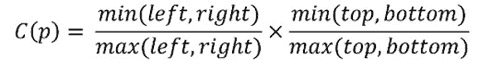

该公式确保了越靠近边界框中心（即 `left≈right` 且 `top≈bottom`）的点获得更高的分，因为其比例趋于 1；而越靠近边缘的点得分较低。

其用法如下：

* **训练**：在模型训练期间，中心度得分用于加权边界框内每个点的贡献，有助于精炼边界框预测并增强目标检测的精度。

* **推理**：在推理阶段，中心度得分可以对检测结果进行排序和过滤，优先考虑那些在检测边界框内位置越靠中心的结果。

这些关键点热力图和中心度的数学框架允许目标检测模型更准确、高效地识别和定位图像中的物体。

### FCOS 的伪代码

伪代码 `FCOS` 如下所示：

```python
import torch
import torch.nn as nn
import torchvision  

class CenterNet(nn.Module):
    def __init__(self, num_classes):
        super(CenterNet, self).__init__()
        # 用于特征提取的主干网络，例如针对 CenterNet 修改的 ResNet
        self.backbone = torchvision.models.resnet50(pretrained=True)
        # 根据 CenterNet 设计额外的卷积层
        self.conv_layers = nn.Sequential(
            nn.Conv2d(...),
            nn.ReLU(),
            nn.Conv2d(...)
        )
        # 用于热力图、尺寸和偏移的头部
        self.heatmap_head = nn.Conv2d(..., num_classes, kernel_size=1)
        self.size_head = nn.Conv2d(..., 2, kernel_size=1) # 宽度和高度
        self.offset_head = nn.Conv2d(..., 2, kernel_size=1) # x 和 y 偏移  

    def forward(self, x):
        features = self.backbone(x)
        features = self.conv_layers(features)
        # 预测热力图、尺寸和偏移
        heatmap = torch.sigmoid(self.heatmap_head(features))
        size = self.size_head(features)
        offset = self.offset_head(features)
        return heatmap, size, offset  

### 使用示例
model = CenterNet(num_classes=80) # 假设有 80 类
```

### FCOS 的损失函数

损失函数是目标检测模型训练中的关键组件，充当模型输出与真实值（ground truth）数据之间的桥梁。其重要性源于多种因素：

* **引导模型训练**：损失函数提供了模型预测结果与实际结果之间距离的可量化标准。通过在训练过程中最小化损失，模型学习如何改进预测以向真实值靠近。这一过程涉及调整网络权重以减少损失，有效地教会模型更准确地识别和定位物体。


# 目标检测中的损失函数

损失函数在目标检测模型的训练中扮演着至关重要的角色。它们不仅指导模型学习，还帮助模型在多个目标之间取得平衡，并应对实际应用中的各种挑战。以下是损失函数在目标检测中的主要作用：

- **平衡不同目标**：目标检测任务要求模型同时学习分类（物体是什么）和定位（物体在哪里）。典型的目标检测模型具有独立的组件，用于预测类别标签、边界框坐标，有时以及物体性（`objectness`）分数或锚框调整。每个组件都有对应的损失函数（例如用于分类的交叉熵、用于边界框的平滑 `L1`），总损失是这些单独损失的加权之和。这允许模型在检测任务的不同方面之间取得平衡，例如在正确识别物体的同时准确预测其位置。

- **处理类别不平衡**：目标检测数据集在背景（负样本）和物体（正样本）的数量之间通常存在显著不平衡。损失函数可以引入焦点损失（`focal loss`）等机制，防止大量的简单负样本主导损失并阻碍有效学习，特别是对于稀有目标的检测。

- **提高模型鲁棒性**：高级损失函数可以帮助模型从难以正确检测的困难样本或离群值中学习。通过在训练期间强调这些困难情况，模型变得更加健壮，并在更广泛的输入上表现更好。

- **针对特定任务优化**：损失函数的选择可以根据特定任务或数据集的需求进行定制。例如，某些损失函数设计对物体尺寸更敏感，适用于在大场景中检测小物体。其他则可能根据应用需求专注于实现高精确率或高召回率。

- **评估模型性能**：除了引导训练，损失函数的组件（例如分类损失、定位损失）还提供了关于模型优缺的见解。分析这些内容可以帮助开发者理解模型是在识别物体方面更有困难，还是在准确定位方面更有困难，从而指导进一步的改进。

因此，损失函数是训练目标检测模型的基础，使它们能够从数据中学习、平衡多个目标、处理类别不平衡等实际挑战、提高鲁棒性、针对特定应用优化性能并全面评估其能力。

## PyTorch 损失函数示例

- **交叉熵损失（`Cross-entropy loss`）**：这是一种用于多分类问题的标准损失函数。在目标检测中，它用于训练模型的分类头部，该头部预测跨物体类别的概率分布。

```python
import torch
import torch.nn as nn  

## 假设模型输出和实际标签
model_output = torch.randn(10, 5, requires_grad=True) # 示例输出 (batch_size, num_classes)
target = torch.randint(5, (10,)) # 示例目标 (batch_size)

loss_fn = nn.CrossEntropyLoss()
loss = loss_fn(model_output, target)  
print("Cross-Entropy Loss:", loss.item())
```

- **平滑 `L1` 损失（`Smooth L1 loss`）**：该损失函数用于训练模型的回归头部，用于预测边界框相对于锚框的偏移。它是 `L1` 损失的改进，对离群值更健壮，并且在零附近具有平滑的梯度。

```python
import torch
import torch.nn as nn  

# 回归的预测和目标
predictions = torch.randn(10, 4, requires_grad=True) # 示例预测
targets = torch.randn(10, 4) # 示例真实

loss_fn = nn.SmoothL1Loss()
loss = loss_fn(predictions, targets)  
print("Smooth L1 Loss:", loss.item())
```

- **焦点损失（`Focal loss`）**：这是交叉熵损失的变体，对分类错误的困难样本给予更大的权重。它被引入 `RetinaNet` 模型中，并被证明在改进目标检测模型性能非常有效。

```python
import torch
import torch.nn as nn
import torch.nn.functional as F  

class FocalLoss(nn.Module):
    def __init__(self, alpha=0.25, gamma=2.0, reduction='mean'):
        super(FocalLoss, self).__init__()
        self.alpha = alpha
        self.gamma = gamma
        self.reduction = reduction  

    def forward(self, inputs, targets):
        BCE_loss = F.binary_cross_entropy_with_logits(inputs, targets, reduction='none')
        pt = torch.exp(-BCE_loss) # 防止概率为 0 时产生 nan
        F_loss = self.alpha * (1-pt)**self.gamma * BCE_loss  
        if self.reduction == 'mean':
            return torch.mean(F_loss)
        elif self.reduction == 'sum':
            return torch.sum(F_loss)
        else:
            return F_loss  

### 使用示例
inputs = torch.randn(10, 1, requires_grad=True) # 模型输出
targets = torch.empty(10, 1).random_(2) # 二分类标签

loss_fn = FocalLoss()
loss = loss_fn(inputs, targets)  
print("Focal Loss:", loss.item())
```

## 基于 IoU 的损失函数

交并交比（`IoU`）及其变体，如广义交并交比（`GIoU`）和距离交并交比（`DIoU`），是目标检测中高级损失函数，用于衡量预测边界框与真实边界框（`ground truth boxes`）之间的重叠程度。与基于类别标签或整个图像像素的传统损失函数不同，基于 `IoU` 的损失直接影响边界框预测的准确性。

- **`IoU loss`**：该损失函数基于 `IoU` 指标，该指标衡量预测边界框与真实边界框之间的重叠。它可以直接优化预测框与真实框之间的 `IoU`。

```python
import torch

def iou_loss(pred_boxes, gt_boxes):
    """
    Calculate IoU loss between predicted and ground truth boxes.
    Both pred_boxes and gt_boxes should be in the format of [x1, y1, x2, y2].
    """
    # Intersection
    inter_x1 = torch.max(pred_boxes[:, 0], gt_boxes[:, 0])
    inter_y1 = torch.max(pred_boxes[:, 1], gt_boxes[:, 1])
    inter_x2 = torch.min(pred_boxes[:, 2], gt_boxes[:, 2])
    inter_y2 = torch.min(pred_boxes[:, 3], gt_boxes[:, 3])
    inter_area = torch.clamp(inter_x2 - inter_x1, min=0) * torch.clamp(inter_y2 - inter_y1, min=0)

    # Union
    pred_area = (pred_boxes[:, 2] - pred_boxes[:, 0]) * (pred_boxes[:, 3] - pred_boxes[:, 1])
    gt_area = (gt_boxes[:, 2] - gt_boxes[:, 0]) * (gt_boxes[:, 3] - gt_boxes[:, 1])
    union_area = pred_area + gt_area - inter_area

    # IoU
    iou = inter_area / torch.clamp(union_area, min=1e-6)

    # IoU Loss
    return 1 - iou # Loss is 1 – IoU
```

- **`GIoU loss`**：这是 `IoU` 损失的一种变体，它还考虑了边界框的大小和宽高比。事实证明，它有助于提高目标检测模型的定位精度。

```python
def giou_loss(pred_boxes, gt_boxes):
    """
    Calculate Generalized IoU loss between predicted and ground truth boxes.
    Both pred_boxes and gt_boxes should be in the format of [x1, y1, x2, y2].
    """
    # Calculate IoU Loss
    iou_loss_val = iou_loss(pred_boxes, gt_boxes)

    # Smallest enclosing box
    enclose_x1 = torch.min(pred_boxes[:, 0], gt_boxes[:, 0])
    enclose_y1 = torch.min(pred_boxes[:, 1], gt_boxes[:, 1])
    enclose_x2 = torch.max(pred_boxes[:, 2], gt_boxes[:, 2])
    enclose_y2 = torch.max(pred_boxes[:, 3], gt_boxes[:, 3])
    enclose_area = torch.clamp(enclose_x2 - enclose_x1, min=0) * torch.clamp(enclose_y2 - enclose_y1, min=0)

    # Union area from IoU calculation
    union_area = (pred_boxes[:, 2] - pred_boxes[:, 0]) * (pred_boxes[:, 3] - pred_boxes[:, 1]) + \
    (gt_boxes[:, 2] - gt_boxes[:, 0]) * (gt_boxes[:, 3] - gt_boxes[:, 1]) - \
    torch.clamp(inter_x2 - inter_x1, min=0) * torch.clamp(inter_y2 - inter_y1, min=0)

    # GIoU
    giou = iou_loss_val - (enclose_area - union_area) / torch.clamp(enclose_area, min=1e-6)
    return 1 - giou # Loss is 1 – GioU
```

- **`DIoU loss`**：这是 `IoU` 损失的另一种变体，它还考虑了预测边界框与真实边界框中心之间的距离。它也被证明有助于提高目标检测模型的定位精度。

```python
def diou_loss(pred_boxes, gt_boxes):
    """
    Calculate Distance IoU loss between predicted and ground truth boxes.
    Both pred_boxes and gt_boxes should be in the format of [x1, y1, x2, y2].
    """
    # Calculate IoU Loss
    iou_loss_val = iou_loss(pred_boxes, gt_boxes)

    # Center points
    center_pred = (pred_boxes[:, :2] + pred_boxes[:, 2:] ) / 2
    center_gt = (gt_boxes[:, :2] + gt_boxes[:, 2:] ) / 2

    # Euclidean distance between centers
    euclidean = torch.norm(center_pred - center_gt, dim=1)

    # Diagonal length of the smallest enclosing box
    enclose_x1 = torch.min(pred_boxes[:, 0], gt_boxes[:, 0])
    enclose_y1 = torch.min(pred_boxes[:, 1], gt_boxes[:, 1])
    enclose_x2 = torch.max(pred_boxes[:, 2], gt_boxes[:, 2])
    enclose_y2 = torch.max(pred_boxes[:, 3], gt_boxes[:, 3])
    # ... (logic continues same pattern)
```

## 用于图像变换和增强的线性代数

### 答案对照

| 1. | c |
| --- | --- |
| 2. | b |
| 3. | b |
| 4. | b |
| 5. | b |

### 加入我们书籍的 Discord 空间

加入书籍 `Discord` 工作空间，获取最新更新、优惠、全球技术动态、新书发布以及与作者的交流会议：

[`discord.bpbonline.com`](https://discord.bpbonline.com)


# 第 5 章：基于 FPN、RPN 和 DetectoRS 的高级目标检测

## 引言

本章将带你探索目标检测的前沿领域，重点关注特征金字塔网络（`FPNs`）及其在识别不同尺度图像方面的革新性影响。当我们深入研究 `FPNs` 的复杂性时，我们将揭示支持这些网络能够精确识别细节的数学骨架。我们将通过在 `CIFAR100` 上实现 `CNNs` 获得实践见解，并进一步通过经过 `PyTorch` 重构的 `FPNs` 来进行增强。叙述将继续探索 `FPNs` 的边界，承认其局限性，并为 `DetectoRS` 等高级架构铺平道路。它进一步探讨了从区域提议网络（`RPNs`）到更高效的继任者 `RRPNs` 的演变，强调了旋转区域提议的创新。章节最后讨论了在改进的 `RetinaNet` 框架中集成无锚检测，并比较了 `Detecto` 和 `Detectron` 库，阐明了它们在将计算机视觉应用从基础研究到实际解决方案民主化方面的作用。

## 结构

- 特征金字塔网络简介
- 探索特征金字塔网络
- 特征金字塔网络的局限性
- 超越特征金字塔网络
- `DetectoRS`
- 从 `RPNs` 到 `RRPNs` 的过渡
- `Detecto` 和 `Detectron`

## 目标

本章的目标是全面理解 `FPNs` 及其在目标检测算法中的应用。我们旨在探索基本概念、解码底层数学原理并评估 `FPNs` 的局限性。研究扩展到传统的 `FPN` 框架之外，包含了 `DetectoRS` 和 `RetinaNet` 改进等进展。对从 `RPNs` 到旋转 `RPN`（`RRPNs`）的过渡进行批判性分析。我们的目标是完善目标检测技术，提升性能，并为机器学习和计算机视觉未来的创新奠定基础。

### 特征金字塔网络简介

想象你正在尝试识别图像中的物体。这些物体可能是从微小的别针到大汽车的任何东西，而且你想准确地识别所有它们。这正是 `FPN` 派上用场的地方。它是以不同尺度或细节级别观察图像的智能方法，帮助计算机既看到“森林”，也能看到“树木”。

以下是一种简化的理解方法：

1. **自底向上的骨干网络（`bottom-up backbone`）**：将其想象为逐步放大图像的过程，从整个图片一直到最小细节。每一步都是对图像的深层观察，揭示更多关于更小物体或精细细节的信息。这些步骤就是我们说的自底向上骨干网络的阶段，表示为第 `i` 阶段的 `Bi`。这就像拥有一系列针对同一场景的逐渐放大的照片。

2. **自顶向下的操作（`top-down operation`）**：一旦我们完全放大，我们就开始向外缩小，但带有一种转折。当我们退回且视野再次变宽时，我们并不仅仅是回到细节较少的视图。相反，在每一步中，我们都混合了在近距离放大时观察到的细节。这种不同尺度详细视图的混合就是自顶向下的操作，表示为 `Fi`。这就像是在缩小过程中，你记得并整合了在近距离观察时看到的细节。

3. **结合两者**：在缩小过程中，你记得并整合了在近距离观察时看到的细节。这确保了在不同尺度下都有丰富的特征图信息。

4. **使用特征图**：在结束时，我们拥有不同尺度的特征图，涵盖了细节。这有助于准确识别图像中的各种物体。

5. **简化**：如果阶段（或放大级别）的数量足够多，我们会有不同尺度的特征图，这使得目标检测系统更容易工作。

在本质上，`FPN` 就像拥有一双在不同距离的眼睛，并能够结合这些距离看到的内容。这有助于准确识别图像中的各种物体。

### 探索特征金字塔网络

虽然卷积神经网络（`CNNs`）和基于区域的卷积神经网络（`RCNN`）对于广泛的计算机视觉任务非常有效，但在某些情况下它们可能不是最佳选择。以下是你可能考虑其他方法的情况：

- **数据不是基于图像时**：`CNNs` 专为基于图像的数据设计，输入是像素网格。如果你的数据格式不同（例如文本或时间序列数据），那么其他类型的模型可能合适。

- **数据太小或太大时**：`CNNs` 需要大量数据才能有效，如果数据太少，则效果不佳。同样，如果你的数据太大（例如高分辨率图像），那么 `CNNs` 的训练和使用开销可能过大。


# 特征已定义时

`CNNs` 设计用于直接从数据学习特征，但在某些情况下，特征已经过定义并且可以通过手工方法轻松提取。在这种情况下，直接使用这些特征可能比从头训练 `CNN` 来学习它们更高效。

# 对实时性能至关重要时

虽然 `CNNs` 准确性很高，但计算开销也很大，特别是在处理大量数据时。在对实时性能至关重要的应用（如机器人或自动驾驶）中，可能需要使用更高效的方法。

# 资源限制的设备

计算资源有限的设备（如手机或嵌入式系统）可能难以处理 `R-CNN` 的密集计算需求。处理数千个区域提议的需求对此类设备来说特别具有挑战。

# 存在极小或密集物体的场景

虽然 `R-CNN` 可以检测各种尺寸的物体，但在包含极小或密集物体的场景中，其性能可能会下降。选择搜索算法可能无法为这些物体准确提议区域，导致漏检。

# 标注数据有限时

`R-CNN` 及其变体需要大量的标注数据进行训练。在标注数据集稀缺或制作昂贵的领域，如果不使用迁移学习或数据增强等技术，部署 `R-CNN` 可能具有挑战性。

# 需要快速训练周期的应用

`R-CNN` 的训练过程复杂，涉及多个阶段，包括在大型数据集上预训练 `CNN`、在特定任务上进行微调，以及为每个区域建议（region proposal）训练单独的分类器。对于快速迭代和训练周期至关重要的项目，由于训练过程漫长，`R-CNN` 可能不是理想选择。

在 `R-CNN` 可能不合适的场景下，`FPNs` 是一个很好的替代方案，特别是在检测不同尺度目标的速度和效率方面具有优势。以下是 `FPNs` 如何解决上述针对 `R-CNN` 和 `CNN` 的局限性：

# 实时应用

`FPNs` 尤其是当与 `Faster R-CNN` 等快速检测架构或单次检测器 (`SSD`) 连接时，可以显著提高处理速度，使其更适用于实时应用。金字塔结构能够高效地处理多尺度的图像，在不显著增加计算时间的情况下增强检测性能。

# 资源受限的设备

虽然仍然是计算密集型的，但与更高效的骨干网络集成的精简 `FPN` 架构可以针对资源受限的设备进行优化部署。`模型裁剪`、`量化`以及使用轻量级骨干网络等技术可以进一步减少计算负载。

# 大型数据集

`FPNs` 可以端到端训练，这比 `R-CNN` 的多阶段训练过程更高效。这使得 `FPNs` 在大型数据集上的训练相对容易有时更快，特别是在使用现代 `GPU` 硬件和优化技术的情况下。

# 具有极小或密集物体的场景

`FPNs` 的多尺度、层次化特性允许更好地检测小而密集的物体。`FPNs` 可以在高分辨率下捕捉更细的细节，同时在低分辨率下保持上下文，提高不同尺寸目标的检测准确性。

# 标注数据有限

虽然标注数据有限的挑战影响所有深度学习模型，但 `FPNs` 的效率和灵活性结合迁移学习、合成数据生成和数据增强等技术，可以比 `R-CNN` 更有效地缓解这些挑战。

# 需要快速训练周期的应用

`FPNs` 的端到端训练能力不需要为特征提取、区域建议和分类划分独立阶段，使得训练过程更加简单且可能更快，从而促进了更快的迭代和开发周期。

`FPN` 是一种用于目标检测和语义分割任务的流行架构。`FPN` 的主要目标是从不同尺度和分辨率的图像中提取特征，以准确检测不同尺寸的物体。

在传统的 `CNNs` 中，每个网络层产生的特征图具有固定的大小和分辨率。这意味着网络更擅长检测特定尺寸和尺度的物体，而对于比该尺度小得多或大大的物体可能很吃力。

`FPN` 通过创建一个特征图金字塔来解决这个问题，金字塔的每一层代表不同尺度的特征。金字塔的构建通过一个自底向上的路径从输入图像中提取特征，并通过一个自顶向下的路径结合金字塔不同层之间的特征。

金字塔不同层生成的特征图随后被组合，形成一组既富高层语义信息又包含低层细节信息的特征图。这些特征图随后用于生成物体建议（object proposals）并执行物体分类和定位。

`FPNs` 已证明可以提高目标检测和语义分割模型的准确性，特别是对于中小型物体，通过允许模型提取并使用多个尺度和分辨率的特征。

因此，`FPNs` 代表了一个多功能且强大的目标检测框架，能够应对各种应用需求和限制。让我们详细理解。

## 解码特征金字塔网络背后的数学

`FPN` 是一种计算机视觉中常用的用于目标检测的网络架构。`FPN` 设计用于生成一组不同尺度的特征图，可用于检测不同尺寸的物体。

从层次上来说，`FPN` 接收图像并生成一组多个分辨率的特征图。这些特征图随后用于目标检测和预测。`FPN` 架构由两个主要部分组成：自底向上的路径和自顶向下的路径。

自底向上的路径是一个 `CNN`，它接收输入图像并产生一组多个尺度的特征图。这些特征图通过应用一系列具有不同卷积大小和步长的卷积层生成。每一层的特征图随后通过 `ReLU` 激活函数和最大池化操作进行处理，以减少空间维度。

`FPN` 架构的自顶向下的路径用于生成一组不同尺度的特征图，用于目标检测。自顶向下的路径由一系列上采样层和横向连接（lateral connections）组成。上采样层用于增加特征图的空间分辨率，而横向连接用于将来自自底向上路径的特征图与上采样后的特征图相结合。

自底向上和自顶向下路径的结合形成了一组特征图，该组包含了丰富的高层语义信息和低层详细信息。这些特征图随后用于生成物体建议并执行物体分类和定位。

`FPNs` 已证明可以提高目标检测和语义分割模型的准确性，特别是对于中小型物体，通过允许模型提取和使用多个尺度和分辨率的特征。

因此，`FPNs` 代表了一个多功能且强大的目标检测框架，能够应对广泛的应用需求和约束。让我们详细了解。

`FPN` 是一种计算机视觉中常用的用于目标检测的网络架构。`FPN` 设计用于生成一组不同尺度的特征图，可用于检测不同尺寸的物体。

从层次上来说，`FPN` 接收输入图像并生成一组多个分辨率的特征图。这些特征图随后用于目标检测和预测。`FPN` 架构由两个主要部分组成：自底向上的路径和自顶向下的路径。

自底向上的路径是一个 `CNN`，它接收输入图像并产生一组多个尺度的特征图。这些特征图通过应用一系列具有不同卷积大小和步长的卷积层生成。每一层的特征图随后通过 `ReLU` 激活函数和最大池化操作进行处理，以减少空间维度。

`FPN` 架构的自顶向下的路径用于生成一组不同尺度的特征图，用于目标检测。自顶向下的路径由一系列上采样层和横向连接组成。上采样层用于增加特征图的空间分辨率，而横向连接用于将来自自底向上路径的特征图与上采样后的特征图相结合。

自底向上和自顶向下路径的结合形成了一组特征图，该组包含了丰富的高层语义信息和低层详细信息。这些特征图随后用于生成物体建议并执行物体分类和定位。

数学上，`FPN` 可以表示如下：

设 `I` 为输入图像，设 `C(I)` 为自底向上路径生成的特征图集合。每一层 `l` 的特征图表示为 `Cl(I)`，其大小为 `Hl x Wl x Dl`，其中 `Hl` 和 `Wl` 是特征图的高度和宽度，`Dl` 是通道数。

`FPN` 的自顶向下路径可以表示如下：

- 从顶部的特征图开始，设 `Pk(I)` 为第 `k` 个自顶向下路径的输出。初始时，`P0` 设置为 `Cl(I)`，其中 `l` 是底层索引。

- 对于 `k < l`，上采样特征图 `Pk-1` 与特征图 `Cl-k` 结合产生融合特征图 `Qk`：

`Qk = Upsample(Pk-1) + Cl-k`

此处，`Upsample()` 是增加 `Pk-1` 空间分辨率以匹配 `Cl-k` 维度的操作。

- 融合特征图 `Qk` 随后通过 3x3 卷积层处理并通过 `ReLU` 激活函数生成最终特征图 `Pk`：

`Pk = ReLU(Conv(Qk))`

此处，`Conv()` 是作用于输入特征图的卷积层，`ReLU()` 是线性线性激活函数。

- 自顶向下路径的输出是特征图集合 `{P0, P1, ..., Pl}`。

`FPN` 生成的最终特征图集合可以使用锚框或建议进行目标检测和预测。目标检测算法的具体细节以及锚框或建议的使用取决于具体的应用和所使用的数据集。

`CNN` 在 `CIFAR100` 上的实现如下：

### 第一步：导入必要的库

```python
import torch
import torchvision
import torchvision.transforms as transforms
import torch.nn as nn
import torch.optim as optim
import matplotlib.pyplot as plt
import numpy as np
```

### 第二步：加载并归一化 CIFAR-100

```python
transform = transforms.Compose(
[transforms.ToTensor(),
transforms.Normalize((0.5, 0.5, 0.5), (0.5, 0.5, 0.5))])

batch_size = 4
```

```python
trainset = torchvision.datasets.CIFAR100(root='./data', train=True, download=True, transform=transform)
trainloader = torch.utils.data.DataLoader(trainset, batch_size=batch_size, shuffle=True)
testset = torchvision.datasets.CIFAR100(root='./data', train=False, download=True, transform=transform)
testloader = torch.utils.data.DataLoader(testset, batch_size=batch_size, shuffle=False)
```

### 步骤 3：定义一个简单的 CNN 模型

```python
class Net(nn.Module):
    def __init__(self):
        super(Net, self).__init__()
        self.conv1 = nn.Conv2d(3, 6, 5)
        self.pool = nn.MaxPool2d(2, 2)
        self.conv2 = nn.Conv2d(6, 16, 5)
        self.fc1 = nn.Linear(16 * 5 * 5, 120)
        self.fc2 = nn.Linear(120, 84)
        self.fc3 = nn.Linear(84, 100) # CIFAR-100 有 100 个类

    def forward(self, x):
        x = self.pool(nn.functional.relu(self.conv1(x)))
        x = self.pool(nn.functional.relu(self.conv2(x)))
        x = torch.flatten(x, 1) # 展平除批维度以外的所有维度
        x = nn.functional.relu(self.fc1(x))
        x = nn.functional.relu(self.fc2(x))
        x = self.fc3(x)
        return x

net = Net()
```

### 步骤 4：定义损失函数和优化器

```python
criterion = nn.CrossEntropyLoss()
optimizer = optim.SGD(net.parameters(), lr=0.001, momentum=0.9)
```

### 步骤 5：训练网络

```python
for epoch in range(2): # 多次遍历数据集
    running_loss = 0.0
    for i, data in enumerate(trainloader, 0):
        # 获取输入；data 是包含 [inputs, labels] 的列表
        inputs, labels = data
        # 梯度清零
        optimizer.zero_grad()
        # 前向 + 反向 + 优化
        outputs = net(inputs)
        loss = criterion(outputs, labels)
        loss.backward()
        optimizer.step()
        # 打印统计信息
        running_loss += loss.item()
        if i % 2000 == 1999: # 每 2000 个 mini-batch 打印一次
            print(f'[{epoch + 1}, {i + 1:5d}] loss: {running_loss / 2000:.3f}')
        running_loss = 0.0
print('Finished Training')
```

输出：

```text
Downloading https://www.cs.toronto.edu/~kriz/cifar-100-python.tar.gz to ./data/cifar-100-python.tar.gz
100%|██████████| 169001437/169001437 [00:02<00:00, 64686878.12it/s]
Extracting ./data/cifar-100-python.tar.gz to ./data
Files already downloaded and verified
[1, 2000] loss: 4.605
[1, 4000] loss: 4.573
[1, 6000] loss: 4.362
[1, 8000] loss: 4.149
[1, 10000] loss: 4.048
[1, 12000] loss: 3.967
[2, 2000] loss: 3.796
[2, 4000] loss: 3.737
[2, 6000] loss: 3.665
[2, 8000] loss: 3.625
[2, 10000] loss: 3.576
[2, 12000] loss: 3.514
Finished Training
```

`torchvision.ops.FeaturePyramidNetwork` 是 `torchvision` 库中的组件，旨在增强深度学习模型中的特征表示，特别是针对目标检测任务。它通过聚合和上采样骨干网络中的低层特征图来构建多尺度的特征金字塔，同时保留空间分辨率。这种方法允许网络通过利用深层粗糙层的语义信息以及浅层精细层的详细信息，有效地检测不同大小的物体。它通常与 CNN 配合使用以提高需要不同尺度物体定位和分类任务的性能。

### 使用 Pytorch 模块重构 FPN

我们将使用 `torchvision.ops.FeaturePyramidNetwork` 将 CNN 层替换为 FPN 层：


```python
import torch
import torchvision
import torchvision.transforms as transforms
from torch import nn
from torchvision.models._utils import IntermediateLayerGetter
from torchvision.ops import FeaturePyramidNetwork
from torchvision.ops.misc import Frozen2d
import torch.optim as optim

# 数据预处理和加载
transform = transforms.Compose([
    transforms.ToTensor(),
    transforms.Normalize((0.5, 0.5, 0.5), (0.5, 0.5, 0.5))
])
batch_size = 4
trainset = torchvision.datasets.CIFAR100(root='./data', train=True, download=True, transform=transform)
trainloader = torch.utils.data.DataLoader(trainset, batch_size=batch_size, shuffle=True)
testset = torchvision.datasets.CIFAR100(root='./data', train=False, download=True, transform=transform)
testloader = torch.utils.data.DataLoader(testset, batch_size=batch_size, shuffle=False)

# 定义简单的 CNN 骨干网络
class SimpleCNNBackbone(nn.Module):
    def __init__(self):
        super(SimpleCNNBackbone, self).__init__()
        self.conv1 = nn.Conv2d(3, 64, kernel_size=7, stride=2, padding=3, bias=False)
        self.bn1 = FrozenBatchNormd(64)
        self.relu = nn.ReLU(inplace=True)
        self.maxpool = nn.MaxPool2d(kernel_size=3, stride=2, padding=1)

    def forward(self, x):
        x = self.conv1(x)
        x = self.bn1(x)
        x = self.relu(x)
        x = self.maxpool(x)
        return x
```

## 定义带有 FPN 的模型

```python
class CIFAR100_FPN_Model(nn.Module):
    def __init__(self, num_classes=100):
        super(CIFAR100_FPN_Model, self).__init__()
        backbone = SimpleCNNBackbone()
        # 创建 IntermediateLayerGetter 从骨干网络中提取层
        return_layers = {'maxpool': '0'}
        self.body = IntermediateLayerGetter(backbone, return_layers=return_layers)
        in_channels = [64]
        out_channels = 256
        self.fpn = FeaturePyramidNetwork(in_channels=in_channels, out_channels=out_channels)
        self.classifier = nn.Linear(out_channels, num_classes)

    def forward(self, x):
        x = self.body(x)
        x = self.fpn(x)
        x = x['0'] # 使用高分辨率特征图
        x = torch.mean(x, [2, 3]) # 全局平均化
        x = self.classifier(x)
        return x
```

## 初始化模型、损失函数和优化器

```python
model = CIFAR100_FPN_Model()
criterion = nn.CrossEntropyLoss()
optimizer = optim.SGD(model.parameters(), lr=0.001, momentum=0.9)
```

## 训练循环

```python
for epoch in range(2):
    running_loss = 0.0
    for i, data in enumerate(trainloader, 0):
        inputs, labels = data
        optimizer.zero_grad()
        outputs = model(inputs)
        loss = criterion(outputs, labels)
        loss.backward()
        optimizer.step()
        running_loss += loss.item()
        if i % 2000 == 1999:
            print(f'[{epoch + 1}, {i + 1:5d}] loss: {running_loss / 2000:.3f}')
        running_loss = 0.0
```

```python
in_channels_list = [64]
out_channels = 256
self.fpn = FeaturePyramidNetwork(in_channels_list=in_channels_list, out_channels=out_channels)
self.classifier = nn.Linear(out_channels, num_classes)

def forward(self, x):
    x = self.body(x)
    x = self.fpn(x)
    x = x['0']  # 使用最高分辨率的特征图
    x = torch.mean(x, [2, 3])  # 全局平均池化 (GAP)
    x = self.classifier(x)
    return x
```

## 初始化模型、损失函数和优化器

```python
model = CIFAR100_FPN_Model()
criterion = nn.CrossEntropyLoss()
optimizer = optim.SGD(model.parameters(), lr=0.001, momentum=0.9)
```

## 训练循环

```python
for epoch in range(2):
    running_loss = 0.0
    for i, data in enumerate(trainloader, 0):
        inputs, labels = data
        optimizer.zero_grad()
        outputs = model(inputs)
        loss = criterion(outputs, labels)
        loss.backward()
        optimizer.step()
        running_loss += loss.item()
        if i % 2000 == 1999:
            print(f'[{epoch + 1}, {i + 1:5d}] loss: {running_loss / 2000:.3f}')
            running_loss = 0.0

print('训练完成')
```

输出：

```
文件已下载并验证
文件已下载并验证
[1, 2000] loss: 4.399
[1, 4000] loss: 4.133
[1, 6000] loss: 3.943
[1, 8000] loss: 3.815
[1, 10000] loss: 3.735
[1, 12000] loss: 3.642
[2, 2000] loss: 3.553
[2, 4000] loss: 3.519
[2, 6000] loss: 3.471
[2, 8000] loss: 3.464
[2, 10000] loss: 3.393
[2, 12000] loss: 3.382
训练完成
```

## 特征金塔网络的局限性

虽然 FPN 在许多目标检测任务中被证明是有效的，但该方法存在一些局限性。以下是其中：

- **尺度变化有限**：`FPN` 的分辨率金字塔通常由一组固定的尺度构建，这意味着它可能无法处理尺寸差异显著的物体。
- **缺乏旋转不变性**：`FPN` 不对物体旋转提供任何不变性，因此输入图像中旋转的物体可能会受到旋转影响。

让我们在不涉及数学的情况下，用一种更易理解的方式来拆解对 RFP 的解释。可以将 RFP 想象为一种增强我们讨论过的 FPN 的智能且迭代的方法。以下是其更通俗易懂的工作原理：

- **引入循环：** RFP 继承了 FPN 的原始概念，并添加了你可以理解为循环的机制。这个循环允许系统检查自己的输出，并通过结合来自之前步骤的额外信息来对其进一步精炼。这就像一位艺术家画草图，然后反复修改，根据第一遍的知识添加更多细节或纠正错误。

- **递归部分**：

    1. **反馈循环**：对于金字塔结构中的每一个细节级别（每个缩放步骤），RFP 不仅考虑当前层级的细节以及来自自底向上骨干网的更精细细节，还引入了来自 RFP 上一次迭代输出的反馈。这意味着它不仅混合了当前细节和放大视图的细节，还混合了上一次尝试创建特征图时的改进和优化。

    2. **展开循环**：为了使这个过程具有可操作性且在计算上可行，RFP 将此循环展开成一个序列。想象将一个螺旋楼展开成一条直线；步骤仍然相同，但是首尾相连地排列。这种操作会执行若干次，每一步都利用上一步的信息改进特征图。

    3. **迭代与调整**：整个操作会重复固定的次数（在技术描述中标记为 `T`）。每次都会根据最新信息更新反馈和特征图。随着每次迭代的进行，系统可以不断地微调细节。

    4. **实现细节**：在实践中，RFP 的某些组件在这些迭代中保持不变（例如特征转换函数），而系统会通过这个精炼过程迭代几次（文档提到了 `=2T=2` 作为示例）。这种平衡有助于确保系统不会变得过于复杂，同时仍显著提升特征图的质量。

    5. **整合反馈机制**：对基础架构（如 `ResNet`，骨干网的常用选择）进行了修改以适应这种反馈机制。具体而言，通过了修改，使系统能够处理包含来自之前输出反馈的额外输入。这类似于在电视上增加一个额外的通道，播放上一个节目的精彩片段，从而丰富当前的观看体验。

因此，RFPN 在 FPN 生成目标检测特征图的过程中引入了持续改进的循环。通过结合之前迭代的额外上下文重新审视自己的输出，它精炼并增强了检测目标的能力，使其精度更高，特别是在处理复杂或难以识别的目标时。

空洞空间金字塔池化（ASPP）模块用于递归特征金字塔（RFP），以精炼和转换特征用于更好的目标检测。

- **ASPP 在 RFP 中的作用**：将 ASPP 想象成一种专用工具，它可以获取一个特征（从图像中提取的视觉信息）并同时以四种不同的方式对其处理。这个过程有助于捕捉特征的不同方面，例如不同的细节或纹理，这些对于准确检测图像中的目标至关重要。

以下是 ASPP 的工作原理：

1. **并行处理**：ASPP 模块通过四个独立的分支或路径处理输入特征。每个分支都会分析输入特征。

2. **实现细节**：

    - 并行分支：每个分支分析输入特征。
    - 全局平均池化：该分支汇总特征。
    - 合并输出：处理后，对输出进行拼接。

3. **对原始 ASPP 的调整**：文档提到对比了有无 ASPP 模块的 RFP 性能，突显了这种处理如何改进目标检测。

4. **对检测的影响**：空洞空间金字塔池化（ASPP）模块用于递归特征金字塔（RFP），以精炼和转换特征用于更好的目标检测。本质上，通过使用 ASPP，模型对图像的理解变得微妙细致，这对于更准确、更有效地检测目标至关重要。

```python
detections = detection_head.detect_objects(rfp_features)
return detections
```

### 使用示例

```python
input_image = load_image('path/to/image.jpg')
detections = DetectoRS(input_image)
```

## 从 RPN 到 RRPN 的过渡

RPN（区域提议网络）是 `Faster R-CNN` 和 `Mask R-CNN` 等目标检测模型的核心组件。RPN 从图像中生成一组物体提议（object proposals），然后由检测网络对其进行分类和优化。

RPN 的一些局限性包括：

* 对尺度和宽高比敏感：RPN 对图像中对象的尺度和宽高比非常敏感。特别是较小的物体或具有非标准宽高比的对象可能无法被准确检测。
* 锚框先验（Anchor priors）：RPN 依赖于预定义的锚框（anchor boxes）来生成提议。这些锚框是根据训练数据中对象的宽高比和尺度选择的。如果测试数据中的物体分布与训练数据不同，`RPN` 的性能可能会下降。
* 计算开销大：RPN 的计算开销很大，因为它们对每张图像都需要生成大量的提议。这会限制整个目标检测系统的速度和效率。
* 缺乏旋转不变性：RPN 没有显式地建模旋转不变性，这限制了它们准确检测任意方向物体的能力。这正是旋转区域提议网络（`RRPNs`）大显武场，它可以处理旋转不变性。

## 旋转区域提议网络

在传统的 RPN 中，生成的矩形区域提议被输入到目标检测网络。然而，这种方法限于检测形状大致为矩形的物体。RRPNs 通过生成旋转矩形区域提议克服了这一局限性。

`RRPN` 算法的工作原理首先使用传统的 `RPN` 算法生成一组固定宽高比的矩形区域提议。然后，使用这些提议中的每一个生成一组具有不同宽高比和角度的旋转区域提议。旋转提议是通过对固定宽高比提议应用旋转变换生成的。

这些旋转提议被输入到目标检测网络进行进一步处理。通过在训练期间使用这些旋转提议，可以训练网络检测不同形状和大小的物体。

`RRPNs` 已证明在检测文本、车辆和动物等任意形状物体方面优于传统的 `RPNs`。然而，生成和处理旋转区域提议的复杂性增加会导致更慢的推理速度和更高的计算成本。

图 5.1 展示了旋转感兴趣区域（`RoI`）对齐过程，其中特征图 `F` 内的定向边界框被转换为标准化的、对齐的特征图 `F'`：

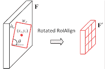

图 5.1：旋转区域提议的工作原理

图 5.2 显示了带有船的沿海区域卫星或航空视图，其中由目标检测算法识别出的感兴趣区域。左侧是普通边界框，右侧是定向边界框（oriented bounding box）：

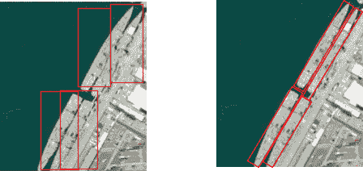

图 5.2：常规边界框（左）旋转边界框（右）

## 使用 PyTorch 实现 RRPNs 和 FPNs

以下脚本设置了一个模型，该模型集成了骨干网络（`ResNet-50`，不包含最后的全连接层）、用于多尺度特征处理的 `FPN` 以及旋转区域。

伪代码：


```python
import torch
import torch.nn as nn
import torchvision.models as models
from torch.nn.utils.rnn import pack_padded_sequence

# 定义 RRPN 模块
class RRPN(nn.Module):
    def __init__(self, in_channels, out_channels):
        super(RRPN, self).__init__()
        self.conv = nn.Conv2d(in_channels, out_channels, kernel_size=3, padding=1) # Added padding logic
        self.bn = nn.BatchNorm2d(out_channels)
        self.relu = nn.ReLU(inplace=True)
        self.anchor_conv = nn.Conv2d(out_channels, 10, kernel_size=1)
    def forward(self, x):
        x = self.conv(x)
        x = self.bn(x)
        x = self.relu(x)
        anchor = self.anchor_conv(x)
        return anchor

## 定义 FPN 模块
class FPN(nn.Module):
    def __init__(self, in_channels, out_channels):
        super(FPN, self).__init__()
        self.output1 = nn.Conv2d(in_channels[0], out_channels, kernel_size=1)
        self.output2 = nn.Conv2d(in_channels[1], out_channels, kernel_size=1)
        self.output3 = nn.Conv2d(in_channels[2], out_channels, kernel_size=1)
    def forward(self, inputs):
        out1 = self.output1(inputs[0])
        out2 = self.output2(inputs[1])
        out3 = self.output3(inputs[2])
        return out1, out2, out3

# 定义结合 RRPN 和 FPN 的模型
class RRPN_FPN(nn.Module):
    def __init__(self, num_classes=80):
        super(RRPN_FPN, self).__init__()
        self.backbone = models.resnet50(pretrained=True)
        self.backbone_layers = list(self.backbone.children())[:-2]
        self.fpn = FPN([256, 512, 1024], 256)
        self.rrpn = RRPN(256, 256)
        self.classifier = nn.Linear(256, num_classes)
        self.regressor = nn.Linear(256, 4)
        self.pool = nn.AdaptivePool2d((1, 1))
        self.flatten = nn.Flatten()

    def forward(self, x):
        # 通过骨干网络处理输入
        for layer in self.backbone_layers:
            x = layer(x)
        # 应用 FPN
        fpn_out = self.fpn([x, x, x]) # 简化逻辑
        # 应用 RRPN
        rrpn_out = self.rrpn(fpn_out[0])
        # 分类器和回归器头
        class_logits = self.classifier(self.flatten(self.pool(rrpn_out)))
        bbox_regression = self.regressor(self.flatten(self.pool(rrpn_out)))
        return class_logits, bbox_regression
```

```python
class_logits, bbox_regression, _ = model(images)

## 计算损失

# 这是一个简化版本，并假设你有方法可以计算类别标签
# 和边界框的损失。你可能需要为每种使用不同的损失函数。
loss = criterion(class_logits, labels) # 用于演示的占位符

## 在此处计算并反向传播边界框的损失
loss.backward()
optimizer.step()
running_loss += loss.item()
print(f'Epoch [{epoch+1}/{num_epochs}], Loss: {running_loss/len(train_loader):.4f}')
print("Training complete")
```

# 修改后的 RetinaNet

在 PyTorch 中创建一个包含无锚点检测（anchor-free detection）、特征金字塔网络（`FPNs`）和旋转区域建议的修改版 RetinaNet，涉及到将若干高级功能集成到基础 RetinaNet 架构中。以下是一个帮助你开始的概念大纲和示例代码。此实现假设你熟悉 PyTorch 和目标检测原理。

概念大纲如下：

1. **无锚点检测**：与生成一组预定义锚框（anchor boxes）的传统锚点检测器不同，无锚点方法直接预测边界框坐标。可以通过输出框的四个坐标作为模型预测的一部分来实现。

2. **特征金字塔网络（`FPNs`）**：`FPNs` 通过创建不同尺度的特征金字塔来增强特征提取。这对于检测不同尺寸的物体非常有益。

3. **旋转区域建议**：为了处理旋转物体，我们需要为每个边界框预测五个参数（`x`、`y`、`width`、`height`、`angle`），而不是通常四个。这需要修改网络的预测头。

PyTorch 中的实现草如下：

```python
import torch
import torch.nn as nn
import torchvision

class AnchorFreeRetinaNetFPN(nn.Module):
    def __init__(self, num_classes):
        super(AnchorFreeRetinaNetFPN, self).__init__()
        # 带有 FPN 的骨干网络
        self.backbone = torchvision.models.detection.backbone_utils.resnet_fpn_backbone('resnet50', pretrained=True)
        # 分类预测头
        self.cls_head = self._make_head(num_classes)
        # 边界框回归预测头 (x, y, w, h, angle)
        self.box_head = self._make_head(5)

    def _make_head(self, out_channels):
        layers = []
        for _ in range(4):
            layers.append(nn.Conv2d(256, 256, kernel_size=3))
        layers.append(nn.Conv2d(256, out_channels, kernel_size=3))
        return nn.Sequential(*layers)

    def forward(self, images):
        # 带有 FPN 的骨干网络
        features = self.backbone(images)
        # 用于演示的简化逻辑
        cls_logits = self.cls_head(features['0'])
        bbox_regression = self.box_head(features['0'])
        return cls_logits, bbox_regression
```

- **增强的多尺度检测：** `FPNs` 通过在不同分辨率上构建特征图金字塔，擅长识别图像中不同尺寸的物体。这种能力能够以高精度检测大物体和小物体，解决了传统 `CNNs` 和 `RCNNs` 面临的常见局限性。

- **效率与实时应用：** `FPNs` 与 `Faster R-CNN` 或 `SSD` 等更快的检测架构集成时，可以显著提高处理速度，使其非常适用于实时应用。这种改进得益于 `FPNs` 的分层结构，它能够高效地处理多尺度的图像。

- **复杂场景下的改进检测：** `FPNs` 的分层方法将低分辨率、强语义特征与高分辨率、弱语义特征相结合，增强了对密集或高细节场景中物体的检测能力。这一特性对于传统方法可能难以应对的挑战性环境特别有益。

- **训练与计算优势：** 与 `R-CNN` 等模型所需的多阶段训练相比，`FPNs` 提供了一种更直接的端到端训练过程。这一特性不仅简化了训练流程，而且在现代 GPU 硬件的支持下，在大数据集上实现更快的训练速度。

- **通用性与适应性：** `FPNs` 的架构设计为模块化，使其适用于物体检测之外的各种任务，例如语义分割。此外，`FPNs` 可以与不同的骨干网络和检测头有效结合，根据特定的项目需求或限制进行定制。

## 单选题

1. 在图像中使用 `FPNs` 进行物体检测的主要优势是什么？

a. 它们减少了对数据增强的需求。

b. 它们完全依赖于高分辨率图像来提高检测准确性。

c. 它们通过利用不同尺度的特征图金字塔可以更准确地检测各种尺寸的物体。

d. 它们消除了在物体检测任务中使用深度学习模型的需求。

答案：c. 它们通过利用不同尺度的特征图金字塔可以更准确地检测各种尺寸的物体。

2. 文中提到哪种架构受益于与 `FPNs` 集成以提高处理速度并适用于实时应用？

a. 单层感知器

b. `Faster R-CNN` 和 `SSD`

c. 不含卷积层的基础 CNNs

d. 无监督学习模型

答案：b. `Faster R-CNN` 和 `SSD`

3. 文中讨论的 `FPNs` 的局限性是什么？

a. 它们不能与卷积神经网络一起使用。

b. 它们仅适用于处理文本数据。

c. 由于在处理极端尺度变化方面可能存在挑战，它们在检测小物体方面可能会困难。

d. 它们只能处理黑白图像。

答案：c. 由于在处理极端尺度变化方面可能存在挑战，它们在检测小物体方面可能会困难。

4. 什么使得 `RFPNs` 优于传统的 `FPNs`？

a. 它们完全消除了深度学习的需求。

b. 它们引入了递归机制来进一步精炼多尺度的特征图。

c. 它们完全依赖低分辨率图像进行物体检测。

d. 它们的计算强度比传统的 `FPNs` 低。

答案：b. 它们引入了递归机制来进一步精炼多尺度的特征图。

5. 文中提到的 `DetectoRS` 包含了两个增强物体检测性能的关键创新。以下是这些创新中的哪一个？

1. 减少卷积层的使用

2. 递归特征金字塔

3. 消除特征提取的需求

4. 使用无监督学习算法

答案：b. 递归特征金字塔

# 第 6 章 多实例学习

## 引言

本章对多实例学习（`MIL`）进行了全面探索，这是机器学习（`ML`）中一个重要的范式转变，在增强分类任务方面应用广泛。从详细概述开始，探讨了 `MIL` 的基础方面及其在各个领域的实际影响。它强调了 `MIL` 如何有效处理传统分类方法难以应对的场景，特别是通过将实例结构化为包（bags）来处理不完整或模糊的数据。叙述通过与传统学习方法的对比分析，展示了 `MIL` 的优势，并讨论了评估 `MIL` 模型至关重要的评估指标。本章通过使用 `PyTorch` 的演示以及在 `MNIST` 数据集上的实际应用强调了实践实现，为读者提供了关于 `MIL` 能力的理论和实践见解，并帮助他们准备将 `MIL` 作为机器学习工具箱中的一种强有力工具。

## 结构

在本章中，我们将涵盖以下主题：

- `MIL` 概述及其应用

- 将 `MIL` 应用于 `ML` 分类任务

- 传统学习与 `MIL`

- `MIL` 的常用评估指标

## 目标

本章旨在概述关于 `MIL` 章节的目标和关键学习成果。它将为理解 `MIL` 的重要性、它在各个领域的应用，以及它如何重新定义 `ML` 中的分类任务奠定基础。

## `MIL` 概述及其应用

近年来，`ML` 重点于从示例中学习，这一领域可以根据训练数据的歧义性分为三类学习框架：监督学习、无监督学习和强化学习。在监督学习中，训练实例具有已知标签；而在无监督学习中，没有已知标签；强化学习涉及延迟奖励，这些奖励可以被视为延迟标签。`MIL` 是一种独特的学习框架，它使用包含多个实例的“包”进行训练，如果一个包包含至少一个正实例，则该包被标记为正样本。与监督学习、无监督学习和强化学习不同，`MIL` 中训练实例的标签是未知的，但训练包的标签是已知的。之前的学习算法（如决策树和神经网络）无法有效处理多实例问题的特征。

在接下来的图中（`Figure 6.1` 和 `Figure 6.2`）中，你可以看到 `MIL` 的正负包视觉示例：

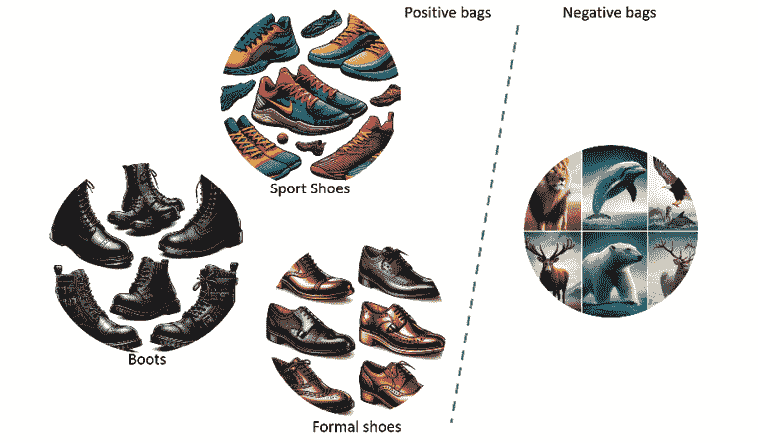

图 6.1：`MIL` 包示例

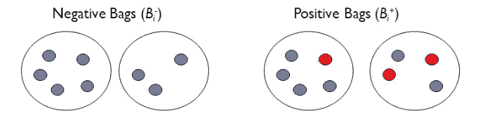

图 6.2：区分正负包

本节介绍了 `MIL` 的全面概述，包括其起源、可学习性、算法、应用、扩展和待解决的挑战。由于在各个领域广泛存在，它在 `ML` 社区引起了关注。

`MIL` 已成为图像和视频分析（`MIVA`）任务的一种非常有前景的 `ML` 范式。与传统的单实例学习（`SIL`）算法不同，`MIL` 算法可以从分配给图像或视频的全局类别标签中学习并检测局部模式，然后使用这些模式进行全局分类。这使得手动分割变得不再必要，使 `MIL` 算法成为 `MIVA` 社区中极具吸引力的解决方案。自从 1997 年由 Dietterich 等人创造该术语以来，`MIVA` 文献中发表了 73 篇关于 `MIL` 的研究论文。

在 `MIL` 中，数据被组织成“包”（bags）而不是单个实例（instances），每个包包含一组实例，以及一个包级标签，用于指示包中是否至少有一个实例是正样本或负样本。参考下图：

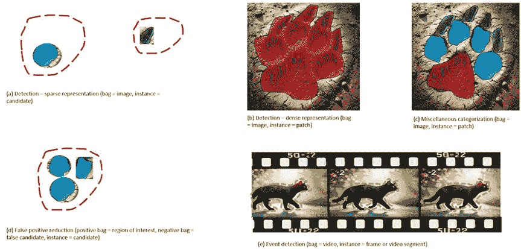

图 6.3：包和图像的表示方式

### 标准假设

假设我们拥有一组标记为 `B = {B1, B2, ..., BN}` 的包，其中每个包 `Bi` 包含一组实例 `X_i = {x_1, x_2, ..., x_m}` 以及一个包级标签 `y_i`，指示包中至少有一个实例是正样本或负样本。我们可以将包级标签 `y_i` 表示为：

如果包中存在正样本，则 `y_i = 1`，否则 `Bi` 的 `y_i = 0`。

例如，假设我们有两个包 `B1` 和 `B2`，每个包包含三个实例。第一个包包含两个正样本，而第二个包包含一个负样本。我们可以如下表示这些包：

`B1 = {x_1, x_2, x_3}, y_1 = 1` `B2 = {x_4, x_5, x_6}, y_2 = 0`

这种 `MIL` 的表述方法对于具有弱标签数据的任务特别有用，例如医学图像分析或文本分类。通过从包而不是单个实例中学习，`MIL` 算法可以利用弱标签数据来提高在任务上的性能。

这里是使用 `PyTorch` 实现的 `MIL` 神经网络。`MILNet` 类继承自 `PyTorch` 中的 `nn.Module` 类，并定义了 `MIL` 神经网络的架构。

`__init__` 方法定义了网络的层。具体而言，它定义了两个全连接（线性）层，其中第一层接收维度为 `input_dim` 的输入，并将其映射到大小为 `hidden_dim` 的隐藏层维度，第二层将第一层的输出映射到大小为 `output_dim` 的输出维度。

`forward` 方法是实际计算发生的地方。该方法接收一个包的张量（tensor），其中每个包被表示为实例张量。包张量的形状为 `(num_bags, max_bag_size, input_dim)`，其中 `num_bags` 是包的数量，`max_bag_size` 是包中实例的最大数量，`input_dim` 是每个实例的维度。

在 `forward` 方法中，通过使用 `torch.max` 函数取包内所有实例的每个特征的最大值来计算包级表示。这产生一个形状为 `(num_bags, input_dim)` 的张量，其中每一行代表一个包的包级表示。


```python
import torch
import torch.nn as nn
import torch.optim as optim

class MILNet(nn.Module):
    def __init__(self, input_dim, hidden_dim, output_dim):
        super(MILNet, self).__init__()
        self.fc1 = nn.Linear(input_dim, hidden_dim)
        self.fc2 = nn.Linear(hidden_dim, output_dim)

    def forward(self, bags):
        # bags 是一个形状为 (num_bags, max_bag_size, input_dim) 的张量
        num_bags = bags.shape[0]
        # 通过取包内所有实例每个特征的最大值来计算包级表示
        bag_repr, _ = torch.max(bags, dim=1)
        # 将包级表示通过全连接层
        out = torch.relu(self.fc1(bag_repr))
        out = self.fc2(out)
        # 返回形状为张量的包级预测
```

在实例级，多标签分类可以通过为每个实例分配一组标签而不是单个标签来实现。这可以通过多热编码（multi-hot encoding）完成，其中每个标签由一个二值表示，指示该实例是否属于该标签。通过使用 `max pooling`（最大池化）或 `mean pooling`（平均池化）等池化操作将实例级预测聚合为包级预测，可以将实例级多标签分类问题转换为包级多标签分类问题。

令 `B` 为由 `X = {x_1, x_2, ..., x_m}` 表示的实例包，其中 `x_i` 是特征向量，令 `y` 为包级标签（二分类或多分类）。那么，包级分类器 `f_b` 定义为：

`y = f_b(X)`

其中 `y` 是表示包 `B` 预测标签的标量值。

### 实例级分类

令 `I` 为由特征向量 `x` 表示的实例，令 `y` 为实例级标签（二分类或多分类）。那么，实例级分类器 `f_i` 定义为：

`y = f_i(x)`

其中 `y` 是表示实例 `I` 预测标签的标量值。

在 PyTorch 中使用二元相关性（binary relevance）方法执行包级多标签分类的代码如下：

```python
class MILMultiLabelNet(nn.Module):
    def __init__(self, input_dim, hidden_dim, output_dim):
        super(MILMultiLabelNet, self).__init__()
        self.fc1 = nn.Linear(input_dim, hidden_dim)
        self.fc2 = nn.Linear(hidden_dim, output_dim)

    def forward(self, bags):
        # bags is a tensor of shape (num_bags, max_bag_size, input_dim)
        num_bags = bags.shape[0]
        # 通过取包内所有实例每个特征的最大值来计算包级表示
        bag_repr, _ = torch.max(bags, dim=1)
        # 将包级表示通过全连接层
        out = torch.relu(self.fc1(bag_repr))
        out = torch.sigmoid(self.fc2(out))
        # 返回包级预测，形状为 (num_bags, output_dim) 的张量
        return out

class BinaryRelevanceLoss(nn.Module):
    def __init__(self):
        super(BinaryRelevanceLoss, self).__init__()
        self.loss_fn = nn.BCELoss()

    def forward(self, pred, target):
        # pred is a tensor of shape (num_bags, output_dim)
        # target is a tensor of shape (num_bags, output_dim)
        loss = self.loss_fn(pred, target)
        return loss

### 使用示例
model = MILMultiLabelNet(input_dim=10, hidden_dim=20, output_dim=5)
loss_fn = BinaryRelevanceLoss()
optimizer = torch.optim.Adam(model.parameters(), lr=0.01)

# 生成示例数据
num_bags = 10
max_bag_size = 5
input_dim = 10
output_dim = 5
bags = torch.rand(num_bags, max_bag_size, input_dim)
target = torch.randint(low=0, high=2, size=(num_bags, output_dim)).float()

## 训练循环
num_epochs = 100
for epoch in range(num_epochs):
    optimizer.zero_grad()
    pred = model(bags)
    loss = loss_fn(pred, target)
    loss.backward()
    optimizer.step()
    print("Epoch {}: loss={}".format(epoch, loss.item()))
```

在 MIL 中于实例级执行多分类的 PyTorch 代码如下：

```python
import torch
import torch.nn as nn

class MILNet(nn.Module):
    def __init__(self, input_dim, hidden_dim, output_dim):
        super(MILNet, self).__init__()
        self.fc1 = nn.Linear(input_dim, hidden_dim)
        self.fc2 = nn.Linear(hidden_dim, output_dim)

    def forward(self, bags):
        # bags is a tensor of shape (num_bags, max_bag_size, input_dim)
        num_bags = bags.shape[0]
        max_bag_size = bags.shape[1]
        # 将 bags 重塑为形状为 (num_bags * max_bag_size, input_dim) 的张量
        instances = bags.view(num_bags * max_bag_size, -1)
        # 将实例通过全连接层
        out = torch.relu(self.fc1(instances))
        out = self.fc2(out)
        # 将输出重塑为形状为 (num_bags, max_bag_size, output_dim) 的张量
        out = out.view(num_bags, max_bag_size, -1)
        # 计算实例级预测，形状为 (num_bags, max_bag_size, output_dim) 的张量
        instance_preds = torch.softmax(out, dim=2)
        # 通过取每个包所有实例的最大预测概率来计算包级预测
        bag_preds, _ = torch.max(instance_preds, dim=1)
        return bag_preds
```

图 6.4：两个决策边界

## 传统学习与 MIL

传统的监督分类是一种机器学习（ML），它涉及根据一组标记的训练数据为每个实例分配一个标签或类别。其目标是学习一个可以将输入数据映射到正确输出标签的函数。传统的监督分类方法假设每个实例只有一个标签或类别，其目标是正确地分类每个单独的实例。另一方面，多实例学习（MIL）分类是另一种机器学习，其目标是为一组实例（包，bag）分配一个标签。在 MIL 中，一个包可能包含多个实例，分配给包的标签基于包内所有实例的集合信息。MIL 假设分配给包的标签是已知的，但分配给单个实例的标签可能是未知的或模糊的。

MIL 的目标是学习一个可以将包级表示映射到正确包级标签的函数。与传统的监督分类不同，当实例级标签是模糊或未知的时会使用 MIL，其目标是分类实例包而不是单个实例。在多实例分类（MIC）中，包的特征向量通常通过聚合其各个实例的特征获得。一种流行的聚合方法是最大池化（max pooling），即取包中所有实例的每个特征的最大值。

传统监督分类和 MIC 之间的区别在于，在前者中，每个实例都被单独标记；而在后者中，只对整个包进行标记。此外，MIC 中包的特征向量是通过聚合其实例的特征获得的，而在传统分类中，特征是直接被使用的。

可以表述如下：

给定一个包含 `n` 个标记实例的训练数据集 `D = (xi, yi)n`，其中 `xi Rd` 表示特征向量。例如，`i` 和 `yi` 是来自 `K` 个可能类别的对应标签。目标是学习一个函数 `f : Rd → 1, . . . , K`，该函数能够准确预测任何给定实例 `xi` 的类别标签 `yi`。

另一方面，MIC 是监督学习的一种变体，其任务是分类实例包而不是单个实例。它可以表述如下：给定一个包含 `n` 个标记包的训练数据集 `D = Bi, yii = 1n`，其中 `Bi = xi, 1, . . . , xi,m` 表示包含 `mi` 个实例的包，`yi` 是来自 `K` 个可能类别的对应标签。目标是学习一个函数 `f : Rm×d → 1, . . . , K`，该函数能够准确预测任何给定实例包 `Bi` 的类别标签 `yi`。在 MIC 中，包的特征向量通常通过聚合其各个实例的特征获得。一种流行的聚合方法是最大池化，即取包中所有实例的每个特征的最大值。传统监督分类和 MIC 之间的区别在于，在前者中，每个实例都被单独标记；而在后者中，只对整个包进行标记。此外，MIC 中包的特征向量是通过聚合其实例的特征获得的，而在传统分类中，特征是直接被使用的。

## 构建 PyTorch MIL：数据准备，模型设置

编写代码至关重要。首先，它允许研究人员和开发者实际应用 MIL 概念，帮助他们解决仅在包级可用标签而非实例标签的问题。这在医学影像中非常常见。

```python
def create_bags(dataset):
    bags = {}
    for i in range(len(dataset)):
        image, label = dataset[i]
        if label not in bags:
            bags[label] = []
        bags[label].append(image)
    return [(bag, label) for label, bag in bags.items()]

class MILMNISTDataset(Dataset):
    def __init__(self, mnist_dataset):
        self.bags = create_bags(mnist_dataset)

    def __getitem__(self, index):
        bag, label = self.bags[index]
        bag_tensor = torch.stack([torch.tensor(np.array(img)) for img in bag])
        return bag_tensor, label

    def __len__(self):
        return len(self.bags)

### 加载 MNIST 数据集
mnist_dataset = MNIST(root="./data", train=True, download=True)

# 从 MNIST 创建 MIL 数据集
mil_dataset = MILMNISTDataset(mnist_dataset)

## 使用 Matplotlib 可视化某些包中的实例
fig, axes = plt.subplots(2, 5, figsize=(10, 5))

for i in range(2):
    for j in range(5):
        bag, label = mil_dataset[i*5+j]
        instance = bag[0] # 从每个包中提取第一个实例
        axes[i, j].imshow(instance, cmap='gray')
        axes[i, j].set_title(f"Class: {label}")
        axes[i, j].axis('off')

plt.show()
```

参考下图：

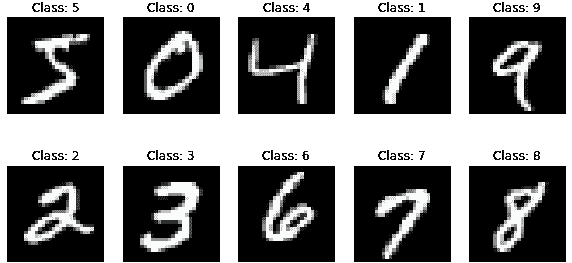

图 6.5：显示输出

`__init__` 方法通过调用 `create_bags` 函数初始化数据集，该函数从 `mnist_dataset` 生成 MNIST 的包。每个包被表示为 MNIST 图像列表和相应的包标签。

`__getitem__` 方法在从数据集中访问项时被调用。它接收一个索引作为输入，并返回相应的包和标签。首先，它根据给定的 `index` 从 `self.bags` 列表中提取包和标签。然后，它使用 `torch.stack` 函数将包中的图像从列表转换为张量。列表推导式 `[torch.tensor(np.array(img)) for img in bag]` 将每个图像转换为 NumPy 数组，然后转换为 PyTorch 张量。生成的张量形状为 `(num_instances, 28, 28)`，其中 `num_instances` 是包中的图像数量。

`__len__` 方法返回数据集中包的总数，即 `self.bags` 列表的长度。

这是一个关于如何创建包的非常简单的示例。然而，在后续代码中，我们将使用 MNIST 数据集开发一个 MIL 设置，在其中我们将处理嵌入并使用损失函数训练模型。这个端到端的示例将包含数据集的创建、模型定义、训练以及使用 t-SNE 对嵌入空间可视化。

```python
import torch
import torch.nn as nn
import torch.optim as optim
from torchvision import transforms, datasets
from torch.utils.data import DataLoader, Dataset
import matplotlib.pyplot as plt
from sklearn.manifold import TSNE
import numpy as np
import random

class MILMNISTDataset(Dataset):
```

```python
    def __init__(self, mnist_dataset, bag_size=5, target_digit=9, num_bags=200):
        self.mnist_dataset = mnist_dataset
        self.bag_size = bag_size
        self.target_digit = target_digit
        self.num_bags = num_bags
```

`MILMNISTDataset` 类扩展了 PyTorch 的 `Dataset`，用于为多实例学习创建 MNIST 图像包。每个实例（包）包含固定数量的图像（`bag_size`），如果包中包含至少指定的 `target_digit` 图像，则该包标记为正样本，数据集会生成指定数量（`num_bags`）这样的包。

```python
    def __getitem__(self, index):
        bag_images = []
        labels = []
        bag_label = 0
        for _ in range(self.bag_size):
            idx = random.randint(0, len(self.mnist_dataset) - 1)
            image, label = self.mnist_dataset[idx]
            bag_images.append(image)
            labels.append(label)
            if label == self.target_digit:
                bag_label = 1
        return torch.stack(bag_images), bag_label

    def __len__(self):
        return self.num_bags
```


```python
class SimpleCNN(nn.Module):
    def __init__(self):
        super(SimpleCNN, self).__init__()
        self.conv_layers = nn.Sequential(
            nn.Conv2d(1, 16, kernel_size=3, padding=1),
            nn.ReLU(),
            nn.MaxPool2d(2),
            nn.Conv2d(16, 32, kernel_size=3, padding=1),
            nn.ReLU(),
            nn.MaxPool2d(2),
            nn.Conv2d(32, 64, kernel_size=3, padding=1),
            nn.ReLU()
        )
        self.fc_layers = nn.Linear(64 * 7 * 7, 1)
    def forward(self, x):
        batch_size, bag_size, height, width = x.size()
        x = x.view(-1, height, width)
        x = self.conv_layers(x)
        x = x.view(batch_size, bag_size, -1)
        x, _ = torch.max(x, dim=1)
        x = self.fc_layers(x)
        return x
    def get_embeddings(self, x):
        x = x.view(-1, 1, 28, 28)
        x = self.conv_layers(x)
        x = x.view(x.size(0), -1)
        return x
```

```python
def extract_embeddings(dataloader, model, device):
    model.eval()
    embeddings = []
    labels = []
    with torch.no_grad():
        for data, target in dataloader:
            data = data.to(device)
            batch_size, bag_size, height, width = data.size()
            data = data.view(-1, height, width)  # 为了处理而展平包
            embeds = model.get_embeddings(data)
            embeds = embeds.view(batch_size, bag_size, -1)
            embeds, _ = torch.max(embeds, dim=1)  # 通过对包进行最大池化聚合嵌入
            embeddings.append(embeds.cpu().numpy())
            labels.extend(target.numpy())
    return np.concatenate(embeddings), np.array(labels)
```

## 训练设置

```python
device = torch.device("cuda" if torch.cuda.is_available() else "cpu")
transform = transforms.Compose([transforms.ToTensor(), transforms.Normalize((0.1307,), (0.3081,))])
mnist_train = datasets.MNIST('./data', train=True, download=True, transform=transform)
train_dataset = MILMNISTDataset(mnist_train)
train_loader = DataLoader(train_dataset, batch_size=10, shuffle=True)
model = SimpleCNN().to(device)
optimizer = optim.Adam(model.parameters(), lr=0.001)
criterion = nn.BCEWithLogitsLoss()
```

## 训练模型

```python
model.train()
for epoch in range(10):
    for data, target in train_loader:
        data, target = data.to(device), target.to(device).float().view(-1, 1)
        optimizer.zero_grad()
        output = model(data)
        loss = criterion(output, target)
        loss.backward()
        optimizer.step()
    print(f'Epoch {epoch+1}: Loss = {loss.item():.4f}')
```

- **嵌入提取**：在`SimpleCNN`中增加了`get_embeddings`方法以从卷积层提取嵌入，随后用于可视化。

- **使用 t-SNE 可视化**：使用`t-SNE`将嵌入降至两个维度并绘图，从而可视化模型如何根据内容和标签对包进行分组。

## 提取嵌入并可视化

```python
embeddings, labels = extract_embeddings(train_loader, model, device)
tsne = TSNE(n_components=2)
transformed_embeddings = tsne.fit_transform(embeddings)
plt.figure(figsize=(10, 7))
plt.scatter(transformed_embeddings[:, 0], transformed_embeddings[:, 1], c=labels, cmap='viridis', alpha=0.5)
plt.colorbar()
plt.title('t-SNE 可视化包嵌入')
plt.show()
```

```python
print(f'Epoch {epoch+1}/{num_epochs}, Loss: {epoch_loss:.4f}')

return losses
```

## 主设置

```python
device = torch.device("cuda" if torch.cuda.is_available() else "cpu")
mnist_train = datasets.MNIST('./data', train=True, download=True)
train_dataset = TripletMNISTDataset(mnist_train)
train_loader = DataLoader(train_dataset, batch_size=64, shuffle=True)
```

## 模型、损失函数与优化器

```python
model = EmbeddingNet().to(device)
criterion = nn.TripletMarginLoss(margin=1.0)
optimizer = optim.Adam(model.parameters(), lr=0.001)
```

## 训练

```python
num_epochs = 10
training_losses = train(model, device, train_loader, criterion, optimizer, num_epochs)
```

## 绘制训练损失

```python
plt.figure(figsize=(10, 5))
plt.plot(training_losses, label='Training Loss')
plt.title('Training Loss Over Epochs')
plt.xlabel('Epochs')
plt.ylabel('Loss')
plt.legend()
plt.show()
```

该代码建立了一个基于 PyTorch 的框架，使用三元组损失（triplet loss）在 MNIST 数据集上训练卷积神经网络，这是度量学习中一种流行的方法。它定义了一个`TripletMNISTDataset`类，对于每个请求的索引生成三元组：一个锚点图像、一个正样本图像（从与锚点相同的类别中随机选择）和一个负样本图像（从不同的类别中随机选择）。这有助于模型学习缩小锚点与正样本嵌入之间的距离，同时放大锚点与负样本之间的距离，从而学会区分不同的数字。`EmbeddingNet`模型通过卷积层处理每个图像，随后通过全连接层生成嵌入。训练循环使用这些嵌入配合`TripletMarginLoss`，该损失强制正负对之间保持间隔，从而提高了模型区分相似和不相似图像的能力。训练结果通过损失曲线进行可视化，展示了模型在学习优化该空间方面的进展。

## 包形成

不再使用单个图像作为锚点、正样本和负样本，而是使用包（bags）。

- **锚点包 (Anchor bag)**：一个图像包。

- **正样本包 (Positive bag)**：另一个与锚点包相似的图像包（例如包含相同的数字）。

- **负样本包 (Negative bag)**：与锚点包不同的图像包（例如包含不同的数字）。

输出参考下图：

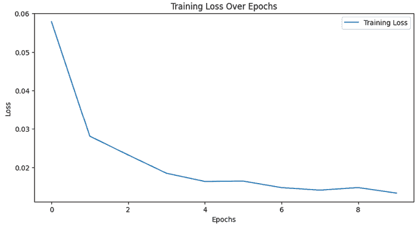

图 6.7：MILMLnet 的损失曲线

# MIL 的常用评估指标

MIL 的研究人员正积极开发标准数据集、合适的评估指标以及处理数据偏差的方法。此外，在选择合适的评估指标时，仔细考虑模型的应用场景和目标也是关重要的。

以下是 MIL 中常使用的其他几个评估指标：

- **准确率 (Accuracy)**：这是 MIL 最常用的评估指标。它衡量分类正确的包占的百分比。

- **精确率和召回率 (Precision and recall)**：精确率衡量在所有分类为正样本的实例中真例的比例，而召回率衡量数据中所有正样本实例中真例的比例。当某一类比另一类更重要时，这些指标非常有用。

- **F1 分数 (F1 score)**：这是精确率和召回率的调和平均数，是类别不平衡时常用的评估指标。

- **受者工作特征曲线下的面积 (Area under the receiver operating characteristic curve)**：该指标衡量模型区分正包和负包的能力。受者工作特征曲线下的面积 (`AUC-ROC`) 通过绘制不同阈值下真阳性率相对于假阳性率的图计算得出。

- **平均精确率 (Mean average precision)**：该指标衡量所有可能的召回率值下的平均精确率。平均精确率 (`MAP`) 常用于包内实例的顺序很重要的信息检索任务。

- **汉明损失 (Hamming loss)**：该指标衡量所有包中分类错误实例的比例。当每个包的实例数量发生变化时，该指标非常有用。

- **覆盖率 (Coverage)**：该指标衡量正确分类的正样本实例的比例。当正样本数量相对于总实例数量较小时，该指标非常有用。

- **Top K 精确 (Precision at k (P@k))**：该指标衡量前 k 个预测包的精确率。当只有前 k 个预测相关时，它非常有用。

- **平均倒数排名 (Mean reciprocal rank (MRR))**：该指标衡量所有测试实例中第一个相关包的平均倒数排名。当预测的顺序很重要时，它非常有用。

- **Top K 平均精确率 (Mean average precision at k (MAP@k))**：该指标衡量前 k 个预测包的平均精确率。当预测顺序很重要且只有前 k 个预测相关时，它非常有用。

- **归一化折扣累计增益 (Normalized discounted cumulative gain (NDCG))**：该指标衡量模型对包内正样本的效果。它考虑了相关实例在预测排名中的位置。

- **精确率-召回率曲线 (Precision-recall curve)**：该曲线是不同阈值下精确率相对于召回率的图。当精确率和召回率之间的权衡很重要时，它非常有用。

选择适用于特定问题的评估指标并考虑应用目标是非常重要的。此外，考虑多个评估指标以获得对模型性能更全面的理解通常是有益的。由于几个原因，评估 MIL 模型具有挑战性：

- **缺乏标准数据集**：目前缺乏用于比较不同算法性能的 MIL 标准数据集。这使得比较不同实验的结果变得困难。

- **数据表示复杂**：在 MIL 中，每个实例被表示为一个包。这使得开发合适的评估指标具有挑战性。

- **包标签的歧义性**：MIL 中的包标签通常具有歧义。例如，一个包可能包含正样本和负样本，或者有多个标签。这使得确定包的真实标签以及开发合适的评估指标变得困难。

- **每个包实例数量巨大**：在某些 MIL 应用（如图像分类）中，每个包可能包含大量实例。这使得计算模型性能具有挑战性。

- **评估指标缺乏共识**：对于 MIL 的评估指标缺乏共识。不同研究人员可能使用不同的指标，这使得比较研究结果变得困难。

- **数据偏差**：数据偏差的存在使得开发考虑偏差的合适评估指标变得困难。这可能导致对模型性能的过高或低。

选择适用于 MIL 的评估指标是模型开发过程中的重要一步。在选择 MIL 评估指标时，可以考虑以下策略：

- **理解问题**：对试图用 MIL 解决的问题有一个良好的理解。这有助于你识别与问题目标相关的相关的评估指标。

- **考虑数据类型**：MIL 经常处理复杂的数据结构，例如实例包或图。选择与你处理的数据类型匹配的评估指标是非常重要的。例如，如果数据包包含多个标签，那么考虑多个标签存在的评估指标可能更合适。

- **考虑应用场景**：你选择的评估指标应该与多实例学习（MIL）模型的应用匹配。例如，假设目标是识别出包含某类实例概率最高的一小部分包（bags）。在这种情况下，一个优先考虑精确率（precision）而非召回率（recall）的评估指标可能更为合适。

- **考虑指标之间的权衡**：考虑不同评估指标之间的权衡是非常重要的。例如，精确率和召回率往往是反比的，因此优化其中一个可能会以另一个为代价。选择一个能够最好平衡竞争指标之间权衡的评估指标至关重要。

- **评估多个指标**：评估多个指标通常有助于全面理解模型的性能。这有助于识别模型中潜在的弱点，而这些弱点通过单一评估指标可能无法发现。

除了上述策略外，在为 MIL 选择评估指标时，还有以下几点考虑因素：

- **选择具有可解释性的指标**：在尝试解决的问题背景下，选择一个具有解释性且有意义的评估指标通常很有帮助。例如，如果数据不平衡，或者假阳性与假阴性的成本不同，那么准确率（accuracy）可能不是一个合适的指标。在这种情况下，像`F1 score`、`AUC-ROC`或`precision-recall curves`等指标可能更为合适。

- **考虑模型复杂度**：评估指标应该考虑到 MIL 模型的复杂度。例如，如果模型是一个简单的线性模型，那么衡量预测标签与真实标签之间差异的指标可能是合适的。然而，如果模型是一个复杂的深度学习模型，那么衡量模型学习数据中底层模式能力的指标可能更为合适。

- **考虑指标的计算成本**：某些评估指标的计算成本可能非常高，特别是在处理大型数据集或复杂模型时。选择一个可以高效计算且不会减慢模型训练和评估过程的指标至关重要。

通过考虑这些额外的因素，你可以为当前的问题选择一个既合适又有意义的 MIL 评估指标。

## 结论

本章有效地强调了 MIL 在解决无法获得精确实例标签的复杂分类挑战时的战略重要性。通过深入研究 MIL 的运行机制（包括通过实际的`PyTorch`实现进行应用），我们阐明了它与传统学习方法的本质区别。随着 MIL 的演进，它持续集成到各种应用中将为机器学习带来重大进展，使研究人员能够探索解决现实世界数据歧性的创新解决方案。此外，本章为未来提出改进 MIL 方法奠定了基础。

### 加入我们书籍的 Discord 空间

加入书籍的 Discord 工作区，获取最新更新、优惠、全球科技动态、新发布以及与作者的互动：

[`discord.bpbonline.com`](https://discord.bpbonline.com)


# 第 7 章 更高级的多实例学习

## 引言

MIL 是机器学习中一种强大的范式，能够从仅具有包级标签的实例集中进行学习，使其适用于图像识别、药物发现和异常检测等领域。然而，MIL 面临着诸如实例级标签歧义、标签多样性和计算复杂度等挑战。本章探讨了 MIL 的这些挑战和应用，特别是在无法获得精确标签的场景。我们的目标为研究人员和从业者提供可以用于克服这些障碍的见解。

## 结构

在本章中，我们将涵盖以下主题：

- MIL 中的常见挑战

- MIL 的应用

## 目标

计算机中的 MIL 旨在解决标签与集合（包）而非单个实例相关的问题。这种方法在获取实例精确标签具有挑战性或不切实际的情况下特别有用，例如医学图像分析和多目标场景下的物体检测。

## MIL 中的常见挑战

本节分类并概述了计算机视觉中 MIL 的核心特征。它分为四个主要类别：预测层、包组成、数据分布和标签歧义。每个类别都深入探讨了定义 MIL 系统行为和挑战的特定方面。这种结构化的概述有助于理解将 MIL 应用于实际场景的复杂性和微妙差别。

### 表 7.1

| 类别 | 细节 |
| :--- | :--- |
| 预测层 | 实例级 |
| | 包级 |


# 表 7.1：MIL 中的关键挑战

| 包组成 | 见证率 (Witness rate) |
| --- | --- |
| 实例之间的关系 | 数据分布 |
| 多概念 | 非代表性负样本分布 |
| 标签歧义 | 噪声 |
| 不同的标签空间 | |

## 预测

在 MIL 背景下，预测层是模型解释和处理标记数据的一个基础方面。以下是 MIL 中两个主要预测层级的概述：

* **实例级预测**：实例级预测涉及对包内的单个实例做出决策。每个实例（例如图像中的补丁、文本的段落等）都有自己的预测。这里的挑战在于，标签通常只在包级可用，这意味着模型必须学习根据每个实例对整个包标签的贡献来推断其相关性或状态。这在物体检测或医学成像等任务中特别有用，因为在较大的上下文中识别特定的区域或特征至关重要。

### 包级预测 (Bag-level prediction)

包级预测关注整个包的整体标签，而不一定确定包内每个实例（instance）的标签。该预测基于所有实例的集合特征。在这种情况下，根据 `MIL` 假设，如果包中至少有一个实例是正样本，则该包被分类为正类。这种方法适用于此类情况：对正样本的精确识别不如实例组的整体分类重要。例如，在药物发现中，如果一个化学化合物（包）的任何配置（实例）证明是有效的，则该化合物可能被认为是有效的。

两种级别的预测提供了不同的见解，并根据应用的特定需求和限制进行选择。实例级预测提供了细粒度，而包级预测提供了更广泛的概述，它们在 `MIL` 模型于医学诊断、质量检测和监控系统等各个领域的实际部署中都起着至关重要的作用。

### 实例级与包级 (Instance- versus bag-level)

在某些情况下，重点是识别和分类单个实例（例如图像中的目标定位），而不是对组或包进行分类。准确分类包不能保证可靠的实例分类，因为为包分类设计的算法在实例级任务上的表现可能并不理想。缺乏具有实例标签真值（ground truth）的基准数据集使得开发准确的实例分类算法变得复杂。包分类和实例分类之间的一个关键区别在于错误的影响：虽然假阳性和假阴性可能不会严重影响包分类的准确性，但它们对于实例分类是至关重要的。基于包准确率优化 `MIL` 算法可能会导致实例分类的次优决策边界。

为了解决这个问题，策略包括：

* 在分类器的损失函数中对负包和正包进行区别对待。
* 在 `SVM` 优化期间对假阳性和假阴性分配不同的权重。
* 实验表明，独立地标记所有实例通常会产生更好的结果。然而，由于缺乏实例标签，通常使用弱监督或半监督学习方法。

此类方法的示例包括：

* 带有部分标签的多实例学习 (`MILPL`)：假设每个包中只有部分实例被标记了，并利用部分信息来训练实例级分类器。
* 带有成对约束的多实例学习 (`MILPC`)：依赖于实例之间的成对比较进行学习。

这些方法在各种应用中显示出前景，例如图像和文本分类，在这些领域中获取实例标签可能是困难或昂贵的。实例级分类仍然是一项挑战性任务，需要不同于包分类的策略，因为实例级分类器对不准确非常敏感。

该领域的一个障碍是缺乏具有准确实例标签的全面基准数据集，这影响了实例级算法的开发和测试。尽管存在这些挑战，弱监督和半监督学习的进展前景良好，目前的研究旨在改进实例级分类技术。

### 包组成 (Bag composition)

`MIL` 场景下的包组成是指每个包内实例的结构和相互关系，这对于有效的模型训练和预测至关重要。在 `MIL` 中，包是实例的集合，它们共同接收一个标签，但单个实例并不一定有自己的标签。

有效的包组成允许产生更健壮的 `MIL` 模型，因为它直接影响了模型从有限或模糊标签中学习的能力。对于目标根据实例集合特征而非单个实例细节进行识别和分类的任务（例如图像分割或异常检测），这是至关重要的。

### 见证率 (Witness rate)

见证率 (`WR`) 指包中正实例的比例。如果 `WR` 较高，意味着正包包含许多正实例。在这种情况下，我们可以假设正包中的所有图像都包含猫。

然而，低 `WR` 意味着正包包含多种可能不包含猫的图像。在这种情况下，我们不能假设正包中的所有图像都包含猫，而必须使用更复杂的方法对图像进行分类。

### 实例之间的关系 (Relations between instances)

大多数目前的 `MIL` 方法都基于正负实例是从各自的分布中随机采样的假设。然而，这一假设在真实数据集中往往并不成立，因为数据中存在包内相似性、实例共现以及实例与包之间的结构依赖关系。为了增强 `MIL` 方法在真实数据上的性能，必须考虑这些类型的关系。

## 图 7.1：实例之间的共现与相似性

可以通过考虑一张包含三个区域的图像来说明实例共现与相似性的示例。在图 7.1 中，三个区域都包含草地和森林，使得它们彼此高度相似。共同元素（如草地和森林）的存在在这些区域之间建立了共现模式。

此外，考虑到图像的内容是一只熊，我们可以推断背景更有可能代表自然而非核中心控制室。这种推理是基于熊通常栖息在森林、山脉或荒野等自然环境中。因此，草地和森林区域的共现结合熊的上下文信息，表明背景是自然环境而非核中心控制室等无关的人造环境的可能性更高。

## 实例共现

当实例在包（bags）中具有语义关系或经常一起出现时，就说它们是共的。这种相关性可能源于各种因素，例如物体通常出现的环境，或者某些物体倾向于共同出现。

接下来的图展示了包内相似性（intra-bag similarity）的概念，其中图像的不同斑块（实例）重叠并共享共同特征。在这个示例中，来自鹿图像的多个斑块被分组到图像包中，突出了如脸部等共享属性，这些属性有助于整体分类或概念识别。

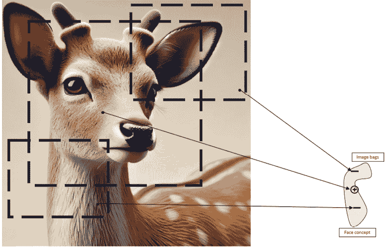

### 图 7.2：实例间包内相似性的说明

例如，鹿更有可能出现在自然栖息地，而不是夜总会。因此，观察图像中的自然区域可能有助于判断图像是否包含鹿或马。在某些情况下，共现可以提高分类的准确性，而在另一些情况下，它是成功分类至关重要的。例如，在对海洋、沙漠和海滩图像进行分类时，沙子实例出现在沙漠和海滩图像中，而水实例存在于海洋和海滩图像中。然而，沙和水实例的共现对于成功分类海滩图像是必要的。大多数在集体假设下工作的方法自然地利用了共现，例如词袋模型 (`BoW`)、`miFV`、`FAMER` 或 `PPMM`，它们将包表示为实例分布，从而间接地考虑了共现。然而，在实例分类问题中，实例的共现可能会误导学习者。例如，如果一个正实例经常与一个负实例共现，算法可能会将负实例误认为正实例，导致较高的假阳性率 (`FPR`)。这个问题已经在张量模型和多标签框架中被直接建模。

## 实例与包结构

在多实例学习（MIL）中，包内和跨包的实例具有超出简单共现的复杂关系。这些关系可以是空间、时间、关系或因果的，并且会显著影响分类性能。为了考虑这些关系，可以使用图模型，特别是在数据不是独立同分布 (`IID`) 的情况下。对于空间和时间关系，可以将图像和视频分割成区域，并使用序列建模技术来分析实例的子序列。此外，可以使用条件随机场对图像数据的空间依赖进行建模。

## 数据分布

在 MIL 中，包内和跨包的实例具有超出简单共现的复杂关系。这些关系可以是空间、时间、关系或因果的，并且会显著影响分类性能。为了考虑这些关系，可以使用图模型，特别是在数据不是独立同分布 (`IID`) 的情况下。对于空间和时间关系，可以将图像和视频分割成区域，并使用序列建模技术来分析实例的子序列。此外，可以使用条件随机场对图像数据的空间依赖进行建模。

在 MIL 的语境中，由于实例被分组且分类是在包级别而非实例级别执行的，多模态分布是关键的。以下是你可以从图像中得出推理的方法：

* **多模态分布的表示**：图像中的不同物种（狮虎、豹子、豹）可以被视为数据中的不同模式或簇。
* **理解复杂关系**：空间布局和相互作用（如狮子附近的狮子）象征着包内部的依赖关系。这种交互表明一个实例的存在或特征可能会影响另一个实例的分类。
* **独立性假设的挑战**：在传统机器学习中，实例通常被假设是独立的。但在图像中，相互作用（例如一只狮虎躺在豹旁边）暗示了对这一假设的违反，这类似于包中发生的情况。
* **对分类算法的影响**：识别这些依赖关系对于选择或开发正确的 MIL 算法至关重要。能够考虑或利用这些关系的算法（如关系 MIL 或基于图的方法）可能比假设实例独立的算法表现得更好。
* **模型开发策略**：分析图像有助于假设可能的结构和依赖关系。这可能会启发使用特定的建模技术，例如序列模型（如果观察到时间关系）或用于复杂关系数据的图神经网络。

## 正实例的多模态分布

包内和跨包的某些实例具有超出简单共现的复杂关系。这些关系可以是空间、时间、关系或因果的，并且会显著影响分类性能。为了考虑这些关系，可以使用图模型，特别是在数据不是独立同分布 (`IID`) 的情况下。对于空间和时间关系，可以将图像和视频分割成区域，并使用序列建模技术来分析实例的子序列。此外，可以使用条件随机场对图像数据的空间依赖进行建模。

在同一概念（大猫科动物）的图像中，特征空间可能存在许多数据簇（模式），对应于不同的姿态、颜色和品种。

图 7.3 展示了大型猫科概念，描述了自然栖息地中的各种大型猫科动物，包括狮子、老虎、豹子和洲猫。接下来的图强调了从不同的正实例（用 `+` 符号标记）中识别并聚合特征的过程，这些特征有助于大型猫科类别的分类或识别。这一概念框架展示了在 MIL 任务中如何结合多个实例来形成最终表示。


图 7.3：大型猫科概念

## 非代表性负样本分布

为了确保实例概念的可学习性，测试阶段的数据分布与训练阶段相似至关重要。虽然对于正样本概念来说这是可行的，但在某些应用中，并不总是能够对负实例分布进行完全建模。例如，在识别人类时，负样本类的分布可能难以建模，因为人类可能出现在各种环境中。然而，在其他情况下，例如放射检查中的肿瘤识别，由于健康组织的外观范围有限，可以使用有限数量的样本对负样本类分布进行建模。

某些方法仅对正样本类建模，并在测试期间可以处理各种负样本分布。这些方法寻求一个包含正样本概念的区域（例如超矩形或超球/椭圆），并根据特征空间中到一点或一个区域的距离对实例进行分类。距离点足够远或正样本区域之外的任何东西都被视为负样本，在这些方法中负样本分布的形状并不重要。某些非参数方法（如 `Citation-KNN`）使用到正实例的距离而非正概念，提供了类似的优势。此外，MIL 问题可以视为单类问题，其中正实例是目标类。因此，某些方法使用单类支持向量机 (`SVM`) 来处理此问题。

非代表性负样本分布至关重要，因为它会显著影响机器学习算法在分类任务中的性能。如果算法在不能代表测试集分布的负样本数据上进行训练，那么它在分类测试集实例时表现可能很差。这是因为算法没有经过训练来识别测试集中可能出现的整个负实例范围。因此，在设计和训练用于分类任务的机器学习算法时，同时考虑正实例和负实例的分布至关重要。

## 标签歧义

标签歧义是指机器学习和数据标注中的这种情况：一个标签可以有多种解释或含义，可能导致数据标注或模型理解数据时产生混淆。这种歧义可能源于多种来源：

* **多重含义**：单个标签可能在不同的上下文或数据集中描述不同的对象或概念。
* **类别重叠**：标签在含义上可能重叠，导致对某些实例的合适类别产生困惑。
* **解释的主观性**：不同的标注者可能会根据自己的理解、背景或给定的指令对同一标签进行不同的解释。
* **标签的粒度**：标签的特定性可能有所不同；某些非常宽泛，而另一些非常详细，导致对标签应涵盖的细节水平或范围产生不确定。

标签歧义挑战了机器学习模型的训练，因为不一致或不清晰的标签会导致模型性能不佳以及对输入数据的误解。解决这些问题的有效策略包括更清晰的标注指南、使用更具粒度且针对特定上下文的标签，以及引入人工审核以确保标签准确反映意图。

## 标签噪声

在 MIL 中，噪声指的是被错误标记或不能代表所学概念的实例。噪声的存在会显著影响 MIL 算法的性能，影响程度取决于训练数据中存在的噪声量。随着噪声水平的增加，MIL 算法的性能可能会迅速下降，甚至导致完全学习错误的概念。

为了应对这一挑战，已经提出了几种方法，包括使用鲁棒损失函数（这些函数对训练数据中的离群值和噪声不敏感）、结合多个模型输出以减少噪声影响的集成方法，以及不那么依赖包标签（bag labels）准确性的方法。例如，某些 MIL 算法对包标签中的噪声敏感，导致当负包被误标记为正包，或者由于标记错误或数据中的固有噪声在负包中发现正实例时，产生高假阳性率。

在集体假设下工作的方法可以自然地处理标签噪声，因为它们并不仅仅依赖于正实例的存在。将包表示为分布或通过对实例取平均来总结包提供了对噪声的鲁棒性。另一种策略是计算包中正实例的数量，并为正分类建立一个阈值。某项研究中提出的方法同时使用了阈值和平均策略，将包中的实例从最正到最不正进行排序，最高排名和最低排名实例的平均值代表该包。

最后，通过在包嵌入算法中使用主导集（dominant sets）进行聚类并选择实例原型，也可以实现对标签噪声的鲁棒性。总而言之，处理噪声对 MIL 算法的影响是提高分类任务准确性和鲁棒性的重要考虑。

## 不同的标签空间

标签空间指的是分配给包或实例的标签集，它会影响 MIL 算法的性能。标签空间可以是二类的或多类的。二标签空间有两个标签（通常是正和负），而多类标签空间可以有多个标签，例如为一个实例或包分配多个标签。不同任务可以定义不同的标签空间，且标签空间的选择会极大影响 MIL 算法的性能。例如，在药物发现应用中，多类标签空间更为合适，每个实例可以有多个代表药物各种属性的标签。

然而，并不是所有的 MIL 算法都能很好处理不同的标签空间。某些算法专门为二标签空间设计，在多类标签空间上的表现可能不好。此外，某些算法可能假设标签空间是固定的，无法处理学习过程中标签空间的变化。

为了解决这些问题，研究人员提出了各种可以有效处理不同标签空间的 MIL 算法。例如，某些 MIL 算法使用分层方法，将多类标签分解为二标签，并在多个层上进行学习。其他 MIL 算法使用基于神经网络的方法，其中标签空间可以灵活定义，且网络可以自动学习处理不同的标签空间。

在多实例学习（MIL）中，选择一个能够有效处理不同标签空间的算法至关重要，因为标签空间会显著影响 MIL 算法的性能。这是一个具有歧义标签的示例。目标概念是蟒蛇（python），任何与此概念相关的实例应该位于绿色虚线标记的区域内。然而，某些负样本图像也可能包含落在蟒蛇概念区域内的实例。

图 7.4 展示了标签歧义示例，图像的不同区域与多个标签相关联。在这种情况下，图像的一部分代表蟒蛇（左侧），另一部分代表蟒蛇皮制的手提包（右侧）。这两个物体之间重叠且共享的视觉特征导致了分配清晰标签时的困惑，凸显了多实例学习任务中区分相似模式的挑战。

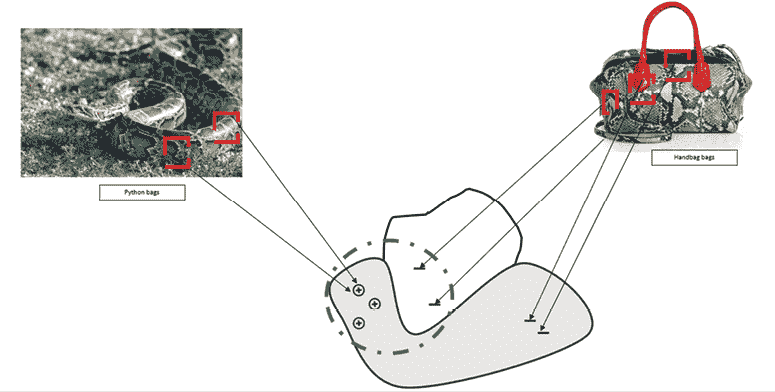

图 7.4：标签歧义示例

鼓励读者阅读题为 `Multiple Instance Learning: A Survey of Problem Characteristics and Applications` 的论文，以更深入、更全面的理解与 MIL 相关的挑战。这篇论文为 MIL 问题的特征及其实际应用提供了宝贵的见解，从而为增强有关 MIL 相关问题的知识和认知提供了机会。

### MIL 的应用

让我们通过在前列腺癌分级评估（PANDA）数据集上进行 MIL 的实际应用来创新。

MIL 技术被实现并应用于基于 PANDA 数据集的前列腺癌分级评估特定任务。在此背景下，MIL 被用作分析和分类 PANDA 数据集中的实例（如图像块或感兴趣区域）的方法，该数据集包含与前列腺癌分级相关的数据。研究人员或从业者旨在通过在该数据集上使用 MIL 来提高前列腺癌分级评估的准确性和效率。

### 关于数据集

PANDA 挑战是在 Kaggle 上举行的一项竞赛，专注于开发能够对活检中的前列腺癌进行准确分级的 ML 算法。比赛提供了一个由专家病理学家分级的前列腺癌活检数字病理学图像数据集，目标是开发能够根据这些图像准确预测前列腺癌分级的算法，旨在通过更早、更准确的诊断改善患者预后。该挑战由国际泌尿病理学协会 (ISUP)、Camelyon Grand Challenge (CGC) 和 Kaggle 共同组织。

PANDA 数据集包含 10,616 张前列腺癌活检图像，每个大小为 512 x 512 像素，来自 1,005 名不同的患者。每个活检样本都由专家病理学家使用 Gleason 分级系统进行评分，该系统衡量癌症的侵袭性。数据集分为训练集和测试集，分别包含 10,000 张和 1,616 张活检图像。挑战是开发一种准确预测测试集中活检样本 Gleason 等级的 ML 算法。

ISUP 分级是一种常用于前列腺癌的分级系统，范围从 1 到 5，1 表示分化良好且侵袭性较低的癌细胞，5 表示分化差且侵袭性强的癌细胞。PANDA 数据集将 ISUP 分级作为竞赛的目标变量之一。

图 7.5 ISUP 分级是一种常用于前列腺癌的分级系统，范围从 1 到 5，1 表示分化良好且侵袭性较低的癌细胞，5 表示分化差且侵袭性强的癌细胞。PANDA 数据集将 ISUP 分级作为竞赛的目标变量之一。

图 7.5 ISUP 分级是一种常用于前列腺癌的分级系统，范围从 1 到 5，1 表示分化良好且侵袭性较低的癌细胞，5 表示分化差且侵袭性强的癌细胞。PANDA 数据集将 ISUP 分级作为竞赛的目标变量之一。

图 7.5 ISUP 分级是一种常用于前列腺癌的分级系统，范围从 1 到 5，1 表示分化良好且侵袭性较低的癌细胞，5 表示分化差且侵袭性强的癌细胞。PANDA 数据集将 ISUP 分级作为竞赛的目标变量之一。

图 7.5 ISUP 分级是一种常用于前列腺癌的分级系统，范围从 1 到 5，1 表示分化良好且侵袭性较低的癌细胞，5 表示分化差且侵袭性强的癌细胞。PANDA 数据集将 ISUP 分级作为竞赛的目标变量之一。

图 7.5 ISUP 分级是一种常用于前列腺癌的分级系统，范围从 1 到 5，1 表示分化良好且侵袭性较低的癌细胞，5 表示分化差且侵袭性强的癌细胞。PANDA 数据集将 ISUP 分级作为竞赛的目标变量之一。


图 7.5 ISUP 分级是一种常用于前腺癌的分级系统，范围从 1 到 5，1 表示分化良好且侵袭性较低的癌细胞，5 表示分化差且侵袭性强的癌细胞。`PANDA` 数据集将 ISUP 分级作为竞赛的目标变量之一。

图 7.5 ISUP 分级是一种常用于前腺癌的分级系统，范围从 1 到 5，1 表示分化良好且侵袭性较低的癌细胞，5 表示分化差且侵袭性强的癌细胞。`PANDA` 数据集将 ISUP 分级作为竞赛的目标变量之一。

图 7.5 ISUP 分级是一种常用于前腺癌的分级系统，范围从 1 到 5，1 表示分化良好且侵袭性较低的癌细胞，5 表示分化差且侵袭性强的癌细胞。`PANDA` 数据集将 ISUP 分级作为竞赛的目标变量之一。

图 7.5 ISUP 分级是一种常用于前腺癌的分级系统，范围从 1 到 5，1 表示分化良好且侵袭性较低的癌细胞，5 表示分化差且侵袭性强的癌细胞。`PANDA` 数据集将 ISUP 分级作为竞赛的目标变量之一。

图 7.5 ISUP 分级是一种常用于前腺癌的分级系统，范围从 1 到 5，1 表示分化良好且侵袭性较低的癌细胞，5 表示分化差且侵袭性强的癌细胞。`PANDA` 数据集将 ISUP 分级作为竞赛的目标变量之一。

图 7.5 ISUP 分级是一种常用于前腺癌的分级系统，范围从 1 到 5，1 表示分化良好且侵袭性较低的癌细胞，5 表示分化差且侵袭性强的癌细胞。`PANDA` 数据集将 ISUP 分级作为竞赛的目标变量之一。

图 7.5 ISUP 分级是一种常用于前腺癌的分级系统，范围从 1 到 5，1 表示分化良好且侵袭性较低的癌细胞，5 表示分化差且侵袭性强的癌细胞。`PANDA` 数据集将 ISUP 分级作为竞赛的目标变量之一。

图 7.5 ISUP 分级是一种常用于前腺癌的分级系统，范围从 1 到 5，1 表示分化良好且侵袭性较低的癌细胞，5 表示分化差且侵袭性强的癌细胞。`PANDA` 数据集将 ISUP 分级作为竞赛的目标变量之一。

图 7.5 ISUP 分级是一种常用于前腺癌的分级系统，范围从 1 到 5，1 表示分化良好且侵袭性较低的癌细胞，5 表示分化差且侵袭性强的癌细胞。`PANDA` 数据集将 ISUP 分级作为竞赛的目标变量之一。

图 7.5 ISUP 分级是一种常用于前腺癌的分级系统，范围从 1 到 5，1 表示分化良好且侵袭性较低的癌细胞，5 表示分化差且侵袭性强的癌细胞。`PANDA` 数据集将 ISUP 分级作为竞赛的目标变量之一。

图 7.5 ISUP 分级是一种常用于前腺癌的分级系统，范围从 1 到 5，1 表示分化良好且侵袭性较低的癌细胞，5 表示分化差且侵袭性强的癌细胞。`PANDA` 数据集将 ISUP 分级作为竞赛的目标变量之一。

图 7.5 ISUP 分级是一种常用于前腺癌的分级系统，范围从 1 到 5，1 表示分化良好且侵袭性较低的癌细胞，5 表示分化差且侵袭性强的癌细胞。`PANDA` 数据集将 ISUP 分级作为竞赛的目标变量之一。

图 7.5 ISUP 分级是一种常用于前腺癌的分级系统，范围从 1 到 5，1 表示分化良好且侵袭性较低的癌细胞，5 表示分化差且侵袭性强的癌细胞。`PANDA` 数据集将 ISUP 分级作为竞赛的目标变量之一。

图 7.5 ISUP 分级是一种常用于前腺癌的分级系统，范围从 1 到 5，1 表示分化良好且侵袭性较低的癌细胞，5 表示分化差且侵袭性强的癌细胞。`PANDA` 数据集将 ISUP 分级作为竞赛的目标变量之一。

图 7.5 ISUP 分级是一种常用于前腺癌的分级系统，范围从 1 到 5，1 表示分化良好且侵袭性较低的癌细胞，5 表示分化差且侵袭性强的癌细胞。`PANDA` 数据集将 ISUP 分级作为竞赛的目标变量之一。

图 7.5 ISUP 分级是一种常用于前腺癌的分级系统，范围从 1 到 5，1 表示分化良好且侵袭性较低的癌细胞，5 表示分化差且侵袭性强的癌细胞。`PANDA` 数据集将 ISUP 分级作为竞赛的目标变量之一。

图 7.5 ISUP 分级是一种常用于前腺癌的分级系统，范围从 1 到 5，1 表示分化良好且侵袭性较低的癌细胞，5 表示分化差且侵袭性强的癌细胞。`PANDA` 数据集将 ISUP 分级作为竞赛的目标变量之一。

图 7.5 ISUP 分级是一种常用于前腺癌的分级系统，范围从 1 到 5，1 表示分化良好且侵袭性较低的癌细胞，5 表示分化差且侵袭性强的癌细胞。`PANDA` 数据集将 ISUP 分级作为竞赛的目标变量之一。

图 7.5 ISUP 分级是一种常用于前腺癌的分级系统，范围从 1 到 5，1 表示分化良好且侵袭性较低的癌细胞，5 表示分化差且侵袭性强的癌细胞。`PANDA` 数据集将 ISUP 分级作为竞赛的目标变量之一。

图 7.5 ISUP 分级是一种常用于前腺癌的分级系统，范围从 1 到 5，1 表示分化良好且侵袭性较低的癌细胞，5 表示分化差且侵袭性强的癌细胞。`PANDA` 数据集将 ISUP 分级作为竞赛的目标变量之一。

图 7.5 ISUP 分级是一种常用于前腺癌的分级系统，范围从 1 到 5，1 表示分化良好且侵袭性较低的癌细胞，5 表示分化差且侵袭性强的癌细胞。`PANDA` 数据集将 ISUP 分级作为竞赛的目标变量之一。

图 7.5 ISUP 分级是一种常用于前腺癌的分级系统，范围从 1 到 5，1 表示分化良好且侵袭性较低的癌细胞，5 表示分化差且侵袭性强的癌细胞。`PANDA` 数据集将 ISUP 分级作为竞赛的目标变量之一。

图 7.5 ISUP 分级是一种常用于前腺癌的分级系统，范围从 1 到 5，1 表示分化良好且侵袭性较低的癌细胞，5 表示分化差且侵袭性强的癌细胞。`PANDA` 数据集将 ISUP 分级作为竞赛的目标变量之一。

图 7.5 ISUP 分级是一种常用于前腺癌的分级系统，范围从 1 到 5，1 表示分化良好且侵袭性较低的癌细胞，5 表示分化差且侵袭性强的癌细胞。`PANDA` 数据集将 ISUP 分级作为竞赛的目标变量之一。

图 7.5 ISUP 分级是一种常用于前腺癌的分级系统，范围从 1 到 5，1 表示分化良好且侵袭性较低的癌细胞，5 表示分化差且侵袭性强的癌细胞。`PANDA` 数据集将 ISUP 分级作为竞赛的目标变量之一。

图 7.5 ISUP 分级是一种常用于前腺癌的分级系统，范围从 1 到 5，1 表示分化良好且侵袭性较低的癌细胞，5 表示分化差且侵袭性强的癌细胞。`PANDA` 数据集将 ISUP 分级作为竞赛的目标变量之一。

图 7.5 ISUP 分级是一种常用于前腺癌的分级系统，范围从 1 到 5，1 表示分化良好且侵袭性较低的癌细胞，5 表示分化差且侵袭性强的癌细胞。`PANDA` 数据集将 ISUP 分级作为竞赛的目标变量之一。

图 7.5 ISUP 分级是一种常用于前腺癌的分级系统，范围从 1 到 5，1 表示分化良好且侵袭性较低的癌细胞，5 表示分化差且侵袭性强的癌细胞。`PANDA` 数据集将 ISUP 分级作为竞赛的目标变量之一。

图 7.5 ISUP 分级是一种常用于前腺癌的分级系统，范围从 1 到 5，1 表示分化良好且侵袭性较低的癌细胞，5 表示分化差且侵袭性强的癌细胞。`PANDA` 数据集将 ISUP 分级作为竞赛的目标变量之一。

图 7.5 ISUP 分级是一种常用于前腺癌的分级系统，范围从 1 到 5，1 表示分化良好且侵袭性较低的癌细胞，5 表示分化差且侵袭性强的癌细胞。`PANDA` 数据集将 ISUP 分级作为竞赛的目标变量之一。

图 7.5 ISUP 分级是一种常用于前腺癌的分级系统，范围从 1 到 5，1 表示分化良好且侵袭性较低的癌细胞，5 表示分化差且侵袭性强的癌细胞。`PANDA` 数据集将 ISUP 分级作为竞赛的目标变量之一。

图 7.5 ISUP 分级是一种常用于前腺癌的分级系统，范围从 1 到 5，1 表示分化良好且侵袭性较低的癌细胞，5 表示分化差且侵袭性强的癌细胞。`PANDA` 数据集将 ISUP 分级作为竞赛的目标变量之一。

图 7.5 ISUP 分级是一种常用于前腺癌的分级系统，范围从 1 到 5，1 表示分化良好且侵袭性较低的癌细胞，5 表示分化差且侵袭性强的癌细胞。`PANDA` 数据集将 ISUP 分级作为竞赛的目标变量之一。

图 7.5 ISUP 分级是一种常用于前腺癌的分级系统，范围从 1 到 5，1 表示分化良好且侵袭性较低的癌细胞，5 表示分化差且侵袭性强的癌细胞。`PANDA` 数据集将 ISUP 分级作为竞赛的目标变量之一。

图 7.5 ISUP 分级是一种常用于前腺癌的分级系统，范围从 1 到 5，1 表示分化良好且侵袭性较低的癌细胞，5 表示分化差且侵袭性强的癌细胞。`PANDA` 数据集将 ISUP 分级作为竞赛的目标变量之一。

图 7.5 ISUP 分级是一种常用于前腺癌的分级系统，范围从 1 到 5，1 表示分化良好且侵袭性较低的癌细胞，5 表示分化差且侵袭性强的癌细胞。`PANDA` 数据集将 ISUP 分级作为竞赛的目标变量之一。

图 7.5 ISUP 分级是一种常用于前腺癌的分级系统，范围从 1 到 5，1 表示分化良好且侵袭性较低的癌细胞，5 表示分化差且侵袭性强的癌细胞。`PANDA` 数据集将 ISUP 分级作为竞赛的目标变量之一。

图 7.5 ISUP 分级是一种常用于前腺癌的分级系统，范围从 1 到 5，1 表示分化良好且侵袭性较低的癌细胞，5 表示分化差且侵袭性强的癌细胞。`PANDA` 数据集将 ISUP 分级作为竞赛的目标变量之一。

图 7.5 ISUP 分级是一种常用于前腺癌的分级系统，范围从 1 到 5，1 表示分化良好且侵袭性较低的癌细胞，5 表示分化差且侵袭性强的癌细胞。`PANDA` 数据集将 ISUP 分级作为竞赛的目标变量之一。

图 7.5 ISUP 分级是一种常用于前腺癌的分级系统，范围从 1 到 5，1 表示分化良好且侵袭性较低的癌细胞，5 表示分化差且侵袭性强的癌细胞。`PANDA` 数据集将 ISUP 分级作为竞赛的目标变量之一。

图 7.5 ISUP 分级是一种常用于前腺癌的分级系统，范围从 1 到 5，1 表示分化良好且侵袭性较低的癌细胞，5 表示分化差且侵袭性强的癌细胞。`PANDA` 数据集将 ISUP 分级作为竞赛的目标变量之一。

图 7.5 ISUP 分级是一种常用于前腺癌的分级系统，范围从 1 到 5，1 表示分化良好且侵袭性较低的癌细胞，5 表示分化差且侵袭性强的癌细胞。`PANDA` 数据集将 ISUP 分级作为竞赛的目标变量之一。

图 7.5 ISUP 分级是一种常用于前腺癌的分级系统，范围从 1 到 5，1 表示分化良好且侵袭性较低的癌细胞，5 表示分化差且侵袭性强的癌细胞。`PANDA` 数据集将 ISUP 分级作为竞赛的目标变量之一。

图 7.5 ISUP 分级是一种常用于前腺癌的分级系统，范围从 1 到 5，1 表示分化良好且侵袭性较低的癌细胞，5 表示分化差且侵袭性强的癌细胞。`PANDA` 数据集将 ISUP 分级作为竞赛的目标变量之一。

图 7.5 ISUP 分级是一种常用于前腺癌的分级系统，范围从 1 到 5，1 表示分化良好且侵袭性较低的癌细胞，5 表示分化差且侵袭性强的癌细胞。`PANDA` 数据集将 ISUP 分级作为竞赛的目标变量之一。

图 7.5 ISUP 分级是一种常用于前腺癌的分级系统，范围从 1 到 5，1 表示分化良好且侵袭性较低的癌细胞，5 表示分化差且侵袭性强的癌细胞。`PANDA` 数据集将 ISUP 分级作为竞赛的目标变量之一。

图 7.5 ISUP 分级是一种常用于前腺癌的分级系统，范围从 1 到 5，1 表示分化良好且侵袭性较低的癌细胞，5 表示分化差且侵袭性强的癌细胞。`PANDA` 数据集将 ISUP 分级作为竞赛的目标变量之一。

图 7.5 ISUP 分级是一种常用于前腺癌的分级系统，范围从 1 到 5，1 表示分化良好且侵袭性较低的癌细胞，5 表示分化差且侵袭性强的癌细胞。`PANDA` 数据集将 ISUP 分级作为竞赛的目标变量之一。

图 7.5 ISUP 分级是一种常用于前腺癌的分级系统，范围从 1 到 5，1 表示分化良好且侵袭性较低的癌细胞，5 表示分化差且侵袭性强的癌细胞。`PANDA` 数据集将 ISUP 分级作为竞赛的目标变量之一。

### 5. 分类器

一个使用包表示（注意力机制之后）来做出最终包级预测的线性分类器（例如，判断包是正性还是负性）。

### 6. 数据加载器设置

使用 `train_test_split()` 函数将数据分为训练集和验证集。创建 `DataLoaders` 来批量加载图像，批大小（batch size）为 1（每个批次是一个包含实例的包）。这允许模型在训练期间一次处理一个包。

### 7. 训练循环

在训练循环中，对于每个实例包，模型预测该包的标签。使用二元交叉熵损失（`BCEWithLogitsLoss`）计算损失，这通常用于二分类任务。通过反向传播计算梯度，并使用优化器（`Adam`）更新模型参数。

### 8. 基于注意力机制的实例聚合

在正向传播过程中，包中的每个实例都会通过特征提取器，注意力机制计算注意力权重。这些权重决定了每个实例对整体包表示的贡献程度。然后将最终的包表示传递给分类器以预测标签。

### 9. 验证循环

在验证期间，对模型进行评估而不更新其参数（即无反向传播）。每个 epoch 都会计算验证损失并进行记录，以监控模型在未见数据上的性能。

### 10. 跟踪训练和验证损失

在每个 epoch 结束时记录训练和验证损失。这些损失存储在列表中（`train_losses` 和 `val_losses`）中，以跟踪模型随时间变化的性能。比较训练损失和验证损失有助于可视化过拟合或欠拟合。

### 11. 绘制学习曲线

训练完成后，使用 `matplotlib` 绘制学习曲线。该图显示了训练损失和验证损失随 epoch 变化的情况，这对于诊断训练问题有用，例如模型是否正在收敛，或者两个损失之间是否存在显著差异（表明过拟合或欠拟合）。

此代码提供了一个使用实例包方法进行多实例学习（MIL）的基本框架，并带有基于注意力的聚合来进行包级预测。

与传统分类相比，使此代码成为 MIL 方法的关键点在于它如何处理“实例包”的设置。在 MIL 中，模型处理单个单个包内的多个实例（补丁）。模型不是对每个实例进行预测，而是聚合所有实例的信息以创建一个单一的包级预测。这是通过 `MILNet` 模型中的注意力机制实现的，它根据实例与任务的相关性为每个实例分配不同的重要性（注意力）权重。然后将这些加权实例特征组合成包表示，用于预测整个包的标签，而不是预测单个实例。这与传统分类形成对比，后者的预测是在单个输入上进行的，而不是在输入的集合（包）。

以下是使用 PyTorch 实现 MIL 的代码：


```python
import torch
import torch.nn as nn
import torch.optim as optim
from torch.utils.data import Dataset, DataLoader
from torchvision import transforms
from sklearn.model_selection import train_test_split
import numpy as np
import matplotlib.pyplot as plt
from PIL import Image
import os
import zipfile
import requests

## 步骤 1: 下载 PANDA 数据集（如有需要可以从 Kaggle 下载）
## （为了演示目的，我们假设数据集已经在 "panda_images/" 目录中）
## 定义图像路径
DATASET_DIR = "panda_images/"

## 步骤 2: 定义图像预处理的变换
transform = transforms.Compose([
    transforms.Grayscale(), # 转换为灰度
    transforms.Resize((128, 128)), # 调整图像大小
    transforms.ToTensor(), # 转换为量
    transforms.Normalize((0.5,), (0.5,)) # 归一化
])

## 步骤 3: 为带有多实例学习的 PANDA 创建 PyTorch 数据集
class PANDADataset(Dataset):
    def __init__(self, image_dir, transform=None):
        self.image_dir = image_dir
        self.image_files = [f for f in os.listdir(image_dir) if f.endswith('.tiff')]
        self.transform = transform

    def __len__(self):
        return len(self.image_files)

    def __getitem__(self, idx):
        img_name = os.path.join(self.image_dir, self.image_files[idx])
        image = Image.open(img_name)
        if self.transform:
            image = self.transform(image)
        # 将图像分割成补丁（实例）
        instances = self.create_instances(image)
        label = 1 if 'positive' in img_name else 0 # 简化的二标签
        return instances, label

    def create_instances(self, image, patch_size=64):
        instances = []
        width, height = image.size(1), image.size(2)
        for i in range(0, width, patch_size):
            for j in range(0, height, patch_size):
                instances.append(image)
        return instances

## 步骤 4: 定义用于多实例学习的 MILNet 模型
class MILNet(nn.Module):
    def __init__(self):
        super(MILNet, self).__init__()
        # 基于 CNN 的特征提取器
        self.feature_extractor = nn.Sequential(
            nn.Conv2d(1, 32, kernel_size=3, stride=1, padding=1),
            nn.ReLU(),
            nn.MaxPool2d(2)
        )
        # 注意力池
        self.attention = nn.Sequential(
            nn.Linear(32 * 64 * 64, 1),
            nn.Softmax()
        )
        # 最终分类层
        self.classifier = nn.Sequential(
            nn.Linear(32, 1),
            nn.Sigmoid()
        )

    def forward(self, instances):
        # 正向传播逻辑实现
        pass

## 步骤 5: 训练测试划分和数据加载器
train_images, val_images = train_test_split(os.listdir(DATASET_DIR), test_size=0.2)
train_dataset = PANDADataset(DATASET_DIR, transform=transform)
val_dataset = PANDADataset(DATASET_DIR, transform=transform)
train_loader = DataLoader(train_dataset, batch_size=1, shuffle=True)
val_loader = DataLoader(val_dataset, batch_size=1, shuffle=False)

## 步骤 6: 定义训练循环
device = torch.device('cuda' if torch.cuda.is_available() else 'cpu')
model = MILNet().to(device)
criterion = nn.BCEWithLogitsLoss()
optimizer = optim.Adam(model.parameters(), lr=0.001)
num_epochs = 10
train_losses = []
val_losses = []

for epoch in range(num_epochs):
    model.train()
    running_loss = 0.0
    for instances, labels in train_loader:
        instances = instances.squeeze(0).to(device)
        labels = labels.float().unsqueeze(0).to(device)
        optimizer.zero_grad()
        outputs = model(instances)
        loss = criterion(outputs.squeeze(), labels)
        loss.backward()
        optimizer.step()
        running_loss += loss.item()
    train_losses.append(running_loss / len(train_loader))

    # 验证步骤
    model.eval()
    val_loss = 0.0
    with torch.no_grad():
        for instances, labels in val_loader:
            instances = instances.squeeze(0).to(device)
            labels = labels.float().unsqueeze(0).to(device)
            outputs = model(instances)
            loss = criterion(outputs.squeeze(), labels)
            val_loss += loss.item()
    val_losses.append(val_loss / len(val_loader))
    print(f'Epoch {epoch+1}/{num_epochs}, Training Loss: {train_losses[-1]:.4f}, Validation Loss: {val_losses[-1]:.4f}')

## 步骤 7: 绘制学习曲线
plt.plot(train_losses, label='Training Loss')
plt.plot(val_losses, label='Validation Loss')
plt.xlabel('Epochs')
plt.ylabel('Loss')
plt.legend()
plt.show()
```

```python
plt.title('Learning Curve')

plt.show()
```

图 7.8 展示了一组图像块，称为实例包（bag of instances），这些块是从一个大型 PANDA 数据集图像中提取的。这些实例代表了原始图像的较小部分，展示了将大型病理学图像转换为多个较小区域以辅助 MIL 任务的过程。

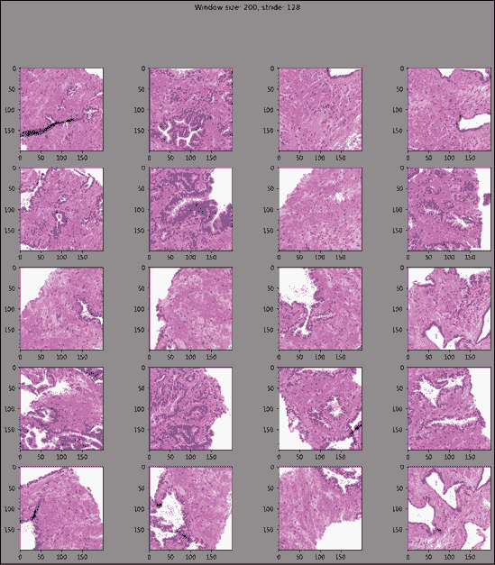

图 7.8：实例包，其中我们将 PANDA 大图像转换为包和实例。

> **注意**：此代码仅为示例，并可能需要根据你的特定用用例进行修改。例如，你可能需要调整超参数（如学习率和批次大小）或修改损失函数或优化器。此外，你可能需要将数据拆分为训练集和验证集，并使用验证集在训练期间评估模型的性能。

## 结论

在本章中，我们对 MIL 问题中遇到的特征和挑战进行了彻底调查，特别关注了它们的实际应用。我们的研究动力源于对涉及病理学和 MIL 技术实现的实际问题进行的工作。通过研究这些 MIL 特征，我们对 MIL 算法的行为及其在解决现实世界挑战方面的有效性获得了宝贵的见解。

在下一章中，我们将涵盖度量学习（metric learning）的基础。我们将讨论经典的度量学习，重点理解距离以及与之相关的数学概念。我们将讨论 PyTorch 中的深度度量学习，并回顾度量学习中常用的损失函数。

## 要点回顾

*   **MIL 中的预测**：区分实例级和包级（bag-level）预测是一个关键挑战。

*   **包的组成**：理解证人率（witness rates）、实例之间的关系、包内相似性、实例共现性以及实例和包的结构至关重要。

*   **数据分布**：管理多模态正实例分布和处理非代表性负实例分布带来了挑战。

*   **标签歧义性**：处理标签噪声和管理跨包的不同标签空间是复杂的。

*   **数据集预处理**：将 ISUP 分级转换为二分类标签、对图像进行预处理以及创建适当的数据集是 MIL 应用的基础。

*   **包和实例的创建**：使用滑动窗口和 k-best 区域选择等方法将大图像（如 PANDA）拆分为包和实例。

*   **训练 MILNet**：`MILNet` 模型在处理后的数据集上训练，遵循数据集创建、模型定义以及实现训练、验证和推理循环等步骤。

*   **数据集准备**：加载数据集并拆分为较小的补丁（实例）。这些实例根据它们来源图像（例如正或负）标记成包。

*   **MILNet 模型**：基于 CNN 的特征提取器处理每个实例，使用注意力机制将实例级预测聚合为最终的包级预测。

*   **训练与验证**：使用二分类交叉熵损失训练模型以预测包级标签。绘制学习曲线以可视化随时间变化的训练和验证损失。

## 多选题

1. 在 MIL 中包（bag）代表什么？

a. 数据集中的单个实例。

b. 在标签分配方面被视为单个实体的实例集合。

c. MIL 中使用的一种模型。

d. 数据预处理的方法。

2. 在 MIL 的背景下，如果一个包被标记为正意味着什么？

a. 包中的所有实例都是正的。

b. 包中至少有一个实例是正的。

c. 包中没有正实例。

d. 包中的实例互不相关。

3. 以下哪项是专门与 MIL 相关的挑战？

a. 对训练数据的过拟合。

b. 包内实例的独立性。

c. 高计算开销。

d. 包内实例的依赖。

4. 哪种算法常用于 MIL 分类？

a. K 近邻算法

b. 支持向量机

c. 决策树

d. 以上所有

5. MIL 的典型应用是什么？

1. 电子邮件垃圾邮件检测。

2. 仅有包标签的情况。

3. 时间序列预测。

4. 无监督聚类。

## 答案解析

| 题号 | 答案 |
| --- | --- |
| 1 | b |
| 2 | b |
| 3 | d |
| 4 | d |
| 5 | b |

# 第 8 章 超越传统分割：使用 SAM 进行全景分割

## 引言

分割是一种计算机视觉技术，将图像划分成意义的部分或区域以便进行分析。它识别图像中具有相似特征的区域。分割可以分为语义分割（按类别标记像素）、实例分割（区分同一类别的多个实例）以及全景分割（结合语义和实例分割）。它在自动驾驶、医学影像和目标检测等应用中至关重要，能够根据图像的具体部分进行决策。方法包括经典技术（阈值化、聚类）和现代深度学习方法（CNN）。

在计算机视觉领域，分割技术在精确解码视觉内容方面起着关键作用。本章探索了从经典方法到先进神经网络策略的分割方法。随着对视觉分割复杂性的探索，我们将揭示有助于深入理解图像的各种技术。

## 结构

*   分割技术导航

*   语义分割探索

*   实例分割探索

*   分割损失函数

*   全景分割探索

*   模型开发的常见挑战

## 目标

在本章结束时，你将学习从经典方法到高级神经网络策略的方法，并对视觉分割有全面的理解。我们将从经典方法开始建立基础，为理解现代进步带来的飞跃做好准备。章节将讨论各种基于 CNN 的分割技术，研究旨在应对各种挑战并推动视觉识别发展的架构。

此外，你将学习语义分割，这是一种为图像每个像素分配语义标签的复杂技术。语义分割在无人机数据集上的应用展示了它在遥感和地理分析等领域的转型影响。我们随后探索实例分割，它区分单个对象实例，允许机器以惊人的细粒度感知场景。使用原生 PyTorch 实现实例分割将为你提供实现这些概念的实践见解。

你将学习分割损失函数（这些对于优化模型和提高准确性至关重要），以及全景分割（一种统一语义和实例分割的技术）。

## 分割技术导航

分割技术是计算机视觉中的基础技术，用于将图像划分为有意义的片段以增强理解。这些技术从语义分割（每个像素都被分配一个类别标签）到实例分割（进一步区分同一类别的多个对象），再到全景分割（整合语义和实例信息以提供全面视角）。下图展示了这些不同的分割类型应用于城市场景中的情况，突显了每种方法如何独特地捕捉和表示视觉内容：

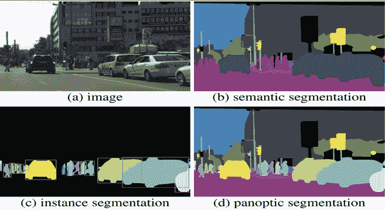

图 8.1：分割类型

之前的视觉化表示帮助我们理解这些分割技术如何逐步细化对视觉场景的感知，从而为自动驾驶、监控和机器人视觉的高级应用做出贡献。`Figure 8.1` 中描述的组件解释如下：

* 图像：城市场景的原始输入图像。

* 语义分割：根据类别对每个像素进行标记，例如汽车、建筑或树。

* 实例分割：区分同一类别中的个体对象，例如每辆汽车和每个行人。

* 全景分割：结合语义分割和实例分割，实现统一且详细的表示。

## 检测 vs 分割

检测和分割是图像分析和计算机视觉中的两项基础任务，都用于对象的识别和鉴定。检测涉及识别图像中是否存在对象，以及它们的位置和大小。目标检测算法通常在感兴趣的对象周围生成边界框（bounding boxes），可用于跟踪、计数或进一步分析等各种用途。目标检测常用于监控、自动驾驶和人脸检测等应用。

另一方面，分割涉及将图像分为多个区域或片段，每个片段对应于不同的对象或背景区域。换句话之，分割涉及为图像中的每个像素分配标签，指示它属于哪个对象。分割可用于图像编辑、医学成像和机器人视觉等各种应用。

万物分割模型（SAM）代表了分割领域的一个突破，旨在实现跨不同数据集和任务的分割泛化。它利用先进模型执行高效的、按需分割，使其能够以极少的用户输入自适应广泛的视觉场景，从而增强了分割技术的灵活性。

因此，检测和分割的关键区别在于：检测旨在定位图像中的对象并提供其大小和位置等信息，而分割旨在根据其视觉特征将图像划分为不同的区域或片段，通常用于识别和标记图像中的不同对象。

## 经典分割技术

在计算机视觉和图像处理中，有几种类型的分割技术可以根据其视觉属性将图像划分为不同的区域或片段。以下是一些常见的分割类型：

* 阈值分割：这是一种简单的技术，根据阈值将图像划分为前景和背景。高于阈值的像素被分配给前景，而低于阈值的像素被分配给背景。

* 基于区域的分割：这种方法根据像素在颜色、纹理或其他视觉属性上的相似性将像素分组为区域。这种技术可以进一步分为两类：基于聚类的方法和基于分割的方法。

* 边缘检测：该技术通过检测不同区域之间的边缘或边界来分割图像。常见的边缘检测技术包括`Sobel`、`Canny`和`Laplacian`滤波器。

* 水岭分割：该方法基于地理学中的水岭概念。它通过将像素强度视为地形图，并识别脊线和山谷来将图像分割成不同的区域。


激活轮轮廓：也称为基于蛇蛇的分割，这种技术定义了一条不断演化的曲线来分离前景和背景区域。曲线会被图像中的边缘吸引，并受到用户输入的影响以调整最终的分割。

基于 `CNN` 的分割：这是一种更先进的方法，使用深度学习来分割图像。`CNNs` 在标记数据集上进行训练，根据从输入图像中提取的特征来识别并分离图像的区域。

基于 `Transformer` 的分割：它利用最初为自然语言处理设计的 `Transformer` 架构来实现图像分割任务。与传统的卷积方法不同，`Transformer` 通过注意力机制捕捉像素之间的全局关系，能够实现更准确的分割，特别是对于复杂图像。视觉 `Transformer`（`ViT`）以及如 `Segmenter` 和 `DEtection TRansformer`（`DETR`）等模型利用自注意力机制来提取特征并执行语义以及实例分割。这些模型可以学习长距离依赖，使其非常适合需要上下文理解的任务。基于 `Transformer` 的分割已证明在挑战性场景中有效，在医学成像和自动驾驶汽车等各种应用中性能优于基于 `CNN` 的方法。

每种分割技术都有其优缺点，技术的选择取决于具体的应用以及处理图像的特征。

## 基于 CNN 的分割类型

`CNNs` 已成为图像分割的流行方法，因为它们可以从输入图像中自动学习特征并执行高精度的分割。以下是一些常见的基于 `CNN` 的分割技术类型：

* 全卷积网络（`FCNs`）：一种专门为语义分割设计的 `CNN`。它们将图像作为输入并产生密集的输出，输出中的每个像素都代表其所属对象的类别。`FCNs` 可以产生高精度的分割，并且计算效率高。

* `U-Net`：一种专门为医学图像分割设计的 `CNN`。它由一个捕捉图像上下文的收缩路径和一个实现精细定位的对称扩张路径组成。该架构非常高效，已被证明在广泛的医学图像分割任务中是有效的。

* `Mask R-CNN`：它是 `Faster R-CNN` 目标检测模型和 `FCN` 的结合，用于实例分割。它可以同时检测对象并产生像素级的分割掩码。`Mask R-CNN` 已证明在多种应用（如自动驾驶和机器人中的目标检测和分割）中非常高准确且有效。

* `DeepLab`：一种基于 `CNN` 的分割技术，它使用空洞卷积（也称为扩张卷积）来增加网络的感受野，使其能够捕捉更多的全局特征。它还使用空间金字池池化模块来捕捉多尺度上下文信息。`DeepLab` 在多个语义分割的基准数据集上取得了卓越的结果。

* `RefineNet`：一种基于 `CNN` 的分割技术，它使用多路径细化网络逐步优化分割输出。它结合了网络中多个层的低级和高级特征，以实现高精度的分割。

* `Pyramid Scene Parsing Network (PSPNet)`：它使用金字塔池化模块来捕捉多尺度上下文信息，能够对场景的全局上下文进行更深层的理解。这种方法提高了分割准确性，特别是对于不同尺度和复杂场景的图像。

* `SegNet`：它是一种专门为语义设计的编码器-解码器架构。编码器提取特征，而解码器使用编码器的池化索引进行上采样，以提高定位准确性并减少计算，使其适用于实时应用。

* `High-Resolution Network (HRNet)`：它在整个分割过程中保持高分辨率表示，允许进行精确的定位和细节捕捉。它融合了多分辨率特征，为复杂图像提供高质量的语义分割。

这些仅仅是基于 `CNN` 的分割技术的示例。技术的选择取决于具体的应用以及所处理图像的特征。

## 基于 Transformer 的分割类型

虽然基于 `CNN` 的分割技术由于能够有效提取空间特征长期以来一直是视觉识别的标准，但近期的进展引入了基于 `Transformer` 的分割。`Transformer` 利用自注意力机制来捕捉像素之间的全局关系，克服了 `CNN` 在建模长距离依赖方面的某些局限性。这种从 `CNN` 到 `Transformer` 的转变标志着分割领域的重大演进，增强了性能，特别是在上下文和全局理解至关重要的复杂场景中。

以下是一些基于 `Transformer` 的分割技术：

* `ViT`：最初用于图像分类，通过引入基于 `patch` 的自注意力机制，`ViT` 被适配分割任务。它捕捉像素间的全局依赖关系，使其适用于语义分割。

* `DETR`：它是一种基于 `Transformer` 的目标检测和分割模型。它利用带有注意力机制的编码器-解码器架构来检测和分割图像中的物体，提供无需手工锚框（`anchor boxes`）的端到端方法。

* `Segmenter`：它是一种专门为语义分割设计的 `Transformer` 模型。它利用 `ViT` 对图像特征进行编码，并通过 `Transformer` 解码器建模区域关系来生成像素级分割。

* `Swin transformer`：它使用带有位移窗口的分层结构，提高了 `Transformer` 在视觉任务中的效率和可扩展性。它被用于各种语义分割和实例分割模型。

* `MaskFormer`：这是一个使用 `Transformer` 进行语义、实例和全景分割的统一框架。它将分割建模为掩码分类问题，使用 `Transformer` 预测掩码嵌入和类别标签。

在建立了对分割技术的基础理解后，我们现在深入探讨语义分割。这种方法侧重于为图像中的每个像素分配一个特定的标签，通过根据语义意义对区域进行分类，对整体场景提供详细理解。

## 探索语义分割

语义分割是一项计算机视觉任务，涉及根据视觉属性为图像中的每个像素分配标签或类别。目标是将图像分割为对应于不同物体或部分的区域，例如人、建筑和车辆。后续章节将展示使用 `PyTorch` 实现语义分割的基本方法。

在下一节中，我们将根据 `GitHub` 仓库概述 `PyTorch` 实现语义分割的完整解决方案。该解决方案利用带有预训练 `MobileNetV2` 编码器的 `U-Net` 模型来高效分割航空图像，为任务实现精确的像素级分类。

## 语义分割的应用

`GitHub` 仓库中的代码提供了使用 `PyTorch` 实现语义分割的完整解决方案，专门针对航空图像（无人机）数据集。它利用带有预训练 `MobileNetV2` 编码器的 `U-Net` 模型高效分割图像中的不同类别。这一过程有助于像素级分类，对于土地覆盖制图、城市规划和环境变化监测等应用至关重要。代码演示了数据加载、数据增强、模型训练以及使用 `mean IoU` 和 `accuracy` 等指标进行评估，为训练需要精确物体勾勒和分类任务的分割模型提供了有用的指南。

后续重点是使用 `PyTorch` 构建健壮的语义分割流水线，旨在处理从数据准备到模型训练和评估的所有关键方面。请访问本书的 `GitHub` 仓库，参考 `Chapter 8`（`Beyond Classical Segmentation Panoptic Segmentation with SAM`）下的本章代码。以下点提供了构成此流水线的各种组件的概述，确保了高效的训练、准确的评估以及结果的有效可视化：

* **数据集准备**：

  * 代码加载图像和相应的分割掩码，使用数据增强技术（`augmentations` 库）对其进行转换，并对图像进行归一化，以确保训练输入值一致。

  * 数据集分为训练集、验证集和测试集，以有效评估模型性能。

* **数据增强与加载**：

  * 应用自定义转换，包括调整大小、水平/垂直翻转和添加噪声，以增强模型的泛化能力。

  * 将数据集封装在 `PyTorch` 数据集类中，并创建 `data loaders` 以在训练和验证期间高效批量处理数据。

* **模型与训练设置**：

  * 使用 `segmentation_models_pytorch` 创建一个带有 `MobileNetV2` 编码器的 `U-Net` 模型。该架构为语义分割提供了一个轻量且有效的模型。

  * 使用 `CrossEntropyLoss` 函数和带有学习率调度（`OneCycleLR`）的 `AdamW` 优化器对模型进行多个 `epoch` 的训练。计算 `mean Intersection over Union (IoU)` 和 `accuracy` 等指标来跟踪模型性能。

* **模型评估与可视化**：

  * 代码在训练过程中验证损失显示改进时保存模型，通过在连续多个 `epoch` 无改进后停止来防止过拟合。

  * 提供了函数来绘制跨 `epoch` 的训练损失、验证损失、`IoU` 以及 `accuracy`，实现训练过程的可视化。

代码的关键特征说明如下：

* `Pytorch dataset` 和 `DataLoader`：这些组件管理图像和掩码的加载与预处理，确保高效的数据批处理和洗牌。

* `Data augmentation`：使用 `argumentation` 有助于创建多样化的训练样本，从而提高模型的泛化能力。

* `U-Net model with MobileNetV2`：使用带有 `MobileNetV2` 编码器的 `U-Net` 架构允许模型在保持模型较小且高效的同时实现高性能。

* `Evaluation metrics`：代码计算并可视化了 `mIoU` 等指标，这对于理解模型如何区分不同类别至关重要，而 `pixel accuracy` 则衡量了整体预测准确率。

这段代码有效地演示了如何使用 `PyTorch` 中通过 `U-Net` 架构实现语义分割模型。它强调了数据集准备、数据增强以及使用相关指标对训练进度进行仔细监控的重要性。这种方法有助于分割航空图像中的不同类别，例如建筑物、道路和植被，使其在真实的无人机应用中具有高度适用性。现在，让我们查看模型收敛情况和预测模型输出。下图表示了验证损失和训练损失，展示了我们获得的模型良好收敛效果：

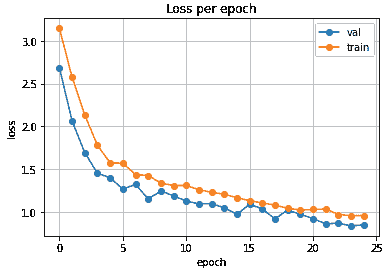

图 8.2：验证损失和训练损失的表示

接下图展示了模型的准确率图：

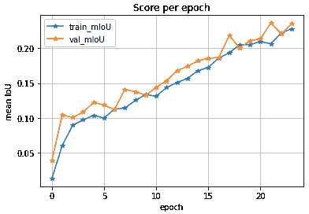

图 8.3：准确率图的表示

分割掩码（`Segmentation mask`）是计算机视觉中用于图像分割的技术，根据每个区域的内容将图像分为不同的片段或区域。具体而言，分割掩码是一个二值或多通道图像（通常称为 `mask`），它根据所属的物体或区域对原始图像的每个像素进行标记。

其通用工作原理如下：

1. **二分类分割掩码**：在简单的二值掩码中，掩码中的每个像素要么是 `0` 要是 `1`，`1` 代表前景（感兴趣的对象），`0` 代表背景。例如，在医学图像中，`1` 可以表示肿瘤，而 `0` 表示健康组织。

2. **多分类分割掩码**：在更复杂的设置中，不同的物体或类别在掩码中被赋予唯一的像素值。例如，在街场景中，`1` 可能代表汽车，`2` 代表行人，`3` 代表建筑物，以此此类推。

3. **实例分割掩码**：实例分割更进一步，它不仅区分物体类别，还识别这些类别的单个实例。例如，如果图像中有三个人，掩码会为每个人分配单独的值，而不是一个通用的“人”标签。

接下图显示了预测输出的掩码：

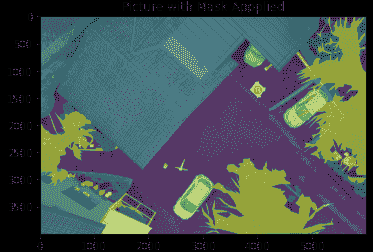

图 8.4：预测输出的彩色掩码

在探索了语义分割（通过标记图像中的每个像素来识别属于同一类别的区域）之后，我们现在转向实例分割。与语义分割不同，实例分割不仅对像素进行分类，还区分同一物体类别的单个实例，从而对场景提供更详细的理解。这种区别对于需要识别和跟踪多个对象的应用至关重要，例如自动驾驶或机器人技术。

### 探索实例分割

实例分割是一项计算机视觉任务，涉及检测并勾勒图像中的每个物体，为每个物体实例提供唯一的像素级掩码。与语义分割不同（语义分割为图像的每个像素分配标签而不区分同一类别的不同实例）——实例分割会独立地分离每个物体的出现。例如，在一张包含多辆汽车的图像中，语义分割会将所有汽车标记为同一类别，而实例分割会为每辆汽车创建单独的掩码。

实例分割结合了目标检测和分割任务。它既提供了精确的边界（分割），又提供了区分同类型中单个物体的能力（目标检测）。这使得它在自动驾驶等应用中非常有用，因为在那里区分多辆汽车或行人对安全至关重要；在机器人技术中，理解空间关系也是必不可少的。

相比之下，语义分割更适用于目标是理解整体场景的应用，例如土地利用分类或通用区域分类。实例分割提供了更详细的信息，适用于需要对象级交互和分析的情况。

### 实例分割 PyTorch 代码

要使用 `Detectron2` 在 `COCO` 数据集上实现实例分割，需要遵循几个步骤。本指南提供了每个步骤的详细说明，从安装必要的依赖项到可视化结果。我们首先安装 `PyTorch`、`Detectron2` 以及该过程所需的其他包。然后下载并注册包含训练和评估标注图像的 `COCO` 数据集以供 `Detectron2` 使用。配置一个以实例分割性能高效著称的 `Mask R-CNN` 模型，并使用预训练权重以加速训练过程。随后，对模型进行训练、进行预测并可视化结果以展示检测到的实例。后续章节将带你完成这些步骤，强调它们在构建实例分割流水线中的作用和重要性：

1. **安装依赖项**：安装 `PyTorch`、`Detectron2` 和其他必要的包。

2. **下载 COCO 数据集**：下载 `COCO` 数据集的子集（确说是验证集）并放入 `/content/sample_data/coco` 中解压数据集和注释。

3. **注册数据集**：使用 `Detectron2` 的 `register_coco_instances` 注册 `COCO` 数据集。这允许 `Detectron2` 理解图像和注释的位置，并为训练和评估做好准备。

4. **配置 Mask R-CNN 模型**：配置一个具有 `ResNet-50` 主干网络和特征金字塔网络（`FPN`）的 `Mask R-CNN` 模型。从 `Detectron2` 的模型库中加载预训练权重，并设置训练的学习率、批量大小和迭代次数。演示仅使用 `500` 次迭代。

5. **训练模型**：使用 `Detectron2` 的 `DefaultTrainer` 训练模型。由于迭代次数有限，这里的训练旨在演示，而不是为了获得顶尖结果。

6. **进行预测**：加载训练后的最终权重模型。脚本使用 `DefaultPredictor` 进行推理，它接收图像并生成图像中实例的预测。预测结果包括检测物体的边界框、类别和实例掩码。

7. **可视化结果**：脚本使用 `Detectron2` 中的 `Visualizer` 类对预测进行可视化。从验证集中选取了三张随机图像，并使用 `cv2_imshow` 显示它们的预测掩码。

你可以参考相应的代码来获得关于实例分割的实践见解。请访问本书的 `GitHub` 仓库，参考第 `8` 章“实例分割”下的代码。在这里，我们将详细阐述技术和代码流程：

* **备注**：

  * 训练时间：在 `COCO` 上训练 `Mask R-CNN` 模型需要大量时间。在上述代码中，为了演示目的，训练限制在 `500` 次迭代。你可能需要更多迭代来获得更好的性能。

  * `GPU`：确保你在 `Colab` 中使用 `GPU` 运行环境（`Runtime | Change runtime type | GPU`）来加速训练过程。

  * 阈值：预测阈值（`SCORE_THRESH_TEST`）设置为 `0.5`，这意味着只有置信度评分大于 `0.5` 的预测会被可视化。你可以根据需要调整此值。

下图显示了一个预测输出：

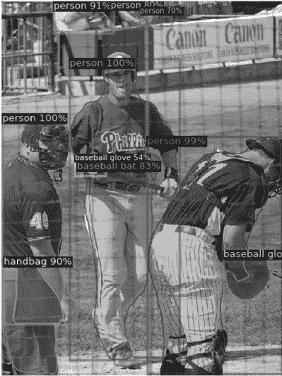

图 8.5：图像显示了预测输出

在探索了实例分割（它允许我们区分并掩码图像中的单个物体）之后，理解损失函数在训练有效的分割模型中的作用非常重要。损失函数对于引导模型学习准确的像素级分类至关重要，能够最小化预测分割结果与真值（`ground truth`）之间的误差。它们直接影响模型处理复杂形状、重叠物体和精细边界的能力，从而显著影响性能。

在深入研究分割损失函数之后，我们将转向全景分割（`panoptic segmentation`）。全景分割结合了语义分割和实例分割，对场景中的每个像素提供统一的理解，无论它属于物体还是背景区域，最终为图像提供整体表征。

# 分割损失函数

分割损失函数在训练分割模型中至关重要，因为它们提供了一种量化方法，衡量模型预测结果与真值分割掩码的匹配程度。这些损失函数引导模型学习如何区分不同类别，并精炼像素级预测以提高准确性。

在语义分割中，每个像素必须分配一个类别标签，分割损失函数对于评估预测分割图与真值之间的相似性至关重要。目标是实现高像素级分类准确率，以便所有感兴趣区域都被正确标记。常用的 `cross-entropy`（交叉熵）或 `dice loss` 等损失函数用于惩罚错误预测，并确保模型学习不同语义类别之间的细微差别，减少如分割不足（缺少某类别的部分）或过度分割（错误地扩展类别边界）等错误。

例如，在区分单个物体实例的实例分割中，分割损失函数变得更加重要，因为它们帮助模型学习检测并区分同一类别的多个重叠物体。`mask loss` 等损失函数与检测损失结合使用，以确保每个实例被单独分割，防止重叠实例之间的混淆。

在结合了语义分割和实例分割的全景分割中，分割损失起着双重作用——既确保模型按类别准确分割每个像素，又区分物体实例。语义标记和实例检测损失的组合确保了模型能够对图像中所有物体和区域获得统一的理解。

分割损失函数对于有效训练分割模型至关重要。它们可以分为以下几类：

* **基于分布的损失（`Distribution-based loss`）**：

  * 基于分布的损失衡量了预测分割与真值分割作为概率分布的相似性。

  * 这通常通过软标签（`soft labelling`）实现，为每个像素分配每个可能标签的概率（例如，前景与背景）。

  * 此类损失的常用指标是 `Kullback-Leibler (KL) 散度`，它衡量了当使用预测分布近似真值时丢失了多少信息。

  * 它有助于处理类别不平衡和部分分割，但由于其计算开销可能比其他损失函数更贵。

* **基于区域的损失（`Region-based loss`）**：

  * 基于区域的损失将预测分割的区域（例如超像素）与真值的对应区域进行比较，而不是单个像素。

  * 在此语境下使用的典型指标是 `Jaccard index`（也称为 `IoU`），它衡量了两个标签集之间的相似性。

  * 这种损失对像素值的微小变化不敏感，并有助于稳定训练，使其对于涉及复杂区域边界的任务非常有效。然而，它的计算要求更高。

* **复合损失（`Compound loss`）**：


# 损失函数

取决于具体问题和分割类型，有几种损失函数可以用于分割任务。以下是几种常用的：

* **交叉熵损失 (Cross-entropy loss)**：这是多分类分割任务的常用损失函数，每个像素从可能标签的集中分配一个标签。`cross-entropy loss` 将每个像素的预测概率与真实标签进行比较，并惩罚错误预测。

* **Dice 损失 (Dice loss)**：该损失函数通常用于二分类分割任务，目标是将图像分为两类（例如，前景和背景）。`Dice loss` 衡量预测分割与真实分割之间的重叠程度，并惩罚低重叠度。

* **Focal 损失 (Focal loss)**：这是`cross-entropy loss`的修改版本，旨在解决分割中的类别不平衡问题。`Focal loss`为困难样本（即难以分类的样本）分配更高的权重，为简单样本分配较低权重。

* **Lovasz-Softmax loss**：这种损失函数旨在直接优化`IoU`指标，`IoU`是分割中常用的指标。该损失函数基于子模函数的`Lovasz extension`，并可以处理多分类和二分类分割。

* **带 Logits 的二值交叉熵损失 (Binary cross-entropy with logits loss)**：这种损失函数是一个常见选择，例如在目标分割图像中单个物体的任务中。它将每个物体实例的预测二值掩码与真值掩码进行比较，并惩罚错误预测。

# 损失函数的类别

让我们来看损失函数的各种类别：

* **加权二值交叉熵 (Weighted binary cross-entropy)**：

  * 它是一种常用于类别不平衡二值图像分割任务的损失函数。在某些分割任务中，一个类别可能比另一个类别流行得多，导致类别不平衡问题。`Weighted binary cross-entropy` 通过给正负类别分配权重来解决这个问题。

## 损失函数

加权二元交叉熵损失函数定义为：

```
WCE(p, t) = - w_pos * t * log(p) - w_neg * (1 - t) * log(1 - p)
```

其中`p`是正类别的预测概率，`t`是真实标签（ground truth label），`w_pos`和`w_neg`分别是分配给正类和负类的权重，而`log`是自然对数。

可以通过选择权重来平衡类别，并赋予少数类以更多的关注度。例如，如果正类是少数类，则可以给正类分配较高的权重，给负类分配较低的权重。这将鼓励模型更多地关注正类，并为少数类产生更好的结果。

加权二元交叉熵损失函数的优势是它可以解决二分类分割任务中的类别不平衡问题。该损失函数通过给正类和负类分配权重，可以赋予少数类更高的权重，并提高分割模型的整体性能。然而，权重的选择需要仔细，因为分配错误的权重可能会导致糟糕的分割结果。

### 平衡交叉熵 (Balanced cross-entropy)

它是一种用于类别不平衡图像分割任务的损失函数。在某些分割任务中，某一类可能比另一类流行得多，从而导致类别不平衡问题。平衡交叉熵的设计通过对交叉熵损失重新加权来解决这个问题。

平衡交叉熵损失函数定义为：

```
BCE(p, t) = - 1/N * sum(w_i * t_i * log(p_i) + (1 - t_i) * log(1 - p_i))
```

其中`p`是预测概率，`t`是真实标签，`N`是样本数量，`w_i`是每个样本的权重。权重`w_i`定义为：

```
w_i = (1 - beta) / (1 - beta^c_i)
```

其中`c_i`是样本`i`的类别（负类为 0，正类为 1），`beta`是一个控制两类之间平衡的超参数。

平衡交叉熵损失函数的优势是它可以解决分割任务中的类别不平衡问题，而不需要手动为类别分配权重。该损失函数通过根据类别频率重新加权交叉熵损失，可以赋予少数类更高的权重并提高分割模型的整体性能。

### Tversky 损失 (Tversky loss)

它是 Dice 损失函数的一种变体，在论文 *Tversky loss function for image segmentation using 3D fully convolutional deep networks* 中引入。Tversky 损失函数旨在解决 Dice 损失函数的局限性，后者对分割任务中的类别不平衡可能敏感。

Tversky 损失函数定义为：

```
TL(p, t) = (p . t) / (p . t + α * (1 - p) . t + β * p . (1 - t))
```

其中`p`是预测分割结果，`t`是真实分割结果，`α`和`β`是控制假阳性和假阴性之间平衡的超参数。Tversky 损失函数与 Dice 损失函数相似，但包含了惩罚假阳性和假阴性的额外数项。可以通过调整`α`和`β`的值来优化分割模型的性能。

Tversky 损失函数的优势是它比 Dice 损失函数对类别不平衡更具鲁棒性。Tversky 损失函数通过包含惩罚假阳性和假阴性的项，即使在类别不平衡的情况下也能产生更平衡的分割。已证明 Tversky 损失函数在多种分割任务（包括医学图像处理）中表现良好。

总之，Tversky 损失函数是 Dice 损失函数的变体，通过包含惩罚假阳性和假阴性的项，解决了分割任务中的类别不平衡问题。

### 焦点 Tversky 损失 (Focal Tversky loss)

Focal Tversky 损失是 Tversky 损失的一种改进版本，旨在解决分割任务中的类别不平衡问题。该损失函数通过幂变换考虑了假阳性和假阴性。

Focal Tversky 损失定义为：

```
FTL(p, t) = (1 - Tversky(p, t))^gamma
```

其中`p`是预测概率，`t`是真实标签，`gamma`是一个控制对困难样本关注程度的超参数。Tversky 函数定义为：

```
Tversky(p, t) = sum(p_i * t_i) / (sum(p_i * t_i) + alpha * sum(p_i * (1 - t_i)) + (1 - alpha) * sum((1 - p_i) * t_i))
```

其中`alpha`是一个控制假阳性和假阴性之间平衡的超参数。Focal Tversky 损失通过对 Tversky 损失应用幂变换，为困难样本（即高信度分类错误的样本）分配更高的权重。

Focal Tversky 损失的优势是它可以解决分割任务中的类别不平衡问题并关注困难样本，而不需要进行类别重新加权或过采样。可以使用梯度下降直接优化，并调整超参数以获得最佳性能。

#### 灵敏度特异性损失 (Sensitivity-specificity loss)

它是一种旨在解决图像分割任务中类别不平衡问题的损失函数。该函数旨在平衡敏感度和特异性对分割模型整体性能的贡献。

灵敏度特异性损失定义为：

```
SSL(p, t) = -1 * (beta * t * log(p) + (1 - beta) * (1 - t) * log(1 - p))
```

其中`p`是预测概率，`t`是真实标签，`beta`是一个控制敏感度和特异性平衡的超参数。

分割模型的灵敏度衡量其正确识别正样本的能力，而特异性衡量其正确识别负样本的能力。在某些分割任务中，取决于应用场景，其中一个指标可能比另一个重要。例如，在医学影像中，分割模型的灵敏度可能比特异性更重要。

灵敏度特异性损失可以通过调整`beta`的值，在分割模型的整体性能中优先考虑敏感度或特异性。较高的`beta`值更关注敏感度，而较低的`beta`值更关注特异性。

该损失的优势是它提供了一种简单直观的方法来平衡敏感度和特异性对模型整体性能的贡献。损失函数可以使用梯度下降直接优化，并调整超参数`beta`以获得特定分割任务的最优性能。

#### Log-cosh Dice 损失 (Log-cosh Dice loss)

是一种旨在解决图像分割任务中类别分布不平衡问题的损失函数。该函数将 Dice 损失与 log-cosh 函数结合，以提高训练过程的鲁棒性并减轻噪声和模糊标注的影响。

* Dice loss 是图像分割中常用的损失函数，它基于 Dice 系数，Dice 系数用于衡量预测分割结果与真值（ground truth）之间的相似性。Dice loss 的定义如下：

```
Dice Loss(p, t) = 1 - (2 * sum(p_i * t_i) + eps) / (sum(p_i) + sum(t_i) + eps)
```

其中`p`是预测的分割，`t`是真值分割，`eps`是为了避免除以零而添加极极常数。

* log-cosh 函数是绝对值函数（absolute function）的平滑且连续的近似，在深度学习中广泛用于，用以改进优化算法的收敛特性。log-cosh 函数的定义如下：

```
Log-Cosh(x) = log(cosh(x))
```

通过将 Dice loss 与 log-cosh 函数结合，该损失函数提供了一种鲁棒且可微的损失函数，能够处理噪声和模糊的标注。其定义为：

```
Log-Cosh Dice Loss(p, t) = Log-Cosh(Dice Loss(p, t))
```

* log-cosh Dice loss 的优势在于它提供了一种鲁棒且可微的损失函数，能够处理图像分割任务中的噪声和模糊标注。该损失函数可以直接使用梯度下降法进行优化，并且可以通过调整超参数以在特定的分割任务上获得最佳性能。

## 豪斯多夫距离损失 (Hausdorff distance loss)

* 它是一种用于衡量两个点集之间差异的指标。在图像分割背景下，豪斯多夫距离用于衡量预测分割与真值分割之间的距离。该损失是一种基于豪斯多夫距离指标的损失函数，常用于图像分割任务。

* 该损失定义为：

```
H(p, t) = max(h(p, t), h(t, p))
```

其中`p`是预测的分割，`t`是真值分割，`h(p, t)`是从预测分割到真值分割的有向豪斯多夫距离。有向豪斯多夫距离定义为：

```
h(p, t) = max(min(||p_i - t_j||))
```

其中`i`和`j`分别是预测分割和真值分割中点的索引，`||. ||`表示欧几里得距离。

豪斯多夫距离损失衡量预测分割与真值分割之间的最大距离，这使得对数据中的离群值和噪声敏感。该损失函数是不可微的，直接优化具有挑战性。然而，已经提出了多种豪斯多夫距离损失的变体，它们是可微的并可以使用梯度下降法进行优化。

* 豪斯多夫距离损失常用的变体之一是软豪斯多夫距离损失（soft Hausdorff distance loss），其定义为：

```
H_soft(p, t) = mean(max(min(||p_i - t_j||, β), axis=1) + mean(max(min(||p_i - t_j||, β), axis=0))
```

其中`β`是一个控制损失函数对离群值和噪声敏感性的平滑参数。软豪斯多夫距离损失是微的，可以使用梯度下降法进行优化。

## 形状感知损失 (Shape aware loss)

* 它是一种用于图像分割任务的损失函数，旨在鼓励网络生成符合预期形状的分割结果。形状感知损失背后的思想是惩罚与真值不相似的分割结果。

* 形状感知损失有多种变体，但一种常见的是基于距离的形状感知（Distance-based Shape-Aware）：

```
DSAL = L_CE + λ * L_D
```

其中`L_CE`是交叉熵损失，`L_D`是基于距离的损失，`λ`是超参数。

基于距离的损失定义为：

```
L_D = ∑(1 - S_i) * d(S_i, T_i)
```

其中`S_i`和`T_i`是预测和真值的掩码（masks），`d(S_i, T_i)`是距离，`(1 - S_i)`是权重。

豪斯多夫距离损失衡量预测分割与真值分割之间的最大距离，也可以被修改以考虑对象的形状。

## 相关性最大化结构相似性 (CMS-SSIM)

* 它是一种用于图像分割任务的损失函数，旨在提高分割结果的视觉质量。它基于结构相似性（SSIM）指数，该指数衡量两幅图像之间的相似性，并考虑了它们的亮度、对比度和结构。

* CMS-SSIM 旨在最大化预测分割与真值在空间频率域中的相关性。其定义为：

```
L_CMS-SSIM = 1 - CMS-SSIM(p, t)
```

其中`p`和`t`是预测和真值的掩码，`CMS-SSIM(p, t)`是 CMS-SSIM 指数。该指数定义为：

```
CMS-SSIM(p, t) = max(r) * SSIM(p * r, t)
```

其中`r`是使相似性最大的放因子。SSIM 项衡量了两幅图像之间的结构相似性。

* 在图像分割任务中，CMS-SSIM 损失作为标准交叉熵损失之外的正则项使用，鼓励网络生成视觉上与真值相似且具有高度空间相关性的分割结果。这可以使分割结果更加美观且更易于解释。

* 总而言之，CMS-SSIM 损失是一种用于图像分割任务的损失函数，旨在提高分割结果的视觉质量。它基于 SSIM 指数，并最大化了预测与真值分割在空间频率域中的相关性。

# 复合损失

* 复合损失结合了多个损失函数，通过解决单个损失的缺点来提高整体分割性能。

* 例如，`cross-entropy loss` 可以与 `Dice loss` 结合，以平衡精确像素级分类与基于重叠相似性的需求：

```
total_loss = w1 * cross_entropy_loss + w2 * Dice_loss
```

* 在这里，`w1`和`w2`是决定每个损失函数相对重要性的权重。

* 复合损失也可以分层应用，在不同的抽象级别使用不同的损失函数（例如，先进行粗分割，然后进行精细细化）。

# 基于边界的损失 (Boundary-based loss)

* 基于边界的损失关注于被分割区域之间边界的准确性，而不是整个分割图。

* 一种常见的基于边界损失是`boundary loss`，它计算预测边界与真值边界之间的距离以确保更锐利的边缘。另一种方法是`gradient difference loss`，它比较预测边界与真实边界的梯度，惩罚差异。

* 这些损失对于产生锐利、准确的边界非常有用，这对于需要精确分割的任务是关键。然而，它们可能会增加成本。

# 全景分割简介

实例分割涉及识别和区分图像中的单个物体。相比之下，语义分割是将图像中的每个像素标记为语义类别，例如道路、天空、建筑或人。在全景分割（Panoptic Segmentation）中，这两种技术被结合在一起，以对场景创建更详细、更丰富的表示。

全景分割任务具有挑战性，因为它需要区分不同的物体，并为整个场景提供详细的上下文信息。为了实现这一点，全景分割算法使用了各种深度学习技术，包括`CNNs`和`FPNs`，在多尺度上分析图像并生成高精度且详细的预测结果。

全景分割的一个关键优势是它能够对复杂场景提供详细的理解。例如，它可以用于检测和区分拥挤街道场景中的不同物体，为自动驾驶车辆或监控系统提供有价值的信息。它还可以用于`AR`等应用，帮助将虚拟对象真实且准确地叠加到现实世界中。

在语义分割中，所有属于同一类别的像素被分配相同的相同的标签；而在实例分割中，每个对象都被分配一个唯一的 ID。在全景分割中，这两种方法结合在一起，使得对场景的理解更加全面。这是通过为实例分割分配对象级 ID，并为语义分割分配类别级标签来实现的，从而产生更详细、更丰富的场景表示。

全景分割的另一个重要应用是医学影像，它可以用于识别和分析扫描结果中不同类型的组织和病变。这可以帮助医生做出更准确的诊断并制定更有效的方案。此外，全景分割还可以用于遥感和航空图像分析，有助于识别和监测土地利用和植被覆盖的变化。

全景分割是计算机视觉和深度学习领域活跃的研究领域，新的技术和算法不断出来。该领域研究人员面临的一些挑战包括提高预测准确性、减少训练和推理的计算成本，以及开发能够处理光照、天气条件和其他因素变化的健壮模型。

总结，全景分割是一种强大的计算机视觉技术，它结合了实例分割和语义分割，对场景提供详细且全面的理解。它在自动驾驶、增强现实、医学影像和遥感等领域有许多应用。随着持续的研究开发，预计全景分割算法的准确性和有效性将继续提高，使其日益价值。以下图说明了计算机视觉中使用的不同分割技术，即语义分割、实例分割以及它们在全景分割中的结合：

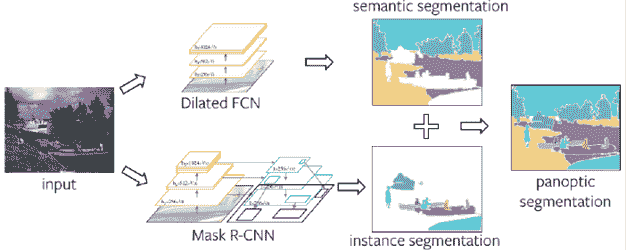

图 8.6: 3 语义分割、实例和全景分割的形成

# 全景分割的实现

全景分割是计算机视觉中的一种综合方法，旨在统一实例分割和语义分割。与传统方法不同——要么是将每个像素分类为预定义的类别（语义分割），要么区分物体的单个实例（实例分割），而全景分割同时执行这两者。这意味着图像中的每个像素都被分配一个类别（如道路或建筑），同时区分诸如`car 1`和`car 2`等不同物体实例。

全景分割的实现涉及利用高级模型和架构，如`Detectron2`、`DETR`以及较新的方法`SAM`。这些框架利用深度学习来分析图像并生成预测。

## 基于检测的实现

`Detectron2`是由 Facebook AI 研究 (`FAIR`) 开发的流行的开源对象检测和分割框架。它构建在广泛使用的深度学习框架`PyTorch`之上。`Detectron2`的核心组件设计为模块化且可重用，包括：

- `Backbone`：实现神经网络架构（例如`ResNet`、`ResNeXt`）以从输入图像中提取特征。

- `Region Proposal Network (RPN)`：该网络生成可能包含物体的建议框。

- `Region of Interest (RoI) pooling`：该技术从`RPN`生成的建议中提取固定大小的特征向量。


# 第 8 章：超越传统分割：使用 SAM 进行全景分割

## 引言

`Detectron2` 是一个由 Facebook AI 构建的、高度模块化且可扩展的框架，广泛用于目标检测和分割任务。它提供了多个核心组件：

- `Box head`：使用来自 `RoI pooling` 的特征向量预测每个对象的类别标签和边界框坐标。
- `Mask head`：预测图像中每个对象的分割掩码。
- `Matcher`：在训练期间根据重叠情况将预测框与真实框进行匹配。
- `Loss functions`：实现用于训练检测和分割模型的损失函数，包括框回归损失、分类损失和掩码损失。

`Detectron2` 提供了多个应用程序接口（API）用于与框架交互并构建自定义检测和分割应用：

- `Config API`：指定模型的配置，包括超参数、骨干网络选择和训练次数。
- `Dataset API`：定义输入数据格式，加载图像和标注，并对数据进行预处理以供训练。
- `Trainer API`：管理训练过程，包括优化器设置、学习率调度和其他训练参数。
- `Predictor API`：使用训练好的模型对新图像进行推理，允许配置阈值并生成各种格式的输出。
- `Evaluation API`：使用平均平均精度（`MAP`）等指标评估模型性能，针对检测和分割准确性。
- `Export API`：将训练好的模型转换为可以在其他框架中使用或部署到设备的格式。

`Detectron2` 还为全景分割提供了以下组件：

- `Panoptic FPN`：利用从 `backbone` 提取的特征为实例和语义分割生成特征金塔。
- `Panoptic head`：使用 `Panoptic FPN` 的特征图预测实例掩码、类别标签和整个图像的语义分割掩码。
- `Panoptic quality evaluation`：该函数计算全景质量指标，以评估组合实例和语义分割结果的准确性。
- `Panoptic API`：提供了配置、训练和评估全景分割模型以及执行推理的方法。

请访问本书的 GitHub 仓库，以参考第 8 章“超越传统分割：使用 SAM 进行全景分割”章节下的代码，该章节使用了 `Detectron2` 和 `DETRPpanoptic`。

该笔记本（Notebook）演示了如何在 Google Colab 中使用 `Detectron2` 和 `COCO` 数据集进行实例分割。首先，它安装了 `PyTorch` 和 `Detectron2` 等必要依赖。然后，它下载了 `COCO` 数据集的子集（验证集），对其进行解压，并使用 `register_coco_instances` 将其注册到 `Detectron2`，为训练和评估做好准备。

接下来，它使用 `Detectron2` 模型库中的预训练权重，配置了一个具有 `ResNet-50` 骨干网络和 `FPN` 的 `Mask R-CNN` 模型。训练配置包括设置学习率和批量大小，并为了演示目的将训练限制在 500 次迭代内。随后，使用 `Detectron2` 中的 `DefaultTrainer` 对模型进行训练。

训练完成后，使用 `DefaultPredictor` 加载模型进行推理，它会生成预测结果，包括图像对象的边界框、类别和实例掩码。脚本使用 `Detectron2` 中的 `Visualizer` 类来显示从验证集中随机选择的三张图像的结果。

> **注意**：在 `COCO` 上进行训练需要大量时间，500 次迭代可能无法产生最优结果。建议在 Colab 中使用 GPU 运行时以加快训练速度。预测阈值设置为 0.5，以过滤低置信度的预测。

## 使用 DETR 进行实现

`DETR` 是由 Facebook AI Research 的一种目标检测模型，它使用基于 transformer 的架构以统一的方式执行目标检测和实例分割。与 `Faster R-CNN` 等传统目标检测模型（它们依赖于 `CNN` 骨干网络和区域建议网络的组合）不同，`DETR` 利用 `transformers` 来建模物体之间的关系并捕捉全局上下文。`DETR` 的关键特征如下：

- 端到端检测：`DETR` 消除了对区域建议网络、锚点（anchor）生成和非极大值抑制（NMS）的需求。它直接预测最终的边界框和类别标签，显著简化了检测流程。
- Transformers：`DETR` 利用 `transformers` 的注意力机制来捕捉图像中所有物体之间的关系。这种注意力机制允许它建模远程依赖，提供对复杂场景更深层次的理解。
- 集合预测：`DETR` 使用匈牙利算法实现的集合预测损失，将预测框与真实值（ground truth）框进行匹配。这确保了每个预测框都对应一个唯一的物体，而不需要依赖复杂的后处理。
- 物体查询（Object queries）：模型使用物体查询，这些是可学习的嵌入，表示图像中不同的物体。`transformer decoder` 处理这些查询以产生最终的物体预测。
- 灵活性：`DETR` 可以适应目标检测和实例分割任务。通过细微的修改，相同的底层架构可以在预测边界框的同时用于预测分割掩码。

以下几点解释了 `DETR` 的工作原理：

- 骨干网络（Backbone）：`DETR` 使用 `CNN` 骨干网络（通常是 `ResNet`）从输入图像中提取特征图。
- Transformer 编码器-解码器：这些特征图随后被送入 `transformer encoder-decoder`，其中编码器提取全局特征，解码器关注特定区域并根据物体查询生成预测。
- 物体预测：解码器的输出经过处理，以预测物体类别、边界框坐标，以及可选的分割掩码。

使用 `DETR` 的优势如下：

- 简化的流程：与依赖手工组件（锚点、`NMS`）的传统方法相比，`DETR` 的架构更简单，需要调优的组件更少。
- 更好的上下文理解：`transformer` 架构允许 `DETR` 理解物体之间的关系并有效地捕捉全局上下文。
- 统一的框架：`DETR` 可以在统一框架内处理目标检测、实例分割和全景分割。

`DETR` 的缺点如下：

- 训练复杂度：与传统方法相比，`DETR` 需要大量的训练数据和计算资源才能收敛。
- 收敛缓慢：由于依赖于 `transformers`（需要从零开始学习位置信息），原始 `DETR` 模型训练时间较长。

`DETR` 可以应用于以下领域：

- 目标检测：在图像中检测并定位物体，并带有边界框和类别标签。
- 实例分割：区分图像中的多个物体实例，并提供像素级掩码。
- 全景分割：将语义分割和实例分割整合起来，对整个场景的全面理解。

`DETR` 的示例用例如下：

- 自动驾驶汽车：检测多个物体（包括车辆和行人），同时理解它们之间的关系。
- 监控：使用 `DETR` 进行监控视频中的人员或物体检测。
- 机器人视觉：用于机器人的实例和全景分割，以便导航和与环境交互。

SAM 是由 Meta AI 开发的一种先进的分割模型。它旨在跨越不同的数据集和任务来泛化分割能力，通过极少的用户输入提供灵活且自适应的分割。SAM 使用 `ViT` 创建图像嵌入，并利用基于提示（prompt-based）的系统，允许用户通过点、框或文本提示来生成分割掩码。这种灵活性使其适用于广泛的分割场景，简化并自动化了分割过程，下文所示：

- **Grounding DINO**：这是一个目标检测模型，它集成了基于文本的提示，用于识别和定位于图像中的特定物体。它使用基于 transformer 的架构，能够有效理解全局上下文和物体之间的关系。该模型支持如开放词汇检测等任务，即根据自然语言查询检测物体，而无需对特定类别进行训练。Grounding DINO 帮助桥接视觉理解与语言之间的差距，使其成为需要对物体进行高层推理用例的理想选择。

- **CLIPSeg**：这是一个基于 `CLIP` 的语义分割模型，`CLIP` 是一个在成对图像-文本数据上训练的模型。CLIPSeg 利用了 `CLIP` 的多模态理解能力，根据文本提示执行分割，使其具有高度的通用性。它可以分割没有明显物体实例的“stuff”区域或背景区域，在用户想要分割由描述性文本定义的感兴趣区域的场景中非常有用。语言理解的整合允许 CLIPSeg 能够在不同类型的图像上良好泛化，而无需广泛的重新训练。

SAM、Grounding DINO 和 CLIPSeg 共同构成了一个全景分割（panoptic segmentation）工具包，结合了实例分割、基于文本的目标检测和语义分割的优势。这种融合允许对物体实例和背景区域进行整体理解，从而为复杂的图像分析任务提供了强大的能力。

使用 Segment Anything 实现全景分割的示例可以在请访问本书的 GitHub 仓库中找到第 8 章，超越经典分割：使用 SAM 进行全景分割，位于 `Panoptic_with_Segment_anything` 下。

## 全景分割工作流

本节实现了一种结合了多个先进模型的全景分割工作流：Segment Anything、Grounding DINO 和 CLIPSeg。它使用预训练模型进行分割，并按如下可视化分割结果：

1. **安装依赖**：脚本安装必要的包，包括 `transformers`、`segment-anything` 和 `GroundingDINO`。它克隆 `Grounded Segment Anything` 仓库并进行配置使用。

2. **导入库**：代码导入了 `PyTorch`、图像处理以及所需模型（例如 `CLIPSeg`、`GroundingDINO`）的关键库。

3. **加载模型**：以下概述了用于处理目标检测和图像分割任务的分割流水线的关键组件和模型：

   - **Grounding DINO**：加载预训练的 `Grounding DINO` 模型基于文本提示执行目标检测。
   - **SAM**：加载并配置 `SAM` 模型生成图像嵌入和实例掩码。
   - **CLIPSeg**：加载预训练的 `CLIPSeg` 模型，根据 stuff 类别的文本描述生成粗略的分割掩码。
   - **API 设置**：脚本使用 `SegmentsClient` 连接到 `Segments.ai` API，下载示例数据集并提取用于分割的 thing 和 stuff 类别。

4. **分割工作流**：以下步骤描述了集成目标检测和分割以生成综合全景掩码的分割过程工作流：

   - **Grounding DINO 检测**：根据文本提示使用 `Grounding DINO` 检测 thing 类别的框。
   - **SAM 掩码生成**：使用 `SAM` 为 Grounding DINO 检测到的框生成详细掩码。
   - **CLIPSeg 分割**：使用 `CLIPSeg` 分割 stuff 类别，并用 `SAM` 精炼由 CLIPSeg 生成的粗略掩码。
   - **合并掩码**：将 thing 和 stuff 掩码合并为一个全景掩码，提供对图像的整体理解。
   - **可视化**：通过将生成的全景掩码叠加在原始图像上进行可视化，提供对 things（实例）和 stuff（无明显边界的区域）的综合视图。

5. **代码亮点**：代码演示了几个重要特性：

   - **多模型集成**：脚本结合了三个先进模型：`Grounding DINO`（用于目标检测）、`SAM`（实例分割）和 `CLIPSeg`（用于 stuff 区域的语义分割）。
   - **全景分割**：该方法集成了实例分割和语义分割，提供了图像中物体和背景区域的统一视图。
   - **可视化**：将分割区域叠加在原始图像上，以实现不同类别的详细视觉表示。

下图展示了图像分割的示例。左侧是城市街道场景的原始灰度图像，右侧是对应的二进制分割掩码。掩码突出了图像的不同区域，其中白色像素代表前景物体（如汽车和建筑物），黑色像素对应背景（如道路和天空）。这种分割有助于将感兴趣的物体与其环境区分开，以便在目标检测和场景理解等任务中进行进一步处理。

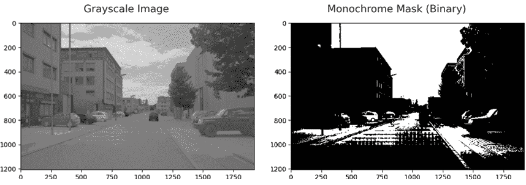

图 8.8：左侧的模型输出和右侧的二进制掩码

## 模型开发中的常见挑战

由于问题的复杂性，开发全景分割模型是一项挑战。以下是全景分割模型开发中的常见挑战：

- **数据集限制**：全景分割需要具有语义和实例分割标注的大型数据集。然而此类数据集稀缺且创建成本高。解决方案之一是从预训练模型进行迁移学习，可以提供有用的特征并在数据有限的情况下提高性能。另一种解决方案是用数据增强技术（如缩放和翻转）来生成额外的训练数据。

- **平衡语义分割和实例分割**：这是一个挑战，因为前者需要学习全局特征，而后者需要学习局部特征。解决方案之一是使用双通路架构，其中一个通路负责语义分割，另一个通路负责实例分割。

- **内存管理**：由于输入图像的大小和场景中物体的数量，全景分割需要大量的内存。解决方案之一是使用内存高效的模型，或使用多尺度训练来减少内存占用。

- **处理重叠物体**：重叠物体对于全景分割是一个挑战性问题，因为需要将其相互分离。解决方案之一是使用后处理技术（如非极大抑制和阈值处理）来分离物体。

- **处理类别不平衡**：全景分割数据集可能高度不平衡，某些类别的实例远多其他类别。解决方案之一是使用类别平衡采样或加权损失函数来解决不平衡问题。

- **调优超参数**：学习率、批量大小和优化器等参数对全景分割模型的性能有显著影响。解决方案之一是使用超参数调优技术，如网格搜索、随机搜索或贝叶斯优化。

## 结论

在本章中，我们学习了各种分割技术，从语义分割到实例分割和全景分割，每种技术都为理解视觉内容提供了独特的见解。语义分割为每个像素分配标签，提供了对不同区域的全面分类。实例分割扩展了这种方法，通过区分同一类别中的单个对象实例，这使其对于目标检测任务具有特别的价值。

为了确保最佳模型性能，我们讨论了分割损失函数，这些函数对于通过提供关于预测质量的定量反馈来指导模型训练至关重要。我们还探索了全景分割，它结合了语义分割和实例分割的优势，提供了对场景的整体性理解。

最后，我们探讨了 `SAM` 以及模型开发中的常见挑战，例如处理类别不平衡、边界精度以及有效的损失函数设计。通过理解这些方面，人们可以开发出适用于现实世界应用且鲁健的分割模型。

在下一章中，我们将探索如何在嵌入空间中构建深度度量学习，以及如何学习有意义的距离指标来比较数据点。这种强大的方法使模型理解实例之间的相似性，这对于人脸识别、图像检索和聚类等任务至关重要。

## 重点回顾

- **分割概述**：分割涉及将图像划分为有意义的部分，例如区分对象或区域（如语义、实例和全景分割）。
- **SAM**：该模型专为通用分割设计，能够通过提供灵活的提示（如边界框或掩码）来处理各种分割任务。
- **DETR**：一种基于 Transformer 的端到端目标检测和分割模型，通过消除对锚点生成等传统方法的需求简化了训练流程。
- **Detectron2**：由 Facebook AI 构建的高度模块化且可扩展的框架，广泛用于目标检测和分割任务，提供 `Mask R-CNN` 等预训练模型。
- **全景分割**：结合了实例分割和语义分割，确保图像中的每个像素都被分配给特定的对象实例或背景类别。
- **分割的数据增强**：如调整大小、翻转和添加噪声等技术可以提高分割模型的鲁健性和泛化能力。
- **评估指标**：如 `mean IoU` 和准确率等指标对于评估分割模型的性能至关重要，确保了精确的像素级预测。

## 多选题

1. 语义分割的主要目标是什么？

   a. 将整个图像分类为单个标签

   b. 检测对象并提供边界框

   c. 将图像中的每个像素分类为特定类别

   d. 区分同一类中的不同实例

2. 哪个模型以使用 Transformer 进行目标检测和分割而闻名？

   a. `Mask R-CNN`

   b. `Faster R-CNN`

   c. `YOLOv4`

   d. `DETR`

3. 实例分割和全景分割之间的主要区别是什么？

   a. 实例分割分类每个像素，而全景分割提供边界框

   b. 全景分割结合了实例和语义分割，而实例分割只区分不同的实例

   c. 实例分割比全景分割快

   d. 全景分割仅用于没有重叠对象的图像

4. 下哪个框架是由 Facebook AI 构建用于目标检测和分割的？

   a. `Detectron2`

   b. `YOLO`

   c. `TensorFlow`

   d. `Fast R-CNN`

5. `SAM` 特别有用：

   a. 它仅限于分割特定类型的对象

   b. 它能通过灵活的提示泛化到不同的分割任务

   c. 它只适用于高分辨率图像

   d. 它使用一组固定的预定义对象类别

6. 在 `DETR` 的背景下，“端到端”一词意味着什么？

   a. 它需要多个阶段的训练

   b. 它消除了对锚点生成等传统过程的需求

   c. 它专为全景分割设计

   d. 它在一个模型中了图像分类和分割

7. 常用于评估分割模型性能的指标是什么？

   a. `F1 score`

   b. `平均绝对误差 (MAE)`

   c. `平均交并比 (IoU)`

   d. `均方根误差 (RMSE)`

## 答案页

| 题目 | 答案 |
| --- | --- |
| 1. | c |
| 2. | d |
| 3. | b |
| 4. | a |
| 5. | b |
| 6. | b |
| 7. | c |

---

- [1]. 来源：Kirillov et al., panoptic segmentation, CVPR, 2019
- [2]. 读者可以参考书籍开头提供的链接查看彩色图像。
- [3]. 来源：[kharshit.github.io](https://kharshit.github.io)
- [4]. 读者可以参考书籍开头提供的链接查看彩色图像。

# 第 9 章：在嵌入空间中构建深度度量学习

## 引言


在上一章中，我们探索了全景分割，这是一项关键的计算机视觉任务，它统一了实例和语义分割以提供全面的场景理解。这种方法强调了识别图像中区分对象和无边界区域的重要性。通过准确界定这两者，全景分割为更精细、更高效的感知系统奠定了基础，这对于自动驾驶、机器人视觉和增强现实等应用至关重要。

由此我们进入度量学习和嵌入空间的世界，这些概念与目标识别、人脸验证和图像检索等任务密切相关。度量学习侧重于通过将数据点嵌入到连续（通常是低维的）空间中，教会模型如何衡量点之间的相似性和差异。在这个嵌入空间中，语义相似的数据点（无论是图像、特征还是对象）会被聚集得更近，而不相似的点则会被推得更远。这种强大的方法使模型能够超越预定义的类别进行泛化，解决大规模数据库中的开放集分类和检索等挑战。

虽然全景分割强调全面的对象分类和定位，但度量学习通过通过学习特征增强模型对实例进行判别和关联的能力，补充了这一点。

在本章中，我们将探索度量学习的理论基础、深度度量学习及其架构和实际应用，将其回溯到需要更灵活、可扩展的方法来理解视觉数据的需求。

## 结构

本章涵盖了以下主题：

- 经典度量学习方法
- 理解度量学习中的距离函数
- 度量学习中的相关性和相似性量
- 深度度量
- 度量学习中的损失函数

## 目标

在深度学习领域，`metric learning`（度量学习）的概念作为一种变革力量出现，使模型能够理解数据内部复杂的关系。通过本章，你将学习度量学习的复杂世界，揭示支撑深度网络基础的经典和现代方法。我们将讨论经典的度量学习方法。这些经过时间考验的方法为理解度量学习的进步提供了至关重要的背景。我们将学习度量学习与传统监督学习之间的区别。通过揭示这些差异，我们发现了深度网络在捕捉复杂数据关系方面的独特潜力。

本章进一步展开了距离的数学基础，这对于理解深度网络如何导航数据空间的复杂地形至关重要。我们还探索了损失函数，损失函数是度量学习的核心，它引导模型以传统监督学习方法无法复制的方式来理解数据结构并识别模式。本章弥合了深度网络领域中度量学习理论基础与实际应用之间的鸿沟。从经典基础到当代创新，这段旅程将让你对度量学习在从复杂数据领域提取复杂见解方面发挥的作用产生全面的理解。

## 经典的度量学习方法

可分特征和判别性特征都与`metric learning`有关，因为度量学习旨在学习满足某些理想属性的数据点之间的相似性度量。

在可分特征的情况下，目标是学习一种相似度量，将视觉上相似的数据点映射到嵌入空间中的附近位置，将视觉上不同的数据点映射到远处。这是通过最小化损失函数来实现的，该函数会惩罚未能满足这些约束条件的网络。

在判别性特征的情况下，目标是学习一种相似度量，在最大化不同类别数据点之间差异的同时，最小化每类内部的差异。这是通过优化损失函数来实现的，该函数考虑了数据点的标签，并鼓励网络学习具有类别判别性的特征。

这些特征解释如下：

- **可分特征**：这些特征用于可以被超平面线性分离的数据集。这些特征为分类问题提供的信息不足，并且可能在创建良好的模型时不可用。换句话说，这些特征没有判别性，通常会被忽略。

  例如，考虑一个具有两个特征`x1`和`x2`以及两个类别`circle`和`plus`的数据集。数据集的散点图显示类别是线性可分的，因此特征是可分的，如图所示：

  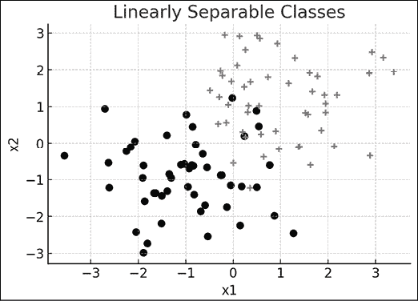

  图 9.1：展示两个线性可分类别（圆圈和加号）的散点图

- **判别性特征**：这些特征能够为分类提供有用信息。这些特征可能无法通过超平面分离，可能需要非线性函数来分离类别。

  例如，考虑一个具有两个特征`x1`和`x2`以及两个类别`circle`和`plus`的数据集。数据集的散点图显示这两个类别不是线性可分的，因此特征是不可分的。然而，通过添加第三个特征`x3 = x1² + x2²`，类别在 3D 空间中变得可分，如图 9.2 所示。

  让我们如下理解这些特征的分类机制：

  假设我们有一个有两个类别（`cat`和`dog`）的图像分类问题……（此处省略大量重复句式）……等等，目标是区分`cat`和`dog`。

  ```
  if (condVar > someVal) {console.log("xxx")}
  ```

  让我们如下理解这些特征的分类机制：（为了简洁，其余已截断）。

## 理解度量学习中的距离函数

`metric learning`旨在学习数据点之间的相似性度量，这是该过程的核心。各种距离将在后续节中解释。

## 距离与相关的数学

理解距离函数的数学原理和内部机制对于`metric learning`至关重要，因为它们构成了数据点之间相似性的基础。在`metric learning`中，模型被训练用于输入映射到嵌入空间，其中相似的点彼此靠近，不同的点彼此远离。距离函数的选择决定了如何计算这些距离，并直接影响模型区分不同类别的能力。

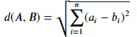

- **曼哈顿距离 (Manhattan distance)**：也被称为出租距离或`L1`距离，通过累加两点坐标的绝对差值来衡量网格空间中两点之间的距离。例如，`(1, 2)`和`(3, 4)`之间的曼哈顿距离为`|1 - 3| + |2 - 4| = 5`。这种直观的指标经常用于机器学习和计算机视觉，例如通过计算图像与每个类别之间的曼哈顿距离对猫狗图像进行分类，距离较小者决定分类结果。它的简单性使其适用于各种应用。例如，在二维空间中，点`(x1, y1)`和`(x2, y2)`之间的曼哈顿距离公式为：

  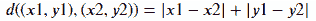

  示例：让我们使用与一个示例相同的向量`A`和`B`。`A`和`B`之间的曼哈顿距离计算如下：

  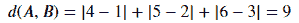

  曼哈顿距离的公式如下：

  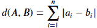

- **切比雪夫距离 (Chebyshev distance)**：也被称为`L∞`距离或极大度量，是一种衡量空间中两个点对应坐标之间最大绝对值的距离指标。与累加所有维度差异的欧几里得距离或曼哈顿距离不同，切比雪夫距离只考虑单一维度上的最大差异。简单来说，如果你在网格空间（想象棋盘）从一个点移动到另一个点，且可以在任何方向（水平、垂直或对角线）移动，切比雪夫距离代表了从一点移动到另一点所需的最小步数。

  示例：假设有两个向量`A = [1, 2, 3]`和`B = [4, 5, 1]`。`A`和`B`之间的切比雪夫距离计算如下：

  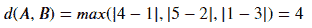

  切比雪夫距离的公式如下：

  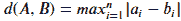

- **闵可夫斯距离 (Minkowski distance)**：这是一种扩展了欧几里得距离和曼哈顿距离的广义度量。它衡量两个对象在不同空间（如欧几里得空间、度量空间和范空间）之间的相似性。该指标的通用性使其适用于许多领域。闵可夫斯距离的关键特征是使用`pth`次方，通过对两个向量对应元素差的`pth`次方的和开`pth`次方计算得出。

  示例：假设有两个向量`A = [1, 2, 3]`以及`B = [4, 5, 1]`。`A`和`B`之间的闵可夫斯距离计算如下：

  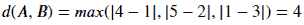

  闵可夫斯距离的公式如下：

  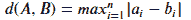

- **余弦距离 (Cosine distance)**：该距离指标依赖于两个向量的点积，点积通过将它们的对应元素相乘并求和得到。向量的长度（或模）通过对其元素的平方求和开平方根得到，特别是在高维空间中。它通常用于文本分类和涉及稀疏数据的应用。

  示例：假设有两个向量`A = [1, 2, 3]`以及`B = [4, 5, 6]`。`A`和`B`之间的余弦距离计算如下：

  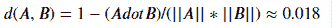

  这里，`AdotB`是`A`和`B`的点积，`||A||`和`||B||`分别是`A`和`B`的模。

  余弦距离的公式如下：

  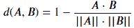

- **汉明距离 (Hamming distance)**：汉明距离是一种用于衡量两个等长度字符串差异的指标，通过计算对应符号不同的位置数来实现。它广泛应用于编码理论中的错误检测和纠错领域，在这些领域它可以帮助确定需要更改多少位将一个二进制字符串转换为另一个。汉明距离还用于 DNA 序列分析、数据哈希和文本比较。在机器学习中，它可以用于分类类别数据或评估使用二值特征的模型，使其成为多个领域的重要工具。

  示例：假设我们有两个二进制字符串`A = 10110`和`B = 11101`。`A`和`B`之间的汉明距离计算如下：

  ```
  d(A, B) = 2
  ```

  这两个字符串在第 2 和第 4 个位置不同。

  汉明距离的公式如下：

  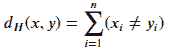

- **杰卡德距离 (Jaccard distance)**：是机器学习中广泛使用的指标，因其简单性和直观的解释而受到青睐。它通过比较两个数据集的共享元素来衡量它们之间的相似性。具体来说，杰卡德距离定义为两个集合交集的大小与并集的大小的比值。该距离范围在 0 到 1 之间，0 表示集合之间没有重叠，1 表示集合完全相同。也称为杰卡德相似系数，适用于各种任务，如聚类、分类和文本分析，在这些任务中比较集合相似性是至关重要的。集合`A`和`B`之间的杰卡德距离可以使用以下公式计算：

  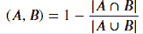

  这里，`|A|`代表集合`A`的基数（大小），`|B|`代表集合`B`的基数，`A ∩ B`代表集合`A`和`B`的交集，`A ∪ B`代表集合`A`和`B`的并集。

  示例：考虑两个集合`A`和`B`：

  `A = {apple, banana, orange, pear}` `B = {banana, kiwi, orange, watermelon}`

  集合 A 和 B 的交集是`{banana, orange}`，A 和 B 的并集是`{apple, banana, orange, pear, watermelon}`。因此，集合`A`和`B`之间的杰卡德距离为：

  

  这意味着集合`A`和`B`相对相似，杰卡德距离为 0.67。

  杰卡德距离的公式如下：

  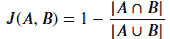

- **莱文斯坦距离 (Levenshtein distance)**：也被称为编辑距离，衡量两个字符序列之间的差异。它定义为将一个序列转换为另一个序列所需的最小单字符编辑（插入、删除或替换）次数。

  示例："kitten" 和 "sitting" 之间的莱文斯坦距离为 3，因为通过将 "k" 替换为 "s"、将 "e" 替换为 "i" 并在末尾添加 "g"，可以将 "kitten" 转换为 "sitting"。

  莱文斯坦距离可以使用动态规划计算。设`s`和`t`为序列，`d[i,j]`为`s`前`i`个字符与`t`前`j`个字符之间的莱文斯坦距离。那么，我们可以这样计算`d[i,j]`：

  

  其中``在不需要编辑时结果为 0，否则为 1（需要替换）。

- **字符串编辑距离 (String Edit Distance, SED)**：它是莱文斯坦距离的扩展，根据将一个字符串转换为另一个所需的最小编辑操作（插入、删除或替换）来计算字符串之间的差异。与莱文斯坦距离假设每次编辑的代价为 1 不同，SED 允许不同操作具有不同的成本。这使得 SED 更具灵活性，适用于某些操作成本比其他操作更高的场景，例如拼写纠错、DNA 序列分析或自然语言处理（在这些领域中，某些字母或字符可能比其他字符更常见）。

  示例：删除一个字符的成本可能比将其替换为另一个字符的成本更高。

SED 距离的公式与 Levenshtein 距离相似，但使用了一个代价函数`c(a,b)`来确定将字符`a`转换为字符`b`的代价。设`s`和`t`为两个序列，`d[i,j]`为`s`的前`i`个字符与`t`的前`j`个字符之间的 SED 距离。那么，我们可以如下式计算`d[i,j]`：

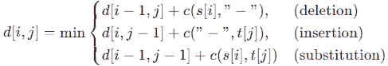

其中``是比较``字符的代价函数。

在这里，`-`代表空字符（插入或删除）。

代价函数`c(a,b)`可以根据特定的问题领域进行定义。例如，在 DNA 序列比对中，替换的代价可能取决于核酸碱的相似性（例如`A`和`G`比`A`和`T`更相似）。

Levenshtein 距离和 SED 距离在多种自然语言处理（NLP）任务中非常有用，例如拼写检查、字符串匹配和机器翻译。

### 卡方距离 (Chi-square distance)

它通过比较每个箱（bin）中的值来衡量两个直方图之间的差异。对于每个箱，它计算两个箱值的平方差，并除以这些值的之和。总卡方距离通过对所有箱的个体距离进行求和得到。向量`X`和`Y`之间的卡方距离公式为：

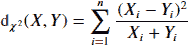

其中`n`是向量`X`和`Y`中的元素数量，`X_i`和`Y_i`分别是`X`和`Y`的第 i 个元素。

**示例**：假设我们有两个不同商店销售水果数量的直方图，我们想要衡量它们之间的相似性。直方图所示：

| 水果 | 商店 1 | 商店 2 |
| --- | --- | --- |
| 苹果 | 10 | 15 |
| 橙子 | 5 | 8 |
| 香蕉 | 2 | 3 |

表 9.1：商店 1 和商店 2 水果数量的对比

使用上述公式，我们可以如下计算两个直方图之间的卡方距离：

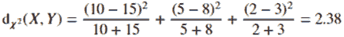

### 马哈拉诺比距离 (Mahalanobis distance)

该指标衡量多变量空间中两点之间的距离。虽然多变量空间是指一个具有多个变量的空间，但它并不意味着高维。例如，一个具有两个变量的空间是二维的，而具有 100 个变量的空间是 100 维的。维度取决于存在变量的数量。多变量空间可以是低维的也可以高维的。该指标考虑了数据的协方差结构，广泛应用于度量学习，其中变量之间的关系影响了距离的衡量方式。度量学习中使用的马哈拉诺比距离指标的数学方程表示如下：

- 训练样本= `{Let X = [x1,x2,…xN] ϵ Rd×N}`
- 训练示例`xi` ϵ Rd 是第 i 个
- 总训练样本数`N`

我们计算`xi`与`xj`之间的距离为：

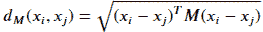

在这里，距离度量为`dM(xi,xj)`。

距离度量是一个衡量两点之间距离的函数。它必须具备以下属性：

- **非负性**：两点之间的距离必须是非负的。这意味着两点之间的距离始终大于或等于零。
- **不可区分性**：两个相同点之间的距离必须为零。这意味着两个相同点之间的距离始终为零。
- **对称性**：两点之间的距离必须等于另外两点之间的距离。这意味着`xi`和`xj`之间的距离等于`xj`和`xi`之间的距离。
- **三角不等式**：`xi`和`xj`之间的距离必须小于等于`xi`与`xk`以及`xk`与`xj`之间距离之和。这意味着两点之间的距离始终小于或等于另外两个点之间距离之和。

矩阵`M`也必须是对称且半正定的。对称矩阵是等于其转置矩阵的矩阵。正定矩阵是具有所有正特征值的矩阵。

矩阵的特征值是矩阵乘以其逆矩阵时得到的值。矩阵行列式是其特征值的乘积。

对于一个矩阵要是正定的，它所有的特征值必须是非负的。这意味着该矩阵必须是正或零。

矩阵`M`可以分解如下：

```
M = WT M
```

我们可以如下简化`dM(xi,xj)`的方程：

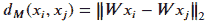

矩阵`W`具有线性变换性质，这意味着可以将数据转换为一个新的空间，在该空间中两点的欧几里得距离等于原始空间中的马氏量距离。

### Canberra 距离

它是曼哈顿距离的加权版本，在与数值总量比较时对小数值的变化敏感。当我们想要衡量大小数值之间的差异时，通常使用它。

两点之间的 Canberra 距离公式：

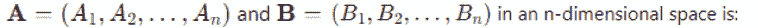


Canberra 距离在数值较小时赋予更大的权重，使其适用于相对差异比绝对差异更重要的场景。

### 海伦辛距离 (Haversine distance)

它用于测量球面上两点之间的最短距离，常用于地理计算（例如地球上两个坐标之间）。它假设地球是一个球体，尽管实际上地球是椭球体。

半径为`R`的球面上两点`A`和`B`之间的海伦辛距离公式为：

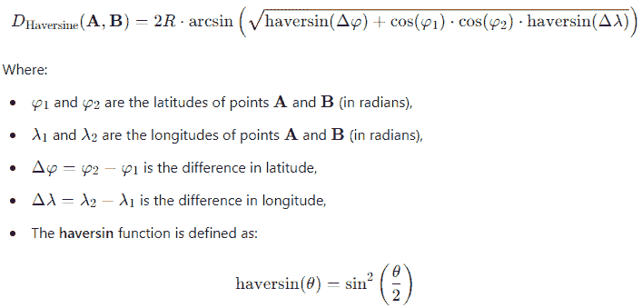

海伦辛距离计算的是大圆距离，即沿球面表面两点之间的最短路径。

### Jensen-森恩散度 (JS divergence)

这是一种衡量两个概率分布之间相似性的方法。它基于柯尔贝克斯莱布勒（KL）散度，但具有对称性且更稳定。与可能无界的 KL 散度不同，JS 散度提供了有限的相似性衡量，并平滑了两个分布之间的比较。

两个概率分布`P`和`Q`之间的 Jensen-森恩散度定义为：

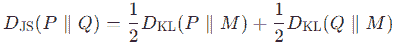


其中 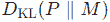 是分布 `P` 与平均分布 `M` 之间的 KL 散度。

`M` 是两个分布 `P` 和 `Q` 的平均值：

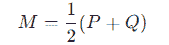

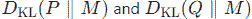 是各个分布与其中点之间的 KL 散度。

## 度量学习中的相关性和相似性度量

在度量学习中，目标是学习能够捕捉数据点之间内在关系的表示，通常通过量化它们的相似性或差异性来实现。虽然传统的距离度量（如 `Euclidean` 或 `Manhattan` 距离）常用于评估数据点的接近程度，但其他衡量方法——例如 `Sørensen–Dice coefficient`、`Spearman’s rank correlation coefficient` 和 `Pearson correlation coefficient`——提供了其他替代且通常更细致的方法来评估关系。这些指标有助于量化数据点之间的相似性、排名和线性关联，在聚类、分类和降维等各种应用中起着至关重要的作用。理解这些相关性和相似性衡量对于提高深度学习模型的性能至关重要，因为它们提供了数据点在嵌入空间内关系的不同视角。

这三个术语——`Sørensen–Dice coefficient`、`Spearman's rank correlation coefficient` 和 `Pearson correlation coefficient` 都与数据点之间的相似性、相关性或关联有关，这在度量学习和距离函数中至关重要。以下是它们的关系：

- `Soresen–Dice coefficient`：这是一种常用于比较集合的相似性度量。它与 `Jaccard index` 密切相关，通过关注两个集合之间的重叠部分来衡量两个集合的相似性。在度量学习中，它可以用于衡量特征空间中的相似性，特别是在聚类或二分类等涉及集合比较的任务中。

- `Spearman’s rank correlation coefficient`：这是一种非参数指标，用于评估使用单调函数描述两个变量之间关系的优劣。它基于对数据进行排名，而不是直接测量距离。在度量学习中，可以通过检查相似输入在嵌入空间中是否具有相似排名来评估嵌入的质量。

- `Pearson correlation coefficient`：这是一种广泛使用的变量间线性相关性衡量方法，该系数量化了数据点之间线性关系的强度。在度量学习中，皮尔逊相关可以帮助评估特征或学习到的嵌入与数据中真实值（ground truth）关系的对齐程度，使其对于降维或回归等任务非常有用。

这三个指标通过帮助量化相似性或相关性与距离函数相关，而这是度量学习框架中学习判别性特征的基础任务。这些系数提供了除了直接 `Euclidean` 或 `Manhattan` 距离之外解释关系的替代方法，拓宽了各种机器学习应用中学习目标的范围。

### Sørensen–Dice coefficient

Sørensen–Dice coefficient，也称为 `Dice similarity coefficient`，是两个集合之间相似性的衡量标准。它定义为两个集合共同元素数量的二倍除以每个集合元素数量之和。该系数的范围从 0（无重叠）到 1（完美重叠）。

假设你有两组数据 `A` 和 `B`，`A` 和 `B` 的交集是 `{1, 2, 3}`，`A` 和 `B` 的并集是 `{1, 2, 3, 4, 5}`，那么 `A` 和 `B` 之间的 Sørensen–Dice 系为 `2/4 = 0.5`。这意味着这两个集合的相似性为 50%。

Sørensen–Dice coefficient 是一种简单直观的指标，易理解和解释。它是机器学习和数据科学中衡量集合相似性的流行指标。

Sørensen–Dice coefficient 的公式为：

```

```

在这里，`A` 和 `B` 是比较的两个集合，`|A|` 和 `|B|` 表示它们的基数。示例：假设有两个集合 `A = {1, 2, 3}` 和 `B = {2, 3, 4, 5}`。为了计算 Sørensen–Dice coefficient，我们首先找到集合的交集：

```

```

集合的基数为：

```

```

因此，我们可以将这些值代入公式：

```

```

因此，Sørensen–Dice coefficient 为 `0.8`。

### Spearman’s rank correlation coefficient

Spearman’s rank correlation coefficient 是一种非参数指标，用于评估使用单调函数描述两个变量之间关系的优劣。它基于对数据进行排名，而不是直接测量距离。在度量学习中，可以通过检查相似输入在嵌入空间中是否具有相似排名来评估嵌入的质量。

Spearman's rank correlation coefficient 的公式为：

```

```

在这里，`n` 是 `X` 和 `Y` 中元素的数量，`d_i` 是排名之间的差异。示例：假设我们有两组数据 `X = [70, 80, 90, 60, 75]` 和 `Y = [80, 85, 90, 70, 75]`。我们想要衡量集合之间的相关性。首先，对得分进行排名：

使用上述公式，我们可以计算两个集合之间的 Spearman's rank correlation：

| Student | Math score | Math rank | Physics score | Physics rank |
| :--- | :--- | :--- | :--- | :--- |
| 1 | 70 | 2 | 80 | 3 |
| 2 | 80 | 3 | 85 | 4 |
| 3 | 90 | 5 | 90 | 5 |
| 4 | 60 | 1 | 70 | 1 |
| 5 | 75 | 4 | 75 | 2 |

### Pearson correlation coefficient

Pearson correlation coefficient 是两个变量间线性相关性的衡量方法。它是一种评估两个变量间线性关系强度和方向的统计量。

相关系数用字母 `r` 表示，通常在 -1 到 1 之间。`r = 1` 表示完美正相关，`r = -1` 表示完美负相关，而 `r = 0` 表示不相关。

Pearson correlation coefficient 的公式为：

```

```

在这里，`` 是 `X` 和 `Y` 之间的协方差，`sigma_X` 和 `sigma_Y` 分别是 `X` 和 `Y` 的标准差。注意上述方程假设 `X` 和 `Y` 之间的协方差不零。如果是零，则相关系数未定义。

示例：假设我们有两个集合 `X = [1, 2, 3, 4, 5]` 和 `Y = [2, 4, 6, 8, 10]`。`X` 的平均值和标准差分别为 3 和 1.58，而 `Y` 的平均值和标准差分别为 6 和 3.16。使用上述公式，我们可以计算 `X` 和 `Y` 之间的 Pearson correlation coefficient：

```

```

因此，`X` 和 `Y` 之间存在强正相关性。

### Deep metric

现在我们知道度量学习是一种机器学习，它专注于学习数据集中样本对之间的距离度量。度量学习的目标是找到一种度量，使得相似样本在特征空间中相互靠近，而使不相似样本保持远离。

传统的度量学习是一种监督学习类型，旨在学习数据点之间的距离度量。其目标是将输入数据转换为一个新的特征空间，在这个空间中，两点之间的距离能够更准确地反映它们之间的差异性或相似性。学习到的距离度量可用于各种任务，如分类、检索、聚类和可视化。

在传统的度量学习中，使用一组训练示例来学习映射函数，该函数将输入数据映射到新空间。映射函数通常由线性或非线性变换表示。度量学习的目标是学习一种距离度量，最大化相似示例之间的相似性，并最小化不相似示例之间的相似性。

传统的度量学习中使用的常用方法包括马哈拉斯距离（Mahalanobis distance）学习、信息论度量学习以及大边界最近邻（`LMNN`）学习。这些方法在目标函数和优化策略上有所不同，但旨在学习一种对特定任务有用的距离度量。

传统的度量学习已成功应用于计算机视觉、自然语言处理和生物信息学等多个领域。它是图像检索、人脸识别和聚类应用中的流行技术。

传统度量学习的一个真实示例可以在人脸识别系统中看到。在人脸识别中，必须训练一个分类器来区分不同个体的脸。解决此问题的传统方法是使用度量学习算法来学习图像之间的距离度量，使得同一人的图像之间的距离最小，而不同人的图像之间的距离最大。学习到的度量随后被用于计算图像之间的距离，并将这些距离输入到分类器以做出最终决策。这种方法已成功应用于多种人脸识别系统中，包括 Google 开发的 `FaceNet` 系统，它使用了深度度量学习方法。

深度度量学习是度量学习的一种变体，使用 `DNNs` 来学习输入数据的复杂分层次表示。其目标是学习一种非线性映射，将输入数据转换为一个新的特征空间，在该空间中相似性或差异性可以被更好地捕捉。深度度量学习已被证明在人脸验证、物体识别和图像检索等各种任务中达到了先进性能。

具有多层结构的深度学习可以提取自动特征并提供非线性结构，在计算机科学中变得流行。深度度量学习结合了深度学习和度量学习，用于视觉理解任务，需要网络结构、损失函数和样本选择来实现成功。

让我们应用一段深度度量学习代码。

这里的任务涉及创建随机 2D 点，我们将训练一个简单的神经网络将这些点映射到 2D 嵌入空间，在该空间中相似的点很近，不相似的点很远。我们将使用对比损失（contrastive loss），这常用的度量学习损失函数。

步骤如下：

1. 生成一个具有两个类别（正对和负对）的点的数据集。
2. 训练一个简单的神经网络将这些点映射到嵌入空间。
3. 使用对比损失促使同一类的点距离更近，不同类的点距离更远。

正对（同一类）被训练为在嵌入空间中具有较小的距离。

负对（不同类）被训练为具有更大的距离，并用间隔（margin）将它们分开。

## import libraries

```python
import torch
import torch.nn as nn
import torch.optim as optim
import numpy as np
import matplotlib.pyplot as plt
```

## 创建一个简单的点数据集

```python
def generate_data(num_samples=100):
    # 在 2D 空间中生成随机点
    class0 = np.random.randn(num_samples, 2) + np.array([0, 0])
    class1 = np.random.randn(num_samples, 2) + np.array([4, 4])
    data = np.vstack([class0, class1])
    labels = np.hstack([np.zeros(num_samples), np.ones(num_samples)])
    return data, labels

data, labels = generate_data()

# 可可视化数据
plt.scatter(data[:, 0], data[:, 1], c=labels)
plt.title("Generated Data")
plt.show()
```

## 定义一个简单的神经网络

```python
class SimpleNet(nn.Module):
    def __init__(self, input_size=2, embedding_size=2):
        super(SimpleNet, self).__init__()
        self.fc1 = nn.Linear(input_size, 32)
        self.fc2 = nn.Linear(32, embedding_size)

    def forward(self, x):
        x = torch.relu(self.fc1(x))
        x = self.fc2(x)
        return x

model = SimpleNet()
```

## 定义损失函数

```python
class ContrastiveLoss(nn.Module):
    def __init__(self, margin=1.0):
        super(ContrastiveLoss, self).__init__()
        self.margin = margin

    def forward(self, output1, output2, label):
        distance = torch.norm(output1 - output2, p=2)
        positive_loss = label * torch.pow(distance, 2)
        negative_loss = (1 - label) * torch.pow(torch.clamp(self.margin - distance, min=0), 2)
        return torch.mean(positive_loss + negative_loss)

criterion = ContrastiveLoss()
```

## 创建正对和负对

```python
def create_pairs(data, labels):
    pairs = []
    pair_labels = []
    num_samples = len(labels)
    for i in range(num_samples):
        for j in range(i + 1, num_samples):
            if labels[i] == labels[j]:
                pairs.append([data[i], data[j]])
                pair_labels.append(1)
            else:
                pairs.append([data[i], data[j]])
                pair_labels.append(0)
    return torch.tensor(pairs), torch.tensor(pair_labels)

pairs, pair_labels = create_pairs(data, labels)
```

## 训练网络

```python
optimizer = optim.Adam(model.parameters(), lr=0.01)

loss_history = []
epochs = 50
batch_size = 64

for epoch in range(epochs):
    total_loss = 0
    for i in range(0, len(pairs), batch_size):
        optimizer.zero_grad()
        batch_pairs = pairs[i:i+batch_size]
        batch_labels = pair_labels[i:i+batch_size]
        output1 = model(batch_pairs[:, 0])
        output2 = model(batch_pairs[:, 1])
        loss = criterion(output1, output2, batch_labels)
        loss.backward()
        optimizer.step()
        total_loss += loss.item()
    average_loss = total_loss / len(pairs)
    loss_history.append(average_loss)
    if epoch % 10 == 0:
        print(f'Epoch {epoch}/{epochs}, Loss: {average_loss}')

# 可视化损失曲线
plt.figure(figsize=(8, 5))
plt.plot(range(epochs), loss_history, label='Training Loss', color='blue')
plt.title('Training Loss Curve')
plt.xlabel('Epoch')
plt.ylabel('Loss')
plt.legend()
plt.show()

# 可视化嵌入结果
with torch.no_grad():
    embeddings = model(data).numpy()

plt.figure(figsize=(8, 5))
plt.scatter(embeddings[labels == 0][:, 0], embeddings[labels == 0][:, 1], c='r', label='Class 0')
plt.scatter(embeddings[labels == 1][:, 0], embeddings[labels == 1][:, 1], c='b', label='Class 1')
plt.title('Learned Embeddings from Metric Learning')
plt.legend()
plt.show()
```

随着训练的进行，损失值在下降，这表明模型正在学习更有效地区分相似和不同的点。


过程中存在一些波动，这是训练期间典型现象，特别是当使用`Adam`等随机优化器时。


图 9.3：深度度量学习生成的损失曲线

### 嵌入可视化（底部图表）

此散点图展示了训练后数据点的嵌入。

红点代表`Class 0`中的数据点。

蓝点代表`Class 1`中的数据点。

#### 解释

度量学习算法的目标是在嵌入空间中将同一类的点聚集在一起，同时分离不同类别的点。

在图中，你可以看到红色和蓝色点在很大程度上被分成了两个不同的簇。这表明学习到的嵌入有效地将相似点分组在一起，同时保持了不同类别之间的距离，这是度量学习想要的结果。


图 9.4：可视化学习到的嵌入

### 度量学习中的损失函数

损失函数通过提供一种灵活的系统，解决了传统目标识别算法的局限性，该系统能够处理图像实例有限的类别，并能轻松适应新的产品类别。

深度学习（DL）的最新进展赋予了我们开发深度度量学习网络的知识，这些网络能够有效确定图像之间的相似性。此类网络能够将视觉上相似的图像映射到嵌入空间中彼此靠近，而将视觉上不同的图像放置得更远。通过这种方法进行训练，我们获得了高度判别性的深层特征，表现出紧凑的类内方差和良好的类间差异。这些特征对于增强视觉搜索引擎至关重要。此外，学习此类判别特征的能力使网络能够理解新的产品图像并在嵌入空间中创建新的簇。

这些网络的训练过程与其他深度学习网络结构相似，不同之处在于特定的损失函数，这些函数旨在将嵌入空间中相似的图像紧密聚集在一起，同时推开不相似的图像。在每个训练步骤中，数据集中的图像被输入网络，网络将其映射到嵌入空间。然后根据这些映射计算损失函数，并使用适当的优化技术调整网络权重。在推理期间，从嵌入层提取特征，并执行诸如`nearest neighbor search`等搜索算法来识别相似图像。

`Figure 9.5`插图展示了深度度量学习过程。成对数据集（`+`和`–`或锚点）通过神经网络层，包括全连接层（`FC`）和嵌入层。度量损失通过前向传播计算，并使用反向传播进行优化。


图 9.5：深度度量学习过程

利用这些损失函数的深度度量学习网络证明了它们在构建高效视觉搜索解决方案方面的有效性。然而，需要注意的是，训练过程可能计算密集且耗时。在大小为`N`的数据集上计算损失并进行梯度步的计算复杂度通常为`O(N²)`或`O(N³)`。为了缓解这一挑战，梯度下降中通常使用小批量（大小为`B`）。

小批量的构建成为一个关键考虑因素，因为随机采样可能无法保证包含包含信息的样本对。

#### 最流行的损失函数

让我们来看一些损失函数。假设`P1`和`P2`是输入。

*   **对比损失（Contrastive loss）**：

    ```
    L(P1, P2) = Y * ||P1 - P2||² + (1-Y) * max(0, m - ||P1 - P2||)²
    ```

    其中`Y`是标签。如果输入对来自同一类，则`Y`的值为 1，否则为 0。`m`是边界值。

*   **三元损失（Triplet loss）**：

    ```
    L(A, P, N) = max(0, ||A - P|| - ||A - N|| + m)
    ```

    其中`A`是锚点（anchor），`P`是正样本，`N`是负样本。`m`是边界值。

在使用三元组损失（triplet loss）训练时，使用了三个输入：锚点（anchor）、正样本（positive）和负样本（negative）。锚点作为参考输入，可以是任何输入，而正样本是与锚点同类的输入。相反，负样本必须是与锚点不同类的输入。例如，在人脸识别场景中，锚点和正样本图像可以是同一个人，而负样本图像可以是另一个人。

然后，通过将这些图像通过具有相同权重的同一个 CNN，计算出它们的嵌入（embeddings）。这三个嵌入被输入三元组损失函数。该函数的目标是让锚点与负样本之间的距离尽可能远，同时让锚点与正样本之间的距离尽可能近。

为了实现这一点，使用距离函数计算锚点与正样本之间的差异，记为`d(a, p)`，该值应较小。锚点与负样本之间的差异记为`d(a, n)`，理想情况下应较大。目标是始终确保`d(a,p)`小于`d(a,n)`，这在数学上可以表示为`d(a,p) - d(a,n) < 0`。然而，损失函数不应为负数。因此，损失函数定义为`max(d(a,p) - d(a,n) + margin, 0)`。

三元组损失的子类型解释如下：

*   **简单三元组（Easy triplets）**：它们的损失为 0，因为锚点与正样本之间的距离大于锚点与负样本之间的距离加上边际（margin）。这意味着负样本距离锚点足够远，不是一个良好的匹配，而正样本距离锚点足够近，是一个良好的匹配。即损失为 0 的三元组，因为`d(a,p)+margin<d(a,n)`。

*   **困难三元组（Hard triplets）**：这些负样本比正样本更接近锚点的三元组。这意味着负样本与锚点的匹配程度比正样本更好，这并不是理想的。困难三元组用于训练模型，使其更有效地区分正样本和负样本。即负样本比正样本更接近锚点的三元组，即`d(a,n)<d(a,p)`。

*   **半困难三元组（Semi-hard triplets）**：这些三元组的负样本并没有比正样本更接近锚点，但仍然损失。这意味着负样本不是锚点的完美匹配，但它仍然比正样本更接近锚点。半困难三元组是简单和困难三元组之间的折中，可以用于训练模型更有效地区分正样本和负样本。即负样本没有比正样本更接近锚点，但仍具有正损失的三元组：`d(a,p)<d(a,n)<d(a,p)+margin`。

下图展示了深度度量学习中的三元组损失，其中锚点`xax_axa`被拉向正样本`xpx_pxp`（同类），并被负样本`xnx_nxn`（不同类）推开，推开距离为边际`α`。距离`D_{ia,ip}`和`D_{ia,in}`分别代表锚点-正样本对和锚点-负样本对之间的欧氏距离：


图 9.8：三元组损失

*   **四元组损失（Quadruplet loss）**：它是深度度量学习中三元组损失的扩展，旨在通过引入额外的负样本来进一步提高类别之间的区分度。四元组损失不再使用一个锚点、一个正样本和一个负样本，而是包含两个负样本：一个与锚点相似，另一个则不相似。目标不仅确保锚点距离正样本比距离第一个负样本近，而且确保第二个负样本比正样本远。


图 9.9：四元组损失图表

*   **角度损失（Angular loss）**：它是深度度量学习中常用的损失函数，旨在学习嵌入空间中具有判别性的特征表示。它由 Wang 等人在 2018 年的论文《Additive Margin Softmax for Face Verification》中提出，并在人脸识别、行人重识别和图像检索等各种应用中显示了良好的效果。

角度损失的基本思想是通过增加嵌入空间中不同类别之间的角度，来鼓励神经网络学习具有判别性的特征。它是通过修改通常用于传统深度学习分类任务的 Softmax 损失函数来实现的。角度损失函数引入了一个额外的项，当两个不同类别的特征之间的角度太小时，会对网络进行惩罚。这鼓励网络学习更容易被分离的特征，从而更有利于分类和其他任务。

角度损失函数可以定义如下：


在这里，`N`是训练样本数，`C`是类别数，`是第 i 个样本的类别标签，`是第 i 个样本特征向量与其对应类别权重向量之间的角度，而`是第 i 个样本特征向量与第 j 个类别权重向量之间的角度。参数`s`控制角度边际的尺度，它决定了类内紧凑程度。

角度损失旨在学习一种能够最小化类内差异并最大化类间差异的特征空间，产生更好的判别性。以下是角度损失的可视化，锚点（A）、正样本（P）和负样本（N）画在单位圆上。角度损失的目标是最小化锚点与正样本之间的角度，同时最大化锚点与负样本之间的角度。这有助于模型通过关注角度而非欧氏距离来学习更好的嵌入。

*   **N-对损失（N-pair loss）**：它是深度度量学习中用于学习表示函数，使得相似的数据点映射更近。它由 Sohn 在 2016 年的论文《Improved Deep Metric Learning with Multi-class N-pair Loss》引入。

N-对损失基于创建样本对，其中一个样本是锚点，另一个是正样本（即与锚点相似的）或负样本（即与锚点不相似的）。损失函数试图最小化锚点与其正样本之间的距离，同时最大化锚点与其负样本之间的距离。

损失函数定义为：


其中，`N`是样本数，`y_ij`是二进制变量，指示样本 i 和样本 j 是否为正对（`y_ij = 1`）或负对（`y_ij = -1`），`f_i`是样本 i 的特征向量，`f_j`是样本 j 的特征向量。

N-对损失可以作为深度度量学习任务中其他损失函数（如三元组损失和对比损失）的替代品。

### PyTorch 中的损失函数

PyTorch 提供了用于深度度量学习的多种损失函数。以下是一些常用的损失函数：

*   **三元组损失（Triplet loss）**：三元组损失旨在学习一种特征嵌入空间，其中锚点-正样本对的距离小于锚点-负样本对的距离。PyTorch Metric Learning 提供了三元组损失的多种变体，如`TripletMarginLoss`、`TripletSemiHardLoss`和`BatchHardTripletLoss`。

*   **对比损失（Contrastive loss）**：对比损失旨在学习一个特征嵌入空间，其中锚点-正样本对之间的距离小于间隔（margin），而锚点-负样本对之间的距离大于同一间隔。PyTorch Metric Learning 提供了`ContrastiveLoss`类来计算对比损失。

*   **边界损失（Margin loss）**：边界损失旨在学习一个特征嵌入空间，其中锚点-正样本对之间的距离小于间隔，而锚点-负样本对之间的距离大于同一间隔。PyTorch Metric Learning 提供了边界损失的多种变体，例如`MarginLoss`、`MarginRankingLoss`和`MultiMarginLoss`。

*   **归一化 Softmax 损失（Normalized softmax loss）**：归一化 Softmax 损失旨在学习一个特征嵌入空间，其中同类样本之间的距离小于不同类样本之间的距离。PyTorch Metric Learning 提供了`ArcFaceLoss`和`CosFaceLoss`类来计算归一化 Softmax 损失。

*   **代理 NCA 损失（ProxyNCA loss）**：代理 NCA 损失旨在学习一个特征嵌入空间，其中同类样本之间的距离小于不同类样本之间的距离。PyTorch Metric Learning 提供了`ProxyNCA`类来计算代理 NCA 损失。

## 结论

本章概述了度量学习的关键主题，从经典方法到各种距离函数的数学原理、相关性和相似性度量，以及该领域使用的各种损失函数。它引入了重要的概念，如`Sørensen–Dice 系数`、`Spearman 秩相关系数`和`Pearson 相关系数`，这些是理解度量学习中如何比较数据点的基础。它还讨论了深度度量学习并展示了深度度量学习的应用。

下一章将深入探讨深度度量学习，探索高级技术、流行的损失函数以及使用 PyTorch 对它们的实际实现。这将为深度度量学习模型如何开发和优化提供更全面的理解。

## 多选题

1. 度量学习的主要目标是什么？

a. 增加分类器的准确性

b. 在特征空间中最小化相似样本之间的距离并最大化不相似样本之间的距离

c. 提高图像分辨率

d. 在数据集中寻找离群点

2. 以下哪种损失函数常用于度量学习？

a. 交叉熵损失

b. 均方误差

c. 对比损失

d. 边界损失（Hinge loss）

3. 在三元损失（Triplet loss）中，使用了哪些组件？

a. 锚点（Anchor）、正样本（positive）、负样本（negative）

b. 训练、验证、测试

c. 图像、标签、预测

d. 输入、输出、误差

4. Haversine 距离测量什么？

a. 两个二进制字符串之间的差异

b. 向量之间的角距离

c. 球面上两点之间的最短距离

d. 两点之间的欧几里得距离

5. 在角度损失的损失函数中，主要目标是什么？

a. 最小化锚点与正样本之间的角度，同时最大化锚点与负样本之间的角度

b. 最小化不同类样本之间的欧几里得距离

c. 最小化嵌入空间中的维度

d. 最大化图像之间的像素强度差异

## 答案页

| 1. | b |
| --- | --- |
| 2. | c |
| 3. | a |
| 4. | c |
| 5. | a |

## 记忆点

*   距离函数：像`Euclidean`（欧几里得）、`Manhattan`（曼哈顿）和`Cosine`（余弦）等距离函数衡量数据点之间的相似性或差异。选择正确的距离尺度对于捕捉数据中有意义的关系至关重要。

*   对比损失和三元损失：这些损失函数在深度度量学习中至关重要。对比损失基于数据对，而三元损失使用锚点、正样本和负样本通过最小化类内距离和最大化类间距离来学习更好的特征嵌入。

*   嵌入空间：在深度度量学习中，目标是将数据点映射到嵌入空间，其中相似的点靠在一起，不相似的点远离，从而实现更好的分类或检索。

*   间隔的作用：在对比损失和三元损失等损失函数中，间隔定义了不相似点之间的最小距离，以强制类别可分性并提高模型的泛化能力。

*   现实应用：深度度量学习广泛应用于人脸识别、图像检索和聚类任务，这些任务需要数据点之间的精确比较。

# 第 10 章 导航度量学习领域

## 引言

导航深度度量学习（DML）领域涉及理解如何创建模型，以便在学习的特征空间中衡量数据点之间的相似性或距离。与传统的分类模型不同，DML 专注于将数据映射到嵌入空间，其中相似项更近，而不相似的项更远。这种方法在人脸识别、图像检索和异常检测等任务中特别有用，在这些任务中，数据点之间的关系比类别标签更有意义。

DML 采用了对比损失、三元损失和更高级的损失函数，引导学习过程形成分离良好、紧密的相似实例簇。通过学习数据的意义表示，DML 能够构建擅长区分细微差异的模型。因此，DML 是需要对相似性和差异性进行细致理解的应用中的关键组件，与传统的机器学习方法相比，提供了更精细且适应性强的解决方案。

继续上一章第 9 章《在嵌入空间中构建 DML》的旅程，我们现在探索操作和应用 DML 技术的细节。本章是一个扩展，侧重于解决 PyTorch 背景下 DML 的挑战、工具、实践和现实世界的应用。

## 结构

本章涵盖了以下主题：

*   DML 的库和工具

*   玩具实现（Toy implementation）

*   使用 PyTorch 进行 DML 的实际实现

*   为 DML 训练 DNN 的最佳实践

*   部署 DML 的技巧和窍门

*   DML 的示例和案例研究

*   结合大语言模型（LLMs）的深度度量学习

*   DML 中的常见挑战

## 目标

在之前章节奠定的基础上，本章将深入探讨 DML 的实际和操作方面。读者将探索如何从理解 DML 理论过渡到将这些概念应用于现实场景。通过关注嵌入空间的细节，本章揭示了如何通过精细的技术和工具解决复杂的相似性任务。这一探索是为那些旨在将 DML 的潜力转化为能够准确理解和衡量数据点关系的高效模型的人定制的。

在本章中，读者将了解如何克服 DML（深度度量学习）模型开发过程中遇到的常见障碍，例如管理损失函数的复杂性以及确保训练的稳健性。此外，本书还提供了实现和优化这些模型的实用策略，使读者能够充分利用 PyTorch 的优势。通过理解最佳实践和应用策略，读者将掌握创建自适应模型的技能，能够处理从图像检索到异常检测的广泛任务。本章聚焦于部署和现实用例，旨在弥合理论知识与实际实现之间的差距，让读者能够释放 DML 的全部潜力。

## DML 的库与工具

随着深度学习领域的不断扩展，对针对度量学习（metric learning）等利基任务的专用工具的需求日益增长。为了满足这一需求，PyTorch 生态系统提供了一个名为`PyTorch Metric Learning`的强大库。该库专门设计用于简化深度度量学习模型的开发，提供了一系列损失函数、采样策略和评估指标。通过利用`PyTorch Metric Learning`，从业者可以简化实现过程，并专注于完善模型，以更好地捕捉复杂的数据关系。在接下来的章节中，我们将探索该库的关键功能，以及如何利用它来增强度量学习工作流。

PyTorch 有一个名为`PyTorch Metric Learning`的库。该库由 Kevin Musgrave 开发，专门为度量学习任务提供了一系列工具和功能。该库为 DML 的损失函数、评估指标和实用工具函数提供了全面的 API。以下是`PyTorch Metric Learning` API 的一些关键组件：

*   **损失函数（Loss functions）**：`PyTorch Metric Learning`提供了一组用于 DML 的损失函数，例如`triplet loss`（三元组损失）、`contrastive loss`（对比损失）和`normalized softmax loss`（归一化 softmax 损失）。每个损失函数在`pytorch_metric_learning.losses`模块中都有对应的类，你可以用所需的超参数实例化损失函数类。


# 评估指标 (Evaluation metrics)

`PyTorch Metric Learning` 提供了一组用于 DML 的评估指标，例如平均平均精度 `Mean Average Precision (mAP)`、`recall at k` 和归一化互信息 `Normalized Mutual Information (NMI)`。每个评估指标在 `pytorch_metric_learning.utils.metrics` 模块中都有对应的函数，你可以为给定的嵌入（embeddings）和标签集计算指标。

# 实用函数 (Utility functions)

`PyTorch Metric Learning` 提供了若干实用函数和类，以简化加载和预处理数据、计算嵌入以及创建自定义数据集和加载器的过程。例如，`pytorch_metric_learning.utils.loading` 模块中的 `get_data_loaders` 函数可用于为给定数据集创建加载器。

# 训练函数 (Training functions)

`PyTorch Metric Learning` 提供了一组用于 DML 的训练函数，例如 `train_with_classifier` 和 `train_with_meta_embedding`。这些函数简化了训练 DML 模型的过程，并允许用户尝试不同的损失函数和评估指标。

# 模型库 (Model zoo)

`PyTorch Metric Learning` 在 `pytorch_metric_learning.utils import get_model` 模块中提供了预训练的 DML 模型。这些模型可以用于迁移学习，并作为训练自定义模型的起点。

`PyTorch Metric Learning` 的 API 设计得灵活且模块化，允许用户轻松尝试用于 DML 的不同损失函数、评估指标和训练方法。你可以使用以下命令安装：`pip install pytorch-metric-learning`


图 10.1：PyTorch Metric Learning 库中的关键组件和工作流

`Figure 10.1` 提供了 `PyTorch Metric Learning` 库中关键组件和工作流的概述，展示了各种元素如何交互以促进深度指标学习模型的训练和评估。它说明了从生成嵌入到计算损失以及随后评估模型性能的流程。以下是所示过程的分解：

1. **嵌入与标签 (Embeddings and labels)**：过程从模型生成的嵌入及其相应的标签开始。这些嵌入在学习特征空间中表示输入数据。

2. **挖掘器 (Miner)**：`miner` 使用定义的距离函数从嵌入计算距离矩阵。然后它根据计算出的距离识别出对训练最有用的特定嵌入对或三元组（例如，`hard negatives` 硬负样本）。共有 11 个挖掘函数。

3. **损失 (Loss)**：由 `miner` 计算的距离矩阵输入损失函数，该函数衡量模型区分不同类的优坏。损失函数可能还会包含一个用于控制过拟合的正则化项和一个用于将多个损失聚合为单个值的归约器。该库包含 40 个损失函数、6 个距离函数、6 个正则化项和 10 个归约器。

4. **训练器 (Trainer)**：`trainer` 使用定义的损失函数通过模型迭代处理数据。`Sampler` 可用于训练期间选择数据批次，有助于确保所采样的数据适用于度量学习。`HookContainer` 提供了在训练过程中特定点（如每次迭代或 epoch 之后）运行函数的方法，允许执行自定义操作，如更新指标或保存模型。共有 4 个采样器和 6 个训练器。

5. **测试与准确率计算器 (Tester and AccuracyCalculator)**：训练完成后，`Tester` 通过在测试集上生成嵌入和标签来评估模型。`Testers` 接收你的模型和数据集并计算最近邻准确率。`AccuracyCalculator` 然后计算性能指标，如 k 近邻 (`KNN`) 或聚类准确率，从而洞察模型捕捉相似性关系的效能。共有 5 个测试器，在 `Utils` 下有 7 个相关的方面或功能。

6. **推理模型 (Inference models)**：`Inference Module` 中有 6 个组件。这些组件对于执行深度指标学习中的推理任务至关重要，特别是在嵌入空间中寻找最近邻或聚类。`InferenceModel` 作为一个封装，通过学习到的嵌入促进预测或匹配，而 `MatchFinder` 通过距离比较帮助定位匹配对或最近邻。`FaissKNN` 和 `FaissKMeans` 工具分别利用 Facebook AI Research 开发的 `FAISS` 库来执行高效的 k 近邻搜索和 k 均聚类。对于更定制的解决方案，`CustomKNN` 允许用户定义自己的 KNN 方法。总之，这些推理模型提供了在高维空间中识别相似性或类的能力，使它们成为图像检索和人脸识别等任务不可或的一部分。

接下来，我们将引导你完成一个包含 `PyTorch Metric Learning` 中多个类的简易实现，并使用 `ArcFaceLoss` 作为损失函数。

人脸识别是计算机视觉中的一项专门任务，专注于通过分析面部特征来识别或验证个体。其核心挑战在于创建一个能够在各种条件（包括不同的姿态、光照和面部表情）下准确匹配或区分人脸的系统。传统的分类模型由于依赖于预定义的类别，在面对新的、未见的人脸时可能会遇到困难。

深度度量学习（DML）通过学习将人脸映射到一个嵌入空间来解决这个问题，在该空间，相似的人脸距离更近，而不相似的人脸距离更远。这种基于嵌入的方法使用了如 `triplet loss` 或 `ArcFace loss` 等技术，确保了数据点之间的关系（即使对于未见的类别）得以保留。DML 在人脸识别中特别有效，因为它允许模型捕捉细微的差异和相似性，使其成为样本学习（one-shot learning）、验证和聚类等任务的理想选择。

此实现使用 `ArcFaceLoss` 和 `CosineSimilarity` 从 `CelebA` 数据集中学习有意义的面部嵌入。使用 `MultiSimilarityMiner` 有助于模型关注困难样本（hard examples），提高其区分人脸之间细微差异的能力。通过利用 `PyTorch Metric Metric` 组件，模型能够为真实应用（如人脸识别或验证）生成高质量的嵌入。

在继续理解代码之前，让我们先了解一下 `ArcFaceLoss`。


图 10.2: ArcFace loss 架构

图 10.2 代表 ArcFace loss 架构，它通常用于训练人脸识别任务的深度度量学习模型。让我们分解该图中的关键组件：

* 归一化嵌入特征 (`x ∈ R⁵¹²`)：`ArcFace` 的输入是从深度神经网络（如 `ResNet`）获取的特征向量，该向量被归一化为单位长度。

* 归一化子中心 (`W ∈ R^(512 x N x K)`)：`W` 代表权重矩阵，其中 `N` 是类别数量，`K` 代表每个类的子中心。该矩阵也经过归一化，以确保相似性是基于余弦的。

* 子类级余弦相似度 (`S ∈ R^(N x K)`)：在嵌入与每个类子中心之间计算余弦相似度，生成一个相似性矩阵，其中每个条目代表特征向量与相应类子中心的相似性得分。

* 最大池化（Max pooling）：应用最大池化从子类级余弦相似度矩阵中为每个类选择最高的相似性得分。

* 类级余弦相似度 (`S' ∈ R^(N x 1)`)：通过最大池化后，我们得到一个代表输入特征与类别之间余弦相似度的向量。

* ArcFace 边界添加 (`θ_yi + m`)：`ArcFace` 在目标 logit `θ_yi` 中引入了加性角度边际 `m`，使决策边界更加严格，从而增加模型分类错误的的难度。这样做是为了提高所学嵌入的类内紧凑性和类间分离度。

* 余弦变换与缩放 (`cos(θ) * s`)：添加边际后，将余弦相似度转换回，并将结果乘以缩放因子 `s`。该缩放确保了 logits 分布在适合 `softmax` 函数的合理范围内。

* Softmax 和交叉熵损失：将缩放后的 logits 通过 `softmax` 函数，以获得每个类的预测概率。最终目标是最小化预测标签与真实标签（ground truth）之间的交叉熵损失。

# 代码实现

让我们来看本节的代码实现。

## 导入库

我们安装并导入必要的库：`PyTorch`、用于处理图像数据的 `torchvision` 以及 `pytorch-metric-learning` 用于度量学习组件（如损失函数、挖掘器、归约器、采样器和训练器）。

### 安装所需的库

```bash
!pip install pytorch-metric-learning
!pip install torchvision
```

### 导入库

```python
import torch
import torchvision
import torchvision.transforms as transforms
from torchvision import datasets, models
import matplotlib.pyplot as plt
from pytorch_metric_learning import losses, miners, samplers, trainers, reducers
from pytorch_metric_learning.utils.accuracy_calculator import AccuracyCalculator
from pytorch_metric_learning.distances import CosineSimilarity
from pytorch_metric_learning.regularizers import RegularFaceRegularizer
import os
```

## 数据准备

我们可以使用任何人脸数据集。假设使用 `CelebA`，它包含超过 200,000 张名人照片，通常用于人脸识别等任务。

### 数据路径

```python
data_path = "/content/sample_data/CelebA"
if not os.path.exists(data_path):
    os.makedirs(data_path)
```

### 下载并提取 CelebA 数据集（使用 torchvision）

```python
train_dataset = datasets.CelebA(root=data_path, split='train', download=True,
    transform=transforms.Compose([
        transforms.Resize((224, 224)),
        transforms.ToTensor(),
        transforms.Normalize(mean=[0.485, 0.456, 0.406], std=[0.229, 0.224, 0.225])
    ]))

test_dataset = datasets.CelebA(root=data_path, split='test', download=True,
    transform=transforms.Compose([
        transforms.Resize((224, 224)),
        transforms.ToTensor(),
        transforms.Normalize(mean=[0.485, 0.456, 0.406], std=[0.229, 0.224, 0.225])
    ]))
```

在这里我们下载 `CelebA` 数据集。我们使用变换来调整图像大小、将其转换为张并使用标准的 ImageNet 值进行归一化。为了确保每个 batch 包含平衡的类别，我们使用 `MPerClassSampler`，它从每个类选取 `m` 个样本。采样器有助于模型学习更好的分离效果。

## 采样器和 DataLoader

让我们来看看采样器和 DataLoader：

```python
## 带有采样器的加载器
sampler = samplers.MPerClassSampler(train_dataset.attr[:, 20], m=4, length_before_iter=len(train_dataset))

train_loader = torch.utils.data.DataLoader(train_dataset, batch_size=32, sampler=sampler, num_workers=2)

test_loader = torch.utils.data.DataLoader(test_dataset, batch_size=32, shuffle=False, num_workers=2)
```

## 模型定义

我们使用预训练的 `ResNet-18` 模型。你可以使用任何修改了最后一层以生成适用于度量学习任务的 128 维的模型：

```python
## 定义模型
model = models.resnet18(pretrained=True)
model.fc = torch.nn.Linear(model.fc.in_features, 128)
```

## 定义损失和挖掘器

定义损失和挖掘器包括：

* `ArcFaceLoss`：我们使用 `ArcFaceLoss` 通过对目标类别引入角度边际来提高模型的判别能力，有助于紧类内相似性并增加类间分离度。这种增强的决策边界提高了模型在人脸识别任务中的泛化能力，因为它确保了同一身份的嵌入相互靠近，而不同身份的嵌入在学习到的特征空间中距离较远。

* `CosineSimilarity`：该距离函数衡量嵌入之间的角度差异，这对于人脸数据集是合适的。

* `Regularizer` 和 `reducer`：`RegularFaceRegularizer` 控制过拟合，而 `MeanReducer` 对样本损失取平均值。

```python
## 定义损失函数
distance = CosineSimilarity()
regularizer = RegularFaceRegularizer()
reducer = reducers.MeanReducer()

loss_fn = losses.ArcFaceLoss(num_classes=len(train_dataset.attr[:, 20]), embedding_size=128,
    margin=0.5, scale=64, distance=distance, reducer=reducer, regularizer=regularizer)
```

`MultiSimilarityMiner` 通过识别信息量最丰富的正样本和负样本对来优化模型，从而有效地关注模型难以分类的硬样本（hard examples）。

## 定义挖掘器

```python
miner = miners.MultiSimilarityMiner(epsilon=0.1)
```

# 训练模型

```python
device = torch.device("cuda" if torch.cuda.is_available() else "cpu")
trainer = trainers.MetricLossOnly(model=model, loss_func=loss_fn, mining_func=miner, device=device)
```

## 训练模型

```python
num_epochs = 3
losses_list = []

for epoch in range(num_epochs):
    trainer.train(train_loader)
    losses_list.append(trainer.losses)
    print(f"Epoch {epoch + 1} completed")
```

## 绘制训练损失

```python
plt.figure(figsize=(10, 5))
plt.plot(range(1, num_epochs + 1), losses_list, marker='o')
plt.xlabel('Epoch')
plt.ylabel('Loss')
plt.title('Training Loss over Epochs')
plt.show()
```

我们使用 `MetricLossOnly` 训练器，它通过定义的损失函数和挖掘器函数来优化模型。模型训练了几个 epoch，我们可视化了随时间变化的训练损失。

## 评估模型

我们使用 `AccuracyCalculator` 来评估学习到的嵌入（embeddings）的性能。准确率通过比较测试嵌入并生成相关指标来计算，并使用柱状图对其进行可视化。

## 使用 AccuracyCalculator 评估

```python
accuracy_calculator = AccuracyCalculator(k=5)
embeddings, labels = trainer.get_embeddings(test_loader)
accuracy = accuracy_calculator.get_accuracy(embeddings, labels, embeddings, labels)
print("Test set accuracy:", accuracy)
```

## 绘制准确率指标


```python
plt.figure(figsize=(5, 5))
plt.bar(range(len(accuracy)), list(accuracy.values()), tick_label=list(accuracy.keys()))
plt.xlabel('Metric')
plt.ylabel('Accuracy')
plt.title('Evaluation Metrics on Test Set')
plt.show()
```

## 推理流水

推理函数为测试集生成嵌入，这些嵌入可以用于下游任务，如人脸验证或聚类。

## 推理函数

```python
def inference(model, data_loader, device):
    model.eval()
    all_embeddings = []
    with torch.no_grad():
        for images, _ in data_loader:
            images = images.to(device)
            embeddings = model(images)
            all_embeddings.append(embeddings.cpu())
    return torch.cat(all_embeddings)
```

## 执行推理

```python
test_embeddings = inference(model, test_loader, device)
print("Inference completed. Number of test embeddings:", test_embeddings.shape[0])
```

现在你已经理解了一个简单的易易示例，让我们实际将 `PyTorch` 深度学习库应用于 Stanford Online Products (SOP) 数据集，用于图像检索和度量学习任务。

## 使用 PyTorch 实现 DML 的实践方案

该实现演示了如何使用 `PyTorch Metric Learning` 库在 Stanford Online Products 数据集上训练深度度量学习模型。我们使用预训练的 `ResNet-18` 作为特征提取器，通过微调生成使用三元组边界损失（triplet margin loss）来有效捕捉产品相似性的嵌入。代码涵盖了下载数据集、使用度量学习技术训练模型、通过损失和准确率图表可视化训练进度，以及设置推理流水以为新数据生成嵌入。此示例提供了度量学习中训练、评估和推理的全面概述。

为了演示使用 `PyTorch Metric Learning` 库实现深度度量学习，我们可以使用 SOP 数据集，该数据集在图像检索和度量学习任务中非常流行。该数据集包含产品图像，每个图像属于一个特定的类别，使其非常适合此类任务。我们使用预训练的 `ResNet-18` 作为特征提取器，通过微调生成使用三元组边界损失来有效捕捉产品相似性的嵌入。代码涵盖了下载数据集、使用度量学习技术训练模型、通过损失和准确率图表可视化训练进度，以及设置推理流水以为新数据生成嵌入。此示例提供了度量学习中训练、评估和推理的全面概述。

我们使用 SOP 数据集进行度量学习（metric learning），因为它包含大量的细粒度产品类别，这使其学习丰富嵌入的理想选择。度量学习模型受益于区分项目之间的细微差异，而 SOP 中多样的产品图像非常适合训练模型以有效理解相似关系。这使得产品推荐、图像检索和基于学习嵌入的聚类等应用成为可能。参考下图：


图 10.4：带有标签的 SOP 数据集样本

## 代码实现 (#contents.xhtml#sc3_223a)

代码可以在章节 `_10.ipynb` 中找到，它使用 `PyTorch Metric Learning` 在 SOP 数据集上实现了度量学习流水线。首先安装并导入必要的库，包括 `PyTorch`、`torchvision` 和度量学习工具包。

设置数据路径，并从 ZIP 文件中提取数据集。代码为训练数据和测试数据创建了独立的目录。通过打乱每个类别的图像并进行 80-20 划分，将数据集划分为训练集和测试集。

定义了数据变换以预处理图像——调整大小、转换为张量并归一化。使用 `ImageFolder` 加载数据集，并对训练数据的子集以加速训练。

`MPerClassSampler` 确保每个训练批次每个类别包含特定数量的，这对于有效的度量学习至关重要。相应的创建了训练和测试的数据加载器。

定义了一个预训练的 `ResNet-18` 模型，修改其最终层以输出适用于度量学习任务的 128 维嵌入。损失函数和挖掘器分别使用 `triplet margin loss`（三元组边界损失）和 `hard triplet mining`（困难三元组挖掘）。

使用 `MetricLossOnly` 配置训练器，并训练 5 个 epoch，记录每个 epoch 的损失。绘制训练损失图以可视化学习进度。

训练完成后，将模型设置为评估模式。使用 `get_all_embeddings` 从测试集中获取嵌入和标签。使用 `AccuracyCalculator` 评估模型在测试数据上的性能，并绘制准确率指标图。

我们只训练了 5 个 Epoch，结果如 图 10.2 所示，我们可以看到许多颜色混合在一起，而不是形成明显的组。这表明模型可能难以区分某些类别。点没有按颜色明显地聚类，这意味着特征存在重叠，且类别之间的分离度可能较差。

线条代表每个 epoch 的训练进度，显示了整个 epoch 的总损失以及进度条：

*   `total_loss=0.28165`：这了当前 epoch 的总损失，表明模型学习的良好程度。

*   `100%|██████████| 15/15`：此进度条表示所有 15 个批次的训练已完成。

*   `[00:05<00:00, 2.55it/s]`：这显示了每个 epoch 所需的时间（00:05 秒）和速度（每秒 2.55 次迭代）。

总损失值的下降表明模型性能随着 epoch 的推移而提高，因为它正在最小化预测嵌入与目标嵌入之间的差异。

```
total_loss=0.28165: 100%|██████████| 15/15 [00:05<00:00, 2.55it/s]
total_loss=0.23430: 100%|██████████| 15/15 [00:02<00:00, 6.44it/s]
total_loss=0.22235: 100%|██████████| 15/15 [00:02<00:00, 6.50it/s]
total_loss=0.21692: 100%|██████████| 15/15 [00:02<00:00, 6.41it/s]
total_loss=0.21546: 100%|██████████| 15/15 [00:03<00:00, 4.64it/s]
```

最后，将模型设置为评估模式。使用 `get_all_embeddings` 从测试集中获取嵌入和标签。使用 `AccuracyCalculator` 评估模型在测试数据上的性能，并绘制准确率指标图。

-   **预训练与迁移学习**：它可以帮助提高深度机器学习学习（DML）学习模型的性能，特别是在标记训练数据稀缺的情况下。建议先在大型、多样化的数据集上对模型进行预训练，然后在目标任务上对其进行微调。迁移学习也可用于通过冻结某些层并微调剩余层，将预训练模型适配到新任务中。

-   **正则化**：它可以帮助防止过拟合并提高 DML 模型的泛化能力。常见的正则化技术包括权重衰减、dropout（丢弃）和早停。选择适用于当前任务的正则化技术并避免欠拟合至关重要。

-   **监控与评估**：监控和评估对于确保模型正确训练并获得良好性能至关重要。监控训练和验证的损失以及准确率，并定期在测试集上对模型进行评估是非常重要的。此外，可视化嵌入（embeddings）和距离矩阵以深入了解所学习的特征空间也很重要。

将 DML 模型部署到生产环境需要周全的规划，并兼顾性能和可靠性。本节提供了有效部署 DML 模型的关键技巧和策略，涵盖了硬件选择、模型优化、部署基础设施、数据流水线设置以及安全措施等主题。这些指南旨在帮助部署过程顺畅且可扩展，同时在真实场景中保持模型的效率和鲁棒性。

### 部署 DML 的技巧与策略

使用 `PyTorch` 部署深度学习模型的技巧和策略说明如下：

-   **硬件选择**：硬件的选择对于在生产环境中部署 DML 模型至关重要。根据模型大小和工作负载，可能需要使用 `GPUs` 甚至是专门的硬件，如张量处理单元 (`TPUs`)。选择能够处理工作负载的硬件并针对目标硬件优化模型是极其重要的。

-   **模型优化**：针对部署进行模型优化对于获得良好性能和最小化推理延迟至关重要。量化、剪枝（pruning）和模型压缩等技术有助于降低模型的大小和复杂性，使其在生产硬件上运行更高效。此外，针对目标硬件进行优化，利用硬件特定的优化方法和功能也非常重要。

-   **部署基础设施**：选择正确的部署基础设施对于在生产环境中部署 DML 模型至关重要。根据工作负载和部署环境，可能需要使用云服务、边缘设备或两者的结合。选择可扩展、可靠且安全的基础设施，并针对目标基础设施优化部署流水线是至关重要的。

-   **数据流水线**：建立一个稳健且高效的数据流水线对于在生产环境中部署 DML 模型至关重要。数据流水线应该处理数据预处理、转换、分批（batching）以及任何其他必要的数据处理步骤。针对目标硬件和部署基础设施优化数据流水线，确保其能够处理工作负载并根据需要进行扩展是非常重要的。

-   **监控与日志**：对于确保部署的模型运行正常并符合生产环境要求至关重要。监控模型的性能和延迟，以及任何可能出现的错误或问题是非常重要的。记录所有相关数据（包括输入数据、模型输出以及任何对调试或分析有用的元数据或上下文）也同样重要。

-   **安全**：在生产环境中部署 DML 模型需要密切关注安全。确保模型和数据免受未经授权的访问或修改，并以安全的方式处理任何敏感数据是非常重要的。此外，遵循部署基础设施以及任何相关服务或系统的安全最佳实践也很重要。

-   **测试与验证**：对于确保部署的模型运行正常并符合生产环境要求至关重要。必须建立全面的测试和验证流水线，涵盖模型功能的所有方面，包括输入数据验证、模型输出验证和性能测试。定期更新测试和验证流水线以确保其有效性和时效性也是重要的。


## 版本控制

对于维护部署模型的完整性和复现性至关重要。使用版本控制系统来跟踪模型及其数据的更改，并使用一致的命名规范来管理不同版本是非常重要的。在出现任何问题时，部署流水线能够回滚到之前的版本。

## 协作与沟通

与其他利益相关者协作和沟通对于成功部署 DML 模型至关重要。与开发团队、运维团队以及任何相关的利益相关者建立清晰的沟通渠道是必要的。记录部署过程的所有方面也十分重要，包括数据流水线、测试验证流水线以及任何相关信息。

## 持续改进

对于确保部署的模型保持有效和更新至关重要。定期监控模型性能并收集用户和其他利益相关者的反馈是非常重要的。根据新信息和见解持续更新模型及其相关数据。最后，持续改进部署流水线和相关基础设施，以确保模型在生产环境中保持高效。

## DML 的示例与案例

DML 应用于多个真实领域，从人脸识别到产品推荐，为相似性任务提供了意义的嵌入。本节介绍了多个示例和案例，展示了 DML 如何解决各种问题，包括异常检测、目标跟踪和文档检索。每个案例都说明了使用 `PyTorch` 实现的模型如何有效地学习嵌入空间，并在各自领域实现顶尖性能。这些示例展示了 DML 的通用性及其在支持高级机器学习和人工智能应用中的作用：

- **人脸识别**：这是 DML 最常见的应用之一。基于 DML 的人脸识别系统示例是 `FaceNet` 模型，它使用孪生网络架构学习高维特征空间，用于高精度的身份识别。`FaceNet` 模型已在 `PyTorch` 中实现，并广泛应用于研究和工业识别领域。

- **产品推荐**：DML 还可以用于改进产品推荐系统。例如使用神经协同过滤（`NCF`）模型，它使用多层感知器学习高维特征空间，用于提供个性化的产品推荐。`NCF` 模型已在 `PyTorch` 中实现，并证明能显著提高产品推荐系统的性能。

- **异常检测**：DML 也可以用于各种应用中的异常检测，例如网络安全中的入侵检测、金融交易中的欺诈检测以及制造过程中的缺陷检测。一个例子是 `One-Class Siamese Network`（`OCSN`）模型，它使用孪生网络架构来学习高维特征空间，该空间可用于识别异常实例。`OCSN` 模型已在 `PyTorch` 中实现，并证明在多个异常检测基准测试上达到了最先进的性能。

- **目标跟踪**：DML 也可以用于计算机视觉应用中的目标跟踪。一个例子是 `Siamese-RPN` 模型，它使用孪生网络架构和区域提议网络（`RPN`）来在实时视频流中跟踪目标。`Siamese-RPN` 模型已在 `PyTorch` 中实现，并证明在多个目标跟踪基准测试上达到了最先进的性能。

- **行人重识别**：DML 也可以用于行人重识别，这涉及在监控系统的多个摄像头之间识别特定人物。一个例子是 `Multi-Similarity Loss`（`MSL`）模型，它使用一种新颖损失函数来学习对光照和姿态变化不变的高维特征空间。`MSL` 模型已在 `PyTorch` 中实现，并证明在多个行人重识别基准测试上达到了最先进的性能。

- **图像检索**：DML 可用于图像检索应用，例如在大型数据库中搜索相似图像。一个例子是 `DML for image search, deep local and global features`（`DELG`）模型，它使用卷积神经网络（`CNN`）学习高维特征空间，该空间可用于检索内容相似的图像。`DELG` 模型已在 `PyTorch` 中实现，并证明在多个图像检索基准测试上达到了最先进的性能。

- **语音识别**：DML 也可以用于语音识别应用。一个例子是 `Deep Speaker Embeddings`（`DSE`）模型，它使用 `CNN` 学习高维特征空间，该空间可根据声音识别单个说话者。`DSE` 模型已在 `PyTorch` 中实现，并证明在多个说话者识别基准测试上达到了最先进的性能。

- **文档检索**：DML 可用于文档检索应用，例如在大型数据库中搜索相似文档。一个例子是 `Sentence-BERT` 模型，它使用孪生网络架构和新颖训练目标来学习高维特征空间，该空间可用于检索内容相似的文档。`Sentence-BERT` 模型已在 `PyTorch` 中实现，并证明在多个文档检索基准测试上达到了最先进的性能。

- **视频分析**：DML 也可以用于视频分析应用，例如动作识别和视频检索。一个例子是 `Two-Stream Inflated 3D ConvNet`（`I3D`）模型，它使用 3D `CNN` 学习高维特征空间，该空间用于识别视频中的动作。`I3D` 模型已在 `PyTorch` 中实现，并证明在多个动作识别基准测试上达到了最先进的性能。

- **生成建模**：DML 也可以用于生成建模应用，例如生成高质量图像或文本。一个例子是 `StyleGAN` 模型，它使用生成对抗网络（`GAN`）学习高维特征空间，该空间可用于生成高分辨率和高保真的真实图像。`StyleGAN` 模型已在 `PyTorch` 中实现，并证明在多个图像生成基准测试上达到了最先进的性能。

你可以将大语言模型、DML 损失和基于向量的数据方法相结合。这是一个极具前景的研究领域，有望提高许多机器学习任务的性能。让我们了解如何实现。

## 基于大语言模型的深度度量学习

DML 在机器学习的进步中起着关键作用，特别是在 LLM 和向量数据库的背景下。DML 旨在学习捕捉语义关系的嵌入，从而实现对复杂数据的有效表示。在 LLM 的背景下，这些嵌入用于表示句子、段落甚至整个文档，促进了语义相似性、聚类和信息检索等任务。

`GPT` 和 `BERT` 等 LLM 已证明在理解和生成人类文本方面是有效的。然而，当它们与 DML 结合时，能力可以得到显著增强。通过使用 DML，这些 LLM 可以生成将相似语义内容映射到高维空间中相邻位置的嵌入。这使得基于相似性的任务更加高效，例如查找含义相似的文档或根据用户查询推荐内容。

向量数据库对于有效存储和管理由 LLM 或其他 DML 模型生成的嵌入至关重要。与传统数据库不同，向量数据库对存储高维数据点进行了优化，并支持快速近邻搜索。这使得它们对于依赖嵌入的检索应用非常理想。

DML、LLM 和向量数据库的集成开启了广泛应用的可能性。例如，在文档搜索的背景下，LLM 可以生成查询嵌入，并可以使用向量数据库快速检索与查询相似的文档。这一过程使得信息检索比传统的关键词搜索系统强大得多，因为它考虑了查询的语境和含义，而不是依赖于精确的关键词匹配。

另一个关键应用是推荐系统，其中 DML 生成的嵌入可以表示用户偏好。通过使用向量数据库，用户嵌入和物品嵌入之间的相似性搜索可以高效地提供推荐。这导致了更个性化的推荐，并根据物品与用户过去行为和偏好的内在相似性增强了用户体验。

DML 在聚类应用中同样至关重要。由 LLM、图 10.7 或其他神经网络生成的嵌入可以使用无监督学习方法分组成有意义的簇。这对于主题建模或划分大型数据集特别有用，例如按主题分组文档或按行为对客户进行聚类。使用向量数据库存储这些嵌入允许在数据进入时进行无缝更新和动态聚类。


图 10.7：LLM 中的词嵌入表示

此外，DML 在异常检测中起着重要作用，特别是在数据复杂或非结构化的情况下。通过训练模型生成表示正常行为的嵌入，可以查询向量数据库以识别偏离已知嵌入簇的离群值。这在欺诈检测、网络安全或工业设备监控等领域特别有用，在这些领域中快速识别异常模式至关重要。

在生产环境中，DML、`LLMs` 与向量数据库之间的交互需要仔细考虑优化和可扩展性。嵌入生成（Embedding generation）可能是计算密集型的，特别是在实时处理大型数据集时。为了保持响应速度，有必要采用如量化、模型剪枝以及利用 `GPUs` 或 `TPUs` 等专用硬件等高效部署技术。如 `Pinecone`、`FAISS` 或 `Elasticsearch` 等向量数据库提供了支持分布式存储和快速检索的能力，使其成为真实世界应用中可扩展解决方案。

最终，`DML`、`LLMs` 和向量数据库共同构成了强大的现代 AI 解决方案的基础，这些解决方案超越了简单的分类或回归任务。它们能够对数据进行更细致的理解，利用深度嵌入以稳健且可扩展的方式执行语义相似性、搜索、推荐、聚类和异常检测等任务。这种组合有助于创建智能系统，提供个性化的、感知上下文的体验，这种体验在当今数据驱动的世界中变得越来越必要。

这些仅仅是将 `LLMs`、`DML` 和基于向量数据的方法结合以创建强大 `ML` 模型的示例。随着该领域研究的不断深入，我们可能会看到更多创新且有效的方法来使用这些技术。

`DML` 是一种用于学习嵌入的强大技术，可以有效表示各种任务的相似关系，如人脸识别、图像检索和相似匹配。然而，从业者在使用 `DML` 时（尤其是使用 `PyTorch` 等工具时）面临许多挑战。本节概述了一些常见挑战，例如选择合适的损失函数、优化超参数、管理过拟合等，并为每个挑战提供了实用的解决方案。这些最佳实践有助于缓解问题，并确保 `DML` 模型的成功训练和部署。

## DML 中的常见挑战

`DML` 是一种学习嵌入表示的流行技术，可用于相似性匹配、图像检索、人脸识别等任务。在使用 `PyTorch` 进行 `DML` 时，这里是一些常见的挑战和解决方案：

- **选择合适的损失函数**：选择合适的损失函数对于 `DML` 至关重要。流行的损失函数包括 `contrastive loss`（对比损失）、`triplet loss`（三元组损失）和 `quadruplet loss`（四元组损失）。损失函数的选择取决于数据类型和特定任务。例如，`triplet loss` 通常用于人脸识别任务。`PyTorch` 在 `torch.nn` 模块中提供了多种损失函数，你也可以使用 `PyTorch` 的 `autograd` 功能定义自己的自定义损失函数。

- **数据增强**：对于提高 `DML` 模型的鲁棒性非常重要。常见的数据增强包括随机裁剪、缩放、翻转和旋转。`PyTorch` 的 `transforms` 模块提供了多种预定义的数据增强，你也可以定义自定义的数据增强。

- **批次大小（Batch size）的选择**：选择合适的 batch size 对优化训练过程非常重要。较大的 batch size 可以导致更快的收敛，但也需要更多内存并可能导致过拟合。小的 batch size 有助于防止过拟合，但也减慢训练过程。在 `PyTorch` 中，你可以使用 `DataLoader` 类分批加载数据并在训练期间对其进行迭代。

- **在大型数据集上训练**：由于内存资源限制，在大型数据集上训练 `DML` 模型具有挑战性。`PyTorch` 提供了几种技术来克服这一点，例如 `gradient accumulation`（梯度累加），它允许你在执行权重更新之前在多个小批次上累积梯度。另一种技术是使用 `data parallelism`（数据并行），允许你将训练过程分布在多个图形处理器（`GPUs`）。

- **过拟合与正则化**：当样本量较小时，`DML` 模型容易发生过拟合。正则化技术（如 `weight decay` 权重衰减和 `dropout`）有助于防止过拟合。`PyTorch` 支持正则化技术，你也可以使用 `autograd` 实现自定义正则化技术。

- **超参数调优**：`DML` 模型有多个需要调优的超参数，这可能非常耗时。`PyTorch` 提供了简化超参数调优的工具，例如 `torch.lr_scheduler`，允许你在训练期间调度学习率。

## 结论

本章介绍了 `DML`，它涉及学习样本间的相似性函数。涵盖了 `DML` 与监督学习之间的区别，以及常用的评估指标。讨论了 `PyTorch` 中的 `DML`，包括常用库、数据准备、模型定义和训练。还介绍了常见挑战和模型部署技巧。

自监督学习可以使用度量学习来学习有意义的表示。在自监督学习中，任务是在没有显式监督的情况下学习良好的表示。例如，在对比学习中，同一图像的两个增强版本通过同一个网络，训练最大化它们之间的相似性，同时最小化不同图像之间的相似性。这可以通过使用对比损失函数来实现，该函数鼓励网络学习良好的嵌入空间，其中语义相似的图像更近，语义不同的图像更远。度量学习是自监督学习的强大工具，因为它允许网络在不依赖标签的情况下学习。

## 知识点

- **DML**：`DML` 是一种用于学习相似关系的嵌入强大技术，用于人脸识别和图像检索等任务。

- **PyTorch Metric Learning**：该库通过提供损失函数、挖掘器、评估器和工具函数简化了 `DML` 模型的开发，便于实现和实验。

- **用于 DML 的 triplet loss**：`triplet loss` 用于将相似项拉近，将不同项推远，提高模型的判别能力。

- **ArcFace loss**：`ArcFace` 在决策边界中引入角度裕量，提高了类内紧凑性和类间分离性，使其在人脸识别等任务中非常有效。

- **SOP 数据集**：我们使用该数据集训练了一个度量学习模型，该模型可以有效学习产品图像之间的关系，用于图像检索等任务。

- **DMLML LLMs 和向量数据库**：将 `DML` 生成的嵌入与 `LLMs` 和向量数据库结合，可以在 AI 应用中实现高效的相似搜索、信息检索、聚类和个性化推荐。

## 选择题

1. DML 的目的是什么？

a. 图像分类

b. 嵌入相似关系

c. 目标检测

d. 文本生成

2. 在深度度量学习（DML）中，人脸识别常用什么损失函数？

a. 交叉熵损失 (Cross-entropy loss)

b. 对比损失 (Contrastive loss)

c. 三元组边界损失 (Triplet margin loss)

d. 均方误差 (Mean squared error)

3. PyTorch 中可以使用哪个库来简化 DML 的实现？

a. torchvision

b. transformers

c. pytorch-metric-learning

d. scikit-learn

4. ArcFace loss 使用的是哪种距离度量？

a. 欧几里得距离 (Euclidean distance)

b. 余弦相似度 (Cosine similarity)

c. 曼哈顿距离 (Manhattan distance)

d. 海明距离 (Hamming distance)

5. pytorch-metric-learning 库中的哪个组件用于选择信息的样本对或三元组？

a. 损失函数 (Losses)

b. 挖掘器 (Miners)

c. 采样器 (Samplers)

d. 还原器 (Reducers)

6. 使用哪个数据集来演示 DML 的实现？

1. CelebA 数据

2. SOP 数据

3. CIFAR-10 数据

4. MNIST 数据

答案 Key

| 1. | b |
| --- | --- |
| 2. | c |
| 3. | c |
| 4. | b |
| 5. | b |
| 6. | b |

***

1. [`github.com/KevinMusgrave/pytorch-metric-learning`](https://github.com/KevinMusgrave/pytorch-metric-learning)

# 第 11 章 使用多任务学习进行多任务处理

## 引言

本章基于之前的计算机视觉章节，之前我们解释了各种计算机视觉任务，如目标检测、分割和识别。在这里，我们引入了多任务学习（MTL），这是一种机器学习方法，允许模型同时学习并执行多个相关任务。MTL 不再为每个任务训练独立的模型，而是利用任务间的共享表示，使得模型更高效，并通常能提高每个任务的性能。通过学习共享特征，模型可以具有更好的泛化能力，更有效地利用数据，并降低计算成本。

在计算机视觉中，MTL 特别有价值，因为不同任务之间通常是相互依赖。例如，目标检测可以从分割中学到的精确边界中受益，而分割可以从目标检测中获得上下文理解。同样，深度估计和姿态识别等任务互为补充，因为它们都依赖于对空间深度和方向的理解。通过共同训练这些任务，MTL 促进了对视觉场景更整体的理解，使其成为自动驾驶、医学影像和监控等应用的强大方法，在这些领域中，多个视觉任务对于准确且全面的分析至关重要。

## 结构

本章涵盖以下主题：

* 图像回归与边界框回归

* 使用 MNIST 探索图像回归

* 使用 MNIST 进行多任务处理

* 深入学习多任务学习

* 使用 Mask R-CNN 进行多任务处理

* 多任务学习面临的挑战

* 多任务学习的优化

* 优化后的多任务学习的优势

## 目标

本章将探索 MTL 的工作原理、共享学习与特定任务学习的优势，以及为什么它特别适用于计算机视觉应用（因为视觉任务通常需要对相似特征（如形状、边缘和纹理）的理解）。通过本章，读者将学习到 MTL 如何通过将多个任务整合到模型中来提高模型泛化能力、实现更好的特征学习并优化计算资源。此外，本章将探讨 MTL 在计算机视觉中的现实应用，通过整合目标检测、分割、分类和回归等任务，实现更全面、更准确的视觉分析。

## 图像回归与边界框回归

在第 3、第 4 和第 5 章中，我们讨论了边界框回归，重点关注如何通过预测边界框来学习模型。现在，当我们深入研究多任务学习时，我们引入了图像回归——这种技术超越了目标定位，直接从图像中预测连续值。与识别空间边界的边界框回归不同，图像回归通常用于年龄估计、深度预测等需要精确数值输出的任务。这一概念扩展了 MTL 的范围，允许模型同时学习各种图像属性。


在继续之前，让我们讨论一下两个重要概念：图像回归和边界框回归。它们在计算机视觉的 MTL 中至关重要，因为这些回归任务帮助模型理解图像的不同方面。图像回归通常涉及从图像预测连续值（如深度或年龄），而边界框回归则涉及预测坐标以定位物体，这对于目标检测任务至关重要。在 MTL 中，平衡这两种回归有助于模型学习高层场景理解和精确的目标定位，使其以更好的准确性和上下文感知执行多个任务。

图像回归和边界框回归可能会被混淆，因为它们都涉及从输入图像预测连续值。然而，它们是具有不同目标的任务。让我们快速回顾一下边界框回归。

### 边界框回归 (#contents.xhtml#sc3_238a)

边界框回归是一种特定的回归类型，通过预测包围对象的框来定位图像中的物体。对于每个检测到的物体，模型输出左上角的 `x` 和 `y` 坐标，以及边界框的宽度和高度。这一过程对于目标检测任务至关重要，其目标不仅是识别物体的类别，还要在图像中精确确定位置。

在神经网络内部，边界框回归通常与物体分类一起进行，两个任务共享初始卷积层以提取通用特征。这些特征随后传递给专门的边界框预测和分类头。边界框回归头通过最小化惩罚预测与实际坐标差异的损失函数来预测精确坐标。这种回归提供了空间信息，允许模型在物体周围画框，然后用于分类和理解场景上下文。

### 图像回归 (#contents.xhtml#sc3_239a)

图像回归是一种机器学习任务，其目标是根据从图像提取的特征预测连续数值，而不是像图像分类那样将其分配给离散类别。图像回归用于诸如预测照片中人物的年龄、估计 3D 场景中物体距离或评估图像质量或亮度等应用。在图像回归中，神经网络（通常是 `CNN`）通过最小化训练数据集中预测值与真实值之间的差异，学习将输入图像映射到特定的连续输出。

在神经网络内部，初始卷积层会提取相关的特征，例如边缘、纹理和复杂形状，这些特征捕捉了图像中物体和上下文的信息。这些特征通过池化层和全连接层逐步抽象，最终连接到回归输出层，该层产生单个连续值或一个连续值向量。通过调整模型参数，网络学习输入图像与输出值之间的非线性关系，即使对于复杂的基于图像的回归任务也能准确预测。

虽然图像回归和边界框回归都涉及预测连续值，但它们在目的上有显著差异：图像回归是通用的，用于预测与图像整体属性相关的单个或连续输出；而边界框回归则是专门为图像内对象的定位和分离而定制的。

让我们通过代码示例来理解。首先，我们准备数据集，加载 `Grayscale MNIST`，并创建一个 `ColoredMNISTDataset` 类，使用变换来生成彩色版本。接下来，我们使用 `CNN` 定义一个 `RegressionModel`，用于从彩色图像预测灰度图像。然后，我们使用均方误差 (`MSE`) 损失函数和 `Adam` 优化器对模型进行训练。在每个轮次（epoch）之后，我们跟踪损失并绘制学习曲线以观察模型的进展。最后，这一完整的工作流帮助我们评估模型从 `colored MNIST` 数据集预测灰度图像的能力。接下来，我们将对模型的预测进行定性评估。

## 使用 MNIST 图像回归

遵循以下步骤：

1. 定义回归任务：我们将从定义模型想要预测的特定输出开始。在这种情况下，我们将使用 `Colored MNIST` 图像的灰度值作为目标值。这意味着模型将根据彩色图像输入预测每个像素的灰度强度值，允许我们分析模型转换或关联彩色图像与其灰度对应物的能力表现如何。

```python
import torch
import torch.nn as nn
import torch.optim as optim
from torch.utils.data import DataLoader, Dataset
import torchvision.transforms as transforms
import matplotlib.pyplot as plt
from torchvision.datasets import MNIST
from PIL import Image
import numpy as np
import os
```

2. 准备数据集：

a. 加载数据集：我们将加载 `Colored MNIST` 和 `Grayscale MNIST` 数据集，确保 `Colored MNIST` 中的每张彩色图像在黑白 `MNIST` 数据集中都有对应的灰度图像。

b. 归一化图像：为了确保一致性，我们将像素值归一化到 `[0, 1]` 范围。

c. 数据分割：我们将两个数据集分为训练集和测试集，保持它们的对齐以帮助模型学习直接关系。

为图像添加颜色抖动会引入一种扰动。`ColorJitter` 变换修改亮度、对比度、饱和度和色调等属性，有效地在图像中创建细微的变化。这通常是刻意为之以增加训练集的多样性，使模型对光照和色彩的变化更鲁棒。这种数据增强有助于模型更好地泛化，通过确保它不会过度依赖于现实场景中可能变化的特定颜色属性，减少过拟合的可能性。

```python
## 设置数据集下载路径
data_path = "/content/sample_data"

## 彩色 MNIST 自定义数据集
class ColoredMNISTDataset(Dataset):
    def __init__(self, grayscale_dataset):
        self.grayscale_dataset = grayscale_dataset
        self.transform_color = transforms.Compose([
            transforms.Grayscale(num_output_channels=3),  # 将灰度复制到 RGB
            transforms.ColorJitter()  # 添加随机颜色抖动
        ])
    def __len__(self):
        return len(self.grayscale_dataset)
    def __getitem__(self, idx):
        grayscale_image, _ = self.grayscale_dataset[idx]
        grayscale_image = transforms.ToPILImage()(grayscale_image)  # 将张量转换为 PIL 
        color_image = self.transform_color(grayscale_image)
        color_image = transforms.ToTensor()(color_image)  # 确保彩色图像是 3 通道的张量
        return color_image, transforms.ToTensor()(grayscale_image)

## 加载灰度 MNIST
grayscale_transform = transforms.ToTensor()
grayscale_mnist = MNIST(root=data_path, train=True, download=True, transform=grayscale_transform)

## 加载彩色 MNIST
colored_mnist = ColoredMNISTDataset(grayscale_mnist)

## DataLoader
batch_size = 64
train_loader = DataLoader(colored_mnist, batch_size=batch_size, shuffle=True)
```

3. 构建图像回归模型：

我们将创建一个 `CNN` 将彩色图像映射到灰度输出：

a. 输入层：我们将配置为接收彩色图像（维度为 28x28x3 的 RGB 通道）。

b. 卷积层：这些层将从彩色图像提取特征。

c. 池化/展平层：为了降低复杂度，我们将添加池化或展平层。

d. 回归输出层：我们的输出层将配置为预测灰度强度，使用 784 个节点（28x28 像素）或重塑为 28x28x1，并带有适当的激活函数。

```python
## CNN 回归模型
class RegressionModel(nn.Module):
    def __init__(self):
        super(RegressionModel, self).__init__()
        self.conv_layers = nn.Sequential(
            nn.Conv2d(3, 32, kernel_size=3, stride=1, padding=1),
            nn.ReLU(),
            nn.MaxPool2d(2),
            nn.Conv2d(32, 64, kernel_size=3, stride=1, padding=1),
            nn.ReLU(),
            nn.MaxPool2d(2),
            nn.Conv2d(64, 128, kernel_size=3, stride=1, padding=1),
            nn.ReLU(),
            nn.MaxPool2d(2)
        )
        self.fc_layers = nn.Sequential(
            nn.Flatten(),
            nn.Linear(128 * 7 * 7, 128),
            nn.ReLU(),
            nn.Linear(128, 28 * 28),
            nn.Sigmoid()  # 输出缩放到 [0, 1] 范围
        )
    def forward(self, x):
        x = self.conv_layers(x)
        x = self.fc_layers(x)
        return x.view(-1, 1, 28, 28) # 还原灰度格式
```

4. 编译并训练模型：

a. 损失函数：我们将使用均方误差 (`MSE`) 来缩小预测值与真实值之间的差异。

b. 优化器：使用 `Adam` 优化器，通过彩色图像作为输入、灰度 MNIST 图像作为输出进行训练。

```python
## 实例化模型、损失函数和优化器
model = RegressionModel()
criterion = nn.MSELoss()
optimizer = optim.Adam(model.parameters(), lr=0.001)

## 训练函数
def train(model, dataloader, criterion, optimizer, epochs=5):
    model.train()
    losses = []
    for epoch in range(epochs):
        epoch_loss = 0
        for color_imgs, gray_imgs in dataloader:
            gray_imgs = gray_imgs.to(torch.float32)
            color_imgs = color_imgs
            optimizer.zero_grad()
            outputs = model(color_imgs)
            loss = criterion(outputs, gray_imgs)
            loss.backward()
            optimizer.step()
            epoch_loss += loss.item()
        avg_loss = epoch_loss / len(dataloader)
        losses.append(avg_loss)
        print(f"Epoch {epoch+1}/{epochs}], Loss: {avg_loss:.4f}")
    return losses

## 训练模型
epochs = 10
losses = train(model, train_loader, criterion, optimizer, epochs)
```

5. 评估与比较：

a. 评估指标：我们将使用 `MSE` 或 `MAE` 等指标在测试集上评估模型的性能。

b. 可视化：为了进行定性分析，我们将预测的灰度图像与真实的灰度图像一起可视化，以评估准确性。

c. 基准比较：最后，我们将仅在 `Grayscale MNIST` 上训练一个更简单的模型作为基准，以便我们将其性能与彩色到灰度度的回归模型进行比较。

## 绘制学习曲线

```python
plt.figure(figsize=(10, 5))
plt.plot(range(1, epochs+1), losses, marker='o')
plt.title('Learning Curve')
plt.xlabel('Epoch')
plt.ylabel('Mean Squared Error (Loss)')
plt.show()
```

## 可视化预测

```python
def show_predictions(model, dataset, num_samples=5):
    model.eval()
    fig, axes = plt.subplots(3, num_samples, figsize=(12, 6))
    for i in range(num_samples):
        color_img, gray_img = dataset[i]
        color_img = color_img.unsqueeze(0)
        with torch.no_grad():
            predicted_gray_img = model(color_img).squeeze().cpu().numpy()
        axes[0, i].imshow(color_img[0].permute(1, 2, 0).numpy())
        axes[0, i].set_title("Colored Input")
        axes[0, i].axis('off')
        axes[1, i].imshow(gray_img[0], cmap='gray')
        axes[1, i].set_title("Actual Grayscale")
        axes[1, i].axis('off')
        axes[2, i].imshow(predicted_gray_img, cmap='gray')
        axes[2, i].set_title("Predicted Grayscale")
        axes[2, i].axis('off')
    plt.show()
```

## 显示预测

```python
show_predictions(model, colored_mnist)
```

输出如下：


图 11.1：通过对比预测的灰度图像与真实的灰度图像来实现预测的可视。

代码没有使用预先下载的 `Colored MNIST` 数据集。相反，它通过使用 `ColoredMNISTDataset` 类应用如将灰度转换为 RGB 以及添加颜色抖动等变换，生成原始 `Grayscale MNIST` 的彩色版本。该彩色版本是从灰度图像动态创建的，不涉及下载单独的 `Colored MNIST` 数据集。

`ColoredMNISTDataset` 类扩展了 PyTorch 的 `Dataset`，用于从灰度图像创建 MNIST 数据集的彩色版本。`__init__` 方法使用颜色变换初始化数据集，该变换使用 `Grayscale(num_output_channels=3)` 将灰度图像转换为 RGB，并使用 `ColorJitter()` 应用随机颜色调整。

- **超分辨率与图像修复**：这些任务涉及增强图像质量。通过将它们结合起来，模型可以同时学习放大图像和纠正伪影，从而提高视觉清晰度。

## 在计算机视觉中实现多任务学习

在实践中，计算机视觉的多任务学习（MTL）模型通常使用共享的骨干网络来从输入图像中学习通用表示。然后，模型分为多个独立的头（heads）——每个头负责一个特定任务。例如，在一个同时用于目标检测和分割的模型中，骨干网络可能会从图像中学习通用特征，而独立的层则输出边界框和像素级标签。

以下是架构的示例：

- **共享骨干**：CNN 骨干网络（如 `ResNet` 或 `EfficientNet`）负责处理图像并提取捕捉关键信息的特征图。

- **任务特定头**：每个任务（例如目标检测、分割）都有一个特定的头来处理共享的特征。例如：

    - **检测头**：输出对象的边界框和类别得分。

    - **分割头**：输出用于分割的像素级分类图。

- **训练**：在训练期间，模型最小化一个组合损失，该损失结合了所有任务的损失，例如检测的分类损失和分割的交叉熵损失。这种组合损失可以加权，以控制每个任务的重要性。

`Figure 11.3` 展示了一个用于分析信用卡图像的 MTL 架构。输入图像由骨干网络 `Feature Pyramid Network (FPN)` 处理，这是一种提取共享特征的 CNN。这些特征被传递到颈部（neck）进行进一步细化，创建一个整合的表示。然后多个头分支，每个针对一个特定任务，例如识别信用卡号、识别过期日期或检测缺失的标志。模型同时计算不同的损失，优化任务之间的权衡。这种共享学习框架使得模型更高效，并且在任务之间具有更好的泛化能力。


Figure 11.3：用于分析信用卡图像的 MTL 架构

现在你已经理解了理论，让我们通过一个 MNIST 示例来理解 MTL 框架。


涉及 MNIST 数据集上分类和回归任务的代码和示例。输入是一组手写数字图像，它们被馈入神经网络进行特征提取。该网络随后分支两个不同的任务：

- **分类头**：模型将输入图像分类为十个数字类别 (0-9) 之一。
- **回归头**：模型执行回归任务，可以预测与输入图像相关的某些数值属性。

让我们来看看独立损失与组合损失的区别（参考 `Figure 11.4`）：

- **独立损失**：每个头都有自己的损失函数——用于分类的交叉熵和用于回归的 `MSE`。
- **组合损失**：在训练期间，两种损失被结合在一起（通常会加权）以优化模型。目标是让共享骨干网络学习对两个任务都有益的特征。这有助于模型通过利用相关任务的共享表示来获得更好的泛化能力，同时平衡任务之间的权衡。


Figure 11.4：在 MNIST 数据集上涉及分类和回归任务的 MTL 框架

## 使用独立损失

在独立损失方法中，每个任务都有自己独立的损失，它们是被分开训练的，而不是优化组合损失函数。

让我们理解代码：

- `train_separate_loss` 函数在保持分类和回归损失独立的情况下训练模型。
- 在反向传播分类损失时使用 `retain_graph=True` 以保留计算图，允许对回归损失进行第二次反向传播。
- 分类和回归损失分别更新，每个任务都有其单独的优化步骤。

独立损失训练的代码如下：

```python
def train_separate_loss(model, dataloader, classification_criterion, regression_criterion, optimizer, epochs=10):
    model.train()
    classification_losses = []
    regression_losses = []
    for epoch in range(epochs):
        classification_epoch_loss = 0
        regression_epoch_loss = 0
        for color_imgs, gray_imgs in dataloader:
            color_imgs = color_imgs.to(torch.float32)
            labels = torch.randint(0, 10, (color_imgs.size(0),)) # Random labels for classification task
            optimizer.zero_grad()
            classification_output, regression_output = model(color_imgs)
            # Separate Losses
            classification_loss = classification_criterion(classification_output, labels)
            regression_loss = regression_criterion(regression_output, gray_imgs)
            # Update separately
            classification_loss.backward(retain_graph=True)
            regression_loss.backward()
            optimizer.step()
            classification_epoch_loss += classification_loss.item()
            regression_epoch_loss += regression_loss.item()
        avg_classification_loss = classification_epoch_loss / len(dataloader)
        avg_regression_loss = regression_epoch_loss / len(dataloader)
        classification_losses.append(avg_classification_loss)
        regression_losses.append(avg_regression_loss)
        print(f"Epoch [{epoch+1}/{epochs}], Classification Loss: {avg_classification_loss:.4f}, Regression Loss: {avg_regression_loss:.4f}")
    return classification_losses, regression_losses
```

分类损失（蓝色线）保持相对稳定，而回归损失（橙色线）略有下降，表明学习是有效的。右面板显示了模型预测：彩色输入图像、真实灰度、预测灰度以及预测分类标签。虽然灰度预测接近真实值，但标签分类存在一些错误，这凸显了同步多任务学习的挑战。在下面的图中，左侧图描绘了两个任务（分类和回归）在十 epoch 中的学习曲线：


Figure 11.5：使用独立损失的多任务模型的训练结果和预测

## 使用组合损失

在组合损失方法中，总损失是各个损失的加权和。

让我们理解代码：

- `train_combined_loss` 函数使用分类和回归损失的加权组合。
- `alpha` 和 `beta` 分别控制分类和回归的权重，允许进行任务排序。
- 对组合损失进行优化，确保模型学习对两个任务都有益的共享表示。

组合损失方程如下：

`loss = alpha * classification_loss + beta * regression_loss`

在上述方程中，`alpha` 和 `beta` 是平衡每个任务重要性的系数。分类损失（例如交叉熵）和回归损失（例如均方误差）被组合成引导模型训练的单一损失。调整 `alpha` 和 `beta` 有助于在需要时强调某个任务，并在任务具有不同优先级或取值范围时实现平衡。

组合损失训练的代码如下：

```python
def train_combined_loss(model, dataloader, classification_criterion, regression_criterion, optimizer, epochs=10, alpha=1.0, beta=1.0):
    model.train()
    classification_losses = []
    regression_losses = []
    for epoch in range(epochs):
        classification_epoch_loss = 0
        regression_epoch_loss = 0
        for color_imgs, gray_imgs in dataloader:
            color_imgs = color_imgs.to(torch.float32)
            labels = torch.randint(0, 10, (color_imgs.size(0),)) # Random labels for classification task
            optimizer.zero_grad()
            classification_output, regression_output = model(color_imgs)
            # Combined loss
            classification_loss = classification_criterion(classification_output, labels)
            regression_loss = regression_criterion(regression_output, gray_imgs)
            loss = alpha * classification_loss + beta * regression_loss
            loss.backward()
            optimizer.step()
            classification_epoch_loss += classification_loss.item()
            regression_epoch_loss += regression_loss.item()
        avg_classification_loss = classification_epoch_loss / len(dataloader)
        avg_regression_loss = regression_epoch_loss / len(dataloader)
        classification_losses.append(avg_classification_loss)
        regression_losses.append(avg_regression_loss)
        print(f"Epoch [{epoch+1}/{epochs}], Classification Loss: {avg_classification_loss:.4f}, Regression Loss: {avg_regression_loss:.4f}")
    return classification_losses, regression_losses
```

```python
labels = torch.randint(0, 10, (color_imgs.size(0),)) # 用于分类任务的随机哑标签

optimizer.zero_grad()

classification_output, regression_output = model(color_imgs)

## 组合损失

classification_loss = classification_criterion(classification_output, labels)

regression_loss = regression_criterion(regression_output, gray_imgs)

loss = alpha * classification_loss + beta * regression_loss

loss.backward()

optimizer.step()

epoch_loss += loss.item()

avg_loss = epoch_loss / len(dataloader)

losses.append(avg_loss)

print(f"Epoch [{epoch+1}/{epochs}], Combined Loss: {avg_loss:.4f}")

return losses
```

图 11.6 展示了多任务学习模型的组合损失学习曲线和预测结果。在左图中，组合损失在十个 epoch 中不断下降，表明模型在分类和回归两个任务上同时都在改进。右侧面板显示了模型的预测结果：彩色输入图像、真实灰度图、预测灰度图像以及预测的分类标签。


图 11.6：多任务学习模型的组合损失学习曲线和预测结果

完整代码请参考 `Chapter 11.ipynb` 中的“组合损失”（Combined Loss）章节。

目标不仅仅是最小化损失和改进模型，而是理解底层的代码、概念及其实际应用。

## 深入理解多任务学习

多任务学习（MTL）通常分为两类：硬参数共享和软参数共享。在硬参数共享中，模型为所有任务使用同一组参数，这涉及到一个共享的特征提取器以及后续的任务特定输出层。在训练过程中，共享特征提取器中的参数使用所有任务的梯度进行更新，假设所有任务共享底层的特征表示。

### 参数共享

以下是参数共享的类型：

- **硬参数共享**：在这种方法中，大部分模型参数是共享的。模型通过一个共享的特征提取器，后面跟着任务特定的输出层。共享层使用所有任务的梯度进行更新，假设所有任务共享底层的特征表示。
- **软参数共享**：在这里，每个任务都有自己的参数，但通过某种形式的正则化鼓励这些参数保持相似。尽管任务有独立的模型，但它们仍然可以通过允许部分共享的机制来共享信息，从而平衡任务特定的学习和知识迁移。

多任务学习传统的硬共享和软共享已不足以描述其的多样性。因此，现在 MTL 被分为三个主要方向：架构设计、优化和任务关系学习（TRL）。

### 多任务高级架构

以下是 MTL 的高级架构：

- **共享主干（Shared trunk）**：传统的多任务学习使用共享的特征提取器，后面跟着任务特定的输出层。在训练过程中，共享特征提取器的参数使用所有任务的梯度进行更新，假设所有任务共享底层的特征表示。
- **交叉缝（Cross-stitch）**：在这里，每个任务都有自己的参数，但通过某种形式的正则化鼓励这些参数保持相似。尽管任务有独立的模型，但它们仍然可以通过允许部分共享的机制来共享信息，从而平衡任务特定的学习和知识迁移。

### 任务关系学习 (TRL)

TRL 旨在学习任务之间的关系。本节讨论了 MTL 的方向：

- **任务分组（Grouping tasks）**：为了避免负迁移，根据相似性对任务进行分组，这有助于模型泛化并减少过拟合。
- **关系迁移（Transfer relationships）**：这涉及理解一个任务的知识如何帮助其他任务，例如目标检测如何帮助分割。
- 类别：`YOLO` 也使用了硬参数共享。该网络使用共享的骨干网络提取特征，然后用这些特征预测多个输出，包括类别概率和边界框坐标。所有这些输出都在网格结构中进行预测，使得 `YOLO` 在多任务预测中既高效又具有高度集成性。

### 数据集

`ADE20K` 是一个大型场景解析数据集，包含超过 20,000 张以场景为中心的图像，并对跨 150 个语义类别（而非 400 个）的物体进行了标注和标记。该数据集收集自多种来源，包括互联网、各种图像库和社交媒体平台。`ADE20K` 广泛用于计算机视觉研究，用于语义分割和场景解析模型的基准测试。

由于物体类别多样、场景类型丰富以及光照条件多变，`ADE20K` 数据集具有很大的挑战性。它旨在代表现实世界的场景，包括包含多个物体、存在遮挡和模糊区域的复杂场景。这使得 `ADE20K` 成为开发和测试跨应用（如自动驾驶、机器人和监控）分割模型的宝贵资源。

然而，`ADE20K` 主要用于语义分割，而不是实例分割，后者是 `Mask R-CNN` 的主要目标。`Mask R-CNN` 通常在 `COCO` 数据集上进行预训练，由于其具有标注的边界框和实例掩码，更适用于物体检测和实例分割。虽然理论上可以使用 `ADE20K` 数据集来微调 `Mask R-CNN` 模型，但它需要仔细的预处理和修改，以适应 `Mask R-CNN` 的实例分割要求。

## Mask R-CNN

`Mask R-CNN` 是一种基于深度学习的物体检测和实例分割算法，由何恺明、Georgia Gkioxari、Piotr Dollár 和 Ross Girshick 在 2017 年的论文 `Mask R-CNN` 中首次提出。它是 `Faster R-CNN` 算法的扩展，除了边界框坐标和类别标签外，还增加了一个分支用于预测每个检测物体的分割掩码。这一新增功能实现了实例级分割，能够对单个物体进行更精确的定位。

`Mask R-CNN` 架构由骨干网络（如 `ResNet` 或 `VGG`）、随后的区域建议网络 (`RPN`）以及两个并行分支组成：一个用于物体检测（边界框回归和分类），另一个用于实例分割（掩码预测）。`RPN` 生成物体建议——即可能包含物体的区域——然后将其输入到检测和分割分支中。

`Mask R-CNN` 在多个物体检测和实例分割的基准数据集（包括 `COCO` 和 `Pascal VOC`）上达到了先进的结果。它被广泛应用于各种计算机视觉领域，如物体跟踪、视频物体分割和机器人。

### 近期改进

`Mask R-CNN` 的近期变体和改进包括 `Mask Scoring R-CNN`、`Cascade R-CNN` 和 `Panoptic FPN`，这些进一步增强了其性能和能力。这些改进解决了掩码质量评分、困难样本处理以及实例与语义分割整合等问题。

### Mask R-CNN 的关键组件

正如前面的第 3、4、5 章所示，两阶段网络指的是诸如 `Mask R-CNN` 和 `Faster R-CNN` 这样的架构。两阶段网络包含以下组件：

- **骨干网络 (Backbone network)**：骨干网络通常是深层 CNN，如 `ResNet` 或 `VGG`。它从输入提取特征图。
- **区域建议网络 (RPN)**：`RPN` 使用不同尺度和宽高比例的锚框（anchor boxes）生成物体建议——即可能包含物体的区域。
- **感兴趣区域池化 (RoI pooling)**：`RPN` 生成建议后，`RoI pooling` 层（在后续版本中被 `RoI Align` 替换）提取特征并将其缩调整为固定大小。
- **检测分支 (Detection branch)**：该分支以 RoI 特征作为输入，预测类别标签和边界框坐标。
- **分割分支 (Segmentation branch)**：该分支同样以 RoI 特征作为输入，并预测物体掩码，通常使用全卷积网络 (`FCN`)。

相比之下，单阶段网络（用于 `YOLO`、`SSD`）在单次通过中完成检测，使其速度更快，但准确性不如两阶段网络。`Mask R-CNN` 有助于识别给定类别物体的实例，特别是当存在多个相同类型的物体时。此外，`Mask` 一词代表了 `Mask R-CNN` 在像素级完成的分割。

### Mask R-CNN 架构


`Mask R-CNN`架构有助于识别图像中给定类别物体的实例。这在存在多个相同类型的物体时特别有用。此外，`Mask`一词代表了`Mask R-CNN`在像素级完成的分割。

`Mask R-CNN`架构是`Faster R-CNN`网络的扩展。然而，对`Mask R-CNN`架构进行了一些修改：

- `RoI pooling`层被`RoI Align`层替换。
- 在已经预测物体类别和边界框修正的头部之外，还包含了一个掩码头用于预测物体掩码。
- 利用了`FCN`进行掩码预测。

这些任务高度相关，因为知道物体的位置（边界框）和类别有助于掩码预测。共享骨干网络以及用于检测和分割的两个并行分支展示了多任务学习（`MTL`）的概念，即跨任务利用共享表示来提高整体准确性和效率。因此，`Mask R-CNN`实现了`MTL`中的硬参数共享，使其成为计算机视觉领域强大且多功能的工具。

## RoI Align

在实现`Mask R-CNN`架构之前，我们需要理解它的组件。我们将从`RoI Align`开始。

我们从第 3 章学习了`RoI Pooling`。`RoI Pooling`的缺点之一是我们在执行`RoI Pooling`操作时可能会丢失某些信息。这是因为在池化之前，图像中所有区域的内容表示可能是均匀的；换句话说，`RoI Pooling`通过对建议区域的浮点坐标进行舍入引入了量化误差，这会导致特征与原始图像之间的对齐偏差。

## Mask 头（Mask head）

`Mask R-CNN`中的mask头实现了实例分割，这意味着它为每个检测到的对象预测一个二值掩码，以在像素级上准确识别其边界。这是通过一个与检测分支并行运行的全卷积网络实现的，利用了从共享骨干网络和`RoI Align`层提取的特征。在`Faster R-CNN`架构中添加此mask头使得`Mask R-CNN`不仅能够检测和分类对象，还能为每个检测实例提供详细的分割。

以下是mask头在`Mask R-CNN`架构中工作的详细说明：

- **在架构中的位置**：
  - mask头是`Mask R-CNN`网络第二阶段的一部分，在区域建议网络（`RPN`）生成区域建议后运行。
  - `RoI Align`层从感兴趣的区域（RoIs）中提取特征，这些特征随后被作为检测分支和mask头的输入。

- **mask头的结构**：
  - mask头是一个全卷积网络（`FCN`），由多个卷积层组成。
  - 与分类和边界框头（它们通常以全连接层结束）不同，mask头是全卷积的。这允许它在不丢失特征空间结构的情况下产生空间定位的掩码。

- **输出**：
  - mask头为每个对象建议生成一个二值掩码。
  - 输出尺寸通常与`RoI Align`之后的RoI相同（通常为14x14或28x28）。
  - 掩码是每个类别独立创建的，这意味着对于每个检测到的对象，mask头都会预测每个像素属于该对象的概率。

- **工作原理**：
  - 对于`RPN`提出的每个RoI，`RoI Align`层提取一个固定大小的特征图。
  - 该特征图随后传递给mask头，mask头由卷积层组成，逐渐学习在像素级上区分前景和背景。
  - mask头为每个RoI生成一个二值掩码，指示哪些像素属于检测到的对象，哪些不属于。

- **与检测分支并行**：mask头与检测分支并行运行。
  - 检测分支负责预测类别标签并精炼边界框坐标。
  - mask头使用相同的输入特征，但目标是生成详细的分割掩码。
  - 重要的是，检测和分割分支协同工作，由分类输出决定应用哪种掩码。

- **损失函数**：
  - mask头使用逐像素二值交叉熵损失进行训练。
  - 在训练期间，为每个对象生成一个掩码，并使用置信度最高的掩码计算每个RoI的损失。
  - 这确保了模型通过最小化预测掩码与真实值（ground-truth）掩码之间的差异，学习准确地分割对象。

- **全卷积网络（FCN）**：
  - mask头对全卷积网络（`FCN`）的使用确保输出保留了输入RoI的空间维度。
  - 这允许模型产生高度详细、像素级准确的分割掩码，为检测到的边界框内的对象提供精确的轮廓。

## 代码解释

这段代码演示了如何使用Detectron2通过预训练的`Mask R-CNN`实现实例分割，提供了检测对象及其相应分割掩码的清晰视图。让我们详细查看一下：

- 代码加载了ADE20K数据集，并使用在COCO上经过预训练的`Mask R-CNN`执行实例分割。
- Detectron2提供了`Mask R-CNN`架构并处理推理。
- 可视化结果（边界框和掩码）保存到指定的输出目录，并使用Colab中的`cv2_imshow`显示。

按照给定的步骤操作：

1. **导入库**：

```python
import torch
import torchvision
import cv2
import numpy as np
import os
import detectron2
from detectron2 import model_zoo
from detectron2.engine import DefaultPredictor
from detectron2.config import get_cfg
from detectron2.utils.visualizer import Visualizer
from detectron2.data import MetadataCatalog
from google.colab.patches import cv2_imshow
```

- `torch`和`torchvision`：用于深度学习任务的库，主要用于神经网络。
- `cv2`：用于图像处理的OpenCV库。
- `numpy`：用于数值运算的库。
- `os`：用于与文件系统交互。
- `detectron2`：用于对象检测和分割任务的Facebook AI库。
  - `model_zoo`：提供预配置模型
  - `DefaultPredictor`：在Detectron2中使用预训练模型的高级API。
  - `get_cfg`：用于配置模型设置。
  - `Visualizer`：帮助可视化检测结果，包括边界框和掩码。
  - `MetadataCatalog`：提供数据集的元数据。
- `cv2_imshow`：专门用于在Colab中显示图像。

2. **设置路径并创建输出目录**：

```python
data_path = "/content/sample_data"
output_path = os.path.join(data_path, "output_images")
os.makedirs(output_path, exist_ok=True)
```

- `data_path`：定义下载数据的路径（`/content/sample_data`）。
- `output_path`：保存输出的路径（`/content/sample_data/output_images`）。
- `os.makedirs(output_path, exist_ok=True)`：如果输出目录不存在则创建它。

3. **下载ADE20K数据集**：

```python
dataset_zip_path = os.path.join(data_path, "ADEChallenge2016.zip")
!wget -c http://data.csail.mit.edu/places/ADEchallenge/ADEChallenge2016.zip -O {dataset_zip_path}
!unzip -qq {dataset_zip_path} -d {data_path}
```

- `dataset_zip_path`：指定保存下载数据集的位置（`ADEChallenge2016.zip`）。
- `wget`命令：从给定URL下载ADE20K数据集并保存到`dataset_zip_path`。
- `unzip`命令：将数据集解压到`/content/sample_data`。

4. **加载ADE20K图像进行测试**：

```python
images_path = os.path.join(data_path, "ADEChallenge2016/images/training/ADE_train_000001.jpg")
image = cv2.imread(images_path)
if image is None:
    raise FileNotFoundError(f"无法从 {images_path} 加载图像")
```

- `images_path`：指定数据集中图像的路径。
- `cv2.imread(images_path)`：从路径读取图像。
- 如果图像为空，抛出`FileNotFoundError`。

5. **使用Detectron2配置Mask R-CNN**：

```python
cfg = get_cfg()
cfg.merge_from_file(model_zoo.get_config_file("COCO-InstanceSegmentation/mask_rcnn_R_50_FPN_3x.yaml"))
cfg.MODEL.WEIGHTS = model_zoo.get_checkpoint_url("COCO-InstanceSegmentation/mask_rcnn_R_50_FPN_3x.yaml")
cfg.MODEL.ROI_HEADS.SCORE_THRESH_TEST = 0.5 # 设置检测阈值
cfg.MODEL.DEVICE = "cuda" if torch.cuda.is_available() else "cpu" # 如果可用则使用 GPU
```

- `get_cfg()`：初始化默认配置对象。
- `merge_from_file()`：从Detectron2模型库中预配置文件中加载`Mask R-CNN`模型配置。
- `cfg.MODEL.WEIGHTS`：加载`Mask R-CNN`的预训练权重（在COCO数据集上训练过的）。
- `cfg.MODEL.ROI_HEADS.SCORE_THRESH_TEST`：设置检测阈值。仅保留得分高于0.5的检测结果。
- `cfg.MODEL.DEVICE`：如果可用，则将计算设备设置为GPU（`cuda`）；否则使用CPU。

### 6. 初始化预测器：

```python
predictor = DefaultPredictor(cfg)
```

- `DefaultPredictor`：一种用于预训练模型进行预测的高级API。它接收配置并创建一个可用于推理的实例。

### 7. 使用Mask R-CNN进行预测：

```python
outputs = predictor(image)
```

- `predictor(image)`：在输入图像上运行推理，并返回预测结果，包括边界框、分割掩码和类别标签。

### 8. 可视化结果：

```python
v = Visualizer(image[:, :, ::-1], MetadataCatalog.get(cfg.DATASETS.TRAIN[0]), scale=1.2)
out = v.draw_instance_predictions(outputs["instances"].to("cpu"))
```

- `Visualizer()`：初始化一个可视化对象以便在输入图像上绘制结果。
  - `image[:, :, ::-1]`：将图像从BGR转换为RGB（正确可视化的需要）。
  - `MetadataCatalog.get(cfg.DATASETS.TRAIN[0])`：获取数据集的元数据（例如类名、颜色）。
  - `scale=1.2`：用于控制可视化图像大小的缩放因子。
- `draw_instance_predictions()`：为检测到的对象绘制边界框和分割掩码。
- `outputs["instances"].to("cpu")`：将输出张量转换为CPU，以确保与可视化函数兼容。

### 9. 保存输出图像：

```python
output_image_path = os.path.join(output_path, "output_mask_rcnn.jpg")
cv2.imwrite(output_image_path, out.get_image()[:, :, ::-1])
```

- `output_image_path`：指定保存预测结果输出图像的路径。
- `cv2.imwrite()`：将输出图像保存到指定的路径。

### 10. 使用`cv2_imshow`显示结果（针对Colab）：

```python
output_image = cv2.imread(output_image_path)
cv2_imshow(output_image) # 使用 cv2_imshow 代替 cv2.imshow
```

- `cv2.imread(output_image_path)`：读取保存的输出图像。
- `cv2_imshow(output_image)`：在Colab中显示图像。这用于替代Colab环境不支持的`cv2.imshow()`。


图 11.9: Mask R-CNN模型的检测和分割任务输出

参考图 11.9。现在我们已经理解`Mask R-CNN`是一个多任务学习器，在多任务学习（`MTL`）中，训练一个同时处理多个任务的模型面临着若干挑战，这些挑战可能会阻碍整体性能。下一节列出了`MTL`中常见的某些主要困难。

## 多任务学习中的挑战

让我们来看看`MTL`中面临的一些挑战：

- **任务冲突**：某些任务可能具有冲突的目标，使得模型难以有效学习。例如，分割任务可能需要精细的细节，而检测任务则受益于更通览的视角。
- **任务复杂性不平衡**：某些任务可能更难学习，导致模型更多关注更容易的任务。平衡任务难度通常需要对复合损失权重进行精细调整。
- **资源需求**：训练多任务模型需要大量的计算资源，因为模型必须处理多样化的任务。

`MTL`中的优化在于平衡不同任务的贡献，同时防止负向迁移并确保良好的整体性能。诸如加权损失函数、基于梯度的调整、自适应任务优先级排序和多目标优化等技术有助于解决`MTL`的独特挑战。一个优化良好的`MTL`模型可以通过利用共享知识同时适应特定任务的需求，从而优于单任务模型，使其对于涉及多个相关任务的复杂问题非常有效。

## 多任务学习的优化

`MTL`中的优化至关重要，因为它涉及到训练一个同时执行多个任务的模型，这些任务通常共享参数。以下是`MTL`优化工作原理的一些常用方法的概述：

- **加权损失函数**：
  - 在`MTL`中，每个任务都有自己的损失。这些损失被组合成单个目标函数，通常通过给每个任务分配权重（例如，`loss = alpha * loss_task1 + beta * loss_task2`）。
  - 静态权重：为任务损失分配固定权重。这种方法简单，但可能无法很好适应任务差异。
  - 动态权重：如不确定性加权或`GradNorm`等方法根据任务难度或梯度幅度动态调整权重。

- **基于梯度的方法**：
  - 梯度手术（`PCGrad`）：通过将冲突任务的梯度投影到公共方向来修改梯度以减少冲突。这减少了干扰，并帮助所有任务从共享表示中受益。
  - 多梯度下降算法（`MGDA`）：一种为多个任务寻找共同下降方向的方法，确保每个任务都能获益。

- **任务平衡**：
  - 为了平衡不同的任务，`GradNorm`是一种通过缩放梯度来保持所有任务学习率相似的方法，避免被特定任务主导。

- **共享与任务特定参数**：
  - 软参数共享：每个任务都有自己的参数，但也与其他任务共享信息。损失函数包含一个正则化项，以确保共享参数相似的同时保留任务特定的学习。
  - 硬参数共享：所有任务使用相同的骨干网络，但优化任务特定的头部。共享层通过所有任务梯度的平均值进行更新，任务头部单独更新。

- **自适应任务优先级排序**：
  - 动态任务优先级排序等方法随时间改变对任务的关注，对训练期间表现较差的任务给予更多关注。这有助于优化过程关注更难的任务并保持平衡的学习。

- **多目标优化**：
  - 帕累托优化：将`MTL`视为多目标优化问题，每个任务都是需要最小化的目标。帕累托最优确保了在不损害另一个任务的情况下，无法提高单个任务的性能，从而维持任务间的平衡。

- **辅助网络**：
  - 在某些`MTL`方法中，引入辅助网络来帮助优化共享层。例如，辅助网络可以预测每个任务的最佳学习率，或者自适应地组合对每个任务最有益的特征。

- **任务聚类与分组**：
  - 训练期间可以将相似的任务分组在一起以减少负向迁移。这涉及根据任务的关联性进行聚类，可以在预训练期间或优化期间自适应地进行。例如，选择性共享根据梯度相似性对任务进行聚类，以决定哪些任务可以从共享学习中受益。

- **知识蒸馏**：
  - 在`MTL`中，可以使用知识蒸馏，其中教师网络（在多个任务上训练）为学生网络提供指导，以改进特定任务的特征。这可以通过提供关于特定任务知识的更直接反馈来优化共享参数。

- **正则化技术**：


正则化对于防止`MTL`中的过拟合至关重要。应用`dropout`、`layer normalization`和`weight-sharing regularization`等技术可以确保共享层在所有任务中都有良好的泛化性，并防止任务针对其特定数据集或目标发生过拟合。

## 优化后的多任务学习的优势

以下是优化后的`MTL`的优势：

- 提高泛化能力：跨任务共享表示可以帮助更好地泛化，因为模型学习了提取对多个任务都有用的特征。
- 减少过拟合：当任务之间存在充分联系时，共享学习通过其他任务间接提供额外数据，帮助防止过拟合。
- 资源利用率：优化的`MTL`模型在计算上是高效的，因为与为每个任务训练独立模型相比，使用一个模型即可执行多个任务。

## 结论

`MTL`是机器学习中一种强大的方法，允许模型同时学习多个相关任务，利用共享表示提高效率并提升泛化能力。它涉及通过`hard`或`soft`参数共享来平衡共享学习，处理任务冲突等优化挑战，并采用有效方法减轻负面迁移。`Mask R-CNN`和`YOLO`等模型展示了`MTL`的实践，它们使用共享骨干进行特征提取，并分支到特定任务的头部以在单个架构内解决多个任务。`dynamic task weighting`、`gradient adjustment`和`task grouping`等技术对于优化`MTL`模型至关重要，有助于它们有效地处理多种目标。尽管面临挑战，`MTL`提供了巨大的优势，包括更好的泛化能力、高效的资源利用和跨任务的性能提升。通过理解和解决`MTL`挑战，研究人员和从业者可以构建能够解决复杂现实问题的稳健通用模型。

## 注意事项

- 硬参数共享与软参数共享：`MTL`可以`hard parameter sharing`（共享骨干加特定任务头部）或`soft parameter sharing`（带有部分信息共享的特定任务参数）来实现。这种区分是平衡共享学习与特定任务学习的关键。
- 优化挑战：`MTL`面临`conflicting gradients`、`task imbalance`和`negative transfer`等优化问题。使用`weighted loss functions`、`gradient modifications`和`task prioritization`等技术来应对这些挑战。
- `Mask R-CNN`和`YOLO`等多任务模型：`Mask R-CNN`和`YOLO`是`MTL`应用的示例，它们执行目标检测以及分割等其他任务。它们使用`hard parameter sharing`来有效地从多个相关目标中学习。
- `MTL`中的架构组件：`MTL`模型通常有一个用于特征提取的共享骨干，随后是用于单个任务（如分类、`regression`或`segmentation`）的特定任务头部。这种结构有助于平衡效率与专门学习。
- 任务关系学习的重要性：在`MTL`中，理解和学习任务关系（例如，对任务分组以避免负面迁移）至关重要。适当的分组和自适应任务优先级排序可以通过确保相关任务之间的正向迁移，从而显著提高性能。

## 单选题

1. 多任务学习的主要优势是什么？

   a. 减少计算时间

   b. 提高相关任务的泛化能力

   c. 增加模型复杂度

   d. 梯度收敛

2. 在多任务学习中，什么是硬参数共享？

   a. 在任务之间共享所有数据

   b. 为每个任务使用独立模型

   c. 为所有任务共享同一组网络层

   d. 仅任务之间共享损失函数

3. 下哪个模型是多任务学习的示例？

   a. `VGG`

   b. `Mask R-CNN`

   c. `BERT`

   d. `ResNet`

4. 多任务学习优化的主要挑战是什么？

   a. 缺乏标记数据

   b. 任务间的梯度冲突

   c. 过度使用`dropout`

   d. 对单个任务过拟合

5. `Mask R-CNN`中掩码头部的作用是什么？

   1. 将对象分类分类

   2. 预测边界框坐标

   3. 生成像素级分割掩码

   4. 执行对象跟踪

## 答案页

| 1. | b |
| --- | --- |
| 2. | c |
| 3. | b |
| 4. | b |
| 5. | c |

***

[1]. 图片来源：[`arxiv.org/pdf/1703.06870.pdf`](https://arxiv.org/pdf/1703.06870.pdf)

# 第 12 章 细粒度线性 CNN

## 引言

`bilinear pooling`的起源可以追溯到计算机视觉和图像处理，它被用于提高各种任务的性能，例如物体识别和细粒度图像分类。`bilinear pooling`在计算机视觉中的应用归于`Lin`及其同事他们在 2015 年为视觉识别任务提出的`bilinear CNNs`。他们证明，通过`bilinear pooling`对卷积层的特征对交互进行建模，可以显著提高视觉识别任务的准确性。

从此，`bilinear pooling`已成为计算机视觉研究中的一种流行技术，并应用于场景分类、目标检测和视觉问答等领域。它捕捉细粒度交互的能力使其特别适用于需要区分特定类别内视觉相似对象的任务。

视觉识别领域不断演进。在本章中，我们将探索`bilinear pooling`如何作为一种为特征表示增加复杂性的动态技术。我们讨论了该技术的复杂性，并展示了其多功能的应用。

本章描述了在`PyTorch`中实现`bilinear pooling`、准备数据集和数据预处理、使用`PyTorch`进行`bilinear pooling`训练和评估、微调预训练模型，以及通过超参数调优和数据增强优化模型性能。对于开发能够区分特定类别内视觉相似对象的准确且高效的模型至关重要。

## 结构

本章涵盖以下主题：

- 双线性池化
- `bilinear pooling`的其他应用
- `MNIST`与`EMNIST`
- `bilinear pooling`应用于`EMNIST`
- `bilinear pooling`的主要挑战
- 使用`PyTorch Lightning`加速
- 超参数
- 训练`bilinear pooling`的其他挑战

## 目标

本章的目的是介绍双线性池化（bilinear pooling）作为计算机视觉中的一种强大技术，追溯其从最初在图像识别任务中的应用到增强视觉分类准确性作用的发展过程。通过捕捉特征之间复杂的相互作用，双线性池化能够有效区分视觉上相似的对象。本章涵盖了双线性池化在`PyTorch`中的实际实现，包括数据集准备、模型训练与评估以及性能优化。这些讨论旨在让读者掌握相关知识，以便利用双线性池化处理复杂的细粒度视觉识别任务。

## 双线性池化

计算机视觉中的双线性池化概念是在 Tsung-Yu Lin 等人的论文`Bilinear CNNs for Fine-grained Visual Recognition`中引入的，该论文发表在 2015 年的 IEEE 计算机视觉与模式识别会议（`CVPR`）上。在文中，作者们提出使用双线性池化来建模`CNN`中特征图之间的相互作用，用于细粒度视觉识别任务，结果证明这显著提高了模型的准确性。这篇论文通常被视为计算机视觉中使用双线性池化的开创性工作。

双线性池化是计算机视觉和机器学习中常用的一种技术，用于从`CNN`层的激活值中提取高级特征表示。在双线性池化中，两个`CNN`层的激活值进行逐元素相乘，得到的矩阵随后被向量化，并作为分类器的输入。这允许捕捉两层特征之间的两对相互作用，相比单独使用单个特征，这可以带来更好的判别能力。

更形式地说，给定两个特征图`X`和`Y`，双线性池化计算一个矩阵`Z`，其元素定义如下：


其中，`W_jkl`是一个可学习的参数矩阵，用于捕捉特征之间的相互作用。

这种方法根于双线性形式（bilinear forms）的数学概念，该概念使用矩阵来定义将向量对映射到标量输出的变换。

## 双线性形式

双线性形式是一种函数，接受两个向量作为输入并产生标量作为输出。它由表示两个向量之间线性变换的矩阵定义。

更形式地说，设`V`是域域`F`上的向量空间，`B`是`V`上的双线性形式。那么`B`接受`V`中的两个向量`u`, `v`作为输入并返回`F`中的一个标量作为输出。数学上，我们可以将其表示为：

`B: V × V → F`

在这里，`×`表示`V`与自身的笛卡尔积。对于`V`的选定基`{v1,v2,…,vn}`，`B`的矩阵表示由条目`Aij=B(vi,vj)`给出。

简单来说，基是一组构建块，你可以使用它们来创建给定空间中的任何对象。可以把它想象成一组方向或配料，它们允许你描述或构建该空间中每一个可能的项目。

例如，想象一下你拥有一组不同颜色和形状的乐高积木。如果这些积木可以用来构建你想要的任何结构，那么它们就构成了你乐高世界中创建结构的“基”。在数学中，基的工作原理类似：它是一组向量（构建块），可以通过组合来创建特定空间中的任何向量。

例如，在 2D 空间中，两个方向——比如向右和向上——可以形成一个基，因为你通过在这两个方向上移动一段距离，就可以到达平面表面上的任何点。

双线性形式的一个重要属性是它们在每个参数上都是线性的。也就是说，对于`V`中固定的`u`，函数`v → B(u, v)`是线性的；对于`V`中固定的`v`，函数`u → B(u, v)`也是线性的。这一属性使得双线性形式在数学的许多领域有用，包括线性代数、泛函分析和几何。

在计算机视觉背景下，双线性形式用于建模`CNN`中特征图之间的两对相互作用。双线性池化通过计算特征图之间的两对相互作用并向量化结果矩阵，能够提升视觉识别任务的准确性。

## 池化与双线性池化

池化（Pooling）和双线性池化都是`CNNs`中用于特征提取和降维的技术，但它们在结合特征图内特征的方式上有所不同。

池化是`CNNs`中常用的操作，用于减少特征图的空间维度，同时保留最重要的信息。最大池化（Max pooling）和平均池化（Average pooling）是两种常见的池化类型。最大池化获取特征图内固定窗口的极大值，而平均池化则获取窗口内的平均值。通过对特征图应用池化来减少特征，有助于降低后续层的复杂度并防止过拟合。

在计算机视觉中，有几种常用的用于降维的池化技术如下：

- 最大池化（Max pooling）：该技术选择特定窗口内的最大值，减少特征图的空间辨率。
- 平均池化（Average pooling）：该技术计算特定窗口内的平均值，减少特征图的空间辨率。
- 求和池化（Sum pooling）：该技术对特定窗口内的值求和，减少特征图的空间辨率。
- L2 池化（L2 pooling）：该技术取特定窗口内值的 L2 范数，减少特征图的空间辨率。
- 随机池化（Stochastic pooling）：该技术根据概率分布随机选择特定窗口内的值，减少特征图的空间辨率。
- 全局池化（Global pooling）：该技术将特征图的空间维度还原为单个值，例如全局最大池化、全局平均池化和全局求和池化。
- 自适应池化（Adaptive pooling）：它是计算机视觉中一种池化技术，根据输入特征图的大小动态地适应池化窗口的大小。它允许网络处理不同大小的输入，在处理不同分辨率的图像时特别有用。

相比之下，双线性池化（bilinear pooling）是一种用于建模`CNN`中特征图之间交互的技术，它通过计算特征图的外积并对生成的矩阵进行向量化来实现。通过这种方式，双线性池化捕捉了特征之间的细粒度交互，能够显著提高视觉识别任务的准确率。本质上，双线性池化计算了两个不同层特征图之间的双线性形式，允许模型捕捉特征之间高阶交互。

## 架构

双线性池化论文讨论了在`CNN`中使用双线性池化进行细粒度视觉识别任务时的几种架构考虑因素，如下：

- 多模态输入：论文建议结合多种模态的输入（例如`RGB`图像和深度图）可以提高模型的性能。作者提议使用双线性池化来捕捉不同模态之间的交互。
- 双流架构：作者提出了一种双流架构，其中一个流在外观特征上进行训练，另一个流在部分级特征上进行训练。模型通过双线性池化结合两个流，同时捕捉局部和全局信息。
- 低秩近似：双线性池化会导致产生巨大的矩阵，计算和存储的开销很大。作者建议使用低秩近似技术在保留大部分信息的同时降低矩阵的维度。
- 预训练模型：论文建议在大规模数据集（如`ImageNet`）上预训练模型可以提高其在细粒度识别任务上的性能。作者建议使用双线性池化对预训练模型进行微调。
- 正则化：如果参数数量太大，双线性池化会导致过拟合。论文建议使用正则化技术（如`L2 regularization`）来防止过拟合。

双线性池化网络的架构由两个主要部分组成：特征提取组件和双线性池化组件。其解释如下：

- 特征提取组件：特征提取组件从输入数据中提取特征。它通常由一个或多个卷积层组成，随后是非线性激活函数，如`Rectified Linear Unit`（`ReLU`）。这些卷积层负责学习输入数据中的空间特征。
- 双线性池化组件：双线性池化组件获取来自特征提取组件的特征图，并计算特征图的外积得到一个矩阵。然后该矩阵被向量化并并通过一个或多个全连接层。全连接层负责学习特征之间的交互。双线性池化组件的输出是一个特征向量，捕捉了输入数据中特征之间的细粒度交互。

双线性池化网络的架构可以根据具体的应用进行修改。例如，网络可以有多个分支来处理不同模态的输入数据。此外，可以使用`L2 regularization`等正则化技术来防止过拟合。还可以调整双线性池化组件中全连接层的数量以控制模型参数的数量。

## 空间变换器

在双线性池化论文中，空间变换器与双线性池化结合使用，以提高模型在细粒度视觉识别任务上的性能。

具体而言，作者建议在双线性池化网络的特征提取组件之前使用空间变换器。空间变换器获取输入图像并应用过的变换，如旋转、缩放或平移。变换后的图像随后通过网络的特征提取组件，该组件从变换后的图像中提取空间特征。通过空间变换器，网络可以学会根据任务关注图像的不同部分，这对于外观细微差异重要的细粒度识别任务非常有用。

在特征提取组件之后，将双线性池化组件应用于特征图，以捕捉特征之间的细粒度交互。双线性池化组件的输出随后通过一个或多个全连接层，产生最终的分类输出。

作者通过结合空间变换器和双线性池化，在多个细粒度视觉识别任务上实现了先进的性能。空间变换器允许网络根据任务关注图像的不同部分，而双线性池化则捕捉了特征图中特征之间的细粒度交互。

让我们了解哪些类型的数据集可以适用于双线性模型。

### 数据集

用于双线性`CNN`的数据集如下：

- `CUB-200-2011`数据集包含 11,788 张 200 种鸟类的图像，带有详细的部位标注和边界框。该数据集被分为大致等等的训练集和测试集。由于姿态、视角和杂乱背景的变化，鸟类分类分类任务具有挑战性。
- `FGVC-Aircraft`数据集包含 10,000 张 100 种飞机变型的图像，任务涉及区分变型之间的细微差异。与鸟类不同，飞机倾向于占据图像较大比例，且背景相对清晰。
- `Stanford Cars`数据集包含 16,185 张 196 类的图像，涵盖`Make`（品牌）、`Model`（型号）和`Year`（年份）。与飞机相比，汽车更小，且出现在更杂乱的背景中。
- `NABirds`数据集比`CUB`数据大，包含 48,562 张 555 种鸟类的图像，带有部位和边界框标注。然而，模型训练仅使用类别标签。
- `Stanford Dogs`数据集是一个流行的图像集合，专门为计算机视觉中的细粒度分类任务设计。该数据集作为物体识别研究的一部分，包含超过 20,000 张属于 120 个不同品种的狗图像。数据集中的每个品种都有充分代表，拥有许多高质量图像捕捉了各种姿态、光照条件和背景下的狗。物种内部及之间的这种多样性使得该数据集对于训练和测试旨在区分相似类别的模型具有挑战性和价值。

斯坦福狗狗数据集（Stanford Dogs dataset）是一个专门为计算机视觉中的细粒度分类任务设计的流行图像集。该数据集作为物体识别研究的一部分，包含了超过 20,000 张属于 120 种不同品种的狗的图像。数据集中的每种品种都有良好的代表，包含大量高质量图像，捕捉了狗在各种姿态、光照条件和背景下的形态。这种种内及种间的多样性使得该数据集在训练和测试旨在区分视觉相似类别的模型时具有挑战性和重要价值。

斯坦福狗狗数据集是大型`ImageNet`数据集的扩展，并包含了边界框标注（bounding box annotations），以定位图像中的每只狗，为从事物体检测任务的人员增加了一层细节。由于其细粒度的特性，它被广泛用于细粒度视觉分类的研究，这要求模型识别相似类别之间的细微差异。该数据集在训练`CNNs`以及测试如双线性池化（bilinear pooling）、注意力机制和多流架构等旨在捕捉复杂特征交互的先进技术方面具有重要作用。它的可访问性和相关性使其成为动物或细粒度物体分类的计算机视觉项目的标准基准。

# 应用双线性池化

双线性池化对于区分不同品种的狗非常有用，特别是当品种之间的差异非常细微且需要细粒度视觉分析时。

在双线性池化用于品种分类的典型应用中，狗的输入图像首先通过`CNN`提取特征图，如图 12.1 所示。这些特征图捕捉了输入图像的空间特征，例如狗的毛发、耳朵和眼睛的形状与纹理。

接下来，特征图通过双线性池化层，该层捕捉了特征之间的交互。双线性池化层计算特征图的外积（outer product），生成一个捕捉特征间两两交互的矩阵。

生成的矩阵随后被平展为特征向量，然后通过一个或多个全连接层产生最终的分类输出。全连接层学习根据提取的特征及其交互，将输入图像分类为不同的狗品种之一。


通过使用双线性池化，网络可以捕捉特征之间的细粒度交互，这对区分不同品种的狗非常有用。例如，眼睛周围毛发纹理与耳朵形状之间的交互，可能比单独查看每个特征对于区分两种不同的狗更为重要。下图说明了如何通过双线性池化结合来自两个 CNN 流的特征图以进行细粒度分类，将图像识别为狗：


图 12.1：双流双线性 CNN 模型

狗品种的细粒度分类通常涉及使用深度学习模型（如 `CNNs`）从输入图像中提取特征，然后将图像分类到相应的狗品种。以下是涉及数学概念的简单概述：

* `CNN`：它们是一种深度神经网络，通常用于图像分类任务。一个 `CNN` 由一系列卷积层组成，这些层从输入图像中提取特征，随后是一个或多个全连接层，它们根据提取的特征执行分类。卷积层的权重在训练过程中通过反向传播进行学习。

假设我们有一个维度为 `WxHxD` 的输入图像 `I`，其中 `W` 是宽度，`H` 是高度，`D` 是通道数（例如 RGB 图像为 3）。我们将此图像通过 `CNN` 以提取特征。令 `F1(I)` 为第一卷积层的输出，其维度为 `(W1, H1, D1)`，令 `F2(I)` 为第二卷积层的输出，其维度为 `(W2, H2, D2)`。

* `Bilinear pooling`：这是一种捕捉 `CNN` 中特征间交互的方法。在狗品种分类的范围内，双线性池化可用于捕捉狗的不同部分之间的交互，例如眼睛周围的毛发纹理和耳朵的形状。双线性池化计算来自 `CNN` 不同层特征图的外积，生成一个捕捉特征两两交互的矩阵。令 `Z` 为维度为 `(D1×D2)` 的双线性特征矩阵。计算 `Z` 的常用方法是逐元素相乘，然后在空间位置上进行求和。

* 作为矩阵的特征交互：双线性池化中的特征交互至关重要，因为它捕捉了特征之间复杂的高阶关系，这增强了模型的判别能力。在细粒度分类等任务中，细微差异区分了相似类别（例如狗品种），建模这些交互使网络能够识别简单方法可能会忽略的细微模式。通过计算来自两个独立流或层的特征之间的两两交互，双线性池化允许模型更有效地表示细粒度细节。这种改进的特征表示在各种计算机视觉任务（包括物体检测和视觉问答）中被证明是有价值的，带来了更准确、更稳健的模型。

进行特征交互的一种常用方法是使用特征向量的外积。

例如，假设你有长度为 `n` 的特征向量 `x` 和 `y`。你可以将 `x` 和 `y` 之间的特征交互表示为 `n x n` 矩阵 `M`，其中每个元素 `M_ij` 代表 `x` 的第 `i` 个特征与 `y` 的第 `j` 个特征之间的交互：


在这里，上标 `T` 表示转置操作。该方程计算 `x` 和 `y` 的外积，这是一个 `n x n` 矩阵。生成的矩阵 `M` 代表 `x` 和 `y` 之间的交互。

注意，这种方法假设特征向量 `x` 和 `y` 都是列向量（即 `n x 1` 矩阵）。如果你的特征向量是行向量（即 `1 x n` 矩阵），你需要在取外积之前对它们进行转置。

在图 12.2 所示的矩阵中：

* 行代表从 `NET-A` 捕捉的特征，而列代表来自 `NET-B` 的特征。

* 对角线元素值较高，表明两个网络之间相似类别具有更强的特征性或交互。

* 非对角线元素大多为零或较低，显示跨类别交互较少，这在特征空间分离良好或网络被训练捕捉每个类别的独特信息时是典型的。

* 双线性池化直接捕捉外积而不引入额外权重，尽管随后可能会使用降维技术缩小矩阵大小。


图 12.2：从两个不同网络（标记为 NET-A 和 NET-B）提取的特征之间的交互

2. **重塑 (Reshaping)**：通过交换第二和第三维度，将形状调整为 `(batch_size, feature_dim, num_features)`，使其兼容矩阵乘法。

3. **特征交互矩阵 (FIM)**：`torch.bmm(a_reshape, b_reshape.transpose(1, 2))` 计算特征维度上的外积，生成形状为 `(batch_size, num_features, num_features)` 的矩阵，该矩阵表示 `a` 和 `b` 特征之间的两两交互。

这种方法能够有效地捕获特征之间的复杂关系，适用于分类和视觉问答等细粒度任务，其中双线性池化（bilinear pooling）可以通过捕捉这些详细的交互来增强性能。

`torch.bmm()` 经常用于深度学习中涉及带有批维度张量的操作，例如计算两组嵌入之间的点积，或计算两组特征之间的注意力分数。

```python
import torch

# Define input tensors
batch_size = 32
num_features = 64
feature_dim = 128

a = torch.randn(batch_size, num_features, feature_dim)
b = torch.randn(batch_size, num_features, feature_dim)

# Compute feature interaction matrix using torch.bmm()
a_reshape = a.transpose(1, 2) # (batch_size, feature_dim, num_features)
fim = torch.bmm(a_reshape, b) # (batch_size, feature_dim, feature_dim)

print(fim.shape) # should be (batch_size, num_features, num_features)
```

| Note：这将计算一个交互矩阵，能够有效捕获 `a` 和 `b` 中特征之间的两两交互。修正后的代码现在正确地使用 `torch.bmm()` 来生成预期的交互矩阵。 |

在训练过程中，CNN 接收一组图像及其对应的犬品种标签，并通过反向传播使用交叉熵损失来更新卷积层和全连接层的权重。训练的目标是学习卷积层和全连接层的权重，使得一组训练图像和标签的跨交叉熵损失最小化。一旦模型训练完成，就可以将新的狗图像通过 CNN 和双线性池化层，并计算这些狗品种的 softmax 概率，将其分类到各自的品种中。以下是详细说明：

* **Softmax 分类**：双线性特征向量 `Z`（展平或降维）通过全连接层，产生每个类别（对应狗品种）的 logits。softmax 函数作用于这些 logits 以产生概率分布：


其中 `y` 是预测的狗品种标签，`j` 和 `k` 遍历所有可能的狗品种标签。

* **损失函数**：损失函数用于衡量训练期间预测的狗品种标签与实际标签之间的误差。交叉熵损失是犬品种分类中最常用的损失函数，它会惩罚做出错误预测的网络，并鼓励其学习正确的品种标签。我们使用交叉熵损失函数来衡量预测与实际狗品种标签之间的误差。令 `y_true` 为给定图像的真实狗品种标签，`y_pred` 为预测的狗品种标签。则交叉熵损失 `L` 由公式给出：


其中 `y_true_j` 是真实的狗品种标签。

### 细粒度分类中的挑战

在训练过程中，CNN 接收一组图像及其对应的犬品种标签，并通过反向传播使用交叉熵损失来更新卷积层和全连接层的权重。训练的目标是学习卷积层和全连接层的权重，使得一组训练图像和标签的跨交叉熵损失最小化。一旦模型训练完成，就可以将新的狗图像通过 CNN 和双线性池化层，并计算这些狗品种的 softmax 概率，将其分类到各自的品种中。

* **类内差异 (Intraclass variation)**：双线性特征向量 `Z`（展平或降维）通过全连接层，产生每个类别（对应狗品种）的 logits。softmax 函数作用于这些 logits 以产生概率分布：

* **类间相似性 (Interclass similarity)**：视觉上相似的品种可能共享许多特征，增加了模型的难度。

* **缺乏高阶特征 (Lack of high-order features)**：传统的池化技术捕获全局模式，忽略了细微的交互。

* **对通用模式过拟合 (Overfitting on general patterns)**：模型可能会关注通用的颜色、形状，这可能导致分类错误。

参考以下内容：


图 12.3：澳洲牧羊犬和边境牧犬之间的细微差异

- 双线性池化（Bilinear pooling）已被证明在 `VQA` 任务中有效的，并已应用于在 `VQA2.0` 等基准数据集上实现高精度的先进模型中。双线性池化产生的联合表示也可以可视化，以洞察模型是如何做出预测的，这对于调试和提高模型性能很有帮助。

- 双线性池化已应用于视频中的动作识别问题，其表现优于其他池化技术。

- 双线性池化通过结合图像不同区域的特征，提高了目标检测的精度。

- 双线性池化通过结合图像多个区域的特征并生成更稳健的图像表示，提高了图像检索的准确性。

接下来，我们将双线性池化应用于 `EMNIST` 数据集。

### MNIST 对比 EMNIST

MNIST 和 `EMNIST` 都是用于训练和测试图像分类模型的常用数据集，特别是在手写字符识别领域。以下是它们的区别：

- 修改版美国标准技术协会数据集 (MNIST)：

    - 包含 70,000 张手写数字（0 到 9）的灰度图像（60,000 张用于训练，10,000 张用于测试）。

    - 每张图像为 28x28 像素。

    - 该数据集专门专注于数字分类（10 类）。

- 扩展版 MNIST (EMNIST)：

    - `MNIST` 数据集的扩展，除了数字还包含字母。

    - 包含多个子集，如 `Balanced`、`ByClass`、`ByMerge`、`Digits`、`Letters` 和 `MNIST`。

    - 例如，`EMNIST` 的 `ByClass` 子集包含 814,255 张图像，分为 62 类（10 个数字 + 52 个大小写字母）。

    - `EMNIST` 图像也是 28x28 像素，源自 `NIST Special Database 19`，适用于数字和字符分类任务。

因此 `MNIST` 限于数字识别，但 `EMNIST` 扩展到了字母，并提供了一个具有多个子集的更复杂数据集，用于更广泛的字符识别任务。因此，我们将使用 `EMNIST` 数据集构建双线性池化模型。请参考下图：


图 12.5: `EMNIST` 数据集（右）和 `MNIST` 数据集（左）

### 双线性池化在 EMNIST 中的应用

使用双线性池化处理 `EMNIST` 的定义可以表述如下：

通过利用双线性池化捕捉手写字符和数字不同区域之间复杂的高阶特征交互，提高 `EMNIST` 数据集上的分类准确率。这种方法通过结合字符图像内部更细粒的空间和特征级交互，增强模型区分视觉上相似字母和数字的能力（例如 `O` 与 `0` 或 `l` 与 `1`）。

遵循给定的步骤：

1. **区分相似的字符和数字**：`EMNIST` 包含大写和小写字母以及数字，这些特征通常具有细微的视觉差异（例如 `B` 与 `8`，`S` 与 `5`）。双线性池化有助于捕捉这些细微的差别，提高分类准确率。参考下图：


图 12.6: 双线性池化

2. **捕捉高阶交互**：双线性池化有助于捕捉这些细微的差别，提高分类准确率。

3. **针对分类进行优化**：双线性池化有助于捕捉这些细微的差别，提高分类准确率。

以下是代码的逐步解释：

#### 1. 准备数据

- 数据集加载：

    - `EMNIST` 图像也是 28x28 像素，源自 `NIST Special Database 19`。

    - 创建了 `train_loader` 和 `test_loader`。

#### 2. 可视化示例

- 可视化：

    - 使用 `visualize_examples()` 显示示例。

### 3. 定义模型

- 模型定义：

    - `CNN` 拥有 `conv1` 和 `conv2`。

    - 每个流都有 `ReLU` 和 `MaxPool2d`。

- 双线性池化：

    - 从两个流中提取特征图 `F1` 和 `F2`。

    - 使用 `torch.bmm()` 对特征图进行重塑。

- 全连接层：

    - 双线性输出被展平并通过连接层。

### 4. 训练模型

- 训练过程：

    - 使用 `train_model()` 训练 100 个 epoch。

- 损失函数：使用 `CrossEntropyLoss` 用于分类。

- 优化器：采用 `Adam` 优化器调整权重。

- 训练循环：

    - 模型按小批量（mini-batches）训练。在每个批之后，优化器更新权重。

    - 跟踪训练和验证损失，并在测试集上计算准确率。

- 绘制损失和准确率：

    - 绘制损失曲线（训练和验证）和准确率曲线以可视化学习过程。

代码可以在 `12.ipynb` 中找到。

| 注意：双线性池化可能会花费大量时间，特别是当应用于较大的特征图时，我们只运行了一个 epoch。如你所示，Epoch [1/1], Loss: 1.5374, Accuracy: 0.6612，这是合理的。 |

### 双线性池化中的主要挑战

双线性池化可能会花费大量时间，特别是当应用于较大的特征图时。这是因为：

- **高计算复杂度**：双线性池化涉及计算特征图之间的外积，其复杂度随特征数量呈平方级增长。例如，如果每个流中有 `n` 个特征，则输出矩阵将有 `n * n` 个元素，导致计算需求大幅增加。

- **内存占用**：生成的双线性特征矩阵可能非常大，导致内存占用增加。这对于高分辨率图像或大批次大小尤为棘手。

- **训练时间**：由于双线性池化计算每对特征之间的相互作用，参数数量的增加和计算的复杂性会减慢训练过程。这导致 epoch 变长，并且对计算能力更高。

为了解决这些问题，通常使用低秩近似和降低特征维度等技术来使双线性池化更高效。此外，利用强大的 GPU 和 PyTorch Lightning 以及减小批次大小有助于管理计算需求。

PyTorch Lightning 是 PyTorch 的一个高级封装器，它通过抽象训练循环、设备管理和其他重复性任务，简化了研究和生产工作流。通过将模型、训练和验证逻辑组织到模块化的 `LightningModule` 中，PyTorch Lightning 帮助开发者专注于最重要的部分——构建和改进模型——同时提供了可扩展性、更易调试调试以及更整洁的代码。请遵循给定的步骤：

### 1. 代码结构与抽象

a. **PyTorch Lightning**: PyTorch Lightning 抽象了大量的模板代码。它使用 `LightningModule` 类来组织模型逻辑，在该类中，你可以定义如 `training_step`、`validation_step` 和 `configure_optimizers` 等方法。

b. **原生 PyTorch**: 在原生 PyTorch 中，你必须手动编写训练和验证循环，管理 epoch（轮次），处理设备放置，并维护评估指标和日志。

### 2. 训练循环

a. **PyTorch Lightning**: `Trainer` 类负责训练、验证和检查点（checkpointing）。你只需要指定 epoch 的数量和设备即可。

b. **原生 PyTorch**: 在原生 PyTorch 中，你需要为 epoch 和 batch（批次）创建循环，处理前向传播、计算损失、反向传播误差并更新权重。

### 3. 设备管理

a. **PyTorch Lightning**: 通过 `Trainer` 设置自动处理设备放置（例如 GPU、CPU），使用 `accelerator` 和 `devices` 等参数。

b. **原生 PyTorch**: 你需要手动将张量和模型放置在正确的设备上，检查 CUDA 是否可用并将数据移动到设备。

### 4. 日志记录

a. **PyTorch Lightning**: 通过 `training_step` 和 `validation_step` 中的 `.log()` 函数自动记录训练损失和验证准确率等指标。

b. **原生 PyTorch**: 你需要手动跟踪指标并打印它们，或者使用如 `TensorBoard` 之类的日志记录库。

### 5. 模型结构

a. **PyTorch Lightning**: 定义了一个 `LightningModule`，它以一种整洁且模块化的方式将模型、训练步骤、验证步骤和优化器配置封装在一起了。

b. **原生 PyTorch**: 你单独为模型创建一个类，而训练、验证和优化器配置都是独立处理的，这通常会导致代码更加分散。

### 6. 可扩展性与容错性

a. **PyTorch Lightning**: 使布式训练、混合精度训练和容错训练变得更加简单。trainer 可以管理多个 GPU、TPU 并支持不同类型的并行化。

b. **原生 PyTorch**: 实现分布式训练或混合精度需要额外的代码，并且对 PyTorch 的分布式训练库有深入理解。

### 7. 代码简化

a. **PyTorch Lightning**: 减少了模板代码，更多地关注模型架构和当前任务，使其简洁且模块化。

b. **原生 PyTorch**: 所有细节都必须显式定义，从处理数据批次到管理反向传播和更新权重。它需要更多的代码行，并且往往更加冗长。

以下是提供代码中的一个示例：

* **BilinearCNN 模型**:

    * 在 PyTorch Lightning 中，`BilinearCNN` 扩展自 `pl.LightningModule` 并直接在类中包含训练和验证逻辑（`training_step` 和 `validation_step`）。

* **训练过程**:


在 PyTorch Lightning 中，使用`Trainer`类（`trainer.fit()`）来控制训练，这减少了对自定义训练循环的需求。

在原生 PyTorch 中，你必须手动为 epoch 和 batch 创建一个 for 循环来训练和验证模型。

PyTorch Lightning 抽象了原生 PyTorch 中常见的大量重复和模板代码，使得训练代码更容易编写、维护和扩展。重点更多地转向了定义模型，而减少了对管理训练过程复杂细节的关注。

使用 PyTorch Lightning 和使用 batch 的代码均可在`Chapter12.ipynb`中找到。

## 超参数

记住，这些超参数的最值可能会根据所使用的特定问题和数据集而异。

以下是一些可以进行调优的超参数：

* **卷积层的大小**：用于双池化的卷积层大小可以根据需要进行调优。
* **卷积层的数量**：用于双池化的卷积层数量可以根据需要进行调优。
* **特征向量的维度**：双池化的特征向量维度可以根据需要进行调优。
* **正则化**：`L1`或`L2`正则化技术可以防止过拟合。
* **学习率**：训练过程中的学习率可以控制模型适应数据的速度。
* **批大小（Batch size）**：训练过程中的批大小可以控制每一步处理的数据量。
* **丢弃率（Dropout rate）**：丢弃正则化可以通过随机丢弃特征来防止过拟合。
* **初始化**：权重和偏置可以改进训练过程和整体性能。

## 训练双池化的其他挑战

训练双池化模型面临一些挑战，包括：

* **高维特征表示**：双池化需要计算特征的外积，导致了更高维的表示。这会增加模型的计算复杂性和内存需求。
* **过拟合**：由于双池化模型参数众多，它们容易过拟合。为了避免过拟合，可以使用权重衰减或 dropout。
* **梯度消失和爆炸**：在使用深度架构时，梯度在反向传播过程中可能会消失或爆炸，导致模型难以训练。`Xavier`或`He`初始化技术以及批归一化可以缓解这一问题。
* **优化**：由于目标函数的非凸性，双池化模型可能难以优化。选择合适的优化器、学习率调度和动量有助于改进优化过程。
* **巨大的内存需求**：双池化涉及特征图的外积计算，计算开销很大且需要大量内存。这限制了在给定系统上可以训练的模型尺寸。
* **深度模型训练困难**：双池化模型通常具有大量参数，使得它们难以有效训练。这对于存在梯度消失等问题的深度模型尤为如此。
* **对大量数据的需求**：因为双池化模型参数众多，通常需要大量数据才能有效训练。这对于数据稀缺的应用来说具有挑战性。
* **对超参数的敏感性**：与许多机器学习模型一样，双池化模型对其超参数（如学习率、正则化强度和批大小）敏感。寻找最优超参数组合可能耗时，并需要大量的实验。

当我们结束对双池化及其应用的讨论时，意识到该技术在现实场景中实现的有效性及其计算挑战是非常重要的。

## 结论

双线性池化（bilinear pooling）在细粒度分类任务中的应用展示了高阶特征交互的力量，特别是在区分字符和数字等视觉相似的类别方面。这项工作证明了使用自定义`Triton`内核的双流卷积架构将双线性池化应用于`EMnist`数据集的有效性。尽管该方法的计算开销较大，但双线性池化的增强判别能力使其在挑战性任务中具有更高的识别准确率。利用`PyTorch Lightning`等高级优化技术也有助于提高效率。未来的工作可以探索使用`Triton`优化自定义卷积内核，以获得更大的性能增益。

在下一章中，我们将深入探讨自监督学习，这是一种利用无标签数据来学习有意义表示的兴奋方法。这将为在不高度依赖标记数据集的情况下训练模型开启新的可能性。

加入我们书籍的 Discord 空间

加入书籍 Discord 工作区，获取最新更新、优惠、全球科技动态、新书发布以及与作者的互动：

[`discord.bpbonline.com`](https://discord.bpbonline.com)


# 第 13 章 自监督学习的兴起

## 引言

自监督学习是一种机器学习范式，模型在不需要显式标签或标注的情况下，学习预测输入数据的某些属性或特征。模型不再依赖人工标记的数据，而是利用数据内部固有的结构和模式来生成类似于监督的信号进行训练。其核心思想是利用大量的无标签数据来学习在不同任务中都有用的有意义表示。

自监督学习的训练过程围绕着代理任务（pretext tasks）展开——即从数据本身生成学习信号的人工任务。例如，在计算机视觉中，可以训练模型来预测图像的旋转角度或恢复图像缺失的区块。此类代理任务有助于模型建立对数据的理解，然后可以将这种理解用于分类或目标检测等下游任务。在代理任务上训练后，将学习到的表示在需要标记数据的任务上进行微调，使得模型变得非常高效且多能。

近年来，计算机视觉自监督学习因其能够利用大量无标签数据来增强下游任务的性能而变得广受关注。这种方法已成功应用于多个领域，包括自然语言处理、计算机视觉和语音识别，弥补了监督学习与无监督学习之间的差距，并提升了人工智能解决现实世界问题的能力。

## 结构

本章包含以下主题：

* 孪生网络（Siamese networks）
* 自监督学习
* 对比学习
* `SimCLR`架构
* Bootstrap Your Own Latent (BYOL) 架构
* 视图间的任务交换（Swapping Assignments between Views）
* `BYOL`、`SimCLR`和`SwAV`的比较
* `SwAV`、`SimCLR`和`BYOL`的超参数分析
* 自监督学习的局限性
* 核心考虑因素

## 目标

本章的目标是深入理解自监督学习方法，专注于`SimCLR`、`BYOL`和`SwAV`等不同的架构和方法。它旨在解释基础概念，强调孪生网络的演变，并比较各种自监督技术的优势和差异。本章还深入探讨了实践方面，包括超参数、实现挑战以及在采用自监督学习方法之前所需的考虑因素，以帮助读者掌握这一快速发展领域的核心概念和实际操作。

## 孪生网络

基于第 9 章《在嵌入空间中构建深度度量学习》和第 10 章《探索度量学习领域》的基础知识（在这些章节中多次提到孪生网络），我们现在来探索它的内涵。孪生网络是一种强大的深度度量学习模型，通过分析对象的特征表示来学习对象之间的相似性距离。它们通常使用`triplet loss`（三元损失）函数进行训练，旨在缩小相似对象之间的距离，同时扩大不同对象之间的距离。它们的应用非常广泛，包括图像检索、人脸识别、签名验证和目标跟踪。

如前所述，自监督学习涉及训练模型预测输入数据的属性，而不依赖显式标签。这可以通过定义任务（如预测旋转或掩码）来实现。孪生网络在自监督学习中起着重要作用，因为它们擅长通过区分相似和不同的对象或区块来学习数据表示。这使得它们能够从无标签数据中提取有意义的特征。

孪生网络还有扩展形式，例如学习多个对象之间相似性的多孪生网络，以及在没有先验信息的情况下对相似项目进行分组的无监督版本。它们学习丰富数据表示的能力使其对于分类、目标检测甚至自然语言处理中的任务（如句子相似性估计）等下游任务非常有效。

在深入研究自监督学习之前，理解孪生网络至关重要，因为它们引入了深度度量学习和表示学习的基本概念。这些网络训练模型识别输入对之间的相似性和差异，这有助于建立在没有显式标签的情况下对特征学习的深刻理解。这与自监督学习的目标高度契合，即旨在利用数据结构和关系在没有标记数据的情况下学习表示。掌握孪生网络为理解自监督学习中使用的代理任务和对比学习方法提供了坚实的基础，增强了对特征表示技术的整体理解。

在进入孪生网络之前，让我们先理解第 10 章中的`Tripletloss`以及`TripletMarginWithDistanceLoss`。

### Triplet loss 与 Triple margin loss

`triplet loss`与`TripletMarginWithDistanceLoss`之间的主要区别在于在训练孪生网络期间如何衡量和计算锚点、正负样本之间的相似性或距离。以下是详细说明：

* `triplet loss`：
  * 这是度量学习中基础损失函数，目标是确保锚点距离正样本（相似项目）比距离负样本（不同项目）近。
  * 标准的三元损失可以定义为：


其中`a`、`p`和`n`分别是锚点、正样本和负样本，`d(⋅)`是距离函数（通常是欧式距离或余弦距离），`margin`是一个正值，确保正负对之间有足够的间隔。

* `triplet loss`关注缩小相似对之间的距离，并在固定间隔的情况下扩大不同对的距离。

* `TripletMarginWithDistanceLoss`：
  * 该损失函数是`triplet loss`的更通用版本，因为它允许在指定距离函数时具有灵活性。
  * `TripletMarginWithDistanceLoss`的主要特征是它接受自定义的距离度量函数，与仅使用固定的欧式或余弦距离相比，它具有更大的通用性。它通常定义为：


* 这种泛化通过使用不同的距离测量有助于模型适应特定的问题需求，与标准的固定距离指标相比，这可能更适用于数据特征。

因此，虽然三元损失（triplet loss）使用预定义的距离度量（通常是欧式或余弦距离），但`TripletMarginWithDistanceLoss`通过允许自定义距离函数提供了更大的活性，这在某些特殊场景下可以改进学习效果。

### 实现孪生网络

从高层来说，我们在`Chapter_13_Siamese_Network.ipynb`中可视化的孪生网络由以下主要组件组成：

* **基础 CNN**：孪生网络使用预训练的`ResNet-18`模型构建。`ResNet`负责从输入图像中提取特征。网络移除了分类层，使其能够用于特征提取而非分类。
* **嵌入层**：通过`ResNet`后，使用全连接层（`embedding_layer`）将特征向量还原为较小的嵌入向量。该`embedding_layer`将来自`ResNet-18`的 512 维特征压缩到 128 维，为每个图像创建一个紧凑的表示。


图 13.1：Stanford Dogs 数据集的嵌入

* **三边界损失**：训练期间，模型使用`TripletMarginWithDistanceLoss`来学习一个嵌入空间，其中相似的图像（锚点和正样本）距离较，而不相似的图像（锚点和负样本）距离远。训练涉及创建图像三元组：一个锚点、一个正样本（相似）和一个负样本（不相似）。
* 代码在孪生网络中使用了预训练的`ResNet-18`模型权重。具体而言，在初始化`self.base_cnn`时，参数`pretrained=True`加载了在 ImageNet 上训练过的权重。这有助于模型从更好的特征提取能力开始，而不是从头学习一切，考虑到此设置中可用数据有限，这可能特别有用。

### 数据集

从上一章开始，我们将使用 Stanford Dogs 数据集。Stanford Dogs 数据集是一个专门为计算机视觉中的细粒度分类任务设计的流行图像集合。该数据集作为物体识别研究的一部分创建，包含超过 20,000 张属于 120 个不同品种的狗的图像。数据集中的每个品种都有良好的代表，具有许多高质量图像，捕捉了各种姿态、光照条件和背景下的狗。这种品种内部和品种之间的多样性使得该数据集对于训练和测试旨在区分视觉相似类别的模型具有具有挑战性和价值。参考下图：


图 13.2：Stanford Dogs 数据集的样本

### 代码

代码旨在使用 Stanford Dogs 数据集解决图像相似性学习任务。孪生网络通过训练来学习图像的有意义表示，使其能够判断给定的两个图像是否相似。通过使用三元损失方法，模型学习到一个嵌入空间，其中相似的图像距离近，而不相似的图像距离远。

以下是分步骤说明：

1. **导入与设置**：
   - 导入核心库：`torch`、`torch.nn`、`torchvision`。
   - 如果可用，则将设备设置为`GPU`，否则使用`CPU`。

2. **下载并准备数据集**：
   - Stanford Dogs：下载数据集。
   - 列出所有图像：遍历文件夹。
   - 创建 Dataframe：创建一个 dataframe 来存储元数据。

3. **可视化示例图像**：
   - `visualize_images`函数显示某些图像。

4. **自定义数据集**：
   - 初始化：数据集类接受一个可选的转换。
   - 转换为 RGB：图像转换为`.convert('RGB')`。
   - 转换：图像调整大小为`224x224`。

5. **DataLoader**：
   - 使用`DataLoader`对数据集进行批量和洗牌。

6. **孪生网络开发**：
   - 使用`Linear(512, 128`创建孪生网络。
   - 预训练权重：`ResNet`使用`pretrained=True`初始化。

7. **损失函数和优化器**：
   - 使用三边界损失（`TripletMarginWithDistanceLoss`）确保锚点图像比负样本更近。
   - 使用学习率为`1e-4`的`Adam`优化器。

8. **模型可视化**：
   - 使用`TorchViz`创建图形表示。

9. **训练模型**：
   - 训练循环：批量加载图像，并将每个批次分为三元组（锚点、正样本、负样本）。
   - 准确率计算：网络测量锚点-正样本和锚点-负样本之间的距离。
   - 记录每个 epoch 的训练损失和准确率。

10. **绘制损失和准确率**：
    - 训练后，绘制损失和准确率曲线。

11. **可视化模型输出**：
    - 通过投影到 2D 空间中，对学习到的图像嵌入进行可视化。


图 13.3：完成训练 Stanford Dogs 数据集的效果

计算机视觉中的自监督学习（SSL）是一种技术，模型从数据内在的模式中学习，而不需要人工标注的注释。`SSL`不依赖标签，而是利用图像内部的结构来创建引导学习的训练目标。模型通过区分不同的图像或识别特定的变换来训练，以导出有意义的表示。这些学习到的表示对于分类或分割等下游任务非常有用，并且可以显著减少对大型标注数据集的依赖，使得`SSL`在数据标注劳动密集型且成本昂贵的领域特别有价值。

## 代理任务（Pretext tasks）

如上所述，自监督学习是一种机器学习方法，模型通过从数据本身生成监督信号，从而从无标记数据中学习有用的表示。自监督学习不依赖于标注数据集，而是定义了代理任务——即辅助任务，这些任务不需要显式标注，但允许模型从原始数据中学习到有意义的模式和表示。

代理任务的示例包括预测图像的旋转角度、为灰度图像上色，或解决图像掩码的拼图游戏。一旦模型在这些任务上完成训练，就可以针对有标注数据可下游应用（如分类、目标检测或分割）进行微调。这种学习方法对于利用大量的无标记数据特别有用，使其在计算机视觉和自然语言处理等领域具有高度适用性。


图 13.4：代理任务

这些任务帮助模型关注数据的不同方面，例如空间关系、结构和颜色，使其能够从无标记数据中捕捉复杂的特征。

代理任务的优势如下：

* 旋转预测：强制模型理解对象的空间结构（在本例中为狗）。通过预测正确的旋转角度，模型学习旋转不变的特征。
* 拼图：挑战模型学习图像中不同块的相对位置，帮助它捕捉局部部分与全局部分之间的关系。
* 白色掩码增强：鼓励模型理解图像的周围上下文并补偿缺失部分，从而提高对遮挡的鲁棒性。

自监督学习受益于代理任务的益处如下：

* 自监督模型使用这些增强版本在没有人类提供标签的情况下进行学习。
* 通过在这些任务上进行训练，模型捕捉关键特征，这些特征随后可以通过极少的微调用于下游任务（如图像分类或检测）。
* 增强为训练数据增加了多样性和可变性，从而带来更好的泛化性并防止过拟合。

代理任务不等同于数据增强。其区别如下：

* 代理任务：在自监督学习中，代理任务是一个自设计的、不需要标注数据的问题。代理任务的目标是从无标记数据中创建一种类似于监督的信号，以便模型能够学习有意义的表示。示例包括预测图像的旋转、解决分割图像块的拼图游戏，或区分同一图像的不同增强版本。代理任务是生成训练目标的基础，教导模型在没有人类提供标签的情况下提取有用的特征。
* 数据增强：另一方面，数据增强是指用于修改现有数据的技术，通过让模型暴露于多样化的变体来帮助其学习更具鲁棒的特征。示例包括裁剪、翻转、色彩抖动和模糊等变换。这些增强有助于为同一个数据样本创建不同的视图，使学习过程对此类变换具有不变性。数据增强是一种用于生成更具多样性的训练用例的策略。

以下是两者之间的区别：

* 目的：代理任务旨在提供一种学习目标，帮助模型以自监督的方式学习有用的特征。数据增强用于增加数据多样性并帮助模型更好地泛化。
* 使用方法：在自监督学习中，代理任务可能会使用数据增强来创建输入的不同版本（视图）。然而，增强后的数据本身并不是学习目标，而是解决代理任务的工具。

例如，在`SimCLR`中，代理任务是为同一图像的不同增强视图学习相似的嵌入，同时保持不同图像的表示是相互区分的。在这里，数据增强被用于创建多个视图，而代理任务是最小化或最大化这些视图之间的相似性，取决于它们的来源。

## 自监督学习类型

在自监督学习中，根据使用的代理任务和模型生成学习信号的方式，有几种类型。以下是常见类型：

* 对比学习：这种类型涉及从数据中创建正对和负对。目标是学习一个嵌入空间，其中相似样本（正对）相互靠近，而不相似样本（负对）被推开。示例包括`SimCLR`和`MoCo`。
* 掩码建模：
  * 掩码图像建模：模型通过预测图像的缺失部分进行学习。例如，掩码自动编码器（`MAE`）掩盖图像的一部分，模型必须重建它们。


## 自监督学习中的代理任务

*   **掩码语言建模**：在 NLP 中常见，像`BERT`这样的模型预测句子中掩码的单词以学习语义理解。

*   **预测建模**：
    *   **时间顺序预测**：预测视频中帧或图像中块的时间序列或顺序。这被用于如`Shuffle and Learn`等任务中。
    *   **旋转预测**：训练模型来分类图像的旋转角度（0°、90°、180°、270°）。网络学习从无标记数据中理解空间特征。

*   **基于聚类的学习**：
    *   模型以自监督的方式对数据进行聚类。通过为聚类分配伪标签，模型学习更多关于底层数据结构的知识。示例包括`DeepCluster`和`SwAV`。

*   **上下文预测**：
    *   模型预测数据中给定部分周围的上下文。例如，在`word2vec`（NLP）中，预测给定目标词周围的上下文词有助于模型学习捕捉关系的词嵌入。

*   **生成式自监督学习**：
    *   这些模型将生成数据作为代理任务。示例包括自动编码器和变分自动编码器（`VAE`），其任务是重建原始输入，强制模型学习高效的表示。

## 对比学习

在`第 9 章`和`第 10 章`中，我们引入了`对比损失`作为学习相似和不相似对的有用特征表示的关键概念。

对比损失是一种损失函数，它通过将嵌入空间中的相似数据点拉近并将不相似数据点推开来帮助模型学习。它通常用于孪生网络，其中对两个输入进行比较，当相似输入的表示更近时，损失最小。

另一方面，对比学习是一个更广泛的概念，它使用对比损失在自监督或无监督语境中训练模型。它涉及通过对数据进行增强来创建代理任务（pretext tasks），从而生成正对和负对，允许模型从大量的未标记数据中学习。虽然对比损失只是一个组件，但对比学习指的是整体学习方法，通常利用图像增强等任务在没有显式标签的情况下训练网络。

对比学习是一个基础性概念，有助于建立对自监督学习的直觉。在对比学习中，目标是学习一个表示空间，在该空间中，相似的数据点相互靠近，不相似的数据点相互远离，通常利用对比损失。这种方法通常应用于孪生网络（Siamese networks）等场景，其中模型学习比较成对输入。

在深入复杂的自监督学习之前，理解对比学习至关重要，因为它教会了如何在没有显式标签的情况下从数据中创建有意义的表示。自监督学习通过创建各种代理任务来扩展这一思想，这些任务依赖数据的内部结构或变换来生成伪标签。本质上，对比学习是自监督方法常用的方法之一，用于教模型区分输入数据的增强变体。

## 对比学习的类型

对比学习是机器学习中一种自监督学习技术，用于在没有显式标签的情况下学习数据的有用表示。其目标是训练一个模型以最大化相关样本之间的相似性，并最小化不相关样本之间的相似性。这是通过对比损失函数实现的，该函数鼓励模型在特征空间中将相似示例拉近，同时将不相似的示例推开。对比学习在计算机视觉和自然语言处理等领域已展示了广阔的前景。

如前面的章节所述，对比损失可以同时用于监督和无监督设置。以下是这两种方法的详细分类：

*   **监督对比损失**适用于有标记数据集可用的情况。其目标是学习一个特征空间，其中同类特征之间的距离最小化，而不同类特征之间的距离最大化。
*   该损失函数可以表示如下：


例如，考虑对不同动物图像进行分类的任务。监督对比损失帮助模型学习一个特征空间，其中同一动物的特征更接近，而不同动物的特征更远离。

*   **无监督对比损失**用于没有标记数据集的环境。其目标是学习一个特征空间，其中相似示例（通常通过数据增强生成）相互靠近，不相似示例相互远离。
*   无监督对比损失可以以类似的方式定义，但正对是从同一个输入的不同增强版本生成的，而不是通过显式标签：

.png)


.png)

图 13.5：该图说明了对比损失和训练。

*   对比损失构成了对比学习的骨干，帮助模型学习结构化的嵌入空间。监督对比损失使用标签来建立相似关系，而无监督对比损失通过增强来创建这些关系。这为更通用的自监督学习铺平了道路，在其中模型不需要大量的人工标注工作即可学习表示。

*   **自监督对比学习（SSCL）**：SSCL 是一种特定的自监督学习类型，它采用对比学习技术来训练模型。虽然两者相关，但它们并不完全相同：
    *   **自监督学习 (SSL)** 是一类更广泛的学习技术，模型通过根据数据的其余部分预测其部分来学习理解数据，而不需要人类提供的显式标签。这是通过使用代理任务实现的，例如图像补全、旋转预测或上色。
    *   **自监督对比学习 (SSCL)** 是 SSL 的一种类型，专注于通过样本之间的比较来学习。在 SSCL 中，模型学习将相似样本的表示聚集在一起，并将不相似样本的表示推开，通常使用对比损失等技术。这允许模型从数据的内部结构中学习判别性特征，通常采用数据增强。

*   **对比损失函数**：对比学习依赖于一种损失函数，该函数在嵌入空间中将相似实例拉近，并将不相似实例推远。常用的损失函数是：

.png)


让我们来看一下关键元素：

*   **锚点（Anchor）、正样本和负样本**：
    *   锚点`xi`是给定的输入。
    *   正样本`xi+`是相同输入的不同视图（通过增强创建）。
    *   负样本`xj`是该批次中的其他图像，与`xi`无关。

*   **余弦相似度（Cosine similarity）**：
    *   嵌入之间的相似性通常使用余弦相似度计算，它测量两个向量之间角的余弦值，值在 -1 到 1 之间。

*   **温度参数 (`τ`)**：
    *   温度参数有助于控制分布的锐利度，在应用 softmax 函数之前有效地对 logits 进行缩放。

## SimCLR 架构

SimCLR 是由 Ting Chen、Simon Kornblith、Mohammad Norouzi 和 Google Research 的 Geoffrey Hinton 开发的一种自监督学习架构。它在论文《视觉表示对比学习的简单框架》中引入。SimCLR 在 ImageNet 数据集上展示了令人瞩目的结果，即使仅使用 1% 的标记数据进行微调也能获得竞争性的性能，使其成为表示学习的重大突破。

SimCLR 的核心思想是学习对同一数据样本增强视图具有不变性，并对不同样本具有判别性。这是通过在大型未标记图像数据集上使用对比损失实现的，学习到的特征随后用于下游任务，如分类、目标检测和分割。

SimCLR 的架构由两个主要部分组成：

1.  特征编码器 (`f(·)`)：
    a. 一种神经网络（通常是 ResNet），从输入图像中提取高维特征。编码器将输入数据转换为丰富的描述性特征空间。
    b. 编码器的输出通过投影头（projection head），将这些表示映射到适用于对比损失的低维空间。

2.  对比损失函数：
    a. 使用归一化温度尺度交叉熵损失（NT-Xent）来最大化同一数据样本增强视图之间的相似性，并最小化不同样本之间的相似性。
    b. 给定同一图像的两个增强视图，对比损失通过以下方式计算：
        i. 使用编码器提取视图的特征表示。
        ii. 将表示归一化为单位 L2 范数。
        iii. 使用归一化特征的点积计算相似性。
        iv. 定义相似性矩阵并应用 softmax 以获得概率分布。
        v. 对比损失随后计算为所有对中正对的负对似然。

以下是 SimCLR 训练的步骤：

1. **数据增强**：每张图像都通过各种数据增强技术（如裁剪、翻转、颜色失真等）来创建同一张图像的两种不同视图。
2. **特征编码器和投影头**：增强后的图像通过特征编码器（通常是`ResNet`），然后通过投影头将特征映射到低维空间。
3. **对比学习**：使用`NT-Xent`损失函数，训练网络以最大化同一张图像不同视图之间的一致性，同时最小化不同图像之间的一致性。
4. **预训练**：在自监督阶段，`SimCLR`从无标记数据中学习特征表示。
5. **微调**：预训练之后，可以在较小的标记数据集上对学习到的特征进行微调，以用于特定的下游任务。

让我们来看一下这些重要的构建模块：

* **`NT-Xent`损失函数**：
    * 该损失函数使用温度参数（`τ`）缩放相似性评分，以调整相似性分布的浓度。
    * 它鼓励模型学习尺度不变且经过温度缩放的表示，以避免平凡解，并帮助模型有效区分相似和不相似的视图。

### 数据理解

`STL-10`数据集是一个常用于深度学习模型基准测试的数据集，特别是在计算机视觉领域。它包含 10 类标记图像，包括飞机、鸟、汽车、猫、鹿、狗、马、猴子、船和卡车。由于该数据集划分了标记和无标记数据，它被专门设计用于评估模型在半监督学习中的性能。

`STL-10`的关键特征如下：

* **图像大小**：`STL-10`中的图像大小为`96x96`像素，比其他流行的数据集（如`ImageNet`）小，但比`CIFAR-10`大。
* **类别**：有 10 个与`CIFAR-10`类似的不同类别，有助于对比分析。
* **数据划分**：
    * **标记训练集**：包含 5,000 张标记图像，每类 500 张。
    * **无标记数据集**：包含 100,000 张来自更广泛分布的无标记图像，用于测试半监督学习技术。
    * **测试集**：由 8,000 张标记图像组成，用于评估模型的泛化能力。
* **目的**：`STL-10`数据集明确设计用于评估可以利用无标记数据的算法，这使其适用于自监督和半监督学习任务。

物体的多样性、无标记数据的存在以及适中的图像分辨率，使得`STL-10`成为评估表示学习方法（如`SimCLR`）的理想选择，因为它要求模型在低标记环境下也能有效地学习判别性特征。

### 用于 STL10 的 SimCLR

此代码的目标是使用`PyTorch`在`STL-10`数据集上实现并训练`SimCLR`模型。`SimCLR`是一种自监督对比学习方法，旨在通过最大化同一数据样本增强视图之间的一致性，同时最小化不同样本视图之间的一致性来学习有用的表示。这一过程允许模型在不需要标记数据的情况下提取有意义的特征。

`STL-10`数据集在此用于训练，包含 100,000 张无标记图像。


图 13.8: BYOL 框架

## 自举你的潜表示架构

Bootstrap Your Own Latent (`BYOL`) 是一种自监督学习方法，它可以在不需要负对的情况下学习到有用的特征表示。与直接在正对和负对之间对比的传统对比学习不同，`BYOL`仅使用正对。

在`BYOL`中，模型学习在给定输入另一个增强视图的情况下，预测其另一个增强视图的目标表示。模型使用均方误差 (`MSE`) 损失来最小化预测值与目标之间的差异，而不是对比损失。BYOL 引入了两个神经网络：

- `Predictor network`（预测网络，也称为在线网络）：该网络处理输入的增强视图，并将其映射到低维潜空间。
- `Target network`（目标网络）：这是预测网络的一个缓慢更新的版本，使用预测网络权重的指数移动平均 (`EMA`) 进行更新。目标网络用于生成固定表示。

增强函数创建了同一图像的两个不同视图，模型经过训练以对齐这些视图的表示。与`SimCLR`等其他需要大批次大小和负样本的方法不同，`BYOL`在不使用负对的情况下实现了稳定性，从而简化了训练过程并提高了计算效率。

BYOL 是如何工作的？让我们来看一下：

1. `BYOL`的核心思想是拥有同一图像的两个增强版本。一个视图通过`online network`（包含`encoder`、`projection`和`predictor`），而另一个视图通过`target network`（仅包含`encoder`和`projection head`）。
2. `predictor`学习将`online network`的输出对齐到`target network`的固定输出。这有助于模型在不显式对比负对的情况下学习有意义的表示。
3. `BYOL`使用的损失函数基于`predictor`输出与`target network`输出之间的余弦相似度。目标是最大化这种相似性，有效地将正对拉入表示空间。

## 目标

此代码的目标是使用`BYOL`原则开发自监督学习模型，在没有标签的情况下学习有意义的图像表示。学习到的表示可以用于下游任务（如分类或聚类），并帮助模型理解图像中的语义相似性。

使用`BYOL`结合其`target network`和类对比的预测，通过利用相同输入的两个不同视图来帮助模型学习一致的特征。增强的可视化和余弦相似度提供了模型区分相似和不相似样本程度的洞察。

## 代码

代码的实现在`Chapter_13_BYOL.ipynb`中。它演示了如何在`PyTorch`中使用`STL10`数据集训练类似`BYOL`的模型进行自监督学习。

代码灵感源于`BYOL`，结合了双视图、`online and target network`以及`EMA`更新等概念。然而，与原始论文中提出的实际`BYOL`架构和方法存在几处偏差：

- 损失计算方式的差异。
- 增强和`target network`更新过程的简化。
- 缺少批次归一化（batch normalization）等关键稳定组件。
- 与原始实现相比，批次大小较小。

这些差异意味着代码可能无法达到与完整`BYOL`实现相同的性能水平或稳定性。原始的`BYOL`方法经过仔细设计，以确保学习到的表示稳健且不崩溃，这依赖于对`EMA`、增强、归一化和损失函数等各种组件的精确调优。

以下是代码每个部分的高级说明：

1. **导入库**：代码导入了`PyTorch`、数据增强和可视化所需的必要库。
2. **设备设置**：将`device`设置为`GPU`，如果可用则设置为`CPU`。
3. **数据集准备**：
   - 下载常用于自监督学习的`STL10`数据集并应用数据增强。变换包括调整大小、裁剪、色彩抖动、高斯模糊和随机旋转。
   - 使用`DataLoader`高效加载批次。
4. **BYOL 模型定义**：
   - 使用预训练的 ResNet-18 作为`encoder`定义 BYOL 模型。
   - 在`encoder`之上添加`projection head`和`prediction head`，将高维特征映射到低维表示。`encoder`输出通过`projection head`，生成的特征进一步由`prediction head`处理。
5. **目标网络和优化器**：
   - `target network`是`online network`的`EMA`拷贝。目标网络为`online network`提供稳定的学习目标。
   - 使用`Adam optimizer`和余弦学习率调度器。
6. **损失函数**：
   - 使用余弦相似度作为损失计算的基础。目标是最大化同一图像不同视图预测之间的相似性。
   - 使用自定义函数`compute_loss()`计算损失。
7. **训练循环**：
   - 训练循环遍历多个`epochs`，其中每个批次的增强视图都通过`online`和`target networks`网络。
   - 损失是对称计算的，意味着对比了两个增强版本。
   - 使用反向传播更新模型权重，并应用`EMA`更新`target network`。
   - 使用梯度裁剪（gradient clipping）防止梯度爆炸并维持训练稳定性。
   - 在训练结束后跟踪并绘制训练损失曲线以可视化模型进度。
8. **模型预测和可视化**：
   - 对数据集中随机选择的两个图像进行模型评估，判断它们是相似还是不相似。
   - 将增强后的图像通过模型以获取嵌入，并使用余弦相似度判断两个样本之间的相似性。
   - 可视化结果，并显示相似性标签（相似或不相似）。

下图显示了两个部分：左侧是训练损失曲线，显示损失在 50 个 epoch 内持续下降，表明模型收敛良好；右侧是两张鸟的照片，被预测为相似且具有很高的相似度分数（0.97）。这可能是因为它们看起来都像鸟：


图 13.10: 代码实现

SwAV 的工作原理是对每个输入图像应用不同的数据增强，然后将这些增强视图分配给聚类原型（cluster prototypes），从而有效地对网络学习到的表示进行聚类。SwAV 的核心创新是使用了交换分配（swapped assignments），即每个视图被分配给一个原型，并在训练过程中交换这些分配，以鼓励不同增强之间的一致性。与比较图像对之间表示的对比学习方法不同，SwAV 通过将表示与共享的聚类原型进行比较来学习。

SwAV 损失将聚类目标与预测目标相结合，后者鼓励同一图像不同视图之间的对齐。这种方法允许 SwAV 能够利用更多的视图，而不需要显式的负样本对，使其在计算上更高效且更具扩展性。SwAV 在图像分类基准测试中展现了先进的性能，对于以无监督方式学习表示特别有效，这些表示可以针对下游任务进行微调。SwAV 将同一图像的多个增强视图分配给共享的聚类原型，促进了学习到的特征表示在这些视图之间的一致性。请参考下图：


图 13.10：2 SwAV 的工作

## SwAV 的架构

SwAV 使用了几个关键组件来学习高质量的特征表示。它们是：


## 多视图学习

`SwAV` 使用随机裁剪、缩放和颜色失真等强数据增强技术为每张图像生成多个视图。这些视图随后被用于学习不变的表示。

## 共享编码器

一个共享编码器（通常基于卷积神经网络，例如 `ResNet`）处理多个增强视图，将它们映射到一个可以对其进行聚类的特征空间中。

## 基于原型的聚类

`SwAV` 引入了原型，即原型是特征空间中的聚类中心。视图被分配给这些原型，模型学习将增强视图与其各自的聚类分配对齐。

## 交换分配

`SwAV` 不直接比较图像对，而是交换同一图像不同视图之间的聚类分配，确保每个视图都与分配的聚类一致，从而避免了显式定义负样本的需求。

## 损失函数

`SwAV` 损失通过交换分配鼓励不同视图之间的一致性，旨在最大化同一输入的不同增强视图之间聚类分配的一致性。该损失有助于将相似特征分组，并使不同类别的表示具有区分度。

### SwAV 是如何工作的？

让我们来看以下步骤：

1. **多视图数据增强**：`SwAV` 使用几何和颜色变换为同一输入生成多个增强视图。这对于学习鲁棒的、不变的特征至关重要。

2. **特征提取**：将这些增强视图通过一个共享编码器网络以提取特征表示。

3. **聚类**：使用聚类算法在特征空间中创建原型，并将每个视图分配给这些原型之一。这种分配被用于在没有显式标签的情况下学习有意义的特征表示。

4. **交换分配一致性**：在训练期间，`SwAV` 交换不同视图之间的聚类分配，确保表示对增强具有不变性。这种交换有助于模型学习一致的特征，避免了使用相同视图对带来的偏差。

5. **损失函数**：`SwAV` 损失是聚类目标和一致性目标的结合。聚类组件将相似视图分组，而一致性组件确保同一输入的不同视图具有相似的表示。这使得模型能够为下游任务学习高质量的特征。

## BYOL、SimCLR 和 SwAV 的比较

`SwAV`、`SimCLR` 和 `BYOL` 都是自监督学习算法，它们具有相似之处，但也存在关键差异：

- **数据增强**：这三种方法都使用广泛的数据增强技术来生成输入图像的不同视图。`SwAV` 与 `SimCLR` 和 `BYOL` 一样，利用随机裁剪和颜色失真。区别主要在于训练期间如何利用这些增强方法。

- **特征提取和学习目标**：

  - `SimCLR`：从增强图像对中提取特征，并使用对比学习最小化相似图像之间的距离，同时最大化与不同图像的距离。`SimCLR` 严重依赖负样本对来定义不相似。

  - `BYOL`：使用两个网络——预测器和目标网络——从增强图像对中生成特征，并最小化它们之间的差异。与 `SimCLR` 不同，`BYOL` 不需要显式的负样本对。

  - `SwAV`：对多个视图的特征进行聚类以获得共享原型，并在不同的增强视图之间分配这些原型。与 `SimCLR` 和 `BYOL` 不同，`SwAV` 直接将特征分组到共享原型中，而不是对对进行对比。

- **原型学习**：`SwAV` 使用原型（聚类中心）对齐不同视图的特征，有效地聚类了相似视图。相比之下，`SimCLR` 和 `BYOL` 使用非线性映射来学习特征。

- **内存使用**：`SwAV` 可能需要更多内存，因为它存储了原型并依赖多次分配，而 `SimCLR` 需要存储许多负样本对，且 `BYOL` 涉及维护在线网络和目标网络。

## SwAV、SimCLR 和 BYOL 的超参数分析

`SwAV`、`SimCLR` 和 `BYOL` 的关键超参数如下：

- **SwAV**：

  - **视图数量**：训练期间为每张图像生成的增强视图数量。

  - **原型数量**：聚类阶段使用的原型数量。

  - **温度参数**：用于控制特征与原型之间分布锐度的缩放因子。

  - **Sinkhorn 迭代**：用于 Sinkhorn-Kpp 算法执行视图到原型分配的迭代次数。

  - **动量系数**：用于更新原型以保持稳定性（如之前所述，它不是特征队列）。

- **SimCLR**：

  - **视图数量**：通常生成同一图像的两个增强视图来学习相似性和不相似性。

  - **批大小**：大批次大小对于确保对比学习有足够的负样本对至关重要。

  - **温度参数**：控制 `NT-Xent` 对比损失中分布锐度的缩放因子。

  - **学习率**：训练期间模型参数更新的速率。

  - **权重衰减**：一种正则化参数，通过惩罚模型中的大权重来防止过拟合。

- **BYOL**：

  - **视图数量**：用于训练在线和目标网络的两个增强视图。

  - **批大小**：每个训练步骤中同时处理的样本数量。

  - **学习率**：优化器更新模型参数的步长。

  - **权重衰减**：正则化网络权重以防止过拟合。

  - **动量系数**：通过在线网络权重的指数移动平均来控制目标网络的更新。

尽管自监督学习在表示学习方面取得了巨大进展，并在各个领域展示了良好的前景，但考虑其内在的局限性和挑战是非常重要的，这些可能会影响其实际应用。

## 自监督学习的局限性

自监督学习的局限性如下：

- **海量数据**：自监督学习通常需要大量的无数据来学习有用的表示。收集和准备此类数据集可能非常耗时且昂贵。

- **有限的迁移性**：尽管自监督学习学习了下游任务的有用表示，但其性能可能并不总是匹配监督学习，特别是在迁移到与预训练领域不同的任务时。

- **表示中的偏差**：自监督学习中的预测任务可能会导致所学表示出现偏差，特别是当训练数据缺乏多样性时。

- **性能评估**：在没有标签数据的情况下，评估自监督学习的性能具有挑战性。当使用不同的下游任务时，比较不同算法学习到的表示质量也很困难。

- **超参数调优**：有效的自监督学习需要对超参数（例如学习率、批大小、训练轮数）进行仔细调优，糟糕的超参数选择可能导致次优的结果。

- **复杂的损失函数设计**：设计有效的损失函数是具有挑战性的，因为它需要在特征学习与防止过拟合或欠拟合之间平衡。

- **资源需求**：训练自监督模型需要大量的 GPU 显存和计算资源。高效管理这些需求具有挑战性，在海量数据集上进行预训练在计算上是非常昂贵的。

- **数据预处理**：为自监督学习准备数据是非常耗时的，通常需要数据清洗和增强方面的领域专业知识。

- **调试与测试**：由于缺乏显式的标签反馈，调试自监督模型可能很困难。理解模型在训练和测试期间的行为需要进行仔细的检查。

- **模型选择**：由于可用的预训练模型种类繁，每个模型都有独特的优缺点，为特定任务选择正确的架构可能是具有挑战性的。

虽然自监督学习存在若干局限性（例如需要大型数据集和计算资源），但仔细的规划和战略性的决策可以缓解这些挑战。让我们探索成功开发和实施自监督学习模型时需要考虑的关键因素。

## 核心考虑因素

开发自监督学习方法的考虑因素如下：

- **任务选择**：选择合适的代理任务（pretext task）是开发自监督学习方法的第一步。该任务应该鼓励模型学习有助于迁移到下游任务的特征，例如预测输入的被掩码部分或区分不同的增强视图。

- **数据选择**：预训练数据集的质量和多样性至关重要。数据应该具有目标领域的代表性，并且足够多样，以涵盖现实场景中存在的变化。

- **模型架构**：用于预训练的架构设计应该在复杂性和计算效率之间取得平衡。它应该能够学习高级特征而不产生过拟合。标准架构如 `ResNet` 通常用作 SSL 中的编码器。

- **超参数调优**：必须对学习率、批大小、温度参数和训练轮数在内的超参数进行调优，以确保收敛和有意义的表示学习。不正确的超参数会导致收敛缓慢或学习特征质量差。

- **损失函数设计**：设计有效的损失函数对 SSL 至关重要。损失应该鼓励模型学习有意义的特征，同时避免过拟合或欠拟合。常用的损失函数包括对比损失（contrastive loss）、`NT-Xent loss` 或基于余弦相似性的损失（cosine similarity-based loss）。

- **评估指标**：评估所学表示的质量需要选择合适的指标。使用线性评估准确率、`AUC` 或 `F1 score` 等指标来评估下游任务上的性能，从而理解模型泛化能力。

- **迁移性**：应该评估所学表示向各种下游任务的迁移性。良好的表示应该很好地泛化到预训练目标之外的任务，包括新领域的任务。

## 结论

我们已经涵盖了机器学习中与自监督学习相关的几个主题。我们首先理解了自监督学习的概念及其与监督、无监督方法的区别。然后我们探索了如 `Siamese network`（孪生网络）、`SimCLR`、`BYOL` 和 `SwAV` 等流行模型，研究了它们的架构、训练过程以及在基准数据集上的性能。

我们还讨论了自监督学习中的常见挑战，例如对大型数据集的需求、梯度稳定性问题以及超参数调优。最后，我们强调了开发自监督模型时的关键考虑因素，强调了仔细的实验和评估以获得稳健的性能。最终，本章以通过自监督推进表示学习的艺术结束——这是一门不断演进且充满前景的艺术。

随着我们对自监督学习探索的结束，下一章也是最后一章将深入截至 2024 年计算机视觉领域的最新进展。我们将涵盖如 `Transformers`、`YOLO` 和 `CLIP` 等具有影响力的模型，并探索它们对现代计算机视觉应用的变革性影响。尽管该领域在不断演进，新模型频繁出现，但这些进展代表了在追求更强大、更自适应视觉识别系统方面的巨大跨越。

***

[1]. `https://arxiv.org/pdf/2006.07733.pdf`

[2]. `https://github.com/facebookresearch/swav`

## 第 14 章 计算机视觉格局的进展

## 引言

当我们接近尖端计算机视觉领域之旅的终点时，是时候深入研究一些正在重塑该领域的最新创新——Vision Transformer（`ViT`）、You Only Look Once（`YOLO`）和对比语言图像预训练（`CLIP`）。这些模型扩展了我们通过机器视觉所实现的边界，引入了理解和交互视觉数据的新方法。

`ViTs` 通过利用此前在 NLP 中取得成功的注意力机制来处理图像，带来了一种变革性的方法，推了卷积模型所能达到的极限。`YOLO` 作为实时目标检测效率的典范，彻底了从自动驾驶到监控等对速度和准确性都有要求的应用。最后，`CLIP` 整合了语言和视觉，释放了多模态能力，使我们能够以前未有的活性查询和理解图像，将视觉识别与语言理解相结合。

在最后一章中，我们将探索这些创新，检查它们的架构、优势和实际应用。这些模型中的每一个都代表了飞跃，不仅是在技术能力上，更在于使我们能够解决复杂的挑战。让我们现在对这些进展进行最后的探索，并对等待计算机视觉的兴奋未来进行反思。

## 结构

本章涵盖了以下主题：

- Attention is all you need

- Vision Transformer

- You Only Look Once

- Contrastive Language-Image Pre-training

## 目标

本章的目标是通过 `ViT`、`YOLO` 和 `CLIP` 的视角，探索计算机视觉领域的变革性进展。通过研究每个模型的架构、核心创新和实际应用，我们旨在全面理解这些技术如何扩展机器视觉的能力。本章还强调了这些模型解决现实世界挑战的独特方式，从高效的目标检测到多模态理解，为未来的发展奠定了基础。最后，我们反思了这些突破如何重塑该领域，并为计算机视觉应用开启新的可能性。

## 注意力即一切

Vaswani 等人于 2017 年发表的论文《Attention Is All You Need》引入了 `Transformer` 模型，这一框架从根本上重新定义了处理序列数据的机器学习方法。这项开创性的工作开创了自注意力机制的使用，允许模型能够在不依赖循环层或卷积层等传统的、计算密集型技术的情况下，捕捉跨序列的依赖关系。该论文提出了一种完全基于注意力机制的模型架构，简化了大规模数据的处理并实现了大规模的并行化，极大地缩短了训练时间并提高了了可扩展性。

核心创新是自注意力机制，其中序列中的每个元素都会关注所有其他元素，允许模型以相同的效率捕捉短期和长期依赖关系。这种基于注意力的设计使得 `Transformer` 在捕捉数据复杂模式方面非常有效，这对于自然语言处理、图像处理以及结合文本和视觉的多模态任务至关重要。

今天，`Transformers` 及其注意力机制是现代计算机视觉模型的基石，例如 `ViTs`，它将注意力适应于图像处理。传统的卷积神经网络（`CNNs`）依赖于固定的空间局部滤波器，但 `ViT` 利用全局注意力来学习跨整个图像的空间依赖关系，使模型能够关注多个尺度上的相关特征。这导致了各种计算机视觉任务的突破，从图像分类到分割、目标检测，甚至是像 `CLIP` 这样的多模态模型（其中文本和图像通过注意力进行对齐）。

本质上，《Attention Is All You Need》通过证明纯基于注意力的方法在速度、可扩展性和通用性方面优于传统架构，为当今许多先进视觉模型奠定了基础。因此，该论文引入的原理继续启发着计算机视觉领域的新创新，在广泛的应用中实现更稳健、更灵活且更准确的模型。

当我们深入理解使 `Transformer` 变得如此强大的机制时，我们遇到了"注意力"这一概念。这项创新处于 `Transformer` 模型的核心，允许它们有选择地关注输入数据的不同部分。通过捕捉复杂的依赖关系，注意力机制改变了模型处理序列的方式，无论是理解文本中的关系、检测图像中的物体，甚至是桥接语言与视觉。为了理解注意力的变革性影响，让我们探索它的变体——自注意力、交叉注意和多头注意力——每种变体在实现跨广泛任务的复杂、细微的建模方面都发挥着独特的作用。通过实用的 `PyTorch` 示例，我们将看到这些层如何汇聚并驱动最先进的模型。

本节是对 `Transformer` 及其驱动运行的注意力机制的概念性介绍，随后是 `PyTorch` 代码示例。这将涵盖自注意力、交叉注意和多头注意的核心思想，而不涉及复杂的方程，而是重点于理解它们的作用和行为。

## Transformers 和注意力机制

`Transformers` 通过引入一种使用注意力机制对数据中复杂关系建模的方法，彻底改变了深度学习。`Transformers` 及其注意力组件最初为自然语言处理设计，从那时已成为各种应用（包括计算机视觉和多模态模型）的基础。

## 自注意力

自注意力允许序列中的每个元素关注其他其他元素，从而捕捉数据中的关系。例如，在图像处理中，自注意力允许模型关注图像的相关部分，无论其空间位置如何。

以下是它在 `PyTorch` 中的工作方式：

```python
import torch
import torch.nn.functional as F

# 示例向量序列（例如视觉中的 patch 嵌入或 NLP 中的词嵌入）
x = torch.rand(10, 64) # 10 个元素，每个 64 维嵌入

# 用于 Query、Key 和 Value 变换的线性层
query = torch.nn.Linear(64, 64)(x)
key = torch.nn.Linear(64, 64)(x)
value = torch.nn.Linear(64, 64)(x)

# 计算注意力分数并应用 softmax
scores = torch.matmul(query, key.transpose(-2, -1)) / (64 ** 0.5) # 缩放点积
attention_weights = F.softmax(scores, dim=-1)
self_attention_output = torch.matmul(attention_weights, value)
```

在上面的示例中，`x` 中的每个元素都关注其他其他元素，创建了一个加权表示（`self_attention_output`），该表示整合了序列中所有元素的信息。

## 交叉注意力

交叉注意力通常用于存在两个不同数据集的情况。例如，在 `CLIP` 等多模态模型中，交叉注意力允许模型建立图像特征与语言特征的关系，反之亦然。

```python
# 文本和图像特征示例序列
text_features = torch.rand(10, 64) # 文本特征
image_features = torch.rand(10, 64) # 图像特征

# Query 来自文本，而 Key 和 Value 来自图像
query_text = torch.nn.Linear(64, 64)(text_features)
key_image = torch.nn.Linear(64, 64)(image_features)
value_image = torch.nn.Linear(64, 64)(image_features)

# 交叉注意力
scores_cross = torch.matmul(query_text, key_image.transpose(-2, -1)) / (64 ** 0.5)
attention_weights_cross = F.softmax(scores_cross, dim=-1)
cross_attention_output = torch.matmul(attention_weights_cross, value_image)
```

这一过程允许模型创建图像的感知表示，其中每个单词都关注图像的相关部分。

## 多头注意力

多头注意力改进了模型关注输入各个方面的能力。多头注意力不是计算一次注意力，而是将输入分成多个头，每个头都有自己的查询、键和值。


# 多头注意力机制

```python
class MultiHeadAttention(torch.nn.Module):
    def __init__(self, embed_size, num_heads):
        super(MultiHeadAttention, self).__init__()
        self.num_heads = num_heads
        self.embed_size = embed_size
        self.values = torch.nn.Linear(embed_size, embed_size * num_heads, bias=False)
        self.keys = torch.nn.Linear(embed_size, embed_size * num_heads, bias=False)
        self.queries = torch.nn.Linear(embed_size, embed_size * num_heads, bias=False)
        self.fc_out = torch.nn.Linear(num_heads * embed_size, embed_size)

    def forward(self, x):
        N, _ = x.shape
        queries = self.queries(x).view(N, self.num_heads, -1)
        keys = self.keys(x).view(N, self.num_heads, -1)
        values = self.values(x).view(N, self.num_heads, -1)
        scores = torch.matmul(queries, keys.transpose(-2, -1)) / (self.embed_size ** 0.5)
        attention_weights = F.softmax(scores, dim=-1)
        out = torch.matmul(attention_weights, values).view(N, -1)
        return self.fc_out(out)
```

实例化并使用多头注意力：

```python
x = torch.rand(10, 64)

multi_head_attention = MultiHeadAttention(embed_size=64, num_heads=8)

multi_head_output = multi_head_attention(x)
```

每个头都捕捉了输入的不同关系维度，从而产生更丰富、更细致的注意力表示，然后通过全连接层进行合并和处理以输出。

# Transformers 对比 CNNs

Transformers 和 CNN 在应用于计算机视觉任务时具有各自的优势。我们将解释各自的优点，然后带你通读一个在 PyTorch 中在 MNIST 数据集上使用这两种架构的代码示例。

## Transformers 和 CNNs 的优势

`CNNs` 的优势如下：

- 局部模式识别：`CNNs` 内生设计用于检测局部模式，例如边缘、纹理和其他细微细节，这使得它们非常适合低级特征提取。
- 平移不变性：通过卷积和池化，`CNNs` 能够识别无论处于何种位置的模式，这在目标检测和分割等任务中非常有用。
- 参数效率：`CNNs` 在空间位置上共享权重，与全连接网络相比，参数更少，内存和计算需求更低。

`Transformers` 在视觉领域的优势如下：

- 全局上下文感知：与通常受限于局部感受野的 `CNNs` 不同，`Transformers` 使用自注意力机制，允许它们在生成特征表示时考虑整个图像。这对于需要上下文感知的任务（如场景理解）特别有帮助。
- 可扩展性与并行性：`Transformers` 可以并行处理补丁（patches），在结合强大的硬件时，对于大型数据集具有高效的可扩展性。
- 学习长距离依赖项的灵活性：`Transformers` 可以捕捉图像远处部分之间的关系，而 `CNNs` 通常需要更深的层数或更大的卷积核来实现这一点。

现在，让我们进入使用 MNIST 数据集的示例。这将涉及实现一个 CNN 和一个基于 Transformer 的模型，并逐步比较它们的结构和训练过程。

## 加载 MNIST 数据集

我们将从加载和预处理 MNIST 数据集开始。PyTorch 的 `torchvision` 库提供了访问此数据集的简单方法：

```python
import torch
from torchvision import datasets, transforms
from torch.utils.data import DataLoader

# 定义数据的变换
transform = transforms.Compose([
 transforms.ToTensor(),
 transforms.Normalize((0.5,), (0.5,))
])

# 加载数据集
train_dataset = datasets.MNIST(root='./data', train=True, transform=transform, download=True)
test_dataset = datasets.MNIST(root='./data', train=False, transform=transform, download=True)

# 创建数据加载器
train_loader = DataLoader(train_dataset, batch_size=64, shuffle=True)
test_loader = DataLoader(test_dataset, batch_size=64, shuffle=False)
```

## 为 MNIST 实现一个 CNN

CNN 模型将由卷积层、池化层以及一个用于分类的全连接层组成：

```python
import torch.nn as nn
import torch.nn.functional as F

class CNNModel(nn.Module):
    def __init__(self):
        super(CNNModel, self).__init__()
        self.conv1 = nn.Conv2d(1, 32, kernel_size=3, stride=1, padding=1)
        self.conv2 = nn.Conv2d(32, 64, kernel_size=3, stride=1, padding=1)
        self.pool = nn.MaxPool2d(2, 2)
        self.fc1 = nn.Linear(64 * 7 * 7, 128)
        self.fc2 = nn.Linear(128, 10)

    def forward(self, x):
        x = self.pool(F.relu(self.conv1(x)))
        x = self.pool(F.relu(self.conv2(x)))
        x = x.view(-1, 64 * 7 * 7) # 展平
        x = F.relu(self.fc1(x))
        x = self.fc2(x)
        return x

# 实例化并打印模型
cnn_model = CNNModel()
print(cnn_model)
```

## 为 MNIST 实现一个基于 Transformer 模型

在基于 Transformer 的模型中，我们将使用 Vision Transformer（ViT）方法。首先，我们将图像划分为补丁（patches），对这些补丁进行嵌入，并将它们通过 Transformer 编码器。

```python
class VisionTransformerModel(nn.Module):
    def __init__(self, img_size=28, patch_size=7, embed_dim=128, num_heads=4, depth=4):
        super(VisionTransformerModel, self).__init__()
        self.patch_size = patch_size
        self.num_patches = (img_size // patch_size) ** 2
        # 补丁的线性嵌入
        self.patch_embed = nn.Linear(patch_size * patch_size, embed_dim)
        # 位置嵌入
        self.position_embeddings = nn.Parameter(torch.randn(1, self.num_patches, embed_dim))
        # Transformer 编码层
        self.transformer_layers = nn.ModuleList([
            nn.TransformerEncoderLayer(d_model=embed_dim, nhead=num_heads) for _ in range(depth)
        ])
        # 分类头
        self.fc = nn.Linear(embed_dim, 10)

    def forward(self, x):
        B, C, H, W = x.shape
        x = x.view(B, C, H // patch_size, patch_size, W // patch_size, patch_size)
        x = x.permute(0, 2, 4, 1, 3, 5).contiguous()
        x = x.view(B, self.num_patches, -1) # 展平
        x = self.patch_embed(x) # 嵌入补丁
        x += self.position_embeddings # 添加位置嵌入
        for layer in self.transformer_layers:
            x = layer(x)
        x = x.mean(dim=1) # 全局平均池化
        return self.fc(x)

# 实例化并打印模型
vit_model = VisionTransformerModel()
print(vit_model)
```

## 定义训练和评估函数

这些函数将用于训练和评估这两个模型。

```python
def train(model, train_loader, optimizer, criterion, epochs=5):
    model.train()
    for epoch in range(epochs):
        for images, labels in train_loader:
            optimizer.zero_grad()
            output = model(images)
            loss = criterion(output, labels)
            loss.backward()
            optimizer.step()
        print(f"Epoch {epoch+1}/{epochs}, Loss: {loss.item()}")

def evaluate(model, test_loader):
    model.eval()
    correct = 0
    with torch.no_grad():
        for images, labels in test_loader:
            output = model(images)
            _, predicted = torch.max(output, 1)
            correct += (predicted == labels).sum().item()
    print(f"Test Accuracy: {correct / len(test_loader.dataset) * 100:.2f}%")
```

## 训练并评估 CNN 模型

```python
cnn_model = CNNModel()

optimizer = torch.optim.Adam(cnn_model.parameters(), lr=0.001)

criterion = nn.CrossEntropyLoss()

print("Training CNN Model:")

train(cnn_model, train_loader, optimizer, criterion)

evaluate(cnn_model, test_loader)
```

## 训练并评估 Vision Transformer 模型

```python
vit_model = VisionTransformerModel()

optimizer = torch.optim.Adam(vit_model.parameters(), lr=0.001)

criterion = nn.CrossEntropyLoss()

print("Training Vision Transformer Model:")

train(vit_model, train_loader, optimizer, criterion)

evaluate(vit_model, test_loader)
```

这里是一些预期结果的列表：

- CNN 模型：由于 MNIST 的模式相对简单，可能会表现良好，但在任务更复杂时，处理远端像素之间的关系时可能缺乏灵活性。
- Vision Transformer 模型：可能需要更多的轮数或调优才能获得类似的性能，因为它利用自注意力机制而没有 CNN 的归纳偏置（例如局部空间性）。然而，它可以捕捉整个图像的全局依赖关系，在更复杂的数据集中具有优势。

当我们深入研究 ViT 的架构时，显而易见的是，其有效性在于一系列精心构建的组件，每个组件都对模型理解图像的能力做出了独特贡献。从将图像转换为可管理分段的补丁嵌入（patch embedding），到用于汇总分类信息的类标记（class token），ViT 利用了一系列最初专为自然语言处理（NLP）设计的强大机制。本节将逐一介绍这些构建模块——多头自注意力机制、层归一化、残差连接、前馈网络等——最终形成一个我们可以在 MNIST 数据集上进行训练的完整模型。让我们探索每个部分是如何协同工作的，从而使 ViT 在视觉任务中脱颖而出的。

## 补块 (Patching)

分块是将 Transformer 架构应用于计算机视觉任务的基础。它允许图像转换为标记标记序列，使得 Transformer 能够高效地捕获局部和全局依赖关系。这种结构让 ViT 能够灵活地处理空间关系，并随着高分辨率图像良好地扩展，使其适用于目标检测、分割和场景理解等复杂的视觉任务。

为了像在 Vision Transformer 模型中使用那样可视化并绘制 MNIST 图像的补块，我们将加载一个示例 MNIST 图像，将其划分为补块，并在网格中显示这些补块。让我们继续通过代码来实现。

代码的解释如下：

- **图像加载**：我们从指定路径加载 MNIST 数据集并对其进行归一化。然后我们选择第一张图像进行分块和可视化。
- **补块划分**：使用 `unfold`，我们将 28x28 的图像划分为 7x7 大小的不重叠补块。
- **可视化**：补块在网格中显示，以模拟原始图像的结构，为图像如何被 Vision Transformer 划分提供了直视化表示。

现在，每个补块都代表原始 MNIST 图像的一个片段，适用于在基于 Transformer 模型中进行嵌入和处理。这种可视化清晰地展示了 Vision Transformer 如何将图像视为补块而非单个像素。


```python
import torch

import torchvision.transforms as transforms
from torchvision import datasets
import matplotlib.pyplot as plt

## 补块参数
img_size = 28 # MNIST 图像大小
patch_size = 7 # 定义补块大小
num_patches = (img_size // patch_size) ** 2 # 总补块数（28x28 图像 7x7 补块为 4x4）

## 加载单张 MNIST 图像
transform = transforms.Compose([
    transforms.ToTensor(),
    transforms.Normalize((0.5,), (0.5,))
])
mnist_dataset = datasets.MNIST(root='/content/sample_data', train=True, transform=transform, download=True)

# 获取第一张图像
image, label = mnist_dataset[0] # 获取第一张图像及其标签
image = image.squeeze(0) # 移除通道维度

## 将图像分为补块
patches = image.unfold(0, patch_size, patch_size).unfold(1, patch_size, patch_size)
patches = patches.contiguous().view(-1, patch_size, patch_size) # 重塑为 (num_patches, patch_size, patch_size)

## 绘制补块
fig, axes = plt.subplots(img_size // patch_size, img_size // patch_size, figsize=(4, 4))
fig.suptitle(f"MNIST 图像划分为 {num_patches} 个补块 (大小 {patch_size}x{patch_size})", fontsize=12)
for i, patch in enumerate(patches):
    row, col = divmod(i, img_size // patch_size)
    axes[row, col].imshow(patch, cmap='gray')
    axes[row, col].axis('off')
plt.show()
```

每个补块现在代表原始 MNIST 图像的一个片段，适用于在基于 Transformer 模型中进行嵌入和处理。这种可视化清晰地展示了 Vision Transformer 是如何将图像视为补块而非单个像素的。

## ViT 中分块的工作原理

在 ViT 中，分块的方式如下：

1. **图像划分**：将图像划分为标记（例如 16x16）。

2. **展平与嵌入**：补块被展平为向量并进行嵌入。

3. **位置编码**：由于图像具有空间关系，为补块添加位置编码以帮助模型理解图像的位置。

4. **注意力处理**：这些嵌入将通过注意力机制，以捕获补块之间的关系。

分块在计算机视觉中非常重要，原因如下：

- **将 Transformer 模型适配于视觉化**：

    - Transformer 最初是为序列数据（如文本）设计的，其中标记（单词或子词）是独立处理的。

    - 对于图像，没有离散的标记，分块有效地将图像转换为标记序列。这种方法允许 Transformer 通过模仿其所设计的标记结构来应用于图像。

- **全局上下文理解**：

    - 通过将补块视为单个标记，ViT 可以使用自注意力机制关注补块之间的关系，无论它们在图像的什么位置。这与具有局部感受野 CNN 形成对比，后者需要更深层或更大的卷积核来捕捉更广泛的空间关系。

    - 分块能够自然地捕获长距离依赖，这对于需要理解整个图像上下文的任务（如场景理解）非常。

- **计算效率**：

    - 逐个处理像素在计算上是不可行的，特别是对于高分辨率图像。

    - 通过将图像分为较大的补块，减少了输入标记的数量，从而减少了计算负载。例如，一个 224x224 的图像可以被划分为 16x16 的补块，结果只有 196 个补块，而不是 50176 个单个像素，使得 Transformer 高效得多。

- **处理多样输入的灵活性**：

    - 分块通过调整补块大小，提供了一种灵活处理不同分辨率图像的方法。较小的补块允许更多细节，而较大的补块提供更粗粒度的表示且需要的计算较少。

    - 这种灵活性对于需要在分辨率和处理速度之间平衡的任务（如实时目标检测或资源限制环境下的图像分类）非常有。

## 视觉中有效的示例

想象一个图像分类任务，模型需要识别图像中的物体，例如汽车。通过使用补块，模型可以通过注意力机制关注汽车的不同部分（例如轮子、窗户、形状），从而捕捉物体的整体视图。Transformer 的自注意力机制可以突出相关的补块（如具有汽车特征的补块），并为整个图像创建一个稳健的表示。

位置编码（Positional encoding）是 Transformer 模型中的一种技术，用于引入序列中标记的顺序或位置信息。在自然语言处理中，句子中的每个词都有特定的位置，这有助于提供上下文。同样，在计算机视觉中，图像的补丁（patches）具有空间位置（左上、中心、右下等），这赋予了图像结构意义。位置编码帮助 Transformer 理解每个补丁在整个图像中的位置，从而保留对图像识别至关重要的空间信息。

如果没有位置编码，自注意力机制（self-attention mechanism）将认为每个补丁都是彼此独立的，导致结构信息的丢失。位置编码通常被加到补丁嵌入（patch embeddings）中，以在整个注意力层中维持位置上下文。

## MNIST 图像上位置编码的可视化

以下代码将帮助可视化 MNIST 图像上的位置编码。在这里，我们将创建位置编码并将其添加到 MNIST 图像（特别是数字 5）的补丁中。然后，我们将绘制位置编码，以观察它们在不同补丁之间的变化。

```python
import torch
import matplotlib.pyplot as plt
import numpy as np

# 从指定目录加载 MNIST 数据集
from torchvision import datasets, transforms

transform = transforms.Compose([
    transforms.ToTensor(),
    transforms.Normalize((0.5,), (0.5,))
])

mnist_dataset = datasets.MNIST(root='/content/sample_data', train=True, transform=transform, download=True)
image, label = mnist_dataset[5] # 加载数字 5 的图像
image = image.squeeze(0) # 移除通道维度 (28x28)

## 定义补丁参数
img_size = 28
patch_size = 7
num_patches = (img_size // patch_size) ** 2

## 定义位置编码参数
embed_dim = 64 # 嵌入维度
num_patches_sqrt = img_size // patch_size

## 生成正弦位置编码
position_encodings = torch.zeros(num_patches, embed_dim)
for pos in range(num_patches):
    for i in range(0, embed_dim, 2):
        position_encodings[pos, i] = np.sin(pos / (10000 ** (i / embed_dim)))
        position_encodings[pos, i + 1] = np.cos(pos / (10000 ** (i / embed_dim)))

# 将位置编码重塑为以匹配补丁的空间布局
position_encodings_2d = position_encodings.view(num_patches_sqrt, num_patches_sqrt, embed_dim)

## 将位置编码可视化为热图
fig, axes = plt.subplots(1, embed_dim // 8, figsize=(20, 2))
fig.suptitle("跨补丁的位置编码", fontsize=16)
for i, ax in enumerate(axes):
    ax.imshow(position_encodings_2d[:, :, i*8].detach().numpy(), cmap="viridis")
    ax.axis('off')
    ax.set_title(f"Dim {i*8}")
plt.show()

## 绘制原始图像进行比较
plt.figure(figsize=(3, 3))
plt.imshow(image, cmap="gray")
plt.title(f"MNIST Digit: {label}")
plt.axis("off")
plt.show()
```

以下是对代码的解释：

- **位置编码的创建**：我们生成正弦位置编码，遵循 Transformer 的方法，每个位置都根据正弦和余弦函数获得唯一的编码。编码矩阵的形状与补丁数量和嵌入维度对应。

- **为了可视化进行重塑**：将位置编码重塑为与补丁空间排列对应的 2D 布局，允许我们像查看图像网格的一部分一样查看编码。

- **可视化**：以热图形式显示位置编码。

- **原始图像**：绘制原始图像进行对比。

## 6. 前馈网络 (FFN)

前馈网络增加了模型的表达能力。它由两个线性层组成，中间层插了一个激活函数（`ReLU`）：

```python
class FeedForwardNetwork(nn.Module):
    def __init__(self, embed_dim, hidden_dim):
        super(FeedForwardNetwork, self).__init__()
        self.fc1 = nn.Linear(embed_dim, hidden_dim)
        self.fc2 = nn.Linear(hidden_dim, embed_dim)
        self.activation = nn.ReLU()
    def forward(self, x):
        return self.fc2(self.activation(self.fc1(x)))
```

## 7. Transformer 编码器块

该模块将所有组件组合成包含多头注意力、残差连接和前馈网络的单个编码器层。

```python
class TransformerEncoderBlock(nn.Module):
    def __init__(self, embed_dim, num_heads, hidden_dim):
        super(TransformerEncoderBlock, self).__init__()
        self.attention = MultiHeadSelfAttention(embed_dim, num_heads)
        self.residual_attention = ResidualLayerNorm(embed_dim)
        self.feed_forward = FeedForwardNetwork(embed_dim, hidden_dim)
        self.residual_ffn = ResidualLayerNorm(embed_dim)
    def forward(self, x):
        # 注意力 + 残差
        x = self.residual_attention(x, self.attention)
        # 前馈 + 残差
        x = self.residual_ffn(x, self.feed_forward)
        return x
```

## 8. 分类头

分类头使用 `CLS` token 的表示来分类图像：

```python
class ClassificationHead(nn.Module):
    def __init__(self, embed_dim, num_classes):
        super(ClassificationHead, self).__init__()
        self.fc = nn.Linear(embed_dim, num_classes)
    def forward(self, x):
        # 使用 CLS token 的表示
        return self.fc(x[:, 0])
```

## 9. 整合

现在我们将所有组件组合成最终的 `VisionT` 模型：

```python
class VisionTransformer(nn.Module):
    def __init__(self, img_size=28, patch_size=7, in_channels=1, embed_dim=64, num_heads=4, depth=4, hidden_dim=128, num_classes=10):
        super(VisionTransformer, self).__init__()
        self.patch_embedding = PatchEmbedding(patch_size, in_channels, embed_dim)
        self.class_token = ClassToken(embed_dim)
        self.position_embeddings = nn.Parameter(torch.randn(1, (img_size // patch_size)**2 + 1, embed_dim)) # +1 用于 CLS token
        # 堆叠编码器块
        self.encoder_layers = nn.ModuleList([
            TransformerEncoderBlock(embed_dim, num_heads, hidden_dim) for _ in range(depth)
        ])
        # 分类头
        self.classifier = ClassificationHead(embed_dim, num_classes)
    def forward(self, x):
        x = self.patch_embedding(x) # Patch Embedding
        x = self.class_token(x) # Class Token
        x += self.position_embeddings # 添加位置嵌入
        for layer in self.encoder_layers:
            x = layer(x) # 经过编码器块
        return self.classifier(x) # 分类
```

## 10. 在 MNIST 上训练 Vision Transformer

这是一个在 MNIST 上训练 Vision Transformer 的简单训练循环：

```python
from torch.optim import Adam

# 实例化 Vision Transformer 模型
vit_model = VisionTransformer()
optimizer = Adam(vit_model.parameters(), lr=0.001)
criterion = nn.CrossEntropyLoss()

## 训练循环
def train(model, dataloader, optimizer, epochs=5):
    model.train()
    for epoch in range(epochs):
        total_loss = 0
        for images, labels in dataloader:
            optimizer.zero_grad()
            output = model(images)
            loss = criterion(output, labels)
            loss.backward()
            optimizer.step()
            total_loss += loss.item()
        print(f"Epoch {epoch+1}/{epochs}, Loss: {total_loss / len(dataloader)}")

train(vit_model, train_loader, optimizer, criterion)
```

虽然 `ViT` 通过在整个图像应用全局注意力提供了一个强大的基础，但这种方法的计算开销很大，特别是在处理高分辨率图像时。为了解决这些挑战，`Swin Transformers` 引入了一种更精细的结构。通过在较小的不重叠窗口内局部关注注意力并逐渐缩小空间尺度，`Swin Transformers` 创建了分层特征表示。这种方法结合独特的移动窗口机制，使得模型能够在保持计算需求可控的同时，从相邻块中捕捉上下文信息。这些设计创新使得 `Swin Transformers` 在全局注意力可能不可行的复杂高分辨率视觉任务中更高效、更具扩展性。


### Swin Transformer 实现

`Swin Transformer` 将图像分成更小的窗口，并在这些局部窗口内计算自注意力。在跨层之间，这些窗口会被平移以实现跨窗口的信息交换。

```python
class SwinTransformerBlock(nn.Module):
    def __init__(self, dim, window_size, num_heads):
        super(SwinTransformerBlock, self).__init__()
        self.dim = dim
        self.window_size = window_size
        self.num_heads = num_heads
        self.attention = nn.MultiheadAttention(dim, num_heads)
    def forward(self, x):
        B, C, H, W = x.shape
        x = x.view(B, C, H // window_size, window_size, W // window_size, window_size)
        x = x.permute(0, 2, 4, 1, 3, 5).contiguous()
        x = x.view(-1, window_size * window_size, C)
        x = self.attention(x, x, x)[0] # 窗口内的自注意力
        return x.view(B, C, H, W)

class SwinTransformer(nn.Module):
    def __init__(self, img_size=224, window_size=7, embed_dim=96, num_heads=3, depths=(2, 2, 6, 2)):
        super(SwinTransformer, self).__init__()
        self.embed_dim = embed_dim
        self.window_size = window_size
        # Patch 嵌入
        self.patch_embed = nn.Conv2d(3, embed_dim, kernel_size)
        # Swin Transformer 块
        self.layers = nn.ModuleList()
        for i, depth in enumerate(depths):
            self.layers.append(nn.ModuleList([
                SwinTransformerBlock(embed_dim, window_size, num_heads) for _ in range(depth)
            ]))
        # 分类头
        self.classifier = ClassificationHead(embed_dim, 10)
    def forward(self, x):
        # Patch 嵌入
        x = self.patch_embed(x)
        # Swin 阶段
        for layer in self.layers:
            for block in layer:
                x = block(x)
        # 全局池化
        x = x.mean(dim=[2, 3])
        return self.classifier(x)

### 使用示例
img = torch.randn(1, 3, 224, 224)
swin = SwinTransformer()
output = swin(img)
print(output.shape) #预期输出: torch.Size([1, 10])
```

- 在进行位移后，我们将图像重新划分为 7x7 的窗口并再次绘制图，可视化展示位移后的窗口是如何覆盖图像的新部分的。
- 这种位移机制允许 `Swin Transformer` 能够看到相邻窗口的不同部分，从而在不需要全局注意力的情况下改进了对上下文的理解。

参考下图：


图 14.3：原始非重叠窗口（左侧）和用于跨窗口信息的位移窗口（右侧）

`ViT` 和 `Swin Transformer` 在嵌入方法、注意力范围和层级结构方面存在显著差异。在 `ViT` 中，每个补丁（patch）都会被扁平化并通过线性投影，而 `Swin Transformer` 使用卷积层对图像进行下采样，更有效地捕捉局部空间特征。在计算注意力时，`ViT` 对所有补丁应用全局自注意力，提供单层表征。相比之下，`Swin Transformer` 将图像划分为固定大小的窗口，并在每个窗口内应用注意力，使其在计算上更加高效。

`Swin Transformer` 的独特特征之一是其位移窗口。通过在不同层之间位移窗口，它实现了跨窗口交互，允许信息在不显著增加计算成本的情况下在相邻区域之间传播。此外，`Swin Transformer` 使用了类似于 CNN 的层级表征，在每个阶段逐步减少空间分辨率。这种方法创建了多层级特征图，能够捕捉多个尺度上的局部和全局模式，使得 `Swin Transformer` 比 `ViT` 的单尺度、全局方法更适应于高分辨率图像和复杂的视觉任务。

虽然 `ViT` 擅长通过自注意力机制捕捉整张图像的全局依赖关系，但它们通常对计算资源的需求很高，特别是对于高分辨率图像。对于需要实时性能和效率的任务（例如动态环境中的目标检测），另一种方法被证明非常有效，即 `You Only Look Once (YOLO)`。与 `ViT` 侧重于通过补丁和注意力理解整体图像上下文不同，`YOLO` 采用了精简的单次通过检测方法，能够一次性快速识别并定位物体。这使得 `YOLO` 成为需要高速、准确目标检测的应用（其中计算效率至关重要）的流行选择。

### You Only Look Once

自 2015 年首次发布以来，`YOLO` 模型系列已经显著演变，成为最具影响力的实时目标检测框架之一。由 Joseph Redmon 及其合作者开发的原始 `YOLO` 模型引入了一种以高速度和效率检测物体的新范式。多年来，每个后续版本都在此基础上进行了构建，在准确性、多尺度检测以及实例和全景分割等扩展功能方面带来了进展。从 `YOLOv2` 中 `YOLO9000` 的扩展物体分类，到 `YOLOv9` 中可的检测能力，每一次迭代都反映了 `YOLO` 架构日益增长的复杂性和活性，使其在各种应用中具有不可价值的价值。以下是每个版本的贡献以及它们如何将目标检测转变为实时强者的概述：

- `YOLO (2015)`：由 Joseph Redmon 及其同事引入，用于实时目标检测和基础分类。
- `YOLOv2 (2016)`：通过 `YOLO9000` 论文改进了目标检测和分类性能。
- `YOLOv3 (2018)`：针对多尺度检测进行了增强，由 Redmon 和 Farhadi 开发。
- `YOLOv4 (2020)`：增加了目标跟踪并优化了速度和准确性。由 Bochkovskiy、Wang 和 Liao 开发。
- `YOLOv5 (2020)`：由 Ultralytics 发布，包含自定义修改的基础实例分割（无官方论文）。
- `YOLOv6 (2022)`：由 Chuyi Li 等人开发，专注于工业应用的目标检测和实例分割。
- `YOLOv7 (2022)`：由 Wang 等人开发，专注于目标检测并实现了高效的平衡。
- `YOLOv8 (2023)`：由 Ultralytics 开发，引入了新的架构和分割任务。
- `YOLOv9 (2024)`：由 Wang 等人开发，引入了可变形卷积以提高检测能力。
- `YOLOv10 (2024)`：由 Bochkovskiy 等人开发，实现了端到端的目标检测。
- `Ultralytics YOLO11 (2024)`：最新的版本，进一步优化了性能和准确性。

```python
self.conv1 = nn.Conv2d(64, 128, kernel_size=1)

self.conv2 = nn.Conv2d(128, 256, kernel_size=3, stride=2, padding=1)

### FPN or SPP layers could be added here for multi-scale feature aggregation

def forward(self, x):
    x = self.conv1(x)
    x = self.conv2(x)
    # Further processing with FPN/SPP layers
    return x
```

- `Head`：`YOLO` 模型的头部负责生成最终预测。它接收来自颈部的精炼特征，并为每个检测对象输出边界框坐标、类别概率和目标得分。`YOLO` 的头部在多个尺度上运行，以检测不同大小和形状的对象，使其在应用程序中具有高度的通用性。头部的输出经过处理后过滤并确定检测结果。

示例：

```python
class Head(nn.Module):
    def __init__(self, num_classes):
        super(Head, self).__init__()
        self.conv = nn.Conv2d(256, num_classes + 5, kernel_size=1) # num_classes + 4 bbox coords + 1 objectness score

    def forward(self, x):
        return self.conv(x) # Output includes bbox, class scores, and objectness
```

除了骨干（backbone）、颈（neck）和头部（head）组件，现代 `YOLO` 架构通常包含其他组件和其他技术，以增强其性能、鲁棒性和效率。这些改进提升了模型检测各种尺度对象并有效处理实时应用的能力。是一些额外的关键组件：

- `Anchor boxes`（锚框）：`YOLO` 模型使用 `anchor boxes` 来预测图像中对象的边界框。`Anchors` 是预定义的框尺寸和宽高比，有助于模型检测各种形状和大小的对象。每个 `anchor box` 都有特定的维度，模型学习根据检测到的对象对其进行调整。`Anchors` 通过为预测提供起点，允许模型更高效地生成边界框。

示例：

```python
anchor_boxes = [
    [10, 13], [16, 30], [33, 23], # small-scale anchors
    [30, 61], [62, 45], [59, 119], # medium-scale anchors
    [116, 90], [156, 175], [224, 195] # large-scale anchors
]
```

- `Grid system`（网格系统）：除了骨干、颈和头部组件，现代 `YOLO` 架构通常包含其他组件和其他技术，以增强其性能、鲁棒性和效率。这些改进提升了模型检测各种尺度对象并有效处理实时应用的能力。是一些额外的关键组件：`grid system` 对于 `YOLO` 至关重要，因为它将图像划分为网格以预测对象。

- `Non-Maximum Suppression (NMS)`（非极大值抑制）：除了骨干、颈和头部组件，现代 `YOLO` 架构通常包含其他组件和其他技术，以增强其性能、鲁棒性和效率。这些改进提升了模型检测各种尺度对象并有效处理实时应用的能力。`NMS` 是一种用于过滤重叠框的后处理步骤。

示例：

```python
def non_max_suppression(predictions, threshold=0.5):
    # Implementation of NMS
```

- `Multi-scale prediction`（多尺度预测）：除了骨干、颈和头部组件，现代 `YOLO` 架构通常包含其他组件和其他技术，以增强其性能、鲁棒性和效率。这些改进提升了模型检测各种尺度对象并有效处理实时应用的能力。`Multi-scale prediction` 允许模型在分辨率下检测对象。

- `Bag of Freebies and Bag of Specials`（免费午餐与特殊技巧）：除了骨干、颈和头部组件，现代 `YOLO` 架构通常包含其他组件和其他技术，以增强其性能、鲁棒性和效率。这些改进提升了模型检测各种尺度对象并有效处理实时应用的能力。`Bag of Freebies` 和 `Bag of Specials` 是用于提高模型性能的技术。

当 `YOLO` 和 `ViT` 仅关注视觉数据时，现代应用程序日益需要对语言的理解。这就是 `CLIP`，它是多模态学习的一项突破，结合了视觉和语言。

- **卷积神经网络 (CNN)**：此外，CLIP 可以使用 CNN，它可以从图像中提取层次化特征，从早期层中的简单边缘和纹理，到后期层更复杂的形状和物体部分。
- **文本编码器**：CLIP 中的文本编码器是一种类似于自然语言处理（NLP）中使用的 Transformer 模型。文本输入（例如描述图像的句子）被分词化（tokenized）并嵌入为词向量序列。这些嵌入随后通过 Transformer 层进行处理，其中自注意力机制捕捉词之间的关系和依赖关系。这产生了文本的上下文表示，从而捕获其含义。
- **共享特征空间**：CLIP 的一项关键创新是图像和文本编码器都将它们的输出投影到一个共享特征空间中。这是通过训练模型来对齐两个编码器的嵌入实现的，使得相应的图像-文本对在该空间中相互接近，而不相关的配对则距离较远。这个共享特征空间是 CLIP 多模态能力的基础，使其能够根据语义含义匹配图像和文本。
- **对比学习目标**：CLIP 使用对比学习目标来训练模型。在训练过程中，每张图像都与一段描述性文本配对，模型被训练以最大化匹配图像-文本对嵌入之间的相似性，同时最小化不匹配配对之间的相似性。这一目标迫使模型跨两种模态学习有意义且对齐的表示，使其能够理解图像与语言的关系。
- **零样本学习**：由于共享特征空间，CLIP 可以执行零样本学习。例如，给定一个未见过的图像，CLIP 可以在无需额外微调的情况下，从选项列表中确定最相关的文本描述。这种能力源于 CLIP 的对比训练，这种训练有效地教会了模型通过关联视觉和文本表示来泛化到新概念。

CLIP 确实使用了 Transformer 作为其架构的一部分。事实上，CLIP 依赖 Transformer 来处理图像和文本输入，使其有效地桥接视觉与语言。

### 在 CLIP 中：

- **图像编码器**：CLIP 可以使用 ViT 或 CNN 作为图像编码器。当使用视觉 Transformer（ViT）时，图像被划分为补丁（patches），然后由 Transformer 层进行嵌入和处理。这允许模型捕获图像中的局部和全局特征，生成丰富的视觉表示。
- **文本编码器**：对于文本，CLIP 使用传统的 Transformer（类似于 NLP 模型中的 Transformer），它将文本描述处理为标记（tokens）序列。每个标记被嵌入，自注意力层使模型能够捕捉词之间的依赖关系并理解句的上下文。

CLIP 在共享特征空间内对齐图像和文本，实现了多模态理解。通过对比学习目标，CLIP 训练其图像编码器（ViT 或 CNN）和文本编码器（Transformer），将每张图像与其相应的文本描述关联起来，同时将其与不相关的描述区分开。这种方法允许 CLIP 通过为未见过的图像寻找最匹配的文本来执行零样本分类，在无需额外训练的情况下利用视觉和文本表示。这些构建模块使得 CLIP 能够根据含义连接图像和文本。

## 结论

在本章，我们探讨了 Transformer 从自然语言处理到计算机视觉的演变和适应，研究了自注意力、交叉注意和多头注意力等关键机制对于现代架构的基础作用。我们深入研究了 ViT，涵盖了分区和位置编码等组件，并强调了 Swin Transformers 用于高效图像分析的创新层次结构。过渡到 YOLO，我们看到它的单次检测与 Transformer 基于注意力的方法不同，使其成为实时应用的理想选择。最后，我们介绍了 CLIP，这是一种多模态模型，利用视觉和语言表示来实现零样本分类，通过跨模态理解扩展了 AI 的边界。这些进步共同展示了基于 Transformer 的模型的力量、YOLO 的实时效率以及 CLIP 的多模态对齐，塑造了计算机视觉领域深度学习的未来。

`ch14.xhtml#footnote-000`

`https://github.com/ultralytics`

`discord.bonline.com`

`images/fm1.png`

## 实现 12

## 训练 12

# 自监督对比表示学习 (BYOL) 350, 351

# 代码实现 352\-354

# 超参数分析 358

# 目标 351, 352

# 与 SimCLR 和 SmAV 的对比 356, 357

# 边界框 86

# 边界框回归 275

## C

# Camelyon 大挑战赛 (CGC) 169

# 坎伯拉距离 225, 226

# 中心度 (centerness) 91

# 数学定义 91, 92

# CenterNet 72, 84, 86

# 组件 86, 87

# 与 FCOS 的对比 88, 89

# 切比雪夫距离 220

# 卡方距离 224

# 经典度学习方法 216, 217

# 判别性特征 217, 218

# 可分离特征 217

# CLIPSeg 209

# 基于 CNN 的分割技术 185

# DeepLab 185


# 全卷积网络 (FCNs) 185

# 高分辨率网络 (HRNet) 186

# Mask R-CNN 185

# 金字塔场景解析网络 (PSPNet) 186

# RefineNet 185

# SegNet 186

# U-Net 185

# COCO 数据集 191

# `DataLoader` 254

# 数据准备 253, 254

# 库导入 253

# 损失优化器定义 255, 256

# 模型定义 254

# 采样器 254

# 彩色 MNIST 数据集 281, 282

# 组合损失 288

# 上下文常见物体 (COCO) 60, 84

# 计算图 48

# 计算机视觉模式识别 (CVPR) 308

# 计算机视觉任务 56, 57

# 对比语言图像预训练 (CLIP) 9, 10, 361, 389, 390

# 组件 390, 391

# 对比学习目标 391

# 嵌入 389

# 未来前景 11

# 图像编码器 390

# 共享特征空间 390

# 文本编码器 390

# 零样本学习 391

# 对比学习 341, 342

# 类型 342\-345

# 对比损失 238

# 卷积神经网络 (CNNs) 1, 24, 103

# 优势 365, 366

# 使用原生 PyTorch 构建 57\-60

# 实现 366

# 针对 MNIST 的实现 367

# 度学习中的相关性和相似性度量

# 尔尔逊相关系数 228\-230

# 瑞森-Dice 系数 227\-229

# 斯尔曼等级相关系数 228\-230

# 相关性极大结构相似性 (CMS-SSIM) 201, 202

# 余弦距离 221

# `CosineSimilarity` 255

# 交叉熵损失 94, 195

# 交叉通信 (cross-talk) 290

# CUB-200-2011 数据集 313

# `CUDA` 26, 27

# `CUDA 深度神经网络库 (cuDNN)` 26

# D

# 数据分布 164

# 正样本的多模态分布 165

# 非代表性负样本分布 166

# `DataLoader` 41

# 问题 43

# 数据数据 143, 148

# `DeepCluster` 341

# 深度局部和全局特征 (DELG) 266

# 深度距离 231

# 应用 232, 235

# `深度度学习 (DML)` 247

# 案例研究 265, 270

# 库和工具 248, 249

# `Deep Speaker Embeddings (DSE)` 267

# `DEtectionformer (DETR)` 6, 185, 206

# 优势 207

# 应用 7

# 劣势 207

# 未来前景 7

# 实现 206

# 用例 207, 208

# `Detector` 127

# `DetectorRS` 116, 117

# `Detectron2` 72, 127, 128, 204

# `APIs` 205

# 组件 205

# `DETR with Improved Noising Anchor Boxes (DINO)` 7, 8

# 优势 8, 9

# 未来前景 9

# 集成 9

# 关键特征 8

# `Dice 损失` 195

# `Dice 相似性系数` 228

# 维度张量 28

# `DIoU 损失函数` 97, 98

# `基于距离的形状感知损失 (DSAL)` 201

# 度学习中的距离函数，219

# 坎伯拉距离 225, 226

# 切比雪夫距离 220

# 卡方距离 224

# 余弦距离 221

# 距离与相关数学 219

# 欧几里得距离 219

# 汉明距离 221

# Haversine 距离 226

# Jaccard 距离 222

# `Jensen-Shannon (JS) 散度` 227

# `Levenshtein 距离` 222, 223

# `Mahalanobis 距离` 224, 225

# `曼哈顿距离` 220

# `Minkowski 距离` 220, 221

# `字符串编辑距离 (SED)` 223

# `DIoU 损失函数` 97, 98

# 结果 261, 262

# SOP 数据集 259

# DML 的 DNN

## 训练最佳实践 263

# E

## 编辑距离 222

## 嵌入空间 215

## EMNIST

## 双线性池化，应用 323-325](#ch12.xhtml#page325)

## 与 MNIST 对比 322

## 欧几得距离 219

## 可解释 AI 26

## 指数移动平均 (EMA) 351

# F

## Facebook AI Research (FAIR) 128, 204

## Faster R-CNN 61

## 特征金塔网络 (FPNs) 73, 101-103](#ch05.xhtml#page103), 114-116](#ch05.xhtml#page116), 285, 387

## 探索 103-105](#ch05.xhtml#page105)

## 使用 PyTorch 实现 122

## 局限性 114

## 数学，解码 105-109](#ch05.xhtml#page109)

## 使用 PyTorch 模块重构 109

## 联邦学习 25

## 少量样本学习 4

## 未来前景与影响 5, 6

## 与零样本学习对比 4, 5

## FGVC-飞机 数据集 313

## 细粒度多类别分类

### 挑战 319, 320

## 焦点损失 (focal loss) 94, 196

## Focal Tversky loss 198

## 全卷积一阶段检测 (FCOS) 72, 83, 84

## 关键组件 87, 88

## 关键点热力图，中心度 89, 90

## 损失函数 93-97](#ch04.xhtml#page97)

## 数学 90

# G

## 广化 IoU (GIoU) 95

## 生成对抗网络 (GAN) 26, 267

## GIoU 损失函数 96

## Gleason 评分系统 169

## 基于梯度的优化 47

## 大圆距离 226

## Grounded-图像预训练 (GLIP) 15

## 应用 15

## 挑战 16

## 未来前景 16

## 词组对齐 15

## Grounding DINO 16, 209

## 挑战 17

## 特征 17

## 计算机视觉中的 grounding 13

## 应用 13

## 挑战 14

## 未来前景 14

## 技术 14

## 地真值编码 85

# H

## 汉明距离 221

## 硬负样本挖掘 258

## Hausdorff 损失 200

## Haversine 距离 226

## 超参数 328

# I

## 图像回归 275, 276

## 使用 MNIST 探索 276-283](#ch11.xhtml#page283)

## 与边界框回归对比 274, 275

## 独立同分布 (IID) 163

## 推理流水线 256, 257

### 实例分割

## 探索 191

## 实例分割 PyTorch 代码 191-193](#ch08.xhtml#page193)

## 国际泌尿病理学会 (ISUP) 169

## 交并比 (IoU) 85, 95

## IoU 损失函数 95

# J

## Jaccard 距离 222

## Jaccard 指数 194

## Jensen-Shannon (JS) 散度 227

# K

## Kullback-Leibler (KL) 散度 194, 227

# L

## L∞ 距离 220

## L1 距离 220

## 标签模糊 166, 167

## 不同的标签空间 167-169](#ch07.xhtml#page169)

## 标签噪声 167

## 大语言模型 (LLMs) 19

## 大边距最近邻 (LMNN) 231

## 学习到的嵌入（底部图表） 236

## Levenshtein 距离 222, 223

## log-cosh 损失 199, 200

## 损失类别 196

## 均衡交叉熵 197

## 相关性结构相似性 (CMS-SSIM) 201, 202

## Focal Tversky 损失 198

## Hausdorff 损失 200

## log-cosh 损失 199, 200

## 敏感性-特异性损失 198, 199

## 形状感知损失 201

## Tversky 损失 197, 198

## 加权交叉熵 196

## 损失函数 195

## 带 logits 的交叉熵 196

## 交叉熵损失 195

## dice 损失 195

## focal 损失 196

## Lovasz-Softmax 损失 196

## 度量学习中的损失函数 236, 237

## 角度损失 242, 243

## 对比损失 238

## N-pair 损失 243, 244

## quadruplet 损失 241

## triplet 损失 239

## PyTorch 中的损失函数

## 对比损失 244

## 边距损失 244

## 归一化 softmax 损失 244

## ProxyNCA 损失 244

## triplet 损失 244

## Lovasz-Softmax 损失 196

# M

## 机器学习 (ML) 131

## 应用 132

## 马 alanobis 距离 224

## 马哈顿距离 220

## 掩码自动编码器 (MAE) 341

## Mask R-CNN 68, 291, 292

## 架构 294, 295

## 代码 298-301](#ch11.xhtml#page301)

## 改进 293

## 关键组件 293, 294

## mask 头部 296, 297

## RoI Align 296

## 数学

## 关键点热力图 90, 91

## 矩阵 28-33](#ch02.xhtml#page33)

## 平均平均精度 (MAP) 85, 153

## 医学图像与视频分析 (MIVA) 任务 133

## 度量学习 215

## 损失函数 236, 237

# 使用 Mask R-CNN 的 MLT 291

# ADE20K 数据集 292

# MNIST 143

# 使用 PyTorch 进行数据处理 45, 46

# 对比 EMNIST 322

# 模型开发

## 挑战 211, 212

## 模型评估 256

## 修改后的 RetinaNet

## 创建 125, 126

# 计算机视觉中的 MTL 283, 284

## 实现 284, 285

## 使用组合损失 288, 289

## 使用独立损失 286, 287

# 使用 MNIST 的 MTL 283

# 多实例分类 (MIC) 142

# 多实例学习 (MIL) 131, 157

## 应用场景 169

## 应用于 ML 分类任务 136, 137

## 集合假设 135, 136

## 常见挑战 158

## 常见评估指标 152-155](#ch06.xhtml#page155)

## 使用 PyTorch 实现 172-178](#ch07.xhtml#page178)

## 实例级分类 137-141](#ch06.xhtml#page141)

## 二二分类标签 171, 172

# 概述 132, 133

## 预测层 158, 159

## 标准假设 134, 135

## 对比传统学习 142, 143

# 多实例学习 (MIL) 149

## 实现 149, 151

## 多相似性损失 (MSL) 266

## 多相似性 255

## 多任务学习 (MTL) 273

## 优化的优势 304

## 挑战 302

## 多任务架构 290

## 优化 302

## 参数共享 289, 290

## 任务学习 290, 291

# Musgrave 249

# Nirds 数据集 313

# 自然语言处理 (NLP) 25

## 任务 223

## n 维数组 33

## n 维张量 33, 34

# 神经协同过滤 (NCF) 266

# 非极大值抑制 (NMS) 206, 388

# 目标检测 60, 61

## 检测头 62

## 单类孪生网络 (OCSN) 266

## 单阶段目标检测网络 62

# Panda 数据集 169, 170

# 全景分割 215

## 探索 202, 203

## 实现 204

## Segment anything 的实现 208-211](#ch08.xhtml#page211)

## 使用 Detection2 实现 204-206](#ch08.xhtml#page206)

## 使用 DETR 实现 206-208](#ch08.xhtml#page208)

### 参数共享

## 硬参数共享 289

## 软参数共享 290

# PASCAL 视觉对象类别 (Pascal VOC) 60, 84

## 补丁嵌入 389

## 路径聚合网络 (PAN) 387

# 皮尔逊相关系数 230

# 池化技术

## 自适应池化 311

## 平均池化 310

## 全局池化 310

## L2 池化 310

## 最大池化 310

## 随机池化 310

## 求和池化 310

# PyTorch 23

## 在现代 AI 景观中的潜力 25

## 工作原理 27

## PyTorch 图像处理 39, 40

## 数据加载器数据集 40, 42

## 基础 24, 25

## 开始 37-39](#ch02.xhtml#page39)

# PyTorch Lightning 326

## 加速 326, 327

# PyTorch Metric 库 249-251](#ch10.xhtml#page251)

# 修正线性单元 (ReLU) 激活函数 57

# 循环神经网络 (RNNs) 25

# 递归特征金塔网络 (RFPNs) 114

# 递归特征金塔 (RFP) 114, 116

# 基于区域的卷积神经网络 (R-CNN) 8, 60, 103

# 兴趣区域 (ROI) 55

# 区域建议网络 (RPNs) 62, 101, 266, 292

## 从 RRPNs 转换 120

# RegularFaceRegularizer 255

# 强化学习 25

# 块结构 36, 37

# RoI Align 64, 65

# RoI Pooling 62

## RoI Pooling 层 64

## RoI Pooling 操作 66, 67

## RoI 变形 67

## RoI 包装操作 67-70](#ch03.xhtml#page70)

# 旋转兴趣区域 (RoI) 对齐过程 121

## 旋转区域建议网络 (RRPNs) 102, 120, 121

## 使用 PyTorch 实现 122

# 标量 28, 29

# Segment Anything Model (SAM) 18, 19, 184

# 分割 181

## 分割损失函数 193, 194

## 基于边界的损失 195

## 复合损失 195

## 基于分布的损失 194

## 基于区域的损失 194

# 分割掩码 190

## 分割技术

## 经典分割 184, 185

## 基于 CNN 的分割类型 185

## 导航 182-184](#ch08.xhtml#page184)

## 基于 Transformer 的分割类型 186

# Segment Everything Everywhere All at Once (SEEM) 模型 19, 20

## 自注意力机制 362

## 语义分割

# 应用 187, 188

# 探索 187

# 特性 188\-190

# 敏感性-特异性损失 198, 199

# 分离损失训练 286

# 形状感知损失 201

# 共享主干 290

# 偏移窗口 383

# 孪生网络 332, 333

# 代码 336\-338

# 实现 334, 335

# 斯坦福狗数据集 335

# SimCLR 架构 345\-347

# 代码实现 349, 350

# 超参数分析 357

# STL-10 数据集 347, 348

# 对比，BYOL 和 SwAV 356, 357

# 单实例学习 (SIL) 算法 133

# 单次射检测器 (SSD) 60, 104

# Smooth L1 损失函数 94

# Sørensen-Dice 系数 227\-229

# 空间金字池池 (SPP) 387

# 斯尔曼等级相关系数 229

# 斯坦福汽车数据集 313

# 斯坦福狗数据集 313, 314, 335

# 斯坦福在线产品 (SOP) 数据集 257

# 字符串编辑距离 (SED) 223

# 结构相似性 (SSIM) 索引 201

# 有监督对比损失 342

# 支持向量机 (SVM) 166

# 视图间交换分配 (SwAV) 341, 354

架构 355, 356

# 超参数分析 357

# 对比，BYOL 和 SwAV 356, 357

# Swin Transformers 380

实现 381\-383

# 可切换空洞卷积 (SAC) 116

# 任务关系学习 290, 291

# 损失 220

# 时间卷积网络 (TCNs) 25

# 张量单元 (TPUs) 264

# 张量 28

# 代码 34, 35


# 玩具实现 251, 252

# 代码实现 253

# 损失曲线 235

# 训练损失 286

# 基于 Transformer 的实现 367\-369

# Transformers 35, 363

# 对比 CNN 366

# 基于 Transformer 的类型 186

# DETR 187

# 分割器 186

# Swin Transformer 187

# ViT 186

# 变换 44, 45

# 三元损失 333, 334

# 三元组损失 239

# 易三元组 240

# 硬三元组 240

# 半硬三元组 240

# 三元组采样器 258

# `TripletMarginLoss` 334

# Tversky 损失函数 197

# 两阶段检测 62, 63

# 慢速 70, 71

# 双流膨胀 3D 卷积网络 (I3D) 267

# 无监督对比损失 343

# 向量 28\-31

# 视觉 Transformer (ViT) 185, 361, 370

# 架构 376\-380

# 分块 370\-373

# 位置编码 374

# 位置编码，在 MNIST 上 374\-376

# 加权权二元交叉熵损失函数 196

# YOLOv4 72

# 只看一次检测 (YOLO) 60, 291, 292, 361, 384, 385

# 代码示例 385\-389
